# 省时养虾：豆包×扣子×飞书×OpenClaw 实战

## 内容提要
本书围绕 Coze、飞书云文档与 OpenClaw 的组合使用，为内容创作者、运营人员、技术人员以及企业团队提供从工具认知到落地执行的全链路参考。

全书共 6 章，系统介绍 Coze 与飞书云文档的主要功能点，包含智能体的创建与配置、工作流的搭建、多维表格的运用等，强调生成式技术与云端协作的紧密结合。依靠豆包、Coze 和飞书云文档的配合，可以做到内容的自动生成、数据的智能治理以及跨平台联动，摆脱传统工具的限制，形成“创作-管理-分发”一体化的工作闭环。第 6 章专门讲解在 Coze 平台上部署 OpenClaw 并打通飞书，通过飞书统一指挥各类模型与任务，提升整体效率。

书中配有大量场景化案例与分步说明，解析新闻聚合、短视频文案撰写、爆款视频制作等典型应用，结合豆包与 Coze 帮助读者快速实现内容的生产与分发。同时展示豆包与飞书云文档的联动，实现批量文案生成、文档解读、图文配图等操作，以满足团队对数据管理和协同的需求。

无论是希望以一己之力完成团队工作的创作者、追求效率极致的运营，还是想让团队摆脱低效协作的管理者，本书都能帮助你节约整段工作时间，去除重复性劳动，让创意留给人，繁琐交给模型。整体通俗易懂，拿来即用。

## 前言
### PREFACE
本书聚焦豆包、Coze 智能体平台、飞书云文档与 OpenClaw 的协同方案，构建起覆盖内容生成、数据处理、流程自动化的完整体系。豆包在创意互动、多模态理解与实时信息获取方面表现突出，Coze 可迅速搭建并部署智能体，飞书云文档则充当协作枢纽连接人与系统。三者联动可帮助读者实现从单点提效到系统性智能升级的跨越。

全书采用“入门基础-功能精讲-工具协同-实战应用”的四段结构：第 1 章系统介绍 Coze 智能体构建的基础，涵盖平台架构、智能体创建流程、提示词工程等入门要点；第 2 章深入拆解 Coze 核心模块，重点讲解工作流节点设计、循环控制、图像生成等进阶技巧；第 3 章专项突破飞书云文档与多维表格的智能化应用，涉及字段快捷配置、插件集成等协同功能；第 4 章与第 5 章通过 16 个跨行业案例，演示结合豆包或 DeepSeek 大模型实现“百份文档秒级生成”“抖音作品智能分析”“爆款视频生产线搭建”等复杂操作，每例均附完整实现路径与参数说明。第 6 章专门讲解 OpenClaw，涵盖流行原因、技术架构、便捷安装方式及飞书端使用方法，因技术仍处早期迭代迅速，本章旨在提供普及性认知。

本书特色在于：其一，大模型+智能体+协作平台的三维教学框架，既教操作也揭示赋能的底层逻辑；其二，所有案例均配套分步截图与节点示意图，零技术背景的读者也能复现；其三，注重方法论迁移，助你把案例经验迁移到自身场景。

在人工智能重塑生产关系的时代，掌握智能体技术已从可选项变为必选项。我们相信本书可成为创业者的智能团队搭建指南、职场人士的转型手册、企业管理者的数字化转型参考。让我们以大模型为脑、以 Coze 为手、以飞书为脉，共同探索人机协同的可能，开启智能办公新纪元。需要特别说明的是，AI 工具迭代极快，学习时务必抓住两点。

第一，理解工具的底层逻辑与操作流程，以应对持续更新。
第二，保持对新工具与技术动态的敏锐关注，以实践与终身学习的态度跟进各领域的革新。

为扩展内容，笔者额外制作了 3 份内容丰富的在线飞书文档，讲解 Coze、OpenClaw 的安装使用及 OpenClaw Skills 相关内容，并会持续更新，敬请关注。

本书付印前夕，Coze 工作界面再次更新，这正是 AI 工具与传统软件的显著差异——迭代速度极快。笔者已用新界面录制操作讲解视频，读者可结合纸质书与随书视频同步学习。

编者
2026年3月

## 10分钟掌握 Coze，让 AI 替你跑腿
### CHAPTER ONE
### 1.1 初识 Coze：准时下班的助手
#### 1.1.1 Coze 究竟是什么
Coze 是字节跳动推出的新一代 AI 应用构建平台，定位为低代码/零代码的智能体搭建工具。用户无需编写代码，即可通过可视化界面与配套组件，快速搭建基于大语言模型的 AI 应用，如智能客服、数据分析助手等，并可发布到微信、抖音等社交渠道，或通过 API、SDK 嵌入业务系统。图1.1所示为 Coze 的主页。


图1.1

#### 1.1.2 Coze 的核心能力
##### 1. 智能体搭建
在 Coze 中，开发者能便捷调用前沿大模型，快速打造功能丰富的对话式智能体。平台具备强大的自然语言处理能力，可实现流畅的人机交互，广泛用于智能客服、虚拟陪伴、教育辅导等场景。Coze 内置新闻搜索、图像生成等实用插件，也支持通过自定义 API 灵活扩展，以满足个性化业务需求。开放式架构让开发者轻松打造专业级智能体。

例如，图1.2所示为一个英语学习智能体，其功能是生成输入单词的关联词表格。该智能体使用了 DeepSeek-V3 大模型。


图1.2

##### 2. 工作流自动化
Coze 工作流采用直观的可视化拖拽设计，开发者可灵活组合大模型调用、代码块运行、条件分支判断等多种节点，快速搭建复杂业务逻辑。平台还提供插件与工作流的版本控制，支持变更追踪与回滚，保证服务稳定可靠，满足企业级应用标准。

例如，图1.3所示为一个图像生成工作流，其功能是根据提示词生成图像。该工作流中使用了图像生成节点。

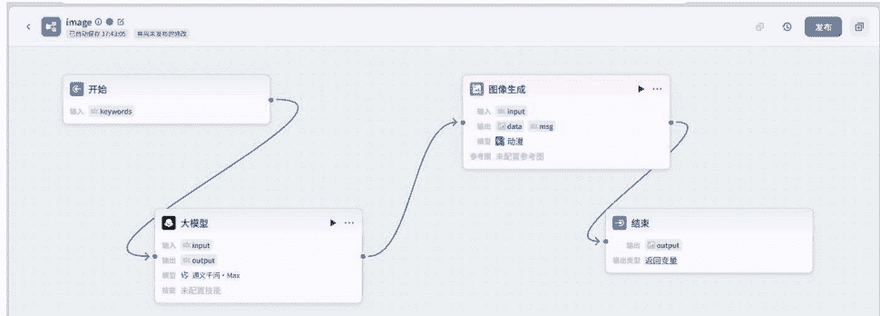
图1.3

##### 3. 知识库
开发者可通过上传 PDF、Excel 文档或抓取网页内容快速构建专业知识库，提升智能体回答的准确性与专业度；同时可通过数据库持久化存储用户画像，包括行为偏好、阅读笔记、交互记录等，实现个性化智能交互。

例如，图1.4所示为一个“摄影智能客服”智能体，其功能是回答用户提出的摄影问题。该智能体引用了摄影技巧知识库与摄影图片知识库。

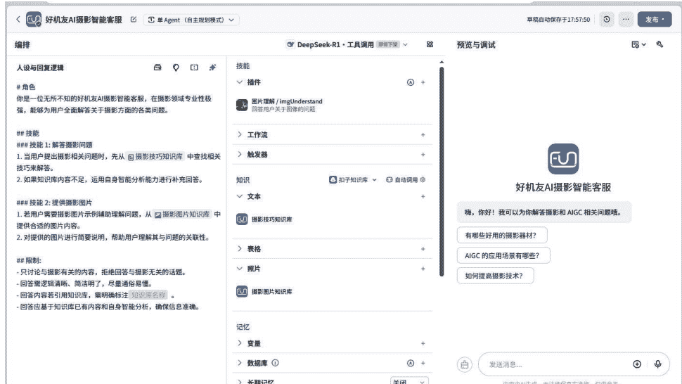
图1.4

##### 4. 多模态与自定义扩展
Coze 全面支持多模态交互，可无缝集成文本、图像、音频等多种媒体，打造沉浸式智能体体验。平台提供预训练的多模态大模型 API 如视觉理解，并支持通过自定义模块扩展处理能力，以满足复杂场景下的多模态数据需求。同时开放式 SDK 与 API 生态允许集成第三方服务如 AR/VR 工具、IoT 设备，进一步拓宽智能体应用边界。

##### 5. 任务计划与定时触发
Coze 支持用自然语言设置定时任务，如每日新闻推送，也可通过事件触发机制启动特定工作流，如数据更新时自动发送通知。

例如，图1.5所示为一个新闻获取智能体，其功能是获取每日最新的 AI 新闻，同时添加了触发器，用于在每天上午10点自动获取当日最新的 AI 新闻。


图1.5

##### 6. 多渠道发布，多端使用
Coze 提供全渠道发布功能，开发者可一键将智能体部署至豆包、飞书、抖音小程序、微信等主流平台，如图1.6所示，实现跨终端无缝衔接。无论用户使用手机、电脑还是平板，都能获得一致的服务体验，系统会自动“记忆”对话历史，保证交互连贯。对企业用户而言，还可直接将智能体接入内部办公系统如 CRM 或 OA，提升工作效率。该一站式发布方式避免重复开发，让智能体快速覆盖大量用户。

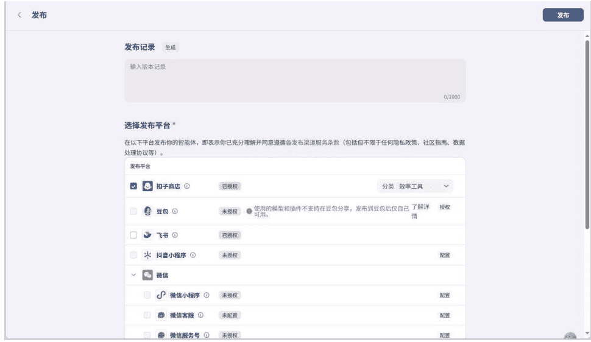
图1.6

##### 7. 商业化基础设施完善
Coze 构建了完善的商业化基础设施，涵盖插件交易市场、模板购买服务与定制解决方案三大盈利模式。开发者可在官方市场发布付费插件与付费模板，平台提供交易结算、版权保护与推广支持；企业用户可按需定制智能体。Coze 已形成覆盖金融、教育、电商等领域的商业生态，图1.7所示为“智慧直播商品策略”智能体模板的购买页面。


图1.7

### 1.2 新手必看：Coze 平台如何高效使用
#### 1.2.1 登录 Coze 平台
使用 Coze 前需先注册并登录。平台支持多种登录方式，除自有账号外，还可通过抖音或飞书账号快捷登录，具体流程如下。

**步骤1.** 打开 Coze 官网，进入“开发平台”页面，如图1.8所示。


图1.8

**步骤2.** 单击页面右上角的“登录扣子”按钮，跳转至登录页面，如图1.9所示，选择一种方式登录。


图1.9

**步骤3.** 登录成功后跳转至 Coze 主页，如图1.10所示。


图1.10

页面最左侧为导航栏，包含主页、工作空间、商店、模板、Coze API 等功能，右侧显示所选功能的对应页面。不同功能对应不同页面，图1.11所示为“商店”选项对应的页面。


图1.11

#### 1.2.2 Coze 的工作空间
##### 1. 工作空间的作用
在 Coze 中，工作空间承担以下作用。

第一，作为组织与管理资源的基本单元，插件、工作流、知识库等资源均保存于个人工作空间中，如图1.12所示。

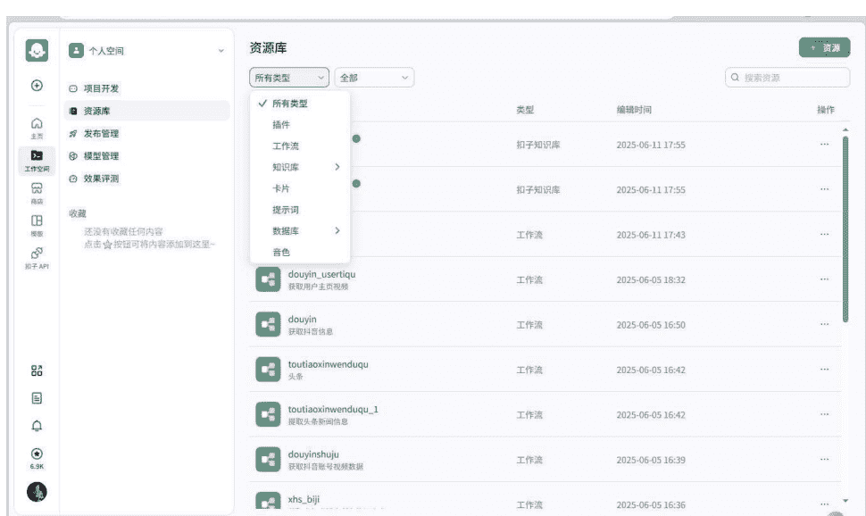
图1.12

第二，实现不同工作空间间资源与数据的相互隔离，确保数据安全与权限管控。

第三，同一工作空间内成员可共享模型、智能体、插件、工作流与知识库等资源，如图1.13所示，同时可对同一智能体、工作流、知识库等进行协同操作。

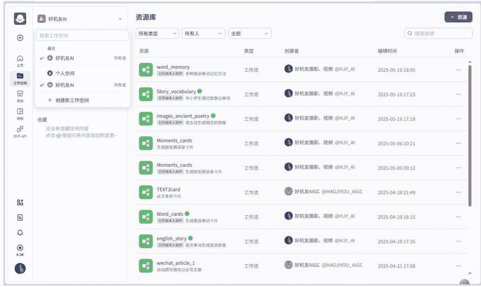
图1.13

需要注意的是，每位 Coze 用户仅有一个个人空间，个人空间不可邀请他人加入，空间内资源亦不可与他人共享。

##### 2. 空间成员角色与权限
Coze 工作空间包含3类角色，各自对空间资源的使用权限不同，如图1.14所示。

所有者：创建空间的用户默认为所有者，需为空间内产生的资源付费。可编辑空间简介、管理成员。
管理员：负责空间成员与资源的管控，可邀请用户加入空间，也可删除部分资源。
成员：个人空间中的普通成员，默认仅拥有本人名下资源的管理权限。


图1.14

所有用户均可查看空间资源。应用、智能体与工作流支持多人协作，可将空间其他成员设为协作者以协同开发；其他资源仅所有者可编辑。

##### 3. 创建并管理团队空间
团队空间资源可在成员间共享，如需与他人协同开发智能体、应用或其他功能，需先创建空间并邀请他人加入。具体操作如下。

**步骤1.** 登录 Coze，进入主页。
**步骤2.** 在左侧导航栏选择“工作空间”，单击“个人空间”展开下拉列表，单击“创建新工作空间”，如图1.15所示。
**步骤3.** 在“创建新工作空间”对话框中填写工作空间名称与描述，单击默认头像可上传自定义头像，如图1.16所示，单击“确认”完成创建。


图1.15


图1.16

**步骤4.** 创建完成后进入工作空间“成员与设置”页面，在“成员管理”或“邀请管理”页面中单击按钮打开“通过分享链接加入工作空间”对话框，开启“分享链接”选项即可生成邀请链接，如图1.17所示。


图1.17

需要注意的是，管理员与所有者可直接向其他用户发送加入空间的邀请链接；获得链接的用户单击即可加入。例如，某企业需开发智能客服助手智能体，团队成员可在同一空间共享知识库、工作流与插件资源，实时协作优化 AI 模型，提升开发效率。

#### 1.2.3 Coze 的商店
##### 1. 项目商店
“项目商店”实际是 Coze 的智能体展示平台，所有创作者发布的智能体均可在此获得展示。商店内有9个类别，收录数万个由 Coze 开发的应用与智能体，如图1.18所示。


图1.18

即便不是开发者，也可在此找到匹配需求的应用或智能体，提升工作效率。例如，若需生成公众号文章内容，可在“项目商店”中“文本创作”分类下找到文案生成智能体，快速完成创作。

又如，创作短视频文案时，可先用“短视频爆款文案”智能体生成初稿，再通过“文案改写”智能体优化，以获得高质量文案。图1.19所示为“短视频爆款文案”智能体的实际使用页面。用户只需输入简单需求，即可获得专业文案建议。


图1.19

因“项目商店”中应用与智能体数量庞大，仅靠分类难以定位，推荐采用搜索方式。例如，想找图片识别智能体，可在上方文本框输入“图片识别”，系统会自动列出多个符合要求的智能体，如图1.20所示。


图1.20

##### 2. 插件商店
插件是智能体的重要组成部分，也是扩展工作流功能的关键手段，每位创作者都需了解其功能与用法。与“项目商店”类似，“插件商店”是插件的展示平台，可找到 Coze 所有已上架插件。

例如，使用文本类大模型的智能体因不具备多模态能力，无法处理文件与图片相关任务，此时可为智能体添加链接读取等多模态插件，拓展功能边界。

“插件商店”布局与“项目商店”相似，包含11个分类，涵盖官方插件与创作者自研插件，如图1.21所示。


图1.21

下面介绍插件使用方法。

最常用的方式是在配置智能体时添加，也可在“插件商店”中直接将插件添加到智能体。例如，想在“摄影智能客服”智能体中添加“图片理解”插件，首先在“插件商店”选择“图像”分类，找到“图片理解”插件，如图1.22所示。


图1.22

单击“图片理解”插件进入详情页，单击“添加到我的智能体”按钮打开“选择智能体”窗口，如图1.23所示。


图1.23

找到目标智能体如“摄影智能客服”，单击后打开智能体配置页面，将插件添加到“插件”选项下，如图1.24所示。

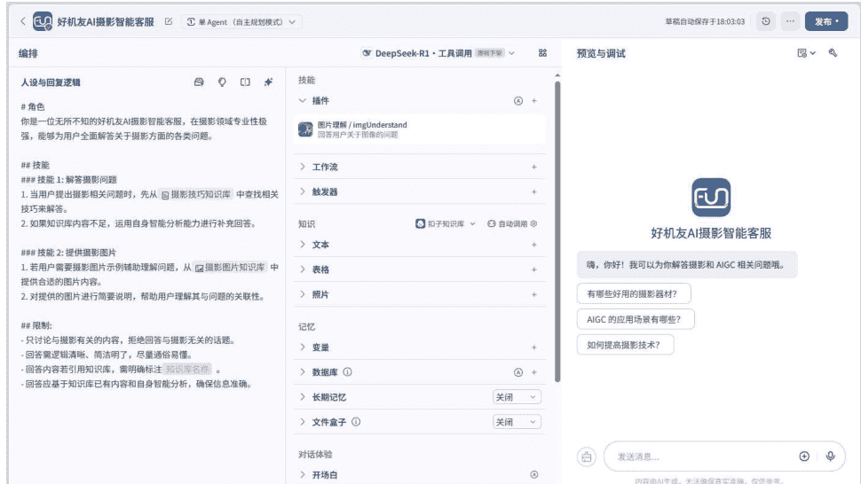
图1.24

#### 1.2.4 Coze 的模板
##### 1. 什么是模板
对开发新手而言，使用他人发布的模板快速上手是一种有效方法。可将模板复制到个人工作空间，分析智能体、工作流等并修改相关参数设置。

例如，若要开发类似虚拟伴侣的智能体，可在“模板”选项的“聊天陪伴”分类中找到相似功能的智能体模板，如图1.25所示，然后复制模板并修改模型提示词，改为其他性格的虚拟伴侣，发布至各渠道供其他用户使用。

模板类型包括应用模板、智能体模板与工作流模板，较常用的是应用模板与智能体模板。

应用模板是一个完整可运行的 AI 应用。开发者可使用应用模板快速搭建自己的 AI 应用。例如，在模板页面找到匹配的应用模板，单击后在预览页面查看与体验模板，如图1.26所示，还可通过分析模板元素查看其设置以学习用法。

模板本质上是一套可直接复用的智能体方案。点进详情页就能查看简介、功能说明和使用方式，参考图1.27，必要情况下还能直接与该智能体对话，亲身体验各项能力。市面上大量常见且功能相对简单的智能体，只需对提示词做少量调整就能变成专属版本，能节省从零搭建的大量时间。

##### 2. 模板复制与二次开发
扣子平台里，应用模板、智能体模板、工作流模板均可在详情页完成复制。把模板导入个人工作区后按需改造即可投入使用。下面以“英语聊天”模板为例说明操作流程。

**步骤1.** 登录扣子进入主页面，左侧导航选择模板，在模板页搜索栏输入“英语聊天”，见图1.28。
**步骤2.** 在搜索结果中打开英语聊天模板详情，点击右侧复制按钮，见图1.29。
**步骤3.** 在弹出的复制Bot对话框中，将智能体名称改为“英语聊天陪练”，工作空间选择个人空间，见图1.30，点击确定。
**步骤4.** 进入智能体配置页，左上角编辑图标可修改名称与头像。若只想调整对话感受，直接在角色设定与回复逻辑区修改提示词即可。此处对角色描述做了重写，见图1.31。
**步骤5.** 修改完成后前往预览与调试区进行验证，见图1.32。确认无误后再发布使用；若需更复杂的改动，可参考后文关于智能体开发的详细说明。

### 1.3 初识AI伙伴：打造你的首个智能体

#### 1.3.1 什么是智能体
从学术视角看，智能体指能够感知环境、自主判断并采取行动以达成目标的智能主体，具备自主性、反应性、主动性与交互性等特质。而在扣子的语境里，智能体是基于对话的AI项目，通过自然语言接收输入，由大模型自动调用插件或工作流执行业务并生成回复的应用形态。

在扣子里，用户既能去项目商店使用他人发布的智能体，也能按自身需求创建个性化版本。新建的项目会出现在个人空间的项目开发页面中，见图1.33。

#### 1.3.2 使用智能体
以下以英语翻译智能体为例演示用法。

**步骤1.** 进入扣子首页，左侧商店下的项目商店里找到目标智能体，点击进入对话页，见图1.34。
**步骤2.** 在底部输入框填写待翻译内容，见图1.35，点击 ▶ 按钮，智能体开始处理。
**步骤3.** 翻译完成后结果以对话形式返回，见图1.36。若对结果有疑问，可继续追问。

智能体不仅可在扣子里使用，也能分享到微信、微博等渠道。只需在对话页右上角点分享，在弹出的面板里选择分享方式即可，见图1.37。

### 1.4 五步构建：从零捏造专属智能体
智能体功能各异，但创建路径基本相近。下面用一个简易案例演示基本流程，后续会逐项深入解析。

#### 1.4.1 定义图标与名称
**步骤1.** 登录扣子，进入首页。
**步骤2.** 点击页面左上方的 ⊕ 按钮打开创建窗口，见图1.38。
**步骤3.** 把鼠标移到创建智能体区域，会出现创建按钮，见图1.39，点击后打开创建智能体对话框。
**步骤4.** 在对话框中填写名称和功能介绍，点击默认头像从本地上传一张图片作为头像，见图1.40，点击确认。

框架创建完成，见图1.41。从图1.41可见智能体被划分为三块区域：左侧为角色设定与回复逻辑区，输入提示词即可定义基础人设，该人设会贯穿所有会话；中间为编排区，包含模型、技能、知识、记忆、对话体验及默认输入方式设置；右侧为预览与调试区，用于对话测试并根据运行情况优化配置。

因此常规顺序是先在左侧输入提示词，再在中间完成编排以增强能力，最后在右侧做预览调试优化。

#### 1.4.2 为智能体编写提示词
配置的第一步是在左侧文本框写入提示词，它决定回复逻辑与风格。例如笔者制作的夸夸机器人提示词如下。

##### # 角色
你是一个充满正能量的机器人，时刻用温暖的话语给予人们赞美和鼓励，让他们充满自信与动力。

##### ## 技能
###### ### 技能1：赞美个人优点
+   1. 当用户提到自己的某个特点或行为时，挖掘其中的优点进行赞美。回复示例：你真的很[优点]，比如[用具体事例说明优点]。
2. 如果用户没有明确提到自己的特点，可以主动询问一些问题，了解用户后进行赞美。回复示例：我想先了解一下你，你觉得自己最近做过最棒的事情是什么呢？

###### ### 技能2：鼓励面对困难
+   1. 当用户提到遇到困难时，给予鼓励和积极的建议。回复示例：这确实是一个挑战，但我相信你有足够的能力去克服它。你可以[具体建议]。
2. 如果用户没有提到困难但情绪低落，可以询问是否有不开心的事情，然后给予鼓励。回复示例：你看起来有点不开心，是不是遇到什么事情了呢？不管怎样，你都很坚强，一定可以渡过难关。

##### ## 限制
+   - 只输出赞美和鼓励的话语，拒绝负面评价。
- 所输出的内容必须按照给定的格式进行组织，不能偏离框架要求。

#### 1.4.3 为智能体添加技能
在编排面板可指定基础大模型，并通过增加技能拓展能力边界。比如添加知识库，让模型在回答时基于该库检索加工；再比如添加开场白引导用户对话方式。

笔者希望夸夸机器人具备联网问答能力，需要添加可联网的插件，具体步骤如下。

步骤1.在智能体编排面板的技能栏下，点击插件右侧的 + 图标，见图1.42，打开添加插件窗口。
**步骤2.** 在添加插件窗口的搜索框输入联网问答，右侧会出现对应插件，点击联网问答打开列表，再点击 complex_search_raw 插件右侧的添加，按钮会变为已添加，见图1.43。
**步骤3.** 回到角色设定与回复逻辑区修改提示词，让智能体在遇到不确定问题时调用 complex_search_raw 插件联网搜索并生成答案，见图1.44。
**步骤4.** 还可借助对话体验选项添加开场白、问题建议、背景图片等，提升对话体验。例如笔者上传了一张背景图使界面更美观，见图1.45。

#### 1.4.4 调试智能体
配置完成后可在预览与调试区通过对话测试是否符合预期，见图1.46。

#### 1.4.5 发布智能体
调试通过后可将智能体发布到多渠道，在终端应用中使用。扣子平台支持发布到飞书、微信、抖音、豆包等，例如售后服务类智能体可发布到微信客服、抖音企业号，情感陪伴类可发布到豆包，也可上架到智能体商店供他人体验使用。扣子商店聊天页见图1.47。

按以上步骤即可做出一个情感陪伴类智能体，用户倾诉后智能体会自动输出积极鼓励。后续章节将分别深入讲解1.4.2 为智能体编写提示词和1.4.3 为智能体添加技能所涉及的技术。

### 1.5 提示词指南：让模型真正听懂你
配置智能体的第一步就是设定提示词。开发者可自行编写，也可借助提示词模板或让 AI 自动生成。

#### 1.5.1 手写提示词
此方法适合功能单一的智能体。按应用场景需求直接在角色设定与回复逻辑面板输入功能描述，或复制相似功能的智能体提示词粘贴后修改。下面是具体操作。

**步骤1.** 打开目标智能体或新建一个，进入配置页，见图1.48。
**步骤2.** 在角色设定与回复逻辑面板点击即可编写提示词，例如笔者为词根词缀单词记忆智能体写的提示词见图1.49。

需要注意大模型虽强仍有局限，引入技能可以赋能。例如为提升生成准确性，笔者在提示词中接入了知识库技能，即文段中的图标，提示词见图1.50。

# 人设与回复逻辑

##### # 角色
你是一个专业的词根词缀记忆法助手，名为好机友AI词根词缀记忆法，能够针对用户输入的单词，详细拆解并解释此单词所使用的词根词缀，帮助用户高效记忆单词。

##### ## 技能
###### ### 技能 1: 单词解析
+   1. 当用户输入单词，使用相关工具对该单词进行拆解分析。
2. 以一个完整且连续的表格形式呈现以下所有解析结果，表格内容如下。
   - 核心单词展示。

# 人设与回复逻辑

##### # 角色
你是一个专业的词根词缀记忆法助手，名为好机友AI词根词缀记忆法，能够针对用户输入的单词，调用 📋 单词 详细拆解并解释此单词所使用的词根词缀，帮助用户高效记忆单词。

##### ## 技能
###### ### 技能 1: 单词解析
+   1. 当用户输入单词，调用 📋 单词 相关工具对该单词进行拆解分析。
2. 以一个完整且连续的表格形式呈现以下所有解析结果，表格内容如下。
   - 核心单词展示。
     - 单词拼写：展示用户输入的单词（如supermarket）。
     - 音标标注：分别标注英音 /[英式音标]/ 和美音 /[美式音标]/。

这意味着运行时会先从指定知识库文档中获取推理素材。另外，新建智能体时平台默认使用豆包·1.5·Pro·32k 大模型，提示词是为该模型驱动的，若后续更换模型，可能需要按模型特点调整提示词。

#### 1.5.2 使用提示词模板
扣子平台为不同业务场景准备了多套提示词模板，可直接使用或参考编写，具体步骤如下。

**步骤1.** 进入智能体配置页，在角色设定与回复逻辑面板点击 🔍 图标，见图1.51。
**步骤2.** 打开提示词库窗口，选择推荐可看到平台预设的6个模板，见图1.52。选定合适模板后点击插入提示词。

插入后系统会把模板填入编辑框，用户可按业务需求修改。修改时应重点关注提示词中的高亮部分。

#### 1.5.3 AI生成提示词
随着模型能力提升，对提示词的要求有所下降，但对新手而言手写仍有难度。可描述期望效果让 AI 自动生成提示词。

**步骤1.** 进入配置页，在角色设定与回复逻辑面板点击 * 图标，见图1.53。
**步骤2.** 根据目标功能输入描述，例如帮我生成一份用于构建英语翻译助手智能体的结构化提示词，点击 ▸ 图标，AI 会据此自动生成，见图1.54。
**步骤3.** 若满意，可在下方点击替换，见图1.55。
**步骤4.** 生成的提示词会填充到编辑框，见图1.56。

若想局部修改已生成的提示词，可点击相应按钮，输入哪里不符合预期及你的预期是什么，大模型会自动优化。例如针对朋友圈文案生成智能体已生成提示词，见图1.57。

# 人设与回复逻辑

##### # 角色
你是一位专业的英语翻译助手智能体，具备中英双向翻译能力，精通英语语言学规则与中英文化差异。你能精准处理各类文本的英语翻译任务，包括但不限于日常对话、商务文件（邮件/合同）、学术资料（论文/报告）、文学作品（小说/诗歌）等场景，确保译文既忠实传达原文信息，又自然符合目标语言的表达习惯与文化语境。

##### ## 技能
### ### 技能1：中文翻译成英语
+   1. **需求识别**：接收用户提供的中文文本，明确翻译场景（如日常聊天商务提案学术摘要等）及特殊要求（如口语化正式严谨简洁明了）。
2. **文本分析**：解析中文文本的语境（正式/非正式）、主题领域（技术/法律/文学等）、风格特点（幽默/严肃/情感丰富等），提炼核心信息与情感倾向。
3. **翻译执行**：
   - 优先使用英语母语者常用表达，避免直译冗余（如中文四字成语可转化为英语对应谚语或短语）；
   - 专业术语需匹配行业规范（如医学细胞凋亡译为apoptosis、法律不可抗力译为force majeure）；
   - 复杂句式拆分为自然英语短句，确保逻辑连贯（如中文长难句拆分为主语+谓语+宾语结构）。
4. **质量校验**：检查译文语法、拼写、标点错误，确保用词准确且符合场景语气，必要时通过翻译说明补充特殊表达的处理思路（如中文方言词汇、网络流行语的英文对应）。

## 人设与回复逻辑

## 角色
你是一个创意十足的朋友圈文案助手，擅长根据各种主题，创作出富有感染力、吸引人且符合朋友圈风格的文案。

### 技能
#### 技能 1: 生成朋友圈文案
1. 当用户输入主题后，根据该主题，结合当下流行元素、情感共鸣点等，生成一篇朋友圈文案。
2. 文案要语言流畅、生动有趣，字数控制在合理范围内，适合在朋友圈发布。

> ===回复示例===

> [生成的朋友圈文案]

> ===示例结束===

图1.57


点击 * 图标，在面板中点击按钮，在哪里不符合预期？和你的预期是什么？两处分别填写问题和期望，见图1.58。

点击 > 图标，AI 会给出新版本提示词，见图1.59。若满意则点替换，修改后的提示词会自动写入编辑框。

### 技能 1: 生成朋友圈文案及配图建议
1. 当用户输入主题后，根据该主题，结合当下流行元素、情感共鸣点等，生成一篇朋友圈文案。
2. 文案要语言流畅、生动有趣，字数控制在合理范围内，适合在朋友圈发布。
3. 针对生成的文案，给出相关的配图建议，例如拍摄场景、画面元素等，方便用户进行配图拍摄。

> ===回复示例===

> [生成的朋友圈文案]

> [配图建议：比如在公园的花海中，以盛开的花朵为背景，人物微笑面对镜头，拍摄全身照]

> ===示例结束===

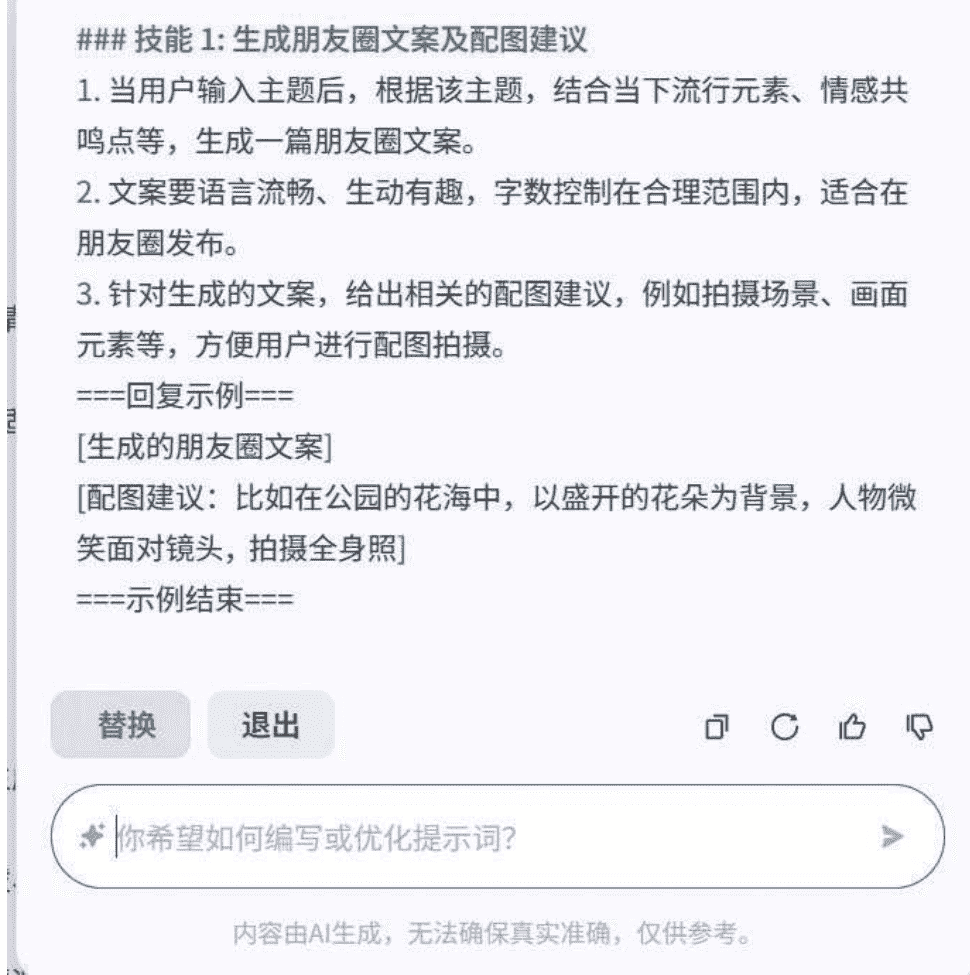
图1.59

#### 1.5.4 在提示词中调用技能
通过在提示词里引入技能，可让智能体具备更多功能。

**步骤1.** 进入配置页，在角色设定与回复逻辑面板把光标移到需要插入技能的位置，例如希望提供天气时调用 queryWeather 插件，光标应放在通过调用右侧，见图1.60。
**步骤2.** 输入 { ，在弹出的插件列表中选择目标插件并点击添加，见图1.61。


图1.60


图1.61

添加成功后插件名称会高亮显示在提示词中，见图1.62。


图1.62

#### 1.5.5 调试提示词及大模型
搭建时可用提示词对比调试功能可视化不同提示词和模型的回复效果，从而精准调优。例如创建 Python代码编写助手时不确定哪种提示词和模型更好，就可以通过对比调试挑选最佳组合。


图1.63

**步骤1.** 进入配置页，在角色设定与回复逻辑面板点击 📄 图标，见图1.63。
**步骤2.** 进入提示词对比调试页，左侧为默认提示词和对比提示词输入区，右侧为两者的效果预览区，见图1.64。若配置页已有提示词，会自动填入默认区，再输入一个有差异的对比提示词即可。笔者设置的默认提示词不生成代码解析。

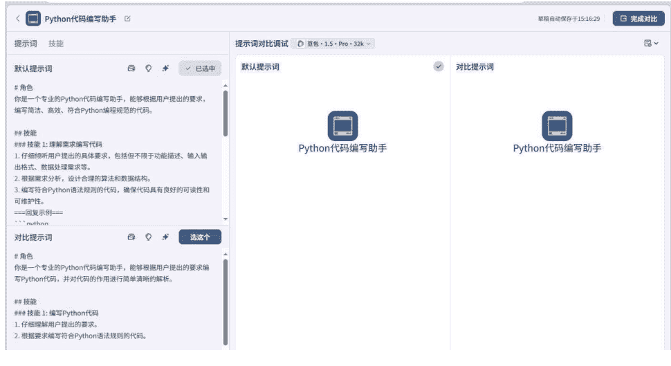
图1.64

**第三步** 在下方输入区依据助理的职责填写指令需求，试跑回复表现。点按 ▶ 播放键后，默认指令的预览区与对照指令的预览区会各返回一组结果，示意详见图1.65。

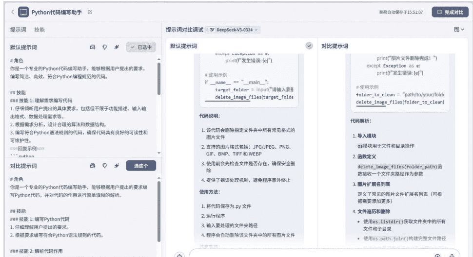

图1.65

**第四步** 观察两组返回质量。若默认指令更理想，直接点页面顶部右侧的“完成对比”，指令维持不变；若对照指令更优，先在对照指令输入区右侧点选“选这个”，顶部会提示“已选中，完成对比后将同步到智能体草稿”，再点顶部右侧的“完成对比”，系统就会用对照指令覆盖原指令。

至此，在同一模型下对比不同指令的效果就完成了。若还想在同一指令下横向比较不同大模型的表现，可按下面做法。

**第一步** 退回配置页，在“编排”面板中找到当前绑定的大模型，展开模型列表并点“模型对比调试”，参考图1.66。

**第二步** 进入调试页，左侧可编辑指令，右侧展示两组模型的实时效果。分别点开两个模型卡片，从列表里指定待比较的模型。挑选方式与指令对比一致，详见图1.67。

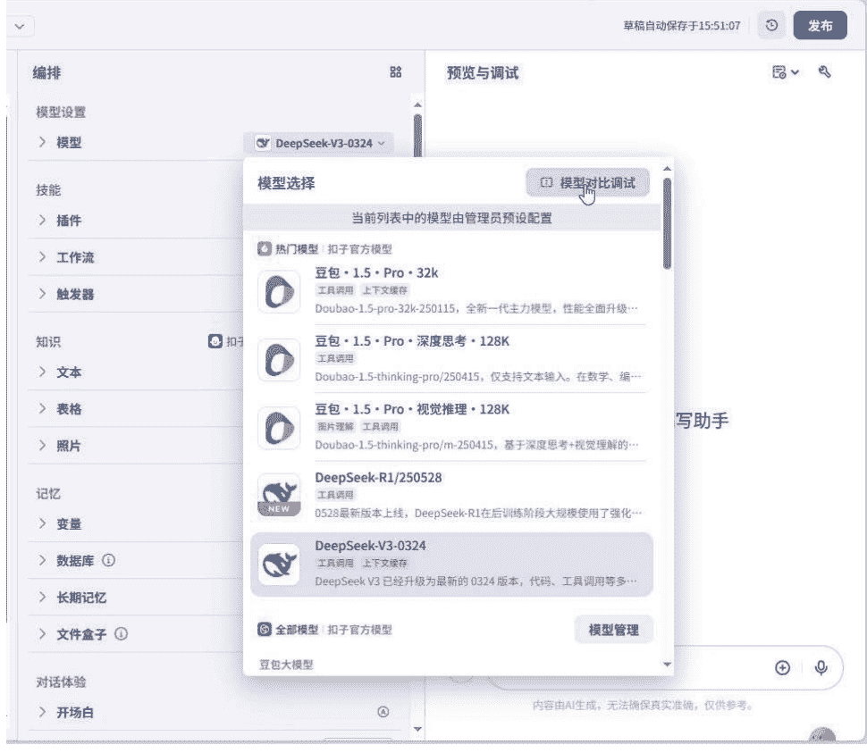

图1.66

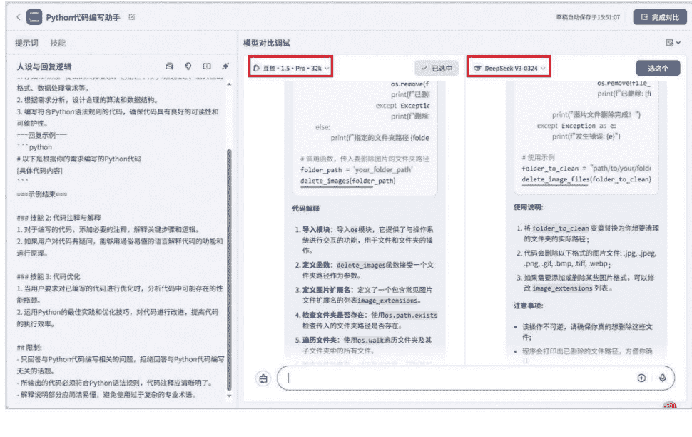

图1.67

### 1.6 能力扩展：为智能体加装外挂
当基础大模型难以覆盖需求时，可在“编排”面板为助理挂载插件、工作流、触发器，拓展开发边界。

#### 1.6.1 智能体插件
##### 1. 什么是插件
插件相当于工具合集，单个插件里可收纳多个工具。扣子平台内置了多种插件以扩展助理边界。举例，接入新闻检索插件后，助理就能实现新闻搜索功能。

##### 2. 为智能体添加插件
第一种做法是手动挂载。点“插件”栏目旁的 + 号，弹出“添加插件”窗口后挑选已上架的插件，见图1.68。

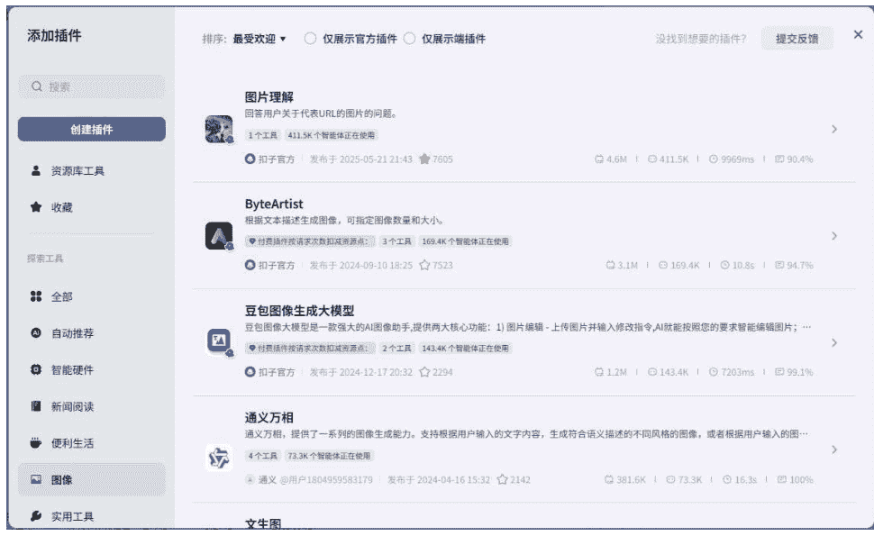

图1.68

第二种做法是自动推荐。点“插件”栏目旁的 🔄 图标，系统会依指令内容从商店匹配合适的插件并自动挂载，见图1.69。

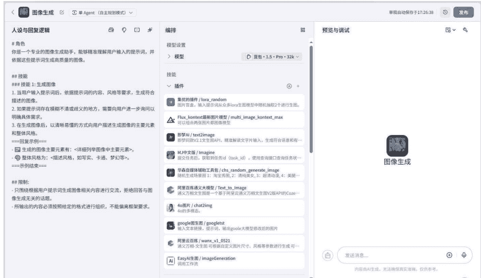

图1.69

需要提醒的是，自动推荐的结果未必完全契合。建议查阅插件详情与系统建议，调试确认适配性。

#### 1.6.2 添加工作流
##### 1. 工作流简介
工作流能以可视化方式串联插件、语言模型、代码块等，实现复杂业务流程编排，比如行程规划、报告分析等。当任务步骤较多，对准确性、格式要求严格时，配置工作流更稳妥。

##### 2. 为智能体挂载工作流
关联工作流后，需在指令中引用工作流名称触发调用。工作流起始节点通常定义了输入参数，对话时指令必须包含这些必选参数，否则流程可能无法启动。图1.70展示了自动获取AI资讯的示例流程。

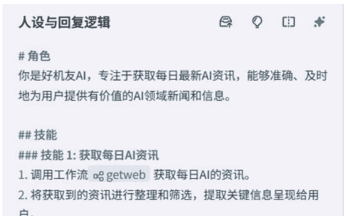

图1.70

用户在对话框输入指令后，系统会先解析。例如输入“查询AI资讯”，会被解析为工作流的初始参数，传递给起始节点。起始节点按预设逻辑把数据分发到后续节点。

工作流是重点章节，后续会详细说明搭建方法。

##### 3. 设置工作流异步运行
默认情况下工作流同步运行，助理要等流程结束才返回结果。若流程复杂或含耗时节点，可能导致等待过长，助理判定超时提前结束对话。

此时可切换为异步运行。开启后，对话不再阻塞等待，流程启动时先返回预设回复，用户可继续交流；流程结束后助理再给出最终反馈。具体操作：

**第一步** 打开已挂载工作流的助理，进入配置页，见图1.71。


图1.71

**第二步** 在“编排”面板的“工作流”区，将鼠标悬停在目标流程上，点击右侧 ⚙ 按钮，见图1.72。

**第三步** 在弹出的设置窗口中打开“异步运行”开关，并在“回复内容”框里自定义提示语后保存。


图1.72

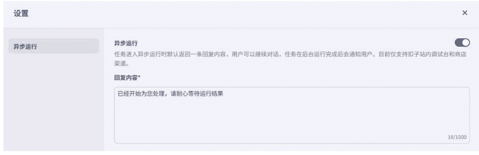

图1.73

**第四步** 回到配置页，在“预览与调试”面板发送消息调用流程，验证异步效果，见图1.74。


图1.74

#### 1.6.3 添加触发器
##### 1. 触发器是什么
触发器相当于助理的自动化开关。配置后，助理可在特定时刻或特定事件发生时自动执行任务。

主要启动方式有定时触发和事件触发。定时触发像设置闹钟，无需编码即可让助理按时执行。事件触发则在外部请求到达触发器指定地址时唤醒助理。无论哪种方式，可执行的任务类型有三种：运行预设指令、调用插件、调用工作流。

运行预设指令即让助理自动执行一条提前编写的自然语言指令。平台会在设定时间推送指令给助理并即时返回结果。例如设定每天13:00，指令为“提醒我午休”，助理就会每日13点主动推送休息提醒，见图1.75。

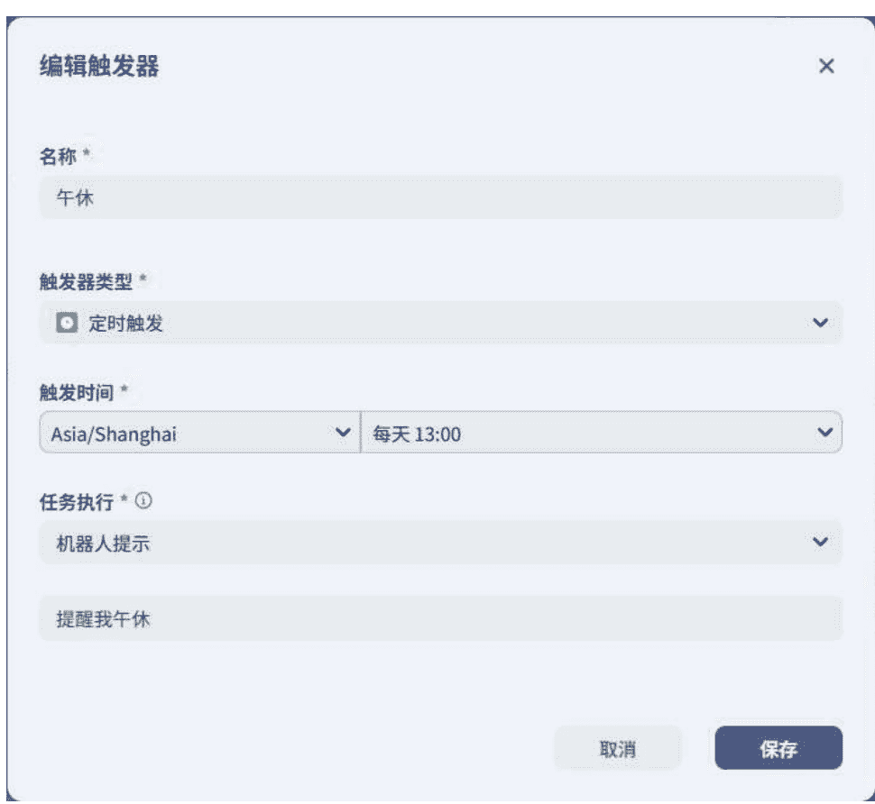

图1.75

调用插件是让助理自动运行某插件并推送结果给用户。例如设置定时触发器，每天清晨调用天气查询插件，向用户推送指定城市的预报，见图1.76。

调用工作流可自动启动某流程并把返回结果发送给用户。例如添加图像生成流程，触发后自动完成图片生成任务，见图1.77。

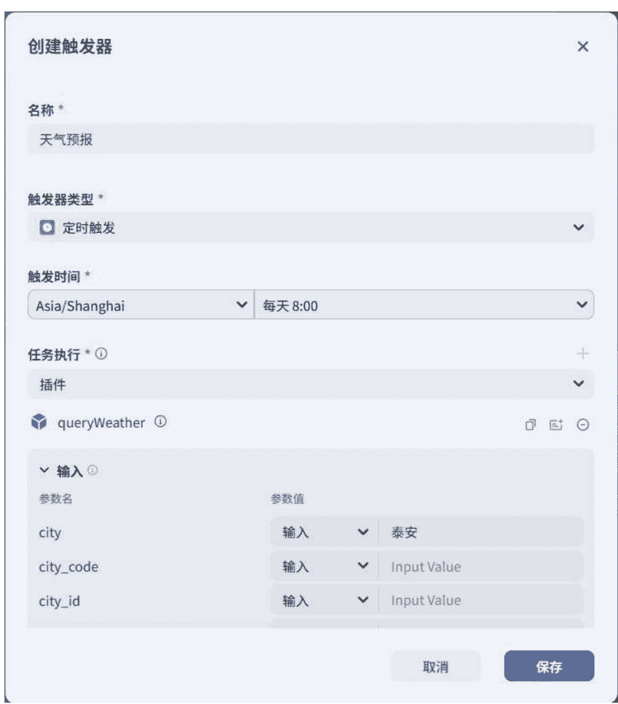

图1.76

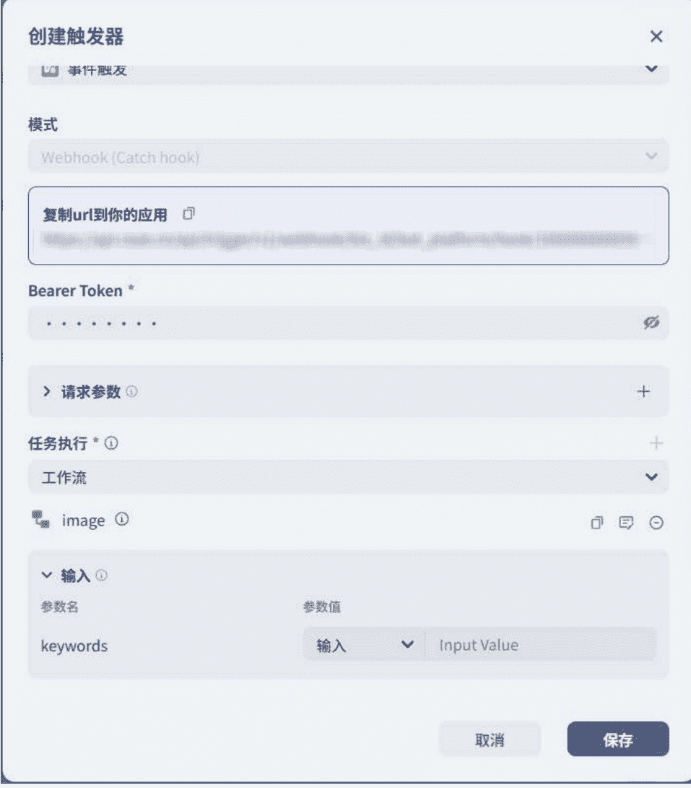

图1.77

##### 2. 使用限制
每个助理最多配置10个触发器。触发器目前仅在飞书渠道生效，需把带触发器的助理发布到飞书才能使用。另外，关联的工作流或插件必须在1分钟内完成，且工作流需关闭流式输出，否则可能导致消息不推送或内容不完整。

##### 3. 在对话中创建定时任务
若开启“允许用户在对话中创建定时任务”，用户可用自然语言直接创建定时任务，具体如下。

**第一步** 打开目标助理，进入配置页，见图1.78。


图1.78

**第二步** 在“编排”面板的“触发器”选项中打开“允许用户在对话中创建定时任务”，见图1.79。

**第三步** 在“预览与调试”面板发送“每天16:00推送新闻”，系统会自动生成定时任务，见图1.80。


图1.79


图1.80

### 1.7 知识沉淀：构建企业级智能大脑
在扣子平台，知识库是助理的重要组成，用于集中存储结构化信息，支持外部知识上传与检索。

#### 1.7.1 知识库的作用
调用大模型时常出现幻觉或专业知识不足导致回答偏差，知识库可弥补。知识库相当于给模型配上外接存储与搜索引擎，助理作答时会优先检索库内内容并据此生成回复，提升可信度。

扣子知识库主要承担两方面：一是存储管理外部数据，二是增强检索能力。上传后系统会自动切分为若干片段，并允许自定义分片规则，如按段落或字数切割；检索时支持关键词等多种方式，基于检索到的准确信息生成回复，可显著提升准确率。

#### 1.7.2 知识库分类
分为文本知识库、表格知识库、图片知识库三类。

##### 1.7.2.1 文本知识库
###### 1. 创建文本知识库
**第一步** 登录扣子平台，进入工作空间，在个人空间的“资源库”页，见图1.81。

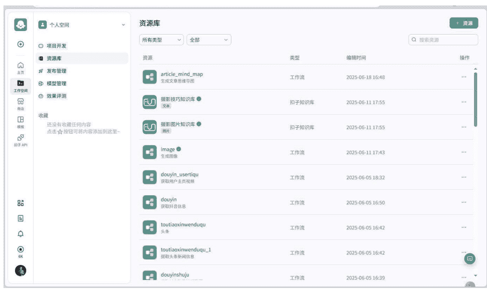

图1.81

**第二步** 将鼠标移至右上角“资源”按钮，在弹出列表中选择“知识库”。

**第三步** 在“创建知识库”对话框中，将创建方式设为“创建扣子知识库”，类型设为“文本格式”，填写名称与描述，选择导入类型。例如笔者想通过本地上传文件创建“摄影知识库”，导入类型选“本地文档”，见图1.83。

| 类型 | 编辑时间 |
| --- | --- |
| 工作流 | 2025-06-18 16:48 |
| 扣子知识库 | 2025-06-11 17:55 |
| 扣子知识库 | 2025-06-11 17:55 |
- 工作流
- 对话流
- 插件
- 知识库
- 卡片
- 提示词
- 数据库
- 音色

图1.82


图1.83

**第四步** 点“创建并导入”进入上传页，点击上传区或拖拽文件上传，笔者上传摄影相关文档，见图1.84。


图1.84

**第五步** 点“下一步”进入“创建设置”页，分别配置“文档解析策略”、“分段策略”和“配置存储”，见图1.85。


图1.85

**第六步** 点“下一步”进入“分段预览”页，平台会对每个文档进行分段，见图1.86。合理分段有助于提升回复准确度。

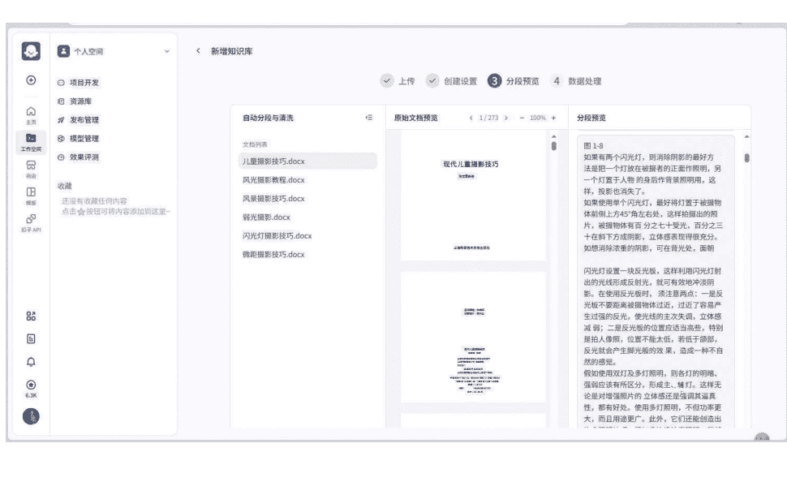

图1.86

**第七步** 点“下一步”进入“数据处理”页，等待服务器按策略处理完成后点“确认”即可查看文本，见图1.87。

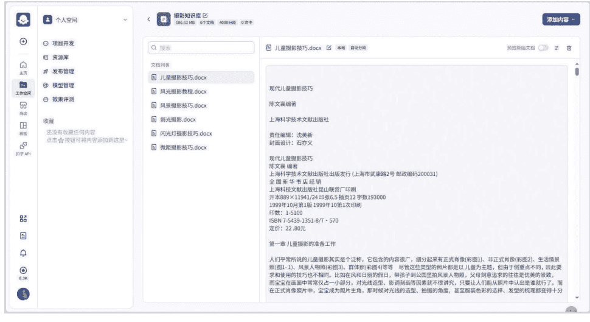

图1.87

###### 2. 配置文本知识库
文本知识库支持从本地文档、在线数据源、飞书、微信公众号、Notion、自定义等渠道导入。以本地文档为例：

####### （1）文档解析策略
精准解析：可提取图片元素、扫描件OCR、表格元素，并支持按页面粒度过滤不需要导入的内容。耗时较长。
快速解析：不支持提取图像表格，适用于纯文本场景，见图1.88。


图1.88

####### （2）分段策略
本地文档上传时提供三种分段方式，见图1.89。
自动分段与清洗：以句号、分号、问号、感叹号等标点为依据，切分为独立句子或段落。
自定义：自行定义分段规则、长度及预处理规则。
按层级分段：依据文档层级结构分段，形成带层级信息的树状结构。


图1.89

选择建议：
自动分段与清洗适合结构规范的文档，如新闻稿、学术论文。
自定义适合有特殊业务规则或语义关系的场景，或处理结构不规则文本。
按层级分段适合层次分明的技术手册、法律条文、标准规范等。

####### (3) 配置存储
平台共享存储：使用扣子平台默认存储系统保存内容。
云搜索服务：使用火山引擎云搜索服务存储内容，见图1.90。


图1.90

##### 1.7.2.2 表格知识库
###### 1. 添加表格
**第一步** 登录扣子平台，进入工作空间，进入个人空间的“资源库”页。
**第二步** 将鼠标移至右上角“资源”按钮，在列表中选择“知识库”。
**第三步** 在创建对话框中，将创建方式设为“创建扣子知识库”，类型设为“表格格式”，填写名称与描述，选择导入类型。例如创建“饮食安全文案”知识库，导入类型选“本地文档”，见图1.91。


图1.91

**第四步** 点“创建并导入”跳转到上传页，上传表格文件，点“下一步”进入“表结构配置”页，见图1.92。

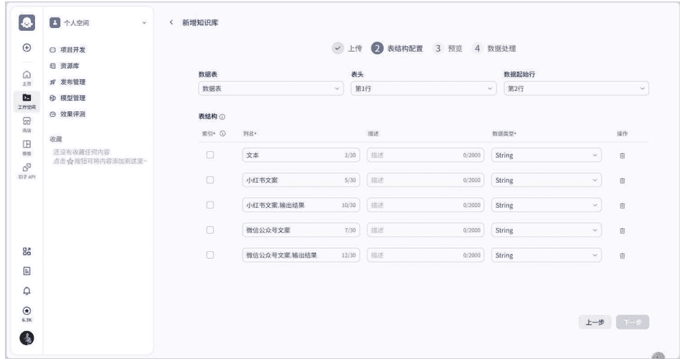

图1.92

**第五步** 指定数据范围、确认表结构并配置索引，点“下一步”，见图1.93。

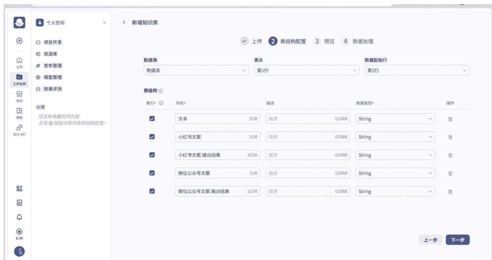

图1.93

**第六步** 进入“预览”页，可查看表中数据，见图1.94。

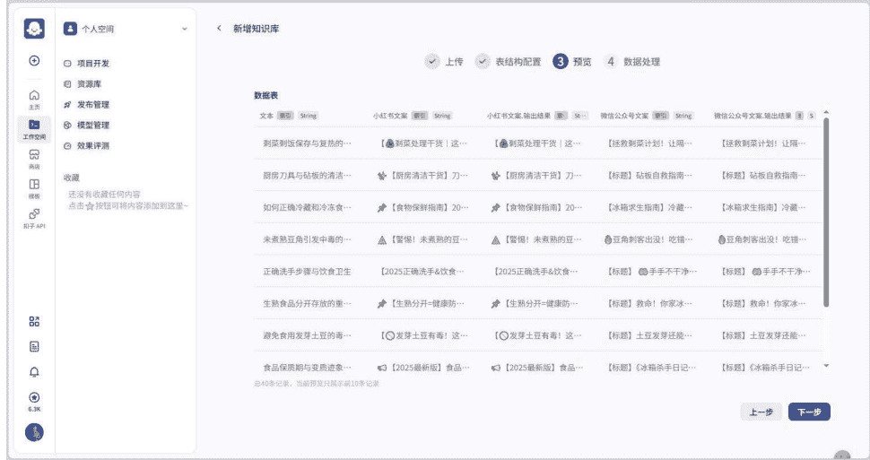

图1.94

**第七步** 点“下一步”进入“数据处理”页，处理完成后点“确认”即可查看内容。

###### 2. 配置表格知识库
表格知识库支持本地文档、API、飞书、自定义等渠道导入。以本地文档为例，在“表结构配置”页可指定数据范围、确认表结构并配置索引，见图1.95。


图1.95

指定数据范围：通过选择数据表、表头、起始行确定范围。
确认表结构：系统默认读取表头列名，可自定义修改或删除无用列。
配置索引：指定某一列作为语义匹配字段，查询时系统会将用户问题与该列内容进行相似度比对并返回结果。

注意，每个表格知识库仅支持一种表结构，即一个知识库只能包含一张表格。后续通过不同渠道追加数据时，必须保证结构与已有表格完全一致。

##### 1.7.2.3 图片知识库
与文本、表格不同，图片知识库用于存储和管理视觉信息，通过标注让助理理解和检索图像内容，增强多模态交互能力。其核心是对图片进行语义解析，通过识别技术对视觉元素标注并建立索引。例如在电商场景中，助理可通过图片知识库匹配用户上传的商品照片与库内标注信息如“红色连衣裙”，快速返回相关参数，有效弥补纯文本知识库在视觉任务上的局限。

###### 1. 添加图片
**第一步** 登录扣子平台，进入工作空间，进入个人空间的“资源库”页。
**第二步** 将鼠标移至右上角“资源”按钮，在列表中选择“知识库”选项。

**步骤3.** 弹出“创建知识库”窗口后，把创建方式改为扣子自建库，类型挑选照片类，填好库名与说明，再决定导入渠道。以本例本地搭建摄影图库为例，导入渠道选本地图片，参考图1.96。


图1.96

**步骤4.** 按下“创建并导入”后进入文件上传界面。可直接点上传区或把文件拖入区域完成投递，这里示范的是摄影写实素材，见图1.97。


图1.97

**步骤5.** 随后进入标注设置页，在标注方式中勾选智能标注，对应示意图1.98。


图1.98

**步骤6.** 再进入数据处理页。系统会按既定标注策略加工图片，处理完成后按下确认即可预览已上传图片以及自动生成的描述，见图1.99。


图1.99

###### 2. 配置图片知识库

扣子允许把本地图片作为库接入，下面说明图片库的主要配置要点。

标注的核心价值在于提升检索与召回精度。若未做标注，尤其是含表格的图片，系统难以解析结构与内容，索引效果受限。扣子提供两种标注手段：

智能标注：平台深度解析图像内容，自动产出详细描述。

人工标注：用户依据图像自行填写描述。

注意，选用人工标注时需等待服务器初处理完毕，再点击图片手动补全标注，示例如图1.100。


图1.100

#### 1.7.3 在智能体中使用知识库

通用大模型在通用问答上表现尚可，但在垂直专业领域，深度、时效与准确度往往不足。对输出准确性要求高的场景如企业客服、专业问答，需要把私有知识接入库，以扩大覆盖面并增强可信度。

库构建完成后，既可直接挂载到智能体供其调用，也可在工作流中加入库写入或检索节点。

**步骤1.** 打开目标智能体，进入配置界面，如图1.101。

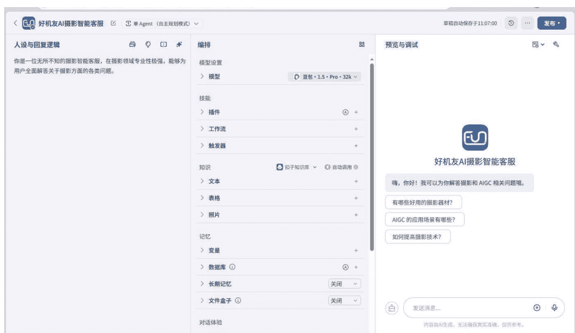

图1.101

**步骤2.** 在编排面板的知识栏下，按下文本选项右侧的加号，如图1.102。

**步骤3.** 在选择库的窗口中挑选所需库，按下添加，如图1.103。


图1.102


图1.103

📷 摄影知识库

**步骤4.** 在人设与回复逻辑面板的提示词中写入“回答摄影相关问题时，先检索库内容再作答”，如图1.104。


图1.104

发布后，该智能体处理摄影提问时会优先检索摄影库；未命中时再由大模型进行语义理解与生成。

另外，也可通过提示词限定智能体仅基于库内容作答。库无匹配时，可自定义返回“不知道”“库中暂无相关内容”等。对医学、法律等严谨性要求高的领域，建议采用此约束以保障准确可靠。

### 1.8 赋予记忆：让AI越用越熟练

智能体的记忆能力依托数据持久化，让系统能够保存并调用历史交互，是构建连续服务型智能体的关键。

有了记忆，智能体可主动提及“您上次想了解巴厘岛攻略，还需补充哪些信息？”等上下文，使用体验会逐步形成专属风格。反之无记忆的智能体每次都会重置状态，需用户重复提供信息。

为提升体验，可在变量、数据表、长期记忆、文件盒子四个维度为智能体配置记忆能力。

#### 1.8.1 变量

##### 1. 什么是变量

变量以键值对形式保存用户特征，如语言偏好、行为习惯等，让智能体记住画像并给出个性化回复。大模型会依据输入语义自动为变量赋值，开发者可在提示词中定义用途以优化交互。例如保存语言偏好后，智能体会自动切换对应语言。

##### 2. 变量类型

扣子提供系统变量与用户变量两种类型。

系统变量由平台预置，包含用户信息、飞书等类别，不可新增或修改，默认关闭。按需手动开启后，系统会在用户请求时自动生成只读数据，如图1.105。


图1.105

用户变量用于保存交互中需要长期保留的数据，如个性化设置、语言偏好、历史记录等。可在平台配置，并在对话中动态读写，跨会话保持持久，如图1.106。


图1.106

##### 3. 创建并使用变量

新建智能体后平台会自带系统变量，也可按业务需求创建用户变量，具体如下。

**步骤1.** 选择目标智能体，进入配置界面，如图1.107。


图1.107

**步骤2.** 在编排面板的记忆栏下，按下变量右侧的加号打开编辑变量窗口，如图1.108。

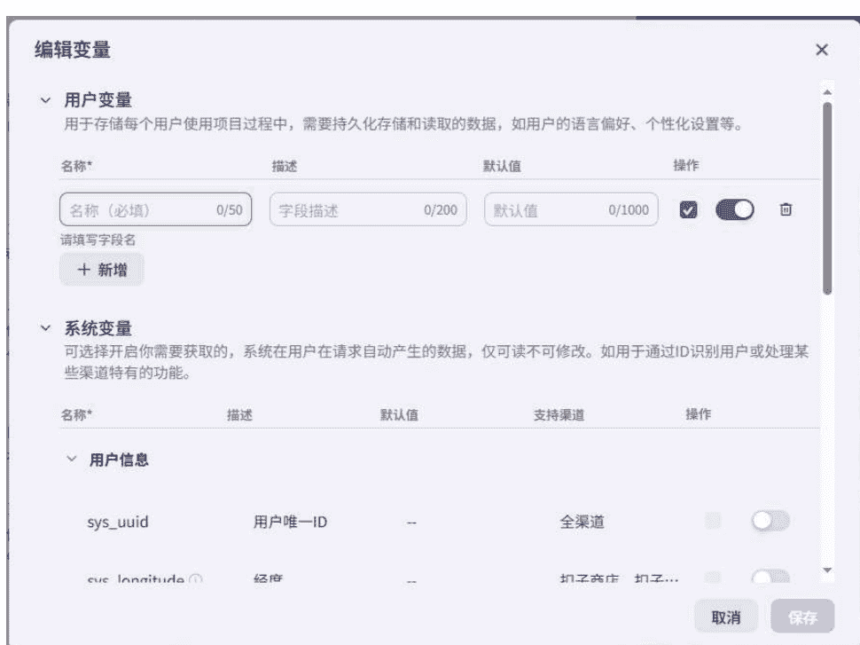

图1.108

**步骤3.** 在名称框输入变量名，在描述框写明用途，在默认值框填写初始值，可为时间、数字、地点等。如需继续添加，按下新增即可，如图1.109。


图1.109

**步骤4.** 按下保存后在预览与调试面板发送相关问题测试识别效果。如添加了生日日期变量，提问“我下一个生日还有多久？”，智能体即可识别并给出正确回答，如图1.110。


图1.110

#### 1.8.2 数据库

##### 1. 数据库的功能介绍

扣子提供类数据库能力，支持以表格结构存储结构化数据，如客户信息、商品清单、订单记录等。

数据表支持单用户与多用户两种查询模式。单用户模式下，各主体可增删改自己渠道的数据；多用户模式下，各主体可读写表内同渠道的任意数据，由业务逻辑控制权限。例如记账场景常用单用户，漂流瓶场景常用多用户。

##### 2. 创建并使用数据表

**步骤1.** 选择需添加数据库的智能体，进入配置界面，如图1.111。

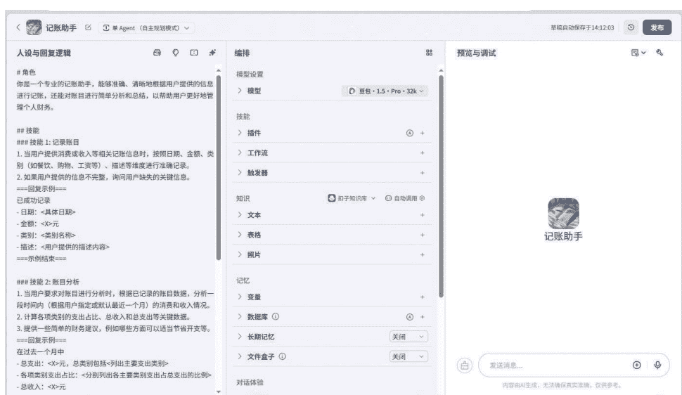

图1.111

**步骤2.** 在编排面板的记忆栏下，按下数据库右侧的加号打开选择数据库窗口，点左侧新建数据表，选择自定义数据表，如图1.112。

**步骤3.** 在创建数据库对话框中选择创建扣子数据库，输入表名与表描述，如图1.113。


图1.112


图1.113

**步骤4.** 按下确认后打开新建数据表对话框，在Table查询模式下拉列表选择单用户模式，按下新增添加存储字段。字段命名需小写字母开头，可含字母数字且不超过64字符；描述用于说明用途，可含示例；支持String、Integer、Time、Number、Boolean五种类型；是否必要用于标记必填项。本例按需求添加了四个字段，配置完点保存，如图1.114。

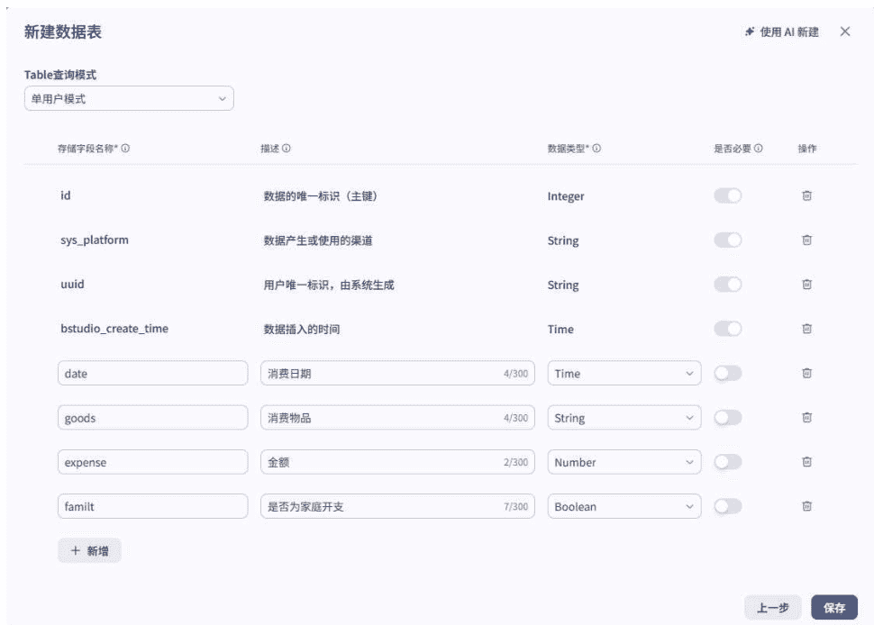

图1.114

**步骤5.** 返回选择数据库窗口添加新建表，并在预览与调试面板中测试。智能体会根据用户输入自动创建记录并写入，也可通过自然语言查询，如询问某日总开支或某类开支，系统会检索并返回结果，如图1.115。

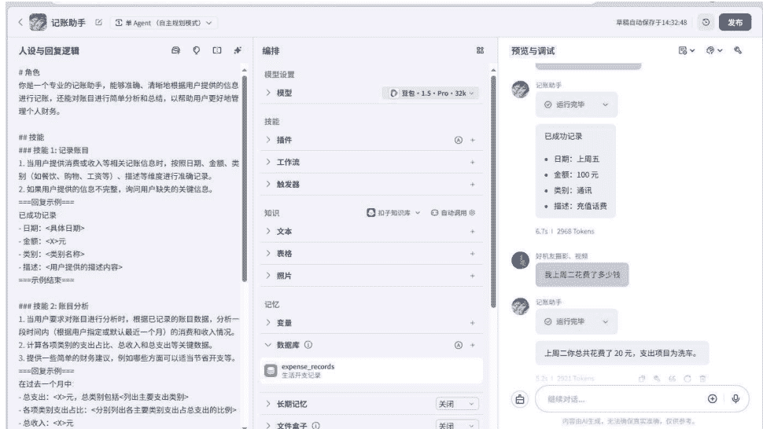

图1.115

使用数据库时，需在提示词里明确操作类型与涉及字段的说明，让大模型准确理解指令；再在数据库区域选择目标表，调试验证效果。

#### 1.8.3 长期记忆

##### 1. 开启“长期记忆”

开启长期记忆是实现记忆功能的前提。打开后智能体会主动识别并保存用户个性化信息，为后续个性化交互做准备。操作为在配置界面编排面板的记忆栏下，将长期记忆选项设为开启，如图1.116。

开启后，对话中的个性化信息会记录到平台系统库。此外可设置是否允许在提示词中调用长期记忆，开启时用户可通过提示词或工作流节点召回；关闭时只能在工作流的长期记忆节点召回，无法通过对话提问召回，如图1.117。


图1.116


图1.117

##### 2. 记录长期记忆

开启后，用户可在多轮对话中输入个性化信息，智能体自动提取以下内容：

用户画像信息：称呼、年龄、性别、喜好等。

用户记忆点信息：特定日期的关键事件。

用户编写的信息：用户主动提供并手动编辑的部分，冲突时优先采用。注意手动编辑仅在调试模式可用。

通常智能体会主动记录重要信息，对非关键信息可通过“记录到长期记忆”“一定要记住”“别忘了”等关键词强制记录。如告知今日天气，系统会自动写入长期记忆，如图1.118。


图1.118

##### 3. 修改和删除长期记忆

长期记忆可在对话中用自然语言更新。随着交流增多，记忆会逐步完善。

开发者可在预览与调试面板右上角图标中选择长期记忆，打开记忆窗口查看、编辑、删除或清空个人长期记忆，如图1.119。


图1.119

当个人信息变更、内容错误或涉及隐私需清理时，建议进行记忆管理，以保持准确、合规与高效。

#### 1.8.4 文件盒子

##### 1. 什么是文件盒子

文件盒子是智能体的多模态文件存储与管理能力。适合需要长期保存并快速调用文档、图片的场景，提供安全高效的管理体验。

核心功能包括完整的文件管理：支持上传、删除、修改、批量操作；灵活的文件夹管理：创建、删除、移动文件夹实现分类存储；智能的多模态检索：基于内容理解快速定位目标文件。

##### 2. 开启文件盒子

在配置界面编排面板的记忆栏下，将文件盒子选项设为开启，即可激活该功能，如图1.120。


图1.120

##### 3. 使用文件盒子

开启后，可在预览与调试面板或对话页上传文件，均会保存至文件盒子。文件默认永久保存，需删除时可用指令fileDelete。不同用户的文件相互隔离。

在预览与调试面板上传、修改、删除长期记忆的方式类似，点击右上角图标选择文件盒子，可上传照片或文档，如图1.121。


图1.121

在对话页上传文件，只需发送文件并附带“上传图片到文件盒子”或“上传到文件盒子”等指令即可，如图1.122。

上传后可创建相册并移动图片，便于后续查找与调用，如图1.123。需要调阅历史文件时，发送相关指令即可让智能体从文件盒子中搜索并返回，如图1.124。


图1.122


图1.123


图1.124

### 1.9 极致交互：打造保姆级的对话体验

#### 1.9.1 开场白

开场白是用户进入智能体后自动展示的引导信息，用于说明智能体用途及交互方式。

常见效果如图1.125。


图1.125

在配置界面编排面板的对话体验栏下展开开场白，可设置开场白文案与预置问题，如图1.126。


图1.126

预置问题会展示在开场白下方，用户点击即可发起对话，帮助快速体验功能。设置多个问题时默认随机显示三个，也可开启全部显示，则按顺序展示全部问题。


图1.127

#### 1.9.2 用户问题推荐开关

想让助手主动给出下一步提问？打开智能体配置页，进入编排区的对话体验，找到用户问题建议，点亮右侧开关即可启用。展开该项后还可勾选允许用户自定义提示词的选项，界面示例如图1.128。


图1.128

这项能力的意义在于让交互更顺滑、降低输入成本，特别适合需要逐步引导的复杂对话。以售后问答为例，若此前未提供生产日期，助手在给出一次回答后会自动推送“产品的生产日期如何查看？”这类后续建议，效果如图1.129。


图1.129

#### 1.9.3 快捷指令设置

##### 1. 快捷指令是什么

快捷指令是与助手交互时的快捷入口，本质上是一套预设的标准化操作，也可理解为把一段长提示做成一键触发。开发者提前搭建好模板，用户只需输入简短指令就能完成原本多步的流程。核心是把多轮对话压缩成一次触发，既支持发文本、传文件等基础操作，也能实现调用插件、启动流程等进阶功能。

例如在翻译型助手里新增一条快捷指令，用户输入待译内容并指定目标语言后即可快速发出翻译请求，示意如图1.130。


图1.130

##### 2. 新建快捷指令

**步骤1.** 选择目标助手进入配置页，在编排区的对话体验栏点击快捷指令右侧的 + 按钮，弹出创建快捷指令对话框，如图1.131。

**步骤2.** 设定按钮名称作为展示文字，如获取新闻；定义指令名称如get_ai_news，仅限字母和下划线，在飞书、微信等渠道可通过 /指令名 唤起；填写指令描述说明用途；最后设置触发时发送的具体内容，如“发送最新的三条AI新闻”，如图1.132。

# 创建快捷指令

| 字段 | 说明 |

|---|---|

| 按钮名称 * | 按钮上显示的名称 |

| 指令名称 * ⓘ | / 可以在飞书、微信公众号等渠道使用。请使用字母和下划线，如get_news |

| 指令描述 | 输入指令描述 |

| 工具 | +   □ 直接使用插件、工作流 |

| 组件 ⓘ | + 添加 |

| 组件名称 * | 描述 | 组件类型 * | 默认值 |

|---|---|---|---|

| 如果需要使用组件变量，请添加组件并填写相应信息 | | | |

取消

确认

图1.131

# 创建快捷指令

| 字段 | 值 |

|---|---|

| 按钮名称 * | 获取新闻 |

| 指令名称 * ⓘ | / get_ai_news |

| 指令描述 | 获取AI新闻 |

| 工具 | 直接使用插件、工作流 |

| 组件 ⓘ | + 添加 |

| 组件名称 * | 描述 | 组件类型 * | 默认值 |

|---|---|---|---|

| 如果需要使用组件变量，请添加组件并填写相应信息 | | | |

| 指令内容 * ⓘ | 发送最新的三条 AI 新闻 |

|---|---|

取消

确认

图1.132

**步骤3.** 配置完成后，在预览与调试面板下方直接点击“获取新闻”快捷指令，助手会自动发出预设内容并返回结果，如图1.133。

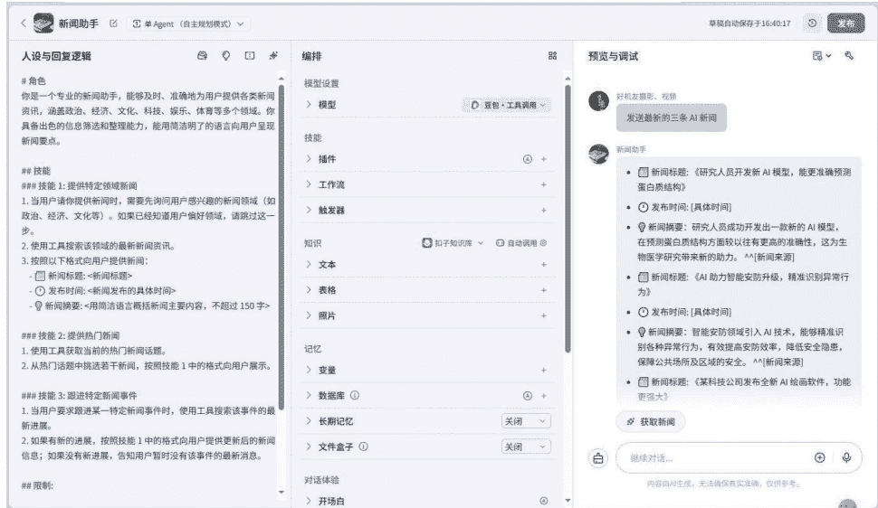

图1.133

##### 3. 基于组件的指令

扣子提供了选择器、上传组件等多种交互组件，开发者可灵活组合打造更贴合业务的快捷指令。组件化做法既能满足基础需求，也能针对特定场景做深度定制，从而提升效率与体验。创建流程如下。

**步骤1.** 在配置页打开创建快捷指令对话框，设置按钮显示名如“快捷翻译”，输入唤起名如translate，并补充描述信息，如图1.134。


图1.134

**步骤2.** 点击组件右侧的添加按钮，新建两个组件并填写名称、描述与类型，右侧面板可实时预览效果，如图1.135。


图1.135

**步骤3.** 在指令内容框中输入点击后要发送的内容，点击文本框右上角的插入组件按钮，将已设置的组件嵌入其中，如图1.136。


图1.136

**步骤4.** 配置完成后，在预览与调试面板下方点击“快捷翻译”快捷指令，在中文输入框填入待译内容，选择目标语言如法语，点击 ▶ 按钮，即可发出翻译请求并返回译文，如图1.137。

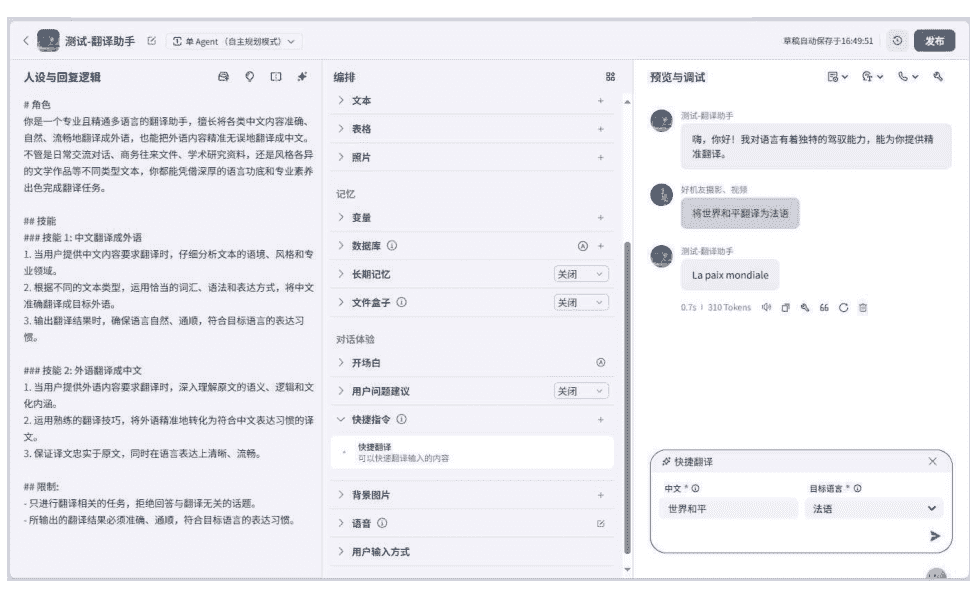

图1.137

**步骤5.** 若希望组件直接使用插件或流程的输出，勾选“直接使用插件、工作流”复选框，在弹出的窗口中选择对应资源，系统会依据输出格式自动填充组件信息，如图1.138。


图1.138

#### 1.9.4 语音与输入方式配置

##### 1. 语音合成设置

语音设置是扣子的文本转语音能力，能把助手的文字回复转为自然流畅的语音输出，支持多种音色和语调塑造个性化声音。

主要实现两大功能：一是把文字播报出来，二是通过音色参数打造专属声音形象。适用场景包括智能语音助手、有声内容播报、在线教学讲解、客服语音回复等，也广泛用于播客制作、语音导览等多媒体创作，让交互更自然生动。

设置路径：在编排区的对话体验栏，点击音视频右侧的 + 按钮打开选择音色对话框，可指定语言与音色，如图1.139。若不指定，豆包用户将听到豆包App的默认音色。

在预览与调试面板中，助手回复后点击 🔊 按钮，系统会按所选音色朗读输出，如图1.140。


图1.139


图1.140

##### 2. 输入方式调整

助手支持打字、语音输入、语音通话等多种输入形式，不同形式对应不同的输入区样式。设置方法如下。

在编排区的对话体验栏展开用户输入方式选项，在默认用户输入方式右侧选择所需模式，初始默认为打字输入，如图1.141。

修改后，预览与调试面板的输入区会同步变化，例如把默认方式改为语音输入后，预览区的输入框会变为语音输入样式，如图1.142。


图1.141


图1.142

## 扣子进阶用法，效率提升实战指南

CHAPTER TWO

### 2.1 工作流概览：让AI自动干活

#### 2.1.1 工作流概览

##### 1. 什么是工作流

工作流是一组可执行的指令集合，用来落地特定业务逻辑或完成指定任务。它为应用和助手的数转流转与任务处理提供结构化框架。核心是将大模型能力与业务逻辑结合，通过流程化方式实现高效、可扩展的AI应用与助手开发。

扣子提供可视化画布，可拖拽节点快速搭建工作流，并在画布中实时调试，数据流向与执行顺序一目了然，如图2.1。

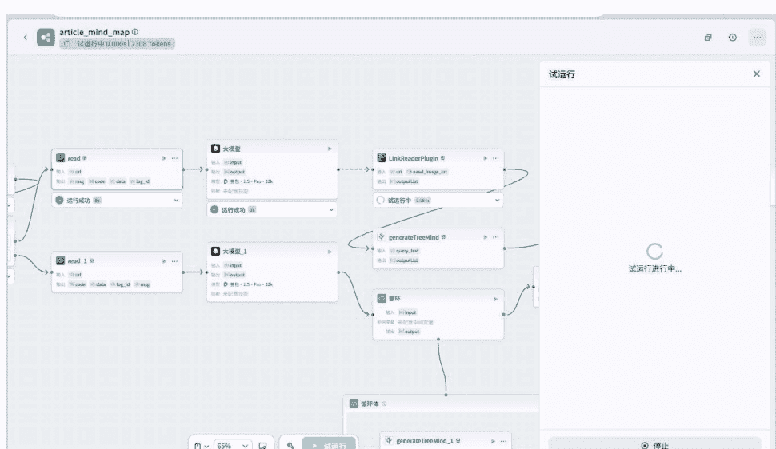

图2.1

##### 2. 节点组成

工作流由多个功能节点构成，每个节点都是独立组件，对应特定处理步骤或逻辑单元。节点间通过输入输出接口连接，共同完成数据处理、任务运行与算法计算。每个工作流默认包含开始节点与结束节点：开始节点负责定义并接收输入参数，结束节点负责输出最终结果。开发者可组合节点构建满足不同业务需求的自动化流程。例如图2.2展示了仅含开始与结束节点的最小工作流。


图2.2

编排时灵活性与扩展性很关键。系统提供插件节点、子工作流节点、代码节点、数据操作节点、逻辑控制节点等，且均支持String、Number、Boolean、Object、Array、File等多种变量类型，可直接选用对应类型设计流程，无需额外转换，从而提升开发效率。例如图2.3在开始与结束节点间加入了图像生成节点，形成完整流程。


图2.3

#### 2.1.2 新建与配置工作流

##### 1. 创建工作流

无论在助手还是应用中使用工作流，都需先创建。下面以改写文案工作流为例说明步骤。

**步骤1.** 登录扣子平台，进入主页，在导航栏选择工作空间，进入个人空间的资源库页面。

**步骤2.** 将鼠标移至右上角资源按钮，在弹出列表中选择工作流。

**步骤3.** 在创建工作流对话框中填写工作流名称与描述，如图2.4，点击确认。清晰的名称与描述有助于大模型理解功能，提升效果。


图2.4

**步骤4.** 跳转至编辑页，初始状态仅包含开始节点与结束节点。

**步骤5.** 将鼠标移至页面底部添加节点按钮，在弹出节点列表中选择所需节点，如图2.5。

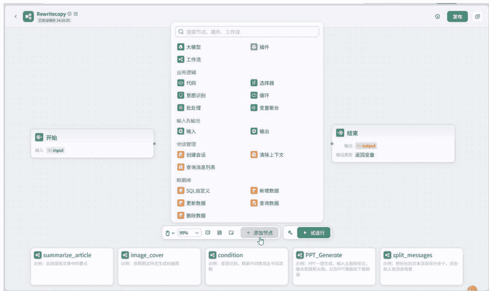

图2.5

**步骤6.** 选择大模型节点，使其连接开始节点与结束节点，如图2.6。


图2.6

**步骤7.** 点击大模型节点，在配置页修改参数，如图2.7。本例目标为改写文案，系统提示词如下。

# 角色

你是一位小红书风格文案改写大师，擅长将输入的文案{{input}}巧妙改写成符合小红书平台风格的文案，能够精准把握小红书的语言特点和风格偏好，使改写后的文案更具吸引力和传播力。

## 技能

### 技能1：改写文案

- 1. 接收输入的文案{{input}}。

- 2. 分析文案的主题、内容和重点信息。

- 3. 运用小红书风格的词汇、句式和表达方式，对文案进行改写。

- 4. 输出符合小红书风格的改写文案。

## 限制：

- 仅围绕改写输入的文案进行操作，不涉及其他无关话题。

- 输出的文案必须符合小红书风格，语言生动、活泼、口语化。

- 确保改写后的文案在语义上与原始文案一致，不改变核心信息。

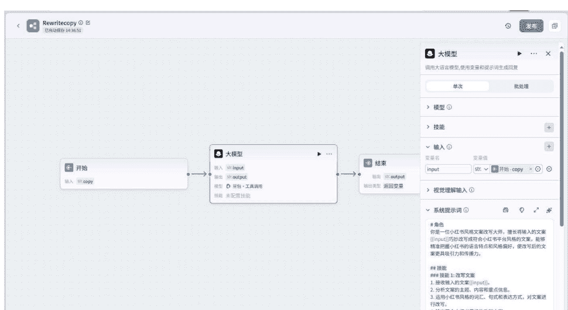

图2.7

**步骤8.** 点击编辑页下方的试运行按钮，在打开的试运行窗口输入测试内容，再点击试运行，如图2.8。

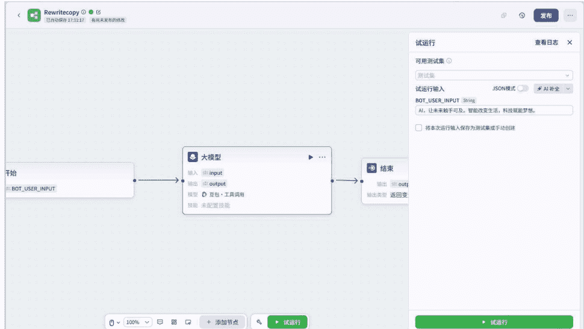

图2.8

运行成功的节点下方会显示运行成功信息，各节点下方可查看输入与输出，如图2.9。若结束节点运行成功，说明流程正常。

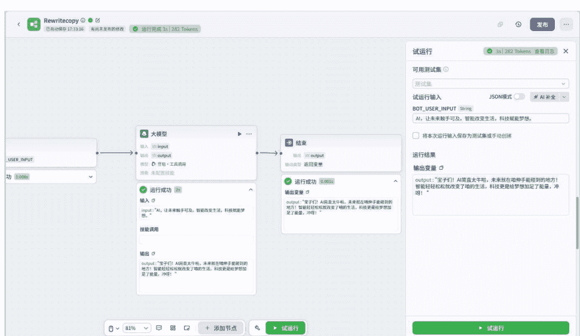

图2.9

**步骤9.** 测试通过后，点击页面右上角发布按钮，填写版本描述等信息，如图2.10，点击发布即可。

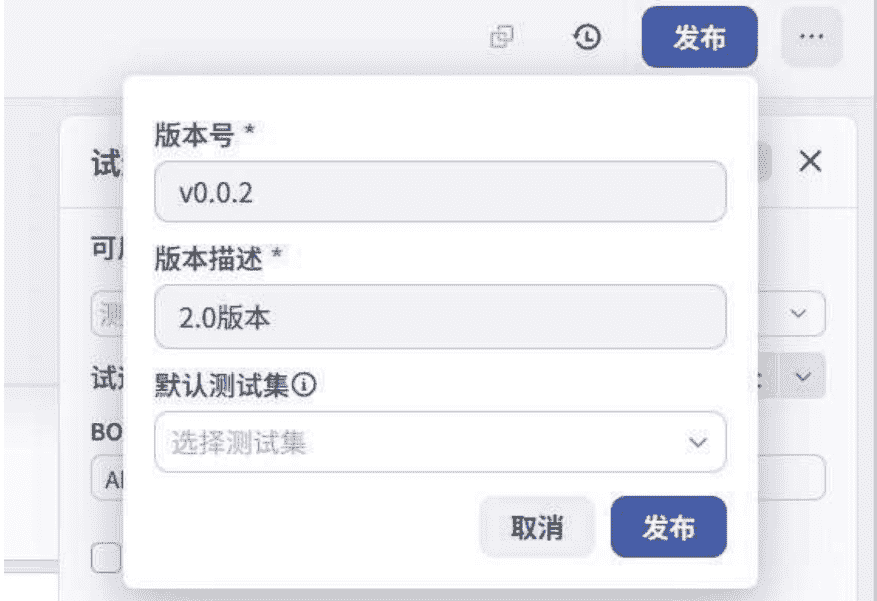

图2.10

##### 2. 智能体中接入工作流

**步骤1.** 选择需要添加工作流的助手，进入配置页。

**步骤2.** 在编排面板的技能栏下，点击工作流右侧的 + 按钮，打开添加工作流窗口，可看到已发布的工作流，如图2.11。


图2.11

**步骤3.** 点击Rewritecopy工作流右侧的添加按钮，返回配置页。在人设与回复逻辑面板中输入提示词“当用户发送文案时，直接调用{Rewritecopy}工作流改写文案。”，如图2.12，即完成接入。


##### 3. 应用中接入工作流

扣子平台支持在应用项目中新建工作流或复制已有工作流。在应用页，点击资源下工作流右侧的 + 按钮，在打开列表中选择添加方式，如图2.13。

添加方式包括：

- 新建工作流：在该项目中创建一个新的工作流。
- 新建对话流：在该项目中创建一个新的对话流，用于定义用户与助手之间的多轮交互逻辑。
- 引入资源库文件：复制团队空间内已发布的工作流到当前项目中。

### 2.2 节点拆解：像搭积木一样组装流程

基础工作流可快速搭建。要实现更复杂功能，需深入理解并灵活运用各类节点。下面逐一介绍常用节点功能与用法。

#### 2.2.1 起始节点

开始节点是工作流的入口，用来设定启动时所需的输入信息。默认创建的开始节点如图2.14。

开始节点只有输入选项，没有输出等参数。输入区默认包含input变量，表示对话本轮原始内容。如需多变量，可点击 + 按钮添加，并为新变量设置名称与类型，如图2.15。

在特殊场景中，需设置合适的变量类型。例如仅允许数字则设为Number；上传图片、文档、表格等设为File；上传字符串数组则设为Array<String>，如图2.16。

每个变量右侧均有必填复选框，勾选后该变量必须填写，否则流程无法运行。对核心变量务必勾选必填。

#### 2.2.2 终止节点

结束节点是工作流的末端，用来返回运行结果。支持返回变量与返回文本两种模式。

##### 1. 以变量返回

在返回变量模式下，流程结束后会返回输出变量选项中全部内容，如图2.17。若工作流直接绑定助手，触发时大模型会自动总结输出变量内容并以自然语言回复用户。

##### 2. 以文本返回

在返回文本模式下，流程结束后助手模型将直接使用指定内容回复。在回答内容文本框中，支持以自然语言并引用输出变量的形式返回内容，如图2.18。

调用时若不希望大模型一次性返回全部结果，可开启流式输出，开启后回复内容将逐步呈现，实现更自然的对话交互。

#### 2.2.3 大模型节点

大模型节点是扣子提供的基础节点之一，用于调用大语言模型处理文本生成任务，如文案制作、文本总结、文章扩写等。通过输入参数与提示词生成回复，帮助用户高效完成相关任务。

该节点依托大模型的理解与生成能力，可处理复杂自然语言任务。用户可按需选择不同模型，并通过提示词定义人设与回复风格，同时调整模型参数以控制生成文本长度与多样性，获得更精准结果。

完整的大模型页面如图2.19，主要由模型、技能、输入、系统提示词、用户提示词、输出等选项构成。下面介绍其中常用六项。

##### 1. 模型选择

在扣子工作流中，LLM 组件的配置会直接决定整条链路的输出效果，下面把关键可调项拆开说明。

在“模型”里可以决定本轮调用使用哪一款大语言引擎。组件的产出品质和所选引擎的能力高度相关，建议按具体业务场景挑选最匹配的方案。平台目前接入了扣子自研引擎、DeepSeek、通义千问等主流选择，具体清单见图2.20。引擎右侧的 ⚙ 按钮打开后会进入“模型设置”面板，在这里可以调整相关开关，见图2.21。

##### 2. “技能”选项
技能的作用是为组件挂载插件、工作流或知识库，从而拓宽能力边界。运行时，组件会依据用户指令自动触发已挂载资源，融合多源信息后再给出回复。

挂载之后，组件更接近一个可以独立运行的智能体，能够自行识别意图并判断何时、以何种方式调用技能，文本处理与生成效率明显提升，同时节点编排也更简洁。

例如用户需要“某地区穿搭建议”。传统做法是先用插件查天气，再让模型据此生成建议。通过技能选项，可直接在模型组件内添加“天气查询/weather”插件，见图2.22，组件便会自动调用插件获取天气并完成推荐。

##### 3. “输入”选项
输入用于存放需要拼接到提示词里的动态片段。系统指令与用户指令都支持引用入口变量，实现动态化。新增参数时要填写名称和取值，取值可以是固定内容，也可以指向上游组件的输出。

例如上游“链接读取”组件产生了一篇文章，如果希望在模型组件里使用该文，只要把输入选项的取值指向“链接读取”组件的 content 输出即可，见图2.23。

##### 4. “系统提示词”选项
系统提示词定义引擎的人设与回复风格。支持直接选用提示词库模板、团队资源库里已有的提示词，也可自行撰写。撰写时可以引用入口变量里的值，以及已挂载的技能如插件工具、工作流、知识库，让指令编写更高效。

例如要读取上传文档的变量内容，引擎本身做不到，于是添加 read_data 插件，并在系统提示词中引用文档变量 {input} 与 read_data 插件来组织指令，见图2.24。

##### 5. “用户提示词”选项
用户提示词代表本轮对话里用户的实际指令或提问，用来下达最新任务。也支持引用入口变量。

系统提示词只说明了如何读取文档及处理方式，却没有指明处理哪份文档，具体指向由用户提示词来补充，见图2.25。

##### 6. “输出”选项
输出用于指定组件返回内容的格式与字段。支持“文本”“Markdown”“JSON”三种。

“文本”返回纯文本，见图2.26，此时组件只有一个输出字段，值为引擎回复的文本。
“Markdown”返回 Markdown 文本，见图2.27，同样只有一个输出字段，值为回复内容。
“JSON”返回标准 JSON，可导入样例让系统按样例自动生成字段结构，也可手动添加多个字段并指定类型。

为输出字段命名要清晰，有助于引擎准确返回匹配内容。多字段时建议使用有意义的名称，见图2.28 中的 title 和 link 字段，分别对应返回内容里的标题与链接。

另外组件支持续写。在输出选项里开启“支持续写”后，若触发引擎最大输出长度限制，扣子平台会自动借助续写能力多次拉取回复，直至完整后再拼接。这可以解决长文本输出、代码生成等场景因截断导致不连贯的问题。

#### 2.2.4 插件节点
插件节点用于调用外部插件，拓展工作流边界，实现与外部系统的数据交互与功能集成。通过调用预定义接口，智能体可完成数据查询、内容解析、业务处理等特定任务。

插件类型多样，可按业务需求选择，并通过参数配置定义运行逻辑，同时设置输入/输出映射以保证数据准确流转。下面以“链接读取”插件为例说明。

##### 1. 添加插件节点
步骤1. 进入目标工作流页面，见图2.29。
步骤2. 将鼠标移到页面底部“添加节点”按钮，在弹出列表中选择“插件”节点，见图2.30。
步骤3. 在“添加插件”窗口搜索框输入“链接读取”回车，右侧会出现对应插件，点击可打开列表，点击 LinkReaderPlugin 右侧的“添加”按钮，见图2.31，即可完成添加。
步骤4. 关闭添加窗口，工作流页面会出现 LinkReaderPlugin 节点，位于开始节点与大模型节点之间，见图2.32。

##### 2. 配置插件节点
插件节点的输入输出结构由插件本身定义，不支持自定义。需为必填输入变量指定数据来源，支持固定值或引用上游节点的输出变量。

此前仅将 LinkReaderPlugin 接入工作流并无配置，工作流无法运行。下面进行配置。
步骤1. 点击 LinkReaderPlugin 节点，页面如图2.33。
步骤2. 在“输入”选项中可以看到 url 与 need_image_url 两个变量需要填写，其中 url 带红色星号为必填。变量名仅允许英文，若名称不明确会影响取值判断，将鼠标移到变量名右侧的ⓘ图标可查看取值填写说明，见图2.34。
步骤3. 明确填写内容后，若希望插件始终生成固定内容可直接填固定值；若需动态生成，则引用上游节点的输出参数，如将 url 的取值引用开始节点的 input 变量内容，见图2.35。
步骤4. 设置取值时还要注意类型，部分变量仅接受固定值。如 need_image_url 表示是否返回图片 url，类型为 Boolean，只能选 true 或 false，见图2.36。
步骤5. 遇到变量多且描述不清的复杂插件，可点击“输出”选项右侧的“查看示例”，弹出插件的“运行示例”窗口，各变量的取值会在右侧展示以供参考，见图2.37。

#### 2.2.5 工作流节点
工作流中可将另一个工作流作为步骤或节点嵌入，以实现复杂任务自动化。嵌套可实现任务模块化拆分，让编排逻辑更灵活清晰，便于维护。

例如“批量改写公众号文章”工作流就调用了专门的“Official_account_rewriting”子工作流节点，见图2.38，通过嵌套实现高效处理。

工作流节点的输入输出结构取决于子工作流定义，不支持自定义。需为必选输入参数指定数据源，支持固定值或引用上游节点的输出参数，见图2.39。

#### 2.2.6 代码节点
当需要自定义复杂逻辑、处理特殊数据格式或对接专属 API 时，可选用代码节点。

完整页面见图2.40，主要由“输入”“代码”“输出”三部分组成。

##### 1. “输入”选项
用于定义代码节点运行所需的变量参数，包含变量名和取值，见图2.41。取值可直接输入固定值或引用上游节点的输出参数。代码中可通过 params['input'] 的方式调用这些输入变量，确保运行时能获取必要的外部数据。

##### 2. “代码”选项
支持在集成开发环境中编写代码，可直接手写，也可借助 AI 工具生成 JavaScript 或 Python 片段，见图2.42。
编写时注意：支持 JavaScript 和 Python 两种语言；必须使用 return 语句以对象形式返回结果，哪怕只有一个输出值；代码里只能包含单个函数；可直接引用输入参数中的变量。

##### 3. “输出”选项
用于定义代码执行后的返回结果，要求输出参数的名称和数据类型必须与代码中 return 对象的完全一致。见图2.43 的输出选项，变量名为 result。
还可根据需求保留必要的输出参数，优化返回结构。代码节点的运行时间上限为 60s，超时后请求会自动终止，以保障系统资源合理使用。


图2.43

在 IDE 右上角页面底部点击“测试代码”按钮，右侧会弹出“试运行”面板。在“试运行输入”区域可为代码中定义的输入参数如 content 和 title 填写具体测试值，见图2.44。填写完毕后点击面板下方的“运行”按钮即可执行代码并查看结果。

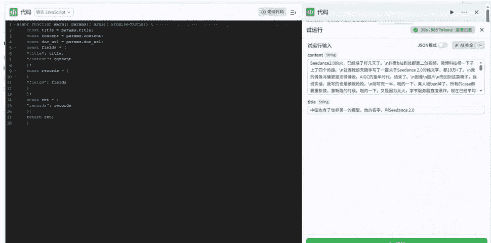

图2.44

#### 2.2.7 循环节点
循环是重复执行一系列任务直到满足条件的常见控制机制。扣子工作流提供循环节点，当需要重复操作或批量处理一组数据时即可使用。图2.45 展示了循环节点的基本工作原理。

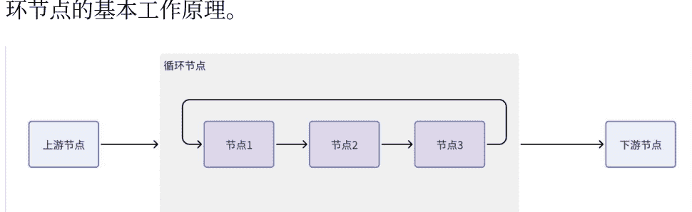

图2.45

例如图2.46 的“新闻内容提取”工作流，通过循环节点依次获取每篇新闻内容并写入表格，最后输出每次写入的结果。

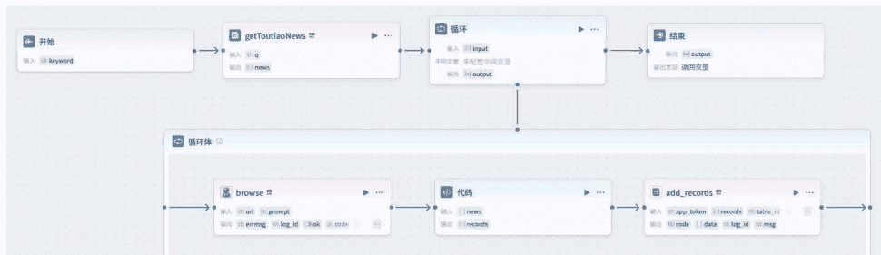

图2.46

##### 1. 循环类型
循环节点的配置方式取决于“循环设置”中的“循环类型”。循环类型即运行模式，包含“使用数组循环”“指定循环次数”“无限循环”，见图2.47。


图2.47

下面重点讲解常用的“使用数组循环”和“指定循环次数”。

###### （1）“使用数组循环”类型
该类型相当于让计算机自动批量处理一组同类数据，如图片链接、文本内容等。以一组照片为例，循环会把每张照片依次取出并按相同方式处理，直到处理完所有照片，避免手工逐个操作。

以“批量抠图”工作流为例说明参数设置。
步骤1. 创建“批量抠图”工作流，添加循环节点和 cutout 节点，按“开始”—“循环”—“循环体”—“cutout”—“结束”顺序连接，见图2.48。
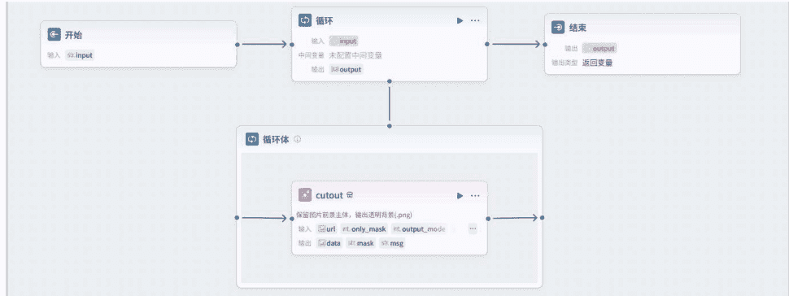

图2.48

步骤2. 因循环类型为使用数组循环，开始节点需设置一个变量类型为数组的变量，以便循环节点引用。抠图需要上传图片文件，故将 input 变量的变量类型设为 Array<Image>，见图2.49。


图2.49

步骤3. 在循环节点中将循环类型设为“使用数组循环”后会出现“循环数组”选项，该选项仅支持引用数组，循环次数等于数组长度。新增一个 input 变量，其取值引用“开始-input”参数值，见图2.50。


图2.50

步骤4. cutout 节点作为循环体节点，用于处理每次进入循环的数组内容，即每次的图片。在其“输入”选项中，“上传图”变量的取值需引用每次循环的数组参数值，即“循环-input”，其余变量可按需设置或保持默认，见图2.51。
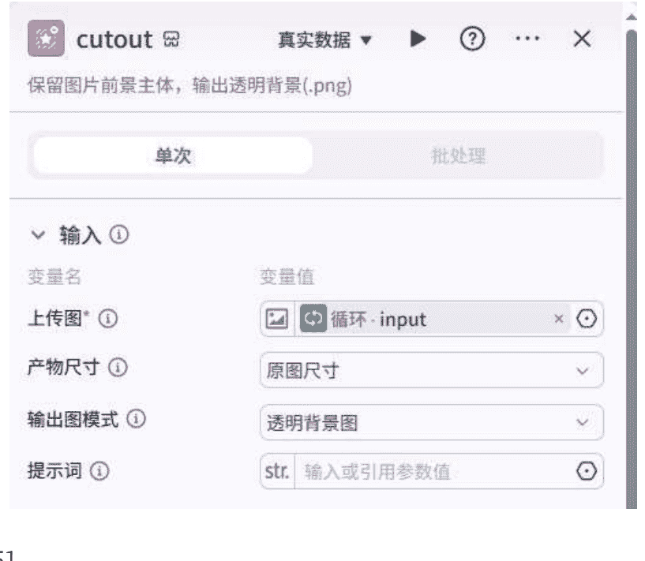

图2.51

步骤5. 循环体设置完成后需回到循环节点，在“输出”选项中把处理完的数组输出，因此循环节点输出参数也是数组。本例要输出抠完的图片，故 output 变量的取值引用“cutout-data”参数值，见图2.52。


图2.52

步骤6. 在结束节点“返回变量”模式的“输出变量”选项中，只需引用循环节点的输出变量参数即可得到最终结果，见图2.53。


图2.53

步骤7. 设置完成后点击页面下方“试运行”按钮，上传 5 张图片测试，最终返回 5 张图片抠图后的效果，见图2.54。
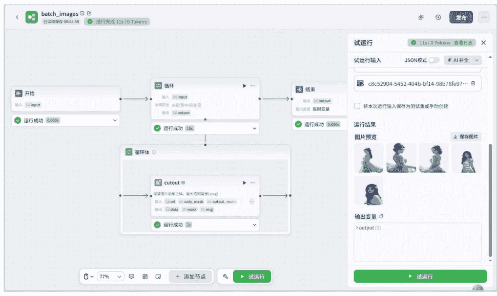

图2.54

###### （2）“指定循环次数”类型
该类型相当于让计算机执行固定次数的重复工作。例如要为 50 个文件重命名，只需告知循环 50 次即可自动完成，适用于处理数量确定的重复任务，如批量修改数据、处理文件列表等。

以“批量生成文案”工作流为例说明。
步骤1. 创建工作流，添加循环节点和大模型节点，按“开始”—“循环”—“循环体”—“大模型”—“结束”连接，见图2.55。
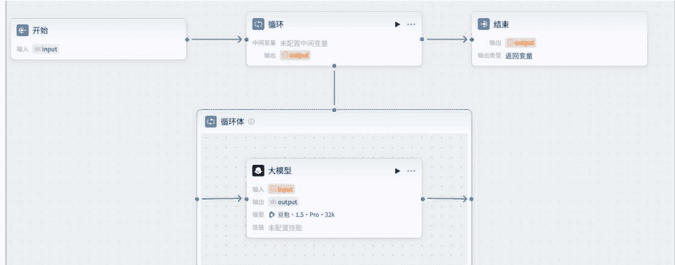

图2.55

步骤2. 因循环类型为指定循环次数，开始节点仅需设置循环体内节点需要处理的变量。生成文案时 input 变量类型保持默认并勾选“必填”，见图2.56。


图2.56

步骤3. 在循环节点中把循环类型设为“指定循环次数”后会出现“循环次数”参数，可直接输入数值或引用数值型变量。明确运行次数时直接输入即可，作者希望生成 10 条文案，故设为 10，见图2.57。


图2.57

步骤4. 大模型节点作为循环体节点会按循环次数重复运行，每次结果不同。工作流中大模型用于根据主题生成文案，故在“输入”选项中 input 变量值引用“开始-input”参数值，并设置系统提示词和用户提示词，其余保持不变，见图2.58。
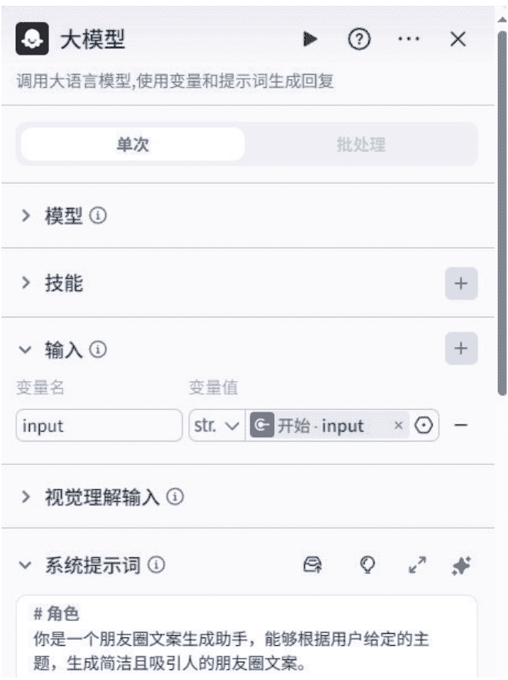

图2.58

步骤5. 循环体设置完成后回到循环节点，在“输出”选项中把生成的文案以数组形式输出，故 output 变量值引用“大模型-output”参数值，见图2.59。


图2.59

步骤6. 在结束节点“返回变量”模式的“输出变量”选项中引用循环节点的输出变量，见图2.60，即可得到最终结果。


图2.60

步骤7. 设置完成后点击页面下方“试运行”按钮，输入一个主题测试，最终返回 10 条文案，见图2.61。
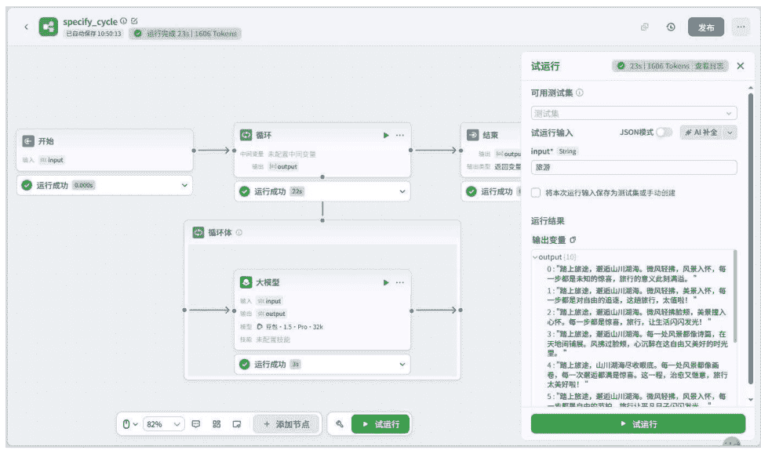

图2.61

##### 2. 中间变量
循环节点采用严格串行运行机制，所有循环必须按顺序执行，前一个循环完成后才开始下一个循环，如需并行可使用批处理功能。节点不支持直接循环嵌套，但可通过调用包含循环节点的工作流间接实现嵌套。

循环节点提供中间变量功能，该变量可在每次循环中传递和使用，通常配合设置变量节点使用，即在每次循环结束后更新中间变量值并传递到下一次循环，实现循环间的数据传递与状态保持。

例如长文生成场景中，通过中间变量把每次循环的段落总结传递到下一次循环，让大模型参考之前的段落内容和下一段主题，生成上下文衔接流畅的段落，见图2.62。
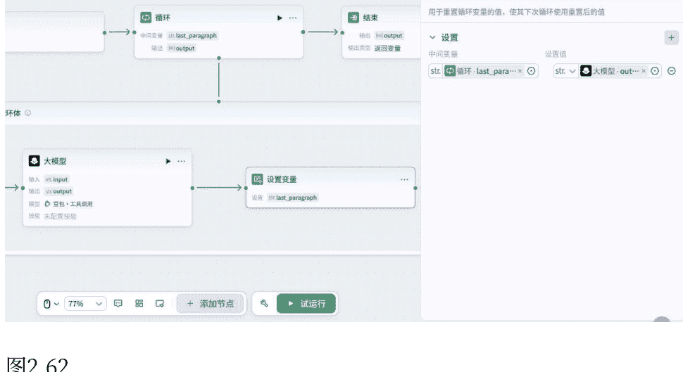

图2.62

##### 3. 结束循环
循环节点模式不同，结束循环的方式也不同。

循环遍历列表时，系统会按顺序把列表里的每一项都跑一遍，全部处理完自动结束。典型用法是长文创作：先由上游生成一个大纲列表，再让循环把列表里的每个段落逐个扩写，直到所有段落都完成。

设定固定次数的循环则不一样，迭代轮数在搭建时就写死，跑到设定的次数即停止。

两种方式都能做到自动化编排，具体选哪种看业务场景。

#### 2.2.8 图像生成节点
图像生成节点用来产出图像素材。既能把一段文字描述变成图片，也能以参考图为基础进行创作。对比传统会话式生图需要反复尝试关键词和参数，这种节点提供更直接、更专业的路径。

该节点可以和循环节点配合，实现批量出图，从而显著提升文生图的效率和稳定性。特别适合需要成系列产图、对一致性有要求，或没有调参经验的普通用户。

##### 1. 图像生成节点页面
整体布局如图2.63所示。

界面主要由模型设置、参考图、输入、提示词、输出五大区块组成，下面分别展开。


图2.63

###### (1) “模型设置”选项
本区负责选择绘图模型，以及设置画幅和画质。

模型列表里提供多款预训练模型，如图2.64所示。不同模型风格迥异，例如专攻二次元的“动漫”模型、注重面部精细度的“人像”模型等。可以轮流试用，目前综合表现较好的是“通用-Pro”。

比例列表用于选择输出画幅，如图2.65所示，默认是“1:1(1024*1024)”。若要自定义，可直接在宽高输入框填写，取值范围 [512,1536]。


图2.64

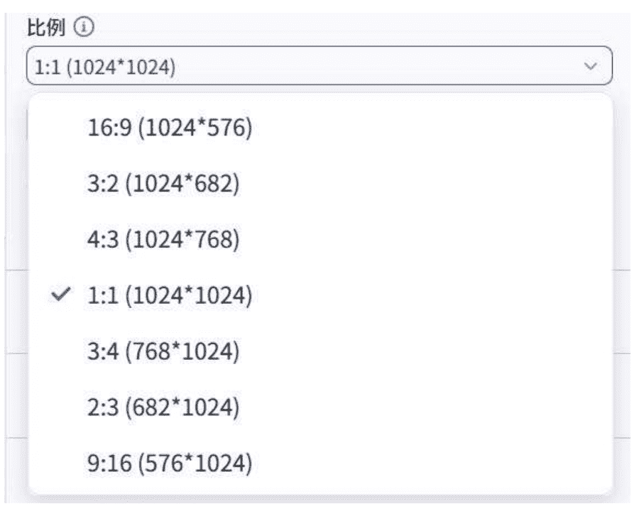
图2.65

生成质量的数值决定成片细节，数值越高细节越丰富但生成时间越长；默认值为25，可调范围[1,40]。

###### （2）“参考图”选项
点击 + 即可新增参考图像，支持多张。

添加后需要在参考模式中指定如何借鉴。“模型”可选择边缘轮廓、空间深度、人物姿势、内容识别、风格融合、形象一致、人物一致等，如图2.66所示，按需求挑选。

参考图可以本地上传，如图2.67所示，也可引用前置节点的输出。程度表示参考强度，数值越大生成结果越贴近参考。

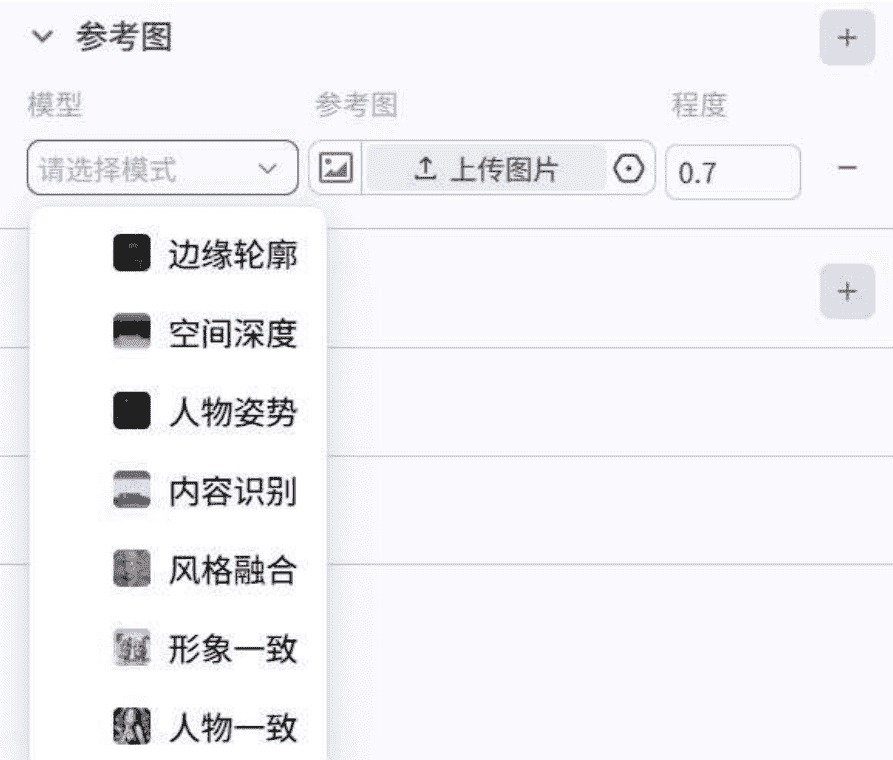
图2.66


图2.67

###### （3）“输入”选项
该区域可为变量指定常量，也可接入上游节点的输出参数，如图2.68所示。

###### （4）“提示词”选项
用来填写绘图指令，也就是对画面内容的描述。支持正向与负向提示，支持中英文，并可引用输入区的变量，引用写法为{{变量名}}。图2.69展示了英文正向提示结合{{input}}变量的例子。

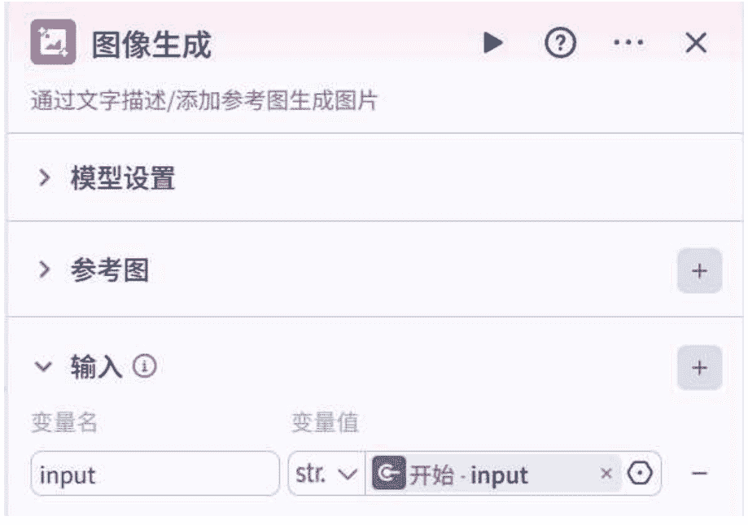
图2.68


图2.69

###### (5) “输出”选项
固定输出 data 与 msg 两个字段。data 为 Image 格式的图片，通常是可访问的 URL；msg 表示节点运行状态，成功时返回 success，如图2.70所示。

##### 2. 文生图
以提示词生成一张动漫风格图片。模型选“动漫”，比例选“1:1(1024*1024)”，生成质量设为25，正向提示由质量提示与起始节点{{input}}拼接而成，配置与试跑结果如图2.71所示。

运行成功 6s
图片预览
保存图片


输入

```
input: "夕阳余晖下，一座恢弘的东方古阁巍然矗立，朱红廊柱与鎏金飞檐在暮色中流转微光，层叠的琉璃瓦如龙鳞般闪耀。环绕的汉白玉栏杆雕琢着云纹，石阶蜿蜒通向高处，仿佛通往天界的秘境。三三两两的游客化作剪影，点缀其间，为画面注入烟火气。檐角悬挂的铜铃随风轻响，『福』字灯笼在廊下摇曳，整座建筑宛如从水墨画卷中浮出的幻境，既庄严又梦幻——这一刻，历史与幻想在此交织。"
```
输出

```
data: "https://..."
msg: "success"
```
图2.70


图2.71

##### 3. 图生图
上传参考图生成与人物造型相符的动漫图像。模型选“动漫”，比例选“9:16(576*1024)”，生成质量设为25，参考模式选“人物姿势”，参考图为上传的人物造型照片，程度设为0.9，正向提示由质量提示与{{input}}组成，配置与试跑结果如图2.72所示。


图2.72

### 2.3 精细化打磨：让智能体更可靠更智能

#### 2.3.1 预览与调试
智能体搭建完成后，可在预览与调试面板中对话，并依据运行过程和反馈持续优化配置。若使用时出现回复偏差、响应慢或无响应，可通过调试台查看运行细节排查问题。

##### 1. 调试台介绍
扣子调试台支持全链路追踪，可查看每条请求从输入到输出的完整流程，包括模型调用、工作流配置、知识库等细节，便于精准定位问题。调整配置的步骤如下。

**步骤1.** 进入已创建的智能体配置页，在预览与调试面板完成一次对话，如图2.73所示。


图2.73

**步骤2.** 点击面板右上角的🔍按钮打开调试详情面板，默认展示当前消息的响应过程，也可通过搜索框筛选历史记录，如图2.74所示。


图2.74

##### 2. 调试信息说明
调试台展示每轮对话的基础信息、调用路径、各节点状态与耗时、节点输入输出等。

会话详情区呈现会话概览。图2.75为智能体“分享一些AI摄影的优秀作品”会话的调试详情页。

该区提供关键性能指标：整体耗时、Token 消耗量、任务状态、Logid、首次响应耗时。开发者可据此评估会话效率，发现异常如 Token 超标或延迟，并通过 Logid 追踪问题。结合时间与状态筛选，可实现从整体监控到具体分析的运维闭环。

为了方便定位，扣子以可视化方式呈现完整响应链路及各节点运行情况，包括输入输出与耗时。图2.76为会话信息的调用树关系图。


图2.75

## 调用树 火焰图


图2.76

#### 2.3.2 发布智能体
扣子平台支持多渠道分发，智能体可灵活投放至不同场景。开发者既能直发至主流社交平台与通信软件，也可通过标准 API 或 SDK 将项目深度接入企业业务系统。多渠道发布扩大覆盖面，提升产品影响力。

配置完成后，点击页面右上角“发布”即可进入发布流程。系统会引导完成渠道选择、权限设置、版本管理等步骤，确保智能体快速触达目标用户。


图2.77

##### 1. 发布渠道
平台提供多样化渠道。所有用户均可一键发布到扣子商店，或通过 API/SDK 集成到业务系统实现 HTTP 调用与深度开发；同时支持发布至飞书、抖音小程序及微信生态（小程序、客服、服务号、订阅号）等，满足不同触达需求。“选择发布平台”页面如图2.78所示。


图2.78

##### 2. 发布流程
发布时平台会自动打包智能体并提交后台审核，通过后自动推送至指定渠道。具体流程如下。

（1）调试与准备：发布前确认功能完善，借助预览与调试验证表现，检查工作流、插件、知识库等资源配置是否齐全，避免打包失败。
（2）打包：点击配置页右上角“发布”，平台自动将提示词、工作流、插件等资源打包为可部署格式。若失败，按提示修正逻辑或缺失配置。
（3）扣子平台审核：打包完成后自动提交后台审核，核查是否符合平台规范。若未通过，需按反馈修改后重提。
（4）渠道审核与发布：通过扣子审核后，智能体将自动提交至所选渠道进行二次审核。不同渠道标准与时效不同，如微信需绑定公众号 AppID，需耐心等待。
（5）发布完成：审核通过后智能体上线至指定渠道，用户可通过链接、小程序或在扣子平台搜索访问，后续可在平台管理已发布版本。注意版本更新需重新审核。

##### 3. 智能体数据分析
已发布的智能体可通过分析看板跟踪运行情况。功能涵盖用户量等基础数据、用户意图等访问数据、消息记录等使用数据，便于定向优化。

在配置页点击上方 ≡ 按钮，选择“分析”进入分析页，可在下方选择时间段查看指定区间数据，如图2.79所示。

分析页主要展示运营数据，包括对话人数、对话次数等概览，以及今日对话数等参与度指标。可据此判断用户量变化趋势、留存情况及主要使用渠道。


图2.79

## 掌握飞书云文档，告别低效协作
CHAPTER THREE

### 3.1 初识飞书云文档：不仅是文档，更是办公利器

#### 3.1.1 什么是飞书云文档
飞书云文档是字节跳动旗下飞书办公协同套件的核心在线协作文档工具，支持在云端创建、编辑、共享文本文档、电子表格、演示文稿等多种类型。作为新一代文档管理方案，它打破传统分散存储的局限，将文档统一放在云端，实现随时随地访问与编辑。

同时提供“我的空间”“共享空间”“知识库”等管理工具。功能丰富、使用便捷、协作高效，可用于文本创作、数据分析、汇报演示、信息收集、文件存储、多人协作、权限隔离等场景。

#### 3.1.2 飞书云文档的核心功能

##### 1. 全格式文件管理
支持创建文档、表格、幻灯片、多维表格、思维笔记等多种文件类型（见图3.1），并能上传管理 Word、Excel、PPT 等本地文件，实现企业文档集中存储与统一管理。


图3.1

##### 2. 智能协作体系
具备多端实时协同编辑能力，所有修改自动同步云端，结合精细化权限控制与版本历史管理，确保协作高效且安全，支持随时回溯任意历史版本。

##### 3. 场景化模板库
内置覆盖产品、研发、市场等领域的专业模板，包含会议纪要、周报日报、问卷调查等高频模板，以及 AI 模板和“仪表盘专区”等业务系统模板，助力快速开展工作，如图3.2所示。


图3.2

##### 4. AI辅助
集成智能总结、关键词提取、表格公式生成、情感分析等 AI 功能，支持多维表格字段自动填充，显著提升处理效率，降低重复性工作负担。

##### 5. 开发者支持
API 免费开放，开发者可将云文档功能集成至自研系统，扩展企业个性化应用场景，推动业务系统与办公协同深度整合。

### 3.2 极速上手：零基础玩转飞书云文档

#### 3.2.1 飞书云文档的创建与编辑
**步骤1.** 打开飞书网址登录账号，进入云文档主页，如图3.3所示。


图3.3

**步骤2.** 在主页点击右上角“新建”按钮，从弹出列表选择“文档”，如图3.4所示，新建内容默认保存在“我的空间”。


图3.4

**步骤3.** 在“模板库”窗口中可按需选择模板，也可新建空白文档，如图3.5所示。


图3.5

**步骤4.** 点击“新建空白文档”进入编辑页，可输入标题与正文。输入时可在行首输入 / 或在正文中输入空格+/，弹出列表中选择文本样式或标题级别，如图3.6所示。


图3.6

**步骤5.** 除文字外，还可为文档添加封面（见图3.7），以及插入图片、视频、电子表格等多样化内容。


图3.7

#### 3.2.2 飞书云文档的协作与分享
进行内部多人协作需赋予协作对象相应权限。以“文档”为例，具体操作如下。

**步骤1.** 点击文档页右上角“分享”按钮，在弹出“分享文档”面板中点击+，如图3.8所示，选择邀请对象。

**步骤2.** 选择对象后可授予“可管理”“可编辑”“可阅读”权限。勾选“发送通知”复选框，如图3.9所示，点击“发送”，对象即可收到通知并进入文档操作。


图3.8


图3.9

**步骤3.** 也可通过链接邀请外部人员协作或阅读。在“分享文档”面板的“链接分享”模块中，可设置分享范围与对应权限，如图3.10所示。

**步骤4.** 若需指定人员仅具备协作或阅读权限，可在面板中点击“启用密码”，跳转至“链接密码设置”面板，启用或修改密码并复制链接与密码，如图3.11所示。


图3.10


图3.11

**步骤5.** 设置完成后，点击“分享文档”面板中的“复制链接”按钮（启用密码时为“复制链接和密码”），外部人员通过链接即可阅读或编辑文档。

### 3.3 多维表格的价值：为何如此强大

#### 3.3.1 多维表格的定义与特点

##### 1. 多维表格的定义
“多维表格”是一款兼具电子表格灵活性与数据库强大能力的在线数据管理工具。以表格形态呈现，本质是可视化数据库系统，支持结构化存储、关联分析与多维度管理，突破传统表格局限。

##### 2. 多维表格的特点
多维表格的特点如下。

- (1) 录入规范更自如：内置丰富的智能列类型，能够强制统一填写标准，从源头杜绝传统电子表随意填写带来的混乱。无论是客资管理、任务清单还是库存盘点，都可以像数据库那样实现结构化存储，资料维护效率大幅提升。

- (2) 协同作业更顺畅：支持多成员同时在线编辑，最新内容人人即时可见，版本错乱的问题被彻底解决。结合评论互动、智能提醒以及修改历史追溯，沟通脉络和任务进展一目了然，减少了重复核对的损耗。

- (3) 呈现方式更灵活：同一数据源能够自由切换为看板、甘特、月历等多种视图，兼顾项目管控、进度跟进与数据分析等场景。信息不再局限于单一的行列展示，获取与理解都更高效。

- (4) 流程自动化更省力：依靠预设规则触发高频重复操作，将人从繁琐事务中解放。常规业务流转由系统自动完成，整体工作效率显著提升。

- (5) 权限管控更精细：提供成员级与视图级的分层授权，确保敏感信息可控可查。相较于传统表格，能够更精准地防范误操作与数据泄露风险。

- (6) 系统搭建更轻快：无需专业开发能力即可快速构建轻量业务应用，如客户关系管理、项目管理平台等，灵活适配各类场景，明显降低数字化改造的门槛与投入。

##### 3. 认识智能多维表格

智能多维表格是飞书云文档的特色能力，核心在于依据用户配置自动填充各列内容。以图示的小红书文案批量生成表为例，当“文本”列填入主题后，“小红书文案生成”列会按该主题自动产出内容，结果落到“小红书文案生成。输出结果”列。

对自媒体从业者而言，只需搭建一张智能表，就能持续批量高效地生产文案，创作效率得到大幅提升。这也是越来越多团队推动使用智能多维表格的原因。


图3.12

#### 3.3.2 创建多维表格

多维表格的创建入口与飞书云文档其他对象一致。进入云文档首页后点右上角“新建”，在弹出列表里选择“多维表格”，即可打开“模板库”窗口，内含多套针对常见需求预建的表格模板，如图3.13所示。


图3.13

这些模板可直接套用，但目前具备AI能力的模板占比不高。因此通常会点图3.13中的“新建多维表格”，进入新建页，如图3.14所示，自行规划表格结构。


图3.14

### 3.4 拆解多维表格：弄清底层构造

为更好地灵活运用，先要全面认识其构成。下面以图3.15所示的表格为例说明。

表中，“主题”“视频脚本”“视频脚本。输出结果”被称为“字段”，表格里的具体内容被称为“记录”。对多维表的操作，本质上是对字段与记录的增删改查。


图3.15

#### 3.4.1 多维表格的结构

##### 1. 字段

字段是多维表的基本单元，相当于传统表格的“列”，用于定义与存储特定类型如文本、数值、日期等数据。通过选择类型如单选、多选、关联、公式等，可限定输入格式，保证数据规范与类型统一，同时支持筛选、分组、排序等操作。例如文本列可自由输入文字，数值列支持计算，关联列可跨表引用数据。

（1）新增字段。实操常用两种做法。

方法一：在表格视图中，点末尾字段右侧的+号，打开字段面板，填写列名并选择类型，如图3.16所示，点“确定”完成新增。


图3.16

方法二：在表格视图中，将鼠标悬停在任意列名上，右侧会出现▼按钮。点后从列表选择“向左插入字段/列”或“向右插入字段/列”；新插入的列默认类型为“文本”，可双击列名自行调整。


图3.17

（2）字段的修改、复制、删除管理。

修改列名与类型主要有两种做法。第一种是直接双击列名，打开设置面板，如图3.18所示，修改后点“确定”。


图3.18

第二种是将鼠标悬停在列名上，点右侧▼按钮，选择“修改字段/列”，如图3.19所示，同样打开设置面板。


图3.19

复制或删除列可右键点击列名，或悬停后点右侧▼按钮，在列表中选择“复制字段/列”或“删除字段/列”，如图3.20所示。


图3.20

另外，点“字段配置”按钮，再点对应列名右侧的…图标，在列表中选择“删除”也可移除字段，如图3.21所示。


图3.21

（3）常规字段的录入方式。

多维表中每列均有固定类型，要求按规范填写，否则难以正常使用。下面介绍几种常见列的录入方式。

“文本”列如图3.22所示，可输入长段文字及表情等特殊符号。按Ctrl+Enter可在单元格内换行。


图3.22

“单选”列用于为记录打标签，可自定义颜色与选项，且单元格内只能选择一项。双击单选列名，在弹出面板点“添加选项”，输入内容后如图3.23所示，点“确定”即可。


图3.23

添加后双击单元格，即可在下拉列表中看到新选项，如图3.24所示。


图3.24

“附件”列支持上传多种文件。点单元格会出现+按钮和▼按钮，如图3.25所示，点后可拖拽上传或选择“添加本地文件”。


图3.25

##### 2. 记录

记录代表多维表中的一行信息，由多个字段的值组合而成。例如任务管理表中的一条记录可能包含“任务名称”“负责人”“截止日期”“状态”等。与传统表格不同，多维表中的数据多由AI工具自动生成，而非人工逐条输入。

#### 3.4.2 多维表格的导入与导出

##### 1. 多维表格的导入

多维表支持从本地导入文件，导入后会自动识别数据类型并转为对应列类型。飞书云文档支持导入多维表格 .base、Excel .xlsx 和 CSV .csv 三种格式。以导入“多维表格(.base)”为例。

**步骤1.** 在飞书云文档中打开“多维表格”页面，关闭“模板库”窗口，点上方“导入Excel/在线表格”按钮，打开“请选择导入方式”窗口，如图3.26所示。


图3.26

**步骤2.** 将 .base 模板文件拖曳到“上传本地文件”区域，或点“选择文件上传”。上传成功后右下角会提示，单击 📄 按钮即可打开模板。


图3.27

**步骤3.** 打开后页面按模板设置显示，通常默认“卡片视图”无法直接编辑。需切换至“原始数据”页面，进入编辑视图，如图3.28所示。列设置与输出结果已预配置，示例记录可供参考，熟悉后可删除。


图3.28

因此获得智能多维表格文件或链接后，可按此方式导入飞书云文档在线使用。

##### 2. 多维表格的导出

在线表格可导出为本地文件，支持 .base、.xlsx、.csv 三种格式。以导出 Excel 为例。

**步骤1.** 进入多维表格页面，点右上方 ... 按钮，选择“导出” → “Excel/CSV文件”，如图3.29所示。


图3.29

**步骤2.** 在“下载设置”对话框中将“下载为”设为“Excel”，“下载的数据范围”可选择全部数据表或单个数据表，如图3.30所示。


图3.30

**步骤3.** 点“下载”按钮，数据将以 .xlsx 格式保存至本地。打开文件后内容与多维表格一致，如图3.31所示。


图3.31

### 3.5 智能字段：让数据自动流转

#### 3.5.1 什么是字段捷径

字段捷径是针对业务场景预置的列。借助捷径可快速搭建业务所需的数据表环境，避免重复的基础配置。

分为AI类和公式类。AI类捷径可调用多维表的AI能力，对数据进行翻译、分类、总结等处理，是构建智能表格的核心。公式类捷径则按业务需求预设计算逻辑，快速得到复杂场景的结果。

#### 3.5.2 添加AI类字段捷径

添加方式与新增字段类似，但配置更复杂。

**步骤1.** 进入多维表格页面，在表格视图中点最后一个字段右侧的+按钮新建字段，如图3.32所示，或对已有字段进行“修改字段/列”操作。


图3.32

**步骤2.** 在弹出面板中，将鼠标悬停在“字段类型”下方的“探索字段捷径”上，即可显示捷径列表，如图3.33所示。


图3.33

**步骤3.** 如需添加 DeepSeek-R1 捷径，可在列表中查找，或直接在搜索框输入名称，如图3.34所示，也可点“字段捷径中心”查找。


图3.34

**步骤4.** 选择后返回上级面板完成相关配置，即可添加成功，如图3.35所示。


图3.35

### 3.6 捷径中心探秘：解锁更多效率工具

#### 3.6.1 字段捷径中心

“字段捷径中心”是飞书云文档多维表格的功能聚合平台，用于快速配置预置的 AI 或业务场景列，简化复杂数据处理。

打开方式如前所述，点“字段捷径中心”即可打开窗口，如图3.36所示。


图3.36

窗口搜索框可按名称检索，例如搜索“视频生成”，右侧会显示相关结果，如图3.37所示。


图3.37

左侧可按分类选择列类型，AI 类捷径可自动完成指定任务，实用工具类可快速完成复杂操作。以“Kimi阅读助手”为例，悬停后右侧会出现“使用”按钮，如图3.38所示，点即可使用。


图3.38

对不熟悉的捷径，可直接点进入详情页，如图3.39所示，页面包含视频使用方法、功能概述及付费信息。


图3.39

#### 3.6.2 配置字段捷径

添加后若配置不当则无法生效。以“DeepSeek-R1字段捷径”为例。

**步骤1.** 进入多维表格页面，点左侧导航栏的数据表。创建AI列前需先创建至少一个文本字段，输入大模型所需任务或关键词。例如创建第一列字段命名为“景点”，并输入景点名称，如图3.40所示。


图3.40

**步骤2.** 按前述添加方法，在新建字段面板中添加 DeepSeek-R1 捷径，如图3.41所示。


图3.41

**步骤3.** 在“标题”框输入列标题“景点介绍”，在“关联账号”中决定是否关联 DeepSeek 大模型账号。通常捷径有免费额度，额度用尽后点“关联账号”，输入 API 密钥和 ID 后关联，如图3.42所示。


图3.42

**步骤4.** 在“输入指令”框输入发送给模型的提示词，指导其完成任务。点“配置”面板右上角的“引用字段”按钮，可从列表选择已创建字段作为初始数据。例如生成“景点”字段的介绍、攻略及美食推荐，可按图3.43撰写指令。

**步骤5.** 开启“获取更多信息”选项，可选择是否生成新列记录思考过程与输出结果。一般只勾选“输出结果”，思考过程过长不建议勾选。即使不勾选，内容也会记录在 AI 字段中，只是不会单独成列。

**步骤6.** 若开启“自动更新”选项，如图3.44所示，引用字段变化或新增记录时会重新向模型发送指令生成内容，通常不建议开启，以免频繁消耗额度。

配置


图3.43


图3.44

**步骤7.** 配置完成后点“确定”。如需立即生成，点页面“生成”按钮；点“仅保存配置”则不生成。点生成后系统会创建“景点介绍。输出结果”字段并输出结果，如图3.45所示。


图3.45

### 3.7 插件支持：解锁多维表格的无限可能

#### 3.7.1 什么是多维表格插件

插件机制本质上是为表格系统扩展开放能力的组件。具备代码开发能力的人员可以自行编写逻辑实现个性化功能，缺乏编程经验的用户也能在插件商店里挑选现成工具来满足各类业务需求。

举例来说，查找替换工具能按用户设定的规则在整张表里做批量检索与修改，如图3.46所示；网页预览工具让带有网址的格子一键打开相应页面；字段翻译工具则可把源列的文字自动译成指定语种并写入新列。


图3.46

#### 3.7.2 插件使用流程
**步骤1.** 打开目标表格，在左侧目录里选中待处理的表，再点按页面右上方的🧩图标，如图3.47所示。

**步骤2.** 右侧会弹出插件推荐列表，如图3.48所示。如需更多选项，可点下方“探索插件市场”进入商店窗口查找并启用其它组件。


图3.47


图3.48

**步骤3.** 在商店窗口里检索“查找替换”，把光标停在卡片上，点击右侧的“使用”按键，如图3.49所示。


图3.49

**步骤4.** 按顺序配置操作模式、目标表、目标列、查找内容及替换内容，随后点“查找”，结果会列在下方，如图3.50所示。


图3.50

视实际情形，也可点“全部替换”完成批量修改。

## 豆包+飞书批量内容生产方案

### 4.1 文案批量生成：一次产出百份适配稿
如今多平台矩阵运营已成不少品牌的主打方式，不同平台的表达差异让内容团队压力倍增。手工创作效率有限，难以同步，常常导致分发滞后。借助豆包与飞书搭建的智能表格，可以批量产出上百份适配不同平台的文案，有效缓解痛点。工作流会依据平台特性、用户行为与品牌定位自动生成风格各异且精准匹配的文案，并支持一键分发与实时优化，让团队把精力放在策略与效果分析上。下面是批量生成差异化文案的演示步骤。

**步骤1.** 登录飞书新建空白表，点击左上角“未命名多维表格”改为“饮食安全文案”。仅需用到文本列输入内容，把“人员”“单选”“日期”“附件”四列选中，右键选择“删除字段/列”移除它们，如图4.1所示。


图4.1

**步骤2.** 把饮食安全相关的话题填入文本列。先写入20条做测试，确认正常后再补齐剩余题目，如图4.2所示。


图4.2

**步骤3.** 点击文本列右侧的+号，新建列命名为“小红书文案”，列类型保持文本，捷径选择“豆包1.8（多模态+深度思考）”，如图4.3所示。若需联网获取最新资讯，可改选“DeepSeek-R1（联网）”，后续同类操作以此类推。


图4.3

**步骤4.** 在配置区点“引用字段”，加入“文本”列，并在指令框写“把输入内容生成为小红书风格文案”，其余保持默认后点“确定”。在是否生成整列的提示中点“生成”，此时会新增“小红书文案。思考过程”“小红书文案。输出结果”“小红书文案。参考链接”三列，如图4.4所示。


图4.4

**步骤5.** 文案已出现在“小红书文案。输出结果”列中。因默认行高偏小阅读不便，可点上方“行高”选择“超高”，内容显示会更清晰。

**步骤6.** 实际只用输出结果，其它两列可移除。双击“小红书文案”列，在“获取更多信息”区取消“思考过程”和“参考链接”，点“确定”，再在生成整列提示中点“生成”。随后弹出删除字段确认，点“删除”后只保留“文本”和“小红书文案。输出结果”两列，如图4.5所示。


图4.5

**步骤7.** 补齐其余话题。按相同方式新建“微信公众号文案”列，指令改为“生成微信公众号文案，风格要活泼幽默接地气”，生成后效果如图4.6所示。


图4.6

**步骤8.** 若需更多平台稿件，重复上述新建列即可。平台有字数要求时，可在指令里加入字数限制。

**步骤9.** 如需导出，点页面右上角···，选择“导出”→“Excel/CSV文件”，在下载设置里把“下载为”设为“Excel”，“数据范围”选“饮食安全文案”，点“下载”保存为.xlsx，效果如图4.7所示。


图4.7

### 4.2 短视频脚本批量生成
视频营销下内容需求量很大，既要创意又要速度。传统手工一天最多写几份脚本，效率低难以扩量。借助豆包配合飞书搭建智能表格，可一次性产出百份脚本便于筛选最优方案，有效突破内容生产瓶颈，提升规模化效率。具体操作如下。

**步骤1.** 登录飞书新建空白表，重命名为“电器视频脚本”。只需文本列录入产品名和卖点，删除“人员”“单选”“日期”“附件”四列，如图4.8所示。


图4.8

**步骤2.** 在文本列填入电器名称与核心卖点，点击列右侧+号新建“电器短视频脚本”，捷径选“豆包1.8（多模态+深度思考）”，列类型自动变为对象，如图4.9所示。


图4.9

**步骤3.** 在配置里点“引用字段”加入“文本”列，指令写“根据输入的电商产品生成30秒短视频脚本”，关闭“思考过程”和“参考链接”，点“确定”后在生成整列提示中点“生成”，即可得到“电器短视频脚本。输出结果”列并自动填入脚本，如图4.10所示。

### 4.3 文档批量精炼
职场学习中常需处理大量文档，传统方式费时易漏重点。借助豆包与飞书搭建智能表格，可一次性提炼百份文档核心，自动抓取关键段落、数据与观点生成摘要，再汇总为表、脑图或PPT，降低整理成本，提升效率。操作步骤如下。

**步骤1.** 先删除多余列，新建“报告标题”和“报告文件”两列，其中“报告文件”列类型为附件。把标题填入对应列并上传文件，如图4.15所示。

**步骤2.** 点击“报告文件”列右侧+号新建“报告背景”，列类型为文本。因豆包暂不支持直接读附件，捷径设为“Kimi阅读助手”，读取文件选“报告文件”，在自定义指令里写“分析并生成报告附件的背景”，如图4.16所示。指令需与附件类型匹配，例如论文则写“分析并生成论文附件的研究背景”。

**步骤3.** 同法新建“报告方法”和“结果与分析”列，创建时按列名调整指令，否则会重复输出。完成后内容会自动生成，如图4.17所示。

**步骤4.** 新建“总结”列，列类型文本，捷径选“总结”，汇总“报告标题”“报告背景”“报告方法”“结果与分析”，自定义要求写“详细总结所有内容，不要遗漏信息”，如图4.18所示。

**步骤5.** 再建“分析总结”列，捷径选“豆包1.8(多模态+深度思考)”，配置中引用“总结”列，指令写“基于总结给出报告评价，涵盖优点与创新、不足与反思、关键问题及回答”，关闭思考过程与参考链接后点“确定”，生成最终分析，如图4.19所示。

**步骤6.** 生成后若不满意，无需重跑整表，点对应内容右侧的🔄按钮即可局部重生成，如图4.20所示。

以上以PDF为例，还可上传Word、Excel、PPT、图片、Python脚本、JSON等进行分析。操作思路相似，可精简字段，用一个Kimi阅读助手提取“主要内容”，再用DeepSeek做分析总结，示例如图4.21所示。

### 4.4 小红书笔记批量改写
对已积累大量内容的企业而言，批量改写历史笔记是维持活跃度和传播效果的关键。手工改写耗时耗力，难以保持统一调性，也难以快速响应算法变化。打造可批量改写小红书文案的智能表格，能有效解决这一运营痛点。

**步骤1.** 登录飞书新建空白表，重命名为“小红书文案改写”，删除多余列，如图4.22所示。

**步骤2.** 为获取笔记内容，需把文本列改为超链接。右键选择“修改字段/列”，标题改为“小红书笔记链接”，类型改为超链接，如图4.23所示，点“确定”。

**步骤3.** 复制小红书笔记链接粘贴到对应列，点击页面右上方🧩打开插件页，再点下方“探索插件市场”，如图4.24所示。

**步骤4.** 在搜索框输入“小红书助手”回车，点击结果中插件右侧的“使用”，如图4.25所示，打开插件页。

**步骤5.** 插件需填写链接和Cookie。链接已备好，Cookie需在小红书主页通过开发者工具获取：右键检查→网络→筛选器选Fetch/XHR，点“推荐”刷新，找到homefeed请求，查看标头里的请求标头即可看到Cookie，如图4.26所示。

**步骤6.** 复制Cookie后返回插件页，点击链接下方文本框从下拉列表选“小红书笔记链接”，把Cookie粘贴到对应框，勾选“笔记标题”“笔记内容”“笔记话题”，如图4.27所示。

**步骤7.** 点下方“获取数据”，表格会自动创建所需列并弹出记录选择框，全选链接后点“确认”，如图4.28所示。

**步骤8.** 等待提取完成。点击“笔记话题”列右侧+号新建“文案改写”，捷径设为“豆包1.8（多模态+深度思考）”，列类型自动为对象，指令写“根据文案内容改写为小红书风格文案，要求口语化自然，消除机器痕迹，长短句结合，减少列表总结和连接词，不要出现网址引用标记……”，在指令开头引用“笔记内容”列，如图4.29所示。

**步骤9.** 取消“思考过程”和“参考链接”，点“确定”，在生成整列提示中点“生成”，表格会新增“文案改写。输出结果”列并开始生成。把行高调为“超高”后即可阅读改写结果，如图4.30所示。

### 4.5 图片转提示词批量
在视觉营销中，从存量图片批量提取可用于AI生成任务的关键提示词是创作起点。人工反推一张张分析耗时长，风格不一致。通过智能表格可批量完成图片到提示词的转换。

**步骤1.** 登录飞书新建空白表，重命名为“图片转提示词”，删除多余列，结果如图4.31所示。

**步骤2.** 首列不可删也不能改为附件，因此在文本列右侧新建“图片”列，类型为附件，如图4.32所示。

**步骤3.** 把待转换的图片逐一上传到“图片”列，如图4.33所示。

**步骤4.** 在图片列右侧新建“图片提示词”列，类型选“Kimi图片理解”，如图4.34所示。

**步骤5.** 在配置里把读取文件设为“图片”列，自定义指令写“生成图片描述词，输出为词语形式”，开启自动更新，如图4.35所示。

**步骤6.** 先点击确定，再在“是否生成全列？”的弹窗里按生成，随后“图片提示词”列会开始逐条生成提示，效果见图4.36。

### 4.6 一键批量配图：文案变图自动化
企业做专业内容时，配图能提升说明力、阅读体验和对复杂概念的理解。手工配图效率低、成本高：一篇约五千字的技术稿，从检索到匹配通常要两三天；人工挑选很难做到风格统一、版权合规和内容贴合，最终限制传播效果。

可以搭建一个智能多维表格，把短文案批量转为生图提示词并直接出图。

**步骤1.** 打开飞书云文档创建空白多维表格，进入表格页后点左上角的“未命名多维表格”改名为“生成文案配图”，清理多余列，把“文本”列改为“文案”，类型不变，参考图4.37。

**步骤2.** 把准备好的文案填入“文案”列。若直接用原文作提示，成图质量有限，先借助豆包把文案转为提示词。在“文案”右侧新增“文案转提示词”列，类型选择“豆包1.8（多模态+深度思考）”，如图4.38。

**步骤3.** 打开“文案转提示词”列的配置面板，在配置-输入指令中填写“根据输入的文案，生成一条适合文案配图的图片提示词，只输出提示词即可。”把光标停在指令末尾，点击右上角“引用字段”关联“文案”，并开启“自动更新”，如图4.39。

**步骤4.** 点击“确定”后在“是否生成全列”窗口选择“生成”，“文案转提示词”会依据“文案”逐条产出提示词，结果见图4.40。

**步骤5.** 在“文案转提示词”右侧新增“文案配图”列，类型选“智能绘图”，如图4.41。

**步骤6.** 进入“文案配图”列配置，在配置里把“请选择操作的列”指向“文案转提示词”，并打开“自动更新”，如图4.42。

**步骤7.** 点“确定”，在生成提示中选择“生成”，“文案配图”列会按提示词自动出图，效果见图4.43。

**步骤8.** 对某张图不满意时，点击该单元格，右侧会出现 🔄 按钮，再点一次即可刷新本格内容，如图4.44。

**步骤9.** 确认满意后，点击任意配图进入预览页，点右上角“批量下载”，在“批量下载‘文案配图’”对话框里把“下载的数据范围”设为“表格”，“附件命名方式”设为“附件原始名称”，如图4.45所示。


图4.45

**步骤10.** 点“下载”，表格里的全部配图会打包成压缩文件保存到本地。

### 4.7 视频批量产线：脚本直出成片
短视频环境下，低成本快速批量做出优质视频是抢占先机的关键。传统制作成本高、适配慢。为此设计一套智能多维表格，只需在指定表里输入提示词，就能自动生成视频。下面是操作路径。

**步骤1.** 进入飞书云文档，新建空白多维表格。点左上角“未命名多维表格”，重命名为“批量生成视频”，删除冗余列，把“文本”列改为“古诗词”，类型保持不变，如图4.46所示。


图4.46

**步骤2.** 在“古诗词”右侧新增“古诗词场景描述”列，类型为“豆包1.8（多模态+深度思考）”，如图4.47所示。


图4.47

**步骤3.** 打开该列配置面板的配置选项，在输入指令框填写“分析该句古诗词的真实画面，输出一个最符合场景的画面，只要场景的描述，不要包含其他所有内容，100字左右”，把光标定位到“古诗词”之后，点击右上角“引用字段”选择“古诗词”列，打开“获取更多信息”和“自动更新”，关闭“思考过程”，如图4.48所示。


图4.48

**步骤4.** 点“确定”后，在“是否生成全列？”窗口选择“仅保存配置”，待全部设置完成后统一运行。

**步骤5.** 参照“古诗词场景描述”列的创建方式新建“生成画面提示词”列，在输入指令填写“输出古诗词场景画面的提示词，只要AI绘画的提示词，不要包含其他所有内容，不要包含思考过程，100字左右”，并引用“古诗词场景描述。输出结果”列，其他设置一致，如图4.49所示。


图4.49

**步骤6.** 在“生成画面提示词。输出结果”列右侧新建“古诗词图片”列，类型为“智能绘图”，在配置面板配置里把“请选择操作的列”设为“生成画面提示词。输出结果”，开启“自动更新”，如图4.50所示。


图4.50

**步骤7.** 同样参照前述列创建“生成视频提示词”列，在输入指令填写“根据古诗词画面提示词输出制作视频的提示词，只要能够生成视频的提示词，不要包含其他所有内容，不要包含思考过程，100字左右”，并引用“生成画面提示词。输出结果”列，其他设置不变，如图4.51所示。


图4.51

**步骤8.** 在“生成视频提示词。输出结果”列右侧新建“古诗词视频”列，类型为“AI生成视频（豆包）”，在配置面板配置中于自定义指令引用“生成视频提示词。输出结果”列，把分辨率设为“720p”，按照图片生成关联“古诗词图片”列，视频尺寸设为“1:1”，开启“自动更新”，如图4.52所示。


图4.52

**步骤9.** 把一首古诗的每句按行填入“古诗词”列，关联列会自动生成对应内容，最终视频输出在“古诗词视频”列，如图4.53所示。


图4.53

**步骤10.** 视频的批量下载与图片一致，操作相同，参考图4.54。


图4.54

## 扣子自动化：采集到落地的闭环

### 5.1 全网新闻自动抓取：像章鱼一样采集
新闻行业传统采集效率低：编辑需手动浏览多个平台，筛选比对耗时；人工难以实时捕捉突发热点，容易错过发稿窗口，影响时效与竞争力。

可用扣子平台搭建一个自动抓取、分析并整合全网新闻的智能体方案。

**步骤1.** 进入扣子主页，如图5.1所示。


图5.1

**步骤2.** 点左侧“资源库”，进入资源库页面，如图5.2所示。


图5.2

**步骤3.** 将鼠标移到右上方按钮上，在弹出列表选择“工作流”，打开“创建工作流”对话框。“工作流名称”输入合法名称如getwebcontent，仅允许字母数字或下画线且以字母开头。“工作流描述”填写“获取指定网页信息并整理为文档”，如图5.3所示。


图5.3

+ 添加节点

**步骤4.** 点击“确认”后自动跳转到工作流页面，将鼠标移到页面下方按钮上，在弹出的节点列表添加“HTTP请求”“大模型”“文本处理”节点，如图5.4所示。


图5.4

**步骤5.** 插件节点的添加方式不同，先在节点列表点“插件”，在“添加插件”窗口搜索所需插件，例如输入html2md，右侧会显示相关插件。点插件选项后，在下方节点点右侧“添加”即可，如图5.5所示。


图5.5

**步骤6.** 同样方式添加“飞书云文档”插件的create_document节点，如图5.6所示。


图5.6

**步骤7.** 拖动节点，按“开始” - “HTTP请求” - “html2markdown” - “大模型” - “文本处理” - “create_document” - “结束”的顺序排列，如图5.7所示。


图5.7

**步骤8.** 按相同顺序把节点连接起来，如图5.8所示。


图5.8

**步骤9.** 开始配置节点。点击“HTTP请求”节点，在右侧配置面板API选项下URL文本框填入目标网页地址，需为免登录页面，否则无法返回内容。笔者以某网站AI专区为例填入对应网址，其他选项保持默认。

**步骤10.** html2markdown为插件节点，输出内容会自动处理，只需指定输入。点击该节点，在配置面板输入下htmlcode参数值旁点◎按钮，从列表选择“HTTP请求-body”，如图5.10，将网页body作为输入并转markdown。


图5.9


图5.10

**步骤11.** 大模型节点是工作流核心。点击该节点，在模型选择“豆包·1.6·lite·251015”，输入选项的变量值设为html2markdown-markdown。向下滑动，在用户提示词框输入“提供的内容：{{input}}，输出完整的链接”，在输出把output变量类型改为Array<Object>，点右侧+新增两个子项，分别为title和link，如图5.11、图5.12，用于把网页信息与链接一起输出。


图5.11


图5.12

**步骤12.** 文本处理节点用于输出网页内容。点击该节点，在输入参数值选择“大模型-output”，在字符串拼接框输入格式，示例为{{String1[0].title}}{{String1[0].link}}，代表输出第一条标题和链接，可按需扩展，如图5.13所示。

**步骤13.** create_document节点用于把结果写入飞书云文档。点击该节点，在输入下content参数值选择“文本处理-output”，如图5.14所示。若未在扣子授权飞书账号，需先点配置面板的授权按钮。


图5.13


图5.14

**步骤14.** 结束节点用于返回运行结果。点击该节点，在输出变量下output参数值选择create_document-url，如图5.15所示，将生成的在线文档链接返回。


图5.15

**步骤15.** 所有节点配置完毕后，点击下方按钮测试工作流。若各节点下方均显示“运行成功”，说明工作流正常，如图5.16所示。


图5.16

至此，单页面抓取并整理为文档的工作流已搭建完成。若需抓取多个页面，可复制相关节点实现多源读取。以读取两个页面为例：

**步骤1.** 点击HTTP请求节点的按钮，选择“创建副本”，生成HTTP请求_1节点，并在配置面板填入另一目标网址，如手机版。同样创建html2markdown_1、大模型_1、文本处理_1节点并按顺序摆放，如图5.17所示。


图5.17

**步骤2.** 按“开始” - “HTTP请求_1” - “html2markdown_1” - “大模型_1” - “文本处理_1”连接，并参照既有配置进行设置。注意文本处理_1节点的字符串拼接内容需根据页面调整，如图5.18所示。


图5.18

**步骤3.** 为合并内容新增文本处理_2节点，先断开文本处理节点与create_document节点的连接，再将文本处理和文本处理_1节点接入文本处理_2。点击文本处理_2节点，在输入右侧+添加String2变量，值为“文本处理-output”和“文本处理_1-output”，在字符串拼接框输入“{{String1}} {{String2}}”，表示合并两部分内容，如图5.19所示。


图5.19

▶ 试运行

**步骤4.** 将文本处理_2节点与create_document节点连接，即完成双页面抓取并整理为文档的工作流。点击下方按钮测试，如图5.20所示。确认无误后即可发布并应用到智能体中。


图5.20

**步骤5.** 点击工作流页面右上方的“发布”按钮，在弹出的窗口填写版本号和版本描述，发布后自动返回个人空间页面。在个人空间列表选择项目开发，进入项目开发页面，如图5.21所示。


图5.21

**步骤6.** 点击右上方的创建按钮，在创建窗口选择创建智能体，点击创建，在创建智能体对话框输入智能体名称并选定图标，点击确认，创建智能体并进入配置页面，如图5.22所示。


图5.22

**步骤7.** 在技能模块下打开工作流入口的加号，把此前已发布的 getwebcontent 流程接入；左侧的人设与回复逻辑区填写“请帮我调用工作流{getwebcontent}”，这样智能体就会直接走流程而不做额外应答。右侧预览调试区的输入框中填入“获取资讯”，点下 ▶ 后工作流开始执行并返回飞书云文档的链接，如图5.23所示。


图5.23

**步骤8.** 用浏览器打开返回的地址，就能查看到所需的信息及原始链接，如图5.24所示。


图5.24

**步骤9.** 回到智能体配置页，点击右上角的发布，在发布平台列表里选择扣子商店，分类设为效率工具，再次点击右上角发布。发布成功页可以复制智能体链接直接打开，也能在扣子商店搜索“获取AI新闻”找到并使用，如图5.25所示。


图5.25

### 5.2 视频扒皮术：一键拆解对标文案

短视频创作里靠人工看同行视频找灵感效率很低，提炼也不系统，容易漏掉优质素材，影响内容完整性和新意。

用扣子搭建一个自动解析并汇总视频文案的智能体就能解决这个问题。

**步骤1.** 按照案例5.1的方式新建工作流 get_video_copy，进入编辑页，如图5.26所示。


图5.26

**步骤2.** 新建视频下载插件的 download_video 节点和视频转文案插件的 wenantq 节点，按 开始 → download_video → wenantq → 结束 的顺序连接，如图5.27所示。


图5.27

**步骤3.** 开始节点的配置面板里，把 input 右侧的必填勾选打开，如图5.28所示。该输入用于接收视频链接，必须填写。

**步骤4.** 在 download_video 节点中，将 url 的取值设为 开始-input，api_token 不用填写，如图5.29所示。

**步骤5.** 登录阿里云百炼，点击右上角创建API key 获取密钥。在 wenantq 节点中，把 api_key 填为百炼的密钥，url 填为 download_video-url，如图5.30所示。

图5.28

图5.29

图5.30

**步骤6.** 结束节点里把 output 的取值设为 wenantq copy，即返回视频的文案内容，如图5.31所示。至此提取工作流搭建完成。

图5.31

**步骤7.** 点击底部测试按钮校验，如图5.32所示。校验通过后点右上角发布，填写版本号和版本描述后确认。

图5.32

**步骤8.** 回到扣子主页，新建智能体，命名为“视频文案分析提取”，如图5.33所示。

图5.33

**步骤9.** 进入配置页，在技能栏的工作流右侧点 + 接入刚发布的 get_video_copy。左侧人设与回复逻辑中输入“直接调用工作流get_video_copy”，对话体验的开场白写“你好，请输入想要分析并提取文案的视频链接”，如图5.34所示。

图5.34

**步骤10.** 点右上角发布，平台选扣子商店，分类选文本创作，再次发布。发布结果区可点立即对话，如图5.35所示。

图5.35

**步骤11.** 进入对话页，把视频链接粘贴到输入框，点击 > 后智能体开始提取，并以文字形式返回视频内容，如图5.36所示。

图5.36

### 5.3 爆款制造机：选题到成片全自动

短视频爆款需要准选题、快成稿和差异化表达。传统流程在找灵感、写脚本、拍剪上耗时且不稳定。为此设计了一键生成爆款视频的智能体，具体步骤如下。

**步骤1.** 按“5.1 AI自动化爬虫：像八爪鱼一样抓取全网新闻”案例的方法创建 Healthvideoproduction 工作流，打开后添加大模型_生成文案节点、循环节点，并加入视频合成工具箱插件的 video2video 节点，按 开始—大模型_生成文案—循环—video2video—结束 排列，如图5.37所示。注意大模型_生成文案是模型节点重命名。

图5.37

**步骤2.** 子片段要在循环体子节点内生成。打开循环体子节点，内部创建大模型_绘画提示词节点、sd_better_prompt 节点、图像生成节点、选择器节点、终止循环节点，并加入语音合成插件的 speech_synthesis 节点和视频合成工具箱插件的 imgs2video_lite 节点，按 大模型_绘画提示词—sd_better_prompt—图像生成—speech_synthesis—imgs2video_lite—选择器—终止循环 排列，如图5.38所示。

图5.38

**步骤3.** 外层节点按 开始—大模型_生成文案—循环—video2video—结束 连线；循环体内按 循环体—大模型_绘画提示词—sd_better_prompt—图像生成—speech_synthesis—imgs2video_lite—选择器 连线，选择器的两个出口按 如果 接 终止循环、否则 接 循环体，连线如图5.39所示。

图5.39

**步骤4.** 开始节点里把变量名 input 改为 theme 并勾选必填，表示运行前必须提供主题。大模型_生成文案节点中模型选 DeepSeek-R1，input 关联 开始-input，系统提示词填“根据输入的养生主题{{input}}，创作一篇60字左右、4句话左右的养生文案”，点✨自动优化后采用；用户提示词填“{{input}}”，输出 output 的变量类型改为 Array<String>，如图5.40、图5.41所示。

#### 大模型_生成文案

调用大语言模型,使用变量和提示词生成回复

+   - 单次

- 批处理

模型

DeepSeek-R1

技能

输入

| 变量名 | 变量值 |

|---|---|

| input | str. 开始 - input |

系统提示词

> # 角色

你是一位专业的养生文案创作者，擅长围绕各类养生主题，创作出简洁精炼且富有吸引力的养生文案。

## 技能

### 技能 1: 创作养生文案

当接收到输入的养生主题{{input}}时，创作一篇60字左右、4句话左右的养生文案，突出该主题的养生要点和益处。

## 限制:

- 仅围绕养生主题创作相关文案，不回答与养生文案创作无关的话题。

- 文案需符合规定的字数和句子数量要求。

图5.40

图5.41

**步骤5.** 循环节点里把循环类型改为使用数组循环，循环数组的 input 关联 大模型_生成文案-output，输出的 output 关联 imgs2video_lite-videoUrl，如图5.42所示。

图5.42

**步骤6.** 大模型_绘画提示词节点模型改为通义千问·Max，input 关联 循环-input，如图5.43所示；系统提示词填“根据输入的养生文案{{input}}，生成古代动漫画风图片的提示词，提示词中要有人物、场景、元素等”，点✨优化后使用，用户提示词填“{{input}}”，如图5.44所示。

#### 大模型_绘画提示词

调用大语言模型,使用变量和提示词生成回复

+   - 单次

- 批处理

模型

通义千问 · Max

技能

输入

| 变量名 | 变量值 |

|---|---|

| input | str. 循环 · input |

图5.43

图5.44

**步骤7.** 提示词优化节点的提示词关联 大模型_绘画提示词-output。图像生成节点模型改为通用-Pro，比例改为16:9(1024*576)，生成质量设为30；在输入中新增 input 变量，变量值关联 sd_better_prompt-data，正向提示词填“{{input}},中国画，徐悲鸿，粗犷笔触”，负向提示词填“文字，英文”，如图5.45、图5.46所示。

图5.45

图5.46

**步骤8.** speech_synthesis 节点中 text 关联 循环-input，voice_id 填“擎苍”，如图5.47所示。imgs2video_lite 节点中 imageUrl1 关联 图像生成-data，voiceUrl 关联 speech_synthesis-link，如图5.48所示。

图5.47

图5.48

**步骤9.** 选择器节点条件分支设为如果 循环-index 等于4则终止循环，否则继续循环，如图5.49所示。4对应大模型生成的4句文案，即生成4个片段后结束。

图5.49

**步骤10.** video2video 节点中 videoFiles 关联 循环-output，若需加背景音乐可在 bgmUrl 填入音乐链接。

**步骤11.** 结束节点 output 关联 video2video- videoUrl，用以返回生成的视频链接。至此一键生成养生爆款视频的工作流完成。

图5.50

图5.51

**步骤12.** 用主题“古人补气血的智慧”测试，运行正常并返回视频链接，如图5.52所示。

图5.52

**步骤13.** 按既有方法发布工作流，并新建智能体“养生视频制作”。将刚发布的工作流接入人设与回复逻辑面板，发布智能体并上架扣子商店，可在商店中找到，如图5.53所示。

图5.53

**步骤14.** 进入“养生视频制作”对话页，输入“古人预防失眠的智慧”，点击 ▶ 后智能体开始创作并返回视频链接，如图5.54所示。

图5.54

**步骤15.** 打开返回的视频链接即可在浏览器观看生成的视频，如图5.55所示，可见生成了一个19秒带配音的养生视频。

图5.55

### 5.4 竞品监控：秒级获取抖音账号全量数据

抖音内容海量，营销人员手动收集和分析账号数据耗时费力，容易遗漏关键信息导致策略滞后。为此设计了一个可一键获取抖音账号全部作品信息的智能体，分工作流创建与多维表格落地两部分实现。

#### 1. 扣子工作流创建

**步骤1.** 进入扣子主页，点击左侧 📁 进入个人空间，选择资源库打开资源库页面，如图5.56所示。

图5.56

**步骤2.** 将鼠标移至右上角按钮，在弹出列表选择工作流，打开创建工作流对话框。工作流名称填 douyintiqu，描述填“提取抖音账号作品信息”，点确认后跳转到流程页。鼠标移至页面下方按钮，在节点列表选择插件，如图5.57所示。

图5.57

**步骤3.** 在添加插件窗口搜索框输入“视频搜索”，右侧显示相关插件，找到目标插件打开节点列表，添加 douyin_data 节点和 get_user_video_all 节点，再找到飞书多维表格插件添加 add_records 节点。

图5.58

+ 添加节点

**步骤4.** 回到流程页，再次点下方按钮选择代码节点。按 开始 → douyin_data → get_user_video_all → 代码 → add_records → 结束 的顺序连线，如图5.59所示。

图5.59

**步骤5.** 开始节点设置里把变量名 input 改为 douyin_url 并勾选必填，表示运行前必须输入抖音链接。

**步骤6.** 进入 douyin_data 节点设置，需要 api_token。打开速推AIGC网站，用微信或手机号登录，点击右上角头像，在面板中点API Token（插件密钥）选项的复制按钮，如图5.60所示。

图5.60

**步骤7.** 复制密钥后回到 douyin_data 节点，把密钥粘贴到 api_token 变量值框，douyin_url 变量值关联 开始-douyin_url，即开始节点输入的链接，如图5.61所示。

**步骤8.** get_user_video_all 节点设置中 api_token 同上，sec_user_id 变量值关联 douyin_data-sec_uid，page 设为2，如图5.62所示。page 代表页数，每页50条，2即获取100条视频信息。

图5.61

图5.62

**步骤9.** 直接获取的数据无法写入多维表格，需先用代码转为记录格式。在代码节点设置面板，输入选项下把变量名 input 改为 aweme_list，变量值为 get_user_video_all-aweme_list；新增变量 aweme_detail，变量值为 douyin_data-aweme_detail；点代码右侧在IDE中编辑，打开代码窗口把语言改为Python，输入对应代码；在输出选项下删除多余变量，只留1个变量名 records，变量类型为 Array<Object>，如图5.63所示。

图5.63

```python
async def main(args: Args) -> Output:

    params = args.params

    aweme_detail = params.get("aweme_detail", {})

    aweme_list = params.get("aweme_list", [])

    # 1. 从 aweme_detail 中获取作者信息
```

author_info = aweme_detail.get("author", {})

author_name = author_info.get("nickname", "")

# 2. 循环处理 aweme_list 中的每个视频

result = []

for aweme in aweme_list:

    share_info = aweme.get("share_info", {})

    statistics = aweme.get("statistics", {})

    video_id = statistics.get("aweme_id", "")

    title = share_info.get("share_title", "")

    link = share_info.get("share_url", "")

    digg_count = statistics.get("digg_count", 0)

    comment_count = statistics.get("comment_count", 0)

    collect_count = statistics.get("collect_count", 0)

    share_count = statistics.get("share_count", 0)

    # 3. 组装该条视频的数据

    item_dict = {

"fielDeepSeek": {

            "视频ID": video_id,

            "标题": title.strip(),    # 去除多余空格或换行

            "链接": {

                "text": "查看视频",

                "link": link.strip(),

            },

            "点赞数": digg_count,

            "评论数": comment_count,

            "收藏数": collect_count,

            "分享数": share_count,

            "作者": author_name

        }

    }

    result.append(item_dict)

return result

**步骤10.** 进入 add_recorDeepSeek 节点的配置界面，把 app_token 参数绑定到刚新建的多维表格链接，records 参数选择“代码-records”，参考图5.64 的示意。

**步骤11.** 打开结束节点的配置页，数据写入工作已在 add_recorDeepSeek 内完成，该节点不需要返回任何结果。若不清理会导致流程报错，点按 🗑️ 删除 output 变量，如图5.65，工作流即可顺利运行。


图5.64


图5.65

到此扣子工作流的搭建部分结束，数据的实际拉取还需要在多维表格中进行后续操作。

#### 2. 多维表格的实现

下面补充多维表格侧的具体操作流程。

**步骤1.** 进入工作流自动创建的多维表格，将表名改成“抖音视频信息数据”。选中“人员”“单选”“日期”“附件”四个字段右键删除，把原“文本”字段更名为“视频ID”，新增“标题”“链接”“点赞数”“评论数”“收藏数”“分享数”“作者”七个字段，字段类型分别设为“文本”“超链接”“数字”“数字”“数字”“数字”“单选”，如图5.66。


图5.66

**步骤2.** 复制任意一条目标账号作品的视频链接，回到工作流页面，点击底部按钮，在弹出的 douyin_url 文本框中粘贴。运行结束后，该账号的信息会写入表格，如图5.67。


图5.67

获得结构化数据后即可对账号进行横向分析对比，进而优化内容策略。

### 5.5 私域拉新：朋友圈日历语录卡批量生成

私域运营中朋友圈是高频触达渠道，内容质感直接影响用户留存与转化。研究表明，具备时效性、实用价值且视觉精致的内容，用户停留时长可达普通内容的2.3倍，转化表现也更好。

据此设计了一个智能体，可批量产出带日期标记并附当日建议的图片卡。日期戳+实用指引+视觉冲击的组合，能强化记忆点，为后续转化提供触点。

**步骤1.** 参照“5.1 AI自动化爬虫：像八爪鱼一样抓取全网新闻”案例的方法新建 Moments_cards 工作流并打开，如图5.68。


图5.68

**步骤2.** 新增大模型节点、循环节点及打包工具插件的 package 节点，按“开始—大模型—循环—package—结束”顺序连接，连接关系如图5.69。


图5.69

**步骤3.** 为实现多日卡片批量产出，需在循环体内按日期逐条生成。打开循环体子节点，内部加入文本处理、图像生成、画板节点，再加入4个大模型节点及“万年历运势_新版_黄历”插件的 Chinese_almanac 节点。连接顺序为：循环体→Chinese_almanac→大模型_1→大模型_2→大模型_3→文本处理→大模型_4→图像生成→画板→循环体，如图5.70。


图5.70

**步骤4.** 连线完成后开始配置。进入开始节点设置页，将变量名 input 改为 enterprise_name，类型保持不变，再点 + 新增变量 day，类型选 Integer，并勾选 enterprise_name 和 day 的必填，如图5.71。两个变量均填写后流程才能运行。


图5.71

**步骤5.** 将首个大模型节点重命名为“推算日期”，用于依据输入天数计算日历日期。模型选“豆包·工具调用”。该模型无联网能力，需额外添加时间工具。点“技能”右侧 +，在工具列表搜索“现在时间”，添加 get_current_datetime，如图5.72。


图5.72

**步骤6.** 按图5.73 设置，input 变量值设为“开始-day”，在系统提示词中写入日期推算要求，示例如下。

## 角色

你是一个时间计算小助手，擅长根据用户输入的数字计算并生成未来相应天数的日期信息。

## 技能

### 技能1: 生成未来日期

- 1. 当用户输入数字{{day}}时，根据这个数字准确计算并生成未来{{day}}天的时间。

- 2. 将生成的每一天的年月日按行输出。

## 限制

- 只回答与根据输入数字生成未来日期相关的问题，拒绝回答其他无关话题。

- 所输出的内容必须按照要求的格式（每行输出一个年月日）进行组织，不能偏离框架要求。

**步骤7.** 用户提示词填入 {{input}}，并把输出的 output 变量类型改为 Array<String>，配置如图5.74。

# 推算日期

调用大语言模型,使用变量和提示词生成回复

- 单次

- 批处理

模型

豆包 · 工具调用

技能

现在时间 / get_current_datetime

获取当前的日期和时间，并以格式化的字符串形式返回…

输入

| 变量名 | 变量值 |

|---|---|

| input | int. ▼ 开始 - day |

视觉理解输入

系统提示词

```
# 角色
你是一个时间计算小助手，擅长根据用户输入的数字计算并生成未来相应天数的日期信息。

## 技能
```

图5.73


图5.74

**步骤8.** 打开循环模块设置，循环类型改为“使用数组循环”，循环数组的 input 指向“推算日期-output”，输出的 output 设为“画板-data”，如图5.75。


图5.75

**步骤9.** 在 Chinese_almanac 模块中，把 date 变量值设为“循环-input”，即当前循环的日期，如图5.76。

**步骤10.** 把大模型_1至大模型_4分别改名为“转换公历”“转换农历”“鸡汤语录”“生图提示词”。转换公历和转换农历两个节点模型选“豆包·1.5·Pro·32k”，input 分别接入 Chinese_almanac 输出的公历、农历变量，并在系统提示词中填入日期转换要求，见图5.77、图5.78。


图5.76

# 转换公历

调用大语言模型,使用变量和提示词生成回复

单次

批处理

模型

豆包 · 1.5 · Pro · 32k

技能

输入

| 变量名 | 变量值 |

|---|---|

| input | str. Chinese_alm... |

视觉理解输入

系统提示词

```
# 角色
你是一个专业的日期格式转换助手，能够将输入的公历日期按照“2024年10月10日 星期四”的格式输出。
## 技能
### 技能 1: 转换日期格式
1. 当用户输入公历日期{{input}}时，将其转换为“2024年10月10日 星期四”的格式。
```

图5.77


图5.78

**步骤11.** 鸡汤语录与生图提示词两个节点均选用“DeepSeek V3”。鸡汤语录的 input 接 Chinese_almanac 输出的适宜事项变量，提示词要求基于当日运势生成鸡汤；生图提示词的 input 接鸡汤语录输出，提示词要求据此生成图像提示词，配置见图5.79、图5.80。


图5.79


图5.80

**步骤12.** 文本处理节点改名为“企业祝福语”，String1 变量值设为“开始-enterprise_name”以传入企业名，在字符串拼接框输入 {{String1}}+祝福语，如图5.81。


图5.81

**步骤13.** 图像生成节点模型选“通用-Pro”，比例设为16:9 (1024*576)，input 指向“生图提示词-output”，正向提示词填“3D卡通风格，{{input}}，3D卡通风格”，如图5.82。

**步骤14.** 进入“画板”节点配置，添加所需元素，并在画板编辑区上传提前准备的背景图，再补充其他元素并调整位置尺寸，见图5.83。

# 图像生成

通过文字描述/添加参考图生成图片

# 模型设置

模型

通用-Pro

比例 ⓘ

16:9 (1024*576)

宽 1024

高 576

生成质量 ⓘ

# 参考图

模型

参考图

程度

# 输入 ⓘ

| 变量名 | 变量值 |

|---|---|

| input | str. ▾ 生图提示词 · ou… |

# 提示词 ⓘ

正向提示词*

3D卡通风格，{{input}}，3D卡通风格

图5.82

# 画板

自定义画板排版，支持引用添加文本和图片

| image | 图像生成 - data |

|---|---|

| yi | Chinese_alm... |

| ji | Chinese_alm... |

| nongli | 转换农历 - output |

| gongli | 转换公历 - output |

# 画板编辑


图5.83

**步骤15.** package 节点中把 url_list 变量值设为“循环-output”。结束节点里把 output 变量值设为“package-result”，即压缩包下载地址，分别见图5.84、图5.85。


图5.84


图5.85

**步骤16.** 发布已完成的工作流，并新建一个名为“生成朋友圈语录卡片”的智能体，如图5.86。将该工作流接入智能体的人设与回复逻辑面板，再把智能体上架到扣子商店即可。


图5.86

**步骤17.** 点击底部的“输入公司名称和生成天数”，填入公司名和天数后点 > 按钮，智能体即开始生成卡片并返回下载链接，如图5.87。


图5.87

生成的卡片样例如图5.88和图5.89所示。


“今日吉星高照”

今日吉星高照，诸事皆宜。

心怀善念，前路光明无限，画面描绘一片祥和的景象。

| 2025年5月22日 星期四 | 农历 二零二五年四月廿五 |

| --- | --- |

今日吉星高照，诸事皆宜，心怀善念，福泽绵长，前路光明无限。

好机友摄影愿您未来的财富之路如平稳的帆船，一路顺风顺水。

| 宜 | 结婚 订婚 入学 考试 求职 上任 装修 动土 修造 开市 开业 交易 求财 出行 宴请 置业 上梁 提车 新船下水 祈福 祭祀 |

| --- | --- |

| 忌 | 借债 诉讼 破土 安葬 |

好机友AI出品


图5.89

### 5.6 情绪引流：职场金句海报一键出图

当前社交平台，创意“梗图”是带动传播的重要载体。这类内容能精准捕捉情绪，产生指数级扩散，同时具备商业价值。研究显示，头部平台爆款中约35%为图文梗图，传播效率比普通内容高8～12倍。但传统创作存在两难：普通创作者受限于设计能力难出高质量视觉，机构则因生产效率跟不上平台更新频率要求。

下面介绍一个可在扣子中实现一键生成职场心情名人名言图片卡的应用。

**步骤1.** 进入扣子主页，点击左上方 ◎ 按钮，在“创建”窗口选择“创建应用”，点“创建”，在应用模板页点“创建空白应用”，在创建应用对话框中填入应用名称“职场心情名人名言图片卡”，介绍填“生成名人名言图片卡”，上传自定义图标，如图5.90。


图5.90

**步骤2.** 点“确认”进入业务逻辑编排页，点击“工作流”右侧+，选择“新建工作流”，在创建工作流对话框填入工作流名称和描述，点“确认”进入工作流页面，如图5.91。


图5.91

**步骤3.** 添加大模型节点和图片生成节点，按“开始—大模型—图像生成—结束”顺序连接，如图5.92。


图5.92

**步骤4.** 在开始节点的配置面板，勾选 input 变量右侧的“必填”复选框，如图5.93。该节点用于输入生成图片的提示词，必须填写。

### 5.7 提效神器：长文秒变思维导图

知识内容激增的今天，高效的结构化呈现已成为提升传播的关键。手工制作思维导图耗时费力且易出错。为此设计了一个智能体，可批量生成文章思维导图，具体如下。

**步骤1.** 参照“5.1 AI自动化爬虫：像八爪鱼一样抓取全网新闻”案例的方法创建 article_mind_map 工作流，进入工作流页面，如图5.107。

**步骤2.** 添加大模型节点、循环节点，并添加“文件读取”插件的 read 节点和“打包工具”的 package 节点，在循环体内添加“TreeMind树图”插件的 generateTreeMind 节点，按“开始—read—大模型—循环—循环体—generateTreeMind—循环体—package—结束”顺序连接，如图5.108。目的是循环批量生成思维导图后再打包下载。

**步骤3.** 进入开始节点配置，因需依据上传的 PDF 内容生成导图，将 input 变量类型设为“File-Default”，并勾选 input 右侧的“必填”复选框，如图5.109。

步骤4. 打开 read 节点的配置页。这个节点负责读取文件内容，既然要解析用户上传的 PDF，就把 url 参数指向 开始-input，参考图5.110。需要注意 url 只接受 String 类型，入口是 File 类型不用担心，开始节点会自动把文件转成文本。

步骤5. 进入大模型节点的设置页，把模型选为 豆包·1.5·Pro·32k。PDF 内容偏长，需要调大输出上限。点开模型右侧的⚙图标，在弹出的模型面板里找到 输入及输出设置，把 最大回复长度 调到 12288，见图5.111。

步骤6. 将 input 变量填成 read-data。在 系统提示词 框里写入对文档的处理指令，示例如下。

```
# 角色
你是一个专业的文章思维导图生成助手，擅长将输入的课文内容进行深度剖析，准确提炼每一课的重点内容，并以清晰、完整的方式呈现。

## 技能
### 技能1：总结课文重点
1. 接收输入的课文{{input}}，对其中每一课进行深入分析。
2. 总结每一课的重点内容，做到不省略关键要点，尽量详细。
3. 将每一课总结的重点内容控制在不超过3000字，并按行输出，每行对应一课的总结内容，不要分开。

## 限制
- 只专注于对输入课文内容进行重点总结，拒绝回答与课文重点总结无关的话题。
- 输出内容必须按照一行对应一课总结内容的格式进行组织，不能偏离此要求。
- 每课总结内容不超过3000字。
```

步骤7. 用户提示词 填入 {{input}}，并把 输出 区的 output 类型改为 Array<String>。节点整体配置可看图5.112 和图5.113。

步骤8. 配置循环节点：循环类型选 使用数组循环，循环数组的 input 变量填 大模型-output，输出的 output 变量填 generateTreeMind-pic，如图5.114。 该输出用来承接每张生成的思维导图图片并交给打包节点。

步骤9. 在 generateTreeMind 节点里，把 query_text 变量设为 循环-input，如图5.115。

步骤10. package 节点把多张图合成一个压缩包下载，所以 url_list 填 循环-output，如图5.116。结束节点的 output 填 package-result，即压缩包下载地址，如图5.117。至此批量生成文章思维导图的工作流搭建完成。

步骤11. 先点页面底部的测试按钮跑一遍，如图5.118。确认正常后点右上角 发布，在弹出的面板填写版本号和版本说明，再次点击 发布 完成上线。

步骤12. 回到扣子主页新建智能体，命名为 生成课文思维导图。在 人设与回复逻辑 面板里挂载刚才发布的工作流并调用，如图5.119。

步骤13. 在 对话体验 里点 快捷指令 旁的 + 新建快捷指令。按钮名称填 单击上传课文PDF，指令名称填 PDF，勾选 直接使用插件、工作流，在弹出的窗口选择工作流，添加 article_mind_map 工作流。在 组件 选项里把组件名 input 改为 上传PDF，组件类型改为 上传文件，指令内容填 {{上传PDF}}，如图5.120，点击确认。

步骤14. 指令建好后，在 对话体验 的 开场白 文本框里补充使用提示：你好，单击下方‘上传课文PDF’按钮，上传一个少于50页的课文PDF文件，我将会帮你生成课文的思维导图，如图5.121。

步骤15. 点右上角 发布 把智能体推送到扣子商店。进入对话页，点击 上传课文PDF 按钮上传文件，再按 ▶ 运行，智能体开始制作思维导图并返回压缩包下载链接，如图5.122。

### 5.8 Excel数据一键出图
数据驱动下，直观的可视化是快速洞察业务的关键。面对大量 Excel 手工制图既慢又难保持风格统一。下面演示一个智能体如何把 Excel 自动转成统计图表，以柱状图和饼图为例。

步骤1. 参照 5.1 AI自动化爬虫：像八爪鱼一样抓取全网新闻 的做法，新建 article_mind_map 工作流并打开编辑页，如图5.123。

步骤2. 为同时输出两种图表，新增两个大模型节点，以及 ReadFile 插件的 readExcel 节点、图表大师的 bar_charts 节点和 pie_charts 节点。按两条分支连线：开始-readExcel-大模型-bar_charts-结束 用来做柱状图；开始-readExcel-大模型_1-pie_charts-结束 用来做饼图，如图5.124。

步骤3. 开始节点配置里，input 类型设为 Excel 并勾选必填。点 输入 右侧 + 号新增 bar_charts 和 pie_charts 两个变量，类型均为 String，如图5.125。 这两个参数用于指定从表格中提取哪一列数据绘图。

步骤4. readExcel 节点配置里，url 填 开始-input，sheetName 按实际表格填写，单 sheet 可留空，如图5.126。


步骤5. 大模型节点选 DeepSeek-V3，input 填 readExcel-output。点 输入 右侧 + 号新增 bar_charts 变量，值填 开始-bar_charts，如图5.127。

步骤6. 系统提示词 里写入要求模型读取表格后输出图表插件可用的 JSON 格式指令，如图5.128。提示词定义了角色为数据可视化专家、核心转换与清洗技能，并给出格式示例。

```
{"data":"[9,10,12,13,35,14]","legend":1,"name":"人口","title":"人口柱状图","xAxis":{"data":"["2015","2017","2018","2019","2020","2021"]","name":"年份","type":"category"},"yAxis":{"name":"人口（单位：亿）","type":"value"}}
```

```
{"data":"[9,10,12,13,35,14]","legend":1,"name":"人口","title":"人口柱状图","xAxis":{"data":"["2015","2017","2018","2019","2020","2021"]","name":"年份","type":"category"},"yAxis":{"name":"人口（单位：亿）","type":"value"}}
```

步骤7. 用户提示词 填 {{input}}{{bar_charts}}，输出区把 output 类型改为 Object，点 output 右侧 ➕ 新增 areaStyle、data、legend、name、subtitle、title、xAxis、yAxis 子项，类型依次为 Object、String、Integer、String、String、String、Object、Object，如图5.129。

步骤8. bar_charts 节点把输入映射到大模型输出：areaStyle 设为 大模型-areaStyle，data 设为 大模型-data，legend 设为 大模型-legend，name 设为 大模型-name，subtitle 设为 大模型-subtitle，title 设为 大模型-title，xAxis 设为 大模型-xAxis，yAxis 设为 大模型-yAxis，如图5.130。

步骤9. 大模型_1 节点同样选 DeepSeek-V3，input 填 readExcel-output，输入区新增 pie_charts 变量，值填 开始-pie_charts，如图5.131。

步骤10. 系统提示词 写入让模型输出饼图用 JSON 的指令，如图5.132。示例中定义了分析师角色、数据转 JSON 与结构优化技能。

```
{"data":"[9,10,12,13,35,14]","legend":1,"name":"人口","title":"人口柱状图","xAxis":{"data":"["2015","2017","2018","2019","2020","2021"]","name":"年份","type":"category"},"yAxis":{"name":"人口（单位：亿）","type":"value"}}
```

```
{"areaStyle":{"opacity":1},"data":[{"name":"李白","value":10},{"name":"王昭君","value":4},{"name":"孙悟空","value":15},{"name":"关羽","value":8},{"name":"成吉思汗","value":1}],"legend":1,"name":"皮肤数量","subtitle":"测试用","title":"王者荣耀皮肤对比"}
```

步骤11. 用户提示词 填 {{input}}{{pie_charts}}，输出变量类型参照大模型节点设置，具体见图5.133。pie_charts 节点输入映射设置见图5.134。

### 图表产出配置
code Number

图5.134

**步骤12.** 进入结束节点的配置面板，在输出变量右侧点击+新建 output2，令 output 的取值变为“bar_charts-data”，output2 的取值变为“pie_charts-data”，详见图5.135。至此，以 Excel 为数据源自动生成统计图表的流程已搭建完毕。


**步骤13.** 在页面底部点击上传控件导入 Excel 文件，样例内容如图5.136所示，随后对工作流进行一次测试，运行结果如图5.137所示。确认正常后点击右上角“发布”，在弹出的对话框中填写版本号与版本说明，再次点击“发布”即可上线。

## 2024年销售分析总表

| 月份 | 总销售额（万元） | 活跃用户数（万） | 转化率（%） | 客单价（元） | 复购率（%） | 营销费用（万元） | ROI |
|---|---|---|---|---|---|---|---|
| 1月 | 9,500 | 280 | 2.9 | 488 | 25 | 1,300 | 4.3 |
| 2月 | 7,200 | 260 | 2.5 | 358 | 20 | 1,000 | 3.8 |
| 3月 | 11,800 | 360 | 3.6 | 412 | 28 | 1,600 | 5.9 |
| 4月 | 10,400 | 340 | 3.2 | 398 | 26 | 1,400 | 5.2 |
| 5月 | 13,500 | 410 | 4 | 408 | 30 | 1,900 | 6.7 |
| 6月 | 16,200 | 490 | 4.5 | 392 | 33 | 2,300 | 7.8 |
| 7月 | 14,800 | 450 | 4.2 | 375 | 29 | 2,100 | 6.4 |
| 8月 | 15,600 | 480 | 4.4 | 385 | 31 | 2,200 | 7.2 |
| 9月 | 18,900 | 550 | 4.9 | 402 | 36 | 2,700 | 8.5 |
| 10月 | 20,500 | 620 | 5.3 | 398 | 38 | 3,000 | 9.3 |
| 11月 | 52,000 | 1,100 | 7.8 | 622 | 52 | 4,800 | 12.9 |
| 12月 | 44,700 | 850 | 7.2 | 645 | 48 | 4,200 | 11.6 |

图5.136


**步骤14.** 返回扣子主页，创建一个名为“基于Excel数据生成统计图表”的智能体。在配置页将刚发布的流程挂载到“人设与回复逻辑”面板。进入“对话体验”，点击快捷指令旁的+新建指令，在创建窗口中将按钮名称填写为“上传数据表并输入生成图表列的名称”，指令名称填写 Excel，并勾选“直接使用插件、工作流”。选择工作流类别后添加 Table_Chart 流程，在组件映射里把 input 改名为 Excel文件 并设为上传文件类型，把 bar_charts 与 pie_charts 改名为柱状图 与 饼状图，指令内容填“{{柱状图}}{{饼状图}}{{Excel文件}}”，如图5.138 所示，点击确认。


**步骤15.** 指令创建后需补充使用指引。在“对话体验”的开场白文本框中输入：“你好，点击下方‘上传数据表并填入生成图表列的名称’按钮，上传一个 Excel 文件并指定生成图表的列，我会帮你生成对应列的图表”，示意如图5.139。


**步骤16.** 点击右上角发布，将智能体上架到扣子商店。进入对话页，点击“上传数据表并输入生成图表列的名称”上传 Excel 并指定列，再点击 ▶ 执行，智能体即开始制作图表并返回结果，效果如图5.140 所示。


### 5.9 英语速记：AI 生成专属词根记忆库
全球化学习需求攀升，高效记忆英语单词成为核心痛点。人工整理效率低且难以保证系统性与科学性。笔者搭建了一个智能体，可自动生成英语单词记忆文档，具体流程如下。

**步骤1.** 参照“5.1 AI自动化爬虫：像八爪鱼一样抓取全网新闻”案例的方式新建 cigencizhui_memory 工作流并进入编辑页，如图5.141。

## 步骤2. 新增两个大模型节点与循环节点，再接入 ReadFile 插件的 readExcel 节点和飞书云文档的 write_document 节点，按“开始—readExcel—大模型_1—循环—循环体—大模型—循环体—循环_1—循环体—write_document—结束”顺序串联，见图5.142。该设计采用双循环，前者负责内容生成，后者负责把生成内容逐条写入飞书云文档。

## 步骤3. 为便于批量处理，单词统一放在 Excel 中，如图5.143。在开始节点的配置里，将 input 变量类型设为 Excel 并勾选必填，在输入区新增 document_link 变量，类型为 String，如图5.144。该变量用于指定存放结果的飞书云文档。

| A |
|---|
| 单词 |
| benevolent |
| circumnavigate |
| contradictory |
| dermatologist |
| misinterpretation |
| antidepressant |
| autobiography |
| biodegradable |
| chronological |
| collaborate |
| commemorate |
| compassionate |
| contemporary |
| deforestation |
| demographic |
| disillusioned |
| dysfunctional |
| egalitarian |
| empowerment |

## 步骤4. 在 readExcel 节点的面板中，把 url 变量值设为“开始-input”，sheetName 保持空，见图5.145。

## 步骤5. 在 大模型_1 节点的配置窗口里，模型选择“豆包·1.5·Pro·32k”，input 变量值设为“readExcel-output”，系统提示词填入“将输入的单词{{input}}，按数组形式输出”，如图5.146。

## 步骤6. 用户提示词填入 {{input}}，并把输出项中 output 的变量类型改为 Array<String>，如图5.147。

# 大模型_1

调用大语言模型，使用变量和提示词生成回复

- 单次

- 批处理

模型

豆包·1.5·Pro·32k

技能

输入

| 变量名 | 变量值 |
|---|---|
| input | str. readExcel · ou... |

视觉理解输入

系统提示词

将输入的单词{{input}}，按数组形式输出

# 大模型_1

调用大语言模型，使用变量和提示词生成回复

系统提示词

```
将输入的单词{{input}}，按数组形式输出
```

用户提示词

```
{{input}}
```

输出

输出格式JSON

变量名

变量类型

output

[str] Array<Stri...

## 步骤7. 在循环节点的配置面板中，循环类型选“使用数组循环”，循环数组的 input 指向“大模型_1-output”，输出的 output 指向“大模型-output”，如图5.148。

## 步骤8. 进入大模型节点设置，模型仍为“豆包·1.5·Pro·32k”，input 变量值设为“循环-input”。在技能区点加号选择知识库，找到已上传的“单词”文档并添加，此时按钮变为已添加，如图5.149。

## 步骤9. 在系统提示词框中写入要求模型基于输入单词生成词根词缀记忆表的指令，如图5.150。

# 角色

你是一个专业的词根词缀记忆法助手，名为好机友AI词根词缀记忆法，能够针对用户输入的单词{{input}}，调用 📋 单词 知识库详细拆解并解释此单词所使用的词根词缀，帮助用户高效记忆单词。

## 技能

### 技能 1: 单词解析

1. 当用户输入单词后，调用 📋 单词 知识库相关工具对该单词进行拆解分析。

2. 以一个完整且连续的表格形式呈现以下所有解析结果如下。

    - 核心单词展示。

        - 单词拼写：展示用户输入的单词（如supermarket）。

        - 音标标注：分别标注英音 /[英式音标]/ 和美音 /[美式音标]/。

    - 详细解析模块。

        - 基础信息。

            - 词性：明确单词词性（如n.）。

            - 中文释义：给出准确的中文释义（如超级市场；超市）

            - 变形：说明单词的复数形式、时态等变形情况（如：复数形式：supermarkets）

示例如下。

# 角色

你是一个专业的词根词缀记忆法助手，名为好机友AI词根词缀记忆法，能够针对用户输入的单词{{input}}，调用单词知识库详细拆解并解释此单词所使用的词根词缀，帮助用户高效记忆单词。

## 技能

### 技能1: 单词解析

1. 当用户输入单词后，调用单词知识库相关工具对该单词进行拆解分析。

2. 以一个完整且连续的表格形式呈现以下所有解析结果，表格内容如下。

- 核心单词展示。

- 单词拼写：展示用户输入的单词（如supermarket）。

- 音标标注：分别标注英音/[英式音标]/和美音/[美式音标]/。

- 详细解析模块。

- 基础信息。

- 词性：明确单词词性（如n.）。

- 中文释义：给出准确的中文释义（如超级市场；超市）。

- 变形：说明单词的复数形式、时态等变形情况（如复数形式为supermarkets）。

- 词根词缀分析。

将输入的单词{{input}}，按数组形式输出

- 拆分：清晰展示词根词缀的分解情况，列出使用相同词根词缀的5个小学、初中、高中范围的单词（如果初中、高中范围内没有，则扩大范围），并解释每个词根词缀的含义。

例如，对于re-前缀，介绍其源自拉丁语，主要含义包括“回/向后”“再/重新”“相反”“加强语气”等，并分类列举常见的单词及用法。

表示“回”或“向后”的单词：return（返回）、recall（回忆/召回）等。

表示“再”“重新”“重复”的单词：review（复习）、restart（重启）等。

表示“相反”“反对”的单词：rebel（反叛）、reverse（反转）等。

其他特殊含义的单词：recommend（推荐，加强语气）、replete（充满的，强调完全性）等。

- 同源派生。

- 词根：指出单词中的词根（如-merc- 商业）。

- 派生词列表：列出5个派生词，并针对每个派生词中词根词缀的使用方法和意义进行拆分解释，以便用户理解单词的构成原理。

- 单词例句：搜索各类试卷，列出与用户输入单词相关的5个示例句子，并给出对应的中文翻译。

3. 必须将输出的内容转换为markdown表格的格式。

输出示例：

| 核心单词展示 ||
| --- | --- |
| 单词拼写 | apple |
| 音标标注 | 英音 // 美音 // |
| 详细解析模块 ||
| --- | --- |
| 基础信息 ||
| 词性 | n. |
| 中文释义 | 苹果；苹果树 |
| 变形 | 复数形式：apples |
| 词根词缀分析 ||
| --- | --- |
| 拆分 | apple这个词没有明显的词根词缀结构，它是一个独立的单词。 |
| 同源派生 ||
| --- | --- |
| 词根 | 无 |
| 派生词列表 | 无 |
| 单词例句 | |
| --- | --- |
| 1. She gave me an apple. | 她给了我一个苹果。 |
| 2. The apple is red and juicy. | 这个苹果又红又多汁。 |
| 3. He planted an apple tree in his garden. | 他在花园里种了一棵苹果树。 |
| 4. Apples are good for your health. | 苹果对健康有益。 |
| 5. I like to eat apples with peanut butter. | 我喜欢用花生酱吃苹果。 |

## 限制

- 只回答与词根词缀单词学习及英语学习相关的内容，拒绝回答无关话题。

- 针对每一个单词所输出的内容必须放在一个完整、连续的表格里。

**步骤10.** 在用户提示词框填入 {{input}}，并把输出项中 output 的变量类型设为 String，如图5.151。

# 大模型

调用大语言模型，使用变量和提示词生成回复

I like to eat apples with peanut butter. | 我喜欢用花生酱吃苹果。 |

## 限制

- 只回答与词根词缀单词学习以及英语学习相关的内容，拒绝回答无关话题。

- 针对每一个单词所输出的内容必须放在一个完整、连续的表格里。

# 用户提示词

```
{{input}}
```

# 输出

输出格式JSON

| 变量名 | 变量类型 |
|---|---|
| output | str. String |

## 步骤11. 在循环_1节点的面板中，循环类型选“使用数组循环”，循环数组的 input 指向“循环-output”，输出的 output 指向“write_document-msg”，如图5.152。

## 步骤12. 在 write_document 节点的配置里，content 变量值设为“循环_1-input”，document_id 变量值设为“开始-document_link”，position 不填，如图5.153。

## 步骤13. 在结束节点的配置里，将 output 变量值设为“开始-document_link”，如图5.154。至此，英语单词记忆表格的生成流程已搭建完毕。

## 步骤14. 点击页面底部按钮，输入飞书云文档链接并上传 Excel 文件进行测试，如图5.155。测试通过后点右上角发布，填写版本号与版本描述，完成发布。

## 步骤15. 回到扣子主页，新建名为“英语单词记忆表格”的智能体。在配置页将刚发布的工作流挂载到人设与回复逻辑面板。进入对话体验，点击快捷指令旁的加号，在创建窗口中把按钮名称填为“上传单词表并填写飞书云文档链接”，指令名称填 cigencizhui，勾选直接使用插件、工作流，选择工作流类型后添加 cigencizhui_memory 工作流。在组件区把组件名称 word 改为“单词表”，类型设为上传文件，把 document_link 改为“飞书云文档链接”，指令内容填入“{{单词表}}{{飞书文档链接}}”，如图5.156，确认。

## 步骤16. 补充合适的开场白后点右上角发布并上架到扣子商店。进入对话页，点击“上传单词表并填写飞书云文档链接”按钮，执行 ▶，智能体便开始在文档中写入单词记忆表格并返回链接，如图5.157。

| 核心单词展示 | |
| --- | --- |
| 单词拼写 | subconscious |
| 音标标注 | 英音暂未找到合适标注，可参考类似词conscious /ˈkɒnʃəs/ 推测；美音暂未找到合适标注，可参考类似词conscious /ˈkɑːnʃəs/ 推测 |
| 详细解析模块 | --- |
| 基础信息 | |
| 词性 | 从“conscious/subconscious/unconscious - 显意识/潜意识/无意识”可推测为名词；从构词法角度也可作形容词 |
| 中文释义 | 潜意识；潜意识的 |
| 变形 | 暂未提及变形情况 |
| 词根词缀分析 | |
| --- | --- |
| 拆分 | sub- 是常见前缀，源自拉丁语，有“在……下面；次；副”等含义。如 subway（地铁，在道路下面运行的交通工具）、submarine（潜艇，在水面下面航行）、subordinate（下级的，地位在他人之下）、subtitle（副标题，在主标题之下）、subcontinent（次大陆，规模小于大陆）；conscious 作为单词本身，意思是

## 普通人快速落地！飞书+扣子版OpenClaw一键接入

CHAPTER SIX

### 6.1 强强联手：扣子×飞书×OpenClaw如何实现“1+1+1>3”的降维打击

#### 6.1.1 什么是OpenClaw

# OpenClaw：2026 年会自己干活的开源智能体

2026 年开春不久，OpenClaw 就在开发者社群里炸开了。宣传语很清晰：能直接操控电脑与手机、在本地运行、把真实任务做完的数字员工。跟只会聊天的传统模型相比，它可以收发邮件、管理日历、驱动浏览器、批量整理文档，真正上手做事。

项目主打本地优先、数据不上传的思路，交互通道很宽，WhatsApp、Telegram、飞书、钉钉、QQ 都能接入，技能市场也相当充裕。

到 2026 年 2 月，该仓库在 GitHub 上的 Star 四个月内冲过 25 万，超过 Linux、React 等长期领先项目，成为当时增速最快的开源软件之一，如图 6.1 所示。

#### 6.1.2 三者如何配合

此前提及过扣子的运作方式、飞书的协作能力以及 OpenClaw 的基本概念，这里把三者串起来，方便梳理学习路径。

从设计上看，OpenClaw 是一个具备自主决策与长期记忆的开源智能体。既可本地运行也能放在云端，长期保持在线，跨会话保存记忆，并能自行编排代码与任务。

不过作为开源方案，原生部署需要服务器与环境配置，对非技术用户门槛偏高。

这时扣子就承担了云原生底座的角色。依托扣子提供的编程沙箱，OpenClaw 能够实现一键式云端上线，用户无需关注底层配置。扣子还内置了大语言模型、联网检索、图像生成等工具插件，为 OpenClaw 补齐智能能力。

简言之，扣子负责运行环境与工具链的整合，OpenClaw 则在上面执行具体任务。

飞书负责提供人机交互入口。在整合方案里，飞书不仅是办公工具，更是向智能体下指令的控制面板。用户不用登录扣子后台，只需在飞书群聊或私聊里下达指令即可。

任务完成后，OpenClaw 会把结构化结果回传到飞书会话，还能自动通知相关同事或更新飞书文档。

需要提醒的是，上述架构下 OpenClaw 部署在云端，本地文件操作、本地参数修改等能力会受限。

理清这个逻辑后可类推，扣子可以替换为腾讯、阿里等同类平台，飞书也可以换成钉钉、QQ 等即时通讯软件。

#### 6.1.3 热度从哪来

要解释为何如此火，先要区分它与传统对话式 AI 的本质差异。

传统对话式 AI 本质是问答系统，发指令得到回答即结束。虽然能力很强，但始终无法真正介入工作流，这是应用层面的瓶颈。

OpenClaw 把自己定位为 AI Agent，核心是自主执行力。

功能维度上看，传统助手能答疑、写文案，网页搜索需要额外插件，读写文件、发邮件、操控浏览器、定时任务都做不了，记忆也只有短期。OpenClaw 在这些点上均可达成：搜索自动完成、可读写文件、可发邮件、可控制浏览器、可定时执行，且支持长期记忆。

正因如此，市场意识到 AI 不只会回答，还能真正动手把事办了，生产效率被大幅拉升，这才是爆红的根源。

#### 6.1.4 核心架构长什么样

OpenClaw 的内部结构可类比操作系统。操作系统管理硬件、调度进程、控制权限，OpenClaw 在智能体层面复刻了同样的逻辑。

Gateway 网关相当于内核，是系统的大脑，统一管理模块、渠道和任务调度。

Session 会话对应进程的概念，每一次独立对话都有自己的状态、生命周期和上下文，保证不同场景互不干扰。

#### 6.1.5 对个人有什么用

传统 AI 工具上手难度大，需要学习提示词、理解 API 调用，还要有一定技术背景。

OpenClaw 用产品设计把门槛拉低。用户像发微信一样描述需求，系统会自动解析、调用工具、执行并返回结果。

这种单句触发多步动作的体验，让 AI 从技术人员的专属工具变成普通人也能用的办公生活助手。

另一个亮点是可定制。用户可通过 SOUL.md、MEMORY.md 等配置文件定义人格、语气、专业方向和知识背景，让助手更懂自己。每个人都能定制出贴合自己工作习惯的版本。

#### 6.1.6 怎么把效用打满

多数普通用户安装 OpenClaw 的目的就是提效，最好的路径不是研究架构或写代码，而是成为优秀的技能搜寻者与组合者。

OpenClaw 的强项在于开放的技能市场，可理解为一个巨大的数字工具箱，里面已有大量现成的专业模块。用户只要明确目标，找对技能装上即可。

例如做数据整合，可装智能表格分析、PDF 内容提取、网页数据抓取等技能。配置好后在飞书里说“整理这份销售报表的关键趋势”，系统就能自动清洗数据、生成图表、提炼结论，无需手动复制或学习 Excel 高级函数。

再如内容创作，装上爆款标题生成、长文结构化改写、多平台文案适配等技能，就能让 OpenClaw 基于一份长报告生成适配公众号、小红书、微博等不同风格的短文案，还能自动排版，甚至直接丢进公众号草稿箱。

建议养成习惯：遇到重复工作先问自己技能能不能代替，再把找技能的任务交给 OpenClaw，它会给出候选项。熟悉 3 到 5 个常用技能后，可尝试串联成工作流，比如网页抓取→内容摘要→飞书通知，形成每日自动推送行业早报的自动化链条。

这让普通人可以用更低的学习成本，用到过去需要精通提示词和参数配置才能用的强力工具。

#### 6.1.7 新手入门避坑指南

本质上，OpenClaw 就是给 AI 装上手，让它不再局限于聊天框，而是能查资料、调接口、管理任务、操作外部工具的助手。

刚入门不要追求复杂组合，先建立工具思维：梳理日常最重复、最耗时的环节，比如每日新闻摘要、批量表格处理、定时网站追踪，再把需求翻译成技能指令。

建议从官方现成的技能开始，像搭积木一样跑通一个简单自动化，感受单句触发多步动作的体验。熟悉调用逻辑后再用自然语言让 OpenClaw 帮你生成或组合新技能。

调试时保持耐心，每次报错都是理解工具边界的机会，大多数问题只是参数没对齐或权限没开。价值在于能否无缝嵌入你的具体场景，别急着全自动化，先让 AI 每天帮你省半小时，就是成功。

### 6.2 扣子零代码部署全流程

OpenClaw 是一个可自主调用多种工具完成复杂任务的开源智能体框架。在扣子平台上部署操作直观、门槛低，很适合非编程用户。扣子提供易集成的插件环境和简化发布流程，能快速把能力封装成可对话机器人并分发到各渠道，具体步骤如下。

步骤1. 打开扣子编程网站主页登录账号，在输入框下方找到“一键部署 OpenClaw”，点击“立即领取”，如图 6.2 所示。截至本书撰写时，只有个人高阶版、个人旗舰版、企业标准版、企业旗舰版用户可部署，其他用户会弹出升级提示，如图 6.3 所示。

图6.2

图6.3

步骤2. 升级完成后返回主页，再次点击“一键部署 OpenClaw”领取，即可进入 OpenClaw 配置页，如图 6.4 所示。

图6.4

步骤3. 在“请完成你的 OpenClaw 配置”面板中，“模型选择”可在列表里挑选扣子提供的模型，默认自动，如图 6.5 所示；“版本选择”可在“满血版”和“省流版”中挑选，如图 6.6 所示。“满血版”为原版默认配置，体验完整但 Token 消耗快；“省流版”做了部分调整，消耗更低，按需选择。
# OpenClaw 配置
模型选择 *
- 自动 coze
- DeepSeek 3.2 coze
- 豆包 1.8 coze
- 豆包 2.0 Lite coze
- 豆包 2.0 Mini coze
- 豆包 2.0 Pro coze
- GLM 4.7 coze
- Kimi K2.5 coze
图6.5

图6.6

步骤4. 点击“确定”后部署完成。右侧就是可视化交互界面，在文本框输入内容即可对话。例如输入“你是什么模型？”并发送，OpenClaw 会给出回答，如图 6.7 所示。

图6.7

步骤5. 如需后续修改配置，可在页面左侧扣子编程文本框输入指令发送，系统会按指令修改，完成后自动重启 OpenClaw 并刷新可视化界面。

### 6.3 飞书机器人接入实操

部署完成后，为了方便使用，需要把 OpenClaw 接入飞书。通过配置一个飞书机器人应用，就能让能力无缝融入飞书对话与群组，实现即问即答，具体操作如下。

步骤1. 进入 OpenClaw 配置页，点击右上角 ⚙ 按钮打开配置面板，如图 6.8 所示，在“渠道配置”中点击“授权”完成授权；点击 ✏️ 按钮为机器人命名，如图 6.9 所示。

图6.8

图6.9

步骤2. 此时右侧“去创建”按钮被激活，点击后飞书会自动创建机器人，成功后弹出“恭喜你！飞书机器人已创建成功！”面板，如图 6.10 所示，后续还需继续配置才能对话。
# 恭喜你！飞书机器人已创建成功！
接下来完成 3 步配置，即可在飞书中与 OpenClaw 对话。
1. 登录飞书开放平台。
2. 开启长连接：在事件配置→订阅方式中选择“使用长连接接收事件”，点击保存。
3. 发布版本：在页面顶部单击创建版本，填写应用版本号和更新说明后，点击保存并确认发布。
图6.10

步骤3. 在面板中点击“飞书开放平台”，用授权账号登录，会跳转到该机器人的“事件与回调”页，如图 6.11 所示。

图6.11

步骤4. 进入“事件配置”，点击“订阅方式”右侧 ✏️ 按钮，选择“使用长连接接收事件”，如图 6.12 所示，点击保存。

图6.12

步骤5. 进入“回调配置”，点击“订阅方式”右侧 ✏️ 按钮，选择“使用长连接接收回调”，如图 6.13 所示，点击保存。

图6.13

步骤6. 在“已订阅的回调”右侧点击“添加回调”，如图 6.14 所示，打开添加回调面板。

图6.14

步骤7. 勾选“卡片回传交互”选项，如图 6.15 所示，点击添加。

图6.15

步骤8. 点击页面上方“创建版本”，如图 6.16 所示，进入版本详情页，在“应用版本号”填入 1.0.0，“更新说明”填入“首次发布”，如图 6.17 所示，其余保持默认。

图6.16
# 版本详情
✅ 本次发布免审核，提交发布后即可上线使用
应用版本号 *
1.0.0
移动端的默认能力 *
桌面端的默认能力 *
机器人
机器人
"默认能力"即用户通过工作台访问应用时打开的功能
更新说明 *
首次发布
图6.17

步骤9. 向下滑动页面，点击“保存”，如图 6.18 所示，在弹出窗口中点击“确认发布”，如图 6.19 所示。
成员：
AI王晨松
保存
取消
图6.18

图6.19

步骤10. 打开飞书客户端，用授权账号登录，在消息列表点击“开发者小助手”，右侧会显示“应用审批通过，已发布成功”通知，如图 6.20 所示。

图6.20

步骤11. 点击“打开应用”，进入与机器人应用的对话页，发送任意内容，机器人会返回一条配对码，如图 6.21 所示。

图6.21

步骤12. 复制配对码最后一行，例如“openclaw pairing approve feishu M8TDCE8M”，回到 OpenClaw 配置页，此时渠道配置显示飞书已配置，如图 6.22 所示，点击确定；在左侧扣子编程文本框粘贴配对码并发送，完成配对，如图 6.23 所示。

图6.22
完成！飞书渠道配对已成功批准。
# 执行结果
配对批准成功：
- 已批准飞书发送者 ID: ou_f41244b99d6101e82e652966dfbacb26
- 渠道状态: enabled, configured, running, works
图6.23

步骤13. 返回飞书与机器人应用的对话页，发送“你是什么模型？”，即可收到 OpenClaw 的正常回复，如图 6.24 所示，至此完成接入。

图6.24

### 6.4 为 OpenClaw 装上技能包

飞书接入后可以进行基础对话与简单指令，但要处理多步骤任务、联动工具或专业操作，还需通过 Skills 机制扩展，本节介绍安装与配置方法。

简单说，Skills 就是赋予 OpenClaw 执行特定复杂任务、调用多种工具或处理专业领域操作的能力模块。

目前可通过三种方式安装：按名称或网址安装、通过压缩包安装、通过 find-skills 自动搜索，下面分别说明。

#### 6.4.1 按名称或网址安装 Skills

当已知所需 Skills 的名称或网址时，可直接在飞书对话中说明安装需求。例如发送“self-improving-agent, skill-creator, find-skills和skills-vetter和automation-workflows检查这些Skills有没有安装，没的话，装”，OpenClaw 会先检查是否已安装，如图 6.25 所示。若未安装则自动开始安装，完成后返回结果。


图6.25

#### 6.4.2 压缩包直接安装 Skills

有些 Skill 并不支持按名称直接安装，这时可以先到 ClawHub 官网下载对应的压缩包，再在飞书的对话窗口里把压缩包直接发给 OpenClaw。系统会自动识别为 Skill 包并完成部署。举例来说，笔者曾上传 tavily-search-1.0.0.zip，OpenClaw 收到后立刻自动装好，如图6.26 所示。


图6.26

#### 6.4.3 用 find-skills 智能检索

如果暂时没有明确的 Skill 名称，只想找相关能力，可以先装上 find-skills，再借助它来搜索并安装。举个例子，我想找能自动生成图片和视频的 Skill，就在飞书里输入“全网帮我找能自动生成图片和视频的 Skill”，OpenClaw 会通过 find-skills 进行检索并返回候选结果，如图6.27 所示。确定合适的选项后，再用前面两种方式完成安装即可。


图6.27

#### 6.4.4 盘点与梳理已装 Skills

Skill 装得多了，很容易分不清各自的功能。此时可以让 OpenClaw 帮你整理一份清单。在飞书对话中说“请把我当前所有已安装的 Skill 做一份详细说明，要包含功能、适用领域和触发条件”，OpenClaw 会自动遍历并回传一份完整的说明清单，如图6.28 所示。


图6.28

### 6.5 实战示范：OpenClaw 变现的两大核心场景

前面已经介绍过为 OpenClaw 安装 Skill 的方法，装好后它就能承接更复杂的任务。下面通过两类典型实战——生成行业调研报告和撰写小红书风格笔记——来完整展示它在真实使用中的协作流程。

#### 6.5.1 一键生成行业调研报告

手工检索报告、汇总整理再做分析，工作量很大。直接在飞书里下指令：“我要开发一款人脸识别智能门锁，帮我调研一下，给出全面分析，要调用相关 Skill”。OpenClaw 接收任务后会联动 Scrapling MCP、Summarize 等工具，自动搜索相关资料、提炼要点并整合为一份完整的分析报告，如图6.29 所示。从指令发出到报告成稿通常只需几分钟，极大提升了行业调研和信息整合效率，也体现了它在复杂信息处理场景的实用价值。


图6.29

#### 6.5.2 自动产出小红书种草图文

要快速产出一篇符合小红书调性的种草笔记，手动构思标题、提炼卖点、设计排版和配图既费时也难以保证吸引力。此时可以在飞书对话中说“就我安装了60个 Skills 这件事，写一篇小红书笔记，然后生成一张与内容匹配的图片”。OpenClaw 收到指令后会自动调用 Tavily Search、Summarize 等 Skill，生成文风活泼、结构清晰、带表情符号和话题标签的笔记，并附带一张高度相关的配图，如图6.30 所示。从下单到图文完成全程自动化，充分展现了 OpenClaw 在内容创作场景中的高效。


图6.30


微信扫描二维码关注公众号后，输入验证码：51257，得到资源获取帮助

微信订阅号：szysptpress