# 用DeepSeek开启AI高效生产力

# 内容概览

AI正以极快的节奏迭代，如何把技术真正转化为可用产出？本书以DeepSeek为切口，系统拆解AI落地的实操路径。全书分为三大板块：先帮助读者建立AI思维与对话方法；再切入职场、学习、创作等具体场景，讲清提升效率的做法；最后跳出常规用法，探索AI Agent、智能编程、本地化部署等前沿方向。

无论你是职场人、内容创作者还是技术爱好者，都能在这里找到对应的进阶路线，从零起步到游刃有余，全面释放个人潜能。

# 前言

2025年春节期间，最让人印象深刻的词一定是DeepSeek。这款由国内公司深度求索在2025年1月推出的大模型，上线后迅速登顶中国、日本、美国的App Store榜单。

写完《AI效率手册：从ChatGPT开启高效能》时，我一度认为ChatGPT已是难以逾越的高峰。DeepSeek的出现却再次刷新了认知。

如果你用过DeepSeek，就会发现它和豆包、Kimi、文心一言乃至ChatGPT不太一样。它更像能读懂潜台词、捕捉真实需求，并给出精准到让人惊讶的建议。

这种“被理解”的体验并非偶然，而是DeepSeek所代表的新技术范式的威力。能力的跃升不仅是技术上的突破，更改变了使用AI的方式，为工作与生活打开了大量新可能。

本书既是前作的延续，也是深入研磨DeepSeek及其应用后的成果结晶。

## 本书的差异化价值

本书的目标不只是教用法，而是帮助你把AI真正融入工作与生活，释放价值。主要有三点特色。

### 1. 以场景为核心，而非工具本身
本书不是冰冷的操作手册，而是以场景为导向的应用指南。核心是讲清楚它在真实工作生活里能做什么。比如：
- 产品经理怎样借助DeepSeek打磨产品设计、优化用户体验？
- 设计师如何激发灵感、提升产出效率？
- 销售人员如何借助它洞察客户心理、提高成交？
- 运营人员怎样实现流程自动化、提升投入产出比？
- 大学生如何借助它高效学习、抢占职业起点？
- 创作者如何借助它生产内容、提高爆款概率？
……

摒弃空泛理论，紧扣实战案例与具体方法，让你快速掌握个性化用法，提升效率与创造力。

### 2. 构建AI全生态，发挥组合增效
技术壁垒和信息偏差让很多人把AI等同于DeepSeek或ChatGPT这类网页/App，这种理解很片面。正如吕布的强势不仅靠方天画戟，更靠武艺与赤兔马等整套体系的配合。单独的DeepSeek也难以发挥生产力，唯有与其它工具和场景结合，才能产生惊人的组合效果。

本书将为你揭开AI的整体图景，帮助你搭建完整生态并掌握精准组合。探索范围不止文本生成，还包括：
- AI多模态：声音、图像、视频等全模态的理解与应用。
- AI编程：借助AI辅助开发，加速工程落地。
- AI自动化：用AI Agent实现工作流程的全自动。
- AI私有部署：在个人或企业环境打造高定制化的AI。

### 3. 从入门到精通的系统进阶路径
本书为非技术背景读者设计，内容系统全面、语言通俗、结构清晰、由浅入深，共分三大板块。
- 第一板块：AI交互方法论与能力进阶。以DeepSeek R1为实操载体，解析新一代交互范式与高级技巧，系统构建底层AI思维。不仅手把手教技能，也培养面对各种场景的灵活应变能力，做到知其然并知其所以然。
- 第二板块：AI实战场景解析与效率提升。在方法论基础上，结合多元AI工具，全景呈现AI在职场、学习、生活中的落地方式。大量可即学即用的实战案例，帮助你快速提效。
- 第三板块：AI高阶应用与生产力革新。聚焦AI Agent、智能编程、本地化部署、知识库构建等变革性前沿，通过浅显讲解助你突破传统生产力天花板，实现能力跃迁。

无论职场人还是学生，都能在这里找到量身定制的进阶路线，从零基础平稳快速迈向AI应用新阶段。

# 第一部分 从零打磨DeepSeek核心能力

## 第一章 快速上手：零基础吃透DeepSeek精髓

**知识要点**
1. DeepSeek为何会让人有“被读懂”的感觉？
2. 最新推理型AI如何获取与使用？
3. 如何更高效地使用推理型AI？

AI世界正在高速演进，每个人都处在变革浪潮中。如前文所述，DeepSeek的发布震撼全球，也让外界重新审视中国AI。但更值得思考的是：为何一款模型能让全球巨头紧张？亲自体验时，为什么会产生“它真的懂我”的奇妙感？这种被理解的体验源于何处？背后有什么技术秘密？

DeepSeek如何在全球竞争中脱颖而出？对你而言，如何真正掌握并驾驭它，让它成为提效利器？接下来将用最直白的方式带你快速上手。

### 一、DeepSeek为何与众不同

要回答这个问题，先厘清两个概念：通用型AI与推理型AI。

#### 1. 通用型AI是什么？
可理解为“全能学霸”。这类模型如豆包、Kimi、ChatGPT，通过海量数据训练，知识储备庞大，能即时响应，完成聊天、写作、问答等跨领域任务，并支持多模态输出。缺点是样样通、样样不精，像广角镜头，覆盖面广却易失细节。大规模训练是“大力出奇迹”的结果，本身不具备类人思考推理能力。用起来常有浓重的AI味，在需要深度逻辑推演的场景易出现知识幻觉，输出大量无用文字。

#### 2. 推理型AI是什么？
如果通用型是全能学霸，推理型就是“专项冠军”，像显微镜，范围窄但深度惊人。区别在于，推理型是在大模型基础上，通过思维链等技术加入类似人类的思考与推理能力。

用DeepSeek R1这类推理模型时，你会发现它不会立刻回答，而是先“思考”。它会分析问题、理解显性需求，甚至挖掘未明说需求，再制定最佳回复策略。推理完成后再给出答案，而不是像通用型那样仓促输出。

这正是让人感觉它“懂你”的原因。简单提问也能得到理想甚至超出预期的结果。

#### 3. 通用型AI还有价值吗？
不是。两者各有场景，如Photoshop与美图秀秀。

通用型，即指令型AI，优势是响应快、多模态支持好，适合固定规律、推理需求低的任务，如大文本处理、海量数据处理。缺点是输出高度依赖指令，需一步步明确指引，提示词技巧越高效果越好，否则易生成垃圾内容，不擅长创意发散与高层次灵活任务。

推理型优势明显，足够聪明，简短提示也能获得好结果。缺点是推理耗时，响应慢；截至2025年3月，对多模态和大文本处理仍吃力，难以完成大规模任务。

使用时不要非此即彼，要理解各自优劣，按需协同。

| 主要区别 | 通用型AI | 推理型AI |
| :--- | :--- | :--- |
| 核心特点 | 响应快，按指令执行，格式规范 | 响应慢，重逻辑推理与知识关联，创造性强 |
| 交互方式 | 需明确具体指令才达最佳效果 | 能理解模糊问题，通过推理作答 |
| 输出稳定性 | 较高，相同输入输出相对稳定 | 相对较低，推理路径可能不同 |
| 可控性 | 较强，易控制形式与内容 | 较弱，输出较难预测 |
| 创造性 | 相对较低，主要按指令执行 | 较高，能产出新颖见解 |
| 应用场景 | 通用型AI | 推理型AI |
| 文本创作 | 结构化写作如报告、文案 | 创意写作如故事、剧本 |
| 数据分析 | 模式固定处理与分析 | 复杂数据的关联与洞察 |
| 问答系统 | 答案精确的专业问答 | 开放性问题的探讨 |
| 代码编写 | 标准化代码生成 | 算法设计与问题解决 |
| 决策支持 | 基于规则的决策建议 | 复杂情形的决策分析 |

### 二、如何使用最新推理型AI

#### 1. 免费获取渠道有哪些
目前常见渠道包括：
- 国内：DeepSeek R1、通义千问Max、文心一言XI、豆包深度思考、智谱清言推理、腾讯元宝R1、跃问R1、Monica R1、问小白R1、华为小艺R1。
- 海外：ChatGPT o1/o3、Grok 3.0、Claude 3.7、Gemini 2.5、Poe、Copilot。
注：版本号会随迭代更新。

#### 2. 使用要点
推理型AI通常与通用型集成。以DeepSeek为例，未点按【深度思考R1】时默认为通用模式，点按后才启用推理。

若任务涉及时效信息，如最新财经、科技动态，可同时开启【联网搜索】，让模型联网获取实时资料。

示例：查询2025年新能源汽车补贴政策。
未联网：抱歉我的训练数据止于2024年，无法提供2025年政策。
已联网：2025年最新政策如下……后续内容略。

认识了这把“屠龙刀”，还要学会“屠龙技”。

### 三、如何高效使用推理型AI

人机沟通靠提示词。一个易上手的通用框架由四要素构成。

#### 要素1 立角色
先给AI设定角色，帮助它进入语境。比如说明你的身份与期望它扮演的专业角色。
欠佳：怎么学编程？
优质：我是编程新手，想从零学Python，请给3个月学习计划并推荐入门资源。
欠佳：请介绍阿尔茨海默病。
优质：我是临床医学研一学生，请介绍阿尔茨海默病。

#### 要素2 述问题
交代背景，让AI理解上下文。
欠佳：怎么备考雅思？
优质：我雅思6分，目标1个月内到7分，听力弱，请制定每日3小时计划并推荐练习材料。
欠佳：帮我生成3个月减肥计划。
优质：男，180cm，85kg，每日步行1km，希望3个月减到75kg，请给出运动与饮食计划。

#### 要素3 定目标
明确任务与期望结果。
欠佳：帮我写个方案。
优质：作为跨境电商创业者，需制定亚马逊新品推广方案，按市场调研方法、推广阶段划分、风险控制清单展开。

#### 要素4 补要求
说明输出形式与风格限制。
欠佳：说说AI。
优质：用小学三年级能听懂的话，说3个AI改变生活的例子。
欠佳：微波炉和空气炸锅区别？
优质：用对比表格展示加热原理、适用场景、能耗区别。

该框架对通用型AI非常有效。但推理型AI机制不同，过度使用精细指令反而像紧箍咒，抑制创造力。

提示词是否还需用？必须用。只要靠语言交互，就需要提示词。

该用哪种提示词？结合沟通管理大师约瑟夫与哈里提出的约哈里窗口模型，可归纳为四种场景策略。

| | 自己知道 | 自己不知道 |
|---|---|---|
| AI知道 | 开放的问题 | 盲区的问题 |
| AI不知道 | 隐藏的问题 | 未知的问题 |

场景1 你和AI都知道。开放问题。如让AI模仿某脱口秀演员风格写作，双方都清楚该风格。
场景2 AI知道你不知道。盲区问题。如你觉得某小红书文章风格好，想模仿却不知如何表达。
场景3 你知道AI不知道。隐藏问题。如想让AI优化个人工作流程，但AI不了解你的具体工作。
场景4 你和AI都不知道。未知问题。如未来AI是否会产生意识并反客为主。

策略总结：开放问题直接说，盲区问题给案例，隐藏问题补背景，未知问题开放聊。

| | 自己知道 | 自己不知道 |
|---|---|---|
| AI知道 | 直接说 | 上案例 |
| AI不知道 | 补背景 | 开放聊 |

### 策略1 开放问题直接说
推理型AI自带推理逻辑，会自动寻找最优路径。若像用通用型AI那样给严格指令和细节，反而限制其创造力。

让推理型模型听懂并给出好答案的四种对话方式

在使用推理类系统时，碰到难度不高、解法空间很大的问题，只要没有刚性特殊要求，提示词没必要写得很啰嗦。把指令叠得又长又绕，反而会稀释核心诉求。抓住关键意图，用简洁直白的方式表达，比过度拆解更管用。

可以参考下面的简写方式。

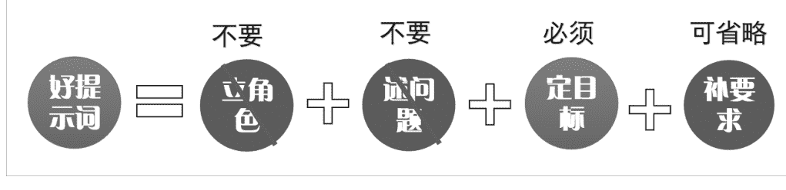

- 请模仿某位脱口秀演员的表演习惯，以春节里的烦恼为题，写一段约三分钟的段子。
- 帮我安排杭州三日行程，必须覆盖西湖和灵隐寺，预算控制在两千元左右。
- 给出一套证明勾股定理的思路。
- 用十岁孩子能明白的语言，说明量子力学在讲什么。

在没有硬性限制时，不必把指令按模板拆到极细。

## 策略2 表达受限时，用案例替说明

当专业储备不足或语言表达吃力，难以把需求说清楚时，把重点放在交代情境、给出范例、明确目标上会更有效。

建议参考下面的问法。

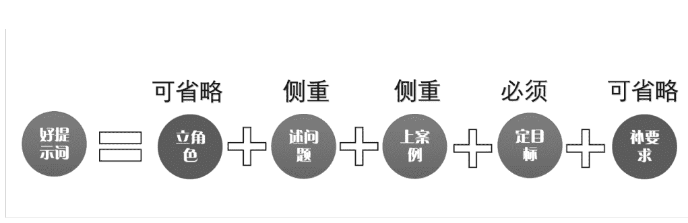

例如想仿写一篇已有文章，却说不清它的写作风格，让模型来完成时，别用文字去概括风格，直接把范文交给模型学习即可。

请你扮演一位擅长小红书爆款笔记的内容顾问，下面我会提供一段小红书笔记，请你先学习其风格与呈现方式，再为我创作一篇标题为《认知觉醒》的小红书笔记。

直接给样例比用文字描述风格更可靠。模型会自动拆解结构、语气、节奏和表达，给出更贴合的模仿结果。

遇到模型懂而你不懂的场景，最省事的做法就是给示例，让模型自行提炼。

## 策略3 信息隐蔽时，把背景补足

问题本身比较隐蔽时，即便模型很强，信息不足也难以产出好答案。所以要把提示的重心放在交代背景和明确目标上，甚至可以用较大篇幅来补充情境信息。

建议参考下面的问法。

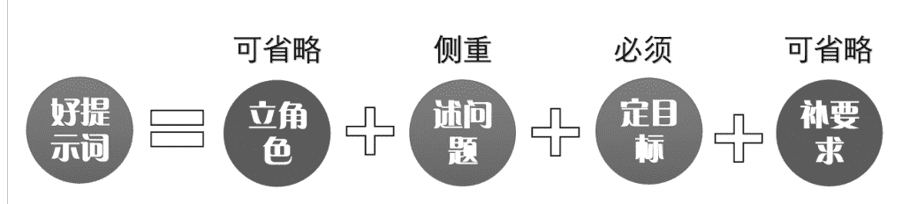

比如你是一名技术扎实的开发者，一直有创业想法，但对创业几乎空白，不懂市场、不知如何验证想法，甚至第一步该做什么都模糊。于是想向模型请教。

错误示范：我是一名程序员，请问该怎样创业？

正确示范：你是一位专业的创业导师，我现在遇到创业困惑希望得到指导。我有十年后端开发经历，熟悉 Python 编程以及数据库设计，目前在一家科技公司任职。最近注意到自媒体行业很热，想做一款面向小红书创作者的图卡生成工具。

但我对创业毫无经验，对市场、产品定位、商业模式几乎不了解，不知道这个想法是否可行，也不清楚如何验证真实需求。对创业初期需要的资源、资金、团队组建也没有概念。

请结合我的背景和困惑，判断我目前处于什么阶段，并给出适合我的起步建议。

## 策略4 面对未知，保持开放对话

未知问题指你和模型双方都不确定的事情，比如尚未发生的事，或脑中只有个模糊念头。对于这类问题，不要用复杂提示去限制创造力，把注意力集中在描述问题上，通过对话和追问不断发散。

建议参考下面的问法。

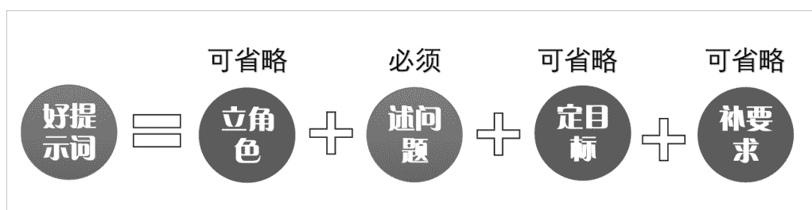

若你对AI的未来感兴趣，可以直接抛出问题，根据模型的思路继续追问，直到满意为止。

你觉得AI的未来会怎样？

同样的，若想写小说却没思路，可以先把这个模糊的大问题丢给模型，让它发散关键词，再基于关键词反复碰撞，最终找到灵感。

我想写一部小说，请问如何开始？你有什么推荐？

以上就是与 DeepSeek 这类推理系统互动的核心思路。理解起来不难，落地时仍需要练习。下一章会讲更具体的操作技巧。

# 第二章

## 进阶技巧：几项实操提升模型产出质量

### 知识要点

1. 提问方式怎样更有效
2. 问题描述如何更精准
3. 指令提出有哪些技巧
4. 怎样降低模型胡言乱语

上一章介绍了推理型AI的基础用法和整体思路。要真正发挥潜力，还需要在具体场景里用更精细的技巧。本章会介绍一套进阶方法，帮助你降低上手成本，提升协作效率。

### 一、如何高效地向模型提问？

第一章讲了用清晰提示引导模型。但现实中很多问题本身就模糊，背景也不清楚。

工作压力大喘不过气，想摆脱却说不清具体感受。想创业却不确定能做什么。写论文面对空白文档无从下笔。……

这些场景的共同点是：只有模糊的痛点，难以定义具体问题，更别说写好提示。

下面分享两种实用方法来提升交互效率。

#### 方法1
反向提问法

当你只有痛点却描述不清时，可以把问题抛给模型，让它先告诉你该怎么问，再针对它反问的内容去填空。

下面这个案例可帮助理解。

##### 案例
人生规划问题


我现在很迷茫，生活工作一团乱，想要你帮忙走出困境，但不知道怎么描述情况才清晰，请帮我设计一个合适的提问方式。


我理解你的状态，迷茫时需要被看见和抓手。下面给你一个思路框架，可任选几项作答。

##### 当前最尖锐的困扰
生活/工作/关系中哪个领域最让你痛苦？
> （例：“每天加班到深夜却觉得工作毫无意义，回家后连玩手机都感到空虚。”）

后续生成内容略。

#### 方法2
多轮调教法

多轮调教指与模型反复对话。当描述不清时可以先用模糊提示让模型出初稿，再基于初稿明确侧重点，引导修改直至满意；也可以先从小切入点获取关键词，再逐步推进到复杂任务。

##### 案例1
行业研报

第一轮：先丢一个简单模糊的提示。
> 请根据当前市场情况，帮我做一份专业的电子穿戴行业的产品分析报告。
（未限定时间、用途、地域、侧重点，得到的结果大概率空泛。）

**电子穿戴行业产品分析报告（2023年Q3）**
后续生成内容略。

追问1：不要全球市场，以国内市场为方向，并用最新数据。
**国内电子穿戴行业产品分析报告（2024年Q4更新）**
后续生成内容略。

追问2：国内市场规模与增长率、竞争格局、产品趋势与技术突破、用户需求与政策影响这4部分太简略，请在这4点上展开得更具体详细。
**国内电子穿戴行业深度分析报告（四大核心模块细化）**
后续生成内容略。

追问3：在此基础上，给创业融资者一些洞察和建议，帮助说服投资人。
回答略。

追问4：请用具体案例来支撑上述洞察和建议。
回答略。

##### 案例2

先用小问题把模型带入语境。
你知道小红书上的爆款文案一般具备哪些特点吗？
模型会总结出核心要素。
后续生成内容略。

追问1：很好，我是小红书创作者，请按你总结的方法论，为我生成一篇关于DeepSeek的推荐文案。
**标题：救命！这个AI神器让我一天产出30条爆款，涨粉4000+！**
正文：今天必须强烈推荐一个让我效率大增的AI神器——DeepSeek！
......

追问2：“它到底有多绝？”这部分有点单薄，请补充更有诱惑力的使用场景。

### 二、如何高效地向模型描述问题？

即使意图明确，也常卡在表达上。受限于语言能力，如何让模型准确把握你的场景和特殊情况，是个挑战。下面提供几种技巧。

#### 方法1
5W2H方法

5W2H源自结构化思维的七何分析，能帮助你把复杂问题拆清。

- **主体：** 谁？涉及什么人？
- **事件：** 什么事？现状是什么？问题点在哪？
- **目的：** 为什么？目的是什么？
- **时间：** 何时？时间限制或期望节点？
- **地点：** 何地？发生在哪？
- **方式：** 怎么做？当前进展和方法？
- **程度：** 多少？数量、质量、预算？

以“迷茫宝妈找副业”为例：

- 主体：30岁宝妈，孩子3岁，全职在家带娃。
- 事件：想找时间灵活、可在家做的副业，兼顾家庭。
- 目的：增加收入减轻压力，同时提升自我为未来返职做准备。
- 时间：希望尽快开始，利用午睡和晚上，每天2-3小时，周末可更久。
- 地点：偏线上，线上线下均可。
- 方式：有电脑和手机，具备入门设计和剪辑能力，可学习新技能，门槛不高，初期投入低。
- 程度：月增收2000-5000元，前期成本不超过500元。

梳理清楚后直接提问即可。

请你根据我的情况，为我制定具体且有针对性的副业策略。我是一位30岁的宝妈，有一个3岁孩子，目前全职在家带娃。我希望找一份时间灵活、可在家完成的副业，以便照顾家庭。

我希望尽快开始，利用孩子午睡和晚上，每天约2-3小时，周末时间更充裕。形式偏向线上，但不排斥线下。

我有一台电脑和一部智能手机，具备入门设计和视频剪辑能力，不排斥学习新技能，但希望门槛不高，初期投入不超过500元。

目标是每月带来2000-5000元额外收入，同时成为长期发展的方向之一，符合我的能力和时间安排。

##### 技巧1
模型识图技巧

针对“能看见但说不清”的场景，比如故障现象、难以描述的艺术作品。用拍照或截图给模型看，再下指令即可。

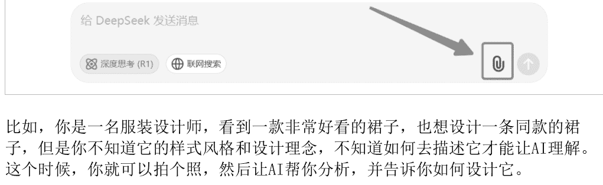

比如你是一名服装设计师，看中一条裙子却说不出风格和设计理念。这时拍张照，让模型帮你分析样式、设计思路。


请你详细描述这款裙子的样式风格、颜色、材质、设计理念和结构细节，并给出具体设计建议。

这款裙子呈现优雅古典风格，融合传统与现代元素。以下是对其的详细描述和设计建议。后续生成内容略。

##### 技巧2
模型附件上传技巧

手头有复杂报表、PDF草稿、录音等，口述费劲易遗漏时，直接上传附件，让模型基于原文处理，如提取、改写、分析。

比如：帮我把里面的中文台词提取出来，去掉无关内容，保留原排版格式。

##### 技巧3
模型读取链接技巧

想分析网页样式、提取视频要点、总结在线文章，内容难以复制时，直接给URL，让模型访问解析。

请你总结这篇文章的要点（网址略）。
答案：略

#### 方法2
自动生成法

让模型帮你写提示词。当任务复杂、需要规范执行路径时，可先让模型优化提示。

##### 角色
你是专业的AI大模型提示词优化专家，擅长优化各类提示词。

##### 背景
我每次会给你一段提示词，可能是模糊场景、抽象表述或啰唆无逻辑的内容。

##### 目标
请对我提供的提示词进行优化，让大模型能做出最佳响应。

##### 要求
- 优化后要易懂，同时能被模型准确理解。
- 明白任务后请回复明白，并等待我提供的提示词。

明白。请提供需要优化的提示词，我会按原则处理。

后续生成内容略。

劝我去旅游。
以下是优化后的提示词。

请扮演专业旅行顾问，根据我的个人偏好和当前状态，设计一份有说服力的3日特色旅行方案，需包含：
1. 用3个场景描述激发旅行欲望；
2. 结合季节和空闲时间推荐目的地；
3. 列出该地3个独有体验项目；
4. 提供经济型/舒适型/高端型预算；
5. 用“您将获得……”句式强调价值。先询问我的偏好、交通方式和预算范围。

### 三、如何更好地对模型提要求？

大模型出厂时自带一种默认的平铺叙事倾向，若不提前给出边界，输出容易变得枯燥、晦涩或过度学术化。下面这套操盘思路能把主导权拿回来，让结果更贴合预期。

#### 方法1：设置难度
模型有自己的表达惯性，放任发挥通常会得到干巴或艰涩的文本。主动调高或调低难度，就能决定内容是通俗易懂还是深入专业，科普和创意场景里尤为好用。

想让表达更易懂，可以这样引导：
- 先给一个身份锚点，比如自称在读三年级或完全零基础的新手。
- 加入口语化指令，像“用最通俗的语言说明”“像给外行讲一样”。
- 绑定具体情境，比如“给出一个八岁左右儿童也能理解的解释”。

想让表达更专业，可以这样引导：
- 要求以专家水准呈现。
- 要求以行业专业口吻呈现。
- 要求系统性、全面且具体地展开。

演示：让模型说明推理模型的思维链
不佳示例：请解释AI推理模型的思维链是如何工作的。
模型很可能堆砌术语，像论文一样让人晕。
更好示例：请用八岁左右儿童能听懂的方式，说明AI推理模型的思维链如何运作。
模型可能会说：“就像小侦探一步步找线索，模型也是先猜再推敲，最后找到答案。”

其他参考：
- 假设我是小学三年级学生，告诉我区块链是什么。
- 用最通俗的语言解释量子计算是什么。
- 我是编程初学者，请用简单的话说说Python循环怎么用。
- 我要写一篇小红书文案，主题是DeepSeek提示词技巧，受众是零基础新手，希望既易懂又有用，请帮我完成。

#### 方法2：设置风格
风格决定呈现的面貌，涉及正式程度、结构习惯和修辞偏好，比如小红书体、知乎体、鲁迅体、新闻体、公文体、金庸体等。做自媒体时，风格设定尤其关键。

设置方式很直接，告诉模型要什么样即可：
- 直接点名风格，比如“用知乎风格写”或“模仿金庸文风”。
- 给具体参照，比如“像某位主播那样锐评”或“按某脱口秀演员的风格写”。
- 结合场景需求，比如“写一篇小红书种草文推广智能鼠标”。

案例参考：
- 案例1：以李煜诗词风格写一首诗，体现单身的惆怅。
- 案例2：用某位主播风格锐评爱情的求而不得，并点出总会有人在等你。
- 案例3：用某位作家的风格写一个小白兔遇见大灰狼的故事，要求有趣有反转。
- 案例4：用鲁迅风格写一篇介绍DeepSeek爆火现象的文章。

#### 方法3：设置语气
语气偏向情感调性，不改变整体风格，只影响表达感受，比如严肃、幽默、活泼。语气变化最直观，直接影响读者感受，所以想去掉刻板感，语气必须明确。

设置方法也很简单：
- 直接描述语气，比如“用幽默语气”或“以刻薄态度”。
- 给具体参照，比如“用某位网络作家的文风”。
- 避免抽象词，用可感知的描述，比如“像哄孩子那样温柔”。

案例参考：
- 案例1：以刻薄语气辣评MBTI中的人格类型。
- 案例2：请你用温柔语气劝我睡觉。
- 案例3：请你用慷慨激昂语气评价《哪吒之魔童闹海》。

小技巧：同时定风格和语气时，选一个具体可感知的参照，比如“以某位作家的风格”“像乔布斯演讲那样”，比用“幽默”“活泼”等宽泛形容词更有效。模型见过大量表达方式，只要指令清晰就能对齐。

#### 方法4：篇幅限定
就是告知模型要多长，从一句话到长篇展开。不限定时，要么太单薄，要么啰嗦。

操作方式：
- 刚性约束，直接量化，比如“写200字”或“用3句话”。
- 模糊但具体，比如“简短点”“详细讲讲”。
- 加限制避免啰嗦，比如“只输出核心步骤或关键结论，不要多余解释”。

案例参考：
- 用一句话说明深度学习的好处。
- 用50字告诉我怎么减肥。
- 写一篇300字文章介绍ChatGPT的历史。
- 生成10个关于“批判性思维”的爆款标题，标题不超过20字。
- 写一篇关于DeepSeek的演讲稿，要求12分钟。
- 生成不少于20个有关个人成长主题的选题。

#### 方法5：边界划分
为模型划定边界，让它在特定领域工作，不要发散。知识库庞大，不加限制容易跑题。

不佳示例：介绍一下区块链。
模型可能从技术到投资讲一大堆。
更好示例：只介绍区块链在金融领域的应用。
聚焦干净利落。

设置方法：
- 加限定词，比如“只讲……”“重点突出……”。
- 禁止无关内容，比如“别提……” “不包括……”。
- 指定背景或来源，比如“根据2023年数据”或“参考××书”。

案例参考：
- 请依据2019—2024年的研究生报名录取及就业数据，分析发展趋势并给出洞见。
- 帮我调研机器人市场情况并生成报告，参考资料必须是最新的，最近两个月内数据。
- 请从《聊斋志异》里选出几个涉及经济学现象的故事案例并解释。
- 推荐3本科中文科幻小说，要求近5年出版且豆瓣评分8.0以上。

#### 方法6：格式指定
明确告诉模型如何组织呈现，是连贯段落还是列表、表格、代码块、流程图等。不规定时，默认一大段纯文本，层次感差。

设置技巧：
- 直接点明，比如“用Markdown写”“做个表格”。
- 要求结构，比如“分点列出”“用编号说明”。
- 增加创意，比如“画个流程图”“做个思维导图”。

案例参考：
- 用文本描述一个学英语的流程图。
- 请给我10点早结婚的好处，以列表形式呈现并附上编号说明。
- 用JSON格式写一个用户信息。
- 用表格展示DeepSeek、ChatGPT、Grok三款模型的性能。
- 写一篇关于健康饮食的调研报告，用Markdown格式。
- 写一篇关于DeepSeek的小红书种草文案，用Emoji排版内容。

### 四、如何减少模型幻觉
模型生成内容常掺杂虚假信息，业内称之为幻觉。闲聊可接受，但在计算、审计等高精度场景则致命。以下4种方法能有效降噪。

#### 方法1：慢思考策略
通过提示词让模型放慢节奏，先整理思路再输出，减少错误。
- 策略1：在提示词中要求“仔细思考后再回答”或“请分步骤解释思路”。
- 策略2：让模型先列出思考过程，再给最终答案。

示例：
不佳示例：直接问“1+1等于多少”。
更好示例：输入“请先解释你的思考过程，然后回答1+1等于多少”。
模型可能会答：“1是一个数字，+表示加法，后面还有一个1，所以1+1=2。”出错概率大幅下降。

#### 方法2：自我批评
要求模型在回答后自行审查，找出漏洞。
- 策略1：加入“请审查你的回答，指出可能存在的错误”或“请自我批评一下你的观点”。
- 策略2：要求模型列出至少3处可能出错的地方。

示例：
不佳示例：模型回答后直接采纳。
更好示例：输入“请回答后列出3处你认为自己可能出错的地方”。
模型可能会说：“我的回答可能在数据上不够精确，或在逻辑推导中跳过某步，或忽略特殊情况。”

#### 方法3：联网校对
要求模型提供可验证来源，确保有据可依。
策略：
- 开启联网功能。
- 在提示词加入“请提供数据来源”或“请附上参考链接”。
- 要求标注出处，如“根据××报告”。

示例：
不佳示例：模型说“2023年全球AI市场规模达到1000亿美元”。
更好示例：输入“请提供2023年全球AI市场规模的数据，并附上来源”。

#### 方法4：多模型交叉验证
把同一问题交给多个模型，比较答案。
步骤：
1. 同时输入ChatGPT、DeepSeek、Claude、豆包等。
2. 比较一致点和差异点。
3. 多数一致可信度高，不一致需进一步核实。

示例：
不佳示例：只问一个模型“地球周长是多少”。
更好示例：问多个模型“地球周长是多少”，对比后若都说是40075千米，则可信度高。

### 第三章：底层思维：一个策略让AI为你创造实际价值

知识要点
1. 什么是运用AI的意识？
2. 162个AI实践场景

前面方法讲完，按理该实操了。但在动手前，请重视本章。就算忘了前面内容，只要记住“要有主动运用AI的意识”，你就已经跑在大多数人前面。

真正决定价值的，不是花哨的提示词技巧，而是你使用AI的意识和表达能力。

### 一、什么是运用AI的意识？
核心理念是“万事不决用AI”。
很多人用不好AI，不是不会指令，而是惯性思维：想不起来用，或不信AI能解决。AI出现前搜索引擎就能解决很多问题，却常被遗忘。

培养“万事不决用AI”的思维模式。大模型凝聚了人类数千年智慧，知识储备、信息处理、思维模仿都远超普通人。它能做的远超想象。今后遇到任何问题，先问AI。即使不全解，也能提供思路，启发更高效解决。

为拓宽思路，下面按能力给出实践场景，激发创造性思考。

应用场景丰富，不可能穷举。我基于文本生成式AI的核心能力，归纳八大类代表场景，帮助你体会实际价值，掌握道而非术。

- 解答类：模型解答人类关于世间万物的疑问。
- 信息类：信息的收集、整理、汇总。
- 分析类：事件和内容的策划、分析和解读。
- 模拟类：各类场景、情景和角色模拟。
- 创意类：想法的推荐和激发。
- 写作类：各种形式的写作任务。
- 娱乐类：有趣的娱乐消遣。
- 工具类：把AI作为工具使用。

#### AI应用的场景分类举例

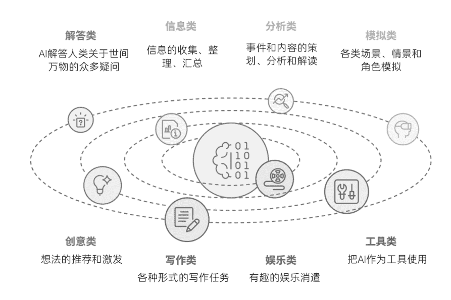

特别提醒：由于个人情况不同，想让提示词发挥更大作用，需要配合前面两章的方法。篇幅所限，这里不给出具体提示词和生成结果，若感兴趣请自行尝试。

##### 第一类：解答类场景

委婉拒绝
请给我3种得体拒绝[具体事项]的表达方式。

共情回应
请给我一些当朋友抱怨[具体事项]时温暖的安慰方式。

关系修复
请给我一些修复因[具体事项]产生裂痕的关系的策略。

社交建议
- 请给我一些在[具体场合]与陌生人打招呼的话术。
- 我现在在一个饭局上，对面坐着一个很吸引我的女孩，她有些内向，只和旁边的朋友交流，她应该喜欢记录生活，一直拍照。我想和她打招呼，该如何开启话题？

职业规划
我对当前工作不满意，我今年30岁了，想辞职重新规划人生，请你向我提出一些问题，引导我反思和规划。

策略咨询
我是一名服装零售商，要给批发市场老板写邮件。某款衣服我只想进3件，但一般20件才给批发，请帮我说服老板同意。

冲动制止
你怎么看从大厂裸辞去当旅行博主？用批判性思维和辩证思维来评价。

沟通策略
在……情况下，应该怎么沟通，才能解决……问题？

疑难指导
装修公司装修了一半，突然说我家地暖特别难铺需要加钱，我该怎么办？

生活智囊
我明天要去做胃镜检查，请列出注意事项清单（饮食/着装/文件准备），用待办事项格式呈现。

问题解答
我在使用Photoshop时遇到问题，具体是[问题描述]。请帮我分析可能原因，并提供解决方法或替代方案。如有必要，请推荐相关学习资源或技巧。

购物助手
选购……时最应该注意的3个参数是什么？

第二类

##### 信息类场景

信息获取
请帮我总结XX领域今天的热点新闻。
查找近3年关于[主题]的5篇高被引论文，按APA格式列出。
注：APA为American Psychological Association（美国心理学会）的缩写

信息整理
- 将以下会议录音整理成结构化纪要，包含议题、决策、待办事项和负责人。
- 请根据[会议录音/文字记录]自动生成结构化纪要，要求包含[智能分段/关键词提取/待办追踪]三大模块，输出格式支持[Markdown表格/思维导图/时间轴]，并自动生成智能摘要（不超过200字）。

周报生成
根据本周工作内容，生成一份逻辑清晰的周报，包含成果数据、问题分析和下周计划。

简历优化
- 优化以下简历，突出3个与[岗位名称]匹配的核心能力，并用数据量化成果。
粘贴原简历→输入“用STAR法则改写工作经历，突出数据成果（如转化率提升30%）”。
注：STAR为Situation（情境）、Task（任务）、Action（行动）、Result（结果）的缩写。

项目拆解
将[大型项目]拆解为7个执行步骤，为每个步骤标注风险点和所需资源。

高效学习
为[某领域]设计知识图谱，包含核心概念、关联案例和实践方法。

拆书助手

AI应用全场景清单

把《认知觉醒》的主干拆成20条短视频文案，每条锁定一个冲破常识的洞察。

###### 人脉管理
搭建社交资产台账，记录联系人的价值标签、互动节奏与资源互换思路。

###### 薪资谈判
就[岗位名称]的薪酬谈判，梳理3套反制HR压价的话术模型。

###### 信息解读
- 针对[具体政策名称]，按[政策背景/核心条款/影响分析/操作指南]四个维度展开解读，要求：①标明政策原文出处及生效时间；②对比新旧政策差异；③以[思维导图/FAQ/案例分析]形式呈现，同时输出政策申报自查表与风险提示清单。
- 用通俗语言解读下列财务报表，指出两处关键问题并给出一条优化建议。聚焦核心指标，拆解成本、利润与现金流逻辑，服务财务优化。
注：FAQ即Frequently Asked Questions的简称，意为常见问题。

###### 文本解读
对指定文言文实施[原文标注/语法解析/白话翻译/文化阐释]四步处理，要求：①标注重点实词、虚词及特殊句式；②以思维导图呈现篇章结构；③结合历史背景解析思想内涵，同时生成文言词频统计与历史穿越模拟对话。

###### 合同审查
上传合同PDF文件→输入“用红色标出对乙方不利条款，说明法理依据，并给出修改建议”。

###### 总结概括
用300字概括该论文核心内容，并列出3个创新点与2个潜在不足。

###### 学习辅助
- 为[学科/技能]撰写学习笔记。
- 将[具体知识点]转为结构化知识卡片，需涵盖[核心概念/关联知识/应用场景/记忆技巧]四大模块，支持[Markdown表格/思维导图/闪卡]格式，同时生成记忆曲线复习计划表与应用场景模拟题，并标注信息来源及可信度评级。
- 用通俗语言解释[复杂知识点]，并结合实例帮助理解。

###### 辅助记忆
为[具体知识点]创作记忆顺口溜。

###### 观点论证
以清晰条理且具说服力的案例论证下列观点。
[具体观点]。

###### 观点批判
有力反驳下列观点。
[具体观点]。

###### 逻辑提炼
提取下面内容的论证逻辑。
[你的内容]。

###### 逻辑漏洞
需对[内容类型]进行逻辑漏洞分析，目标是[目标]。请给出具体分析方法与步骤，并提供改进建议，确保最终内容逻辑通顺且无明显漏洞。如有需要，请附示例说明。

###### 阅读助手
针对[图书类型/文献难度]，按[结构拆解/认知脚手架/知识转化]三阶段构建阅读方案，要求：①生成SQ3R阅读路线图+康奈尔笔记模板；②嵌入[思维导图/概念图/因果图]可视化工具；③输出重点段落批注、跨章节关联分析结果与自测题库，同时生成阅读进度看板与讨论话题生成器。
注：SQ3R即Survey、Question、Read、Recite、Review的缩写。

第三类
##### 分析类场景

###### 计划制订
- 帮我制定一个[时间]的[计划名称]，目标是[例如：3个月减重5千克]。
- 为零基础学习者规划掌握[学科/技能]的3个月学习路径。
为我制定一份21天减脂计划，包含饮食与运动安排。

###### 项目分解
把[项目]拆分为可执行步骤，并为每步标注风险点与所需资源。

###### 项目管理
为[项目]绘制甘特图，标出关键路径与资源冲突点。

###### 产品定位
- 为[产品]做市场定位分析，包含目标用户、竞争对手与差异化优势。
- 针对[产品类型/目标客群/竞品参照]，按[核心参数可视化/场景化描述/情感共鸣点]三维度重构产品文案，要求：①植入[对比矩阵/用户证言/数据背书]增强说服力；②生成适配[电商详情页/直播话术/社交媒体]的多版本；③同步输出视觉优化建议与SEO关键词库。
注：SEO为Search Engine Optimization的缩写，即搜索引擎优化。

###### 商业策划
为[项目]撰写商业计划书，涵盖市场分析、产品定位与盈利模式。

###### 问卷调研
设计一份面向[目标用户]的调研问卷，包含10个问题。

###### 竞品分析
对比产品A与产品B，列出3点长处、2点短板与1条差异化建议。
针对[行业/产品类型]，按[数据采集/分析框架/策略建议]三维度生成竞品分析报告，要求：①覆盖功能矩阵/定价策略/用户评价/市场渗透率四大核心维度；②采用动态数据看板支持自定义时间区间；③输出SWOT对比图/雷达图/增长趋势预测模型，同时生成竞品漏洞挖掘清单与差异点。
注：SWOT为Strength、Weakness、Opportunity、Threat的缩写。

###### 数据分析
- 分析下面销售数据，找出3个增长机会与2个潜在风险。
- 用通俗语言解读下方财务报表，指出两大关键问题与一条改进建议。
- 分析客户流失数据，找出生导致流失的3个主要原因，并提出2条有针对性的挽留策略。要求结合客户行为与反馈，提升留存率。

###### 推广策略
为[产品]撰写推广策略，需包含目标受众分析、推广渠道、传播策略、预算制定、效果评估方案等。

###### 趋势预测
- 基于[行业]最新数据，预测未来6个月的3个趋势。结合市场动态、政策变化与消费趋势，为战略规划提供前瞻指引。
- 以专业金融分析师视角，分析当前国际股市走势与变化，重点关注[具体行业]表现，并结合近期宏观经济数据预测未来3个月市场走向。

###### 设计思路
为[活动]设计一张社交媒体海报，包含主标题、副标题与行动口号。

###### 转行评估
建立[行业]从业者转向[行业]的技能迁移模型。

###### 方案论证
- 需对[方案主题]进行方案论证，目标是[目标]。请提供一套系统论证框架，涵盖方案优劣分析、潜在风险评估、替代方案对比，以及如何用数据或案例支撑论点。如有可能，请附具体论证步骤与关键问题清单，以确保方案科学、可操作。

###### 决策支持
假设要在曼谷开重庆火锅店，请分析可行性。

###### 语义分析
分析这段话的潜在含义。

第四类
##### 模拟类场景

###### 场景模拟
- 根据我上传的简历，模拟一场[岗位名称]的面试。
- 我是新能源汽车销售，请扮演挑剔顾客帮助我训练销售能力。
- 请模拟在……情况下的最佳应对策略。

###### 时空对话
- 老子和苏格拉底坐一起会聊什么？请结合历史背景模拟对话。
- 假如我们变成动画片角色，会展开怎样的冒险？

###### 情景模拟
- 玄武门之变结束当天，若李世民深夜写下独白，会写什么？
- 假如……能说话，它会……

###### 心理咨询
扮演专业心理咨询师，当用户描述情绪困扰时，按[情感疏导/认知重建/行为激活]三阶段生成干预方案，要求融合[人本主义共情话术+CBT模型+正念减压技巧]，同步提供心理自助工具包（含情绪日记模板/呼吸训练音频/思维记录表）。
注：CBT为Cognitive Behavioral Therapy的缩写，认知行为疗法。

###### 作者模拟
请扮演《XX》这本书的作者，以作者身份回答我不太理解的地方。
[你的疑问点]。

###### 描述画面
用诗意的语言描述[对象]。

###### 税务规划
需一份关于[税务类型]的税务规划建议，目标是[目标]。请结合[具体情况]提供清晰可行的策略，并列出需注意的关键点或潜在风险。

###### 深度思考
针对[具体问题/现象]，按[哲学三问/科学三问/行动三问]框架构建思考路径，要求：①每个维度设置5个递进追问；②结合[苏格拉底诘问法/第一性原理/系统动力学]思维模型；③生成认知盲区检测表/思维实验生成器/认知偏差校准器互动工具包。

###### 模拟辩论
我是一家手机壳制造小老板，考虑从杭州搬到深圳发展，请扮演企业家XXX和XXX两人讨论此决定。

###### 投资建议
你是有20年经验的私人理财顾问，请根据风险承受能力[低/中/高]与投资目标[短期/长期]，推荐合适的投资组合并说明理由。

###### 风险管理
为[具体金融产品]设计风险管理方案，包含风险识别、风险评估与风险控制。

###### 法律顾问
描述事件经过→输入“1. 分析公司行为违反哪些《中华人民共和国劳动法》条款；2. 列出可主张赔偿项目及计算方式；3. 提供劳动仲裁申请书模板”。

###### 活动策划
策划星空主题婚礼（50人规模），列出灯光/花艺/甜品台设计要点，附物料清单与预算表。

###### 视角模拟
以流浪猫视角讲述……

###### 极限假设
假如……为零，……会变成什么样？

###### 逆向思考
从相反角度思考……

第五类
##### 创意类场景

###### 头脑风暴
我是一名[行业]的产品经理，请就[主题]进行头脑风暴，不少于[数字]个点子，不能重复，需有明显差异。

###### 面试准备
生成面试[岗位名称]岗位的高频问题与应答策略。

###### 创意激发
- 《哪吒之魔童闹海》爆火后，请为《哪吒3》策划剧情。
- 我孩子刚出生，是女孩，我姓X，请为孩子取一些好听名字。

###### 书单推荐
生成[具体领域]推荐书单，包含书名、作者与简介。

###### 创意设计
为[对象]设计标志，主题是[主题]，风格是[风格]，主色调为[颜色]，需体现[核心元素或理念]。

###### 话术生成
- 针对[问题]，生成5条专业友好的专属客服回复话术。
- 我是一名[行业]打工人，帮忙写一段面向陌生同事的话术，不要太长，用于[使用场景]。

###### 创意生成
请把……和……结合创造新事物。

###### 选题策划
- 推荐10个[领域名称]优质选题。
- 生成10个吸引眼球的[主题]标题，要求含语气词并设悬念、强调效果，以吸引读者。

###### 促销话术
针对[节日]写一条[产品]促销短信，含活动时间、优惠信息、促销口号。

###### 创意文案
为[产品]写10个广告创意文案，文案不失幽默，每条字数控制在[数字]左右，且不重复，有明显差异。

###### 直播话术
为一场两小时带货直播设计脚本，含暖场、产品对比等环节。

###### 方案策划
我是一名[职业]策划人，帮我写线下读书会活动方案，需包含策划目标、详细计划、所需资源与预算、效果评估、风险应对等内容。

###### 诗歌创作
- 写一首关于[主题]的诗歌，格式为[古诗词或现代诗格式]。
- 用李白风格写一首诗，描写春节期间一人加班的苦闷心情。

###### 品牌故事
以[品牌]背景写一篇品牌故事，突出品牌理念，让用户产生共鸣。

###### 活动策划
为[主题]社群设计7天运营话术，含欢迎语、每日话题与互动游戏。

###### 卖点挖掘
为[产品]写一段吸引人描述，突出3个卖点，并说明使用场景。

###### 差异挖掘
对比[产品A]与[产品B]，列出各自3个长处、2个短板，以及1个差异点。

###### 定价策略
分析[竞品]间定价策略，给出3条优化建议。结合成本、市场定位与客户感知，制定更具竞争力的价格体系。

###### 金句生成
为[主题]文章生成10条金句，要求结合热点事件与年轻人痛点。

###### 建议助手
- 推荐一些适合业余时间培养的兴趣爱好。
- 推荐几部适合放松心情的电影或电视剧。
- 推荐适合……时聆听的音乐。

##### 写作类场景

###### 走心文案
需一份感动生日文案，对象是[例如：父母、朋友、恋人等]，风格偏向[例如：深情、幽默、文艺等]。请结合[具体情境，例如：回忆过往、表达感激、展望未来等]，撰写一段真挚文字，字数控制在[例如：100字]左右，确保引发情感共鸣。

###### 内容回复
- 以[职业]身份回复下方邮件，我要在邮件中告知对方[一句话简述内容要求]。
[这里输入邮件内容]
- 以店主身份回复下方评论，需对评论中问题做正向回复，态度亲和、用语礼貌。
[这里输入评论内容]
- 写一篇发布在[平台]上对[评价对象，如电影]的好评，字数不少于[数字，如100字]。

###### 创意标题
写5个面向[人群]宣传[产品]的品牌营销标语，要求简洁吸睛、富有创意。

###### 邮件写作
写一封主题为[主题]的正式邮件，需含委婉拒绝话术、替代方案与后续跟进计划。

###### 大纲生成
生成一个关于[主题]的大纲，用于[使用场景]PPT制作。

###### 周报写作
我的职业是[职业]，帮我写一份周报，含工作内容、工作成果与下周计划。

###### 会议纪要
写一份讨论[主题]的周会会议纪要，语气正式，需含周会主要讨论内容、核心结论与下周计划，字数在[数字，如500字]左右。

###### 创意写作
写一个小说，类型为[例如：穿越]，以刚穿越到唐朝的女医学生为主角，字数在[数字，如1000字]左右。[其他补充要求]

###### 申请报告
写一份关于[主题，例如：出差]补助申请报告。

###### 内容脚本
写一个用于视频制作的脚本，主题为[主题]，要求情节完整、结构清晰，请以表格形式输出。
生成一个[时长]的[主题]短视频脚本，含开场悬念、中间反转、结尾行动号召，并具备至少3个特写镜头。

###### 演讲发言
我是一名[职业]，帮我写一篇演讲稿，主题是[主题]，字数为[数字]字左右。

###### 短文案
生成一条关于[主题]的朋友圈短文案。

###### 总结报告
我是一名营销专家，帮我写一个关于[主题]的市场调研报告，需含调研背景、调研目标、调研方法、市场分析、总结建议等内容，以总分结构呈现。

###### 论文写作
我的研究领域是[研究领域]，帮我写一篇关于[主题]的论文。

###### 自媒体文章
我是一个博主，帮我写一篇关于[主题]的[平台，如公众号、知乎、头条等]文章，需符合该平台写作风格。
以[风格]写一篇关于[主题]的深度文章，含3个分论点，每个分论点配一个案例。

###### 小红书笔记
以“3个技巧+一个避坑指南”结构，写一篇[主题]的小红书图文笔记。

###### 脚本写作
生成一个[时长]的直播脚本，含开场互动、干货分享与促销环节。

###### 周报助手
根据[项目进度/工作日志/会议记录]自动生成结构化周报，要求：
1. 含[核心进展/关键数据/风险预警/下周计划]模块；
2. 以甘特图/柱状图/折线图展示；
3. 自动生成摘要版（200字以内）与详细版（800字以内），同步生成风险应对方案库与跨部门协作优化建议。

###### 文件撰写
根据[文件类型/使用场景/受众层级]自动生成标准化文档，要求：
1. 含[框架搭建/内容填充/合规审查/美化排版]完整流程；
2. 集成[智能纠错/引用生成/版本对比]工具；
3. 输出写作指南/模板库/术语词典，同步生成多语言适配方案与签署风险提示清单。

###### 公文写作
根据[文种类型/紧急程度/发文机关]自动生成标准化公文，要求：
1. 智能匹配《党政机关公文格式》国家标准（GB/T 9704—2012）；
2. 集成[政策法规库/历史公文模板/错敏词检测]三大引擎；
3. 输出起草说明/版本对比/签署风险提示，同步生成公文流转追踪系统与多层级审核流程图。

第七类
##### 娱乐类场景

###### 食材生成
用[XXX]食材制作3道低热量菜肴，详细说明烹饪步骤、烹饪时间与营养数据。

###### 旅游规划
设计一份[地点]的7天旅行计划，含景点、美食、交通、住宿建议。

###### 段子生成
基于[职场/校园/家庭]场景，用[冷幽默/谐音梗/反转]风格创作3条段子，要求每条含[具体物品+夸张对比+网络热梗]元素，采用“铺垫+转折”结构。

###### 吵架助手
扮演智能吵架助手，当用户输入争执对话片段时，实时分析对方逻辑漏洞，生成3种不同风格反击话术（温柔拆解/毒舌反讽/科学论证），并同步提供情绪降温策略与关系修复方案，要求每种话术含至少一个网络流行梗与一个心理学效应。

###### 解梦大师
根据用户描述的梦境，按[心理学解析/文化对照/行动建议]三维度生成解析报告，要求：①标注弗洛伊德/荣格理论对应点；②结合周公解梦/网络热梗进行趣味对照；③输出解梦可信度指数（0~100）、压力值评估、个性化缓解方案，同步生成解梦四格漫画与梦境重构创作工具。

###### 吐槽大师
针对[具体场景/对象]，用[毒舌/冷幽默/阴阳怪气]风格生成3条吐槽话术，要求每条含[夸张对比+网络热梗+数据佐证]，并同步生成“槽点分析报告”。

###### 生活建议
- 给出适合[具体场合]的穿搭建议。
- 需一份穿搭建议，场景是[场景]，风格偏向[风格]，主色为[颜色]。请按需求提供搭配建议，含上衣、下装、鞋子与配饰选择，并考虑[其他要求]。
为XXX平方米三室一厅户型提供[风格]效果图，标注空间利用率。
推荐一份营养均衡且适合上班族的一周食谱。

###### 情绪管理
针对焦虑/拖延场景，生成“应对策略+执行清单”。

###### 育儿支持
5岁孩子英语启蒙遇兴趣瓶颈，请设计10个家庭互动游戏，融合自然拼读与肢体运动，附所需材料清单。

###### 潜规则识破
上传设计图纸→输入“列出水电改造验收标准：线管间距要求，打压测试参数，常见偷工减料迹象（附对比图例）”。

###### 真诚道歉
针对……过失给出真诚道歉方案。

##### 第八类
##### 工具类场景

###### 代码生成
用Python写一个×××脚本，要求实现异常处理功能。
解释下面这段代码报错原因（附错误日志），并提供两种修复方案。

###### 文本校对
检查下方内容的语法、拼写与标点，并给出修改建议。

###### 调整语气
帮我将下方内容的语气调整为××的。
[这里输入内容]。

###### 文本润色
请把下面这段内容润饰一番，要求语气轻松幽默。
[这里输入内容]。

###### 仿写任务
- 以××为主题，参考下方素材进行仿写。
[这里输入内容]。
- 模仿××的表达风格，围绕××主题创作一篇文案。
请参照《自然》期刊的写作规范对这段方法介绍进行改写，突出实验设计的可重复性。

###### 内容扩写
请将下面这段内容进行扩展充实。
[这里输入内容]。

###### 内容精简
请把下面这段内容压缩提炼成要点。
[这里输入内容]。

###### 文本翻译
请把这段中文摘要翻译成英文，专业术语需遵循 IEEE 规范。
注：IEEE 为 Institute of Electrical and Electronics Engineers（电气电子工程师学会）的缩写。

###### 排版优化
依据[平台]的阅读习惯，对下面内容进行排版处理。
[这里输入内容]。

###### 图表制作
- 为[具体事项]绘制一张流程图。
- 为[具体事项]制作一张细致的思维导图。

###### PPT 方案
- 给出关于[主题]的 PPT 设计建议，列出每页要点与版式。
- 为[主题]设计 10 页 PPT，每页采用“图标+金句”的结构。

###### 标志设计
为一家咖啡店设计 Logo，要求融入猫爪元素，主色调为马卡龙色系，适用场景包括包装、门头、网站，并附英文版 Midjourney 提示词。

###### 清单生成
生成……的必备物品核对清单。

# 第二部分

## 效率指数级跃升

# 第四章

## 智能工作流实战：早下班指南

> ### 知识要点
1. 拆解场景背后的底层逻辑
2. 场景的延伸应用

前面已经给出不少启发性的案例，回归日常后我们更关心智能体在自己行业、具体岗位上能干什么、效果如何、怎样落地。

我常收到类似提问。

- 产品经理该如何接入智能体？
- 设计师怎样借助它提效？
- 销售如何使用？
- 运营如何被赋能？
- 自由职业者怎么用？
- 在校大学生能怎么利用？
- ……

本章聚焦真实业务流程中的落地方式。通过一个底层思路配合三个延伸案例，让工作的各个环节全面接入智能工作流，实现效率跃升。

### 一、挖掘具体场景的底层逻辑

若你负责某个岗位却不知从何切入，可先让模型帮你梳理岗位可用的能力点。

**步骤 1 基于业务挖掘场景**
比如你是新媒体运营，不知道能做什么，直接提问让模型列出。
> 我知道智能体的能力很强，但不明白如何与新媒体运营结合产生实际产出。我是新媒体运营，请具体说明它能帮我做什么，要给出具体场景和案例。

对新媒体运营而言，智能体可扮演全能副手，覆盖内容创作、数据分析、用户互动、广告优化等环节，提升效率。以下结合工作场景，给出可落地方案与案例，帮助你快速把工具转为生产力。
后续内容略。

把问题抛给模型后，会得到大量使用场景，但多偏笼统。若想要更精准，可在给出场景中挑选关注点，或要求继续补充。

**步骤 2 用模型挖掘细分场景**
> 除此之外还有哪些更细分的场景？
当然！在新媒体运营中价值远不止于此，下面补充十个细分场景，涵盖内容安全、跨平台协作到团队管理，帮助你进一步释放产能。
后续内容略。

当收集的场景足够丰富后，可让模型针对你关心的细分场景进一步深挖结合点。
很好，我对“内容创作”特别感兴趣，但之前给的场景较少且不够具体，请给出更多更具体的场景。
好的！针对内容创作环节，我细化为五大细分场景，每场景均提供工具/操作步骤+真实案例+避坑指南，便于直接套用。
后续内容略。

同样，你也可以让模型对数据分析、私域运营、用户增长、广告投放等板块进行深挖。
很好，我对“私域运营”也很感兴趣，之前提到的场景不够具体，请提供更多细节。

#### 步骤 ③ 按需固化具体用法
当模型引导你打开想象空间、积累足够认知后，就可以把启发性的场景固化为可长期调用的智能工具。
比如对“小红书种草文案一键生成（附公式）”感兴趣，可这样操作。
我对你提到的“小红书种草文案一键生成（附公式）”很感兴趣，请结合方法论和思路，为我生成可直接套用的提示词。
模型会据此生成工具型提示词，你只需在实际业务中微调即可使用。
以下是为小红书种草文案定制的提示词模板，已按公式和平台调性优化，替换关键词即可产出高质量文案。
后续内容略。
同理，视频脚本、选题挖掘、评论助手等场景都可照此制作。当这类小助手积累到一定数量，效率自然大幅提升。

### 二、延伸场景用法

### 场景1
##### 智能工作规划与管理
项目规划、拆解和管理是落地执行的关键，但耗时耗力且常出现“计划赶不上变化”。若你常需规划管理，智能体能明显提升效率。
下面以健身计划为例，演示规划管理的实操。

###### 1. 描述需求
我是上班族，准备参加公司三月的健身挑战赛，请为我制定三月一日到三月三十一日的健身计划，并生成可导入日历的 ICS 编码，提醒并监督执行。
注意：
1. 自控力一般，需要轻量化、有趣的方案，薄弱点是核心力量和耐力；
2. 计划必须具体到每天做什么。
以下是为你量身定制的三十一天趣味健身计划，兼顾核心强化、耐力提升和趣味挑战，采用游戏化设计，每周设不同主题，并附 ICS 日历编码。训练时长二十到三十分钟每天，适合上班族。
后续内容略。
同前思路，若方案不合理，可多轮调教直至符合心意，这里不再赘述。

###### 2. 导入日程
想把生成计划导入日历提醒，可按两步操作。
####### 步骤 1 复制 ICS 编码
复制模型提供的 ICS 编码，新建文本文档粘贴保存为 .ics 文件。注：ICS 是日历软件通用格式，所有日程设置均以此编码呈现。
####### 步骤 2 打开日历软件
大部分手机、电脑自带日历或第三方 App 都支持 ICS 导入，导入后即可实现日程安排和提醒。
导入成功后可看到清晰的计划。
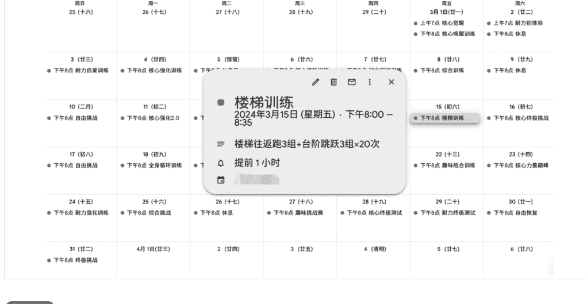

### 场景2
##### 行业资讯与信息源获取
许多行业都需要及时获取前沿资讯和热点。靠搜索引擎或社交推送效率低、信息杂乱。若你常需行业动态但不想浪费时间筛选，智能体是最佳助手。
下面以获取人工智能领域资讯为例，需开启联网搜索功能。
请汇总今天人工智能领域最新最热的新闻，并附来源。
2025年2月27日人工智能领域热点新闻汇总
后续内容略。
若不想信息过于宽泛，可指定关键词让模型整理关注内容。
请聚焦人工智能产品相关新闻，我更关注人工智能产品。
2025年2月27日人工智能产品相关新闻汇总
后续内容略。
同理，其他领域资讯或信息源，也可让模型自动检索、整理并按你预期格式呈现。
今天投资市场有哪些有价值的新闻？
2025年2月27日全球投资市场重要新闻汇总
后续内容略。

### 场景3
##### 用智能体操控软件
日常工作中，Photoshop、Office 等软件操作繁琐，即使有智能体指导也难快速上手。若你需频繁用软件实现特定效果，让模型生成相关脚本能大幅减负。模型不仅能提供操作指引，还能直接生成脚本和代码。
以 Photoshop 为例，想把图片调成小清新风格并加上“AI效率手册”水印，却不知如何操作，可直接让模型帮忙。
帮我写一个 Photoshop 脚本，实现图片小清新风格化，并在中央添加“AI效率手册”水印，并指导使用方法。
以下是为你编写的 Photoshop 脚本及使用说明。
后续内容略。
之后按模型指引将脚本应用到软件中，即可一键实现效果。
注意：软件版本可能存在差异，建议在请求生成时指定版本号以减少错误。
同样，Premiere、After Effects、PowerPoint、Word、Excel 等软件均可通过脚本让模型带你完成操作。

# 第五章

## 文档处理专家：应对繁琐文档的智能方案

### 知识要点
1. 用智能体让 Office 更高效
2. 用智能体轻松管理知识和文件
3. 效率全开，批量处理任务

日常工作中处理各类文档极耗时间。从撰写长报告、整理混乱的 Excel，到反复调整 PPT 格式，这些机械琐碎的工作悄悄吞噬时间。
人工智能如何帮助高效处理这些文档任务？下面分享三大提效工具及策略，改变你的文档处理方式，聚焦更有价值工作。

### 一、用智能体让 Office 更高效
办公痛点多来自 Word、Excel、PowerPoint 等办公套件使用。传统套件操作门槛高、耗时费力。即便软件内置智能助手，也往往功能有限或收费高。
如果你常用办公套件，Office AI 助手就是刚需。安装后可在套件内直接使用智能体对话，无需手动操作复杂公式、函数或排版，一切通过对话完成。
更重要的是，可在套件里免费使用 DeepSeek、ChatGPT 等主流模型，无需为厂商 VIP 付费。免费获取并使用方法如下：
- 步骤 1：从 Office AI 官网免费下载工具。
- 步骤 2：安装到设备。
- 步骤 3：打开套件即可看到智能体对话界面。
- 步骤 4：免费使用。
启用后，文案创作、文章润色、会议纪要整理、内容续写、智能互动、写作建议、智能校对、一键排版、图片生成、智能文本替换、图片文字提取、数据分析、复杂表格操作等均可通过对话实现。

| 类别 | 食物 | 销售额 |
|------|------|--------|
| 蔬菜 | 西红柿 | 23,000 |
| 蔬菜 | 西芹 | 55,000 |
| 水果 | 橙子 | 8,000 |
| 其他 | 黄油 | 4,000 |
| 蔬菜 | 胡萝卜 | 42,000 |
| 水果 | 苹果 | 12,000 |
| 蔬菜 | 茄子 | 15,000 |
| 水果 | 香蕉 | 9,000 |
| 其他 | 沙拉油 | 6,000 |

#### 海鹦 Office AI 助手
- 聊天 | 公式源
- 解答各类公式问题，试试：
  - 请计算类别中水果的总销售额
  - 计算食物中包含'西'的销售额
  - 计算 CPI 中值
- 例：求【列名】的平均值

#### 海鹦 Office AI 助手
- 聊天 | 文生图 | 创作 | chatglr
- 职场 | 媒体 | 教育 | 广告营销
- 工作进度汇报
  - 领导问进度，高情商表达并画饼
- 研发展示 PPT
  - 用数据和中肯描述的工作汇报
- 培训心得体悟
  - 写一份培训心得
- 年终 PPT 训练
  - 会前一周准备，AI 助你写重点，快速制作 PPT
- PPT 大纲
  - 写 PPT 大纲，职场效率提升一半
- 述职 PPT 大纲
  - 一键生成高颜值 PPT 大纲，快速搭建内容
- 项目汇报 PPT
  - 项目进展及新品发布，专业风格打动人心
- 市场调研报告
  - 你是一位市场分析师，直接写一份调研报告
- 市场分析
  - 请帮我写一个简短的行业市场分析
- 实习报告制作
- 报告总结
- 工作报告
- 自由创作

### 二、用智能体轻松管理知识和文件
信息爆炸时代，管理海量数据令人头疼。文件激增、信息分散、缺乏关联，需要时难以快速检索、提取或整理。职场人和学生对此深感困扰。
若需高效获取、整合、管理和应用各类知识文档，AI 知识库不可或缺。
AI 知识库是智能体驱动的内容管理工具，解决知识与文件管理痛点。笔记、PDF、Word、视频、音频、网页内容均可导入，无需手动标注、分类整理，系统会自动梳理关联，后续只需提问即可获取。
更令人惊喜的是，AI 知识库不仅能快速调取内容并标注来源，还能生成可视化思维导图，甚至基于你的内容创建互动式音频播客。
- 目前两款优秀工具：
  - 腾讯 ima，搭载混元模型和完整版 DeepSeek；
  - Google NotebookLM，由 Gemini 驱动。

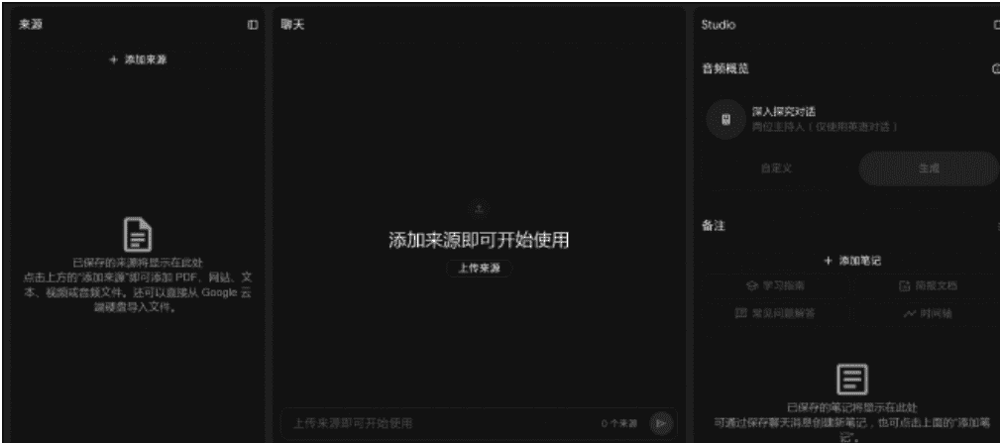
两款工具对个人免费，可自行体验，本书不展开工具介绍，下面用场景启发生产力。

**场景1**
**主题研究**
把喜欢的书籍上传到 AI 知识库，基于这些书与模型对话，让模型模拟各作者，引导它们碰撞观点。

**场景2**
**快速提取并生成笔记要点**
把喜欢的视频链接或音视频文件“丢”进 AI 知识库，让模型自动提取并生成笔记要点。

**场景3**
**打造数字分身**
把较为私人的资料，如日记、日常所思所感，存放到 AI 知识库。长期积累后，模型会比你更了解你，可打造成数字分身，基于你的偏好提供针对性策略。

**场景4**
#### 文档交叉处理
若需查找或比对文档，可把待操作文档“丢”给 AI 知识库，让模型自动总结共性、差异、主题间潜在关系，挖掘更多有趣内容。

### 三、效率全开，批量处理任务
常规模型通常一次只处理一个问题，无法多线程。例如想基于同一选题生成一百篇高质量小红书文案，常规平台难以满足。
工作中常需模型大规模批量处理：分析数千条用户反馈、批量创作内容、生成创意、处理文档或图片等，超出常规能力。那么如何解决？
可使用飞书多维表格。
飞书多维表格内置智能体能力，接入完整版 DeepSeek R1 模型，可按表格行为单位与模型对话。通过向各行提供内容并设置提示词，实现批量任务处理。
下面以批量生成小红书文案为例说明操作。

#### 步骤 1 用模型获取高质量小红书标题
请生成五十个“个人成长”领域的高质量小红书标题，以表格形式输出。
以下是基于 AI 知识库信息生成的五十个“个人成长”领域高质量标题，结合数字、情绪关键词、实用价值等要素，并标注灵感来源。
具体内容略。

#### 步骤 2 进入飞书，新建多维表格
1. 搜索飞书或下载客户端，登录后进入文档页。
2. 点击右上角【新建】，选择【多维表格】。
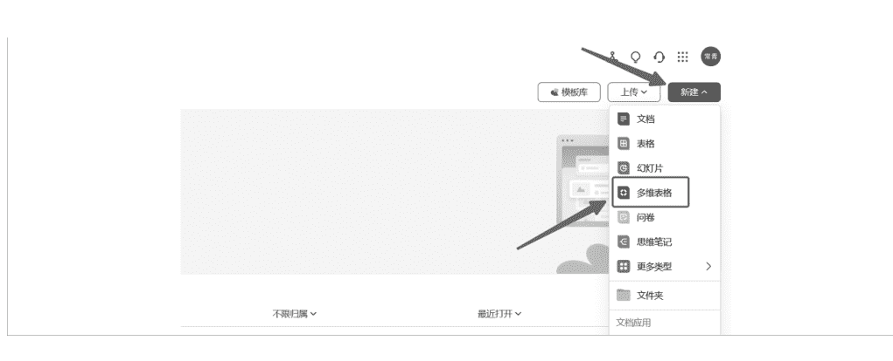

#### 步骤 3 配置智能体
1. 将前面模型生成的标题粘贴进去。
2. 点击旁边的加号，选择【探索字段捷径】。
3. 在列表中选择【DeepSeek R1】，也可自定义其他模型。

#### 步骤 4 设置提示词
1. 在弹出的对话框中打开【选择指令内容】下拉列表，选中已粘贴的标题列。
2. 输入模型工作提示词，点击【确定】。

#### 步骤 5 触发批量生成
点击【确定】后，飞书会弹出是否生成全列的提示，点击【生成】，模型即可批量生成小红书文案。
瞬间即可获得五十篇高质量文案。

# 第六章

## 专业分析师：从小白到专家，智能体辅助生成研究报告全攻略

### 知识要点
- 1. 如何用 DR 获得高质量研究报告？
- 2. DR 有哪些适用场景？

高质量交付实战：深度研究加可视化

在需要交付专业级市场研究或商业策划的场景里，日常写作如何借助智能工具提效？

我目前重点推荐的是具备研究级能力的产品系——深度研究，业内简称为DR。DR由OpenAI发布，和普通的推理模型不同，它更像一位能自主行动的研究顾问。

你只需给出研究主题，DR就会自行拆解任务链，自动检索、归纳、整合并推理，通常5到30分钟内产出完整报告。精度要求更高时耗时会延长。整份材料逻辑严密、可回溯，幻觉风险低，每条引用均可溯源，还会主动比对冲突信息并给出可信权重，执行过程中会自主调整策略解决卡点。

多位业内专家实测后认为，DR的产出质量已超过多数传统咨询机构的水准，是目前最接近通用智能的工具。所以当工作对内容精度要求极高，甚至需要咨询团队介入时，DR是首选。

### 一、如何用 DR 拿到高质量研究报告？

#### 步骤 ① 获取研究级工具

OpenAI的DR目前处于领先位置，但开放范围有限，持有ChatGPT Plus账号的用户可优先体验。

其次可选Genspark版DR、Grok版DR、Perplexity版DR以及Google版DR。这几款能力稍逊，但日常使用足够，且大多免费。

国内来看，Manus进展很快，评测成绩不输OpenAI版，有条件的建议直接使用；再下来是秘塔搜索，经过验证可用，使用时务必打开【长思考R1】并切换到【研究】模式，才能拿到理想结果。其他工具暂不建议。

确定工具后，需要明确研究边界。

#### 步骤 ② 让 AI 帮你定义任务

在OpenAI的DR里，指令越简洁直接效果越好，除非有特殊限制，无需过度约束。

以“生成式工具对创作者生态的影响及未来出路”为例，可以这样下指令：

> 我想梳理“生成式工具对内容创作者的影响以及未来可能的出路”，请输出一份系统完整的分析报告，并在末尾给出你的洞察。

在专业领域担心问题不够具体时，可先用反向提问让模型厘清需求再执行：

> 我想梳理“生成式工具对内容创作者的影响以及未来可能的出路”，请输出一份系统完整的分析报告，并在末尾给出你的洞察。

> 开始前，如果你觉得我的问题不够明确，请先提问确认具体需求，确认后再开始。

为保证方向精准，建议先确认以下要点。

- 1. 研究范围：是否需要区分创作者类型如文字、视频、音频、艺术？是否需要按平台如YouTube、抖音、B站、Spotify做差异化分析？
- 2. 时间维度：是否聚焦2023年生成式AI爆发后的变化？“未来”是指3年还是5~10年？

> 后续生成内容略。

研究范围：聚焦图文创作者，平台不限。
时间维度：未来约十年。
地域侧重：中国为主。
评估维度：自行发挥。
数据需求：需要量化，数据越准越好。

#### 步骤 ③ 等待报告合成

把指令交给模型后就进入等待。DR为保证质量会调用更多工具进行检索、分析与整合，通常需要几分钟到几十分钟。

完成后会得到一份专业详实的报告，参考来源往往上百条以上，且报告中所有信息源都会完整列出，便于溯源核验。

#### 步骤 ④ 迭代打磨结果

报告生成不等于结束。阅读时若有不满意，可用多轮迭代让模型修正，直至达标。

- 很好，请更聚焦图文创作者，重新产出一份完整系统的调研分析。
- 请删去××部分。
- 请压缩××部分的篇幅。
- ××部分不够充分，请补充更多数据和案例。
- ……

### 二、DR 的典型应用场景

#### 1. 投资研判

涉及投资的常规推理模型产出基本无参考价值，这时用DR做系统研究更可靠。

提示词示例：

#### 2. 职业规划

职业选择的问题，普通模型常常力不从心，用DR梳理信息、生成规划会更扎实。

提示词示例：

> 请先在全球范围内系统搜集整合人工智能行业最新趋势、头部公司的招聘需求与薪资水平、从业者满意度数据，然后给出2025年入行的职业规划建议，包含推荐岗位和技能要求。

#### 3. 教育选择

选校选专业关乎学习与人生方向，普通模型的信息参考性低，DR能提供更可靠依据。

提示词示例：

> 我是2025年高考生，想读计算机专业，请先在全国范围内系统搜集整合计算机专业前50名高校的排名、课程设置、毕业生就业率和学费，然后告诉我2025年性价比最高的报考选择并附上建议。

#### 4. 大宗消费

买房买车这类大额消费，普通模型给的信息不全，自己调研又费力，DR可帮你汇总关键数据。

提示词示例：

> 请先在北京市范围内系统搜集整合2023—2024年楼市走势、各区房价变化、交通便利度、学区资源和社区配套数据。

#### 5. 健康管理

健康信息网上混乱，专业文献又难读，DR能把复杂问题讲明白。

提示词示例：

> 请先在全球范围内系统搜集整合关于减重的最新科研、饮食方案效果对比和运动计划的真实案例数据，然后给出最适合30岁白领的方案并附上执行建议。

#### 6. 创业决策

创业信息不对称成本极高，普通模型分析较浅，自己调研成本又大，DR可做全面评估。

提示词示例：

> 请先在全球范围内系统搜集整合2024年咖啡店行业的市场趋势、消费者偏好、供应链成本和成功案例数据，然后对2025年在北京开一家小型咖啡店的可行性进行分析并附上经营建议。

#### 7. 法律咨询

律师费用高，普通模型建议不可靠，DR可系统汇总法规与案例提供参考。

提示词示例：

> 请先在全国范围内系统搜集整合租房合同纠纷的最新法规、判决案例和律师建议，然后告诉我2025年如何应对房东擅自涨租，并给出具体策略。

# 第七章

## 可视化提效：AI 驱动的演示制作

### 知识要点

- 1. 如何用智能工具高效设计演示文稿？
- 2. 如何用智能工具高效制作可视化图表？
- 3. 如何用智能工具生成大量图片素材？

视觉化表达在工作中意义重大。无论是研究报告、教学分享还是社媒内容，都需要演示文稿、专业图表和合适配图把文字转为直观视觉。

可视化制作门槛不低，工具操作繁琐，还考验创意与时间成本。本章围绕三大典型场景，演示如何借助智能工具快速解决演示文稿设计、图表制作和素材生成的问题。

### 一、如何用智能工具高效设计演示文稿？

如果你受邀做一场AI用法分享，却没时间准备主题和素材，可以按下面流程让模型代劳。

#### 步骤 1 获取演示文稿大纲

借助DeepSeek等推理类模型，先拿到可呈现的大纲。

> 我受邀参加一场AI峰会，需要分享一些AI的使用方法，受众主要是职场人士，分享时长大约30分钟，请你为我生成一份分享稿大纲，以Markdown语法给我。

以下是为你设计的30分钟AI峰会分享稿大纲，聚焦职场人士需求，突出实用性和场景化应用。

> 后续生成内容略。

对模型结果不满意，可多轮调教反复修改，直到满意。

#### 步骤 2 选择演示文稿生成工具

拿到大纲后，可选用合适的演示文稿生成工具。目前免费好用且口碑不错的有：

- Kimi PPT助手；
- 讯飞智文；
- MindShow；
- Gamma；
- 闪击PPT；
- 腾讯AI文档助手。

以Kimi为例，进入页面后在编辑框输入@符号，会弹出Kimi+列表，再选择【PPT助手】即可。

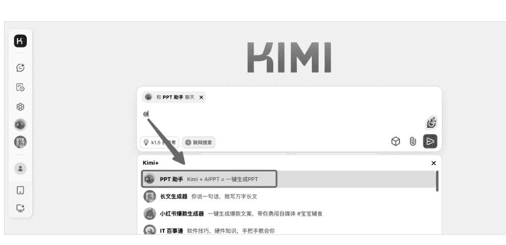

#### 步骤 ③ 粘贴大纲一键成稿

进入【PPT助手】对话页后，把前面模型生成的大纲粘贴进去。

> （这里填写前面模型给你的内容。）

Kimi处理完成后，页面底部会出现【一键生成PPT】按钮。点击后进入模板选择，可按审美偏好、配色风格挑选模板。

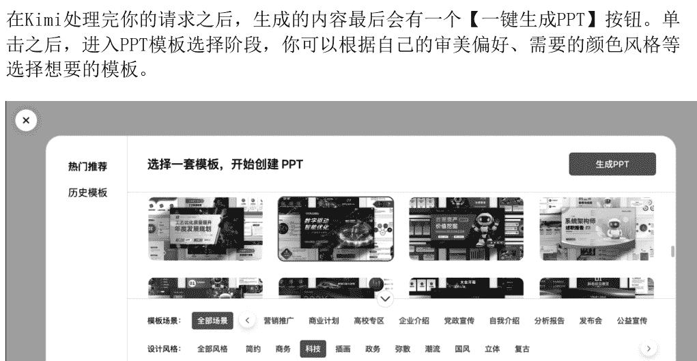

选好模板后点击右上角的【生成PPT】，Kimi会据此自动生成演示文稿。满意可直接点右下角【下载】保存到本地。

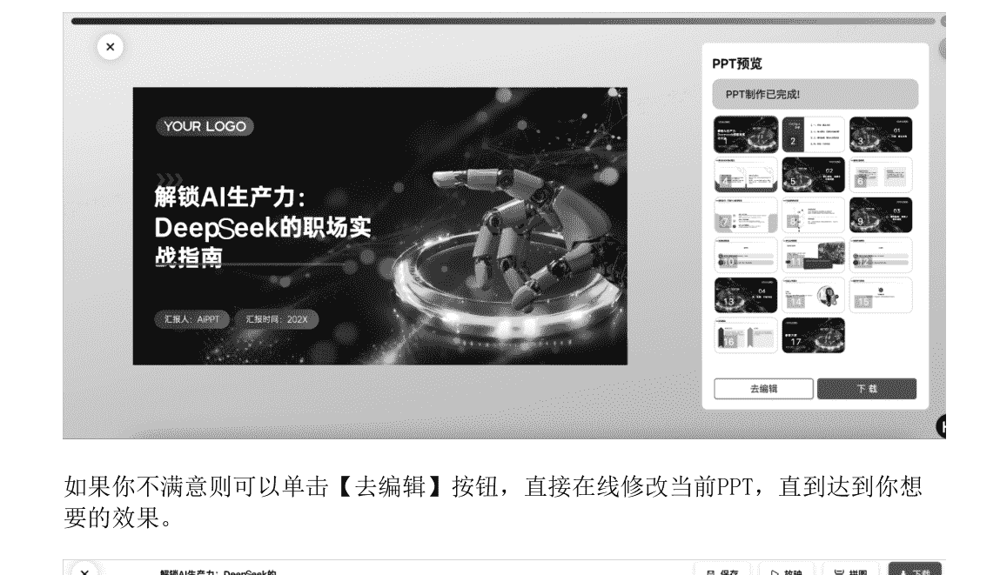

不满意可点【去编辑】在线修改，直到达到预期。

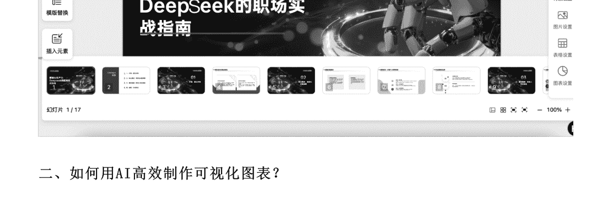

### 二、如何用智能工具高效制作可视化图表？

演示文稿或其他呈现场景都离不开专业图表。如下方法可帮助快速生成。

#### 1. 认识图表类型

先厘清基础概念，模型目前主要支持三类图表。

SVG，可缩放矢量图形：代码呈现的矢量图，可无限缩放不失真，多用于基础图形、图标、简易插画、流程图、组织架构图等。

Mermaid图表：用特定文字语法绘图，擅长表达要素间关系，适合流程图、时序图、状态图、实体关系图、思维导图等。

React图表：基于JavaScript生成的动态图表，可展示复杂数据并支持交互，包含折线图、柱状图、饼图、散点图、雷达图、组合图等。

| 图表类型 | 特点 | 适用场景 |
| :--- | :--- | :--- |
| SVG | 灵活性高 | 设计和展示简单的矢量图 |
| Mermaid图表 | 专注于逻辑关系和结构 | 表达关系、流程、开发场景 |
| React图表 | 基于React框架，专注于数据可视化，支持动态数据和交互 | 动态数据展示、交互式应用 |

#### 2. 让模型生成图表

了解类型后，只需提出需求让模型输出对应代码即可。以下为常见场景示例。

##### （1）SVG场景示例

###### 标志设计

> 我是一款AI笔记软件的开发者，我想为我的笔记软件设计一个标志，请你帮我设计，以SVG代码呈现。

###### 表情设计

> 请你帮我设计一个熊猫眼的表情图标，以SVG代码呈现。

> 创建春节头像，包含两个红色灯笼，灯笼穗子用贝塞尔曲线绘制，添加左右摆动动画，背景透明，尺寸300像素×300像素。结果以SVG代码呈现。

###### 插图设计

> 绘制一个人体矢量图，关节处用红色圆点标注，添加箭头指示发力方向，用半透明红色覆盖，悬停显示文字提示。结果以SVG代码呈现。

> 绘制圆形进度条，外圈为灰色，内圈填充蓝到白的渐变色，从0到100%顺时针填充，中心显示技能图标占位符。结果以SVG代码呈现。

##### （2）Mermaid图表场景示例

###### 路线图

> 我希望有一张学习Python的路线图，能清晰展示每个阶段的学习内容和推荐资源。请用Mermaid实现，给出代码即可。

> 请你给我一张路线图，告诉我如何制作短视频。请用Mermaid实现，每个节点用一句话说明，并标注关键工具，尽可能详尽，给出代码即可。

###### 流程图

> 我希望有一张就诊流程图，能清晰展示每个环节的关键动作和可能的分支路径。请用Mermaid实现，尽可能详尽，给出代码即可。

> 我需要一张招聘流程图，能清晰展示每个环节的时间节点和责任人。请用Mermaid实现，给出代码即可。

###### 业务流程图

> 我希望有一张贷款审批业务流程图，能清晰展示每个环节的状态和可能的异常情况。请用Mermaid实现，尽可能详尽，给出代码即可。

> 我希望有一张业务流程图，帮助团队高效处理客户投诉。请用Mermaid实现，并标注每个环节的关键动作，给出代码即可。

###### 周期管理图

> 我希望有一张客户生命周期管理图，能清晰展示每个阶段的关键动作和转化路径。请用Mermaid实现，尽可能详尽，给出代码即可。

> 我需要一张产品生命周期管理图，能清晰展示每个阶段的关键任务和负责人。请用Mermaid实现，给出代码即可。

###### 项目甘特图

> 我是一个项目经理，目前在管理集团的数据治理项目，现在要进行项目中期汇报，需要通过甘特图展示项目进展，希望你帮我生成该甘特图。请问你需要我提供哪些信息？

###### 组织架构图

> 请用Mermaid绘制企业组织架构图，包含这些部门：技术部、市场部、人力资源部。给出代码即可。

###### 思维导图

> 我有一个朋友，本科学历，专业是会计，毕业3年没有去找工作，每天宅在家里打游戏。我希望他不要再这样颓废，应该如何劝说？请你通过思维导图的形式展示说服他的思路。请用Mermaid实现，给出代码即可。

##### （3）React图表场景示例

###### 天气变化折线图

> 帮我生成北京近7天天气变化的折线图，用React实现，给出代码即可。

###### 优势评估雷达图

> 请评价《西游记》中的孙悟空，按照其能力属性生成雷达图，用React实现，给出代码即可。

###### 社交媒体热力图

> 请帮我绘制近一个月B站、知乎这两个平台用户活跃情况的热力图，用React实现，给出代码即可。

> 以下是我公司第一季度到第三季度各月份销售额数据，请你用React实现可交互的动态柱状图，给出代码即可。

###### 环形图或饼图

> 下面是我近期工作的时间安排，请你基于这些数据用环形图或饼图展示周时间分配比例，用React实现，给出代码即可。

##### （4）通过工具获取图表

得到代码后，可借助对应工具渲染。常用工具如下：

- SVG编辑器；
- Mermaid编辑器；
- React编辑器。

##### （5）测试图表是否达到预期

篇幅所限，下面各展示一个示例，其余可自行尝试。若效果不符，用多轮调教反馈问题直至满意。

###### SVG Logo设计

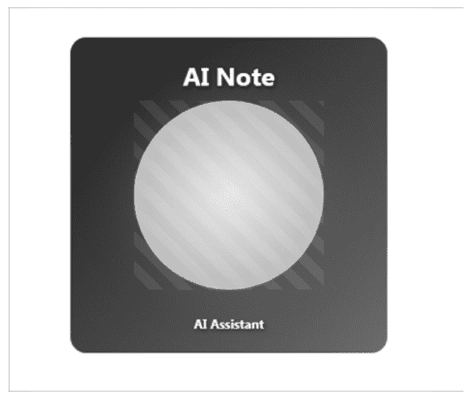

###### Mermaid：项目甘特图

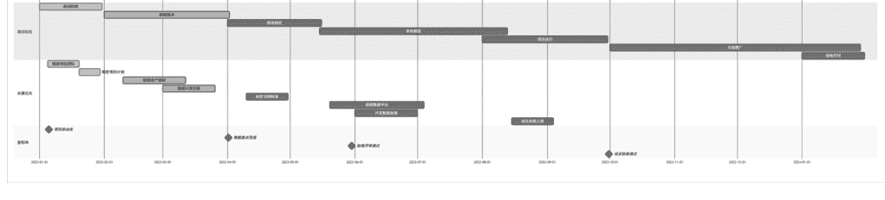

###### React：优势评估雷达图

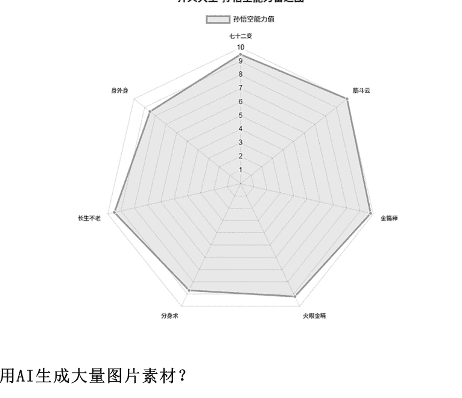

### 三、如何用智能工具生成大量图片素材？

配图能大幅提升内容质感。若不想费时搜索，可直接让模型生成。实操方法如下。

#### 步骤1 通过智能工具生成提示词

描述画面费时费力，可把任务交给模型，只给关键词让它补全。下面是一个可收藏的提示词模板。

```
##### 角色
你是专业的AI绘画提示词专家，擅长对各种类型的绘画提示词进行补全以及优化。
##### 背景
每次需要你的时候，用户都会给你提示词，该提示词可能是对一个模糊场景的描述，也可能是一句抽象的话，甚至是几个关键词。
##### 目标
你的任务是对用户给你的提示词进行优化（补全、完善等），让AI绘画模型可以对你优化后的提示词进行最佳响应。
##### 要求
- 当你明白了你的任务后，请回复明白，并持续等待用户需要你优化的提示词。你需要时常提醒用户对你说明其使用的AI绘画平台，以达到最好的优化效果。
```

明白！请提供需要优化的绘画提示词，我会根据你使用的AI绘画平台进行有针对性的优化，包含构图、光影、风格、细节参数等要素的补全。

平台：即梦AI。关键词：卡通风格的寺庙。

针对即梦AI平台特性，优化后的提示词如下。

> 后续生成内容略。

#### 步骤② 寻找趁手工具

生成式绘图能力在过去一年里迭代很快，厂商间的竞争也把上手成本压得越来越低。创作者不必再自己搭建 Stable Diffusion 或 Midjourney 这类复杂的工作流，就能直接开画。如今大部分模型都带了免费的在线绘图入口，当你对稳定性与可控性有更高要求时，下面这几款偏专业的免费工具可以先收着。

- 即梦AI；
- 可灵AI；
- 笔魂AI；
- VegaAI；
- 无界AI；
- 文心一格；

#### 步骤③ 复制提示词生成图片
得到可用画面描述后，如果暂时不需要改动，就能直接喂给绘图软件。以下以即梦AI做示例，具体流程会在下一章展开，把描述粘贴进去后很快就能得到对应成片。

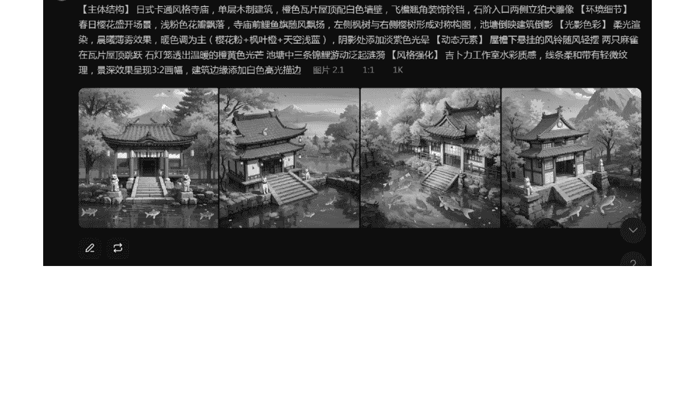
# 第八章

## AI设计搭档：零门槛产出专业视觉

### 知识要点

- 1. 如何借助AI快速完成海报设计？
- 2. 如何用AI从零搭建故事绘本？
- 3. 如何用AI实现一键修图？

在工作里海报需求很常见，它既是视觉传达的载体，也是品牌态度与核心信息的承载物。从招聘广告、产品推广到社媒封面、配图，量很大。传统做法上手门槛高、成本大、创意容易卡壳。面对这类难度更高的设计任务，AI能否派上用场？

答案是可以的。本章用实操演示如何用AI化解海报设计的痛点。

### 一、如何用AI高效设计海报？

#### 步骤 1 明确设计需求
海报涉及的环节很多，单凭一个模糊想法比如“要一张中秋宣传海报”很难锁定风格和表达。现在不必自己苦想，可以把梳理需求的工作交给AI，比如DeepSeek，让它先帮你打开思路并给出方案建议。

举例，你想做中秋主题的产品宣传海报，可以这样问。

> 我想用AI辅助设计一张以“中秋节”为主题的产品宣传海报，现在完全没有思路，请你先通过提问帮我厘清需求，再基于我的回答给出设计建议。

把问题交给AI后，它会从专业角度帮你拆解出一份需求清单。

需求澄清问题清单如下。
- 主推商品：具体要宣传什么？月饼礼盒、茶具、文创周边或其他？
- 面向人群：年轻人、家庭、企业客户还是全年龄段？
- 品牌调性：有既定视觉规范吗？若没有，希望是传统典雅、现代简约、国潮插画还是萌系可爱？
- 必须元素：需要出现的元素有哪些？月亮、玉兔、灯笼、桂花、团圆宴或其他？
- 配色取向：偏向传统橙黄暖系、低饱和莫兰迪色，还是高对比的国潮配色？
- 文案核心：核心信息是产品卖点、促销活动、品牌理念还是节日祝福？
- 特殊位点：是否需要二维码、购买链接或联名品牌等功能位？

收到AI的问题后，按自己的情况作答即可。

产品类型：我们的产品是带中秋元素点缀的马克杯。
目标受众：线上社媒投放，主要发朋友圈，覆盖全年龄段。
品牌调性：希望走传统典雅路线。
核心元素：只要中秋代表元素即可，创意优先。
色彩偏好：传统红色为主。
文案重点：突出节日祝福和送礼属性。
特殊要求：需要预留可扫描购买的二维码区域。

提供信息后，AI会据此输出设计方案，可以先评估再优化。

基于你的信息，我将从视觉创意、配色方案、文案布局、交互设计四个维度给出方案，并强化中秋马克杯的产品特性和送礼场景的结合。

视觉创意策略
- 核心视觉载体
  - 马克杯造型重构：杯口设计成满月轮廓，杯身加入浮雕感的中秋纹样如玉兔捣药、嫦娥奔月、桂花飘落，杯柄可做成祥云或灯笼造型。
  - 虚实结合：背景用中国画留白手法，前景马克杯中热气升腾，热气幻化成月宫剪影，包含广寒宫和桂树。
  - 动态细节：杯身玉兔采用烫金加微渐变工艺，在红色底上呈现流动光影。
- 元素叙事逻辑
  - 第一视觉层：主图马克杯占画面约60%，突出产品本体。
  - 第二意境层：杯内热气与背景月亮形成环形构图，呼应“杯中藏月”的东方美学。
  - 第三情感层：杯底暗纹设计全家赏月剪影，强化团圆主题。

后续内容略。若方案不满意，可让AI继续优化直至满意。

完成思路后就可以让AI生成绘画提示词了。

#### 步骤 ② 获取绘画提示词
让AI基于前面方案输出具体的海报绘图提示词。

非常好，关于“品质工艺可视化表达”以及“赠送场景痛点直击”的文案，我偏好以下方案：

> 【品质工艺可视化表达：“1380℃窑变鎏纹 | 手工浮雕非遗工艺”】
> 【赠礼场景痛点直击：“赠知己：杯暖手，礼暖心”】

现在，请结合前面的设计方案，帮我生成一份完整的AI绘画提示词，我用的是即梦AI。
建议主动告知AI绘画工具，以便提示词更精准。

主题氛围
传统中秋主题，融合工笔重彩与现代产品摄影。朱红色丝绸质感背景，氛围温暖祥和，8K超清，细节纤毫毕现。

核心产品
画面中央占比约60%的朱红色陶瓷马克杯。杯口金色包边呈满月圆形，寓意圆满；杯柄为立体祥云造型，纹理细腻。
杯身左侧24K烫金玉兔捣药浮雕，锤纹清晰，神态生动。右侧银箔勾勒桂花浮雕，5片动态花瓣飘落。杯底暗刻“1380℃窑变鎏纹”，彰显品质。杯内热气幻化半透明月宫剪影，桂树和楼阁细节精致。

辅助元素
右下角古典窗棂框，雕花与杯柄祥云纹样统一，框内留白便于后期添加二维码，实现传统与现代融合。左上角金色书法“杯盏承明月”，笔锋刚劲并带光晕，提升文化感。左下角桂花枝缠绕促销框，写有“赠苏绣杯套+手写祝福卡”，传递心意。

画风色彩
新国风商业插画风格，兼顾传统韵味与现代时尚。主色朱砂红 #9B1B30，热情喜庆；搭配哑光金 #C5A880，显高贵；点缀月白色 #FFF5E6，柔和清新，层次和协。

质感光影
陶瓷釉面反光细腻如镜，烫金浮雕立体感强，热气半透明渐变自然逼真。左侧强光源制造高光凸显细节，杯底柔光投影增强立体感，整体带工笔画矿物颜料质感，光影过渡自然。

构图提示
杯口满月、杯身玉兔、热气月宫构成视觉三角，引导视线流动。创作时避免卡通化、过度写实或赛博朋克，保持风格统一，完美呈现传统中秋与现代产品的融合。

拿到提示词后即可用绘图工具生成海报。

#### 步骤 ③ 生成海报
目前主流工具包括即梦AI、Midjourney、DALL·E 3、Stable Diffusion等。即梦AI对中文支持友好，这里以它做演示。

- ① 打开即梦
登录后进入文生图功能。
- ② 设置绘画参数
即梦AI主要有四个核心参数。
第一个是编辑框，用来输入提示词，直接决定画面内容和表现。
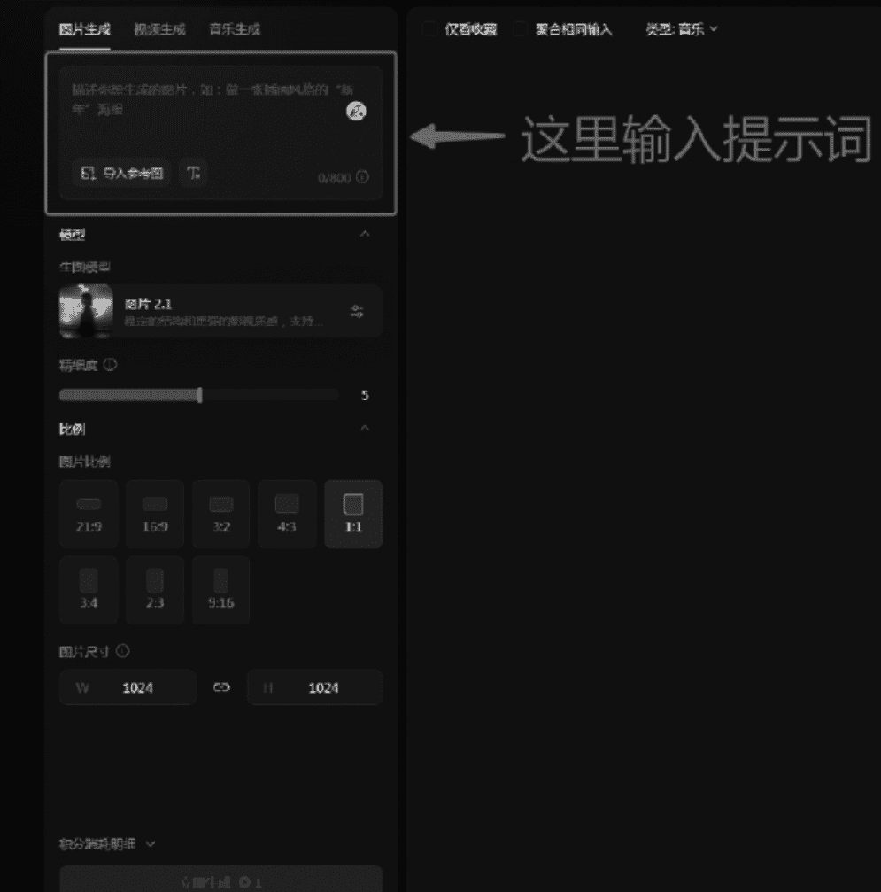
第二个是模型，即绘画引擎，需根据需求选择。各模型特点官方已说明。
- 图片生成
- 视频生成
- 音乐生成
描述你想生成的图片，如：做一张插画风格的“新年”海报

模型
生图模型
- 图片 2.1 New：结构稳定，影视质感更强，支持中英文文字生成
- 图片 2.0 Pro：多样性提升，照片质感真实，适合创新设计
- 图片 2.0：对描述词响应更精准，风格组合丰富，想象力强
- 图片 XL Pro：增强英文生成和参考图可控能力，引号可强化文字效果

精细度 5

比例
图片比例
- 21:9、16:9、3:2、4:3、1:1、3:4、2:3、9:16
图片尺寸 W 1024, H 1024
立即生成

第三个是精细度，可理解为图片质量，数值越大越精细。第四个是比例，控制图片尺寸和样式。

模型
生图模型
图片 2.1
稳定的结构和更强的影视质感，支持...
精细度 5
比例
图片比例
21:9、16:9、3:2、4:3、1:1、3:4、2:3、9:16
图片尺寸 W 1024 H 1024
积分消耗明细
立即生成

值越大图片越精致
图片最终大小
③ 生成效果图
参数设置好后点击【立即生成】即可得到海报草图。

主题风格
传统中式主题，融合工笔重彩与现代产品摄影，朱红色丝绸质感背景，温暖祥和，8K超高清，细节华丽。
核心产品
杯盏承明月，1380℃窑变鎏纹，赠苏绣杯套+手写祝福卡。

主题风格
传统中式主题，融合工笔重彩与现代产品摄影，朱红色丝绸质感背景，营造温暖祥和氛围，8K超高清，细节丰富华丽。
核心产品
杯盏承明月，1380℃窑变鎏纹，赠苏绣杯套+手写祝福卡。

画面描述
画面中央占比60%的朱红色陶瓷杯占据视觉焦点，杯口金边包边，杯身呈月圆形，寓意圆满；杯柄为立体祥云造型，纹样细腻。


注：由于AI生成图片，存在一些错误的异形文字，后同。


#### 步骤 4 精细调整
从样图可以看出，海报中出现了“怪字”。目前AI对文字，尤其是中文的支持仍不理想。建议在提示词中去掉文字部分，让AI只负责画面，后续再手动添加文字或难以一次性处理的细节，这样效果最佳。

即梦AI还支持二次编辑，可在生成图的基础上进行修复、消除、添加文字、抠图等人工处理，达到商用级质量。

上述思路同样适用于朋友圈配图、小红书封面、产品展示、插画乃至故事绘本、漫画等视觉化场景。

### 二、如何用AI生成故事绘本？
- 1. 构思故事
- 2. 生成绘画提示词
- 3. 完成绘本分页
- 4. 后期合成绘本

#### 步骤 1 构思故事
我想写一个有趣的儿童故事，但是我没有任何思路，请你向我问问题来帮助我明确需求，然后基于我的需求生成一个合适的故事。

好的！为了帮你构思儿童故事，我需要先了解一些信息。以下是关键问题。

- 1. 目标年龄层是？
3~5岁、6~8岁、9~12岁
- 2. 故事主题或教育意义？
友情合作、勇气自信、环保自然、包容多样性、解决问题、克服恐惧、好奇心等
- 3. 主角设定偏好？
动物、幻想生物、人家孩子
- 4. 故事基调？
温馨治愈、搞笑无厘头、奇幻冒险、神秘探索
- 5. 希望加入哪些元素？可多选
魔法道具、谜题任务、反派挑战、团队合作、自然奇观、日常生活中的奇迹

回答AI的问题后即可获得故事。

目标读者年龄段：6~8岁。
主题或教育目标：让孩子理解勇气的价值。
主角偏好：自行发挥。
故事基调：温馨治愈。
额外元素：自行发挥。

AI会据此创作。

好的！根据你的需求，我创作一个以勇气为核心、温馨治愈基调的儿童故事，主角是一只内向的小刺猬，融入魔法森林和会说话的星星等奇幻元素。

故事标题：《星星刺猬的发光勇气》
主角设定
小刺猬波波：背上银灰色刺，总觉得自己不够特别，害怕黑暗，讨厌自己的刺。秘密是，每当他鼓起勇气帮助别人时，刺会发出微弱星光。

故事大纲
平静的烦恼：波波住在蒲公英森林边缘，羡慕他人的特点，认为刺是缺点。
意外事件：深夜小兔子露露掉进猎人废弃陷阱坑，波波想救却不敢下坑。
神秘的指引：一颗会说话的星星出现：“你的刺能照亮黑暗，但需要勇气激活。”并点亮一根刺。
冒险与成长：波波颤抖着爬进深坑，刺的光越来越亮，用刺勾住藤蔓为露露搭“光的阶梯”，发现坑底还有迷路的萤火虫宝宝，最终一起逃出。
治愈结局：森林动物为波波庆祝，波波明白刺是点亮希望的灯。

核心教育点
- 勇气不是无所畏惧，而是带着恐惧前行。
- 缺陷可能正是独特的礼物。
- 善意行动会带来意外回报和友谊。

可扩展元素
插图建议：波波未发光时的灰暗刺与发光时的金色刺对比；陷阱坑内光的阶梯场景。
互动设计：让孩子找画面中隐藏的星星。

若无修改需求，可让AI基于此生成绘本设计思路。

很好，我希望基于此故事制作一个儿童故事绘本，请你给我绘本的设计思路。

好的！以下是《星星刺猬的发光勇气》的绘本设计思路，涵盖视觉风格、分页结构、互动细节。

整体视觉风格
色彩基调：夜晚深蓝、墨绿营造森林神秘感，暖金色星光象征勇气与希望。波波未发光时灰暗，发光时渐变为灿烂金色。
插图风格：水彩混搭彩铅，笔触柔和。角色设计上波波刺用银色细线勾边，发光时带金色光晕；星星为半透明漂浮体，带星尘粒子特效。陷阱坑内光的阶梯可做立体折页翻开呈现纵向深度。

分页结构与图文配合
封面：波波背对读者，刺微光，头顶悬浮星星，标题烫金镂空，星星部分覆UV触感。
P1-2：波波蜷缩树下，背景动物欢快玩耍，文字简短，树叶间藏萤火虫呼应结局。
P3-4：深夜陷阱坑全景，露露在坑底哭泣，对话框形式，坑洞边缘做模切镂空透出下一页星光。
P5-6：星星降落特写，光点溅到刺上，星星台词用发光字体，局部夜光油墨。
P7-8：波波颤抖爬进深坑，刺逐渐亮起，跨页大场景，文字精简，纵向翻页模拟下爬动作。
P9-10：坑内光的阶梯展开，萤火虫环绕，无文字，烫金线加浮雕可滑动。
P11-12：庆祝会场景，波波居中刺如星河，封底附一句“你也能找到属于自己的光哦！✨”，附赠贴纸页。

特殊工艺建议
厚纸板圆角，关键页覆哑光膜。波波刺用磨砂UV模拟粗糙感，发光部分光滑凸起；星星和萤火虫用闪粉涂层随角度闪烁。最后一页可加入薄荷味油墨。

教育元素视觉化技巧
勇气进度条：每页角落小刺猬图标随勇气值点亮，帮助孩子理解成长脉络。
找星星游戏：每页隐藏1~2颗小星星，培养观察力。
情绪对比：波波从低头缩肩到瞪大眼睛再到自信微笑的渐进变化。

确认后即可让AI基于分页结构生成绘本绘画提示词。

#### 步骤 ② 生成绘画提示词

用户想用即梦AI把故事做成绘本，要求按故事脉络和分页结构逐页给出可用的绘画指令。

可以，下面是适配即梦AI的12页绘本分镜提示词，已按封面封底纳入总数并做了画面统一优化。

封面

提示词：
“童话暖调，夜晚的魔法林深处，一只银灰色小刺猬背对镜头蜷缩，背刺顶端泛起淡金色微光，头顶漂浮一只半透明卡通星星，深蓝夜空里有银河漩涡，周围点缀萤火虫光点，水彩质感加柔焦光晕，书封构图留白处预留烫金标题。”

要点：刺猬背影的神秘感、星光与暗夜的对比、标题留白。

后续分镜内容略。

如果生成效果不理想，可以对提示词进行精修，让画面更具体、一致且质量更高。

更细化的分镜说明，包含构图、角色动作、光影逻辑和隐藏细节，能让即梦AI更稳定地还原情绪。

##### 封面
机位：低角度仰拍，突出波波背影与星空。
##### 关键要素：
波波背向观众，身体缩成半圆，背刺做金色渐变从#8B7355到#FFD700。
星星边缘半透明如果冻质感，表面撒星尘粒子。
背景为深蓝#2A4365夜空叠紫色薄雾，右下角隐约露出陷阱坑边。
隐藏细节：波波左后方草丛里藏一只萤火虫，仅露出尾部光点。

后续分镜内容略。

#### 步骤 3 完成绘本分页

把AI给出的每页提示词依次喂给即梦AI，完成单页绘画。参考成片如下。

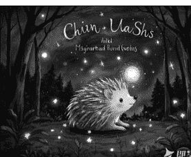


#### 步骤 4 后期合成绘本

单页画完后，可在即梦AI里把故事情节注入到各页画面，合成完整故事绘本。

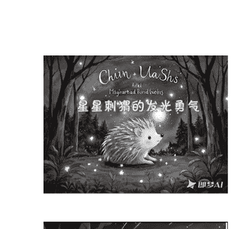

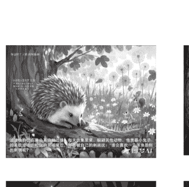


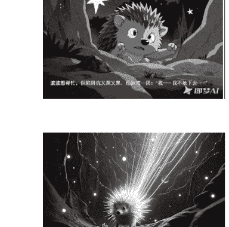

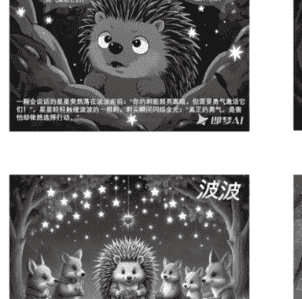

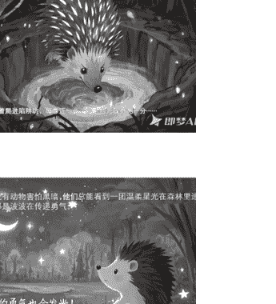

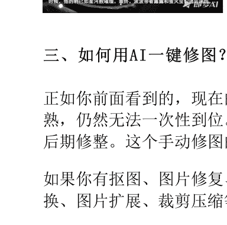

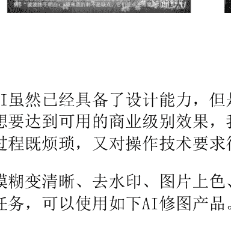

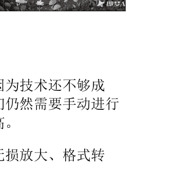

### 三、如何用AI一键修图？

目前AI设计能力已可用，但一次成型仍不稳定，离商业可用还有距离，必须做人工后期修整。手动修图既繁琐又要求技术。

常见需求如抠图、修复、清晰化、去水印、上色、无损放大、格式转换、延展、裁剪压缩等，可用以下工具：

- 百度AI图片助手：百度搜索即可直接用
- 佐糖
- 一键改图
- 稿定设计
- 创客贴

推荐百度AI图片助手，操作界面如下。

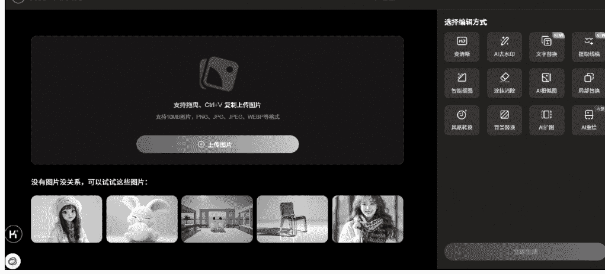

# 第九章

## AI文案生产的高分打法

### 知识要点

- 1. AI高质量文案生成的实操流程
- 2. 文案质量的场景化延伸
- 3. 其他场景的文案生成方式

想让AI产出有价值、甚至可商业变现的文案，核心在于流程。本章分享一套从构思到成稿的完整方法。

### 一、从构思到成稿的五步实操

该流程覆盖文章全生命周期，分5个环节：选题、思路梳理、初稿生成、初稿精修、后期排版校对。人工把控每步，才能让AI稳定达标。

#### 步骤 1 AI辅助选题

灵感枯竭时可让AI调研领域近期热点趋势并给出选题建议。以个人成长为例，可用提示词：

我是一名个人成长内容创作者，请结合该领域受众近期关注趋势，给我20个以上创作选题。

输入后AI会联网调研，给出潜力选题与方向。需开启联网搜索保证时效。

示例选题：

##### 一、自我提升与效率类

- “2025超个性化时代：如何用AI工具制定年度成长计划？”
- “从拖延到高效：用‘5秒法则’破解行动力瘫痪的神经科学原理”
- “副业焦虑自救：普通人借助零工经济实现收入突围？”
- “AI时代的抗替代能力：普通人应练的3种底层素质？”

##### 二、心理与情绪管理类

- “情绪复盘模板：把焦虑转化为生产力的方法”

后续内容略。

#### 步骤 2 AI提供创作思路

拿到选题后，若不确定切入点，可继续让AI拆解受众兴趣点。以“AI时代必备：普通人如何培养不可替代性的3种底层能力？”为例，提示词：

我对这个选题感兴趣，但没有思路，请结合受众关注点，给出详细创作思路。

AI会基于数据分析给出清晰角度。若不满意，可多轮调教直至可用。

后续思路内容略。

#### 步骤 3 AI生成初稿

思路确定后，需明确平台、篇幅、风格、调性等细节再生成。示例提示词：

请基于上述框架，为公众号写一篇约6000字的文章。

要求：风格不生硬，用大众爱看的方式推进，适当加入幽默，保持深度与趣味平衡。

AI常出现偷工减料，需用更明确指令约束。

示例框架与精简版内容略。

如需完整版，可要求不做精简直接输出约6000字。

标题示例：《AI都抢不走你的饭碗！普通人逆袭的3个反骨能力，越早练越值钱》

开头用段子共鸣，Part 1批判性思维——别让AI洗脑，小标题《当AI说你该躺平时，要学会掀桌子》，场景化痛点...

后续内容略。

#### 步骤 4 对初稿进行反复调整

推理型AI初稿难免不完美，可逐段指出问题让其修改。例如过渡突兀：

以下两部分的衔接很生硬，请丰富内容让过渡丝滑。

###### 开篇：段子制造共鸣
###### Part 1：批判性思维——别让AI洗脑

优化后增加逻辑衔接与数据引用，保持幽默同时提升连贯性。

后续可指令AI调整逻辑、换案例、改语气、增删段落、提炼金句、补充论据数据等。反复精调后即得高质量文案。

#### 步骤 5 后期排版校对

正文满意后做排版、违禁词检测、配图可视化，提升质感与辨识度。

- 技巧1
##### AI辅助配图
可直接让AI给出整篇文章的配图建议与插图策略，具体到每段并说明构思理由。后续建议内容略。

- 技巧2
##### AI违禁词检测
请AI按微信公众号规范检测合规性并给出修改建议。检测结果与建议略。

- 技巧3
##### AI辅助排版
按公众号排版规范输出Markdown代码，保证阅读体验。代码示例略。

AI的文案能力不止图文，也可生成小红书图卡、抖音B站视频文案。

### 二、文案质量的场景延伸

#### 延伸场景1
##### 辅助创作视频脚本

视频本质也是内容，思路通用。可解决两个关键场景。

###### 1. AI生成口播稿
把文章转为口语化口播稿，保持深度与趣味。提示词示例与口播稿略。

###### 2. AI生成视频分镜头脚本
让AI给出完整分镜头脚本，并附工具清单、背景音乐等素材及获取渠道。方案示例略。

提示：背景音乐、配音、数字人形象等素材，AI也能生成，后续章节详述。

#### 延伸场景2
##### 辅助创作小红书风格文案
把长文转为小红书风格，并提供封面图与内容图设计建议。示例略。

### 三、其他场景的文案生成

AI同样擅长公文、广告、演讲稿、小说、论文等写作。

#### 1. 商务公文
示例：行政部负责人需向上级汇报员工打架事件并征求处理意见，按标准公文格式生成报告。
示例：政府活动请示文、劳动合同起草及注意事项提示。

#### 2. 广告文案
示例：为品牌周年庆/节日/清仓活动写促销文案，突出核心功能、场景化或对比手法并加入紧迫感。
示例：房地产楼盘广告词20条，从多角度诠释。

#### 3. 演讲稿
优秀入职演讲应包含哪些内容？示例要求感谢同事、表达工作决心，语言口语化有感情。
示例：以“时间的重量”为主题写800字演讲稿，含3个故事并用“那一刻，我意识到……”串联，高潮点题“时间从不是敌人”。

#### 4. 小说
示例：提供10个悬疑题材选题，给出创作思路、简介与大纲，完成约6000字小说。

#### 5. 论文
示例：为人工智能专业研究生提供10个热点选题，给出研究思路与提纲。

# 第十章

## 视频制作加速器：快速制作可变现的高质量视频

# 让创意迅速落地成吸睛视频的实战路径

抢占流量的关键在于能否把灵感快速、可信地搬到屏幕上并引发共鸣。过去拍片成本高、流程长，现在借助智能创作工具，普通创作者也能产出接近专业水准的成品。

信息流里已经大量出现由AI驱动的微短剧、图书解读、影视复述。这类内容上线后往往带来粉丝快速增长和可观的商业回报。

本章不做理论铺垫，只做可复制的实操。用四个典型场景，手把手演示在很短时间内完成智能赋能的视频制作，形成一套可复用的方法论。

### 场景1
##### AI生成童话故事

很多家长希望孩子通过短小可视化的英文童话来培养语感，这类内容在小红书、抖音等平台很受欢迎，不少账号借此积累粉丝并实现变现。下面完整走一遍落地流程。

###### 步骤 1 AI生成故事情节

绘本章节里已做过中文稿，这里直接复用。原文是中文，需要转成英文，让模型完成语言转换，参考提示如下。

> 请将这则童话翻译成地道的英文，保留原意不要改写。

（插入前文生成的故事）

转换后保持了自然表达并忠实于原意。

####### Bobo’s Starlight Adventure

Once upon a time, at the edge of Dandelion Forest, there lived a little hedgehog named Bobo. He spent his days quietly collecting sweet berries and keeping away from the other animals. Bobo felt troubled by his sharp, prickly spines. He often gazed at Lulu the rabbit’s soft, fluffy fur or the squirrels’ nimble tails and thought to himself, “Who could ever like a hedgehog covered in spines? They’re nothing but trouble!”

后续生成内容略。

###### 步骤 2 根据故事获取画面

童话情节较为简单，无需电影级动态画面，用人工智能绘图产出静态图即可。该环节与绘本制作思路一致，此处不再展开，后续复杂动态会在其他场景说明。

###### 步骤 3 根据故事文本获得配音

文本与画面就绪后，需要为故事配上英文语音。当前文本转语音技术已很成熟，听感接近真人，无需真人录制。

- 海螺 AI；
- 剪映；
- 魔音工坊；
- 悦音配音；
- Tiktok Voice。

这些工具都支持多语言与多种音色。其中海螺AI音质突出，目前免费且无次数限制，下面以它为例演示，其他工具操作基本相近。

进入海螺AI后会看到如下界面。

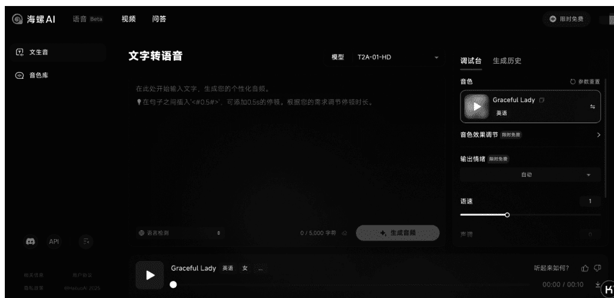

界面简洁直观。只需在音色库挑选合适的声线与语言，语调语速建议沿用默认设置，将英文稿粘贴到输入框，点击【生成音频】即可开始。

生成完成后会得到自然流畅不机械的配音，先在线试听确认，再点右下角下载保存。

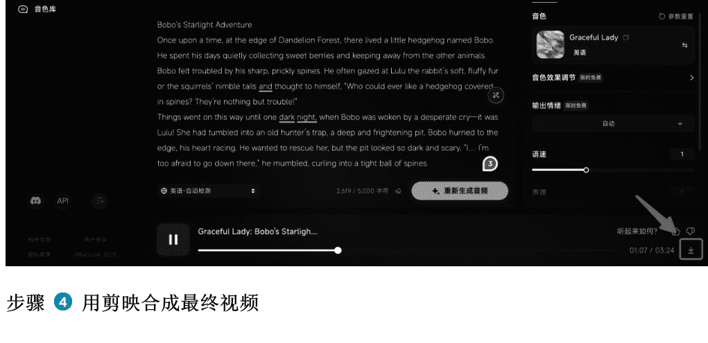

###### 步骤 4 用剪映合成最终视频

到这里已拿到英文稿、配音与画面，用剪辑软件拼接即可。推荐剪映，功能强且易上手，可免费下载。

打开剪映把素材拖入轨道按顺序排列。可加入背景音乐，利用贴纸、转场、字体特效等提升质感。

剪映上手快，具体教程不再展开。导出后即可得到一部完整的儿童英文故事视频，直接发布到社交平台。

### 场景2
##### 拆书稿视频

个人成长赛道里，很多人不愿自己读书，却喜欢听他人解读。刷到的讲书博主多是通过这种形式吸粉变现。

本案例教你借助智能工具快速产出配音混剪的讲书视频。

###### 步骤 1 用AI获取拆书文稿

不擅长写稿或没时间都可让模型代劳。示范提示词：

> 我是做读书类视频的创作者，现在想解读《被讨厌的勇气》这本书。请为我生成一份完整的拆书文稿。

请注意以下几点：

1. 视频时长大约10分钟，将以配音混剪形式呈现，请确保内容适配这个时长与形式。

2. 文稿风格不要过于沉闷，请以大众更容易接受的方式安排内容与结构。

以下是为《被讨厌的勇气》设计的10分钟混剪拆书文稿，内容兼顾知识深度与趣味性，适合配音视频使用：

（以下略）

####### 小贴士：

AI生成的初稿如果不够满意，你还可以用“多轮调教”的方式反复打磨，直到得到你想要的版本。

内容有点单薄，请你在当前基础上扩展更多细节，丰富描述。

......

###### 步骤 ② 使用剪映一键生成视频

拿到AI生成的文稿后，接下来就可以把文字转成视频了。

不想在剪辑上投入太多时间，又希望快速产出，这里推荐两款高效工具：

- 剪映的AI一键成片功能；
- 百度的 度加一键成片。

这两款工具都能基于文字稿自动生成视频。你只需上传文本，系统就能自动配音、选图、加音乐、字幕与转场贴纸，基本完成整部制作。若对画面质量要求不高，可直接导出发布。

以“剪映一键成片”为例，操作方法如下：

1. 打开剪映主页，找到【AI文案成片】或【图文成片】入口。
2. 将准备好的文字内容粘贴进去。
3. 选择一个喜欢的朗读音色。

稍等片刻，剪映就会自动完成配音、画面选取、配乐、字幕添加等操作，为你生成一条完整的视频。

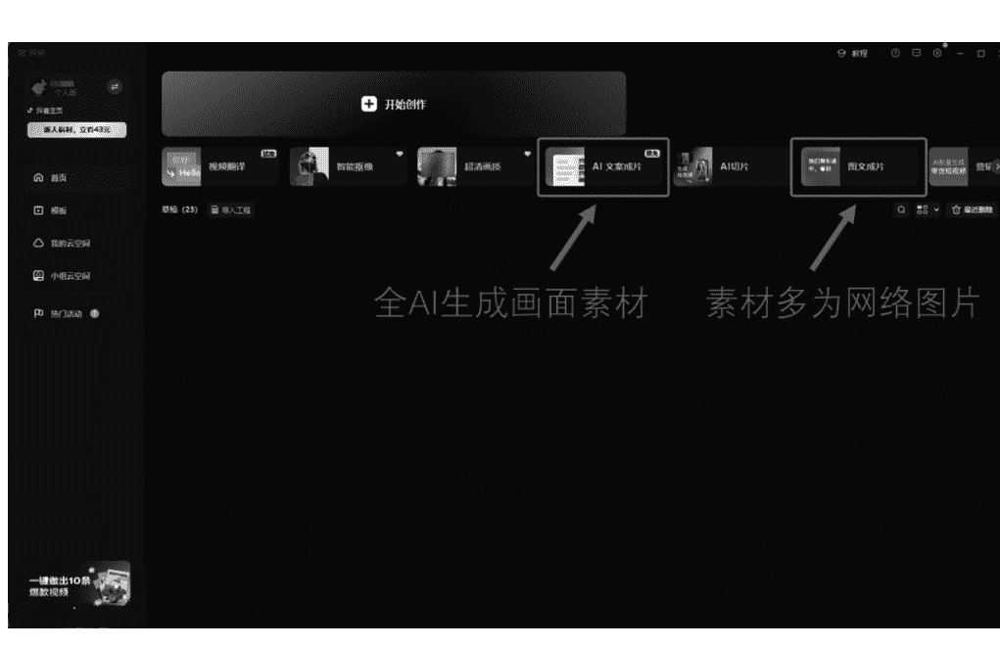

这种“秒出”的视频，效果往往难以令人惊艳。若对呈现质量有更高要求，可把它当作初稿使用——在此基础上稍作打磨，就能显著提升整体观感。可参考前面提到的技巧，比如：

- 添加AI自动生成的图表，增强内容的信息密度；
- 使用更精致的视觉设计图，提升画面质感；
- 甚至自行配音，让情感更饱满、风格更贴合定位。

通过这些细节优化，就能把草稿升级为具有专业水准、媲美优质博主的作品。

### 场景3
##### AI生成短剧

当下，短剧和微视频是市面上受众较广的视频形式。许多博主利用AI大量生成类似《故事会》《意林》风格的经典故事，再通过AI将其转化为短剧，成功获得了大量关注。若对AI生成定制化视频画面的方法感兴趣，想要学会用AI制作短剧和微视频，请跟着下面的步骤操作。

###### 步骤 1 AI生成短剧故事

若自己没有故事创意，可以直接让AI帮忙生成，以下是参考提示词。

你：我是一名短剧赛道的视频内容创作者，请你参考《故事会》里面故事的风格和形式，为我生成一个10分钟左右，有趣且吸引人的悬疑故事。

请注意：这个故事我要做成短剧，请你以故事人物对话以及旁白解说的形式呈现。

AI：好的，我将按照你的要求创作一个悬疑故事。为了让故事更完整，我会先列出一些基本框架。请你看看以下内容是否符合你的预期。如果你有其他想法，可以随时提出来，我会进行调整。

####### 故事梗概

- 神秘包裹：快递员林小满在暴雨夜收到一个没有寄件人信息的鹦鹉笼，笼中鹦鹉突然开口说话，引发一系列诡异事件。
- 午夜追踪：鹦鹉带领主角来到废弃的平安医院，在破败的产科病房发现血迹斑斑的婴儿服，暗示3年前的医疗事故。
- 双重身份：主角在调查中发现自己与医院院长存在血缘关系，而鹦鹉竟是当年难产而死的孕妇灵魂所化。
- 命运闭环：当主角准备报警时，他发现自己的手机信号被屏蔽，而医院院长正带着手术刀走向他，暗示悲剧即将重演。

后续生成内容略。

你：很好，请你生成完整的故事剧本。

###### 步骤 2 AI生成故事配音

通过前面步骤获得剧本后，就可以为角色进行配音了。配音工具前面已推荐过，音色丰富，甚至包括方言。可根据人物设定挑选合适音色，旁白可用播音腔人声。由于具体操作前面已演示，这里不再重复。

###### 步骤 3 AI生成视频画面

短剧对画面质量要求较高，不能依赖静态画面或混剪视频，而是需要根据剧本分镜要求，生成与故事场景高度契合的动态画面。这时需要借助能够生成特定视频的AI工具。

目前市面上免费且效果较好的文生视频工具推荐以下几款。

- 即梦AI；
- 可灵AI；
- 海螺AI；
- 通义万相；
- 跃问；
- 智谱清言；
- Lumen；
- Luma。

有了合适工具后，需要为其提供生成画面的提示词。这一步操作很简单，即使无法精准描述画面，也可以将任务交给AI，让它根据剧本分镜生成每个画面的提示词。

以下是让AI描述视频画面的提示词，以即梦AI为例。

现在我想通过AI生成视频的方式，分片段去呈现这个故事，请你根据这个剧本为我逐个生成描述各个分镜片段画面的提示词，让AI可以通过这些提示词去生成合适的画面。

我使用的AI视频生成平台是即梦AI。

以下是为即梦AI平台设计的分镜提示词模板，严格遵循“镜头语言+光影+主体+运动+场景+氛围”的结构，并标注了关键要素。

####### 第一幕：诡异收件

######## 分镜1-1

镜头语言：低角度仰拍 +360° 环绕。

- 光影：闪电蓝白强光+顶棚漏雨的光斑。
- 主体：湿透刘海儿的快递员（特写颤抖的手）。
- 运动：缓慢靠近悬浮的金色鸟笼。
- 场景：堆满渗血快递箱的仓库。
- 氛围：婴儿哭声混着心电图警报声。

######## 提示词：

> “暴雨夜仓库内，年轻快递员湿透工作服特写，闪电照亮金色鸟笼时所有快递箱渗出红水，360 ° 环绕拍摄主角惊恐表情，顶光制造面部明暗对比，背景音效婴儿哭声渐强。”

后续生成内容略。

拿到AI给出的文生视频分镜画面提示词后，可到即梦AI中找到【AI视频】。由于是对风格连贯性要求较高的故事，建议点击【故事创作】按钮。

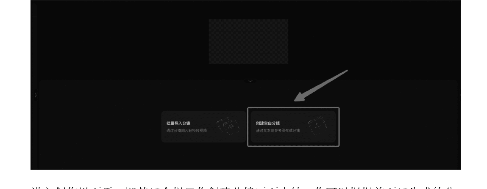

进入创作界面后，即梦AI会提示创建分镜画面小结。可根据前面AI生成的分镜画面提示词，直接创建所需视频画面，并将相应提示词粘贴进去。这样能快速生成与剧本高度匹配的动态画面。

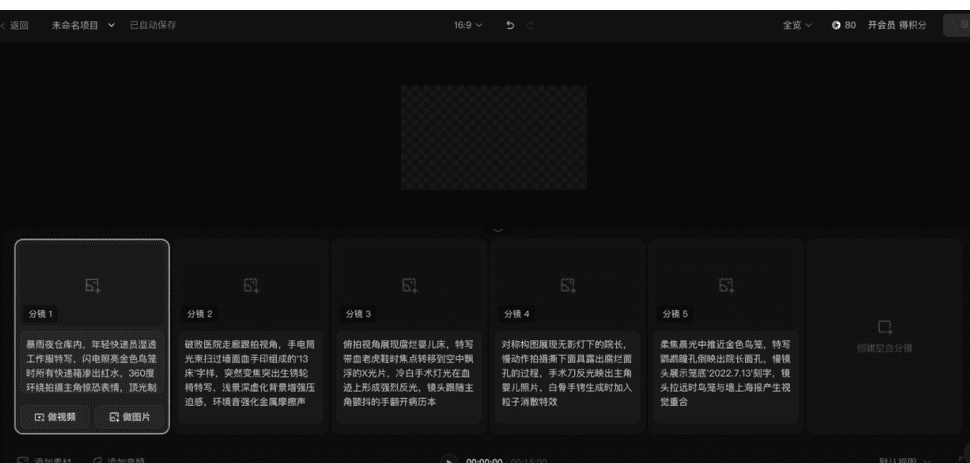

分镜提示词粘贴完成后，点击分镜的【做视频】按钮，即梦AI会弹出【视频生成】面板，若无特殊要求，直接点击【生成视频】按钮，它会自动生成符合描述的视频画面。

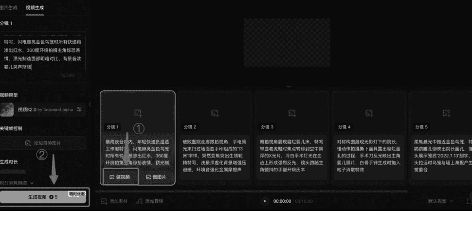

由于生成过程存在一定随机性，某些特定画面可能需要多次尝试才能达到理想效果。虽然过程略显繁琐，但只要有耐心，最终一定能获得满意结果。

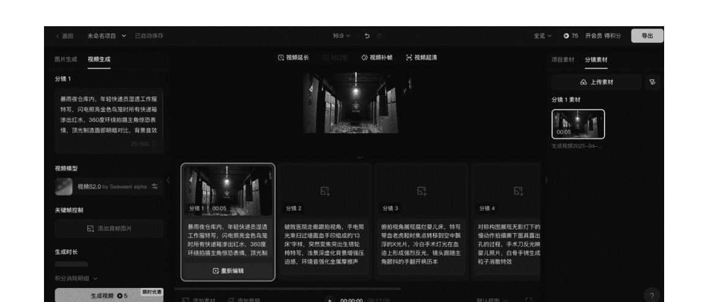

首个画面生成后，其他画面同理操作，篇幅原因不赘述。

小技巧：若对画面质量要求较高，尤其是希望呈现接近电影级别的视频效果，可先用AI绘画工具生成故事中各个人物形象，再让AI基于这些人物形象生成视频。这种方法能确保人物形象和视频风格的一致性，提升整体质感。

###### 步骤 4 用剪映合成大片

与前面场景类似，获得文稿字幕、视频画面和配音文件后，可通过剪映进行合成。根据需求，可在剪映中为视频添加合适的背景音效、字幕、特效等，进一步提升视频质感和观感，打造电影级效果。由于这部分操作前面已详细讲解，就不赘述了。

### 场景4
##### AI数字人视频

在许多视频场景中，真人出镜的口播内容是必不可少的，但真人出镜不仅耗时耗力，还对镜头表现力有极高要求。因此，若需要制作涉及真人出镜的视频，可用AI数字人代替真人。

以知识赛道的一个场景为例：生成古代名人数字人形象，让他们进行对话，比如“苏格拉底与老子对话”。以下是该场景的具体实现步骤。

###### 步骤 1 AI生成对话文稿

与前面场景一样，若没有能力自己写文稿，可直接让AI帮忙生成。以下是参考提示词。

我想做一个古代名人对话的视频，现在请你同时扮演老子和苏格拉底，让他们围绕“人生的意义”这个话题展开讨论，并为我生成他们对话的文稿，对话时长大约10分钟。

请注意：

1. 请确保对话的语气和思想性符合主人公历史上的真实情况，不得胡编乱造；
2. 以对话的形式生成内容，想象一下如果他们真的有机会坐在一起讨论这个话题，他们会谈什么，会是怎样的场景。

> （场景：雅典卫城废墟旁，橄榄树荫下。老子身着素色深衣，苏格拉底披着简朴长袍对坐于石凳之上。远处传来萨拉米斯海风的轻吟。）

> 苏格拉底（轻抚陶杯边缘）：“异邦的智者，我听闻你主张‘大道泛兮，其可左右’，这与雅典哲人将哲学从星辰拉回人间竟有奇妙呼应。但你如何理解人生在世的根本意义？”

> 老子（指尖掠过石桌纹路）：“万物并作，吾以观复。你看这石纹如水脉流转，人生意义不在追逐而在顺应。五色令人目盲，五音令人耳聋——世人向外求索，反失其本。”

后续生成内容略。

###### 步骤 ② 获取生成数字人形象的提示词

有了对话文稿后，可让AI帮忙生成两位智者形象。下面是参考提示词。

我想通过即梦AI画出老子和苏格拉底的形象，我该如何向AI描述呢？请你分别提供生成他们二人形象的提示词。

请注意，我需要把他们做成数字人，请你只突出主体的形象，不要有其他无关的环境或者物品出现。

根据你提供的知识库中关于AI生成古代名人的技术要点，以下是针对即梦AI的精准提示词建议。

生成老子形象的提示词：

“中国古代哲人老子，约70岁，长须，白发束于头顶，面容清瘦且眼神深邃，身着素色麻布深衣，衣纹垂坠自然，手持竹简，面部光线柔和，写实风格，8K分辨率，人物居中，正面面对镜头，无背景。”

生成苏格拉底形象的提示词：

“古希腊哲学家苏格拉底，55岁，地中海式秃顶，浓密卷曲胡须，深邃眼窝，身着朴素亚麻长袍，手持陶杯，肌肉线条自然，古典雕塑质感，写实风格，8K分辨率，人物居中，正面面对镜头，无背景。”

###### 步骤 ③ AI生成数字人形象

获得提示词后，可用即梦AI或其他AI绘画软件生成所需数字人形象。

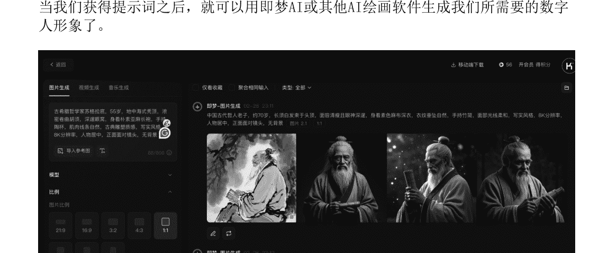

特别提醒，由于AI绘画模型存在随机性，可能需要让它多生成几次才能得到较好形象图。

拿到人物形象后，可要求AI基于人物形象生成栩栩如生的数字人。


###### 步骤 4 生成数字人视频

关于AI生成数字人，实际有两个细分类别：第一类是对口型数字人（通过单张图片生成），第二类是生成匹配真人级的数字人，后者可达到以假乱真的出镜效果。

对于前者，前面推荐的文生视频工具几乎都能实现。而对于后者，市场上做得最好的当属HeyGen。

在HeyGen平台，只需提供内容文稿、声音样本和数字人形象，系统会自动生成出镜级数字人，几乎可以做到以假乱真。但其收费不低，国内较好的平替有剪映和必剪的数字人功能。

由于本例不需要高精度数字人，可使用即梦AI生成对口型数字人。

在之前生成数字人形象的界面切换到【视频生成】面板，然后选择【对口型】，在【角色】选项中上传刚才生成的数字人形象。

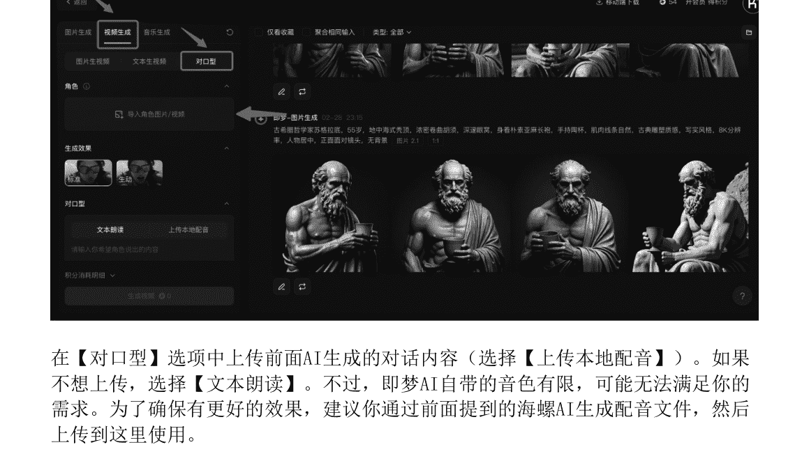

在【对口型】选项中上传前面AI生成的对话内容（选择【上传本地配音】）。不想上传可选【文本朗读】。不过，即梦AI自带的音色有限，可能无法满足需求。为了确保更好效果，建议先通过前面提到的海螺AI生成配音文件，然后上传使用。

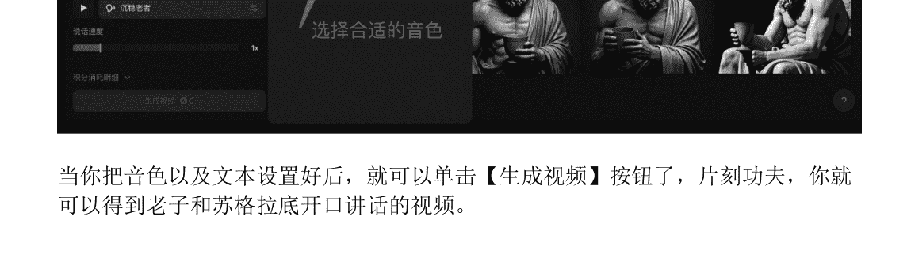

音色和文本设置好后，可点击【生成视频】按钮，片刻即可得到老子和苏格拉底开口讲话的视频。

###### 步骤 5 用剪映做后期精调

与前面思路一致，获得所有视频、配音、字幕等内容后，可把它们拖入剪映里进行最终合成和精修。

# 第三部分
## AI自动化与高阶应用
# 第十一章 AI自动化：告别重复劳动的AI自动化方案
### 知识要点
1. 认识 AI Agent
2. 如何配置工作流？

前面介绍了多种AI应用场景，如AI设计、AI写作、AI音视频制作等。然而实际操作中你会发现，要达成预期目标往往需要经过多个步骤。以写作为例，可能需要经历选题获取、标题拟定、大纲设计、正文生成、后期润色、配图、审查、排版等多个环节，才能产出优质内容。

把AI变成你的超级员工，一键跑通复杂流程

你会不会也在想：AI能力已经这么强了，能不能把一个复杂任务拆成的多道工序串起来，点击一次就全办完？也就是像管理一位顶尖员工那样，只下达一个总目标，给几个关键词，剩下的分析、规划、执行全交给它，自己完全不用插手？

完全可以，这就是AI Agent智能体的作用。下面就展开讲清楚。

### 一、认识AI Agent

智能体本质上是一个能自己干活的AI员工。你设定一个宏观目标，它按既定流程自动把所有细节跑完，甚至能自行拆解问题、调整方案。整个过程无需人工干预，几乎所有能用电脑完成的事务，理论上它都能接手。

怎么搭出这样的智能体？下面给出完整实操路径。

#### 1. 选择工具

先选好武器再开工。现在市面上能用来搭智能体的主流平台有：

- 扣子；
- Dify；
- Make；
- Zapier；
- n8n。

目前这些工具还达不到理论上的完美智能体，但在绝大多数办公场景里已经非常好用。随着生态不断完善，理想的超级智能体指日可待。

扣子是字节跳动出品，更符合国内使用习惯，生态也更丰富。内置多种大模型和插件，包含DeepSeek R1等，并且对个人用户免费。所以下面以扣子为例演示，其他平台逻辑相通，学会一个就能举一反三。

#### 2. 认识扣子

登录扣子后，左侧边栏的 ⊙ 按钮就是创建入口。平台提供两种创建方式，除非你要做商业级应用或已经很熟练，否则建议直接选【创建智能体】，对新手更友好。

点进【创建智能体】后，会弹出【标准创建】和【AI创建】两个选项。标准创建是自己一步步搭建；AI创建是把需求描述给AI，由它来生成框架。对新手和流程不复杂的情况，AI创建更省事；流程复杂、难以用语言讲清时，再用标准创建。

以AI创建举例。假设要做一个旅游规划助手，能实时查航班和酒店信息，还能给游玩攻略，可以写这样的需求：

> 我想做一个旅游规划小助手，要能实时查询行程里的航班和酒店信息，同时提供详细的玩法攻略。

写完点【生成】，系统会自动生成智能体名称、头像以及实现需求的功能。确认后进入配置页。

配置页被分成三块：左边是【功能实现区域】，用提示词设定工作逻辑；中间是【参数配置区域】，用来扩展更复杂能力；右边是【调试预览区域】，实时测试效果。

###### 技能
- 插件
- 工作流
- 触发器

###### 知识
- 文本
- 表格
- 照片

###### 记忆
- 变量
- 数据库
- 长期记忆
- 文件盒子

###### 对话体验
- 开场白
- 用户问题建议
- 快捷指令

左右两边比较好理解，核心在于中间的参数区。

【插件】用来给智能体扩容，能让它具备联网检索、图像理解、音乐生成、代码执行等能力，可按需赋能。

- 添加插件
- 搜索
- 创建插件
- 资源库工具
- 收藏
- 探索工具
- 全部
- 自动推荐
- 便利生活
- 新闻阅读
- 图像
- 实用工具
- 网页搜索
- 科学与教育
- 社交
- 游戏与娱乐
- 金融与商业

| 插件名称 | 描述 | 工具数量 | 使用人数 | 发布者 | 发布时间 | 点赞数 | 其他数据 |
|----------|------|----------|----------|--------|----------|--------|----------|
| 必应搜索 | 从Bing搜索任意信息和网页URL。 | 2个工具 | 404.4K个智能体正在使用 | 扣子官方 | 2024-11-07 20:31 | 7720 | 13.9M \| 404.4K \| 1077ms \| 99.6% |
| 链接读取 | 获取网页、pdf、抖音视频等链接下的标题与内容。 | 1个工具 | 269.2K个智能体正在使用 | 扣子官方 | 2025-01-20 11:28 | 9250 | 16.6M \| 269.2K \| 1467ms \| 92.1% |
| 图片理解 | 对URL图片进行问答。 | 1个工具 | 205.4K个智能体正在使用 | 扣子官方 | 2024-08-27 10:46 | 4782 | 2.6M \| 205.4K \| 7506ms \| 97.6% |
| ByteArtist | 按文本描述生成图像，可指定张数和尺寸。 | 3个工具 | 115.8K个智能体正在使用 | 扣子官方 | 2024-09-10 18:25 | 5437 | 4.1M \| 115.8K \| 10.3s \| 99.1% |
| 头条搜索 | 用头条搜索功能阅读或检索URL。 | 2个工具 | 118.5K个智能体正在使用 | 扣子官方 | 2024-06-17 18:14 | 2342 | 30.6M \| 118.5K \| 1343ms \| 99.8% |
| 代码执行器 | 配备多款擅长代码解决问题的工具。 | 1个工具 | 87K个智能体正在使用 | 扣子官方 | 2024-06-17 18:14 | 2342 | 30.6M \| 118.5K \| 1343ms \| 99.8% |

【工作流】是实现多任务复杂流程的关键，没有工作流就不算真正的智能体，后面会细讲。

【触发器】决定智能体何时、以何种方式执行。

【知识】用来喂资料，可上传本地数据供智能体参考。

【记忆】设定记忆方式，通过变量、数据库、长期记忆、文件盒子实现人性化交互。

【开场白】控制首次打招呼的文案。

【用户问题建议】基于对话自动猜测用户可能追问的问题并列出。

【快捷指令】预设常用功能，一键调用。

【背景图片】【语音】【用户输入方式】分别控制界面美化、回复音色、输入方式是打字、语音还是通话。

若走AI创建，三个区域会自带预设参数；选标准创建则页面为空，需全手动配置。

需求简单时直接点右上角【发布】即可分享链接；需求复杂需要多流程配合，就要自己配置工作流。

##### 认识工作流

让智能体处理复杂任务的核心就是工作流。它把多个小任务按目标串联成一条流程，完成一个大任务。

工作流类似工厂流水线，起点接收原料，中间各工位加工，终点输出成品。搭建智能体的关键就是设计这条流水线。

在参数配置区找到【工作流】，点 ➕ 打开添加对话框，点【创建工作流】，填名称和描述，确认即可进入配置台。

##### 如何配置工作流？

进入台后默认有两个节点：开始节点Start和结束节点End。开始节点用input接收用户输入，结束节点用output输出结果。

以自媒体公众号封面图制作为例。封面决定点击率，手工做很费时，用智能体可以自动化。

###### 步骤 1 规划实现流程

先明确最终效果：用户在开始节点输入关键词，智能体自动据此生成贴合主题的图片，降低亮度突出文字，再把关键词以合适字体和字号放在正中，最后由结束节点输出成品封面。

对应工具链为：
- AI文本大模型：把关键词补全为可用的绘图提示词
- AI绘画大模型：根据提示词生成图片
- 图片处理工具：调节亮度对比度
- 文字添加工具：在图上叠加关键词

###### 步骤 ② 一步步配置实现

开始节点已自动创建。触碰节点右侧的连线手柄会弹出工具面板。大模型即豆包、DeepSeek、Kimi等，插件就是各行各业工具。

先加【大模型】节点。右侧配置项如下：
- 【模型】选择具体模型
- 【技能】可加联网搜索等额外能力
- 【输入】用input变量承接用户关键词
- 【系统提示词】设定工作指令
- 【用户提示词】以{{input}}形式引用用户输入
- 【输出】用output变量保存结果，供下一节点调用

第二步加【图像生成】工具：
- 【模型】选通用、人像、油画等绘画模型
- 【比例】选尺寸
- 【生成质量】控制精细度
- 【参考图】可选
- 【输入】接收上个大模型的输出
- 【正向提示词】引用上一步生成的提示词
- 【负向提示词】排除不想要的元素
- 【输出】data为图片，msg为过程信息

第三步加【图片处理工具】。面板里没有现成工具时可点【插件】进入市场。找到【调整】插件添加后，可上传上个节点生成的data图片，拖动滑块调节亮度和对比度。

第四步加【文字添加】插件。市场搜索【添加文字】后插入：
- 【底图】引入上一步处理后的图片
- 【文字内容】引入开始节点的关键词input变量
其余参数按需调整。

最后把最后一个节点的输出连到结束节点，并在结束节点配置面板里把最终产品接收进来。点【试运行】输入关键词即可生成封面，测试通过后点【发布】供智能体调用。

扣子的玩法远不止此，掌握了工作流的底层逻辑就能自行扩展，实现更强大的生产力提升。

# 第十二章 AI编程：零编程基础也能打造可变现软件

### 知识要点

- 1. 简单场景——基础小工具实现
- 2. 进阶场景——网页端程序实现
- 3. 复杂场景——软件级程序实现

上一章讲了智能体，已很强大但仍有限制，比如不能直接操作本地文件和数据，或完成高度定制化任务，这就必须进入编程。

过去写代码是程序员专属，普通人只能用现成软件，价格贵功能受限，自己开发又因门槛望而却步。AI时代这道墙被打破了，有AI辅助零基础也能做出个性化软件。本章用三个递进案例带你掌握核心思路。

### 一、简单场景——基础小工具实现

简单场景不需要搭建环境，用在线代码运行工具或直接在模型里运行即可。虽然功能有限，但做实用小工具足够，且完全不需要编程基础。

之前用代码生成图表的案例就属于此类。为了加深理解，下面介绍一个职场常用场景。

在微信群或朋友圈，常有人把行业最新资讯做成图文简报，既提供价值又降低广告被屏蔽的风险。手工整理很累，用AI加HTML就能自动化。

参考提示词，记得打开大模型的联网功能：

请你整理一下今天网上最火的10条关于AI的新闻，然后用HTML把这10条新闻做成日报。

注意事项：
1. 日报标题参考格式：常青分享-AI每日大事件｜××年×月×日。
2. 每条新闻包含标题、简介、来源。
3. 用舒适美观的排版呈现。
4. 运行代码后自动把日报保存为图片。

生成后的HTML代码可用DeepSeek或Claude等支持直接运行代码的模型查看，点击【运行】即可。若模型不支持，可在网上搜【HTML在线运行】工具粘贴代码运行生成日报。

##### 常青分享-AI每日大事件

```html
<!DOCTYPE html>
<html lang="zh-CN">
<head>
    <meta charset="UTF-8">
    <meta name="viewport" content="width=device-width, initial-scale=1.0">
    <title>常青分享-AI每日大事件 | 2025年3月1日</title>
    <style>
        body {
            font-family: "PingFang SC", "Microsoft YaHei", sans-serif;
            max-width: 800px;
            margin: 0 auto;
            padding: 20px;
            background-color: #f5f5f5;
            color: #333;
        }
        .header {
            text-align: center;
            margin-bottom: 30px;
            padding-bottom: 20px;
            border-bottom: 2px solid #e0e0e0;
        }
        .header h1 {
            color: #1a1a1a;
            font-size: 24px;
            margin-bottom: 10px;
        }
        .header .date {
            color: #666;
            font-size: 14px;
        }
        .news-container {
            background-color: white;
            border-radius: 8px;
            padding: 20px;
            box-shadow: 0 2px 10px rgba(0,0,0,0.05);
        }
        .news-item {
            margin-bottom: 20px;
            padding-bottom: 20px;
            border-bottom: 1px solid #eee;
        }
        .news-item:last-child {
            border-bottom: none;
            margin-bottom: 0;
            padding-bottom: 0;
        }
        .news-title {
            font-size: 18px;
            font-weight: bold;
            color: #1a1a1a;
            margin-bottom: 8px;
        }
        .news-content {
            font-size: 14px;
            line-height: 1.6;
            color: #444;
        }
        .news-source {
            font-size: 12px;
            color: #888;
            margin-top: 8px;
        }
    </style>
</head>
<body>
    <div class="header">
        <h1>常青分享-AI每日大事件</h1>
        <div class="date">2025年3月1日 星期六</div>
    </div>
    <div class="news-container">
        <div class="news-item">
            <div class="news-title">1. OpenAI推出GPT-4.5：具备多模态自我改进能力</div>
            <div class="news-content">OpenAI今日正式发布了GPT-4.5版本，该版本能够理解视觉、音频和文本并进行自主学习与优化。根据少量测试，GPT-4.5在复杂任务解决能力和长上下文理解方面有显著提升，尤其是在自动调试和代码生成方面表现突出。</div>
            <div class="news-source">来源：OpenAI官方博客</div>
        </div>
        <div class="news-item">
            <div class="news-title">2. 欧盟AI安全委员会公布“AI合规评估标准2.0”</div>
            <div class="news-content">欧盟AI安全委员会正式发布新版AI合规评估标准，更新内容包括更严格的透明度要求、数据使用审计机制以及对大型语言模型的风险分级管理。该标准将从2025年6月起全面实施，预计将对全球AI企业产生重要影响。</div>
            <div class="news-source">来源：欧盟委员会官方网站</div>
        </div>
        <div class="news-item">
            <div class="news-title">3. 谷歌Gemini Ultra推出企业定制版本</div>
            <div class="news-content">谷歌今日宣布Gemini Ultra企业版正式面向全球企业客户推出，该版本允许企业使用自有数据进行定制化训练，并提供增强的数据隐私保护。新版本还包含企业级API集成和多语言实时翻译功能，专为跨国企业协作设计。</div>
            <div class="news-source">来源：Google Cloud博客</div>
        </div>
        <div class="news-item">
            <div class="news-title">4. 清华大学发布中文大语言模型评估报告</div>
            <div class="news-content">清华大学智能技术与系统国家重点实验室发布了2025年第一季度中文大语言模型综合评估报告，覆盖国内外20款主流中文大语言模型。报告显示中文AI能力差距正在缩小，国产模型在特定领域已实现超越，尤其在中文文化理解和法律知识应用方面。</div>
            <div class="news-source">来源：清华大学官网</div>
        </div>
    </div>
</body>
</html>
```

- 1. OpenAI 发布 GPT-4.5，加入多模态自进化能力
OpenAI 今天正式对外发布了 GPT-4.5。该版本可同时处理视觉、音频与文本输入，并具备自学习和自我优化机制。少量评测显示其在复杂任务攻关和超长上下文把握上提升明显，特别是在代码自动调试与生成环节表现突出。
出自 OpenAI 官博

- 2. 欧盟 AI 安全委员会推出《合规评估标准 2.0》
欧盟 AI 安全委员会发布了新一代合规评估规范。更新要点包括提高透明度披露要求、建立数据使用审计机制、以及对大型语言模型实施风险分级管理。该规范将于 2025 年 6 月起全面执行，预计对全球 AI 企业产生深远影响。
出处：欧盟委员会 官网

- 3. Google Gemini Ultra 面向企业推出定制版
Google 今日宣布 Gemini Ultra 企业版正式上线，企业可利用自有数据进行个性化微调，并获得更强的数据隐私保护。新版还提供企业级 API 接入与多语实时翻译功能，专为跨国协作设计。
出处：Google Cloud 官博

- 4. 清华大学发布 2025 年 Q1 中文大模型评估报告
清华大学智能技术与系统国重实验室发布了 2025 年第一季度中文大语言模型综合评测，覆盖中外的 20 款主流中文模型。报告指出中文 AI 能力差距在缩小，本土模型在细分赛道已实现反超，尤以中文文化理解和法律知识应用为甚。
出处：清华大学 官网

完成后系统会自动生成图片并支持下载。

这类编程化应用场景其实非常多，例如可以制作精美的小红书卡片、可直接打印的简历模板、各类复杂的可视化图表与特效，甚至是轻量网页小游戏。接下来用两个小案例来打开思路。

###### 动态汇报 PPT 一键生成

请依据下面数据生成一份业绩汇报演示文稿，使用 HTML 呈现并借助 SVG 添加少量动画：

- 2024 年度业绩汇报
- 目标完成率：75%
- 年度销售额：¥8520 万元，同比增长 24.3%
- 新客户获取：1235 家，同比增长 16.8%
- 平均利润率：32.4%，同比下降 2.1%

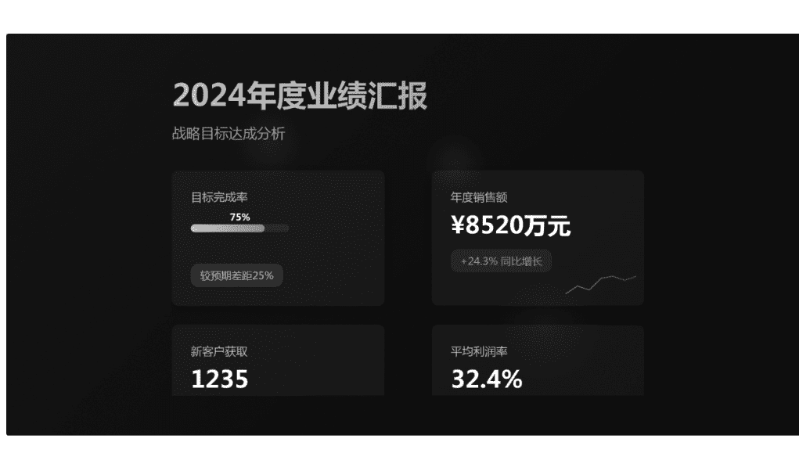

###### HTML 天气预报快速搭建

希望搭建一个基于 HTML 的天气预报系统，请协助完成整体设计与开发。

注意事项：

1. 梳理用户希望系统提供的功能；
2. 以产品经理视角规划页面结构；
3. 以设计师视角思考视觉呈现；
4. 用 HTML 输出全部页面；
5. 可引入 Font Awesome 等开源图标库，提升界面质感。

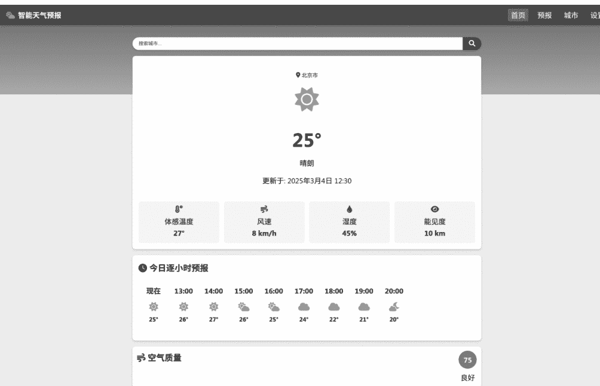

以上只是冰山一角，感兴趣可以自行尝试探索，底层逻辑是相通的。

### 二、进阶方向：浏览器端应用开发

前面提到的方法能搞定不少轻量小工具，但本质上仍停留在单页范畴，难以承载复杂交互与运营。若想在零代码情况下搭建工具站、内容站乃至平台站，就需要借助由 AI 驱动的前端开发平台。

目前对个人免费且效果不错的有 5 款：
Trickle、 Bolt、 v0、 Lovable、 Brancher。

它们都能让零基础用户产出具备复杂交互的网站。以 Trickle 为例，下面演示如何制作一个邮箱收集落地页，实现订阅后通过邮件推送内容的功能。步骤如下。

#### 步骤 1 先用大模型梳理需求

做任何产品前，先要把目标和实现路径想清楚。构思本身很耗神，但这类需要思考和专业判断的工作可以交给 AI。比如直接向 DeepSeek 或其他大模型描述需求，让它帮助整理思路。

以下是一个邮箱收集系统的参考提示词：

> 我叫常青，是一名个人成长领域的博主，想用 Trickle 做一个收集邮箱的落地页，以便后续通过邮件向目标用户推送信息。
>
> 我提供的价值是，订阅后用户可不定期获得个人成长类的干货，包括个人管理、AI 实践、学习力、思维力等经验与思考。
>
> 请基于我的定位和价值，为 Trickle 写一段指令，帮助它生成一个美观且符合我风格的邮箱订阅页。

根据需求生成的详细指令用于指导 Trickle 创建符合个人成长博主定位的订阅页，具体内容略。

提示：AI 生成指令后务必复核描述是否精准匹配需求，必要时多轮调整优化，直至完全符合预期，再进入实现阶段。

#### 步骤 2 注册并启动 Trickle 工具

通过链接注册登录 Trickle 后，界面非常简洁，只有主对话框和几个基础选项，若无特殊需求保持默认即可。将前面 AI 生成的指令粘贴进对话框，点击下方的发送图标即可。

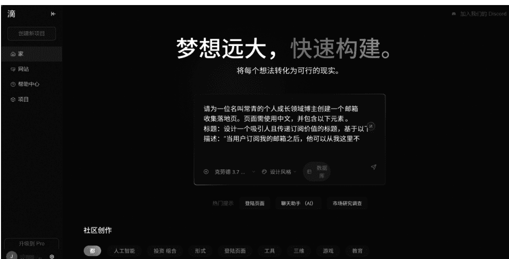

提交后 AI 会生成一个精美的邮箱订阅落地页。

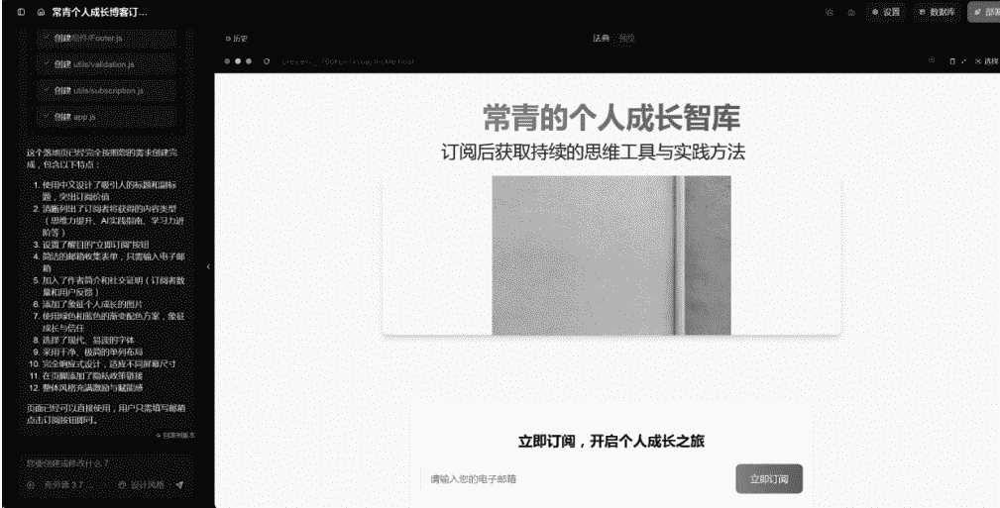

若对初稿不满意，可通过左侧对话框继续微调，直至达到理想效果。例如觉得背景过白、首屏图不理想，可以这样要求：

背景色太亮了，我希望整体配色更温暖治愈，以暖色调为主，比如米黄渐变。另外首屏区的图片需要替换成我上传的那张。

发出指令后系统会按要求完成修改。

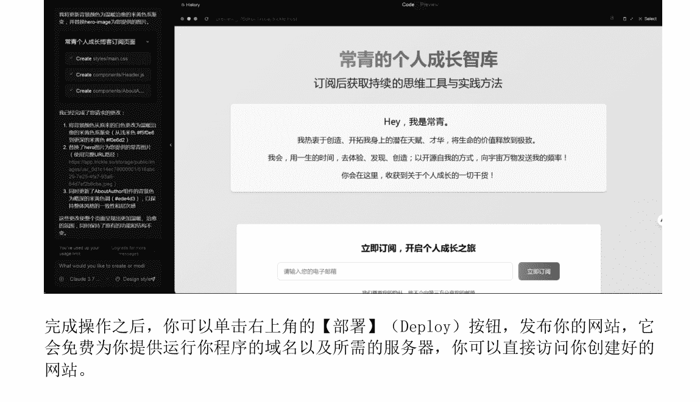

修改完成后，点击右上角的【部署】按钮即可发布站点，平台会免费提供域名与服务器，可直接访问上线后的网站。


##### 博主简介
常青 专注个人成长内容创作，长期研究思维模型、学习策略和效能提升，累计十年实践沉淀，旨在帮助读者打破思维桎梏，保持持续成长。

> “每期邮件都让我眼前一亮，既有新思路也有可落地的成长方法。”

##### 订阅入口
@foxmail.com 点击订阅

订阅成功，感谢支持，后续会定时推送精选内容。
隐私说明：我们不会把邮箱分享给任何第三方。

##### 订阅权益
- 提升思维：批判性思考、系统化思维与创意表达
- AI 实战：前沿工具使用技巧与效能优化案例
- 学习进阶：高效吸收、知识管理与终身学习方法

### 三、复杂场景：软件级程序开发

学会了前端项目搭建后，若想做跨设备且功能强大的商业级应用，如 App、桌面软件或小程序，前述方法就不够用了。需要能跨平台运行的复杂软件，并配合更强的编程 AI 工具。目前个人免费可用且表现不错的有 3 款：
Trae、 Windsurf、 Cursor。

特别提醒：这些工具需下载客户端安装到电脑上，无法网页在线使用。

Trae 由字节跳动推出，界面全中文，使用习惯更贴近国内用户，目前对个人完全免费。下面以它为例演示。

比如做一个“个人计划管理 待办清单程序”，实现任务增删、状态标记、日期视图切换等功能。具体操作如下。

#### 步骤 1 让 AI 输出项目 PRD 文档
软件开发第一步是明确功能、效果和构建方案，专业上称为 PRD 产品需求文档撰写，它详细列出开发所需信息。对复杂项目而言尤为关键。若不熟悉撰写，可让 AI 代劳。参考提示词如下：

我想做一个“个人计划管理的待办清单程序”项目，实现以下功能，请帮我生成一份 PRD，并以 Markdown 格式输出。
1. 添加/删除任务：支持顶部输入框+回车确认，支持批量删除如左滑或长按多选。
2. 任务状态标记：勾选复选框标记完成，支持撤销操作。
3. 日期视图管理：通过左右箭头切换日期，支持日/周/月模式。

以下是为你设计的待办清单程序 PRD 框架，采用结构化表达并标注关键交互逻辑，具体内容略。

AI 生成文档后，先阅读核对是否符合预期，不满意可反复调教直至达标。

#### 步骤 2 借助 Trae 落地功能
安装后启动界面，整体很简洁。初次使用建议关注右侧的 AI 交互区。

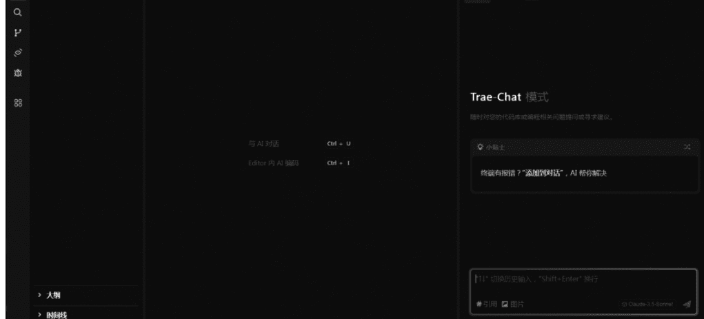

交互区提供【Chat】和【Builder】两种工作方式。前者像嵌入编辑器的对话助手，可提供建议并直接改动代码，但权限有限，仅限当前页面。后者更像一位真正的程序员，只需给出 PRD 即可自动分析文档、制定开发策略、配置环境并完成实现。

因此零基础用户建议先用【Builder】方式构建项目，随着理解加深再做定制化操作。

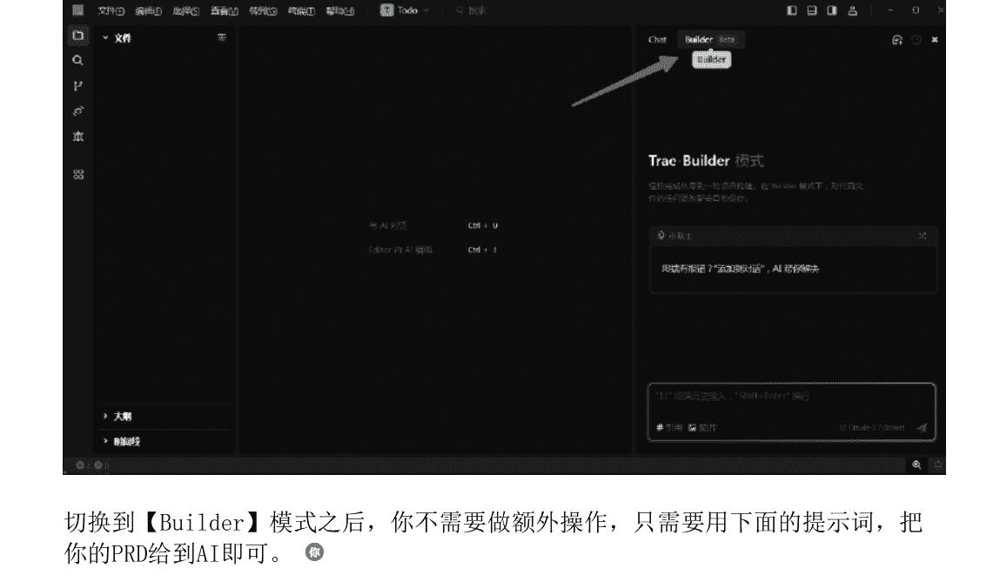

切换到【Builder】方式后，无需额外设置，直接用下方提示词把 PRD 交给 AI 即可。

我想做一个“个人计划管理的待办清单程序”项目，以下是项目的具体 PRD，请仔细阅读后帮我实现。
（此处粘贴前面 AI 帮你生成的 PRD 内容）

发送后按 Enter 或点击右下角的 📤 图标，AI 就开始帮你实现效果。

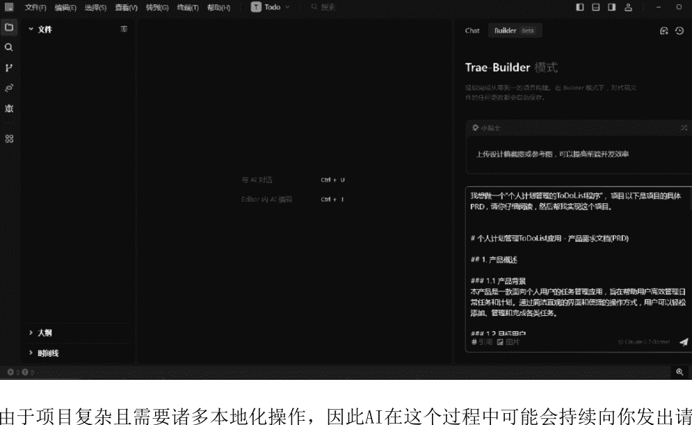

项目涉及的流程比较复杂，落地时需要不少本地化介入，模型在执行期间会反复弹出各类权限申请，全部通过即可，之后就是等待它自行跑完。

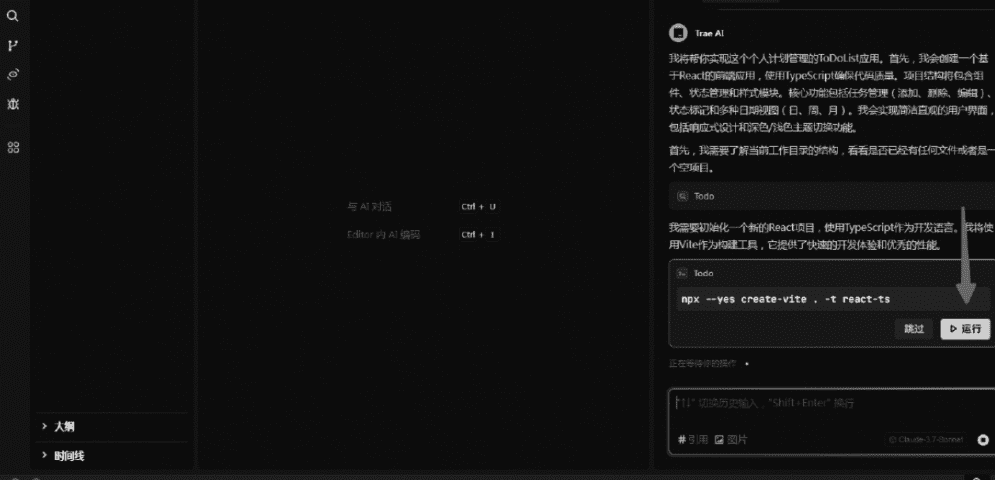

等模型把活干完后，直接让它把部署和运行的完整清单列出来，按着清单把项目上线。操作中遇到任何模糊点，随时让它再细化说明。

# 第十三章

## 私域部署：让 AI 真正属于自己

### 知识要点

- 1. 接口调用式部署
- 2. 纯本地自建部署
- 3. 私域部署的价值

前面聊到的工具大多跑在公网，方便的同时也伴随数据外流、合规管控和功能天花板的问题。

在意数据主权、想减少外部掣肘、想要深度定制的人，把模型搬到自己的机器上会更安心。下面给出一条可落地的本地化路线，围绕两种主流做法展开。

### 一、接口调用式部署

接口本质上是让不同软件互通的桥梁，像餐厅的服务员——你不用进后厨，只要点单，服务员就把菜端上来。网页版能力受限时，就可以通过厂商提供的接口在本地串联出更自由的用法。DeepSeek、通义千问、Kimi、ChatGPT、Claude、Grok 等都对开发者开放接口。

以字节跳动火山引擎为例，可以申请豆包、DeepSeek、Kimi 等模型。登录后就能看到模型列表，按需挑选。

下面以 DeepSeek R1 为例演示操作路径。

#### 步骤 1 拿到调用凭证

在首页左侧导航往下找，找到【API Key管理】入口并点进去，右侧会出现【创建API Key】按钮，点击。弹出命名框，没有特殊要求可直接创建，随后会生成专属凭证，请复制保存，后续配置会用到。

| 名称 | API Key | 创建时间 | 权限 | 操作 |
|------|---------|----------|------|------|
| api-key-20250302105242 | ****************** | 2025-03-02 10:52 | all | 删除 |

凭证拿到后点左侧的【开通管理】，按指引开通 DeepSeek R1 服务。点【开通服务】进入结算页，再点【立即开通】即可。至此凭证获取流程结束，以后就能用同一凭证调用平台上已开通的所有模型。其他平台做法大同小异。

凭证拿到后怎么用？如何接入本地？

#### 步骤 2 本地客户端配置

这一步需要一个能承接接口的本地工具，可选的有 AnythingLLM、ChatALL、Cherry Studio、Chatbox 等，都是开源免费且功能扎实的载体。我长期用 Cherry Studio 体验不错，推荐试试。

该客户端开源免费，数据留本地，内置绘图、智能体、翻译、小程序、知识库、文件库、搜索等能力。

打开官网下载安装。装好后点【设置】①，找到对应的 API 平台②，进入后把开关打开③，把前面拿到的凭证填进【API密钥】④，点击下方的【添加】⑤。

随后会弹出窗口要求填写目标模型的 ID。先回到提供商平台，找到已开通的模型，进入详情页，在【主线模型】里复制 ID。

回到对话框把 ID 粘贴到【模型ID】，软件会自动补全其它字段，点【添加模型】，DeepSeek R1 就进到本地模型库了。同理可以按此方式添加火山引擎或其他厂商的模型。

配置完成后返回对话区，选刚才的模型即可开始使用。本地功能丰富，因篇幅不再展开，自行摸索即可。

### 二、完全本地部署

接口调用已能满足大部分个性化需求，但仍有两点掣肘：一是免费额度有限，经不起高频使用；二是数据虽降低了被训练的风险，仍可能被不合规的厂商利用。

纯本地自建能彻底规避上述问题。若设备条件允许、对隐私要求极高，或所在单位无法上外网，本地自建是最理想的选择。

#### 步骤 1 安装 Ollama 运行环境

Ollama 可以理解为本地大模型的操作系统，就像 Windows、macOS 支撑软件运行一样，AI 本地运行也需要一个载体。Ollama 负责部署与管理本地模型，完全离线、开源免费。先装它。

#### 步骤 2 拉取模型

装好后去 Ollama 官网下载需要的开源模型。注意模型全在本地跑，对硬件有要求，请按设备配置挑选合适规模，否则会卡顿。

选定后打开命令提示符窗口，快捷键 Win+R，输入指令。以 7b 为例，可根据配置改成 14b、70b 甚至 671b。参数越大效果越好，对硬件要求也越高。

```
ollama run DeepSeek-r1:7b
```

执行后等待下载、安装与部署完成即可。

#### 步骤 3 启动 DeepSeek 模型

部署完成后模型会自动接入。直接在当前命令行窗口提问即可，比如问“你好，鲨鱼为什么不会溺水”，随后会得到推理后的回复。

#### 步骤 4 接入客户端提升体验

命令行能用但不够友好。若想获得更好的对话体验，可把本地模型接入前面提到的 Cherry Studio。

点【设置】①，选择 Ollama②，开启开关③，点击【管理】④。程序会自动读取已安装的模型，点 ➕ 完成配置。配置完成后切换模型，就能获得与接口调用一致的对话体验。

### 三、本地部署的好处

本地化部署看似更适合隐私敏感且追求高度定制的用户，普通办公人员是否值得折腾？我认为值得。它能带来真正的使用自由。网页版能做的本地版都能做，网页版做不到的本地版也能实现。

三种拓展思路供参考：

- 1. 多模型并行问答
工作中常需多模型协同，网页版要频繁切换账号。本地化后可一键向全部已部署模型提问并汇总结果，效率大幅提升。

#### 2. 本地智能体构建
借助软件自带的本地扩展，比如知识库、本地文件，可打造实用智能体。例如把智能体当作第二大脑，实现知识管理、信息整理、文档管理，让本地操作全程享有 AI 加持。

#### 3. 信息沉淀与数字分身
网页使用 AI 的最大问题是数据不归己且跨厂商不互通，互动难以沉淀。本地化部署则不同，只要不主动删除，所有对话历史完整保留。长期积累可形成比自己更了解自己的超级助理，大幅提升交互效率。

应用场景很多，因篇幅不再详述，感兴趣可自行探索。

# 第十四章

## 智能代理：用 Manus 释放双手

### 知识要点

- 1. 如何获取通用型代理工具
- 2. 如何使用通用型代理
- 3. 人机协同完成复杂任务
- 4. 使用最佳实践案例

前文已介绍代理的概念及自建方法。但用扣子自建仍需自行搭建工作流、制定目标、分拆任务、调用工具并反复调试，门槛高且耗时。

若希望在众多场景下直接交付成果，不愿做复杂配置，通用型代理是最合适的解法。

通用型代理的逻辑类似 DR，但能力更强。你只需给出需求，如筛选简历、生成投资报告、制作 PPT 或制定旅行手册，它会自动规划多步任务并执行。过程中会自主搜索、分析、合成、推理，最终在短时间内交付可用成果。遇到问题也会自行调整策略。

简言之，常规大模型问题导向，通用代理结果导向。它能独立完成从规划到交付的全流程，你只需提出想法。

下面给出完整上手指南。

### 一、如何获取通用型代理工具

目前可免费使用的通用代理主要有四款。

- Manus；
- Flowith；
- OpenManus；
- OWL。

后两者基于 Manus 开发，测试下来功能可接近 Manus，但对技术和设备要求更高，调试成本大，仅推荐给有技术背景或愿投入大量时间的读者。普通用户直接选 Manus 或 Flowith 即可。

### 二、如何使用通用型代理

当前 Manus 未完全开放注册，多数读者暂时无法使用，这里以 Flowith 为例演示，使用方法与 Manus 基本一致，开放后可直接迁移。

#### 步骤 ① 注册 Flowith

注册后进入主界面。

注意：默认是普通大模型，体验与 DeepSeek、通义千问、ChatGPT 无本质区别。若想体验代理，需下一步操作。

##### 步骤 2 进入代理模式

打开页面右侧的【ORACLE MODE】①，即可切入代理模式。此时默认效率模式，经实测该模式下模型易偷懒，若希望获得更好输出，建议在左下方切换为高计算模式②。

##### 步骤 3 开始使用

设置完成后可通过自然语言下达任务。

以调研某公司股票为例：

我想要对××公司的股票进行一次全面分析，请你以下面的侧重点，以麦肯锡级别的质量标准，帮我完成它，最后帮我生成一份完整且图文并茂的调研报告。

概要：公司概况、关键指标、绩效数据以及投资建议。

财务数据：收入趋势、利润率、资产负债表和现金流分析。

市场情绪：分析师评级、情绪指标和新闻影响。

技术分析：价格趋势、技术指标以及支撑/阻力位。

资产比较：与主要竞争对手的市场份额和财务指标对比。

价值投资者：内在价值、增长潜力及风险因素。

投资论点：SWOT分析以及针对不同类型投资者的建议。

AI 会回复将整理最新财务数据、市场情绪、技术面、行业格局并给出投资建议，并提示需要一定时间。

把任务描述粘贴到对话框，点击【开始】等待生成。AI 会自动规划、分解、执行并调用所需工具，最终直接给出结果。

示例结论摘要：

特斯拉凭借显著的技术优势、品牌号召力和不断扩大的制造能力在电动汽车市场保持主导。虽然收入 5 年复合年增长率为 42.3% 并保持盈利，但现金流折现分析显示当前股价在多种情景下已高于内在价值。

| 类别 | 建议 |
|---|---|
| 成长 | 持有/选择性买入 |
| 价值 | 避免 |
| 收入 | 避免 |
| 投机 | 选择性买入/交易 |
| 环境、社会和治理 | ✗ |

###### SWOT 拆解

- **优势**
  - 品牌实力和客户忠诚度
  - 技术领先
  - 制造规模和效率
  - 超级充电网络
  - 软件和 OTA 更新
  - 能源业务整合
  - 直销模式
- **弱点**
  - 高级定价
  - 有限的型号范围
  - 服务网络限制
  - 质量控制问题
  - 监管挑战
  - 执行依赖项
  - 利润率压力
- **机会**
  - 全球电动汽车市场增长
  - 自动驾驶变现
  - 能源业务扩展
  - 新市场和模式
  - 人工智能与机器人技术
  - 电池技术进步
  - 监管利好因素
- **威胁**
  - 竞争加剧
  - 中国市场挑战
  - 供应链漏洞
  - 宏观经济逆风
  - 技术颠覆
  - 监管风险
  - 估值预期

特斯拉是汽车、技术、能源交叉领域的独特投资标的。创新方法、品牌力和市场领导地位支撑长期潜力，但当前估值已消化大部分预期，对新投资者风险回报并不友好。

建议在当前水平保持谨慎，已持有者可长期观望，新投资者宜在大幅回调时选择性买入。

**需要监控的关键因素**

- 汽车交付量增长率和产能扩张
- 毛利率和营业利润率趋势
- 全自动驾驶进展和监管动态
- 新车型推出和量产
- 主要市场的竞争态势，尤其是中国和欧洲

### 三、人机协同完成复杂任务

通用代理很强，但若期望一键完成连人类都难做的复杂任务，可能会失望。使用心态应与常规大模型一致：结果不满意时通过多轮调教反复优化，直至达标。

需要注意，代理目前不支持跨任务对话记忆、账号登录状态保持、文件互通等功能，处理更复杂的跨平台任务时仍需人工配合。

以 AI 制作视频为例，若希望代理自行进入即梦 AI 创作视频，至少需提供即梦 AI 的账号密码，它才能操作。这类涉及登录的跨平台任务，AI 需要用户配合。

互动范例如下：

> 我现在正在参加 AI 文生视频的比赛，请你利用即梦 AI 帮我创作一个创意视频。如果这个过程中你要进行账号登录或需要我配合的其他操作，请你直接发出提示，我会配合你。

> 感谢你的咨询！为了帮助你创作一个 AI 文生视频作品，我需要了解更多关于比赛和你使用即梦 AI 的情况。

关于比赛：

- 请提供比赛的名称和主办方信息。
- 比赛的主题或具体要求是什么？
- 提交截止日期是什么时候？
- 评审标准包括哪些方面（技术性、创意性、故事性等）？
- 视频长度有什么限制吗？
- 是否有其他格式要求？

后续生成内容略。

比赛名称：2025 年度“未来视界”AI 创意视频大赛

主办方信息：某艺术协会与某知名科技公司联合举办

主题：“人工智能与人类未来的共生关系”

具体要求：作品需展现 AI 技术如何改变生活、促进社会进步，并融入情感元素，让观众产生共鸣。

提交截止日期：2025 年 5 月 15 日

后续生成内容略。

注意：AI 会根据你提供的信息进行大量调研并提出创意方案，需要你挑选。

在 3 个创意方案中（《遗失的色彩》《时间旅行的明信片》《未来影像修复计划》），你最终选择了哪一个作为我们的创作方向？如果你已有选择，请告诉我，这样我可以为你制作详细剧本和视觉参考板。如果你还没有决定，我可以帮你进一步分析这些创意的优缺点。

我喜欢《时间旅行的明信片》。

好的，没问题！让我们一起为《时间旅行的明信片》这个创意打造一个完整的剧本，并针对即梦 AI 的特性进行优化。

剧本主题：《时间旅行的明信片》

核心概念：通过 AI 技术制作不同年代的明信片，寄给过去和未来的自己，展现科技与怀旧的结合，以及对不同时代的美好向往。

后续生成内容略。

很好，现在让我们开始用即梦 AI 创作吧。请你自主完成这个任务，我只会在需要登录时接管。

正在即梦 AI 平台上准备开始生成视频，需要用户协助登录……

我已经帮你完成登录，你可以继续了。

感谢你完成登录！现在我将继续在即梦 AI 平台上创作《时间旅行的明信片》视频。我会按照之前设计的脚本，逐一生成场景的视频片段，并使用平台的高级功能进行精细调整。

后续生成内容略。

### 四、如何把代理用得更好？最佳实践案例

#### 1. 游戏开发

请直接帮我开发一款可以在线游玩的完整游戏，游戏名为《太空射击》。要求如下。

##### 核心玩法

# 复古弹幕射击手游设计要点与AI实战任务汇编

**核心操作**
- 战机位移支持键盘 WASD 与手机触屏双模式
- 武器为自动跟随射击，额外保留玩家手动释放的终极大招
- 敌群以递进节奏波次出现，流程中穿插 Boss 对决
- 舞台散布碎石类阻挡物，并随机投放增益道具

**核心体验亮点**
- 进度解锁三种不同属性的机体形态，可自由切换
- 系统据表现进行实时动态难度调节，保持挑战曲线流畅
- 击杀瞬间触发特效并配合爆炸粒子，强化反馈爽感

**画面风格**
- 怀旧像素基调叠加霓虹光晕，营造复古未来感
- 深空背景持续演进，流星划过与星云漂移自然交织
- 机体外观提供三套可随时切换的皮肤

**基础功能需求**
- 最高纪录自动保存，无需手动操作
- 完整适配移动端屏幕与交互
- 提供音效静音开关
- 暂停菜单内嵌详细操作说明

#### 2. 视频制作
2025 年 3 月 5 日，首个通用型 Agent Manus 正式亮相。需要你代入 Manus 的第一人称身份，拍摄一段自我介绍短片，向全球用户问好，并系统概括自身的定位、特色与核心能力。

#### 3. 趣味学习
请采用可视化形式对“赤壁之战”进行深度拆解。输出以作战报告为核心，辅以地图、流程图与数据图表，直观呈现魏蜀吴三方兵力部署、推进路径与关键节点的决策与结果。

#### 4. 旅游建议
需求是 4 月 15 日至 21 日共 7 天的日本双人行，预算区间 1 万元至 1.5 万元。偏好历史遗址、小众秘境及传统文化体验，包含剑道、茶道、禅修。行程需安排奈良与鹿的互动及城市徒步，并规划一次旅途中求婚，推荐具纪念意义的场地。请给出逐日行程表，以及一份简易 HTML 旅行手册，内含地图定位、景点解读、常用日语会话与出行贴士。

#### 5. 客户寻找
我方为一家深耕生成式 AI 技术落地咨询的公司，目前拓客受阻。需要你通过调研与分析，为中小微企业画像生成一份潜在客户清单。至少列出 15 家目标企业，明确联系方式、主营业务、办公地址等细节，并以表格与可视化仪表盘形式呈现。

#### 6. 数据分析
素材为小红书 2021 年底至 2024 年的财务资料。请完成两项工作：① 按年度拆解收入构成，各板块销售额及说明，以完整表格输出；② 总结成本结构的年度变化趋势，形成一份结构化的分析报告。

#### 7. 内容策划
本人为 B 站科普创作者，拟做一期“板蓝根是否有效”的专题。需要你检索相关科学文献与权威资料，汇总证据与争议点，整理成一份可直接拍摄的科普视频脚本，分讲法、论据与结论。

#### 8. 商业研究
调研全网智能穿戴相关文章与行业报告，梳理 2025 年计划发布的智能穿戴产品清单。信息以表格呈现，字段包括品牌、产品规格、售价、核心部件清单及供应商、预期销量。

#### 9. 信息搜集
请整理一份全球主要 AI 影响者的名录，同时汇总来自头部 AI 企业高管、投资人、政府官员及研究人员的公开观点，聚焦 DeepSeek R1 的评价与看法，以报告格式输出。

#### 10. 网站设计
请规划一个中国优秀传统文化科普平台。内容覆盖历史典籍、传统节日、艺术门类、哲学思想、手工艺、饮食文化、武术养生等。视觉上融合水墨等古典美学与现代极简，支持中英双语。功能包含分类检索的知识库、问答或小游戏的互动区、视频音频的多媒体中心。目标用户为海内外公众，强调易懂、有趣、利于文化传播与学习。

# 结语

若把《AI 效率手册：从 ChatGPT 开启高效能》视作迈入 AI 世界的入门引路书，那么《成为 AI 高手：从 DeepSeek 开启高效能》便是踏上高手之路的实操蓝本。书中舍弃晦涩术语，用鲜活案例来对话；摒弃空泛描述，用精准洞察传递价值。

合上书后得到的，不只是 DeepSeek 的操作手法，更是一套驾驭智能时代的底层元能力，它正成为超越学历资历的个人新标签。

此刻，智能革命的第二轮浪潮已然逼近。你愿继续在岸边观望，还是与我一起潜入深海，去触摸 AI 的本质？若你已准备好拥抱这一时代，我们现在就出发。

世界进步永不停歇，为帮你持续保持前沿，我将为本书提供过期勘误与前沿玩法加餐，扫描右侧二维码，回复“成为 AI 高手”，即可领取最新资料与配套工具，后续新变化、新工具我会第一时间同步。

只要保持开放心态，AI 永远是你的工具，你将站在它之上，而非被它取代。