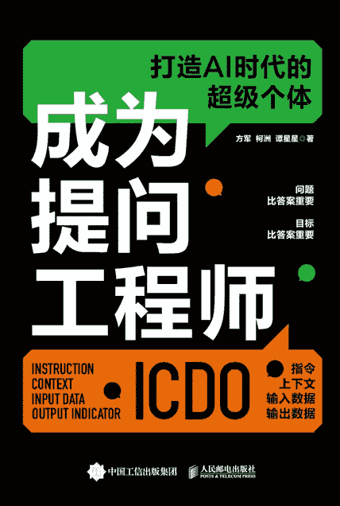

# 进阶之路：做提示工程师



---

# 开篇

## 破局 AI 时代：打造超级个体

倘若 AI 在你擅长的领域表现得更出色，你将何去何从？

自 2022 年末起，生成式 AI 与大模型以触手可及的产品形态走入大众视野。海量参数凝聚了人类文明的知识结晶，一场“知识普惠”的技术革命正重塑每个人的生活。回望“算力普惠”与“信息普惠”两轮数字化浪潮，躲避或对抗机器皆非上策，唯有尽早入局，与机器共舞，方能乘风破浪。

此非危言耸听，“机器统治人类”仅存在于科幻臆想。笔者坚信：AI 将开启人类史上最好的时代。若能调取大模型的知识库与技能树，人人皆可化身强者；若能掌握提示语这一交互钥匙，便能驾驭模型之能为我所用。在 AI 纪元，人类将迎来二次腾飞。

关键在于：以提问为杠杆，撬动大模型智能。对个体而言，大模型是加速器——既是学习的催化剂，也是生产力的放大器，更可直接作为内容生产工具。

你在 AI 时代的坐标，取决于当下的行动。沃顿商学院教授伊桑·莫利克指出 AI 三重红利：技能兜底器（拉平普通人能力）、技能加速器（全员增强）、王者制造器（倍增顶尖个体实力）。我们要誓将第三种可能变为现实：精通提问之术，借 AI 之力铸就超级个体。换言之，人人都应进阶为善用大模型智能的“提示工程师”。

我们总结了与 AI 高效对话的八大核心法则：

- **法则一**：洞察“生成本质” —— 文本预测的概率游戏。
- **法则二**：警惕“幻觉陷阱” —— 事实核查须贯穿始终。
- **法则三**：善用结构化范式 —— 如 ICDO 模型，让指令更精准。
- **法则四**：利用上下文学习 —— 投喂背景，让模型“秒懂”意图。
- **法则五**：诱导“链式思考” —— 启动 System 2 慢思考模式。
- **法则六**：任务拆解降维 —— 将复杂问题化整为零，逐个击破。
- **法则七**：说模型听得懂的语言 —— 格式化输入，消除歧义。
- **法则八**：稳坐“主驾驶位” —— 人机共舞，掌控全局。

有人误认为提示工程只是学会呼叫工具的浅层技能，实则不然。入门虽易，精通极难。真正的挑战在于：当深入具体业务场景，模型通用能力不足以支撑，你必须具备该领域的**知识框架**与**专业判断力**，才能驾驭模型产出专业级成果。这才是提问能力的深水区，需要在实战中持续打磨。

本书策划袁璐女士便是杰出提示工程师的典范：一是**提问精准**，她抛出核心议题，引导作者与模型共创答案；二是**框架思维**，她以“图书载体”为骨架，统领全书落地。AI 时代的协作范式即：超级提问者定义问题 → 专业框架导航机器 → 人类验收成果。

终极追问：掌握提问术、随取随用模型智能，人类就可高枕无忧？并非如此。人永远是主角：我们要定**方向**（目标），凭**直觉**预判答案轮廓，靠**理性**辨别真伪，仗**鉴赏力**追求更优解。享受红利与承担后果的，始终是人。故此，献上 AI 时代超级个体公式：

> **超级个体 = (目标 + 认知 + 责任) × 提问能力**

# 第一章 认知 GPT

**答案止步于已知，提问通往未知。**

2022 年 11 月 30 日，OpenAI 以一篇博客向世界推出 ChatGPT。用户登录官网，即可随问随答。官方自述：“ChatGPT 支持多轮对话、纠错、质疑预设、拒绝不当请求。”其核心“GPT”，即深度学习驱动的人工神经网络。

ChatGPT 横空出世，瞬间引爆全网。上线 5 天，用户破百万（Sam Altman 发推证实，单次对话成本仅几美分）。这打破了 Instagram (2.5个月)、Facebook (10个月)、Twitter (2年) 的纪录（见图 1-1）。两月后，月活破亿，再造神话。


为何 ChatGPT 能引发现象级狂欢？为何被视为新一轮互联网与知识革命的引爆点？

实战者早已体感：此番 AI 浪潮迥异往昔。2016 年 AlphaGo 胜李世石，虽震撼却未即时普惠。而今，模型与产品如春笋般涌现，搜索、办公、教育等高频场景即刻接入 AI 新能力。

大众关注点从宏大叙事（“机器会思考，人类何去何从”）回归个体生存：“别人如何用 AI？我如何快速上手？我会被替代吗？”真相残酷而清醒：**你不会被 AI 替代，会被善用 AI 者替代。**

本书直击核心痛点：看透生成式 AI 原理、能力边界与局限后，如何掌握必备新技能？如何提问才能精准得要？

## 第一节 现象级爆款：GPT 能力全景扫描

写作此时，ChatGPT 仍属“研究预览版”，却阻挡不住亿级用户冲锋。同类产品亦遍地开花：微软 New Bing、Google Bard、百度文心一言、阿里通义千问、Notion AI、WPS AI 等。

问答/对话是主流交互。用户提问 → 后端大语言模型（LLM）推理 → 生成回复。本书统称后端模型为“大语言模型”，讨论具体产品时通用“GPT”代指（源自 OpenAI 2018 年首代模型 **G**enerative **P**re-trained **T**ransformer）。

以 ChatGPT 为例，界面即聊天框，支持单轮问答与多轮对话，自然语言交互，所见即所得。

它擅长处理曾需“良好教育+长期训练”才能胜任的知识型任务，六大核心技能如下：

- **多语翻译官**：精通多国语言，按需定制翻译风格。
- **长文压缩机**：秒读长文输出摘要，会议录音转纪要信手拈来。
- **写作副驾驶**：按指令改语法、换文风，质量超越大多数普通写作者。
- **数学解题员**：给题、出步骤、出结果，数理能力硬核。
- **全栈程序员**：按需写代码、解释代码、改 Bug，语言不限。
- **数据分析师**：从文档提取数据、总结财报、输出文字洞察。

多轮对话是其“实用性之锚”。首轮不满意？纠偏、补料、加约束，它立刻认错迭代，直至达标。这极像职场协作：需求模糊 → 交付偏差 → 补细节、给案例 → 结果渐优。自然语言交互降维打击了使用门槛，让普通人也能驾驭顶尖 AI。

综上，ChatGPT 的惊艳三维度：

1.  **通人性**：懂人话、说人话（自然语言理解与生成）。
2.  **多技能**：翻译、摘要、写作、编程、分析……全能型选手。
3.  **强记忆**：多轮对话保持上下文，支撑复杂任务闭环。

GPT 读懂指令，用人类可读语言回复。预训练赋予其海量知识储备、分析推理与语言能力。

### GPT 实战清单：能替你干啥？

OpenAI 官网列举大量用例：关键词提取、广告文案生成、会议纪要、文章摘要、面试题设计等。归类来看，文本任务覆盖：问答、分类、编程、对话、生成、翻译、转换。

厂商可基于模型微调定制服务。某社区机器人自述其能力边界¹：

> GPT 基于深度学习，无监督训练海量文本，掌握语言模式结构，据提示生成连贯文本。
>
> 适用场景：答疑、建议、创作、翻译、摘要等。
> - **智能客服/虚拟助理**：自动化服务、供信息、陪聊。
> - **内容工厂**：新闻、电商文案、创意写作。
> - **翻译官**：跨语言沟通利器。
> - **阅读加速器**：长文速读摘要。
> - **个性化推荐**：基于历史交互精准分发。
> - **科研助手**：海量论文/社媒数据分析、挖掘趋势。

### 大语言模型能力矩阵

预训练后，研发侧从**语言生成、知识利用、复杂推理**三维考核基座能力，另含高阶评测。表 1-1 勾勒出研发者对模型能力的期许图谱。

**表 1-1 大语言模型能力全景**


来源：《大语言模型调研》，2023。

ChatGPT 虽最出圈，却非独秀。Anthropic 推 Claude，Quora 推 Poe（多模型聚合），开源阵营更是群雄逐鹿：Meta LLaMA、清华 ChatGLM 等。BAT 等巨头亦入局（表 1-2），且多将聊天机器人与**搜索深度绑定**，差异于 ChatGPT 纯模型推理模式。

**表 1-2 互联网大厂聊天机器人速览**


现象级产品不止聊天形态。Notion AI 约 4 个月斩获 400 万付费用户。作为笔记/协作神器，输入“/”即召唤 AI。用户高频场景：头脑风暴、待办清单、大纲生成；最高价值感知：润色语法、生成摘要。

目前，各厂竞相将 AI 助手原生化集成：微软 Office 接入 Copilot，自然语言驱动 PPT 制作、Excel 作图、数据洞察；Windows 系统级接入 Copilot，对话即操作。

### 当前 GPT 产品四大形态

- 通用聊天机器人
- 搜索融合型机器人
- 应用软件内嵌助手
- 应用网站侧边栏助手

GPT-4 发布时，OpenAI 官网展示多个行业落地案例²。

当前普通用户可触达的应用主要集中上述四类。GPT 生态呈**哑铃结构**：一端是狂飙突进的基座模型能力，一端是以问答/助手为主的普惠应用。未来必将孵化出超越“对话+助手”的全新形态。

# 当前 AI 能力：边界与局限

需清醒认识到：聊天机器人与应用助手，仅是 LLM 能力冰山一角。专业级应用往往需通过 **API（应用程序编程接口）** 直调模型，编排复杂多轮流程，甚至引入**人工介入**闭环。

以“图书翻译（中译英）”为例，实操流程远非单次对话所能覆盖：
1.  **分块**：按模型上下文窗口拆解全书；
2.  **对齐**：注入术语表/风格指南，保证专业度与一致性；
3.  **多模协作/多轮打磨**：调用不同模型或多轮迭代，完成语法校对、地道润色、术语复核等收尾工序。

### AI工具的“双刃剑”效应：如何避坑与发力？

尝试将各类AI聊天机器人或助手引入实际工作流时，我们很快就会撞上它们的“短板”。比如，不少人曾试图把ChatGPT当搜索引擎用，去查最新资讯，结果发现它的知识库早已“断更”，时效性止步于某个固定节点。更棘手的是，它偶尔会一本正经地胡说八道——这在业界被称为“幻觉”。它编造的内容逻辑自洽、语句通顺，极具迷惑性，稍不留神就当真了，后果不堪设想。后文会专门剖析这一现象，但总体而言，只要我们学会“扬长避短”，这些工具依然能在多个维度成为得力助手。

## 第二节：GPT究竟有哪些本领？底层逻辑何在？

体验过基于GPT模型的各类新工具后，我们会被它展现出的写作、编程、逻辑推理等能力惊艳。随之而来的疑问是：GPT的能力边界在哪里？它为何能做到这些？想驾驭好它，搞清楚这两个问题至关重要。

**一句话概括GPT：拥有专业知识与多项核心技能，但不擅长精准检索信息，且易产生“幻觉”。**

### GPT的“技能树”长什么样？

经过训练的GPT模型，大致掌握了以下核心能力：

- **语言理解力**：能精准读懂人类自然语言表达的需求与上下文；
- **文本生成力**：能按需续写、摘要、答题，产出高质量文本；
- **逻辑推理力**：支持演绎、归纳等多种推理运算；
- **数学计算力**：理解原理公式，可解决数学问题；
- **多语言互译**：精通多国语言，自由切换翻译；
- **代码编程力**：读懂代码逻辑，按要求编写新程序。

简而言之，它集语言、数理、推理及专业领域知识于一身，我们通过提问调用这些能力。但同时，它的局限性也十分明显——它缺少我们预想中计算机系统应有的“查户口”式检索能力。传统搜索是从数据库或网络调取既有信息，而GPT很难原封不动地给出精准引用，甚至会张冠李戴、凭空捏造引用来源，这就是典型的生成式AI“幻觉”问题：为了接上话茬，它选择了“编造”。

### 核心机制：原来它只是在“接龙”

追根溯源，GPT模型的本质任务是**“文本补全”**——根据前文预测后文。通俗说，你给个开头，它负责讲故事。其底层架构**Transformer**最初服务于机器翻译：依据源语言语义与目标语言词表概率，预测句子的下一个词。后来，这套架构泛化为更广泛的生成任务，如续写文章。

那么，GPT如何决定“接”什么词？它本质上是个**“下一个Token预测器”**。基于前序Token及概率分布，它逐个Token预测生成，最终拼凑出完整回答。

**预测依据是什么？** 简单说，它“读”海量文本（研究者用超大规模语料训练模型）。根据前文计算下一个Token出现的概率，选概率最高者作为输出。Stephen Wolfram曾举例：给定前文，模型按概率排序预测后5个词为 `learn`、`predict`、`make`、`understand`、`do`，GPT便取 `learn` 作为下一个词，以此类推。

这里有个关键调节阀——**Temperature（温度）**，它控制随机性：
- **低温度**：随机性低，总选概率最高的词，输出确定、稳健，略显“死板”；
- **高温度**：随机性高，从候选词组随机采样，结果发散、多变，体现“创造力”。

**概率从何而来？** 由多层人工神经网络中的**参数/权重**决定。海量文本训练调整这些参数到位，这正是GPT中**“P”（Pre-trained，预训练）**的含义——让模型掌握预测下一个词所需的参数。例如GPT-3.5拥有1750亿参数。

随着训练语料与参数量级跃升，模型的“下一个词预测”核心能力质变，仿佛习得了语言、知识与推理，这颇似人类成长：孩童学语、积累知识、形成推理。GPT的进化路径印证了：规模扩大带来能力涌现。那么，如何让这些能力为我所用？本书主角——**Prompt（提示词）**——登场了。

通常我们给GPT一段素材（待翻译、待续写、待总结的长文），让它接续。但既然它已具备语言、推理、生成三大核心能力，为何不直接把Prompt设计为**提问（“请回答……”）或指令（“请帮我……”）**？

我们将输入GPT模型的请求称为**Prompt**，它是调用模型知识与能力的**接口**。如图1-2所示：过去我们在搜索引擎输入关键词获取海量信息（Google/百度）或服务（亚马逊/淘宝/美团）；如今，我们通过Prompt，直接调取AI模型内化的知识与能力。


许多人是因ChatGPT等生成式AI产品才关注到`prompt`一词。其原意之一是“防止演员忘词的提示牌”。2007年《Make Questions Work》一书中，作者用`prompt`指代“为获取理想答案或更多信息而追问的问题”。而今，`prompt`赋予新义：**使用生成式AI模型时，为引导其输出理想答案而给出的提示词。**

# 提示词：唤醒 AI 潜能的钥匙

当下，我们与生成式 AI 打交道，主要通过向两类模型喂入提示词。一类是以 GPT 为代表的大语言模型（LLM），让它们依据指令回答问题、执行任务；另一类是文生图模型，如 OpenAI 的 DALL-E、Stability AI 开源的 Stable Diffusion、以及 Midjourney 等绘图工具。后者对提示词极其敏感，微小的措辞差异就能导致画风迥异，因此玩家们戏称提示词为“咒语”，生成图片的过程便成了“念咒语、变魔法”。

接下来，我们聚焦大语言模型（LLM）的提示词应用。提示词几乎是调用 GPT 等 LLM 知识与能力的唯一入口。下面我试着用大白话拆解其底层逻辑。

如前所述，LLM 本质上是经过训练的概率模型，核心任务是“预测下一个 Token”。它们逐个 Token 推演，最终拼凑出完整的句子、段落乃至全篇。若是翻译任务，参照原文预测下一个 Token 相对直观；但若是续写、问答这类生成任务，预测难度会指数级上升。

提示词的作用，就是给模型“导航”，帮它更精准地计算下一个 Token。沈冠阳曾在文章中精准阐述了提示词的本质：“调整并优化文章前 m 个元素的取值——这些元素通常包含任务描述、背景信息等——使得 LLM 在特定任务语境下，能以更高概率生成符合预期的结果。”

换个通俗的视角：提示词本质上是我们写好的“文本范式”，随后让 GPT 沿着这个范式续写——这也解释了为何我们的措辞会潜移默化地影响它。随意输入，它敷衍回应；正式输入，它严肃作答。归根结底，只要提供得当的提示词——包含清晰的行动指令（如“写篇文章”）、合适的参考素材（如“关于春天”）——模型就能更优地决策下一个 Token，最终交出满意的答卷。

实际上，我们完全可以仅凭提示词，将通用 LLM “变身”为聊天机器人，Google Deepmind³

## 提示词，撬动 AI 能力的杠杆

提示词是调用 GPT 知识与能力的接口。我们输入提示词，激活、调度 GPT 通过预训练与微调习得的技能，让 AI 解答疑惑、满足需求。

回顾 OpenAI 迭代 GPT 的历程，某种程度上就是一部“更懂提示词”的进化史。

- **GPT-1** 论文《Generative Pre-Training 带来的语言理解提升》，确立了用预训练 Transformer 实现语言理解与生成的路径。
- **GPT-2** 论文《语言模型是无监督多任务学习者》，明确提出了用提示词调用模型能力的范式。
- **GPT-3** 论文《语言模型是小样本学习者》（注：原文标题为 *Language Models Are Few-Shot Learners*），核心在于“小样本”——我们只需在提示词里塞入寥寥几个示例，就能引导模型精准作答（后文会详述 Few-shot 技巧）。
- **InstructGPT**（对标 GPT-3.5，也是 ChatGPT 核心底座）论文《基于人类反馈训练遵循指令的语言模型》，其训练用的“指令”，本质上是提示词与人类偏好的理想输出的组合。

可见，每一次技术跃迁，终极目标都是让模型更听话、更懂指令、答得更好。

一言以蔽之：**好提示词出好结果，烂提示词出烂结果，错提示词出错结果。学会向 GPT 提问，就是学会输入有效提示词。**

换个维度看提示词与模型的关系。当下我们用的 LLM，全都是在预训练基础上，经由**指令微调**深度优化而来，这赋予了模型理解并执行指令的能力。Meta 开源的 LLaMA，经斯坦福团队 2023 年初优化衍生出 Alpaca，号称性能逼近 ChatGPT。

Alpaca 正是针对下图（图 1-3）展示的各类指令任务微调而成。这些指令长什么样？


图 1-3 内环是指令动词，外环是具体指令内容。例如内环动词 **Create**（创作），外环对应 **Story**（故事）、**Sentence**（句子）、**Poem**（诗歌）、**List**（列表）——意为训练模型会写故事、造句、作诗、列清单。再如内环 **Describe**（描述），搭配外环的 **Describe Process**（描述流程）、**Describe Difference**（描述差异）、**Describe Impact**（描述影响）、**Describe Benefit**（描述收益）。

可以这样理解模型成长三部曲：第一，海量预训练奠定通识底座；第二，领域数据再训练（如 OpenAI 喂代码赋能编程）获得专业技能；第三，指令微调对齐，学会完成特定任务。

所以，表面上我们在和聊天机器人对话，幕后实则是经过训练的模型在“扮演角色”。训练成熟后，它们兼具通用认知、领域专长与任务执行力。我们想调用这些能力，全靠有效提示词作桥梁。

## 结构化提示词：ICDO —— “我懂了，马上办！”

要用好模型能力，必须输入有效提示词。实践证明，**结构化提示词**是最佳范式。我们将其命名为 **ICDO**，寓意：提示词一发，AI 回应：“**I see, Do!**（我懂了，马上办！）”

与 GPT 对话的底层逻辑是：输入提示词 → 输出答案。但提示词绝非只有“帮我翻译”“整理会议纪要”这么简单。我们要拆解其内核要素，练就“提好问题、得好答案”的硬功夫。通常，一个完整提示词可拆解为四大模块：**指令**、**上下文**、**输入数据**、**输出指示**。“**ICDO**”正是这四个英文单词首字母缩写：**Instruction**、**Context**、**Data**（Input Data）、**Output**（Output Indicator）（见下图 1-4）。该框架最初由 Elvis Saravia 等人总结，我们在其基础上做了两项优化：赋予 “ICDO” 这个好记的名字，并进一步细化结构。最初 ICDO 面向通过 API 调用 GPT 的程序员，如今同样适用于所有想高效驾驭 AI 的人。


# 提示词工程的“黄金公式”：ICDO 结构化提问法

跟 GPT 对话，提示词通常由四大模块拼装而成。按顺序排布，效果最稳。咱们先看个极简案例拆解一下：

### 1. 指令 —— 明确“干什么”
直截了当告诉模型任务目标。
> **示例**：你的任务是将中文翻译成英文。

### 2. 上下文 —— 给足“背景料”
补充必要的背景设定或参考标准，让模型更懂你的意图。
> **示例**：请严格按照这份术语表翻译专有名词。

### 3. 输入数据 —— 扔给“待处理素材”
用户真正想让模型加工的具体内容。
> **示例**：待翻译句子：天空是蓝色的。

### 4. 输出指示 —— 定好“交付格式”
限定返回的形式、风格或标记。
> **示例**：Translation: The sky is blue.

---

## 为什么要死磕这个顺序？

把 GPT 想象成一个真人助理。派活儿时，你的自然逻辑是：先说**任务**，再交**背景**，接着给**素材**，最后提**要求**。GPT 也有“近因偏好”——**越靠后的信息印象越深**。如果先甩素材再补背景，它极易把背景当成任务的一部分。

实战验证过的一个小技巧：**首尾呼应法**。开头下指令（“你的任务是翻译……”），结尾再强调一遍输出标记（“Translation:”），模型对任务的理解会显著加深。

久而久之，记不住顺序怎么办？背个缩写就行——**ICDO**（Instruction, Context, Data, Output）。套用这个框架，人人都能写出专业级提示词。

> **灵活变通**：并非每次都要凑齐四件套。就像跟熟人说话，共识已知的背景可以省略，视情况精简即可。

---

## 实战演示：让 GPT 模仿村上春树改写

想让输出更高级？复杂任务更离不开 ICDO 骨架。比如让 GPT 用村上风格改写一段文本，提示词长这样：

*   **Instruction**：帮我改写以下段落，风格模仿村上春树。
*   **Context**：参考风格样本：[此处粘贴村上语录]。
*   **Input Data**：[待改写的原文段落]。
*   **Output Indicator**：请输出三个版本供选择。

---

```
You are a writing style master. Your task is to rewrite articles in the style of writer Haruki Murakami. Do not add any new information to the rewritten article.

Here is a prose by Haruki Murakami as a style reference sample: I can accurately state the moment I decided to write a novel; it was around 1:30 PM on April 1, 1978. That day, in the outfield stands of Jingu Stadium, I sat alone drinking beer and watching a baseball game. ... The bat accurately hit the fastball, a crisp sound echoing through the stadium. Hilton quickly ran past first base, easily reaching second. And I decided: "Right, let's try writing a novel." It was at that instant. At that moment, something seemed to quietly flutter down from the sky, and I unmistakably accepted it.

The paragraph you need to rewrite is: Since the advent of AI, we can use it to assist writing. We no longer need to sit at a desk with pen and paper writing furiously. Now, we open a chatbot, converse with it; sometimes I ask, it answers; sometimes it asks, I answer; sometimes it brainstorms... In the conversation with the bot, our ideas gradually "flow" out.

Refer only to the sample style, not the sample content. Please keep the rewritten paragraph length comparable to the original. Please give three rewritten versions in the format: 1. 2. 3. Please rewrite the above paragraph in Haruki Murakami's style.
```

## 第三节：大模型、大语言模型与 GPT 的底层逻辑

ChatGPT 背后的核心技术，是深度学习里的**大模型**。所谓“大”，指的是参数量级：GPT-3.5 拥有 1750 亿参数，GPT-4 据估算更是突破万亿量级。

“大模型”其实是个宽泛的统称。按处理模态不同，可分为文本、图像、音频、视频等多种类型。ChatGPT 专攻文本——这里的文本是广义的，涵盖自然语言、代码、结构化数据等。因此，这类模型学界通称**大语言模型（LLM）**。

### GPT 到底是什么？

所有主流大模型的鼻祖，都能追溯到 Google 那篇里程碑论文——《Attention Is All You Need》。它提出了 **Transformer 架构**（编码器-解码器结构 + 注意力机制），彻底改写了 AI 史。

GPT 三个字母，拆解即本质：
*   **G**enerative（生成式）：会“写”，而非只会“选”或“分类”。
*   **P**re-trained（预训练）：先在海量语料上自学成才，再下游微调。
*   **T**ransformer（架构）：骨架就是那个革命性的注意力机制网络。

---

### 换个视角：把 GPT 当“强力黑箱”用

搞懂原理，不是为了造轮子，而是为了**更好地驾驭**。

从现在起，不妨把各版本 GPT 视为现成的**强力黑箱**。我们只关心三个使用层面的问题：
1.  **怎么选**？哪个黑箱最适合我的场景？
2.  **怎么榨**？如何最大化激发它的能力？
3.  **怎么改**？能否低成本微调，让它更懂我的业务？

#### 黑箱是怎么炼成的？

初始状态下，模型参数全是 0，一张白纸。开发者按规则喂入海量文本训练，参数随之更新，直到模型掌握语言理解、逻辑推理等**上游通用能力**，进而胜任翻译、写作、问答等**下游具体任务**。这个“从 0 到 1”的过程，就叫**预训练**。

我们手里用的成品模型，都是“预训练 + 微调”双重打磨过的。海量参数赋予了它推理服务能力：我们给 Prompt，它回应需求。

---

# 第二章：向 GPT 提问的「飞轮思维」

> **答案终结思考，问题驱动思维。**

ChatGPT 引爆全球，让我们见识到了 LLM 的威力：它能融会贯通知识技能，用流畅自然的语言一对一回应你的提问。最迷人的是，**它能给出专属于你的个性化答案**。

聊天机器人，离人们心中“会思考的机器”最近了一步。既然能问能答，我们下意识就把它当成**“懂一切、会表达的超级大脑”**来使唤。

### 跟 GPT 聊天 vs 跟人聊天：像但不全像

沟通模式主要有两种：
1.  **问答模式**：像请教导师，求解惑、找方案。
2.  **指令模式**：像派任务给同事，要交付物、要结果。

**但 GPT 不是人，坑点也明显**：
*   不懂人话里的弯弯绕（模糊指令搞不定）；
*   没有持久记忆（上下文感知弱，隔轮就忘）；
*   读不懂言外之意（无法像人一样脑补语境）。

掌握 ICDO 结构化提问，就是为了跨越这些鸿沟，让“黑箱”精准交付。

# 掌握向GPT高效提问的核心技能

像ChatGPT这样的聊天机器人展现出惊人的活力，我们要想驾驭它们的知识与能力，关键在于“提问”。在实战中，我们往往需要不断打磨指令，直到得到满意的产出。有时候，仅仅调整一个词，就能瞬间激发模型的潜能。有人把提示词比作发给机器的“神秘咒语”，专门收集备用；也有人主张用工程化思维对待指令，由此催生了“提示工程”概念。实验证明，若像写代码那样严谨逻辑地提问，确实更易得偿所愿，但这也大大削弱了用自然语言对话的便捷性。

我们的主张是：**在两者间寻找平衡点**。这项技术最大的红利，在于让人人都能用母语而非代码与其沟通。与此同时，我们应努力做到提问清晰、逻辑严密、追问得当——毕竟，驾驭提问的技巧越娴熟，命中预期答案的概率就越大。

想在新时代立足发展，人人都需修炼“高效向GPT提问”这项关键能力。无论学习、工作还是生活，能否达成目标，取决于我们能否问得好、指令写得准。

- **认清沟通边界**：它能做什么？不能做什么？
- **高效提问三层阶梯**：问对、问深、问透（详见下图）。
- **掌握向GPT提问的“飞轮思维”**。


**图示：高效向GPT提问的三个层级**

## 第一节 认清边界：它能做什么，不能做什么？

### 随时随地的“秒级答疑”

“即时问答”就像生活、工作、学习中遇到困惑，随时能找人面对面或在线发问，获得一对一的靶向回应。

这虽似搜索，实则不同。我们像聊天一样提问，GPT不会像搜索引擎吐出一串链接，而是直接用组织好的语言回应具体问题。比检索更省力，但暗藏隐患——若答案谬误，我们往往难以察觉。

目前基于大模型的AI聊天产品层出不穷，大众用各类问题测试，确实收获不少“智障”回复。

我曾向数十个不同模型的机器人提问：“请解释杜甫‘床前明月光’这句诗。” 绝大多数顺着我的话术接招：“古代视月亮为美好象征……杜甫用简练语言表达了对月亮的热爱与敬畏。” 我们会想：连这是李白的诗都不知道？实则这不算AI失误，因我先入为主“带偏”了它。若在指令里加上“请确认作者是谁”，多数模型便能纠正过来。

社交平台上流传着各类机器人离谱回复，有的极其滑稽且广为传播。要用好GPT，必须透过现象看本质：**它擅长什么？短板在哪里？**

GPT开发者早预判到此类错误。Google研究者论文中引用的经典案例涉及深度学习泰斗Geoffrey Hinton：

#### 提示词

> “Geoffrey Hinton能与George Washington对话吗？回答前请先给出理由。”

#### 回复

> “Geoffrey Hinton是英裔加拿大计算机科学家，1947年生。George Washington于1799年去世，故两人无法对话。答案：不可能。”

为何此例能答对？关键在于指令里的“回答前请先给出理由”。为满足要求，模型不再盲目跟随用户预设，而是执行了稍复杂的逻辑推演。这背后的逻辑正是研究者提出的**“思维链”技术**：让GPT分步推理，大概率能给出合理答案。且随技术迭代，现在各类机器人应对此类问题更机智，如有模型回复：“……在虚构场景下他们可以对话，你也可开发专门机器人让他们对话。”

### 扬长避短，精准发力

对GPT大模型，大众常存两大误区。

**误区一：以为GPT全知全能。** 习惯将其类比为现实中的“大师”，期待它对所有问题给出完美答案。即便面对真大师也存此偏见——如向诺贝尔物理学奖得主请教计算机或人类命运，未必得靠谱答案。GPT更非万能；它在特定领域（如语言处理）能力超强，但并非包罗万象，且受限于预训练数据，知识库内必存一定比例错误。

**误区二：将其等同传统网络产品。** 我们熟悉数据库检索、搜索引擎、在线百科，它们凭强技术提供相对可信信息，虽可信度不一，但大多标注来源可溯源。2023年初大众以为聊天机器人将取代搜索，微软New Bing强化此印象，导致许多人把机器人当搜索引擎用。这实则是**错位使用优质技术产品**。GPT的强项不在提供信息，尤其无法给出准确、可直接引用的事实性信息。其核心实力是**语言生成**，即用人类可读语言解读、加工信息。

初识GPT，惊叹其强大无所不能；细用后，失望于短板频现。GPT不擅检索，擅长阐释。**别向GPT要信息，要创意**。立足此认知，才能用有效提问调动其能力为我所用。

无需浪费时间吐槽短板，而应**扬长避短**。正视GPT后，会发现它能提供巨大助力：

- **即时发问，打破被动**。读书、听课时我们常被动接收。现在可随时就困惑发问，或喂给资料后追问相关内容。以往有疑问少有机会提问；知乎、Quora虽有热心网友，但难即时回应。如今可随时抛出个性化提问，秒得靶向答案。

- **检索+解读，提速增效**。以往用搜索引擎解题，得到一堆链接，需逐个点开筛选信息，最终拼凑方案。若用搜索引擎自带的聊天机器人，它会替我们核验链接，直接输出结构化的解决方案。虽合成答案未必完全精准，但确实大幅压缩了“找到正确答案”的路径与时间。

# 掌握这三层提问法，让 GPT 秒变你的超级助手

还记得 Office 里那个讨厌的回形针 “Clippy” 吗？微软早年想塞个助手进软件，结果大家第一时间就是找“关闭按钮”。连 iPhone 的 Siri，至今也不过是个“开应用、定闹钟”的简单指令执行者。

但现在，GPT 的横空出世改写了游戏规则。它不只是会聊天，更能读懂软件逻辑、帮你写代码、甚至直接生成一份完整的 PPT。前提只有一个：**你得会问。**

接下来，我们把“如何高效提问”拆解为三个进阶层级，看完你就懂了。

---

## 第一层：问对 —— 找回你丢失的“提问本能”

想象一下，如果你拿到了巴菲特股东大会的麦克风，你会问：“巴老，您怎么看 XX？” 这种大而空的问题，换来的只能是官方套话。但如果受邀参加他的私人晚宴，你会抛开表演，直抵核心痛点提问，自然也能得到干货满满的回应。

GPT 给每个人的，正是这种**“独家私董会”**的机会。问题是，我们习惯了被动接收信息，早把“精准提问”这项原生能力给荒废了。

### 向 GPT 提问的“黄金三要素”

把 GPT 当成一个**不太熟、但极其聪明、阅读速度极快的实习生**。跟它沟通，必须标准化输出三块内容：

1.  **铺垫详尽的背景（Context）**：别怕字数多。人与人交流有共识可省略，但机器没有。把你的身份、项目现状、过往尝试、甚至心理预期全喂给它，它读得比你快。
2.  **抛出具体的问题（Question）**：拒绝“帮我看看”、“咋整”。要问“针对【背景】中的 XX 痛点，如何用 XX 方法在 XX 约束下解决”。别指望它帮你脑补意图，它不像顶级专家会帮你复述问题确认理解。
3.  **给出清晰的指令（Instruction）**：别说“写个摘要”，要说“用大白话、200字以内、列三点核心论据、列表输出”。**指令颗粒度决定交付质量。**

> **小技巧：让 GPT 先帮你优化提示词**
> 第一步：“我的核心需求是……请用最利于你输出高质量答案的 Prompt 结构重述一遍我的需求。”
> 第二步：让它基于这个优化版 Prompt 正式作答。
> 这招叫“先让它当提示词工程师，再让它当业务专家”。

### 两个隐形加分项：人设与语气

*   **限定人设收敛思维空间**：“以资深英语母语者口吻回复”、“切换查理·芒格的多元思维模型视角”。一句人设指令，能把泛泛而谈变成有的放矢。
*   **你的语气决定它的风格**：对它客气严谨，它回你严谨专业；对它随意轻松，它回你活泼接地气。**Prompt 是生成答案的“种子”，种什么瓜得什么瓜。**

⚠️ **避坑指南**：保持警惕。当你提问方式错误时，它也会一本正经地胡说八道，且格式工整、逻辑自洽——**“一本正经胡说八道”是大模型最迷人的陷阱。**

---

## 第二层：问深 —— 像管理“长期顾问”一样运营上下文

企业请外部顾问贵在“懂业务、有记忆、能陪跑”。GPT 也能这么用。

### 核心心法：一条会话，只谈一件事

ChatGPT 网页版支持多会话隔离。**请为每个专项课题开一个专属会话窗口**。比如“英文论文润色专用”、“Python 代码调试专用”、“文案风格训练专用”。

**原理很简单**：每次新提问时，历史对话会作为“上下文”喂进模型。聊得越久，它越懂你的套路、术语偏好和项目细节——这比任何现成的 Prompt 模板都管用。

### 三大进阶战术，直接上手

#### 1. 少样本提示 —— 给它看“标准答案”
别光说规则，甩给它例子。
*   **零样本**：“帮我判断微信表情情绪正负面。” => 效果一般。
*   **少样本**：“判断情绪。例子：😏(抿嘴)=负面/讽刺；😁(龇牙)=正面；😋(偷笑)=中性。请按此标准分析以下聊天记录……” => **精准度质变**。

> **本质**：上下文学习。哪怕模型从未见过该任务，几个高质量样本就能让它“现学现卖”。

#### 2. 调整提示语，疯狂复刷 —— 别怕麻烦，它不烦
人问三遍会烦，GPT 问三百遍也笑眯眯。**提示词工程的本质，就是工程师般的“调参迭代”**。
*   “通俗易懂地重写” vs “通俗易懂地讲解” -> 前者贴原文，后者更自由发挥。
*   “给忙碌上班族讲” vs “给中学生讲” -> 后者例子更生活化，前者更务实。
*   “给小学生讲” -> 可能因知识跨度太大反而举不出恰当例子。

**实操建议**：保存一个“提示词实验日志”，记录每次微调带来的输出差异，沉淀出你的专属高产 Prompt 库。

#### 3. 拆解任务，分步走 —— 不要幻想“一键生成”
复杂任务（如：读英文论文 -> 通俗解读），拆成流水线：
1.  **Step 1**：严谨逐句翻译（锁定信息不失真）。
2.  **人工介入**：核对关键术语翻译，修正偏差。
3.  **Step 2**：基于修正版译文，按“科普文风格+类比案例”重写。
4.  **最终**：人工终审对齐原文。

**铁律**：职场级应用，**零样本单轮对话几乎不可能一次出成品**。分步骤、多轮次、人工把关中间件，才是正解。

---

## 第三层：问透 —— 给 GPT 装上“外挂大脑”（RAG）

GPT 自己的参数里装的是“通识”，你的业务数据、法律法规、企业知识库才是“专识”。怎么让它只基于你的资料答题，不幻觉、可溯源？

答案是 **RAG（检索增强生成）**，俗称**“外挂知识库”**。

### 它是怎么跑通的？

1.  **切片 & 向量化**：把百万字文档切碎，用 Embedding 模型变成向量，存进向量数据库。
2.  **语义检索**：用户提问 -> 同样向量化 -> 在向量库里找“最相似”的 Top-K 文本片段。
3.  **拼装上下文**：把检索到的片段 + 用户问题 + 系统指令，打包扔给大模型。
4.  **生成引用**：模型基于这些“抄送材料”作答，关键结论可强制要求标注来源段落。

### 为什么这很香？

*   **突破窗口限制**：早期模型只能塞几千 Token，现在 GPT-4 支持 32k，Claude 甚至 100k+（约一整本书）。但无论窗口多大，**“检索相关段落喂进去”永远比“全文塞进去”更精准、更省钱、更快。**
*   **解决“懂原理不懂细节”**：程序员喂几千页技术文档，问 API 参数不再靠记忆，靠精准引用。
*   **落地应用已爆发**：
    *   **ChatPDF / ChatDoc**：拖进 PDF，对着文档聊天。
    *   **Notion AI / 笔记软件**：对着个人知识库提问，秒变二脑。
    *   **财报分析助手**：上传年报，问“现金流风险点”，它帮你定位页码给结论。

**未来已来**：提供“文档对话”易用入口，将成为下一波超级应用的标配入口。谁先把自有数据“向量化、可检索、可对话”，谁就先拥有了不可复制的 AI 护城河。

---

## 总结：你在哪一层？

| 层级 | 核心动作 | 关键词 | 适用场景 |
| :--- | :--- | :--- | :--- |
| **基本功** | 结构化表达：背景+问题+指令 | 要素齐全、人设限定、语气对齐 | 日常办公、写作润色、代码片段、方案雏形 |
| **进阶术** | 上下文运营 + 迭代博弈 | 会话隔离、少样本、多轮调参、任务拆解 | 复杂项目陪跑、专业领域深度输出、Prompt 资产沉淀 |
| **高阶局** | 接入外部知识库 (RAG) | 向量化、语义检索、可溯源、长文本处理 | 企业内部知识问答、专业领域研报分析、合规审查、产品客服机器人 |

**别再当那个只会问“您怎么看”的路人甲了。**
从今天起，**把每一次对话当成一次精密的工程实验**，GPT 才配得上“副驾驶”这个称号。

# 掌握 RAG 与 Agent 核心逻辑，让大模型真正为你所用

检索增强生成（RAG）的落地远比理论复杂，工程师们正在攻克的难题，往往藏在细节里。以主流模型 GPT-3.5 为例，其 4096 Token 的上下文窗口，扣除提问与回答的开销，留给外部知识的仅剩 2000-3000 词左右。这迫使我们必须精准切分文档：切块太大，塞不进多少资料，关键信息易漏；切块太碎，上下文逻辑断裂，模型拿到的只是孤立碎片。最佳粒度没有标准答案，只能在具体业务中反复打磨。

语义向量匹配虽是主流，但并非终点。卡内基梅隆大学与滑铁卢大学提出的 **HyDE（假设性文档嵌入）** 正成新宠。痛点在于：用户提问与目标文档在措辞上常“八竿子打不着”，直接匹配命中率低。HyDE 的思路是曲线救国——先让大模型根据问题“脑补”一个假设性回答，再拿这个生成的文本去向量库里检索。因为“假设回答”与真实文档在语义空间距离更近，召回率显著提升。目前 LangChain、LlamaIndex 等主流框架已原生支持，更高效的索引策略与向量数据库选型，也是当下技术迭代的主战场。

你可能想：这些底层优化交给工程师不就行了？懂原理的价值在于**避坑与选型**。不懂分块策略，就不懂为什么答案支离破碎；不懂检索上限，就不明白为什么知识库里明明有答案却总找不到。唯有看透技术边界，才能最大化发挥工具长板，买对产品、用对姿势。

---

## 高阶提问：把大模型变成“工具调度官”

大模型的威力，在与外部工具联动的那一刻呈指数级跃升。我们常有的脑洞，其实早已落地：

*   **“能先搜后答吗？”** ChatGPT 插件、New Bing、文心一言，本质都是“搜索引擎 + LLM” 的双引擎架构。
*   **“能语音对话吗？”** 语音识别（ASR）转文本 → LLM 推理 → 语音合成（TTS）回播，成熟工具链早已打通。
*   **“能画思维导图、做 PPT、搞 AI 绘图吗？”** LLM 负责生成结构化文本（Markdown、Mermaid、Stable Diffusion 提示词），下游渲染工具秒出成品。
*   **“能订机票、订酒店吗？”** LLM 生成 API 调用参数，驱动外部系统查价、下单，完成闭环。

这些场景的共同逻辑是：**提问目标从“生成人类可读文本”转向“生成机器可执行指令”**。2023 年 GPT-4 发布会上，一张手绘草图经模型转为前端代码，粘贴运行即成网站，正是这一范式的教科书级演示。

### 进阶技法一：工具链编排与自主代理

让 LLM 输出结构化指令（JSON、Function Calling），是连接外部工具的钥匙。更进一步，赋予它“规划-执行-观察”的循环能力，它就能化身自主代理。**Auto-GPT** 即典型代表：给定目标，它自主拆解任务、调用搜索/代码/文件操作等工具、迭代修正，直到达成目标。这不再是简单的问答，而是大模型驱动的自动化工作流。

### 进阶技法二：多轮协作攻克复杂任务

区别于“分步提示”的线性思维，高阶多轮交互强调**人机共舞**。机器负责起草、扩展、润色；人类负责决策、筛选、定向。许多商业级 AI 产品的后台逻辑皆是如此。

以**深度润色文章**为例，别指望一句“润色一下”搞定，试试这套“流水线”：

1.  **诊断**：评估原文易读性，给出 3 个修改方向；
2.  **方案**：每个方向产出两版——微调版与大刀阔斧版；
3.  **风格化**：指定人设（如“鲁迅风”、“科普风”）二次重写；
4.  **收尾**：查语法、替换高频词、最终打磨。

配合工具调整 `temperature` 参数（如调至 1.0 增加多样性），同一提示词可跑出截然不同的创意版本供挑选。

****

**图 2-2  AI 旅行顾问：多工具协同的复杂决策闭环**

设想一个 AI 旅行规划师：
1.  **多轮问需**：自然对话挖掘偏好（预算、节奏、特殊需求）；
2.  **规划工具链**：LLM 判断需调用内部私有方案库、全网实时景点搜索、小红书游记检索（外部知识库）、机酒票务 API；
3.  **生成草案**：汇总信息输出初版行程；
4.  **人机对齐**：用户反馈修改；
5.  **执行落地**：确认后自动下单机票、酒店、向导。

这个案例融合了“工具调用”与“多轮协作”双重进阶技法。可见，**大模型是核心引擎，但懂业务、会拆解、善编排的“人”是不可或缺的指挥官**。

---

## 定制专属武器库：专家与普通用户的分水岭

手机里的 App 布局、快捷指令、偏好设置，无不彰显个性。用大模型亦是如此。**能否将“提示词+工具+参数+工作流”封装成可复用的专属工具（GPTs、Agents、Prompt Templates），并嵌入个人 SOP，是拉开效能差距的关键。** 通用助手是底座，定制化才是杠杆。

---

## 第 3 节：提问的“飞轮心法”

问得好，不如问得“巧”；问得巧，不如建**飞轮**——**设定角色 → 提问 → 评估 → 优化提问 → 循环，直到满意**。但启动飞轮前，有一步动作常被忽略：**设定角色**。

不设角色时，模型默认披着“乐于助人的助手”马甲（ChatGPT 系统提示词即如此）。走 API 接口更能直观看到这层默认设定。主流模型普遍经过 **HHH 对齐**：**Helpful（有用）、Honest（诚实）、Harmless（无害）**。这套底层人设决定了它的底线与基调，而**显式指定角色（如“资深投资人”、“严厉代码审查员”、“共情心理咨询师”）则是覆盖默认设定、锁定专业视角的第一把锁。**

# 掌握提示词核心：人设赋予的正确打开方式

```
ChatGPT 旨在通过提供的内容，生成类似人类语言的文本。它经过训练，利用各种数据，包括书籍、文章和网站，形成对人类语言的广泛理解。

作为一个 AI 语言模型，它可以回答问题、参与讨论、提供解释并协助完成各种任务。但需要注意的是，它是人工智能，没有个人经历或情感。
```
首先要明确的是，ChatGPT 自身内置了一套边界机制与使用规范，这是它运作的底层逻辑。

```
尽管我努力提供准确的最新信息，但是请记住我的知识都是 2021 年 9 月之前的。因此，我可能不了解该日期之后发生的最新事件或进展。

在使用 ChatGPT 时，提出具体而明确的问题非常重要，这可以确保获得最佳回答。模糊或含糊不清的查询可能导致不准确或不完整的答案。

在必要时，请务必对我提供的信息进行批判性评估，并与可靠的来源进行交叉参考。尽管我致力于提供帮助，但无法保证所生成信息的准确性或可靠性。
```
而在实际应用中，我们可以根据需求为其“穿上”特定的人设。这本质上是圈定它的知识储备、能力边界与回复风格。回望 2023 年初，市面上流传的教程大多是在堆砌各类人设指令。以“英语教师”为例，我们便能直观拆解如何落地这一操作。

```
你是一个以英语为母语、又懂中文的英语老师。
```
通过在提示词中明确写死任务目标，就能实现“一劳永逸”，免去每轮对话重复设定的麻烦。

```
你是一个以英语为母语、又懂中文的英语老师。当我输入一段英文时，请帮我修改为接近英语母语的表达方式。当我输入中文时，请帮我用英语重说一次，注意不是翻译。
```
进阶玩法在于细化规则：比如限定词汇难度等级、指定商务或学术文风等，越具体，输出越精准。

```
……请选用易懂的英文单词，避免使用复杂的句式，使用场景是工作中的交流。
```
很多人误以为人设只是个简单的“启动键” —— 设定好人设，GPT 干活，人躺平。实则不然，人设赋予是与模型深度协作的**基石**。想榨干模型价值，就必须在这一步投入严肃的思考与打磨，绝不能掉以轻心。

提问时，提示词不能只抛出问题，还得附带核心指令：对生成结果的规范要求，这被称为“输出提示词”（详见第 3 章）。有时要求隐含于提问之中，如“费曼技巧是什么？”或“帮我改成 140 字微博文案”；更多时候则需显性给出，例如“用 Python 实现代码”“列 10 个方案，按 1/2/3 编号”。若需让回答直接对接其他程序，还必须锁定格式，比如“采用 Markdown 表格，并用三个反引号包裹”``` `)." Usually, if the answer format isn't what we want, we immediately modify the output prompt in the question to see how the answer changes.

### Evaluating

We ask; GPT answers. Is the answer good? Can we use it? Evaluating the answer is our responsibility. When using GPT, we easily fall into "two ends of the spectrum." One end: glancing at results, feeling amazed: "Wow, it really writes poems." "It really does math." "It really codes." The other end: denying it: "Huh? How did it get this math wrong?" "Why does the code use a non-existent interface?"

GPT's answers are usually not perfect; we must remember this when using GPT. This may be due to two reasons. First, our question isn't accurate enough, or our questioning method is flawed. An interesting example: GPT sometimes gives correct but overly brief math answers, sometimes completely wrong. But if we add one sentence to the prompt, it might work wonders: "Let's think step by step." Research analyzes that this sentence can increase GPT's math accuracy by 61%.

The second reason is GPT's inherent limitations. We often see amazement at GPT's abilities, but we must not ignore that it's far from perfect: its answers are often too general; English-to-Chinese translations may completely miss the meaning; its info doesn't withstand strict verification; it may even fabricate non-existent info.

Whether to accept GPT's answer is the questioner's responsibility. We must ask ourselves: Am I satisfied with this answer? If not, why? If re-asking, how should I modify the question? An interesting trick: we can have GPT evaluate itself. You can follow up with:

-   "Are you completely sure of this answer?" If wrong, it will immediately realize and give a corrected answer.
-   "Please evaluate this answer yourself, give a score and reasons on a `0~10` scale." Its self-evaluation helps us analyze and judge its answer.

Of course, we can also provide supplementary info and then ask it to self-evaluate and correct:

-   (Previously asked to do a primary school math problem) Your calculation just now didn't include the number of teachers.
-   (Previously asked to analyze a business problem) Supplementary info is as follows: ... Are you now sure of your previous analysis?

GPT's answers aren't extremely right or wrong; more often, just some aspects don't meet our requirements. This leads us to the next step in the loop—refine the question, ask again.

### Refining the Question

Asking GPT, we rarely get the perfect desired result in one go. In most cases, we refine the question and ask again. Generally, we can refine from three aspects. In the following examples, we assume the questioner is a parent tutoring a primary schooler, wanting GPT to answer a math problem like the "Seven Bridges of Königsberg".

-   If the question itself has errors/omissions, add more specific info. E.g., because it's hard to describe the Königsberg bridges graph in text, leading to wrong answers. If we misspoke, correct and re-ask.
-   If the answer format is unexpected, add output requirements: "Please solve in a way a 6th grader can understand." "Please list steps numbered `1.2.3.4.`"
-   If the solution has deviations, correct the specific point. E.g., in an experiment, we found GPT miscalculated whether the number of connections at a node in the Königsberg problem was even or odd; pointing out the error and asking for recalculation sufficed.

Refining and re-asking here can be a completely new question or a follow-up to the previous answer. For simplicity, this book mostly uses a Q&A format in examples. Describing the Königsberg bridges graph in text is difficult. When writing this section, I tried to have GPT describe the Königsberg problem in text to see if it could describe the math problem clearly. Initially, it always gave answers about history, Euler's story, etc., not what I wanted. This was because my initial prompt was "Give a textual description of the Königsberg problem." Later I added: "Name the islands and land areas, then list which pairs have bridges connecting them." But the answer was still hit or miss. Adding this sentence made it work every time: "Please ensure your description is clear enough for a reader to draw the graph based on it."

-   What goal to achieve with it?
-   How to ask or make requests?
-   How to evaluate answers? How to adjust subsequently?

In short, starting from role setting, our Q&A with GPT is a loop: ask, get answer, evaluate, refine. After multiple loops, we usually get the ideal answer we want. Finally, we judge, accept an answer from GPT, and end the questioning process.


Figure 2-4 Q&A Loop with GPT

In interacting with GPT, we need to focus on 3 key points: What goal to achieve? How to ask/request? How to evaluate and adjust? The subtlety is: don't obsess over whether your question is good; we can repeatedly modify our question until we get a satisfactory answer. Also, after getting GPT's answer, we usually still need further adjustments before practical application.

### Getting Good Answers Through Iteration

We rarely get a good answer in one go; usually it takes repeated questioning. When asking a person, we might stop after a few questions. But when asking a machine, we should keep asking until we get the expected answer. The key mindset for questioning GPT is the iterative loop: "Ask—Answer—Evaluate—Modify," to approach the best answer. We can see this loop is similar to Lean Startup's "Learn—Build—Measure" iterative loop.

### Issues to Note When Using GPT

1.  It doesn't know the latest information.


# GPT 的局限性与正确使用姿势

## 知识截止与过时信息

GPT 用的是截至某个时间的模型参数的快照为我们提供推理服务。通俗地说，它不知道最新的信息。如果某些知识发生了变化，或之前的错误被纠正了，它仍会按照原来的知识解答。

我们不少人是在经历惨痛教训后才意识到这一点的。在用 GPT 进行辅助编程时，它常采用过去的做法，而不用更新、更好的做法。虽然它建议的代码也可以运行，但我们很快就发现，相应的代码库在过去两年中已经经过了很多次版本更新，它给出的代码实际上是有问题的。

这一弊端引发的错误在其他领域可能不容易被很快发现，但下一个问题应该引起更多的重视。有实践经验的人普遍都会认同这一点，因为不容易发现的潜在错误，往往是危险的错误。

## 幻觉问题

在生成式 AI 领域，“幻觉”指的是 GPT 倾向于根据提问进行回答，但有些回答可能是无意义的，甚至错误的。有个夸张的比喻是，这时该模型就像一个非常聪明和热心的 6 岁孩子，即使它不知道自己在说什么，也会尽力给你一个好的答案。

还有一个更形象的比喻是，GPT 就像是在一个科技大会期间，你在酒店的酒吧里遇到的参会者。你们都是行业内的专业人士，但可能已经喝多了酒，只是外表看起来仍然正常。这时，对方给你的答案可能是对的，也可能完全是错的，尽管他此时对自己的观点仍然极其有信心。

GPT 甚至会编造资料。2023 年 5 月，有两个案例引发了普通使用者对幻觉问题的警惕，其中涉及的都是编造信息：
- 有学生所引用的论文是 GPT 回答的，而论文其实是它编造的，这导致该学生被判作弊，并被勒令休学一年
- 有一名美国律师向法庭提交的法律文件中引用的案例是 GPT 编造的，这可能导致他的律师资格被取消

目前看来，或许我们应该为自己设定一个实用的 GPT 使用规则，即**绝不要将 GPT 当成获取事实性信息的工具**。

那么，我们可以彻底消除幻觉吗？不可能，这是由 GPT 的工作原理与功能特性决定的。它被训练来生成内容，而非重述已有的内容，幻觉实际上就是想象力超过了界限的情况。类似地，图像生成模型也无法完全复制某个场景，因为我们训练它作为一名根据风景进行创作的画家，而不是一台照相机。研发人员能做的只能是降低 GPT 出现幻觉的概率，同时让它自己能更准确地评估回答的正确性。而作为用户，我们必须对 GPT 的幻觉保持警惕，即我们不要对它的回答完全地信任。

## 回答可能错误

GPT 并不能确认自己的答案是正确的，它只是被训练得让自己的回答显得足够合理。它的回答有一定的概率是错误的。在采纳它的答案之前，我们需要进行事实核查以及严谨的评估。

一个简单实用的操作原则是，在看到 GPT 的答案时，我们不要假设它的答案是对，而是先假设它的答案可能是错误的。这也是为什么在看到一些人引用 GPT 的答案后进行了明确的说明时，我会心存感激，因为这让我立刻变得谨慎起来，在接受他们引用的说法之前先进行核查。

GPT 的答案可能是错误的，这是我们使用 GPT 时需要特别注意的。与使用搜索引擎不同的是，搜索引擎会把我们带向最终链接，因此能有直接的参考资料作为判断依据。而 GPT 的回答不会给出参考资料与链接，我们核查起来往往困难得多。并且如前所述，不要尝试让它提供资料，它所给的参考资料可能是它产生“幻觉”编造出来的。

以上对使用 GPT 时需要注意的问题的讨论，并不是在刻意贬低 GPT。我们只有了解它的局限性，才能用好这项强大又神奇的创新技术。

## 不要把 GPT 看成朋友

现在，我们能用的基于 GPT 的产品大多是以聊天机器人的形式与我们交互，我们用日常的语言跟它说话，它也用我们熟悉的语言给出回答。虽然我们知道它是机器，但在某些时候，我们可能将它误认为是一个人，因为与它的对话太像在与一个活生生的人说话了。

不能将 GPT 看成朋友有很多个理由，其中一个理由是涉及隐私，它不能帮你保守秘密。以现在很多人使用的 ChatGPT 为例，它是一个研究预览版，OpenAI 明确指出它的 AI 训练师可能会看到你的提问。更麻烦的是，你的提问如果作为训练语料被纳入后续的模型，那么它可能就会成为模型中无法删除的部分。

更重要的一个理由是，我们不能将对朋友的信任给到机器。在《ChatGPT 入门》(ChatGPT for Dummies)中，帕姆·贝克(Pam Baker)给出了一个令人信服的解释：我们用的模型有很多种，我们不能因为完全信任一个模型，而去轻信另一个模型，因为如果另一个模型的可信度很低怎么办？如果另一个模型被坏人恶意操纵来散布虚假信息、诈骗信息怎么办？因此，在接受 GPT 的任何内容之前，一定要先进行仔细的核查。帕姆·贝克写道：

> 不要因为 AI 模型的健谈和友好，而误认为它是真的朋友。它不是一个人，它是人们使用的工具。它既可以被用来做有益的事，也可能被用来搞破坏。

## 第四节　与 GPT 共舞：助教、助手与顾问

在最初的新奇与兴奋过后，随着我们越来越深入地使用 GPT，并用它辅助完成某些任务时，我们会开始思考：我们究竟应该如何看待它？

有人用三个形象的词来形容 GPT 在帮助我们时所担当的角色：魔法书、智囊团、导航仪。下面我们尝试用一些容易理解的人物角色来探讨。我们在与 GPT 对话时，会不自觉地把它代入某些人物角色之中。

- **大师**：它是无所不知的大师，能够回答任何问题，只不过对于绝大多数问题，它的回答都模棱两可。
- **专家**：它是一位专业领域的权威专家，当我们向它请教相关问题时，它能详尽地为我们答疑解惑。
- **助教**：它是一位时刻陪伴在我们左右的助教，它了解我们的每一个细节，能够为我们的每个具体问题提供协助。但同时，我们也意识到它的知识可能有一定的局限性。
- **助手**：它就像一位我们工作中的助手，你把任务交给它，它帮你完成任务。但我们又都知道，助手完成的工作成果需要我们再检查确认一下。
- **顾问**：它是我们的顾问，我们请它给出各种各样的建议以及激发创意的想法，我们最终决定是否采纳。

目前看来，GPT 可以很好地扮演**助教、助手、顾问**的角色，而非大师或专家。我们不太能把它看成大师，它也不是无所不知的大师。更重要的是，泛泛而谈的大师对我们并没有太大的帮助。

我们也不应将它看成专家。甚至在向 GPT 提问时，我们应该认为自己是专家，因为如果我们自己不是专家，就不知道该如何提问，更不知道该如何评价答案。它不是一个在我们遇到了困难时，能够帮助我们突破困境的专家。

GPT 更像一个看起来聪明的陌生人，但要注意的是，它的聪明并不一定能帮助我们。我们要在逐渐地熟悉这个陌生人之后，了解到它的优势与局限性，利用它的长处、避开它的短处，把它变成称职的私人助教、助手或顾问。

我们之所以要将它看成助教、助手或顾问，还有一个重要的原因，即做出最终决策及承担责任的是我们自己。我们应当把 GPT 看成热心的助教、万能的助手和智慧的顾问。这应是我们使用 GPT 完成任务的基本立场。

- GPT 是一位有知识但又有局限性的热心助教，我们不能将它的解答当成结论。
- GPT 是一位万能的助手，但我们要检查和确认它完成的任务。
- GPT 是一位智慧的顾问，但它并非身在局中，不与我们共担风险。这种超然既是它的不足，也是它的优势。

# 第三章　向 GPT 提问的三个基础场景

> 答案终止想象，提问驱动思考。

刚开始使用 GPT 时，我们会经历一个很短暂的新奇阶段。我们想知道它究竟有多聪明、有什么能力，我们有各种问题想去问它。但新鲜劲儿过后，一个真正的疑问出现在我们和 GPT 之间：“我们可以用它做什么呢？”我们可以试着用这个问题去问它，但它给出的答案应该不会让你感到满意。下面我们试着用三个场景来回答这个疑问。

经过训练的 GPT 拥有各种知识与能力：答疑解惑、编写文章、回复邮件、编写程序、做模拟面试，等等。总之，它既具备语言理解、文本生成、逻辑推理、多语言等能力，又能进行与这些能力相关的应用。比如，我们可以将模拟面试看成是综合运用它的多种知识与能力：它对于面试过程的理解，它对行业知识的运用，它对简历内容的提炼与提问，它的对话能力尤其是回答近一步提问的能力，等等。

在本章中，我们将一起回到以下数个基础场景中，如语言翻译、辅助写作、辅助学习，来看看 GPT 具体可以做什么。选择这些基础场景的原因是，其中的每一个子场景我们都可以立即直接用起来，并在实际提问中了解它能做什么、该如何高效提问以及它的能力边界在哪里。这里插一句题外话，用 GPT 进行辅助编程也是一个典型的基础场景，但是它需要有一定的代码基础，因此编程场景中的技巧在本书中会尽量通过其他场景加以展示。

## 第一节　基础场景之一：用 GPT 翻译

GPT 拥有非常强的多语言能力，这是我们可以明显感受到的。当我们要将中文翻译成英文时，我们添加“翻译”二字即可，它默认会帮我们将中文翻译成英文。如果要翻译成其他语言，只需要添加相应的说明即可。例如：

```

# 搞定多语言内容：5 套「带骨架」指令，AI 翻译秒变靠谱

直接对模型吼一声“翻一下”，出来的货色十有八九是隔靴搔痒。我把压箱底的 5 套格式化咒语整理好啦，从简单互译到专业黑话锁定、长难句逻辑理顺、深度拆细生词、单词精准讲解，**白嫖即用**，建议先存着再细看。

---

### 入门级：指定目标语的极简咒语

最朴素的单轮对话模版，适合快速测试模型多语言能力，或处理无专业行话的日常短文。

```

当我们要将英文翻译成中文时，需要在英文句子前或后添加翻译二字。GPT 看到我们输入的指令是中文，也会对应地把内容翻译成中文。

```
翻译：天空很蓝。

翻译成法语：天空很蓝。

```

### 附加词汇表

以上提示语只包括了四要素中的指令和输入数据，我们可以对其做进一步优化，让它更好地完成某些翻译任务。例如，我们可以给它一个词汇表，让它遇到特定词汇时能更准确地翻译。

```
翻译：The sky is blue.

---

### 进阶级：垂类长文的「禁译清单 + 强制对照表」双保险

攻克 AI、科技、金融等垂类长文，**「禁译清单」与「强制对照表」**是保证靠谱程度的命门。此模版内置了基座模型常见黑话的标准中文对应，按需追加业务专属名词即可。

```

#### 翻译技巧：附加词汇表

在让 GPT 进行翻译之前，我们可以为其提供一个词汇表，作为清晰而具体的指引。这能帮我们得到更好的翻译结果。

其实，我们可以附加一个更丰富的词汇表，比如包含数千个词的专业词汇表。我们可以通过程序对要翻译的内容进行预处理，每次将与所翻译内容直接相关的词汇表附上，作为上下文。

用上述提示语来翻译专业领域的文档时，我们会看到相关的词汇和缩写词会按我们的要求进行处理。当然，每个人可以根据自己的需要进一步增加缩写词、词汇表以及翻译规则。

我们也可以为 GPT 提供其他参考手册，这就像我们在请人帮忙时，会给对方一些资料作为参考。

### 人机配合

我们很快会注意到，有时 GPT 给出的翻译可能不太符合中文的表述习惯。对此，我们可以通过在提示语中增加具体的要求来调整翻译的风格。例如，我们想让 GPT 翻译示例中的这段文章，可以尝试着逐步增加一些具体的要求。

**原文：**
```
你的任务是将 AI 领域的一篇英文文章翻译成中文。缩写词和词汇表如下：

缩写词：以下缩写词、组合词不翻译

·GPT、GPU、AI、ChatGPT

词汇表：如下词汇请按词汇表翻译，无中文则表示该词无须翻译

·Large Language Model, LLM，大语言模型

·Transformer，转换器

·Generative AI，生成式 AI

·Token

---

### 实战级：复杂语境下的实体辨识与脉络梳顺

真实材料常夹杂人名、时间轴、机构名。这段英文材料考验模型对实体辨识的精度，以及对嵌套句逻辑的把控能力（如 “cleared the way for”、“reportedly warned” 等）。

```

**提示语与结果对比：**

1. **翻译成中文。**

2. **翻译成中文。尽量简洁，翻译结果要符合中文的表述习惯。**

3. **翻译成中文。尽量简洁，翻译结果要符合中文的表述习惯。特别要求，减少 OpenAI 的字样，如改为它、公司等。**

值得注意的是，这些由 GPT 自动生成的翻译仍不能完全符合我们的要求，再由人工进一步优化后，才可以得到更合适的翻译。有时是修改提示语、提出新的要求，有时是直接对结果进行调整。所以，当前利用 GPT 的最佳方式是：**通过提示语由 GPT 生成多种结果作为参考，最终由人工进行优化，完成任务。**

不管怎样，对于 GPT 的回答，我们都需要仔细审核，并进行必要的调整，然后才可以作为最终答案使用。需要牢记的是，最终承担责任的是我们自己。

**以下是 GPT 的回答：**

1. 埃隆·马斯克在 2018 年离开 OpenAI，为微软创造了机会。马斯克是 OpenAI 的创始人之一，也是其资助者之一。据报道，他在 2018 年警告了 OpenAI 的 CEO Sam Altman，也是创始人之一，称 OpenAI 在人工智能开发方面落后于谷歌。马斯克想接管 OpenAI 并自己运营，但 Altman 和其他 OpenAI 创始人拒绝了他。

2. 2018 年，埃隆·马斯克离开了 OpenAI，这为微软的加入铺平了道路。马斯克是 OpenAI 的联合创始人之一，并为其提供资金支持。据报道，他在 2018 年警告 OpenAI 的 CEO 山姆·阿尔特曼，也是联合创始人之一，OpenAI 在人工智能发展方面落后于谷歌。马斯克想接管 OpenAI 并自己运营，但阿尔特曼和其他 OpenAI 联合创始人拒绝了他。

3. 2018 年，埃隆·马斯克离开了 OpenAI，为微软的加入铺平了道路。马斯克是 2015 年它的联合创始人之一，也是它的资助者之一。据报道，他在 2018 年警告了它的 CEO 山姆·阿尔特曼，阿尔特曼也是联合创始人之一，称它的发展已经落后于谷歌的人工智能发展。马斯克想接管它并自己运营，但阿尔特曼和其他联合创始人拒绝了他。

**人工优化版：**

4. 2018 年，埃隆·马斯克离开了 OpenAI，这为微软加入其中铺平了道路。2015 年这家公司创立时，马斯克是联合创始人之一，并为它提供了资金支持。据报道，他曾在 2018 年提醒联合创始人、现任 CEO 山姆·阿尔特曼称，OpenAI 在人工智能发展方面落后于谷歌。马斯克想要接管公司并由自己负责运营，但是被阿尔特曼和其他联合创始人拒绝了。（说明：阿尔特曼于 2019 年 5 月才接任 CEO，因此对措辞进行了微调以避免歧义。）

### 角色设定

我们可以用提示语深度训练 GPT，让它变成一位耐心的英语老师。在以下两个示例中，它能够对重点词语给出解释与例句。即使我们将英语换成法语、日语等其他语种，下面例子中的提示语也同样适用。

**提示语：**
```
Elon Musk's 2018 departure from OpenAI cleared the way for Microsoft. Musk was one of the co-founders of OpenAI in 2015, and one of its backers. He reportedly warned OpenAI CEO Sam Altman, also a co-founder, in 2018 that OpenAI was falling behind Google's AI development. Musk wanted to take over OpenAI and run it himself, but Altman and the other OpenAI co-founders refused.

---

### 专家级：化身「词典级」引擎，输出标准化解析卡

只给翻译嫌少？这个指令促使模型吐出 **「多版本对比 + 关键词拆细 + 场景备注 + 中英对照句子 + 读音语法属性」** 的带格式卡片。搞出海内容、整理学习资料、精读英文原版时，简直是挂。

```

**GPT 的回答：**

> 你无法在向前看时连接那些点，只有在回顾时才能将它们连接起来。因此，你必须相信这些点在未来会以某种方式连接在一起。

1. **connect the dots** · /kəˈnɛkt ðə dɑts/ [n.] 意为“连点成线”，常用于“厘清线索”“理解事情的来龙去脉”等场景。  
   例句：It's hard to connect the dots when you only have a few pieces of information.（当你只有少量信息时，想要厘清线索是很难的。）

2. **looking forward/backward** · /ˈlʊkɪŋ ˈfɔrwərd/ /ˈbækwərd/ [adv.] 意为“向前看”“向后看”，用于描述一个人的思考方向。  
   例句：She's always looking forward, never dwelling on the past.（她总是向前看，从不沉溺于过去。）

3. **trust** · /trʌst/ [n./v.] 意为“信任”，用于描述对于未来的信心和依赖。  
   例句：I trust that everything will work out in the end.（我相信最终一切都会好起来。）

以上示例中让 GPT 翻译的这句话为史蒂夫·乔布斯(Steve Jobs)在斯坦福大学演讲的名言，常见的中文翻译为：“你无法预先把（生命中的）点点滴滴串联起来；只有在未来回顾时，你才会明白那些点点滴滴是如何串在一起的。”

我们可以看到，GPT 的翻译结果不是最好的，它对词语的解释也不一定能达到工具书的精确度。但通过这个例子，我们看到了 GPT 可能给学习带来的变化：它可以针对我们的疑问即时给出回答，而且回答几乎都能达到及格的水平。我们就好像拥有了一位可以随时请教的老师，请他帮忙解释句子中的词语，从而让我们快速地掌握其中的知识点。这是我们第一次拥有这样一位由技术创造的“一对一老师”。

下面再来看一个例子，这一次我们尝试通过提示语来学语法。我们还是给出一句乔布斯的话请它翻译成中文。

**提示语：**
```
你是一个翻译引擎，请将给到的文本翻译成中文。请列出 3 种（如果有）最常用的翻译结果，提炼出其中的关键单词或短语，并列出对应的适用语境（用中文阐述）、音标、词性、双语示例。

按照下面的格式用中文阐述：

<序号><单词或短语> · /<音标>[<词性缩写>] <适用语境（用中文阐述）>

例句：<例句>（例句翻译）

翻译这句话：You can't connect the dots looking forward; you can only connect them looking backwards. So you have to trust that the dots will somehow connect in your future.

---

### 教学级：定点讲词义，屏蔽无关噪音

碰上多义词、句法卡住？给定句子和词，让模型当私教，只讲该词在当前上下文里的含义、同义替换句及中文讲解，填坑超高效。

你是一位英语词义语法专家，正在教我英语。

我给你一句“英文”句子，并给出句中的一个单词，请用“中文”帮我解释该单词在句子中的意思。同时，请再列举几个有相同意思的英文例句，并用中文解释。

---

## 咋用最溜？

1.  **建库存码**：把上述指令块塞进 Notion、Obsidian 或管理咒语的插件。
2.  **动态换词**：用的时候把黑话词典换成手头项目的专属名词；把要拆解的句子换成你要啃的硬骨头。
3.  **连招打法**：长文先用进阶版出初译，疑难句丢给专家版拆细，生词再扔给教学版细讲，**三板斧**从“读懂”到“透彻”。

别再光着膀子对话了，给 AI 穿上格式化咒语的「护甲」，翻译质量马上见效。

```


# Basic Scenario 1: Examples of GPT's Language Capabilities

The sentence is: `I'm convinced that about half of what separates the successful entrepreneurs from the non-successful ones is pure perseverance.`

The word is: `perseverance`

Here is GPT's response:

`perseverance` means "persistence" or "perseverance". In the sentence, this word emphasizes the difference between successful entrepreneurs and unsuccessful ones.

English example sentences with the same meaning:

- `Success is not final, failure is not fatal: it is the courage to continue that counts.` (Success is not the end, failure is not fatal: it is the courage to continue that counts.) <[EPUB...](https://t.me/+WwC4dCWvXRdhOTNh)/p>
- `Nothing in the world can take the place of persistence. Talent will not; nothing is more common than unsuccessful men with talent.` (Nothing in the world can take the place of persistence. Talent will not; nothing is more common than unsuccessful men with talent.)
- `The difference between a successful person and others is not a lack of strength, not a lack of knowledge, but rather a lack of will.` (The difference between a successful person and others is not a lack of strength, not a lack of knowledge, but rather a lack of will.)

GPT's language capabilities are certainly not limited to helping us translate; its multilingual abilities have many other uses. Here are some relevant examples:

- Use it to correct spelling and grammar. It can check and correct the spelling and grammar of given English sentences.
- Use it to polish English writing. It can polish and rewrite given English articles according to native English conventions.
- Use it interactively to write English articles. We describe a passage in Chinese, and let it re-describe it like a native English speaker, rather than translating literally.
- For questions lacking Chinese resources, we can ask it to interpret English materials first, then answer in Chinese.
- Create an English conversation chatbot, supplemented by English speech recognition and text-to-speech functions, allowing us to practice spoken English and engage in Q&A dialogue practice with GPT in English.

In short, GPT possesses the ability to understand various languages, communicate with people in various languages, and freely switch between languages. We can use our imagination to fully utilize this capability.

[https://t.me/+WwC4dCWvXRdhOTNh] © No reproduction without authorization [Get more e-books: https://t.me/+WwC4dCWvXRdhOTNh](https://t.me/+WwC4dCWvXRdhOTNh) | ID: `EPUB_20260428160408`

# Section 2: Basic Scenario 2: Assisting Writing with GPT

Since GPT is proficient in language and can complete text generation tasks, it is natural that people would want to use it for writing. Many people think that as long as they tell GPT: "Please help me write an article about the 600-year history of the Forbidden City," the article will be generated automatically. Hold on! Leaving aside whether GPT can write such an article, even if it could, what value would such an article have? GPT does have certain writing capabilities, but we must ask correctly to make this capability work for us.

We can leverage GPT's text generation capability to guide it step by step to assist writing. First, we can have it correct grammatical errors, which is the most common usage. For instance, the sentence you just read was flagged by GPT as having "incomplete sentence structure, missing subject" before modification. Of course, I didn't modify it according to its suggestion but chose to rewrite it in my own way because I wanted to emphasize "we." A comparison is shown below:

Original text: `可以让它修改语法错误，这是最为平常的用法了。` (It can be used to correct grammar errors, this is the most common usage.)

GPT suggestion: `最为常见的用法是让它修改语法错误。` (The most common usage is to have it correct grammar errors.)

Next, let's explore more methods of using GPT to assist writing. It is important to note that GPT cannot write *for* us; it can only *assist* writing. GPT cannot complete a propositional essay (assigned topic essay), and even if it could, we could not fully adopt its content. What it can do is help us organize materials, optimize style, and provide suggestions.

## Writing Assistance 1: Adjusting the Expression Style of the Article

An interesting usage is to have GPT imitate a distinctly stylistic language to adjust the expression. For example, engineers often like to do such experiments; they often tell GPT: "Rewrite this passage in a pirate style." Below is an example describing cybersecurity knowledge (original text was in English, translated to Chinese here): "Arr, mates! Zero Trust be a way to protect yer personal info from them scurvy cyber thieves. The basic idea be, ye can't trust no one, not even yer own crew." This imitation is fun: "Please imitate Steve Jobs' style." "Please imitate Bai Juyi's style." Of course, these imitations have little practical value; we usually don't need such distinct and superficial style imitations.

However, we *can* indeed have GPT adjust the article's expression style. For example, I am a professional now doing a popular science job, and I first need to modify an article so that upper-grade elementary and middle school students can understand it. [EPUB...](https://t.me/+WwC4dCWvXRdhOTNh) At this time, we can ask GPT to help modify it.

Below, I select an example from cognitive psychologist Steven Pinker's *The Sense of Style: The Thinking Person's Guide to Writing in the 21st Century*, attempt to have GPT modify it according to the above requirements, and compare it with the modification example in the book.

Original text:

In recent years, an increasing number of psychologists and linguists have turned their attention to the problem of child language acquisition. This article will review recent research on this process.

Two modification examples given by GPT:

- Now many psychologists and linguists are studying the problem of how kids learn to speak. Let's take a look at their recent research findings!
- Recently, more and more psychologists and linguists have begun to study the problem of children learning language. This article will explore the progress in this research field with everyone.

Modification in the book:

`Children acquire the ability to speak a language without formal lessons. How do they do it?`

GPT's modifications are indeed good; the sentences have become more colloquial and easier to understand. Comparing it with Steven Pinker's demonstrated classical style of getting straight to the point, I think everyone can immediately see that his modification example is much better.

The book's modification example is one of the best cases of classical style writing; it uses plain language to guide the reader's gaze. Steven Pinker points out that classical style is a style where the writer "presents the world to the reader and converses with them." That is, "the writer sees something the reader hasn't seen, guides the reader's gaze, so the reader discovers it for themselves." Classical style was created by French philosophers like Descartes in the 17th century. In 1660, the Royal Society of London required its members to write "in a close, naked, natural way of speaking... preferring the language of artisans, countrymen, and merchants before that of wits and scholars."

Now, GPT has not yet mastered this writing style. But if you are interested, you might try: describe the classical style to it and give some examples (i.e., use the few-shot prompting technique) to see if it can modify articles in this style?

Besides style suggestions, we can also use various methods to ask GPT questions to assist our writing. Below are some prompt examples for asking it to provide modification suggestions.

- Write summaries and openings. "Write an opening of about 50 words for this paragraph, requiring it to summarize key points and attract the reader's attention. Please give 3 examples."
- Adjust sentence order. "Provide modification suggestions for this paragraph, focusing on how to adjust the sentence order to make it read more smoothly."
- Add examples. "Provide modification suggestions for this paragraph [EPUB...](https://t.me/+WwC4dCWvXRdhOTNh), focusing on suggesting how to add examples where necessary to make it intuitive and easy to understand."
- Modify topic sentences. "Provide 5 ways to modify the first sentence of this paragraph (which is also the topic sentence summarizing the main content of the paragraph)."

Notably, after using GPT for a while, you will find that its answers are always detailed to the point of being "verbose." For example, it habitually summarizes after answering a question, but with no information gain; we need to be aware of avoiding such redundancy.

In fact, I also asked GPT to modify the above content, but did not fully adopt its suggestions, because although its modifications did make it smoother and easier to understand, in my view, they seemed a bit cliché. For example, it suggested I start like this: "Article modification is an indispensable step in the writing process; it allows the article to express thoughts better. But how to modify?" Although what I am doing now is explaining professional knowledge to the public so that everyone can use this new technology well, I prefer to assume the reader is smart and does not need to be guided by such rhetorical questions.

## Writing Assistance 2: Providing Writing Inspiration

We can have GPT provide writing inspiration. A major reason we often can't start writing is the lack of a good topic. We can try letting GPT give some prompts.

For example, on a summer evening, if I want to play some word games, I can say to GPT: "Give me 3 ideas for writing about the feeling of a summer night, each starting with a golden sentence as an opening, so I can continue writing."

Another example: each chapter of writer Tang Nuo's *Stories of Reading* begins with a story from a Márquez novel. We can make a similar request to GPT: "Please write 3 different Márquez-style openings for me to continue writing."

Another reason we get stuck is writer's block—we don't know what to write next. In the past, when stuck, we might do various things: browse the web, make coffee, talk to people—just couldn't continue writing. Now, when encountering such a situation, why not ask GPT what to write next?

For example, send the already written fragment to it, then ask: "Continue writing from here, please give 10 writing suggestions." "According to your third suggestion, continue writing a short fragment within 200 words."

## Writing Assistance 3: Dialogue-Based Writing

"Please help me write a speech of about 2000 words on a certain topic." Even if we give it some reference materials, such a questioning method cannot make GPT write an ideal article.

Although I believe good articles mostly require the author to face blank paper or a computer screen alone and create with heart, now that we have GPT's assistance, we might as well try using a dialogue method to let it help us write.

Below, let's simulate a scenario where we write a speech through dialogue with GPT.

Step 1: Discuss the topic and key points. This is a [EPUB...](https://t.me/+WwC4dCWvXRdhOTNh) lecture for the general public held in a bookstore. I am invited to talk about the principles and applications of generative AI. My proposed topic is—Generative AI: How does it generate text and images? I first ask GPT for 3 suggestions on the topic. Afterwards, in the dialogue, we turn the topic into a conclusion composed of several sentences—that is, the information the audience will gain after listening to my sharing. Through such multi-round dialogue, I got an optimized topic.

Step 2: Write content for each section. Since there are only twenty minutes for the speech, I plan to use a "What, Why, How" structure to explain. "For the 'What is Generative AI' part, the materials are as follows: ... how do you suggest explaining it?" "I plan to explain this part this way; do you think it's clear and easy to understand?" "Can this example be replaced with a case closer to real life?" After completing the first part, we proceed to discuss the second and third parts. In the Q&A, the article gradually takes shape.

Step 3: Optimize the opening and closing. "The first sentence must grab the audience's attention; please give 10 suggestions." "What kind of story should we use to start the opening well?" "Here are 3 options; which do you recommend?" "What doubts might the audience still have after listening? How to address these doubts at the end?" etc.

This is a simulated scenario, but I believe you can already see that when trying to write a speech via dialogue, we gain a powerful writing assistant: it can expand thinking, clarify thoughts, and give judgments and suggestions. More importantly, we can simulate the dialogue with the audience during the speech through our dialogue with it.

## Writing Assistance 4: Providing Judgment and Suggestions

Another use of GPT for writing assistance is providing judgment and suggestions. We might remember that in primary and secondary school, Chinese teachers would help us correct compositions, score them, and give modification suggestions. Now, if someone could strictly and constructively score our writing and give modification suggestions, we would feel very lucky, because this is hard to find in reality. I believe people who need to complete writing tasks at work all long for such a teacher or partner, because it is hard to find someone who truly deeply understands our writing content and is willing to invest time and energy to read it and give specific modification suggestions.

Now we can regard GPT as a Chinese teacher, but this time we are not asking it for suggestions on text modification, but asking it to play the role of "teacher and partner." For example, ask it to rate our article fragments (e.g., score 1-10 from the perspective of logical clarity) and give modification suggestions.

Interestingly, this judgment and suggestion is not limited to text writing. In fact, GPT can be asked to judge and give modification suggestions on *anything presented in text form*. Programmers' code is also a form of text; we can invite GPT to score and modify code.

When using GPT to assist programming, I frequently use similar techniques: ask GPT for refactoring suggestions. Refactoring refers to adjusting program code to improve software quality and performance, making the program architecture more reasonable. We can also ask the AI assistant in the programming software like this:

```

### 某月某日工作复盘

**重构与实现指令集**

```

[EPUB...](https://t.me/+WwC4dCWvXRdhOTNh)

A class usually consists of multiple variables and functions, often larger in scale. We can ask like this:

```
若需对该函数进行重构，请提供三条优化建议，并附上对应的示例代码。

```

Or, for some languages, a better approach is functional programming. We can ask like this:

```
针对该类的重构需求，请给出改进方案。

```

The above examples illustrate that when using GPT to assist programming, besides letting it give suggestions, we can also let it give sample code, directly modify or rewrite code. Previously, when using GPT to assist writing, most of our prompt examples were "please give suggestions," not "please directly help me rewrite."

This difference is caused by the different characteristics of writing and programming: after GPT generates code, it can be run immediately to judge whether its modifications are correct and whether performance is better. Afterwards, we can continue to ask it to modify further, then run and judge again, completing code adjustment in collaboration with GPT. However, this approach doesn't work for article writing; if we let it modify the article directly, we cannot simply and directly judge whether its modifications are better. Therefore, we often only ask it for writing suggestions.

## Writing Assistance 5: Organizing Key Points into Written Text

"Writing" is often viewed too seriously. In fact, writing work summaries and taking notes are also writing; writing out information in text that others (or future self) can understand is writing. GPT struggles with true literary writing, but it excels at organizing the information points we give into text for others to read.

Suppose you are a busy professional who hastily jots down the day's work points in a notebook: Morning visit Client A, contract pending signing; Lunch meet potential Client B; Afternoon hold cross-project meetings, implement execution of Projects A, B, C, with B needing continued internal follow-up.

At this point, you can ask the writing assistant in the office software to write a daily work summary based on these points, then submit it in the office collaboration software for colleagues and leaders to understand your work situation.

Below is an adjusted summary example generated by GPT:

This morning, I visited Client A and successfully laid a good foundation for our cooperation; contract signing is in progress. At lunch, I met with potential Client B, understood the other party's needs and concerns, and enhanced the possibility of further cooperation.

In the afternoon, I convened cross-meetings for several projects. We finalized the progress of Projects A, B, and C. At the same time, we recognized that Project B requires more internal follow-up; I have designated relevant personnel to follow up to resolve issues as soon as possible.

Today's work was very productive; we have clear cooperation plans and execution plans. Next, I will continue to monitor the progress of each project to ensure we can successfully complete all tasks.

It is worth noting that although some deletions have been made [EPUB...](https://t.me/+WwC4dCWvXRdhOTNh), this still cannot be considered a good work summary because it uses too much language to express attitude rather than provide concrete information.

Below is another form of work summary written by GPT after changing the prompt method, mainly using two techniques: lists and categorization. The prompt used was: "Write a daily work summary based on these points: ... Write in list form, categorize by work type rather than time." But this is still not enough; usually, an effective work summary should replace content like "understand their needs and intentions" and "conduct internal communication again" with more specific information. GPT certainly wouldn't know this specific information; we should provide it in the prompt context elements.

```
如需采用纯函数式编程范式实现（不引入类），请给出全新的实现代码。

---

**一、 客户拓展与跟进**

1. **拜访客户 A**：就合同条款深度沟通，下一步重点跟进签约事宜；
2. **会晤意向客户 B**：通过午餐交流，充分掌握其核心诉求与合作意向。

**二、 项目统筹与推进**

1. **召开多场内部项目会**，聚焦在手项目推进：
   - 明确了项目 A、B、C 的具体落地执行方案；
   - 项目 B 尚需再次内部对齐沟通，以保障后续流程顺畅运转。

```

When we use GPT to assist writing, what role does it play? Richard Tong explained this well in one of his articles: "This article was written with the help of ChatGPT, but the final author is responsible for verifying the validity of the content generated by GPT and making necessary corrections. Therefore, I consider GPT my research and writing assistant, not my co-author." That is, GPT is a writing assistant, and the author is the person responsible for whether the content is correct and effective.

[https://t.me/+WwC4dCWvXRdhOTNh] © No reproduction without authorization [Get more e-books: https://t.me/+WwC4dCWvXRdhOTNh](https://t.me/+WwC4dCWvXRdhOTNh) | ID: `EPUB_20260428160408`

# Section 3: Basic Scenario 3: Assisting Learning with GPT

GPT is a powerful tool for assisted learning. After GPT appeared, we naturally use it to assist learning: for content we don't understand, we ask it for explanations; for problems we can't solve, we ask it for answers. We can also have it generate test questions; it asks, we answer.

Besides these general assisted learning capabilities, GPT excels in certain aspects. For example, it is good at explaining knowledge in ways we can easily understand. Another example: we can use it to assist in learning practical knowledge and skills that need to be used immediately.

The "Feynman Learning Method" originating from physicist Richard Phillips Feynman is already well-known. In short, the Feynman Learning Method means explaining a concept to someone else in your own words, which helps you deeply understand that knowledge. Or, in STEM terms, re-deriving a formula in your own way allows you to better understand the principle of the formula. There is another point in Feynman's story that influenced me greatly: we often have a fear of difficulty towards certain things, "I definitely can't learn this." Even a genius like Feynman felt this way, but Feynman's story tells us: "You can learn it."

GPT can help us learn many things, but we must first borrow Feynman's method to overcome the fear of learning new things.

Let me look at Feynman's self-described story in *Surely You're Joking, Mr. Feynman!*, where three consecutive subheadings are very interesting: "Afraid to Face the Problem," "'I Understand It All,'" "Catching Up."

In the 1950s, a problem physicists like Feynman focused on was the parity rule. At that time, Tsung-Dao Lee and Chen-Ning Yang proposed the conclusion of "parity non-conservation," and Chien-Shiung Wu proved the establishment of the parity non-conservation law through experiments. Feynman felt he was falling behind in everything. When attending the Rochester Conference with Lee and others, he happened to stay at his sister's house nearby.

I took the paper home and told her: "I can't understand what Lee and Yang are saying; it's all so complex."

"No," she said, "you don't mean you *can't* understand it; you mean you didn't *invent* it. You didn't do it your way, starting from the clues you heard and deriving it. What you should do is imagine you're a student again, take this paper upstairs, read it word for word, check every equation. Then you'll understand."

I took her advice, read the paper from beginning to end, and found it was really simple. I was just afraid to read it, always thinking it was too profound.


# The Rest of the Story Is "I Fully Understand" and Catching Up

Feynman said: "After a period of anxiety and feeling behind in everything, I finally feel like I fit in with everyone. I've made new discoveries too..."

GPT provides us with a brand-new function in learning: even if there are things we completely fail to understand, we no longer fear difficulty. Because now we can take every knowledge point we don't understand and ask GPT, and it will indeed answer carefully for each person. This opens the door for us to learn new knowledge and skills.

## Assisted Learning 1: Let GPT Explain Knowledge

When first entering a completely new field, we find everything unfamiliar. Even if we have mastered some basics and the overall framework, we still feel unfamiliar with most of the content. Now, as long as we overcome the initial fear of difficulty, we can use GPT to assist learning.

In the past, when we didn't understand a page of material, we could only seek help from others; later we could use search engines for answers; now we can directly ask GPT to explain for us, and continue to follow up on what we don't understand. Of course, we need to note that we must understand what it is good at, what it is not good at, and be vigilant that its explanations may contain errors.

### Essential Knowledge for Using GPT Well

- `Markdown` text format
- `Markdown` tables

### Advanced Essential Knowledge

- `LaTeX` mathematical formulas
- `Regex` regular expressions

Below, we will use some skill-based knowledge essential for using GPT as examples to illustrate how to learn through GPT. When using GPT, we may encounter the following types of new knowledge, which may be relatively unfamiliar to most people without a programming background. For instance, sometimes the text GPT gives us is not plain text, but `Markdown` formatted text that supports adding tags within plain text.

- `Markdown` text can represent numbered lists, unnumbered lists, tables, blockquotes;
- Use single backticks or triple backticks to indicate quoted program code;
- `Markdown` text can combine with `LaTeX` to render mathematical formulas;
- `Markdown` text can combine with certain tools to display charts, mind maps, etc.

`Markdown` formatted text is not far from most people. Current note-taking apps and office collaboration software, such as `Notion`, `Feishu (Lark)`, can directly edit `Markdown` formatted documents. It's just that the "What You See Is What You Get" (WYSIWYG) concept led by `Word` is too powerful, causing many to overlook the `Markdown` format which is actually more suitable for the internet era. But now, to fully utilize GPT's powerful functions, we need to learn these text formats. Fortunately, we can use GPT to learn them.

Below is an illustration. As shown in Table 3-1, the top part is the rendered table, and the bottom part is the `Markdown` raw text.

### Table 3-1 Revenue Table

The table generated by `Markdown` text is as follows:

#### Revenue Table

| Quarter | Revenue (10k) | Profit (10k) | Profit Margin |
| --- | --- | --- | --- |
| Q1 | 100 | 30 | 30% |
| Q2 | 130 | 45 | 34.6% |
| Q3 | 70 | 10 | 14.3% |
| Q4 | 90 | 25 | 27.8% |
| Full Year | 390 | 110 | 28.2% |

If you find this kind of table unfamiliar, you can ask GPT for an explanation.

#### Prompt

> "Explain the basics of `Markdown` tables."

#### Response

`Markdown` tables use a syntax for inserting tables in text, consisting of rows and columns. The basic usage is as follows:

1. Use the "`|`" symbol to separate each cell, and the "`-`" symbol to separate the header from the table body.
2. The first row is the header, the second row is the separator line dividing the header and the table body.
3. Each row of data in the table occupies one line, and data in each column is separated by "`|`".

Einstein's mass-energy equivalence equation is a very famous scientific formula. In the left column, we present the formula and list GPT's explanation of it. The right column shows the `LaTeX` text representation of this formula. GPT also explained its syntax.

Once we understand that formulas are essentially text, many innovative uses of GPT emerge. For example, we can use a phone to photograph a formula in a book, use tools to convert it into `LaTeX` format formula text. Input the formula text and ask GPT to explain:

> "Please explain this formula."
>
> "Please derive this formula step by step."

Additionally, `LaTeX` formulas can sometimes be very complex; once content is missing, they cannot display correctly. When problems occur, manually checking and correcting `LaTeX` formulas is time-consuming and laborious. But this is an easy task for GPT, so in this case, we can turn to GPT for help:

> "Where is the error in this `LaTeX` formula causing it not to display? Please explain and help correct it."

Renowned writer and former McKinsey partner Feng Tang mentioned a method of "100 keywords" to quickly understand an industry in *Feng Tang's Philosophy of Achievement*. He wrote: "Once you understand 100 keywords, you'll find the distance between you and experts rapidly shortens." Note that what he describes is actually a four-step process for understanding an industry: Step one is "First know 100 keywords"; Step two is "Find three to five experts, sit down and talk for half a day to a whole day"; Step three is "Find three to five monographs, read them carefully"; Step four is "Maximize value or impact", i.e., "After establishing your home base, first become top-tier; with a solid base, then consider crossing over."

After GPT appeared, the "100 keywords" learning method was carried forward by many, because we can now ask GPT to organize keywords for us. Below is a reference prompt template; when using it, replace "Industry or Field" with the industry or field you care about.

```

### 快速破圈：借鉴麦金塞“关键词建模法”构建行业认知框架

想快速吃透一个陌生领域？麦金塞资深专家 James O. McKimsey 有一套实战心法：**抓取高频核心词，搭建概念骨架**。

眼下我正站在 **"Industry or Field"** 的门外，急需一张“地图”。请帮我梳理 **30 个高频核心词**，以 **Markdown 表格** 形式交付，列定四维信息：

| 核心词 (英文) | 赛道分类 (中文) | 一句话解读 (≤50字) | 典型应用场景 |
| :--- | :--- | :--- | :--- |

别写废话，直接给干货，助我最短路径建立行业全景图。

```

Feng Tang also mentioned in his book that McKinsey consultants also learn by consulting experts, which is equally inspiring for us. We can also adopt this method when starting out, but we can ask GPT first, then ask human experts. Feng Tang wrote: "There are no stupid questions, ask as many as possible. You can tell the expert upfront that you know nothing about this industry, just a general management consultant, now want to chat with him, thank him for coming, then ask questions one by one, no matter how big or small. After asking three to five experts, you'll find the commonalities in their answers, which are the most important things you need to know to enter this industry." Now, with GPT, we can ask all "stupid" questions without any barriers until we have no doubts left. Afterwards, we can consult human experts more deeply.

## Assisted Learning 2: Let GPT Teach You How to Do It

Most of the time, what we need is not learning itself, but solving problems through learning. We sometimes think: Don't tell me the principles, just tell me how to do it.

At this point, what we need is a practical **tutorial**, guiding us step by step on how to do it. For example, a tutorial on changing a light bulb: First, prepare the light bulb; Second, turn off the power; Third, remove the old bulb; Fourth, screw in the new bulb.

Perhaps everyone thinks changing a light bulb is too simple, so here are a few slightly more complex examples: How to assemble IKEA furniture yourself? How to set up a transit card on your phone? How to set up the language translation function in meeting software?

We often search for various practical tutorials online, but truly practical tutorials are scarce. Some tutorials might have been good initially but gradually became impractical due to lack of timely updates. Some are so brief that they are exceptionally difficult to use, mostly because the author knows too much but cannot empathize with the user's lack of relevant knowledge, forcing the user to supplement a lot of information themselves.

This is where GPT can play its unique role: it can write a targeted tutorial for us instantly, and arrange the detail level appropriately according to our level of understanding. Of course, people writing tutorials can also use GPT to assist writing, using it to optimize drafts and iterate updates. Here we utilize not GPT's writing ability, but its ability to answer questions in a targeted manner.

Let's look at a specific scenario. Suppose we just switched from a Microsoft `Windows` computer to a Mac. Although they look similar on the surface, there are many differences in details. For example, everyone is familiar with folders in the `Windows` system, but in the Chinese version of the Mac system, the corresponding term is a strange translation—**Finder** (`访达`).

Suppose we now have a specific question: How to share files between computer and phone? We can certainly search for online tutorials, but we can also describe our problem and let GPT generate a targeted tutorial.

> "Please give me a tutorial on sharing files between a Mac and an iPhone (`AirDrop`), including how to set up the computer, phone, and account, set to only accept transfers between own devices and not from others, list the operation steps in detail so I can follow them."

Usually, the answers given by GPT are more practical than official documentation and tutorials found online, because it can provide targeted tutorials according to our requirements, which we can use as a reference to solve our problems.

Asking GPT for practical tutorials on how to do things—i.e., asking GPT for the steps to complete a task—is probably one of the most frequently used prompt categories.

In fact, asking GPT for practical tutorials may be one of the prompt categories we use the most. When using various GPT-based production tools, such as programming tools, about 50% of my own questions fall into this category.

When prompting for this category, we can experience a typical characteristic of interacting with GPT: the narrower the scope of the question and the more specific the background information provided, the more actionable the answer.

For example, the following are examples of questions programmers might frequently ask GPT. Usually, they add requirements like "Please give specific operational guidance in 1.2.3... format" at the end of the prompt to get a practical tutorial.

- How to install a certain software? How to use a certain function of the software?
- How to install software, deploy code, and run a specific service on a cloud server?
- How to use a certain library to implement a certain function?

Someone might wonder, isn't it said that GPT doesn't know the latest information? Yes, it lacks information on new technological advances, but this is not an insurmountable obstacle. Some production tools obtain the latest information via external knowledge bases, or fine-tune the GPT model to give it the latest knowledge.

In the following prompt examples, the most critical part is "Context"; providing necessary materials allows GPT to write better tutorials based on the given materials.

1. Instruction: "Please provide an operational tutorial to solve a specific problem based on the documentation."
2. Context: "Here is the relevant documentation for doing this: ..."
3. Question: "I want (such an effect), how do I do it?"
4. Output: "Please give a detailed, step-by-step tutorial. Format: Step 1, sub-steps 1.1, 1.2, etc.; Step 2, sub-steps 2.1, 2.2, etc. Tutorial as follows: ..."

## Assisted Learning 3: Let GPT Help You Build a Knowledge System

There is a third use of GPT-assisted learning: using it to build a knowledge system. It should be noted that the knowledge system here refers not to an individual's knowledge system, but to the system of knowledge and skills in a specific field.

Specifically, we can use GPT to take and organize notes, thereby better building a knowledge system for a specific field. Below we take "How to Prompt GPT" as an example: In the process of using GPT, you may have mastered some bits and pieces of knowledge through prompting; the process of building a knowledge system is to connect them. The knowledge system we build roughly includes the following three parts:

1. Principles, basics, key points, precautions, etc., of prompting GPT;
2. GPT's various functions: assisted translation, assisted writing, assisted learning, etc.;
3. GPT's usage scenarios: office scenarios, operation scenarios, expansion scenarios, etc.

Role setting, Flywheel Mental Model, Four Elements of Prompts, etc., belong to the first part. The basic application scenarios we are discussing now—language, writing, learning—belong to the second part. In the process of use, we may also discover some excellent prompt writing methods and usages, which can be recorded in notes to become "sharp tools" in the toolbox.

Another practice for better building a knowledge system with GPT is: previously we might have been too lazy to take detailed notes, let alone organize them; now, we can use the AI assistant in note-taking software to assist writing, and also ask it to help organize notes. For example, we can use prompts to ask it to help organize:

> "Help me organize the recorded writing-assistance prompts into a list."
>
> "Help me categorize and organize the prompts related to office scenarios in my notes, and add a brief description for each category."

With GPT's help, the task of accumulating knowledge points and building a knowledge system in a niche field becomes very easy.

## Advanced Prompting

You may have noticed that prompts for GPT are not as simple as "Please help me answer this question: ...". Most of the time, we need to input fairly complex prompts to make it complete tasks. So, how can we make prompts more effective? We have organized the following best practices, which integrate `OpenAI` prompt best practices, Microsoft `Azure` cloud service prompt tutorials, the Prompt Engineering course by `OpenAI` and renowned AI scholar Professor Andrew Ng, as well as lessons learned from my personal experience using prompts.

### Use Delimiters to Separate Content

For example, we can wrap long content with three English double quotes (`"""`), so GPT directly understands this is not a command, but content.

#### Less Effective Prompt

> Please summarize the key points of the following text and present them as a list.
>
> {Text Content}

#### Effective Prompt

> Please summarize the key points of the following text and present them as a list.
>
> ```

# 实战干货：三个高可用 Prompt 模板，精准搞定 NLP 核心任务

还在为大模型抽取信息不准、格式乱套发愁？今天直接分享三个经过实战验证的「少样本」提示词模板，覆盖**关键词提取**、**实体识别**与**结构化输出**三大高频场景，拿去即用。

---

### 模板一：关键词精准提取器
**核心逻辑**：通过「指令+多组样本」锚定模型行为，强制输出核心实体词，过滤冗余描述。

```

Of course, you can use other delimiters, such as three English hyphens "`---`", as long as they can clearly distinguish.

### Give Clear, Explicit, Quantified Instructions

#### Less Effective Prompt

> Please give a few examples.

#### Better Prompt

> Please give 3 examples.

#### Less Effective Prompt

> Please write a summary based on the content.

#### Better Prompt

> Please write a summary within 140 words based on the content, including the problem, key points, and conclusion.

### Use Few-Shot Prompting

When we ask directly, we use "Zero-Shot Prompting", invoking the knowledge and skills pre-trained in GPT. To get GPT to answer better, we can use "Few-Shot Prompting", i.e., provide a few examples so GPT can learn the rules from these samples and answer better. The prompt below provides two examples of keyword extraction.

```
**任务指令**：从输入文本中提取核心关键词。

**样本 1**  
输入：Stripe 为应用开发者提供 API，支持在网站与移动端集成支付功能。  
输出：Stripe, 支付处理, API, 应用开发者, 网站, 移动应用

**样本 2**  
输入：OpenAI 训练了先进语言模型，擅长理解生成文本；开发者可通过 API 调用解决各类语言处理任务。  
输出：OpenAI, 语言模型, 文本处理, API

**待处理输入**：  
{在此粘贴待分析文本}

**输出关键词**：

---

### 模板二：公司实体识别器（强格式约束）
**核心逻辑**：用三引号包裹输入上下文，显式规定「英文逗号分隔」的输出格式，杜绝幻觉与格式漂移。

```

### Chain-of-Thought Prompting: "Let's Think Step by Step"

When letting GPT handle math or logic problems, asking it to "think step by step" (`Let's think step by step.`) allows it to reason gradually, thereby reducing error rates. This is the Chain-of-Thought technique, which guides GPT to reason more rigorously.

There are also papers that give more complex prompts (as shown below) and prove they can further optimize reasoning effects.

> First, let's understand the problem and formulate a plan to solve it. Then, let's execute the plan step by step and solve the problem.

### "Reply 'I Don't Know'"

This sentence helps reduce the possibility of GPT fabricating content to keep the conversation going, i.e., it can be used to suppress "hallucination" issues.

> If you don't know or are not sure, don't fabricate anything, just reply "I don't know".

### Output Format Examples

If we give explicit requirements or even examples, GPT has a higher probability of replying as required.

```
**任务指令**：识别文本中出现的所有公司名称。

**输出格式要求**：  
Company Name: <公司名 1>, <公司名 2>, ...

**待处理文本**：  
"""
{在此粘贴待分析文本}
"""

---

### 模板三：结构化字段解析器
**核心逻辑**：预设 JSON Schema 骨架，引导模型按层级补全字段值，适配文档解析、工单录入等自动化流程。

```

### Adjust GPT Parameters

When using GPT through certain tools, we can also set the following 5 parameters.

1. **Temperature (`temperature`)**: Higher temperature leads to higher randomness and uncertainty; generated text may be more diverse and unpredictable. Lower temperature leads to lower randomness and uncertainty; generated text may be more controllable but also more monotonous.
2. **Maximum Length (`maximum length`)**: Also known as GPT's context window, refers to the maximum number of tokens containing all questions and answers. It is used to limit the maximum length of generated text to avoid overly long output.
3. **Top P**: A parameter controlling the diversity of generated text. Based on probability distribution, it selects only the top P words with the highest probability as candidates for the next word. This avoids generating unreasonable text while increasing diversity.
4. **Frequency Penalty (`frequency penalty`)**: It penalizes words that have already been generated, preventing repeated words or phrases in the generated text.
5. **Presence Penalty (`presence penalty`)**: It penalizes words or phrases unrelated to the given topic, making the generated text more relevant to the given topic.

Usually, the two parameters we use most are the first two: `ChatGPT` web version has a temperature of `0.7`, making it seem open-minded and "talkative". But if we want it to answer strictly based only on given materials, we can set temperature to `0`. If we want it to generate longer text, we can increase the maximum length value, e.g., from `256` to `1024`.

### Write Highly Structured Prompts

The advantage of GPT prompts is that they can use natural language, but the drawback of natural language is the existence of ambiguous expressions. When we need to complete a super complex task, we need to rely on structured language to write. The most structured language is, of course, programming languages, and we have indeed seen people using programming languages to write prompts.

At the same time, we can still write prompts like we usually speak, but we must make our questions more logical and structured. For example, in May 2023, we saw two highly structured prompt examples: one written by renowned think tank researcher Ni Kaomeng using natural language; another written in lightweight data interchange (`JavaScript Object Notation`, `JSON`) format to turn GPT into a learning assistant.

Below is a fragment of the prompt Ni Kaomeng used to have `GPT-4` assist in rewriting prompts:

> We rate each other, 10 for perfect, 9 for excellent, 8 for great. We can add a sentence at the end of each of our turns, reminding the other party to rate their expression, explain the reason, and give suggestions.
>
> Your rating of me helps me understand the quality of information I provide. If my information is relatively comprehensive, enough to write a "Prompt", you give 8 or even higher, then generate the "Prompt". If you rate me below 8, i.e., 7, 6, or lower, tell me the reason, and guide me to supplement information through questions, etc. If my subsequent information still doesn't meet the standard, you can continue to give low scores and request improvements until it meets the standard and then generate the "Prompt".
>
> My rating of you helps you understand the quality of your answers. If your replies, including guidance in Type D dialogue, and the "Prompt" quality in Type S dialogue are average, I will give you a low score and ask you to regenerate the "Prompt". The task ends after I rate the "Prompt" 9 or even 10. The basis for this rating is that I send the "Prompt" you wrote to another GPT conversation, and judge based on the quality of the answer obtained.

Below is a fragment of the prompt turning GPT into the learning assistant `Mr. Ranedeer`, which sets learning depth, learning style, communication style, language style, reasoning framework, etc., via prompt (original in English, in `JSON` format):

```
"Depth": {

---

**💡 使用小贴士**  
1. 将 `{...}` 替换为真实业务文本即可直接调用  
2. 若领域术语较多，可在样本中再补充 1-2 组垂直领域案例  
3. 模板二的三引号 `"""` 请务必保留，能有效隔离指令与内容

收藏转发，下次写 Prompt 直接套模板，效率提升 80%+！

```


# Chapter 4: Using GPT Like an Expert

Answers stop imagination; questions drive content based on probabilities and parameter weights) also determine that its answers have a vagueness similar to humans.

The second challenge we encounter when using GPT is: Is the answer it gives correct? Not necessarily, so we must verify it ourselves.

### Prompt Example

10 teachers take 210 students on a study tour. A large bus seats 50 people and costs 400 yuan; a small bus seats 35 people and costs 300 yuan. How should they rent buses to save the most money? What is the minimum amount they need to pay?

(This is an incorrect answer) The most cost-effective plan is to rent 4 large buses and 2 small buses, totaling 2200 yuan, calculated as `4×400+2×300=2200`. Specific allocation: the first three large buses each carry 50 people, totaling 150 people; the fourth large bus carries 40 people, plus the remaining 10 people, totaling 50 people; two small buses each carry 35 people, totaling 70 people. Thus, 10 teachers and 210 students can be accommodated, and the rental cost is minimal at 2200 yuan.

(Answer after adding "step by step" to the prompt, this is an incorrect answer) First, determine how many buses need to be rented in total, which can be calculated using the following formula: Total people ÷ Seating capacity per bus = Number of buses needed. `210÷50=4.2`, round up to 5, need to rent 5 large buses. 10 teachers also need to ride, so 215 people in total need seating. The remaining 5 people can take a small bus. Therefore, a total of 6 buses need to be rented, including 5 large buses and 1 small bus. Therefore, the total rent to be paid is 2300 yuan, calculated as `2000+300=2300`, which is the most cost-effective rental plan.

(Correct answer, this is the solution derived from elementary school logic) To solve this problem, we can first try using large buses to meet everyone's needs. Then, we can try reducing the number of large buses while increasing the number of small buses to find the most cost-effective combination.

1. Using large buses: We need 5 large buses to meet the demand for 220 seats. Rent is 2000 yuan, calculated as `5×400=2000`.

2. Reduce 1 large bus, add 1 small bus: We use 4 large buses and 1 small bus, totaling 235 seats, rent is 1900 yuan.

3. Continue reducing 1 large bus, adding 1 small bus: Using 3 large buses and 2 small buses, totaling 220 seats, rent is 1800 yuan.

We found that the combination of 3 large buses and 2 small buses exactly meets everyone's needs and has the lowest rent. Therefore, the most cost-effective way is to rent 3 large buses and 2 small buses, with a minimum payment of 1800 yuan.


## Section 3 Thinking Fast and Slow: Adopting Chain-of-Thought

Experimentally, one finds that this problem, like "Yann LeCun's Gear Problem"[⁷], is also an interesting golden benchmark. Dozens of us conducted hundreds of experiments and found that the probability of various chatbots giving the correct answer immediately is very low. Asking them to redo it doesn't necessarily correct the error. Prompting them to reason step-by-step increases the probability of a correct answer, but they still make mistakes. Interestingly, if asked to solve it using algebraic methods, they almost always get it right. If asked to implement it in code, the program code can also calculate the answer correctly in one go.

"Problems where the result can be directly verified for correctness" are the type of problems most suitable for GPT.

"Problems where correctness can be judged instantly and rapid iteration is possible" are where applying GPT maximizes efficiency.

During my use of GPT, I often recall the feeling of being initially misled by wrong answers. It must be emphasized again: **never directly trust the answers given by GPT**, not even for the simplest arithmetic problems; we must verify them ourselves.

Of course, we cannot conclude from this that we should not use GPT to solve math problems. Researchers are currently training GPT with various methods to enable it to solve math problems more accurately. At the same time, generally speaking, using GPT to solve math problems is a good method; after all, it gets the answer right most of the time, only occasionally making mistakes, and we can always conveniently verify the results. "Problems where the result can be directly verified for correctness" are the type of problems most suitable for GPT.

The programming problems we discussed earlier are also very suitable for GPT assistance. The code it provides can be run immediately to see if the result is right or wrong. If it's wrong, we can feed the runtime error back to GPT and ask it to modify further, keeping the iterative loop going fast. The accuracy of GPT programming is not as high as ordinary people think, but the lower accuracy does not pose any obstacle to assisted programming, for two reasons: first, we can run it instantly to judge whether its answer is right or wrong; second, we can feed the runtime error information back to it, ask it to continue modifying, and then run it again until there are no problems.

We can also ask multiple models separately and compare their answers. This is actually one of the methods OpenAI uses to evaluate models; it conducts so-called adversarial fact-checking among its multiple models, also using one model (e.g., GPT-4) to evaluate the answers of another model (GPT-3.5).

The third major challenge we encounter in using GPT is: **Are the answers it gives good enough?** If we don't know what a good answer is, or don't understand what constitutes a good answer, we might just accept a mediocre answer.

We need discernment or connoisseurship regarding good answers. When we apply GPT in a field, whether for programming, writing, translation, or image creation, we should strive to improve our own cognition and appreciation ability in the corresponding field, knowing what constitutes a high-level answer. The advent of GPT does not mean we no longer need to learn; we must continue to hone ourselves. Now, many tasks can be handed over to GPT, while we only need to be responsible for asking questions, giving feedback, and making judgments. Note that **making the judgment is our ultimate task**, and it relies on our connoisseurship.

Figure 4-3 is the Pyramid Capability Model of "Dancing with GPT" we proposed, from bottom to top: Domain Knowledge and Methodology, i.e., the knowledge framework of the domain; Problem Identification and Analysis, i.e., we must be able to know what the problems are; Tool Usage Skills, such as prompting techniques; Professional Tool Skills, such as iteration, using professional tools; Judgment of Results, i.e., judging the correctness and quality of results; Cognition and Connoisseurship, which determines whether we accept a general answer or continue iterating until we get the best answer.


Figure 4-3 Pyramid Capability Model of Dancing with GPT

In addition, with the widespread application of GPT, we need to master another unique discernment and connoisseurship: **How to judge whether a text was written by a human or generated by GPT?**

When we see a text online, or when someone gives us a text, if it is generated by GPT but not declared as such, we need the ability to identify it. Of course, we are not school teachers; the purpose is not to catch students using GPT for homework. The reason we judge whether a text is generated by GPT is that if it is, it may contain some annoying errors. Therefore, when we "sniff out" that a text was written by GPT, we must be immediately alert.

We cannot ensure that all users of GPT are responsible. After GPT generates a piece of content that looks neat, there will inevitably be people who use it directly without verification or modification. They simply don't know that GPT generates answers based on probability, and GPT cannot guarantee the correctness of the answer content. Of course, they might not care at all. To me, the absurd, obvious errors in these answers are naturally easy to spot at a glance; the more troublesome ones are the many small errors hidden within, which can equally lead to serious mistakes. Obvious errors are not scary; what is scary is the "plausible but misleading" misdirection.

Let's take a small example: asking GPT to rewrite a sentence. The original began: "From this we can also get an inspiration for using GPT..."; its rewrite began: "By using GPT, we can get an inspiration...". Probabilistically, the beginnings of these two sentences are very similar, but in terms of content itself, it completely changed the original meaning. Therefore, as more and more content on the internet is generated by GPT, we need to be increasingly vigilant.

Another example: asking someone to summarize a report. They provide a summary generated by GPT, but they haven't read the report themselves and carefully verified the summary, nor have they explicitly stated that this is a GPT-generated summary. Then, their practice could cause serious work errors. Therefore, to avoid such problems as much as possible, we need to train ourselves to have a certain discernment regarding GPT-generated content.

We need to understand some common defects of GPT-generated content, know how these defects differ from defects in human writing, so that we can consciously avoid these defects when using content. More importantly, **whenever we adopt any content, viewpoint, or advice, we need to verify it again ourselves**. After all, we are the ones using the content, and we are the ones who suffer the loss if something goes wrong.

---

Renowned psychologist Daniel Kahneman's book *Thinking, Fast and Slow* is very well-known among the public. Psychologists Keith Stanovich and Richard West, among others, divided the human brain system into "System 1" and "System 2", and Kahneman's book led many people to use fast respectively:

**Prompt**

> A juggler can juggle 16 balls. Half of the balls are golf balls, and half of those golf balls are blue. How many blue golf balls are there? Let's think step by step.

**Response**

> There are 16 balls in total. Half are golf balls, so there are 8 golf balls. Half of those golf balls are blue, so there are 4 blue golf balls.

Thus, an important prompt engineering technique is "Chain-of-Thought Prompting", simply put, making GPT think step by step. As for what phrasing to use, we can decide according to the situation, generally requiring it to give the solution steps and list the solving process. For example, "Give the solution process first, then the answer." "Help me write a program. First give the overall idea and the approach for each step, then give the code."

Chain-of-Thought is a rapidly evolving field. Recently, someone combined two related approaches: one is utilizing GPT's "Self-Consistency", i.e., letting GPT solve the problem using multiple methods, then letting it judge which answer is correct and which approach is better; the other is the typical Chain-of-Thought approach, i.e., letting GPT solve the problem in steps.

In May 2023, researchers from Princeton University and Google combined these two ideas and proposed the concept of "Tree of Thoughts", a thinking method that can significantly improve the problem-solving ability of large language models. The illustration is quite simple and clear; the rightmost example in Figure 4-4 shows not just letting GPT give the answer directly, nor just Chain-of-Thought or multi-path thinking, but letting it break the task into multiple steps, and **at each step, try multiple approaches**. Then, let it judge which of the multiple approaches for this step is better. Finally, stepping through selections like this, it finds the best path among possible choices.


Figure 4-4 From Chain-of-Thought to Tree of Thoughts

Image source: *Tree of Thoughts: Deliberate Problem Solving with Large Language Models*, May 2023.

We can also use the Tree of Thoughts method in prompts. Of course, when using this method, we are no longer just prompting GPT to think step by step, but to think *with* it, to dance with it. The specific steps are as follows:

1.  First, tell GPT you want it to complete a task. We break the task down into several steps ourselves, or ask it to give a decomposition plan.
2.  Second, ask it to give three options for the first step, and simultaneously ask it to evaluate these options.
3.  Then, select one from the first-step options it gave. Then ask it to proceed, and give three options for the second step, as well as evaluations of these options. Loop like this until the final result is obtained.
4.  Finally, ask it to evaluate the final result. Afterwards, we need to judge the final result ourselves and make our own choice.

In fact, this is precisely the value of ChatGPT adopting a conversational form: we can use a conversational way to think with the machine. We don't just ask one question; we break a big problem into several small questions and ask them one by one. We can continue to ask follow-up questions based on its answers, and in the dialogue with it, gradually get the answer we want. Using GPT is thinking in dialogue.

After the release of the GPT-4 model, a report published by OpenAI showed its stunning scores in academic exams. This capability is partly attributed to GPT-4's advantages in Chain-of-Thought.

In May 2023, a new paper from OpenAI, *Let's Verify Step by Step*, may be a major breakthrough on the road to improving GPT's capabilities. As the title of this paper states, if each solution step is used to supervise the training of the GPT model, the model's problem-solving ability in mathematics, physics, chemistry, and other aspects can be significantly improved. If GPT takes the AP Exams organized by the College Board for high school students, process supervision can increase GPT's calculus problem-solving accuracy from 68.9% to 86.7%, chemistry from 68.9% to 80%, physics from 77.8% to 82.2%, and scores in math competitions similar to the Olympiad from 49.1% to 53.2% of the full score. The reason for this change is that for problems requiring multi-step reasoning, the model's training method replaced "outcome supervision" with "process supervision". Here we can use an analogy of tutoring a child: when a child does homework, they must write the calculation process; when a parent tutors the child, they shouldn't just check if the answer is correct, but also check the solution steps and correct them, so the child's grades can be effectively improved.

If we analogize GPT to a brain, during model training, using a method similar to Chain-of-Thought (i.e., process supervision) for training can improve its capabilities; and when we use the model, using the Chain-of-Thought method can also better unleash its capabilities. In short, **Chain-of-Thought is a key technique that we should deeply understand, continuously practice, and proficiently master when using GPT.**

---

# Chapter 5 High-Efficiency AI Notes

Answers stop imagination; questions drive thinking.

AI has a huge impact on people's work and life. In terms of work, AI can do some repetitive, tedious tasks, helping us improve work efficiency and reduce error rates. At the same time, AI can also assist us in better handling large amounts of data and information, improving the accuracy and speed of decision-making. In terms of life, AI can provide people with more intelligent and convenient services, such as smart homes, smart logistics, smart healthcare, etc. Of course, AI may also affect employment in certain positions, which requires us to actively adapt to social development trends and master relevant skills.

## Section 1 Application of AI in Content Generation

We receive all kinds of information every day, and our daily work involves dealing with all kinds of information. Many people are knowledge workers, and knowledge workers cannot do without content production.

Content production covers a very wide range of fields. For example, in daily work, we need to write copy, weekly reports, outlines, emails, and conduct market research, etc. In addition, because live streaming and short videos are very popular now, we also need to write scripts for live streaming and short videos, conduct industry analysis, write market planning proposals, or carry out news reporting. These are all work scenarios we often face.

### Marketing Copy

In work, many people encounter situations where they need to write marketing copy. For example, some people make coffee beans, some sell fruit, some are yoga teachers, and some are responsible for community operations... and all these jobs involve writing marketing copy.

Let's see how to use AI to assist in writing a course product copy. We need to set a persona for it, for example, tell the AI tool: you are now a copy editor, you need to write a marketing copy of a certain length for a certain product, and you need to start from a certain angle (product features). Finally, refine the requirements, for example, this copy targets a specific audience, pay attention to language style, such as adding emojis in the copy. Let's take a look at the reference copy GPT gives.

> 21 Days "AI + Notes", Say Goodbye to High Intensity, Welcome High Efficiency!
>
> In the AI era, the pace of life and work is getting faster and faster, and the amount of information we carry every day is getting larger and larger. So, we not only need high-intensity work performance, but more importantly, we need high-efficiency work methods. How to get rid of the unhealthy mentality in work and improve personal ability? The answer is: use the power of structural thinking.

[⁷]: After the appearance of OpenAI's ChatGPT, Yann LeCun (Chinese name: 杨立昆), a top scholar in the field of deep learning, proposed a golden benchmark problem, known as "Yann LeCun's Gear Problem". This problem is often used to test whether a model has a certain degree of reasoning ability. The initial version of the problem is: We have 6 connected gears in front of us, numbered 1 to 6. If gear 3 rotates clockwise, what are the rotation directions of gear 1 and gear 6 respectively?


## Section 2: Application of AI in Efficient Office Work

The application of AI in office work is extremely extensive, and the scenarios encountered by each person may vary. To better expand office scenarios, we can explore several common divergents we get respectively.

### Planning Proposal from GPT

**Event Planning Proposal: "4·23" World Book Day Live Streaming Event**

#### Event Objectives

1.  Celebrate and promote "4·23" World Book Day, advocating reading culture.
2.  Share knowledge across various fields, providing high-quality practical content.
3.  Promote and sell guests' books through live interaction.

#### Event Flow

1.  **Opening (8:00–8:10):** Host "Xiao Shimei" introduces the event background, objectives, and flow, and promotes the books to be shared tonight.
2.  **Co-streaming Session (8:10–10:10):** Divided into 5 time slots, each guest speaks for about 20 minutes. 5 teachers from different business fields share their professional knowledge and book content, with time allocated as: ~15 minutes sharing, ~5 minutes Q&A interaction.
3.  **Book Introduction and Sales (10:10–10:30):** Host "Xiao Shimei" introduces each book in detail, including synopsis and author background, and encourages the audience to purchase.
4.  **Audience Interaction Session (10:30–10:50):** Q&A session where the audience asks questions, and the host selects questions for the teachers to answer.
5.  **Closing (10:50–11:00):** Host "Xiao Shimei" summarizes the event, thanks the audience for participation, reminds them again to purchase books, and previews the next live streaming event.

#### Interaction Scripts

1.  **Opening:** "Hello everyone, I'm your host Xiao Shimei. Today we gather to celebrate World Book Day. We have invited five excellent teachers who not only possess rich professional knowledge but are also outstanding authors. Tonight, we have the opportunity to learn together and purchase their books."
2.  **Co-streaming Session:** "Welcome our first guest, an expert in the XX field and the author of 'XX'. Welcome him to share knowledge about XX."
3.  **Book Promotion:** "This book 'XX' is our guest's work. He shares many valuable experiences and insights in it. I highly recommend everyone to purchase this book; it is a very valuable learning resource for us."
4.  **Interaction Session:** "Now we enter the interaction session. You can leave your questions in the bullet comments, and we will select some for the teachers to answer. Whether you have doubts about their books or want to know more about their professional fields, feel free to ask!"
5.  **Closing:** "Tonight's event is drawing to a close. Thank you for your participation and support. We celebrated World Book Day together and learned a lot from five excellent teachers. Hope our event inspires everyone to love reading more and learn new knowledge through reading. Thank you again for participating; see you at the next live stream!"

#### Notes

1.  Maintain the fluency and rhythm of the live stream, avoiding long periods of dead air.
2.  During the Q&A session, the host should screen questions selectively to avoid irrelevant or malicious ones.
3.  When promoting books, genuinely convey the value of the books and avoid exaggeration.
4.  Encourage audience interaction during the live stream; small rewards like book giveaways can be set up to increase audience engagement and event fun.

The above is the planning proposal for the "4·23" World Book Day live streaming event. Hope it helps!

### Planning Proposal from iFlytek Spark

**Event Name: "4·23" World Book Day Live Streaming Feast**

#### Event Objectives

1.  Promote World Book Day and raise public awareness of the importance of reading.
2.  Share professional knowledge and practical content from various fields to attract audience attention.
3.  Boost book sales, creating business opportunities for bookstores and authors.

#### Event Flow

1.  **Opening (8:00–8:30):** Welcome the audience, introduce the theme, guests, and interactive sessions of this live stream.
2.  **Theme Sharing (8:30–9:30):** Invite 5 teachers from the business field for theme sharing; each teacher explains a topic related to their book.
3.  **Q&A Session (9:30–10:00):** Audience asks questions in the live stream bullet comments; teachers answer and share relevant experiences.
4.  **Book Recommendations (10:00–10:30):** Invite each teacher to recommend a good book related to their shared topic.
5.  **Closing Remarks (10:30–11:00):** Thank the audience for participation and announce the successful conclusion of the live stream.

#### Theme Sharing Session

Teacher A: Hello everyone, I am Teacher A. Today I will share practical time management tips. Please pay attention to my book "Efficient Time Management Methods".

Teacher B: Hello everyone, I am Teacher B. I will discuss how to improve team collaboration capabilities. Please purchase my book "The Way of Leadership".

……

In my personal opinion, the above proposals can be used with just slight modifications and adjustments, saving us a lot of time. We need to plan different event proposals for various holidays, and now AI tools can greatly improve our work efficiency.

## Writing Work Reports

For professionals, writing weekly reports, monthly reports, project summaries, quarterly summaries, and annual summaries are the most common tasks. We can instruct AI tools to write weekly reports for us. Simply by clearly stating our job responsibilities, work completed this week, achievements, and shortcomings, AI tools can write a weekly report with clear logic and complete structure.

For example, we can ask an AI tool like this: "I currently work in community operations, responsible for attracting users to participate in a 3-day Novice Live Streaming Experience Camp to promote sales of the Live Streaming Practical Camp. This week, I successfully attracted 300 users to sign up for the Experience Camp, each paying a fee of 9.9 yuan. Meanwhile, I successfully converted 10 users to purchase the 3999 yuan Live Streaming Practical Camp. However, the difficulty I currently face is that the Standard Operating Procedure (`Standard Operating Procedure`, `SOP`) is not clear enough, and the conversion target of 15% has not been reached. Given this, as my weekly report assistant, please help me write a weekly report with clear logic and reasonable structure." Let's take a look at the different proposals given by the two AI tools.

### Weekly Report from GPT

**Date:** May 1, 2023 – May 7, 2023

**Subject:** Execution and Effect Analysis of Novice Live Streaming Experience Camp Conversion to Live Streaming Practical Camp

#### 1. Project Overview

This week, I successfully organized and advanced a 3-day Novice Live Streaming Experience Camp, aiming to attract potential customers to participate and ultimately convert them into purchasers of the 3999 yuan Live Streaming Practical Camp course. The entry fee for the Experience Camp was set at 9.9 yuan, and the entire event attracted 300 participants.

#### 2. Event Results

Through this event, we successfully attracted 10 students to purchase the 3999 yuan Live Streaming Practical Camp course. Although our set conversion target was 15%, the current conversion rate is approximately 3.3%, failing to meet the expected target.

#### 3. Issues and Challenges

Currently, the `SOP` for the Experience Camp is not clear enough, which may have affected our conversion results. We need to conduct in-depth analysis and optimization to improve the conversion rate.

#### 4. Next Steps Plan

Continuously improve live streaming content, expand promotion channels, strengthen training and guidance for hosts, and continue to explore new forms of live streaming e-commerce.

### Weekly Report from iFlytek Spark

> Dear Leader:
>
> I am Community Operator Xiao Shimei. This week, through the 3-day Novice Live Streaming Experience Camp, I successfully converted sales for the 3999 yuan Live Streaming Practical Camp, with 300 sign-ups. Currently, 10 orders for the 3999 yuan course have been successfully converted.
>
> During the Experience Camp, we encountered some issues, such as unclear `SOP` and unmet conversion targets. To address these issues, I will take the following measures:
>
> 1.  **Improve `SOP`:** Jointly formulate a more comprehensive `SOP` with team members to ensure smooth progress of subsequent events.
> 2.  **Strengthen Promotion and Publicity:** Promote through multiple channels to increase conversion rates and attract more potential customers to participate.
> 3.  **Improve Service Quality:** Focus on student learning experience in the course, provide high-quality services to better meet their needs, and increase their satisfaction and loyalty.
>
> Thank you for your support and guidance!
>
> Sincerely,
>
> Community Operator Xiao Shimei

## Quickly Generating PPTs

In the modern workplace, the importance of PPTs is self-evident. Whether you are a corporate executive or a newcomer just entering the workplace, you need to frequently create and deliver PPT presentations. PPTs are not only tools for conveying information and viewpoints but also media for demonstrating personal professional capabilities and depth of thinking. A clear and concise PPT can simplify complex ideas, making them easy for the audience to understand, thereby driving decisions, solving problems, or inspiring new thoughts.

With the continuous development of AI technology, AI tools have become powerful assistants for handling tedious PPT tasks. AI tools can help us quickly organize information, optimize content structure, and design beautiful visual effects. With the help of AI tools, we can devote more energy to deep thinking and strategic analysis, achieving twice the result with half the effort.

Next, let's talk about how a clear and concise PPT is achieved. First, generate a `Markdown` code format outline through GPT. We can either have GPT generate an outline directly based on a theme, or have GPT extract an outline from existing content. `MindShow` and `Shanji PPT` are two relatively easy-to-use PPT generation tools in China. We can combine GPT with `MindShow` or `Shanji PPT` to produce the PPT we want.

For example, we can ask GPT: "I am a Marketing Planning Manager. Please help me generate a PPT outline in `Markdown` code format for an AI Conference planning proposal. The theme is 'AI New Vision, Growth New Momentum', the date is June 10, 2023, the location is Hangzhou, lasting one full day. Remember the output must be in `Markdown` code format."

Then, we copy the `Markdown` code and import it into `MindShow` or `Shanji PPT` to generate the PPT. However, `Shanji PPT` has its own `Markdown` format requirements, so we can send more detailed instructions to GPT. Finally, adjust the style and layout until satisfied. Let's take a look at the PPT code given by GPT.

This is a PPT outline for an AI Conference planning proposal with the theme "AI New Vision, Growth New Momentum". I will write it in `Markdown` format. This outline mainly includes the following parts:

```

# AI赋能新视野·增长新动能大会策划案

## 封面信息

**主题**：AI赋能新视野·增长新动能  
**时间**：2023年6月10日  
**地点**：杭州

## 开场致辞与大会导引

**会议初衷与预期成果**  
**致谢各界参会嘉宾**

## 核心主旨演讲：AI赋能新视野·增长新动能

· 人工智能演进历程与当前面临的瓶颈  
· 以AI技术驱动数智化增长的实践路径  
· 人工智能未来发展趋势展望

```


## Section 3: Applications of AI in Efficient Learning

AI also has many applications in personal efficient learning. For example, AI tools can formulate personalized learning plans based on an individual's learning progress, history, and habits, improving learning efficiency and outcomes. AI tools can also help individuals better understand and master knowledge through big data analysis and simulation experiments. In addition, AI tools can implement technologies such as speech recognition, speech synthesis, and natural language processing, allowing individuals to interact with machines more naturally, enhancing learning efficiency and convenience.

### Rapidly Learning New Domain Knowledge

In the application of rapidly learning new domain knowledge, AI tools demonstrate unparalleled potential. They can not only process large amounts of information but also extract valuable knowledge from it, thereby helping us achieve scientific and effective learning.

For example, if you want to learn photography, you can tell GPT: "I am a photography beginner. I want to learn mobile phone portrait photography now. As my photography teacher, please help me formulate a 14-day learning plan, including learning content and practice schedules. I can spend 30 minutes practicing each day. Please present it in a table format." Let's take a look at the learning plan provided by GPT.

> I will help you formulate a 14-day learning plan to improve your portrait photography skills. This plan will introduce daily learning themes and practical activities respectively. The following is the 14-day learning plan.


After getting this reply, we can ask it to provide specific learning resources for these learning contents. Then we can follow this plan and learn step by step.

### Translation Assistant

AI has become an important tool in the field of translation. With the development of machine learning and AI technologies, AI tools can translate various languages quickly and accurately, greatly improving translation efficiency and quality. In addition, AI tools can use natural language processing technology to deeply analyze and process languages, making translation results more natural, accurate, and coherent. Currently, AI's status in the translation field is becoming increasingly important, providing important support and guarantee for various cross-language communications. However, AI translation technology still needs further development; in the future, AI's role and status in the translation field will continue to expand and deepen.

If you want to use AI to translate a paragraph, you can give it an instruction: "I am a professional English translator. Please help me translate this content, paying attention to understanding the context. I will send it to you paragraph by paragraph."

Everyone should note that, limited by current technology, we should not send too much content at once, otherwise it will display "Paragraph content too long to recognize."

### Reading Notes

AI technology can also help people write reading notes. First, it can quickly and accurately convert the content we hear or read into text through intelligent speech recognition and text processing technologies, greatly improving our efficiency. Second, AI tools can use natural language processing technology to deeply analyze and process notes, helping us better understand and summarize book content, thereby better mastering knowledge points. In addition, AI tools can use intelligent classification and annotation technologies to categorize and organize our notes, making them clearer and easier to understand. In short, AI technology in writing reading notes can help us summarize and master book knowledge more efficiently, accurately, and deeply, thereby learning and growing better.

Now, let's try to create a reading note by asking GPT. First question: "Do you know the book *The 7 Habits of Highly Effective People*?" Why ask this? Because many books have the same title. We can confirm by adding more information like the author in the form of a question. Second question: "I am a book blogger. Please help me make a reading note for this book. Generate notes following the book's content framework, with at least 4 levels of structure, clear logic. Please generate Markdown code." Next, we can copy the generated code into a code editor, open it, and save it as an `.md` format file. Finally, open Xmind (a mind mapping tool), import the file just saved, and a complete mind map can be generated.


## Section 4: Applications of AI in Daily Life

AI has a very wide range of applications in personal entertainment and life. For example, AI can recommend entertainment content such as movies, music, and games that match personal preferences based on an individual's interests, preferences, and history. AI can also realize the control of devices such as smart homes, smart speakers, and smartwatches, providing a more intelligent and convenient life experience. In addition, AI can realize intelligent chat and voice interaction through natural language processing technology, allowing individuals to enjoy entertainment life more easily and pleasantly.

### Consulting Advisor

AI tools can serve as personal consulting advisors, helping us better manage and plan personal life. For example, AI tools can provide intelligent health monitoring and fitness guidance, customizing fitness plans based on physical condition and preferences, helping us better maintain physical health. AI tools can also provide intelligent financial planning and investment advice, tailoring investment plans based on financial status and risk preferences, helping us better manage personal finances. AI tools can also provide intelligent psychological counseling and emotional support, helping us better cope with emotional and psychological problems. In short, AI as a personal consulting advisor can help us better manage and plan personal life, improving quality of life and happiness.

For instance, if we want to lose weight now, consulting a nutritionist would incur a fee for an hour of consultation, and daily diet check-in supervision is also charged. But now with AI, it formulates a plan, and we just follow it.

Let's take a nutritionist as an example and look at the diet and exercise plan provided by GPT.

> **User**: You are now a nutrition health expert, good at providing diet and exercise plans for sub-healthy people. I am your client. Please understand my situation through questions, including basic information, diet, and exercise situations. You must ask questions item by item; after I answer one, you ask the next, with no fewer than 10 questions. After questioning ends, please provide a 15-day diet and exercise plan. If you understand, please reply: Let's begin.
>
> **GPT**: Okay, let's begin! How old are you?
>
> **User**: 25
>
> ……
>
> **GPT**: Okay, I now understand your basic information, diet, and exercise situations. Next, I will provide you with a 15-day diet and exercise plan. In this plan, I will design nutritious and healthy meals for you, combined with aerobic exercise and strength training, to help you gradually improve your physical condition and achieve fat loss and body shaping goals.
>
> The following is your diet and exercise plan.
>
> 1. Eat breakfast every day. Breakfast should include protein, fiber, and fruits, such as eggs, whole wheat bread, milk, yogurt, fruit, etc.
> 2. It is recommended to moderately control carbohydrate intake, choosing coarse grains, vegetables, fruits, lean meat, and other nutritious foods as much as possible. Try to avoid high-sugar, high-fat foods.
> 3. The time interval between three meals should not be too long; each meal should be moderate in quantity, trying to avoid binge eating.
> 4. Avoid late-night snacks; try not to eat within 2–3 hours after dinner.
> 5. Maintain sufficient water intake every day; it is recommended to drink plain water, tea, and other low-calorie, low-sugar beverages.
> 6. Perform aerobic exercise at least 3 times a week, each lasting 30–60 minutes.

### Leisure and Entertainment

In the field of leisure and entertainment, AI has become our intimate assistant, enriching our spiritual life. Through deep learning and big data analysis, AI can tailor personalized travel plans for us, screen destinations, plan itineraries, recommend hotels and transportation, making travel easier and more enjoyable. In addition, AI can recommend suitable books and movies based on our interests and reading/viewing history, allowing us to easily find our favorites among the dazzling array of works. The widespread application of AI makes our leisure and entertainment experiences richer and more diverse, meeting our ever-upgrading spiritual needs.

#### Travel Planning

If we want to travel to a certain city with family or friends but are unfamiliar with local food, attractions, and culture, we usually search for travel guides on short video platforms or travel websites. But now with GPT, it can help us formulate a detailed travel plan, covering local food, attractions, culture, and other aspects. This allows us to customize travel plans more easily.

For example, we can communicate with GPT like this: "May 20–21, I plan to travel to Beijing, staying at Beijing Xuezhiyuan. I like relaxed leisure activities like shopping, visiting parks, and hot springs, and dislike hiking, e-sports, etc. Please help me formulate a weekend travel plan, including transportation route planning (I prefer subway), recommended attractions and activities, and food recommendations (I like spicy food), please specify restaurant names and addresses." Below is the travel plan formulated by GPT; we can adjust this plan according to our preferences.⁸

> The following is the weekend Beijing travel plan I formulated for you:
>
> **May 20 (Saturday)**
>
> **Morning**:
>
> Breakfast: Enjoy a Sichuan breakfast at "Miao Mapo Tofu" (Jin Siji Shopping Mall, Xisanqi, Haidian District, Beijing) near Beijing Xuezhiyuan; their Mapo Tofu is especially great.
>
> Travel: Take Subway Line 13, transfer to Line 4 at Xierqi Station, get off at Xinjiekou Station.
>
> Activity: Stroll Xinjiekou Shopping Street, a famous shopping district in Beijing, gathering many fashionable shopping and dining venues.
>
> **Afternoon**:
>
> Lunch: Enjoy a delicious Chongqing hot pot at "Chongqing Yuan Laosi Hot Pot" (No. 18, Xinjiekou Outer Street, Xicheng District, Beijing).
>
> Activity: Continue shopping on Xinjiekou Shopping Street, visit large shopping malls like "Huawei APM".
>
> Travel: Take Subway Line 4, transfer to Line 6 at Ping'anli Station, get off at Nanluoguxiang Station.
>
> **Evening**:
>
> Activity: Explore Nanluoguxiang, a historical and cultural district in Beijing with many interesting small shops and art galleries.
>
> Dinner: Enjoy delicious Malatang at "La Shangyin Malatang" (No. 188, Gulou East Street, Nanluoguxiang, Dongcheng District, Beijing) near Nanluoguxiang.
>
> Return: Take Subway Line 8, transfer to Line 13 at Gulou Dajie Station, return to Xuezhiyuan.

#### Recommending Book Lists, Movies, Games, etc.

AI can analyze our interests, reading, or viewing history to recommend book lists, movies, and games that suit our preferences. This saves us selection time and may also bring new discoveries.

For example, we can say to GPT: "Please recommend two relaxing novels for me. I like sci-fi themes. Please list the title, publisher, synopsis, and reasons for recommendation." Let's look at the book list recommended by GPT.

> The following are several novels I have selected for you:
>
> 1. **The Galactic Empire** (Isaac Asimov, People's Literature Publishing House): This is a classic sci-fi novel series created by sci-fi master Isaac Asimov. The series consists of seven parts, depicting a huge Galactic Empire and the history of its decline, telling the roles and influences of different characters in galactic history. This novel is famous for its rich imagination and clear narrative style, making it an excellent choice for relaxing and enjoying sci-fi stories.
>
> 2. **The Three-Body Problem** (Liu Cixin, Chongqing Publishing House): This is a best-selling novel that has won multiple international sci-fi awards, created by Liu Cixin. Set against the background of "Three-Body," the novel depicts the confrontation and war between human civilization and the Trisolaran civilization, while also exploring the essence of human civilization and the complexity of human nature. The novel is widely acclaimed for its gripping plot and philosophical reflections.

If we want to watch a movie, we can also say to it: "You are an AI assistant helping me recommend movies. You are responsible for selecting and recommending movies from globally popular films. Today I want to watch a sci-fi movie like *The Wandering Earth*. Please recommend three and give them to me in a table format." These are the movies recommended by GPT.

> Since my knowledge cutoff is September 2021, I cannot provide the latest movie recommendations. I can provide some early popular sci-fi movie recommendations. The following are three sci-fi movies similar to *The Wandering Earth*:
>
> 
>
> These movies are all widely acclaimed sci-fi films with engaging plots and visual effects. Please note that these are movies from the past few years and may have been released for a while. If you have already watched these movies, or want updated recommendations, please let me know.

AI's applications in content production, efficient work, learning, and life have brought unprecedented convenience and efficiency to our lives. In content creation, AI can improve the efficiency of material collection, processing, and presentation, making our works more attractive; in work and study, AI helps us quickly master new knowledge and improve problem-solving abilities, becoming our capable assistant; in leisure and entertainment, AI makes our experiences more personalized and colorful, meeting our ever-upgrading spiritual needs. Looking to the future, we expect AI technology to continue to develop, bringing more surprises and innovations to our lives, helping us better realize personal value and improve quality of life.

# Chapter 6: Inspiration and Efficiency: AI-Assisted Marketing Innovation

> Answers stop imagination; questions drives. Considering humanistic atmosphere and artistic conception, names like Li Zhi Ai, Dongpo Li, Su Li, Le Li, Yangguang Li, Yangguang Lizi, Li Zhi Yun, Xianguo Li, Sanbai Li, Lingnan Ren, Su Sanbai, etc., are all candidate lychee brand names full of charm. Taking this opportunity, we can shape a high-end lychee brand that is both unique and full of humanistic charm. Below, we use combinatorial naming to further optimize the previous brand names.

### Question

> Freely combine and optimize the following brand names. Please combine 8 new brand names and give explanations: Sanbai Li, Dongpo Li, Su Li, Su Sanbai, Li Zhi Ai, Le Li, Yangguang Lizi, Li Zhi Yun, Xianguo Li, Lingnan Ren, Yangguang Li.

### Answer

> **Yangguang Su Sanbai (Sunshine Su Three Hundred)**: Composed of "Yangguang Lizi" and "Su Sanbai," expressing the fruitful lychees under the sun and Su Dongpo's praise for lychees.
>
> **Yangguang Le Li (Sunshine Happy Lychee)**: Composed of "Yangguang Lizi" and "Le Li," conveying the joy of consumers enjoying lychees under the sun.
>
> **Dongpo Le Li (Dongpo Happy Lychee)**: Fusing "Dongpo Li" and "Le Li," symbolizing the fun of enjoying lychees and the cultural heritage of Su Dongpo.
>
> **Yangguang Lingnan Ren (Sunshine Lingnan Person)**: Fusing "Yangguang Li" and "Lingnan Ren," symbolizing lychees under the sun and the love of Lingnan people for lychees.
>
> **Dongpo Yangguang Li (Dongpo Sunshine Lychee)**: Composed of "Dongpo Li" and "Yangguang Li," showing Su Dongpo's love for lychees, representing fresh lychees growing under the sun.
>
> **Lingnan Le Li (Lingnan Happy Lychee)**: Synthesized from "Lingnan Ren" and "Le Li," symbolizing the love of Lingnan people for lychees and the joy of enjoying them.
>
> **Xianguo Su Li (Fresh Fruit Su Lychee)**: Fusion of "Xianguo Li" and "Su Li," showing the freshness of lychees and Su Dongpo's love for them.
>
> **Dongpo Xianguo Li (Dongpo Fresh Fruit Lychee)**: Combination of "Dongpo Li" and "Xianguo Li," highlighting Su Dongpo's love for fresh lychees and the fresh deliciousness of lychees.

### Question

> Help me choose the best brand name, give reasonable reasons. Brand names as follows: ……

### Answer

> After careful comparison, I suggest choosing "Yangguang Su Sanbai" as the brand name. ……

### Question

> Any better ones? Give reasons.

### Answer

> "Dongpo Yangguang Li" perfectly combines "Dongpo Li" and "Yangguang Li." "Dongpo" comes from Su Dongpo's title. ……

GPT successfully selected two lychee brand names rich in humanistic artistic conception: "Yangguang Su Sanbai" and "Dongpo Yangguang Li." Among them, Dongpo Yangguang Li can be simplified to Dongpo Lychee, Dongpo Li, Yangguang Li, etc. They are deeply rooted in cultural communication, constituting exquisite brand stories, suitable as high-end lychee brands.

## Section 2: Brand Promotion Plan

### Formulating a Brand Marketing Plan

In 1960, American professor Eugene Jerome McCarthy proposed the famous 4P marketing theory: Product, Price, Promotion, Place. This theory can help us better understand market demand and formulate brand marketing strategies.

#### Question

> You are a marketing expert. Please use the 4P theory to formulate a marketing plan positioning "Dongpo Yangguang Li" as a high-end brand. Reference example: Chu Orange, a famous orange brand from Yunnan, China.

#### Answer

> Based on the 4P theory (Product, Price, Promotion, Place), I have designed the following high-end brand marketing plan for "Dongpo Yangguang Li".
>
> **Product**:
>
> "Dongpo Yangguang Li" should be positioned as a high-end, high-quality, fresh lychee product, emphasizing its quality, freshness, and association with the celebrity effect of Su Dongpo. To ensure its quality, it is necessary to select high-quality planting areas at the source, have strict quality control processes, and meticulous picking and packaging processes.
>
> For lychees, we can launch multiple product lines, such as fresh lychees, lychee juice, dried lychees, etc. At the same time, we can also launch gift-box packaged lychee products for consumers to choose during festivals or for gift-giving.
>
> **Price**:
>
> As a high-end brand, the price positioning of "Dongpo Yangguang Li" should be higher than the market average. This high price can reflect its high quality, freshness, and the brand premium brought by the association with Su Dongpo. However, the price cannot be unreasonably high; it must remain within an acceptable range for consumers.
>
> **Place**:
>
> "Dongpo Yangguang Li" should be sold in high-end supermarkets, organic product stores, high-end restaurants, etc. At the same time, an official flagship store can be opened on e-commerce platforms to provide convenient online purchasing services. For consumers who wish to give gifts on special occasions, we can provide online customization and gift delivery services.


# Promotion

The marketing campaign for "Dongpo Sunshine Lychee" should focus on showcasing its high quality, freshness, and association with Su Dongpo. Brand stories can be disseminated through social media, email, offline events, and other channels to let more consumers understand and fall in love with "Dongpo Sunshine Lychee".

At the same time, we can collaborate with famous chefs or food bloggers to have them recommend "Dongpo Sunshine Lychee", thereby increasing brand exposure and influence. We can also regularly launch promotional activities, such as gifts with purchase over a certain amount, holiday discounts, etc., to attract and retain consumers.

## New Media Brand Marketing

Leveraging GPT's "Expert Marketer" persona, we can explore omnichannel marketing directions, including Xiaohongshu (Little Red Book), short videos, Douyin, WeChat Channels, Official Accounts, and private domain communities. This is a way to gain marketing inspiration by standing on the shoulders of giants.

Although GPT cannot generate a complete marketing plan at once, it can assist marketers in writing, brainstorming, and finding inspiration. Particularly, it possesses in-context learning capabilities, which can greatly reduce marketing planning time and improve work efficiency. Next, we will combine prompt engineering techniques and various AI tools to conduct in-depth operations in the new media omnichannel direction, including image design and copywriting.

Use a simple marketing creativity formula to open up inspiration; the formula is as follows:

> Auxiliary Creativity Formula = Preset Role + Capability Description + Constraint Description + Common Knowledge Input + Input/Output Customization

We plan to create a high-end Hainan lychee brand, which will involve brand upgrading, cultural construction, and supporting management of products and services. First, we need to ask GPT how to establish and implement an omnichannel marketing strategy on platforms like Xiaohongshu, Douyin, WeChat Channels, WeChat Official Accounts, and Moments.

### Question

> You are a marketing expert. How to carry out lychee brand marketing on Xiaohongshu?

### Answer

Xiaohongshu is a community for sharing and discovering lifestyles, particularly popular among young people. Brand marketing on Xiaohongshu can be conducted through the following methods:

- Create an official account: ...
- Publish high-quality content: ...
- Collaborate with KOLs/KOCs: ...
- Host events or contests: ...
- Open a shop and offer promotions: ...
- Leverage Hainan's characteristics for marketing: ...

`https://t.me/+WwC4dCWvXRdhOTNh` © No reproduction without authorization [Get more e-books: https://t.me/+WwC4dCWvXRdhOTNh](https://t.me/+WwC4dCWvXRdhOTNh) | ID: `EPUB_20260428160408`

## Section 3: Brand Communication Copy

### Brand Slogans

#### Question

> One slogan, builds a scene in 2 seconds. Do not attempt to explain product functions. Ads cannot be indifferent or stiff; they must be interesting and scenic. Good ads don't describe product functions; they awaken memories in the customer's mind and create associations. You are an advertising creative expert. Please write 12 slogans for the high-end lychee brand "Dongpo Sunshine Lychee" in the style of David Ogilvy. Reference cases: ...

#### Answer

- Dongpo Sunshine Lychee: A perfect encounter of poetry and sunshine.
- It is the sweetness of life, not a necessity—Dongpo Sunshine Lychee, summer's sweetness within.
- Dongpo Sunshine Lychee: Taste poetry and sunshine.
- One lychee, one poem, a ray of sunshine—Dongpo Sunshine Lychee.
- Dongpo Sunshine Lychee: A lychee that keeps both sunshine and summer.
- Dongpo and Sunshine: Taste eternal quality—Dongpo Sunshine Lychee.
- At the critical moment, taste Dongpo Sunshine Lychee, instantly releasing summer's sweetness.
- Thirsty and hot? Grab a Dongpo Sunshine Lychee—naturally cool, instantly relieving the heat.
- Dongpo Sunshine Lychee: One bite, crystal-clear juice, all taste buds awakened.
- Childhood memory, the taste of lychee, grabbing summer's tail—open the memory box with Dongpo Sunshine Lychee.
- Still the fruity fragrance of childhood, still the lychees peeled by mom—Dongpo Sunshine Lychee, the taste of memory, still intense.
- The one who understands you isn't necessarily a friend, nor family; it might be those Dongpo Sunshine Lychees.

We can optimize these advertising copies through multiple rounds until satisfied. I have selected a few satisfactory slogans; they all possess an artistic conception.

- Dongpo Sunshine Lychee: Taste poetry and sunshine.
- Dongpo Sunshine Lychee: A lychee that keeps both sunshine and summer.
- Dongpo and Sunshine: Taste eternal quality—Dongpo Sunshine Lychee.
- One lychee, one poem, a ray of sunshine—Dongpo Sunshine Lychee.
- At the critical moment, taste Dongpo Sunshine Lychee, instantly releasing summer's sweetness.

### Viral Headlines

#### Xiaohongshu Viral Note Headlines

##### Question

> You are a marketing expert. Please use marketing theory to write 10 viral Xiaohongshu note headlines for the high-end lychee brand "Dongpo Sunshine Lychee". Reference cases: ...

##### Answer

- Dongpo Sunshine Lychee: You'll fall in love at first bite.
- So delicious it makes you cry: The intoxicating taste of Dongpo Sunshine Lychee.
- Follow me to explore the unique charm of Dongpo Sunshine Lychee.
- Want to tell the world: I love Dongpo Sunshine Lychee.
- You can always trust the taste of Dongpo Sunshine Lychee.
- Read this to know why Dongpo Sunshine Lychee is so popular.
- Please, big data, push Dongpo Sunshine Lychee to every food lover.
- Countless tastings, all for that one bite of Dongpo Sunshine Lychee.
- High-end lychee tasting: 5 key features of Dongpo Sunshine Lychee you must know.
- 99% of people don't know the unique charm of Dongpo Sunshine Lychee.

#### Promotional Article Headlines

##### Question

> You are an advertising copywriting expert. Please write 16 article headlines for the high-end lychee brand "Dongpo Sunshine Lychee". Reference cases: ...

##### Answer

- Fifty Years of Heritage: Dongpo Sunshine Lychee, the Unique Flavor of Old Tree Nuomici Lychee.
- Sweetness Index Off the Charts: Dongpo Sunshine Lychee, the Unparalleled Sweetness of Feizixiao Lychee.
- Miracle Fruit at 22°N: The Unique Charm of Dongpo Sunshine Lychee's Origin.
- Leading the New Lychee Trend: Dongpo Sunshine Lychee from Haikou Freshly Launched.
- Tasting the Flavor of the Season: Dongpo Sunshine Lychee Presents the Annual Lychee Romance.
- The Charm of Hainan Specialties: Dongpo Sunshine Lychee, Everyone Deserves a Taste.
- From Planting to Preservation: Dongpo Sunshine Lychee Reveals the Challenges and Quality of Lychees.
- Secrets Behind the Lychee: The Story of a Dongpo Sunshine Lychee.
- Cross-Polar Taste Experience: Eat Fresh Dongpo Sunshine Lychee Even in the Arctic.
- The Temptation of Fresh Lychees: How Dongpo Sunshine Lychee Conquers Your Taste Buds.
- The Sweet Science of Lychees: How to Scientifically Interpret the Fresh Sweetness of Dongpo Sunshine Lychee.
- Morning's Sweet Gift: 6 AM, Freshly Picked Dongpo Sunshine Lychee.
- Ultimate Fresh Sweetness of Seedless Lychee: Dongpo Sunshine Lychee, Wholeheartedly Enjoy the Wonder of Pulp.
- Our Promise: Let You Taste the Freshest Dongpo Sunshine Lychee.
- The Charm of Lychee: Dongpo Sunshine Lychee, Wonderful Flavor for You Too.
- Every One Hand-Picked: All Dongpo Sunshine Lychees Are Manually Selected.

### Voiceover Scripts

#### Question

> You are a short video marketing expert. Generate a voiceover script for the high-end lychee brand "Dongpo Sunshine Lychee", using the three-part voiceover structure to break down the following marketing copy: "My happiness is waiting for a riot of colorful blossoms; it is building dreams in the sunshine with loved ones; it is guarding a woven timeline of cold and warmth with you, growing old slowly."
>
> Part 1: Hook Interest
> Have you ever dreamed of a riot of colorful blossoms, building dreams in the sunshine with your beloved?
>
> Part 2: Create Anticipation
> Now, you can guard a woven timeline of cold and warmth with your love, growing old slowly together, sharing happiness and warmth.
>
> Part 3: Core Message & Call to Action
> This is our product! It offers you a chance to realize happiness, allowing you to spend beautiful time with your loved one. Don't miss this opportunity; act now and seize your happiness!
>
> Reference example: ...

#### Answer

Based on your needs and the provided reference copy, I have broken down the script into the following three parts:

**1. Hook Interest**

Have you ever, in the warm sunshine, longed for a riot of colorful blossoms? Have you ever dreamed of sharing a pearl-like lychee with your beloved, enjoying that sweet taste together?

**2. Create Anticipation**

After the Qingming Festival, lychee trees are laden with fruit; the small bumps gradually sharpen. Though rough on the outside, their hearts hide an irresistible temptation. In June and July, the lychees ripen. The translucent pulp resembles crystal pearls—refreshingly sweet, delicate, and fiberless—awaiting your tasting.

**3. Core Message & Call to Action**

This is "Dongpo Sunshine Lychee" premium lychee, offering you an exclusive happiness experience—whether shared with a loved one or enjoyed alone. Since ancient times, lychees have been deeply loved. Tang Dynasty poet Du Mu wrote: "A rider dashes through red dust, the concubine smiles—no one knows it's lychees arriving." Today, we wait no longer. Act now and let "Dongpo Sunshine Lychee" premium lychees add a touch of sweetness to your life.

### Brand Channel Copy

#### Question

> You are a brand channel expert. Please design brand channel copy for the high-end lychee brand "Dongpo Sunshine Lychee", referencing the Chucheng Orange example. The copy is as follows:
>
> Chucheng Agriculture is committed to "Good enterprises create good products". Among them, good products are the quality support of the company brand. Only stable high quality can support high-end positioning, achieve pricing power, and enable the entire industry chain to obtain returns exceeding industry levels, thereby forming a virtuous cycle and staying away from the quagmire of price wars. Origin guarantee, high-tech sorting, brand-new packaging, modern sorting, introduction of advanced infrared sorting technology, from sugar content, fruit diameter, fruit weight, fruit color, defects—5 dimensions—"Manual + Machine" double strict selection, layer-by-layer control, multi-dimensional selection of quality fruit. Planting team craftsman cultivation, drawing on Chucheng Orange standardized planting techniques, adapting to local conditions; self-produced ecological fertilizers; growth period spans deep winter, late-maturing citrus representative, sugar fully accumulated; base fresh picking, March seasonal launch.

#### Answer

Dongpo Sunshine Lychee adheres to the belief that "Excellent brands inevitably originate from excellent products". Among them, quality products are the solid pillar of our brand. Only by maintaining stable high quality can our high-end positioning be realized, our pricing power guaranteed, and our industry chain potentially obtain returns exceeding industry levels. This will form a virtuous cycle, keeping us away from the quagmire of low-price competition.

Our lychees are sourced directly from the origin, using high-tech sorting technology, brand-new packaging design, modern sorting methods, and introducing advanced infrared sorting technology. From five dimensions—sugar content, fruit diameter, fruit weight, fruit color, and defects—we implement "Manual + Machine" double strict selection, layer-by-layer control, and multi-dimensional screening, all to present you with the best lychees.

Our planting team cultivates with craftsmanship, employing standardized planting techniques while also adapting to local conditions. We produce our own ecological fertilizers to ensure lychee quality and taste. Our lychees grow in the sun-filled south, with fully accumulated sugar; every lychee exudes rich sweetness. Freshly picked at the base, our lychees hit the market in season every May.

This is the promise of Dongpo Sunshine Lychee: bringing you not just a lychee, but our love and pursuit of quality and a better life. Let's enjoy the summer sunshine and sweetness together!

`https://t.me/+WwC4dCWvXRdhOTNh` © No reproduction without authorization [Get more e-books: https://t.me/+WwC4dCWvXRdhOTNh](https://t.me/+WwC4dCWvXRdhOTNh) | ID: `EPUB_20260428160408`

# Chapter 7: Structured Business Plan Writing: Rapid Business Modeling

Answers terminate imagination; questions drive thinking.

A business plan is an indispensable tool for every entrepreneur and investor. It helps entrepreneurs deeply explore their business models, discover potential problems, and is the best way to demonstrate project value and development potential to investors. In the process of writing a business plan, AI can play a role in deducing, analyzing, and verifying business models, providing entrepreneurs with diverse thinking angles and inspiration. The Sequoia Capital template is the reference standard for writing business plans. Although the actual business model may differ from the initial conception, through repeated optimization, we can continuously improve the business plan and enhance the project's feasibility and attractiveness.

This chapter focuses on how to use GPT to assist in rapidly writing a business plan.

China is a country rich in cuisine, with catering brands everywhere—Yunnan's Yunhaixiao, Zhejiang's Wai Po Jia, Hunan's Fei Da Chu, Sichuan's Haidilao Hot Pot, etc. However, Guizhou's catering brands are relatively few, which does not match the profile of a province with multiple ethnicities and rich, diverse food culture. Although Guizhou's sour, spicy, and fresh Qian cuisine is popular locally, there are few nationwide chain catering brands. Therefore, we will base this on Guizhou Qian cuisine and attempt to write a business plan for a catering chain brand using GPT.

## Preliminary Preparation

### Drafting Project Name

#### Question

> You are a brand expert. Please create a four-character catering brand name for Guizhou cuisine. The name must be easy to spread and showcase the characteristics of Guizhou cuisine.

#### Answer

- **Qian Gui Zhi Jia (Home of Qian and Gui)**: Combines Guizhou's ancient name "Qian" with "Gui", implying this is the home of Guizhou, signifying authentic Guizhou cuisine, just like being at home in Guizhou.
- **Guizhou Ren Jia (Guizhou Family)**: Directly uses the name Guizhou, meaning this is a Guizhou person's home, offering Guizhou specialty home cooking, letting people taste the flavor of a Guizhou home.
- **Qian Shan Ren Jia (Home in the Qian Mountains)**: "Qian Shan" represents Guizhou's mountains; "Ren Jia" represents home. Implies a home in the Guizhou mountains where one can taste the specialties of the Guizhou mountains.
- **Qian Zhou Zhi Jia (Home of Qian Zhou)**: "Qian Zhou" is an alias for Guizhou; "Zhi Jia" indicates a place providing Guizhou cuisine, just like one's own home.

### Selecting Project Name

#### Question

> Please evaluate the "Qian Shan Ren Jia Guizhou Cuisine" catering chain project.

#### Answer

"Qian Shan Ren Jia Guizhou Cuisine" can be inferred from its name to mainly provide Guizhou specialty dishes.

"Qian Shan" is an alias for Guizhou; "Ren Jia" means family. The name implies a restaurant providing Guizhou local home-style cuisine, allowing people to taste Guizhou home cooking and feel the atmosphere of a Guizhou home.

As a catering chain project, Qian Shan Ren Jia Guizhou Cuisine may open branches in different cities or regions, each providing authentic Guizhou cuisine, allowing more people to taste the characteristics of Guizhou food.

As a chain restaurant, they may adopt standardized operations to ensure the same service and dishes across different branches. This ensures brand consistency and facilitates brand promotion and operation.

### Categorizing Project Cuisine

#### Question

> Please help "Qian Shan Ren Jia Guizhou Cuisine" with menu planning and categorization. Qian cuisine includes: ...

#### Answer

**Guizhou Specialty Dishes**: Fern fried with meat, Cold tossed Houttuynia cordata, Yanglang Spicy Chicken, Kaili Sour Soup Fish, Bean Hot Pot, Lotus Residue Stir-fry, Vegetable Melon Beans, Shuicheng Pot Stew, Wujiang Tofu Fish, Sour Spicy Fern Root Noodles, Pickled Pepper Beef Tendon, Fermented Spicy Crispy Fish, Dushan Salted Sour Vegetables, Gastrodia Pigeon, Millet Ferment, Yellow Cake, Meat Cubes.

**Guizhou Snacks**: Siwawa (Vegetable Spring Rolls), Guiyang Changwang Noodles, Huaxi Beef Noodles, Zunyi Mutton Noodles, Vegetarian Noodles, Rice Noodle Sheets, Rice Tofu, Zhenfeng Glutinous Rice, Guailu Rice, Anshun Rolls, Tofu Pudding Noodles, Zunyi Egg Cake, Bijie Stinky Tofu, Lei Family Tofu Garden, Love Tofu Fruit, Bijie Tangyuan, Potato Cakes, Fern Cakes, Corn Cakes, Cake Congee, Zhuangyuan Trotter, Ice Jelly, Rose Ice Jelly, Meitan Egg Wrapped Splendor.

## Business Plan Assisted Writing

Now we officially enter the writing phase. First, we let GPT study examples to understand that Sequoia Capital's preferred business plan style conveys maximum information with minimum words. Next, we let GPT attempt to write the "Qian Shan Ren Jia" business plan.

### Company Mission

#### Question

> You are a brand positioning expert. Please describe the business of the Qian Shan Ren Jia Guizhou Cuisine chain brand in one sentence. Write 5 versions.

#### Answer

- Qian Shan Ren Jia: Taste the authentic flavor of Guizhou.
- Qian Shan Ren Jia: Taste all of Guizhou by stepping through one door.
- Step into Qian Shan Ren Jia: Feel the charm and uniqueness of Guizhou cuisine.
- Qian Shan Ren Jia: Unearth Guizhou cuisine, share Qian cuisine culture.
- Qian Shan Ren Jia: Take you to experience the true taste of Guizhou.

Below are 5 creative slogans for Qian Shan Ren Jia Guizhou Cuisine.

#### Question

> You are a brand positioning expert. Please write 5 slogans. Guizhou Qian cuisine includes: ...

#### Answer

1. The world of Qian cuisine: Taste the mountains and waters of Guizhou in one bite.
2. Leading you to experience the charm of Qian cuisine: One bite captures the heart, a lifetime of aftertaste.
3. Qian cuisine culture: Telling the story of Guizhou with flavor.
4. Step into the world of Qian cuisine: Taste the unknown spice and richness.
5. Find the soul of Guizhou in Qian cuisine: Perceive its charm through taste.

### Core Pain Points

Analyze customer needs, solve pain point problems, distinguish real needs from false needs, and determine core direction.

#### Question

> You are a needs expert. Guizhou catering brands are few. Please help Qian Shan Ren Jia Guizhou Cuisine analyze customer pain points and answer how customers currently cope with these problems.

#### Answer

- **Inconsistent Quality**: ...
- **Insufficient Culinary Experience**: ...
- **Limited Menu Selection**: ...
- **Low Service Quality**: ...
- **Price Perception**: ...

GPT provided 5 core pain points: quality, experience, menu, service, price. Taste and stable quality come first; rich menu, value for money, and quality service directly relate to customer stickiness and loyalty.

### Solution

After analyzing pain points, the next step is to design comprehensive solutions around these 5 needs.

#### Question

> You are a solution expert. Please design a solution based on the above 5 core needs. Requirements:
>
> - Explain how the company's product/service value positioning solves customer problems.
> - Explain where the company's product/service is specifically implemented.
> - Provide specific examples of products/services.

#### Answer

- **Inconsistent Quality**: ... For example, the taste of our signature dish "Kaili Sour Soup Fish" is consistent across all branches.
- **Insufficient Culinary Experience**: ...
- **Limited Menu Selection**: ...
- **Low Service Quality**: ...
- **Price Perception**: We will design packages at different price points to meet the needs of consumers with different spending levels.

### Market Timing

Market timing for entrepreneurship or business is a critical factor. Too early, market acceptance is low; too late, homogenized products abound, and competitive pressure is high.

#### Question

> You are a market expert. Please analyze the appropriate market timing for the Qian Shan Ren Jia Guizhou Cuisine chain brand. Requirements:
>
> - Review the historical evolution of the company's product/service in its applied field.
> - Explain recent trends.

#### Answer

**Historical Evolution**: The catering industry has always been dynamic. From initial family-style catering to street stalls, then to restaurants of various scales, and now to diversified forms like fast-food chains and specialty restaurants, the industry has undergone continuous development and innovation.

**Recent Trends**:

- **Personalization and Cultural Experience**: Customer demand has shifted from single taste requirements to personalized and cultural experience needs. They prefer trying dishes with characteristics and cultural heritage. Qian Shan Ren Jia Guizhou Cuisine chain can meet this need by providing dishes and cultural experiences with Guizhou local characteristics.
- **Healthy Diet**: With rising living standards, attention to healthy diets is increasing. Catering services using high-quality ingredients and healthy cooking methods will be more popular. Guizhou cuisine has unique flavors and rich nutritional value, meeting this market demand.
- **Digitalization and Online Services**: Digitalization and online services in catering are becoming more important. Whether online ordering or takeout, they have become integral parts of the industry. Qian Shan Ren Jia can leverage this trend to provide online reservations, takeout, and other services to attract more customers.

### Market Size

Market determines scale; analyzing the market well is the first step.

#### Question

> You are a market expert. Please analyze the market size for the Qian Shan Ren Jia Guizhou Cuisine chain brand. Requirements: ...

#### Answer

**Target Customers**: The target customers of Qian Shan Ren Jia Guizhou Cuisine chain brand are mainly consumers who pursue unique flavors, value dining experience, and pay attention to food health.

**Market Size Estimation**: ...

### Competitive Landscape

Analyze what similar products exist in the market and who the leading products are.

#### Question

> You are an industry consulting expert. Please analyze the competitive landscape for the Qian Shan Ren Jia Guizhou Cuisine chain brand. Requirements:
>
> 1. List existing and potential competitors.
> 2. Analyze their respective competitive advantages.

#### Answer

**Existing Competitors**:

- Local Specialty Restaurants: ...
- National Catering Chain Brands: ...

**Potential Competitors**:

- Emerging Catering Brands: ...
- Online Takeout Platforms: ...

**Competitive Advantage Analysis**:

- Local Specialty Restaurants: ...
- National Catering Chain Brands: ...
- Emerging Catering Brands: ...
- Online Takeout Platforms: ...

### Products & Services

Design products and services from 5 points, reflecting the characteristics of Guizhou cuisine: characteristic taste, product texture, and intellectual property.

#### Question

> You are a product and service expert. Please analyze products/services for the Qian Shan Ren Jia Guizhou Cuisine chain brand. Requirements:
>
> 1. Product/Service Description: Describe from appearance, function, performance, structure, intellectual property, etc.
> 2. Product/Service Development Plan.

#### Answer

...

### Business Model

The business model is the most critical link; products, services, and solutions are all determined based on the business architecture.

#### Question

> You are a business model expert, skilled in designing business models. Please design a business model for the Qian Shan Ren Jia Guizhou Cuisine chain brand. Requirements: ...

#### Answer

**Revenue Model**: The main revenue sources of Qian Shan Ren Jia Guizhou Cuisine chain brand are as follows:

- Dine-in: ...
- Takeout Service: ...
- Private Room Booking: ...


## Pricing Strategy

Our pricing strategy is determined based on factors such as dish categories, cooking difficulty, and ingredients used. At the same time, we also refer to the average prices of similar catering businesses in the same city to ensure our prices are competitive.

### Average Customer Revenue and Lifetime Value

……

### Sales and Channels

……

### Existing Customers and Prospective Customer List

Existing customers are mainly local residents and tourists. With the expansion of chain stores, we hope to develop more customer groups, including business people, students, and diners interested in Guizhou cuisine, etc. We will attract and retain these customers by holding food festivals, launching signature dishes, and other methods.

## Team Description

The team is the core concern of most investors; talent is the core of the enterprise. Excellent talent can attract more excellent talent. `[EPUB...](https://t.me/+WwC4dCWvXRdhOTNh)` can greatly increase the success rate of entrepreneurship.

## Organizational Structure Design

### Question: Organizational Structure Design Requirements

You are an equity structure expert and organizational structure expert, please help me design the organizational structure.

Team Description: A is a senior technical expert, B is a senior business expert, C is product operations, D is a marketing expert, positions are as follows: ……

### Answer: Founder and Core Management Structure

**Founder/CEO**: B, as a senior business expert, B's understanding and grasp of the business can help the company find its positioning in the market and formulate appropriate strategic directions.

**CTO (Chief Technology Officer)**: A, as a senior technical expert, A is responsible for the company's technology R&D and product innovation.

**COO (Chief Operating Officer)**: C, as product operations, C is responsible for the company's daily operations and product operation strategies.

**CMO (Chief Marketing Officer)**: D, as a marketing expert, D is responsible for the company's market strategies and brand promotion.

**Board Members and Advisory Board Members**: ……

## Financial Planning

There may be thousands of reasons for a team's success, but the reason for failure is mostly only one: running out of money. There are many determining factors in finance, including equity structure, financing plans, etc.

### Question: Financial Statement Design

You are a financial expert CFO, the company's startup capital is `XXXX 万元`, please help me design financial materials. Requirements: Income Statement, Balance Sheet, Cash Flow Statement, Share Capital Structure, Financing Plan……

### Answer

……

### Question: Startup Capital Allocation and Equity Structure

Please allocate the `XXXX 万元` startup capital in detail, design the equity structure, and maintain absolute control.

### Answer

……

### Question: Financing Plan Design

You are a senior investor, please help me design a detailed financing plan.

### Answer

……

## Summary

Using GPT to assist in writing a business plan has great benefits for both novice and even seasoned entrepreneurs. Using classic template elements can effectively improve the quality of business plan writing. Combined with GPT's efficient writing and ideation capabilities, new business models can be quickly conceived, and each element can be optimized multiple times until a satisfactory manuscript is obtained, finally generating a roadshow PPT.

`[https://t.me/+WwC4dCWvXRdhOTNh]` © No reproduction without authorization `[Get more ebooks: https://t.me/+WwC4dCWvXRdhOTNh](https://t.me/+WwC4dCWvXRdhOTNh)` | ID: `EPUB_20260428160408`

`[https://t.me/+WwC4dCWvXRdhOTNh]` © No reproduction without authorization `[Get more ebooks: https://t.me/+WwC4dCWvXRdhOTNh](https://t.me/+WwC4dCWvXRdhOTNh)` | ID: `EPUB_20260428160408`

---

## Notes and References

1.  **Note 1**: On May 20, 2023, obtained by asking a chatbot based on OpenAI `GPT-3.5`, and translated into Chinese with its assistance, with slight adjustments without changing the original meaning. `↩`
2.  **Note 2**: OpenAI's `GPT-4` page showcases its integration with multiple fields, including Duolingo (language learning app), Stripe (payments), Morgan Stanley (finance), Khan Academy (online education website), etc. `↩`
3.  **Note 1**: `Deepmind` is a cutting-edge AI company under Google. `↩`
4.  **Note 1**: `Stable Diffusion` is an image generation model based on the diffusion process. `↩`
5.  **Note 1**: OpenAI's "Prompt Engineering Best Practices" provides basic prompting techniques for interacting with `GPT` models; the original text of the cited examples is in English, and we used `GPT` to translate them into Chinese and made manual adjustments. `↩`
6.  **Note 1**: The original text of this prompt is in English: "Let's first understand the problem and devise a plan to solve the problem. Then, let's carry out the plan and solve the problem step by step." `↩`
7.  **Note 1**: After the appearance of OpenAI's `ChatGPT`, top deep learning scholar `Yann LeCun` (Chinese name: 杨立昆) proposed a golden test question, known as the "Yann LeCun Gear Problem", which is often used to test whether a model has certain reasoning capabilities. The initial version of the problem is: There are 6 gears connected in front of us, numbered 1 to 6. If the 3rd gear rotates clockwise, what are the rotation directions of gear 1 and gear 6 respectively? `↩`
8.  **Note 1**: The large language models used by current AI tools still have some issues, namely that the content they generate may contain fabricated, false, or factually inconsistent text. `↩`


```