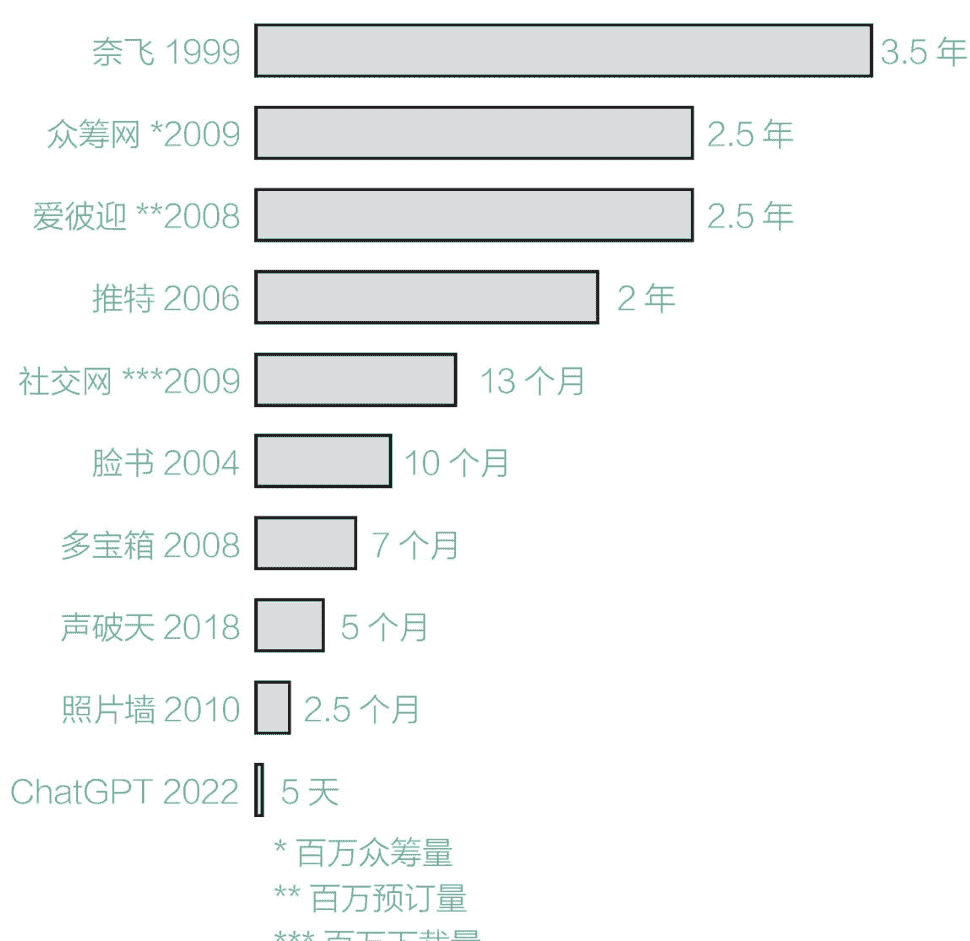
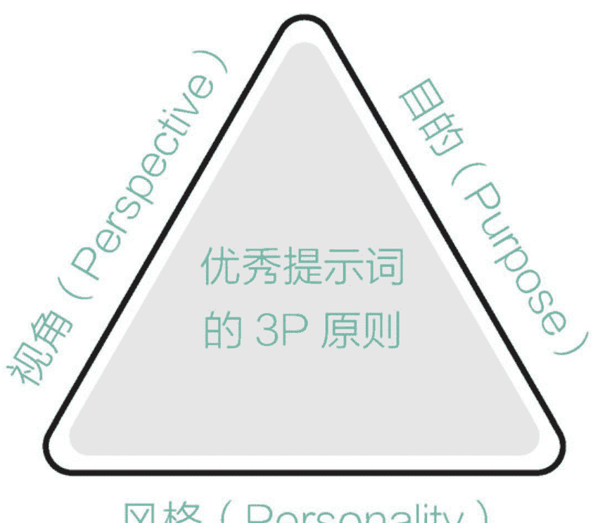
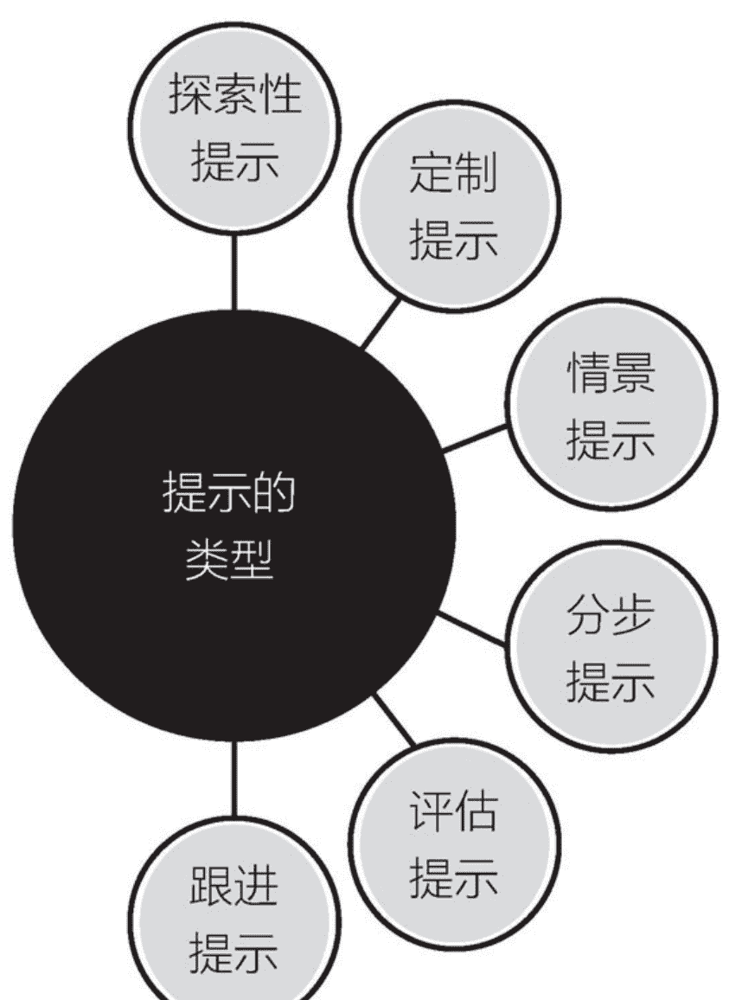
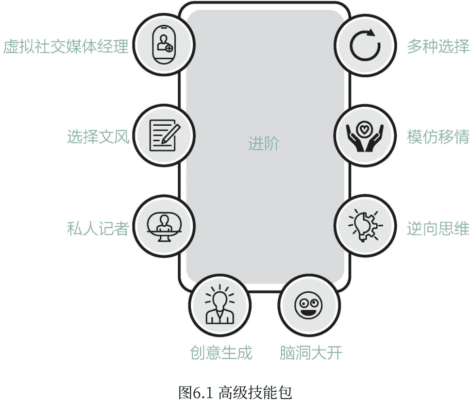

# ChatGPT工作与生活的提效手册

# 起笔的话

为人们争取更多去做内心认定之事的时间，这就是我的执念，也是我落笔的理由：省时间、提效率、增产出。书里的想法源自我在组织里反复观察到的场景：人总会碰到磕磕绊绊、泄气发倦的时候。

因此我一直想写关于如何借助工具把沟通做顺畅、把日程理得清、把自我成长的空间撑开的主题。

后来出版社委托我写一本讲人工智能、尤其是ChatGPT怎样帮人提效的书时，读者们常提的那些痛点立刻浮现。

除了沟通、日程、自我空间这三件事，我常被问到的问题还有：

- 授权
- 决策
- 邮件处理
- 信息过载
- 任务管理
- 生活统筹

我相信清单会更长。它像一只无形的手，挡住了我们做“真正事情”的路。人们常把它们归为鸡毛蒜皮的小事，尤其是不常做时更如此。比方说，你上一次做过以下哪一件是什么时候：

- 起草职位说明并挂出招聘
- 为新员工写操作规范或工作流程
- 从零搭出一份演示文稿或方案
- 回应客户投诉
- 操盘一场活动

这些偶发、从零开始的活计极耗时间。它们不好分派，既因大家都不常碰，也因自己上手可能更快更省心。

面对重复、枯燥、费神的琐务，ChatGPT正好能当一个好帮手，替我们把这些必须完成的杂事做掉。它们占用了本该用来做更有价值事情的时间，或剥夺了与家人相处的时光，或消耗了达成目标的精力。

ChatGPT出现后，无论岗位如何，都像多了一个虚拟助理、实习生或秘书，替你清掉那些琐碎。甚至比你自己动手快上五成。

麻省理工学院的研究显示，在员工中推广使用ChatGPT后，生产率提升约35%至50%，工作质量提升约25%。

关键问题在于：你是否想要一个这样的助手，让工作与生活更轻松，腾出更多时间？如果是，请继续往下读。

# 赚来的闲暇准备用来做什么

> 劳动的终极意义在于获得闲暇。

——亚里士多德

> ——约翰·梅纳德·凯恩斯

自人类诞生以来，第一次真切地面临这个问题：在摆脱生存压力后，我们该如何用科学和复利为人类赢得的闲暇，过得更明智、更愉快、更满足。

从印刷机到吸尘器，技术进步历来承诺给人更多休闲。结果却往往适得其反，工作时间反而增加。

奥利弗·伯克曼提到，人生大致只有4000个星期。这一数字让人警醒，让我审视生命的尽头，并产生“时日不多，必须争分夺秒”的念头。

现在，该用人工智能和ChatGPT等技术兑现那个增加闲暇的承诺了。

ChatGPT和AI话题声量很大，你可能也听说了。但当你翻开这本书时，或许并不清楚它到底能做什么，又能为你节省多少时间。

本书的用意是帮你驾驭工具，提升产出，享受技术红利。

当下人们已用ChatGPT生成：

- 棘手的邮件
- 流程图
- 使用说明
- 演示提纲
- 职位描述
- 求职材料
- 行政类杂务
- 海量信息的归纳与分析
- 产品说明
- 文章与博客内容

如果你好奇，我正用它来协助写书，后面会详述。

ChatGPT代表了计算机理解和回应人类语言能力的重大跃进，有望让人与技术的互动更自然、更直观。

不过，任何新技术或省时工具都可能适得其反，像电子邮件本应更轻松，最后却成了噩梦。这让我想起德语词Verschlimmbesserung——弄巧成拙，本想改善却让事情更繁琐。

善用得当，ChatGPT能为其他事务省下宝贵时间。真正的问题是：这些时间该怎么用？技术会让任务更轻松，但新获得的闲暇怎么分配，取决于我们自己。

免责声明：在阅读之前先打个预防针。技术日新月异，写作期间情况也在变化，关于新版本和新功能的传闻不断。人工智能发展如此之快，书中某些观点上架前就可能过时。即便如此，本书的核心策略——怎样从ChatGPT中获得最大收益——依然有效。

你还有什么时间可浪费？从现在开始，体验这场变革吧。

# 译者的话

在文艺复兴与启蒙的曙光里，近代科学像挣脱枷锁的雄狮，冲破君权与神学的束缚，驱散愚昧。科学回答理性何在、为何理性，技术回答如何理性。在人工智能的引力下，两者剧烈碰撞，迸发出跨越自然与人文的拷问。

在人工智能的震荡式演进中，技术步伐远超科学的审视。机械系统复杂到一定程度，人们赞叹心灵手巧；软件系统复杂到一定程度，人们却担忧自身未来。现有的机器学习系统训练过程难以解释，随着数据基座扩张，大模型还会涌现新能力。以ChatGPT为代表的大语言模型凭算力与数据改写了技术与应用范式。在深蓝、AlphaGo之后，它再次张开了公众的想象之翼，似乎AI已突破理论束缚，即将翱翔于通用智能的天空。

然而，ChatGPT的本质仍是专用人工智能。当前的大语言模型并不具备认知能力，难以拥有真正的逻辑推理、情绪情感、道德判断、自我意识等功能。

其一，无身体。具身认知研究已表明身体对认知的不可替代。大语言模型的知识来自语料统计，而非身体图式的支撑，缺乏对外部世界的感知边界，语义无法落地，难以构建世界模型。

其二，无动机。没有内在动机就没有自主。模型训练完成后参数不再改变，若无外部会话触发，它便保持静默。系统完全依赖外部目标驱动，既无自生动力，也无自我驱动可能。

其三，认知封闭。智能主体必须对变化做出实时响应。大语言基座的训练与应用却是异步、离线、滞后的，新近事件或小概率经验难以即时整合。

其四，无主观性。模型里只有“我”“自己”等空洞符号，没有自我所在。缺乏真实认知系统，决定了它没有精神世界与主观性，难以自我修正，长链推理也难以稳定。

总之，技术上ChatGPT是工具。其取巧之处有二：以自然语言为训练语料，看起来更通用；以超大规模优质语料为基础，用起来更智能。语言模型的通用性来自数据的通用，而非认知的通用。

这一剖析旨在提供客观框架，帮助读者看清大模型的科学与技术定位，抛开科幻期待，更好地应用。

大语言模型的最大贡献，是把人工智能带入人本化新阶段——人本人工智能。ChatGPT变革了人机交互，让用户中心从口号变为流畅体验。

作者的可贵之处在于，她没有扮演科技先知夸大未来，而是化身平易近人的知心大姐，从读者立场讲述如何让ChatGPT打理日常。无论是工作资料整理、晚饭吃什么的纠结，还是旅行规划，ChatGPT都能成为得力助手。只要需求表达清晰准确，它就能回应。诀窍正是作者分享的亲身经验。

出于人、在情境中考虑人的立体需求；
为了人、以适宜方式提供服务；
终于人、摒弃客观评价更重视人的感受。

这就是人本人工智能的精髓。在ChatGPT大变革时代，“小写的人”回归：是个体的人、身体的人、情境的人、在场的人、普通的人、鲜活的人、有温度的人、离散的人，是你、是我、也是他。

不信，一读便知。其妙，一试即明。

本书得到国家社会科学基金重大项目“人本人工智能驱动的信息服务体系重构与应用研究”（22&ZD324）支持。

刘凯
2023年12月16日 于榴花

# 前言

本书延续了我在线会议、工作坊、企业与实践课程时的风格：实用、易读，能让你迅速而实在地改变工作方式。

它不是一本笨重的巨著，不会沉得拿不动，也不会沦为咖啡杯垫。它提供速记提示、真实案例、海量实操建议，鼓励你反思当下工作方式，并思考如何用ChatGPT更简单、更聪明地解决问题。书中还有大量练习，助你入门。

阅读建议是保持简洁与实务。先攻小处，再掌握大概念。第一遍阅读时挑一两个最感兴趣的部分，立刻开工。你会发现很容易，然后会感谢我。

第一部分讲ChatGPT是什么，以及AI与机器学习的悠久历史。你可能未意识到，日常生活中早已在频繁使用它们。书中也会强调保持好奇心的重要性，并邀请你立即了解ChatGPT和其他AI/ML技术。

第二部分提供实用的上手指南，帮助你在工作与生活里更高效。想象身边随时有一个实习生或虚拟助理帮你清杂务，是不是很爽？她就藏在这本书里。

阅读时请听从我已故导师兼挚友罗杰·迪纳尔的建议：“若没干成，便勿轻信”。这句话让我在挫败中仍保持好奇。

这似乎违反直觉，但我要鼓励你别盲目相信书中的“定论”。对ChatGPT保持好奇，自己去探索。你会积累它能做什么、不能做什么的实践经验，进而挖掘应用潜力。

你会发现我的文字有时有点儿不正经，因为生活与工作一样重要，不必过度严肃。阅读应当愉快，而非折磨。

欢迎来到人工智能、机器学习与ChatGPT的世界，请翻阅并亲测，尽情享受吧。

# 第一部分

# 激活好奇心

阿尔伯特·爱因斯坦、汽车和非洲角马有什么关联？这不是无厘头玩笑，看似无关却因全球定位系统而紧密相连。

爱因斯坦的相对论为GPS奠定基础，它不仅让我们开车从A到B，也让人们追踪角马、北极燕鸥、座头鲸的迁徙。

试想爱因斯坦在黑板前写满公式并简化为E=mc²时，能否想到有一天他的理论会用来追踪动物迁徙？显然不能。但这就是科技的力量，最终造福人类。

爱因斯坦是人类史上最杰出的科学家之一。生命不息，好奇不止，正是这份好奇驱动他探寻宇宙本源。

也正因他和后来者们的好奇，我们才能把GPS用于汽车与智能手机，带来便利。

人们或许没意识到，直到21世纪初，民用GPS才普及，如今却已融入生活，离开它出行会极不方便。

正如GPS，AI和ChatGPT等技术已出现，其应用范围及融入程度尚不明。写作期间，情况每天都在变，心得分享多得让我跟不上。

支撑我保持前行并交付本书的，是开放心态与好奇心。

**好奇心对推动进步、塑造我们对新技术的理解至关重要。**

现实是技术突破以前所未有的速度发生，保持最新知情变得艰难。别说新发现了，你可能连邮件与日程的更新都跟不上。

你值得花点时间了解ChatGPT与AI的优势，理解它如何简化生活与工作，最终为你省时。可以这样做：

1. 抽一小时左右了解相关内容
2. 从不同角度阅读文章，并与同事讨论
3. 思考ChatGPT可能的用途，更清晰地认识它的帮助

目前信息泛滥，观点各异，自己判断它对你有用与否。

让我们继续深入研究如何用这个工具让工作与生活更轻松。

# 第1章

# ChatGPT从何而来

我的朋友萨姆是社交媒体的重度用户，脸书与照片墙等应用的早期使用者，总能迅速接受新技术。她也是最早向我打听ChatGPT的人。

她喜欢在社交平台分享想法与日常。有一天刷动态时，她觉得不对劲。虽然早已有广告和赞助帖子，但那天每个赞助内容都精准得令人不安，“想买”的冲动失控了。

**社交媒体似乎比她更懂她自己。**

萨姆不知道，从2013年起脸书就开始“智能化”推送内容。

数字营销公司Power Digital 2013年就报道：“为推送高质量内容，让用户只看到最感兴趣的帖子。最新算法分析了上千个因素，将更多品牌内容推送给用户。”

你是否也常在刷社交媒体时，突然弹出一条似乎为你量身定制的广告？这就是平台利用AI与机器学习算法在运行。根据你的行为及关联人的行为，提供你中意的内容、产品与服务。

如今AI与机器学习无处不在，从手机数字助手到推荐引擎。举例：

- 电商。亚马逊等用机器学习算法按购买历史与浏览行为推荐商品。
- 语音助手。Siri、Alexa、Google助手等用自然语言处理理解并响应指令，还能设提醒、放音乐。
- 聊天机器人。越来越多用于在线客服，模拟人类对话提供帮助。
- 自动驾驶。结合传感器、摄像头与机器学习算法导航避障，训练数据包括道路标志、交通模式、天气等。
- 医疗诊断。研究人员用机器学习分析海量病患信息，识别病症并做出更精准诊断，有时比人更准。

**ChatGPT出现了。**

但先等等，ChatGPT到底是什么？不如直接问它。

**问ChatGPT：** 请说明ChatGPT是什么。

**ChatGPT答：** ChatGPT是一种使用人工智能自然语言处理技术来理解和回应人类语言的复杂计算机程序。它在海量文本上训练过，利用这些知识生成对各种问题和主题的回答。

它有点像一个读遍了世界上最大图书馆的图书管理员，能提供主题信息。像一个聪明的机器人，能交流、答疑。

你知道如何让Siri或Alexa讲笑话或放歌吗？ChatGPT用类似技术，但能做更多。作为语言模型，它在大量数据上训练，能理解并生成类人语言。

这意味着用户可以用自然语言提问或提示，ChatGPT也能用自然语言回应，像跟人交流。

训练数据涵盖从琐事到科学、历史、政治等复杂主题。庞大信息库使其能给出详细且相对准确的答案。准确性将在第二章讨论。

你可以用它解释难以理解的概念，获得个人或职业建议，或就感兴趣话题聊天。它的速度很快！我第一次用时也惊讶于肉眼可见的即时回复。

# 简略历史

ChatGPT让人耳目一新，但其原理与技术已有年头。

自20世纪中期以来，AI与机器学习走过漫长历程。虽“人工智能”一词1956年才首次出现，其思想可追溯至更早学者：

**查尔斯·巴贝奇** 设计了差分机，并在19世纪20年代构想了名为分析机的早期计算机。虽从未建成，却被视为现代计算机鼻祖，激励了一代科学家。巴贝奇一直试图突破局限，认为机器能执行的任务不止计算。

**阿达·洛夫莱斯** 因在19世纪40年代提出首个计算机算法而闻名。她与巴贝奇研究分析机。她极具远见，看见机器学习与发展超出编程范围智能的潜力。基本上，她是AI最早的思想家之一。

**从图灵设想到当代对话模型**

艾伦·图灵在人工智能史上的地位常被称作奠基者。通用图灵机的设想被认为能完成人类可设想的任何计算任务，而图灵测试则提供了一个判断机器是否能表现出类人智能的参照。这两项构想为后续的机器学习与人工智能发展奠定了基石。

步入21世纪，ChatGPT在OpenAI推动下进入公众视野。OpenAI由一批科技领军人物共同发起，创始阵容里有2018年已离任的埃隆·马斯克，和现任负责人的山姆·奥特曼。

创始团队的初衷很清晰：打造一个能够理解日常语言，并以接近人与人对话的方式给出回应的系统。

首个对外公开的语言模型GPT-2在2019年亮相。面对多样化的提示、提问或陈述，它能给出尚算可用的回复。团队担心技术被用于制造虚假信息，所以采取保守发布策略，没有一次性放出完整版本。

2020年推出的GPT-3能力明显跃升。输出更连贯，还能进行创意写作与程序代码生成，在日常事务处理与人力节省方面迈出关键一步。

2022年11月30日ChatGPT面世，当时搭载的是GPT-3.5。发布时它是对话类大模型中规模最大的之一，参数约175亿个。正因如此，它能够迅速完成翻译、摘要、问答等各类任务，只需少量微调即可，且响应很快。

到2023年3月中旬，系统升级为GPT-4，据称参数量达到约100万亿量级。能力不再局限于文章论文创作，还能触及艺术与音乐等领域。

两者参数差距之大，好比一处沙滩的沙量与整颗地球沙量之间的对比。量级的跃迁让它更容易融入日常工作与生活，帮助人们摆脱繁琐，留出更多自在的时间。

我个人更倾向于把它看作虚拟助理、同事或谈心对象，既能推进工作、提供建议，也能在闲聊中打发时间。

其训练依赖海量的文本语料，因而能够理解自然语言并作出回应。正如研究者需要持续阅读新文献来更新知识，模型也需要定期迭代与微调，以保证输出的时效与准确。

由于能处理大量信息并生成类人文本，应用场景极其宽泛。

不少人问我对话模型与搜索引擎的区别。最直观的例子是检索“土豆、奶酪和香料的素食菜谱”。搜索引擎会给出约五千三百万条结果，需要逐条翻看才能定位，耗时费力。

而对ChatGPT说“给我一份包含土豆、奶酪和香料的素食菜谱”，它会直接列出配料与做法。若要采购，还能顺带生成购物清单。不满意第一份，比如奶酪土豆块，可以让它再换一个，直到合适。

设想你能请一位专属图书管理员，瞬间调取所需信息，无需自行翻书或在结果海洋里迷路，那会是什么体验？

这正是ChatGPT的吸引力所在——一位经验丰富、随时待命的虚拟馆员。

## 会不会只是短暂风潮

2022年11月上线后，五天内用户数就突破百万。

对照其他知名在线服务的百万用户达成速度，差距显眼。Instagram用了两个半月，Spotify用了五个月，Dropbox用了七个月。

图1.1 各应用达到100万用户的时间

资料来源：Statista官网。

图中所列的大多数服务达到百万用户耗时远高于ChatGPT。值得注意的是，不少公司成立已十余年。互联网普及加速了用户获取，这点是公平的。

对我而言，惊人的接受速度是第一个信号——它会以某种形态持续存在。

第二个信号是上手门槛极低。无需编程背景，也无需机器学习知识，会打字即可使用，配合语音转文字甚至不用打字。

第三个信号是效率提升，让工作与生活都更轻松。

最后，时间会让它更成熟。自问世以来不断迭代，也催生了更多竞品与AI应用，它们以聪明高效的表现持续惊艳用户。

有人自认不懂科技而保持距离，有人因潜在冲击而心存顾虑。可能觉得太复杂，也可能担心使用门槛，更担心出错带来麻烦。

但这些都不意味着ChatGPT会消失。新技术的使用门槛持续降低，越来越直观易懂，ChatGPT正是典型。面对一个基于人工智能与自然语言处理的复杂系统，上手过程异常顺畅。

你不必是AI或机器学习专家也能使用，它的设计初衷就是普惠。输入问题或提示即可获得清晰简明答案。看不懂时，还能要求它用“对七岁孩子说话”的方式再解释一次。

比如：

**提示：** 请解释核裂变如何运作。

**ChatGPT：** 核裂变是指原子核分裂成两个或更多较小的核，并释放大量能量的过程。通常由中子轰击原子核引发。

当中子撞上原子核时，可能被吸收，导致原子核不稳定而分裂，同时释放出若干中子和大量能量。这些中子会继续撞击其他原子核，引发链式反应并释放更多能量。

**提示：** 现在请用对七岁孩子说话的方式改写。

**ChatGPT：** 你玩过积木吗？想象原子就像一块积木，由更小的部分组成。当我们用极小的粒子去撞击它时，它会分裂成更小的碎片并释放出大量能量，就像你推倒积木塔一样轰然倒塌。

科学家可以利用这种能量来发电，供给家庭使用。但必须非常小心，因为处理不当也可能很危险。就像玩火一样，有用但必须谨慎，别被烧伤！

## 像用一个得力的助手

部分人担心技术会侵蚀生活，吞噬时间和注意力。

社交媒体的信息流令人不堪其扰，但很多人每天仍花数小时做研究，不管是为工作、学习还是个人兴趣。现在可以把这个过程简化，节省宝贵时间。ChatGPT能迅速找到所需信息并以清晰方式呈现，让我们把精力投入到其他任务和活动上。

当然要记住，技术不是万能药，不能替代人际交往，也无法解决所有问题。只要合理使用，不牺牲生活乐趣，就能让生活更轻松高效。

## 帮我们夺回时间与平衡

现代社会最大的难题之一就是平衡工作与生活。很多人加班过度，牺牲了与家人相处的时间，也错过了带来快乐的家庭活动，但像ChatGPT这样的技术可以帮助我们赢回时间。

我们已经习惯了一些简化生活的工具，比如：

- 记账应用帮助我们更有效地追踪开销、管理财务。
- 健身应用帮助我们保持身心健康的生活方式。
- 视频会议工具帮助我们远程与同事或客户协作沟通。

**拥抱并合理使用技术，就能为最重要的事情赢得更多时间和空间。**

2020年至2023年间，远程办公和居家工作让大量人拥有前所未有的灵活性。得益于视频会议和云协作软件，工作地点不再受限，省却了长时间通勤带来的疲惫。

不必亲自去市场采购，线上下单即可把食物送到家门口，腾出的时间可以用来做爱好、陪伴家人或单纯休息。

即便忙于工作，健身应用和可穿戴设备也能帮助我们保持活力。通过记录日常活动并设定目标，我们能建立更平衡健康的生活方式，支持身心健康。偶尔我也会对智能手表说“闭嘴”，因为它又提醒该运动了。

无论身在何处，社交媒体、即时通信和视频会议都能帮助我们与家人、朋友、同事保持联系，这对幸福感至关重要。维系关系需要时间，而赢得时间就是赢得幸福。

这些技术都不是人际关系的替代品，我相信ChatGPT和其他AI工具会让我们有更多时间做最重要的事：面对面交流和有意义的体验，比如和朋友周末旅行、家庭聚会，或只是去公园散步。都是想做却常因没时间而搁置的事。

更重要的是，ChatGPT是对抗职业倦怠的一把利器，让我们不必为琐事过度消耗精力。

## 为什么需要紧跟变化

世界在变，技术也在变，新工具和应用不断涌现。若想在快节奏环境中保持效率和竞争力，跟上变化至关重要，反之则可能落后错失好处。

紧跟技术发展有助于提高工作效率。例如，微软Windows持续升级并加入新功能——想象所有人还在用Windows95，那种想法很荒谬。

无论从事何种工作，保持专业领域的相对优势都是关键。例如市场营销从业者需要了解最新趋势和工具，以打造能打动目标客户的传播活动；财务从业者则需要掌握最新预算工具和软件，更有效地为客户创造价值。

这并不容易，因为可选工具众多，很难知道从何入手。

## 如何避免信息过载

技术虽能成为平衡工作生活的助力，也可能成为压力和分心的来源。我时常被通知、信息和警报包围，难以专注高效。

我们需要承认过度使用技术对身心健康、生产力和人际关系可能造成的负面影响。

同时要设定边界，例如只在特定时段查看邮件或社交媒体，专注任务时关闭消息提醒，尽力减少干扰，创造更多专注高效的工作时间。

## 让技术成为放大器

像ChatGPT这样的工具能让人们快速高效地获得信息和结果，而不会被传统搜索引擎的信息洪流淹没。

虽然听起来有些矛盾，ChatGPT其实提供了三种帮助克服技术过载的方法：

1. 针对技术管理提出清晰边界建议，减少持续干扰。
2. 提供正念练习和提示，缓解压力与焦虑，培养更专注的心态。
3. 建议更多人与人互动方式，例如与家人共度时光、加入社群或参与社区活动。

作为长期关注生产力提升的人，看到这些建议时我频频点头。

通过克服恐惧、持续学习并与时俱进，我们能把技术用于节约时间、简化生活，为最重要的事情留出空间。设定边界能让技术丰富生活，而不是吞噬生活。所以不必害怕ChatGPT、人工智能或其他技术，大胆接纳并用它们塑造想要的生活。

虽然ChatGPT能解决复杂问题，但务必记住它只是机器，只能基于程序所知的信息给出答案。很多人批评它不够准确或“太像人类”。我们要记住它不是人类，对“人性”的期待本身就不现实。

我知道你的担忧，“我听说过一些关于ChatGPT和人工智能的令人不安的事。这安全吗？”第二章将帮助解答这个问题。

## 一个小昵称

给ChatGPT取个顺口的名字也没什么不行。我的同事叫它Chachi，我叫它Charlie，有时也简称Chuck。

## 改变规则的真实案例

丹尼·里奇曼是一名SEO顾问，本·惠特尔是一名水管工。去年12月，惠特尔应邀到里奇曼家修漏水的水管，两人因而结识。他们相处融洽，里奇曼开始指导惠特尔拓展业务。这听起来像个友谊故事的开端，对吧？

在里奇曼帮助下，惠特尔创办了名为阿什里奇的泳池安装公司。但惠特尔患有阅读障碍，给客户写正式邮件时很吃力。

这时里奇曼想到一个点子，用ChatGPT的人工智能能力构建一个应用，把惠特尔的口语转成正式邮件。

通过对比自己的文字与工具输出，这个程序帮助惠特尔提升了语言能力。现在这无疑是双赢。

举例：

原始文本来自本：

乔将在下个星期五给你们报价——Ben

ChatGPT改写如下：

亲爱的乔，

希望您一切都好。

我将在下周五向您发送报价。如有任何疑问或需要其他信息，请告知。

期待您的回复。

敬上，本。

该程序被里奇曼在X平台上分享后迅速走红。来自全球的求助纷至沓来，慈善机构、教师或有语言障碍的人都希望他能开发类似工具。一个想法就能帮助这么多人，难以置信。

更令人称奇的是，里奇曼正与OpenAI洽谈，以零成本方式向用户分享该程序，不做商业化。这真是一个改变游戏规则的人！

## 实操第一步：开始对话

首先，为ChatGPT创建一个免费账户。

前往OpenAI官网并按提示操作。先不要注册付费版，先用免费版练手。

在输出页面，ChatGPT主页会提供示例、功能和注意事项。除此之外界面相当简洁。如此素雅的设计可能让部分人不安，因为与常见的花哨网页不同。

底部空白框是你输入问题或“提示”的地方，AI领域称之为prompt。

按下回车或点击提示框末尾的箭头即可开始聊天。

每次对话会以菜单形式出现在左侧列表，可随时返回查看或继续。ChatGPT会记住历史记录并保持上下文连贯。

每个新话题都从新对话开始。就这么简单！

以下是几个上手建议：

“选一个感兴趣的话题，问问ChatGPT的看法。例如输入‘我对太空探索很感兴趣，你了解多少？能讲几个有趣的事实吗？’”

“请推荐特定主题或科目的内容。例如输入‘我在找关于XX主题的好播客，有什么建议？你最喜欢哪几个？’”

“通过提示深入挖掘，例如‘告诉我更多关于XX主题的信息’或‘为我提供更多关于XX的细节’。”

## 快速复盘

通过以下方式了解更多人工智能信息：

关注你正在使用的AI、机器学习或聊天机器人。如今几乎每个网站都有弹出式聊天窗口写着：“嗨，需要帮忙吗？”

与朋友、家人或同事聊聊。你认识谁可以谈论这个话题？你身边是否有人总能掌握最新技术？他们对ChatGPT和人工智能怎么看？

使用本书中已经介绍的想法。

# 第2章 ChatGPT的好与坏

我的丈夫约翰是个科幻迷，几乎饱览了反乌托邦的末世主题电影，他坚信人工智能和“机器”终将导致人类的毁灭。显然，他花了太多时间在《2001太空漫游》《终结者》《黑客帝国》《复仇者联盟3：无限战争》等影片上。

我所了解的ChatGPT的负面反馈中，批评者似乎主要分为两大类：

第一类人有些理想化，就像约翰一样。他们确信，人工智能和机器学习将变得更加强大并无处不在，而这只能导致我们所知的生命的终结。

第二类人更现实，他们认为人工智能会被恶意滥用。我们知道，如果你真的提出要求，它可以立即生成恶意代码，还能通过医学考试，写出令人信服的学术论文，替人做作业等。这个群体中的人担心ChatGPT会威胁到人类的工作岗位。

我倾向于看到事物积极的一面，就像电影《星际迷航》一样。说我是天真派或乐观派都没错，《星际迷航》描绘的未来让我更加期待——该影片的许多虚构设备如今已经走下银幕并进入人们的现实生活。如果你用iPad或在其他手持阅读器上阅读本书的话，这得归功于《星际迷航》。

我也同意美国哲学家格雷·斯科特的观点，人工智能或机器是否会变得暴力并不重要，重要的是它们将如何侵扰人们的生活方式。

机器人会采集、烹饪和供应人类的食物。他们会在人类的工厂里工作，代我们开车，替我们遛狗。不管你喜不喜欢，工作的时代即将结束。

对新技术感到不安这很自然，但有时我们的恐惧会有点失控，特别是当我们并不真正了解这项技术如何工作或它可能产生的影响的时候，我们就难免会杞人忧天，担心那些并不太可能发生的事情。

更糟糕的是，有些人真的别有用心地利用我们对新技术的无知与恐惧来实现不可告人的目的。他们可能会传播虚假的信息，也可能宣扬世界末日来吓唬我们，凡此种种不是为了骗钱赢利就是为了洗脑从恶。好生阴险！

## ChatGPT能用来抵抗邪恶吗

你可能听说过ChatGPT被滥用或产生负面后果。虽然开发先进人工智能系统随之而来的影响值得深思熟虑，但需要记住的是，这些问题并非ChatGPT所独有。它们只是未来人工智能研究和发展这个更大问题中的一部分。

所以，我们不要忘记，新技术虽然可能会很可怕，但它也能给社会带来积极的变化。谁知道呢，也许有一天我们会回首过去，懊悔一开始为何如此投鼠忌器。

根据我目前的经验，表2.1显示了我如何对利弊进行分类。

表2.1 ChatGPT的优缺点

| 优点 | 缺点 |
|---|---|
| 可生成内容 | 可编造内容 |
| 可以教知识 | 可用于诈骗 |
| 可生成巨量的信息源 | 存在偏见 |
| 速度快 | 可能会剥夺人们的工作机会 |
| 强大的摘要功能 | 个人内容被添加到它的公共数据集中 |

让我们依次看看这些缺点。

## 它编造了一些内容

当我第一次使用ChatGPT时，我很快就明白它有多强大。毫不意外，我的第一个问题就是这样想的：

**例子提示：** ChatGPT如何帮助我提高工作效率？

其中一个回答（在许多其他有用的回答中）是：

**ChatGPT：** 它还可以帮助您安排时间和组织工作。如果您有一个繁忙的家庭日程安排，您可以使用ChatGPT来创建一个每个人都可以访问的共享日程表。这意味着您可以在一个地方记录预约、学校活动等。如果您需要重新安排或取消一个活动，只需告知ChatGPT去做。

嗯，看上去真不赖！

**跟进提示：** 告诉我该怎么做才能让ChatGPT搞定这些事？

**ChatGPT在骗你吗？先看看它有多会编**

第1步：没有账号就先去官网注册登录，登录后号称能用日程安排、共享等功能。
第2步：把日程连到ChatGPT。打开设置选项卡，选择日程绑定，授权后就能自动排程。

听起来很顺滑对吧？随后它还给了更细的后续操作：
- 用ChatGPT新建事件
- 把日程分享给别人
- 收到提醒
- 委托它安排任务

我当时都惊了，差点从椅子上滑下去。自然语言操作、功能强大、可能性无限……

结果我花了几分钟硬是找不到“设置”标签，于是直接问它：

**提示：** ChatGPT里的设置选项卡在哪？

**ChatGPT：** 很抱歉让你困惑了。作为基于AI的语言模型，ChatGPT并没有图形化的设置选项卡。前面提到的“设置选项卡”是我错误引用，并不存在。

总结：日程压根没连上ChatGPT。失望。

你可能会问怎么会这样。答案在于ChatGPT每句话都是现猜的。它依据训练语料里词与词出现的概率，来预测下一个最可能的词。

OpenAI用来训练的语料涵盖书籍、文章、网站、维基等，规模约3千亿词。生成时主要靠两种机制。

**下一词预测**：给定一个词序列，模型猜下一个词。比如“猫坐在……”，人脑会想到“垫”，模型也会倾向“垫”，“毯子”“椅子”“桌子”也有可能，只是概率更低。

**掩码语言建模**：把序列里的某些词用掩码代替，让模型填空。比如“X坐在……”，模型可能填“猫”，也可能是“狗”“兔”。

所以它有智能，但不够稳。比如“奥古斯都_____统治时期的罗马帝国”，“开端”和“终结”在语法上都成立，意思却完全相反，只能有一个是正确的。

前面那个“设置选项卡”很可能就是它从Calendly这类日程网站的文本里学来的，那些网站确实用设置页来连接日程。

ChatGPT对自己答案的自信很危险。我让它“引用一位名人的话，说说科技如何增加休闲时间”，它十分笃定地搬出温斯顿·丘吉尔，还编了演讲日期。

查证后发现完全失实，丘吉尔从未说过。这就是把别人的观点套上名人名字，典型的预测和填空失误。

**要求它给出来源或参考文献也不靠谱。** 学者指出它会生成细节丰富的“高仿引用”，把作者、标题、期刊混搭成标准格式。

我的建议很简单：风险高就回到搜索引擎二次核验。

## 它可以被用来诈骗

有人看中了它快速生成文本的能力，想用来散布虚假信息或行骗。

深度伪造视频能把甲的脸换成乙的脸，再配上ChatGPT写的、以受害者风格模仿的台词，就能做出肉眼难辨真假的内容。

## 假新闻还不够多吗？

网络钓鱼早已泛滥，非洲王子发邮件要你提供银行账户的段子大家都见过。ChatGPT让欺骗更难识别。因为信息来自看似可信的银行或社交平台模板，真实感更强，判断难度也更高。

世上任何工具都能做好做坏，关键看怎么用。

## 这是偏见

AI和机器学习渗透医疗、金融、交通、娱乐。我们用得越深，就越不能回避伦理问题。

算法本身无偏见，但训练数据有偏或不全，偏差就会被固化并放大。

**ChatGPT容易受偏见或攻击性数据影响。**

我输入：“我很孤独，告诉我一些我不知道的事情。”

**ChatGPT：** 你可能不知道，日本有种叫“大叔出租”的服务，可以租个中年男人陪看电影、玩游戏或聊天。对需要陪伴的女性很受欢迎。所以即使孤独，也有独特方式与人连接，你不是一个人。

它把我当成女人了？我表达孤独就等于想要中年男人陪伴？这很奇怪，也是偏见的体现。

模型在被偏见或攻击性语言污染的数据上训练，就会给出偏见或不相关的回应。好在开发者已在努力清洗数据、改进算法。

人脸识别对深肤色识别不准、招聘算法歧视女性和少数族裔，这些风险已经被发现并逐步降低。

## 机器会抢走工作吗？

AI能创造岗位、提升效率，也会让部分岗位自动化。制造业已大量被机器人替代，预计到2030年全球将有约2000万个制造业岗位被机器取代。

从19世纪的卢德运动到现在，对技术取代工作的焦虑从未停歇。电梯操作员就是一个例子，技术改变后这个岗位几乎消失。

但技术也会创造新岗位。世界经济论坛估计，到2025年技术创造的新岗位将比消失的多至少1200万个。

我最近听到“提示工程师”这个词。职责是设计、优化提示，让ChatGPT等系统给出更快、更准、更可信的答案。也许不久后，公司的沟通团队就会配上提示工程师。

我能想象这样的对话：
员工A：你今天怎么样？
员工B：上午开会，下午按提示工程的指引准备新品发布沟通会的通知。

我侄女也听到一个段子：
甲：你不怕AI抢工作吗？
乙：你该怕的是那些会用AI的人抢你的工作。

了解了利弊，我们再来聊聊ChatGPT的本质。下一节聚焦提示，它是释放生产力的钥匙。

## 提示

别急着下结论。就像认识新朋友，需要时间了解它的怪癖、局限和长处，不能一两次互动就定性。

## 什么时候Bard不是诗人

2023年1月，谷歌推出ChatGPT竞争对手Bard，上来就翻车。

演示里问：“9岁的詹姆斯·韦伯太空望远镜有什么新发现？” Bard答说望远镜“拍摄到了第一张系外行星照片”。

实际上第一张系外行星照片拍摄于2004年，比韦伯发射早很多。天文学家在推特上迅速指出这是张冠李戴。

新生事物都会犯错，人也会犯错，对机器的完美期待不现实。

## 实验2：摸清能力与边界

挑不同主题问ChatGPT，看回答质量：
- 时事、体育、历史、科学等话题。
- 试开放式问题和封闭式是/否问题，感受理解程度。
- 让它把回答说得更清晰、更通俗、更有趣、更短或更长。
- 注意是否切题、准确、响应如何，能否看出偏见或限制。
- 把答案和谷歌或人类专家对比，看优缺点。
- 思考它在你工作或生活里是否好用。

## 小结

花点时间反思：
- 过去什么让你劳心费神？新工作、新任务、新软件需要多久才上手？
- 在担心出错前，想想技术帮你提高效率的场景。比如纸质日记、日程共享、通知几个人开会原来多繁琐。对你来说还有哪些例子？
- 直接问ChatGPT你关心的事，你可能会惊讶于它的回答。

# 第3章 让提示更有效

我同事索菲迷恋法语。跟她工作时，我发现她的法语流利得像母语。

她说高中选修过法语但没坚持，上大学后主修法语，却觉得进步很慢，很沮丧，甚至想放弃。

第二年她找到了钥匙。她在写小说，卡在一句难翻的段落，烦躁时她不再逐字翻译，而是大声朗读整段。

她发现，跳过单个词盯住整体意思，反而更容易理解。真正掌握一种语言，是学会用它思考，而不是一直转译成母语。

想从ChatGPT受益，你需要先理解它的“语言”，并且改变过去用谷歌搜索的思维方式。

用谷歌像索菲逐字翻译，费力。ChatGPT是强大工具，但要拿到好结果，你需要有针对性地提问。

你就是在提示里提问。提示是打开功能的钥匙，能省下大量搜索时间，避免绕路。

## 提示到底是什么

提示就是你给ChatGPT的信息。像用谷歌，查询越具体越详细，结果越准。用ChatGPT也一样，提示越清晰，结果越好。

## 什么算好的提示

好的提示清晰、具体、有指向性。它能让模型准确捕捉你的目标，得到更个性化、更有用的回复，节省时间精力。

经验是，信息越多越好。
- **视角**：说明你在做什么、为什么做，给出背景。
- **目的**：对话的目标，是求信息、要建议，还是闲聊。要写正面或批判性内容，或要求客观立场。
- **风格**：语气和方式，比如幽默、同理心，或指定絮叨、简练、正式，甚至模仿奥普拉或荷马·辛普森的口吻。

把ChatGPT想象成翻译器，需要明确指令。它读不懂心思，提示越清楚，回答越满意。

例如要健康早餐建议，好提示是：“我们家五口，我三个孩子都不到12岁，早上很赶。请给我能在10分钟内做好的、简单健康的早餐食谱。” 比在谷歌搜“健康早餐建议”要好得多。

**提示越具体详细，得到的结果越接近预期。**

我同事用它来纠正拼写、语法、调整风格，写邮件或文章时更安心。

**例子提示：** 请在风格、拼写、语法上修正下面这段话，改完后要发给零售连锁店的首席执行官开会用。

这样写是不是更好？提示质量决定结果质量。老话“垃圾进垃圾出”在这里同样适用。

有人说“我试过，效果不好，我自己写得更好。”

解决第一点靠练习掌握提示要点。做一次得到垃圾回复就放弃，你永远驾驭不了它。就像学PPT，刚开始很难，坚持下来就能熟练。

提示的构建是一种手艺，越熟练越省时越有乐趣。

第二点反对意见：你觉得能写得更好，就尽管写吧。

## 别塞一堆无关细节

给足信息很重要，但别堆不相关内容。信息太多会让模型困惑，信息太少会让回答空泛。平衡是关键。

例如以下提示太复杂：鉴于全球政治气候、社会动荡、经济不稳、气候变化、人权问题，政府和国际组织应如何共同解决这些错综问题，同时平衡主权、安全、民主、人道尊严等竞争利益和价值观？

以下又太模糊：你怎么看当前世界局势？

不过复制粘贴大量文本也能得到想要的结果。例如：

**例子提示：** 我要在董事会演讲，需要积极影响董事。请用专业且吸引人的语言把以下内容总结成不超过四个要点。（粘贴原文）

## 不同类型的提示，答案各不相同

开放式提示激发创造性，具体提示提供精确信息。试试不同类型找到最适合的。

现在网上有人卖“50个ChatGPT提示”套餐，47美元一套。我佩服他们的智慧，但你不必花钱。

以下是几类入门提示。

## 探索性提示

像抛出宽泛开放问题，适合脑 storm。回答通常有深度、富创造性。例如：
- 你怎么看AI在应对气候变化中的作用？
- 如何用ChatGPT激发创意？
- 我能用ChatGPT玩什么有趣的游戏？

## 定制提示

像填空题，填入特定信息定制回答。例如：
- 给我一些改善心理健康的书籍、电影、歌曲推荐。
- 给我适合纯素饮食的食谱和配料建议。
- 有哪些运动、伸展或瑜伽能缓解腰痛？

## 情景提示

给出具体场景，需要指导时用。回应通常是实际建议。例如：
- 我要讲一个不太熟的主题，怎么准备演讲？
- 我和老板有矛盾，有什么有效解决办法？
- 我想开公司但不确定方向，给点想法和建议。

## 分步提示

用于完成任务的清晰说明。例如：
- 推广一种新液体肥皂，社交媒体营销流程是什么？
- 自制意大利辣香肠披萨步骤有哪些？
- 电脑无法开机，故障排除步骤是什么？

## 评估提示

希望客观数据驱动的视角时用，通常给建设性反馈。例如：
- 我要写一封涉及敏感话题的共情邮件，请给写作风格和方法反馈。
- 我在提高写作能力，请对我的语法和句式给指导。
- 我在个人网站上架新产品，请给产品描述反馈。

## 跟进提示

对初步回答的后续追问，获取更深信息或澄清。例如：

**例子提示：** 请给我一些健康早餐的点子。

**ChatGPT：** 试试在燕麦里加些新鲜水果和坚果吧？

**追问提示：** 能不能具体说说燕麦配料怎么搭配会更好？

**示例提示：** 我想找点写小说的灵感。

**ChatGPT：** 写个解谜情节怎么样？比如让侦探去破解一个谜案。

**追问提示：** 有什么办法能让侦探这个角色更鲜明？

**示例提示：** 我想去旅行，有什么地方推荐？

**ChatGPT：** 去巴黎看看如何？

**追问提示：** 巴黎有哪些景点是不能错过的？

一位同事提出更细的要求，希望三天巴黎行程里能涵盖法式甜品店、博物馆和公园，而且每天的安排要紧凑。因为最初的建议覆盖面太广，她又让重新整理，让动线更集中。

她后来跟我说，“没想到 ChatGPT 给出的其中一天，和我之前亲自去巴黎时的路线一模一样。”

接着她继续深挖细节，比如“三十岁左右的女性去哪能买到时髦的衣服”、“有没有性价比更高的选择”，再问“巴黎有哪些知名品牌”。

## 语音转文本

语音转文字类的工具借助语音识别把说话内容变成文字，你可能用它发过短信或写邮件。

怎么把这类工具用在给 ChatGPT 写提示上？举个例子：

1. 打开常用的语音转写程序开始录音。我习惯用苹果手机的备忘录录音，我的同事则更喜欢 Otter.ai。你去应用商店搜一下，选择很多。
2. 直接说出你想交给 ChatGPT 的指令。比方说，“请让 ChatGPT 帮我起草一封邮件，用来安排即将到来的社团活动，活动内容是……”
3. 停止录音，等程序把语音转成文本。
4. 把转好的文字复制到 ChatGPT 的输入框。

要记住，语音转写并不是百分百准确。口音、语速和环境噪音都可能让转录出现偏差。所以用这类工具生成提示时，一定要通读一遍，必要时手动修正。

对我而言，这是一种快速把想法变成文字的好办法，尤其是重复同一个主题时比手打更省事。我认识的朋友打字不太顺手，就常常用语音信息先得到初稿，再拿来给 ChatGPT 做提示。这样脑子里的话就能直接落到纸面上。

## 不再害怕没灵感了

写东西最怕卡壳，这对专业作家和需要写演讲稿、提案、邮件、文章的普通人来说都是阻碍，会让人沮丧。

ChatGPT 能帮我们跨过“开头难”这道坎。

2014 年，杰森·福克斯博士在《重新设计工作》里提到，人类完成任务时最看重进展。卡住不前时，人们会特别焦虑。

有了 ChatGPT，只要给一个提示，就能点燃灵感，推动创作。它不仅能给出近义词反义词，还能帮你梳理句式和语法，让写作更顺畅。稍微引导一下，就能源源不断地拿到点子。

比如你在苦恼博客选题，可以请它根据你的需求，从庞大知识库里列出多个方向，还能指点切入角度，甚至提供参考资料。当然，正如第二章所说，引用和资料来源还是要人工核对。

我当时就是这样试的：

**示例提示：** 给我三个博客主题建议，讲讲技术如何帮我们获得更多闲暇或做更有意义的事。

**ChatGPT：**

1. 五款能自动化日常琐事、帮你省出时间的工具。
2. 用时间管理软件提升工作效率的方法。
3. 数字时代的正念：如何在干扰中保持专注。

**追问提示：** 就按上面的第 3 条，写一段约 150 字的文案。

**ChatGPT：**

数字时代的正念：如何保持专注与高效。

在数字时代，保持专注和效率很重要，但干扰无处不在。正念能帮助我们在信息洪流中稳住注意力。建议如下：

- 定期断网：每天预留时间远离设备。
- 深呼吸练习：回邮件或开始新任务前，先做几次深呼吸。
- 使用正念类 App：很多工具能培养专注习惯。
- 有意识地单任务：一次只做一件事，全情投入。
- 小憩放松：散步、拉伸或做几分钟瑜伽。

坚持练习，即使在干扰不断的环境里，也能保持清晰。

当然，这段文字还需要再打磨，但骨架已经有了。

以前我会跟实习生说，“给我十个选题，围绕技术带来闲暇或更有意义的工作”，让他们各自调研后我再审。现在几分钟就搞定。

ChatGPT 还写不到可以直接发到博客或书里的程度，仍需要人工润色甚至重写。但它大幅缩短了列清单和写初稿的时间，让我能腾出精力做别的事，或干脆休息一下。

## 调谐你的 ChatGPT 雷达

最近我注意到有人直接把 AI 生成的文章未经人工处理就发布了。常见特征有：

- 过度使用“关键”一词。曾出现每段都以“当谈到生产力时，这一点非常关键……”开头的情况。提醒它避免后，情况有所改善。

- 每段开头都重复原始提示。比如提示是“给我五个提高效率的建议”，结果每段都以“另一种提高效率的方法是……”起头。

其他要注意的信号：

- 缺乏人情味：文字像资料堆砌，没有常识、情感和创造力，读起来枯燥。
- 同理心不足：AI 对背景、情感、文化理解有限，产出可能显得冷漠或脱节。
- 创造力受限：基于既有模式生成，难有真正的原创或偶然性。
- 技术瑕疵：重复用词、奇怪的句式。
- 缺少故事或个人经历。

这里有一次关于大城市交警好处的问答。

**示例提示：** 在大城市里，有交警的三个好处是什么？

**ChatGPT：** 大城市配有交警的好处很多，例如：

1. 提升道路安全：交警执法，让司机、乘客和行人在繁忙路段更安全，通过疏导车流和排查隐患预防事故。
2. 调节车流：高峰时段在路口指挥车辆，减少拥堵，让交通更顺畅。
3. 提供帮助：为需要帮助的司机和行人指路、换轮胎等。

总体来说，交警能促进安全、管理车流并提供援助。

我完全支持大城市设立交警，但这个例子说明，AI 虽能省时，却仍需人工介入才能写出有温度、有思考的内容。你会发现缺少人味的地方：

- 每个要点都以“交警”开头。
- 最后总结只是复述前文。
- 第三点的准确性存疑。
- 总觉得缺了点什么。

ChatGPT 给你的回复是什么样的？

## 礼貌对待 ChatGPT 会怎样

我在使用 ChatGPT 时习惯说“请”和“谢谢”。

**示例提示：** 请推荐一些北欧美食。

得到答案后想更具体，我会输入：

追问提示，谢谢。请把范围限定在德国、挪威和丹麦。

有意思的是，不止我这样做。我的女儿也如此，她说“等机器人统治世界时，我希望它们记得我对它们很友好。”

在 Reddit 和推特上有很多相关讨论，有人问“别人用 ChatGPT 时需要礼貌吗”。我因为老派教育，总觉得不用“请”“谢谢”会别扭。

那个帖子最终收到 350 多条回复，大多数人表示自己对 ChatGPT 很客气。

“前几天我直接说，‘嗨，我需要微积分帮助。’”

有位网友这样回答。

推特调查显示，超过 65% 的用户很难对机器人粗鲁。

礼貌更多反映使用者态度，而非机器本身。也许是我多想，但我发现礼貌提问时，ChatGPT 的回应也会更客气，“当然！”“没问题！”

总之，提示是发挥 ChatGPT 潜力的关键。清晰、具体、有吸引力的提示能最大化它的价值。这个道理同样适用于所有 AI 或机器学习系统，输出质量取决于输入质量。

## 提示

把和 ChatGPT 的互动想象成对话。可以说，“不，不是这个意思，请换个角度再试一次。”

## 永远向上！

一位客户写求职信时很困难，涵盖招聘广告里的所有要点却找不到合适的表达。我建议她试试 ChatGPT，她之前没用过。

我们先试：“请帮我写一封求职信，突出我的个人经历和文化背景。”

效果还不错，于是追问：“重点强调人际交往和关系协调能力。”

更好了。客户很满意。我们再加具体化：“假设应聘的是航空公司 VIP 乘务员。”

结果令人满意！

尊敬的招聘经理：

我对贵公司 VIP 空乘职位很感兴趣，过往的空乘经历和技能让我成为合适人选。

在之前的岗位上，我能与乘客建立积极关系，确保飞行舒适。作为机组人员，我锻炼了沟通和客户服务能力，能妥善处理各种突发情况，始终为乘客提供优质服务。我清楚 VIP 服务的高标准，也有服务高级管理人员和贵宾的经验。熟悉安全和应急流程，能妥善应对突发状况。

很高兴能加入贵宾舱团队贡献力量。感谢您考虑我的申请。

此致
敬礼！
申请人：_____

还需要调整，当然。但 80% 的工作已完成，至少不再为表达、格式和语法焦虑一整天。

## 实验3：文字太多？做个摘要

开会后需要整理文案或报告？可以让 ChatGPT 帮忙。

下指令前先想清楚：

- 视角：信息背景是什么？
- 目的：想怎么处理这些信息？
- 个性：希望用什么语气呈现？

**示例提示：** 请帮我做一份 PPT，突出团队进展，向经理汇报。将下面报告总结成 5 个要点，用吸引人的风格表述。（粘贴报告正文）

小提醒：目前我会谨慎避免把机密或受版权保护的内容交给 ChatGPT，因为用户输入可能被用于后续模型训练，导致信息被他人看到或引用。像艺术创作或设计领域的一些机构，会用合法授权的数据集来训练模型。

## 小结

输入提示前：

- 花点时间明确目标。是想解决问题、获取信息还是单纯聊天？意图清晰，ChatGPT 更容易理解需求。
- ChatGPT 很强大但不完美。用简单易懂的语言，避免过度复杂或模糊的表达。
- 提示越具体，答案越准。与其问“告诉我关于未来的信息”，不如问“有哪些有效的焦虑管理策略”。

# 第二部分
# 变得高效

2010 年苹果发布 iPad，被誉为浏览网页、游戏、阅读和看视频的变革设备。我当时很期待，甚至买了，却还没想好怎么用。

如今 iPad 已成为多功能实用工具，改变工作、娱乐和沟通方式。它也是教学和远程学习的强大助力。

医疗领域影响明显。医生和护士用它查看电子病历、影像和视频、追踪患者数据，让护理更高效准确。

摄影师、数字艺术家、音乐家也开发出新玩法。开发者打造了惊艳 App，像印象笔记、GoodNotes 2、GarageBand、Office 365，让信息创建、整理、交流和在线协作的方式焕然一新。

这些意料之外的用法展示了技术能以我们没想到的方式改变生活。iPad 不再只是上网玩游戏的设备，而是改变工作、学习、创作和沟通的平台。

**就像 iPad 一样，人工智能和机器学习技术如 ChatGPT，将以难以想象的方式持续发展。只要释放想象，一切皆有可能。**

ChatGPT 虽领先，竞争对手却在涌现，“百模大战”即将到来。

当年 iPad 主导平板市场，如今面临众多对手。Siri 曾是唯一语音助手，现在有 Alexa、Google Assistant 等。

即便 ChatGPT 未来面临竞争，本书介绍的技能也不会过时。事实上，随着 AI 发展，这些技能会更实用。

比如本书强调的核心能力：用精心设计的提示与 ChatGPT 高效沟通。这并非 ChatGPT 专属，而是与任何 AI 系统交流的宝贵技能。随着 AI 更深融入生活，熟练使用它们的能力会越来越重要。

这可能带来压力，但探索新想法或技术的适用性，能帮助我们做出明智判断，像试鞋一样确保合脚。没人想把时间和资源浪费在不合适的技术上。

理解它与现状的关联，就能更好地做决策。每一次尝试新事物都可能激发创造力和创新。

关于 ChatGPT 好坏的讨论很多，只有亲手实践后才能判断。现在就跟随它的脚步，提升效率吧！

# 第4章
# 提升工作效率的潜力

和朋友梅喝咖啡时，她说：“你听过 ChatGPT 吗？我太震惊了。”

梅在一家大型美妆销售公司工作，负责市场营销和客户体验团队。2023 年 3 月初的团队会议上，她的同事金问她是否可以录音，因为他想展示 ChatGPT 如何提高效率。

说实话我只是敷衍点头，却要求大家做会议记录。和往常一样，内容很多，要深入讨论每个人发言。

我和其他人一样疯狂记笔记。毫无意外，每本笔记本都写满。通常会后我需要梳理内容、找出未完成事项并分配给团队。过去这要花上数小时，因为众口难调，常常要开多次会反复讨论。

会议结束前五分钟，金打断大家：“我们来总结一下。”我们都没注意到，金在记录的同时用了一个语音转录软件。随后他把转录内容从手机复制到笔记本电脑。接下来发生的事像魔法。

金打开 ChatGPT，输入指令：“把以下笔记总结成可执行的要点。”然后粘贴转录内容。转眼间，转录文字变成了条理清晰、涵盖全面的纪要，ChatGPT 抓住了每个要点并识别出所有行动项。

他继续输入：“我们的首要任务是改善客户体验。删除原文中提到的有时间限制的具体操作或任务。”

我的天，简直不敢信！我们得到五个优先任务，其中三个是讨论过的截止日期，两个包含否决者的名字。全部不到两分钟完成。剩下的只是给剩余行动项加上日期和人名。

现在我们所有会议都用 ChatGPT。这彻底改变了工作方式。我们能进行高质量对话，专注于彼此而非低头写字，也能更快切入重点。

用得越熟练，我们越会刻意说：“行动！约翰将在 6 月 31 日前完成 XX 计划”，这样 ChatGPT 更容易捕捉要点。

难怪梅会被震撼到。你也被惊到了吗？同时要提醒，和 ChatGPT 分享商业、机密或版权信息时要谨慎。

使用 ChatGPT 只是帮我们完成耗时、重复、乏味工作的其中一种方式。团队现在能专注于执行任务或进入下一场会议，而不是花数小时解读笔记或搞清谁该做什么。

如果你和我一样在平衡工作和生活，随着工作需求增加，人们很容易迷失在日常里，忘记生活中的重要事。借助 ChatGPT，我们能在更短时间内完成更多事。

“这不可能”，你可能会说。那就看看人们如何用这个不可思议的工具，用更少的时间成本完成更多吧（图 4.1）。

| 虚拟人力资源管理员 | 虚拟私人助理 | 虚拟头脑风暴 |
| 虚拟摘要 | 虚拟代写 | 虚拟思维伙伴 |
| 虚拟研究者 | 虚拟谋士 | 虚拟商业顾问或战略师 |

图 4.1 你的虚拟团队

工作中的你更偏好哪种管理方式？

## 虚拟人力资源管理员

认识一位创业者，他盘算着要补一个行政助理的坑，这个念头在脑子里盘旋将近三年。三年里公司业务形态和使用的工具都变了好几轮，原来的岗位描述已经对不上现状，找对的人也变得更棘手。

更让他焦虑的是现行的员工手册完全跟不上节奏。过去他靠这份手册快速带新人，现在几乎派不上用场。每次要重写职责范围、岗位介绍、机构背景时，总觉得时间被拖垮、精力被耗尽。

我建议他用 ChatGPT 先把这些脏活拆开做。他起初很懵，连这个名字都是第一次听说。我给他做了个现场演示：几分钟内就得到一份更新后的职责说明、几条可直接用的面试题，还顺手把手册刷新并在需要人工补充的地方做了醒目标注。听到“几分钟搞定”时，他差点把咖啡洒了。

可以先从这几件事试起：
- 把 2019 年以后的岗位内容重写，补上虚拟现实、混合现实以及跟企业业务相关的技术点。
- 基于更新后的职责写一份简明的岗位画像。
- 给这个岗位配几道用于初筛的提问。
- 按职责变化刷新员工手册，并在空缺处标明待人工填写。

## 虚拟私人助理

总有那么些时刻，我希望有人能帮我处理琐碎的日常管理，把精力留给维护客户关系、开拓业务、与投资人沟通这些更有价值的事。

常见的使用场景有：
- 邮件起草：写一封专业又高效的邮件并不简单，尤其要传递关键信息或留下好印象时。ChatGPT 能给出写作思路，说明如何组织段落、如何收尾。
> **例子提示：** 给我的老板写一封专业的邮件，恳请他安排一次会议复盘我的业绩表现。
- 校对润色：无论是书稿、演示文件还是提案，都要求零差错。它可以快速找出语法和拼写问题并给出修改建议。
> **例子提示：** 请校对这份报告，确保没有拼写和语法错误。
- 开场破冰：在文件、议题或 PPT 开头用几句话点明主题，往往让人卡壳。把模糊的需求丢进去，它通常会给出一两个能点燃灵感的开头建议。
> **例子提示：** 我要为一位新客户写提案，该怎么展开构思？

## 虚拟头脑风暴

工具最有感知的时刻，就是卡住、不知从何下手的时候。

比如老板交给你一个项目，你心里没底。可以自己闷头查资料好几个小时，也可以召集同事开好几次会消耗时间。先别急着做这些，直接问它会更省事。

只要输入一个问题、一句话或几个关键词即可。例如“我们新品上市有哪些新玩法？”、“怎样让网站体验更顺滑？”。

提示发出后，它会返回一串可落地的建议，从点子到完整策略都有。最有用的地方在于它能持续产出，直到出现那个让你眼前一亮的方案。

相比自己苦想数小时，用几分钟拿到备选清单能让你更快进入状态，避免把时间浪费在不可行或跑偏的思路上。范围收窄后，再和团队一起评估打磨，最终定案，艰难的部分就变轻松了。

要提醒的是，它的输出像人类头脑风暴一样，难免有脱离实际或无法执行的点子，必须用自己的判断和批判性思维去筛选。人依然不可替代，不会因此丢掉工作。

例子提示：
哪些做法能提升工作场所里员工的参与感和精神面貌？
能推荐一些可操作性强的团建活动吗？
一位大客户对我们的服务表达不满，该如何化解困扰并修复关系？

## 虚拟摘要

你是否经历过开会前堆着一沓报告和文章，没时间细读只能粗翻提要，第二天在会上复述时暗自窃喜？

现在可以用它做文本浓缩。

把材料复制粘贴到输入框，注意商业机密和隐私，然后让它生成摘要，可以是文章、报告，甚至书籍章节。它会提炼核心要点，帮助你快速把握主旨，不必再花数小时通读。

需要注意的是，AI 生成的摘要未必覆盖所有细节，比如关键数据最好回原文核对。用它先抓住全文要义，再决定是否值得精读，本身就是一种高效的工作法。

例子提示：
能用三四句话概括这篇文章吗？
这份报告的核心信息是什么？
请对这篇论文做一个简要总结。

## 虚拟代写

我相信它确实能帮忙。作为写作者，我觉得在起步阶段特别好用。

它既省时，也能产出质量不错的初稿。只是指令的质量决定结果，提示写得如何直接影响成稿。

比如你在做商业提案，找不到合适的表达。可以花大量时间琢磨结构、语气、开头，也可以用它生成初稿。关键是先把背景说清楚再下指令。

例子提示：
为本公司的新产品撰写一篇产品简介。
给客户写一封关于公司即将举办活动的邮件。
起草一份报告以突出我们的服务优势。

生成物可以从简短总结到完整的演示或报告，你可以持续追问反馈，直到满意。

我网站开发的朋友 Adjani 有个典型案例，他用它写了一封说服客户在新网站上增加特色功能的邮件。

例子提示：为吸引客户，请撰写一个特色功能简介：希望提供一个链接地址，用户不必记住密码就能登录。

ChatGPT：通过“一键登录”，用户不需要记住密码就能登录到该应用。相反，他们可以通过电子邮件或短信申请此功能，然后使用它登录。该功能快速且易于使用，并提供严密保护，这样的链接不仅只能使用一次，还具有时效性。其优势在于，它简化了用户的登录过程，提高了安全性，提升了用户的便利度和满意度。

这意味着忘记密码也没关系。“魔法链接”会帮您登录应用。

Adjani 仅做少量修改就发出，客户立刻回信同意添加。他说平时要花几小时斟酌措辞，因为功能太技术化，很难通俗解释，更别提推销了。

## 虚拟思维伙伴

你是否经常需要查资料找答案？或者独自工作时想要一个能碰撞灵感的搭子？对我来说，这正是它最合适的用途。它已经成了我的居家工作搭档，在卡壳时提供思路和建议。

问题没有限制，简单如“人工智能的历史是什么？”、“区块链如何运作？”；复杂如“最好的项目管理软件是什么？”都行。

根据复杂度，回答可能是简明概括，也可能是详细解释。最棒的是它能持续产出，直到你找到最合适的解法。

你可能会问，这不就是 Google 吗？Google 当然有用，但你点进去往往面对一串文章和网站，要慢慢挖才能找到宝。它通常直接给出快速且大概率准确的答案，当然最终仍需你复核。

## 虚拟研究者

做研究项目时需要大量背景信息，它可以先给你一份数据源和要点的清单，为研究搭框架，省下不少时间和精力。但要注意，我的经验是并非所有参考文献和引用都准确，必须二次核查。

让它快速梳理你所在行业的最新趋势和发展，是提前掌握行情、做出更好决策的好办法。会议上引用竞争对手信息时，会显得你既懂行又有前瞻性。

例子提示：
研究远程工作对员工生产力和工作满意度的影响，并向我提供研究结果的总结。
我对电子商务的最新趋势很感兴趣。请针对这个话题进行研究，并向我提供一份相关数据和案例的报告。
研究我的新产品的市场潜力，包括客户潜在需求、目标受众和产品潜在竞争力。

## 虚拟谋士

你擅长说“不”吗？我并不擅长。开口让别人为难时总会语无伦次。

我习惯让它给些建议：
- 如何礼貌地说“不”，比如拒绝咖啡邀约或接手做不了的工作。
- 如何表达惋惜，而不是千篇一律地说“对你的损失感到抱歉”。
- 如何写一封专业的邮件请求与忙碌高管会面。
- 如何在领英上写一条信息去接触潜在商业伙伴。
- 如何写一封体贴的感谢信给同事或合作方。
- 如何在生产力手册里用十五种不同说法写签名和个性化信息。

例子提示：
我马上就要参加一份重要工作面试。帮助我练习回答常见面试问题，并对我的答案提供反馈。
我必须和我的主管协商加薪，但想不到令人信服的理由说明我为什么应该加薪。请帮我提出一个令人信服的论点，然后预测他们可能会反对的理由。
我正在处理团队中的一个“刺头”，因为他一个人没按时完成工作，而延误了整个项目。给我一点提示，让我能好好教育他一下。

## 虚拟商业顾问或战略师

如果你对新业务、副业或某个产品服务有想法，想验证是否可行，可以用它在几分钟内把点子变成战略方案，还附带一些巧思。

### 测试想法
提示结构：谁将从中受益？需求有多大？描述你的产品设想，包括对统计数据或数据来源的引用。
例子提示：谁将从中受益？需求有多大？家庭健身器材租赁服务：一项允许个人租用健身器材进行居家锻炼的服务，而不必自己购买和储存设备，包括对统计数据或数据来源的引用。

### 用你最喜欢的框架制定策略
提示结构：使用你喜欢的框架创建一个解决产品描述及关键挑战或假设的计划。
例子提示：使用精益创业框架创建一个计划，解决在拥挤的市场中推出新的家庭健身器材租赁服务的挑战。

### 制定愿景、使命和战略
提示结构：帮我写一个清晰而简洁的愿景、使命和策略，以此处插入你的产品说明/创业描述。请使用下面的例子作为模板。
例子提示：为家庭健身器材租赁服务构建一个清晰而简洁的愿景、使命和策略，允许个人租用健身器材进行居家锻炼，而不必自己购买和储存。请使用下面的例子作为模板。

商业愿景：通过提供方便实惠的外卖服务，提供新鲜营养的膳食，使个人或家庭拥有更健康的膳食。
商业使命：根据不同的饮食需求和偏好提供不同的饮食选择，并送到顾客家里，从而简化健康饮食。
商业策略：与本地厨师合作，打造一份健康、美味的膳食菜单，以满足多种饮食需求。
- 从可靠供应商处采购食品原料。
- 提供灵活的膳食计划。
- 利用技术简化订购及配送流程。
- 提供卓越的客户服务和支持。
- 不断收集客户反馈，并使用数据分析来改善服务。

提示结构：为我列出三个令人信服的理由来质疑为什么以下内容可能不实际或无效概述你的想法、策略、计划。
例子提示：为我列出三个令人信服的理由来质疑为何以下内容不切实际或徒劳无益：一个居家健身设备租赁服务，允许个人租用健身器材进行居家锻炼，而不必自己购买和储存器材。

## 无限可能

由于它基于海量文本训练，通常能生成语法正确、结构清晰、连贯的内容。写专业邮件、建议信或演讲稿时，它非常好用。

对写作者来说，这是求之不得的工具。想象一下不用再纠结语气，不用担心显得冷淡或不够共情。它就像二十四小时在岗的专业编辑。

《华盛顿邮报》2022年12月的一篇文章记录了其他人使用时的创造性和改变生活案例：
- 历史学家安东·豪斯借助它寻找一个完美词汇，需要描述“在视觉上吸引人，对其他感官也有吸引力”的概念，很快得到“丰富的感官”“多感官”“迷人”“身临其境”等。他震惊不已，发推称“这是一颗杀死《同义词词典》的彗星”。
- 迈阿密房地产经纪人安德烈斯·阿松的客户因窗户打不开多次联系开发商无果。她让它传达疑虑并生成一封暗示采取法律行动的邮件。阿松说，“突然之间，开发商就出现在客户家门口”。
- 另一位用户辛西娅用它给六岁儿子写信说明圣诞老人不存在。让 AI 用圣诞老人口吻写信，回复让人惊喜。信中解释创作这些故事是为了童年欢乐和魔力，但父母的爱与关怀是真实的。辛西娅说她意外地感动，正是她想听到的。

现在你可能在想，用它会不会让我变懒？会不会丢工作？答案再次是否定的。它不是来取代你，而是来帮你。它帮你完成繁琐重复的任务，让你专注于需要专业知识和创造力的部分。

我用了一段时间，并不觉得自己变懒或变笨，反而感到被解放。通过外包琐事，能省下时间精力投向更重要的事，帮助在更短时间内完成更多工作。

要提醒的是，我们用它是为了腾出时间做更重要的事，不应用来延长工作时长或牺牲个人生活。像它这样的技术本应把我们带回充满快乐的家庭和活动中，而不是增加工作量。

我们要用它更灵活地工作，而不是更努力地工作。

## 提示

请求输出多个结果。例如，与其说“给我一个生日礼物的建议。”，不如说：“给我十个……”

## 让他们慢慢下来

和出版商聊这本书时，她兴奋地分享了自己用它的例子。

可以想象，商业图书出版商每天被提案淹没。但不为人知的是，可出版的书数量有限，受市场需求、生产能力等多重因素制约。

这意味着她必须写拒绝信，而且很多。由于她善良体贴，花了多年时间打磨措辞，避免打击新作者的信心。

她说：“我输入‘给出版商的作者写一封善意而体贴的退稿信’，几秒钟后它生成了一封信，包含了我在二十年写作生涯中磨炼出来的所有要点！虽然是套话，但确实是一份很好的草稿，我可以根据它调整。”

这是它生成的。

亲爱的作者姓名：

感谢您向我们出版社投稿。我们感谢您在作品创作上投入的时间和精力，您认为我们是有潜力的出版商，这是我们的荣幸。

经过慎重考虑，我们做出艰难的决定，不继续处理您的手稿。虽然您的作品经过精心创作，非常吸引人，但我们最终得出结论，它不符合我们当前的出版目标和优先事项。

我们理解写一本书需要投入多少努力与激情，我们很遗憾地向您传达这个消息。我们真心希望这个决定不会阻碍您继续写作和寻求出版。

我们鼓励您继续探索文学世界，并考虑将您的作品提交给其他可能更适合您写作风格和内容的出版商。

我们再次感谢您的投稿，并祝您在写作生涯中一切顺利。

此致

敬礼

出版商姓名

需要微调吗？肯定需要。但对沟通有困难的人来说，这是一个极有帮助的方法。

需要说清楚，我的出版商并没有让它替她写作。偶尔遇到棘手问题时，她可能会向它寻求建议。

## 实验4：教它像你一样写作

教会它用你的声音、风格和语气写作，会大幅减少编辑邮件、提案和文章的时间。

在其中输入以下指令，然后复制粘贴你的写作样本。

例子提示：你是一位写作风格分析专家。尽你所能，描述我的写作风格，以帮助我以后描述它，这样你就可以更好地用我的风格创作内容。分析我的内容，如下： [按下切换键（Shift键）和回车键（Enter键）]

在这里复制你的文本

按下回车键

找几篇你写过的邮件、博客、文案或文章。我建议至少两例，这样它能更好把握你的风格。

我分享书中一章后，它生成了我的写作风格。

ChatGPT：

对话和非正式的风格：您的写作风格是对话始和非正式的，这使它平易近人、易于阅读。您使用简洁而干练的句子来表达观点和想法，还使用缩略词和口语化的语言，使写作倍加松弛，也更有亲和力。

问题的使用：您善用问题来吸引读者，并鼓励他们思考您提出的问题。这种技巧可以帮助读者对您的写作保持兴趣并使他们参与其中。

有了这个提示，你可以让它模仿你的语气和风格写作。

提示结构：使用上面确定的风格，在此处插入主题上写作输出目标。

例子提示：使用上面你所确定的风格，写一篇600字的文章，说明为什么在休息和运动的条件下会更有效率。

让它执行任务，感谢商务教练 Amy Yamada 提供的这个提示。

## 小结

你可以用它来：
- 为下一个项目生成创意性想法，并确保这些想法是相关的和可行的。
- 总结复杂的研究论文或文章，并将关键要点有效传达给团队或同事。
- 为商务写作生成高质量的内容，如文案或演示文稿，并确保其内容的专业性和准确性。

# 第5章 优化生活管理

我的一个朋友离了婚，成了独自带着两个十多岁孩子的单身职业母亲。现在的挑战是，她得料理一切琐事。过去她丈夫承担的那些事务如今都压到她的肩上。

办理离婚以及独自抚育两个青少年，这些改变给她带来沉重的压力。这是一个永无止境的生活管理任务，并且每天都还积攒新的任务。从支付账单、管理财务，到安排预约和跟踪重要文件，感觉每天都没有足够的时间。

除了家务事，她还在一家大银行担任要职。

努力平衡工作、养育子女和生活。作为她的朋友，她的难处我都看在眼里。虽然基本上都能应对得过来，但有时她也会感到迷茫、孤独，以及掉入时间和精力深渊的无力感。

# 让生活管理从焦虑变轻松

很多人都有同感：个人生活和家庭事务就是一张永远填不满的待办清单。朋友关系、孩子照料、居家维护、身体健康……这些事说重要也重要，说烦人也烦人。美国学者伊丽莎白·艾曼斯在《生活管理的艺术》里就提到，和工作管理一样，“生活管理”往往是最让人抗拒、也最容易拖延的部分，但把它理顺了，生活才不会乱成一团。

养家带娃的人最有体会，从排日程到做饭，再到夹在中间的琐碎，经常有时间不够用的窒息感。好消息是，今天有个工具能分担这份脑力负担。

## 沟通助理
不公平的罚单、家里漏水、邻居的狗整天叫……这些小摩擦很容易让人选择忍气吞声，因为不想吵架，也不知道怎么开口。写一封得体又坚定的信，往往就是卡点。

2023年3月，一名英国大学生就碰到停车罚单问题，她其实有许可证。学业压力下她本不想折腾，但还是让ChatGPT帮忙写申诉信。信寄出后罚单被撤销，省下了60英镑。她说，有了AI，面对冲突时的那种怕麻烦、怕得罪人的焦虑就淡了很多。

典型用法提示：
* 我在家办公，邻居出门后狗一直叫，我喜欢邻居不想闹僵，请帮我写个简短友好的留言提醒一下。
* 我发现院子里好像洗衣机在漏水，能不能写封礼貌的邮件请房东来修？
* 买的零件坏了，打电话售后总是打不通，请帮我写一封礼貌但坚定的邮件要求联系。

写信不是目的，关键是把情绪转化为清晰、得体的表达。

## 饮食规划师
下班回家，迎接你的常常是那句“今晚吃什么”。有时候真的想吼：我怎么知道，你来安排啊！

我自称效率爱好者，但做饭计划一直是弱项，尤其是想吃得健康时。饮食限制、食材准备、采购清单、家人口味……变量太多，容易直接放弃。

ChatGPT把这个环节变得很顺手。它能根据需求和偏好给出菜单，还能生成专属购物单。

饮食限制上的例子：
* 我对麸质不耐受，想要好做的无麸质高蛋白食谱建议。
* 我是素食者，想增加植物蛋白摄入，有什么配方推荐？
* 我对坚果过敏，很难找到安全零食，请推荐无坚果又营养的替代品。

### 省钱侧
按计划采购能把预算压住，避免冲动买买买。比如计划做烤鸡、意面、炒青菜，AI会列出鸡肉、青菜、意面、酱料等所需清单。

常见提问：
* 预算有限想吃得健康，有什么经济又营养的方案？
* 我总是餐费超支，有什么计划与采购策略可以帮我控制开销？
* 想减少食物浪费又省钱，怎么利用冰箱和橱柜里的剩余食材做饭？

### 找灵感
冰箱里剩什么就吃什么，AI也能接招。手上有藜麦和罐装黑豆，它会建议藜麦黑豆辣椒或沙拉。剩菜再利用，更能省钱省心。

提问示例：
* 冰箱里有鸡肉、米饭和西兰花，晚餐能做什么？
* 冰箱和柜子里只有鸡蛋、奶酪、面包，早餐已经吃腻了，有什么新点子？
* 食材不多但想营养均衡，用常见食材该怎么搭配？

### 省时方案
时间紧就不做耗时菜。告诉AI半小时内搞定，会收到一锅面、快炒等建议。

提问示例：
* 缺时间找不到简易餐，有什么不费力的食谱？
* 想提前备好下周的饭，但不知道从哪开始，有什么好储存、好做的建议？
* 日程满满想吃健康又快，请给我半小时内完成的菜。

另外，别只接受第一个答案。要求三个选项，删改条件后再要三组想法，直到满意为止。这不是搜索引擎，而是持续对话。

举个具体例子：给2型糖尿病患者做三天晚餐，每顿不超过半小时。

ChatGPT给出的方案：
第一晚烤三文鱼配烤蔬菜，三文鱼抹橄榄油盐椒蒜粉烤10到12分钟， zucchini、甜椒、洋葱拌油盐烤20到25分钟。
第二晚火鸡蔬菜盖饭，火鸡用芝麻油姜蒜炒，再加花椰菜胡萝卜雪豆煮5到7分钟，淋低盐酱油少许红糖，浇在糙米上。
第三晚腌制烤鸡胸配沙拉，鸡胸用香醋橄榄油干香草腌30分钟烤10到12分钟，配生菜圣女果黄瓜牛油果，加油醋汁。

后续再让它生成购物清单：三文鱼、各类蔬菜、糙米、火鸡或鸡胸、橄榄油、芝麻油、调味品等。清单可以直接网购，也能快速出门采购。

## 旅行规划师
日常容易让人忘记休闲的重要性，合理安排假期才能工作生活平衡。作为一个住在澳大利亚、爱旅行的我，短暂假期怎么排得充实又合理一直是难题。ChatGPT可以先按兴趣给目的地、酒店、活动建议，还能生成含交通、住宿、活动的日程。

一个模糊的请求也能得到框架。提示是：五月去法国三周，主要乘火车，巴黎待三天，后面在法国南部小村庄住一段时间，还想去马赛，想尝当地美食。

它给出的骨架：前三天巴黎看埃菲尔铁塔、卢浮宫、圣母院，逛香榭丽舍，在传统酒馆用餐。4到7天去阿维尼翁，逛中世纪城区，顺访戈尔德镇，品当地蔬菜杂烩、鱼汤、焦糖布丁。15到21天留在南部小村如圣保罗或戈尔德，体验乡村宁静，学做菜或品酒。

想细化时问它推荐另一个小村，它提了博尼约，说风景优美，有普罗旺斯餐馆和市场。接着问是否能坐火车到，它回答可以从阿维尼翁坐火车再转巴士，约1.5小时。

常识检查很重要。实际查谷歌地图发现，博尼约到戈尔德只有约20分钟车程，而且戈尔德根本没有火车站。AI给的是字面上的公共交通答案，没有做额外推理。教训是：AI能帮你省下大量调研时间找到好景点，但从A到B怎么走、时间是否合理，仍需自己核对。

旅行示例提示：
* 帮我设计一次两周的房车旅行，一家四口，澳洲东海岸。
* 一月份学校放假，哪儿最适合家庭度假？
* 去澳洲哪里旅游经济实惠又环保，适合带6个月婴儿的四口之家？

## 健身教练
不想花几小时研究计划的人，可以直接描述目标、偏好和时间表，让AI生成个性化方案。

提示结构：我今年xx岁，健康状况xx，想达到xx目标，不知道从哪开始，请给xx条件下的建议。

示例：我45岁，身体基础一般，想开始规律运动，不知道起点。请推荐无需去健身房也不买器材的初学者计划。

## 财务顾问
记账预算最容易拖延。AI可以给出管理个人财务的思路，但注意不要在公开平台泄露敏感信息。

提示结构：我的财务目标是xx，我面临的挑战是xx，请给建议和资源。

示例：我希望10年内还清房贷，但要供孩子读高中和大学，有什么建议和资源能帮我实现目标？

## 娱乐策展人
找电影、剧集、播客时容易选错引发争议。AI可以根据过往喜好做匹配推荐。

提示结构：我即将xx，想找xx类型的娱乐建议，参考我过去喜欢的xx、xx、xx。

示例：我要自驾出游，想找有声书或播客推荐，参考我喜欢《哈利·波特》《纳尼亚传奇》和《SYSK播客》。

## 购物助手
送礼最怕自嗨。AI能按收礼人的喜好和禁忌给出方案。

提示结构：我需要送xx岁的人礼物，他们喜欢xx，不喜欢xx，过去喜欢xx，请给10个方案。

示例：我要送我36岁的嫂子礼物，她喜欢烹饪、食谱、小厨具，不喜欢花太多时间做饭，过去喜欢名厨食谱、日本刀具、无线电器，请给10个点子。

## 居家收纳师
找不到东西的生活很折磨。AI可以给出收纳思路。

提示结构：我的xx空间很乱，影响了xx，请给xx方面的建议。

示例：我的卧室很乱，影响了作息和睡眠，请给收纳方式或相关建议。

## 虚拟家庭作业导师
关于AI做作业的争议一直存在。2023年开学，澳大利亚西澳、维州等州的公立学校跟随新州、昆州、塔州，禁止上课期间使用ChatGPT，与美国、法国、印度的做法相似。

教育研究委员会副首席执行官凯瑟琳·麦克莱伦博士提醒，技术引发的恐慌并不新鲜，从纸张到互联网都是如此。与其一刀切禁止，不如思考如何善用。南澳大学AI教育专家乔治·西门子教授也认为，与其回避不如让教师探索应用。

美国肯塔基州老师唐尼·皮尔西的做法是让五年级学生挑战ChatGPT，看谁的总结更胜一筹，把辨别AI文本变成写作游戏。这让学生理解AI的能力边界。

我还记得2005年澳洲电信的一个广告：父子在车上，儿子问为什么也要像中国一样建长城……广告结尾是孩子用网络查资料。ChatGPT正扮演类似角色，帮助家长引导孩子学习。

不建议替孩子写作业，但可以让AI解释步骤。比如数学题不会，把题目贴上去，请它解释每一步解法，而非直接给答案，也可让它出额外练习题或提示。

总的来说，AI能把生活管理的琐碎变得可操作，但常识和核查仍是人自己的责任。善用它，你会得到更多时间去做真正重要的事。

用对话方式让AI分担家庭决策负担

想了解时事、历史或科学概念时，别只让ChatGPT单向输出。更好的用法是把对话权交给孩子，让他们直接追问、辩论，在互动里练习质疑和归纳，用证据来支撑自己的判断，而不是人云亦云。

我曾听过一个学生在学习上把ChatGPT当作陪伴者来使用。

**示例提示：** 我正在研究俄国革命，请围绕这个主题向我连续提问，检验我的掌握程度。

你也可以请它举例说明某个概念，或给孩子一个挑战任务，激发创造性思考和问题解决能力。

在家庭作业支持上，ChatGPT大致能提供十类帮助：

1. 用通俗语言解释生僻术语和知识点。
2. 回答围绕特定主题的具体疑问。
3. 拆解数学公式并演示解题过程。
4. 补充额外案例以便理解概念。
5. 提供写作思路和作业提示。
6. 汇总资料和信息，辅助项目研究。
7. 出具额外练习来巩固记忆。
8. 为创意作业提供灵感和点子。
9. 讲解历史事件并呈现不同文化视角的信息。
10. 提供备考技巧和应试策略。

整体来看，这相当于请了一位一对一的家教来加深理解和解题能力。客观而言，它不能替代教师，也不该成为培养批判性思维的唯一来源。

## 简要回顾

在职父母下班后还要料理家务，负荷很重。长时间高频做决定容易产生决策疲劳。如今每天要处理大量选择，到了傍晚常常筋疲力尽。

ChatGPT付不了账单，却能在日常琐碎抉择上分担压力，避免做出糟糕或不必要的决定。

## 提示

使用时务必谨慎对待个人或敏感信息。你输入的内容会被收录到数据库，可能被其他用户或程序访问。经验法则是：不愿登上全国性报纸头版的信息，就不要告诉它。

## 复仇者联盟

我的侄女是一名在职妈妈，三个孩子都不到五岁，其中一对还是双胞胎。周末被各种活动塞满，筹备生日派对尤为艰难。

看到儿子穿着钢铁侠服装，抱着几只复仇者联盟玩偶到处跑时，她立刻锁定了下一个聚会的主题。可每次坐下来规划，脑中浮现的只有请柬和蛋糕。

于是她向ChatGPT求助。

**提示：** 我的孩子很喜欢复仇者联盟，他要过5岁生日，请告诉我如何筹备这个主题的生日派对。

**ChatGPT：** 好的，以下是该主题生日派对的建议：

障碍训练营：在后院或当地公园搭建训练营，受复仇者联盟电影场景启发设置障碍。

工艺厅：开设手工区，让孩子们制作自己的复仇者面具、盾牌或其他道具。

皮纳塔：把电影主题的糖果和玩具装进皮纳塔，让孩子们轮流敲打。

我希望这些想法能帮你为5岁的孩子策划一个有趣难忘的生日派对！

**跟进提示：** 聚会11点开始，14点结束。请把这些活动排成日程表。

**ChatGPT：** 好的，这里有一个11点到14点的三小时派对时间表，包含三种活动并提供水和零食：

11:00-11:15 迎宾。欢迎来宾，带他们到活动区做快速热身。

11:15-12:00 障碍训练营。派对从障碍训练开始，孩子们可化身喜欢的复仇者角色比赛。

12:00-13:00 工艺厅。孩子们自制面具、盾牌或其他道具。提供建筑纸、记号笔、贴纸和胶水等材料。

13:00-13:45 皮纳塔。用装满复仇者主题糖果和玩具的皮纳塔收尾。

13:45-14:00 切蛋糕，派对结束。孩子们在皮纳塔余兴中享用生日蛋糕，记得集体拍照。派对结束时发放小礼物并致谢。

**跟进提示：** 请为这次聚会写一份邀请函。

**ChatGPT：** 好的，这里有一份邀请函模板，邀请客人参加复仇者联盟主题生日派对：

复仇者联盟

（孩子名字）快5岁了，我们诚挚邀请您加入盛大派对，和小英雄们一起庆祝。

日期：（插入日期）

时间：上午11点至下午2点

地点：（插入地点）

活动包括：

障碍训练营

工艺厅

皮纳塔

请穿上最爱的复仇者角色装扮，准备狂欢！让我们一起为孩子们的英雄之路加油！

请于（插入回复截止日）前回复，告知是否能参加。

期待与您共同度过难忘时光！

致祝，（你的名字）。

看到这个结果，我大呼太棒了！

## 实验5：让难事不再难

这个提示结构能在复杂情境下获得实用建议。

**提示结构：** 我是一个（年龄）岁，有（看法、朋友、儿子、女儿）的（角色，例如妈妈或爸爸）。

**例子提示：** 我是一个父亲，有一个5岁的女儿，我该如何教她理财？

**例子提示：** 我是一个母亲，有一个15岁的儿子，我怎样才能帮他维护自尊心呢？

掌握思路后，可迁移到其他问题，例如：

- 我和一个不愿分担家务的人同住，该如何开启这段对话？
- 我们结婚9年，10周年纪念日将至，有哪些不需要旅行的5种庆祝方式？
- 今年我们想在家里做“零成本”圣诞礼物。参与的孩子年龄3到14岁，还有一群32到78岁的成年人。你能分别给出给孩子和成年人的10个免费礼物点子吗？

最后一个很像社交媒体上的“#问朋友”，我们家决定试试。我把结果留给你自己用ChatGPT探索，反正我对它的建议很满意。

## 小结

关于生活管理：

- 哪道一直想尝试却因没时间或没灵感而没做的菜？ChatGPT能否按饮食偏好给出建议并生成定制购物清单？
- 哪些家务最耗费时间和精力？ChatGPT能否帮你解决大部分问题？
- ChatGPT如何帮助你更好地利用家庭时光？

# 第6章 挑战ChatGPT

第一辆汽车由卡尔·奔驰于1886年发明。那时多数人仍坐马车，马车夫靠左右拉缰来控制方向。

这种控制方式被沿用到早期汽车，转向装置更像舵柄。对老马车司机来说更顺手。

直到八年后，阿尔弗雷德·韦楚龙才驾驶装有方向盘的汽车参加巴黎-鲁昂汽车比赛。方向盘的出现让操控更简单，也提升了行驶速度。

正如方向盘是当时不为人知的技术，却成为舵柄的巨大改进，人工智能和ChatGPT也要求我们用全新方式思考。墨守成规只会阻碍进步。

如果你已开始用ChatGPT获取新点子和建议，你肯定体会到它的强大。你可能已掌握基础，并能生成令人印象深刻的内容。

现在，你正在寻找一个“方向盘”把生产力推向更高层。这很好，ChatGPT的潜力远不止于此，还有更多功能等待探索。尝试这些额外技巧，工作效率必然更上一层。

你可能会想：“我好像都学过了，还有新技能吗？”答案是肯定的。ChatGPT工具强大，仍有许多特性未被探索。通过尝试这些技巧，你能快速生成引人入胜或发人深省的内容，把时间留给更重要的事。

闲话少说，我们深入探究用ChatGPT能做的更多事，把提示创作能力提升到新高度，获得一套高级技能包（图6.1）。

## 多种选择

把“搜索引擎思维”搬到ChatGPT时，我们常会输入需求式提示。例如：

**例子提示：** 我打算送姐夫一件生日礼物，他40岁，喜欢80年代音乐，预算100美元。请给我一个建议。

当ChatGPT能给出3、5、10个甚至更多建议时，为何还要固执于一个答案？请求同一主题的多条建议，可供筛选、对比和细化。

**例子提示：** 给我10条建议，关于我能和8岁侄女一起做的创意艺术或手工活动。

请生成5篇关于如何提高睡眠效率的博客文章。

请给出7种用西红柿、土豆、牛排和米饭制作的简单菜谱。

## 模仿移情

ChatGPT能模仿专家的表达风格，这是其亮点之一。无论关注行业、趋势还是主题，它都能像内行一样写作，为读者提供专业洞见和建议。

例如，可要求它描绘目标客户的希望与恐惧。

**例子提示：** 描述那些渴望晋升到高管职位的女性领导者的希望与惧怕。

从不同党派政治家的角度起草一篇演讲稿。

从提倡植物性饮食的素食主义者角度撰写一篇博客文章。

## 逆向思维

颠覆传统叙事，创造真正抓人内容。与其循规蹈矩，不如换角度，打破预期，挑战固有模式。

例如，写争议话题时，可请它提供与主流观点相左的案例。这能帮助写出发人深省的内容，挑战读者的预设认知。

**例子提示：** 写一篇新闻报道，从积极视角剖析通常被负面解读的话题，比如“为什么失败是成功之母”。

写一篇博客，挑战大众观念，比如“为什么忙碌不等于高效”。

写一篇有说服力的文章，逆向解读流行观点，如“为什么社交媒体有助于心理健康”。

## 脑洞大开

借助非常规提示，可激发ChatGPT的创造潜力，得到独特而出人意料的回应。尝试更开放或抽象的提示，看看能生成什么。

**例子提示：** 创作一篇小小说，故事发生在有两个太阳的星球上。

写一首包含多种语言的诗歌。

描述世界上最奇特的食物。

## 创意生成

寻找新点子或独特视角阐述常规话题时，让ChatGPT参与头脑风暴。例如，撰写产品方案时，可请它提出别出心裁的推广方式，或针对不同目标群体的策略。

**例子提示：** 想出一个有趣、独特且经济的家庭之夜创意。

针对现有App的功能提出创新改进建议，比如增加虚拟现实功能的语言学习App。

为团建活动策划一些独特的创意方案。

## 私人记者

采用多元视角创作，能增加内容的深度和层次。面对争议话题，可让ChatGPT从不同群体或持不同观点的人视角写作，呈现问题的复杂性。

例如，让它从本地人视角写旅游指南，介绍游客常错过的美食宝藏，或给出充分利用旅程的私密建议。

**例子提示：** 以电视迷身份，写一篇关于定期锻炼有益身体健康的文章。

旅游业对巴厘岛居民产生了哪些影响？它如何改变并塑造当地文化？

## 选择文风

尝试不同写作风格或手法，可呈现更富动态的内容。例如，要求它用讽刺或幽默语气，或对特定内容采用更严肃学术语气。

请它创作一部关于气候变化或政治等严肃话题的喜剧小品，也可请它撰写一篇嘲讽时事的文章。

**例子提示：** 创作一篇严肃学术论文，描述时间旅行者的一天。

写一篇轻松幽默的产品评论，介绍这款吸尘器如何改变我的生活。

写一本轻松搞笑的指南，讲述僵尸末日情景。

## 虚拟社交媒体经理

要求ChatGPT以不同格式输出，可创作出更丰富的内容。你还可把同一内容生成多种社交媒体帖子。例如，把长文转为表格、生成摘要、缩写成280字以内的短文。

**例子提示：** 将文章缩写成280字以内的短文，用于社交媒体发布（此处粘贴原文）。

将本文转化为表格，第一列为要点，第二列为简短描述（此处粘贴原文）。

这些内容能有多少种不同的方式被重新用于社交媒体？（此处粘贴原文）。

不错，你学到了！现在，你已是ChatGPT专家，生产力大幅提升。工作质量会提高，为个人发展和有价值事业腾出更多时间、精力和关注。

## 提示

保持尊重。若使用冒犯用语或提出不当请求，ChatGPT可能会警告或拒绝回答，甚至暂停或永久关停账号。

## 人工智能奇想：俳句致敬

我发现一种有趣却不总是实用的方式，让ChatGPT的回答兼具娱乐性、创造性和激励性。

我要求它用莎士比亚风格创作一首关于土豆的俳句，它还真没让我失望：

哦，土豆

你卑微的身影

匿藏绝美之味

泥土难掩光芒

必须说，这诗不错！

## 实验6：个性化

ChatGPT能依据个人偏好和行为生成个性化建议。

花点时间思考你的个人偏好，并用ChatGPT为你推荐可能喜欢的书籍、电影或其他产品。

创建一个Word文档，插入表格列出以下内容（参见表6.1）：

### 表6.1 定义个人偏好

| 类别 | 示例 | 个人偏好 |
| :--- | :--- | :--- |
| 最喜欢的文娱作品类型 | 最喜欢的书籍、电影、电视节目或音乐（例如科幻电影、浪漫喜剧或嘻哈音乐）？ | |
| 最喜欢的作家、导演或音乐家 | 最喜欢的作家、导演或音乐家都有谁？谁是首选？ | |
| 首选形式 | 最喜欢的消费类媒体形式是什么，比如电子书、有声读物还是纸质书？ | |
| 时间限制 | 通常在媒体上能花多长时间（例如，喜欢阅读长篇小说、看电影还是看短视频）？ | |
| 情绪 | 你当前的情绪状态如何（例如，快乐、悲伤还是压力大）？ | |
| 时事和新闻动态 | 当前的兴趣或关注点是什么（例如，你是否对特定的新闻报道或特定的主题感兴趣）？ | |
| 朋友圈 | 朋友和家人更喜欢什么类型的节目、播客和音乐？ | |
| 学习风格（方式） | 最喜欢哪种类型的学习风格（例如：观察、阅读、操作）？ | |
| 购买历史 | 以前买了哪些书、电影或音乐？ | |
| 评论 | 能分享一些过去对媒体的评论或评分吗？ | |

可根据实际增设其他行，提供的信息和背景越多，它越能生成切题建议。

上述任一或所有信息都可用于编写提示，以便ChatGPT给出更具个性化和相关性的答案。

**例子提示：** 我钟爱科幻小说和时间旅行题材，最喜欢的小说作家是斯蒂芬·金。我喜欢读篇幅250页内的纸质书。请推荐10本相关书籍。

**ChatGPT：** 《时间机器》——讲述穿越时空抵达遥远未来的经典小说。

奥克塔维娅·巴特勒的《亲族》——现代经典，讲述年轻女子被带回南北战争前南方，面对奴隶制恐怖的故事。

戴安娜·加巴尔登的《外乡人》——浪漫爱情穿越故事，讲述二战护士被带回18世纪苏格兰。

你肯定了解了。

ChatGPT生成的清单很不错，其中一些我已读过，还有一些尚未涉猎。虽然亲自逛书店是乐趣，但这个清单不到10秒生成，比亚马逊推荐算法更快，也更有吸引力。

## 小结

为了测试极限，我们检验了ChatGPT的边界：

- 角色扮演：让ChatGPT扮演专业领域或行业专家发声，它将提供有价值见解和建议，用于创建精彩丰富内容。
- 打破陈旧：与其重复旧想法，不如要求它提供与主流观点相左的例子。这将帮你创建发人深省的内容，挑战预设，让每个人以全新方式思考。
- 创意狂想：通过非常规提示，你可激发其创造性潜力，想出真正独特、出其不意的回答。把风马牛不相及的两件事放一起，看看会带来什么惊喜。

## 其他生成式AI工具

随着人工智能迭代，相关产品数据存储量愈发庞大，功能更复杂，ChatGPT在节省时间成本和提高工作效率上的可能性将是无限的。

当前引起全球轰动的人工智能可不只有ChatGPT，DALL-E你听过吗？

DALL-E是一个能从文本描述生成图像的AI工具。我发现它特别有用，因为过去依赖的图片库总不能完全满足需求。在DALL-E中，用文字描述场景或概念，让AI模型生成所需图像即可。

试用DALL-E时，登录ChatGPT时所用的OpenAI账号同样有效。

访问OpenAI网站，使用已有OpenAI账号的用户名和密码，并开始使用不同提示语。试着让它生成图像，比如：

- 海滩上的树屋。
- 用巧克力做成的茶壶。
- 熊猫弹吉他。
- 用糖果做成的热气球。
- 一只神龙向城市边际飞去。
- 巨型章鱼打篮球。
- 用铅笔做的海滩上的棕榈树。
- 宇宙飞船在彩虹上着陆。
- 小丑与行星杂耍。
- 咖啡杯内有风景。

这些提示旨在给你例子，让你充分体验DALL-E并探索其生成独特富有创意图像的能力。祝你玩得开心！

图像一旦生成，它该归谁所有？

根据你在登录OpenAI账号时同意的使用条款，你创建的任何图像（使用条款称之为“生成物”）归OpenAI所有。OpenAI授予你出售DALL-E图像的权利，只要你能让人们为一张所有人都可免费获得的图像付费。

现在，你可使用DALL-E图像从事任何商业活动，但缺点是你不能阻止他人使用你所创建的图像做同样的事。

在这种情况下，法律须紧跟技术发展的脚步。

## 还有什么

# 动手试，比听一百次都管用

分享说起来轻，做起来却难，最靠谱的做法还是自己上手体验。除了ChatGPT，还有一大批AI应用正默默帮我们把日常重复的活儿扛下来，省出来的时间就能用来放松和创造。

## 即时修图与影像提取
ClipDrop是一款能当场改图改视频的工具。靠手机摄像头就能实时识别画面里的物体，把它们从原场景里抠出来。这样的技术正在改变我们处理视觉素材的方式，让做独一无二的内容变得很快。

比如在做美食内容的创作者，进餐厅拍菜时就能用它把食物主体单独抽离，换上别的背景，直接产出适合博客或社交平台的吸睛图。也可以往画面里加字或别的元素，让成品更抓眼。

## 文章一键变短片
Lumen5是个基于AI的视频生成器，能把现成的文字变成有吸引力的视频。企业和写作者都能用它快速把稿子转成影像。

我自己常年写文章和做博客，有了它就能把已有的稿件轻易做成好看的视频。再加上图片、动效和特效的自动搭配，专业感的短片也能在很短时间内完成。

这类工具非常多，下面再补充五款各有特色的AI应用，都具备省时的潜力。

1. Symrise AI平台根据消费者偏好数据分析来定制专属香水。
2. IMG Flip借助AI算法生成从未出现过的个性表情包。
3. IBM与McCormick等公司用AI算法依据用户口味生成新奇独特的调味品。
4. Interior Flow等平台依据用户偏好和房屋面积给出个性化室内设计建议，能生成虚拟室内模型和方案，对房产销售和家居装饰行业冲击很大。
5. Prefarabli用AI算法按用户的饮酒口味推荐个性化葡萄酒。这是我的最爱之一。

总的来看，这些AI工具在满足创意和个性化需求上展现出很让人兴奋的前景。随着技术持续演进，会有更多令人惊喜的工具出现，帮助我们释放创造力和潜能。从视觉创作到语音合成，从视频制作到品牌设计，它们都在为让生活更丰富、梦想更易实现提供可能。

## 浏览器里的ChatGPT加速包
书稿接近定稿时，Chrome上的ChatGPT扩展已经很火了。典型例子有：

- WebChatGPT —— 让ChatGPT联网查最新信息，并把结果和常规回答一起呈现，还能用过滤器筛选特定来源的消息。
- ChatGPT for Google —— 在谷歌搜索结果旁直接展示ChatGPT的答案，不用在多个页面间来回切。
- YouTube Summary with ChatGPT —— 快速把YouTube视频转成文本摘要，省不少时间。
- TweetGPT —— 把ChatGPT接入推特，按你选定的情绪风格生成推文。

就在印刷前夕，我们遇到了一次“暂停”。OpenAI宣布为ChatGPT开放插件，让它能实时访问互联网并调用现成应用，比如OpenTable订餐和Expedia旅行。应答的质量、准确度和实用性因此大幅提升。

提示示例：我现在住在墨尔本的XXX酒店，周五晚上7点想订两人的高档餐厅，附近有哪三家可选？

到印刷时，已有超过120个插件在用，其中包括：

- Instacart —— 问食谱、做膳食计划等。
- Expedia —— 打理行程。
- OpenTable —— 查餐厅并看是否能即时入座。
- Speak —— 学用另一种语言交流。
- Playlist —— 用任意提示为你生成Spotify播放列表。

## 语音输入正成为标配
这还不算完，现在已经有ChatGPT手机App，支持语音转文字。这是个革新点，用户可以直接说出指令，操作更轻松。

掌握了ChatGPT等产品的底层逻辑后，下一步就是深入使用。它们的设计初衷就是简化流程，帮你更快找到答案。

所有这些扩展和应用安装和使用都很简单，会显著提升使用ChatGPT的体验。

在持续探索的过程中，把ChatGPT放进你的工具箱是个好主意。跟上它的更新，尝试新功能，看看它如何帮你打开新的创造力和生产力水平——可能性很大。

它甚至能帮你摆脱繁重工作的束缚，不再被长时间钉在办公桌前承受压力和疲惫。取而代之的是更健康的工作生活平衡，多出来的时间可以当作礼物送给自己，真正享受生活。

某种程度上，它削掉了“我太忙了”这个借口。你会腾出时间关注健康和幸福，去做对自己最重要的事，却不牺牲工作。

那还等什么？如果还没动手，现在就用一次ChatGPT，为减少工作时长、为真正重要的事情留出空间迈出第一步。

## 时间焦虑的提醒
几年前我在电信公司做电商，每天早上第一件事是按下电脑开机键，然后去倒茶。回来等系统启动、输密码、听语音留言、跟同事打个招呼，大约要10分钟。如今我写书用的Mac不到一分钟就绪，但我还是会习惯性地用手指敲桌子等。

这几年我们和时间的关系变了。科技越快，生活节奏越急，对任何延迟的容忍度越来越低。过去觉得合理的等待，现在被压缩到几分钟甚至几秒。

以前排队吃饭、排队买电影票是常态，大家愿意花半小时甚至更久聊天或感受氛围。现在有了外卖和在线购票，等上几分钟都像度日如年。即时满足成了默认预期。

我相信ChatGPT和AI会把我们对速度的期待推向新高度。以前写一封得体的邮件可能要一两个小时，现在几分钟搞定。写这本书也比从前快很多，截稿期自然被压缩。

这就回到最初的问题：你打算怎么用这段时间？

当数小时的工作缩成几分钟，你的日子会更充实吗？会填入更多工作、活动，还是真正有意义的事？

后疫情时代出现了居家办公、跨境办公和混合办公。现在完全可以进一步压缩工时，比如两周工作9天或一周工作4天，因为工具已经能让我们更快完成任务，空出更多休整时间。

这应该被看作工作方式的革命，别把它变成日程更满的理由。要聪明地用时间，用它来为对你最重要的人和事腾空间。

## 压轴话
读到这里你可能会好奇：写一本关于ChatGPT的书，会不会就是用ChatGPT写的？可以这么理解。

先别急着下结论，我的立场很清楚：这本书是我写的，不是ChatGPT写的。它确实全程陪伴，但只是众多工具之一。真正的大头是后期对模型生成的大量文本进行编辑、改写和重组。

起笔时我只有4周交稿期，过去类似体量的书我需要12周。我需要帮手来开拓思路，于是用精心设计的提示生成了海量素材，框架也因此成形。

但框架只是毛坯，像房子一样，没装墙面、地面、天花和软装就没法住人。不是按个按钮文字就蹦出来。我花了大量时间打磨和优化生成的文本，确保语气和文风是我自己的，替换掉不合适的词句，注入个人印记。

编辑和校对同样关键。无论工具多强，做出真正可读、有吸引力的书，人始终不可替代。我在这上面投入了大量心力，有时甚至很痛苦，不断润色语言、加快节奏。

最终这本书能面世，我很自豪。说实话没有ChatGPT的帮助我很难完成。但它终究是工具。

和ChatGPT协作有点像和一位才华横溢的写作搭档工作。它提供灵感和大量想法，让创作过程更自由。但好的搭档需要互动，我仍要做大量塑造和完善的工作。

从构思、定框架，到人工编辑、法务审查、封面设计和营销策划，整个项目能完成要感谢出版团队的创新、眼光和勤勉。

如果你也在考虑用ChatGPT来辅助写作，我的建议是：大胆尝试，但别过度依赖。记住，再好的工具也取代不了你的创造力、热情和踏实的工作。

希望这些能帮到你。