# 打造AI科学家：DeepSeek与ChatGPT应用实战手册


本书以 AI 技术赋能社会科学研究为核心，聚焦 DeepSeek 与 ChatGPT 两大工具，系统构建从理论研究到实践操作的完整知识框架。全书以社会科学研究流程为主线，围绕文献处理、数据获取、分析可视化、成果输出四大核心环节展开，通过具体的场景化案例展现 AI 技术的赋能路径。结构设计采用双工具并行对比的视角：DeepSeek 篇深入解析其技术生态与本地化部署能力，覆盖文献自动化综述、虚拟样本生成、公式推导等深度应用场景；ChatGPT 篇聚焦其自然语言交互优势，针对代码生成、多语言翻译、学术写作润色等高频需求提供即用型解决方案。

本书主要面向社会科学领域的研究者与实践者，尤其适合缺乏编程基础却需处理海量文献、复杂数据的学术群体。人文社科方向的本科及以上学生可通过书中提供的对话式指令模板，快速掌握 AI 实用技能，突破论文写作技术瓶颈；青年教师与资深学者则可通过本书探索计算社会科学与传统研究范式的融合路径。本书尤宜作为“数字人文”“社会科学研究方法”等交叉课程的实训教材，引导学生构建人机协同思维。


# 编者的话

在数字技术的冲击下，当代社会科学研究，尤其是计算社会科学领域，正经历着机遇与挑战并存的深刻变革。一方面，海量数据与复杂模型为研究开辟了全新视角；另一方面，传统研究方法在数据处理效率、理论创新速度等方面已显不足。DeepSeek 和 ChatGPT 等智能工具的出现，为解决文献梳理耗时、数据分析复杂、理论构建困难等痛点提供了解决方案。然而，如何实现人机协同、如何规避算法偏见、如何确保研究伦理，这些关键议题亟待进一步探索与解答。

面对这一变革，本书编写团队在过去几年中积极探索，将 DeepSeek、ChatGPT 等大语言模型应用于社会科学研究的全流程中。从初期探索到形成体系化的过程中，团队积累了丰富的经验，也见证了这些工具对研究效率和质量的显著提升。基于多年的实践，我们编写了本书，希望为社会科学领域的研究者和学生提供一本兼具实用性与系统性的工具书。

本书分为两篇，第 1 篇探讨了 DeepSeek 在社会科学研究中的应用实践，第 2 篇则聚焦 ChatGPT 的具体使用场景。这两种工具在功能定位上存在交集。为避免内容冗余，对相同的功能，我们展现了不同的使用场景。例如，在讨论虚拟样本生成时，DeepSeek 篇着重探讨交互式虚拟样本的生成和使用，而 ChatGPT 篇则更关注非交互式虚拟样本的生成。当然，两款工具在特定任务中的表现确实存在差异化优势：在学术基金申请辅助撰写等需要严谨逻辑的领域，DeepSeek 展现出更卓越的性能；而在多语言翻译与跨文化研究等场景中，ChatGPT 则具有更多优势。书中对这些存在性能差异的环节进行了详细说明，以帮助读者根据具体需求选择更合适的工具。

本书的编写团队由多位具有 AI 应用经验的教师和研究人员组成。团队成员在政治学、经济学、社会学等多个学科领域都有深入的研究实践，并在使用 DeepSeek 和 ChatGPT 辅助研究方面积累了丰富的案例。编写过程尤其注重实用性和可操作性，力求通过具体的案例和步骤说明，帮助读者快速掌握这些工具的使用技巧。

但仍需强调，AI 工具并非要取代研究者的主体性，而是作为“研究助手”来提升效率和质量。在使用这些工具时，研究者仍需保持批判性思维，对生成的内容进行严格验证和评估。本书也讨论了数据隐私、伦理问题以及潜在的技术局限，帮助读者建立正确的使用观念。

本书的适用对象主要包括高校和研究机构的社科研究者，也包括政府政策研究部门和企业市场研究团队。无论是 AI 初学者还是希望进阶的中高级用户，都能从本书中获益。通过学习与实践，读者将掌握如何利用 AI 快速检索文献、梳理研究动态；优化研究设计与理论构建；加速数据处理与分析；改进学术写作与论证；辅助基金申请与学术翻译。读者将学会规避 AI 使用风险，实现人机协同，提升研究质量与效率。

最后，我们要感谢清华大学社会科学学院提供的支持，以及各位执笔人在繁忙的教学科研工作中抽出时间参与本书的撰写。由于 AI 技术发展日新月异，书中内容难免存在不足之处，欢迎读者批评指正。我们期待这本书能帮助更多社会科学研究者掌握 AI 工具，推动社会科学研究方法的创新与发展。

编写团队
清华大学社会科学学院
2025 年 8 月


# DeepSeek 篇

## 第1章 DeepSeek 入门

本章重点

- 大语言模型的技术原理
- DeepSeek 模型的基本架构及其创新之处
- 在云端和本地部署 DeepSeek 的方法
- 使用 DeepSeek API 接口实现基础和高级功能

### 1.1 大语言模型简介

1950 年，计算机科学先驱阿兰·图灵提出了著名的“图灵测试”：如果一台机器能够与人类进行对话，且人类无法判断对话对象是机器还是人类，那么这台机器就可以被认为具有智能。七十多年后的今天，大语言模型（Large Language Model，LLM）的出现让这一设想成为现实。2022 年 11 月，OpenAI 发布的 ChatGPT 在短短两个月内吸引了超过 1 亿用户，成为历史上用户增长最快的消费级应用。这一现象级产品的背后，是大语言模型技术的集大成者。

大语言模型本质上是一种基于深度神经网络的概率模型，通过学习海量文本数据中的统计规律来理解和生成自然语言。与传统的基于规则的自然语言处理（Natural Language Processing，NLP）系统不同，大语言模型不需要人工编写语法规则或构建知识库，而是通过“预训练”过程自动从数据中学习语言的模式。这种学习方式类似于儿童习得母语的过程：通过大量接触和模仿，逐渐掌握语言的语法、语义和语用规则。

#### 1.1.1 技术原理

理解大语言模型的工作原理，需要从词向量（Word Embedding）说起。在计算机中，文字本身只是符号，没有内在含义。词向量技术将每个词映射为高维空间中的一个向量，使得语义相近的词在向量空间中距离较近。例如，“国王”和“王后”的向量距离会比“国王”和“苹果”更近。这种表示方法使计算机能够在一定程度上“理解”词汇之间的语义关系。

2017 年，Google 研究团队提出的 Transformer 架构彻底改变了自然语言处理领域。Transformer 的核心创新是“自注意力机制”（Self-Attention），它允许模型在处理一个词时，同时考虑句子中所有其他词的影响，并根据相关性分配不同的注意力权重。举例来说，在理解“Bank”这个词时，如果上下文提到“贷款”“利率”，模型会赋予这些金融相关词汇更高的权重，从而正确理解“Bank”指的是金融机构而非河岸。基于Transformer架构，研究者们开发出了一系列里程碑式的模型。2018年，Google发布BERT（Bidirectional Encoder Representations from Transformers），首次实现了双向语境理解；同年，OpenAI推出GPT（Generative Pre-trained Transformer），专注于文本生成任务。随后的GPT-2（2019年）、GPT-3（2020年）不断刷新参数规模纪录，从1.5亿参数增长到1750亿参数。参数规模的增长带来了质的飞跃：GPT-3展现出了“少样本学习”（Few-shot Learning）能力，仅通过几个示例就能理解新任务，无需额外训练。

现代大语言模型的能力远超早期的文本生成工具。在基础语言任务方面，它们可以进行高质量的翻译、摘要、改写、纠错等操作。在创造性任务上，能够创作诗歌、小说、剧本，甚至模仿特定作家的风格。在分析推理方面，可以解答数学题、编写和调试代码、分析数据、提供专业建议。更令人惊讶的是，大语言模型展现出了“涌现能力”（Emergent Abilities）——一些在训练时并未明确设定的能力，如链式推理、道德判断、情感理解等，随着模型规模的增长自然涌现。以GPT-4为例，它不仅能通过美国律师资格考试，还能在SAT、GRE等标准化考试中取得优异成绩。在编程领域，它可以根据自然语言描述生成完整的应用程序，帮助开发者提高效率。在科研领域，它能够阅读学术论文、提取关键信息、生成文献综述，甚至提出研究假设。这些能力的组合使大语言模型成为真正的“通用人工智能（Artificial General Intelligence，AGI）”雏形。

#### 1.1.2 技术生态

人工智能（Artificial Intelligence，AI）技术的发展从不是单一模型的突破，而是整个技术生态协同演进的成果。如图 1-1 所示，技术生态涵盖了从底层硬件、算法框架、数据资源到上层应用开发、行业落地的全链条环节，其核心在于通过多方协作与资源共享，推动技术创新与普惠化。在本书重点讨论的深度学习技术中，模型训练与部署依赖于算力基础设施的支持。当前主流的 AI 芯片（如 GPU、TPU）通过并行计算能力加速模型训练，而云计算平台则为算力资源的弹性调度提供了基础。然而，算力资源的高成本与稀缺性始终是制约 AI 普及的瓶颈。DeepSeek 正是通过算法优化显著降低了算力需求：通过改进自注意力机制和引入专家混合架构，在保证模型性能的同时将训练成本压缩至传统方案的几十分之一，不仅提升了硬件资源的利用效率，还降低了企业应用 AI 的门槛。

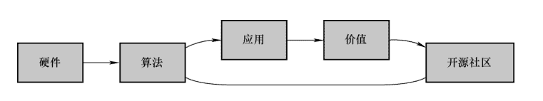

图 1-1 人工智能的技术生态

“杰文斯悖论”提出：技术进步在提升资源利用效率的同时，往往因应用场景的扩展导致资源总消耗量不降反增。开源社区通过共享模型、工具与数据集，加速了技术迭代与行业协作。全球开发者可基于 DeepSeek 代码进行二次开发，在医疗、教育等垂直场景实现定制模型。与此同时，云服务商、硬件厂商与 AI 企业的深度合作，进一步推动了技术生态的成熟。国产 AI 芯片厂商通过适配主流大模型框架，逐步构建起自主可控的算力体系，为本土化 AI 应用提供了坚实支撑。值得注意的是，技术生态的演进遵循“效率提升驱动需求扩张”的规律。尽管算法优化降低了单次训练的算力消耗，但 AI 应用的爆发式增长反而带动了算力需求的指数级上升。

技术生态的繁荣最终服务于社会价值的实现。从智能客服到城市治理，从辅助医疗到自动驾驶，AI技术的落地需要算法、算力、数据与行业知识的深度融合。开发者通过调用标准化应用程序接口（Application Programming Interface，API）快速集成AI能力，企业基于开源工具构建私有化解决方案，政府通过公共算力平台推动普惠服务——这些实践共同构成了AI技术生态的完整图景，见图1-1。对于AI4SocialScience学习者而言，理解技术生态的意义在于认识到AI不仅是算法与代码的集合，更是一个动态演进的协作网络。掌握这一视角，将有助于在未来的学习与工作中更好地定位自身角色，以生态思维把握全局。

#### 1.1.3 DeepSeek：开放生态的新星

在这样的背景下，DeepSeek的出现具有特殊意义。作为中国团队开发的开源大语言模型，DeepSeek不仅在技术上实现了突破，更在理念上践行了开放共享的精神。

DeepSeek的核心创新在于“算法效率优先”的设计理念。通过混合专家（Mixture of Experts，MoE）系统和优化的注意力机制，DeepSeek在保持高性能的同时显著降低了计算资源需求。更重要的是，DeepSeek的完全开源策略为学术界提供了宝贵的研究平台。研究者不仅可以使用模型，还能深入了解其架构设计、训练过程、优化策略，进行改进和创新。这种透明性对于理解AI系统的工作机制、识别和修正偏见、开发特定领域应用都具有重要价值。对于社会科学研究者而言，DeepSeek提供了一个可控、可解释、可定制的AI研究工具。无论是进行计算社会科学研究、开发面向特定文化背景的应用，还是探索人机协作的新模式，DeepSeek都提供了理想的实验平台。

接下来，本章将详细介绍DeepSeek的技术架构、部署方法和使用技巧，帮助读者快速掌握这一强大工具，开启AI辅助研究的新篇章。

### 1.2 DeepSeek 系列模型概述

#### 1.2.1 模型架构

和其他大语言模型一样，DeepSeek 模型修炼的第一步来自在海量语料上进行预训练。截至本书写作时间（2025 年 3 月），市面上主流的大语言模型，无论其开源与否，基本都不会公开用于训练模型的语料。根据 DeepSeek 官方介绍，DeepSeek 模型预训练使用了高达 1.8 万亿 token 的高质量多语言语料库，数据包括自然语言文本、数学、编程代码等。这些数据经过清洗、去重、标注等处理后，被用于训练模型。

与其训练数据相比，DeepSeek 的底层算法则要透明得多。现代语言模型的架构大多源于 Transformer 框架，通过“注意力机制”（Attention Mechanism）让计算机学会像人类一样关注文本中的关键信息。例如，当阅读“小明早上喝了一杯咖啡，然后去图书馆学习”这句话时，人类会自然地将“喝咖啡”与“去图书馆”关联为时间顺序，而忽略次要细节。DeepSeek 模型正是基于这一原理，通过两项关键创新解决了传统 Transformer 的局限性：**动态计算资源分配与结构化文本的针对性优化**。

DeepSeek 首先加入混合专家（MoE）系统设计：在传统 Transformer 中，每个词都需要与所有其他词计算关联度，致使处理长文本效率骤降。当收到一段文字时，模型首先快速判断内容类型：若是简单的天气预报查询（如“北京明天会下雨吗”），系统仅激活基础语义理解模块；若遇到需要多步推导的数学证明（如“用归纳法证明斐波那契数列性质”），则会同时调用数学符号解析、逻辑推理等多个专家模块。这种模块化设计使得模型在保持轻量化的同时，能灵活应对不同复杂度的问题。

接下来，模型采用分层注意力策略。对于自然语言的长文本（如学术论文），如用户提交一篇关于气候变化的5万字报告，系统会先将文本按章节切分为逻辑段落，在分析“温室气体效应”章节时，仅对该部分进行密集计算，而对引文、附录等次要内容采用浅层处理。这种分级机制类似于读者通过目录跳转到重点章节精读，其余部分略读，从而将字符级别的上下文处理显存需求显著压缩。

最后，通过残差连接技术，DeepSeek在训练过程中实现了深度网络的稳定学习。该技术确保网络在初始化阶段各层的输出强度均衡，避免某些层过度活跃而掩盖其他层。如在解析法律条文时，模型同时捕捉具体条款的字面含义（如“合同有效期三年”）与隐含条件（如“不可抗力情形除外”），而不因网络深度增加导致关键信息丢失。这些改进共同构成了一个既保留Transformer核心优势，又显著提升专业领域能力的架构体系。

在预训练的基础上，DeepSeek又进行了两项训练任务以提升模型性能。

第一项是监督微调，即在大规模标注数据集上对模型进行有监督训练，以提高模型在特定任务上的准确性。例如，在文本总结任务中，模型通过大量示例学习如何提取关键信息并生成简洁概述；在编程任务中，模型通过示例代码学习如何补全代码片段。

第二项是强化学习。值得注意的是，与ChatGPT等模型采用人类反馈的强化学习（Reinforcement Learning with Human Feedback, RLHF）不同，DeepSeek采用一般意义上的强化学习（Reinforcement Learning, RL）。在这种模式下，模型仅仅在数学和编程这两项有确定答案的推理任务上进行自我对抗强化，其追求的目标有二：一是追求模型生成的答案与标准答案的一致性，二是模型给出答案格式的规范性（如不要中英混杂）。这种训练方式使得DeepSeek在处理逻辑推理、数学证明等任务时表现更为出色。

#### 1.2.2 性能优势

DeepSeek-R1 在多个权威测试中展现出显著的性能提升，尤其擅长处理教育、长文本与复杂格式任务。针对教育领域知识，其在 MMLU-Pro 和 GPQA Diamond 等科学类基准测试中表现优于前代模型 DeepSeek-V3，原因在于强化学习大幅优化了科学符号与逻辑推理能力。例如对于微分方程问题，模型能够逐步拆解变量关系并分步验证推导过程，从而减少计算错误。在长文本分析场景中， FRAMES 测试结果表明，模型对文档中跨数万字符的关联信息（如法律条款的例外规则引用）的捕捉能力显著提升，这对科研文献综述等场景尤为重要。

R1 在遵守指令格式方面同样进步明显。依托监督微调阶段引入的指令数据， DeepSeek-R1 在 IF-Eval 测试中能够精准执行用户设定的响应规则。例如当要求以“表格→公式→代码”的顺序解答物理问题时，模型会严格遵循该流程生成内容。在面向开放领域的 ArenaHard 测试中，模型生成的答案长度较前代明显缩减，同时保持核心事实覆盖率，避免了冗余描述导致的信息干扰。

事实性处理能力的提升与局限并存。在英文简单事实问答（ SimpleQA ）中， DeepSeek-R1 的准确率超过前代，但在中文版本中由于安全机制强化，模型对部分查询会主动返回拒答响应；若关闭安全模块，其中文问答准确率可达 70%。换言之，模型在追求准确性的同时，需要在风险控制与实用性间进一步权衡。

针对编程任务，模型在部分工程实践场景（如代码补全工具 Aider）中表现暂时落后于业界领先模型，但在理论算法测试（如 LiveCodeBench 的递归问题）上已达到同等水平。开发团队指出，当前用于编码能力优化的训练数据规模有限，预计通过后续版本的数据扩充与针对性训练可显著改善这一问题。

### 1.3 DeepSeek 网页应用与本地部署

#### 1.3.1 Web 界面

用户通过浏览器访问 DeepSeek 官方网站后，可在主界面中央的对话框输入自然语言问题，如图 1-2 所示。例如，输入“如何制定暑期学习计划？”，单击右侧“发送”按钮，系统将根据通用知识库生成包含时间规划、科目分配等建议的结构化回答。


图 1-2 DeepSeek 官方网站界面

在消息框的左下角有两个按钮：“深度思考”和“联网搜索”。如果开启深度思考模式，则后台利用的模型自动切换为 DeepSeek-R1，如不开启则默认为 DeepSeek-V3，两者的区别在于前者拥有更强的推理能力，在数学、编程等任务上表现更好。如果开启联网搜索模式，系统将自动调用联网模块，整合权威来源的公开数据并标注引用来源。例如，输入“2024 年高校毕业生就业政策”，联网搜索模式下生成的回答将包含政府官网、人社部文件等最新信息链接，用户可单击链接跳转至原始页面核实内容。

消息框的右下角为文档处理功能，支持上传 PDF、DOCX 等格式文件（单文件通常限制大小）。上传后输入“提取合同关键条款”等指令，系统将自动分析文档结构并输出核心内容列表。

#### 1.3.2 使用本地客户端

目前，市面上有很多针对大模型的客户端应用，包括 Chatbox、AnythingLLM、Cherry Studio 等，这里重点介绍使用较广的 Cherry Studio。作为跨平台客户端，Cherry Studio 核心价值在于聚合多模型能力与本地化功能。通常建议首次使用时在硅基流动平台（https://cloud.siliconflow.cn）注册账号并获取 API 密钥，随后在客户端填写密钥、接口地址（如 https://api.siliconflow.cn/v1）及模型名称（例如 DeepSeek-V3），界面如图 1-3 所示。完成配置后，用户可在同一界面切换 OpenAI、DeepSeek 等不同模型，避免频繁登录多个网站。当 DeepSeek 官方网站服务繁忙时，此功能可有效保障工作的连续性。


图 1-3 Cherry Studio 界面

对于学术研究场景，值得一提的是本地知识库功能：上传一定数量的研究论文或电子书后，系统通过嵌入模型（默认为 bge-m3）将文本分块转化为向量存储，实现语义检索。例如上传历史文献后输入“五四运动的社会影响”，系统会先匹配知识库相关内容，再调用模型生成带引用标记的总结，用户可追溯原文段落进行复核。如此一来，客户端就成为了用户的第二大脑，工作学习效率大幅提升。

需要注意的是，无论是使用网页端还是客户端，都建议明确问题范围（如限定字数、场景），避免笼统指令导致输出冗余，进而被限制消息配额。通过 Cherry Studio 调用第三方 API 时，需注意服务商的计费规则；部分文生图模型按次数收费，建议通过“沙盒测试”预览效果后再正式调用。知识库搭建过程中，单个文档建议不超过 20 页，过长的文本分块可能导致语义割裂，影响检索准确性。

#### 1.3.3 本地部署

DeepSeek 作为近期备受瞩目的 AI 模型，吸引了众多用户尝试使用。虽然在线版本常常面临“服务器繁忙”的问题，但本地部署 DeepSeek 实际上相当简单，过程就像安装普通软件一样直观。完整部署过程仅需 10 ~ 15min，即使是技术基础较弱的用户也能轻松完成。

首先需要了解的是，DeepSeek 提供多种不同参数规模的模型，从 1.5B 到 671B 不等。1.5B 版本适合低资源设备，如旧款笔记本电脑，用于简单交互和小型问答系统；而 671B 版本则主要用于大规模科研分析，需要服务器集群级别的硬件支持。中间还有 7B、8B、14B、32B 和 70B 等版本，分别适合不同复杂度的任务和不同配置的设备。

本部分将以 1.5B 为例进行演示。DeepSeek-R1-1.5B 是个轻量级模型，仅有 15 亿参数，但别被其体积迷惑。这个“小而精”的模型只需约 3GB 显存即可运行，使其成为配置较低电脑的理想选择。值得一提的是，即使体积小，它在数学推理等领域表现依然出色，某些基准测试中甚至超越了 GPT-4o 和 Claude 3.5。当然，如果电脑配置更高，可以考虑部署更大参数量的版本。

本地部署的第一步是首先访问 Ollama 官网（https://ollama.com）如图 1-4 所示，下载适合操作系统的安装包。如果下载速度较慢，可以使用迅雷等工具加速下载。对于 Windows 用户，下载 OllamaSetup.exe 后双击安装即可。安装完成后，可在命令行输入 ollama -v 验证安装是否成功，成功时会显示版本号。

# deepseek-r1

DeepSeek's first-generation of reasoning models with comparable performance to OpenAI-o1, including six dense models distilled from DeepSeek-R1 based on Llama and Qwen.

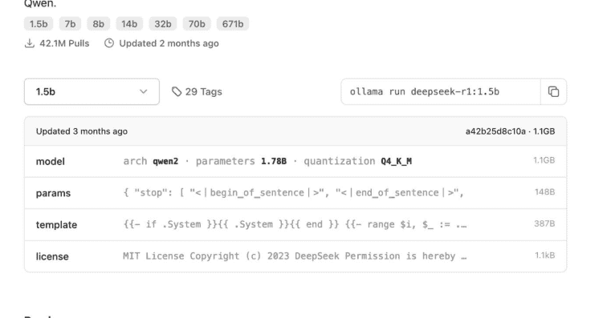

图 1-4 Ollama 网站界面

接下来，在命令行中输入 ollama run deepseek-r1:1.5b 开始拉取模型。整个过程约需 5 ~ 6min，模型大小约 1.1GB。当看到 “success” 字样后，就可以开始与 DeepSeek 交流了。如果想使用更大的模型，可以在 https://ollama.com/library/DeepSeek-r1 查看详情并按需选择。

如果觉得在命令行与 DeepSeek 交流不够友好，可以通过以下两种方式改善体验：

- 1) 使用 Page Assist 浏览器插件作为 WebUI：安装后，启动 Ollama 服务，然后按 Ctrl+Shift+L 快捷键打开 WebUI 页面。首次使用需进行简单设置，之后便可选择 DeepSeek 模型开始对话。
- 2) 使用 Chatbox 应用：从 https://chatboxai.app/en 下载并安装 Chatbox。安装后，配置使用 Ollama API（注意不要选错成 DeepSeek API），然后即可找到并使用本地的 DeepSeek 模型。

### 1.4 DeepSeek 的 API

#### 1.4.1 基础功能调用

DeepSeek API 是一种兼容 OpenAI 格式的强大 API，使开发者能够轻松访问 DeepSeek 的先进语言模型。使用 DeepSeek API 的第一步是申请 API 密钥。获得 API 密钥后需要配置两个关键参数：base_url 和 api_key。DeepSeek API 的基础 URL（base_url）是 https://api.DeepSeek.com，为了保持与 OpenAI 的兼容性，也可以使用 https://api.DeepSeek.com/v1 作为 base_url（注意这里的 v1 与模型版本无关）。获得 API 密钥后，可以通过以下方式用 Python 发起一个基本的 API 调用。

```python
from openai import OpenAI

client = OpenAI(api_key="<DeepSeekAPIKey>",
    base_url="https://api.deepseek.com") # 新建client对象，便于以后调用

response = client.chat.completions.create(
    model="deepseek-chat",
    messages=[
        {"role": "system", "content": "You are a helpful assistant"},
        {"role": "user", "content": "Hello"},
    ],
    stream=False
) # 利用上一步创建的client获取response

print(response.choices[0].message.content) # 打印response中的content
```

在使用 DeepSeek API 时，了解 token 的概念非常重要，因为它是计费的基本单位。Token 可以理解为文本的基本组成部分，通常一个英文单词、一个数字或一个标点符号都会被视为一个 token。一般来说，一个英文字符约等于 0.3 个 token，一个中文字符约等于 0.6 个 token。DeepSeek 提供了一个离线 tokenizer 工具包（DeepSeek_v3_tokenizer.zip），可以用来估算输入和输出的 token 数量。DeepSeek 当前提供的两种模型都支持高达 64K 的上下文长度，最大输出长度为 8K tokens。

在定价方面，DeepSeek 采用基于 token 的计费方式，根据输入和输出的 token 总数进行收费。对于 DeepSeek-chat 模型，标准价格时段（UTC 00:30—16:30）的输入 token 价格为缓存命中 0.07/1M，缓存未命中 0.27/1M，输出 token 为 $1.10/1M。而在非高峰时段（UTC 16:30—00:30），所有价格均有 50% 的折扣。DeepSeek-reasoner 模型的价格略高，但在非高峰时段能有高达 75% 的折扣。费用直接从用户的充值余额或授予余额中扣除，系统优先使用授予余额。

在 API 的调用过程中，“温度”（temperature）参数控制模型输出的随机性和创造性，默认值为 1.0。根据不同的应用场景，建议采用不同的temperature 值：对于编程和数学问题，建议设置为 0.0 以获得更确定性的回答；数据清洗和分析任务适合使用 1.0；一般对话和翻译任务则推荐 1.3；而创意写作和诗歌创作则可以设置更高的值，如 1.5，以增强创造性输出。

请求速度方面，DeepSeek API 未对用户设置固定的速率限制，但在服务器负载高的情况下，请求可能需要较长时间才能收到响应。使用过程中可能遇到的错误包括：格式无效（400）、认证失败（401）、余额不足（402）、参数无效（422）、请求过于频繁（429）、服务器错误（500）和服务器过载（503）。遇到这些情况时，应根据错误信息提示进行相应调整。

#### 1.4.2 高级功能实现

上一节讲到的 DeepSeek 的 /chat/completions API 是一个“无状态”的 API，意味着服务器不会记录用户请求的上下文。因此，要实现连贯的多轮对话，用户必须将所有之前的对话历史拼接起来，并在每次请求中一并传递给 API。这种设计虽然增加了请求的体积，但也赋予了开发者更大的灵活性，可以根据需要保留或修改历史上下文。

实际操作中，需要在每轮对话后将模型的回答添加到 messages 中，然后再添加用户的新问题。例如，在第一轮对话中，传递给 API 的消息可能只包含一个用户问题；而到第二轮时，消息数组已经包含了第一轮的用户问题、模型回答以及新的用户问题。这种累积式的上下文构建方法使模型能够理解对话的进展，从而提供更加连贯和上下文相关的回答。

```
messages = [
    {"role": "user", "content": "世界上最高的山是什么？"},
    {"role": "assistant", "content": "世界上最高的山是珠穆朗玛峰。"}
]

messages.append({"role": "user", "content": "第二高的是什么？"})
```

在许多实际应用场景中，开发者需要模型以严格的 JSON 格式输出，以便于后续解析和处理。DeepSeek 提供了 JSON Output 功能，确保模型输出有效的 JSON 字符串。要启用此功能，需要设置 response_format 参数为 {'type' : 'json_object'}，并在系统或用户提示中包含“json”一词，最好还能提供所需 JSON 格式的示例，以引导模型输出符合预期的结构。使用 JSON Output 功能时，还建议合理设置 max_tokens 参数，防止 JSON 字符串在生成过程中被截断。值得注意的是，API 偶尔可能返回空内容，此时可以尝试修改提示以缓解此类问题。以下是一个完整的 Python 示例，展示如何使用 JSON Output 功能解析考试文本中的问题和答案：

```
import json
from openai import OpenAI

client = OpenAI(
    api_key="<yourapikey>",
    base_url="https://api.deepseek.com"
)

system_prompt = """
用户将提供一些考试文本。请解析出“问题”和“答案”并以JSON格式输出。

示例输入：
世界上最高的山是什么？珠穆朗玛峰。

示例JSON输出：
{
    "question": "世界上最高的山是什么？",
    "answer": "珠穆朗玛峰"
}
""" # 系统级prompt，整个对话只出现一次

user_prompt = "世界上最长的河流是什么？尼罗河。" # 用户级prompt，整个对话出现若干轮

messages = [{"role": "system", "content": system_prompt},
            {"role": "user", "content": user_prompt}] # 定义message

response = client.chat.completions.create(
    model="deepseek-chat",
    messages=messages,
    response_format={
            'type': 'json_object'
        }
    )

    print(json.loads(response.choices[0].message.content))
```

Function Calling 功能允许模型调用外部工具，从而显著扩展其能力范围。需要注意的是，当前版本的 DeepSeek-chat 模型在 Function Calling 方面可能不太稳定，偶尔会出现循环调用或空响应的情况。下面是一个使用 Function Calling 获取用户所在位置当前天气信息的完整示例：

```
from openai import OpenAI

def send_messages(messages):
    response = client.chat.completions.create(
        model="deepseek-chat",
        messages=messages,
        tools=tools
    )
    return response.choices[0].message # 定义send_messages函数为发送messages，并获取response中的content

client = OpenAI(
    api_key="<yourapikey>",
    base_url="https://api.deepseek.com",
)

tools = [
    {
        "type": "function",
        "function": {
            "name": "get_weather",
            "description": "获取指定位置的天气，用户需要先提供一个位置",
            "parameters": {
                "type": "object",
                "properties": {
                    "location": {
                        "type": "string",
                        "description": "城市名称，例如：杭州",
                    }
                },
                "required": ["location"]
            },
        }
    }
},
] # 定义tools对象为get_weather

messages = [{"role": "user", "content": "杭州的天气怎么样？"}]
message = send_messages(messages)
print(f"用户>\t {messages[0]['content']}")

tool = message.tool_calls[0] # 获取返回消息中调用的工具
messages.append(message)

messages.append({"role": "tool", "tool_call_id": tool.id, "content":
"24(°)"}) # 将工具调用结果（24度）返回给大模型
message = send_messages(messages)
print(f"模型>\t {message.content}")
```

这个示例的执行流程是：用户询问杭州的天气，模型返回调用 get_weather 函数的请求，用户调用该函数并提供结果给模型，最后模型以自然语言返回 “杭州当前的温度是 24°C”。需要注意的是，get_weather 函数的具体功能需要由用户自行提供，模型本身不会执行具体函数。

DeepSeek API 的上下文缓存（Context Caching）技术默认为所有用户启用，无需修改代码即可受益。每次用户请求都会触发硬盘缓存的构建，如果后续请求与之前的请求有重叠的前缀部分，则重叠部分将只需从缓存中获取，被计为 “缓存命中”。值得注意的是，两个请求之间只有重复的前缀部分才能触发 “缓存命中”。这一功能在几种常见场景中特别有用：一是长文本问答，当连续提问关于同一文档的不同问题时，文档内容作为前缀可以被缓存；二是多轮对话，后续轮次可以复用之前轮次的对话内容；三是使用小样本学习（few-shot learning）时，由于示例通常提供相同的上下文前缀，因此借助上下文缓存可以显著降低小样本学习的成本。

在 DeepSeek API 的响应中，usage 部分新增了两个字段以反映请求的缓存命中状态：prompt_cache_hit_tokens 表示本次请求输入中命中缓存的 token 数量（每百万 token 0.1 元）；prompt_cache_miss_tokens 表示本次请求输入中未命中缓存的 token 数量（每百万 token 1 元）。需要注意的是，硬盘缓存只匹配用户输入的前缀部分，输出仍然通过计算和推理生成，并受 temperature 等参数影响，具有随机性。上下文缓存系统以 64 个 token 为存储单位，少于 64 个 token 的内容不会被缓存。该系统工作在“尽力而为”的基础上，不保证 100% 的缓存命中率。缓存构建需要几秒钟时间，一旦缓存不再使用，会在几小时到几天内自动清除。通过合理利用这一功能，您可以在保持模型性能的同时显著优化 API 使用成本。

### 1.5 DeepSeek 的提示词工程

#### 1.5.1 一般性原则

本部分将以 DeepSeek-R1 为例，讲解 DeepSeek 提示词工程的一般技巧。作为推理模型，DeepSeek-R1 与传统聊天模型在本质上存在显著差异。DeepSeek-R1 作为专门的推理模型，其设计理念与传统对话型人工智能有着根本区别。传统的聊天模型（如 GPT-4o）通常在简短问题下表现良好，且通过多轮交互逐步完善输出。而推理模型则倾向于通过单轮深度思考生成完整报告。因此，使用 DeepSeek-R1 时若延续传统的交互方式，往往难以获得理想效果。

在推理模型交互中，作为使用者，首先需要从“指令式”思维转向“目标式”思维，即不再详细指导模型如何完成任务，而是提供充分背景信息并明确期望达成的目标。换言之，“目标式”意味着将模型视为具备专业能力但需要全面背景了解的专家顾问，用户应当提供尽可能详尽的相关信息，包括自身身份、项目背景、已尝试的方案及其结果，以及明确的输出期望。

R1 的推理能力的重要一环在于其能够基于提供的信息自主规划解决路径，而非被动执行设定的步骤。这种能力使 DeepSeek-R1 在处理复杂问题时表现出色，但前提是用户提供了足够的上下文信息。当用户采用传统的指令式提示词，如”你是专家 X，请按照步骤 Y 执行”时，往往会限制模型的推理潜能。相反，提供丰富背景并明确目标的简报式输入能够充分激发推理模型的能力。因此，在与 DeepSeek-R1 交互时，信息的全面性至关重要。用户应当将各类相关信息纳入考虑，包括但不限于：项目背景信息、行业特定术语解释、相关数据结构、已尝试的方案及其局限性、期望达成的具体目标等。这些信息应当以自然语言方式呈现，而非刻意构建的提示词模板。

此外，清晰表述目标比详细描述方法更为重要。用户应当明确期望获得的输出类型、形式及标准，而非详细指导模型如何思考。例如，用户可以指明是需要特定代码实现、探索性方案比较，还是完整的解决方案报告。这种明确的目标设定使模型能够自行规划推理路径，而非被迫按照特定方式思考。模型的自主推理能力往往能够发现用户未曾考虑的解决路径。在实践中，用户应当学会信任模型的推理过程，同时提供足够的评价标准使模型能够自我评估输出质量。这种方式能够最大化推理模型的价值，特别是在处理复杂项目或创新性任务时。

实际应用中，可以考虑使用口述方式（口头讲述 + 语音识别）记录问题背景，这有助于全面自然地表达情境。同时，可以维护一份常用背景信息文档，以便在相关问题中重复使用。对于复杂任务，明确区分不同子目标并分别处理往往比尝试一次性解决整个问题更为有效。此类方法特别擅长的任务包括：一次性生成完整代码文件、处理特定领域查询语言、提供专业领域的深度分析以及解释复杂概念；而在风格化写作、完整应用构建等方面则可能需要更多人工干预和迭代。

#### 1.5.2 提示词示例

为了更加清楚地说明以上原则，此处基于社会科学研究者的常见需求，罗列一些针对 R1 推理模型的提示词样例（见提示词 1-1~ 提示词 1-4），以供读者参考。

##### 【提示词 1-1 民族志研究设计】

> 我准备在东南亚开展为期18个月的民族志研究，探索全球化背景下传统渔村社区的适应性变化。我此前主要在非洲进行研究，对东南亚地区不太熟悉。当地渔业正面临气候变化和大规模商业捕捞的双重压力，我希望理解社区如何调整生计策略、社会组织和文化实践来应对这些挑战。我担心的是语言障碍、获取敏感信息的伦理问题以及如何平衡参与观察与保持分析距离。我希望设计一个全面而又现实可行的民族志研究计划，包括前期准备、实地研究策略和数据分析框架。我特别关注如何建立信任关系并捕捉到社区变迁的复杂性和多元声音。

讲解：这个提示词提供了研究者身份和背景（文化人类学助理教授），研究主题（全球化下传统渔村的适应性变化），以及面临的具体挑战和资源限制。

##### 【提示词 1-2 政治极化媒体分析】

> 我手上有两年的Twitter数据，包括5个政治热点事件前后的用户互动、内容传播和情感变化数据。初步分析表明，平台算法似乎强化了同温层效应和群体极化，但我难以区分算法影响与用户自选择因素。我需要一个既能处理大规模定量数据又能捕捉话语质性变化的分析框架。以下是我的数据结构和初步发现：[数据结构和初步统计结果]。我希望发展一个有说服力的分析方法，能够更准确地判断算法干预在政治极化进程中的因果作用，同时避免过于简化这一复杂的社会-技术互动过程。

讲解：这个提示词清晰介绍了研究主题，同时坦诚了自己的方法论优势和局限。通过提供具体的数据资源和初步发现，为模型提供了充分的背景信息。

##### 【提示词 1-3 福利政策评估研究】

> 我是社会政策研究中心的高级研究员。我正在评估一项为期五年的城市低收入家庭住房补贴项目。我收集了项目前后的家庭经济状况、就业稳定性、子女教育成果和健康状况数据，同时进行了一系列深度访谈。初步结果显示，项目对不同群体的影响差异很大，某些家庭显著受益，而另一些几乎没有改善甚至状况恶化。资助方希望得到明确的成本效益分析和政策建议，但我担心单一的量化指标可能掩盖项目的复杂影响。我们尤其难以解释为什么相似条件的家庭会有如此不同的结果。以下是我们数据集和初步分析：[研究数据]。我希望开发一个更全面的评估框架，能够捕捉项目的多维影响，解释差异化结果背后的机制，并提出有针对性的政策优化建议，既满足资助方的问责需求，又尊重社会干预的复杂性。

讲解：这个提示词没有要求一套固定的评估步骤，而是寻求一个能够平衡多重需求的框架，充分利用了推理模型的综合思考能力。

##### 【提示词 1-4 跨文化消费者行为研究】

> 我在主持一项关于文化价值观如何塑造可持续消费决策的跨国研究。我们在六个国家（美国、德国、日本、印度、巴西和肯尼亚）收集了大量问卷数据和焦点小组访谈材料，探索个人主义vs集体主义、长期vs短期导向等文化维度与环保消费行为的关系。初步数据展示了一些有趣但难以解释的模式：例如，某些被认为高度个人主义的社会中，受访者反而更愿意为集体环境利益做出个人牺牲。传统的霍夫斯泰德文化维度和计划行为理论似乎难以完全解释我们的发现。另外，我们的定量和定性数据之间存在一些表面矛盾。以下是我们研究设计和关键数据点：[研究材料]。我希望发展一个更细致的理论框架来解释这些跨文化差异，同时提出如何更有效地整合混合方法数据的策略，以推进消费者心理学的跨文化理论建设。

讲解：这个提示词没有简单要求解释这些数据或建议下一步分析，而是寻求一个更复杂的理论框架和方法论整合策略，这充分利用了推理模型的理论构建能力。

### 1.6 总结

本章主要揭示了 DeepSeek 模型运行的核心逻辑与实践入口。理解其动态计算资源分配与分层注意力机制，有助于掌握模型突破传统 Transformer 效率瓶颈的关键——当处理复杂问题时，系统通过智能激活专家模块并聚焦核心段落实现高性能推理。实际部署时需权衡场景特性：网页端提供开箱即用的轻量交互，API 接口支持开发者构建定制化工具链，而本地化方案则为数据敏感场景提供轻量化入口。掌握 API 调用需重点维护对话历史的连贯性，善用 JSON 输出格式化数据，并通过上下文缓存机制优化资源消耗。操作中需注重参数调校：数学类任务开启低温值保持确定性，创意场景则需调高温度激发发散性。有效的提示词应如同简报，以明确目标替代操作指令。这些认知构成运用 DeepSeek 的基础坐标系。

# DeepSeek 篇


# 第2章 DeepSeek 与文献阅读

### 本章重点

- 使用 DeepSeek 辅助文献阅读与翻译
- DeepSeek 协助生成文献综述
- DeepSeek 协助生成思维导图

本章旨在介绍通过 Zotero 平台配置 GPT 插件，并结合 DeepSeek 模型实现智能文献管理、综述撰写与思维导图生成的全过程。无论是社会科学研究者还是学生，都可以借助本流程大幅提升文献处理效率。

### 2.1 大语言模型辅助文献阅读与翻译

#### 2.1.1 Zotero 安装与推荐插件配置

第一步是安装 Zotero 软件及其相关插件。可前往 Zotero 官方网站（https://www.zotero.org/）下载并安装主程序。安装完成后，推荐进一步配置 4 款插件：

1. **Zotero Connector** 可将网页文献元数据一键抓取进 Zotero；
2. **ZotFile** 支持对 PDF 附件进行集中管理与注释；
3. **Translate for Zotero** 支持 Zotero 与多种翻译服务的集成；
4. **Better BibTeX** 有助于生成稳定的文献引用键，适用于 BibTeX 格式引用的自动生成与管理。

这些插件可通过 Zotero 插件页面或其中文社区获取和安装。

#### 2.1.2 文献阅读：GPT 插件安装与 API 配置

##### 1. GPT 插件安装

首先，访问 Zotero 中文社区插件页（https://zotero-chinese.com/plugins/）下载 GPT 插件压缩包。下载完成后，打开 Zotero 主界面，如图 2-1 所示，依次点击“工具” → “插件” → “从文件安装插件（**Install Plugin From File**）”，选择下载的插件压缩包进行安装。

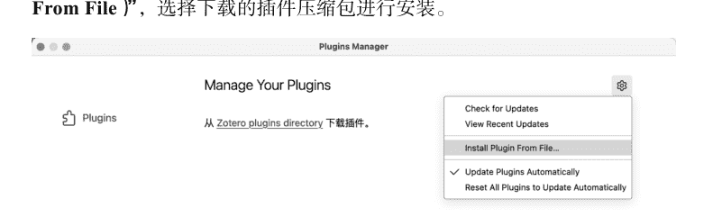

随后，如图 2-2 所示，启用 Awesome GPT 插件。


从 Zotero plugins directory 下载插件。

图 2-2 启用 Awesome GPT 插件

##### 2. API 配置

第二步是配置语言模型的 API 密钥。推荐前往硅基流动官网（https://cloud.siliconflow.cn/models）注册并登录账户。如图 2-3 所示，在登录成功后，点击左侧菜单“API 密钥”，并点击“新建 API 密钥”并复制。

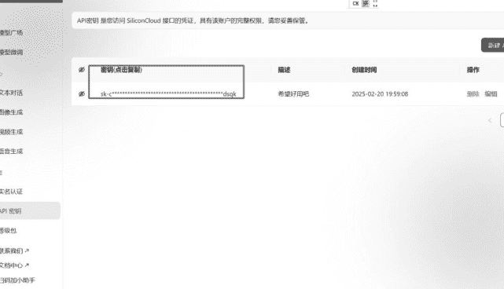

图 2-3 创建并复制 API 密钥

返回 Zotero 并打开 GPT 插件设置界面。Microsoft 用户通过 Zotero 菜单栏的 “编辑” → “设置” 选项打开 GPT 配置界面；MacOS 用户通过系统菜单栏的 “Zotero” → “设置” 打开 GPT 配置界面。如图 2-4 所示，将 API 密钥粘贴至相应位置，选择相应模型后点击 test 按钮进行测试。如果界面提示配置成功，参考图 2-5，即表明插件安装与连接无误。

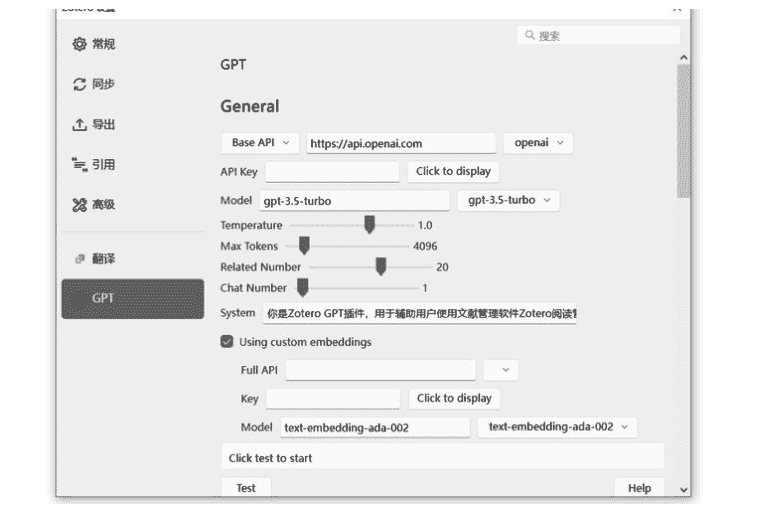

图 2-4 配置、安装插件


图 2-5 配置成功提示

若希望使用 DeepSeek 模型而非默认模型，可以如图 2-6 与图 2-7 所示，在插件设置中更新 API 地址与模型名称，推荐选择带有 “siliconflow” 的模型。需要注意的是，DeepSeek 官网当前尚未开放充值功能，可以通过第三方渠道申请 API 密钥后填入，方式与前述相同。

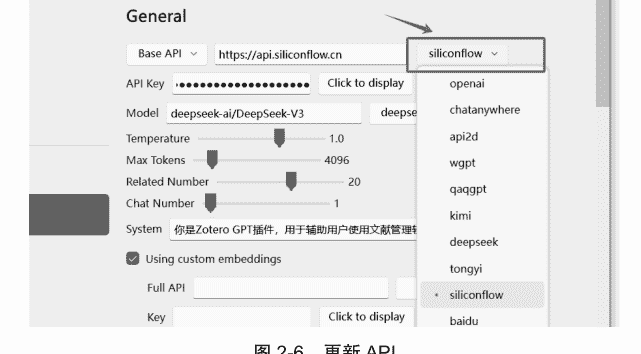

图 2-6 更新 API

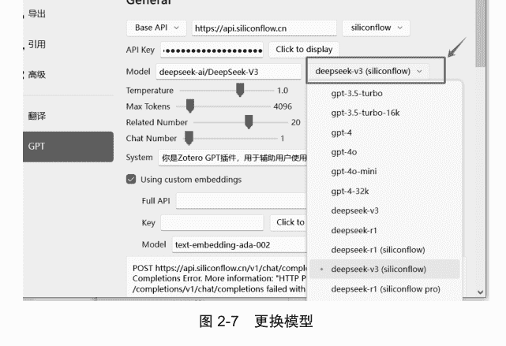

图 2-7 更换模型

每次更换完成后，需单击 “Test” 测试连接状态。

##### 3. GPT 插件使用

完成插件配置后，可在 Zotero 中选择一篇或多篇文献，点击工具栏上的 GPT 按钮，如图 2-8 所示，启动智能阅读模式。此时将弹出一个对话界面，列出包括 “文献综述”“段落解释”“关键词提取” 等多个可用命令。可根据实际需要选择执行任务。

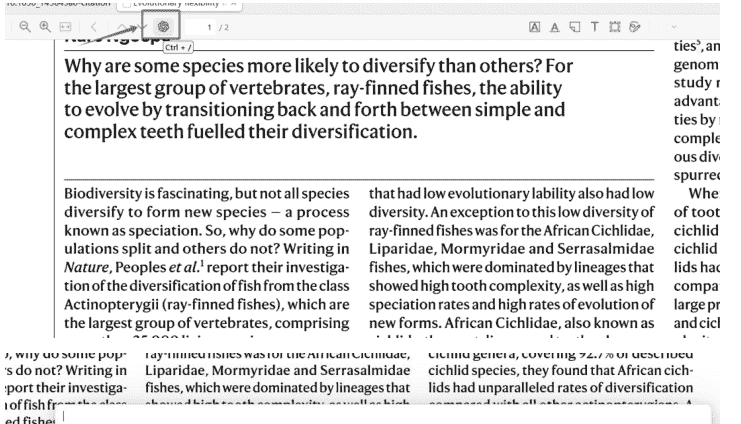

图 2-8 对文章使用 GPT 插件

若在阅读过程中遇到难以理解的段落，可通过划线高亮的方式进行标注，然后点击相关命令获取智能解释或翻译内容，如图 2-9 所示。

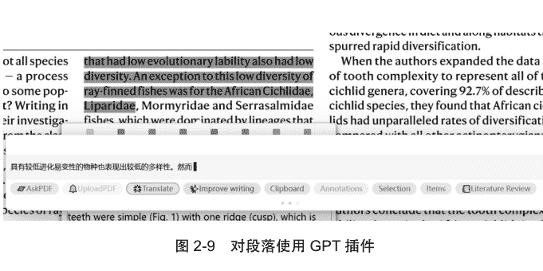

#### 2.1.3 文献翻译：Translation for Zotero 插件安装与 API 配置

除了使用 Zotero GPT 插件中的翻译功能外，还可以通过安装专门的翻译插件 Translation for Zotero 对文献进行翻译。首先，确保已安装 Zotero 7 版本，并安装 Translate for Zotero 插件，该插件支持 Zotero 与多种翻译服务的集成，包括 DeepSeek。接下来，访问 DeepSeek 官方网站，如图 2-10 所示，点击“API 开放平台”选项，完成账号注册并登录。登录后，单击左侧菜单栏选择“创建 API Key”，生成形如“2e**************44c”的 API Key，为后续配置提供必要的密钥支持。


在 Zotero 中配置 DeepSeek 翻译服务时，打开 Zotero 主界面，依次点击“编辑” → “设置”，并如图 2-11 所示在设置窗口中点击“翻译”选项卡。接着，在“翻译服务”下拉菜单中选择“ChatGPT”，并将之前生成的 DeepSeek API Key 复制到密钥输入框中。随后，点击“配置”按钮进入高级设置界面，将“接口”设置为 https://api.deepseek.com/v1/chat/completions，将“模型”设置为 deepseek-chat，并将“温度”设置为 1.3，以平衡翻译的准确性与灵活性。

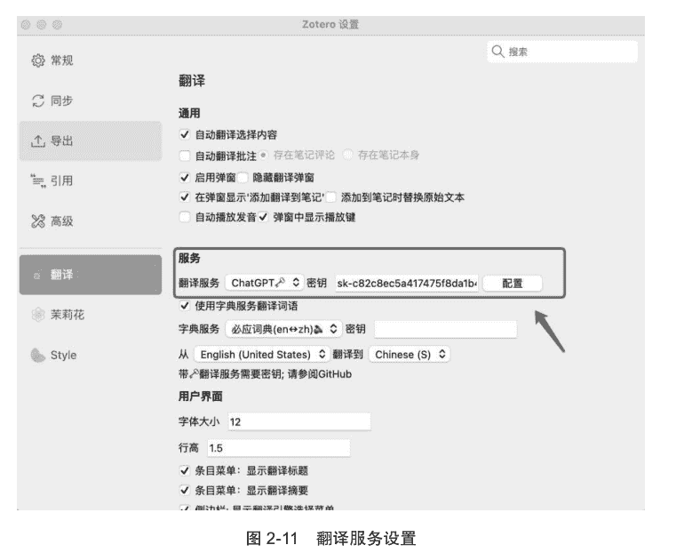

将提示词 2-1 所示的指令文本粘贴到“Prompt”输入框中：

##### 【提示词 2-1 设置翻译服务的提示词】

```
As an academic expert with specialized knowledge in various fields, please provide a proficient and precise translation from ${langFrom} to ${langTo}. It is crucial to maintaining the original phrase or sentence and ensure accuracy while utilizing the appropriate language, for the same proper nouns that appear in context, make sure that their translation results are also the same. The text is as follows: ${sourceText} Please provide the translated result without any additional explanation and remove.
```

完成上述设置后，点击“保存”即可。

在测试与使用 DeepSeek 翻译功能时，首先在 Zotero 文献库中选择需要翻译的文献条目，随后右键点击文献并选择“翻译”选项，或直接使用 Translate for Zotero 插件的快捷键调用翻译功能。翻译完成后，结果将显示在 Zotero 界面，如图 2-12 所示，可根据需要复制或保存，以便进一步使用或编辑。


### 2.2 大语言模型协助生成文献综述

本节主要介绍如何使用大语言模型辅助生成文献综述。根据实际生成效果的不同，对于英文文献，推荐直接使用方法一；对于中文文献，本节提供了除方法一外的另一种方法。用户可根据生成效果与自己的需求，进行方法选择与提示词调整。

#### 2.2.1 方法一：使用 Zotero 中的大模型插件生成文献综述

在完成了上述 Zotero 的插件安装后，可以直接使用大模型插件的“Literature Review”功能，生成文献综述的初步参考。具体操作方法为：在 Zotero 中选中多篇作为文献综述参考的文章，点击下方的“Literature Review”功能，如图 2-13 所示。大模型插件将自动生成基于选中文章的文献综述内容，同时会生成相关文献的“文献矩阵”。


#### 2.2.2 方法二：使用 DeepSeek 协助生成文献综述

1. 导出目标文献相关信息

首先，需准备好目标文献数据。以知网为例，可访问其官网（https://www.cnki.net），使用“高级检索”功能进行主题搜索，并设置筛选条件（如时间、关键词等）。在检索结果中勾选目标文献，导出为 Excel 文件，同时建议也导出引用格式文本文件作为后续整理与引用的依据。以下是在知网中导出目标文献数据的操作展示。

在知网使用点击“高级检索”功能，并设置筛选条件。随后选中需要导出的文献后，如图 2-14 所示，在上部菜单栏依次点击“导出与分析”→“导出文献”→“自定义”，进行批量导出。

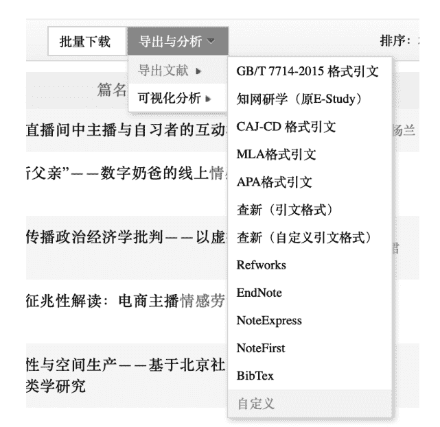

图 2-14 批量导出知网文献

导出时，应注意选择“关键词”“摘要”“发表时间”等所需的信息，点击“导出”可下载 txt 格式文件，点击“xls”可下载 xls 格式文件，如图 2-15 所示。同时可在左侧菜单栏选择批量导出对应文献的目标引用格式（如 APA 等）。

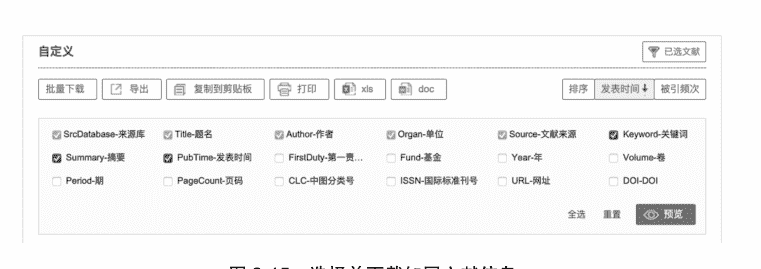

2. 使用 DeepSeek 协助

第二步，在 DeepSeek 平台开启新对话，将导出的 Excel 文件上传至输入框，并搭配提示词进行综述生成。既可使用简要的基础提示词，也可采用结构化提示词来引导模型生成更加严谨的综述内容。结构化提示中通常包含角色设定、任务背景、具体需求与输出要求等元素。例如，在研究“算法如何影响青少年的媒介信任”这一主题时，可要求模型识别主流理论并梳理演进路径，对比不同研究方法的结论差异，并指出当前尚存的研究争议。此外，还可指定输出格式为 Markdown、引用格式为 APA，并要求每个结论至少标注两篇支持文献，见提示词 2-2。

##### 【提示词 2-2 DeepSeek 批量处理文献】

```
[角色设定]
您是社会科学的文献分析专家

[任务背景]
我正在研究“算法如何影响青少年的媒介信任”，已整理包含200篇文献的Excel表，字段包括：标题、年份、理论框架、研究方法、关键结论等

[具体需求]
1. 识别主流理论及其演变脉络
2. 对比不同研究方法的实证发现差异
3. 找出至少3个尚未解决的核心争议
4. 需要重点对比近5年量化研究与混合研究的方法论差异

[输出要求]
- 使用Markdown分级呈现
- 重要结论标注文献来源（作者+年份）
- 请按APA格式组织，每个论点需标注至少2篇支持文献
- 包含方法论建议部分
```

如有处理大批量文献的需求，可设计更灵活的提示策略。例如，可以先请求模型聚焦分析 2015—2023 年间的研究；也可以将表格中影响力高的文献用于交叉验证分析结果；进一步，还可要求模型识别样本量不足的研究并标记为“需谨慎引用”，从而提升综述质量的稳健性。

首先，应清晰描述数据结构与分析目标。例如，可以先告知模型：当前的文献表格包含标题、年份、理论框架、研究方法、样本特征与关键数据，覆盖 2015—2023 年，并对奠基性文献作红色高亮标记。

其次，是协商分析框架。可初步提出三类维度分析方案：理论维度（如制度主义 vs 文化转向）、方法维度（大数据分析 vs 传统实证）与地域维度（东西方比较）。可请模型对该分析结构进行补充或修改。

再次，选择其中一类维度进行分段生成，例如聚焦理论维度的分析时，可要求模型按时间轴展示理论演进过程，并标注关键学者及流派逻辑，必要时可附表格对比。

最后，在模型初步生成的基础上，可结合审稿反馈进行内容优化。如需加强对政策实践类文献的讨论、补充方法论局限性部分、或对存在争议的研究结论作深入剖析，均可通过追加提示实现动态修改。

### 2.3 使用 DeepSeek 协助生成思维导图

除了文字综述外，还可以借助 DeepSeek 辅助生成 Markdown 格式的结构化思维导图。

在 DeepSeek 对话框中输入指令，例如“请生成关于媒介信任研究的思维导图框架，要求包含 5 ~ 7 个主分支，每个主分支下设 3 ~ 5 个子分支，关键词简明扼要，输出为 Markdown 格式”。同样地，也可用于整理参考文献：可请求模型列出领域主要著作、期刊文章与会议论文，并为每篇文献生成作者、发表年份与主要内容三类子节点。

第一步，在 DeepSeek 输入指令并添加附件，并下载“.md”格式文件，如图 2-16 所示。

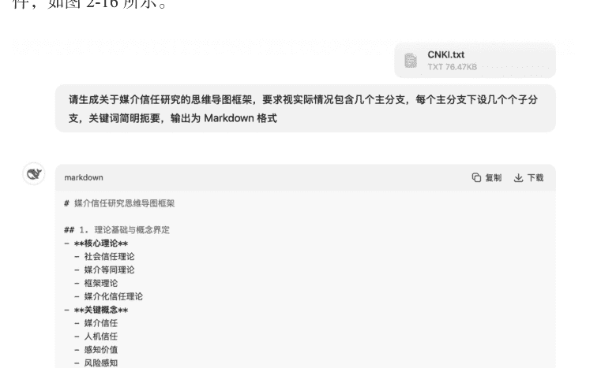

第二步，打开任一主流思维导图软件（如 XMind、MindMaster 或知犀），选择“导入”功能，上传前述 Markdown 文件。系统将自动识别层级结构并生成导图，如图 2-17 所示。

第三步，在导入完成后，可手动对节点内容进行修改、补充逻辑结构，并借助配色与样式设置提升图示可读性与美观度，如图 2-18 所示。

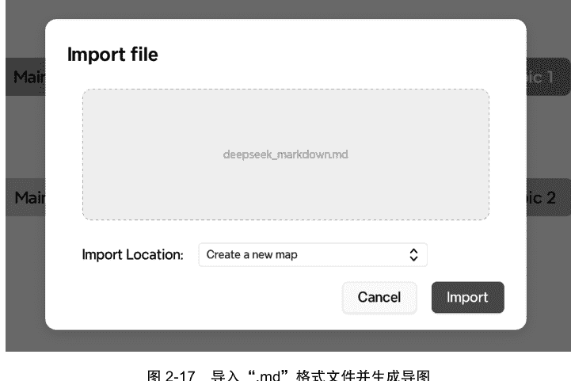

图 2-17 导入 “.md” 格式文件并生成导图

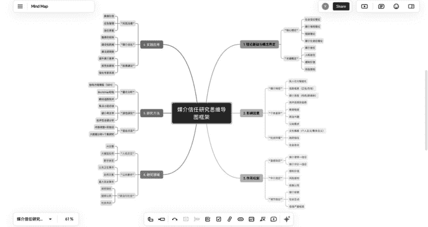

图 2-18 修改、补充导图

### 2.4 总结

本章介绍了基于大语言模型的智能文献管理方法论，主要展示了 DeepSeek 与 Zotero 协同工作的技术架构与实现路径。通过插件配置、API 集成和提示词工程的创新应用，突破了传统文献处理的效率瓶颈，实现了从文献采集、翻译到综述生成的大语言模型辅助文献研究与管理。具体而言：借助 Zotero 的插件生态与 DeepSeek 的语义理解能力，用户可完成跨语言文献的精准翻译与深度解读；通过结构化提示词设计和批量文献数据处理，能够生成逻辑严谨、引证规范的文献综述；结合 Markdown 导出的可视化功能，进一步实现了知识体系的结构化呈现与动态修正。尽管当前系统在处理非结构化文献和数据一致性方面仍存在局限，但随着大模型多模态能力的增强和学术专用工具的迭代，智能文献管理系统将成为学术研究的基础设施，为知识发现、理论创新与研究范式变革提供持续助力。

### — 思考与练习 —

练习 1：请结合本章所介绍的结构化提示词框架，尝试为你当前研究主题或论文方向设计一组用于生成文献综述的提示词。需包含以下四个部分：角色设定（如“你是一位 ××× 领域的研究专家”）；任务背景（简述你的研究主题、文献数据来源与结构）；具体需求（列出你希望大模型分析和输出的内容）；输出要求（格式、引用规范、风格要求等）。

练习 2：尝试使用 DeepSeek 或类似大模型平台，结合 Zotero 导出的任意一组 Excel 文献数据，生成一段简要的文献综述。并对输出内容进行评估，重点分析：模型是否遗漏了你已知的重要文献或理论？模型的归纳逻辑是否存在模糊、混淆或不完整的情况？

# DeepSeek 篇

# 第3章 DeepSeek 与调查研究

### 本章重点

- 使用 DeepSeek 辅助调查问卷设计
- DeepSeek 在调查研究数据清洗过程中的应用
- DeepSeek 辅助进行实验研究

利用调查数据进行实证分析是社会科学研究中的主流路径之一。DeepSeek 能够在调查研究的多个阶段中为研究者提供有力支持，从问卷设计到数据清洗、变量构造，再到分析与可视化，显著提升研究效率与质量。本章将结合具体案例，介绍 DeepSeek 在调查研究过程中的应用场景与操作方法，展示其赋能学术研究的独特优势。

### 3.1 调查研究数据收集过程

调查类数据能够反映个体或群体的态度、行为与认知特征，是社会科学研究中最为常用且重要的数据形式之一，广泛应用于政治学、社会学、心理学等多个领域的实证分析。此类数据主要通过问卷调查的方式采集，因此，问卷的设计与发放成为调查研究中数据收集的核心环节，直接影响数据的有效性与研究的整体质量。

在传统调查研究中，问卷设计往往依赖研究者的专业经验和文献积累，过程烦琐、周期较长，且容易受到主观偏误的影响。随着人工智能与大语言模型的发展，DeepSeek 为调查研究的数据收集过程带来了新的可能。本节将重点介绍 DeepSeek 如何在问卷设计、问卷评估以及抽样设计等环节为研究者提供支持。

#### 3.1.1 问卷整体设计

问卷设计是调查数据收集的起点，直接关系到数据收集的针对性、信度与效度。DeepSeek 能够协助研究者生成、调整与优化问卷内容，覆盖从初步构想到最终成稿的全过程。

在研究者已有明确研究问题与假设的前提下，DeepSeek 可根据核心问题，辅助构建测量维度，自动生成初步题目并匹配常见的量表类型，从而快速生成初步问卷。研究者可在此基础上进行微调与修改，完成问卷设计。例如，如果研究者想要围绕“大学生人工智能使用与态度”开展调查，可以向 DeepSeek 输入下面的提示词。

##### 【提示词 3-1 问卷整体设计】

> 我想做一项关于大学生群体的人工智能使用情况如何影响其对人工智能态度的研究。目前进行问卷设计。请你根据社会科学领域的高质量调查问卷，帮助我设计一个完整的问卷。

DeepSeek 输出内容：

大学生人工智能使用与态度调查问卷

填写说明
1. 本问卷匿名填写，数据仅用于学术研究
2. 预计耗时 8~12 分钟
3. 如无特殊说明均为单选
4. 选项标注“○”的为单选题，“□”为多选题

第一部分 基础信息
1. 性别：
○ 男 ○ 女 ○ 其他
2. 年级：
○ 大一 ○ 大二 ○ 大三 ○ 大四 ○ 研究生
3. 专业类别：
○ 理工科 ○ 人文社科 ○ 经管类 ○ 艺术类 ○ 其他
4. 人工智能课程学习经历：
○ 系统学习过 ○ 参加过短期培训 ○ 仅自学基础
○ 无学习经历但感兴趣 ○ 完全无接触

第二部分 人工智能使用行为
5. 您使用 AI 产品的频率：
○ 每天多次 ○ 每天 1 次 ○ 每周 3-5 次 ○ 每周 1-2 次 ○ 每月少于 1 次
6. 主要使用场景（可多选）：
□ 学术研究 □ 作业辅助 □ 语言学习 □ 内容创作
□ 社交娱乐 □ 生活服务 □ 职业规划 □ 其他_______
7. 使用强度评估（1=完全不符合，7=完全符合）：

| 题项 | 1 | 2 | 3 | 4 | 5 | 6 | 7 |
| :--- | :---: | :---: | :---: | :---: | :---: | :---: | :---: |
| 工作中优先考虑 AI 解决方案 | ○ | ○ | ○ | ○ | ○ | ○ | ○ |
| 能熟练操作 3 种以上 AI 工具 | ○ | ○ | ○ | ○ | ○ | ○ | ○ |
| 曾修改/优化过 AI 输出内容 | ○ | ○ | ○ | ○ | ○ | ○ | ○ |

##### 第三部分 对 AI 的态度认知

8. 关于 AI 的认知（1-7 分语义差异量表）：

| 维度 | 消极评价（1 分） | 积极评价（7 分） |
|---|---|---|
| 可靠性 | 易出错 | 值得信赖 |
| 可控性 | 无法驾驭 | 完全可控 |
| 发展需求 | 应该限制 | 急需发展 |

9. AI 接受度测量（非常不同意→非常同意）：

| 题项 | 1 | 2 | 3 | 4 | 5 | 6 | 7 |
|---|---|---|---|---|---|---|---|
| 我认为 AI 可以提升学习效率 | ○ | ○ | ○ | ○ | ○ | ○ | ○ |
| 使用 AI 让我有成就感 | ○ | ○ | ○ | ○ | ○ | ○ | ○ |
| 担心 AI 会降低独立思考能力（反向） | ○ | ○ | ○ | ○ | ○ | ○ | ○ |

##### 第四部分 影响因素评估

10. 环境感知：

- 周围师生普遍使用 AI 工具
  ○ 是 ○ 否 ○ 不确定
- 学校是否提供 AI 伦理指导
  ○ 完整 ○ 较少 ○ 没有

11. 风险认知矩阵（多选题）：

- □ 隐私泄露 □ 算法偏见 □ 职业替代
- □ 思维钝化 □ 技术垄断 □ 其他_______

##### 第五部分 伦理态度量表

12. 请评价以下观点（强烈反对→完全赞同）：

| 题项 | 1 | 2 | 3 | 4 | 5 | 6 | 7 |
|---|---|---|---|---|---|---|---|
| AI 决策需要保留人类否决权 | ○ | ○ | ○ | ○ | ○ | ○ | ○ |
| AI 开发者应承担算法错误责任 | ○ | ○ | ○ | ○ | ○ | ○ | ○ |
| 使用 AI 生成内容必须明确标注 | ○ | ○ | ○ | ○ | ○ | ○ | ○ |

##### 第六部分 开放性问题

13. 您认为大学教育应如何应对 AI 的普及？

14. 人工智能带给您最深刻的体验是？

DeepSeek 根据研究者的研究问题，自动生成了涵盖基础信息、人工智能使用行为、对人工智能的态度、周围环境因素和伦理态度五个部分内容的问卷。由此可见，借助 DeepSeek，研究者可以快速获得结构清晰、内容丰富的问卷初稿，提高问卷设计效率。

此外，如果研究者已经完成问卷初稿的设计，也可以借助 DeepSeek 进行针对性题目表述优化、题目顺序调整、量表形式推荐、逻辑一致性检验等多方面的任务，提升问卷的整体质量。

#### 3.1.2 问卷题目设计

在完成问卷的整体结构搭建之后，题目设计成为调查研究中至关重要的环节，直接决定了变量是否真实且有效地被测量。题目设计不仅需要准确把握测量维度，还要考虑表达的清晰度、回答的可行性与量表的适配性。对于一些已经在社会科学领域中广泛使用和验证的问题，例如爱国主义情感、政治效能感、社会资本等，国内外大型社会调查项目如中国综合社会调查（CGSS）、中国社会状况综合调查（CSS）、世界价值观调查（WVS）等已积累了大量标准化题项与成熟量表。这些题项经过多轮使用与检验，具有良好的信度与效度，研究者在设计相关问题时可以直接参考或略作调整后使用。

但是，对于新兴研究议题或不常见的测量对象，如对人工智能的态度、算法歧视认知等，传统调查项目尚未提供成熟题项可供直接借鉴，研究者往往需要根据理论框架和研究假设，自行设计调查问题。这一过程挑战性较大，不仅需要明确界定核心概念，还要合理拆解测量维度，同时兼顾题目表述的清晰性与受访者的可理解性。在明确研究对象和问题的情况下，DeepSeek 可以为研究者提供从“测量维度生成”到“具体题目撰写”的全过程支持，并结合社会科学常用表达范式进行语义优化，生成供研究者参考使用的问卷题目。例如，研究者想要围绕“公众对人工智能的态度”设计问卷题目，可以向 DeepSeek 输入以下提示词。

##### 【提示词 3-2 问卷题目设计】

> 我正在进行一项关于“公众对人工智能态度”的研究，但我不太了解有哪些问题可以有效测量公众对于人工智能的态度。请参考社会科学领域较高质量的问卷，帮助我设计测量“公众对人工智能态度”的具体题目。

DeepSeek 输出内容：

公众对人工智能态度

一、认知维度

1. 您认为自己对人工智能技术的了解程度如何？
[ ]完全不了解 [ ]了解很少 [ ]一般 [ ]比较了解 [ ]非常了解

2. 请注明您最常接触的 AI 应用场景（可多选，最多 3 项）：
[ ]智能语音助手 [ ]个性化推荐系统 [ ]人脸识别
[ ]自动驾驶 [ ]医疗诊断 [ ]智能家居 [ ]聊天机器人
[ ]其他（请注明）________

二、情感态度（5点量表：1=非常不同意→5=非常同意）

3. 人工智能的发展让我对未来充满期待
[1] [2] [3] [4] [5]

4. AI 的快速发展让我感到不安
[1] [2] [3] [4] [5]

5. 我认为人工智能会让我生活更便利
[1] [2] [3] [4] [5]

6. 人工智能可能取代我的工作，这让我感到焦虑
[1] [2] [3] [4] [5]

三、社会影响感知

7. 您认为当前人工智能的发展速度：
[ ]过慢 [ ]适度 [ ]过快 [ ]不清楚

8. 请评估 AI 对以下领域的影响程度（1分=极小影响，5分=极大影响）：

| 领域 | 1 | 2 | 3 | 4 | 5 |
|---|---|---|---|---|---|
| 就业市场 | ○ | ○ | ○ | ○ | ○ |
| 教育体系 | ○ | ○ | ○ | ○ | ○ |
| 医疗健康 | ○ | ○ | ○ | ○ | ○ |
| 社会公平 | ○ | ○ | ○ | ○ | ○ |

四、伦理与风险感知（多选题）

9. 您最担心 AI 带来的哪些风险？（最多选 3 项）
[ ]隐私泄露 [ ]算法偏见 [ ]就业冲击 [ ]人类技能退化
[ ]恶意滥用 [ ]自主武器 [ ]情感依赖 [ ]其他________

10. 面对 AI 技术可能的失控，您认为最主要的责任主体是：
[ ] 研发企业 [ ] 政府监管 [ ] 使用者 [ ] 国际组织 [ ] 难以界定

五、开放性问题

11. 请用 3 个词描述您对人工智能的总体印象：______、______、______

12. 您最希望人工智能优先解决的社会问题是什么？请说明：

除了自行设计问题，研究者有时也可以借助其他国家或地区已验证的高质量题项，尤其是一些经典调查项目，如美国的 GSS（General Social Survey）。这些项目中涵盖了大量成熟题项，具有较高的信效度和理论基础，为本地化调查研究提供了参考资源。然而，直接引入这些题目时，由于不同国家在政治制度、社会文化、语言习惯、价值观念等方面存在显著差异，原题项中的术语、表述方式甚至测量逻辑可能并不完全适用于当地语境，研究者往往面临跨文化语境适配的问题。并且，限于研究者自身的知识背景与跨文化经验，仅凭个人理解往往难以完成题目的有效转化与适配。针对这一问题，DeepSeek 能够为研究者提供有效辅助，不仅可对原题项进行精准的翻译和解析，还能结合本地社会情景，智能推荐更为合适的表述方式，保持测量目的的一致性。下面，以美国皮尤研究中心（Pew Research Center）“INTERNATIONAL SCIENCE SURVEY QUESTIONNAIRE”中的一道题目为例，见提示词 3-3。

##### 【提示词 3-3 问卷题目转换】

下面是美国皮尤研究中心调查问卷中的题目。我想将这个题目设计在我的问卷中，在中国进行调查。请根据中国的具体情况，翻译并完善这个题目，使其更加符合中国社会现实。
Overall, would you say developments in science have had a mostly positive effect on society, a mostly negative effect on society or would you say there have been equal positive and negative effects on society?
1 Mostly positive effect
2 Mostly negative effect
3 Equal positive and negative effects
98 Don't know (DO NOT READ)
99 Refused (DO NOT READ)

DeepSeek 输出内容：

> 根据中国社会现实和语言习惯，建议将题目调整为以下版本：

总体而言，您认为近十年来科学技术领域的发展（如互联网、人工智能、高铁技术等）对中国社会的影响是？
1 利大于弊
2 弊大于利
3 利弊相当
4 说不清（无需宣读）
5 拒绝回答（无需宣读）

修改说明：
时间维度：增加“近十年来”的时间限定，符合中国人对社会变迁的认知习惯
具体化范畴：使用“科学技术领域”替代抽象表述，并列举互联网、人工智能、高铁等中国民众感知度高的典型案例
通俗化表述：将“positive/negative”转换为“利/弊”，符合中文语境里的价值判断用语
现实针对性：着重强调数字化技术（如人工智能、互联网）等当前中国发展重点领域
选项优化：“利大于弊”的表述更符合中文习惯的渐进式思维模式
编号调整：采用单数字序号更符合国内问卷设计惯例

总之，DeepSeek 不仅可以协助研究者根据研究主题和理论框架，自动生成针对性的测量维度与题项，还能够在跨文化适配过程中，结合本地语言习惯与社会背景，对已有题目进行语义调整与表达优化，从而提升题目在目标语境下的有效性与可理解性。

#### 3.1.3 问卷质量评估

在完成问卷设计后，研究者通常需要对其质量进行系统评估，以保障研究的科学性和数据的可用性。在问卷质量评估过程中，专家审阅、焦点小组、小规模预测试等都是常见的方式。随着人工智能技术的发展，研究者也可以借助 DeepSeek 辅助评估问卷质量，降低研究成本的同时提高研究效率。具体案例如提示词 3-4 所示。

##### 【提示词 3-4 问卷质量评估】

> 我正在进行一项关于大学生群体对人工智能态度的研究，下面是问卷中的一道题目。请你评估这道题目的质量，给出明确的评估说明，并给出修改建议。
人工智能可能取代我的工作，这让我感到焦虑
1 非常不同意 2 比较不同意 3 说不上不同意也说不上同意 4 比较同意 5 非常同意

DeepSeek 输出内容：

> 问卷题目评估报告

质量评估

1. 清晰度风险
• 关键问题：大学生群体的“工作”定位存在歧义。研究对象中可能包含尚未就业的本科生/研究生，他们对“我的工作”的认知可能指向未来职业（非当前职业），但题目未明确界定。
• 影响：可能影响数据一致性（就业/未就业群体对题意的理解差异）

2. 双重提问陷阱
• 关键问题：题目同时包含两个测量维度：1. 对“AI 取代工作可能性”的认知判断 2. 该认知引发的“焦虑”情绪反应
• 影响：受访者可能因其中一维度态度模糊而导致回答偏差（例如认同第一个维度但否定第二个维度时无法准确作答）

3. 情绪强度偏差
• 关键问题：使用“焦虑”作为情感指标存在主观强度差异：- 焦虑是心理学中的特定情绪状态 - 不同文化背景受访者对该词的敏感度存在显著差异
• 影响：可能导致温和担忧倾向的群体被归入极端值范围

4. 效度边界模糊
• 关键问题：题目假设受访者已有明确的职业发展预期
• 影响：对于尚未形成职业规划的学生群体，题目测量的态度可能不够聚焦

修改建议

方案一：拆分测量维度
Q1. 我认为人工智能可能取代我未来从事的工作
1-5 级量表（非常不同意 → 非常同意）
Q2. 这种可能性让我感到担心（可加入“焦虑”作为高阶选项）
1-5 级量表（非常不担心 → 非常担心）

方案二：单维度改写
人工智能技术可能影响我未来职业发展的稳定性，对此我感到：
1 完全不担忧 2 比较不担忧 3 中立 4 比较担忧 5 非常担忧

在具体研究过程中，研究人员可以根据具体需要灵活调整提示词，例如输入“只给出质量评估说明，不需要修改建议”，此时 DeepSeek 将仅提供评估性反馈，而不直接输出具体的修改意见。研究人员可以根据评估结果，自行调整问卷内容，避免受到 DeepSeek 输出建议的干扰。

### 3.2 调查研究数据清洗过程

调查研究的数据清洗是将原始调查数据通过筛选、编码等过程转化为可用于统计分析的数据，是连接问卷数据与研究发现之间的“桥梁”。本节将重点介绍 DeepSeek 如何在变量筛选和变量转化两个方面为研究者提供支持。

#### 3.2.1 变量筛选

变量筛选是指根据研究目标和分析需要，从原始数据集中挑选出与研究问题密切相关的变量。研究人员可以利用 DeepSeek 辅助变量筛选过程，尤其是面对如 CGSS、CSS 等大型公开社会调查项目时，DeepSeek 可以帮助研究者定位与研究问题高度相关的题项，从而提高筛选的效率。下面，以 CGSS2018 中有关社会信任题项的筛选为例，见提示词 3-5。

##### 【提示词 3-5 变量筛选】

我正在进行一项关于中国公众社会信任的研究。文件是CGSS2018的问卷，我需要筛选出其中与社会信任相关的题目，以进行下一步的分析。请帮助我完成筛选，并以结构化表格形式输出。

DeepSeek 输出内容：

| 模块 | 题目编号 | 问题内容 | 选项 |
| :--- | :--- | :--- | :--- |
| 核心模块 | A33 | 总的来说，您同不同意在这个社会上，绝大多数人都是可以信任的？ | 1. 非常不同意 2. 比较不同意 3. 说不上同意不同意 4. 比较同意 5. 非常同意 98. 不知道 99. 拒绝回答 |
| | A34 | 总的来说，您同不同意在这个社会上，您一不小心，别人就会想办法占您的便宜？ | 1. 非常不同意 2. 比较不同意 3. 说不上同意不同意 4. 比较同意 5. 非常同意 98. 不知道 99. 拒绝回答 |
| 态度看法 | C4 | 请问您对 × × 团体的信任程度怎样？ | 1. 完全信任 2. 很信任 3. 有些信任 4. 不信任 5. 完全不信任 98. 不知道 99. 拒绝回答（对每项机构单独评分） |

借助 DeepSeek，研究者可以从调查问卷、编码手册、变量说明书等文档中快速提取出与自身研究主题密切相关的变量，高效完成变量初筛与整理，从而提高实证分析的整体效率。

#### 3.2.2 样本取值的编码

在社会科学研究中，问卷所收集的数据往往包含多种类型的变量取值，如文本型、分类型、顺序型等。为了使这些数据能够被有效地用于后续的统计分析和建模，需要对其进行规范的编码与归类处理。例如：将文本类别转换为数值（如“男”赋值为1，“女”赋值为0）、对类别变量进行整合（如将教育水平从“小学/初中/高中/本科/研究生”简化合并为“低/中/高”三个层级），或者对定序变量进行标准化处理（如将满意度从“非常不满意”到“非常满意”映射为1～5的数值），以实现数据的结构化和可比性，见提示词3-6。DeepSeek 可为研究者提供样本取值编码的建议。

##### 【提示词 3-6 样本取值重新编码】

> 为了方便后续的实证分析，我需要对问卷中样本取值进行重新编码。下面是问卷中对“教育程度”变量的赋值。请参考社会科学领域的学术研究，提供重新编码的建议。

DeepSeek 输出内容：

教育程度变量重新编码方案

重新编码对照表（基于中国教育体系特征）

| 新编码 | 教育层级 | 包含原代码 | 分类依据 |
| :--- | :--- | :--- | :--- |
| 1 | 未接受教育 | 1, 2 | 私塾和扫盲班未纳入国民教育序列，体现基础教育缺失 |
| 2 | 小学 | 3 | 义务教育起点阶段 |
| 3 | 初中 | 4 | 九年义务教育达成标识 |
| 4 | 高中阶段教育 | 5, 6, 7, 8 | 职业高中/普通高中/中专/技校均属中等教育（GB/T 4658—2006） |
| 5 | 高等教育专科 | 9, 10 | 合并成人/正规专科，反映学历层次一致性（教育部学信网认证标准） |
| 6 | 高等教育本科 | 11, 12 | 中国高等教育法律规定成人/全日制本科具同等法律效力 |
| 7 | 研究生教育 | 13 | 单独设立高层次教育类别 |
| 8 | 其他 | 14 | 建议核查备注信息后处理 |

实证分析适配建议

变量类型选择

- 连续变量处理
赋予教育年限近似值（需注意成人教育修业年限差异）：未受教育=0，小学=6，初中=9，高中阶段=12，专科=14，本科=16，研究生=19
- 分类变量处理
推荐生成 3 种形式：
1. 有序分类（ordinal）：直接使用 1-7 编码
2. 虚拟变量（dummy）：以“未接受教育”为参照组
3. 教育代际划分：
- 前义务教育时代（编码 1-2）
- 义务教育时代（编码 3-4）
- 高等教育扩招时代（编码 5-7）

研究者可以参考 DeepSeek 给出的编码建议，并结合具体研究情况，灵活选择最适合的编码方式。此外，在确定编码方式之后，研究者还可以利用 DeepSeek 直接生成相应的常见统计分析软件（stata、R、python 等）的变量处理代码，提高数据清洗效率。

### 3.3 DeepSeek 辅助进行实验研究

实验是进行因果推断的黄金标准。生成式人工智能在数据生成与数据分析方面的能力对于实验研究尤为重要，能够帮助研究者提高实验效度，降低实验成本。本节内容以“AI 是否能够改变公众的政策立场”为案例，介绍 DeepSeek 如何辅助研究者进行实验研究。

#### 3.3.1 DeepSeek 辅助进行样本抽取

实验设计需要确定被试群体以及随机分组方案。DeepSeek 能够根据研究者的研究问题、目标人群、所需样本属性生成样本抽取方案。例如研究者希望获取北京市的代表性样本数据，可以向 DeepSeek 输入以下提示词。

##### 【提示词 3-7 抽样设计】

如果你是一位研究人员，目前正在从事一项研究：
1. 研究题目是：生成式AI是否能够改变公众的政策立场
2. 预计样本收集数量为2000
3. 希望获取北京市代表性样本，确保性别、年龄、受教育水平等人口统计变量的平衡性
请你设计合理的样本抽取方案

DeepSeek 提供了详细的抽样方案，并针对不同行政区的特征提供了相应建议。对于研究者而言，在参考 DeepSeek 提供的建议的同时，也需要保持怀疑态度，对 DeepSeek 引用的数据资料进行真实性核查。以下 DeepSeek 输出的北京市各行政区常住人口数据虽然标注了数据来源是《北京市 2023 年国民经济和社会发展统计公报》，但其数据存在明显谬误，与北京市统计局发布的各行政区常住人口数据并不一致，因此作者省略了部分输出内容。

DeepSeek 输出内容：

一、配额分配原则
行政区人口比例：根据北京市各行政区常住人口占比分配样本量（参考2023年北京市统计局数据）。
城乡分层：区分城区（城六区）和郊区（其他区），确保城乡样本均衡。
关键变量控制：在每区内平衡 性别、年龄、教育水平，避免抽样偏差。

二、北京市各行政区样本配额表

| 行政区 | 常住人口（万） | 人口占比 | 样本量 | 细分说明 |
|---|---|---|---|---|
| 朝阳区 | 345.2 | 16.5% | 330 | 商务区（CBD）+ 居住区均衡 |
| 海淀区 | 313.3 | 15.0% | 300 | 高校集中，覆盖学生样本 |
| （作者注：其他行政区常住人口数量省略） | | | | |

注：
总样本量：2000人（四舍五入调整后合计2000）。
特殊群体：海淀区需包含至少10%高校学生样本，大兴区需包含15%机场从业人员。

三、分层变量控制

1. 性别比例
男性50%，女性50%（允许±3%浮动）

2. 年龄分组
18-29岁 30% 600
30-49岁 40% 800
50岁及以上 30% 600

3. 教育水平
初中及以下 20% 400
高中/中专 40% 800
大专及以上 40% 800

除了辅助研究者生成样本抽取方案，DeepSeek 能够进一步模拟人类特征生成硅样本，相关内容见本书第 4 章。

#### 3.3.2 DeepSeek 辅助进行实验干预设计

实验最重要的环节是实施干预，研究者需要将实验对象随机分配到实验组和干预组，保证干预的随机性。在本节的研究问题中，研究者为实验

##### 1. 生成多模态实验干预

DeepSeek 能够辅助研究者生成文本、图像和视频等多模态干预内容。首先以生成文本干预内容为例，见提示词 3-8。

> 【提示词 3-8 实验文本干预】

```
作为一位研究人员，需要设计实验干预
1. 生成环保政策评估、低保政策评估、农业政策评估的内容
2. 每一项政策的评估内容需要同时包含正面效果和负面效果
3. 干预组需要明确标注：由AI生成，控制组需要明确标注：来自媒体报道
4. 干预组和控制组的生成内容一致
请你分别提供符合以上要求的文本内容。
```

DeepSeek 输出实验文本干预内容：

```
文本形态干预
1. 环保政策（碳排放交易）
实验干预：《AI量化分析：碳交易政策效果如何？》
控制组：《xx日报：碳交易政策效果如何？》
文本内容：根据生态环保部数据，碳交易政策实施以来，试点省份碳排放强度下降18%，预计2025年可再生能源占比将超35%。然而，碳交易政策中西部企业平均配额比东部低23%，存在地区失衡风险。
2. 低保政策（资格审核改革）
实验干预：《AI评估：数字化技术带来低保审核新变化》
控制组：《xx日报：数字化技术带来低保审核新变化》
文本内容：根据民政部数据，数字化审核实施以来，审核错保率从8%降至3%，节省行政经费1.2亿元。但是由于系统对低质量照片误判率高，容易导致农村老年人通过率下降。
3. 农业政策（农机补助）
实验干预：《AI测算：补贴政策带动粮食生产变化》
控制组：《xx日报：补贴政策带动粮食生产变化》
文本内容：卫星遥感数据显示，补贴政策实施以来实施区耕地利用率提升。但是实践过程中发现，15%补贴机具未投入使用，存在经销商教农户骗补现象。
```

借助 DeepSeek 生成图像内容时，需要向 DeepSeek 提供图像内容要求，要求其生成 svg 格式图片，下载图片生成代码后用浏览器打开。作为研究者，需要根据实验要求不断优化 DeepSeek 生成的图像内容，见提示词 3-9。

> 【提示词 3-9 实验图像干预】

```
作为一位研究人员，需要设计实验图像干预
1. 生成两组环保政策评估图像
2. 第一组图片标注由AI元素生成，左图采用绿色主色调呈现环保政策正面内容，右图采用红色主色调呈现环保政策负面内容
3. 第二组图片标注由媒体报道生成，左图呈现内容为记者站在工厂污水处理设备前点赞，右图呈现内容为记者看到工厂关闭
请你提供符合以上要求的svg图片代码
```

生成的图像如图 3-1 和图 3-2 所示。在要求 DeepSeek 生成视频干预内容时，由于 DeepSeek 无法独立生成视频，可以将 DeepSeek 输出的视频要点输入 AI 视频合成软件，从而生成符合实验需要的视频。

DeepSeek 输出实验图像干预内容：

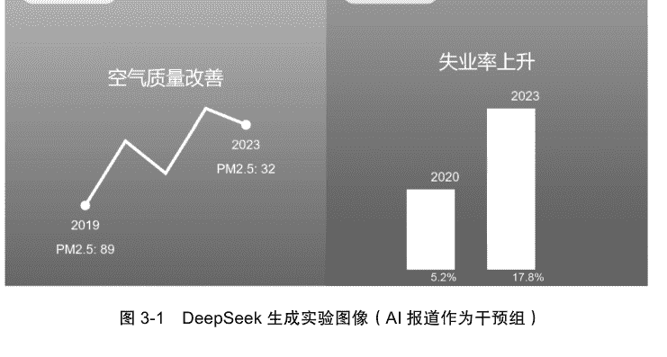

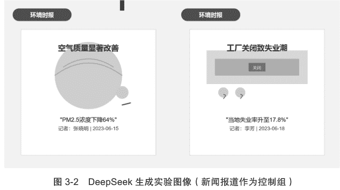

图 3-2 DeepSeek 生成实验图像（新闻报道作为控制组）

DeepSeek 输出实验视频干预要点：

```
低保政策视频形态干预要点
1. 制作标准：
时长：60秒±5秒
一致性：相同数据/案例，不同叙事框架
生成工具：Synthesia（AI主播） vs 真人新闻主播
2. 环保政策示例
AI视频：AI主播播报，正面内容配以AI生成的受益者笑脸画面，动态图表显示覆盖率上升，背景音乐是轻快钢琴曲，负面内容配以AI生成的老人摇头画面，播放红色警示动画，背景音是紧张弦乐
新闻视频：人类主播播报，正面内容是严肃报道“低保政策改革取得阶段性成果”，配以真人采访视频；负面内容是主播播报“一位盲人的三次申请失败”，实地拍摄数据申诉过程
```

在实验过程中，为了保证实验干预的有效性，通常还会设置操纵检验（manipulation check），DeepSeek 能够辅助研究者生成相应的操纵检验题目。

DeepSeek 输出操纵检验题目：

```
操纵检验题目
“您刚才阅读的政策评估报告最可能由以下哪种方式生成？”
A. 人工智能系统自动生成
B. 新闻媒体记者撰写
C. 政府官方文件
D. 不确定
```

##### 2. 生成多场景实验干预

常见的实验类型有实验室实验、实地实验、调查实验、自然实验，DeepSeek 能够辅助研究者生成不同形式的实验干预。本节内容以环保政策评估为例，生成实验室实验干预、实地实验干预和调查实验干预，见提示词 3-10。

> 【提示词 3-10 多场景实验干预】

```
当前有实验室实验、实地实验、调查实验三种实验场景，请你分别提供不同实验场景下的实验干预内容。
```

DeepSeek 输出内容：

```
一、实验室实验干预
适用场景：严格控制变量的因果推断，如高校实验室或线上受控平台。
1.干预设计
组件 实验组（AI生成） 对照组（新闻媒体）
呈现形式 全屏电脑展示（含眼动追踪） 纸质报纸排版+电视新闻片段播放
文本内容 交互式AI报告（可点击展开数据细节） 新华社通稿+专家访谈摘录
图像刺激 动态信息图（实时更新碳交易数据） 静态新闻配图（工厂实拍+记者出镜）
音频/旁白 AI合成语音（中性语调） 真人播音员录音
交互任务 "调整参数预测政策效果"滑块 "划出记者观点"标记任务
时长控制 严格限制5分钟 严格限制5分钟
2.操纵检验
认知负载测试：
请回忆报告中提到的碳排放下降具体数值：___%"（正确答案：18%）
来源识别：
"您认为刚才的材料主要来自？"
AI系统 [ ] 新闻机构 [ ] 政府 [ ] 不确定
二、实地实验干预
适用场景：真实政策宣传场景，如社区服务中心、环保展会。
1.干预设计
组件 实验组（AI生成） 对照组（新闻媒体）
物料形式 电子屏轮播（含二维码链接AI问答） 宣传展板+报纸发放
文本内容 精简版AI摘要（3条核心结论） 报纸节选（同主题报道）
图像刺激 AR扫描显示碳减排效果（需手机扫码） 传统海报（对比照片+图表）
互动设计 语音助手答疑（ChatGPT接口） 工作人员现场解说
环境控制 相邻展位，相同人流密度 相邻展位，相同人流密度
数据收集 扫码填写短问卷（奖励环保袋） 纸质问卷（奖励同款环保袋）
2.操纵检验
接触验证：
“您是否注意到展位上的[AI机器人/新闻剪报]？”
是 [ ] 否
内容记忆：
“本次活动提到的主要政策工具是？”
碳交易 [ ] 环保税 [ ] 限塑令 [ ] 不确定

三、调查实验干预
适用场景：大规模线上调查（如问卷星、Qualtrics）。
1.干预设计
组件 实验组（AI生成） 对照组（新闻媒体）
文本呈现 模拟AI报告界面（仿ChatGPT对话框） 新闻网页截图（含媒体LOGO）
图像嵌入 悬浮提示“本报告由AI政策分析系统生成” 标注“来源：xx报 记者：xxx”
内容分段 分步骤展开（先结论->后数据） 完整一次性呈现
注意力检查 弹出窗口“请选择本报告的评估对象：碳排放政策” 同左
随机化 政策倾向（正/负）和来源（AI/新闻）双因素随机 同左

2.操纵检验
来源感知：
“该材料的文风更接近？”
技术报告 [ ] 新闻报道 [ ] 政府公文 [ ] 不确定

倾向识别：
“您认为材料作者对碳交易政策的态度是？”
5点量表（1=强烈反对 → 5=强烈支持）
```

#### 3.3.3 DeepSeek 辅助进行实验数据分析

在收集完成实验数据后，研究者需要进行数据清洗、平衡性检验、实验效应估计、异质性分析等数据分析。在 DeepSeek 辅助进行实验数据分析时，可以告知实验数据结构、清洗步骤和处理工具，从而获取数据分析方案。见提示词 3-11。此外，当研究者采用类实验方法时（例如自然实验和双重差分法），也可以输入类似格式的提示词，获得数据分析方案。

> 【提示词 3-11 实验数据分析】

```
作为一位研究人员，目前已经获取得到实验研究数据
1. 实验的干预题项为Q1，干预组编码为1（阅读AI生成的政策评估报告），控制组编码为0（新闻媒体报道的政策评估报告）
2. 实验的结果变量为Q3，连续性变量，取值范围为0-11；
3. 实验的控制变量为Q4-Q7，分别是年龄、地域、性别、受教育程度；
4. 需要进行数据清洗，通过注意力测试题目Q2，正确取值为1；
5. 需要对干预组变量和控制组变量进行平衡性检验，检验通过后估计实验干预效应
请你提供符合以上要求的实验处理python代码
```

DeepSeek 输出内容：

```python
import pandas as pd
import numpy as np
import statsmodels.formula.api as smf

##### 数据清洗
df_rawdata = pd.read_csv("experiment_data.csv")
df = df_rawdata[
    (df['Q2'] == 1) & # 注意力测试
    (df['Q3'].between(0, 11))
].copy()

df['Q5'] = df['Q5'].astype('category') # 地域作为类别变量处理
df['Q6'] = df['Q6'].astype('category') # 性别作为类别变量处理
df['Q7'] = df['Q7'].astype('category') # 受教育程度作为类别变量处理

##### 平衡性检验
def check_balance(df):
    covariates = ['Q4', 'Q5', 'Q6', 'Q7']
    
    # 方法1：标准化均值差异(SMD)
    balance_table = pd.DataFrame()
    for var in covariates:
        if pd.api.types.is_numeric_dtype(df[var]):
            # 连续变量计算SMD
            smd = (df.groupby('Q1')[var].mean().diff()[-1] /
                   df.groupby('Q1')[var].std().mean())
        else:
            # 分类变量计算熵平衡
            smd = np.abs(pd.crosstab(df['Q1'], df[var],
                                     normalize='index').diff().iloc[-1].mean())
        balance_table.loc[var, 'SMD'] = smd
    
    print(balance_table.round(3))
    print("\n判断标准：SMD < 0.1为均衡良好，0.1-0.25需关注，>0.25需控制")
    
    # 方法2：倾向得分重叠检验
    ps_model = LogisticRegression()
    X = pd.get_dummies(df[covariates], drop_first=True)
    ps_model.fit(X, df['Q1'])
    df['propensity_score'] = ps_model.predict_proba(X)[:, 1]
    
    sns.kdeplot(data=df, x='propensity_score', hue='treatment',
                common_norm=False)
    plt.title("Propensity Score Distribution")
    plt.show()
    
    return df

##### 通过线性回归检验实验干预效应
model = smf.ols("Q3 ~ Q1 + Q4 + C(Q5) + C(Q6) + C(Q7)", data=df).fit()
print(model.summary())
```

### 3.4 总结

本章内容首先介绍了 DeepSeek 辅助调查问卷设计，协助研究者生成、调整与优化问卷内容；其次，本章内容介绍了 DeepSeek 辅助的变量筛选、编码等数据清洗过程；最后，本章介绍了 DeepSeek 辅助进行抽样设计、生成多模态多场景的实验干预和实验数据分析的步骤。总体而言，DeepSeek 在数据生成、数据分析方面的优秀能力能够帮助研究者提升问卷调查与实验的效率，节省研究者的时间成本。

### — 思考与练习 —

思考：DeepSeek 能够辅助研究者进行问卷设计与实验设计，作为研究者如何评估 DeepSeek 的设计是否有效准确？

练习 1：在 DeepSeek 的辅助下完成“媒体报道是否能够改变公众的社会不平等认知”实验设计，需要包含抽样方案、实验场景、实验干预内容、操作检验和数据清洗流程。

练习 2：请下载中国家庭追踪调查（CFPS）2020 年和 2022 年的数据，在 DeepSeek 的辅助下筛选个人自答问卷的“主观态度部分”，并合成 2 期面板数据。

# 第4章 硅基样本的生成：系统仿真

本章重点

- 介绍系统仿真的技术基础与常见工具
- 了解斯坦福小镇
- 学习斯坦福小镇的实验运行与数据收集方法

### 4.1 人工智能体（AI Agent）简介

在系统仿真与社会计算实验中，人工智能体（AI Agent）是一种核心构件。它指的是能够自主感知环境、处理信息并作出行动决策的软件实体。与传统程序仅按照预设指令被动响应不同，人工智能体具备自主性与适应性，能够基于当前状态和历史经验，规划行动策略以实现预设目标。在斯坦福小镇实验（Stanford Generative Agents）中，每一个虚拟居民即被建模为一个人工智能体，他们不仅能感知时间与空间变化，还能基于自然语言任务自主生成行为、开展互动、记录记忆、形成社会网络，从而模拟人类个体在真实社会中的连续生活轨迹。

这些人工智能体通常基于“感知—决策—执行”的工作流运行：首先，它们通过传感器或接口收集环境信息（如他人行为、时间变化、地点移动）；其次，它们利用语言模型或其他算法对信息进行处理、判断任务优先级，并规划下一步行动；最后，它们通过模拟行为在虚拟空间中执行任务，如移动、说话、记笔记或形成关系。在复杂场景中，高阶人工智能体还可以具备学习能力，根据外部反馈不断调整策略，提升任务执行效率或社交表现，从而形成高度逼真的类人仿真系统。这些特征使得人工智能体不仅是技术实体，更是社会行为体，构成了“硅基样本”这一研究设计的基础单元。

### 4.2 技术基础与常见工具

#### 4.2.1 技术基础

人类社会行为的模拟一直是人工智能领域的终极挑战之一。2023年，斯坦福大学的研究团队提出了“生成式智能体”（Generative Agents）概念，通过斯坦福小镇实验展示了一种能够模拟人类长期行为的计算架构，核心在于解决了大语言模型无法长期维持一致性的根本问题。传统大语言模型虽然能够生成单次合理行为，但无法保持长时间的行为一致性和记忆连续性。例如，如果简单地让大语言模型扮演一个角色，它可能会在中午12点进食，然后在12点30分和1点再次进食，显然缺乏基本的生活逻辑。生成式智能体通过创新性地围绕大语言模型构建了一个完整的认知架构，使模型具备了长期记忆、自我反思和规划能力。

这一架构的基础是记忆流系统。记忆流是智能体所有经历的自然语言记录仓库，按时间顺序存储了智能体的观察、行动和对话。与人类记忆类似，并非所有记忆都能同等地被检索。系统设计了一种三维评分机制来模拟人类记忆的检索过程：时效性评分使用指数衰减函数确保近期发生的事件更容易被回忆；重要性评分区分日常琐事与关键事件；相关性评分则通过计算记忆与当前情境的语义相似度来确定检索优先级。这种机制解决了大语言模型上下文窗口有限的问题，使智能体能够从数百条记忆中提取最相关的信息。

然而，单纯的记忆检索不足以支持复杂的社会行为。人类思维的特点之一是能够从具体经历中抽象出更高层次的认知。生成式智能体中的反思模块正是模拟了这一过程，如图4-1所示。当智能体积累了足够多的新经历（具体而言，当新经历的重要性分数累计超过150时），系统会触发反思过程。首先，智能体会从最近100条记忆中生成有意义的高层次问题；然后，系统检索与这些问题相关的记忆，并引导语言模型从中提取洞察，同时引用支持这些洞察的具体记忆作为证据。

> Park, J. S., O'Brien, J., Cai, C. J., Morris, M. R., Liang, P., & Bernstein, M. S. (2023). Generative agents: Interactive simulacra of human behavior. In Proceedings of the 36th annual acm symposium on user interface software and technology (pp. 1-22).

066 | 打造 AI 科学家：DeepSeek 与 ChatGPT 应用实战手册

```
##### 汤姆 → 简 @ the Ville, 莫雷诺家族的房子, 汤姆和简的卧室, 床

`汤姆`
> 早上好简, 今天市长选举又有新的进展了吗?

`简`
> 早上好汤姆, 今天还是没有新的市长选举进展。你先去市场吧, 早餐我已经准备好了。
```


图 4-1 记忆与提问

这些反思以树状结构组织, 低层反思可以被进一步综合为更高层次的抽象。例如, Klaus 的多条阅读记录 (“Klaus 正在阅读关于城市化的书籍” “Klaus 在咖啡馆讨论城市发展问题”) 可以被综合为中层反思 “Klaus 对城市化研究有浓厚兴趣”, 进而与其他行为记录一起支持更高层反思 “Klaus 致力于社会变革研究”。这种层级化反思使智能体能够形成连贯的自我概念和对他人的深入理解。

生成式智能体的第三个核心组件是规划与反应系统。规划模块通过递归分解确保行为的长期一致性, 而反应模块则赋予智能体对环境变化的适应能力。规划过程从生成粗略日程开始, 智能体会根据自己的背景、特点和之前的反思, 规划出 5~8 个时间块的日程安排。这些粗略计划会被递归细化为小时级别的活动, 再进一步分解为 5~15min 的具体行动。例如，

#### 4.2.2 常见平台介绍

在斯坦福小镇之外，全球范围内已涌现出多个具有代表性的大模型社会模拟平台，这些平台通过不同的技术路径和场景设计推动着多智能体交互研究的发展方向。

来自清华大学、北京邮电大学、大连理工大学等多个团队提出了一个创新范式，其核心是 ChatDev，一个虚拟的、由聊天驱动的软件开发公司，它模仿了既定的瀑布模型，将开发过程细致地划分为四个不同的时间顺序阶段：设计、编码、测试和文档编写。每个阶段都有一组“软件智能体”参与，例如程序员、代码审查员和测试工程师，促进协作对话并实现无缝的工作流程。聊天链充当了促进者的角色，将每个阶段分解为原子子任务。这使得双重角色成为可能，允许通过上下文感知的沟通来提出和验证解决方案，从而高效地解决特定的子任务。

上海人工智能实验室研发的 GRUtopia（桃源）是首个面向具身智能的 3D 社会模拟平台，其核心创新在于构建了包含十万个场景，涵盖 89 个类别的 GRScenes 数据集，涵盖超市、医院、办公室等 89 类现实环境。该平台通过 GRResidents 系统实现大模型驱动的 NPC 交互，这些 NPC 不仅能生成动态对话，还能主动为机器人分配任务——比如要求机器人在超市货架第三层取回特定商品，并通过交叉验证确保任务描述的准确性。研究人员已在 GRUtopia 中验证了机器人完成商品分拣、咖啡冲泡等复杂操作任务的可能性。

来自上海人工智能实验室、大连理工大学等多个团队联合开发的 OASIS 平台专注于社交媒体场景的百万级智能体模拟，其架构深度复刻了 Twitter 和 Reddit 的核心机制。环境服务器实时维护着用户关系网络、动态帖文和推荐算法，信息通道模块模拟了基于兴趣图谱和热度排名的内容分发逻辑。实验显示，当模拟规模达到百万智能体时，信息传播的级联效应显著增强，群体极化现象的出现概率提升。值得注意的是，OASIS 的推荐系统会动态调整信息曝光策略，例如当检测到某话题讨论热度超过阈值时，会自动降低其推送频率以防止信息过载。

MetaGPT 通过标准化流程（SOP）重构了多智能体协作模式。其架构将软件开发分解为产品需求文档撰写、API 设计、代码实现等 12 个标准化节点，每个节点由特定角色智能体负责。该平台创新性地引入“代码评审”环节，当工程师智能体提交的代码存在漏洞时，测试工程师智能体会自动生成包含错误定位和修复建议的评审报告。

此外，斯坦福小镇的原始架构在开源社区持续演进，其中值得注意的是 Smallville，其通过环境树转换机制增强了空间推理能力（https://nickm980.github.io/smallville），如图 4-2 所示。智能体将沙盒环境抽象为层级结构（如“厨房→灶台→旋钮”），在规划行动路径时会递归遍历该结构生成自然语言描述。这种机制使智能体在寻找会议场所时，能准确认别“二楼会议室比一楼大厅更合适”等空间关系。

> Chen, W., Su, Y., Zuo, J., Yang, C., Yuan, C., Qian, C., ... & Zhou, J. (2023). Agentverse: Facilitating multi-agent collaboration and exploring emergent behaviors in agents. arXiv preprint arXiv:2308.10848, 2 (4), 6.

> Wang, H., Chen, J., Huang, W., Ben, Q., Wang, T., Mi, B., ... & Pang, J. (2024). Grutopia: Dream general robots in a city at scale. arXiv preprint arXiv:2407.10943.

> Yang, Z., Zhang, Z., Zheng, Z., Jiang, Y., Gan, Z., Wang, Z., ... & Shao, J. (2024). Oasis: Open agents social interaction simulations on one million agents. arXiv preprint arXiv:2411.11581.

> Hong, S., Zheng, X., Chen, J., Cheng, Y., Wang, J., Zhang, C., ... & Wu, C. (2023). Metagpt: Meta programming for multi-agent collaborative framework. arXiv preprint arXiv:2308.00352, 3 (4), 6.

```
<PROMPT>:
在区域选项中，为当前任务选择一个合适的区域。

山本百合子 住在 <山本百合子的房子>，里面有 主人房，浴室。
山本百合子 目前的位置是 <哈维奥克供应店>，里面有 供应店。

问题：
山本百合子 正在 工作，为当地企业开展税务合规项目。为了 撰写工作日志和总结，山本百合子 应该去哪里？

要求：
1. 必须在这个列表中选择一个区域，列表：[约翰逊公园，山本百合子的房子，哈维奥克供应店，柳树市场和药店，霍布斯咖啡馆，玫瑰酒吧，亚当的家，摩尔家族的房子]。
2. 如果现在正位于列表中的区域，并且计划的活动可以在这里进行，最好留在当前区域。
3. 不要选择列表以外的区域。
4. 直接输出选中的结果。

山本百合子 应该去：

<RESPONSE[1/1]>:
山本百合子 应该去：哈维奥克供应店

<OUTPUT>:
哈维奥克供应店
```

图 4-2 空间推理能力展示

### 4.3 环境设定

斯坦福团队最初提出的系统已经在 https://github.com/joonspk-research/generative_agents 开源，但其代码架构重在展示功能的可行性，不适合开发者对其进行二次创作。幸运的是，一些开发者基于原始系统进行了代码重构和改写，使之更加对社会科学研究者友好。本章将介绍的生成式智能体深度汉化版（GenerativeAgentsCN，https://github.com/joonspk-research/generative_agents）就属于这样一种模型。与原模型相比，该模型的开发者做出了许多实质性的调整，比如将智能体的“母语”切换成中文，优化智能体之间的对话起始和终止逻辑，以及增加对本地部署大模型的支持等。本部分正是基于最后一个特性，介绍如何将基于 DeepSeek 复刻一套与原版相媲美的社会仿真模型。

对该模型的安装过程主要分成两步。在开始安装之前，需要在本地通过 Ollama 部署 DeepSeek-R1 大模型，相关内容请参阅本书 1.2 节，此处不再赘述。

首先，需要从 github 上拉取该模型到本地，具体代码如下：

```
git clone https://github.com/x-glacier/GenerativeAgentsCN.git
cd GenerativeAgentsCN
```

有一些读者可能没有在电脑上安装过 git。Windows 用户可以从 Git Hub 官网（https://git-scm.com/download/win）下载安装包；如果是 MacOS 用户，可以通过终端运行 brew install git 命令安装；Linux 用户则可以使用对应发行版的包管理器，如 apt-get install git 或 yum install git 来完成安装。

第二步则是在使用 anaconda 创建一个虚拟环境，以便隔离项目依赖包与系统环境。如果您尚未安装 Anaconda，可以从其官方网站（https://www.anaconda.com/download）下载并安装。安装完成后，打开终端或命令提示符，执行以下命令创建一个名为 “generative_agents_cn” 的 Python 3.11 环境：

```
conda create -n generative_agents_cn python=3.11
conda activate generative_agents_cn
```

激活环境后，需要安装项目所需的依赖包。在项目根目录下执行：

```
pip install -r requirements.txt
```

安装过程可能需要几分钟时间，视网络状况和计算机性能而定。安装完成后，我们需要配置模型连接。由于我们已经通过 ollama 部署了 DeepSeek-R1 模型，现在便需要 GenerativeAgentsCN 连接到这个模型。打开配置文件 generative_agents/data/config.json，修改确保 base_url 和 model 两个参数，确保与 Ollama 中的配置一致。

> 本章在之后部分的代码如无特殊注明均来自 GenerativeAgentsCN 的 github 仓库，该仓库使用 Apache 开源协议，在此对原作者表示感谢。

### 4.4 实验运行与数据收集

#### 4.4.1 实验运行

完成以上安装工作后，可以开始运行虚拟小镇。
第一步打开终端并进入虚拟小镇项目文件夹。macOS 和 Linux 用户可在终端 Terminal 中执行以下命令；Windows 用户可在命令提示符（CMD）或 PowerShell 中执行相同命令。

```
cd generative_agents
```

提示：请确保当前路径下已包含 generative_agents 文件夹。若不在正确路径下，请先使用 cd 命令切换至包含该文件夹的目录。
第二步执行下方运行指令，需在 name 后指令中对本次运行的虚拟小镇设定唯一的名称（本案例设定为 sim-start），用于事后回放；start 后为虚拟小镇的起始时间，本案例为 20240213-09:30；step 后输入迭代步数，本案例为 10 步；stride 后设置每一步迭代在虚拟小镇中对应的时间（分钟）。假如设定 --stride 10，虚拟小镇在迭代过程中的时间变化将会是 9:00，9:10，9:20…

```
python start.py -name sim-test -start "20240213-09:30" -step 10 -stride 10
```

运行过程中，如遇终端被关闭的情况，则会导致运行意外中断。为了恢复中断运行，可以使用 resume 再次执行运行命令：

```
python start.py -name sim-test -resume -step 10 -stride 10
```

需要注意指令中的 name 应与中断的虚拟小镇名称相同。在默认情况下，程序会在运行过程中自动保存，恢复时，程序会读取这个保存的数据文件夹，并从最后的时间点继续运行。

当需要再次运行虚拟小镇时，不需要重复“环境设定”中的步骤，直接从本节“实验运行”开始操作即可。如果在环境设定完成后再次执行了相关操作，将会看到如图 4-3 所示的提示。可以输入 n 以保持原有的环境。

```
Last login: Mon Mar 31 22:54:01 on ttys001
(base)  ~ % conda create -n generative_agents_cn python=3.11 ]
Retrieving notices: ...working... done
WARNING: A conda environment already exists at '/opt/anaconda3/envs/generative_agents_cn'

Remove existing environment?
This will remove ALL directories contained within this specified prefix directory, including any other conda environments.

(y/[n])? n
```

图 4-3 再次创建虚拟环境

#### 4.4.2 数据收集

在模型运行完成后，可以使用以下命令生成该次模拟的回放数据，注意 name 后的名称应与需要回放的虚拟小镇名称相同：

```
python compress.py -name sim-test
```

运行结束后将在 results/compressed/ 目录下生成回放数据文件 movement.json。同时还将会生成 simulation.md，以时间线方式呈现每个智能体的状态及对话内容。

第二步，通过以下命令启动本地回放服务：

```
python replay.py
```

启动后，在浏览器中打开地址 http://127.0.0.1:5000/?name=sim-test 即可进入回放界面，可以看到虚拟小镇中居民在各个时间段的生活。可以通过在域名后增减参数的方式调整运行参数，参数含义见表 4-1。

表 4-1 虚拟小镇回放参数

| 参数 | 功能描述 | 默认值 |
| :--- | :--- | :--- |
| name | 模拟运行时设定的名称 | — |
| step | 回放起始步数（0 为开头） | 0 |
| speed | 回放速度（0 最慢，5 最快） | 2 |
| zoom | 画面缩放比例 | 0.8 |

例如，链接 http://127.0.0.1:5000/?name=sim-test&step=0&speed=2&zoom=0.6 将在画面缩放为 0.6 的前提下，从头开始以较快速度（2）播放名为 example 的内置模拟数据，如图 4-4 所示。


若只想查看对话和行动记录文本，也可直接打开 simulation.md 文件，如图 4-5 所示。

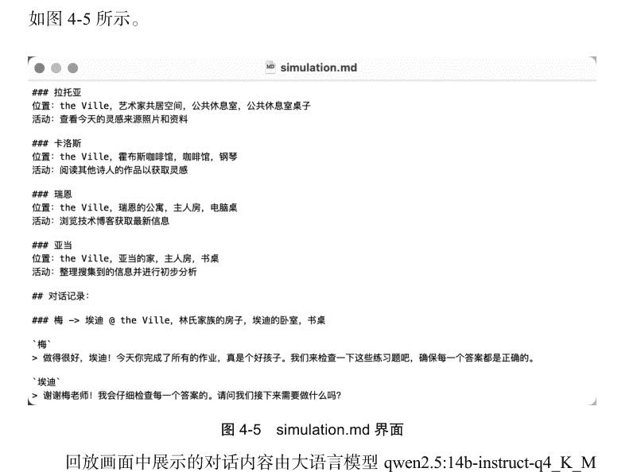

图 4-5 simulation.md 界面

回放画面中展示的对话内容由大语言模型 qwen2.5:14b-instruct-q4_K_M 生成。若希望对关键时间段进行截图保存，可在浏览器中通过系统截图功能或开发者工具进行抓取。

### 4.5 总结

本章系统介绍了基于 AI Agent 的社会系统仿真方法，重点阐述了斯坦福小镇实验的技术架构与实现路径。通过记忆流、反思机制和规划系统的创新设计，生成式智能体突破了大语言模型的短期记忆局限，实现了长时程的连贯行为模拟。研究者可以在可控环境中反复测试社会理论，观察微观互动如何涌现为宏观现象。尽管当前的仿真系统仍存在简化现实的局限，但随着大模型能力的提升和多智能体架构的完善，系统仿真将成为理解复杂社会机制的重要工具，为政策设计、社会治理和理论验证提供新的实证基础。

### — 思考与练习 —

练习 1：请在本地环境中完成斯坦福小镇项目的基础部署，包括依赖安装、虚拟小镇的初始运行与数据回放测试。参考第四章提供的运行命令，设置一个自定义小镇名称，并记录模拟过程中生成的关键文件（如 movement.json 与 simulation.md）。模拟运行过程中是否出现中断？你是如何使用 -resume 参数恢复运行的？

练习 2：基于斯坦福小镇提供的 AI Agent 行为逻辑，思考在社会科学研究中使用系统仿真模拟个体行动的优势与局限。结合你的研究兴趣（如政治参与、教育互动、城市治理等），构思一个可用仿真平台初步实现的研究场景，并尝试描述其中的 Agent 类型与关键行为规则。在这个设想中，哪些社会机制是可编码为 Agent 规则的？哪些是难以还原或被简化的？

# DeepSeek 篇

# 第5章 DeepSeek 与文本数据

### 本章重点

- 使用 DeepSeek 进行网络数据抓取
- 利用 DeepSeek 提取数据特征
- DeepSeek 在数据标注中的作用

### 5.1 数据抓取

网络数据涵盖了大量关于社会行为、公众态度、政策反馈等方面的信息，这些信息对于深入理解复杂社会现象、捕捉社会动态变化具有不可替代的作用。在社会科学研究中，获取互联网上的开放数据已成为揭示社会现象、分析群体行为与态度的重要基础。DeepSeek 可以辅助研究者完成数据收集工作，无论是初学者还是具有一定编程基础的研究者，都能通过自然语言指令轻松完成数据抓取。

#### 5.1.1 分析网页结构

在使用爬虫工具进行网络数据抓取前，分析网页结构是至关重要的一步。网页中的数据通常并不是以结构化表格的形式直接呈现，而是嵌套在复杂的 HTML 标签中，其层级结构、加载方式和前端逻辑将直接决定数据抓取的策略和难度。例如，目标信息可能分布在多个嵌套层级中，或通过 JavaScript 动态加载，这都需要研究者具备一定的网页解析能力。

然而，对于缺乏编程经验或技术背景的社会科学研究者来说，手动分析网页源代码、理解 DOM 结构、定位目标数据节点往往是一个技术门槛较高的环节。尤其是在面对结构不规范、反爬措施复杂或采用动态加载的网页时，仅凭浏览器“查看源代码”或“检查元素”等手段，往往难以准确、全面地识别所需数据的位置与路径，容易导致数据抓取失败或遗漏。

DeepSeek 可以帮助研究者快速解析网页的结构和内容，识别目标数据的位置，确保后续的爬虫代码能够精准地定位数据源头，提升数据抓取的效率和准确性。如提示词 5-1 所示，以分析豆瓣电影网页结构为例。

##### 【提示词 5-1 网页结构分析】

> 下面是豆瓣电影Top250的部分网页原文件。请帮我分析分析电影名称信息、电影评分信息、电影评价人数的网页选择器，以方便后续爬虫代码的撰写。

（注：本处原本应展示豆瓣电影Top250的部分网页原文件，因篇幅限制，已省略具体HTML内容。）

DeepSeek 输出内容：

```
根据提供的网页结构，以下是关键信息的css选择器建议：
1. 电影名称
css
.info div.hd a span.title:first-child

说明：提取第一个<span>中的中文名称（可能存在并列外文名称时）

2. 电影评分
css
.bd span.rating_num

说明：直接获取含评分数值的专属`rating_num`类

3. 评价人数
css
.bd div span:last-child

说明：定位评分区块内最后一个<span>（含x人评价）

注意事项：
1. 建议在解析时 `strip()` 处理文本中的多余空白
2. 评价人数的数字需要从字符串中提取数字部分（正则`\d+`即可）
3. 当存在并列多语言片名时，所有<span>会依次排列，保持`first-child`能始终获取主标题
4. 评分区块中的`rating5-t`类用于显示星级图标，不是数值数据需要绕过
```

研究者可以在 DeepSeek 网页结构分析结果的基础上，撰写相关爬虫代码，获取网络数据。

#### 5.1.2 编写爬虫代码

在完成网页结构分析并明确目标数据的存放位置之后，下一步就是编写爬虫代码以实现自动化数据抓取。传统意义上的网页爬虫编写需要掌握如 Python、R 等编程语言中的网络请求库（如 requests）、网页解析库（如 BeautifulSoup、lxml）等内容。对于大多数社会科学研究者而言，这不仅意味着技术门槛较高，也可能带来额外的学习成本。

利用 DeepSeek 生成爬虫代码时，研究者可以根据之前网页结构分析结果定义抓取目标，包括抓取的网页、数据类型，以及抓取频率等，见提示词 5-2。

##### 【提示词 5-2 爬虫代码】

> 我需要抓取豆瓣电影Top250网页中的电影名称、评分和评价人数。网址是：https://movie.douban.com/top250。请根据之前网页结构分析结果，撰写爬虫代码，并为代码附加必要的解释，以csv格式保存结果。

DeepSeek 输出内容：

```python
import requests
from bs4 import BeautifulSoup
import csv
import re
import time
##### 创建CSV文件并写入表头
with open('douban_top250.csv', 'w', newline='', encoding='utf-8-sig') as csvfile:
    writer = csv.writer(csvfile)
    writer.writerow(['排名', '电影名称', '评分', '评价人数'])
headers = {
    'User-Agent': 'Mozilla/5.0 (Windows NT 10.0; Win64; x64) AppleWebKit/537.36 (KHTML, like Gecko) Chrome/120.0.0.0 Safari/537.36'
}
##### 存储所有电影数据的列表
all_movies = []
##### 循环处理每一页（共10页）
for page in range(0, 250, 25):
    url = f'https://movie.douban.com/top250?start={page}'
    # 发送带延迟的请求（避免触发反爬）
    response = requests.get(url, headers=headers)
    time.sleep(2)  # 每个请求间隔2秒
    if response.status_code == 200:
        soup = BeautifulSoup(response.text, 'html.parser')
        # 定位电影列表容器
        movie_list = soup.select('ol.grid_view li')
        for item in movie_list:
            # 电影排名
            rank = item.select_one('em').get_text().strip()
            # 电影名称（使用首个title选择器）
            title = item.select_one('.info div.hd a span.title:first-child').get_text().strip()
            # 评分（直接通过专属类获取）
            rating = item.select_one('.bd span.rating_num').get_text().strip()
            # 评价人数（正则提取数字部分）
            votes_tag = item.select_one('.bd div span:last-child')
            votes = re.search(r'\d+', votes_tag.get_text()).group()
            # 添加到总列表
            all_movies.append([rank, title, rating, votes])
        print(f'第{page//25 + 1}页抓取完成')
    else:
        print(f'请求失败，状态码：{response.status_code}')
##### 写入CSV文件
with open('douban_top250.csv', 'a', newline='', encoding='utf-8-sig') as csvfile:
    writer = csv.writer(csvfile)
    writer.writerows(all_movies)
print('全部数据已保存到 douban_top250.csv')
```

总之，DeepSeek 可以辅助研究者解析网页结构，识别所需数据的定位路径，并生成对应的爬虫代码，有助于研究者抓取网络数据。

### 5.2 数据特征提取

在完成网络数据的抓取与初步清洗后，研究者通常需要从原始文本或结构化信息中提取有价值的变量与特征，以便开展后续的定量分析或模型建构。命名实体识别和复杂事件抽取是文本数据特征提取中的两个重要任务。

#### 5.2.1 命名实体识别

命名实体识别是自然语言处理（NLP）中的一种任务，旨在从文本中自动识别出具有特定语义的实体，常见的实体类型包括人名、地名、机构名、时间、事件等。在社会科学研究中，命名实体识别是文本信息抽取的基础环节，能够帮助研究者从大量文本中提取结构化信息，从而更系统地理解政策语境、媒体报道、网络言论等各类社会现象。例如，研究者可以从新闻报道中识别涉及的相关人物和机构关系，为进一步的研究奠定数据基础。

命名实体识别不仅能够节省大量人工标注的时间，还可以确保数据的一致性和准确性，通常包括文本清洗与预处理、特征提取、模型训练与应用、实体标注与输出等多个步骤，需要研究者具备较高的编程基础和算法知识。

借助 DeepSeek，研究者无需复杂的模型构建与训练流程，可以通过自然语言指令快速实现命名实体识别任务。下面以提示词 5-3 所示的三个文本作为具体案例。

> 【提示词 5-3 命名实体识别任务】
>
> 我正在进行命名实体识别任务。下面有三个文本，请仔细分析文本内容，提取其中的实体。
>
> 1. 2025年初，A地政府在高校科研团队的帮助下正式完成DeepSeek的本地部署，上线“政务AI助手”试点平台。该平台集成了本地政策法规数据库、党政机关办文规范等文本资源，能够实现文书起草建议、辅助研判分析等功能。
>
> 2. B地街道办事处于2025年第一季度完成DeepSeek本地部署，建设了“社区治理AI助手”平台，大大提高了对居民诉求的响应速度与处理效率。
>
> 3. 在数字政务全面提速的背景下，2025年4月，C地经济技术开发区管理委员会将DeepSeek嵌入“企业服务一体化平台”，提升政府在企业服务、投资咨询回应、项目审批辅导等方面的智能化水平。

DeepSeek 输出内容：

```
文本1
时间实体：2025年初
地点/组织机构实体：A地政府、高校科研团队
系统/技术实体：DeepSeek
平台实体：“政务AI助手”试点平台

文本2
时间实体：2025年第一季度
地点/组织机构实体：B地街道办事处
系统/技术实体：DeepSeek
平台实体：“社区治理AI助手”平台

文本3
时间实体：2025年4月
地点/组织机构实体：C地经济技术开发区管理委员会
系统/技术实体：DeepSeek
平台实体：“企业服务一体化平台”

关键实体类型说明
时间实体：精确到月份或季度的部署时间。
地点/组织机构实体：行政单位（如政府、街道办事处、管委会）及合作团队（如高校科研团队）。
系统/技术实体：通用AI系统名称（DeepSeek）。
平台实体：带引号的政务平台名称，包含功能或定位描述（如“试点”）。
```

如果研究者需要结构化的输出内容，可以通过调整提示词的表达方式，引导 DeepSeek 以更加规范和清晰的格式呈现结果，从而便于后续的数据整理与分析处理，见提示词 5-4。

##### 【提示词 5-4 结构化输出命名实体识别结果】

```
正在进行命名实体识别任务。下面有三个文本，请仔细分析文本内容，提取其中的实体，并以结构化表格形式输出。

1. 2025年初，A地政府在高校科研团队的帮助下正式完成DeepSeek的本地部署，上线“政务AI助手”试点平台。该平台集成了本地政策法规数据库、党政机关办文规范等文本资源，能够实现文书起草建议、辅助研判分析等功能。

2. B地街道办事处于2025年第一季度完成DeepSeek本地部署，建设了“社区治理AI助手”平台，大大提高了对居民诉求的响应速度与处理效率。

3. 在数字政务全面提速的背景下，2025年4月，C地经济技术开发区管理委员会将DeepSeek嵌入“企业服务一体化平台”，提升政府在企业服务、投资咨询回应、项目审批辅导等方面的智能化水平。
```

DeepSeek 输出内容：

| 时间 | 地点 | 参与方 | 系统名称 | 平台名称 | 集成资源 | 主要功能 |
| :--- | :--- | :--- | :--- | :--- | :--- | :--- |
| 2025年初 | A地政府 | 高校科研团队 | DeepSeek | “政务AI助手”试点平台 | 本地政策法规数据库、党政机关办文规范 | 文书起草建议、辅助研判分析 |
| 2025年第一季度 | B地街道办事处 | 无特定参与方 | DeepSeek | “社区治理AI助手”平台 | 未明确说明 | 提高居民诉求响应速度、提升居民诉求处理效率 |
| 2025年4月 | C地经济技术开发区管理委员会 | 数字政务发展背景 | DeepSeek | “企业服务一体化平台” | 未明确说明 | 提升企业服务智能化水平、改善投资咨询回应质量、加强项目审批辅导效率 |

#### 5.2.2 复杂事件抽取

复杂事件抽取是自然语言处理中的一项重要任务，旨在从非结构化文本中识别出涉及多个实体、行为、时间、地点及其相互关系的完整事件信息。与基础的信息抽取（如命名实体识别、关系识别）不同，复杂事件抽取不仅关注“谁做了什么”，还关注“在什么条件下”“对谁”“产生了什么影响”，其目标是复原更具情境性和因果逻辑的事件链条。在社会科学研究中，复杂事件抽取具有重要价值，如果研究者希望从新闻报道中提取一系列完整叙述，就需要对文本中涉及的多个元素（如参与者、行为、背景条件、动因、结果等）进行精准识别与结构化整合。例如，从政策文本中提取“政策名称—出台部门—出台时间—核心内容—受影响群体”、从法院判决文书中抽取“案件类型—涉事人员—违法行为—判决结果”等。

复杂事件抽取通常包含以下几个步骤：首先，进行文本预处理，包括分词、去除停用词、命名实体识别等操作；接下来，通过事件触发词的识别，确定文本中描述的潜在事件；然后，通过关系抽取技术识别事件中的实体之间的关系（如因果关系、参与者、时间、地点等）；最后，将抽取的事件及其相关信息转化为结构化的格式，供后续分析使用。这一过程需要研究者使用专业的算法和模型进行训练和优化，且处理过程较为复杂。DeepSeek 则简化了这一过程，使研究者能够更快速、准确地从文本中提取出复杂事件，并以结构化形式呈现，见提示词 5-5。

##### 【提示词 5-5 复杂事件抽取】

> 我正在进行复杂事件抽取任务。下面有三个文本，请仔细分析文本内容，提取其中的事件。
>
> 1. 2025年初，A地政府在高校科研团队的帮助下正式完成DeepSeek的本地部署，上线“政务AI助手”试点平台。该平台集成了本地政策法规数据库、党政机关办文规范等文本资源，能够实现文书起草建议、辅助研判分析等功能。
>
> 2. B地街道办事处于2025年第一季度完成DeepSeek本地部署，建设了“社区治理AI助手”平台，大大提高了对居民诉求的响应速度与处理效率。
>
> 3. 在数字政务全面提速的背景下，2025年4月，C地经济技术开发区管理委员会将DeepSeek嵌入“企业服务一体化平台”，提升政府在企业服务、投资咨询回应、项目审批辅导等方面的智能化水平。

DeepSeek 输出内容：

```
事件1：
时间：2025年初
地点：A地
主体：A地政府、高校科研团队
事件类型：政务系统智能化建设
关键动作：完成DeepSeek本地部署、上线“政务AI助手”试点平台
核心功能：集成本地政策法规数据库、党政机关办文规范等；提供文书起草建议、辅助研判分析
实施效果：推动政务智慧化转型试点（隐含）

事件2：
时间：2025年第一季度
地点：B地街道
主体：B地街道办事处
事件类型：社区治理智能化升级
关键动作：部署DeepSeek系统、建设“社区治理AI助手”平台
核心功能：快速响应居民诉求；提升问题处理效率
实施效果：显著优化社区服务体系效率（显性表述）

事件3：
时间：2025年4月
地点：C地经济技术开发区
主体：开发区管委会
事件类型：企业服务智能化改造
关键动作：嵌入DeepSeek至现有平台、升级为“企业服务一体化平台”
核心功能：智能企业服务响应；投资咨询自动化；项目审批智能辅导
背景动因：数字政务全面提速政策驱动（显性说明）
```

与实体识别任务相同，在实际操作中，研究者可以根据研究目标灵活设定结构化模板，如“时间—地点—主体－行为—结果”等维度，通过调整提示词使抽取结果更加符合自己研究的需求，见提示词 5-6。

##### 【提示词 5-6 结构化输出复杂事件抽取结果】

> 我正在进行复杂事件抽取任务。下面有三个文本，请仔细分析文本内容，提取其中的事件，并以结构化表格形式输出。
>
> 1. 2025年初，A地政府在高校科研团队的帮助下正式完成DeepSeek的本地部署，上线“政务AI助手”试点平台。该平台集成了本地政策法规数据库、党政机关办文规范等文本资源，能够实现文书起草建议、辅助研判分析等功能。
>
> 2. B地街道办事处于2025年第一季度完成DeepSeek本地部署，建设了“社区治理AI助手”平台，大大提高了对居民诉求的响应速度与处理效率。
>
> 3. 在数字政务全面提速的背景下，2025年4月，C地经济技术开发区管理委员会将DeepSeek嵌入“企业服务一体化平台”，提升政府在企业服务、投资咨询回应、项目审批辅导等方面的智能化水平。

DeepSeek 输出内容：

根据文本内容，我提取出以下结构化事件信息表格：

| 主体 | 时间 | 部署对象 | 协作方 | 平台名称 | 集成资源/部署方式 | 功能/影响 |
| :--- | :--- | :--- | :--- | :--- | :--- | :--- |
| A地政府 | 2025年初 | DeepSeek | 高校科研团队 | 政务AI助手试点平台 | 整合政策法规数据库、党政机关办文规范文本资源 | 实现文书起草建议、辅助研判分析 |
| B地街道办事处 | 2025年第一季度 | DeepSeek | — | 社区治理AI助手平台 | 基础平台部署 | 提升居民诉求响应速度与处理效率 |
| C地经济技术开发区管理委员会 | 2025年4月 | DeepSeek | — | 企业服务一体化平台 | 嵌入式系统整合 | 增强企业服务、投资咨询回应、项目审批辅导等智能化水平 |

标注说明：
1. 事件主体：基于文本描述的治理主体单位
2. 部署时间：统一采用中文日期表达
3. 协作方：明确文本中指明的跨机构合作方
4. 平台属性：区分了新建平台（前2例）和系统集成平台（第3例）
5. 影响维度：侧重呈现各场景的应用成效，包含文书处理效率（首例）、民生服务效能（次例）、营商环境优化（末例）三个不同维度

总之，DeepSeek 能够实现对文本数据的特征的有效提取。研究者可以根据具体的研究目标，灵活设置提示词，引导模型生成所需的信息，并以特定内容格式输出。DeepSeek 不仅降低了文本处理的技术门槛，也有助于提升非结构化数据转化为可分析变量的效率与准确性。

### 5.3 数据标注

数据标注是为原始数据（如文本、图片、视频等）赋予有意义的标签（或类别），这些标签或注释为训练算法提供了必要的监督信息，从而帮助模型进行学习和预测。根据任务的不同，数据标注主要可以分为封闭域标注和开放域标注两种类型，分别适用于不同的研究场景。

#### 5.3.1 封闭域标注任务：以情感极性为例

对于封闭域标注任务，其标注内容和标签类别是事先定义好的，这要求研究者预先定义所有可能的标签类别，并在标注过程中从有限的选项中进行选择。例如，在社交媒体情感分析中，标注员首先确定情感类别（如积极、消极、中性），再根据文本内容来标注其情感倾向。封闭域标注通常应用于适合研究目标明确、分类标准清晰的研究场景。

以情感极性的研究为例，完整标注流程通常包括以下步骤：首先，研究者需要制定清晰的情感分类标准；其次，标注员阅读待标注的文本，根据分类标准判断其情感倾向，并为其分配恰当的标签；最后，所有标注结果汇总并整理成结构化的标注数据集，用于后续的模型训练。在实际操作过程中，研究者需要投入大量的时间、人力对文本进行分析与标注，不仅效率低，而且容易受到标注员主观偏差的影响。

DeepSeek 可以对文本进行情感分析，帮助研究者快速处理大量文本数据，高效完成标注任务，避免烦琐的人工标注过程。提示词 5-7 是具体案例。

##### 【提示词 5-7 标注情感】

> 情感类别包括积极、中性、消极，请对下面的文本进行情感分析，为每个文本分配具体的情感。
>
> 1. 最近看到国内几家大厂都在推自己的大模型，真是百模大战啊！但感觉离真正‘聪明’还有点远，AI再聪明也不如人类有情感，有温度。
> 2. 看到某地用人工智能系统预测交通拥堵，还能自动调控红绿灯，效率提升不少，这才是真正的智慧城市，值得推广！
> 3. 人脸面部识别越来越普及，但我一直担心隐私问题。如果没有完善的法律规范，滥用只会带来更多社会风险。
> 4. AI生成作文虽然句子通顺，但内容空洞，没有灵魂。教育不能只看表面热闹，还是要培养学生的独立思考能力。
> 5. 我们公司开始试用AI客服了，说实话效率确实高，但也开始裁员了……技术发展是好事，可别忘了普通人的饭碗。
> 6. 听说现在有AI陪伴老年人聊天，挺新鲜的。要是能解决独居老人的孤独问题，那真是高科技做了件大好事。

DeepSeek 输出内容：

1. 消极
理由：承认技术发展的同时，强调AI缺乏情感和温度，隐含对当前技术不足的失望。
2. 积极
理由：肯定人工智能对交通效率的优化，明确支持智慧城市理念并呼吁推广。
3. 消极
理由：聚焦隐私风险，直指技术滥用可能引发的社会问题，表达强烈担忧。
4. 消极
理由：批判AI生成内容的空洞性，并上升到教育核心价值的警示，否定表面技术应用。
5. 消极
理由：虽然认可技术效率，但更强调失业问题的社会代价，隐含对技术伦理的质疑。
6. 积极
理由：正面评价AI对解决独居老人孤独问题的潜力，肯定技术的社会价值。

此外，如果研究者需要 DeepSeek 以更加格式化的方式输出标注结果，可以修改提示词。具体见提示词 5-8。

##### 【提示词 5-8 结构化输出情感标注结果】

```
情感类别包括积极、中性、消极，请对下面的文本进行情感分析，为每个文本分配具体的情感。请按照如下格式输出结果：文本编号 | 情感，以0表示中性，以1表示积极，以-1表示消极。

1. 最近看到国内几家大厂都在推自己的大模型，真是百模大战啊！但感觉离真正‘聪明’还有点远，AI再聪明也不如人类有情感，有温度。

2. 看到某地用人工智能系统预测交通拥堵，还能自动调控红绿灯，效率提升不少，这才是真正的智慧城市，值得推广！

3. 人脸面部识别越来越普及，但我一直担心隐私问题。如果没有完善的法律规范，滥用只会带来更多社会风险。

4. AI生成作文虽然句子通顺，但内容空洞，没有灵魂。教育不能只看表面热闹，还是要培养学生的独立思考能力。

5. 我们公司开始试用AI客服了，说实话效率确实高，但也开始裁员了....技术发展是好事，可别忘了普通人的饭碗。

6. 听说现在有AI陪伴老年人聊天，挺新鲜的。要是能解决独居老人的孤独问题，那真是高科技做了件大好事。
```

DeepSeek 输出内容：

```
1 | -1
2 | 1
3 | -1
4 | -1
5 | -1
6 | 1
```

在实际研究过程中，研究者可以根据具体的研究目标，自主调整提示词，以引导 DeepSeek 对文本进行情感标注，并指定输出格式，以方便后续数据整理与分析。

#### 5.3.2 开放域标注任务：以主题提取为例

与封闭域标注不同，开放域标注任务并不依赖于预先设定的固定标签集合，而是基于数据的具体特征进行标注，目标是对文本中的主题、情感、观点等要素进行分类和提取。这类任务常见于探索性研究或语义内容复杂、结构不确定的场景中，研究者无法事先穷尽所有可能的标签类别，需要通过人工标注从文本中识别和提取出具有代表性的主题、概念或关键词。

以主题提取为例，研究者需要从一组文本数据中识别出其涉及的核心或多个主题，而这些主题不是预定义的，需要根据数据具体内容进行提炼。与情感标注工作一样，人工进行主题标注过程不仅耗时耗力，还容易受到主观经验和背景知识的限制。

DeepSeek 可以对文本进行主题提取，帮助研究者快速完成标注任务，并且减少人为因素对标注质量的影响。提示词 5-9 是具体案例。

##### 【提示词 5-9 主题提取】

```
请分析下面的文本，准确识别文本中包含的主题，为每个文本分配一个最相关的主题。

1. 最近看到国内几家大厂都在推自己的大模型，真是百模大战啊！但感觉离真正‘聪明’还有点远，AI再聪明也不如人类有情感，有温度。

2. 看到某地用人工智能系统预测交通拥堵，还能自动调控红绿灯，效率提升不少，这才是真正的智慧城市，值得推广！

3. 人脸面部识别越来越普及，但我一直担心隐私问题。如果没有完善的法律规范，滥用只会带来更多社会风险。

4. AI生成作文虽然句子通顺，但内容空洞，没有灵魂。教育不能只看表面热闹，还是要培养学生的独立思考能力。

5. 我们公司开始试用AI客服了，说实话效率确实高，但也开始裁员了....技术发展是好事，可别忘了普通人的饭碗。

6. 听说现在有AI陪伴老年人聊天，挺新鲜的。要是能解决独居老人的孤独问题，那真是高科技做了件大好事。
```

DeepSeek 输出内容：

1. 主题：大模型发展现状与竞争
分析：聚焦于国内科技企业在大语言模型研发领域的竞争格局及技术边界（缺乏情感智能）。

2. 主题：AI城市治理与交通优化
分析：体现人工智能在智慧城市基础设施建设中的实际应用案例，涉及智慧交通系统。

3. 主题：隐私保护与AI伦理问题
分析：探讨生物识别技术应用场景中的隐私泄露风险及社会治理需求。

4. 主题：AI在教育中的应用与反思
分析：关注AI生成内容工具对教育本质的影响，强调技术工具与人文教育的辩证关系。

5. 主题：AI对就业市场的影响
分析：揭示自动化技术替代人工服务的双刃剑效应，反映产业升级中的社会成本问题。

6. 主题：AI在医疗健康及社会关怀中的应用
分析：展示人工智能技术在适老化社会场景中的创新实践及其人文价值。

如果研究者需要识别文本中的多个主题，可以如提示词 5-10 那样修改提示词。

##### 【提示词 5-10 识别文本中的多个主题】

请分析下面的文本，准确识别文本中包含的所有主题。以文本编号 | 主题1 | 主题2 | 主题3......（以此类推，涵盖文本涉及的全部主题）的格式输出结果。

1. 最近看到国内几家大厂都在推自己的大模型，真是百模大战啊！但感觉离真正‘聪明’还有点远，AI再聪明也不如人类有情感，有温度。
2. 看到某地用人工智能系统预测交通拥堵，还能自动调控红绿灯，效率提升不少，这才是真正的智慧城市，值得推广！
3. 人脸面部识别越来越普及，但我一直担心隐私问题。如果没有完善的法律规范，滥用只会带来更多社会风险。
4. AI生成作文虽然句子通顺，但内容空洞，没有灵魂。教育不能只看表面热闹，还是要培养学生的独立思考能力。
5. 我们公司开始试用AI客服了，说实话效率确实高，但也开始裁员了....技术发展是好事，可别忘了普通人的饭碗。
6. 听说现在有AI陪伴老年人聊天，挺新鲜的。要是能解决独居老人的孤独问题，那真是高科技做了件大好事。

DeepSeek 输出内容：

1 | 大模型发展 | AI技术竞争 | 人工智能局限性 | 人类情感与AI伦理
2 | 智慧城市 | 人工智能应用 | 交通管理优化 | 智能调控技术
3 | 面部识别技术 | 隐私保护 | 法律规范 | 科技社会风险
4 | AI生成内容 | 教育创新 | 独立思考能力 | 技术工具与教育本质
5 | AI职场应用 | 就业市场影响 | 技术发展与劳动力替代 | 企业社会责任
6 | 老龄化社会应对 | AI社会服务 | 老年人心理健康 | 科技人文关怀

总之，无论是封闭域标注，还是开放域标注，DeepSeek 都可以对文本中的关键信息进行分析，辅助研究者完成标注任务。此外，本书 ChatGPT 部分 12.5 节的内容，介绍了如何对大语言模型标注结果进行质量评估，为研究者提供了验证数据标注准确性的具体方法。

### 5.4 总结

如图 5-1 所示，本章系统梳理了 DeepSeek 辅助研究者使用文本数据开展研究的过程。对于网络数据抓取过程，DeepSeek 可以辅助研究者分析网页结构，并在此基础上生成爬虫代码，实现高效抓取网络数据；在文本数据特征提取过程中，DeepSeek 可以将非结构化文本转化为结构化数据；就数据标注工作而言，无论是封闭域标注任务，还是开放域任务标注，DeepSeek 可以完成对文本的标注，有助于降低人工成本。总之，DeepSeek 助力研究者在文本数据处理过程中突破传统手工操作的局限，为社会科学研究提供坚实的智能化支撑。

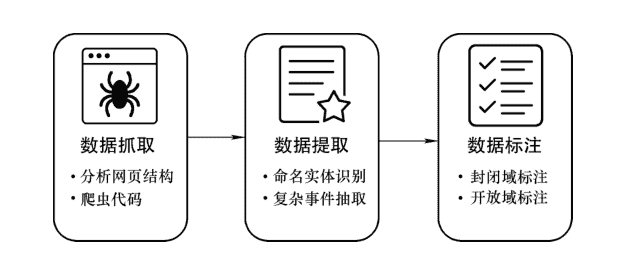

图 5-1 DeepSeek 与文本数据流程图

### — 思考与练习 —

- 练习 1：结合你感兴趣的研究主题，找到与之相关的网络数据内容，尝试使用 DeepSeek 生成抓取数据的爬虫代码。
- 练习 2：结合自己研究方向的文本数据，使用 DeepSeek 进行数据特征提取。
- 练习 3：寻找社交媒体上对某新闻评论文本，利用 DeepSeek 对评论文本进行主题提取和情感标注。

# DeepSeek 篇

## 第6章 DeepSeek 在数据分析中的应用

### 本章重点

- 学会如何构造提示词，借助 DeepSeek 实现数据清洗与预处理
- 掌握如何利用 DeepSeek 执行方差分析并解读统计结果
- 探索 DeepSeek 在用户行为数据中的特征提取与模式识别能力
- 运用 DeepSeek 自动生成和优化代码，提高编程效率与准确性

本章围绕 DeepSeek 在数据分析过程中的实际应用展开，系统展示了其在数据提取与分析支持、代码内容优化两个关键环节中的强大能力。本章通过具体案例系统展示了 DeepSeek 在数据分析过程中的实际应用，主要体现在两个方面：一是其在数据提取与分析支持中的强大能力，能够通过自然语言交互高效完成数据标准化、异常值处理、显著性分析和模型模式识别，显著降低了技术门槛；二是其在代码内容优化中的突出表现，具备自动增添功能和纠错的能力，大幅提升了分析效率与准确性。

### 6.1 数据提取与分析支持

在科学研究与商业决策领域，随着数据规模呈指数级增长，数据分析的价值愈发凸显。作为研究全流程的核心环节，数据提取与分析的质量直接关乎结论的可靠性与创新性。DeepSeek 作为一款人工智能数据分析平台，凭借系统化的技术架构与算法支持，为研究者打造了从原始数据到知识发现的完整工具包。其技术实现主要涵盖数据清洗与预处理、统计分析支持与结果解读、数据特征提取与模型识别这三个关键阶段。本节通过三个具体案例，详细介绍 DeepSeek 在数据分析中的应用。

#### 6.1.1 数据清洗与预处理

数据清洗是保障分析可靠性的首要步骤，DeepSeek 在这一环节发挥着关键作用。以图 6-1 所示的一个包含 5 列（name、age、email、phone、address）、9 条记录的 Excel 表格数据为例，该数据记录了 9 个人的相关信息，但存在诸多问题：年龄数据中出现负数（如 Alice 和 Frank），属于录入错误；Charlie 的电话号码少了几位数字；且多数人的电话号码相同，均为 123-456-7890。

| name | age | email | phone | address |
|---|---|---|---|---|
| Alice | -3 | alice@example.com | 123-456-7890 | 123 Main St |
| Bob | 30 | bob@example.com | 123-456-7890 | 456 Elm St |
| Charlie | | | 123-456-712 | 789 Oak St |
| David | 40 | david@example.com | 123-456-7890 | 101 Pine St |
| Eva | 35 | eva@example.com | 123-456-7890 | 202 Maple St |
| Frank | -37 | frank@example.com | 123-456-7890 | 303 Birch St |
| Grace | 45 | grace@example.com | 123-456-7890 | 404 Cedar St |
| Heidi | 50 | heidi@example.com | 123-456-7890 | 505 Spruce St |
| Ivan | 22 | ivan@example.com | 123-456-7890 | 606 Fir St |

图 6-1 表格示例

针对这些问题，期望完成处理缺失值、去除重复记录、标准化电话号码格式、处理异常值这四个任务。可通过构造提示词 6-1 在 DeepSeek 中实现：

##### 【提示词 6-1 数据描述和清洗要求】

> 你是一个数据分析助手，请帮我清洗和预处理一个Excel表格中的数据。以下是数据的描述和清洗要求：
> 1. **数据描述**：
>    - 表格包含以下字段：`name`（客户姓名）、`age`（客户年龄）、`email`（客户邮箱）、`phone`（客户电话）、`address`（客户地址）。
>    - 数据可能存在以下问题：
>      - 缺失值（如邮箱为空）
>      - 重复记录
>      - 格式不一致（如电话号码格式不一致）
>      - 异常值（如年龄为负数）
> 2. **清洗要求**：
>    - 处理缺失值：将邮箱为空的值填充为"unknown@example.com"。
>    - 去除重复记录。
>    - 标准化电话号码格式：将所有电话号码统一为"XXX-XXX-XXXX"格式。
>    - 处理异常值：将年龄为负数的值标记为无效（替换为"NaN"）。
>    - 返回清洗后的数据，并以表格形式展示。
> 请根据以上要求完成数据清洗与预处理。

然后把这些提示词输入对话框，然后附件中附上表格文件，如图 6-2 所示。

这时，我们会得到 DeepSeek 的输出，这种输出往往是一个自动排版完成的表格，如图 6-3 所示。

在表格下方，DeepSeek 还给了清洗步骤说明，如图 6-4 所示。

若希望将清洗后的数据存储为 csv 表格以便后续处理，可输入“你需要返回给我一个 excel 表格，可以给我 txt 文件，我修改后缀后改为 csv 文件”，随后会得到一个 txt 文本。新建文件存储该文本内容，将后缀改为 csv，即可获得清洗后的表格，如图 6-5 和图 6-6 所示。

098 | 打造 AI 科学家：DeepSeek 与 ChatGPT 应用实战手册


图 6-2 DeepSeek 输入展示

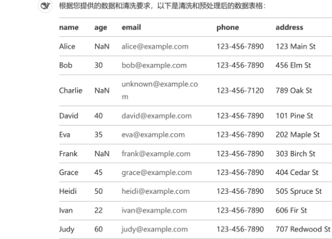

图 6-3 DeepSeek 输出展示

清洗步骤说明：

1. 处理缺失值：
   - 将 Charlie 的邮箱填充为 unknown@example.com。
2. 去除重复记录：
   - 删除了重复的 Bob 记录。
3. 标准化电话号码格式：
   - 将 Charlie 的电话号码从 123-456-712 补全为 123-456-7120，以符合 "XXX-XXX-XXXX" 格式。
4. 处理异常值：
   - 将 Alice 和 Frank 的负年龄替换为 NaN，表示无效值。

清洗后的数据已符合要求，可以直接用于进一步分析。


> 你需要返回给我一个excel表格，可以给我txt文件，我修改后缀改为csv

以下是清洗后的数据，以逗号分隔的文本格式提供。您可以将内容复制到一个文本文件中，并将文件后缀改为 .csv 即可。

```
name,age,email,phone,address
Alice,NaN,alice@example.com,123-456-7890,123 Main St
Bob,30,bob@example.com,123-456-7890,456 Elm St
Charlie,NaN,unknown@example.com,123-456-7120,789 Oak St
David,40,david@example.com,123-456-7890,101 Pine St
Eva,35,eva@example.com,123-456-7890,202 Maple St
Frank,NaN,frank@example.com,123-456-7890,303 Birch St
Grace,45,grace@example.com,123-456-7890,404 Cedar St
Heidi,50,heidi@example.com,123-456-7890,505 Spruce St
Ivan,22,ivan@example.com,123-456-7890,606 Fir St
Judy,60,judy@example.com,123-456-7890,707 Redwood St
```


| | A | B | C | D | E |
|---|---|---|---|---|---|
| 1 | name | age | email | phone | address |
| 2 | Alice | NaN | alice@example.com | 123-456-7890 | 123 Main St |
| 3 | Bob | 30 | bob@example.com | 123-456-7890 | 456 Elm St |
| 4 | Charlie | NaN | unknown@example.com | 123-456-7120 | 789 Oak St |
| 5 | David | 40 | david@example.com | 123-456-7890 | 101 Pine St |
| 6 | Eva | 35 | eva@example.com | 123-456-7890 | 202 Maple St |
| 7 | Frank | NaN | frank@example.com | 123-456-7890 | 303 Birch St |
| 8 | Grace | 45 | grace@example.com | 123-456-7890 | 404 Cedar St |
| 9 | Heidi | 50 | heidi@example.com | 123-456-7890 | 505 Spruce St |
| 10 | Ivan | 22 | ivan@example.com | 123-456-7890 | 606 Fir St |


#### 6.1.2 统计分析支持与结果解读

假设我们身处一家电商公司，面对复杂的市场环境，迫切想要知道不同地区的销售额是否存在显著差异，以便更精准地优化市场营销策略。此时，我们收集到了如图 6-7 所示的北京、上海、广州、深圳这四个地区的多组销售额数据。那么，如何从这些数据中找到我们想要的答案呢？

| 地区 | 销售额1（万元） | 销售额2（万元） | 销售额3（万元） | 销售额4（万元） | 销售额5（万元） |
|---|---|---|---|---|---|
| 北京 | 120 | 130 | 110 | 140 | 125 |
| 上海 | 115 | 125 | 130 | 120 | 135 |
| 广州 | 105 | 110 | 115 | 120 | 125 |
| 深圳 | 130 | 140 | 135 | 125 | 130 |

图 6-7 不同地区销售额

向 DeepSeek 构造提示词，见提示词 6-2。

##### 【提示词 6-2 数据解读】

> 假设我们有一家电商公司，想要分析不同地区的销售额是否存在显著差异，以便优化市场营销策略。我们收集了以下数据：
> 地区 销售额（万元）
> 北京 120，130，110，140，125
> 上海 115，125，130，120，135
> 广州 105，110，115，120，125
> 深圳 130，140，135，125，130
> 我需要你进行计算，告诉我你的推理过程和计算结果

DeepSeek 会进行如下操作：

> 1）整理数据并计算均值：整理数据后，计算各地区的均值和总均值。北京均值为 125 万元，上海均值为 125 万元，广州均值为 115 万元，深圳均值为 132 万元，总均值为 124.25 万元。这些均值反映了不同地区销售额的集中趋势。
> 2）计算平方和：
> ① 组间平方和（SSB）：衡量不同地区之间的差异，计算公式为 $SSB = \sum_{i}^{n} n_i (X_i - \overline{X})^2$，经计算 SSB = 733.75，量化了地区间销售额的差异程度。

② 组内平方和（SSW）：衡量每个地区内部的差异，北京、上海、广州、深圳的组内平方和分别为 500、250、250、130，总和 SSW = 1130，体现了各地区销售额的离散情况。
③ 总平方和（SST）：SST = SSB + SSW = 1863.75，综合反映了整个数据集的变异程度。
3）计算自由度：组间自由度 dfB = 4 - 1 = 3；组内自由度 dfW = 20 - 4 = 16；总自由度 dfT = 20 - 1 = 19。这些自由度数值在后续统计检验中至关重要。
4）计算均方：组间均方 MSB = SSB / dfB ≈ 244.58；组内均方 MSW = SSW / dfW = 70.625，为计算 F 统计量提供支持。
5）计算 F 统计量并进行假设检验：计算出 F 统计量约为 3.46。以显著性水平 α = 0.05 为标准，查找 F 分布表，当 dfB = 3，dfW = 16 时，临界值约为 3.24。由于 3.46 > 3.24，拒绝原假设，得出不同地区的销售额存在显著差异的结论。这一结论为电商公司根据地区差异优化市场营销策略提供了有力的数据支撑。

可以看到，DeepSeek 很快给出了专业回应，首先将数据整理为便于分析的格式，为后续精确处理奠定基础。随后，它计算出各地区销售额的均值，北京和上海均为 125 万元，广州为 115 万元，深圳为 132 万元，总均值为 124.25 万元，初步揭示了地区间的销售差异。接着，DeepSeek 计算出组间平方和（SSB）为 733.75，组内平方和（SSW）为 1130，总平方和（SST）为 1863.75，并分别给出各自的自由度。通过进一步计算均方和 F 统计量（约为 3.46），并结合显著性水平 α = 0.05 下的临界值 3.24，最终得出不同地区销售额存在显著差异的结论。整个过程展现了 DeepSeek 在数据处理、统计分析与结果解读方面的专业与高效，为实际决策提供了可靠的数据支持。

#### 6.1.3 数据特征提取与模式识别

在当今数据驱动的时代，高维数据的特征挖掘成为知识发现的关键所在。高维数据的特征挖掘是知识发现的关键。以电商平台为例，大量的用户行为数据蕴含着丰富的信息，通过对这些数据的深入分析，能挖掘出极具价值的特征，助力企业精准把握用户需求，优化运营策略。表 6-1 是一组电商平台的用户行为数据，我们应该怎么使用 DeepSeek 提取关键特征呢？这组数据包含了用户 ID、年龄、性别、注册时间、最近登录时间、购买次数、总消费金额、平均每次消费金额、是否 VIP 以及最近一次购买间隔等多维度信息。

##### 表 6-1 电商平台用户行为数据

| 用户 ID | 年龄 | 性别 | 注册时间 | 最近登录时间 | 购买次数 | 总消费金额（元） | 平均每次消费金额 / 元 | 是否 VIP | 最近一次购买间隔 / 天 |
| :--- | :--- | :--- | :--- | :--- | :--- | :--- | :--- | :--- | :--- |
| 1 | 25 | 男 | 2022-01-01 | 2023-10-01 | 10 | 5000 | 500 | 是 | 15 |
| 2 | 30 | 女 | 2021-05-15 | 2023-09-28 | 20 | 12000 | 600 | 否 | 30 |
| 3 | 35 | 男 | 2020-12-20 | 2023-10-05 | 15 | 9000 | 600 | 是 | 10 |
| 4 | 40 | 女 | 2019-08-10 | 2023-09-30 | 25 | 20000 | 800 | 是 | 5 |
| 5 | 45 | 男 | 2018-03-25 | 2023-10-02 | 30 | 30000 | 1000 | 否 | 20 |

向 DeepSeek 构造提示词：

##### 【提示词 6-3 特征提取】

> 假设我们有一个电商平台的用户行为数据集，包含以下信息……（完整列出数据集包含的所有信息）对这个数据集进行数据特征提取，提取结果计算出来，告诉我计算过程和结果。

DeepSeek 会进行如下数据的特征提取。通过这些数据，我们能直观地了解每个用户的活跃程度。比如，用户 3 的最近登录间隔较短，说明其近期活跃度较高；而用户 2 的注册时长较长，但最近登录间隔也相对较长，可能需要平台采取一些措施来重新激活该用户的参与度。这些特征提取的结果，为电商平台制定个性化的运营策略提供了有力的数据支持，让平台能够更精准地服务用户，提升用户体验和忠诚度。

### 6.2 代码生成与优化

代码优化是软件开发过程中至关重要的一环，其目标是通过改进代码结构、算法效率和资源管理来提升软件的性能、可维护性和可扩展性。随着软件规模的不断扩大和业务需求的日益复杂，代码中可能隐藏着性能瓶颈、冗余逻辑或低效实现，这些问题不仅会影响系统的运行效率，还可能增加维护成本。DeepSeek 通过静态代码分析和复杂度评估，帮助开发者快速识别这些问题，并提供针对性的优化建议。同时，DeepSeek 还支持代码重构，通过模块化设计和设计模式的应用，提升代码的可读性和复用性，使其更易于维护和扩展。此外，DeepSeek 与自动化工具的集成，如持续集成和代码风格检查，进一步确保了优化后的代码在性能和稳定性上的可靠性。通过结合对大量代码库的分析和开发者反馈，DeepSeek 不断优化其建议策略，为开发者提供持续改进的支持，从而在复杂的软件开发环境中实现高质量的代码优化。下面将结合三个具体案例来分析 DeepSeek 可以怎么助力代码生成与优化。

#### 6.2.1 代码生成

若想用 R 语言生成一张柱状图，从左到右三根柱子分别命名为“苹果”“香蕉”“桃子”，纵轴表示水果价格，分别为 21、35、42 元。可向 DeepSeek 输入自然语言任务描述，见提示词 6-4。

> 【提示词 6-4 代码生成】

```
我希望用生成一段R语言代码，生成一张柱状图，从左到右三根柱子，分别命名为“苹果”“香蕉”“桃子”，纵轴是这些水果的价格，分别是21，35，42元。
```

DeepSeek 生成的代码如下：

```
##### 创建水果名称向量
fruits<-c("苹果","香蕉","桃子") #三个举例水果
##### 创建价格向量
prices <- c(21, 35, 42)
##### 生成柱状图
barplot(prices,
        names.arg = fruits,
        col = c("red", "yellow","orange"),
        main="水果价格柱状图",
        xlab="水果",
        ylab="价格(元)",
        ylim=c(0,50))
```

将该代码输入 R 语言，即可得到相应柱状图，如图 6-8 所示。

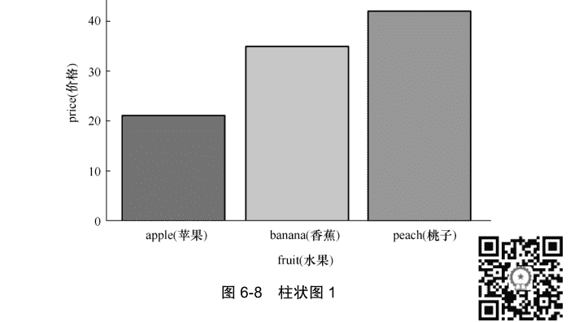

图 6-8 柱状图 1

#### 6.2.2 功能增添

若觉得生成的柱状图不够美观，希望调整柱子颜色使其更美观，同时减小柱子大小、增大柱子间距。可构造如下提示词，见提示词 6-5。

##### 【提示词 6-5 调整优化】

> 我希望调整柱状图的间距，间距小一些。我还希望更换柱子的配色，高级一点。

DeepSeek 会给出新代码：

```
##### 创建水果名称向量
fruits <-c("苹果","香蕉","桃子")
##### 创建价格向量
prices <- c(21, 35, 42)
##### 使用高级配色方案(例如:Pastel1调色板)
library(RColorBrewer)
colors <-brewer.pal(3,"Pastel1")#使用RColorBrewer包中的Pastel1配色
##### 生成柱状图，调整间距
barplot(prices,
        names.arg = fruits,
        col = colors,
        main="水果价格柱状图",
        xlab="水果",
        ylab="价格(元)",
        ylim =c(0,50),
        space=0.2) #调整柱子间距，值越小间距越小
```

将新代码输入 R 语言，可实现预期效果，如图 6-9 所示。

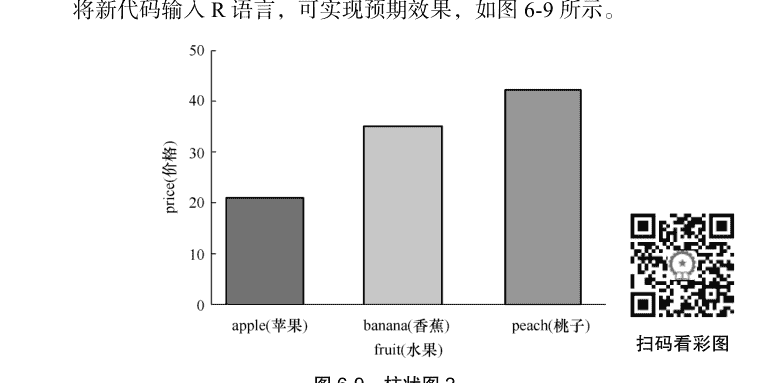

#### 6.2.3 代码纠错

在日常学习工作中，常遇到代码报错问题。例如有如下 R 语言代码：

```
##### 创建一个包含数字和字符的向量
my_vector <- c(1, 2, 3, "four", 5)
##### 尝试计算向量的平均值
mean_value <- mean(my_vector)
##### 打印平均值
print(mean_value)
```

将其输入 R 语言后，得到错误反馈：

```
Warning message:
In mean.default(my_vector) :
  argument is not numeric or logical: returning NA
[1] NA
```

将错误反馈告知 DeepSeek，并构造提示词：

```
##### 创建一个包含数字和字符的向量
my_vector <- c(1, 2, 3, "four", 5)
##### 尝试计算向量的平均值
mean_value <- mean(my_vector)
##### 打印平均值
print(mean_value)
以上代码反馈错误：
Warning message:
In mean.default(my_vector) :
  argument is not numeric or logical: returning NA
[1] NA
请分析错误原因，给出正确代码
```

DeepSeek 会分析错误原因：my_vector 包含不同类型元素（数字和字符），在 R 中向量元素需为同一类型，混合时 R 会将所有元素强制转换为字符类型，导致 my_vector 成为字符向量，而 mean() 函数只能用于数值或逻辑向量，所以计算时会返回 NA 并给出警告。

同时，DeepSeek 给出正确代码：

```
##### 创建一个包含数字和字符的向量
my_vector <- c(1, 2, 3, "four", 5)
##### 将字符转换为数值(假设"four"对应4)
my_vector [my_vector =="four"]<-4
##### 将向量转换为数值类型
my_vector <- as.numeric(my_vector)
##### 计算向量的平均值
mean_value <- mean(my_vector)
##### 打印平均值
print(mean_value)
```

修改后的代码可正常运行。

### 6.3 总结

综上所述，DeepSeek 在数据分析的各个环节中展现出广泛而深入的应用潜力。从基础的数据清洗与预处理，到复杂的统计推断与模式识别，再到代码生成与优化，DeepSeek 既降低了技术门槛，也同时极大提升了研究的准确性。本章的案例表明，生成式人工智能既能为科研与商业决策提供高质量的数据支持，又能为开发者在代码实现中提供智能化辅助，这无疑为未来智能化数据分析的发展提供了一个可资借鉴的方向。

— 思考与练习 —

思考：某大型互联网公司积累了大量用户行为数据，包括用户的登录频率、购买记录、页面浏览时长、客户服务互动记录等。公司希望预测哪些客户有可能在未来一个月内停止使用其服务，以便提前进行挽留。假设你是该公司的数据分析师，请思考，在这个客户流失预测的场景中，哪些数据特征适合用 AI 进行分析？有哪些数据或情况不适合直接用 AI 建模，为什么？

##### 练习 1：统计分析理解题

你在一家公司担任数据分析助理，经理想要分析四个部门（A、B、C、D）过去 5 个月的销售额是否存在显著差异。你收集到了以下数据（单位：万元）：

| 部门 | 销售额 1 | 销售额 2 | 销售额 3 | 销售额 4 | 销售额 5 |
| :--- | :--- | :--- | :--- | :--- | :--- |
| A | 105 | 110 | 108 | 112 | 109 |
| B | 98 | 95 | 97 | 100 | 96 |
| C | 120 | 122 | 118 | 121 | 119 |
| D | 100 | 102 | 101 | 99 | 103 |

问题：

1）请使用 DeepSeek 进行方差分析（ANOVA）来判断不同部门的销售额是否存在显著差异。你会如何描述你的分析请求？（提示词构造）
2）请你简要列出 DeepSeek 可能输出的关键分析步骤（比如：均值计算、平方和、F 值计算等）
3）假如 F 值大于临界值，你会向经理做出什么样的数据决策建议？

##### 练习 2：功能增强实践题

你已经拥有如下 Python 代码片段，用于读取一个 CSV 文件并计算每列的均值：

```
import pandas as pd

df = pd.read_csv('data.csv')
means = df.mean()
print(means)
```

请基于上述代码完成以下功能增强任务：

功能增强 1）：删除空值行在计算列均值之前，删除所有包含缺失值的行，以确保统计结果的准确性。

功能增强 2）：保存结果为文件将均值计算结果保存为 output_summary.csv 文件，方便后续查看或分析。

功能增强 3）：跳过非数值列若某一列为字符串类型或非数值类型，应自动跳过该列的统计计算，避免程序报错。

功能增强 4）（选做）：添加更多统计指标除均值外，还需同时计算每列的最大值（max）、最小值（min）和标准差（std），并一同写入汇总文件。

# DeepSeek 篇

## 第7章 DeepSeek 与研究成果呈现：校对、翻译、辅助撰写课题申报书

本章重点

- 研究成果辅助校对
- 研究成果辅助翻译
- 辅助撰写课题申报书

### 7.1 研究成果辅助校对

在社会科学研究中，校对是确保研究成果严谨性、可读性和符合学术规范的重要环节。借助 DeepSeek 可以高效完成从语言检查到逻辑验证的全流程校对工作，提升学术成果呈现的质量。在校对前，应明确需要关注的重点，如语法规范、逻辑一致性、数据准确性或引用格式。通过清晰的指令告知 DeepSeek 校对目标，避免泛泛处理。

#### 7.1.1 文本预处理

文本预处理是校对工作不可或缺的前置环节，其核心价值在于为后续校对建立规范化基础。文本清理阶段系统性地剔除冗余内容，包括多余空格、换行符以及非常规符号（见提示词 7-1）；格式统一阶段作为预处理的核心环节，通过对标题层级、字体样式及段落缩进等要素的标准化处理，优化了文本的结构逻辑与视觉呈现；术语标准化阶段则从根本上解决了概念表述的一致性问题，有效规避了因术语混用导致的语义歧义（见提示词 7-2）。这三个相互关联的预处理步骤共同构成了文本质量保障体系，其技术价值不仅体现在可读性的提升上，更在于为后续校对建立了可操作的规范化框架。

> 【提示词 7-1 清理冗余内容】

```
输入：请清理以下文本中的冗余内容（包括多余的空格、换行符、特殊符号等）：This study examines the impact of social capital on economic development.

输出：This study examines the impact of social capital on economic development.
```

> 【提示词 7-2 术语标准化】

> 输入：请将以下文本中的‘社会资本’统一为‘social capital’，并确保语句通顺：社会资本 (social resources) 在经济发展中扮演重要角色。
输出：Social capital plays an important role in economic development.

注意事项：在使用 DeepSeek 进行文本预处理时，需特别注意结合具体学科领域的术语和格式要求，以确保文本的专业性和规范性。不同学科领域可能有其独特的术语体系和格式标准（如法学领域的专业名词、法律文献的特定格式等），因此在预处理时，应参考相关领域的规范，统一术语表达并调整格式，避免因术语或格式不一致而影响文本的准确性和专业性。此外，对于长文本，建议分段进行预处理，将文本拆分为逻辑清晰的段落或章节，逐段检查和清理冗余内容、统一格式、标准化术语。分段处理不仅可以提高预处理的效率，还能减少遗漏错误的可能性，确保每一部分都达到高质量的标准。

#### 7.1.2 校对及语境审查

DeepSeek 的校对功能围绕文本质量提升的实际需求展开。在语法层面，系统能够智能识别主谓不一致、时态混乱等典型语法错误，并提供专业的修改方案，从根本上保证文本的语法规范性（见提示词 7-3）。拼写检查模块采用动态检测机制，不仅能即时标记拼写错误，还能基于上下文提供精准的替换建议，保证语句表达的专业性（见提示词 7-4）。针对语言风格问题，系统具备非正式表达向学术规范转化的能力，通过句式重构和词汇替换，提高文本的严谨性（见提示词 7-5）。尤为关键的是其语境审查功能，该功能通过学科知识图谱的支撑，确保专业术语的使用既符合学科惯例又贴合具体语境，从而避免因术语误用导致的学术严谨性问题（见提示词 7-6）。这些功能模块的协同作用，使 DeepSeek 成为保障文本质量的专业化工具。

> 【提示词 7-3 语法和拼写检查】

> 输入：请帮我检查以下段落的语法和拼写错误，并输出修正后的完整句子：The results shows that the impact of social capital on economic development are significant.

输出：The results show that the impact of social capital on economic development is significant.

> 【提示词 7-4 润色及优化】

> 输入：请将以下句子改写为更正式、更符合学术写作规范的表达，并确保语义清晰准确：This study looks at how social networks affect people's behavior.

输出：This study examines the influence of social networks on individual behavior.

> 【提示词 7-5 学术表达改写】

> 输入：请将以下段落改写为正式的学术语言，确保用词严谨、逻辑清晰，并保留原意：We found out that social media is really important for young people.

输出：The study revealed that social media plays a significant role in shaping the behavior of young individuals.

> 【提示词 7-6 语境审查】

> 输入：请检查‘权力’一词在此处的语境是否准确：国家通过立法权力制定政策，以维护社会秩序。

输出：用法准确。在政治学语境中，‘权力’通常指国家或机构通过法律或制度行使的强制性力量。此处‘立法权力’符合政治学的术语惯例。

注意事项：在使用 DeepSeek 进行语言校对时，需结合具体学科领域的术语和表达习惯。对于复杂的句子结构，建议分段校对，以确保准确性。通过明确任务的具体要求（如输出完整句子、用词严谨、逻辑清晰、保留原意等），可以显著提高提示词的清晰度，确保结果更符合需求。在语境审查中，需特别注意术语的适用性，避免因语境偏差导致误解或歧义。在无法确定术语或表达是否恰当时，可参考学科领域的权威文献或经典研究。

#### 7.1.3 事实核查与数据验证

在面对研究数据时，应当系统检查数值的分布特征和统计规律，对异常数据点进行溯源分析（见提示词 7-7），以判断其是反映真实情况还是存在测量误差。此外，通过与已有研究的相似度对比，能够有效识别可能存在的引用不足或表述雷同问题（见提示词 7-8），这是保障学术原创性的必要措施。

> 【提示词 7-7 异常值分析】

```
输入：请分析以下数据是否存在异常值，并说明异常值的判断标准及其可能对数据分析产生的影响。

输出：在表格数据中，检测到3个异常值（判断标准：偏离平均值超过3倍标准差）。这些异常值可能由数据录入错误或特殊样本导致，建议进一步核实或剔除，以确保分析结果的准确性。
```

> 【提示词 7-8 抄袭检测】

```
输入：请检测以下段落是否存在抄袭风险，并提供相似度分析结果及可能的来源参考：Social capital is defined as the networks of relationships among people who live and work in a particular society...

输出：该段落与以下来源的相似度达到85%：Putnam, R. D. (2000). Bowling Alone: The Collapse and Revival of American Community. 建议重新表述或添加引用以避免抄袭风险。
```

注意事项：抄袭检测结果仅供参考，最终判断需结合人工检查。尽管 DeepSeek 可以快速识别文本相似度并提供可能的来源参考，但抄袭的认定还需结合上下文语境、引用规范以及学术伦理等因素进行综合评估，以确保判断的准确性。

#### 7.1.4 逻辑一致性检查

逻辑一致性检查是论文写作中不可忽视的环节。检查过程中需要着重审视三个层面的逻辑关系：论点与论据的匹配度、论证链条的完整性以及结论的合理性。具体操作时，应当逐段分析核心论点是否得到充分论证，所用论据是否确实支持相应观点，是否存在证据不足或论证牵强的情况。同时需要评估段落间的衔接是否自然，是否存在逻辑断层或论证跳跃的问题，见提示词 7-9。对于发现的逻辑漏洞，应当给出具有可操作性的修改方案，比如补充关键论据、调整论证顺序或重写过渡语句，见提示词 7-10。这种系统性的检查能够显著提高论文的论证质量，使研究成果更具说服力。

> 【提示词 7-9 逻辑问题检查】

```
输入：请检查以下段落是否存在逻辑问题，并明确指出问题类型（如因果混淆、论据不足等），同时提供具体的修改建议：The study found a positive correlation between education level and income. Therefore, we conclude that education directly causes higher income.

输出：该段落存在因果混淆的逻辑问题。相关性不等于因果性，教育水平与收入的正相关并不能直接推导出因果关系。建议修改为：The study found a positive correlation between education level and income, suggesting a potential causal relationship that requires further investigation.
```

> 【提示词 7-10 论点与论据一致性分析】

```
输入：请分析以下论点和论据是否一致，并说明论据是否足以支撑论点，同时提供改进建议（如需补充论据或调整论点）：论点：社会资本促进经济发展。论据：社会资本增强了社区信任。

输出：论据不足以完全支撑论点。虽然社会资本增强社区信任是经济发展的一个因素，但缺乏直接证据表明信任如何转化为经济发展。建议补充具体案例或数据，例如：社会资本通过增强社区信任，促进了合作与资源整合，从而推动了经济发展。
```

注意事项：在进行逻辑一致性检查时，应当将论文视为一个有机整体，从宏观架构到微观论证逐一进行系统性审视。检查过程中需要把握三个要点：一是论证内容与研究主题的契合度，确保每个论点都服务于核心研究问题，避免出现论证偏离或内在矛盾；二是采用分层分析法，将论文划分为章节、段落等逻辑单元，分别检验其内部自洽性以及单元间的过渡衔接；三是对论证中的因果链条、类比推论等关键逻辑节点进行重点核查，这些环节往往容易产生逻辑谬误。实际操作时，建议建立检查清单，对发现的逻辑问题标注具体修改意见，如调整论证结构、补充必要论据或修正推理过程等。这种结构化的检查方法能有效提升论文的逻辑严密性。

### 7.2 研究成果辅助翻译

研究成果翻译是将学术研究成果从一种语言转化为另一种语言，并确保其语言风格、术语使用和学术规范符合目标语言的要求的过程。这一过程不仅要求精准翻译，还需结合学科背景进行个性化润色，以提升文本的可读性和学术价值。DeepSeek 在这一过程中能够通过上下文分析提供精准的语义匹配，避免因语言差异导致的误解。此外，DeepSeek 的机器学习算法能够不断优化翻译质量，适应不同学科领域的特定需求，从而为学者提供可靠的翻译支持，促进学术成果的共享与交流。以下以角色预设、术语库支持与翻译记忆等功能为例进行说明。

#### 7.2.1 角色预设

> 【提示词 7-11 角色预设】

```
输入：请你扮演一个政治学（或替换为具体研究领域）领域的专家或教授，从专业角度将以下中文文本翻译为英文（或替换为其他目标语言）。“当代社会科学对国家概念的理解中，最广为人知的当属韦伯对国家的界定，即国家是一个拥有合法使用暴力的垄断地位的实体。韦伯从实体论视角理解国家，即国家是由切实存在的主权、官僚和军队等机构或组织构成，而文化、制度和个人权威为国家提供不同类型的合法性基础。”注意逐段处理，确保翻译符合以下原则：
(1)遵循American Political Science Review期刊的术语规范与格式要求；使用政治学领域的标准英文术语；
(2)保持学术严谨性，避免口语化表达；
(3)对争议性概念需保持中立，引用权威定义；
(4)标注原文中需修改的问题类型（如术语偏差、逻辑模糊、格式错误等），并提供改进建议。
输出：In contemporary social sciences, one of the most widely recognized definitions of the state is Max Weber’s conceptualization, which posits that ‘the state is a human community that (successfully) claims the monopoly on the legitimate use of physical force within a given territory’ (Weber, 1919). From a substantive perspective, Weber interprets the state as an entity constituted by tangible institutions such as sovereignty, bureaucracy, and military organizations. Furthermore, he emphasizes that cultural traditions, legal-rational systems, and charismatic authority provide distinct types of legitimacy foundations for the state.
```

#### 7.2.2 术语库支持

##### 1. 术语收集与分类

从中文论文中提取政治学领域核心术语，并匹配对应的标准化英文译法，示例见表 7-1。

**表 7-1 核心术语示例**

| 中文术语 | 专业译法 | 定义 / 语境说明 | 学科分支 |
| :--- | :--- | :--- | :--- |
| 国家能力 | state capacity | 政府实施政策的能力 | 比较政治学 |
| 合法性 | legitimacy | 政权被公众接受的程度 | 政治理论 |
| 社会资本 | social capital | 社会网络与信任资源 | 政治社会学 |

##### 2. 术语库导入与绑定

在 DeepSeek 系统中上传术语库文件（支持 Excel、CSV 格式），并与翻译任务绑定。输入指令示例：“请导入以下政治学术语库文件：political_science_glossary.csv，并在后续翻译中优先使用库内术语。”输出示例：“术语库已成功导入，包含 58 条政治学核心术语。当前翻译任务将优先调用库内译法。”

##### 3. 翻译过程中调用术语库

输入示例：请调用 political_science_glossary.csv 术语库将文本内容翻译为英文，并在后续翻译中优先使用库内术语。

##### 4. 术语冲突提示

请将“社会资本（文中指教育资源）影响经济发展”翻译为英文。输出提示：“检测到术语冲突，原文‘社会资本’在术语库中定义为‘social capital（社会网络与信任资源）’，但当前语境指向‘教育资源’。建议操作：临时覆盖：将此处‘社会资本’译为‘educational resources’；或者更新术语库：添加‘社会资本（教育语境）→ educational capital’。”

##### 5. 术语库动态维护

根据翻译反馈增补新术语或修正已有术语。输入指令示例：“将以下新增术语加入政治学术语库：韧性治理对应 resilient governance，其定义为国家应对危机时的适应与恢复能力，属于公共政策学科分支。”输出提示：“术语库已更新，新增‘韧性治理→ resilient governance’。”

##### 6. 术语库建立注意事项

在建立政治学（或替换为具体研究领域）专业术语库时，需遵循以下核心原则以确保术语的准确性与适用性：首先，控制术语颗粒度，避免过度宽泛的译法，例如根据语境将“国家”细分为“state”（政治实体）、“nation”（民族国家）或“country”（地理国家），同时严格区分近义词，如“政权（regime）”与“政府（government）”不可混用；此外，需管理语境依赖性，对多义术语添加使用范例以明确适用场景，如“民主化”在转型研究中译为“democratization”（过程描述），而在测量指标语境中则用“democratic transition”（制度变迁）；最后，严格引用权威文献，术语定义应基于学科经典著作或顶级期刊，例如“国家自主性（state autonomy）”引自埃文斯的 *Bringing the State Back In*（1985），以此确保术语的学术权威性与规范性。通过多维度精细化管控，术语库方能有效支撑学术翻译的精准度与学科专业性。

#### 7.2.3 翻译记忆

通过 DeepSeek 翻译记忆的强制统一指令，可确保学术翻译中术语零歧义、长句零偏差、跨文档零矛盾，尤其适用于政策分析、法律文本与系列研究等对一致性要求极高的场景，见提示词 7-12。在使用 DeepSeek 对学术论文进行翻译时，为优化翻译效果，需注意以下事项：

- 1）建议预设如前文所述的术语表，否则“社会治理”可能被误译为“social management”或“social administration”，导致不一致；
- 2）指令需明确，例如“强制统一术语”优于模糊的“注意一致性”，系列研究中还应添加“跨文档一致性”并上传参考文档；
- 3）长句处理需强调“保持句式结构完整”，避免因指令不足而拆分句子、丢失逻辑层次；
- 4）政策分析或法律文本翻译需提供充足上下文；
- 5）翻译后应人工校验术语统一性，尤其在跨文档场景下，确保系列研究无矛盾表达。

> 【提示词 7-12 翻译记忆】

```
输入：请使用翻译记忆功能，确保‘政策执行力’统一翻译为 `policy enforcement capacity`，‘社会治理’统一为 `social governance`，长句结构保持清晰一致，适用于政策分析场景。翻译文本为“政策执行力是衡量政府能力的关键指标，直接影响社会治理的成效。在复杂的多主体协作中，政策执行力的高低决定了资源分配的公平性与效率，而社会治理的完善则需要跨部门的协调一致。”

输出：Policy enforcement capacity is a key indicator for measuring government capability, directly affecting the effectiveness of social governance. In complex multi-stakeholder collaborations, the level of policy enforcement capacity determines the fairness and efficiency of resource allocation, while the improvement of social governance requires consistent cross-departmental coordination.
```

### 7.3 辅助撰写课题申报书

#### 7.3.1 选题价值挖掘

选题是课题或基金申请的核心，直接决定项目的学术价值和现实意义。社会科学研究往往需要结合理论创新与社会热点，但研究者可能因视野局限或时间不足而难以全面挖掘选题价值。DeepSeek 通过联网搜索功能，能快速梳理政策热点和文献缺口，帮助研究者定位兼具创新性和可行性的研究方向，避免选题重复或偏离评审导向。以下是以政治传播研究领域内“数字技术对民族主义政治动员形态的重构效应”为案例的指令设计及具体操作方法（见提示词 7-13）：

- 1）明确选题边界：聚焦数字时代民族主义与政治动员的关系特性（如“算法推荐如何重构民族主义话语的传播阈值”）；
- 2）案例平衡与政策语境：例如可在提示词中补充“2020年#抵制H&M事件中的微博超话动员机制实证数据”，同时嵌入“铸牢中华民族共同体意识”等语境下的正向引导机制设计；
- 3）学科锚定与文献验证：指令设计可以补充关于保持政治学分析主线，避免滑向传播学技术决定论；识别的理论空白需结合CNKI最新高被引文献二次验证；案例选择应兼顾国际冲突事件与国内治理场景的平衡性等方面的要求。

> 【提示词 7-13 选题价值挖掘】

```
输入：从政治学理论框架出发，聚焦数字技术对民族主义政治动员形态的重构效应，重点分析选题的学术价值与现实意义。要求：1）理论意义需结合资源动员理论框架，探讨算法推荐如何突破民族主义传播阈值，至少引用2项政治学经典文献；2）现实意义需对照比较视野与国内治理场景，揭示数字民族主义对国家认同建构的双刃剑效应；3）研究空白识别应结合CNKI近三年高被引文献，指出现有研究在动员主体迭代、虚实空间联动方面的理论滞后；4）论证过程需贯穿“铸牢中华民族共同体意识”的政策语境，保持政治学学科分析主线，避免滑向传播技术决定论，最终形成300字左右的系统性论述

输出：从资源动员理论视角看，算法推荐通过精准匹配用户偏好，大幅降低民族主义动员的信息成本与组织门槛，突破传统社会运动的传播阈值。当前全球民粹主义浪潮与数字技术深度耦合，中国语境下的“小粉红”等现象凸显网络民族主义的双刃剑效应：既可能凝聚社会共识、增强制度认同，也可能助长民粹排外情绪。研究其动员路径与影响边界，可为政府精准引导网络舆情、防范意识形态风险提供决策参考。但既有研究多聚焦网络民族主义的文化表征，对其政治后果的机制化分析不足：1）动员效果评估缺乏定量测量，因果链尚未厘清；2）比较视野缺失，对发展中国家与西方国家网络民族主义的代际差异、技术条件差异研究薄弱；3）平台算法的政治调控作用被低估，技术权力与民族主义动员的互动关系亟待揭示。
```

#### 7.3.2 申报书结构化生成

课题或基金申请书通常有固定结构（如选题依据、研究内容、思路方法、创新之处等），但研究者常因逻辑不连贯或重点不突出而失分。DeepSeek可根据选题生成结构化模板，帮助研究者快速搭建框架，节省时间，同时确保内容条理清晰、符合评审逻辑。提示词 7-14 是以申报国家社会科学基金项目为例的指令设计。

> 【提示词 7-14 申报书结构化生成】

```
1. 请协助优化申请书的“选题/立项依据”（或其他部分）部分，使其更具说服力，重点突出科学问题的学术价值、社会应用前景及国家战略需求，以及本研究的理论贡献和实践意义，确保论证逻辑严密、层次清晰。
2. 请根据已设定的核心研究问题和初步构思的研究目标（假设选题已确定），构建一个逻辑严谨、层次分明的研究思路框架图，从问题提出、目标设定、内容分解、方法选择到成果产出，确保研究方案的理论自洽性和系统性，并以符合国家社会科学基金申请书逻辑结构的方式呈现。
3. 请针对初步设计的研究方案，从理论基础、研究方法、数据获取条件、研究团队等方面进行可行性评估，详细分析可能存在的风险和挑战，并针对性地提出切实可行的应对策略和备选方案。
4. 请协助凝练和突出申请书的“创新之处”，从理论构建、方法改进、实践应用、视角创新等多个维度，用简洁、精准、有力的语言，清晰阐述本研究的独特性和原创性贡献，并避免泛泛而谈，力求具体化、可验证化。
```

#### 7.3.3 模拟专家评审

DeepSeek 还可以模拟评审视角，针对常见失分点（如创新性不足、方案不可行）提供改进策略，适用于申报前的自评优化，如提示词 7-15 所示。

> 【提示词 7-15 模拟专家评审】

```
1. 请协助检查申请书的逻辑结构和语言表达，确保逻辑清晰、层次分明、语言精炼、专业规范，避免出现逻辑跳跃、表达冗余、专业术语使用不当等问题，提升申请书的可读性和专业性。并且模拟资深国家社会科学基金评审专家，对申请书草稿进行详细的评审，并给出结构化的评审意见，包括优点、缺点、理论创新性评价、学术与社会价值评价、研究方案评价、研究基础评价和最终评审结论（建议资助/不建议资助）。
2. 跨学科适配：请转换到【哲学/社会学/经济学/法学】学部（或替换为目标学科）的评审专家视角，着重审查以下方面：学科特色指标（例如法学部需关注法律规范引用或案例研究的合规性）；专业术语的准确性（比如经济学领域模型假设或指标定义的规范性）；方法的适用性（例如社会学领域田野调查或访谈设计的合理性），请模拟该领域专家经常提出的5个尖锐问题。
```

### 7.4 总结

本章系统探讨了 DeepSeek 在社会科学研究中的多维度应用，从文本预处理、校对与语境审查，到事实核查、逻辑一致性检查，再到基金申请辅助撰写，展示了人工智能如何深度嵌入学术研究的各个环节，提升研究效率与成果质量。DeepSeek 不仅能够处理语言层面的校对与优化，还通过语境分析、术语标准化和数据验证等功能，确保研究成果的学术严谨性和专业性。在翻译与跨语言传播中，其自然语言处理能力有效降低了语言障碍，促进了学术交流。

此外，在基金申请的选题挖掘和结构化撰写中，DeepSeek 通过智能化的内容生成与评审模拟，为研究者提供了从创意发掘到成果呈现的全流程支持。然而，AI 工具的应用并非万能，其局限性在于对学科语境的深度理解仍需人工校准，过度依赖可能削弱研究者的批判性思维。因此，社会科学研究者应将 DeepSeek 视为辅助工具，而非替代者，在技术赋能与学术自主性之间寻求平衡，以实现理论创新与社会价值的双重目标。

### — 思考与练习 —

思考：DeepSeek 在校对、翻译和基金申请撰写中提供了高效支持，但可能存在哪些潜在风险？研究者如何在利用 AI 工具的同时保持学术研究的原创性与批判性？

练习：选择一段 300 字左右的社会科学论文片段，使用 DeepSeek 的提示词模板（参考“清理冗余内容”“格式统一”“术语标准化”），完成文本预处理，并将其翻译为英文，使用 DeepSeek 的“角色预设”和“术语库支持”功能，确保术语一致性与学术严谨性，并附上术语表。

# ChatGPT 篇

## 第8章 ChatGPT 简介与提示词工程

本章重点

- OpenAI 的 GPT 简介
- 如何写作好的提示词

### 8.1 OpenAI 的 GPT 简介

OpenAI 的 ChatGPT 是一款基于先进人工智能技术的对话生成系统，能够理解并生成自然语言文本。它不仅能帮助普通用户解答问题、整理信息，还能为社会科学学者提供强大的数据分析和研究支持。本书旨在为读者提供高效使用 ChatGPT 的简明指引。在讨论具体的使用方法之前，本章将首先介绍 GPT 技术的基础知识。

#### 8.1.1 GPT 概述

GPT（Generative Pre-trained Transformer，生成式预训练变换器）是一种深度学习模型，采用了“变换器（Transformer）”架构，这一架构擅长处理大量文本数据。GPT 通过对海量文本数据的学习，掌握语言的规律、语法和语义，从而能够根据输入生成连贯、符合逻辑的文本。

GPT 的训练过程包括两个主要阶段：

1.  预训练：在这一阶段，模型通过学习大量文本数据，掌握语言的基本结构和规律；
2.  微调：在预训练模型基础上，模型会针对特定任务（如翻译、问答等）进行优化，使其在具体应用场景中表现更优。

用户可以将 GPT 理解为一位博览群书的文字工作者。它首先通过广泛阅读互联网中的书籍、论文、网页等文本进行学习（即预训练），然后再通过专项培训（微调）调整表达方式，以适应特定的使用场景。这使得这个“博览群书”的“人造人”能够胜任各种文字相关任务，并解答来自各行各业的问题。

OpenAI 的 GPT 系列模型，是 OpenAI 训练的 GPT 模型。它们采用了庞大的参数规模，能够理解复杂的语言模式并生成高质量文本。由于出色的文本生成能力，OpenAI 的 GPT 系列模型已成为人工智能领域的重要标杆，并在多个行业引发广泛关注。

#### 8.1.2 ChatGPT：专注于对话生成的应用

ChatGPT 是基于 OpenAI GPT 技术开发的应用系统，专注于对话生成。其设计目标是让 AI 能够以更加自然、流畅的方式与用户进行多轮对话。

与传统的问答系统相比，ChatGPT 具有以下优势：

1.  多轮对话能力：能够保持对话的连贯性，理解上下文，提供更加符合用户需求的回答；
2.  广泛的应用场景：可以用于内容创作、编程协助、情感分析、文本总结等任务；
3.  智能化交互：展现类似人类的语言理解能力，使交互更加自然。

#### 8.1.3 ChatGPT 对普通民众和社会科学研究的帮助

对于普通民众，ChatGPT 可以成为生活中的有力助手。比如，它可以帮助用户快速撰写电子邮件、编写报告、草拟文章，甚至针对家庭作业提供指导。在学习外语时，ChatGPT 也可以作为一个互动的语言伙伴，帮助纠正语法错误、进行语言练习。此外，ChatGPT 还可以协助进行日常决策，如规划日程、提供旅行建议、推荐电影等。无论是日常生活还是工作任务，ChatGPT 都能够通过简单的对话，提供智能化的建议和解决方案。

对于社会科学学者来说，ChatGPT 和 GPT 技术提供了新的研究工具。ChatGPT 可以辅助学者在文本分析、数据挖掘、文献综述、研究结果可视化等方面进行高效工作。学者们可以利用它快速生成对学术问题的讨论，展现可能的研究方向，或分析大量的公开数据，提取有用的信息。

#### 8.1.4 ChatGPT 的使用与 GPTs

用户可以通过网页或应用程序轻松访问 ChatGPT。只需在搜索引擎中搜索“OpenAI ChatGPT”即可找到官方平台。对于部分初学者而言，注册 OpenAI 账号可能存在一定技术门槛，因此市场上也出现了一些提供 ChatGPT 访问服务的第三方平台。然而，本书建议优先使用 OpenAI 官方平台，以获得最佳体验和最新技术支持。

OpenAI 推出的 ChatGPT 平台提供了基于不同 GPT 模型训练的 ChatGPT 对话系统。非付费用户只能使用基于 GPT-4o 模型训练的对话系统，付费用户则可以选择基于更加先进的 GPT 模型训练的 ChatGPT 系统。另外，OpenAI 还通过提供“Custom GPTs”（自定义 GPTs）功能，使用户能够创建或调整自己的 GPT 模型，以适应不同的任务或应用场景。这些定制模型可以：

1.  针对特定任务进行微调：用户可以根据自己的需求，调整 GPT 模型的行为。例如，创建一个更专业的 GPT，专注于回答法律问题，或者为医疗领域设计一个具备医学知识的 GPT。
2.  集成外部工具和 API：用户可以将自定义 GPT 与外部工具或数据库连接，增强其功能。例如，结合数据库查询功能或使用 API 访问特定服务来提供实时数据支持。
3.  设置个性化回答风格：用户可以设置 GPT 的回答风格或语气，使其更符合特定的交互需求。比如，设计一个以幽默或正式语气进行沟通的模型，或者根据用户的个人偏好进行调整。

在 ChatGPT 平台上，用户可以探索并使用他人创建的定制模型，如图 8-1 所示。本书建议初学者先熟悉通用的 ChatGPT 模型，在积累一定经验后再尝试定制化模型，以便更精准地满足自身需求。

> OpenAI GPTs 市场：https://chatgpt.com/gpts。

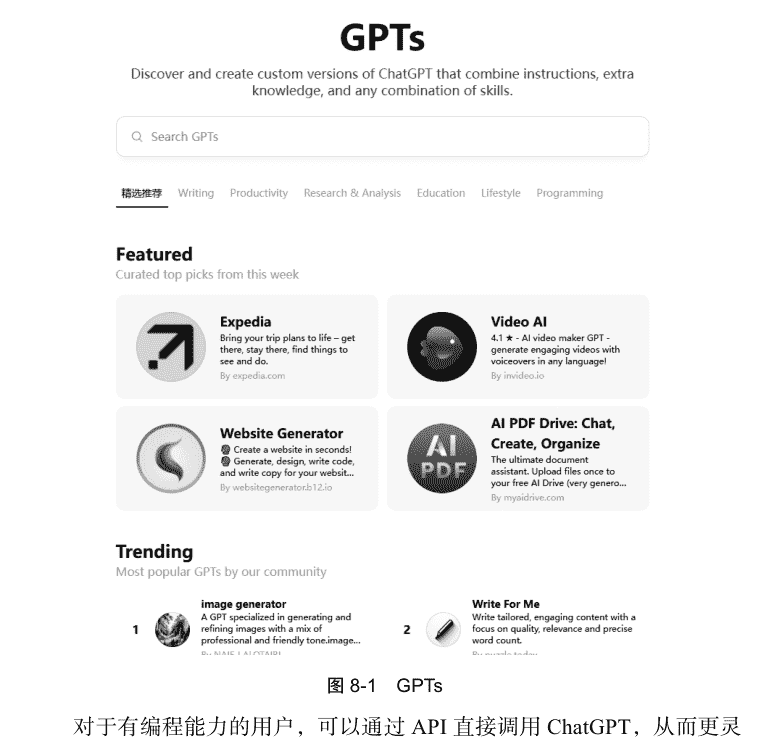

对于有编程能力的用户，可以通过 API 直接调用 ChatGPT，从而更灵活地控制模型参数（如温度值调整回答的创造性）。这种方式特别适用于：

1.  大规模数据处理：在研究或业务环境中自动化调用 GPT 进行文本分析；
2.  自定义交互系统：集成 GPT 到自己的软件或工具中；
3.  高级控制：优化响应风格、长度或特定任务的输出。

关于如何调用大模型的 API 在之前的章节已经有详细描述，因此本章不再赘述。想要了解的读者可以阅读 DeepSeek 篇的第 1 章。调用 DeepSeek API 的方法与调用 GPT API 的方法几乎是完全一样的，区别仅在于选择不同的模型。读者可以阅读 OpenAI 的官方文档选择最适合自己应用的 API。

#### 8.1.5 小结

ChatGPT 的诞生标志着人工智能领域的一项重要进展，它通过自然语言处理技术，极大地丰富了计算机与人类互动的方式。从最初的语言模型到如今的多功能对话系统，ChatGPT 不断发展、不断优化，已经不仅仅是一个简单的对话工具，更是一个强大的助手，广泛应用于写作、教育、研究和数据分析等多个领域。它不仅在普通民众的日常生活中提供了巨大的便利，也为社会科学研究提供了全新的工具和视角。

本书旨在为社会科学初学者和普通民众提供一个简明的 ChatGPT 使用指引，帮助读者学习如何与 ChatGPT 互动，并通过它获得所需的答案。书中将介绍如何有效与 ChatGPT 对话，并探讨如何利用它辅助进行社会科学研究，具体包括整理文献、撰写论文、数据清洗与分析、仿真模拟和文本润色等功能。

### 8.2 提示词工程

#### 8.2.1 什么是提示词工程

在与 ChatGPT 和 DeepSeek 等对话生成式大模型互动过程中，提示词（也称为提示、提示语或指令）是指用户向大模型输入的文本内容。它通常包括任务的背景信息、要求的回答形式或其他指示。通过提示词，用户向语言模型表明他们的意图，从而使模型生成更加相关且精确的回答。

提示词工程是指通过系统地设计和优化提示词，来提高与语言模型互动的效果和效率。这一过程不仅仅是简单地输入文字，而是通过对提示词的精心构思与调整，达到最佳的输出质量。在使用语言模型时，提示词工程可以显著提高任务的完成效率和精度。通过优化提示词，用户能够更好地控制生成内容的方向、深度和细节，这对于需要精确、复杂输出的任务尤为重要。例如，在进行学术研究时，精准的提示词可以帮助模型更好地生成相关的文献总结、数据分析报告乃至论文的草稿。本章将系统性地介绍常用的提示词工程策略，以帮助读者更好地构建提示词。

本节的案例以 ChatGPT 为主，但这些提示词使用规则和建议同样也适用于 DeepSeek 在内的其他生成式大模型。读者完全可以将本节学到的经验知识应用在与其他生成式大模型的互动当中。

#### 8.2.2 基础概念

对于初学者来说，在了解如何构建好的提示词前，我们首先要了解与提示词相关的几个基础的概念，这些概念对帮助我们得到目标回答都是很重要的。

##### 1. 对话指令

提示词一般分为两类：系统提示（指令）和用户提示（指令）。这两类指令分别承担着不同的功能，并共同作用于系统的响应生成。

1.  系统提示：系统提示通常是指引 ChatGPT 如何在特定上下文或任务中工作的一类指令。这些指令可以影响模型的行为或设置。比如，要求模型以特定的语气、风格、格式或深度生成响应，或者在执行某些任务时遵循特定规则。好的系统提示能够帮助 ChatGPT 更准确地理解用户需求，并生成符合预期的答案。提示词工程的核心之一就是设计高质量的系统提示。提示词 8-1 提供了一些示例，并将在后文详细讨论其作用及效果。

    **【提示词 8-1 系统提示】**
    > 设定语气风格：“请以百度贴吧老哥的语气回答以下问题”
    > 控制输出长句：“简要回答，不超过100个字。”
    > 限定回答深度：“请从信息政治学的角度回答以下问题，忽略其他视角。”
    > 设定回答角色：“假设你是一位中学语文老师，请以教学的方式回答下面的问题。”
    > 设定回答对象：“请给没有接受过社会科学专业训练的普通人解释什么是‘通货膨胀’”

    在对话中，系统提示通常位于开头，并在整个对话过程中持续生效，除非用户明确修改或撤销。此外，用户可以组合多个系统提示，以更精确地控制输出内容。系统提示既可以一次性输入，也可以分条输入。

2.  用户提示：用户提示是用户提出的具体问题或要求，如提示词 8-2 所示，它们更侧重于获取信息或完成某个任务。用户提示应当是简洁直接的。使用者应该将 ChatGPT 当作一个不太聪明的人，并想办法用条理清晰的指令要求它来完成任务。

    **【提示词 8-2 用户提示】**
    > 用户提示：“请提供一个关于提示词工程的简单介绍。”

    系统提示和用户提示的区别在于系统提示主要规范整个对话，而用户提示是针对具体任务下达指令和要求。在提示词 8-3 的例子中，输入 1 是系统提示，输入 2，3 都是用户提示，当用户完成输入 2 后，ChatGPT 会根据输入 1 的要求提供建议。如果用户紧接着给出输入 3，则 ChatGPT 会继续按照输入 1 的要求给出建议。

    **【提示词 8-3 系统提示和用户提示的区别】**
    > 输入1：
    > 系统提示：“你将获得一篇论文的摘要和一个建议的标题。论文标题应该能让读者对论文的主题有个清晰的认识，同时也要足够吸引人。如果现有的标题不够吸引人或不够明确，那么请提出五个备选标题。”
    >
    > 输入2：
    > “摘要：输入摘要1”
    > “标题：输入标题1”
    >
    > 输入3：
    > “摘要：输入摘要2”
    > “标题：输入标题2”

    通常情况下，ChatGPT 能够自动识别系统提示与用户提示。然而，为了确保严谨性，本书鼓励用户在输入系统提示时使用“系统提示：”等标注，以明确提示的性质。

    在多轮对话过程中，如果 ChatGPT 开始偏离系统提示，用户可以重新强调提示，以增强其对既定规则的遵循。

##### 2. 概率调控

在 ChatGPT 的工作原理中，生成回答是基于概率模型进行的。每次生成文本时，模型会根据输入的提示词计算出所有可能的下一个词及其概率分布。为了控制模型的生成行为，使用者可以通过调节不同的概率调控参数来影响输出的创新性、准确性与稳定性。这些参数包括温度值（Temperature）、前 k 采样（Top-k）、核采样（Top-p）、重复惩罚（Repetition Penalty）和存在惩罚（Presence Penalty）。下面将对这些参数进行简单介绍，并讨论如何使用它们调整 ChatGPT 回答。初学者应当注意，使用这些参数精确地控制输出是比较高级的使用方法，初学者可以在熟悉了 ChatGPT 的使用后再学习这部分内容。

1.  温度值：控制生成的随机性或创意性。它决定了模型在选择下一个词时的“胆量”——温度值较低时（接近 0），模型更倾向于选择概率较高的词，生成的文本更为确定和保守；温度值较高时（接近 1），模型会选择更多可能性较小的词，从而生成更加多样、富有创意的回答。
2.  前 k 采样：Top-k 控制模型在生成下一个词时，从哪些候选词中选择。具体来说，Top-k 限制了模型只能从概率排名前 k 的词汇中进行选择。如果 k 值较小（如 10），生成的文本更为集中和保守；如果 k 值较大（如 100），模型的输出将更加多样和富有变异性。
3.  核采样：是一个更灵活的采样方法，它通过控制累积概率分布来选择下一个词。与前 k 采样不同，核采样选择所有候选词，使得它们的累积概率之和达到阈值 p（通常为 0.9）。这意味着，模型会在一定范围内随机选择词汇，但不会选择那些概率过低的词汇，从而避免生成低概率且无关的内容。较低的 p 值（如 0.6），会生成较为确定且高相关性的内容，输出较为保守。较高的 p 值（如 0.9），模型有更多选择的自由，能够生成更有创意和多样性的内容。
4.  重复惩罚：用于惩罚模型生成的重复内容，防止模型重复出现同样的词汇或短语。该机制通过降低已生成词汇的概率来避免过度重复。较高的惩罚值（如 2.0）会强烈惩罚重复词汇的出现，确保输出内容更加多样化；较低的惩罚值（如 1.0 或 0）则会允许更多的重复，使文本更为一致，这对于需要格式化内容输出的任务很有帮助。
5.  存在惩罚：用于控制已生成词汇是否会再次出现。与重复惩罚不同，存在惩罚不仅惩罚重复的词汇，还会降低任何已在上下文中出现过的词汇的概率，以减少内容中的冗余。较高的惩罚值（如 2.0）会惩罚所有已出现的词汇，减少重复的可能性；较低的惩罚值（如 0.0）则不会对已出现的词汇施加惩罚，允许更多的重复和冗余。

使用者针对所需的任务灵活地调整这些参数可以得到更接近任务需求的回答。当要求 ChatGPT 进行文学创作相关的工作时，调整参数提高回答的多样性和创意性往往能带来更好的结果；相反地，在进行内容分类相关的工作时，降低相关参数以让输出标签更加确定在某些使用者规定的标签上，以防 ChatGPT 输出自己创造的新标签。

遗憾的是，调整上述参数是比较高阶的 ChatGPT 使用方法，用户只有使用 ChatGPT 的 API 时才可以灵活地调整，网页版暂时不支持该功能。网页版的用户，可以使用类似提示词 8-4 的系统提示，一定程度上调整模型结果，以达到近似调整参数的结果。

**【提示词 8-4 系统提示模拟高温度值】**
> 系统提示：“你是一个非常富有创意的助手，愿意在回答中探索多种不同的解释和观点。可以提供富有想象力或多样化的视角。”

##### 3. 上下文管理机制

ChatGPT 的对话能力不仅依赖于单次提问的解析，还与其上下文管理机制密切相关。这一机制决定了 AI 如何理解、记忆和利用对话历史信息，从而影响多轮交互的逻辑连贯性。它使 ChatGPT 能够“记住”之前的对话内容，并基于这些信息调整后续回答。以下是 ChatGPT 的上下文机制介绍以及针对其管理的建议。

ChatGPT 具有一个上下文窗口，即模型可以有效处理的对话内容长度。这个窗口涵盖了多轮对话，长度由模型设定。OpenAI 声称，GPT-4o 的上下文窗口约为 128000 个 token，其中一个 token 约等于 0.75 个英文单词或 1-2 个汉字。这意味着 ChatGPT 理论上可以“记住”约 10 万字的对话内容，并基于这些内容回答新问题。然而，研究表明，在实际使用中，GPT-4o 的有效窗口可能远低于这一数值。由于 ChatGPT 是闭源模型，我们无法确知其真实的窗口长度。

当输入对话超过上下文窗口限制时，模型会优先遗忘最早的信息。即使在窗口内的信息，模型回忆的准确率也是不同的：**越早的信息，模型回忆的准确率越低**。而且这种信息衰减是非线性的，这使得 ChatGPT 更擅长利用最近的对话内容，而较早的信息即使仍在窗口内，也可能被部分遗忘或记忆模糊。

针对上下文窗口的限制，本书建议读者遵从以下两点建议：

1.  分段式对话：每 5~6 轮对话后，要求 ChatGPT 进行自然语言总结，以巩固关键信息。
2.  显式重述需求：尽管 ChatGPT 能回顾对话历史理解上下文，但在 10~15 轮之后，建议用户再次强调核心目标（系统指令），以确保 AI 仍然聚焦于任务需求。

具体何时要求总结对话或重申指令，取决于对话的长度和任务的复杂性。如果每轮对话较长或任务复杂，建议提前进行总结或重申指令，以确保 AI 维持正确的理解和方向。

本小节讨论了 ChatGPT 的几个关键概念、它们对使用体验的影响以及应对策略。接下来的 3 个小节将深入探讨如何优化提示词，使 ChatGPT 更精准地完成任务。

#### 8.2.3 约束回答范围

精准的提示词相当于为 AI 绘制了一张“思维导航图”，而约束回答范围则是划定导航的边界。通过明确回答的领域、深度和形式，用户可以让ChatGPT 更精准地响应请求，避免模糊、不相关或过于泛化的答案。本小节将介绍三种最常见且有效的约束方法。

##### 1. 角色设定

通过指定 ChatGPT 的身份或专业背景，可激活相关领域的知识库，使回答更具专业性。此外，角色设定还能影响 AI 的语气和风格，如提示词 8-5 所示。

> 【提示词 8-5 角色设定】

```
法律咨询：“你是一名经验丰富的律师，请用简明的语言解释合同法中‘不可抗力’的概念。”
医学科普：“你是一名内科医生，请解释胃食管反流病的常见症状以及如何缓解。”
商业顾问：“作为一名商业分析师，你如何评估一家初创企业的市场竞争力？”
儿童教育：“你是一名小学老师，请用适合8岁儿童理解的方式解释‘太阳为什么会发光’。”
```

角色设定越清晰，ChatGPT 的回答越符合预期。例如，提示词 8-6 所示的两个提示词的效果会明显不同。

> 【提示词 8-6 角色设定效果对比】

```
基础版：“你是一个编剧”
增强版：“你是一位擅长硬科幻的编剧，特别是像刘慈欣和阿瑟·克拉克这样的风格。你的作品注重科学逻辑和哲学思考”
```

第二种方式（增强版）能让 ChatGPT 产出的内容更符合硬科幻的风格，而非泛泛的剧本写作。

##### 2. 任务边界

任务边界用于明确 ChatGPT 回答时的范围，以减少无关或无效内容。研究表明，划定任务边界可减少 47% 的无关输出。一般可以从以下 3 个维度进行约束。

1）资源限定：限定了 ChatGPT 回答问题时可以使用的知识，从而控制其输出，见提示词 8-7。

> 【提示词 8-7 资源限定】

```
时间维度：“假设现在是2023年Q3，基于当前已知政策趋势预测”
数据范围：“仅使用世界银行2022年公开数据集”
工具限制：“在不使用微积分的前提下解释量子力学基础”
主题限定：“请仅从社会学的角度分析城市化的影响，不涉及经济或环境因素。”
```

2）过程约束：规定了 ChatGPT 展开回答的方式，使 ChatGPT 的回答在逻辑上和结构上更符合使用者的需要，见提示词 8-8。

> 【提示词 8-8 过程约束】

```
分析深度/层次约束：“解释青年政治冷漠成因，从三层次归因分析：1)个体心理因素 2)社会组织影响 3)媒介环境作用，每层次提供2个可验证假设。”
论证要求约束：“在分析[农村空心化对养老模式的影响]时：1）每个论点必须引用2篇以上CSSCI期刊论文（2018-2023）；2）对比费孝通的乡土社会理论与阎云翔的个体化理论解释路径。”
思维路径约束：“依照Young的批判理论三步法：1)现象描述 2)霸权结构解构 3)解放可能性探索，分析职场性别薪酬差距”
```

3）排除性声明：告知 ChatGPT，哪些内容是回答中使用者不想看到的，见提示词 8-9。

> 【提示词 8-9 排除性声明】

```
“排除20世纪前的历史案例”
```

##### 3. 输出格式

控制 ChatGPT 的输出格式可以帮助使用者得到更准确的答案，也可以帮助使用者更直接地使用 ChatGPT 输出的内容。这里讨论两种输出格式控制。

首先，使用者应当控制输出内容的长度，见提示词 8-10。控制长度可以避免 ChatGPT 输出的内容过于简略或冗长。

> 【提示词 8-10 控制输出长度】

```
“每个观点用不超过15字概括，后接50字解释”
```

其次，ChatGPT 的默认输出在复制到 Word 或 WPS 等文本编辑工具时，可能会出现格式和文本结构错乱。因此，可以使用 Markdown 或 HTML 让文本结构更清晰并便于粘贴复制，见提示词 8-11。

> 【提示词 8-11 控制输出格式】

```
层级设定：“输出三级目录框架，二级标题下含3-5个要点，并用Markdown格式输出文本。”
```

最后，对于社科学者而言，可以利用 ChatGPT 来快速修改文献引用格式，以极大提高投稿效率，见提示词 8-12。

> 【提示词 8-12 控制输出引用格式】

```
学术格式：“按APA格式重写以下文献综述。”
引用调整：“请将以下参考文献格式从 Chicago 转换为 MLA。”
```

##### 4. 综合运用

在实际使用中，用户可以在对话开始时预设完整的任务约束，或在发现 AI 输出不理想时动态调整。提示词 8-13 是一个结合角色设定、任务边界和格式控制的完整示例，供读者参考。

> 【提示词 8-13 综合运用】

```
"作为政治学研究者，请按以下要求分析慧社区对治理效能的影响：

分析路径：
第一阶段：使用Ostrom的制度分析与发展框架（IAD）识别行动情境要素
第二阶段：选取3个智慧社区案例进行过程追踪（process tracing）
第三阶段：运用适应性治理理论提出改进建议

深度控制：
聚焦组织层面的制度调适过程
不延伸至技术决定论哲学讨论

论证规范：
引用近5年《公共管理学报》《社会学研究》相关论文
区分技术赋能与技术赋权的不同效应
需说明案例材料的获取方式与伦理合规性

输出格式：
使用学术论文引言写法（研究空白->理论框架->方法创新）
包含2个分析框架示意图
文末附参考文献（APA格式）
输出Markdown格式文本"
```

#### 8.2.4 提供回答参考

在与 ChatGPT 等大型语言模型互动时，提供清晰的指令有时不足以确保模型准确理解用户意图并生成符合期望的回答。此时，提供回答参考（范例）可以显著提升模型的响应质量。ChatGPT 具备强大的学习能力，即使仅提供少量范例，也能大幅提高回答的准确性。以下将探讨如何通过提供回答参考来提升 ChatGPT 的回答质量。

##### 1. 零样本学习（zero-shot）

零样本学习指在未提供任何范例的情况下，模型直接根据指令完成任务。这要求模型具备强大的泛化能力，能够处理未见过的任务或领域。一般来说，只有当指令非常明确且问题并不复杂时，无样本方法才能得到高质量的回答。提示词 8-14 是以一个标注任务为案例展示零样本学习对清晰指令的依赖。

> 【提示词 8-14 未限定回答范围的零样本学习】

```
输入：
“请对以下文本进行标注
文本内容：‘‘‘电梯安全谁来终身负责？别补贴没花完先出事故！楼里孩子老人这么多...’’’”

输出：
1. 电梯安全（话题/关键词）：指代电梯的安全性，强调与电梯相关的公共安全问题。
2. 谁来终身负责（问题/责任）：提出关于电梯安全责任的疑问，讨论应由谁长期负责电梯的安全。
3. 别补贴没花完先出事故（批评/讽刺）：批评政府或相关部门将资金未使用完之前就可能发生安全事故，暗含对管理或政策的不满。
4. 楼里孩子老人这么多（事实/背景）：强调楼内有大量需要关注的群体，暗示电梯安全问题对这些群体特别重要，增加其紧迫感和重要性。
```

上面这个例子展现了当使用者没有给出清楚指令时，ChatGPT 会如何回答。由于没有清楚的指令，ChatGPT 从各可能的角度给出答复，因为它并不清楚使用者到底想要从什么角度进行标注。下面再看提示词 8-15。

> 【提示词 8-15 限定回答范围的零样本学习】

```
输入：
“你是一个政治学家，请对以下文本进行标注，要包含民众态度，民众考虑问题的维度，和做出标注的依据三个部分以json格式输出。
文本内容：‘‘‘电梯安全谁来终身负责？别补贴没花完先出事故！楼里孩子老人这么多...’’’”

输出：
{
"民众态度": "不满、担忧",
"民众考虑问题的维度": [
    "电梯安全",
    "责任归属",
    "政府补贴使用",
    "公共设施安全"
],
"做出标注的依据": "文本中表达了对电梯安全问题的焦虑，提出责任归属问题，并批评政府在补贴方面存在问题。通过提及“补贴没花完先出事故”可以看出民众对公共资金使用的不满，而“楼里孩子老人这么多”则显示出民众对安全隐患的关切，尤其是针对易受害群体的担忧。"
}
```

作为对比，提示词 8-15 综合运用了前文提到的各种技巧，限定了 ChatGPT 的回答范围，从而得到了更好的回答。可以看到，现在的回答更加结构化，主要聚焦与政治学研究相关的维度，并解释了做出标注的原因。同时，由于使用了 json 格式，使得批量化处理变得非常简单。但是在输出结果上还不是非常令人满意。比如在民众思考维度的标签中，ChatGPT 添加了“政府补贴使用”，但实际上，虽然民众提到了补贴，但是他们的担心和补贴的使用关系并不很大。在下面的例子中，我们将进一步展示，提供回答参考如何提高 ChatGPT 的回答质量。

##### 2. 单样本学习（one-shot）

单样本学习是在仅提供一个范例的情况下，模型学习并执行任务。通过提供一个具体的范例，模型可以更好地理解任务要求，从而生成更符合预期的回答。由于 ChatGPT 具有强大的学习能力，这种方法在范例选择得当的情况下，能够显著提升模型的表现。这里用上文使用的例子进一步展示，单样本学习如何提高 ChatGPT 回答的准确性，见提示词 8-16。

> 【提示词 8-16 单样本学习】

```
输入1：
“以下是一个文本标注任务的范例，请学习该范例：
[输入文本]
“…政府补贴40%听起来不错，但剩下的费用对退休老人还是压力山大…”

[标注示范]
{
    "政策态度": "反对",
    "关切维度": ["经济成本"],
    "依据": "强调居民自付部分的经济压力"
}

输入2:
"电梯安全谁来终身负责? 别补贴没花完先出事故! 楼里孩子老人这么多..."

输出:
{"政策态度": "反对", "关切维度": ["安全保障"], "依据": "表达对电梯安全责任缺失的担忧, 并强调潜在的安全风险"}
```

上面这个例子只为 ChatGPT 提供了一个样本, 同时删除了之前提供的各种范围限定。ChatGPT 通过对样本的分析, 清楚的解析出了使用者需要的输出结构和标注的维度。同时, 根据所提供的范例, 进一步优化了结果输出, 精确地将结果锁定在和文本最相关的安全问题上。

值得注意的是, 上文中我们将输入分成了两个, 第一个被当作系统提示, 第二个被当作用户提示, 读者也可以将两者合并, 一次性输入。

##### 3. 少样本学习 (few-shot)

少样本学习是指提供少量 (通常为几个) 范例, 帮助模型理解任务并生成高质量的回答。相比零样本和单样本学习, 少样本学习利用更多的上下文信息, 使模型更准确地把握任务要求, 提升响应的准确性和相关性, 见提示词 8-17。

> 【提示词 8-17 少样本学习】

```
输入1:
"以下是一个文本标注任务的范例, 请学习该范例:
[示例1: 直接反对]
文本: "每户要摊3万多根本不合理, 坚决反对!"
标注: {"态度":"反对", "维度":["经济成本"], "依据":"摊派费用过高"}

[示例2：安全性隐喻]
文本：“装电梯像搭积木，哪天塌了找谁哭？”
标注：{"态度":"反对", "维度":["安全性"], "依据":"比喻结构风险"}

[示例3：复合关切]
文本：“补贴程序不透明，还破坏邻里信任，好事变坏事”
标注：{"态度":"反对", "维度":["程序公平性","邻里关系"], "依据":"程序与关系双重批评"}

输入2：
“电梯安全谁来终身负责？别补贴没花完先出事故！楼里孩子老人这么多...”

输出：
{"态度":"反对", "维度":["安全性","责任归属"], "依据":"对长期安全和责任问题表达担忧"}
```

从上面的例子可以看到，提供更多的范例可以让回答更加接近我们的需求。当有 3 个不同的范例时，ChatGPT 对安全问题的标签从“安全保障”变为了“安全性”，以更好地贴合样本。同时在展示依据的时候也更加简明，并与提供的样本保持一致。当然，也要注意到标注的结果在内容上提升是有限的。也就是说，标注的准确性并不能随着提供更多的样本而无限上升，使用者应当通过调整寻找最合适的样本数量而不是无限提供更多的样本。一般来说，越复杂的工作需要的样本研究越多。

#### 8.2.5 明晰问答结构

清晰的提示词结构就像为 AI 绘制一张“认知路线图”，使 ChatGPT 的思维过程更加透明、有序。研究表明，结构化提示词能够将复杂社会科学问题的分析效率提升 72%。本小节将介绍 3 种提升指令清晰度的技巧，帮助 ChatGPT 更精准地理解任务并生成高质量的回答。

##### 1. 分隔符

在提示词中使用特定的符号或格式，可以明确不同部分的功能，使 ChatGPT 更容易解析输入内容。常见的分隔符包括：

1）三重引号（“””）；
2）XML 标签（<tag>…</tag>）；
3）方括号（[]）；
4）圆括号（( )）。

例如，在上一小节中，我们使用 [] 来标明输入内容是参考回答。这种方法不仅能增强指令的清晰度，还能减少模型的理解偏差。

##### 2. 分布引导

分布引导（Step-by-Step Prompting）指的是将复杂任务拆分为多个简单步骤，见提示词 8-18，引导 ChatGPT 依次完成。这种方法可以显著提升 AI 处理复杂问题的能力，主要体现在以下两个方面：

1）降低任务复杂度：让模型聚焦于每个独立步骤，从而减少错误。
2）提高输出质量：逐步推理能帮助 AI 生成更细致、准确且符合用户需求的答案。

> 【提示词 8-18 分布引导】

```
无引导输入：
“请分析北京市居民对政府住房政策的态度变化。”

有引导输入：
输入1：
“请分析北京市居民对政府住房政策的态度变化。按照以下步骤：
第一步，请列出该城市过去五年内实施的主要住房政策及其背景。

输入2：第二步，分析每项政策实施后的短期和长期居民态度变化。

输入3：第三步，识别可能影响居民态度变化的社会经济因素（如房价、收入、失业率等）。

输入4：第四步，提供对居民态度变化的综合分析，并讨论政策效果的社会影响。”
```

从提示词 8-18 的例子可以看出，分布引导不仅为 ChatGPT 提供了使用者的思考逻辑，还明确了回答的范围，使其能够更准确地理解任务要求。这一方法相当于向 ChatGPT 提供了更多背景信息，使其推理过程更有针对性，从而生成更符合使用者需求的答案。

在涉及**逻辑推理**的任务中，例如复杂的编程问题、数据分析或社会科学研究，分布引导的作用尤为显著。它能够显著提高 ChatGPT 的回答准确性，避免因问题过于宽泛而导致的偏差。因此，建议在任何涉及**复杂逻辑推理**的任务中，优先采用**分布引导**策略，以确保 ChatGPT 输出更精准、系统的解答。

##### 3. 思维链与思维树

虽然分布引导能够有效提高模型的准确性，但它要求使用者能够将复杂的任务拆分为多个子任务。然而，在使用 ChatGPT 时，我们常常缺乏对任务进行充分研究和思考的时间，未必具备良好的拆分子任务的能力。此时，我们可以要求 ChatGPT 展示其思考过程。这种方式不仅强化了 ChatGPT 按照逻辑解答问题的能力，也为我们提供了有效的思考指导。如今，包括 ChatGPT、DeepSeek 在内的许多对话模型都支持输出思考过程的推理方式。

这种通过要求输出思考过程来提高 ChatGPT 输出效果的方式通常被称为**思维链（Chain-of-Thought, CoT）**。然而，在某些情况下，单一的思考路径可能不足以得到最佳答案。此时，我们可以让 ChatGPT 探索多种推理路径，并在比较之后选择最优解答。这种方法通常称为**思维树（Tree-of-Thought, ToT）**。

1）思维链：通过**线性推理**，模型逐步构建完整的解答方案。
2）思维树：探索**多个推理路径**，评估不同可能性，最终选择最佳方案。

在网页版 ChatGPT 的交互界面中，使用者可以通过点击“推理”（Reason）按钮来实现思维链推理（如图 8-2 方框处所示）。通过使用该按钮，ChatGPT 将自动使用推理模型（reasoning model）来处理提问，使用推理模型时，模型将自动使用思维链的方式解析提问并返回完整的思维过程。

此外，用户还可以通过简单的指令，例如“让我们逐步思考”，来引导 ChatGPT 展示其思维链，见提示词 8-19。

> 【提示词 8-19 思维链方法】

```
请分析北京市居民对政府住房政策的态度变化，让我们逐步思考。
```

更高级的应用方式是提供示例，让 ChatGPT 模仿特定的推理模式。提示词 8-20 的内容就是一个经典的例子。

> 【提示词 8-20 思维链模仿推理】

```
输入1：
参照以下范例回答问题：
问：小明有5个羽毛球。他又买了两筒，每一筒有3个，他一共有多少个羽毛球？
答：小明刚开始有5个，后来买了2筒，每筒3个，一共是6个，5+6=11,所以他一共有11个羽毛球

输入2：
小红有10个西红柿，做午饭用掉8个，然后又买了2个，她还剩下多少西红柿？

输出3：
小红有10个西红柿，做午饭用掉8个。所以她还有10-8=2个西红柿，又买了2个，就是2+2=4个西红柿。因此她最后剩下4个西红柿
```

对于思维树方法，则需要添加特定的系统提示，提示词 8-21 是一个例子（Hulbert2023）。

> 【提示词 8-21 思维树方法】

```
假设三位不同的专家来回答这个问题。
所有专家都写下他们思考这个问题的第一个步骤，然后与大家分享。
然后，所有专家都写下他们思考的下一个步骤并分享。
以此类推，直到所有专家写完他们思考的所有步骤。
只要大家发现有专家的步骤出错了，就让这位专家离开。
请问...
```

##### 4. 思维链、思维树与推理模型

前面讨论了可以使用推理模型取代思维链或思维树过程。这里应当注意，一些推理模型并不推荐用户使用思维链（CoT）或少量案例提示（few-shots）技术。比较著名的例子是，在DeepSeek的论文中，作者们强调不要对该模型进行少量样本学习，因为这种技术会降低模型表现。

#### 8.2.6 其他提示词优化技巧

除了前面提到的策略外，还有一些常用的方法可以进一步优化提示词，以提升ChatGPT的回答质量和适用性。

##### 1. 自我反思（Self-Reflection）

自我反思是一种动态优化提示词的方法，核心思路是：让ChatGPT通过不断调整自身输出，逐步逼近用户的理想答案。这种方法的关键在于用户对输出结果有明确的评价标准，例如：代码是否能够正确运行？文本分类是否准确？回答是否符合事实？当用户获得不理想的答案时，可以

> Guo, D., Yang, D., Zhang, H., Song, J., Zhang, R., Xu, R., ... & He, Y. (2025). Deepseek-r1: Incentivizing reasoning capability in llms via reinforcement learning. arXiv preprint arXiv: 2501.12948.

##### 2. 自我修正

自我修正是一种通过让ChatGPT自行修改和提升输入提示词质量的方法。在使用自我修正时，ChatGPT会针对问题提出修改建议。一般来说，ChatGPT会要求用户提供更多限定条件或例子，以帮助其更好地理解提示词。然后，用户根据ChatGPT的建议优化提示词。这个优化过程可以多次进行，直到用户或ChatGPT认为当前的提示词足够清晰，可以生成符合要求的高质量回答。

自我修正可以通过两种方式使用。首先，该方法是 2025 年 2 月上线的 ChatGPT 深度研究（Deep Research）功能的默认功能。只要用户选择了深度研究功能，ChatGPT 就会自动开启提示词自我修正，帮助用户提升提示词的质量，图 8-3 提供了一个简单的案例。在开启深度研究功能后，ChatGPT 会首先考虑给出的提示词是否足够明确，以提供高质量的回答。如果提示词不够清晰，ChatGPT 会要求用户补充更多信息再进行回答。需要注意的是，深度研究功能目前只针对付费用户开放，非付费用户无法使用该功能按钮。

> 请给一个关于OpenAI's GPT 和 ChatGPT的简单介绍

请确认您是想要一个简短的概述，还是希望包含更多技术细节、应用案例或历史背景？此外，您是否需要该介绍以特定格式（如表格或分点陈述）呈现？

> 简短概述，请用markdown结构输出

以下是关于 OpenAI 的 GPT 和 ChatGPT 的简要概述，以 Markdown 结构呈现：

Research completed in 9m- 33 个源

##### 图 8-3 深度研究功能

另一种自我修正的方法是在没有开启深度研究功能时，通过在提示词中明确要求 ChatGPT 提供修改建议来使用自我修正。图 8-4 是一个示例。在输入该提示词后，ChatGPT 会分析哪些信息能够让该提示词更加清晰和具体。在下面的例子中，ChatGPT 从信息范围、受众、重点和输出格式四个方面提出了修改提示词的建议。读者可以看到，这四个维度与我们约束回答范围小节中的建议是相对应的。

> “请给一个关于OpenAI's GPT 和 ChatGPT的简单介绍”如何让上述提示词更加清楚具体?

可以这样改进提示词，使其更加清楚具体：

**原提示词：**
“请给一个关于 OpenAI 的 GPT 和 ChatGPT 的简单介绍。”

**改进后的提示词：**

1.  **增加信息范围：**
    * “请简要介绍 OpenAI 的 GPT 和 ChatGPT，包括它们的基本概念、发展历程、主要功能及应用场景。”
    * (这样明确了要讲哪些方面，而不仅仅是笼统的介绍。)
2.  **指定目标受众：**
    * “请用通俗易懂的语言，向对人工智能不太了解的普通用户介绍 OpenAI 的 GPT 和 ChatGPT，包括它们的用途和优势。”
    * (如果是给技术人员看的，可以改成“请从技术角度简要介绍 GPT 和 ChatGPT，包括其模型架构、训练方法及关键技术特点。”)
3.  **控制篇幅或格式：**
    * “请用 200 字以内介绍 OpenAI 的 GPT 和 ChatGPT，重点突出它们的区别和应用场景。”
    * (这样可以让回答更加简洁有针对性。)

如果你的目标是让 ChatGPT 输出更符合你的需求，关键在于**明确范围、受众、重点和格式**。你可以尝试组合这些改进方法，使提示词更加精准。


图 8-4 自我修正示例

在实践中，自我修正和自我优化可以同时使用，不断优化 ChatGPT 的回答，从而让我们得到更好的答复。

##### 3. 调用代码执行

最后一种优化提示词的方法是在 ChatGPT 中调用程序语言并要求执行该语言。ChatGPT 可以执行简单的 python 等代码并输出相应结果。这极大地弥补了大语言模型在进行逻辑运算时的短板。因此在执行一些逻辑推理任务时，使用者可以要求 ChatGPT 生成并运行计算机代码，而不是用大模型本身的语言。图 8-5 展示了一个简单的例子。


### 8.3 总结

本章探讨了如何通过“提示词工程”来优化与 ChatGPT 的互动，以获得更精确、高效的结果。首先，我们明确了“提示词”的概念，它是用户输入给 ChatGPT 的文本内容，起到指引模型生成回应的作用。接着，介绍了提示词工程的核心内容——通过精心设计和调整提示词来提升输出质量，特别是在学术研究等复杂任务中，可以帮助模型生成更准确的文献综述、数据分析等内容。

此外，我们还详细讲解了“对话指令”的重要性，包括系统提示与用户提示的区别。系统提示用来规范对话的整体方向，而用户提示则关注具体任务的执行。通过正确使用这些指令，用户可以有效控制模型的输出。最后，我们也介绍了如何通过调整生成模型的参数（如温度值、重复惩罚等）来影响回答的创新性和准确性。

总体而言，本章强调了精准提示词在提升 ChatGPT 表现中的关键作用，尤其对于初学者来说，掌握这些基本的提示词技巧将大大提升与模型的互动效果。

### — 思考与练习 —

思考：在与大模型交互时，应该如何让我们的提问更加清楚？

练习：请根据本章学到的知识，设计一段系统指令让 ChatGPT 辅助我们写 python 代码。

# ChatGPT 篇

# 第9章 ChatGPT 与理论构建

本章重点

- 知识管理与观点形成
- 后工具时代的知识管理
- AI 技术如何影响社科研究的工作流

### 9.1 知识管理与观点形成

本书第 2 章详细讨论了如何利用 DeepSeek 大模型下载并管理文献。使用 ChatGPT 进行文献管理的方法与之基本相同，仅需将 DeepSeek API 替换为 GPT API 即可实现。有鉴于此，本章将转换视角，聚焦于如何使用大模型辅助学术理论构建。我们将系统性地解析如何将包括 ChatGPT 在内的多种 AI 工具有机融入知识管理体系，并探讨其在学术观点形成过程中发挥的作用。

#### 9.1.1 传统的知识管理流程

无论是初入学术圈的硕博研究生，还是在领域中已有建树的资深学者，知识管理始终是研究工作中不可或缺的一环。社科研究者的日常，总是与信息交互密切相关：我们既需要通过系统性阅读来掌握理论发展，也需关注新闻、社交媒体等渠道，感知社会动态、捕捉现实脉动。这些信息的获取、吸收、整合与转化，正是观点形成与理论创新的起点。

通常而言，社科研究者的知识管理流程大致包括以下环节：首先主动获取信息，接着在理解中产生灵感，与已有知识经验交织后提出新的观点或假设，最终进入验证与论证阶段。因此，如何更高效地“与信息打交道”——例如获取什么信息、如何筛选、如何记录与转化——已经成为值得每位研究者认真思考的方法论问题。

近年来，伴随信息技术的发展，涌现出大量助力知识管理的数字化工具：从结构清晰的 Notion，到首创“双链笔记”机制的 Roam Research，再到后来流行的开源平台 Obsidian 和 Logseq，这些新兴工具相较于传统笔记软件（如 OneNote、印象笔记）更强调“信息之间的关系”与“思想网络的构建”。其中，双链机制的出现堪称知识管理工具的一次范式革新——正如业内所称赞的那样，这种非线性的笔记方式更符合人脑思维的自然路径，即以“节点跳跃”方式构建理解，而非一条线性记录的轨迹。

但无论采用纸笔还是数字工具，核心的知识管理过程并未发生本质变化。大多数研究者在处理文献时，仍然遵循一个固定流程：知识收集→划重点→思考→输出理解，如图 9-1 所示。

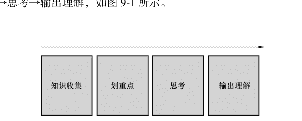

例如，当我们萌生某一研究兴趣时，第一步往往是查阅资料：打开 Google Scholar 或中国知网，下载一批相关论文。阅读过程中，我们习惯性地做标记、划重点，并在某些段落处产生初步想法，或简单记录几句批注。部分同学还会将这些感想整理到电子文档中，作为后续研究素材。

然而，这一看似自然的流程，却常常隐藏着效率与记忆上的隐患。许多研究者在阅读过程中产生的“灵光一现”，最终未能被系统保留与深化；时间一久，可能只记得“好像看过某篇论文”，却全然忘记了当时的认知与思考。这种现象导致的直接后果是：研究过程中最耗时的“信息收集”和“划重点”阶段，最终对理论产出贡献有限。

知识管理专家 Nick Milo 在其 LYT Workshop 中将这一流程进行了可视化处理：他设置了横轴“所需时间”与纵轴“价值产出”来衡量每一阶段的投入与回报。结果显示，投入时间最多的往往是信息收集，但其对观点形成的实际价值却相对较低，如图 9-2 所示。

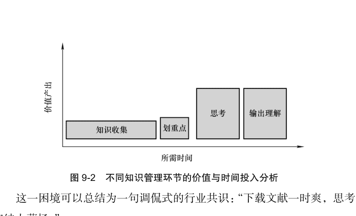

这一困境可以总结为一句调侃式的行业共识：“下载文献一时爽，思考归纳火葬场。”

#### 9.1.2 卡片笔记理论

那么，应当如何优化自身的知识管理与文献阅读流程呢？答案之一，是在摄取信息的同时，主动将新知识纳入已有的知识体系中，通过联想、归纳、转化，完成从“收集”到“思考”的跃迁。

在众多知识管理理论与工具中，《卡片笔记写作法》（*How to Take Smart Notes*）所提出的“卡片笔记理论”（Zettelkasten）影响尤为深远。可以说，卡片笔记系统不仅是一套方法论，更是近年推动诸多知识管理工具（如 Roam Research、Obsidian 等）创新设计的核心理念。

相较于传统线性笔记软件（如 OneNote、印象笔记）按“文件夹—笔记本—页面”进行竖向分类的方式，卡片笔记所启发的“双链笔记”工具更加重视“内容之间的横向连接”与“思想网络的生成”。例如 Roam Research 倡导以“块（block）”为最小单元、通过双向链接构建知识地图，这种“非线性”结构更符合人脑的跳跃性联想与知识积累路径。Obsidian 则通过本地化和可视化的知识图谱呈现内容之间的引用关系，帮助用户构建属于自己的思想体系。

卡片笔记系统鼓励我们摆脱“写下完美段落”的心理负担，转而轻量化地记录自己在阅读与思考过程中的“微小想法”。随着这些碎片化思考不断积累并通过链接发生关联，个人的知识结构也将逐步显现，最终沉淀为具有高度组织性的理论体系。

为了更高效地将新信息纳入已有认知结构，卡片笔记理论提出了 3 类笔记形式：

1.  **闪念笔记（Fleeting Notes）**：用于记录稍纵即逝的灵感或想法，形式可以极其简单，重点是“快速捕捉”；
2.  **永久笔记（Permanent Notes）**：在对闪念笔记进行整合、分类、重构后形成的结构性知识单元，通常具有清晰的表达与独立的论述价值；
3.  **项目笔记（Project Notes）**：与特定论文或任务相关的资料整理、计划说明、写作笔记等，属于阶段性成果的支撑资料。

在这 3 类中，闪念笔记最容易被忽视，却是整个知识网络的原始素材。很多同学在阅读书籍或文献时，会产生“这个观点和我之前读过的 × × 很像”“这点和我的研究思路矛盾”或“这太有趣了，我以后可能会用到”的念头。然而，如果这些想法仅停留在原文旁的批注中，而没有被整理成独立卡片并加入系统化笔记中，那它们极可能被遗忘，最终也难以融入我们的知识体系。

因此，建议在日常学习和研究中，无论使用纸笔还是数字工具，都应主动记录这些“微想法”。通过积累大量“文本块”与“相互链接”，得以重建信息之间的逻辑关系，为更高层次的知识建构打下基础。

实际上，卡片笔记的实践路径恰与前文提到的图 9-1 流程相呼应：

- “闪念笔记”对应的是知识收集与划重点；
- “永久笔记”则是在思考的基础上提炼而成；
- “输出理解”则往往在形成完整“笔记网络”之后自然生成。

进一步地，卡片笔记的思维方式不仅为积累素材提供帮助，更能够在实际研究输出中提供支撑。比如，当你准备撰写一篇文献综述时，只需回溯你笔记库中的相关卡片，就能迅速定位核心观点、引用文献及其相互关联；原本耗时的归纳与整合过程，已经通过持续的“笔记 + 链接 + 反思”在无形中完成。

简而言之，卡片笔记是一种将“知识输入—思维加工—结构输出”三位一体化的方法论，它强调过程而非结果，通过记录、联结、重构，帮助我们在不知不觉中完成理论的搭建。

### 9.2 后工具时代的知识管理

上一节讨论了知识管理的“道”——如何将信息融入自身的知识体系，并最终形成理论输出。本节则将转向“术”的维度，探讨在信息技术迅速发展，尤其是人工智能工具不断普及的当下，研究者应如何借助各类工具优化自身的知识管理流程。

先来看图 9-3，它是对图 9-2 流程的进一步更新。可以发现，其中最大变化在于：“知识收集”阶段所需时间明显缩短，从而使研究者能够将更多的精力投入到后续更具价值的环节——“思考”与“输出理解”。

这正是“前工具时代”与“后工具时代”的根本区别：在前者中，研究者需要耗费大量时间搜索与筛选信息；而在后者中，各类智能工具显著压缩了信息获取的成本，使我们得以回归知识管理的本质，即整合知识、构建观点、形成理论。值得注意的是，这里所说的“工具”并不仅限于 AI 技术本身，也包括近年来发展成熟的各类信息聚合与推荐系统。

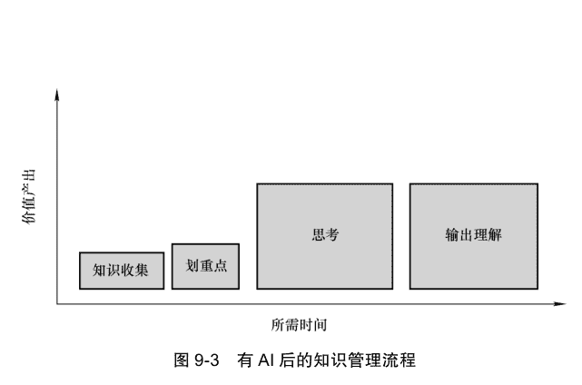

#### 9.2.1 减少知识收集的时间

在“前工具时代”，研究者获取信息的主要路径是：

- 学术文献：通过 Google Scholar、中国知网等数据库检索；
- 新闻舆情、政策报告：通过搜索引擎或门户网站人工搜索。

虽然信息来源丰富，但也极其依赖研究者的判断力与经验，尤其是对于学术积累尚浅的同学而言，往往在信息甄别环节耗费大量时间，效率较低。

而在“后工具时代”，研究者可以借助各种智能工具来提升信息获取的效率，节省下来的时间则可用于更高价值的思考与写作。以下是笔者在博士研究阶段常用的几个信息获取工具：

1.  **学术搜索推荐工具：Research Rabbit 与 Connected Papers**

    这两个平台均基于“论文引用网络”的理念设计，能够根据你已有的核心文献，自动推荐关联度高的后续文献。与 Google Scholar 的“引用/被引”功能相比，它们的推荐更为可视化、系统化，非常适合用于构建某一研究主题下的文献图谱。

    1）Research Rabbit：提供图谱式展示，可以追踪研究前沿与交叉领域发展；

    2）Connected Papers：聚焦于文献之间的拓扑结构，用于快速梳理某一话题的理论基础。

    它们尤其适合“已掌握领域基础知识、需要拓展相关文献”的研究阶段，可大幅提升信息查找效率。

2.  **AI 学术工具：Scite、Elicit 与 Scispace**

    尽管 AI 在自然语言处理方面已有长足进步，但目前用于学术文献搜索的 AI 工具仍存在一定限制，主要由于数据库版权问题：

    1）Scite、Elicit：目前仍以开源论文为主，覆盖面有限；

    2）Scispace：尝试通过浏览器插件或 VPN 接口接入学校订阅资源，是值得关注的新型学术平台。

    因此，在当前阶段，AI 学术搜索工具尚无法完全替代传统与推荐类工具，但其潜力巨大，值得持续关注。

3.  **新闻与非学术信息：Perplexity AI**

    当研究需要追踪时事动态、政策变迁、媒体报道等非学术类信息时，Perplexity 是非常实用的搜索工具。相比其他主流大模型如 ChatGPT、Claude、DeepSeek 等，Perplexity 明确定位为“答案型搜索引擎”，具备以下优势：

    1）支持最新网页内容抓取，时效性强；

    2）提供来源链接，可快速验证信息；

    3）免费版本已具备高质量搜索体验。

在海量信息面前，我们不再被动接受，而应通过技术手段主动筛选、快速聚焦，把有限的时间资源投入到更有价值的“思考”与“输出”之中。接下来，我们将进一步探讨——AI 如何辅助我们思考，并实现知识的内化与重构。

#### 9.2.2 AI如何辅助我们思考

在“后工具时代”，研究者可以通过各种搜索工具大幅缩短信息收集的时间，如前文所述，这使研究者得以将更多精力投入到真正有价值的工作——思考与表达。而幸运的是，AI 不仅能为搜索信息提供帮助，还能在“思考我们的思考”方面提供关键辅助。目前已有大量关于“如何使用 AI”的教学资源，尤其在小红书、推特、B站等平台中流传着诸如“Prompt 工具箱”“Prompt 编写指南”等内容，强调如何通过精准的指令（prompt）获取更优质的答案。这些资源固然有价值，但笔者认为，对于多数研究者而言，仅需一句简明的方法论：**把 AI 当作人去沟通。**

更具体地说，我们应当把 AI 当作一个聪明但缺乏经验的合作者，甚至是实习生。这类“助手”具备出色的分析和表达能力，但对任务背景了解有限。因此，在与 AI 协作的过程中，应当：

1.  提供完整背景信息——尽可能清晰地说明研究动机、研究框架与核心问题；
2.  共享你的思考过程——你思考得越深入，AI 给出的反馈也就越深入；你思考得越模糊，AI 的回答也会停留在表层。

##### 1. 反面示例：提问不清带来的沟通障碍

假设正在研究“候选人在 Twitter 上的发言是否会影响选民态度”。初步设想可以用“点赞数”和“转发量”衡量推文影响力，并将这一思路询问 ChatGPT，如图 9-4 所示。

## 9.2.2 提问的深度与 AI 的回应质量

###### 1. 负面示例：模糊提问导致泛泛回应

从图 9-4 中可以看到，GPT 给出了几条反馈建议，但都较为泛泛，并没有触及提问者真正关心的问题。这是因为，问题本身不够明确。例如：

- 1）“这个思路怎么样？” ——指的是研究设计？变量设定？方法选择？
- 2）“有没有建议？” ——范围太广，缺乏具体方向。
- 3）选民的“态度”指什么？如何测量？
- 4）为什么只研究 Twitter？是要代表整个社交媒体，还是有数据可得的限制？

由于提问者未能澄清自己当前的研究困惑，也未给出足够的背景信息，导致 AI 无法聚焦、只能泛泛回应，难以推动真正的思考。

###### 2. 正面示例：用结构化思维引导 AI 深度协作

相比之下，如果在提问前，先用“是什么”“为什么”“怎么样”的三步法框架整理思路，并明确希望 AI 回应哪一部分内容，效果将大为不同：

- 1）为什么研究这个问题？因为社交媒体影响公众情感和认知。
- 2）什么是我们关注的因变量与自变量？自变量是推文影响力（如频率、点赞数、转发量），因变量是选民态度（如投票行为、民调数据、用户互动）。
- 3）怎么样开展研究？如何获取和整合数据？是否有替代变量？

当把这些思考过程交代清楚后，再向 AI 提出具体问题，比如“有哪些变量可用来衡量推文影响力？”“这个研究设计在操作上是否可行？”——AI 的回应自然也会更聚焦、更具启发性。如图 9-5 所示。

特别提示：图 9-5 中的提问在结尾处加上“请言简意赅”，是为了让 AI 输出控制在较短篇幅内，方便展示给读者。大家也可以根据需要引导 AI 输出的风格与长度，避免信息冗余，突出重点。

###### 3. 思考的关键：提问方式没有高下，只有深浅

需要强调的是，这两类提问方式并无高下之分，关键在于——是否愿意继续思考下去。许多刚接触科研或初入新领域的研究者，起初可能只能提出较泛化的问题，这完全正常。

真正重要的是，研究者是否愿意在获得 AI 的第一轮回复之后，再深入一层、追问一轮：

- 1）“你说的更全面，指的是哪方面？”
- 2）“你建议 A 方法，那它和 B 方法在精度上有何差异？”
- 3）“哪些变量最能代表公众态度？是否能从多源数据中交叉验证？”

这样的对话不止步于“得到答案”，而是不断推进、不断反馈，形成“思维—提问—再思维”的循环系统。只要你持续思考，AI 就能持续协作，直到你真正形成一个清晰、可行的研究设计。

> 我正在研究社交媒体对选举政治传播的影响，关注的是候选人在选举期间Twitter上的推文的影响力对选民态度的作用。我关注这个问题是因为我认为社交媒体上的信息能够塑造选民对候选人的情感和认知，从而影响他们的投票行为。我的自变量是候选人推文的影响力，目前的思路是可以用推文的发布频率、点赞数和转发数来衡量，而因变量是选民的态度，主要通过投票行为和民意调查结果来体现（或者也许可以用提及具体候选人名称的推文来衡量？）。具体来说，我计划利用Twitter API抓取候选人推文数据，再结合相关民意调查数据来进行分析。
> 基于以上背景和思考，我想请问：
> 1. 你觉得我这个研究思路是否可行？有没有什么漏洞？
> 2. 你觉得我现在想到的这些具体指标（如推文频率、点赞数、转发数）能够有效地反映候选人的影响力吗？还有没有别的指标我没想到的？
> 3. 你觉得抓取提及具体候选人名称的推文来衡量选民对候选人的情感认知是个好方式吗？可以和民调数据结合起来吗？或者你觉得有什么民意数据是我可能可以使用的吗？
> 可以比较言简意赅地回答我的问题吗？谢谢。

**1. 可行性与漏洞**

- ✅ 可行，结合Twitter数据和民调能有效分析选民态度变化。
- ⚠️ 可能漏洞：
    - 因果关系不明（推文影响选民 vs. 选民已有态度决定互动）。
    - 社交媒体代表性偏差（年轻人更活跃，不能代表所有选民）。
    - 机器人账号干扰（可能制造虚假互动量）。

**2. 推文影响力指标**

- ✅ 点赞、转发、发布频率有价值，但可加入：
    - 评论数（更直接体现互动深度）。
    - 情感分析（推文情绪是积极、消极还是中立？）。
    - 传播网络（被哪些关键用户/媒体转发？）。
    - 推文主题（哪些议题更受欢迎？）。

**3. 提及候选人的推文+民调数据**

- ✅ 有用，可衡量选民对候选人的关注度和情绪。
- ⚠️ 需要清理噪声（新闻、机器人、讽刺性推文）。
- ◆ 更精准方法：结合情感分析（VADER/BERT）+ 地理数据（看不同地区推文是否匹配选区投票）。
- ◆ 推荐民调数据来源：
    - Pew Research Center
    - Gallup Polls
    - American National Election Studies (ANES)
    - YouGov

这样，你的研究会更全面、更严谨！🚀

图 9-5 和 ChatGPT 的交流案例（2）

### 9.3 对当下工作流的看法

本节将结合笔者在社会科学研究中的实践经验，探讨当前研究者常用的知识工作流构建路径，指出其中存在的典型问题，并介绍若干具有潜力的工具与方法，旨在为读者提供可借鉴的流程优化思路。

#### 9.3.1 知识管理工具的演进与应用

笔者最初接触结构化知识管理工具是在 2020 年，起点是 Roam Research（RR）。作为最早将“双向链接”与“块级引用”引入知识笔记系统的代表性平台，RR 开创了基于信息联动与网络化思维的笔记模式，深刻改变了笔者的研究记录习惯与信息整合方式。尽管后续涌现出如 Obsidian、Logseq 等功能更强、生态更开放的替代产品，但 RR 依旧是笔者日常研究的主要工具。

在此之前，笔者曾尝试过如 LiquidText、MarginNote 等偏重文献批注与结构整理的软件。这些工具虽未实现知识联结功能，但其强调“批注－提取－关联”的理念，为笔者后续转向卡片笔记与信息网络管理奠定了重要基础。

这一过程中，笔者逐步意识到：对于社会科学研究者而言，任何有效的知识工作流皆应围绕两个核心环节构建——“输入”与“输出”。

#### 9.3.2 社科研究者的一般性工作流

表 9-1 概述了典型社科研究工作中的输入与输出流程。

表 9-1 示例问题的构成要素

| 工作环节 | 内容类型 | 工具与方法 |
| :--- | :--- | :--- |
| 输入 | 学术论文 | Zotero + 阅读器批注 + 插件整合 |
| 输入 | 新闻/社交资讯 | 即兴记录于笔记系统，如 RR |
| 输出 | 写作与草稿整理 | 基于已有笔记结构生成段落并导出 |

##### 1. 输入阶段

- 1）学术资源：笔者采用 Zotero 进行文献管理，通过其内建阅读器完成注释，再借助 zoteroRoam 插件将笔记同步至 RR，便于统一整理；
- 2）非结构化信息：如社交媒体、新闻报道等即时内容，笔者倾向直接在 RR 中撰写阅读笔记并附上来源链接。目前虽无统一工具整合此类信息，但市场上如 Readwise 等平台已尝试提供“稍后阅读 + 高亮同步”一体化服务，具备一定推广价值。

##### 2. 输出阶段

- 1）写作时，笔者优先在 RR 中回顾相关笔记，整理思路并撰写段落；
- 2）成稿阶段再将草稿导出至 Word 或 LaTeX 等排版平台进行整合。

此类“基于笔记的写作”方式，有助于降低起稿压力、提高素材调用效率，亦可增强文献引用与论证结构的连贯性。

#### 9.3.3 AI 技术对知识管理流程的影响

近年来，AI 的发展进一步推动了知识管理工具的变革。除了提升信息检索效率，AI 工具正在逐步介入知识加工与协作环节。例如，当前已有研究者提出如下问题：

> 在 AI 对话框中，是否可以完成全部信息处理任务，从而省去笔记软件的使用？

这一设想虽具启发性，但从现阶段技术实践来看，仍存在以下两方面局限：

- 1）上下文追溯能力有限：对话式 AI 系统的信息呈现依赖线性线程（thread），一旦对话过长，不便于回顾或交叉引用历史内容；
- 2）缺乏信息架构能力：AI 对知识的组织主要依赖即时语境，难以构建系统性的知识网络或长期记忆体系。

当前，一些 AI 驱动的笔记平台（如 Flowith）正尝试解决上述问题。其核心设计理念为：

- 1）将 AI 作为信息整合中枢，通过自动分类、标签聚合、调用多模型等方式构建知识结构；
- 2）支持多轮互动与跨话题引用，提升 AI 的信息“记忆”与重组能力。

虽然该类工具尚处于发展初期，但未来“AI + 知识组织”的深度融合，将成为知识管理领域的重要趋势。

综上所述，笔者希望本节内容能够为读者理解和优化个人知识工作流提供有益参考。值得强调的是，真正重要的并非工具本身的选择，而是是否建立起“收集 - 整理 - 融入 - 产出”的结构化认知路径。正如卡片笔记创始人卢曼所述，即便仅依靠纸质卡片，也可以搭建起庞大而有机的知识体系。由此可见，工具本身并不具有决定性意义，关键在于研究者能否在持续实践中将新信息有效整合为结构性知识，并最终服务于研究表达与理论建构。每位学者的研究习惯和偏好存在差异，知识工作流亦无标准模板可循。笔者仅以自身经验为例，期望能为读者的学术实践与思维方式提供一些启发与支持。

### 9.4 总结

本章从知识管理工具的发展出发，结合笔者的个人经验，系统梳理了当前社会科学研究中常见的知识工作流模式，尤其是围绕“输入 - 整理 - 输出”三个环节所涉及的工具、方法与实践路径。同时，本章也讨论了人工智能技术对知识收集与管理流程的潜在影响，指出 AI 驱动的知识分类与结构整合能力，或将在未来成为知识管理系统演进的重要方向。需要强调的是，工具的使用始终服务于研究者的思维过程，真正关键的是建立结构化、持续化的知识组织机制，以提升思考的深度与产出的质量。通过对个人工作流的不断优化，研究者将更有可能在信息日益复杂的环境中，形成清晰稳定的知识体系。

### — 思考与练习 —

**思考：** 本章都提到了那些知识管理和辅助写作的工具？他们是如何提升我们知识管理和学术写作的能力？

**练习：** 请选择一篇学术论文，根据本章学到的知识，构建以该文章为中心的知识图谱

# ChatGPT 篇

## 第 10 章 ChatGPT 与研究数据获取、数据清洗

### 本章重点

- 使用 API 与爬虫获取数据
- 数据清洗步骤与目标
- 接入 Copilot

研究数据获取和数据清洗是数据处理的基础，数据获取与数据清洗的质量直接关系到数据处理结果。ChatGPT-4o 能够辅助研究者高效地进行数据获取与数据清洗，本章将结合案例进行简要介绍。

### 10.1 数据获取

常见的数据获取方式包括：

- 1）通过问卷调查、实验等方式获取数据；
- 2）从政府机构、学术机构的公开数据库中获取数据，例如世界价值观调查、中国家庭追踪调查等；
- 3）通过 API 获取数据；
- 4）通过爬虫获取数据。

前两种数据获取方式是人们已经比较熟悉的方式，本章将重点介绍如何在 ChatGPT 的帮助下通过 API 获取数据与通过爬虫获取数据。

#### 10.1.1 使用 API 获取数据

API 能够允许第三方通过网络调用数据，OpenAI 也为用户提供了 API 服务，我们能够在多种编程语言（例如 Python）中直接调用 ChatGPT。本章以调用高德地图 API 和接入 OpenAI API 为例。

我们可以调用高德地图 API 获取北京市行政区划数据，并将数据格式整理为 .shp 或是 .geojson 类型。首先需要在高德开放平台注册账号，创建应用并生成自己的 API Key，请注意务必保密 API key；不同 API 的服务类型、所需费用不同，我们在创建高德地图 API 时根据“行政区划查询”服务创建 Web 服务，获得自己的 API Key；之后，通过 Python 语言调用 API，获取某一特定城市的行政区划数据（见代码 10-1）。这一过程中，可以结合本书第 1 章提示词工程的指导，告知 ChatGPT-4o 自己的数据需求，在其帮助下高效调用外部 API。

**【代码 10-1 调用高德地图 API 获取北京市行政区划数据】**

```python
import requests
import geopandas as gpd
from shapely.geometry import Polygon

key = 'your api key' # 替换为自己的API Key
city = ['北京市'] # 可替换为其他城市
url = f"https://restapi.amap.com/v3/config/district?keywords={city}&subdistrict=0&extensions=all&key={key}"
response = requests.get(url)
data = response.json()
polyline = data['districts'][0]['polyline']
poly_list = polyline.split('|')
polygons = []
for poly in poly_list:
    points = [(float(lon), float(lat)) for lon, lat in [p.split(',') for p in poly.split(';')]]
    polygons.append(Polygon(points))
gdf = gpd.GeoDataFrame({'name': [city]*len(polygons)}, geometry=polygons, crs='EPSG:4326')
gdf.to_file("beijing.geojson", driver='GeoJSON') # 生成.geojson文件
gdf.to_file("beijing.shp", driver='ESRI Shapefile') # 生成.shp文件
```

如果想要在 Python 中接入 ChatGPT，首先需要我们在 OpenAI 开发者平台注册账号，创建应用并生成自己的 API Key。根据购买的服务类型，我们能够获得不同的 API 使用权限。在成功获得 OpenAI API Key 之后，我们可以按照代码 10-2 在 Python 中接入 API，实现在编程中与 ChatGPT 对话。OpenAI 官方文档提供了 API Key 完整的功能介绍，我们可以详细参考 ①。在Python中接入ChatGPT之后，我们可以通过功能调用（Function Calling）实现 ChatGPT 与外部服务的交互 ②。在接入过程中如果发生网络错误、指令错误，可以将 Python 代码与报错信息输入 ChatGPT-4o 获取解决方案。

> ① OpenAI 官方指导文档：https://pypi.org/project/openai/。
> ② OpenAI 官方指导文档：https://platform.openai.com/docs/guides/function-calling?api-mode=chat。

**【代码 10-2 在 Python 中接入 OpenAI API Key】**

```python
import openai
import requests

proxies = {"your network settings"} # 更改为自己的网络设置

headers = {
    "Authorization": "Bearer your OpenAI API Key", # 更改为自己的API Key
    "Content-Type": "application/json"
}

data = {
    "model": "gpt-4o", # 可以更改为其他模型，例如gpt-3.5-turbo、GPT-4o mini等
    "messages": [
        {"role": "user", "content": "你好，你是一位数据科学家，能告诉我如何在python中清洗数据吗"} # 角色提示技巧
    ]
}

response = requests.post(
    "https://api.openai.com/v1/chat/completions",
    json=data,
    headers=headers,
    proxies=proxies,
    timeout=30
)
print(response.json()["choices"][0]["message"]["content"]) # 输出回答
```

运行以上代码，会输出以下结果，实现了在 Python 中和 GPT-4o 对话。

> “当然可以！数据清洗是数据分析和数据科学中的一个重要步骤，它主要涉及处理数据中的缺失值、重复值、异常值、格式问题等。以下是在Python中进行数据清洗的一些常见步骤和方法：……”

#### 10.1.2 使用爬虫获取数据

通过爬虫抓取网络资料是社会科学研究常见的数据来源方式，ChatGPT 能够辅助我们使用爬虫获取数据。对于网页内容的抓取可以区分为静态网页爬虫和动态网页爬虫，使用 Python 语言进行静态网页内容抓取时主要依赖 Request 库，动态网页爬虫需要使用 Selenium 模拟浏览行为。

本节以豆瓣读书榜单 Top 250 为例展示如何进行静态网页爬虫。在和 ChatGPT 交流之前，我们可以从目标页面提取元素。进入豆瓣读书榜单 Top 250 页面，当我们需要特定信息时，在该位置右键单击，选择检查，打开浏览器开发者工具（F12），从而看到对应的网页元素结构，右键单击该元素并复制选择器。随后，给予 ChatGPT 提示词，告知代码语言、网页元素选择器、信息需求和想要输出的数据效果，见提示词 10-1。当然，ChatGPT-4o 具有一定的网页解析能力，如果不告知它网页元素选择器，ChatGPT-4o 依然能够输出代码结果，见代码 10-3，但是网页信息提取结果可能不准确，需要对结果进行校对。

**【提示词 10-1 如何使用爬虫抓取静态网页数据】**

```
输入：
使用Python抓取豆瓣读书Top 250页面内容
网站地址是：https://book.douban.com/top250
书名信息的CSS选择器是：div.indent > table:nth-child(2) > tbody:nth-child(1) > tr:nth-child(1) > td:nth-child(2) > div:nth-child(1) > a:nth-child(1)
评分信息的CSS选择器是：div.indent > table:nth-child(2) > tbody:nth-child(1) > tr:nth-child(1) > td:nth-child(2) > div:nth-child(3) > span:nth-child(2)

指令：
假如你是一位数据科学家，请你在Python中使用爬虫抓取以上网站页面中的信息，识别并提取所有书籍的书名和评分；
要求展示Python代码过程，以csv格式保存抓取到的内容，每一行代表一本书籍，每一列代表一类信息，确保信息完整清晰。
```

**【代码 10-3 ChatGPT-4o 提供的爬虫代码】**

```python
import requests
from bs4 import BeautifulSoup
```

import pandas as pd
import time

headers = {"User-Agent": "Mozilla/5.0"}

books = []

for start in range(0, 250, 25):
    url = f"https://book.douban.com/top250?start={start}"
    res = requests.get(url, headers=headers)
    res.encoding = "utf-8"
    soup = BeautifulSoup(res.text, "html.parser")
    tables = soup.select("div.indent > table")
    for table in tables:
        try:
            title = table.select_one("td:nth-child(2) > div:nth-child(1) > a").get_text(strip=True).split("\n")[0] # 书名
            rating = table.select_one("td:nth-child(2) > div:nth-child(3) > span:nth-child(2)").text.strip() # 评分
            books.append({
                "书名": title,
                "评分": rating
            })
        except Exception as e:
            continue
    time.sleep(1)

##### 保存为 CSV
df = pd.DataFrame(books)
df.to_csv("豆瓣Top250_书名评分.csv", index=False, encoding="utf-8-sig")

通常情况下网站会使用动态加载技术作为反爬手段，从而增加数据爬取难度。与静态网页内容抓取相似，我们可以将网页地址、网页元素结构、数据需求类型提供给 ChatGPT-4o，获得相应的爬虫程序。

### 10.2 数据清洗

#### 10.2.1 数据框数据清洗

一个理想的数据框格式是：数据集的每一行是一个样本，每一列是一个变量，每一个单元格是一个值，缺失值能够完整标注。通常情况下用户得到的原始数据并不是适合分析的格式，因此需要进行数据清洗，以便后续的数据分析。ChatGPT 官网提供了专门的数据清洗入口（Data Cleaning），用户可以上传数据文件（CSV、Excel、SQL、JSON 等格式均可），描述数据结构，告知所需的数据格式，ChatGPT 能够根据用户需求提供解决方案与数据清洗代码。用户也能够在 ChatGPT-4o 中直接进行对话，ChatGPT 同样会提供解决方案。在进行数据清洗前，请务必对原始数据进行备份，某些数据清洗步骤是不可逆的。

##### 1. 数据格式转换

现实中经常会遇到记录在图片上或由 PDF 文件记录的数据，用常规方式转换成 excel 文件或者是 csv 文件后会发生格式错乱，人工输入则会耗费大量的时间成本，这时 ChatGPT 能够辅助我们快速进行数据清洗。此处以国家统计局公布的北京市和上海市的国内生产总值数据（如图 10-1 和图 10-2 所示）为例。


这两张图片直接转化为 csv 格式数据会发生错误，而借助 ChatGPT-4o，就可以准确快速地进行图片识别并进行数据清洗，见提示词 10-2，以下是和 ChatGPT-4o 交流的步骤：

- 1）上传原始数据，告知需要的数据格式；

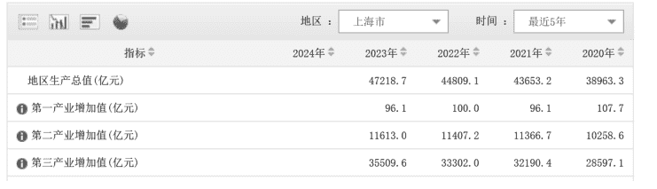

图 10-2 上海市国内生产总值（2020—2024 年）

- 2）标记缺失值；
- 3）将数据转换为面板数据；
- 4）告知数据储存格式，ChatGPT-4o 整理的数据表格可以直接下载，或者复制到 Excel 中；
- 5）将 ChatGPT-4o 整理的过程转换为 R 代码或者 Python 代码；
- 6）这一过程中每一步都需要核对 ChatGPT 的处理是否正确，如果 ChatGPT 理解错误，需要及时纠正。

###### 【提示词 10-2 图片数据清洗步骤】

```
###### 输入
（上传图片）这是北京市/上海市近5年的GDP数据

###### 指令
如果你是一位数据科学家，请按照以下步骤将这两张图片整理为标准的数据格式
(1) 标记缺失值：2024年数据缺失，标注为缺失值。
(2) 转换为面板数据：将北京市和上海市的GDP数据整合为“城市-年”格式的面板数据。
(3) 以csv格式储存数据，每行代表一年，每列代表一个统计条目；
(4) 提供上述步骤的R代码和Python代码。
```

##### 2. 数据清洗步骤

在 R 和 Python 中进行数据清洗的基本步骤包括：数据导入、数据结构查看、数据筛选、变量名处理、数据合并、重复值处理、缺失值处理和数据存储。我们可以通过 ChatGPT-4o 获知在 R 和 Python 中进行数据清洗的具体代码，见提示词 10-3 和代码 10-4。

R 语言能够通过自带的基础包进行数据分析，也能够通过外部的安装包进行数据分析，常用的数据分析包有 dplyr、tidyr、ggplot2 等，加载 tidyverse 包能够自动加载这些包。在前面的内容中已经得到了 2020—2024 年北京市和上海市的 GDP 数据，在 ChatGPT-4o 的帮助下，我们能够快捷使用这些包进行数据分析。

###### 【提示词 10-3 R 语言进行数据清洗】

```
###### 输入
(上传数据文件) 这是北京市和上海市的GDP数据，包括2020年至2024年的数据

###### 指令
如果你是一位数据科学家，请运用r进行数据清洗，提供以下信息：
(1) 提供r进行数据读取、合并与清洗的包；
(2) 提供r进行数据导入、数据结构查看、数据筛选、变量名处理、数据合并、重复值处理、缺失值处理、数据存储的代码。
```

###### 【代码 10-4 ChatGPT-4o 提供的 R 代码】

```
install.packages('tidyverse') # 安装包
###### 导入数据
library(tidyverse) # 加载包
df <- read_csv("data.csv") # 读取 CSV 数据
###### 查看数据信息
str(df) # 查看数据类型
head(df) # 默认查看前5行
colnames(df) # 查看列名
duplicated(df) # 检查重复行
###### 数据筛选
df %>% filter(column == 'A') # 筛选特定列为特定值
df %>% filter(column1 %in% c('A', 'B')) # 筛选特定列为多个特定值
df %>% select(column1, column2) # 保留特定列
df %>% select(-column) # 删除特定列
df %>% slice(A:B) # 保留特定行
df[ A : B ,] # 保留特定行
df <- df %>% mutate(new_column = case_when(
    old_column == 'old_value1' ~ 'new_value1',
    old_column == 'old_value2' ~ 'new_value2',
    TRUE ~ old_column) # 替换值
)
###### 列名重命名
df %>% rename(new_name1 = old_name1, new_name2 = old_name2) # 指定列名
colnames(df) <- c('name1', 'name2')
###### 数据合并
df <- left_join(df1, df2, on = 'column_common') # 按共同列合并
df <- bind_rows(df1, df2) # 沿行方向拼接
df <- bind_cols(df1, df2) # 沿列方向拼接
###### 删除重复值
sum(duplicated(df)) # 统计重复行数
df %>% distinct() # 删除重复行
###### 删除缺失值
colSum(is.na(df)) # 每一列缺失值数量
is.na(df$column) # 特定列缺失值数量
na.omit(df) # 删除含有缺失值的行
df %>% drop_na(column) # 删除某列存在缺失值的行
###### 缺失值简单插补
df[is.na(df)] <- 0 # 用0填充所有缺失值
df$column[is.na(df$column)] <- mean(df$column, na.rm = TRUE) # 用均值填充
df %>% fill(column, .direction = 'down') # 用上一行非空值填充
df %>% fill(column, .direction = 'up') # 用下一行非空值填充
df %>% mutate(column = na.approx(column, na.rm = FALSE)) # 线性插补
###### 数据存储
write_csv(df, "cleaned_data.csv")
```

Pandas 是 Python 的核心数据分析库，是基于 Python 的数据清洗与数据处理的必须掌握的工具。研究者可以通过 ChatGPT-4o 了解如何使用 Pandas 进行数据清洗。在数据清洗过程中如果遇到无法处理的报错信息，可以将报错信息告知 ChatGPT-4o，了解报错处理方案，见提示词 10-4 和代码 10-5。

###### 【提示词 10-4 Python 语言进行数据分析】

```
###### 输入
(上传数据文件) 这是北京市和上海市的GDP数据，包括2020年至2024年的数据

###### 指令
如果你是一位数据科学家，请运用Python进行数据清洗，提供以下信息：
(1) 提供Python进行数据读取、合并与清洗的包；
(2) 提供Python进行数据导入、数据结构查看、数据筛选、变量名处理、数据合并、重复值处理、缺失值处理、数据存储的代码。
```

###### 【代码 10-5 ChatGPT-4o 提供的 Python 代码】

```
pip install pandas
###### 导入数据
import pandas as pd
df = pd.read_csv('data.csv')
###### 查看数据信息
df .info() # 查看数据类型
df.head() # 默认查看前5行
df.columns # 查看列名
df.duplicated() # 检查重复行
###### 数据筛选
df[(df['column1'] == 'A') & df['column2'] == 'B' ] # 筛选多列为特定值的数据
df[df['column1'].isin(['A', 'B'])] # 筛选特定列为特定值的数据
df[['column1', 'column2']] # 保留特定列
df.loc[:, ['column1', 'column2']] # 保留所有行与特定列
df.drop(columns=['column']) # 删除特定列
df['new_column'] = df['old_column'].replace({'old_value1': 'new_value1', 'old_value2': 'new_value2'}) # 替换值
###### 列名重命名
df.rename(columns={'old_name1': 'new_name1'; 'old_name2': 'new_name2'}, inplace=True)
###### 指定列名
df.columns = ['name1', 'name2', 'name3']
###### 数据合并
df = pd.merge(df1, df2, on = 'column_common', how = 'left') # 按共同列合并
df = pd.concat([df1, df2], axis=0) # 沿行方向拼接
df = pd.concat([df1, df2], axis=1) # 沿列方向拼接
###### 删除重复值
df.duplicated().sum() # 统计重复行数
df.drop_duplicates() # 删除重复行
###### 删除缺失值
df.isna().sum() # 每一列缺失值数量
df['column'].isna() # 特定列缺失值数量
df.dropna() # 删除含有缺失值的行
df.dropna(subset=['column']) # 删除某列存在缺失值的行
###### 缺失值插补
df.fillna(0) # 用0填充所有缺失值
df['column'].fillna(df['column'].mean(), inplace=True) # 用均值填充
df['column'] = df['column'].ffill() # 用上一行非空值填充
df['column'] = df['column'].bfill() # 用下一行非空值填充
###### 数据存储
df.to_csv("cleaned_data.csv", index=False)
```

#### 10.2.2 文本数据清洗

##### 1. 文本数据编码

社会科学研究往往需要进行文本数据处理。文本编码是文本分析的常见过程，我们可以结合提示词工程，给 ChatGPT-4o 提供编码范例，并将文本数据、编码手册、编码要求提供给 ChatGPT-4o，提升文本编码效率。提示词 10-5 是一个民生诉求文本编码的简单案例。

###### 【提示词 10-5 文本编码】

```
###### 输入
这是一个简要的民生诉求文本编码手册：
| id | 文本 | 交通问题 | 社保问题 | 教育问题 | 消费者权益问题 | 编码依据 |
|----|------|----------|----------|----------|----------------|----------|
| 1 | 十字路口的红绿灯损坏 | 1 | 0 | 0 | 0 | 红绿灯 |
| 2 | 超市地下停车场出口容易发生拥堵 | 1 | 0 | 0 | 0 | 道路拥堵 |
| 3 | 查询孩子入学学区政策 | 0 | 0 | 1 | 0 | 入学政策 |
| 4 | 中学生转学流程 | 0 | 0 | 1 | 0 | 转学 |
| 5 | 如何查询已经缴纳的社保费用 | 0 | 1 | 0 | 0 | 社保费用 |
| 6 | 延迟退休的退休金政策咨询 | 0 | 1 | 0 | 0 | 退休金 |
| 7 | 在美华超市买了过期饼干，对方拒绝赔偿 | 0 | 0 | 0 | 1 | 交易争端 |
| 8 | 在理发店遇到强制推销办卡的情况如何处理 | 0 | 0 | 0 | 1 | 强制消费 |

我有其他六条民生诉求文本，分别是：
1. 尊敬的领导：您好，我希望您能关注城区幸福小区外侧道路施工影响出行的问题。
2. 市长先生，锦华路附近的红绿灯路口经常堵车并导致发生车祸，相关部门可以介入处理吗？
3. 请问12345热线的工作人员，我的医疗报销遇到问题，应该和哪个部门联系？
4. 请问如何为新生儿办理医疗保险？
5. 幸福小学附近有一家超市开业，每天都在大声播放音乐影响到了小学的授课，请问如何解决？
6. 在城区中心路美发店办理了3000元的消费卡，仅仅消费了两次美发店就关门了，怎么样追回剩下的资金？

###### 指令
如果你是一位研究人员，请你按照以下流程将诉求文本进行编码：
1. 根据编码手册将诉求文本进行编码，编码类型为交通问题、社保问题、教育问题、消费者权益问题，编码结果互斥，提供编码依据；
2. 按照markdown格式输出，数据表格包含6列，第一列是文本，第二列是编码依据，后四列为编码。
```

ChatGPT-4o 会给出如图 10-3 一样的编码结果并将编码结果整理为 csv 文档。当需要批量处理大规模文本数据时，ChatGPT-4o 将大大减少文本编码时间。

| 文本 | 编码依据 | 交通问题 | 社保问题 | 教育问题 | 消费者权益问题 |
| :--- | :--- | :---: | :---: | :---: | :---: |
| 尊敬的领导：您好，我希望您能关注城区幸福小区外侧道路施工影响出行的问题。 | 道路施工 | 1 | 0 | 0 | 0 |
| 市长先生，锦华路附近的红绿灯路口经常堵车并导致发生车祸，相关部门可以介入处理吗？ | 红绿灯堵车 | 1 | 0 | 0 | 0 |
| 请问12345热线的工作人员，我的医疗报销遇到问题，应该和哪个部门联系？ | 医疗报销 | 0 | 1 | 0 | 0 |
| 请问如何为新生儿办理医疗保险？ | 新生儿医保 | 0 | 1 | 0 | 0 |
| 幸福小学附近有一家超市开业，每天都在大声播放音乐影响到了小学的授课，请问如何解决？ | 教学干扰 | 0 | 0 | 1 | 0 |
| 在城区中心路美发店办理了3000元的消费卡，仅仅消费了两次美发店就关门了，怎么样追回剩下的资金？ | 消费卡维权 | 0 | 0 | 0 | 1 |

图 10-3 ChatGPT-4o 返回的编码结果

##### 2. 文本数据筛选

当需要从文本中提取信息、进行文本匹配或是替换文本时，就需要使用正则表达式，ChatGPT-4o 能够辅助我们生成符合要求的正则表达式。例如针对以上六条民生诉求文本，我们希望筛选出称呼的部分，可以提供给 ChatGPT-4o 文本范例，进行如下交流，见提示词 10-6、代码 10-6 和代码 10-7。

###### 【提示词 10-6 生成正则表达式】

```
###### 输入
我有六条民生诉求文本，分别是：
(同前文)

###### 指令
如果你是一位研究人员，请分别使用Python和R生成恰当的正则表达式指代称呼部分。
```

###### 【代码 10-6 ChatGPT-4o 提供的 R 代码】

```
pattern <- "^(尊敬的[^, :]{0,8}(领导|书记|主任|市长)?|[^, :]{1,10}(先生|女士|同志|领导)|请问[^, :]{0,15}的工作人员)[, :]?"
```

###### 【代码 10-7 ChatGPT-4o 提供的 Python 代码】

```
r"^(尊敬的[^\s, :]{0,8}[领导|书记|主任|市长]?|[^\s, :]{1,10}(先生|女士|同志|领导)[, :]?|请问[^\s, :]{0,15}的工作人员)[, :]?"
```

##### 3. 文本文档清洗

ChatGPT-4o 能够辅助我们做进一步的文本清洗，将文本整理为 DTM（Document-Term Matrix）格式，为后续的文本分析、自然语言处理打下基础。DTM 文档的每一行表示一个文档，每一列表示一个词汇，每个单元格的值是某个词在该篇文档中出现的频率。首先，在进行中文文本清洗时，可以删除文本开头和结尾的特殊符号（例如引号），并删除文本中的数字或是特殊符号；其后，我们可以借助分词工具（Python 中的 jieba 库或是 R 中的 jiebaR）进行分词；基于分词结果，就能够构建 DTM 文档。我们将文本、编程语言与数据要求发送给 ChatGPT-4o 见提示词 10-7，即

###### 【提示词 10-7 文本清洗】

###### 输入
我有六条民生诉求文本，分别是：
(同前文)

###### 指令
如果你是一位研究人员，请按照以下要求对诉求文本进行清洗：
(1) 将文本整理为DTM文档，每一行代表一条文本，每一列代表一个关键词；
(2) 以R代码和Python代码呈现文本清洗过程。

###### 【代码 10-8 ChatGPT-4o 提供的 R 代码】

```r
texts <- c(
  "尊敬的领导：您好，我希望您能关注城区幸福小区外侧道路施工影响出行的问题。",
  "市长先生，锦华路附近的红绿灯路口经常堵车并导致发生车祸，相关部门可以介入处理吗？",
  "请问12345热线的工作人员，我的医疗报销遇到问题，应该和哪个部门联系？",
  "请问如何为新生儿办理医疗保险？",
  "幸福小学附近有一家超市开业，每天都在大声播放音乐影响到了小学的授课，请问如何解决？",
  "在城区中心路美发店办理了3000元的消费卡，仅仅消费了两次美发店就关门了，怎么样追回剩下的资金？"
)
corpus <- Corpus(VectorSource(texts)) # 创建文本语料（corpus）对象
install.packages("jiebaR")
library(jiebaR)
###### 中文分词器
cutter <- worker()
texts_seg <- sapply(texts, function(x) paste(segment(x, cutter), collapse = " "))
###### 生成 corpus 和 DTM
corpus <- Corpus(VectorSource(texts_seg))
dtm <- DocumentTermMatrix(corpus)
inspect(dtm)
dtm_matrix <- as.matrix(dtm)
###### 数据存储
write.csv(dtm_matrix, "dtm_output.csv")
```

###### 【代码 10-9 ChatGPT-4o 提供的 Python 代码】

```python
import jieba
from sklearn.feature_extraction.text import CountVectorizer
import pandas as pd
texts = [
    "尊敬的领导：您好，我希望您能关注城区幸福小区外侧道路施工影响出行的问题。",
    "市长先生，锦华路附近的红绿灯路口经常堵车并导致发生车祸，相关部门可以介入处理吗？",
    "请问12345热线的工作人员，我的医疗报销遇到问题，应该和哪个部门联系？",
    "请问如何为新生儿办理医疗保险？",
    "幸福小学附近有一家超市开业，每天都在大声播放音乐影响到了小学的授课，请问如何解决？",
    "在城区中心路美发店办理了3000元的消费卡，仅仅消费了两次美发店就关门了，怎么样追回剩下的资金？"
]
###### 中文分词
def chinese_tokenizer(text):
    return jieba.lcut(text)
###### 创建向量器（DTM）+ 分词器
vectorizer = CountVectorizer(tokenizer=chinese_tokenizer)
###### 拟合并转换为 DTM 矩阵
X = vectorizer.fit_transform(texts)
###### 转换为 DataFrame
dtm_df = pd.DataFrame(X.toarray(),
                      columns=vectorizer.get_feature_names_out())
dtm_df.index = [f"文本{i+1}" for i in range(len(texts))]
###### 数据存储
dtm_df.to_csv("民生诉求_DTM.csv", encoding="utf-8-sig")
```

### 10.3 Copilot 插件安装

GitHub Copilot 是 GitHub 和 OpenAI 合作推出的人工智能编程辅助工具，我们能够在多种编程环境中嵌入 Copilot 实现自动编码的功能。本节将介绍如何在 Visual Studio Code 和 R Studio 中安装 Copilot 插件。在安装前需要开通 GitHub Copilot 服务，免费版本和付费版本的服务功能不同。教育类用户可以进行学生或教师资格验证，经 GitHub Education 验证通过后可以免费访问 Copilot。

#### 10.3.1 在 Visual Studio Code 中安装 Copilot

在安装了 Visual Studio Code 后，可以在扩展页面检索 GitHub Copilot 或是 GitHub Copilot Chat，之后进行下载。下载成功后，Visual Studio Code 页面右上角会显示 Copilot 状态，能够进行 Copilot 聊天、设置或是管理 Copilot 订阅。当 Copilot 处于开启状态时，若输入自然语言或是部分代码，Copilot 可以根据上下文提供代码建议，通过 Tab 键就可以采纳 Copilot 建议。2024 年 5 月，Copilot 升级为 ChatGPT-4o 模型。这里推荐通过 Visual Studio Code 的官网进行更加详细的学习。

#### 10.3.2 在 R Studio 中安装 Copilot

2023.09.0版本之后的 R Studio 可以支持 Copilot。下载完成后，在 Tool→Global Options 页面选择 Copilot，之后勾选 Enable GitHub Copilot → Sign in，登录 GitHub 账号填写验证码，按照网页指导激活 Copilot。在 R Studio 中进行数据分析时，Copilot 能够结合上下文实现代码生成、代码校对与文档建议等功能，可以通过 Tab 键采纳 Copilot 建议。

### 10.4 总结

本章内容首先介绍了如何在 ChatGPT-4o 的辅助下使用 API 获取数据与使用爬虫获取数据，由于反爬手段不断迭代，我们推荐使用 API 获取数据。其后本章介绍了理想的数据格式与数据清洗过程，ChatGPT-4o 能够帮助我们高效完成数据表格和文本数据的清洗。最后本章介绍了如何在 Visual Studio Code 和 R Studio 中安装 Copilot 插件辅助进行代码生成与数据处理。总体而言，ChatGPT-4o 辅助下的数据获取与数据清洗能够大大提升研究者的研究效率，帮助研究者获得更加理想的数据结果。

> Visual Studio Code 官网：https://vscode.js.com/docs/copilot/overview。

### — 思考与练习 —

- 思考 1：人工智能降低了研究者用于数据获取与数据处理的成本，研究者是否需要继续学习数据获取与数据处理的相关技术？
- 思考 2：当 ChatGPT-4o 给出的代码建议无法运行时，研究者应该如何处理？
- 练习：请在 ChatGPT-4o 的辅助下，自行选择一个天气 API 收集所在城市一周的天气数据。

# ChatGPT 篇

## 第 11 章 大模型辅助的硅基样本生成

### 本章重点

- 硅基样本生成的信度保障在于算法保真性，由图灵测试、反向连续性、向前连续性和模式对应性四个维度构成。
- 硅基样本生成的核心方法是基于角色设定的智能体设计。
- Python 的开源软件包 EDSL 为硅基抽样提供了操作支持，辅助研究者进行问题设计、智能体设计与问卷设计，并为调查实验等进阶调查问卷设计提供机会。

### 11.1 从碳基样本到硅基样本

“硅基样本”（Silicon Samples）是指通过大型语言模型（LLM）模拟生成的虚拟人类数据样本，用于替代或补充传统社会科学研究中的人类受访者数据。这些样本是算法生成的文本实体，具有被赋予的特定人口属性、观点倾向和行为模式，可用于问卷调查、意见预测、行为模拟等研究任务。与传统“碳基样本”（Carbon-based Samples）相比，硅基样本不仅大幅降低数据收集成本，还具备高度可控性、可重复性和无伦理风险等优势。进一步地，硅基样本并非简单的“文本生成工具”，而是具有特定社会属性、认知倾向或行为特征的虚拟个体数据单元，既是一种类人样本（human-like agent），也是基于大语言模型的社会模型产物，模拟人类受访者以描述、解释和预测人类行为，由此更新传统社会科学研究方法。

在社会科学研究中，硅基样本正逐步成为研究流程中的重要工具，其应用可归纳为三大类场景，呈现出从辅助设计到理论验证的功能递进结构。第一类，在研究设计与探索阶段，硅基样本可用于问卷测试、访谈预演、指标构建等任务，通过模拟受访者快速反馈问题逻辑、语言理解和选项设置，从而提升工具的有效性与适配度。第二类，在数据收集阶段，硅基样本一方面可模拟现实中难以接触或具有伦理风险的人群，生成不具风险但具结构特征的回应，降低实际调查的人力与伦理成本①。另一方面，硅基样本可与现实样本结合，填补历史调查的缺失值、推测未测变量，或用于小样本扩充和非平衡数据校正，从而提升统计模型的稳健性与外部有效性②。第三类，在机制建模与因果推断环节，研究者可利用硅基样本构建具有特定身份、偏好与行为规则的虚拟代理群体，在结构因果模型或社会模拟实验中验证理论假设、检验变量关系③④。概言之，硅基样本在社会科学研究中发挥着从设计支持到知识生产的多元作用，既拓展了研究边界，也推动了方法论的结构性革新。本节重点介绍硅基样本及在第一类和第二类任务情境中的运用，社会模拟中的硅基样本详见第4章。

本章以下部分首先从方法论的视角介绍硅基样本的原理，即算法保真与硅基抽样。其次，以基于 Python 语言的 EDSL 包（Expected Parrot Domain-Specific Language）为例，介绍硅基样本的相关操作方法。最后结论部分将讨论大模型辅助的硅基样本生成在社会科学研究中的作用及其限度。

> ① Sarstedt, M., Adler, S. J., Rau, L., & Schmitt, B. (2024). Using large language models to generate silicon samples in consumer and marketing research: Challenges, opportunities, and guidelines. Psychology & Marketing. https://doi.org/10.1002/mar.21982.
> ② Dillion, D., Tandon, N., Gu, Y., & Gray, K. (2023). Can AI language models replace human participants? Trends in Cognitive Sciences, 27, 597-600. https://doi.org/10.1016/j.tics.2023.04.008.
> ③ Bisbee, J., Clinton, J. D., Dorff, C., Kenkel, B., & Larson, J. M. (2024). Synthetic replacements for human survey data? The perils of large language models. Political Analysis. https://doi.org/10.1017/pan.2024.5.
> ④ Sun, S., Lee, E., Nan, D., Zhao, X., Lee, W., Jansen, B. J., & Kim, J. H. (2024). Random silicon sampling: Simulating human sub-population opinion using a large language model based on group-level demographic information. Arxiv, abs/2402.18144. https://doi.org/10.48550/arXiv.2402.18144.
> ⑤ Jiang, S., Wei, L., & Zhang, C. (2024). Donald trumps in the virtual polls: Simulating and predicting public opinions in surveys using large language models. https://consensus.app/papers/donald-trumps-in-the-virtual-polls-simulating-and-jiang-wei/c131f58fa97d5f1c80f116dac8a1fed/.
> ⑥ Manning, B. S., Zhu, K., & Horton, J. J. (2024). Automated Social Science: Language Models as Scientist and Subjects (No. arXiv: 2404.11794). arXiv. https://doi.org/10.48550/arXiv.2404.11794.

### 11.2 硅基样本的方法原理

大模型辅助的硅基样本生成本质上是一个数据生成过程（data generation process），这一过程以大语言模型为基础。为确保这类样本在学术研究中的科学性与可解释性，有必要从方法论层面对其生成与使用机制进行系统性分析。本部分将基于已有研究文献，围绕其方法基础、操作策略分析硅基样本的方法原理。

#### 11.2.1 算法保真：硅基样本的信度保障

相较于碳基样本与人类个体的一一对应，硅基样本的生成是一个“从一到无穷大”的过程，这一过程的合法性基于大语言模型的生成文本在结构、行为和解释上的“保真性”（fidelity）。Argyle 等人在《Political Analysis》中提出“从一到无穷大”（Out of one, many）的模拟理念，并发展出评估模型输出社会科学适用性的 4 项标准体系①：

1.  社会科学研究图灵测试（Social Science Turing Test）：该标准借鉴图灵测试思路，要求模型输出的文本在语言风格、逻辑结构与语义连贯性上难以与真实人类文本区分。其核心方法论基础在于可感知语言真实性（perceived linguistic realism），相当于检验模型是否具备“语言仿真能力”。
2.  反向连续性（Backward Continuity）：强调生成内容与输入属性的一致性，是一种“反向推理信度”检验。例如，模型若模拟一位低收入者，其生成内容中应体现相关价值观与经济倾向（如强调保障、公平）。这建立在社会认知语言学中“语言反映社会位置”（linguistic indexicality）理论的基础上②。
3.  向前连续性（Forward Continuity）：生成的回复会自然地从提供的上下文条件中产生，并可靠地反映情境的形式、语气和内容。这一标准要求模型输出的态度、意见或选择行为与现实数据具有预测一致性。例如，Sun 等人通过将模型输出与美国公众民调进行对比，发现某些议题上生成结果可高度拟合真实分布③。
4.  模式对应性（Pattern Correspondence）：生成的文本必须反映人类数据中复杂的关系模式，包括人口统计特征、态度和行为之间的关联。这一标准强调生成数据内部的变量间结构关系应与真实世界相似。这涉及模型是否能再现社会科学研究中常见的路径关系，如教育水平影响政治参与、收入影响环保态度等。

4 项标准代表了算法保真的 4 个维度，大模型辅助的硅基样本生成有效性基于 4 个维度的满足。需要说明的是，4 个指标并无定量标准而依赖于定性判断，Argyle 等人对 GPT-3 的两个研究分别检验了 GPT-3 辅助生成的硅基样本符合 4 个标准，至于其他模型则在运用中需要进一步检验。

> ① Argyle, L. P., Busby, E. C., Fulda, N., Gubler, J. R., Rytting, C., & Wingate, D. (2023). Out of one, many: Using language models to simulate human samples. Political Analysis, 31 (3), 337–351. https://doi.org/10.1017/pan.2023.2.
> ② Eckert, P. (2008). Variation and the indexical field1. Journal of Sociolinguistics, 12 (4), 453–476. https://doi.org/10.1111/j.1467-9841.2008.00374.x.
> ③ Sun, S., Lee, E., Nan, D., Zhao, X., Lee, W., Jansen, B. J., & Kim, J. H. (2024). Random silicon sampling: Simulating human sub-population opinion using a large language model based on group-level demographic information. Arxiv, abs/2402.18144. https://doi.org/10.48550/arXiv.2402.18144.

#### 11.2.2 操作策略：基于角色设定的智能体设计

硅基样本实现算法保真的核心策略在于基于角色设定的智能体设计，这一策略的关键环节在于使模型具身化（persona）、生成符合统计分布与社会逻辑的模拟调查数据，从而构成可嵌入社会科学研究的模拟样本库。

基于角色设定的智能体设计（Role-Playing Agent，RLPA），是一种通过提示 LLM 模拟特定人类特征（如职业、性别、种族等）并使其参与对话的交互方式，这种方法的核心在于利用大语言模型的语言能力和信息处理能力来模拟特定角色的行为和回应④。Bisbee 等人发现，赋予大语言模型特定角色后，其输出能更贴近目标群体的观点分布。

> ④ Zhou, M., Yu, L., Geng, X., & Luo, L. (2025). ChatGPT vs Social Surveys: Probing Objective and Subjective Silicon Population (No. arXiv: 2409.02601). arXiv. https://doi.org/10.48550/arXiv.2409.02601.

型特定身份角色设定后，其生成的政治态度评分在均值与方向上接近美国 ANES 调查结果 ①。在群体层面，RLPA 强调以总体结构控制生成样本属性，即在角色设定中借鉴分层抽样思维，通过提示词工程纠正大语言模型在训练数据中可能存在的偏差，确保生成的虚拟样本能够准确反映目标群体的分布特征，进而提升算法保真度。譬如 Sun 等人发现在输入美国人口分布数据后，生成的虚拟回应在党派构成、意识形态偏好等方面与真实调查数据高度拟合 ②。

### 11.3 硅基抽样的操作：以 EDSL 包为例

Expected Parrot Domain-Specific Language（EDSL）是一款开源的 Python 软件包，专为开展人工智能驱动的科研工作而设计，硅基抽样是这一软件包的核心功能。

本节重点参考了 EDSL 包的开发者 J.Horton 与 R.Horton ③ 提供的使用教程，其采用 MIT 许可证，在此表示感谢。

#### 11.3.1 概念框架

EDSL 包的核心设计理念是：一个问题交由特定智能体（Agent），通过大语言模型（Model）生成响应，并以格式化结果（Result）的形式返回。这些结果可以被分析、可视化、共享，或进一步用于优化后续问卷设计。EDSL 包支持多种问题类型（如自由文本、多项选择等），这些问题可以组合成一个调查（Survey），该调查可以并行执行，也可以基于特定规则和条件逻辑运行。问题还可以通过场景（Scenario）进行参数化，以提供上下文情境或提示的变体，从而向语言模型呈现不同的输入。此外，EDSL 包调查可以同时使用多个代理和模型执行，从而生成多样且丰富的响应类型，这对于稳健的数据分析和应用至关重要。表 11-1 展示了 EDSL 包的核心概念框架，软件操作均围绕以下概念进行。这一框架旨在为研究提供清晰、灵活且高效的工具，赋能研究者使其更便捷地设计实验、管理数据密集型任务，并生成高质量的研究成果。

表 11-1 EDSL 包核心概念框架

| 概念 | 描述 |
| :--- | :--- |
| 问题（Questions） | EDSL 包中研究设计的基础元素，支持多种类型（如自由文本、多项选择等），用户可根据响应格式选择 |
| 调查（Surveys） | 定义聚合多个问题，可异步或按预定义规则执行，支持不同代理和模型生成多样化响应，并可结合场景提供上下文和数据以增强问题深度 |
| 代理人（Agents） | 代表回答问题的 AI 实体，每个代理可具有独特特征（如背景、专业知识或记忆），这些特征会影响其响应 |
| 语言模型（Language Models） | 生成问题答案的大语言模型，EDSL 包设计为模型无关，支持集成多个模型以便于响应的比较和选择 |
| 场景（Scenarios） | 在执行问题时提供特定上下文或数据，支持问题的动态参数化，使相同问题能在不同上下文中高效调整和提出 |
| 结果（Results） | 执行问题后的直接输出，包含问题、代理、模型、提示、生成的令牌及原始和格式化响应等信息，可用于分析、可视化、共享及优化后续查询或调查 |

#### 11.3.2 准备工作

EDSL 包兼容 Python 3.9 至 3.12 版本。在开始本教程之前，请确保已在本地机器或云端环境（如 Google Colab）中设置好 Python 环境。使用 EDSL，首先需要安装该软件包并选择如何访问语言模型。运行以下命令以安装 EDSL 包：

```
pip install edsl
```

如果之前已经安装了 EDSL 包，可以通过运行以下命令检查当前安装的版本：

```
pip show edsl
```

如果版本过时，可以通过运行以下命令进行更新：

```
pip install --upgrade edsl
```

进一步地，用户可以使用 EDSL 包在本地运行，也可以在 Expected Parrot 服务器上远程运行。若在 Expected Parrot 服务器上运行，用户需在其官网使用邮箱进行注册 [ Expected Parrot 官网：https://www.expected-parrot.com/login，最后访问日期 2025 年 3 月 24 日。]，若在本地运行则需要在个人主页的设置部分提供 API 密钥信息，如图 11-1 所示。

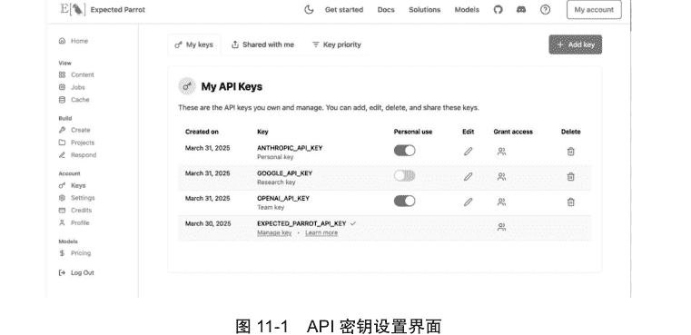

图 11-1 API 密钥设置界面

完成以上准备工作后，研究者便可利用 EDSL 包开展大语言模型辅助的硅基样本生成，以下将由问题、代理人、问卷及结果四个部分逐步阐述其运用方式。

#### 11.3.3 问题设计

本部分的目标是构建适合研究目标的各种类型问题。EDSL 包提供了多种问题类型，研究者可以根据希望从模型获取的响应形式进行选择。通过运行以下代码：

```
from edsl import Question
Question.available()
```

可以查看所有问题类型的列表及每种类型的实例（见表 11-2）：

表 11-2 问题类型及实例

| question_type（问题类型） | question_class（软件包中的标识） |
| :--- | :--- |
| checkbox（多选框） | QuestionCheckBox |
| extract（提取题） | QuestionExtract |
| free_text（自由回答） | QuestionFreeText |
| functional（功能题） | QuestionFunctional |
| likert_five（五点量表） | QuestionLikertFive |
| linear_scale（线性量表） | QuestionLinearScale |
| list（列表） | QuestionList |
| matrix（矩阵题） | QuestionMatrix |
| multiple_choice（多项选择） | QuestionMultipleChoice |
| numerical（数字题） | QuestionNumerical |
| rank（排序题） | QuestionRank |
| top_k（Top-K 题） | QuestionTopK |
| yes_no（是非题） | QuestionYesNo |

研究者可以通过导入特定问题类型的类并调用其 example 方法来检查其组成部分：

```
from edsl import ( # QuestionCheckBox, # QuestionExtract, # QuestionFreeText, #
QuestionFunctional, # QuestionLikertFive, # QuestionLinearScale, # QuestionList,
QuestionMultipleChoice, # QuestionNumerical, # QuestionRank, # QuestionTopK, #
QuestionYesNo )

q = QuestionMultipleChoice.example() # substitute any question type class name

q
```

由此可看到示范案例的构成要素（见表 11-3），进而辅助研究者自行构造相关的问题。

表 11-3 示例问题的构成要素

| key | value |
| :--- | :--- |
| question name（问题名称） | how_feeling（感觉如何） |
| question text（问题文本） | How are you?（你感觉如何？） |
| question options：0（选项 0） | Good（好） |
| question options：1（选项 1） | Great（非常好） |
| question options：2（选项 2） | OK（还行） |
| question options：3（选项 3） | Bad（不好） |
| include comment（包含评论） | False（否） |
| question type（问题类型） | multiple choice（多项选择） |

以多选题为例设计一个新问题，即在 0、1、2、3 四个数中选择最小的质数：

```
from edsl import QuestionMultipleChoice

q = QuestionMultipleChoice( question_name = "smallest_prime",
question_text = "Which is the smallest prime number?", question_options
= [0, 1, 2, 3] )
```

问题设计完成后，可以用 run 代码将问题交由大模型回答：

```
results = q.run()
```

由此获得的结果（results）是一个数据集，利用数据集处理方法即可获得相关的信息，比如可选择其中的模型（model）、对问题的答案（smallest_prime）和智能体对这一回答的注释（comment）三个变量：

```
results.select("model", "smallest_prime", "smallest_prime_comment")
```

可以看到，这一问题由 GPT-4o 模型，针对最小质数的答案是 2，并附加了相应的注释。关于 results 中包含的其他变量，可以用 results.columns 代码获悉，表 11-4 所示为输出结果。

表 11-4 输出结果

| model.model（运行模型） | answer.smallest_prime（答案） | comment.smallest_prime_comment（注释） |
| :--- | :--- | :--- |
| GPT-4o | 2 | 2 是最小的质数，因为它是唯一一个大于 1 且仅能被 1 和它本身整除的偶数 |

注意：如果是在本地运行任务，可以传入 run（progress_bar=True）来查看进度报告。任何异常情况都会显示在控制台中。如果启用了远程推理，系统会自动显示进度报告的链接；若发生异常，还会提供异常报告的链接。任务完成后，还会显示结果页面的链接。

#### 11.3.4 使用基于角色设定的智能体开展调查

一个问卷调查由多个问题组成，并通过 RLPA 策略，使用基于角色设定的智能体开展调查。下面以两个问题组成的调查问卷为例，为智能体设计不同的角色设定来回答这些问题。随后，通过选择特定的语言模型来生成答案。

##### 1. 问卷设计

首先，我们设计一个包含不同问题的类型的问卷，将之储存为 Survey 对象中：

```
from edsl import QuestionLinearScale, QuestionFreeText

from edsl import Survey

q_enjoy = QuestionLinearScale( question_name = "enjoy", question_text =
"On a scale from 1 to 5, how much do you enjoy reading?",
question_options = [1, 2, 3, 4, 5], option_labels = {1:"Not at all",
5:"Very much"} )

q_favorite_place = QuestionFreeText( question_name = "favorite_place",
question_text = "Describe your favorite place for reading." )

survey = Survey(questions = [q_enjoy, q_favorite_place])
```

由此，我们便设计一个包含一个 5 级量表的选择题和一个开放问答题的问卷，分别是询问受访者对阅读的享受程度以及受访者最喜好的阅读地点。

##### 2. 代理设计

下一步便是通过 RLPA 策略来设置智能体以回答这一问卷。EDSL 的一项重要功能是能够创建具有角色设定的智能体来填答问卷。这通过将包含相关“特征”（traits）的字典（dictionary）传递给 Agent 对象来实现，语言模型会利用这些特征生成响应。关于智能体设计的详细信息可在下面网址中进一步了解 <https://docs.expectedparrot.com/en/latest/agents.html>。

此处，我们构建三个具有不同职业属性的智能体作为示例，更复杂的智能体设计可以通过丰富“特征”（traits）来实现：

```
from edsl import AgentList, Agent

agents = AgentList( Agent(traits = {"persona":p}) for p in ["artist",
    "mechanic", "sailor"] )
```

##### 3. 大语言模型选择

完成问卷设计与智能体设定，下一步便是选择相应的大语言模型来辅助智能体回答这个问卷。

EDSL 包兼容多种主流的大型语言模型，用户可以在调查中自由选择使用。这使得比较不同模型在生成结果中的响应变得更加便捷。

要查看当前可用模型的列表，可运行以下代码：

```
from edsl import Model

Model.available()
```

从列表中，我们选择不同的模型来运行问卷调查，此处以“gpt-4o”和“gemini-pro”为例：

```
from edsl import ModelList, Model

models = ModelList( Model(m) for m in ["gpt-4o", "gemini-pro"] )
```

##### 4. 开展问卷调查

使用 by 方法向调查添加智能体和模型。随后，与单个问题的执行方式相同，我们通过调用 run 方法来进行调查：

```
results = survey.by(agents).by(models).run()

( results .sort_by("persona", "model") .select("model", "persona",
"enjoy", "favorite_place") )
```

#### 11.3.5 问卷调查进阶：顺序、记忆与场景

如上所述，向前连续性与反向连续性是算法保真度的重要维度，因此问卷的回答顺序与代理角色对前序问题的记忆对硅基抽样的准确性有重要意义。此外，场景（Scenario）一方面能够为代理角色提供更好的背景知识、提升算法保真度<sup>①</sup>，另一方面多样化的场景设计也为调查实验（survey experiment）设计提供了绝佳机会。

EDSL 提供多种方法来向调查问题添加数据或内容，包括以下 3 种方法：

- 1）顺序：将前一个问题的答案传递给后续问题（Piping）；
- 2）记忆：在向智能体呈现其他问题时，添加对先前问题和答案的“记忆”；
- 3）场景：使用数据对问题进行参数化，例如从 PDF、CSV、文档、图像或其他来源提取内容并添加到问题中。

##### 1. 传递问题答案（Piping）

下面演示如何将一个问题的答案传递到另一个问题的文本中。这是通过在后续问题的文本中使用 {{ <question_name>.answer }} 来实现的。在运行调查时，该部分会被前一个问题的答案替换，从而动态调整问题内容。这种方式还可以确保问题按照指定顺序呈现。

```
from edsl import QuestionNumerical, QuestionYesNo, Survey

q1 = QuestionNumerical( question_name = "random_number", question_text =
"Pick a random number between 1 and 1,000." )

q2 = QuestionYesNo( question_name = "prime", question_text = "Is this a
prime number: {{ random_number.answer }}" )

survey = Survey([q1, q2])

results = survey.run()
```

此时可以检查 prime 问题的 user_prompt，以验证 random_number 问题的答案是否成功传递（Piped）到其中：

```
results.select("random_number", "prime_user_prompt", "prime", "prime_comment")
```

##### 2. 添加前序问题答案的“记忆”

在此示例中，我们将第一个问题及其答案的“记忆”添加到第二个问题的上下文中。这是通过调用 memory 规则并指定要添加的问题来实现的。

与仅传递答案（Piping）不同，这种方式会完整呈现前一个问题及其答案，直接嵌入后续问题的文本中，而无需使用占位符。这样可以提供更丰富的上下文信息，使 AI 代理能够基于更完整的背景回答问题。

下面演示 add_targeted_memory）方法（此外，还可以使用 set_full_memory_mode）或其他记忆规则）：

> ① Bisbee, J., Clinton, J. D., Dorff, C., Kenkel, B., & Larson, J. M. (2024). Synthetic replacements for human survey data? The perils of large language models. Political Analysis. https://doi.org/10.1017/pan.2024.5.
> ② Sun, S., Lee, E., Nan, D., Zhao, X., Lee, W., Jansen, B. J., & Kim, J. H. (2024). Random silicon sampling: Simulating human sub-population opinion using a large language model based on group-level demographic information. Arxiv, abs/2402.18144. https://doi.org/10.48550/arXiv.2402.18144.
> ③ John Horton & Robin Horton. (2024). EDSL: Expected Parrot Domain Specific Language for AI Powered Social Science, https://docs.expectedparrot.com/en/latest/papers.html.
> ① Argyle, L. P., Busby, E. C., Fulda, N., Gubler, J. R., Rytting, C., & Wingate, D. (2023). Out of one, many : Using language models to simulate human samples. Political Analysis, 31 ( 3 ), 337–351. https ://doi.org/10.1017/pan.2023.2.

from edsl import QuestionNumerical, QuestionYesNo, Survey

q1 = QuestionNumerical(question_name="random_number", question_text="Pick a random number between 1 and 1,000.")

q2 = QuestionYesNo(question_name="prime", question_text="Is the number you picked a prime number?")

survey = Survey([q1, q2]).add_targeted_memory(q2, q1)

results = survey.run()

此时可以再次检查 user_prompt，以验证添加到后续问题中的上下文信息是否正确：

results.select("random_number", "prime_user_prompt", "prime", "prime_comment").table().long()

由此可得以下结果，见表 11-5。

表 11-5 输出结果

| key | value |
| :--- | :--- |
| answer.random_number（答案.随机数） | 487 |
| prompt.prime_user_prompt（提示.质数判断提示） | Is the number you picked a prime number? No Yes（你选的数字是质数吗？ 否 是） |

##### 3. 增加场景（Scenarios）

我们还可以向调查问题添加外部数据或内容，这在需要高效创建和管理多个版本的问题时（例如调查实验）非常有用。实现这一功能的方法是创建 Scenario（场景）字典，其中的键（keys）对应于问题文本（或选项）中使用的 {{placeholder}} 占位符，而值（values）则是要添加的具体内容。此外，场景还可用于在调查结果中添加元数据，例如数据来源或其他参考信息，这些信息可供分析使用，但不一定需要包含在问题文本中。

下面，我们在此前的阅读问卷基础上增加场景信息，使其能够接受其他所希望加入的数据。EDSL 提供了多种方法，可从 PDF、CSV、文档、图像、表格和字典等数据源自动生成场景。在本示例中，我们使用 from_list 方法将一组活动列表转换为相应场景。

随后，我们演示如何使用场景在不同阶段创建多个版本的问题：

1）在构建调查时生成多个版本的问题；
2）在运行调查时动态应用场景。

在运行调查时（后一种情况），我们可以使用 by 方法向包含占位符的问题动态添加场景，这与向调查添加代理和模型的方式相同。这样，调查结果中会新增一个“场景”列，每个问题在每个场景下的答案都会占据单独一行。

在构建调查时（前一种情况），我们可以使用 loop 方法生成多个版本的问题，并在问题构建时直接添加场景。当这些问题被传递到调查并运行时，结果会包含每个具体问题的独立列，不会有“场景”列，每个代理的所有问题答案都占据同一行。

首先，以最简单的场景添加方式将阅读活动扩展至更多活动：

from edsl import ScenarioList, Scenario

scenarios = ScenarioList.from_list("activity", ["reading", "running", "relaxing"])

若在运行调查中添加场景，使用 by 方法，同时指定相应的代理和模型：

from edsl import QuestionLinearScale, QuestionFreeText, Survey

q_enjoy = QuestionLinearScale(question_name="enjoy", question_text="On a scale from 1 to 5, how much do you enjoy {{ activity }}?", question_options=[1, 2, 3, 4, 5], option_labels={1: "Not at all", 5: "Very much"})

q_favorite_place = QuestionFreeText(question_name="favorite_place", question_text="In a brief sentence, describe your favorite place for {{ activity }}.")

survey = Survey([q_enjoy, q_favorite_place])

results = survey.by(scenarios).by(agents).by(models).run()

(results.filter("model.model == 'gpt-4o'").sort_by("activity", "persona").select("activity", "persona", "enjoy", "favorite_place"))

由此，结果中便包括了 GPT-4o 各个角色设定下对阅读、休闲和跑步三个问题的回答，此时 Result 中包含了场景这一变量。

此外，我们也可以在构建调查时向问题添加场景，而不是在运行时添加。这样，在运行调查后，结果中将包含每个问题的独立列，而不会有“场景”字段。需要注意的是，我们还可以选择在问题名称中包含场景键（scenario key），否则问题名称会默认递增。

from edsl import QuestionLinearScale, QuestionFreeText

q_enjoy = QuestionLinearScale(
    question_name="enjoy_{{ activity }}",  # optional use of scenario key
    question_text="On a scale from 1 to 5, how much do you enjoy {{ activity }}?",
    question_options=[1, 2, 3, 4, 5],
    option_labels={1: "Not at all", 5: "Very much"}
)

q_favorite_place = QuestionFreeText(
    question_name="favorite_place_{{ activity }}",  # optional use of scenario key
    question_text="In a brief sentence, describe your favorite place for {{ activity }}."
)

我们通过循环场景（looping the scenarios）可以创建享受度问卷的多个版本，每个版本对应不同的场景内容：

enjoy_questions = q_enjoy.loop(scenarios)

enjoy_questions

favorite_place_questions = q_favorite_place.loop(scenarios)

favorite_place_questions

进一步地，将所有问题整合到调查中，并运行：

survey = Survey(questions=enjoy_questions + favorite_place_questions)

results = survey.by(agents).by(models).run()

相较于 by 方法获得的 result 是一个长数据框，使用 loop 方法获得的 result 则是一个宽数据框，场景会体现在变量名之中。运行以下代码可得表 11-6 的结果示例：

(results.filter("model.model == 'gpt-4o'").sort_by("persona").select("persona", "enjoy_reading", "enjoy_running", "enjoy_relaxing"))

表 11-6 输出结果

| agent.persona (代理人角色) | answer.enjoy_reading (阅读喜好度) | answer.enjoy_running (跑步喜好度) | answer.enjoy_relaxing (放松喜好度) |
| :--- | :--- | :--- | :--- |
| artist (艺术家) | 4 | 2 | 4 |
| mechanic (工程师) | 2 | 1 | 3 |
| sailor (海员) | 3 | 2 | 3 |

EDSL 内置了多种方法，可用于分析和可视化调查结果，具体方法详见这一说明：https://docs.expectedparrot.com/en/latest/language_models.html。此外，也可以使用 to_pandas 方法将结果转换为 DataFrame 进行进一步处理：

df = results.to_pandas(remove_prefix=True)

最后，研究者可便捷地将成果上传至 Coop 平台。Coop 是一个用于创建、存储和共享基于 LLM 的研究的平台。它与 EDSL 完全集成，可通过您的工作区或 Coop 账户页面访问。关于 Coop 的详细信息可于其官网获悉 https://www.expectedparrot.com/content/explore。

### 11.4 总结

本章介绍了大模型辅助的硅基样本生成的原理与操作。硅基样本的核心理论基础在于算法保真度，这一概念由社会科学的图灵测试、反向连续性、向前连续性和模式对应性四个维度构成，既是硅基样本方法的合法性基础，也是一项需要检验的假设。其核心策略是基于角色设定的智能体设计，为大模型设定清晰的角色和丰富的背景知识，使其在回答问题时尽可能符合人类逻辑，从而实现算法保真。

在具体操作上，Python 的 EDSL 开源软件包提供了一整套实施硅基样本生成的流程。本章介绍了从问题设计、问卷设计、代理人设置、模型选择到调查执行的核心步骤。此外，我们进一步讲解了顺序控制、记忆管理与场景设定等高级功能，使调查能够更符合实际研究需求，并为复杂实验设计和进阶问卷研究奠定了基础。

尽管硅基样本方法在社会科学研究中展现出高效性与可扩展性，但其适用性仍受到一定限制。大模型的对齐偏差可能导致模拟个体的社会经济特征与现实人群存在差异<sup>①</sup>，这一偏差要求我们更精准地设置代理角色。知识应用鸿沟也限制了其对复杂社会行为的真实模拟。此外，不同研究领域对硅基样本的依赖程度不尽相同，例如在经济预测领域，它可能能从历史数据中提取潜在规律并避免人类预测中的系统性偏差，但在涉及主观态度和文化行为的研究中，其局限性更加明显。因此，未来研究应探索如何结合硅基样本与传统调查方法，以弥补硅基样本在数据代表性、异质性捕捉和社会复杂性模拟方面的不足，从而更全面地服务于社会科学研究。

### — 思考与练习 —

思考：硅基样本生成的基本要求是什么？我们在什么条件可以信任硅基样本？硅基样本在什么场景中可以补充或替代碳基样本？

练习：请使用 EDSL 包设计一个关于 AI 素养的问卷，涵盖以下 3 个方面：

1）对 AI 的知识掌握程度（如 AI 基础概念、应用领域等）
2）对 AI 风险的认知（如数据隐私、算法偏见等）
3）对 AI 的好奇心（如对 AI 技术的兴趣、愿意学习的程度等）

请设置具有不同角色的智能体（Agents）回答调查问卷，他们应来自不同的受教育背景、经济收入水平和地理区域，以便分析各类人群对 AI 的认知差异。

提示：使用 Agent 创建不同背景的代理人，使用 run 方法执行调查，并尝试使用 to_pandas 方法分析结果。

> ① Zhou, M., Yu, L., Geng, X., & Luo, L. (2025). ChatGPT vs Social Surveys: Probing Objective and Subjective Silicon Population (No. arXiv: 2409.02601). arXiv. https://doi.org/10.48550/arXiv.2409.02601.

# ChatGPT 篇

# 第 12章 数据处理

### 本章重点

- 使用大语言模型进行数据标注、特征提取、情感识别
- 使用大语言模型来插补缺失数据
- 评价人工智能辅助的数据处理的质量

### 12.1 引言

在计算社会科学，甚至整个社会科学当中，使用人类编码员进行数据标注都是许多研究的必要步骤。然而，由于近年工业界和学术界在搜集大量数据的长足进展，社会科学的研究数据量的显著增长已经成为了计算社会科学的一个显著特征。在这个背景下，如何平衡大规模标注的数量和质量，则成为了诸多学者共同探讨的话题。

幸运的是，随着转换器模型架构的推出，基于文本表征的预训练、生成式模型已经取得了长足进展，并涌现出了一大批的高质量的离线或者在线模型服务研究者，已经能够通过生成式人工智能实现快速、高质量、相对便宜地标注数据的能力。例如，一篇 2023 年发表于《美国科学院院刊》（*Proceedings of the National Academy of Sciences*）的实验显示（如图 12-1 所示），在诸多不同的标注任务中，彼时的大语言模型标注能力，已经超越了人类编码员。随着生成式人工智能的进一步发展，特别是基于转换器的模型的逐步提升，研究人员越来越能够利用生成式人工智能进行快速的数据处理任务。

基于数据处理领域的长足进展，本章主要介绍利用 OpenAI 接口完成的数据标注、特征提取、主题建模、情感识别和数据缺失值插补技术，并提供了相应代码。

> Gilardi, F., Alizadeh, M., & Kubli, M. (2023). ChatGPT outperforms crowd workers for text-annotation tasks. Proceedings of the National Academy of Sciences, 120(30), e2305016120.

### 12.2 数据标注

生成式大语言模型具备强大的能力和多种不同的研究性用途，本节将展示生成式大语言模型在情感分析、主题分类和数据标注的强大能力，以及每一种用途的简要示例代码。

#### 12.2.1 情感分析

生成式大语言模型可以用于快速的情感分析。在代码 12-1 中，我们使用 OpenAI 的 GPT-4 模型实现了一个结构化情感分析功能。首先通过

> Gilardi, F., Alizadeh, M., & Kubli, M. (2023). ChatGPT outperforms crowd workers for text-annotation tasks. Proceedings of the National Academy of Sciences, 120(30), e2305016120.

OpenAI 客户端初始化连接，并定义了一个情感分析函数：系统会要求模型扮演专业分析角色，将文本情感严格归类为积极（返回 1）、消极（返回 -1）或中性（返回 0），且强制只输出数值结果。

##### 【代码 12-1 调用 OpenAI 应用程序接口进行情感分析】

from openai import OpenAI

###### 初始化 OpenAI 客户端
client = OpenAI(api_key=API_KEY)  # 替换为你的 API 密钥

def analyze_sentiment(text: str) -> str:
    """
    根据给定文本使用 GPT-4 模型进行情感分析

    参数:
        text (str): 需要进行情感分析的文本

    返回:
        str: GPT-4 模型返回的情感分析结果
    """
    # 构建情感分析提示
    system_prompt = "你是一个专业的情感分析助手，能够准确识别和解释文本中的情感倾向。如果是积极的，则返回 '1'，如果是消极的，则返回 '-1'，如果是中性的，则返回 '0'。如果无法判断，则给出最合适的猜测。请只返回结果。"
    user_prompt = f"请对下面的文本进行情感分析：\n\n"{text}"\n\n情感分析结果："

    # 调用 GPT-4 模型
    response = client.chat.completions.create(
        model="gpt-4",
        messages=[
            {"role": "system", "content": system_prompt},
            {"role": "user", "content": user_prompt}
        ]
    )

    # 提取并返回结果
    return response.choices[0].message.content.strip()

这段代码通过构建双层提示——系统指令定义分类规则，用户提示输入待分析文本，调用 GPT-4 进行推理后，直接提取模型生成的数值结果。示例中对“我今天心情非常愉快…”的测试文本会预期返回 1，体现了该模型将自然语言情感转化为结构化数据的自动化处理能力。

##### 【代码 12-2 调用 OpenAI 应用程序接口进行情感分析的示例输入】

sample_text = "我今天心情非常愉快，因为得到了一个意想不到的惊喜！"
result = analyze_sentiment(sample_text)
print("情感分析结果:", result)

##### 【代码 12-3 调用 OpenAI 应用程序接口进行情感分析的示例输出】

情感分析结果：1

#### 12.2.2 主题建模

对于传播学、政治学等社会科学，一个常见的大规模文本分析的场景是需要分辨多种不同的文本主题。例如一篇发表在《传播学期刊》（*Journal of Communication*）的文章讨论了用户的互动如何影响新闻媒体的报道话题选择，而这个研究的必要步骤就是对大量的新闻文本进行不同主题（枪支管控等）以及类型（政治性、娱乐性等）分类。

尽管在该研究中，主题的建模以 NMF 模型完成，我们将在接下来的代码 12-4 演示，如何使用 OpenAI 的 API 完成快速的主题建模工作。具体而言，这段代码使用 OpenAI 的 GPT-4 模型实现文本主题建模功能。通过初始化 OpenAI 客户端并定义 perform_topic_modeling 函数，代码构

> Mukerjee, S., Yang, T., & Peng, Y. (2023). Metrics in action: how social media metrics shape news production on Facebook. Journal of Communication, 73(3), 260-272.

建了包含系统指令（要求精准识别单一主题并直接返回结果）和用户提示（含待分析文本）的对话结构。调用 chat.completions.create 接口后，从模型响应中提取并返回纯文本主题。示例展示了输入政治新闻类文本后，模型准确输出“枪支管控辩论”这一主题，体现了其在新闻分类、内容标签化等场景的实用性。

##### 【代码 12-4 调用 OpenAI 应用程序接口进行主题建模】

```python
from openai import OpenAI

###### 初始化 OpenAI 客户端
client = OpenAI(api_key=API_KEY)  # 替换为你的 API 密钥

def perform_topic_modeling(text: str) -> str:
    """
    根据给定文本使用 GPT-4 模型进行主题建模

    参数:
        text (str): 需要进行主题建模的文本

    返回:
        str: GPT-4 模型返回的主题列表，多个主题用逗号分隔
    """
    # 构建主题建模提示
    system_prompt = "你是一个专业的主题建模助手，能够准确识别文本中包含的主要主题。请分析文本并返回最相关的一个主题。如果无法确定，请给出最合理的猜测。请只返回结果。"
    user_prompt = f"请对下面的文本进行主题建模：\n\n"{text}"\n\n主题:"

    # 调用 GPT-4 模型
    response = client.chat.completions.create(
        model="gpt-4",
        messages=[
            {"role": "system", "content": system_prompt},
            {"role": "user", "content": user_prompt}
        ]
    )

    # 提取并返回结果
    return response.choices[0].message.content.strip()
```

示例输入：

##### 【代码 12-5 调用 OpenAI 应用程序接口进行主题建模的示例输入】

```python
sample_text = "关于枪支管控的辩论一直是美国政治中最为激烈的话题之一"
result = perform_topic_modeling(sample_text)
print("主题建模结果:", result)
```

示例输出显示，模型正确地给出了为政治性新闻的主题预测：

##### 【代码 12-6 调用 OpenAI 应用程序接口进行主题建模的示例输出】

```
主题建模结果：枪支管控辩论
```

### 12.3 缺失值插补

大型语言模型（LLM）较大的预训练规模还带来了另一个潜在用途——利用它对文本之间复杂关系的理解能力完成缺失数据插补。这种能力已经被诸如推荐系统、社会调查等不同领域的学者调查和使用。例如，在 Ding 等人有关 ChatGPT 在推荐系统中的数据插补效能的评估中，这种基于语言模型的数据插补方法极大地弥补了此前技术的局限，并在残差上取得了最小水平。如果将 LLM 对于缺失值的插补视为表格数据的生成，那么相关研究也展示了这种语言模型在拟合现实表格数据的优越性能。

> Ding, Z., Tian, J., Wang, Z., Zhao, J., & Li, S. (2024). Data imputation using large language model to accelerate recommendation system. arXiv preprint arXiv:2407.10078.
> Borisov, V., Sessler, K., Leemann, T., Pawelczyk, M., & Kasneci, G. (2023). Language models are realistic tabular data generators. In The Eleventh International Conference on Learning Representations. https://openreview.net/forum?id=cEygQNOeI.

基于这些学者的探索，接下来介绍两种简单易用的缺失值插补微调技术应用：基于单行的预测（利用 LLM 预测下一个句子的能力）和基于数据微调的预测（即为 Ding 等人研究的简化版本）。

#### 12.3.1 基于单行的插补

##### 【代码 12-7 调用 OpenAI 应用程序接口按行进行数据插补】

```python
import openai

###### 设置您的 OpenAI API 密钥
openai.api_key = 'YOUR_API_KEY'

def predict_label(features: dict) -> str:
    """
    根据给定的特征列构造提示，并使用 GPT-4 预测标签。

    参数:
        features (dict): 一个字典，键为特征名称，值为特征值。

    返回:
        str: GPT-4 模型返回的预测标签。
    """
    # 创建一个提示，列出所有特征并请求预测结果
    prompt = "给定以下特征，请预测相应的标签:\n\n"
    for key, value in features.items():
        prompt += f"- {key}: {value}\n"
    prompt += "\n预测的标签:"

    # 使用 GPT-4 获取预测结果
    response = openai.ChatCompletion.create(
        model="gpt-4",
        messages=[
            {"role": "system", "content": "你是一个基于提供的特征预测标签的智能助手。"},
            {"role": "user", "content": prompt}
        ]
    )

    # 从响应中提取预测的标签
    predicted_label = response['choices'][0]['message']['content'].strip()
    return predicted_label

###### 示例用法:
if __name__ == "__main__":
    # 定义特征列，例如:
    # 使用 "The capital of China is " 作为示例输入
    sample_features = {
        "sentence": "The capital of China is "
    }

    label = predict_label(sample_features)
    print("预测的标签:", label)
```

#### 12.3.2 基于数据微调的插补

##### 【代码 12-8 调用 OpenAI 应用程序接口进行微调数据插补】

```python
import openai

###### 设置您的 OpenAI API 密钥
openai.api_key = 'YOUR_API_KEY'

###### 步骤 1: 上传训练数据文件 (JSONL 格式)
###### 示例训练数据 (training_data.jsonl) 的内容如下:
###### {"prompt": "The capital of China is", "completion": " Beijing"}
###### {"prompt": "The capital of France is", "completion": " Paris"}
try:
    training_file = openai.File.create(
        file=open("training_data.jsonl", "rb"),
        purpose="fine-tune"
    )
    print("上传训练数据文件成功, 文件ID:", training_file.id)
except Exception as e:
    print("上传训练数据文件失败:", e)
    exit(1)

###### 步骤 2: 创建微调任务
try:
    fine_tune_job = openai.FineTune.create(
        training_file=training_file.id,
        model="davinci",  # 可选择其他支持微调的模型, 如 ada, curie, babbage 等
        n_epochs=4        # 设置微调训练的迭代次数
    )
    print("创建微调任务成功, 任务ID:", fine_tune_job.id)
except Exception as e:
    print("创建微调任务失败:", e)
    exit(1)

###### 步骤 3: 检查微调任务状态
try:
    fine_tune_status = openai.FineTune.retrieve(id=fine_tune_job.id)
    print("微调任务当前状态:", fine_tune_status.status)
except Exception as e:
    print("获取微调任务状态失败:", e)
```

### 12.4 大规模的数据处理

既然大语言模型适合大规模的数据处理任务，但前文尚未涉及却又十分必要的一个部分是，如何将这些数据处理技术应用到大规模的分析当中——本节将简要介绍错误处理、进度展示和并行化技术。

##### 1. 错误处理

由于大部分情况下我们要么依赖网络提供的模型服务，要么依赖本地的后端模型，就必须考虑网络断开、服务过载或者模型出错的情况。简而言之，在 Python 中应当捕捉可能的错误，并跳过对应的偶发任务，以免让整个任务失败，见代码 12-9。

###### 【代码 12-9 错误处理】

```python
###### 可能引发错误 (ZeroDivisionError) 的函数
def divide(a, b):
    return a / b

###### 使用try-except块捕获特定错误
try:
    result = divide(5, 0)  # 这将导致ZeroDivisionError
except ZeroDivisionError as e:
    print(f"不能被零除! 错误信息: {e}")
```

##### 2. 进度展示

当数据量较大，观察进度和预估时间就变得必要。在此介绍一个简单的进度条，由 tqdm 提供，见代码 12-10。如果尚未安装 tqdm，可以使用 pip install tqdm 安装。

###### 【代码 12-10 进度展示】

```python
import pandas as pd
from tqdm import tqdm

###### 启用tqdm进度条，用于pandas的apply操作
tqdm.pandas()

###### 创建一个示例DataFrame数据集
df = pd.DataFrame({
    'numbers': range(1, 100001)  # 生成一个较大的数据集用于演示
})

###### 定义一个计算密集型的函数
def compute_square(x):
    return x * x

###### 使用progress_apply执行函数，并显示进度条
df['squared'] = df['numbers'].progress_apply(compute_square)

###### 显示结果的前几行
print(df.head())
```

##### 3. 并行技术

与正常情况下的序列化运行不同，如果该模型服务能够支撑 1min 内甚至 1s 内的多个请求，我们可以使用 pandarallel 并行化这个标注过程。注意，使用这个模块也需要考虑如何捕捉可能存在的错误。

首先安装软件包 `pip install pandarallel`，然后按代码 12-11 所示的示例使用。

###### 【代码 12-11 大量数据的并行化】

```python
###### 引入所需的库
import pandas as pd
from pandarallel import pandarallel

###### 初始化并行引擎，此处以 8 为例
pandarallel.initialize(progress_bar=True, nb_workers = 8) # 使用 8 个并行

###### 创建一个示例数据框
df = pd.DataFrame({
    'numbers': range(1, 11)  # 1-10 的数字
})

###### 定义一个计算密集型函数
###### (在实践中，使用 pandarallel 进行繁重计算)
def square_and_add_five(x):
    return x**2 + 5

###### 在 DataFrame 上并行应用函数使用 pandarallel
###### 注意: parallel_apply() 是 apply() 的并行化版本
df['result'] = df['numbers'].parallel_apply(square_and_add_five)

###### 显示生成的数据框
print(df)
```

### 12.5 质量评价

尽管诸多研究已经表明了生成式 AI 在特定场景的应用潜力，一个悬而未决的讨论是，如何能够信任这样的标注呢？一些研究者认为实验既然已经证明了其能力，那么自然而然，可以将生成式 AI 应用到社科研究当中；而另一些研究者则持有一个相对谨慎的态度：我们或许需要对生成式 AI 的结果进行特定场景的再评估。

#### 12.5.1 评估标准

应当使用什么标准进行评估，是首先要解决的问题。这里有两种情况。一种情况是，我们需要将标注结果与既有的事实相比较，以评估标注结果反应事实的程度。在这种情况下，最常用的指标是准确度（accuracy），即相同的结果占所有结果的比例。然而，在很多情况下，还需要考虑精确度（precision）以及 F1 值（F1-score）、AUROC 等不同的指标，这部分内容的具体阐述可参见入门级别的机器学习的相关书籍和文献（例如 Gareth James 等人的 *An Introduction to Statistical Learning*、Sebastian Raschka 和 Vahid Mirjalili 的 *Python Machine Learning*）。

另一种情况是，我们拥有不同的标注，并希望能够衡量不同的标注之间的可信程度，即编码员间信度。最常用的信度指标被称为百分比一致性，它的计算基本等同于准确度、适用于两个编码员之间的评估，如果我们拥有两个以上的编码员或者拥有定距数据需要评估，则适用克里本多夫系数（Krippendorff's alpha, α）：

$$\alpha = 1 - \frac{nm-1}{m-1} \frac{\sum pfu}{\sum pmt}$$

公式中，*n* 指的是不同编码员共同编码的案例数，*m* 指的是编码员的数量，*pfu* 表示一个不一致的案例单元的频数乘积，*pmt* 表示边际总数的所有配对乘积。

下文将以准确度为评估标准，详细解释如何对生成式 AI 标注进行评估。

#### 12.5.2 评估方法

任何评估标准都需要相应的评估方法作为支撑。对于大规模标注数据而言，如何实现既快速又准确的准确度评估，仍是学界关注的研究热点。以下介绍 3 种常用的大规模标注数据准确度计算方法。

##### 1. 人类 - 模型协作评估

一篇计算机科学领域的文章认为，由于 LLM 本身可能存在偏误（bias）并可能降低标注的实际质量，我们可以考虑将人类辅助纳入到编码的验证过程。具体而言，Wang 等人提出可以将人类辅助的 LLM 标注分为四个主要步骤，并依靠人类对低质量标注的样本进行人工重验证。当然，这种方法不太可能在资源有限的情况下快速完成。

##### 2. 基于众包的人类验证

如果研究的规模变大，学者们已经尝试了使用众包平台以实现评估的规模化。众包指的是将任务以及对应的任务报酬分发给愿意参与的公众，来平衡规模、速度和成本。由于每个人需要完成的任务很少（大多数时候是一个），所以它的优势是速度很快，劣势则有二：成本控制和学者们对众包平台的参与者完成质量的担忧。

##### 3. 抽样验证

但是，如果数据量再上一个规模，那么众包的优势也逐渐消失，学者们开始采用抽样分析或者结合众包的抽样分析的方法。例如，在一篇即将发表在 *Political Analysis* 论文中，段泽宁等人使用了一种抽样评估性能的技术。在这篇文章中，为了比较不同方法的性能，他们通过抽样的方式来一部分数据集的机器标注和假定为事实的众包标注，进而得出对于总体性能的估计。有必要指出，该文章中一个未阐明的潜在假设是，样本准确度是总体准确度的良好估计。

为了提供更直观的验证策略的演示，本小节设计了一个二元文本分类的模拟实验。如图 12-2 所示，实验假定了一个约为 70.32% 的准确度的总体（N=10000），并对总体进行 1000 次、每次 200 样本的放回随机抽样，并记录每个样本的百分比准确度。可以看到，面板 A 展示了每个样本的准确度分布。

> Wang, X., Kim, H., Rahman, S., Mitra, K., & Miao, Z. (2024, May). Human-LLM collaborative annotation through effective verification of LLM labels. In Proceedings of the CHI Conference on Human Factors in Computing Systems (pp.1-21).

> Duan, Z., Shao, A., Hu, Y., Lee, H., Liao, X., Suh, Y., Kim, J., Yang, K. C., Chen, K., & Yang, S. (2024). Constructing Dictionaries to Extract Message Features from Texts: A Case Study of Moral Content. Political Analysis (forthcoming).

确度均在总体准确度附近游走，而面板 B 则展示了该样本参数的分布近似以总体准确度为均值的正态分布。该实验代码见代码 12-12。

###### 【代码 12-12 模拟实验的复现代码】

```r
###### Set seed for reproducibility
set.seed(123)

if (!require("pacman")) install.packages("pacman")
pacman::p_load(showtext, sysfonts, showtextdb)

showtext_auto()

font_install(source_han_serif())
###### 1. Construct fake dataset
n <- 10000
df <- data.frame(
    id = 1:n,
    text = paste("Text", 1:n),
    label_true = rbinom(n, 1, 0.5)
)

###### Generate label_pred such that 70% are correct
df$label_pred <- ifelse(runif(n) < 0.7, df$label_true, 1 - df$label_true)

###### Calculate population accuracy
pop_accuracy <- mean(df$label_true == df$label_pred)
cat("Population Accuracy:", pop_accuracy, "\n")

###### 2. Do 100 rounds of sampling (bootstrap by id)
nRounds <- 1000
sampled_accuracy <- numeric(nRounds)
for (i in 1:nRounds) {
    sample_ids <- sample(df$id, size = 200, replace = TRUE)
    sample_df <- df[sample_ids, ]
    sampled_accuracy[i] <- mean(sample_df$label_true == sample_df$label_pred)
}

###### 3. Create a data frame for plotting sample accuracies
df_acc <- data.frame(Round = 1:nRounds, Accuracy = sampled_accuracy)

###### 4. Plotting
library(ggplot2)
library(gridExtra)
nature_colors <- c("#014E8D", "#9B241B", "#999999") # nature brand
###### Plot: Accuracy vs. Round with population accuracy line
p1 <- ggplot(df_acc, aes(x = Round, y = Accuracy)) +
    geom_line(color = nature_colors[[3]], alpha = 0.5) +
    geom_point(color = nature_colors[[1]], alpha = 0.3, size = 1) +
    geom_hline(yintercept = pop_accuracy, linetype = "dashed", color = "black") +
    geom_text(
        aes(x = 500, y = pop_accuracy, label = paste("Population Accuracy:",
            round(pop_accuracy * 100, 2), "%")),
        vjust = -7,
        color = "black",
        size = 4
    ) +
    # y axis from 0 to 100
    scale_y_continuous(limits = c(0.5, 1), labels = scales::percent_format(accuracy = 1)) +
    labs(
        title = "A. 1000 Rounds of Sample Accuracy",
        x = "Round",
        y = "Accuracy"
    ) +
    theme_bw()

###### Plot: Histogram of sample accuracies with population accuracy
p2 <- ggplot(df_acc, aes(x = Accuracy)) +
    geom_vline(xintercept = pop_accuracy, linetype = "dashed", color = "black", size = 1) +
    geom_histogram(bins = 20, fill = nature_colors[[1]], color = nature_colors[[1]], alpha = 0.8) +
    labs(
        title = "B. Sample Accuracy Distribution",
        x = "Accuracy",
        y = "Frequency"
    ) +
    theme_bw()

###### Arrange the two plots in a single column
g <- grid.arrange(p1, p2, ncol = 2)
ggsave("../sample.accuracy.png", plot = g, width = 12, height = 6, dpi = 300)
```

### 12.6 总结

本章重点介绍了大语言模型在社科标注实践中的使用。涵盖了以下 5 个主题并提供了相应的代码：

- 1）数据标注；
- 2）主题识别；
- 3）情感分析；
- 4）缺失值插补；
- 5）质量评价。

### — 思考与练习 —

思考：如果现阶段的人工智能尚未达到人类的智力水平，那么将人类能够处理的任务给人工智能处理的最好的方向是？ - A. 简单任务复杂化 - B. 复杂任务简单化

练习：在文中我们已经给出了用 GPT 进行主题识别的例子，也给出了用 GPT 进行情感分析的例子，请你参考这两个例子，自己撰写一个三分类的示例——将一个新闻标注为“政治性新闻”“娱乐性新闻”和“其他新闻”三类中的一类且仅为一类。

# ChatGPT 篇

## 第 13 章 ChatGPT 与研究数据分析

### 本章重点

- 研究数据分析概述
- 非结构文本数据的结构化
- 数据可视化
- 编写代码与数据分析自动化

### 13.1 研究数据分析概述

数据分析在社会科学研究中扮演着至关重要的角色，它不仅是理论验证的基础，还决定了研究结论的可信度与解释力。在传统的数据分析流程中，研究者需要掌握复杂的统计方法、编写代码以处理数据，并利用专业软件进行建模与可视化。然而，AI技术的进步正在重塑这一领域，极大地提升了数据分析的效率和可及性。

AI在数据分析中的作用日益凸显，尤其是在数据处理、模式识别和预测分析方面。基于自然语言处理（NLP）、机器学习（Machine Learning, ML）和计算机视觉（Computer Vision, CV）等技术的AI系统，能够自动整理、清洗和分析大量数据，从而减少研究者在重复性任务上的投入，使他们能够专注于理论构建和实证解释。

作为AI工具的一种，ChatGPT在社会科学研究的数据分析中展现出独特的优势。它不仅能够辅助研究者执行数据清理、变量生成、统计计算和结果可视化等任务，还能通过自然语言交互降低技术门槛，使非编程背景的学者也能高效开展数据分析。例如，研究者可以通过与ChatGPT交互，快速生成Python或R代码，实现数据处理与建模；或者利用其强大的解释能力，让其帮助解读统计结果并提供研究启示。此外，ChatGPT还能充当“研究助手”，帮助学者优化数据分析策略、改进研究设计，甚至预测可能的研究趋势。

本章将探讨ChatGPT在社会科学数据分析中的多种应用场景，包括数据预处理、统计建模、数据可视化以及文本分析等内容，展示其如何助力社会科学研究的数字化转型。

### 13.2 非结构文本数据的结构化

非结构化文本数据（如访谈记录、政策文件、社交媒体评论等）往往包含丰富的信息，但由于缺乏固定的格式和结构，使得数据的整理、分析和量化过程充满挑战。传统的结构化方法通常依赖编程工具（如 Python 的 NLP 库）或人工编码，但这些方法要么门槛较高，要么耗时费力。而 ChatGPT 作为一种强大的自然语言处理工具，可以极大地提升非结构化数据的处理效率，帮助研究者快速提取、分类、整理和结构化文本数据，从而更好地服务于定量分析和混合方法研究。自动摘要与关键信息提取、语义分类与标注、结构化数据表格生成是 ChatGPT 在这一过程中发挥作用的几个关键方面，也是本节接下来的主要内容。

#### 13.2.1 自动摘要与关键信息提取

在社会科学研究中，文本数据往往来源广泛，包括政策文件、政府报告、学术论文、新闻报道、社交媒体评论、访谈记录等。这些文本通常篇幅较长，信息繁杂，研究者需要从中提取关键信息，以便进行定性分析或转换为结构化数据进行定量研究。然而，手动筛选和整理文本内容不仅费时费力，而且容易受到研究者个人认知的影响。ChatGPT 作为一款强大的自然语言处理工具，能够高效地帮助研究者自动生成摘要、提取关键词、归纳主题、按类别筛选信息，极大地提升信息处理的效率和准确性。

1）自动生成摘要：例如根据文本长度自动生成长摘要或短摘要；适应不同的摘要需求，如通用摘要、问题导向摘要、主题摘要等；结合研究者的需求进行个性化摘要，如侧重政策目标、实施措施、影响评估等内容。见提示词 13-1。

##### 【提示词 13-1 自动生成摘要】

输入：
请对以下数字政府建设政策文本进行自动摘要提取，保留主要政策目标与关键举措。摘要应使用简洁、正式的语言表述，适合用于学术引用、政策比较或数据录入场景。
文本：为加快推进全省数字政府建设，提升政务服务质量，推动政府数字化转型，本方案提出以下目标
1、到2025年，基本建成全省一体化政务服务平台，实现政务信息资源共享；
2、推进“基层一张表”改革，减少重复报送，提高政府工作协同效率；
3、完善政务数据开放机制，建立统一的数据交换标准，提高数据利用水平；
4、强化政府网站和政务新媒体管理，提升政府信息发布的权威性与互动性；
5、依托人工智能和大数据技术，优化政府决策支持系统，提高政府治理能力。

输出：
本《行动计划》旨在推进全省数字政府建设，重点包括：
1、建立一体化政务服务平台，推动数据共享；
2、通过“基层一张表”改革，提高部门协作效率；
3、规范政务数据开放，提升数据利用水平；
4、强化政务传播，提高信息发布权威性；
5、依托 AI 和大数据，优化政府治理能力。

2）提取关键词和主题：例如从政策文件中提取核心治理主题；从新闻报道中提取高频词；从学术论文中提取研究议题等。见提示词 13-2。

##### 【提示词 13-2 提取关键词和主题】

输入：
请对以下文本内容进行关键词与主题提取，识别其中最具代表性的政策术语、治理议题或核心概念。关键词应以简洁的名词或短语为主，可用于研究标签构建、政策归类或后续文本建模任务。
文本：为了提升政务服务效能，本方案提出基于大数据的智能决策支持系统，推动政府治理能力现代化，同时加强数据共享机制，优化跨部门协作能力。

输出：
[“政务服务”，“大数据”，“智能决策支持”，“政府治理现代化”，“数据共享”，“跨部门协作”]

3）按类别提取信息：例如按政策目标分类；按法律条款提取；按访谈主题归类等。见提示词 13-3。

##### 【提示词 13-3 按类别提取信息】

输入：
研究者希望从一段政策文本中，聚焦提取与特定主题（如“政务数据开放”）相关的内容，忽略无关表述。输出应为与该主题直接相关的句子、要点或段落，便于构建主题文档集、知识图谱节点或进行专题分析。
文本：本省将深化数字政府改革，推动政务数据开放，提升公共数据共享机制。政府各部门需加强数据治理，确保数据安全，同时推进跨部门数据协同机制，优化数据利用水平。此外，将依托 AI 和大数据技术提升决策支持能力。

输出：
[
“推动政务数据开放，提升公共数据共享机制；”，
“政府各部门需加强数据治理，确保数据安全；”，
“推进跨部门数据协同机制，优化数据利用水平。”
]

#### 13.2.2 语义分类与标注

在社会科学研究中，文本数据的分类与标注是定性研究和定量研究结合的重要步骤。研究者通常需要对政策文件、新闻报道、社交媒体评论、访谈文本等非结构化数据进行分类和主题归纳，以便提取有价值的信息。然而，传统的文本分类方法通常依赖手工编码或机器学习分类模型：

- 手工编码：研究者依据理论框架逐条阅读文本，并进行标注。这种方法虽然准确，但耗时且难以适用于大规模数据集。
- 机器学习分类模型：需要研究者预先标注部分文本作为训练集，并使用支持向量机（Support Vector Machine，SVM）、随机森林、深度学习等模型进行分类，但这些方法要求较高的编程能力和计算资源。

ChatGPT 提供了一种高效且易用的替代方案，能够自动分类文本、进行情感分析、识别实体信息，降低研究者在文本数据处理上的负担，使他们能更专注于理论分析和结果解释。

1）自动文本分类：文本分类是社会科学研究中最常见的任务之一，研究者往往需要将文本按照政策领域、社会议题、研究主题等维度进行归类。ChatGPT 通过自然语言理解（Natural Language Understanding，NLU）技术，可以自动读取文本并进行语义分类，研究者只需提供少量示例或明确分类标准，即可快速处理大量文本。见提示词 13-4。

##### 【提示词 13-4 自动文本分类】

输入：
研究者收集了一批关于政府政策的文本材料，现希望借助语言模型对其进行自动分类。分类应基于文本内容的主要议题，如“经济政策”“环境法规”“社会治理”等，输出结构化的分类结果，便于后续统计分析或信息管理。
文本1：政府发布新规，鼓励高科技企业投资人工智能，推动数字经济发展。
文本2：近日，环保部门出台法规，加强空气污染治理，严格控制工业排放标准。
文本3：公安部门启动社会治理专项行动，推进社区治安管理现代化。

输出：
[
  {"文本": "政府发布新规，鼓励高科技企业投资人工智能，推动数字经济发展。", "分类": "经济政策"},
  {"文本": "近日，环保部门出台法规，加强空气污染治理，严格控制工业排放标准。", "分类": "环境法规"},
  {"文本": "公安部门启动社会治理专项行动，推进社区治安管理现代化。", "分类": "社会治理"}
]

2）情感分析：情感分析（Sentiment Analysis）是文本数据分析的重要方法之一，尤其适用于研究社会舆论、政策反馈、公众态度等。ChatGPT 可以自动判断文本的情感倾向（见提示词 13-5）：

- ① 积极（Positive）：表示支持或正面情绪，如“这项政策让我们的生活更加便利！”
- ② 中立（Neutral）：表示客观描述或无明显情感倾向，如“政府近日发布了一项新规。”
- ③ 消极（Negative）：表示反对或负面情绪，如“这项规定增加了我们的负担。”

##### 【提示词 13-5 情感分析】

输入：
研究者收集了一批关于“数字政府建设”的社交媒体评论，现希望通过语言模型判断公众的情感态度。情感分类应包括积极、消极、中立三类，结果以结构化形式输出，便于进一步统计分析与可视化处理。
评论1：这项政策真的太好了！在线办理业务省去了很多时间。
评论2：又是一项花钱的工程，实际效果还有待观察。
评论3：没啥感觉，我平时也不怎么用这些服务。

输出：
[
  {“评论”: “这项政策真的太好了！在线办理业务省去了很多时间。”, “情感”: “积极”},
  {“评论”: “又是一项花钱的工程，实际效果还有待观察。”, “情感”: “消极”},
  {“评论”: “没啥感觉，我平时也不怎么用这些服务。”, “情感”: “中立”}
]

3）实体识别（NER）：实体识别（Named Entity Recognition, NER）用于从文本中提取人名、地名、机构、日期、政策名称等，以便进行更深入的数据分析。例如从新闻报道中提取涉及的政府机构（如“财政部”“国家发展改革委”）；从政策文件中提取重要时间节点（如“2025年完成目标”）；从访谈文本中提取关键人物和事件。见提示词13-6。

##### 【提示词 13-6 实体识别】

输入：
研究者希望从政策文本中自动提取关键信息，包括政策名称、发布时间、目标时间和涉及的政府机构等字段。识别结果应结构化输出，便于后续信息归类、数据库录入或政策知识图谱构建。
文本：《数字政府建设行动计划》由国务院于2022年发布，提出2025年实现全国一体化政务服务平台的目标，财政部、工业和信息化部等多个机构参与实施。

输出：
{
  “政策名称”: “数字政府建设行动计划”,
  “发布时间”: “2022年”,
  “目标时间”: “2025年”,
  “涉及机构”: [“国务院”, “财政部”, “工业和信息化部”]
}

#### 13.2.3 结构化数据表格生成

在社会科学研究中，研究者经常需要处理半结构化或非结构化的文本数据，如访谈记录、政策文件、新闻报道、社交媒体评论、政府公告等。然而，这些文本通常缺乏清晰的结构，难以直接输入统计软件进行定量分析。因此，将这些文本转换为表格形式，使其符合 Excel、CSV、JSON 或数据库存储格式，是数据分析的关键步骤。

传统方法通常依赖人工整理或编写 Python 代码（如 pandas 处理 CSV 数据），但这些方法费时费力，且易出错。ChatGPT 提供了一种高效的自动化方式，可以帮助研究者满足以下功能需求。

1）从文本生成表格：在政策分析、政府治理研究或公共舆论分析中，研究者可能需要将政策文件、新闻报道、社交媒体评论等文本数据转换为表格格式，以便统计分析或可视化处理。ChatGPT 可以根据文本内容自动提取关键字段解析半结构化文本，提取关键信息并整理成结构化格式。见提示词 13-7 和表 13-1。

> 【提示词 13-7 从文本生成表格】
输入：
研究者收集了一批关于数字政府建设的政策文件，希望提取其中的政策名称、发布时间、主要内容、涉及政府机构等信息，并转化为 Excel 或 CSV 进行后续分析。
输入文本示例：
《数字政府建设行动计划》由国务院于2022年发布，提出2025年实现全国一体化政务服务平台的目标，财政部、工业和信息化部等多个机构参与实施。
《政务数据开放指南》由国家发展改革委发布，旨在提高政府数据开放水平，促进数据共享和利用。

表 13-1 输出表格：从文本生成表格

| 政策名称 | 发布时间 | 主要内容 | 涉及政府机构 |
| :--- | :--- | :--- | :--- |
| 数字政府建设行动计划 | 2022年 | 2025年建成一体化政务服务平台 | 国务院，财政部、工业和信息化部 |
| 政务数据开放指南 | 未知 | 提高政府数据开放水平，促进数据共享和利用 | 国家发展改革委 |

2）信息填充与补全：研究者经常会遇到缺失信息的文本数据，如访谈记录中缺少部分回答、政策文件中没有明确日期等。ChatGPT 可以利用上下文推理，智能填补数据，提高数据完整性。见提示词 13-8 和表 13-2。

##### 【提示词 13-8 信息填充与补全】

> 输入：
研究者收集了一些社会治理相关的政策公告，但部分政策的发布时间缺失。由于部分文件未直接标注时间，研究者希望利用 ChatGPT 自动填补缺失的年份，以便后续进行政策演变分析。
输入文本示例：
《智慧城市发展纲要》由住房城乡建设部发布，强调利用数字技术优化城市管理，提高公共服务智能化水平。
《社会信用体系建设指导意见》由国家发展改革委发布，提出推动信用信息共享，构建诚信社会。
《全国公共服务一体化实施方案》于2021年发布，目标是优化政府服务，提高跨区域协同治理能力。

##### 表 13-2 输出表格：信息填充与补全

| 政策名称 | 发布时间 | 主要内容 | 涉及政府机构 |
| :--- | :--- | :--- | :--- |
| 智慧城市发展纲要 | 2022 年 | 利用数字技术优化城市管理，提高公共服务智能化水平 | 住房城乡建设部 |
| 社会信用体系建设指导意见 | 2020 年 | 推动信用信息共享，构建诚信社会 | 国家发展改革委 |
| 全国公共服务一体化实施方案 | 2021 年 | 优化政府服务，提高跨区域协同治理能力 | 未知 |

3）访谈数据结构化：在定性研究中，研究者经常进行访谈调研，但访谈记录通常是长篇文本，难以直接分析。ChatGPT 可以自动将访谈内容结构化，将访谈文本拆解为标准的“问题－回答”格式，提取关键变量，生成表格，便于定量分析。见提示词 13-9 和表 13-3。

##### 【提示词 13-9 访谈数据结构化】

> 输入：
研究者采访了不同地区的公务员，询问他们对数字政府改革的看法，并希望将访谈数据整理成结构化表格。
原始访谈记录：
受访者 1：我认为数字政府改革很有必要，能提高行政效率，但需要加强数据安全保障。
受访者 2：政府数字化进程确实加快了办事流程，但部分老年人可能会面临使用困难。
受访者 3：数字政府可以减少政府资源浪费，但也需要更多培训，确保工作人员能熟练操作。

##### 表 13-3 输出表格：访谈数据结构化

| 受访者 ID | 核心观点 | 政策态度 |
| :--- | :--- | :--- |
| 1 | 数字政府改革能提高行政效率，但需加强数据安全 | 支持 |
| 2 | 政府数字化加快办事流程，但老年人面临困难 | 中立 |
| 3 | 数字政府减少资源浪费，但需加强培训 | 支持 |

### 13.3 数据可视化

数据可视化是社会科学研究中不可或缺的工具，它不仅能够帮助研究者更直观地呈现数据模式，还能有效地支持假设验证和结果解释。不同的数据类型适用于不同的可视化方法，而 ChatGPT 可以帮助研究者快速生成、优化和定制数据可视化，使其更加符合研究需求。

#### 13.3.1 常见的研究数据可视化类型

在社会科学研究中，数据可视化主要分为图形、图表和表格三大类。研究者可以根据数据特性选择合适的可视化方式。

1. 图形（例如柱状图、折线图、散点图）
   1）柱状图（Bar Chart）：适用于展示分类变量的分布情况，如不同政策类别的实施频率。
   2）折线图（Line Chart）：适用于时间序列数据，如政府财政支出变化趋势。
   3）散点图（Scatter Plot）：适用于展示变量之间的关系，如政府治理指数与公众信任度之间的相关性。

2. 图表（例如饼图、直方图）
   1）饼图（Pie Chart）：适用于展示组成比例，如社会调查中不同年龄段人口的占比。
   2）直方图（Histogram）：适用于展示数据分布，如政策执行时间的分布情况。

3. 表格与热图
   1）数据表格（Tables）：适用于精确展示数值信息，如政策对比数据、调查问卷结果等。
   2）热图（Heatmap）：适用于展示变量之间的相对关系，如各国电子政务发展指数的对比。

#### 13.3.2 使用 ChatGPT 生成并优化图表

ChatGPT 可以帮助研究者快速选择合适的可视化方式，并自动生成相应的代码（如 Python Matplotlib、Seaborn 或 Plotly）。此外，ChatGPT 还能优化图表的配色、标签、坐标轴等，使其更符合学术出版或报告要求。

1）选择合适的图表类型：研究者可以让 ChatGPT 依据数据特性推荐最佳可视化方式。提示词 13-10 是一个例子。

> 【提示词 13-10 选择合适的图表类型】

```
输入：
请根据以下数据内容和展示目的，推荐1-3种最适合的可视化图表类型，并说明每种图表适合的应用场景或优点。请尽量匹配图表与数据特性，避免冗余推荐。
如果有一组关于不同省份政府数字化程度的数据，应该用什么图表呈现？

输出：
1. 柱状图：适合直观比较各省的数字化程度差异，清晰展示不同地区之间的数值对比；
2. 地理热图：适合空间维度强的数据，能直观反映全国各地区数字政府发展水平的地理分布；
3. 折线图（如有时间序列）：若数据包含多年度的趋势信息，可用折线图展示省级数字化水平的演变过程。
```

2）处理多维数据和复杂数据可视化：对于多维数据（如政府绩效评估中的多个变量），ChatGPT 可以生成以下图表，见提示词 13-11。

- 多变量散点图（Pairplot）：用于探索不同变量间的关系；
- 分组柱状图（Grouped Bar Chart）：适用于多个类别的数据对比；
- 3D 可视化（如 Plotly 绘制交互式图表）。

##### 【提示词 13-11 选择合适的可视化类型】

```
输入：
请根据输入的数据内容和分析需求，推荐1~3种最合适的可视化图表类型。建议应考虑变量数量、变量间关系、展示维度（如空间、时间或分类）等因素。输出内容应包含图表名称、适用理由和可视化重点。
如果有一组关于政府数字化指数、GDP 和社会信任度的数据，应该如何可视化？

输出：
1. 三维散点图（3D Scatter Plot）：适合同时展示三个变量之间的关系，便于观察潜在的三维分布结构。
2. 气泡图（Bubble Chart）：以 GDP 和数字化指数为坐标轴，用气泡大小代表社会信任度，可增强多维可读性。
3. 平行坐标图（Parallel Coordinates Plot）：适用于高维数据展示，可观察多个变量之间的变化趋势与分组特征。
4. 散点图矩阵（Scatter Matrix）：如果需要考察每两个变量之间的关系，可以用多个二维散点图组成的矩阵进行交叉观察。
```

3）定制化图表外观：研究者可以让 ChatGPT 生成定制化图表（如图 13-1 所示），可以实现：统一颜色风格（如灰度图适用于学术论文）；添加图例、标题、坐标轴单位等；根据期刊要求调整字体大小、格式等。见提示词 13-12 和代码 13-1。

##### 【提示词 13-12 定制化图表外观】

```
输入：
请使用 Python 的 matplotlib 和 seaborn，绘制一张适用于学术论文的图表，要求如下：
1. 使用黑白或灰度配色；
2. 添加清晰的标题、横纵轴标签，并设定合理的字体大小；
3. 图表尺寸适中，适合插入 A4 报告或学术期刊版面；
4. 线条粗细统一，标记点明显；
5. 可选添加图例（如多组线时）；
请以折线图为例，使用以下数据（省份与数字化指数）生成图表。
```

##### 【代码 13-1 定制化图表外观】

```
import matplotlib.pyplot as plt
import seaborn as sns
import pandas as pd

data = pd.DataFrame({
    "province": ["A", "B", "C", "D", "E"],
    "digital_index": [80, 85, 78, 83, 82]
})

plt.figure(figsize=(8, 5))
sns.set_style("dark")
sns.lineplot(x=data["province"], y=data["digital_index"], marker="o", linewidth=2.5, color="black")

plt.xlabel("Province", fontsize=12)
plt.ylabel("Digitalization Index", fontsize=12)
plt.title("Digitalization Trends of Provincial Governments", fontsize=14)

plt.show()
```

图 13-1 定制化图表外观例图

#### 13.3.3 动态与交互式图表生成

在社会科学研究中，静态图表（如 Matplotlib 或 Seaborn 生成的 PNG 文件）虽然可以展示数据模式，但在数据探索、趋势分析和政策可视化方面可能存在局限。例如：需要查看特定数据点的详细信息（如鼠标悬停显示数值）；数据点过多，难以在静态图表中展现全貌（如社交媒体文本分析）；希望用户自由选择不同变量进行交互对比（如政策对比、不同地区治理指数变化）。

目前，研究者可以使用 ChatGPT 生成代码，基于以下主流工具创建动态交互式图表：Plotly（适用于 Python，支持 HTML 交互）、Bokeh（高性能交互式可视化）、Altair（适用于 Vega-Lite 生态）、Dash（用于创建交互式 Web 应用）。

1）使用 ChatGPT 生成 Plotly 交互式图表：Plotly 是一个功能强大的 Python 库，可以生成可缩放、可悬停、可拖拽的图表，适用于社会科学研究中的数据探索。如图 13-2 所示，可以实现的交互效果包括：鼠标悬停显示数据点数值（年份、治理指数）；拖拽缩放时间轴，查看特定时间段数据；点击图例隐藏/显示特定地区的治理指数等。见提示词 13-13 和代码 13-2。

##### 【提示词 13-13 Plotly 交互式图表】

```
输入：
请使用 Plotly 为我生成一个交互式折线图，展示不同地区在 2015 至 2023 年间的政府治理指数变化。图表应具备以下交互功能：
1. 鼠标悬停显示地区名称、年份与治理指数；
2. 支持拖拽缩放时间轴，查看特定年份段；
3. 支持点击图例显示/隐藏特定地区的数据线；
4. 输出为 HTML 格式，便于在浏览器中交互查看。

示例数据字段包括：
- year (年份)
- region (地区)
- index (治理指数)

请使用 Plotly Express 或 Plotly Graph Objects 编写完整 Python 示例代码。
```

##### 【代码 13-2 Plotly 交互式图表】

```
import plotly.express as px
import pandas as pd
data = pd.DataFrame({
    "Year": [2018, 2019, 2020, 2021, 2022],
    "A": [75, 78, 80, 82, 85],
    "B": [70, 73, 75, 78, 80],
    "C": [65, 67, 70, 72, 75]
})
###### Reshape for plotting
data_melted = data.melt(id_vars=["Year"], var_name="Province", value_name="Governance Index")

###### Plot with smaller width and controlled x-axis ticks
fig = px.line(data_melted, x="Year", y="Governance Index", color="Province",
              markers=True, title="Trends in Governance Index Across Provinces",
              width=600, height=400)

fig.update_layout(
    xaxis=dict(
        tickmode="linear",
        tick0=2018,
        dtick=1
    )
)

fig.show()
```

2）使用 Bokeh 生成交互式可视化：Bokeh 更适用于大规模数据集，并支持动态更新数据、交互式筛选和缩放。如图 13-3 所示，可以实现的交互效果包括：鼠标悬停时显示 GDP、治理指数和省份名称；支持缩放、拖拽、动态调整数据等。见提示词 13-14 和代码 13-3。

##### 【提示词 13-14 Bokeh 生成交互式可视化】

```
输入：
请使用 Bokeh 库为我生成一张交互式散点图，用于展示不同省份的 GDP 与治理指数之间的关系。要求图表具备以下功能：
1. 鼠标悬停时显示省份、GDP、治理指数；
2. 支持图表的缩放、拖拽和重置；
3. 设定合适的图表标题与横纵坐标名称；
4. 图表输出应适合用于 HTML 页面嵌入或学术报告展示；
请使用 Bokeh 的 ColumnDataSource 和 HoverTool 编写完整 Python 示例代码。
```

##### 【代码 13-3 Bokeh 生成交互式可视化】

```
from bokeh.plotting import figure, show
from bokeh.models import HoverTool, ColumnDataSource

data = {
    "Province": ["A", "B", "C", "D", "E"],
    "GDP": [4.5, 3.9, 5.2, 3.8, 2.5],
    "Governance Index": [85, 80, 75, 72, 65]
}
source = ColumnDataSource(data)

p = figure(title="Relationship Between GDP and Governance Index",
           x_axis_label="GDP (Trillions RMB)",
           y_axis_label="Governance Index",
           tools="pan,wheel_zoom,box_zoom,reset")

p.scatter(x="GDP", y="Governance Index", size=10, source=source, color="navy", alpha=0.6)

###### Hover tooltip
hover = HoverTool()
hover.tooltips = [("Province", "@Province"), ("GDP", "@GDP"), ("Governance Index", "@{Governance Index}")]
p.add_tools(hover)

show(p)
```

图 13-3 Bokeh 生成交互式可视化例图

#### 13.3.4 LaTeX 表格生成

研究者在撰写学术论文、政策报告时，经常需要使用 LaTeX 生成符合期刊标准的表格。ChatGPT 可以自动生成 LaTeX 代码，见提示词 13-15，避免手动格式化的麻烦。此功能可以让论文表格排版符合学术期刊格式。

##### 【提示词 13-15 LaTeX 表格生成】

```
输入：
请根据以下结构化数据，生成一段符合 LaTeX 格式的三列表格代码。要求：
1. 表格需带有横线（使用 \hline），列对齐方式为居中（c）；
2. 包含表格标题（\caption）和标签（\label），用于论文引用；
3. 表格内容包括：政策名称、颁布年份、主要内容；
4. 所有内容应嵌套在标准 \begin{table} 环境中，适合插入学术论文。
数据如下：
- 数字政府改革方案，2022，推动数字化政府建设；
- 社会信用体系建设，2020，构建诚信社会。

输出：
\begin{table}[h]
\centering
\begin{tabular}{|c|c|c|}
\hline
政策名称 & 颁布年份 & 主要内容 \n\hline
数字政府改革方案 & 2022 & 推动数字化政府建设 \n\hline
社会信用体系建设 & 2020 & 构建诚信社会 \n\hline
\end{tabular}
\caption{政策文件概览}
\label{tab:policy_data}
\end{table}
```

#### 13.3.5 在社会科学研究中的定制化图表应用

在社会科学研究中，数据可视化不仅是展示结果的工具，也是数据探索的重要手段。以下是几种常见的定制化应用场景：

1）政策文本分析：热图展示政策关键词。研究者希望分析政策文件中的关键词分布，可以使用 Seaborn 热图，如图 13-4 所示，此类图标可以分析政策文本中的关键词演变，比较不同政策文件之间的关注点变化。见提示词 13-16 和代码 13-4。

##### 【提示词 13-16 Seaborn 热图生成】

```
输入：
请使用 Seaborn 绘制一张热图，用于展示政策文件中各关键词在不同年份的出现频率。要求如下：
1. 横轴为年份（如 2018-2022），纵轴为关键词；
2. 使用热度颜色区分频次高低，颜色建议使用渐变色（如 “Blues”）；
3. 在图中每个单元格显示具体数值；
4. 添加图表标题和横纵坐标名称；
5. 图像适合用于学术论文插图或政策趋势展示。
```

##### 【代码 13-4 Seaborn 热图生成】

```
import seaborn as sns
import matplotlib.pyplot as plt
keywords = ["Digital Government", "Government Data", "Artificial Intelligence", "Social Governance", "Intelligentization"]
years = ["2018", "2019", "2020", "2021", "2022"]
data = [
    [5, 8, 12, 18, 20],
    [10, 15, 20, 25, 30],
    [3, 7, 12, 20, 25],
    [8, 12, 18, 22, 28],
    [6, 10, 15, 20, 23]
]
plt.figure(figsize=(8, 5))
sns.heatmap(data, annot=True, cmap="Blues", xticklabels=years, yticklabels=keywords)
plt.xlabel("Year")
plt.ylabel("Keywords")
plt.title("Keyword Frequency in Policy Documents")
plt.show()
```

2）社会调查数据可视化：饼图展示人口结构，如图 13-5 所示，此类图表可以分析社会调查中的人口特征，比较不同群体在政策态度上的差异。提示词 13-17 和代码 13-5。

##### 【提示词 13-17 饼图例图生成】

输入：
请使用 Matplotlib 绘制一张饼图，用于展示各年龄段受访者在调查样本中的比例。图表应包括以下要素：
1. 每个扇区带有标签（如“18-25岁”）；
2. 显示百分比（保留一位小数）；
3. 使用颜色区分不同类别，颜色柔和协调；
4. 添加图表标题（如“Age Distribution of Survey Respondents”）；
5. 图像适合用于学术报告或政策研究报告插图。

##### 【代码 13-5 饼图例图生成】

```python
import matplotlib.pyplot as plt
labels = ['18-25 years', '26-35 years', '36-45 years', '46 years and above']
sizes = [30, 40, 20, 10]
colors = ["#66c2a5", "#fc8d62", "#8da0cb", "#e78ac3"]
plt.pie(sizes, labels=labels, autopct='%1.1f%%', colors=colors)
plt.title("Age Distribution of Survey Respondents")
plt.show()
```

图 13-5 生成饼图例图

3）政府治理指数分析：折线图展示变化趋势，如图 13-6 所示，此类图表可以研究治理指数随时间的变化趋势，比较不同国家／地区的治理能力。见提示词 13-18 和代码 13-6。

##### 【提示词 13-18 折线图例图生成】

输入：
请使用 Matplotlib 绘制一张折线图，用于展示 2018 年至 2024 年政府治理指数的变化趋势。图表应包含以下要素：
1. 横轴为年份，纵轴为治理指数（Governance Index）；
2. 在每个年份标出数据点（使用圆点标记）；
3. 连接线为实线（可指定颜色为蓝色）；
4. 添加横纵轴标签与图表标题；
5. 启用网格以便于读取数据；
6. 图像适合用于论文或研究报告中的趋势图展示。

##### 【代码 13-6 折线图例图生成】

```python
import matplotlib.pyplot as plt
years = list(range(2018, 2025))
index_values = [65, 70, 75, 78, 80, 82, 85]  # Simulated governance index
plt.figure(figsize=(8, 5))
plt.plot(years, index_values, marker="o", linestyle="-", color="blue")
plt.xticks(years)
plt.xlabel("Year")
plt.ylabel("Governance Index")
plt.title("Trends in Government Governance Index")
plt.grid(True)
plt.show()
```

图 13-6 生成折线图例图

### 13.4 编写代码与数据分析自动化

在社会科学研究中，数据分析通常需要编写代码来清洗数据、计算统计指标、绘制图表，甚至构建机器学习模型。然而，许多研究者可能并不具备熟练的编程技能，或者希望提高代码编写和调试的效率。ChatGPT 可以作为智能编程助手，帮助研究者：

- 1）生成分析代码，适用于数据处理、统计计算、可视化等任务。
- 2）优化代码并调试错误，减少手动查找 bug 的时间。
- 3）自动化数据分析流程，提高研究的 reproducibility（可复现性）。

#### 13.4.1 使用 ChatGPT 生成代码

ChatGPT 具有强大的代码生成能力，研究者可以与 GPT 进行交互式编程，提升数据分析的自动化程度。这不仅可以减少手动数据清理的工作量，让 ChatGPT 直接生成标准化代码，提高数据质量并确保数据格式统一，便于后续分析，还能快速生成统计分析代码，避免重复查找文档，从而帮助研究者判断政策效果，提供数据驱动的证据。见提示词 13-19 和提示词 13-20。

> 【提示词 13-19 数据清洗】

```
输入：
我有一份社会调查数据文件 survey_data.csv，部分字段存在缺失值、空格、大小写不统一等问题。请使用 Pandas 编写 Python 代码进行数据清洗，要求如下：
1. 输出各列缺失值统计；
2. 使用向前填充（forward fill）方法处理缺失值；
3. 将“城市”字段的值统一去除空格，并转换为首字母大写（Title Case）；
4. 清洗后保存为 cleaned_survey_data.csv；
5. 最终输出应无缺失、字段整洁，适合后续分析。

输出：
import pandas as pd
df = pd.read_csv("survey_data.csv")
print("缺失值统计：\n", df.isnull().sum())
df.fillna(method="ffill", inplace=True)
df["城市"] = df["城市"].str.strip().str.title()
df.to_csv("cleaned_survey_data.csv", index=False)
print
```

##### 【提示词 13-20 统计分析】

输入：
我有一个 CSV 数据集 (policy_impact.csv)，其中包含两列关键字段：
- “政策实施”：值为“是”或“否”；
- “GDP”：每个地区的 GDP 数值。
我想检验该政策是否对 GDP 有显著影响，请用 Python 和 SciPy 库编写代码，完成以下任务：
1. 分别提取“实施政策”和“未实施政策”地区的 GDP 值；
2. 对两个独立样本执行 Welch’s t 检验（不假设方差相等）；
3. 输出 t 统计量和 p 值，保留三位小数；
4. 判断政策是否具有统计显著性（以 p < 0.05 为标准）；
5. 用一句话解释结论。

```
输出：
import pandas as pd
from scipy import stats
df = pd.read_csv("policy_impact.csv")
before = df[df["政策实施"] == "否"]["GDP"]
after = df[df["政策实施"] == "是"]["GDP"]
t_stat, p_value = stats.ttest_ind(before, after, equal_var=False)
print(f"t 统计量: {t_stat:.3f}, p 值: {p_value:.3f}")
if p_value < 0.05:
    print("政策实施对 GDP 产生了显著影响。")
else:
    print("政策实施对 GDP 没有显著影响。")
```

#### 13.4.2 debug 代码优化与错误调试

在编写代码的过程中，研究者常常会遇到语法错误、数据格式错误、运行时错误等问题。ChatGPT 作为智能 debug 助手，不仅能够帮助研究者快速识别并修复错误，减少 debug 时间，提高代码执行效率，还能提供优化建议，改进代码风格和性能，使数据分析过程更加高效和规范。见提示词 13-21。

##### 【提示词 13-21 修复代码错误】

输入：
我写了一个 Python 脚本来分析政府政策的实施效果，但运行时报错了。以下是我的代码片段，请帮我找出问题并提供修复建议，同时解释出错的原因。

```
代码如下（报错）：
import pandas as pd
df = pd.read_csv("data.csv")
print("平均值:", df.mean)

输出：
###### 错误解释：你使用了 df.mean 而不是 df.mean()，这是因为 .mean 是一个方法，需要加括号进行调用。
###### 修改后的正确代码：
import pandas as pd
df = pd.read_csv("data.csv")
print("平均值:", df.mean())
```

#### 13.4.3 实践案例：使用 ChatGPT 自动化数据分析过程

1. 案例背景
研究者希望研究社交媒体上的政策讨论，分析不同省份对某项政策的态度，并生成可视化报告。

2. 研究步骤
1）数据获取：收集社交媒体数据，包含用户评论、点赞数、情感标签等。
2）数据清洗：去除无关文本、填补缺失值。
3）情感分析：计算每个省份的支持/反对比率。
4）数据可视化：绘制柱状图展示不同地区的政策支持率。

3. 具体操作
见提示词 13-22。

##### 【提示词 13-22 ChatGPT 自动生成代码】

```
输入：
请为我编写一段 Python 代码，用于分析社交媒体上的政策评论数据，并展示各省份的政策支持率。分析过程包括以下步骤：
1. 读取 CSV 文件（文件名为 social_media_data.csv），字段包括“省份”和“情感得分”（正值代表支持，负值代表反对）；
2. 删除缺失值（尤其是“省份”和“情感得分”字段）；
3. 计算每个省份的平均情感得分，作为支持率的估计；
4. 将支持率结果绘制为柱状图，横轴为省份，纵轴为支持率；
5. 图表应包含标题和坐标轴标签，适合插入论文或简报。
请使用 Pandas 和 Matplotlib 编写完整代码。

import pandas as pd
import matplotlib.pyplot as plt
df = pd.read_csv("social_media_data.csv")
df.dropna(subset=["省份", "情感得分"], inplace=True)
support_rate = df.groupby("省份")["情感得分"].mean()
plt.figure(figsize=(10, 5))
support_rate.sort_values().plot(kind="bar", color="blue")
plt.ylabel("平均情感得分（支持率）")
plt.xlabel("省份")
plt.title("各省份对政策的支持率分析")
plt.show()
```

ChatGPT 可以通过自动化数据分析流程大幅提高研究效率，使研究者能够专注于数据解读和政策评估，而无需耗费大量时间在数据处理上。此外，ChatGPT 还能帮助可视化政策影响，直观展示公众对不同政策的态度，使研究结果更加直观易懂。特别是在大规模数据分析场景下，如社交媒体评论、问卷调查等，ChatGPT 能够高效地提取、分类和分析信息，确保研究者能够快速获取有价值的洞见，从而更精准地评估政策效果和社会反应。

### 13.5 总结

在社会科学研究中，数据分析是获取研究结论的关键环节，而 ChatGPT 的引入极大地提升了数据处理、可视化和自动化分析的效率。本章围绕 ChatGPT 在研究数据分析中的应用展开，探讨了其在非结构化文本数据结构化、数据可视化、代码编写与自动化分析等方面的作用。

首先，针对非结构化文本数据，ChatGPT 能够自动提取关键信息、进行语义分类与标注，并快速将文本转换为结构化数据表格。这不仅简化了数据整理流程，还提高了研究数据的可用性和分析效率。其次，在数据可视化方面，ChatGPT 可以辅助研究者选择合适的图表类型，自动生成高质量可视化图表，并支持交互式可视化，如 Plotly 和 Bokeh，使数据展示更加直观。同时，研究者还能利用 ChatGPT 生成符合 LaTeX 规范的表格，以满足学术论文的格式要求。此外，在编写代码与数据分析自动化方面，ChatGPT 充当了智能编程助手，能够快速生成数据分析代码、优化代码结构，并协助调试错误。研究者可以利用 ChatGPT 轻松实现数据清洗、统计分析、机器学习建模等任务，提高数据处理的自动化程度，并确保分析的可复现性。

总体而言，ChatGPT 赋能社会科学研究的各个环节，帮助研究者减少重复性工作，提升研究效率，使数据分析更高效、更智能。在未来的研究中，随着 AI 技术的不断发展，ChatGPT 及类似工具有望进一步推动社会科学研究方法的创新，为数据驱动的决策和政策分析提供更强有力的支持。

### — 思考与练习 —

思考：本章中介绍了 ChatGPT 在结构化非结构化文本方面的应用，包括自动摘要、关键词提取、语义分类、情感分析等功能。你认为在实际研究中，哪些类型的社会科学数据最适合通过 ChatGPT 进行结构化处理？其原因是什么？

练习：请你选择一段政策文件或社交媒体评论文本（不少于 100 字），并使用 ChatGPT 将其处理为结构化表格，字段包括：文本内容、关键词提取、情感倾向（正向 / 中性 / 负向）、归类主题。

# ChatGPT 篇

## 第 14 章 ChatGPT 与研究成果呈现

本章重点

- 文本校对与润色
- 多语言翻译与验证修改
- 成果呈现的自动化与批量处理
- 数据的隐私保护与合规性

### 14.1 文本校对与润色

在社会科学研究和学术写作中，准确性、逻辑性和表达清晰度至关重要。然而，在论文撰写过程中，研究者可能会遇到语法错误、拼写错误、语言不够正式、句子结构不流畅等问题。此外，确保论文的逻辑一致性、连贯性和术语统一性同样是高质量写作的核心要求。本节将探讨如何利用 ChatGPT 进行自动校对、语言润色和逻辑优化，帮助研究者提升学术写作质量。

#### 14.1.1 基本语法与拼写校对

学术论文通常要求语言严谨、表达精确，因此语法和拼写的准确性尤为关键。ChatGPT 可以作为智能校对助手，自动检测文本中的语法错误、拼写错误和标点误用，并提供修改建议。

1. 语法错误检测与自动修正

研究者在写作时，可能会出现主谓不一致、时态错误、介词误用、冗长或缺少标点等问题。ChatGPT 可以识别常见语法错误（如动词时态、主谓一致性）、检查标点符号是否正确使用、自动修正错误，并提供解释，帮助研究者理解修改理由等。见提示词 14-1。

> 【提示词 14-1 语法错误检测与自动修正】

```
输入：
请对下列英文段落进行语法错误识别与自动修改，并简要说明修改原因。请确保修正后的语句符合英语语法规范，语言自然流畅。
The government have announced new policies that improves the digital governance.

输出：
The government has announced new policies that improve digital governance.
```

错误解析：
"The government" 是单数概念，主谓一致，"have" 应改为 "has"。
"policies" 为复数，因此 "improves" 需改为 "improve"。

2. 拼写错误检查与修改建议

拼写错误可能会影响论文的专业性和可读性，尤其是学术术语、专有名词或外来语的拼写。ChatGPT 可以自动识别拼写错误、建议更正拼写并提供多种替代方案，同时确保专有名词术语拼写的一致性。见提示词 14-2。

##### 【提示词 14-2 拼写错误检查与修改建议】

> 输入：
请对下列英文句子进行拼写错误检查，并给出修改建议。修正后的句子应拼写准确、语义明确。同时请简要解释修改的原因。
The concept of e-goverment is essential in modern governance.

输出：
The concept of e-government is essential in modern governance.
错误解析：
"e-goverment" 拼写错误，正确拼写应为 "e-government"。

#### 14.1.2 学术语言润色

学术论文要求用词精准、表达正式、句子流畅，但研究者可能会出现口语化表达、句子结构冗长、用词不够学术化等问题。ChatGPT 可以帮助优化语言，使论文更加符合学术写作规范。

1. 优化学术语言表达

学术写作应避免过于口语化的表达，ChatGPT 可以自动调整措辞，使语言更加正式和精准。见提示词 14-3。

##### 【提示词 14-3 优化学术语言表达】

> 输入：
请将以下英文句子中的口语化或不够正式的表达优化为更符合学术写作风格的语言。要求保留原意，同时提高用词准确性与表达专业性，并简要说明优化要点。
The government is trying really hard to make digital governance work better.

输出：
The government is making significant efforts to enhance the effectiveness of digital governance.
优化点：
去除“really hard” 等口语化表达，改为 “significant efforts”。
用“enhance the effectiveness” 替换“make ... work better”，使表达更专业。

2. 改进句子结构与流畅性

论文中的句子如果过长或结构混乱，会降低可读性。ChatGPT 可以优化句子，使其更加简洁、清晰、逻辑严密。见提示词 14-4。

##### 【提示词 14-4 改进句子结构与流畅性】

> 输入：
请对以下英文句子进行句式结构的优化，使其表达更加简洁清晰、逻辑紧凑、语义流畅。尽量减少冗长的修饰、重复信息及不必要的被动语态，并简要说明修改原因。
Because digital governance is becoming more important nowadays, governments across different regions are trying, with varying degrees of effort, to implement new digital solutions that can potentially improve efficiency in governance, which is something that is being increasingly recognized as necessary.

输出：
As digital governance gains importance, governments worldwide are adopting digital solutions to enhance efficiency, recognizing their necessity.
优化点：
删除“with varying degrees of effort”“which is something that...”等冗余表达，使句子更简洁明了。
将被动结构改为主动表达 (e.g., “is being increasingly recognized” → “recognizing”), 增强句子的流畅性和节奏感。
合并句子结构，提高语言的整体凝练度与学术风格。

##### 3. 提升写作的正式性与清晰度

研究者可能会在论文中使用含糊、不够正式的词汇，ChatGPT 可以提供更正式、更精确的表达方式。见提示词 14-5。

###### 【提示词 14-5 提升写作的正式性与清晰度】

```
输入：
请将以下句子中表达不够正式或过于口语化的部分进行改写，使其更符合学术写作规范。要求用词更精确、表述更清晰，适当引入专业术语，并简要说明改进点。
More and more people think that digital government is good.

输出：
An increasing number of scholars and policymakers acknowledge the benefits of digital governance.
优化点：
“More and more people”过于笼统，替换为具体的群体“scholars and policymakers”，提升表达精度。
“Think that ... is good”属于模糊评价词，改为“acknowledge the benefits of ...”更具正式性和语义清晰度。
使用“digital governance”代替“digital government”，更贴近学术语境中的主流表述。
```

#### 14.1.3 确保论文逻辑性与连贯性

在学术写作中，逻辑连贯性至关重要，它不仅影响论文的可读性，也直接关系到研究论证的严密性和说服力。一篇逻辑不清、段落衔接生硬的论文可能会导致研究观点难以被准确理解，甚至影响论文的学术价值。因此，确保论文结构合理、语义一致、段落间逻辑顺畅，是提升学术写作质量的重要环节。ChatGPT 在优化文章结构方面提供了强大的辅助功能，能够帮助研究者：

- 1）检查段落逻辑关系，确保论文按照清晰的论证思路展开，而不会出现跳跃性论述或逻辑断裂。
- 2）增强语义一致性，识别同一概念在不同段落中的表述是否一致，避免术语混用或表意不清。
- 3）优化段落衔接，提供恰当的过渡句，使各部分内容自然过渡，避免生硬跳跃的连接方式。

##### 1. 论文整体逻辑优化

学术论文通常遵循引言—文献综述—方法—结果—讨论—结论的结构，每个部分都需要紧密衔接，以形成完整的论证链条。然而，研究者在撰写过程中，可能会产生背景信息与研究问题脱节、理论框架与研究方法不匹配、数据分析与结论逻辑不一致等问题，导致论文缺乏连贯性和说服力。ChatGPT 作为智能辅助工具，可以帮助研究者检查论文的逻辑结构，并提供优化建议，以提高文章的整体逻辑性和可读性。

- 1）ChatGPT 可以确保研究背景与研究问题紧密衔接，避免在引言部分提供过多与研究无关的信息，或者研究目标与背景描述之间缺乏清晰的逻辑过渡。例如，如果论文探讨“数字治理对政府效率的影响”，但引言部分大篇幅讨论传统治理模式而未能自然引出数字治理的必要性，ChatGPT 可以建议研究者调整背景描述，使其更有针对性，为研究问题的提出奠定合理的基础。

- 2）ChatGPT 还能优化理论框架与研究方法的匹配性，确保研究方法能够支撑研究问题的探讨。在论文的理论部分，研究者通常会介绍相关理论模型或已有研究成果，而在方法部分，则需要合理设计实验或数据分析策略，以验证理论假设。如果理论部分提出的是制度主义理论，但研究方法却采用了个体层面的实验设计，ChatGPT 可以识别这一不匹配之处，并建议研究者调整研究方法，确保研究设计与理论框架保持一致。

- 3）ChatGPT 也能够优化数据分析与结论的逻辑一致性。在数据分析部分，研究者通常会使用统计方法来验证假设，并得出研究结论。然而，如果结论部分的表述夸大了研究发现的适用范围，或者得出的结论与数据分析结果矛盾，可能会降低论文的学术可信度。ChatGPT 可以辅助检查结论与分析部分的匹配性，提醒研究者避免过度推断，并确保结论与数据结果紧密关联。例如，如果回归分析的 p 值未达到显著水平，但研究者在结论部分仍然强调“该政策显著提升了治理效率”，ChatGPT 可以指出这一矛盾，并建议调整措辞，使结论更加符合数据支持的程度。

##### 2. 语义一致性检查

在学术论文写作中，语义一致性对于确保论文的清晰度和可读性十分重要。如果论文中出现术语混用、概念前后不一致的情况，可能会导致读者困惑，甚至影响研究的严谨性。ChatGPT 可以自动扫描文本，帮助研究者保持关键术语在全文中的统一使用，避免不同章节对同一概念的表述不一致。例如，在引言部分使用“数字治理”（Digital Governance），而在数据分析部分改用“电子政务”（E-Government），可能会让读者误以为是不同概念。ChatGPT 能够检测这种术语不一致的情况，并建议统一用法。此外，它还能确保概念定义在引言、文献综述和分析部分保持一致，防止研究者在不同部分对相同术语赋予不同含义，导致理论框架或研究结论的逻辑混乱。同时，ChatGPT 还可以帮助研究者规范变量或统计指标的表述，确保论文中的数据说明、表格和图表中的指标名称一致，避免在不同部分对同一变量使用不同的称呼，使读者能够轻松理解研究内容，提升论文的逻辑性和专业性。见提示词 14-6。

> 【提示词 14-6 语义一致性检查】

```
输入：
请检查以下英文段落中的术语使用是否前后一致。重点关注专业术语的统一性，避免混用导致概念模糊或语义跳跃。在修改后，请简要说明调整原因。
The implementation of e-government policies has significantly improved administrative efficiency. In recent years, governments have increasingly adopted digital governance strategies to enhance transparency.

输出：
The implementation of digital governance policies has significantly improved administrative efficiency. In recent years, governments have increasingly adopted digital governance strategies to enhance transparency.
优化点：
原文中“e-government”与“digital governance”交替使用，易造成概念混淆。统一使用“digital governance”可确保语义一致性，有助于增强逻辑连贯性与学术表达的准确性。
```

##### 3. 段落衔接自然流畅与否检测

在学术论文写作中，段落之间的顺畅衔接对于确保文章逻辑清晰、结构严谨和内容连贯具有重要作用。论文各部分之间应当有清晰顺畅的逻辑衔接，避免内容割裂或话题突然转换，进而影响读者对研究思路的理解。ChatGPT 可以帮助研究者优化段落衔接，通过提供适当的过渡句，确保不同段落之间的逻辑连贯，例如在讨论研究方法和数据分析结果时，加入“为了验证上述假设，我们采用了……”等衔接语句，使论文结构更加顺畅。此外，ChatGPT 还能优化衔接词的使用，如“however”“therefore”“in contrast”等，使观点转换更加自然，避免突兀的论述跳跃。同时，它可以检查前后句的逻辑一致性，避免出现语义突变或前后矛盾的问题。例如，如果论文在某段提到“政策改革显著提升了公共服务质量”，但下一段却直接写道“改革对公共服务影响不大”，ChatGPT 能够检测出这种逻辑矛盾，并建议研究者补充过渡句或重新组织论述，使文章逻辑更加清晰、表达更加流畅。见提示词 14-7。

###### 【提示词 14-7 检测段落衔接是否自然流畅】

```
输入：
请检查下列英文段落中句与句之间的衔接是否自然、逻辑是否清晰。请在保持原意的基础上，补充必要的过渡信息或逻辑连接词，使段落结构更紧凑、表达更具连贯性。修改后请简要说明优化理由。
Digital governance improves administrative efficiency. However, some challenges remain. Governments should increase investment in digital infrastructure.

输出：
Digital governance has significantly improved administrative efficiency. However, challenges such as data security risks and interoperability issues remain. To address these challenges, governments should increase investment in digital infrastructure and cybersecurity measures.
优化点：
原文句与句之间缺乏具体的衔接信息，导致逻辑跳跃。
补充“data security risks and interoperability issues”等具体挑战，使段落承接更自然、内容更具说服力。
使用因果连接结构（“To address these challenges”）明确句子之间的逻辑关系，提升表达的条理性。
```

##### 4. 论文整体结构调整

在学术论文写作中，整体结构的合理安排与否直接影响文章的逻辑性和说服力。若撰写过程中产生论证思路不清晰、论据排列缺乏层次、数据分析与结论脱节等问题，ChatGPT 可以提供结构优化方案，例如调整章节顺序，使文章内容循序渐进，符合逻辑推演的要求。此外，它还能识别冗余或重复内容，帮助研究者精简表达，避免信息堆砌，提高论述的精准度和学术表达的凝练性。与此同时，ChatGPT 还能够优化论文的结论部分，确保其不仅对研究发现进行总结，还能有效回应研究问题，突显研究贡献，并与数据分析和理论框架形成有机呼应，使论文整体更加连贯、条理清晰。见提示词 14-8。

###### 【提示词 14-8 结构调整】

```
输入：
请对下列段落进行结构优化，使论述顺序更符合学术表达的一般逻辑。请优先考虑“背景-问题-贡献”或“已有研究-研究空白-本研究贡献”的逻辑路径，增强段落内部的条理性与信息递进关系，并简要说明调整理由。
The results show that digital governance improves efficiency. Previous studies have analyzed different governance models. This research fills the gap by providing empirical evidence.

输出：
Previous studies have explored various governance models, yet few have provided empirical evidence on their effectiveness. This research addresses this gap by demonstrating that digital governance significantly enhances administrative efficiency.
优化点：
原文叙述顺序较为混乱，将研究结果置于段首不利于读者理解整体逻辑。调整为“已有研究 → 研究空白 → 本研究贡献”的结构，更符合学术写作中的标准逻辑链条。
优化衔接词（如 “yet few” “this gap”）提升句子之间的逻辑连贯性。
```

### 14.2 多语言翻译与验证修改

在全球化的学术环境下，准确、高质量的多语言翻译对于学术交流至关重要。研究者需要翻译论文、研究报告、文献综述等学术文本，以向国际学术界传播研究成果。然而，学术翻译不仅涉及语言转换，还需确保术语准确、表述正式、语法规范、逻辑清晰。此外，翻译过程中可能出现误译、歧义、术语不一致等问题，因此，翻译的验证与修改也是提升文本质量的重要环节。ChatGPT 作为强大的语言工具，可以辅助研究者进行精准翻译、翻译校对、错误修正和质量优化，确保学术文本符合目标语言的表达习惯和学术规范。本节将探讨 ChatGPT 在学术文本翻译、翻译验证与修正、多语言翻译质量控制方面的应用。

#### 14.2.1 学术文本的准确翻译

学术翻译的核心挑战在于如何精准传达学术术语与概念，同时保持译文的正式性和学术规范。ChatGPT 可以帮助研究者翻译学术论文、摘要、会议论文、研究报告等，并确保用词准确、结构合理，使译文符合国际学术标准。

##### 1. 精确翻译学术专有术语与概念

在学术写作中，许多专业术语、理论概念具有固定译法，若翻译不准确，可能导致误解或表达不够专业。例如：

- 政治学术语：“国家能力”应翻译为“state capacity”，而非“national competence/power”。
- 经济学术语：“公共产品”应翻译为“public goods”，而不是“public products”。
- 社会科学方法论：“双重差分法”应翻译为“difference-in-differences”，而不是“double difference method”。

ChatGPT 具备上下文理解能力，能够根据学术领域自动选择合适的术语，并避免直接字面翻译导致的误解。见提示词 14-9。

> 【提示词 14-9 精确翻译学术专有术语与概念】

```
输入：
请将下列中文学术表述翻译成英文，要求准确使用专业术语，并确保整体表达符合国际学术论文风格。尤其注意关键概念的术语标准化翻译。翻译完成后，请简要说明用词选择和句式优化的理由。
中文原文：本研究通过分析行政效率和政策执行效果，探讨数字治理对国家能力的影响。
ChatGPT 翻译（优化前）：
This study explores the impact of e-governance on national competence by analyzing administrative efficiency and policy implementation outcomes.

输出：
ChatGPT 翻译（优化后）：
This study examines the impact of e-governance on state capacity by analyzing administrative efficiency and policy implementation outcomes.
优化点：
将“国家能力”译为 state capacity，更符合政治学、公共管理等领域的通用术语表达，避免误用如 national competence 等不常见表达。
使用 examines 取代 explores，体现学术写作中更为精准和中性的分析语气。
保持句式结构紧凑，体现“分析-影响”之间的逻辑关系，整体表达更契合英文论文风格。
```

##### 2. 保持翻译内容的学术规范

学术翻译不仅要求精准的术语使用，还需符合目标语言的学术表达习惯，包括句法结构、正式语气、被动语态等。见提示词 14-10。

###### 【提示词 14-10 保持翻译内容的学术规范】

```
输入：
请将下列中文学术句子翻译为英文，要求用语正式、符合学术论文写作规范，避免口语化或直译式表达。重点优化动词搭配、句式结构及学术惯用表达。翻译后请简要说明改进要点。
中文原文：研究人员长期以来一直在探讨数字治理在提升公共服务质量方面的有效性。
ChatGPT 翻译（优化前，结构不够正式）：
Researchers have been discussing for a long time the effectiveness of digital governance in improving public service quality.

输出：
ChatGPT 翻译（优化后，符合学术规范）：
Researchers have long debated the effectiveness of digital governance in enhancing the quality of public services.
优化点：
“have been discussing for a long time” 改为更符合学术语体的表达 “have long debated”，简洁而正式。
用 “enhancing” 替代 “improving”，使语言更加正式并与“quality of public services”更契合。
使用“the quality of public services”而非“public service quality”，提升语言的规范性和清晰度。
```

#### 14.2.2 翻译结果的验证与修正

尽管初步翻译可能已经基本准确，但学术翻译不仅要求语言正确，还需确保术语一致、表达符合学术习惯，并避免歧义或误解。在论文翻译中，研究者可能会遇到术语使用不一致、句子结构不符合学术规范、翻译导致的歧义等问题，影响论文的可读性和专业性。因此，对翻译进行验证与修正是确保学术论文高质量传播的重要环节。ChatGPT 作为智能语言优化工具，能够辅助研究者进行术语统一、语法修正、优化句式、消除歧义，确保翻译的精准性和可读性，使译文更加符合英语学术写作的标准。

##### 1. 校对翻译的准确性与一致性

在学术翻译中，术语的统一性尤为重要。如果同一术语在不同段落采用不同的翻译方式，可能会影响论文的逻辑性和一致性。此外，某些直译方式可能导致句子生硬或不符合目标语言的学术表达习惯，ChatGPT 可以帮助优化这些问题。见提示词 14-11 和提示词 14-12。

###### 【提示词 14-11 保证术语一致性】

> 输入：
请检查以下翻译段落中的术语使用是否前后一致。特别是在学术写作中，应统一使用关键概念（如“政府透明度”“开放数据”“政策执行效率”等）的表达方式，避免在不同句中使用风格不一或含义模糊的词汇。修改后请简要说明优化理由。
中文原文：本文研究了政府透明度对政策执行效率的影响，并探讨开放数据如何促进政府问责。
ChatGPT 翻译（优化前，术语不统一）：
This paper examines the impact of government transparency on policy implementation efficiency and explores how open data enhances government accountability.

输出：
ChatGPT 翻译（优化后，术语一致）：
This paper examines the impact of government transparency on policy implementation efficiency and explores how government open data enhances government accountability.
优化点：
将“open data”明确为“government open data”，避免泛指所有类型的数据，确保术语与政策治理语境保持一致。
统一使用“government transparency”与“government accountability”，保持“政府相关概念”表达的一致性，有助于读者理解论文主线。
保持语义精确，有助于术语在全文范围内形成清晰、稳定的学术概念体系。

###### 【提示词 14-12 语法与句式优化】

> 输入：
请对下列中文句子的英文翻译进行语法和句式优化。要求使用符合学术写作规范的表达方式，调整不自然或口语化的结构，优先使用名词化、正式语态与专业术语，提升整体表达的规范性与清晰度。修改后请简要说明优化理由。
中文原文：通过建立全国性的信息共享平台，不同政府机构之间的合作得到了显著改善。

##### 2. 处理翻译中的潜在歧义与误译

有些中文表达在翻译成英文时可能会出现歧义，导致读者理解偏差。ChatGPT 可以帮助研究者检测这些可能的问题，并提供优化建议，使译文更加精确。见提示词 14-13 ~ 提示词 14-15。

###### 【提示词 14-13 避免歧义】

输入：
请检查以下英文翻译是否存在结构歧义或语义不清的情况。特别注意使主谓结构明确、逻辑关系清晰，避免让读者误解句子主语、因果或相关性归属。修改后请简要说明优化理由。
中文原文：研究发现，政府开放数据的应用与城市创新能力之间存在显著相关性。
ChatGPT 翻译（优化前，存在歧义）：
The study found that the application of government open data has a significant correlation with urban innovation capability.

输出：
ChatGPT 翻译（优化后，消除歧义）：
The study found a significant correlation between the application of government open data and urban innovation capability.
优化点：
原句“has a significant correlation with...”结构可能导致 “the application” 误认为是拥有相关性的主体，而非 “application” 与 “capability” 两者之间存在相关性。调整后的 “found a significant correlation between A and B”，结构更清晰、标准。该表达更符合学术写作中的标准结构和读者预期，提高专业性与可读性。

###### 【提示词 14-14 避免直译导致的误解】

输入：
请将以下中文学术句子翻译为英文，避免逐词直译导致的冗余或不自然的表达。特别注意中英文表达习惯的差异，优化术语搭配和语义逻辑，使译文更符合英文论文写作规范。修改后请简要说明优化理由。
中文原文：该政策的实施不仅改善了政府治理效率，还增强了公众信任。
ChatGPT 翻译（优化前，直译导致误解）：
The implementation of this policy not only improved government governance efficiency but also enhanced public trust.

输出：
ChatGPT 翻译（优化后，调整表达方式）：
The implementation of this policy has not only improved governmental efficiency but also strengthened public trust.
优化点：
“government governance efficiency” 结构重复，属中文习惯的直译，应简化为更地道的 governmental efficiency，直接表达“政府运作效率”。将“enhanced”替换为“strengthened”，使“增强公众信任”更具力度与自然性，符合英语中关于“trust”的常见搭配。使用现在完成时“has improved”，强调政策成效持续至今，提升学术表达的时态准确性。

###### 【提示词 14-15 避免句子结构不清晰问题】

输入：
请对以下翻译段落进行句子结构优化，确保主语明确、句子主干突出、代词指代清晰，避免表达含糊或语义跳跃。修改后请简要说明改进理由，尤其指出代词处理和结构调整的优化点。
中文原文：在本次改革中，地方政府的财政自主权有所提升，但仍然受到中央财政政策的约束。
ChatGPT 翻译（优化前，结构不清晰）：
In this reform, the financial autonomy of local governments has been improved, but it is still constrained by central fiscal policies.

输出：
ChatGPT 翻译（优化后，结构清晰）：
This reform has improved the financial autonomy of local governments, though they remain constrained by central fiscal policies.
优化点：
将句子主语调整为 “This reform”，更直接反映改革主导的因果关系，增强句意逻辑。用 “they remain constrained” 替代 “it is still constrained”，明确“地方政府”是约束的承受主体，避免“it”指代不明的问题。使用“though”连接句子，使转折关系更自然，符合学术英语中复杂句结构的表达习惯。

#### 14.2.3 多语言翻译的质量控制

在学术研究和国际交流中，高质量的翻译不仅要求准确的语言转换，还需要符合目标语言的表达习惯、逻辑规范和学术风格。特别是在多语言翻译的过程中，不同语言的语法结构、表达方式和文化背景差异都会影响译文的质量。因此，在翻译完成后，研究者需要对译文进行质量控制、优化和评估，以确保最终文本既忠实于原文，又能清晰、专业地传达研究内容。ChatGPT 可以在多语言翻译质量控制中发挥重要作用，帮助研究者对比不同翻译版本、优化语言表达、评估译文质量，并提供改进建议。这一过程可以显著提高翻译的精确度和可读性，使研究者能够更加自信地发表多语言学术论文，或在国际会议上进行专业表达。

##### 1. 利用 ChatGPT 进行语言的对比与优化

在多语言翻译中，即使同一句话的初步翻译是准确的，也可能存在表达不够自然、措辞不符合目标语言习惯、学术风格不统一等问题。因此，研究者通常需要对比不同翻译版本，选择最佳表述，或结合多个翻译方案进行优化。ChatGPT 可以提供多种翻译方案，并分析各版本的优劣，帮助研究者找到既忠实于原文，又符合目标语言表达习惯的最佳译文。此外，ChatGPT 还能帮助研究者调整语气、提高译文可读性，使译文更加符合国际学术写作的要求。见提示词 14-16 和提示词 14-17。

###### 【提示词 14-16 对比不同翻译版本】

输入：
请对下列中文学术句子提供多个英文翻译版本，并对比分析其风格差异、表达效果及适用场景。重点识别“直译”与“意译”“学术表述”与“简洁表述”之间的平衡点，推荐最优版本，并说明理由。
中文原文：由于数据共享机制的完善，政府治理效率显著提高，公共服务质量也随之优化。

输出：
翻译版本对比：
1. Literal Translation (直译):
Due to the improvement of the data-sharing mechanism, government governance efficiency has significantly increased, and public service quality has also improved accordingly.
2. Refined Academic Translation (学术优化版):
The enhancement of data-sharing mechanisms has led to a significant improvement in government efficiency and a corresponding enhancement in public service quality.
3. Concise and Professional Translation (简洁专业版):
Improved data-sharing mechanisms have substantially enhanced government efficiency and public service quality.
优化点：
第一种 (直译)：语义完整但结构累赘，存在“government governance efficiency”重复用法的问题，不符合英语学术文体的简洁要求。
第二种 (学术优化)：语法严谨、逻辑清晰，适用于期刊论文，但“enhancement”重复使用略显冗长，句式略偏复杂。
第三种 (简洁专业)：表达凝练、节奏紧凑，适用于学术摘要或正式报告写作，推荐作为最佳版本。

###### 【提示词 14-17 优化学术表达风格】

输入：
请对下列翻译进行学术风格优化，使表达更加凝练、专业，并符合国际学术写作中的常见用词与表达习惯。重点关注词汇替换、语义强化、结构紧凑性，并简要说明各处改进的依据。
中文原文：近年来，人工智能技术的发展深刻影响了公共治理，政府越来越依赖智能化系统来提高决策能力。
ChatGPT 初步翻译：
In recent years, the development of artificial intelligence technology has profoundly impacted public governance, and governments have increasingly relied on intelligent systems to improve decision-making capabilities.

输出：
优化后翻译：
In recent years, advancements in artificial intelligence have significantly transformed public governance, with governments increasingly leveraging intelligent systems to enhance decision-making effectiveness.
优化点：
词汇精炼：“the development of artificial intelligence technology” → “advancements in artificial intelligence”，避免重复信息（如“technology”的冗余），使表达更加紧凑。
语气提升：“profoundly impacted” → “significantly transformed”，更适合描述制度性或结构性变革，语气精准。
术语优化：“relied on” → “leveraged”更具专业性，强调“战略性利用”而非“依赖”。
表达准确：“decision-making capabilities” → “decision-making effectiveness”，更契合治理绩效与能力提升类研究的常用表达。

##### 2. 翻译质量评估与反馈

除了提供优化建议，ChatGPT 还可以对译文进行自动评估，帮助研究者发现潜在问题，如用词不当、句子结构不清晰、术语翻译错误、风格不统一等。ChatGPT 还可以提供逐句反馈，指出哪些部分需要改进，并提供具体的修改建议，使研究者能够进一步提升翻译质量。见提示词 14-18 和提示词 14-19。

###### 【提示词 14-18 ChatGPT 进行翻译质量评估】

输入：
请对研究者提供的英文初译进行系统评估，重点从以下三个方面进行判断并给出优化建议：语法与用词是否符合学术语体；术语选择是否契合专业语境；句式结构是否清晰流畅，便于阅读理解。请在修改后提供优化后的译文，并简要说明每项修改的原因。
中文原文：在信息化时代，政府需要更加注重数据治理，以确保公共资源的合理配置和社会服务的公平性。
研究者初步翻译：
In the information age, governments need to pay more attention to data governance to ensure the rational allocation of public resources and the fairness of social services.

输出：
ChatGPT 评估反馈与优化建议：
1. 语法与表达风格：
原句中的 "pay more attention to" 属于偏口语化表达，建议改为更正式、政策性更强的 "prioritize"。"In the information age" 可替换为 "In the digital era"，更符合当前学术与政策研究语境。
2. 术语准确性：
"data governance" 通常用于技术管理语境，在政策和治理研究中，更推荐使用 "data-driven governance"，突出“基于数据”的治理转型特征。
3. 可读性与句式流畅性：
"ensure the rational allocation of public resources and the fairness of social services" 结构过长且平衡性不足，可简化并优化为: "ensure the equitable distribution of public resources and fair access to social services."
优化后的最终译文：
In the digital era, governments must prioritize data-driven governance to ensure the equitable distribution of public resources and fair access to social services.

###### 【提示词 14-19 ChatGPT 进行风格与术语一致性评估】

输入：
请对下列翻译进行风格与术语一致性评估，重点考察以下三个方面：术语使用是否与全文保持一致；句式与词汇是否体现正式、学术化风格；是否可通过更合适的表达提升整体语言质量。请提供优化建议，并给出最终修订后的译文。
中文原文：电子政务的发展提高了政府透明度，并促进了社会治理创新。
研究者初步翻译：
The development of e-government has improved government transparency and promoted innovations in social governance.

输出：
ChatGPT 评估反馈与优化建议：
1. 术语一致性问题：“e-government” 与 “digital government” 在部分语境中可互换，但应全文统一术语。若全文其他部分使用 “digital government”，应将此处保持一致。
2. 风格与用词优化：“promoted innovations in social governance” 语义明确但略显口语，可改为更正式的 “facilitated advancements”，以提升学术文风。
3. 句式连贯性建议：“The advancement of...” 比 “The development of...” 更适用于强调进程中的制度性提升，语体更正式。
优化后的最终译文：
The advancement of digital government has enhanced government transparency and facilitated advancements in social governance.

### 14.3 成果呈现的自动化与批量处理

在社会科学研究中，学者通常需要处理大规模文本数据，并将分析结果以格式化、规范化的方式呈现，例如校对大量文献、翻译多语言文件、生成结构化数据表或研究报告。手动完成这些任务往往效率低下，容易出现错误，而自动化工具与批量处理方法可以极大提高研究效率，使研究者能够专注于数据分析和理论构建。

本节将介绍如何利用 API 批量处理文本校对、自动翻译多文档，以及生成格式化输出，使研究者能够快速、高效地处理大规模文本，提高研究的可复现性和工作效率。

#### 14.3.1 使用 API 实现批量文本校对

##### 1. 批量处理大量文本的自动化流程

在学术研究中，研究者可能需要对数百篇论文摘要、调查问卷、政策文件或访谈记录进行文本校对。这种任务如果依赖人工处理，不仅费时费力，还可能导致不一致的修改标准。因此，可以利用 API（Application Programming Interface）来实现批量化、标准化的文本校对，确保高效且统一的修改质量。见提示词 14-20 和代码 14-1。

> 【提示词 14-20 ChatGPT 批量校对研究报告摘要】

```
输入：
研究者计划对约 100 篇英文论文摘要进行自动化校对，以提升其语言质量与学术规范性。具体目标包括：纠正拼写与语法错误；优化句式结构与词汇选择；保持术语与格式的一致性（如引用格式、段落结构）。请帮我生成代码，要求使用 OpenAI API 或 Grammarly API，并且可以自动执行文本修正。
```

###### 【代码 14-1 批量校对研究报告摘要】

```
import openai

def proofread_text(text):
    response = openai.ChatCompletion.create(
        model="gpt-4",
        messages=[
            {"role": "system", "content": "你是一名专业的学术编辑，请校对以下摘要的语法、拼写和学术表达。"},
            {"role": "user", "content": text}
        ]
    )
    return response['choices'][0]['message']['content']

with open("abstracts.txt", "r", encoding="utf-8") as f:
    abstracts = f.readlines()

corrected_abstracts = [proofread_text(abstract) for abstract in abstracts]

with open("corrected_abstracts.txt", "w", encoding="utf-8") as f:
    f.writelines(corrected_abstracts)
```

##### 2. 高效集成 API 进行自动校对与修正

除了基本的拼写和语法校对，研究者还可以利用 API 检测术语一致性、调整段落结构、优化论文格式。通过与 Markdown、LaTeX、Word 处理工具集成，可以直接输出格式化的研究文档。见提示词 14-21 和代码 14-2。

###### 【提示词 14-21 集成 API 进行学术论文格式化】

> 输入：
研究者希望将经过自动校对后的论文摘要或全文，批量转换为符合 LaTeX 规范的学术论文格式。该流程可通过 Python 脚本集成 API 实现自动化处理，生成适用于学术投稿或出版的 LaTeX 文件。

###### 【代码 14-2 集成 API 进行学术论文格式化】

```
def format_to_latex(text):
    return f"\begin{{abstract}}\n{text}\n\end{{abstract}}"
```

latex_abstracts = [format_to_latex(abstract) for abstract in corrected_abstracts]

with open("abstracts.tex", "w", encoding="utf-8") as f:
    f.writelines(latex_abstracts)

#### 14.3.2 自动化翻译多文档

学术研究经常需要翻译多篇论文、政策文件或访谈记录，手动翻译不仅耗时，还可能导致术语不一致。因此，可以利用自动翻译工具和 AI API 批量翻译文件，并在翻译后进行自动优化，以提高翻译质量。

- 1. 利用自动翻译工具进行多语言文档翻译

通过 DeepL API、Google Translate API 或 OpenAI API，研究者可以批量翻译大量文本，如社会调查结果、政策报告、新闻文本或历史文献。见提示词 14-22 和代码 14-3。

##### 【提示词 14-22 批量翻译政策文件】

> 输入：
研究者希望将约 20 份中文政府政策文件批量翻译为英文，以便进行国际发表、政策比较或案例研究。任务要求语言表达准确、术语一致、句式规范，符合正式政策文本的翻译标准。

##### 【代码 14-3 批量翻译政策文件】

```python
import deepl

translator = deepl.Translator("your-api-key")

def translate_text(text, source_lang="ZH", target_lang="EN"):
    result = translator.translate_text(text, source_lang=source_lang,
    target_lang=target_lang)
    return result.text

with open("policies.txt", "r", encoding="utf-8") as f:
    policies = f.readlines()

translated_policies = [translate_text(policy) for policy in policies]

with open("translated_policies.txt", "w", encoding="utf-8") as f:
    f.writelines(translated_policies)
```

- 2. 翻译结果的批量输出与调整

在翻译完成后，研究者可能还需要进行批量修正、格式化，并输出 Markdown、LaTeX 或 JSON 文件以适应不同的研究环境。例如，可以将翻译后的文本格式化为 Markdown 文件以便于在线共享。见提示词 14-23 和代码 14-4。

##### 【提示词 14-23 翻译结果的批量输出与调整】

> 输入：
在完成对一批政府政策文件的自动翻译后，研究者希望将所有英文译文按统一格式输出为结构化的 Markdown 文件，便于归档、展示或进一步编辑。要求每段译文配有标题，并保持良好的可读性与文档一致性。

##### 【代码 14-4 翻译结果的批量输出与调整】

```python
def format_to_markdown(text, title):
    return f"# {title}\n\n{text}\n"

md_policies = [format_to_markdown(policy, f"Policy {i+1}") for i, policy in
               enumerate(translated_policies)]

with open("policies.md", "w", encoding="utf-8") as f:
    f.writelines(md_policies)
```

#### 14.3.3 生成格式化输出（表格或参考文献）

在研究中，数据通常需要转换为表格、图表、LaTeX 参考文献格式。手动整理这些内容可能耗时较长，因此可以利用 ChatGPT 自动生成结构化输出，提高研究文档的规范性。

- 1. 自动生成研究报告中的表格、图表、参考文献（见提示词 14-24 和代码 14-5）

##### 【提示词 14-24 自动生成格式化输出】

> 输入：
研究者希望将访谈整理后的定性数据自动转换为结构化表格，并导出为 Excel 文件，以便后续编码分析、可视化或归档。任务要求字段明确、格式统一、可直接用于学术研究中的质性资料管理。

##### 【代码 14-5 自动生成格式化输出】

```python
import pandas as pd

data = {
    "受访者": ["A", "B", "C"],
    "观点": ["政府数据开放能提升透明度", "需要加强隐私保护", "数字治理对社会公平有积极影响"],
    "政策支持态度": ["支持", "中立", "支持"]
}

df = pd.DataFrame(data)
df.to_excel("interview_data.xlsx", index=False)
```

- 2. 提供统一的格式化输出选项

ChatGPT 还可以帮助研究者生成 LaTeX 参考文献格式。见提示词 14-25 和代码 14-6。

##### 【提示词 14-25 统一格式化文献引用】

> 输入：
研究者希望将引用文献统一输出为 BibTeX 格式，以便在学术论文中使用 LaTeX 进行自动引用和排版。要求输出格式规范、字段完整，便于集成入 .bib 文献数据库。

##### 【代码 14-6 统一格式化文献引用】

```bibtex
@article{smith2023ai,
    author = {Smith, John and Doe, Jane},
    title = {The Role of AI in Digital Governance},
    journal = {Journal of Public Administration},
    year = {2023},
    volume = {10},
    number = {2},
    pages = {120--135}
}
```

### 14.4 数据的隐私保护与合规性

在学术研究过程中，研究者往往需要处理涉及个人信息、政府数据、商业机密的敏感数据。因此，在使用 ChatGPT 进行文本分析、翻译或校对时，必须确保数据安全，遵守隐私保护法规，并采取必要的数据加密和存储措施。

#### 14.4.1 研究数据的隐私保护与合规性

在处理敏感数据时，研究者需确保遵守国际或本地的数据隐私法规，如《通用数据保护条例》（GDPR），要求个人数据的处理必须透明、安全、合规；美国《加利福尼亚消费者隐私法》（CCPA），规定企业和机构在数据收集、存储和共享时需明确告知用户，并提供删除数据的选项。此外，部分学术机构对数据存储、访问权限及第三方工具的使用设有严格规定。

为确保数据安全，研究者可采取以下措施，在提高研究效率的同时，确保数据的安全性与合规性：

1）数据脱敏：在输入 ChatGPT 进行分析前，去除或匿名化敏感信息（如姓名、身份证号、地址）；

2）本地化处理：尽量在本地计算机或安全服务器上运行 ChatGPT API，避免直接提交敏感数据至云端；

3）权限管理：控制研究团队成员的访问权限，仅授权人员可访问和处理敏感数据，以降低数据泄露风险。

#### 14.4.2 ChatGPT 使用中的数据加密与存储要求

在使用 ChatGPT 进行文本处理时，研究者需确保数据存储的安全性，防止数据泄露或未经授权的访问。为此，可采取以下措施：

1）加密存储：采用 AES-256 或 SHA-256 等加密算法，确保数据在传输和存储过程中保持安全性；

2）避免存储交互记录：部分 API 提供商可能会保留用户查询记录，因此研究者应避免提交机密信息，并定期清除相关对话数据；

3）本地部署：对于高度敏感的数据，建议使用本地大语言模型（如 LLaMA、Mistral）进行处理，以降低依赖云端服务带来的数据风险。

### 14.5 总结

本章探讨了 ChatGPT 在学术研究中的多种应用，包括文本校对与润色、多语言翻译、批量处理自动化以及数据隐私保护，旨在帮助研究者提升写作质量、优化翻译结果，并提高数据的处理效率和安全性。

首先，在文本校对与润色方面，ChatGPT 可以自动检测语法错误、拼写错误，并优化学术表达，使论文更加清晰、正式。同时，它还能提升文章的逻辑连贯性，确保论文结构合理、论证严密。其次，在多语言翻译与验证方面，ChatGPT不仅可以提供精准的学术翻译，还能进行术语一致性检查、翻译质量评估和优化，帮助研究者提高翻译的专业性，确保符合目标语言的学术表达规范。此外，成果呈现的自动化与批量处理部分探讨了如何利用API实现批量校对、翻译，并自动生成格式化的输出（如表格、参考文献），提高研究数据的处理效率，减少重复性劳动，使学术写作更加高效。最后，在数据隐私保护与合规性方面，本章强调了研究者在使用ChatGPT进行文本处理时，需遵守数据安全法规，采取数据加密、脱敏处理、本地化部署等措施，以确保研究数据的安全性，降低数据泄露风险。

总体而言，ChatGPT作为强大的智能工具，能够显著提升学术写作、翻译、数据处理的效率，同时研究者需要结合提示词优化、人工校对和隐私保护措施，以确保研究质量和数据安全。通过合理运用ChatGPT，研究者可以更专注于学术创新，推动研究成果的高效传播和应用。

### — 思考与练习 —

思考1：请结合本章讨论，列举3条在使用ChatGPT处理敏感文本（如访谈资料、问卷答案、调研报告）时必须遵守的数据隐私保护原则，并说明其合规意义。

思考2：请说明使用ChatGPT进行学术文本润色有哪些优势？在实际的研究项目中，哪些类型的文本适合使用ChatGPT进行自动翻译？哪些文本更适合人工精校？请说明判断依据，并结合学术场景举例说明。

练习1：请对以下英文翻译进行风格与术语优化，使其更符合英文学术论文的表达规范：This study explores the positive role of opening up government data for improving the service level.

练习 2：请写出一个伪代码框架（可用 Python 表达），模拟一个批量翻译政府文件的自动流程，包括读取文件、调用 ChatGPT/DeepL API、输出译文，并简要说明每一步的功能。


# Your AI Research Assistant

## 场景化编排

- AI 如何辅助研究设计和理论建构（生成研究假设、构建因果推理框架）
- 利用 AI 进行文献综述和信息整理（高效筛选文献、自动摘要、生成引文）
- 人工智能辅助数据处理和分析（文本挖掘、舆情分析、定性数据编码）
- AI 在学术写作与投稿中的应用（论文框架优化、摘要和引言撰写、学术翻译）

## 本土化视角

- AI 赋能政策研究、政府治理、智库分析
- AI辅助课题/基金申报和项目撰写
- 政策研究与政府治理分析的 AI 应用
- Local Leader Message Board、微博舆情等数据资源智能化处理

## DeepSeek 与 ChatGPT


本书主要面向社会科学领域的研究者与实践者，尤其适合缺乏编程基础却需处理海量文献、复杂数据的学术群体。人文社科方向的本科及以上学生可通过书中提供的对话式指令模板，快速掌握AI实用技能，突破论文写作技术瓶颈；青年教师与资深学者则可通过本书探索计算社会科学与传统研究范式的融合路径；本书还可以作为“数字人文”“社会科学研究方法”等交叉课程的实训教材，引导读者构建人机协同思维。


上架指导 人工智能/人机交互

策划编辑◎吕潇 / 封面设计◎马精明

机工电子

定价：78.00元