# AI赋能社科研究：DeepSeek 与 ChatGPT 双引擎操作手册

本书以智能技术助力社会科学为出发点，聚焦 DeepSeek 与 ChatGPT 两大工具，搭建从理论建构到落地执行的完整知识体系。以社科研究流程为主线，围绕文献整理、资料搜集、可视化分析、成果表达四大环节展开，并用场景化案例说明技术介入路径。结构上采用双工具对照视角：DeepSeek 部分深入其技术生态与本地化部署能力，覆盖文献自动综述、虚拟样本生成、公式推导等深度应用；ChatGPT 部分突出自然语言交互优势，为代码编写、多语种翻译、学术润色等高频需求提供即用方案。

主要面向社会科学领域的研究者与实践者，尤其是缺乏编程基础却需处理海量文献与复杂资料的学术群体。人文社科本科及以上学生可借助书中对话式指令模板快速掌握实用技能，突破论文写作的技术瓶颈；青年教师与资深学者则可借此探索计算社会科学与传统范式的融合路径。本书亦适合作为“数字人文”“社会科学研究方法”等交叉课程的实训教材，帮助学员建立人机协同思维。

# 编者的话

数字浪潮下，当代社会科学研究，特别是计算社会科学领域，正处在机遇与挑战并存的深刻调整期。一方面，巨量资料与复杂模型为研究打开新视野；另一方面，传统方法在资料处理效率、理论创新节奏等方面已显不足。DeepSeek、ChatGPT 等智能工具的出现，为文献梳理耗时、数据分析繁复、理论建构困难等痛点提供了可行解法。如何实现人机协同、如何防范算法偏见、如何坚守研究伦理，仍是亟待探索的关键议题。

过去几年，编写团队持续把大语言模型贯穿社会科学研究全流程，从初期尝试到体系化积累，亲眼目睹工具对效率与质量的明显提升。基于多年实践，本书希望为社科研究者和学生提供一本兼具实用性与系统性的工具书。

全书分两篇，第一篇探讨 DeepSeek 在社科研究中的应用实务，第二篇聚焦 ChatGPT 的具体使用场景。两者功能存在重叠，为避免冗余，相同功能以不同场景呈现。例如虚拟样本生成，DeepSeek 篇侧重交互式样本的生成与使用，ChatGPT 篇则侧重非交互式样本生成。差异化优势亦有交代：在需要严谨逻辑的学术基金申请辅助撰写上，DeepSeek 表现更稳健；在多语言翻译与跨文化研究场景中，ChatGPT 优势更突出。书中对这些差异环节做了详细说明，便于读者按需选用。

编写团队由具备 AI 应用经验的教师与研究人员组成，成员覆盖政治学、经济学、社会学等多个学科，并在 DeepSeek、ChatGPT 辅助研究方面积累了丰富案例。编写过程高度强调实用性与可操作性，通过具体案例与步骤说明帮助读者快速掌握技巧。

需要强调的是，智能系统是“研究助手”而非主体，研究者仍需保持批判性思维，对生成内容进行严格核验。本书亦讨论数据隐私、伦理风险与技术局限，帮助读者建立正确使用观念。

适用对象涵盖高校与科研机构的社科研究者、政府政策研究部门与企业市场研究团队，从初学者到进阶用户均可获益。通过学习，读者可掌握快速检索文献、梳理研究动态；优化研究设计与理论建构；加速数据处理与分析；改进学术写作与论证；辅助基金申请与学术翻译，并学会规避使用风险，实现人机协同，提升研究质量与效率。

感谢清华大学社会科学学院的支持，感谢执笔者在繁忙教学科研中投入本书撰写。AI 技术迭代迅速，书中难免不足，欢迎读者批评指正。我们期待本书帮助更多社科研究者掌握智能工具，推动研究方法创新与发展。

编写团队
清华大学社会科学学院
2025 年 8 月

# DeepSeek 篇

## 第1章 DeepSeek 入门

本章重点

- 大型语言模型的工作原理
- DeepSeek 模型的基础架构及其创新点
- 云端与本地部署 DeepSeek 的操作方式
- 通过 DeepSeek API 实现基础与进阶功能

### 1.1 大型语言模型概览

#### 1.1.1 工作原理

1950 年，计算机先驱阿兰·图灵提出“图灵测试”：若机器能与人对话且人类无法分辨对方身份，则可视作具备智能。七十多年后，大型语言模型的出现让这一设想变为现实。2022 年 11 月，OpenAI 发布 ChatGPT，两个月内吸引超 1 亿用户，成为增长最快的消费级应用，其背后是 LLM 技术的集中体现。

大型语言模型本质上是基于深度神经网络的概率模型，通过学习海量文本的统计规律来理解与生成自然语言。与传统基于规则的自然语言处理不同，它无需人工编写语法规则或构建知识库，而是通过预训练从数据中自动学习语言模式，类似儿童通过大量接触与模仿习得母语的语法、语义与语用。

理解其运行机制需从词嵌入说起。计算机中文字只是符号，词嵌入把每个词映射为高维空间中的向量，语义相近的词距离更近，如“国王”与“王后”比“国王”与“苹果”更近，使机器能在一定程度上把握语义关系。

2017 年 Google 提出的 Transformer 结构重塑了自然语言处理领域。核心创新是自注意力，模型处理某个词时可同时参考句中其他词并按相关性分配权重。例如理解“Bank”时，若上下文出现“贷款”“利率”，模型会倾向金融含义而非河岸。基于 Transformer，BERT 于 2018 年实现双向语境理解，同年 OpenAI 推出专注生成的 GPT。随后 GPT-2 于 2019 年发布，GPT-3 于 2020 年将参数推至 1750 亿，出现少样本学习能力，仅靠数个示例即可理解新任务。

现代大型语言模型远超早期文本生成。在基础语言任务上可完成高质量翻译、摘要、改写、纠错；在创作上能写诗、小说、剧本并模仿特定风格；在分析推理上可解数学题、编写调试代码、分析数据、提供专业建议。更值得注意的是涌现能力，如链式推理、道德判断、情感理解等随规模增长自然出现。以 GPT-4 为例，它能通过美国律师资格考试，并在 SAT、GRE 等标准化考试中取得优异成绩；在编程上可依据自然语言描述生成完整应用；在科研上可阅读论文、提取要点、生成综述甚至提出研究假设。这些能力组合使其成为通用人工智能的雏形。

#### 1.1.2 技术生态

人工智能的发展不是单一模型突破，而是硬件、算法框架、数据资源、应用开发到行业落地的全链条协同。如图 1-1 所示，技术生态的核心在于多方协作与资源共享。深度学习训练与部署依赖算力基础设施，主流 AI 芯片如 GPU、TPU 以并行计算加速训练，云计算平台提供算力弹性调度。然而算力成本高昂是普及瓶颈。DeepSeek 通过算法优化大幅降低算力需求：改进自注意力并引入专家混合结构，在保持性能的同时将训练成本压缩至传统方案的几十分之一，提升硬件利用率并降低应用门槛。

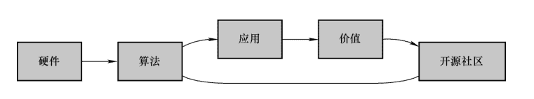

图 1-1 人工智能的技术生态

“杰文斯悖论”指出，技术提升资源利用效率的同时，常因应用扩张导致总消耗上升。开源社区通过共享模型、工具与数据集加速迭代，开发者可在医疗、教育等垂直场景基于 DeepSeek 开源仓库做二次开发。云服务商、硬件厂商与 AI 企业的深度合作推动生态成熟，国产 AI 芯片厂商适配主流大模型框架，构建自主可控算力体系。值得注意的是，技术生态遵循“效率提升驱动需求扩张”的规律，算法优化虽降低单次训练消耗，但 AI 应用爆发反而推高算力需求。

生态的繁荣服务于社会价值，从智能客服到城市治理，从辅助医疗到自动驾驶，均需算法、算力、数据与行业知识深度融合。开发者通过标准化 API 快速集成 AI 能力，企业基于开源工具构建私有化方案，政府借助公共算力平台提供普惠服务，共同构成完整图景。对于 AI4SocialScience 学习者而言，理解生态有助于认识到人工智能不仅是算法与代码，更是动态演进的协作网络，掌握生态视角才能更好定位自身角色。

#### 1.1.3 DeepSeek：开放生态的新星

在此背景下，DeepSeek 的出现具特殊意义。作为中国团队研发的开源大型语言模型，它不仅在技术上突破，更践行开放共享理念。

DeepSeek 核心在于“算法效率优先”的设计。通过混合专家系统与优化注意力机制，在高性能前提下显著降低计算资源需求。完全开源策略为学术界提供研究平台，研究者不仅能使用模型，还能深入其结构、训练与优化，进行改进与创新。这种透明性对理解 AI 工作机制、识别修正偏见、开发特定领域应用至关重要。对社会科学研究者而言，DeepSeek 提供可控、可解释、可定制的 AI 研究工具，无论是计算社会科学研究、面向特定文化背景的应用开发，还是探索人机协作新模式，都提供了理想实验平台。

本章后续将详细介绍 DeepSeek 的技术结构、部署方法与使用技巧，帮助读者开启 AI 辅助研究新篇章。

### 1.2 DeepSeek 系列模型概述

#### 1.2.1 结构设计

DeepSeek 如同其他大型语言模型一样，先在海量语料上完成预训练。截至本书写作时 2025 年 3 月，主流大型语言模型训练语料通常不公开。DeepSeek 官方称预训练使用了约 1.8 万亿 token 的高质量多语料库，涵盖自然语言文本、数学、编程代码，经清洗、去重、标注后用于训练。

底层算法相对透明，现代语言模型多源于 Transformer 结构，通过注意力机制让计算机关注文本关键信息。DeepSeek 基于该原理，通过两项关键创新解决传统 Transformer 的局限：动态计算资源分配与结构化文本的针对性优化。

首项是混合专家系统设计。传统 Transformer 中每个词需与所有词计算关联，导致长文本效率下降。DeepSeek 收到文本后先快速判断内容类型：若是简单天气预报查询，仅激活基础语义理解模块；若是需多步推导的数学证明，则同时调用数学符号解析、逻辑推理等多个专家模块。模块化设计使其在保持轻量的同时灵活应对不同复杂度问题。

其次是分层注意力策略。对自然语言长文本如 5 万字学术论文，系统先按章节切分为逻辑段落，分析“温室气体效应”章节时仅对该部分密集计算，对引文、附录等次要内容采用浅层处理。这种分级机制类似读者通过目录跳转重点精读，其余略读，从而显著压缩显存需求。

最后借助残差连接技术，DeepSeek 在训练中实现深度网络稳定学习，确保初始化阶段各层输出强度均衡，避免信息丢失。如解析法律条文时，模型同时捕捉条款字面含义与隐含条件，不因网络加深而丢失关键信息。这些改进构成兼具 Transformer 核心优势与专业领域能力的结构体系。

在预训练基础上，DeepSeek 进一步进行两项训练以提升性能。

第一项是监督微调，在大规模标注数据上有监督训练，提升特定任务准确性。如文本总结任务中学习提取关键信息生成简洁概述，编程任务中学习补全代码片段。

第二项是强化学习。与 ChatGPT 等采用人类反馈强化学习不同，DeepSeek 采用一般强化学习，仅在数学与编程这两类有确定答案的推理任务上进行自我对抗强化。目标一是生成的答案与标准答案一致，二是答案格式规范，如避免中英混杂。该方式使其在逻辑推理、数学证明等任务上表现更佳。

#### 1.2.2 能力表现

DeepSeek-R1 在多项权威评测中呈现显著提升，尤其擅长教育、长文本与复杂格式任务。

在教育领域知识上，MMLU-Pro 与 GPQA Diamond 等科学类基准测试显示其优于前代 DeepSeek-V3，强化学习大幅优化科学符号与逻辑推理能力。如面对微分方程问题，模型能逐步拆解变量关系并分步验证，减少计算错误。

在长文本分析上，FRAMES 测试表明模型对文档中跨数万字符的关联信息捕捉能力提升，如法律条款例外规则引用，对科研文献综述场景尤为重要。

指令格式遵循能力同样进步。监督微调引入指令数据后，IF-Eval 测试中 DeepSeek-R1 能精准执行用户设定的响应规则。例如要求以“表格→公式→代码”顺序解答物理问题时，模型会严格按流程生成内容。在开放领域 ArenaHard 测试中，答案长度较前代明显缩减，同时保持核心事实覆盖率，避免冗余干扰。

事实性处理能力兼具提升与局限。英文简单事实问答 SimpleQA 中准确率超过前代，但在中文版本中因安全机制强化，部分查询会主动拒答；关闭安全模块后中文问答准确率可达 70%。模型在追求准确性同时，需在风险控制与实用性间进一步权衡。

编程任务表现分化明显。在工程实践场景如代码补全工具 Aider 中暂时落后于业界领先模型，但在理论算法测试如 LiveCodeBench 的递归问题上已达同等水平。开发团队指出当前编码优化训练数据规模有限，预计后续版本数据扩充与针对性训练后可显著改善。

### 1.3 DeepSeek 网页应用与本地部署

#### 1.3.1 网页操作

用户通过浏览器访问 DeepSeek 官网后，可在主界面中央对话框输入自然语言问题，如图 1-2 所示。例如输入“如何制定暑期学习计划”，点击右侧“发送”按钮，系统将依据通用知识库生成含时间规划与科目分配建议的结构化回答。


图 1-2 DeepSeek 官方网站界面

消息框左下角提供两个按钮：“深度思考”与“联网搜索”。开启深度思考模式时，后台模型自动切换为 DeepSeek-R1，否则默认为 DeepSeek-V3，前者推理能力更强，在数学、编程等任务上表现更好。开启联网搜索模式时，系统自动调用联网模块整合权威公开数据并标注引用来源。例如输入“2024 年高校毕业生就业政策”，联网搜索模式下回答将包含政府官网、人社部文件等最新信息链接，用户可点击链接跳转至原始页面核实内容。

# DeepSeek 全场景上手指南

网页版消息框右下角藏着文档处理入口，可导入 PDF、DOCX 等格式的素材，单文件有大小限制。文件上传后，直接下达指令，例如“提取合同关键条款”，系统便会自动解析结构并返回要点清单。

#### 1.3.2 本地客户端怎么用
市面上围绕大模型的客户端不少，Chatbox、AnythingLLM、Cherry Studio 都很常见，其中 Cherry Studio 的采用度较高。它是一款跨平台工具，核心在于整合多模型能力和本地化功能。首次接入建议先在硅基流动平台 https://cloud.siliconflow.cn 注册并拿到 API 密钥，再在客户端里填入密钥、接口地址比如 https://api.siliconflow.cn/v1 以及模型名例如 DeepSeek-V3，界面示意如图 1-3。配置完成后，同一个窗口就能在 OpenAI、DeepSeek 之间切换，无需反复登录。官方网站繁忙时，这种方式能保证工作不中断。


图 1-3 Cherry Studio 界面

在学术研究里，本地知识库功能很实用。把一批论文或电子书导入后，系统借助嵌入模型，默认是 bge-m3，将文本切块转成向量后存储，实现语义检索。比如导入历史文献后询问“五四运动的社会影响”，会先在知识库里匹配相关内容，再由模型生成带引用标记的综述，用户可以追溯到原文段落核对。相当于多了一个第二大脑，效率明显提升。

使用时要注意，无论是网页还是客户端，都应把问题范围限定清楚，比如指定字数或场景，避免指令太空泛导致输出冗余而耗尽配额。经由 Cherry Studio 调用第三方 API 需要留意服务商的计费规则，部分文生图模型按次收费，建议先用沙盒测试效果再正式调用。搭建知识库时，单个文档最好控制在 20 页以内，过长的文本切分容易割裂语义，降低检索精度。

#### 1.3.3 本地部署实操
DeepSeek 近期热度很高，受在线服务拥堵的困扰也比较多，但自行部署其实很直接，流程和安装普通软件差不多，完整耗时大约 10~15 分钟，技术基础薄弱的人也能完成。

先了解模型规模。DeepSeek 提供了从 1.5B 到 671B 的多个版本。1.5B 适合资源有限的设备，比如老款笔记本，做简单交互和小问答；671B 面向大规模科研分析，需要服务器集群级别的硬件。中间还有 7B、8B、14B、32B、70B 等，适配不同任务难度和机器配置。

以下以 1.5B 为例。DeepSeek-R1-1.5B 只有 15 亿参数，体积很小却很精悍，约 3GB 显存即可运行，低配电脑也能用。即便如此，它在数学推理等方向表现不俗，部分基准测试里甚至超过 GPT-4o 和 Claude 3.5。若硬件更强，也可以部署更大参数的版本。

第一步打开 Ollama 官网 https://ollama.com，如图 1-4 所示，下载对应系统的安装包，网速慢可用迅雷等工具加速。Windows 用户下载 OllamaSetup.exe 后双击安装，完成后在命令行执行 ollama -v 查看版本号验证安装成功。

# deepseek-r1

DeepSeek's first-generation of reasoning models with comparable performance to OpenAI-o1, including six dense models distilled from DeepSeek-R1 based on Llama and Qwen.

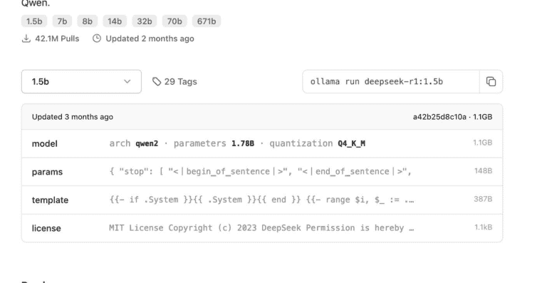

图 1-4 Ollama 网站界面

随后在命令行输入 ollama run deepseek-r1:1.5b 拉取模型，大约 5~6 分钟，模型大小约 1.1GB。出现 success 后即可对话。若想换更大模型，可到 https://ollama.com/library/DeepSeek-r1 查看并选择。

命令行体验不够友好时可改进：
- 1) 安装 Page Assist 浏览器插件当 WebUI：启动 Ollama 服务后按 Ctrl+Shift+L 打开页面，首次简单设置后即可选择 DeepSeek 模型对话。
- 2) 使用 Chatbox 应用：从 https://chatboxai.app/en 下载安装，配置为使用 Ollama API，注意不要选成 DeepSeek API，之后就能调用本地的 DeepSeek 模型。

### 1.4 DeepSeek API 接入

#### 1.4.1 基础调用方法
DeepSeek API 兼容 OpenAI 格式，开发者能方便调用其语言模型。第一步是申请 API 密钥，拿到后需配置 base_url 和 api_key 两个关键参数。基础地址是 https://api.DeepSeek.com，为保持兼容也可以用 https://api.DeepSeek.com/v1 作为 base_url，这里 v1 与模型版本无关。配置完成后可用 Python 发起基础调用。

```python
from openai import OpenAI

client = OpenAI(api_key="<DeepSeekAPIKey>",
    base_url="https://api.deepseek.com") # 新建client对象，便于以后调用

response = client.chat.completions.create(
    model="deepseek-chat",
    messages=[
        {"role": "system", "content": "You are a helpful assistant"},
        {"role": "user", "content": "Hello"},
    ],
    stream=False
) # 利用上一步创建的client获取response

print(response.choices[0].message.content) # 打印response中的content
```

计费单位是 token，要先理解概念。Token 相当于文本最小单元，一个英文单词、数字或标点都可能算一个 token。大致上英文字符约 0.3 token，中文字符约 0.6 token。官方提供离线工具包 DeepSeek_v3_tokenizer.zip 可估算输入输出 token 数。目前两种模型都支持最高 64K 上下文，最大输出 8K tokens。

定价按 token 计。DeepSeek-chat 在标准时段 UTC 00:30—16:30，输入 token 缓存命中 0.07/1M，未命中 0.27/1M，输出 $1.10/1M。非高峰 UTC 16:30—00:30 全面五折。DeepSeek-reasoner 单价稍高，非高峰可达七五折优惠。费用优先从授予余额扣除，再用充值余额抵扣。

调用时 temperature 控制随机性和创造性，默认值 1.0。编程和数学建议 0.0，保证确定性；数据清洗分析用 1.0；日常对话和翻译推荐 1.3；创意写作和诗歌可调到 1.5 左右提升创造力。

API 没有固定速率限制，高负载时响应会变慢。常见错误有：格式无效 400、鉴权失败 401、余额不足 402、参数无效 422、请求过频 429、服务器错误 500、服务过载 503，需按提示调整。

#### 1.4.2 高级能力扩展
前文提到的 /chat/completions 接口是无状态的，服务器不会保存上下文。因此多轮对话需要把全部历史拼接后每次一起传回API。虽然请求会变大，但开发者可自由保留或修改历史。

实践中，每轮结束后把模型回复加入 messages，再追加用户新问题。第一轮可能只有用户提问，第二轮的消息数组已包含上一轮提问、回复和当前问题。累积式上下文让模型保持连贯。

```
messages = [
    {"role": "user", "content": "世界上最高的山是什么？"},
    {"role": "assistant", "content": "世界上最高的山是珠穆朗玛峰。"}
]

messages.append({"role": "user", "content": "第二高的是什么？"})
```

很多场景需要模型严格输出 JSON 以便解析。DeepSeek 支持 JSON Output，需把 response_format 设为 {'type':'json_object'}，并在提示里出现“json”一词，最好给出格式示例。建议合理设置 max_tokens 防止截断，偶尔出现空返回时可尝试改写提示。

```
import json
from openai import OpenAI

client = OpenAI(
    api_key="<yourapikey>",
    base_url="https://api.deepseek.com"
)

system_prompt = """
用户将提供一些考试文本。请解析出“问题”和“答案”并以JSON格式输出。

示例输入：
世界上最高的山是什么？珠穆朗玛峰。

示例JSON输出：
{
    "question": "世界上最高的山是什么？",
    "answer": "珠穆朗玛峰"
}
""" # 系统级prompt，整个对话只出现一次

user_prompt = "世界上最长的河流是什么？尼罗河。" # 用户级prompt，整个对话出现若干轮

messages = [{"role": "system", "content": system_prompt},
            {"role": "user", "content": user_prompt}] # 定义message

response = client.chat.completions.create(
    model="deepseek-chat",
    messages=messages,
    response_format={
            'type': 'json_object'
        }
    )

    print(json.loads(response.choices[0].message.content))
```

Function Calling 能让模型调用外部工具，扩展能力范围。需注意当前 DeepSeek-chat 的 Function Calling 不够稳定，偶有循环调用或空响应的情况。下面是一个获取当前位置天气的完整示例：

```
from openai import OpenAI

def send_messages(messages):
    response = client.chat.completions.create(
        model="deepseek-chat",
        messages=messages,
        tools=tools
    )
    return response.choices[0].message # 定义send_messages函数为发送messages，并获取response中的content

client = OpenAI(
    api_key="<yourapikey>",
    base_url="https://api.deepseek.com",
)

tools = [
    {
        "type": "function",
        "function": {
            "name": "get_weather",
            "description": "获取指定位置的天气，用户需要先提供一个位置",
            "parameters": {
                "type": "object",
                "properties": {
                    "location": {
                        "type": "string",
                        "description": "城市名称，例如：杭州",
                    }
                },
                "required": ["location"]
            },
        }
    }
},
] # 定义tools对象为get_weather

messages = [{"role": "user", "content": "杭州的天气怎么样？"}]
message = send_messages(messages)
print(f"用户>\t {messages[0]['content']}")

tool = message.tool_calls[0] # 获取返回消息中调用的工具
messages.append(message)

messages.append({"role": "tool", "tool_call_id": tool.id, "content":
"24(°)"}) # 将工具调用结果（24度）返回给大模型
message = send_messages(messages)
print(f"模型>\t {message.content}")
```

流程是：用户问杭州天气，模型返回调用 get_weather 的请求，用户执行函数并把结果回传，模型再用自然语言回复“杭州当前的温度是 24°C”。其中 get_weather 的具体实现需由使用者自行提供，模型本身不执行函数。

上下文缓存技术默认对所有用户开启，无需改代码。每次请求会构建硬盘缓存，后续请求若前缀重叠，重叠部分从缓存读取计为缓存命中。只有重复的前缀才能触发命中。该功能在长文本问答、多轮对话和小样本学习中很有价值，能显著降低成本。

缓存命中与计费要点了然

在 DeepSeek API 返回的 usage 区块里，现在额外出现了两项关于缓存使用情况的统计。prompt_cache_hit_tokens 用来记录本次调用中输入部分被缓存命中的 token 数量，定价为每百万 0.1 元；prompt_cache_miss_tokens 则统计输入部分未被缓存的 token 数量，定价为每百万 1 元。需要留意的是，磁盘层面的缓存仅针对用户提问的前缀进行匹配，模型对回答的生成仍然需要实时计算与推理，受 temperature 等超参数影响而存在随机性。上下文缓存的最小存储粒度是 64 个 token，低于此阈值的片段不会被写入。整体机制属于尽力而为模式，并不承诺全量命中。缓存的建立通常需要数秒，停止使用后会在数小时至数天的时间窗口内自动失效。合理调度这一能力可以在保持输出质量的同时明显压缩 API 开销。

### 1.5 DeepSeek 的提示词工程

#### 1.5.1 一般性原则

本小节以 DeepSeek-R1 为参照，梳理面向推理类大模型的提问思路。推理型系统与传统聊天型系统在工作逻辑上存在本质差异。以 GPT-4o 为代表的常规对话模型在简短问答中表现稳定，借助多轮交互也能逐步优化结果。推理模型更倾向于单轮内完成深度思考并给出系统化结论。若沿用过往的对话习惯来驱动 DeepSeek-R1，往往难以发挥应有水准。

在与推理模型协作时，需要把思维方式从指令式转向目标式，不再逐条规定执行步骤，而是把充分的背景信息与期望达成的结果交代清楚。可以把模型视作具备专业素养却需要完整情境的顾问，使用者应提交尽可能完备的上下文，涵盖自身身份、项目缘起、已尝试的方法及其结果，以及对输出的具体期待。

R1 的核心优势在于能够基于所提供的材料自主规划求解路径，而非被动执行预设流程。这使其在复杂议题上优势明显，但前提是输入信息足够丰满。诸如“你是专家 X，请按步骤 Y 执行”之类的传统写法会抑制其推理潜能。以简报形式呈现丰富背景并点明目标，才能真正释放能力。因此信息完整性至关重要，需涵盖项目背景、领域术语说明、数据结构描述、既有尝试及局限、明确目标等，以自然语言呈现，而非刻意套用模板。

清晰表述目标比详尽描述方法更为关键。使用者应当说明希望获得的输出类型、呈现形式与评判标准，而不是教导模型如何思考。明确指出需要代码实现、方案对比，还是完整报告，模型即可自行安排推理路线，甚至挖掘使用者未曾考虑的路径。实践中应信任模型的推理过程，同时给出评价标准以便自我校准，这样在复杂项目或创新任务中价值最大化。

落地时可考虑用口述加语音识别的方式记录问题背景，有助于自然全面地呈现情境；同时维护一份常用背景资料库，在相关问题中复用。对复杂任务，拆解为若干子目标分别处理通常比一次性求解更有效。该做法在一次性生成完整代码文件、特定领域查询语言处理、专业深度分析、复杂概念解释上效果突出，而在风格化写作、完整应用搭建等场景则仍需更多人工介入与迭代。

#### 1.5.2 提示词示例

为便于理解上述原则，下面以社会科学研究者的典型需求为例，列出面向 R1 推理模型的四则提示样例，供参考。

##### 【提示词 1-1 民族志研究设计】

> 我准备在东南亚开展为期18个月的民族志研究，探索全球化背景下传统渔村社区的适应性变化。我此前主要在非洲进行研究，对东南亚地区不太熟悉。当地渔业正面临气候变化和大规模商业捕捞的双重压力，我希望理解社区如何调整生计策略、社会组织和文化实践来应对这些挑战。我担心的是语言障碍、获取敏感信息的伦理问题以及如何平衡参与观察与保持分析距离。我希望设计一个全面而又现实可行的民族志研究计划，包括前期准备、实地研究策略和数据分析框架。我特别关注如何建立信任关系并捕捉到社区变迁的复杂性和多元声音。

讲解：该示例交代了研究者身份与经历背景、研究议题、具体困境与资源限制，为模型提供了完整情境。

##### 【提示词 1-2 政治极化媒体分析】

> 我手上有两年的Twitter数据，包括5个政治热点事件前后的用户互动、内容传播和情感变化数据。初步分析表明，平台算法似乎强化了同温层效应和群体极化，但我难以区分算法影响与用户自选择因素。我需要一个既能处理大规模定量数据又能捕捉话语质性变化的分析框架。以下是我的数据结构和初步发现：[数据结构和初步统计结果]。我希望发展一个有说服力的分析方法，能够更准确地判断算法干预在政治极化进程中的因果作用，同时避免过于简化这一复杂的社会-技术互动过程。

讲解：提示清晰点明研究主题，坦诚方法论上的强项与短板，并附上数据资源与初步发现作为背景支撑。

##### 【提示词 1-3 福利政策评估研究】

> 我是社会政策研究中心的高级研究员。我正在评估一项为期五年的城市低收入家庭住房补贴项目。我收集了项目前后的家庭经济状况、就业稳定性、子女教育成果和健康状况数据，同时进行了一系列深度访谈。初步结果显示，项目对不同群体的影响差异很大，某些家庭显著受益，而另一些几乎没有改善甚至状况恶化。资助方希望得到明确的成本效益分析和政策建议，但我担心单一的量化指标可能掩盖项目的复杂影响。我们尤其难以解释为什么相似条件的家庭会有如此不同的结果。以下是我们数据集和初步分析：[研究数据]。我希望开发一个更全面的评估框架，能够捕捉项目的多维影响，解释差异化结果背后的机制，并提出有针对性的政策优化建议，既满足资助方的问责需求，又尊重社会干预的复杂性。

讲解：该提示并未要求固定的评估流程，而是寻求一个能在多重诉求间取得平衡的分析框架，充分发挥推理模型的整合思考能力。

##### 【提示词 1-4 跨文化消费者行为研究】

> 我在主持一项关于文化价值观如何塑造可持续消费决策的跨国研究。我们在六个国家（美国、德国、日本、印度、巴西和肯尼亚）收集了大量问卷数据和焦点小组访谈材料，探索个人主义vs集体主义、长期vs短期导向等文化维度与环保消费行为的关系。初步数据展示了一些有趣但难以解释的模式：例如，某些被认为高度个人主义的社会中，受访者反而更愿意为集体环境利益做出个人牺牲。传统的霍夫斯泰德文化维度和计划行为理论似乎难以完全解释我们的发现。另外，我们的定量和定性数据之间存在一些表面矛盾。以下是我们研究设计和关键数据点：[研究材料]。我希望发展一个更细致的理论框架来解释这些跨文化差异，同时提出如何更有效地整合混合方法数据的策略，以推进消费者心理学的跨文化理论建设。

讲解：提示没有简单要求对数据做解释或给出下一步操作，而是期望构建更复杂的理论框架与方法整合策略，正是推理模型擅长的理论建构任务。

### 1.6 总结

本章揭示了 DeepSeek 运行的底层逻辑与使用切入点。理解其动态算力分配与分层注意力机制，有助于把握模型突破传统 Transformer 效率瓶颈的关键——在面对复杂问题时，系统会智能激活专家模块并聚焦核心段落以实现高效推理。部署时需根据场景权衡：网页端适合开箱即用的轻量交互，API 接口可支撑开发者搭建定制化工具链，本地化方案则满足数据敏感场景的轻量化需求。API 调用中要重点保持对话历史连贯，善用 JSON 格式化输出，并借助上下文缓存优化资源消耗。参数调节上，数学类任务宜降低温度以保证确定性，创意类任务则可适当提高温度以激发发散。有效的提示应像简报一样以明确目标替代操作指令，这些认知构成了使用 DeepSeek 的基础坐标。

# DeepSeek 篇


# 第2章 DeepSeek 与文献阅读

### 本章重点

- 使用 DeepSeek 辅助文献阅读与翻译
- DeepSeek 协助生成文献综述
- DeepSeek 协助生成思维导图

本章介绍在 Zotero 平台上接入 GPT 插件，结合 DeepSeek 模型完成智能文献管理、综述撰写与思维导图生成的完整流程，适用于社会科学研究者与学生等各类用户以大幅提升文献处理效率。

### 2.1 大语言模型辅助文献阅读与翻译

#### 2.1.1 Zotero 安装与推荐插件配置

首步为安装 Zotero 主程序及配套插件。可在 Zotero 官网下载安装。安装完成后建议配置四款常用插件：

1. **Zotero Connector** 可一键抓取网页文献元数据导入 Zotero；
2. **ZotFile** 用于集中管理 PDF 附件并做标注；
3. **Translate for Zotero** 支持 Zotero 与多种翻译服务对接；
4. **Better BibTeX** 用于生成稳定文献引用键，方便 BibTeX 格式引用自动管理。

相关插件可通过官方插件页或中文社区获取安装。

#### 2.1.2 文献阅读：GPT 插件安装与 API 配置

##### 1. GPT 插件安装

首先访问 Zotero 中文社区插件页下载 GPT 插件压缩包。打开 Zotero 主界面后依次选择“工具” → “插件” → “从文件安装插件（Install Plugin From File）”，导入下载的压缩包进行安装。

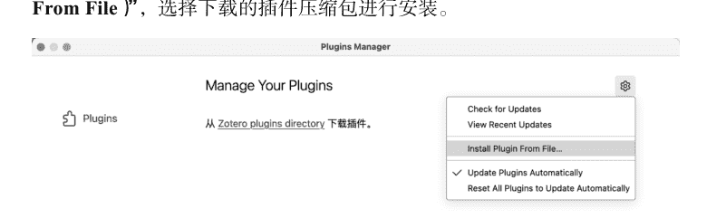

随后启用 Awesome GPT 插件。


从 Zotero plugins directory 下载插件。

图 2-2 启用 Awesome GPT 插件

##### 2. API 配置

第二步为配置语言模型 API 密钥。推荐前往硅基流动官网注册登录，如图 2-3 所示，登录后点击左侧菜单“API 密钥”，新建密钥并复制。

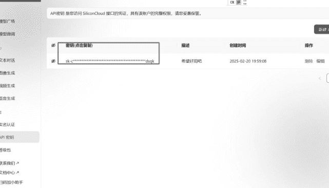

图 2-3 创建并复制 API 密钥

返回 Zotero 打开 GPT 插件设置界面。Windows 用户通过菜单栏“编辑” → “设置”打开；macOS 用户通过系统菜单栏“Zotero” → “设置”打开。如图 2-4 所示，将 API 密钥粘贴至对应位置，选择模型后点 Test。若提示配置成功，如图 2-5，则表示安装与连接正常。

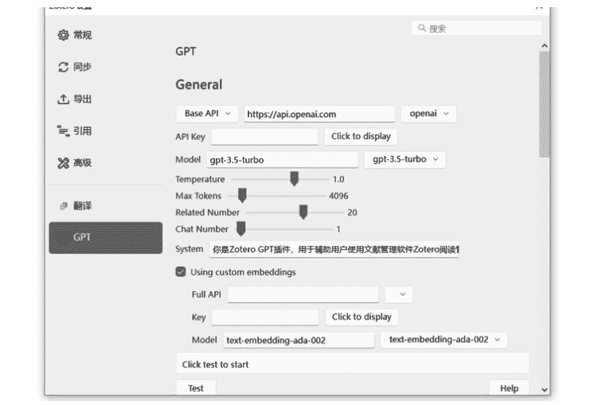

图 2-4 配置、安装插件


图 2-5 配置成功提示

如需使用 DeepSeek 模型而非默认模型，可如图 2-6 与图 2-7 所示在插件设置中更新 API 地址与模型名称，建议选择带有“siliconflow”的模型。DeepSeek 官网目前暂不支持充值，可通过第三方渠道申请 API 密钥后填入，操作同上。

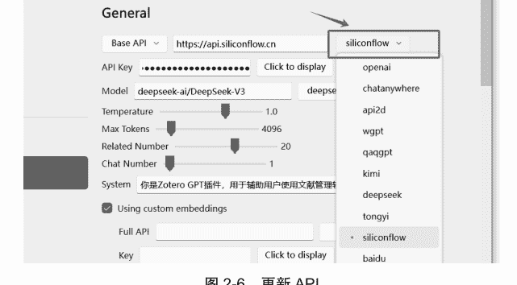

图 2-6 更新 API

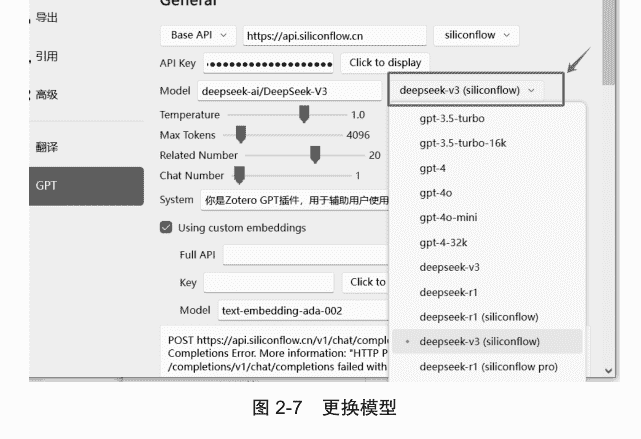

图 2-7 更换模型

每次修改后需点击“Test”验证连接状态。

##### 3. GPT 插件使用

配置完成后，在 Zotero 中选中一篇或多篇文献，点击工具栏 GPT 按钮，如图 2-8 所示，启动智能阅读模式。会弹出对话面板，提供“文献综述”“段落解释”“关键词提取”等指令，可按需执行。

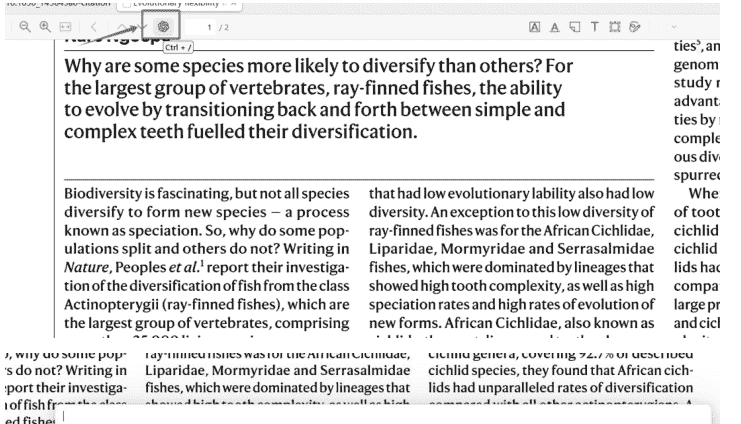

图 2-8 对文章使用 GPT 插件

阅读中遇到难懂段落，可通过划线高亮标记，再点击相关指令获取智能解释或翻译，如图 2-9 所示。

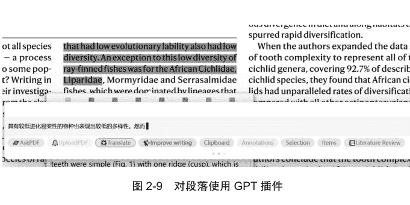

#### 2.1.3 文献翻译：Translation for Zotero 插件安装与 API 配置

除 GPT 插件内置翻译外，还可安装专门的 Translation for Zotero 插件。首先确保使用 Zotero 7 并安装 Translate for Zotero，该插件支持接入多种翻译服务，包括 DeepSeek。进入 DeepSeek 官网，如图 2-10 所示，点击“API 开放平台”，完成注册登录后在左侧菜单选择“创建 API Key”，生成形如“2e**************44c”的密钥。


在 Zotero 中配置 DeepSeek 翻译服务时，打开主界面依次点击“编辑” → “设置”，如图 2-11 所示在设置窗口切换至“翻译”选项卡。在“翻译服务”下拉菜单中选择“ChatGPT”，将前面生成的 DeepSeek API Key 填入密钥框。随后点击“配置”进入高级设置，将“接口”设为 https://api.deepseek.com/v1/chat/completions，“模型”设为 deepseek-chat，“温度”设为 1.3 以兼顾准确性与灵活性。

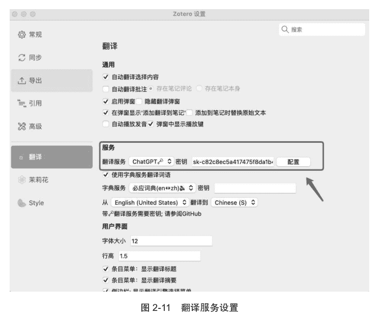

将提示词 2-1 所示指令文本粘贴到“Prompt”输入框中：

##### 【提示词 2-1 设置翻译服务的提示词】

```
As an academic expert with specialized knowledge in various fields, please provide a proficient and precise translation from ${langFrom} to ${langTo}. It is crucial to maintaining the original phrase or sentence and ensure accuracy while utilizing the appropriate language, for the same proper nouns that appear in context, make sure that their translation results are also the same. The text is as follows: ${sourceText} Please provide the translated result without any additional explanation and remove.
```

完成设置后点击“保存”即可。

测试与使用时，在 Zotero 文献库中选中目标条目，右键选择“翻译”或使用插件快捷键调用。翻译结果会直接显示在 Zotero 界面，如图 2-12 所示，可复制或保存进一步编辑。


### 2.2 大语言模型协助生成文献综述

本节介绍借助大语言模型生成文献综述的方法。对于英文文献推荐直接使用方法一；中文文献可尝试方法一之外的方法一，用户可根据效果与需求调整提示词。

#### 2.2.1 方法一：使用 Zotero 中的大模型插件生成文献综述

完成插件安装后，可直接使用大模型插件的“Literature Review”功能生成综述初稿。具体操作为在 Zotero 中选中多篇参考文献，点击下方的“Literature Review”，如图 2-13 所示。插件会自动基于所选文献生成综述内容并附带文献矩阵。


#### 2.2.2 方法二：使用 DeepSeek 协助生成文献综述

1. 导出目标文献相关信息

首先需准备文献数据。以知网为例，访问官网 https://www.cnki.net，使用“高级检索”按主题搜索并设置时间、关键词等筛选条件。在结果页勾选目标文献，导出为 Excel 文件，同时建议导出引用格式文本文件以便后续整理与引用。以下为知网导出数据的操作示例。

登录知网后进入高级检索界面，先设定好筛选参数，勾选目标文献。参照图2-14的操作路径，依次点选顶部菜单的“导出与分析”“导出文献”“自定义”，即可启动批量下载。

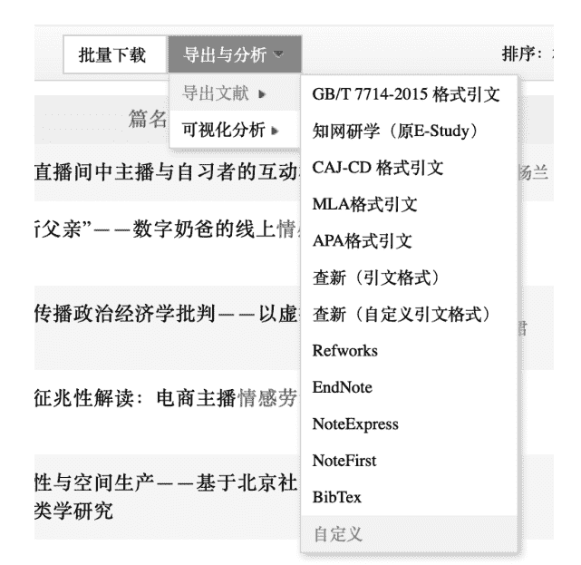

图2-14批量导出知网文献

在导出面板里自行勾选所需字段，比如关键词、摘要、发表年份等。点下“导出”即可获得txt文档，点击“xls”则得到表格文件，见图2-15。左侧栏还能为整批文献指定引用样式，例如APA。

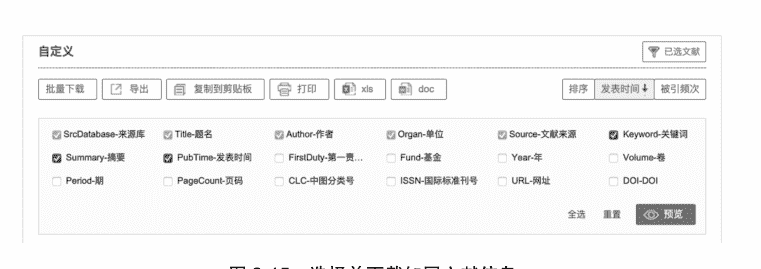

2. 用DeepSeek生成文献综述

接下来在DeepSeek新建会话，把刚才导出的Excel表丢进对话窗口，配合指令让模型产出综述。指令可以很简洁，也可以用结构化方式让输出更严谨。结构化指令一般涵盖身份设定、任务背景、具体任务和结果规范。以“算法对青少年媒介信任的影响”为例子，可以让模型梳理主流理论的演进，比较不同方法得出的结论分歧，并指出仍未解决的学术争议。还可以约定输出Markdown格式、引用用APA，并要求每个核心论断至少附上两篇参考文献，详见提示词2-2。

##### 【提示词2-2 DeepSeek批量处理文献】

```
[角色设定]
您是社会科学的文献分析专家

[任务背景]
我正在研究“算法如何影响青少年的媒介信任”，已整理包含200篇文献的Excel表，字段包括：标题、年份、理论框架、研究方法、关键结论等

[具体需求]
1. 识别主流理论及其演变脉络
2. 对比不同研究方法的实证发现差异
3. 找出至少3个尚未解决的核心争议
4. 需要重点对比近5年量化研究与混合研究的方法论差异

[输出要求]
- 使用Markdown分级呈现
- 重要结论标注文献来源（作者+年份）
- 请按APA格式组织，每个论点需标注至少2篇支持文献
- 包含方法论建议部分
```

面对海量文献时，可采用更灵活的指令策略。比如先限定模型只分析2015至2023年的成果；亦可挑选表格中影响力较大的条目做交叉核验；还可要求模型标出样本偏少的论文并打上“谨慎引用”标签，以增强综述的可靠性。

先把数据结构和目标说明清楚。例如告诉模型：该表包含文献标题、年份、理论框架、方法、样本概况及核心数据，时间跨度是2015—2023，部分奠基性资料已用红色高亮。

再商定分析框架。可以先给出三个切口：理论视角，比如制度主义与文化转向的对照；方法视角，比如大数据与传统实证的差异；地域视角，比如东西方比较。邀请模型对这个框架做增补或调整。

随后挑选一个维度分段产出。以理论维度为例，要求模型按时间顺序呈现演进脉络，标注关键学者和流派思路，必要时配对比表。

最后根据审稿意见对初稿迭代。如需强化政策实践文献的讨论、补充方法局限，或深挖争议性结论，都可以通过追加指令实现动态调整。

###2.3 DeepSeek辅助制作结构化思维导图

除了文字综述，还能借助DeepSeek生成Markdown格式的知识导图。

可在对话框里输入类似指令：“请围绕媒介信任研究搭建思维导图框架，要有5到7个一级分支，每个分支下再分3到5个二级分支，关键词精炼，输出Markdown”。同样可以整理参考文献：让模型列出该领域的核心专著、期刊论文和会议论文，并为每篇生成作者、年份、要点三个子节点。

第一步，在DeepSeek输入指令并上传附件，下载.md文件，见图2-16。

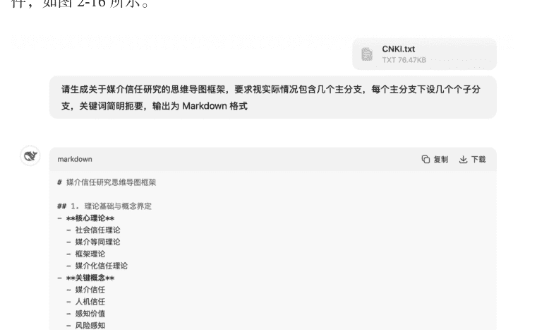

第二步，打开XMind、MindMaster或知犀等常用导图工具，使用导入功能载入刚才的Markdown文件，系统会自动解析层级并生成图形，见图2-17。

第三步，导入后可手动增删节点、完善逻辑，并通过配色和样式提升可读性和美观，见图2-18。

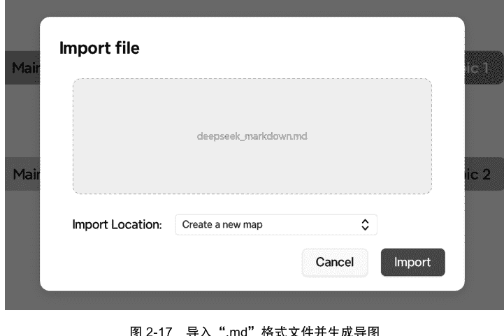

图2-17导入“.md”格式文件并生成导图

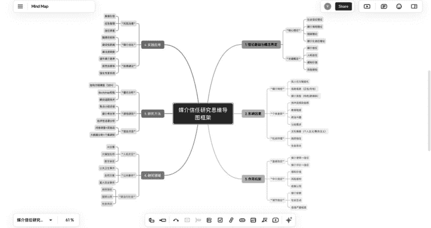

图2-18修改、补充导图

###2.4小结

本章梳理了基于大语言模型的智能文献管理思路，重点呈现DeepSeek配合Zotero协作的技术架构和落地方式。通过插件配置、API对接和提示词工程，突破了传统文献处理的效率限制，实现了从采集、翻译到综述的全流程模型辅助。具体而言：依托Zotero的插件体系和DeepSeek的语义理解，可实现跨语言文献的准确翻译与深度解读；借助结构化指令和批量数据处理，能产出逻辑清晰、引用规范的综述；结合Markdown的可视化导出，可实现知识体系的结构化呈现与动态调整。尽管在非结构化文献处理和数据一致性上仍有不足，但随大模型多模态能力提升和学术工具迭代，智能文献系统有望成为研究基础设施，助力知识发现、理论创新和研究范式更新。

###—思考与练习—

练习1：基于本章的结构化指令思路，为你自己的研究主题设计一套生成文献综述的指令，需包含角色定位、任务背景、具体要求、输出规范四部分。

练习2：借助DeepSeek或同类平台，用Zotero导出的某批Excel文献数据生成一段简要综述，并评估模型是否遗漏关键文献或理论，归纳逻辑是否模糊、混淆或不完整。

#DeepSeek篇

#第3章 DeepSeek与调查研究

###本章重点
- DeepSeek辅助问卷设计
- DeepSeek在数据清洗环节的应用
- DeepSeek支持实验研究开展

用调查数据做实证是社会科学的核心方法之一。DeepSeek可贯穿问卷设计、数据清洗、变量构建、分析可视化等多个环节，提升效率和质量。本章结合案例介绍其在调查研究中的具体应用和操作要点。

###3.1调查数据的采集流程

调查数据反映个体或群体的态度、行为和认知，是政治学、社会学、心理学等领域常用的实证依据，主要靠问卷获取。因此问卷设计和发放直接决定数据质量和研究成败。

传统问卷设计依赖研究者经验和文献，耗时且易受主观偏差影响。随大语言模型发展，DeepSeek为数据收集带来新可能。本节聚焦问卷设计、评估和抽样等环节的支持。

####3.1.1问卷整体搭建

问卷搭建是数据收集的起点，关乎针对性、信度和效度。DeepSeek可协助从构想到定稿的全过程生成、调整和优化问卷。

在研究问题和假设明确时，DeepSeek可依据核心问题构建测量维度，自动生成初题并匹配常见量表，形成初稿，研究者再微调完成设计。例如围绕“在校生AI使用与态度”展开，可输入如下提示词。

#####【提示词3-1问卷整体设计】

> 我想做一项关于大学生群体的人工智能使用情况如何影响其对人工智能态度的研究。目前进行问卷设计。请你根据社会科学领域的高质量调查问卷，帮助我设计一个完整的问卷。

模型给出的问卷涵盖基础信息、AI使用行为、态度认知、环境影响、伦理态度和开放问题六大板块，结构清晰、覆盖全面，显著提升初稿效率。

已有初稿也可借助模型做表述优化、题序调整、量表建议和逻辑检验，提升整体质量。

####3.1.2问卷题项撰写

整体框架确定后，题目质量决定变量能否被有效测量。题目需兼顾维度把握、表达清晰与量表适配。

对于爱国主义、政治效能感、社会资本等成熟议题，CGSS、CSS、WVS等大型调查已有标准化题项可参考。但针对人工智能态度、算法歧视认知等新议题，缺乏现成题库，研究者需自行开发。此时DeepSeek可从维度拆解到题目撰写全程支持，并按社会科学表达规范优化语义。

以“公众对人工智能态度”为例，可输入以下提示词。

#####【提示词3-2问卷题目设计】

> 我正在进行一项关于“公众对人工智能态度”的研究，但我不太了解有哪些问题可以有效测量公众对于人工智能的态度。请参考社会科学领域较高质量的问卷，帮助我设计测量“公众对人工智能态度”的具体题目。

模型输出包含认知、情感态度、社会影响感知、伦理风险感知与开放问题等模块，题型涵盖单选、多选、量表与开放式，兼具理论依据与可操作性。

对于跨文化借鉴，模型也可协助翻译与本土化。例如将美国皮尤研究中心国际科学调查中的题项转译为适合中国情境的表述，保持测量目的不变的同时提升语境契合度，参见提示词3-3。

#####【提示词3-3问卷题目转换】

下面是美国皮尤研究中心调查问卷中的题目。我想将这个题目设计在我的问卷中，在中国进行调查。请根据中国的具体情况，翻译并完善这个题目，使其更加符合中国社会现实。

本土化适配：科学发展感知题的跨文化改写

英文原题：
Overall, would you say developments in science have had a mostly positive effect on society, a mostly negative effect on society or would you say there have been equal positive and negative effects on society?

1 Mostly positive effect
2 Mostly negative effect
3 Equal positive and negative effects
98 Don't know (DO NOT READ)
99 Refused (DO NOT READ)

DeepSeek 给出的本地化建议：

> 参考国内表述习惯，建议调整为：

总体来看，您认为近十年科技领域的进展，例如网络、生成式人工智能、高速铁路等，对中国社会的整体作用是？

1 利大于弊
2 弊大于利
3 利弊相当
4 说不清（无需宣读）
5 拒绝作答（无需宣读）

调整说明：

时间锚定：增设“近十年”限定，更贴合受访者对社会变化的体感。
范围具象化：把抽象的“科学发展”换成“科技层面”，并点出互联网、生成式人工智能、高铁等辨识度高的典型。
语言在地化：用“利/弊”对应 positive/negative，契合中文价值判断习惯。
议题相关性：突出数字化等当前中国重点发展方向，提升题目贴近度。
选项表述：采用“利大于弊”等递进式说法，贴近本土思维。
编号方式：使用一位数序号，符合国内问卷惯例。

总体而言，DeepSeek 既能依据研究主题与理论框架生成测量题项，也能在跨文化迁移中结合本土语言与社会语境，对既有题目的语义与表达进行优化，以提高在目标语境下的可理解性与效度。

#### 3.1.3 问卷质量评估

问卷定稿后需做系统检验，以保障科学性与数据可用性。专家审阅、焦点小组、小样本预试是常见做法。随着生成式 AI 的普及，研究者也可借助 DeepSeek 辅助质量评估，在控制成本的同时提升效率。操作示例见提示词 3-4。

##### 【提示词 3-4 问卷质量评估】

> 我正在做一项关于大学生对人工智能态度的研究，下面是一道问卷题。请评估其质量，给出明确说明并提出修改建议。

人工智能可能取代我的工作，这让我感到焦虑

1 非常不同意 2 比较不同意 3 说不上不同意也说不上同意 4 比较同意 5 非常同意

DeepSeek 的评估报告：

> 问卷题目质量评估报告

质量评估

1. 表述清晰度隐患
• 关键问题：对大学生群体，“工作”概念模糊。样本包含在校本科生/研究生，他们可能把“我的工作”理解为未来职业而非当前岗位，题干未界定。
• 影响：就业与未就业群体的理解可能不一致，影响数据一致性。

2. 双重提问风险
• 关键问题：题干同时测量两个维度：① 对“AI 取代工作可能性”的认知判断；② 该认知带来的“焦虑”情绪反应。
• 影响：受访者可能因某一维度态度不明确而作答偏差。

3. 情绪强度差异
• 关键问题：“焦虑”作为情感指标具有主观性，不同文化背景受访者对其敏感度不同。
• 影响：温和担忧的群体可能被归入极端区间。

4. 效度边界不清
• 关键问题：题干默认受访者已有明确的职业发展预期。
• 影响：对尚未形成职业规划的学生，测量焦点不够集中。

修改建议

方案一：拆分测量维度
Q1. 我认为人工智能可能取代我未来从事的工作
1-5 级量表（非常不同意 → 非常同意）
Q2. 这种可能性让我感到担心（可把“焦虑”作为高阶选项）
1-5 级量表（非常不担心 → 非常担心）

方案二：单维度改写
人工智能技术可能影响我未来职业发展的稳定性，对此我感到：
1 完全不担忧 2 比较不担忧 3 中立 4 比较担忧 5 非常担忧

研究中可按需调整提示，例如输入“只给评估说明，不要修改建议”，此时模型仅提供反馈，不直接输出改写，避免建议干扰研究判断。

### 3.2 调查研究数据清洗过程

数据清洗是将原始资料经筛选、编码等处理转化为可分析数据的环节，是问卷与研究发现之间的桥梁。本节介绍 DeepSeek 在变量筛选与变量转化两方面的支持。

#### 3.2.1 变量筛选

变量筛选是依据研究目标与分析需求，从原始数据集中挑选与研究问题高度相关的变量。面对 CGSS、CSS 等大型公开调查，DeepSeek 可帮助定位相关题项，提高筛选效率。下例以 CGSS2018 中社会信任题项的筛选为例，见提示词 3-5。

##### 【提示词 3-5 变量筛选】

我正在进行一项关于中国公众社会信任的研究。文件是CGSS2018的问卷，我需要筛选出其中与社会信任相关的题目，以进行下一步的分析。请帮助我完成筛选，并以结构化表格形式输出。

DeepSeek 的输出：

| 模块 | 题目编号 | 问题内容 | 选项 |
| :--- | :--- | :--- | :--- |
| 核心模块 | A33 | 总的来说，您同不同意在这个社会上，绝大多数人都是可以信任的？ | 1. 非常不同意 2. 比较不同意 3. 说不上同意不同意 4. 比较同意 5. 非常同意 98. 不知道 99. 拒绝回答 |
| | A34 | 总的来说，您同不同意在这个社会上，您一不小心，别人就会想办法占您的便宜？ | 1. 非常不同意 2. 比较不同意 3. 说不上同意不同意 4. 比较同意 5. 非常同意 98. 不知道 99. 拒绝回答 |
| 态度看法 | C4 | 请问您对 × × 团体的信任程度怎样？ | 1. 完全信任 2. 很信任 3. 有些信任 4. 不信任 5. 完全不信任 98. 不知道 99. 拒绝回答（对每项机构单独评分） |

借助 DeepSeek，研究者可从问卷、编码手册、变量说明等文档中快速提取与研究主题相关的变量，高效完成初筛与整理，提升实证分析效率。

#### 3.2.2 样本取值的编码

社会科学数据包含文本型、分类型、顺序型等多种取值，后续统计分析需要规范编码与归类。例如把文本类别转为数值、合并类别变量、或对定序变量做标准化处理，以实现结构化和可比性，见提示词 3-6。DeepSeek 可提供编码建议。

##### 【提示词 3-6 样本取值重新编码】

> 为了方便后续的实证分析，我需要对问卷中样本取值进行重新编码。下面是问卷中对“教育程度”变量的赋值。请参考社会科学领域的学术研究，提供重新编码的建议。

DeepSeek 的输出：

教育程度变量重新编码方案

重新编码对照表（基于中国教育体系特征）

| 新编码 | 教育层级 | 包含原代码 | 分类依据 |
| :--- | :--- | :--- | :--- |
| 1 | 未接受教育 | 1, 2 | 私塾和扫盲班未纳入国民教育序列，体现基础教育缺失 |
| 2 | 小学 | 3 | 义务教育起点阶段 |
| 3 | 初中 | 4 | 九年义务教育达成标识 |
| 4 | 高中阶段教育 | 5, 6, 7, 8 | 职业高中/普通高中/中专/技校均属中等教育（GB/T 4658—2006） |
| 5 | 高等教育专科 | 9, 10 | 合并成人/正规专科，反映学历层次一致性（教育部学信网认证标准） |
| 6 | 高等教育本科 | 11, 12 | 中国高等教育法律规定成人/全日制本科具同等法律效力 |
| 7 | 研究生教育 | 13 | 单独设立高层次教育类别 |
| 8 | 其他 | 14 | 建议核查备注信息后处理 |

实证分析适配建议

变量类型选择
- 连续变量处理
赋予教育年限近似值（需注意成人教育修业年限差异）：未受教育=0，小学=6，初中=9，高中阶段=12，专科=14，本科=16，研究生=19
- 分类变量处理
推荐生成 3 种形式：
1. 有序分类（ordinal）：直接使用 1-7 编码
2. 虚拟变量（dummy）：以“未接受教育”为参照组
3. 教育代际划分：
- 前义务教育时代（编码 1-2）
- 义务教育时代（编码 3-4）
- 高等教育扩招时代（编码 5-7）

研究者可参考 DeepSeek 的编码建议并结合具体研究情境灵活选用。确定编码方式后，还可利用 DeepSeek 生成 Stata、R、Python 等软件的变量处理代码，进一步提升清洗效率。

### 3.3 DeepSeek 辅助进行实验研究

实验是因果推断的黄金标准。生成式 AI 在数据生成与分析上的能力对实验研究尤为重要，能提高效度并降低成本。本节以“AI 是否能够改变公众政策立场”为案例，说明 DeepSeek 如何辅助实验研究。

#### 3.3.1 DeepSeek 辅助进行样本抽取

实验设计需明确被试群体及随机分组方案。DeepSeek 可依据研究问题、目标人群、样本属性生成抽样方案。例如希望获取北京市的代表性样本，可输入以下提示词。

##### 【提示词 3-7 抽样设计】

如果你是一位研究人员，目前正在从事一项研究：
1. 研究题目是：生成式AI是否能够改变公众的政策立场
2. 预计样本收集数量为2000
3. 希望获取北京市代表性样本，确保性别、年龄、受教育水平等人口统计变量的平衡性
请你设计合理的样本抽取方案

DeepSeek 给出了详细的抽样方案，并对各行政区特征提供建议。参考时需保持审慎，对引用的数据进行真实性核查。以下 DeepSeek 输出的北京市各行政区常住人口数据虽标注来源为《北京市 2023 年国民经济和社会发展统计公报》，但与北京市统计局公布数据不一致，故省略部分内容。

DeepSeek 输出内容：

一、配额分配原则
行政区人口比例：根据北京市各行政区常住人口占比分配样本量（参考2023年北京市统计局数据）。
城乡分层：区分城区（城六区）和郊区（其他区），确保城乡样本均衡。
关键变量控制：在每区内平衡 性别、年龄、教育水平，避免抽样偏差。

二、北京市各行政区样本配额表

| 行政区 | 常住人口（万） | 人口占比 | 样本量 | 细分说明 |
|---|---|---|---|---|
| 朝阳区 | 345.2 | 16.5% | 330 | 商务区（CBD）+ 居住区均衡 |
| 海淀区 | 313.3 | 15.0% | 300 | 高校集中，覆盖学生样本 |
| （作者注：其他行政区常住人口数量省略） | | | | |

注：
总样本量：2000人（四舍五入调整后合计2000）。
特殊群体：海淀区需包含至少10%高校学生样本，大兴区需包含15%机场从业人员。

三、分层变量控制
1. 性别比例
男性50%，女性50%（允许±3%浮动）
2. 年龄分组
18-29岁 30% 600
30-49岁 40% 800
50岁及以上 30% 600
3. 教育水平
初中及以下 20% 400
高中/中专 40% 800
大专及以上 40% 800

除生成抽样方案外，DeepSeek 还可模拟人类特征生成硅样本，相关内容见本书第 4 章。

#### 3.3.2 DeepSeek 辅助进行实验干预设计

实验的核心环节是实施干预，研究者需将实验对象随机分配到实验组和对照组，保证随机性。本节研究的实验干预设计如下。

##### 1. 生成多模态实验干预

DeepSeek 可辅助生成文本、图像、视频等多模态干预材料。首先以文本干预为例，见提示词 3-8。

> 【提示词 3-8 实验文本干预】

```
作为一位研究人员，需要设计实验干预
1. 生成环保政策评估、低保政策评估、农业政策评估的内容
2. 每一项政策的评估内容需要同时包含正面效果和负面效果
3. 干预组需要明确标注：由AI生成，控制组需要明确标注：来自媒体报道
4. 干预组和控制组的生成内容一致
请你分别提供符合以上要求的文本内容。
```

DeepSeek 输出实验文本干预内容：

```
文本形态干预
1. 环保政策（碳排放交易）
实验干预：《AI量化分析：碳交易政策效果如何？》
控制组：《xx日报：碳交易政策效果如何？》
文本内容：根据生态环保部数据，碳交易政策实施以来，试点省份碳排放强度下降18%，预计2025年可再生能源占比将超35%。然而，碳交易政策中西部企业平均配额比东部低23%，存在地区失衡风险。
2. 低保政策（资格审核改革）
实验干预：《AI评估：数字化技术带来低保审核新变化》
控制组：《xx日报：数字化技术带来低保审核新变化》
文本内容：根据民政部数据，数字化审核实施以来，审核错保率从8%降至3%，节省行政经费1.2亿元。但是由于系统对低质量照片误判率高，容易导致农村老年人通过率下降。
3. 农业政策（农机补助）
实验干预：《AI测算：补贴政策带动粮食生产变化》
控制组：《xx日报：补贴政策带动粮食生产变化》
文本内容：卫星遥感数据显示，补贴政策实施以来实施区耕地利用率提升。但是实践过程中发现，15%补贴机具未投入使用，存在经销商教农户骗补现象。
```

借助 DeepSeek 生成图像材料时，需提供明确的图像要求，建议生成 svg 格式，下载代码后用浏览器打开。研究者需根据实验需求不断优化生成结果，见提示词 3-9。

> 【提示词 3-9 实验图像干预】

```
作为一位研究人员，需要设计实验图像干预
1. 生成两组环保政策评估图像
2. 第一组图片标注由AI元素生成，左图采用绿色主色调呈现环保政策正面内容，右图采用红色主色调呈现环保政策负面内容
3. 第二组图片标注由媒体报道生成，左图呈现内容为记者站在工厂污水处理设备前点赞，右图呈现内容为记者看到工厂关闭
请你提供符合以上要求的svg图片代码
```

生成的图像如图 3-1 和图 3-2 所示。在生成视频干预时，因 DeepSeek 无法独立生成视频，可将输出的要点输入 AI 视频合成软件生成符合要求的视频。

DeepSeek 输出实验图像干预内容：

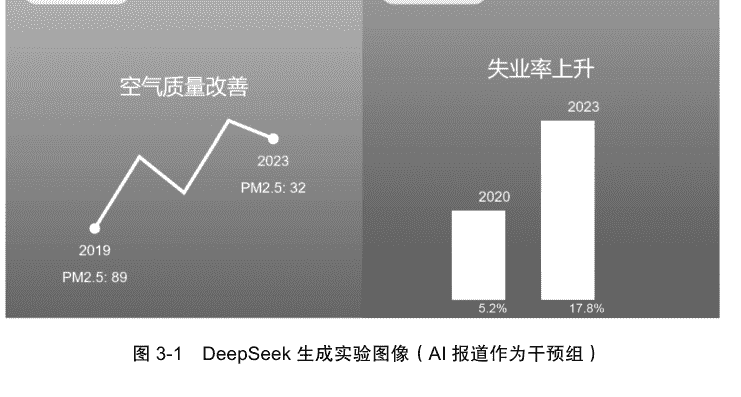

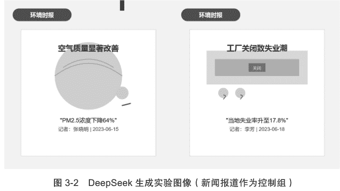

图 3-2 DeepSeek 生成实验图像（新闻报道作为控制组）

DeepSeek 输出实验视频干预要点：

```
低保政策视频形态干预要点
1. 制作标准：
时长：60秒±5秒
一致性：相同数据/案例，不同叙事框架
生成工具：Synthesia（AI主播） vs 真人新闻主播
2. 环保政策示例
AI视频：AI主播播报，正面内容配以AI生成的受益者笑脸画面，动态图表显示覆盖率上升，背景音乐是轻快钢琴曲，负面内容配以AI生成的老人摇头画面，播放红色警示动画，背景音是紧张弦乐
新闻视频：人类主播播报，正面内容是严肃报道“低保政策改革取得阶段性成果”，配以真人采访视频；负面内容是主播播报“一位盲人的三次申请失败”，实地拍摄数据申诉过程
```

为保证干预有效性，通常会设置操纵检验，DeepSeek 可辅助生成相应题目。

DeepSeek 输出操纵检验题目：

```
操纵检验题目
“您刚才阅读的政策评估报告最可能由以下哪种方式生成？”
A. 人工智能系统自动生成
B. 新闻媒体记者撰写
C. 政府官方文件
D. 不确定
```

##### 2. 生成多场景实验干预

常见实验类型包括实验室实验、实地实验、调查实验、自然实验，DeepSeek 可辅助生成不同形式的干预。本节以环保政策评估为例，生成实验室、实地、调查三种实验干预，见提示词 3-10。

> 【提示词 3-10 多场景实验干预】

```
当前有实验室实验、实地实验、调查实验三种实验场景，请你分别提供不同实验场景下的实验干预内容。
```

DeepSeek 输出内容：

```
一、实验室实验干预
适用场景：严格控制变量的因果推断，如高校实验室或线上受控平台。
1.干预设计
组件 实验组（AI生成） 对照组（新闻媒体）
呈现形式 全屏电脑展示（含眼动追踪） 纸质报纸排版+电视新闻片段播放
文本内容 交互式AI报告（可点击展开数据细节） 新华社通稿+专家访谈摘录
图像刺激 动态信息图（实时更新碳交易数据） 静态新闻配图（工厂实拍+记者出镜）
音频/旁白 AI合成语音（中性语调） 真人播音员录音
交互任务 "调整参数预测政策效果"滑块 "划出记者观点"标记任务
时长控制 严格限制5分钟 严格限制5分钟
2.操纵检验
认知负载测试：
请回忆报告中提到的碳排放下降具体数值：___%"（正确答案：18%）
来源识别：
"您认为刚才的材料主要来自？"
AI系统 [ ] 新闻机构 [ ] 政府 [ ] 不确定
二、实地实验干预
适用场景：真实政策宣传场景，如社区服务中心、环保展会。
1.干预设计
组件 实验组（AI生成） 对照组（新闻媒体）
物料形式 电子屏轮播（含二维码链接AI问答） 宣传展板+报纸发放
文本内容 精简版AI摘要（3条核心结论） 报纸节选（同主题报道）
图像刺激 AR扫描显示碳减排效果（需手机扫码） 传统海报（对比照片+图表）
互动设计 语音助手答疑（ChatGPT接口） 工作人员现场解说
环境控制 相邻展位，相同人流密度 相邻展位，相同人流密度
数据收集 扫码填写短问卷（奖励环保袋） 纸质问卷（奖励同款环保袋）
2.操纵检验
接触验证：
“您是否注意到展位上的[AI机器人/新闻剪报]？”
是 [ ] 否
内容记忆：
“本次活动提到的主要政策工具是？”
碳交易 [ ] 环保税 [ ] 限塑令 [ ] 不确定

三、调查实验干预
适用场景：大规模线上调查（如问卷星、Qualtrics）。
1.干预设计
组件 实验组（AI生成） 对照组（新闻媒体）
文本呈现 模拟AI报告界面（仿ChatGPT对话框） 新闻网页截图（含媒体LOGO）
图像嵌入 悬浮提示“本报告由AI政策分析系统生成” 标注“来源：xx报 记者：xxx”
内容分段 分步骤展开（先结论->后数据） 完整一次性呈现
注意力检查 弹出窗口“请选择本报告的评估对象：碳排放政策” 同左
随机化 政策倾向（正/负）和来源（AI/新闻）双因素随机 同左

2.操纵检验
来源感知：
“该材料的文风更接近？”
技术报告 [ ] 新闻报道 [ ] 政府公文 [ ] 不确定

倾向识别：
“您认为材料作者对碳交易政策的态度是？”
5点量表（1=强烈反对 → 5=强烈支持）
```

#### 3.3.3 DeepSeek 助力实验数据全流程

实验数据收齐之后，研究者通常要开展清理、组间均衡性核查、处理效应估计以及异质性探究等工作。若引入 DeepSeek 参与，只需向模型说明数据表的结构、预处理步骤以及常用的分析工具，就能获得可直接落地的分析思路，参见提示词 3-11。类似地，当研究采用自然实验、双重差分等准实验方法时，使用同类提问格式也能得到相匹配的分析建议。

> 【提示词 3-11 实验数据分析】

```
作为一位研究人员，目前已经获取得到实验研究数据
1. 实验的干预题项为Q1，干预组编码为1（阅读AI生成的政策评估报告），控制组编码为0（新闻媒体报道的政策评估报告）
2. 实验的结果变量为Q3，连续性变量，取值范围为0-11；
3. 实验的控制变量为Q4-Q7，分别是年龄、地域、性别、受教育程度；
4. 需要进行数据清洗，通过注意力测试题目Q2，正确取值为1；
5. 需要对干预组变量和控制组变量进行平衡性检验，检验通过后估计实验干预效应
请你提供符合以上要求的实验处理python代码
```

DeepSeek 输出内容：

```python
import pandas as pd
import numpy as np
import statsmodels.formula.api as smf

##### 数据清洗
df_rawdata = pd.read_csv("experiment_data.csv")
df = df_rawdata[
    (df['Q2'] == 1) & # 注意力测试
    (df['Q3'].between(0, 11))
].copy()

df['Q5'] = df['Q5'].astype('category') # 地域作为类别变量处理
df['Q6'] = df['Q6'].astype('category') # 性别作为类别变量处理
df['Q7'] = df['Q7'].astype('category') # 受教育程度作为类别变量处理

##### 平衡性检验
def check_balance(df):
    covariates = ['Q4', 'Q5', 'Q6', 'Q7']
    
    # 方法1：标准化均值差异(SMD)
    balance_table = pd.DataFrame()
    for var in covariates:
        if pd.api.types.is_numeric_dtype(df[var]):
            # 连续变量计算SMD
            smd = (df.groupby('Q1')[var].mean().diff()[-1] /
                   df.groupby('Q1')[var].std().mean())
        else:
            # 分类变量计算熵平衡
            smd = np.abs(pd.crosstab(df['Q1'], df[var],
                                     normalize='index').diff().iloc[-1].mean())
        balance_table.loc[var, 'SMD'] = smd
    
    print(balance_table.round(3))
    print("\n判断标准：SMD < 0.1为均衡良好，0.1-0.25需关注，>0.25需控制")
    
    # 方法2：倾向得分重叠检验
    ps_model = LogisticRegression()
    X = pd.get_dummies(df[covariates], drop_first=True)
    ps_model.fit(X, df['Q1'])
    df['propensity_score'] = ps_model.predict_proba(X)[:, 1]
    
    sns.kdeplot(data=df, x='propensity_score', hue='treatment',
                common_norm=False)
    plt.title("Propensity Score Distribution")
    plt.show()
    
    return df

##### 通过线性回归检验实验干预效应
model = smf.ols("Q3 ~ Q1 + Q4 + C(Q5) + C(Q6) + C(Q7)", data=df).fit()
print(model.summary())
```

### 3.4 本章要点回顾

本章起步于问卷设计，说明了在 DeepSeek 帮助下生成、修订与优化题目的做法；随后梳理了借助模型完成变量挑选、编码等数据清理的环节；最后覆盖了抽样方案的制定、多模态多情境实验干预的构建以及实验数据的解析流程。综合来看，DeepSeek 在数据构造与数据分析上的能力，能够显著提升问卷调查与实验研究的效率，降低研究者的时间投入。

### — 思考与练习 —

思考：DeepSeek 可辅助问卷与实验设计，作为研究者应如何判断模型给出的方案是否有效且准确？

练习 1：在 DeepSeek 协助下完成“媒体报道能否改变公众对社会不平等的认知”这一实验设计，要求包含抽样安排、实验情境、干预内容、操纵检验以及数据清洗流程。

练习 2：下载中国家庭追踪调查 CFPS 2020 年与 2022 年的数据，在 DeepSeek 帮助下提取个人自答问卷中的主观态度部分，并合并为两期面板数据。

# 第4章 硅基样本构建：系统仿真的实践

本章重点
- 梳理系统仿真的底层原理与常用工具
- 以斯坦福小镇为案例进行认识
- 掌握仿真实验的运行与数据采集方法

### 4.1 AI 智能体初识

在系统仿真与社会计算实验里，人工智能体是核心构成要素。它是一种能够自行感知环境、处理信息并作出行动决定的软件主体。与仅按既定指令被动响应的传统程序不同，这类主体具备自主性与适应性，会结合当前状态与过往经验规划策略，以达成预设目标。在 Stanford Generative Agents 实验中，每一位虚拟居民都被建模为一个智能体，它们既能感知时间与空间的变动，也能基于自然语言任务自主产出行为、展开互动、沉淀记忆并形成社会网络，从而复现个体在真实社会中的连续生活轨迹。

这些主体一般遵循“感知—决策—执行”的工作流：先通过传感器或接口收集环境信息，如他人的行为、时间推移、地点转移；再借助语言模型或其他算法解读信息、判定任务优先级并规划下一步；最后在虚拟空间中模拟执行，例如移动、对话、记录笔记或建立关系。在复杂情境下，高阶智能体还能具备学习能力，根据外部反馈不断调整策略，提升任务完成度或社交表现，形成高度逼真的类人仿真系统。正因如此，智能体既是技术实体，也是社会行为体，构成了“硅基样本”研究设计的基础单元。

### 4.2 技术底座与平台生态

#### 4.2.1 核心架构解析

模拟人类社会行为长期以来是人工智能的难点。2023 年，斯坦福大学团队提出“生成式智能体”概念，并以斯坦福小镇展示了一种可模拟人类长期行为的计算架构，关键在于缓解了大语言模型难以长期保持一致性的痛点。传统大模型虽能产出单次合理的行为，却无法维持长时间的行为连贯性和记忆连续性。例如让大模型扮演角色，可能出现中午 12 点进食，12 点半与 1 点又再次进食的荒诞情况。生成式智能体在语言模型之外构建完整的认知架构，使其拥有长期记忆、自我反思与规划能力。

该架构的基础是记忆流机制。记忆流是主体全部经历的自然语言记录库，按时间顺序保存观察、行动和对话。与人类记忆相似，并非所有记忆都能同等程度被检索。系统采用三维评分模型模拟检索过程：时效性评分使用指数衰减，让近期事件更容易被回忆；重要性评分区分日常琐事与关键事件；相关性评分则通过计算记忆与当前情境的语义相似度确定优先级。该机制弥补了大模型上下文窗口有限的缺陷，使主体能从数百条记忆中抽取最相关信息。

仅靠记忆检索不足以支撑复杂社会行为。人类思维能从具体经历中抽象出更高层认知。生成式智能体中的内省模块正模拟这一过程，如图 4-1 所示。当新经历的重要性累积超过 150 时，系统触发反思：先从最近 100 条记忆中生成有意义的高层问题，再检索相关记忆，引导语言模型提炼洞察并引用具体记忆作为证据。

> Park, J. S., O'Brien, J., Cai, C. J., Morris, M. R., Liang, P., & Bernstein, M. S. (2023). Generative agents: Interactive simulacra of human behavior. In Proceedings of the 36th annual acm symposium on user interface software and technology (pp. 1-22).

066 | 打造 AI 科学家：DeepSeek 与 ChatGPT 应用实战手册

```
##### 汤姆 → 简 @ the Ville, 莫雷诺家族的房子, 汤姆和简的卧室, 床

`汤姆`
> 早上好简, 今天市长选举又有新的进展了吗?

`简`
> 早上好汤姆, 今天还是没有新的市长选举进展。你先去市场吧, 早餐我已经准备好了。
```


图 4-1 记忆与提问

这些反思以树状结构组织，低层反思可进一步综合为更高层抽象。例如 Klaus 的多条阅读记录“正在阅读关于城市化的书籍”“在咖啡馆讨论城市发展问题”可被归纳为中层反思“Klaus 对城市化研究兴趣浓厚”，再与其他行为记录共同支撑高层反思“Klaus 投身社会变革研究”。这种分层反思帮助主体形成连贯的自我概念和对他人的深入理解。

生成式智能体的第三个核心组件是规划与反应系统。规划模块通过递归分解保证行为的长期一致性，反应模块则赋予环境变化的适应力。规划从生成粗略日程开始，主体依据背景、特质和过往反思规划出 5~8 个时间块。粗略计划会被递归细化为小时级活动，再分解为 5~15 分钟的具体行动。例如，

#### 4.2.2 主流模拟平台

除斯坦福小镇外，全球已出现多个具代表性的大模型社会模拟平台，它们以不同技术路径推动多智能体交互研究。

由清华大学、北京邮电大学、大连理工大学等团队提出的 ChatDev 范式，是一个由聊天驱动的虚拟软件公司，模仿瀑布模型将开发拆分为设计、编码、测试、文档四个阶段。每个阶段由“软件智能体”参与，如程序员、代码审查员、测试工程师，通过协作对话实现无缝流程。聊天链负责把阶段拆解为原子子任务，支持双重角色的上下文感知沟通，从而高效解决子任务。

上海人工智能实验室研发的 GRUtopia 桃源 是首个面向具身智能的 3D 社会模拟平台，核心创新是构建了含十万个场景、覆盖 89 类环境的 GRScenes 数据集，涵盖超市、医院、办公室等。平台通过 GRResidents 系统实现大模型驱动的 NPC 交互，这些 NPC 不仅能生成动态对话，还能主动为机器人分配任务，比如要求机器人在超市货架第三层取特定商品，并以交叉验证确保任务描述准确。研究者已在平台上验证机器人完成商品分拣、咖啡冲泡等复杂操作的可能性。

上海人工智能实验室与大连理工大学等联合开发的 OASIS 平台聚焦社交媒体场景的百万级主体模拟，架构深度复刻 Twitter 与 Reddit 的核心机制。环境服务器实时维护用户关系网络、动态帖文和推荐算法，信息通道模块模拟基于兴趣图谱和热度排名的内容分发。实验显示，规模达百万主体时，信息传播的级联效应显著增强，群体极化出现概率提升。OASIS 的推荐系统会动态调节曝光策略，例如当某话题热度超阈值时自动降低推送频率以防信息过载。

MetaGPT 通过标准化流程 SOP 重构多主体协作，将软件开发拆分为产品需求文档撰写、API 设计、代码实现等 12 个标准化节点，由特定角色主体负责。平台创新引入“代码评审”环节，当工程师主体提交的代码存在漏洞时，测试工程师主体会生成包含错误定位和修复建议的评审报告。

此外，斯坦福小镇的开源演进中值得关注 Smallville，它通过环境树转换增强空间推理能力 https://nickm980.github.io/smallville，如图 4-2 所示。主体把沙盒环境抽象为层级结构如“厨房→灶台→旋钮”，规划路径时会递归遍历该结构生成自然语言描述。该机制让主体在寻找会议场所时能判断“二楼会议室比一楼大厅更合适”等空间关系。

> Chen, W., Su, Y., Zuo, J., Yang, C., Yuan, C., Qian, C., ... & Zhou, J. (2023). Agentverse: Facilitating multi-agent collaboration and exploring emergent behaviors in agents. arXiv preprint arXiv:2308.10848, 2 (4), 6.

> Wang, H., Chen, J., Huang, W., Ben, Q., Wang, T., Mi, B., ... & Pang, J. (2024). Grutopia: Dream general robots in a city at scale. arXiv preprint arXiv:2407.10943.

> Yang, Z., Zhang, Z., Zheng, Z., Jiang, Y., Gan, Z., Wang, Z., ... & Shao, J. (2024). Oasis: Open agents social interaction simulations on one million agents. arXiv preprint arXiv:2411.11581.

> Hong, S., Zheng, X., Chen, J., Cheng, Y., Wang, J., Zhang, C., ... & Wu, C. (2023). Metagpt: Meta programming for multi-agent collaborative framework. arXiv preprint arXiv:2308.00352, 3 (4), 6.

```
<PROMPT>:
在区域选项中，为当前任务选择一个合适的区域。

山本百合子 住在 <山本百合子的房子>，里面有 主人房，浴室。
山本百合子 目前的位置是 <哈维奥克供应店>，里面有 供应店。

问题：
山本百合子 正在 工作，为当地企业开展税务合规项目。为了 撰写工作日志和总结，山本百合子 应该去哪里？

要求：
1. 必须在这个列表中选择一个区域，列表：[约翰逊公园，山本百合子的房子，哈维奥克供应店，柳树市场和药店，霍布斯咖啡馆，玫瑰酒吧，亚当的家，摩尔家族的房子]。
2. 如果现在正位于列表中的区域，并且计划的活动可以在这里进行，最好留在当前区域。
3. 不要选择列表以外的区域。
4. 直接输出选中的结果。

山本百合子 应该去：

<RESPONSE[1/1]>:
山本百合子 应该去：哈维奥克供应店

<OUTPUT>:
哈维奥克供应店
```

图 4-2 空间推理能力展示

### 4.3 环境搭建

斯坦福小组最早公开的生成式智能体系统可在 https://github.com/joonspk-research/generative_agents 获取。该实现侧重于证明概念可行，工程结构并不利于二次改写。随后社区出现了不少重构版本，其中 GenerativeAgentsCN https://github.com/joonspk-research/generative_agents 是一支面向社会科学使用的中文化分支。相较原型，它做了若干实质性改动：把智能体的默认工作语言改为中文，细化了对话的开启与收尾逻辑，并加入对本地大模型的接入支持。本节就围绕最后一个改动，说明如何借助 DeepSeek 在本地复刻一套功能接近原版的社会仿真环境。

整体部署可分为两步。前置条件是在本地借助 Ollama 运行 DeepSeek-R1，详见本书 1.2 节，此处不再展开。

第一步是把代码库克隆到本地：

```
git clone https://github.com/x-glacier/GenerativeAgentsCN.git
cd GenerativeAgentsCN
```

没有使用过 git 的读者可按系统补充安装。Windows 可到 Git Hub 官网 https://git-scm.com/download/win 下载安装包；macOS 在终端执行 brew install git；Linux 则用发行版自带的包管理器 apt-get install git 或 yum install git 安装。

第二步用 Anaconda 新建隔离环境。若未装 Anaconda，可到 https://www.anaconda.com/download 下载。安装后在终端或命令提示符创建名为 generative_agents_cn 的 Python 3.11 环境：

```
conda create -n generative_agents_cn python=3.11
conda activate generative_agents_cn
```

激活后在项目根目录安装依赖：

```
pip install -r requirements.txt
```

耗时取决于网络与硬件。完成后需调整模型连接。打开 generative_agents/data/config.json，确认 base_url 与 model 两项与 Ollama 中保持一致。

> 本章后续代码示例若无特别说明均取自 GenerativeAgentsCN 的 GitHub 仓库，采用 Apache 开源协议，谨此致谢。

### 4.4 运行与数据获取

#### 4.4.1 启动仿真

环境就绪后即可启动虚拟小镇。

首先进入项目目录，macOS/Linux 用 Terminal，Windows 用 CMD 或 PowerShell，执行：

```
cd generative_agents
```

注意：当前路径必须包含 generative_agents 文件夹，若不在则先用 cd 切换。

然后执行启动命令。为本次小镇指定唯一名称，例如 sim-start，便于后续回放；start 设定起始时间，例如 20240213-09:30；step 设定迭代步数，例如 10；stride 设定每步对应的分钟数。若设 --stride 10，时间轴会按 9:00、9:10、9:20 递进。

```
python start.py -name sim-test -start "20240213-09:30" -step 10 -stride 10
```

运行中若终端意外关闭会导致中断。可使用 resume 恢复：

```
python start.py -name sim-test -resume -step 10 -stride 10
```

name 需与中断时的名称一致。程序默认自动保存，恢复时会自动读取保存文件夹并从上次时间点继续。

再次运行无需重复环境配置，直接从本节开始即可。若环境已存在会弹出如图 4-3 的提示，输入 n 保留原环境。

```
Last login: Mon Mar 31 22:54:01 on ttys001
(base)  ~ % conda create -n generative_agents_cn python=3.11 ]
Retrieving notices: ...working... done
WARNING: A conda environment already exists at '/opt/anaconda3/envs/generative_agents_cn'

Remove existing environment?
This will remove ALL directories contained within this specified prefix directory, including any other conda environments.

(y/[n])? n
```

图 4-3 再次创建虚拟环境

#### 4.4.2 采集结果

仿真结束后可导出回放数据，name 后名称需与目标小镇一致：

```
python compress.py -name sim-test
```

完成后 results/compressed/ 目录下会生成 movement.json，同时生成 simulation.md，按时间线记录各智能体的状态与对话。

随后启动本地回放服务：

```
python replay.py
```

启动后在浏览器打开 http://127.0.0.1:5000/?name=sim-test 即可进入回放界面，查看居民在不同时段的活动。URL 后可追加参数调整回放，说明见表 4-1。

表 4-1 虚拟小镇回放参数

| 参数 | 功能描述 | 默认值 |
| :--- | :--- | :--- |
| name | 模拟运行时设定的名称 | — |
| step | 回放起始步数，0 为开头 | 0 |
| speed | 回放速度，0 最慢，5 最快 | 2 |
| zoom | 画面缩放比例 | 0.8 |

例如 http://127.0.0.1:5000/?name=sim-test&step=0&speed=2&zoom=0.6 表示在 0.6 缩放下从开头以速度 2 播放名为 example 的内置模拟数据，如图 4-4 所示。


若只想看文本记录，可直接打开 simulation.md，如图 4-5。

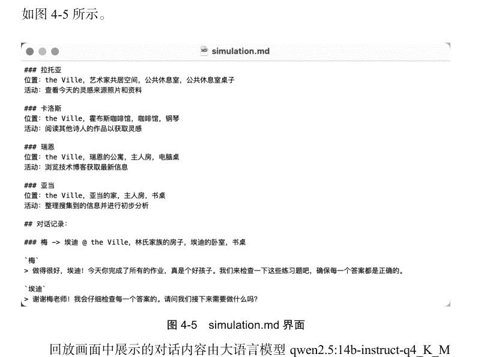

图 4-5 simulation.md 界面

回放画面中的对话由大模型 qwen2.5:14b-instruct-q4_K_M 生成。需要截图保存关键时段，可用浏览器截图或开发者工具抓取。

### 4.5 小结

本章介绍了基于 AI Agent 的社会系统仿真方法，以斯坦福小镇实验为例说明技术实现路径。记忆流、反思与规划机制的引入，让生成式智能体克服了大语言模型短期记忆的限制，实现较长时段的连贯行为。研究者在可控情境中可反复检验社会理论，观察微观互动如何聚合为宏观模式。当前仿真仍存在理想化现实的局限，随着模型能力提升与多智能体架构完善，系统仿真有望成为理解复杂社会机制的重要手段，为政策设计、治理实践与理论检验提供新依据。

### — 思考与练习 —

练习 1：在本地完成斯坦福小镇的基础部署，包含依赖安装、初始运行与回放测试。参考本章命令设定自定义小镇名称，并记录生成的 movement.json 与 simulation.md。运行过程中是否出现中断？你如何借助 -resume 参数恢复？

练习 2：基于斯坦福小镇的 AI Agent 行为逻辑，思考社会科学研究中借助仿真模拟个体行动的优势与限制。结合自身研究兴趣如政治参与、教育互动、城市治理等，构思一个可在仿真平台初步实现的研究场景，并描述其中的 Agent 类型与关键行为规则。该设想中哪些社会机制可编码为规则，哪些难以还原或被简化？

# DeepSeek 篇

# 第5章 DeepSeek 与文本数据

### 本章重点

- 借助 DeepSeek 进行网络数据抓取
- 利用 DeepSeek 提炼数据特征
- DeepSeek 在数据标注中的作用

### 5.1 数据抓取

互联网上沉淀了大量关于社会行为、公众态度、政策反馈的信息，对把握社会现象与动态演进意义重大。在社会科学研究中，获取开放网络数据是分析群体行为与态度的基础。DeepSeek 可辅助研究者完成采集任务，无论是新手还是具备一定编程基础的研究者，都能通过自然语言指令实现抓取。

#### 5.1.1 分析网页结构

编写爬虫前，解析页面结构是关键。页面数据多嵌套于复杂的 HTML 标签，层级、加载方式与前端逻辑直接决定抓取策略与难度。目标信息可能分布于多层嵌套或由 JavaScript 动态加载，需要一定的解析能力。

对缺乏编程背景的社会科学研究者而言，手工查看源码、理解 DOM、定位节点门槛较高。面对结构不规范、反爬或动态加载的页面，仅靠浏览器查看源代码或检查元素往往难以准确定位，易导致遗漏或失败。

DeepSeek 可快速解析页面结构与内容，定位目标数据，为后续爬虫提供精准入口，提升效率与准确性。以豆瓣电影 Top250 为例，提示词 5-1 展示了结构分析需求。

##### 【提示词 5-1 网页结构分析】

> 下面是豆瓣电影Top250的部分网页原文件。请帮我分析分析电影名称信息、电影评分信息、电影评价人数的网页选择器，以方便后续爬虫代码的撰写。

（注：本处原本应展示豆瓣电影Top250的部分网页原文件，因篇幅限制，已省略具体HTML内容。）

DeepSeek 输出内容：

```
根据提供的网页结构，以下是关键信息的css选择器建议：
1. 电影名称
css
.info div.hd a span.title:first-child

说明：提取第一个<span>中的中文名称（可能存在并列外文名称时）

2. 电影评分
css
.bd span.rating_num

说明：直接获取含评分数值的专属`rating_num`类

3. 评价人数
css
.bd div span:last-child

说明：定位评分区块内最后一个<span>（含x人评价）

注意事项：
1. 建议在解析时 `strip()` 处理文本中的多余空白
2. 评价人数的数字需要从字符串中提取数字部分（正则`\d+`即可）
3. 当存在并列多语言片名时，所有<span>会依次排列，保持`first-child`能始终获取主标题
4. 评分区块中的`rating5-t`类用于显示星级图标，不是数值数据需要绕过
```

基于上述结构分析结果，研究者即可撰写爬虫获取网络数据。

#### 5.1.2 编写爬虫代码

明确数据位置后，下一步是编写自动化抓取代码。传统爬虫需掌握 Python/R 及 requests、BeautifulSoup、lxml 等库，对多数社会科学研究者而言学习成本高。

利用 DeepSeek 生成代码时，可依据先前的结构分析定义抓取目标、网页、数据类型与频率，见提示词 5-2。

##### 【提示词 5-2 爬虫代码】

> 我需要抓取豆瓣电影Top250网页中的电影名称、评分和评价人数。网址是：https://movie.douban.com/top250。请根据之前网页结构分析结果，撰写爬虫代码，并为代码附加必要的解释，以csv格式保存结果。

DeepSeek 输出内容：

```python
import requests
from bs4 import BeautifulSoup
import csv
import re
import time
##### 创建CSV文件并写入表头
with open('douban_top250.csv', 'w', newline='', encoding='utf-8-sig') as csvfile:
    writer = csv.writer(csvfile)
    writer.writerow(['排名', '电影名称', '评分', '评价人数'])
headers = {
    'User-Agent': 'Mozilla/5.0 (Windows NT 10.0; Win64; x64) AppleWebKit/537.36 (KHTML, like Gecko) Chrome/120.0.0.0 Safari/537.36'
}
##### 存储所有电影数据的列表
all_movies = []
##### 循环处理每一页（共10页）
for page in range(0, 250, 25):
    url = f'https://movie.douban.com/top250?start={page}'
    # 发送带延迟的请求（避免触发反爬）
    response = requests.get(url, headers=headers)
    time.sleep(2)  # 每个请求间隔2秒
    if response.status_code == 200:
        soup = BeautifulSoup(response.text, 'html.parser')
        # 定位电影列表容器
        movie_list = soup.select('ol.grid_view li')
        for item in movie_list:
            # 电影排名
            rank = item.select_one('em').get_text().strip()
            # 电影名称（使用首个title选择器）
            title = item.select_one('.info div.hd a span.title:first-child').get_text().strip()
            # 评分（直接通过专属类获取）
            rating = item.select_one('.bd span.rating_num').get_text().strip()
            # 评价人数（正则提取数字部分）
            votes_tag = item.select_one('.bd div span:last-child')
            votes = re.search(r'\d+', votes_tag.get_text()).group()
            # 添加到总列表
            all_movies.append([rank, title, rating, votes])
        print(f'第{page//25 + 1}页抓取完成')
    else:
        print(f'请求失败，状态码：{response.status_code}')
##### 写入CSV文件
with open('douban_top250.csv', 'a', newline='', encoding='utf-8-sig') as csvfile:
    writer = csv.writer(csvfile)
    writer.writerows(all_movies)
print('全部数据已保存到 douban_top250.csv')
```

总体而言，DeepSeek 能够帮助研究者拆解网页结构，找准目标数据的存放位置，并据此自动撰写采集程序，让线上信息的抓取事半功倍。

### 5.2 特征抽取

在完成抓取与初步清洗之后，研究人员往往需要从原始文本或半结构化材料中分离出可支撑量化分析或模型搭建的关键要素。实体抽取与事件抽取是这一阶段最常用的两种操作。

#### 5.2.1 实体识别

在自然语言处理领域，命名实体识别的核心目标是从非结构化文字里自动定位出具备明确语义的名词类对象，典型类别涵盖人名、地名、机构名、时间点、事件名等。对社会科学而言，这相当于把繁杂文本转化为可比较的结构化材料，有助于系统把握政策语境、媒体报道、网络舆情等现象。例如从新闻中梳理出涉及的人物与机构关系，为后续研究提供数据基础。

实体识别能大幅压缩人工标注投入，并提升结果的一致性和可靠性。完整流程通常涉及预处理、特征构造、模型训练与部署、结果导出等环节，对编程与算法能力要求较高。

通过 DeepSeek，无需自主搭建训练流程，仅用自然语言描述需求即可快速完成实体抽取。下面以提示词 5-3 的三段材料为例。

> 【提示词 5-3 命名实体识别任务】
>
> 我正在进行命名实体识别任务。下面有三个文本，请仔细分析文本内容，提取其中的实体。
>
> 1. 2025年初，A地政府在高校科研团队的帮助下正式完成DeepSeek的本地部署，上线“政务AI助手”试点平台。该平台集成了本地政策法规数据库、党政机关办文规范等文本资源，能够实现文书起草建议、辅助研判分析等功能。
>
> 2. B地街道办事处于2025年第一季度完成DeepSeek本地部署，建设了“社区治理AI助手”平台，大大提高了对居民诉求的响应速度与处理效率。
>
> 3. 在数字政务全面提速的背景下，2025年4月，C地经济技术开发区管理委员会将DeepSeek嵌入“企业服务一体化平台”，提升政府在企业服务、投资咨询回应、项目审批辅导等方面的智能化水平。

DeepSeek 输出内容：

```
文本1
时间实体：2025年初
地点/组织机构实体：A地政府、高校科研团队
系统/技术实体：DeepSeek
平台实体：“政务AI助手”试点平台

文本2
时间实体：2025年第一季度
地点/组织机构实体：B地街道办事处
系统/技术实体：DeepSeek
平台实体：“社区治理AI助手”平台

文本3
时间实体：2025年4月
地点/组织机构实体：C地经济技术开发区管理委员会
系统/技术实体：DeepSeek
平台实体：“企业服务一体化平台”

关键实体类型说明
时间实体：精确到月份或季度的部署时间。
地点/组织机构实体：行政单位（如政府、街道办事处、管委会）及合作团队（如高校科研团队）。
系统/技术实体：通用AI系统名称（DeepSeek）。
平台实体：带引号的政务平台名称，包含功能或定位描述（如“试点”）。
```

如果希望呈现更规范清晰，研究者可以调整指令表述，引导模型按统一格式输出，便于后续整理与分析，见提示词 5-4。

##### 【提示词 5-4 结构化输出命名实体识别结果】
```
正在进行命名实体识别任务。下面有三个文本，请仔细分析文本内容，提取其中的实体，并以结构化表格形式输出。

1. 2025年初，A地政府在高校科研团队的帮助下正式完成DeepSeek的本地部署，上线“政务AI助手”试点平台。该平台集成了本地政策法规数据库、党政机关办文规范等文本资源，能够实现文书起草建议、辅助研判分析等功能。

2. B地街道办事处于2025年第一季度完成DeepSeek本地部署，建设了“社区治理AI助手”平台，大大提高了对居民诉求的响应速度与处理效率。

3. 在数字政务全面提速的背景下，2025年4月，C地经济技术开发区管理委员会将DeepSeek嵌入“企业服务一体化平台”，提升政府在企业服务、投资咨询回应、项目审批辅导等方面的智能化水平。
```

DeepSeek 输出内容：

| 时间 | 地点 | 参与方 | 系统名称 | 平台名称 | 集成资源 | 主要功能 |
| :--- | :--- | :--- | :--- | :--- | :--- | :--- |
| 2025年初 | A地政府 | 高校科研团队 | DeepSeek | “政务AI助手”试点平台 | 本地政策法规数据库、党政机关办文规范 | 文书起草建议、辅助研判分析 |
| 2025年第一季度 | B地街道办事处 | 无特定参与方 | DeepSeek | “社区治理AI助手”平台 | 未明确说明 | 提高居民诉求响应速度、提升居民诉求处理效率 |
| 2025年4月 | C地经济技术开发区管理委员会 | 数字政务发展背景 | DeepSeek | “企业服务一体化平台” | 未明确说明 | 提升企业服务智能化水平、改善投资咨询回应质量、加强项目审批辅导效率 |

#### 5.2.2 事件抽取

复杂事件抽取旨在从非结构化文本中还原由多个实体、行为、要素构成且相互关联的完整事件。与基础抽取相比，它不仅关注行为主体，还会追问发生的条件、作用对象及产生的影响，从而重建更具情境感和因果逻辑的事件链条。

在社会科学中该方法价值明显。例如从政策文本中抽取“政策名称—发布部门—发布时间—核心内容—受影响群体”，或从判决文书中抽取“案件类型—涉事人员—违法行为—判决结果”。

常规做法包括文本预处理、分词去停用词及实体识别、事件触发词定位、关系抽取以识别参与者、时间、地点、因果等关联，最后结构化输出。整个过程依赖专业算法与模型优化，复杂度较高。DeepSeek 将流程简化，使研究者能更快更准地抽取复杂事件并以结构化方式呈现，见提示词 5-5。

##### 【提示词 5-5 复杂事件抽取】
> 我正在进行复杂事件抽取任务。下面有三个文本，请仔细分析文本内容，提取其中的事件。
>
> 1. 2025年初，A地政府在高校科研团队的帮助下正式完成DeepSeek的本地部署，上线“政务AI助手”试点平台。该平台集成了本地政策法规数据库、党政机关办文规范等文本资源，能够实现文书起草建议、辅助研判分析等功能。
>
> 2. B地街道办事处于2025年第一季度完成DeepSeek本地部署，建设了“社区治理AI助手”平台，大大提高了对居民诉求的响应速度与处理效率。
>
> 3. 在数字政务全面提速的背景下，2025年4月，C地经济技术开发区管理委员会将DeepSeek嵌入“企业服务一体化平台”，提升政府在企业服务、投资咨询回应、项目审批辅导等方面的智能化水平。

DeepSeek 输出内容：

```
事件1：
时间：2025年初
地点：A地
主体：A地政府、高校科研团队
事件类型：政务系统智能化建设
关键动作：完成DeepSeek本地部署、上线“政务AI助手”试点平台
核心功能：集成本地政策法规数据库、党政机关办文规范等；提供文书起草建议、辅助研判分析
实施效果：推动政务智慧化转型试点（隐含）

事件2：
时间：2025年第一季度
地点：B地街道
主体：B地街道办事处
事件类型：社区治理智能化升级
关键动作：部署DeepSeek系统、建设“社区治理AI助手”平台
核心功能：快速响应居民诉求；提升问题处理效率
实施效果：显著优化社区服务体系效率（显性表述）

事件3：
时间：2025年4月
地点：C地经济技术开发区
主体：开发区管委会
事件类型：企业服务智能化改造
关键动作：嵌入DeepSeek至现有平台、升级为“企业服务一体化平台”
核心功能：智能企业服务响应；投资咨询自动化；项目审批智能辅导
背景动因：数字政务全面提速政策驱动（显性说明）
```

与实体识别类似，实际操作中可按研究目标灵活设计结构化模板，如“时间—地点—主体—行为—结果”等维度，通过调整提示词让输出更贴合需求，见提示词 5-6。

##### 【提示词 5-6 结构化输出复杂事件抽取结果】
> 我正在进行复杂事件抽取任务。下面有三个文本，请仔细分析文本内容，提取其中的事件，并以结构化表格形式输出。
>
> 1. 2025年初，A地政府在高校科研团队的帮助下正式完成DeepSeek的本地部署，上线“政务AI助手”试点平台。该平台集成了本地政策法规数据库、党政机关办文规范等文本资源，能够实现文书起草建议、辅助研判分析等功能。
>
> 2. B地街道办事处于2025年第一季度完成DeepSeek本地部署，建设了“社区治理AI助手”平台，大大提高了对居民诉求的响应速度与处理效率。
>
> 3. 在数字政务全面提速的背景下，2025年4月，C地经济技术开发区管理委员会将DeepSeek嵌入“企业服务一体化平台”，提升政府在企业服务、投资咨询回应、项目审批辅导等方面的智能化水平。

DeepSeek 输出内容：

根据文本内容，我提取出以下结构化事件信息表格：

| 主体 | 时间 | 部署对象 | 协作方 | 平台名称 | 集成资源/部署方式 | 功能/影响 |
| :--- | :--- | :--- | :--- | :--- | :--- | :--- |
| A地政府 | 2025年初 | DeepSeek | 高校科研团队 | 政务AI助手试点平台 | 整合政策法规数据库、党政机关办文规范文本资源 | 实现文书起草建议、辅助研判分析 |
| B地街道办事处 | 2025年第一季度 | DeepSeek | — | 社区治理AI助手平台 | 基础平台部署 | 提升居民诉求响应速度与处理效率 |
| C地经济技术开发区管理委员会 | 2025年4月 | DeepSeek | — | 企业服务一体化平台 | 嵌入式系统整合 | 增强企业服务、投资咨询回应、项目审批辅导等智能化水平 |

标注说明：

1. 事件主体：基于文本描述的治理主体单位

2. 部署时间：统一采用中文日期表达

3. 协作方：明确文本中指明的跨机构合作方

4. 平台属性：区分了新建平台（前2例）和系统集成平台（第3例）

5. 影响维度：侧重呈现各场景的应用成效，包含文书处理效率（首例）、民生服务效能（次例）、营商环境优化（末例）三个不同维度

总体来看，DeepSeek 能有效完成文本数据的特征提取。研究者可依据具体目标灵活设定提示词，引导模型输出所需信息并指定格式。借助它，非结构化数据向可分析变量的转化门槛被拉低，效率与准确性也得到提升。

### 5.3 标注流程

数据标注是对原始数据赋予有意义标签的过程，为模型训练提供监督信息。根据任务特点，主要分为封闭域标注和开放域标注，前者适用于标签集合事先确定的场景。

#### 5.3.1 封闭域标注：情感分类示例

封闭域标注的标签类别是预先定义好的，标注时只能从有限选项中挑选。例如社交媒体情感分析，先确定积极、消极、中性等类别，再据文本内容分配标签。这类方法适合研究目标明确、分类标准清晰的场景。

以情感极性为例，标准流程包括制定分类细则、标注员阅读文本并按细则判断情感倾向、汇总形成结构化标注集，用于模型训练。人工操作耗时耗力，且易受主观偏差影响。

DeepSeek 可快速完成文本情感分析，帮助研究者高效处理大规模文本，避免繁琐的人工标注。提示词 5-7 是具体案例。

##### 【提示词 5-7 标注情感】
> 情感类别包括积极、中性、消极，请对下面的文本进行情感分析，为每个文本分配具体的情感。
>
> 1. 最近看到国内几家大厂都在推自己的大模型，真是百模大战啊！但感觉离真正‘聪明’还有点远，AI再聪明也不如人类有情感，有温度。
> 2. 看到某地用人工智能系统预测交通拥堵，还能自动调控红绿灯，效率提升不少，这才是真正的智慧城市，值得推广！
> 3. 人脸面部识别越来越普及，但我一直担心隐私问题。如果没有完善的法律规范，滥用只会带来更多社会风险。
> 4. AI生成作文虽然句子通顺，但内容空洞，没有灵魂。教育不能只看表面热闹，还是要培养学生的独立思考能力。
> 5. 我们公司开始试用AI客服了，说实话效率确实高，但也开始裁员了……技术发展是好事，可别忘了普通人的饭碗。
> 6. 听说现在有AI陪伴老年人聊天，挺新鲜的。要是能解决独居老人的孤独问题，那真是高科技做了件大好事。

DeepSeek 输出内容：

1. 消极

理由：承认技术发展的同时，强调AI缺乏情感和温度，隐含对当前技术不足的失望。

2. 积极

理由：肯定人工智能对交通效率的优化，明确支持智慧城市理念并呼吁推广。

3. 消极

理由：聚焦隐私风险，直指技术滥用可能引发的社会问题，表达强烈担忧。

4. 消极

理由：批判AI生成内容的空洞性，并上升到教育核心价值的警示，否定表面技术应用。

5. 消极

理由：虽然认可技术效率，但更强调失业问题的社会代价，隐含对技术伦理的质疑。

6. 积极

理由：正面评价AI对解决独居老人孤独问题的潜力，肯定技术的社会价值。

如果需要更格式化的标注结果，只需修改提示词即可。具体见提示词 5-8。

##### 【提示词 5-8 结构化输出情感标注结果】

```
情感类别包括积极、中性、消极，请对下面的文本进行情感分析，为每个文本分配具体的情感。请按照如下格式输出结果：文本编号 | 情感，以0表示中性，以1表示积极，以-1表示消极。

1. 最近看到国内几家大厂都在推自己的大模型，真是百模大战啊！但感觉离真正‘聪明’还有点远，AI再聪明也不如人类有情感，有温度。

2. 看到某地用人工智能系统预测交通拥堵，还能自动调控红绿灯，效率提升不少，这才是真正的智慧城市，值得推广！

3. 人脸面部识别越来越普及，但我一直担心隐私问题。如果没有完善的法律规范，滥用只会带来更多社会风险。

4. AI生成作文虽然句子通顺，但内容空洞，没有灵魂。教育不能只看表面热闹，还是要培养学生的独立思考能力。

5. 我们公司开始试用AI客服了，说实话效率确实高，但也开始裁员了....技术发展是好事，可别忘了普通人的饭碗。

6. 听说现在有AI陪伴老年人聊天，挺新鲜的。要是能解决独居老人的孤独问题，那真是高科技做了件大好事。
```

DeepSeek 输出内容：

```
1 | -1
2 | 1
3 | -1
4 | -1
5 | -1
6 | 1
```

在实际的研究操作中，分析者能够依据自身的研究目的灵活调整指令词，引导 DeepSeek 对文本执行情感标注，并预先约定返回格式，以便后续的整理与分析更顺畅。

#### 5.3.2 开放域标注任务：以主题提取为例

相较于封闭域标注，开放域标注并不依赖事先设定好的固定标签库，而是依据数据的具体表现进行贴标，核心在于对文本中的主题、情感、观点等要素进行归类与抽取。这类任务多出现在探索性研究或语义内容繁杂、结构不够明确的场景里，研究者难以穷尽所有可能的标签，往往需要通过人工研读从材料中辨认并提炼出具有代表性的主题、概念或关键词。

以主题提炼为例，研究者需要从一批文本材料中归纳出其涉及的核心或多个议题，而这些议题并非预先给定，必须结合材料本身进行提炼。与情感标注类似，人工完成主题标注既耗时耗力，也容易受主观经验和背景知识的制约。

DeepSeek 能够对文本执行主题提取，帮助研究者快速完成标注工作，并降低人为因素对标注质量的影响。提示词 5-9 即为一个具体示范。

##### 【提示词 5-9 主题提取】

```
请分析下面的文本，准确识别文本中包含的主题，为每个文本分配一个最相关的主题。

1. 最近看到国内几家大厂都在推自己的大模型，真是百模大战啊！但感觉离真正‘聪明’还有点远，AI再聪明也不如人类有情感，有温度。

2. 看到某地用人工智能系统预测交通拥堵，还能自动调控红绿灯，效率提升不少，这才是真正的智慧城市，值得推广！

3. 人脸面部识别越来越普及，但我一直担心隐私问题。如果没有完善的法律规范，滥用只会带来更多社会风险。

4. AI生成作文虽然句子通顺，但内容空洞，没有灵魂。教育不能只看表面热闹，还是要培养学生的独立思考能力。

5. 我们公司开始试用AI客服了，说实话效率确实高，但也开始裁员了....技术发展是好事，可别忘了普通人的饭碗。

6. 听说现在有AI陪伴老年人聊天，挺新鲜的。要是能解决独居老人的孤独问题，那真是高科技做了件大好事。
```

DeepSeek 输出内容：

1. 主题：大模型发展现状与竞争

分析：聚焦于国内科技企业在大语言模型研发领域的竞争格局及技术边界（缺乏情感智能）。

2. 主题：AI城市治理与交通优化

分析：体现人工智能在智慧城市基础设施建设中的实际应用案例，涉及智慧交通系统。

3. 主题：隐私保护与AI伦理问题

分析：探讨生物识别技术应用场景中的隐私泄露风险及社会治理需求。

4. 主题：AI在教育中的应用与反思

分析：关注AI生成内容工具对教育本质的影响，强调技术工具与人文教育的辩证关系。

5. 主题：AI对就业市场的影响

分析：揭示自动化技术替代人工服务的双刃剑效应，反映产业升级中的社会成本问题。

6. 主题：AI在医疗健康及社会关怀中的应用

分析：展示人工智能技术在适老化社会场景中的创新实践及其人文价值。

若研究者希望一次性识别文本中的多重主题，可参照提示词 5-10 对指令进行调整。

##### 【提示词 5-10 识别文本中的多个主题】

请分析下面的文本，准确识别文本中包含的所有主题。以文本编号 | 主题1 | 主题2 | 主题3......（以此类推，涵盖文本涉及的全部主题）的格式输出结果。

1. 最近看到国内几家大厂都在推自己的大模型，真是百模大战啊！但感觉离真正‘聪明’还有点远，AI再聪明也不如人类有情感，有温度。

2. 看到某地用人工智能系统预测交通拥堵，还能自动调控红绿灯，效率提升不少，这才是真正的智慧城市，值得推广！

3. 人脸面部识别越来越普及，但我一直担心隐私问题。如果没有完善的法律规范，滥用只会带来更多社会风险。

4. AI生成作文虽然句子通顺，但内容空洞，没有灵魂。教育不能只看表面热闹，还是要培养学生的独立思考能力。

5. 我们公司开始试用AI客服了，说实话效率确实高，但也开始裁员了....技术发展是好事，可别忘了普通人的饭碗。

6. 听说现在有AI陪伴老年人聊天，挺新鲜的。要是能解决独居老人的孤独问题，那真是高科技做了件大好事。

DeepSeek 输出内容：

1 | 大模型发展 | AI技术竞争 | 人工智能局限性 | 人类情感与AI伦理

2 | 智慧城市 | 人工智能应用 | 交通管理优化 | 智能调控技术

3 | 面部识别技术 | 隐私保护 | 法律规范 | 科技社会风险

4 | AI生成内容 | 教育创新 | 独立思考能力 | 技术工具与教育本质

5 | AI职场应用 | 就业市场影响 | 技术发展与劳动力替代 | 企业社会责任

6 | 老龄化社会应对 | AI社会服务 | 老年人心理健康 | 科技人文关怀

总体来看，无论是封闭域标注还是开放域标注，DeepSeek 都能对文本的关键信息进行解析，助力研究者完成标注任务。此外，本书 ChatGPT 部分 12.5 节介绍了如何对大语言模型的标注结果进行质量评估，为研究者验证标注准确性提供了具体方法。

### 5.4 总结

如图 5-1 所示，本章系统梳理了 DeepSeek 辅助研究者运用文本数据开展研究的流程。对于网络数据的获取环节，DeepSeek 可帮助研究者解析网页结构，并据此生成爬虫代码，实现高效抓取；在文本特征提取阶段，DeepSeek 能够把非结构化文本转化为结构化数据；就数据标注而言，无论是封闭域任务还是开放域任务，DeepSeek 都能完成文本的标注，有助于降低人工成本。总体而言，DeepSeek 帮助研究者在文本数据处理中摆脱传统手工操作的束缚，为社会科学研究提供坚实的智能化支撑。

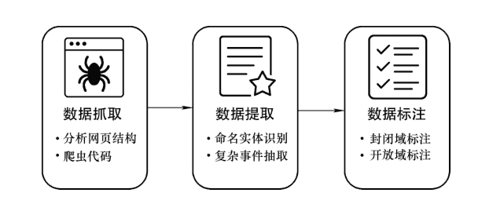

图 5-1 DeepSeek 与文本数据流程图

### — 思考与练习 —

- 练习 1：围绕你感兴趣的研究主题，查找相关网络数据，尝试让 DeepSeek 生成用于抓取数据的爬虫代码。
- 练习 2：结合自身研究方向的文本材料，利用 DeepSeek 进行数据特征提取。
- 练习 3：搜集社交媒体上对某条新闻的评论文本，用 DeepSeek 对评论进行主题提取和情感标注。

# DeepSeek 篇

## 第6章 DeepSeek 在数据分析中的应用

### 本章重点

- 学会构造提示词，借助 DeepSeek 完成数据清洗与预处理
- 掌握利用 DeepSeek 执行方差分析并解读统计结果的方法
- 探索 DeepSeek 在用户行为数据中的特征提取与模式识别能力
- 运用 DeepSeek 自动生成和优化代码，提高编程效率与准确性

本章聚焦 DeepSeek 在数据分析流程中的实践应用，系统呈现了其在数据提取与分析支持、代码优化两个关键环节的强劲能力。本章通过案例展示了 DeepSeek 在数据分析中的具体作用，主要体现在两方面：一是在数据提取与分析支持上，可通过自然语言交互高效完成数据标准化、异常值处理、显著性检验与模型模式识别，明显降低技术门槛；二是在代码优化上，具有自动增添功能与纠错能力，大幅提升分析效率与准确性。

### 6.1 数据提取与分析支持

在科研与商业决策领域，随着数据体量指数级增长，数据分析的价值愈发凸显。作为研究全流程的核心环节，数据提取与分析的质量直接决定结论的可靠性与创新性。DeepSeek 作为一款人工智能数据分析平台，依托系统化的技术架构与算法，为研究者提供了从原始数据到知识发现的完整工具。其技术实现主要覆盖数据清洗与预处理、统计分析支持与结果解读、数据特征提取与模型识别三个关键阶段。本节通过三个案例详细介绍 DeepSeek 在数据分析中的应用。

#### 6.1.1 数据清洗与预处理

数据清洗是保证分析可靠的首要步骤，DeepSeek 在此环节发挥关键作用。以图 6-1 所示的包含 5 列 name、age、email、phone、address，共 9 条记录的 Excel 表为例，该表记录了 9 人的相关信息，但存在多处问题：年龄列出现负数如 Alice 和 Frank，属于录入错误；Charlie 的电话号码缺少位数；且多数人的电话号码相同，均为 123-456-7890。

| name | age | email | phone | address |

|---|---|---|---|---|

| Alice | -3 | alice@example.com | 123-456-7890 | 123 Main St |

| Bob | 30 | bob@example.com | 123-456-7890 | 456 Elm St |

| Charlie | | | 123-456-712 | 789 Oak St |

| David | 40 | david@example.com | 123-456-7890 | 101 Pine St |

| Eva | 35 | eva@example.com | 123-456-7890 | 202 Maple St |

| Frank | -37 | frank@example.com | 123-456-7890 | 303 Birch St |

| Grace | 45 | grace@example.com | 123-456-7890 | 404 Cedar St |

| Heidi | 50 | heidi@example.com | 123-456-7890 | 505 Spruce St |

| Ivan | 22 | ivan@example.com | 123-456-7890 | 606 Fir St |

图 6-1 表格示例

针对上述问题，需完成缺失值处理、重复记录剔除、电话号码格式统一、异常值处理四个任务。可通过构建提示词 6-1 在 DeepSeek 中实现：

##### 【提示词 6-1 数据描述和清洗要求】

> 你是一个数据分析助手，请帮我清洗和预处理一个Excel表格中的数据。以下是数据的描述和清洗要求：

> 1. **数据描述**：

>    - 表格包含以下字段：`name`（客户姓名）、`age`（客户年龄）、`email`（客户邮箱）、`phone`（客户电话）、`address`（客户地址）。

>    - 数据可能存在以下问题：

>      - 缺失值（如邮箱为空）

>      - 重复记录

>      - 格式不一致（如电话号码格式不一致）

>      - 异常值（如年龄为负数）

> 2. **清洗要求**：

>    - 处理缺失值：将邮箱为空的值填充为"unknown@example.com"。

>    - 去除重复记录。

>    - 标准化电话号码格式：将所有电话号码统一为"XXX-XXX-XXXX"格式。

>    - 处理异常值：将年龄为负数的值标记为无效（替换为"NaN"）。

>    - 返回清洗后的数据，并以表格形式展示。

> 请根据以上要求完成数据清洗与预处理。

随后将提示词输入对话框，并在附件中上传表格文件，如图 6-2 所示。

此时可得到 DeepSeek 的输出，通常为自动排版好的表格，如图 6-3 所示。

表格下方 DeepSeek 还提供了清洗步骤说明，如图 6-4 所示。

若希望将清洗后的数据保存为 csv 格式以便后续使用，可输入“你需要返回给我一个 excel 表格，可以给我 txt 文件，我修改后缀后改为 csv 文件”，随后会获得一个 txt 文本。新建文件保存该文本内容并把后缀改为 csv，即可得到清洗后的表格，如图 6-5 和图 6-6 所示。


图 6-2 DeepSeek 输入展示

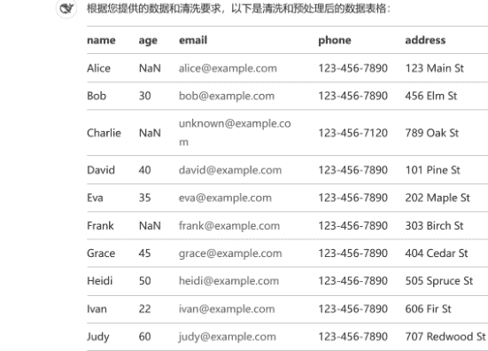

图 6-3 DeepSeek 输出展示

清洗步骤说明：

1. 处理缺失值：

   - 将 Charlie 的邮箱填充为 unknown@example.com。

2. 去除重复记录：

   - 删除了重复的 Bob 记录。

3. 标准化电话号码格式：

   - 将 Charlie 的电话号码从 123-456-712 补全为 123-456-7120，以符合 "XXX-XXX-XXXX" 格式。

4. 处理异常值：

   - 将 Alice 和 Frank 的负年龄替换为 NaN，表示无效值。

清洗后的数据已符合要求，可以直接用于进一步分析。


> 你需要返回给我一个excel表格，可以给我txt文件，我修改后缀改为csv

以下是清洗后的数据，以逗号分隔的文本格式提供。您可以将内容复制到一个文本文件中，并将文件后缀改为 .csv 即可。

```
name,age,email,phone,address
Alice,NaN,alice@example.com,123-456-7890,123 Main St
Bob,30,bob@example.com,123-456-7890,456 Elm St
Charlie,NaN,unknown@example.com,123-456-7120,789 Oak St
David,40,david@example.com,123-456-7890,101 Pine St
Eva,35,eva@example.com,123-456-7890,202 Maple St
Frank,NaN,frank@example.com,123-456-7890,303 Birch St
Grace,45,grace@example.com,123-456-7890,404 Cedar St
Heidi,50,heidi@example.com,123-456-7890,505 Spruce St
Ivan,22,ivan@example.com,123-456-7890,606 Fir St
Judy,60,judy@example.com,123-456-7890,707 Redwood St
```


| | A | B | C | D | E |

|---|---|---|---|---|---|

| 1 | name | age | email | phone | address |

| 2 | Alice | NaN | alice@example.com | 123-456-7890 | 123 Main St |

| 3 | Bob | 30 | bob@example.com | 123-456-7890 | 456 Elm St |

| 4 | Charlie | NaN | unknown@example.com | 123-456-7120 | 789 Oak St |

| 5 | David | 40 | david@example.com | 123-456-7890 | 101 Pine St |

| 6 | Eva | 35 | eva@example.com | 123-456-7890 | 202 Maple St |

| 7 | Frank | NaN | frank@example.com | 123-456-7890 | 303 Birch St |

| 8 | Grace | 45 | grace@example.com | 123-456-7890 | 404 Cedar St |

| 9 | Heidi | 50 | heidi@example.com | 123-456-7890 | 505 Spruce St |

| 10 | Ivan | 22 | ivan@example.com | 123-456-7890 | 606 Fir St |


#### 6.1.2 统计分析支持与结果解读

假设我们在一家电商公司工作，面对复杂的市场环境，急需判断不同地区的销售额是否存在显著差异，以便更精准地优化营销策略。此时已收集到如图 6-7 所示的北京、上海、广州、深圳四个地区的多组销售额数据。那么，如何从这些数据中找到答案呢？

| 地区 | 销售额1（万元） | 销售额2（万元） | 销售额3（万元） | 销售额4（万元） | 销售额5（万元） |

|---|---|---|---|---|---|

| 北京 | 120 | 130 | 110 | 140 | 125 |

| 上海 | 115 | 125 | 130 | 120 | 135 |

| 广州 | 105 | 110 | 115 | 120 | 125 |

| 深圳 | 130 | 140 | 135 | 125 | 130 |

图 6-7 不同地区销售额

向 DeepSeek 构建提示词，见提示词 6-2。

##### 【提示词 6-2 数据解读】

四城销量ANOVA实操解析

> 设定一家在线零售企业希望确认北京、上海、广州、深圳四个区域的销售收入是否存在实质差别，从而优化投放。样本如下：

地区 销售额（万元）  
北京 120，130，110，140，125  
上海 115，125，130，120，135  
广州 105，110，115，120，125  
深圳 130，140，135，125，130

说明推导过程并给出结论。

处理思路可归纳为：

1）汇总样本并求平均水平。先把各城观测值整理，算出各区均值与整体均值。北京约125万，上海约125万，广州约115万，深圳约132万，全部样本均值约为124.25万。平均数初步呈现各市场的集中态势。

2）分解平方和：  
① 组间平方和 SSB：反映城际差异，公式 $SSB = \sum_{i}^{n} n_i (X_i - \overline{X})^2$，计算得 SSB = 733.75，用以量化区域差距。  
② 组内平方和 SSW：反映各城内部波动，北京、上海、广州、深圳内部平方和分别为500、250、250、130，合计 SSW = 1130，体现内部离散水平。  
③ 总平方和 SST：$SST = SSB + SSW = 1863.75$，概括整体变异。

3）自由度。组间 dfB = 4 - 1 = 3；组内 dfW = 20 - 4 = 16；总计 dfT = 20 - 1 = 19，后续检验依赖此。

4）均方。组间均方 MSB = SSB / dfB ≈ 244.58；组内均方 MSW = SSW / dfW = 70.625，为 F 统计量准备。

5）F 检验与判断。F 约为 3.46。取显著性水平 α = 0.05，dfB=3、dfW=16 时临界值约 3.24。3.46 > 3.24，拒绝原假设，可认为四个区域的销售收入存在显著差别，为区域化营销提供依据。

总体先把数据整理成可运算形态，再给出各区均值，北京和上海均为125万，广州115万，深圳132万，整体124.25万，差异初现。随后得到 SSB 733.75、SSW 1130、SST 1863.75 及对应自由度，经均方换算得 F≈3.46，结合临界值3.24得出区域差异显著的结论。流程体现了数据处理、统计推断与解读的协同。

### 6.1.3 特征提炼与规律挖掘

在数据驱动环境下，高维特征挖掘是发现规律的关键。以电商为例，海量用户行为背后蕴含丰富信息，深入分析可提炼有价值特征，帮助企业把握需求并优化运营。表6-1是一组用户行为样本，如何借助模型抽取核心特征？维度包括用户ID、年龄、性别、注册时间、最近登录时间、购买次数、总消费金额、平均客单价、是否VIP、最近一次购买间隔等。

##### 表 6-1 电商平台用户行为数据

| 用户 ID | 年龄 | 性别 | 注册时间 | 最近登录时间 | 购买次数 | 总消费金额（元） | 平均每次消费金额 / 元 | 是否 VIP | 最近一次购买间隔 / 天 |
| :--- | :--- | :--- | :--- | :--- | :--- | :--- | :--- | :--- | :--- |
| 1 | 25 | 男 | 2022-01-01 | 2023-10-01 | 10 | 5000 | 500 | 是 | 15 |
| 2 | 30 | 女 | 2021-05-15 | 2023-09-28 | 20 | 12000 | 600 | 否 | 30 |
| 3 | 35 | 男 | 2020-12-20 | 2023-10-05 | 15 | 9000 | 600 | 是 | 10 |
| 4 | 40 | 女 | 2019-08-10 | 2023-09-30 | 25 | 20000 | 800 | 是 | 5 |
| 5 | 45 | 男 | 2018-03-25 | 2023-10-02 | 30 | 30000 | 1000 | 否 | 20 |

向模型构造提示词：

##### 【提示词 6-3 特征提取】

> 假设我们有一个电商平台的用户行为数据集，包含以下信息……（完整列出数据集包含的所有信息）对这个数据集进行数据特征提取，提取结果计算出来，告诉我计算过程和结果。

在该提示下，模型完成特征抽取。通过这些记录能直观判断活跃程度。例如用户3最近登录间隔很短，近期活跃度较高；而用户2注册时长较长但最近购买间隔偏长，可能需要唤醒动作。这些抽取结果为个性化运营提供了抓手，有助于提升体验与忠诚度。

### 6.2 代码生成与优化

代码优化是开发中重要环节，目标是通过改进结构、算法效率与资源管理提升性能、可维护性与可扩展性。随着系统规模扩大，性能瓶颈、冗余逻辑与低效实现会拖累效率并增加维护成本。DeepSeek 借助静态分析与复杂度评估帮助开发者快速定位问题并给出改进建议，也支持重构，通过模块化与设计模式提升可读性与复用性。结合持续集成与代码风格检查等自动化手段，可保证优化后代码的稳定可靠。基于大量代码库与开发者反馈，模型的建议策略持续改进。以下三个案例说明其在代码生成与优化中的作用。

#### 6.2.1 代码生成

想用 R 绘制柱状图，从左到右三根柱分别命名为“苹果”“香蕉”“桃子”，纵轴为价格，分别为 21、35、42 元。可直接用自然语言描述任务，见提示词 6-4。

> 【提示词 6-4 代码生成】

```
我希望用生成一段R语言代码，生成一张柱状图，从左到右三根柱子，分别命名为“苹果”“香蕉”“桃子”，纵轴是这些水果的价格，分别是21，35，42元。
```

模型生成代码如下：

```
##### 创建水果名称向量
fruits<-c("苹果","香蕉","桃子") #三个举例水果
##### 创建价格向量
prices <- c(21, 35, 42)
##### 生成柱状图
barplot(prices,
        names.arg = fruits,
        col = c("red", "yellow","orange"),
        main="水果价格柱状图",
        xlab="水果",
        ylab="价格(元)",
        ylim=c(0,50))
```

把代码放到 R 中运行即可得到目标图形，如图 6-8 所示。

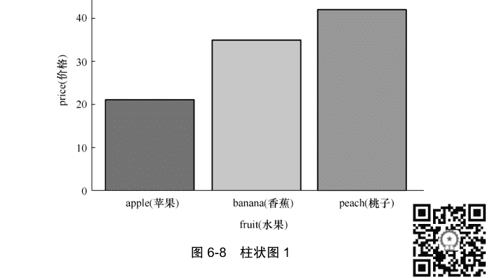

图 6-8 柱状图 1

#### 6.2.2 功能增添

若觉得图形不够美观，想调小柱宽、拉大间距并更换配色。可构造如下提示词，见提示词 6-5。

##### 【提示词 6-5 调整优化】

> 我希望调整柱状图的间距，间距小一些。我还希望更换柱子的配色，高级一点。

模型返回新代码：

```
##### 创建水果名称向量
fruits <-c("苹果","香蕉","桃子")
##### 创建价格向量
prices <- c(21, 35, 42)
##### 使用高级配色方案(例如:Pastel1调色板)
library(RColorBrewer)
colors <-brewer.pal(3,"Pastel1")#使用RColorBrewer包中的Pastel1配色
##### 生成柱状图，调整间距
barplot(prices,
        names.arg = fruits,
        col = colors,
        main="水果价格柱状图",
        xlab="水果",
        ylab="价格(元)",
        ylim =c(0,50),
        space=0.2) #调整柱子间距，值越小间距越小
```

把新代码运行后，可得到预期效果，如图 6-9 所示。

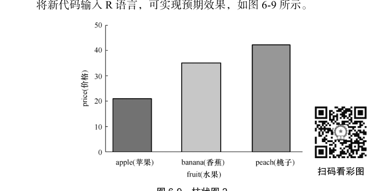

#### 6.2.3 代码纠错

日常学习中常遇到报错。例如下面这段 R 代码：

```
##### 创建一个包含数字和字符的向量
my_vector <- c(1, 2, 3, "four", 5)
##### 尝试计算向量的平均值
mean_value <- mean(my_vector)
##### 打印平均值
print(mean_value)
```

在 R 中运行后得到错误提示：

```
Warning message:
In mean.default(my_vector) :
  argument is not numeric or logical: returning NA
[1] NA
```

把错误反馈告知模型并给出提示词：

```
##### 创建一个包含数字和字符的向量
my_vector <- c(1, 2, 3, "four", 5)
##### 尝试计算向量的平均值
mean_value <- mean(my_vector)
##### 打印平均值
print(mean_value)
以上代码反馈错误：
Warning message:
In mean.default(my_vector) :
  argument is not numeric or logical: returning NA
[1] NA
请分析错误原因，给出正确代码
```

模型指出原因：my_vector 里混入数字与字符，R 向量要求元素类型一致，混合后会被强制转为字符向量，而 mean() 只能作用于数值或逻辑向量，于是计算返回 NA 并报警告。

同时给出修正代码：

```
##### 创建一个包含数字和字符的向量
my_vector <- c(1, 2, 3, "four", 5)
##### 将字符转换为数值(假设"four"对应4)
my_vector [my_vector =="four"]<-4
##### 将向量转换为数值类型
my_vector <- as.numeric(my_vector)
##### 计算向量的平均值
mean_value <- mean(my_vector)
##### 打印平均值
print(mean_value)
```

修改后代码可正常运行。

### 6.3 总结

总体来看，DeepSeek 在数据分析全链路均有深度应用。从基础清洗预处理到统计推断与模式识别，再到代码生成与优化，既降低了技术门槛，又提升了分析精度。本章案例显示，生成式 AI 既能为科研与商业决策提供高质量数据支撑，也能在代码实现上提供智能化辅助，为智能化数据分析的发展提供了参考方向。

— 思考与练习 —

思考：某大型互联网公司积累了大量用户行为数据，包括登录频率、购买记录、页面停留时长、客服互动记录等。公司希望预测未来一个月内可能流失的客户以便提前挽留。假设你是数据分析师，请思考该场景下适合用 AI 分析的数据特征有哪些？哪些数据或情况不适合直接建模，为什么？

##### 练习 1：统计分析理解题

你在一家公司担任数据分析助理，经理想了解四个部门 A、B、C、D 过去 5 个月的销售额是否存在显著差异。数据（万元）：

| 部门 | 销售额 1 | 销售额 2 | 销售额 3 | 销售额 4 | 销售额 5 |
| :--- | :--- | :--- | :--- | :--- | :--- |
| A | 105 | 110 | 108 | 112 | 109 |
| B | 98 | 95 | 97 | 100 | 96 |
| C | 120 | 122 | 118 | 121 | 119 |
| D | 100 | 102 | 101 | 99 | 103 |

问题：
1）请用 DeepSeek 做方差分析判断部门销售额是否显著差异。你会如何描述分析请求？（提示词构造）
2）请简要列出 DeepSeek 可能输出的关键步骤（均值、平方和、F 值等）
3）若 F 值大于临界值，你会如何向经理建议？

##### 练习 2：功能增强实践题

你已有如下 Python 片段，用于读取 CSV 并计算每列均值：

```
import pandas as pd

df = pd.read_csv('data.csv')
means = df.mean()
print(means)
```

请在此基础上完成功能增强：
功能增强 1）：先删除含缺失值的行，再计算均值，保证统计准确。
功能增强 2）：把均值结果保存为 output_summary.csv 文件。
功能增强 3）：跳过非数值列，避免报错。
功能增强 4）（选做）：除均值外，再计算最大值、最小值、标准差并写入汇总文件。

# DeepSeek 篇

## 第7章 DeepSeek 助力成果呈现：校对、翻译与申报书撰写

本章重点

- 研究成果辅助校对

- 研究成果辅助翻译

- 辅助撰写课题申报书

### 7.1 研究成果辅助校对

在社科研究中，校对是保证严谨性、可读性与学术规范的关键环节。借助 DeepSeek 可以实现从语言检查到逻辑验证的全流程校对，提升成果质量。校对前需明确关注点，如语法规范、逻辑一致性、数据准确性或引用格式，通过清晰指令避免泛泛处理。

#### 7.1.1 文本预处理

文本预处理是校对前置的核心环节，为后续校对奠定规范基础。清理冗余阶段会系统剔除多余空格、换行与非常规符号（见提示词 7-1）；格式统一阶段对标题层级、字体样式、段落缩进等进行标准化，优化结构与视觉；术语标准化从根本上解决表述一致性问题，避免混用导致语义歧义（见提示词 7-2）。三者共同构成质量保障体系，不仅提升可读性，也为校对提供可操作框架。

> 【提示词 7-1 清理冗余内容】

```
输入：请清理以下文本中的冗余内容（包括多余的空格、换行符、特殊符号等）：This study examines the impact of social capital on economic development.

输出：This study examines the impact of social capital on economic development.
```

> 【提示词 7-2 术语标准化】

> 输入：请将以下文本中的‘社会资本’统一为‘social capital’，并确保语句通顺：社会资本 (social resources) 在经济发展中扮演重要角色。

输出：Social capital plays an important role in economic development.

注意事项：使用 DeepSeek 做文本预处理时，需结合学科术语和格式要求，确保专业规范。不同学科有独特术语体系和格式标准，如法学专业名词和文献格式，因此预处理时应参考领域规范，统一术语并调整格式。长文本建议分段处理，按逻辑段落或章节逐段清理、统一格式、标准化术语，分段处理能提高效率并减少遗漏。

#### 7.1.2 校对及语境审查

DeepSeek 在学术写作校对上的能力聚焦于真实的写作痛点。

在用词规范方面，模型能够自动揪出主谓搭配失配、时态使用紊乱等常见问题，并给出可直接采用的修改建议，从源头上稳住行文的规范度，示例可参考提示词 7-3。拼写核验则采用即时比对方式，不仅能迅速标出写错，还会结合语境给出合适的替词，提升表达的专业感，示例可参考提示词 7-4。风格转换上，系统支持把口语化表述转成符合学术惯例的写法，通过重组句式与替换词来增强正式色彩，示例可参考提示词 7-5。最关键的是语境审查，据学科知识图谱的支撑，它能判断专业术语在具体情境下的恰当程度，避免因用词不当损害学术可信度，示例可参考提示词 7-6。以上模块联动，让 DeepSeek 能够作为文本质量管控的专业帮手。

> 【提示词 7-3 语法和拼写检查】
> 输入：请帮我检查以下段落的语法和拼写错误，并输出修正后的完整句子：The results shows that the impact of social capital on economic development are significant.
> 输出：The results show that the impact of social capital on economic development is significant.
> 【提示词 7-4 润色及优化】
> 输入：请将以下句子改写为更正式、更符合学术写作规范的表达，并确保语义清晰准确：This study looks at how social networks affect people's behavior.
> 输出：This study examines the influence of social networks on individual behavior.
> 【提示词 7-5 学术表达改写】
> 输入：请将以下段落改写为正式的学术语言，确保用词严谨、逻辑清晰，并保留原意：We found out that social media is really important for young people.
> 输出：The study revealed that social media plays a significant role in shaping the behavior of young individuals.
> 【提示词 7-6 语境审查】
> 输入：请检查‘权力’一词在此处的语境是否准确：国家通过立法权力制定政策，以维护社会秩序。
> 输出：用法准确。在政治学语境中，‘权力’通常指国家或机构通过法律或制度行使的强制性力量。此处‘立法权力’符合政治学的术语惯例。

使用要点：校对时要结合具体学科的用词习惯与表达方式。遇到结构复杂的长句，建议分段处理以提高准确率。提示设计要明确，例如要求返回完整句子、保持用词严谨、思路清楚、保留原意等，可显著提升输出质量。语境审核需重点关注专业词汇的适用性，防止因语境错位产生歧义或误读。对不确定的表述，最好对照权威文献或经典研究加以核对。

#### 7.1.3 事实核查与数据验证
面对研究数据，需要对数值的分布形态与统计规律做系统审视，并对异常点开展溯源，见提示词 7-7，以判断其反映真实现象还是测量失误。另外，通过与已有成果的相似度比对，可有效发现引用不足或表述雷同的风险，见提示词 7-8，这对维护学术原创性很重要。

> 【提示词 7-7 异常值分析】
```
输入：请分析以下数据是否存在异常值，并说明异常值的判断标准及其可能对数据分析产生的影响。

输出：在表格数据中，检测到3个异常值（判断标准：偏离平均值超过3倍标准差）。这些异常值可能由数据录入错误或特殊样本导致，建议进一步核实或剔除，以确保分析结果的准确性。
```
> 【提示词 7-8 抄袭检测】
```
输入：请检测以下段落是否存在抄袭风险，并提供相似度分析结果及可能的来源参考：Social capital is defined as the networks of relationships among people who live and work in a particular society...

输出：该段落与以下来源的相似度达到85%：Putnam, R. D. (2000). Bowling Alone: The Collapse and Revival of American Community. 建议重新表述或添加引用以避免抄袭风险。
```

注意事项：相似度筛查仅作参考，最终定性仍需人工复核。虽然 DeepSeek 能快速评估文本重合度并提示可能的来源，但抄袭的认定还需结合语境、引用规范与学术伦理综合判断，才能确保结论可靠。

#### 7.1.4 逻辑一致性检查
逻辑一致性审查是论文写作中不可省略的环节。审查应聚焦论点与论据的契合、论证链条的完整以及结论的合理。操作上需逐段检视核心观点是否得到充分支撑，所用证据是否真正服务于观点是否存在论据薄弱或推理牵强的现象。同时要评估段落间的衔接是否流畅，是否存在断层或跳跃，见提示词 7-9。针对发现的问题，应给出可执行的改进建议，如补充关键证据、调整论证顺序或重写过渡句，见提示词 7-10。系统化的排查能够明显提升论证质量，增强研究说服力。

> 【提示词 7-9 逻辑问题检查】
```
输入：请检查以下段落是否存在逻辑问题，并明确指出问题类型（如因果混淆、论据不足等），同时提供具体的修改建议：The study found a positive correlation between education level and income. Therefore, we conclude that education directly causes higher income.

输出：该段落存在因果混淆的逻辑问题。相关性不等于因果性，教育水平与收入的正相关并不能直接推导出因果关系。建议修改为：The study found a positive correlation between education level and income, suggesting a potential causal relationship that requires further investigation.
```
> 【提示词 7-10 论点与论据一致性分析】
```
输入：请分析以下论点和论据是否一致，并说明论据是否足以支撑论点，同时提供改进建议（如需补充论据或调整论点）：论点：社会资本促进经济发展。论据：社会资本增强了社区信任。

输出：论据不足以完全支撑论点。虽然社会资本增强社区信任是经济发展的一个因素，但缺乏直接证据表明信任如何转化为经济发展。建议补充具体案例或数据，例如：社会资本通过增强社区信任，促进了合作与资源整合，从而推动了经济发展。
```

注意事项：逻辑审查应把论文视为整体，从宏观架构到微观推理逐层进行。把握重点有三：一是论证内容与研究主题的匹配度，确保各观点均服务于核心问题，避免偏离或内在矛盾；二是采用分层检验法，按章节、段落划分，分别核查内部自洽性与部分间的衔接；三是重点核查因果链与类比推论等关键节点，这些环节易产生谬误。建议建立检查清单，对每处问题标注具体修改意见，如调整结构、补充论据或修正推理。这种结构化方法有助于提升论证的严密性。

### 7.2 研究成果辅助翻译
学术成果的跨语言转换要求在保持原意的基础上，使语言风格、术语选用与学术规范符合目标语标准。这不仅涉及精准转换，还需结合学科背景进行个性化润色，以提升可读性与学术分量。DeepSeek 通过语境分析实现语义精准匹配，降低因语言差异带来的误解，其机器学习机制能够持续优化翻译质量，适应不同学科的特殊需求，为研究者提供稳定支持，促进成果共享。以下以角色预设、术语库支持与翻译记忆为例说明。

#### 7.2.1 角色预设
> 【提示词 7-11 角色预设】
```
输入：请你扮演一个政治学（或替换为具体研究领域）领域的专家或教授，从专业角度将以下中文文本翻译为英文（或替换为其他目标语言）。“当代社会科学对国家概念的理解中，最广为人知的当属韦伯对国家的界定，即国家是一个拥有合法使用暴力的垄断地位的实体。韦伯从实体论视角理解国家，即国家是由切实存在的主权、官僚和军队等机构或组织构成，而文化、制度和个人权威为国家提供不同类型的合法性基础。”注意逐段处理，确保翻译符合以下原则：
(1)遵循American Political Science Review期刊的术语规范与格式要求；使用政治学领域的标准英文术语；
(2)保持学术严谨性，避免口语化表达；
(3)对争议性概念需保持中立，引用权威定义；
(4)标注原文中需修改的问题类型（如术语偏差、逻辑模糊、格式错误等），并提供改进建议。
输出：In contemporary social sciences, one of the most widely recognized definitions of the state is Max Weber’s conceptualization, which posits that ‘the state is a human community that (successfully) claims the monopoly on the legitimate use of physical force within a given territory’ (Weber, 1919). From a substantive perspective, Weber interprets the state as an entity constituted by tangible institutions such as sovereignty, bureaucracy, and military organizations. Furthermore, he emphasizes that cultural traditions, legal-rational systems, and charismatic authority provide distinct types of legitimacy foundations for the state.
```

#### 7.2.2 术语库支持
##### 1. 术语收集与分类
从中文论文中提取政治学领域核心术语并匹配标准化英文译法，示例见表 7-1。
**表 7-1 核心术语示例**
| 中文术语 | 专业译法 | 定义 / 语境说明 | 学科分支 |
| :--- | :--- | :--- | :--- |
| 国家能力 | state capacity | 政府实施政策的能力 | 比较政治学 |
| 合法性 | legitimacy | 政权被公众接受的程度 | 政治理论 |
| 社会资本 | social capital | 社会网络与信任资源 | 政治社会学 |

##### 2. 术语库导入与绑定
可在 DeepSeek 平台上传术语库文件，支持 Excel、CSV 格式，并与翻译任务关联。输入指令示例：“请导入以下政治学术语库文件：political_science_glossary.csv，并在后续翻译中优先使用库内术语。”输出示例：“术语库已成功导入，包含 58 条政治学核心术语。当前翻译任务将优先调用库内译法。”

##### 3. 翻译过程中调用术语库
输入示例：请调用 political_science_glossary.csv 术语库将文本内容翻译为英文，并在后续翻译中优先使用库内术语。

##### 4. 术语冲突提示
请将“社会资本（文中指教育资源）影响经济发展”翻译为英文。输出提示：“检测到术语冲突，原文‘社会资本’在术语库中定义为‘social capital（社会网络与信任资源）’，但当前语境指向‘教育资源’。建议操作：临时覆盖：将此处‘社会资本’译为‘educational resources’；或者更新术语库：添加‘社会资本（教育语境）→ educational capital’。”

##### 5. 术语库动态维护
根据翻译反馈增补新条目或修正已有条目。输入指令示例：“将以下新增术语加入政治学术语库：韧性治理对应 resilient governance，其定义为国家应对危机时的适应与恢复能力，属于公共政策学科分支。”输出提示：“术语库已更新，新增‘韧性治理→ resilient governance’。”

##### 6. 术语库建立注意事项
建立政治学等专业术语库时，需遵循核心原则以确保准确与适用。首先要控制颗粒度，避免译法过于宽泛，例如根据语境将“国家”细分为“state”“nation”“country”，并严格区分近义词，如“政权 regime”与“政府 government”不可混用；其次需管理语境依赖性，对多义词补充使用范例以明确适用场景，如“民主化”在转型研究中译为“democratization”，在指标语境下则用“democratic transition”；最后要严格引用权威文献，术语定义应基于学科经典著作或顶级期刊，例如“国家自主性 state autonomy”可追溯埃文斯的 *Bringing the State Back In*（1985）。多维度精细管控才能支撑学术翻译的精准度与专业性。

#### 7.2.3 翻译记忆
通过 DeepSeek 翻译记忆的强制统一指令，可确保学术翻译中术语无歧义、长句无偏差、跨文档无矛盾，尤其适用于政策分析、法律文本与系列研究等对一致性要求极高的场景，见提示词 7-12。使用 DeepSeek 翻译学术论文时，建议注意：
- 1）最好先预设术语表，否则“社会治理”可能被译为“social management”或“social administration”而产生差异；
- 2）指令需明确，“强制统一术语”比模糊的“注意一致性”更有效，系列研究还需加入“跨文档统一”并上传参考文档；
- 3）处理长句时要强调“保持句式结构完整”，避免因指令不足拆分句子导致逻辑丢失；
- 4）政策分析或法律文本翻译需提供充足语境；
- 5）翻译后应人工核查术语统一性，跨文档场景下尤其要确保系列研究表达一致。
> 【提示词 7-12 翻译记忆】
```
输入：请使用翻译记忆功能，确保‘政策执行力’统一翻译为 `policy enforcement capacity`，‘社会治理’统一为 `social governance`，长句结构保持清晰一致，适用于政策分析场景。翻译文本为“政策执行力是衡量政府能力的关键指标，直接影响社会治理的成效。在复杂的多主体协作中，政策执行力的高低决定了资源分配的公平性与效率，而社会治理的完善则需要跨部门的协调一致。”

输出：Policy enforcement capacity is a key indicator for measuring government capability, directly affecting the effectiveness of social governance. In complex multi-stakeholder collaborations, the level of policy enforcement capacity determines the fairness and efficiency of resource allocation, while the improvement of social governance requires consistent cross-departmental coordination.
```

### 7.3 辅助撰写课题申报书
#### 7.3.1 选题价值挖掘
选题直接决定课题或基金申请的学术分量与现实意义。社会科学研究往往需要兼顾理论创新与社会热点，但研究者常因视野局限或时间不足难以全面挖掘价值。DeepSeek 的联网检索能力可迅速梳理政策热点与文献空白，帮助定位兼具新颖性与可行性的方向，避免重复或偏离评审导向。以政治传播领域“数字技术对民族主义政治动员形态的重构效应”为例，指令设计与做法可参考提示词 7-13：
- 1）明确选题边界：聚焦数字化时代民族主义与政治动员的关系特征，如“算法推荐如何重塑民族主义话语的传播阈值”；
- 2）案例平衡与政策语境：可在提示中补充“2020年#抵制H&M事件中的微博超话动员机制实证数据”，并嵌入“铸牢中华民族共同体意识”等语境下的正向引导机制设计；
- 3）学科锚定与文献验证：指令需要求保持政治学分析主线，避免滑向传播学技术决定论；识别的理论空白应结合 CNKI 最新高被引文献二次验证；案例选择需兼顾国际冲突事件与国内治理场景的平衡。
> 【提示词 7-13 选题价值挖掘】

```
输入：从政治学理论框架出发，聚焦数字技术对民族主义政治动员形态的重构效应，重点分析选题的学术价值与现实意义。要求：1）理论意义需结合资源动员理论框架，探讨算法推荐如何突破民族主义传播阈值，至少引用2项政治学经典文献；2）现实意义需对照比较视野与国内治理场景，揭示数字民族主义对国家认同建构的双刃剑效应；3）研究空白识别应结合CNKI近三年高被引文献，指出现有研究在动员主体迭代、虚实空间联动方面的理论滞后；4）论证过程需贯穿“铸牢中华民族共同体意识”的政策语境，保持政治学学科分析主线，避免滑向传播技术决定论，最终形成300字左右的系统性论述

输出：从资源动员理论视角看，算法推荐通过精准匹配用户偏好，大幅降低民族主义动员的信息成本与组织门槛，突破传统社会运动的传播阈值。当前全球民粹主义浪潮与数字技术深度耦合，中国语境下的“小粉红”等现象凸显网络民族主义的双刃剑效应：既可能凝聚社会共识、增强制度认同，也可能助长民粹排外情绪。研究其动员路径与影响边界，可为政府精准引导网络舆情、防范意识形态风险提供决策参考。但既有研究多聚焦网络民族主义的文化表征，对其政治后果的机制化分析不足：1）动员效果评估缺乏定量测量，因果链尚未厘清；2）比较视野缺失，对发展中国家与西方国家网络民族主义的代际差异、技术条件差异研究薄弱；3）平台算法的政治调控作用被低估，技术权力与民族主义动员的互动关系亟待揭示。
```

#### 7.3.2 申请书框架自动生成

国家社科类项目的申请文本通常遵循固定版式，涉及立项依据、研究内容、技术路线、创新价值等板块。撰写时常因逻辑链条松散、核心贡献不突出而被扣分。DeepSeek 能结合研究主题自动产出写作框架样板，帮助研究者迅速搭建初稿骨架，压缩前期准备时长，同时让表述更清晰、更贴合评审人阅读习惯。提示词 7-14 以国社科基金申报为案例设计的指令。

> 【提示词 7-14 申报书结构化生成】

```
1. 请协助优化申请书的“选题/立项依据”（或其他部分）部分，使其更具说服力，重点突出科学问题的学术价值、社会应用前景及国家战略需求，以及本研究的理论贡献和实践意义，确保论证逻辑严密、层次清晰。
2. 请根据已设定的核心研究问题和初步构思的研究目标（假设选题已确定），构建一个逻辑严谨、层次分明的研究思路框架图，从问题提出、目标设定、内容分解、方法选择到成果产出，确保研究方案的理论自洽性和系统性，并以符合国家社会科学基金申请书逻辑结构的方式呈现。
3. 请针对初步设计的研究方案，从理论基础、研究方法、数据获取条件、研究团队等方面进行可行性评估，详细分析可能存在的风险和挑战，并针对性地提出切实可行的应对策略和备选方案。
4. 请协助凝练和突出申请书的“创新之处”，从理论构建、方法改进、实践应用、视角创新等多个维度，用简洁、精准、有力的语言，清晰阐述本研究的独特性和原创性贡献，并避免泛泛而谈，力求具体化、可验证化。
```

#### 7.3.3 评审视角模拟演练

DeepSeek 还能扮演评审人角色，针对常见失分点例如创新性不足、执行方案难以落地等给出改进对策，适合在正式递交前进行自我诊断式优化，具体操作可参考提示词 7-15。

> 【提示词 7-15 模拟专家评审】

```
1. 请协助检查申请书的逻辑结构和语言表达，确保逻辑清晰、层次分明、语言精炼、专业规范，避免出现逻辑跳跃、表达冗余、专业术语使用不当等问题，提升申请书的可读性和专业性。并且模拟资深国家社会科学基金评审专家，对申请书草稿进行详细的评审，并给出结构化的评审意见，包括优点、缺点、理论创新性评价、学术与社会价值评价、研究方案评价、研究基础评价和最终评审结论（建议资助/不建议资助）。
2. 跨学科适配：请转换到【哲学/社会学/经济学/法学】学部（或替换为目标学科）的评审专家视角，着重审查以下方面：学科特色指标（例如法学部需关注法律规范引用或案例研究的合规性）；专业术语的准确性（比如经济学领域模型假设或指标定义的规范性）；方法的适用性（例如社会学领域田野调查或访谈设计的合理性），请模拟该领域专家经常提出的5个尖锐问题。
```

### 7.4 小结与反思

本章梳理了 DeepSeek 在社科研究中的多维功能，从文本清洗、校对与语境审视，到事实核验、逻辑自洽检查，再到基金申请的辅助撰写，呈现出大模型如何贯穿学术工作的各个环节并提升效率与质量。它不单能进行语言层面的润色，还能借助语境解析、术语规范化、数据校验等手段维护成果的严谨与专业。在跨语言传播场景里，其自然语言处理能力明显降低沟通成本，促进学术交流。

在选题挖掘与结构化写作方面，DeepSeek 凭借智能内容生成与评审模拟，为研究者从创意萌发到成果呈现提供全链路支持。只是工具并非万能，模型对学科语境的深度把握仍需人工校准，过度依赖会削弱研究者的批判思维。因此社科工作者应把 DeepSeek 当作助手而非替代者，在技术赋能与学术主体性之间寻求平衡，以兼顾理论创新与社会价值。

### — 思考与练习 —

思考：DeepSeek 在校对、翻译、基金申请写作上效率明显，但使用时可能暗藏哪些风险？研究者在借助 AI 的同时如何守护研究的原创性与批判性？

练习：挑选一篇约 300 字的社科论文片段，套用 DeepSeek 的提示词模板如“清理冗余”“格式统一”“术语标准化”完成文本预处理；并利用“角色预设”“术语库支持”等功能将其译成英文，保证术语一致、表达严谨，并附上术语对照表。

# ChatGPT 篇

## 第8章 ChatGPT 入门与 Prompt 设计

本章重点
- OpenAI GPT 的核心概念
- 高质量提示词的构建方法

### 8.1 OpenAI 的 GPT 总览

OpenAI 推出的 ChatGPT 是一个基于先进生成式人工智能的对话平台，能够理解并产出自然语言文本。它既能为普通用户答疑解惑、整理信息，也能为社科学者提供数据分析与研究支持。本书为读者提供简明的使用指南，在讲具体操作前先介绍 GPT 体系的基础。

#### 8.1.1 GPT 工作原理

GPT 即生成式预训练变换器，是一种深度学习模型，采用 Transformer 结构，擅长处理海量文本。模型通过学习大量语料掌握语言的结构、语法与语义，据此生成连贯合理的文本。

训练大致分两步：
1. 预训练：模型在海量文本上学习语言基本规律；
2. 微调：在预训练基础上针对特定任务如翻译、问答进行优化，提升在具体场景的表现。

可以把 GPT 比作一位阅读量巨大的文字工作者，先通过阅读书籍、论文、网页等进行预训练，再经专项训练调整表达，以适应不同用途。这种“博览群书”的系统因此能胜任各类文字任务并解答各领域问题。

OpenAI 的 GPT 系列凭借大规模参数，能够理解复杂语言模式并产出高质量文本，因生成能力突出已成为人工智能领域的标杆，并在多行业引发关注。

#### 8.1.2 ChatGPT 对话功能特色

ChatGPT 是基于 OpenAI GPT 技术打造的对话应用，目标是实现更自然流畅的多轮交互。

相较传统问答系统，其优势在于：
1. 多轮对话能力：保持语境延续，理解连续性，提供更贴合需求的回复；
2. 应用场景宽泛：可用于内容创作、编程辅助、情感分析、文本摘要等；
3. 智能化交互：具备类人语言理解能力，让交流更自然。

#### 8.1.3 公众与学者如何受益

对普通民众而言，ChatGPT 可作为日常助手，快速撰写邮件、报告、文章草稿，或为作业提供指导。学习外语时，它可作为互动伙伴纠正语法、进行练习。日常决策如日程规划、旅行建议、影视推荐等也能得到智能化支持。

对社科学者而言，ChatGPT 与 GPT 技术提供了新工具。学者可用其辅助文本分析、数据挖掘、文献综述、结果可视化等工作，快速生成学术议题讨论、探索研究方向，或分析公开数据提取有效信息。

#### 8.1.4 访问渠道与定制模型

用户可通过网页或 App 直接访问 ChatGPT，官方入口为 OpenAI ChatGPT。部分初学者注册有门槛，市场上亦有第三方接入服务，但建议优先使用官方平台以获得最佳体验与更新支持。

OpenAI 平台提供基于不同 GPT 模型训练的对话系统，非付费用户默认使用 GPT-4o，付费用户可选择更先进模型。此外还提供 Custom GPTs 功能，允许用户创建或调整专属模型以适配特定任务，包括：
1. 针对特定任务微调：按需求调整模型行为，如打造法律问答专家或医学知识型 GPT；
2. 集成外部工具与 API：连接数据库或调用 API 提供实时数据支持；
3. 设置个性化回答风格：按语气、正式度等偏好定制交互方式。

平台上可浏览他人创建的定制模型，如图 8-1 所示。建议初学者先熟悉通用模型，积累经验后再尝试定制化方案。

> OpenAI GPTs 市场：https://chatgpt.com/gpts。

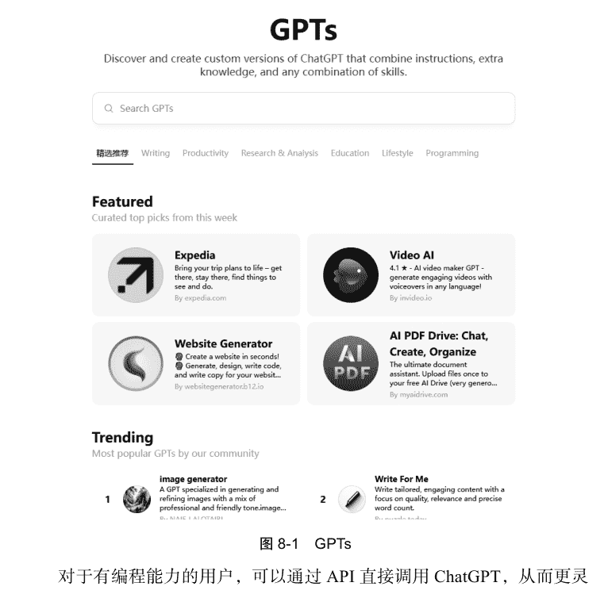

具备编程能力的用户可通过 API 直接调用 ChatGPT，更灵活地控制参数如温度值以调节创造性，适用于：
1. 大规模数据处理：在研究或业务中自动化进行文本分析；
2. 自定义交互系统：将 GPT 集成到自有软件或工具中；
3. 高级控制：优化响应风格、长度或特定任务输出。

关于大模型 API 调用在前文已有详细说明，本章不再重复。DeepSeek API 的调用方式与 GPT API 基本一致，仅模型选择不同，可参考 OpenAI 官方文档。

#### 8.1.5 小结

ChatGPT 的出现标志着人机交互方式的重要进步，借助自然语言处理技术，交流得以丰富。从早期语言模型到如今的多功能对话系统，ChatGPT 不断演进，已不仅是对话工具，更是写作、教育、研究、数据分析等多领域的强大助手。它为公众生活带来便利，也为社科研究提供新视角与新手段。

本书旨在为社科初学者和普通读者提供 ChatGPT 使用指引，介绍如何有效对话并借助其辅助社科研究，包括文献整理、论文撰写、数据清洗与分析、仿真模拟、文本润色等功能。

### 8.2 Prompt 工程技巧

#### 8.2.1 Prompt 工程是什么

在使用 ChatGPT、DeepSeek 等对话式大模型时，提示词即用户输入的文本指令，包含任务背景、输出格式等要求。通过提示词向模型传达意图，使其生成更相关、更精准的回答。

提示词工程是通过系统化设计与优化提示词来提升交互效果与效率的过程。它不仅是文字输入，更是通过精细构思与调整获得最佳输出。在学术研究等对精度要求高的任务中，优化提示词能显著提升完成质量。本章将系统介绍常用策略。本节以 ChatGPT 为例，规则同样适用于 DeepSeek 等生成式模型。

#### 8.2.2 核心概念拆解

在构建高质量提示词前，先了解几个关键概念。

##### 1. 对话指令

提示词通常分为系统提示与用户提示，两者功能不同但协同作用。

1. 系统提示：指引模型在特定上下文或任务中工作的方式，影响行为或设定规则。如设定语气风格、输出长度、回答深度或角色身份。优质系统提示有助于模型更准确理解需求。提示词 8-1 给出示例，后文将展开讨论。

**【提示词 8-1 系统提示】**

> 设定语气风格：“请以百度贴吧老哥的语气回答以下问题”

> 控制输出长句：“简要回答，不超过100个字。”

> 限定回答深度：“请从信息政治学的角度回答以下问题，忽略其他视角。”

> 设定回答角色：“假设你是一位中学语文老师，请以教学的方式回答下面的问题。”

> 设定回答对象：“请给没有接受过社会科学专业训练的普通人解释什么是‘通货膨胀’”

系统提示一般置于对话开头，全程生效，直至被修改或撤销。可一次输入也可分条输入，多个系统提示可组合使用。

2. 用户提示：用户提出的具体问题或任务要求，如提示词 8-2 所示，更侧重获取信息或完成任务。表述应简洁直接，可把 ChatGPT 视作能力有限者，用清晰条理的指令引导其完成任务。

**【提示词 8-2 用户提示】**

> 用户提示：“请提供一个关于提示词工程的简单介绍。”

系统提示规范整体对话，用户提示针对具体任务下指令。在提示词 8-3 中，输入 1 为系统提示，输入 2、3 为用户提示，完成输入 2 后模型会按输入 1 的要求给出建议，继续输入 3 时仍遵循输入 1 的规则。

**【提示词 8-3 系统提示和用户提示的区别】**

> 输入1：
> 系统提示：“你将获得一篇论文的摘要和一个建议的标题。论文标题应该能让读者对论文的主题有个清晰的认识，同时也要足够吸引人。如果现有的标题不够吸引人或不够明确，那么请提出五个备选标题。”

> 输入2：
> “摘要：输入摘要1”
> “标题：输入标题1”

> 输入3：
> “摘要：输入摘要2”
> “标题：输入标题2”

通常 ChatGPT 能自动识别两类提示，为严谨起见，建议在输入系统提示时标注“系统提示：”，以明确性质。多轮对话中若出现偏离，可重新强调提示以强化遵循。

##### 2. 概率调控

ChatGPT 生成回答基于概率模型，每次生成会根据输入计算后续词语的概率分布。通过调节参数可影响输出的创新性、准确性与稳定性，主要参数包括温度值、Top-k、Top-p、重复惩罚、存在惩罚等。

1. 温度值：控制随机性与创造性。值接近 0 时模型倾向选择高概率词，文本更确定保守；值接近 1 时更可能选择低概率词，输出更多样富有创意。

2. 前 k 采样：Top-k 限制模型在生成后续词语时仅从概率排名前 k 的候选词中选择。k 值小则输出集中保守，k 值大则输出更丰富多变。

3. 核采样：用概率池控制抽词范围

核采样是一种更具弹性的抽词方式，它不是像 Top-k 那样只挑前 k 个，而是根据累积概率来划定候选词池。模型会把概率从高到低累加，直到总和达到设定的阈值 p，通常取 0.9。也就是说，在这个概率池里随机选词，而把尾部低概率的词直接排除，这样既能保持相关性，又避免出现离谱内容。p 取值会直接影响风格：p 偏低比如 0.6 时，可选范围窄，输出更收敛、更贴题；p 提高到 0.9 左右时，可选词变多，生成结果会更发散、更有创意。

4. 重复惩罚：压制同词反复出现的旋钮

重复惩罚的核心是让模型远离自己刚说过的内容。它通过下调已出现词汇的得分来降低再次被选中的可能。惩罚强度由数值决定：值设得高，比如 2.0，模型会强力规避重复，文本多样性提升；值设得低，比如 1.0 甚至 0，重复更容易被接受，整体语气更统一、连贯，这在需要固定格式或模板化输出的场景里反而有帮助。

5. 存在惩罚：针对上下文已出现词的全局降权

存在惩罚和重复惩罚思路相近，但作用面更广。它不只是针对刚重复的词，而是对整个上下文里出现过的词都进行降权，以减少冗余。惩罚值高例如 2.0 时，所有旧词都被压得更低，重复概率显著下降；惩罚值设为 0.0 时则完全不起作用，允许内容里出现较多回环和重复。

把这几项参数按任务需求组合调节，就能让回答更贴合预期。做文学创作时适当放宽核采样、降低惩罚，能拿到更丰富多样的表达；做内容分类、标签抽取时收紧采样、调低惩罚，则能让结果更稳定、少创造新标签。

可惜这些调节属于进阶用法，只有调用 API 时才能自由配置，网页版目前并不开放。对网页用户来说，可以用类似提示词 8-4 的系统指令来模拟高温度效果，间接实现类似风向。

**【提示词 8-4 系统提示模拟高温度值】**

> 系统提示：“你是一个非常富有创意的助手，愿意在回答中探索多种不同的解释和观点。可以提供富有想象力或多样化的视角。”

3. 上下文窗口与记忆衰减

ChatGPT 的多轮能力不仅取决于单次提问的理解，更受上下文管理机制影响。这一机制决定了模型如何读取、保留并利用历史对话，从而塑造连贯的交互体验。它让模型能够“记住”前面说过的内容，并在后续回答中做参照。

模型有一个上下文窗口，用来承载可处理的对话长度。OpenAI 公开的数据称 GPT-4o 的窗口约为 128000 token，粗略换算 1 token 约 0.75 个英文单词或 1-2 个汉字，理论上可容纳约十万字以上的历史。实际使用中研究发现有效窗口往往低于官方数值，而作为闭源系统，真实上限并不透明。

一旦对话超出窗口，模型会优先丢弃最早的部分。即便仍在窗口内，回忆质量也不均等：**位置越靠前，回忆准确度越低**。衰减并非线性，模型对近期信息依赖更强，远期信息即使未被裁剪，也容易模糊或被遗忘。

面对这一限制，实践中建议两点：

1. 分段式对话：大约每 5~6 轮后，主动让模型做一次自然语言总结，把关键点固化下来。
2. 显式重述需求：ChatGPT 能回看历史，但在 10~15 轮后，最好再次明确核心目标或系统指令，避免注意力漂移。

总结或重申的时机要看对话体量和任务复杂度。轮次长、任务复杂时应更早介入，以确保模型始终保持正确的理解与方向。

本部分梳理了参数与上下文的关键影响，后续三个小节将聚焦提示词优化的具体做法。

8.2.3 划定回答边界

清晰的提示词相当于给 AI 一张思维导图，而约束回答范围就是画出这张图的边界。限定领域、深度和形式，能避免空泛、偏离或过度发散的回复。下面介绍三种常用且有效的约束手段。

1. 角色设定

指定身份或专业背景会激活对应的知识倾向，同时影响语气与表达风格，如提示词 8-5 所示。

> 【提示词 8-5 角色设定】

```
法律咨询：“你是一名经验丰富的律师，请用简明的语言解释合同法中‘不可抗力’的概念。”
医学科普：“你是一名内科医生，请解释胃食管反流病的常见症状以及如何缓解。”
商业顾问：“作为一名商业分析师，你如何评估一家初创企业的市场竞争力？”
儿童教育：“你是一名小学老师，请用适合8岁儿童理解的方式解释‘太阳为什么会发光’。”
```

角色描写的越具体，输出的可预期性越高。比如提示词 8-6 中的两种写法效果差异明显。

> 【提示词 8-6 角色设定效果对比】

```
基础版：“你是一个编剧”
增强版：“你是一位擅长硬科幻的编剧，特别是像刘慈欣和阿瑟·克拉克这样的风格。你的作品注重科学逻辑和哲学思考”
```

增强版的设定能让模型更贴合硬科幻的调性，而非停留在泛泛的剧本写作层面。

2. 任务边界

任务边界用来缩小回答的范围，减少无效信息。数据显示明确边界可让无关输出减少约 47%。常见约束维度有三类。

1）资源限定：限制模型可参考的知识来源，从而控制输出方向，见提示词 8-7。

> 【提示词 8-7 资源限定】

```
时间维度：“假设现在是2023年Q3，基于当前已知政策趋势预测”
数据范围：“仅使用世界银行2022年公开数据集”
工具限制：“在不使用微积分的前提下解释量子力学基础”
主题限定：“请仅从社会学的角度分析城市化的影响，不涉及经济或环境因素。”
```

2）过程约束：规定推理和呈现的方式，使逻辑与结构更符合需求，见提示词 8-8。

> 【提示词 8-8 过程约束】

```
分析深度/层次约束：“解释青年政治冷漠成因，从三层次归因分析：1)个体心理因素 2)社会组织影响 3)媒介环境作用，每层次提供2个可验证假设。”
论证要求约束：“在分析[农村空心化对养老模式的影响]时：1）每个论点必须引用2篇以上CSSCI期刊论文（2018-2023）；2）对比费孝通的乡土社会理论与阎云翔的个体化理论解释路径。”
思维路径约束：“依照Young的批判理论三步法：1)现象描述 2)霸权结构解构 3)解放可能性探索，分析职场性别薪酬差距”
```

3）排除性声明：直接告知模型哪些内容不要出现，见提示词 8-9。

> 【提示词 8-9 排除性声明】

```
“排除20世纪前的历史案例”
```

3. 输出格式

格式控制有助于提升可用性。首要的是长度管理，见提示词 8-10，避免过简或过长。

> 【提示词 8-10 控制输出长度】

```
“每个观点用不超过15字概括，后接50字解释”
```

其次是结构化排版。默认文本粘贴到 Word 或 WPS 时易错位，用 Markdown 或 HTML 能让层级更清晰，便于复制使用，见提示词 8-11。

> 【提示词 8-11 控制输出格式】

```
层级设定：“输出三级目录框架，二级标题下含3-5个要点，并用Markdown格式输出文本。”
```

另外，对社科研究者而言，可让模型统一文献引用格式，大幅提升投稿效率，见提示词 8-12。

> 【提示词 8-12 控制输出引用格式】

```
学术格式：“按APA格式重写以下文献综述。”
引用调整：“请将以下参考文献格式从 Chicago 转换为 MLA。”
```

4. 综合运用

实际使用中可在开头预设完整约束，也可在效果不佳时动态调整。提示词 8-13 把角色、边界与格式结合，是一个可直接参考的完整模板。

> 【提示词 8-13 综合运用】

```
"作为政治学研究者，请按以下要求分析慧社区对治理效能的影响：

分析路径：
第一阶段：使用Ostrom的制度分析与发展框架（IAD）识别行动情境要素
第二阶段：选取3个智慧社区案例进行过程追踪（process tracing）
第三阶段：运用适应性治理理论提出改进建议

深度控制：
聚焦组织层面的制度调适过程
不延伸至技术决定论哲学讨论

论证规范：
引用近5年《公共管理学报》《社会学研究》相关论文
区分技术赋能与技术赋权的不同效应
需说明案例材料的获取方式与伦理合规性

输出格式：
使用学术论文引言写法（研究空白->理论框架->方法创新）
包含2个分析框架示意图
文末附参考文献（APA格式）
输出Markdown格式文本"
```

8.2.4 提供回答参考

仅靠指令有时难以让模型完全对齐意图，这时给出范例参考会显著提升质量。ChatGPT 的模仿能力很强，哪怕少量示例也能让输出更接近预期。下面分三种学习方式说明。

1. 零样本学习

零样本即不提供任何例子，直接靠指令驱动。这要求指令足够明确且任务相对简单。提示词 8-14 以标注任务为例，展示了零样本对清晰度的高依赖。

> 【提示词 8-14 未限定回答范围的零样本学习】

```
输入：
“请对以下文本进行标注
文本内容：‘‘‘电梯安全谁来终身负责？别补贴没花完先出事故！楼里孩子老人这么多...’’’”

输出：
1. 电梯安全（话题/关键词）：指代电梯的安全性，强调与电梯相关的公共安全问题。
2. 谁来终身负责（问题/责任）：提出关于电梯安全责任的疑问，讨论应由谁长期负责电梯的安全。
3. 别补贴没花完先出事故（批评/讽刺）：批评政府或相关部门将资金未使用完之前就可能发生安全事故，暗含对管理或政策的不满。
4. 楼里孩子老人这么多（事实/背景）：强调楼内有大量需要关注的群体，暗示电梯安全问题对这些群体特别重要，增加其紧迫感和重要性。
```

没有明确角度时，模型会从多个可能方向给出答案。再看提示词 8-15。

> 【提示词 8-15 限定回答范围的零样本学习】

```
输入：
“你是一个政治学家，请对以下文本进行标注，要包含民众态度，民众考虑问题的维度，和做出标注的依据三个部分以json格式输出。
文本内容：‘‘‘电梯安全谁来终身负责？别补贴没花完先出事故！楼里孩子老人这么多...’’’”

输出：
{
"民众态度": "不满、担忧",
"民众考虑问题的维度": [
    "电梯安全",
    "责任归属",
    "政府补贴使用",
    "公共设施安全"
],
"做出标注的依据": "文本中表达了对电梯安全问题的焦虑，提出责任归属问题，并批评政府在补贴方面存在问题。通过提及“补贴没花完先出事故”可以看出民众对公共资金使用的不满，而“楼里孩子老人这么多”则显示出民众对安全隐患的关切，尤其是针对易受害群体的担忧。"
}
```

结合前文的约束技巧限定范围后，回答更结构化，聚焦政治学相关维度并给出标注理由，且 json 格式便于批量处理。仍有瑕疵，例如在民众关切维度里加入了“政府补贴使用”，实际与担忧关联不大。接下来会展示如何用范例进一步提升精度。

2. 单样本学习

只给一个示范，模型就能推断输出结构与标注标准。范例选得好时效果提升明显。以同一任务为例，见提示词 8-16。

> 【提示词 8-16 单样本学习】

```
输入1：
“以下是一个文本标注任务的范例，请学习该范例：
[输入文本]
“…政府补贴40%听起来不错，但剩下的费用对退休老人还是压力山大…”

[标注示范]
{
    "政策态度": "反对",
    "关切维度": ["经济成本"],
    "依据": "强调居民自付部分的经济压力"
}

输入2:
"电梯安全谁来终身负责? 别补贴没花完先出事故! 楼里孩子老人这么多..."

输出:
{"政策态度": "反对", "关切维度": ["安全保障"], "依据": "表达对电梯安全责任缺失的担忧, 并强调潜在的安全风险"}
```

仅提供一个样本并移除了之前的范围限定后，模型准确解析了所需结构与维度，并把结果锁定在文本最相关的安全议题上。注意示例中系统提示与用户提示分开输入，实际使用也可合并一次性提交。

3. 少样本学习

提供数个示例，帮助模型更好把握任务。相比零样本和单样本，少样本利用更多上下文，准确性和相关性更高，见提示词 8-17。

> 【提示词 8-17 少样本学习】

```
输入1:
"以下是一个文本标注任务的范例, 请学习该范例:
[示例1: 直接反对]
文本: "每户要摊3万多根本不合理, 坚决反对!"
标注: {"态度":"反对", "维度":["经济成本"], "依据":"摊派费用过高"}

[示例2：安全性隐喻]
文本：“装电梯像搭积木，哪天塌了找谁哭？”
标注：{"态度":"反对", "维度":["安全性"], "依据":"比喻结构风险"}

[示例3：复合关切]
文本：“补贴程序不透明，还破坏邻里信任，好事变坏事”
标注：{"态度":"反对", "维度":["程序公平性","邻里关系"], "依据":"程序与关系双重批评"}

输入2：
“电梯安全谁来终身负责？别补贴没花完先出事故！楼里孩子老人这么多...”

输出：
{"态度":"反对", "维度":["安全性","责任归属"], "依据":"对长期安全和责任问题表达担忧"}
```

示例增多后，标签从“安全保障”细化为“安全性”，更贴合样本用词；依据描述也更简洁统一。当然，准确度的提升并非线性，样本并非越多越好，需要根据任务复杂度找到合适的数量。一般而言，任务越复杂，所需的示范越多。

8.2.5 明确问答结构

结构化的提示词像为 AI 绘制认知路线图，能让推理更透明有序。研究显示，结构化表达可使复杂社会科学问题的分析效率提升约 72%。下面介绍两类实用技巧。

1. 分隔符

用特定符号或格式划分不同信息块，能降低解析歧义。常用形式包括：

1）三重引号“”“”；
2）XML 标签 <tag>…</tag>；
3）方括号 []；
4）圆括号 ( )。

例如前文用 [] 标记参考答案，既提升清晰度，也减少误解。

2. 分布引导

又称 Step-by-Step Prompting，把复杂任务拆成若干小步逐一执行，见提示词 8-18。

> 【提示词 8-18 分布引导】

```
无引导输入：
“请分析北京市居民对政府住房政策的态度变化。”

有引导输入：
输入1：
“请分析北京市居民对政府住房政策的态度变化。按照以下步骤：
第一步，请列出该城市过去五年内实施的主要住房政策及其背景。

输入2：第二步，分析每项政策实施后的短期和长期居民态度变化。

输入3：第三步，识别可能影响居民态度变化的社会经济因素（如房价、收入、失业率等）。

输入4：第四步，提供对居民态度变化的综合分析，并讨论政策效果的社会影响。”
```

分布引导一方面降低单步难度，减少错误；另一方面通过逐步推理产出更细致、准确的答案。它相当于把思考逻辑外显给模型，让推理更具针对性，最终得到更符合需求的结果。

面对需要多层推演的场景，例如编程调试、数据拆解或社会科学分析，分布式引导的价值会格外明显。它能有效提升模型的回答准确度，减少因提问过于宽泛带来的偏移。只要任务牵涉到复杂逻辑推演，建议优先采用分布引导的方式，让模型给出更精准、结构更清晰的解答。

##### 3. 思维链与思维树

分布引导确实可以稳定准确率，但前提是使用者先把大问题拆解为可执行的小步骤。实际操作中，很少有人有充足时间与经验去完成细化拆解。此时可以转换思路，直接让模型把内部推理过程摊开展示。这样既强化了模型按逻辑作答的能力，也为使用者提供了可对照的推理轨迹。如今 ChatGPT、DeepSeek 等对话系统均已支持展示推理过程。

要求模型把思考写出来的做法通常被称作思维链 Chain-of-Thought, CoT。当单一路径不够时，可以让模型先探索多条推理路线再择优，这就是思维树 Tree-of-Thought, ToT。

1）思维链：模型以线性方式逐步搭建完整解答框架。
2）思维树：同时打开多条推理分支，对不同可能性评估后锁定最优方案。

在网页版 ChatGPT 操作界面，点击“推理”按钮即可启动思维链推理，如图 8-2 方框所示。开启后系统会自动切换至推理模型，对问题进行链式解析并返回完整思路。

日常对话中也可以用自然语言引导，比如“让我们逐步思考”，即可让模型呈现思维链，见提示词 8-19。

> 【提示词 8-19 思维链方法】

```
请分析北京市居民对政府住房政策的态度变化，让我们逐步思考。
```

更进阶的做法是提供示范，让模型模仿特定的推理风格。提示词 8-20 就是一个经典范例。

> 【提示词 8-20 思维链模仿推理】

```
输入1：
参照以下范例回答问题：
问：小明有5个羽毛球。他又买了两筒，每一筒有3个，他一共有多少个羽毛球？
答：小明刚开始有5个，后来买了2筒，每筒3个，一共是6个，5+6=11,所以他一共有11个羽毛球

输入2：
小红有10个西红柿，做午饭用掉8个，然后又买了2个，她还剩下多少西红柿？

输出3：
小红有10个西红柿，做午饭用掉8个。所以她还有10-8=2个西红柿，又买了2个，就是2+2=4个西红柿。因此她最后剩下4个西红柿
```

若要使用思维树，则需要在系统层面加入专门的指令，提示词 8-21 是一个参考（Hulbert2023）。

> 【提示词 8-21 思维树方法】

```
假设三位不同的专家来回答这个问题。
所有专家都写下他们思考这个问题的第一个步骤，然后与大家分享。
然后，所有专家都写下他们思考的下一个步骤并分享。
以此类推，直到所有专家写完他们思考的所有步骤。
只要大家发现有专家的步骤出错了，就让这位专家离开。
请问...
```

##### 4. 思维链、思维树与推理模型

前面提到可以用推理模型替代手工的思维链或思维树流程。这里要特别注意，部分推理模型并不建议叠加 CoT 或少量示例 few-shots。比如 DeepSeek 的论文中就明确指出，对该模型进行少量样本学习会削弱表现。

#### 8.2.6 其他提示词优化技巧

除上述策略外，还有几类常用手段可以进一步提升回答质量。

##### 1. 自我反思（Self-Reflection）

自我反思是一种动态优化提示的方法，思路是让 ChatGPT 通过不断调整自身输出，逐渐逼近用户心中的理想答案。关键在于使用者要给出清晰的评估标准，比如代码能否跑通、分类是否正确、表述是否符合事实。当得到不理想的结果时，可以

> Guo, D., Yang, D., Zhang, H., Song, J., Zhang, R., Xu, R., ... & He, Y. (2025). Deepseek-r1: Incentivizing reasoning capability in llms via reinforcement learning. arXiv preprint arXiv: 2501.12948.

##### 2. 自我修正

自我修正是通过让模型自行优化提示质量的方法。模型会针对当前提问提出改进建议，通常会要求补充限定条件或示例，帮助更准地理解意图。用户据此迭代提示，可重复进行直至提示足够清晰。

目前主流有两种用法。首先是 2025 年 2 月上线的 ChatGPT 深度研究 Deep Research 功能的默认行为。开启后，模型会自动对提示进行自我修正以提升质量，图 8-3 是一个简例。启用深度研究后，模型会先判断提示是否足够明确，若不够清晰会请用户补充信息后再作答。需要注意的是，该功能目前仅对付费用户开放。

> 请给一个关于OpenAI's GPT 和 ChatGPT的简单介绍

请确认您是想要一个简短的概述，还是希望包含更多技术细节、应用案例或历史背景？此外，您是否需要该介绍以特定格式（如表格或分点陈述）呈现？

> 简短概述，请用markdown结构输出

以下是关于 OpenAI 的 GPT 和 ChatGPT 的简要概述，以 Markdown 结构呈现：

Research completed in 9m- 33 个源

##### 图 8-3 深度研究功能

另一种用法是在未开启深度研究时，直接在提示中要求模型给出改进建议。图 8-4 就是一个示例。提交后，ChatGPT 会分析哪些信息能让提示更清晰具体。示例中从信息范围、受众、重点和输出格式四个维度给出修改建议，这与约束回答范围的思路是一致的。

> “请给一个关于OpenAI's GPT 和 ChatGPT的简单介绍”如何让上述提示词更加清楚具体?

可以这样改进提示词，使其更加清楚具体：

**原提示词：**

“请给一个关于 OpenAI 的 GPT 和 ChatGPT 的简单介绍。”

**改进后的提示词：**

1.  **增加信息范围：**

    * “请简要介绍 OpenAI 的 GPT 和 ChatGPT，包括它们的基本概念、发展历程、主要功能及应用场景。”

    * (这样明确了要讲哪些方面，而不仅仅是笼统的介绍。)

2.  **指定目标受众：**

    * “请用通俗易懂的语言，向对人工智能不太了解的普通用户介绍 OpenAI 的 GPT 和 ChatGPT，包括它们的用途和优势。”

    * (如果是给技术人员看的，可以改成“请从技术角度简要介绍 GPT 和 ChatGPT，包括其模型架构、训练方法及关键技术特点。”)

3.  **控制篇幅或格式：**

    * “请用 200 字以内介绍 OpenAI 的 GPT 和 ChatGPT，重点突出它们的区别和应用场景。”

    * (这样可以让回答更加简洁有针对性。)

如果你的目标是让 ChatGPT 输出更符合你的需求，关键在于**明确范围、受众、重点和格式**。你可以尝试组合这些改进方法，使提示词更加精准。


图 8-4 自我修正示例

实践中，自我修正和自我优化常被配合使用，不断打磨回答质量。

##### 3. 调用代码执行

最后一种优化方式是让 ChatGPT 生成并运行程序代码。模型可以执行简单的 Python 等代码并返回结果，有效弥补了大语言模型在逻辑运算上的短板。因此面对逻辑推理任务时，可以要求模型先写代码再执行，而非仅靠自然语言推理。图 8-5 给出了一个简单示例。


### 8.3 总结

本章围绕提示词工程展开，说明如何优化与 ChatGPT 的互动以获得更精确高效的结果。首先厘清了“提示词”的概念，它是用户输入的文本，用于指引模型生成回应。接着介绍了提示词工程的核心是通过精心设计和调整提示来提升输出质量，尤其在学术研究等复杂任务中，能帮助模型生成更准确的综述、数据分析等内容。

同时，详细讲解了对话指令的重要性，包括系统提示与用户提示的区别。系统提示用于规范对话整体方向，用户提示聚焦具体任务执行。正确使用两者能有效控制输出。最后，还介绍了如何通过调整生成参数如温度值、重复惩罚等来影响回答的创新性与准确性。

总体而言，精准的提示词对提升 ChatGPT 表现至关重要，尤其是对初学者，掌握这些基本技巧能显著提升互动效果。

### — 思考与练习 —

思考：在与大模型交互时，应该如何让我们的提问更加清楚？

练习：请根据本章学到的知识，设计一段系统指令让 ChatGPT 辅助我们写 python 代码。

# ChatGPT 篇

# 第9章 ChatGPT 与理论构建

本章重点

- 知识管理与观点形成

- 后工具时代的知识管理

- AI 技术如何影响社科研究的工作流

### 9.1 知识管理与观点形成

本书第 2 章详细讨论了如何利用 DeepSeek 大模型下载并管理文献。使用 ChatGPT 进行文献管理的方法与之基本相同，只需把 DeepSeek API 换成 GPT API 即可。有鉴于此，本章转换视角，聚焦于如何借助大模型辅助学术理论构建。我们将系统解析如何把 ChatGPT 等 AI 工具融入知识管理体系，并探讨其在学术观点形成中的作用。

#### 9.1.1 传统的知识管理流程

无论是初入学术的硕博研究生，还是已有建树的资深学者，知识管理都是研究工作的核心。社科研究者的日常离不开信息交互：既要通过系统阅读把握理论发展，也要关注新闻、社交媒体等渠道感知社会动态、捕捉现实脉动。信息的获取、吸收、整合与转化，正是观点形成和理论创新的起点。

总体来看，社科研究者的知识管理大致包括：主动获取信息，在理解中产生灵感，与已有知识经验交织后提出新观点或假设，最后进入验证与论证。因此，如何更高效地“与信息打交道”——获取什么、如何筛选、如何记录与转化——已成为方法论层面的关键问题。

近年来，数字化工具大量涌现：结构清晰的 Notion、首创“双链笔记”的 Roam Research，以及后来流行的开源平台 Obsidian 和 Logseq。这些工具相比传统笔记软件如 OneNote、印象笔记，更强调信息间的关联与思想网络的构建。双链机制被认为是知识管理的一次范式革新，它以非线性方式记录，更贴近人脑的跳跃式思维。

但无论纸笔还是数字工具，核心流程变化不大。大多数研究者处理文献时仍遵循：知识收集→划重点→思考→输出理解，如图 9-1 所示。

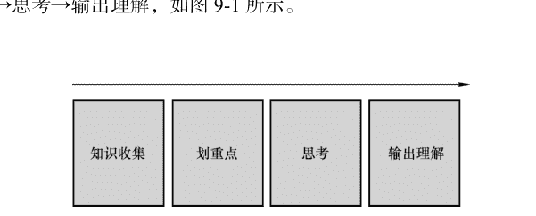

比如萌生研究兴趣后，第一步往往是查资料：在 Google Scholar 或中国知网下载一批论文。阅读时习惯做标记、划重点，在某些段落产生初步想法并简单批注，部分同学还会把感想整理到文档里作后续素材。

然而这种自然流程暗藏效率与记忆隐患。阅读时产生的“灵光一现”常被系统性遗忘，时间一长只记得“好像看过某篇论文”，却记不清当时的认知与思考。结果是花费最多时间的“信息收集”和“划重点”阶段，对理论产出贡献有限。

知识管理专家 Nick Milo 在 LYT Workshop 中将该流程可视化，用横轴“所需时间”与纵轴“价值产出”衡量各阶段投入产出。结果显示，耗时最多的往往是信息收集，但对观点形成的实际价值却相对较低，如图 9-2 所示。

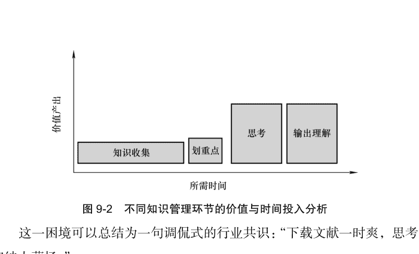

这一困境常被调侃为：“下载文献一时爽，思考归纳火葬场。”

#### 9.1.2 卡片笔记理论

如何优化知识管理与文献阅读流程？一个思路是在摄取信息的同时，主动把新知识纳入已有体系，通过联想、归纳、转化完成从收集到思考的跃迁。

在众多理论中，《卡片笔记写作法》提出的卡片笔记理论 Zettelkasten 影响深远。它不仅是方法论，也是 Roam Research、Obsidian 等工具创新的核心理念。

相比传统线性笔记软件按“文件夹—笔记本—页面”纵向分类，卡片笔记启发的双链工具更重视内容的横向连接与思想网络生成。例如 Roam Research 以“块”为最小单元，通过双向链接构建知识地图，这种非线性结构更符合人脑联想路径。Obsidian 则通过本地化与可视化的知识图谱呈现引用关系，帮助用户构建个人思想体系。

卡片笔记鼓励放弃“写下完美段落”的负担，轻量化记录阅读与思考中的“微小想法”。这些碎片随链接不断关联，个人知识结构会逐步显现，最终沉淀为有序的理论体系。

为了更高效地把新信息纳入认知结构，卡片笔记提出三类笔记：

1.  **闪念笔记（Fleeting Notes）**：捕捉稍纵即逝的灵感，形式可极简，重点在快速记录；
2.  **永久笔记（Permanent Notes）**：对闪念笔记整合、分类、重构后形成的结构性知识单元，表达清晰且有独立论述价值；
3.  **项目笔记（Project Notes）**：与特定论文或任务相关的资料整理、计划说明、写作笔记等，属于阶段性成果支撑。

三类中，闪念笔记最易被忽视，却是知识网络的原始素材。阅读时常会产生“这个观点和我之前读过的××很像”“这点与我的研究思路矛盾”“这很有趣以后可能用得上”的念头。若仅停留在原文旁批注而未整理成独立卡片并纳入系统，它们极易遗忘，也难以融入知识体系。

因此建议在日常学习中，无论纸笔还是数字工具，都主动记录这些微想法。通过积累大量文本块并相互链接，重建信息间的逻辑关系，为更高层次的知识建构打基础。

实际上，卡片笔记的实践路径与前文图 9-1 流程呼应：“闪念笔记”对应知识收集与划重点；“永久笔记”在思考基础上提炼而成；“输出理解”则在形成完整笔记网络后自然产生。

更进一步，卡片笔记思维不仅帮助积累素材，也支撑实际研究输出。比如撰写文献综述时，回溯笔记库中的相关卡片即可快速定位核心观点、文献及其关联，原本耗时的归纳整合已在持续的“笔记+链接+反思”中完成。

简言之，卡片笔记是一种把“知识输入—思维加工—结构输出”一体化的思路，强调过程而非结果，通过记录、联结、重构，在无形中完成理论搭建。

### 9.2 后工具时代的知识管理

上一节讲了知识管理的“道”，本节转向“术”，探讨在信息技术与人工智能快速普及的当下，研究者如何借助工具优化知识管理流程。

图 9-3 是对图 9-2 流程的更新。可以看到，“知识收集”阶段所需时间明显缩短，研究者能把更多精力投入到“思考”与“输出理解”这些更高价值的环节。

这正是前工具时代与后工具时代的本质区别：前者需花费大量时间搜索筛选信息，后者借助智能工具压缩信息获取成本，使我们回归知识管理的本质——整合知识、构建观点、形成理论。这里的“工具”不仅指 AI，还包括成熟的信息聚合与推荐系统。

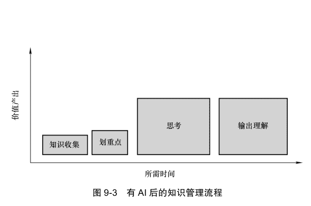

#### 9.2.1 减少知识收集的时间

在前工具时代，研究者获取信息的主要路径是：

- 学术文献：通过 Google Scholar、中国知网等数据库检索；
- 新闻舆情、政策报告：通过搜索引擎或门户网站人工搜索。

信息来源虽多，但极度依赖研究者的判断与经验，尤其对学术积累尚浅的同学而言，信息甄别环节耗时严重，效率偏低。

进入后工具时代，信息抓取的工作可以交给各类智能化手段去加速，节省下来的时间能够投入到更需要人脑参与的思辨与写作。结合博士期间的实践，笔者用于获取信息的手段大致可归为三类。

1. 基于引文网络的文献推荐：Research Rabbit 与 Connected Papers
两款产品都以论文引用关系为基础展开推荐。相较于 Google Scholar 仅罗列引用与被引用列表，它们把关联文献做成可视化、体系化的图谱，更利于把一个主题的文献脉络搭建起来。
1）Research Rabbit：图谱式呈现，能够追踪研究前沿以及跨领域扩散的动向；
2）Connected Papers：侧重文献间的拓扑关联，帮助快速厘清某个议题的理论源头。
当已有领域基础、需要向外拓展相关文献时，这两者的效率提升很明显。

2. 人工智能学术类工具：Scite、Elicit 与 Scispace
自然语言处理虽在发展，但面向学术文献的 AI 检索仍受版权限制。
1）Scite、Elicit：目前主要覆盖开放获取论文，收录范围有限；
2）Scispace：尝试借助浏览器插件或 VPN 接口接入高校授权资源，属于值得关注的新型平台。
因此现阶段 AI 学术检索难以完全取代传统与推荐类工具，但发展潜力很大，值得持续观察。

3. 时事与非学术信息：Perplexity AI
当需要追踪政策变动、媒体报道、时事动态等非学术信息时，Perplexity 较为顺手。与 ChatGPT、Claude、DeepSeek 等通用大模型相比，它更像一款答案型搜索引擎，优势在于：
1）可抓取最新网页内容，时效性强；
2）给出来源链接，便于即时核验；
3）免费版的搜索体验已可用。
面对信息过载，不应被动接收，而应借助技术主动筛选、快速聚焦，把时间留给思辨与产出。接下来讨论人工智能如何真正进入思考环节，以及知识的内化与重塑。

#### 9.2.2 让人工智能参与思考
在后工具时代，检索类工具把信息收集的时间压缩到很短，学者可以把更多精力放在思辨与表达上。人工智能不仅能帮忙找信息，还能在“反思我们的思考”上提供实质支持。市场上关于如何使用人工智能的教程很多，小红书、推特、B站上充斥着 Prompt 工具箱、Prompt 编写指南等内容，核心都是用更精准的指令换更好的答案。这些有参考价值，但对多数研究者而言，方法论可以更简单：把人工智能当成可以对话的人。

更具体的说法是，把它视作聪明但经验不足的协作者，甚至像一位实习生。它的分析与表达能力强，但对任务背景的理解有限。所以协作时要做两件事：
1. 提供完整背景——清晰说明研究动机、框架与核心问题；
2. 分享你的思考过程——你思考越深入，人工智能的反馈越深入；你越含糊，回答就越表面。

##### 1. 沟通不畅的反面案例
比如研究“候选人在 Twitter 上的发言是否会影响选民态度”。初步想法是用点赞数和转发量衡量影响力，然后直接问 ChatGPT“这个思路怎么样”，如图 9-4 所示。

## 9.2.2 提问深度如何影响AI回应质量

###### 1. 模糊提问只换来泛泛回复
图 9-4 里 GPT 的建议都很宽泛，并没有切中真正困惑。原因在于问题本身不明确，例如：
- “这个思路怎么样？”是指研究设计、变量设定还是方法选择？
- “有没有建议？”范围太大，缺乏锚点。
- 选民的“态度”具体指什么？怎么测量？
- 为什么单看 Twitter？是代表全部社交媒体，还是受数据可得性限制？
背景没交代清楚，人工智能只能泛化回应，无法推动深层思考。

###### 2. 结构化提问带来深度协作
如果先用“是什么、为什么、怎么样”的三步框架把思路理清，再明确需要人工智能帮哪一块，效果会明显提升：
- 为什么做这个研究？因为社交媒体会塑造公众情绪与认知。
- 研究关注哪些变量？自变量是推文影响力，比如发布频率、点赞、转发；因变量是选民态度，比如投票行为、民调结果、用户互动。
- 怎么开展？数据如何获取与整合？有没有替代指标？
把思考过程交代清楚后，再问“有哪些变量能衡量推文影响力？”“这个设计在操作上可行吗？”，回应的聚焦度与启发性会大幅提高，如图 9-5 所示。提示里加上“请言简意赅”，是为了控制输出长度，避免信息过载，大家可按需调整风格与篇幅。

###### 3. 提问没有高下，只有深浅
两种提问方式没有绝对优劣，关键是是否愿意持续思考。初入科研或新领域的人一开始只能提泛化问题很正常。重要的是在人工智能首轮回复后继续追问：
- “你说的更全面，具体指哪方面？”
- “你建议 A 方法，它和 B 方法在精度上有什么差别？”
- “哪些变量最能代表公众态度？能否做多源交叉验证？”
对话由此进入“思维—提问—再思维”的循环，而非单向要答案。只要持续追问，人工智能就能持续协作，直到形成清晰可行的研究设计。

> 我在研究社交媒体对选举传播的影响，聚焦候选人在选举期 Twitter 推文的影响力如何作用于选民态度。我关心这个问题，是因为社交媒体信息能够塑造选民对候选人的情感与认知，进而影响投票。我的自变量是候选人推文影响力，目前想用发布频率、点赞数、转发数衡量，因变量是选民态度，主要用投票行为和民调结果体现，或许也能用提及候选人姓名的推文来衡量。具体计划是用 Twitter API 抓取候选人推文，再结合民调数据分析。
> 基于以上，请问：
> 1. 这个思路是否可行？有哪些漏洞？
> 2. 频率、点赞、转发这些指标能否有效反映影响力？还有哪些指标？
> 3. 用提及候选人的推文衡量情感认知是否合适？能与民调结合吗？有哪些民调数据可用？
> 请尽量简洁回答，谢谢。

**1. 可行性与风险**
- ✅ 可行，Twitter 数据结合民调能分析态度变化。
- ⚠️ 风险：
  - 因果方向不明，是推文影响选民，还是选民预设态度驱动互动。
  - 平台代表性偏差，年轻人更活跃，不能代表全体选民。
  - 机器人账号干扰，虚假互动会扭曲指标。

**2. 影响力指标扩展**
- ✅ 点赞、转发、频率有价值，可补充：
  - 评论数量，体现互动深度；
  - 情感倾向，推文情绪是正负中性；
  - 传播结构，被哪些关键用户或媒体二次传播；
  - 主题分布，哪些议题更受关注。

**3. 提及推文与民调结合**
- ✅ 有用，能反映关注度与情绪走向。
- ⚠️ 需清洗噪声，如新闻转载、机器人、讽刺内容。
- ◆ 更精确做法：结合情感分析模型如 VADER/BERT + 地理信息，匹配选区投票。
- ◆ 民调来源建议：Pew Research Center、Gallup Polls、American National Election Studies、YouGov。

这样研究会更完整、更严谨。🚀
图 9-5 与 ChatGPT 的交流案例（2）

### 9.3 当下工作流的观察
结合社会科学研究的实践，我想谈谈研究者常见的知识工作流如何搭建、常见问题在哪、哪些工具和方法值得尝试，供大家参考优化。

#### 9.3.1 知识管理工具的变迁与使用
我第一次系统使用结构化笔记工具是在 2020 年，起点是 Roam Research。它最先把双向链接和块级引用带进笔记系统，以联动和网络化思维重塑了我的记录与整合习惯。后来 Obsidian、Logseq 等产品功能更开放，但 Roam 仍是我日常研究的主力。
在此之前，我用过 LiquidText、MarginNote 这类偏重批注与结构整理的软件。它们不做知识联结，但“批注—提取—关联”的思路，为我后来转向卡片笔记和信息网络管理打下基础。
由此我逐渐体会到，对社科研究者而言，任何有效的工作流都绕不开两个核心环节：输入与输出。

#### 9.3.2 社科研究者的典型工作流
表 9-1 概括了常见的输入输出流程。
表 9-1 输入输出构成示例

| 工作环节 | 内容类型 | 工具与方法 |
| :--- | :--- | :--- |
| 输入 | 学术论文 | Zotero + 阅读器批注 + 插件整合 |
| 输入 | 新闻/社交资讯 | 即时记录于笔记系统，如 RR |
| 输出 | 写作与草稿整理 | 基于笔记结构生成段落并导出 |

##### 1. 输入阶段
- 1）学术资源：我用 Zotero 管理文献，用内置阅读器做批注，再通过 zoteroRoam 插件同步到 Roam，统一整理。
- 2）非结构化信息：社交媒体、新闻等即时内容，通常直接在 Roam 中写阅读笔记并附链接。目前没有统一解决方案，但 Readwise 的“稍后阅读 + 高亮同步”模式值得关注。

##### 2. 输出阶段
- 1）写作时先在 Roam 中回顾相关笔记，梳理思路形成段落；
- 2）成稿后再导出到 Word 或 LaTeX 做排版整合。
基于笔记的写作能降低起稿阻力，提高素材调用效率，也让引用与论证更连贯。

#### 9.3.3 人工智能对知识管理流程的影响
人工智能正从检索效率延伸到知识加工与协作。有人会问：在人工智能对话框里完成全部信息处理，还需要笔记软件吗？目前看仍有局限：
- 1）上下文追溯有限：对话式人工智能依赖线性线程，信息量变大后难以回顾或交叉引用；
- 2）缺乏架构能力：人工智能组织知识主要靠即时语境，难以构建长期、系统化的知识网络。
一些人工智能驱动的笔记平台如 Flowith 在尝试解决这个问题，思路是：
- 1）以人工智能为整合中枢，自动分类、标签聚合、多模型调用来构建结构；
- 2）支持多轮互动与跨话题引用，提升“记忆”与重组能力。
这类产品还很早期，但“人工智能 + 知识组织”的融合是未来重要方向。
总之，工具只是手段，关键是建立“收集—整理—内化—产出”的结构化认知路径。正如卢曼所言，即便只有纸质卡片也能搭建庞大的知识体系。工具没有决定性作用，能否把新信息整合为结构性知识并服务于表达，才是核心。每个人习惯不同，没有标准模板，以上仅供启发。

### 9.4 小结
本章从知识管理工具演进出发，梳理了社会科学研究中围绕输入—整理—输出的工作流，以及人工智能对信息收集与管理的潜在影响。人工智能的分类与结构整合能力或将成为未来系统的关键演进方向。但工具始终服务于思维，建立结构化、持续化的组织机制，才是提升思考深度与产出质量的根本。通过不断优化个人工作流，研究者更能在信息复杂环境中形成清晰稳定的知识体系。

### — 思考与练习 —
**思考：** 本章涉及了哪些知识管理与辅助写作工具？它们如何提升知识管理与学术写作能力？
**练习：** 选一篇学术论文，参照本章方法，以该文为核心构建知识图谱。

# ChatGPT 篇

## 第 10 章 ChatGPT 与研究数据获取、数据清洗
### 本章重点
- 使用 API 与爬虫获取数据
- 数据清洗步骤与目标
- 接入 Copilot

研究数据获取与数据清洗是数据处理的基础，获取与清洗的质量直接决定后续分析结果。ChatGPT-4o 能在数据获取与清洗环节提供高效支持，本章以案例简要说明。

### 10.1 数据获取
常见的数据获取方式有：
- 1）问卷调查、实验等方式自行采集；
- 2）从政府、学术机构的公开数据库下载，如世界价值观调查、中国家庭追踪调查；
- 3）通过 API 调用数据；
- 4）通过爬虫抓取数据。
前两种方式较为成熟，本章重点讲在 ChatGPT 帮助下如何用 API 获取数据、如何用爬虫获取数据。

#### 10.1.1 使用 API 获取数据
API 允许第三方通过网络调用数据，OpenAI 也提供 API 服务，可在 Python 等语言中直接调用 ChatGPT。本章以调用高德地图 API 和接入 OpenAI API 为例。
可调用高德地图 API 获取北京行政区划数据，并整理为 .shp 或 .geojson 格式。首先在高德开放平台注册账号，创建应用并生成 API Key，注意保密；不同服务类型费用不同，创建行政区划查询服务时选择 Web 服务并获取 Key；之后用 Python 调用 API 获取目标城市的区划数据（见代码 10-1）。过程中可结合提示词工程指导，让 ChatGPT-4o 依据数据需求高效调用外部 API。

**【代码 10-1 调用高德地图 API 获取北京市行政区划数据】**
```python
import requests
import geopandas as gpd
from shapely.geometry import Polygon

key = 'your api key' # 替换为自己的API Key
city = ['北京市'] # 可替换为其他城市
url = f"https://restapi.amap.com/v3/config/district?keywords={city}&subdistrict=0&extensions=all&key={key}"
response = requests.get(url)
data = response.json()
polyline = data['districts'][0]['polyline']
poly_list = polyline.split('|')
polygons = []
for poly in poly_list:
    points = [(float(lon), float(lat)) for lon, lat in [p.split(',') for p in poly.split(';')]]
    polygons.append(Polygon(points))
gdf = gpd.GeoDataFrame({'name': [city]*len(polygons)}, geometry=polygons, crs='EPSG:4326')
gdf.to_file("beijing.geojson", driver='GeoJSON') # 生成.geojson文件
gdf.to_file("beijing.shp", driver='ESRI Shapefile') # 生成.shp文件
```

若要在 Python 中接入 ChatGPT，需先在 OpenAI 开发者平台注册、创建应用并生成 API Key，根据订阅类型获得不同权限。拿到 Key 后，可按代码 10-2 在 Python 中接入，实现编程环境下的对话。OpenAI 官方文档对 Key 的功能有完整说明，可详细参考 ①。接入后可通过功能调用实现 ChatGPT 与外部服务的交互 ②。遇到网络或指令错误时，可把代码与报错信息交给 ChatGPT-4o 求解。

> ① OpenAI 官方指导文档：https://pypi.org/project/openai/。
> ② OpenAI 官方指导文档：https://platform.openai.com/docs/guides/function-calling?api-mode=chat。

**【代码 10-2 Python 调用 OpenAI API Key】**

```python
import openai
import requests

proxies = {"your network settings"} # 更改为自己的网络设置

headers = {
    "Authorization": "Bearer your OpenAI API Key", # 更改为自己的API Key
    "Content-Type": "application/json"
}

data = {
    "model": "gpt-4o", # 可以更改为其他模型，例如gpt-3.5-turbo、GPT-4o mini等
    "messages": [
        {"role": "user", "content": "你好，你是一位数据科学家，能告诉我如何在python中清洗数据吗"} # 角色提示技巧
    ]
}

response = requests.post(
    "https://api.openai.com/v1/chat/completions",
    json=data,
    headers=headers,
    proxies=proxies,
    timeout=30
)
print(response.json()["choices"][0]["message"]["content"]) # 输出回答
```

跑通之后就能在本地与 GPT-4o 进行对话，示例返回如下：

> “好的，数据清洗是数据分析与数据科学里很核心的一环，主要处理缺失、重复、异常、格式混乱等问题。下面是 Python 里常用的清洗思路和做法：……”

#### 10.1.2 用爬虫抓取网络数据

社会科学研究里，网络资料往往是重要的数据来源，ChatGPT 可以帮忙写爬虫。网页抓取大致分静态和动态两类，静态页用 Python 里的 Requests 库就能搞定，动态页则需要 Selenium 来模拟浏览器操作。

本节以豆瓣读书 Top 250 为例演示静态爬虫。在找 ChatGPT 写代码前，先自己定位页面元素。打开豆瓣读书榜单页面，右键需要的信息，点击检查调出开发者工具 F12，找到对应元素后右键复制选择器。然后把编程语言、选择器、需要的信息、期望的输出格式告诉 ChatGPT，见提示词 10-1。实际上 ChatGPT-4o 自带一定解析能力，即使不给选择器也能生成代码，见代码 10-3，不过提取结果可能不准，需要人工复核。

**【提示词 10-1 如何使用爬虫抓取静态网页数据】**

```
输入：
使用Python抓取豆瓣读书Top 250页面内容
网站地址是：https://book.douban.com/top250
书名信息的CSS选择器是：div.indent > table:nth-child(2) > tbody:nth-child(1) > tr:nth-child(1) > td:nth-child(2) > div:nth-child(1) > a:nth-child(1)
评分信息的CSS选择器是：div.indent > table:nth-child(2) > tbody:nth-child(1) > tr:nth-child(1) > td:nth-child(2) > div:nth-child(3) > span:nth-child(2)

指令：
假如你是一位数据科学家，请你在Python中使用爬虫抓取以上网站页面中的信息，识别并提取所有书籍的书名和评分；
要求展示Python代码过程，以csv格式保存抓取到的内容，每一行代表一本书籍，每一列代表一类信息，确保信息完整清晰。
```

**【代码 10-3 ChatGPT-4o 提供的爬虫代码】**

```python
import requests
from bs4 import BeautifulSoup
```
import pandas as pd

import time

headers = {"User-Agent": "Mozilla/5.0"}

books = []

for start in range(0, 250, 25):

    url = f"https://book.douban.com/top250?start={start}"

    res = requests.get(url, headers=headers)

    res.encoding = "utf-8"

    soup = BeautifulSoup(res.text, "html.parser")

    tables = soup.select("div.indent > table")

    for table in tables:

        try:

            title = table.select_one("td:nth-child(2) > div:nth-child(1) > a").get_text(strip=True).split("\n")[0] # 书名

            rating = table.select_one("td:nth-child(2) > div:nth-child(3) > span:nth-child(2)").text.strip() # 评分

            books.append({

                "书名": title,

                "评分": rating

            })

        except Exception as e:

            continue

    time.sleep(1)

##### 保存为 CSV

df = pd.DataFrame(books)

df.to_csv("豆瓣Top250_书名评分.csv", index=False, encoding="utf-8-sig")
很多网站会用动态加载来防爬，提升抓取难度。思路和静态页类似，只要把目标网址、元素结构、数据需求类型交给 ChatGPT-4o，就能得到对应的爬虫脚本。

### 10.2 数据清洗

#### 10.2.1 数据框清洗实战

理想的数据框是：每行是一条样本，每列是一个变量，每个格子一个值，缺失值有明确标记。现实中拿到的数据往往格式混乱，必须先清洗才能做后续分析。ChatGPT 官网有专门的 Data Cleaning 入口，支持上传 CSV、Excel、SQL、JSON 等文件，说明数据结构和想要的目标格式后，它会给出方案和代码。也可在 ChatGPT-4o 里直接对话。清洗前一定要备份原始文件，部分操作不可逆。

##### 1. 格式转换

实际工作中不少数据记录在图片或 PDF 里，直接转成 Excel/CSV 会错乱，手工录入又太费时，这时 ChatGPT 能快速帮忙。以国家统计局公布的北京市、上海市国内生产总值数据为例，如图 10-1 和图 10-2。


直接把这两张图转成 csv 会出错，而用 ChatGPT-4o 识别图片并清洗就很准确，见提示词 10-2，具体交互步骤如下：

- 1）上传原始材料，说明期望的数据格式；

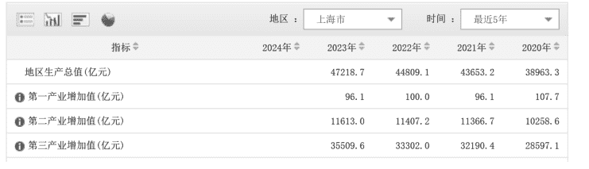
图 10-2 上海市国内生产总值（2020—2024 年）
- 2）标注缺失值；
- 3）重构成面板数据；
- 4）指定存储方式，整理好的表格可直接下载或复制到 Excel；
- 5）把整理过程转化为 R 或 Python 代码；
- 6）每一步都要核对结果，发现理解偏差及时纠正。

###### 【提示词 10-2 图片数据清洗步骤】

```
###### 输入
（上传图片）这是北京市/上海市近5年的GDP数据

###### 指令
如果你是一位数据科学家，请按照以下步骤将这两张图片整理为标准的数据格式
(1) 标记缺失值：2024年数据缺失，标注为缺失值。
(2) 转换为面板数据：将北京市和上海市的GDP数据整合为“城市-年”格式的面板数据。
(3) 以csv格式储存数据，每行代表一年，每列代表一个统计条目；
(4) 提供上述步骤的R代码和Python代码。
```

##### 2. 清洗流程拆解

R 和 Python 里清洗数据的基本链路是：导入、查看结构、筛选、变量名规范化、合并、去重、处理缺失、存储。借助 ChatGPT-4o 可以快速得到对应代码，见提示词 10-3 和代码 10-4。

R 既能用基础包也能用扩展包，常用 dplyr、tidyr、ggplot2 等，加载 tidyverse 就能一次载入。前面得到的 2020—2024 年京沪 GDP 数据，在 ChatGPT-4o 帮助下就能用这些包快速处理。

###### 【提示词 10-3 R 语言进行数据清洗】

```
###### 输入
(上传数据文件) 这是北京市和上海市的GDP数据，包括2020年至2024年的数据

###### 指令
如果你是一位数据科学家，请运用r进行数据清洗，提供以下信息：
(1) 提供r进行数据读取、合并与清洗的包；
(2) 提供r进行数据导入、数据结构查看、数据筛选、变量名处理、数据合并、重复值处理、缺失值处理、数据存储的代码。
```

###### 【代码 10-4 ChatGPT-4o 提供的 R 代码】

```
install.packages('tidyverse') # 安装包
###### 导入数据
library(tidyverse) # 加载包
df <- read_csv("data.csv") # 读取 CSV 数据
###### 查看数据信息
str(df) # 查看数据类型
head(df) # 默认查看前5行
colnames(df) # 查看列名
duplicated(df) # 检查重复行
###### 数据筛选
df %>% filter(column == 'A') # 筛选特定列为特定值
df %>% filter(column1 %in% c('A', 'B')) # 筛选特定列为多个特定值
df %>% select(column1, column2) # 保留特定列
df %>% select(-column) # 删除特定列
df %>% slice(A:B) # 保留特定行
df[ A : B ,] # 保留特定行
df <- df %>% mutate(new_column = case_when(
    old_column == 'old_value1' ~ 'new_value1',
    old_column == 'old_value2' ~ 'new_value2',
    TRUE ~ old_column) # 替换值
)
###### 列名重命名
df %>% rename(new_name1 = old_name1, new_name2 = old_name2) # 指定列名
colnames(df) <- c('name1', 'name2')
###### 数据合并
df <- left_join(df1, df2, on = 'column_common') # 按共同列合并
df <- bind_rows(df1, df2) # 沿行方向拼接
df <- bind_cols(df1, df2) # 沿列方向拼接
###### 删除重复值
sum(duplicated(df)) # 统计重复行数
df %>% distinct() # 删除重复行
###### 删除缺失值
colSum(is.na(df)) # 每一列缺失值数量
is.na(df$column) # 特定列缺失值数量
na.omit(df) # 删除含有缺失值的行
df %>% drop_na(column) # 删除某列存在缺失值的行
###### 缺失值简单插补
df[is.na(df)] <- 0 # 用0填充所有缺失值
df$column[is.na(df$column)] <- mean(df$column, na.rm = TRUE) # 用均值填充
df %>% fill(column, .direction = 'down') # 用上一行非空值填充
df %>% fill(column, .direction = 'up') # 用下一行非空值填充
df %>% mutate(column = na.approx(column, na.rm = FALSE)) # 线性插补
###### 数据存储
write_csv(df, "cleaned_data.csv")
```
Pandas 是 Python 数据清洗与处理的基石。研究者可通过 ChatGPT-4o 学习 Pandas 用法。遇到报错时，把错误信息丢给 ChatGPT-4o 就能得到解决思路，见提示词 10-4 和代码 10-5。

###### 【提示词 10-4 Python 语言进行数据分析】

```
###### 输入
(上传数据文件) 这是北京市和上海市的GDP数据，包括2020年至2024年的数据

###### 指令
如果你是一位数据科学家，请运用Python进行数据清洗，提供以下信息：
(1) 提供Python进行数据读取、合并与清洗的包；
(2) 提供Python进行数据导入、数据结构查看、数据筛选、变量名处理、数据合并、重复值处理、缺失值处理、数据存储的代码。
```

###### 【代码 10-5 ChatGPT-4o 提供的 Python 代码】

```
pip install pandas
###### 导入数据
import pandas as pd
df = pd.read_csv('data.csv')
###### 查看数据信息
df .info() # 查看数据类型
df.head() # 默认查看前5行
df.columns # 查看列名
df.duplicated() # 检查重复行
###### 数据筛选
df[(df['column1'] == 'A') & df['column2'] == 'B' ] # 筛选多列为特定值的数据
df[df['column1'].isin(['A', 'B'])] # 筛选特定列为特定值的数据
df[['column1', 'column2']] # 保留特定列
df.loc[:, ['column1', 'column2']] # 保留所有行与特定列
df.drop(columns=['column']) # 删除特定列
df['new_column'] = df['old_column'].replace({'old_value1': 'new_value1', 'old_value2': 'new_value2'}) # 替换值
###### 列名重命名
df.rename(columns={'old_name1': 'new_name1'; 'old_name2': 'new_name2'}, inplace=True)
###### 指定列名
df.columns = ['name1', 'name2', 'name3']
###### 数据合并
df = pd.merge(df1, df2, on = 'column_common', how = 'left') # 按共同列合并
df = pd.concat([df1, df2], axis=0) # 沿行方向拼接
df = pd.concat([df1, df2], axis=1) # 沿列方向拼接
###### 删除重复值
df.duplicated().sum() # 统计重复行数
df.drop_duplicates() # 删除重复行
###### 删除缺失值
df.isna().sum() # 每一列缺失值数量
df['column'].isna() # 特定列缺失值数量
df.dropna() # 删除含有缺失值的行
df.dropna(subset=['column']) # 删除某列存在缺失值的行
###### 缺失值插补
df.fillna(0) # 用0填充所有缺失值
df['column'].fillna(df['column'].mean(), inplace=True) # 用均值填充
df['column'] = df['column'].ffill() # 用上一行非空值填充
df['column'] = df['column'].bfill() # 用下一行非空值填充
###### 数据存储
df.to_csv("cleaned_data.csv", index=False)
```

#### 10.2.2 文本数据清洗

##### 1. 快速标注文本

社科实证里常遇到非结构化语言材料的整理难题。把自然文本转成可统计的分类标签，是文本分析的准备步骤。运用提示词工程，可以给模型提供少量示范，同时把待处理的原始材料、编码手册与具体要求一起提交给 ChatGPT-4o，进而明显提升标注效率。提示词 10-5 就是围绕民生诉求做的一次标注演示。

###### 【提示词 10-5 文本编码】

```
###### 输入
这是一个简要的民生诉求文本编码手册：
| id | 文本 | 交通问题 | 社保问题 | 教育问题 | 消费者权益问题 | 编码依据 |
|----|------|----------|----------|----------|----------------|----------|
| 1 | 十字路口的红绿灯损坏 | 1 | 0 | 0 | 0 | 红绿灯 |
| 2 | 超市地下停车场出口容易发生拥堵 | 1 | 0 | 0 | 0 | 道路拥堵 |
| 3 | 查询孩子入学学区政策 | 0 | 0 | 1 | 0 | 入学政策 |
| 4 | 中学生转学流程 | 0 | 0 | 1 | 0 | 转学 |
| 5 | 如何查询已经缴纳的社保费用 | 0 | 1 | 0 | 0 | 社保费用 |
| 6 | 延迟退休的退休金政策咨询 | 0 | 1 | 0 | 0 | 退休金 |
| 7 | 在美华超市买了过期饼干，对方拒绝赔偿 | 0 | 0 | 0 | 1 | 交易争端 |
| 8 | 在理发店遇到强制推销办卡的情况如何处理 | 0 | 0 | 0 | 1 | 强制消费 |

我有其他六条民生诉求文本，分别是：
1. 尊敬的领导：您好，我希望您能关注城区幸福小区外侧道路施工影响出行的问题。
2. 市长先生，锦华路附近的红绿灯路口经常堵车并导致发生车祸，相关部门可以介入处理吗？
3. 请问12345热线的工作人员，我的医疗报销遇到问题，应该和哪个部门联系？
4. 请问如何为新生儿办理医疗保险？
5. 幸福小学附近有一家超市开业，每天都在大声播放音乐影响到了小学的授课，请问如何解决？
6. 在城区中心路美发店办理了3000元的消费卡，仅仅消费了两次美发店就关门了，怎么样追回剩下的资金？

###### 指令
如果你是一位研究人员，请你按照以下流程将诉求文本进行编码：
1. 根据编码手册将诉求文本进行编码，编码类型为交通问题、社保问题、教育问题、消费者权益问题，编码结果互斥，提供编码依据；
2. 按照markdown格式输出，数据表格包含6列，第一列是文本，第二列是编码依据，后四列为编码。
```

模型会生成类似图 10-3 的表格并自动整理成 csv 格式。处理大规模批量的情况时，ChatGPT-4o 能显著缩短人工标注耗时。

| 文本 | 编码依据 | 交通问题 | 社保问题 | 教育问题 | 消费者权益问题 |
| :--- | :--- | :---: | :---: | :---: | :---: |
| 尊敬的领导：您好，我希望您能关注城区幸福小区外侧道路施工影响出行的问题。 | 道路施工 | 1 | 0 | 0 | 0 |
| 市长先生，锦华路附近的红绿灯路口经常堵车并导致发生车祸，相关部门可以介入处理吗？ | 红绿灯堵车 | 1 | 0 | 0 | 0 |
| 请问12345热线的工作人员，我的医疗报销遇到问题，应该和哪个部门联系？ | 医疗报销 | 0 | 1 | 0 | 0 |
| 请问如何为新生儿办理医疗保险？ | 新生儿医保 | 0 | 1 | 0 | 0 |
| 幸福小学附近有一家超市开业，每天都在大声播放音乐影响到了小学的授课，请问如何解决？ | 教学干扰 | 0 | 0 | 1 | 0 |
| 在城区中心路美发店办理了3000元的消费卡，仅仅消费了两次美发店就关门了，怎么样追回剩下的资金？ | 消费卡维权 | 0 | 0 | 0 | 1 |

图 10-3 ChatGPT-4o 返回的编码结果

##### 2. 正则匹配提取

当任务涉及信息抽取、模式匹配或文本替换时，正则表达式是常用手段。ChatGPT-4o 可依据需求生成可用正则。以上面六条民生诉求为例，若想抽取称呼部分，只需把样例交由模型对话，具体流程见提示词 10-6、代码 10-6 与代码 10-7。

###### 【提示词 10-6 生成正则表达式】

```
###### 输入
我有六条民生诉求文本，分别是：
(同前文)

###### 指令
如果你是一位研究人员，请分别使用Python和R生成恰当的正则表达式指代称呼部分。
```

###### 【代码 10-6 ChatGPT-4o 提供的 R 代码】

```
pattern <- "^(尊敬的[^, :]{0,8}(领导|书记|主任|市长)?|[^, :]{1,10}(先生|女士|同志|领导)|请问[^, :]{0,15}的工作人员)[, :]?"
```

###### 【代码 10-7 ChatGPT-4o 提供的 Python 代码】

```
r"^(尊敬的[^\s, :]{0,8}[领导|书记|主任|市长]?|[^\s, :]{1,10}(先生|女士|同志|领导)[, :]?|请问[^\s, :]{0,15}的工作人员)[, :]?"
```

##### 3. 清洗语料到矩阵

ChatGPT-4o 还可协助把语料整理成 DTM，即文档-词频矩阵，为后续挖掘与自然语言处理打下基础。DTM 的行对应文档，列对应词表，单元格记录该词在对应文档中的出现频次。中文预处理通常先去掉首尾的特殊符号如引号，再剔除数字或其他特殊字符；随后借助分词工具切词，Python 可用 jieba，R 可用 jiebaR；切词后即可构建 DTM。将材料、编程语言与输出要求一起发送给模型，见提示词 10-7。

###### 【提示词 10-7 文本清洗】

###### 输入

我有六条民生诉求文本，分别是：

(同前文)

###### 指令

如果你是一位研究人员，请按照以下要求对诉求文本进行清洗：

(1) 将文本整理为DTM文档，每一行代表一条文本，每一列代表一个关键词；

(2) 以R代码和Python代码呈现文本清洗过程。

###### 【代码 10-8 ChatGPT-4o 提供的 R 代码】

```r
texts <- c(
  "尊敬的领导：您好，我希望您能关注城区幸福小区外侧道路施工影响出行的问题。",
  "市长先生，锦华路附近的红绿灯路口经常堵车并导致发生车祸，相关部门可以介入处理吗？",
  "请问12345热线的工作人员，我的医疗报销遇到问题，应该和哪个部门联系？",
  "请问如何为新生儿办理医疗保险？",
  "幸福小学附近有一家超市开业，每天都在大声播放音乐影响到了小学的授课，请问如何解决？",
  "在城区中心路美发店办理了3000元的消费卡，仅仅消费了两次美发店就关门了，怎么样追回剩下的资金？"
)
corpus <- Corpus(VectorSource(texts)) # 创建文本语料（corpus）对象
install.packages("jiebaR")
library(jiebaR)
###### 中文分词器
cutter <- worker()
texts_seg <- sapply(texts, function(x) paste(segment(x, cutter), collapse = " "))
###### 生成 corpus 和 DTM
corpus <- Corpus(VectorSource(texts_seg))
dtm <- DocumentTermMatrix(corpus)
inspect(dtm)
dtm_matrix <- as.matrix(dtm)
###### 数据存储
write.csv(dtm_matrix, "dtm_output.csv")
```

###### 【代码 10-9 ChatGPT-4o 提供的 Python 代码】

```python
import jieba
from sklearn.feature_extraction.text import CountVectorizer
import pandas as pd
texts = [
    "尊敬的领导：您好，我希望您能关注城区幸福小区外侧道路施工影响出行的问题。",
    "市长先生，锦华路附近的红绿灯路口经常堵车并导致发生车祸，相关部门可以介入处理吗？",
    "请问12345热线的工作人员，我的医疗报销遇到问题，应该和哪个部门联系？",
    "请问如何为新生儿办理医疗保险？",
    "幸福小学附近有一家超市开业，每天都在大声播放音乐影响到了小学的授课，请问如何解决？",
    "在城区中心路美发店办理了3000元的消费卡，仅仅消费了两次美发店就关门了，怎么样追回剩下的资金？"
]
###### 中文分词
def chinese_tokenizer(text):
    return jieba.lcut(text)
###### 创建向量器（DTM）+ 分词器
vectorizer = CountVectorizer(tokenizer=chinese_tokenizer)
###### 拟合并转换为 DTM 矩阵
X = vectorizer.fit_transform(texts)
###### 转换为 DataFrame
dtm_df = pd.DataFrame(X.toarray(),
                      columns=vectorizer.get_feature_names_out())
dtm_df.index = [f"文本{i+1}" for i in range(len(texts))]
###### 数据存储
dtm_df.to_csv("民生诉求_DTM.csv", encoding="utf-8-sig")
```

### 10.3 Copilot 插件安装

GitHub Copilot 由 GitHub 与 OpenAI 联合推出，可嵌入多种编程环境实现自动补全的 AI 编程助手。本节介绍在 Visual Studio Code 与 RStudio 中部署 Copilot 的流程。部署前需先开通服务，免费版与付费版能力不同，教育用户经 GitHub Education 认证后可免费使用。

#### 10.3.1 在 Visual Studio Code 中安装 Copilot

安装好 Visual Studio Code 后，进入扩展市场搜索 GitHub Copilot 或 GitHub Copilot Chat 进行下载。安装完成后，编辑器右上角会出现 Copilot 状态入口，可进行聊天、设置或订阅管理。开启状态下，输入自然语言或代码片段时，Copilot 会基于上下文给出建议，按 Tab 即可采纳。2024 年 5 月起，Copilot 已升级至 ChatGPT-4o 模型。更多细节可参考 VS Code 官网教程。

#### 10.3.2 在 R Studio 中安装 Copilot

2023.09.0 及之后的 RStudio 版本支持 Copilot。安装完成后打开 Tools → Global Options 选择 Copilot，勾选 Enable GitHub Copilot → Sign in，用 GitHub 账号登录并完成验证码，按页面指引激活即可。在 RStudio 中进行数据分析时，Copilot 能结合上下文生成、校对代码并提供文档建议，同样可用 Tab 键接受建议。

### 10.4 总结

本章先介绍了在 ChatGPT-4o 辅助下通过 API 或爬虫获取数据的办法，鉴于反爬策略不断变化，更推荐使用 API。随后讲解了理想的数据结构与清洗思路，ChatGPT-4o 能高效完成表格数据和文本数据的清洗工作。最后演示了在 Visual Studio Code 和 RStudio 中安装 Copilot 插件以辅助编码和数据处理。总体来看，ChatGPT-4o 在数据获取与清洗环节的加持，能显著提升研究效率，帮助获得更符合分析要求的数据结果。

> Visual Studio Code 官网：https://vscode.js.com/docs/copilot/overview。

### — 思考与练习 —

- 思考 1：AI 降低了数据获取与处理的成本，研究者是否仍需要系统学习相关技术？
- 思考 2：当 ChatGPT-4o 提供的代码无法运行时，研究者该如何应对？
- 练习：借助 ChatGPT-4o 的帮助，自行挑选一个天气 API，收集你所在城市过去一周的天气数据。

# ChatGPT 篇

## 第 11 章 大模型辅助的硅基样本生成

### 本章重点

- 硅基样本可信度的关键在于算法保真，可用图灵测试、反向连续性、向前连续性和模式对应性四个维度来衡量。
- 角色设定驱动的智能体设计是生成硅基样本的核心方法。
- Python 开源包 EDSL 为硅基抽样提供操作支持，能帮助研究者设计问题、搭建智能体、构建问卷，并支持调查实验等进阶设计。

### 11.1 从碳基样本到硅基样本

“硅基样本”是指利用大型语言模型模拟产生的虚拟人类数据，用以替代或补充传统社会科学研究中的真实受访者数据。这些样本由算法生成，具备设定的人口属性、观点倾向和行为模式，可用于问卷调查、态度预测、行为模拟等任务。相较于传统的“碳基样本”，硅基样本在成本、控制性、可重复性以及伦理风险上具有明显优势。它不仅是文本生成，更是拥有特定社会属性、认知倾向或行为特征的虚拟个体单元，既是一种类人智能体，也是基于大语言模型构建的社会模型产物，用以描述、解释和预测人类行为，进而革新传统研究方法。

在社会科学流程中，硅基样本的应用可归纳为三个递进场景。第一，设计与探索阶段，可用于问卷试测、访谈预演、指标构建，通过模拟受访者快速检验问题逻辑、语言理解和选项设置，提升工具适配度。第二，数据收集阶段，一方面可模拟难以接触或存在伦理风险的群体，生成结构化但无风险的回应，降低人力与伦理成本①；另一方面可与真实样本结合，补齐历史调查的缺失值、推断未测变量，或用于小样本扩充和非平衡数据校正，提升统计模型的稳健性和外部效度②。第三，机制建模与因果推断环节，可构建拥有特定身份、偏好和行为规则的虚拟代理群体，在结构因果模型或社会模拟实验中检验理论假设和变量关系③④。总体而言，硅基样本从设计支持延伸到知识生产，既拓展研究边界，也推动方法论的革新。本节聚焦硅基样本的概念及在设计与数据收集两类情境中的应用，社会模拟相关内容见第4章。

本章后续将从方法论角度阐述硅基样本的原理，即算法保真与硅基抽样；以 Python 生态的 EDSL 包 Expected Parrot Domain-Specific Language 为例，介绍具体操作流程；最后讨论大模型辅助的硅基样本生成在社会科学中的价值与边界。

> ① Sarstedt, M., Adler, S. J., Rau, L., & Schmitt, B. (2024). Using large language models to generate silicon samples in consumer and marketing research: Challenges, opportunities, and guidelines. Psychology & Marketing. https://doi.org/10.1002/mar.21982.
> ② Dillion, D., Tandon, N., Gu, Y., & Gray, K. (2023). Can AI language models replace human participants? Trends in Cognitive Sciences, 27, 597-600. https://doi.org/10.1016/j.tics.2023.04.008.
> ③ Bisbee, J., Clinton, J. D., Dorff, C., Kenkel, B., & Larson, J. M. (2024). Synthetic replacements for human survey data? The perils of large language models. Political Analysis. https://doi.org/10.1017/pan.2024.5.
> ④ Sun, S., Lee, E., Nan, D., Zhao, X., Lee, W., Jansen, B. J., & Kim, J. H. (2024). Random silicon sampling: Simulating human sub-population opinion using a large language model based on group-level demographic information. Arxiv, abs/2402.18144. https://doi.org/10.48550/arXiv.2402.18144.

> ⑤ Jiang, S., Wei, L., & Zhang, C. (2024). Donald trumps in the virtual polls: Simulating and predicting public opinions in surveys using large language models. https://consensus.app/papers/donald-trumps-in-the-virtual-polls-simulating-and-jiang-wei/c131f58fa97d5f1c80f116dac8a1fed/.

> ⑥ Manning, B. S., Zhu, K., & Horton, J. J. (2024). Automated Social Science: Language Models as Scientist and Subjects (No. arXiv: 2404.11794). arXiv. https://doi.org/10.48550/arXiv.2404.11794.

### 11.2 硅基样本的生成机理与验证路径

以 LLM 为引擎产出的硅基样本，本质上是一种由模型驱动的合成数据流程。若要将其用于社会科学，需要在方法论层面厘清它的形成机制与使用逻辑。以下依据既有文献，从原理基础与操作路径两个层面展开。

#### 11.2.1 算法保真：可信度四维度

碳基样本是人与人之间的 1 对 1 对应，而硅基样本则是一个从单一来源向大规模扩散的生成过程。这种扩散是否成立，关键在于模型输出在结构、行为与解释上能否保持保真。Argyle 等人在《Political Analysis》提出的“从一到多”模拟思路，给出了评估模型社会科学适用性的四项判据①：

1. 社会科学图灵检验。该判据借鉴图灵测试，要求模型文本在表达风格、逻辑架构与语义连贯度上难以与真人文本区分。其方法论根基是可感知的语言真实性，用于判断模型是否具备语言仿真能力。

2. 反向连续性。强调生成产物与输入属性的一致性，是一种反向推理信度检验。例如模拟低收入群体时，产出内容应体现相应的价值取向与经济偏好，如更强调保障与公平。该逻辑植根于社会认知语言学中“语言指向社会位置”的论点②。

3. 前向连续性。回复应能在给定情境中自然衍生，并稳健地反映情境的形式、语气与内容。要求模型表达的态度、观点或选择行为与真实数据在预测上保持一致。Sun 等人曾将模型输出与美国公众民调对照，发现部分议题的生成分布能高度吻合真实分布③。

4. 模式对应性。产出文本需复现人类数据中的复杂关联模式，涵盖人口学特征、态度与行为之间的关系。核心在于生成数据内部的变量结构要与现实世界相近，比如教育水平对政治参与的影响、收入对环保态度的塑造等。

上述四项构成了算法保真的维度体系，硅基样本的有效性取决于四者共同满足。目前四项缺乏统一量化阈值，多依赖定性判断。Argyle 等曾以 GPT-3 验证其同时符合四项标准，其他模型在应用前仍需独立检验。

> ① Argyle, L. P., Busby, E. C., Fulda, N., Gubler, J. R., Rytting, C., & Wingate, D. (2023). Out of one, many: Using language models to simulate human samples. Political Analysis, 31 (3), 337–351. https://doi.org/10.1017/pan.2023.2.

> ② Eckert, P. (2008). Variation and the indexical field1. Journal of Sociolinguistics, 12 (4), 453–476. https://doi.org/10.1111/j.1467-9841.2008.00374.x.

> ③ Sun, S., Lee, E., Nan, D., Zhao, X., Lee, W., Jansen, B. J., & Kim, J. H. (2024). Random silicon sampling: Simulating human sub-population opinion using a large language model based on group-level demographic information. Arxiv, abs/2402.18144. https://doi.org/10.48550/arXiv.2402.18144.

#### 11.2.2 角色驱动：智能体的人设构建

实现算法保真的关键操作是基于角色设定的智能体设计。思路是让模型具身化，产出符合统计分布与社会逻辑的模拟调查数据，最终形成可嵌入研究的模拟样本库。

Role-Playing Agent，简称 RLPA，核心是通过提示让 LLM 扮演特定人类特征，如职业、性别、族裔等，并参与对话。其价值在于利用大模型的语言与信息处理能力复刻特定角色的行为与回应④。Bisbee 等人发现，赋予模型明确角色后，输出会更贴近目标群体的观点分布。

在个体层面，设定特定身份后，政治态度评分在均值与方向上趋近美国 ANES 调查结果①。群体层面，RLPA 强调以整体结构控制样本属性，借鉴分层抽样的思想，通过提示工程修正模型在训练数据上的偏差，确保虚拟样本能真实反映目标群体的分布，从而提升保真度。例如 Sun 等人输入美国人口结构数据后，生成的虚拟回应在党派构成、意识形态偏好等方面与真实调查高度吻合②。

> ④ Zhou, M., Yu, L., Geng, X., & Luo, L. (2025). ChatGPT vs Social Surveys: Probing Objective and Subjective Silicon Population (No. arXiv: 2409.02601). arXiv. https://doi.org/10.48550/arXiv.2409.02601.

### 11.3 硅基抽样实操：以 EDSL 为例

Expected Parrot Domain-Specific Language，简称 EDSL，是一款面向 AI 科研的开源 Python 包，硅基抽样是其核心功能。

本节主要参考开发者 J.Horton 与 R.Horton ③ 提供的教程，采用 MIT 许可证，特此致谢。

#### 11.3.1 核心概念概览

EDSL 的设计思路是：把一个问题交给特定智能体 Agent，由大语言模型 Model 生成响应，并以格式化结果 Result 返回。这些结果可用于分析、可视化、分享，或用来优化后续问卷。EDSL 支持多种题型，如自由文本、多项选择，可组合成 Survey 调查，并行执行或按规则条件逻辑运行。题目还可通过 Scenario 场景参数化，提供上下文或提示变体。调查还能同时调用多个代理和模型，产出多样响应，对稳健分析很重要。表 11-1 展示了 EDSL 核心概念框架，操作都围绕这些概念展开。该框架为研究者提供清晰、灵活且高效的工具，便于设计实验、管理数据密集型任务并产出高质量成果。

表 11-1 EDSL 包核心概念框架

| 概念 | 描述 |

| :--- | :--- |

| 问题（Questions） | EDSL 包中研究设计的基础元素，支持多种类型（如自由文本、多项选择等），用户可根据响应格式选择 |

| 调查（Surveys） | 定义聚合多个问题，可异步或按预定义规则执行，支持不同代理和模型生成多样化响应，并可结合场景提供上下文和数据以增强问题深度 |

| 代理人（Agents） | 代表回答问题的 AI 实体，每个代理可具有独特特征（如背景、专业知识或记忆），这些特征会影响其响应 |

| 语言模型（Language Models） | 生成问题答案的大语言模型，EDSL 包设计为模型无关，支持集成多个模型以便于响应的比较和选择 |

| 场景（Scenarios） | 在执行问题时提供特定上下文或数据，支持问题的动态参数化，使相同问题能在不同上下文中高效调整和提出 |

| 结果（Results） | 执行问题后的直接输出，包含问题、代理、模型、提示、生成的令牌及原始和格式化响应等信息，可用于分析、可视化、共享及优化后续查询或调查 |

#### 11.3.2 环境搭建与安装

EDSL 兼容 Python 3.9 至 3.12。开始前请在本地或云端环境如 Google Colab 准备好 Python。安装包并选择访问方式，运行：

```
pip install edsl
```

若已安装，可检查当前版本：

```
pip show edsl
```

版本过旧可更新：

```
pip install --upgrade edsl
```

用户可在本地运行，也可在 Expected Parrot 服务器远程运行。远程运行需在官网用邮箱注册 [ Expected Parrot 官网：https://www.expected-parrot.com/login，最后访问日期 2025 年 3 月 24 日。]，本地运行则需在个人设置中提供 API 密钥信息，如图 11-1 所示。

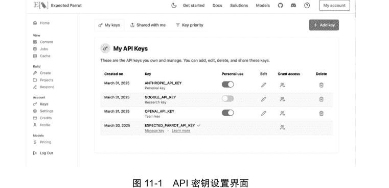

图 11-1 API 密钥设置界面

准备就绪后即可用 EDSL 开展大模型辅助的硅基样本生成，下文将按问题、代理人、问卷及结果四个部分逐步说明。

#### 11.3.3 问题构建

目标是构建契合研究需求的各类题目。EDSL 提供多种题型，可根据期望的响应形式选择。运行以下代码：

```
from edsl import Question
Question.available()
```

可查看全部题型及实例，见表 11-2：

表 11-2 问题类型及实例

| question_type（问题类型） | question_class（软件包中的标识） |

| :--- | :--- |

| checkbox（多选框） | QuestionCheckBox |

| extract（提取题） | QuestionExtract |

| free_text（自由回答） | QuestionFreeText |

| functional（功能题） | QuestionFunctional |

| likert_five（五点量表） | QuestionLikertFive |

| linear_scale（线性量表） | QuestionLinearScale |

| list（列表） | QuestionList |

| matrix（矩阵题） | QuestionMatrix |

| multiple_choice（多项选择） | QuestionMultipleChoice |

| numerical（数字题） | QuestionNumerical |

| rank（排序题） | QuestionRank |

| top_k（Top-K 题） | QuestionTopK |

| yes_no（是非题） | QuestionYesNo |

可导入对应题类的 example 方法检查构成：

```
from edsl import ( # QuestionCheckBox, # QuestionExtract, # QuestionFreeText, #
QuestionFunctional, # QuestionLikertFive, # QuestionLinearScale, # QuestionList,
QuestionMultipleChoice, # QuestionNumerical, # QuestionRank, # QuestionTopK, #
QuestionYesNo )

q = QuestionMultipleChoice.example() # substitute any question type class name

q
```

可看到示例的构成要素，见表 11-3，有助于自行构造问题。

表 11-3 示例问题的构成要素

| key | value |

| :--- | :--- |

| question name（问题名称） | how_feeling（感觉如何） |

| question text（问题文本） | How are you?（你感觉如何？） |

| question options：0（选项 0） | Good（好） |

| question options：1（选项 1） | Great（非常好） |

| question options：2（选项 2） | OK（还行） |

| question options：3（选项 3） | Bad（不好） |

| include comment（包含评论） | False（否） |

| question type（问题类型） | multiple choice（多项选择） |

以多选题为例，设计新题目：在 0、1、2、3 中选最小的质数：

```
from edsl import QuestionMultipleChoice

q = QuestionMultipleChoice( question_name = "smallest_prime",
question_text = "Which is the smallest prime number?", question_options
= [0, 1, 2, 3] )
```

题目设计完成后可用 run 代码交由大模型作答：

```
results = q.run()
```

得到的结果 results 是一个数据集，可提取模型 model、对题目的答案 smallest_prime 以及智能体的注释 comment 三个变量：

```
results.select("model", "smallest_prime", "smallest_prime_comment")
```

可见该题目由 GPT-4o 作答，最小质数为 2，并附带注释。关于 results 的其他变量，可用 results.columns 查看，表 11-4 为输出示例。

表 11-4 输出结果

| model.model（运行模型） | answer.smallest_prime（答案） | comment.smallest_prime_comment（注释） |

| :--- | :--- | :--- |

| GPT-4o | 2 | 2 是最小的质数，因为它是唯一一个大于 1 且仅能被 1 和它本身整除的偶数 |

注意：本地运行可传入 run（progress_bar=True）查看进度，异常会在控制台显示。远程推理会自动提供进度链接，异常时提供报告链接，任务完成后显示结果页链接。

#### 11.3.4 基于人设智能体的问卷执行

问卷由多个题目组成，并通过 RLPA 策略使用基于角色设定的智能体开展调查。下文以双题目问卷为例，为智能体设计不同角色设定并回答，随后选择特定语言模型生成答案。

##### 1. 问卷组装

首先，将包含不同类型题目的问卷设计并保存为 Survey 对象：

```
from edsl import QuestionLinearScale, QuestionFreeText

from edsl import Survey

q_enjoy = QuestionLinearScale( question_name = "enjoy", question_text =
"On a scale from 1 to 5, how much do you enjoy reading?",
question_options = [1, 2, 3, 4, 5], option_labels = {1:"Not at all",
5:"Very much"} )

q_favorite_place = QuestionFreeText( question_name = "favorite_place",
question_text = "Describe your favorite place for reading." )

survey = Survey(questions = [q_enjoy, q_favorite_place])
```

### 极简问卷原型
为了快速验证思路，这里先搭建一个最小可用的问卷：一条五级李克特量表用于度量阅读时的愉悦分值，搭配一道开放题请受访者写出自己最偏好的阅读场所。

##### 2. 代理设计
下一步按 RLPA 思路配置填答智能体。EDSL 的核心能力之一是能够生成带角色设定的填答代理，实现方式是把一组 traits 特征字典传给 Agent 实例，语言模型据此模拟作答。更多细节可参考官方文档 <https://docs.expectedparrot.com/en/latest/agents.html>。

本例先用三种不同职业属性的代理做演示，traits 越丰富，代理画像就越精细：

```
from edsl import AgentList, Agent

agents = AgentList( Agent(traits = {"persona":p}) for p in ["artist",
    "mechanic", "sailor"] )
```

##### 3. 大语言模型选择
问卷与代理确定后，就要指定大语言模型来驱动作答。EDSL 兼容多家主流大型语言模型，同一份调查内可自由切换，便于横向比对生成差异。

查看当前可用的模型名称，可执行：

```
from edsl import Model

Model.available()
```

在可用列表里挑选模型运行问卷，本次以 “gpt-4o” 与 “gemini-pro” 作为对照：

```
from edsl import ModelList, Model

models = ModelList( Model(m) for m in ["gpt-4o", "gemini-pro"] )
```

##### 4. 开展问卷运行
把智能体与模型通过 by 接入调查，随后像执行单题那样直接调用 run 即可完成整份问卷的批量执行：

```
results = survey.by(agents).by(models).run()

( results .sort_by("persona", "model") .select("model", "persona",
"enjoy", "favorite_place") )
```

#### 11.3.5 问卷进阶：顺序、记忆与情境
前面提到，前向连续性与反向连续性对算法保真度至关重要，题目呈现顺序以及代理是否保留先前问题的记忆，会直接影响硅基抽样的准确性。Scenario 其一能为代理补充背景知识、提升保真度<sup>①</sup>，其二也为调查实验提供了灵活的设计空间。

EDSL 支持三种向题目注入信息的方式：

- 1）顺序：把上一题答案通过 Piping 带到下一题；
- 2）记忆：在呈现后续题目时，把先前题目与答案作为记忆一并带入；
- 3）情境：用外部数据对题目做参数化，比如从 PDF、CSV、文档、图像等来源抽取内容填入题干。

##### 1. 答案传递 Piping
演示如何把一题结果实时带入下一题文字。做法是在后继题干中使用 {{ <question_name>.answer }}，调查运行时会用前题真实答案替换，实现题干动态重组并保证呈现顺序。

```
from edsl import QuestionNumerical, QuestionYesNo, Survey

q1 = QuestionNumerical( question_name = "random_number", question_text =
"Pick a random number between 1 and 1,000." )

q2 = QuestionYesNo( question_name = "prime", question_text = "Is this a
prime number: {{ random_number.answer }}" )

survey = Survey([q1, q2])

results = survey.run()
```

运行后可检查 prime 题的 user_prompt，验证 random_number 题的数值是否成功被 Pipe 进去：

```
results.select("random_number", "prime_user_prompt", "prime", "prime_comment")
```

##### 2. 为后续题目补充记忆
本例把第一题及其答案的记忆注入第二题上下文，通过调用 memory 规则并指定来源问题实现。

与单纯答案传递不同，这种方式会把前一题完整提问与结果原样嵌入后续题文本，不依赖占位符，能提供更完整的背景，让 AI 代理在更充分信息下判断。

示范使用 add_targeted_memory 方法，另有 set_full_memory_mode 等记忆规则：

> ① Bisbee, J., Clinton, J. D., Dorff, C., Kenkel, B., & Larson, J. M. (2024). Synthetic replacements for human survey data? The perils of large language models. Political Analysis. https://doi.org/10.1017/pan.2024.5.

> ② Sun, S., Lee, E., Nan, D., Zhao, X., Lee, W., Jansen, B. J., & Kim, J. H. (2024). Random silicon sampling: Simulating human sub-population opinion using a large language model based on group-level demographic information. Arxiv, abs/2402.18144. https://doi.org/10.48550/arXiv.2402.18144.

> ③ John Horton & Robin Horton. (2024). EDSL: Expected Parrot Domain Specific Language for AI Powered Social Science, https://docs.expectedparrot.com/en/latest/papers.html.

> ① Argyle, L. P., Busby, E. C., Fulda, N., Gubler, J. R., Rytting, C., & Wingate, D. (2023). Out of one, many : Using language models to simulate human samples. Political Analysis, 31 ( 3 ), 337–351. https ://doi.org/10.1017/pan.2023.2.

from edsl import QuestionNumerical, QuestionYesNo, Survey

q1 = QuestionNumerical(question_name="random_number", question_text="Pick a random number between 1 and 1,000.")

q2 = QuestionYesNo(question_name="prime", question_text="Is the number you picked a prime number?")

survey = Survey([q1, q2]).add_targeted_memory(q2, q1)

results = survey.run()

再次核查 user_prompt，可验证后续题目里是否正确带入了背景信息：

results.select("random_number", "prime_user_prompt", "prime", "prime_comment").table().long()

得到如下结果，见表 11-5。

表 11-5 输出结果

| key | value |

| :--- | :--- |

| answer.random_number（答案.随机数） | 487 |

| prompt.prime_user_prompt（提示.质数判断提示） | Is the number you picked a prime number? No Yes（你选的数字是质数吗？ 否 是） |

##### 3. 增加情境 Scenarios
还能把外部数据或内容注入题目，这对批量生成多版本题目、做调查实验特别好用。做法是建一个 Scenario 字典，键对应题干或选项里的 {{placeholder}}，值填入要插入的具体内容。情境也可以在结果里加入元数据，如来源或参考信息，便于分析但不必显示在题干中。

在前面的阅读问卷上扩展情境，使其能接入其他期望的数据。EDSL 可从 PDF、CSV、文档、图像、表格与字典等自动生成情境，本例用 from_list 把活动列表转为情境。

随后展示两种应用时机：

1）在构建调查时就生成多版本题目；
2）在运行调查时动态加载情境。

运行期用 by 动态挂载情境，与挂载代理和模型方式相同。结果会多出“情境”列，每个情境下的答案各占一行。

构建期用 loop 在问题生成阶段就嵌入情境。此时结果没有“情境”列，而是以独立列呈现每个具体问题，所有答案同行。

先以最简方式把阅读扩展为多个活动：

from edsl import ScenarioList, Scenario

scenarios = ScenarioList.from_list("activity", ["reading", "running", "relaxing"])

运行期挂载情境，用 by 同时指定代理与模型：

from edsl import QuestionLinearScale, QuestionFreeText, Survey

q_enjoy = QuestionLinearScale(question_name="enjoy", question_text="On a scale from 1 to 5, how much do you enjoy {{ activity }}?", question_options=[1, 2, 3, 4, 5], option_labels={1: "Not at all", 5: "Very much"})

q_favorite_place = QuestionFreeText(question_name="favorite_place", question_text="In a brief sentence, describe your favorite place for {{ activity }}.")

survey = Survey([q_enjoy, q_favorite_place])

results = survey.by(scenarios).by(agents).by(models).run()

(results.filter("model.model == 'gpt-4o'").sort_by("activity", "persona").select("activity", "persona", "enjoy", "favorite_place"))

结果包含了 GPT-4o 在不同角色设定下对阅读、休闲、跑步三个情境的回答，Result 中出现了情境变量。

也可以在构建阶段就把情境写进问题，而非运行时挂载。此时结果以各问题的独立列呈现，不会出现“情境”字段。可选择把情境键写入问题名，否则系统会默认递增命名。

from edsl import QuestionLinearScale, QuestionFreeText

q_enjoy = QuestionLinearScale(

    question_name="enjoy_{{ activity }}",

    question_text="On a scale from 1 to 5, how much do you enjoy {{ activity }}?",

    question_options=[1, 2, 3, 4, 5],

    option_labels={1: "Not at all", 5: "Very much"}

)

q_favorite_place = QuestionFreeText(

    question_name="favorite_place_{{ activity }}",

    question_text="In a brief sentence, describe your favorite place for {{ activity }}."

)

对情境做循环，可生成享受度问卷的多个版本，每个版本对应不同情境内容：

enjoy_questions = q_enjoy.loop(scenarios)

enjoy_questions

favorite_place_questions = q_favorite_place.loop(scenarios)

favorite_place_questions

再把所有问题合并进调查并运行：

survey = Survey(questions=enjoy_questions + favorite_place_questions)

results = survey.by(agents).by(models).run()

与 by 方法得到的长表不同，loop 方法得到的是宽表，情境信息体现在变量名上。执行下面代码可得表 11-6 示例：

(results.filter("model.model == 'gpt-4o'").sort_by("persona").select("persona", "enjoy_reading", "enjoy_running", "enjoy_relaxing"))

表 11-6 输出结果

| agent.persona (代理人角色) | answer.enjoy_reading (阅读喜好度) | answer.enjoy_running (跑步喜好度) | answer.enjoy_relaxing (放松喜好度) |

| :--- | :--- | :--- | :--- |

| artist (艺术家) | 4 | 2 | 4 |

| mechanic (工程师) | 2 | 1 | 3 |

| sailor (海员) | 3 | 2 | 3 |

EDSL 内置了多种分析与可视化手段，详情见 https://docs.expectedparrot.com/en/latest/language_models.html。也可以用 to_pandas 方法转为 DataFrame 进一步处理：

df = results.to_pandas(remove_prefix=True)

最后，研究者可以方便地把成果上传至 Coop 平台。Coop 是用于创建、保存和共享基于 LLM 的研究的平台，与 EDSL 完全集成，可通过工作区或 Coop 账号页面访问。更多信息见官网 https://www.expectedparrot.com/content/explore。

### 11.4 小结

本节围绕生成式模型驱动的硅基样本构建思路与实操路径展开。支撑该类样本的方法论支柱是算法保真度，其评价框架整合了社科领域的图灵式检验、逆向连续、正向连续与模式对应四个指标，既为硅基样本提供合理性依据，也本身构成需要检验的假设。落地上，核心策略是采用角色导向的智能体设计，通过给模型赋予清晰的人设与充足的背景知识，引导其在作答时更贴近人类推理，从而实现保真。

在工具层面，Python 生态的 EDSL 开源工具箱已封装了完整的硅基样本生成链路。本文按顺序展开问题设计、问卷编制、代理配置、模型挑选直至施测执行的关键环节，并进一步说明顺序调控、记忆维护与情境构建等进阶机制，帮助模拟研究更贴合真实需求，也为复杂实验与高级问卷研究奠定基础。

尽管硅基样本在社科研究里具备高效且可扩展的优势，其适用边界依然存在。生成模型的对齐偏差可能使模拟主体的社会经济属性与真实人群出现偏离<sup>①</sup>，这就要求代理角色的校准更为精细。知识转化的鸿沟同样制约了其对复杂社会行为的逼真再现。不同学科对该手段的依赖程度各异：譬如在经济预测场景中，模型可挖掘历史数据中的隐含规律并规避人类预测的系统性偏误；而在涉及主观态度与文化实践的研究中，局限会更突出。后续工作宜探索硅基样本与传统调查的融合路径，以弥补在样本代表性、群体异质性捕捉与社会复杂性再现等方面的短板，更全面地服务社科研究。

### — 思考与练习 —

思考：生成硅基样本需要满足哪些基本前提？在何种情形下结果具备可信度？硅基样本在哪些情境下可作为碳基样本的补充或替代？

练习：请借助 EDSL 设计一份人工智能素养调查问卷，覆盖三大维度：

1）人工智能知识掌握情况（如基础概念、应用范围等）

2）人工智能风险感知（如数据隐私、算法偏见等）

3）人工智能好奇程度（如对技术兴趣、学习意愿等）

请构建多个人设的智能体参与作答，来源应涵盖不同教育程度、收入层级与地理区位，以便比较各群体的认知差异。

提示：利用 Agent 功能创建差异化背景的代理，通过 run 方法开展施测，并尝试调用 to_pandas 将结果转为表格进行分析。

> ① Zhou, M., Yu, L., Geng, X., & Luo, L. (2025). ChatGPT vs Social Surveys: Probing Objective and Subjective Silicon Population (No. arXiv: 2409.02601). arXiv. https://doi.org/10.48550/arXiv.2409.02601.

# ChatGPT 篇

# 第12章 数据处理应用

### 本章重点

- 借助大语言模型完成数据标注、特征抽取与情感判别
- 利用大语言模型填补缺失值
- 评估 AI 辅助数据处理的效果

### 12.1 引言

在计算社会科学乃至整个社会科学范式中，人工编码长期是研究流程的必要环节。随着产业界与学术界数据采集能力的提升，社科数据体量快速扩张，已成为计算社会科学的典型特征。在此背景下，如何在海量标注中兼顾规模与精度，成为学界共同关注的议题。

所幸，Transformer 架构的推进推动了基于文本表征的预训练与生成式模型快速发展，涌现出一批质量上乘的离线与在线模型服务。研究者已能借助生成式人工智能实现快速、高质量且成本相对较低的数据标注。例如，2023 年刊载于《美国科学院院刊》的一项实证研究表明，如图 12-1 所示，在多类标注任务中，当时的大语言模型已优于人工编码员。随着生成式 AI 的持续进步，研究人员能越来越多地利用其完成快速的数据处理任务。

基于上述进展，本章重点介绍如何通过 OpenAI 接口实现数据标注、特征抽取、主题建模、情感判别及缺失值填补，并给出相关代码示例。

> Gilardi, F., Alizadeh, M., & Kubli, M. (2023). ChatGPT outperforms crowd workers for text-annotation tasks. Proceedings of the National Academy of Sciences, 120(30), e2305016120.

### 12.2 数据标注

生成式大语言模型具有强大的研究潜力，本节展示其在情感分析、主题分类与数据标注方面的能力，并提供简要代码示例。

#### 12.2.1 情感分析

生成式大语言模型可用于快速的情感判别。代码 12-1 中，我们利用 OpenAI 的 GPT-4 构建了结构化情感分析功能。首先

> Gilardi, F., Alizadeh, M., & Kubli, M. (2023). ChatGPT outperforms crowd workers for text-annotation tasks. Proceedings of the National Academy of Sciences, 120(30), e2305016120.

通过 OpenAI 客户端建立连接，并定义情感分析函数：系统提示要求模型扮演专业分析员，将文本情绪严格划分为积极返回 1、消极返回 -1、中性返回 0，并强制仅输出数值。

##### 【代码 12-1 调用 OpenAI 应用程序接口进行情感分析】

from openai import OpenAI

###### 初始化 OpenAI 客户端

client = OpenAI(api_key=API_KEY)  # 替换为你的 API 密钥

def analyze_sentiment(text: str) -> str:

    """

    根据给定文本使用 GPT-4 模型进行情感分析

    参数:

        text (str): 需要进行情感分析的文本

    返回:

        str: GPT-4 模型返回的情感分析结果

    """

    # 构建情感分析提示

    system_prompt = "你是一个专业的情感分析助手，能够准确识别和解释文本中的情感倾向。如果是积极的，则返回 '1'，如果是消极的，则返回 '-1'，如果是中性的，则返回 '0'。如果无法判断，则给出最合适的猜测。请只返回结果。"

    user_prompt = f"请对下面的文本进行情感分析：\n\n"{text}"\n\n情感分析结果："

    # 调用 GPT-4 模型

    response = client.chat.completions.create(

        model="gpt-4",

        messages=[

            {"role": "system", "content": system_prompt},

            {"role": "user", "content": user_prompt}

        ]

    )

    # 提取并返回结果

    return response.choices[0].message.content.strip()

该实现借助双层提示完成推理：系统指令界定分类规则，用户提示提供待分析文本，调用 GPT-4 后直接提取数值结果。示例中对“我今天心情非常愉快…”的测试文本预期输出为 1，体现了自然语言情绪向结构化数据的自动化转换能力。

##### 【代码 12-2 调用 OpenAI 应用程序接口进行情感分析的示例输入】

sample_text = "我今天心情非常愉快，因为得到了一个意想不到的惊喜！"

result = analyze_sentiment(sample_text)

print("情感分析结果:", result)

##### 【代码 12-3 调用 OpenAI 应用程序接口进行情感分析的示例输出】

情感分析结果：1

#### 12.2.2 主题建模

在传播学、政治学等学科，大规模文本分析常需区分不同主题。例如一篇发表于《传播学期刊》的研究探讨用户互动如何影响新闻媒体的话题选择，其关键步骤是对大量新闻文本进行主题与类型分类。

尽管该研究采用 NMF 完成建模，下文代码 12-4 将展示如何借助 OpenAI API 快速实现主题建模。具体而言，代码通过初始化客户端并定义 perform_topic_modeling 函数，构建了要求精准识别单一主题并直接返回结果的系统指令，以及包含待分析文本的用户提示的对话结构。调用 chat.completions.create 后提取纯文本主题。示例显示输入政治新闻类文本后，模型准确输出“枪支管控辩论”，体现了其在新闻分类与内容标签化场景的实用性。

> Mukerjee, S., Yang, T., & Peng, Y. (2023). Metrics in action: how social media metrics shape news production on Facebook. Journal of Communication, 73(3), 260-272.

##### 【代码 12-4 调用 OpenAI 应用程序接口进行主题建模】

```python
from openai import OpenAI

###### 初始化 OpenAI 客户端
client = OpenAI(api_key=API_KEY)  # 替换为你的 API 密钥

def perform_topic_modeling(text: str) -> str:
    """
    根据给定文本使用 GPT-4 模型进行主题建模

    参数:
        text (str): 需要进行主题建模的文本

    返回:
        str: GPT-4 模型返回的主题列表，多个主题用逗号分隔
    """
    # 构建主题建模提示
    system_prompt = "你是一个专业的主题建模助手，能够准确识别文本中包含的主要主题。请分析文本并返回最相关的一个主题。如果无法确定，请给出最合理的猜测。请只返回结果。"
    user_prompt = f"请对下面的文本进行主题建模：\n\n"{text}"\n\n主题:"

    # 调用 GPT-4 模型
    response = client.chat.completions.create(
        model="gpt-4",
        messages=[
            {"role": "system", "content": system_prompt},
            {"role": "user", "content": user_prompt}
        ]
    )

    # 提取并返回结果
    return response.choices[0].message.content.strip()
```

示例输入：

##### 【代码 12-5 调用 OpenAI 应用程序接口进行主题建模的示例输入】

```python
sample_text = "关于枪支管控的辩论一直是美国政治中最为激烈的话题之一"
result = perform_topic_modeling(sample_text)
print("主题建模结果:", result)
```

示例输出显示，模型正确地给出了为政治性新闻的主题预测：

##### 【代码 12-6 调用 OpenAI 应用程序接口进行主题建模的示例输出】

```
主题建模结果：枪支管控辩论
```

### 12.3 缺失值插补

大语言模型庞大的预训练数据使之具备理解文本间复杂关联的能力，可用于缺失数据填补。这种用法已被推荐系统、社会调查等领域采纳。例如 Ding 等人关于 ChatGPT 在推荐系统数据填补效能的评估显示，基于语言模型的填补方法大幅弥补了此前技术的不足，并在残差上达到最小水平。若把 LLM 对缺失值的填补视为表格数据的生成，相关研究也证明了其拟合真实表格数据的优越性能。

> Ding, Z., Tian, J., Wang, Z., Zhao, J., & Li, S. (2024). Data imputation using large language model to accelerate recommendation system. arXiv preprint arXiv:2407.10078.

> Borisov, V., Sessler, K., Leemann, T., Pawelczyk, M., & Kasneci, G. (2023). Language models are realistic tabular data generators. In The Eleventh International Conference on Learning Representations. https://openreview.net/forum?id=cEygQNOeI.

基于上述探索，下文将介绍两种易用的缺失值填补微调方法：基于单行的预测，利用 LLM 的下一句预测能力；基于数据微调的预测，即 Ding 等研究思路的简化版本。

#### 12.3.1 基于单行的插补

##### 【代码 12-7 调用 OpenAI 应用程序接口按行进行数据插补】

```python
import openai

###### 设置您的 OpenAI API 密钥
openai.api_key = 'YOUR_API_KEY'

def predict_label(features: dict) -> str:
    """
    根据给定的特征列构造提示，并使用 GPT-4 预测标签。

    参数:
        features (dict): 一个字典，键为特征名称，值为特征值。

    返回:
        str: GPT-4 模型返回的预测标签。
    """
    # 创建一个提示，列出所有特征并请求预测结果
    prompt = "给定以下特征，请预测相应的标签:\n\n"
    for key, value in features.items():
        prompt += f"- {key}: {value}\n"
    prompt += "\n预测的标签:"

    # 使用 GPT-4 获取预测结果
    response = openai.ChatCompletion.create(
        model="gpt-4",
        messages=[
            {"role": "system", "content": "你是一个基于提供的特征预测标签的智能助手。"},
            {"role": "user", "content": prompt}
        ]
    )

    # 从响应中提取预测的标签
    predicted_label = response['choices'][0]['message']['content'].strip()
    return predicted_label

###### 示例用法:
if __name__ == "__main__":
    # 定义特征列，例如:
    # 使用 "The capital of China is " 作为示例输入
    sample_features = {
        "sentence": "The capital of China is "
    }

    label = predict_label(sample_features)
    print("预测的标签:", label)
```

#### 12.3.2 基于数据微调的插补

##### 【代码 12-8 调用 OpenAI 应用程序接口进行微调数据插补】

```python
import openai

###### 设置您的 OpenAI API 密钥
openai.api_key = 'YOUR_API_KEY'

###### 步骤 1: 上传训练数据文件 (JSONL 格式)
###### 示例训练数据 (training_data.jsonl) 的内容如下:
###### {"prompt": "The capital of China is", "completion": " Beijing"}
###### {"prompt": "The capital of France is", "completion": " Paris"}
try:
    training_file = openai.File.create(
        file=open("training_data.jsonl", "rb"),
        purpose="fine-tune"
    )
    print("上传训练数据文件成功, 文件ID:", training_file.id)
except Exception as e:
    print("上传训练数据文件失败:", e)
    exit(1)

###### 步骤 2: 创建微调任务
try:
    fine_tune_job = openai.FineTune.create(
        training_file=training_file.id,
        model="davinci",  # 可选择其他支持微调的模型, 如 ada, curie, babbage 等
        n_epochs=4        # 设置微调训练的迭代次数
    )
    print("创建微调任务成功, 任务ID:", fine_tune_job.id)
except Exception as e:
    print("创建微调任务失败:", e)
    exit(1)

###### 步骤 3: 检查微调任务状态
try:
    fine_tune_status = openai.FineTune.retrieve(id=fine_tune_job.id)
    print("微调任务当前状态:", fine_tune_status.status)
except Exception as e:
    print("获取微调任务状态失败:", e)
```

### 12.4 大规模标注的工程化技巧

大语言模型擅长处理海量文本，但要把能力落地到大样本分析，还缺几块工程配套。前文讲了使用思路，本节补充在规模化场景下必须考虑的容错、进度反馈与并行加速。

##### 1. 容错处理
实际使用多为调用在线 API 或本地部署的后端，网络中断、接口过载、模型本身报错都难以避免。思路很直接：在 Python 里捕获可能抛出的异常，对出现问题的单条任务直接跳过，避免一次偶发问题导致整批作业中断，参考代码 12-9。

###### 【代码 12-9 错误处理】

```python
###### 可能引发错误 (ZeroDivisionError) 的函数
def divide(a, b):
    return a / b

###### 使用try-except块捕获特定错误
try:
    result = divide(5, 0)  # 这将导致ZeroDivisionError
except ZeroDivisionError as e:
    print(f"不能被零除! 错误信息: {e}")
```

##### 2. 进度可视化
样本一多就很需要对进度和大致耗时有直觉。最简便的做法是用 tqdm 画一个进度条，示例见代码 12-10。若环境中尚未安装，可先执行 pip install tqdm。

###### 【代码 12-10 进度展示】

```python
import pandas as pd
from tqdm import tqdm

###### 启用tqdm进度条，用于pandas的apply操作
tqdm.pandas()

###### 创建一个示例DataFrame数据集
df = pd.DataFrame({
    'numbers': range(1, 100001)  # 生成一个较大的数据集用于演示
})

###### 定义一个计算密集型的函数
def compute_square(x):
    return x * x

###### 使用progress_apply执行函数，并显示进度条
df['squared'] = df['numbers'].progress_apply(compute_square)

###### 显示结果的前几行
print(df.head())
```

##### 3. 并行加速
串行标注效率有限，如果服务能够承受秒级甚至分钟级的多并发，就可以用 pandarallel 把标注过程并行化。并行后异常捕获同样要保留。

先安装依赖 pip install pandarallel，再按代码 12-11 的方式调用。

###### 【代码 12-11 大量数据的并行化】

```python
###### 引入所需的库
import pandas as pd
from pandarallel import pandarallel

###### 初始化并行引擎，此处以 8 为例
pandarallel.initialize(progress_bar=True, nb_workers = 8) # 使用 8 个并行

###### 创建一个示例数据框
df = pd.DataFrame({
    'numbers': range(1, 11)  # 1-10 的数字
})

###### 定义一个计算密集型函数
###### (在实践中，使用 pandarallel 进行繁重计算)
def square_and_add_five(x):
    return x**2 + 5

###### 在 DataFrame 上并行应用函数使用 pandarallel
###### 注意: parallel_apply() 是 apply() 的并行化版本
df['result'] = df['numbers'].parallel_apply(square_and_add_five)

###### 显示生成的数据框
print(df)
```

### 12.5 标注质量怎么评

生成式 AI 的潜力已被多次验证，但“结果能不能信”仍是争议焦点。一种观点认为现有实证已足够，直接用于社科研究；另一种更审慎，主张对每个具体情境的输出做二次检验。

#### 12.5.1 评估标准
先要明确用什么指标衡量，有两种典型情况。

第一种是把标注结果与可视为事实的基准比较，检验其还原事实的程度。最常用的是准确度，即一致的比例。不少场景下还需结合精确度、F1-score、AUROC 等指标，具体可参考入门机器学习教材，如 Gareth James 等的 *An Introduction to Statistical Learning*、Sebastian Raschka 和 Vahid Mirjalili 的 *Python Machine Learning*。

第二种是比较不同标注者之间的可信度，即编码员间信度。最常见的是百分比一致性，计算上与准确度类似，适用于两位编码员。当编码员超过两人或数据为定距时，更常用克里本多夫系数 Krippendorff's alpha, α：

$$\alpha = 1 - \frac{nm-1}{m-1} \frac{\sum pfu}{\sum pmt}$$

公式里 *n* 为被共同编码的案例数，*m* 为编码员数，*pfu* 为一对不一致单元的频数乘积，*pmt* 为边际总数的配对乘积。下面以准确度为主线，说明如何对生成式 AI 标注做评估。

#### 12.5.2 评估方法
指标需要方法支撑，规模化标注的准确度快速评估是当前热点，常用做法有三种。

##### 1. 人类 - 模型协作评估
有研究指出 LLM 自身存在偏误，可能拉低实际质量，于是提出把人工校验纳入流程。Wang 等人建议将人机协作标注拆为四步，让人类重点复核模型判为低质量的样本。该方式质量较高，但在资源有限时难以快速完成。

##### 2. 基于众包的人类验证
规模变大时，研究者会借助众包平台把任务和报酬分发给公众，以换取速度和覆盖面。每人完成任务量很小，通常一次即完成，所以速度快，但成本控制与众包参与者一致性难以保证。

##### 3. 抽样验证
数据量进一步放大时，纯众包优势减弱，抽样评估或众包抽样结合的方式开始流行。例如段泽宁等人即将发表于 *Political Analysis* 的研究中，通过对机器标注与被视为事实的众包标注做抽样对比，来推断整体性能。需要注意，该做法隐含假设是样本准确度能很好代表总体准确度。

为直观展示验证策略，本小节做了一个二元文本分类的模拟。如图 12-2，设总体准确度约为 70.32%，总体规模 N=10000，进行 1000 次每次 200 样本的放回抽样并记录准确度。面板 A 显示各次抽样的准确度分布，面板 B 显示该抽样统计量近似以总体准确度为均值的正态分布。实验代码见代码 12-12。

> Wang, X., Kim, H., Rahman, S., Mitra, K., & Miao, Z. (2024, May). Human-LLM collaborative annotation through effective verification of LLM labels. In Proceedings of the CHI Conference on Human Factors in Computing Systems (pp.1-21).

> Duan, Z., Shao, A., Hu, Y., Lee, H., Liao, X., Suh, Y., Kim, J., Yang, K. C., Chen, K., & Yang, S. (2024). Constructing Dictionaries to Extract Message Features from Texts: A Case Study of Moral Content. Political Analysis (forthcoming).

###### 【代码 12-12 模拟实验的复现代码】

```r
###### Set seed for reproducibility
set.seed(123)

if (!require("pacman")) install.packages("pacman")
pacman::p_load(showtext, sysfonts, showtextdb)

showtext_auto()

font_install(source_han_serif())
###### 1. Construct fake dataset
n <- 10000
df <- data.frame(
    id = 1:n,
    text = paste("Text", 1:n),
    label_true = rbinom(n, 1, 0.5)
)

###### Generate label_pred such that 70% are correct
df$label_pred <- ifelse(runif(n) < 0.7, df$label_true, 1 - df$label_true)

###### Calculate population accuracy
pop_accuracy <- mean(df$label_true == df$label_pred)
cat("Population Accuracy:", pop_accuracy, "\n")

###### 2. Do 100 rounds of sampling (bootstrap by id)
nRounds <- 1000
sampled_accuracy <- numeric(nRounds)
for (i in 1:nRounds) {
    sample_ids <- sample(df$id, size = 200, replace = TRUE)
    sample_df <- df[sample_ids, ]
    sampled_accuracy[i] <- mean(sample_df$label_true == sample_df$label_pred)
}

###### 3. Create a data frame for plotting sample accuracies
df_acc <- data.frame(Round = 1:nRounds, Accuracy = sampled_accuracy)

###### 4. Plotting
library(ggplot2)
library(gridExtra)
nature_colors <- c("#014E8D", "#9B241B", "#999999") # nature brand
###### Plot: Accuracy vs. Round with population accuracy line
p1 <- ggplot(df_acc, aes(x = Round, y = Accuracy)) +
    geom_line(color = nature_colors[[3]], alpha = 0.5) +
    geom_point(color = nature_colors[[1]], alpha = 0.3, size = 1) +
    geom_hline(yintercept = pop_accuracy, linetype = "dashed", color = "black") +
    geom_text(
        aes(x = 500, y = pop_accuracy, label = paste("Population Accuracy:",
            round(pop_accuracy * 100, 2), "%")),
        vjust = -7,
        color = "black",
        size = 4
    ) +
    # y axis from 0 to 100
    scale_y_continuous(limits = c(0.5, 1), labels = scales::percent_format(accuracy = 1)) +
    labs(
        title = "A. 1000 Rounds of Sample Accuracy",
        x = "Round",
        y = "Accuracy"
    ) +
    theme_bw()

###### Plot: Histogram of sample accuracies with population accuracy
p2 <- ggplot(df_acc, aes(x = Accuracy)) +
    geom_vline(xintercept = pop_accuracy, linetype = "dashed", color = "black", size = 1) +
    geom_histogram(bins = 20, fill = nature_colors[[1]], color = nature_colors[[1]], alpha = 0.8) +
    labs(
        title = "B. Sample Accuracy Distribution",
        x = "Accuracy",
        y = "Frequency"
    ) +
    theme_bw()

###### Arrange the two plots in a single column
g <- grid.arrange(p1, p2, ncol = 2)
ggsave("../sample.accuracy.png", plot = g, width = 12, height = 6, dpi = 300)
```

### 12.6 总结
本章围绕大语言模型在社科标注实践中的应用，涵盖并给出代码示例的五个主题：
- 1）数据标注；
- 2）主题识别；
- 3）情感分析；
- 4）缺失值插补；
- 5）质量评价。

### — 思考与练习 —
思考：如果现阶段的人工智能尚未达到人类的智力水平，那么将人类能够处理的任务给人工智能处理的最好的方向是？ - A. 简单任务复杂化 - B. 复杂任务简单化

练习：在文中我们已经给出了用 GPT 进行主题识别的例子，也给出了用 GPT 进行情感分析的例子，请你参考这两个例子，自己撰写一个三分类的示例——将一个新闻标注为“政治性新闻”“娱乐性新闻”和“其他新闻”三类中的一类且仅为一类。

# ChatGPT 研究实战笔记

## 第 13 章 ChatGPT 与研究数据分析

### 本章重点
- 数据分析的核心作用与演进
- 非结构文本向结构化转化的路径
- 可视化呈现与解读
- 代码生成与分析流程自动化

### 13.1 研究数据分析概述

在社会科学领域，数据分析既是检验理论是否成立的关键环节，也直接影响结论的可信度与解释力。传统上，完成一次分析需要研究者掌握统计方法、独立编写处理程序，并借助专业软件实现建模与展示。生成式人工智能的普及正在重塑这套流程，让效率与门槛同步下降。

AI 在分析链条中的作用愈发突出，集中在清洗、模式挖掘与预测推断。依托自然语言处理、机器学习、计算机视觉等技术构建的系统，能够自主完成整理、清洗与挖掘，减少重复性操作，使学者更聚焦于理论构建与实证阐释。

作为对话式AI的代表，ChatGPT 在社科数据环节体现出明显优势。它既可参与清洗、变量构造、统计运算与结果呈现，也能借助自然语言交互降低技术门槛，让缺乏编程背景的研究者快速上手。例如能够迅速产出 Python 或 R 脚本实现材料处理与建模，也能凭借较强的解释能力协助解读统计结果并提供研究启示。更进一步，它还能充当分析助手，帮助优化分析思路、改进研究设计，甚至推演可能的研究走向。

本章将围绕 ChatGPT 在社科分析中的落地场景展开，涵盖数据预处理、统计建模、数据可视化与文本分析等内容，呈现其如何推动社会科学研究的数字化转型。

### 13.2 非结构文本数据的结构化

访谈记录、政策文件、社交媒体评论等非结构化材料信息密度高，但格式不统一、难以直接量化，整理成本很高。传统做法依赖编程工具或人工编码，门槛高或耗时长。ChatGPT 凭借强大的自然语言能力，可以大幅提速非结构化数据的提取、分类、整理与结构化，为定量分析与混合方法研究提供支撑。自动摘要与关键信息提取、语义分类与标注、结构化表格生成是其主要作用点，也是本节的核心内容。

#### 13.2.1 自动摘要与关键信息提取

社科研究的文本来源多样，篇幅长、信息杂，手动筛选易受主观影响且效率低。ChatGPT 可以快速生成摘要、提炼关键词、归纳主题并按类筛选信息，提升效率与一致性。

1）自动生成摘要：可根据文本长短输出长摘要或短摘要，支持通用摘要、问题导向摘要、主题摘要等多种需求，并按研究者偏好个性化呈现，如侧重政策目标、执行举措、影响评估等。见提示词13-1。

##### 【提示词 13-1 自动生成摘要】

输入：

请对以下数字政府建设政策文本进行自动摘要提取，保留主要政策目标与关键举措。摘要应使用简洁、正式的语言表述，适合用于学术引用、政策比较或数据录入场景。

文本：为加快推进全省数字政府建设，提升政务服务质量，推动政府数字化转型，本方案提出以下目标

1、到2025年，基本建成全省一体化政务服务平台，实现政务信息资源共享；

2、推进“基层一张表”改革，减少重复报送，提高政府工作协同效率；

3、完善政务数据开放机制，建立统一的数据交换标准，提高数据利用水平；

4、强化政府网站和政务新媒体管理，提升政府信息发布的权威性与互动性；

5、依托人工智能和大数据技术，优化政府决策支持系统，提高政府治理能力。

输出：

本《行动计划》旨在推进全省数字政府建设，重点包括：

1、建立一体化政务服务平台，推动数据共享；

2、通过“基层一张表”改革，提高部门协作效率；

3、规范政务数据开放，提升数据利用水平；

4、强化政务传播，提高信息发布权威性；

5、依托 AI 和大数据，优化政府治理能力。

2）提取关键词和主题：从政策文件抽取核心治理主题，从新闻报道抓取高频词，从学术论文提炼研究议题等。见提示词13-2。

##### 【提示词 13-2 提取关键词和主题】

输入：

请对以下文本内容进行关键词与主题提取，识别其中最具代表性的政策术语、治理议题或核心概念。关键词应以简洁的名词或短语为主，可用于研究标签构建、政策归类或后续文本建模任务。

文本：为了提升政务服务效能，本方案提出基于大数据的智能决策支持系统，推动政府治理能力现代化，同时加强数据共享机制，优化跨部门协作能力。

输出：

[“政务服务”，“大数据”，“智能决策支持”，“政府治理现代化”，“数据共享”，“跨部门协作”]

3）按类别提取信息：聚焦特定主题抽取相关内容，过滤无关表述。见提示词13-3。

##### 【提示词 13-3 按类别提取信息】

输入：

研究者希望从一段政策文本中，聚焦提取与特定主题（如“政务数据开放”）相关的内容，忽略无关表述。输出应为与该主题直接相关的句子、要点或段落，便于构建主题文档集、知识图谱节点或进行专题分析。

文本：本省将深化数字政府改革，推动政务数据开放，提升公共数据共享机制。政府各部门需加强数据治理，确保数据安全，同时推进跨部门数据协同机制，优化数据利用水平。此外，将依托 AI 和大数据技术提升决策支持能力。

输出：

[

“推动政务数据开放，提升公共数据共享机制；”，

“政府各部门需加强数据治理，确保数据安全；”，

“推进跨部门数据协同机制，优化数据利用水平。”

]

#### 13.2.2 语义分类与标注

文本分类与标注是连接定性与定量研究的关键步骤。传统方式多为手工编码或基于支持向量机、随机森林、深度学习等模型训练分类器，前者耗时，后者需编程与计算资源。ChatGPT 提供一种易用的替代路径，可自动分类文本、做情感分析、识别实体信息。

1）自动文本分类：按政策领域、社会议题、研究主题等维度归类，借助自然语言理解技术，仅需少量示例或明确标准即可批量处理。见提示词13-4。

##### 【提示词 13-4 自动文本分类】

输入：

研究者收集了一批关于政府政策的文本材料，现希望借助语言模型对其进行自动分类。分类应基于文本内容的主要议题，如“经济政策”“环境法规”“社会治理”等，输出结构化的分类结果，便于后续统计分析或信息管理。

文本1：政府发布新规，鼓励高科技企业投资人工智能，推动数字经济发展。

文本2：近日，环保部门出台法规，加强空气污染治理，严格控制工业排放标准。

文本3：公安部门启动社会治理专项行动，推进社区治安管理现代化。

输出：

[

  {"文本": "政府发布新规，鼓励高科技企业投资人工智能，推动数字经济发展。", "分类": "经济政策"},

  {"文本": "近日，环保部门出台法规，加强空气污染治理，严格控制工业排放标准。", "分类": "环境法规"},

  {"文本": "公安部门启动社会治理专项行动，推进社区治安管理现代化。", "分类": "社会治理"}

]

2）情感分析：适用于舆论、政策反馈、公众态度研究。ChatGPT 可判断情感倾向，见提示词13-5：
- 积极：支持或正面，如“这项政策让我们的生活更加便利！”
- 中立：客观描述，如“政府近日发布了一项新规。”
- 消极：反对或负面，如“这项规定增加了我们的负担。”

##### 【提示词 13-5 情感分析】

输入：

研究者收集了一批关于“数字政府建设”的社交媒体评论，现希望通过语言模型判断公众的情感态度。情感分类应包括积极、消极、中立三类，结果以结构化形式输出，便于进一步统计分析与可视化处理。

评论1：这项政策真的太好了！在线办理业务省去了很多时间。

评论2：又是一项花钱的工程，实际效果还有待观察。

评论3：没啥感觉，我平时也不怎么用这些服务。

输出：

[

  {“评论”: “这项政策真的太好了！在线办理业务省去了很多时间。”, “情感”: “积极”},

  {“评论”: “又是一项花钱的工程，实际效果还有待观察。”, “情感”: “消极”},

  {“评论”: “没啥感觉，我平时也不怎么用这些服务。”, “情感”: “中立”}

]

3）实体识别：从文本中抽取人名、地名、机构、日期、政策名称等信息。见提示词13-6。

##### 【提示词 13-6 实体识别】

输入：

研究者希望从政策文本中自动提取关键信息，包括政策名称、发布时间、目标时间和涉及的政府机构等字段。识别结果应结构化输出，便于后续信息归类、数据库录入或政策知识图谱构建。

文本：《数字政府建设行动计划》由国务院于2022年发布，提出2025年实现全国一体化政务服务平台的目标，财政部、工业和信息化部等多个机构参与实施。

输出：

{

  “政策名称”: “数字政府建设行动计划”,

  “发布时间”: “2022年”,

  “目标时间”: “2025年”,

  “涉及机构”: [“国务院”, “财政部”, “工业和信息化部”]

}

#### 13.2.3 结构化数据表格生成

访谈记录、政策文件、新闻报道等常为半结构化文本，难以直接导入统计软件。将其转为 Excel、CSV、JSON 或数据库格式是分析前提。手工整理或用代码处理易出错且费时，ChatGPT 可自动化完成关键字段抽取与表格化。

1）从文本生成表格：自动解析半结构化文本，提取政策名称、发布时间、主要内容、涉及机构等字段。见提示词13-7和表13-1。

> 【提示词 13-7 从文本生成表格】

输入：

研究者收集了一批关于数字政府建设的政策文件，希望提取其中的政策名称、发布时间、主要内容、涉及政府机构等信息，并转化为 Excel 或 CSV 进行后续分析。

输入文本示例：

《数字政府建设行动计划》由国务院于2022年发布，提出2025年实现全国一体化政务服务平台的目标，财政部、工业和信息化部等多个机构参与实施。

《政务数据开放指南》由国家发展改革委发布，旨在提高政府数据开放水平，促进数据共享和利用。

表 13-1 输出表格：从文本生成表格

| 政策名称 | 发布时间 | 主要内容 | 涉及政府机构 |
| :--- | :--- | :--- | :--- |
| 数字政府建设行动计划 | 2022年 | 2025年建成一体化政务服务平台 | 国务院，财政部、工业和信息化部 |
| 政务数据开放指南 | 未知 | 提高政府数据开放水平，促进数据共享和利用 | 国家发展改革委 |

2）信息填充与补全：利用上下文推理补齐缺失值，提升数据完整性。见提示词13-8和表13-2。

##### 【提示词 13-8 信息填充与补全】

> 输入：

研究者收集了一些社会治理相关的政策公告，但部分政策的发布时间缺失。由于部分文件未直接标注时间，研究者希望利用 ChatGPT 自动填补缺失的年份，以便后续进行政策演变分析。

输入文本示例：

《智慧城市发展纲要》由住房城乡建设部发布，强调利用数字技术优化城市管理，提高公共服务智能化水平。

《社会信用体系建设指导意见》由国家发展改革委发布，提出推动信用信息共享，构建诚信社会。

《全国公共服务一体化实施方案》于2021年发布，目标是优化政府服务，提高跨区域协同治理能力。

##### 表 13-2 输出表格：信息填充与补全

| 政策名称 | 发布时间 | 主要内容 | 涉及政府机构 |
| :--- | :--- | :--- | :--- |
| 智慧城市发展纲要 | 2022 年 | 利用数字技术优化城市管理，提高公共服务智能化水平 | 住房城乡建设部 |
| 社会信用体系建设指导意见 | 2020 年 | 推动信用信息共享，构建诚信社会 | 国家发展改革委 |
| 全国公共服务一体化实施方案 | 2021 年 | 优化政府服务，提高跨区域协同治理能力 | 未知 |

3）访谈数据结构化：将长文本拆解为“问题-回答”格式，提取关键变量并生成表格。见提示词13-9和表13-3。

##### 【提示词 13-9 访谈数据结构化】

> 输入：

研究者采访了不同地区的公务员，询问他们对数字政府改革的看法，并希望将访谈数据整理成结构化表格。

原始访谈记录：

受访者 1：我认为数字政府改革很有必要，能提高行政效率，但需要加强数据安全保障。

受访者 2：政府数字化进程确实加快了办事流程，但部分老年人可能会面临使用困难。

受访者 3：数字政府可以减少政府资源浪费，但也需要更多培训，确保工作人员能熟练操作。

##### 表 13-3 输出表格：访谈数据结构化

| 受访者 ID | 核心观点 | 政策态度 |
| :--- | :--- | :--- |
| 1 | 数字政府改革能提高行政效率，但需加强数据安全 | 支持 |
| 2 | 政府数字化加快办事流程，但老年人面临困难 | 中立 |
| 3 | 数字政府减少资源浪费，但需加强培训 | 支持 |

### 13.3 数据可视化

可视化有助于直观呈现数据模式，支撑假设检验与结果解释。ChatGPT 可协助选型、生成代码并优化呈现细节。

#### 13.3.1 常见的研究数据可视化类型

主要分为图形、图表与表格热图三类。

1. 图形
   1）柱状图：展示分类变量分布，如各政策类别实施频次。
   2）折线图：呈现时间序列，如财政支出变化趋势。
   3）散点图：探索变量关系，如治理指数与公众信任度相关性。

2. 图表
   1）饼图：展示构成比例，如调查样本年龄结构。
   2）直方图：展示分布形态，如政策执行时长分布。

3. 表格与热图
   1）数据表格：精确展示数值，如政策对比、问卷结果。
   2）热图：展示多变量相对关系，如各国电子政务指数对比。

#### 13.3.2 使用 ChatGPT 生成并优化图表

ChatGPT 可依据数据特征推荐可视化方式，并自动输出 Matplotlib、Seaborn 或 Plotly 代码，同时优化配色、标签与坐标轴。

1）选择合适图表类型：提示词13-10为例。

> 【提示词 13-10 选择合适的图表类型】

```
输入：
请根据以下数据内容和展示目的，推荐1-3种最适合的可视化图表类型，并说明每种图表适合的应用场景或优点。请尽量匹配图表与数据特性，避免冗余推荐。
如果有一组关于不同省份政府数字化程度的数据，应该用什么图表呈现？

输出：
1. 柱状图：适合直观比较各省的数字化程度差异，清晰展示不同地区之间的数值对比；
2. 地理热图：适合空间维度强的数据，能直观反映全国各地区数字政府发展水平的地理分布；
3. 折线图（如有时间序列）：若数据包含多年度的趋势信息，可用折线图展示省级数字化水平的演变过程。
```

2）处理多维与复杂可视化：对政府绩效评估等多变量数据，可生成配对散点图、分组柱状图及 Plotly 交互式 3D 图表等。见提示词13-11。

##### 【提示词 13-11 选择合适的可视化类型】

```
输入：
请根据输入的数据内容和分析需求，推荐1~3种最合适的可视化图表类型。建议应考虑变量数量、变量间关系、展示维度（如空间、时间或分类）等因素。输出内容应包含图表名称、适用理由和可视化重点。
如果有一组关于政府数字化指数、GDP 和社会信任度的数据，应该如何可视化？

输出：
1. 三维散点图（3D Scatter Plot）：适合同时展示三个变量之间的关系，便于观察潜在的三维分布结构。
2. 气泡图（Bubble Chart）：以 GDP 和数字化指数为坐标轴，用气泡大小代表社会信任度，可增强多维可读性。
3. 平行坐标图（Parallel Coordinates Plot）：适用于高维数据展示，可观察多个变量之间的变化趋势与分组特征。
4. 散点图矩阵（Scatter Matrix）：如果需要考察每两个变量之间的关系，可以用多个二维散点图组成的矩阵进行交叉观察。
```

3）个性化外观调整：借助 ChatGPT 研究者可以得到符合规范的定制图形，图 13-1 为例，常见做法包括：保持整体配色统一，例如采用灰度方案以契合论文审美；补全图例、主标题与坐标轴度量单位；依据目标期刊的排版要求对字号与版式进行微调。提示词 13-12 与代码 13-1 提供了参考示例。

##### 【提示词 13-12 定制化图表外观】

```
输入：
请使用 Python 的 matplotlib 和 seaborn，绘制一张适用于学术论文的图表，要求如下：
1. 使用黑白或灰度配色；
2. 添加清晰的标题、横纵轴标签，并设定合理的字体大小；
3. 图表尺寸适中，适合插入 A4 报告或学术期刊版面；
4. 线条粗细统一，标记点明显；
5. 可选添加图例（如多组线时）；
请以折线图为例，使用以下数据（省份与数字化指数）生成图表。
```

##### 【代码 13-1 定制化图表外观】

```
import matplotlib.pyplot as plt
import seaborn as sns
import pandas as pd

data = pd.DataFrame({
    "province": ["A", "B", "C", "D", "E"],
    "digital_index": [80, 85, 78, 83, 82]
})

plt.figure(figsize=(8, 5))
sns.set_style("dark")
sns.lineplot(x=data["province"], y=data["digital_index"], marker="o", linewidth=2.5, color="black")

plt.xlabel("Province", fontsize=12)
plt.ylabel("Digitalization Index", fontsize=12)
plt.title("Digitalization Trends of Provincial Governments", fontsize=14)

plt.show()
```

图 13-1 定制化图表外观例图

#### 13.3.3 动态与互动式图形制作

在社会科学研究里，仅靠 Matplotlib 或 Seaborn 导出 PNG 这类静态图像来呈现规律，往往在深入探索、趋势研判和政策沟通上捉襟见肘。典型局限为：希望点开某个数据点查看精确数值，例如悬停提示；样本点庞大，静态画面难以兼顾全貌；需要让使用者自行切换维度做对比，例如不同政策或各地区治理指标的动态对照。

目前可让 ChatGPT 输出脚本，调用主流互动方案来解决上述问题：Plotly 适合 Python 生态的 HTML 互动图；Bokeh 擅长大数据量的动态呈现；Altair 依托 Vega-Lite 生态；Dash 可搭建完整的互动式 Web 应用。

1）借助 ChatGPT 编写 Plotly 互动图：Plotly 是 Python 中功能完备的互动库，能做出可缩放、可悬停、可拖拽的图形，与社科数据探索高度契合。如图 13-2 所示，常见表现包括：悬停时弹出年份、治理指数等数值；拖拽缩放时间轴聚焦特定区间；点击图例开关某地区治理指数的显示与否。提示词 13-13 与代码 13-2 为示例。

##### 【提示词 13-13 Plotly 交互式图表】

```
输入：
请使用 Plotly 为我生成一个交互式折线图，展示不同地区在 2015 至 2023 年间的政府治理指数变化。图表应具备以下交互功能：
1. 鼠标悬停显示地区名称、年份与治理指数；
2. 支持拖拽缩放时间轴，查看特定年份段；
3. 支持点击图例显示/隐藏特定地区的数据线；
4. 输出为 HTML 格式，便于在浏览器中交互查看。

示例数据字段包括：
- year (年份)
- region (地区)
- index (治理指数)

请使用 Plotly Express 或 Plotly Graph Objects 编写完整 Python 示例代码。
```

##### 【代码 13-2 Plotly 交互式图表】

```
import plotly.express as px
import pandas as pd
data = pd.DataFrame({
    "Year": [2018, 2019, 2020, 2021, 2022],
    "A": [75, 78, 80, 82, 85],
    "B": [70, 73, 75, 78, 80],
    "C": [65, 67, 70, 72, 75]
})
###### Reshape for plotting
data_melted = data.melt(id_vars=["Year"], var_name="Province", value_name="Governance Index")

###### Plot with smaller width and controlled x-axis ticks
fig = px.line(data_melted, x="Year", y="Governance Index", color="Province",
              markers=True, title="Trends in Governance Index Across Provinces",
              width=600, height=400)

fig.update_layout(
    xaxis=dict(
        tickmode="linear",
        tick0=2018,
        dtick=1
    )
)

fig.show()
```

2）让模型输出 Bokeh 呈现：Bokeh 更偏向海量数据场景，支持数据动态更新、筛选与缩放。如图 13-3 所示，可实现的效果有：悬停提示 GDP、治理指数及省份名称；自由缩放、拖拽浏览以及数据范围的即时调整。提示词 13-14 与代码 13-3 可参考。

##### 【提示词 13-14 Bokeh 生成交互式可视化】

```
输入：
请使用 Bokeh 库为我生成一张交互式散点图，用于展示不同省份的 GDP 与治理指数之间的关系。要求图表具备以下功能：
1. 鼠标悬停时显示省份、GDP、治理指数；
2. 支持图表的缩放、拖拽和重置；
3. 设定合适的图表标题与横纵坐标名称；
4. 图表输出应适合用于 HTML 页面嵌入或学术报告展示；
请使用 Bokeh 的 ColumnDataSource 和 HoverTool 编写完整 Python 示例代码。
```

##### 【代码 13-3 Bokeh 生成交互式可视化】

```
from bokeh.plotting import figure, show
from bokeh.models import HoverTool, ColumnDataSource

data = {
    "Province": ["A", "B", "C", "D", "E"],
    "GDP": [4.5, 3.9, 5.2, 3.8, 2.5],
    "Governance Index": [85, 80, 75, 72, 65]
}
source = ColumnDataSource(data)

p = figure(title="Relationship Between GDP and Governance Index",
           x_axis_label="GDP (Trillions RMB)",
           y_axis_label="Governance Index",
           tools="pan,wheel_zoom,box_zoom,reset")

p.scatter(x="GDP", y="Governance Index", size=10, source=source, color="navy", alpha=0.6)

###### Hover tooltip
hover = HoverTool()
hover.tooltips = [("Province", "@Province"), ("GDP", "@GDP"), ("Governance Index", "@{Governance Index}")]
p.add_tools(hover)

show(p)
```

图 13-3 Bokeh 生成交互式可视化例图

#### 13.3.4 LaTeX 表格制作

撰写学术论文或政策报告时，期刊对表格格式要求严格。ChatGPT 能直接输出符合规范的 LaTeX 表格代码，提示词 13-15 可参考，避免人工排版耗时，也能让表格样式与期刊模板一致。

##### 【提示词 13-15 LaTeX 表格生成】

```
输入：
请根据以下结构化数据，生成一段符合 LaTeX 格式的三列表格代码。要求：
1. 表格需带有横线（使用 \hline），列对齐方式为居中（c）；
2. 包含表格标题（\caption）和标签（\label），用于论文引用；
3. 表格内容包括：政策名称、颁布年份、主要内容；
4. 所有内容应嵌套在标准 \begin{table} 环境中，适合插入学术论文。
数据如下：
- 数字政府改革方案，2022，推动数字化政府建设；
- 社会信用体系建设，2020，构建诚信社会。

输出：
\begin{table}[h]
\centering
\begin{tabular}{|c|c|c|}
\hline
政策名称 & 颁布年份 & 主要内容 \n\hline
数字政府改革方案 & 2022 & 推动数字化政府建设 \n\hline
社会信用体系建设 & 2020 & 构建诚信社会 \n\hline
\end{tabular}
\caption{政策文件概览}
\label{tab:policy_data}
\end{table}
```

#### 13.3.5 社科研究中的定制图示实践

在社科领域，图形化呈现既是结果输出，也是探索数据的抓手。常见定制场景如下：

1）政策文本分析：热图呈现政策关键词。研究者想了解政策文件中关键词的分布规律，可用 Seaborn 绘制热图，如图 13-4 所示，这类图能追踪关键词演变，并横向比较不同文件关注点的差异。提示词 13-16 与代码 13-4 为示例。

##### 【提示词 13-16 Seaborn 热图生成】

```
输入：
请使用 Seaborn 绘制一张热图，用于展示政策文件中各关键词在不同年份的出现频率。要求如下：
1. 横轴为年份（如 2018-2022），纵轴为关键词；
2. 使用热度颜色区分频次高低，颜色建议使用渐变色（如 “Blues”）；
3. 在图中每个单元格显示具体数值；
4. 添加图表标题和横纵坐标名称；
5. 图像适合用于学术论文插图或政策趋势展示。
```

##### 【代码 13-4 Seaborn 热图生成】

```
import seaborn as sns
import matplotlib.pyplot as plt
keywords = ["Digital Government", "Government Data", "Artificial Intelligence", "Social Governance", "Intelligentization"]
years = ["2018", "2019", "2020", "2021", "2022"]
data = [
    [5, 8, 12, 18, 20],
    [10, 15, 20, 25, 30],
    [3, 7, 12, 20, 25],
    [8, 12, 18, 22, 28],
    [6, 10, 15, 20, 23]
]
plt.figure(figsize=(8, 5))
sns.heatmap(data, annot=True, cmap="Blues", xticklabels=years, yticklabels=keywords)
plt.xlabel("Year")
plt.ylabel("Keywords")
plt.title("Keyword Frequency in Policy Documents")
plt.show()
```

2）社会调查数据呈现：饼图展示人口结构，如图 13-5 所示，这类图能揭示样本人口特征，也便于对比不同群体在政策态度上的差异。提示词 13-17 与代码 13-5 可参考。

##### 【提示词 13-17 饼图例图生成】

输入：

请使用 Matplotlib 绘制一张饼图，用于展示各年龄段受访者在调查样本中的比例。图表应包括以下要素：

1. 每个扇区带有标签（如“18-25岁”）；

2. 显示百分比（保留一位小数）；

3. 使用颜色区分不同类别，颜色柔和协调；

4. 添加图表标题（如“Age Distribution of Survey Respondents”）；

5. 图像适合用于学术报告或政策研究报告插图。

##### 【代码 13-5 饼图例图生成】

```python
import matplotlib.pyplot as plt
labels = ['18-25 years', '26-35 years', '36-45 years', '46 years and above']
sizes = [30, 40, 20, 10]
colors = ["#66c2a5", "#fc8d62", "#8da0cb", "#e78ac3"]
plt.pie(sizes, labels=labels, autopct='%1.1f%%', colors=colors)
plt.title("Age Distribution of Survey Respondents")
plt.show()
```

图 13-5 生成饼图例图

3）政府治理指标分析：折线图呈现变化趋势，如图 13-6 所示，这类图可用来观察治理指数随时间推移的走向，并对比不同国家或地区的治理能力差异。提示词 13-18 与代码 13-6 为示例。

##### 【提示词 13-18 折线图例图生成】

输入：

请使用 Matplotlib 绘制一张折线图，用于展示 2018 年至 2024 年政府治理指数的变化趋势。图表应包含以下要素：

1. 横轴为年份，纵轴为治理指数（Governance Index）；

2. 在每个年份标出数据点（使用圆点标记）；

3. 连接线为实线（可指定颜色为蓝色）；

4. 添加横纵轴标签与图表标题；

5. 启用网格以便于读取数据；

6. 图像适合用于论文或研究报告中的趋势图展示。

##### 【代码 13-6 折线图例图生成】

```python
import matplotlib.pyplot as plt
years = list(range(2018, 2025))
index_values = [65, 70, 75, 78, 80, 82, 85]  # Simulated governance index
plt.figure(figsize=(8, 5))
plt.plot(years, index_values, marker="o", linestyle="-", color="blue")
plt.xticks(years)
plt.xlabel("Year")
plt.ylabel("Governance Index")
plt.title("Trends in Government Governance Index")
plt.grid(True)
plt.show()
```

图 13-6 生成折线图例图

### 13.4 代码撰写与数据分析自动化

社科研究常需编写代码完成数据清洗、统计指标计算、图形绘制乃至建模，但不少研究者编程基础有限，或希望提升效率。ChatGPT 可作为智能编程助手，助力：

- 1）自动输出数据处理、统计计算、图形化等分析代码。
- 2）对已有代码进行优化与错误排查，减少手动调试时间。
- 3）把分析流程做成可重复执行的标准化流程，提升研究的可复现性。

#### 13.4.1 使用 ChatGPT 编写代码

ChatGPT 的代码生成能力支持与研究者进行交互式编程，从而把数据分析流程高度自动化。这样既能把繁琐的手工清洗工作交给模型，输出规范化代码，保证数据质量与格式统一；也能迅速生成统计分析脚本，避免翻阅文档，快速获得数据支撑的政策判断依据。提示词 13-19 与提示词 13-20 可参考。

> 【提示词 13-19 数据清洗】

```
输入：
我有一份社会调查数据文件 survey_data.csv，部分字段存在缺失值、空格、大小写不统一等问题。请使用 Pandas 编写 Python 代码进行数据清洗，要求如下：
1. 输出各列缺失值统计；
2. 使用向前填充（forward fill）方法处理缺失值；
3. 将“城市”字段的值统一去除空格，并转换为首字母大写（Title Case）；
4. 清洗后保存为 cleaned_survey_data.csv；
5. 最终输出应无缺失、字段整洁，适合后续分析。

输出：
import pandas as pd
df = pd.read_csv("survey_data.csv")
print("缺失值统计：\n", df.isnull().sum())
df.fillna(method="ffill", inplace=True)
df["城市"] = df["城市"].str.strip().str.title()
df.to_csv("cleaned_survey_data.csv", index=False)
print
```

##### 【提示词 13-20：政策效应 t 检验】

输入：

我现在有一份 policy_impact.csv 数据表，核心字段只有两个：

- “政策实施”：取值是“是”或“否”；
- “GDP”：对应地区的人均生产总值。

目标是判断该项政策是否对 GDP 产生可观测的差别，请基于 Python 与 SciPy 完成下列操作：

1. 按“实施政策”与“未实施政策”两组分别抽取 GDP 样本；
2. 对两组独立样本做 Welch t 检验，检验时不要求方差齐性；
3. 打印 t 统计量和 p 值，均保留三位小数；
4. 以 p < 0.05 为阈值判定政策效应是否达到统计显著；
5. 用一句话对检验结果作出结论性说明。

```
输出：
import pandas as pd
from scipy import stats
df = pd.read_csv("policy_impact.csv")
before = df[df["政策实施"] == "否"]["GDP"]
after = df[df["政策实施"] == "是"]["GDP"]
t_stat, p_value = stats.ttest_ind(before, after, equal_var=False)
print(f"t 统计量: {t_stat:.3f}, p 值: {p_value:.3f}")
if p_value < 0.05:
    print("政策实施对 GDP 产生了显著影响。")
else:
    print("政策实施对 GDP 没有显著影响。")
```

#### 13.4.2 代码排错与执行优化

在实践数据分析时，语法失误、格式不符、运行异常等情况屡见不鲜。ChatGPT 可充当智能排错助手，快速定位问题点并给出修复方案，压缩调试耗时，提升运行效率，同时给出风格与性能层面的改进建议，让整个分析链条更规范高效。相关示例见提示词 13-21。

##### 【提示词 13-21：定位并修复运行错误】

输入：

我写了一段用于评估政府政策效果的 Python 脚本，执行时报错。请指出错误所在，给出修改建议并说明原因。

```
代码如下（报错）：
import pandas as pd
df = pd.read_csv("data.csv")
print("平均值:", df.mean)

输出：
###### 错误解释：你使用了 df.mean 而不是 df.mean()，这是因为 .mean 是一个方法，需要加括号进行调用。
###### 修改后的正确代码：
import pandas as pd
df = pd.read_csv("data.csv")
print("平均值:", df.mean())
```

#### 13.4.3 案例：借助 ChatGPT 实现分析自动化

1. 案例背景

研究者想解析社交媒体上对某项政策的讨论热度，比较各省态度差异，并产出可视化报告。

2. 研究流程

1）数据获取：抓取评论内容、点赞数、情感标签等社交媒体记录；
2）数据清洗：剔除噪音文本、补全缺失字段；
3）情感分析：统计各省支持与反对的比例；
4）数据可视化：用柱状图呈现地区间的支持率差异。

3. 具体操作

见提示词 13-22。

##### 【提示词 13-22：自动生成分析代码】

```
输入：
请为我编写一段 Python 代码，用于分析社交媒体上的政策评论数据，并展示各省份的政策支持率。分析过程包括以下步骤：
1. 读取 CSV 文件（文件名为 social_media_data.csv），字段包括“省份”和“情感得分”（正值代表支持，负值代表反对）；
2. 删除缺失值（尤其是“省份”和“情感得分”字段）；
3. 计算每个省份的平均情感得分，作为支持率的估计；
4. 将支持率结果绘制为柱状图，横轴为省份，纵轴为支持率；
5. 图表应包含标题和坐标轴标签，适合插入论文或简报。
请使用 Pandas 和 Matplotlib 编写完整代码。

import pandas as pd
import matplotlib.pyplot as plt
df = pd.read_csv("social_media_data.csv")
df.dropna(subset=["省份", "情感得分"], inplace=True)
support_rate = df.groupby("省份")["情感得分"].mean()
plt.figure(figsize=(10, 5))
support_rate.sort_values().plot(kind="bar", color="blue")
plt.ylabel("平均情感得分（支持率）")
plt.xlabel("省份")
plt.title("各省份对政策的支持率分析")
plt.show()
```

ChatGPT 能把重复的数据处理环节自动化，让研究者把精力集中在解读与政策评估上，而不必耗费大量时间在清洗与计算上。它还能辅助生成图表，直观呈现公众对不同政策的态度分化。面对海量评论、问卷等场景时，ChatGPT 能够快速抽取、归类与分析信息，帮助研究者及时获取有效洞察，更精准地衡量政策效果与社会反馈。

### 13.5 小结

在社会科学研究中，数据分析是得出结论的基础，ChatGPT 的加入显著提升了处理、呈现与自动化的效率。本章聚焦 ChatGPT 在分析环节的应用：对非结构化文本的结构化、图表生成、代码编写与流程自动化等。

对于非结构化文本，ChatGPT 可自动抓取关键信息、做语义分类与标注，并快速转为表格化数据，简化整理、提升可用性。在可视化层面，它能推荐合适的图型、自动产出高质量图表，并支持 Plotly、Bokeh 等交互式展示，也可生成符合 LaTeX 规范的学术表格。在编程与自动化方面，它能够快速产出分析代码、重构结构、协助排错，覆盖清洗、统计、建模等任务，提升自动化程度与结果可复现性。

总体来看，ChatGPT 覆盖了研究全流程的重复性环节，降低手工负担，提高效率，使分析更智能、更高效。未来随着大模型持续演进，其有望进一步推动方法创新，为数据驱动的决策与政策分析提供更强支持。

### — 思考与练习 —

思考：本章介绍了 ChatGPT 对非结构化文本的结构化能力，涵盖自动摘要、关键词抽取、语义分类、情感分析等。你认为在社会科学实证中，哪类数据最适合用 ChatGPT 结构化？原因是什么？

练习：选取一段不少于100字的政策文件或社交媒体评论，通过 ChatGPT 处理为结构化表格，包含字段：原文、关键词、情感倾向（正向/中性/负向）、主题归类。

# ChatGPT 篇

## 第 14 章 ChatGPT 与研究成果呈现

本章重点

- 文本校对与润色
- 多语种翻译与校验修正
- 成果呈现的批量自动化
- 数据安全与合规

### 14.1 文本校对与润色

在社科写作与学术发表中，准确、严谨、表达清晰是基本要求。撰写过程中易出现语法、拼写、口语化、结构松散等问题，同时逻辑一致性与术语统一也需把控。本节介绍如何利用 ChatGPT 完成自动校对、语言优化与逻辑梳理，提升成文质量。

#### 14.1.1 基础语法与拼写核查

学术论文对语言精确度要求高，ChatGPT 可作为智能校对工具，自动发现语法、拼写、标点问题并给出修改建议。

1. 语法误用检测与自动修正

写作中常见主谓不一致、时态混乱、介词不当、冗长或标点缺失。ChatGPT 能识别时态、主谓一致等常见错误，检查标点使用，自动修正并解释修改依据。见提示词 14-1。

> 【提示词 14-1 语法错误检测与自动修正】

```
输入：
请对下列英文段落进行语法错误识别与自动修改，并简要说明修改原因。请确保修正后的语句符合英语语法规范，语言自然流畅。
The government have announced new policies that improves the digital governance.

输出：
The government has announced new policies that improve digital governance.
```

错误解析：

“The government” 为单数主体，谓语应为 “has” 而非 “have”。

“policies” 为复数，动词需用 “improve”，而非 “improves”。

2. 拼写核查与替选建议

拼写失误会削弱专业性，尤其在术语与专有名词上。ChatGPT 可自动定位拼写错误，提供更正方案并保持术语统一。见提示词 14-2。

##### 【提示词 14-2 拼写错误检查与修改建议】

> 输入：

请检查下面英文句子的拼写问题并给出修改建议，修正后要拼写正确且语义通顺，同时简要说明原因。

The concept of e-goverment is essential in modern governance.

输出：

The concept of e-government is essential in modern governance.

错误解析：

“e-goverment” 拼写有误，正确形式为 “e-government”。

#### 14.1.2 学术表达润色

学术写作忌口语化、拖沓、用词不正式。ChatGPT 可帮助提升用词精准度与正式度。

1. 提升学术用语规范性

避免口语表达，ChatGPT 能把措辞调整为更正式、更精确的学术表达。见提示词 14-3。

##### 【提示词 14-3 优化学术语言表达】

> 输入：

请把下面英文句子的口语化或不正式表达改写为符合学术规范的表述，保留原意并提升专业性，同时说明优化要点。

The government is trying really hard to make digital governance work better.

输出：

The government is making significant efforts to enhance the effectiveness of digital governance.

优化点：

将 “really hard” 这类口语替换为 “significant efforts”。

用 “enhance the effectiveness” 替代 “make ... work better”，更显专业。

2. 优化句式结构与流畅度

过长的句子或结构混乱会影响可读性。ChatGPT 可精简表达、理顺逻辑。见提示词 14-4。

##### 【提示词 14-4 改进句子结构与流畅性】

> 输入：

请优化下面英文句子的结构，使其简洁、清晰、逻辑紧凑，减少冗余修饰、重复信息及不必要的被动语态，并简要说明原因。

Because digital governance is becoming more important nowadays, governments across different regions are trying, with varying degrees of effort, to implement new digital solutions that can potentially improve efficiency in governance, which is something that is being increasingly recognized as necessary.

输出：

As digital governance gains importance, governments worldwide are adopting digital solutions to enhance efficiency, recognizing their necessity.

优化点：

删去 “with varying degrees of effort”“which is something that...” 等累赘成分。

把被动 “is being increasingly recognized” 改为主动 “recognizing”，提升节奏感。

合并句式，增强整体凝练与学术感。

3. 提升正式性与清晰度

研究者常使用模糊或非正式词汇，ChatGPT 可提供更正式、更准确的替代表达。见提示词 14-5。

###### 【提示词 14-5 提升写作的正式性与清晰度】

```
输入：
请将以下句子中表达不够正式或过于口语化的部分进行改写，使其更符合学术写作规范。要求用词更精确、表述更清晰，适当引入专业术语，并简要说明改进点。
More and more people think that digital government is good.

输出：
An increasing number of scholars and policymakers acknowledge the benefits of digital governance.
优化点：
“More and more people”过于笼统，替换为具体的群体“scholars and policymakers”，提升表达精度。
“Think that ... is good”属于模糊评价词，改为“acknowledge the benefits of ...”更具正式性和语义清晰度。
使用“digital governance”代替“digital government”，更贴近学术语境中的主流表述。
```

#### 14.1.3 逻辑性与连贯性保障

学术论文的说服力取决于逻辑严密与衔接自然。ChatGPT 可辅助：

- 检查段落间的逻辑关系，避免论述跳跃或断裂；
- 保持语义一致，避免同一概念表述不一或术语混用；
- 提供过渡句，使各部分自然衔接。

##### 1. 整体逻辑优化

论文通常遵循引言-文献-方法-结果-讨论-结论的结构，各环节需紧密咬合。常见问题有背景与问题脱节、理论与方法不匹配、分析与结论逻辑不一致。ChatGPT 可审查结构并给出改进建议，提升整体连贯性与可读性。

- ChatGPT 可确保研究背景与问题紧密对应，避免引言堆砌无关信息，或研究目标与背景缺乏过渡。例如研究“数字治理对政府效率的影响”，若引言大篇幅论述传统治理却未过渡到数字治理的必要性，模型可建议调整背景，使其更有针对性，为问题提出奠定基础。
- ChatGPT 还可核查理论框架与方法设计的契合度。若理论采用制度主义，却用个体层面的实验验证，模型可指出不匹配并建议调整方法，确保设计与理论一致。

学术写作效能提升：ChatGPT 应用实操指南

3）结论与数据匹配的逻辑校核
实证类写作中，作者习惯借助统计检验来验证假设并归纳观点。若归纳段落的表述超出证据所能支撑的范围，或与前文的分析结果出现冲突，整篇论文的可信度会受损。利用 ChatGPT 可以把数据分析部分与结论部分并置审视，及时提示作者避免过度推断，使最终判断始终锚定在数据本身。举例而言，回归结果的 p 值未达显著阈值，若作者仍在结语中断言该政策明显拉升了治理效能，系统即可指出二者脱节，并给出更贴合证据强度的改写建议。

##### 2. 术语统一与语义连贯审查
一篇论文是否易读，关键看概念使用是否稳定。同一概念在不同章节写法各异、关键词混用，会令读者困惑，也会削弱研究的严谨度。ChatGPT 能对全文进行扫描，督促作者保持核心概念的稳定表达，避免各部分对同一对象采用不同说法。比如引言里使用“数字治理”，分析章节却改用“电子政务”，很容易被误读为两个不同的研究对象。工具可以捕捉这类不一致并给出统一建议。同时，它还能保证概念定义在引言、文献综述与实证部分保持同一内涵，防止同一个词在不同位置被赋予不同含义而扰乱理论框架。变量与统计指标的表述也可以被规范化，让正文、表格与图表的指标名称保持一致，减少歧义，提升专业质感。见提示词 14-6。

```
输入：
请检查以下英文段落中的术语使用是否前后一致。重点关注专业术语的统一性，避免混用导致概念模糊或语义跳跃。在修改后，请简要说明调整原因。
The implementation of e-government policies has significantly improved administrative efficiency. In recent years, governments have increasingly adopted digital governance strategies to enhance transparency.

输出：
The implementation of digital governance policies has significantly improved administrative efficiency. In recent years, governments have increasingly adopted digital governance strategies to enhance transparency.
优化点：
原文中“e-government”与“digital governance”交替使用，易造成概念混淆。统一使用“digital governance”可确保语义一致性，有助于增强逻辑连贯性与学术表达的准确性。
```

##### 3. 段落衔接的流畅度诊断
文章的流畅度取决于段落之间的衔接是否自然。论文各部分需要以清晰的逻辑链串联，避免论述断裂或话题跳跃。ChatGPT 可为作者补足过渡，生成恰当的衔接句，使前后段落无缝衔接，例如在方法与结果之间加入“为检验前述假设，本研究选用了……”之类的承上启下表述。工具还能优化连接词的使用，如 however、therefore、in contrast 等，使观点转换更平滑。此外，它会审视相邻语句的逻辑是否自洽，杜绝语义突变或自我矛盾。如一段写“政策改革明显提高了公共服务质量”，紧接着却写“改革对公共服务几乎没有影响”，系统就能指出冲突，建议增补过渡或重排论证，使行文更顺畅。见提示词 14-7。

```
输入：
请检查下列英文段落中句与句之间的衔接是否自然、逻辑是否清晰。请在保持原意的基础上，补充必要的过渡信息或逻辑连接词，使段落结构更紧凑、表达更具连贯性。修改后请简要说明优化理由。
Digital governance improves administrative efficiency. However, some challenges remain. Governments should increase investment in digital infrastructure.

输出：
Digital governance has significantly improved administrative efficiency. However, challenges such as data security risks and interoperability issues remain. To address these challenges, governments should increase investment in digital infrastructure and cybersecurity measures.
优化点：
原文句与句之间缺乏具体的衔接信息，导致逻辑跳跃。
补充“data security risks and interoperability issues”等具体挑战，使段落承接更自然、内容更具说服力。
使用因果连接结构（“To address these challenges”）明确句子之间的逻辑关系，提升表达的条理性。
```

##### 4. 全文架构优化
整体框架决定论证力度与可读性。若思路不清、论据层次混乱、分析与结论脱节，说服力会下降。ChatGPT 可提供结构优化方案，比如调整章节顺序，让内容循序渐进、符合推理顺序。它还能识别冗余或重复表述，协助精简，避免信息堆砌，提升表达的精准度。同时，结论部分的打磨也不容忽视，它能帮助作者在总结发现的同时回应研究问题，凸显学术贡献，并与前文的实证与理论形成呼应，让全文更紧凑、有条理。见提示词 14-8。

```
输入：
请对下列段落进行结构优化，使论述顺序更符合学术表达的一般逻辑。请优先考虑“背景-问题-贡献”或“已有研究-研究空白-本研究贡献”的逻辑路径，增强段落内部的条理性与信息递进关系，并简要说明调整理由。
The results show that digital governance improves efficiency. Previous studies have analyzed different governance models. This research fills the gap by providing empirical evidence.

输出：
Previous studies have explored various governance models, yet few have provided empirical evidence on their effectiveness. This research addresses this gap by demonstrating that digital governance significantly enhances administrative efficiency.
优化点：
原文叙述顺序较为混乱，将研究结果置于段首不利于读者理解整体逻辑。调整为“已有研究 → 研究空白 → 本研究贡献”的结构，更符合学术写作中的标准逻辑链条。
优化衔接词（如 “yet few” “this gap”）提升句子之间的逻辑连贯性。
```

### 14.2 跨语言转译与质量管控
在全球化学术交流中，高质量的跨语言转换不可或缺。学者常需把论文、研究报告、文献综述等材料译出，以触达国际同行。但学术翻译远不止语言对换，还要兼顾术语精确、表达庄重、语法合规与逻辑通顺，稍有偏差就可能出现误译、歧义或术语混乱。因此，译后校核与润色是保证品质的关键一步。作为语言助手，ChatGPT 可参与精准译写、校对、纠错及质量提升，使译文契合目标语的学术惯例。本节聚焦其在译写、核验、修改及多语质量管控上的实践。

#### 14.2.1 学术文本的精准转译
学术译文的最大难点是既要准确转述专业概念，又要保持正式、规范的语体。ChatGPT 能协助完成论文、摘要、会议稿、研究报告等的转换，确保用词恰当、结构得体，达到国际期刊的表达要求。

##### 1. 专业术语的概念对译
专业词汇往往有约定俗成的对应译名，译错就会造成理解偏差或显得不专业。例如：
- 政治学术语：“国家能力”应译为“state capacity”，而非“national competence/power”。
- 经济学术语：“公共产品”应译为“public goods”，而不是“public products”。
- 社会科学方法论：“双重差分法”应译为“difference-in-differences”，而不是“double difference method”。
凭借上下文理解能力，ChatGPT 能依据学科语境挑选恰当译名，避免逐字直译导致的误解。见提示词 14-9。

```
输入：
请将下列中文学术表述翻译成英文，要求准确使用专业术语，并确保整体表达符合国际学术论文风格。尤其注意关键概念的术语标准化翻译。翻译完成后，请简要说明用词选择和句式优化的理由。
中文原文：本研究通过分析行政效率和政策执行效果，探讨数字治理对国家能力的影响。
ChatGPT 翻译（优化前）：
This study explores the impact of e-governance on national competence by analyzing administrative efficiency and policy implementation outcomes.

输出：
ChatGPT 翻译（优化后）：
This study examines the impact of e-governance on state capacity by analyzing administrative efficiency and policy implementation outcomes.
优化点：
将“国家能力”译为 state capacity，更符合政治学、公共管理等领域的通用术语表达，避免误用如 national competence 等不常见表达。
使用 examines 取代 explores，体现学术写作中更为精准和中性的分析语气。
保持句式结构紧凑，体现“分析-影响”之间的逻辑关系，整体表达更契合英文论文风格。
```

##### 2. 译文的学术文体保持
好译文不仅术语对，还要符合目标语的学术写作习惯，比如句式安排、正式语气、被动结构等。见提示词 14-10。

```
输入：
请将下列中文学术句子翻译为英文，要求用语正式、符合学术论文写作规范，避免口语化或直译式表达。重点优化动词搭配、句式结构及学术惯用表达。翻译后请简要说明改进要点。
中文原文：研究人员长期以来一直在探讨数字治理在提升公共服务质量方面的有效性。
ChatGPT 翻译（优化前，结构不够正式）：
Researchers have been discussing for a long time the effectiveness of digital governance in improving public service quality.

输出：
ChatGPT 翻译（优化后，符合学术规范）：
Researchers have long debated the effectiveness of digital governance in enhancing the quality of public services.
优化点：
“have been discussing for a long time” 改为更符合学术语体的表达 “have long debated”，简洁而正式。
用 “enhancing” 替代 “improving”，使语言更加正式并与“quality of public services”更契合。
使用“the quality of public services”而非“public service quality”，提升语言的规范性和清晰度。
```

#### 14.2.2 译后复核与润色
即使初译大致正确，学术翻译仍需保证术语连贯、表达得体、歧义清除。实际操作中常出现术语漂移、句式口语化、歧义引入等问题，都会削弱可读性与专业度。所以译后核验与修正必不可少。ChatGPT 能够帮助统一术语、修正语法、优化句式、消除歧义，让译文更贴近英语学术写作规范。

##### 1. 准确性与连贯性校对
学术译文中术语连贯性至关重要。若同一概念被译成多种说法，会破坏逻辑一致性；生硬直译也会让句子不通顺。ChatGPT 可在此层面进行优化。见提示词 14-11 和提示词 14-12。

###### 【提示词 14-11 保证术语一致性】

> 输入：
请检查以下译文段落中关键概念的使用是否前后统一。学术写作需稳定使用核心表述，避免在不同句子里出现风格不一或含义模糊的词汇，修改后请简述优化原因。

中文原文：本研究考察了政府公开度对政策落地效率的影响，并讨论开放信息如何增强政府问责。

ChatGPT 译文（优化前，表述不统一）：
This paper looks at how government openness affects policy implementation efficiency and discusses how open information improves state accountability.

输出：
ChatGPT 译文（优化后，表述统一）：
This paper examines how government transparency influences policy implementation efficiency and discusses how government open data strengthens government accountability.

优化要点：
将 “open information” 明确定位为 “government open data”，避免泛化。
统一使用 “government transparency” 与 “government accountability”，保持政府相关概念的表述连贯，有助于读者把握论文主线。

###### 【提示词 14-12 语法与句式优化】

> 输入：
请对下面中文句子的英文译文进行语法和句式润色。要求使用符合学术规范的表达，调整生硬或口语化的结构，优先采用名词化、正式语态与专业术语，修改后说明优化理由。

中文原文：通过搭建全国性的数据共享平台，各部门之间的协同明显改善。

##### 2. 处理译文中潜在的歧义与误译
部分中文表达直译成英文时会产生歧义，导致理解偏差。ChatGPT 可以帮助研究者揪出这类风险并给出改进建议，使译文更精确。见提示词 14-13 ~ 提示词 14-15。

###### 【提示词 14-13 避免歧义】

输入：
请检查以下英文译文是否存在结构歧义或语义不清。需使主谓关系明确、逻辑关系清楚，避免读者误判主语、因果或关联归属。修改后简要说明原因。

中文原文：研究发现，政府开放数据的应用与城市创新能力之间存在明显相关性。

ChatGPT 译文（优化前，存在歧义）：
The study found that the use of government open data has a clear correlation with urban innovation capacity.

输出：
ChatGPT 译文（优化后，消除歧义）：
The study identified a significant correlation between the use of government open data and urban innovation capacity.

优化要点：
原句 “has a clear correlation with…” 易让人误以为 “use” 拥有相关性。改为 “identified a significant correlation between A and B”，结构更标准，符合学术写作习惯。

###### 【提示词 14-14 避免直译导致的误解】

输入：

告别直译：学术英文润色的 ChatGPT 实操

这一组案例把学术论文写作里常见的直译坑点挑出来，并展示如何借助 ChatGPT 做语言打磨。核心思路是保留原意的前提下，让译文更贴合英文论文的表达惯例。

中文原文：该政策的实施不仅改善了政府治理效率，还增强了公众信任。

ChatGPT 初稿，直译带来的偏差：

The implementation of this policy not only improved government governance efficiency but also enhanced public trust.

输出：

ChatGPT 润色后，调整表述方式：

The implementation of this policy has not only improved governmental efficiency but also strengthened public trust.

评析：

“government governance efficiency” 中英叠用显得臃肿，简化为 governmental efficiency 就能准确传达政务运行效能。把 enhanced 换成 strengthened，与 trust 搭配更自然力度也更大。现在完成时 has improved 凸显政策效果延续到当下，时态选择更符合学术语境。

###### 【提示词 14-15 避免句子结构不清晰问题】

输入：

请对以下翻译段落进行句子结构优化，确保主语明确、句子主干突出、代词指代清晰，避免表达含糊或语义跳跃。修改后请简要说明改进理由，尤其指出代词处理和结构调整的优化点。

原文中文：在本次改革中，地方政府的财政自主权有所提升，但仍然受到中央财政政策的约束。

ChatGPT 初稿，结构不清：

In this reform, the financial autonomy of local governments has been improved, but it is still constrained by central fiscal policies.

输出：

ChatGPT 优化后，结构清晰：

This reform has improved the financial autonomy of local governments, though they remain constrained by central fiscal policies.

评析：

把主语改成 This reform，直接点出改革是因果来源，逻辑更顺。用 they remain constrained 替代 it is still constrained，明确受约束的主体是地方政府，消除 it 指代不明。选用 though 连接转折，比 but 更符合学术长句的衔接习惯。

#### 14.2.3 跨语言翻译的质量管控

在学术研究与国际交流里，译文不仅要对等，还要符合目标语的表达习惯、逻辑规范与学术语调。多语情境下，语法差异、用词偏好与文化背景都会影响成稿效果。因此译文完成后必须做质量复核与打磨。ChatGPT 能在这一环节发挥作用，帮助比对不同译本、精炼语言、评估整体水平并提出改进建议，让译文既忠于原文又具备清晰专业的阅读体验，从而增强多语论文的发表信心。

##### 1. ChatGPT 辅助译文比对与提优

即便初译在语义上基本准确，也可能出现不地道、术语不当、文体不统一的问题。研究者在实操中常需对照多版译文，挑选最佳表达或融合优点。ChatGPT 可一次性提供多种译法并做优劣分析，协助锁定既忠于原意又符合目标语习惯的版本，同时还能调节语气、提升可读性，使文本更贴合国际期刊要求。见提示词 14-16 和提示词 14-17。

###### 【提示词 14-16 对比不同翻译版本】

输入：

请对下列中文学术句子提供多个英文翻译版本，并对比分析其风格差异、表达效果及适用场景。重点识别“直译”与“意译”“学术表述”与“简洁表述”之间的平衡点，推荐最优版本，并说明理由。

原文中文：由于数据共享机制的完善，政府治理效率显著提高，公共服务质量也随之优化。

输出：

译文版本对比：

1. Literal Translation 直译：

Due to the improvement of the data-sharing mechanism, government governance efficiency has significantly increased, and public service quality has also improved accordingly.

2. Refined Academic Translation 学术优化版：

The enhancement of data-sharing mechanisms has led to a significant improvement in government efficiency and a corresponding enhancement in public service quality.

3. Concise and Professional Translation 简洁专业版：

Improved data-sharing mechanisms have substantially enhanced government efficiency and public service quality.

评析：

第一种 直译：语义完整但拖沓，government governance efficiency 重复累赘，不符合英语学术简洁原则。

第二种 学术优化：结构严谨逻辑顺，适合期刊论文，但 enhancement 重复使用略显冗长，句式偏复杂。

第三种 简洁专业：表述凝练节奏好，适合摘要或正式报告，推荐作为首选。

###### 【提示词 14-17 优化学术表达风格】

输入：

请对下列翻译进行学术风格优化，使表达更加凝练、专业，并符合国际学术写作中的常见用词与表达习惯。重点关注词汇替换、语义强化、结构紧凑性，并简要说明各处改进的依据。

原文中文：近年来，人工智能技术的发展深刻影响了公共治理，政府越来越依赖智能化系统来提高决策能力。

ChatGPT 初步译文：

In recent years, the development of artificial intelligence technology has profoundly impacted public governance, and governments have increasingly relied on intelligent systems to improve decision-making capabilities.

输出：

优化后译文：

In recent years, advancements in artificial intelligence have significantly transformed public governance, with governments increasingly leveraging intelligent systems to enhance decision-making effectiveness.

评析：

词汇精炼：“the development of artificial intelligence technology” → “advancements in artificial intelligence”，去除冗余更紧凑。

语气提升：“profoundly impacted” → “significantly transformed”，更贴合制度性变革的描述。

术语优化：“relied on” → “leveraged”，凸显战略性运用而非单纯依赖。

表达准确：“decision-making capabilities” → “decision-making effectiveness”，更符合治理绩效研究的常用表述。

##### 2. 译文质量评估与反馈

除提供优化建议外，ChatGPT 还能对译文做系统评估，揪出用词偏差、结构不清、术语错误、风格不统一等问题，并提供逐句反馈与具体修改方案，帮助研究者进一步提升成品质量。见提示词 14-18 和提示词 14-19。

###### 【提示词 14-18 ChatGPT 进行翻译质量评估】

输入：

请对研究者提供的英文初译进行系统评估，重点从以下三个方面进行判断并给出优化建议：语法与用词是否符合学术语体；术语选择是否契合专业语境；句式结构是否清晰流畅，便于阅读理解。请在修改后提供优化后的译文，并简要说明每项修改的原因。

原文中文：在信息化时代，政府需要更加注重数据治理，以确保公共资源的合理配置和社会服务的公平性。

研究者初步译文：

In the information age, governments need to pay more attention to data governance to ensure the rational allocation of public resources and the fairness of social services.

输出：

ChatGPT 评估反馈与优化建议：

1. 语法与表达风格：

原句中的 "pay more attention to" 口语化，建议换成更正式的 "prioritize"。"In the information age" 可改为 "In the digital era"，更贴合当前学术与政策话语。

2. 术语准确性：

"data governance" 多见于技术管理语境，政策与治理研究里更推荐 "data-driven governance"，突出基于数据的治理转型。

3. 可读性与句式流畅性：

"ensure the rational allocation of public resources and the fairness of social services" 过长不平衡，可优化为: "ensure the equitable distribution of public resources and fair access to social services."

优化后的最终译文：

In the digital era, governments must prioritize data-driven governance to ensure the equitable distribution of public resources and fair access to social services.

###### 【提示词 14-19 ChatGPT 进行风格与术语一致性评估】

输入：

请对下列翻译进行风格与术语一致性评估，重点考察以下三个方面：术语使用是否与全文保持一致；句式与词汇是否体现正式、学术化风格；是否可通过更合适的表达提升整体语言质量。请提供优化建议，并给出最终修订后的译文。

原文中文：电子政务的发展提高了政府透明度，并促进了社会治理创新。

研究者初步译文：

The development of e-government has improved government transparency and promoted innovations in social governance.

输出：

ChatGPT 评估反馈与优化建议：

1. 术语一致性问题：“e-government” 与 “digital government” 可互换，但需全文统一。若其他处使用 “digital government”，此处应保持一致。

2. 风格与用词优化：“promoted innovations in social governance” 语义对但偏口语，可改为更正式的 “facilitated advancements”，以提升学术性。

3. 句式连贯性建议：“The advancement of...” 比 “The development of...” 更强调进程中的制度性提升，语体更正式。

优化后的最终译文：

The advancement of digital government has enhanced government transparency and facilitated advancements in social governance.

### 14.3 研究成果呈现的自动化与批量处理

社会科学研究常涉及海量文本处理，需要以规范格式呈现，如文献校对、多语翻译、生成数据表或研究报告。手工操作效率低且易出错，自动化与批量处理能大幅提升效率，让研究者聚焦分析与理论建构。

本节介绍如何借助 API 批量校对文本、自动翻译多文档并生成格式化输出，实现规模化处理与可复现作业。

#### 14.3.1 API 驱动的批量文本校对

##### 1. 大规模文本自动校对流程

研究者可能需要校对上百篇论文摘要、问卷、政策文件或访谈记录。人工校对耗时且标准难统一。利用 API 可实现批量化、标准化的校对，确保修改一致且高效。见提示词 14-20 和代码 14-1。

> 【提示词 14-20 ChatGPT 批量校对研究报告摘要】

```
输入：
研究者计划对约 100 篇英文论文摘要进行自动化校对，以提升其语言质量与学术规范性。具体目标包括：纠正拼写与语法错误；优化句式结构与词汇选择；保持术语与格式的一致性（如引用格式、段落结构）。请帮我生成代码，要求使用 OpenAI API 或 Grammarly API，并且可以自动执行文本修正。
```

###### 【代码 14-1 批量校对研究报告摘要】

```
import openai

def proofread_text(text):
    response = openai.ChatCompletion.create(
        model="gpt-4",
        messages=[
            {"role": "system", "content": "你是一名专业的学术编辑，请校对以下摘要的语法、拼写和学术表达。"},
            {"role": "user", "content": text}
        ]
    )
    return response['choices'][0]['message']['content']

with open("abstracts.txt", "r", encoding="utf-8") as f:
    abstracts = f.readlines()

corrected_abstracts = [proofread_text(abstract) for abstract in abstracts]

with open("corrected_abstracts.txt", "w", encoding="utf-8") as f:
    f.writelines(corrected_abstracts)
```

##### 2. 高效集成 API 实现自动校对与修正

除拼写语法外，还可借助 API 检测术语一致性、调整段落结构、优化论文格式。通过与 Markdown、LaTeX、Word 处理工具集成，可直接输出格式化研究文档。见提示词 14-21 和代码 14-2。

###### 【提示词 14-21 集成 API 进行学术论文格式化】

> 输入：

研究者希望将经过自动校对后的论文摘要或全文，批量转换为符合 LaTeX 规范的学术论文格式。该流程可通过 Python 脚本集成 API 实现自动化处理，生成适用于学术投稿或出版的 LaTeX 文件。

###### 【代码 14-2 集成 API 进行学术论文格式化】

```
def format_to_latex(text):
    return f"\begin{{abstract}}\n{text}\n\end{{abstract}}"
```

latex_abstracts = [format_to_latex(abstract) for abstract in corrected_abstracts]

with open("abstracts.tex", "w", encoding="utf-8") as f:

    f.writelines(latex_abstracts)

#### 14.3.2 多文档自动化翻译

学术研究常需翻译多篇论文、政策文件或访谈记录，手工翻译耗时且术语易不一致。借助自动翻译工具与 AI API 可批量翻译并在后处理中优化，提升整体质量。

- 1. 自动翻译工具的多语言文档处理

通过 DeepL API、Google Translate API 或 OpenAI API，可批量翻译社会调查结果、政策报告、新闻文本或历史文献等大量文本。见提示词 14-22 和代码 14-3。

##### 【提示词 14-22 批量翻译政策文件】

> 输入：

政务文件批量英译与隐私合规实务

学术团队常面临将近二十份中文官方政策材料整体转化为英文的任务，以便用于海外发表、跨国政策比较或案例研究。译文需要在语义精准、专业术语统一、表达正式规范等方面达到政策文本的标准。

##### 【代码 14-3 批量翻译政策文件】

```python
import deepl

translator = deepl.Translator("your-api-key")

def translate_text(text, source_lang="ZH", target_lang="EN"):
    result = translator.translate_text(text, source_lang=source_lang,
    target_lang=target_lang)
    return result.text

with open("policies.txt", "r", encoding="utf-8") as f:
    policies = f.readlines()

translated_policies = [translate_text(policy) for policy in policies]

with open("translated_policies.txt", "w", encoding="utf-8") as f:
    f.writelines(translated_policies)
```

- 2. 翻译结果的批量输出与调整

译文产出后通常还要做整体润色、版式统一，并把结果导出为 Markdown、LaTeX 或 JSON 等格式以适配不同的研究环节。例如把译稿整理成 Markdown 文档，便于网络分享与协作，相关做法可参考提示词 14-23 与代码 14-4。

##### 【提示词 14-23 翻译结果的批量输出与调整】

> 输入：

当一批政务文件的自动英译工作结束时，团队希望把全部译文按照统一模板整理成结构化 Markdown，方便归档、展示或后续修改。需为每段译文配置标题，保持阅读体验良好且文档风格统一。

##### 【代码 14-4 翻译结果的批量输出与调整】

```python
def format_to_markdown(text, title):
    return f"# {title}\n\n{text}\n"

md_policies = [format_to_markdown(policy, f"Policy {i+1}") for i, policy in
               enumerate(translated_policies)]

with open("policies.md", "w", encoding="utf-8") as f:
    f.writelines(md_policies)
```

#### 14.3.3 生成格式化输出（表格或参考文献）

研究中往往需要将原始材料转成表格、图表或 LaTeX 格式的参考文献，手工操作费时且易出错。借助 ChatGPT 自动生成结构化内容，能够提升文档规范性与工作效率。

- 1. 自动生成研究报告中的表格、图表、参考文献（见提示词 14-24 和代码 14-5）

##### 【提示词 14-24 自动生成格式化输出】

> 输入：

研究者期望把访谈整理后的质性资料自动生成为结构化表格，并导出为 Excel 格式，以便后续编码、图表展示或存档。要求字段清晰、格式规范，可直接用于学术研究的质性资料管理。

##### 【代码 14-5 自动生成格式化输出】

```python
import pandas as pd

data = {
    "受访者": ["A", "B", "C"],
    "观点": ["政府数据开放能提升透明度", "需要加强隐私保护", "数字治理对社会公平有积极影响"],
    "政策支持态度": ["支持", "中立", "支持"]
}

df = pd.DataFrame(data)
df.to_excel("interview_data.xlsx", index=False)
```

- 2. 提供统一的格式化输出选项

ChatGPT 还可协助生成 LaTeX 格式的文献引用。见提示词 14-25 和代码 14-6。

##### 【提示词 14-25 统一格式化文献引用】

> 输入：

研究者希望把参考文献统一整理为 BibTeX 格式，以便在 LaTeX 论文中实现自动引用与排版。要求格式标准、字段齐全，便于导入 .bib 文献库。

##### 【代码 14-6 统一格式化文献引用】

```bibtex
@article{smith2023ai,
    author = {Smith, John and Doe, Jane},
    title = {The Role of AI in Digital Governance},
    journal = {Journal of Public Administration},
    year = {2023},
    volume = {10},
    number = {2},
    pages = {120--135}
}
```

### 14.4 数据的隐私保护与合规性

学术研究经常涉及个人隐私、政府档案、商业秘密等敏感信息。在使用 ChatGPT 进行文本分析、翻译或校对时，必须兼顾信息安全与法规遵循，做好加密与存储管控。

#### 14.4.1 研究数据的隐私保护与合规性

处理敏感材料时，必须遵循 GDPR、CCPA 等国内外隐私规范。GDPR 要求个人数据的处理过程透明、安全且符合规定；CCPA 规定机构在数据收集、存储与共享环节需向用户明确告知并提供删除权。此外，部分高校与研究机构对数据保存、访问权限及第三方工具的使用有严格限制。

为在提升效率的同时保障安全，可采取以下措施：

1）数据脱敏：在提交至 ChatGPT 分析前，先移除或匿名化姓名、身份证号、地址等敏感字段；
2）本地化处理：尽量在本地设备或安全服务器上调用 ChatGPT API，避免直接把敏感内容上传至云端；
3）权限管理：严格控制团队成员的访问权限，仅授权人员可接触和处理敏感数据，降低泄露风险。

#### 14.4.2 ChatGPT 使用中的数据加密与存储要求

使用 ChatGPT 处理文本时，需确保存储环节安全，防止泄露或非法访问。可采取：

1）加密存储：采用 AES-256 或 SHA-256 等加密算法，保证数据在传输和存储期间的安全；
2）避免保留交互记录：部分 API 提供商会保存用户查询记录，研究者应避免提交机密内容，并定期清理相关对话数据；
3）本地部署：对高度敏感的数据，建议使用本地大语言模型如 LLaMA、Mistral 进行处理，以降低云端服务带来的数据风险。

### 14.5 总结

本章梳理了 ChatGPT 在学术研究中的主要应用场景，包括文本校对润色、多语种翻译、批量自动化处理以及数据隐私保护，旨在帮助研究者提升写作质量、优化译文效果，并提高数据处理效率与安全性。

首先，文本校对与润色方面，ChatGPT 能自动识别语法、拼写问题并优化学术表达，使论文更清晰正式，同时增强逻辑连贯性，确保结构合理、论证严密。其次，多语言翻译与校验方面，ChatGPT 不仅能提供精准译文，还能进行术语一致性核查、译文质量评估与优化，帮助研究者提升专业性，确保符合目标语言的学术表达规范。再次，成果呈现的自动化与批量处理部分介绍了如何利用 API 实现批量校对、翻译并自动生成表格、参考文献等结构化输出，减少重复劳动，提高研究数据处理效率。最后，数据隐私保护与合规性部分强调使用 ChatGPT 进行文本处理时需遵守数据安全法规，结合加密、脱敏、本地化部署等措施确保数据安全，降低泄露风险。

总体而言，ChatGPT 是提升学术写作、翻译与数据处理效率的强力工具，但研究者仍需配合提示词优化、人工复核和隐私保护措施，以确保研究质量与数据安全。合理运用，可让研究者更聚焦学术创新，推动成果的高效传播与应用。

### — 思考与练习 —

思考1：请结合本章讨论，列举3条在使用ChatGPT处理敏感文本（如访谈资料、问卷答案、调研报告）时必须遵守的数据隐私保护原则，并说明其合规意义。

思考2：请说明使用ChatGPT进行学术文本润色有哪些优势？在实际的研究项目中，哪些类型的文本适合使用ChatGPT进行自动翻译？哪些文本更适合人工精校？请说明判断依据，并结合学术场景举例说明。

练习1：请对以下英文翻译进行风格与术语优化，使其更符合英文学术论文的表达规范：This study explores the positive role of opening up government data for improving the service level.

练习 2：请写出一个伪代码框架（可用 Python 表达），模拟一个批量翻译政府文件的自动流程，包括读取文件、调用 ChatGPT/DeepL API、输出译文，并简要说明每一步的功能。


# Your AI Research Assistant

## 场景化编排

- AI 如何辅助研究设计和理论建构（生成研究假设、构建因果推理框架）

- 利用 AI 进行文献综述和信息整理（高效筛选文献、自动摘要、生成引文）

- 人工智能辅助数据处理和分析（文本挖掘、舆情分析、定性数据编码）

- AI 在学术写作与投稿中的应用（论文框架优化、摘要和引言撰写、学术翻译）

## 本土化视角

- AI 赋能政策研究、政府治理、智库分析

- AI辅助课题/基金申报和项目撰写

- 政策研究与政府治理分析的 AI 应用

- Local Leader Message Board、微博舆情等数据资源智能化处理

## DeepSeek 与 ChatGPT


本书主要面向社会科学领域的研究者与实践者，尤其适合缺乏编程基础却需处理海量文献、复杂数据的学术群体。人文社科方向的本科及以上学生可通过书中提供的对话式指令模板，快速掌握AI实用技能，突破论文写作技术瓶颈；青年教师与资深学者则可通过本书探索计算社会科学与传统研究范式的融合路径；本书还可以作为“数字人文”“社会科学研究方法”等交叉课程的实训教材，引导读者构建人机协同思维。


上架指导 人工智能/人机交互

策划编辑◎吕潇 / 封面设计◎马精明

机工电子

定价：78.00元