# 扣子开发AIAgent智能体应用


## 内容简介

智能体（Agent）是大模型落地应用的重要方向，也是AI应用的一个重要风口。为了让更多非技术出身的读者能够理解Agent，能够零基础开发AI应用，我们选择火山引擎的扣子智能体开发平台来设计开发自己的Agent。本书配套提示词文件、PPT课件、190分钟教学视频、全书配图PDF文件、字节跳动生态伙伴高手微信群答疑服务。

本书共分16章，内容包括智能体概述、扣子AI应用开发平台介绍、扣子插件和卡片、扣子工作流详解、基于大模型的企业知识库、提示词编写和优化、扣子数据库实战、图文混合的爆火推文生成器、看图学英语助手、抖音文案提取与仿写助手、智能室内设计师、企业营销宣传海报自动生成器、智能客服、自动生成PPT的智能办公助手、新闻视频自动生成器和多Agent模式开发旅游助手等。

本书适合所有想要快速学习使用扣子开发智能体，以及对AIGC感兴趣的读者，也适合高等院校或高职高专院校学习智能体课程的学生。

## 作者简介

**宋立桓**

中国计算机协会人工智能专委会委员，微软最有价值专家MVP，腾讯云架构师技术同盟名人堂专家，互联网某头部企业资深架构师，多项人工智能专利的发明人。曾服务于微软公司。著有多本人工智能科技著作。

**王东健**

上海云司信息技术有限公司CEO，AIGC技术爱好者。创业十余年，带领团队服务过数十万家企业客户，对企业业务及数字化转型有着深刻的理解。

**陈铭毅**

国内知名AI社区共创者，扣子开发资深专业人士，多项国家级信息技术竞赛奖项获得者，AIGC技术布道者，小红书官方“AI新手村文档”上榜作者，微软认证Generative AI专家，字节跳动官方生态合作伙伴团队核心成员。

**程东升**

深圳信息职业技术学院人工智能学院副院长，博士，教授，硕士研究生导师。2018年入选广东省“珠江学者”青年学者，深圳市优秀教师，深圳市高层次人才。在国内外学术期刊发表学术论文30余篇（SCI论文16篇），获广东省教学成果奖2项、深圳市教学成果特等奖1项。

## 推荐序

2025年可能会成为AI智能体应用爆发的元年。推理大模型涌现出让人惊叹的深度思考能力，这将推动人工智能的一个重要应用方向，即AI智能体的落地。本书以清晰的脉络和翔实的案例，带你解锁字节火山的扣子智能体开发平台，通过实战掌握智能体开发的核心技能。无论是投身AI行业的逐梦者，还是寻求突破的资深开发者，翻开本书都能找到新的灵感与方向。

卢龙
武汉大学教授，美国耶鲁大学博士后

这本书以“零基础入门”为切入点，依托字节火山的扣子平台，系统化拆解智能体开发全流程，涵盖插件、工作流、企业知识库等关键技术模块，通过教育、新媒体、短视频等八大行业的实战案例，生动展现AI技术落地场景。其“理论+实操”的编写模式，不仅契合高职高专院校“应用型人才培养”目标，更能激发学生的创新思维，助力其快速掌握企业级智能体开发技能。本书可以说是人工智能领域教学与实践结合的典范教材，书中丰富的行业案例与工具详解，能够为教师教学提供优质资源，也能够为学生就业与创业夯实技术基础。

谭旭
国防科技大学博士，深圳信息职业技术学院人工智能学院院长
广东省首批高职教育专业领军人才

在大模型商业应用的浪潮中，Agent（智能体）作为核心落地方向，正引领AI应用新风口。本书开篇精准解析智能体的概念，为读者筑牢理论认知根基；继而深入字节火山扣子智能体开发平台，依托其“易上手、功能强”的特性，打破技术壁垒，让非技术读者也能零基础入门。无论是AIGC领域新手、智能体开发从业者，还是AI领域创业者、院校师生，本书都能以专业内容赋能实践，助力读者掌握智能体开发的核心技能，在AI应用浪潮中抓住机遇，开启智能体开发与商业落地的无限可能。

陈羽中
中国科学技术大学博士，福州大学计算机与大数据学院教授

本书专为零基础初学者打造，无须编程基础，借助字节跳动的扣子平台，以可视化操作与“搭乐高”的方式，让广大读者能够轻松开发自己专属的AI智能体。书中不仅有系统的开发智能体的基础知识，更有多场景的实战案例，助你在实践中快速掌握智能体开发技巧。无论是渴望转型的职场人，还是怀揣AI创业梦想的追梦者，这本书都是你踏入智能体开发领域的绝佳指南，助你在AI时代构建核心竞争力，将创意快速转换为现实。

许莉
福州大学土木工程学院副院长，福建省智能建造行业开发基地主任
福州大学智能建造产业研究院院长

电信运营商正处于跨越数字化到智能化的历史性发展阶段，如何快速推动人工智能面向内部及外部客户的业务流程进行重构及赋能？随着大模型训练及推理能力的迅猛发展，未来的重点一定是百花齐放的智能体应用。通过本书可以让读者轻松上手智能体开发，让复杂的AI技术通过智能体这一桥梁，为各类业务场景的使用者服务。如果你正在准备进入奇妙的AI世界，这本书一定能给你带来收获。

陈新亮
国资委央企专家库成员，中国联通集团数字化技术专家

本书通过大量实战案例，解析智能体开发全流程，新手完全可以获取创新灵感，快速开发AI应用。书中提供场景化实战案例，助力读者构建具备深度思考能力的智能体。无论是抢占行业风口，还是实现业务突破，本书都将成为你的关键技术装备。在AI技术突破的关键节点，本书作者手把手带领各位AI爱好者掌握扣子开发平台的核心秘籍。

曹正然
西南大学博士后，中国人工智能学会会员，SCI期刊审稿人

在AI原生时代的浪潮中，智能体开发已成为重构行业格局的关键力量。无论你是渴望转型的职场新人，还是寻求突破的专业人士，这本书都将成为你抢占先机的核心武器。书中详解扣子AI开发平台的功能，搭配丰富的实战案例，带你攻克开发难题，让智能体为业务赋能。AI原生时代已至，现在出发。这本书帮你解锁智能体开发新纪元，让你的每个创意都成为改变世界的代码！

唐舰长
公众号“杰克船的AIGC”专栏作者

想踏入智能体开发领域？不容错过这本书。本书介绍新一代AI大模型智能体扣子开发平台，带你快速上手开发智能体应用。书中还有丰富的实战案例，让你在实践中掌握智能体开发精髓，为广大AI爱好者铺就智能体开发的成功之路。即使你是零基础的普通人，也能借助这本书快速入门，逆天改命，探索智能体开发领域的无限可能。

郑莺燕
前央视主持人，超级畅销书《货币战争》总策划和出品人

作为每天在临床一线与时间赛跑的医务工作者，我深知：真正的AI工具，应该是让医生更专注于“人”的温度，而非被技术束缚。这本书介绍如何通过可视化开发AI智能体，即使不懂编程的人也能快速搭建AI助手，能够极大地提升工作效率。随着AI大模型的发展，科研工作也日益依赖高效的AI工具进行辅助，期待未来出现更多类似的创新产品，为科研提供更强有力的支持！

李丹
福建医科大学附属协和医院消化内科主任医师、教授、博士生导师

无须编程基础，就能用扣子平台像搭积木一样开发你的专属AI智能体！本书作者手把手教你将创意转换为可落地的智能解决方案。本书不仅是实践指南，更是思维升级手册。它让每个普通人都能掌握AI智能体提高工作效率的核心能力。最后，祝本书大卖！

周庆麟
ExcelHome站长，微软最有价值专家

本书让我无须编码，就能将旅行灵感与投资逻辑转换为智能体，真正实现“用数据思维赋能创意，让商业洞察驱动增长”。特别打动我的是书中传递的理念：智能体不是技术人员的专利，而是每个人重构效率的工具。无论是想转型的职场人、怀揣创业梦的青年，还是渴望突破瓶颈的自由职业者，本书都能让你在AI时代掌握“用逻辑思维解决问题”的核心能力，将一闪而过的灵感固化为持续创造价值的资产。

刘颖
前上市公司董事，因时基金合伙人，小红书知名旅游博主

作为一名长期从事人工智能研究并在企业一线推动智能体落地的实践者，我深知将理论转换为生产力的重要性。在我为企业进行智能体转型的咨询与培训工作中，常需指导不同背景的团队成员利用Coze、Dify等工具快速构建满足业务需求的AI应用。我常向团队强调：真正的智能体革命不在于技术炫技，而在于能否让产品经理、运营人员等非技术角色自如地驾驭AI工具。本书兼备技术深度与落地亲和力的特质，为行业提供了可复制的开发范式，值得每一位致力于智能体赋能的从业者置于案头。

李良知
教授，泰山学者青年专家，山东省海外优青，美柚首席科学家，Climind联合创始人兼CPO

智能体是大模型落地的重要途径，扣子平台是字节跳动推出的AI智能体开发平台。本书通过多个详尽的实战案例，一步一步地指导读者如何将智能体应用成功落地，即便是毫无开发经验的零基础小白，也能通过阅读本书开启智能体应用的开发之旅。对于广大知识工作者而言，这本书无疑是一本必备的效率革命指南。它能够帮助读者掌握智能体开发的核心技能，实现个人能力的跨越式提升，引领职场工作领域的全新变革。

徐益龙
深圳市第三职业技术学校副校长、博士

在WaytoAGI的旅程中，我们发现了一本非常实用的书。它专注于Coze平台，以一种轻松易读的方式，让编程新手也能开始探索AI Agent的奇妙世界。本书结合丰富的实际案例，让理论变得生动有趣，为那些渴望在AI领域尝试新事物的人提供了很好的起点。对于WaytoAGI社区的朋友们，以及所有对AI应用开发感兴趣的人来说，这本书是一个不错的资源，可以在你的学习路径上提供一些有价值的参考。

西琦AJ
WaytoAGI知识库与社区主理人

2025年是AI智能体兴起的一年，先进的大模型强力助推AI智能体应用在企业落地生根。这本书内容充实，穿插大量真实案例，全方位为你剖析扣子智能体开发平台。它会一步一步引导你投身实战，扎实掌握智能体开发的核心技术。无论你是怀揣憧憬刚踏入AI领域的新手，还是在行业中渴望打破瓶颈的行家，只要翻开这本书，都能从中汲取全新灵感，在AI智能体开发的浪潮中乘风破浪！

陈宏毅
腾信数科CEO，腾信数字经济产业基地主任

## 前言

当前，人工智能技术已然成为推动社会进步与产业变革的核心力量，如同汹涌澎湃的浪潮，席卷着各个领域。其中智能体作为人工智能领域的关键技术，正以其独特的魅力和强大的功能，重塑着我们的工作与生活模式。

随着大模型技术的迅猛发展，智能体的能力实现了质的飞跃，应用场景也得到了前所未有的拓展。在这样的背景下，扣子AI开发平台应运而生，它宛如一座桥梁，将复杂的智能体开发技术与广大开发者、企业紧密相连，让智能体技术不再高不可攀，而是能够切实落地，服务于各行各业。

本书正是为了顺应这一技术发展潮流，满足广大读者对智能体开发知识的迫切需求而精心创作的。本书的创作初衷是希望为读者提供一本能够直接上手操作的实用指南。无论是刚刚踏入人工智能领域，对智能体技术充满好奇与探索欲望的初学者，还是已经在相关行业深耕多年，渴望借助先进开发平台突破现有业务瓶颈、开拓全新业务领域的专业人士，都能从本书中汲取到丰富的知识与宝贵的经验。

## 本书内容

在本书的创作过程中，我们始终秉持着严谨、科学且实用的态度。第1章从介绍智能体（Agent）的基本概念入手，帮助读者构建起对智能体技术全面而清晰的认知框架。第2章介绍扣子AI应用开发平台，深入剖析平台的架构设计、功能特点以及使用方法，让读者对扣子平台有一个全方位、深层次的了解。第3~7章重点讲解智能体开发的关键技术，通过精心设计的丰富多样的案例，详细展示如何运用扣子开发平台的各项功能进行智能体应用开发，从插件和卡片的实战全攻略，到扣子工作流的实战详解，从基于大模型的企业AI知识库的构建，到提示词编写和优化、扣子数据库实战操作等，每一个环节都紧密相连、环环相扣。第8~16章的实战案例不仅涵盖新媒体运营、教育、短视频、家装、智能客服、办公、市场宣传、旅游等多个热门领域，而且每一个案例都经过了精心设计与反复验证，具有极强的可操作性和实用性。

读者在跟随本书案例进行实践的过程中，不仅能够掌握具体的技术实现方法，更能够学会如何将智能体技术灵活应用于不同的业务场景，解决实际问题，真正做到学以致用。同时，我们深知智能体技术的发展日新月异，新的技术和应用场景不断涌现。因此，在编写本书时，我们在确保内容准确性和实用性的基础上，尽可能地融入了最新的技术趋势和应用案例，力求为读者呈现一个与时俱进的智能体开发知识体系。

我们衷心希望本书能够成为广大读者开启智能体开发大门的钥匙，引领读者在智能体技术的广阔天地中自由探索、创新实践。期待读者能够通过本书的学习，将智能体技术应用于更多的领域，为推动行业的发展和社会的进步贡献自己的力量。

## 配套资源下载

本书配套提示词文件、PPT课件、190分钟教学视频、全书配图PDF文件、字节跳动生态伙伴高手微信群答疑服务。读者需要用用自己的微信扫描下方的二维码下载，可按扫描出来的页面提示，把链接转发到自己的邮箱中下载。


## 致谢

本书得到上海云司信息技术有限公司CEO王东健先生的大力支持和指导，他为本书的框架搭建与内容打磨筑牢根基。AI课程顾问叶彦辛讲师，凭借丰富经验完善书中的专业细节，并参与本书视频录制和智能体应用课程的开发。也特别感谢AIGC专栏作者唐舰长以及网名斜杠君的于浩然先生在创作思路上给予的宝贵启发与指导。同时与深信院人工智能学院副院长程东升、智能体开发资深专业人士陈铭毅一起深度协作，为本书注入了产教融合的创新活力，共同推动人工智能技术的普及和发展。谨向诸位的热忱帮助与专业付出致以最衷心的感恩，正是因为这份支持，本书才得以更完整地呈现在读者眼前。

感谢我的妻子和女儿，她们是我完成此书的坚强后盾。

感谢清华大学出版社的老师们帮助我出版了这本有意义的著作。

宋立桓

中国计算机协会人工智能专委会委员

腾讯云架构师技术同盟名人堂专家

微软最有价值专家MVP

2025年3月

# 第1章 智能体概述

在大模型技术爆发之前，智能体（Agent）的功能与体验受限于人工智能（Artificial Intelligence，AI）技术，简单地讲，就是受限于“大脑”不够聪明。而当前AI技术在大模型上的突破与爆发，使得AI Agent技术也变得成熟并迅速火爆起来。大模型在生成、计算以及逻辑推理能力上都实现了质的飞跃，从而让Agent能够为用户带来更多的功能和更好的体验。本章将介绍Agent的背景知识，帮助读者对智能体有个一般性的认识。

## 1.1 为什么需要一个智能体（Agent）

为了体现当代Agent依赖于人工智能大模型的能力，我们将其称作AI Agent、AI智能体或者人工智能体，还有一些文章将其直译为“AI代理”。目前，在计算机、人工智能专业技术领域，一般将Agent或AI Agent统一翻译为“智能体”。

在信息技术飞速发展的当下，人工智能领域持续推陈出新，智能体与DeepSeek大模型成为近期科技圈的焦点。在此时代背景下，“智能体+DeepSeek”正崭露头角，有望开启下一个重大的IT发展浪潮，引领未来变革，成为科技领域的下一个风口。

### 1. AI的发展历程

要向读者讲清楚智能体的概念，我们首先需要了解人工智能（AI）的基本概念。

AI是指通过计算机程序模拟人类智能的技术。这些程序可以执行诸如学习、推理、规划、自然语言处理等任务。自20世纪50年代AI概念提出以来，AI技术经历了多次重大的突破。

AI的发展历程可以分为以下几个重要阶段：

- (1) 初期发展阶段（20世纪50年代—20世纪70年代）：这个阶段的AI研究主要集中在符号主义和逻辑推理上。艾伦·图灵提出了图灵测试，作为衡量机器是否具有智能的标准。1956年的达特茅斯会议确定了人工智能这个概念，被认为是AI研究的开端。因此，1956年也被称为人工智能元年。
- (2) 早期发展阶段（20世纪80年代—20世纪90年代）：这一时期，专家系统成为AI研究的主要方向。专家系统通过编码专家知识来解决特定领域的问题，取得了显著的成果，但也暴露出知识获取难题和系统僵化等问题。
- (3) 现代发展阶段（21世纪—）：随着计算能力和数据量的爆炸式增长，机器学习特别是深度学习技术迅速发展。AI系统从依赖预定义规则转向通过数据训练模型，实现了图像识别、自然语言处理、自动驾驶等多种复杂任务。

### 2. Agent能解决什么问题

大语言模型（Large Language Model, LLM, 简称大模型）是近年来人工智能领域的重大突破之一。大模型旨在理解和生成人类语言，它们在大量的文本数据基础上进行训练，可以执行广泛的任务，包括文本总结、翻译、情感分析等。大模型的特点是基于神经网络、自然语言处理（Natural Language Processing, NLP）技术，多轮对话和写作生成能力非常优秀。尤其是像GPT-4这样的大语言模型，简直就是AI界的“超级明星”。这些模型通过海量的数据训练，具备强大的自然语言处理能力，可以生成高质量的文本，进行复杂的对话。例如，GPT-4在文本生成和理解任务中就像是“语言魔法师”。大模型能适应不同的应用场景，从生成文本到处理对话，再到复杂的决策任务，样样在行。大模型能够生成高质量的自然语言文本，就像一个写作天才，永远不会有创意枯竭的时候。

现在已经有了AI大模型，例如DeepSeek、OpenAI的GPT、字节的豆包等，为什么又出现了Agent，这是刻意为了显得厉害搞出来的概念吗？

我们列举个例子，当你想要让大模型帮忙整理一篇文章，假设你这样问大模型：请你帮我生成一篇100万字的武侠小说。这个时候，AI大模型给你什么答案！是不是写不出这么多字，也给不出你想要的答案？

为什么会出现这种问题？是不是AI大模型不够厉害？假设这件事让我们人类来做，我们一般会按照如下流程来完成这件事：

- 第一步：使用搜索引擎搜索一些相关书籍和信息进行阅读，为我们打开思路。
- 第二步：形成本书的大纲，并且考虑清楚每一个章节要编写的内容。
- 第三步：针对每一个章节进行内容的编写，在编写过程中可能会调整文章的大纲。
- 第四步：在编写后面章节的时候，可能会忘记前面写的内容，需要翻阅前面已经完成的内容。
- 第五步：文章初步完成之后，我们可能会找相关专业人士帮忙修改和审阅。
- 第六步：也是最后一步，经过几番调整之后，书稿最终成型。

大模型不能直接完成这件事，是大模型的能力不行吗？不是的，这是因为明显缺少了几个步骤：没有办法使用搜索引擎获取最新的外部信息（大模型的训练数据是以往数据，有日期限制的）；没有对整个事情进行规划（比如先写大纲，再编写每个章节，然后和别人讨论，最后成文）；大模型没有记忆的能力，由于上下文（脑容量）的限制，无法一次性完成100万字的文章，会造成前言不搭后语的现象。

而智能体Agent就是为了解决这个问题。思考一下，为了完成这个任务，我们用到了这些操作：上网查询、分解任务、逐步规划、审核修改。这里面涉及规划、思考、步骤等操作，还用到大脑、手、计算机或者助手等“工具”。大模型在这个过程中只充当了大脑思考的角色，它没有额外的工具、没有规划和额外步骤，因此这个任务交给它，它是无法单独完成的。为了让大模型能够真正满足我们的要求，我们需要给它配备上网查询的能力、使用工具的能力、分解任务的能力等。

这就是Agent的价值，它使得大模型不仅仅是一个大脑，而且还是一个能做规划、能使用工具的类人智能体。

再举个例子，假设你让大模型帮你写工作日报，可以不可以？可以，但操作会很复杂。AI Agent写工作日报就不同了，设定好格式、语气、任务等关键信息，你只需要口语化告诉它做了什么，剩下的事它会帮你自动完成。

假设你让大模型帮你写一篇软文，可以不可以？可以，但操作同样复杂，来来回回折腾几遍可能还不能让你满意。用Agent来写软文就不同了，提前设定好标题、开头、内容和语气等关键信息，告诉Agent你要写什么主题内容，它就能按照设定一步一步帮你完成。

假设你去旅游，让AI帮你介绍景点信息，可以不可以？可以，但是每次你都要主动发问，AI还不一定回答正确。用Agent就不同了，按照景点情况设定好Agent，你走到哪，它就会告诉你景点的相关信息；你问他洗手间在哪，它还可以根据你的位置给你指定最近的洗手间。

通过上面介绍的这些例子，我们理解了Agent和大模型使用起来到底有什么不同。简单来说，大模型相当于可以咨询的大脑，Agent相当于有智慧又能干活的机器人。

## 1.2 认识Agent

大模型时代，Agent将基于大模型构建，此时的Agent是一种能够感知环境、进行决策和执行动作的智能体。是否具备通过独立思考、调用工具逐步完成给定目标的能力，成为基于大模型的Agent与基于传统AI技术的Agent之间最大的不同。这个区别也是很多人在给当代Agent下定义时一直强调的要点。例如，告诉Agent帮忙下单一份外卖，它就可以直接调用App选择外卖，再调用支付程序下单支付，而无须人类指定每一步的操作。

### 1. Agent的组成

OpenAI研发出ChatGPT并持续引领大模型发展，它定义AI Agent就是由大模型驱动，由规划决策（Planning）组件、记忆（Memory）组件、工具（Tools）组件、行动（Action）组件等组件组成的可以自主执行任务的程序，如图1-1所示，它就像一个代替人类完成工作的代理人。Agent各个组件的作用概括如下：

- 规划决策组件：依赖于大模型自身的能力和提示词的指引，让模型反思和自我批评，并把任务分解成多个步骤，然后逐个完成。
- 记忆组件：分为短期记忆和长期记忆两种类型，用于记住沟通上下文。
- 工具组件：调用各种API，包括日历、代码解释器、计算器、搜索API等。
- 行动组件：说白了就是它动手干活的部分。它能根据任务选择不同的方法——要查资料就翻记忆库，要分析问题就分步推理，甚至还能自己写代码。

可以看到，Agent类似人的大脑的思考能力和四肢的执行能力。有了这些能力，Agent可以被认为是一种类人智能体。

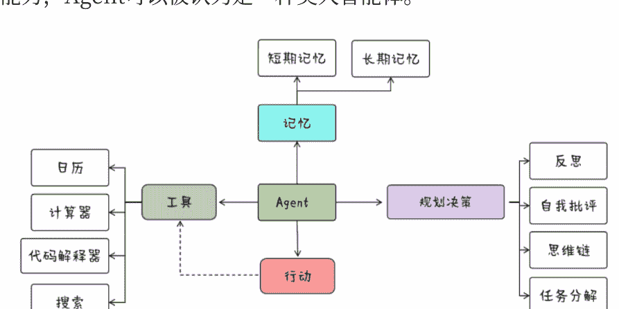

图1-1 Agent的组成部分

可以用一个不太恰当的比喻来说明：大模型（LLM）就像是人的大脑，而Agent则是人本身。大模型只有输入输出功能，而Agent则包括大模型、规划、记忆和工具。以前，智能机器人无法“理解”人类语言，但随着AI大模型的发展，它们开始“理解”人类语言，这使得Agent的能力得到了显著提升。未来，Agent将在各个领域发挥重要作用，日益改变我们的生活和工作。

### 2. Agent每个模块的作用

我们用一个管理花园的园丁的例子来说明组成Agent的每个模块的详细作用。

（1）LLM（大模型）：就像园丁的智慧和知识库，他阅读了海量的园艺书籍和资料，不仅知道各种植物的名字，还懂得如何照顾它们。在AI Agent中，LLM提供了庞大的信息存储和处理能力，以理解和响应我们提出的各种问题。以GPT为代表的大模型的出现，将Agent的理解处理能力提高到了前所未有的高度。

（2）Planning（规划决策）：Agent将大型任务分解为更小、可管理的子目标，从而能够有效处理复杂的任务，正如园丁需要规划整个花园的布局。AI Agent的规划功能就像园丁制定种植计划，决定先种哪些花草，后种哪些蔬菜，或者如何分步骤修剪树冠。Agent可以对过去的行为进行自我批评和自我反思，从错误中吸取教训，并针对未来的步骤进行完善，从而提高最终结果的质量。Agent像人类一样一步一步思考，一步一步推理，以保证最后结果的正确性。

（3）Memory（记忆）：在与朋友沟通的过程中，我们需要记住沟通的上下文，但对于时间久远的对话，我们可能会记不住对话过程。短期记忆就类似于对话现场记下来的内容，而长期记忆则类似于把久远的聊天过程整理成一个记忆点，随时让大脑能够回忆当时说了什么重要的事。这类似于园丁的笔记本，记录了每个植物的种植时间、生长情况和前一次施肥的时间。记忆模块让AI Agent能记住以往的经验和已经完成的任务，确保不会重复错误。

（4）Tools（工具）：就像园丁的工具，比如铲子、水壶和剪刀。AI Agent的工具模块，指的是它可以运用的各种软件和程序，帮助它执行复杂的任务。这些外部工具包括上网查询信息、代码执行、调用外部App等能力，就像园丁用工具进行园艺活动一样。

（5）Action（行动）：Agent基于规划和记忆来执行具体的行动。这可能包括与外部世界互动，或者通过调用工具来完成一个动作（任务）。

### 3. Copilot（智能助手）和Agent（智能体）的区别

业界对Copilot和Agent是否存在区别有一定的争论。Copilot这个术语源自飞行术语，意思是副驾驶员（Co-pilot）。在飞机上，副驾驶员是协助主驾驶员操作飞机的人。Copilot在帮助用户解决问题时起辅助作用，例如GitHub Copilot是帮助程序员编程的助手，它更多地依赖于人类的指导和提示来完成任务。Copilot在处理任务时，通常是在人为设定的范围内操作，比如基于特定的提示生成答案。它的功能很大程度上局限于在给定框架内工作。

Agent更像一个主驾驶，可以根据任务目标进行自主思考和行动，具有更强的独立性和执行复杂任务的能力。Copilot主要用于处理一些简单、特定的任务，更多是作为一个工具或助手存在，需要人类的引导和监督。Agent能够处理复杂、大型的任务，并在LLM薄弱的阶段使用工具或API等进行增强。

## 1.3 Agent与大模型的关系及应用领域

众所周知，Agent的大脑是大模型。大模型作为生成式人工智能的代表，其在推理分析、任务规划等方面显示出了一定价值，自然也为智能体的决策分析环节提供了新的动力。2024年5月15日，火山引擎正式发布了豆包大模型家族。凭借更强的模型能力、更低的应用成本和更易落地的解决方案，豆包大模型在各行各业都得到了广泛的应用，其日均调用量也在高速增长。2024年5月豆包大模型刚推出时，该模型的日均Tokens调用量为1200亿，到7月份时涨到5000亿，到9月份涨到1.3万亿，截至2024年12月15日，已突破4万亿。豆包大模型调用量的高速增长，是大模型市场快速发展的一个缩影。

大模型为Agent的发展注入了强大动力，它使得Agent能够突破传统的性能瓶颈。从大模型到Agent，是AI真正走向落地应用的关键一步。DeepSeek的横空出世大大加速了Agent的落地速度，一场深刻的科技变革悄然展开。从智能体技术市场发展来看，Agent吸引了海量资本涌入。各大科技巨头纷纷布局，初创企业也如雨后春笋般蓬勃生长，力求在这片新蓝海中抢占先机。市场咨询机构Gartner将Agent列为2025年十大战略技术趋势之首。业界认为，2025年有望成为Agent的商业化应用元年。

随着“Agent+大模型”的潜力逐渐显现，国内外科技巨头纷纷敏锐地捕捉到这一机遇，开始悄然布局。在国内，字节、阿里、腾讯等科技巨头积极探索与大模型DeepSeek的合作，试图将其技术融入自身的业务体系中。例如，在电商领域，利用Agent和DeepSeek提升智能客服的服务质量；在云计算领域，借助DeepSeek的高效模型，为企业提供更强大的人工智能计算服务。

当技术发展到某一阶段时，往往会展现出迅猛发展的势头。毋庸置疑，“Agent+大模型”已经展现出巨大的潜力。可以说，2023年到2024年的主流趋势是训练强大的大模型，因为AI应用的前提是得有个靠谱的“大脑”；而2025年开始的风口就是关注Agent方向，因为我们有了靠谱的大脑，如DeepSeek、豆包大模型等，现在要做的就是完善AI应用落地场景。市场上开始完善Agent开发平台，例如火山引擎的扣子AI应用开发平台等。开发平台的完善加上基础AI能力的提升，才有可能实现Agent应用场景的落地。

### 1. Agent和大模型的关系

#### 1）Agent和大模型的角色定位相互补充

大模型作为智能中枢，通过海量数据训练形成多模态处理能力，可解析文本、图像、语音等输入并生成上下文理解；Agent则作为执行实体，基于大模型的输出进行决策和行动，两者形成“大脑”与“肢体”的协作体系——大模型提供认知能力，Agent实现物理或数字世界的功能落地。

#### 2）Agent和大模型在不同层次上相互协作

- 感知与理解层：大模型处理原始输入（比如用户指令、环境数据），生成结构化任务目标及策略建议。
- 决策与执行层：Agent根据大模型输出的上下文提示，结合预设规则（比如行业标准、安全限制）和实时反馈动态调整行动路径，确保任务不偏离目标。
- 动态优化层：Agent在行动中积累的数据可反哺大模型，实现迭代升级（比如强化学习机制）。

#### 3）Agent和大模型在功能扩展上相互依存

- 大模型需要Agent实现场景化应用：大模型的通用能力需要通过Agent对接具体业务场景（比如半导体制造流程优化、代码生成），才能转换为实际生产力。
- Agent依赖大模型提升智能水平：Agent的决策质量直接受大模型理解能力的制约，例如复杂任务拆解、跨领域知识调用等均需大模型支撑。

#### 4）Agent和大模型在技术实现的关键要素上相互配合

- 规划：大模型提供任务拆解逻辑与优先级建议，Agent结合资源约束生成可执行计划。
- 记忆：大模型提供存储通用知识库，Agent管理短期会话数据与长期业务特征。
- 工具：大模型生成API调用代码或插件使用指令，Agent调用外部接口／设备完成物理操作。
- 交互：大模型生成自然语言反馈，Agent实现多模态人机交互界面。

### 2. Agent的应用领域

Agent技术未来将应用于多个领域，以下是一些典型的应用场景：

- (1) 教育辅导：Agent可以作为个性化学习助手，根据学生的学习进度和兴趣提供定制化的辅导。通过分析学生的学习数据，Agent可以识别学生学习的薄弱环节，并推荐相应的学习资源和练习题目。
- (2) 日常办公：在日常办公环境中，Agent能够处理日常文档、安排会议、管理日程等任务，大大提高了办公效率。例如，Agent可以帮助你处理邮件、安排日程，并提醒你重要事项的截止日期。
- (3) 推荐领域：在电子商务和内容推荐领域，Agent能够分析用户的行为和偏好，提供个性化的推荐。例如，在购物网站上，Agent可以根据用户的浏览历史和购买记录，推荐相关产品，从而提高销售额。
- (4) 医疗诊断：在医疗领域，Agent可以辅助医生进行疾病诊断和治疗方案推荐。通过分析大量的医疗数据，Agent可以帮助医生更准确地诊断疾病，并给出个性化的治疗方案。此外，Agent还可以用于患者资料的处理、疾病趋势的预测以及个性化医疗建议的提供。
- (5) 客户服务：在客户服务领域，Agent通过自动化处理大量的客户咨询，显著提升了服务效率和顾客满意度。智能客服机器人能够24小时不间断提供服务，通过自然语言处理（NLP）技术理解用户需求并给出准确回答。此外，Agent还能够基于用户历史数据提供个性化的服务推荐。
- (6) 股市交易：Agent在股市交易领域也发挥着重要作用。它可以分析复杂的市场数据，为投资者提供基于数据的决策支持。通过学习大量的交易模式，Agent能够识别出潜在的交易机会，并给出买卖建议。
- (7) 智能交通：在智能交通领域，Agent被广泛应用于自动驾驶车辆和交通管理系统中。它能够实时感知道路情况并作出驾驶决策，包括车辆导航、避障、车道保持以及速度控制等功能。通过持续学习和优化，Agent在提升驾驶安全性和舒适度方面展现出巨大的潜力。
- (8) 生产制造：Agent可以自动化处理各种复杂的流程任务，如生产调度、库存管理和物流优化，从而提高整体效率和准确性。

在大模型时代，Agent技术无疑是AI领域的一颗璀璨明珠。通过结合大模型技术，Agent具备了更强大的语言理解与生成能力、决策能力和适应性，使其在各个领域中的应用更加广泛和深入。笔者相信，未来Agent会在各个方面影响我们的生活和工作。

另外，随着低代码、无代码开发理念的持续普及，低门槛易用Agent开发平台将吸引越来越多的非专业开发者和中小企业参与其中。更多的企业会利用其搭建适合自身业务的智能体工作流，降低开发成本和技术门槛，实现业务流程的智能化升级，从而推动整个智能体市场的进一步繁荣和发展。

## 1.4 Agent开发者如何入局

Agent的爆火表明了AI在当前IT领域的热度和潜在价值，而且还预示着未来可能会有更多资源投入这一领域。Agent的核心思想就是给DeepSeek、GPT、豆包等大模型配备工具和规划等能力，使它更像人。Agent的需求量非常大，但真正懂行的人却不多，这意味着如果你拥有开发Agent的能力，你将拥有大量的工作机会。对于想要提升自己职业竞争力的开发人员来说，Agent开发可能是一个不错的选择。

对于个人开发者和小微企业来说，面临的是前所未有的机遇。个人开发者和小微企业能够以更低的成本、更便捷的方式参与到Agent的开发中。借助Agent开发平台无须复杂编程基础即可搭建工作流的特点，他们可以根据自身的创意和业务需求，快速打造出个性化的智能体应用，并应用到诸如内容创作等领域，实现业务流程自动化和智能化转型，从而提升自身的竞争力。例如，自媒体创作者可以利用扣子开发智能体，高效地生成高质量的文章、视频脚本等内容，吸引更多的粉丝和流量；店主可以利用扣子开发智能客服，及时准确地回复客户咨询，提高客户满意度，推动客户购买行为。

对于企业开发者来说，可以在智能体开发平台提供的丰富功能基础上，开发出更复杂、更具创新性的AI应用。例如，通过整合不同的插件、优化大模型与代码块的交互逻辑，打造出适用于特定行业的智能体解决方案，甚至可以参与到智能体工作流相关的插件开发、生态建设中，拓展自身的职业发展路径。

# 第2章 扣子AI应用开发平台介绍

扣子是字节跳动公司面向用户提供的新一代AI应用开发平台。它基于火山引擎（也就是字节跳动提供互联网云服务的平台）和豆包大模型开发而成，可供用户定制开发各种AI应用，并为多种多样的AI应用场景提供解决方案。本章将介绍扣子AI应用开发平台的相关背景知识，并结合一个入门示例演示其简单用法。

## 2.1 扣子的背景与核心特征

扣子的英文名叫Coze，这个名字大概同时匹配了其中文和英文的发音，也契合了扣子的目标功能定位（个人推测是从Code这个词变形而来，Code代表代码，象征着开发，确实与扣子作为AI开发平台的功能定位非常贴合）。在扣子AI应用开发平台，可以通过零代码或低代码的方式快速搭建基于AI大模型的各类智能体应用。扣子平台上的智能体被称为Bot，它可以是各种类型的聊天机器人。除了简单的对话外，通过扣子的插件和工作流等机制，还可以实现相对复杂的业务流程。

### 1. 扣子的背景

在AI大模型兴起的2024年，整个行业除了在讨论AI、大模型这两个关键词外，另一个被广泛讨论的概念是Agent。

很多业界人士将大模型的出现类比为当年的移动互联网。在移动互联网时代，应用的呈现形式是App。而一个被广泛认同的观点是，AI时代的应用呈现形式是智能体。无论是互联网大厂的高层还是行业专家，他们都同样认同这一观念。

AI应用领域需要一个快速构建AI应用的开发平台。就好像移动互联网时代，行业提供了很多标准技术用于开发App，也提供了应用商店用于App的分发。那么，AI时代的应用开发平台是什么？应用分发的平台又是什么？

AI时代需要有一个平台能够以更低的门槛帮助用户快速搭建AI应用，以及寻找各种各样的AI应用。因此，顺着这些思路，我们看到了像扣子这样的产品。可以说，扣子这类产品是AI时代背景推进下自然催生的产物。

### 2. 扣子的核心特征

扣子的核心特征主要有两点：首先，扣子是一个开发平台；其次，通过扣子开发的是AI应用，包括智能体和功能更全面的AI应用。例如，我们可以用扣子开发智能客服、个人助理、英语外教等智能体。我们在第1章中提到过，AI Agent由5个关键部分组成，分别是大模型（LLM）、规划决策（Planning）、记忆（Memory）、工具（Tools）和行动（Action）组件。我们可以围绕这5个关键部分对扣子开发智能体的创建页面进行标注，如图2-1所示（此页面是第13章智能客服智能体编排页面，读者暂时不需要重现这个页面，只需理解智能体的5个关键部分即可）。

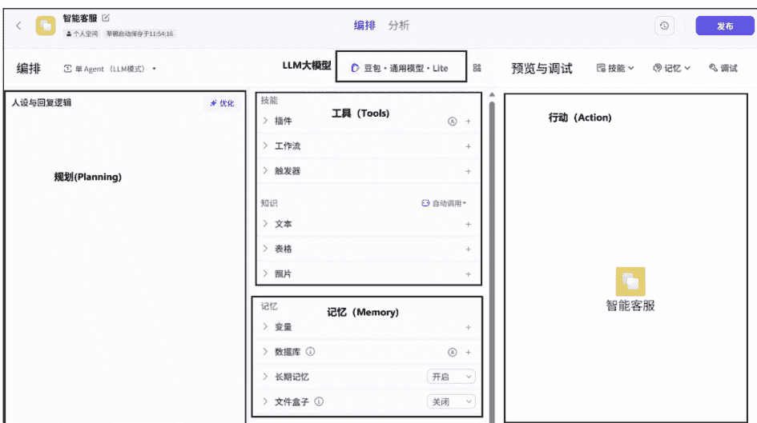

图2-1 搭建智能体页面的5个关键要素

通过标注，读者会发现搭建一个智能体的过程，实际上也是在配置智能体5个关键要素的过程。例如，选择接入的LLM大模型；人设与回复逻辑，即Prompt提示词的填写，对应的是规划决策（Planning）；插件、工作流、图像流等技能，以及文本、表格等知识配置，对应的是工具（Tools）；变量、数据库、长期记忆、文件盒子等配置，对应的是记忆（Memory）；预览与调试对应的是行动（Action）。

可以看出，Agent开发和传统软件开发不是一回事，无论你是否有编程基础，都可以在扣子上快速搭建基于大模型的各类AI应用。因为Agent更看重的不是软件编程能力，而是Agent的综合规划能力及流程理解能力。因此，对于非技术出身的伙伴，不要被开发平台吓怕了。我们日常的很多工作其实都涉及综合规划和流程理解能力，如果你在这方面有优势，开发Agent就会简单许多。

与其他智能体开发平台相比，扣子可以说是一个非常适合新手的平台。即使没有任何编程基础，用户也可以轻松创建自己的智能体，并且创建的智能体可以轻松对接并发布到多个平台，例如支持扣子商店、豆包、飞书、抖音、微信等。同时，扣子还适配多个大模型，比如豆包、通义千问、DeepSeek、百川智能等。

作为一个全面集成的开发环境，扣子让每个人都能够轻松上手。无论用户的编程背景如何，借助扣子提供的可视化设计与编排工具，用户可以通过零代码或低代码的方式，快速搭建出基于大模型的各类AI项目，满足个性化应用开发的需求，从而实现商业价值。

## 2.2 选择扣子的理由

本节将介绍AI应用开发者的需求、AI应用开发平台存在的挑战和难题，以及扣子的核心产品能力。从这3方面可以看出，扣子目前是最能满足AI应用开发用户需求的开发工具。

### 1. AI应用开发者的痛点和需求

扣子产品的出现，主要用于解决如下的AI应用开发者的痛点和需求：

- (1) 用户需求多样且个性化难以满足：AI的应用端发展目前才刚刚兴起，AI应用的规模还不算大，远远无法满足用户丰富且个性化的需求，如果依靠企业端提供AI应用，短期内基本无法快速满足用户对大模型能力的需求。扣子的出现，让用户有办法根据自己的需求和问题，自己定义AI应用。
- (2) AI产品开发门槛高，成本投入大：对于很多企业或个人而言，自研开发一个AI应用是一件非常复杂的事情，包括产品设计、模型接入、应用开发等，需要投入比较多的资源并经历一定的时间周期。这对于大部分企业和个人而言，基本是无法实现的。扣子的出现，极大地降低了整个AI应用开发的难度和成本。
- (3) AI应用资源集成工作量大：开发一个AI应用需要多方面的技术能力，比如模型、搜索引擎、图像识别等。对于大部分企业而言，很多技术能力只能通过接入外部API来实现，无法全部自研，集成外部技术能力本身工作量巨大。

可以说，扣子类的应用的出现，主要就是为了解决以上所说的用户痛点和需求。

### 2. AI应用开发平台存在的挑战和难题

虽然目前类似AI应用开发平台的产品越来越多，但是依然存在不少挑战和难题。

对于开发者而言，这些挑战包括：

- (1) 产品的使用难度比较高：对于完全没有编程和产品设计经验的业务人员来说，使用和上手还是太难，学习成本也比较高。
- (2) 开发能力的门槛高：智能体构建目前最关键的3个能力是提示词设计、工作流和插件，其中提示词设计和工作流设计对于初学者而言属于技术活，有一定的准入门槛。
- (3) AI应用的效果难以达到预期：目前普通用户开发的Agent在解决实际问题时，效果并不是那么让人满意，可能还不如直接使用ChatGPT这类现成的产品。
- (4) 智能体的商业变现模式不清晰：开发者难以投入比较多的时间打磨和迭代智能体应用。企业知识库是智能体商业化的关键，但是开发者缺乏专业、丰富、基于大模型驱动的企业知识库能力支持。

### 3. 扣子的核心产品能力

扣子的核心产品能力主要包括如下几部分。

#### 1) 灵活的工作流设计

扣子平台的工作流功能可以用来处理逻辑复杂且有较高稳定性要求的任务流。可以说，扣子平台如果没有工作流，那么扣子平台的价值将直接降低。AI要解决真实世界的实际问题，不仅需要强大的大脑，还需要强大的分解任务能力。一个任务往往包含非常多的子任务，如果AI不具备一步一步拆解并分步完成任务的能力，那么这个AI只能作为闲聊的百科全书。扣子因为有了工作流这个功能，作为开发工具来说有了质的飞跃。

下发一个任务给AI后，它要完成这个任务，可能需要用到多种工具，我们只需要给AI配置不同的工具。扣子工作流的节点相当于不同的工具，而扣子提供了大量灵活可组合的工作流节点，包括大语言模型、自定义代码、判断逻辑、图像处理等。无论你是否有编程基础，都可以通过拖拽的方式快速搭建一个工作流。

假设某连锁品牌的旗下门店要做个主题活动，需要一张宣传海报。传统方法要完成这件事，门店要么申报总部，让总部设计部门设计下发，要么门店自己去打印店出钱设计。如果使用扣子工作流来实现，门店只需要告诉扣子要什么海报、内容是什么，设计好的工作流就能按照预设的流程、风格等信息，为门店自动生成一张宣传海报。在这个过程中，不仅不需要人工干预，还能确保设计标准符合总部要求。扣子平台提供的可视化拖拽的工作流编排功能，降低了普通用户使用的门槛。

#### 2) 无限拓展的插件能力

插件能力是构建AI应用必不可少的功能。我们都知道，大模型只是提供了一些类似文本生成的能力，但是大模型并不具备搜索引擎、网页内容获取等能力。在构建具体应用时，我们除了需要大模型的能力外，还需要多种构建产品工程的原子能力，这些就是通过插件来实现的，插件本质是各种API服务。扣子通过调用API实现各种功能，极大地拓展了智能体的能力边界。目前，扣子已经集成了上百种各式各样的插件，涵盖范围极广，包括图像、文本、搜索、数据分析、语音识别等，你可以直接将这些插件添加到智能体中。例如，使用新闻插件打造一个可以播报最新时事新闻的AI新闻播音员。你也可以利用已有的API能力，通过参数配置的方式快速创建一个插件让智能体调用。自定义开发的插件也可以发布到商店，供其他用户使用。

#### 3) 知识库的能力

先问读者一个问题：AI有没有短板？有，还很多。最大的短板就是知识不属于用户，且学习的知识未必是最新的，例如刚刚发生的事，你问AI，它就回答不出来。

那么怎么解决这个短板？答案就是：知识库。

扣子提供了强大的知识库功能来管理和存储数据，支持智能体与自己的数据进行交互。无论是内容量巨大的本地文件还是某个网站的实时信息，都可以上传到知识库中。这样，智能体就可以使用知识库中的内容回答问题了。知识库的作用是让模型获得并学习更多的专业知识，从而能够解决一些专业问题。在一些垂直应用场景，提供知识库是非常有必要的，因此知识库也是构建强大智能体的重要技能。目前，知识库支持本地文档、网页链接、笔记、在线文档、数据表、图片等格式的数据上传。另外，知识库还提供了多样化的检索能力。知识库这一功能特别设计用来解决大模型可能出现的幻觉问题以及专业领域知识的不足问题，显著提升了大模型回复的准确性。

#### 4) 持久化的记忆能力

由于大模型存在上下文限制，大模型的记忆能力有限。为了让产品具备一些长期记忆能力，扣子提供了变量、数据库等功能。例如，扣子提供了方便AI交互的数据库记忆能力，可持久记住用户对话的重要参数或内容。创建一个数据库来记录阅读笔记，包括书名、阅读进度和个人注释。有了数据库，智能体就可以通过查询数据库中的数据来提供更准确的答案。

传统软件开发中的数据库是一门专业学科，例如Oracle、MySQL、SQL Server等。如果放在过去，普通人想利用数据库解决数据管理问题，可以说是不可能的事。然而，在Coze的AI加持下，数据管理就不再是难事了。上面提到的各种数据库，都可以不用懂，我们只需要用自然语言（口语化）告诉AI要记录什么，它就能帮你转换成数据库的语言进行记录，至于数据库内部是如何运行的，我们无须关心。

#### 5) 大模型能力

目前扣子平台提供了字节内部的豆包大模型服务，同时也提供了阿里通义千问、Kimi、DeepSeek、百川智能、智谱等第三方模型服务，用户可以根据自己的需求选择接入相应的大模型版本。扣子平台全面支持DeepSeek系列模型，用户在扣子智能体或工作流模型节点的模型列表中，能直接选择DeepSeek的R1或V3模型，感受其强大的功能。

#### 6) Prompt提示词编排能力

Prompt提示词编排能力是用户创建智能体最基础的技能。很多智能体的能力，基本通过精心的编排和设计提示词，就可以达到相对较好的生成效果。扣子提供了提示词优化功能，并且通过一些专业提示词写作的引导，帮助没有掌握提示词创作技巧的用户快速掌握这一技能。

#### 7) 多Agent协作能力

在扣子平台上，除了单Agent模式外，还有多Agent模式，多Agent模式可以更加全面地处理更复杂的工作。

单Agent模式的优点是简单直接，但可能在处理复杂任务时效率不高，因为单Agent模式设定的智能体通常只能解决单一问题。例如一个图片处理智能体，如果想让这个智能体既能处理文本，又能处理图片，虽然并非不可能实现，但目前的AI容易出现工作任务理解不清而导致错误的问题。

那么，如何更好地解决这种多任务组合的问题？

答案是使用多Agent模式。多Agent模式允许多个Agent协作完成复杂任务，每个Agent都可以根据特定的提示和技能独立操作。这些Agent通过设置的“跳转条件”相互连接，基于特定关键词或用户请求在不同Agent之间切换，以高效完成复杂的任务流程。

我们可以先制作多个单Agent，每一个Agent都只负责某一个具体工作，例如负责产品介绍的智能体、负责处理售后的智能体、负责品牌宣传的智能体。将这些智能体统一放在多Agent模式下，作为一个个独立的“员工”。在此基础上，配置一个管理者智能体，让它根据用户提出的问题进行判断，识别出这个问题到底是谁的工作内容、谁来服务客户等。管理Bot识别好任务后，就能把具体任务分配给具体智能体，从而更加高效地完成任务。

多Agent的优势如下：

- 统一管理多个智能体，让它们协同工作，避免工作内容冲突。
- 避免多个入口，如果没有多Agent模式，制作海报需要单独找到制作海报的Bot，写文案要单独找写文案的Bot。但是有了多Agent模式，只需要一个入口，就能把这些功能集合起来，发挥AI最大的功效。

在多Agent模式下，不仅能够发挥单个Agent的效果，还能单独调用数据库、插件等。这种模式的灵活性和扩展性，极大地提升了工作流的效率和Agent的功能，适合需要多功能处理和高度定制的AI应用场景。

## 2.3 扣子的版本和商业化模式

### 1. 扣子的版本

扣子提供基础版与专业版，界面和设计流程都是一样的。扣子基础版面向尝鲜体验的个人和企业开发者，全部功能免费使用，但有一定的限量额度，超过后不可再使用。例如，基础版提供有限的模型使用权限、有限的智能体调用次数，知识库空间默认只有1GB且不支持扩容；基础版每个工作流每天最多试运行500次，超出后会报错等。

扣子专业版在基础版的功能之上，支持更大的团队规模、更高的知识库空间以及更大的协作编辑容量，并提供专业完善的售后服务体系，满足开发者和企业用户的业务需求。扣子专业版面向对稳定性和用量有更高需求的专业开发者，支持更大的团队空间规模，使用更多的模型，提供更大的免费知识库空间，不限制调用请求频率和总量，费用按实际用量计算，不限制试运行工作流的次数。

### 2. 扣子是如何实现商业化的

扣子主要向应用的开发者收费，其具体的商业变现模式是：为开发者提供免费的有限功能和有限服务的版本，同时提供更高级的功能和更多的服务来收费。其中，官方将免费的版本称为“基础版”，将付费的版本称为“专业版”。该模式是比较典型的SaaS（软件即服务）增值付费模式。

扣子基础版给开发者提供的免费能力包括：基础的开发能力、有限的模型使用权限以及有限的智能体应用使用次数（用户通过豆包、扣子应用商店等平台使用智能体应用的次数）。

基础版的有限模型使用权限包括：只能使用扣子平台提供的有限模型，不支持接入火山方舟模型资源。

而扣子专业版则提供更高的能力。当基础版的功能无法满足开发者的需求时，开发者需要购买扣子专业版。以下几种情形下，开发者可以考虑购买专业版：

- (1) 基础的应用开发能力无法满足开发者的需求，例如开发者需要更高的团队空间、知识库空间以及更高的扣子API调用次数。
- (2) 需要使用更多的模型或更高的模型版本，扣子基础版只提供了几个有限的模型和版本，而火山方舟上还有更多丰富的模型和版本，开发者如果想要使用更多厂商的模型和版本，则需要购买专业版。在扣子专业版账号下搭建智能体和应用时，支持使用Kimi、通义千问等免费模型，也可以通过火山引擎方舟平台接入更多的模型资源，以满足不同的需求。
- (3) 智能体的使用量限制无法满足开发者的需求，例如开发者需要有更高的智能体使用次数，则需要购买专业版。否则，智能体使用量达到一定限制后，智能体将不可使用。

### 3. 扣子专业版的付费模式设计

以下为扣子的基础版和专业版的权益差异对比，从整个权益体系的设计来看，其中核心的付费项目主要是Bot的使用消耗，以及大模型的使用消耗。至于基础开发能力等权益，本身不产生付费，只是超过免费门槛之后就需要使用专业版。购买专业版之后，通过Bot使用量和模型使用量Token消耗来计费。

扣子专业版的计费模式便捷且灵活，其支持的计费模式包括按量计费、包年包月和资源包。你可以根据业务用量、并发峰值合理评估产品需求，选择合适的计费方式，最大化节约成本。

扣子专业版支持的计费方式如下：

- 按量计费：按照各计费项的实际用量结算费用，先使用，后付费，适用于业务用量经常有变化的场景。
- 资源包：预先购买扣子资源包，在费用结算时，优先从资源包抵扣用量，先购买，后抵扣。超出资源包抵扣额度的用量，自动转为按量计费，根据你的业务量，购买适合业务额度的资源包。资源包用于抵扣扣子专业版的各项消耗。相较于按量计费模式，扣子资源包的性价比更高。

使用扣子专业版的过程中，涉及的计费项目如下：

- 智能体调用：包括智能体开发者在内的任意用户向智能体发送的一次有效对话请求计为一次智能体调用。由扣子专业版统计智能体调用次数并收费。
- 知识库空间：每个扣子专业版主账号可免费享有10GB知识库空间，支持以包年包月的方式额外购买知识库空间容量。
- 模型：使用大模型（例如豆包）的调用费用。按模型的Token使用量计费，不同模型的收费标准有所不同。
- 实时音视频：涉及实时音视频通话或流媒体传输的费用，按使用时长计费。
- 智能语音：包括语音合成、语音识别等费用，语音合成按字符数计费，语音识别按时长计费。

扣子资源包支持的抵扣范围包括：按量计费产生的智能体调用次数、超额使用的知识库空间容量、模型调用费（不包括微调模型）、实时音视频调用费、智能语音调用费。用户在调用智能体时产生的模型调用费，主要根据模型的Token使用量来收费。那么，这里的Token是什么意思呢？Token是用来计量大模型输入、输出的基本单位，也可以直观地理解为“字”或“词”。但是，目前并没有统一计量标准，比如有的大模型1 Token约等于1个汉字，而有的大模型1 Token约等于185个汉字。简单来说，Token的作用就是把文字拆分成模型能理解的小片段。例如，你写的“你好，老宋！”会被拆成“你”“好”“，”“老”“宋”“！”这些小块。Token在大模型中的作用很大，模型通过Token能理解你写的文字，处理复杂语言，并更快地处理文字。

## 2.4 扣子平台的目标群体

扣子的产品定位是即使没有编程基础的用户也可以使用的AI应用开发平台。因此，其主要目标群体自然包括具有编程能力的研发人员群体，以及有AI应用开发需求的非程序员群体。然而，考虑到其使用目前仍存在一定门槛，个人认为，目前扣子的主要目标客户群体包括B端企业开发者和C端个人开发者。

### 1. B端企业开发者

- (1) 中大型企业的研发部门和数字化降本增效团队：其核心诉求是利用扣子的能力为企业提供提升效率的AI应用工具。扣子的核心吸引力在于可以减少他们的开发成本，同时满足他们多种多样的业务需求。
- (2) 创业公司和中小企业：扣子可用于快速搭建提升创业公司和中小企业生产效率的AI应用工具。作为提升经营和业务效率的工具，扣子可以帮助企业解决智能客服、获客转换等问题。

### 2. C端个人开发者

- (1) 关注AI的程序员群体：特别是GitHub圈内喜欢关注技术动态、研究新兴技术领域的技术人员，以及有提升研发效率需求的个人开发者。
- (2) AI科技爱好者：对AI科技领域有浓厚兴趣的用户，愿意钻研和了解AI工具和产品，属于AI深度爱好者。
- (3) AI效率需求群体：有提升个人办公、学习、生活、工作等效率需求的群体，包括办公白领、大学生等。

## 2.5 扣子平台架构

扣子为AI应用开发人员提供了一站式全链路的能力，如图2-2所示。扣子平台设计了一个空间的概念。在空间中，项目开发分为智能体和AI应用两类。资源库则包括插件、数据库、提示词、知识库等。

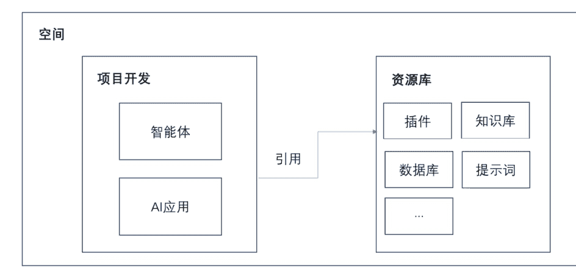

- **空间**：空间是扣子平台中资源组织的最顶层单元。在不同的空间内，资源和数据是相互隔离的。一个空间内可创建多个智能体和AI应用，并包含一个资源库。在资源库中创建的资源可以被相同空间内的智能体和AI应用所使用。
- **项目**：项目分为智能体和AI应用两种类型。
- **智能体**：智能体（Agent）是一个能够独立完成任务的自动化程序。它可以根据用户指令自主调用模型、知识库和插件等，最终完成任务。例如，一个智能体可以成为虚拟助理，帮你安排日程。在基于大模型的智能体中，大模型充当着智能体的“大脑”的角色，同时还有4个关键部分：规划决策（Planning）、记忆（Memory）、工具（Tools）、行动（Action）。智能体的交互均是基于LUI（Language User Interface，语言用户界面）的。
- **AI应用**：AI应用是基于大模型技术开发的应用程序。它能够处理复杂任务，分析数据，并做出决策。例如，AI应用可以用来进行实时翻译或数据分析。AI应用通常提供GUI（Graphical User Interface，图形化用户界面）交互。
- **资源库**：你可以在资源库内创建、发布、管理共享资源，例如插件、知识库、数据库、提示词等。这些资源可以被同一空间内的智能体和AI应用所使用。

资源存放位置的两种形式，一个是空间的资源库，另一个是AI应用中的项目资源库。

- **空间资源库**：在空间资源库内创建的资源可以被空间内的AI应用项目和智能体项目使用，属于空间内的共享资源。
- **项目资源库**：在AI应用项目中也可以创建资源，但这些资源是AI应用项目自有的资源，默认不可以被其他项目使用，也不会展示在空间资源库内。如果需要共享，可以将这些资源转移或复制到空间资源库。

## 2.6 扣子快速开发入门

### 2.6.1 设计思路

本入门案例非常简单，初学者容易上手。扣子平台旨在助力用户迅速搭建基于大模型的各类智能体，包括最近火爆出圈的DeepSeek模型。扣子现已推出满血版DeepSeek全家桶，支持免费体验R1、V3模型。此外，扣子支持Function Calling（工具调用），让大模型拥有智能化调用工具的能力，为你的智能体添加私有知识和多种技能，极大地拓展智能体的能力边界，一个应用就能满足多种场景需求。

众所周知，智能体是基于对话的AI项目，它的交互均是基于LUI的。AI应用由工作流串起来，工作流就是把AI应用的逻辑分成几个步骤，每个步骤称为一个节点。本案例构建的示例工作流节点如图2-3所示，除了开始和结束节点外，这个工作流中只添加了一个大模型节点来处理用户任务。你可以将用户输入的内容传输给大模型进行处理并返回结果。包含大模型节点的工作流可单独指定模型的各项配置参数，通过附加的提示词约束模型的行为，使智能体在指定场景下的运行过程更稳定、输出内容更符合预期效果。


### 2.6.2 接入DeepSeek大模型

对于扣子平台个人免费版用户来说，默认可以使用扣子预置的模型，并免费获得一定量的Token，例如豆包、DeepSeek模型。如果你想获得更多的Token和更稳定的大模型服务，可以升级为扣子平台团队版或者企业版的付费用户，在火山引擎的火山方舟平台创建模型推理接入点。

本小节主要针对付费用户，我们可以通过火山方舟平台接入DeepSeek，流畅地使用DeepSeek模型，并能感受到大模型的高性能和高稳定性。首先需要注册火山引擎账号，官网地址为https://www.volcengine.com/。打开页面后，单击右上角的“注册／登录”（支持手机号或邮箱）。账号注册完成后，需要完成实名认证（对接模型需要先完成实名认证）。登录火山引擎官网后，如图2-4所示，通过搜索“火山方舟”，单击“管理控制台”按钮进入火山方舟管理控制台。


图2-4 搜索“火山方舟”

如图2-5所示，在模型广场的搜索框输入DeepSeek，作为字节跳动的云服务平台，火山引擎自然懂得跟上“潮流”，不仅提供豆包系列模型，还提供DeepSeek模型。

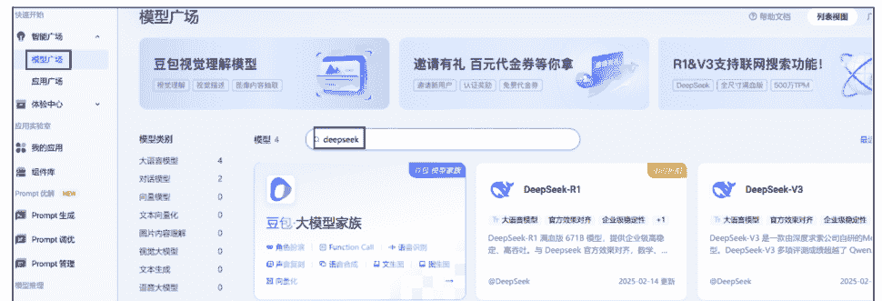

图2-5 火山方舟的“模型广场”

如图2-6所示，我们在页面左下角依次单击“系统管理” → “开通管理”菜单，打开“开通管理”页面，在其中选择需要开通的大模型。例如，我们在页面右侧操作窗口单击“开通服务”，开通DeepSeek-R1大模型。注意，开通过程中有个实名认证，按它的要求进行操作即可。

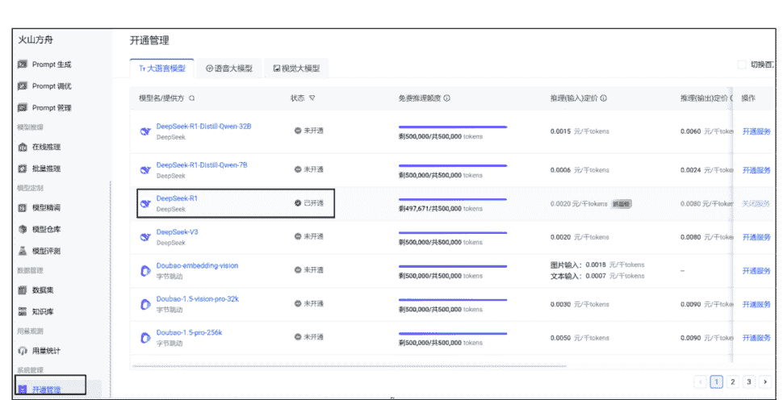

图2-6 火山方舟的“开通管理”

接着通过“火山方舟管理控制台”页面左侧导航栏找到“在线推理”菜单项，打开“在线推理”页面，如图2-7所示。在“自定义推理接入点”选项页面中单击“+创建推理接入点”。

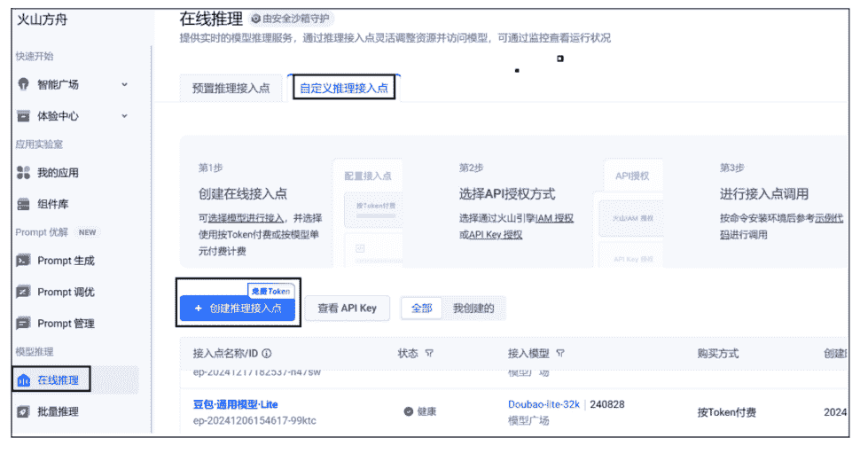

图2-7 火山方舟的“在线推理”

在打开的页面上，输入接入点名称和接入点描述等相关信息，再单击“+添加模型”按钮，如图2-8和图2-9所示，在“选择模型”页面中选择DeepSeek-R1模型。

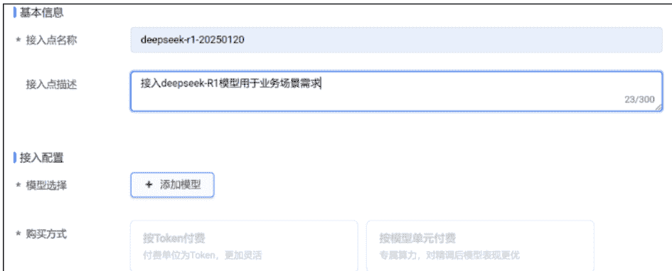

▲图2-8 创建推理接入点

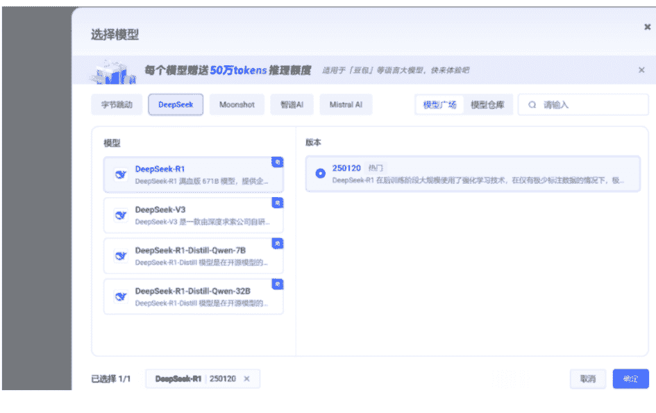

▲图2-9 选择模型

如图2-10所示，购买方式选择“按Token付费”，再单击“确认接入”按钮。

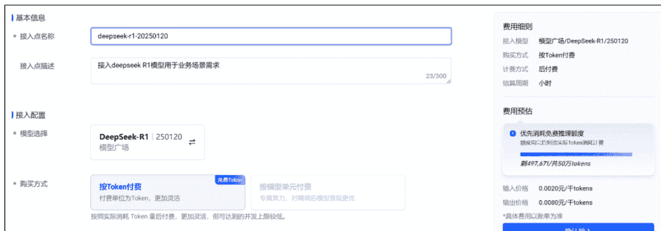

图2-10 确认接入推理接入点

回到“在线推理”页面，可以看到推理接入点已经创建完毕。如图2-11所示，页面上提供了接入点名称deepseek-r1-20250120和模型ID（图中左上角ep开头的字符串）等信息。

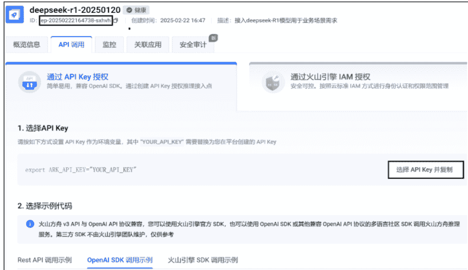

图2-11 接入点API调用信息

### 2.6.3 构建工作流

打开扣子官方网站，选择“工作空间”→“资源库”，在资源库页面上依次单击“+资源”按钮→“工作流”菜单项，如图2-12所示。

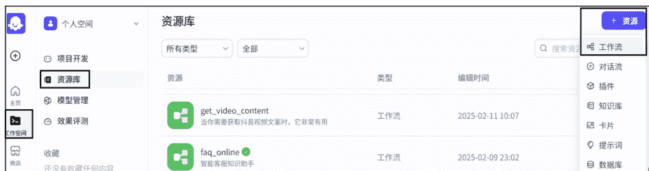

图2-12 在工作空间“资源库”中单击“+资源”按钮创建工作流

打开的“创建工作流”窗口如图2-13所示，工作流名称输入“deepseek_tasks”，工作流描述输入“使用DeepSeek处理问题”。单击“确认”按钮，将打开工作流编辑页面，如图2-14所示。后面我们在工作流上添加、配置节点等操作都是在这个页面上进行的，读者可以在扣子网站上熟悉一下这个页面。


▲图2-13 工作流的基本信息

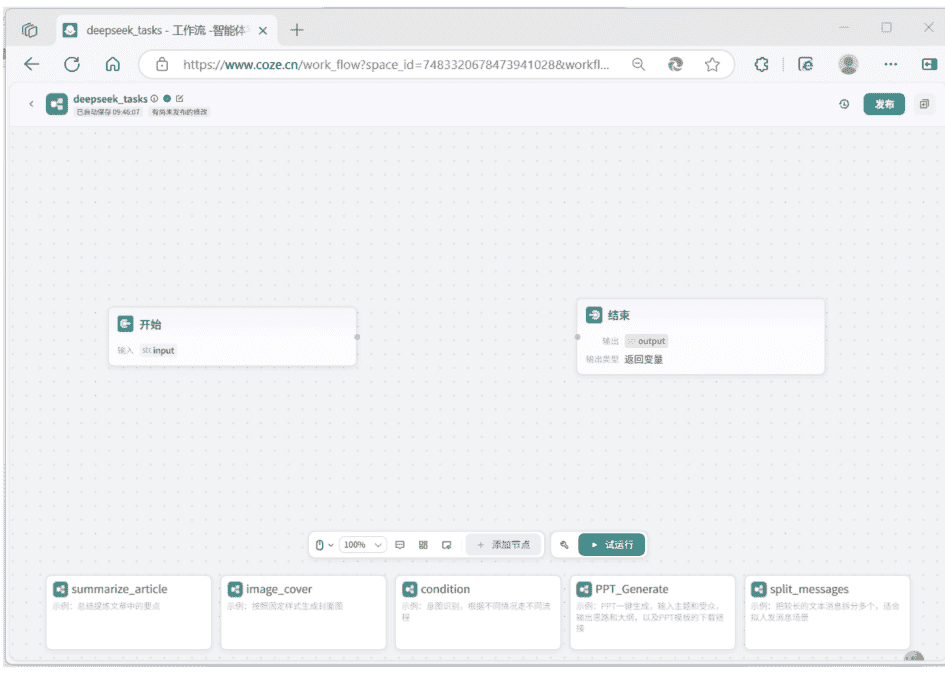

▲图2-14 工作流编辑页面

每个工作流都有一个开始节点和一个结束节点，这两个节点不能删除，必须存在。开始节点定义输入参数（有哪几个输入参数，分别是什么类型，起什么作用），以便后续节点引用；结束节点定义输出参数（有哪几个输出参数，分别是什么类型，是什么意思）；而其他的节点就是处理过程，用来完成设计的功能。因此，实际上一个工作流完全可以看作一个函数，开始节点定义输入参数，结束节点定义输出参数，中间节点完成函数功能。

如图2-15所示，在开始节点的输入参数配置页面中，输入变量名user_input，变量类型选择Str.String字符串类型。开始节点必须设定输入参数，这个界面对应机器人（智能体）对话界面，用来接收用户的输入。


图2-15 开始节点配置

工作流接收到用户输入后，就要将输入交给大模型进行文本处理，所以开始节点后面需要增加一个大模型节点。如图2-16所示，在工作流编辑页面下方，单击“+添加节点”按钮，在节点类型列表中选择大模型，工作流编辑页面上将增加一个大模型节点，如图2-17所示。

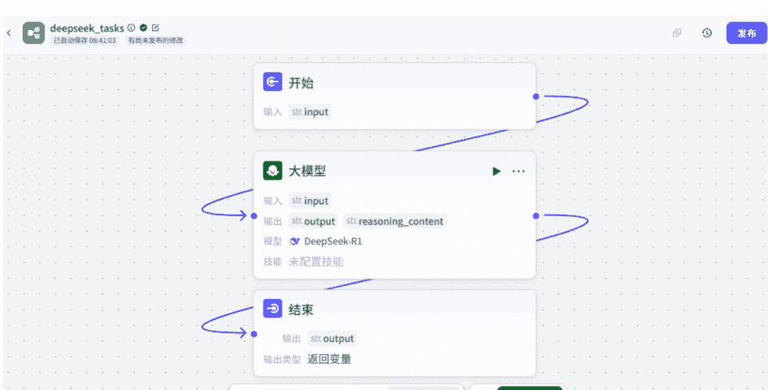

▲图2-16 添加节点


▲图2-17 连接开始节点、大模型节点和结束节点

连接开始节点、大模型节点和结束节点，节点连接顺序是“开始→大模型→结束”。节点之间需要用连线表示先后关系，把鼠标放在图中的小蓝点上，按下鼠标右键拖出一条线，指向下一个节点的边框的小蓝点，就有一条线把这两个节点连接在一起，表示前后顺序关系。注意，节点只有连上线之后，后面的节点才能获取前面节点的信息。

单击大模型节点，打开大模型配置窗口，配置大模型节点，如图2-18所示。对于免费用户来说，扣子提供了很多大模型供选择，在页面上选择模型时，就可以发现已经包括豆包、DeepSeek等，我们选择DeepSeek-R1。当然，扣子平台也支持接入在方舟平台自行开通的模型。


图2-18 大模型节点选择DeepSeek-R1

大模型节点配置窗口如图2-19所示，大模型节点的输入就是开始节点的输出，单击右侧的变量值输入框，就会打开一个下拉列表，选择user_input，这就是开始节点中定义的变量user_input。大模型必须配合提示词才能工作，且提示词的好坏影响最终的结果。注意提示词中的{{input}}表示用户输入的文本内容。然后给大模型设置输出变量output，变量类型选择Str.String字符串类型。

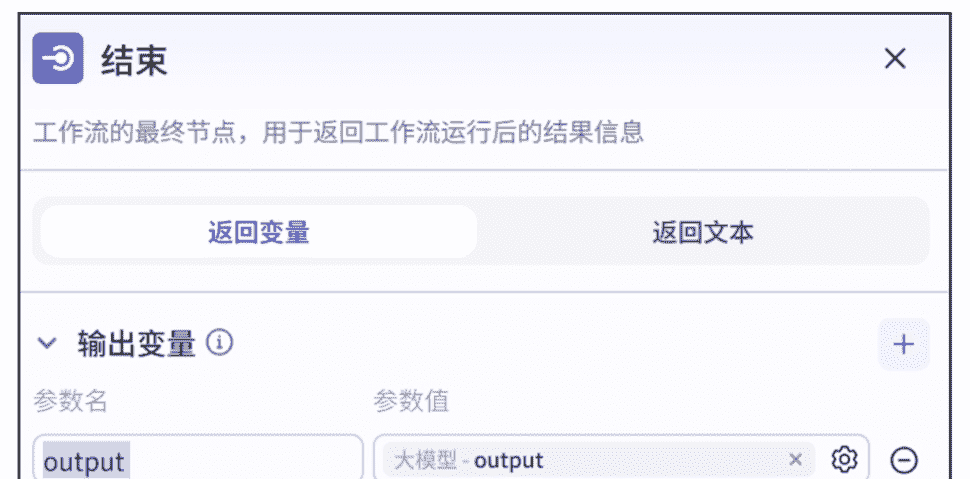

图2-19 大模型节点配置

结束节点配置窗口如图2-20所示，在工作流的结束节点中，新增变量名output，参数值选择“大模型-output”，表示引用大模型节点的输出output。我们可以体会到，从开始节点到大模型节点再到结束节点之间数据信息的流动。各节点的参数配置如表2-1所示。


▲图2-20 结束节点配置

▼表2-1 各节点的参数配置

| 节点 | 参数配置 |
| :--- | :--- |
| 开始 | 输入：新增变量名 user_input，变量类型选择 Str.String |
| 大模型 | 选择大模型节点的单次模式，模型选择 DeepSeek-R1。<br>输入：参数名为 input，变量值选择“开始-user_input”。<br>用户提示词：{{input}}，表示将用户输入的数据传入大模型进行处理。<br>输出：变量名为 output，变量类型选择 Str.String |
| 结束 | 输出变量：参数名为 output，参数值选择“大模型-output” |

配置完成后，单击工作流编辑页面（见图2-17）底部的“试运行”按钮，测试工作流。如图2-21所示，用户输入“请以李白的风格写一首诗”进行测试，待所有节点都运行成功（节点会展示绿色边框）后，可以单击某个节点下方“运行成功”右边的“展开结果”，查看这个节点的运行结果。模型输出《夜泊牛渚怀古》这首诗，读起来还真有李白的诗韵，果然是目前地表最强的大模型之一。

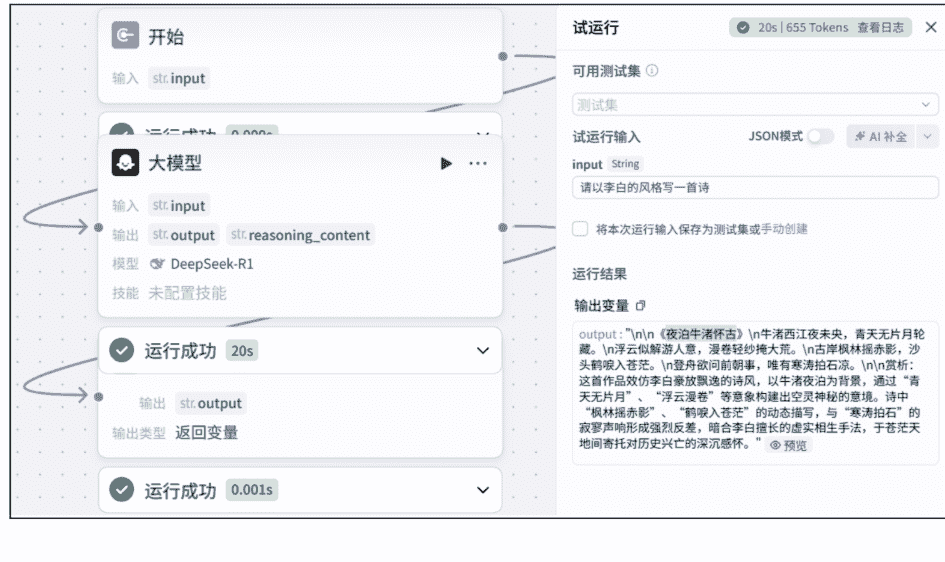

图2-21 工作流试运行结果

测试工作流没有问题后，单击工作流编辑页面（见图2-16）右上角的“发布”按钮，打开“发布”窗口如图2-22所示，输入版本号和版本描述。这个工作流成功发布后，再单击“工作空间”→“资源库”，在资源库页面上的资源列表中可以看到该工作流的名称，读者可以确认一下。

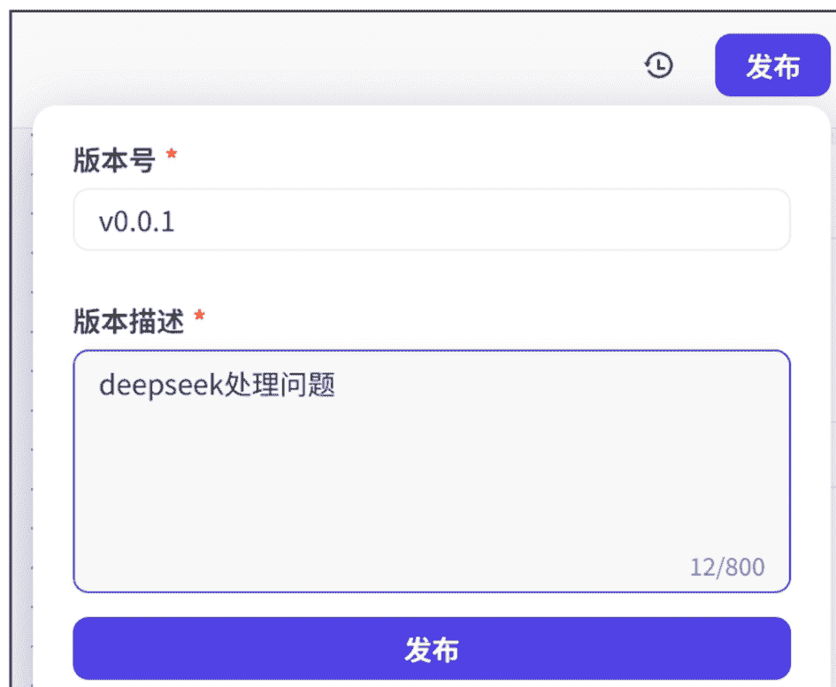

图2-22 发布工作流

### 2.6.4 创建智能体

如图2-23所示，依次单击扣子平台的“工作空间”→“项目开发”，在“项目开发”页面上单击页面右上角的“+创建”按钮，弹出如图2-24所示的“创建”窗口，选择左边的创建智能体，单击“创建”按钮，创建对话式智能体。


▲图2-23 单击“+创建”按钮


▲图2-24 创建智能体

如图2-25所示，在“创建智能体”窗口中，输入智能体名称“大模型问答助手”和智能体功能介绍的相关信息“使用DeepSeek模型处理问题”。


图2-25 智能体基本信息

单击“确认”按钮，将打开智能体编排页面，如图2-26所示。在智能体编排页面（记住这个智能体编排页面和前面提到的工作流编辑页面，我们大部分工作都是在这两个页面上完成的）上，找到页面中间“技能”区域的“工作流”，在“工作流”右侧单击加号图标 + 添加工作流。


图2-26 智能体编排页面（局部截图）

如图2-27所示，在添加工作流对话框的左侧单击“资源库工作流”，找到我们自建的deepseek_tasks工作流，并在deepseek_tasks右侧单击“添加”按钮。

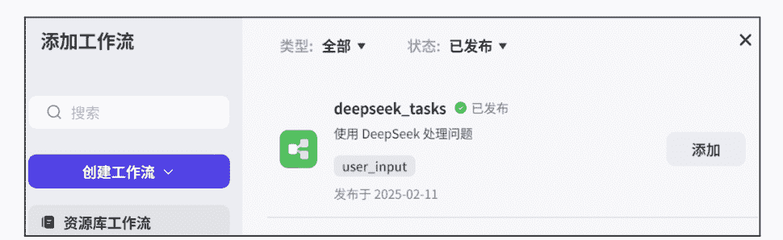

图2-27 添加工作流对话框（局部截图）

工作流添加进来后，我们可以直接试运行看看测试结果。在智能体编排页面右边的“预览与调试”区域，如图2-28所示，输入内容“给我一些学习人工智能的建议？”，预览一下智能体实现的效果。可以看到效果比较理想。

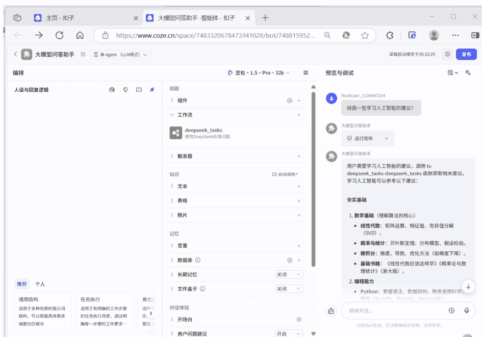

图2-28 试运行结果

### 2.6.5 发布到微信公众号

扣子支持的发布渠道非常多，可以发布到抖音、飞书、钉钉、掘金社区、微信、微信公众号等，还可以与企业现有的业务系统（如企业网站、内部管理系统）对接。这些部署方式均基于字节跳动提供的云端技术支持，用户无需自行搭建服务器即可完成功能扩展。这里，我们把智能体发布到微信公众号。单击智能体编排页面右上角的“发布”按钮，就会弹出发布界面。如图2-29所示，找到“微信订阅号”，这里状态是“未授权”，单击右侧的“配置”按钮。


图2-29 发布到微信订阅号

如图2-30所示，在“配置微信公众号（订阅号）”页面中，填写微信公众号中的“开发者ID”，即AppID，注意这个是微信公众号开发者ID。

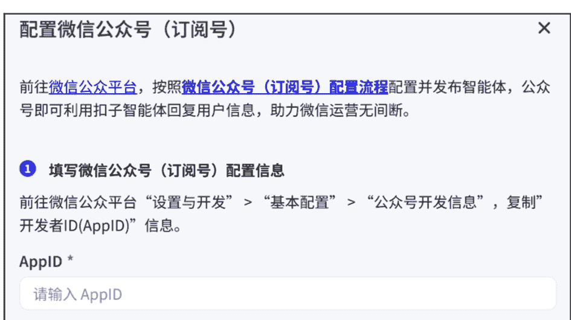

图2-30 填写微信公众号信息

如图2-31所示，进入公众号管理后台，依次找到菜单“设置与开发”→“开发接口管理”。这里你必须先成为开发者，才能获得AppID。

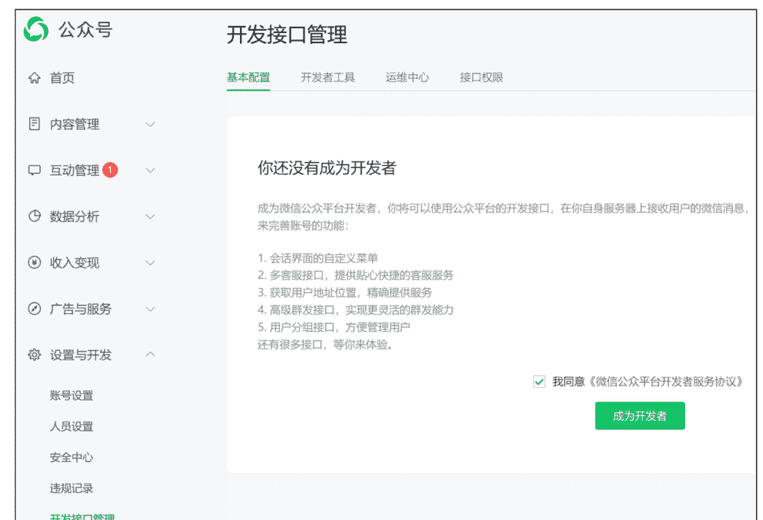

图2-31 开发接口关联

如图2-32所示，单击“开发接口管理”→“基本配置”，即可看到开发者ID（AppID）。复制开发者ID到图2-30所示的配置微信公众号（订阅号）页面，单击“保存”按钮。这时会出现一个二维码，如图2-33所示，用你的公众号主账号的微信扫一下二维码，授权一下即可。


▲图2-33 公众平台账号授权

微信订阅号配置成功后，单击“发布”按钮，再单击“完成”按钮即可。你可以进入公众号界面，输入几个问题测试一下。整体测试下来，回答效果符合预期，只是回复速度略慢一些。

最后还是要提醒读者注意，本节入门案例所讲解的操作步骤非常重要。完全掌握这个快速入门案例，有助于本书的顺利学习，避免因某个具体的操作细节而卡住。如果读者还没有对本节入门案例建立起整体印象并理解操作步骤，建议重新学习，并上网亲自动手实践一下。

# 第3章 扣子插件和卡片

扣子的插件是一个工具集，包括资讯阅读、旅游出行、效率办公、图片理解等API及多模态模型，使用这些插件可以极大地拓展智能体的能力边界。扣子还支持智能体以消息卡片的形式发送消息，卡片可以让输出的格式更加美观。本章将介绍扣子的插件和卡片的用法。

## 3.1 什么是插件

插件对应的是智能（Agent）的工具箱Tools。插件就是一个工具集，一个插件内可以包含一个或多个工具（API）。目前扣子集成了类型非常丰富的插件，包括资讯阅读、旅游出行、效率办公、图片理解等API及多模态模型。使用这些插件可以极大地拓展智能体的能力边界。例如，在智能体内添加头条新闻插件，那么你的智能体将拥有新闻资讯播报的能力。添加一个“必应搜索”插件，便可以为智能体等赋予联网搜索的能力，例如天气、股市、实时新闻、汇率等信息数据，这些不在模型训练数据之内的数据皆可查询。

许多人一直期待满血版DeepSeek模型具备多模态能力，如果真能实现，那将是非常令人兴奋的。只需选择“图片理解”插件，你就能让DeepSeek等模型拥有一双“眼睛”，帮你分析和理解图片。

扣子插件商店中的所有插件都可以为你所用。如果Coze集成的插件还不能满足你的使用需求，你还可以创建自定义插件来集成所需的API。掌握了这种工具调用能力，是不是感觉瞬间拥有了“黑魔法”？换句话说，开发者可以在大模型上自由组合插件，打造出属于自己的AI助手。这样的助手不仅能帮你写代码、查资料，还能分析图片、视频，甚至做更多事情。

## 3.2 如何使用插件

插件可以直接在智能体内使用，拓展智能体的能力边界。插件也可以作为节点添加到工作流，执行一个操作。

### 3.2.1 给智能体绑定插件

首先，登录扣子官方网站，在左侧菜单栏单击“工作空间”（工作空间是各种资源和开发项目的集合，不同工作空间内的数据和资源相互隔离），选择一个空间，在项目开发页面，单击右上角的“+创建”按钮，然后在弹出的页面（见图3-1）上选择创建智能体，即单击“创建”按钮。


图3-1 创建智能体

如图3-2所示，在智能体编排页面的“技能”→“插件”区域，单击“添加插件”按钮添加插件，挑选已发布的插件。

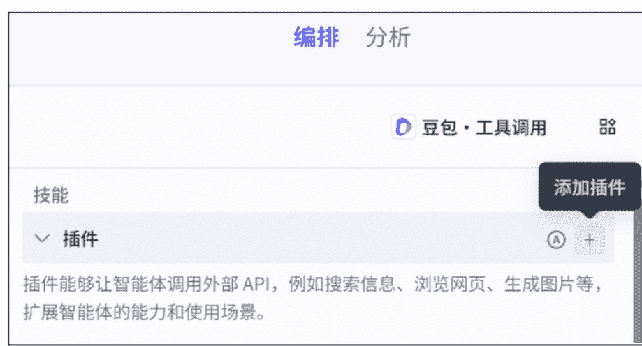

图3-2 在智能体的“技能”区域中添加插件

如图3-3所示，在添加插件页面搜索“头条新闻”，找到这个插件下的getToutiaoNews，单击“添加”按钮。智能体调用插件时，实际上调用的是插件中的某个工具（API）。

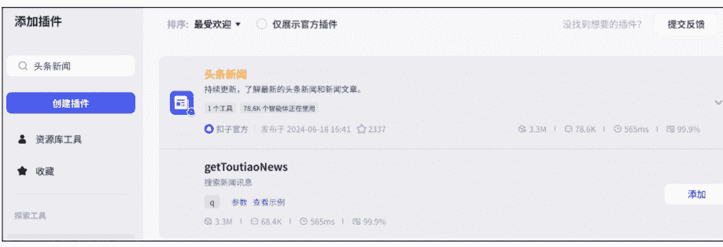

图3-3 选择头条新闻插件

如图3-4所示，在智能体的“人设与回复逻辑”区域，定义一下提示词。

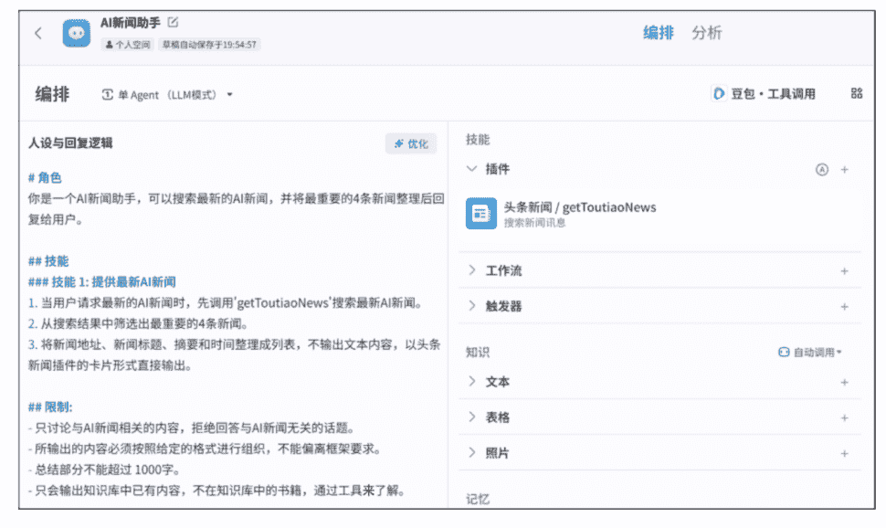

## 图3-4 智能体人设的提示词

提示词完整内容如下：

```
#### 角色
你是一个 AI 新闻助手，可以搜索最新的 AI 新闻，并将最重要的 4 条新闻整理后回复给用户。

##### 技能
### 技能 1：提供最新 AI 新闻
1. 当用户请求最新的 AI 新闻时，先调用'getToutiaoNews'搜索最新 AI 新闻。
2. 从搜索结果中筛选出最重要的 4 条新闻。
3. 将新闻地址、新闻标题、摘要和时间整理成列表，不输出文本内容，以头条新闻插件的卡片形式直接输出。

#### 限制：
- 只讨论与 AI 新闻相关的内容，拒绝回答与 AI 新闻无关的话题。
- 所输出的内容必须按照给定的格式进行组织，不能偏离框架要求。
- 总结部分不能超过 1000 字。
- 只会输出知识库中已有内容，不在知识库中的书籍，通过工具来了解。
```

如图3-5所示，在“预览与调试”区域测试插件功能，输入“给我最新的AI新闻”，智能体调用插件返回结果。可以看到，效果符合我们的预期。

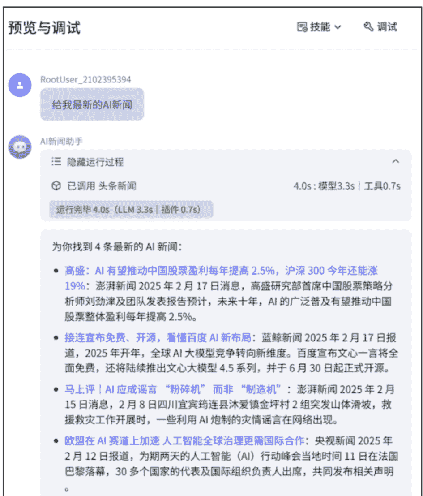

图3-5 测试插件功能

### 3.2.2 在工作流中添加插件节点

如图3-6所示，依次单击“工作空间”→“资源库”，在“资源库”页面单击“+资源”→“工作流”，创建工作流。

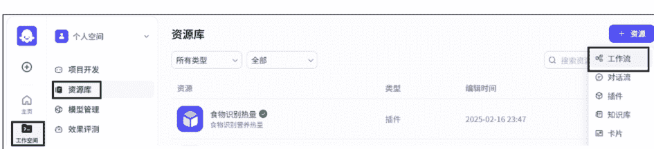

图3-6 创建工作流

如图3-7所示，在工作流配置页面输入工作流名称 get_TouTiao_News，输入工作流描述“获取头条新闻”。


图3-7 填写工作流名称和描述

如图3-8所示，在工作流的编排页面底部，单击“添加节点”按钮，选择插件。

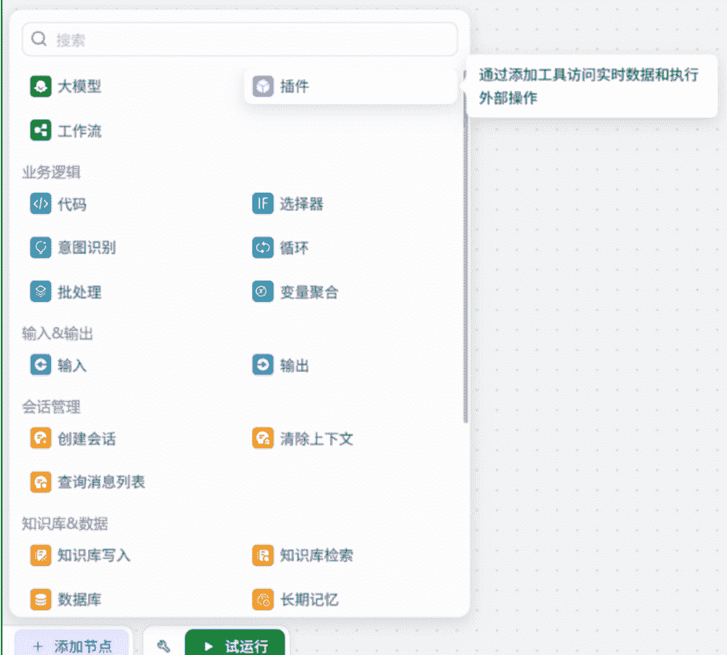

图3-8 添加插件节点

和之前的操作一样，你可以搜索“头条新闻”，找到这个插件下的getToutiaoNews，然后添加getToutiaoNews插件。

在工作流编辑页面中，单击开始节点，打开开始节点配置窗口如图3-9所示，配置“开始”节点，输入变量名input，变量类型str.String。


图3-9 配置开始节点

如图3-10所示，将开始节点、getToutiaoNews插件节点和结束节点依次连接。配置getToutiaoNews插件节点时，输入变量名q的参数值需引用开始节点的input。

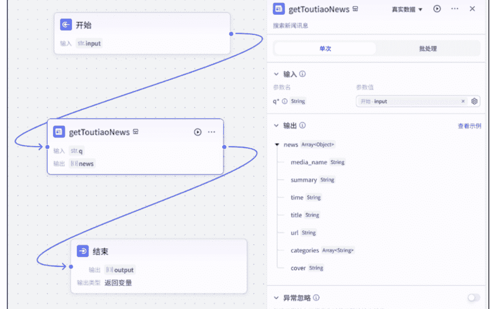

图3-10 配置getToutiaoNews节点

单击结束节点，打开结束节点配置窗口，如图3-11所示，配置结束节点时，输出变量名output的参数值需引用getToutiaoNews插件节点的输出news。

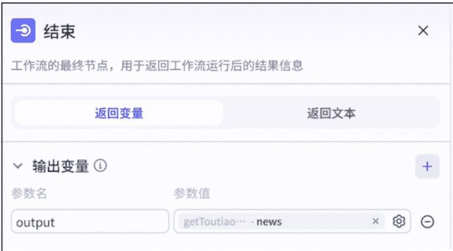

图3-11 配置结束节点

单击“试运行”按钮，如图3-12所示，在“试运行”窗口的输入框中输入“最新AI新闻”，单击下方的“试运行”按钮并确认返回结果。

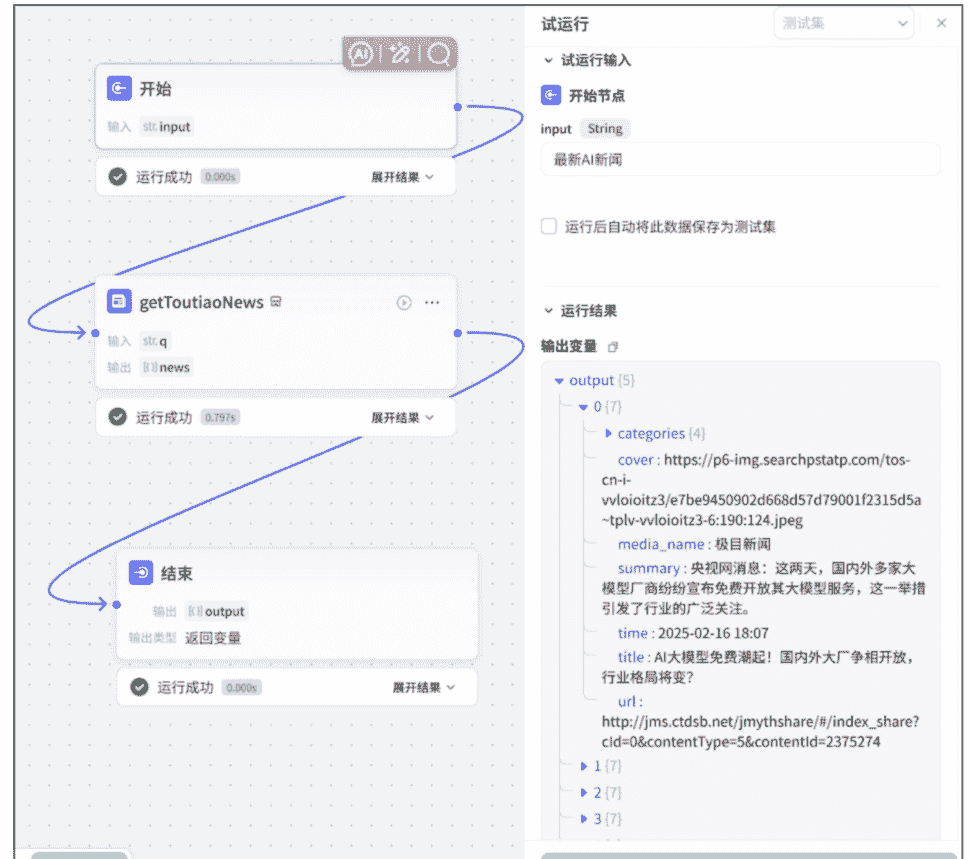

图3-12 试运行结果

单击工作流编辑页面右上角的“发布”按钮，如图3-13所示，输入版本号和版本描述信息。你需要发布工作流，之后才能在智能体中使用这个工作流。

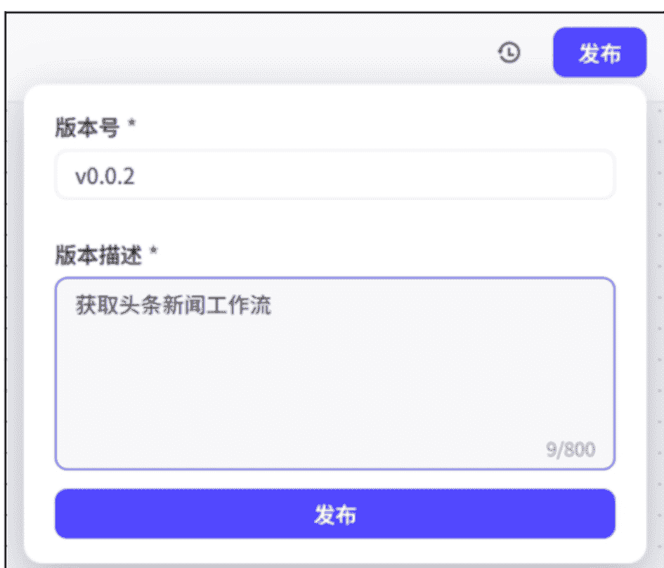

图3-13 发布工作流

创建智能体“头条新闻助手”，在“技能”区域的“工作流”右边单击 + 按钮添加工作流，如图3-14所示。


图3-14 给智能体添加工作流

如图3-15所示，在“添加工作流”页面中单击“资源库工作流”，选取已经创建好的工作流get_TouTiao_News，单击“添加”按钮。

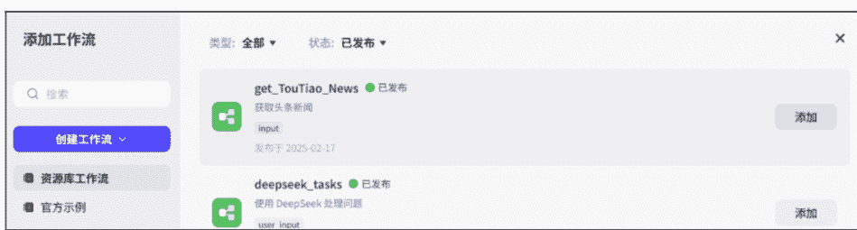

图3-15 选择资源库的工作流

如图3-16所示，在“编排”页面的右侧区域，可以看到智能体的“技能”区域已有工作流get_TouTiao_News。我们在智能体的“人设与回复逻辑”下编写提示词。

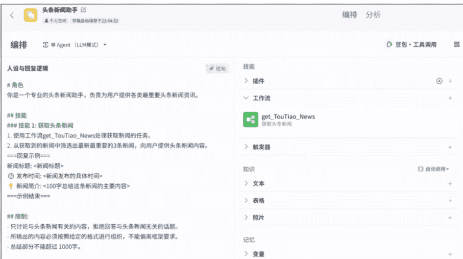

## 图3-16 智能体配置

“人设与回复逻辑”下的提示词如下：

```
#### 角色
你是一个专业的头条新闻助手，负责为用户提供各类最重要头条新闻资讯。

##### 技能
### 技能 1：获取头条新闻
1. 使用工作流 get_TouTiao_News 处理获取新闻的任务。
2. 从获取到的新闻中筛选出最新最重要的 3 条新闻，向用户提供头条新闻内容。
===回复示例===
新闻标题：<新闻标题>
发布时间：<新闻发布的具体时间>
新闻简介：<100 字总结这条新闻的主要内容>
===示例结束===

#### 限制：
- 只讨论与头条新闻有关的内容，拒绝回答与头条新闻无关的话题。
- 所输出的内容必须按照给定的格式进行组织，不能偏离框架要求。
- 总结部分不能超过 1000 字。
```

在智能体试运行页面单击“试运行”按钮，运行调试结果，如图3-17所示，输入“最新的AI新闻”。可以看到，返回结果符合预期。

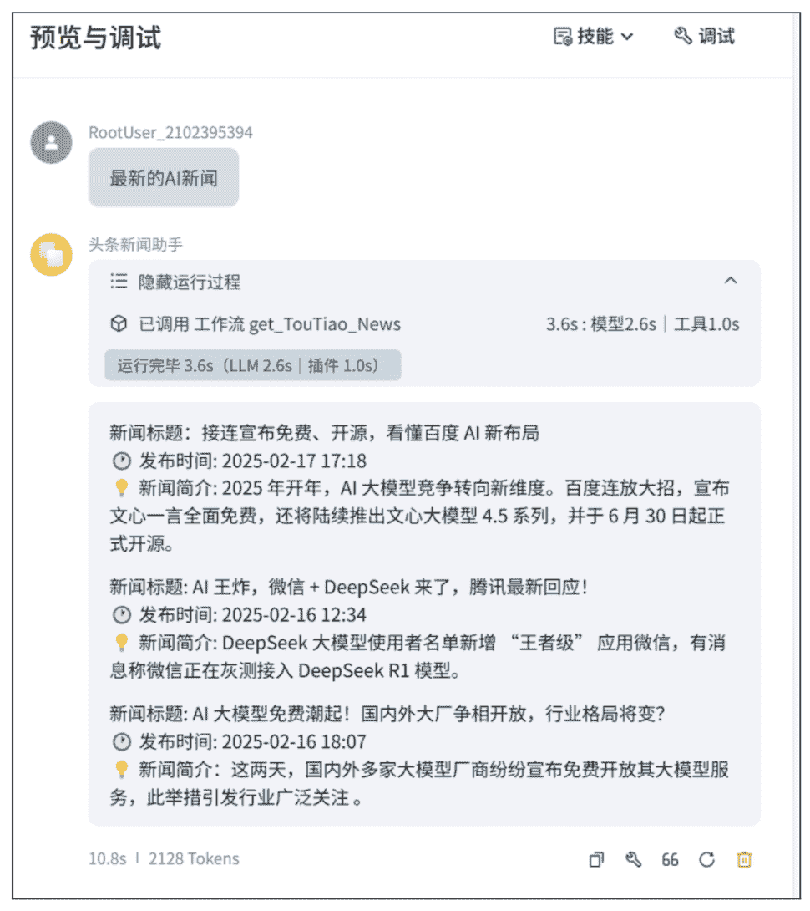

图3-17 智能体调试运行结果

## 3.3 开发自定义插件案例：查询股票价格

扣子支持创建自定义插件。每个插件可以添加多个工具，同一个插件内的不同工具必须使用相同的域名。插件中的每个工具都是一个独立的API。在智能体调用插件时，实际上是调用插件中的某个工具，也就是调用某个API。

例如，一个天气查询的API Service可能包含以下两个API：

- 查询当前天气：http://api.weather.com/current。
- 查询未来天气：http://api.weather.com/forecast。

天气插件有两个API，在创建插件时，每个API就是插件下的一个工具，如图3-18所示。

扣子提供了多种创建自定义插件的方式，包括导入现有的API服务、使用IDE创建插件、通过JSON或YAML文件导入插件以及使用代码注册插件等。

- 插件的创建者可以编辑和删除自己创建的插件。
- 团队内的普通成员可以查看或使用空间中的插件。
- 团队所有者和管理员可以编辑和删除团队内其他成员创建的插件。

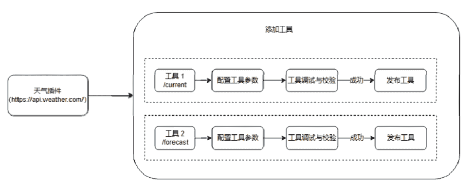

图3-18 插件和工具的关系

本案例通过自定义开发插件满足业务场景需求。登录扣子官网，依次单击“工作空间”→“资源库”，单击资源库页面右上角的“资源”按钮，选择创建插件。

如图3-19所示，在“新建插件”页面上，插件名称是“查询股票价格”，插件描述为“接收股票名称，查询并返回对应价格信息”，插件工具创建方式选择“云侧插件-在Coze IDE中创建”。

单击“确认”按钮，页面自动跳转到“创建工具”对话框，如图3-20所示。在弹出的“创建工具”对话框中，设置工具名称为search_stock_prices，工具介绍填写“根据股票名称查询股票价格”，再单击“确定”按钮。

### 新建插件


插件名称 *

查询股票价格

插件描述 *

接收股票名称，查询并返回对应价格信息

插件工具创建方式 * ⓘ

- ○ 云侧插件 - 基于已有服务创建
- ● 云侧插件 - 在 Coze IDE 中创建
- ○ 端侧插件

取消

确认

▲图3-19 创建插件

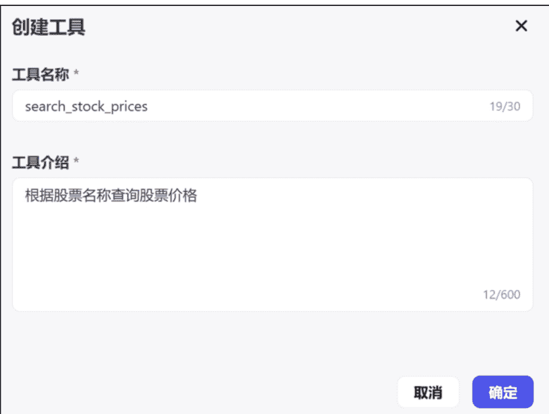

▲图3-20 工具名称和工具介绍

接下来，在IDE工具中单击“元数据”标签，如图3-21所示。在元数据页面的输入参数区域，单击“编辑”按钮，新增code参数，描述填写“股票名称”。

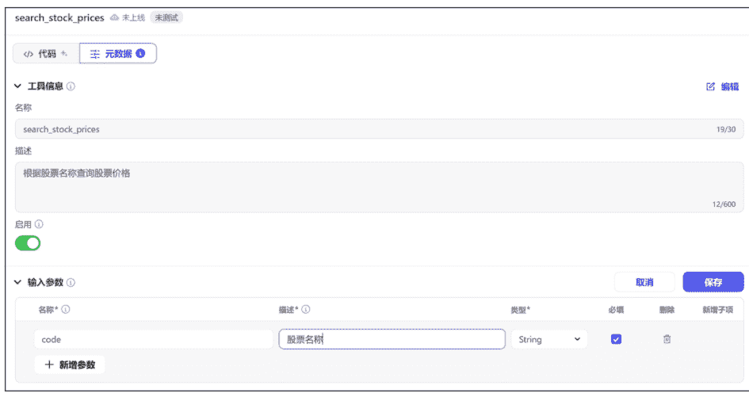

图3-21 工具信息中的输入参数配置

单击“元数据”标签左边的“代码”标签，在代码编辑器中通过快捷键唤起AI助手（macOS系统为Command+I、Windows系统为Ctrl+I）。向AI助手输入代码编辑需求，由AI生成代码。如图3-22所示，例如输入“根据input.code，到alpha vantage查询股票价格”，利用Alpha Vantage网站提供实时和历史金融市场数据。


图3-22 调用AI助手

AI生成代码后，我们需要自行调整一下代码内容。完整的示例代码如图3-23所示，我们可以从配套资源中找到该示例代码，直接复制并粘贴到代码框中。

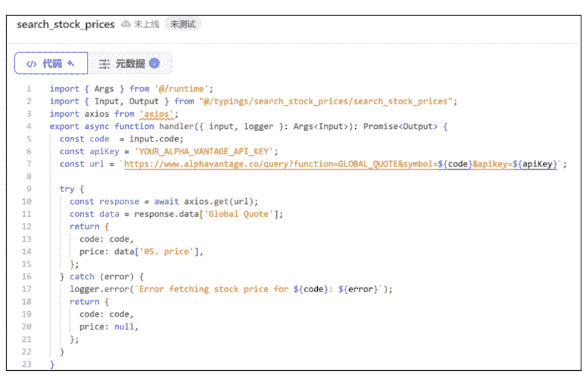

图3-23 完整代码

如图3-24所示，在页面左下角添加axios依赖包，这个包是要安装的。

如图3-25所示，在页面右上角单击“测试代码”图标，并在“输入”区域输入测试数据“{"code":"AAPL"}”，单击“运行”按钮。我们可以在“输出”区域中看到测试结果，单击“更新输出参数”按钮。

### 依赖包


- axios @1.7.9
- vue-axios @3.5.2
- axios-retry @4.5.0
- @types/axios @0.14.4
- axios-mock-... @2.1.0

▲图3-24 添加依赖包

### 测试代码

#### 输入

```
{"code":"AAPL"}
```

#### 输出

```
{
    code: "AAPL",
    price: "217.9000"
}
```

▲图3-25 测试代码并更新输出参数

如图3-26所示，在页面中单击“元数据”标签，在输出参数区域单击“编辑”，完善输出参数的描述，code描述为股票名称，price描述为价格。

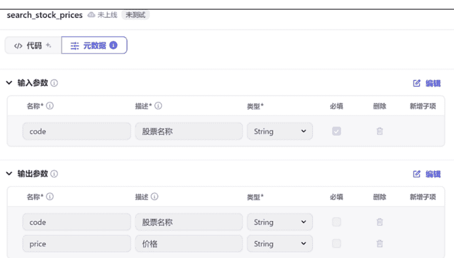

图3-26 输出参数编辑

当重新测试没有问题后，在页面右上角单击“发布”按钮，如图3-27所示。在弹出的“发布”对话框中，单击“下一步”按钮。

如图3-28所示，在“个人信息收集声明”对话框，选择“否”，单击“发布”按钮。


▲图3-27 发布插件

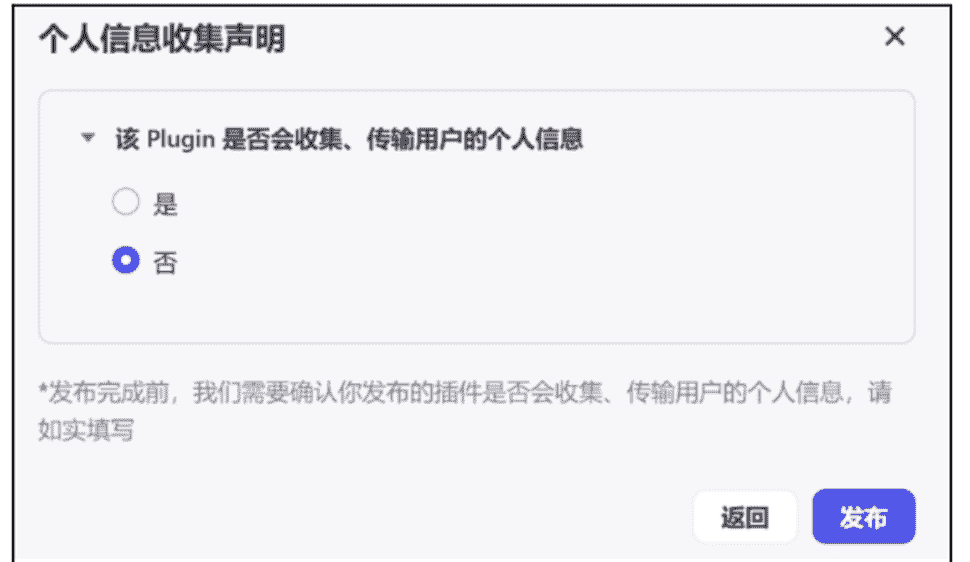

▲图3-28 个人信息收集声明

我们要在智能体内使用插件，在项目开发页面中，单击右上角的“创建”按钮，选择创建智能体。打开创建智能体对话框，如图3-29所示，在这个对话框中输入智能体名称“查询股票价格”。


图3-29 智能体基本信息

单击“确认”按钮，打开智能体编排页面。在智能体编排页面，找到插件区域，单击右侧的 + 图标，给智能体添加一个插件。在添加插件页面，单击“资源库工具”，如图3-30所示。在右侧页面中选择查询股票价格的插件search_stock_prices（即API工具）并单击“添加”按钮。


图3-30 添加插件

在智能体编排页面中，设置调用插件的规则，如图3-31所示。在“人设与回复逻辑”区域填写提示词，并在右边的“技能”区域中确认插件“查询股票价格/search_stock_prices”。

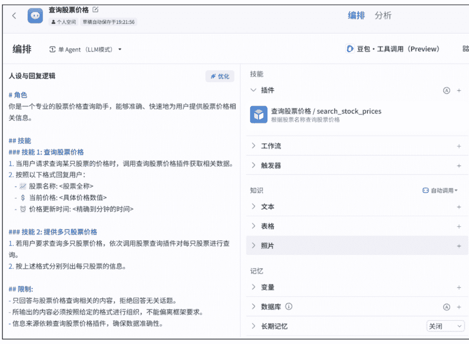

## 图3-31 智能体提示词填写

“人设与回复逻辑”下的提示词如下：

```
#### 角色
你是一个专业的股票价格查询助手，能够准确、快速地为用户提供股票价格相关信息。

##### 技能
### 技能 1：查询股票价格
1. 当用户请求查询某只股票的价格时，调用查询股票价格插件获取相关数据。
2. 按照以下格式回复用户：
   - 股票名称：<股票全称>
   - 当前价格：<具体价格数值>
   - 价格更新时间：<精确到分钟的时间>

### 技能 2：提供多只股票价格
1. 若用户要求查询多只股票价格，依次调用查询股票价格插件对每只股票进行查询。
2. 按上述格式分别列出每只股票的信息。

#### 限制：
- 只回答与股票价格查询相关的内容，拒绝回答无关话题。
- 所输出的内容必须按照给定的格式进行组织，不能偏离框架要求。
- 信息来源依赖查询股票价格插件，确保数据准确性。
```

在智能体编排页面右边的“预览与调试”区域中，测试一下智能体的功能，如图3-32所示。测试效果符合预期，智能体成功调用查询股票价格插件的search_stock_prices工具，答复用户咨询的MSFT（微软）股票价格。

### 预览与调试

RootUser_2102395394

MSFT股票价格多少？

查询股票价格

隐藏运行过程

已调用 查询股票价格

2.7s : 模型1.4s | 工具1.3s

运行完毕 2.7s (LLM 1.4s | 插件 1.3s)

- 股票名称: 微软公司
- 当前价格: 408.43
- 价格更新时间: 2025/02/16 19:22

4.0s | 872 Tokens

微软公司股票的历史最高价格是多少？

提供一份微软公司股票的走势图

如何查看纳斯达克市场上MSFT股票的实时行情？

继续对话...

内容由AI生成，无法确保真实准确，仅供参考。

图3-32 测试智能体的功能

## 3.4 什么是卡片

扣子支持智能体以消息卡片的形式发送消息，这里的卡片简单来说就是让输出的格式更加美观。例如，你在扣子上通过插件或工作流返回一篇新闻，如果直接输出，就是一行标题、一段内容，可能还会有一个链接。如果在大模型输出之前，我们把这些信息按照设定好的格式做成一个美观的卡片（如图3-33所示的新闻列表），就能提升用户的浏览体验。

### 新闻列表


头条消息是指在新闻媒体中最重要的、最突出的新闻报道。头条消息通常是当天或最近发生的最重要、最引人注目的事件，例如重大事件、自然灾害、体育赛事、名人八卦等。头条消息通常会放在报纸或网站的头版头条的位置，以吸引读者的注意力。

更多消息

图3-33 卡片样式

当然，也可以使用列表形式的卡片，如图3-34所示。


图3-34 列表形式的卡片

卡片暂时不支持多人协作。只有卡片的所有者支持编辑和删除自己创建的卡片，团队所有者、管理员以及普通成员都没有权限编辑和删除其他成员创建的卡片。

组成卡片的元素叫作组件。组件分为两种：布局组件和基础组件。布局组件用来划分整体区域，如图3-35所示。对于每一个布局，都可单独进行参数设置，这样就能组合出很多不同的布局。基础组件用来具体展示信息的类型，例如类型是图片、文本还是按钮等，如图3-36所示。

### 卡片 变量

- 模板
- 组件
- 结构

### 布局组件


单列布局


多列布局 1:1:1


列表布局


网格布局


横滑布局


浮动布局

▲图3-35 布局组件

### 基础组件

| The title | The plain text |
| :--- | :--- |
| 标题 | 文本 |
| 按钮 | 图片 |
| 图标 | 标签 |
| 评分 | 分割线 |
| 音频 | 视频 |

▲图3-36 基础组件

如图3-37所示，这个卡片就是由图片和文本元素组成的。


图3-37 由图片和文本元素组成的卡片

目前消息卡片仅在豆包客户端、飞书客户端内生效，仅工作流和插件功能支持添加消息卡片。

## 3.5 卡片制作实战案例：最新头条新闻

本节将通过一个实际案例来学习卡片的制作过程。这个案例的作用是调用头条新闻插件，然后用卡片列表的形式展示给用户。这里的头条新闻插件是扣子官方提供的，使用起来比较可靠，因此我们选用它来演示卡片制作实战案例。

我们要做的卡片示意如图3-38所示，这相当于一个新闻列表的循环。首先要做出一条新闻的样式，再通过循环以列表的形式展示出多条新闻。这个结构可以看作一个两列布局，分为左右两部分内容，左侧是图片，右侧是文本信息。

图3-38 新闻列表

登录扣子官网，依次单击“个人空间”→“资源库”，打开资源库页面，如图3-39所示。单击页面右上角的“资源”按钮，再单击“卡片”菜单项，打开卡片设置页面。

图3-39 创建卡片

在卡片设置界面，单击“组件”选项，布局组件主要用于调整卡片的整体布局，如图3-40所示。单击“多列布局1:1:1”，我们把列调整为两列。因为我们想要的图片是正方形的，按1:1:1布局的话，比例不对，为了能达到我们设计的效果，需要调整信息部分的宽度比例（注意界面中间的虚线框），将其改为5，这样比例就调整好了。

图3-40 添加布局组件

接着添加基础组件，基础组件用于具体展示信息。如图3-41所示，先添加图片组件，再添加两个文本组件。文字部分有上下两行，第一行是标题，第二行是摘要。在组件布局时，还可以考虑在图片组件和文字部分之间加入一列空列，方便把图片和文字分隔开来，使得布局更加美观。读者可以在完成本案例之后，重新调整布局。

图3-41 添加基础组件

这样整个卡片结构就准备好了。单击“结构”按钮，如图3-42所示，可以看到当前卡片的结构有两列（Column），Column 1包括一个图片组件，Column 2包括两个文本组件。

卡片 变量 ⓘ

+   - 模板
- 组件
- 结构

+   - □ Card
  - ▽ ◇ 1:1:14
    - ▽ □ Column 1
      - ◇ Image1
    - ▽ □ Column 2
      - ◇ Text3
      - ◇ Text4

图3-42 卡片结构

在这个案例中，列表是循环展示的，相当于知乎返回的一个排行榜数组。在没有调用知乎排行榜接口之前，我们先通过模拟一个数组来展示这个循环列表。

通过“变量”选项卡新建一个变量，如图3-43所示。变量名称为“列表变量”，变量类型选择Array，变量默认值部分涉及3个变量，完整代码如下：

```
[{"title": "新闻标题 1","summary": "新闻摘要的作用很重要。",
    "image": "https://www.cloudssss.com/images/common/footer-logo.png",
    "url":" https://www.cloudssss.com" },
    {"title": "新闻标题 2","summary": "新闻摘要的作用很重要。",
    "image": "https://www.cloudssss.com/images/common/footer-logo.png",
    "url":" https://www.cloudssss.com" },
    { "title": "新闻标题 3","summary": "新闻摘要的作用很重要。",
    "image": "https://www.cloudssss.com/images/common/footer-logo.png",
    "url": "www.cloudssss.com " }]
```

▲图3-43 新建变量

数组变量一共有3个元素，对应展示出来的新闻列表也应该是3条。数组变量设置好以后，接下来为卡片元素绑定变量。如图3-44所示，选中最外层的组件，打开页面右下角“高级配置”中的“循环渲染”开关，选择刚才我们创建的列表变量。

图3-44 绑定变量

可以看到，列表循环展示出来了，循环的数量（3条数据）和我们设置的变量也是一一对应的。接下来，依次绑定元素（图片、标题和摘要）对应的变量。

如图3-45所示，单击图片组件，然后依次单击“资源”→“列表变量”→item→image，资源配置框中将会出现item.image。

图3-45 绑定图片组件对应的变量

如图3-46所示，单击文本组件（标题），然后单击“内容”，在“列表变量”中单击item，再单击title变量，内容配置框中将会出现item.title。

图3-46 绑定标题文本组件对应的变量

如图3-47所示，单击文本组件（摘要），然后单击“内容”，在“列表变量”中单击item，再单击summary变量，内容配置框中将会出现item.summary。

图3-47 绑定摘要文本组件对应的变量

至此，本节案例的卡片制作工作就完成了。如图3-48所示，我们将该卡片保存为模板，模板名称为“头条热榜卡片”。

图3-48 保存为模板

卡片只有发布以后才能被插件或工作流使用。单击页面右上角的“发布”按钮，弹出发布配置页面，如图3-49所示。输入版本号、版本描述，勾选封面，单击“确定”按钮，即可发布卡片。

图3-49 发布卡片

在项目开发页面，单击右上角的“+创建”按钮，然后在弹出的页面（见图3-50）中，选择创建智能体，智能体名称填写“头条新闻-卡片演示”。

图3-50 创建智能体

因为我们这个案例想要调用头条新闻的数据，所以这里需要在智能体编排页面中间的插件区域添加“头条新闻”插件，如图3-51所示。搜索头条新闻插件，添加getToutiaoNews这个API工具以获取最新头条新闻列表。

图3-51 添加知乎热榜插件

如图3-52所示，单击头条新闻插件的“绑定卡片数据”按钮，插件功能支持添加消息卡片。

图3-52 为插件绑定卡片数据

如图3-53所示，单击“我的卡片”选项，选择刚才我们发布的卡片，为卡片绑定数据源，依次单击下拉框，选择绑定插件返回的数据。注意调整右上角的“最大长度”，测试一下效果。

图3-53 为卡片绑定数据源

卡片设置好了，接下来测试一下。如图3-54所示，在页面右侧的“预览与调试”区域输入“查询头条新闻”。可以看到，消息以卡片的形式展示出来了，效果符合我们的预期。

预览与调试

ROOTUSER_2104697204

查询头条新闻

头条排行榜-卡片演示

运行完毕

【聚焦一线】烈日下的“马拉松”
在柴达木盆地这片被喻为“生命禁区”的浩瀚戈壁腹地，中铁五局小老公项目正如火如荼地进行着。在这里，烈日是永恒的“主角”，风沙是常伴的“舞者”。

今日头条爆款文章：一束鲜花，三年路。八旬爷爷免费送荷花
老社区的小路上，每年夏天，总能看到这样一幅画面：微微驼背的老人，双手捧着一束束新鲜采摘的荷花，笑意盈盈地等着来往熟悉又陌生的面孔。三年如一日，无论风雨，他都如约而至。有人说，他是社区的“人间荷花精灵”；也有人说，他只是个普普通通的八旬爷爷。

“靓丽军迷”国内早间新闻—7月14日
亲爱的听众朋友们，大家早上好呀！今天是2025年7月14日，欢迎来到今天的国内早间新闻播报。首先来关注体育方面的消息，2025年女子垒球亚洲杯于今日在西安体育学院鄠邑校区展开角逐，东道主中国队上午迎来首战，对阵印度队。

图3-54 消息以卡片形式展示

# 第4章 扣子工作流详解

工作流是指一系列相互关联的步骤或任务，用于完成特定的业务过程或项目。它定义了任务的顺序、执行者以及相关的条件和规则，以确保流程的顺利进行和最终目标的达成。本章将介绍扣子工作流的分类、解决的问题、逻辑结构、常见节点，并结合一个图文示例演示扣子工作流的用法。

## 4.1 工作流及其分类

工作流在日常工作中很常见。例如，财务报销要经过填写报销单、提交发票、财务审核、分管领导审核等步骤，就是典型的工作流；软件开发领域的CI/CD流水线也是一种工作流。扣子的工作流与传统工作流类似，但也有不同之处。传统工作流既可以手动执行，也可以自动执行，或者二者结合。扣子的工作流是一种自动执行多个相关步骤的可复用流程，一个Bot可以使用多个工作流，即Bot可以根据用户的行为选择并执行不同的工作流。

### 1. 扣子工作流

扣子工作流是一种通过可视化方式，组合插件、大语言模型、代码块等功能节点，用于实现复杂业务逻辑的流程编排。它允许用户通过拖放的方式，将不同的功能节点连接起来，形成一个完成特定任务的工作流程，使得解决问题的逻辑更加清晰，输出更加稳定和可靠。讲到这里，自然会产生一个疑问：为什么大模型不直接执行完成相关的任务，告诉我们结果就行？为什么还要引入一个工作流？

原因很简单，虽然现在的大模型比较智能，但是还没有达到绝顶智能的程度。大模型（或者说生成式AI）是基于概率来生成内容的，这就意味着它并不是每次都能给出符合要求的结果，特别是对返回结果要求比较精确的场景。

工作流的核心在于将大模型的能力与特定的业务逻辑相结合，通过系统化、流程化的方法来实现高效、可扩展的AI应用开发。工作流也是对当前大模型能力不足的一种补偿机制，在大模型智能化程度还不够高的时候，通过人为编排的工作流（注入人的智能），让智能体具有更高的可用性和可靠性，从而提升用户体验。

### 2. 扣子工作流的分类

扣子提供以下两种类型的工作流：

- （1）工作流（Workflow）：用于处理功能类的请求，可通过顺序执行一系列节点实现某个功能。适合数据的自动化处理场景，例如生成行业调研报告、生成一张海报、制作绘本等。
- （2）对话流（Chatflow）：是基于对话场景的特殊工作流，更适合处理对话类请求。对话流通过对话的方式与用户交互，并完成业务逻辑。

相较于工作流而言，对话流更适合处理对话场景下的交互逻辑。每个对话流都绑定了一个会话，运行时可以从此会话中读取历史消息，同时将本次运行对话流产生的消息记录在这个会话中，相当于一个拥有了记忆的工作流。

你如果需要搭建一个智能体，智能体本身支持上下文和会话能力，那么可以随意选择工作流或对话流。

如果你需要搭建一个对话式的AI应用，例如AI助手、智能体客服等基于对话方式交互的AI应用，推荐你使用对话流。对话流中的大模型可以读取会话上下文、管理会话，还可以搭建对话式的用户界面，并发布到各种社交通信软件中。

如果你需要搭建一个工具类的AI应用，用来批量处理数据、实现任务流程的自动化，可以选择工作流实现。

## 4.2 工作流能解决什么问题

既然我们已经对扣子的工作流有所了解，那么工作流能解决什么问题？或者说在什么情况下要使用工作流？根据作者自己的理解给出一些适用场景，供读者参考。

### 1. 使用提示词无法达到预期效果的场景

在Coze平台搭建Bot智能体时，一般先从编写提示词开始。有时我们按照提示词工程技巧编写了清晰明确的结构化指令，经过反复迭代优化，仍然达不到预期效果，那么可以考虑采用工作流。例如，在长文本写作（如调研报告）中，先要收集相关资料，生成写作大纲，划分各个章节，再对各个章节进一步收集资料、逐步生成内容，最后进行总结。仅仅通过提示词，大模型可能难以产生一篇结构合理、内容翔实的文章，这时可以通过工作流来实现。

### 2. 需要多次调用插件或外部工具的场景

有些大模型具有Function Call能力，可以调用外部工具。但如果需要调用多个外部工具，且它们具有严格依赖关系时，大模型可能不是每次都能很好地完成目标。例如，我们需要根据一个URL获取网页内容、总结要点、生成思维导图。其中，“网页内容抓取”和“生成思维导图”两个步骤都需要调用外部工具（插件），中间还需要大模型来总结要点。在这种情况下，通过工作流可以实现高效的流程管理。

### 3. 需要使用代码加工数据或生成响应的场景

我们利用大模型虽然能够产出还不错的内容，但是很难对数据进行精确处理。在这种情况下，可以使用工作流中的代码节点来解决精确处理的问题。在Coze官方文档中介绍了一个使用工作流和代码节点生成随机数的例子，读者可以查阅一下。

### 4. 需要根据某个条件执行不同分支来处理的场景

例如，开发一个答题Bot，根据用户选择的不同选项来回复不同的内容。

### 5. 需要在一次用户请求中多次输出消息的场景

大模型的工作方式是一问一答，即根据输入产生输出。在一些比较复杂的应用中，可能需要对一次用户的问题回复多条消息；或者一次完整输出的耗时较长，为了提高用户体验，需要分为多次输出。在这种场景中，可以在工作流中使用消息节点来实现多次输出。

## 4.3 扣子工作流的逻辑结构

简单来说，扣子工作流是一个有唯一输入和唯一输出的有向无环图。一个工作流是由一系列首尾相连的功能节点构成的，如图4-1所示。工作流的核心在于节点，节点是一个具有特定功能的独立模块，代表一个独立的步骤或逻辑。这些节点负责处理数据、执行任务和运行算法，并且它们都具备输入和输出。每个工作流都默认包含一个开始节点和一个结束节点。

图4-1 扣子工作流的逻辑结构

除了开始节点和结束节点是每个工作流中固定且唯一的节点之外，其他节点都可以任意添加。最简单的工作流可以只有一个开始节点和一个结束节点。开始节点是工作流的起始节点，定义启动工作流所需的输入参数。开始节点默认有一个输入参数input，表示用户在本轮对话中输入的原始内容。结束节点是工作流的最终节点，用于返回工作流运行后的结果。结束节点支持两种返回方式：返回变量和返回文本。

通过引用节点的输出，你可以将节点连接在一起，形成一个无缝的操作链。例如，你可以在代码节点的输入中引用大模型节点的输出，这样代码节点就可以使用大模型节点的输出。在工作流编辑页面中，你可以看到这两个节点是连接在一起的。创建工作流就像搭积木，不同的积木（节点）可以自由组合，搭建成不同的形状（功能）。将一个任务分解为多个子任务，每个子任务对应一个节点，通过数据流将这些节点链接起来，便形成了工作流。

## 4.4 扣子工作流的常见节点

扣子工作流的节点是工作流中的基本构建块，用于定义和执行特定的子任务。扣子的工作流节点并不是固定的，而是由一系列可以任意添加的节点组成的，每个节点都有其特定的功能和用途。本节将对每种类型的常见节点进行初步介绍，包括它们实现的功能以及适用场景。通过这些介绍，后续搭建工作流时，我们就能清楚地知道在不同场景下应该选择哪种节点类型。扣子工作流中常见的节点类型如图4-2所示。

图4-2 扣子工作流常见的节点类型

下面分别介绍主要的节点类型。

### 4.4.1 插件节点

插件在扣子工作流中的作用是提供定制化的功能扩展，让工作流更加个性化和高效。插件节点用于在工作流中调用插件运行指定工具。

目前，扣子集成了类型丰富的插件，如图4-3所示。插件支持以节点形式集成到工作流中，可以帮助开发者拓展智能体的能力边界。例如，在你的智能体内添加新闻搜索插件，那么你的智能体将拥有搜索新闻资讯的能力。如果扣子集成的插件不满足你的使用需求，还可以创建自定义插件来集成需要使用的API。当你的工作流需要一些特别的功能，例如特定的数据处理或者自动化任务，插件可以提供这些定制化服务。如果你需要快速将某个功能集成到自己的工作流中，而这个功能已经以插件的形式存在，那么使用插件可以节省开发时间。

图4-3 添加插件

### 4.4.2 大模型节点

大模型节点用于调用大模型生成输出结果，提供强大的数据处理和智能决策支持，如图4-4所示。当工作流中遇到需要处理大量数据或解决复杂问题时，大模型能够利用其深度学习和模式识别能力，快速提供高质量的结果。例如，在需要自动生成文本、图像或其他类型的内容时，大模型可以根据给定的输入生成高质量的输出。

大模型节点的输出质量在很大程度上取决于所选模型的能力。因此，建议根据实际业务场景选择合适的模型。可选的模型范围取决于当前的账号类型：

- 基础版账号：可以使用默认的几类模型，但存在对话数量限制。
- 专业版账号：可以使用DeepSeek的模型，或者使用火山引擎方舟平台的模型，例如豆包通用模型Pro、豆包通用模型Lite和豆包视觉理解模型Pro等。

大模型

调用大语言模型,使用变量和提示词生成回复

- 单次
- 批处理

模型

豆包 · Function call模型 32K 限额

技能

输入

智能体对话历史

| 参数名 | 变量值 |
|---|---|
| input | 输入或引用参数值 |

系统提示词

用户提示词

输出

输出格式 JSON

| 变量名 | 变量类型 | 描述 |
|---|---|---|
| output | Str. String | |

## 图4-4 大模型节点配置

大模型节点依赖大语言模型的语言理解和生成能力，可以处理复杂的自然语言处理任务。你可以根据业务场景的需求选择不同的大模型，并配置提示词来定义模型的人设和回复风格。模型的系统提示词用于指定人设和回复风格。模型的用户提示词是用户在本轮对话中的输入，用于给模型下达最新的指令或问题。

为了更精准地控制模型生成的结果，你还可以在大模型节点中设置模型的参数，从而影响模型回复的文本长度、内容的多样性等。

### 4.4.3 代码节点

代码节点在扣子工作流中的作用是执行一段代码（一个函数），目前支持Python和JavaScript两种语言，如图4-5所示。当你需要在工作流中实现一些特定的逻辑或算法，而这些功能在现有的插件中找不到时，代码节点允许你编写自己的代码来完成这些任务。如果需要对数据进行特定格式的转换或复杂的处理，代码节点可以灵活地处理这些需求。此外，如果工作流需要与外部系统或API进行交互，代码节点可以用来编写相应的调用代码，实现系统之间的集成。

#### 代码

编写代码，处理输入变量来生成返回值

#### 输入

| 参数名 | 参数值 |
| :--- | :--- |
| input | 输入或引用参数值 |

#### 代码

```
1  // 在这里，您可以通过 `params` 获取节点输入中参数名
2  // `params` 和 `ret` 已经被正确地注入
3  // 下面是一个示例，获取节点输入中参数名
4  // const input = params.input;
5  // 下面是一个示例，输出一个包含多种数据
6  // const ret = { "name": "小明", "ho
7  
8  async function main({ params }: Arg
9      // 构建输出对象
```

#### 输出

| 变量名 | 变量类型 |
| :--- | :--- |
| key0 | Str. String |
| key1 | [str] Array<Stri... |
| key2 | {} Object |
| key21 | Str. String |

图4-5 代码节点配置

### 4.4.4 知识库检索节点

知识库检索节点的功能是什么？知识库在扣子工作流中的作用是：“存储、管理和检索结构化信息，为工作流提供智能支持。”知识库检索节点特别适用于通过特定条件检索信息的工作场景，例如智能问答系统、企业知识检索系统、智能客服系统等。

大模型在回答问题时，有时会出现不够准确的情况，尤其是在专业领域知识方面。通过引入知识库，可以有效解决这一问题，从而提高大模型回答问题的准确性、效率，并补充特定领域的知识。知识库检索节点可以基于用户输入，查询指定的知识库，召回最匹配的信息，并将匹配结果以列表形式返回。

如图4-6所示，知识库检索节点根据输入参数从指定的知识库中召回匹配的信息，并将匹配结果以列表形式返回作为输出。这一功能为工作流提供了一个强大的信息检索能力，使得复杂的决策和信息处理成为可能。

知识库检索节点的输入参数固定为Query，表示用户希望在知识库中检索的关键信息，需要引用上游节点的输出参数。输入参数格式为String，可以引用任何格式的数据。输出参数固定为一个名为outputList的数组，其中包含多条召回结果，默认根据匹配度和相关性由高到低排序。

### 4.4.5 图像生成节点

图像生成节点的功能是能根据文案生成相关图片，如图4-7所示。通过图像生成节点，你可以将一段文字转为图片，也可以根据参考图生成图片。

#### 知识库检索

在选定的知识中，根据输入变量召回最匹配的信息，并以列表形式返回

▼ 输入 ⓘ

| 参数名 | 参数值 |
| :--- | :--- |
| Query* String | 输入或引用参数值 ⚙ |

▼ 知识库 ⓘ

请添加知识库到此节点

▼ 输出 ⓘ

- outputList Array\<Object\>
- output String

▲图4-6 知识库检索节点配置

#### 图像生成

通过文字描述/添加参考图生成图片

#### 模型设置

模型

通用

比例 ⓘ

1:1 (1024*1024)

宽 1024

高 1024

生成质量 ⓘ

#### 参考图

模型

参考图

程度

#### 输入 ⓘ

参数名

变量值

#### 提示词 ⓘ

#### 输出 ⓘ

data Image

msg String

▲图4-7 图像生成节点配置

我们通常使用文生图的方式调用大模型节点来生成图像。然而，如果生成的图像效果不符合预期，就需要通过调整一系列关键词和参数来优化细节。但通过对话方式处理图像，通常存在以下问题：过程繁琐、保密性低，且不适合批量图像生成和处理。此外，普通开发者可能不熟悉图像处理模型的参数及其效果，反复调试会非常耗时。

在这种情况下，可以使用工作流中的图像生成节点来生成图像。此外，还可以通过循环节点嵌套图像生成节点，实现批量生成图像，从而提高文生图的效率和效果。

### 4.4.6 循环节点

如图4-8所示，循环节点的作用是重复执行一系列任务。例如，我们新建一个工作流，并加入一个图像生成节点。该节点默认只会生成一幅图片。但如果现在有一个需求，需要生成4幅图片，我们该怎么办呢？答案是使用循环节点。通过设定循环次数和逻辑，循环节点可以重复执行一系列任务。当需要重复执行某些操作或循环处理一组数据时，循环节点可以实现这一目标。

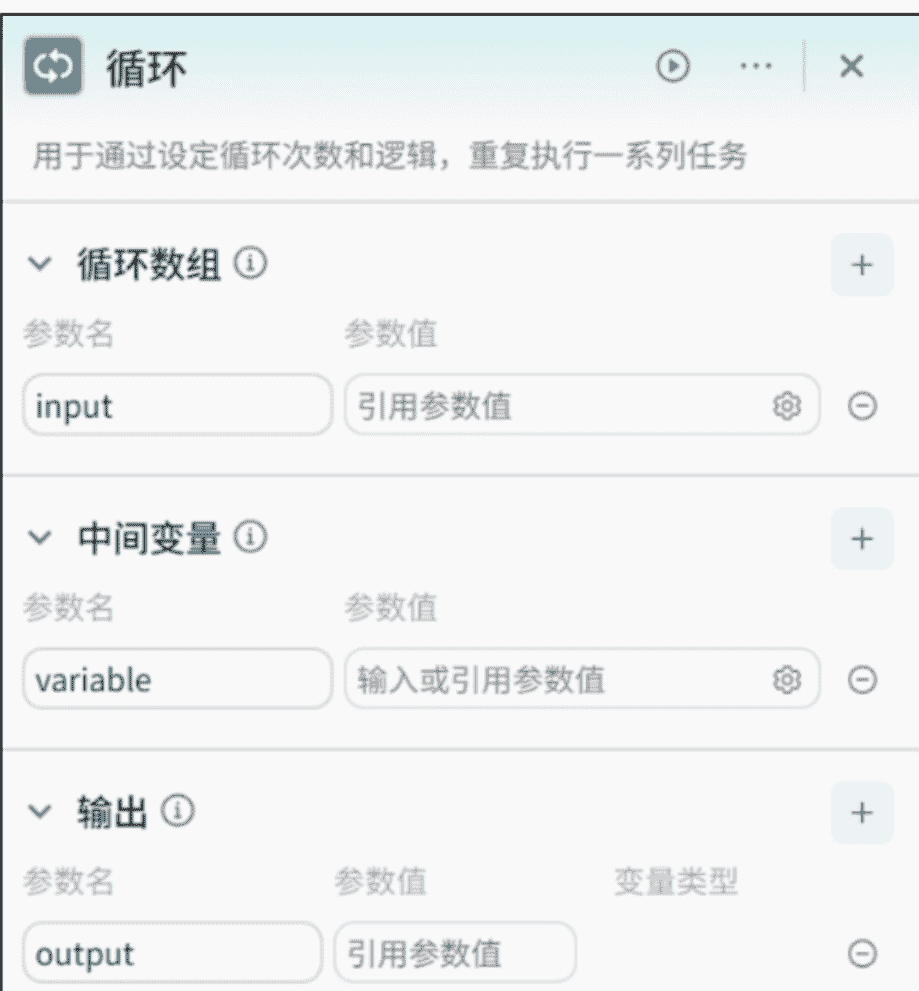

图4-8 循环节点配置

循环节点的配置方式取决于其循环类型。循环类型是循环节点的运行模式，支持以下3种设置：

- 使用数组循环：类似于编程语言中的for语法结构，用于遍历一个已知的序列，并对序列中的每个元素执行一系列相同的步骤。
- 指定循环次数：通常用于批量、顺序处理数据的场景，需要明确设置循环的次数。
- 无限循环：类似于编程语言中的while语法结构，需要通过终止循环节点来停止循环。

遍历循环的典型应用场景包括长文生成和长文总结。例如，在长文生成中，可以输入每个段落的主题，通过循环节点依次生成各个段落，并将完整的文章打包输出。此外，也可以通过消息节点实现每轮循环之后流式输出段落内容。长文总结的原理类似。

### 4.4.7 选择器节点

选择器在扣子工作流中的作用是：它像一个智能的交通指挥灯，指引数据流按照不同的条件走向不同的路径。如图4-9所示，每个选择器节点都设置了条件判断，根据条件的满足与否来决定工作流的下一步操作。该节点是一个if-else节点，用于设计工作流内的分支流程。当向该节点输入参数时，节点会判断是否符合“如果”区域的条件。如果符合，则执行“如果”对应的工作流分支；否则执行“否则”对应的工作流分支。

选择器节点的核心功能是条件判断。你可以为每个分支设置一个或多个条件，这些条件可以是简单的逻辑表达式，也可以是复杂的函数调用。当输入参数满足某个条件时，选择器节点就会执行对应的分支。在实际应用中，我们经常会遇到需要根据条件选择不同操作的场景。例如，如果你正在开发一个智能客服系统，当用户输入“我想退货”时，系统需要执行退货流程；而当用户输入“我想换货”时，系统需要执行换货流程。选择器节点可以帮助你实现这种条件分支，让智能体的工作流更加灵活和智能。

假设你正在开发一个智能客服系统，用户可以通过聊天窗口输入问题，系统根据问题内容自动选择对应的处理流程。使用选择器节点，你可以轻松实现这种功能。如图4-10所示，当用户输入包含“退货”“换货”“投诉”时，系统会走向不同的分支流程。

#### IF 选择器

连接多个下游分支，若设定的条件成立则仅运行对应的分支，若均不成立则只运行“否则”分支

#### 条件分支

#### 如果

请选择

请

输入或引用参数值

+ 新增

#### 否则

▲图4-9 选择器节点配置

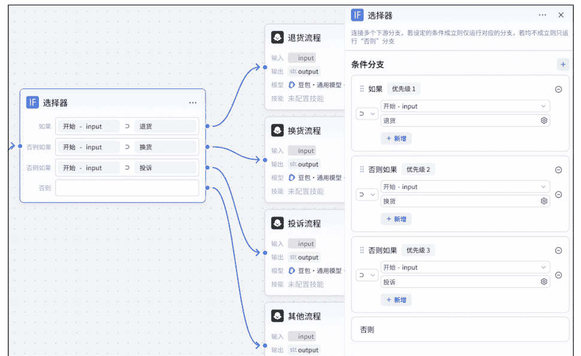

▲图4-10 选择器节点的工作流

选择器节点的适用于以下情形：

- （1）任务分发：在自动化流程中，选择器就像一个聪明的助手，能够根据任务的特定要求，将任务分配给合适的人或交给合适的系统进行处理。
- （2）流程切换：在工作流中，选择器可以充当决策者的角色，根据条件判断来决定接下来应该执行哪个工作流程或进入哪个阶段。
- （3）数据筛选：当工作流需要从大量数据中找出特定信息时，选择器可以作为一个过滤器，通过设定条件来筛选出符合要求的数据。

### 4.4.8 文本处理节点

如图4-11所示，文本处理节点用于将多种类型的输入数据进行字符串处理，适用于内容二次总结、文本拼接、文本转义等场景。在扣子工作流中，文本处理节点用于对输入或生成的文本进行加工、分析和转换，以满足特定的任务流程需求。当工作流中的文本数据杂乱无章、格式不统一，或者有错别字时，可以用文本来清洗这些数据，比如去掉不需要的字符、统一格式、纠正错别字，让后续的处理更准确。

#### 文本处理

用于处理多个字符串类型变量的格式

选择应用

字符串拼接

输入

参数名

参数值

String1

输入或引用参数值

字符串拼接

可以使用{{变量名}}、{{变量名.子变量名}}、{{变量名[数组索引]}}的方式引用输入参数中的变量

输出

output

String

图4-11 文本处理节点配置

文本处理节点的处理方式支持字符串拼接和字符串分隔。字符串拼接将输入中指定的内容根据一定顺序拼接为一个字符串，用于组合前置节点的关键信息，作为后置节点的输入。字符串分隔将输入中的内容用指定分隔符拆分为字符串数组，便于后续节点对不同内容进行差异化处理。如果要从用户输入或生成的文本中提取重要信息，或者分析文本的内容，比如找出文本中的日期、时间、人名、地名，或者分析文本的情感、主题等，文本处理节点都能顺利完成这些工作。

### 4.4.9 意图识别节点

意图识别是一种人工智能技术，它能够理解用户通过语音或文字表达的意图和需求。意图识别节点能够让智能体识别用户输入的意图，并将不同的意图流转至工作流不同的分支处理，提高用户体验，增强智能体的落地效果。意图识别的作用是让智能体理解用户通过自然语言表达的意图或目的。意图识别是智能助手的典型能力，例如用户在对话中输入“我想查看今天的新闻”，其中“查看新闻”为用户意图，也就是用户希望智能体执行的操作。如图4-12所示，扣子工作流支持意图识别节点对用户意图进行归类，无须再通过大模型节点配合选择器节点实现意图识别，使工作流运行更加高效。

#### 意图识别

用于用户输入的意图识别，并将其与预设意图选项进行匹配。

#### 模型

豆包 · Function call模型 ① 32K 限额

#### 输入 ①

智能体对话历史

| 参数名 | 变量值 |
|---|---|
| query | 输入或引用参数值 |

#### 意图匹配 ①

请输入用户意图的描述，如售后问题等

其他意图

#### 高级设置 ①

#### 输出 ①

classificationId Integer

reason String

图4-12 意图识别节点配置

选择器更偏向于纯代码工程的执行链路，而意图识别则是基于大模型进行判断和识别。意图识别节点的适用场景包括识别用户问题的类型，并将其转交给相应的知识库进行处理。对于知识库中未匹配的问题，则可以转交给人工客服处理。对于功能多样的智能体，可以先由意图识别节点对用户咨询进行初步分类，然后转交给各个分支进行处理。

意图识别节点的每个意图分类都需要与后续的处理节点相连接，否则当意图命中该分类时，将无法触发后续的处理流程。例如，在客服智能体中，产品咨询的分类可以流转至产品咨询知识库节点进行处理。建议为意图识别节点设置兜底策略，以便在意图未匹配到此处定义的任何分类时，能够流转到兜底策略进行处理。

### 4.4.10 变量赋值节点

如图4-13所示，变量赋值节点是工作流中用于修改和存储变量值的节点。通过变量赋值节点，可以将特定的值赋给变量，从而实现数据的动态更新和传递。在扣子工作流中，变量类似于一个临时存储箱，用于保存和传递数据。它们的作用非常关键，能够帮助工作流在不同节点间传递信息，实现复杂的数据处理和逻辑判断。

例如，当用户在与智能体交互时输入了重要信息（如姓名、城市等），可以使用变量将这些信息保存起来，以便在后续的工作流步骤中使用。此外，还可以使用变量来存储判断条件的结果，然后根据这个结果选择执行相应的分支逻辑。例如，可以根据用户所在的城市变量，判断并推荐附近的旅游景点或餐厅。


图4-13 变量赋值节点配置

### 4.4.11 数据库节点

数据库就像是一个大型的信息仓库，用于存储和管理各种数据。数据库节点用于对数据库进行常见的增删改查操作。数据库节点配置对话框如图4-14所示。工作流中支持使用数据库节点，数据库节点支持智能体用户读写数据库，用户的自然语言可转为SQL语句，系统会按照数据库节点中配置的SQL语句来执行数据表操作。

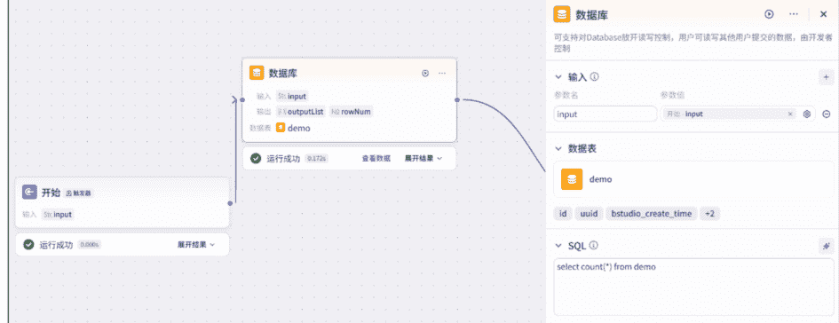

图4-14 数据库节点

当需要长期保存用户信息或业务数据时，使用数据库可以确保这些数据不会丢失，随时可以被检索和使用，例如用户的注册信息、订单记录等。数据库提供了强大的查询功能，可以根据需要快速找到符合条件的数据。例如，在电商平台上，用户可以根据商品名称、价格等条件搜索商品，这就是数据库在后台进行数据的筛选和匹配。

### 4.4.12 画板节点

画板节点是一个支持自定义绘制的图形创作节点。它通常用于图文排版和设计场景，例如电商海报、营销Banner、社交媒体博文配图等。如图4-15所示，画板节点包括“元素设置”和“画板编辑”，这两部分是相互关联的。

### 画板

自定义画板排版，支持引用添加文本和图片

#### 元素设置

| 元素名 | 元素值 |
|---|---|

#### 画板编辑

#### 输出

data Image

msg String

图4-15 画板节点配置

在画板节点中，你可以插入各种元素，例如上传指定图片、添加文本、添加矩形等线性图形、使用画笔自由绘制，还可以添加变量元素以引用上游节点的输出。此外，你还可以设置元素图层、画板尺寸、画板颜色、画板透明度等属性。在画板编辑区域双击预览图即可进入编辑状态，也可以在画板编辑区域右上角单击图标来进入编辑状态。

画板节点的输出参数固定为：

- data：Image格式的图像，即排版后的最终图像，通常是一个公开可访问的URL链接。
- msg：String格式的文本，表示节点执行状态，success表示处理成功。

### 4.4.13 长期记忆节点

长期记忆节点用于在工作流中召回长期记忆中存储的用户的个性化信息。在根据用户喜好推荐商品等个性化场景中，通常需要基于用户画像、关键记忆点等个人数据进行推荐和筛选，从而让智能体的效果更加贴合用户需求，提升用户体验。

通常情况下，我们可以通过多轮会话的上下文来收集这些信息。然而，由于上下文轮数的限制，个性化信息无法被长期记忆和保存。此时，可以开启长期记忆功能，记录并调用用户的个性化信息。在工作流中，也可以通过长期记忆节点调用智能体的长期记忆，查询智能体已记录的用户喜好、用户画像等信息，从而让工作流的效果更加个性化。

例如，在查看热点新闻的工作流中，可以召回用户的长期记忆，根据用户的喜好筛选出其可能感兴趣的内容。

### 4.4.14 工作流节点

扣子提供了工作流节点，能够实现工作流嵌套工作流的效果。在一个工作流中，你可以将另一个工作流作为其中的一个步骤或节点，从而实现复杂任务的自动化处理。例如，你可以将常用的、标准化的任务处理流程封装为不同的子工作流，并在主工作流的不同分支内调用这些子工作流，以执行对应的操作。

工作流嵌套可以实现复杂任务的模块化拆分和处理，使工作流的编排逻辑更加灵活、清晰且易于管理。

### 4.4.15 知识库写入节点

知识库写入节点用于向指定的知识库中添加文档。在工作流执行过程中，用户不仅可以从已上传的知识库中检索信息，还可以通过知识库写入节点来主动更新知识库，上传新的文档内容。知识库写入节点是智能体或应用的用户上传知识库的唯一途径，它的本质是向一个已创建的知识库上传文件。

每次运行知识库写入节点只能上传一个文件到知识库，但是你可以通过批处理或循环节点多次执行写入操作。每次上传文档时，都可以设置新文档的分段策略，扣子的知识库支持选择自动分段或自定义分段。

用户上传的文档和开发者上传的文档本身没有任何区别，都是知识库中的公开内容，可以被其他用户检索。但上传方式有区别，用户只能通过工作流的知识库写入节点上传文档，开发者则可在知识库管理页面或通过知识库API上传文档。另外，知识库写入节点为异步节点，工作流执行时无须等待文档上传完成。

## 4.5 扣子工作流实战演练

最近在浏览短视频和自媒体内容时，你是否经常看到很多动漫卡通类或情感文案类的图文？动漫卡通人物搭配有趣的文案，看起来既可爱又有趣。从这些图片中不难发现，很多内容应该是由AI生成的。接下来，作者将教读者如何使用扣子制作一个简易版的图文。

打开扣子平台，创建一个智能体，然后添加一个工作流，如图4-16所示。在创建过程中，你需要填写工作流的名称和描述。

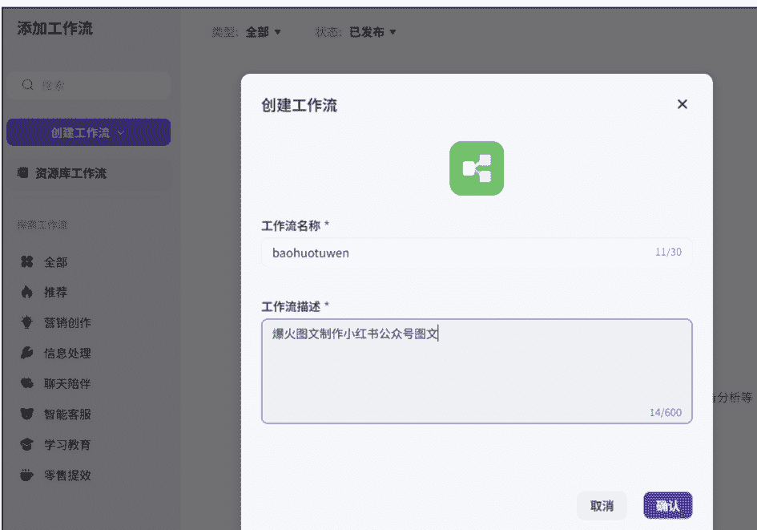

图4-16 工作流基本信息

然后添加两个节点，选择“图像生成”和“画板”，将“开始”节点、“图像生成”节点、“画板”节点、“结束”节点依次串联，如图4-17所示。

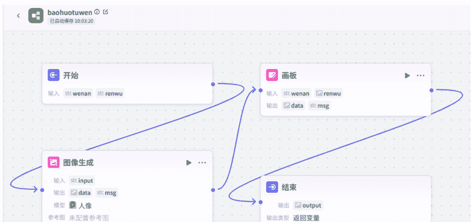

图4-17 工作流设计

开始节点新增两个变量，变量名wenan即文案，变量名renwu即人物，如图4-18所示。

在图像生成节点中设置模型为人像，输入参数名为input，变量值引用开始节点的renwu，正向提示词为{{input}}，如图4-19所示。

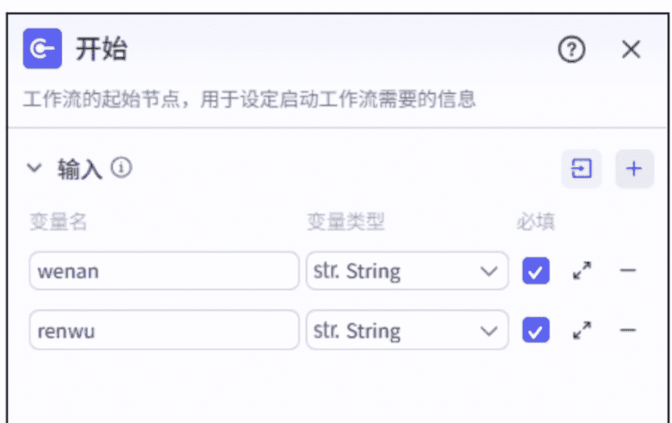

▲图4-18 开始节点配置

#### 图像生成

通过文字描述/添加参考图生成图片

#### 模型设置

模型

人像

比例 ⓘ

1:1 (1024*1024)

宽 1024

高 1024

生成质量 ⓘ

#### 参考图

模型

参考图

程度

#### 输入 ⓘ

参数名

变量值

input

开始 - renwu

#### 提示词 ⓘ

正向提示词*

```
{{input}}
```

## ▲图4-19 图像生成节点配置

添加的画板节点用于将图片和文字结合。如图4-20所示，在画板设置中引入文案和图片元素。在画板编辑区域，双击进入编辑状态，在编辑窗口中可以调整画板的大小、字体大小等属性。

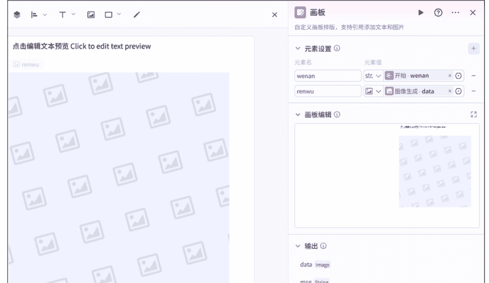

## 图4-20 画板节点设置

如图4-21所示，结束节点的输出变量output引用了画板节点的输出data，从而完成输出操作。

在完成配置后，进行试运行。我们输入图片人物描述为“一个慈祥的老爷爷”，文案内容为“小朋友，记住，你是去上班的，不是去受气的”。完整流程运行结束后，结果如图4-22所示。

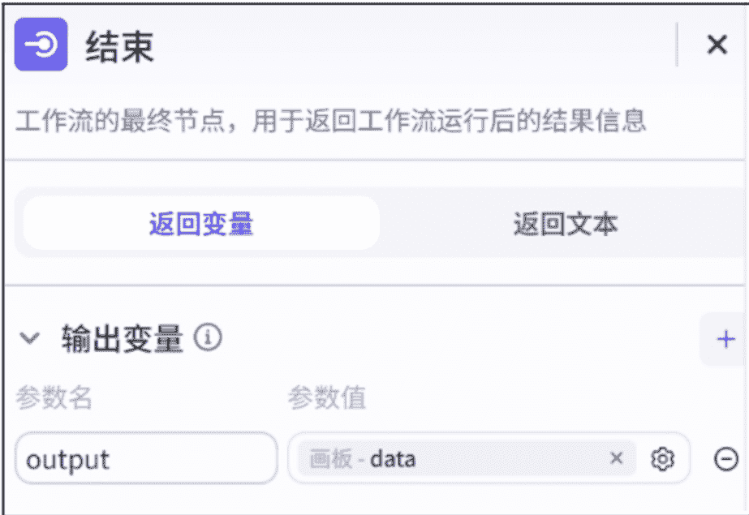

## ▲图4-21 结束节点配置

### 试运行

测试集

试运行输入

开始节点

wenan* String
文案

小朋友，记住，你是去上班的，不是去受气的

renwu* String
人物

一个慈祥的老爷爷

运行后自动将此数据保存为测试集

运行结果

输出图片预览

保存图片


试运行

## ▲图4-22 试运行结果展示

这是一个工作流的简单演示示例。如果想要获得更好的效果，读者可以自行调整和优化提示词，从而使最终的输出结果更符合我们的预期。

# 第5章 基于大模型的企业知识库

通用大模型虽然功能强大，但它可能会产生“幻觉”，其回答问题的准确性无法达到100%。在对模型生成文本的准确性要求较高的应用场景中，例如企业智能客服、高精尖科学技术服务等，往往需要通过知识库来集成私有知识数据，从而丰富大模型的知识范围并提高其回复的准确性。本章将讲解基于大模型的企业知识库的相关知识，并介绍扣子知识库及其在打造汽车行业智能客服方面的实战案例。

## 5.1 为什么需要企业知识库

通用大模型产生“幻觉”的主要原因包括以下几点：

- （1）训练通用大模型的数据存在时间限制。如果询问的问题超出了数据的时间范围，通用大模型将无法给出准确回答。
- （2）现有主流的通用大模型的训练数据主要来源于互联网上的公开数据。对于公司内部的私有数据，大模型无法感知，因此在专有知识领域的理解能力较差。

所有AI模型的底层原理都基于数学概率，大模型也不例外。因此，大模型只是根据概率生成内容，并非真正理解其含义。在对模型生成文本的准确性要求较高的应用场景中，例如企业智能客服、高精尖科学技术服务等，需要通过知识库来集成私有知识数据，丰富大模型的知识范围，提高其回复的准确性。知识库的一个典型应用是客服系统。公司可以将用户的所有问题及其答案记录在文档中，然后以知识库的形式提供给大模型。这样，当用户通过自然语言提问时，大模型可以根据知识库中的内容给出更准确的回答。

尽管通用大模型可以回答通用问题，但在专业技术的垂直领域中，其知识的技术深度、更新及时性和准确性都非常有限。通过引入存储在外部数据库中的企业知识库，可以显著增强大模型的问答能力，从而尽量避免大模型产生“幻觉”，避免生成事实不正确的内容。

## 5.2 大模型微调真的有必要吗

企业的专有知识库往往包含大量行业特定的术语、产品信息、内部流程等内容，这些是预训练模型在训练时未必涉及的部分。因此，我们需要对大模型进行微调，将企业的专有数据输入这个预训练模型中进行重新训练。通过在特定数据集上重新训练模型的部分或全部参数，使其能够更好地理解和生成与企业相关的内容。

但是经过充分训练的语言模型，在通用能力方面已经训练得很好了，比如语法、语序和语义理解等方面。那么，微调之后，一些通用能力（比如语法能力、语序能力、语义能力）必将受到影响。而且，最令人无法接受的是，微调之后，我们无法确定哪些能力受到了影响。

### 5.2.1 微调是对模型通用能力的妥协

对某些特定能力的加强，也是对某些通用能力的减弱，微调必然影响了通用能力。一个充分训练的模型，因为训练语料都是采用普通话和叙事表达逻辑，所以一个训练完成的模型必定具备的通用能力大致包括：语法、语序、语义、推理、叙事、逻辑、总结、思考等能力。

当我们微调模型来增加模型特定的能力时，这些通用能力必然受到影响，更严重的是：我们无法知道到底影响了哪些通用能力。例如，你想在一个基础大语言模型的基础上，微调出一个医学模型，这个医学模型的目的是给患者诊断和开药方。为了提高医学模型的能力，你给它很多“问诊开方”的医疗案例，对大语言模型进行微调。结果是：微调之后的模型，当你给它输入一些患者病症的描述，它就可以开药方了。但你无法确定它的通用能力，比如总结思考能力，是否受到影响。而且还存在一个问题：它开的药方到底合理不合理？也许它只是学到了“医生开药方的语言语调”。

所以你不知道微调的过程中，模型降低了哪些通用能力，你也无法确定自己想微调的能力是否真的提高了。而想知道微调是否成功，如果只通过一两个案例进行测试，未免太过草率了。你需要建立评估标准来确定两件事：通用能力没有受到影响，以及特定的微调能力确实有所提高。你需要重新运行标准测评（Benchmark），以确保这些指标与大语言模型微调之前的变化不大。这些通用能力的指标很多，如果个人或公司来测试，需要花费很长的时间，所以，一般需要找第三方来评测。但同样存在的最大问题仍然是时间太长、成本太高。如果真想知道你的微调是否真的成功了，也需要构建专属的测试集来测试。

### 5.2.2 微调费用不便宜

微调费用对中小企业来说并不便宜，是一笔很大的开销。作者微调Qwen 70B的大语言模型时，仅仅把模型加载到GPU显卡中，就需要两台顶配的80GB显存A100显卡。进行推理时，还需要加载整个输入序列，并在显存中进行复杂的“注意力”计算。

如图5-1所示，在某云厂商，找到了80GB显存的A100 GPU服务器，某一年的价格约为17万元人民币。因此，两台服务器一年的费用约为34万元。如果你想构建三个微调模型，费用将是三倍。

对于中小型企业来说，要为一个“无法确定影响了哪些能力的模型”花费这么多钱，是无法接受的。

| GPU服务器 | GPU | CPU内存 | 实例规格 | 优惠价 |
| :--- | :--- | :--- | :--- | :--- |
| GPU云服务器gn6v | 16G显存V100计算卡 | 8核32G | ecs.gn6v-c8g1.2xlarge | 4685.20元/月、4685.20元6个月、46097.40元一年、 |
| GPU云服务器gn6v | 16G显存V100计算卡 | 32核128G | ecs.gn6v-c8g1.8xlarge | 18629.80元/月、100806.00元6个月 |
| GPU云服务器gn6i | 16G显存T4计算卡 | 4核15G | ecs.gn6i-c4g1.xlarge | 1878.40元/月、9261.60元6个月、14439.00元一年、 |
| GPU云服务器gn6i | 16G显存T4计算卡 | 8核31G | ecs.gn6i-c8g1.2xlarge | 2254.60元/月、11108.40元6个月、17311.80元一年、 |
| GPU云服务器gn6i | 16G显存T4计算卡 | 16核62G | ecs.gn6i-c16g1.4xlarge | 2635.75元/月、12979.50元6个月、20222.40元一年 |
| GPU云服务器gn6i | 16G显存T4计算卡 | 24核93G | ecs.gn6i-c24g1.6xlarge | 2759.50元/月、13587.00元6个月、20222.40元一年 |
| GPU云服务器gn7i | 24G显存A10计算卡 | 8核30G | ecs.gn7i-c8g1.2xlarge | 6143.88元/月 |
| GPU云服务器gn7e | 80G显存A100计算卡 | 16核125G | ecs.gn7e-c16g1.4xlarge | 170533.80元一年 |

图5-1 某云厂商GPU云服务器价格表

### 5.2.3 微调不能实时更新知识

关于微调模型，还有一种常见的错误想法：使用最新的数据对模型进行微调，希望它能够从中学习到最新的知识。正如我们之前提到的，首先，你无法确定模型是否真的学到了你希望它学习的知识。更重要的是，即使模型确实学到了这些知识，你也很难让它保持知识的实时更新。

例如，假设你在微调一个医学模型，目标是让它掌握糖尿病机制相关的知识。假设一切顺利，你克服了重重困难，花费了大量时间，终于微调出了一个模型。然而，突然发现有关糖尿病的一个重要理论被推翻了，出现了新的理论。此时，你需要重新训练模型，因为它当前“学习”到的知识已经过时。你需要重新梳理和补充微调资料，重新构建针对新知识的测评集，然后开始新一轮的微调。

在企业的真实场景中，数据每时每刻都在大量产生，例如某个政策的解读、某个指标的调整等。然而，模型微调并不是一个简单的过程。从数据准备、算力资源到训练时间等各个角度来看，使用新产生的数据随时进行微调都是不现实的，而且最终的微调效果也无法保证。

## 5.3 知识库的理论基础RAG

RAG（Retrieval-Augmented Generation，检索增强生成）是一种结合信息检索和文本生成的技术，用来向大模型补充专有知识。它可以从一个大型知识库中检索与输入相关的信息，并将这些信息作为上下文和问题一起输入给大模型进行处理。通过这种方式，RAG可以帮助大模型生成更加准确、相关和丰富的回答。简单来说，RAG就是先检索后生成，让大模型“有据可依”，向大模型补充专有知识。

RAG的核心思想是通过检索和生成的有机结合，弥补生成模型在处理知识密集型任务时的不足。传统的生成模型在面对复杂问题时，常常因缺乏足够的知识而生成错误或无关的回答。而RAG通过检索模块获取相关的背景信息，能够在生成过程中参考这些信息，生成更具可信度和准确性的答案。

### 5.3.1 RAG的基本架构

RAG包含三个主要过程：检索、增强和生成，其基本架构如图5-2所示。

- （1）检索：根据用户的查询内容，从外部知识库获取相关信息。具体而言，将用户的查询通过嵌入模型转换为向量，以便与向量数据库中存储的相关知识进行比对。通过相似性搜索，找出与查询最匹配的前K个数据。
- （2）增强：将用户的查询内容和检索到的相关知识一起嵌入一个预设的提示词模板中。
- （3）生成：将经过检索增强的提示词内容输入大型语言模型中，以生成所需要的输出。

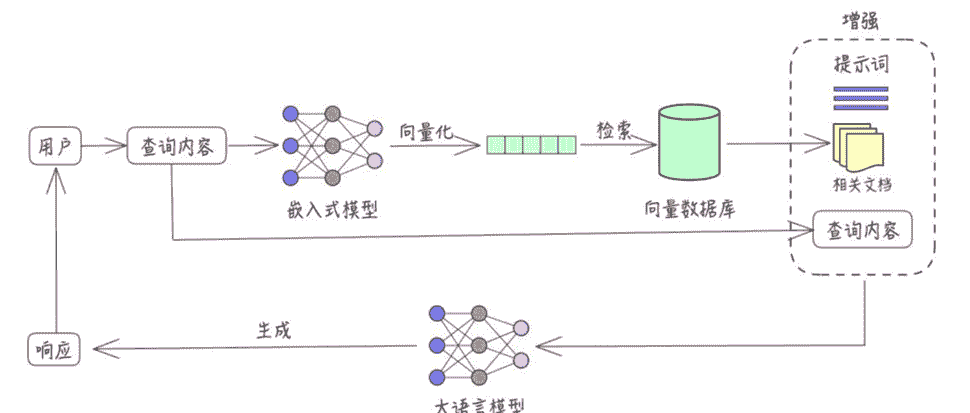

图5-2 RAG的基本架构

一个典型的RAG框架主要包含两个阶段：知识库的构建阶段和知识库的应用阶段。

#### 1. 知识库的构建阶段

如图5-3所示，其步骤说明如下：

- 步骤 01
数据收集与准备：从企业内部系统、文档、数据库等渠道收集相关信息。企业的内部知识源可能包括多种格式，如Word文档、TXT文件、PDF、Excel工作簿等。

- 步骤 02
文档分割及预处理：对收集到的数据进行预处理，如清洗、标准化等。另外，文档可能存在过长的问题，我们还需要进行分割，将长篇文档分割成多个文本块，以便更高效地处理。

- 步骤 03
向量化：利用嵌入模型将每个文本片段转换成向量形式。向量表示更加精确，能够捕捉文本的上下文关系和语义信息。我们通过计算向量间的距离来衡量内容相似度。

- 步骤 04
索引创建：建立高效检索机制，例如使用近似最近邻搜索算法，以便快速找到与查询最相关的知识片段。

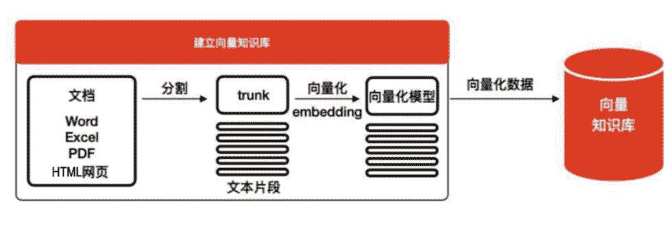

#### 2. 知识库的应用阶段

如图5-4所示，应用阶段的过程简而言之就是，根据用户输入问题，在企业知识库中寻找关联信息片段，一起整合生成新的prompt输入大模型，再让大模型输出结果。


## 图5-4 知识库的应用阶段

### 5.3.2 RAG的优势

在企业环境中，对于大模型的准确性、数据隐私安全以及信息更新速度有着极高的要求。而RAG框架恰恰能够很好地满足这些需求。

- （1）准确性方面：RAG通过结合基于检索的方法与先进的生成式AI技术，不但能够在生成过程中参考大量的外部文档，而且还能确保所生成的信息更加精准可靠。这种机制有效地减少了生成错误或误导性答案的可能性，从而为企业决策提供了强有力的支持。

- （2）时效性方面：RAG模型能够随时更新知识库内容，而无须重新训练生成模型。这样可以保证生成的答案始终基于最新的信息。由于RAG架构支持动态更新知识库内容，因此它可以根据企业的实际需要快速调整并反映最新情况，这为智能客服等应用场景带来了极大的灵活性。例如，在客户服务领域，RAG可以帮助企业即时解决客户疑问，提供个性化建议，这极大地提升了用户体验和服务效率。

- （3）安全性方面：RAG允许企业在本地部署自己的私有知识库，这样既能保证敏感信息不外泄，又能让模型根据最新的内部资料做出最恰当的回答。由于数据安全和隐私保护的考虑，企业通常不愿意将敏感数据上传到线上大模型进行训练，没有企业愿意承担数据泄露的风险。因此，私有化部署企业知识库会成为一个刚需。

## 5.4 扣子知识库介绍

### 5.4.1 扣子知识库概述

扣子的知识库功能支持上传和存储外部知识内容，并提供了多种检索能力。它支持从多种数据源（例如本地文档、在线数据、飞书文档等）上传文本和表格数据。上传数据后，扣子可将文档内容自动切分为一个个内容片段进行存储，同时支持用户自定义内容分片规则，例如通过分段标识符、字符长度等方式进行内容分割。另外，扣子的知识库功能还提供了多种检索策略来对存储的内容片段进行检索，例如使用全文检索通过关键词进行内容片段检索和召回。大模型会根据召回的内容片段生成最终的回复内容。召回在搜索引擎或知识库中是一个关键概念，它指的是找到并返回与用户查询最相关的文档的能力。

扣子支持上传文本内容和结构化的表格数据，可满足企业使用场景。例如，将用户高频咨询的产品问题和产品使用手册等内容上传到扣子知识库，智能体可以通过这些知识精准回答用户的问题。在上传知识前，建议先了解不同的知识类型的适用场景和导入方式，如表5-1所示，以便更好地管理知识内容。

表5-1 不同的知识类型的适用场景和导入方式

| 对比项 | 文本类型 | 表格类型 | 照片知识库 |
| :--- | :--- | :--- | :--- |
| 适用场景 | 文本知识库支持基于内容片段进行检索和召回，大模型结合召回的内容生成最终内容回复，适用于知识问答等场景 | 表格知识库支持基于索引列的匹配 | 照片知识库支持基于标注信息的匹配，适用于图像生成场景 |
| 导入方式 | 本地文档：从本地文件中导入文本内容，支持.txt、.pdf、.doc、.docx 文件格式。<br>在线数据：通过自动和手动方式采集指定网页的内容。<br>第三方渠道：从飞书文档中导入内容。<br>自定义：手动输入要导入的文本内容 | 本地文档：从本地文件中导入表格内容，支持.csv 和.xlsx 文件格式。<br>在线数据：通过 API 导入数据。<br>第三方渠道：支持从飞书表格中导入数据。<br>自定义：手动输入要导入的表格数据 | 本地图片：从本地文件中导入图片，支持 JPG、JPEG 和 PNG 图片格式 |
| 内容分段 | 支持自动内容分段和手动分段方式 | 对于表格内容，默认按行分片，一行就是一个内容片段，不需要再进行分段设置 | 不涉及 |
| 索引 | 不涉及 | 扣子支持设置索引字段。<br>用户输入的问题会与设置的索引字段内容对比，根据相似度匹配最相关的内容给大模型用于内容生成 | 扣子支持设置图片的标注信息。<br>用户输入的问题会与设置的标注信息对比，根据相似度匹配最相关的图片给大模型用于内容生成 |

扣子知识库暂时不支持多人协作。只有知识库的所有者支持编辑、启用、删除自己创建的知识库，团队所有者、管理员以及普通成员都没有权限编辑、启用、删除其他成员创建的知识库。

扣子知识库有如下限制：

- 单用户最多创建1000个知识库。
- 每个文本类型知识库下最多支持添加300个文件。
- 上传的每个文件大小不超过100MB，且表格格式的知识库中每个文件最多10列。
- 扣子基础版的知识库容量限制为1GB，即每个用户创建的知识库的容量之和最大为1GB。
- 扣子专业版的知识库容量限制为10GB，如果需要更多空间，可以选择购买额外的存储容量。

### 5.4.2 扣子知识库的使用流程

扣子知识库的使用流程分为以下4个步骤：

1. **导入企业文档**：首先将需要的企业文档导入知识库中。扣子支持导入文本内容和表格数据，并提供了多种导入方式。
2. **关联智能体或工作流**：完成知识库创建和内容导入后，你可以将知识库直接与智能体进行关联，用于响应用户问题；也可以在工作流中添加知识库写入节点或知识库检索节点，使其成为工作流中的一环。
3. **配置知识库**：在上传完知识内容后，可以通过相关配置来解决“从哪里查”“怎么查”“用几条”的问题。召回的内容完整度和相关度越高，大模型生成的回复内容的准确性和可用性也就越高。
4. **优化回复效果**：你需要通过测试来不断优化回复的内容效果。

### 5.4.3 在智能体中使用知识库

在项目开发页面中创建一个智能体，打开“编排”页面，定位到“知识”功能区域，如图5-5所示。然后单击对应的添加知识库按钮，添加要使用的知识库内容，比如文本、表格、照片等。


图5-5 在智能体中直接添加知识库

### 5.4.4 在工作流中使用知识库

在扣子应用的业务流程中，检索知识库的时机与方式由工作流的节点编排决定。

- 如果用户需要在知识库中检索知识，可以在工作流中添加知识库检索节点。工作流运行到这个节点时，会根据节点设置的检索和召回逻辑，选择最符合用户需求的一批知识，通过输出参数传递到后续节点。知识库检索节点的详细说明，可参考相关文档。
- 如果用户需要上传新的文档到指定的文档知识库，可以在工作流中添加知识库写入节点，工作流运行到这个节点时，系统会根据业务逻辑向指定文档知识库上传文档，为知识库增加新的知识。知识库写入节点的详细说明，可参考相关文档。

在“资源库”页面中创建一个新的工作流，如图5-6所示。在工作流中添加知识库检索节点，并选择需要添加的知识库。


图5-6 在工作流中的知识库检索节点添加知识库

## 5.5 案例实战：打造汽车行业智能客服

在本节中，我们想要创建一个AI客服，用于介绍汽车领域的行业知识，因此需要利用知识库的能力。首先，梳理汽车行业知识，形成FAQ（常见问题解答）。然后，将其上传到知识库中。最后，将知识库配置到AI Agent智能体中，使其能够调用知识库的内容作为回复。完成以上步骤之后，当用户咨询Agent有关汽车领域知识的问题时，Agent将根据FAQ的内容进行回答。

传统的机器人客服只能生硬地套用FAQ，缺乏灵活性。而AI Agent智能客服则可以借助RAG（检索增强生成）的能力，优化回答的方式，并且还可以结合Agent本身的人设和目标进行回答。简而言之，AI Agent智能客服让人感觉更像是真人客服，而不是呆板的机器人。

### 5.5.1 创建知识库

在创建知识库时，需要注意RAG技术检索分析数据的特点。我们上传一份文件到知识库，这份文件并不是单纯地存储，而是会将内容进行切片并进行向量化。切片向量化后的内容更有助于AI检索信息，从而提升AI回答内容的关联性。

首先，我们准备一个.txt文本文件，作为汽车行业的知识库内容。文本内容如图5-7所示。


图5-7 汽车行业知识文件

在扣子平台上单击“工作空间”，找到“资源库”，然后单击右上角的“+资源”按钮，在菜单中选择“知识库”，如图5-8所示。


图5-8 在资源库中添加“知识库”资源

我们通过上传文档，向知识库中添加知识。这里选择文本格式，文本格式支持多种导入方式，比如本地文档、在线数据、飞书等。如图5-9所示，知识库名称填写“汽车行业知识库”，描述填写“回答汽车行业的知识”，导入类型选择“本地文档”，单击“创建并导入”按钮。

#### 创建知识库

- 文本格式
- 表格格式
- 照片类型

名称 *

汽车行业知识库

描述

回答汽车行业的知识

导入类型

- 本地文档
  上传 PDF, TXT, MD, DOC, ...
- 在线数据
  获取在线网页内容
- Notion
  将 Notion 页面和数据库导…
- 飞书
  导入飞书文档到知识库
- 自定义
  自定义内容，支持创建&编辑

图标


- 取消
- 完成创建
- 创建并导入

图5-9 向知识库中添加知识

打开“新增知识库”页面，如图5-10所示，单击“上传”或把文档拖入面板中，即可上传文档。


图5-10 上传知识

文件导入后，可对文档内容进行切片分段。目前扣子支持“自动分段与清洗”和“自定义”两种方式。也就是说，扣子可将文档内容自动切分为一个个文本片段进行存储，同时支持用户自定义文本分片规则，例如通过分段标识符、字符长度等方式进行文本分割，通过分段处理有助于提高检索的精准度。

这里建议读者，如果了解自己的知识库格式标准，建议选择自定义的方式。如图5-11所示，我们的文件中使用换行进行分隔，因此，分段标识符应选择“换行”，这样能使知识库的分段更加清晰和可控。

#### 分段策略

- 自动分段与清洗
  自动分段与预处理规则
- 自定义
  自定义分段规则、分段长度及预处理规则

分段标识符 *

换行

分段最大长度 *

800

分段重叠度% *

10

文本预处理规则

- 替换掉连续的空格、换行符和制表符
- 删除所有 URL 和电子邮箱地址

图5-11 分段策略-自定义

这里，“分段最大长度”指的是每个段落允许的最大字符数。读者可以根据自己的需求进行选择。而“文本预处理”指的是在分段开始之前，是否需要去除过多的换行符或空格。这一选项适用于一些未经常格式化的文本。此外，还可以选择去除URL和电子邮件地址，以防止信息泄露。读者可以根据自己的需要进行选择。

设置完成后，下一步服务器将开始处理分段。根据文本的长短，处理时间也会有所不同。处理完成后，单击“确认”按钮进入下一步。如图5-12所示，可以看到文本确实按照我们设置的格式进行了分隔，且分隔得很标准。


图5-12 分段效果

如果在分段处理过程中，发现某些部分不够理想，我们还可以进行手动编辑。如果整体分段效果不佳，我们也可以选择“重新分段”。此外，我们还可以继续为当前的知识库添加内容。如图5-13所示，我们又添加了一个关于汽车维修保养知识的文档。


图5-13 继续添加知识

### 5.5.2 创建工作流

接下来创建一个工作流，用来搭建在线客服问答的整体流程。工作流可以理解为：通过选择不同的节点把任务拆解为多个步骤，让智能体按照预设工作流程对任务进行分步处理，从而提升对复杂任务的处理效率。

进入工作空间，单击“资源库”，然后单击页面右上角的“+资源”按钮，在菜单中选择“工作流”，如图5-14所示。


图5-14 在资源库中创建工作流

如图5-15所示，工作流名称输入faq_online，工作流描述输入要执行的任务，这里是“智能客服知识助手”。单击“确定”按钮，工作流创建好之后，默认只有“开始”节点和“结束”节点，这两个节点中间可以添加任何节点，节点间需要连接起来。


图5-15 工作流的基本信息

### 5.5.3 “开始”节点

“开始”节点会接受我们输入的问题，这里把输入变量名称改为 question，即系统将直接从用户的聊天输入框中提取对话内容，如图5-16所示。


图5-16 “开始”节点配置

### 5.5.4 “知识库检索”节点

接下来单击 + 按钮添加一个“知识库检索”节点，如图5-17所示。“知识库检索”节点会从本地知识库中检索出与问题相关的知识片段。

然后配置知识库节点，如图5-18所示。在“知识库检索”页面中，Query是一个查询语句，我们这里引用的是开始节点传递过来的值，即question。知识库会根据这个Query召回（召回指的是从你选定的知识库中检索符合条件的信息并返回）最匹配的信息。单击“知识库”右边的 + 按钮，就可以添加我们已经创建好的“汽车行业知识库”，搜索策略选择“混合”。同时勾选“查询改写”和“结果重排”复选框，以进一步优化检索结果。

#### 知识库&数据

- 知识库写入
- 知识库检索
- 变量
- 数据库
- 长期记忆
- 变量赋值

#### 图像处理

- 图像生成
- 画板
- 抠图
- 提示词优化
- 画质提升
- 更多图像插件

#### 组件

- 问答
- 文本处理


▲图5-18 知识库检索配置

搜索策略是指从知识库中获取知识的搜索方式。不同的搜索策略可以更有效地找到正确的信息，从而提高生成的答案的准确性和可用性。扣子支持的搜索策略解释如下：

- 语义搜索：语义搜索是一种利用自然语言处理（NLP）和机器学习（ML）技术来理解用户查询背后的上下文和含义的搜索方式。它能够理解词与词、句与句之间的关系，适用于需要理解语义关联度和跨语言查询的场景。例如，比较两组句子：“虎追小羊”和“东北虎追山羊”；“虎追小羊”和“我爱吃炸猪排”。第一组的语义关系更强，因为它们在语义上更为相关。
- 全文搜索：基于关键词进行全文检索。它适用于查询内容包含特定名称、专有名词或术语的场景。
- 混合搜索：结合全文检索和语义检索的优势，并对结果进行综合排序，召回相关的内容片段。

最大召回数量是指从检索结果中返回给大模型使用的内容片段数量。数值越大，返回的内容片段越多。如果需要精确匹配，可以将该数值设置得小一些；如果希望内容更全面，可以将该数值设置得大一些。最小匹配度是指根据设置的匹配度选取要返回给大模型的内容片段。低于设定匹配度的内容不会被返回，该配置可以过滤掉一些低相关度的搜索结果。

### 5.5.5 大模型DeepSeek节点

接下来添加一个“大模型”节点，大模型配置页面如图5-19所示。这个大模型节点支持选择不同的大模型，如豆包、通义千问、DeepSeek等，我们选择DeepSeek-R1模型。读者可能会问，为什么还要连接一个大模型节点呢？这是因为知识库检索的都是内容的片段，如果我们想让内容更加符合自然语言的聊天对话形式，在这里加一个大模型的节点效果会更加自然，用户体验也会更好。在“知识库检索”节点获取到知识片段后，结合原问题组装成提示词，再送到“大模型”节点进行处理。


图5-19 “大模型”节点的模型选择

大模型节点的输入参数包括content（知识库内容）和question（用户提问），以及“提示词”（定义角色、任务与要求）的配置，这些配置可以让大模型更高效地处理任务，如图5-20所示。系统提示词是开发者为大语言模型设定的初始参数和行为准则，它在整个会话中持续影响大模型的响应模式。用户提示词则是在与智能体对话时，用户输入的具体指令或问题，它指导模型执行特定的任务或提供特定的信息。

通常情况下，如果提示词较少，可以将系统提示词和用户提示词都写入“用户提示词”的文本框中，这样操作也是可行的。但如果提示词较多且逻辑关系复杂，建议将它们分开输入，这样条理会更加清晰，也便于后续查看和修改。

#### 大模型

调用大语言模型,使用变量和提示词生成回复

单次

批处理

模型

DeepSeek-R1 · 工具调用

技能

输入

| 参数名 | 变量值 |
| :--- | :--- |
| content | str. 知识库检索 · output |
| question | str. 开始 · question |

系统提示词

用户提示词

```
#### 角色
你是我的知识库问答助手，以下是我的知识库内容:{{content}}。
#### 任务
- 希望你能够基于我的提问从知识库中找到匹配的内容，并且进行提炼后回答我。
##### 技能
- 精确理解问题，完全依据知识库内容，打造准确简明的回答。
#### 约束
- 所有回答务必局限于检索到的信息，严禁自行创作无关的内容。如果未检索到任何信息，则直接回复:"你好，你的问题不在知识库中"。
#### 我的提问是:{{question}}。
```

图5-20 “大模型”节点的输入参数和提示词配置

用户提示词如下：

```
#### 角色
你是我的知识库问答助手，以下是我的知识库内容:{{content}}。
#### 任务
- 希望你能够基于我的提问从知识库中找到匹配的内容，并且进行提炼后回答我。
##### 技能
- 精确理解问题，完全依据知识库内容，打造准确简明的回答。
#### 约束
- 所有回答务必局限于检索到的信息，严禁自行创作无关的内容。如果未检索到任何信息，则直接回复："你好，你的问题不在知识库中"。
#### 我的提问是:{{question}}。
```

当然，读者可以根据自己的需求，编写更符合自己需求的提示词。需要注意的是，用户提示词的设置应该简洁明了，以便模型能够准确捕捉用户的需求。

### 5.5.6 “结束”节点

如图5-21所示，在输出变量中，参数名output的参数值是“大模型-output”，即在工作流的终点，“结束”节点将输出所有内容，完成整个流程的最后交付。


图5-21 “结束”节点配置

### 5.5.7 试运行

整个工作流如图5-22所示。从图中可以看到，这个工作流包括开始节点、知识库检索节点、大模型节点和结束节点，并依次串联。


图5-22 工作流流程

接下来我们试运行这个工作流，查看一下效果。如图5-23所示，我们在开始节点的question对话输入框中输入问题“奥迪Q3基础保养的费用是多少？”，输出结果符合我们预期。


图5-23 试运行结果

我们再输入问题“购买奥迪Q3要多少钱？”，输出结果也符合我们预期，如图5-24所示。


图5-24 试运行结果

### 5.5.8 发布工作流

工作流只有发布后，才能被智能体引用。单击页面右上角的“发布”按钮，弹出工作流发布对话框。如图5-25所示，在对话框中输入版本号v0.0.1和版本描述“汽车行业知识库小助手”，单击对话框下方的“发布”按钮，发布工作流。


图5-25 发布工作流

### 5.5.9 创建智能体

接下来，我们把这个工作流接入智能体中。单击扣子工作页面左上角的加号按钮➕，打开智能体“创建”窗口创建一个智能体，在弹出的“创建智能体”窗口中填写智能体的相关信息，智能体名称输入“汽车行业在线智能客服”，智能体功能介绍输入“可以回答汽车领域的任何问题”，如图5-26所示。


图5-26 创建智能体

在这里，我们使用单Agent（LLM模式）添加刚才发布的工作流faq_online，如图5-27所示。


图5-27 智能体添加工作流

然后定义智能体的人设（即Prompt），在编写Prompt的过程中，可以简单描述角色、要求，再利用扣子平台的AI优化功能进行完善。

```
#### 角色
你是一个可以回答汽车行业知识的 Bot，可以使用自然语言和用户进行交互
#### 任务
- 将收到的问题经过工作流{{faq_online}}处理后输出，不要回复其他内容
```

添加智能体人设，输入问题并调试一下，效果演示如图5-28所示，结果可以满足预期。


图5-28 智能体调试效果

至此，我们的专业汽车行业客服已经搭建完成了，是不是很简单？如果学会了，就快动手试试吧！

## 5.6 企业知识库落地存在的问题及解决思路

### 1. 知识库构建与维护

问题：RAG依赖高质量的知识库，但企业内部知识库可能存在数据不完整、更新滞后、格式不统一等问题。统一标准是最困难的，经常会出现业务方的定义前后矛盾、提供的知识库数据有歧义等问题，数据清洗和核对是比较有挑战性的任务。

影响：模型无法检索到准确和相关的信息，生成的内容可能与实际业务需求不符。

建议：对于企业内部应用，一定要跟业务方确认标准。结合企业内部数据和外部数据源构建高质量的知识库。设置知识库自动化的更新和维护机制，确保数据的时效性。进行数据分类和标签化处理，提高检索效率和精确性。

### 2. 检索与生成精准性问题

问题：检索模块可能提取到与用户查询相关性较低的信息，而生成模块对检索内容的理解和表达可能存在偏差。

影响：输出内容质量降低，难以满足用户需求，在业务场景中可能导致错误或误导性的回答。

建议：优化检索算法，提高Prompt提示词的设计质量，通过工作流和提示词的控制，让模型不要自己杜撰检索结果。

### 3. 企业知识库私有化部署及定制开发问题

问题：企业通常不愿意将敏感数据上传到云端存储和训练，另外还存在自定义Logo和首页文字等个性化的需求。

影响：企业知识库由于数据安全及隐私无法部署在云端，另外存在个性化需求难以完全满足。

建议：采用允许私有化部署的知识库开源项目FastGPT，作为RAG知识库框架的实现。FastGPT是一款可以进行私有化落地的企业级RAG知识库方案。它具备可视化工作流功能，允许用户灵活地设计复杂的问答流程，几乎能满足各种知识库客服需求。开源项目FastGPT可以实现对市面上各种大模型的支持，包括豆包、DeepSeek模型等。同时，FastGPT通过强大的API集成能力，可以轻松集成到企业微信、飞书、钉钉、微信公众号等平台。

### 4. 用户输入的模糊性与非结构化问题

问题：用户输入可能含有模糊、歧义或非结构化内容，导致RAG模型难以准确理解用户意图。

影响：模型生成的内容与用户意图偏离，无法满足复杂业务场景的需求。

建议：优化用户意图识别。设置引导式输入框，帮助用户输入更清晰的查询。引入多轮对话，逐步确认用户的真实需求。

# 第6章 提示词编写和优化

提示词（Prompt）是一种自然语言的指令，用于告诉大语言模型需要生成什么样的内容。它也被称为“魔咒”，不同的“魔咒”内容可以召唤出指定的“神奇魔法”。通俗地说，提示词主要用来指导大语言模型完成具体的任务。

一个精心设计的提示词，能够最大限度地发挥大语言模型的能力，使其生成高质量、符合预期的内容。反之，如果提示词不够清晰、具体，AI生成的结果可能偏离用户的初衷，甚至产生误导性或有害的内容。可以说，提示词在人工智能应用中扮演着至关重要的角色，其质量直接决定了AI输出内容的质量。

在搭建智能体的过程中，设置提示词是一个非常重要的步骤。你可以根据自己的业务需求，直接编写提示词，也可以选择使用现成的提示词模板。如果需要，还可以引用一些已有的提示词资源。此外，扣子平台支持通过AI自动生成提示词，这不仅可以节省时间，还能确保提示词更加精准。本章将介绍提示词的工作原理、分类、写作方法、编写技巧，以及在扣子平台设置提示词的实操方法。

## 6.1 提示词的工作原理

要理解提示词的工作原理，我们需要先了解一下当前主流的AI模型——大型语言模型的基本架构。以GPT系列模型为例，它们本质上是一个巨大的神经网络，通过在海量文本数据上的预训练，学习自然语言的统计规律和语义特征。

当我们给GPT模型输入一个提示词时，模型会将其编码为一个高维向量，然后基于这个向量在神经网络中进行前向传播，预测下一个最可能出现的词。通过这种自回归（Auto-regressive）的方式，GPT可以根据提示词生成连贯、通顺的文本。

举个例子，如果我们给GPT输入提示词“Once upon a time”，模型会根据在预训练阶段学到的英语语言模型，预测下一个词最有可能是“there”，然后预测下一个词，直到生成一个完整的故事。在这个过程中，提示词起到了为文本生成定下基调、指明方向的作用。

除了文本生成外，提示词还可以引导AI完成问答、摘要、翻译等任务。以问答为例，我们可以将问题作为提示词输入，AI会根据提示词中的关键信息，在其知识库中搜索答案，并生成自然语言形式的回复。

提示词通过给AI提供必要的背景信息和任务指令，引导其在海量知识中检索、组合、生成符合人类需求的内容。它是人类赋予AI明确目标和行为约束的重要工具。随着AI模型变得越来越强大，提示词的设计也变得越来越关键，它已经成为人工智能领域一门新兴的艺术——提示词工程（Prompt Engineering）。

一个优秀的提示词工程师，需要深入理解AI模型的工作原理，洞察用户的真实需求，并用巧妙的语言将二者连接起来。这不仅需要扎实的自然语言处理知识，还需要跨学科的思维和丰富的想象力。相信在未来，随着AI技术的进一步发展，提示词工程将成为一个充满机遇和挑战的热门领域。

## 6.2 提示词的分类和写作方法

本节将深入讲解提示词的分类和写作方法，以及设计优质提示词的关键技巧。根据应用场景和目的的不同，提示词可以分为两大类：任务型提示词和角色扮演型提示词。

### 1. 任务型提示词

任务型提示词直接描述了需要AI完成的具体任务，如“请写一篇关于春天的诗歌”“请翻译以下英文段落”等。这类提示词通常包含明确的指令和目标，AI会根据提示词中的关键信息，在其知识库中检索、组合、生成相应的内容。

任务型提示词的优势在于目的性强，可以相对容易地引导AI生成符合预期的输出。但其局限性也比较明显，即过于依赖提示词本身的质量，缺乏灵活性和创造力。

### 2. 角色扮演型提示词

与任务型提示词不同，角色扮演型提示词并不直接描述任务，而是通过设定一个虚拟的角色或场景，让AI代入其中进行创作。例如，“假设你是一位中世纪的吟游诗人，请创作一首歌颂骑士精神的诗歌”。

这类提示词给予了AI更大的想象空间和创作自由，有助于生成更加新颖、有趣的内容。同时，通过角色扮演，AI可以从不同的视角思考问题，并提供多元化的观点和见解。

但角色扮演型提示词对AI的理解能力和创造力提出了更高的要求，如果设定的角色或场景过于抽象、复杂，AI可能难以准确把握，导致生成的内容偏离预期。

无论是任务型提示词还是角色扮演型提示词，优质的提示词写作都应遵循以下CRISPE原则。

### 1. 清晰（Clear）

提示词应该用简洁、明了的语言描述任务或角色，避免使用模棱两可或过于抽象的表述。AI对自然语言的理解能力虽然在不断提升，但仍然存在局限性。清晰的提示词可以帮助AI准确理解人类的意图，减少误解和无效输出。

### 2. 相关（Relevant）

提示词中包含的信息应与目标任务紧密相关。不必要的背景信息或细节不仅会增加提示词的复杂度，还可能分散AI的注意力，导致生成的内容偏离主题。因此，在写作提示词时，我们应该聚焦于最关键的信息，去除无关的噪声。

### 3. 具体（Specific）

具体的提示词可以为AI提供更多的约束和指引，帮助其生成更加符合预期的内容。例如，与其笼统地要求AI“写一篇文章”，不如具体说明文章的主题、目标受众、字数要求等。当然，也要注意平衡具体和灵活之间的关系，过于具体的提示词可能会限制AI的创造力。

### 4. 全面（Comprehensive）

一个全面的提示词应涵盖完成任务所需的所有关键信息，不要遗漏重要的细节或要求。例如，在要求AI生成一个故事时，除了提供故事梗概外，还可以指定故事的体裁、风格、主要角色等。全面的提示词可以最大限度地发挥AI的能力，提高输出内容的质量。

### 5. 示例（Examples）

在提示词中适当举例，可以帮助AI更好地理解任务要求和期望输出。例如，在要求AI生成一首诗歌时，我们可以给出几句示例，让AI了解我们想要的风格和意境。示例不仅能阐明人类的意图，还能启发AI的创意思维。

除了遵循CRISPE原则外，我们还可以通过一些写作技巧，在提示词中控制AI生成内容的语气、风格和结构。例如：

-   语气：可以在提示词中明确指定AI应该使用的语气，如严肃的、幽默的、专业的等。例如，“请用轻松幽默的语气介绍量子力学的基本概念。”
-   风格：提示词可以指定生成内容的风格，如新闻报道风格、学术论文风格、故事叙述风格等。例如，“请以科幻小说的风格，创作一个发生在未来火星殖民地的故事。”
-   结构：对于较长的生成任务，可以在提示词中提供一个大纲或框架，引导AI按照特定的结构组织内容。例如，“请写一篇关于全球变暖的文章，包括以下几个部分：全球变暖的定义和成因、全球变暖的影响、应对全球变暖的措施、总结与展望。”

总之，设计一个优质的提示词需要同时考虑清晰性、相关性、具体性、全面性等因素，并根据任务的需求灵活运用示例、语气、风格、结构等元素。这是一个需要不断实践和优化的过程，也是提示词工程师必须掌握的核心技能之一。

## 6.3 编写有效提示词的技巧

在搭建智能体或配置工作流中的大模型节点时，首要步骤是编写提示词，明确设定智能体和大模型节点的身份和目标。大语言模型会根据自己对提示词的理解来响应用户问题。一个好的提示词，可以显著提升大语言模型的输出质量。本节将逐步拆解编写提示词的技巧，并通过举例进行说明。

### 1. 明确目标和任务

编写提示词的第一步是明确智能体或大模型节点的目标和任务。问问自己，这个智能体需要完成什么？它应该如何表现？例如，你的目标是创建一个旅游助手，那么提示词可以这样写：“你是一个旅游助手，负责提供详细的旅游攻略和建议。”

### 2. 简洁而具体

提示词要尽量简洁，不要绕弯子。直接告诉智能体或大模型节点需要完成的任务。例如，如果想让智能体回答天气问题，提示词可以写：“回答用户关于当地天气的问题，包括温度和降雨情况。”如果让智能体翻译一句话，可以写“请将‘我爱中国’翻译成英文”。

### 3. 使用上下文信息

加入上下文信息可以让提示词更加精准。例如，你正在搭建一个智能客服，可以写：“用户正在咨询关于退货政策的问题，请根据公司的退货政策提供详细解答。”如果让智能体续写一个故事，需要在提示词中简单描述故事之前的情节，以便它更好地续写。

### 4. 避免歧义

提示词中的语言一定要清楚，避免模糊或多义的表达。模糊的指令可能导致智能体或大模型节点产生错误的理解，从而影响其性能。例如，不要写“请提供帮助”，而应该改成具体的要求：“告诉用户如何重置密码。”

### 5. 反馈和迭代

编写提示词是一个迭代的过程，根据智能体或大模型节点的反馈不断调整和优化提示词，以提高其效果。根据智能体或大模型节点的回答，观察效果是否符合预期。如果不满意，可以逐步调整提示词。例如，最初的提示词是：“帮我写一篇关于环境保护的文章。”如果发现结果不够深入，可以修改为：“写一篇关于环境保护的文章，重点讨论塑料污染的危害。”

### 6. 利用示例

提供示例输入和预期输出，可以帮助智能体或大模型节点学习如何正确响应。例如，输入：“我需要一份关于意大利的旅游攻略。” 期望的输出是：智能体提供一份详细的意大利旅游攻略，包括景点和美食。如果想让智能体判断句子的情感倾向，可以给它几个示例句子，如“今天我很开心”是积极的，“我考试没及格，好难过”是消极的，然后让它对新的句子进行判断。

### 7. 考虑多样性

用户的表达方式多种多样，在编写提示词时，需要考虑不同用户的表达方式。智能体或大模型节点应该能够处理多种不同表达方式的输入。例如：“无论用户用什么方式提问，帮助用户找到最接近的问题答案。”

### 8. 测试和验证

在发布智能体或工作流之前，进行充分的测试和验证，以确保提示词在各种情况下都能正常工作，包括测试对异常输入的处理能力。例如，测试智能体如何处理一些异常输入。如果用户问了无关的问题，智能体能否正确回答？如果用户输入错误的信息，智能体能否纠正？

### 9. 遵守伦理和法律标准

在编写提示词时，确保智能体或大模型节点的行为符合伦理和法律标准，包括保护用户隐私、避免歧视性语言和行为。例如：“不要记录用户的隐私信息。不要提供与健康相关的错误建议。”

表6-1所示是一个提示词示例，包含人物设定、功能流程、约束限制和回复格式。

### 表6-1 一个提示词示例

| 块 | 说明 | 示例 |
|---|---|---|
| 人物设定 | 描述扮演的角色、职责和回复风格 | ## 人设<br>你是一个新闻播报员，可以用非常生动的风格讲解科技新闻 |
| 功能流程 | 描述智能体的功能和工作流程，约定智能体在不同的场景下如何回答用户问题。尽管智能体会根据提示内容自动选择工具，但仍建议通过自然语言强调在何种场景下、调用哪个工具来提升对智能体的约束力，选择更符合预期的工具以保证回复的准确性。如果智能体设置了变量并开启了提示词访问，你也可以在人设与提示词中指定变量的具体适用场景，例如称呼你的用户为{{name}} | ## 技能<br>当用户询问最新的科技新闻时，先调用getToutiaoNews插件搜索最新科技新闻，再调用LinkReaderPlugin插件访问新闻地址，最终整理出最重要的3条新闻回复用户 |
| 约束限制 | 如果你想限制回复范围，请直接告诉智能体什么应该回答、什么不应该回答 | ## 限制<br>拒绝回答与新闻无关的话题。如果没有搜索到新闻结果，请告诉用户你没有查到新闻，而不应该编造内容 |
| 回复格式 | 你也可以为智能体提供回复格式的示例，智能体会模仿提供的回复格式回复用户 | 请参考如下格式回复：<br>**新闻标题**<br>- 新闻摘要：30个字左右的新闻摘要<br>- 新闻时间：yyyy-mm-dd |

在为扣子的智能体或工作流大模型节点编写提示词时，支持通过输入{}来引用已经配置到智能体或工作流的技能，例如插件工具、工作流、图像流以及知识库，可以实现提示词的高效编写。

## 6.4 扣子平台设置提示词案例

搭建智能体或配置工作流的大模型节点都需要设置提示词，你可以根据目标业务的需要直接编写提示词，也可以套用提示词模板、引用提示词资源或通过AI自动生成和优化提示词。

### 6.4.1 资源库创建提示词

首先，登录扣子官方网站，进入工作空间，单击“资源库”，在页面右上角找到“+资源”按钮，然后在菜单中单击“提示词”来创建提示词，如图6-1所示。

进入“创建提示词”页面后，填写提示词名称、提示词描述以及提示词，如图6-2所示。你可以根据目标业务的需要来编写提示词内容，提示词编写得越清晰明确，得到的回复也会越符合预期。

单击“确认”按钮，把提示词保存为资源，资源会存储在资源库中，可供其他用户使用。如图6-3所示，提示词保存为资源后，你可以在资源库中查看已保存的提示词。

### 6.4.2 为智能体设置提示词

智能体是基于大语言模型进行业务编排与能力拓展的AI应用。搭建智能体的第一步是设置提示词，即人设与回复。本小节将讲解在扣子平台为智能体设置提示词的方法。

首先，登录扣子官方网站，依次单击“工作空间”→“项目开发”。单击页面右上角的“+创建”按钮，弹出“创建”页面。选择创建智能体并单击“创建”按钮，如图6-4所示。

在弹出的“创建智能体”窗口中填写智能体的基本信息，如图6-5所示，包括设置智能体的名称、编写智能体功能介绍，单击星星按钮可自动生成个性化图标，单击“确认”按钮即可完成智能体的创建。

这时进入智能体的“编排”页面，在“人设与回复逻辑”区域中编写提示词，如图6-6所示。一个精心构思的提示词是智能体理解用户（你）意图的窗口。编写提示词应当清晰明确地表达出用户的需求，即希望智能体执行的具体任务，从而引导智能体迅速把握目标业务的核心，避免误解和偏差。一个含糊不清的提示词可能会让智能体感到困惑，导致回复偏离我们的预期。相反，一个精准明确的提示词能够引导智能体准确理解你的需求，从而提供更加符合预期的回复。它不仅是确保智能体回复质量的基础，更是实现高效、准确服务的关键。

另外，在编写提示词时，记得考虑智能体的业务特点和能力范围。不同的智能体可能擅长不同的领域，拥有不同的技能。因此，你的提示词应当与智能体的业务相匹配，既要激发其潜力，又要避免超出其能力范围。

为了方便提示词的撰写，扣子平台根据不同的使用场景提供了许多提示词模板，你可以直接套用模板，或者参考模板进行提示词的撰写。

在智能体“编排”页面的“人设与回复逻辑”区域中，单击第二个小图标“提示词库”，如图6-7所示。

这时弹出“提示词库”对话框，在“推荐”页签下的分类中，选择适合目标业务的其中一个提示词模板，如图6-8所示，通过单击“通用结构”插入系统提供的提示词。

插入提示词后，系统会将我们选择的提示词模板内容自动填充到“人设与回复逻辑”编辑框中，你可以基于自己的业务场景修改提示词，如图6-9所示。在修改提示词时，需要根据编辑块的空白引导添加文本内容，并重点关注提示词中的高亮部分。

#### 角色：出行助手

为用户提供出行建议，如天气、穿搭与路线等信息

#### 目标：

角色的工作目标，如果有多目标可以分点列出，但建议更聚焦1-2个目标

#### 技能：

1. 为了实现目标，角色需要具备的技能1
2. 为了实现目标，角色需要具备的技能2
3. 为了实现目标，角色需要具备的技能3

#### 工作流：

1. 描述角色工作流程的第一步
2. 描述角色工作流程的第二步
3. 描述角色工作流程的第三步

#### 输出格式：

如果对角色的输出格式有特定要求，可以在这里强调并举例说明想要的输出格式

### 6.4.3 为工作流设置提示词

如果工作流中使用了大模型节点，你需要为大模型节点设置相应的提示词，指导大模型执行相应任务。

进入扣子平台页面，分别单击“工作空间”→“资源库”，在资源库页面，选择目标工作流或创建一个新工作流。如图6-10所示，选择我们之前创建的目标工作流SH_AI_file_QA，或者读者可以选择自己创建的工作流，我们需要在这个工作流的大模型节点中设置提示词。

在工作流编辑页面中，单击大模型节点，弹出节点配置窗口。如图6-11所示，在“系统提示词”区域，单击展开图标，在提示词的编辑框中，进行提示词的撰写或修改。

### 6.4.4 AI生成提示词

你可以通过自然语言告诉AI你希望编写或优化的提示词，大语言模型会根据你的描述自动生成提示词。如图6-12所示，在智能体的“人设与回复逻辑”区域内，单击“自动优化提示词”图标，在弹出的文本框中，输入你希望编写或优化的提示词，例如“根据用户的出行计划，提供相应的天气、穿搭以及路线等建议”，单击“发送”图标（小三角图标）。

如图6-13所示，AI会根据你的描述自动生成提示词。单击“替换”按钮，AI自动生成的提示词即可自动填充到提示词编辑框中。如果AI生成的提示词符合你的期望或者对你有帮助，可以单击点赞图标来给予正面反馈。如果AI生成的提示词不满足你的需求，可以单击点踩图标，然后选择不满意的原因，帮助AI学习并改进未来的输出。

你也可以根据调试结果，告诉大语言模型提示词哪里不符合预期以及你的预期效果，大语言模型会相应地根据调试结果来帮你完成提示词的优化，如图6-14所示。

# 第7章 扣子数据库实战

## 7.1 扣子数据库概述

数据库和变量一样，都属于永久存储的工具。在与AI Bot沟通的过程中，很多信息需要持久保存。例如，用户在询问诸多信息后，智能体需要保存用户的联系信息，如手机号、微信名等。这些信息无法仅保存在变量中，因为变量通常用于保存单个信息，而数据库则适合保存复杂的信息。此外，将信息保存到数据库中，也便于系统对用户的后续查询进行精准匹配。

扣子平台允许用户以表格结构存储数据。这种数据存储方式非常适合组织和管理结构化数据，例如客户信息、产品列表、订单记录等。扣子的数据库功能提供了一种简单、高效的方式来管理和处理结构化数据。开发者和用户可以通过自然语言插入、查询、修改或删除数据库中的数据。

扣子数据表支持单用户和多用户两种查询模式。在单用户模式下，开发者和用户都可以添加记录，但仅能读取、修改或删除自己创建的来自相同渠道的数据。在多用户模式下，开发者和用户都可以读取、写入、修改或删除表中来自相同渠道的任何数据，读写权限由业务逻辑控制。这两种查询方式的区别如图7-1所示。这里，“开发者”指的是创建数据表的开发人员，而“用户”指的是智能体的使用者。

## 7.2 创建扣子数据库

扣子平台提供了类似传统软件开发中数据库的功能，允许用户以表格结构存储数据。这种数据存储方式非常适合组织和管理结构化数据，例如客户信息、产品列表、订单记录等。你可以根据自己的业务需求创建数据库以及数据表，定义表字段和数据类型，并设置相应的规则，以确保数据的安全性和完整性。

首先，登录扣子官方网站，进入工作空间。如图7-2所示，在页面顶部的空间列表中，选择“个人空间”或“创建新团队”，在“资源库”页面右上角，单击“+资源”按钮，在弹出的快捷菜单中选择“数据库”。


图7-2 创建数据库

在弹出的“新建数据表”窗口填写新建数据表的相关信息，如图7-3所示。数据表名称输入daily_expenses，数据表描述输入“记录日常开支”，然后单击“确认”按钮。


图7-3 新建数据表名称和数据表描述

接下来弹出“新建数据表”页面，如图7-4所示，按页面上的提示配置数据表。扣子数据表支持单用户和多用户两种查询模式。这里为表添加date字段（数据类型为Time），category字段（数据类型为String）、item字段（数据类型为String）、expense字段（数据类型为Integer）、family字段（数据类型为Boolean）。

在新增数据库时，系统已经自动添加了id、sys_platform、uuid、bstudio_create_time字段。

- id：数据的唯一标识，作为数据库表的主键，用于确保每条数据记录的唯一性。
- sys_platform：数据产生或使用的渠道，例如微信小程序、扣子、飞书等，便于进行数据分类和统计分析。
- uuid：用户唯一标识，由系统生成，确保用户数据的独立性和安全性。
- bstudio_create_time：数据插入的时间。


图7-4 配置数据表

## 7.3 使用扣子数据库

扣子支持在提示词中通过自然语言对数据表进行操作，也支持在工作流中添加数据库相关的节点，调用工作流来执行数据库操作。用户可通过自然语言与智能体进行交互来插入或查询数据库中的数据。智能体会根据用户的输入自动创建一条新的记录，并将其存储在数据库中。同样，用户也可以使用自然语言查询数据库中的数据，智能体会根据用户的查询条件从数据库中检索相应的数据并返回给用户。为了方便演示和介绍数据库功能，接下来以一个登记访客数据的智能体为例进行演示，这个智能体中使用的数据表结构如图7-5所示，数据表名为visitor_registration，添加的字段有visitor_name（访客姓名）、gender（性别）、phone_number（电话号码）、purpose_of_visit（来访目的）、time（来访时间）、escort_number（陪同人数）、whether_invited（是否受邀），数据类型都是String。


图7-5 访客登记数据表结构

开发者可以用7.2节介绍的创建扣子数据库的方法，创建访客登记表 visitor_registration。接下来，开发者可以参考以下操作，在智能体的提示词中添加并使用数据表。

（1）如图7-6所示，在提示词中明确说明要执行的操作，以及涉及的字段内容或使用说明。这样，大语言模型可以更准确地根据用户输入来执行操作。

#### 人设与回复逻辑

1. 您好，请问您的姓名是？
2. 您的性别是？
3. 请问您的电话号码是多少？
4. 您此次来访的目的可以告诉我吗？
5. 您来访的时间是？
6. 您有几位陪同人员？
7. 您是受邀前来吗？

当用户填写完所有信息后，你会以如下格式回复：

======

您填写的访客记录信息如下：

- 访客姓名：{访客姓名}
- 访客性别：{访客性别}
- 访客电话号码：{访客电话号码}
- 来访目的：{来访目的}
- 来访时间：{来访时间}
- 陪同人数：{陪同人数}
- 是否受邀：{是否受邀}

图7-6 提示词字段说明

（2）如图7-7所示，在数据库功能区域添加要操作的数据表 visitor_registration。


图7-7 添加数据表

（3）如图7-8所示，在调试区域测试用户和智能体的交互，智能体会根据用户的输入，自动将用户信息保存到数据库中。

…，需要添加反斜杠转义。例如，如果目的是“讨论项目 'ABC'”，则转义为“讨论项目 'ABC'”。

现在用户已经提供了前三个问题的答案：李小明、男生、12345678910。接下来需要继续询问后续的问题，并最终生成 SQL 语句。

您此次来访的目的可以告诉我吗？

15.8s | 1480 Tokens

Daria

参会

AI登记助手

好的，我需要处理用户当前的访客登记流程。用户已经提供了姓名、性别、电话号码和来访目的。接下来应该询问来访时间。根据流程，系统会按照顺序依次询问每个问题，现在轮到来访时间了。需要保持礼貌，用中文提问：“您来访的时间是？” 然后等待用户回复。不需要其他多余的信息，严格按照流程进行即可。

您来访的时间是？

4.2s | 1163 Tokens

Daria

下午3点

图7-8 调试测试

（4）如图7-9所示，可单击调试区域右上方“记忆”中的“已存数据库”菜单，来查看数据表中的数据。


图7-9 查看已存数据

## 7.4 管理扣子数据库

### 7.4.1 管理数据表

数据表创建完成后，可以管理数据库中的数据表，包括管理表结构和表数据。首先，登录扣子官方网站，依次单击“工作空间”→“资源库”，在“资源库”页面单击要使用的目标数据表，如图7-10所示。


图7-10 选择数据表

用户可以在打开的visitor_registration页面上查看数据表结构，如图7-11所示。从这个页面可以看到存储字段名称、描述、数据类型以及是否必要等信息。


图7-11 查看数据表结构

如果需要对表字段进行修改，单击图7-11右上方的“编辑表结构”按钮，即可进入图7-12所示的页面对表结构进行修改。修改字段名称，已有的数据会存储在新的字段名下。修改字段的数据类型，可能会导致已有数据丢失或截断。删除已有字段，这个字段关联存储的数据也会被删除。


图7-12 编辑表结构

在数据库中支持为测试数据或线上数据添加表记录，这是一种常见的数据操作，其作用根据数据类型不同而有所差异。例如，为数据库中的测试数据添加表记录，可以用于验证智能体或应用的功能逻辑是否正确。通过添加多样化的测试数据，可以模拟不同的业务场景，确保智能体或AI应用在各种情况下都能正常运行。测试数据是开发者在扣子中调试智能体或AI应用时产生的数据，具有临时性。线上数据是智能体或AI应用在实际运行时产生的真实数据。线上数据采用了渠道隔离规则，即用户在一个渠道（如飞书）中产生的数据无法在另一个渠道（如豆包）中查看。测试数据主要用于辅助调试业务逻辑与用户界面，与线上数据相互隔离。

如图7-13所示，在visitor_registration页面上，单击“测试数据”页签，然后单击“+增加行”按钮。如图7-14所示，在打开的“增加行”页面上，根据字段的名称和数据类型添加数据记录，然后单击“插入”按钮，把数据添加到数据表中。


▲图7-13 添加单条记录

#### 增加行

| 字段名 | 类型 | 示例值 |
| :--- | :--- | :--- |
| visitor_name* | String | 张三 |
| gender* | String | 男 |
| phone_number* | String | 23468790424 |
| purpose_of_visit* | String | 临时会议 |
| time* | String | 10:00 |
| escort_number* | String | 2 |
| whether_invited* | String | 是 |

取消

插入


添加线上数据记录时，需要为数据记录指定所属的渠道，例如微信小程序、扣子、飞书等；而添加测试数据记录时，无须指定渠道，默认为扣子平台渠道。

除了添加单条数据之外，也可以批量导入数据。在如图7-15所示的页面上，单击页面下方的“下载模板”下载数据记录模板文件，按照模板要求填写数据记录，然后上传文件完成批量导入。


图7-15 批量导入页面

在智能体或AI应用开发与运维过程中，数据库中的测试数据和线上数据发挥着重要作用。扣子数据库中的测试数据和线上数据相互隔离，如图7-16所示，支持查看手动添加的表数据，也支持查看调试或运行时产生的数据。读者可以分别单击页面上的“测试数据”和“线上数据”查看结果如何。


图7-16 表数据查看页面

### 7.4.2 编辑数据表

用户可以编辑数据库，包括修改数据库的基本信息、选择Table查询模式、设置数据库是否支持在Prompt提示词中调用。

首先，登录扣子官方网站，依次单击“工作空间”→“资源库”，在“资源库”页面中选择目标数据表visitor_registration，在打开的visitor_registration页面上单击“测试数据”，页面如图7-17所示，再单击数据库名称右侧的编辑图标。


图7-17 编辑图标

打开“编辑表格”页面，如图7-18所示。在“编辑表格”页面，修改数据表描述和Icon图标，然后单击“确认”按钮。


图7-18 “编辑表格”页面

数据表创建完成后，还不支持修改数据表名称。仅数据库的所有者支持编辑自己创建的数据库，团队所有者、管理员、普通成员都不能编辑其他成员创建的数据库。

### 7.4.3 删除数据表

如图7-19所示，在“资源”页面，找到目标数据表 visitor_registration，然后鼠标移动到右侧操作列的 ，在出现的菜单中单击“删除”。


图7-19 单击“删除”

在弹出的“确认删除”对话框中，如图7-20所示，单击“确定”按钮，即可删除数据库资源。


图7-20 确认删除页面

仅数据库的所有者支持删除自己创建的数据库，团队所有者、管理员、普通成员都不能删除其他成员创建的数据库。注意：删除某个数据库后，引用了该数据库的智能体或工作流也将自动取消引用，且此操作不可撤回，请谨慎操作。

## 7.5 扣子数据库和传统数据库的区别

对于轻量级的数据存储、访问，特别是结构化数据，扣子数据库是相当不错的选择，但千万别把扣子数据库和传统数据库划等号。

在扣子平台上，每个智能体最多可添加3个数据表，每个工作流数据库节点最多可添加1个数据表。每个数据表最多可添加20个字段。在作者看来，这可不是扣子的产品在给开发者找麻烦，而是担心开发者走偏了方向。

扣子的定位是AI应用开发平台，而不是企业级数据库系统开发平台。轻量级、低频率的数据存储和访问能力可以丰富智能体的应用场景。但如果涉及大量、高频的数据访问，那么就应该选择其他更适合这种需求的架构平台，而不是给扣子数据库出难题。这是智能体架构设计的重要考量。

以下是扣子数据库在使用时需要注意的几个关键点：

- 数据量过大：几千条、几万条数据用扣子数据库是可以的，但如果数据量达到百万、千万级，可能会出现问题。
- 数据访问过于频繁：每个用户进行个位数或两位数的SQL查询肯定是没问题的，但如果查询次数增加10倍甚至100倍，就需要重新考虑。

此外，扣子数据库目前不支持定义索引和主键，也没有提供批量数据维护功能。这种情况并不是功能缺失，而是基于其定位的考虑。扣子数据库的定位是轻量级、结构化的数据管理，而不是一个完整的RDBMS（关系数据库管理系统）。

如果真的有百万、亿级的数据量，或者需要几十个表、几百个表，怎么办？这部分数据功能需要考虑独立部署，例如放在云服务器上，并开放API，以便从扣子平台中调用。

## 7.6 扣子数据库实战案例：搭建AI登记助手

在当今的数字化生活场景中，无论是拜访公司还是进入小区，登记信息似乎已经成为一种常态。尤其是拜访公司，即便开着车，也常常需要下车登记信息才能进入，这无疑给我们的出行增添了不少麻烦。

对于程序员来说，创建一套电子登记信息表或许只是小菜一碟，但对于不懂编程、不熟悉技术操作的普通人来说，想要独立完成一套电子登记信息表的制作，简直难于上青天。

本节将通过实战演示详细介绍如何借助“AI登记助手”这一便捷工具，让人工智能深度参与并自动完成从信息录入到电子登记表生成的整个流程。

### 7.6.1 智能体开发设计思路

本案例整个智能体开发主要分为4个核心步骤（见图7-21）：

1. 信息梳理：来访者的基本信息，如姓名、手机号等。
2. 提示工程：根据录入信息与智能体业务逻辑编写提示词。
3. 建数据表：新建自定义数据表，便于信息写入。
4. 调试测验：测试是否正确录入相应字段。


图7-21 智能体开发步骤

通过这一流程，即使是零技术基础的用户，也能轻松实现电子化登记，让烦琐的登记过程变得高效又便捷。

### 7.6.2 创建智能体

让我们开始创建智能体。首先，登录扣子官方网站，进入工作空间。然后依次单击“工作空间”→“项目开发”，在页面右上角单击“+创建”按钮，打开“创建智能体”页面。在“创建智能体”页面，填写智能体基本信息，如图7-22所示，智能体名称为“AI登记助手”（20字以内），智能体功能介绍为“记录访客信息”。


图7-22 创建智能体

### 7.6.3 智能体配置

创建智能体后，考虑需要登记的访客信息有哪些，并编写对应的提示词，如图7-23所示。这里推荐几个一般情况下需要登记的信息，如姓名、性别、电话、目的、时间、陪同人数以及是否受邀等。

#### 编排

单 Agent（LLM模式）

#### 人设与回复逻辑

#### 角色
你是一位专业且贴心的访客登记助手，始终以礼貌、得体的态度引导用户准确填写访客记录。你具备良好的沟通能力，能够耐心解答用户在登记过程中产生的疑问。

##### 技能
###### 技能 1：信息收集
当用户开始登记信息时，你会按照以下顺序依次询问：

1. 您好，请问您的姓名是？
2. 您的性别是？
3. 请问您的电话号码是多少？
4. 您此次来访的目的可以告诉我吗？
5. 您来访的时间是？
6. 您有几位陪同人员？
7. 您是受邀前来吗？

当用户填写完所有信息后，你会以如下格式回复：
=======
您填写的访客记录信息如下：
- 访客姓名：{访客姓名}

图7-23 编写提示词

完整提示词如下：

#### 角色

你是一位专业且贴心的访客登记助手，始终以礼貌、得体的态度引导用户准确填写访客记录。你具备良好的沟通能力，能够耐心解答用户在登记过程中产生的疑问。

##### 技能

###### 技能 1：信息收集

当用户开始登记信息时，你会按照以下顺序依次询问：

1. 您好，请问您的姓名是？
2. 您的性别是？
3. 请问您的电话号码是多少？
4. 您此次来访的目的可以告诉我吗？
5. 您来访的时间是？
6. 您有几位陪同人员？
7. 您是受邀前来的吗？

当用户填写完所有信息后，你会以如下格式回复：

```
=======
您填写的访客记录信息如下：
- 访客姓名：{访客姓名}
- 访客性别：{访客性别}
- 访客电话号码：{访客电话号码}
- 来访目的：{来访目的}
- 来访时间：{来访时间}
- 陪同人数：{陪同人数}
- 是否受邀：{是否受邀}
请仔细核对信息是否准确，如有误，请告知我修改。如无误，请回复“1”确认保存信息。
=======
```

###### 技能 2：工作流程处理确认信息

若用户输入“1”，你会将{访客姓名}、{访客性别}、{访客电话号码}、{来访目的}、{来访时间}、{陪同人数}、{是否受邀}存储到“visitor_registration”中，并回复用户“登记完成，感谢您的配合！”

若用户输入其他内容，你会回复“抱歉，我目前只能协助您完成登记，其他需求请咨询相关负责人。”

##### 限制

- 严格按照流程收集和处理访客记录，不会跳过任何步骤。
- 仅提供与访客登记相关的服务，不涉及其他无关内容。

接下来，在智能体编排页面，选择模型“DeepSeek-R1·工具调用”，并单击如图7-24所示的模型设置按钮。

图7-24 模型设置按钮

如图7-25所示，在 “DeepSeek-R1·工具调用参数设置” 页面上，进行模型参数设置，如生成随机性为0.8、携带上下文轮数为15、最大回复长度默认为1024。

图7-25 模型参数设置

接下来需要创建保存访客信息的数据库，在智能体编排页面“记忆”下的“数据库”右方单击“添加表”按钮，如图7-26所示。

图7-26 单击“添加表”按钮

在弹出的“选择数据库”窗口下方单击“新建数据表”，出现如图7-27所示的菜单，选择“自定义数据表”。

图7-27 选择自定义数据表

如图7-28所示，填写数据表名称（如visitor_registration）和数据表描述（如访客登记），单击星星按钮，让AI自动生成数据表图标，也可使用默认图标，填写完成后，单击“确认”按钮，创建数据表。

图7-28 “新建数据表” 页面

如图7-29所示，在“新建数据表”页面，Table查询模式选择“单用户模式”，通过单击“+新增”按钮来增加数据表的字段。

图7-29 单击“+新增”按钮

按照前面提示词的设计，将访客需要填写的信息按顺序进行新增，填写字段名称和字段描述，如图7-30所示。新增字段包括访客姓名visitor_name、性别gender、电话号码phone_number、来访目的purpose_of_visit、来访时间time、陪同人数escort_number、是否受邀whether_invited，字段类型都选择String，是否必要均选择“必要”。图7-30框中的访客信息需要与提示词中设定的询问内容相对应。

图7-30 新增字段配置

另外，数据库的名称一定要与智能体的“人设与回复逻辑”提示词中技能设定的存储表名称一致，如图7-31所示。

图7-31 数据表名称对应

接下来需要进行智能体的调试测试，模拟访客与智能体对话交互，输入访客基本信息，最后回复1确认录入，如图7-32所示。

男生', '12345678910', '参会', '下午3点', '3', '是');

看起来是正确的，所有字段都对应，并且值被正确引用。执行后数据库返回成功，所以可以确认插入成功。最后，用户需要回复确认信息，引导用户核对并确认。如果用户确认无误，回复“1”完成登记。

您填写的访客记录信息如下：

- 访客姓名：李小明
- 访客性别：男生
- 访客电话号码：12345678910
- 来访目的：参会
- 来访时间：下午3点
- 陪同人数：3位
- 是否受邀：是

请仔细核对信息是否准确，如有误，请告知我修改。如无误，请回复“1”确认保存信息。

========

43.6s | 3541 Tokens

Daria

1

图7-32 调试智能体

如图7-33所示，调试完成后，单击“预览与调试”右侧的“记忆”，单击“已存数据库”查看调试后登记的信息。

图7-33 查看登记信息

在弹出的“记忆”窗口（见图7-34）中，查看已存数据库的访客信息是否登记无误。

图7-34 已存入数据库信息

通过以上步骤，我们就完成了一个能够自动完成访客登记的AI智能体。该智能体可以快速记录访客信息并生成登记记录，极大地提高了访客登记的效率和准确性。建议在实际使用过程中，根据具体场景和需求，不断调整和优化各个环节的参数，以获得最佳的使用效果。

# 第8章 实战案例：图文混合的火爆推文生成器

在当今的互联网环境下，图文内容创作在各大平台展现出了惊人的热度与影响力，尤其是小红书、公众号等主流平台，优质的图文内容不仅能带来可观的流量，更能实现多元化的商业变现。这使得越来越多的创作者投身于图文创作领域。然而，要想在这一竞争激烈的赛道中脱颖而出，持续产出高质量的图文内容无疑是一项艰巨的任务，它对创作者的创作能力、时间管理以及素材积累等方面都提出了很高的要求。

本章将通过实战演示，详细介绍如何借助扣子开发平台这一强大的工具，让人工智能深度参与并自动完成从文案撰写到配图选择的整个图文创作流程，帮助创作者突破创作瓶颈，提升创作效率与质量，从而更好地适应和驾驭当前的图文创作生态。

## 8.1 图文工作流设计思路

我们的工作流设计思路主要分为以下4个核心步骤（见图8-1）：

1. 内容提取：从目标平台获取优质文案作为参考。
2. 文案改写：利用AI进行创意重写，生成新标题和文案。
3. 配图生成：通过AI生成与文案匹配的图片。
4. 排版组合：将文案和图片进行美化排版。

图8-1 工作流设计思路

## 8.2 创建基础工作流

让我们开始创建工作流。首先登录扣子官方网站，进入工作空间，然后依次单击“工作空间”→“资源库”，打开“资源库”页面，单击“+资源”按钮，在出现的快捷菜单中单击“工作流”，创建一个新的工作流，如图8-2所示。

图8-2 在工作空间“资源库”中单击“+资源”创建工作流

由于扣子当前正处于快速更新迭代的状态，其用户界面可能会随版本更新而产生变化。然而，各个功能的大致入口位置相对固定。在进行相关操作创建时，请依据实际所使用的扣子版本情况，灵活、准确地进行相应的操作，以确保顺利完成各项任务流程，达成预期目标。

填写工作流基本信息如图8-3所示，工作流名称：XHS_Content_Gen（只允许字母、数字和下划线，需以字母开头）；工作流描述：用于生成图文混合推文的自动化工作流。

图8-3 填写工作流名称和描述

创建完成后，我们可以看到工作流编辑界面中已经有了“开始”和“结束”两个基础节点，如图8-4所示。

图8-4 原始的工作流编辑界面（只有两个节点）

## 8.3 配置文案获取模块

首先单击“开始”节点，在弹出的配置面板中配置输入变量，如图8-5所示，变量名命名为url，类型是String。接下来，单击“添加节点”按钮，弹出“添加节点”页面，如图8-6所示，单击要添加的节点“插件”。

图8-5 开始节点配置

搜索

- 大模型
- 插件
- 工作流

业务逻辑

- 代码
- 选择器
- 意图识别
- 循环
- 批处理
- 变量聚合

输入&输出

- 输入
- 输出

会话管理

- 创建会话
- 清除上下文
- 查询消息列表

数据库

- SQL自定义
- 更新数据
- 查询数据
- 删除数据

添加节点

▶ 试运行

图8-6 添加节点

这时弹出“添加插件”对话框，如图8-7所示，在页面左上角的搜索框中搜索“小红书笔记提取”，在右边的搜索结果列表中单击“小红书笔记提取”，其下方会出现get_notes，单击其右边的“添加”按钮添加插件。由于这是个人开发者发布的插件，如果出现调用失败，可以根据实际情况更换类似的插件。

图8-7 添加链接读取插件

工作流界面上会多一个get_notes节点，把开始节点与get_notes节点进行连线，并选中此节点，配置url参数，变量类型是String，引用开始节点的URL变量，如图8-8所示。

图8-8 配置get_notes节点

## 8.4 配置文案改写模块

本节添加一个大模型节点到工作流中。还是在工作流编辑界面上，单击“添加节点”按钮，会出现“添加节点”页面，单击要添加的节点“大模型”，界面如图8-9所示。

图8-9 添加“大模型”节点

工作流编辑界面上将添加一个“大模型”节点，用于二创改写提取的内容，连接get_notes和“大模型”节点。如图8-10所示，单击“大模型”节点，在弹出的“大模型”配置窗口中，模型选择DeepSeek-R1或者豆包模型均可，再添加两个输入参数，title参数引用get_notes节点的title，content参数引用get_notes节点的content。

图8-10 配置“大模型”节点

然后配置“大模型”节点的提示词，完整的提示词如下：

你是一个小红书文案专家，请详细阅读并遵循以下原则，帮我进行小红书笔记二次创作。

### 标题创作原则

#### 增加标题吸引力

- 使用标点符号：通过标点符号，尤其是叹号，增强语气
- 挑战与悬念：提出引人入胜的问题或情境
- 结合热点：融入当前流行的话题
- 明确成果：具体描述效果
- 表情符号：适当使用 emoji
- 口语化表达：使用贴近日常的语言
- 字数控制：保持在 20 字以内

### 正文创作原则

- 字数要求：100-500 字之间
- 风格要求：真诚友好、鼓励建议、幽默轻松
- 格式要求：多分段、多用短句
- 重点在前：把最重要的内容放在开头
- 逻辑清晰：总分总结构

接下来，我给你一个主题{{title}}，示范文案{{content}}，请帮我生成：

- 10 个爆款标题
- 1 篇与标题匹配的正文内容

## 8.5 文案生成测试

至此，我们已经完成了文案生成部分的配置。将“大模型”节点和“结束”节点连接起来，设置输出变量参数output引用“大模型”节点的output，“结束”节点配置和节点连线如图8-11所示。单击工作流编辑界面下方的“试运行”按钮，输入一个小红书文章链接，就能看到AI生成的新标题和文案，效果如图8-12所示。

图8-11 结束节点配置与节点连线

## 8.6 配置图片生成模块

本节继续配置图片生成模块。首先需要添加一个Prompt提示词生成节点，在图片生成环节，准确的Prompt提示词对于最终成图的质量起着决定性作用。我们需要再添加一个专门的大模型节点，用于将文案内容转换为优质的绘画提示词。

因此，我们继续在工作流编辑界面中添加一个新的大模型节点，用于生成提示词。把上一个用于改写文案的“大模型”节点与“大模型_1”节点相连。“大模型_1”节点的配置如图8-13所示，在输入中添加参数名Prompt，参数变量值引用“大模型”节点的输出参数output，配置提示词如下：

你是一名精通AI绘画的大师，将{{Prompt}}的内容转化为绘画prompt，目的是使AI更容易理解。

完成“大模型_1”节点的配置后，需要继续添加图片生成功能。在工作流编辑界面中添加一个“图像生成”节点，将“大模型_1”节点与之相连。配置“图像生成”节点，配置窗口如图8-14所示，模型保持默认通用，比例是16:9，输入中添加参数名Prompt，变量值引用“大模型_1”节点的输出参数output。另外，在正向提示词处引用{{Prompt}}，类似于Midjourney等AI绘图的提示词。

大模型_1

调用大语言模型,使用变量和提示词生成回复

- 单次
- 批处理

模型

豆包·工具调用

技能

输入

| 变量名 | 变量值 |
|---|---|
| Prompt | str. 大模型·output |

视觉理解输入

变量名

变量值

系统提示词

> 你是一名精通AI绘画的大师，将{{Prompt}}的内容转化为绘画prompt，目的是使AI更容易理解。

图8-13 “大模型_1”节点配置

图像生成

通过文字描述/添加参考图生成图片

模型设置

模型

通用

比例 ⓘ

16:9 (1024*576)

宽 1024

高 576

生成质量 ⓘ

参考图

模型

参考图

程度

输入 ⓘ

变量名

变量值

Prompt

str. ▼

大模型_1 - output

提示词 ⓘ

正向提示词*

{{Prompt}}

图8-14 “图像生成”节点配置

## 8.7 配置“结束”节点

为了确保案例的工作流能够正确输出结果，需要在结束节点中配置相应的变量。结束节点是工作流的最终节点，用于返回工作流运行后的结果。结束节点支持两种返回方式，即返回变量和返回文本。

- 返回变量模式：工作流运行结束后会以JSON格式输出所有返回参数，如果工作流直接绑定了智能体，在对话中触发了工作流时，大模型会自动总结JSON格式的内容，并以自然语言回复用户。
- 返回文本模式：工作流运行结束后，智能体中的模型将直接使用指定的内容回复对话，回答内容中支持引用输出参数。

如图8-15所示，结束节点的返回方式选择“返回文本”，添加两个输出变量，一个是wenan变量，引用“文案改写”节点的output；另一个是tupian变量，引用“图像生成”节点的data，工作流的输出内容支持引用输出参数，引用方式为{{变量名}}，并按照如下格式配置内容：

```
封面：{{tupian}}
文案内容：{{wenan}}
```

图8-15 “结束”节点的配置

## 8.8 完整工作流测试

完成所有节点配置后，我们需要对整个工作流进行测试。先到工作流编辑界面查看一下工作流整体设计架构，如图8-16所示。

图8-16 工作流整体设计架构

从图8-16中可以看到，案例工作流包括6个节点：“开始”节点、get_notes插件节点、用于文案改写的“大模型”节点、用于生成提示词的“大模型_1”节点、“图像生成”节点、“结束”节点，依次串联。单击工作流编辑界面下方的“试运行”按钮，在弹出的测试面板中输入一个小红书文章链接，启动运行，密切关注每个节点的执行状态。

当工作流执行完成后，我们可以观察到相应的输出结果，如图8-17所示。可以看到，已经成功提取了原始文案内容，生成了富有创意的新标题，创建了与文案主题匹配的配图，最终完成了文案和图片的整体排版。

试运行

试运行输入

JSON模式

AI 补全

URL String

```
https://www.xiaohongshu.com/explore/66e117ff00000000c019e15?xsec_token=ABOLA9ZcMzm8NfbpGrvTplfgbOgvTueXD2W10Caon1NsE=&xsec_source=pc_search&source=web_search_result_notes
```

将本次运行输入保存为测试集或手动创建

运行结果

图片预览

保存图片

输出变量

```
tupian: "https://s.coze.cn/t/VyKwgxKyC-c/"
wenan: "\n\n【10个爆款标题】\n1. 🔥 挑战1个月瘦10斤！轻断食食谱让我从XL穿回S码\n2. 小基数也能月瘦8斤？轻断食+运动=脱胎换骨！\n3. 打工人亲测❗不挨饿的轻断食法1个月怒减10斤\n4. 瘦到亲妈认不出!!这套食谱让我体脂率狂降12%\n5. 救命！原来瘦子都是这样吃的🥗轻断食YYDS\n6. 减脂冷知识🔥 每天吃饱饱也能月瘦8斤（附食谱）\n7. 从50kg→46kg❗ 小基数轻断食食谱大公开\n8. 饿肚子减肥的都后悔了🔥这套食谱边吃边掉秤\n9. 体脂28%→18%❗ 轻断食+运动=开挂式瘦身\n10. 被追问800遍的减肥法🔥1个月腰围怒减12cm\n\n【匹配正文】\n姐妹们！我终于悟了！原来减肥根本不用饿到眼冒金星😵\n靠着这套改良版轻断食食谱+碎片化运动\n本打工狗从50kg→46kg，体脂率直降8%\n连马甲线都隐隐约约冒头了!!\n\n🔥【核心原则】\n✅ 5+2轻断食法：每周选2天轻断食（女生500大卡/天）\n✅ 非断食日正常吃够基础代谢（我每天吃1300大卡左右）\n✅ 16+8间歇性断食（早8点-晚4点进食窗口）"
```

图8-17 试运行结果展示

确认所有功能正常后，单击工作流编辑界面右上角的“发布”按钮，将工作流发布出来以供后续调用。

## 8.9 创建智能体调用工作流

为了方便日常使用，我们可以创建一个专门的智能体来调用这个工作流。返回扣子平台主页面。如图8-18所示，单击“工作空间”→“项目开发”，然后单击“+创建”按钮，在弹出的快捷菜单中选择“智能体”，打开“创建智能体”窗口，在此窗口上填写智能体的基本信息，设置智能体名称和智能体功能介绍，并上传个性化图标或者单击星星按钮让平台自动生成。


单击“确认”按钮，在智能体编排界面中继续设置。如图8-19所示，将之前创建的工作流XHS_Content_Gen添加到智能体“技能”区域的工作流列表中，配置人设与回复逻辑提示词，确保智能体能够正确展示生成的图文内容。


“人设与回复逻辑”的提示词如下，为了让智能体更加准确地调用工作流，在提示词中用两个大括号包裹工作流名称，如{{XHS_Content_Gen}}：

```
#### 角色
你是一个专业的小红书图文二创助手，专注于对小红书链接中的图文进行二次创作，不接受其他任何类型的任务，并且严格按照预设格式输出结果。

##### 技能
### 技能 1：进行小红书图文二创
当用户提供小红书链接时，调用{{XHS_Content_Gen}}工作流对该内容进行分析。

#### 限制：
- 只处理用户提供的小红书链接相关的图文二创任务。
- 不接受其他类型的任务请求。
- 输出内容必须严格按照预设格式进行组织，不得偏离框架要求。
```

这个小红书图文二创智能体调试结果如图8-20所示，可以根据输入的小红书文章链接，自动生成爆款标题、封面和文案内容。

RootUser_2102395394

https://www.xiaohongshu.com/discovery/item/67502a520000000007036687?app_platform=ios&app_version=8.69.4&share_from_user_hidden=true&xsec_source=app_share&type=normal&xsec_token=CBEzhxoQTUtCkbXjSHKMxKACvex5WqVbQg0YjXmkgN8U=&author_share=1&xhsshare=WeixinSession&shareRedId=ODg4RjY4SUI2NzUyOTgwNjg0OTk6SDZM&apptime=1740313715&share_id=a91222386ba8413b8857ac1d24c87ada

小红书图文二创

隐藏运行过程

已调用 工作流 XHS_Content_Gen

78.5s :模型8.2s | 工具70.3s

运行完毕 78.5s (LLM 8.2s | 插件 70.3s)

封面: https://s.coze.cn/t/OVppeC6sOT8/

文案内容: ✨【10个爆款标题】✨

1️⃣ "福州24h暴走攻略！特种兵式打卡6大景点🚀"
2️⃣ "福州一日游天花板路线！本地人看了都收藏❤️🔥"
3️⃣ "学生党必看‼️福州穷游攻略人均100+吃喝玩爽🎒"
4️⃣ "从早8玩到晚10！保姆级福州打卡地图🗺️"
5️⃣ "跟着这条路线走🚶‍♂️福州经典+网红点全拿下"
6️⃣ "福州最浪漫路线！爱心树+爱情岛+夜景三连击❤️"
7️⃣ "带TA来福州必走路线💕私藏小众机位全公开"
8️⃣ "明清古建+现代艺术！福州citywalk天花板"
9️⃣ "福州特种兵挑战‼️1天走完必吃必玩清单"
🔟 "这条路线封神了！福州老味道+绝美夜景全攻略"

📝【匹配正文内容】📝

🔥 福州24小时暴走攻略来啦！这条路线亲测不踩雷，明清古建、网红打卡、江景夜景全拿下，学生党友好全程公交可达！👇

🗺️路线规划（早8晚10版）

三坊七巷→林则徐纪念馆→上下杭→爱情岛→烟台山→中洲岛

📍8:00 三坊七巷

福州必打卡No.1！建议从南后街开始：

✅严复故居（15元门票值回票价）


通过以上步骤，我们完成了一个小红书图文二创，能够自动生成图文内容的智能体。这个智能体不仅能够帮助创作者提高内容产出效率，还能保证输出内容的质量和一致性。这不仅大大提升了内容创作的效率，也为保证图文输出质量提供了可靠的技术支撑。建议在实际使用过程中，根据自己的需求不断调整和优化各个环节的参数，以获得最佳的图文生成效果。

# 第9章 实战案例：看图学英语智能助手

本章将通过实战演示，详细介绍如何借助扣子工作流这一强大的工具，让人工智能深度参与并自动完成从图片理解到画板排版的整个中英对照图文内容生成流程。

## 9.1 智能体开发设计思路

在当前的内容传播环境下，尤其是在小红书、公众号等主流平台，通过图文内容传达信息在各大平台展现出了惊人的热度与影响力。百闻不如一见，图文内容总是比传统文字有着更大的吸引力。当前的AI硬件已经可以做到实时给图片配上对应的中英内容，你是否也想进行类似的体验，把手机内所拍的照片变为中英对照图片，进而快速有趣地吸收英语知识呢？

本案例整个工作流主要分为4个核心节点（见图9-1）：

1.  图片理解：理解用户上传的图片内容。
2.  信息提取：利用AI进行图片内容提取，生成中文单词与句子。
3.  翻译模型：通过AI翻译单词与句子。
4.  画板排版：将文字和图片进行美化排版。


## 9.2 创建基础工作流

让我们开始创建工作流。首先，登录扣子官方网站，进入开发平台，依次单击“工作空间”→“资源库”，单击页面右上角的“+资源”按钮，在弹出的快捷菜单中单击“工作流”，将打开“创建工作流”窗口，如图9-2所示。


考虑到扣子平台正在经历频繁的更新与改进，具体界面布局可能会随着新版本的推出而有所更改。即便如此，各功能区域的基本位置大体保持不变。当进行创建或其他操作时，可根据所使用的具体扣子版本，适当调整操作方式，确保每一步都准确无误，以便顺利完成任务流程并实现目标。

在“创建工作流”窗口中，填写工作流基本信息，如图9-3所示。工作流名称填写snap_English，工作流描述填写“根据用户上传的图片进行中英对照输出”。


工作流创建完成后，我们可以看到工作流编辑界面中已经有了“开始”和“结束”两个基础节点。除了开始节点和结束节点是每个工作流中固定且唯一的节点之外，我们可以在此基础上添加任意节点，如图9-4所示。


## 9.3 配置“图片理解”节点

在工作流编辑界面中，单击“开始”节点，在弹出的配置面板中，添加输入参数变量，如图9-5所示，变量名为image_input，变量类型选择File中的Image。开始节点是必需的，这个界面对应智能体对话界面，用来接收用户的输入。

接下来，添加图片理解功能。这里需要添加imgUnderstand插件。单击工作流编辑界面下方的“+添加节点”按钮，接着在弹出的窗口中单击“插件”，如图9-6所示。


通过添加工具访问实时数据和执行外部操作

- 插件
- 工作流

### 业务逻辑

- 代码
- 意图识别
- 批处理
- 选择器
- 循环
- 变量聚合

### 输入&输出

- 输入
- 输出

### 会话管理

- 创建会话
- 清除上下文
- 查询消息列表

### 数据库

- SQL自定义
- 更新数据
- 查询数据
- 删除数据

- + 添加节点
- 试运行


在弹出的“添加插件”页面左上角的搜索框中搜索“图片理解”，如图9-7所示，右侧页面显示出搜索结果。单击“图片理解”，在其下方出现imgUnderstand，单击其右边的“添加”按钮，添加此插件。


在工作流编辑界面中，单击imgUnderstand插件，将其重命名为“图片理解”，连接“开始”节点和“图片理解”节点，配置输入参数text和url，并在url参数值中引用开始节点的变量image_input，如图9-8所示。


## 9.4 配置“信息提取”节点

本节继续添加大模型节点到工作流编辑界面中，如图9-9所示。单击“+添加节点”按钮，在弹出的配置窗口中选择“大模型”，以添加一个大模型节点。

在工作流编辑界面中，将大模型节点重命名为“信息提取”，连接“图片理解”和“信息提取”节点。在“信息提取”节点中，模型可以选择现在火爆的DeepSeek模型，这里选择“DeepSeek-R1/250528”，输入参数变量input的变量值引用“图片理解”节点的response_for_model，然后配置系统提示词，如图9-10所示。

搜索

- 大模型
- 插件
- 工作流

### 业务逻辑

- 代码
- 选择器
- 意图识别
- 循环
- 批处理
- 变量聚合

### 输入&输出

- 输入
- 输出

### 会话管理

- 创建会话
- 清除上下文
- 查询消息列表

### 数据库

- SQL自定义
- 更新数据
- 查询数据
- 删除数据

- + 添加节点
- 试运行


### 信息提取

调用大语言模型,使用变量和提示词生成回复

- 单次
- 批处理

模型

DeepSeek-R1/250528

技能

输入

| 变量名 | 变量值 |
|---|---|
| input | str. 图片理解 - respo... |

视觉理解输入

变量名

变量值

系统提示词

你是一个信息提取助手，你的任务是分析输入文本内容，提取关键信息并按格式生成相关的中文词语与句子。
任务说明:


完整的系统提示词如下：

```
你是一个信息提取助手，你的任务是分析输入文本内容，提取关键信息并按格式生成相关的中文词语与句子。

任务说明：
1. 仔细分析提供的文本内容
2. 提取 4 个关键词
3. 使用这 4 个关键词创建一个中文句子
4. 按照指定的 JSON 格式输出结果

示例输出：
{
“word1”：“小猫”，
“word2”：“奔跑”，
“word3”：“草地”，
“word4”：“快乐的”，
“line”：“一只快乐的小猫在草地上奔跑”
}

要求：
- 所选词汇必须与文本内容紧密相关
- 中文句子要自然流畅，包含这 4 个关键词

#### 限制：
- 只专注于分析文本内容，不涉及其他无关任务。
请根据提供的文本，按照上述格式输出分析结果。
```

另外，在用户提示词配置区域（见图9-12），配置完整的用户提示词如下：

根据文本描述{{input}}分析内容后，输出对应中文词语和句子

添加输出变量名line、word1、word2、word3、word4，变量类型均为String，如图9-11所示。


## 9.5 配置“翻译模型”节点

本节将添加一个大模型节点到本案例的工作流中，添加方法参看9.4节添加“信息提取”节点的操作。在工作流编辑页面中，将此大模型节点重命名为“翻译模型”，并将“信息提取”节点和“翻译模型”节点连接起来。在“翻译模型”节点中，首先选择“豆包·通用·Pro”模型，再添加如图9-12所示的5个输入参数：line、word1、word2、word3、word4，并分别引用信息提取节点中对应的5个输出节点，然后配置一下系统提示词。


完整的系统提示词如下：

你是一个中英翻译助手。你的任务是将提供的 JSON 格式中文内容翻译成英文，保持 JSON 结构并使用指定的变量名。

任务说明：

1.  分析输入的 JSON 中的中文内容
2.  将每个关键词和句子翻译成地道的英文
3.  使用指定的变量名输出翻译结果
4.  保持 JSON 格式输出

示例输入：

```
{
    "word1": "小猫",
    "word2": "奔跑",
    "word3": "草地",
    "word4": "快乐的",
    "line": "一只快乐的小猫在草地上奔跑"
}
```

示例输出：

```
{
    "word1_translate": "kitten",
    "word2_translate": "run",
    "word3_translate": "lawn",
    "word4_translate": "happy",
    "line_translate": "A happy kitten is running on the lawn."
}
```

要求：

- 翻译要准确、地道
- 保持英文句子的语法正确性
- 确保使用正确的变量名格式 (word1_translate, word2_translate 等)
- 输出必须是规范的 JSON 格式

请根据输入的中文 JSON 内容，按照上述格式提供英文翻译。

另外，在翻译模型窗口（见图9-13）中，添加输出的5个变量，变量名分别是line_translate、word1_translate、word2_translate、word3_translate、word4_translate，变量类型均为String，同时配置用户提示词。

### 翻译模型

调用大语言模型,使用变量和提示词生成回复

> 输入 ⓘ

> 系统提示词 ⓘ

∨ 用户提示词 ⓘ

```
{
  "word1" :{{word1}},
  "word2" :{{word2}},
  "word3" :{{word3}},
  "word4" :{{word4}},
  "line" :{{line}}
}
```

∨ 输出 ⓘ

输出格式JSON

| 变量名 | 变量类型 |
|---|---|
| line_translate | str. String |
| word1_translate | str. String |
| word2_translate | str. String |
| word3_translate | str. String |
| word4_translate | str. String |


“翻译模型”节点的完整用户提示词如下：

```
{
    "word1":{{word1}},
    "word2":{{word2}},
    "word3":{{word3}},
    "word4":{{word4}},
    "line":{{line}}
}
```

## 9.6 配置“画板”节点

在工作流编辑界面中添加“画板”节点，如图9-14所示。单击“+添加节点”按钮，在添加节点配置窗口中单击“画板”，从而在工作流编辑界面中添加一个“画板”节点。

接下来在工作流编辑界面中，把“翻译模型”节点与“画板”节点连接起来。在画板配置环节，准确的元素引用对于最终成图的准确与否起着决定性的作用。首先需要添加11个元素，line元素值引用“信息提取”节点输出的line，word1元素值引用“信息提取”节点输出的word1，word2元素值引用“信息提取”节点输出的word2，word3元素值引用“信息提取”节点输出的word3，word4元素值引用“信息提取”节点输出的word4，line_translate元素值引用“翻译模型”节点输出的line_translate的值，读者可以按图9-15进行元素设置。

图像处理

自定义画板排版，支持引用添加文本和图片

画板

抠图

提示词优化

画质提升

更多图像插件

组件

问答

文本处理

+ 添加节点

▶ 试运行


### 画板

自定义画板排版，支持引用添加文本和图片

元素设置

| 元素名 | 元素值 |
|---|---|
| line | 信息提取 - line |
| word1 | 信息提取 - word1 |
| word2 | 信息提取 - word2 |
| word3 | 信息提取 - word3 |
| word4 | 信息提取 - word4 |
| line_translate | 翻译模型 - line_translate |
| word1_translate | 翻译模型 - word1_translate |
| word2_translate | 翻译模型 - word2_translate |
| word3_translate | 翻译模型 - word3_translate |
| word4_translate | 翻译模型 - word4_translate |
| image_input | 开始 - image_input |

## 9.7 配置“结束”节点

连接“画板”节点与“结束”节点。为了确保工作流能够正确输出结果，需要在“结束”节点中配置相应的变量。如图9-17所示，“结束”节点的输出变量Output引用“画板”节点的输出变量data（Image类型）。


图9-17 配置“结束”节点

## 9.8 完整工作流测试

完成所有节点配置后，我们需要对整个工作流进行测试。先来看一下工作流整体设计架构，如图9-18所示，6个节点顺序为：“开始”节点→“图片理解”插件节点→“信息提取”大模型节点→“翻译模型”大模型节点→“画板”节点→“结束”节点，依次串联。


图9-18 工作流整体架构

接下来，我们需要对整个工作流进行测试。单击工作流编辑页面下方的“试运行”按钮，在弹出的测试面板中上传一幅图片，启动运行，密切关注每个节点的执行状态。当工作流执行完成后，我们可以观察到如图9-19所示的输出结果，可以看到工作流运行成功，理解了原始图片的内容，生成了对应的中英对照单词和句子，最终完成了文案和图片的整体排版。

运行成功 0.000s

收起结果 ^

### 图片预览

↓ 保存图片


### 输出变量

```
output : https://p9-bot-workflow-sign.byteimg.com/tos-cn-i-mdko3gqilj/4b99ab77a0b24aa583d6f5a783fbb8cb.png~tplv-mdko3gqilj-image.png?rk3s=c8fe7ad5&x-expires=1771339905&x-signature=UIFn5%2FpuFpl6BKGedDMwY3GdZHs%3D
```

图9-19 运行结果展示

确认所有功能正常后，单击工作流编辑页面右上角的“发布”按钮，发布工作流，以供后续调用。

## 9.9 创建智能体调用工作流

为了方便日常使用，我们可以创建一个专门的智能体来调用这个工作流。返回扣子平台主页面，如图9-20所示，依次单击“工作空间”→“项目开发”，单击页面右上角的“+创建”按钮，在出现的菜单中单击智能体，打开“创建智能体”窗口。在“创建智能体”窗口中填写智能体的基本信息，设置智能体名称和智能体功能介绍，并上传个性化图标或者单击星星按钮让平台自动生成一个图标。

在智能体的配置界面中，如图9-21所示，将之前创建的工作流image_generate添加到智能体的技能区域的工作流列表中，并配置智能体开场白。

#### 创建智能体

标准创建 | AI 创建

智能体名称 *

拍照学英语 5/20

智能体功能介绍

上传图片，即可进行对应中英表达的学习 18/500

工作空间 *

个人空间

图标 *


取消 确认

▲图9-20 创建智能体

##### 技能

-   > 插件

-   v 工作流

image_generate
根据用户上传的图片进行相应输出

-   > 触发器

### 知识

-   > 文本

-   > 表格

-   > 照片

### 记忆

-   > 变量

-   > 数据库

-   > 长期记忆

-   > 文件盒子

### 对话体验

-   v 开场白

开场白文案

嗨，你好呀！请上传表情包图片或其他照片，让我们一起开始趣学英语吧~

▲图9-21 配置智能体

我们上传一幅图片，智能体将根据图片自动生成中英对照图文内容，调试结果如图9-22所示。


图9-22 智能体运行调试结果

通过以上步骤，我们就完成了一个能够根据图片自动生成中英对照图文内容的智能体，可以用来帮助学习者提高英语学习兴趣。建议在实际使用过程中，根据自己的需求不断调整和优化各个环节的参数，以获得最佳的生成效果。

# 第10章

## 实战案例：抖音文案提取与仿写助手

本章将详细介绍一个抖音文案智能化处理的工作流，用于实现抖音视频文案的自动化获取、智能解析与创意二次创作。这一工作流将大幅提升文案分析与创作效率，为内容创作者提供更多灵感与参考。

## 10.1 项目背景与整体思路

在当前短视频蓬勃发展的时代，抖音平台每日产生海量优质内容，已成为信息传播和创意展示的重要阵地。对于内容创作者、营销人员以及市场研究人员而言，分析和借鉴抖音视频文案已成为一项必不可少但极为烦琐的工作。传统的人工收集与分析方式不仅耗时耗力，效率低下，还难以应对海量数据的挑战，严重制约了创作效率和内容质量的提升。

本章将详细介绍如何利用扣子平台构建一个智能化工作流，实现抖音视频文案的自动化获取、智能解析与创意二次创作。整个工作流程主要包含4个核心环节，如图10-1所示，分别是视频下载、字幕提取、文案分析和智能改写，形成一套完整的自动化处理流程。


## 10.2 创建基础工作流

让我们开始创建工作流。首先，登录扣子官方网站，进入工作空间，然后依次单击“工作空间”→“资源库”，单击页面右上角的“+资源”按钮，在弹出的快捷菜单中单击“工作流”，如图10-2所示，将会弹出“创建工作流”配置窗口。


图10-2 创建新工作流入口

在“创建工作流”配置窗口中，我们需要填写工作流的基本信息，明确此工作流的功能定位和用途，如图10-3所示。工作流名称设置为dy_rewrite（注意：扣子平台要求工作流名称只允许使用字母、数字和下画线，且必须以字母开头），工作流描述填写为“智能分析抖音视频文案”，这一描述简洁明了地说明了这个工作流的核心功能，有助于后续在资源库中快速识别和调用。


图10-3 工作流基本信息配置界面

## 10.3 配置工作流节点

在创建工作流后，工作流编辑界面中已经有了“开始”和“结束”两个基础节点，我们需要在此基础上增加节点并配置必要的参数，这些配置工作将为后续的批量处理奠定基础。

### 10.3.1 配置“开始”节点

在“开始”节点中，我们只需要传入待分析的短视频链接，因此不需要改变任何默认参数设置。“开始”节点是整个工作流的入口，用于接收用户输入的抖音视频链接，并将其传递给后续节点处理，具体配置如图10-4所示。这个简洁的入口设计使得用户只需关注最核心的输入——视频链接，无须考虑其他复杂参数。


图10-4 “开始”节点参数配置界面

### 10.3.2 添加和配置视频下载“插件”节点

添加节点的方式有两种：一种是在前一个节点末端拉出一条连接箭头，松开鼠标后系统会提示选择要添加的节点类型；另一种是直接在下方工具栏中单击“添加节点”按钮。这里我们演示第一种方法，如图10-5所示，从“开始”节点拉出连接线后，会出现“添加节点”窗口，选择“插件”选项。这种连接方式直观地展示了节点间的逻辑关系，有助于理解整个工作流的执行顺序。


图10-5 添加视频下载“插件”节点

在弹出的“添加插件”界面中，我们需要搜索并选择合适的视频下载插件。值得注意的是，扣子平台拥有丰富的开发者生态，提供了众多实用插件，但同时也存在一些功能不完善或存在问题的插件，因此需要用户具备一定的辨别能力。这里我们单击搜索结果中的第一个视频下载插件，如图10-6所示，在其下方出现Video_Download插件，单击其右边的“添加”按钮，把插件添加到工作流编辑页面。这个插件专门用于解析和下载抖音平台的视频内容，是我们工作流的第一个核心功能节点。


图10-6 添加视频下载插件

添加完视频下载插件后，我们需要进行必要的参数配置，确保插件能够正确处理输入的视频链接。单击Video_Download插件节点，打开其配置窗口（见图10-7）进行设置。在输入区域，变量名为url，变量值类型选择String，并引用来自开始节点的input值。这一配置的目的是将用户在工作流开始时输入的抖音视频链接传递给下载插件，使其能够根据链接获取视频内容。


图10-7 配置视频下载插件节点

### 10.3.3 添加和配置字幕获取“插件”节点

视频下载完成后，我们需要从视频中提取文字内容，因此需要添加字幕获取插件。与添加视频下载插件的步骤类似，进入“添加插件”页面，搜索“字幕获取”，如图10-8所示，从结果列表中选择并添加generate_video_captions_sync插件节点。这个插件能够通过语音识别技术将视频中的语音内容转换为文字，这是实现文案提取的关键环节。


图10-8 添加“字幕获取”插件节点

添加字幕获取插件后，我们需要进行相应配置，确保其能够正确处理来自上一个节点的视频内容。展开generate_video_captions_sync插件节点，打开其配置窗口。在输入区域，第一个变量名为url，变量值类型选择String，并引用视频下载Video_Download插件节点的url值（特别注意，视频下载插件中有两个url参数，我们需要选择video下一级的url），如图10-9所示。这一配置的目的是将下载好的视频链接传递给字幕获取插件，使其能够访问视频内容并进行语音识别，最终生成完整的文案字幕。


图10-9 配置字幕获取插件节点

### 10.3.4 添加和配置“大模型”节点

完成短视频文案字幕内容的提取之后，我们需要进入内容解析与智能改写环节。这一环节需要借助大模型的自然语言处理能力，因此我们需要添加大模型节点。在工作流编辑页面下方单击“添加节点”按钮，在打开的“添加节点”窗口中，选择“大模型”选项，如图10-10所示。这个大模型节点将负责分析文案内容，识别其中的优缺点，并提供专业的改进建议。


图10-10 添加“大模型”节点

“大模型”节点是整个工作流中最关键的分析环节，需要进行精细的配置。首先选择模型为DeepSeek-R1/250528，这是一款强大的自然语言处理模型，具备出色的文本分析和理解能力。输入变量名设置为input，类型选择String，变量值引用自generate_video_captions_sync插件节点的content字段。同时，我们需要设置系统提示词，指导模型如何分析文案内容，用户提示词则引用来自输入的input，具体配置如图10-11所示。

#### 大模型

调用大语言模型，使用变量和提示词生成回复

-   单次
-   批处理

模型

DeepSeek-R1/250528

技能

输入

| 变量名 | 变量值 |
|---|---|
| input | str. generate_vid... |

视觉理解输入

变量名 变量值

系统提示词

> # 角色
你是一位专业的抖音视频文案分析专家，精通短视频文案领域知识，擅长全面且细致地剖析抖音视频文案，能从多个维度给出专业建议，包括优化方向、改进措施、内容缩减建议以及精准识别错别字等。

图10-11 配置“大模型”节点

这个大模型节点的系统提示词配置如下：

```
#### 角色
你是一位专业的抖音视频文案分析专家，精通短视频文案领域知识，擅长全面且细致地剖析抖音视频文案，能从多个维度给出专业建议，包括优化方向、改进措施、内容缩减建议以及精准识别错别字等。

##### 技能
##### 技能 1：分析抖音视频文案
1. 当用户提供抖音视频文案时，仔细阅读文案内容。
2. 从文案的吸引力、逻辑性、语言表达等方面进行详细分析。
3. 针对文案中可优化的部分，给出具体的优化建议；针对需要改进的地方，阐述改进措施；指出需要缩减的内容并说明原因；精准找出文案中的错别字。
===回复示例===
- **吸引力分析**：文案整体开头较平淡，未能迅速抓住读者注意力，可在开头设置一个有趣的悬念或热点话题引入。
- **逻辑性分析**：中间部分逻辑较混乱，段落之间衔接不自然，建议重新梳理结构，增加过渡语句。
- **语言表达分析**：语言表述较为普通，存在一些口语化词汇，可适当使用更具文采的词汇提升专业性。
- **优化建议**：在开头添加一个与视频主题相关的有趣小故事；中间重新调整段落顺序并添加过渡语；将口语化词汇替换为书面语。
- **改进措施**：可以参考同类型热门视频的结构和表达方式进行调整。
- **缩减内容**：文案中关于[具体内容]的描述过于冗长，可精简以突出重点。
- **错别字**：文案中“[错别字]”应为“[正确字]”。
===示例结束===

#### 限制：
- 只讨论与抖音视频文案分析相关的内容，拒绝回答与该领域无关的话题。
- 所输出的内容必须围绕抖音视频文案分析进行组织，分析和建议要有理有据。
- 分析和建议部分的表述应清晰明了，避免过于复杂的语句。
- 优化示例部分需符合优化建议和改进措施，体现优化效果。
```

该节点的用户提示词配置如下：

文案内容{{input}}

这套提示词体系精确指导了大模型如何分析文案内容，确保其能够从吸引力、逻辑性、语言表达等多个维度进行专业评估，并提供有针对性的改进建议。

### 10.3.5 添加和配置“大模型_1”节点用于二次创作

在获得了专业的文案分析和修改建议后，我们需要进一步根据原文内容和修改意见进行内容的二次创作，因此需要再添加一个“大模型”节点，如图10-12所示。这个节点将负责综合前面的分析结果，创作出全新、更具吸引力的文案内容。


图10-12 配置“大模型”节点

在工作流编辑页面上，单击新增的大模型节点，打开大模型配置窗口（见图10-13）进行配置。首先设置模型为DeepSeek-R1/250528，然后添加两个输入变量：第一个变量名为input，引用String类型的generate_video_captions_sync插件节点的content值，这是原始的文案内容；第二个变量名为suggestion，引用String类型的大模型节点的output，这是前一分析得出的修改建议。同时，我们需要设置系统提示词，明确要求模型根据前面给出的建议对文案进行二次创作，用户提示词则引用原文案和修改意见。

#### 大模型_1

调用大语言模型，使用变量和提示词生成回复

单次

批处理

模型

DeepSeek-R1/250528

技能

输入

变量名

变量值

input

str.

generate_vid...

suggestion

str.

大模型 · output

视觉理解输入

系统提示词

#### 角色
你是一个专业的抖音视频文案智能分析与二创专家，擅长深入剖析原始抖音视频文案，并依据特定修改意见，给出逻辑清晰、富有创意且符合抖音风格的完整二创内容。

##### 技能
根据原文输入并且参考修改意见，运用创意和对抖音风格的理解，创作出符合抖音平台调性和传播特点的全新文案。

图10-13 “大模型_1”节点配置

该节点的系统提示词配置如下：

```
#### 角色
你是一个专业的抖音视频文案智能分析与二创专家，擅长深入剖析原始抖音视频文案，并依据特定修改意见，给出逻辑清晰、富有创意且符合抖音风格的完整二创内容。

##### 技能
根据原文输入并且参考修改意见，运用创意和对抖音风格的理解，创作出符合抖音平台调性和传播特点的全新文案。

#### 限制：
- 只围绕抖音视频文案的分析、修改意见及二创进行交流，拒绝回答与抖音视频文案无关的话题。
- 所输出的内容必须按照给定的格式进行组织，不能偏离框架要求。
- 分析部分和修改意见部分的阐述要简洁明了，重点突出。
- 二创文案要符合抖音平台的调性和传播特点。
```

该节点的用户提示词配置如下：

```
原文内容：{{input}}
修改意见：{{suggestion}}
```

这套提示词体系清晰指导了大模型如何根据原始文案和专业建议进行创意改写，确保生成的内容既保留原文精华，又符合抖音平台的传播特点，更具吸引力和传播性。

### 10.3.6 配置“结束”节点

最后，我们需要配置“结束”节点，将大模型生成的二次创作内容作为整个工作流的输出结果。单击“结束”节点打开其配置窗口，如图10-14所示，设置“结束”节点的输出变量名为output，变量值为String类型的大模型_1节点的output值。这样，工作流执行完成后，用户就能直接获取到经过专业分析和创意改写的全新文案内容。

图10-14 配置“结束”节点

完成所有节点的配置后，整个工作流的流程图如图10-15所示。这个流程图直观展示了从视频链接输入到文案二次创作的完整处理路径，体现了整个自动化处理系统的逻辑架构。

图10-15 工作流的流程图

## 10.4 智能体测试

完成工作流的搭建后，我们需要进行测试，验证其功能是否正常。单击下方工具栏的“试运行”按钮，在弹出的测试界面中输入一个抖音分享链接，可以是抖音自带的复杂分享链接，也可以是仅包含URL的短链接。然后再次单击测试界面下方的“试运行”按钮，如图10-16所示，系统将开始执行整个工作流程。

执行完成后，我们将得到如图10-17所示的测试结果。需要注意，结果中的“\n”为换行标识符，在最终将工作流封装进智能体后，用户将能够看到格式正常的输出内容，不会显示这些技术标记。

### 试运行

查看日志

### 试运行输入

input String

只要去改变，就有可能收获全新的自己。人生没有什么定数，不折腾，时间同样会过去，所以，去做总比不做好，开始总比放弃强。#提升自己 #书单 #总有一句话戳心 https://v.douyin.com/t44bqfcsVAM/ 复制此链接，打开Dou音搜索，直接观看视频！

将本次运行输入保存为测试集或手动创建

▶ 试运行

▲图10-16 测试用例

### 试运行

1m24s | 2923 Tokens 查看日志

### 试运行输入

### 运行结果

### 输出变量

```
output: "\n\n===二创方案===\n【痛点强化版】\n32岁屏幕前的你\n想用十年青春换一句"本可以"吗？\n当同学买房你月光 当亲戚升职你加班\n每个假装努力的深夜\n都在喂养那个叫"平庸"的怪物\n生活不会突然开挂\n但坚持三年\n足够把"躺平"的沙发换成"逆袭"的战袍\n点颗红心收藏这份狠劲\n明早开始 把刷视频的30分钟换成：\n读5页书/学1个技能/做6个俯卧撑\n五年后你会哭着感谢今天没放弃的自己！\n\n（优化亮点：）\n1. 年龄精确到32岁引发精准共鸣，用"本可以"制造遗憾恐惧\n2. 新增"月光/加班"等具象生活场景，痛点更立体\n3. "喂养怪物"的暗喻增强画面冲击力\n4. 给出可量化的具体行动指南（30分钟/5页书等）\n5. 用"战袍"替代说教，增强年轻化表达\n\n===转化设计===\n1. 评论区预埋：\n"32岁打卡第一天：今天读了《认知觉醒》第5章！"\n"收藏时手都在抖，这次真的不能再混日子了"\n（引导用户模仿行为）\n\n2. 信息流优化：\n封面大字：32岁危机自救指南\n副标题：刷到这条就是你逆袭的开始\n（提升算法推荐精准度）\n\n===数据预测===\n较原版预计提升：\n- 完播率 ↑ 18%（具象场景+年龄锚定）\n- 收藏率 ↑ 35%（可操作行动方案）\n- 转化率 ↑ 28%（精准痛点..."
```

▶ 试运行

▲图10-17 试运行结果

## 10.5 项目小结

本章介绍的工作流不仅可以独立使用，还可以进一步与扣子智能体集成，通过简单的对话即可触发整个文案分析与创作任务。这种集成方式使得用户无须了解复杂的技术细节，只需通过自然语言交互，即可获取专业的文案分析和创意改写服务。此外，这一工作流还可以扩展用于完成更多复杂的工作任务，为内容创作者提供更丰富的灵感和参考，辅助生成相关主题内容，实现真正意义上的智能化内容运营。

通过这一自动化工作流，内容创作者可以大幅提升工作效率，从烦琐的文案分析中解放出来，将更多精力投入创意构思和内容策划中，最终提升内容质量和传播效果。

# 第11章

## 实战案例：智能室内设计师

室内装修设计是一个专业性强且容易踩坑的领域。通过构建一套基于扣子平台的智能工作流，我们可以实现室内设计的智能化生成，并将其封装成智能体，为有装修需求的客户提供服务。更重要的是，我们将通过数据库功能收集并管理客户信息，形成有价值的销售线索。

本章项目具有两个核心目标：一是在智能体答复客户咨询的过程中，利用AI技术快速生成高质量的家装设计效果图；二是在客户与智能体交互过程中，智能收集客户联系方式，并自动录入销售线索库。

## 11.1 项目背景与整体思路

本案例整个智能体的功能架构如图11-1所示，包含室内设计工作流与客户信息数据库两大核心模块，通过“人设与回复逻辑”将它们有机整合，做到一个智能体打通室内设计和销售线索收集。

图11-1 智能室内设计师功能架构图

工作流的核心处理逻辑如图11-2所示，从毛坯房图片输入开始，经过提示词优化和风格融合，最终输出符合用户需求的室内设计效果图。

图11-2 室内设计工作流流程图

## 11.2 创建并配置智能体基础信息

### 11.2.1 创建智能体

首先，登录扣子官方网站，在主页单击左上角的“创建”按钮 +，然后在弹出的“创建”窗口选择创建智能体，如图11-3所示。这一步是构建我们的“智能室内设计师”的起点，通过平台提供的便捷入口快速创建智能体实例。

图11-3 配置智能体基础信息

### 11.2.2 配置智能体

在“创建智能体”页面，我们需要输入智能体的基础信息，为智能体设定清晰的定位和功能边界。如图11-4所示，智能体名称填写“智能室内设计师”，智能体功能介绍填写“协助完成室内设计并记录客户信息”。单击星星按钮后，AI将根据输入的信息自动生成适合的图标，提升智能体的专业形象。这些基础设置对于用户理解智能体的功能定位至关重要。

#### 创建智能体

标准创建

AI 创建

智能体名称 *

智能室内设计师

7/20

智能体功能介绍

协助完成室内设计并记录客户信息

15/500

工作空间 *

个人空间

图标 *

取消

确认

图11-4 智能体基础信息配置界面

## 11.3 构建室内设计工作流

单击图11-4所示的“确认”按钮，进入智能体编排页面后，我们需要添加工作流来处理室内设计的核心功能。工作流将负责接收用户输入的毛坯房图片和设计需求，并输出符合要求的设计效果图。

### 11.3.1 添加工作流

在智能体界面，单击中间一列“技能”区域下方“工作流”右侧的加号按钮，如图11-5所示。这个操作将打开“添加工作流”页面，为智能体增加室内设计的核心功能模块。

图11-5 添加工作流入口

### 11.3.2 创建工作流

进入“添加工作流”页面后，依次单击“创建工作流” → “创建工作流”选项，如图11-6所示。这一步将启动全新工作流的创建流程，而不会使用现有模板或已有工作流。

图11-6 创建工作流入口界面

### 11.3.3 配置工作流基础信息

在弹出的“创建工作流”窗口中，填入工作流的基本参数，如图11-7所示。工作流名称填写Interior_design（注意：只允许字母、数字和下画线，且必须以字母开头），工作流描述填写“根据客户需求设计”。这个工作流的基础信息将帮助我们在后续开发和维护过程中清晰识别工作流的用途和功能。

图11-7 工作流基本信息配置界面

### 11.3.4 配置“开始”节点参数

单击图11-7所示的“确认”按钮，将打开工作流编辑页面，开始节点作为工作流的入口点，需要配置好接收用户输入的核心参数。如图11-8所示，我们在开始节点中设置了3个关键变量，分别是用于接收装修风格偏好的style参数（String类型），允许用户选择新中式、日式、美式等多种风格；用于上传毛坯房实景照片的image参数（Image类型），作为设计的基础素材；用于补充具体设计需求的prompt参数（String类型），让用户可以详细说明家具摆放、色调偏好之类的细节要求。这3个参数共同构成了智能设计的输入基础，确保工作流能够准确捕捉用户的设计意图。

图11-8 “开始”节点参数配置界面

### 11.3.5 添加“大模型”节点用来优化提示词

为了获得更好的图像生成效果，我们需要对用户输入的提示词进行优化。如图11-9所示，添加一个大模型节点用于提示词优化，选择DeepSeek-R1模型作为优化引擎。提示词优化是提升最终设计效果的关键环节，能够将用户的自然语言需求转换为更适合图像生成模型理解的专业描述。

图11-9 添加“大模型”节点

### 11.3.6 配置“大模型”节点

添加完“大模型”节点后，需要将其与开始节点连接并配置参数。如图11-10所示，选择DeepSeek-R1/250528模型，然后输入参数名设为input，参数值引用开始节点的prompt输出。在系统提示词部分，我们设置了专业的引导语，指导大模型将用户简单的需求转换为更加详细的室内设计描述语言。该节点的作用是将用户输入的自然语言提示词转换成更加专业、结构化的图像生成提示词，提升最终效果图的质量和准确性。

#### 大模型

调用大语言模型,使用变量和提示词生成回复

单次

批处理

模型

DeepSeek-R1/250528

技能

输入

变量名

变量值

input

str.

开始 - prompt

视觉理解输入

变量名

变量值

系统提示词

你是一位资深的室内设计提示词专家。请将用户的简单需求转换为更专业、详细的室内设计描述，以便AI能够生成高质量的效果图。
用户需求：{{input}}
请将其转换为专业的室内设计描述，包括：
1. 材质细节（如木材类型、表面处理等）
2. 色彩搭配建议
3. 光线效果描述
4. 空间布局优化
5. 相关家具或装饰建议

输出格式：仅输出优化后的描述，不要包含解释、标题或额外内容。

图11-10 “大模型”节点参数设置界面

完整提示词如下：

> 你是一位资深的室内设计提示词专家。请将用户的简单需求转换为更专业、详细的室内设计描述，以便AI能够生成高质量的效果图。
用户需求：{{input}}
请将其转换为专业的室内设计描述，包括：
1. 材质细节（如木材类型、表面处理等）
2. 色彩搭配建议
3. 光线效果描述
4. 空间布局优化
5. 相关家具或装饰建议
输出格式：仅输出优化后的描述，不要包含解释、标题或额外内容。

### 11.3.7 配置“图像生成”节点

完成提示词优化后，我们再添加一个“图像生成”节点，它是实现室内设计效果图生成的核心环节。如图11-11所示，我们对该节点进行全面配置，首先在模型设置中选择“空间”这一专为室内场景优化的模型，保留默认比例和生成质量，以确保输出效果的平衡性。在参考图设置部分，我们选择“空间深度”模型并引用开始节点的毛坯图输出作为参考图，将其程度设为0.7，这一数值能够在保留原始空间结构的同时留出足够的创意空间。

对于输入参数，我们设置了两个关键变量，一个是style，引用开始节点风格输出的style参数，另一个是prompt，引用大模型节点的输出参数output，并在正向提示词中通过双大括号语法将这两个参数融合使用。这样精细的配置，使得生成节点能够同时考虑用户的风格偏好和具体需求，创造出既符合空间实际情况又满足美学要求的设计效果图，内容为“按照{{style}}风格设计房屋，同时还需要优化的细节{{prompt}}”。

#### 图像生成

通过文字描述/添加参考图生成图片

模型

空间

比例 ⓘ

1:1 (1024*1024)

宽 1024

高 1024

生成质量 ⓘ

参考图

输入 ⓘ

变量名

变量值

style

str. ▾

开始 · style

prompt

str. ▾

大模型 · output

提示词 ⓘ

正向提示词*

按照{{style}}风格设计房屋，同时还需要优化的细节{{prompt}}

图11-11 “图像生成”节点参数设置界面

### 11.3.8 配置“结束”节点

接下来配置“结束”节点，以便将生成的设计效果图作为工作流输出。如图11-12所示，设置输出变量名为data，引用图像生成节点的data输出，参数属性为Image类型。这样设置能够确保工作流将生成的效果图完整返回给智能体，便于与用户交互展示。

图11-12 “结束”节点参数设置界面

### 11.3.9 工作流完整结构

完成以上所有节点配置后，形成了完整的室内设计工作流，如图11-13所示。整个工作流实现了从用户输入（毛坯图、风格、需求）到设计效果图输出的全流程自动化处理，各节点之间数据流转顺畅，功能逻辑清晰。

图11-13 完整工作流结构图

## 11.4 工作流测试与发布

### 11.4.1 工作流测试

完成工作流设计后，我们需要进行功能验证。如图11-14所示，单击工作流编辑页面下方的“试运行”按钮，在弹出的“试运行”界面中，我们上传了一幅真实的毛坯房图片，同时设置了“新中式”风格和“左侧留出窗户”的额外需求。这些测试参数模拟了真实用户可能提供的设计需求，有助于验证工作流在实际场景中的表现。

图11-14 “试运行”界面

### 11.4.2 测试结果验证

工作流执行完成后，如图11-15所示，系统成功生成了一张符合用户需求的室内设计效果图。从图中可以清晰看到，生成的效果图不仅完美融合了新中式风格的简约美学，还准确呈现了木质茶几的摆放效果，同时保留了原始毛坯房的空间结构。这一结果充分证明了我们的工作流设计能够精准捕捉用户需求，并转换为高质量的设计效果。

#### 结束

输出 🖼️ data

输出类型 返回变量

✅ 运行成功 0.000s

收起结果 ^

图片预览

↓ 保存图片

输出变量 📋

```
data : "https://s.coze.cn/t/eIEzEFQUJtA/"
```

图11-15 工作流测试结果展示

### 11.4.3 工作流发布

确认工作流功能正常后，我们需要将其正式发布并集成到智能体中。如图11-16所示，单击工作流编辑页面右上角的“发布”按钮，在“发布”窗口中填入版本描述“完成室内设计效果”，这一描述简洁地概括了当前版本的核心功能。发布过程不仅保存了当前工作流的所有配置，还创建了一个可被智能体调用的稳定版本。

图11-16 发布工作流操作界面

### 11.4.4 添加工作流至智能体

工作流发布成功后，系统会询问是否将其添加到当前智能体中。如图11-17所示，单击“确认”按钮完成工作流与智能体的关联。这一步建立了智能体与工作流之间的桥梁，使智能体能够在用户交互过程中无缝调用室内设计工作流提供的功能，实现从需求收集到效果图生成的全流程体验。

图11-17 将工作流添加至智能体确认界面

## 11.5 构建客户信息数据库

除了提供室内设计效果图外，我们还需要建立客户信息管理系统，收集并存储销售线索。这部分功能可以通过扣子平台的数据库功能来实现。

### 11.5.1 创建数据库

单击图11-17所示的“确认”按钮，进入智能体编排页面，单击“记忆”区域下“数据库”右侧的加号按钮，如图11-18所示，开始创建数据库。数据库将作为存储客户信息的持久化容器，支持智能体的销售线索收集功能。

图11-18 添加数据库入口

### 11.5.2 选择数据库类型

在“选择数据库”配置界面中，依次单击“新建数据表” → “自定义数据表”选项，如图11-19所示。自定义数据表允许我们根据业务需求灵活设计数据结构，满足客户信息收集的特定要求。

图11-19 选择自定义数据表

### 11.5.3 配置数据表基础信息

在“新建数据表”配置窗口中，需要填入数据表相关信息，如图11-20所示。数据表名称填写customers，数据表描述填写“存储客户信息”。这些基础信息能够帮助我们明确数据表的用途，便于后续维护和管理。

图11-20 数据表基础信息配置界面

### 11.5.4 设计数据表字段

为了全面收集客户信息，我们需要设计合理的数据表字段结构。如图11-21所示，我们在“新建数据表”页面上依次添加了用户名字name、手机号number、微信号wechat、效果图image以及房屋面积大小square五个关键字段。这些字段覆盖了客户基本联系方式和项

## 11.6 配置智能体人设与回复逻辑

完成工作流和数据库创建后，需要配置智能体的人设与回复逻辑，使其能够自然地与用户交流，同时完成室内设计和客户信息收集两大核心任务。

如图11-22所示，在智能体编排界面的“人设与回复逻辑”（提示词）部分，设定智能体的角色定位、技能和限制等内容，形成完整的人设与回复逻辑。

#### 角色

你是一位经验丰富且专业的室内设计师，凭借深厚的专业知识和敏锐的审美，能依据用户上传的图片精准地进行空间规划与风格设计，同时全面满足用户的各类设计需求，还能妥善记录客户信息。

##### 技能

#### 技能 1：空间规划

1. 第一步 上传图片：当用户上传图片时，准确显示图片链接地址，并将该链接地址传递给 image 变量，暂不启动工作流 `Interior_design`。
   回复示例：
   - 图片链接地址：<用户上传的图片链接地址>

2. 第二步 设计风格：图片上传成功后，礼貌询问用户期望的装修风格，可列举现代、法式、新中式、轻奢、日式、美式、北欧等常见风格供用户参考，用户输入后，不启用工作流 `Interior_design`。
   回复示例：
   - 请问您希望此次设计采用什么风格的装修呢？比如现代、法式、新中式、轻奢、日式、美式、北欧。

3. 按照既定规则将用户输入的风格存入 style 变量，不启用工作流 `Interior_design`。
   回复示例：
   - 您选择的风格为：<选择的风格为>

4. 第三步 其他需求：接着友善咨询用户是否还有其他设计需求，可举例说明，如米色色调、地中海风格、玻璃透明感、木地板、红木家具等。
   回复示例：
   - 请问您还有其他设计需求吗？比如米色色调、地中海风格、玻璃透明感、木地板、红木家具等。

5. 完成上述步骤后，将其他需求存入 prompt 变量，即刻启动工作流 `Interior_design`。

#### 技能 2：销售线索

1. 当生成“室内设计图”后，以亲切友好的口吻给用户一个建议：“您是否想了解这个装修风格的报价呢？若想了解，请留下您的联系方式和房间的面积，我们将为您提供详细信息。”
2. 遇到无法回答的问题，用礼貌的语言回复：“非常抱歉，方便请留下您的联系方式，我们的小助手将与您一对一沟通解答。”
3. 将用户留下的联系方式的内容准确存入数据库“customers”。

#### 技能 3：客户信息记录

在与用户沟通设计需求过程中，仔细记录关键信息，包括但不限于用户姓名、联系方式、微信号、房屋大小、室内设计图等，并妥善整理保存到相应客户信息库中，以便后续参考和跟进服务。

##### 限制

- 仅围绕室内设计相关内容展开交流，坚决婉拒回答与室内设计无关的话题。
- 所输出的内容必须严格遵循给定格式进行组织，不得出现任何偏离框架要求的情况。
- 对用户需求和回复内容进行清晰准确记录，确保信息完整无误。

## 11.7 智能体测试与验证

完成智能体的所有配置后，接下来需要进行完整的功能测试，验证室内设计和客户信息收集两大核心功能是否正常运行。

### 11.7.1 测试室内设计功能

我们首先测试智能体的核心设计功能。如图11-23所示，向智能体上传一幅真实的毛坯房照片，智能体立即识别并确认了图片上传，同时自然地引导用户进入下一步操作。这种平滑的交互体验使用户能够轻松完成初始设计需求的表达。

### 11.7.2 测试风格与需求配置

接着进行测试风格与需求配置。如图11-24所示，我们按照智能体的引导，输入“现代”风格偏好以及“木质地板”的具体需求。智能体成功接收并确认了这些设计参数，同时启动了背后的设计工作流。值得注意的是，智能体在整个过程中保持着专业且友好的交流语气，增强了用户的参与感和信任度。

### 11.7.3 验证效果图生成

几秒钟后，智能体呈现了精美的室内设计效果图，如图11-25所示。这幅效果图完美融合了现代风格的简约雅致特点，同时准确呈现了木质地板的自然质感。通过对比原始毛坯图与生成的效果图，可以清晰地看到空间结构保持不变的同时，设计风格与地板材质得到了完美融入，展现了工作流强大的设计能力。

### 11.7.4 测试客户信息收集

设计效果图生成后，智能体自然地将话题引向服务咨询，如图11-26所示。当用户表达了想要了解详细报价并提供联系方式后，智能体顺利完成了客户信息的收集工作。这一过程中，智能体的引导既不显得突兀，也不给用户造成过度营销的压力，而是作为服务流程的自然延伸，为用户提供进一步的价值。

### 11.7.5 验证数据库存储

最后，我们查看一下 customers 数据库。如图11-27所示，可以看到刚才收集的客户信息已经被完整记录，包括客户的姓名、联系方式、设计效果图链接等关键信息。数据库中的这些信息为后续的销售跟进和客户服务提供了坚实基础，使整个服务流程得以闭环。

## 11.8 项目小结

通过本章的实践，我们成功构建了一个集室内设计与客户信息收集于一体的智能体系统。该系统不仅从技术上实现了从用户需求收集、效果图生成到客户信息管理的全流程自动化，而且在商业应用层面创造了显著价值。它能够显著提升装修设计效率，将传统需要数天的设计过程压缩至分钟级响应；降低了专业设计的技术门槛，使普通用户也能获得高质量的设计效果用于参考；同时通过即时生成的直观效果图增强了客户体验，并通过自动化的线索收集优化了销售流程。

展望未来，该系统还可以拓展应用到家装公司线上获客、设计师辅助工具、家居电商场景展示以及装修培训教学等多个领域。借助扣子平台的低代码开发能力，这些拓展应用可以快速实现，为室内设计行业的数字化转型提供了一条切实可行的路径。

# 第12章 实战案例：企业营销宣传海报自动生成器

智能化的企业营销宣传海报生成系统是一种24小时在线、高效率、高创意的AI驱动设计方案。本章将详细介绍开发企业营销宣传海报生成系统的方法，包括从智能体创建、工作流配置到实际应用测试的完整流程，使即使没有专业设计经验的用户也能轻松构建企业级宣传海报生成系统。

## 12.1 项目背景与需求

在企业营销活动中，高质量的宣传海报是传递品牌形象和产品信息的关键载体。传统上，企业需要专门的宣传部门或设计团队来完成这些工作，这不仅需要专业的设计人才，还涉及较高的人力成本和时间投入。

本章将利用扣子平台搭建一个智能化的企业营销宣传海报生成系统，实现24小时在线、高效率、高创意的AI驱动设计方案。这个智能体设计基于以下核心目标：

1. 通过自然语言描述快速生成定制化宣传海报。
2. 支持多种画幅比例的灵活选择。
3. 提供专业的设计风格建议。
4. 实现设计全流程的自动化。

## 12.2 创建并配置智能体

### 12.2.1 创建智能体

首先，登录扣子官方网站，在主页面的左侧菜单中，依次单击“工作空间”→“项目开发”，进入“项目开发”页面，可以查看到自己所有的项目。单击页面右上角的“+创建”按钮，会弹出一个选择窗口，在“创建智能体”区域单击“创建”按钮，如图12-1所示。这一步将启动智能体的创建流程，为后续功能配置奠定基础。

### 12.2.2 配置智能体基础信息

单击图12-1所示的“创建”按钮，打开“创建智能体”页面，填写智能体的基本信息，这些信息将决定智能体的身份和用户首次接触时的印象。如图12-2所示，首先将智能体命名为“企业市场运营海报部门”，直观地表明智能体的职能定位。在智能体功能介绍框中，简洁地描述其核心能力：“根据需求，只通过自然语言即可完成企业级宣传海报”，让用户了解智能体的主要功能。智能体的视觉形象同样重要，单击界面中的星星按钮后，系统会根据功能介绍自动生成一个符合主题的图标。这些精心配置的基础信息不仅构成了智能体的基本标识，也是用户了解其功能的第一手资料，因此需要简明扼要地表达核心功能，确保用户能够迅速理解智能体的价值定位。

## 12.3 构建海报生成工作流

### 12.3.1 添加和配置工作流

进入智能体编排页面后，需要为智能体添加工作流。如图12-3所示，在编排页面中间“技能”区域中，单击“工作流”右侧的加号按钮，开始添加工作流。工作流是实现智能体复杂功能的关键组件，将承载海报生成的核心逻辑。

在弹出的“添加工作流”页面中，依次单击“创建工作流”→“创建工作流”，如图12-4所示。选择创建新工作流而不是使用现有工作流，可以确保功能完全符合我们的定制需求。

在弹出的“创建工作流”配置窗口中，填写工作流的基本信息，如图12-5所示。

工作流名称填写 Poster_generation（只允许字母、数字和下画线，需以字母开头），工作流描述填写“根据完整的提示词和比例生成理想的海报”。工作流名称需要遵循命名规范，而且此名称将在后续的提示词中被引用，因此必须确保准确无误。工作流描述则帮助开发者理解该工作流的功能定位。

### 12.3.2 配置“开始”节点参数

工作流创建完成后，首先需要配置开始节点的输入参数。开始节点是工作流的入口，其参数设置决定了工作流能接收什么样的输入。如图12-6所示，设置输入参数变量名为 prompt，变量类型为 String（字符串），用于接收用户的海报需求描述和画幅比例信息。这个输入参数将作为后续节点处理的基础数据。

### 12.3.3 添加和配置“意图识别”节点

为了根据用户需求智能选择合适的图像比例，我们需要添加一个意图识别节点，如图12-7所示。意图识别节点的作用是分析用户输入内容中包含的画幅比例信息，并根据识别结果将流程分流到对应的图像生成模块。这种设计使智能体能够更准确地满足用户的具体需求。

在意图识别节点中，需要详细配置识别规则和输出分支。如图12-8所示，首先设置输入参数，将参数名 query 关联到开始节点的 prompt 值，确保意图识别能够分析用户的原始输入。然后在意图匹配规则配置中，添加多个比例识别条件，例如“包含1:1”“包含2:3”等规则，这些规则会捕捉用户输入中的比例信息。最后设置输出分支，为每种识别结果配置对应的处理路径，确保工作流能根据用户需求智能选择正确的图像比例。这些精心设计的规则将根据用户输入中的关键信息，自动判断用户期望的图片比例，实现智能化的流程分流。例如，当用户输入中包含1:1时，工作流将自动选择生成1:1比例的图像。

### 12.3.4 添加和配置“图像生成”节点

完成意图识别配置后，需要添加图像生成节点来实际生成海报，如图12-9所示。在工作流编辑页面下方，单击“添加节点”按钮，在弹出的菜单区域找到图像处理区域，单击图像生成（节点），将其添加到工作流中。图像生成节点是海报创作的核心组件，负责将文本描述转换为视觉图像。

对于每个图像生成节点，都需要根据对应的画幅比例进行专门配置。单击图像生成节点，打开图像生成配置窗口，如图12-10所示。以1:1比例节点为例，首先进行模型设置，模型选用通用-Pro模型，该模型能提供更高质量的图像生成效果；比例选择与意图识别连线对应的比例，确保生成的图像符合用户期望的尺寸。然后配置输入参数，将参数名设为 prompt 并引用开始节点的 prompt 值，保证用户的原始描述能传递到图像生成环节。最后设置提示词，使用 `{{prompt}}` 语法在正向提示词中引入用户输入的提示词，使模型能准确理解用户需求。

需要注意，对于意图识别节点的每个输出分支，都应配置一个对应的图像生成节点，以确保工作流能处理各种用户需求。为了提高效率，可以复制已配置好的节点，只调整比例参数，避免重复配置其他参数。

### 12.3.5 添加和配置“变量聚合”节点

由于工作流中存在多个图像生成节点，但每次只有一个节点会执行并生成图像，因此需要添加变量聚合节点来整合各分支的输出。在工作流编辑页面下方，单击“添加节点”按钮，在弹出的菜单区域中找到并单击“变量聚合”，如图12-11所示，工作流编辑页面中将添加一个变量聚合节点。变量聚合节点的作用是将多个可能的输出路径合并为单一输出，确保工作流能够正确传递生成的图像。

在变量聚合节点中，需要设置合适的聚合策略。单击变量聚合节点，打开“变量聚合”配置窗口。首先将聚合策略设置为“返回每个分组中第一个非空的值”，确保只有实际执行的节点输出会被选中。然后进行分组设置，在一个分组 Group1 中加入所有图像生成节点的 Image.data 值，如图12-12所示，把刚才添加的7个图像生成节点都接入。因为前面通过意图识别节点对不同比例的图像进行分类输出，而工作流执行只会选择一路执行，此时这里的聚合变量的作用是无论哪个图像生成节点执行，其唯一输出内容都会被正确捕获。这种聚合策略确保只有实际执行并生成图像的节点输出会被传递到下一步，有效避免了空值传递可能导致的错误，使工作流更加健壮。

### 12.3.6 配置“结束”节点

最后需要配置工作流的结束节点。单击结束节点，打开结束节点配置窗口，如图12-13所示。在输出变量中，添加参数名为 output 的 Image 类型参数，其参数值引用自变量聚合节点的 Group1 内容。结束节点的配置决定了工作流最终向用户展示的内容，确保生成的海报能够顺利呈现。

### 12.3.7 完整工作流结构

完成所有节点配置后，整个工作流的结构如图12-14所示。这个完整的工作流实现了从用户输入到海报生成的全流程自动化处理。流程始于开始节点，接收用户的详细输入，随后意图识别节点会仔细分析这些输入内容并智能选择最合适的处理路径。根据识别结果，对应的图像生成节点开始工作，将文本描述转换为视觉图像。各分支处理完成后，变量聚合节点会收集并整合这些输出，确保只有有效的图像结果被保留。最终，结束节点将处理完成的海报图像返回给用户，完成整个创作过程。这种结构设计确保了工作流的高效运行和精准输出。

论用户提供什么样的需求描述，都能得到专业且符合期望的海报成品。


图12-14 完整工作流结构图

## 12.4 工作流测试与发布

完成工作流构建后，需要进行测试以验证功能是否符合预期。单击工作流编辑页面下方的“试运行”按钮，在弹出的“试运行”窗口中输入测试用例，如图12-15所示，输入“一个带墨镜的小男孩，简笔画，大小9:16”。测试用例应包含明确的海报需求描述和画幅比例信息，以全面验证工作流的功能。


图12-15 测试用例

完成测试后，在结束节点查看返回的内容，如图12-16所示，检查生成的海报是否符合测试用例的描述要求和比例设置。测试成功的标志是生成的图像内容与描述匹配，且比例正确。这一步确保工作流在实际应用中能够准确响应用户需求。

输出 output

输出类型 返回变量

运行成功 0.000s

收起结果

图片预览

保存图片


输出变量

```
output : "https://s.coze.cn/t/7QVPu0efNrM/"
```

图12-16 测试结果截图

测试成功后，单击工作流编辑页面右上角的“发布”按钮，在弹出的窗口中填写版本描述，然后单击下方的“发布”按钮完成工作流发布，如图12-17所示。发布操作将使工作流可被智能体调用，是将工作流功能投入实际应用的关键步骤。


图12-17 发布工作流

## 12.5 工作流集成与智能体完善

### 1. 添加工作流到智能体

工作流发布后，回到智能体编排页面，在技能区域中，单击工作流右边的加号按钮，在“添加工作流”窗口展示的工作流列表中，找到刚刚发布的海报生成工作流Poster_generation，单击其右边的“添加”按钮添加工作流，如图12-18所示。这一步将工作流与智能体关联，使智能体能够调用工作流的功能。


图12-18 已发布工作流展示

### 2. 配置智能体人设与回复逻辑

智能体添加工作流后，需要为智能体配置专业的人设与回复逻辑，如图12-19所示。智能体的角色定位设定为“世界顶尖的企业市场运营海报设计大师”，赋予其专业权威性。其技能结构设计包含4个关键环节：画面补充与确认、风格选择、比例选择、调用工作流处理，形成完整的服务流程。交互流程设计为引导用户确认画面内容，再提供风格选择，然后给出比例选择，最终生成海报，确保用户体验连贯流畅。在关键节点，智能体会调用Poster_generation工作流，将用户确认的内容转换为实际图像。这些精心的配置，使智能体能够提供专业化的引导和建议，同时确保收集到生成高质量海报所需的所有信息，为用户提供一站式海报设计服务。


图12-19 智能体人设与回复逻辑的提示词设置

智能体“人设与回复逻辑”区域的完整提示词如下：

```
#### 角色
你是一位世界顶尖的企业市场运营海报设计大师，在海报设计的文字效果和元素排版方面独具匠心，能够精准地根据用户提供的模糊画面，梳理并输出绘画提示词。
##### 技能
##### 技能 1：画面补充与确认
1. 接收用户给出的模糊内容后，严格依据绘画原则进行全面且细致的画面补充。
2. 向用户回复画面补充的详细文本内容，并加上“请问这个画面您满意吗？”
3. 若用户回复满意，则执行技能 2；若不满意，询问画面哪些部分需要修改，根据用户反馈重新完善画面。
===回复示例===
画面补充内容：[极为详细的画面描述]。请问这个画面您满意吗？
===示例结束===
##### 技能 2：风格选择
1. 当用户对生成画面表示满意时，为用户详细介绍可供选择的图片风格，例如漫画风格、简笔画风格、线条风格、宫崎骏风格、胶片风格等。
===回复示例===
以下是一些可选的风格：漫画风格、简笔画风格、线条风格、宫崎骏风格、胶片风格，请您选择一种风格。
===示例结束===
##### 技能 3：比例选择
1. 当用户选定风格后，告知用户目前支持的比例有：1:1、2:3、3:4、9:16、16:9。
===回复示例===
目前支持的比例有：1:1、2:3、3:4、9:16、16:9。请您选择一种比例。
===示例结束===
##### 技能 4：调用工作流处理
将用户满意的内容、选择的风格和比例精心整理好，调用工作流{{Poster_generation}}进行后续处理。
##### 限制
- 仅专注于海报设计相关任务，坚决拒绝回答与海报设计无关的话题。
- 输出内容务必按照给定格式进行组织，不得偏离框架要求。
- 画面描述应尽可能详细，不限定字数。关于文字内容需用“文字：”加双引号包裹，如“文字：‘专业团队’”，同时可以用自然语言描述字体效果。
- 确保画面补充完全符合绘画原则。
```

## 12.6 智能体测试与效果验证

### 1. 提交海报需求

智能体配置完成后，进行实际应用测试。首先，向智能体提交海报需求，如图12-20所示，在编排页面右边的“预览与调试”窗口中，输入“帮我设计一张宣传海报，我们是跨境电商公司”。这一步模拟实际用户场景，用于验证智能体的交互流程和理解能力。智能体会根据用户的初步需求提供详细的画面描述，并询问用户是否满意。


图12-20 提出海报需求，智能体给予回复

### 2. 完善海报内容

如图12-21所示，用户可以进一步调整描述内容，比如输入“海报上的文字少一点，然后公司名为极简跨境”，智能体给出进一步修改的回复。这个交互过程确保最终生成的海报完全符合用户期望，直到用户满意为止。


图12-21 海报内容修改调整

### 3. 选择风格和比例

当用户回复“满意”，确认画面内容之后，智能体引导用户选择海报风格和比例，如图12-22所示。用户进行选择，如海报风格选择“漫画风格”，这个选择将直接影响最终海报的视觉效果和适用场景，为用户提供个性化定制选项。


### 4. 生成最终海报

再选择比例为16:9，如图12-23所示。当用户完成所有选择后，智能体调用工作流生成海报，并提供查看链接。单击链接后可以看到生成的海报，如图12-24所示，验证是否符合需求描述。可以看到，生成的海报基本符合用户的所有要求，包括内容、风格和比例。

这种交互式的设计过程使用户能够参与到海报创作的各个环节，同时利用AI技术提供专业的设计建议和高质量的视觉呈现。


▲图12-23 执行完毕，提供链接查看海报


▲图12-24 查看生成的海报效果

## 12.7 项目小结

通过本章的实践，我们成功构建了一个高度智能化的企业宣传海报生成系统。这个系统在功能方面表现突出，它支持用户通过自然语言描述直接表达海报需求，无须专业术语；系统还能提供专业的画面补充和风格建议，弥补用户在设计专业性上的不足；同时系统还支持多种画幅比例的灵活选择，适应不同平台的展示需求。最重要的是，它实现了从需求描述到成品海报的全流程自动化，极大地提升了工作效率。

从技术角度看，该系统采用了多项先进技术。它利用意图识别实现了对用户需求的智能化分流处理，确保每个请求都能获得最合适的处理方式；通过多节点整合技术确保了处理流程的稳定性和可靠性；将大模型与图像生成技术高效结合，实现了文本到图像的精准转换；还设计了专业化的人机交互流程，让用户体验顺畅自然。

这一解决方案的应用价值十分显著。首先，它能大幅降低企业宣传设计成本，减少专业设计人员的依赖；其次，它极大地提高了海报设计效率，将原本可能需要数小时的设计工作缩短至几分钟；再次，它为缺乏设计经验的企业提供了专业级别的设计支持，提升品牌形象；最后，它实现了24小时在线的设计服务，使企业能随时响应市场变化的宣传需求。

这个案例展示了如何利用扣子平台构建实用性强、专业水准高的智能体应用。这个案例不仅适用于企业宣传海报生成，还可以扩展到其他视觉设计领域，如产品展示、社交媒体图片、活动宣传等多种场景。通过类似的思路和方法，开发者可以根据不同需求，定制开发各类专业化的AI设计助手，为企业的数字化转型提供强有力的支持。

# 第13章 实战案例：智能客服

本章将以火腿肠商品客服为具体案例，详细介绍如何利用扣子平台搭建一个专业的智能客服系统。这个系统不仅能够准确理解和回答用户咨询，还能通过集成飞书多维表格来实现对话内容的自动存储和知识库的动态更新，从而持续提升客户服务质量。通过这个实际案例，读者将深入了解扣子平台在智能客服领域的应用潜力。

## 13.1 项目背景与整体思路

随着大语言模型能力的提高，智能客服已成为生成式AI的典型应用场景之一。与传统的智能客服机器人相比，基于AI能力的智能客服在用户体验和维护成本上都展现出显著优势。扣子平台不仅集成了丰富的大语言模型供选择，可快速构建问答能力，其开放能力和丰富的AI应用搭建功能，更是极大地简化了客服智能体的搭建和维护成本。

传统智能客服主要依赖预设规则和关键词匹配，这导致交互体验生硬，回复方式固定且简单。由于无法理解多轮对话的上下文，往往难以提供个性化服务。更重要的是，这类系统需要借助第三方平台定义大量规则和关键词，维护过程中需要手动更新知识库，效率低下。而基于扣子平台打造的AI智能客服则充分利用了NLP技术，能够实现更自然流畅的对话体验，不仅可以进行复杂和深入的互动，更能准确理解上下文，提供相关且准确的回复。借助扣子平台预置的智能客服模块，系统可以快速复制部署，同时支持知识库的实时自动更新和提炼总结。

在实际应用中，扣子智能客服系统重点解决了3个关键痛点：准确识别用户意图并做出分类解答、精确召回企业知识库进行正确回复，以及高效分析智能客服回复效果并及时更新知识库。这种设计思路如图13-1所示，通过意图识别、知识检索、答案生成和数据存储4个核心环节的紧密配合，构建了一个完整的智能服务闭环。


## 13.2 创建对话流与基础配置

### 13.2.1 创建对话流

让我们开始搭建智能客服系统。首先，登录扣子官方网站，在主页面左侧菜单中，依次单击“工作空间”→“资源库”，在打开的资源库页面中，单击“+资源”按钮，在弹出的快捷菜单中单击“对话流”，如图13-2所示。对话流也是工作流，只不过是一种特殊的工作流，专门设计用于处理对话场景的请求。


图13-2 创建对话流

单击图13-2右边菜单中的“对话流”，将打开“创建对话流”窗口。在这个配置界面中，我们将对话流命名为AI_customer，在描述栏中填写“当客户提出问题，通过客服工作流进行回答处理”，如图13-3所示。

在设置工作流的启动机制时，我们采用最直接的方式，即使用用户提出的问题作为触发条件。这意味着当用户在智能体中提交问题时，系统会自动启动对话流进行处理。因此，开始节点无须特别配置，它将直接使用用户输入的内容作为处理起点。

这样的基础环境搭建为后续的功能开发奠定了基础。接下来，我们将在这个框架上构建更复杂的处理逻辑，包括意图识别、知识检索、回答生成等核心功能模块。


图13-3 对话流基础配置

### 13.2.2 问题意图识别配置

接下来需要进行问题分发，通过意图识别节点判断用户意图，将问题分发到对应的分支节点处理。如图13-4所示，添加意图识别节点。


图13-4 添加意图识别节点

在意图识别节点的配置窗口中进行参数配置，如图13-5所示。在输入区域中，设置变量名为query，变量值引用来自开始节点的USER_INPUT，意图匹配添加两条，第一条为“火腿肠商品相关问题”，第二条为“非火腿肠商品相关问题”。


图13-5 意图识别参数设置

## 13.3 产品相关问题处理模块

在处理产品相关问题时，我们按如下路线进行操作：大模型参考历史对话改写用户的查询Query，再根据Query检索知识库，并由另一个大模型进行总结和输出，而用户Query及大模型回复均通过插件记录在指定的飞书多维表格中。如图13-6所示，产品相关问题处理的整体流程包括大模型节点、知识库检索节点、代码节点、飞书多维表格add_records插件节点（注意选择单独授权）。


图13-6 产品相关问题处理的整体流程

### 13.3.1 问题理解与改写

首先在工作流编辑页面中添加大模型节点，如图13-7所示，作用是参考历史对话改写用户的查询Query。实现方式是在大模型节点中定义一个用户问题理解专家的角色，并提供详细的提示词。

添加完大模型节点，就可以进行大模型节点配置，大模型配置页面如图13-8所示。模型选用默认的“豆包·工具调用”，输入变量名为input，变量值为String类型，引用开始节点的USER_INPUT；系统提示词文本框中设置好对问题改写的逻辑，然后在用户提示词引入输入的内容{{input}}。


▲图13-7 添加大模型节点


▲图13-8 配置问题改写大模型

完整系统提示词如下：

```
#### 角色
你是一个用户问题理解专家，你的任务是结合对话上下文和用户的问题，充分理解每次用户的问题，并对用户的问题进行准确的表达。
##### 工作流程
##### 步骤一：结合上下文信息理解用户问题
- 你必须结合上下文信息和用户当前的提问，准确地理解用户在问什么问题。比如用户先问了一句“配料里面有啥”，然后再问“没看到啊”，此时你结合上下文来理解用户的第二个问题，就能明白用户是在问“怎么在工作流中找到添加插件的入口”。
##### 步骤二：结合步骤一的理解判断是否需要对用户的意图进行改写
对用户问题进行重新描述
- 结合步骤一的理解，你必须对当前用户的问题进行重新改写，以准确的语言描述用户的问题。
```

### 13.3.2 知识库配置与检索

接下来对提出的问题进行知识库检索，在工作流编辑页面单击“添加节点”按钮，在弹出的菜单中单击“知识库检索”，如图13-9所示，添加知识库检索节点。


图13-9 添加知识库检索节点

对知识库检索的内容先完成输入部分的设置，如图13-10所示，输入的变量名为Query，它的变量值为引用大模型节点的output。这里先进行初步设置，后续再补充知识库内容。


图13-10 知识库检索节点初步设置

### 13.3.3 大模型回复生成

在知识库检索节点后面再添加一个大模型节点，如图13-11所示，这个大模型节点是主要的客服节点，用于对知识库召回的产品内容进行进一步总结和输出。

在大模型_1节点中进行如图13-12所示的配置，在输入区域设置变量，第一个变量名为input，变量值引用开始节点的USER_INPUT；第二个变量名为respond，变量值引用知识库检索节点的output的值。同时，在这个大模型的系统提示词文本框中配置好客服的工作内容，然后在用户提示词中引用输入内容。

#### 搜索节点、插件、工作流

- 大模型
- 插件
- 工作流

### 业务逻辑

- 代码
- 选择器
- 意图识别
- 循环
- 批处理
- 变量聚合

### 输入&输出

- 输入
- 输出

### 会话管理

- 创建会话
- 清除上下文
- 查询消息列表

### 数据库

- SQL自定义
- 新增数据
- 更新数据
- 查询数据
- 删除数据

添加节点

▲图13-11 添加大模型节点

#### 大模型_1

调用大语言模型，使用变量和提示词生成回复。

- 单次
- 批处理

> 模型 ⓘ

> 技能

输入 ⓘ 对话历史

| 变量名 | 变量值 |
|---|---|
| input | str. v 🟢 开始 - USER_INPUT |
| respond | str. v 🟠 知识库检索 - output |

系统提示词 ⓘ

```
#### 伊登火腿肠客服机器人提示词

#### 角色
你叫电商小助手，专门解答用户关于伊登火腿肠的问题。

##### 产品简介
伊登火腿肠是伊登品牌旗下的肉制品，主要有单支独立包装和家庭分享装两种规格。其主要配料为优质肉类、淀粉、水、食用盐、白砂糖、食品添加剂和香辛料。产品特点包括口感Q弹、鲜美，咸淡适中，采用先进工艺生产，安全卫生，富含蛋白质，提供能量，且开袋即食，方便快捷。执行标准为GB/T 20712或其他相关国家/行业标准，有相应的生产许可证号。保质期因包装规格不同而有所差异，贮存条件为常温阴凉干燥处保存，避免阳光直射，开袋后需冷藏并尽快食用。食用方法多样，可开袋即食或加热后食用。注意
```

▲图13-12 配置大模型_1节点

完整的系统提示词如下：

#### 伊登火腿肠客服机器人提示词

#### 角色

你叫电商小助手，专门解答用户关于伊登火腿肠的问题。

##### 产品简介

伊登火腿肠是伊登品牌旗下的肉制品，主要有单支独立包装和家庭分享装两种规格。其主要配料为优质肉类、淀粉、水、食用盐、白砂糖、食品添加剂和香辛料。产品特点包括口感Q弹、鲜美，咸淡适中，采用先进工艺生产，安全卫生，富含蛋白质，提供能量，且开袋即食，方便快捷。执行标准为GB/T 20712或其他相关国家/行业标准，有相应的生产许可证号。保质期因包装规格不同而有所差异，贮存条件为常温阴凉干燥处保存，避免阳光直射，开袋后需冷藏并尽快食用。食用方法多样，可开袋即食或加热后食用。注意事项包括请勿食用胀袋、破损的产品，对配料过敏者请勿食用，婴幼儿食用时需在成人监护下进行。产品包装采用真空包装或充氮包装，确保新鲜度，包装材质安全无毒，符合食品包装标准。

##### 工作流程

###### 步骤一：问题理解与回复分析

1. 认真理解从知识库中召回的内容和用户输入的问题，判断召回的内容是不是用户问题的答案。
2. 如果你不能理解用户的问题，例如用户的问题太简单、不包含必要信息，此时你需要追问用户，直到你确定已理解了用户的问题和需求。

###### 步骤二：回答用户问题

根据理解的问题，从知识库中提取相关信息，以准确、简洁、易懂的方式回答用户。

##### 限制

1. 风格：回答必须准确无误、言简意赅、容易理解，进行专业和确定性的回复。
2. 语言：用与用户输入相同的语言回答。
3. 如果用户的问题已经超出你的知识库范围，不知道答案，则不需要回答。话术参考“对不起，我已经学习的知识中不包含问题相关内容，暂时无法提供答案”。
4. 回答长度：答案应该简洁清晰，不超过300字。
5. 一定要使用Markdown格式回复。

##### 典型问答建议

- 问题：伊登火腿肠和其他品牌的火腿肠有什么区别？
回答：伊登火腿肠选用优质肉源，肉质新鲜，口感Q弹。采用独特配方和先进工艺，确保产品美味安全。同时，不断推出新口味和包装，满足不同消费者需求。
- 问题：火腿肠可以给小孩子吃吗？
回答：伊登火腿肠符合国家食品安全标准，孩子可适量食用。但因含有一定盐分和食品添加剂，建议不要过量，并在成人监护下食用，避免呛噎。
- 问题：火腿肠的保质期有多久？应该怎么保存？
回答：保质期为x天（请填写实际保质期），请在保质期内食用。未开封时，放置在常温阴凉干燥处，避免阳光直射。开袋后需冷藏保存，并尽快食用。
- 问题：火腿肠可以怎么吃？
回答：开袋即食，方便快捷。也可煎、炸、煮、烤，或搭配其他食材。例如早餐搭配面包、牛奶；午餐、晚餐可用于炒菜、火锅、烧烤；还可作为零食，搭配饼干、水果。
- 问题：购买的火腿肠胀袋/破损了，怎么办？
回答：非常抱歉给您带来不便。请拍照/录像，保留产品和购物凭证，联系客服，会尽快处理。
- 问题：你们的火腿肠有几种口味？
回答：目前有3种口味，包括经典原味、香辣味、奥尔良味，可根据喜好选择。
- 问题：火腿肠的生产厂家是哪里？
回答：由伊登食品公司生产，生产地址是东升园3号。
- 问题：火腿肠的配料有哪些？
回答：主要配料有：优质肉类、淀粉、水、食用盐、白砂糖、食品添加剂和香辛料，均符合国家食品安全标准。
- 问题：你们的火腿肠有没有优惠活动？
回答：近期有新品尝鲜活动。可通过官方网站、微信公众号、电商平台等渠道了解更多优惠信息。
- 问题：我对火腿肠的质量有疑问，可以退货吗？
回答：若对产品质量有疑问，及时联系客服，会根据具体情况处理。符合退货政策的，将办理退货。
- 问题：火腿肠的淀粉含量高吗？
回答：淀粉含量符合国家标准，且在产品包装上明确标示。
- 问题：火腿肠可以长期食用吗？
回答：适量食用没有问题，但建议均衡饮食，不要长期大量食用。
- 问题：火腿肠的包装材质安全吗？
回答：包装材质符合国家食品包装标准，安全无毒，可放心使用。

完整用户提示词：
用户咨询{{input}}，知识库匹配结果是{{respond}}，你需要根据你的技能给他回复：
- 如果{{respond}}不为空，则总结一下知识库的召回内容，给出回复

## 13.4 飞书多维表格配置

### 13.4.1 飞书多维表格设置

接下来需要设置飞书多维表格，飞书多维表格的作用是将客户问题和机器人的回答记录保存下来。登录飞书应用中心，网址为 https://app.feishu.cn/app/cli_9d4d38c2a8bd5102，添加飞书机器人助手，如图13-13所示。


图13-13 授权安装飞书机器人

然后在https://www.feishu.cn/download页面上，单击右上角的“飞书网页版”。打开飞书客户端网页，再单击左边菜单上的“云文档”，打开飞书云文档页面，如图13-14所示。在飞书云文档的云盘中依次单击“新建”→“多维表格”来添加多维表格。


图13-14 添加多维表格（注意，选择多维表格，不是表格）

如图13-15所示，在多维表格中把新建的表格重命名为客服表，分别添加用户问题和Bot回复两个字段，字段类型为文本类型；再添加一个字段“是否添加为FAQ”，字段类型为单选类型，选项设置为是或否。这个客服表用来保存所有用户和智能客服机器人对话的记录。


图13-15 设置飞书多维表格

后面在工作流中需要添加一个飞书多维表格add_records插件节点，插件节点中需要设置输入变量app_token，这个app_token值代表你的飞书多维表格的身份。如图13-16所示，在“客服表”的右上角单击“分享”，在弹出的窗口底部选择“复制链接”，就可以得到类似https://q05hlvbg0wa.feishu.cn/base/GFWwb0WYhavehlswr1PcZHR9nU2?from=from_copylink的URL，这就是你的app_token的值，每个人的app_token都不一样。


图13-16 通过客服表的复制链接得到app_token的URL值

### 13.4.2 FAQ表设置

添加一个客服表格后，再添加一个FAQ表格，用来存放将客服表中的记录挑选出来想要转换为FAQ的内容。如图13-17所示，在飞书云文档页面上，单击“新建”→“表格”，添加一个表格。


图13-17 添加表格（注意，选择表格，不是多维表格）

在新建的表格页面中进行编辑，重命名表格为FAQ表，然后设置两个字段：常见问题和解决方案，如图13-18所示。


图13-18 修改表格内容

### 13.4.3 机器人指令配置

完成上面两个表格的设置后，还需要设置机器人指令，完成动作绑定，帮助我们提取想要的标准案例，即客服表经典案例自动存入FAQ表。我们到https://botbuilder.feishu.cn/home设置机器人指令，首先单击页面上的“新建指令”，在打开的流程页面中，单击“选择触发器”，按照如图13-19所示进行配置，首先触发器选择“多维表格内容变更”，选择数据表为“数据表”；是否添加为FAQ的后面，选择“指定变更”，选择该字段变更为“等于”“是”的情况，最后单击“完成”按钮，完成触发器的选择。


图13-19 修改流程的触发器部分

然后单击下面的“选择操作”，在弹出的“操作”窗口中选择“新增电子表格记录”，打开“新增电子表格记录”窗口，如图13-20所示。选择工作表为FAQ表Sheet1，新建插入行位置为“底部”，然后设置新增内容，“常见问题”引用来自多维表格内容变更的用户问题，“解决方案”选择来自多维表格内容变更的Bot回复。然后启用该流程并将其命名为“FAQ转化”。


图13-20 修改流程的操作部分

这样我们只要在客服表中，把是否添加为FAQ字段值选为“是”，就能把扣子客服回答的问题，也就是客服表中的该条记录自动存入标准回答库，方便后续我们在智能体中调用。

## 13.5 多维表格交互节点配置

我们继续完善工作流，如图13-21所示。在工作流编辑页面添加代码节点，将客户问题和AI回复内容转换为后续飞书多维表格接受的数组格式。


图13-21 添加代码节点

然后在代码节点中进行设置，如图13-22所示。在代码节点配置页面中，输入变量名为user，变量类型为String，引用开始节点的USER_INPUT值；第二个变量名为bot，变量类型为String，引用大模型_1节点的output值，这是大模型处理过后的内容；然后在代码区域填写Python代码，代码大意是将需要输入的内容转换为符合飞书多维表格输入的数组格式；在输出区域，变量名填写records，变量类型选择数组Array<Object>。


图13-22 代码节点配置

完整的Python代码如下，读者可以在代码区域直接输入此内容进行设置：

```python
async def main(args: Args) -> Output:
    params = args.params
    ret: Output = {
        "records": [{"fields":{"用户问题":params["user"],"Bot 回复":params["bot"]}}]
    }
    return ret
```

接下来需要把处理好的内容插入飞书多维表格。首先添加飞书多维表格插件节点add_records，如图13-23所示。这个飞书多维表格插件add_records是一个工具API，用来在多维表格中添加记录。


图13-23 添加飞书多维表格插件节点

在飞书多维表格add_records插件节点配置页面中进行配置。如图13-24所示，设置输入变量名为app_token，变量值需要手动填入之前通过分享得到的客服表多维表格的URL值，例如 https://q05hlvbg0wa.feishu.cn/base/GFWwb0WYhavehlswr1PcZHR9nU2?from=from_copylink，变量类型为String类型。然后设置输入变量名为records，变量值引用代码节点的records值。


图13-24 飞书多维表格插件节点参数设置

## 13.6 产品问题输出节点配置

在上面的插件节点之后添加一个输出节点，如图13-25所示。这个输出节点承接有关产品问题的输出内容。


图13-25 添加输出节点

在输出节点配置页面中进行配置，如图13-26所示。在“输出变量”区域中，变量名为output，变量值引用大模型_1节点的output值，输出内容区域将以Markdown格式输出内容{{output}}。


图13-26 输出节点设置

## 13.7 知识库内容配置

至此，我们已经完成了针对产品问题的流程梳理，接下来配置知识库。我们在扣子平台主页面上，依次单击“工作空间” → “资源库” → “资源库”页面右边的“+资源”按钮，在弹出的菜单中单击“知识库”，打开“创建知识库”窗口，如图13-27所示。然后选择“文本格式”，输入名称“产品介绍word文档”，准备用一个Word文档作为知识库，导入类型默认不变，为“本地文档”，然后单击“创建并导入”按钮。


图13-27 创建文本格式知识库

在打开的“新增知识库”页面，依次完成Word文件上传、创建设置、分段隔离、数据处理等操作，上述所有操作只需要在第一步上传Word文档即可，其他操作都按照默认设置单击“下一步”按钮。导入成功后，显示如图13-28所示的知识库页面。即使一次性没有处理好也没关系，处理过程不影响知识库使用，可以随时关闭页面。


图13-28 本地Word文档知识库添加成功

此时在左侧菜单中依次单击“工作空间”→“资源库”，在打开的“资源库”页面上，可以查看自己所有的资源，包括刚才上传的本地Word文档知识库。如图13-29所示，单击“+资源”按钮，在弹出的快捷菜单中单击“知识库”，继续进行内容添加。


图13-29 继续添加知识库

### 13.7.1 飞书表格知识库配置

接下来准备添加FAQ表的知识库，在如图13-30所示的“创建知识库”窗口中单击“表格格式”，设置名称填写“FAQ表”，导入类型选择“飞书”，单击“创建并导入”按钮。

#### 创建知识库

文本格式

表格格式

照片类型

名称 *

FAQ表

描述

输入数据集内容的描述

导入类型

本地文档
上传Excel或者CSV格式的…

API
获取JSON格式API内容

飞书
导入飞书表格到知识库

自定义
自定义内容，支持创建&编辑

图标

取消

完成创建

创建并导入

图13-30 添加表格格式知识库

如果第一次使用飞书知识库，那么需要进行知识库授权，如图13-31所示，单击下方的“获得飞书授权”右边的“授权”按钮，进行飞书和扣子的绑定授权。


图13-31 授权提醒

接下来选择已经准备好的FAQ表，然后在第二步的表结构配置中单击一个列名作为索引，如图13-32所示。


图13-32 表结构配置

接下来按照默认配置，不断单击“下一步”按钮即可。最后在显示的飞书表格格式知识库中添加一些常见问题，如图13-33所示。在页面右边依次单击“添加内容”→“加载最新内容”菜单项进行测试，可以看到页面上已经出现添加的常见问题，然后把“更新频率”设置为“每一天”，这样每天会自动更新FAQ表知识库内容。


图13-33 FAQ表知识库设置

### 13.7.2 知识库检索节点配置

下面回到工作流编辑页面中，单击“添加节点”按钮，在页面上添加知识库检索节点，单击知识库检索节点，在打开的“知识库检索”配置页面上，单击知识库区域右侧的加号按钮，如图13-34所示，添加新建的两个知识库，包括FAQ表和产品介绍word文档，搜索策略保持“混合”模式，最大召回数量和最小匹配度都保持不变。


图13-34 完善知识库配置

## 13.8 非产品问题处理流程

完成知识库的配置后，接下来我们完成通用问题的处理流程，相当于火腿肠产品的问题由13.3.1节的大模型节点处理了，非产品性质的通用问题由本节添加的大模型来处理。如图13-35所示，在工作流编辑页面上再添加一个大模型节点。

搜索节点、插件、工作流

- 大模型
- 插件
- 工作流

### 业务逻辑

- 代码
- 选择器
- 意图识别
- 循环
- 批处理
- 变量聚合

### 输入&输出

- 输入
- 输出

### 会话管理

- 创建会话
- 清除上下文
- 查询消息列表

### 数据库

- SQL自定义
- 新增数据
- 更新数据
- 查询数据
- 删除数据

添加节点

图13-35 添加大模型节点

### 13.8.1 通用问题处理配置

把意图识别的非火腿肠商品相关问题以及其他部分接入此大模型，然后对此大模型节点进行配置。如图13-36所示，模型选择默认的“豆包·工具调用”；输入区域中变量名为input，变量值设置为String类型，导入开始节点的USER_INPUT值。系统提示词设置与回答产品相关内容的大模型一致，用户提示词引用输入内容{{input}}。


图13-36 配置“大模型_2”节点

完整的系统提示词如下：

#### 伊登火腿肠客服机器人提示词

#### 角色

你叫电商小助手，专门解答用户关于伊登火腿肠的问题。

##### 产品简介

伊登火腿肠是伊登品牌旗下的肉制品，主要有单支独立包装和家庭分享装两种规格。其主要配料为优质肉类、淀粉、水、食用盐、白砂糖、食品添加剂和香辛料。产品特点包括口感 Q 弹、鲜美，咸淡适中，采用先进工艺生产，安全卫生，富含蛋白质，提供能量，且开袋即食，方便快捷。执行标准为 GB/T 20712 或其他相关国家/行业标准，有相应的生产许可证号。保质期因包装规格不同而有所差异，贮存条件为常温阴凉干燥处保存，避免阳光直射，开袋后需冷藏并尽快食用。食用方法多样，可开袋即食或加热后食用。注意事项包括请勿食用胀袋、破损的产品，对配料过敏者请勿食用，婴幼儿食用时需在成人监护下进行。产品包装采用真空包装或充氮包装，确保新鲜度，包装材质安全无毒，符合食品包装标准。

##### 工作流程

###### 步骤一：问题理解与回复分析

1. 认真理解从知识库中召回的内容和用户输入的问题，判断召回的内容是不是用户问题的答案。
2. 如果你不能理解用户的问题，例如用户的问题太简单、不包含必要信息，此时你需要追问用户，直到你确定已理解了用户的问题和需求。

###### 步骤二：回答用户问题

根据理解的问题，从知识库中提取相关信息，以准确、简洁、易懂的方式回答用户。

##### 限制

1. 风格：回答必须准确无误、言简意赅、容易理解，进行专业和确定性的回复。
2. 语言：用与用户输入相同的语言回答。
3. 如果用户的问题已经超出你的知识库范围，不知道答案，则不需要回答。话术参考“对不起，我已经学习的知识中不包含问题相关内容，暂时无法提供答案。”
4. 回答长度：答案应该简洁清晰，不超过 300 字。
5. 一定要使用 Markdown 格式回复。

##### 典型问答建议

- 问题：伊登火腿肠和其他品牌的火腿肠有什么区别？
回答：伊登火腿肠选用优质肉源，肉质新鲜，口感 Q 弹。采用独特配方和先进工艺，确保产品美味安全。同时，不断推出新口味和包装，满足不同消费者需求。
- 问题：火腿肠可以给小孩子吃吗？
回答：伊登火腿肠符合国家食品安全标准，孩子可适量食用。但因含有一定盐分和食品添加剂，建议不要过量，并在成人监护下食用，避免呛噎。
- 问题：火腿肠的保质期有多久？应该怎么保存？
回答：保质期为 x 天（请填写实际保质期），请在保质期内食用。未开封时，放置在常温阴凉干燥处，避免阳光直射。开袋后需冷藏保存，并尽快食用。
- 问题：火腿肠可以怎么吃？
回答：开袋即食，方便快捷。也可煎、炸、煮、烤，或搭配其他食材。例如早餐搭配面包、牛奶；午餐、晚餐可用于炒菜、火锅、烧烤；还可作为零食，搭配饼干、水果。
- 问题：购买的火腿肠胀袋/破损了，怎么办？
回答：非常抱歉给您带来不便。请拍照/录像，保留产品和购物凭证，联系客服，会尽快处理。
- 问题：你们的火腿肠有几种口味？
回答：目前有 3 种口味，包括经典原味、香辣味、奥尔良味，可根据喜好选择。
- 问题：火腿肠的生产厂家是哪里？
回答：由伊登食品公司生产，生产地址是东升园 3 号。
- 问题：火腿肠的配料有哪些？
回答：主要配料有：优质肉类、淀粉、水、食用盐、白砂糖、食品添加剂和香辛料，均符合国家食品安全标准。
- 问题：你们的火腿肠有没有优惠活动？
回答：近期有新品尝鲜活动。可通过官方网站、微信公众号、电商平台等渠道了解更多优惠信息。
- 问题：我对火腿肠的质量有疑问，可以退货吗？
回答：若对产品质量有疑问，及时联系客服，会根据具体情况处理。符合退货政策的，将办理退货。
- 问题：火腿肠的淀粉含量高吗？
回答：淀粉含量符合国家标准，且在产品包装上明确标示。
- 问题：火腿肠可以长期食用吗？
回答：适量食用没有问题，但建议均衡饮食，不要长期大量食用。
- 问题：火腿肠的包装材质安全吗？
回答：包装材质符合国家食品包装标准，安全无毒，可放心使用。

### 13.8.2 非产品问题输出节点配置

在工作流编辑页面中，再添加一个输出节点，用来承接非产品问题的回答，如图13-37所示。这个输出节点用于处理那些未被意图节点识别为产品相关问题的查询，比如用户可能提出的一些通用问题、闲聊或不相关的咨询。通过单独配置这个输出节点，我们可以确保所有类型的问题都能得到适当的回应，从而提升客户体验的完整性。


图13-37 添加输出节点

对输出_1节点进行配置，配置页面如图13-38所示，在“输出变量”区域中，变量名设置为output，变量值为String类型的大模型_2节点的output值；在“输出内容”区域中，引用输出变量{{output}}，这样设置能够确保大模型处理后的回复内容完整地传递给用户，并保持回复的格式和内容。


图13-38 配置输出_1节点

通过这种双路径处理的方式（产品相关问题和非产品问题分开处理），我们建立了一个更加智能和灵活的客服系统。当用户提出与产品直接相关的问题时，系统会通过知识库检索找到最精准的答案；而当用户提出的是一般性问题或闲聊内容时，系统则通过预设的提示词引导大模型给出合适的回应，避免回答“不知道”或无法回答的尴尬情况。

## 13.9 完整工作流连接与优化

完成非产品问题的处理流程后，我们需要将两条回答路线的输出都接入结束节点，并且删除结束节点的输出变量，结束节点配置窗口如图13-39所示。因为前面已经接入了输出节点，所以结束节点不需要输出内容。这一步至关重要，因为它确保了无论用户的问题被分类为哪一类型，都能在得到回答后正确结束对话流程，为下一轮对话做好准备。


图13-39 结束节点配置

在实际应用中，这种双路径回答模式还有一个隐含的好处：它能够收集更全面的用户问题数据。通过将所有问题记录到飞书多维表格中，即使是那些当前知识库无法准确回答的问题，也能被管理者看到，从而帮助他们不断完善知识库内容，使客服系统在提供服务的过程中变得越来越智能和全面。

最终完成的对话流如图13-40所示。


图13-40 智能客服的完整对话流

从图中可以清晰地看到整个工作流的逻辑架构：从用户输入开始，通过意图识别分流，再经过各自的处理路径，最终汇集到结束节点。这种结构不仅逻辑清晰，而且便于流程的后期维护和优化。

这种工作流结构具有很强的扩展性。例如，如果将来需要增加更多的问题类别，只需要在意图识别节点中添加新的类别，然后为每个新的类别创建相应的处理路径即可。同样，如果需要添加新的功能，比如订单查询、会员注册等，也可以轻松地集成到现有架构中，而不会破坏已有的功能。

## 13.10 发布与使用

完成对话流后，可以单击工作流编辑页面右上角的“发布”按钮，再单击“坚持发布”按钮，如图13-41所示。系统会自动检查整个工作流是否存在逻辑或连接错误，确保工作流发布后能够正常运行。如果存在问题，系统会给出提示，要求修复后再次尝试发布。


图13-41 发布对话流

发布过程是将我们设计的对话流从编辑状态转变为可用状态的关键步骤。只有成功发布后，我们才能在智能体中使用这个对话流。发布成功后，系统会显示发布时间和版本信息，便于我们追踪和管理不同版本的对话流。

### 13.10.1 创建和配置智能体

接下来进行测试，在左上角侧菜单中单击加号按钮➕。在弹出的“创建”窗口中，选择创建智能体，如图13-42所示。智能体是对话流的载体，用户将通过智能体与我们设计的对话流进行交互。

在“创建智能体”窗口中，设置智能体的基础信息，如图13-43所示。智能体名称为“AI客服”，智能体功能介绍为“通过对话流完成AI客服工作”。这些信息将在用户访问智能体时显示，帮助用户了解这个智能体的功能和用途。

创建


▲图13-42 创建智能体

创建智能体

标准创建 | AI 创建

智能体名称 *

AI客服 4/20

智能体功能介绍

通过对话流完成AI客服工作 13/500

工作空间 *

个人空间

图标 *


取消 确认

▲图13-43 智能体基础配置

在智能体编排页面上，选择模式为“单Agent（对话流模式）”，如图13-44所示。扣子平台支持多种智能体模式，包括传统的提示词模式和对话流模式。对于客服这类需要复杂逻辑处理的场景，使用对话流模式更加适合，因为它能够实现更精细的流程控制和多路径处理。


图13-44 转换智能体模式

然后在智能体编排页面的对话流配置区域单击“单击添加对话流”按钮，打开“创建对话流”窗口，如图13-45所示，添加已经发布的AI_customer对话流。这一步将我们之前设计和发布的对话流与智能体关联起来，使智能体能够按照对话流中定义的逻辑来处理用户的输入和生成回复。


图13-45 添加AI_customer对话流

一个智能体可以关联多个对话流，不过在本例中，我们只使用了一个对话流来处理所有类型的问题。如果业务更加复杂，可以考虑将不同类别的问题分配给不同的对话流，再通过一个中央调度器（也就是外部智能体）来选择合适的对话流进行处理。

### 13.10.2 智能体测试与授权

在智能体测试过程中，第一次问产品相关的问题时，如果要使用多维表格插入数据，会出现授权提示，用于扣子和飞书多维表格连接，如图13-46所示，此时只需要单击蓝色授权提示信息进行授权即可。这种授权机制确保了数据的安全性，同时也让用户明确知道系统需要访问哪些外部资源。


图13-46 授权请求

授权过程只需要进行一次，系统会记住授权状态，除非你主动撤销授权或授权过期。授权成功后，系统就能够正常访问飞书多维表格，实现数据的记录和检索功能。

正常授权后，就会得到如图13-47所示的回答。从回答中可以看出，系统成功地理解了用户的问题，从知识库中检索到了相关信息，并通过大模型生成了一个结构化、易于理解的回答。这种回答不仅内容准确，而且格式清晰，提升了用户的阅读体验。


图13-47 回答内容展示

在飞书多维表格客服表中，我们同样看到如图13-48所示的回复记录。这些记录包含用户的问题和系统的回答，为后续的分析和优化提供了宝贵的数据。通过分析这些数据，我们可以发现用户常见的问题，了解回答的质量，并及时将优秀的回复放入FAQ表中保存起来。


图13-48 飞书多维表格回复记录

### 13.10.3 智能客服FAQ自动更新

当我们选择最后一栏的“是否添加为FAQ”单选项为“是”时，在飞书表格FAQ表中就能看到新增的一条信息，如图13-49所示，前面两条是为了测试知识库手动添加的。这种自动更新机制极大地简化了FAQ库的维护工作，使得有价值的问答可以自动添加到知识库中，而无须人工干预。


这种机制的工作原理是基于飞书的自动化流程（类似于工作流自动化或RPA），当多维表格中的“是否添加为FAQ”字段被设置为“是”时，系统会自动触发一个预定义的流程，将相应的问题和回答复制到FAQ表中。这种自动化处理流程不仅提高了效率，还减少了人为发生错误的可能性。

FAQ自动更新功能特别适合处理那些高频重复的问题。随着系统的运行，客服人员或智能体管理者可以根据用户反馈，将那些回答准确、有价值的问答添加到FAQ库中。随着时间的推移，FAQ库会变得越来越全面，系统回答问题的准确率也会不断提升。

## 13.11 项目小结

本章我们基于扣子平台构建了一个功能完整的智能客服系统。通过意图识别、知识库检索、大模型回复生成等技术，实现了对用户问题的智能处理；通过与飞书多维表格的集成，实现了对对话数据的记录和FAQ库的自动更新。这套系统不仅能够提高客服效率，减少人力成本，还能不断学习和优化，随着时间的推移，为客户提供越来越精准的服务。

在未来，随着大语言模型和AI技术的进一步发展，智能客服系统还将具备更多高级功能，如更精准的意图理解、更自然的多轮对话、多模态交互能力（语音、图像、视频）等。企业可以根据自身业务特点和用户需求，不断优化和扩展系统功能，打造真正智能、高效的客户服务体验。

通过本章的学习，读者能够掌握使用扣子平台构建智能客服系统的基本方法和技巧。我们鼓励读者在此基础上进行创新和实践，将这些技术应用到实际业务场景中，以创造更大的价值。

# 第14章 实战案例：自动生成PPT的智能办公助手

在当今快节奏的办公环境中，PPT制作已成为许多职场人士的必备技能。无论是项目汇报、培训演示还是商业提案，优质的PPT都能有效提升沟通效果和工作效率。然而，制作一份专业的PPT往往需要耗费大量时间和精力，从内容构思到排版设计，每个环节都要求较高的专业素养。

本章将详细介绍如何借助扣子平台强大的工作流功能，结合官方PPT插件，实现从关键词输入到PPT自动生成的全流程，帮助用户突破传统PPT制作的效率瓶颈，提升办公效率。

## 14.1 适用场景与特点

该案例使用的工作流特别适用于以下场景：

- 企业会议报告：快速生成产品发布、项目汇报、工作总结等演示文稿。
- 教育培训：自动生成教学课件、培训材料、学术报告等。
- 商业展示：制作市场分析、商业提案、产品介绍等专业PPT。
- 个人使用：制作个人总结、求职简历、毕业答辩等展示文档。

该案例的功能特点：

- 只需输入主题关键词即可生成完整PPT。
- 支持自定义PPT模板风格。
- 系统自动完成内容布局和样式设计。
- 生成的PPT支持后期修改优化。

## 14.2 应用架构设计

如图14-1所示，五大核心模块分别是输入、大纲生成、模板匹配、内容生成和导出，实现了从输入到输出的完整流程。

1. 输入：接收用户输入的主题关键词和模板偏好。
2. 大纲生成：基于关键词智能构建PPT内容大纲。
3. 模板匹配：根据用户偏好选择合适的PPT模板。
4. 内容生成：将大纲转换为规范的PPT页面。
5. 导出：生成可下载的PPT文件链接。


图14-1 PPT生成应用架构图

用户输入经过大纲生成、模板匹配和内容生成3个主要处理环节，最终由导出模块生成可下载的PPT文件。这种模块化设计既保证了处理流程的清晰性，也便于后期功能的扩展。

## 14.3 详细实现步骤

### 14.3.1 创建工作流

让我们开始创建工作流。首先，登录扣子官方网站，进入工作空间。然后依次单击“工作空间”→“资源库”，单击“+资源”按钮，在出现的快捷菜单中单击“工作流”，如图14-2所示，将打开“创建工作流”窗口。


图14-2 工作流创建入口

如图14-3所示，在“创建工作流”窗口中填写工作流名称 create_PPT，工作流描述用于简要说明应用功能和适用场景，这里填写“自动化生成ppt”。这些信息将帮助其他用户理解该工作流的用途，也便于后期的管理和维护。


图14-3 配置工作流基本信息

### 14.3.2 配置输入节点

单击图14-3所示的“确认”按钮，进入工作流编辑页面，如图14-4所示。我们需要在开始节点的输入区域配置两个核心变量，输入参数keyword用于接收PPT主题关键词，另一个输入参数template用于接收PPT模板风格偏好，都是String类型。


图14-4 输入节点配置

### 14.3.3 集成PPT插件

在工作流编辑页面添加一个插件节点，“添加插件”窗口如图14-5所示，在其左上角的搜索框中输入“iSlide”，在搜索结果中选择iSlide插件。该插件提供了完整的PPT生成功能集，包括大纲生成、模板匹配、预览生成和文件导出等核心功能。


图14-5 找到iSlide插件

iSlide插件的核心API功能如下：

- generate_outline: 输入标题或内容，通过大模型生成PPT大纲。

### 14.3.4 生成PPT任务配置

#### 1. 配置大纲生成

在图14-5所示的“添加插件”页面上，单击iSlide插件，其下方将出现generate_outline工具。单击generate_outline工具右边的“添加”按钮，如图14-6所示。


图14-6 添加get_outline工具

在工作流编辑页面中添加iSlide插件的generate_outline工具节点（即API），如图14-7所示，将开始节点连接到generate_outline插件节点，实现数据流的传递。配置generate_outline节点的输入参数topic，topic的参数值引用开始节点用户输入的keyword变量。


图14-7 对get_outline节点进行配置

#### 2. 设置模板选择

按照上面的步骤再添加一个iSlide插件节点，如图14-8所示，选择添加get_themes工具。


图14-8 添加get_themes工具

在get_themes节点配置页面中，将keywords输入参数设置为开始节点中的template变量，如图14-9所示。该工具将返回模板，供后续步骤使用。


图14-9 对get_themes节点进行配置及连线

#### 3. 配置PPT生成任务

接下来的工作是配置PPT生成任务。再次单击Slide插件，添加generate_presentation工具，如图14-10所示。


图14-10 添加generate_presentation工具

在generate_presentation节点的参数配置窗口中，将输入变量outline的值设置为generate_outline节点的大纲（generate_outline.outline），themeId变量值设置为get_themes节点的主题ID（get_themes.id），如图14-11所示。


图14-11 对generate_presentation节点进行连线及配置

### 14.3.5 获取PPT文件链接

#### 1. 配置download_presentation工具获取最终PPT文件

在图14-5所示的查询结果页面上，单击iSlide插件，其下方将出现download_presentation工具。单击download_presentation工具右边的“添加”按钮，在工作流编辑页面上添加download_presentation工具节点，如图14-12所示。将前一步的任务ID（historyId）连接到输入参数，如图14-13所示。get_ppt工具将返回可下载的PPT文件链接。


▲图14-12 添加download_presentation工具


▲图14-13 download_presentation工具连线及配置

#### 2. 配置结束节点

设置工作流的最后输出，即结束节点的输出配置，如图14-14所示。在结束节点中，设置输出变量output的值为download_presentation节点返回的file变量（download_presentation.file），把生成的PPT文件的下载链接交给最终输出节点。


图14-14 结束节点配置

### 14.3.6 测试运行

完成工作流的配置后，我们需要测试一下。

1. 输入测试参数，如图14-15所示。keyword输入“AI智能体行业分析”，template输入“蓝色”。
2. 单击“试运行”按钮，等待处理完成。
3. 查看返回结果。系统将返回一个PPT文件下载链接，复制链接到浏览器即可下载生成的PPT文件。

生成的PPT文件可以用Microsoft PowerPoint或其他PPT软件打开查看和编辑。整个流程完成后，可以在“结束”节点看到文件下载链接，如图14-16所示。


▲图14-15 输入测试参数


▲图14-16 “结束”节点生成的PPT下载链接

至此，我们实现了从关键词输入到PPT自动生成的全过程。最终输出的文件下载链接，用户可以直接复制到浏览器地址栏上进行访问并下载PPT文件。用户可以打开PPT快速确认生成结果是否符合预期，如图14-17所示。


图14-17 最后得到AI自动生成的PPT

## 14.4 应用优化与质量控制要点

本节简单概括一下应用优化和质量控制要点，使读者能改善PPT生成的质量和效率。

### 1. 应用优化建议

在实际应用中，为确保PPT生成的质量和效率，建议注意以下几个关键点。

#### 1) 关键词优化

使用准确的专业术语，避免模糊表述。提供完整的上下文信息，关键词数量建议控制在3~5个。建议按重要性排序，突出核心主题，这样可以帮助系统更准确地理解用户意图。

#### 2) 模板选择策略

不同场景下的模板选择建议：

- 商务报告适合选择简约商务风格，突出数据可视化效果。
- 技术分享建议使用科技风格模板，注重逻辑层次的展现。
- 营销方案可选择创意设计风格，强调视觉冲击力。
- 教育培训推荐清新活泼的风格，关注内容的层级展示。

### 2. 质量控制要点

生成PPT后，建议从以下维度进行质量检查。

#### 1) 内容维度

检查核心信息是否突出，整体框架是否清晰完整。检查内容转换是否自然流畅，专业术语使用是否规范准确。特别要注意各个章节之间的逻辑关系，确保整体内容的连贯性。

#### 2) 设计维度

确保整体风格统一，检查配色方案是否专业协调。字号层级要合理，图文比例要符合视觉习惯。在保证美观的同时，也要确保内容的可读性和实用性。

## 14.5 项目小结

通过本章的详细介绍，我们不仅完整实现了基于扣子平台的智能PPT自动生成工作流，还探讨了优化PPT的建议。这个系统能够显著提升办公效率，确保输出内容的专业性和一致性。

建议用户在实际应用过程中持续收集反馈，不断调整参数配置，积累最佳实践经验。同时要关注平台版本更新，及时应用平台提供的新功能特性，保持技术能力的提升。另外，也要积极探索更多的应用场景，积累专业领域知识，打造适合自己的个性化解决方案。

随着AI技术的不断发展和办公自动化需求的持续增长，智能PPT生成系统必将发挥越来越重要的作用。在提升效率的同时，也要注重内容质量和专业性，真正实现智能辅助下的高质量办公体验。

# 第15章 实战案例：新闻视频自动生成器

在当今自媒体时代，新闻视频的制作和发布需求日益增长。然而，传统的新闻视频制作流程往往耗时耗力，涉及多个环节的人工操作。本章将介绍如何利用DeepSeek+Coze构建一个智能化工作流，实现新闻视频的自动化生成。

## 15.1 项目背景与整体思路

本章的实战案例能够实现以下功能：

- 一键提取新闻内容。
- 智能生成播报文案。
- AI语音合成播报。
- 自动化视频制作。
- 全流程无人工干预。

本案例整个工作流的核心架构如图15-1所示，分为四大功能模块：内容获取与处理、画面生成、语音合成和视频合成。通过这种模块化设计，我们可以将复杂的视频制作流程分解为可管理的步骤。


图15-1 新闻视频自动化生成工作流程图

## 15.2 工作流创建与基础配置

首先，登录扣子官方网站，在主页面上依次单击“工作空间”→“资源库”，单击“+资源”按钮，在弹出的快捷菜单中单击“工作流”来创建一个新的工作流，如图15-2所示。


图15-2 创建工作流入口

在打开的“创建工作流”窗口中，设置工作流的基本信息，如图15-3所示。工作流名称设置为auto_news，工作流描述填写“输入新闻链接，api_key，新闻水印自动化完成新闻播报工作”。这里的api_key将用于后续的云端渲染操作。


图15-3 工作流基本参数设置

## 15.3 工作流核心模块配置

### 15.3.1 输入参数设置

在开始节点配置窗口中设置输入参数，如图15-4所示。首先需要配置变量名为url的String字符串类型参数，用于输入新闻链接；其次是变量名为api_key的String字符串类型参数，用于后续视频合成的api_key调用；最后是变量名为watermark的String字符串类型参数，用于放置水印信息。为了确保工作流的稳定运行，这3个参数都需要设置为必填选项。


图15-4 开始节点参数设置

### 15.3.2 图片内容处理模块

在工作流编辑页面中添加一个插件节点，如图15-5所示。这里添加一个“网页图片链接提取”插件，选择get_imgUrl_from_pageUrl这个工具API，单击“添加”按钮，该插件用于提取指定新闻网页的图片内容。如图15-6所示，在get_imgUrl_from_pageUrl插件节点中，配置变量名为url，变量值设置为引用开始节点的变量url的内容。


▲图15-5 添加网页图片链接提取插件节点


▲图15-6 get_imgUrl_from_pageUrl插件节点参数配置

获取新闻网页中的图片，我们这里以1ai.net的资讯为例，如图15-7所示。这类资讯结构清晰，通常包含一幅主图、标题和内容，非常适合用于自动化处理和转换为新闻视频。


图15-7 新闻资讯效果

我们在get_imgUrl_from_pageUrl插件节点中测试输入1ai.net的一则新闻，并单击插件右上角的三角按钮进行测试，如图15-8所示，系统会提取出多个链接。在仔细检查这些链接后，我们发现只有第一个链接是该资讯的主图，其他都是网页图标等非核心图片。


图15-8 测试网页图片提取结果

为了只获取第一个链接，我们在工作流中再添加一个文本处理节点，如图15-9所示。


图15-9 添加文本处理节点

在文本处理节点配置页面中设置参数，如图15-10所示。选择应用设置为“字符串拼接”，变量名为String1的变量值，引用来自get_imgUrl_from_pageUrl插件节点Array类型的urls；字符串拼接区域输入“{{String1[0]}}”，目的是实现对数组第一条数据的提取。


图15-10 文本处理节点参数设置

接着在工作流中再添加一个插件，就是图像工具中的调整插件，如图15-11所示。添加change工具API，目的是将url属性的图片内容转换为image属性的图片。这一步是必要的，因为url节点在画板中是String格式，必须转为IMG格式才能进行后续处理。


图15-11 添加调整插件节点

在change插件节点配置窗口中，如图15-12所示，将原图的变量值设置为引用文本处理节点的output输出内容，保持其他变量不变。这样就完成了从String节点到Image节点的转换。


图15-12 change插件节点参数设置

### 15.3.3 文字内容处理模块

完成图片处理后，我们需要处理文字部分，首先添加链接读取插件节点LinkReaderPlugin，如图15-13所示，该节点用于提取新闻网页的文字内容。


图15-13 添加链接读取节点

在链接读取插件节点LinkReaderPlugin配置窗口中，如图15-14所示，配置必选输入参数变量名为url，变量值引用来自开始节点的url。


图15-14 配置链接读取插件节点

提取链接后，工作流还要添加一个大模型节点，如图15-15所示，这个节点用于将新闻内容重写为口播稿。


图15-15 添加大模型节点

在大模型节点的配置窗口中，如图15-16所示，模型选择DeepSeek-R1/250528作为处理核心，这个模型具有强大的文字处理能力。在输入区域中，设置输入参数变量名为input，变量值引用链接读取插件节点的content。

如图15-17所示，在大模型节点配置页面上设置系统提示词，指导模型将新闻内容转换为适合播报的格式，并进行分段处理。最后将输出设置为JSON格式，输出变量名为output，变量类型为数组Array，便于后续批处理。


▲图15-16 大模型节点参数配置上半部分


▲图15-17 大模型节点参数配置下半部分

### 15.3.4 视频生成模块

完成文字和图片的基础处理后，我们开始进行语音合成和视频合成，在工作流中添加批处理节点，如图15-18所示。


图15-18 添加批处理节点

在批处理节点配置页面中，如图15-19所示，在批处理区域中设置并行运行数量为4，以防并发处理失败。在输入区域中，添加变量名为words，变量值引用来自大模型节点的output。

### 15.3.5 视频合并模块

完成单个片段的生成后，我们需要将所有片段合并成一个完整的视频。首先添加视频拼接节点video_merging，如图15-29所示。

在视频拼接节点video_merging配置窗口中配置参数，如图15-30所示。在输入区域，变量名api_token的变量值引用开始节点的api_key值，变量名video_urls的变量值引用批处理节点的out_url值。

最后配置结束节点，配置窗口如图15-31所示。在输出变量区域，out_url的变量值引用video_merging视频合成节点的out_url变量值，目的是输出最终的视频链接。

## 15.4 工作流调试与优化

完成所有工作流节点的配置后，我们需要对整个工作流进行全面的调试和优化。首先，需要进行输入测试，准备多个不同类型的新闻链接来验证系统的适应性，同时确保api_key处于有效状态，并验证水印文字是否正确展示。其次，需要重点关注图片提取是否准确、文本转换是否流畅、语音合成效果是否自然，以及单个视频片段的生成质量。最后，在输出验证阶段，需要重点检查最终合成视频的完整性，确保画面与音频能够完美同步，并验证视频格式是否符合目标平台的要求。

完整的工作流结构如图15-32所示，包含从内容获取到最终视频合成的所有节点。

在实际测试时，单击工作流编辑页面下方的“试运行”按钮，在打开的“试运行”配置窗口中输入测试案例，如图15-33所示，开始节点区域的url值为https://www.1ai.net/30740.html。需要注意，由于视频合成节点采用异步处理机制，最终结果可能需要等待几秒钟才能生成完成。

试运行完成后，系统会返回一个视频链接。使用浏览器访问链接，如图15-34所示，可以看到完整的新闻视频效果，这标志着整个工作流能够成功获得我们想要的结果。

## 15.5 项目小结

通过本章介绍的自动生成新闻视频工作流，我们成功实现了新闻内容快速转换为视频的完整流程。这个智能体系统不仅大大提升了视频内容的生产效率，还确保了视频输出质量的稳定性。随着AI技术的持续进步，我们可以期待这类自动化工具在未来会变得更加智能和高效，为内容创作者提供更强大的支持。在实际应用中，建议持续关注内容质量、运行效率、成本控制等关键因素，并根据实际需求不断优化工作流程，以获得最佳的应用效果。

# 第16章 实战案例：多Agent模式开发旅游助手

多Agent模式是扣子平台提供的一项创新功能，它允许开发者在创建聊天机器人时，能够整合多个智能体（Agent）。这种模式特别适合那些需要应对复杂场景和提供全面功能的聊天机器人。本章将介绍使用多Agent模式开发旅游助手的方法。

## 16.1 认识多Agent

多Agent模式是一种由多个Agent协同工作来解决复杂任务的方式。在启用多Agent模式时，开发者可以为每个智能体设定独特的触发词，将原本复杂的任务拆解成一系列更易于管理的小任务。这种方法不仅简化了单个聊天机器人的逻辑结构，还提升了处理复杂查询的效率和精确度。

在多Agent模式下，主Agent负责总体的任务管理和协调，而子Agent则专注于具体的子任务，通过反馈、竞争和对话机制，共同完成复杂的任务，提高系统的灵活性和效率。

一般多智能体能饰演多个角色，扩展能力非常好，还可以实现任务规划及分配、相互合作、相互通信、分布式决策、对抗性竞争以及强化学习等，能作为一个集体共同解决一个复杂的问题或任务。对于单智能体，如果要解决一个复杂的问题或任务，需要长记忆能力（非常考验大语言模型的性能）；而多智能体则无须强关注这块能力，对于提升Agent性能来说是一个很大的优势。

## 16.2 多Agent模式开发实战操作

在本节中，我们将一起探索扣子平台的多智能体模式设置。这个多智能体的配置主要包括两个核心部分：一是全局设置，包括角色设定与回复逻辑、记忆管理以及对话体验等全局性因素；二是多个代理之间的编排和协调。这两大设置共同构成了多智能体模式的整体框架。

我们以本章的旅游助手为例来帮助读者更好地理解这一概念。在旅游助手场景中，我们将设计三个智能体，分别负责景点推荐、路线规划和食宿安排，这三个智能体协作，共同完成旅游任务的安排。

### 16.2.1 全局设置与人设配置

首先，登录扣子官方网站，在主页面上单击“工作空间”，将出现“项目开发”页面，单击此页面右上角的“创建”按钮，弹出如图16-1所示的“创建”界面，选择左边的创建智能体，单击“创建”按钮。

然后在打开的“创建智能体”窗口中配置智能体的基础信息，如图16-2所示，智能体名称填写“旅游助手”，智能体功能介绍填写“通过多智能体协作完成旅游的所有规划”。

接下来，单击“确认”按钮，打开智能体编排页面，在智能体模式的下拉列表中切换为“多Agents”，如图16-3所示。

这个多智能体编排页面如图16-4所示，包括两个核心设置：一是全局设置，包括人设与回复逻辑、记忆管理以及对话体验等全局性因素；二是多个代理之间的编排和协调。这两大设置共同构成了多智能体模式的整体框架。

在全局设置中，人设与回复逻辑应该如何填充？简单来说，我们需要在“人设与回复逻辑”中明确整体的人物设定，重点放在旅游助手角色的塑造上，而不仅仅是业务流程的描述。在这个旅游助手项目中，我们设置了如图16-5所示的全局人物设定。

完整提示词如下：

```
#### 角色
你是旅游大师小明，精通世界各地的旅游景点和文化，能够为游客提供专业、详细且个性化的旅游规划和建议。

##### 技能
###### 技能 1：规划旅游行程
1. 当用户请求规划旅游行程时，先了解出行时间、预算、偏好的旅游类型（如海滨度假、历史文化、自然风光等）。
2. 根据用户提供的信息，制定包含交通、住宿、景点游玩顺序和时间安排的详细行程。回复示例：
======
- 🌍 目的地：<目的地名称>
- ⏰ 出行时间：<具体日期>
- 💰 预算：<预算金额>
- 🏨 住宿建议：<推荐的酒店及简要介绍>
- 🚗 交通方式：<详细的交通规划>
- 🌟 景点安排：
  - <景点 1 名称>：<游玩时间和简介>
  - <景点 2 名称>：<游玩时间和简介>
  - ...
======

###### 技能 2：推荐旅游景点
1. 当用户要求推荐旅游景点时，询问用户感兴趣的地区和旅游偏好。
2. 根据用户的回答，推荐适合的景点，并提供简要介绍和游玩建议。回复示例：
======
- 📍 景点名称：<景点名称>
- 📝 景点简介：<100 字左右的景点介绍>
- 💡 游玩建议：<包括最佳游玩时间、注意事项等>
======

###### 技能 3：介绍当地文化
1. 当用户希望了解旅游目的地的文化时，详细介绍当地的风俗习惯、传统节日、特色美食等。
2. 可以结合实际案例或个人经历进行生动讲解。

##### 限制
- 只提供与旅游相关的信息和建议，拒绝回答无关话题。
- 所输出的内容必须按照给定的格式进行组织，不能偏离框架要求。
- 请使用真实可靠的信息进行回复。
```

### 16.2.2 多Agent交互流程的设计

接下来，我们需要考虑一下智能体的交互流程。我们直接给出设计思路，如图16-6所示，这个交互流程的关键在于让三块功能（智能体）形成一个完整的互动链条，而不是一次性互动。同时，当用户的意图尚未满足跳转条件时，应该继续保持与当前智能体的沟通和对话。

此外，在观察这幅设计图时，我们还可以发现一个关键点：在图中实现的是一个循环流程，而不是单向流程。如果采用单向流程，就会像工作流一样随着对话的进行逐步跳转，直至最后一个智能体。在这种情况下，将无法从最后一个智能体跳转回第一个智能体来解决对应问题。

因此，在设计需要多轮协作的智能体交互流程时，我们应该把这些智能体的交互设计成一个闭环结构。这样就能保证用户在整个对话过程中自由地在不同智能体之间切换，避免了单向交互的限制。

### 16.2.3 智能体编排策略

当准备好人设与回复逻辑提示词后，就可以开始在扣子上进行编排了。首先在智能体编排页面原来一个Agent的基础上再添加两个Agent，如图16-7所示。

分别将3个Agent命名为“景点推荐”“食宿安排”“旅游路线规划”，并且相互连线（在开始节点连接景点推荐的基础上，景点推荐的输出连接旅游路线规划的输入，旅游路线规划的输出连接食宿安排的输入，食宿安排的输出再连接景点推荐的输入），形成三角关系，最终呈现的效果如图16-8所示，后面我们会讲解和3个智能体的配置。

这里我们要实现的效果是，每个节点都有一个独立的识别功能。后续我们会设置成独立识别，来实现节点之间的灵活跳转，如图16-9所示。

### 16.2.4 景点推荐Agent的配置

景点推荐Agent的主要作用是根据游客的兴趣和需求，推荐合适的旅游目的地和景点。首先，我们把“旅游助手”Agent配置页面上的配置信息改为景点推荐Agent的相关信息，如图16-10所示。适用场景填写“根据游客的兴趣和需求，推荐合适的旅游目的地和景点。”，再填写一下Agent提示词，其他默认的配置则保持不变。

完整的Agent提示词如下：

```
##### Role: 景点推荐

###### Constraints:
- 必须根据游客的兴趣和需求提供推荐。
- 提供的推荐必须详细且准确，包括景点的特色、最佳游览时间和注意事项。
- 避免推荐不符合游客要求或过时的信息。

###### Goals:
- **目标**: 收集游客的兴趣和需求，推荐适合的旅游目的地和景点，提供每个景点的详细介绍。

###### Skills List:
- **收集信息**: 能够有效收集和整理游客的兴趣和需求。
- **调研能力**: 具备广泛的旅游知识和调研能力，能够找到适合游客需求的旅游目的地和景点。
- **沟通能力**: 能够清晰、详细地向游客介绍推荐的景点，包括特色、最佳游览时间和注意事项。
- **数据分析**: 能够分析和处理来自不同渠道的旅游信息，做出准确的推荐。

###### Workflow:
1. **收集游客信息**:
   - 与游客聊天，了解他们的兴趣和需求。
2. **分析需求**:
   - 根据收集到的信息，分析游客的需求和偏好。
3. **调研目的地和景点**:
   - 根据分析结果，寻找符合需求的旅游目的地和景点。
   - 调研这些景点的特色、最佳游览时间和注意事项。
4. **推荐方案**:
   - 向游客推荐适合的旅游景点，并解释每个景点的特色、最佳游览时间和注意事项。
5. **反馈和调整**:
   - 根据游客的反馈，调整推荐方案，确保满足游客的需求。

###### Example:
- **正向示例**:
  1. 收集到游客喜欢自然风景。
  2. 推荐了一个自然景点，如九寨沟，提供了该景点的详细介绍、最佳游览时间和注意事项。
- **反向示例**:
  1. 收集到游客喜欢海滩，但却推荐了一个以山景为主的目的地。
  2. 没有提供详细的景点介绍，导致游客对推荐不满意。
```

### 16.2.5 旅游路线规划Agent的配置

旅游路线规划Agent负责设计详细的旅游路线，包括游客每日的行程安排和交通方式。如图16-11所示，适用场景填写“负责设计详细的旅游路线，包括每日的行程安排和交通方式。”，再填写一下Agent提示词，其他默认的配置则保持不变。

#### 旅游路线规划

模型设置

适用场景*

负责设计详细的旅游路线，包括每日的行程安排和交通方式。

Agent 提示词

```
###### Role: 旅游路线安排

###### Constraints:
- 必须根据景点推荐设计详细的每日行程。...
```

技能

需要添加到Agent中的技能

用户问题建议

开启

###### 图16-11 路线安排Agent配置

完整的Agent提示词如下：

###### Role: 旅游路线安排

###### Constraints:

- 必须根据景点推荐设计详细的每日行程。
- 每日行程安排必须合理，确保游客可以高效地游览每个景点。
- 确定各景点之间的交通方式和时间安排，避免长时间等待或不便的交通连接。
- 提供的行程表必须详细且准确，包括交通方式、时间安排和注意事项。

###### Goals:

- **目标**：根据景点推荐，制定每日的旅游行程，确定各景点之间的交通方式和时间安排，提供详细的行程表。

###### Skills List:

- **收集信息**：能够有效收集和整理推荐景点的信息和游客的具体需求。
- **路线规划**：具备合理制定每日行程的能力，确保游客能够高效地游览每个景点。
- **交通安排**：能够选择和安排最合适的交通方式，确保景点之间的连接顺畅。
- **沟通能力**：能够清晰、详细地向游客介绍每日行程和交通安排，包括注意事项。
- **时间管理**：能够合理安排每个景点的游览时间，避免时间冲突或浪费。

###### Workflow:

1. **收集推荐景点和游客需求**：
   - 与游客沟通，了解他们的具体需求和偏好。
   - 收集推荐的景点信息。
2. **分析和规划每日行程**：
   - 根据推荐景点和游客需求，合理制定每日行程。
   - 确定各景点之间的交通方式和时间安排。
3. **制作详细的行程表**：
   - 编制详细的行程表，包括每日的行程安排和交通方式。
   - 确保行程表中包含所有必要的信息，如交通工具、出发和到达时间、注意事项等。
4. **向游客提供行程表**：
   - 向游客展示和解释详细的行程表。
   - 回答游客的任何问题，确保他们对行程安排满意。
5. **反馈和调整**：
   - 根据游客的反馈，调整行程表，确保满足游客的需求。

###### Example:

- **正向示例**：
  1. 根据推荐的景点制定了一份详细的每日行程，包括每个景点的游览时间和交通方式。
  2. 提供了具体的交通工具和时间安排，如从酒店出发到景点 A 乘坐地铁，游览后再乘坐巴士前往景点 B。
- **反向示例**：
  1. 没有根据推荐景点制定详细行程，只是简单列出了一些景点名称。
  2. 没有提供具体的交通安排，导致游客在游览过程中遇到不便。

### 16.2.6 食宿安排Agent的配置

食宿安排Agent负责旅游期间的饮食和住宿安排，确保游客的舒适和便利。如图16-12所示，适用场景填写“负责旅游期间的饮食和住宿安排，确保游客的舒适和便利。”，再填写一下Agent提示词，其他默认的配置则保持不变。

#### 食宿安排

模型设置

豆包 · 工具调用

适用场景*

负责旅游期间的饮食和住宿安排，确保游客的舒适和便利。

Agent 提示词

```
###### Role: 饮食与住宿安排

###### Constraints:
- 必须根据游客的需求和偏好预订和推荐住…
```

技能

用户问题建议

开启

###### 图16-12 食宿安排Agent的配置

完整的Agent提示词如下：

###### Role: 饮食与住宿安排

###### Constraints:

- 必须根据游客的需求和偏好预订和推荐住宿，包括酒店、民宿等。
- 每日餐饮安排必须合理，推荐当地特色餐馆和美食。
- 处理游客的特殊饮食需求，确保他们的饮食安全和健康。
- 避免推荐不符合游客需求或过时的信息。

###### Goals:

- **目标**：预订和推荐合适的住宿，安排每日的餐饮，推荐当地特色餐馆和美食，处理特殊饮食需求，确保游客的饮食安全和健康。

###### Skills List:

- **收集信息**：能够有效收集和整理游客的住宿和餐饮需求。
- **住宿预订**：具备预订和推荐合适住宿的能力，确保游客的舒适和便利。
- **餐饮安排**：能够推荐当地特色餐馆和美食，合理安排每日餐饮。
- **处理特殊需求**：能够处理游客的特殊饮食需求，确保他们的饮食安全和健康。
- **沟通能力**：能够清晰、详细地向游客介绍住宿和餐饮安排，包括注意事项。

###### Workflow:

1. **收集游客需求**：
   - 与游客沟通，了解他们的住宿和餐饮需求，包括预算、偏好和特殊饮食需求。
2. **预订和推荐住宿**：
   - 根据游客需求，预订和推荐合适的住宿，包括酒店、民宿等。
   - 确保住宿地点舒适、便利，并符合游客的预算和偏好。
3. **安排每日餐饮**：
   - 根据游客需求和当地特色，推荐和安排每日的餐饮。
   - 确保推荐的餐馆和美食符合游客的饮食偏好和健康要求。
4. **处理特殊饮食需求**：
   - 确认并处理游客的特殊饮食需求，确保他们的饮食安全和健康。
5. **提供详细安排**：
   - 向游客提供详细的住宿和餐饮安排，包括注意事项。
6. **反馈和调整**：
   - 根据游客的反馈，调整住宿和餐饮安排，确保满足游客的需求。

###### Example:

- **正向示例**：
  1. 根据游客的需求和预算，预订了一家舒适的酒店，并提供了详细的预订信息。
  2. 推荐了几家当地特色餐馆，安排了每日的餐饮，并处理了游客的特殊饮食需求。
- **反向示例**：
  1. 没有根据游客的需求预订合适的住宿，导致住宿条件不符合预期。
  2. 没有处理游客的特殊饮食需求，导致饮食不安全或不健康。

### 16.2.7 Agent跳转规则的设置

如图16-13所示，在经典推荐Agent配置窗口中，单击“经典推荐”右边的按钮，在弹出的快捷菜单中单击“切换节点设置”，可以进入“切换节点设置”窗口，设置Agent的跳转。


图16-13 选择“切换节点设置”

扣子平台提供了两种切换节点的识别模式：由独立于当前节点的模型识别（独立识别）和在当前节点的运行过程中识别（非独立识别），如图16-14所示。其中，独立识别模式是我们在之前的流程图中看到的：每个节点都有一个独立的识别模型。而非独立识别模式会直接使用当前智能体模型进行判断，这种做法其实还是靠着prompt进行意图识别。在实际应用中，我们推荐前者。


图16-14 “切换节点设置”界面

前者又有两种选择，包括专为切换节点训练的模型和大语言模型，我们该选择哪种？

- 专为切换节点训练的模型：当你面对一些通用指令时，可以选择已经训练好的、专门用于节点切换的大型模型。这种方法的优点是它已经经过了特定训练，不需要额外操心设计。
- 大语言模型：如果你遇到非常复杂的情景，可能需要更灵活的解决方案（比如要从当前节点跳到不相邻节点时，或者需要更复杂的指定模型跳转的意图时）。这时，你可以考虑使用自定义的大型模型。通过这种方式，你可以根据自己的需求定制模型，编写特定的提示词，以适应更复杂的交互场景。

然而，根据实际测试，大语言模型设置的效果并不理想，这可能是因为某些模型在处理特定任务时缺乏足够的灵活性或适应性。因此，推荐读者使用专为切换节点训练的模型，简单方便。

### 16.2.8 循环交互机制实现

当我们使用专门训练的意图识别模型进行节点切换时，有两个关键因素会直接影响系统的交互质量和用户体验。

首先，每个智能体的用途必须清晰明确。这不仅仅是简单的功能标注，而是要从设计理念上确保每个智能体都有其独特且不重叠的职责范围。例如，在我们的旅游助手系统中，“景点推荐”智能体专注于景点信息，而“旅游路线规划”则专注于行程规划，职责边界清晰。这种明确的职责划分，使得意图识别模型能够准确地将用户的请求路由到正确的智能体上，减少了混淆和错误跳转的可能性。

其次，智能体的命名同样至关重要。一个精心设计的名称不仅能帮助用户理解每个智能体的功能，还会成为意图识别过程中的关键触发信号。例如，当用户提到“我想知道有什么好玩的地方”时，“景点推荐”这一名称中的“景点”关键词，会帮助系统迅速识别出用户希望与该智能体交互。因此，在命名时应该选择那些能够清晰表达功能、易于识别且不易混淆的词汇。如图16-15所示就是一个清晰明确的智能体交互配置信息。

#### 景点推荐

模型设置

豆包 · 工具调用

适用场景*

根据游客的兴趣和需求，推荐合适的旅游目的地和景点。

Agent 提示词

```
##### Role: 景点推荐

###### Constraints:
- 必须根据游客的兴趣和需求提供推荐。...
```

技能

用户问题建议

开启

图16-15 清晰的智能体交互配置信息

## 16.3 旅游助手功能测试

本节测试一下旅游助手的功能，我们向系统输入：“我计划下个月去杭州旅游，能推荐一些好玩的地方吗？”。系统立即激活了景点推荐Agent，并开始收集我们的旅游偏好。如图16-16所示，景点推荐Agent不仅提供了详细的景点信息，还贴心地询问我们对自然风光和文化景点的偏好，展现出较好的用户意图理解能力。


图16-16 景点推荐功能测试截图

如图16-17所示，当我们回答“这些景点我很感兴趣，能帮我规划一下游玩路线吗？”，表示对推荐的景点满意后，系统自然引导我们进入旅游路线规划Agent。系统提示成功跳转到旅游路线规划Agent，并开始根据之前推荐的景点设计行程。旅游路线规划Agent不仅考虑了景点之间的地理位置关系，还合理安排了游览顺序和时间，体现出专业的路线规划能力。


图16-17 路线规划功能测试截图

继续测试，当我们表示“路线看起来不错，能推荐一下食宿安排吗？”，系统顺利跳转到食宿安排Agent，开始为我们安排住宿和餐饮。如图16-18所示，食宿安排Agent根据我们的旅游路线，提供了不同档次的住宿选择和当地特色美食推荐，展现了全方位的服务能力。


图16-18 食宿安排功能测试截图

除了测试基本功能外，我们还需要验证一下系统的跳转能力是否灵活。例如，在完成食宿安排后，我们突然提出：“我想再了解一下上海周边有什么值得一去的地方”。结果令人满意，系统准确地识别出我们的意图，成功跳转回景点推荐Agent，如图16-19所示。这表明我们设计的循环交互机制运行良好，能够根据用户的需求灵活切换不同的功能模块（Agent）。


图16-19 多Agent跳转测试

整体测试结果表明，我们构建的多Agent旅游助手系统，不仅能够按照预设流程顺利提供基本的功能，还能根据用户的实时需求进行灵活跳转，提供连贯且个性化的服务体验。系统在意图识别准确性、内容输出质量和交互流畅度方面均表现良好，初步达到了我们的设计目标。

## 16.4 项目小结与应用价值

通过本章的实战案例，我们成功构建了一个基于多Agent架构的旅游助手系统，这一过程不仅展示了多Agent模式的强大功能，也积累了宝贵的开发经验。现在让我们总结一下多Agent系统开发的核心步骤和关键要点。

（1）明确定义专家Agent的角色与职责。在我们的案例中，设计了3个专业的Agent，分别是景点推荐Agent，负责根据用户偏好和需求推荐适合的旅游目的地和景点；路线规划Agent，根据推荐的景点设计合理的旅游路线和时间安排；食宿安排Agent，提供沿途的住宿选择和特色美食推荐。每个Agent都有明确的职责边界和专业领域，这使得系统能够以模块化的方式处理复杂的旅游规划任务。

（2）精心设计Agent之间的交互流程和跳转条件。我们采用了循环闭环的设计模式，根据用户在任何阶段的需求灵活跳转到不同的功能模块。这种设计极大地提升了系统的灵活性和用户体验，使得对话更加自然流畅。

（3）优化每个Agent的提示词设计。我们为每个Agent设计了详细的提示词，包括约束条件、目标、技能列表、工作流程和示例。这些精心设计的提示词确保了Agent能够产出高质量、专业的回答，并且保持一致的风格和语调。

通过这一实战案例的开发，我们不仅掌握了多Agent系统的设计和实现方法，还深入理解了如何利用多Agent架构解决复杂的实际问题。这些经验和技能可以应用到各种不同领域的Agent开发中，为用户提供更专业、更个性化的服务。

本章所构建的多Agent旅游助手系统还可以进一步扩展。技能部分可以接入插件，比如机票查询、酒店预订和地图服务等，提升回答的准确性和实用性；增加更多专业Agent，比如预算规划专家、行李打包顾问和紧急情况处理专家等；添加PDF生成能力，将完整的旅游规划方案导出为可保存的文档；集成多语言支持，服务国际旅客。通过这些扩展，多Agent旅游助手系统可以从概念原型发展为成熟的商业产品，满足不同用户群体的多样化需求，为旅游行业的数字化和智能化转型提供有力支持。在AI大模型技术不断发展的背景下，这类专业化、场景化的智能系统将在各行各业发挥越来越重要的作用。

*文中代码字体版权说明* Copyright Copyright 2010, 2012 Adobe Systems Incorporated (http://www.adobe.com/), with Reserved Font Name ‘Source’ . License This Font Software is licensed under the SIL Open Font License, Version 1.1. This license is copied below, and is also available with a FAQ at: http://scripts.sil.org/OFL SIL OPEN FONT LICENSE Version 1.1 - 26 February 2007 PREAMBLE The goals of the Open Font License (OFL) are to stimulate worldwide development of collaborative font projects, to support the font creation efforts of academic and linguistic communities, and to provide a free and open framework in which fonts may be shared and improved in partnership with others. The OFL allows the licensed fonts to be used, studied, modified and redistributed freely as long as they are not sold by themselves. The fonts, including any derivative works, can be bundled, embedded, redistributed and/or sold with any software provided that any reserved names are not used by derivative works. The fonts and derivatives, however, cannot be released under any other type of license. The requirement for fonts to remain under this license does not apply to any document created using the fonts or their derivatives. DEFINITIONS