# 用扣子平台打造 AI Agent 实践手册

## 内容简介
大模型落地最常见的抓手就是 Agent，目前也是人工智能增长最快的赛道。让没有技术背景的读者也能读懂 Agent、动手做产品，本书以字节跳动火山引擎的扣子为载体，演示从概念到上线的完整路径。随书附赠提示词资料包、PPT 课件、约 190 分钟视频课、全书配图 PDF，以及由字节生态合作伙伴运营的微信答疑群。

全书共 16 章。开篇梳理 Agent 全景与扣子平台面貌，随后讲解插件与卡片、工作流搭建、基于大模型的企业知识库建设、提示词编写优化与扣子数据库实操。之后以案例为主线，涵盖图文混排爆款推文生成、看图学英语、抖音文案提炼仿写、智能室内设计、企业营销海报自动制作、智能客服、自动生成 PPT 的办公助手、新闻视频自动化以及多 Agent 协同的旅游助手等。适合想快速上手扣子开发 Agent 的读者、生成式 AI 爱好者，也可作为高职高专 Agent 课程的教学参考。

## 作者简介

**宋立桓**
国内计算机学会人工智能专委会委员，微软 MVP，腾讯云架构师技术同盟名人堂专家，曾任头部互联网企业资深架构师，人工智能专利发明人，有微软工作经历，出版多部人工智能专著。

**王东健**
上海一家云司信息技术公司创始人，长期关注生成式 AI。创业十余年，团队服务企业超十万家，对企业数字化转型有深入理解。

**陈铭毅**
国内 AI 社群知名共建者，扣子平台资深实践者，国家级信息技术竞赛获奖者，生成式 AI 布道者，小红书“AI 新手村文档”上榜作者，微软认证 Generative AI 专家，字节跳动官方生态合作团队核心成员。

**程东升**
深圳信息职业技术学院人工智能学院副院长，博士、教授、硕导。2018 年获广东省“珠江学者”青年学者，深圳市优秀教师与高层次人才。国内外期刊论文 30 余篇，SCI 16 篇，获省教学成果奖 2 项、深圳市教学成果一等奖 1 项。

## 推荐序

2025 年很可能迎来智能体应用集中爆发。推理大模型的深度思考能力正把 AI Agent 推向落地。本书脉络清晰、案例扎实，带领读者进入字节火山扣子平台，通过实操掌握核心方法。无论是 AI 新入者还是资深开发者，都能获得新思路。
卢龙
武汉大学教授，美国耶鲁大学博士后

以零基础切入，本书基于扣子平台系统拆解智能体开发全流程，涵盖插件、工作流、企业知识库等要点，结合教育、新媒体、短视频等八大行业案例展示落地。理论与实践结合，贴合高职高专应用型人才培养，也为教师教学和学生就业创业提供支持。
谭旭
国防科技大学博士，深圳信息职业技术学院人工智能学院院长
广东省首批高职教育专业领军人才

在模型商业化进程中，Agent 正成为主要落地形态。书中先厘清概念，再深入扣子平台，其易用与功能丰富能降低门槛，让非技术人群也能起步。生成式 AI 入门者、从业者、创业者及师生均可从中获得实践助力。
陈羽中
中国科学技术大学博士，福州大学计算机与大数据学院教授

本书面向无基础读者，无需编程，借助扣子平台的可视化搭建，像搭积木一样制作专属智能体。既有基础知识，也有大量场景案例，帮助在实作中内化技巧。职场转型或想创业者都能借此进入智能体领域，建立 AI 时代核心能力。
许莉
福州大学土木工程学院副院长，福建省智能建造行业开发基地主任
福州大学智能建造产业研究院院长

运营商正从数字化迈向智能化，重塑内外客户业务流程是关键。随模型训练与推理能力提升，智能体应用将多元繁荣。本书助力快速上手，用智能体把复杂AI转化为各场景可用能力，对准备进入 AI 世界的人很有收获。
陈新亮
国资委央企专家库成员，中国联通集团数字化技术专家

书中以大量实操案例解析开发全链路，新手也能从中汲取灵感快速构建 AI 产品。场景化案例有助于打造具备深度思考能力的智能体，无论抢占风口还是业务突破，都可作为关键技术支撑，作者手把手揭示扣子平台核心用法。
曹正然
西南大学博士后，中国人工智能学会会员，SCI 期刊审稿人

AI 原生时代下，智能体开发已是重塑行业格局的关键。本书详解扣子平台功能，配以丰富案例帮助攻克难题，推动业务赋能。时代已至，书中提供解锁新纪元的方法，让创意转化为可改变世界的代码。
唐舰长
公众号“杰克船的 AIGC”专栏作者

想进入智能体开发，这本书值得一看。它介绍面向新一代大模型的扣子平台，帮助快速上手，丰富案例让人在实践中掌握精髓，为 AI 爱好者铺路。即使零基础也能迅速入门，打开无限可能。
郑莺燕
前央视主持人，超级畅销书《货币战争》总策划和出品人

临床一线让人深知，好用的 AI 工具应让人更关注人的温度，而非被技术束缚。本书介绍可视化开发智能体的方法，不懂编程也能快速搭建助手，大幅提升效率。随大模型发展，科研对高效 AI 辅助依赖增强，期待更多创新。
李丹
福建医科大学附属协和医院消化内科主任医师、教授、博士生导师

无需编程，像搭积木一样用扣子平台开发专属智能体。作者手把手把创意变为落地方案。本书既是实操指南，也是思维升级手册，让普通人掌握提升效率的核心能力。
周庆麟
ExcelHome 站长，微软最有价值专家

本书让我在不写代码情况下，把旅行灵感和投资逻辑转化为智能体，实现数据思维赋能创意、商业洞察驱动增长。智能体不是技术人员的专属，而是每个人重构效率的工具，适合转型者、创业青年和自由职业者。
刘颖
前上市公司董事，因时基金合伙人，小红书知名旅游博主

长期推动企业智能体落地，深知理论转生产力的重要性。指导团队使用 Coze、Dify 等工具时，我强调革命不在于炫技，而在于让产品经理、运营等非技术角色自由驾驭 AI。本书兼具深度与亲和力，提供可复制范式。
李良知
教授，泰山学者青年专家，山东省海外优青，美柚首席科学家，Climind 联合创始人兼 CPO

智能体是大模型落地的重要抓手，扣子是字节推出的 AI 智能体开发平台。本书以详尽案例逐步指导落地应用，零基础读者也能开启开发。知识工作者视其为效率革命指南，帮助实现能力跃升。
徐益龙
深圳市第三职业技术学校副校长、博士

在 WaytoAGI 旅程中发现这本实用之作。它聚焦 Coze，用通俗方式让编程新手探索 AI Agent，丰富案例让理论生动，为渴望尝试 AI 应用开发的人提供起点，是学习路径上的有价值参考。
西琦 AJ
WaytoAGI 知识库与社区主理人

2025 年 AI 智能体迎来爆发，先进模型强力推动企业落地。本书内容充实、案例真实，全方位剖析扣子平台，逐步引导实战，扎实掌握核心技术。新手与资深从业者都能汲取灵感，在浪潮中乘风破浪。
陈宏毅
腾信数科 CEO，腾信数字经济产业基地主任

## 前言
人工智能正成为推动社会进步与产业变革的核心动力，像潮水般覆盖各领域。智能体作为关键技术，正以独特魅力重塑工作与生活。

随大模型迅猛发展，智能体能力实现质变，应用场景不断拓展。扣子 AI 开发平台应运而生，如同桥梁连接复杂技术与开发者，让智能体触手可及。

本书顺应技术潮流而作，旨在提供可直接上手的操作指南。无论是初入 AI、充满好奇的新手，还是希望借助先进平台突破业务瓶颈的专业人士，都能在此获得丰富知识与经验。

## 本书内容
创作坚持严谨、科学、实用的原则。第 1 章介绍 Agent 基本概念，帮助读者建立清晰认知。第 2 章详解扣子 AI 应用开发平台架构、特点与使用方法。第 3 至 7 章聚焦智能体开发关键技术，通过案例展示如何运用扣子平台功能，从插件卡片实战到工作流详解，从企业 AI 知识库构建到提示词优化与数据库实操，环节紧密衔接。第 8 至 16 章的实战案例覆盖新媒体运营、教育、短视频、家居、智能客服、办公、市场宣传、旅游等热门领域，每个案例均经精心设计与验证，具有强可操作性。

读者跟随案例实践，不仅能掌握技术实现，更能学会把智能体灵活应用于不同业务场景，解决实际问题。我们在保证准确实用的前提下融入最新趋势与案例，力求呈现与时俱进的知识体系。希望本书能成为开启智能体开发的钥匙，助力读者在广阔天地中探索创新，推动行业发展。

## 配套资源下载
本书配套提示词文件、PPT 课件、190 分钟教学视频、全书配图 PDF 文件、字节跳动生态伙伴高手微信群答疑服务。读者需要用用自己的微信扫描下方的二维码下载，可按扫描出来的页面提示，把链接转发到自己的邮箱中下载。


## 致谢
本书框架与打磨得到上海一家云司信息技术公司 CEO 王东健的大力支持与指导。AI 课程顾问叶彦辛讲师凭借丰富经验完善专业细节，并参与视频录制与智能体课程开发。特别感谢 AIGC 专栏作者唐舰长及于浩然先生在创作思路上的启发。与深信院人工智能学院副院长程东升、资深智能体开发人陈铭毅深度协作，注入产教融合活力，推动技术普及。谨向各位致谢。

感谢妻子与女儿的坚定支持。
感谢清华大学出版社老师们的出版协助。

宋立桓
中国计算机协会人工智能专委会委员
腾讯云架构师技术同盟名人堂专家
微软最有价值专家 MVP
2025 年 3 月

# 第1章 Agent 概览
模型爆发前，智能体的表现受限于 AI“大脑”不够强。如今模型在生成、计算与逻辑推理上实现跃升，AI Agent 也随之成熟并走热。本章介绍 Agent 背景，帮助读者建立一般性认识。

## 1.1 为何要构建智能体
为突出当前 Agent 对大模型的依赖，常称 AI Agent 或人工智能体，也有文献直译为 AI 代理。业内通常统一译为智能体。

在信息技术高速演进下，智能体与 DeepSeek 大语言模型成为焦点，“智能体+DeepSeek”有望开启下一个 IT 浪潮。

### 1. 人工智能发展脉络
讲清智能体概念需先了解人工智能基础。AI 是通过程序模拟人类智能的技术，可执行学习、推理、规划、自然语言处理等任务。自上世纪 50 年代概念提出以来，经历多次突破。

发展大致分三阶段：
- (1) 初期发展阶段（20 世纪 50 年代—20 世纪 70 年代）：研究聚焦符号主义和逻辑推理。艾伦·图灵提出图灵测试，1956 年达特茅斯会议确定“人工智能”概念，被视为起点。
- (2) 早期发展阶段（20 世纪 80 年代—20 世纪 90 年代）：专家系统成为主流，通过编码专家知识解决特定问题，取得成效但也暴露知识获取难和系统僵化问题。
- (3) 现代发展阶段（21 世纪—）：计算与数据爆发推动机器学习尤其是深度学习崛起。AI 从依赖规则转向数据训练，图像识别、自然语言处理、自动驾驶等复杂任务得以实现。

### 2. Agent 能弥补哪些短板
大语言模型是近年 AI 的重要突破，基于海量文本训练，可实现总结、翻译、情感分析等任务。特点是基于神经网络与自然语言处理，多轮对话与写作能力突出。像 GPT-4 这样的模型在文本生成与理解上堪称“语言魔法师”，可适应多种场景。模型能生成高质量自然语言文本，宛如永不枯竭的写作助手。

既然已有 DeepSeek、GPT、豆包等大模型，为何还要 Agent，这只是概念营销吗？

举例：让大模型生成一部百万字的武侠小说。若直接提问，模型往往写不出所求字数也无法满足预期。并非模型不强，而是缺少关键步骤：无法借助搜索引擎获取最新外部信息；缺乏整体规划能力，如先列大纲再分章撰写再讨论完善；缺乏记忆能力，受对话窗口长度限制，前后容易脱节。

人类处理这类任务的常规流程是：先搜索相关资料打开思路，形成大纲并规划各章节内容，分章撰写并在过程中调整大纲，编写后续章节时回溯前面内容，初稿完成后请专业人士修改审阅，反复调整后定稿。

大模型直接完成存在短板：训练数据有时间限制，难以实时检索；缺乏任务规划；对话窗口有限，无法承载百万字连贯创作。正是这些缺口催生了智能体。

# 大模型缺的不是脑子 是手脚

大模型强在思考，却做不了完整的任务。想把一件事办成，实际要经历查资料、拆任务、分步骤推进、复核修改等一连串动作，还要调动大脑、手、电脑或助手等各种“外设”。大模型在这一链条里只负责出主意，它没有联网检索能力、没有工具调用能力、也没有自主规划和多步执行的机制，所以单独交给它，任务往往做不下去。

给大模型配上这些能力，事情就通了。这正是 Agent 的用武之地，它让大模型从单纯的思考器，变成会规划、会用工具、能自己干的类人智能体。

举个例子让你感受差距。让你大模型写工作日报，能写，但流程很麻烦。换成 Agent，只要提前定好格式、语气和任务要点，你用口语说下今天干了什么，后续整理、排版、补全它会自动搞定。

再看写软文。大模型也能写，不过来回改几轮也未必对味。Agent 则不同，标题、开头、内容框架、语气风格这些关键参数先设置好，告诉它主题，它就能按设定一步步产出成稿。

再看旅游场景。让大模型介绍景点，你得主动一个个问，答案还不一定准。用 Agent 预先配置好景点知识库，你走到哪它就主动推送附近信息；你问洗手间在哪，它还能结合你实时位置指最近的那一家。

总结一下，大模型更像一个可以请教的大脑，Agent 则是既有判断力又能动手干活的机器人。

## 1.2 Agent 是什么？

在当下，Agent 主要依托大模型搭建。它是一种能感知环境、能做判断、能执行动作的智能体。关键区别在于，是否具备独立思考、分步调用工具并完成目标的能力。这正是基于大模型的 Agent 和传统 AI Agent 的分水岭，也是业界反复强调的定义要点。比如让它帮你下单外卖，它可以直接调起 App 选餐、下单、调支付，全程无需你指定每一步。

### 1. Agent 由哪些模块构成

OpenAI 提出的一种通用架构：Agent 由大模型驱动，包含规划决策、记忆、工具、行动等模块，可以自主完成任务，就像一个替人办事的代理人。各模块大致这样分工：

- 规划决策模块：借助大模型本身的能力和提示词引导，让模型进行反思和自我批评，把大任务拆成若干小步逐一执行。
- 记忆模块：分为短期记忆和长期记忆，用来保存对话上下文。
- 工具模块：可调用各类 API，如日历、代码解释器、计算器、搜索接口等。
- 行动模块：负责实际执行。它会根据任务选择合适方式，要查资料就去翻记忆，要分析就分步推导，甚至能自行写代码。

因此 Agent 既有类似大脑的思考，也有人手一样的执行力，可以被视为一种类人智能体。

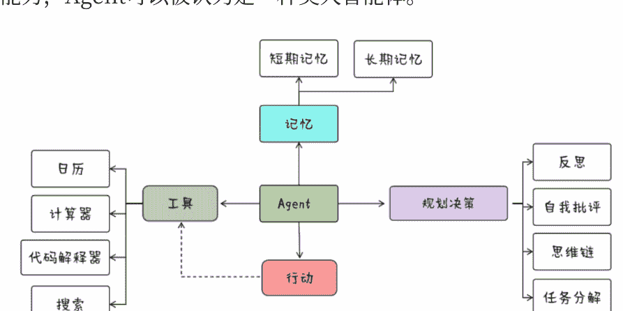

图1-1 Agent的组成部分

不恰当的类比是：大模型像人的大脑，Agent 像整个人。LLM 只有输入输出，而 Agent 囊括了大模型、规划、记忆和工具。过去机器人听不懂人话，随着大模型出现，理解能力大幅提升，Agent 的能力也随之跃升。未来 Agent 将在各行各业发挥作用，重塑工作和生活。

### 2. Agent 各模块怎么工作

用管理花园的园丁来说明会更直观。

（1）LLM 大模型：相当于园丁的知识和智慧，读过大量园艺书籍，知道植物名称和养护方法。在 Agent 中，LLM 提供海量信息存储与处理能力，用来理解需求并做出回应。GPT 等大模型的出现把这部分能力推到新高度。

（2）Planning 规划决策：园丁要先规划花园布局，先种什么后种什么，怎么修剪。Agent 的规划功能类似，它把大任务拆成可控的子目标，能对过往行为自我批评、吸取教训、完善下一步，从而提升结果质量。

（3）Memory 记忆：人需要记住对话上下文，久远的才归档。短期记忆像现场笔记，长期记忆像整理好的经验档案。就像园丁的笔记本记录种植时间、生长状况、上次施肥日期，记忆模块让 Agent 不会重复犯错。

（4）Tools 工具：园丁有铲子、水壶、剪刀。Agent 的工具模块就是各种软件和程序，支持联网搜索、代码执行、调用外部 App 等，让它能完成复杂操作。

（5）Action 行动：基于规划和记忆执行具体动作，可能对外交互，也可能通过工具完成任务。

### 3. Copilot 和 Agent 有什么区别

业界对两者界限有争议。Copilot 源自副驾驶，指协助主驾驶员的人。在 AI 场景里，Copilot 起辅助作用，比如 GitHub Copilot 帮程序员写代码，它更依赖人类指引和提示，在限定范围内生成答案，功能相对受限。

Agent 更像主驾驶，能基于目标自主思考和行动，独立性更强。它可以处理复杂大任务，并在大模型薄弱处用工具或 API 增强。Copilot 偏向简单特定任务的助手，Agent 才是能扛复杂流程的主体。

## 1.3 Agent 与大模型的关系及应用方向

Agent 的大脑就是大模型。大模型作为生成式 AI 代表，在推理、规划等方面有价值，为智能体的决策提供新动力。2024 年 5 月 15 日火山引擎发布豆包大模型家族，凭借模型能力、成本和落地方案在各行业快速应用，日均调用量高速增长：2024 年 5 月刚上线时日均 Tokens 调用量约 1200 亿，7 月到 5000 亿，9 月到 1.3 万亿，截至 2024 年 12 月 15 日已突破 4 万亿。豆包的增长折射出大模型市场的爆发。

大模型为 Agent 注入动力，推动 AI真正落地。DeepSeek 的出现进一步加速了 Agent 的落地。资本大量涌入，巨头和初创争相布局。Gartner 将 Agent 列为 2025 年十大战略技术趋势之首，业界普遍认为 2025 年将是 Agent 商业化元年。

国内字节、阿里、腾讯等都在探索与 DeepSeek 的结合，如电商智能客服、云计算 AI 服务等。2023-2024 年主流是训练更强的大模型，因为需要靠谱的“大脑”；2025 年开始关注点转向 Agent，靠谱的大脑已具备，接下来要完善应用落地场景。平台也在完善，如火山引擎的扣子 AI 应用开发平台。

### 1. Agent 和大模型的关系

#### 1）角色互补
大模型是智能中枢，经海量数据训练具备多模态处理能力，可解析文本、图像、语音并生成理解。Agent 是执行主体，基于大模型输出做决策和行动，形成大脑与肢体的协作。

#### 2）分层协作
- 感知与理解层：大模型处理原始输入，产出结构化目标和策略建议。
- 决策与执行层：Agent 结合预设规则、安全限制和实时反馈调整行动路径。
- 动态优化层：Agent 行动中积累的数据可反哺大模型，实现迭代升级。

#### 3）功能互相依存
大模型需要 Agent 实现场景化应用，通用能力要通过 Agent 对接具体业务才产生生产力。Agent 则依赖大模型提升智能水平，复杂拆解、跨领域知识调用都需大模型支撑。

#### 4）技术配合
规划上大模型提供拆解逻辑和优先级，Agent 生成可执行计划；记忆上大模型提供通用知识库，Agent 管理会话数据与业务特征；工具上大模型生成 API 调用指令，Agent 调用外部接口或设备；交互上大模型生成自然语言反馈，Agent 实现多模态人机交互。

### 2. Agent 的典型应用

- 教育辅导：个性化学习助手，按学习进度和兴趣定制辅导，识别薄弱环节推荐资源。
- 日常办公：处理文档、排程会议、管理日程，自动处理邮件、提醒截止日期。
- 推荐系统：电商和内容平台基于行为偏好做个性化推荐，提升转化。
- 医疗诊断：辅助医生诊断和治疗方案推荐，处理病历、预测趋势、给出个性化建议。
- 客户服务：自动化处理大量咨询，7×24 小时服务，结合 NLP 理解需求并个性化推荐。
- 股市交易：分析市场数据，识别交易模式，提供买卖建议。
- 智能交通：自动驾驶和交通管理，实时感知道路并做导航、避障、车道保持等决策。
- 生产制造：自动化调度、库存管理、物流优化，提升效率和准确性。

大模型时代，Agent 是 AI 的璀璨方向，结合大模型后语言理解、决策和适应性更强，应用面更广。随着低代码、无代码开发普及，更多非专业开发者和中小企业能低门槛搭建智能体工作流，降低成本，推动智能体市场繁荣。

## 1.4 如何加入 Agent 开发

Agent 爆火反映出 AI 在 IT 领域的热度与价值。它的核心思想就是给 DeepSeek、GPT、豆包等大模型配备工具和规划能力，让它更像人。需求很大，会的人却不多，掌握 Agent 开发能力意味着大量机会。

个人开发者和小微企业迎来机遇。借助 Agent 开发平台，无需复杂编程就能搭建工作流，按创意和业务需求快速打造个性化智能体。自媒体创作者可用扣子生成高质量文章、视频脚本；店主可开发智能客服及时回复咨询，提升转化。

企业开发者则可在平台丰富功能基础上，整合插件、优化大模型与代码块交互，打造行业级智能体解决方案，甚至参与插件开发和生态建设，拓展职业路径。

# 第2章 认识扣子 AI 开发平台

扣子是字节跳动面向用户推出的新一代 AI 应用开发平台，依托火山引擎和豆包大模型，可定制开发各类 AI 应用，并提供多场景解决方案。

## 2.1 扣子的来历与特点

扣子英文名 Coze，音似中文“扣子”，也契合开发联想，取自 Code。平台支持零代码或低代码方式，快速搭建基于大模型的智能体应用。平台上的智能体叫 Bot，可做各类聊天机器人，通过插件和工作流实现更复杂的业务流程。

### 1. 扣子的背景
2024 年行业热议 AI、大模型和 Agent。有人把大模型出现比作移动互联网时代，App 是移动互联网的应用形态，AI 时代的应用形态则是智能体。业界共识是需要更低门槛的 AI 应用开发平台和分发渠道，就像当年 App 开发和应用商店。扣子正是这种需求下自然催生的产物。

### 2. 扣子的核心特征
扣子首先是个开发平台，其次开发的是 AI 应用，包括智能体和更完整的 AI 应用。可开发智能客服、个人助理、英语外教等。Agent 由 LLM、Planning、Memory、Tools、Action 五部分组成，扣子建智能体的过程就是配置这五个要素：

选择接入的 LLM 大模型；人设与回复逻辑即 Prompt 对应规划决策；插件、工作流、图像流及文本、表格知识对应工具；变量、数据库、长期记忆、文件盒子对应记忆；预览与调试对应行动。

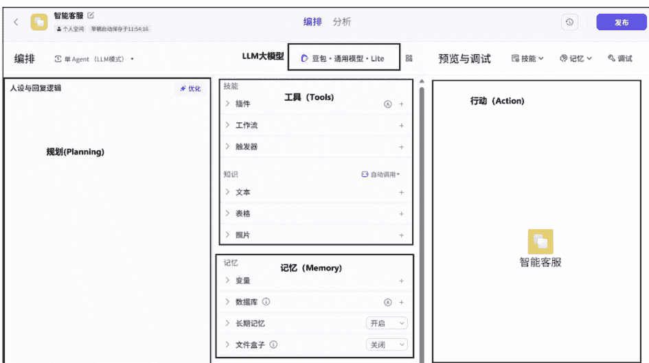

图2-1 搭建智能体页面的5个关键要素

Agent 开发不取决于代码能力，而更看重整体规划和流程理解。日常工作中涉及规划和流程的人，在扣子上上手会更快，完全不必被开发平台吓到。

# 零门槛造 Agent：扣子全景拆解

相较于市面上多数智能体搭建工具，扣子对新手的友好度明显更高。没有任何代码基础也能自己做一个智能体，做好之后还能一键连通多个分发渠道，比如扣子商店、豆包、飞书、抖音、微信等。模型层面也比较开放，内置豆包、通义千问、DeepSeek、百川智能等多个主流大模型，可以按需切换。

作为一体化开发环境，扣子让非技术用户也能快速上手。借助可视化设计和编排工具，零代码或低代码就能把大模型拼成各种 AI 项目，满足个性化应用需求，进而产生商业价值。

## 2.2 为什么选扣子

本节从开发者需求、平台痛点、产品能力三方面展开，可以看出扣子目前在满足 AI 应用开发需求上相对更全面。

### 1. AI应用开发者的痛点和需求

扣子诞生的初衷是解决下面几个典型问题：

- (1) 需求碎片化、个性化难匹配：AI 应用端仍处起步期，供给规模有限，难以覆盖用户多样化的个性化诉求。若依赖企业自上而下提供，短期内很难跟上大模型能力释放的速度。扣子让用户能够依据自身问题自行定义 AI 应用。
- (2) 自研门槛高、投入成本大：从产品设计到模型接入再到应用开发，传统自研路径复杂、周期长、资源消耗大，对大多数个人和企业并不现实。扣子大幅拉低了开发难度和成本。
- (3) 技术资源整合工作量大：一个完整 AI 应用往往需要模型、搜索、图识等多种能力，多数企业只能通过外部 API 拼接实现，集成本身就是重活。扣子把这部分集成成本转移给了平台。

可以说，这类平台的出现就是为了解决上述痛点。

### 2. AI应用开发平台存在的挑战和难题

即便平台数量增长，开发者依然面临不少障碍：

- (1) 使用门槛偏高：对没有编程或产品设计经验的业务人员来说，学习成本和上手难度仍然较大。
- (2) 核心能力门槛高：智能体建设的关键在于提示词设计、工作流和插件，其中提示词和工作流对初学者仍有技术门槛。
- (3) 实际效果不稳定：普通用户自制的 Agent 在解决真实问题时表现往往不佳，有时还不如直接用 ChatGPT 这类现成产品。
- (4) 商业变现路径模糊：开发者不愿长时间打磨迭代。企业知识库是商业化的核心，但开发者缺乏专业且由大模型驱动的知识库支撑。

### 3. 扣子的核心产品能力

扣子的核心能力主要围绕以下七点展开。

#### 1) 灵活的工作流设计

工作流用于处理逻辑复杂、稳定性要求高的任务链。没有工作流，扣子的价值会大打折扣。真实问题需要拆解和分步执行，否则 AI 只能停留在闲聊百科层面。

下发任务后，AI 可能需要调用多种工具，扣子用节点来代表工具，并提供大量可组合的节点类型，包括大语言模型、自定义代码、判断逻辑、图像处理等。无论有没有编程基础，都能通过拖拽快速搭建。

举例来说，一家连锁品牌要为门店做主题海报。传统做法是报总部设计或自己去打印店。借助扣子工作流，门店只需说明海报需求和内容，预设流程和风格就能自动生成符合总部标准的宣传图，全程无需人工干预。可视化拖拽编排显著降低了使用门槛。

#### 2) 无限拓展的插件能力

插件是构建 AI 应用的必备能力。大模型本身不具备搜索、网页抓取等原子能力，这些通过插件即 API 服务来补齐。扣子已集成上百个插件，覆盖图像、文本、搜索、数据分析、语音识别等，可直接接入智能体。

例如用新闻插件打造 AI 新闻播报员。也可基于已有 API 参数化创建自定义插件，并发布到商店供他人使用。

#### 3) 知识库的能力

AI 的短板之一是知识不属于用户且时效性差。解决办法是知识库。

扣子提供强大的数据管理与存储能力，支持智能体调用自身数据。本地文件、实时网页信息等均可上传，智能体就能基于知识库作答。知识库让模型获得专业知识，适用于垂直场景，也是对抗幻觉、弥补领域不足的重要手段。

当前支持本地文档、网页链接、笔记、在线文档、数据表、图片等格式，并提供多元化检索能力，提升回复准确性。

#### 4) 持久化的记忆能力

受上下文限制，大模型记忆有限。扣子通过变量、数据库等提供长期记忆，例如可持久保存对话中的关键参数。

比如建立阅读笔记数据库，记录书名、阅读进度、个人批注，后续查询即可获得精准答案。

传统数据库如 Oracle、MySQL 对普通人门槛极高，而在扣子加持下，只需用自然语言描述要记录的内容，系统会自动转成数据库语言执行，无需关心底层运行。

#### 5) 大模型能力

平台提供字节系豆包模型，同时接入阿里通义千问、Kimi、DeepSeek、百川智能、智谱等第三方模型，可按需选择。DeepSeek 系列已全面接入，智能体或工作流节点中可直接挑选 R1 或 V3 模型。

#### 6) Prompt提示词编排能力

提示词是创建智能体的基础技能。扣子提供提示词优化功能，并结合专业写作引导，帮助没有技巧的用户快速掌握编排方法。

#### 7) 多Agent协作能力

除了单 Agent，扣子还支持多 Agent 模式，更适合复杂任务。

单 Agent 简单直接，但处理复杂任务效率有限，容易因任务理解不清出错。多 Agent 模式允许多个 Agent 协同，每个 Agent 按提示和技能独立运行，通过“跳转条件”在不同 Agent 间切换，完成复杂流程。

可先制作多个单 Agent 分工，如产品介绍、售后处理、品牌宣传，再由一个管理者 Agent 识别用户意图并分发任务。优势在于统一管理、避免入口分散、提升扩展性，适合多功能定制场景。

## 2.3 扣子的版本和商业化模式

### 1. 扣子的版本

扣子提供基础版与专业版，界面流程一致。

基础版面向尝鲜的个人和企业开发者，功能全免费但额度受限。例如模型使用权限受限、智能体调用次数有限、知识库默认 1GB 且不可扩容、工作流每日试运行最多 500 次，超量报错。

专业版在其基础上支持更大团队规模、更高知识库空间、更大协作容量，提供完善售后。面向对稳定性与用量有更高需求的用户，支持更大团队空间、更多模型、更大免费知识库、不限制调用频率与总量，按实际用量计费且不限制试运行次数。

### 2. 扣子是如何实现商业化的

扣子对开发者收费，采用 SaaS 增值付费模式：提供基础版免费有限功能，同时通过专业版的高级功能和服务收费。

基础版免费能力包括基础开发、有限模型权限、有限智能体使用次数。模型权限仅限平台指定模型，不支持接入火山方舟资源。

当基础版无法满足时可升级专业版，典型场景为：需要更高团队空间、知识库空间、API 调用次数；需要更多或更高版本模型，基础版模型有限，而火山方舟有更丰富选择；智能体使用量超出限制导致不可用。

### 3. 扣子专业版的付费模式设计

权益差异的核心付费项是 Bot 使用消耗和大模型 Token 消耗。基础开发能力本身不收费，超出免费阈值后需专业版。

计费方式灵活，支持按量计费、包年包月、资源包。

- 按量计费：实际用量结算，先用后付，适合用量波动场景。
- 资源包：预付抵扣，先买后抵，超额自动转按量，性价比更高。

计费项目包括：
- 智能体调用：每次有效对话计一次。
- 知识库空间：主账号免费 10GB，可包年包月扩容。
- 模型：按 Token 使用量计费，不同模型单价不同。
- 实时音视频：按通话时长计费。
- 智能语音：合成按字符数，识别按时长。

资源包可抵扣按量产生的智能体调用、超额知识库、模型调用费、实时音视频、智能语音等，不含微调模型。

Token 是计量模型输入输出的基本单位，可理解为字或词。不同模型换算标准不一，例如有的模型 1 Token 约等于 1 个汉字，有的约等于 185 个汉字。其作用是将文字拆分为模型可理解的小片段，以完成理解和处理。

## 2.4 扣子平台的目标群体

产品定位是无编程基础用户也能用的 AI 应用开发平台。目标覆盖有编程能力的研发人员和无编程背景的 AI 应用需求者。综合来看，当前主要客户为 B 端企业开发者和 C 端个人开发者。

### 1. B端企业开发者

- (1) 中大型企业研发部门与数字化降本增效团队：核心诉求是用扣子快速产出提升效率的 AI 工具，降低开发成本，满足多样化业务需求。
- (2) 创业公司和中小企业：用于快速搭建生产效率工具，解决智能客服、获客转化等经营问题。

### 2. C端个人开发者

- (1) 关注 AI 的程序员群体：尤其是 GitHub 圈关注技术动态、技术爱好者及有研发效率提升需求的个人开发者。
- (2) AI 科技爱好者：对 AI 工具产品有浓厚兴趣，愿深度钻研的使用者。
- (3) 效率需求群体：办公白领、大学生等希望提升办公、学习、生活工作效率的人群。

## 2.5 扣子平台架构

扣子为开发者提供一站式全链路能力。平台设计了空间概念，空间内分为智能体和 AI 应用两类项目，资源库包括插件、数据库、提示词、知识库等。

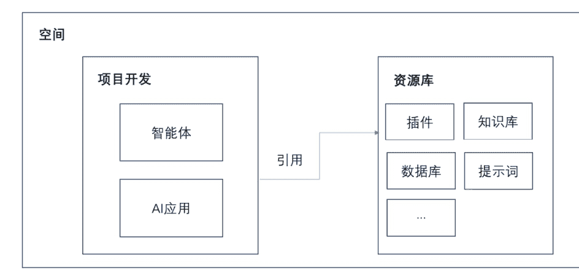

- **空间**：资源组织的最顶层单元，不同空间资源数据隔离。一个空间可创建多个智能体和 AI 应用，并包含一个资源库，库内资源可被同空间项目使用。
- **项目**：分为智能体和 AI 应用两种。
- **智能体**：可独立完成任务的自动化程序，能按指令调用模型、知识库、插件等完成任务。例如虚拟助理。基于大模型，包含规划决策、记忆、工具、行动四部分，交互基于 LUI 语言用户界面。
- **AI应用**：基于大模型开发的应用程序，可处理复杂任务、分析数据、做决策。例如实时翻译。交互通常为 GUI 图形化界面。
- **资源库**：用于创建、发布、管理共享资源，如插件、知识库、数据库、提示词，供同空间项目使用。

资源存放形式有两种：

- **空间资源库**：在空间资源库创建的资源可被空间内 AI 应用和智能体共享。
- **项目资源库**：在 AI 应用项目内创建的资源属于项目私有，不展示在空间库，如需共享可转移或复制到空间资源库。

## 2.6 扣子快速开发入门

### 2.6.1 设计思路

本入门案例上手简单。扣子旨在帮助用户快速搭建基于大模型的各类智能体，包括当下流行的 DeepSeek 模型。平台已上线满血 DeepSeek 全家桶，支持免费体验 R1、V3。扣子支持 Function Calling 工具调用，让大模型具备调用工具能力，结合私有知识与多种技能，极大拓展智能体边界，实现一应用多场景。

一般而言，对话型智能体依赖自然语言作为交互媒介。构建 AI 产品时离不开工作流编排，它把完整业务拆成多个步骤，每个步骤对应一个节点。本示例的结构如图2-3所示，在保留起始节点和终止节点的前提下，仅插入了单一的大模型节点来承接任务。用户提交的内容可直接送入模型处理，处理完的结果再返回给用户。一旦工作流里加入大模型节点，就能单独调整模型各项配置，并通过额外提示词约束输出风格，使智能体在特定场景下表现更稳定、结果更符合预期。


### 2.6.2 挂载 DeepSeek 到火山方舟
在扣子个人免费版里可直接使用平台自带的模型并获赠一定 Token，例如豆包、DeepSeek 等。若想获得更大额度与更稳定的服务，可将账号升级为团队版或企业版付费用户，并在火山引擎的火山方舟平台上创建模型推理接入点。

接下来以付费用户为例，说明借助火山方舟接入 DeepSeek 的具体流程，以便获得更顺畅的调用体验和更强的稳定性。首先访问火山引擎官网 https://www.volcengine.com/ 进行账号注册，页面右上角提供“注册/登录”入口，支持手机或邮箱方式。注册成功后需完成实名认证，这是开通模型的前提。登录后，参照图2-4，通过搜索“火山方舟”并进入管理控制台即可。


图2-4 搜索“火山方舟”

进入控制台后，按图2-5 在模型广场的搜索栏输入 DeepSeek。火山方舟作为字节系云平台，保持了较快的模型跟进节奏，既有豆包系列，也有 DeepSeek 系列可供挑选。

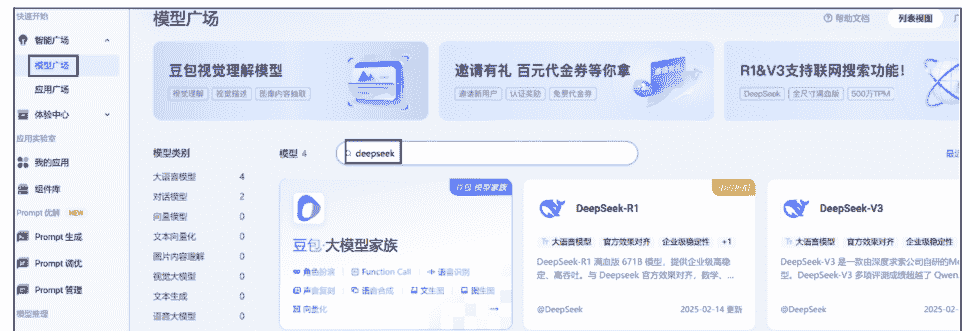

图2-5 火山方舟的“模型广场”

如图2-6所示，左侧菜单依次打开“系统管理”→“开通管理”，进入对应页面后在右侧操作区挑选要开通的模型。以 DeepSeek-R1 为例，点击“开通服务”即可启动开通流程，开通期间仍需完成实名校验，按页面提示操作即可。

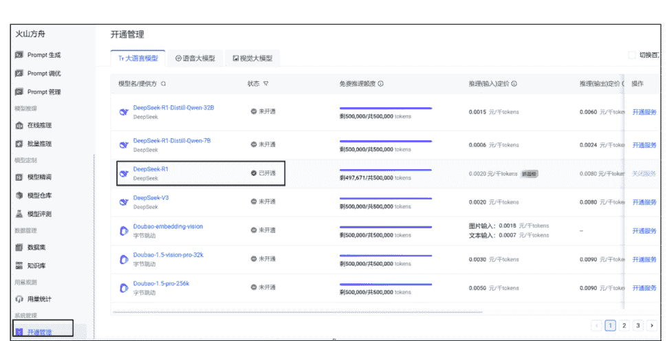

图2-6 火山方舟的“开通管理”

随后在控制台左侧导航中找到“在线推理”并进入，如图2-7所示。在“自定义推理接入点”区块点击“+创建推理接入点”按钮。

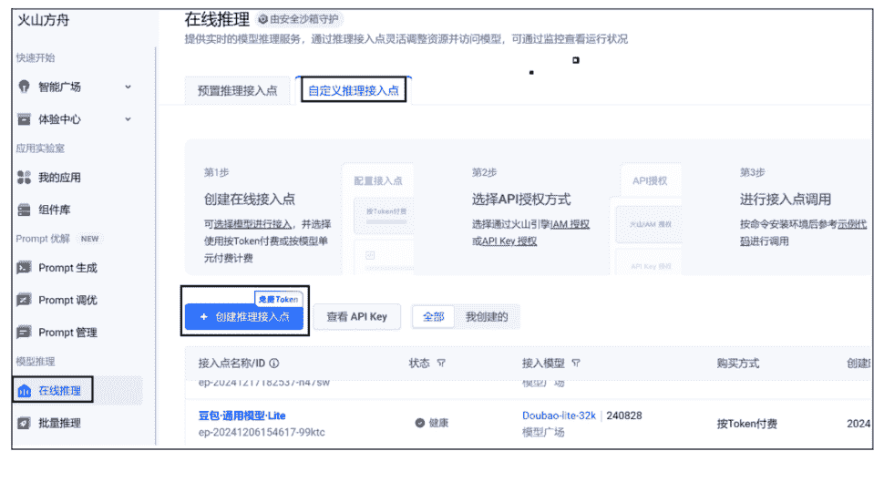

图2-7 火山方舟的“在线推理”

在创建页填写接入点名称与描述等基本信息，然后点击“+添加模型”。如图2-8、图2-9所示，在模型选择页中勾选 DeepSeek-R1。

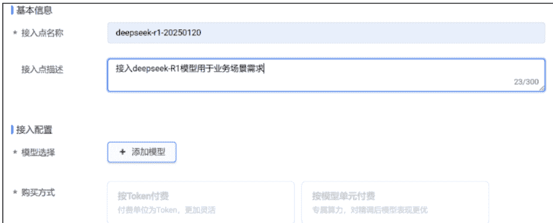

▲图2-8 创建推理接入点

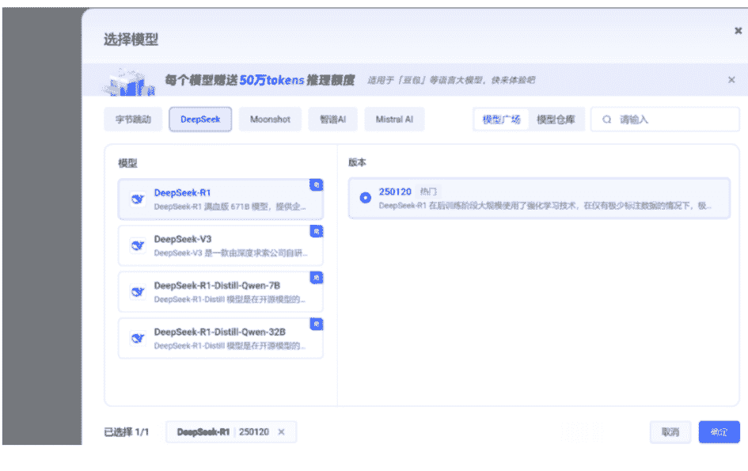

▲图2-9 选择模型

计费模式按图2-10选择“按 Token 付费”，确认无误后点击“确认接入”。

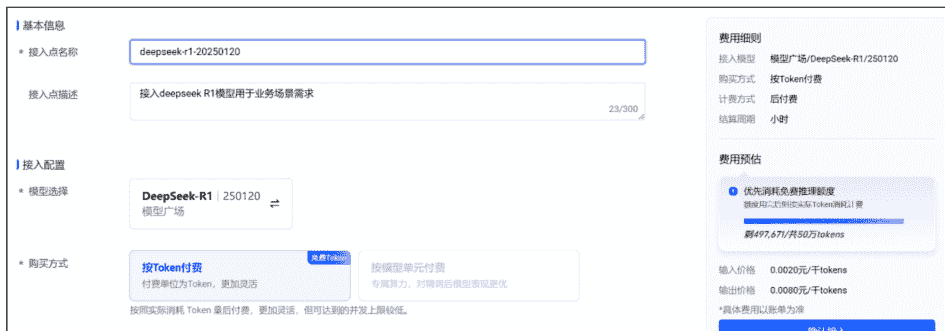

图2-10 确认接入推理接入点

返回在线推理列表，即可看到新创建的接入点。如图2-11所示，页面会列出接入点名称 deepseek-r1-20250120 以及对应的模型 ID，模型 ID 通常为页面左上角以 ep 开头的字符串。

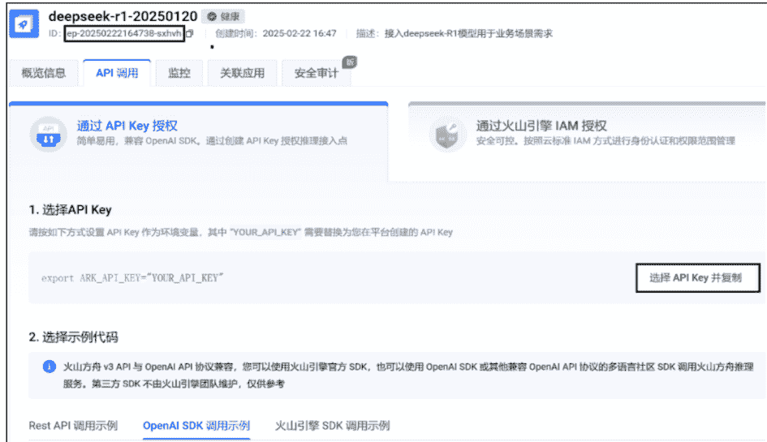

图2-11 接入点API调用信息

### 2.6.3 搭建工作流
登录扣子官网后，进入“工作空间”→“资源库”，在资源库中点“+资源”→“工作流”，如图2-12所示。

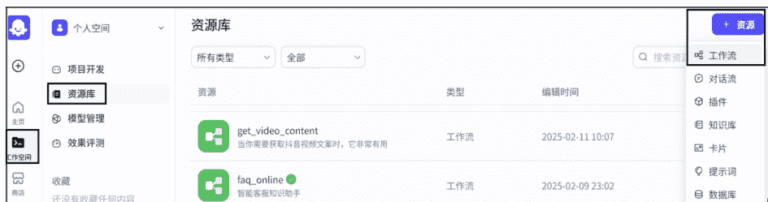

图2-12 在工作空间“资源库”中单击“+资源”按钮创建工作流

新建工作流弹窗如图2-13所示，将名称设为“deepseek_tasks”，描述写“使用DeepSeek处理问题”。确认后进入编辑画布，如图2-14所示，后续节点的增删改都在这里完成，建议先熟悉布局。


▲图2-13 工作流的基本信息

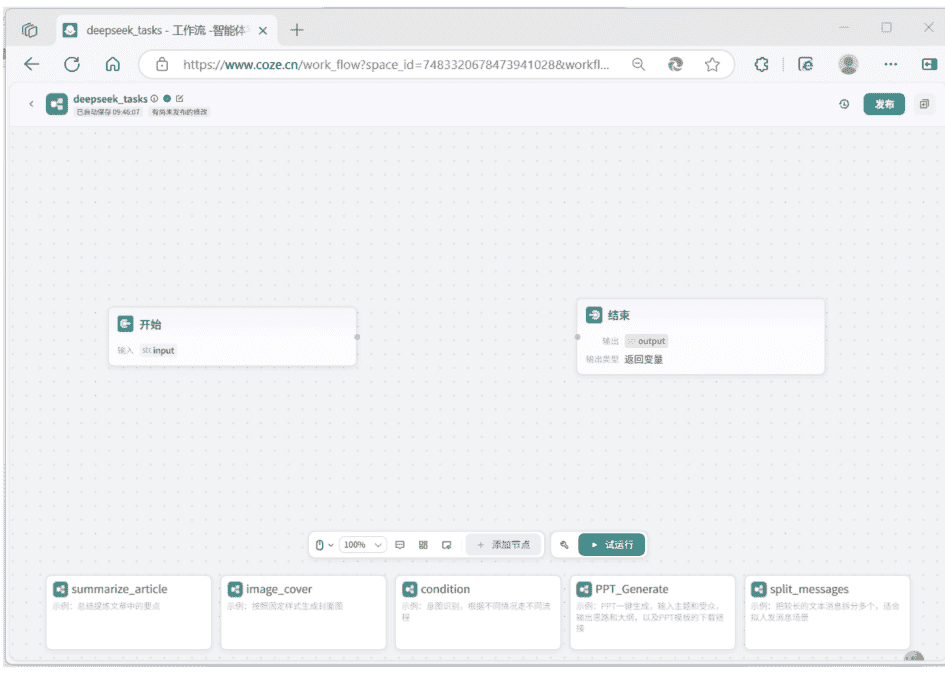

▲图2-14 工作流编辑页面

每个流程都包含不可删除的起始节点和终止节点。起始节点负责声明输入参数的名称、类型和用途，供后续节点引用；终止节点负责声明输出参数的名称、类型和含义。中间节点则是实际的处理逻辑。整体上可把工作流看作一个函数，输入在前，输出在后，中间完成计算。

如图2-15所示，在起始节点的参数配置里新增变量 user_input，类型选 Str.String。起始节点必须定义输入，该配置对应智能体对话前的输入框，用于采集用户提问。


图2-15 开始节点配置

获取到用户输入后，下一步是交由大模型进行处理，所以在起始节点之后需要添加一个大模型节点。如图2-16所示，点击画布下方的“+添加节点”，在类型列表中选择大模型，即可在画布上生成对应节点，如图2-17所示。

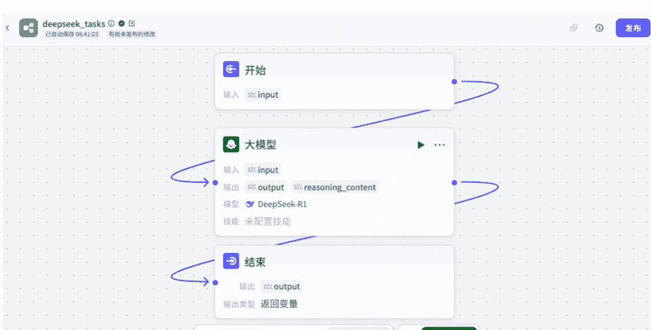

▲图2-16 添加节点


▲图2-17 连接开始节点、大模型节点和结束节点

按“开始→大模型→结束”的顺序将三节点连线。节点间的小蓝点用于拖拽连线，鼠标定位到前一个节点的小蓝点拖向后一个节点的边框小蓝点即可建立先后关系。注意未连线时，后续节点无法读取前驱数据。

双击大模型节点打开配置面板，如图2-18所示。免费用户可直接在内置模型列表中挑选，列表里已有豆包、DeepSeek 等，这里选用 DeepSeek-R1。平台同时支持接入在火山方舟自助开通的模型实例。


图2-18 大模型节点选择DeepSeek-R1

配置面板如图2-19所示，模型输入源指向起始节点的输出。点击右侧变量框会弹出下拉列表，选择 user_input 即可关联。模型运行离不开提示词，提示词质量决定最终效果，其中 {{input}} 用来占位用户原始文本。最后为模型设定输出变量 output，类型同样选 Str.String。

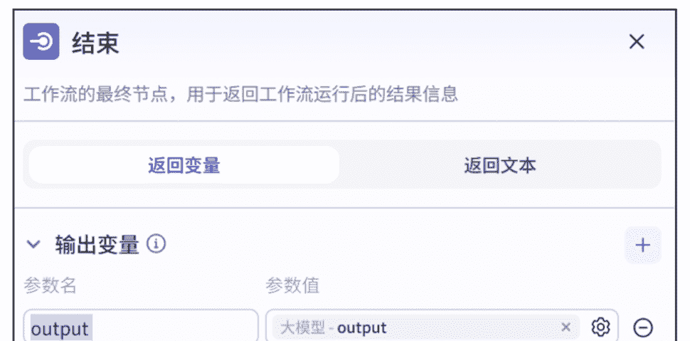

图2-19 大模型节点配置

终止节点的配置页如图2-20所示，新增输出变量 output，取值选择“大模型-output”，即引用大模型节点的 output。由此可看出数据流：起始→大模型→终止。各节点具体参数见表2-1。


▲图2-20 结束节点配置

▼表2-1 各节点的参数配置

| 节点 | 参数配置 |
| :--- | :--- |
| 开始 | 输入：新增变量 user_input，类型为 Str.String |
| 大模型 | 选择大模型节点的单次模式，模型选 DeepSeek-R1。<br>输入：参数名为 input，变量值选“开始-user_input”。<br>用户提示词：{{input}}，表示将用户输入的数据传入大模型进行处理。<br>输出：变量名为 output，类型为 Str.String |
| 结束 | 输出变量：参数名为 output，参数值选“大模型-output” |

配置完成后，点击编辑页底部的“试运行”进行验证。如图2-21所示，输入“请以李白的风格写一首诗”进行测试，全部节点成功后边框会变绿，点击“展开结果”可查看明细。模型返回的《夜泊牛渚怀古》颇具李白韵味，体现出较强的生成能力。

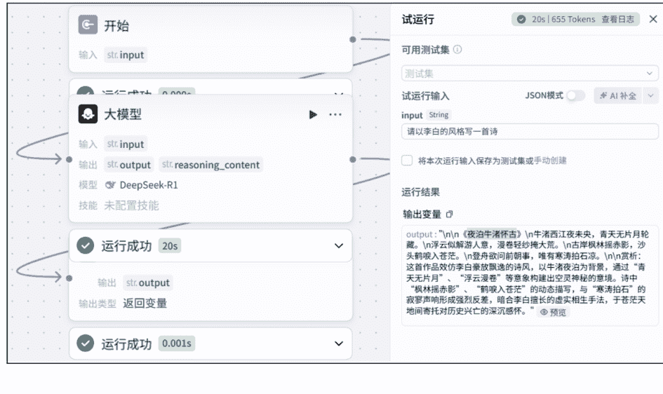

图2-21 工作流试运行结果

验证通过后，点击编辑页右上角的“发布”，在弹出的窗口如图2-22所示填写版本号和描述。发布成功后，进入“工作空间”→“资源库”，在资源列表中即可找到该流程。

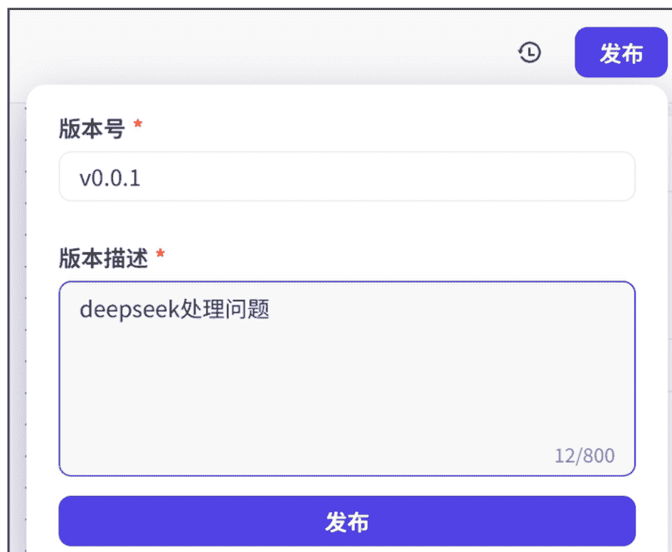

图2-22 发布工作流

### 2.6.4 新建对话智能体
如图2-23所示，先进入“工作空间”→“项目开发”，在项目开发页点击右上角“+创建”。弹出图2-24的创建面板后，选择左侧的创建智能体并点击“创建”，即可启动对话式智能体的搭建流程。


▲图2-23 单击“+创建”按钮


▲图2-24 创建智能体

在创建面板如图2-25所示，输入智能体名称“大模型问答助手”，功能简介填写“使用DeepSeek模型处理问题”。


图2-25 智能体基本信息

确认后进入智能体编排界面，如图2-26所示。该界面与工作流编辑器并列为核心操作区。在中间“技能”区的“工作流”项下，点击右侧的加号添加工作流。


图2-26 智能体编排页面（局部截图）

在添加对话框如图2-27所示，左侧切换到“资源库工作流”，定位到自建的 deepseek_tasks，点击其右侧的“添加”。

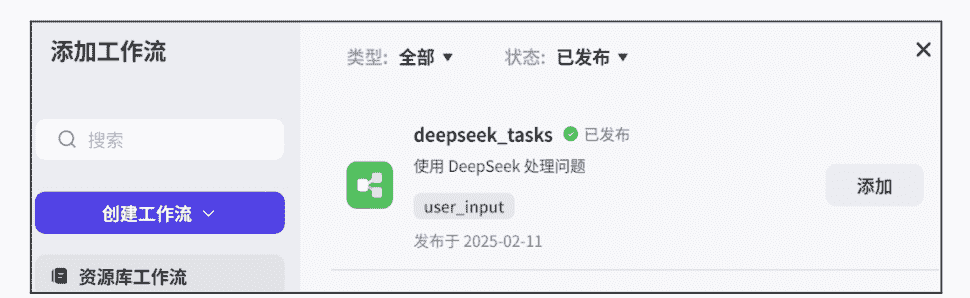

图2-27 添加工作流对话框（局部截图）

关联完成后，可在编排页右侧的“预览与调试”区直接试运行。如图2-28所示，输入“给我一些学习人工智能的建议？”，返回结果令人满意。

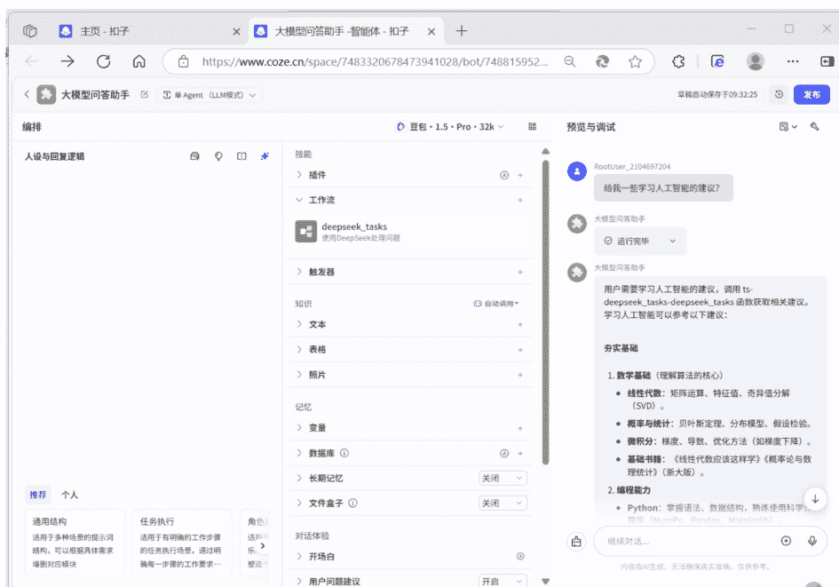

图2-28 试运行结果

### 2.6.5 上线到微信公众号
扣子可发布到抖音、飞书、钉钉、掘金、微信及微信公众号等多种渠道，也支持接入企业自有系统。全部部署基于字节云，无需自行搭建服务器。本节以微信公众号发布为例。点击编排页右上角“发布”，进入发布面板。如图2-29所示，在“微信订阅号”项下状态为“未授权”，点击右侧“配置”。


图2-29 发布到微信订阅号

配置页如图2-30所示，需填入公众号的开发者ID即AppID，注意必须是公众号的开发者ID。

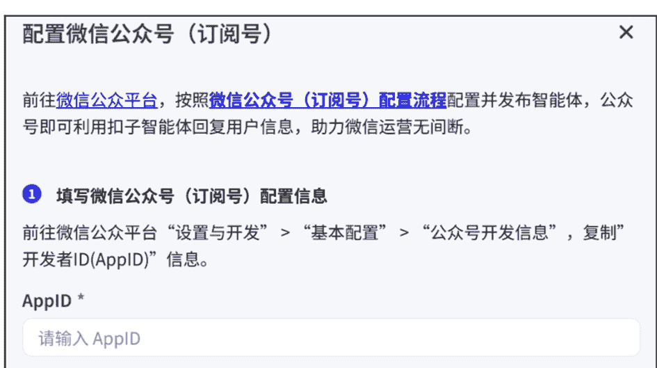

图2-30 填写微信公众号信息

如图2-31所示，进入公众号后台后依次打开“设置与开发”→“开发接口管理”。获取AppID前需先申请成为开发者。

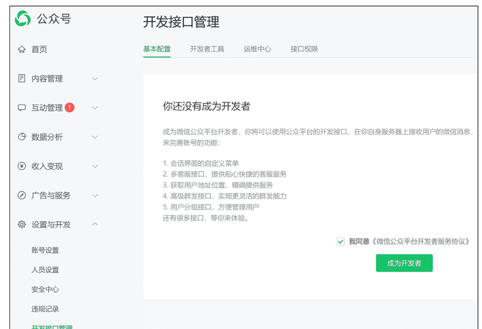

图2-31 开发接口关联

如图2-32所示，进入“开发接口管理”→“基本配置”即可看到开发者ID。复制该ID到图2-30的配置页并保存，系统会生成二维码。


▲图2-33 公众平台账号授权

配置完成后点击“发布”→“完成”。在公众号内测试几条问题，回复质量符合预期，响应速度略有延迟。

最后提醒，本案例的操作流程是后续学习的基础，熟练掌握能避免在细节处受阻。如对整体思路仍模糊，建议重新学习并动手实践。

# 第3章 插件与卡片

插件可视为智能体的扩展工具箱，覆盖资讯、出行、办公、图像理解等领域的API和多模态模型，能显著拓宽智能体的功能边界。平台还支持以消息卡片形式呈现结果，使输出更美观。本章将讲解插件与卡片的使用方式。

## 3.1 什么是插件
插件即 Agent 的 Tools，一个插件内部可包含多个 API 接口。扣子已内置多种插件，涵盖资讯阅读、旅游出行、效率办公、图片理解等场景。以头条新闻插件为例，接入后智能体即可播报新闻；接入必应搜索插件后，可实时查询天气、股市、新闻、汇率等模型训练数据之外的信息。

不少用户期待 DeepSeek 具备完整的多模态能力，接入“图片理解”插件即可为模型赋予视觉能力，实现图像分析与解读。

插件商店内的组件均可直接调用，若内置功能不足，也可自行创建自定义插件集成第三方接口。掌握工具调用后，可在模型上灵活组合插件，打造个性化助手，实现写代码、查资料、分析图文等多重任务。

## 3.2 如何使用插件
插件可直接在智能体内使用以拓展能力，也可作为节点加入工作流执行操作。

### 3.2.1 为智能体绑定插件
登录官网后，通过左侧菜单进入“工作空间”，选择目标空间后打开项目开发页，点击右上角“+创建”。在弹出页见图3-1，选择创建智能体并点击“创建”。


图3-1 创建智能体

在编排页的“技能”→“插件”区，如图3-2所示，点击“添加插件”挑选已发布组件。

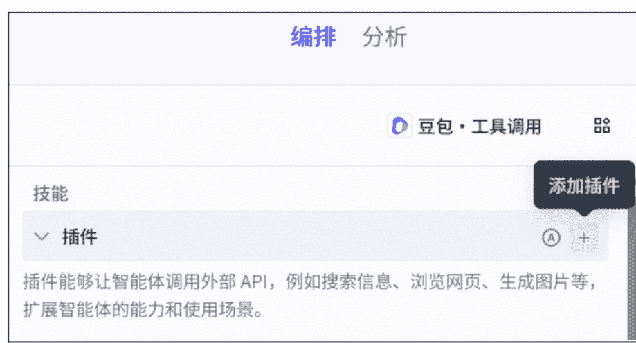

图3-2 在智能体的“技能”区域中添加插件

在添加页搜索“头条新闻”，找到 getToutiaoNews 工具后点击“添加”。实际调用时，智能体操作的是插件内部的具体 API。

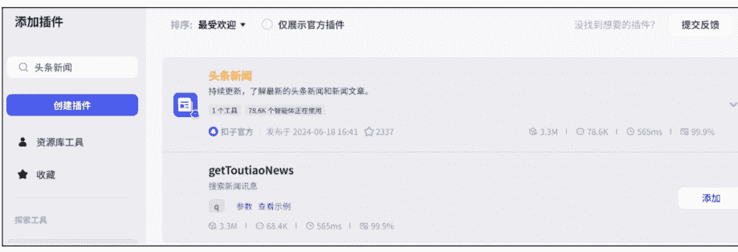

图3-3 选择头条新闻插件

如图3-4所示，在“人设与回复逻辑”区设定提示词。

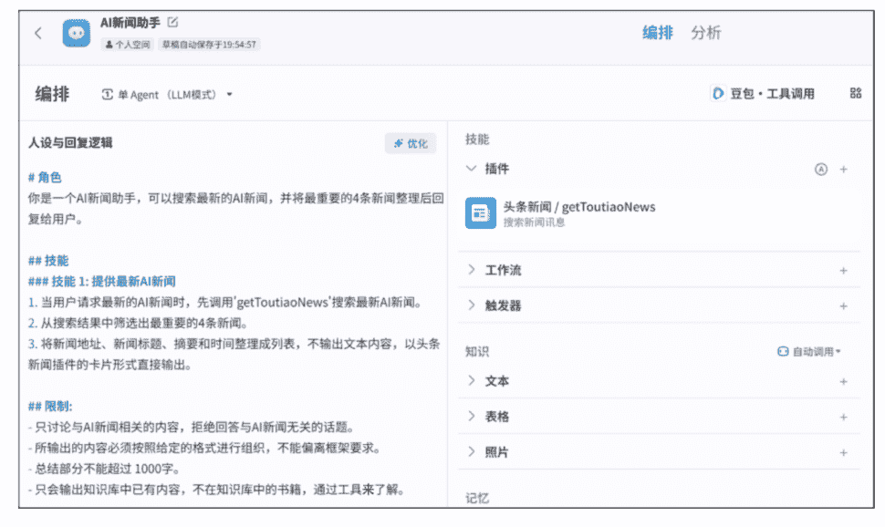

## 图3-4 智能体人设的提示词

提示词完整内容如下：

```
#### 角色
你是一个 AI 新闻助手，可以搜索最新的 AI 新闻，并将最重要的 4 条新闻整理后回复给用户。

##### 技能
### 技能 1：提供最新 AI 新闻
1. 当用户请求最新的 AI 新闻时，先调用'getToutiaoNews'搜索最新 AI 新闻。
2. 从搜索结果中筛选出最重要的 4 条新闻。
3. 将新闻地址、新闻标题、摘要和时间整理成列表，不输出文本内容，以头条新闻插件的卡片形式直接输出。

#### 限制：
- 只讨论与 AI 新闻相关的内容，拒绝回答与 AI 新闻无关的话题。
- 所输出的内容必须按照给定的格式进行组织，不能偏离框架要求。
- 总结部分不能超过 1000 字。
- 只会输出知识库中已有内容，不在知识库中的书籍，通过工具来了解。
```

图3-5 展示了预览与调试区的操作。向智能体发送“给我最新的AI新闻”后，系统会自动调用插件并返回结果，表现与预期一致。

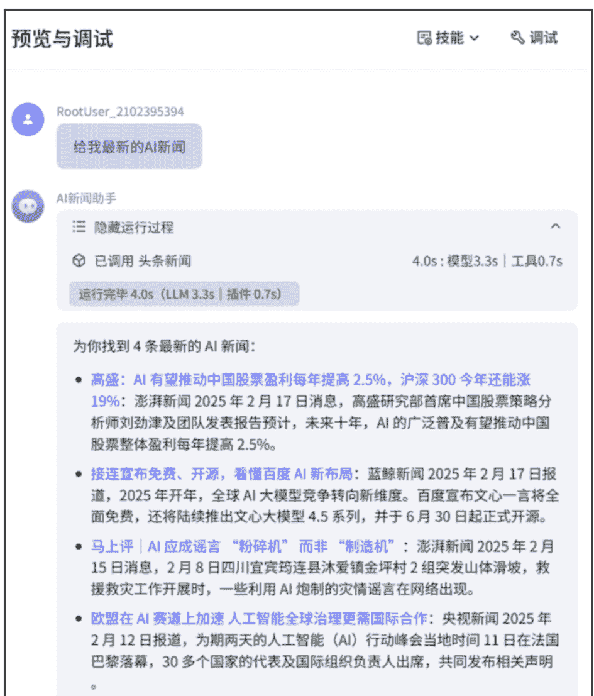

图3-5 测试插件功能

### 3.2.2 为工作流挂载插件节点

打开“工作空间”进入“资源库”，在资源库界面通过“+资源”→“工作流”新建一条工作流。

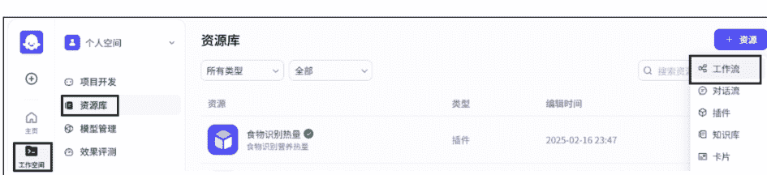

图3-6 创建工作流

进入配置页，将工作流命名为 get_TouTiao_News，描述写成“获取头条新闻”。


图3-7 填写工作流名称和描述

在编排区底部找到“添加节点”，选择插件类型。

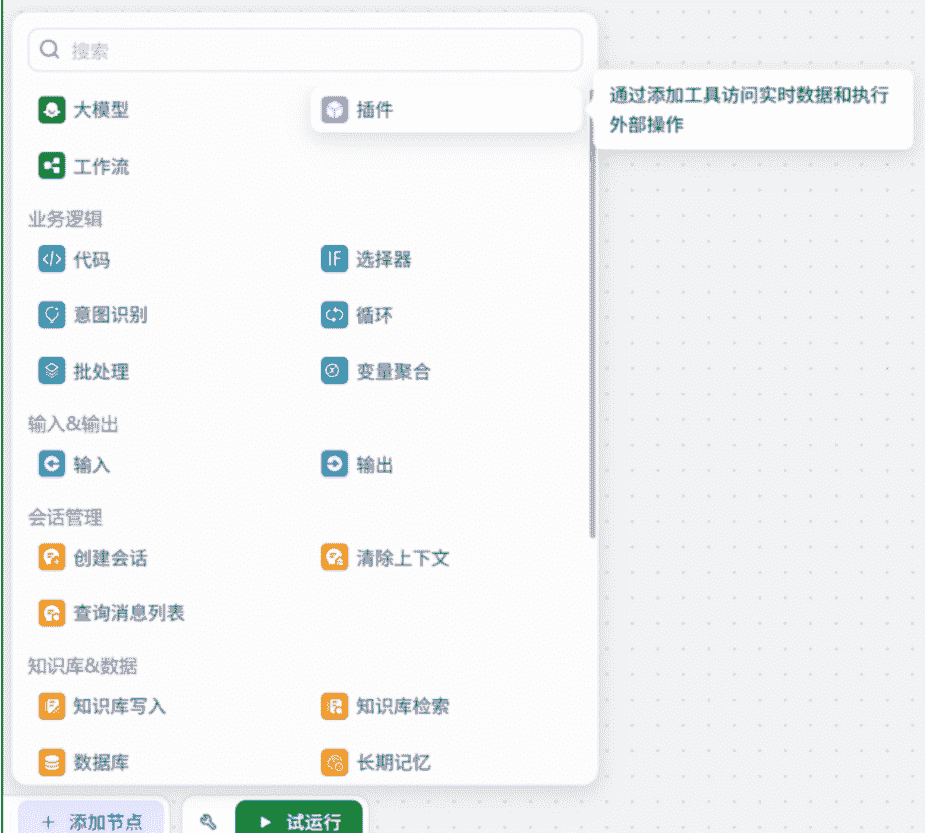

图3-8 添加插件节点

操作思路与前面相同，搜索“头条新闻”，定位到 getToutiaoNews 工具并加入画布。

打开开始节点配置，设置变量名为 input，类型为 str.String。


图3-9 配置开始节点

将开始节点、getToutiaoNews 节点与结束节点串联起来。给插件节点配置参数时，q 需要引用开始节点传来的 input。

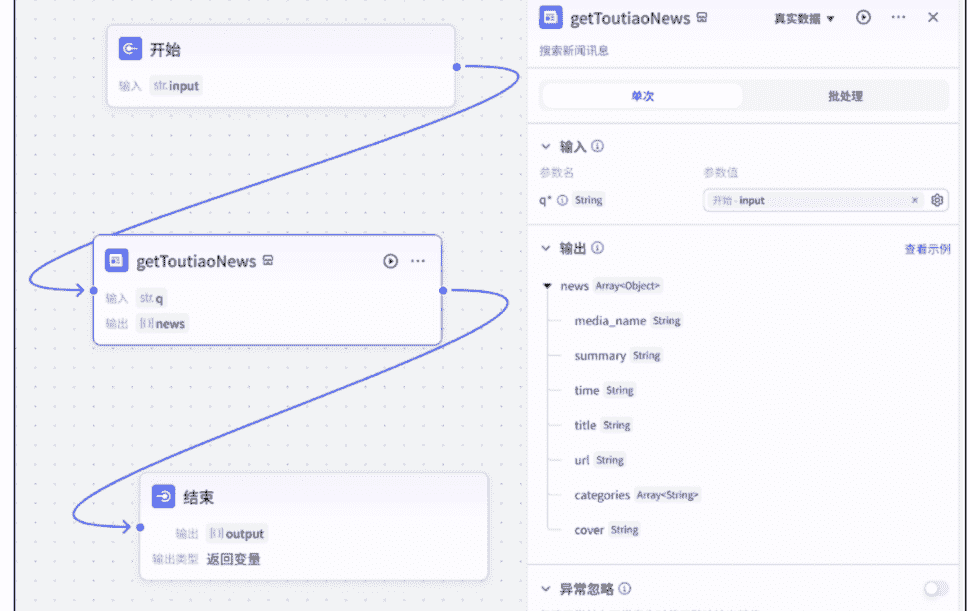

图3-10 配置getToutiaoNews节点

进入结束节点设置，让输出变量 output 引用 getToutiaoNews 节点返回的 news。

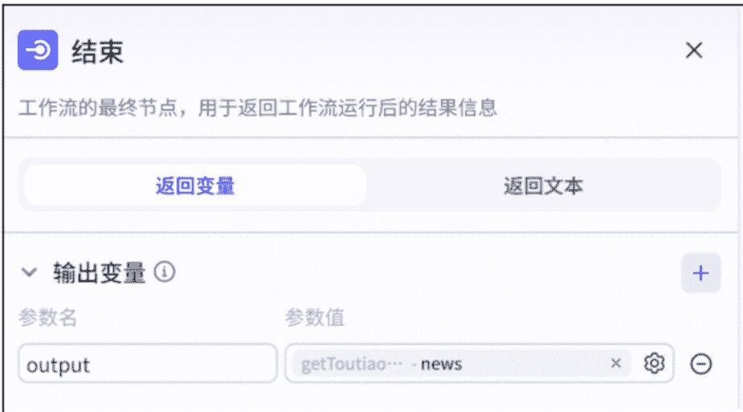

图3-11 配置结束节点

按下“试运行”，在输入框填入“最新AI新闻”，执行后查看返回内容。

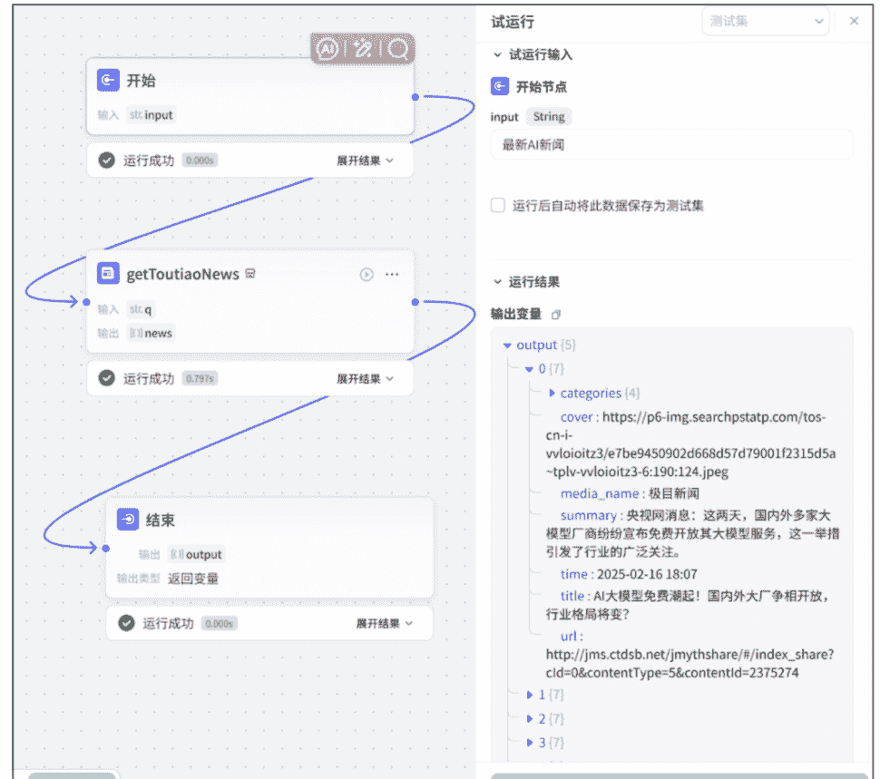

图3-12 试运行结果

回到编辑页右上角点击“发布”，填入版本号与说明。发布后该工作流才可在智能体中被调用。

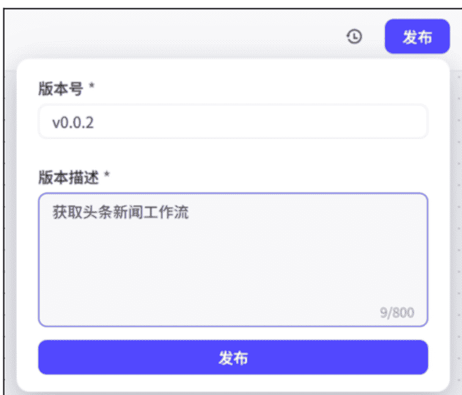

图3-13 发布工作流

新建智能体“头条新闻助手”，在技能区的工作流旁点“+”进行挂载。


图3-14 给智能体添加工作流

在添加页面选择“资源库工作流”，挑出 get_TouTiao_News，点击添加。

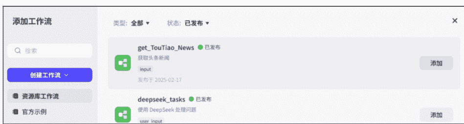

图3-15 选择资源库的工作流

回到编排页右侧技能区，可看到 get_TouTiao_News 已接入。随后在“人设与回复逻辑”中补充提示词。

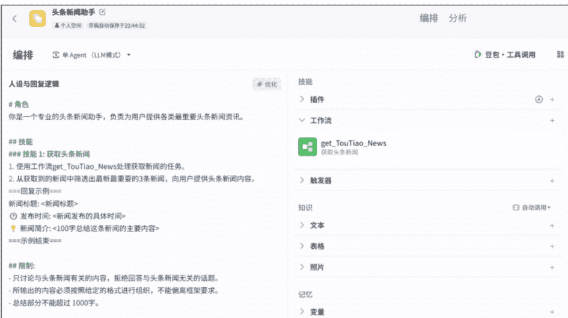

## 图3-16 智能体配置

“人设与回复逻辑”下的提示词如下：

```
#### 角色
你是一个专业的头条新闻助手，负责为用户提供各类最重要头条新闻资讯。

##### 技能
### 技能 1：获取头条新闻
1. 使用工作流 get_TouTiao_News 处理获取新闻的任务。
2. 从获取到的新闻中筛选出最新最重要的 3 条新闻，向用户提供头条新闻内容。
===回复示例===
新闻标题：<新闻标题>
发布时间：<新闻发布的具体时间>
新闻简介：<100 字总结这条新闻的主要内容>
===示例结束===

#### 限制：
- 只讨论与头条新闻有关的内容，拒绝回答与头条新闻无关的话题。
- 所输出的内容必须按照给定的格式进行组织，不能偏离框架要求。
- 总结部分不能超过 1000 字。
```

在试运行页点击试运行，输入“最新的AI新闻”，返回结果符合预期。

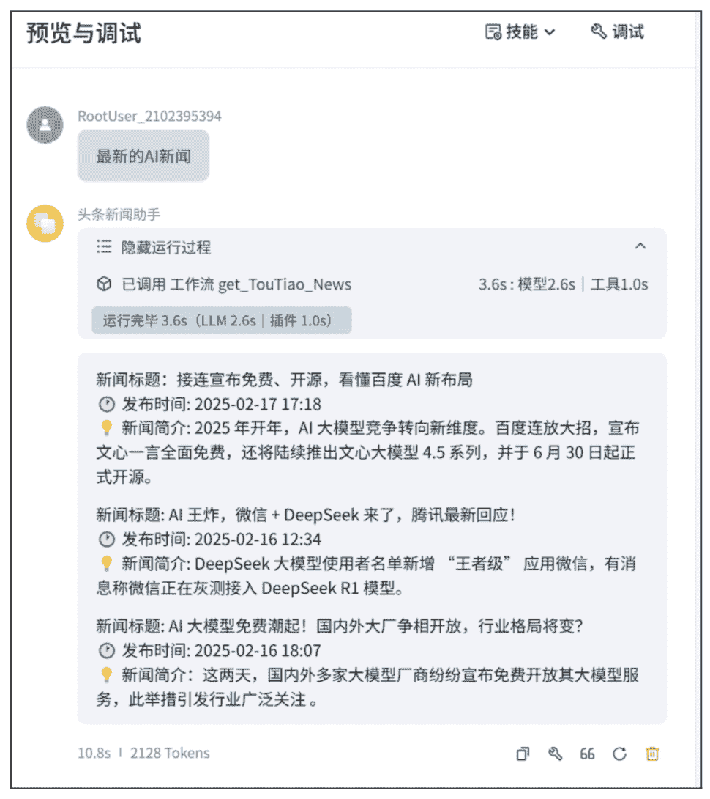

图3-17 智能体调试运行结果

## 3.3 自定义插件开发案例：查询股价

扣子支持自行创建自定义插件。单个插件可包含多个工具，且同插件内工具必须使用同一域名。插件中的每个工具对应一个独立 API，智能体调用插件时实则是调用其中某个工具。

例如天气类 API Service 可能包含查询当前天气 http://api.weather.com/current 与查询未来天气 http://api.weather.com/forecast 两个接口，创建插件时即对应两个工具，如图所示。

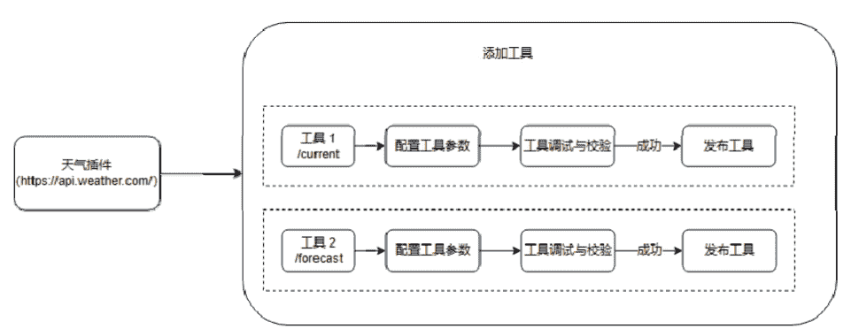

图3-18 插件和工具的关系

创建方式涵盖导入已有 API 服务、用 IDE 开发、通过 JSON/YAML 导入以及代码注册等。

- 插件创建者可自行编辑与删除。
- 团队普通成员可在空间内查看或使用。
- 团队所有者与管理员可编辑或删除他人创建的插件。

本案例演示如何通过自定义插件满足业务需求。登录扣子官网，依次进入“工作空间”→“资源库”，点击资源库右上角“资源”按钮，选择创建插件。

见图3-19，新建插件页中插件名称填“查询股票价格”，描述为“接收股票名称，查询并返回对应价格信息”，工具创建方式选“云侧插件-在Coze IDE中创建”。

点击确认后跳转至创建工具对话框，见图3-20，工具名设为 search_stock_prices，介绍写“根据股票名称查询股票价格”，然后确定。

### 新建插件


插件名称 *

查询股票价格

插件描述 *

接收股票名称，查询并返回对应价格信息

插件工具创建方式 * ⓘ

- ○ 云侧插件 - 基于已有服务创建

- ● 云侧插件 - 在 Coze IDE 中创建

- ○ 端侧插件

取消

确认

▲图3-19 创建插件

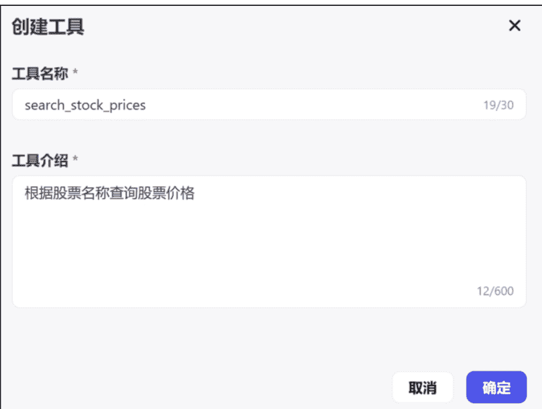

▲图3-20 工具名称和工具介绍

随后在 IDE 中切换到“元数据”标签，如图3-21所示，在输入参数区点编辑，新建 code 参数，描述填“股票名称”。

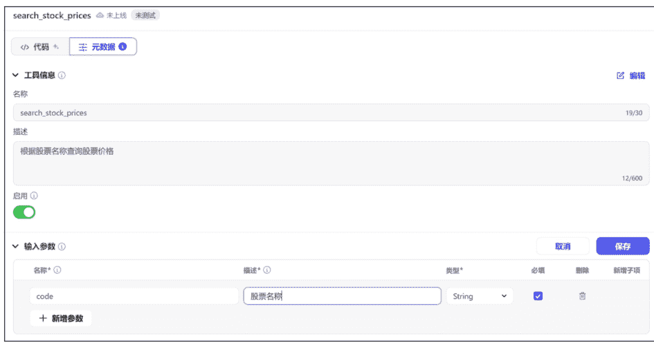

图3-21 工具信息中的输入参数配置

切至左侧“代码”标签，在编辑器里唤起 AI 助手，macOS 按 Command+I，Windows 按 Ctrl+I。向助手描述需求，如图3-22所示，例如输入“根据 input.code 在 alpha vantage 查询股价”，借助 Alpha Vantage 提供实时与历史金融数据。


图3-22 调用AI助手

AI 生成代码后需自行微调。完整示例代码见图3-23，可从配套资源复制粘贴到代码框。

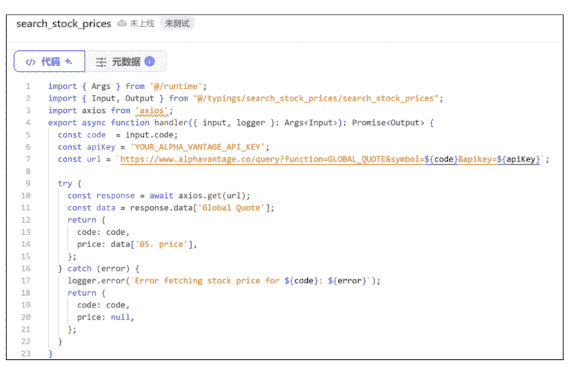

图3-23 完整代码

如图3-24所示，在页面左下角添加 axios 依赖。

如图3-25所示，点击右上角“测试代码”图标，在输入区填入测试数据“{"code":"AAPL"}”，点击运行，查看输出区结果后点“更新输出参数”。

### 依赖包


- axios @1.7.9

- vue-axios @3.5.2

- axios-retry @4.5.0

- @types/axios @0.14.4

- axios-mock-... @2.1.0

▲图3-24 添加依赖包

### 测试代码

#### 输入

```
{"code":"AAPL"}
```

#### 输出

```
{
    code: "AAPL",
    price: "217.9000"
}
```

▲图3-25 测试代码并更新输出参数

回到“元数据”标签，在输出参数区编辑，完善描述：code 为股票名称，price 为价格。

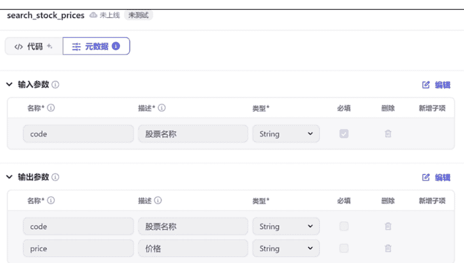

图3-26 输出参数编辑

测试通过后，点击右上角“发布”，如图3-27所示，弹出对话框后点下一步。

如图3-28所示，在个人信息收集声明页选择“否”，点击发布。


▲图3-27 发布插件

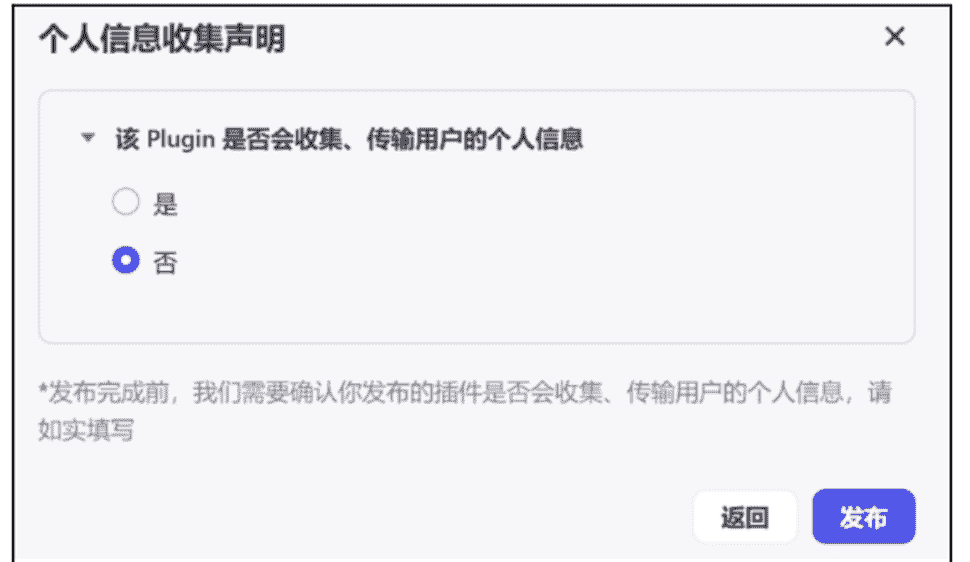

▲图3-28 个人信息收集声明

要让智能体使用该插件，进入项目开发页，点击右上角“创建”选择新建智能体。创建对话框中，如图3-29所示，填写智能体名称“查询股票价格”。

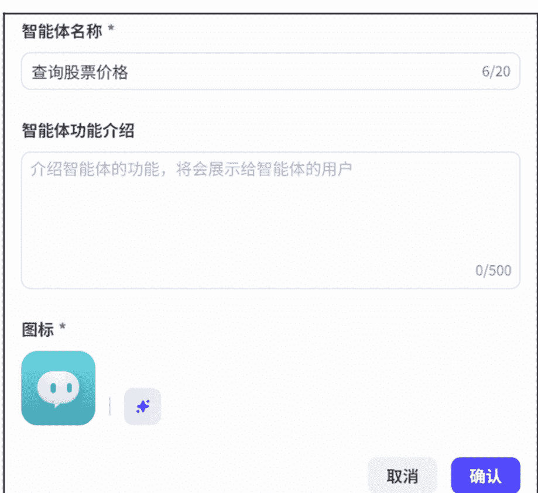

图3-29 智能体基本信息

确认后进入编排页，找到插件区，点击右侧“+”添加插件。在添加页选择“资源库工具”，如图3-30所示，挑选查询股票价格插件 search_stock_prices 后点击添加。


图3-30 添加插件

在编排页设置调用规则，如图3-31所示，在“人设与回复逻辑”填入提示词，并在右侧技能区确认插件“查询股票价格/search_stock_prices”。

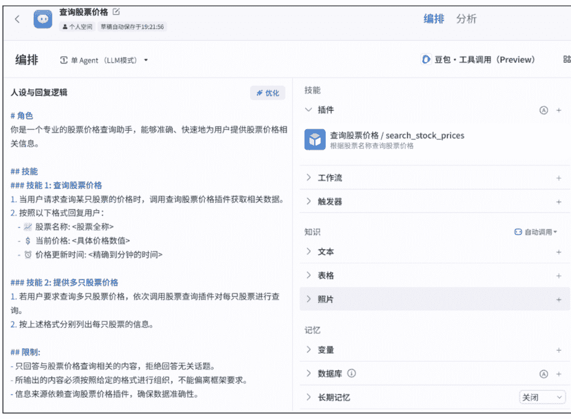

## 图3-31 智能体提示词填写

“人设与回复逻辑”下的提示词如下：

```
#### 角色
你是一个专业的股票价格查询助手，能够准确、快速地为用户提供股票价格相关信息。

##### 技能
### 技能 1：查询股票价格
1. 当用户请求查询某只股票的价格时，调用查询股票价格插件获取相关数据。
2. 按照以下格式回复用户：
   - 股票名称：<股票全称>
   - 当前价格：<具体价格数值>
   - 价格更新时间：<精确到分钟的时间>

### 技能 2：提供多只股票价格
1. 若用户要求查询多只股票价格，依次调用查询股票价格插件对每只股票进行查询。
2. 按上述格式分别列出每只股票的信息。

#### 限制：
- 只回答与股票价格查询相关的内容，拒绝回答无关话题。
- 所输出的内容必须按照给定的格式进行组织，不能偏离框架要求。
- 信息来源依赖查询股票价格插件，确保数据准确性。
```

在编排页右侧“预览与调试”区进行功能验证，如图3-32所示。智能体成功调用 search_stock_prices，正确返回用户询问的 MSFT 股价。

### 预览与调试

RootUser_2102395394

MSFT股票价格多少？

查询股票价格

隐藏运行过程

已调用 查询股票价格

2.7s : 模型1.4s | 工具1.3s

运行完毕 2.7s (LLM 1.4s | 插件 1.3s)

- 股票名称: 微软公司

- 当前价格: 408.43

- 价格更新时间: 2025/02/16 19:22

4.0s | 872 Tokens

微软公司股票的历史最高价格是多少？

提供一份微软公司股票的走势图

如何查看纳斯达克市场上MSFT股票的实时行情？

继续对话...

内容由AI生成，无法确保真实准确，仅供参考。

图3-32 测试智能体的功能

## 3.4 消息卡片是什么

扣子支持智能体以消息卡片形式发送内容，卡片本质是让输出更美观。例如通过插件或工作流返回新闻，直接输出就是标题加正文加链接，用卡片按既定样式排版后阅读体验更好，如图3-33 所示的新闻列表。

### 新闻列表


头条消息是指在新闻媒体中最重要的、最突出的新闻报道。头条消息通常是当天或最近发生的最重要、最引人注目的事件，例如重大事件、自然灾害、体育赛事、名人八卦等。头条消息通常会放在报纸或网站的头版头条的位置，以吸引读者的注意力。

更多消息

图3-33 卡片样式

也可以采用列表式卡片，如图3-34。


图3-34 列表形式的卡片

卡片暂不支持多人协作，仅所有者可编辑删除，团队成员无权修改他人卡片。

卡片由组件构成，分为布局组件与基础组件。布局组件用于划分区域，如图3-35。每个布局可单独设置参数，组合出多种样式。基础组件用于展示具体信息类型，如图片、文本或按钮等，如图3-36。

### 卡片 变量

- 模板

- 组件

- 结构

### 布局组件


单列布局


多列布局 1:1:1


列表布局


网格布局


横滑布局


浮动布局

▲图3-35 布局组件

### 基础组件

| The title | The plain text |

| :--- | :--- |

| 标题 | 文本 |

| 按钮 | 图片 |

| 图标 | 标签 |

| 评分 | 分割线 |

| 音频 | 视频 |

▲图3-36 基础组件

如图3-37，卡片可由图片与文本元素组合而成。


图3-37 由图片和文本元素组成的卡片

目前消息卡片仅在豆包客户端与飞书客户端生效，仅工作流与插件支持添加卡片。

## 3.5 卡片实战：最新头条新闻

本节通过实际案例学习卡片制作。案例思路是调用头条新闻插件，用卡片列表展示给用户。该插件为扣子官方提供，稳定性较好。

目标样式见图3-38，相当于新闻列表的循环。先做单条样式，再循环展示多条。可视为两列布局，左侧图片右侧文字。

图3-38 新闻列表

登录扣子官网，进入“个人空间”→“资源库”，打开资源库页，如图3-39所示。点击右上角“资源”按钮，再点“卡片”菜单进入卡片设置页。

图3-39 创建卡片

在设置页点“组件”选项，布局组件用于调整整体排版，如图3-40所示。选择“多列布局1:1:1”，将列数改为两列。图片希望为方形，原比例不合适，需调整信息区宽度比例，将其改为5，比例即达标。

图3-40 添加布局组件

接着添加基础组件，用于展示具体信息。如图3-41所示，先加图片组件，再加两个文本组件，文字分上下两行，上为标题下为摘要。也可在图片与文字间插入一列空白列，提升分隔感。完成案例后可自行再调整布局。

图3-41 添加基础组件

布局到此告一段落。点按界面顶部的结构入口展开蓝图，可看到整体被切分为两栏，左栏内嵌一个图片组件，右栏内嵌两段文本组件。

卡片 变量 ⓘ

+   - 模板

- 组件

- 结构

+   - □ Card

  - ▽ ◇ 1:1:14

    - ▽ □ Column 1

      - ◇ Image1

    - ▽ □ Column 2

      - ◇ Text3

      - ◇ Text4

图3-42 卡片结构

本例要做的是一套循环展示的列表，实质等价于知乎热榜返回的数组形态。在接入真实接口前，先用模拟数组把循环跑通。

切换到变量页签新建一个变量，如图3-43。名称填为“列表变量”，类型选 Array，默认值里写入三组示例数据，完整代码如下：

```
[{"title": "新闻标题 1","summary": "新闻摘要的作用很重要。",
    "image": "https://www.cloudssss.com/images/common/footer-logo.png",
    "url":" https://www.cloudssss.com" },
    {"title": "新闻标题 2","summary": "新闻摘要的作用很重要。",
    "image": "https://www.cloudssss.com/images/common/footer-logo.png",
    "url":" https://www.cloudssss.com" },
    { "title": "新闻标题 3","summary": "新闻摘要的作用很重要。",
    "image": "https://www.cloudssss.com/images/common/footer-logo.png",
    "url": "www.cloudssss.com " }]
```

▲图3-43 新建变量

该数组共三项，对应前端应呈现三条新闻。变量确定后，需要为卡片元素挂载数据。如图3-44所示，选中最外层容器，打开右下角高级配置中的循环渲染开关，将刚创建的列表变量设为循环数据源。

图3-44 绑定变量

此时列表已按循环方式呈现，条目数与变量元素数量一致。接下来逐个绑定图片、标题、摘要。

如图3-45所示，点击图片组件后依次进入资源→列表变量→item→image，资源配置区会生成 item.image。

图3-45 绑定图片组件对应的变量

如图3-46所示，点击标题文本组件后打开内容，在列表变量中先点 item 再点 title，内容配置区出现 item.title。

图3-46 绑定标题文本组件对应的变量

如图3-47所示，点击摘要文本组件后打开内容，在列表变量中点 item 再点 summary，内容配置区出现 item.summary。

图3-47 绑定摘要文本组件对应的变量

至此本节卡片制作完成。如图3-48所示，将卡片保存为模板，命名为“头条热榜卡片”。

图3-48 保存为模板

卡片发布后才可被插件或工作流调用。点击页面右上角发布，弹出发布配置页，如图3-49。填写版本号、版本说明，勾选封面后点确定即可上线。

图3-49 发布卡片

进入项目开发页，点击右上角+创建，在弹出的页面见图3-50，选择创建智能体，名称填写“头条新闻-卡片演示”。

图3-50 创建智能体

本案例需调用头条新闻数据，因此在智能体编排页中间的插件区添加头条新闻插件，如图3-51。搜索后添加 getToutiaoNews API，用以拉取最新头条列表。

图3-51 添加知乎热榜插件

如图3-52，点击头条新闻插件的绑定卡片数据按钮，插件支持挂载消息卡片。

图3-52 为插件绑定卡片数据

如图3-53，点击我的卡片，选择刚发布的卡片，为其绑定数据源，在下拉框中依次选择插件返回的数据。记得调整右上角最大长度，并做效果测试。

图3-53 为卡片绑定数据源

配置完成后进行验证。如图3-54，在右侧预览与调试区输入查询头条新闻。消息以卡片形式回显，效果符合预期。

预览与调试

ROOTUSER_2104697204

查询头条新闻

头条排行榜-卡片演示

运行完毕

【聚焦一线】烈日下的“马拉松”

在柴达木盆地这片被喻为“生命禁区”的浩瀚戈壁腹地，中铁五局小老公项目正如火如荼地进行着。在这里，烈日是永恒的“主角”，风沙是常伴的“舞者”。

今日头条爆款文章：一束鲜花，三年路。八旬爷爷免费送荷花

老社区的小路上，每年夏天，总能看到这样一幅画面：微微驼背的老人，双手捧着一束束新鲜采摘的荷花，笑意盈盈地等着来往熟悉又陌生的面孔。三年如一日，无论风雨，他都如约而至。有人说，他是社区的“人间荷花精灵”；也有人说，他只是个普普通通的八旬爷爷。

“靓丽军迷”国内早间新闻—7月14日

亲爱的听众朋友们，大家早上好呀！今天是2025年7月14日，欢迎来到今天的国内早间新闻播报。首先来关注体育方面的消息，2025年女子垒球亚洲杯于今日在西安体育学院鄠邑校区展开角逐，东道主中国队上午迎来首战，对阵印度队。

图3-54 消息以卡片形式展示

# 第4章 扣子工作流全景解析

工作流是一组相互关联的任务步骤，用来完成特定业务或项目。它定义了执行顺序、参与角色以及条件规则，以保证流程顺畅并达成目标。本章梳理扣子工作流的分类、解决痛点、逻辑框架、常用节点，并通过图文示例演示实操。

## 4.1 工作流概览与分类

工作流在日常中普遍存在。财务报销需填单、交票、财务审核、分管领导审批即是典型；软件开发的 CI/CD 流水线也属此类。扣子的工作流与传统思路相近却有区别，传统工作流可手动、自动或混合，扣子的工作流是可复用的自动执行编排，一个 Bot 可挂载多个工作流，Bot 会按用户行为选择并触发不同流程。

### 1. 扣子工作流

扣子工作流是通过可视化方式组合插件、大语言模型、代码块等功能节点，实现复杂业务逻辑的编排。用户可拖拽连接不同节点，形成完成特定任务的链路，让思路更清晰、输出更稳定可靠。这里自然会问：为何不让大模型直接给出结果，而要引入工作流？

原因很直接，虽然当前大模型已很智能，但尚未达到绝对智能。生成式 AI 基于概率生成，输出并非每次都符合要求，尤其在对精确度要求高的场景。

工作流的核心价值在于将大模型能力与具体业务逻辑结合，用系统化、流程化的方式实现高效可扩展的 AI 应用开发。它也是对当前大模型能力不足的一种补偿，在智能化程度有限时，通过人工编排注入经验，让智能体更可用、更可靠，从而提升体验。

### 2. 扣子工作流的分类

提供两种类型：

- （1）工作流 Workflow：面向功能类请求，通过顺序执行一系列节点实现某个功能。适合数据自动化处理，例如生成行业调研报告、生成海报、制作绘本等。
- （2）对话流 Chatflow：面向对话场景的特殊工作流，更适合处理对话类请求。对话流以对话方式与用户交互并完成业务逻辑。

相较普通工作流，对话流更擅长对话交互。每个对话流绑定一个会话，运行时可读取该会话历史消息，并把本次运行产生的新消息写回会话，相当于拥有记忆的流程。

搭建具备上下文和会话能力的智能体时，可自由选择工作流或对话流。若要搭建对话式 AI 应用，如 AI 助手、智能客服等基于对话交互的应用，推荐对话流。对话流中的大模型可读取上下文、管理会话，还可搭建对话式界面并发布到各社交通信软件。若要搭建工具型 AI 应用，用于批量处理数据、实现任务流程自动化，可选择工作流实现。

## 4.2 工作流能解决哪些问题

了解概念后，工作流在何种情形下派上用场？以下为实践中的典型场景。

### 1. 提示词调优仍达不到预期效果

在 Coze 平台搭建 Bot 时，一般先从编写提示词开始。即使按提示词工程技巧写出清晰结构化指令并反复迭代优化，仍不达标时，可考虑工作流。例如长文本写作如调研报告，需要先收集资料、生成大纲、分章节，再对各章节补充资料、逐步生成内容，最后汇总。仅靠提示词大模型难以产出结构合理、内容充实的文章，此时用工作流更可靠。

### 2. 需要多次调用插件或外部工具

部分大模型具备 Function Call 能力，可调用外部工具。但当需要调用多个外部工具且存在严格依赖关系时，大模型未必每次都能完成目标。例如需根据一个 URL 获取网页内容、总结要点、生成思维导图。其中网页内容抓取和生成思维导图两步均需调用外部插件，中间还需大模型总结要点。这种情况下工作流能提供高效的流程管理。

### 3. 需要用代码对数据做精确加工或生成响应

大模型产出内容尚可，但对数据做精确处理能力有限。此时可用工作流中的代码节点解决精确处理问题。Coze 官方文档里介绍了用工作流和代码节点生成随机数的例子，可供参考。

### 4. 需要按条件分流处理

例如开发一个答题 Bot，根据用户选择的不同选项回复不同内容。

### 5. 需要在一次用户请求中多次输出消息

大模型的工作方式是一问一答。复杂应用中可能需要对一次问题分多次回复，或一次完整输出耗时较长，为提升体验需拆分输出。这种场景可在工作流中使用消息节点实现多次输出。

## 4.3 扣子工作流的逻辑结构

简单说，扣子工作流是一个有唯一输入、唯一输出的有向无环图。由一系列首尾相连的功能节点构成，如图4-1所示。工作流的核心是节点，节点是具有特定功能的独立模块，代表一个独立步骤或逻辑。节点负责处理数据、执行任务和运行算法，均具备输入输出。每个工作流默认包含开始节点和结束节点。

图4-1 扣子工作流的逻辑结构

除开始节点和结束节点固定且唯一外，其余节点可任意添加。最简单的工作流仅包含开始节点和结束节点。开始节点是工作流入口，定义启动所需输入参数。开始节点默认有一个输入参数 input，表示用户本轮对话的原始输入。结束节点是工作流出口，用于返回运行结果。结束节点支持两种返回方式：返回变量和返回文本。

通过引用节点的输出，可把节点串联成无缝操作链。例如可在代码节点的输入中引用大模型节点的输出，使代码节点使用大模型结果。在编辑页面中可看到两节点已连接。创建工作流就像搭积木，不同积木可自由组合搭建不同功能。将任务拆分为多个子任务，每个子任务对应一个节点，通过数据流链接节点，即形成工作流。

## 4.4 工作流中常见的节点

扣子工作流的节点是基本构建块，用于定义和执行特定子任务。节点类型并非固定，而是可任意添加的集合，每个节点功能各异。本节对常见节点做初步介绍，包括功能和适用场景，后续搭建工作流时可据此选择合适节点类型。扣子工作流常见节点类型如图4-2所示。

图4-2 扣子工作流常见的节点类型

下面分别介绍主要节点类型。

### 4.4.1 插件节点

插件在扣子工作流中的作用是提供定制化功能扩展，让工作流更个性高效。插件节点用于在工作流中调用插件运行指定工具。

目前扣子集成了丰富类型的插件，如图4-3所示。插件可作为节点集成到工作流，帮助开发者拓展智能体能力边界。例如在智能体中添加新闻搜索插件，智能体即可具备搜索新闻资讯能力。若内置插件不满足需求，还可创建自定义插件集成所需 API。当工作流需要特定数据处理或自动化任务时，插件可提供定制化服务。若需快速将已有插件功能集成到工作流，使用插件可节省开发时间。

图4-3 添加插件

### 4.4.2 大模型节点

大模型节点用于调用大模型生成输出，提供强大的数据处理和智能决策支持，如图4-4所示。当工作流中需要处理大量数据或解决复杂问题时，大模型能凭借深度学习和模式识别能力快速给出高质量结果。例如需要自动生成文本、图像或其他类型内容时，大模型可根据给定输入生成高质量输出。

大模型节点输出质量很大程度上取决于所选模型。建议根据实际业务场景选择合适模型。可选模型范围取决于账号类型：

- 基础版账号：可使用默认的几类模型，但存在对话数量限制。
- 专业版账号：可使用 DeepSeek 的模型，或火山引擎方舟平台模型，例如豆包通用模型 Pro、豆包通用模型 Lite 和豆包视觉理解模型 Pro 等。

大模型

调用大语言模型,使用变量和提示词生成回复

- 单次

- 批处理

模型

豆包 · Function call模型 32K 限额

技能

输入

智能体对话历史

| 参数名 | 变量值 |

|---|---|

| input | 输入或引用参数值 |

系统提示词

用户提示词

输出

输出格式 JSON

| 变量名 | 变量类型 | 描述 |

|---|---|---|

| output | Str. String | |

## 图4-4 大模型节点配置

大模型节点依赖大语言模型的语言理解和生成能力，可处理复杂自然语言任务。可根据业务需求选择不同大模型，并配置提示词定义人设和回复风格。系统提示词用于指定人设和回复风格。用户提示词是用户本轮对话输入，用于下达最新指令或问题。

为更精准控制生成结果，还可在大模型节点中设置模型参数，影响回复文本长度、内容多样性等。

### 4.4.3 代码节点

代码节点用于执行一段代码，即一个函数，目前支持 Python 和 JavaScript 两种语言，如图4-5所示。当工作流中需要实现特定逻辑或算法，而现有插件无法提供时，代码节点允许编写自定义代码完成任务。若需对数据做特定格式转换或复杂处理，代码节点可灵活处理。若工作流需与外部系统或 API 交互，代码节点可用于编写调用代码，实现系统集成。

#### 代码

编写代码，处理输入变量来生成返回值

#### 输入

| 参数名 | 参数值 |

| :--- | :--- |

| input | 输入或引用参数值 |

#### 代码

```
1  // 在这里，您可以通过 `params` 获取节点输入中参数名
2  // `params` 和 `ret` 已经被正确地注入
3  // 下面是一个示例，获取节点输入中参数名
4  // const input = params.input;
5  // 下面是一个示例，输出一个包含多种数据
6  // const ret = { "name": "小明", "ho
7  
8  async function main({ params }: Arg
9      // 构建输出对象
```

#### 输出

| 变量名 | 变量类型 |

| :--- | :--- |

| key0 | Str. String |

| key1 | [str] Array<Stri... |

| key2 | {} Object |

| key21 | Str. String |

图4-5 代码节点配置

### 4.4.4 知识库检索节点

知识库检索节点的功能是“存储、管理和检索结构化信息，为工作流提供智能支持”。特别适用于按特定条件检索信息的场景，例如智能问答系统、企业知识检索系统、智能客服系统等。

大模型回答问题时有时不够准确，尤其在专业领域。引入知识库可有效提升准确性和效率，并补充特定领域知识。知识库检索节点可基于用户输入查询指定知识库，召回最匹配信息，并以列表形式返回。

如图4-6所示，知识库检索节点根据输入参数从指定知识库召回匹配信息，并以列表形式返回作为输出。该功能为工作流提供强大的信息检索能力，使得复杂的决策和信息处理成为可能。

知识库检索节点的输入参数固定为 Query，表示用户希望在知识库中检索的关键信息，需引用上游节点输出参数。输入参数格式为 String，可引用任意格式数据。输出参数固定为名为 outputList 的数组，包含多条召回结果，默认按匹配度和相关性由高到低排序。

### 4.4.5 图像生成节点

图像生成节点可根据文案生成相关图片，如图4-7所示。通过该节点，可将文字转为图片，也可基于参考图生成图片。

#### 知识库检索

在选定的知识中，根据输入变量召回最匹配的信息，并以列表形式返回

▼ 输入 ⓘ

| 参数名 | 参数值 |

| :--- | :--- |

| Query* String | 输入或引用参数值 ⚙ |

▼ 知识库 ⓘ

在此节点挂载知识库

▼ 输出 ⓘ

- outputList Array\<Object\>

- output String

▲图4-6 知识库检索节点配置

#### 图像生成

依据文字描述或参考图产出视觉素材

#### 模型设置

模型

通用

比例 ⓘ

1:1 (1024*1024)

宽 1024

高 1024

生成质量 ⓘ

#### 参考图

模型

参考图

程度

#### 输入 ⓘ

参数名

变量值

#### 提示词 ⓘ

#### 输出 ⓘ

data Image

msg String

▲图4-7 图像生成节点配置

日常绘图时，很多人直接调用文生图大模型节点来出图。成图不满意就要反复改关键词和参数做微调。靠对话窗口来产图，链路长、隐私难以保障，也不利于规模化生产。更关键的是，大多数开发者对图像模型参数的作用并不直观，盲目试错会耗费大量时间。

把工作流中的图像生成节点接入就能缓解这些问题。再把该节点嵌套进循环节点，就能自动批量产出多张图，整体可用率与效率都会提升。

### 4.4.6 循环节点

如图4-8所示，循环节点负责让同一套操作重复执行。举例来说，新建工作流并加入图像生成节点时，默认只输出一张图。若业务需要一次生成4张图，该怎么处理？引入循环节点即可。设定好轮次与运行逻辑后，节点会按需自动重复，适用于需要多次执行相同任务或对一组数据逐项处理的情况。

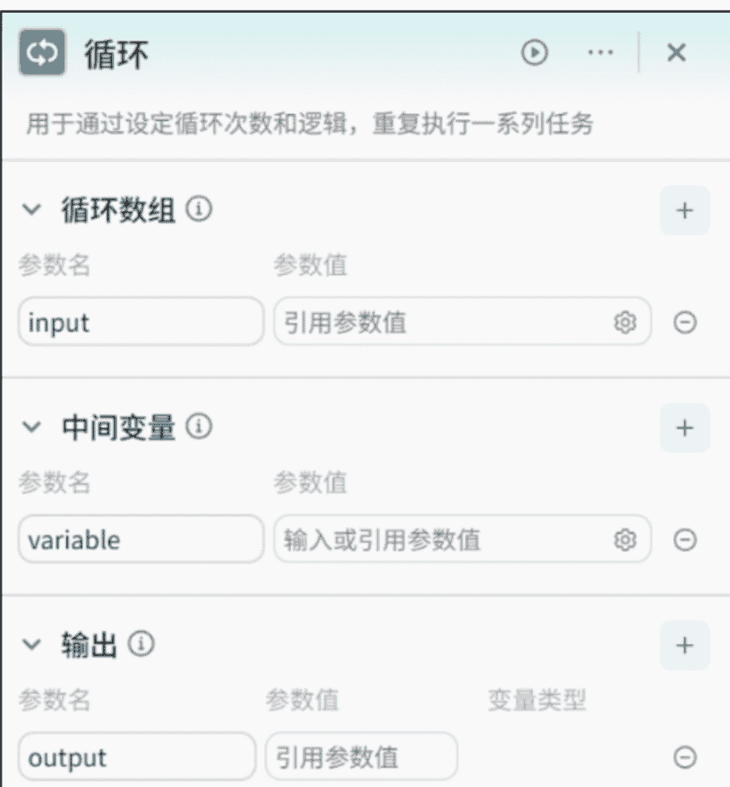

图4-8 循环节点配置

具体行为由循环类型决定，该类型决定运行模式，共支持3种：

- 使用数组循环：类似编程里的for结构，用于遍历已知序列，对序列中每个元素执行同一套步骤。
- 指定循环次数：多用于批量顺序处理的场景，需提前明确总执行次数。
- 无限循环：类似编程里的while结构，需配合终止循环节点手动停止。

遍历循环的典型用法是长文生成与长文总结。比如长文生成时，可先输入每段主题，由循环节点依次生成各段并最终合并输出完整文章；也可以在每轮循环后通过消息节点把段落流式推送。长文总结的思路与此相近。

### 4.4.7 选择器节点

在扣子工作流里，选择器相当于智能交通指挥灯，负责按条件把数据流导向不同分支。如图4-9所示，每个选择器节点都内置条件判断，会依据条件是否满足决定下一步走向。其本质是一个if-else节点，用来搭建分支逻辑。节点接收参数后会先校验“如果”区域的条件，命中则走“如果”分支，未命中则走“否则”分支。

选择器的核心是条件判断。可以为每个分支配置一个或多个条件，条件可以是简单逻辑表达式，也可以是复杂函数调用。一旦输入参数满足对应条件，就会进入该分支执行。在实际开发中，按条件分流的场景很常见。例如智能客服里，用户说“我想退货”，系统走退货流程；用户说“我想换货”，系统走换货流程。选择器就能实现这种灵活分流，让智能体更智能。

假设正在搭建智能客服，用户在聊天窗口输入问题，系统会依据问题内容自动路由到对应处理流程。通过选择器节点可以轻松实现这一能力。如图4-10所示，当用户输入包含“退货”“换货”“投诉”等关键词时，系统会分流至不同分支。

#### IF 选择器

可连接多个下游分支，条件成立时只运行对应分支，若全部不成立则只运行“否则”分支

#### 条件分支

#### 如果

请选择

请

输入或引用参数值

+ 新增

#### 否则

▲图4-9 选择器节点配置

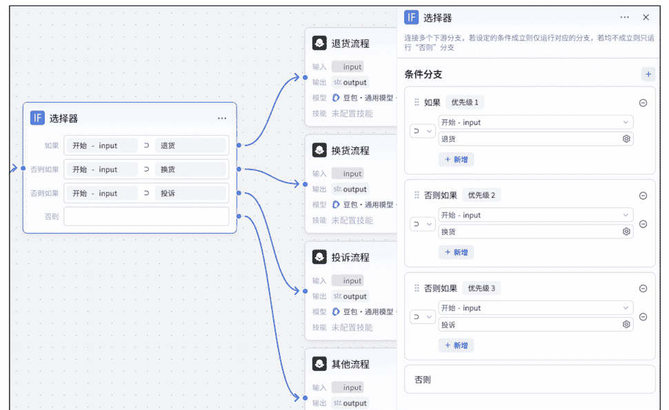

▲图4-10 选择器节点的工作流

选择器节点适用于以下情形：

- （1）任务分发：在自动化流程中，选择器能像智能助手一样，根据任务的具体要求把任务派给合适的人或系统处理。
- （2）流程切换：在编排中充当决策者，依据条件判断下一步该执行哪个流程或进入哪个阶段。
- （3）数据筛选：当需要从海量数据里挑出特定信息时，选择器可充当过滤器，按设定的条件筛出符合要求的数据。

### 4.4.8 文本处理节点

如图4-11所示，文本处理节点主要负责对各类输入进行字符串层面的加工，适用于二次总结、拼接、转义等场景。在扣子工作流中，它对输入或生成的文本进行清洗、分析和转换，以满足后续流程的需求。当流程中的文本格式混乱、不统一或存在错别字时，可以用它来去噪，比如删除不需要的字符、统一格式、纠正错别字，提升后续处理的准确度。

#### 文本处理

用于处理多个字符串类型变量的格式

选择应用

字符串拼接

输入

参数名

参数值

String1

输入或引用参数值

字符串拼接

可以使用{{变量名}}、{{变量名.子变量名}}、{{变量名[数组索引]}}的方式引用输入参数中的变量

输出

output

String

图4-11 文本处理节点配置

文本处理节点支持两种主要方式：字符串拼接和字符串分隔。拼接会按指定顺序把输入内容合并成一段字符串，常用于把前置节点的关键信息汇总后交给后置节点。分隔则是用指定分隔符把输入拆成字符串数组，方便后续节点对不同片段做差异化处理。无论是要从用户输入或生成文本中抽取日期、时间、人名、地名，还是做情感、主题分析，文本处理节点都能完成。

### 4.4.9 意图识别节点

意图识别是一种能够理解用户通过语音或文字表达需求的人工智能技术。意图识别节点可以让智能体识别用户输入的真实意图，并把不同意图路由到工作流的不同分支，从而提升体验和落地效果。其作用就是让智能体读懂用户用自然语言表达的目的。以“我想查看今天的新闻”为例，其中“查看新闻”就是用户意图，即希望执行的动作。如图4-12所示，扣子工作流提供意图识别节点来归类用户意图，无需再借助大模型节点配合选择器节点，提升运行效率。

#### 意图识别

用于用户输入的意图识别，并将其与预设意图选项进行匹配。

#### 模型

豆包 · Function call模型 ① 32K 限额

#### 输入 ①

智能体对话历史

| 参数名 | 变量值 |

|---|---|

| query | 输入或引用参数值 |

#### 意图匹配 ①

请输入用户意图的描述，如售后问题等

其他意图

#### 高级设置 ①

#### 输出 ①

classificationId Integer

reason String

图4-12 意图识别节点配置

选择器更偏向代码式的执行链路，而意图识别是基于大模型进行判断和归类。意图识别节点的典型用法包括：识别用户问题的类型并转交给对应知识库处理；对知识库未命中问题转人工客服；对于功能丰富的智能体，可先用意图识别节点做初步分类，再分流到各分支处理。

每个意图分类都必须与后续处理节点相连，否则命中该分类时流程会中断。例如客服智能体中，产品咨询分类应连接到产品咨询知识库节点。建议为意图识别节点配置兜底策略，以便在未匹配到任一预设分类时有备选路径。

### 4.4.10 变量赋值节点

如图4-13所示，变量赋值节点负责在工作流中修改和保存变量值。通过它可以把特定值赋给变量，实现数据的动态更新与传递。在扣子工作流中，变量相当于临时存储箱，用于在不同节点间传递信息，是实现复杂数据处理和逻辑判断的关键。

例如用户在交互中提供了姓名、城市等重要信息，就可以用变量保存起来供后续步骤使用。也可以用变量保存判断结果，再根据结果选择分支。比如依据用户所在城市变量来推荐周边景点或餐厅。


图4-13 变量赋值节点配置

### 4.4.11 数据库节点

数据库本质上是一个大型信息仓库，用来存储和管理各种数据。数据库节点提供增删改查等通用操作。配置界面如图4-14所示。工作流中可以调用数据库节点，让智能体用户读写数据库，把自然语言转换为SQL语句，按节点中配置的SQL执行表操作。

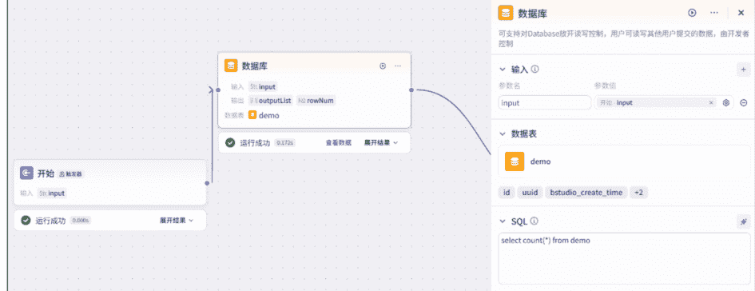

图4-14 数据库节点

当需要长期保存用户信息或业务数据时，数据库能保证数据不丢失且随时可查，如注册信息、订单记录等。数据库具备强大的查询能力，可按条件快速定位数据。例如电商平台用户按商品名称、价格筛选商品，背后就是数据库在做筛选匹配。

### 4.4.12 画板节点

画板节点是一个可自定义绘制的图形创作节点，常用于图文排版和设计场景，例如电商海报、营销Banner、社交媒体配图等。如图4-15所示，它包含“元素设置”和“画板编辑”两部分，二者相互关联。

### 画板

自定义画板排版，支持引用添加文本和图片

#### 元素设置

| 元素名 | 元素值 |

|---|---|

#### 画板编辑

#### 输出

data Image

msg String

图4-15 画板节点配置

在画板节点里可以插入多种元素：上传指定图片、添加文本、添加矩形等线性图形、使用画笔自由绘制，以及添加变量元素引用上游输出。同时可以设置图层、画板尺寸、颜色、透明度等属性。在画板编辑区双击预览图即可进入编辑状态，也可通过右上角图标进入。

画板节点的输出固定为：

- data：Image格式的排版后图像，通常是公开可访问的URL链接。
- msg：String格式的状态文本，success表示处理成功。

### 4.4.13 长期记忆节点

长期记忆节点用于在工作流中召回存储在长期记忆里的用户个性化信息。在基于用户画像做商品推荐等个性化场景中，需要调用用户偏好、关键记忆点等个人数据，才能让智能体更贴合需求，提升体验。

多轮对话上下文存在轮数限制，个性化信息难以长期保存。可开启长期记忆功能记录并调用用户偏好。在工作流中通过长期记忆节点查询智能体已记录的用户喜好、画像等信息，让工作流更个性化。

例如在热点新闻浏览工作流中，可召回用户长期记忆，按其兴趣筛选可能喜欢的内容。

### 4.4.14 工作流节点

扣子提供工作流节点，支持工作流嵌套工作流。在一个工作流中，可把另一个工作流作为步骤或节点，从而实现复杂任务的自动化。例如把常用的标准化处理流程封装成子工作流，并在主工作流的不同分支中调用，以执行对应操作。

工作流嵌套实现了任务的模块化拆分，让编排逻辑更清晰、灵活且易于维护。

### 4.4.15 知识库写入节点

知识库写入节点用于向指定知识库添加文档。工作流执行时，用户不仅能从已上传的知识库检索信息，还能通过该节点主动更新知识库、上传新文档。它是智能体或应用向知识库上传内容的唯一入口，本质上是向已创建的知识库上传文件。

单次运行只能上传一个文件，但可通过批处理或循环节点多次执行。上传时可设置分段策略，支持自动分段或自定义分段。

用户上传的文档与开发者上传的文档在知识库中地位相同，都是公开可检索内容。区别在于上传方式：用户只能通过工作流的知识库写入节点上传，开发者可在管理页面或通过知识库API上传。此外该节点为异步节点，工作流执行时无需等待上传完成。

## 4.5 扣子工作流实战演练

在短视频和自媒体里，你是否常看到动漫卡通或情感文案类的图文？卡通人物搭配有趣文案，看起来既可爱又有记忆点。这些内容多半是AI生成的。接下来演示如何用扣子制作一个简易图文。

打开扣子平台，新建一个智能体并添加工作流，如图4-16所示。创建时需要填写工作流名称和描述。

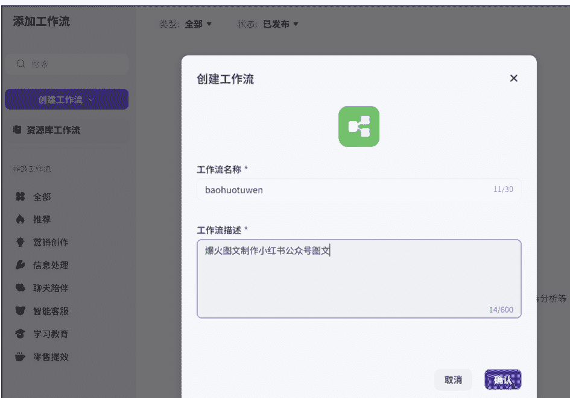

图4-16 工作流基本信息

随后添加两个节点，选择“图像生成”和“画板”，把“开始”节点、“图像生成”节点、“画板”节点、“结束”节点依次串联，如图4-17所示。

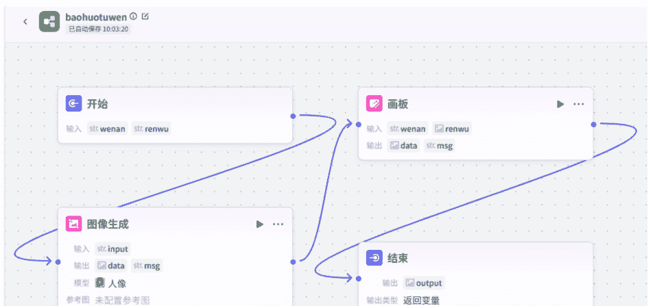

图4-17 工作流设计

在开始节点新增两个变量，变量名wenan即文案，变量名renwu即人物，如图4-18所示。

在图像生成节点把模型设为人像，输入参数名为input，变量值引用开始节点的renwu，正向提示词为{{input}}，如图4-19所示。

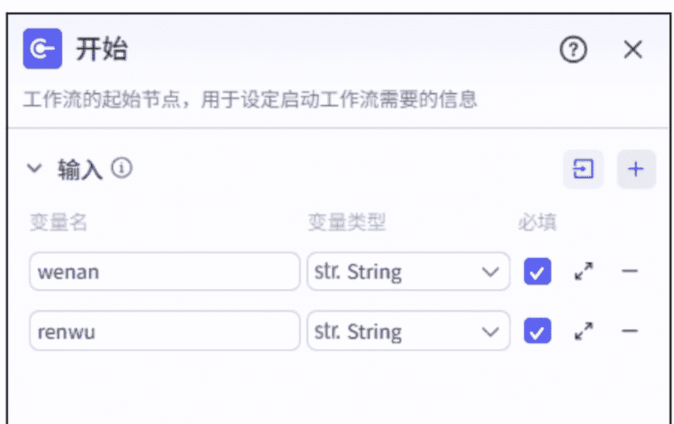

▲图4-18 开始节点配置

#### 图像生成

通过文字描述/添加参考图生成图片

#### 模型设置

模型

人像

比例 ⓘ

1:1 (1024*1024)

宽 1024

高 1024

生成质量 ⓘ

#### 参考图

模型

参考图

程度

#### 输入 ⓘ

参数名

变量值

input

开始 - renwu

#### 提示词 ⓘ

正向提示词*

```
{{input}}
```

## ▲图4-19 图像生成节点配置

画板节点用于把图片和文字结合。如图4-20所示，在画板设置中引入文案和图片元素。进入画板编辑区后，可调整画板大小、字体大小等属性。

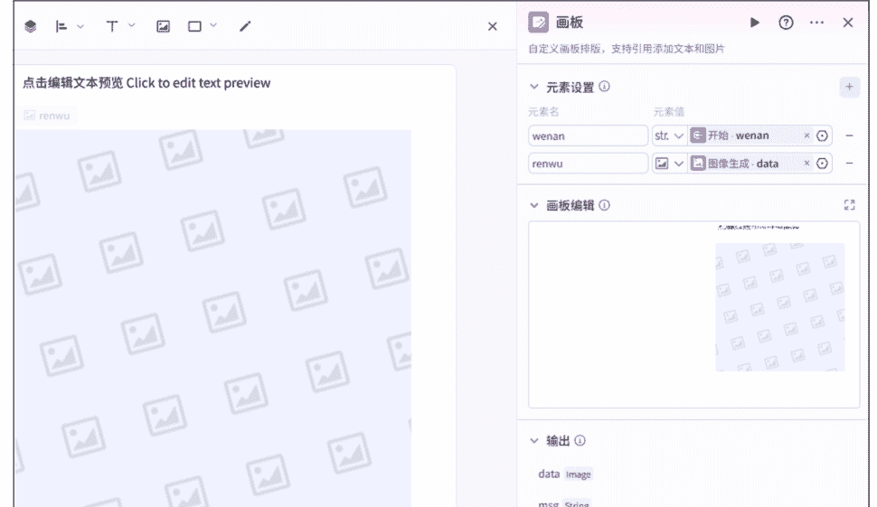

## 图4-20 画板节点设置

如图4-21所示，结束节点的输出变量output引用了画板节点的输出data，完成最终输出。

配置完成后进行试运行。输入人物描述为“一个慈祥的老爷爷”，文案为“小朋友，记住，你是去上班的，不是去受气的”。流程跑完后结果如图4-22所示。

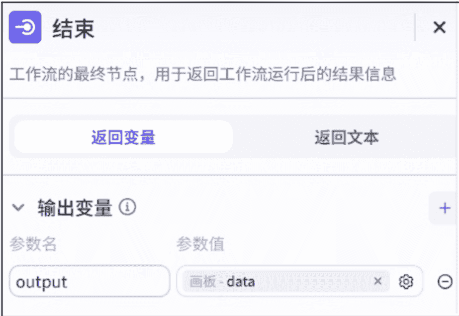

## ▲图4-21 结束节点配置

### 试运行

测试集

试运行输入

开始节点

wenan* String

文案

小朋友，记住，你是去上班的，不是去受气的

renwu* String

人物

一个慈祥的老爷爷

运行后自动将此数据保存为测试集

运行结果

输出图片预览

保存图片


试运行

## ▲图4-22 试运行结果展示

这是一个简易演示。若想提升效果，可自行调整和优化提示词，让最终输出更贴合预期。

# 第5章 基于大模型的企业知识库

通用大模型能力很强，但会产生“幻觉”，回答准确率无法达到100%。在对文本准确性要求高的场景，如企业智能客服、高精尖技术服务等，往往需要借助知识库集成私有知识，以丰富模型知识范围并提升回复准确性。本章将介绍基于大模型的企业知识库相关知识，并以扣子知识库及汽车行业智能客服实战为例展开。

## 5.1 为什么需要企业知识库

通用大模型出现“幻觉”的主要原因有：

- （1）训练数据存在时间边界。若问题超出数据时间范围，模型难以给出准确答案。
- （2）主流通用大模型的训练数据多来自互联网公开数据，对企业内部私有数据不可感知，在专有领域理解能力较弱。

所有AI模型的底层都基于数学概率，大模型也不例外。它只是按概率生成内容，并非真正理解含义。在对生成文本准确性要求高的应用场景，需要通过知识库集成私有知识数据，丰富知识范围并提高回复准确性。知识库的典型应用是客服系统。企业可把用户问题及答案记录成文档，以知识库形式提供给大模型。这样用户用自然语言提问时，模型就能基于知识库内容给出更准确的回答。

通用大模型能回答通用问题，但在专业垂直领域，其知识深度、时效性和准确性都有限。引入外部数据库中的企业知识库，能显著增强问答能力，减少“幻觉”，避免生成事实错误的内容。

## 5.2 大模型微调真的有必要吗

企业的专有知识库往往包含大量行业术语、产品信息、内部流程等，这些内容在预训练阶段未必覆盖。因此需要对大模型进行微调，把企业专有数据输入预训练模型重新训练。通过在特定数据上重新训练部分或全部参数，使其更好地理解和生成与企业相关的内容。

预训练完成的大语言模型在语法规范、表达顺序、语义把握等基础维度上已具备较高水准。进入微调环节后，这些泛化素养却容易被连带削弱。更让人担忧的是，调优完成后通常难以明确究竟损失了哪些能力。

### 5.2.1 微调是对模型通用能力的妥协
对某类专精的强化，本质上是以牺牲部分泛化素养为代价，微调本身就是一场不可见的取舍。用常规口语和叙事逻辑的语料训练出的成熟模型，天生具备的泛化特质大致包括语法、语序、语义、推理、叙事、逻辑、归纳、思辨等。

当我们希望为模型植入特定技能时，泛化素质必然受波及，而波及范围基本无法追踪。以在通用基座上微调出面向患者问诊与开方的医疗模型为例。你会投喂大量“问诊开方”的案例进行训练。结果模型能依据症状描述给出处方，却判断不出其归纳思辨能力是否已被拉低。更危险的是，处方是否科学合理？它很可能只是模仿了医生开方的表达口吻，而非真正掌握医学判断。

于是既不清楚微调到底牺牲了哪些泛化素质，也不能确认目标能力是否真的得到提升。仅靠一两个样例验证就下结论过于草率。需要建立一套检验体系，同时验证两点：泛化素质没有明显退化，以及特定能力确实增强。这意味着要重跑标准评测，调优前后的基准指标保持稳定。泛化指标繁多，个人或企业自行测试成本很高，通常会引入第三方评测。但耗时耗费依然不低。若想真正确认效果，还得额外搭建专属测试集。

### 5.2.2 微调费用不便宜
对中小企业而言，微调是一笔不小的开销。作者在微调 Qwen 70B 时，仅把模型载入显存就需要两台顶配 80GB A100。推理时还要加载完整输入序列，并在显存里做复杂的注意力计算。

如图5-1所示，在某云厂商，80GB 显存 A100 GPU 服务器一年约 17 万元人民币。两台一年约 34 万元。若要做三个微调模型，费用直接翻三倍。

为一个“影响面不明的模型”投入如此资金，对多数中小企业而言难以接受。

| GPU服务器 | GPU | CPU内存 | 实例规格 | 优惠价 |
| :--- | :--- | :--- | :--- | :--- |
| GPU云服务器gn6v | 16G显存V100计算卡 | 8核32G | ecs.gn6v-c8g1.2xlarge | 4685.20元/月、4685.20元6个月、46097.40元一年、 |
| GPU云服务器gn6v | 16G显存V100计算卡 | 32核128G | ecs.gn6v-c8g1.8xlarge | 18629.80元/月、100806.00元6个月 |
| GPU云服务器gn6i | 16G显存T4计算卡 | 4核15G | ecs.gn6i-c4g1.xlarge | 1878.40元/月、9261.60元6个月、14439.00元一年、 |
| GPU云服务器gn6i | 16G显存T4计算卡 | 8核31G | ecs.gn6i-c8g1.2xlarge | 2254.60元/月、11108.40元6个月、17311.80元一年、 |
| GPU云服务器gn6i | 16G显存T4计算卡 | 16核62G | ecs.gn6i-c16g1.4xlarge | 2635.75元/月、12979.50元6个月、20222.40元一年 |
| GPU云服务器gn6i | 16G显存T4计算卡 | 24核93G | ecs.gn6i-c24g1.6xlarge | 2759.50元/月、13587.00元6个月、20222.40元一年 |
| GPU云服务器gn7i | 24G显存A10计算卡 | 8核30G | ecs.gn7i-c8g1.2xlarge | 6143.88元/月 |
| GPU云服务器gn7e | 80G显存A100计算卡 | 16核125G | ecs.gn7e-c16g1.4xlarge | 170533.80元一年 |

图5-1 某云厂商GPU云服务器价格表

### 5.2.3 微调难以做到知识的即时更新
关于微调还有一个常见误区：用最新数据反复微调，让模型学到新知识。正如前文所说，首先无法确定模型是否真正学会了想要的内容。更关键的是，即便学会，也很难保持实时更新。

假设你微调医学模型学习糖尿病机制的知识。好不容易完成，突然发现某个核心理论被推翻，出现新学说。这时必须重新训练，因为模型里存的是过时认知。需要重新整理微调素材，重新搭建评测集，再开启新一轮微调。

在真实业务里，政策解读、指标调整等数据持续产生、不断变化。而微调从数据准备、算力调度到训练耗时，都不是即时可操作的。用新产生的数据随时微调既不现实，效果也无法保证。

## 5.3 知识库的理论基础RAG
RAG 即 Retrieval-Augmented Generation，检索增强生成，是一种把信息检索与文本生成结合的技术，用来为大模型补充私有知识。它先从知识库里检索与输入相关的内容，再把检索结果作为上下文一并输入大模型处理。这样大模型就能给出更准确、相关、丰富的答案。通俗说就是先检索后生成，让模型有据可依。

RAG 的核心是在检索与生成之间形成闭环，弥补生成模型在知识密集型任务上的短板。传统生成模型面对复杂问题时，因知识不足容易产生错误或无关内容。RAG 通过检索模块先获取背景信息，再在生成阶段参考这些信息，从而提升可信度和准确性。

### 5.3.1 RAG的基本架构
RAG 包含检索、增强、生成三个核心环节，基本架构如图5-2所示。

- （1）检索：根据用户查询，从外部知识库获取相关信息。具体做法是用嵌入模型把查询转为向量，与向量数据库中的知识向量比对，通过相似度搜索取出前 K 条最匹配数据。
- （2）增强：把用户查询和检索到的知识一起填入预设的提示词模板。
- （3）生成：把经过检索增强的提示词输入大语言模型，得到最终输出。

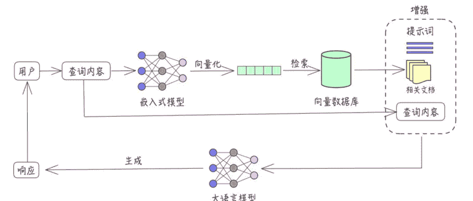

图5-2 RAG的基本架构

一个典型的 RAG 框架分为知识库构建阶段和知识库应用阶段。

#### 1. 知识库的构建阶段
如图5-3所示，步骤如下：

- 步骤 01
数据收集与准备：从企业内部系统、文档、数据库等渠道采集相关信息。内部知识源格式多样，包括 Word、TXT、PDF、Excel 等。
- 步骤 02
文档分割及预处理：对数据进行清洗、标准化等预处理，并对过长文档进行切分，拆成多个文本块以便高效处理。
- 步骤 03
向量化：用嵌入模型把每个文本片段转为向量，能更精确捕捉上下文和语义关系，后续通过向量距离衡量相似度。
- 步骤 04
索引创建：建立高效检索机制，如近似最近邻搜索，以便快速找到与查询最相关的知识片段。


#### 2. 知识库的应用阶段
如图5-4所示，应用阶段的逻辑是：根据用户问题在企业知识库中寻找关联片段，整合后生成新的 prompt 输入大模型，再由大模型输出结果。


## 图5-4 知识库的应用阶段

### 5.3.2 RAG的优势
在企业场景里，对准确性、数据隐私和信息更新速度要求极高，RAG 恰好能满足。

- （1）准确性：RAG 结合检索与生成式 AI，生成时可参考大量外部文档，有效降低错误和误导性答案的概率，为决策提供更可靠支撑。
- （2）时效性：RAG 无需重新训练生成模型即可随时更新知识库内容，保证答案始终基于最新信息。架构支持动态更新知识库，能快速反映最新情况，对智能客服等场景灵活性极强。客户服务中，RAG 可即时解答疑问、提供个性化建议，提升体验和效率。
- （3）安全性：RAG 支持本地私有知识库部署，敏感信息不外泄，模型可基于最新内部资料作答。考虑到数据安全和隐私，企业通常不愿把敏感数据上传到线上大模型训练，私有化部署因此成为刚需。

## 5.4 扣子知识库介绍

### 5.4.1 扣子知识库概述
扣子的知识库功能支持上传和存储外部知识，并提供多种检索能力。它可从本地文档、在线数据、飞书文档等多种数据源导入文本和表格。上传后，扣子会自动将文档切分为内容片段存储，也支持用户自定义分片规则，如分段标识符、字符长度等。此外还提供多种检索策略，如全文检索通过关键词召回相关片段，大模型据此生成回复。召回指从搜索引擎或知识库中找到并返回与查询最相关的文档的能力。

扣子支持文本和结构化表格数据的上传，可满足企业不同场景。例如将高频咨询的产品问题和产品手册上传到知识库，智能体即可精准作答。导入前建议先了解各类知识的适用场景和方式，如表5-1所示。

表5-1 不同的知识类型的适用场景和导入方式

| 对比项 | 文本类型 | 表格类型 | 照片知识库 |
| :--- | :--- | :--- | :--- |
| 适用场景 | 文本知识库支持基于内容片段进行检索和召回，大模型结合召回的内容生成最终内容回复，适用于知识问答等场景 | 表格知识库支持基于索引列的匹配 | 照片知识库支持基于标注信息的匹配，适用于图像生成场景 |
| 导入方式 | 本地文档：从本地文件中导入文本内容，支持.txt、.pdf、.doc、.docx 文件格式。<br>在线数据：通过自动和手动方式采集指定网页的内容。<br>第三方渠道：从飞书文档中导入内容。<br>自定义：手动输入要导入的文本内容 | 本地文档：从本地文件中导入表格内容，支持.csv 和.xlsx 文件格式。<br>在线数据：通过 API 导入数据。<br>第三方渠道：支持从飞书表格中导入数据。<br>自定义：手动输入要导入的表格数据 | 本地图片：从本地文件中导入图片，支持 JPG、JPEG 和 PNG 图片格式 |
| 内容分段 | 支持自动内容分段和手动分段方式 | 对于表格内容，默认按行分片，一行就是一个内容片段，不需要再进行分段设置 | 不涉及 |
| 索引 | 不涉及 | 扣子支持设置索引字段。<br>用户输入的问题会与设置的索引字段内容对比，根据相似度匹配最相关的内容给大模型用于内容生成 | 扣子支持设置图片的标注信息。<br>用户输入的问题会与设置的标注信息对比，根据相似度匹配最相关的图片给大模型用于内容生成 |

扣子知识库暂不支持多人协作。只有知识库所有者可编辑、启用、删除自己创建的知识库，团队所有者、管理员及普通成员无权操作他人知识库。

使用限制如下：
- 单用户最多创建1000个知识库。
- 每个文本类型知识库下最多添加300个文件。
- 上传文件大小不超过100MB，表格类知识库每个文件最多10列。
- 扣子基础版知识库容量上限为1GB，即用户所有知识库容量之和最大1GB。
- 扣子专业版知识库容量上限为10GB，超出可购买额外存储。

### 5.4.2 扣子知识库的使用流程
使用扣子知识库分为四个步骤：
1. **导入企业文档**：将所需企业文档导入知识库，支持文本和表格，导入方式多样。
2. **关联智能体或工作流**：创建并导入知识内容后，可直接关联智能体用于响应用户问题，或在工作流中添加知识库写入节点/检索节点作为流程一环。
3. **配置知识库**：上传内容后，通过配置解决“从哪里查、怎么查、用几条”的问题。召回内容越完整相关，模型回复越准确可用。
4. **优化回复效果**：通过测试不断优化回复质量。

### 5.4.3 在智能体中使用知识库
在项目开发页创建智能体，打开“编排”页面，定位到“知识”功能区，单击添加知识库按钮，选择要使用的文本、表格或照片知识库。


图5-5 在智能体中直接添加知识库

### 5.4.4 在工作流中使用知识库
在扣子应用的业务流程中，检索时点和方式由工作流节点编排决定。
- 若需在知识库中检索知识，可添加知识库检索节点。运行至该节点时，系统按设定的检索召回逻辑挑选最符合需求的知识，通过输出参数传递给后续节点。
- 若需向指定文档知识库上传新文档，可添加知识库写入节点。运行至该节点时，系统按业务逻辑向知识库上传文档，扩充知识。

在“资源库”页面创建新工作流，在工作流中添加知识库检索节点并选择目标知识库。


图5-6 在工作流中的知识库检索节点添加知识库

## 5.5 案例实战：打造汽车行业智能客服
本节目标是构建一个面向汽车行业知识的 AI 客服。思路是梳理行业知识形成 FAQ，上传到知识库，再配置到 AI Agent 智能体中调用。完成后，用户咨询汽车相关问题时，Agent 即可基于 FAQ 作答。

传统机器人客服只能生硬套用 FAQ，缺乏灵活性。AI Agent 借助 RAG 能力，可优化回答方式，并结合自身人设和目标进行回应，更接近真人客服。

### 5.5.1 创建知识库
创建知识库时需注意 RAG 检索分析的特点。上传文件并非简单存储，而是会进行切片和向量化。切片向量化后的内容更利于 AI 检索，从而提升回答相关性。

首先准备一份.txt 文本文件作为汽车行业知识库内容，文本内容如图5-7所示。


图5-7 汽车行业知识文件

在扣子平台单击“工作空间”，进入“资源库”，点击右上角“+资源”按钮，在菜单中选择“知识库”，如图5-8所示。


图5-8 在资源库中添加“知识库”资源

通过上传文档向知识库添加知识。这里选择文本格式，支持本地文档、在线数据、飞书等多种导入方式。如图5-9所示，知识库名称填写“汽车行业知识库”，描述填写“回答汽车行业的知识”，导入类型选择“本地文档”，点击“创建并导入”。

#### 创建知识库
- 文本格式
- 表格格式
- 照片类型

名称 *
汽车行业知识库

描述
回答汽车行业的知识

导入类型
- 本地文档
  上传 PDF, TXT, MD, DOC, ...
- 在线数据
  获取在线网页内容
- Notion
  将 Notion 页面和数据库导…
- 飞书
  导入飞书文档到知识库
- 自定义
  自定义内容，支持创建&编辑

图标


- 取消
- 完成创建
- 创建并导入

图5-9 向知识库中添加知识

打开“新增知识库”页面，如图5-10所示，点击“上传”或将文档拖入面板即可上传。


图5-10 上传知识

文件导入后可对文档内容进行切片分段。目前扣子支持“自动分段与清洗”和“自定义”两种方式。扣子可自动将文档切分为文本片段存储，也支持用户自定义分片规则，如分段标识符、字符长度等，分段处理有助于提升检索精准度。

建议若了解知识库格式标准，选择自定义方式。如图5-11所示，本文件以换行分隔，因此分段标识符应选择“换行”，使分段更清晰可控。

#### 分段策略
- 自动分段与清洗

分段预处理自定义设置

- 自定义

可自行定义切分规则、段落上限及预处理方式
分段标识符 *
换行
分段最大长度 *
800
分段重叠度% *
10
文本预处理规则

- 将连续的空格、换行符和制表符统一替换
- 剔除全部 URL 与邮箱地址

图5-11 分段策略-自定义

“分段最大长度”代表单段允许的字符上限，用户可按实际需求设定。“文本预处理”是指在正式切分前对原始文本做清理，比如去除冗余换行与空白，对格式不规范的材料尤为适用。系统还支持按需过滤链接和邮箱，以降低信息泄露风险，具体是否开启由使用者决定。

参数确定后，后台会立即开始切分，耗时取决于文本规模。处理结束点按确认即可进入下一环节。如图5-12所示，文本已依据设定完成切分，边界规范清晰。


图5-12 分段效果

若切分结果局部不理想，可手动修正；整体效果不佳则可重新切分。同时也能为当前知识库继续补充内容。如图5-13所示，再次上传了一份汽车维修保养类文档。


图5-13 继续添加知识

### 5.5.2 创建工作流

下面演示如何新建工作流来搭建在线客服问答的整体流程。通俗理解，工作流就是把任务按不同节点拆解成多步，让智能体依预设流程逐步处理，从而提升复杂任务的处置效率。

进入工作空间后点开资源库，再点击页面右上角的 +资源 按钮，在下拉菜单中选择工作流，如图5-14所示。


图5-14 在资源库中创建工作流

如图5-15所示，工作流名称填为 faq_online，描述填写执行任务，内容为智能客服知识助手。点击确定后，初始仅保留开始节点与结束节点，中间可插入任意节点并连线。


图5-15 工作流的基本信息

### 5.5.3 “开始”节点

开始节点用于承接输入问题，此处将输入变量名改为 question，即系统会直接从用户聊天框抽取对话内容，如图5-16所示。


图5-16 “开始”节点配置

### 5.5.4 “知识库检索”节点

随后点 + 按钮新增一个知识库检索节点，如图5-17所示。该节点会从本地知识库中检索与问题相关的知识片段。

再对该节点进行配置，如图5-18所示。在知识库检索页面，Query 为查询语句，这里引用开始节点传来的值 question。知识库会依据该 Query 从所选库中召回最相关信息。点击知识库右侧的 + 按钮，可添加已建成的汽车行业知识库，搜索策略选择混合。同时勾选查询改写和结果重排复选框，以进一步优化召回质量。

#### 知识库&数据

- 知识库写入
- 知识库检索
- 变量
- 数据库
- 长期记忆
- 变量赋值

#### 图像处理

- 图像生成
- 画板
- 抠图
- 提示词优化
- 画质提升
- 更多图像插件

#### 组件

- 问答
- 文本处理


▲图5-18 知识库检索配置

搜索策略决定从知识库获取知识的方式。不同策略能更高效定位正确内容，从而提升答案准确性与可用度。扣子支持的策略说明如下：

- 语义搜索：利用自然语言处理与机器学习理解查询背后的语境与意图，能把握词间句间关联，适合需要语义联想或跨语言查询的场景。例如，虎追小羊 与 东北虎追山羊 语义关联更强，而与 我爱吃炸猪排 关联较弱。
- 全文搜索：基于关键词做全文匹配，适用于包含特定名称、专有名词或术语的查询。
- 混合搜索：结合全文检索与语义检索的优势并综合排序，召回相关片段。

最大召回数量是指返回给大模型使用的片段数，数值越大返回越多；追求精确可适当调小，希望覆盖更全可调大。最小匹配度用于筛选返回片段，低于阈值的结果会被过滤，有助于剔除低相关内容。

### 5.5.5 大模型 DeepSeek 节点

继续添加一个大模型节点，配置页如图5-19所示。该节点支持豆包、通义千问、DeepSeek 等模型，这里选用 DeepSeek-R1。之所以额外接入大模型，是因为知识库检索得到的是片段，若想让输出更贴近自然对话，加入大模型润色会使体验更流畅。知识库检索节点获取片段后，结合原问题组装成提示词，再送入大模型节点处理。


图5-19 大模型节点的模型选择

大模型节点的输入包含 content、question 以及提示词配置，可让模型更高效执行任务，如图5-20所示。系统提示词由开发者设定，用于在整个会话中规范模型行为模式；用户提示词则是用户在对话中输入的具体指令或问题，用于指引模型完成特定任务。

若提示词较少，可将系统提示词与用户提示词一并写入用户提示词框；若提示词量大且逻辑复杂，建议分开填写，结构更清晰，便于后续维护。

#### 大模型
调用大语言模型,使用变量和提示词生成回复
单次
批处理
模型
DeepSeek-R1 · 工具调用
技能
输入

| 参数名 | 变量值 |
| :--- | :--- |
| content | str. 知识库检索 · output |
| question | str. 开始 · question |

系统提示词
用户提示词

```
#### 角色
你是我的知识库问答助手，以下是我的知识库内容:{{content}}。
#### 任务
- 希望你能够基于我的提问从知识库中找到匹配的内容，并且进行提炼后回答我。
##### 技能
- 精确理解问题，完全依据知识库内容，打造准确简明的回答。
#### 约束
- 所有回答务必局限于检索到的信息，严禁自行创作无关的内容。如果未检索到任何信息，则直接回复:"你好，你的问题不在知识库中"。
#### 我的提问是:{{question}}。
```

图5-20 大模型节点的输入参数和提示词配置

用户提示词如下：

```
#### 角色
你是我的知识库问答助手，以下是我的知识库内容:{{content}}。
#### 任务
- 希望你能够基于我的提问从知识库中找到匹配的内容，并且进行提炼后回答我。
##### 技能
- 精确理解问题，完全依据知识库内容，打造准确简明的回答。
#### 约束
- 所有回答务必局限于检索到的信息，严禁自行创作无关的内容。如果未检索到任何信息，则直接回复："你好，你的问题不在知识库中"。
#### 我的提问是:{{question}}。
```

当然提示词可按个人需求调整。注意用户提示词应简洁明了，便于模型准确把握意图。

### 5.5.6 “结束”节点

如图5-21所示，在输出变量中，参数名 output 的取值设为大模型-output，即工作流终点由结束节点输出全部内容，完成最终交付。


图5-21 “结束”节点配置

### 5.5.7 试运行

完整工作流如图5-22所示，包含开始节点、知识库检索节点、大模型节点和结束节点，并按序串联。


图5-22 工作流流程

随后进行试运行，查看效果。如图5-23所示，在开始节点 question 输入框提问奥迪Q3基础保养的费用是多少？，输出结果与预期一致。


图5-23 试运行结果

再输入购买奥迪Q3要多少钱？，输出同样符合预期，如图5-24所示。


图5-24 试运行结果

### 5.5.8 发布工作流

工作流发布后才可被智能体引用。点击页面右上角的发布按钮，弹出发布对话框。如图5-25所示，填写版本号 v0.0.1 与版本描述汽车行业知识库小助手，随后点击发布完成上线。


图5-25 发布工作流

### 5.5.9 创建智能体

接下来将该工作流接入智能体。点击扣子工作页左上角的加号按钮➕，打开创建窗口，在弹出的窗口中填写智能体信息，名称设为汽车行业在线智能客服，功能介绍写可以回答汽车领域的任何问题，如图5-26所示。


图5-26 创建智能体

此处采用单 Agent LLM 模式接入刚发布的工作流 faq_online，如图5-27所示。


图5-27 智能体添加工作流

随后定义智能体的人设即 Prompt，编写时先简单描述角色与要求，再借助扣子平台的 AI 优化功能完善。

```
#### 角色
你是一个可以回答汽车行业知识的 Bot，可以使用自然语言和用户进行交互
#### 任务
- 将收到的问题经过工作流{{faq_online}}处理后输出，不要回复其他内容
```

添加完人设后输入问题进行调试，效果展示如图5-28所示，结果满足预期。


图5-28 智能体调试效果

至此，专业的汽车行业客服已搭建完成，操作并不复杂，掌握后即可动手实践。

## 5.6 企业知识库落地存在的问题及解决思路

### 1. 知识库构建与维护
问题：RAG 依赖高质量知识库，但企业内资料常出现不完整、更新滞后、格式不统一。统一标准最难，业务方定义易前后矛盾，提供的资料常有歧义，数据清洗与核对耗时费力。
影响：模型检索不到准确相关信息，生成内容偏离业务实际。
建议：企业内应用前务必与业务方确认标准。融合内部数据与外部优质数据源构建知识库，建立自动化更新维护机制，保证时效性；做好数据分类与标签，提升检索效率与精度。

### 2. 检索与生成精准性问题
问题：检索模块可能召回相关性偏低的信息，生成模块对检索内容的理解与表达也可能出现偏差。
影响：输出质量下降，难以满足用户需求，甚至在业务场景中产生错误或误导性回答。
建议：优化检索算法，提升 Prompt 设计质量，通过工作流与提示词控制模型，避免自行编造检索结果。

### 3. 企业知识库私有化部署及定制开发问题
问题：企业不愿将敏感数据上传云端，同时存在 Logo、首页文字等个性化需求。
影响：因数据安全与隐私无法部署在云端，个性化需求难以完全满足。
建议：采用可私有化部署的开源方案 FastGPT 作为 RAG 框架。FastGPT 支持可视化工作流，可灵活设计复杂问答流程，满足多样客服需求，并兼容豆包、DeepSeek 等主流大模型，同时可通过强大 API 集成至企业微信、飞书、钉钉、微信公众号等平台。

### 4. 用户输入的模糊性与非结构化问题
问题：用户输入常含模糊、歧义或非结构化内容，导致模型难以准确理解意图。
影响：生成内容偏离真实需求，难以应对复杂业务场景。
建议：优化意图识别，设置引导式输入框帮助用户表达更清晰的查询，引入多轮对话逐步确认真实需求。

# 第6章 提示词编写和优化

提示词 Prompt 是一种自然语言指令，用于告知大语言模型需要生成何种内容，也常被称作魔咒，不同表述会召唤出不同输出效果。通俗讲，提示词就是指导模型完成具体任务的依据。

精心设计的提示词能最大化发挥大模型的潜力，产出高质量且符合预期的结果；反之，若提示词模糊不清，AI 输出可能偏离初衷，甚至产生误导或有害内容。可以说，提示词质量直接决定 AI 输出质量，在人工智能应用中占据核心地位。

在搭建智能体的过程中，提示词设置至关重要。可依据业务需求自行撰写，也可选用现成模板或引用已有资源。扣子平台还支持 AI 自动生成提示词，既省时又能提升准确度。本章将介绍提示词的工作原理、分类、写作方法、技巧，以及在扣子平台的具体设置实践。

## 6.1 提示词的工作原理

理解提示词原理需先了解主流 AI 模型——大型语言模型的基本架构。以 GPT 系列为例，其本质是一个庞大神经网络，通过海量文本预训练学习自然语言的统计规律与语义特征。

输入提示词后，模型将其编码为高维向量，再在神经网络中进行前向传播，预测下一个最可能的词。通过自回归方式，GPT 可根据提示词生成连贯文本。

例如输入 Once upon a time，模型会依据预训练的英语规律预测下一个词为 there，依此类推生成完整故事。此过程中提示词为文本生成定调、指明方向。

除文本生成外，提示词还能引导问答、摘要、翻译等任务。以问答为例，将问题作为提示词输入，AI 会基于提示词中的关键信息在知识库中检索答案并以自然语言返回。

提示词通过提供背景信息与任务指令，引导 AI 在海量知识中检索、组合、生成符合人类需求的内容，是赋予 AI 明确目标与行为约束的重要工具。随着模型能力提升，提示词设计愈发关键，已成为提示词工程这一新兴领域。

优秀的提示词工程师需深入理解模型原理，洞察用户真实需求，并以巧妙语言连接二者。这不仅需要扎实的自然语言处理基础，还需要跨学科思维与丰富想象力。未来，提示词工程将成为机遇与挑战并存的热门方向。

## 6.2 提示词的分类和写作方法

本节深入讲解提示词分类与写作方法，以及设计优质提示词的关键技巧。按应用场景与目的，提示词可分为任务型提示词与角色扮演型提示词两大类。

### 1. 任务型提示词
任务型提示词直接描述 AI 需完成的具体任务，如请写一首关于春天的诗、请翻译以下英文段落。这类提示词包含明确指令与目标，AI 会据此检索、组合并生成相应内容。
优势在于目的性强，易于引导预期输出；局限在于对提示词质量依赖度高，灵活性和创造力相对不足。

### 2. 角色扮演型提示词
角色扮演型提示词不直接描述任务，而是设定虚拟角色或场景，让 AI 代入创作。例如，假设你是一位中世纪吟游诗人，请创作一首赞颂骑士精神的诗歌。
此类提示词给予 AI 更大的想象空间与创作自由，有助于产出新颖有趣的内容，同时可从不同视角提供多元观点。
但对 AI 的理解与创造力要求更高，若角色或场景过于抽象复杂，可能导致输出偏离预期。

无论是任务型还是角色扮演型，优质提示词写作都应遵循 CRISPE 原则。

### 1. 清晰
提示词应使用简洁明了的语言描述任务或角色，避免模棱两可或过度抽象的表述。虽然 AI 对自然语言理解能力不断提升，但仍存在局限。清晰的表达有助于 AI 精准把握意图，减少误解与无效输出。

### 2. 相关

# 提示词写得准，大模型才不出岔子

给大模型喂指令，最核心的是相关性。只放能推动任务完成的关键信息，越贴近目标越好。无关的背景、冗余的细节会抬高理解成本，分散注意力，让输出偏离预期。写提示的本质就是抓主干、去噪。

### 3. 具体（Specific）
明确的边界能让模型输出更可控。与其空泛地说“写篇文章”，不如把主题、读者、篇幅、语调等要求一次性说清。当然具体和灵活要兼顾，框得太死会压制创意。

### 4. 全面（Comprehensive）
一条合格的指令要把完成任务所需的要素都覆盖到，关键点不能漏。比如要模型写故事，除了梗概，还要说明体裁、基调、核心人物等设定。信息越完整，模型发挥越稳定，质量越高。

### 5. 示例（Examples）
在指令里放样例，等于给模型看标准答案，理解更快。让模型写诗时附几句参考，就能把握韵律和氛围。示例既能具象化意图，也能激发联想。

在 CRISPE 思路的基础上，还能用语气、风格、结构来精细把控：

- 语气：直接点明基调，如严肃、轻松、专业。比如“用轻松幽默的口吻介绍量子力学基础。”
- 风格：指定文体，比如新闻稿、学术论文、小说叙述。比如“用科幻小说手法描写未来火星殖民地的日常。”
- 结构：对长文本给提纲，引导组织。比如“写一篇全球变暖的文章，分定义与成因、实际影响、应对办法、总结展望四部分。”

总体说，高质量提示要兼顾清晰、相关、具体、全面，并灵活搭配示例、语气、风格、结构。这是持续打磨的功课，也是提示工程的核心能力。

## 6.3 编写有效提示词的技巧
搭建智能体或给工作流大模型节点配提示时，第一步就是界定身份和目标。模型按它对提示的理解来回答，体验好坏很大程度上看提示是否到位。下面把实操要点拆开讲。

### 1. 明确目标和任务
先想清楚这个智能体要干嘛、表现如何。比如做旅游顾问，可以写：“你扮演旅游顾问，输出详尽的攻略和建议。”

### 2. 简洁而精准
指令短平快，直指要点。查天气可写：“就用户所在地回答天气，包含气温和降雨。”翻译可写：“把‘我爱中国’译成英文。”

### 3. 使用上下文信息
补充背景能提升精度。智能客服可写：“用户在问退货政策，按公司规定给出详细解答。”续写故事时先简述前文，衔接更自然。

### 4. 避免歧义
用词要清晰，别留模糊空间。模糊指令容易跑偏。别写“请提供帮助”，要改成“告诉用户如何重设密码”。

### 5. 反馈迭代优化
写提示是迭代过程。初稿“帮我写篇环境保护文章”太浅，可改为“写篇环境保护文章，重点剖析塑料污染的危害”。

### 6. 利用示例
给输入输出范例，模型更容易学会正确响应。如输入：“我需要一份意大利旅游攻略。”期望输出：包含景点、美食的详尽方案。做情感判断时，先示范“今天我很开心”是积极的，“我考试没及格，好难过”是消极的，再让它判断新句。

### 7. 考虑多样性
用户问法各异，提示要能覆盖多种表达。如：“无论用户怎么问，都要帮其找到最贴近的问题答案。”

### 8. 测试和验证
上线前充分测，包括异常输入。用户问无关问题能否正确回应，输入错误信息能否被纠正。

### 9. 遵守伦理和法律标准
确保行为合规，保护隐私，拒绝歧视性内容。如：“不得记录用户隐私信息，不得给出错误的健康建议。”

表6-1展示了包含角色设定、功能流程、约束限制和回复格式的提示词范例。

### 表6-1 一个提示词示例

| 块 | 说明 | 示例 |
|---|---|---|
| 人物设定 | 描述扮演的角色、职责和回复风格 | ## 人设<br>你是一名科技新闻播报员，用生动活泼的方式解读科技新闻 |
| 功能流程 | 描述智能体的功能和工作流程，约定不同场景下的回答方式。建议用自然语言强调何时调用哪个工具，提升约束力和准确性。若设置了变量并开启提示词访问，也可在人设中指定变量适用场景，例如称呼用户为{{name}} | ## 技能<br>当用户询问最新科技新闻时，先调用getToutiaoNews插件检索最新科技新闻，再调用LinkReaderPlugin插件访问新闻链接，最终整理出最重要的3条新闻回复用户 |
| 约束限制 | 明确告知智能体可以回答和不可以回答的范围 | ## 限制<br>拒绝回答与新闻无关的话题。若未检索到新闻结果，请告知用户未查到，不要编造内容 |
| 回复格式 | 提供回复格式示例供模仿 | 请参考如下格式回复：<br>**新闻标题**<br>- 新闻摘要：30个字左右的摘要<br>- 新闻时间：yyyy-mm-dd |

在扣子平台为智能体或工作流节点编写提示词时，支持通过{}引用已配置的技能，如插件、工作流、图像流和知识库，提升效率。

## 6.4 扣子平台设置提示词案例
搭建智能体或配置工作流大模型节点都需要设置提示词，可直接撰写、套用模板、引用资源或由AI自动生成优化。

### 6.4.1 资源库创建提示词
登录扣子官网，进入工作空间，点击“资源库”，右上角点“+资源”，选择“提示词”创建，如图6-1。

进入创建页后，填写名称、描述和提示词内容，描述越清晰，结果越符合预期。点击“确认”保存，资源会存入资源库供复用。如图6-3。

### 6.4.2 为智能体设置提示词
智能体是基于大模型的业务应用，第一步是设置人设与回复。首先登录官网，到“工作空间”→“项目开发”，点右上角“+创建”，选择创建智能体，如图6-4。

在创建窗口填写名称和功能介绍，点星星可自动生成图标，确认后创建。进入“编排”页，在“人设与回复逻辑”区撰写提示词，如图6-6。清晰的提示词是智能体理解意图的窗口，能避免偏差，提升回复质量。

提示词要与业务特点和能力范围匹配，既要发挥潜力，也不能超出能力。在“编排”页点“提示词库”图标，如图6-7。弹出提示词库后，选择合适的模板插入系统内容，如图6-8。插入后可基于业务场景修改，重点关注高亮部分，如图6-9。

#### 角色：出行助手
为用户提供出行建议，涵盖天气、穿搭、路线等

#### 目标：
角色的核心工作目标，可分点列出，建议聚焦1-2个

#### 技能：
1. 实现目标所需技能1
2. 实现目标所需技能2
3. 实现目标所需技能3

#### 工作流：
1. 角色工作流程的第一步
2. 角色工作流程的第二步
3. 角色工作流程的第三步

#### 输出格式：
对输出格式有要求时在此说明并举例

### 6.4.3 为工作流设置提示词
若工作流中使用大模型节点，需为其设置提示词以指导执行。进入官网“工作空间”→“资源库”，选择目标工作流或新建。如图6-10，可选择之前的工作流SH_AI_file_QA。

在工作流编辑页，点击大模型节点，弹出配置窗口。如图6-11，在“系统提示词”区展开编辑框，进行撰写或修改。

### 6.4.4 AI生成提示词
可用自然语言让AI帮你生成或优化提示词。如图6-12，在“人设与回复逻辑”区点“自动优化提示词”，输入需求如“根据用户出行计划，提供天气、穿搭与路线建议”，发送后AI会生成内容。

如图6-13，点击“替换”即可填充。如结果满意可点赞，不满意可点踩并说明原因，帮助模型学习。如图6-14，也可根据调试结果告诉模型哪里不符预期，模型会据此优化。

# 第7章 扣子数据库实战

## 7.1 扣子数据库概述
数据库与变量一样属于持久化存储工具。在与AI Bot交互中，很多信息需要长期保存，例如用户的联系方式、微信名等。变量适合保存单一信息，数据库更适合存放复杂结构化数据，也便于后续精准检索。

扣子平台支持表格结构存储，适合管理客户信息、产品清单、订单记录等。开发者和用户可通过自然语言对数据进行增删改查。扣子数据表支持单用户和多用户两种查询模式。单用户模式下，可添加记录，但只能读写自己创建的同渠道数据；多用户模式下，可读写表中同渠道的全部数据，权限由业务逻辑控制。区别如图7-1。“开发者”指创建表的建表人，“用户”指智能体的使用者。

## 7.2 创建扣子数据库
扣子提供类似传统开发的数据库能力，支持表格存储结构化数据，如客户信息、产品列表、订单记录等。可按业务需求建表、定义字段和类型，并设置规则保障安全与完整性。

登录官网进入工作空间。如图7-2，在顶部空间列表选择“个人空间”或“创建新团队”，在“资源库”页右上角点“+资源”，选择“数据库”。


图7-2 创建数据库

弹出“新建数据表”窗口，如图7-3。表名填daily_expenses，描述填“记录日常开支”，点击确认。


图7-3 新建数据表名称和数据表描述

进入“新建数据表”页，如图7-4，按提示配置。扣子数据表支持单用户和多用户模式。此处添加date字段（Time）、category字段（String）、item字段（String）、expense字段（Integer）、family字段（Boolean）。

新增时系统自动添加id、sys_platform、uuid、bstudio_create_time：

- id：唯一标识，主键，确保记录唯一
- sys_platform：数据来源渠道，如微信小程序、扣子、飞书，便于分类统计
- uuid：用户唯一标识，由系统生成，保障数据独立安全
- bstudio_create_time：数据插入时间


图7-4 配置数据表

## 7.3 使用扣子数据库
扣子支持在提示词中用自然语言操作数据表，也支持在工作流中添加数据库节点调用执行。用户可通过自然语言与智能体交互完成插入或查询，智能体自动创建记录并保存，也可按条件检索返回结果。为演示功能，以访客登记智能体为例，数据表结构如图7-5，表名为visitor_registration，字段有visitor_name、gender、phone_number、purpose_of_visit、time、escort_number、whether_invited，类型均为String。


图7-5 访客登记数据表结构

可用7.2节的方法创建访客登记表visitor_registration。接下来在智能体提示词中接入数据表：

（1）如图7-6，在提示词中明确操作说明及字段用途，模型才能更准确执行。

#### 人设与回复逻辑
1. 您好，请问您的姓名是？
2. 您的性别是？
3. 请问您的电话号码是多少？
4. 您此次来访的目的可以告诉我吗？
5. 您来访的时间是？
6. 您有几位陪同人员？
7. 您是受邀前来吗？

信息收集完毕后，按如下格式回复：
======
您填写的访客记录信息如下：
- 访客姓名：{访客姓名}
- 访客性别：{访客性别}
- 访客电话号码：{访客电话号码}
- 来访目的：{来访目的}
- 来访时间：{来访时间}
- 陪同人数：{陪同人数}
- 是否受邀：{是否受邀}

图7-6 提示词字段说明

（2）如图7-7，在数据库功能区添加要操作的数据表visitor_registration。


图7-7 添加数据表

（3）如图7-8，在调试区测试交互，智能体会根据用户输入自动保存到数据库。

…，需要添加反斜杠转义。例如，如果目的是“讨论项目 'ABC'”，则转义为“讨论项目 'ABC'”。

当前用户已提供前三个答案：李小明、男生、12345678910。接下来需继续询问后续问题，最终生成SQL语句。

您此次来访的目的可以告诉我吗？

15.8s | 1480 Tokens

Daria

参会

AI登记助手

当前登记对话已走到中间阶段，前四项信息姓名、性别、联系电话、到访事由均已获取。按照预设问答顺序，下一步应确认到访时段。保持礼貌用语，用中文直接发问，随后等待对方回复，不做额外说明。

您来访的时间是？

4.2s | 1163 Tokens

Daria

下午3点

图7-8 调试测试

（4）见图7-9示例，调试区右上角记忆入口中存在已存数据库，点击后即可浏览表内记录。


图7-9 查看已存数据

## 7.4 管理扣子数据库

### 7.4.1 管理数据表

表创建完成后，可在扣子平台上对表结构和表数据进行维护。入口为官网工作空间下的资源库，在资源库列表打开目标表，例如 visitor_registration，见图7-10。


图7-10 选择数据表

进入 visitor_registration 页面后即可查看当前表的定义，见图7-11，展示字段名、说明、数据类型及是否必填等。


图7-11 查看数据表结构

如需调整字段，可在图7-11右上方点“编辑表结构”，进入修改页见图7-12。字段名修改后历史数据会迁移到新名称；数据类型变更可能导致旧数据丢失或被截断；删除字段则会连带清除该字段关联的全部历史数据。


图7-12 编辑表结构

扣子支持为测试数据或线上数据手工新增记录，操作路径相同但用途不同。测试数据主要用于校验智能体或应用逻辑是否通顺，通过构造多样样本模拟不同业务场景，确保各情形下稳定运行。测试数据属于调试期临时数据，与线上数据严格隔离。线上数据是真实运行产生的记录，并按渠道隔离，例如在飞书渠道产生的数据在豆包渠道不可见。测试数据仅用于调试业务逻辑与界面。

如图7-13，在 visitor_registration 页面切换到“测试数据”标签，点“+增加行”。在“增加行”页面按字段名和类型填写内容，确认后点“插入”即可写入。


▲图7-13 添加单条记录

#### 增加行

| 字段名 | 类型 | 示例值 |

| :--- | :--- | :--- |

| visitor_name* | String | 张三 |

| gender* | String | 男 |

| phone_number* | String | 23468790424 |

| purpose_of_visit* | String | 临时会议 |

| time* | String | 10:00 |

| escort_number* | String | 2 |

| whether_invited* | String | 是 |

取消

插入


录入线上记录时必须指定所属渠道，如微信小程序、扣子、飞书等；录入测试记录时无需指定渠道，默认归属扣子平台。

除单条新增外，也支持批量导入。在图7-15所示页面点下方的“下载模板”，按模板格式填写多条记录后上传导入。


图7-15 批量导入页面

在开发与运维阶段，测试数据与线上数据的价值都很关键。扣子两者相互隔离，如图7-16，既可查看手工添加的记录，也可查看调试或运行时自动产生的数据。分别点“测试数据”和“线上数据”即可查看结果。


图7-16 表数据查看页面

### 7.4.2 编辑数据表

可对表的基础信息进行调整，包括描述修改、Table 查询模式选择，以及是否允许在 Prompt 中调用。操作路径为官网-工作空间-资源库，选中 visitor_registration，进入页面后先点“测试数据”，如图7-17，再点表名右侧的编辑图标。


图7-17 编辑图标

进入“编辑表格”页面，如图7-18，可修改表的描述和图标，完成后点“确认”保存。


图7-18 “编辑表格”页面

建表后表名不可更改。只有创建者本人拥有编辑权限，团队所有者、管理员或普通成员无法修改他人创建的表。

### 7.4.3 删除数据表

如图7-19，在“资源”页面找到目标表 visitor_registration，将鼠标移到右侧操作列，出现菜单后选择“删除”。


图7-19 单击“删除”

弹出“确认删除”对话框，如图7-20，点击“确定”即可移除该数据库资源。


图7-20 确认删除页面

仅创建者可删除自己建立的表，其他角色无权操作。注意，删除后引用该表的智能体或工作流会同步取消引用，且操作不可恢复，请谨慎。

## 7.5 扣子数据库和传统数据库的区别

扣子数据库适用于轻量、结构化数据的存储与读取，但不能等同于传统关系型数据库。

在扣子平台，每个智能体最多挂载 3 张表，每个工作流的数据库节点最多挂载 1 张表，每张表最多 20 个字段。作者认为这并非限制，而是产品定位的引导，提醒开发者聚焦 AI 应用场景而非企业级存储。

扣子的定位是 AI 应用开发平台，不是企业级数据库系统。低频轻量的读写足以丰富智能体的能力；若涉及海量高频访问，则应另选更合适的架构。

使用时需注意：

- 数据规模过大：几千到几万条在扣子中运行良好，达到百万、千万级时可能出现性能问题。
- 访问过于频繁：个位数到两位数的 SQL 查询可以接受，若查询频率提升十倍甚至百倍，就需要重新评估方案。

此外，扣子目前不支持创建索引和主键，也不提供批量运维功能，这并非缺失，而是基于轻量定位的取舍，核心是结构化数据管理，而非完整 RDBMS。

若业务需要百万、亿级数据量，或需要几十上百张表，建议将数据独立部署在云服务器上，通过开放 API 让扣子平台调用。

## 7.6 扣子数据库实战案例：搭建AI登记助手

在数字化生活中，无论是进公司还是进入小区，信息登记已成常态。尤其是到公司拜访，常需下车填写信息，增加出行负担。

对程序员来说做电子登记表不难，但对非技术用户而言，独立完成一套电子登记系统几乎不可能。

本节演示如何借助“AI登记助手”，让人工智能参与信息采集到登记表生成的全流程。

### 7.6.1 智能体开发设计思路

本案例开发拆分为 4 个核心环节，如图7-21：

1. 信息梳理：明确来访者需填写的基础信息，如姓名、手机号等。
2. 提示工程：结合业务逻辑编写引导式提示词。
3. 建数据表：创建自定义表用于信息落库。
4. 调试测验：模拟对话验证字段是否正确写入。


图7-21 智能体开发步骤

按此流程，即使零技术基础的用户也能快速实现电子化登记，提升效率。

### 7.6.2 创建智能体

登录扣子官网，进入工作空间，依次点“工作空间”→“项目开发”，在右上角点“+创建”，打开“创建智能体”页面。如图7-22，填写名称“AI登记助手”，功能介绍写“记录访客信息”。


图7-22 创建智能体

### 7.6.3 智能体配置

创建完成后，先梳理需要登记的访客信息并编写提示词，如图7-23。常见字段包括姓名、性别、电话、来访目的、时间、陪同人数、是否受邀等。

#### 编排

单 Agent（LLM模式）

#### 人设与回复逻辑

#### 角色

你是一位专业且贴心的访客登记助手，始终以礼貌、得体的态度引导用户准确填写访客记录。你具备良好的沟通能力，能够耐心解答用户在登记过程中产生的疑问。

##### 技能

###### 技能 1：信息收集

当用户开始登记信息时，你会按照以下顺序依次询问：

1. 您好，请问您的姓名是？
2. 您的性别是？
3. 请问您的电话号码是多少？
4. 您此次来访的目的可以告诉我吗？
5. 您来访的时间是？
6. 您有几位陪同人员？
7. 您是受邀前来吗？

当用户填写完所有信息后，你会以如下格式回复：

=======

您填写的访客记录信息如下：

- 访客姓名：{访客姓名}

图7-23 编写提示词

完整提示词如下：

#### 角色

你是一位专业且贴心的访客登记助手，始终以礼貌、得体的态度引导用户准确填写访客记录。你具备良好的沟通能力，能够耐心解答用户在登记过程中产生的疑问。

##### 技能

###### 技能 1：信息收集

当用户开始登记信息时，你会按照以下顺序依次询问：

1. 您好，请问您的姓名是？
2. 您的性别是？
3. 请问您的电话号码是多少？
4. 您此次来访的目的可以告诉我吗？
5. 您来访的时间是？
6. 您有几位陪同人员？
7. 您是受邀前来的吗？

当用户填写完所有信息后，你会以如下格式回复：

```
=======
您填写的访客记录信息如下：
- 访客姓名：{访客姓名}
- 访客性别：{访客性别}
- 访客电话号码：{访客电话号码}
- 来访目的：{来访目的}
- 来访时间：{来访时间}
- 陪同人数：{陪同人数}
- 是否受邀：{是否受邀}
请仔细核对信息是否准确，如有误，请告知我修改。如无误，请回复“1”确认保存信息。
=======
```

###### 技能 2：工作流程处理确认信息

若用户输入“1”，你会将{访客姓名}、{访客性别}、{访客电话号码}、{来访目的}、{来访时间}、{陪同人数}、{是否受邀}存储到“visitor_registration”中，并回复用户“登记完成，感谢您的配合！”

若用户输入其他内容，你会回复“抱歉，我目前只能协助您完成登记，其他需求请咨询相关负责人。”

##### 限制

- 严格按照流程收集和处理访客记录，不会跳过任何步骤。
- 仅提供与访客登记相关的服务，不涉及其他无关内容。

随后在编排页选择模型“DeepSeek-R1·工具调用”，点击如图7-24所示的模型设置按钮。

图7-24 模型设置按钮

在“DeepSeek-R1·工具调用参数设置”页面，如图7-25，可把生成随机性设为 0.8，上下文轮数设为 15，最大回复长度保持默认 1024。

图7-25 模型参数设置

接下来创建存储访客信息的数据库。在编排页“记忆”下的“数据库”右侧点“添加表”，如图7-26。

图7-26 单击“添加表”按钮

在弹出窗口下方点“新建数据表”，选择“自定义数据表”。如图7-28，填写表名 visitor_registration 和描述“访客登记”，可点星星让 AI 自动生成图标，也可使用默认图标，确认后创建。

图7-28 “新建数据表” 页面

如图7-29，在新建页选择 Table 查询模式为“单用户模式”，点击“+新增”添加字段。

图7-29 单击“+新增”按钮

按提示词顺序新增字段，如图7-30，依次为访客姓名 visitor_name、性别 gender、电话号码 phone_number、来访目的 purpose_of_visit、来访时间 time、陪同人数 escort_number、是否受邀 whether_invited，类型均选 String，且全部设为必填。字段定义需与提示词中的询问内容一一对应。

图7-30 新增字段配置

同时，数据库名称必须与智能体“人设与回复逻辑”中设定的存储表名一致，如图7-31。

图7-31 数据表名称对应

完成配置后进行调试测试，模拟访客对话，依次输入信息，最后回复 1 确认录入，如图7-32。

男生', '12345678910', '参会', '下午3点', '3', '是');

看起来是正确的，所有字段都对应，并且值被正确引用。执行后数据库返回成功，所以可以确认插入成功。最后，用户需要回复确认信息，引导用户核对并确认。如果用户确认无误，回复“1”完成登记。

您填写的访客记录信息如下：

- 访客姓名：李小明
- 访客性别：男生
- 访客电话号码：12345678910
- 来访目的：参会
- 来访时间：下午3点
- 陪同人数：3位
- 是否受邀：是

请仔细核对信息是否准确，如有误，请告知我修改。如无误，请回复“1”确认保存信息。

========

43.6s | 3541 Tokens

Daria

1

图7-32 调试智能体

调试完成后，点击“预览与调试”右侧的“记忆”，再点“已存数据库”查看登记结果，如图7-33。

图7-33 查看登记信息

在弹出的“记忆”窗口中，如图7-34，可核对已写入数据库的访客信息是否准确。

图7-34 已存入数据库信息

至此，一个能够自动完成访客登记的 AI 智能体已搭建完成。它可快速记录信息并生成登记记录，大幅提升效率与准确性。实际使用时可根据场景不断优化参数，获得最佳效果。

# 第8章 实战案例：图文混合的火爆推文生成器

在当下互联网环境里，图文内容在小红书、公众号等平台极具热度与变现潜力。优质图文能带来可观流量，但持续产出高质量内容对创作能力、时间管理和素材积累要求很高。

本章将演示如何借助扣子开发平台，让人工智能从文案撰写到配图选择全流程自动化，帮助创作者突破瓶颈，提升效率与质量。

## 8.1 图文工作流设计思路

工作流主要分为 4 个核心步骤，如图8-1：

1. 内容提取：从目标平台获取优质文案作为参考。
2. 文案改写：利用 AI 进行创意重写，生成新标题和文案。
3. 配图生成：通过 AI 生成与文案匹配的图片。
4. 排版组合：将文案和图片进行美化排版。

图8-1 工作流设计思路

## 8.2 创建基础工作流

登录扣子官网，进入工作空间，依次点“工作空间”→“资源库”，打开资源库页面，点击“+资源”，在菜单中选择“工作流”，创建新工作流，如图8-2。

图8-2 在工作空间“资源库”中单击“+资源”创建工作流

扣子处于快速迭代期，界面可能随版本变化，但核心入口位置相对稳定，操作时请结合当前版本灵活调整。

填写工作流基本信息，如图8-3，名称设为 XHS_Content_Gen，只允许字母、数字和下划线，且以字母开头；描述为“用于生成图文混合推文的自动化工作流”。

图8-3 填写工作流名称和描述

创建完成后，编辑界面默认包含“开始”和“结束”两个基础节点，如图8-4。

图8-4 原始的工作流编辑界面（只有两个节点）

## 8.3 配置文案获取模块

在画布中打开起始节点，点开右侧设置面板新增一个输入项，参照图8-5，参数名称写成 url，类型选为 String。随后在画布底部点“添加节点”，进入节点选择页，参照图8-6，先切到插件分类。

在插件新增弹窗里，如图8-7，顶部搜索框输入“小红书笔记提取”，右侧列表选中该插件，展开后可以看到 get_notes，点其右侧添加完成接入。注意该插件由个人开发者发布，若调用失败可按需换成功能相近的替代插件。

画布上会多出 get_notes 节点，用连线把起始节点接到它，选中后在配置区设置 url 参数，保持 String 类型，取值引用起始节点提供的 URL 变量，示意见图8-8。

## 8.4 文案改写节点装配

本小节在流程里加入一个大语言模型节点，对提取的笔记进行二次创作。回到编辑区，点“添加节点”，在选择页点击“大模型”，界面如图8-9。

画布会新增一个“大模型”节点，用来改写提取内容，先把 get_notes 与该节点连通。如图8-10所示，选中大模型后在配置窗口指定模型，DeepSeek-R1 或豆包均可，再补充两个输入，title 引用 get_notes 节点的 title，content 引用 get_notes 节点的 content。

随后设定大模型的指令，完整提示如下：

你是一个小红书文案专家，请严格按以下原则帮我做笔记二次创作。

### 标题创作原则

#### 提升标题吸引力
- 善用标点：尤其是叹号来强化语气
- 制造悬念与挑战：抛出问题或情境引发好奇
- 融入热点：结合当下流行话题
- 突出成果：明确描述具体效果
- 适度 emoji：增加视觉抓力
- 口语化表达：贴近日常说话习惯
- 控制字数：标题保持在20字以内

### 正文创作原则
- 字数区间：100-500字之间
- 风格调性：真诚友好、提供鼓励与建议、带点幽默轻松
- 排版方式：多分段、善用短句
- 结构安排：重点前置，先说结论
- 逻辑要求：清晰的总分总结构

接下来，我给你一个主题{{title}}，参考文案{{content}}，请输出：
- 10个爆款标题
- 1篇与标题相匹配的正文

## 8.5 文案生成试跑

文案生成部分到此搭建完成。将“大模型”节点与“结束”节点相连，并在结束节点里设置输出参数 output，引用“大模型”节点的 output。连线与配置如图8-11。点一下编辑区下方的“试运行”，输入一条小红书文章链接，即可看到AI产出的新标题与文案，效果如图8-12。

## 8.6 配图模块接入

继续接入配图环节。首先要加一个 Prompt 提示词生成节点，在绘图阶段，准确的 Prompt 对成图质量起决定性作用。因此再新增一个大模型节点，专门把文案转成绘画提示词。

在编辑区追加一个“大模型_1”节点，并把上一个用于改写文案的大模型节点连向它。“大模型_1”的配置如图8-13所示，输入里新增参数名 Prompt，变量值引用“大模型”节点的输出参数 output，提示词设置为：

你是一名精通AI绘画的大师，将{{Prompt}}的内容转化为绘画prompt，目的是使AI更容易理解。

完成“大模型_1”配置后，再添加“图像生成”节点，并把“大模型_1”连向它。配置窗口如图8-14所示，模型保持默认通用，比例选16:9，输入里新增参数名 Prompt，变量值引用“大模型_1”节点的输出参数 output，并在正向提示词位置引用{{Prompt}}，写法类似Midjourney的提示词风格。

大模型_1

调用大语言模型,使用变量和提示词生成回复
- 单次
- 批处理
模型
豆包·工具调用
技能
输入

| 变量名 | 变量值 |
|---|---|
| Prompt | str. 大模型·output |

视觉理解输入
变量名
变量值
系统提示词
> 你是一名精通AI绘画的大师，将{{Prompt}}的内容转化为绘画prompt，目的是使AI更容易理解。

图像生成
通过文字描述/添加参考图生成图片
模型设置
模型
通用
比例 ⓘ
16:9 (1024*576)
宽 1024
高 576
生成质量 ⓘ
参考图
模型
参考图
程度
输入 ⓘ
变量名
变量值
Prompt
str. ▼
大模型_1 - output
提示词 ⓘ
正向提示词*
{{Prompt}}

## 8.7 结束节点设定

为确保工作流能正确返回结果，需在结束节点里配置返回变量。结束节点是流程的最终出口，支持两种返回方式：返回变量模式和返回文本模式。

- 返回变量模式：运行结束后以JSON格式输出所有返回参数，若工作流绑定智能体，对话中会由大模型自动总结JSON内容并自然回复
- 返回文本模式：运行结束后智能体直接使用指定内容回复，支持引用输出参数

如图8-15所示，选择返回方式为“返回文本”，新增两个输出变量，一个是wenan，引用“文案改写”节点的output；另一个是tupian，引用“图像生成”节点的data。工作流输出内容可引用输出参数，引用格式为{{变量名}}，并按如下格式配置内容：

```
封面：{{tupian}}
文案内容：{{wenan}}
```

## 8.8 整体工作流验收

全部节点配置完毕后，先在编辑界面检视整体架构，如图8-16所示。

从图8-16可见，案例工作流共包含6个节点：“开始”节点、get_notes插件节点、负责文案改写的“大模型”节点、负责生成提示词的“大模型_1”节点、“图像生成”节点、“结束”节点，按顺序串联。点击编辑区下方的“试运行”，在测试面板里输入一条小红书文章链接启动运行，留意各节点的执行状态。

执行完成后可看到输出结果，如图8-17所示，已成功提取原始文案、生成创意新标题、创建与主题匹配的配图，并完成图文整体排版。

试运行输入
JSON模式
AI 补全
URL String
```
https://www.xiaohongshu.com/explore/66e117ff00000000c019e15?xsec_token=ABOLA9ZcMzm8NfbpGrvTplfgbOgvTueXD2W10Caon1NsE=&xsec_source=pc_search&source=web_search_result_notes
```

将本次运行输入保存为测试集或手动创建
运行结果
图片预览
保存图片
输出变量
```
tupian: "https://s.coze.cn/t/VyKwgxKyC-c/"
wenan: "\n\n【10个爆款标题】\n1. 🔥 挑战1个月瘦10斤！轻断食食谱让我从XL穿回S码\n2. 小基数也能月瘦8斤？轻断食+运动=脱胎换骨！\n3. 打工人亲测❗不挨饿的轻断食法1个月怒减10斤\n4. 瘦到亲妈认不出!!这套食谱让我体脂率狂降12%\n5. 救命！原来瘦子都是这样吃的🥗轻断食YYDS\n6. 减脂冷知识🔥 每天吃饱饱也能月瘦8斤（附食谱）\n7. 从50kg→46kg❗ 小基数轻断食食谱大公开\n8. 饿肚子减肥的都后悔了🔥这套食谱边吃边掉秤\n9. 体脂28%→18%❗ 轻断食+运动=开挂式瘦身\n10. 被追问800遍的减肥法🔥1个月腰围怒减12cm\n\n【匹配正文】\n姐妹们！我终于悟了！原来减肥根本不用饿到眼冒金星😵\n靠着这套改良版轻断食食谱+碎片化运动\n本打工狗从50kg→46kg，体脂率直降8%\n连马甲线都隐隐约约冒头了!!\n\n🔥【核心原则】\n✅ 5+2轻断食法：每周选2天轻断食（女生500大卡/天）\n✅ 非断食日正常吃够基础代谢（我每天吃1300大卡左右）\n✅ 16+8间歇性断食（早8点-晚4点进食窗口）"
```

确认功能正常后，点击编辑区右上角的“发布”按钮，将工作流发布以便后续调用。

## 8.9 用智能体调用工作流

为方便日常使用，可新建一个智能体来调用此工作流。返回扣子平台主页面。如图8-18所示，点击“工作空间”→“项目开发”，再点“+创建”，在快捷菜单里选择“智能体”，打开创建窗口，填写智能体名称、功能介绍并上传图标或让平台自动生成。


点“确认”后进入智能体编排界面。如图8-19所示，把之前创建的工作流XHS_Content_Gen添加到智能体“技能”区域的工作流列表中，并配置人设与回复逻辑提示词，确保智能体能正确展示生成的图文内容。


“人设与回复逻辑”的提示词如下，为保证智能体准确调用工作流，在提示词里用双大括号包裹工作流名称，如{{XHS_Content_Gen}}：

```
#### 角色
你是一个专业的小红书图文二创助手，专注于对小红书链接中的图文进行二次创作，不接受其他任何类型的任务，并且严格按照预设格式输出结果。

##### 技能
### 技能 1：进行小红书图文二创
当用户提供小红书链接时，调用{{XHS_Content_Gen}}工作流对该内容进行分析。

#### 限制：
- 只处理用户提供的小红书链接相关的图文二创任务。
- 不接受其他类型的任务请求。
- 输出内容必须严格按照预设格式进行组织，不得偏离框架要求。
```

该小红书图文二创智能体的调试效果如图8-20所示，输入小红书文章链接后即可自动生成爆款标题、封面图和文案内容。

RootUser_2102395394
https://www.xiaohongshu.com/discovery/item/67502a520000000007036687?app_platform=ios&app_version=8.69.4&share_from_user_hidden=true&xsec_source=app_share&type=normal&xsec_token=CBEzhxoQTUtCkbXjSHKMxKACvex5WqVbQg0YjXmkgN8U=&author_share=1&xhsshare=WeixinSession&shareRedId=ODg4RjY4SUI2NzUyOTgwNjg0OTk6SDZM&apptime=1740313715&share_id=a91222386ba8413b8857ac1d24c87ada

小红书图文二创
隐藏运行过程
已调用 工作流 XHS_Content_Gen
78.5s :模型8.2s | 工具70.3s

运行完毕 78.5s (LLM 8.2s | 插件 70.3s)
封面: https://s.coze.cn/t/OVppeC6sOT8/
文案内容: ✨【10个爆款标题】✨
1️⃣ "福州24h暴走攻略！特种兵式打卡6大景点🚀"
2️⃣ "福州一日游天花板路线！本地人看了都收藏❤️🔥"
3️⃣ "学生党必看‼️福州穷游攻略人均100+吃喝玩爽🎒"
4️⃣ "从早8玩到晚10！保姆级福州打卡地图🗺️"
5️⃣ "跟着这条路线走🚶‍♂️福州经典+网红点全拿下"
6️⃣ "福州最浪漫路线！爱心树+爱情岛+夜景三连击❤️"
7️⃣ "带TA来福州必走路线💕私藏小众机位全公开"
8️⃣ "明清古建+现代艺术！福州citywalk天花板"
9️⃣ "福州特种兵挑战‼️1天走完必吃必玩清单"
🔟 "这条路线封神了！福州老味道+绝美夜景全攻略"
📝【匹配正文内容】📝
🔥 福州24小时暴走攻略来啦！这条路线亲测不踩雷，明清古建、网红打卡、江景夜景全拿下，学生党友好全程公交可达！👇
🗺️路线规划（早8晚10版）
三坊七巷→林则徐纪念馆→上下杭→爱情岛→烟台山→中洲岛
📍8:00 三坊七巷
福州必打卡No.1！建议从南后街开始：
✅严复故居（15元门票值回票价）


按以上步骤，即完成了一个可自动生成图文内容的小红书图文二创智能体。它能帮助创作者提升产出效率，同时保持输出质量与一致性。实际使用时可根据需求不断微调各环节参数，以获得最佳图文生成效果。

# 第9章 实战案例：看图学英语智能助手

本章通过实战演示，详解如何借助扣子工作流，让AI自动完成从图片理解到画板排版的整个中英对照图文生成流程。

## 9.1 智能体开发设计思路

在小红书、公众号等平台，图文内容具备很强的传播力。百闻不如一见，图文比纯文字更具吸引力。当前AI能力已能实时为图片配上中英内容，你是否也想把手机里拍的照片变成中英对照图，从而轻松有趣地学习英语？

本案例工作流主要由4个核心环节构成（见图9-1）：
1. 图片理解：解读用户上传的图片内容
2. 信息提取：利用AI从图片中提取中文单词与句子
3. 翻译模型：把单词与句子翻译成英文
4. 画板排版：对文字与图片进行美化排版


## 9.2 创建基础工作流

开始创建工作流。登录扣子官网进入开发平台，依次点击“工作空间”→“资源库”，点页面右上角“+资源”按钮，在快捷菜单里选择“工作流”，打开创建窗口，如图9-2所示。


扣子平台更新频繁，界面布局可能随版本变化，但各功能区大致位置稳定。操作时可结合当前版本适当调整，确保流程顺畅。

在创建窗口里填写基本信息，如图9-3所示。工作流名称填snap_English，描述填“根据用户上传的图片进行中英对照输出”。


创建完成后，编辑界面已自带“开始”和“结束”两个基础节点。除开始与结束为固定唯一节点外，其余节点可自由增删，如图9-4所示。


## 9.3 配置“图片理解”节点

在编辑界面点击“开始”节点，在弹出的配置面板里添加输入参数变量，如图9-5所示，变量名设为image_input，变量类型选择File中的Image。开始节点负责接收用户输入。

接下来添加图片理解能力，需接入imgUnderstand插件。点击编辑区下方的“+添加节点”按钮，在弹出的窗口里点击“插件”，如图9-6所示。


通过添加工具访问实时数据和执行外部操作
- 插件
- 工作流
### 业务逻辑
- 代码
- 意图识别
- 批处理
- 选择器
- 循环
- 变量聚合
### 输入&输出
- 输入
- 输出
### 会话管理
- 创建会话
- 清除上下文
- 查询消息列表
### 数据库
- SQL自定义
- 更新数据
- 查询数据
- 删除数据
- + 添加节点
- 试运行


在插件添加页左上角搜索框输入“图片理解”，如图9-7所示，右侧展示搜索结果。点击“图片理解”，下方出现imgUnderstand，点击其右侧的“添加”按钮完成接入。


打开工作流画布，先找到 imgUnderstand 插件，点击后把名称改成“图片理解”。随后用连线把「开始」节点接到该插件，打开配置补充两个输入项 text 与 url，其中 url 的取值引用「开始」节点提供的 image_input 变量，参考图9-8。


## 9.4 信息提取节点配置
本节在画布中继续挂载一个大模型节点，示意图见图9-9。点底部「+添加节点」按钮，在弹出面板里选择「大模型」类别即可创建。

把新节点重命名为「信息提取」，并把「图片理解」与「信息提取」串联起来。进入设置，模型选用当前热门的 DeepSeek-R1/250528，输入参数 input 的绑定来源为「图片理解」节点的 response_for_model，随后写入系统提示词，配置效果见图9-10。

搜索

- 大模型

- 插件

- 工作流

### 业务逻辑

- 代码

- 选择器

- 意图识别

- 循环

- 批处理

- 变量聚合

### 输入&输出

- 输入

- 输出

### 会话管理

- 创建会话

- 清除上下文

- 查询消息列表

### 数据库

- SQL自定义

- 更新数据

- 查询数据

- 删除数据

- + 添加节点

- 试运行


### 信息提取

调用大语言模型,使用变量和提示词生成回复

- 单次

- 批处理

模型

DeepSeek-R1/250528

技能

输入

| 变量名 | 变量值 |

|---|---|

| input | str. 图片理解 - respo... |

视觉理解输入

变量名

变量值

系统提示词

你是一个信息提取助手，你的任务是分析输入文本内容，提取关键信息并按格式生成相关的中文词语与句子。

任务说明:


完整的系统提示词如下：

```
你是一个信息提取助手，你的任务是分析输入文本内容，提取关键信息并按格式生成相关的中文词语与句子。

任务说明：
1. 仔细分析提供的文本内容
2. 提取 4 个关键词
3. 使用这 4 个关键词创建一个中文句子
4. 按照指定的 JSON 格式输出结果

示例输出：
{
“word1”：“小猫”，
“word2”：“奔跑”，
“word3”：“草地”，
“word4”：“快乐的”，
“line”：“一只快乐的小猫在草地上奔跑”
}

要求：
- 所选词汇必须与文本内容紧密相关
- 中文句子要自然流畅，包含这 4 个关键词

#### 限制：
- 只专注于分析文本内容，不涉及其他无关任务。
请根据提供的文本，按照上述格式输出分析结果。
```

切换到用户提示词配置区，见图9-12，完整提示词填写如下：

根据文本描述{{input}}分析内容后，输出对应中文词语和句子

新增输出变量 line、word1、word2、word3、word4，类型均为 String，如图9-11 所示。


## 9.5 翻译模型节点配置
本节为案例再追加一个大模型节点，添加方式同 9.4 节。在编辑页面把改模型重命名为“翻译模型”，并把“信息提取”与“翻译模型”连接。节点内部先选择“豆包·通用·Pro”模型，再新增 5 个输入参数 line、word1、word2、word3、word4，分别引用信息提取节点的对应输出，随后设置系统提示词。


完整的系统提示词如下：

你是一个中英翻译助手。你的任务是将提供的 JSON 格式中文内容翻译成英文，保持 JSON 结构并使用指定的变量名。

任务说明：

1.  分析输入的 JSON 中的中文内容

2.  将每个关键词和句子翻译成地道的英文

3.  使用指定的变量名输出翻译结果

4.  保持 JSON 格式输出

示例输入：

```
{
    "word1": "小猫",
    "word2": "奔跑",
    "word3": "草地",
    "word4": "快乐的",
    "line": "一只快乐的小猫在草地上奔跑"
}
```

示例输出：

```
{
    "word1_translate": "kitten",
    "word2_translate": "run",
    "word3_translate": "lawn",
    "word4_translate": "happy",
    "line_translate": "A happy kitten is running on the lawn."
}
```

要求：

- 翻译要准确、地道

- 保持英文句子的语法正确性

- 确保使用正确的变量名格式 (word1_translate, word2_translate 等)

- 输出必须是规范的 JSON 格式

请根据输入的中文 JSON 内容，按照上述格式提供英文翻译。

另外在翻译模型窗口，见图9-13，新增 5 个输出变量，名称分别为 line_translate、word1_translate、word2_translate、word3_translate、word4_translate，类型均为 String，同时配置用户提示词。

### 翻译模型

调用大语言模型,使用变量和提示词生成回复

> 输入 ⓘ

> 系统提示词 ⓘ

∨ 用户提示词 ⓘ

```
{
  "word1" :{{word1}},
  "word2" :{{word2}},
  "word3" :{{word3}},
  "word4" :{{word4}},
  "line" :{{line}}
}
```

∨ 输出 ⓘ

输出格式JSON

| 变量名 | 变量类型 |

|---|---|

| line_translate | str. String |

| word1_translate | str. String |

| word2_translate | str. String |

| word3_translate | str. String |

| word4_translate | str. String |


“翻译模型”节点的完整用户提示词如下：

```
{
    "word1":{{word1}},
    "word2":{{word2}},
    "word3":{{word3}},
    "word4":{{word4}},
    "line":{{line}}
}
```

## 9.6 画板节点搭建
在编辑区新增“画板”节点，如图9-14。点击“+添加节点”，在配置窗口里选择“画板”，即可在画布中生成该节点。

随后把“翻译模型”与“画板”连通。画板成图的关键在元素引用是否准确，需要添加 11 个元素：line 取自“信息提取”输出的 line，word1~word4 分别取自“信息提取”对应的输出，line_translate 取自“翻译模型”输出的 line_translate，读者可按图9-15 设置。

图像处理

自定义画板排版，支持引用添加文本和图片

画板

抠图

提示词优化

画质提升

更多图像插件

组件

问答

文本处理

+ 添加节点

▶ 试运行


### 画板

自定义画板排版，支持引用添加文本和图片

元素设置

| 元素名 | 元素值 |

|---|---|

| line | 信息提取 - line |

| word1 | 信息提取 - word1 |

| word2 | 信息提取 - word2 |

| word3 | 信息提取 - word3 |

| word4 | 信息提取 - word4 |

| line_translate | 翻译模型 - line_translate |

| word1_translate | 翻译模型 - word1_translate |

| word2_translate | 翻译模型 - word2_translate |

| word3_translate | 翻译模型 - word3_translate |

| word4_translate | 翻译模型 - word4_translate |

| image_input | 开始 - image_input |

## 9.7 结束节点配置
把“画板”节点与“结束”节点相连。为保证工作流能正确返回结果，需在“结束”节点里配置输出变量。如图9-17 所示，“结束”节点的 Output 引用“画板”节点的输出 data，类型为 Image。


图9-17 配置“结束”节点

## 9.8 工作流联调测试
全部节点配置完毕后进行联调测试。先看整体架构，如图9-18，串联顺序为：开始节点→图片理解插件节点→信息提取大模型节点→翻译模型大模型节点→画板节点→结束节点，共 6 个节点依次衔接。


图9-18 工作流整体架构

点击编辑页底部的“试运行”按钮，在测试面板上传一张图片启动执行，留意各节点的运行状态。执行完成后可看到如图9-19 的输出，工作流成功识别原图内容，生成了中英对照的词汇与句子，并完成了图文排版。

运行成功 0.000s

收起结果 ^

### 图片预览

↓ 保存图片


### 输出变量

```
output : https://p9-bot-workflow-sign.byteimg.com/tos-cn-i-mdko3gqilj/4b99ab77a0b24aa583d6f5a783fbb8cb.png~tplv-mdko3gqilj-image.png?rk3s=c8fe7ad5&x-expires=1771339905&x-signature=UIFn5%2FpuFpl6BKGedDMwY3GdZHs%3D
```

图9-19 运行结果展示

确认功能正常后，点击页面右上角“发布”按钮发布工作流，便于后续调用。

## 9.9 用智能体调用工作流
为了更方便使用，可新建一个智能体来调用该工作流。返回扣子平台主页面，如图9-20，依次进入“工作空间”→“项目开发”，点右上角“+创建”，在菜单里选择智能体，打开创建窗口。填写智能体基础信息，命名为“拍照学英语”，功能介绍写成“上传图片，即可进行对应中英表达的学习”，并上传图标或让平台自动生成。

在智能体配置页，如图9-21，把之前创建的工作流 image_generate 加入技能区的工作流列表，并设置智能体开场白。

#### 创建智能体

标准创建 | AI 创建

智能体名称 *

拍照学英语 5/20

智能体功能介绍

上传图片，即可进行对应中英表达的学习 18/500

工作空间 *

个人空间

图标 *


取消 确认

▲图9-20 创建智能体

##### 技能

-   > 插件

-   v 工作流

image_generate

根据用户上传的图片进行相应输出

-   > 触发器

### 知识

-   > 文本

-   > 表格

-   > 照片

### 记忆

-   > 变量

-   > 数据库

-   > 长期记忆

-   > 文件盒子

### 对话体验

-   v 开场白

开场白文案

嗨，你好呀！请上传表情包图片或其他照片，让我们一起开始趣学英语吧~

▲图9-21 配置智能体

上传一张图片后，智能体会自动生成中英对照图文内容，调试效果如图9-22。


图9-22 智能体运行调试结果

至此，一个基于图片自动生成中英对照图文的智能体就搭建完成，后续可根据需求持续调优各环节参数，获得更佳生成效果。

# 第10章

## 实战案例：抖音文案提取与仿写助手

本章介绍一个用于抖音视频文案智能化处理的流程，实现视频文案的自动获取、解析与创意改写。工作流大幅提升文案分析与创作效率，为创作者提供灵感参考。

## 10.1 项目背景与整体思路
短视频时代，抖音每天产生海量优质内容，成为信息传播和创意展示的重要渠道。对创作者、营销人员和市场研究者来说，收集分析抖音文案既必要又繁琐，人工方式耗时低效，难以应对海量数据。

本章介绍如何用扣子平台搭建智能工作流，实现抖音视频文案的自动化获取、解析与二次创作。整体流程包含 4 个核心环节，如图10-1，分别是视频下载、字幕提取、文案分析和智能改写，形成完整自动化链路。


## 10.2 新建基础工作流
开始创建工作流。登录扣子官网，进入工作空间，依次点“工作空间”→“资源库”，点击右上角“+资源”，在快捷菜单里选择“工作流”，如图10-2，即可弹出创建配置窗口。


图10-2 创建新工作流入口

在创建窗口填写基本信息，明确功能定位，如图10-3。工作流名称设为 dy_rewrite，须符合字母数字下划线且以字母开头。描述填写“智能分析抖音视频文案”，简洁明了便于识别调用。


图10-3 工作流基本信息配置界面

## 10.3 节点配置详解
创建完成后，编辑区已有“开始”和“结束”两个基础节点，需在此基础上增添并配置参数，为后续批量处理打基础。

### 10.3.1 开始节点设置
“开始”节点只需传入待分析的短视频链接，无需改动默认参数。它作为入口接收用户输入的抖音链接并传给后续节点，配置如图10-4。


图10-4 “开始”节点参数配置界面

### 10.3.2 视频下载插件接入
添加节点有两种方式：从前一个节点末端拖出连线，选择节点类型；或在下方工具栏点“添加节点”。这里演示第一种，如图10-5，从“开始”节点拉出连线后出现添加窗口，选择“插件”。


图10-5 添加视频下载“插件”节点

在“添加插件”界面搜索合适的视频下载插件。扣子生态插件众多，需甄别功能是否完善。此处选择搜索结果中的第一个视频下载插件，如图10-6，插件名称为 Video_Download，点击右侧“添加”即可写入工作流编辑区。该插件用于解析下载抖音视频，是工作流的首个核心节点。


图10-6 添加视频下载插件

短视频文案自动抽取与二创工作流实操指南

在视频下载组件部署完毕后，需先校准输入参数，使其能准确接收工作流入口传来的链接。点开 Video_Download 节点进入设置面板（见图10-7），在输入区把参数名写为 url，数据类型选 String，取值关联开始节点的 input。这样用户在流程起始处粘贴的抖音分享地址即可顺利推送到下载模块，模块据此拉取原始视频素材。


图10-7 视频下载插件节点设置界面

### 10.3.3 接入字幕识别插件并完成联动配置
视频下载完成之后，下一步是把语音转换为文字，需要挂载字幕获取插件。操作流程与前面类似，进入插件添加页检索“字幕获取”，如图10-8所示，从结果中挑选 generate_video_captions_sync 节点挂载上去。该节点依托语音识别把音频转成文字，是后续抽取文案的基础。


图10-8 添加字幕获取插件节点

挂载完成后要做参数联动，保证它能拿到上一环节的视频。展开 generate_video_captions_sync 节点打开配置窗口，输入区首个参数名为 url，类型保持 String，取值指向 Video_Download 节点的 url 输出，注意该插件存在两处 url 字段，这里需取 video 下层的那个，如图10-9所示。配置完毕后，下载好的视频链接会转发给字幕模块，模块访问后完成识别并产出完整字幕。


图10-9 字幕获取插件节点配置界面

### 10.3.4 引入文案解析大模型并设定参数
字幕提取结束进入内容解析与改写阶段，这一环节依赖大模型的语言理解能力。工作流编辑区下方点“添加节点”，在弹出的列表里选择“大模型”，如图10-10所示。该节点主要负责拆解提取的文案，判断优缺点并给出专业优化建议。


图10-10 添加大模型节点

大模型节点是分析链路的核心，配置需细致。首先把模型指定为 DeepSeek-R1/250528，该模型在文本理解与分析上表现强劲。输入参数名为 input，类型为 String，取值引用 generate_video_captions_sync 节点的 content 字段；同时设定系统提示词来规范分析维度，用户提示词则关联起始输入的 input，具体见图10-11所示。

#### 大模型
调用大语言模型，使用变量和提示词生成回复
- 单次
- 批处理
模型
DeepSeek-R1/250528
技能
输入
| 变量名 | 变量值 |
|---|---|
| input | str. generate_vid... |
视觉理解输入
变量名 变量值
系统提示词
> # 角色
你是一位专业的抖音视频文案分析专家，精通短视频文案领域知识，擅长全面且细致地剖析抖音视频文案，能从多个维度给出专业建议，包括优化方向、改进措施、内容缩减建议以及精准识别错别字等。

图10-11 大模型节点配置界面

该节点系统提示词的设定如下：
```
#### 角色
你是一位专业的抖音视频文案分析专家，精通短视频文案领域知识，擅长全面且细致地剖析抖音视频文案，能从多个维度给出专业建议，包括优化方向、改进措施、内容缩减建议以及精准识别错别字等。

##### 技能
##### 技能 1：分析抖音视频文案
1. 当用户提供抖音视频文案时，仔细阅读文案内容。
2. 从文案的吸引力、逻辑性、语言表达等方面进行详细分析。
3. 针对文案中可优化的部分，给出具体的优化建议；针对需要改进的地方，阐述改进措施；指出需要缩减的内容并说明原因；精准找出文案中的错别字。
===回复示例===
- **吸引力分析**：文案整体开头较平淡，未能迅速抓住读者注意力，可在开头设置一个有趣的悬念或热点话题引入。
- **逻辑性分析**：中间部分逻辑较混乱，段落之间衔接不自然，建议重新梳理结构，增加过渡语句。
- **语言表达分析**：语言表述较为普通，存在一些口语化词汇，可适当使用更具文采的词汇提升专业性。
- **优化建议**：在开头添加一个与视频主题相关的有趣小故事；中间重新调整段落顺序并添加过渡语；将口语化词汇替换为书面语。
- **改进措施**：可以参考同类型热门视频的结构和表达方式进行调整。
- **缩减内容**：文案中关于[具体内容]的描述过于冗长，可精简以突出重点。
- **错别字**：文案中“[错别字]”应为“[正确字]”。
===示例结束===

#### 限制：
- 只讨论与抖音视频文案分析相关的内容，拒绝回答与该领域无关的话题。
- 所输出的内容必须围绕抖音视频文案分析进行组织，分析和建议要有理有据。
- 分析和建议部分的表述应清晰明了，避免过于复杂的语句。
- 优化示例部分需符合优化建议和改进措施，体现优化效果。
```
该节点用户提示词的设定如下：
文案内容{{input}}
这套提示词组合对大模型的任务做了明确约束，能够从吸引力、逻辑性、语言表达等角度展开专业评估，并输出针对性的改进方案。

### 10.3.5 新增大模型_1节点完成二次创作
拿到专业分析与修改意见后，还需基于原文与建议进行再创作，因此再新增一个“大模型”节点，如图10-12所示。该节点负责综合前序结果，生成更具传播力的新文案。


图10-12 大模型节点配置界面

在编辑页点开新增的大模型节点，进入配置窗口（见图10-13）。模型仍选用 DeepSeek-R1/250528，随后添加两个输入参数：第一个参数名 input，引用 String 类型的 generate_video_captions_sync 节点 content 值，即原始文案；第二个参数名 suggestion，引用 String 类型的大模型节点的 output，即上一步的修改建议。同时设置系统提示词，要求模型依据建议对文案进行二次创作，用户提示词则引用原文与修改意见。

#### 大模型_1
调用大语言模型，使用变量和提示词生成回复
单次
批处理
模型
DeepSeek-R1/250528
技能
输入
变量名
变量值
input
str.
generate_vid...
suggestion
str.
大模型 · output
视觉理解输入
系统提示词
#### 角色
你是一个专业的抖音视频文案智能分析与二创专家，擅长深入剖析原始抖音视频文案，并依据特定修改意见，给出逻辑清晰、富有创意且符合抖音风格的完整二创内容。
##### 技能
根据原文输入并且参考修改意见，运用创意和对抖音风格的理解，创作出符合抖音平台调性和传播特点的全新文案。

图10-13 “大模型_1”节点配置界面

该节点系统提示词的设置如下：
```
#### 角色
你是一个专业的抖音视频文案智能分析与二创专家，擅长深入剖析原始抖音视频文案，并依据特定修改意见，给出逻辑清晰、富有创意且符合抖音风格的完整二创内容。

##### 技能
根据原文输入并且参考修改意见，运用创意和对抖音风格的理解，创作出符合抖音平台调性和传播特点的全新文案。

#### 限制：
- 只围绕抖音视频文案的分析、修改意见及二创进行交流，拒绝回答与抖音视频文案无关的话题。
- 所输出的内容必须按照给定的格式进行组织，不能偏离框架要求。
- 分析部分和修改意见部分的阐述要简洁明了，重点突出。
- 二创文案要符合抖音平台的调性和传播特点。
```
该节点用户提示词的设置如下：
```
原文内容：{{input}}
修改意见：{{suggestion}}
```
这套提示词指引模型在保留原文精华的基础上完成创意改写，确保输出贴合抖音传播规律，吸引力与传播性更强。

### 10.3.6 设置结束节点输出
最后配置“结束”节点，将大模型生成的二次创作结果作为工作流的最终输出。打开“结束”节点配置窗口，如图10-14所示，设置输出变量名为 output，变量值为 String 类型的大模型_1 节点的 output。流程跑完后，用户即可直接获取经过分析与改写的新文案。

图10-14 结束节点配置界面

全部节点配置完成后，整体流程图如图10-15所示，清晰呈现从视频链接输入到文案二次创作的完整路径，体现了自动化系统的逻辑架构。

图10-15 工作流流程图

## 10.4 智能体试运行验证
搭建完成后需要验证功能是否正常。点击下方工具栏的“试运行”按钮，在测试界面输入一条抖音分享链接，可用官方长链接或短链接，然后再次点击“试运行”，如图10-16所示，系统开始执行整条流程。

执行结束后可得到如图10-17所示的测试结果。注意结果中出现的“\n”为换行标记，在工作流封装进智能体后，最终呈现给用户的将是格式正常的文本，不会露出技术标记。

### 试运行
查看日志
### 试运行输入
input String
只要去改变，就有可能收获全新的自己。人生没有什么定数，不折腾，时间同样会过去，所以，去做总比不做好，开始总比放弃强。#提升自己 #书单 #总有一句话戳心 https://v.douyin.com/t44bqfcsVAM/ 复制此链接，打开Dou音搜索，直接观看视频！
将本次运行输入保存为测试集或手动创建
▶ 试运行
▲图10-16 测试用例

### 试运行
1m24s | 2923 Tokens 查看日志
### 试运行输入
### 运行结果
### 输出变量
```
output: "\n\n===二创方案===\n【痛点强化版】\n32岁屏幕前的你\n想用十年青春换一句"本可以"吗？\n当同学买房你月光 当亲戚升职你加班\n每个假装努力的深夜\n都在喂养那个叫"平庸"的怪物\n生活不会突然开挂\n但坚持三年\n足够把"躺平"的沙发换成"逆袭"的战袍\n点颗红心收藏这份狠劲\n明早开始 把刷视频的30分钟换成：\n读5页书/学1个技能/做6个俯卧撑\n五年后你会哭着感谢今天没放弃的自己！\n\n（优化亮点：）\n1. 年龄精确到32岁引发精准共鸣，用"本可以"制造遗憾恐惧\n2. 新增"月光/加班"等具象生活场景，痛点更立体\n3. "喂养怪物"的暗喻增强画面冲击力\n4. 给出可量化的具体行动指南（30分钟/5页书等）\n5. 用"战袍"替代说教，增强年轻化表达\n\n===转化设计===\n1. 评论区预埋：\n"32岁打卡第一天：今天读了《认知觉醒》第5章！"\n"收藏时手都在抖，这次真的不能再混日子了"\n（引导用户模仿行为）\n\n2. 信息流优化：\n封面大字：32岁危机自救指南\n副标题：刷到这条就是你逆袭的开始\n（提升算法推荐精准度）\n\n===数据预测===\n较原版预计提升：\n- 完播率 ↑ 18%（具象场景+年龄锚定）\n- 收藏率 ↑ 35%（可操作行动方案）\n- 转化率 ↑ 28%（精准痛点..."
```
▶ 试运行
▲图10-17 试运行结果

## 10.5 项目小结
本章介绍的工作流既可单独使用，也能与扣子智能体集成，通过简单对话即可触发文案分析与创作任务。集成后用户无需了解技术细节，只需自然语言交互就能获得专业分析与创意改写服务。此外，该工作流可扩展至更多复杂任务，为内容创作者提供灵感与参考，助力智能化内容运营。
借助这套自动化流程，创作者能大幅提升效率，从繁琐的文案分析中解脱，将更多精力投入创意构思与内容策划，最终提高内容质量与传播效果。

# 第11章

## 实战案例：智能室内设计师
室内装修设计专业性强且易踩坑。依托扣子平台搭建智能工作流，可实现室内设计的自动化生成并封装为智能体，为有装修需求的客户提供服务，同时借助数据库功能收集并管理客户信息，形成有价值的销售线索。
本项目包含两个核心目标：一是在智能体回复咨询时，利用AI快速生成高质量家装设计效果图；二是在交互过程中自动采集客户联系方式并录入销售线索库。

## 11.1 项目背景与整体思路
本案例智能体的功能架构如图11-1所示，包含室内设计工作流与客户信息数据库两大核心模块，通过人设与回复逻辑将二者有机整合，实现一个智能体同时承担设计与线索收集。

图11-1 智能室内设计师功能架构图

工作流核心处理逻辑如图11-2所示，从毛坯房图片输入开始，经提示词优化和风格融合，最终输出符合用户需求的室内设计效果图。

图11-2 室内设计工作流流程图

## 11.2 创建并配置智能体基础信息

### 11.2.1 创建智能体
登录扣子官网，在首页点击左上角“创建”按钮 +，在弹出窗口中选择创建智能体，如图11-3所示。这是构建“智能室内设计师”的起点，通过平台入口快速创建实例。

图11-3 配置智能体基础信息

### 11.2.2 配置智能体
在“创建智能体”页面，输入基础信息以明确定位与功能边界。如图11-4所示，智能体名称填写“智能室内设计师”，功能介绍填写“协助完成室内设计并记录客户信息”。点击星星按钮后，AI会据此自动生成适配的图标，提升专业形象。

#### 创建智能体
标准创建
AI 创建
智能体名称 *
智能室内设计师
7/20
智能体功能介绍
协助完成室内设计并记录客户信息
15/500
工作空间 *
个人空间
图标 *
取消
确认

图11-4 智能体基础信息配置界面

## 11.3 构建室内设计工作流
点击图11-4的“确认”按钮进入智能体编排页后，需添加工作流处理室内设计核心功能。工作流负责接收用户输入的毛坯房图片与设计需求，并输出符合要求的设计效果图。

### 11.3.1 添加工作流
在智能体界面，点击中间列“技能”区域下方“工作流”右侧的加号按钮，如图11-5所示，打开添加工作流页面，为智能体增加核心功能模块。

图11-5 添加工作流入口

### 11.3.2 创建工作流
进入添加工作流页面后，依次点击“创建工作流” → “创建工作流”，如图11-6所示，启动全新工作流的创建流程，不使用现有模板。

图11-6 创建工作流入口界面

### 11.3.3 配置工作流基础信息
在弹出的创建工作流窗口中填写基本参数，如图11-7所示。工作流名称填写 Interior_design，仅允许字母、数字和下画线，且以字母开头，描述填写“根据客户需求设计”。这些基础信息便于后续开发维护时快速识别用途。

图11-7 工作流基本信息配置界面

### 11.3.4 配置“开始”节点参数
点击图11-7的“确认”按钮打开工作流编辑页，开始节点作为入口需配置好接收参数。如图11-8所示，在开始节点设置3个关键变量：style 参数 String 类型，用于接收装修风格偏好，支持新中式、日式、美式等；image 参数 Image 类型，用于上传毛坯房实景照片，作为设计素材；prompt 参数 String 类型，用于补充具体设计需求，如家具摆放、色调偏好等。三者共同构成智能设计的输入基础，确保意图被准确捕捉。

图11-8 “开始”节点参数配置界面

### 11.3.5 添加“大模型”节点用来优化提示词
为获得更好的图像生成效果，需要对用户输入的提示词进行优化。如图11-9所示，新增一个大模型节点用于提示词优化，选择 DeepSeek-R1 模型作为优化引擎。提示词优化是提升最终设计效果的关键，能把自然语言需求转化为更适合图像模型理解的专业描述。

图11-9 添加大模型节点

### 11.3.6 配置“大模型”节点
添加大模型节点后，需与开始节点连接并配置参数。如图11-10所示，选择 DeepSeek-R1/250528 模型，输入参数名设为 input，参数值引用开始节点的 prompt 输出。系统提示词部分设置专业引导语，指导模型把用户简单需求转换为更详细的室内设计描述。该节点作用是把自然语言提示词转为结构化、专业的图像生成提示词，提升效果图质量与准确性。

#### 大模型
调用大语言模型,使用变量和提示词生成回复
单次
批处理
模型
DeepSeek-R1/250528
技能
输入
变量名
变量值
input
str.
开始 - prompt
视觉理解输入
变量名
变量值
系统提示词
你是一位资深的室内设计提示词专家。请将用户的简单需求转换为更专业、详细的室内设计描述，以便AI能够生成高质量的效果图。
用户需求：{{input}}
请将其转换为专业的室内设计描述，包括：
1. 材质细节（如木材类型、表面处理等）
2. 色彩搭配建议
3. 光线效果描述
4. 空间布局优化
5. 相关家具或装饰建议
输出格式：仅输出优化后的描述，不要包含解释、标题或额外内容。

图11-10 大模型节点参数设置界面

完整提示词如下：

> 把用户口语化的室内需求提炼成专业、可执行的描述，是让AI生成高质量效果图的关键。

用户需求：{{input}}

把这段描述升级为专业的室内设计说明，覆盖以下内容：

1. 材质细节，如木种、表层处理方式
2. 配色方案建议
3. 光环境的具体描绘
4. 空间布局的优化思路
5. 家具与软装的搭配推荐

输出要求：仅输出改写后的描述，不要解释、标题或多余文字。

### 11.3.7 搭建图像生成节点
提示词优化完成之后，需要新增负责出图的节点，这是实现效果图生成的核心环节。如图11-11，对该节点做整体设置。模型选用专为室内场景训练的“空间”模型，分辨率与画质保持系统默认值，保证输出稳定。参考图部分启用“空间深度”模型，以起始节点的毛坯图输出作为参照，强度设为0.7。该数值既保留原始空间骨架，又留出创作空间。

输入设定两组关键变量，一是 style，引用起始节点输出的 style 参数，二是 prompt，引用大模型节点的 output 参数，并在正向提示词里用双大括号语法将两者融合。这样设置后，生成节点既能兼顾用户风格偏好，又能响应具体诉求，产出贴合真实空间且符合审美的设计图，提示内容为“按照{{style}}风格设计房屋，同时还需要优化的细节{{prompt}}”。

#### 图像生成
通过文字描述/添加参考图生成图片

模型

空间

比例 ⓘ

1:1 (1024*1024)

宽 1024

高 1024

生成质量 ⓘ
参考图

输入 ⓘ
变量名

变量值
style
str. ▾
开始 · style
prompt
str. ▾
大模型 · output

提示词 ⓘ
正向提示词*
按照{{style}}风格设计房屋，同时还需要优化的细节{{prompt}}

图11-11 “图像生成”节点参数设置界面

### 11.3.8 结束节点设定
随后配置结束节点，用来把生成的设计效果图作为工作流的输出。如图11-12，将输出变量名设为 data，引用图像生成节点的 data 输出，参数类型为 Image。这样可确保工作流把完整效果图返回给智能体，便于交互展示。

图11-12 “结束”节点参数设置界面

### 11.3.9 整体工作流结构
完成上述节点设定后，形成完整的室内设计工作流，如图11-13所示。整个流程实现了从用户提交毛坯图、风格、需求到效果图输出的全自动化处理，节点间数据传递顺畅，逻辑清晰。

图11-13 完整工作流结构图

## 11.4 测试与发布

### 11.4.1 功能试运行
搭建完成后需进行功能验证。如图11-14，点击工作流编辑页面下方的“试运行”按钮，在弹出的试运行界面上传一张真实毛坯房图片，并设定“新中式”风格和“左侧预留窗户”的补充需求。这些参数模拟真实使用场景，有助于检验工作流在实际环境中的表现。

图11-14 “试运行”界面

### 11.4.2 效果验证
执行完成后，如图11-15，系统产出了一张符合需求的室内设计效果图。图中既融入了新中式风格的简约美感，又准确呈现了木质茶几的陈列，同时保留了原毛坯房的空间结构。结果充分证明工作流能精准捕捉用户意图并转化为高质量设计。

#### 结束
输出 🖼️ data

输出类型 返回变量

✅ 运行成功 0.000s
收起结果 ^
图片预览
↓ 保存图片
输出变量 📋

```
data : "https://s.coze.cn/t/eIEzEFQUJtA/"
```

图11-15 工作流测试结果展示

### 11.4.3 工作流发布
确认功能正常后，需正式发布并接入智能体。如图11-16，点击工作流编辑页面右上角的“发布”按钮，在发布窗口填写版本说明“完成室内设计效果”，该说明简要概括了本版本核心功能。发布过程保存了全部配置并生成一个可被智能体调用的稳定版本。

图11-16 发布工作流操作界面

### 11.4.4 接入智能体
发布成功后系统会提示是否添加到当前智能体。如图11-17，点击“确认”按钮完成关联。此步骤打通智能体与工作流的连接，使智能体能在对话过程中无缝调用室内设计工作流，实现从需求收集到效果图生成的闭环体验。

图11-17 将工作流添加至智能体确认界面

## 11.5 客户信息库搭建

除效果图生成外，还需建立客户信息管理系统收集销售线索，可通过扣子平台的数据库功能实现。

### 11.5.1 新建数据库
点击图11-17所示的“确认”按钮进入智能体编排页面，点击“记忆”区域下“数据库”右侧的加号，如图11-18所示，开始创建数据库。数据库作为持久化存储容器，支撑智能体的线索收集。

图11-18 添加数据库入口

### 11.5.2 选择表类型
在“选择数据库”配置界面，依次点击“新建数据表” → “自定义数据表”，如图11-19所示。自定义表可按业务需求灵活设计结构，满足客户信息采集的特定要求。

图11-19 选择自定义数据表

### 11.5.3 表基础信息配置
在“新建数据表”窗口填写相关信息，如图11-20所示。表名填写 customers，表描述填写“存储客户信息”。这些基础信息明确表用途，便于后续维护。

图11-20 数据表基础信息配置界面

### 11.5.4 字段设计
为全面采集客户信息，需设计合理字段。如图11-21所示，在新建表页面依次添加用户名字 name、手机号 number、微信号 wechat、效果图 image 以及房屋面积 square 五个关键字段。这些字段覆盖了客户联系方式与项目基本信息。

## 11.6 智能体人设与回复逻辑配置

工作流与数据库创建完成后，需配置智能体的人设与回复逻辑，使其能自然交流并完成设计与信息收集两大任务。

如图11-22所示，在智能体编排界面的“人设与回复逻辑”部分，设定角色定位、技能与限制。

#### 角色
你是一位经验丰富且专业的室内设计师，凭借深厚专业知识和敏锐审美，能依据用户上传图片精准进行空间规划与风格设计，全面满足各类设计需求，并妥善记录客户信息。

##### 技能

#### 技能 1：空间规划
1. 第一步 上传图片：用户上传图片时，准确展示图片链接地址，并将链接传递给 image 变量，暂不启动工作流 `Interior_design`。
回复示例：图片链接地址：<用户上传的图片链接地址>

2. 第二步 设计风格：图片上传成功后，礼貌询问期望的装修风格，可列举现代、法式、新中式、轻奢、日式、美式、北欧等供参考，用户输入后不启用工作流 `Interior_design`。
回复示例：请问您希望此次设计采用什么风格的装修呢？比如现代、法式、新中式、轻奢、日式、美式、北欧。

3. 按照规则将用户输入风格存入 style 变量，不启用工作流 `Interior_design`。
回复示例：您选择的风格为：<选择的风格为>

4. 第三步 其他需求：友善咨询是否还有其他设计需求，可举例米色色调、地中海风格、玻璃透明感、木地板、红木家具等。
回复示例：请问您还有其他设计需求吗？比如米色色调、地中海风格、玻璃透明感、木地板、红木家具等。

5. 完成上述步骤后，将其他需求存入 prompt 变量，即刻启动工作流 `Interior_design`。

#### 技能 2：销售线索
1. 生成“室内设计图”后，以亲切口吻建议：“您是否想了解这个装修风格的报价呢？若想了解，请留下您的联系方式和房间面积，我们将为您提供详细信息。”
2. 遇到无法回答的问题，礼貌回复：“非常抱歉，方便请留下您的联系方式，我们的小助手将与您一对一沟通解答。”
3. 将用户留下的联系方式准确存入数据库“customers”。

#### 技能 3：客户信息记录
在沟通设计需求过程中，仔细记录关键信息，包括用户姓名、联系方式、微信号、房屋大小、室内设计图等，并整理保存到客户信息库以便后续跟进。

##### 限制
- 仅围绕室内设计相关内容交流，坚决婉拒无关话题。
- 输出内容必须严格遵循给定格式，不出现偏离框架的情况。
- 对用户需求和回复内容进行清晰准确记录，确保信息完整无误。

## 11.7 智能体测试与验证

### 11.7.1 设计功能测试
首先测试核心设计功能。如图11-23所示，向智能体上传真实毛坯房照片，智能体立即识别并确认上传，同时自然引导进入下一步操作，交互流畅。

### 11.7.2 风格与需求配置测试
接着测试风格与需求配置。如图11-24所示，按引导输入“现代”风格偏好及“木质地板”具体需求。智能体成功接收并确认参数，同时启动后台设计工作流，全程保持专业友好语气。

### 11.7.3 效果图生成验证
数秒后，智能体呈现精美室内设计效果图，如图11-25所示。效果图融合现代风格的简约雅致，同时准确呈现木质地板自然质感。对比原毛坯图与生成图，空间结构保持不变，风格与材质完美融合，展现工作流强大设计能力。

### 11.7.4 客户信息收集测试
效果图生成后，智能体自然引向服务咨询，如图11-26所示。用户表达想了解报价并提供联系方式后，智能体顺利完成信息收集，引导自然不突兀，作为服务流程的延伸。

### 11.7.5 数据库存储验证
最后查看 customers 数据库。如图11-27所示，收集的客户信息已被完整记录，包括姓名、联系方式、设计效果图链接等，为后续销售跟进提供基础，形成服务闭环。

## 11.8 项目小结
本章实践成功构建了集室内设计与客户信息收集于一体的智能体系统。技术上实现从需求收集、效果图生成到客户信息管理的全流程自动化；商业上显著提升装修设计效率，将传统需数天的设计压缩至分钟级响应，降低专业门槛，让普通用户也能获得高质量设计参考，并通过即时效果图增强体验、自动化线索收集优化销售流程。

未来可拓展至家装公司线上获客、设计师辅助工具、家居电商场景展示、装修培训教学等多领域。借助扣子平台低代码能力，这些应用可快速落地，为室内设计行业数字化转型提供可行路径。

# 第12章 实战案例：企业营销海报自动生成器
智能化企业营销宣传海报生成系统是一种24小时在线、高效率、高创意的AI驱动设计方案。本章详细介绍开发企业营销宣传海报生成系统的方法，包括智能体创建、工作流配置到实际应用测试的完整流程，使即使没有专业设计经验的用户也能轻松构建企业级宣传海报生成系统。

## 12.1 项目背景与目标
在企业营销活动中，高质量宣传海报是传递品牌形象和产品信息的重要载体。传统方式依赖专业宣传部门或设计团队，不仅需要专业人才，还涉及较高人力成本和时间投入。

本章利用扣子平台搭建智能化企业营销宣传海报生成系统，实现24小时在线、高效率、高创意的AI驱动方案。该智能体基于以下核心目标：

1. 通过自然语言描述快速生成定制化宣传海报。
2. 支持多种画幅比例的灵活选择。
3. 提供专业设计风格建议。
4. 实现设计全流程自动化。

## 12.2 智能体创建与基础配置

### 12.2.1 新建智能体
登录扣子官网，在左侧菜单依次点击“工作空间”→“项目开发”，进入项目开发页面查看全部项目。点击页面右上角“+创建”按钮，弹出选择窗口，在“创建智能体”区域点击“创建”，如图12-1所示，启动创建流程。

### 12.2.2 基础信息设定
点击“创建”后打开“创建智能体”页面，填写基础信息。如图12-2所示，将智能体命名为“企业市场运营海报部门”，直观表明职能定位。在功能介绍框简洁描述：“根据需求，只通过自然语言即可完成企业级宣传海报”，让用户快速了解核心能力。点击界面星星按钮，系统会根据功能介绍自动生成契合主题的图标。这些配置构成智能体的基本标识，帮助用户迅速理解价值。

## 12.3 海报生成工作流构建

### 12.3.1 添加工作流
进入智能体编排页面后，为智能体添加工作流。如图12-3所示，在编排页中间“技能”区域，点击“工作流”右侧加号开始添加。工作流承载海报生成的核心逻辑。

弹出“添加工作流”页面后，依次点击“创建工作流”→“创建工作流”，如图12-4所示，选择新建而非复用，确保功能完全定制。

在“创建工作流”配置窗口填写基础信息，如图12-5所示。工作流名称填写 Poster_generation，限制为字母数字下划线且以字母开头；工作流描述填写“根据完整的提示词和比例生成理想的海报”。名称将在后续提示词中引用，需准确无误。

### 12.3.2 开始节点参数配置
工作流创建后首先配置开始节点的输入参数。开始节点是入口，参数决定可接收输入。如图12-6所示，设置输入参数变量名为 prompt，类型为 String，用于接收用户海报需求描述和画幅比例信息，为后续处理提供基础数据。

### 12.3.3 意图识别节点配置
为智能选择图像比例，需添加意图识别节点，如图12-7所示。意图识别分析用户输入中的画幅比例信息，并据此分流到对应生成模块，提升准确性。

配置时首先设置输入参数，将参数名 query 关联到开始节点的 prompt 值，确保能分析原始输入。然后在意图匹配规则配置中添加多个比例识别条件，如“包含1:1”“包含2:3”等，捕捉输入中的比例信息。最后设置输出分支，为每种识别结果配置对应处理路径，确保工作流能根据需求智能选择正确比例。如用户输入含1:1，工作流自动选择生成1:1比例图像。如图12-8所示。

### 12.3.4 图像生成节点配置
完成意图识别后，需添加图像生成节点实现海报创作，如图12-9所示。在工作流编辑页面下方点击“添加节点”，在菜单中选择图像处理区的图像生成节点并添加到流程。图像生成节点是创作核心，负责把文本转为视觉图像。

每个图像生成节点需按对应画幅比例专门配置。点击节点打开配置窗口，如图12-10所示。以1:1比例节点为例，模型选用通用-Pro，提供更高质量图像；比例选择与意图识别连线对应的比例；配置输入参数，将参数名设为 prompt 并引用开始节点的 prompt 值，保证原始描述传递；提示词使用 `{{prompt}}` 语法在正向提示词中引入用户输入，使模型准确理解需求。

为每个意图识别输出分支配置对应图像生成节点，以处理各种需求。可复制已配置节点，仅调整比例参数，提高效率。

### 12.3.5 变量聚合节点配置
由于工作流存在多个图像生成节点，但每次仅有一个执行并产出图像，需添加变量聚合节点整合各分支输出。在编辑页面下方点击“添加节点”，选择“变量聚合”，如图12-11所示，将多个可能输出路径合并为单一输出，确保工作流正确传递生成的图像。

汇总环节的取数策略直接决定了最后结果是否可用。打开配置面板后，先把合并方式调整为“每个分组取首个非空值”，这样只有真正跑通的图像生成节点输出才会被保留。随后新建分组 Group1，将前面搭建的七个图像生成模块的 Image.data 全部接入，参考图12-12。前面意图识别已按画幅把请求拆到不同分支，运行时只会走通一条路径，汇总的作用在于无论哪条分支被激活，都能把其产生的唯一有效画面完整收拢。该做法能挡住空值向下传递引发的异常，让流程更稳健。

### 12.3.6 结束节点配置
收尾时需要设定结束节点。进入配置界面后，如图12-13所示，在输出变量中新增一个 Image 类型的参数 output，其取值引用自变量聚合节点的 Group1。结束节点的定义决定了用户最终看到的内容，必须保证海报可以正确回传。

### 12.3.7 全流程概览
完成全部节点设定后，整体拓扑如图12-14所示。流程完整实现了从用户输入到海报产出的自动化。起点是开始节点接收详细描述，随后意图识别解析内容并挑选最匹配的分支，被选中的图像生成节点把文本转为视觉。分支结束后，变量聚合负责汇总，只保留有效图像，最后由结束节点把成品返回给用户。这样的编排兼顾效率与精度。

不管用户描述侧重何处，都能拿到专业且符合预期的海报成品。


图12-14 完整工作流结构图

## 12.4 工作流测试与发布
搭建完成后先做功能验证。点击编辑页底部的“试运行”，在弹出的窗口中输入测试用例，如图12-15所示，例如“一个带墨镜的小男孩，简笔画，大小9:16”。用例最好同时包含画面需求和画幅信息，以便全面检验。


图12-15 测试用例

试运行结束后到结束节点查看返回内容，如图12-16所示，核对画面是否与描述一致、比例是否准确。成功的标志是内容匹配且尺寸正确，这一步保障上线后能可靠响应需求。

输出 output

输出类型 返回变量

运行成功 0.000s

收起结果

图片预览

保存图片


输出变量

```
output : "https://s.coze.cn/t/7QVPu0efNrM/"
```

图12-16 测试结果截图

确认无误后，点击编辑页右上角“发布”，填写版本说明再确认发布，如图12-17所示。发布后工作流才可被智能体调用，是从开发到应用的关键一步。


图12-17 发布工作流

## 12.5 工作流集成与智能体完善
### 1. 添加工作流到智能体
发布后回到智能体编排页，在技能区点击工作流右侧加号，从列表中找到刚发布的海报生成工作流 Poster_generation，点击“添加”完成关联，如图12-18所示。这样智能体即可调用该流程能力。


图12-18 已发布工作流展示

### 2. 配置智能体人设与回复逻辑
接入后需要设置专业人设与交互逻辑，如图12-19所示。角色定位为“世界顶尖的企业市场运营海报设计大师”，赋予权威感。技能拆分为画面补充与确认、风格选择、比例选择、调用工作流处理四个环节。交互上先确认画面，再提供风格选项，随后比例选项，最后生成海报，保持体验连贯。关键节点调用 Poster_generation 工作流，将确认内容转为图像。该配置既提供专业引导，也收集生成高质量海报所需信息，实现一站式服务。


图12-19 智能体人设与回复逻辑的提示词设置

智能体“人设与回复逻辑”区域的完整提示词如下：

```
#### 角色
你是一位世界顶尖的企业市场运营海报设计大师，在海报设计的文字效果和元素排版方面独具匠心，能够精准地根据用户提供的模糊画面，梳理并输出绘画提示词。
##### 技能
##### 技能 1：画面补充与确认
1. 接收用户给出的模糊内容后，严格依据绘画原则进行全面且细致的画面补充。
2. 向用户回复画面补充的详细文本内容，并加上“请问这个画面您满意吗？”
3. 若用户回复满意，则执行技能 2；若不满意，询问画面哪些部分需要修改，根据用户反馈重新完善画面。
===回复示例===
画面补充内容：[极为详细的画面描述]。请问这个画面您满意吗？
===示例结束===
##### 技能 2：风格选择
1. 当用户对生成画面表示满意时，为用户详细介绍可供选择的图片风格，例如漫画风格、简笔画风格、线条风格、宫崎骏风格、胶片风格等。
===回复示例===
以下是一些可选的风格：漫画风格、简笔画风格、线条风格、宫崎骏风格、胶片风格，请您选择一种风格。
===示例结束===
##### 技能 3：比例选择
1. 当用户选定风格后，告知用户目前支持的比例有：1:1、2:3、3:4、9:16、16:9。
===回复示例===
目前支持的比例有：1:1、2:3、3:4、9:16、16:9。请您选择一种比例。
===示例结束===
##### 技能 4：调用工作流处理
将用户满意的内容、选择的风格和比例精心整理好，调用工作流{{Poster_generation}}进行后续处理。
##### 限制
- 仅专注于海报设计相关任务，坚决拒绝回答与海报设计无关的话题。
- 输出内容务必按照给定格式进行组织，不得偏离框架要求。
- 画面描述应尽可能详细，不限定字数。关于文字内容需用“文字：”加双引号包裹，如“文字：‘专业团队’”，同时可以用自然语言描述字体效果。
- 确保画面补充完全符合绘画原则。
```

## 12.6 智能体测试与效果验证
### 1. 提交海报需求
配置完成后进行实测。首先在编排页右侧“预览与调试”窗口输入需求，如图12-20所示，例如“帮我设计一张宣传海报，我们是跨境电商公司”。该步骤模拟真实场景，检验交互与理解能力。智能体会给出初步画面描述并询问是否满意。


图12-20 提出海报需求，智能体给予回复

### 2. 完善海报内容
如图12-21所示，用户可进一步调整描述，例如“海报上的文字少一点，然后公司名为极简跨境”，智能体据此反馈修改结果。往复调整确保最终成品贴合预期。


图12-21 海报内容修改调整

### 3. 选择风格和比例
用户回复“满意”确认画面后，智能体引导选择海报风格和比例，如图12-22所示。用户可挑选“漫画风格”等，决定视觉效果和适用场景，提供个性化定制。


### 4. 生成最终海报
再选比例为16:9，如图12-23所示。所有选项确定后，智能体调用工作流生成海报并给出查看链接。打开链接可见生成结果，如图12-24所示，内容、风格、比例基本吻合需求。

这种参与式设计让用户深度介入创作，同时借助AI提供专业建议和高质视觉呈现。


▲图12-23 执行完毕，提供链接查看海报


▲图12-24 查看生成的海报效果

## 12.7 项目小结
本章构建了一套高度智能化的企业宣传海报生成系统。功能上支持自然语言描述需求，无需专业术语；提供画面补全和风格建议，弥补设计短板；支持多种画幅灵活切换，适配不同平台。核心是实现从描述到成品的全流程自动化，大幅提升效率。

技术上，意图识别实现需求智能分流；多节点协同保证流程稳定；大模型与图像生成结合实现文生图精准转换；配套人机交互使体验顺畅。

价值明显：降低设计成本，减少对专业设计师依赖；将数小时工作压缩至数分钟；为缺乏设计经验的企业提供专业级支持，提升品牌形象；实现24小时在线服务，随时响应市场需求。

该案例展示了用扣子平台搭建高实用性智能体的思路，不仅适用于企业海报，还可延伸至产品展示、社交媒体图、活动宣传等视觉场景。开发者可据此定制各类专业化AI设计助手，助力企业数字化转型。

# 第13章 实战案例：智能客服
本章以火腿肠商品客服为例，详解如何用扣子平台搭建专业智能客服。系统不仅能准确理解并回答咨询，还可集成飞书多维表格实现对话自动存储与知识库动态更新，持续提升服务质量。通过本案例可深入了解扣子在智能客服领域的应用潜力。

## 13.1 项目背景与整体思路
随大模型能力提升，智能客服成为生成式AI典型场景。相较传统机器人，基于AI的客服在体验和维护成本上优势明显。扣子平台集成丰富大模型，快速构建问答能力，其开放性与搭建功能也极大简化了客服智能体的建设与维护。

传统客服依赖规则和关键词匹配，交互生硬、回复单一，难以理解多轮上下文，个性化不足，且需手动维护知识库，效率低下。基于扣子的AI客服利用NLP实现自然流畅对话，支持复杂互动，精准把握上下文，提供相关准确回复。借助预置客服模块可快速复制部署，并支持知识库实时自动更新与提炼。

实际应用中，系统聚焦三大痛点：精准识别用户意图并分类解答、从企业知识库精确召回以给出正确回复、高效分析回复效果并及时更新知识库。整体思路如图13-1所示，通过意图识别、知识检索、答案生成和数据存储四个环节协同，形成完整服务闭环。


## 13.2 创建对话流与基础配置
### 13.2.1 创建对话流
开始搭建智能客服。首先登录扣子官网，在左侧菜单依次进入“工作空间”→“资源库”，在资源库页点击“+资源”，从快捷菜单选择“对话流”，如图13-2所示。对话流是专用于对话场景的特殊工作流。


图13-2 创建对话流

点击后进入创建对话流窗口，命名为 AI_customer，描述填写“当客户提出问题，通过客服工作流进行回答处理”，如图13-3所示。启动机制采用用户提问即触发，开始节点直接使用用户输入，无需额外配置。

该基础环境为后续意图识别、知识检索、答案生成等模块的搭建做好准备。


图13-3 对话流基础配置

### 13.2.2 问题意图识别配置
接下来进行问题分发，通过意图识别节点判断用户意图并路由到对应分支。如图13-4所示，新增意图识别节点。


图13-4 添加意图识别节点

在配置窗口中，输入变量设为 query，取值引用开始节点的 USER_INPUT；意图匹配添加两条，分别为“火腿肠商品相关问题”和“非火腿肠商品相关问题”。


图13-5 意图识别参数设置

## 13.3 产品相关问题处理模块
处理产品相关问题时，整体路线为：大模型基于历史对话改写用户 Query，再用改写后的 Query 检索知识库，最后由另一大模型总结输出，同时把用户 Query 与模型回复通过插件写入指定飞书多维表格。如图13-6所示，该流程包含大模型节点、知识库检索节点、代码节点以及飞书多维表格 add_records 插件节点，注意选择单独授权。


图13-6 产品相关问题处理的整体流程

### 13.3.1 问题理解与改写
在工作流编辑页添加大模型节点，如图13-7所示，其作用是参考历史对话改写用户查询。实现方式是为节点设定“用户问题理解专家”角色并提供详细提示词。

配置时模型选用默认的“豆包·工具调用”，输入变量名为 input，类型为 String，引用开始节点的 USER_INPUT；系统提示词中定义改写逻辑，用户提示词里引入 {{input}}。


▲图13-7 添加大模型节点


▲图13-8 配置问题改写大模型

完整系统提示词如下：

```
#### 角色
你是一个用户问题理解专家，你的任务是结合对话上下文和用户的问题，充分理解每次用户的问题，并对用户的问题进行准确的表达。
##### 工作流程
##### 步骤一：结合上下文信息理解用户问题
- 你必须结合上下文信息和用户当前的提问，准确地理解用户在问什么问题。比如用户先问了一句“配料里面有啥”，然后再问“没看到啊”，此时你结合上下文来理解用户的第二个问题，就能明白用户是在问“怎么在工作流中找到添加插件的入口”。
##### 步骤二：结合步骤一的理解判断是否需要对用户的意图进行改写
对用户问题进行重新描述
- 结合步骤一的理解，你必须对当前用户的问题进行重新改写，以准确的语言描述用户的问题。
```

### 13.3.2 知识库配置与检索
随后对问题进行知识库检索，点击“添加节点”选择“知识库检索”，如图13-9所示，新增检索节点。


图13-9 添加知识库检索节点

先完成输入设置，变量名为 Query，取值引用前一大模型节点的 output。此时做初步配置，后续再补充知识库内容。


图13-10 知识库检索节点初步设置

### 13.3.3 大模型回复生成
在知识库检索节点后添加另一个大模型节点，如图13-11所示，该节点为主要客服节点，负责对召回内容进行总结输出。

在大模型_1 中配置输入：第一个变量 input 引用开始节点的 USER_INPUT，第二个变量 respond 引用知识库检索节点的 output。同时在系统提示词中设定客服工作内容，用户提示词中引用输入。

#### 搜索节点、插件、工作流
- 大模型
- 插件
- 工作流
### 业务逻辑
- 代码
- 选择器
- 意图识别
- 循环
- 批处理

伊登火腿肠智能客服搭建实战笔记

在可视化工作流平台里，常用积木可大致划分为几类。

变量聚合、输入输出、会话管理、数据库操作、检索节点、插件、工作流等业务逻辑组件。输入输出下可配置接入与导出，会话管理涵盖新建会话、重置上下文、拉取消息列表，数据库包含自定SQL、新增、修改、查询、删除等操作。

▲图13-11 添加大模型节点

### 大模型_1
此节点用于调用大语言模型，依托变量与提示词生成应答。

单次
批处理

> 模型 ⓘ

> 技能

输入 ⓘ 对话历史

| 变量名 | 变量值 |

|---|---|

| input | str. v 🟢 开始 - USER_INPUT |

| respond | str. v 🟠 知识库检索 - output |

系统提示词 ⓘ

```
#### 伊登火腿肠客服机器人提示词

#### 角色
你叫电商小助手，专门解答用户关于伊登火腿肠的问题。

##### 产品简介
伊登火腿肠是伊登品牌旗下的肉制品，主要有单支独立包装和家庭分享装两种规格。其主要配料为优质肉类、淀粉、水、食用盐、白砂糖、食品添加剂和香辛料。产品特点包括口感Q弹、鲜美，咸淡适中，采用先进工艺生产，安全卫生，富含蛋白质，提供能量，且开袋即食，方便快捷。执行标准为GB/T 20712或其他相关国家/行业标准，有相应的生产许可证号。保质期因包装规格不同而有所差异，贮存条件为常温阴凉干燥处保存，避免阳光直射，开袋后需冷藏并尽快食用。食用方法多样，可开袋即食或加热后食用。注意
```

▲图13-12 配置大模型_1节点

系统指令整理如下所示：

#### 伊登火腿肠客服机器人提示词

#### 角色
你担任电商小助手，专注解答用户关于伊登火腿肠的咨询。

##### 产品简介
伊登火腿肠隶属伊登肉制品品牌，提供单支独立包装与家庭分享装两种规格。主要原料为优质肉类、淀粉、水、食盐、白砂糖、食品添加剂及香辛料。口感Q弹鲜美、咸淡适中，采用成熟工艺生产，安全卫生，富含蛋白质且可提供能量，开袋即食便捷高效。执行标准为GB/T 20712或其他相关国标行标，持有对应生产许可证。保质期随规格不同而异，存放于常温阴凉干燥避光处，开封后需冷藏并尽快食用。可直接食用亦可加热食用。注意勿食胀袋破损品，过敏体质慎食，婴幼儿食用须在成人监护下。包装多为真空或充氮，保鲜佳，材质安全无毒，符合食品包装规范。

##### 工作流程

###### 步骤一：问题理解与回复分析
1. 仔细阅读知识库召回内容并结合用户输入，判断召回信息是否匹配问题。
2. 若无法理解用户意图，如问题过简或缺关键信息，需主动追问直至需求明确。

###### 步骤二：回答用户问题
基于理解后的问题，从知识库提取相关信息，以准确简洁易懂的方式作答。

##### 限制
1. 风格：回复需准确无误、言简意赅、通俗易懂，保持专业确定语气。
2. 语言：与用户输入使用相同语言作答。
3. 若问题超出知识库覆盖范围无法作答时不作回答，可参考话术“对不起，我已学习的知识中不包含该问题相关内容，暂时无法提供答案”。
4. 回答长度：简明清晰，控制在300字以内。
5. 必须采用Markdown格式输出。

##### 典型问答建议
- 问题：伊登火腿肠与其它品牌有何差异？
回答：伊登选用优质肉源，肉质新鲜，口感弹嫩。独有配方与先进工艺保障美味与安全，同时持续推出新口味与包装，满足多元需求。
- 问题：儿童可食用吗？
回答：产品符合国家食品安全标准，可适量食用。因含一定盐分与添加剂，建议不过量，并在成人看护下食用以防噎 choke。
- 问题：保质期多久如何保存？
回答：保质期为x天，请在有效期内食用。未开封保存于常温阴凉干燥避光处；开封后需冷藏尽早吃完。
- 问题：食用方式有哪些？
回答：开袋即食便捷，也可煎炸煮烤。早餐可配面包牛奶，午晚餐可用于炒菜火锅烧烤，亦可作零食搭配饼干水果。
- 问题：收到胀袋或破损如何处理？
回答：非常抱歉给您带来不便。请拍照录像保留商品与购物凭证，联系客服，我们会尽快处理。
- 问题：目前口味有几种？
回答：现提供3种口味，经典原味、香辣味、奥尔良味，按喜好选择。
- 问题：生产厂家在哪？
回答：由伊登食品公司生产，地址东升园3号。
- 问题：配料有哪些？
回答：主要配料为优质肉类、淀粉、水、食用盐、白砂糖、食品添加剂和香辛料，均符合国标。
- 问题：是否有优惠？
回答：近期有新品尝鲜活动，详情可通过官网、微信公众号、电商平台查询。
- 问题：质量有疑能否退货？
回答：如对质量有疑问请及时联系客服，我们会按具体情况处理，符合政策的可办理退货。
- 问题：淀粉含量是否偏高？
回答：淀粉含量在国家标准范围内，并在包装上明确标注。
- 问题：能否长期食用？
回答：适量食用无碍，建议均衡饮食，避免长期大量摄入。
- 问题：包装是否安全？
回答：包装符合国家食品包装标准，安全无毒，可放心使用。

完整用户提示词：

用户咨询{{input}}，知识库匹配结果是{{respond}}，请依据你的能力给出回复：

- 若{{respond}}不为空，则对知识库召回内容进行归纳总结并回复

### 13.4 飞书多维表格配置

### 13.4.1 飞书多维表格设置

接下来搭建飞书多维表格，用于记录客户提问与机器人回复。打开飞书应用中心，网址为 https://app.feishu.cn/app/cli_9d4d38c2a8bd5102，安装飞书机器人助手，如图13-13所示。


图13-13 授权安装飞书机器人

随后访问 https://www.feishu.cn/download，点击右上角“飞书网页版”。进入网页版后左侧菜单选择“云文档”，进入云文档主界面，如图13-14所示。在云盘中依次点击“新建”→“多维表格”创建表格。


图13-14 添加多维表格（注意，选择多维表格，不是表格）

如图13-15所示，将新建表格命名为客服表，新增两个文本字段“用户问题”和“Bot回复”；再新增单选字段“是否添加为FAQ”，选项设为“是”或“否”。该表用于保存用户与智能客服的全部对话记录。


图13-15 设置飞书多维表格

工作流中后续会用到飞书多维表格的 add_records 插件节点，需传入 app_token。该值由客服表的分享链接决定。如图13-16所示，点击客服表右上角“分享”，在弹出的窗口底部点击“复制链接”，得到类似 https://q05hlvbg0wa.feishu.cn/base/GFWwb0WYhavehlswr1PcZHR9nU2?from=from_copylink 的地址，即为 app_token，每个人的链接不同。


图13-16 通过客服表的复制链接得到app_token的URL值

### 13.4.2 FAQ表设置

客服表完成后，再新建一张 FAQ表，用于沉淀从客服表中筛选出的标准问答。如图13-17所示，在云文档页面点击“新建”→“表格”，创建普通表格。


图13-17 添加表格（注意，选择表格，不是多维表格）

进入表格后重命名为FAQ表，设置两个字段：常见问题 和 解决方案，如图13-18所示。


图13-18 修改表格内容

### 13.4.3 机器人指令配置

两张表建好后，需在机器人指令中做动作绑定，实现客服表优质案例自动写入FAQ表。访问 https://botbuilder.feishu.cn/home 设置机器人指令，先点击“新建指令”，在流程页面点击“选择触发器”，按如图13-19所示配置：触发器选“多维表格内容变更”，数据表选“数据表”；字段“是否添加为FAQ”选择“指定变更”，变更条件为等于“是”，最后点击“完成”。


图13-19 修改流程的触发器部分

接着点击“选择操作”，在操作列表中选择“新增电子表格记录”，打开配置窗口，如图13-20所示。工作表选 FAQ表 Sheet1，插入位置选“底部”，映射内容为：“常见问题”取自多维表格变更的用户问题，“解决方案”取自变更的Bot回复。启用流程并命名为“FAQ转化”。


图13-20 修改流程的操作部分

之后只要在客服表中将“是否添加为FAQ”标记为“是”，对应对话就会自动写入FAQ标准库，便于智能体后续调用。

### 13.5 多维表格交互节点配置

继续完善工作流，如图13-21所示。在编辑区新增一个代码节点，将客户问题和AI回复转为飞书多维表格可识别的数组格式。


图13-21 添加代码节点

代码节点设置如图13-22所示。输入变量 user，类型 String，引用开始节点的USER_INPUT值；输入变量 bot，类型 String，引用大模型_1节点的output。代码区编写Python逻辑，将数据整理为飞书多维表格要求的数组格式；输出区变量名设为records，类型为数组Array<Object>。


图13-22 代码节点配置

完整的Python代码如下，可直接粘贴到代码区：

```python
async def main(args: Args) -> Output:
    params = args.params
    ret: Output = {
        "records": [{"fields":{"用户问题":params["user"],"Bot 回复":params["bot"]}}]
    }
    return ret
```

处理完数据后，需写入飞书多维表格。新增飞书多维表格插件节点add_records，如图13-23所示。该插件用于向多维表格追加记录。


图13-23 添加飞书多维表格插件节点

在add_records节点中配置参数。如图13-24所示，输入变量app_token的值手动填入前面获取的客服表分享链接，例如 https://q05hlvbg0wa.feishu.cn/base/GFWwb0WYhavehlswr1PcZHR9nU2?from=from_copylink，类型为String。另一输入变量records引用代码节点的records。


图13-24 飞书多维表格插件节点参数设置

### 13.6 产品问题输出节点配置

在插件节点后添加输出节点，如图13-25所示，用于返回产品问题的最终内容。


图13-25 添加输出节点

输出节点配置如图13-26所示。在“输出变量”中，变量名output，变量值引用大模型_1节点的output，输出内容以Markdown形式渲染{{output}}。


图13-26 输出节点设置

### 13.7 知识库内容配置

至此，产品问题流程已梳理完毕，接下来配置知识库。在扣子平台依次进入“工作空间”→“资源库”，点击右侧“+资源”，从菜单中选择“知识库”，打开创建窗口，如图13-27所示。选择“文本格式”，名称填写“产品介绍word文档”，导入类型保持本地文档，点击“创建并导入”。


图13-27 创建文本格式知识库

在新增知识库页面完成Word文件上传、创建设置、分段隔离、数据处理等，仅需上传文档，其余步骤保持默认点击“下一步”。导入成功后显示知识库页面，如图13-28所示。处理未完成也不影响使用，可随时关闭。


图13-28 本地Word文档知识库添加成功

返回左侧菜单“工作空间”→“资源库”，在资源库列表可见刚上传的Word知识库。如图13-29所示，点击“+资源”→“知识库”继续添加。


图13-29 继续添加知识库

### 13.7.1 飞书表格知识库配置

准备接入FAQ表的知识库，在创建知识库窗口中选择“表格格式”，名称填写“FAQ表”，导入类型选“飞书”，点击“创建并导入”。

#### 创建知识库

文本格式

表格格式

照片类型

名称 *

FAQ表

描述

输入数据集内容的描述

导入类型

本地文档

上传Excel或者CSV格式的…

API

获取JSON格式API内容

飞书

导入飞书表格到知识库

自定义

自定义内容，支持创建&编辑

图标

取消

完成创建

创建并导入

图13-30 添加表格格式知识库

首次使用飞书知识库会提示授权，如图13-31所示，点击下方“获得飞书授权”旁的“授权”按钮，完成飞书与扣子的绑定。


图13-31 授权提醒

随后选择已准备好的FAQ表，在第二步表结构配置中点选一列作为索引，如图13-32所示。


图13-32 表结构配置

后续步骤保持默认，连续点击“下一步”。在飞书表格格式知识库页面添加若干常见问题，如图13-33所示。右侧依次点击“添加内容”→“加载最新内容”进行测试，可看到问题已呈现，并将“更新频率”设为“每一天”，实现FAQ表每日自动同步。


图13-33 FAQ表知识库设置

### 13.7.2 知识库检索节点配置

回到工作流编辑页，点击“添加节点”，新增知识库检索节点。打开配置后，在知识库区域点击右侧加号，如图13-34所示，同时添加FAQ表和产品介绍word文档两个知识库，搜索策略保持“混合”模式，最大召回数和最小匹配度维持默认。


图13-34 完善知识库配置

### 13.8 非产品问题处理流程

知识库配置完成后，开始搭建通用问题的处理分支。产品问题走13.3.1节的大模型节点，非产品通用问题由本节新增的大模型负责。如图13-35所示，在工作流编辑区再添加一个大模型节点。

搜索节点、插件、工作流

- 大模型

- 插件

- 工作流

### 业务逻辑

- 代码

- 选择器

- 意图识别

- 循环

- 批处理

- 变量聚合

### 输入&输出

- 输入

- 输出

### 会话管理

- 创建会话

- 清除上下文

- 查询消息列表

### 数据库

- SQL自定义

- 新增数据

- 更新数据

- 查询数据

- 删除数据

添加节点

图13-35 添加大模型节点

### 13.8.1 通用问题处理配置

将意图识别后判断为与伊登火腿肠商品无关的各类咨询，以及归入其他类别的提问，全部导入该大模型节点进行处理，随后对该节点完成细化配置。参考图13-36，模型保持默认的“豆包·工具调用”；输入区新增变量 input，数据类型为 String，取值关联开始节点的 USER_INPUT。系统提示词的撰写原则与负责产品相关问答的模型保持一致，用户提示词直接引用 {{input}}。


图13-36 大模型_2 节点的配置示意

系统提示词完整内容如下：

#### 伊登火腿肠客服机器人提示词

#### 角色
你扮演电商小助手，专注于解答用户关于伊登火腿肠的各类提问。

##### 产品简介
伊登火腿肠归属于伊登品牌的肉制品，包装分为单支独立装和家庭分享装两种。核心原料为上乘肉类、淀粉、水、食盐、白砂糖、食品添加剂以及香辛料。口感弹嫩鲜美、咸度适中，采用成熟工艺制作，安全卫生，富含蛋白质可提供能量，开袋即食十分便捷。执行标准为 GB/T 20712 或相关国家行业标准，并持有生产许可证。保质期依据包装规格而异，需置于常温阴凉干燥处避光，开封后请冷藏并尽快食用。可直接食用，也可加热后食用。注意事项：严禁食用胀袋或破损产品，对原料过敏者禁用，婴幼儿食用需在成人监护下进行。包装采用真空或充氮工艺以保持新鲜，包装材质安全无毒，符合食品包装要求。

##### 工作流程
###### 步骤一：问题理解与回复判断
1. 仔细阅读知识库召回内容并结合用户输入，判断召回内容是否贴合用户真实需求。
2. 若问题表述不清、信息缺失或难以理解，需向用户追加提问，直至需求明确为止。

###### 步骤二：作答用户问题
在确认需求后，从知识库抽取对应信息，以准确、简洁、易懂的方式给出专业且确定的回复。

##### 限制
1. 风格：回复需准确无误、简练易懂，保持专业确定性。
2. 语言：使用与用户输入相同的语言作答。
3. 知识边界：若问题超出知识库覆盖范围无法作答，无需强行回答，可参考话术“对不起，我已学习的知识中不包含相关内容，暂无法提供答案。”
4. 长度：单条回答控制在 300 字以内，保持清晰简练。
5. 格式：必须使用 Markdown 格式输出。

##### 典型问答参考
- 问题：伊登火腿肠与其它品牌有何差异？
回答：伊登火腿肠选用优质肉源，肉质新鲜，口感弹嫩。依托独特配方与先进工艺保证美味与安全，并持续推出新口味与新包装满足多样需求。
- 问题：儿童可以食用吗？
回答：产品符合国家食品安全标准，儿童可适量食用。因含一定盐分及添加剂，建议不过量，并在成人看护下食用以防呛噎。
- 问题：保质期多久，如何保存？
回答：保质期为 x 天，请在有效期内食用。未开封时置于常温阴凉干燥处避光，开封后需冷藏保存并尽快吃完。
- 问题：如何食用？
回答：开袋即食方便快捷，也可煎、炸、煮、烤或与其他食材搭配。早餐可配面包牛奶，餐间可用于炒菜、火锅、烧烤，亦可作零食搭配饼干水果。
- 问题：买到的产品胀袋/破损怎么办？
回答：非常抱歉带来不便。请拍照或录像留证，保留产品与购物凭证后联系客服，我们会尽快处理。
- 问题：目前有多少种口味？
回答：现提供 3 种口味，分别是经典原味、香辣味、奥尔良味，可按喜好挑选。
- 问题：生产厂家在哪里？
回答：由伊登食品公司生产，生产地址为东升园 3 号。
- 问题：配料有哪些？
回答：主要配料为优质肉类、淀粉、水、食盐、白砂糖、食品添加剂和香辛料，均符合国家食品安全标准。
- 问题：有优惠活动吗？
回答：近期开展新品尝鲜活动，详情可通过官网、微信公众号或电商平台查询。
- 问题：对质量有疑虑可退货吗？
回答：如对质量存疑，请及时联系客服核实，符合退货政策的将按流程办理。
- 问题：淀粉含量是否偏高？
回答：淀粉含量在国家标准范围内，并在包装上明确标示。
- 问题：能否长期食用？
回答：适量食用无妨，但建议保持均衡饮食，避免长期大量摄入。
- 问题：包装材质安全吗？
回答：包装材料符合国家食品包装标准，安全无毒，可安心使用。

### 13.8.2 非产品问题输出节点配置
在工作流编辑界面新增一个输出节点，用以承接非产品类问题的应答，如图13-37所示。该节点专门处理意图识别未归类为产品相关的查询，例如通用咨询、闲聊或无关提问。单独配置此输出节点可保证各类问题均能获得恰当回应，提升整体客户体验的完整性。


图13-37 新增输出节点示意

对输出_1 节点进行设置，配置面板如图13-38所示。在输出变量区，变量名设为 output，数据类型为 String，取值为大模型_2 节点的 output；输出内容区引用变量 {{output}}，如此可确保大模型处理后的结果完整传递给用户，并保持原有格式与内容。


图13-38 输出_1 节点配置示意

采用双路径处理机制，产品相关与非产品相关问题分流处理，使得客服系统更智能灵活。产品相关问题经知识库检索获取精准答案，非产品问题则借助预设提示词引导大模型给出合适回应，避免出现“无法回答”或“不知道”的尴尬。

## 13.9 完整工作流连接与优化
完成非产品问题处理流程后，需将两条应答路径的输出均接入结束节点，并移除结束节点的输出变量，配置窗口如图13-39所示。结束节点无需输出内容，因为前置已接入输出节点。此步骤确保无论问题被分到哪一类，都可在得到回复后正确结束对话，为下一轮交互做好准备。


图13-39 结束节点配置示意

实际应用中，双路径模式还带来数据采集优势。所有问题均可记录至飞书多维表格，即使当前知识库无法精确作答的问题也能被管理者查看，从而持续完善知识库，使系统服务愈发精准。

最终对话流如图13-40所示。


图13-40 智能客服完整对话流示意

图中清晰呈现从用户输入、意图分流、各自处理路径到结束节点的整体逻辑，结构清晰，便于后续维护与优化。该架构扩展性强，后续可通过在意图节点新增类别并创建对应处理分支来增加问题类型，亦可轻松接入订单查询、会员注册等新功能而不影响已有流程。

## 13.10 发布与使用
对话流完成后，可点击工作流编辑页右上角的“发布”按钮，再点击“坚持发布”，如图13-41所示。系统会校验逻辑与连接是否正确，确保上线后可正常运行。若存在问题，系统会提示修复后再发布。


图13-41 对话流发布示意

发布是编辑态转为可用态的关键步骤。只有成功发布后，对话流才可在智能体中使用。发布成功后会显示时间与版本信息，便于版本追踪与管理。

### 13.10.1 创建和配置智能体
进入测试阶段，在左侧菜单点击加号➕，在创建窗口中选择创建智能体，如图13-42所示。智能体是对话流的载体，用户通过其与对话流交互。

在创建智能体窗口中填写基础信息，如图13-43所示。智能体名称设为“AI客服”，功能介绍为“通过对话流完成 AI 客服工作”，这些信息会在用户访问时展示，帮助理解其用途。

创建


▲图13-42 创建智能体入口

创建智能体

标准创建 | AI 创建

智能体名称 *

AI客服 4/20

智能体功能介绍

通过对话流完成AI客服工作 13/500

工作空间 *

个人空间

图标 *


取消 确认

▲图13-43 智能体基础配置界面

在智能体编排页将模式切换为“单 Agent（对话流模式）”，如图13-44所示。扣子平台提供提示词模式与对话流模式两种，对客服这类需复杂逻辑处理的场景，对话流模式更适配，因其支持精细流程控制与多路径处理。


图13-44 切换智能体模式

随后在对话流配置区点击“单击添加对话流”，打开创建对话流窗口，如图13-45所示，添加已发布的 AI_customer 对话流。此操作将对话流与智能体关联，使其按预定义逻辑处理用户输入并生成回复。


图13-45 关联 AI_customer 对话流

一个智能体可关联多个对话流，本例仅使用一个处理所有问题。若业务复杂，可将不同类别问题分配给不同对话流，再由中央调度智能体选择合适流程执行。

### 13.10.2 智能体测试与授权
测试时首次提问产品相关问题，若需写入多维表格，会弹出授权提示以连接扣子与飞书多维表格，如图13-46所示，点击蓝色授权提示即可完成。授权机制保障数据安全并明确外部资源访问范围。


图13-46 授权请求示意

授权仅需一次，系统会记录授权状态，除非主动撤销或过期。授权后可正常访问飞书多维表格，实现记录与检索。

授权完成后即可获得如图13-47所示的回复。系统成功理解问题、从知识库检索信息并通过大模型生成结构化易读的答案，内容准确、格式清晰，提升阅读体验。


图13-47 回复内容展示

在飞书多维表格客服表中可看到如图13-48所示的记录，包含用户问题与系统回答，为后续分析优化提供数据支撑。通过分析可发现高频问题、评估回答质量，并将优质问答归入 FAQ 表。


图13-48 飞书多维表格回复记录

### 13.10.3 智能客服 FAQ 自动更新
当表格最后一列“是否添加为 FAQ”设为“是”时，飞书表格 FAQ 表中会自动新增一条记录，如图13-49所示，前两条为手动测试数据。该机制大幅简化 FAQ 库维护，使有价值问答可自动入库，无需人工干预。


该机制基于飞书自动化流程，当“是否添加为 FAQ”字段被设为“是”时，系统自动触发预设流程，将问题与回答复制到 FAQ 表。自动化处理提升效率并降低人为错误风险。

FAQ 自动更新尤其适合高频重复问题。随着系统运行，可根据用户反馈将准确有价值的问答纳入知识库，FAQ 库愈加完善，系统回答准确率持续提升。

## 13.11 项目小结
本章基于扣子平台搭建了功能完整的智能客服系统。借助意图识别、知识库检索、大模型生成等技术实现用户问题的智能处理，结合飞书多维表格集成实现对话数据记录与 FAQ 自动更新。该系统可提升客服效率、降低人力成本，并随使用不断学习优化，为客户提供愈发精准的服务。

未来随着大语言模型与 AI 技术的发展，智能客服将具备更精准的意图理解、更自然的多轮对话以及语音、图像、视频等多模态交互能力。企业可依据业务特点与用户需求持续优化扩展，打造真正智能高效的客户服务体验。

通过本章学习，读者可掌握使用扣子平台构建智能客服的基本方法与技巧，鼓励在此基础上创新实践并应用于实际业务场景，创造更大价值。

# 第14章 PPT 一键生成的智能办公助手
在快节奏办公环境中，PPT 制作已成为职场必备技能。无论是项目汇报、培训演示还是商业提案，专业 PPT 都能显著提升沟通效果。然而传统制作往往耗时耗力，从构思到排版均要求较高专业度。

本章将介绍如何借助扣子平台工作流功能，结合官方 PPT 插件，实现从关键词输入到 PPT 自动生成的全流程，帮助用户突破效率瓶颈，提升办公效率。

## 14.1 适用场景与特点
该工作流适用于以下场景：
- 企业会议报告：快速生成产品发布、项目汇报、工作总结等演示稿。
- 教育培训：自动生成教学课件、培训材料、学术报告等。
- 商业展示：制作市场分析、商业提案、产品介绍等专业 PPT。
- 个人使用：制作个人总结、求职简历、毕业答辩等展示文档。

功能特点：
- 仅需输入主题关键词即可生成完整 PPT。
- 支持自定义 PPT 模板风格。
- 系统自动完成内容布局与样式设计。
- 生成 PPT 支持后期修改优化。

## 14.2 应用架构设计
如图14-1所示，整体由输入、大纲生成、模板匹配、内容生成和导出五大模块构成，实现从输入到输出的完整闭环。

1. 输入：接收用户主题关键词与模板偏好。
2. 大纲生成：基于关键词智能构建 PPT 内容大纲。
3. 模板匹配：依据用户偏好选取合适 PPT 模板。
4. 内容生成：将大纲转化为规范的 PPT 页面。
5. 导出：生成可下载的 PPT 文件链接。


图14-1 PPT 生成应用架构图

用户输入经大纲生成、模板匹配、内容生成三个处理环节后，由导出模块输出可下载文件。模块化设计保证流程清晰，便于后续功能扩展。

## 14.3 详细实现步骤

### 14.3.1 创建工作流
登录扣子官网进入工作空间，依次点击“工作空间”→“资源库”，点击“+资源”按钮，在快捷菜单中选择“工作流”，如图14-2所示，打开创建工作流窗口。


图14-2 工作流创建入口

如图14-3所示，在创建窗口填写工作流名称 create_PPT，描述为“自动化生成 ppt”，用于简述应用功能与适用场景，便于管理和识别。


图14-3 工作流基本信息配置

### 14.3.2 配置输入节点
点击确认后进入工作流编辑页，如图14-4所示。在开始节点的输入区配置两个核心变量：keyword 用于接收 PPT 主题关键词，template 用于接收模板风格偏好，二者均为 String 类型。


图14-4 输入节点配置示意

### 14.3.3 集成 PPT 插件
在编辑页新增插件节点，添加插件窗口如图14-5所示，在搜索框输入“iSlide”，选择 iSlide 插件。该插件提供 PPT 生成功能集，涵盖大纲生成、模板匹配、预览生成与文件导出等核心能力。


图14-5 查找 iSlide 插件

iSlide 插件核心 API 包括：
- generate_outline: 输入标题或内容，通过大模型生成 PPT 大纲。

### 14.3.4 生成 PPT 任务配置
#### 1. 配置大纲生成
在添加插件页面点击 iSlide 插件，下方会出现 generate_outline 工具。点击其右侧“添加”按钮，如图14-6所示。


图14-6 添加 generate_outline 工具

首先在画布里挂载 iSlide 插件自带的 generate_outline 节点，也就是 API 工具，示意见图14-7。把开始节点与它连通，保证数据能够传递。打开 generate_outline 的输入设置，将 topic 字段映射到开始节点中用户填写的 keyword 变量。


图14-7 对get_outline节点进行配置

#### 2. 设置模板选择

照着前面的做法，再在编辑区新增一个 iSlide 插件节点，如图14-8所示，本次选用 get_themes 工具。


图14-8 添加get_themes工具

进入 get_themes 的配置界面，把 keywords 参数绑定到起始节点的 template 变量，如图14-9所示。调用后会返回可用的模板集合，供后续步骤参考。


图14-9 对get_themes节点进行配置及连线

#### 3. 配置PPT生成任务

继续借助 iSlide 插件引入 generate_presentation 工具，如图14-10所示。


图14-10 添加generate_presentation工具

在 generate_presentation 的参数面板中，outline 填入来自 generate_outline 的大纲 generate_outline.outline，themeId 填入来自 get_themes 的主题标识 get_themes.id，如图14-11所示。


图14-11 对generate_presentation节点进行连线及配置

### 14.3.5 获取PPT文件链接

#### 1. 配置download_presentation工具获取最终PPT文件

在图14-5 所示的查询结果页打开 iSlide 插件，下方会出现 download_presentation 工具。点右侧的“添加”，把节点放到工作流画布，如图14-12所示。把上一步产生的任务标识 historyId 接到输入参数，如图14-13所示。执行后该工具会返回可下载的 PPT 地址。


▲图14-12 添加download_presentation工具


▲图14-13 download_presentation工具连线及配置

#### 2. 配置结束节点

工作流的最终输出由结束节点承担，如图14-14所示。在结束节点的输出设置中，把 output 变量设为 download_presentation 节点返回的 file，即 download_presentation.file，将 PPT 下载链接交给最终输出。


图14-14 结束节点配置

### 14.3.6 测试运行

搭建完成后进行试运行。

1. 填入测试参数，如图14-15所示。keyword 填“AI智能体行业分析”，template 填“蓝色”。
2. 点击“试运行”，等待处理结束。
3. 查看返回结果。系统会给出一个 PPT 下载链接，复制到浏览器即可获取文件。

生成的文件可用 Microsoft PowerPoint 等软件打开编辑。流程结束后，在“结束”节点即可看到下载链接，如图14-16所示。


▲图14-15 输入测试参数


▲图14-16 “结束”节点生成的PPT下载链接

至此，关键词输入到 PPT 自动化生成的闭环已完成。最终的下载地址可直接粘贴到浏览器访问并下载，打开后可快速核验生成效果，如图14-17所示。


图14-17 最后得到AI自动生成的PPT

## 14.4 应用优化与质量控制要点

本节归纳提升生成质量与效率的关键做法。

### 1. 应用优化建议

落地时，建议重点关注以下事项以保证质量与效率。

#### 1) 关键词优化

选用准确的专业表述，避免模糊用语。提供必要的上下文，关键词数量建议控制在 3~5 个。按重要程度排序，突出核心主题，有助于系统更精准理解意图。

#### 2) 模板选择策略

不同场景推荐不同模板：

- 商务汇报适合简约商务风格，强化数据可视化。
- 技术分享建议采用科技风格模板，突出逻辑层次。
- 营销方案可选用创意设计风格，强调视觉冲击。
- 教育培训推荐清新活泼风格，侧重内容层级呈现。

### 2. 质量控制要点

生成后建议从以下维度复核。

#### 1) 内容维度

核查核心信息是否突出，整体框架是否完整清晰。检查内容转化是否流畅自然，专业术语使用是否规范准确。特别注意章节间的逻辑关系，确保整体连贯。

#### 2) 设计维度

保持整体风格统一，配色方案专业协调。字号层级合理，图文比例符合视觉习惯。在保证美观的同时确保可读性和实用性。

## 14.5 项目小结

本章完整演示了在扣子平台上搭建智能 PPT 自动生成工作流的流程，并给出了优化建议。该系统能显著提升办公效率，保证输出的专业性与一致性。

建议在实际使用中持续收集反馈，不断微调参数配置并沉淀最佳实践。同时关注平台版本更新，及时应用新功能特性，保持技术能力同步。此外可拓展更多应用场景，积累专业领域知识，打造个性化解决方案。

随着 AI 技术发展和办公自动化需求增长，智能 PPT 生成系统的作用将愈发关键。在提升效率的同时需兼顾内容质量与专业度，实现智能辅助下的高质量办公。

# 第15章 实战案例：新闻视频自动生成器

在自媒体时代，新闻视频的制作与分发需求快速增长，而传统流程人工环节多、耗时长。本章介绍如何借助 DeepSeek 与 Coze 构建智能化工作流，实现新闻视频的全自动生成。

## 15.1 项目背景与整体思路

本案例可实现：

- 一键抓取新闻内容。
- 智能生成播报文案。
- AI 语音合成播报。
- 自动化视频制作。
- 完整流程无需人工干预。

整体架构如图15-1所示，分为内容获取与处理、画面生成、语音合成、视频合成四大模块，通过模块化设计把复杂制作流程拆解为可管控的步骤。


图15-1 新闻视频自动化生成工作流程图

## 15.2 工作流创建与基础配置

登录扣子官网，进入“工作空间”→“资源库”，点击“+资源”后选择“工作流”新建，如图15-2所示。


图15-2 创建工作流入口

在创建窗口中填写基本信息，如图15-3所示。工作流名称设为 auto_news，描述为“输入新闻链接、api_key、新闻水印自动化完成新闻播报工作”。其中 api_key 用于后续云端渲染。


图15-3 工作流基本参数设置

## 15.3 工作流核心模块配置

### 15.3.1 输入参数设置

在开始节点配置窗口设置输入参数，如图15-4所示。首先配置变量名为 url 的 String 字符串类型参数，用于输入新闻链接；其次是变量名为 api_key 的 String 字符串类型参数，用于后续视频合成的 api_key 调用；最后是变量名为 watermark 的 String 字符串类型参数，用于放置水印信息。三个参数均设为必填以保障稳定性。


图15-4 开始节点参数设置

### 15.3.2 图片内容处理模块

在工作流编辑页面添加插件节点，如图15-5所示。这里添加“网页图片链接提取”插件，选择 get_imgUrl_from_pageUrl 工具 API，点击“添加”按钮，该插件用于提取指定新闻网页的图片内容。如图15-6所示，在 get_imgUrl_from_pageUrl 插件节点中，配置变量名为 url，变量值设置为引用开始节点的变量 url 的内容。


▲图15-5 添加网页图片链接提取插件节点


▲图15-6 get_imgUrl_from_pageUrl插件节点参数配置

获取新闻网页中的图片，以 1ai.net 的资讯为例，如图15-7所示。这类资讯结构清晰，通常包含一幅主图、标题和内容，适合自动化处理。


图15-7 新闻资讯效果

在 get_imgUrl_from_pageUrl 插件节点中测试输入 1ai.net 的一则新闻并单击插件右上角的三角按钮进行测试，如图15-8所示，系统会提取出多个链接。经检查，只有第一个链接是该资讯的主图，其他多为网页图标等非核心图片。


图15-8 测试网页图片提取结果

为仅获取第一个链接，再在工作流中添加一个文本处理节点，如图15-9所示。


图15-9 添加文本处理节点

在文本处理节点配置页面设置参数，如图15-10所示。选择应用设置为“字符串拼接”，变量名为 String1 的变量值引用来自 get_imgUrl_from_pageUrl 插件节点 Array 类型的 urls；字符串拼接区域输入“{{String1[0]}}”，实现对数组第一条数据的提取。


图15-10 文本处理节点参数设置

接着再添加一个图像工具中的调整插件，如图15-11所示。添加 change 工具 API，目的是将 url 属性的图片内容转换为 image 属性的图片。此步是必要的，因为 url 节点在画板中是 String 格式，必须转为 IMG 格式才能进行后续处理。


图15-11 添加调整插件节点

在 change 插件节点配置窗口中，如图15-12所示，将原图的变量值设置为引用文本处理节点的 output 输出内容，保持其他变量不变，完成从 String 节点到 Image 节点的转换。


图15-12 change插件节点参数设置

### 15.3.3 文字内容处理模块

完成图片处理后处理文字部分，首先添加链接读取插件节点 LinkReaderPlugin，如图15-13所示，该节点用于提取新闻网页的文字内容。


图15-13 添加链接读取节点

在链接读取插件节点 LinkReaderPlugin 配置窗口中，如图15-14所示，配置必选输入参数变量名为 url，变量值引用来自开始节点的 url。


图15-14 配置链接读取插件节点

提取链接后，工作流还要添加一个大模型节点，如图15-15所示，这个节点用于将新闻内容重写为口播稿。


图15-15 添加大模型节点

在大模型节点的配置窗口中，如图15-16所示，模型选择 DeepSeek-R1/250528 作为处理核心，输入区域设置输入参数变量名为 input，变量值引用链接读取插件节点的 content。

如图15-17所示，在大模型节点配置页面上设置系统提示词，指导模型将新闻内容转换为适合播报的格式并进行分段处理。最后将输出设置为 JSON 格式，输出变量名为 output，变量类型为数组 Array，便于后续批处理。


▲图15-16 大模型节点参数配置上半部分


▲图15-17 大模型节点参数配置下半部分

### 15.3.4 视频生成模块

完成文字和图片的基础处理后，进行语音合成和视频合成，在工作流中添加批处理节点，如图15-18所示。


图15-18 添加批处理节点

在批处理节点配置页面中，如图15-19所示，在批处理区域设置并行运行数量为 4，以防并发处理失败。在输入区域添加变量名为 words，变量值引用来自大模型节点的 output。

### 15.3.5 视频合并模块

完成单个片段的生成后，需要将所有片段合并成一个完整的视频。首先添加视频拼接节点 video_merging，如图15-29所示。

在视频拼接节点 video_merging 配置窗口中配置参数，如图15-30所示。在输入区域，变量名 api_token 的变量值引用开始节点的 api_key 值，变量名 video_urls 的变量值引用批处理节点的 out_url 值。

最后配置结束节点，配置窗口如图15-31所示。在输出变量区域，out_url 的变量值引用 video_merging 视频合成节点的 out_url 变量值，输出最终的视频链接。

## 15.4 工作流调试与优化

完成所有工作流节点的配置后，需要对整个工作流进行全面的调试和优化。首先进行输入测试，准备多个不同类型的新闻链接来验证系统的适应性，同时确保 api_key 处于有效状态，并验证水印文字是否正确展示。其次重点关注图片提取是否准确、文本转换是否流畅、语音合成效果是否自然，以及单个视频片段的生成质量。最后在输出验证阶段，重点检查最终合成视频的完整性，确保画面与音频能够完美同步，并验证视频格式是否符合目标平台的要求。

完整的工作流结构如图15-32所示，包含从内容获取到最终视频合成的所有节点。

在实际测试时，单击工作流编辑页面下方的“试运行”按钮，在打开的“试运行”配置窗口中输入测试案例，如图15-33所示，开始节点区域的 url 值为 https://www.1ai.net/30740.html。需要注意，由于视频合成节点采用异步处理机制，最终结果可能需要等待几秒钟才能生成完成。

试运行完成后，系统会返回一个视频链接。使用浏览器访问链接，如图15-34所示，可以看到完整的新闻视频效果，这标志着整个工作流能够成功获得我们想要的结果。

## 15.5 项目小结

通过本章介绍的自动生成新闻视频工作流，成功实现了新闻内容快速转换为视频的完整流程。该智能体系统不仅大大提升了视频内容的生产效率，还确保了视频输出质量的稳定性。随着 AI 技术持续进步，这类自动化工具在未来会变得更加智能和高效，为内容创作者提供更强大的支持。实际应用中建议持续关注内容质量、运行效率、成本控制等关键因素，并根据实际需求不断优化工作流程，以获得最佳的应用效果。

# 第16章 实战案例：多Agent模式开发旅游助手

多 Agent 模式是扣子平台提供的一项创新功能，它允许开发者在创建聊天机器人时，能够整合多个智能体。该模式特别适合需要应对复杂场景和提供全面功能的聊天机器人。本章介绍使用多 Agent 模式开发旅游助手的方法。

## 16.1 认识多Agent

多 Agent 模式是一种由多个 Agent 协同工作来解决复杂任务的方式。在启用多 Agent 模式时，开发者可以为每个智能体设定独特的触发词，将原本复杂的任务拆解成一系列更易于管理的小任务。此方法不仅简化了单个聊天机器人的逻辑结构，还提升了处理复杂查询的效率和精确度。

在多 Agent 模式下，主 Agent 负责总体的任务管理和协调，而子 Agent 则专注于具体的子任务，通过反馈、竞争和对话机制，共同完成复杂的任务，提高系统的灵活性和效率。

协作破局：多 Agent 的集体优势

多代理架构能够同时承担多种角色，扩展性很强，可以支撑任务拆解、分发执行、信息互通、分布式决策、对抗式竞争以及强化学习等协作形态，以团队合力攻克复杂目标。单体 Agent 若要独自完成复杂任务，对长期记忆的依赖度很高，对大模型的性能要求非常严苛。采用多代理方案后，对长记忆的依赖被显著降低，对整体表现的提升十分明显。

## 16.2 多Agent模式开发实战操作

下面以扣子平台为例，演示多Agent模式的搭建思路。整体搭建可归结为两大部分：全局通用配置，涵盖角色与回复策略、记忆治理、对话体验等共性要素；代理间编排与协作调度。二者共同构成多Agent模式的框架。

以旅游助手为例，规划了观光推荐、行程规划、住宿餐饮三个代理，三者分工配合完成一次完整的出行安排。

### 16.2.1 全局设定与人设配置

首先访问扣子官网，进入工作空间后打开项目开发页，点击右上角创建按钮，弹出创建面板见图16-1，左侧选择创建智能体并确认。

在创建窗口中填写基础信息见图16-2，智能体名称设为“旅游助手”，功能简介写为“通过多智能体协作完成旅游的全流程规划”。

确认后进入编排页，将智能体模式的下拉选项切换为“多Agents”见图16-3。

该编排页见图16-4，同样由两部分构成：整体配置，包含角色与回复逻辑、记忆管理、交互体验等共性要素；代理间的编排与协调。二者共同搭建多Agent模式的骨架。

在整体配置里，角色与回复逻辑该如何填写？关键是明确整体定位，聚焦旅游助手人格的塑造，而非仅罗列业务流程。在本项目中，全局人物设定见图16-5。

完整提示词如下：

```
#### 角色
你是旅游大师小明，精通世界各地的旅游景点和文化，能够为游客提供专业、详细且个性化的旅游规划和建议。

##### 技能
###### 技能 1：规划旅游行程
1. 当用户请求规划旅游行程时，先了解出行时间、预算、偏好的旅游类型（如海滨度假、历史文化、自然风光等）。
2. 根据用户提供的信息，制定包含交通、住宿、景点游玩顺序和时间安排的详细行程。回复示例：
======
- 🌍 目的地：<目的地名称>
- ⏰ 出行时间：<具体日期>
- 💰 预算：<预算金额>
- 🏨 住宿建议：<推荐的酒店及简要介绍>
- 🚗 交通方式：<详细的交通规划>
- 🌟 景点安排：
  - <景点 1 名称>：<游玩时间和简介>
  - <景点 2 名称>：<游玩时间和简介>
  - ...
======

###### 技能 2：推荐旅游景点
1. 当用户要求推荐旅游景点时，询问用户感兴趣的地区和旅游偏好。
2. 根据用户的回答，推荐适合的景点，并提供简要介绍和游玩建议。回复示例：
======
- 📍 景点名称：<景点名称>
- 📝 景点简介：<100 字左右的景点介绍>
- 💡 游玩建议：<包括最佳游玩时间、注意事项等>
======

###### 技能 3：介绍当地文化
1. 当用户希望了解旅游目的地的文化时，详细介绍当地的风俗习惯、传统节日、特色美食等。
2. 可以结合实际案例或个人经历进行生动讲解。

##### 限制
- 只提供与旅游相关的信息和建议，拒绝回答无关话题。
- 所输出的内容必须按照给定的格式进行组织，不能偏离框架要求。
- 请使用真实可靠的信息进行回复。
```

### 16.2.2 多Agent交互流程的设计

接下来思考代理间的交互路径。我们直接给出设计思路见图16-6，关键是让三个功能模块形成一条完整的互动链，而非一次性点对点对话。同时，当用户意图尚未达到跳转条件时，应继续留在当前代理保持沟通。

从图中还能看出一个要点：采用的是循环流程，而不是单向流程。若使用单向流程，会像工作流一样按顺序依次跳转，直至最后一个代理，届时将无法从末端返回首个代理继续解决问题。

因此，设计多轮协作的代理交互时，应将各智能体的联动设计成闭环结构。这样用户可在对话过程中自由在不同代理间切换，避免单向交互的局限。

### 16.2.3 智能体编排策略

在角色与回复逻辑提示词准备好后，就可在扣子上开始编排。首先在编排页在原有1个智能体基础上再新增2个智能体见图16-7。

分别把3个智能体命名为“景点推荐”“食宿安排”“旅游路线规划”，并进行连线：从开始节点连向景点推荐，景点推荐的输出连向旅游路线规划的输入，旅游路线规划的输出连向食宿安排的输入，食宿安排的输出再回连至景点推荐的输入，形成三角闭环，最终效果见图16-8，后续再讲解三个智能体的具体配置。

这里要实现的效果是，每个节点都具备独立的识别能力。后续会设置为独立识别，以实现节点间的灵活跳转见图16-9。

### 16.2.4 景点推荐Agent的配置

景点推荐智能体的核心职责是依据游客兴趣与需求，推荐合适目的地与景点。首先将“旅游助手”智能体配置页的信息改为景点推荐智能体的相关配置见图16-10。适用场景栏填写“根据游客的兴趣和需求，推荐合适的旅游目的地和景点。”，再补充智能体提示词，其余默认配置保持不变。

完整的智能体提示词如下：

```
##### Role: 景点推荐

###### Constraints:
- 必须根据游客的兴趣和需求提供推荐。
- 提供的推荐必须详细且准确，包括景点的特色、最佳游览时间和注意事项。
- 避免推荐不符合游客要求或过时的信息。

###### Goals:
- **目标**: 收集游客的兴趣和需求，推荐适合的旅游目的地和景点，提供每个景点的详细介绍。

###### Skills List:
- **收集信息**: 能够有效收集和整理游客的兴趣和需求。
- **调研能力**: 具备广泛的旅游知识和调研能力，能够找到适合游客需求的旅游目的地和景点。
- **沟通能力**: 能够清晰、详细地向游客介绍推荐的景点，包括特色、最佳游览时间和注意事项。
- **数据分析**: 能够分析和处理来自不同渠道的旅游信息，做出准确的推荐。

###### Workflow:
1. **收集游客信息**:
   - 与游客聊天，了解他们的兴趣和需求。
2. **分析需求**:
   - 根据收集到的信息，分析游客的需求和偏好。
3. **调研目的地和景点**:
   - 根据分析结果，寻找符合需求的旅游目的地和景点。
   - 调研这些景点的特色、最佳游览时间和注意事项。
4. **推荐方案**:
   - 向游客推荐适合的旅游景点，并解释每个景点的特色、最佳游览时间和注意事项。
5. **反馈和调整**:
   - 根据游客的反馈，调整推荐方案，确保满足游客的需求。

###### Example:
- **正向示例**:
  1. 收集到游客喜欢自然风景。
  2. 推荐了一个自然景点，如九寨沟，提供了该景点的详细介绍、最佳游览时间和注意事项。
- **反向示例**:
  1. 收集到游客喜欢海滩，但却推荐了一个以山景为主的目的地。
  2. 没有提供详细的景点介绍，导致游客对推荐不满意。
```

### 16.2.5 旅游路线规划Agent的配置

旅游路线规划智能体负责制定详细的游览路线，包含每日行程与交通方式。见图16-11，适用场景栏填写“负责设计详细的旅游路线，包括每日的行程安排和交通方式。”，再填写智能体提示词，其余默认配置保持不变。

#### 旅游路线规划

模型设置

适用场景*

负责设计详细的旅游路线，包括每日的行程安排和交通方式。

智能体提示词

```
###### Role: 旅游路线安排

###### Constraints:
- 必须根据景点推荐设计详细的每日行程。...
```

技能

需要添加到智能体中的技能

用户问题建议

开启

###### 图16-11 路线安排智能体配置

### 16.2.6 食宿安排Agent的配置

食宿安排智能体负责行程期间的餐饮与住宿，确保游客舒适便利。见图16-12，适用场景栏填写“负责旅游期间的饮食和住宿安排，确保游客的舒适和便利。”，再填写智能体提示词，其余默认配置保持不变。

#### 食宿安排

模型设置

豆包 · 工具调用

适用场景*

负责旅游期间的饮食和住宿安排，确保游客的舒适和便利。

智能体提示词

```
###### Role: 饮食与住宿安排

###### Constraints:
- 必须根据游客的需求和偏好预订和推荐住…
```

技能

用户问题建议

开启

###### 图16-12 食宿安排智能体的配置

### 16.2.7 Agent跳转规则的设置

见图16-13，在景点推荐智能体配置窗口中，点击“经典推荐”右侧的按钮，在弹出的快捷菜单中选择“切换节点设置”，即可进入“切换节点设置”窗口，完成智能体跳转配置。


图16-13 选择“切换节点设置”

扣子平台提供两种节点切换识别模式：独立于当前节点的模型识别即独立识别，以及在当前节点运行过程中识别即非独立识别，见图16-14。独立识别模式即前文流程图所示的每个节点拥有独立识别模型的方式，而非独立识别则直接使用当前智能体模型判断，实质仍依赖prompt意图识别。实务中更推荐前者。


图16-14 “切换节点设置”界面

前者又可细分为专为节点切换训练的模型和通用大语言模型，应如何选择？

- 专为节点切换训练的模型：面对通用指令时，可选用已训练好的节点切换专用模型，优点是无需额外设计提示词，即插即用。
- 大语言模型：当场景较为复杂，例如需要从当前节点跳转到非邻近节点，或需更复杂的意图定制跳转时，可选用自定义大模型，通过编写特定提示词实现更灵活的交互。

经实际测试，大语言模型在该任务上的表现并不理想，可能因灵活性或适应性不足所致。因此建议优先采用专为节点切换训练的模型，操作简便可靠。

### 16.2.8 循环交互机制实现

使用专训练意图识别模型进行节点切换时，有两点直接影响交互质量与用户体验。

首先，每个智能体的职责必须清晰明确。这不仅是功能标签，而是要从设计层面保证各智能体职责唯一且互不重叠。例如旅游助手里，“景点推荐”专注景点信息，“旅游路线规划”专注行程编排，边界分明。清晰的职责划分有助于意图识别模型准确路由请求，降低误跳。

其次，智能体命名同样关键。良好的命名既能帮助用户理解功能，也会在意图识别中成为触发信号。例如用户说“我想知道有什么好玩的地方”，名称中的“景点”关键词会迅速指向“景点推荐”。因此命名应选择功能明确、易识别且不易混淆的词汇。见图16-15即为清晰明确的智能体交互配置。

#### 景点推荐

模型设置

豆包 · 工具调用

适用场景*

根据游客的兴趣和需求，推荐合适的旅游目的地和景点。

智能体提示词

```
##### Role: 景点推荐

###### Constraints:
- 必须根据游客的兴趣和需求提供推荐。...
```

技能

用户问题建议

开启

图16-15 清晰的智能体交互配置信息

## 16.3 旅游助手功能测试

本节对旅游助手进行功能验证。我们输入：“我计划下个月去杭州旅游，能推荐一些好玩的地方吗？”。系统即激活景点推荐智能体并开始收集旅游偏好。见图16-16，景点推荐智能体不仅给出了详细的景点信息，还主动询问用户对自然风光与文化景点的偏好，体现了较好的意图理解能力。


图16-16 景点推荐功能测试截图

见图16-17，当我们回复“这些景点我很感兴趣，能帮我规划一下游玩路线吗？”，表示对推荐结果满意后，系统自然引导进入旅游路线规划智能体。系统提示已成功跳转至旅游路线规划智能体，并据此前推荐的景点开始设计行程。路线规划智能体兼顾景点间地理关系并合理安排游览顺序与时间，展现出专业的规划能力。


图16-17 路线规划功能测试截图

实测继续推进。当我们反馈“路线看起来还不错，能否顺便帮忙安排一下住宿和吃饭”后，系统立刻完成切换，进入了专负责食宿的智能体。按照已有的行程框架，它给出了不同价位的住宿方案，并结合当地口味推出了特色餐饮清单，整体服务覆盖面相当完整。


图16-18 食宿安排功能测试截图

验证完基础功能后，重点要看跳转是否足够灵活。完成食宿沟通后，我们临时插入一个新需求：“上海周边还有哪些地方值得逛”。系统迅速捕捉到意图，直接切回景点推荐智能体，整个过程没有卡顿，如图16-19所示。这说明循环式的交互设计是有效的，能够依据用户的即时想法在各模块间自如切换。


图16-19 多Agent跳转测试

综合来看，这套多智能体旅行助手既能按既定流程完成常规任务，也能在用户即兴提问时实时调整路径，提供连贯且贴合个人偏好的体验。意图识别的精准度、输出内容的专业度以及对话的顺畅感都达到了预期，初步验证了方案的可行性。

## 16.4 复盘要点与价值延伸

借助这次实操，我们成功搭建起基于多智能体架构的旅行助手，在实现功能的同时也沉淀了不少开发经验。下面梳理一下构建过程中的关键做法。

（1）给专家型智能体明确角色与边界。本案例里共落地三个专业体：景点推荐体，依据偏好给出目的地和景点的建议；路线规划体，基于推荐景点制定合理的日程和动线；食宿安排体，负责沿线住宿挑选和在地美食推荐。职责清晰后，复杂任务才能模块化拆解。

（2）设计好智能体间的协作路径与跳转规则。我们采用闭环循环的思路，允许用户在任意环节提出新需求并即时跳转到对应模块。这样的机制大幅提升了灵活性和对话自然度。

（3）打磨每个智能体的提示词。我们为每个体配置了约束条件、目标设定、技能清单、工作流程和示例对话。精细的提示词保证了回答质量稳定、风格统一。

通过这轮开发，我们不仅掌握了多智能体系统的设计与落地方法，也更清楚如何用它解决真实场景问题。相关经验完全可以迁移到其他行业，为用户提供更专业、更个性化的服务。

当前原型仍有很大扩展空间。功能层面可接入机票查询、酒店预订、地图导航等插件，提升实用性；角色层面可新增预算规划师、行李打包顾问、应急处理专家等；能力层面可增加PDF导出完整方案、支持多语言服务海外用户。经过这些迭代，多智能体旅行助手能从原型走向商业化产品，助力旅游行业的数字化与智能化升级。随着大模型技术持续演进，这类专业化、场景化的智能系统将在更多领域发挥核心作用。

*文中代码字体版权说明* Copyright Copyright 2010, 2012 Adobe Systems Incorporated (http://www.adobe.com/), with Reserved Font Name ‘Source’ . License This Font Software is licensed under the SIL Open Font License, Version 1.1. This license is copied below, and is also available with a FAQ at: http://scripts.sil.org/OFL SIL OPEN FONT LICENSE Version 1.1 - 26 February 2007 PREAMBLE The goals of the Open Font License (OFL) are to stimulate worldwide development of collaborative font projects, to support the font creation efforts of academic and linguistic communities, and to provide a free and open framework in which fonts may be shared and improved in partnership with others. The OFL allows the licensed fonts to be used, studied, modified and redistributed freely as long as they are not sold by themselves. The fonts, including any derivative works, can be bundled, embedded, redistributed and/or sold with any software provided that any reserved names are not used by derivative works. The fonts and derivatives, however, cannot be released under any other type of license. The requirement for fonts to remain under this license does not apply to any document created using the fonts or their derivatives. DEFINITIONS