# 扣子（Coze）Skills+OpenClaw实战：零基础玩转AI智能体


## 内容提要

本书以Skills为主线，系统讲解如何通过国产低代码平台扣子（Coze）开发与使用Skills。全书分为5个部分。第一部分为基础入门篇，厘清智能体与Skills的核心概念及其关系，并介绍扣子平台与扣子空间的使用方法；第二～四部分实战篇，通过6个由浅入深的实战项目，覆盖文字型、图文型Skills的开发，涵盖直播带货话术复用Skills、股票技术分析Skills、微信公众号文章配图Skills、小红书图文生成Skills、PPT创作助手Skills和数字营销GEO与SEO Skills库这6个高频场景。每个项目均完整呈现从经验梳理、SKILL.md编写、调试部署到在扣子空间中调用的全流程，帮助普通用户像使用提示词一样轻松驾驭Skills。第五部分为OpenClaw部署与实战篇，系统介绍OpenClaw在扣子编程平台的部署与集成方法，以及基于OpenClaw添加与使用Skills的实战。

本书适合所有对将前沿AI能力转换为提升工作与生活效率工具感兴趣的读者阅读。

## 作者简介

邢云阳，联通云AI与容器技术专家、架构师，深耕云原生、AI应用及传统应用上云领域。主导云原生Serverless、AI Agent、RAG等产品研发，带领团队自研容器化大数据平台、Serverless Kubernetes及AI MaaS平台等产品。在极客时间开设“DeepSeek应用开发实战”“AI重塑云原生应用开发实战”专栏，分别讲解AI Agent开发、AI大模型与云原生融合，备受认可。

## 前言

2025年，AI Agent（智能体）正式迈入应用落地年，从概念验证走向规模化应用，蚂蚁阿福等AI原生产品的出现，标志着智能体突破聊天应用的局限，成为新型生产力工具。但随之而来的技术门槛难题，却让大多数非技术用户望而却步—即便有扣子（Coze）、Dify等平台提供低代码搭建方式，想要打造适配垂直业务的专家级智能体，依然要面对两道难以跨越的鸿沟。

第一道鸿沟是复杂的工作流编排，节点设计、数据流转和条件判断本质上仍是图形化编程，对缺乏编程基础的用户而言，操作繁琐且易出错。第二道鸿沟是技术协议的使用门槛，想要通过扣子空间产品连接垂直领域知识，需基于模型上下文协议（Model Context Protocol，MCP）编写工具代码。

简单来说，MCP就像是给AI智能体安装了一个标准USB接口。在此之前，AI 智能体工具的接入缺乏统一标准，导致开发者A制作的工具只能适配A自己开发的智能体。而MCP让工具与智能体之间实现了“标准通用”：只要双方都遵循这一标准，无论是哪个开发者开发的工具，都能无缝接入任何智能体。遗憾的是，MCP的实现仍需通过编写代码实现，这对于没有编程基础的用户而言，依然是一道难以逾越的技术门槛。

真正的零门槛转机，出现在2025年年底—Anthropic公司推出Skills（技能）功能，正式拉开AI应用零代码定制的序幕。简单来说，Skills是可复用的人类经验沉淀，其核心是指导智能体把事情做对的提示词文档，不需要一行代码，就能让通用智能体变身股票分析专家、PPT架构师、小红书爆款图文笔记写手，使个人经验快速转换为高效生产力。

但初期，Skills技术未开源，仅能在Anthropic自家的Claude Code、Claude桌面版等产品中使用，与国内普通用户的使用场景脱节，难以真正落地。直到2026年1月，这一困境被打破：Skills开源后获得扣子官方深度集成，国内用户终于迎来真正适配本土场景的零门槛开发环境。

此次升级带来两大突破，也成为本书诞生的核心契机：升级后的**扣子开发平台（更名为扣子编程）**，摆脱了低代码模式的束缚，全面拥抱AI原生的自然语言编程—用户只需用日常语言对话，就能完成智能体、工作流、Skills的全流程开发；升级后的**扣子空间（更名为扣子）**，新增“技能商店”功能，用户可以在与智能体的对话中，直接加载官方、社区或自研的Skills，真正实现即调即用。

简而言之，扣子编程是用来开发智能体、Skills等的工厂，而扣子本身就是一个开箱即用的通用智能体，用户可以直接通过自然语言对话的方式，让其解决实际问题。

本书的核心使命，就是帮助每一位非技术背景的读者，无缝衔接这次技术升级，零理解成本玩转Skills。我们将跨越代码鸿沟，以扣子系列产品为核心工具，用最通俗的语言、最落地的项目，带你把个人经验、业务逻辑，转换为可自动执行的AI Skills，让原本通用的智能体变身专属专家助手，真正实现技术退后，创意与经验上前。

## 主要内容

本书力争零代码、全实战、本土适配，以扣子和扣子编程为工具，系统规划了从入门到精通的阶梯式学习路径，使不同基础的读者都能快速上手。全书共分为5个部分、9章，每一部分均配套实战项目，学完即能落地使用。

**第一部分（第1、2章）：基础入门篇。** 本部分将厘清智能体与Skills的核心关联，拆解Skills的底层逻辑（不需要专业术语），并手把手教读者掌握扣子、扣子编程两大平台的基础操作，从注册到核心功能使用，全程图文指引，哪怕是零基础小白，也能快速入门。此外，本书的基础操作和实战项目还配套了演示视频，读者可以通过手机扫码查看对应的视频，看清每一个参数的配置。

**第二部分（第3、4章）：纯文字Skills实战。** 这是最易上手的入门阶段，聚焦无复杂需求、纯文字经验沉淀的Skills开发，只需在扣子编程平台用自然语言描述需求，平台就能自动生成Skills。本部分包含两个高频实战项目，覆盖直播带货、理财两大场景。

- 直播带货话术复用Skill：梳理直播间核心成交逻辑，让智能体学会根据不同品类、不同受众，自动适配高转换话术，帮助主播、运营节省话术整理时间。
- 股票技术分析Skill：以短线封板票抓取为例，将炒股高手的选股逻辑、分析思路沉淀为Skill，让智能体自动完成个股筛选、逻辑分析，助力普通投资者高效决策。

**第三部分（第5、6章）：图文Skills实战。** 突破单一文本局限，进入多模态交互领域，教会读者开发能生成图文并茂的Skills，解决创作者配图难、内容吸引力不足的痛点。本部分包含如下两个热门实战项目。

- 微信公众号文章配图Skill：基于文章文字内容，自动生成贴合主题、高质量的配图，并精准插入文章合适位置，切实解决公众号创作者写文易、配图难的困境。
- 小红书图文生成Skill：贴合小红书平台调性，沉淀爆款图文笔记创作逻辑，开发具备美感、流量潜力的Skill，让智能体自动完成标题、文案、配图的协同生成，助力创作者快速出片。

**第四部分（第7、8章）：多模态与多Skills协同实战。** 这是本书的高阶内容，带领读者突破单一项目局限，进入AI编程赋能的复杂业务场景，实现多Skills协同落地。本部分包含如下两个高阶实战项目。

- PPT创作助手Skill：借助扣子编程的AI编程能力，解决多页面图文整合难题，实现从创意大纲提取、图文生成，到完整精美PPT输出的全流程自动化，帮助职场人摆脱PPT制作的烦琐工作。
- 数字营销GEO与SEO Skills库：针对复杂数字营销场景，构建多Skills协同矩阵，以搜索引擎优化（Search Engine Optimization，SEO）与生成式引擎优化（Generative Engine Optimization，GEO）为核心，打造覆盖研究、构建、优化、监控4个阶段的16个Skills，同时教会读者利用扣子的长期计划功能，实现智能体7×24小时不间断监控优化项目，高效完成复杂业务处理。

**第五部分（第9章）：OpenClaw部署与集成实战。** 本部分介绍在扣子编程平台部署OpenClaw、将其接入飞书生态的方法，并通过一个进阶实战项目“打造晚间短线封板股推荐助手”，介绍如何实现Skills的定时任务调用与结果推送。

## 目标读者

本书专为每一位对AI充满好奇、渴望用AI提升效率，却被编程、复杂逻辑挡在门外的普通人量身定制，尤其适合以下三类读者。

- 职场办公族：每天被文案撰写、PPT制作、数据整理等烦琐工作占据大量时间，希望定制懂自身业务逻辑、能高效输出的专属AI助手，节省时间，提升核心竞争力。
- 行业专家：拥有多年行业经验，希望将自身的专业知识、实操逻辑沉淀为可复用的AI Skills，实现经验规模化复用，同时降低新人培养成本。
- 零基础小白：从未接触过扣子、Dify等AI平台，对低代码、智能体等概念感到陌生，却想快速掌握AI工具，用AI为自己赋能，无须担心入门难度。

## 本书特色与阅读收获

本书立足非技术读者需求，以实操落地为核心，兼具实用性与易上手性，无论哪种基础的读者，阅读本书都能获得实实在在的能力提升，真正做到即学即用。

（1）零门槛友好：全程不涉及代码，聚焦自然语言描述需求、沉淀经验，避开复杂的工作流编排与技术协议，适配所有非技术背景读者，无须担心入门难度。

（2）零逻辑负担：避开复杂的工作流编排、技术协议，聚焦自然语言编程，哪怕你天生不擅长逻辑梳理，也能轻松开发出实用的Skills。

（3）实战导向鲜明：每个知识点都配套对应实战案例，每个项目都有详细的操作步骤。为了确保读者能从看懂跨越到做成，本书不仅准备了全量配套的项目素材包（可以在扣子编程直接导入的Skills包），更贴心地录制了关键节点的短视频演示。我们拒绝理论空谈，兼顾学习与落地。只要读者会写文档、会总结经验，就能成为优秀的Skills开发者。

（4）国内使用场景适配：全程以国内扣子平台为实战载体，所有项目均贴合国内用户的职场、创作、理财等核心使用场景，解决国外平台适配性差、项目难以落地的痛点。

AI时代，真正的核心竞争力，不再是会不会用AI，而是能不能让AI为自己所用。Skills的出现，让普通人也能成为AI的“调教者”，而本书，就是读者通往这一能力的最简路径。

现在，就让我们一起，用最简单的方式，把个人经验转换为AI能力，让智能体成为你最得力的专属助手。

邢云阳

# 第一部分 基础入门篇

第1章 快速认识智能体和Skills

第2章 非程序员使用Skills的打开方式

# 第1章 快速认识智能体和Skills

在人工智能技术迅猛发展的今天，智能体正日益成为连接AI大模型强大能力与现实应用场景的关键桥梁。它不再只是被动响应指令的工具，而是能够主动感知、规划、调用资源并执行任务的“数字协作者”。与此同时，Skills作为一种新兴范式，凭借极低的入门门槛与极高的智能上限，正在重塑普通人构建专业级智能应用的方式——用户只需通过自然语言定义功能逻辑，即可封装出可复用、可组合、可进化的“专家智能包”，为智能体注入垂直领域的专业能力。

本章旨在帮助读者快速建立对智能体与Skills的认知框架。我们将首先从智能体的本质出发，回顾其发展脉络，并梳理当前主流的实现形态；随后深入剖析Skills的核心内涵、工作机制；最后，为便于后续动手做项目实战，还将简要介绍编写Skills所需的Markdown语法基础。

通过本章的学习，无论读者是否具备编程基础，都将建立起清晰、系统的技术图景，为后续真正掌握智能体和Skills这种AI应用开发范式奠定坚实基础。

## 1.1 智能体概述

过去两年，你是否已被“AI Agent”或“智能体”这些术语反复刷屏？是否已经尝试过使用扣子、Dify等平台搭建属于自己的智能体应用？

随着AI大模型能力的持续跃升与智能体设计模式等周边技术的不断成熟，智能体正经历一场深刻的变革：它不再只是程序员的专属玩具，而是逐渐演变为普通人也能轻松上手、按需定制的实用工具。正如那句古诗所言：“旧时王谢堂前燕，飞入寻常百姓家。”——曾经高居技术殿堂的智能体，如今已悄然走进大众的日常工作与生活场景。

正因如此，本节将帮助读者快速建立对智能体的认知，为后续的实践与创新打下坚实基础。

### 1.1.1 智能体的本质

本质上，智能体是一种让AI大模型更聪明、更能干的实用方法——通过赋予AI大模型目标感、规划能力和工具调用权限，使其从被动应答者转变为主动执行者。

一个生动的类比来自武侠小说。主角临危受命，要去完成一项极其复杂的任务。临行前，一位高人递给他三个锦囊，叮嘱道：“在特定时刻打开对应的锦囊，依计行事，自可化险为夷。”主角虽非全知全能，却凭借这些预设的策略与时机判断，最终成功达成目标。

在这个故事中（见图1-1），主角原本只是一个听话的执行者（如同基础的AI大模型），但一旦被赋予了何时、使用何种策略的指导框架，他就具备了自主决策和行动的能力——这正是智能体的核心思想。

图1-1 智能体

这三个锦囊就相当于智能体中的Skills或工具调用能力，而主角对情境的判断与锦囊的调用逻辑，则构成了智能体的推理与规划机制。高人并未全程操控，却通过结构化赋能，让主角从工具升格为代理。

因此，当我们说“把AI大模型变成智能体”，本质上就是为它配备一套可组合、可触发、可执行的Skills，让它在复杂、动态的真实场景中，像那位武侠主角一样，有策略、有步骤、有应变地完成任务。

### 1.1.2 智能体的发展路线

智能体的演进并非凭空而来，其雏形可追溯至2024年年初OpenAI在ChatGPT中推出的GPT Store功能，该功能允许普通用户开发定制化的ChatGPT。具体开发方式为：将自定义工具（如天气查询、股票数据查询）的使用说明进行上传，之后在与ChatGPT对话时，ChatGPT便可以根据用户的问题，自主选择是否调用这些工具进行解决。

这一机制极大地拓展了ChatGPT的能力边界——用户不再局限于通用对话，而是可以创建诸如体育赛事助手、投资分析机器人等垂直应用。GPT Store的上线迅速激发了社区创造力，也奠定了“AI大模型 + 工具 = 智能体”的基本范式。

随后，国内平台如扣子、Dify等纷纷跟进并优化这一思路，提供了更友好的可视化界面与更丰富的工具集成能力，进一步降低了智能体的构建门槛。

然而，人们很快发现，仅能调用工具的智能体在面对具有复杂逻辑的问题时力不从心。例如，“2024—2025赛季NBA总冠军球队的主教练的父亲叫什么名字？”这类问题需要依次完成“查询冠军球队→查询该队主教练→查找其父亲姓名”等多步推理。早期的工具调用型智能体往往因缺乏整体规划而中途迷失，甚至给出错误答案。

为突破这一瓶颈，2024年中后期，一系列从人工智能领域论文发展而来的增强智能体推理能力的设计模式相继开始被人们关注并进行工程化的实现。其中，最具代表性的是 ReAct（Reasoning + Acting），以及计划（Plan）、反思（Reflection）等设计模式。这些设计模式通过引导AI大模型显式地生成中间推理步骤、制订任务计划，并在执行后进行自我校验与修正，显著提升了其处理复杂任务的准确性。

但新的挑战接踵而至，随着任务越来越复杂，处理的数据越来越多，当前AI大模型的记忆力（上下文）成为瓶颈。其记忆力是有限的，当记忆了太多内容后，就会导致出现记忆不下而不得不中断任务的情况。于是，如何扩展智能体的记忆能力，如对记忆进行摘要压缩等，也成为智能体研究的核心主线之一。

至此，智能体已从最初的工具调用者，逐步进化为具备计划、执行、反思与记忆能力的复杂系统，为其在2025年实现大规模产业落地奠定了基础。

## 1.2 主流智能体实现形式介绍

上节介绍了智能体的本质及其从工具调用到自主推理、再到具备记忆能力的演进脉络。本节将进一步介绍当前业界主流的几种智能体形态，从而帮助读者理解智能体的分类，真正做到见形知用、按需选择。

### 1.2.1 工具调用类智能体

目前市面上最常见、适用范围最广的智能体，当属基础的工具调用类智能体。这类智能体的核心目标是：让AI大模型不仅能“说”，还能“做”——通过自主规划思考决定调用什么外部工具（如搜索接口、数据库、计算器、API等）来完成具体任务，从而从被动问答者升级为主动执行者。

在实现路径上，业界主要有两种技术范式，分别是Function Calling（函数调用）与ReAct（Reasoning + Acting）。

- Function Calling可以理解为AI大模型在“出厂前”就练就的基本功。这就像习武之人日复一日扎马步、练套路，最终形成肌肉记忆，一旦遇到合适场景，便能自然、准确地使出相应招式。
- ReAct则是在后天通过提示词工程的手段引导AI大模型具备工具调用能力，这种方式不需要基本功。就像金庸《天龙八部》中的经典桥段：逍遥派掌门无崖子将毕生八十载内力，一股脑注入到武功低微的虚竹体内；虚竹虽未经历日复一日的苦修，却瞬间拥有了顶尖高手的内力。

二者殊途同归，都能赋予AI大模型工具调用能力，但其底层逻辑与适用条件却大不相同。

工具调用类智能体的实现方式简单，且对于不太复杂的问题，例如“今天天气怎么样”“今晚举办球赛的体育场附近有哪些烧烤店”的回答效果非常好，因此在扣子、Dify等产品的基础智能体模式中得到了应用，它们的设置页面如图1-2所示。

图1-2 （a）扣子的智能体模式

### 1.2.2 深度思考型智能体

深度思考型智能体（Deep-thinking Agent）是当前智能体演进中的高阶形态。其典型代表包括DeepResearch、Manus、扣子等产品。这类智能体不再满足于快速响应或单步调用，而是致力于模拟人类专家解决复杂问题的流程，堪称智能体领域的全能选手。

与基础的工具调用类智能体不同，深度思考型智能体在接收到用户任务后，并不会急于执行操作，而是启动一套结构化、多阶段的认知引擎。它的执行流程如图1-3所示。

（1）意图识别：解析用户输入，不仅包括理解用户输入的字面意思，更试图捕捉其背后的真实需求。

（2）生成执行计划：基于意图识别，智能体会制订一份详细、分步骤的执行计划。

（3）反馈人类：暂停智能体的执行过程，将执行计划呈现给用户审核，待用户反馈后，再恢复执行。

（4）执行计划：在用户确认执行计划后，智能体开始执行。在执行过程中，智能体会灵活组合如下多种能力。

- 调用搜索引擎获取实时信息。
- 调用工具获取垂直领域信息。
- 必要时自动生成并运行代码（如数据清洗、回测策略等）。

（5）反思与重新规划：执行完成后，智能体不会直接交付结果，而是进行反思：检查逻辑是否闭环、数据是否矛盾、结论是否充分。若发现漏洞或不确定性，它会主动修正计划、补充调研，甚至重新执行部分环节，直至输出达到可信标准。

（6）记忆：为应对AI大模型上下文长度限制，这类智能体通常配备外部记忆机制。它会将关键中间结果、最终报告、执行摘要等持久化存储，既避免重复劳动，也为未来类似任务提供参考——相当于为用户构建了一个可积累、可复用的个人知识库。

可以说，深度思考型智能体是对2023年以来智能体技术的综合使用。

对于需要处理研究分析、商业决策、技术开发等高复杂度任务的用户而言，深度思考型智能体已不再是简单的助手，而是一位具备专业素养、严谨方法论和持续学习能力的研究员。

### 1.2.3 多智能体系统

1.2.2节介绍的均为单智能体架构——由一个智能体独立处理用户问题。这种模式在被调用的工具数量比较少时，效果会非常好。但当一个智能体中有成百上千个工具时，仅仅这些工具的使用说明就足以将智能体的AI大模型的记忆空间填满；并且智能体面对如此多的工具，选择也会很困难。在这样的背景下，多智能体系统（Multi-Agent System）便应运而生。

简单来说，多智能体系统是由多个相互协作、各司其职的智能体组成的整体，其核心思路是将复杂的整体任务拆解为多个简单的子任务，分配给不同的智能体进行执行，既减少单智能体的工具配置数量，降低选择难度，也可以避免仅仅工具描述就占用太多记忆空间的情况。

多智能体系统通常有两种主流的架构，一种是流程固定的工作流（Workflow），扣子、Dify都支持这种架构；另一种则是流程由AI大模型决定的主从智能体架构，如2025年比较热门的A2A协议，便是为这种架构服务的。此外，近期有一个比较热门的概念叫作SubAgent，也是这种主从智能体架构的延伸。

下面对这两种架构进行简单讲解。

#### 1. 工作流

工作流类似公司里的请假流程，员工请假需要领导一级一级地审批。在技术实现中，工作流是由开发者预先定义的一组有序任务，明确规定了每个任务的执行顺序、触发条件，以及各任务处理环节之间的数据传递方式。适用于任务的流程固定、执行顺序明确的场景。

如图1-4所示，如果将工作流的每一个任务处理环节，都替换为智能体，便可以形成多智能体系统。

工作流的形式非常灵活，可以串行，也可以并行。

假设我们要生成一篇符合小红书等平台爆款风格的标准化旅游攻略，需要贴合平台用户需求、拒绝图书的章节设计范式，突出好懂、好用、有亮点，具体要求如下。

- 撰写本地美食攻略，需要带上具体品类和热门小店，加避坑提示。
- 撰写必去景点推荐，需要区分核心景点和小众打卡点，并写明每个景点的耗时。
- 撰写交通指南，需要包含落地后出行、景点间往返技巧。
- 针对以上三部分攻略，生成小红书图文笔记。

在这种情况下，撰写旅游攻略和生成小红书图文的先后顺序已经完全确定，不需要智能体灵活调整顺序，也不用多个模块同时推进，关键就在于按部就班、不出错地执行既定流程。此时可以编排成如图1-5所示的工作流。

- 工作流会并行运行美食智能体、景点智能体、交通智能体完成三类攻略的撰写。
- 撰写完成后，将攻略传递给图文生成智能体，完成小红书图文笔记的生成。

整个执行流程有序衔接，可以确保攻略结构规范、内容不遗漏。

#### 2. 主从智能体架构

主从智能体架构如图1-6所示，通常包含以下两类角色。

- 主智能体（MasterAgent）：负责整体任务的理解、拆解与调度。
- 子智能体（SubAgent）：专注于执行某一具体子任务。

用户的问题会发送给主智能体，由主智能体进行任务拆解与调度，决定子任务由哪个子智能体进行执行。根据任务的规划不同，可以每次只选择一个子智能体执行任务，也可以多个子智能体并行执行。主智能体会汇总子智能体的执行结果，将最终答案返回给用户。

该架构的使用场景与工作流正相反，其适用于问题解决的步骤不确定，需要主智能体自行规划的场景。

以如图1-7所示的AI医疗问诊项目为例，使用主从智能体构建多智能体系统的流程为：主智能体接收到用户请求后，会识别用户的问题属于哪一个科室的问题。如果用户的问题是“最近感冒了，嗓子疼”，则会调度呼吸内科子智能体处理该问题；如果用户的问题是“最近胃疼，想要中西医结合治疗”，则会调度中西医结合科子智能体和中医科子智能体并行对用户进行诊断。每个子智能体拥有独立的AI大模型和独立的执行过程，互不干扰；主智能体则只需在最后汇总结果，交付给用户。

## 1.3 Skills概述

作为推动智能体从“通用助手”迈向“领域专家”的关键技术，Skills正在重塑普通人构建AI应用的方式：无须大规模编程，仅凭自然语言与结构化文档，即可为智能体注入可复用、可组合、可进化的专业能力。

### 1.3.1 Skills是专家经验的沉淀与复用

在日常工作中，许多人有过这样的经历。

作为项目最初的负责人，你从零开始完成了一项全新任务，或成功地解决了一个此前无人攻克的难题。任务完成后，领导通常会提出一个要求：“请按照公司规定的模板，将包括所用资料、解决步骤、关键判断和注意事项等的整个过程整理成文档，以便后续接手的同事能够快速理解并复现。”

这一要求的本质，是希望将个人经验转换为团队可复用的知识资产。而Skills的设计思路，正是对这一管理逻辑的延伸。它提供了一种标准化的结构格式（类似于公司模板），允许用户将自己解决问题时的思考路径、执行步骤、依赖工具、参考资料以及输出规范，以Markdown文档等形式进行封装，形成一个专家经验包。

之后智能体就像后续接手项目的同事一样，可以理解该专家经验包的格式和内容。当需要再次执行类似任务时，智能体参考专家经验包中定义的逻辑，即可自主完成工作，无须人工重复干预。

从上述过程看，其实Skills的本质还是编写提示词，只不过相比于仅仅将重点放在如何优化提示词（如增加你是一个××助手的人设）的提示词工程，Skills则是有了明确的格式规范，可以将原先散落在与智能体的多轮对话中的提示词、参考文件、代码等进行汇总，从而让智能体一次性拿到解决问题的完整方案，一次性解决问题。

### 1.3.2 Skills的格式与工作机制

既然Skills提供了一种标准化的格式，本节将系统讲解其格式规范与工作机制，帮助读者理解Skills的格式规范（长什么样）、工作机制（如何被智能体使用）。

本书配套视频可扫描右侧二维码观看。

#### 1. Skills的格式规范

一个Skills在物理结构上表现为一个文件夹，该文件夹的名称即为该技能的名称。在该文件夹内，通常包含以下组件。

- SKILLS.md文件（必选）。这是Skills的核心文件，也是唯一的必选组件。它相当于该Skills的标签与说明书，以Markdown格式清晰描述Skills的功能、输入输出规范、调用条件、任务执行步骤、使用示例等关键信息。智能体正是通过阅读此文件，判断是否调用该Skills，以及如何正确使用它。
- scripts/文件夹（可选）。用于存放可执行的代码脚本（如Python等）。例如，第4章将演示如何构建一个抓取短线封板股的Skills，其中就包含由扣子编程自动生成的爬虫脚本。在AI编程时代，只要能用自然语言准确描述需求，AI即可自动生成所需代码，因此没有编程基础也无须担忧。后续章节将手把手教读者如何完成这一过程。
- references/文件夹（可选）。用于存放支撑该Skills运行的参考资料。例如，若要开发一个每日营养餐推荐Skills，可在此目录下放入权威食谱、营养成分表或饮食指南等文档。这些资料为智能体提供领域知识依据，提升输出的专业性与准确性。
- assets/文件夹（可选）。用于存储静态资源与模板文件，如图片、音频、配置模板、输出格式样例等。这些内容不参与逻辑计算，但可作为任务执行时的辅助素材。

#### 2. Skills的工作机制

Skills的工作机制源于上下文工程（Context Engineering）中一个称为上下文污染的现象。

我们知道，当前主流AI大模型的记忆（上下文）大小虽已扩展至标配128K Token甚至更高，但仍是有限资源。若将所有可能用到的信息一股脑塞入其记忆中，不仅浪费容量，还可能干扰AI大模型对当前任务的理解——这种现象被称为上下文污染。

一个生动的类比来自《哆啦A梦》中的“记忆面包”：大雄为了记住书本内容，需要吃下印有文字的记忆面包。但他先吃了大量甜点，肚子饱了，再也吃不下记忆面包，结果什么也没记住。在这里，大雄就像AI大模型，甜点就是无关信息，而记忆面包则是真正有用的知识。塞入无关内容，会挤占真正关键信息的空间。

为避免此类问题，Skills设计了渐进式、按需加载的机制，如图1-8右侧部分所示，整个Skills的内容按照加载级别分为L1、L2、L3三个级别。图1-8左侧部分展示的则是智能体加载Skills的顺序。

- 加载Skills：当智能体加载一个Skills时，仅将L1级别的内容，即SKILLS.md中的标签部分存入AI大模型的记忆中。此时，智能体只知道“有这样一个技能可用”，但不会加载其全部细节。
- 读取Skills说明：当用户提出具体任务，智能体判断某Skills可能适用时，才会加载L2级别的内容，即SKILLS.md的全部内容，以此指导后续操作。
- 按需加载资源：在实际执行过程中，若任务需要调用代码、参考文档或使用模板，智能体会按需加载L3级别的内容，即scripts/、references/ 或 assets/ 中的相关文件。未被使用的资源则始终保留在外部，不进入大模型的记忆中。

这种按需加载的设计，有效的防止了上下文污染现象，同时保障了复杂Skills的可扩展性与运行稳定性。

## 1.4 Skills开发基础：Markdown常用语法与机制

Skills的理论部分，到此就基本讲解结束了。在进入实战环节前，还需要补充一些Markdown语法的基础知识。因为AI大模型天然对Markdown语法格式的支持非常好，因此在Skills中文本类文件都采用Markdown语法进行编写。本节将介绍在Skills中常用的Markdown语法。

### 1.4.1 Markdown的基础语法

本节介绍Markdown的基础语法。

#### 1. 后缀

在计算机中，不同类型的文件通过后缀（扩展名）加以区分。例如，Word 文档的后缀是.docx。Markdown 文件的后缀是.md。使用任意文本编辑器（如记事本等）创建一个新文件，并将其保存为example.md，即得到一个Markdown文件。

为了获得更好的编辑体验，推荐使用Markdown编辑器，具体可分为本地版和在线版两类，可根据自身使用习惯选择。

- 本地版Markdown编辑器，如Typora、Obsidian、Zettlr，这类编辑器无须联网，操作流畅且功能全面，适合长期高频使用。
- 在线版Markdown编辑器，获取方式便捷，只需在浏览器中搜索“markdown online”，即可找到各类免费在线编辑器，适合临时使用或多设备快速切换场景。

#### 2. 标题语法

与Word中的“标题1”“标题2”类似，Markdown也支持多级标题，用于构建清晰的文档结构。

标题语法的规则非常简单，在文字前添加1～6个符号#，分别对应一级标题～六级标题。示例如下。

```
# 一级标题

## 二级标题

### 三级标题

#### 四级标题

##### 五级标题

###### 六级标题
```

一级标题～三级标题的预览效果，如图1-9所示。

#### 3. 段落语法

在Markdown中创建段落，需要使用空白行将一行或多行文本进行分隔。示例如下。

这是段落一。

这是段落二。

#### 4. 强调语法

在Markdown中将文字设置为粗体或斜体来强调其重要性。粗体的语法为，在需要加粗的单词或短语前后各添加两个*或者两个下划线_。示例如下：

快速认识**智能体**

快速认识__智能体__

预览效果如图1-10所示。

要用斜体显示文本，需要在单词或短语前后添加一个星号或一个下画线。示例如下：

```
快速认识*智能体*
```

```
快速认识_智能体_
```

预览效果如图1-11所示。

#### 5. 列表语法

要创建有序列表，可以在每个列表项前添加数字并紧跟一个英文句点。数字不必按数学顺序排列，但是列表应当以数字1起始。示例如下。

1. 快速认识智能体
2. 快速认识Skills

预览效果如图1-12所示。

要创建无序列表，可以在每个列表项前面添加破折号（-）、星号（*）或加号（+）。示例如下。

- 快速认识智能体
- 快速认识Skills
- 快速认识Markdown

预览效果如图1-13所示。

缩进一个或多个列表项可创建嵌套列表。示例如下。

- 快速认识智能体
  - 智能体概述
  - 智能体的发展路线
- 快速认识Skills
- 快速认识Markdown

预览效果如图1-14所示。

以上便是在编写SKILLS.md 文件时常用的Markdown基础语法。

### 1.4.2 Markdown的扩展语法与机制

本节介绍Markdown的扩展语法与机制。

#### 1. 表格语法

Markdown的表格语法简洁直观，使用以下两个符号即可构建。

- 管道符 | ：用于分隔列。
- 连字符---：用于定义表头与内容的分隔线（每列至少三个-）。

示例如下。

```
| 姓名 | 年龄 |
| --------- | --------- |
| 张三 | 30 |
| 李四 | 27 |
```

由于中文字符宽度与英文不一致，在源码中表格的管道符（|）看起来可能“对不齐”（如上示例），但这并不影响最终的渲染效果。大多数Markdown编辑器和解析器会自动对齐列宽，确保显示整齐。最终预览效果如图1-15所示。

| 姓名 | 年龄 |
| --- | --- |
| 张三 | 30 |
| 李四 | 27 |

#### 2. YAML Front Matter机制

YAML Front Matter机制是Markdown中为正文附加标签（即元信息）的一种方法。我们可以将其理解为文件夹封面上的标签卡（见图1-16），标签卡上可标注该文件夹的名称等相关信息。

YAML Front Matter位于文档最开头，在预览或渲染时不会显示，但会被程序（如智能体、静态网站生成器等）读取并用于理解文档的元信息，如这个文档“是谁”“有什么属性”“该如何处理”。

YAML Front Matter语法的格式为以三个连字符 “---” 开始，再以三个连字符 “---” 结束，中间使用YAML语法（通俗来说是一种用简单、清晰的格式来写配置或数据的方式，就像用列表和缩进写笔记一样，让人和电脑都能轻松看懂）编写键值对。示例如下。

```
---
name: article-illustrator
description: 智能文章配图技能。分析文章内容并在需要视觉辅助的位置生成插图，支持多种风格选项。当用户要求“给文章加图”、“生成文章配图”或“为文章插图”时使用。
---
```

至此，编写SKILLS.md 文件所需的Markdown语法已全部介绍完毕。

## 第2章 非程序员使用Skills的打开方式

“旧时王谢堂前燕，飞入寻常百姓家”，用来形容Skills的普及历程，恰如其分。

2025年年底，Skills仍是一项封闭性强、使用门槛极高的技术，仅应用于Claude Code等Claude系列产品。该技术不仅依赖特定运行环境，且配置流程复杂，彼时仅有具备工程开发能力的人员能够熟练驾驭，与普通用户的日常应用相去甚远。

这一局面在2026年1月迎来转折。字节跳动扣子团队在Skills开源后快速完成技术适配，将产品版本迭代至扣子2.0，全面支持Skills标准，成为国内首个集成该技术标准的平台。尤为关键的是，扣子2.0体系下的扣子编程产品，搭载了AI编程功能——用户无须编写任何代码，只需通过自然语言描述需求、上传参考资料，并完成简单的模板配置，即可生成可执行、可复用的Skills。

这一功能的落地，大幅降低了Skills的开发与使用门槛。产品经理、运营人员、教师、学生等没有编程基础的用户，都能结合自身经验搭建专属智能体。曾经仅被程序员掌握的高阶技术能力，如今已成为普通用户可轻松上手的生产力工具。


本章的配套视频可扫描右侧二维码观看。本节先简单介绍扣子2.0，方便读者快速上手，为后续章节的6个实战项目打下基础。

## 2.1 快速上手扣子编程

要根据自己的需求开发一个Skills，需要使用扣子编程平台，该平台的前身是扣子开发平台，也就是大家最耳熟能详、市面上教程最多的“扣子”。本节将全面介绍该扣子编程平台的功能，帮助读者快速上手。

### 2.1.1 扣子编程的功能简介

扣子开发平台在进化为“扣子编程”后，完成了一次关键的产品跃迁。如图2-1所示，新平台在保留原有低代码智能体与工作流构建能力的基础上，新增了更简洁、更符合AI原生范式的开发方式——基于自然语言对话的AI编程。该功能本质上是一个深度思考型的智能体，专门用于处理编程任务，与读者耳熟能详的Cursor、Claude Code等软件的AI编程功能类似，本书在此称其为AI编程智能体。

## 扣子编程，你的 AI 开发伙伴已就位


图2-1 扣子编程平台主页

AI编程的核心理念非常直观：用户只需扮演“老板”的角色，而AI编程智能体则扮演“员工”。

用户不需要懂代码、不用了解API或工作流逻辑，只需要用自然语言清晰地表达想法，例如：

> 帮我做一个能自动生成周报的智能体，支持从飞书拉取最近一周的会议记录，并按照公司模板输出一份 PDF。

AI编程智能体会自动完成后续所有工作——包括设计整体架构、编写可运行的代码、集成飞书接口、配置PDF生成逻辑、处理异常情况，甚至进行初步测试。

更重要的是，你完全不需要理解它生成的代码具体是什么意思。就像你不会要求行政助理向你逐行解释Excel公式一样，只需要关注最终结果是否符合预期。如果生成的周报缺少某项内容、格式不对，或者数据没拉全，你只需像给员工提反馈一样，用自然语言指出问题：

周报里漏掉了“待办事项”部分，请把飞书任务列表也加进去。

PDF 的标题字体太大了，改成14号加粗就好。

AI编程智能体会立刻理解你的反馈，并自动修改实现，直到你满意为止。通过这种新模式，用户可以直接用对话创建：

- 网页应用
- 智能体
- 自动化工作流
- 移动端小程序
- 本书重点介绍的Skills

事实上，从一款产品的迭代路径，往往能看出背后技术范式的演进逻辑以及认知的改变。

早期的低代码平台要求用户理解节点、连线、条件分支、数据流转等概念，本质上仍是将人类当作编排者，去手动拼接AI能力。这种拼乐高的方式不是使用AI的正确方式，而是受限于当时AI大模型的理解力、代码生成能力尚不成熟，智能体的相关技术也不完善，不得不采取的一种过渡性方案。

而今天，随着AI大模型推理能力与代码生成能力变得非常强大，最合理、最高效的AI使用方式，就是回归最自然的交互形态——对话。

无须学习配置规则，不必记忆组件名称，更不用纠结工作流的逻辑。只要你能说清楚业务需求，AI就能构建出完整可用的解决方案。

这不仅是用户体验的升级，更是AI应用开发范式从人适配工具走向工具理解人的根本转变。

从图2-1可以看出，目前编程方式已占据C位，过去的低代码方式已处于半隐藏的状态，这是在让用户逐渐地从低代码方式向AI编程方式过渡，让AI开发彻底从技术细节解放出来，让思维的焦点回归到业务理解本身。

### 2.1.2 使用自然语言对话开发智能体

接下来，本节将进入实战环节，通过快速开发一个天气助手智能体，直观展示如何利用AI编程（即自然语言对话）的方式，在扣子编程平台上零代码构建一个功能完整的智能体。

如图2-2所示，在扣子编程主页的对话框上方切换到“智能体”选项卡，然后输入提示词：

帮我做一个天气助手智能体，它能够根据用户的需求，进行某时间某城市的天气情况的查询。此处可以使用一个天气查询工具，方便获取真实的天气数据。


图2-2 使用扣子编程开发智能体

点击“发送”按钮后，便可以进入如图2-3所示的交互式开发与预览页面。


图2-3 智能体交互式开发与预览页面

页面左侧会实时显示AI编程智能体处理用户开发任务时的思考过程和创建文件（编程）等过程。整个过程无须人工干预，通常需要几分钟的时间。开发完成后，右侧预览区域会自动变为如图2-4所示的Agent效果测试界面。


图2-4 Agent效果测试页面

从图中可以看到，在该页面上方已经接入了一个工具，并且AI大模型默认使用的是doubao-seed-1.6。点击模型名称，右侧会弹出如图2-5所示的“agent节点”配置面板，可以查看工具列表、选择模型以及修改系统提示词。

### agent节点

工具列表

get_weather

选择模型

Doubao-Seed-1.6

系统提示词

```
# 角色定义
你是一个专业的天气助手智能体，擅长为用户提供准确、及时的天气信息查询服务。你能够理解用户的需求，通过天气查询工具获取指定城市和时间的天气信息，并以友好、专业的方式呈现给用户。

# 任务目标
你的核心任务是帮助用户查询任意城市、任意时间的天气情况，为用户的出行、活动安排等决策提供准确的天气参考。

# 能力
- 理解用户自然语言表达的天气查询需求
- 提取城市名称和时间信息
- 使用 get_weather 工具查询实时天气数据
- 解析天气数据并以友好、易懂的方式呈现
- 针对天气情况给出合理的建议

# 过程
1. 仔细分析用户的查询需求，提取关键信息
```

图2-5 agent节点

如无须做任何修改，可以在图2-4页面中下方的对话框中输入提示词：

今天北京的天气如何？

随后智能体会给出如图2-6所示的回复。


图2-6 测试天气查询智能体

从图2-6中可以看出，天气查询智能体给出了非常准确与详细的回复。

这样整个天气查询智能体的开发便基本完成，整个开发过程无须编写任何代码，只需像布置任务一样告诉AI你想做什么，它就能自动完成从设计到开发的全部工作。

### 2.1.3 使用自然语言对话开发Skills

接下来，本节将简要介绍如何使用AI编程这种自然语言对话的方式开发Skills。这将帮助读者更好地理解其使用方法，并在第3～8章的项目实战中更专注于业务逻辑本身。

与开发智能体的过程相似，开发Skills也提供了简便的操作方式。如图2-7所示，切换到“技能”选项卡，即可进入Skills的开发页。


图2-7 Skills开发页

在Skills的开发页面，有以下两种开发方式。

第一种方式是在Skills开发页面的对话框中直接输入你的需求，例如，“创建一个能够识别并回应用户问候的技能”。点击“发送”按钮后，扣子编程平台会自动解析你的请求，进行相应的开发工作。

第二种方式则是如果你已经通过其他方式完成了Skills的开发，可以将其打包成压缩文件。然后，在Skills开发页面，选择左下角的第三个图标来上传这个压缩包。

需要注意的是，与可以直接运行的智能体不同，Skills本质上是一个“专家经验包”，它需要被加载到智能体中才能发挥作用。这意味着，完成开发后的Skills需要进行部署操作，以便让2.2节要介绍的另一款产品——扣子（原扣子空间）调用。

图2-8展示了整个过程的架构图。

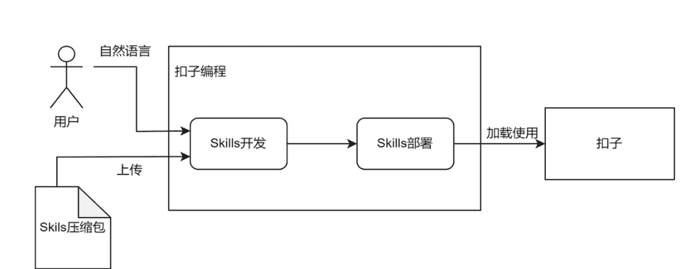

图2-8 Skills开发、部署与使用架构图

通过扣子编程平台开发Skills，既可以通过用户输入自然语言描述实现自动化开发，也可以通过上传已有的Skills压缩包完成。开发完成后，必须经过部署步骤，使其能够在扣子产品体系内被调用和使用。通过这样的设计，可以让扣子编程与扣子依托Skills开发，形成完整的生态。

## 2.2 快速上手扣子

在2.1.3节，我们知道Skills开发完毕后，需要通过扣子（原扣子空间）进行加载与使用，才能体现出其效果。因此本节将快速介绍一下扣子的功能与如何使用。

### 2.2.1 扣子——深度思考型智能体的优秀代表

扣子，原名为扣子空间，在扣子产品体系升级到2.0版本后，改名为扣子。扣子是一款对标Manus的通用智能体产品，与使用扣子编程的低代码模式构建的工具调用型的智能体不同，扣子是具备意图识别、思考、计划、反思、联网搜索等能力的深度思考型智能体。

此外，扣子还支持通过MCP接入自定义工具，使得企业可以更方便地将其集成到现有业务流程中，而无须从头构建智能体。

如图2-9所示，扣子的基础用法非常直观。用户可以直接在对话框中输入提示词，点击“发送”按钮，扣子智能体便会开始工作。


图2-9 扣子的主页

例如，输入以下提示词：

请创建一份全面、系统的大学微积分全课程详细课堂笔记，内容应覆盖以下核心模块。

1. 函数与极限基础：
    - 函数的定义、性质及常见类型（多项式、指数、对数、三角函数等）
    - 极限的概念、性质及运算法则
    - 重要极限公式及证明思路
    - 函数连续性的判定与间断点分类

2. 一元函数微分学：
    - 导数的定义、几何意义及物理意义
    - 基本求导公式与法则（四则运算、复合函数、隐函数等）
    - 高阶导数与莱布尼茨公式
    - 微分的概念及应用
    - 中值定理（罗尔定理、拉格朗日中值定理、柯西中值定理）
    - 洛必达法则及应用
    - 函数单调性、极值与最值的判定
    - 函数凹凸性与拐点分析
    - 函数图像绘制方法

3. 一元函数积分学：
    - 不定积分的概念与性质
    - 基本积分公式与积分法则
    - 换元积分法与分部积分法
    - 有理函数积分与三角函数积分技巧
    - 定积分的定义、性质及几何意义
    - 微积分基本定理（牛顿-莱布尼茨公式）
    - 定积分的计算方法
    - 反常积分的概念与计算
    - 定积分的应用（面积、体积、物理应用等）

4. 微分方程：
    - 微分方程的基本概念与分类
    - 一阶微分方程的解法（可分离变量、齐次、线性等）
    - 高阶线性微分方程的解法
    - 微分方程的应用模型

5. 多元函数微积分：
    - 多元函数的概念、极限与连续性
    - 偏导数与全微分
    - 复合函数与隐函数求导法则
    - 多元函数的极值与条件极值
    - 二重积分的概念、性质与计算
    - 三重积分的概念与计算
    - 曲线积分与曲面积分基础

6. 无穷级数：
    - 常数项级数的概念与性质
    - 正项级数敛散性判别法
    - 交错级数与绝对收敛
    - 幂级数的收敛域与和函数
    - 函数的幂级数展开
    - 傅里叶级数初步

笔记应包含：

- 每个知识点的清晰定义与定理陈述
- 关键公式的推导过程
- 典型例题解析（附详细步骤）
- 易错点提示与解题技巧总结
- 重要概念的几何直观解释

建议使用数学符号规范表达，并适当使用图表辅助理解；内容深度应符合大学理工科微积分课程要求，可作为系统学习与复习备考的全面参考资料。

发送后，可以看到如图2-10所示的输出。

已接收到你的任务，我将立即开始处理...

> 4 个步骤
> 正在思考
> 正在生成文档框架

确认框架

> 7 个步骤
> 正在思考
> 正在思考

已为您完成大学微积分全课程详细课堂笔记的撰写，内容涵盖函数与极限、微分学、积分学、微分方程、多元函数微积分及无穷级数六大模块，包含定义、定理、公式推导、典型例题和易错点分析，符合大学理工科课程深度要求。笔记以Markdown格式保存，方便您查看和编辑。


图2-10 扣子智能体的输出

从输出可以看出，扣子智能体会进行多个步骤的思考，并且由人类确认文档框架后，才会完成课堂笔记的撰写。如图2-11所示，最终生成的文件不仅结构清晰，内容详实，且符合大学理工科微积分课程的要求。

## 大学微积分全课程详细课堂笔记

### 01 函数与极限基础

函数的定义、性质及常见类型

一、函数的定义

函数是微积分的核心概念，其本质可通过**集合映射**严格定义：设 $A$ 和 $B$ 是非空数集，若存在对应法则 $f$，使得对 $A$ 中的每一个元素 $x$，在 $B$ 中都有**唯一确定**的元素 $y$ 与之对应，则称 $f$ 为从 $A$ 到 $B$ 的函数，记作 $y = f(x)$。其中，集合 $A$ 称为函数的**定义域**（输入值范围），集合 $\{f(x)|x \in A\} \subseteq B$ 称为函数的**值域**（输出值范围）。

通过Venn图可直观理解定义域与值域的对应关系：定义域集合中的每个元素通过映射法则 $f$，在值域集合中形成唯一像点，体现“一对一”或“多对一”的对应特性（“一对多”不属于函数关系）。

二、函数的基本性质

函数的性质是分析其变化规律的关键，以下按“定义+几何意义+判定步骤”展开核心性质：

1. 单调性
    - 定义：设函数 $f(x)$ 在区间 $I$ 上有定义，对任意 $x_1, x_2 \in I$，若 $x_1 < x_2$ 时恒有 $f(x_1) < f(x_2)$（或 $f(x_1) > f(x_2)$），则称 $f(x)$ 在 $I$ 上**单调递增**（或**单调递减**）。
    - 几何意义：函数图像在区间 $I$ 内呈“上升”或“下降”趋势，无折返。
    - 判定步骤：
        1. 任取 $x_1 < x_2 \in I$；
        2. 计算 $f(x_2) - f(x_1)$，判断其符号（正为增，负为减）；
        3. 对可导函数，可通过导数 $f'(x) \geq 0$（增）或 $f'(x) \leq 0$（减）快速判定。

图2-11 课堂笔记文件内容展示

### 2.2.2 扣子技能商店与自定义技能

除了直接使用扣子的强大功能外，用户还可以通过其内置的技能商店访问更多预构建的Skills，或上传自己的Skills以扩展扣子的功能。如图2-12所示，在扣子页面的左上角存在“技能商店”功能。


图2-12 “技能商店”入口

点击进入后，会跳转到如图2-13所示的“技能商店”页面。在该页面包括扣子官方内置的技能以及开发者通过扣子空间开发后，上架到商店的技能。


图2-13 “技能商店”主页

点击任意技能，可以查看其详细介绍及案例，如图2-14所示。如果对该技能感兴趣，只需点击“添加”按钮即可将其加入你的技能库中。

在“我的技能”页面（见图2-15），可以看到所有已添加的技能，包括从技能商店添加的技能和开发者自己通过扣子编程部署的技能。


### 新年绘本

轻松创作个性化绘本，支持二次编辑与调整，实物打印包邮到家

| 分类 | 开发者 | 版本 | 用户 | 是否开源 |
| :--- | :--- | :--- | :--- | :--- |
| 图像与设计 | 官方 | v2.4 | 5.7w | 否 |

绘本技能是为用户打造的个性化绘本创作工具，支持将图片、文字转化为精美绘本，让每个人都能轻松实现绘本创作。

**特别福利！扣子同步开启“用扣子，新年礼物马上到”的官方活动。...**

展开 ∨

精选案例


添加

图2-14 技能详情页


(a)


(b)

图2-15 “我的技能”页面

点击“立即使用”按钮，便可以将选定的技能添加到扣子主页的对话框中进行实际操作，如图2-16所示。


图2-16 使用技能

以新年绘本技能为例，添加到对话框后，输入提示词：

请帮我绘制一个“马”主题的新年绘本

发送后，如图2-17（a）所示，扣子会加载技能然后完成绘本的绘制。最后如图2-17（b）所示，会输出绘本的预览。

## 马主题新年绘本绘制

新年绘本技能 请帮我绘制一个“马”主题的新年绘本

这个选题很有年味！马在中国文化里寓意着龙马精神、马到成功，用它来承载新年祝福，既有传统底蕴又不失生动。我将调用绘本生成技能来完成这个任务。

完成技能加载 新年绘本

我将围绕“马”这一主题创作一个充满年味的22页绘本，结合中国传统春节元素和马的吉祥寓意。故事将讲述小马阿骏在春节前夕帮助村民准备年货，最终带领大家迎接新年的温暖故事。

完成文件创建 story 故事

现在我将运行绘本生成脚本来创建完整的绘本内容。

生成并输出春节绘本故事

绘本已经成功生成！这个22页的绘本以小马阿骏为主角，讲述了它在春节前夕帮助村民准备年货、共同迎接新年的温暖故事。绘本采用了水彩童话风格，充满了浓郁的年味和节日氛围。


（a）


(b)

图2-17 绘本生成与预览

通过上述介绍，读者应该对如何快速上手扣子有了基本了解。无论是直接利用扣子的强大功能处理复杂任务，还是通过技能商店扩展其功能，都能极大地提升工作效率并降低技术门槛。

## 第二部分 纯文字Skills实战

第3章 直播带货话术复用Skills开发实战

第4章 股票技术分析Skills开发实战

## 第3章 直播带货话术复用Skills开发实战

直播销售已成为众多企业重要的销售渠道之一。一场高效的带货直播不仅涉及产品展示，更融合了情绪引导、节奏把控、用户痛点识别与产品卖点转换等多种销售技巧，本质上是一场高度结构化的语言沟通实践。行业中涌现出一批表现突出的主播，他们通常具备较强的表达感染力、精准的时间管理能力，以及将复杂产品价值以简洁、生动的方式传达给观众的能力。

若能对高转换率主播的话术进行系统性分析，提炼其核心策略并加以结构化，进而形成可复用的话术模板，则在推出同类新品时可快速调用这些经验。这有助于实现优秀销售方法的标准化沉淀与规模化应用，既降低了新主播的培训成本，也有助于提升团队整体的转换率和品牌表达的一致性。


基于这样的背景，本章将基于扣子编程，构建一个直播带货话术复用Skills。本章的配套视频可扫描右侧二维码观看。

### 3.1 直播带货话术复用Skills的核心逻辑梳理

本节将围绕直播带货话术复用Skills的设计，重点厘清其实现逻辑与整体架构，为后续在扣子编程平台上的具体开发奠定基础。

作为本书零代码开发Skills的第一个实战项目，本章围绕该项目刻意采用简洁、直观的流程设计，避免引入过多的复杂变量或高级功能。其核心目标并非追求功能极致的完备性，而是通过一个贴近真实业务、易于理解的案例，帮助读者实现以下两个学习目标。

- 熟悉扣子编程平台从提示词到可执行Skills的转换机制。
- 直观感受Skills在经验沉淀、复用与智能体调用方面的实际价值。

因此，本章所设计的Skills虽功能聚焦、逻辑简洁，却完整覆盖了从需求定义、策略抽象到自动化实现的关键环节。这一设计方案如同一个教学原型，旨在降低读者的学习门槛，构建对Skills开发范式的系统性认知，从而为后续构建更复杂的高级Skills打下坚实基础。

#### 3.1.1 需求分析：优秀主播话术的复用价值与场景

在传统的优秀主播经验传承中，行业常常面临以下两大痛点。

- 会做不会教。许多优秀主播凭借直觉、天赋或长期直播的经验，打磨出高效的直播话术与节奏把控能力，但缺乏将这些隐性经验系统化、结构化表达的能力。他们或许能做好直播，却难以清晰拆解为何这样做，以及每句话术背后的策略是什么，导致其核心经验难以被他人有效学习和复用。
- 经验高度依附于个体，极易随人员流动而流失。一旦核心主播离职，其积累的选品逻辑、用户互动技巧、促单话术等宝贵经验资产往往随之消失。继任者不得不从零开始，在一次次试错与实战中重新摸索，不仅拉长了继任主播的成长周期，也给团队业绩带来波动风险。

而扣子平台Skills的核心设计理念，正是将可重复、可迁移的方法论封装为模块化的专家经验包，供智能体在具体任务中调用执行。因此，将直播带货话术复用开发为专属Skills，能够让直播带货话术不再仅依赖个人天赋，而是转换为可积累、可迭代、可智能调用的数字资产，真正实现把顶尖主播的经验，转换为团队可复用的核心能力的目标。

#### 3.1.2 项目方案设计：Skills功能设计

基于前述背景，本实战项目的设计思路非常明确，可分为以下两个层次。

（1）系统化沉淀优秀主播的话术结构，形成可复用的模板库。

一场高转换率的直播通常有清晰的节奏与逻辑链条，其典型环节如下。

- 聚人：吸引观众进入直播间。
- 留客：通过互动、福利或内容留住用户。
- 锁客：建立信任，引导用户持续关注。
- 说服：精准传递产品价值，解决用户疑虑。
- 催单：制造紧迫感，推动用户快速下单决策。
- 引导下单与关注：完成转换并沉淀私域用户。

这些环节中的高频话术、情绪调动技巧、产品卖点包装方式等，均可被抽象为结构化模板。例如，催单阶段常用“库存只剩×件”“最后×分钟优惠截止”等句式；说服阶段则强调“痛点—解决方案—佐证证据”的三段式表达。

（2）实现智能话术生成，赋能新人主播快速上手。

当新主播需要讲解某款新产品时，只需向该Skills提供产品基本信息（如品类、核心卖点、目标人群、价格区间等），智能体即可自动匹配对应环节的话术模板，结合产品特性进行个性化填充与语义优化，最终输出一份完整、流畅、符合高转换逻辑的直播脚本。

这一过程不仅能大幅缩短新人主播的学习周期，还能确保品牌话术风格与销售策略的一致性，真正实现把优秀主播的经验落地为每个主播都能用的标准化工具的目标。

在完成需求分析和项目方案设计后，3.2节将进入本Skills的开发、测试与部署环节。

### 3.2 直播带货话术复用Skills的全流程落地实操

本节将基于提示词构建和上传参考资料的方式，利用扣子编程平台，完成“直播带货话术复用”这一Skills的开发、测试与发布。

#### 3.2.1 前置准备：直播话术模板的梳理与标准化

根据3.1.2节的项目方案设计，开发直播带货话术复用Skills的首要前提，是对优秀主播的话术模板进行结构化整理。本节将以一场直播中的聚人环节为例，介绍话术模板的构建方法。

聚人环节的话术由欢迎话术与宣传话术两部分构成，具体如图3-1所示。

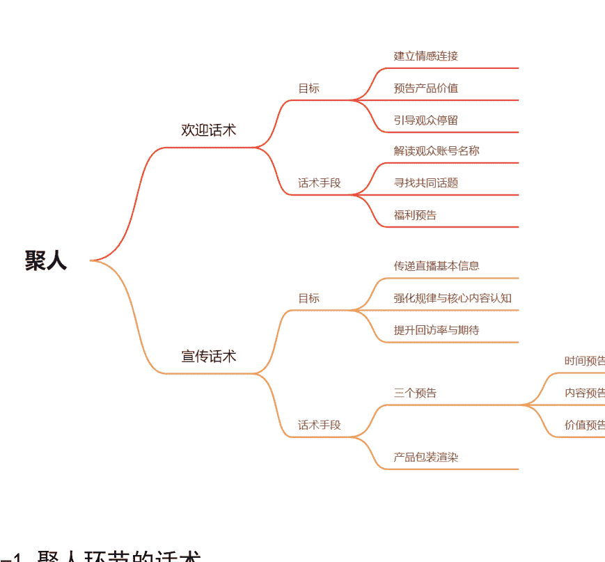

图3-1 聚人环节的话术

根据聚人环节话术的目标和分类，可以设计如下话术模板。

## 一、聚人阶段

### 目的

这个阶段属于直播开场阶段，做好一定的暖场，拉近与用户的距离，吸引眼球。

### 重点

- 新人阶段要学会自说自话，不要怕尴尬
- 紧盯着手机屏幕上的买家发言，热情及时地回复
- 能给直播间所有人留下很好的印象

### 内容构成

聚人环节的话术由欢迎话术与宣传话术两部分构成，通常包含三方面内容：

- 打招呼
- 讲故事
- 福利预告/产品预告

### 1. 欢迎话术

#### 话术目标

- 建立情感连接
- 预告产品价值
- 引导观众停留

#### 话术类型与示例

1. **解读观众账号名称：**

> 欢迎[昵称]宝子进入直播间！想要[产品名称]的不要走开，我们马上就要上架啦！

> [昵称]宝子来啦！看你账号就感觉是懂行的，今天直播间的[产品名称]绝对合你心意，别走开！

2. **寻找共同话题：**

> 你是不是和我一样换季就过敏，换好几个产品都不合适？这种情况我一般会用 XX 产品，亲测超好用！

> 是不是一到秋冬皮肤就干燥起皮，涂啥都卡粉？今天就给大家安排了专治干皮的 XX 产品，一定要蹲住！

3. **福利预告：**

> 新进来的家人点个关注，一会儿有专属福利放送哦～

> 新进来的家人别划走，关注直播间马上抽三位送 XX 小样，刚进来的宝子都能参与！

### 2. 宣传话术

#### 话术目标

- 传递直播基本信息
- 强化规律与核心内容认知
- 提升回访率与期待

#### 话术类型与示例

1. 时间预告话术：

> 我们每天中午 12 点准时开播，专属福利只在直播间，不见不散！

> 每晚 8 点锁定直播间，定时上福利，蹲住不亏！

2. 内容预告话术：

> 今天主推三款爆款好物：XX面膜、XX精华和XX防晒，直播间专属价开抢！

> 本场直播间主打平价护肤，从洁面到面霜一站式配齐，都是直播间专属福利款！

3. 价值预告话术：

> 今天直播间下单，件件有赠品，还能参与整点抽奖，中奖率超高！

> 本场所有好物直降X元起，还有满减叠加，直播间下单更划算！

> 新粉关注立减 X 元，今天直播间专属福利，仅限直播时段哦！

4. 产品包装渲染话术：

> 这款 XX 产品闭眼入就对了，直播间老粉复购率超高，买过的宝子基本都会来回购，反馈都特别好！

> 今天这款 XX 好物专为日常居家设计，用料扎实还特别实用，不管是自己用还是送家人都合适，闭眼冲不踩雷！

参考如上模板的结构，可以继续设计留客、锁客、说服、催单、引导下单与关注环节的话术模板。

准备好各个环节的话术模板后，将话术模板保存为Markdown格式的文件，并命名为“直播话术指南.md”，供Skills开发及后续阶段使用。

#### 3.2.2 Skills开发：提示词编写与功能可视化配置

本节利用零代码Skills开发平台扣子编程，快速完成直播带货话术复用Skills的开发。

首先，进入扣子编程主页并登录（如果还未注册账户，需要先注册账户），点击对话框上方的“技能”标签，进入技能的编程界面。

然后，点击该界面左下脚的按钮（见图3-2），选择并上传已准备好的话术模板文档（“直播话术参考.md”），作为智能体生成话术的核心参考依据。


图3-2 扣子编程主页

接下来，设计清晰、可执行的提示词。该提示词需明确任务目标、功能要求及输出要求，引导智能体正确调用上传附件中的模板内容。最终构建的提示词如下。

## 任务目标

开发一个名为“直播带货话术复用”的Skills。

## 功能要求

当用户提供某款产品的基本信息（如产品名称、核心卖点、适用人群、价格区间等）时，该Skills应自动结合我上传的附件“直播话术指南.md”中所定义的直播（包括聚人、留客、锁客、说服、催单、引导下单与关注环节）话术结构，生成完整、自然、富有感染力的直播口播脚本。

## 输出要求

- 覆盖完整的直播流程，从开场聚人环节到引导下单与关注环节。
- 语言风格亲切、有节奏感，符合头部主播的表达习惯。
- 能灵活嵌入用户提供的产品信息，避免模板化生硬感。

将上述提示词粘贴至扣子编程平台的对话框中并点击图3-2右下角的按钮后，系统将自动进入Skills开发流程，界面也随即切换至Skills开发与预览页面（见图3-3）。

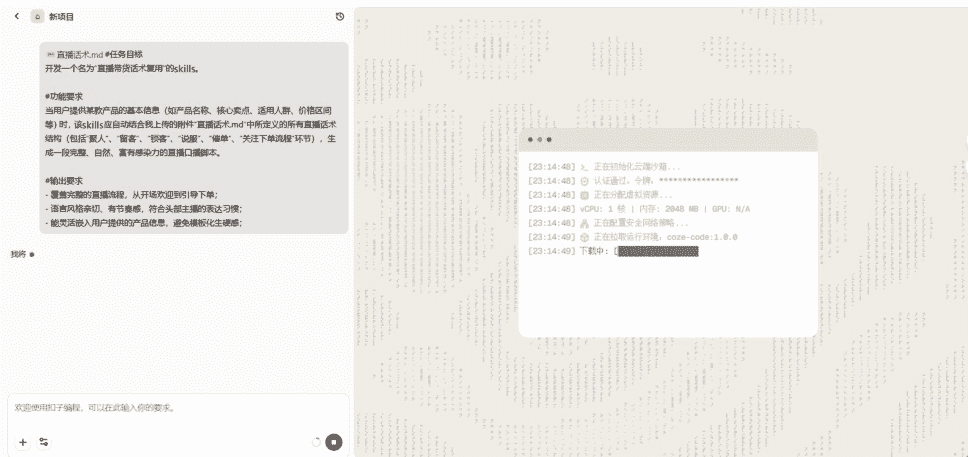

图3-3 Skills开发与预览页面

该页面采用双栏布局，功能非常清晰。下面简单介绍左右两栏的功能。

左栏为**交互式开发区**。该区域以自然语言对话的形式驱动整个Skills开发过程，由扣子编程逐步解析提示词中的需求，完成初步开发。开发者如认为开发的Skills不符合预期，可通过对话方式细化逻辑，进一步引导扣子编程完善开发。

右栏为**预览与沙箱区域**。初始状态下，系统会提示“正在初始化云端沙箱”。所谓沙箱，就像厨房常用的透明保鲜盒（见图3-4），是一个独立的隔离空间：将食材（开发过程中产生的中间文件、模板解析结果及最终生成的脚本）放入保鲜盒内处理，既不会让食材洒落到台面上污染环境（确保运行安全性），也能让每次处理的步骤和结果完全一致（确保结果可复现性），所有操作均在盒内完成，不影响外部空间。

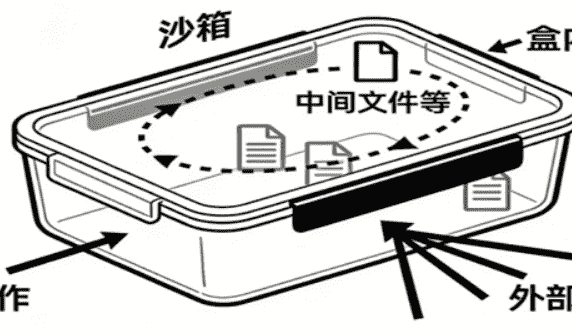

图3-4 沙箱示意

待初始化完成后，图3-3右栏便会切换至预览页面（见图3-5），并提示“技能正在生成中”。这表示扣子编程平台正在自动化开发Skills。


图3-5 预览页面

在Skills的开发过程中，扣子编程平台会自动完成一系列后台操作，并在图3-3左栏的交互式开发区实时显示（见图3-6）。

首先是阅读文件环节，如图3-6（a）所示。该环节会阅读并理解用户上传的“直播话术参考.md”文件，然后通过不断更新计划的方式动态生成开发计划。之后进入如图3-6（b）所示的环节，执行多条命令并创建文件，这些步骤的作用是创建Skills所需的各项目录及SKILLS.md文件，接下来执行打包技能步骤，这标志着Skills开发进入收尾阶段。

阅读文件 直播话术参考.md

阅读文件 直播话术参考.md

更新计划

```
Bash
```

分析用户需求和参考文档，设计Skills的整体架构。

需求分析：

1. 输入：产品基本信息（产品名称、核心卖点、适用人群、价格区间等）
2. 参考资料：直播话术参考.md（包含聚人、留客、说服、催单四个阶段的完整话术结构）
3. 输出：完整、自然、富有感染力的直播口播脚本

实现方式判断：

- 内容生成（直播话术创作）→ 智能体已有能力（文本创作）
- 信息整合（产品信息+话术结构）→ 智能体已有能力（结构化思维）
- 格式处理（生成结构化脚本）→ 智能体已有能力（内容组织）

结论：这个Skills完全可以通过自然语言指导实现，不需要任何脚本。

Skills架构设计：

1. SKILL.md：提供核心的生成流程和话术应用指导

(a)

现在开始创建“直播带货话术复用”技能。

```
执行命令 mkdir -p /workspace/projects/livestream-sales-script/references
执行命令 mv /workspace/projects/temp_livestream_script.md /workspace/projects/livestr...
创建文件 /workspace/projects/livestream-sales-script/SKILL.md
阅读文件 /workspace/projects/livestream-sales-script/SKILL.md
执行命令 mkdir -p /workspace/projects/livestream-sales-script/scripts /workspace/proje...
执行命令 ls -la /workspace/projects/livestream-sales-script/
执行命令 ls -la /workspace/projects/livestream-sales-script/references/
执行命令 ls -lh /workspace/projects/livestream-sales-script.skill
打包技能
执行命令 ls -lh /workspace/projects/livestream-sales-script.skill
更新计划
```

(b)

图3-6 Skills的开发过程

最后扣子编程平台会明确提示“Skills已创建完成”，并生成一份清晰的实现概览（见图3-7（a））、交付内容和使用说明（见图3-7（b））。

## Skills 已创建完成

## 目标

创建 "直播带货话术复用" 技能，实现根据产品信息自动生成专业直播带货脚本。

## 实现概览

## 技术选型：

- 完全基于智能体的自然语言生成能力，无需任何脚本
- 将直播话术结构转化为可执行的生成流程指导
- 通过四步法（信息收集→阅读参考→阶段生成→整合优化）确保输出质量

## 核心功能：

1. **信息收集**：明确产品名称、核心卖点、适用人群、价格区间等关键信息
2. **结构化生成**：按照聚人→留客→说服→催单→下单引导的完整流程生成话术
3. **灵活适配**：根据产品特点（美妆、服装、食品等）选择合适的话术模块
4. **质量优化**：确保语言自然、有感染力、避免模板化

## 关键决策

1. **无脚本设计**：直播话术生成本质是创意内容创作，智能体的文本生成能力远超脚本模版
2. **参考文档整合**：将用户提供的直播话术参考.md 作为核心参考，包含完整的话术结构和示例
3. **四阶段流程**：按照专业直播的 "聚人 - 留客 - 说服 - 催单" 逻辑组织生成流程
4. **个性化指导**：提供美妆、服装等不同品类的生成示例，降低使用门槛

(a)

## 交付内容

目录结构:

```
live-streaming-sales-script/
├── SKILL.md                # 核心生成流程与指导
├── scripts/                # 空目录（无脚本）
├── references/
│   └── 直播话术指南.md      # 用户提供的完整话术结构文档
└── assets/                 # 空目录（无静态资源）
```

实现方式说明:

- ✅ 所有功能通过智能体自然语言指导实现（话术创作、信息整合、格式生成）
- ✅ SKILL.md 提供清晰的操作步骤和质量要求
- ✅ references/ 包含完整的直播话术结构参考（聚人、留客、说服、催单、下单引导）
- ❌ 不使用脚本（直播话术生成属于创意内容创作，智能体原生能力已充分）

产物: live-streaming-sales-script.skill (9.7KB)

## 使用说明

当用户提供产品信息时，智能体会:

1. 收集产品关键信息（名称、卖点、适用人群、价格、促销活动等）
2. 阅读 references/直播话术指南.md 掌握各阶段话术要点
3. 为每个阶段生成适配的话术（灵活选择话术模块，避免机械拼接）
4. 整合优化，确保语言自然、有感染力、符合头部主播风格

输出包含完整五阶段（聚人→留客→说服→催单→下单引导）的专业直播带货脚本。

(b)

图3-7 Skills开发完成

此时，图3-3右栏的预览窗口会显示图3-8所示的结果，自动加载已开发完成的Skills会以自然语言对话的形式向用户展示其使用说明与交互方式。

图3-8 预览窗口

接下来，用户只需在下方的消息输入框中发送测试提示词，即可立即验证该Skills的实际效果。

#### 3.2.3 技术拆解：Skills实现细节分析

通过扣子编程平台开发的Skills，并非一个完全封闭的黑盒。相反，其内部结构透明、可查、可下载，便于开发者理解实现逻辑、进行调试或后续迭代优化。

本节将对扣子编程生成的直播带货话术复用Skills的实现细节的查看方式进行介绍，并对其实现细节进行分析，了解该Skills是如何做到“直播带货话术复用”的。

点击图3-5预览页面右上角的“切换文件目录”按钮（见图3-9），即可展开当前Skills的完整文件视图。

图3-9 切换文件目录

随后，系统会在图3-3左栏的交互式开发区与右栏的预览区域之间弹出如图3-10所示的文件目录面板。

图3-10 文件目录

该面板展示了直播带货话术复用Skills的项目结构，目录名为live-streaming-sales-script。根据Skills开发规范，每个Skills必须包含技能说明书SKILLS.md文件。该文件用来定义Skills的功能描述、输入输出格式、使用示例及调用方式，是智能体理解如何执行该Skills的关键元文件。

此外，每个Skills还支持以下可选目录。

- assets/，用于存放静态资源（如图片、音频等）。
- scripts/，用于存放自定义代码脚本（用于复杂逻辑处理）。
- references/，用于存放参考文档或外部知识源。

在本项目中，由于需求聚焦于基于模板的自然语言生成，无须编写额外代码或引入多媒体资源，因此 scripts/ 和 assets/ 目录为空。然而，考虑到话术生成高度依赖前期上传的“直播话术参考.md”文件（被扣子编程重命名为“直播话术指南.md”），该Markdown文件被自动归档至references/目录中，作为Skills运行时的知识依据。

最后，快速浏览 SKILLS.md 文件，了解该Skills的设计思路与实现逻辑，为后续自主开发类似功能提供参考。以下是 SKILLS.md 文件的核心内容。

```
---
name: live-streaming-sales-script
description: 根据产品基本信息，结合直播（聚人、留客、锁客、说服、催单、引导下单与关注环节）话术结构，自动生成完整、自然、富有感染力的直播口播脚本。适用于主播、电商从业者准备直播带货内容。
---
```

# “直播带货话术复用” Skills

## 任务目标

- 根据产品信息快速生成专业的直播带货话术脚本
- 能力包含：
  - 覆盖完整直播流程（聚人→留客→锁客→说服→催单→下单引导与关注）
  - 结合产品特点灵活适配话术模块
  - 生成符合头部主播风格的口播文案
- 触发条件：用户提供产品基本信息（如产品名称、核心卖点、适用人群、价格区间等）

## 操作步骤

### 步骤 1：收集产品信息

向用户收集以下关键信息（如用户提供不全，根据上下文智能补全）：

**必填项**：

- 产品名称
- 核心卖点（2～4个）
- 适用人群

**建议项**：

- 价格区间/优惠力度
- 产品特点（材质、功效、设计等）
- 促销活动（限时折扣、买赠、数量限制等）
- 使用场景

### 步骤 2：阅读参考文档

仔细阅读 [references/直播话术指南.md](references/直播话术指南.md)，掌握各阶段话术的核心要点：

**聚人阶段**：

- 用户入场欢迎（解读观众账号名称+寻找共同话题+福利预告）
- 宣传话术（时间预告、内容预告、价值预告）
- 产品包装渲染

......

### 步骤 3：按阶段生成话术

根据产品特点和用户需求，为每个阶段生成适配的话术：

......

### 步骤 4：整合优化

将各阶段话术整合为完整脚本，并进行优化：

......

## 资源索引

- 领域参考：见 [references/直播话术指南.md](references/直播话术指南.md)（何时读取：步骤2执行前）

## 注意事项

- 参考文档是素材库，需灵活改编而非直接复制
- 话术要结合产品特点个性化定制，避免“万能模板”
- 语言风格要亲切自然，多用“宝宝们”“姐妹们”等称呼
- 适时使用感叹句、反问句增强感染力
- 价格信息用对比式表达突出优势（原价XX→直播间XX）
- 数量限制、时间限制要具体化（如“只有20件”“最后2分钟”）

## 使用示例

### 示例 1：美妆产品（口红）

**输入信息**：

- 产品：哑光口红
- 核心卖点：显白、持久不脱色、丝绒质地
- 适用人群：20～35岁女性
- 价格：原价299元，直播间99元

**生成要点**：

- 聚人：预告“今天只有两位数的哑光口红”
- 留客：问“大家夏天是不是总觉得口红容易脱色？”
- 说服：展示颜色“温柔春天感”，说“我自己天天都在用”
- 催单：“只有20件，拼手速”

......

SKILLS.md文件采用标准的YAML Front Matter语法（即文件的前4行）定义了该技能的元信息，包括名称（name）和功能描述（description），便于系统识别与调度。

随后进入SKILLS.md文件正文，整体结构遵循“任务目标→操作步骤→资源索引→注意事项→使用示例”框架。

- 任务目标部分提炼了使用扣子编程开发该Skills时输入的提示词，明确其功能边界与适用场景。
- 操作步骤则将直播话术生成过程拆解为若干可执行阶段（如收集产品信息、阅读参考文档、按阶段生成话术、整合优化），每个步骤均对应直播带货话术的关键环节，并严格参照references/直播话术指南.md中的模板结构进行设计。
- 文档末尾依次列出资源索引（指向关键参考资料）、注意事项（涵盖风格、表达与个性化要求）以及使用示例（通过典型输入输出展示技能效果），形成完整的开发与使用闭环。

在今后的项目中，开发者在手写SKILLS.md文件时，可借鉴本例所采用的结构化编写范式。

#### 3.2.4 Skills测试：功能验证

本节以“红豆薏米茶”为例，对已开发的“直播带货话术复用”Skills进行测试。测试时，在图3-3左栏的消息输入框中输入以下提示词。

```
# 产品信息

产品名称：红豆薏米茶

产品材料：栀子、无硫陈皮、低温烘焙的赤小豆、红豆、薏米、芡实，经多次科学配比而成

产品功能：现代人因常吃油腻食物、熬夜，导致体内湿气堆积，易出现长痘痘、皮肤和头发出油、湿疹反复，老年人还可能伴有关节酸痛。本品通过温和祛湿，帮助调理体质，改善上述问题。

产品亮点：采用低温烘焙工艺，既最大程度保留食材营养，又能有效中和薏米的寒性；独立小包装，可直接冲泡，方便快捷

# 输出要求

输出的脚本需要明确所属阶段，如聚人阶段、留客阶段等
```

输出如图3-11所示。

# 红豆薏米茶直播带货脚本

【聚人阶段】
“家人们！欢迎来到我的直播间！今天给大家带来一款祛湿神器——红豆薏米茶！现在点击关注，参与我们的抽奖活动，免费送出10盒红豆薏米茶！没点关注的家人赶紧点关注，福利马上开抢！”

【留客阶段】
“很多家人可能会问，红豆薏米茶市面上到处都是，为什么要选我们这款？别着急，接下来我给大家详细讲讲我们这款红豆薏米茶的特别之处。在讲解之前，先给大家发一波福袋，里面有50元优惠券，只要关注直播间就能参与抽奖！”

【锁客阶段】
“家人们，湿气是万病之源，如果你经常感到身体沉重、疲劳乏力，脸上长痘痘、头发爱出油，那说明你体内湿气很重了。我们这款红豆薏米茶采用科学配比，能够有效祛湿，改善你的体质。现在下单，买二送一，再送一个精美的泡茶杯！库存有限，先到先得！”

【说服阶段】
“我们的红豆薏米茶选用栀子、无硫陈皮、低温烘焙的赤小豆、红豆、薏米、芡实六种食材，经过多次科学配比，精准祛湿不寒凉。低温烘焙工艺最大程度保留了食材的营养成分，中和了薏米的寒性，脾胃虚弱的家人也能放心喝。独立小包装，方便携带，随时随地都能冲泡。很多用户反馈，喝了一段时间后，身体轻松了很多，痘痘也消了，头发也不油了。这些都是真实的用户反馈，大家可以放心购买！”

【催单阶段】
“家人们，福利马上就要结束了！现在下单，不仅能享受买二送一的优惠，还能获得50元优惠券！库存只剩下最后100单了，再不抢就没了！别犹豫了，赶紧点击下方小黄车下单吧！”

【下单阶段】
“想要的家人们，点击下方小黄车1号链接，直接下单！今天下单的家人，我们48小时内发货，包邮到家！收到货不满意，7天无理由退换货，让你没有任何后顾之忧！赶紧行动起来吧！”

图3-11 红豆薏米茶直播带货脚本

可以看出，智能体生成的直播话术严格遵循了直播带货话术复用Skills开发阶段上传的“直播话术参考.md”文件中的结构，完整覆盖了聚人、留客、锁客、说服、催单、引导下单与关注环节（即图3-11中的下单阶段），并融入了红豆薏米茶的产品信息，体现了高度的业务适配性与语言自然度。尤为关键的是，所有产品细节—包括配方成分（栀子、无硫陈皮、赤小豆等）、工艺特点（低温烘焙）、使用方式（直接冲泡）—均被准确提取并嵌入话术中，无遗漏、无失真、无生硬堆砌。

这充分说明直播带货话术复用Skills成功实现了专家经验模板与具体产品信息的智能融合。

#### 3.2.5 Skills部署：新建变量与开始部署

在完成Skills测试后，可通过部署功能，对Skills进行一键部署。部署完成后，才可以在扣子中发现并使用该Skills。下面介绍Skills部署的具体步骤。

首先点击图3-5预览页面右上角的“部署”按钮，进入如图3-12所示的部署配置页面。

# 开始部署你的项目吧

生产环境变量
查看、新增、修改或同步至生产环境的环境变量

图3-12 部署配置页面

该页面提供了一个“新建变量”按钮，用于在项目正式运行时为项目安全地配置敏感信息（如 API Key、数据库连接字符串、飞书文档地址）。通过这种方式，可避免将敏感信息直接写到源文件中（就像不把电脑开机密码直接贴到电脑屏幕上），从而有效降低安全风险。

是否需要配置环境变量，取决于当前Skills是否调用了外部服务或依赖了敏感参数。以直播带货话术复用Skills为例，其功能完全基于用户输入和本地直播话术模板生成，未调用任何外部接口，也未使用任何API Key，因此无须额外设置环境变量。此时，可直接点击“开始部署”按钮，完成Skills的发布流程。

### 3.3 扣子通用智能体秒变直播带货达人

本节将基于扣子通用智能体完成Skills的加载与实战任务处理。跟着本节实操的前提是，已经完成直播带货话术复用Skills的部署，确保该Skills可在扣子平台正常调用。

#### 3.3.1 Skills集成：扣子智能体的加载流程

进入图3-13所示的扣子平台的对话页面

图3-13 扣子平台的对话页面

点击图3-14（a）所示的@符号，即可在弹出的技能列表中看到已成功集成的直播带货话术复用Skills。点击该Skills，它将被自动插入对话框，如图3-14（b）所示。

(a)

(b)

图3-14 扣子智能体Skills加载操作界面

在对话框中输入3.2.2节构建的测试提示词，点击“发送”按钮，即可启动该Skills开展工作，操作界面如图3-15所示。

图3-15 扣子智能体测试提示词输入界面

#### 3.3.2 实战验证：直播场景表现与优化建议

当在扣子智能体中调用该Skills时，系统将率先完成技能加载，并完成技能文件读取，即自动读取3.2.1节准备的直播话术模板，精准把握话术设计的核心要点，如图3-16所示。

图3-16 技能加载

随后扣子智能体快速生成红豆薏米茶直播带货脚本，输出内容与3.2.4节的测试结果基本一致，如图3-17所示。这再次印证了该Skills的实际可用性与输出稳定性，零编程基础也能实现无调试正常使用。

图3-17 生成带货脚本

通过该Skills的快速加载与调用，无须进行任何额外编程操作，原本仅能处理通用任务的扣子智能体，即可被赋予直播带货话术生成的垂直领域专业能力。从通用型智能助手升级为专注于直播话术生成的专项智能体，真正实现了Skills即插即用的核心价值，成为名副其实的直播带货内容生成达人。

## 第4章 股票技术分析Skills开发实战

股票市场中，投资者的主流操作策略可划分为短线交易与长线投资两类。短线交易以技术分析、题材预判为核心依据，通过捕捉短期市场波动赚取价差收益，持股周期通常为一天至数周；长线投资则秉持“做时间的朋友”的价值投资理念，聚焦企业内在价值挖掘，以长期资产增值为核心目标。

对于资金量相对有限的个人投资者而言，入门阶段往往更倾向于选择短线策略。究其原因，是希望通过高频交易提升资金周转效率，在有限资本下尝试获得更高的短期回报。但短线交易的实操门槛，远高于多数新手的预期：其一，短线选股需实时处理行情数据、资金流向、换手率等海量多维信息，人工分析不仅耗时，更易因信息遗漏出现判断偏差；其二，A 股市场题材轮动速度快，热点切换往往在一日之内完成，人工复盘难以跟上节奏，容易出现执行滞后、踏空或追高；其三，短线交易对纪律性要求极高，人工操作易受市场情绪影响，出现该买不敢买、该卖舍不得卖的操作变形，导致策略执行不一致。

针对这类短线投资的实操痛点，本章将把一种经典的短线技术分析策略——短线强势封板股选股策略——封装为可复用的 Skills。该Skills可实现智能体自动化完成数据筛选、多维度指标分析与结果输出，辅助投资者快速识别潜在交易机会。整个实现过程无须读者具备编程能力，即便仅有基础投资认知，也能通过本章的实操指引完成配置，既降低了短线策略的使用门槛，也能有效提升短线决策效率，保障交易策略的执行一致性。

本章的配套视频可扫描右侧二维码观看。

### 4.1 股票技术分析Skills的设计

在股票投资的技术分析实践中，存在大量经市场长期验证的经典技术形态与实操战法，如“老鸭头”“平步青云”等。“老鸭头”是指股价在主力建仓拉升后小幅回调、均线形成类似鸭头形态，标志着缩量洗盘结束、即将启动主升浪；“平步青云”指股价上涨至120日均线遇阻回调，但不破60日均线支撑，随后放量突破120日均线，标志趋势转强、可果断介入的突破型战法。同时不少资深从业者也沉淀了多年实战总结的独家战法。

这些形态与战法均有明确的判断逻辑和操作步骤，若能将其系统化梳理、标准化描述，并沉淀为结构化的规则或流程，便可为智能体的量化分析提供清晰的判断依据。Skills的出现，恰好能帮助我们快速完成策略标准化、智能体落地的过程，方便读者将专业选股策略转换为可复用的智能工具。

#### 4.1.1 背景知识：选取短线强势封板股

在短线选股策略中，强势封板股选股是经典且易落地的策略之一。所谓封板股，是指股价当日上涨至涨幅限制，并在该价位上出现大量买单持续封单，使得股价在收盘前难以回落，呈现出被锁死在涨停价的状态。

这类股票往往反映出市场资金的高度认可和强烈的看多情绪。投资者选择此类标的的核心逻辑在于预期其在随后的几个交易日内可能延续强势走势，甚至出现连续涨停，从而带来可观的短期收益。因此，识别并及时介入具备高质量封板特征的个股，成为短线交易者博取超额收益的重要手段之一。

该技术的选股流程可分为以下4个关键步骤。

## 1. 获取交易日当天的涨停股票池

首先，需获取当日所有涨停股票构成的初始股票池。涨停股数量随市场情绪和行情波动而变化，通常可在主流金融信息平台查询。例如，在东方财富网中，可通过依次进入“行情中心”→“特色行情”→“涨停板行情”，查看如图4-1所示的当日涨停股池。

| 序号 | 名称 | 最新价 | 成交额 | 流通市值 | 换手率(%) | 首次封板时间 | 连板数 | 涨停统计 | 加自选 |
|---|---|---|---|---|---|---|---|---|---|
| 1 | 中超控股 002471 | 8.56 10.03% | 10.2亿 | 114.9亿 | 8.87 | 09:25 | 2连板 | 2/2 | + |
| 2 | 锋龙股份 002931 | 99.53 10.00% | 38.46亿 | 200.3亿 | 19.20 | 09:25 | 5连板 | 18/18 | + |
| 3 | 宇晶股份 002943 | 66.31 10.00% | 1.76亿 | 96.51亿 | 1.82 | 09:25 | 2连板 | 3/6 | + |
| 4 | 江化微 603078 | 31.36 10.00% | 28.39亿 | 120.9亿 | 23.74 | 09:25 | 4连板 | 5/5 | + |
| 5 | 明阳智能 601615 | 21.65 10.01% | 3.68亿 | 489.6亿 | 0.75 | 09:25 | 首板 | 3/6 | + |
| 6 | 双良节能 600481 | 7.85 9.94% | 4.47亿 | 147.1亿 | 3.04 | 09:30 | 首板 | 1/1 | + |

图4-1 涨停股池（截取自东方财富网2026年1月23日数据）

对于具备编程能力的用户，也可通过调用开源金融数据接口（如 AKShare 或 Tushare）编写脚本，自动化获取该数据，提升效率与可重复性。

## 2. 分析涨停股的封板强度

封板强度是判断涨停质量的核心指标，主要考查以下两个维度。

- 封单资金：剔除极端值（过大或过小），聚焦于具有合理支撑力度的个股。
- 成交额：设定硬性门槛，通常要求当日成交额不低于1亿元。若成交额仅为数千万元，表明市场参与度不足，难以支撑后续持续上涨。续上涨。

封板成交比的计算方式如下。

封板成交比=封单资金额/总成交额

该比值越高，代表资金封板意愿越强、抛压越小。在实践中，通常选取封板成交比排名前25名的股票作为候选。

## 3. 分析涨停股的换手率

换手率反映了股票交易的活跃程度。换手率过高（例如超过30%）通常意味着持股者卖出意愿增强，可能有大量资金正在离场；反之，换手率过低则说明该股票关注度不高，交易清淡。经验显示，换手率处于10%～20%的涨停股票，往往既有足够的交易活跃度，又不会因抛压过大而大幅波动，因此后续继续上涨的可能性相对更高。因此，需要将换手率不在该区间的股票剔除。

## 4. 分析涨停股所属板块的整体强度

个股的短期表现往往受其所属板块的整体走势影响。如果一只股票涨停时，其所在板块其他股票普遍下跌，那么这种涨停通常只是由该公司自身的利好消息推动，缺乏板块整体的配合，后续上涨动力往往有限。反之，如果该板块整体走强，出现多只股票同时上涨或涨停，则说明该股的涨停得益于板块整体的热度或市场主线的推动，其后续继续涨停的概率会显著增加。

综上，通过上述4步层层筛选，可从海量涨停股中识别出兼具资金强度、合理换手、板块协同等特征的优质短线标的，为后续交易决策提供结构化依据。

#### 4.1.2 项目方案设计：Skills功能设计

虽然选股逻辑清晰、步骤明确，但在执行过程中涉及大量结构化数据获取（如交易日当天的涨停股池）与多维度量化分析（如封单金额、成交额、换手率、板块强度等）。对于具备编程能力的数据分析师或量化开发者而言，这些任务可通过调用金融数据接口（如AKShare、Tushare等）并编写脚本高效完成。然而，对于绝大多数非技术背景的普通投资者而言，此类操作门槛较高。他们通常只能依赖人工方式，在行情软件中逐只浏览、肉眼比对、手动筛选，不仅效率低下，还容易因信息过载或主观偏差而遗漏优质标的。

正因如此，本项目不适合通过手工编写Skills的方式进行开发——因其依赖较强的编程能力和对数据接口的熟悉程度。相反，它更契合借助扣子编程平台，通过自然语言的方式清晰描述选股规则和数据处理逻辑，由扣子编程来自动完成Skills的开发。

这种实现方式显著降低了技术门槛，使普通投资者也能将专业级的短线选股策略转换为可自动执行的智能助手，真正实现策略即服务的理念。

### 4.2 股票技术分析Skills的全流程落地实操

在充分理解项目背景知识并明确实现路径后，本节将进入实战开发阶段。我们将基于提示词构建的方式，利用扣子编程平台，完成股票技术分析Skills的开发、测试与部署。

#### 4.2.1 选取短线强势封板股的提示词构建

根据4.1.1节中所述的选股逻辑，可将整个策略提炼为一组结构清晰、可执行的自然语言指令。该提示词需准确传达数据获取、过滤条件与输出格式等关键要素，确保智能体能无歧义地理解并调用相应工具链。最终设计的提示词如下。

我想开发一个用于识别沪深 A 股市场中短线强势封板股的技能。

技能执行步骤如下：

1.  获取涨停股池：根据用户提供的交易日期，自动获取当日所有涨停的 A 股股票列表。
2.  筛选封板强度：对涨停股池中的每只股票，按以下规则进行过滤。
    - 剔除当日成交额 ≤ 1 亿元的股票；
    - 在剩余股票中，排除封单金额异常高或异常低的极端值；
    - 计算每只股票的封板成交比（= 封单金额 / 成交额），并保留该比值最高的前 25 只股票。
3.  过滤换手率：从上述 25 只股票中，剔除换手率 < 10% 或 > 20% 的个股。
4.  评估板块强度：分析剩余股票所属行业或概念板块在当日的整体表现，剔除所属板块当日整体下跌或活跃度显著低于市场平均水平的股票。

最终输出：返回符合条件的股票列表，每项包含以下字段：

- 股票代码
- 股票名称
- 成交额（单位：亿元）
- 封单金额（单位：万元）
- 封板成交比（保留三位小数）
- 换手率（%）
- 所属板块

该提示词不仅完整覆盖了策略的业务逻辑，还明确了数据精度、字段命名和过滤边界，为扣子编程进行开发提供了足够清晰的执行蓝图。

#### 4.2.2 使用扣子编程开发股票技术分析Skills

在完成提示词的精心设计后，即可进入实际开发阶段。本节将演示如何利用扣子编程平台，基于前述提示词，快速构建并验证“选取短线强势封板股”Skills。

## 1. Skills的开发

如图4-2所示，首先将4.2.1节中编写的完整提示词粘贴至扣子平台的对话输入框，并发送。

# 扣子编程，你的 AI 开发伙伴已就位


图4-2 使用扣子编程开发Skills

平台随即进入自动化开发流程，并跳转至图4-3所示的开发工作区页面。在此界面中，扣子编程会进行开发计划的动态更新，并引入AKShare库准备进行代码的编写。

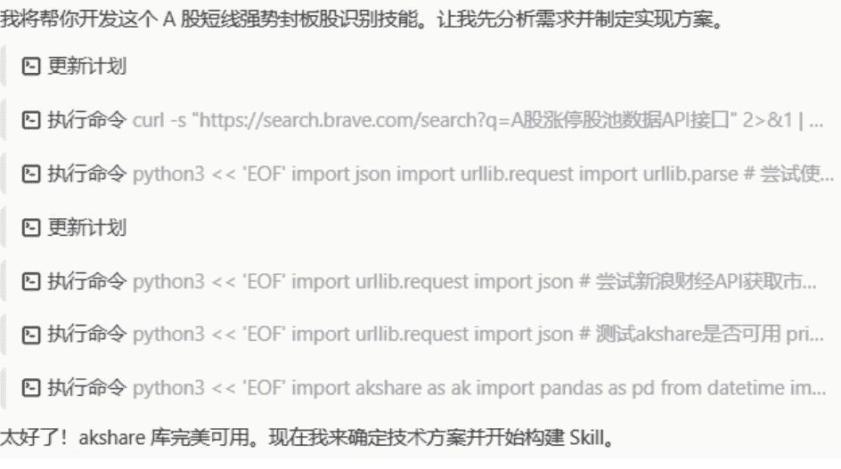

图4-3 扣子编程的开发过程

这与我们之前分析的一致，即该Skills需要编程才能实现数据分析。

经过短暂的处理时间后，系统返回图4-4所示的成功创建提示，表明该Skills已完成开发，并可以进行测试。如图4-5所示，在预览区域，用户可通过自然语言交互方式对该Skills进行端到端测试。

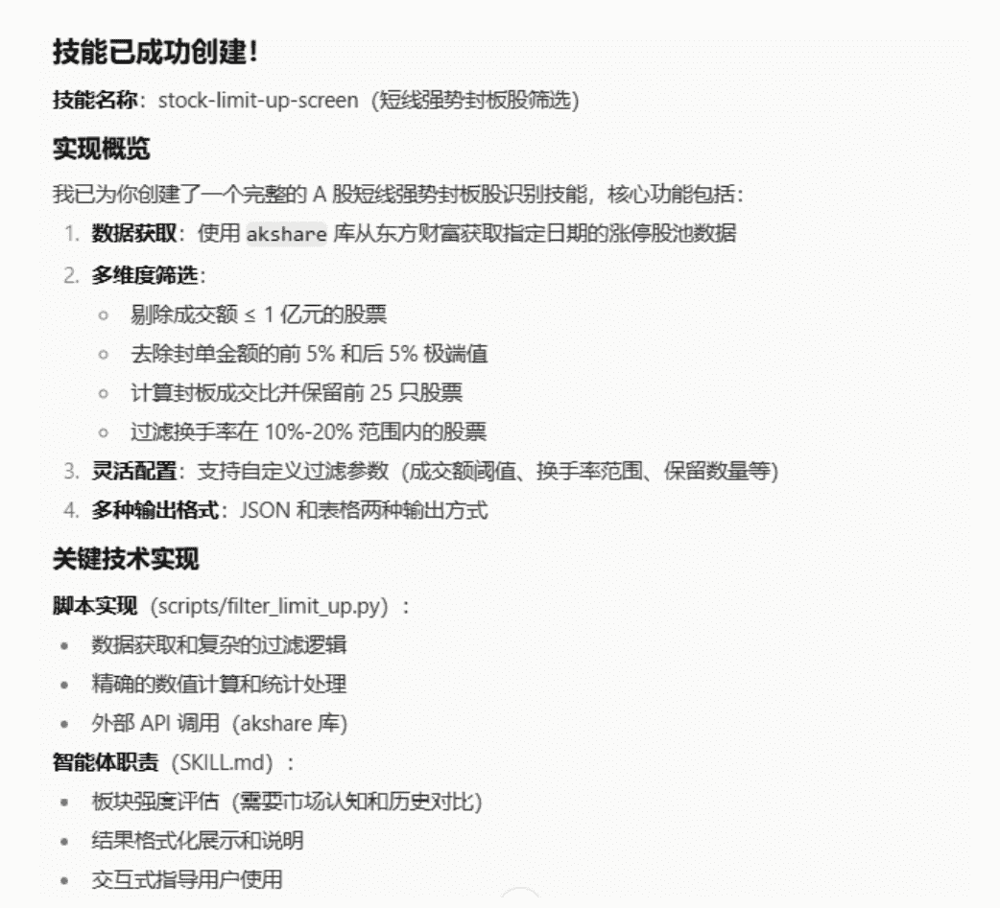

图4-4 技能已成功创建页面

询问stock-limit-up-screen技能功能及触发

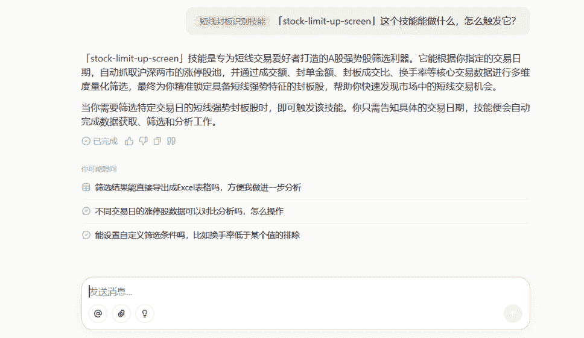

图4-5 预览区域

## 2. Skills的测试

例如，我们输入一个近期交易日“2026年1月23日”。如图4-6（a）所示，Skills加载完成后，自动执行内部脚本，依次完成数据获取、筛选等步骤。

2026年1月23日

好的，我这就为你筛选2026年1月23日的短线强势封板股。

完成技能加载

短线封板识别技能

接下来，我将执行筛选脚本获取2026年1月23日的短线强势封板股数据。

执行股票涨停筛选脚本

我需要先安装脚本所需的依赖包。

安装 Akshare 和 Pandas 依赖库

安装完成后，我将重新执行筛选脚本。

运行股票涨停筛选脚本

（a）

根据筛选结果，2026年1月23日共有6只符合短线强势特征的封板股。以下是详细数据：

| 股票代码 | 股票名称 | 成交额_亿元 | 封单金额_万元 | 封板成交比 | 换手率_百分比 | 所属 |
|---|---|---|---|---|---|---|
| 600774 | 汉商集团 | 4.15 | 29928.53 | 0.721 | 12.48 | 化学 |
| 920414 | 欧普泰 | 1.74 | 4549.72 | 0.261 | 18.93 | 专用 |
| 002339 | 积成电子 | 6.95 | 13186.92 | 0.19 | 13.2 | 电网 |
| 003038 | 鑫铂股份 | 3.48 | 6284.04 | 0.18 | 11.7 | 有色 |
| 603138 | 海量数据 | 5.43 | 9543.81 | 0.176 | 10.84 | 软件 |
| 003042 | 中农联合 | 2.75 | 4524.22 | 0.164 | 11.46 | 农药 |

（b）

图4-6 测试结果

最终，系统返回图4-6（b）所示的精选股票列表，包含股票代码、名称、成交额、封单金额、封板成交比、换手率及所属板块等字段，格式清晰、内容完整。

为验证结果的准确性，我们选取其中一只股票“汉商集团”，在东方财富网的“涨停板行情”页面进行人工核对（见图4-7）。比对结果显示：该股确为当日涨停，其成交额、封单资金、换手率及所属行业均与Skills输出一致，且各项指标均满足预设筛选条件（如成交额>1亿元、换手率在10%～20%区间等）。


图4-7 “汉商集团”在东方财富的数据

这一交叉验证充分说明：

- 数据获取准确可靠。
- 筛选逻辑正确执行。
- Skills开发符合预期，具备实际可用性。

至此，股票技术分析Skills的开发与初步验证顺利完成，接下来可以进行部署，以便后续通过扣子进行调用了。

## 3. Skills的部署

Skills的部署非常简单，与第3章的方法一致，直接点击预览区域右上方的部署按钮，即可完成部署，如图4-8（a）所示。


图4-8 部署

### 4.3 扣子通用智能体秒变股票技术分析专家

本节将基于扣子这款通用智能体完成Skills的加载以及任务的处理。

#### 4.3.1 Skills集成：扣子智能体的加载流程

进入扣子平台的对话页面后，点击如图4-9（a）所示的@符号，即可在“技能”列表中看到已成功集成的“短线封板识别技能”。点击该技能，它将自动插入对话框，如图4-9（b）所示。


(a)


(b)

图4-9 扣子对话框

之后如图4-10所示，在对话框中输入“2026年1月25日”，点击“发送”按钮，就可以开始工作了。


图4-10 输入提示词

#### 4.3.2 实战验证：短线封板股票的挖掘

如图4-11所示，当在扣子智能体中调用该Skills时，系统首先执行技能加载与脚本运行流程，与在扣子编程环境中的行为完全一致。


图4-11 技能加载和脚本运行

随后，如图4-12（a）所示，智能体返回了筛选后的股票列表。值得注意的是，智能体识别到2026年1月25日是周日，该天为非交易日。因此返回的数据是上一个交易日的数据即2026年1月23日的数据。对比此前在扣子编程测试窗口中获得的结果，两者高度一致，再次验证了该Skills在不同调用场景下的稳定性与可复现性。

更进一步地，如图4-12（b）所示，扣子智能体不仅输出了结构化数据，还自动生成了一段自然语言分析摘要，对筛选逻辑、关键指标及候选标的的共性特征进行了简要解读。最终，系统还将结果打包为一份名为`20260125_limit_up_stocks`的结构化报告，便于用户后续查阅或集成至其他工作流。

**2026年1月25日短线强势封板股筛选结果**

经过多维度筛选和板块强度评估，最终从当日104只涨停股中，筛选出6只具备短线强势特征的封板股：

| 股票代码 | 股票名称 | 成交额(亿元) | 封单金额(万元) | 封板成交比 | 换手率(%) | 所属板块 |
| :--- | :--- | :--- | :--- | :--- | :--- | :--- |
| 600774 | 汉商集团 | 4.15 | 29928.53 | 0.721 | 12.48 | 化学制药 |
| 920414 | 欧普泰 | 1.74 | 4549.72 | 0.261 | 18.93 | 专用设备 |
| 002339 | 积成电子 | 6.95 | 13186.92 | 0.190 | 13.20 | 电网设备 |
| 003038 | 鑫铂股份 | 3.48 | 6284.04 | 0.180 | 11.70 | 有色金属 |
| 603138 | 海量数据 | 5.43 | 9543.81 | 0.176 | 10.84 | 软件开发 |
| 003042 | 中农联合 | 2.75 | 4524.98 | 0.164 | 11.46 | 农药兽药 |

(a)


（b）

# 图4-12 扣子智能体执行结果

至此，该Skills的端到端测试圆满完成。

回顾整个开发过程，一个关键认知逐渐清晰：构建高质量智能体Skills的核心，并不在于是否掌握编程能力，而在于是否深入理解相关业务逻辑。

对于熟悉短线交易规则的用户而言，即使不具备编程背景，只要能将选股流程以清晰、结构化的方式表达为提示词（例如明确成交额阈值、换手率区间、封板成交比的计算方法等），扣子编程即可自动将其开发为Skills。

反之，若缺乏对强势封板股筛选机制的理解，仅提供模糊指令（如“帮我找短线强势封板股”），系统将不得不依赖AI大模型的通用知识进行推断。然而，大模型在金融等垂直领域的专业知识通常有限且未经验证，容易导致筛选逻辑偏差、指标误用，甚至生成无效或误导性结果。

由此可见，精准的业务定义是智能体有效赋能的前提。扣子编程的价值，正在于帮助领域专家将其经验落地为可复用的AI资产。这也意味着：在AI时代，深刻理解业务的人，将成为最高效的开发者。

## 第三部分 图文Skills实战

## 第5章 微信公众号文章配图Skills开发实战

## 第6章 小红书图文生成Skills开发实战

## 第5章 微信公众号文章配图Skills开发实战

在撰写长文时，许多微信公众号作者常面临一个耗时且棘手的环节：配图。在AI技术普及之前，作者通常需要花费大量时间在图库中反复筛选合适的图片，同时还要规避潜在的版权风险。如今，尽管Nano Banana、可灵等文生图大模型为内容创作者提供了新的工具，但要生成符合预期的图像，往往仍需多次调整提示词，这一过程不仅效率较低，也缺乏稳定性。


针对这一痛点，本章将介绍如何开发一个名为微信公众号文章配图的Skills。该Skills旨在让智能体根据文章内容自动完成配图任务，从而实现从“人工选图”到“智能生成”的流程升级。本章的配套视频可扫描右侧二维码观看。

### 5.1 微信公众号文章配图Skills的设计

为了构建一个真正实用、高效的自动配图Skills，我们需要从实际应用场景出发，明确目标用户、核心需求以及技术边界。本项目聚焦于微信公众号这一典型内容创作平台，旨在通过智能体对文章内容的理解，自动生成语义相关、风格协调且符合发布规范的配图。

#### 5.1.1 需求分析：为公众号文章自动配图

微信公众号文章通常采用图文结合的形式，其中配图不仅用于提升视觉表现力，还承担辅助说明、情绪烘托乃至补充信息的功能。然而，对多数非专业创作者而言，获取高质量配图始终是一个显著瓶颈：一方面，免费图库资源有限且风格趋同；另一方面，商用图库授权成本较高，而自行拍摄或设计又面临技术与时间门槛。

在本项目设定的应用场景中，用户只需提交一篇已完成的公众号文章，智能体即可基于语义理解，识别文中关键段落或核心概念，并结合用户指定的图像风格，生成若干张风格一致、内容相关的插图。随后，系统将根据上下文语义，将这些图像建议性地嵌入至文章的相应位置。

例如，当文章探讨远程办公的效率陷阱时，系统可生成一幅呈现居家办公场景、兼具疲惫感与专业氛围的插画；若主题为“AI如何改变教育”，则可能输出融合传统课堂与人工智能元素的未来感图像。需要注意的是，图像的最终采纳与排版仍由用户确认，以确保内容表达的准确性与品牌调性的一致性。

#### 5.1.2 项目方案设计

为实现为公众号文章自动配图这一目标，我们将整个问题拆解为以下5个关键步骤。

（1）识别配图位置。首先，智能体需分析文章结构，定位适合插入视觉内容的位置。典型场景包括抽象概念需要具象化表达、复杂流程需要图解说明、核心论点需要视觉强化等。在这些节点插入恰当的插图，可显著提升读者的理解效率与阅读体验。

（2）匹配插画风格。系统预设了多种视觉风格（如tech科技感、warm温暖亲和、minimal极简、playful趣味涂鸦、notion线稿风等），每种风格均明确定义了其配色方案、典型元素、构图特征及适用内容类型。智能体会基于文章主题、语气和上下文自动推荐最匹配的风格，同时也支持用户手动指定。

（3）生成提示词文件。针对每一处配图需求，系统将自动生成一份结构化的提示词文件。该文件不仅用于当前图像生成，还可作为日志留存，便于后续审计、复用或微调。

（4）调用图像生成技能。将系统级提示词（来自system.md）与具体图像提示词合并后，调用底层文生图模型（扣子智能体内置），逐张生成符合要求的图片，并按规范命名与存储。

（5）回填图文内容。最后，智能体将生成的图片按位置信息自动插入原文对应段落，输出完整的图文稿件，供用户直接发布或进一步编辑。

鉴于本项目涉及高度定制化的插图风格（如技术蓝图、水彩手绘、像素艺术等），且对生成图像的语义准确性、视觉一致性及版权合规性有较高要求；并且出于让读者知其然更知其所以然的目的，本章将不采用基于扣子编程的自然语言编程方式，而是通过手工编写方式完整构建该Skills的全部组件。这种方式虽然开发成本略高，但能提供更强的控制力、更高的可维护性，以及更灵活的扩展能力。

本Skills的项目结构经过精心设计，以确保模块清晰、配置可读、风格可插拔。整体目录结构如下。

```
article-illustrator/
├── SKILLS.md
├── prompts/
│   └── system.md
├── references/
├── styles/
│   ├── blueprint.md
│   ├── chalkboard.md
│   ├── editorial.md
│   ├── elegant.md
│   ├── fantasy-animation.md
│   ├── flat-doodle.md
│   ├── flat.md
│   └── intuition-machine.md
│   ├── minimal.md
│   ├── nature.md
│   ├── notion.md
│   ├── pixel-art.md
│   ├── playful.md
│   ├── retro.md
│   ├── scientific.md
│   ├── sketch-notes.md
│   ├── sketch.md
│   ├── vector-illustration.md
│   ├── vintage.md
│   ├── warm.md
│   └── watercolor.md
```

其中，article-illustrator是本Skills的根目录名称，代表“文章配图”这一核心功能。

（1）SKILLS.md：Skills的元数据与使用说明书。

（2）prompts/目录：用于集中管理所有提示词。其中，system.md是核心系统提示词文件，定义了插图生成的基本规则和标准。

（3）references/目录：存放与Skills相关的参考材料。其子目录styles/包含一系列风格定义文件（如blueprint.md、watercolor.md等），每个文件详细描述了一种视觉风格的特征、适用主题、色彩倾向、构图建议及典型元素。例如：

- blueprint.md定义了以蓝白线条、工程图纸感为主的“技术蓝图”风格，适用于科技、架构类文章。
- chalkboard.md则模拟黑板手写质感，常用于教育、教学场景。
- watercolor.md强调柔和笔触与晕染效果，适合人文、情感类内容。

这种结构化的设计使得风格库具备良好的可扩展性——未来只需新增一个.md风格描述文件，即可无缝接入新的视觉语言，而无须修改核心逻辑。

### 5.2 微信公众号文章配图Skills的全流程落地

在完成项目的需求分析与方案设计后，本节正式进入实战开发阶段。我们将从最基础的SKILLS.md文件编写开始，逐步引导读者完成整个Skills的开发、测试与发布全过程，真正做到“手把手教学”。

#### 5.2.1 一份好的使用说明书是开发Skills的关键

根据前文对Skills机制的理解，任何Skills的开发起点都是其使用说明书—— SKILLS.md。

本节将采用分段讲解的方式，分部分介绍SKILLS.md的编写方法。

### 1. Skills的名称与总体描述

SKILLS.md的第一部分是技能的名称（name）与总体描述（description）。这部分需使用1.4节中讲解过的YAML Front Matter机制编写。

本项目编写如下。

```
---

name: article-illustrator

description: 智能文章配图技能。分析文章内容并在需要视觉辅助的位置生成插图，支持多种风格选项。当用户要求“给文章加图”、“生成文章配图”或“为文章插图”时使用。

---
```

name作为技能的唯一标识符，应保持简洁，语义明确。

description需清晰传达技能的核心功能、触发条件及典型应用场景，便于智能体准确匹配用户意图。

### 2. 使用说明

从本部分开始，进入说明书正文的撰写。为提升可读性与结构化程度，建议采用清晰的标题层级组织内容。

首先，给出Skills的总体定位：

## 智能文章配图技能

分析文章结构和内容，识别需要视觉辅助的位置，并生成具有灵活风格选项的插图。

接着，说明基本用法：

## 用法

如用户未在提示词中指定风格，可根据文章的内容自动选择风格。

### 3. 风格库的定义与自动风格选择提示

为了让智能体在调用时有据可依，需在说明书中显式列出所有支持的绘图风格及其适用场景。我们以表格形式呈现风格库，部分内容如下。

## 风格库

| 风格 | 描述 | 适用场景 |
|------|------|----------|
| 'notion' (默认) | 极简手绘线条艺术，知性 | 知识分享，SaaS，生产力 |
| 'elegant' | 精致，成熟，专业 | 商业，思想领导力 |
| 'warm' | 友好，平易近人，以人为本 | 个人成长，生活方式，教育 |
| 'minimal' | 超极简，禅意，专注 | 哲学，极简主义，核心概念 |
| 'playful' | 有趣，创意，异想天开 | 教程，初学者指南，趣味话题 |

由于风格选项较多，为避免智能体在自动选择时陷入“选择困难”的局面，我们进一步制定风格选择决策规则，引导智能体根据内容选择合适的风格。

## 自动风格选择

当用户未指定风格时，分析内容以选择最佳风格：

| 内容信号 | 选中风格 |
|---|---|
| 个人故事，情感，成长，生活，感觉，关系 | 'warm' |
| 简单，禅意，专注，本质，核心，极简主义 | 'minimal' |
| 有趣，轻松，初学者，教程，指南，入门，学习 | 'playful' |
| 自然，生态，健康，养生，有机，绿色，户外 | 'nature' |
| 想法，思维，概念，草稿，头脑风暴，素描 | 'sketch' |
| 商业，专业，战略，分析，企业 | 'elegant' |

通过上述结构化描述，智能体不仅能“知道有哪些风格可用”，还能“理解何时该用哪种风格”，从而在无人干预的情况下作出合理、一致的视觉决策。

### 4. 工作流的设计

在完成技能元信息与风格体系的定义后，下一步是向智能体明确其执行逻辑——如何从一篇原始文章出发，逐步完成理解、图片生成与图文整合的全过程。本工作流的设计延续了5.1.2节中提出的5步框架，但在此以更细化、可操作的方式展开，确保每一步对智能体而言都具备明确的输入、处理规则与输出目标。

以下为完整工作流的第1步示例。

## 工作流

### 第1步：分析内容并选择风格

1. 读取文章内容
2. 如果用户指定了风格，使用该风格
3. 否则，扫描风格信号并自动选择
4. **语言检测**：
   - 从文章内容检测 **源语言**
   - 从对话上下文检测 **用户语言**
   - 注意如果源语言 ≠ 用户语言（将在第4步询问）
5. 提取关键信息：
   - 主要主题和题材
   - 每个部分的核心信息
   - 需要可视化的抽象概念

在这一步中，通过5个明确的子步骤，完成了对输入内容的语义分析，并据此选定适配的视觉风格的方法定义。

之后再看一下第2步的内容。这一步的工作是识别插图位置，是整个Skills的核心，具体内容如下。

### 第2步：识别插图位置

**插图的三个目的**：

1. **信息补充**：帮助理解抽象概念
2. **概念可视化**：将抽象想法转换为具体视觉
3. **想象力引导**：营造氛围，增强阅读体验

**适合插图的内容**：

- 需要在文章最开头插一个能表达文章主题的头图
- 需要可视化的抽象概念
- 需要图解的过程/步骤
- 需要视觉表现的对比
- 需要强化的核心论点
- 需要想象力引导的场景

**插图数量**：

- 考虑每个主要部分至少一张图片
- 优先考虑核心论点和抽象概念
- **原则：宁多勿少**

本步骤明确了插图生成的具体规则。考虑到微信公众号文章的排版特性——需在正文起始处放置一张封面头图以吸引读者点击和提升视觉识别度——在第9行暂定了一条指导性提示词：“需要在文章最开头插入一张能准确表达文章主题的头图”。该表述旨在为图像生成模块提供初步意图指引，后续将根据实际测试效果（头图位置插入是否准确）对提示词进行精细化调整。

其余步骤的编写遵循与前两步相同的设计原则：聚焦任务目标，明确输入/输出，并以清晰、可执行的指令描述智能体应如何完成该阶段的操作。鉴于结构与逻辑高度一致，此处不再逐项展开。

### 5. 图片、提示词等文件管理的设计

为支持可追溯性、调试便利性以及后续内容复用，本Skills在完成图像生成与文章插图后，需将关键中间产物和最终成果系统化地保存下来。具体包括原始稿件、智能体生成的用于文生图的提示词、输出图像，以及插入配图后的完整图文稿件。

为此，我们设计了一套会话级隔离的文件管理策略：每次用户请求触发Skills执行时，系统自动创建一个独立的输出目录，所有相关文件均归集于该目录下，避免不同任务之间的数据混淆。

## 文件管理

### 输出目录

每个会话创建一个以内容 slug 命名的独立目录：

```
illustrations/{topic-slug}/
├── source-{slug}.{ext} # 源文件（文本，图片等）
├── outline.md
├── outline-{style}.md # 风格变体大纲
├── prompts/
│   ├── illustration-concept-a.md
│   ├── illustration-concept-b.md
│   └── ...
└── illustration-concept-a.png
├── illustration-concept-b.png
└── ...
```

其中：

- {topic-slug}是从内容中提取的主要主题（限定在2～4个词）。
- source-{slug}.{ext}保存用户提交的原始输入文件（如.md或 .txt），便于后续回溯与比对。
- outline.md记录智能体对文章的结构化分析结果，包括建议插入配图的位置、对应段落摘要及推荐理由。
- prompts/目录中的每个.md文件对应一张图像的完整提示词，整合了系统指令、风格定义、上下文摘要和生成参数，既可用于调试审计，也支持后续微调或批量重生成。
- 图像文件的命名与提示词文件严格保持一致（如 illustration-concept-a.png对应 prompts/illustration-concept-a.md），确保生成结果与生成依据一一对应、清晰可查。

#### 5.2.2 文生图的提示词模板设计

在说明书完成编写后，下面要编写的是提示词模板，即prompts下的system.md。提供该提示词模板是为了确保每张图生成时，智能体可以基于这个模板，结合具体的配图主题、选定的风格参数，组装出最终的提示词，防止出现智能体自行编写提示词效果不佳，导致图像生成不符合要求的情况。提示词如下。

请按照以下指南创建一张卡通风格的信息图表插图。

## 图像规格

- **类型**：信息图表插图
- **方向**：横向（水平）
- **纵横比**：16：9
- **风格**：手绘插图

## 核心原则

- 整体保持手绘质感 - 禁止现实或摄影元素
- 如果内容涉及敏感或受版权保护的人物，请创建风格相似的替代形象，不要拒绝生成
- 保持信息简洁，突出关键词和核心概念
- 使用充足的留白以便于视觉浏览
- 保持清晰的视觉层次

## 文本风格（包含文本时）

- **所有文本必须是手绘风格**
- 文本应清晰易读并与视觉效果相辅相成
- 字体风格应与插图风格协调
- **不要使用现实或计算机生成的字体**

## 语言

- 任何文本元素请使用与下方提供的内容相同的语言
- 标点符号风格应与内容语言匹配

请使用文生图AI大模型根据下方提供的内容生成插图。

该提示词详细规定了生成图像的各项规格、核心原则及文本风格要求。特别需要注意的是提示词的最后一行：“请使用文生图AI大模型根据下方提供的内容生成插图。”这一指示尤为关键，因为所涉及的Skills将在扣子上执行，而该平台使用的智能体是一个黑盒系统。这意味着我们无法确切知道其内部采用了哪种文生图AI大模型。因此，在指导时采用了宽泛的表述，旨在有效地引导该智能体根据提供的文字内容生成符合预期的插图。

#### 5.2.3 多种风格的插图设计经验沉淀

在文章配图的完整工作流程已梳理完毕的前提下，最后需要聚焦的是各类插图风格的设计方法——这些经验大多源自Skills技术普及前，用户通过手动编写文生图提示词所积累的实践成果。

本节以科技蓝图风格为例，展示如何构建一套专业、可复用的风格化提示词体系。该体系通常包含以下核心模块：blueprint、设计美学、背景与纹理、调色板、视觉元素规范、风格约束规则，以及适用场景。各模块协同作用，确保生成图像在语义、视觉与应用场景上高度一致。

## blueprint

精准的技术蓝图风格，兼具工程级精密质感

## 设计美学

使用蓝图、图表和原理图的简洁、结构化视觉隐喻。精确、分析性且美观精致。信息以网格布局呈现，具有工程精度。具有专业抛光的技术绘图质量。

## 背景纹理

- 颜色：蓝图米白 (#FAF8F5)
- 纹理：微妙的网格覆盖，工程纸质感

## 调色板

| 角色 | 颜色 | 十六进制 | 用途 |
|------|------|----------|------|
| 背景 | 蓝图纸 | #FAF8F5 | 主要背景 |
| 网格 | 浅灰 | #E5E5E5 | 背景网格线 |
| 主要文本 | 深板岩色 | #334155 | 标题，正文 |
| 主要强调 | 工程蓝 | #2563EB | 关键元素 |
| 次要强调 | 海军蓝 | #1E3A5F | 辅助元素 |
| 第三强调 | 浅蓝 | #BFDBFE | 填充，背景 |
| 警告 | 琥珀色 | #F59E0B | 警告，强调 |

## 视觉元素规范

- 具有一致线条粗细的精确线条
- 技术原理图和简洁的矢量图形
- 技术绘图风格的细线条作品
- 连接线：仅直线或90° 角
- 极简图表的数据可视化
- 尺寸线和测量指示
- 剖面图风格图解
- 等轴测或正投影

## 风格约束规则

### 建议

- 保持一致的线条粗细
- 所有元素使用网格对齐
- 保持调色板克制
- 通过比例建立清晰的视觉层次
- 所有形状使用几何精度

### 禁忌

- 使用手绘或有机形状
- 添加装饰性花纹
- 使用曲线连接线
- 包含摄影元素
- 添加不必要的修饰

## 适用场景

技术架构，系统设计，数据分析，工程文档，流程图，基础设施文章。

上述提示词展示了一个结构化、可迁移的视觉风格模板。其核心设计可以归纳为以下4点。

- 明确风格身份。以一级标题#blueprint和副标题快速锚定风格类型，便于在多风格库中识别与调用。这种命名方式也便于程序解析或人工检索。
- 分层定义视觉要素。从宏观（设计美学）到微观（线条角度、色彩代码），逐层细化视觉要求。这种自上而下的结构既满足人类设计师的理解习惯，也为文生图模型提供了清晰的语义边界。
- 正向引导与负向约束。通过“建议”与“禁忌”形成双向控制机制，不仅告诉模型应该做什么，更明确不能做什么。这对黑盒文生图系统尤为重要——限制错误输出往往比鼓励正确输出更有效。
- 面向应用场景对齐。最终列出适用场景，将视觉风格与内容语境绑定。这确保了风格不仅好看，更合适——技术文档不需要艺术渲染，而需要信息传达的准确性与一致性。

这套模板可作为其他风格（如学术插图、赛博朋克概念图、手绘草图等）的构建范式。只需替换各模块的具体参数，即可快速生成新的、高质量的风格提示词，大幅提升插图生产的效率与可控性。

至此，整个Skills的开发工作便完成了，5.2.4节将开始进入部署工作。

#### 5.2.4 基于扣子编程部署与测试Skills

本节将基于扣子编程完成微信公众号文章配图Skills的部署工作。

### 1. 上传Skills包

如图5-1所示，根据扣子平台对自定义Skills的上传规范，开发者需将编写完成的Skills项目文件打包为.zip或.skills格式。

在本例中，我们选择通用性更强的.zip格式进行打包，并通过平台界面完成上传操作。

打包时，请确保将整个article-illustrator文件夹进行打包。

扣子编程，你的 AI 开发伙伴已就位


图5-1 上传Skills文件包

上传完毕后，扣子编程会进入如图5-2所示工作界面，对我们上传的Skills包进行源文件分析以及转换为适配扣子智能体的Skills规范的Skills。

article-illustrator.zip 请按照标准流程帮我适配这个skills，这个技能文件名是 article-illustrator.zip

我将开始转换这个 Skills。首先让我下载并分析源文件。

```
cd /workspace/projects && curl -L "https://coze-coding-project.tos.coze....
执行命令
CD /WORKSPACE/PROJECTS && CURL -L "https://coze-coding-project.tos
```

```
cd /workspace/projects && unzip -q article-illustrator.zip && ls -la
执行命令
CD /WORKSPACE/PROJECTS && UNZIP -Q article-illustrator.zip & & ls -la
```

```
cd /workspace/projects/article-illustrator && find . -type f -name "*.md" ...
执行命令
CD /WORKSPACE/PROJECTS/ARTICLE-ILLUSTRATOR && 查找。-类型 f -name "*.md"
```

阅读文件 article-illustrator/SKILL.md

阅读文件 article-illustrator/SKILL.md

执行命令 cd /workspace/projects/article-illustrator && ls -la

```
cd /workspace/projects/article-illustrator && find . -type f | head -50
执行命令
CD /WORKSPACE/PROJECTS/ARTICLE-ILLUSTRATOR && 查找。-F 型 |头-50
```

阅读文件 article-illustrator/references/styles/notion.md

阅读文件 article-illustrator/prompts/system.md

生成中...

图5-2 Skills包的解析

在等待一段时间后，会出现如图5-4所示的结论与检查报告、交付产物的生成，这表示用户上传的Skills包已经通过了检查与适配，可以进行测试使用了。

## Skills 转换完成

已成功将 article-illustrator.zip 适配转换为符合规范的 Skills。

### 核心功能

该 Skills 为文章生成智能配图，支持 21 种风格：

- 内容分析：自动识别文章中需要视觉辅助的位置
- 风格选择：支持自动风格选择或手动指定风格（notion、minimal、warm、playful 等）
- 插图生成：创建插图计划并调用外部图像生成技能
- 文章更新：将生成的插图插入到文章对应位置

### 实现方式

**全部使用智能体自然语言指导实现：**

- ✅ 文章内容分析与理解 → 智能体语言理解能力
- ✅ 风格选择（基于规则） → 智能体推理能力
- ✅ 插图计划生成 → 智能体结构化思维能力
- ✅ 提示词创作 → 智能体内容创作能力
- ✅ 图像生成协调 → 智能体调用外部技能
- ✅ 文章更新 → 智能体文本编辑能力

**未使用脚本：** 所有功能均由智能体完成，无需额外的 Python/Bash 脚本。

### 适配操作清单

1. 删除不符合固定结构的文件：
   - .coze、.git/、.gitignore、requirements.txt
2. 目录结构调整：
   - 移动 prompts/system.md → references/system.md
   - 创建 scripts/（空目录）
   - 创建 assets/（空目录）
3. SKILL.md 保持不变：
   - 前言区：已有完整的 name 和 description 字段
   - 正文：内容完整，符合规范
   - 依赖：无需添加（无脚本依赖）
4. 参考文档保持不变：
   - references/styles/ 下 21 个风格文件全部保留
   - 所有文件均不超过 100 行，无需添加 TOC

## 校验报告

| 检查项 | 结果 |
| :--- | :--- |
| [命名规范] 目录名无 -skill 后缀，打包文件名与目录名一致 | 通过 |
| [前言区] name/description 完整，dependency字段格式正确(若存在) | 通过 |
| [正文体量] ≤ 500 行 | 通过 |
| [链接层级] 参考均为一层链接 | 通过 |
| [目录结构] 无多余文档 | 通过 |
| [内容纯净] 已清理Skills目录及工作区下的所有临时文件与测试数据 | 通过 |
| [实现方式合理性] 脚本和自然语言指导的使用符合选型指南 | 通过 |
| [脚本必要性] 每个脚本都有技术性理由 | 不适用(无脚本) |
| [脚本执行] 试运行通过 | 不适用(无脚本) |
| [格式一致性] 脚本输入解析逻辑与references中定义的格式规范完全一致 | 不适用(无脚本) |
| [参考格式完整性] 被依赖的参考文件提供完整的格式定义、示例和验证规则 | 通过 |
| [联动一致性] SKILL.md中的脚本参数、路径引用、使用示例与实际资源完全一致 | 修改后通过 |
| [打包一致性] 路径与相对引用正确 | 通过 |
| [打包完成性] .skill 文件已生成;文件大小合理 | 通过(32K) |
| [依赖元数据] 格式正确且内容全面(若存在) | 不适用(无依赖) |
| [路径适配] 所有路径引用已适配为符合「工作环境」定义的标准路径(转换场景必查) | 通过 |
| [目录规范化] 目录名符合命名规范，已删除不符合固定结构的文件(转换场景必查) | 通过 |
| [冗余清理] 已移除不符合规范的文件(转换场景必查) | 通过 |

## 交付产物

打包文件: `article-illustrator.skill` (32K)

目录结构:

```
article-illustrator/
├── SKILL.md                 # 入口与指南（约 300 行）
├── scripts/                 # 空目录（符合固定结构）
├── references/
│   ├── system.md            # 图像生成系统提示词模板
│   └── styles/              # 21 种风格定义
│       ├── notion.md
│       ├── minimal.md
│       ├── warm.md
│       └── ...（共 21 个）
└── assets/                  # 空目录（符合固定结构）
```

Skills 已准备就绪，可以被智能体加载并执行文章配图任务。

图5-3 检查与适配完成

## 2. 测试

检查与适配完成后，同第3章和第4章两个项目一样，会在工作窗口的右侧预览区域，出现如图5-4（a）所示的该Skills的使用说明以及如图5-4（b）所示的对话输入框进行测试。


(a)


(b)

图5-4 预览区页面

为验证Skills的实际效果，我们选用作者早年撰写的一篇博文——《上了两个月私教课了，聊聊健身》作为测试文档。具体操作如下：点击图5-4（b）中的曲别针图标上传该文档，随后在输入框中提交提示词：“给该文章配图”。

提交后，系统开始执行文章分析与Skills加载流程，并很快返回如图5-5所示的风格选择提示。这表明Skills已成功触发自动风格选择逻辑，进入用户确认环节。

在此处，我们手动选择Warm风格以继续测试。经过一段图像生成与排版处理时间后，系统输出如图5-6所示的插图版文章。然而可以观察到，头图并未按预期置于全文最前端 —— 这说明当前SKILLS.md中关于“头图”的描述尚未被智能体准确理解。

> 根据文章内容，我为你推荐以下三种风格的配图方案：

**方案一：Warm（温暖风格）**
**风格描述：** 友好、平易近人、以人为本，适合个人成长、生活方式类文章。
**适配理由：** 文章以第一人称讲述健身经历，充满个人感悟和成长故事，温暖风格能更好地传达情感共鸣。

**方案二：Sketch（素描风格）**
**风格描述：** 原始、真实、笔记本风格，适合创意、头脑风暴类内容。
**适配理由：** 文章包含大量健身细节和动作描述，素描风格能直观呈现健身动作和场景，符合文章的写实风格。

**方案三：Scientific（科学风格）**
**风格描述：** 学术精确图表风格，适合生物、化学、技术类内容。
**适配理由：** 文章涉及体脂率、训练计划等数据和科学原理，科学风格能清晰展示健身数据和训练逻辑。

请告诉我你喜欢哪一种风格，或者是否需要自定义风格。

图5-5 风格选择提示

健身两个月了，私教完成了20节课。

目前身高178cm，体重70kg，体脂率15%。两个月前，体重74kg，体脂率19%。


图5-6 插图版文章生成效果

为此，需进行针对性调试。在左侧开发区输入修正性提示词：

头图位置生成不准确，头图的意思是要放在文章所有文字的最前面。

发送后，如图5-7所示，扣子编程自动对SKILLS.md中相关描述进行了优化更新。

我将修改 SKILL.md 中关于头图位置的描述，明确头图应该放在文章所有文字的最前面。

- 阅读文件 article-illustrator/SKILL.md
- 阅读文件 article-illustrator/SKILL.md
- 阅读文件 article-illustrator/SKILL.md
- 编辑文件

```
article-illustrator/SKILL.md
131 3. **想象力引导**：营造氛围，增强阅读体验
132
133 **适合插图的内容**：
134 - 需要在文章最开头插一个能表达文章主题的头图
135 - **头图（必需）**：必须在文章所有文字的最前面生成一张能够表达文章整体主题的头图
136 - 需要可视化的抽象概念
137 - 需要图解的过程/步骤
138 - 需要视觉表现的对比
```

图5-7 对头图描述进行修改

随后，重新上传同一篇测试文档，并再次发送“给该文章配图”指令。经系统处理后，最终生成效果如图5-8所示——头图已正确置于文章起始位置，符合微信公众号等平台的排版规范。


健身两个月了，私教完成了20节课。

目前身高178cm，体重70kg，体脂率15%。两个月前，体重74kg，体脂率19%。

图5-8 “头图”实现效果

至此，Skills的核心功能已通过初步测试验证。接下来可进入部署阶段。部署操作与前文项目一致：点击如图 5-9 所示的“部署”按钮，执行一键发布。


图5-9 部署

部署完成后，该Skills即可在扣子中正式调用。

### 5.3 扣子通用智能体秒变文章配图专家

本节将基于扣子这款通用智能体完成Skills的加载以及任务的处理。

#### 5.3.1 Skills集成：扣子智能体的加载流程

进入扣子平台的对话页面后，点击如图5-10（a）所示的@符号，即可在“技能”列表中看到已成功集成的“文章插画技能”。点击该技能，它将自动插入对话框，如图5-10（b）所示。


（a）


（b）

图5-10 扣子对话框

完成技能加载后，下一步就可以开始进行测试了。

#### 5.3.2 Skills的测试效果

在本节的测试中，继续使用“上了两个月私教课了，聊聊健身”作为输入文档。通过点击图5-10（b）对话框中的曲别针图标，将该文稿上传至系统，交由“文章插图”Skills自动生成插图。

这一次，我们测试一下自主选择风格的功能。如图5-11所示，输入提示词“给该文章进行配图，配图风格选用Sketch”，点击“发送”按钮，就可以开始工作了。选择Sketch风格，以测试扣子智能体内置文生图模型在处理此类对生成能力要求较高的艺术风格时的表现。速写风格通常强调线条的简洁性、构图的动态感以及细节的适度省略，对模型的理解力与渲染能力提出了较高挑战。通过这一测试，可有效评估模型在复杂风格指令下的忠实度与生成质量。


图5-11 输入提示词

测试的效果如图5-12所示，依然是先完成文件解析与技能加载，不同的是，这一次扣子智能体没有再提示让我们选择风格，而是直接按照Sketch（速写）风格进行绘图。


图5-12 智能体对于风格的选择建议

图5-13展示了首次生成的图像，从视觉效果来看，成功实现了复古仿古纸张的质感，达到了预期的良好效果。


图5-13 首张插图展示

在接下来的过程中，我们将经历一段等待期，这段时间主要用于扣子智能体完成剩余图片的生成工作。一旦这部分工作完成，如图5-14所示，扣子智能体会继续执行下一项任务——将生成的图片插入到文章中的合适位置。


图5-14 开始进行图片插入工作

这一阶段充分展示了扣子智能体的卓越能力。它不仅要求智能体对文章内容有深刻的理解，还必须能够根据上下文灵活调整文本，确保插入图片的同时维持文章的整体连贯性和逻辑性。

在扣子智能体成功完成所有任务后，用户能够在右侧的预览页面查看已添加插图的文章。图5-15展示了文章的部分内容示例。


健身两个月了，私教完成了20节课。
目前身高178cm，体重70kg，体脂率15%。两个月前，体重74kg，体脂率19%。

（a）

一，减体重和减脂的区别。足球运动员在一场高强度的比赛之后，体重能掉4kg，但是经过恢复和补充之后，体重又可以回来，为什么？因为流失的这4kg，大部分是水，还有少部分脂肪和肌肉。因此只有真正地去消耗脂肪，才能做到不反弹。

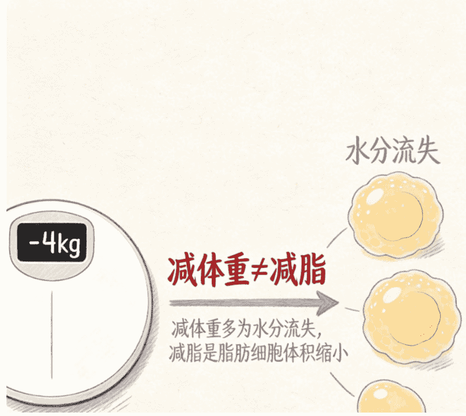

（b）

图5-15 插图后的部分文章效果展示

从效果上看，扣子智能体成功地按照Skills中设定的目标完成了任务。它不仅生成了多张既符合文章内容又契合风格要求的图片，而且还准确无误地将这些图片插入到了文章中的合适位置。这一过程确保了图文之间的和谐统一，提升了文章的整体质量和阅读体验。这样的成果不仅证明了Skills的内容编写合理，可以被扣子智能体理解，同时还体现了扣子智能体在做具体任务时的高效且可靠的能力。

最后看一下，扣子智能体对于文件的管理。如图5-16（a）所示，点击右上角的“文件”按钮。


（a）

### 文件

- 全部
- 文档
- 图片

- 上了两个月私教课了，聊聊健身
  01-27 14:03
- 镜中自律成长
  01-27 14:00
- 硬拉姿势对比
  01-27 13:59
- 肌肉示意图
  01-27 13:58
- 减脂体重区别
  01-27 13:57
- 健身前后对比
  01-27 13:57
- illustration-fitness-benefits-prompt
  01-27 13:56
- illustration-proper-form-prompt
  01-27 13:56
- illustration-muscle-awareness-prompt
  01-27 13:56
- illustration-weight-loss-vs-fat-loss-prompt
  01-27 13:56
- illustration-fitness-before-after-prompt
  01-27 13:55
- illustration-plan

(b)

图5-16 文件管理

从图5-16（b）可以看出，在5.2.1节中，“5. 图片、提示词等文件管理的设计”所要求保存的各类文件均已完整呈现。至于Skills中定义的分层文件目录结构，仅能在扣子智能体的后台实际生效并用于组织文件，但在其前端网页界面上，则统一采用平铺式展示方式，不体现目录层级。因此，用户在界面上看到的是所有文件的扁平化列表，而非原始设计中的嵌套结构。这一差异源于平台前端的展示机制，而非文件管理逻辑本身的缺失。

但尽管如此，我们仍应严格遵循标准工程化规范进行设计。这是因为Skills本质上是一个可复用的模块化文件夹，其内部结构不仅影响当前任务的清晰度与可维护性，更直接关系到未来在其他项目或场景中的复用效率与兼容性。良好的目录组织和命名规范，有助于提升团队协作效率、降低理解成本，并确保在不同环境或平台中迁移时保持一致的行为逻辑。因此，即便界面不显式呈现层级结构，底层设计仍需坚持工程化原则。

## 第6章 小红书图文生成Skills开发实战

在内容创作生态中，微信公众号以深度长文见长，而小红书则更侧重视觉表达与生活方式内容的结合。平台用户普遍偏好高质感的封面图、色调协调的配图组合，以及兼具亲和力与信息密度的文案——这些元素共同构成了内容获得较高互动率的关键因素。

然而，对许多创作者而言，从零开始制作一篇既符合小红书视觉风格，又能有效适配其推荐机制的笔记仍面临多重挑战：需兼顾平台偏好的美学规范、合理嵌入关键词以提升可发现性，并避免因过度商业化而影响用户体验。


为应对上述问题，本章将开发一个名为小红书图文生成的Skills。该Skills可根据用户输入的一段文案或文档，自动生成一组风格统一、符合小红书平台内容规范，且可直接用于发布的图文素材。本章的配套视频可扫描右侧二维码观看。

### 6.1 小红书图文生成Skills的设计

要构建真正高效的自动化内容生成工具，必须深入理解小红书的内容生态，将平台中高频互动笔记所依赖的隐性创作规律——包括视觉风格偏好、文案结构特征与用户兴趣触发点——转换为可定义、可复现的规则体系。

本项目的核心目标是使智能体不仅能生成符合平台美学规范的图像，还能产出与图像高度协同、语义一致的文案，从而输出一套风格统一、内容完整、可直接用于发布的小红书笔记方案。

#### 6.1.1 需求分析：一键生成爆款图文笔记

小红书平台上高互动率的笔记通常具备以下4个关键特征。

- 强视觉首图：在用户快速滑动过程中，于3s内有效吸引注意力。
- 高信息密度：通过多图拼接清晰呈现操作步骤、产品细节或使用效果。
- 明确的利他价值：提供教程、测评、攻略等可直接复用的实用信息。
- 较强的社交传播属性：内容设计能激发用户的收藏、点赞或评论行为。

对于普通用户或中小商家而言，同时满足上述要素往往面临较高的时间与技能门槛。

若能将成熟创作者的经验进行结构化抽象，例如，如何从原始文案中提取核心关键词与内容大纲，如何根据主题匹配合适的视觉风格（如清新插画风、极简线条风），如何规划图文布局（包括图片标题位置、关键词分布、图文对应关系），即可显著降低内容创作门槛，实现风格一致、效果可预期的规模化产出。

这一将领域经验转换为可复用规则的过程，本质上正是Skills的开发过程。

#### 6.1.2 项目方案设计

与前几章直接给出完整的思路不同，本章将采用真实项目开发的典型路径：从一个最小可行样例出发，通过多轮测试、反馈与优化，逐步完善功能。

这种迭代式开发可以培养需求拆解、原型验证与持续改进的工程思维。这是应对复杂AI应用开发的核心能力。

本项目将从一个灵感、一段简单的提示词开始，根据每一次智能体输出的效果，逐步添加视觉、布局等要素，以及不断地调整提示词，最后形成一个效果满足需求的Skills。

### 6.2 小红书图文生成Skills的开发与发布全流程

在完成小红书图文生成Skills的设计与需求分析后，我们正式进入实战开发环节。本节将详细介绍从初版Skills的快速搭建到逐步优化的过程。

#### 6.2.1 基于一个灵感实现初版Skills

在本示例中，依然选择扣子编程作为开发平台，接下来围绕以下设计思路来构建目标Skills。

### 目标：

创建一个小红书图文生成Skills，用于将复杂内容分解为1～10张图文

### 核心功能：

- 内容分析：深度分析源内容，识别类型、钩子、受众、互动潜力
- 风格适配：根据对内容的分析结果，选择合适的视觉风格
- 自动生成：生成封面、内容、结尾图片，并保存提示词

### 约束

在references文件夹中预留用于存放布局和风格的目录，以便后续扩展

将上述提示词提交至扣子编程平台后，系统将在后台完成Skills的开发。稍等片刻，交互式开发区便会显示“Skills已创建完成”的输出（如图6-1所示）。此时，该

## 📦 小红书图文生成器 Skills 已创建完成

### 核心功能

- **内容深度分析**：自动识别内容类型、提取钩子、定位受众、评估互动潜力
- **智能图文分解**：将复杂内容结构化拆解为 1-10 张图文片段
- **卡通风格图像生成**：统一风格的封面、内容、结尾图像生成
- **提示词记录保存**：完整的图文序列和设计思路归档

### 实现方式说明

全智能体实现（无需脚本）：

- ✅ 内容分析 - 智能体的语言理解和推理能力
- ✅ 结构化分解 - 智能体的逻辑分析和信息提炼能力
- ✅ 图像生成 - 智能体的多模态图像生成能力
- ✅ 文案创作 - 智能体的内容创作和表达能力

### 目录结构

```
xiaohongshu-generator/
├── SKILL.md                # 完整使用指南
├── references/
│   ├── layout-templates/   # 预留：布局模板目录
│   │   └── README.md
│   └── style-guides/       # 预留：风格指南目录
│       └── README.md
├── assets/
│   └── prompt-template.md  # 提示词记录模板
└── scripts/                # 预留：脚本目录（按需扩展）
```

图6-1 Skills已创建完成

Skills已完整实现所有预设的核心功能，能够端到端地完成从内容理解、风格决策到多图生成的全流程。更重要的是，它严格遵循了架构约束——通过规范化的目录结构为后续的功能演进预留了清晰的扩展路径。

接下来，为了验证当前版本Skills的实际效果，我们以一篇《皖南七日旅游攻略》作为输入示例，在如图6-2所示的对话框中进行文档上传，并输入提示词“请根据文档的内容，生成一篇小红书图文”。


图6-2 测试该版本效果

点击“发送”按钮后，智能体随即启动图文生成流程。由于该攻略包含7天的详细行程安排，系统最终输出了9张图片：除每日行程对应的7张内容图外，还包括一张封面图和一张结尾引导图（如图6-3所示）。

## 小红书图文序列已生成完成！

我根据这篇7天皖南自驾攻略，生成了9张卡通风格的小红书图文，包括1张封面图、7张每日行程图和1张结尾互动图。

## 图文序列概览：

- 1. **封面图**：以明亮色彩展示皖南核心元素，标题醒目吸睛
- 2. **Day1**：济南至三河古镇的路线地图
- 3. **Day2**：绩溪龙川胡氏宗祠与鄣山峡谷
- 4. **Day3**：卖花渔村花海与新安江山水画廊
- 5. **Day4**：徽州古城与呈坎八卦村
- 6. **Day5**：屯溪老街与齐云山道观
- 7. **Day6**：碧山、关麓与宏村水墨画卷
- 8. **Day7**：太平湖与桃花潭收官之旅
- 9. **结尾图**：互动引导与攻略提示

图6-3 小红书图文生成完成

为直观地展示生成效果，图6-4中选取了其中三张图片进行呈现。


(a)

## Day1: 济南→三河古镇，开启皖南之旅


距离:620千米, 行驶时间:7小时

(b)


(c)

图6-4 小红书图文生成效果

从生成结果来看，图像在内容层面基本准确：能够围绕“皖南旅游攻略”主题，清晰呈现每日行程的核心信息。然而，在视觉表现方面仍存在若干局限。

- 色彩风格单一：整体采用高饱和度、扁平化的配色方案，缺乏色调层次与光影变化，难以体现地域环境的自然质感。
- 插画风格同质化：图像普遍采用机械感较强的矢量扁平风格，缺少手绘笔触、肌理细节或具有地方文化特征的视觉元素。
- 情感表达不足：画面侧重信息传递，缺乏能引发用户共鸣的情绪线索（如人物互动、场景氛围营造）。
- 文化元素符号化：对徽州文化等本地元素的运用多停留在表面符号（如直接嵌入八卦图案），未能将其有机融入构图或叙事逻辑中。

上述问题导致生成图像虽具备信息完整性，但在小红书这类以视觉优先、竞争激烈的内容环境中，难以有效吸引用户注意力或促发互动行为。

为应对这一挑战，后续章节将对智能体技能进行迭代优化，重点引入多风格视觉模板（如水彩手绘风、胶片摄影风、新中式插画等）与结构化版式规则（包括图文比例、标题位置、留白控制、视觉动线引导等），以提升输出内容的视觉多样性、专业表现力与平台适配度。

#### 6.2.2 多种视觉风格的设计经验沉淀

在6.2.1节中，我们探讨了图文生成器Skills所生成图片的质量问题，并指出其视觉表现力不足。为了改进这一点，本节将介绍如何为小红书图文生成Skills添加多样化的配图风格，以显著提升图片质量和视觉吸引力。此过程借鉴了专业设计师的经验，确保输出结果既美观又稳定。

### 1. 视觉风格设计

视觉风格模板是连接内容语义与图像生成的关键桥梁。一份高质量的风格定义文件，不仅要清晰传达美学特征，还需具备结构化、可解析、可组合的特性，以便智能系统准确调用并生成符合预期的视觉输出。以fresh风格为例，其编写遵循以下几个核心技巧。

### fresh

干净，清新，自然

### 调色板

- 主色：薄荷绿（#9AE6B4），天蓝（#90CDF4），浅黄（#FAF089）
- 背景：纯白（#FFFFFF），柔和薄荷绿（#F0FFF4）
- 点缀：叶绿，水蓝

### 视觉元素

- 植物叶子，云朵，水滴
- 简单的几何形状
- 呼吸感，开放式构图

### 排版

- 干净，轻盈的手写体，有呼吸感

### 适用场景

- 健康，养生，极简生活，自我护理

该模板的编写具备以下5个技巧。

第一是风格名称（如# fresh）应简短、直观，并能唤起明确的视觉联想。“fresh”一词直接关联“清新”“自然”“轻盈”等感知，便于开发者、设计师与智能体在不同上下文中快速理解其定位。

第二是调色板结构化，兼顾主次与扩展性。色彩是风格识别的第一要素。模板中将颜色分为主色、背景色、点缀色三个层级。

- 主色用于标题、关键信息或核心图形，决定整体色调。
- 背景色影响画面基调与留白质感。
- 点缀色用于强调细节或增加层次感。

同时，所有颜色均提供十六进制值（如#9AE6B4），确保机器可读；对非标准色（如“叶绿”）保留语义描述，为未来引入色彩映射规则预留空间。

第三是视觉元素具象化，例如，“植物叶子、云朵、水滴”等元素具体可绘，而非笼统使用自然元素之类的抽象词汇。这使得生成模型能精准调用对应素材库或绘制逻辑。同时补充“简单几何形状”“开放式构图”等构图原则，引导整体版式节奏，避免画面杂乱。

第四是排版描述强调字体气质（如“干净、轻盈的手写体”）与空间感受（如“呼吸感”），而非指定具体字体名称——既保留设计灵活性，又传递明确的视觉意图。这类描述可被后续的布局引擎转换为字号、行距、字重等参数。

第五是明确列出适用场景（如“健康、养生、极简生活”），不仅帮助智能体在内容分析阶段进行风格匹配，也为人工审核或用户选择提供判断依据。这种“内容—风格”映射关系是实现精准适配的基础。

这种文档类的参考资料需要按照Skills开发规范，被编写成Markdown文件，并上传至扣子编程平台references文件夹下的style-guides目录中。然后，通过特定提示词指导智能体进行内容解析和风格适配。

具体提示词如下。

附件文件为不同视觉风格的定义文件，请将这些文件上传至references文件夹下的style-guides中。

### 步骤调整：

1. 在每次完成内容解析后，你需要根据内容风格，选择三种适配的视觉风格。
2. 基于分析，创建三种不同风格的大纲。
3. 对于每一个大纲需要：
   - 包含 style, layout, image_count 的 YAML front matter
   - 带有钩子的封面设计
   - 每张图片：布局、核心信息、文本内容、视觉概念
4. 用户确认所有选项：
   - 在单个确认步骤中展示**所有**选项。不要用多个单独的确认打断工作流程。在该步骤中，需要由人类进行方案选择。
5. 根据用户选择的方案，进行后续的图片生成工作。

该提示词的核心是构建一个以内容为驱动、以用户为中心的智能图文生成机制。在理解原始输入内容的基础上，由系统主动提出多个高质量、风格明确的视觉方案，交由用户进行最终决策，从而在自动化效率与人类审美判断之间取得平衡。

具体而言，流程的第一步要求将预定义的视觉风格指南（如“清新自然”“复古胶片”“极简商务”等）以Markdown文件形式上传至references/style-guides目录，从而可以作为参考资料，供智能体在设计图文时进行参考。

随后，在每次完成对用户输入内容的语义分析后，系统需基于内容主题，智能推荐三种最适配的视觉风格。这一步并非简单匹配标签，而是结合上下文进行风格推理。例如，一篇关于“山野徒步”的攻略更可能匹配“自然清新”或“户外探险”风格，而非“都市霓虹”。

接着，系统为每种推荐风格生成一份结构完整的设计大纲。该大纲必须包含以下三类关键信息。

- YAML front matter，声明所用style、layout及预期图片数量。
- 封面设计，需包含能激发点击欲的“钩子”文案与视觉焦点。
- 每张内页的详细规范，涵盖布局结构、核心信息点、文本内容及对应的视觉概念（如“使用水滴图标强调补水功效”）。

尤为关键的是第4步：所有候选方案必须在一次交互中完整呈现，供用户横向比较并作出选择。这种批量生成与集中确认的模式，避免了传统工作流中频繁中断、反复确认带来的体验割裂，显著提升了人机协作的流畅度与效率。

最终，系统依据用户选定的方案执行高保真图文生成。

### 2. 修改与测试Skills

在完成设计后，进入开发与测试过程。如图6-5所示，将视觉风格文件上传并将提示词填入对话框中，点击“发送”按钮。

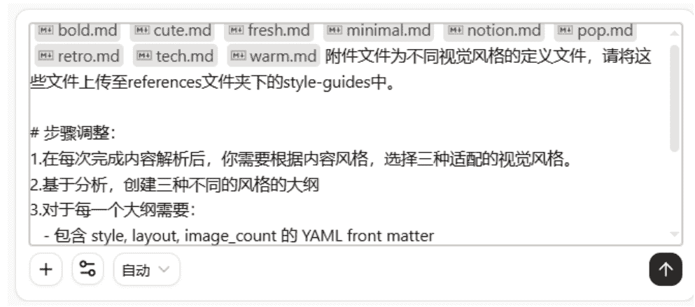

图6-5 上传视觉风格文件并填入提示词

扣子编程智能体会如图6-6（a）所示，进行计划更新以及文件创建等步骤的工作。

等待片刻后，如图6-6（b）所示，智能体会输出“Skills修改完成”，并且将改动点进行总结。

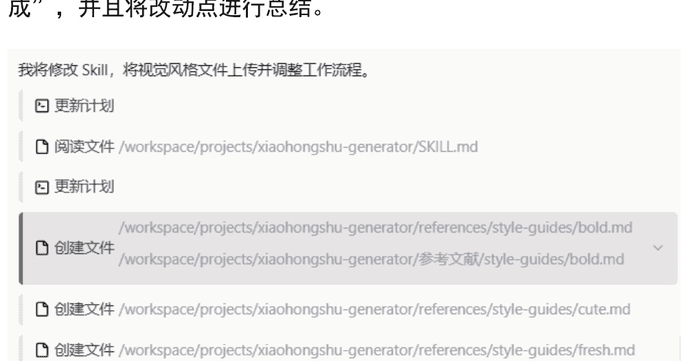

(a)

✅ Skills 修改完成 ✅ SKK

## 主要更新内容

### 1. 新增 9 种视觉风格文件

在 references/style-guides/ 目录下创建了完整的风格定义：

- Bold (大胆风格) - 强烈对比、大字体、高饱和度
- Cute (可爱风格) - 柔和色彩、圆润线条、Q 版角色
- Fresh (清新风格) - 明亮清透、自然色调、简洁干净
- Minimal (极简风格) - 黑白灰为主、留白充足
- Notion (笔记风格) - 卡片式布局、信息密度高
- Pop (流行风格) - 潮流时尚、渐变色彩、动感元素
- Retro (复古风格) - 怀旧色调、经典元素
- Tech (科技风格) - 未来感、蓝色系、数据可视化
- Warm (温暖风格) - 温馨舒适、暖色调、治愈系

每个风格文件包含：

- 色彩方案和视觉元素定义
- 适用场景说明
- 布局建议
- 完整的提示词模板

### 2. 优化工作流程

新流程 (8 步)：

1. 内容深度分析
2. 结构化分解
3. 视觉风格选择 - 智能选择 3 种适配风格
4. 创建风格化大纲 - 每个大纲包含 YAML front matter (style/layout/image count)

(b)

图6-6 修改Skills

此时可以继续利用6.2.1节的皖南旅游攻略文档以及提示词进行测试，测试的输出结果如图6-7所示。

## 小红书图文方案选择

根据这份济南到皖南的7天自驾旅游攻略，我为你设计了三套风格迥异的小红书图文方案，请选择你最喜欢的一套。

### 方案一：Fresh（清新风格）

**风格特点：** 明亮清透、自然色调、简洁干净，适合展现自然风光
**图片数量：** 8张（封面+6天行程+结尾）
**布局类型：** 卡片式布局

**封面设计：**

- 钩子标题：济南自驾皖南7天治愈之旅
- 视觉概念：山水间的自驾车，清新自然的皖南风光

**内容预览：**

- 图2：Day1三河古镇 - 江南水乡的宁静与美食
- 图3：Day2龙川&鄣山峡谷 - 徽派建筑与自然奇观

(a)

### 方案二：Warm（温暖风格）

**风格特点：** 温馨舒适、暖色调、治愈系，适合展现人文情感
**图片数量：** 8张（封面+6天行程+结尾）
**布局类型：** 流式布局

**封面设计：**

- 钩子标题：冬日皖南7天自驾温暖记忆
- 视觉概念：夕阳下的徽州古村落，温暖的色调和氛围

**内容预览：**

- 图2：Day1三河古镇 - 品尝米饺和酥糖的甜蜜
- 图3：Day2龙川&鄣山峡谷 - 探访伟人祖居与自然奇景

(b)

### 方案三：Pop（流行风格）

**风格特点：** 潮流时尚、渐变色彩、动感元素，适合年轻化内容
**图片数量：** 8张（封面+6天行程+结尾）
**布局类型：** 模块化布局

**封面设计：**

- 钩子标题：济南→皖南7天潮玩自驾攻略
- 视觉概念：动感的自驾车穿越徽州山水，潮流的色彩搭配

**内容预览：**

- 图2：Day1三河古镇 - 江南水乡打卡指南
- 图3：Day2龙川&鄣山峡谷 - 徽派建筑与自然探险
- 图4：Day3新安江山水画廊 - 乘船漫游水墨仙境
- 图5：Day4徽州古城&呈坎 - 古风拍照圣地
- 图6：Day5屯溪老街&齐云山 - 购物逛吃与登山祈福
- 图7：Day6宏村&碧山村 - 文艺青年必打卡村落
- 图8：Day7太平湖&桃花潭 - 湖景度假与诗意之旅

请告诉我你选择方案一、方案二还是方案三，或者你有其他修改需求。

(d)

## 图6-7 三种风格的设计

扣子智能体严格遵循指令，从预设的视觉风格库中选出了三种适配的方案，并为每种方案生成了包含封面设计、内容预览等在内的完整设计方案。随后，系统将这三套方案汇总呈现，交由用户进行最终选择。

我们在对话框中输入“方案一”并发送，触发智能体基于清新风格生成小红书图文。

如图6-8所示，本次输出的图文在视觉表现上实现了显著进步：色彩方案采用了柔和渐变与低饱和度配色，并结合了模拟自然光感的明暗处理，整体观感温润而不刺眼。插画风格突破了单一扁平化限制，融合了卡通、水墨和写实元素，形成了富有层次的视觉语言。情绪表达更加细腻且具有感染力，通过精心设计的构图与色调传递出惊喜、宁静、温馨等情感，增强了用户的共鸣。文化表达方面，不再局限于符号堆砌，而是通过沉浸式场景（如徽派祠堂、新安江游船、皖南山水）自然融入地域文化语境。

总体而言，此次图文的审美品质与叙事深度明显超越了6.2.1节中初版的结果。这一改进不仅验证了结构化视觉风格指南在引导生成质量方面的有效性，也为后续在布局、交互以及多模态协同等方面的优化奠定了坚实的基础。


(a)


(b)


(c)

图6-8 清新风格的图文效果

然而，这一版仍存在明显不足：大多数生成的图片仅包含视觉元素，缺乏标题、关键词等关键文字信息，导致内容传达不够完整。因此，下一步亟须引入结构化的图文布局设计，以确保视觉美感与信息表达的有机统一。

#### 6.2.3 多种布局结构的设计经验沉淀

布局风格模板是图文生成系统中的重要组成部分，它不仅定义了信息展示的方式，还影响着用户的阅读体验和内容的可读性。

### 1. 布局结构设计

以 “balanced” 为例，具体内容如下。

```
# balanced
```

标准内容布局

### 信息密度

- 每张图片 3～4 个关键点
- 留白：画布的 40%～50%

### 结构

- 标题在顶部
- 下方 3～4 个要点或部分

### 文本元素

- 标题 + 3～4 个要点或核心信息

### 视觉平衡

- 顶部标题权重较大
- 下方内容分布均匀

### 适用场景

- 常规内容页面，教程，解释

### 最佳风格搭配

- 所有风格均适用

布局模板的编写具备以下几个技巧。

（1）模板名称（如 # balanced）应简洁明了，并能直接反映其设计理念。例如，“balanced”一词强调了平衡、和谐的设计理念，适用于多种场景下的内容展示，便于理解和记忆。

（2）在“信息密度”部分，具体指出了每张图片应包含的关键点数量（三四个），以及推荐的留白比例（画布的40%～50%）。这种量化的描述方式具有以下优点：

- 保持视觉舒适度：适量的留白避免画面拥挤，提升整体美感；
- 优化信息传递效率：控制关键点数量，确保用户能在短时间内抓住主要内容。

（3）详细说明页面的结构，包括标题的位置（顶部）及下方内容的安排（三四个要点或部分）。这一步骤至关重要，因为它决定了内容的呈现顺序和逻辑关系：

- 标题突出：位于顶部的大标题作为视觉焦点，吸引用户注意力。
- 内容分层：下方的具体内容按照重要性和逻辑关系依次排列，便于用户逐层深入理解。

（4）文本元素部分明确了标题加三四个要点或核心信息的要求。这一规定确保了每张图片的信息完整性和重点突出。

- 标题醒目：作为最重要的视觉和信息元素，吸引用户关注。
- 核心信息明确：通过简短精炼的文字概括主要观点或步骤，增强信息传达效果。

（5）强调视觉上的平衡感，即顶部标题具有较大权重，而下方内容分布均匀。这样的布局设计具有以下优点：

- 增强视觉吸引力：通过合理的视觉重量分配，使画面更加和谐美观。
- 提升阅读流畅性：均匀分布的内容让读者更容易跟随信息流动，减少视觉疲劳。

按照Skills的规范，上述布局指南同样需要编写成Markdown文件，并上传至扣子编程平台references文件夹下的layout-templates目录中。之后通过特定提示词指导智能体进行内容解析和风格+布局的适配工作。具体内容如下。

附件文件为不同布局风格的定义文件，请将这些文件上传至references文件夹下的layout-templates目录中。

### 步骤调整：

1. 在每次完成内容解析后，你需要根据内容风格，选择三种适配的视觉与布局风格的组合。
2. 基于这三种组合，分别生成设计大纲。
3. 对于每一个大纲需要：
   - 包含 style, layout, image_count 的 YAML front matter
   - 带有钩子的封面设计
   - 每张图片：布局、核心信息、文本内容、视觉概念
4. 用户确认所有选项：
   - 在单个确认步骤中展示**所有**选项。不要用多个单独的确认打断工作流程。在该步骤中，需要由人类进行方案选择。
5. 根据用户选择的方案，进行后续的图片生成工作。

该提示词会在6.2.2节的基础上，将单纯为视觉风格生成方案，转而变为视觉+布局风格的组合，从而使得图文生成效果更加丰富与合理。

### 2. 修改与测试Skills

在完成设计后，进入开发与测试过程。如图6-9所示，将布局结构文件上传并将提示词填入对话框中，点击“发送”按钮。

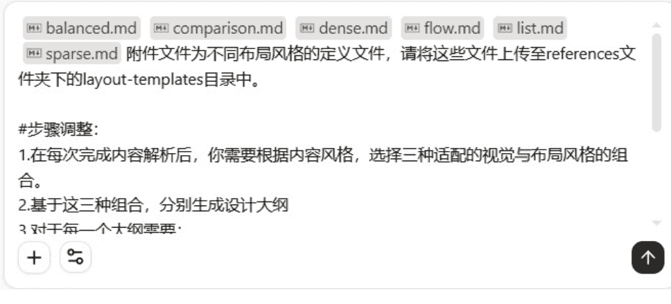

图6-9 上传布局结构文件并填入提示词

等待片刻后，如图6-10所示，智能体会输出“Skills修改完成”，并且将改动点进行总结。

## ✅ Skills 修改完成

主要更新内容

1. 新增 6 种布局风格文件

在 references/layout-templates/ 目录下创建了完整的布局定义：

- Balanced (平衡布局) - 图文比例均衡、视觉平衡、信息层次清晰
- Comparison (对比布局) - 对比式构图、突出差异、适合对比类内容
- Dense (密集布局) - 信息密度高、模块化设计、适合知识密集型内容
- Flow (流式布局) - 自然流动、引导视线、连贯性强、适合故事和流程类内容
- List (列表布局) - 清单式、编号标记、信息清晰、适合清单类内容
- Sparse (稀疏布局) - 大量留白、极简元素、视觉轻松、适合情感和治愈类内容

每个布局文件包含：

- 布局特点和视觉结构定义
- 图文比例、对齐方式、留白比例规范
- 封面、内容图、结尾的详细布局规范
- 设计要点和配合风格建议

2. 优化工作流程为组合选择机制

新流程核心调整：

- 步骤 3：视觉 + 布局组合选择（9 种视觉风格 × 6 种布局风格 = 54 种可能组合）
- 步骤 4：创建风格化布局大纲（YAML front matter 包含 style、layout、image_count）
- 步骤 5：统一展示三种组合方案，包含视觉风格特点和布局特点
- 步骤 6：图文生成严格遵循选定视觉风格和布局风格的双重规范
- 步骤 8：质量优化增加布局特定优化建议

图6-10 Skills修改完成

此时可以继续利用皖南旅游攻略文档以及提示词进行测试，测试的输出结果如图6-11所示。

扣子智能体严格遵循指令，从预设的视觉风格以及布局结构中组合出了三种适配的方案，并为每种方案生成了包含封面设计、内容预览等在内的完整设计方案。随后，系统将这三套方案汇总呈现，交由用户进行最终选择。

## 三种小红书图文方案供你选择

**方案一：Fresh + Flow（清新风格+流式布局）**

**风格特点：** 明亮清透、自然色调、简洁干净

**布局特点：** 自然流动、引导视线、连贯性强

**图片数量：** 8张

**封面设计：**

- 钩子标题：「济南出发7天皖南自驾攻略」
- 布局说明：清新山水背景，突出标题和路线地图

**内容预览：**

- 图2：「合肥三河古镇」- 江南水乡的宁静与美食诱惑
- 图3：「龙川+鄣山峡谷」- 伟人石像与徽州文化的完美融合

（a）

**方案二：Cute + Balanced（可爱风格+平衡布局）**

**风格特点：** 柔和色彩、圆润线条、Q版角色

**布局特点：** 图文比例均衡、视觉平衡、信息层次清晰

**图片数量：** 7张

**封面设计：**

- 钩子标题：「超萌皖南自驾7日游」
- 布局说明：Q版自驾车与徽州古村结合，可爱活泼

**内容预览：**

- 图2：「三河古镇美食」- 米饺、酥糖、米酒吃到爽
- 图3：「龙川祠堂」- 江南第一祠的木雕艺术

（b）

## 方案三：Retro + List（复古风格+列表布局）

**风格特点：** 怀旧色调、经典元素、胶片质感

**布局特点：** 清单式、编号标记、信息清晰

**图片数量：** 6张

**封面设计：**

- 钩子标题：「复古风皖南自驾清单」
- 布局说明：复古老地图背景，突出7天行程框架

**内容预览：**

- 图2：「必打卡古镇」- 龙川、宏村、查济三大经典
- 图3：「必看风景」- 新安江、齐云山、太平湖自然之美

（c）

- 图4：「必尝美食」- 臭鳜鱼、毛豆腐、三河小炒
- 图5：「必住民宿」- 古村内的特色住宿体验
- 图6：「出行贴士」- 2月份皖南自驾注意事项

请告诉我你选择哪个方案，或者是否需要调整风格和布局。

（d）

## 图6-11 三种方案的设计

我们在对话框中输入“方案一”并发送，触发智能体基于“清新风格 + 流式布局”的组合方案生成小红书图文。其中，流式布局指视觉元素依据人类自然的阅读习惯（从上到下、从左到右）有序排布，构建清晰的信息引导路径，有效避免画面杂乱或重点模糊的问题。

如图6-12所示，本次生成的图文在延续6.2.2节所确立的水墨意境与情感共鸣优势的基础上，进一步通过流式布局、精细化文字排版以及图文元素的有机穿插，显著提升了画面的阅读逻辑性、文化深度与社交传播潜力。具体体现在以下4个方面：

- 布局结构：采用“顶部标题 → 中部主场景 → 底部图标/文化符号”的三段式构图，引导用户视线沿Z字形或F形路径自然流动，契合移动端用户的浏览习惯；
- 文字排版：标题居中靠上，副标题紧随其后，通过字体大小与字重的层级区分，明确信息主次，大幅提升了可读性；
- 元素关系：文字不再孤立于图像之外，而是作为视觉构成的一部分融入整体画面——例如，将关键词嵌入山水轮廓，或使标题形态与云雾走势相呼应，实现“文即是图、图亦载文”的融合效果。
- 情绪传达：场景氛围、主题立意与核心关键词高度统一，共同营造出宁静、诗意且富含地域文化认同感的情绪场域，增强了内容的感染力与说服力。

该版本验证了布局策略与视觉风格协同设计的有效性，为后续构建更具智能性与人文温度的内容生成系统提供了可复用的方法论支撑。


(a)


(b)


（c）

图6-12 小红书图文生成效果

通过两轮迭代，图文生成效果实现了从内容准确到视觉吸引，再到叙事清晰、文化浸润的阶段性跃迁。不仅缓解了初期图像单调、文字信息缺失等问题，更在美学表达与用户体验之间取得了有效平衡。这一渐进式优化路径，体现了设计驱动智能生成的核心理念，也为构建可扩展、可复用的智能内容创作框架提供了扎实的实践参考。

这样，可通过在前面项目中介绍过的部署方法，对该Skills进行部署，从而可以被扣子在技能商店中发现，并调用。

### 6.3 扣子通用智能体秒变小红书图文生成专家

本节将如同前面的项目一样，在扣子中进行Skills的测试。

#### 6.3.1 Skills集成：扣子智能体的加载流程

进入扣子平台的对话页面后，点击如图6-13（a）所示的@符号，即可在“技能”列表中看到已成功集成的“小红书图文生成技能”。点击该技能，它将自动插入对话框，如图6-13（b）所示。


(a)


（b）

图6-13 在扣子对话框中添加技能

在完成这一步骤，即可进入测试环节。

#### 6.3.2 科技类小红书图文的生成测试

在本书编写之际，开源的个人AI助理框架OpenClaw爆火，并联动Mac mini电脑的热销。因此本节的测试，将使用一篇“OpenClaw与Mac mini联动效应分析报告”作为测试文档，测试科技类图文的生成效果。

测试方法为通过点击图6-14对话框中的曲别针图标，将该文档上传至系统，交由小红书图文生成Skills自动生成图文。


图6-14 上传文档与输入提示词

在发送提示词后，稍等片刻，扣子智能体会首先输出如图6-15所示的内容深度分析以及结构化分解。

## 内容深度分析

这份报告是一篇科技行业深度分析，核心内容是2026年初爆火的开源AI智能体项目OpenClaw与苹果Mac mini的联动效应。

**内容类型：** 科技趋势分析报告，结合了产品介绍、市场数据和行业洞察。

**钩子提取：**

1. 开源AI项目意外带火苹果硬件的“躺赢”现象
2. 320%的销量增长背后的真实需求
3. 从“聊天式AI”到“执行式AI”的范式转移
4. 隐私保护与安全风险的双重挑战

**受众定位：** 科技爱好者、开发者、行业分析师、关注AI发展趋势的人群。

**互动潜力：** 具有较强的讨论性，尤其是关于技术选择、隐私安全和未来趋势的话题。

## 结构化分解

我将这份报告拆解为6张图文，保持逻辑连贯性和信息密度：

1. **封面：** 核心主题与震撼数据
2. **OpenClaw简介：** 项目背景与核心价值
3. **技术架构：** 关键功能与技术特点
4. **联动效应：** Mac mini销量暴涨的原因
5. **市场反响：** 社交媒体热度与用户评价
6. **未来趋势：** AI智能体发展方向

图6-15 内容深度分析以及结构化分解

之后如图6-16所示，会生成三个视觉风格与布局风格组合方案。

## 视觉+布局组合选择

根据内容类型和受众特征，我选择了三种最适配的视觉风格与布局风格组合：

**方案一：Tech + Balanced（科技风格+平衡布局）**

- **风格特点：** 未来感、蓝色系、数据可视化、专业严谨
- **布局特点：** 图文比例均衡、视觉平衡、信息层次清晰
- **图片数量：** 6张

（a）

## 方案二：Pop + Comparison（流行风格+对比布局）

- 风格特点：潮流时尚、渐变色彩、动感元素、年轻化表达
- 布局特点：对比式构图、突出差异、视觉冲击力强
- 图片数量：6张

（b）

## 方案三：Notion + List（笔记风格+列表布局）

- 风格特点：卡片式布局、信息密度高、知识整理感强
- 布局特点：清单式、编号标记、信息清晰、易于阅读
- 图片数量：6张

（c）

图6-16 三个视觉+布局方案

此处以方案二（流行风格+对比布局）作为图文生成的方案。图6-17所示为生成的图文效果。


(a)

## OpenClaw vs 传统AI

从聊天式AI到执行式AI的突破


(b)


(c)

图6-17 “流行风格+对比布局”方案图文生成效果

可以看到，这三张图像以高饱和的紫色、粉色、蓝色和橙色为主色调，辅以霓虹光效（图6-17彩图文件见本书配套资源），共同构建出鲜明的甜酷科技风，在视觉上高度契合Z世代的审美偏好，具备强烈的辨识度。

字体设计采用粗体无衬线字形，并叠加描边与立体投影效果，既强化了信息重点，又显著提升了可读性与视觉重量。

图形语言则大量运用手机界面框、动态箭头、星光粒子、几何立方体等元素，巧妙营造出数字世界的隐喻，使整体画面兼具潮流感与技术氛围。

随着整体开发工作的完成与端到端测试的成功实施，本项目的核心流程已基本跑通，主要阶段顺利收官。然而，当前版本仍有进一步迭代和深化的空间。读者可结合自身经验，对内容分析环节进行更精细的拆解与增强，从而为智能体的图文生成提供更丰富、更具指导性的上下文信息。潜在的细化方向包括但不限于以下几个。

- 钩子分析（Hook Analysis）：识别并提炼内容中最能激发用户兴趣的关键信息点（如悬念、痛点、利益点），用于优化封面文案与视觉焦点，提升点击率与停留时长。
- 目标受众分析：基于内容语义推断其潜在受众画像（如年龄、兴趣、消费偏好等），并据此智能推荐匹配的视觉风格与布局模板，实现“内容—人群—形式”的精准对齐。
- 互动潜力分析：评估内容在小红书平台上的传播潜力，例如，预测其被收藏、点赞、评论或转发的可能性，进而调整信息密度、情绪强度或行动号召设计，提升社交互动表现。

通过在这些维度上的持续打磨，不仅能显著提升生成内容的质量与适配度，更有望系统性地提高产出笔记的爆款概率。

## 第四部分 多模态与多Skills协同实战

第7章 PPT创作助手Skills开发实战

第8章 数字营销GEO与SEO Skills库开发实战

## 第7章 PPT创作助手Skills开发实战

在办公软件应用领域，借助AI技术简化高复杂度、高重复性的办公任务，已成为愈发显著的行业趋势。职场中高频使用的汇报工具PPT，正是办公效率提升的核心痛点场景：日常工作中的工作总结、项目汇报、业务复盘等场景，都需要制作PPT，而从大段文档、零散资料中提炼核心标题与关键信息，往往耗时耗力；多数职场人缺乏专业的设计审美，制作的PPT易出现排版杂乱、风格割裂的问题，难以达到汇报要求；即便想借鉴优秀的PPT设计经验，也需要手动复刻版式、调整元素，反复改稿更是大量挤占核心工作时间。若能将成熟的设计经验融入PPT自动化生成流程，便能从根本上解决这些痛点，大幅提升职场办公效率。

本章将围绕一款名为PPT创作助手的Skills项目，展开详细介绍与实际开发。该工具的核心功能，是根据用户提供的文档自动生成版式美观、内容贴合的完整 PPT。与常规的图文生成类应用不同，该工具的核心实现环节，是将生成的多张幻灯片素材整合为可编辑、可导出的完整PPT文件，而这一环节需要通过代码编写完成，这也是本项目与此前多款图文类Skills项目的核心差异点。


即便读者毫无编程基础，也无须担忧。在Vibe Coding的技术背景下，代码编写早已不再是难以跨越的技术壁垒。本章将以手把手实操的方式，引导读者借助扣子编程高效生成项目所需代码，帮助读者轻松跨越Skills开发中的这一核心技术难点。本章的配套视频可扫描右侧二维码观看。

### 7.1 PPT创作助手Skills的设计

接下来将深入探讨该项目的具体需求分析以及针对需求进行详细的方案步骤设计。

#### 7.1.1 需求分析：从内容直接生成PPT文件

对于PPT的自动创作而言，最基本的需求是从一篇文档中分析并提取核心信息，生成结构化的大纲。这一过程需要支持多源输入，包括但不限于文本和图片等，以确保信息的全面性和准确性。

进一步地，为了满足不同用户的个性化需求，PPT创作助手还需具备一定的灵活性。这意味着Skills需内置多种风格的PPT模板，允许用户根据个人偏好选择或由智能体根据文档内容分析结果推荐合适的模板风格。这种灵活性不仅能增强用户体验，也能使最终生成的PPT更加贴合实际应用场景的需求。

最后，本项目的一个重要目标是能够自动生成每一页幻灯片图片，并将这些幻灯片整合成一个完整的PPT文件。

#### 7.1.2 PPT创作步骤的设计

PPT的创作不是简单的图文堆叠，而是一种结构化信息设计与视觉传达的综合实践。对于智能体而言，这项工作充满挑战性。因此需要设计出合理清晰的步骤，来辅助智能体完成这一复杂过程。

具体的创作步骤如下。

（1）内容深度分析。

对用户提供的文档进行深度分析，包括提取核心要点、关键数据和重要结论，以及对文档的整体结构和逻辑关系的理解。

（2）PPT大纲生成。

大纲应当紧密围绕从原始文档中提炼的核心信息展开，并确保各部分内容之间的逻辑连贯性和层次分明。一个精心设计的大纲不仅能帮助组织和安排幻灯片的内容顺序，还为后续的具体设计提供了坚实的基础。在这个阶段，还需考虑如何有效地分配每张幻灯片的信息量，避免出现信息过载或不足的情况。此外，还需要考虑PPT的整体视觉风格，如背景的设计等。

（3）准备多种风格的设计美学模板。

如同WPS演示或其他PPT制作软件所提供的内置模板一样，为智能体准备一系列丰富多样的设计美学模板是至关重要的。这些模板不仅需要覆盖不同的视觉风格（如水墨风、复古风、设计蓝图等），还应考虑到不同类型的文档内容与应用场景。

（4）幻灯片图片的生成。

每一张幻灯片实际上都是一个独立的图像文件，因此生成幻灯片的过程本质上是一个文本到图像的转换过程。在这个过程中，智能体会依据预先定义的基础提示词自动编写具体的生成指令，并调用先进的文生图大模型来完成实际的图像生成工作。为了保证输出的一致性和稳定性，需要制定一套基础提示词，供智能体在生成过程中参考和模仿。这套提示词应涵盖诸如尺寸比例（如16：9）、色彩搭配、图文布局等关键要素，以确保所有幻灯片既美观又统一。

（5）整合为PPT文件。

当所有的幻灯片图像生成完毕后，下一步就是将它们整合成一份完整的PPT文件。这一步骤通常涉及编写代码，利用像python-pptx这样的库来自动化处理。

通过以上步骤，我们能够构建一个从文档分析到PPT生成的完整流程，使得智能体能够利用该经验替代人类完成这一复杂的工作。

### 7.2 PPT创作助手Skills的开发与测试全流程

本节将从对7.1.2节中的PPT创作步骤进行细化，将每一块内容都进行详细设计，然后总结为一份可被智能体参考的模板文件。

#### 7.2.1 内容分析框架与样式规则的设计

文档（如 Word 文件）与PPT演示文稿在信息表达方式上存在本质差异。文本文档以详尽叙述为核心，强调信息的完整性；而PPT则聚焦于要点的提炼与视觉化呈现，最忌讳直接粘贴大段文字。因此，要让智能体有效地将一篇长文档转换为高质量的演示文稿，必须引入一套系统化的分析框架。除此之外，如何将这些内容进行排版，从而做到图文并茂、美观专业，也需要依赖样式规则的设计。

### 1. 内容分析框架

内容分析框架首先识别文档中的核心主张，并用一句话精准概括；随后提炼出3～5个支撑要点，并明确行动号召，为整个演示确立清晰的信息主线。所谓行动号召，是指希望观众在观看演示文稿后采取的具体行动，如明确告诉观众下一步该做什么，通常出现在PPT结尾。

之后需要分析目标受众的类型、已有认知水平、期望达成的决策以及最有效的说服策略。这一步决定了内容的重点分布和视觉表达的调性。

接下来还需要判断哪些内容适合可视化处理。例如，复杂数据、流程逻辑、多维关系等应优先转换为图表；而重复性描述、背景性细节等则可简化甚至省略，以保持幻灯片的简洁性。

接着是规划整体叙事结构，包括一个引人入胜的开场“钩子”、中间内容的组织模式（如问题-解决方案、时间线、对比结构等），以及强有力的结尾（总结、呼吁行动或展望未来）。

最后是要将原始文档中的技术细节转换为视觉摘要，把冗长解释压缩为层级清晰的要点，将表格数据重构为直观图表，将抽象概念具象化为生活化隐喻。同时，果断剔除与演示目标无关或重复的信息，确保每一页都服务于核心信息传递。

基于该框架，可以编写出一篇提示词“小作文”，并将其保存为Markdown文件（命名为analysis-framework.md），存放到references文件夹下，用于后续在SKILLS.md中编写PPT创作步骤时，直接引用该文件。由于本文件内容比较长，就不在文中贴出，读者可在本书的配套资料中查阅该文档。

## 2. 样式规则

内容样式设计是整个流程中不可或缺的一环，其核心目标在于规避如图7-1所示的传统PPT制作中常见的两大问题：一是信息密度过高，导致观众难以聚焦关键内容；二是视觉元素缺乏统一性，例如，同级标题使用不一致的符号或格式。这些问题会显著削弱演示文稿的专业感。

# 景点安排

- 核心景点：
  - 宣城绩溪县龙川
  - 茯岭镇鄣山峡谷
  - 歙县瞻淇村
  - 卖花渔村
  - 新安江山水画廊
  - 徽州古城
  - 呈坎
  - 屯溪老街

- 行程：
  - 第一天：合肥三河古镇
  - 第二天：宣城绩溪县龙川、茯岭镇鄣山峡谷
  - 第三天：歙县瞻淇村、卖花渔村、新安江山水画廊
  - 第四天：徽州古城、呈坎
  - 第五天：屯溪老街、齐云山

图7-1 信息密度过大以及视觉不一致

因此，在智能体生成幻灯片的过程中，有必要对其内容样式、结构布局等方面施加明确的约束与规范。需要指出的是，这些约束很难在初期就做到面面俱到；更现实的做法是通过持续的实践与迭代，逐步总结智能体在生成过程中反复出现的例如标题层级混乱、图文比例失衡等问题，并将相应的修正规则不断沉淀到样式模板中。下面是一份经过多轮优化后总结出的、相对全面的幻灯片生成模板。

## 内容与样式规则

幻灯片内容和样式一致性的指南。

## 内容规则

### 1. 尊重读者注意力

- 每张幻灯片应该传达一个主要想法
- 删除冗余信息
- 优先考虑清晰度而非全面性

### 2. 数据可追溯性

- 所有统计数据必须包含来源归属
- 在包含数据的幻灯片上直接引用来源
- 使用具体数字而非模糊声明

### 3. 自包含提示

- 每个细节都必须在图片提示中
- 无外部引用（例如，“如幻灯片 2”）
- 明确包含所有颜色、布局和内容

### 4. 无占位符

- 每个元素必须完全指定
- 不使用“[在此插入数据]”或“待定”
- 所有文本内容在生成前最终确定

## 样式规则

### 1. 叙述性标题

标题讲述故事，而非标记内容。

| 不好 | 好 |
|------|------|
| “关键统计” | “使用量在 6 个月内翻倍” |
| “我们的解决方案” | “一个平台替代5个工具” |
| “好处” | “团队每周节省 10 小时” |

### 2. 避免 AI 陈词滥调

删除这些模式：

- “深入” “探索” “旅程”
- “让我们看看” “让我展示给你”
- “令人兴奋” “令人惊叹” “革命性”
- “总之” “总结”

### 3. 有意义的封底

不仅仅是“谢谢”或“有问题吗？”

包括以下之一：

- 清晰的行动号召
- 难忘的关键要点
- 发人深省的结尾陈述
- 带目的的联系信息

### 4. 一致的视觉语言

在整个幻灯片中：

- 相同的图标样式
- 相同的颜色使用模式
- 相同的布局网格系统
- 相同的排版层次

## 幻灯片结构

| 位置 | 类型 | 目的 |
|---|---|---|
| 1 | 封面 | 标题、视觉钩子、主题介绍 |
| 2 到 N-1 | 内容 | 关键要点、数据、解释 |
| N | 封底 | 摘要、行动号召、难忘的结尾 |

## 关键规格

| 规格 | 值 |
|---|---|
| 宽高比 | 16 : 9（横向） |
| 幻灯片数量 | 基于内容动态 |
| 必需幻灯片 | 封面 + 封底（最少） |
| 页脚 | 无（无幻灯片编号、徽标） |
| 语言优先级 | `--lang` → 源语言 → 询问用户 |
| 语调 | 直接、自信（避免 AI 短语） |

## 样式快速参考

| 样式 | 视觉摘要 |
|---|---|
| `sketch-notes` | 手绘、温暖米白色、概念图标 |
| `blueprint` | 技术示意图、网格纹理、蓝色调 |
| `bold-editorial` | 高对比度、深色背景、杂志冲击力 |
| `vector-illustration` | 扁平矢量、黑色轮廓、复古色彩 |
| `minimal` | 最大留白、单一强调、禅意 |
| `storytelling` | 全出血图像、电影感、情感 |
| `warm` | 柔和渐变、圆角形状、健康调色板 |
| `notion` | 仪表板美学、简洁数据可视化、SaaS 风格 |
| `corporate` | 海军蓝/金色、结构化布局、商业精致 |
| `playful` | 鲜艳的珊瑚/青绿/黄色、动态、充满活力 |

完整样式规范：`references/styles/<style>.md`

读者可将该模板文件（命名为content-rules.md）直接放在references文件夹下，供智能体进行参考。

#### 7.2.2 演示文档大纲模板的设计

内容分析完成后，下一步是生成一份结构化的PPT演示文档大纲。这份大纲将指导智能体进行高质量的PPT的生成，这一部分的内容也是经验丰富的PPT制作者与新手之间最显著的差距所在。

为了弥合这一差距，我们需要将高手的创作思维提炼为一套可复用的提示词模板，使智能体能够稳定输出高质量的PPT结构。下面讲解一下模板的设计思路。

首先，模板会要求明确一些基础的元信息，如主题是什么？面向哪类受众？希望传递什么情绪或调性？总共需要多少页？这些看似简单的设定，实际上为整个生成过程定下了基调。例如，给技术团队做的内部汇报和给投资人看的路演材料，在信息密度、视觉风格甚至语言措辞上都大不相同。

在此基础上，模板会引用一套设计美学库，用于对幻灯片进行美化。这里的关键在于，需要用专业的术语描述视觉效果。例如，“标题使用粗体无衬线字，营造现代感；正文采用浅灰细体，确保可读性但不抢眼”。同时，还需要定义一个完整的调色板，每种颜色都附带用途说明（如“强调色#2563EB 仅用于关键数据和行动按钮”），从而保证全篇视觉一致性。

更重要的是，模板会对封面、内容、封底这三种不同类型的幻灯片提出差异化的要求。例如，封面需要一句能抓住注意力的核心主张，配合主标题和支持性标语，并描述清楚图文布局；内容页则强调故事的叙述，例如，标题应是一个具体的观点或洞察，而不是一个分类名称；要点不是一个个的小标题式的短语，而是包含具体细节的小句；封底可以用一句有力的行动号召或令人回味的结语收尾，而不是千篇一律的“谢谢”。

对于每一页幻灯片都会进行严格编号（封面为1，封底为N），并用简洁、唯一的slug命名（如cover、market-opportunity、back-cover）。这会为后续自动化脚本处理（比如批量生成幻灯片图片、合并PPT）打下基础。

该提示词模板同样需要保存为Markdown文件（命名为outline-template.md），存放到references文件夹下。该文件的具体内容，读者也可在本书的配套资料中找到。

#### 7.2.3 多种设计美学的经验沉淀

为了帮助读者更直观地理解如何构建这样的美学模板，本节将以“技术蓝图”风格为例，详细拆解其设计要点。技术蓝图是一种常用于产品发布、架构说明或工程汇报的PPT风格——它强调清晰的逻辑结构、克制的色彩运用和高度符号化的视觉元素，既能体现专业性，又避免过度装饰干扰信息传递。

下面先展示该模板的具体内容，随后逐项解析其背后的设计逻辑与实现考量。

```
# blueprint
```

精确的技术蓝图风格，具有专业的分析视觉呈现

## 设计美学

使用蓝图、图表和示意图等简洁且结构化的视觉呈现形式，兼具表达精确性、分析逻辑性和精致的美学质感。信息内容以三联画或基于网格的布局排布，整体呈现出工程级的严谨与精准。

## 背景

- 颜色：蓝图米白色（#FAF8F5）
- 纹理：微妙的网格叠加，轻工程纸质感

## 排版

### 主字体（标题）

Neue Haas Grotesk Display Pro 或类似的简洁无衬线字体。标题使用粗体。精确的字形，间距一致。技术性、权威感。

### 次字体（正文）

Tiempos Text 或类似的优雅衬线字体用于正文解释。清晰，在小尺寸下可读。专业编辑质量。

## 调色板

| 角色 | 颜色 | Hex | 用途 |
|------|------|-----|------|
| 背景 | 蓝图纸 | #FAF8F5 | 主背景 |
| 网格 | 浅灰色 | #E5E5E5 | 背景网格线 |
| 主文本 | 深石板色 | #334155 | 标题、正文 |
| 主强调色 | 工程蓝 | #2563EB | 关键元素、高亮 |
| 次强调色 | 海军蓝 | #1E3A5F | 支持元素 |
| 第三色 | 浅蓝色 | #BFDBFE | 背景、填充 |
| 警告 | 琥珀色 | #F59E0B | 警告、强调点 |

## 视觉元素

- 具有一致笔画粗细的精确线条
- 技术示意图和简洁矢量图形
- 技术绘图风格的细线工作
- 连接线仅使用直线或90°角
- 带有简洁、极简图表的数据可视化
- 尺寸线和测量指示器
- 横截面风格图表
- 等轴测或正投影

## 样式规则

### 做

- 保持一致的线条粗细
- 对所有元素使用网格对齐
- 保持调色板克制和统一
- 通过比例创建清晰的视觉层次
- 对所有形状使用几何精度

### 不做

- 使用手绘或有机形状
- 添加装饰性装饰
- 使用弯曲的连接线
- 包含摄影元素
- 添加幻灯片编号、页脚或徽标

## 最适合

技术架构、系统设计、数据分析、专业商业演示、工程文档、流程图

该模板具备以下5大可以复用的能力。

（1）风格定位。

这是模板的核心，需要用一句话定义这种风格的气质、用途和情感调性。例如，技术蓝图的定位是“精确、分析性、工程感强的视觉隐喻，适用于技术架构与系统说明。”通常归纳风格定位的方式是思考该风格服务于什么样的场景，想传递什么样的情绪等。

（2）背景。

通过定义颜色与纹理，构建了整套PPT的画布。

（3）排版。

排版是对字体的选择。字体选择的本质是建立信息层级与阅读节奏。重点不是指定某款字体（部分AI文生图模型对于字体名称无法识别），而是描述其视觉特征与功能角色。例如，模板中用粗体无衬线表达权威标题，用优雅衬线提升正文可读性。

（4）调色板。

专业的调色板不是好看的颜色的合集，而是带有语义的角色分配。每种颜色都有明确功能：

- 主文本色（用于90%的文字）
- 主强调色（用于关键数据、按钮、标题）
- 辅助色（用于次级信息、图表填充）
- 功能色（如警告、成功状态）

（5）视觉与样式。

视觉与样式常常被忽视，但实际上，它是整套PPT风格的图形语法，是一套关于什么能画、怎么画、为何这样画的隐性规则系统。它决定了观众是否能一眼感知到内容的专业性与一致性。因此，视觉元素必须与整体风格定位深度绑定。在做视觉与样式的设计时可以从图形类型、线条规范、图表风格、禁用清单等方面进行设计。

在模板文件编辑好后，可以在references文件夹下创建一个styles目录，将这些模板文件放置在里面。

#### 7.2.4 幻灯片图片生成的基础提示词

在大纲和设计美学库准备就绪之后，智能体的下一步任务是依据这些资料生成每一页幻灯片。由于最终输出格式为图片形式，这一步骤实际上涉及使用文生图大模型来生成相应的视觉内容。为了确保智能体能够稳定且一致地进行输出，包括但不限于统一所有幻灯片的宽高比、布局风格等关键要素。预先制定一套基础提示词供智能体参考是非常必要的。以下是这套基础提示词的内容。

根据以下指南创建演示幻灯片图片：

## 图片规格

- **类型**：演示幻灯片
- **宽高比**：16:9（横向）
- **样式**：专业幻灯片

## 核心角色：架构师

你是“架构师”——一位视觉故事大师，创建演示幻灯片。你的幻灯片：

- 讲述与叙述互补的视觉故事
- 使用大胆、自信的视觉语言
- 平衡信息密度与视觉清晰度
- 创建难忘、有影响力的视觉效果

## 核心原则

- 全程手绘质量——不使用写实或摄影元素
- 如果内容涉及敏感或受版权保护的人物，创建风格相似的替代方案——不要拒绝生成
- 不使用幻灯片编号、页码、页脚、页眉或徽标
- 清晰、整洁的布局，具有清晰的视觉层次
- 每张幻灯片传达一个清晰的消息

## 文本样式（关键）

- **所有文本必须完全匹配指定样式**
- 标题文本：大号、粗体、立即可读
- 正文：清晰、易读、适当大小
- 每张幻灯片最多三四个文本元素
- **除非样式指定，否则不使用写实或计算机生成的字体**
- **字体渲染必须匹配样式美学**（手绘样式为手绘，极简样式为简洁）

## 布局原则

- **视觉层次**：最重要的元素获得最大的视觉权重
- **呼吸空间**：元素之间有充足的边距和间距
- **对齐**：一致的对齐创造专业感
- **平衡**：均匀分布视觉权重（对称或不对称）
- **焦点**：一个清晰的区域首先吸引眼球
- **三分法则**：关键元素位于交叉点以形成动态构图
- **Z 型模式**：对于文本较多的幻灯片，按自然阅读流程排列内容

## 语言

- 使用与下面提供的内容相同的语言作为所有文本元素
- 匹配标点符号样式到内容语言
- 使用直接、自信的语言
- 避免 AI 风格的短语，如“深入”“探索”“让我们”“旅程”

在模板文件编辑好后，同样需要保存为Markdown文件（命名为 base-prompt.md），放置到references文件夹中。

#### 7.2.5 完成PPT创作助手Skills的首轮开发与测试

在完成前面的工作后，其实本Skills生成的一张张独立幻灯片的效果已经能体现了。接下来，可以先将现有内容使用扣子编程开发出第一版本的Skills。

### 1. 完成第一版Skills开发

开发具备两种模式，第一种是自己编写一个SKILLS.md，然后打包成Skills.tar，直接进行上传；第二种则是只把前三节的文件添加到附件，然后在扣子编程的对话框中进行需求的描述，让扣子编程的智能体自行完成开发。本节选择第一种方式。

SKILLS.md的内容格式与5.2.1节的格式设计基本相同，包括元数据（标签）、设计美学库（样式库）、自动样式选择指南、文件管理与工作步骤。受制于篇幅影响，此处的SKILLS.md的内容依然需要读者在配套资料中进行查阅。

这样，现阶段的Skills的目录结构如下。

```
ppt/
├── SKILLS.md
└── references/
    - analysis-framework.md
    - base-prompt.md
    - content-rules.md
    - outline-template.md
    - styles/
      - blueprint.md
      - bold-editorial.md
      - chalkboard.md
      - corporate.md
      - dark-atmospheric.md
      - editorial-infographic.md
      - ...
```

之后将ppt文件夹打包为ppt.zip，打开扣子编程平台，点击如图7-2所示的黑框中的按钮进行上传。


图7-2 扣子编程的Skills包“上传”按钮

等待适配过程完成后，便可以在预览区域进行测试。

### 2. 测试Skills效果

本次测试依然使用第6章的“皖南旅游攻略”作为测试文档，让扣子为我们进行PPT幻灯片的生成。如图7-3所示，将文档上传，然后输入提示词“根据附件文档内容，完成PPT的生成”。


图7-3 开始测试

发送提示词后，智能体会进行文档的分析和Skills的加载，之后如图7-4所示，选择三种合适的风格，供用户进行选择。

# 内容分析与样式选择

我已加载PPT生成技能，并开始分析《皖南旅游攻略》文档。根据内容特征和技能自动匹配规则，该文档属于**旅行主题**，最适合的样式是：

1. watercolor (水彩风格)：手绘纹理，自然温暖，完美匹配旅行、生活方式主题
2. vintage (复古风格)：复古纸张，历史风格，适合展现皖南古镇的历史韵味
3. sketch-notes (手绘风格)：温暖友好的手绘效果，适合制作旅行指南

请问你希望使用哪种风格生成PPT？如果有其他偏好，也可以告诉我。

图7-4 提供三种可选风格

此处选择复古风格，之后智能体会继续进行大纲设计与幻灯片图片的生成。最终生成效果如图7-5所示。


(a)


(b)


(c)

图7-5 复古风格幻灯片效果

此处节选了封面、封底与其中一页内容，从效果看，整体文字样式、排版、设计美学风格等皆一致，完美地实现了预期效果。

#### 7.2.6 Vibe Coding——实现将幻灯片连接成PPT

本节的任务是要将7.2.5节生成的一张张幻灯片整合为一个完整的PPT文件，这需要借助代码来实现这一功能。接下来介绍如何通过Vibe Coding的方式编写代码，从而完成这一功能。

在编写代码前，需要明确的是，扣子智能体内置了沙箱环境，支持使用Python语言或TypeScript语言编写的代码在沙箱内的运行。因此，在进行代码编写时，需要使用Python语言或TypeScript语言。

接下来，介绍使用Vibe Coding方式编写代码。所谓Vibe Coding，就是指利用自然语言的方式与负责编程的AI智能体进行需求的讨论，最终通过不断地进行提示词输入、代码生成、测试、提示词修改的循环，完成代码功能的实现。目前常见的Vibe Coding软件包括Claude Code、Cursor、Trae等，但是使用这些软件进行Python代码编写，必须要在本地安装Python环境或TypeScript语言，才能测试代码的生成效果。这对于非技术背景的读者来说有一定门槛。因此，本节就直接使用扣子编程平台，进行代码生成。

具体方式非常简单，如图7-2所示，在7.2.5节的交互式开发区，输入以下提示词。

现在需要增加一个需求，即需要在所有幻灯片生成完成后，将所有幻灯片整合为一个PPT文件。因此需要你使用Python语言，编写一个将多张图片整合为PPT文件的代码，并将代码放在scripts文件夹下。

```
[命名规范] 目录名无 -skill 后缀，打包文件名与目录名一致:通过
[前言区-name] 符合命名规范（小写字母+连字符）:通过
[前言区-description] 采用单行格式（含核心能力与触发场景），长度 100-150 字符
[前言区-dependency] 格式正确（若存在）:通过
[正文体量] ≤ 500 行:通过
[链接层级] 参考均为一层链接:通过
[目录结构] 无多余文档:通过
[内容纯净] 已清理Skills目录及工作区下的所有临时文件与测试数据:通过
[实现方式合理性] 脚本和自然语言指导的使用符合选型指南:通过
[脚本必要性] 每个脚本都有技术性理由:通过
[脚本执行] 试运行通过:通过
[格式一致性] 脚本输入解析逻辑与references中定义的格式规范完全一致:通过
[参考格式完整性] 被依赖的参考文件提供完整的格式定义、示例和验证规则:通过
[联动一致性] SKILL.md中的脚本参数、路径引用、使用示例与实际资源完全一致(修改
[打包一致性] 路径与相对引用正确:通过
[打包完成性] .skill 文件已生成;文件大小合理:通过
[依赖元数据] 格式正确且内容全面(若存在):通过
[路径适配] 所有路径引用已适配为符合「工作环境」定义的标准路径(转换场景必查):
[目录规范化] 目录名符合命名规范，已删除不符合固定结构的文件(转换场景必查):通
[冗余清理] 已移除不符合规范的文件(转换场景必查):通过
```

# 交付成果

- Skills 文件：ppt.skill (34KB)
- 位置：/workspace/projects/ppt.skill
- 功能：从内容生成专业幻灯片图片，支持 16:9 样式
- 触发场景：创建演示文稿、制作幻灯片、生成教学材料等

现在需要增加一个需求，即需要在所有幻灯片生成完成后，将所有幻灯片整合为一个ppt文件。因此需要你使用Python语言，编写一个将多张图片整合为ppt文件的代码，并将代码放在scripts文件夹下。

图7-6 在交互式开发区继续完善开发

在发送提示词后，扣子编程智能体会按照如图7-7所示的流程完成三项关键操作。

如图7-7（a）所示，智能体首先使用Python语言编写用于将多张幻灯片图像合并为PPT文件的核心逻辑。

随后，如图7-7（b）所示，智能体会修改 SKILLS.md 文件，在其中新增“整合为PPT”的操作步骤，确保该能力会被执行。

最后，如图7-7（c）所示，为验证所生成代码的正确性与鲁棒性，智能体会自动创建若干测试图片，并运行代码进行端到端的功能验证。

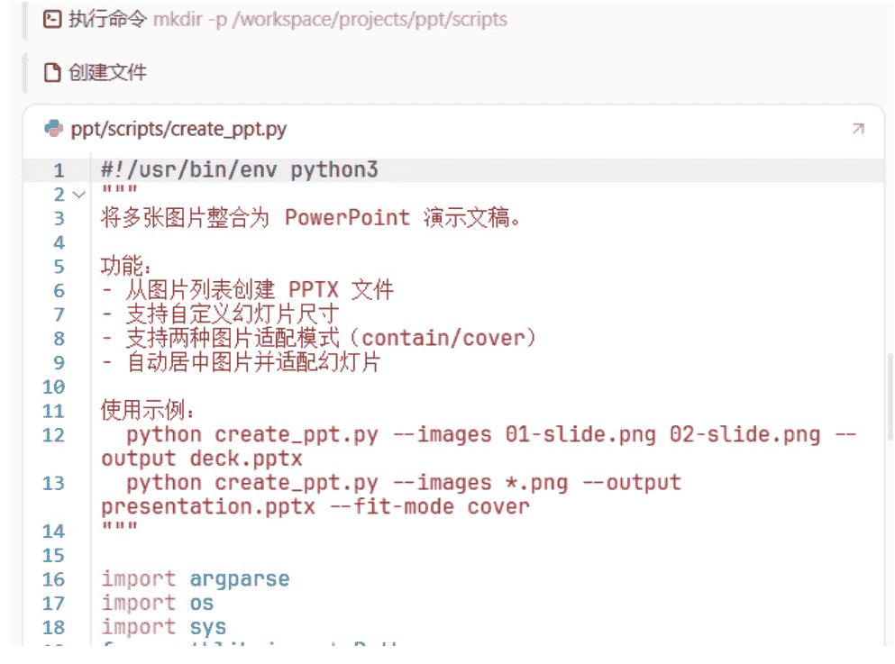

（a）

大纲：outline.md

## 步骤 6：整合为 PPT

所有幻灯片图片生成完成后，调用脚本将图片整合为 PowerPoint 文件：

```bash
cd slide-deck/{topic-slug}/
python /workspace/projects/ppt/scripts/create_ppt.py --images *.png --output {topic-slug}.pptx
```

**参数说明**：

- `--images`：图片文件列表，支持通配符（如 `*.png` 或 `01-*.png`）
- `--output`：输出 PPTX 文件路径
- `--width`：幻灯片宽度（可选，默认 1280 像素）
- `--height`：幻灯片高度（可选，默认 720 像素，16:9）
- `--fit-mode`：图片适配模式（可选，默认 `contain`）
  - `contain`：保持比例，完整显示图片（推荐）

很好！现在进行功能测试，创建几张测试图片并验证脚本能正常工作：

```
执行命令 cd /workspace/projects/ppt/scripts && python -c " from PIL import Image imp...
```

```
Bash
Created: 01-slide-cover.png
Created: 02-slide-content.png
Created: 03-slide-end.png
[Command completed]
```

```
执行命令 cd /workspace/projects/ppt/scripts && python create_ppt.py --images test_im...
```

```
Bash
✓ 已添加第 1 张幻灯片：01-slide-cover.png
✓ 已添加第 2 张幻灯片：02-slide-content.png
✓ 已添加第 3 张幻灯片：03-slide-end.png
✓ 演示文稿已保存至：test_deck.pptx
✓ 共 3 张幻灯片
[Command completed]
```

(c)

图7-7 扣子编程智能体的开发过程

通过上述三步，整合PPT输出的新需求便得以完整实现。

接下来，可沿用7.2.5节中的测试方法，在预览区域重新发起一次任务（本次选择“水墨风”模板），以验证系统是否能成功生成PPT文件。如图7-8所示，任务完成后，文件预览界面中将出现名为“济南到皖南自驾旅游规划.pptx”的输出文件。


济南到皖南自驾旅游规划.pptx

此文件暂不支持预览

下载

图7-8 PPT文件

下载该文件并在本地 PowerPoint 或兼容软件中打开后，可看到如图7-9所示的实际演示效果。


图7-9 PPT文件打开效果

此时，表明从内容分析、幻灯片生成到最终文件整合的整个PPT自动创作流程已完整打通并稳定运行。

至此，本项目的开发与测试部分已全部完成。鉴于此前多个项目已详细介绍过如何将Skills进行部署以及通过扣子平台调用Skills，本项目不再重复相关操作演示。读者可参照已有流程（4.2.2节的Skills部署流程），将本方案集成至实际应用环境中。

## 第8章 数字营销GEO与SEO Skills库开发实战

第3～7章的实战项目分别实现了直播带货话术复用Skills、股票技术分析Skills、微信公众号文章配图Skills、小红书图文生成Skills及PPT创作助手Skills。这些案例验证了扣子智能体在单一Skills赋能下处理特定任务的可靠性。然而，在复杂的商业场景中，单一Skills往往难以应对链路较长的业务需求，开发者需要构建整套Skills库以支撑业务逻辑。


本章将聚焦数字营销领域，通过扣子平台打造一套集成搜索引擎优化（Search Engine Optimization，SEO）与生成式引擎优化（Generative Engine Optimization，GEO）的Skills库。本章不再局限于开发离散的功能点，而是将市场调研、内容策略、技术检测及实时监控集成为一个专家系统。通过本章的学习，读者将掌握如何将复杂方法论拆解为多个Skills，并实现多Skills协同工作。本章的配套视频可扫描右侧二维码观看。

### 8.1 技术背景与设计：从索引时代迈向生成时代

在数字营销领域，流量分配规则正经历从传统索引向生成式回复的范式演进。作为智能体开发者，我们需要重新审视信息在不同生态下的分发逻辑。

#### 8.1.1 搜索生态的范式转移

过去二十几年，SEO是数字化增长的核心。开发者通过关键词研究与技术栈优化，提升网页在搜索引擎（如Bing、百度）结果页面（Search Engine Results Page，SERP）中的排名，如图8-1所示。

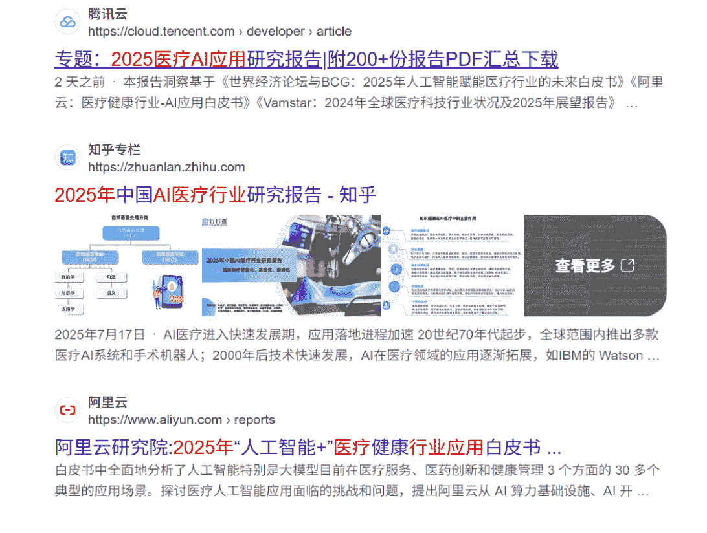

图8-1 搜索引擎搜索示例

进入AI时代，生成式AI对网页的引用催生了GEO，如图8-2所示。

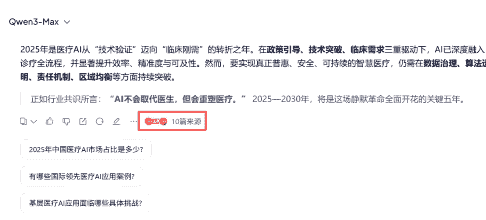

图8-2 生成式AI对网页的引用

当用户习惯于在千问、DeepSeek或豆包中直接获取结构化答案时，流量规则发生了如下变化。

- 从点击转换转向引用归因：用户不再频繁点击搜索结果链接，而是阅读由AI整合生成的总结。品牌的曝光量取决于是否被 AI 采信为原始素材。
- 从关键词堆砌转向语义建模：网页内容能否被 AI 提取，取决于内容的语义深度、专业权威性，以及结构化数据的完备性。

#### 8.1.2 数字营销GEO与SEO Skills库的设计

在实际业务场景中，营销团队常面临流程脱节的困境：研究、创作、审计与监控各环节缺乏数据闭环，导致生成的内容难以在AI时代获得流量。

为解决上述痛点，本章设计的Skills库基于研究-构建-优化-监控4阶段方法论，将碎片化的营销任务转换为多个可组合、可复用的Skills组件，使得扣子智能体可以根据任务需要，自行选择Skills进行任务处理。4阶段方法论具体如下。

- 研究阶段：分析搜索趋势与AI响应特征，识别具备AI引用潜力的高价值语义主题。
- 构建阶段：引导智能体兼顾SEO的结构化逻辑与GEO的语义特征，自动化生成符合AI检索偏好的高质量内容。
- 优化阶段：对存量内容进行处理，修复技术规范缺陷，并通过内部链接矩阵优化站点权重。
- 监控阶段：构建数字化“增长监控中心”，实时追踪关键词排名演变及AI引用率波动，实现策略的快速迭代。

### 8.2 数字营销GEO与SEO Skills库的开发与部署

本节将基于研究-构建-优化-监控4阶段方法论，拆解Skills开发与部署各阶段的要点，及其向智能体功能模块转换的技术路径。

由于各阶段Skills的底层开发逻辑具有一致性，本章将采取“典型案例拆解 + 配套资源”的模式：每一阶段选取一个示例Skills进行讲解，其他Skills的完整内容请参考本书配套资源。

#### 8.2.1 研究阶段的Skills实现

研究阶段是数字营销GEO与SEO Skills库项目的冷启动核心，旨在在项目内容创建之前，了解市场、受众和机会。该阶段主要涵盖如下4个技术方向。

- 关键词研究：挖掘高价值词簇，通过数据评估该关键词的搜索热度、竞争难度及用户意图（是想找信息、找品牌，还是直接想买东西）。
- SERP特征分析：观察目标关键词在搜索结果页的呈现方式（如有常见问题回答、视频或精选摘要），反推我们需要准备什么样的内容体裁。
- 竞品架构映射：解析行业头部内容的逻辑结构，并对照Google提出的EEAT标准（经验、专业度、权威性和可信度）评估对手的优劣势。
- 内容缺口发现：通过对比分析，找出竞争对手尚未覆盖的“流量蓝海”，构建差异化的选题矩阵。

在本项目中，我们将上述研究方法封装为Skills。这种研究类技能的核心在于业务逻辑的结构化表达——它并不依赖复杂的编程代码，而是通过高精度的结构化提示词驱动智能体进行联网搜索与逻辑分析。

因此，我们可以通过将这些提示词写进SKILLS.md文件来实现Skills的开发。以关键词研究Skills为例，其编写逻辑如下。

（1）将该Skills的描述、使用场景及具体功能描述清楚，便于智能体了解何时选用该Skills。示例如下。

# 关键词研究

这项Skills帮助您发现、分析和优先排序SEO和GEO内容策略的关键词。它基于搜索量、竞争度、意图和商业相关性来识别高价值机会。

## 何时使用这项Skills

- 开始新的内容策略或活动
- 扩展到新主题或市场
- 为特定产品或服务寻找关键词
- 识别长尾关键词机会
- 了解您行业的搜索意图
- 规划内容日历
- 研究GEO优化的关键词

## 这项Skills的功能

1. **关键词发现**：从种子词生成全面的关键词列表
2. **意图分类**：按用户意图对关键词进行分类（信息性、导航性、商业性、交易性）
3. **难度评估**：评估竞争程度和排名难度
4. **机会评分**：按潜在ROI对关键词进行优先排序
5. **聚类**：将相关关键词分组到主题集群中
6. **GEO相关性**：识别可能触发AI响应的关键词

（2）编写具体的执行步骤，供智能体在调用该Skills时，可以按照步骤进行执行。各步骤的设计原理如下。

① 业务建模：明确受众画像，建立初步的关键词筛选机制。
② 核心词提取：找准业务底层逻辑，提炼核心母词。
③ 长尾路径扩展：模拟真实用户的搜索习惯，多维度发散关联词库。
④ 搜索意图判定：识别用户搜索行为背后的真实动机。
⑤ 竞争门槛评估：量化目标词的排名难度。
⑥ ROI 机会评分：综合流量收益与竞争成本，计算优先级。
⑦ AI 引用潜力评估（GEO）：识别哪些主题更容易触发 AI 摘要（如 AI Overviews）的回应。
⑧ 主题权威度构建：将散乱的关键词组织成逻辑严密的主题群。
⑨ 标准化报告交付：输出一份从调研到实操的落地执行方案。

根据这9步原理，可以进行详细的提示词编写。由于详细的SKILLS.md篇幅较长，为了保证阅读体验，本书正文仅展示逻辑框架，完整的SKILLS.md提示词模板已收录在本书的配套资源中。

#### 8.2.2 构建阶段的Skills实现

如果说研究阶段是在画图纸，那么构建阶段就是正式破土动工。这一阶段的目标是产出高产出的内容报告，或对初稿进行精细化打磨。它同样包含4个实战方向。

- SEO深度内容创作：采用支柱-集群架构。即通过一篇核心长文建立行业权威，再辅以多篇子话题文章形成内容矩阵。这种体系化覆盖能有效提升EEAT标准得分，适合从零构建行业百科全书或深度专题。
- GEO：在初稿中有针对性地嵌入精准定义、权威统计数据与常见问题回答模块。其核心逻辑是迎合大语言模型的提取偏好，力求在AI搜索的概览中获得首选引用，抢占AI时代的流量制高点。
- 元标签与社交展示优化：为页面定制高点击率（Click-through Rate, CTR）的元标签（Meta Tags）及社交媒体预览卡片。这不仅是为了实现多平台视觉统一，更是为了让你的内容在搜索结果中更吸睛，确保在排位好的同时，读者更愿意点击进去。
- Schema 结构化数据生成：为常见问题回答、操作步骤、文章等生成标准化的Schema 脚本。这相当于给内容贴上搜索引擎能读懂的数字标签，从而在搜索结果页获得下拉列表、星级评分等富媒体展示，显著增加页面的视觉占位面积。

接下来，以核心内容构建Skills为例，拆解其开发流程。该技能的本质是：通过一套高标准的结构化提示词，指挥智能体创作出兼具文学美感与 SEO 逻辑的高质量内容。

在开发过程中，所有的执行逻辑都会被写入SKILLS.md文件中。

在SKILLS.md的开头，需要清晰定义这项技能的身份、使命及应用边界，让智能体能迅速对号入座。示例如下。

# SEO内容编写器

这项Skills创建搜索引擎优化的内容，在提供真正价值给读者的同时排名良好。它应用经过验证的SEO文案技巧、适当的关键词整合和最佳内容结构。

## 何时使用这项Skills

- 编写针对特定关键词的博客文章
- 创建针对搜索优化的着陆页
- 为主题集群开发支柱内容
- 为电子商务编写产品描述
- 为本地SEO创建服务页面
- 制作操作指南和教程
- 编写比较和评论文章

## 这项技能的Skills

1. **关键词整合**：自然地整合目标关键词和相关关键词
2. **结构优化**：创建可扫描、组织良好的内容
3. **标题和元数据创建**：编写引人注目、值得点击的标题
4. **标题优化**：使用策略性的H1～H6层次结构
5. **内部链接**：建议相关的内部链接机会
6. **可读性增强**：确保内容易于访问和引人入胜
7. **特色摘要优化**：为SERP功能机会格式化

有了定义后，需要编写具体的执行步骤。这套步骤背后的设计逻辑包含以下 10 个关键环节。

- 需求锚定：明确核心关键词、受众画像及搜索意图，为内容定下战略基调，防止AI产出空泛的废话。
- 竞品与数据规划：深度分析SERP，通过竞品映射确定内容的广度与深度，确保内容在数据层面上具备排名优势。
- 标题诱饵优化：采用关键词前置与强力词汇的策略，在有限字符内平衡搜索引擎权重与用户点击欲望。
- 撰写元描述：将摘要作为高转换率的广告位来经营，通过简洁的利益点与行动号召（CTA）引导用户点击跳转。
- 构建层级架构：利用规范的H标签等级（H1～H4），为爬虫提供清晰的逻辑地图，同时为读者提供丝滑的扫视体验。
- 校准页面SEO规范：执行标准化的技术体检，对关键词密度、图片 Alt 属性等细节进行精细化微调，确保符合搜索引擎的偏好。
- 模块化内容创作：填充高质量信息，并配合专业的排版排版（如加粗、块引用、对比表格），全方位拉升页面的停留时长与专业度（E-E-A-T）。
- 抢占零位排名：针对特定的搜索摘要样式（如列表、定义框）进行格式化处理，力求在搜索结果最顶端获得突出展示。
- 内外部链接织网：通过内链引导站内权重流转，通过高权威外链为内容背书，增强信息的可信度。
- 终审与质量把关：引入最终的审查机制，从技术和内容两个维度查漏补缺，确保发布即具备极强的竞争力。

由于详细的SKILLS.md篇幅较长，为了保证阅读体验，本书正文仅展示逻辑框架，完整的SKILLS.md提示词模板已收录在本书的配套资源中。

#### 8.2.3 优化阶段的Skills实现

内容发布并非终点，而是持续优化的起点。优化阶段的核心目标是：确保网页始终处于搜索算法的首选区，并持续锁定AI引擎的引用位置。

这一阶段主要由以下4个实战方向构成。

- 页面级SEO深度审计：对单个页面进行全方位的SEO体检。这个方向不仅是检查关键词，更要分析页面是否存在影响排名的细微瑕疵。
- 全局技术SEO诊断：从网站底层健康度出发，确保服务器响应、爬取路径和索引机制畅通无阻。
- 内链逻辑优化（权重路由）：重新梳理站内链接结构。通过合理的内链布局，将权重引导至核心页面，帮助搜索引擎理清内容间的逻辑脉络。
- 内容周期性刷新：识别并重塑那些时效性减弱或排名下滑的旧文。通过注入最新数据与观点，激活沉睡流量，实现排名的二次飞跃。

接下来，以页面SEO审计Skills为例，拆解其开发逻辑。该Skills的功能是自动化识别网页在标题、元描述、内容质量及图片优化等层面的提升空间。

同样地，我们将所有的提示词封装在SKILLS.md文件中。

SKILLS.md首先将该Skills的描述、使用场景及具体功能描述清楚，便于智能体了解何时选用该Skills。示例如下。

## 页面SEO审核器

这项技能执行详细的页面SEO审核，以识别问题和优化机会。它分析所有影响搜索排名的页面元素并提供可操作的建议。

### 何时使用这项技能

- 在发布之前或之后审核页面
- 识别页面排名不佳的原因
- 优化现有内容以获得更好的性能
- 创建发布前SEO检查清单
- 将您的页面SEO与竞争对手进行比较
- 系统性的全站SEO改进
- 培训团队成员SEO最佳实践

### 这项技能的功能

1. **标题标签分析**：评估标题优化和CTR潜力
2. **元描述审查**：检查描述质量和长度
3. **标题结构审核**：分析H1～H6层次结构
4. **内容质量评估**：审查内容深度和优化
5. **关键词使用分析**：检查关键词位置和密度
6. **内部链接审查**：评估内部链接结构
7. **图像优化检查**：审核alt文本和文件优化
8. **技术页面审查**：检查URL、规范标签和移动因素

接下来设计审计标准流程。为了让智能体能像资深SEO专家一样给出精准的建议，需要在 SKILLS.md文件中为其设定一套环环相扣的执行指令。这套指令背后的设计逻辑分为以下10个维度。

- 全局信息锚定：明确审计的目标页面、核心关键词及其在业务链条中的角色，确保优化动作不偏离业务主线。
- 标题标签透视：诊断搜索结果中最关键的第一行信息，评估关键词布局是否精准，长度是否符合展示规范。
- 元描述诊疗：站在营销视角评估这段搜索文案，检查其是否具备吸引用户点击的行动号召力。
- H 标签骨架校验：验证H1～H3结构的逻辑严密性，确保页面的信息权重分布既有利于爬虫抓取，也方便用户快速读懂。
- 内容价值深度评估：对标EEAT标准，衡量内容的深度与可读性，确保其能够真实解决用户的搜索困惑。
- 关键词关联度校准：扫描核心词与其语义关联词的分布情况，在确保相关性的同时，严防关键词堆砌导致的过度优化。
- 内链生态审计：评估该页面在站内权重网络中的位置，通过优化锚文本来增强其权威度。
- 多媒体资产诊断：检查图片的大小、格式及 Alt 属性，在保证页面加载效率的同时，提升图片搜索的曝光机会。
- 技术性 SEO 穿透：深度扫描 URL 结构、移动端兼容性及 Schema 结构化数据，消除所有可能阻碍爬虫索引的技术壁垒。
- 输出可视化审计方案：将零散的诊断数据转换为具备优先级排序的行动清单，直接为内容改版提供可落地的执行指南。

审计Skills的强大之处在于其逻辑的严密性。由于具体的提示词涉及大量的检查细项，为了保持正文的简洁，我们已将完整的 SKILLS.md 提示词模板存放在配套资料中，供读者直接调用或修改。

#### 8.2.4 监控阶段的Skills实现

监控阶段的核心使命在于：实时捕捉算法波动，量化执行效果，并在风险露头时精准调整策略。这一阶段将确保SEO与GEO工作不再是盲目摸索，而是有据可依的持续改进过程。

本阶段同样聚焦4个实战方向。

- 全域排名追踪：动态监测关键词在传统搜索结果与 AI 生成摘要中的排位变化，及时识别潜在的增长机会或跌落风险。
- 外链画像分析：穿透分析反向链接的质量构成，评估外链对权重的贡献度，并监控竞争对手的链接动态。
- 经营决策看板：整合多源数据，生成直观、可落地的内容性能报告，为下一阶段的策略制定提供数据支撑。
- 异常指标管理：建立主动监控机制。针对排名暴跌、索引异常等关键指标设置红色警报，实现从被动查看到快速响应的跃迁。

## 排名跟踪器

这项Skills帮助您跟踪、分析和报告关键词排名位置随时间的变化。它监控传统SERP排名和AI/GEO可见性，以提供全面的搜索性能见解。

### 何时使用这项Skills

- 为新活动设置排名跟踪
- 监控关键词位置变化
- 分析排名趋势随时间的变化
- 与竞争对手比较排名
- 跟踪SERP功能出现
- 监控AI概览包含
- 为利益相关者创建排名报告

### 这项技能的Skills

1. **位置跟踪**：记录和跟踪关键词排名
2. **趋势分析**：识别随时间变化的排名模式
3. **变动检测**：标记重大位置变化
4. **竞争对手比较**：与竞争对手进行基准测试
5. **SERP功能跟踪**：监控特色摘要、PAA
6. **GEO可见性跟踪**：跟踪AI引用出现
7. **报告生成**：创建排名性能报告

为了让智能体能够敏锐地捕捉到搜索市场的风吹草动，我们需要在 SKILLS.md文件中编写合适的执行逻辑。这套逻辑由以下7个核心步骤组成。

（1）监控坐标建立：明确审计的地理位置、设备类型及关键词分类。这相当于为数据采集安装了精准滤镜，确保获取的排名信息与核心业务高度相关。

（2）实时位次截面：抓取关键词的即时排名数据。通过对当前位置的快照存档，为后续量化 SEO 效果建立初始坐标系。

（3）异动穿透分析：对比不同周期的排位升降。智能体将深度剖析波动背后的诱因——究竟是算法更新的冲击，还是近期内容刷新产生的正面反馈。

（4）搜索特征占位监控：盯着那些除了蓝色链接之外的特殊展位（如精选摘要、PAA问答框）。这些展位是抢占用户注意力的“第二战场”。

（5）GEO可见性：专门针对AI概览（AI Overviews）进行穿透式扫描。评估品牌在AI引用源中的权重，帮助你提前卡位生成式搜索的红利期。

（6）市场声量博弈：将自身数据与竞争对手进行横向对比。通过分析市场声量份额，智能体能帮你客观评估行业位次，并在竞品突袭时第一时间发出预警。

（7）输出决策型报告：将冷冰冰的监控指标转换为“发现问题→归因分析→优化建议”的闭环报告。这不再是简单的数据罗列，而是指导下一阶段动作的战术手册。

排名跟踪Skills的核心在于持续性。由于完整的提示词需要涵盖复杂的逻辑判定与报告格式要求，篇幅较长，我们已将完整的 SKILLS.md 提示词模板存放在配套资料中，供读者直接调用或修改。

#### 8.2.5 数字营销GEO与SEO Skills库的部署

在完成数字营销GEO与SEO Skills库的全量开发后，最后一步是使用扣子编程进行部署。

受限于目前扣子编程环境的机制，平台暂不支持将多个Skills打包为统一项目，每个项目仅能承载一份SKILLS.md。因此，尽管我们设计的是一套完整的Skills库，在部署阶段仍需将 16 个Skills分别进行上传与部署。

### 1. Skills的部署

以关键词研究Skills的部署为例，需要将该Skills的所有配置文件封装为.zip压缩包。点击如图8-3所示界面的方框中的按钮，将资源包导入环境。


图8-3 上传Skills文件压缩包

上传后，系统会自动进入Skills包的适配阶段。当界面显示如图 8-4 所示的完成标识时，即代表该Skills已具备运行条件。

### Skill 适配完成

已成功适配转换 keyword-research Skill。

### 实现概览

- **Skill 名称**: keyword-research
- **核心能力**: 关键词发现、意图分类、难度评估、机会评分、主题聚类、GEO 优化
- **实现方式**: 全自然语言指导（智能体主导）

### 适配操作清单

1. **目录规范化**
   - ✅ 目录名 keyword-research 符合命名规范，无需重命名
2. **SKILL.md 调整**
   - ✅ 精简 description 字段至 136 字符（原 150+ 字符）
   - ✅ 保留完整正文内容（关键词研究流程、扩展模式、评分方法等）

图8-4 完成适配工作

在部署前，可以在预览区进行测试。例如，输入指令“我想写一篇2025年医疗行业AI应用落地情况报告”，若能获得如图8-5所示的结构化输出，则证明Skills逻辑运行正常。

我想写一篇2025年医疗行业AI应用落地情况报告

### 战略洞察与执行路径

这个选题极具行业价值，2025年作为医疗AI商业化的关键拐点，其落地数据对从业者有重要参考意义。我将从关键词研究切入，为你构建报告的核心框架与数据支撑体系。

稍等，我先通过关键词研究技能挖掘行业核心脉络。

完成技能加载

关键词研究技能

### 报告核心框架与关键词策略

基于关键词研究技能的指引，我为你构建了2025医疗AI落地报告的核心框架与关键词体系：

### 一、核心关键词矩阵

```
# 医疗AI落地报告关键词体系

## 支柱关键词
- 2025医疗AI应用落地
- 医疗AI商业化进展
- 医院AI落地案例
```

图8-5 关键词研究Skills测试效果

部署之后点击按钮（见图 8-6），该Skills即可被部署，后续可以在扣子智能体的“技能商店”或“技能”列表中找到。


图8-6 “部署”按钮

其他15个Skills均需重复上述流程，依次完成部署。

按照以上部署方式，如图8-7所示这些Skills在扣子智能体眼中是彼此孤立的工具箱，扣子智能体必须依靠自身逻辑去判断该调用哪一个。

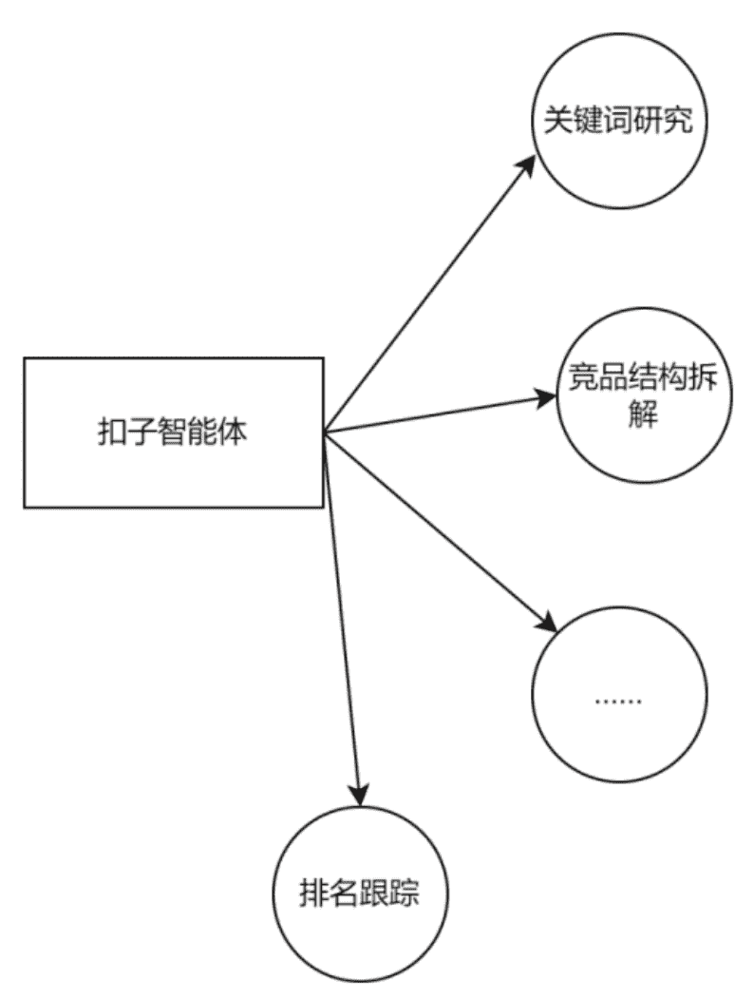

图8-7 扣子调用Skills库架构

为了打破孤岛效应，让Skills之间能够产生逻辑感知与协同，我们需要进行优化：在每个Skills的 SKILLS.md文件中引入相关技能（Related Skills）描述。这种做法相当于为每个Skills建立了关联索引，为智能体选择关联Skills提供一定的参考。

### 2. Skills的互相关联

以关键词研究Skills为例，可以在Skills.md文件的结尾添加如下内容。

```
## 相关Skills
```

- [竞品分析(competitor-analysis)] - 查看竞争对手排名的关键词
- [内容差距分析(content-gap-analysis)] - 找到缺失的关键词机会
- [SEO内容写作(seo-content-writer)] - 为目标关键词创建内容
- [AI引擎内容优化(geo-content-optimizer)] - 优化AI引用

当智能体解析到这些关联描述后，它将不再只是机械地执行单一任务。在后续的实战交互中，它能根据当前的研究进展合理地研判下一步动作。例如，在完成关键词挖掘后，它会自动感知是否需要进一步通过competitor-analysis穿透对手布局，或建议直接进入seo-content-writer生产环节。

### 8.3 扣子通用智能体秒变数字营销GEO与SEO专家

完成这些技能的部署后，本节将演示如何使用扣子智能体通过多Skills协同，完成一个研究报告的生成与监控任务。

#### 8.3.1 多Skills加载与测试

进入扣子对话页面后，点击输入框中的图标，即可在弹出的列表中看到已集成的全部Skills（见图8-8）。


图8-8 Skills列表

在单Skills场景下，我们习惯手动点击Skills列表中的名称指定对应Skills。但实际上，扣子智能体已将所有已部署Skills的 SKILLS.md 文件的原信息预加载至模型上下文中。这意味着，在多Skills场景下，无须逐一点击Skills名称、添加多个Skills，智能体可以自主判断并在后台调用最合适的工具。

例如，可以通过如下的简单问答，测试智能体对Skills的掌控情况。

在SEO和GEO（生成式引擎优化）领域，目前你有哪些技能可以调用？

如图8-9所示，智能体会列出全部Skills并给出功能概览。

> 在SEO和GEO（生成式引擎优化）领域，目前你有哪些Skills可以调用？

在SEO和GEO领域，我可以提供以下专业Skills支持：

### 一、核心SEO能力

1. 关键词研究：挖掘高价值关键词，进行意图分析、难度评估和机会映射，为内容策略提供数据支撑。
2. 页面SEO审计：全面分析标题、元描述、内容质量、内部链接、图像优化等关键元素，适用于发布前检查和排名诊断。
3. 技术SEO检查：审核网站速度、可爬取性、可索引性、移动友好性、安全性和结构化数据，识别技术层面的排名阻碍。
4. 反向链接分析：评估链接权威性，识别有毒链接，发现链接建设机会，监控竞争对手的链接获取策略。
5. 内部链接优化：分析和优化网站内部链接结构，改善网站架构，合理分配页面权威性。

### 二、GEO（生成式引擎优化）能力

1. 生成式引擎内容优化：调整内容以适配ChatGPT、Claude、Perplexity和Google AI概览等AI系统，增加被引用的机会。
2. 内容更新与翻新：识别过时内容，添加新信息和统计数据，恢复搜索排名，同时优化GEO适配性。

### 三、竞争分析与策略规划

1. **竞争对手分析**：深度剖析竞品的SEO和GEO策略，包括排名关键词、内容方法和AI引用模式，寻找超越机会。
2. **内容差距分析**：对比自身与竞品的内容差异，识别缺失主题和可定位关键词，规划内容策略。
3. **搜索引擎结果页面（SERP）分析**：理解排名因素、SERP功能和用户意图模式，为内容创作提供精准方向。

### 四、报告与监控能力

1. **性能报告生成**：整合排名、流量、反向链接和AI可见性指标，生成月度/季度SEO和GEO性能报告。
2. **关键词排名跟踪**：监控关键词排名随时间的变化，识别趋势并对重大变动发出警报。
3. **SEO警报管理**：设置和管理关键指标的警报，实现主动监控和快速响应问题。

### 五、内容创作与优化

1. **SEO内容写作**：创建高质量、SEO优化的博客文章、着陆页和产品描述，提升搜索引擎排名。
2. **元标签优化**：优化标题标签、元描述、Open Graph标签和Twitter卡片，最大化点击率和社交媒体分享参与度。
3. **结构化数据生成**：生成Schema.org JSON-LD标记，在搜索引擎中启用富结果展示。

图8-9 总结SEO与GEO的可以技能

注：由于我们是分拆部署，智能体会基于Skills的元数据描述进行自动归类，其分类方式与8.2节的理论划分略有不同，这属于大模型的语义聚类结果，不影响实际调用。

接下来，为确保复杂任务不遗漏关键步骤，建议采用先规划、后执行的策略，输入如下提示词。

如果我要写一篇2025年医疗行业AI应用落地情况报告，需要进行SEO和GEO的优化，你规划一下应该调用哪些Skills？

如图8-10所示，智能体会自动串联关键词研究等核心技能并输出方案。

- 隐藏步骤
  - 完成技能加载 关键词研究
  - 完成技能加载 SEO内容写作
  - 完成技能加载 AI引擎内容优化
  - 完成技能加载 Schema生成

### 《2025年医疗行业AI应用落地情况报告》SEO与GEO优化方案

### 一、整体策略规划

### 核心目标

1. SEO优化：在搜索引擎中获得高排名，吸引自然流量
2. GEO优化：增加被AI系统引用的机会，提升在AI生成响应中的可见性

图8-10 SEO/GEO优化方案

确认无误后，输入如下提示词。

请执行你设计的方案

扣子智能体会进行报告的撰写，如图8-11所示。

请执行你设计的方案

2025医疗AI应用落地及投资趋势

25 个来源

### 2025年医疗行业AI应用落地情况报告

### 一、引言

随着人工智能技术的快速发展，医疗行业正经历着前所未有的变革。2025年，医疗AI应用从试点阶段进入规模化落地期，成为解决医疗资源分配不均、提升诊疗效率、降低医疗成本的关键技术手段。本报告将全面分析2025年医疗AI应用的现状、案例、挑战与未来趋势。

### 二、政策环境与市场规模

### 2.1 政策支持

2025年10月，国家卫健委等五部门联合发布《关于促进和规范“人工智能+医疗卫生”应用发展的实施意见》，明确了医疗AI的发展目标和应用场景。政策覆盖医疗服务、基层公卫、健康产业、医学科研四大领域，推动AI医疗从“探索期”迈入“规范发展期”。

图8-11 报告撰写

#### 8.3.2 长期计划

报告发布后，SEO/GEO的真正工作才刚刚开始。为了持续跟踪内容的搜索排名与AI引用频率，需要利用扣子的“长期计划”功能，将智能体转换为一名7×24小时的“监控员”。

在扣子主页侧边栏点击“长期计划”中的“创建计划”，创建一个全新的长期计划，如图8-12所示。


(a)


(b)

### 图8-12 长期计划

此处，我们将8.3.1节生成的报告以附件形式进行上传，然后演示一下创建一个长期计划并使用排名跟踪Skills对其进行长期跟踪。

点击图标进行附件上传，点击图标进行Skills的加载，然后输入如下提示词，如图8-13所示。

请使用该Skills对该报告进行长期跟踪


图8-13 对医疗报告进行长期排名跟踪

点击图标发送后，会进入如图8-14所示的对话页面。

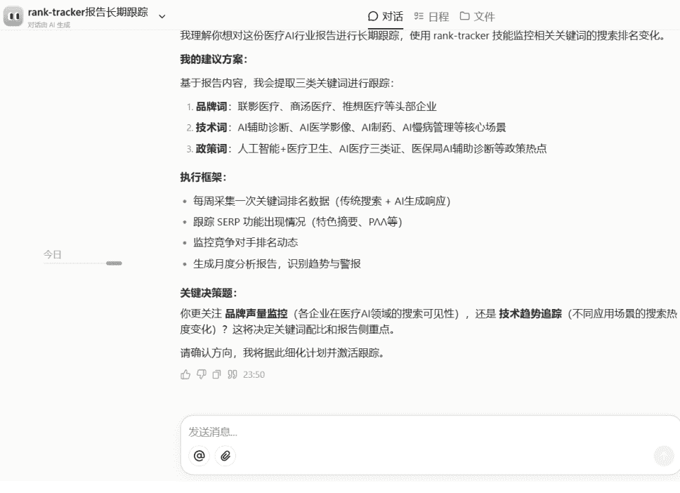

图8-14 长期计划对话页面

此时扣子智能体会根据提示词进行计划构建的方案设计。我们按照提示输入“技术趋势追踪”后，扣子智能体会完成计划的构建（见图8-15（a）），当我们点击图标后，该计划便会被激活（见图8-15（b））。


（a）

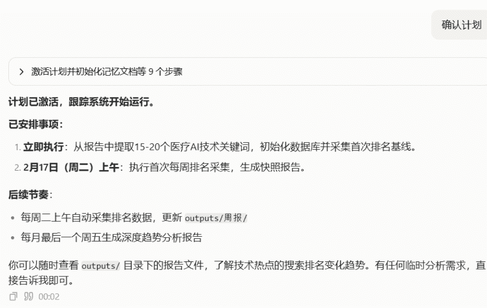

## 图8-15 激活计划

与普通对话相比，该页面左侧会多出一个写有“今日”的时间轴，用于标注执行内容的时间。在页面的上方还有“日程”标签，点击该标签后，会切换到日程页面（见图8-16）。

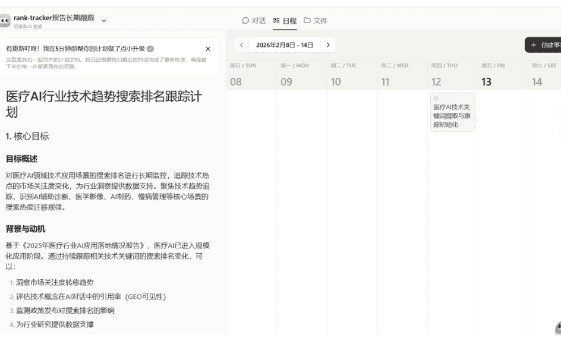

## 图8-16 日程

该页面可以像查看工作日历一样，精确追溯智能体每天执行了哪些审计工作、捕捉到了哪些数据波动。这种日历式管理将复杂的SEO监控变得透明且极具掌控感。

这样，通过普通对话实现内容的快速爆发，通过长期计划实现资产的持续增值，我们最终在扣子平台上实现了一套闭环的数字营销GEO与SEO工作流。

## 第五部分 OpenClaw部署与实战篇

## 第9章 OpenClaw：基于扣子的部署与Skills实战

前面的章节介绍了在扣子和扣子编程平台上开发各类 Skills 的方法，包括从纯文字交互SKills到多模态协同SKills，从单一SKills到复杂SKills矩阵的开发方法。但在企业级应用场景中，如何将这些 Skills 无缝接入现有业务系统，实现AI能力的规模化落地，是很多开发者和决策者面临的核心挑战。

OpenClaw创始人彼得·斯坦伯格（Peter Steinberger）在2026年年初的多次访谈中指出：OpenClaw的核心使命是将AI从聊天助手演变为连接真实世界的生产力工具。通过深度集成的工具与Skills，OpenClaw能够在被授权的情况下，控制个人计算机及服务器的操作系统，使其从单纯的问答助手演变为类似《钢铁侠》中贾维斯那样的AI助手。

OpenClaw自2026年年初发布以来，已迅速成为全球AI领域的现象级开源项目，其增长速度远超2025年年初DeepSeek的市场热度。据GitHub最新数据显示，OpenClaw在4个月的时间，就登顶最受欢迎开源软件榜首，成为欢迎度增长最快的项目。

这一技术现象的爆发式增长引发了硬件市场的连锁反应。作为低功耗、高性能的桌面设备，苹果公司的Mac mini台式计算机因适合24小时不间断运行AI工作负载的特性，意外成为OpenClaw部署的热门硬件。该机型在二手市场出现大幅溢价，甚至出现断货现象。

在商业层面，OpenClaw的生态效应显著。Kimi在推出免部署的OpenClaw能力后，仅用20天便实现收入超过2025年全年总收入，海外市场收入首次实现对国内市场的超越。这一现象印证了OpenClaw作为AI执行层基础设施的市场价值。


作为OpenClaw能力扩展的核心机制，Skills插件生态已成为开发者构建定制化AI应用的关键。通过Skills，开发者可以将OpenClaw无缝集成至各类工作流，实现从邮件处理、文档分析到自动化任务执行的全场景应用。本章将系统阐述基于扣子编程平台的OpenClaw部署流程，并深入解析Skills与OpenClaw的集成方法，为读者提供从基础部署到高级定制的完整技术路径，助力实现AI智能体的场景化落地。本章的配套视频可扫描右侧二维码观看。

### 9.1 OpenClaw重新定义AI执行范式

本节首先来认识一下OpenClaw这位数字员工，了解它有什么能力，以及能够应用在哪些场景。

#### 9.1.1 什么是OpenClaw

OpenClaw不是一个聊天机器人，而是一个AI助手。它与豆包、千问或者扣子的区别在于，可以在用户的PC、服务器上，解决真实的问题，如进行文件操作、使用浏览器、处理邮件、回复消息、调用扣子生成深度研究报告等。

此外，OpenClaw可以保持永远在线，并与微信、钉钉、飞书等即时通信软件进行绑定，使用户像与同事聊天一样控制其工作。这样当用户下班后，可以不再背计算机回家，而是直接在手机上继续指挥OpenClaw工作，例如，让OpenClaw继续制作PPT、处理邮件、整理周报、调用Claude Code编写代码等。

#### 9.1.2 应用场景：全方位覆盖自动化需求

OpenClaw的强大之处在于其Skills系统的扩展性，能够覆盖从个人生活到商业创业的全场景需求。

在生活中，OpenClaw可以扮演**个人生活管家**，完成以下工作。

- 信息过滤与推送：自动分类邮件、退订垃圾信息，根据天气和健康指标（联动穿戴设备）生成每日简报。
- 生活事务自动化：跨平台比价并预订行程、自动同步值机信息至日历、识别群聊需求并更新购物清单。
- 家庭自动化环境：远程控制智能家居，根据用户的疲劳程度自动调节灯光与温度，甚至基于冰箱库存推荐食谱并下单食材。

在职场中，OpenClaw可以充当**职场办公利器**，完成以下工作。

- 文档与行政处理：自动整理会议纪要、生成工作周报、批量重命名或归档服务器文件，极大地减少了重复性的复制粘贴工作。
- 团队协同加速：自动提取会议行动项并分发至相关负责人，在 Notion、Todoist、飞书等多个工具间实现数据实时同步，消除“信息孤岛”。
- 专业辅助：为开发者调试代码、为销售管理CRM客户关系、为创作者搜集素材并生成大纲。

对于“一人公司”的数字团队，对于创业者和自由职业者，OpenClaw可以充当**无须支付薪水的执行团队**。

- 客户服务自动化：自动识别咨询邮件、打标签并回复，在签单后自动调用模板生成电子合同、开具票据。
- 业务流程全闭环：仅需人工最终确认，OpenClaw即可完成从需求获取到交付归档的全流程操作，助力“一人公司”高效运转。

### 9.2 基于扣子编程的OpenClaw部署与使用全流程

在明确了OpenClaw的核心概念与应用价值后，本节进入实战阶段。本节将从环境部署入手，详细演示如何通过扣子编程平台部署OpenClaw，并将其接入飞书等办公生态，最终实现Skills的调用。

#### 9.2.1 部署方案的权衡与选择

在部署OpenClaw时，通常有如表9-1所示的三种方案。

**表9-1 部署方案**

| 部署方案 | 核心优势 | 主要劣势 | 适用人群 |
| :--- | :--- | :--- | :--- |
| 本地硬件部署 | 零成本、隐私性极高 | 存在误删本地文件风险、需保持设备24小时常开 | 技术背景用户、Mac mini用户 |
| 传统云服务器 | 环境独立、稳定性高 | 成本较高（数十至数百元每月）、需具备运维基础 | 企业用户、资深开发者 |
| 扣子沙盒环境 | 高性价比、环境隔离、操作极简 | 需开通扣子相应版本权限 | AI深度玩家、非技术背景用户 |

下面介绍三种部署方案的优点和痛点，帮助读者根据自己的实际情况作出选择。

（1）本地硬件部署。直接在个人笔记本电脑或台式计算机上部署和运行OpenClaw是最直接的选择。其优点在于无须额外支付租金，能够最大限度地利用现有硬件；而其痛点也比较明显。

- 部署具备一定的技术门槛，非技术背景的大众上手较困难，且不管是在部署过程中还是在后期使用过程中如果出现环境问题，都需要自行解决。
- 考虑到OpenClaw具备操作文件系统的权限，若指令存在误操作，可能面临本地关键文件被误删的风险。
- Agent的自动化任务往往需要长时间挂机，需要设备具备“常开不休眠、低能耗”的能力。

（2）传统云服务器方案。通过阿里云、腾讯云等厂商开通云服务器（ECS）或云桌面。其优点在于部分厂商云桌面已预安装OpenClaw，可以免部署直接使用，能够解决本地硬件部署的痛点问题。但这种方案存在如下两大问题。

- 依然需要自己解决OpenClaw运行中的问题。
- 租赁云服务器的费用相对较高（月均100元起），且涉及安全组配置、SSH 密钥管理等技术门槛，对未接触过云产品的大众不够友好。

（3）扣子沙盒环境部署。通过扣子编程提供的沙盒环境部署OpenClaw有如下优点。

- 用户无须自行购买和维护复杂的服务器架构。
- 沙盒环境是完全独立的，OpenClaw的任何操作仅限于沙盒内部，不必担心误伤宿主机系统。
- 截至2026年3月初，该功能仅面向扣子“个人高阶版”及以上用户开放。尽管存在包月费用（如高阶版首月49元），但用户不仅获得了稳定的OpenClaw部署环境，还能同时享受文生图无水印导出、更高频次的模型调用等权益。因此，对于深度使用扣子生态的用户而言，这无疑是性价比最高、上手最快的选择。
- 在使用OpenClaw的过程中，遇到的任何问题都可以发送给扣子编程，扣子编程后台的智能体将自动分析并解决问题。

因此，本章选择在扣子编程平台部署OpenClaw。

#### 9.2.2 在扣子编程沙盒中快速部署OpenClaw

本节将介绍如何利用扣子编程的沙盒环境完成OpenClaw的一键部署。

##### 1. 基于扣子编程的部署与通信架构

为了方便读者理解底层的通信逻辑，首先通过图9-1了解其核心架构。

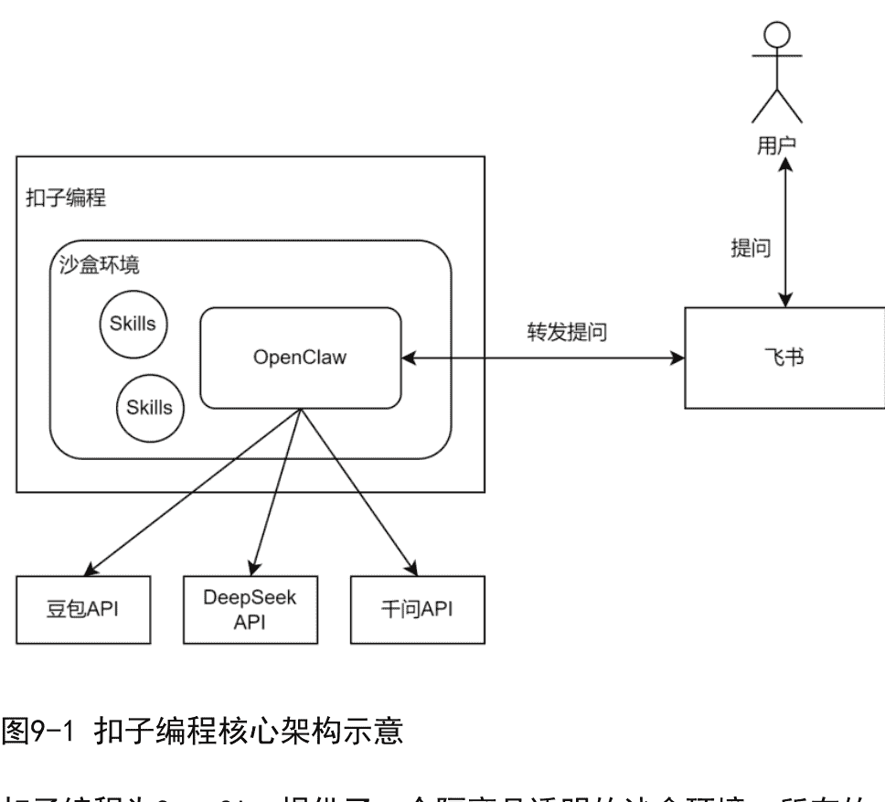

扣子编程为OpenClaw提供了一个隔离且透明的沙盒环境，所有的Skills都将安装并运行在这个环境内中，确保了执行的安全性和独立性。OpenClaw可无缝调用豆包、DeepSeek等主流大模型API作为决策中枢。此外，OpenClaw与飞书等办公软件建立实时连接进行转发提问，用户可以像与同事聊天一样发送提示词（Prompt），OpenClaw在处理完复杂的任务逻辑后，会将结果通过即时消息实时回传给用户。这样，用户通过手机即可控制OpenClaw进行工作，这也是OpenClaw的作者开发该项目时的初衷。

##### 2. 部署

接下来开始部署，部署的步骤主要分为在扣子编程上的部署，以及与飞书建立连接等几步。

在扣子编程主页开发对话框下方的“优秀案例”栏目中，可以看到排在首位的“OpenClaw项目部署”（见图9-2）。该模板已预集成了OpenClaw核心框架及联网搜索等常用内置Skills。


图9-2 优秀案例

将光标悬停在案例卡片上，点击出现的“创建副本”按钮（见图9-3（a））。在弹出的配置页面中（见图9-3（b）），可以根据个人偏好自定义“应用名称”和“应用介绍”。


（a）

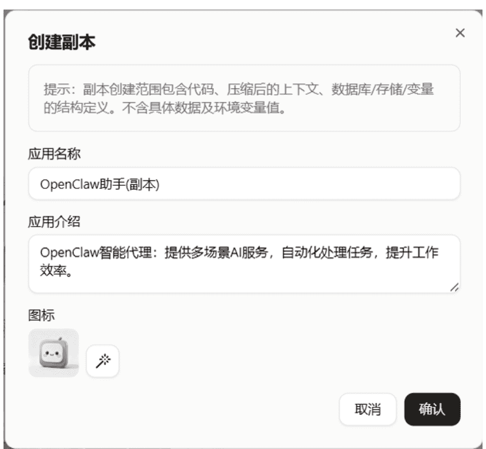

(b)

图9-3 部署OpenClaw

点击“确认”按钮后，系统会进行后台初始化。大约等待30s，页面将自动跳转至熟悉的扣子编程开发环境。如图9-4所示，可以在此查看开发过程，以及预览效果。

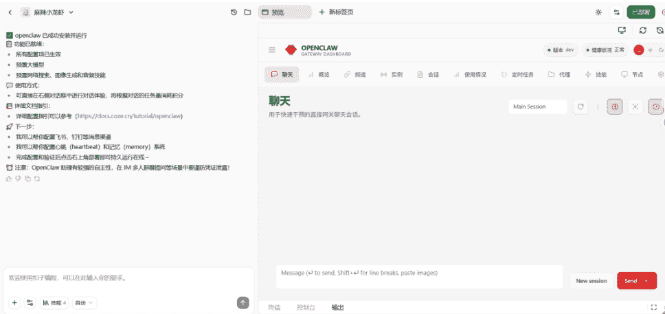

图9-4 OpenClaw开发与部署页面

部署完成后，最重要的一步是验证。在右侧预览区的对话框中输入“你好”，如果OpenClaw能够如预期般给出回应（见图9-5），说明已成功部署。


图9-5 测试OpenClaw是否可以使用

#### 9.2.3 深度集成：将OpenClaw接入飞书生态

虽然扣子编程提供了在线预览窗口，但为了让OpenClaw真正化身为可以被随时联系上的“数字员工”，需要将其接入办公通信工具。本节以飞书为例，演示如何进行接入。

##### 1. 创建企业自建应用

首先需要在飞书开放平台为OpenClaw申请一个“身份”。如图9-6所示，登录飞书开放平台，进入开发者后台。


图9-6 飞书开放平台

（1）创建企业自建应用。点击如图9-7（a）所示的“创建企业自建应用”按钮，弹出如图9-7（b）所示的页面，在其中填入应用名称（如“麻辣小龙虾”）和描述后点击“创建”按钮。


（a）


（b）

图9-7 创建企业自建应用

（2）添加机器人。创建完成后，进入如图9-8所示页面，先无须关注该页面上方的“应用发布后，当前配置方可生效”提醒，其用于完成所有配置后的版本发布。点击“机器人”卡片中的“添加”按钮，完成机器人能力的添加。


图9-8 添加机器人

（3）添加权限。进入如图9-9所示的“权限管理”界面，为了确保OpenClaw能读取消息并回复，需要批量导入权限。

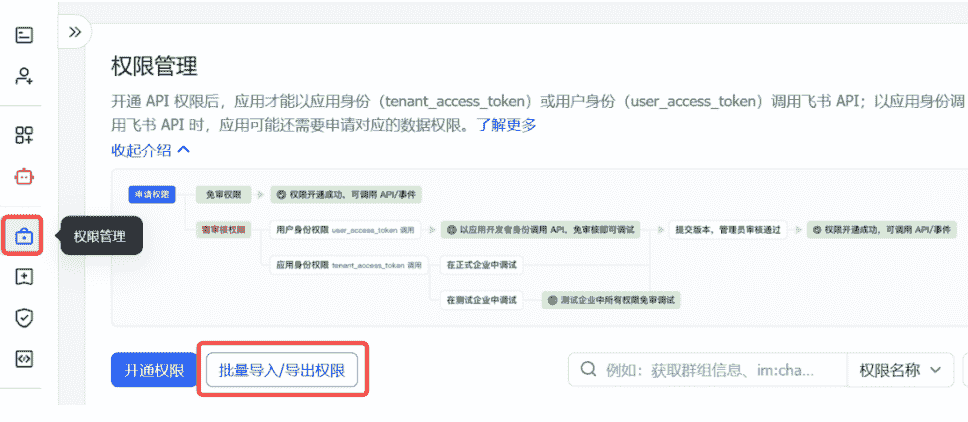

图9-9 权限管理

点击如图9-9所示的“批量导入/导出权限”按钮，进入如图9-10（a）所示的编辑页面。该页面会给出默认的示例权限配置代码。此时需要使用如下配置代码（来自扣子编程的官方文档，无须自行编写，也无须做任何修改，在本书配套资源中会提供）替换默认的示例代码，最后点击如图9-10（a）所示的“下一步，确认新增权限”按钮。

```json
{
    "scopes": {
        "tenant": [
            "im:chat:read",
            "im:chat:update",
            "im:message.group_at_msg:readonly",
            "im:message.p2p_msg:readonly",
            "im:message.pins:read",
            "im:message.pins:write_only",
            "im:message.reactions:read",
            "im:message.reactions:write_only",
            "im:message:readonly",
            "im:message:recall",
            "im:message:send_as_bot",
            "im:message:send_multi_users",
            "im:message:send_sys_msg",
            "im:message:update",
            "im:resource",
            "contact:contact.base:readonly"
        ],
        "user": [
            "contact:user.employee_id:readonly"
        ]
    }
}
```

点击如图9-10（b）所示的“申请开通”按钮，完成权限添加。


（a）

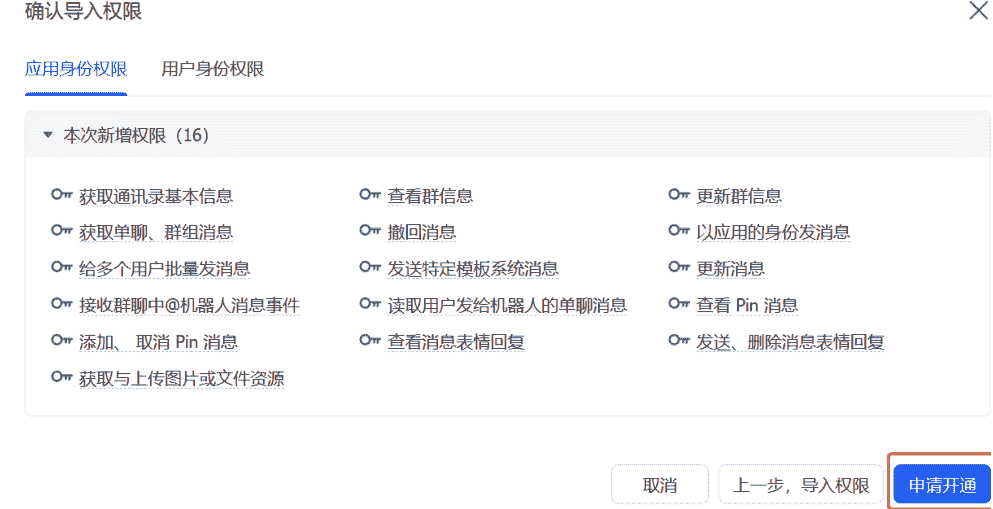

(b)

图9-10 权限添加

（4）发布应用。权限申请后，必须点击“应用发布后，当前配置方可生效”提醒后的“创建版本”，填写应用版本号（如1.0.0）和更新说明，然后保持移动端的默认能力和桌面端的默认能力为“机器人”不变（见图9-11），最后保存。只有在应用发布后，权限才会正式生效。


(a)


(b)

图9-11 创建版本

##### 2. 在OpenClaw中激活飞书渠道

将飞书应用的“密钥”告知OpenClaw，即可在OpenClaw中激活飞书渠道。

首先在“凭证与基础信息”页，记录下App ID和App Secret，如图9-12所示。


图9-12 凭证与基础信息

回到扣子编程的预览页面，直接向OpenClaw发送如下配置指令，如图9-13（a）所示。

```
帮我配置飞书渠道

App ID：{替换为你的飞书应用 App ID}

App Secret：{替换为你的飞书应用 App Secret}
```

将App ID与App Secret替换为如图9-12所示获取的信息。等待几分钟后，AI会返回如图9-13（b）所示回复，表示OpenClaw已经自动完成配置。

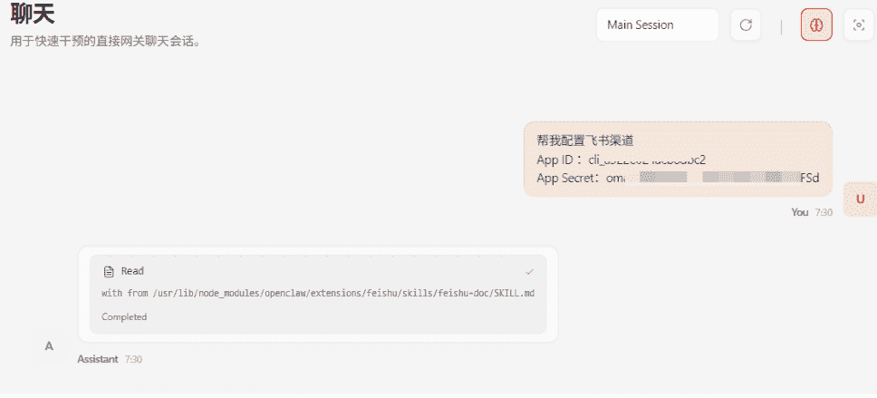

（a）


（b）

图9-13 向OpenClaw发送配置请求

##### 3. 配置事件监听与回调

为了让OpenClaw能够“听到”用户在飞书里说的话，需要建立通信隧道。

回到飞书开放平台的企业应用中，点击侧边栏方框中的按钮，进行事件与回调的配置，如图9-14所示。


图9-14 配置事件与回调

（1）配置事件。在“事件配置”选项卡中，订阅方式选择“使用长连接接收事件”单选按钮并点击“保存”按钮，如图9-15（a）所示。之后在下方已添加事件栏目右侧，点击“添加事件”按钮，如图9-15（b）所示。在弹出的页面中，搜索“接收消息”复选框，然后勾选“接收消息”，最后点击“确认添加”按钮，完成事件添加，如图9-15（c）所示。


（a）

## 已添加事件

| 事件名称 | 订阅类型 ⓘ | 所需权限（开通以下任一权限即可） | 操作 |
| :--- | :--- | :--- | :--- |
| 暂无数据 | | | |

（b）

## 添加事件

Q 接收消息

应用身份订阅(1) 用户身份订阅(0) 如何选择订阅类型?

- [x] 接收消息 v2.0
  - im.message.receive_v1
  - 用户发送新消息至机器人或群聊后推送事件

已选择 1 个事件

取消

（c）

## 图9-15 配置事件

若希望在群聊中通过@OpenClaw唤醒OpenClaw，需额外开通“获取群组中所有消息”的权限。点击黑框中的“获取群组中所有消息（敏感权限）”（见图9-16（a）），在弹出的页面中点击“开通权限”按钮（见图9-16（b））。

## 已添加事件

| 事件名称 | 订阅类型 | 所需权限（开通以下任一权限即可） | 操作 |
| :--- | :--- | :--- | :--- |
| 接收消息 v2.0<br>im.message.receive_v1 | 应用身份 | 读取用户发给机器人的单聊消息<br>接收群聊中@机器人消息事件<br>获取群组中所有消息（敏感权限） | 删除事件 |

（a）

（b）

## 图9-16 开通群聊权限

（2）回调配置。切换到“回调配置”选项卡，点击订阅方式后的图标（见图9-17（a）），然后在弹出的页面（见图9-17（b））中，直接点击“保存”按钮即可。

（a）

（b）

## 图9-17 回调配置

（3）创建版本。在完成本次配置后，依然需要点击“创建版本”（见图9-18），完成新版本的创建。

## 图9-18 创建版本

## 4. 完成双向配对与对话实战

最后一步是确认身份，确保OpenClaw只听命于你。

如图9-19所示，在飞书客户端的应用中心搜索已创建的应用名称（如“麻辣小龙虾”），点击“打开”，便可以在聊天列表中找到该应用。

（a）

(b)

(c)

## 图9-19 打开应用

在聊天窗口中发送一条消息，如发送“你好”，可以得到OpenClaw返回的配对码，如图9-20所示。

## 图9-20 进行配对

复制图9-20黑框中的配对码，然后回到扣子编程OpenClaw的预览页面（见图9-21），在对话框中粘贴该配对码，并发送。

## 图9-21 完成配对

如果没有问题，就可以直接在飞书中与OpenClaw进行对话了，如图9-22所示。

## 图9-22 在飞书中与OpenClaw对话

如果有问题，例如，在飞书发送消息后，没有回应，可以直接在扣子编程OpenClaw的开发对话框中输入具体问题，如“我现在在飞书发送消息，怎么得不到回应呢？”，如图9-23所示，扣子编程将会自动解决问题。

我现在在飞书发送消息，怎么得不到回复呢？

思考过程

让我先看看你发送的图片，了解具体的错误情况。

正在读取图片

思考过程

图片无法读取，不过没关系。让我通过查看日志和状态来排查飞书消息无响应的问题。

```
openclaw logs --follow --tail 50
```

思考过程

```
tail -n 100 /tmp/openclaw/openclaw-2026-03-05.log
```

思考过程

```
grep -i "error\|fail\|exception" /tmp/openclaw/openclaw-2026-03-05.log | tail -...
```

思考过程

```
grep "feishu\[default\]" /tmp/openclaw/openclaw-2026-03-05.log | grep -A 5 "...
```

思考过程

```
grep -i "pairing\|OpenClaw access" /tmp/openclaw/openclaw-2026-03-05.log | ...
```

思考过程

欢迎使用扣子编程，可以在此输入你的要求。

## 图9-23 扣子编程自动解决问题

### 9.3 基于OpenClaw添加与使用Skills

OpenClaw的强大不仅在于其框架本身，更在于其高度可扩展的Skills系统。除了内置的联网搜索、天气预报等基础Skills外，还可以通过自定义Skills扩展其专业能力边界。

#### 9.3.1 玩转内置Skills

在飞书中询问OpenClaw“介绍一下你目前具备的Skills技能”时，它会列出当前已启用的核心Skills（见图9-22）。

事实上，OpenClaw的技能库远比预想的丰富。在扣子编程OpenClaw的“预览”页面中，点击“技能”标签（见图9-24），可以看到WORKSPACE SKILLS、BUILT-IN SKILLS和EXTRA SKILLS这三类共计59项内置Skills。

## 图9-24 内置Skills

下面通过调用天气Skills进行实战测试。无须任何配置，直接在飞书中发送如下自然语言指令。

今天北京的天气怎么样？

等待片刻，OpenClaw会自动识别意图、调用天气Skills并返回精简后的天气信息，如图9-25所示。

## 图9-25 关于天气咨询的回复

#### 9.3.2 进阶实战：打造晚间短线封板股推荐助手

为了演示如何扩展OpenClaw的Skills能力，将第4章开发的股票技术分析Skills集成到OpenClaw中，实现一个每天20:00定时推送选股结果的自动化助手。

## 1. 上传自定义Skills

扣子编程支持直接解析Skills压缩包，并将其自动安装到OpenClaw。

将第4章的Skills文件夹打包为.zip格式，并在扣子编程的OpenClaw开发页面对话框中上传该文件，如图9-26所示。扣子编程会自动解压、识别依赖并将其安装到OpenClaw的运行环境内。安装成功后，系统会为该Skills起一个名字，如 stock-limit-up-screening。

stock-limit-up-screenin... 安装该技能

💡 思考过程

我来帮你安装这个股票涨停筛选技能。

```
执行命令 cd /tmp && curl -o stock-limit-up-screening.zip "https://code.coze.cn/api/san...
```

💡 思考过程

```
执行命令 cd /tmp && unzip -l stock-limit-up-screening.zip
```

💡 思考过程

```
执行命令 cd /tmp && unzip -o stock-limit-up-screening.zip
```

💡 思考过程

```
阅读文件 /tmp/stock-limit-up-screening/SKILL.md
```

💡 思考过程

```
阅读文件 /tmp/stock-limit-up-screening/scripts/fetch_limit_up_data.py
```

💡 思考过程

```
阅读文件 /tmp/stock-limit-up-screening/scripts/analyze_stocks.py
```

欢迎使用扣子编程，可以在此输入你的要求。

（a）

| 项目 | 状态 |
|---|---|
| 技能名称 | stock-limit-up-screening |
| 技能位置 | /workspace/projects/workspace/skills/stock-limit-up-screening/ |
| Python 依赖 | ✅ akshare, numpy, pandas 已安装 |
| Gateway | ✅ 已重启，技能已加载 |
| 技能总数 | 13 个 (新增 1 个) |

**技能功能：**

- 📊 获取指定交易日的沪深 A 股涨停股池数据
- 🔍 多维度筛选：成交额 > 1 亿、换手率 10%~20%、封板强度、板块热度
- 📈 识别短线强势封板股，辅助投资决策

**测试结果 (2026-03-04)：**

- 涨停股总数：44 只
- 筛选后结果：11 只符合条件的强势股
- 筛选条件：成交额、换手率、封板成交比、板块强度

**使用方式：** 在飞书中发送消息，例如：

- "帮我筛选今天的强势涨停股"
- "分析 2026-03-04 的涨停股池"
- "寻找换手率在 10%~20% 的涨停股票"

技能已成功集成到 OpenClaw，可以直接通过对话始用！

(b)

## 图9-26 上传外部Skills

## 2. 构建Cron定时任务

OpenClaw内置了对Cron定时器的支持。无须编写复杂的Python定时脚本，只需通过自然语言下达逻辑指令：

是否能基于stock-limit-up-screening Skills帮我实现在每个交易日的晚上20点，定时调用该Skills，抓取和筛选股票，然后把结果通过飞书推送给我

发送该提示词后，OpenClaw会自动解析Skills，并利用Cron配置定时任务，最后还会直接进行一轮测试，确保功能可用。具体开发过程如图9-27所示。

(a)

✅ 定时任务已重新配置完成！

📋 任务详情

| 项目 | 内容 |
| --- | --- |
| **任务 ID** | d18a7517-c38a-43f1-bbc6-7f0dd8be7e9e |
| **执行时间** | 每周一至周五 20:00（已排除周末） |
| **下次执行** | 约 7 小时后 |
| **超时时间** | 180 秒 |
| **执行目标** | main session |

🔄 执行流程

1. 获取当日涨停股票数据（通过 akshare）
2. 多维度筛选（成交额>1亿、封板成交比前25、换手率10%~20%、板块强度）
3. 结果推送到飞书私聊

（b）

📊 刚才的测试数据

刚才的测试已经成功筛选出 **6 只**符合条件的涨停股，消息已发送到你的飞书。你收到了吗？

如果测试数据是正确的，那说明整个流程已经跑通了。如果今天（2026-03-05）实际不是交易日，明天晚上20:00会自动再次执行。

（c）

## 图9-27 开发过程

## 3. 调试与问题修复

在开发过程中，可能会遇到异常。例如，如图9-27所示，由于编者是在交易日的中午而非晚上开发的，因此获取的数据并不准确，但这并不重要，重要的是图9-27（a）中的数据显示问题（板块显示为未分类、封板比显示为0.000）。

此时，可以通过与OpenClaw进行对话的方式，进行问题调试与修改。只需将报错信息或异常结果反馈给OpenClaw，并询问“为什么板块显示为未分类，封板比显示为0？”它会重新梳理Skills的能力、Cron定时脚本的参数和逻辑等，最后完成问题修复，如图9-28所示。

## 📊 2026-03-05 涨停股票筛选结果

共筛选出 4 只符合条件的强势涨停股：

1. 纬达光电 (920001) | 板块: 光学光电 | 封板比: 0.276 | 换手: 11.89%
2. 智能自控 (002877) | 板块: 通用设备 | 封板比: 0.256 | 换手: 15.28%
3. 雷曼光电 (300162) | 板块: 光学光电 | 封板比: 0.225 | 换手: 14.62%
4. 联建光电 (300269) | 板块: 光学光电 | 封板比: 0.218 | 换手: 14.49%

找到问题了！AKShare 返回的字段名称和脚本中使用的不一致：

问题找到了！换手率原始数据已经是百分比（如 1.166 表示 1.166%），不需要乘以 100：

## ✅ 问题已修复！

## 🔍 问题原因

AKShare 返回的字段名称与脚本中使用的名称不匹配：

| 脚本中的字段名 | AKShare 实际字段名 | 状态 |
|---|---|---|
| 行业 | 所属行业 | ❌ 未匹配 → 已修复 |
| 封单金额 | 封板资金 | ❌ 未匹配 → 已修复 |

## 图9-28 修复问题的过程

OpenClaw的出现，标志着智能体从“应用软件级”进化成了“操作系统级的工具”。它对行业的影响是颠覆性的，这正是各大技术厂商竞相布局OpenClaw的原因。

对于读者而言，习惯这种全新的交互方式至关重要。从今天起，无论是复杂的选股逻辑，还是咨询“附近的火锅店”，都可以尝试将所有AI需求交给飞书里的OpenClaw，让AI真正跑在后台，而你只需关注结果。