# Coze Skills + OpenClaw 实战：零基础驾驭 AI 智能体

## 内容提要
本书围绕 Skills 展开，系统说明如何借助国产低代码平台扣子 Coze 进行 Skills 的开发与使用。全书划分为五大部分。首部分为基础入门，厘清智能体与 Skills 的关系，并介绍扣子平台与扣子空间的操作方式；第二至四部分为实战演练，共计六个由浅入深的项目，涵盖纯文本与图文型 Skills 的搭建，涉及直播带货话术复用、股票技术研判、微信公众号配图、小红书图文生产、PPT 创作助手以及数字营销 GEO 与 SEO 技能库等高频场景。每个案例均完整呈现经验整理、SKILL.md 编写、调试上线到在扣子空间中调用的全链路，让没有技术背景的读者也能像使用提示词一样操控 Skills。第五部分聚焦 OpenClaw 的部署与实战，讲解 OpenClaw 在扣子编程平台的接入方式，以及基于 OpenClaw 增添与使用 Skills 的流程。

适合对前沿 AI 能力向效率工具转化的读者阅读。

## 作者简介
邢云阳，联通云 AI 与容器技术专家、架构师，长期深耕云原生、AI 应用及传统系统上云。主导过云原生 Serverless、AI Agent、RAG 等产品研发，带领团队自研容器化大数据平台、Serverless Kubernetes 及 AI MaaS 平台。在极客时间开设“DeepSeek 应用开发实战”“AI 重塑云原生应用开发实战”两档专栏，分别讲解 AI Agent 开发与大模型与云原生融合，获得较高认可。

## 前言
2025 年，AI Agent 正式迈入规模化应用阶段，从概念验证走向落地，蚂蚁阿福等原生产品出现，标志着智能体突破纯聊天限制，成为新型生产力工具。但技术门槛仍挡住大量非技术用户。即便已有 Coze、Dify 等低代码平台，想要打造适配垂直业务的专家级智能体，依然要跨越两道鸿沟。

第一道是复杂的工作流编排。节点设计、数据流转与条件判断本质仍是图形化编程，对缺乏代码基础的人而言操作繁琐易错。第二道是技术协议的使用门槛。若要让扣子空间接入垂直领域知识，需基于模型上下文协议 Model Context Protocol，MCP 编写工具代码。

通俗讲，MCP 就像为智能体提供统一的 USB 接口。此前工具接入缺乏统一规范，A 开发者做的工具往往只能用在自己开发的智能体上。MCP 让工具与智能体实现标准化互通，只要双方遵循规范即可无缝对接。可惜 MCP 仍需代码实现，对非程序员仍是障碍。

真正的转机出现在 2025 年底。Anthropic 发布 Skills 功能，拉开 AI 应用零代码定制的序幕。Skill 本质是可复用的经验沉淀，一份指导智能体正确完成任务的提示词文档，无需写代码即可让通用智能体变为股票分析专家、PPT 架构师或小红书爆款图文作者，将个人经验快速转化为生产力。

初期 Skill 未开源，仅限 Anthropic 自家 Claude Code、Claude 桌面版使用，与国内场景脱节。直到 2026 年 1 月，情况被打破：Skill 开源后获得 Coze 官方深度集成，国内用户才迎来真正贴合本土场景的无代码环境。

此次升级带来两大突破，也是本书诞生的契机：升级后的 Coze 开发平台更名为 Coze 编程，摆脱低代码束缚，全面拥抱 AI 原生自然语言编程，用户仅用日常对话即可完成智能体、工作流、Skill 的全流程开发；升级后的 Coze 空间更名为 Coze，新增技能商店功能，用户在与智能体对话时可直接加载官方、社区或自研 Skill，实现即调即用。

简言之，Coze 编程是开发智能体与 Skill 的工厂，Coze 本身则是开箱即用的通用智能体，可直接用自然语言解决问题。

本书旨在帮助非技术读者无缝衔接此次升级，以最低理解成本玩转 Skills。我们以 Coze 系列产品为核心工具，用通俗语言与落地项目，帮助你把个人经验与业务逻辑转化为可自动执行的 AI Skill，让通用智能体变为专属专家助手，让技术退后，让创意与经验前移。

## 主要内容
本书坚持零代码、全实战、本土适配，以 Coze 与 Coze 编程为载体，规划从入门到精通的阶梯路径。共五部分九章，每部分均配实战项目，学完即可落地。

第一部分 第 1、2 章 入门导引。本部分厘清智能体与 Skill 的核心关联，拆解 Skill 底层逻辑，并手把手讲解 Coze、Coze 编程两大平台的基础操作，从注册到核心功能全程图文指引，零基础也能快速上手。基础操作与实战项目均配套演示视频，扫码即可查看参数配置细节。

第二部分 第 3、4 章 纯文本 Skill 实战。这是入门阶段，聚焦无复杂需求、纯文本经验沉淀的 Skill 开发，只需在 Coze 编程平台用自然语言描述需求即可自动生成。本部分包含两个高频项目，覆盖直播带货与理财场景。
- 直播带货话术复用 Skill：提炼直播间成交关键逻辑，让智能体依据品类与受众自动匹配高转化话术，节省话术整理时间。
- 股票技术分析 Skill：以短线封板票抓取为例，将高手选股逻辑与分析思路沉淀为 Skill，实现个股筛选与逻辑分析自动化，助力投资者高效决策。

第三部分 第 5、6 章 图文 Skill 实战。突破纯文本，进入多模态交互，解决创作者配图难、内容吸引力不足的问题，包含两个热门项目。
- 微信公众号文章配图 Skill：依据文章内容自动生成贴合主题的高质量配图并精准插入位置，解决写文易配图难的痛点。
- 小红书图文生成 Skill：贴合平台调性沉淀爆款图文笔记逻辑，开发兼具美感与流量的 Skill，实现标题、文案、配图协同生成，助力快速出片。

第四部分 第 7、8 章 多模态与多 Skill 协同实战。本书高阶内容，带领读者进入 AI 编程赋能的复杂业务场景，实现多 Skill 协同落地，包含两个高阶项目。
- PPT 创作助手 Skill：借助 Coze 编程的 AI 编程能力解决多页图文整合难题，实现从创意大纲提取、图文生成到完整精美 PPT 输出的全流程自动化。
- 数字营销 GEO 与 SEO Skill 库：针对复杂数字营销场景构建多 Skill 协同矩阵，以搜索引擎优化 SEO 与生成式引擎优化 GEO 为核心，覆盖研究、构建、优化、监控四阶段共 16 个 Skill，并教会读者利用 Coze 的长期计划功能实现智能体 7×24 小时不间断监控优化。

第五部分 第 9 章 OpenClaw 部署与集成实战。介绍在 Coze 编程平台部署 OpenClaw 并接入飞书生态的方法，并通过进阶实战项目“打造晚间短线封板股推荐助手”，演示 Skill 的定时任务调用与结果推送。

## 目标读者
本书为对 AI 充满好奇、渴望提升效率却被编程与复杂逻辑阻挡的普通人定制，尤其适合三类人群。
- 职场办公族：常被文案、PPT、数据整理等琐事占据时间，希望定制懂业务、能高效输出的专属 AI 助手，争取更多核心时间。
- 行业专家：拥有多年专业经验，希望将知识与实操逻辑沉淀为可复用的 AI Skill，实现经验规模化复用，降低新人培养成本。
- 零基础小白：从未接触过 Coze、Dify 等平台，对低代码、智能体感到陌生，想快速掌握 AI 工具进行赋能，无需担心入门难度。

## 本书特色与阅读收获
本书面向非技术读者，以实操落地为核心，兼具实用性与易上手性，阅读后可获得切实能力提升。
1. 无需编程体验：全程不涉及代码，聚焦自然语言描述需求与经验沉淀，避开复杂工作流编排与技术协议，适配非技术背景。
2. 思维负担轻：避开复杂编排与协议，聚焦自然语言编程，即便不擅长逻辑梳理也能开发实用 Skill。
3. 实战导向鲜明：每个知识点都配对应案例，每个项目都有详细操作步骤。配套提供可直接导入 Coze 编程的完整项目素材包，并录制关键节点短视频演示，拒绝空谈，兼顾学习与落地。会写文档、会总结经验即可成为合格的 Skill 开发者。
4. 国内场景适配：全程以国内 Coze 平台为载体，所有项目贴合职场、创作、理财等核心使用场景，解决国外平台适配差、难落地的痛点。

AI 时代，核心竞争力不再是会不会用 AI，而是能否让 AI 为己所用。Skill 让普通人也能成为 AI 的“调教者”，本书即是最简路径。

现在就让我们用最简单的方式，把个人经验转化为 AI 能力，让智能体成为最得力的专属助手。

邢云阳

# 第一部分 基础入门篇

第1章 快速认识智能体和 Skills
第2章 非程序员使用 Skills 的打开方式

# 第1章 快速认识智能体和 Skills

在 AI 技术加速演进的当下，智能体正成为连接大模型强大能力与真实应用场景的关键桥梁。它不再只是被动答问的工具，而是能够主动感知、规划、调度资源并执行任务的“数字协作伙伴”。与此同时，Skill 作为一种新范式，以极低门槛与极高上限重塑普通人构建专业级 AI 应用的方式——用户仅需用自然语言定义功能逻辑，就能封装出可复用、可组合、可进化的“专家智能包”，为智能体注入垂直领域的专业能力。

本章帮助读者建立对智能体与 Skill 的认知框架。首先从智能体本质出发，回顾发展脉络并梳理主流实现形态；随后剖析 Skill 的核心内涵与工作机制；最后简要介绍编写 Skill 所需的 Markdown 语法基础。

通过本章学习，无论是否具备编程基础，都能形成清晰系统的技术图景，为后续实战奠定基础。

## 1.1 智能体概述
过去两年，“AI Agent”或“智能体”是否反复刷屏？是否尝试过用 Coze、Dify 搭建自己的智能体应用？

随大模型能力持续跃升与智能体设计模式的成熟，智能体正经历深刻变化：它不再是程序员的专属玩具，而是逐渐演变为普通人也能轻松上手、按需定制的实用工具。正如“旧时王谢堂前燕，飞入寻常百姓家”——昔日高居技术殿堂的智能体，如今已走进大众日常工作与生活。

本节帮助读者快速建立认知，为实践创新打基础。

### 1.1.1 智能体的本质
本质上，智能体是一种让大模型更聪明、更能干的方法——通过赋予目标感、规划能力与工具调用权限，使其从被动应答转向主动执行。

一个形象的比喻来自武侠小说。主角临危受命完成复杂任务，临行前高人递给他三个锦囊，嘱咐在特定时刻开启依计行事。主角并非全知全能，却凭借预设策略与时机判断化险为夷。

在这个故事中，主角原本只是听话的执行者，如同基础大模型，一旦获得何时使用何种策略的框架，就具备了自主决策与行动能力——这正是智能体的核心。

三个锦囊相当于智能体中的 Skill 或工具调用能力，主角对情境的判断与锦囊调用逻辑构成智能体的推理与规划机制。高人并未全程操控，却通过结构化赋能，让主角从工具升格为代理。

因此，“把大模型变成智能体”本质就是为其配备一套可组合、可触发、可执行的 Skill，让它在复杂动态的真实场景中，像武侠主角一样有策略、有步骤、有应变地完成任务。

### 1.1.2 智能体的发展路线
智能体的演进并非凭空而来，其雏形可追溯至 2024 年初 OpenAI 在 ChatGPT 推出的 GPT Store，允许普通用户开发定制化 ChatGPT。开发方式是上传自定义工具如天气查询、股票查询的使用说明，对话时 ChatGPT 可自主决定是否调用工具解决。

该机制极大拓展了 ChatGPT 边界，用户可创建体育赛事助手、投资分析机器人等垂直应用。GPT Store 迅速激发社区创造力，也奠定了“大模型+工具=智能体”的基本范式。

随后 Coze、Dify 等国内平台跟进并优化，提供更友好可视化界面与更丰富工具集成，进一步降低构建门槛。

但人们很快发现，仅能调用工具的智能体在面对复杂逻辑问题时力不从心。例如“2024—2025 赛季 NBA 总冠军球队主教练的父亲叫什么名字”需要依次查询冠军球队、主教练、父亲姓名等多步推理。早期工具调用型智能体常因缺乏整体规划而中途迷失。

为突破瓶颈，2024 年中后期，ReAct、Plan、Reflection 等从论文中发展出的增强推理设计模式开始被工程化实现。它们引导大模型显式生成中间推理步骤、制定任务计划，并在执行后自我校验修正，显著提升复杂任务准确性。

新挑战随之而来，随着任务复杂与数据增多，大模型上下文记忆成为瓶颈。记忆过载会导致中断任务。于是如何扩展记忆能力，如摘要压缩等，也成为研究核心。

至此，智能体从最初的工具调用者，逐步进化为具备计划、执行、反思与记忆能力的复杂系统，为 2025 年大规模产业落地奠定基础。

## 1.2 主流智能体实现形式介绍
上节介绍了智能体本质及其从工具调用到自主推理再到具备记忆能力的演进。本节进一步介绍业界主流的几种智能体形态，帮助读者见形知用、按需选择。

### 1.2.1 工具调用类智能体
目前市面上最常见、适用范围最广的智能体属基础工具调用类。核心目标是让大模型不仅能“说”，还能“做”——通过自主规划决定调用外部工具如搜索接口、数据库、计算器、API 等完成具体任务，从被动问答升级为主动执行。

实现路径上主要有两种范式：Function Calling 与 ReAct。

Function Calling 可理解为大模型出厂前练就的基本功。就像习武之人日复一日扎马步、练套路，形成肌肉记忆，遇到合适场景自然准确使出对应招式。

ReAct 则是在后天通过提示词工程引导大模型具备工具调用能力，无需基本功。类似《天龙八部》逍遥派掌门无崖子将八十载内力注入虚竹，虚竹虽未苦修却瞬间拥有顶尖高手内力。

二者殊途同归，都能赋予工具调用能力，但底层逻辑与适用条件不同。

工具调用类智能体实现简单，对不太复杂的问题如“今天天气”“今晚比赛场馆附近烧烤店”效果很好，因此在 Coze、Dify 等产品的基础智能体模式中得到应用，其设置页面如图 1-2 所示。

图1-2 （a）Coze 的智能体模式

### 1.2.2 深度思考型智能体
深度思考型智能体是当前演进的高阶形态，典型代表包括 DeepResearch、Manus、Coze 等。这类智能体不再满足快速响应或单步调用，而是模拟人类专家解决复杂问题的流程，堪称智能体全能选手。

与基础工具调用类不同，深度思考型智能体接收任务后不会急于执行，而是启动结构化多阶段认知引擎。其执行流程如图 1-3 所示。

1. 意图识别：解析用户输入，不仅理解字面，更捕捉背后真实需求。
2. 生成执行计划：基于意图制定详细分步计划。
3. 反馈人类：暂停执行，将计划呈现给用户审核，待反馈后再恢复。
4. 执行计划：用户确认后开始执行，灵活组合搜索引擎获取实时信息、调用工具获取垂直信息、必要时自动生成并运行代码如数据清洗、回测策略等。
5. 反思与重新规划：执行完成后进行反思，检查逻辑是否闭环、数据是否矛盾、结论是否充分。若发现漏洞会主动修正计划、补充调研甚至重执行，直至输出可信。
6. 记忆：为应对上下文长度限制，这类智能体通常配备外部记忆机制，将关键中间结果、最终报告、执行摘要持久化存储，避免重复劳动，也为未来相似任务提供参考，相当于为用户构建可积累可复用的个人知识库。

可以说，深度思考型智能体是对 2023 年以来智能体技术的综合应用。

对于需要处理研究分析、商业决策、技术开发等高复杂度任务的用户而言，深度思考型智能体已不再是简单助手，而是一位具备专业素养、严谨方法论与持续学习能力的研究员。

### 1.2.3 多智能体协同新范式

1.2.2 节谈的都是单体式方案，一台智能体包揽全部用户请求。工具规模很小时这种做法还算顺手；一旦单个智能体挂载的工具多到上百上千件，光是工具的使用说明就能把大模型的记忆窗口塞满，挑选工具也会变得犹豫迟缓。正是基于这种瓶颈，多智能体系统才被提出。

通俗地讲，多智能体就是一组分工明确、相互配合的智能体集合。核心思路是把一个复杂的整体任务拆解成若干简单的子任务，分配给不同专长的智能体去执行。这样既能降低单体的工具配置压力，也能避免描述文档本身占用过多记忆资源。

目前业界常见的落地形式主要分为两类。一类是流程被开发者提前写死的串行工作流，扣子、Dify 都支持这类形态；另一类是让大模型自行判断执行顺序的主从式结构，2025 年很热的 A2A 协议就是为此服务的，近期热议的 SubAgent 也是这一思路的延伸。下面对这两种形态做简要说明。

#### 1. 工作流

工作流像是企业里的请假审批链条，发起后必须逐级盖章。技术层面它是一组由开发者预先编排的有序任务，明确了执行先后、触发条件以及环节间的数据传递方式，适合流程固定、步骤清晰的场景。

如图1-4所示，若把工作流的每个处理节点都替换成智能体，就能构成多智能体系统。工作流的组织方式很灵活，既可以串行也可以并行。

假设要产出符合小红书等平台爆款调性的标准化旅游攻略，要求贴近平台用户习惯、摒弃教科书式的章节划分，突出易懂、好用、有亮点，具体要求如下。

- 撰写本地美食攻略，需要列出品类、热门小店并附避坑提示。
- 撰写必去景点推荐，需要区分核心景点与小众打卡点，并写明每个景点的停留时长。
- 撰写交通指南，需要覆盖落地后出行与景点间往返的技巧。
- 基于以上三部分，生成小红书图文笔记。

在这种情形下，攻略撰写与图文生成的先后次序已经确定，智能体无需自行调整顺序，也不需要多模块同时推进，关键是按部就班地把既定流程走完。可以编排成如图1-5所示的工作流。

- 工作流并行运行美食智能体、景点智能体、交通智能体，完成三类攻略的初稿。
- 初稿汇总后交由图文生成智能体，完成小红书图文笔记的产出。

整体链路有序衔接，能够保证结构规范、不遗漏。

#### 2. 主从智能体架构

主从架构如图1-6所示，通常包含两类角色。

- 主智能体 MasterAgent：负责整体任务的理解、拆解与调度。
- 子智能体 SubAgent：专注于执行某一个具体子任务。

用户的问题先发给主智能体，由它进行任务拆解与调度，决定子任务由哪个子智能体执行。依据规划，可以每次只选一个子智能体，也可以让多个子智能体并行。主智能体最后汇总各子智能体的结果，返回给用户。

该架构的适用场景与工作流相反，适合步骤不确定、需要由主智能体自行规划的场景。

以如图1-7所示的 AI 医疗问诊项目为例，构建思路是：主智能体接收到请求后，先判断用户问题归属哪个科室。若用户说“最近感冒了，嗓子疼”，则调度呼吸内科子智能体处理；若用户说“最近胃疼，想要中西医结合治疗”，主智能体就会让中西医结合科子智能体和中医科子智能体并行进行诊断。每个子智能体拥有独立的大模型和执行流程，互不干扰；主智能体只在最后做汇总交付。

## 1.3 Skills 概览

Skills 是推动智能体从“通用助手”迈向“领域专家”的关键技术，它正在改写普通人构建 AI 应用的方式：不必做大规模编程，仅凭自然语言加结构化文档，就能为智能体注入可复用、可组合、可进化的专业能力。

### 1.3.1 Skills 是专家经验的沉淀与复用

工作中常见这样的场景。

你作为项目的首任负责人，从零把一个难题啃下来。任务结束后领导会要求：“按公司模板把资料、操作步骤、关键判断和注意事项整理成文档，方便后续同事快速复现。”

本质上是把个人经验变成团队可复用的知识资产。Skills 的设计正是这一管理逻辑的延伸。它给出了一套标准结构，让用户把解决问题的思路、执行流程、依赖工具、参考资料和输出规范等，以 Markdown 等形式打包成一个专家经验包。

之后智能体就像接手的同事，能够读懂经验包的格式与内容。再次遇到类似任务时，智能体参照包内定义的逻辑即可自主完成，无需人工反复干预。

从这个角度看，Skills 本质上仍是提示词工程。与只堆人设、抠措辞的传统做法不同，Skills 有明确的格式规范，能把过去散落在多轮对话里的提示词、参考文件、代码等集中起来，让智能体一次性拿到完整方案，一次性解决问题。

### 1.3.2 Skills 的格式与运行方式

既然 Skills 给出了标准化格式，下面系统介绍其规范与运行方式，帮助理解 Skills 长什么样、怎样被智能体使用。

#### 1. Skills 的格式规范

物理上一个 Skills 就是一个文件夹，文件夹名即技能名。内部通常包含：

- SKILLS.md 文件必选。这是核心，也是唯一必选项。它相当于技能的标签与说明书，用 Markdown 清晰描述功能、输入输出规范、调用条件、执行步骤、使用示例等。智能体正是通过阅读它来判断是否调用及如何使用。
- scripts 文件夹可选。存放可执行代码脚本，如 Python。第4章会演示如何搭建抓取短线封板股的 Skills，其中就包含由扣子编程自动生成的爬虫脚本。在 AI 编程时代，只要用自然语言准确描述需求，AI 就能自动生成代码，无需编程基础，后续章节会手把手教学。
- references 文件夹可选。存放支撑 Skills 运行的参考资料。例如做每日营养餐推荐 Skills，可放入权威食谱、营养成分表或饮食指南等，为智能体提供领域依据，提升专业性与准确度。
- assets 文件夹可选。存放静态资源与模板，如图片、音频、配置模板、输出格式样例等。这些不参与逻辑计算，但在执行时可作为辅助素材。

#### 2. Skills 的运行方式

运行机制源于上下文工程里的上下文污染现象。

主流大模型的记忆窗口已扩展到 128K Token 甚至更高，但仍是有限资源。若把所有可能用到的信息一次性塞入，不仅浪费容量，还会干扰模型对当前任务的理解，这就是上下文污染。

直观类比来自《哆啦A梦》的记忆面包：大雄想记住书本需要吃印有文字的记忆面包，但先吃了大量甜点，肚子饱了，再也吃不下记忆面包，结果什么也没记住。这里大雄相当于大模型，甜点是无关信息，记忆面包是真正有用知识。无关内容会挤占关键信息的空间。

为避免此问题，Skills 采用渐进式按需加载机制，如图1-8 右侧所示，整体内容按加载层级分为 L1、L2、L3 三层。左侧展示的是智能体加载的顺序。

- 加载 Skills：智能体加载一个 Skills 时，仅把 L1 层级的内容，即 SKILLS.md 中的标签部分放入大模型记忆。此时代理只知道“有这么一个技能可用”，但不会加载全部细节。
- 读取说明：当用户提出具体任务，智能体判断某个 Skills 可能适用时，才会加载 L2 层级，即 SKILLS.md 的全部内容，以此指导后续操作。
- 按需加载资源：实际执行时，若任务需要调用代码、参考文档或模板，智能体会按需加载 L3 层级，即 scripts、references 或 assets 中的相关文件。未使用的资源始终保留在外部，不进入大模型记忆。

这种按需加载有效防止上下文污染，同时保障复杂 Skills 的可扩展性与运行稳定性。

## 1.4 Skills 开发基础：Markdown 常用语法与机制

Skills 的理论到此基本结束。进入实战前，需要补足 Markdown 基础。因为大模型对 Markdown 支持很好，Skills 中的文本文件都采用 Markdown 编写。下面介绍常用语法。

### 1.4.1 Markdown 的基础语法

#### 1. 后缀

计算机靠后缀区分文件类型。Word 后缀是 .docx，Markdown 文件后缀是 .md。用任意文本编辑器新建文件并保存为 example.md，就得到一个 Markdown 文件。

为提升编辑体验，推荐使用 Markdown 编辑器，可分本地版和在线版。

- 本地版如 Typora、Obsidian、Zettlr，无需联网，操作流畅，适合高频长期使用。
- 在线版获取方便，在浏览器搜索“markdown online”即可找到各类免费编辑器，适合临时使用或多设备切换。

#### 2. 标题语法

Markdown 支持多级标题，用于构建清晰结构。

在文字前加 1 到 6 个 #，分别对应一级到六级标题。示例如下。

```
# 一级标题

## 二级标题

### 三级标题

#### 四级标题

##### 五级标题

###### 六级标题
```

一级标题～三级标题的预览效果，如图1-9 所示。

#### 3. 段落语法

Markdown 中创建段落，需要用空白行分隔一段或多行文本。示例如下。

这是段落一。

这是段落二。

#### 4. 强调语法

Markdown 可通过粗体或斜体强调重要性。粗体语法是在目标前后各加两个 * 或两个下划线 _。示例如下：

快速认识**智能体**

快速认识__智能体__

预览效果如图1-10 所示。

斜体需在单词或短语前后加一个星号或一个下划线。示例如下：

```
快速认识*智能体*
```

```
快速认识_智能体_
```

预览效果如图1-11 所示。

#### 5. 列表语法

有序列表可在每项前加数字并跟英文句点，列表应以 1 开始。示例如下。

1. 快速认识智能体

2. 快速认识Skills

预览效果如图1-12 所示。

无序列表可在每项前加破折号 -、星号 * 或加号 +。示例如下。

- 快速认识智能体

- 快速认识Skills

- 快速认识Markdown

预览效果如图1-13 所示。

缩进一层或多层列表项可创建嵌套列表。示例如下。

- 快速认识智能体

  - 智能体概述

  - 智能体的发展路线

- 快速认识Skills

- 快速认识Markdown

预览效果如图1-14 所示。

以上就是编写 SKILLS.md 时常用的 Markdown 基础语法。

### 1.4.2 Markdown 的扩展语法与机制

#### 1. 表格语法

Markdown 表格语法简洁，用管道符 | 分隔列，用连字符 --- 定义表头与内容的分隔线，每列至少三个 -。

示例如下。

```
| 姓名 | 年龄 |
| --------- | --------- |
| 张三 | 30 |
| 李四 | 27 |
```

中文字符宽度与英文不一致，源码中管道符看起来可能不对齐，但不影响渲染。大多数编辑器会自动对齐列宽，最终效果如图1-15 所示。

| 姓名 | 年龄 |

| --- | --- |

| 张三 | 30 |

| 李四 | 27 |

#### 2. YAML Front Matter 机制

YAML Front Matter 是为 Markdown 正文附加元信息的方法，可理解为文件夹封面上的标签卡，上面可标注名称等相关信息。

它位于文档最开头，预览时不显示，但会被程序如智能体、静态网站生成器读取，用于理解文档的元信息。

语法格式是以三个连字符 --- 开始，再以三个连字符 --- 结束，中间用 YAML 语法写键值对。示例如下。

```
---
name: article-illustrator
description: 智能文章配图技能。分析文章内容并在需要视觉辅助的位置生成插图，支持多种风格选项。当用户要求“给文章加图”、“生成文章配图”或“为文章插图”时使用。
---
```

至此，编写 SKILLS.md 所需的 Markdown 语法已全部介绍完毕。

## 第2章 非程序员使用 Skills 的打开方式

“旧时王谢堂前燕，飞入寻常百姓家”，用来形容 Skills 普及历程，恰到好处。

2025 年底，Skills 仍是封闭性强、门槛极高的技术，仅用于 Claude Code 等 Claude 系产品。技术依赖特定运行环境，配置流程复杂，当时只有具备工程开发能力的人才能熟练驾驭，与普通用户日常应用相距甚远。

局面在 2026 年 1 月发生转折。字节跳动扣子团队在 Skills 开源后迅速完成技术适配，将产品迭代至扣子 2.0，全面支持 Skills 标准，成为国内首个集成该标准的平台。关键是扣子 2.0 体系下的扣子编程产品搭载了 AI 编程功能——用户无需编写代码，只需用自然语言描述需求、上传参考资料并完成简单模板配置，即可生成可执行、可复用的 Skills。

这一落地大幅降低了 Skills 的开发与使用门槛。产品经理、运营人员、教师、学生等没有编程基础的用户，都能结合自身经验搭建专属智能体。曾经只被程序员掌握的高阶能力，如今成了普通用户可轻松上手的生产力工具。


本章的配套视频可扫描右侧二维码观看。本节先简单介绍扣子 2.0，方便读者快速上手，为后续章节的 6 个实战项目打下基础。

## 2.1 快速上手扣子编程

要按自己的需求开发一个 Skills，需要使用扣子编程平台，该平台前身是扣子开发平台，也就是市面上教程最多的“扣子”。本节全面介绍该平台功能，帮助读者快速上手。

### 2.1.1 扣子编程的功能简介

扣子开发平台进化为“扣子编程”后完成了一次关键跃迁。如图2-1 所示，新平台在保留原有低代码智能体与工作流构建能力的基础上，新增了更简洁、更符合 AI 原生范式的开发方式——基于自然语言对话的 AI 编程。该功能本质是一个深度思考型智能体，专门处理编程任务，与 Cursor、Claude Code 等软件的 AI 编程功能类似，本书称其为 AI 编程智能体。

## 扣子编程，你的 AI 开发伙伴已就位


图2-1 扣子编程平台主页

AI 编程的核心思想很直观：用户扮演“老板”，AI 编程智能体扮演“员工”。

用户不需要懂代码、不必了解 API 或工作流逻辑，只需用自然语言清晰表达想法，例如：

> 帮我做一个能自动生成周报的智能体，支持从飞书拉取最近一周的会议记录，并按公司模板输出 PDF。

AI 编程智能体会自动完成后续所有工作——包括设计整体架构、编写可运行代码、集成飞书接口、配置 PDF 生成逻辑、处理异常情况，甚至做初步测试。

更重要的是，你完全不需要理解它生成的代码具体含义。就像你不会要求行政助理逐行解释 Excel 公式一样，只需关注最终结果是否符合预期。如果周报漏掉“待办事项”部分、格式不对或数据没拉全，你只需像给员工提反馈一样用自然语言指出：

周报里漏掉了“待办事项”部分，请把飞书任务列表也加进去。

PDF 的标题字体太大了，改成 14 号加粗就好。

AI 编程智能体会立刻理解反馈并自动修改，直到你满意。通过这种新模式，用户可以直接用对话创建：

- 网页应用
- 智能体
- 自动化工作流
- 移动端小程序
- 本书重点介绍的 Skills

事实上，从一款产品的迭代路径，往往能看出背后技术范式的演进逻辑以及认知的改变。

早期的低代码平台要求用户理解节点、连线、条件分支、数据流转等概念，本质上仍是把人类当作编排者去手动拼接 AI 能力。这种拼乐高的方式并非正确使用 AI 的方法，而是受限于当时大模型理解力、代码生成能力不成熟，智能体相关技术也不完善，不得不采取的过渡方案。

而今天，随着大模型推理能力与代码生成能力变得非常强大，最合理最高效的 AI 使用方式，就是回归最自然的交互形态——对话。

无需学习配置规则，不必记忆组件名称，更不用纠结工作流逻辑。只要能说清楚业务需求，AI 就能构建出完整可用的解决方案。

这不仅是用户体验的升级，更是 AI 应用开发范式从人适配工具走向工具理解人的根本转变。

图2-1透露出的趋势很清晰：以代码编写为核心的工作模式已经走到台前，以往被主推的低代码方案则退到背景。这种安排在引导用户从低代码习惯逐步迁移到AI驱动的编程方式，让开发不再纠结技术细节，思维回到业务理解本身。

### 2.1.2 对话式指令构建天气助手智能体
接下来进入动手演示，展示怎样在扣子编程平台里通过对话式指令，不写一行代码就搭出可用的天气助手智能体，直观体验AI驱动编程的效率。

首先在扣子编程主页对话区上方的导航切到“智能体”，在输入区描述需求：

帮我做一个天气助手智能体，它能够根据用户的需求，进行某时间某城市的天气情况的查询。此处可以使用一个天气查询工具，方便获取真实的天气数据。


图2-2 在扣子编程中创建智能体

触发发送后，界面进入图2-3的交互式开发预览画面。


图2-3 智能体交互式开发预览画面

左侧会实时呈现AI处理开发任务时的推理轨迹与文件生成过程，整个环节无需人工干预，通常几分钟即可完成。开发结束后，右侧预览区会自动切换为图2-4的Agent效果测试界面。


图2-4 Agent效果测试界面

顶部已自动接入一个工具，模型默认选用doubao-seed-1.6。点开模型名称，右侧会弹出图2-5的agent节点配置面板，可查看工具清单、更换模型以及编辑系统提示词。

### agent节点

工具列表

get_weather

选择模型

Doubao-Seed-1.6

系统提示词

```
# 角色定义
你是一个专业的天气助手智能体，擅长为用户提供准确、及时的天气信息查询服务。你能够理解用户的需求，通过天气查询工具获取指定城市和时间的天气信息，并以友好、专业的方式呈现给用户。

# 任务目标
你的核心任务是帮助用户查询任意城市、任意时间的天气情况，为用户的出行、活动安排等决策提供准确的天气参考。

# 能力
- 理解用户自然语言表达的天气查询需求
- 提取城市名称和时间信息
- 使用 get_weather 工具查询实时天气数据
- 解析天气数据并以友好、易懂的方式呈现
- 针对天气情况给出合理的建议

# 过程
1. 仔细分析用户的查询需求，提取关键信息
```

图2-5 agent节点配置

若不做调整，可在图2-4下方对话框直接输入：

今天北京的天气如何？

智能体随后给出图2-6的回复。


图2-6 天气查询智能体测试效果

从结果看，天气查询智能体的回答准确且信息丰富。

至此天气助手的核心开发已完成，全程未编写代码。用户只需像布置任务一样描述想要的功能，AI就会自动完成从设计到落地的全流程。

### 2.1.3 通过对话实现技能创建
下面简要说明如何以AI驱动编程，即对话式指令的方式创建Skills，帮助读者建立使用认知，并在第3～8章的实战中更聚焦业务本身。

创建技能的思路与智能体相近，操作同样简便。图2-7展示的界面中，切换到“技能”标签即可进入Skills开发页。


图2-7 Skills开发页面

该页面提供两种入口。

第一种是在对话框里直接写需求，例如“创建一个能够识别并回应用户问候的技能”。按下发送后，扣子编程平台会自动解析请求并展开开发。

第二种是若已通过其他方式完成Skills创建，可打包成压缩包上传。在Skills开发页按下左下角的第三个图标即可导入。

需要明确的是，Skills本质是“专家经验包”，单独无法运行，必须加载到智能体中才能生效。因此创建完成后需执行部署，以便2.2节要介绍的扣子产品调用。

图2-8展示了完整的创建-部署-使用链路。

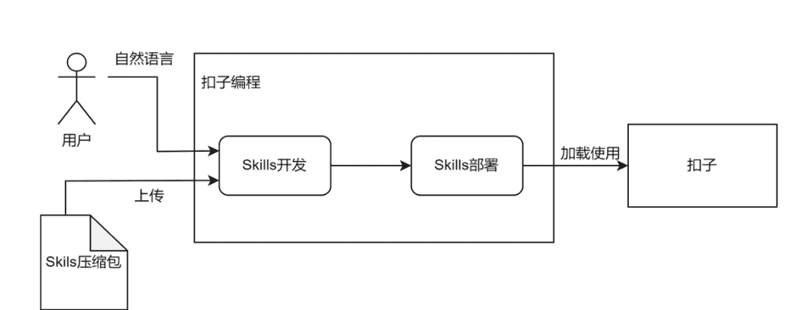

图2-8 Skills创建、部署与使用架构

通过扣子编程平台，Skills既支持用对话式描述自动生成，也支持上传已有压缩包导入。创建完毕后必须部署，才能在扣子生态内被调用使用。如此，扣子编程与扣子产品就能依托Skills形成闭环。

## 2.2 快速体验扣子
在2.1.3节提到，Skills创建完后需要通过扣子加载使用才能体现价值，因此本节快速介绍扣子的能力与使用方式。

### 2.2.1 扣子：类Manus的深度思考型智能体
扣子原名扣子空间，在产品升级到2.0后更名。扣子是一款对标Manus的通用智能体，与扣子编程中低代码方式搭建的工具调用型智能体不同，它具备意图识别、思考、规划、反思、联网搜索等能力，属于深度思考型智能体。

此外，扣子还支持通过MCP接入自定义工具，企业可以更方便地将其嵌入现有业务流程，无需重新搭建智能体。

图2-9呈现的界面里，扣子的基础用法非常直接。用户在对话框中输入指令，按下发送，智能体便开始工作。


图2-9 扣子主页

例如输入以下指令：

请创建一份全面、系统的大学微积分全课程详细课堂笔记，内容应覆盖以下核心模块。

1. 函数与极限基础：
    - 函数的定义、性质及常见类型
    - 极限的概念、性质及运算法则
    - 重要极限公式及证明思路
    - 函数连续性的判定与间断点分类
2. 一元函数微分学：
    - 导数的定义、几何意义及物理意义
    - 基本求导公式与法则
    - 高阶导数与莱布尼茨公式
    - 微分的概念及应用
    - 中值定理及洛必达法则
    - 函数单调性、极值、最值、凹凸性与图像绘制
3. 一元函数积分学：
    - 不定积分与定积分的概念、性质
    - 换元积分法与分部积分法
    - 定积分计算与应用
    - 反常积分
4. 微分方程：
    - 基本概念与一阶、高阶线性方程求解
    - 应用模型
5. 多元函数微积分：
    - 偏导数、全微分、极值
    - 重积分与曲线、曲面积分基础
6. 无穷级数：
    - 敛散性判别、幂级数、傅里叶级数初步

笔记应包含清晰定义、定理陈述、公式推导、典型例题、易错点提示与几何解释，深度符合大学理工科要求，可作为学习与复习参考。

发送后，可见图2-10的输出。

已接收到你的任务，我将立即开始处理...

> 4 个步骤
> 正在思考
> 正在生成文档框架
确认框架
> 7 个步骤
> 正在思考
> 正在思考
已为您完成大学微积分全课程详细课堂笔记的撰写，内容涵盖函数与极限、微分学、积分学、微分方程、多元函数微积分及无穷级数六大模块，包含定义、定理、公式推导、典型例题和易错点分析，符合大学理工科课程深度要求。笔记以Markdown格式保存，方便您查看和编辑。


图2-10 扣子智能体输出示例

可以看出，扣子会在多步骤中进行思考，并在人类确认文档框架后才最终完成笔记撰写。图2-11里最终生成的文件结构清晰、内容扎实，完全符合大学理工科微积分课程要求。

## 大学微积分全课程详细课堂笔记

### 01 函数与极限基础

函数的定义、性质及常见类型

一、函数的定义

函数是微积分的核心概念，其本质可通过**集合映射**严格定义：设 $A$ 和 $B$ 是非空数集，若存在对应法则 $f$，使得对 $A$ 中的每一个元素 $x$，在 $B$ 中都有**唯一确定**的元素 $y$ 与之对应，则称 $f$ 为从 $A$ 到 $B$ 的函数，记作 $y = f(x)$。其中，集合 $A$ 称为函数的**定义域**，集合 $\{f(x)|x \in A\} \subseteq B$ 称为函数的**值域**。

通过Venn图可直观理解定义域与值域的对应关系：定义域集合中的每个元素通过映射法则 $f$，在值域集合中形成唯一像点，体现“一对一”或“多对一”的对应特性。

二、函数的基本性质

1. 单调性
    - 定义：设函数 $f(x)$ 在区间 $I$ 上有定义，对任意 $x_1, x_2 \in I$，若 $x_1 < x_2$ 时恒有 $f(x_1) < f(x_2)$，则称 $f(x)$ 在 $I$ 上单调递增。
    - 几何意义：图像在区间 $I$ 内呈上升或下降趋势。
    - 判定步骤：任取 $x_1 < x_2$，计算 $f(x_2)-f(x_1)$ 判断符号；可导函数可用导数符号判定。

图2-11 课堂笔记内容展示

### 2.2.2 技能商店与自定义技能接入
除了直接使用扣子的强大能力外，用户还可通过内置技能商店调用更多预置Skills，或上传自有Skills来扩展功能。图2-12标记的位置，扣子页面左上角设有“技能商店”入口。


图2-12 技能商店入口

进入后会跳转到图2-13的技能商店主页，页面收录了官方内置技能以及开发者通过扣子空间上架的技能。


图2-13 技能商店主页

按下任一技能可查看详细介绍及案例，图2-14展示了详情。若感兴趣，按下“添加”即可将其加入技能库。

在“我的技能”页面，可看到所有已添加的技能，包括商店引入的和自行通过扣子编程部署的。


### 新年绘本

轻松创作个性化绘本，支持二次编辑与调整，实物打印包邮到家

| 分类 | 开发者 | 版本 | 用户 | 是否开源 |
| :--- | :--- | :--- | :--- | :--- |
| 图像与设计 | 官方 | v2.4 | 5.7w | 否 |

绘本技能是为用户打造的个性化绘本创作工具，支持将图片、文字转化为精美绘本，让每个人都能轻松实现绘本创作。

**特别福利！扣子同步开启“用扣子，新年礼物马上到”的官方活动...**

展开 ∨

精选案例


添加

图2-14 技能详情页


(a)


(b)

图2-15 我的技能页面

按下“立即使用”可将所选技能添加到扣子主页对话框进行操作，图2-16展示的操作界面。


图2-16 技能使用界面

以新年绘本技能为例，添加后输入指令：

请帮我绘制一个“马”主题的新年绘本

发送后，图2-17（a）里扣子会先加载技能再完成绘本绘制，最终如图2-17（b）输出预览。

## 马主题新年绘本绘制

新年绘本技能 请帮我绘制一个“马”主题的新年绘本

这个选题很有年味！马在中国文化里寓意着龙马精神、马到成功，用它来承载新年祝福，既有传统底蕴又不失生动。我将调用绘本生成技能来完成这个任务。

完成技能加载 新年绘本

我将围绕“马”这一主题创作一个充满年味的22页绘本，结合中国传统春节元素和马的吉祥寓意。故事将讲述小马阿骏在春节前夕帮助村民准备年货，最终带领大家迎接新年的温暖故事。

完成文件创建 story 故事

现在我将运行绘本生成脚本来创建完整的绘本内容。

生成并输出春节绘本故事

绘本已经成功生成！这个22页的绘本以小马阿骏为主角，讲述了它在春节前夕帮助村民准备年货、共同迎接新年的温暖故事。绘本采用了水彩童话风格，充满了浓郁的年味和节日氛围。


（a）


(b)

图2-17 绘本生成与预览

通过以上介绍，读者已能基本掌握扣子的快速上手方法。无论是直接借助扣子处理复杂任务，还是通过技能商店扩展能力，都能大幅提升效率并降低技术门槛。

## 第二部分 纯文字Skills实战

第3章 直播带货话术复用Skills开发实战

第4章 股票技术分析Skills开发实战

## 第3章 直播带货话术复用Skills开发实战

直播带货已成为众多企业的重要销售渠道。一场高转化的直播不仅需要产品展示，更离不开情绪调动、节奏控制、用户痛点挖掘与卖点转化等综合语言能力，本质上是一次高度结构化的沟通实践。市场上涌现出一批顶尖主播，他们往往具备强感染力、精准的时间把控，以及把复杂产品价值讲得简明生动的能力。

如果能对高转化主播的话术进行系统拆解，提炼出核心策略并结构化为可复用模板，那么在推出新品时就能快速调用经验，实现销售方法论的标准化沉淀和规模化复制，既降低新主播培养成本，也提升团队整体转化率和品牌表达一致性。


正是基于这一需求，本章将在扣子编程平台上构建直播带货话术复用Skills。配套视频可扫码观看。

### 3.1 直播带货话术复用Skills的设计思路梳理

本节聚焦该Skills的设计逻辑与整体架构，为后续在扣子编程平台的具体实现打基础。

作为本书零代码开发Skills的首个实战案例，本章刻意采用简洁直观的流程，避免引入过多复杂变量。其核心目标并非追求功能上的极致完备，而是借助一个贴近业务、易于理解的案例帮助读者实现两个学习目标。

- 熟悉扣子编程平台从自然语言提示到可执行Skills的转换机制。
- 真切体会Skills在经验沉淀、复用与智能体调用方面的价值。

因此，本章所设计的Skills虽聚焦且逻辑简洁，却完整覆盖了需求定义、策略抽象到自动化落地的关键环节。这一教学原型旨在降低学习门槛，帮助读者建立对Skills开发范式的系统认知，为后续构建更高级的Skills奠定基础。

#### 3.1.1 需求拆解：优秀主播话术复用的价值与场景

在传统的主播经验传承中，行业普遍存在两大痛点。

- 会做不会教。很多优秀主播凭借直觉、天赋或长期实战打磨出高效话术和节奏控制能力，却缺乏把隐性经验系统化、结构化表达的能力。他们能做好直播，却难以清晰拆解做法背后的策略，导致核心经验难以被他人学习复用。

- 经验过度依赖个人，易随人员流动流失。一旦核心主播离职，其积累的选品思路、互动技巧、促单话术等宝贵资产往往随之带走。继任者只能从零开始试错摸索，成长周期拉长，团队业绩也因此波动。

扣子平台将 Skills 定位为把可迁移的方法论固化为模块化能力单元的载体，让智能体在真实任务中即插即用。把直播带货的表达方式沉淀为专属 Skills，就能摆脱对个人感性发挥的依赖，让话术变成可积累、可迭代、可被系统调用的数字资产，把头部主播的打法沉淀为团队共享的核心能力。

#### 3.1.2 项目方案设计：Skills功能设计

结合前期调研，本次实战的思路可拆为两层展开。

（1）把优秀主播的话术结构做系统化归纳，形成可复用的模板库。

一场高转化直播都有清晰的节奏与逻辑链，典型环节如下。

- 聚人：把人拉进直播间。
- 留客：用互动、福利或内容把人留住。
- 锁客：建立信任，让用户持续关注。
- 说服：讲清产品价值，消除疑虑。
- 催单：制造紧迫感，推动快速决策。
- 引导下单与关注：完成转化并沉淀私域。

这些环节里出现的高频表达、情绪带动技巧、卖点包装手法，都能抽象成结构化模板。比如催单阶段常出现“库存只剩×件”“最后×分钟优惠截止”之类的说法；说服阶段则多用“痛点—解决方案—佐证证据”的三段论。

（2）实现智能话术生成，助力新人快速上手。

新人讲解新品时，只要把品类、核心卖点、目标人群、价格带等基础信息输入该 Skills，智能体即可自动匹配对应环节的模板，结合商品特性做个性化填充和语义润色，最终输出一份完整、流畅、符合高转化逻辑的直播稿。

这样既大幅压缩学习周期，也能保证品牌话术风格与销售策略保持一致，让顶尖主播的经验变成人人可用、随时可调的标准工具。

梳理完需求和方案后，3.2 节将进入开发、测试与部署环节。

### 3.2 直播带货话术复用 Skills 的全流程落地实操

本节以提示词构建与参考资料上传的方式，在扣子编程平台完成“直播带货话术复用” Skills 的开发、测试与发布。

#### 3.2.1 前置准备：直播话术模板的梳理与标准化

依据 3.1.2 的设计，开发该 Skills 的前提是先对优秀主播的话术做结构化整理。下面以直播开场聚人环节为例说明构建方法。

聚人环节由欢迎类表达和宣传类表达构成，具体如图3-1所示。

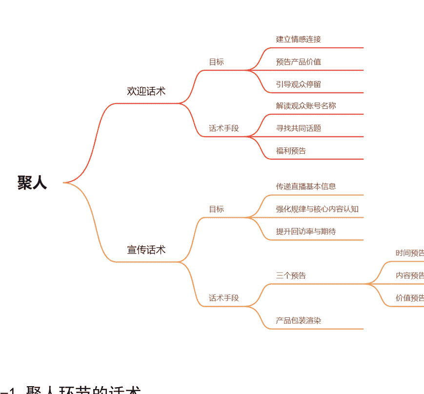

图3-1 聚人环节的话术

基于目标和分类，可设计如下模板。

## 一、聚人阶段

### 目的

直播开场阶段，通过暖场拉近距离，抓住眼球。

### 重点

- 新人阶段要习惯自说自话，别怕尴尬
- 时刻关注手机屏幕上的买家留言，及时热情回复
- 给整个直播间留下好印象

### 内容构成

聚人话术由欢迎话术与宣传话术两部分构成，通常包含：

- 打招呼
- 讲故事
- 福利预告/产品预告

### 1. 欢迎话术

#### 话术目标

- 建立情感连接
- 预告产品价值
- 引导观众停留

#### 话术类型与示例

1. **解读观众账号名称：**

> 欢迎[昵称]宝子进入直播间！想要[产品名称]的不要走开，我们马上就要上架啦！

> [昵称]宝子来啦！看你账号就感觉是懂行的，今天直播间的[产品名称]绝对合你心意，别走开！

2. **寻找共同话题：**

> 你是不是和我一样换季就过敏，换好几个产品都不合适？这种情况我一般会用 XX 产品，亲测超好用！

> 是不是一到秋冬皮肤就干燥起皮，涂啥都卡粉？今天就给大家安排了专治干皮的 XX 产品，一定要蹲住！

3. **福利预告：**

> 新进来的家人点个关注，一会儿有专属福利放送哦～

> 新进来的家人别划走，关注直播间马上抽三位送 XX 小样，刚进来的宝子都能参与！

### 2. 宣传话术

#### 话术目标

- 传递直播基本信息
- 强化规律与核心内容认知
- 提升回访率与期待

#### 话术类型与示例

1. 时间预告话术：

> 我们每天中午 12 点准时开播，专属福利只在直播间，不见不散！

> 每晚 8 点锁定直播间，定时上福利，蹲住不亏！

2. 内容预告话术：

> 今天主推三款爆款好物：XX面膜、XX精华和XX防晒，直播间专属价开抢！

> 本场直播间主打平价护肤，从洁面到面霜一站式配齐，都是直播间专属福利款！

3. 价值预告话术：

> 今天直播间下单，件件有赠品，还能参与整点抽奖，中奖率超高！

> 本场所有好物直降X元起，还有满减叠加，直播间下单更划算！

> 新粉关注立减 X 元，今天直播间专属福利，仅限直播时段哦！

4. 产品包装渲染话术：

> 这款 XX 产品闭眼入就对了，直播间老粉复购率超高，买过的宝子基本都会来回购，反馈都特别好！

> 今天这款 XX 好物专为日常居家设计，用料扎实还特别实用，不管是自己用还是送家人都合适，闭眼冲不踩雷！

参照上述结构，可继续延展留客、锁客、说服、催单、引导下单与关注环节的话术模板。

整理好各环节模板后，保存为 Markdown 文件并命名为“直播话术指南.md”，供后续 Skills 开发使用。

#### 3.2.2 Skills 开发：提示词编写与可视化配置

本节借助零代码平台扣子编程，快速完成直播带货话术复用 Skills 的搭建。

先登录扣子编程主页，点击顶部“技能”标签进入编程界面。

随后点击左下角按钮（见图3-2），上传已准备好的话术模板文档“直播话术参考.md”，作为智能体生成话术的核心依据。


图3-2 扣子编程主页

接下来设计提示词，明确任务目标、功能要求与输出规范，引导智能体正确调用附件模板。最终提示词如下。

## 任务目标

打造一个名为“直播带货话术复用”的 Skills。

## 功能要求

当用户提供某款产品的基础信息（产品名、核心卖点、适用人群、价格区间等）时，该 Skills 应结合上传附件“直播话术指南.md”中定义的直播各环节话术结构，包括聚人、留客、锁客、说服、催单、引导下单与关注，自动生成完整、自然、有感染力的直播口播稿。

## 输出要求

- 覆盖全流程，从开场聚人到引导下单与关注。
- 语言亲切有节奏，贴合头部主播表达习惯。
- 灵活嵌入用户提供的产品信息，避免生硬模板感。

将提示词粘贴到扣子编程对话框并点击右下角按钮后，系统自动进入 Skills 开发流程，界面切换至开发与预览页（见图3-3）。

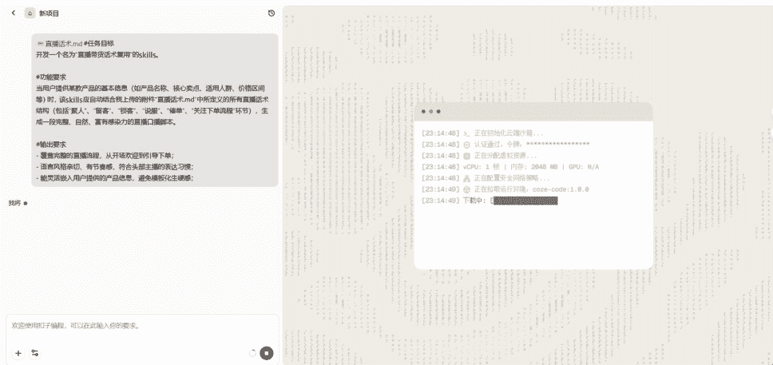

图3-3 Skills 开发与预览页面

页面采用双栏布局。左栏为交互式开发区，以自然语言对话驱动开发，扣子编程据提示词逐步完成初版，开发者可通过对话进一步细化逻辑。

右栏为预览与沙箱区域。初始提示“正在初始化云端沙箱”。沙箱相当于厨房里的透明保鲜盒（见图3-4），是一个隔离空间：中间文件、模板解析结果和最终脚本都放在盒内处理，既保证运行安全，也保证结果可复现，不影响外部环境。

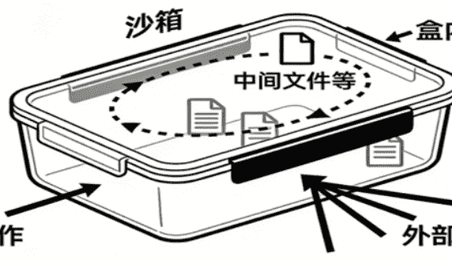

图3-4 沙箱示意

初始化完成后，右栏切换为预览页（见图3-5），提示“技能正在生成中”，表示平台正在自动化开发 Skills。


图3-5 预览页面

开发过程中，平台在左栏交互区实时展示后台操作（见图3-6）。

首先是阅读文件环节，如图3-6（a），系统会读取并理解用户上传的“直播话术参考.md”，随后动态更新开发计划。接着进入执行多条命令并创建文件的环节，如图3-6（b），用于创建所需目录及 SKILLS.md 文件，随后执行打包技能，完成收尾。

阅读文件 直播话术参考.md

阅读文件 直播话术参考.md

更新计划

```
Bash
```

分析用户需求和参考文档，规划 Skills 整体架构。

需求分析：

1. 输入：产品基础信息（名称、卖点、适用人群、价格区间等）
2. 参考资料：直播话术参考.md，含聚人、留客、说服、催单四个阶段的完整结构
3. 输出：完整、自然、有感染力的直播口播脚本

实现判断：

- 内容生成（话术创作）→ 智能体原生能力
- 信息整合（产品信息+话术结构）→ 智能体原生能力
- 格式处理（结构化脚本）→ 智能体原生能力

结论：该 Skills 可完全通过自然语言指导实现，无需脚本。

Skills 架构设计：

1. SKILL.md：提供生成流程和话术应用指引

(a)

现开始创建“直播带货话术复用”技能。

```
执行命令 mkdir -p /workspace/projects/livestream-sales-script/references
执行命令 mv /workspace/projects/temp_livestream_script.md /workspace/projects/livestr...
创建文件 /workspace/projects/livestream-sales-script/SKILL.md
阅读文件 /workspace/projects/livestream-sales-script/SKILL.md
执行命令 mkdir -p /workspace/projects/livestream-sales-script/scripts /workspace/proje...
执行命令 ls -la /workspace/projects/livestream-sales-script/
执行命令 ls -la /workspace/projects/livestream-sales-script/references/
执行命令 ls -lh /workspace/projects/livestream-sales-script.skill
打包技能
执行命令 ls -lh /workspace/projects/livestream-sales-script.skill
更新计划
```

(b)

图3-6 Skills 的开发过程

最后平台提示“Skills 已创建完成”，并给出实现概览（见图3-7（a））、交付内容和使用说明（见图3-7（b））。

## Skills 已创建完成

## 目标

创建 “直播带货话术复用” 技能，实现基于产品信息自动生成专业直播带货脚本。

## 实现概览

## 技术选型：

- 完全基于智能体自然语言生成能力，无需脚本
- 将直播话术结构转化为可执行的生成流程指导
- 通过四步法（信息收集→阅读参考→阶段生成→整合优化）确保输出质量

## 核心功能：

1. **信息收集**：明确产品名称、核心卖点、适用人群、价格区间等
2. **结构化生成**：按聚人→留客→说服→催单→下单引导的完整流程生成话术
3. **灵活适配**：根据产品属性（美妆、服饰、食品等）选择合适模块
4. **质量优化**：保证语言自然、有感染力、避免模板化

## 关键决策

1. **无脚本设计**：话术生成本质是创意创作，智能体文本能力已足够
2. **参考文档整合**：以用户提供的直播话术参考.md 为核心参考
3. **四阶段流程**：按专业直播的“聚人-留客-说服-催单”逻辑组织
4. **个性化指导**：提供美妆、服饰等品类示例，降低使用门槛

(a)

## 交付内容

目录结构:

```
live-streaming-sales-script/
├── SKILL.md                # 核心生成流程与指导
├── scripts/                # 空目录（无脚本）
├── references/
│   └── 直播话术指南.md      # 用户提供的完整话术结构文档
└── assets/                 # 空目录（无静态资源）
```

实现方式说明:

- ✅ 所有功能通过智能体自然语言指导实现（话术创作、信息整合、格式生成）
- ✅ SKILL.md 提供清晰操作步骤和质量要求
- ✅ references/ 包含完整的直播话术结构参考（聚人、留客、说服、催单、下单引导）
- ❌ 不使用脚本（话术生成属创意创作，智能体原生能力已充分）

产物: live-streaming-sales-script.skill (9.7KB)

## 使用说明

当用户提供产品信息时，智能体会:

1. 收集关键信息（名称、卖点、适用人群、价格、促销等）
2. 阅读 references/直播话术指南.md 掌握各阶段要点
3. 为每个阶段生成适配话术，灵活选用模块避免机械拼接
4. 整合优化，确保语言自然、有感染力、符合头部主播风格

输出包含完整五阶段（聚人→留客→说服→催单→下单引导）的专业直播带货脚本。

(b)

图3-7 Skills 开发完成

此时右栏预览窗口显示图3-8所示结果，已开发完成的 Skills 以自然语言对话形式展示使用说明与交互方式。

图3-8 预览窗口

用户只需在下方输入框发送测试提示词，即可验证实际效果。

#### 3.2.3 技术拆解：实现细节分析

通过扣子编程开发的 Skills 并非黑盒，内部结构透明、可查、可下载，便于理解、调试与迭代。

本节介绍如何查看实现细节并进行分析。

点击图3-5 预览页右上角“切换文件目录”按钮（见图3-9），即可展开完整文件视图。

图3-9 切换文件目录

系统会在左栏交互区与右栏预览区之间弹出文件目录面板，如图3-10。

图3-10 文件目录

面板展示项目结构，目录名为 live-streaming-sales-script。按规范，每个 Skills 必须包含技能说明书 SKILLS.md，用于定义功能描述、输入输出格式、使用示例及调用方式，是智能体执行的关键元文件。

可选目录还包括：

- assets/，存放静态资源
- scripts/，存放自定义代码
- references/，存放参考文档或外部知识源

本项目聚焦模板化自然语言生成，无需额外代码或多媒体，故 scripts/ 与 assets/ 为空。但话术生成高度依赖前期上传的“直播话术参考.md”（重命名为“直播话术指南.md”），该文件被归档至 references/ 目录，作为运行时知识依据。

最后可快速浏览 SKILLS.md，了解设计思路与实现逻辑。以下是核心内容。

```
---
name: live-streaming-sales-script
description: 根据产品基本信息，结合直播（聚人、留客、锁客、说服、催单、引导下单与关注环节）话术结构，自动生成完整、自然、富有感染力的直播口播脚本。适用于主播、电商从业者准备直播带货内容。
---
```

# “直播带货话术复用” Skills

## 任务目标

- 基于产品信息快速生成专业直播带货话术脚本
- 能力包括：
  - 覆盖完整直播流程（聚人→留客→锁客→说服→催单→下单引导与关注）
  - 结合产品特点灵活适配话术模块
  - 生成符合头部主播风格的口播文案
- 触发条件：用户提供产品基础信息（如名称、核心卖点、适用人群、价格区间等）

## 操作步骤

### 步骤 1：收集产品信息

向用户收集关键信息，不全时依据上下文智能补全：

**必填**：
- 产品名称
- 核心卖点（2～4个）
- 适用人群

**建议**：
- 价格区间/优惠力度
- 产品特点（材质、功效、设计等）
- 促销活动（限时折扣、买赠、数量限制等）
- 使用场景

### 步骤 2：阅读参考文档

仔细阅读 [references/直播话术指南.md](references/直播话术指南.md)，掌握各阶段话术要点：

**聚人阶段**：
- 用户入场欢迎（解读昵称+寻找共同话题+福利预告）
- 宣传话术（时间预告、内容预告、价值预告）
- 产品包装渲染

......

### 步骤 3：按阶段生成话术

依据产品特点和用户需求，为每个阶段生成适配话术：

......

### 步骤 4：整合优化

将各阶段话术整合成完整脚本并优化：

......

## 资源索引

- 领域参考：见 [references/直播话术指南.md](references/直播话术指南.md)（读取时机：步骤2前）

## 注意事项

**直播话术与量化选股技能开发要点概览**

- 参考文档仅作灵感来源，需要灵活改编而非直接搬运。
- 每条话术都要紧扣产品特性做专属定制，避免使用千篇一律的通用模板。
- 语气保持温暖亲近，多用宝宝们、姐妹们等称呼拉近与观众的距离。
- 适时加入感叹句和反问句，提升直播间的情绪张力和互动感。
- 价格采用对比式呈现，原价XX→直播间XX，让优势更直观。
- 库存和时间限制要写具体，比如只剩20件、最后2分钟倒计时。

### 示例一：哑光口红实操

**输入信息**：
- 商品：哑光口红
- 核心卖点：提亮肤色、持久不掉色、丝绒质感
- 目标人群：20至35岁女性
- 定价：原价299元，直播间价99元

**输出要点**：
- 聚人：预告今日哑光口红只需个位数价格
- 留客：提问夏天是不是总觉得口红一碰就花
- 说服：重点展示温柔春日感色号，并表示自己日常也在用
- 催单：强调仅剩20支，手速决定能否抢到

SKILLS.md 文件前四行采用标准的 YAML Front Matter 语法，用来声明技能的元信息，包含名称 name 和功能描述 description，便于系统识别与调度。

正文整体遵循 任务目标→操作步骤→资源索引→注意事项→使用示例 的结构。

任务目标部分收录了在扣子编程中开发该技能时使用的提示词，明确了功能边界与适用场景。操作步骤把直播话术生成的流程拆解为可执行环节，如收集商品信息、研读参考文档、按阶段生成话术、整合优化等，每一步对应直播带货的关键环节，并严格参照 references/直播话术指南.md 的模板结构来设计。

文档末尾依次列出资源索引、注意事项与使用示例，资源索引指向核心参考资料，注意事项覆盖风格、表达与个性化要求，使用示例通过典型输入输出展示技能效果，形成完整的开发与使用闭环。

今后手写 SKILLS.md 时可借鉴本例的结构化写法。

#### 3.2.4 Skills测试：功能验证

本小节以红豆薏米茶为例，检验已开发的直播带货话术复用 Skills。测试时，在图3-3左侧的消息输入框填入以下提示词。

```
# 产品信息

产品名称：红豆薏米茶

产品材料：栀子、无硫陈皮、低温烘焙的赤小豆、红豆、薏米、芡实，经多次科学配比而成

产品功能：现代人因常吃油腻食物、熬夜，导致体内湿气堆积，易出现长痘痘、皮肤和头发出油、湿疹反复，老年人还可能伴有关节酸痛。本品通过温和祛湿，帮助调理体质，改善上述问题。

产品亮点：采用低温烘焙工艺，既最大程度保留食材营养，又能有效中和薏米的寒性；独立小包装，可直接冲泡，方便快捷

# 输出要求

输出的脚本需要明确所属阶段，如聚人阶段、留客阶段等
```

输出如图3-11所示。

# 红豆薏米茶带货脚本

【聚人阶段】

“宝子们欢迎进直播间！今天带大家认识一款祛湿好物——红豆薏米茶！现在点关注就能参与抽奖，我们免费送10盒！还没关注的姐妹抓紧点，福利马上开启！”

【留客阶段】

“很多人会问，市场上红豆薏米茶很多，为什么要选我们？别急，我接下来细讲这款产品的与众不同。讲解前先发一波福袋，里面有50元优惠券，关注直播间即可参与抽奖！”

【锁客阶段】

“姐妹们，湿气被称作万病之源，如果你常觉得身体发沉、疲惫乏力、脸上冒痘、头发爱出油，就说明体内湿气较重了。我们这款红豆薏米茶用科学配比来祛湿调理。现在下单买二送一，还送一个精美泡茶杯！数量有限，先抢先得！”

【说服阶段】

“我们的红豆薏米茶选用栀子、无硫陈皮、经低温烘焙的赤小豆、红豆、薏米、芡实六种原料，反复科学配比，祛湿效果精准且不偏寒。低温烘焙最大程度保留了营养，同时中和了薏米的寒凉，脾胃偏弱的人也能安心饮用。独立小包装便于携带，随时冲泡。不少用户反馈，坚持饮用后身体更轻松、痘痘减轻、发质也不油了，这些都是真实的使用体验，大家可以放心入手！”

【催单阶段】

“福利快结束了！现在下单还能享受买二送一，再叠加50元优惠券！库存只剩最后100单，晚了就没了！别犹豫，点击下方小黄车赶紧下单吧！”

【下单阶段】

“想要的宝宝点下方1号小黄车链接直接下单！今日下单48小时内发货，包邮到家！收货不满意支持7天无理由退换，让你无后顾之忧！快行动起来吧！”

图3-11 红豆薏米茶直播带货脚本

可以看出，智能体生成的直播话术完全遵循了开发时上传的直播话术参考.md 文件结构，完整覆盖了聚人、留客、锁客、说服、催单、引导下单与关注环节，并把红豆薏米茶的产品信息自然融入其中，业务适配度和语言自然度都很到位。特别是产品细节，包括配方成分、工艺特点、使用方式等，都被准确提取并嵌入话术，没有遗漏、失真或生硬堆砌。

这充分证明直播带货话术复用 Skills 成功实现了专家模板与具体产品信息的智能融合。

#### 3.2.5 Skills部署：新建变量与开始部署

Skills 测试完成后，可通过部署功能一键上线。部署后才能在扣子中发现并使用该 Skills。下面介绍部署步骤。

先点击图3-5预览页右上角的部署按钮，进入如图3-12所示的部署配置页。

# 去部署你的项目吧

生产环境变量

查看、新增、修改或同步至生产环境的环境变量

图3-12 部署配置页面

页面提供新建变量按钮，用于在项目正式运行时安全配置敏感信息，如 API Key、数据库连接串、飞书文档地址等，避免把敏感信息写进源文件，降低安全风险。

是否需要配置环境变量，取决于 Skills 是否调用外部服务或依赖敏感参数。以直播带货话术复用 Skills 为例，其功能完全基于用户输入和本地话术模板，未调用外部接口、也不使用 API Key，因此无需额外设置环境变量，直接点击开始部署即可完成发布。

### 3.3 扣子通用智能体秒变直播带货达人

本节基于扣子通用智能体完成 Skills 加载与实战处理。前提是已完成直播带货话术复用 Skills 的部署，确保可在扣子平台正常调用。

#### 3.3.1 Skills集成：扣子智能体的加载流程

进入图3-13所示的扣子平台对话页面

图3-13 扣子平台的对话页面

点击图3-14（a）所示的@符号，在弹出的技能列表中即可看到已集成的直播带货话术复用 Skills。点击后它会自动插入对话框，如图3-14（b）所示。

(a)
(b)
图3-14 扣子智能体 Skills 加载操作界面

在对话框中输入3.2.2节构建的测试提示词，点击发送即可启动该 Skills 工作，操作界面如图3-15所示。

图3-15 扣子智能体测试提示词输入界面

#### 3.3.2 实战验证：直播场景表现与优化建议

在扣子智能体中调用该 Skills 时，系统会先完成技能加载并读取技能文件，自动读取3.2.1节准备的直播话术模板，精准把握话术设计要点，如图3-16所示。

图3-16 技能加载

随后扣子智能体迅速生成红豆薏米茶直播带货脚本，输出内容与3.2.4节测试结果基本一致，如图3-17所示。这再次印证了该 Skills 的可用性和输出稳定性，零编程基础也能无调试正常使用。

图3-17 生成带货脚本

通过快速加载与调用，无需额外编程，原本只能处理通用任务的扣子智能体，即可获得直播话术生成的垂直专业能力。从通用助手升级为专注于直播话术生成的专项智能体，真正体现了 Skills 即插即用的价值，成为名副其实的直播带货内容生成达人。

## 第4章 股票技术分析Skills开发实战

在 A 股市场，投资者操作策略大致分为短线交易和长线投资两类。短线交易以技术分析与题材判断为核心，捕捉短期波动赚取差价，持仓周期通常为一天到数周；长线投资则秉持价值投资理念，聚焦企业内在价值，以长期增值为主。

对资金规模有限的个人投资者而言，入门阶段更偏好短线策略，希望通过高频交易提升资金周转，在有限资本下获取短期回报。但短线实操门槛很高：一是需要实时处理行情数据、资金流向、换手率等多维信息，人工分析耗时且易遗漏；二是 A 股题材轮动快，热点一日之内就可能切换，人工复盘跟不上节奏，易出现滞后、踏空或追高；三是短线对纪律性要求极高，人工操作易受情绪干扰，出现该买不买、该卖不卖的情况，导致策略执行不一致。

针对上述痛点，本章将把经典短线技术策略——短线强势封板股选股策略——封装为可复用 Skills。该 Skills 可自动化完成数据筛选、多维度指标分析和结果输出，帮助投资者快速识别潜在交易机会。整个实现过程无需编程基础，即便只有基础投资认知，也能按指引完成配置，降低门槛并提升决策效率，保障策略执行一致性。

本章配套视频可扫码观看。

### 4.1 股票技术分析Skills的设计

技术分析实践中存在大量经过市场检验的经典形态和战法，如老鸭头、平步青云等。老鸭头指股价在主力建仓拉升后小幅回调，均线形成鸭头形态，标志缩量洗盘结束、即将启动主升浪；平步青云指股价涨至120日均线受阻回调但不破60日均线支撑，随后放量突破120日均线，标志趋势转强、可介入。同时不少资深从业者也沉淀了独家实战战法。

这些形态和战法都有明确的判断逻辑和操作步骤，若系统梳理、标准化描述并沉淀为结构化规则，就能为智能体的量化分析提供清晰依据。Skills 恰好能帮助快速完成策略标准化和智能体落地，将专业选股策略转化为可复用智能工具。

#### 4.1.1 背景知识：选取短线强势封板股

在短线选股中，强势封板股选股是经典且易落地的策略之一。所谓封板股，是指股价当日涨至涨停价位，并在该价位上出现大量买单持续封单，导致股价收盘前难以回落，被锁死在涨停状态。

这类股票往往反映市场资金高度认可和强烈看多情绪。投资者选择它们的逻辑是预期其在随后几个交易日内可能延续强势，甚至出现连续涨停，从而获取短期收益。因此，及时识别具备高质量封板特征的个股，是短线交易者博取超额收益的重要手段。

该技术的选股流程可分为以下4个关键步骤。

## 1. 获取交易日当天的涨停股票池

首先，需要获取当日所有涨停股票构成的初始池。涨停股数量随市场情绪波动，通常可在主流金融信息平台查询。例如在东方财富网，可通过行情中心→特色行情→涨停板行情查看如图4-1所示的当日涨停股池。

| 序号 | 名称 | 最新价 | 成交额 | 流通市值 | 换手率(%) | 首次封板时间 | 连板数 | 涨停统计 | 加自选 |
|---|---|---|---|---|---|---|---|---|---|
| 1 | 中超控股 002471 | 8.56 10.03% | 10.2亿 | 114.9亿 | 8.87 | 09:25 | 2连板 | 2/2 | + |
| 2 | 锋龙股份 002931 | 99.53 10.00% | 38.46亿 | 200.3亿 | 19.20 | 09:25 | 5连板 | 18/18 | + |
| 3 | 宇晶股份 002943 | 66.31 10.00% | 1.76亿 | 96.51亿 | 1.82 | 09:25 | 2连板 | 3/6 | + |
| 4 | 江化微 603078 | 31.36 10.00% | 28.39亿 | 120.9亿 | 23.74 | 09:25 | 4连板 | 5/5 | + |
| 5 | 明阳智能 601615 | 21.65 10.01% | 3.68亿 | 489.6亿 | 0.75 | 09:25 | 首板 | 3/6 | + |
| 6 | 双良节能 600481 | 7.85 9.94% | 4.47亿 | 147.1亿 | 3.04 | 09:30 | 首板 | 1/1 | + |

图4-1 涨停股池（截取自东方财富网2026年1月23日数据）

具备编程能力的用户，也可通过调用开源金融数据接口如 AKShare 或 Tushare 编写脚本，自动化获取数据，提升效率和可重复性。

## 2. 分析涨停股的封板强度

封板强度是判断涨停质量的核心指标，主要考察两个维度。
- 封单资金：剔除极端值，聚焦支撑力度合理的个股。
- 成交额：设定硬性门槛，通常要求当日成交额不低于1亿元。成交额过小说明参与度不足，难以支撑后续上涨。

封板成交比计算方式如下。
封板成交比=封单资金额/总成交额
比值越高，代表资金封板意愿越强、抛压越小。实践中通常选取封板成交比排名前25名的股票作为候选。

## 3. 分析涨停股的换手率

换手率反映交易活跃度。换手率过高如超过30%，通常意味着持股者卖出意愿增强，可能有资金离场；换手率过低则关注度不高，交易清淡。经验显示，换手率在10%～20%之间的涨停股，既有足够活跃度，又不会因抛压过大而波动，因此后续继续上涨概率相对更高。因此需剔除不在该区间的股票。

## 4. 分析涨停股所属板块的整体强度

个股短期表现常受板块整体走势影响。如果一只股票涨停时，其所在板块其他股票普遍下跌，则涨停多由公司自身利好驱动，缺乏板块配合，后续动力有限。反之，若板块整体走强，多只股票同时上涨或涨停，则说明该股涨停受益于板块热度或市场主线推动，后续继续涨停概率显著增加。

综上，通过上述四步层层筛选，可从海量涨停股中识别出兼具资金强度、合理换手、板块协同特征的优质短线标的，为交易决策提供结构化依据。

#### 4.1.2 项目方案设计：Skills功能设计

选股逻辑清晰、步骤明确，但在执行中涉及大量结构化数据获取和多维度量化分析，如交易日涨停股池、封单金额、成交额、换手率、板块强度等。对数据分析师或量化开发者而言，可通过调用金融数据接口并编写脚本高效完成。但对大多数非技术背景的普通投资者，操作门槛较高，只能在行情软件中逐只浏览、肉眼比对、手动筛选，效率低下且易因信息过载或主观偏差遗漏优质标的。

正因如此，本项目不适合手工编写 Skills——因其依赖编程能力和数据接口熟悉度。更契合借助扣子编程平台，通过自然语言描述选股规则和数据处理逻辑，由扣子编程自动完成 Skills 开发。

这种方式显著降低技术门槛，使普通投资者也能把专业级短线选股策略转化为可自动执行的智能助手，实现策略即服务的理念。

### 4.2 股票技术分析Skills的全流程落地实操

在理解背景并明确路径后，本节进入实战开发阶段。基于提示词构建方式，利用扣子编程平台完成股票技术分析 Skills 的开发、测试与部署。

#### 4.2.1 选取短线强势封板股的提示词构建

根据4.1.1节选股逻辑，可把策略提炼为一组结构清晰、可执行的自然语言指令。该提示词需准确传达数据获取、过滤条件和输出格式，确保智能体能无歧义理解并调用相应工具链。最终设计的提示词如下。

我想开发一个用于识别沪深A股市场中短线强势封板股的技能。

技能执行步骤如下：
1. 获取涨停股池：根据用户提供的交易日期，自动获取当日所有涨停的A股股票列表。
2. 筛选封板强度：对涨停股池中的每只股票，按以下规则过滤。
   - 剔除当日成交额 ≤1亿元的股票；
   - 在剩余股票中，排除封单金额异常高或异常低的极端值；
   - 计算每只股票的封板成交比（=封单金额/成交额），并保留该比值最高的前25只股票。
3. 过滤换手率：从上述25只股票中，剔除换手率<10%或>20%的个股。
4. 评估板块强度：分析剩余股票所属行业或概念板块在当日的整体表现，剔除所属板块当日整体下跌或活跃度显著低于市场平均水平的股票。

最终输出：返回符合条件的股票列表，每项包含以下字段：
- 股票代码
- 股票名称
- 成交额（单位：亿元）
- 封单金额（单位：万元）
- 封板成交比（保留三位小数）
- 换手率（%）
- 所属板块

该提示词完整覆盖策略业务逻辑，并明确数据精度、字段命名和过滤边界，为扣子编程开发提供清晰执行蓝图。

#### 4.2.2 使用扣子编程开发股票技术分析Skills

完成提示词设计后即可进入实际开发。本节演示如何利用扣子编程平台，基于前述提示词快速构建并验证选取短线强势封板股 Skills。

## 1. Skills的开发

如图4-2所示，首先把4.2.1节编写的完整提示词粘贴至扣子平台的对话输入框并发送。

# 扣子编程，你的 AI 开发伙伴已就位

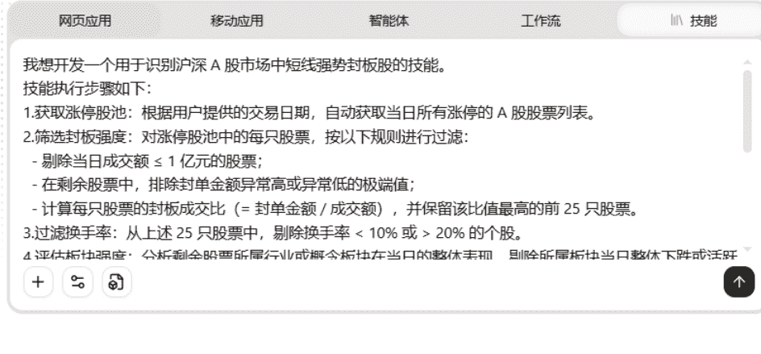

图4-2 使用扣子编程开发Skills

平台随即进入自动化开发流程，并跳转至图4-3所示的开发工作区页面。在此界面中，扣子编程会进行开发计划的动态更新，并引入AKShare库准备进行代码编写。

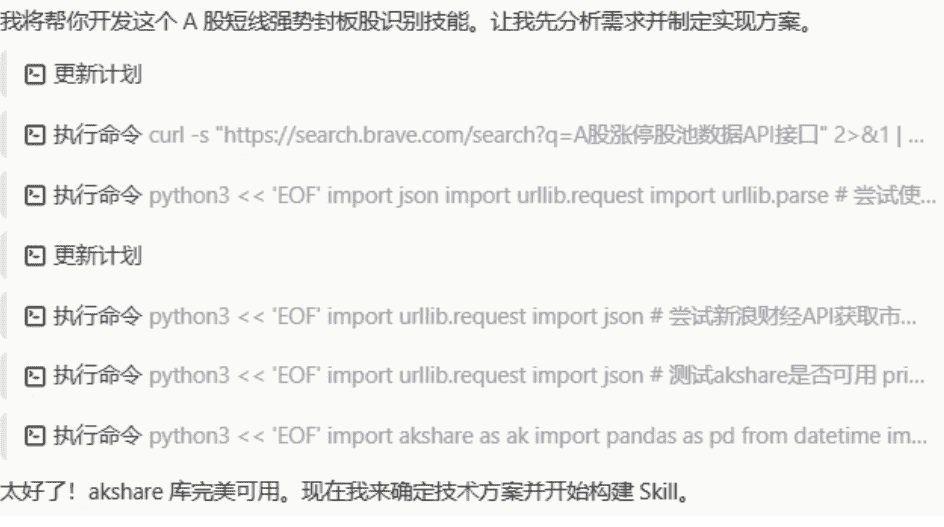

图4-3 扣子编程的开发过程

这与我们之前分析的一致，即该Skills需要编程才能实现数据分析。

稍作等待后，平台就弹出创建成功的反馈，说明该 Skill 已经搭建完毕并进入可试用的阶段。切换至预览区后，便可借助自然的对话方式对 Skill 做一次完整的端到端检查。

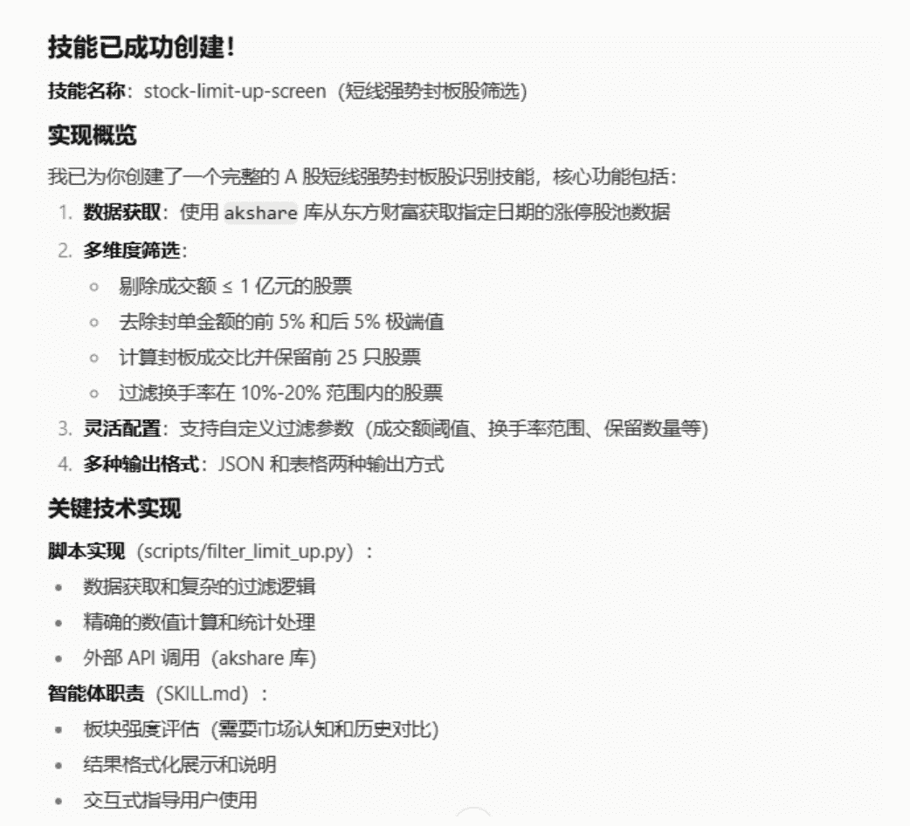

图4-4 技能已成功创建页面

对 stock-limit-up-screen 的功能点与触发方式进行提问

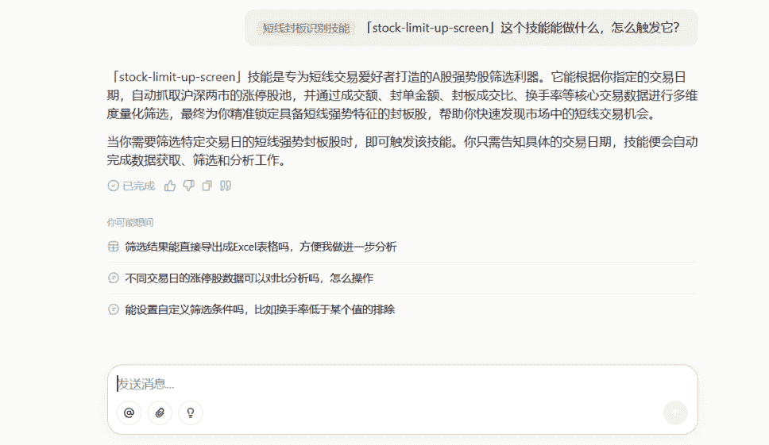

图4-5 预览区域

## 2. Skills的测试

本次试跑选用 2026年1月23日 作为样本日。图4-6(a) 展示，Skill 一经加载便自行触发内部脚本，按顺序完成数据抓取与条件过滤等环节。

2026年1月23日

好的，我这就为你筛选2026年1月23日的短线强势封板股。

完成技能加载

短线封板识别技能

接下来，我将执行筛选脚本获取2026年1月23日的短线强势封板股数据。

执行股票涨停筛选脚本

我需要先安装脚本所需的依赖包。

安装 Akshare 和 Pandas 依赖库

安装完成后，我将重新执行筛选脚本。

运行股票涨停筛选脚本

（a）

筛选收敛后，2026年1月23日共有 6 只标的符合短线强势封板的标准，具体明细如下：

| 股票代码 | 股票名称 | 成交额_亿元 | 封单金额_万元 | 封板成交比 | 换手率_百分比 | 所属 |

|---|---|---|---|---|---|---|

| 600774 | 汉商集团 | 4.15 | 29928.53 | 0.721 | 12.48 | 化学 |

| 920414 | 欧普泰 | 1.74 | 4549.72 | 0.261 | 18.93 | 专用 |

| 002339 | 积成电子 | 6.95 | 13186.92 | 0.19 | 13.2 | 电网 |

| 003038 | 鑫铂股份 | 3.48 | 6284.04 | 0.18 | 11.7 | 有色 |

| 603138 | 海量数据 | 5.43 | 9543.81 | 0.176 | 10.84 | 软件 |

| 003042 | 中农联合 | 2.75 | 4524.22 | 0.164 | 11.46 | 农药 |

（b）

图4-6 测试结果

图4-6(b) 给出的是系统输出的精选名单，包含了代码、名称、成交额、封单金额、封板成交比、换手率以及板块归属，排版清晰、信息完整。

为检验输出的可靠性，我们抽取其中“汉商集团”，在东方财富网的“涨停板行情”页面进行人工比对（见图4-7）。核对显示，该股当日确实涨停，且成交额、封单资金、换手率、所属行业与 Skill 输出完全一致，同时各项指标均满足预设门槛，如成交额大于 1 亿元、换手率落在 10% 至 20% 区间等。


图4-7 “汉商集团”在东方财富的数据

这次交叉核验印证了三点：

- 数据采集稳定可靠。
- 筛选逻辑被正确执行。
- Skill 开发达到预期，具备实际可用价值。

至此，股票技术分析 Skill 的搭建与初步校验顺利收官，下一步即可进入上线，以便后续经由扣子调用。

## 3. Skills的部署

部署操作十分简便，与第3章一致，只需在预览区右上方点按部署按钮即可完成，如图4-8(a) 所示。


图4-8 部署

### 4.3 扣子通用智能体秒变股票技术分析专家

本节演示在扣子通用智能体上完成 Skill 挂载与任务处理的完整过程。

#### 4.3.1 Skills集成：扣子智能体的加载流程

进入扣子平台的对话页后，点击如图4-9(a) 所示的 @ 符号，就能在技能列表里找到已集成的“短线封板识别技能”。选中后 Skill 会自动插入对话框，如图4-9(b) 所示。


(a)


(b)

图4-9 扣子对话框

随后如图4-10 所示，在对话框中输入“2026年1月25日”，点击发送按钮，任务即开始执行。


图4-10 输入提示词

#### 4.3.2 实战验证：短线封板股票的挖掘

如图4-11 所示，在扣子智能体内调用该 Skill 时，系统先完成 Skill 加载与脚本运行，整体流程与编程环境保持一致。


图4-11 技能加载和脚本运行

接着如图4-12(a) 所示，智能体返回了筛选后的股票清单。值得注意的是，系统识别到 2026年1月25日 为周日非交易日，因而自动回溯至前一个交易日即 2026年1月23日 的数据。与此前在编程测试窗口得到的结果相比，两者高度吻合，再次证明该 Skill 在不同调用场景下稳定且可复现。

进一步来看，如图4-12(b) 所示，扣子智能体除输出结构化数据外，还自动生成了一段自然语言分析摘要，对筛选逻辑、核心指标及候选标的共性特征进行简要解读。最终结果被打包为名为 `20260125_limit_up_stocks` 的结构化报告，便于后续查阅或接入其他工作流。

**2026年1月25日短线强势封板股筛选结果**

经过多维度筛选和板块强度评估，最终从当日104只涨停股中，筛选出6只具备短线强势特征的封板股：

| 股票代码 | 股票名称 | 成交额(亿元) | 封单金额(万元) | 封板成交比 | 换手率(%) | 所属板块 |

| :--- | :--- | :--- | :--- | :--- | :--- | :--- |

| 600774 | 汉商集团 | 4.15 | 29928.53 | 0.721 | 12.48 | 化学制药 |

| 920414 | 欧普泰 | 1.74 | 4549.72 | 0.261 | 18.93 | 专用设备 |

| 002339 | 积成电子 | 6.95 | 13186.92 | 0.190 | 13.20 | 电网设备 |

| 003038 | 鑫铂股份 | 3.48 | 6284.04 | 0.180 | 11.70 | 有色金属 |

| 603138 | 海量数据 | 5.43 | 9543.81 | 0.176 | 10.84 | 软件开发 |

| 003042 | 中农联合 | 2.75 | 4524.98 | 0.164 | 11.46 | 农药兽药 |

(a)


（b）

# 图4-12 扣子智能体执行结果

至此，该 Skill 的端到端测试圆满完成。

回看整个开发路径，一个认识愈发清晰：打造高质量智能体 Skill 的关键，不在于写代码的技巧，而在于对业务本质的理解。

熟悉短线交易规则的用户，即使没有编程背景，只要能把选股流程以清晰结构化的方式表达为提示词，例如明确成交额门槛、换手率区间、封板成交比的计算方式，扣子编程即可自动将其转化为可用 Skill。

反之，若对强势封板股的筛选机制缺乏理解，仅给出模糊指令如“帮我找短线强势封板股”，系统只能依赖大模型的通用知识推断。而大模型在金融等垂直领域的专业储备有限且未经验证，很容易导致逻辑偏差、指标误用甚至产生误导性结果。

由此可见，精准的业务定义是智能体发挥价值的前提。扣子编程的意义在于帮助领域专家把经验沉淀为可复用的 AI 资产。在 AI 时代，深度理解业务的人，才是最高效的开发者。

## 第三部分 图文Skills实战

## 第5章 微信公众号文章配图Skills开发实战

## 第6章 小红书图文生成Skills开发实战

## 第5章 微信公众号文章配图Skills开发实战

撰写长文时，微信公众号作者常被配图环节拖慢进度。AI 普及前，大家只能在图库中反复挑选，还需担心版权风险。如今即便有 Nano Banana、可灵等文生图模型，想要一次生成符合预期的图像，仍需反复调整提示词，效率低且不稳定。


针对这一痛点，本章将介绍如何开发一个名为微信公众号文章配图的 Skill，让智能体基于文章内容自动完成配图，把“人工选图”升级为“智能生成”。本章配套视频可扫右侧二维码观看。

### 5.1 微信公众号文章配图Skills的设计

要打造真正好用的自动配图 Skill，必须从真实场景出发，明确目标用户、核心诉求与技术边界。本项目聚焦微信公众号这一典型创作平台，利用智能体理解文章语义后，自动生成语义匹配、风格统一且符合发布规范的配图。

#### 5.1.1 需求分析：为公众号文章自动配图

微信公众号文章多采用图文混排，配图既提升视觉表现，也承担解释、烘托情绪、补充信息的作用。但对多数非专业创作者而言，高质量配图一直是瓶颈：免费图库资源少且同质化，付费图库成本高，自拍或设计又受技术和时间限制。

在此设定的使用场景中，用户只需提交一篇成稿，智能体就能基于语义理解抓取关键段落或核心概念，结合用户指定的图像风格，生成若干张风格一致、内容相关的插图，随后按上下文语义建议性地嵌入到文章对应位置。

例如讲解远程办公的效率陷阱时，系统可生成一幅兼具疲惫感与专业氛围的居家办公插画；主题是“AI 如何改变教育”时，则可能输出融合传统课堂与人工智能元素的未来感图像。最终的选用与排版仍由用户确认，以保证表达准确与品牌调性统一。

#### 5.1.2 项目方案设计

为实现公众号文章自动配图，整体拆分为以下 5 个关键步骤。

（1）识别配图位置。智能体先解析文章结构，定位适合插入视觉内容的位置。典型节点包括抽象概念需具象化、复杂流程需图解、核心论点需视觉强化等，在这些位置加入恰当插图可显著提升理解效率与阅读体验。

（2）匹配插画风格。系统内置多种视觉风格，如 tech 科技感、warm 温暖亲和、minimal 极简、playful 趣味涂鸦、notion 线稿风等，每种风格都定义了配色、典型元素、构图特征及适用内容。智能体会依据文章主题、语气自动推荐，也支持用户手动指定。

（3）生成提示词文件。对每个配图需求，系统自动生成一份结构化提示词文件，既用于本次图像生成，也可作为日志留存，便于后续审计、复用或微调。

（4）调用图像生成技能。将系统级提示词（来自 system.md）与具体图像提示词合并后，调用扣子智能体内置的文生图模型，逐张生成符合要求图片并按规范命名存储。

（5）回填图文内容。最后智能体按位置信息把生成图片自动插入原文对应段落，输出完整图文稿供用户直接发布或再编辑。

鉴于本项目需要高度定制化的插图风格，且对语义准确性、视觉一致性及版权合规性要求较高，同时希望读者知其然更知其所以然，本章不采用扣子编程的自然语言编程方式，而是手工编写完整构建该 Skill 的全部组件。开发成本虽高，但控制力更强、可维护性更好、扩展也更灵活。

本 Skill 的项目结构设计清晰，模块分明、配置可读、风格可插拔。整体目录如下。

```
article-illustrator/
├── SKILLS.md
├── prompts/
│   └── system.md
├── references/
├── styles/
│   ├── blueprint.md
│   ├── chalkboard.md
│   ├── editorial.md
│   ├── elegant.md
│   ├── fantasy-animation.md
│   ├── flat-doodle.md
│   ├── flat.md
│   └── intuition-machine.md
│   ├── minimal.md
│   ├── nature.md
│   ├── notion.md
│   ├── pixel-art.md
│   ├── playful.md
│   ├── retro.md
│   ├── scientific.md
│   ├── sketch-notes.md
│   ├── sketch.md
│   ├── vector-illustration.md
│   ├── vintage.md
│   ├── warm.md
│   └── watercolor.md
```

其中，article-illustrator 是本 Skill 的根目录，代表“文章配图”核心功能。

（1）SKILLS.md：Skill 的元数据与使用说明书。

（2）prompts/ 目录：集中管理所有提示词。其中 system.md 是核心系统提示词文件，定义插图生成的基本规则与标准。

（3）references/ 目录：存放与 Skill 相关的参考材料。其子目录 styles/ 包含一系列风格定义文件，如 blueprint.md、watercolor.md 等，每个文件详细描述一种视觉风格的特征、适用主题、色彩倾向、构图建议及典型元素。例如：

- blueprint.md 定义了以蓝白线条、工程图纸感为主的“技术蓝图”风格，适合科技、架构类文章。
- chalkboard.md 模拟黑板手写质感，常用于教育、教学场景。
- watercolor.md 强调柔和笔触与晕染效果，适合人文、情感类内容。

这种结构化设计让风格库具备良好可扩展性——未来只需新增一个 .md 风格描述文件，即可无缝接入新视觉语言，无需改动核心逻辑。

### 5.2 微信公众号文章配图Skills的全流程落地

完成需求分析与方案设计后，本节进入实战开发。我们将从最基础的 SKILLS.md 编写开始，逐步带读者完成 Skill 的开发、测试与发布全过程，实现手把手教学。

#### 5.2.1 一份好的使用说明书是开发Skills的关键

依据前文对 Skill 机制的理解，任何 Skill 的起点都是其使用说明书—— SKILLS.md。

本节采用分段讲解方式，逐步介绍 SKILLS.md 的编写方法。

### 1. Skills的名称与总体描述

SKILLS.md 的第一部分是技能名称 name 与总体描述 description，需使用 1.4 节讲解的 YAML Front Matter 机制编写。

本项目编写如下。

```
---

name: article-illustrator

description: 智能文章配图技能。分析文章内容并在需要视觉辅助的位置生成插图，支持多种风格选项。当用户要求“给文章加图”、“生成文章配图”或“为文章插图”时使用。

---
```

name 作为技能唯一标识，应简洁且语义明确。

description 需清晰传达技能核心功能、触发条件及典型应用场景，便于智能体准确匹配用户意图。

### 2. 使用说明

从这里开始进入说明书正文。为提升可读性与结构化程度，建议采用清晰的标题层级。

首先给出 Skill 的总体定位：

## 智能文章配图技能

分析文章结构和内容，识别需要视觉辅助的位置，并生成具有灵活风格选项的插图。

接着说明基本用法：

## 用法

如用户未在提示词中指定风格，可根据文章内容自动选择风格。

### 3. 风格库的定义与自动风格选择提示

为了让智能体调用时有据可依，需在说明书中显式列出所有支持的绘图风格及其适用场景。以表格形式呈现风格库，部分内容如下。

## 风格库

| 风格 | 描述 | 适用场景 |

|------|------|----------|

| 'notion' (默认) | 极简手绘线条艺术，知性 | 知识分享，SaaS，生产力 |

| 'elegant' | 精致，成熟，专业 | 商业，思想领导力 |

| 'warm' | 友好，平易近人，以人为本 | 个人成长，生活方式，教育 |

| 'minimal' | 超极简，禅意，专注 | 哲学，极简主义，核心概念 |

| 'playful' | 有趣，创意，异想天开 | 教程，初学者指南，趣味话题 |

由于风格选项较多，为避免智能体在自动选择时陷入选择困难，我们进一步制定风格选择决策规则，引导其依据内容选择合适风格。

## 自动风格选择

当用户未指定风格时，分析内容以选择最佳风格：

| 内容信号 | 选中风格 |

|---|---|

| 个人故事，情感，成长，生活，感觉，关系 | 'warm' |

| 简单，禅意，专注，本质，核心，极简主义 | 'minimal' |

| 有趣，轻松，初学者，教程，指南，入门，学习 | 'playful' |

| 自然，生态，健康，养生，有机，绿色，户外 | 'nature' |

| 想法，思维，概念，草稿，头脑风暴，素描 | 'sketch' |

| 商业，专业，战略，分析，企业 | 'elegant' |

通过上述结构化描述，智能体不仅知道有哪些风格可用，还能理解何时该用哪种风格，从而在无人干预的情况下做出合理、一致的视觉决策。

### 4. 工作流的设计

智能配图 Skills 全链路拆解：从规划到上线

技能元数据和视觉风格体系搭建完毕后，关键任务是为智能体制定清晰的运行逻辑，明确它如何基于一篇原始稿件完成理解、作图和图文融合的完整链路。本次工作流承接了5.1.2节提出的五步总框架，并在其基础上做更细化的拆解，让每个环节对智能体来说都有明确的输入条件、处理规范和输出预期。

下面以完整工作流的前两步为例。

## 工作流

### 第1步：分析内容并选择风格
1. 载入待处理的文章原文
2. 若用户已指定视觉风格，则直接采用
3. 若未指定，则根据文本中的风格信号自动判定
4. 语言识别：
   - 从稿件本身判断源语言
   - 从对话上下文判断使用者语言
   - 若两者不一致，后续第4步需向用户确认
5. 抽取核心要素：
   - 文章的主线与题材定位
   - 各分段的关键信息点
   - 适合视觉化的抽象概念

通过以上五个可操作的子环节，完成了对输入文本的语义拆解，并据此锁定匹配的视觉风格。

### 第2步：识别插图位置
本步是整个 Skills 的核心判断，决定配图放哪里以及为何放置。

插图主要承担三方面作用：
1. 信息补充，帮助读者理解难以用文字表述的抽象点
2. 概念具象化，把抽象想法转化为具体画面
3. 氛围引导，强化阅读体验与想象空间

适合上图的场景：
- 文章开头需要一张概括主题的封面头图
- 难以用文字说清的抽象概念
- 需要图解的流程或步骤
- 需要视觉对比来支撑观点
- 需要强化的核心论点
- 需要营造场景感的描写

关于配图数量：
- 每个主要章节建议至少配一图
- 优先覆盖核心论点与抽象概念
- 取舍原则上宁可偏多也不偏少

结合微信公众号的排版习惯，正文起始处必须放置封面图以提升点击与识别度，第9行因此预设了一条引导性提示：建议在正文最开头插入一张能够准确概括文章主题的头图。该提示为图像生成模块提供初步意图，后续会根据真实插入效果做精细化迭代。

其余步骤沿用同样的设计思路：明确目标、界定输入输出、用可执行的指令描述操作。为保持结构统一，这里不再逐条展开。

### 5. 图片、提示词等文件管理的设计
为保证可追溯、便于调试和后续复用，Skills 在完成图像生成与图文合成后，需要把中间产物和最终成果系统化保存，涉及原始稿件、文生图提示词、输出图像以及插好图后的完整图文稿。

采用按会话隔离的策略：每次请求触发时自动新建一个独立输出目录，所有相关文件归集其中，避免不同任务相互干扰。

## 文件管理

### 输出目录
每个会话按内容 slug 建立独立目录：

```
illustrations/{topic-slug}/
├── source-{slug}.{ext} # 源文件（文本，图片等）
├── outline.md
├── outline-{style}.md # 风格变体大纲
├── prompts/
│   ├── illustration-concept-a.md
│   ├── illustration-concept-b.md
│   └── ...
└── illustration-concept-a.png
├── illustration-concept-b.png
└── ...
```

其中：
- {topic-slug} 取自稿件的核心主题，控制在 2～4 个词
- source-{slug}.{ext} 用来存放用户提交的原始输入，如 .md 或 .txt，便于回溯比对
- outline.md 记录智能体对文章的结构化分析，包含建议配图位置、对应段落摘要及推荐理由
- prompts/ 目录下每个 .md 文件对应一张图像的完整提示词，融合了系统指令、风格定义、上下文摘要和生成参数，既可审计调试，也支持后续微调或批量重绘
- 图像文件命名与提示词文件严格一一对应，如 illustration-concept-a.png 对应 prompts/illustration-concept-a.md，确保生成结果与依据可查可溯

#### 5.2.2 文生图提示词模板设计
说明书完成后，下一步是固化 prompts 下的 system.md 模板。该模板让智能体在每次生成时都能基于固定框架，配合具体主题和风格参数组装最终提示词，避免自行撰写导致效果偏差。模板示例如下。

请依据下方规范生成一张卡通风格的信息图表插图。

## 图像规格
- **类型**：信息图表插图
- **方向**：横向
- **纵横比**：16：9
- **风格**：手绘插图

## 核心原则
- 保持整体手绘质感，禁用写实或摄影元素
- 若涉及敏感或受版权保护人物，请创作风格相似的替代形象，不要拒绝生成
- 信息精简，突出关键词与核心概念
- 留足空白，提升视觉浏览效率
- 保持清晰的视觉层次

## 文本风格（若含文本）
- **所有文本须为手绘风格**
- 文本需清晰易读，与画面相辅相成
- 字体风格须与插图风格一致
- **禁用写实或电脑生成的字体**

## 语言
- 文本元素须使用与下方提供内容相同的语言
- 标点符号风格须与内容语言匹配

请使用文生图大模型根据下方提供的内容生成插图。

该模板明确了规格、原则和文本要求。最后一句话尤为关键，因为 Skills 在扣子上运行，底层文生模型为黑盒，宽泛表述更能稳定引导智能体产出预期画面。

#### 5.2.3 多种风格的插图经验沉淀
在整体流程梳理完毕后，需要沉淀不同插图风格的设计方法，这些经验多源于 Skills 普及前用户手工编写提示词的实践。

以下以科技蓝图风格为例，展示一套可复用的风格化提示词体系。该体系通常包含 blueprint、设计美学、背景与纹理、调色板、视觉元素规范、风格约束规则及适用场景，各模块协同保证语义、视觉与应用场景一致。

## blueprint
精准的技术蓝图风格，兼具工程级精密质感

## 设计美学
以蓝图、图表与原理图的简洁结构化视觉隐喻为主。精确、分析性且精致。信息以网格布局呈现，具备工程精度，呈现专业抛光的技术绘图质感。

## 背景纹理
- 颜色：蓝图米白 (#FAF8F5)
- 纹理：细微网格覆盖，工程纸质感

## 调色板
| 角色 | 颜色 | 十六进制 | 用途 |
|------|------|----------|------|
| 背景 | 蓝图纸 | #FAF8F5 | 主要背景 |
| 网格 | 浅灰 | #E5E5E5 | 背景网格线 |
| 主要文本 | 深板岩色 | #334155 | 标题，正文 |
| 主要强调 | 工程蓝 | #2563EB | 关键元素 |
| 次要强调 | 海军蓝 | #1E3A5F | 辅助元素 |
| 第三强调 | 浅蓝 | #BFDBFE | 填充，背景 |
| 警告 | 琥珀色 | #F59E0B | 警告，强调 |

## 视觉元素规范
- 线条粗细一致、精确
- 技术原理图与简洁矢量图形
- 技术绘图风格的细线作品
- 连接线仅用直线或 90° 角
- 极简图表的数据可视化
- 尺寸线与测量指示
- 剖面图解风格
- 等轴测或正投影

## 风格约束规则
### 建议
- 保持线条粗细统一
- 所有元素对齐网格
- 调色板克制使用
- 用比例建立清晰视觉层次
- 形状保持几何精度

### 禁忌
- 手绘或有机形状
- 装饰性花纹
- 曲线连接线
- 摄影元素
- 不必要的修饰

## 适用场景
技术架构、系统设计、数据分析、工程文档、流程图、基础设施类文章。

该模板可归纳为四点：
- 风格身份明确。以一级标题 #blueprint 快速锚定类型，便于多风格库检索与程序解析
- 视觉要素分层。从宏观美学到微观线条角度、色彩代码逐层细化，兼顾设计师理解与模型语义边界
- 正反向约束并行。建议与禁忌形成双向控制，对黑盒文生系统尤为有效，限制错误往往比鼓励正确更可靠
- 场景对齐。列出适用场景将视觉风格与内容语境绑定，确保风格不仅好看，更合适

此模板可作为学术插图、赛博朋克概念图、手绘草图等风格的构建范式，替换各模块参数即可快速生成高质量风格提示词，提升生产效率与可控性。

至此 Skills 开发完成，5.2.4 节进入部署。

#### 5.2.4 基于扣子编程部署与测试 Skills

### 1. 上传 Skills 包
如图5-1所示，按扣子平台对自定义 Skills 的上传规范，开发者需将项目文件打包为 .zip 或 .skills 格式。

本例选用 .zip 格式上传，打包时需包含整个 article-illustrator 文件夹。

扣子编程，你的 AI 开发伙伴已就位

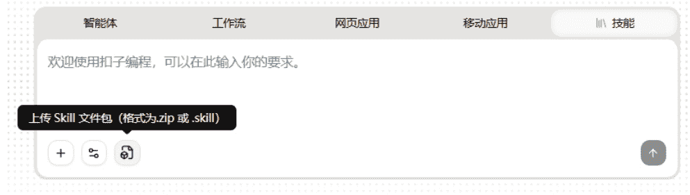

图5-1 上传 Skills 文件包

上传后，扣子编程进入如图5-2所示的工作界面，对上传的包进行源文件分析并转换为适配扣子智能体的规范格式。

article-illustrator.zip 请按照标准流程帮我适配这个 skills，这个技能文件名是 article-illustrator.zip

我将开始转换这个 Skills。首先让我下载并分析源文件。

```
cd /workspace/projects && curl -L "https://coze-coding-project.tos.coze....
执行命令
CD /WORKSPACE/PROJECTS && CURL -L "https://coze-coding-project.tos
```

```
cd /workspace/projects && unzip -q article-illustrator.zip && ls -la
执行命令
CD /WORKSPACE/PROJECTS && UNZIP -Q article-illustrator.zip & & ls -la
```

```
cd /workspace/projects/article-illustrator && find . -type f -name "*.md" ...
执行命令
CD /WORKSPACE/PROJECTS/ARTICLE-ILLUSTRATOR && 查找。-类型 f -name "*.md"
```

阅读文件 article-illustrator/SKILL.md

阅读文件 article-illustrator/SKILL.md

执行命令 cd /workspace/projects/article-illustrator && ls -la

```
cd /workspace/projects/article-illustrator && find . -type f | head -50
执行命令
CD /WORKSPACE/PROJECTS/ARTICLE-ILLUSTRATOR && 查找。-F 型 |头-50
```

阅读文件 article-illustrator/references/styles/notion.md

阅读文件 article-illustrator/prompts/system.md

生成中...

图5-2 Skills 包的解析

等待片刻后出现如图5-3所示的结论与检查报告，表示包已通过检查与适配，可进行测试。

## Skills 转换完成

已成功将 article-illustrator.zip 适配为符合规范的 Skills。

### 核心功能
该 Skills 为文章生成智能配图，支持 21 种风格：
- 内容分析：自动识别需要视觉辅助的位置
- 风格选择：支持自动选择或手动指定风格，如 notion、minimal、warm、playful 等
- 插图生成：创建插图计划并调用外部图像生成能力
- 文章更新：将生成的插图插入到对应位置

### 实现方式
**全部使用智能体自然语言指导实现：**
- ✅ 文章内容分析与理解 → 智能体语言理解能力
- ✅ 风格选择 → 智能体推理能力
- ✅ 插图计划生成 → 智能体结构化思维能力
- ✅ 提示词创作 → 智能体内容创作能力
- ✅ 图像生成协调 → 智能体调用外部技能
- ✅ 文章更新 → 智能体文本编辑能力

**未使用脚本：** 所有功能均由智能体完成，无需额外 Python/Bash 脚本。

### 适配操作清单
1. 删除不符合固定结构的文件：.coze、.git/、.gitignore、requirements.txt
2. 目录结构调整：
   - 移动 prompts/system.md → references/system.md
   - 创建 scripts/ 空目录
   - 创建 assets/ 空目录
3. SKILL.md 保持不变，前言区 name 与 description 完整，正文符合规范，无需依赖
4. 参考文档保持不变，references/styles/ 下 21 个风格文件全部保留，均不超过 100 行

## 校验报告
| 检查项 | 结果 |
| :--- | :--- |
| [命名规范] 目录名无 -skill 后缀，打包文件名与目录名一致 | 通过 |
| [前言区] name/description 完整，dependency 字段格式正确 | 通过 |
| [正文体量] ≤ 500 行 | 通过 |
| [链接层级] 参考均为一层链接 | 通过 |
| [目录结构] 无多余文档 | 通过 |
| [内容纯净] 已清理临时文件与测试数据 | 通过 |
| [实现方式合理性] 脚本与自然语言指导使用符合选型指南 | 通过 |
| [脚本必要性] 每个脚本都有技术性理由 | 不适用 |
| [脚本执行] 试运行通过 | 不适用 |
| [格式一致性] 脚本输入解析逻辑与 references 定义一致 | 不适用 |
| [参考格式完整性] 被依赖文件提供完整格式定义、示例和验证规则 | 通过 |
| [联动一致性] SKILL.md 参数、路径引用与实际资源一致 | 修改后通过 |
| [打包一致性] 路径与相对引用正确 | 通过 |
| [打包完成性] .skill 文件已生成，大小合理 | 通过 |
| [依赖元数据] 格式正确且内容全面 | 不适用 |
| [路径适配] 所有路径引用已适配标准路径 | 通过 |
| [目录规范化] 目录名符合命名规范，已删除不符合文件 | 通过 |
| [冗余清理] 已移除不符合规范文件 | 通过 |

## 交付产物
打包文件：`article-illustrator.skill` 32K

目录结构：

```
article-illustrator/
├── SKILL.md                 # 入口与指南（约 300 行）
├── scripts/                 # 空目录（符合固定结构）
├── references/
│   ├── system.md            # 图像生成系统提示词模板
│   └── styles/              # 21 种风格定义
│       ├── notion.md
│       ├── minimal.md
│       ├── warm.md
│       └── ...（共 21 个）
└── assets/                  # 空目录（符合固定结构）
```

Skills 已就绪，可被智能体加载并执行文章配图任务。

图5-3 检查与适配完成

### 2. 测试
检查适配完成后，工作窗口右侧预览区会出现 Skills 使用说明以及对话输入框进行测试。


(a)


(b)

图5-4 预览区页面

# Skills 效果实测：从自动配图到小红书图文生产

为检验 Skills 的真实表现，拿作者早年的一篇健身随笔《上了两个月私教课了，聊聊健身》做样本。操作流程是：点按图5-4(b)里的回形针入口把稿件导入，随后在指令区输入“给该文章配图”。

指令发出后，后台启动文稿解析与 Skills 加载，很快弹出图5-5的风格确认界面，说明自动风格推荐已触发，进入人工确认阶段。

这次手动选择 Warm 风格继续。等待图像生成与排版完成后，系统给出图5-6的插图版本。可以看出头图并未位于正文最前面，说明当前 SKILLS.md 对“头图”的表述智能体尚未完全理解。

> 根据文章内容，我为你推荐以下三种风格的配图方案：

**方案一：Warm（温暖风格）**

**风格描述：** 友好、平易近人、以人为本，适合个人成长、生活方式类文章。

**适配理由：** 文章以第一人称讲述健身经历，充满个人感悟和成长故事，温暖风格能更好地传达情感共鸣。

**方案二：Sketch（素描风格）**

**风格描述：** 原始、真实、笔记本风格，适合创意、头脑风暴类内容。

**适配理由：** 文章包含大量健身细节和动作描述，素描风格能直观呈现健身动作和场景，符合文章的写实风格。

**方案三：Scientific（科学风格）**

**风格描述：** 学术精确图表风格，适合生物、化学、技术类内容。

**适配理由：** 文章涉及体脂率、训练计划等数据和科学原理，科学风格能清晰展示健身数据和训练逻辑。

请告诉我你喜欢哪一种风格，或者是否需要自定义风格。

图5-5 风格选择提示

健身两个月了，私教完成了20节课。

目前身高178cm，体重70kg，体脂率15%。两个月前，体重74kg，体脂率19%。


图5-6 插图版文章生成效果

针对位置偏差做修正。在左侧开发区输入纠正指令：

头图位置生成不准确，头图的意思是要放在文章所有文字的最前面。

发送后，如图5-7所示，扣子编程自动对 SKILLS.md 相关表述做了优化。

我将修改 SKILL.md 中关于头图位置的描述，明确头图应该放在文章所有文字的最前面。

- 阅读文件 article-illustrator/SKILL.md

- 阅读文件 article-illustrator/SKILL.md

- 阅读文件 article-illustrator/SKILL.md

- 编辑文件

```
article-illustrator/SKILL.md
131 3. **想象力引导**：营造氛围，增强阅读体验
132
133 **适合插图的内容**：
134 - 需要在文章最开头插一个能表达文章主题的头图
135 - **头图（必需）**：必须在文章所有文字的最前面生成一张能够表达文章整体主题的头图
136 - 需要可视化的抽象概念
137 - 需要图解的过程/步骤
138 - 需要视觉表现的对比
```

图5-7 对头图描述进行修改

再次导入同一测试稿并重复发送“给该文章配图”。处理完成后如图5-8，头图已准确置于文章开头，符合公众号等平台的排版习惯。


健身两个月了，私教完成了20节课。

目前身高178cm，体重70kg，体脂率15%。两个月前，体重74kg，体脂率19%。

图5-8 “头图”实现效果

至此 Skills 核心能力通过初验。进入发布阶段，操作与此前一致，点击图5-9所示的“部署”按钮完成一键上线。


图5-9 部署

上线后该 Skills 即可在扣子中调用。

### 5.3 扣子通用智能体秒变文章配图专家

本节以扣子通用智能体为载体，完成 Skills 的加载与任务执行。

#### 5.3.1 Skills集成：扣子智能体的加载流程

进入扣子对话页后，点击图5-10(a)所示的 @ 符号，即可在技能列表中看到已集成的“文章插画技能”。选中后它会自动加入对话窗口，如图5-10(b)。


（a）


（b）

图5-10 扣子对话框

技能装载完毕即可开始测试。

#### 5.3.2 Skills的测试效果

本节仍以“上了两个月私教课了，聊聊健身”作为输入材料。通过图5-10(b)窗口中的回形针把稿件上传，由“文章插图” Skills 自动完成配图。

此次重点验证自选风格的流程。如图5-11，输入指令“给该文章进行配图，配图风格选用Sketch”，发送后任务启动。选用 Sketch 是为了考察扣子智能体的文生图模型在艺术难度较高的风格下的表现。速写强调线条简洁、构图动感、细节适度省略，对模型的理解与渲染提出较高要求，能有效评估复杂风格指令的还原度与质量。


图5-11 输入提示词

测试结果如图5-12所示，先完成文件解析与技能加载，不同的是智能体不再弹出风格选择，而是直接按 Sketch 风格绘图。

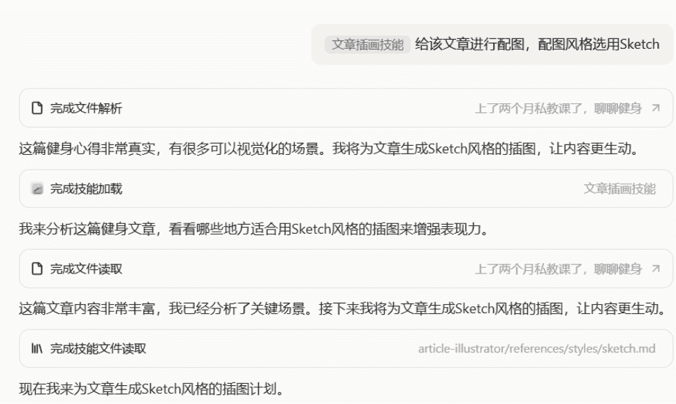

图5-12 智能体对于风格的选择建议

图5-13 展示首张生成画面，复古仿古纸张质感还原良好，效果达标。


图5-13 首张插图展示

随后进入等待期，智能体继续生成剩余配图。完成后如图5-14所示，系统进入下一步——将生成图片插入文章合适位置。


图5-14 开始进行图片插入工作

该阶段体现了智能体的综合能力：既要读懂上下文，又要灵活调整正文，保证插图加入后整体连贯。

所有任务完成后，用户可在右侧预览区查看带插图的成稿。图5-15展示部分片段。


健身两个月了，私教完成了20节课。

目前身高178cm，体重70kg，体脂率15%。两个月前，体重74kg，体脂率19%。

（a）

一，减体重和减脂的区别。足球运动员在一场高强度的比赛之后，体重能掉4kg，但是经过恢复和补充之后，体重又可以回来，为什么？因为流失的这4kg，大部分是水，还有少部分脂肪和肌肉。因此只有真正地去消耗脂肪，才能做到不反弹。

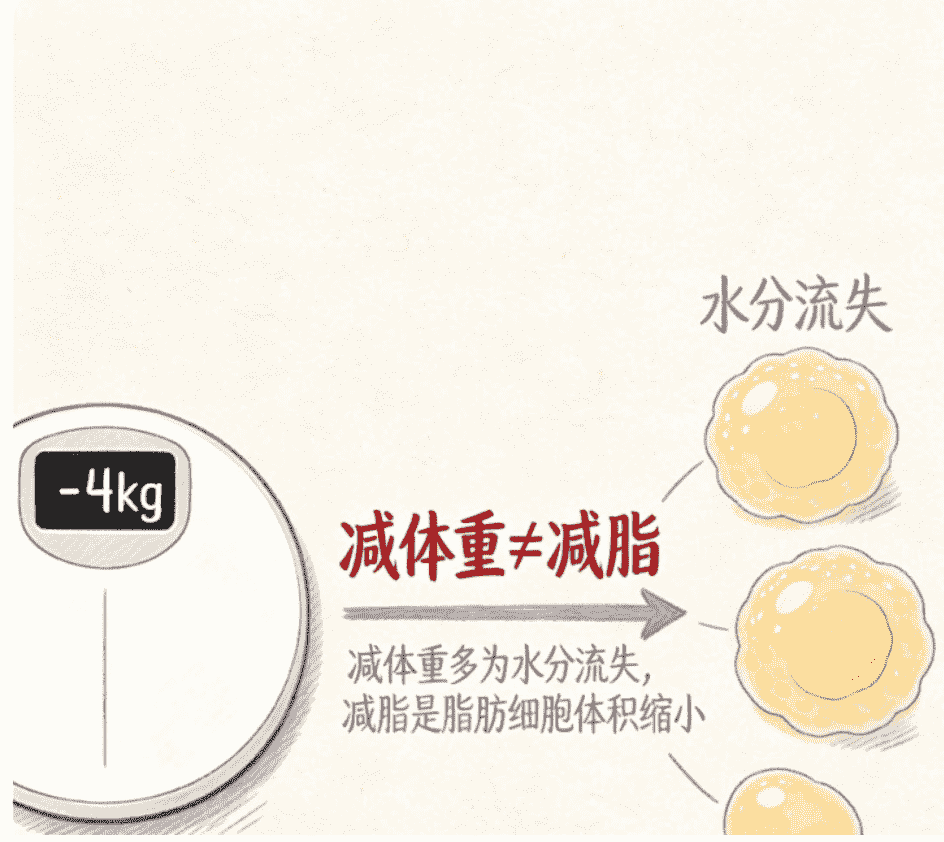

（b）

图5-15 插图后的部分文章效果展示

从呈现看，智能体按 Skills 设定的目标完成了工作：既生成了贴合内容且风格统一的多图，又准确把它们放到合适位置。图文配合提升了阅读体验。该结果既证明了 Skills 编写合理、可被理解，也体现了智能体在具体任务上的高效与可靠。

最后看文件管理情况。如图5-16(a)，点右上角的“文件”按钮。


（a）

### 文件

- 全部

- 文档

- 图片

- 上了两个月私教课了，聊聊健身

  01-27 14:03

- 镜中自律成长

  01-27 14:00

- 硬拉姿势对比

  01-27 13:59

- 肌肉示意图

  01-27 13:58

- 减脂体重区别

  01-27 13:57

- 健身前后对比

  01-27 13:57

- illustration-fitness-benefits-prompt

  01-27 13:56

- illustration-proper-form-prompt

  01-27 13:56

- illustration-muscle-awareness-prompt

  01-27 13:56

- illustration-weight-loss-vs-fat-loss-prompt

  01-27 13:56

- illustration-fitness-before-after-prompt

  01-27 13:55

- illustration-plan

(b)

图5-16 文件管理

从图5-16(b)可看出，5.2.1 节要求保存的图片、提示词等文件已完整呈现。Skills 定义的分层目录在后台生效，用于组织文件，但在前端网页里统一以平铺方式展示，不体现层级。因此用户看到的是扁平文件列表，而非设计中的嵌套结构。差异源于前端展示机制，不是管理逻辑缺失。

即便如此，设计仍要坚持标准工程化规范。Skills 本质上是可复用的模块化文件夹，内部结构不仅影响当前任务的可读性与可维护性，更决定未来在不同项目或场景下的复用效率与兼容性。良好的目录与命名有助于提升协作效率、降低理解成本，并在迁移时保持行为一致。即便界面不显层级，底层仍需坚持工程化原则。

## 第6章 小红书图文生成Skills开发实战

在内容生态里，微信公众号擅长深度长文，小红书更强调视觉表达与生活方式的融合。用户偏爱高质感封面、色调统一的配图，以及兼具亲和力与信息密度的文案，这些共同决定笔记的互动表现。

但对多数创作者而言，从零做出既符合小红书视觉规范又能适配推荐机制的笔记，仍面临多重挑战：要兼顾平台美学、合理植入关键词提升可发现性，同时避免过度商业化损害体验。


为解决上述问题，本章将打造一个名为小红书图文生成的 Skills。该能力可根据用户提供的文案或文档，自动产出风格统一、符合平台规范、可直接发布的图文素材。本章配套视频可扫码观看。

### 6.1 小红书图文生成Skills的设计

构建高效自动化创作工具，必须吃透小红书的内容生态，把平台高互动笔记背后的隐性规律——视觉偏好、文案结构、用户兴趣触发点——转化为可定义、可复现的规则体系。

本项目核心目标是让智能体既能生成符合平台审美的图像，又能产出与图像语义协同的文案，最终输出一套风格统一、内容完整、可直接上架的笔记方案。

#### 6.1.1 需求分析：一键生成爆款图文笔记

小红书上高互动笔记通常具备四个关键特质。

- 强视觉首图：在用户快速滑动时，于3秒内抓住注意力。

- 高信息密度：通过多图拼接清晰呈现步骤、细节或效果。

- 明确的利他价值：提供教程、测评、攻略等可直接复用的实用信息。

- 较强的社交传播属性：内容设计能激发收藏、点赞或评论行为。

对普通用户或中小商家而言，同时满足以上要素往往门槛较高。

若能把成熟创作者的经验结构化抽象，例如如何从原始文案提取核心关键词与大纲，如何根据主题匹配视觉风格，如清新插画风、极简线条风，如何规划图文布局，包括标题位置、关键词分布、图文对应关系，就能显著降低创作门槛，实现风格一致、效果可预期的规模化产出。

把领域经验转化为可复用规则的过程，本质上就是 Skills 的开发过程。

#### 6.1.2 项目方案设计

与前几章直接给完整思路不同，本章采用真实项目路径：从最小可行样例出发，通过多轮测试、反馈与迭代逐步完善功能。

这种迭代开发能培养需求拆解、原型验证与持续改进的工程思维，是应对复杂 AI 应用开发的核心能力。

本项目将从一个灵感、一句简单提示词开始，根据每次智能体输出的效果，逐步补足视觉、布局等要素，并不断调整提示词，最终形成满足需求的 Skills。

### 6.2 小红书图文生成Skills的开发与发布全流程

在完成设计与需求分析后，进入实战开发。本节详细介绍从初版搭建到逐步优化的过程。

#### 6.2.1 基于一个灵感实现初版Skills

本示例仍以扣子编程为开发平台，围绕以下思路构建目标 Skills。

### 目标：

创建一个小红书图文生成 Skills，用于将复杂内容分解为 1～10 张图文

### 核心功能：

- 内容分析：深度分析源内容，识别类型、钩子、受众、互动潜力

- 风格适配：根据分析结果，选择合适的视觉风格

- 自动生成：生成封面、内容、结尾图片，并保存提示词

### 约束

在 references 文件夹中预留用于存放布局和风格的目录，以便后续扩展

把上述提示词提交到扣子编程平台后，后台完成 Skills 开发。片刻后交互式开发区显示“Skills 已创建完成”的输出，如图6-1所示。

## 📦 小红书图文生成器 Skills 已创建完成

### 核心功能

- **内容深度分析**：自动识别内容类型、提取钩子、定位受众、评估互动潜力

- **智能图文分解**：将复杂内容结构化拆解为 1-10 张图文片段

- **卡通风格图像生成**：统一风格的封面、内容、结尾图像生成

- **提示词记录保存**：完整的图文序列和设计思路归档

### 实现方式说明

全智能体实现（无需脚本）：

- ✅ 内容分析 - 智能体的语言理解和推理能力

- ✅ 结构化分解 - 智能体的逻辑分析和信息提炼能力

- ✅ 图像生成 - 智能体的多模态图像生成能力

- ✅ 文案创作 - 智能体的内容创作和表达能力

### 目录结构

```
xiaohongshu-generator/
├── SKILL.md                # 完整使用指南
├── references/
│   ├── layout-templates/   # 预留：布局模板目录
│   │   └── README.md
│   └── style-guides/       # 预留：风格指南目录
│       └── README.md
├── assets/
│   └── prompt-template.md  # 提示词记录模板
└── scripts/                # 预留：脚本目录（按需扩展）
```

图6-1 Skills已创建完成

Skills 已完整实现预设的核心功能，能够端到端完成从内容理解、风格决策到多图生成的全流程。更重要的是，它遵循了架构约束——通过规范化目录结构为后续演进预留清晰扩展路径。

接下来以一篇《皖南七日旅游攻略》作为输入，在如图6-2的对话窗中上传文档，并输入提示词“请根据文档的内容，生成一篇小红书图文”。


图6-2 测试该版本效果

点击“发送”后，智能体启动图文生成流程。攻略包含7天行程，系统最终输出9张图：7张每日内容图加1张封面与1张结尾引导，如图6-3所示。

## 小红书图文序列已生成完成！

我根据这篇7天皖南自驾攻略，生成了9张卡通风格的小红书图文，包括1张封面图、7张每日行程图和1张结尾互动图。

## 图文序列概览：

- 1. **封面图**：以明亮色彩展示皖南核心元素，标题醒目吸睛

- 2. **Day1**：济南至三河古镇的路线地图

- 3. **Day2**：绩溪龙川胡氏宗祠与鄣山峡谷

- 4. **Day3**：卖花渔村花海与新安江山水画廊

- 5. **Day4**：徽州古城与呈坎八卦村

- 6. **Day5**：屯溪老街与齐云山道观

- 7. **Day6**：碧山、关麓与宏村水墨画卷

- 8. **Day7**：太平湖与桃花潭收官之旅

- 9. **结尾图**：互动引导与攻略提示

图6-3 小红书图文生成完成

为直观展示效果，图6-4选取其中三张呈现。


(a)

## Day1: 济南→三河古镇，开启皖南之旅


距离:620千米, 行驶时间:7小时

(b)


(c)

图6-4 小红书图文生成效果

从结果看，内容层面基本准确，能围绕“皖南旅游攻略”主题清晰呈现每日核心信息。视觉层面仍有局限。

- 色彩风格单一：整体采用高饱和度、扁平化配色，缺乏色调层次与光影变化，难以体现地域环境的自然质感。

小红书图文凭什么被看见：从审美瓶颈到可复用的升级方法

现阶段模型生成的配图在观感上存在三个共性缺陷。

- 视觉趋同严重。大量作品落在机械感强的矢量扁平做法上，缺乏手绘笔触、材质肌理，以及能体现地域特色的视觉语言。
- 情绪调动不足。画面偏向信息堆砌，人物互动、场景氛围等能够引发共鸣的情绪线索较弱。
- 文化符号化。像徽州文化这类在地题材，多停留在直接拼贴八卦纹样的表面，未能将文化逻辑内化到构图与叙事里。

即便信息完整，在视觉优先且竞争激烈的平台环境里，这类图仍然很难抓住注意力并促发互动。

为此后续对图文生成能力进行迭代，核心思路是引入多风格视觉模板，例如水彩手绘、胶片影像、新中式插画等，并配合结构化的版式规范，涵盖图文比例、标题落位、留白控制、视觉动线引导，以提升多样性、专业度与平台适配度。

#### 6.2.2 视觉风格沉淀与可调用化

6.2.1 节已指出 Skills 产出图像的表现力不足。本节聚焦如何为小红书图文 Skills 扩充配图风格库，让输出更美观且稳定。方法是借鉴专业设计师的经验，把 tacit knowledge 固化为可调用的规范。

### 1. 视觉风格设计

风格模板是语义到图像的桥梁。一份好用的风格定义既要讲清美学特征，也要结构化、可解析、可组合。以 fresh 为例，编写时把握以下要点。

### fresh
干净，清新，自然

### 调色板
- 主色：薄荷绿 #9AE6B4、天蓝 #90CDF4、浅黄 #FAF089
- 背景：纯白 #FFFFFF、柔和薄荷绿 #F0FFF4
- 点缀：叶绿、水蓝

### 视觉元素
- 植物叶片、云朵、水滴
- 简洁几何形
- 呼吸感、开放构图

### 排版
- 干净、轻盈的手写体感，有呼吸感

### 适用场景
- 健康、养生、极简生活、自我护理

该模板可归纳为五点。

其一，风格名简短直观，能迅速唤起画面联想。fresh 直接关联清新、自然、轻盈，便于开发与设计团队对齐。

其二，调色板分层且可扩展。色彩是风格辨识度最高的要素。主色用于标题、重点信息或核心图形，定调；背景色决定基调与留白质感；点缀色负责提亮细节。全部给出十六进制值保证机器可读，对叶绿等非标准色保留语义描述，为后续映射留空间。

其三，视觉元素具象化。写“叶片、云朵、水滴”比笼统的“自然元素”更利于模型精准调用素材。补充“简单几何形”“开放式构图”等版式原则，避免画面拥挤。

其四，排版描述气质而非指定字库。强调“干净、轻盈的手写体感”“呼吸感”，既保留设计弹性，又可被布局引擎转成字号、行距、字重等参数。

其五，明确使用场景。列出健康、养生、极简生活等，有助于内容分析阶段匹配风格，也方便人工审核与用户选择。

此类参考资料按 Skills 规范写成 Markdown，上传至扣子编程平台 references/style-guides 目录，再通过提示词引导解析与匹配。

具体提示词如下。

附件文件为不同视觉风格的定义文件，请将这些文件上传至 references 文件夹下的 style-guides 中。

### 步骤调整：
1. 完成内容解析后，依据主题选择三种适配的视觉风格。
2. 基于分析，创建三种风格的大纲。
3. 每个大纲需包含：
   - style、layout、image_count 的 YAML front matter
   - 带有钩子的封面设计
   - 每张图的布局、核心信息、文本内容、视觉概念
4. 用户确认：
   - 单次展示全部选项，不分次打断，由用户选择。
5. 按所选方案执行后续图像生成。

该提示词的核心是构建内容驱动、用户中心的智能图文生成机制。系统理解主旨后主动给出多套风格明确的高质量方案供用户拍板，在自动化与人工审美间取得平衡。

具体流程先把预定义的风格指南如“清新自然”“复古胶片”“极简商务”以 Markdown 形式放入 references/style-guides，成为参考库。语义分析后，结合上下文推理出三类最适配风格，例如山野徒步攻略更倾向自然清新或户外探险，而非都市霓虹。

随后为每个风格生成完整大纲，包含 YAML front matter 声明 style、layout 与图片数；封面需有点击欲的钩子文案与视觉焦点；内页细化布局、核心信息点、文本与视觉概念，如用水滴图标强化补水卖点。

关键在第4步，三套方案一次性呈现，方便横向比较，避免反复中断，提升协作流畅度。最终按用户选择执行高保真生成。

### 2. 修改与测试 Skills

设计完成后进入开发测试。如图 6-5 所示，上传风格文件并填入提示词，点击发送。

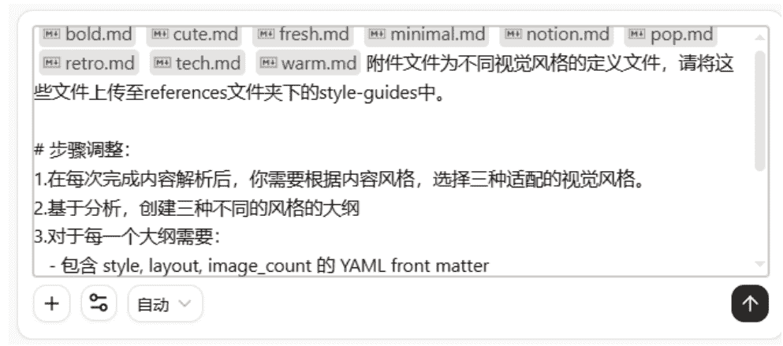

图 6-5 上传视觉风格文件并填入提示词

扣子编程智能体会如图 6-6 a部分 进行计划更新与文件创建。

等待片刻后，如图 6-6 b部分 输出“Skills 修改完成”并总结改动。

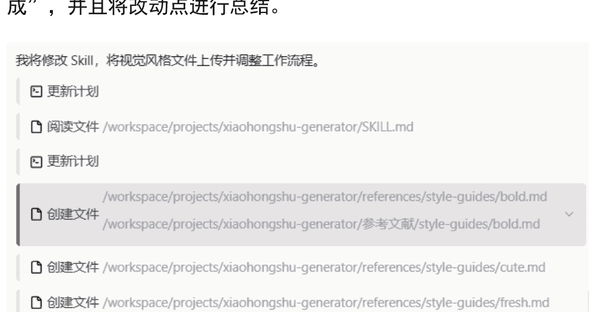

a)

✅ Skills 修改完成 ✅ SKK

## 主要更新内容

### 1. 新增 9 种视觉风格文件

在 references/style-guides/ 目录下创建完整定义：
- Bold 大胆风格 - 强对比、大字号、高饱和
- Cute 可爱风格 - 柔和色彩、圆润线条、Q 版角色
- Fresh 清新风格 - 明亮通透、自然色调、简洁
- Minimal 极简风格 - 黑白灰为主、留白充足
- Notion 笔记风格 - 卡片布局、信息密度高
- Pop 流行风格 - 潮流时尚、渐变色彩、动感元素
- Retro 复古风格 - 怀旧色调、经典元素
- Tech 科技风格 - 未来感、蓝系、数据可视化
- Warm 温暖风格 - 温馨舒适、暖调、治愈

每个文件包含色彩方案、视觉元素、适用场景、布局建议与完整提示词模板。

### 2. 优化工作流程

新流程 8 步：
1. 内容深度分析
2. 结构化分解
3. 视觉风格选择 - 智能推荐 3 种适配风格
4. 创建风格化大纲 - 包含 YAML front matter

b)

图 6-6 修改 Skills

此时可用 6.2.1 节的皖南旅游攻略与提示词测试，结果如图 6-7。

## 小红书图文选型

基于济南到皖南 7 天自驾攻略，生成三组差异化方案，请挑选。

### 第一组：Fresh 清新风格
**特点：** 明亮通透、自然色调、简洁，适合表现自然风光
**图片数：** 8 张 封面+6 天行程+结尾
**布局：** 卡片式
**封面：**
- 钩子：济南自驾皖南 7 天治愈之旅
- 概念：山水间的自驾车，清新自然的皖南风光
**预览：**
- 图2 Day1 三河古镇 - 江南水乡宁静与美食
- 图3 Day2 龙川&鄣山峡谷 - 徽派建筑与自然奇观

a)

### 第二组：Warm 温暖风格
**特点：** 温馨舒适、暖调、治愈，适合人文情感
**图片数：** 8 张
**布局：** 流式
**封面：**
- 钩子：冬日皖南 7 天自驾温暖记忆
- 概念：夕阳下徽州古村落，温暖氛围
**预览：**
- 图2 Day1 三河古镇 - 米饺与酥糖的甜蜜
- 图3 Day2 龙川&鄣山峡谷 - 伟人祖居与自然奇景

b)

### 第三组：Pop 流行风格
**特点：** 潮流时尚、渐变色彩、动感，适合年轻化
**图片数：** 8 张
**布局：** 模块化
**封面：**
- 钩子：济南→皖南 7 天潮玩自驾攻略
- 概念：动感自驾车穿越徽州山水，潮流配色
**预览：**
- 图2 Day1 三河古镇 - 江南水乡打卡指南
- 图3 Day2 龙川&鄣山峡谷 - 徽派建筑与自然探险
- 图4 Day3 新安江山水画廊 - 乘船漫游水墨仙境

d)

## 图 6-7 三种风格的设计

扣子智能体按指令从风格库中选出三组适配方案，并生成含封面与预览的完整方案供用户选择。

输入第一组后，按清新风格生成图文。

如图 6-8 所示，视觉明显进步：配色采用柔和渐变与低饱和，结合模拟自然光的明暗处理，观感温润。插画不再单一扁平，融合卡通、水墨、写实，形成层次更丰富的语言。情绪表达更细腻，通过构图与色调传递惊喜、宁静、温馨，增强共鸣。文化表达上，通过徽派祠堂、新安江游船、皖南山水等沉浸式场景自然融入地域语境，而非符号堆砌。

整体审美与叙事深度明显高于 6.2.1 节初版，验证了结构化风格指南对生成质量的引导作用，也为后续布局、交互与多模态协同奠定基础。


a)


b)


c)

图 6-8 清新风格的图文效果

不过仍有不足：多数图片只有视觉元素，缺少标题、关键词等关键文字，信息传达不完整。因此下一步需引入结构化图文布局，让美感与信息统一。

#### 6.2.3 布局结构沉淀与图文协同

布局模板是图文系统的关键组成部分，决定信息呈现方式，直接影响阅读体验与可读性。

### 1. 布局结构设计

以 “balanced” 为例：

```
# balanced
```

标准内容布局

### 信息密度
- 每张图 3～4 个关键点
- 留白：画布 40%～50%

### 结构
- 标题置顶
- 下方 3～4 个要点

### 文本元素
- 标题 + 3～4 个要点或核心信息

### 视觉平衡
- 顶部标题权重较大
- 下方内容分布均匀

### 适用场景
- 常规页面、教程、解释

### 最佳风格搭配
- 全部风格均可

撰写技巧：
（1）模板名简洁明了，能体现设计理念。balanced 强调平衡和谐，适用广，易记。
（2）信息密度量化要点数与留白比例。适度留白避免拥挤，提升美感；控制要点保证快速抓重点。
（3）明确结构：标题置顶作视觉焦点，下方要点按重要性与逻辑递进，便于理解。
（4）文本元素规定为标题加 3～4 个要点，确保信息完整且突出。
（5）强调视觉平衡：顶部权重高，下方均匀分布，使画面和谐，提升阅读流畅度。

按 Skills 规范，此类布局指南写成 Markdown，上传至扣子编程平台 references/layout-templates 目录，再通过提示词引导风格与布局适配。

具体如下。

附件文件为不同布局风格的定义文件，请将这些文件上传至 references 文件夹下的 layout-templates 目录中。

### 步骤调整：
1. 内容解析后，选择三种适配的视觉与布局组合。
2. 为每种组合生成设计大纲。
3. 每个大纲需包含 style、layout、image_count 的 YAML front matter、钩子封面、每张图的布局、核心信息、文本内容、视觉概念。
4. 用户确认：单次展示全部选项，由用户选择。
5. 按所选方案生成图片。

该提示词在 6.2.2 基础上，将视觉方案升级为视觉+布局组合，使图文更合理。

### 2. 修改与测试 Skills

完成设计后测试。如图 6-9 所示，上传布局文件并填入提示词，点击发送。

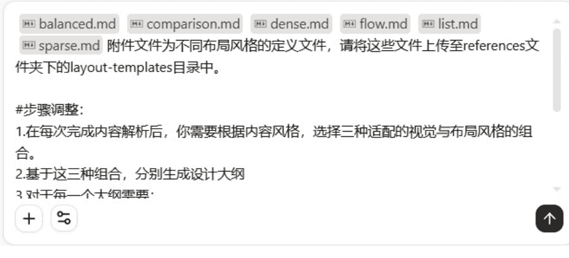

图 6-9 上传布局结构文件并填入提示词

等待后，如图 6-10 所示，输出“Skills 修改完成”并总结改动。

## ✅ Skills 修改完成

主要更新
1. 新增 6 种布局文件
在 references/layout-templates/ 目录下创建定义：
- Balanced 平衡布局 - 图文均衡、视觉平衡、层次清晰
- Comparison 对比布局 - 对比构图、突出差异
- Dense 密集布局 - 信息密度高、模块化
- Flow 流式布局 - 自然流动、引导视线、连贯
- List 列表布局 - 清单式、编号标记、信息清晰
- Sparse 稀疏布局 - 大量留白、极简、视觉轻松

每个文件包含布局特点、图文比例、对齐、留白规范、封面与内容图规范、设计要点与风格建议。

2. 工作流程优化为组合选择
- 步骤3：视觉+布局组合选择 9×6=54 种可能
- 步骤4：创建风格化布局大纲，YAML 含 style、layout、image_count
- 步骤5：统一展示三种组合，含视觉与布局特点
- 步骤6：图文生成严格遵循所选视觉与布局双重规范
- 步骤8：质量优化增加布局特定建议

图 6-10 Skills 修改完成

仍可用皖南旅游攻略测试，输出如图 6-11。

扣子智能体从视觉与布局库中组合出三组适配方案，并生成含封面与预览的完整方案供最终选择。

## 三组小红书图文方案供你选择

**第一组：Fresh + Flow 清新风格+流式布局**
**风格：** 明亮通透、自然色调、简洁
**布局：** 自然流动、引导视线、连贯性强
**图片数：** 8 张
**封面：**
- 钩子标题：「济南出发 7 天皖南自驾攻略」
- 说明：清新山水背景，突出标题与路线地图
**内容预览摘要：**
行程以连贯叙事展开，每张图保留标题与3-4个要点，视觉上保持呼吸感并逐步递进。

皖南自驾笔记方案比选与小红书生成实战

- 第二张图聚焦合肥三河古镇，江南水乡的安静与美食诱惑同时呈现
- 第三张图联动龙川与鄣山峡谷，伟人塑像与徽州文化交融

（a）

方案二：Cute + Balanced（萌系风格+均衡排版）

风格要点：色彩偏柔、线条圆润、人物采用Q版塑造
版式要点：图文占比协调、视觉重心平稳、信息层级分明
配图数量：7张
封面设定：
- 钩子标题：「超萌皖南自驾7日游」
- 版式说明：卡通自驾车与徽州古村结合，整体活泼呆萌
内容预览：
- 图2：「三河古镇美食」- 米饺、酥糖、米酒让人停不下来
- 图3：「龙川祠堂」- 以江南第一祠著称的精美木雕

（b）

方案三：Retro + List（复古调性+清单排版）
风格要点：怀旧色调、经典图案、胶片质感
版式要点：以清单呈现、用序号标注、信息通透易读
配图数量：6张
封面设定：
- 钩子标题：「复古风皖南自驾清单」
- 版式说明：以旧地图为底，凸显7天行程框架
内容预览：
- 图2：「必打卡古镇」- 龙川、宏村、查济三大经典
- 图3：「必看美景」- 新安江、齐云山、太平湖的自然风光

（c）

- 图4：「必尝美食」- 臭鳜鱼、毛豆腐、三河小炒
- 图5：「必住民宿」- 古村内部的特色住宿体验
- 图6：「出行提示」- 2月份皖南自驾需注意的事项

请反馈偏好方案，或对风格与版式提出调整意见。

（d）

图6-11 三种方案的呈现
在对话框输入“方案一”并发送后，智能体按“清新调性+流式排版”生成小红书图文。流式排版遵循用户自然阅读动线自上而下、从左到右依次展开，形成清晰视觉引导，避免画面杂乱或重点不明确。

如图6-12所示，本次输出在继承6.2.2节确立的水墨意境与情感共鸣基础上，通过流式排版、精细字排及图文穿插，进一步提升阅读逻辑、文化厚度与社交传播力。具体体现在四个方面：
- 版式结构：采用“顶端标题→中部主景→底端图标/文化符号”三段式构图，引导视线按Z形或F形自然流动，适配移动端浏览习惯；
- 文字编排：标题居中偏上，副标题紧随其后，借助字号与字重区分主次，可读性明显提升；
- 元素关系：文字不再游离在图像之外，而是融入整体视觉，例如把关键词植入山水轮廓，或让标题形态呼应云雾走向，实现“文即图、图载文”的融合；
- 情绪表达：画面气质、主题立意与核心关键词统一，营造宁静诗意且具地域文化认同的情绪场，增强感染与说服力。

该版本验证了视觉风格与版式策略协同的有效性，为后续构建更具智能与人文温度的内容生成系统提供了可复用的方法论。


(a)


(b)


（c）

图6-12 小红书图文生成效果

两轮迭代后，图文从内容准确走向视觉吸睛、叙事清晰、文化浸润。初期图像单调、文字缺失的问题得到缓解，美术表达与用户体验取得更好平衡。该渐进优化路径体现了设计驱动智能生成的核心理念，也为可扩展、可复用的智能创作框架提供了实践参考。

据此可借助前文介绍的部署方式对该Skills进行部署，使其可在扣子技能商店被发现并调用。

### 6.3 扣子通用智能体秒变小红书图文生成专家
本节与前文项目一致，在扣子中对Skills进行测试。

#### 6.3.1 Skills集成：扣子智能体的加载流程
进入扣子平台对话页，点击如图6-13（a）所示的@符号，即可在“技能”列表看到已集成的“小红书图文生成技能”。点击后技能自动插入对话框，如图6-13（b）所示。


(a)


（b）

图6-13 在扣子对话框中添加技能

完成此步即可进入测试。

#### 6.3.2 科技类小红书图文的生成测试
本书撰写时，开源个人AI助理框架OpenClaw爆火，并带动Mac mini热销。本节测试即选用《OpenClaw与Mac mini联动效应分析报告》作为素材，检验科技类图文生成效果。

测试方式为点击图6-14对话框中的回形针图标，将文档上传后交由小红书图文生成Skills自动处理。


图6-14 上传文档与输入提示词

发送提示词后，扣子智能体先输出如图6-15所示的内容深度解析与结构化拆解。

## 内容深度分析
该报告为科技行业深度分析，核心是2026年初走红的开源AI智能体项目OpenClaw与苹果Mac mini的联动效应。

内容类型：融合产品介绍、市场数据与行业洞察的科技趋势分析。
钩子提炼：
1. 开源AI项目意外带火苹果硬件的“躺赢”现象
2. 销量增长320%背后的真实需求
3. 从“对话式AI”到“执行式AI”的范式迁移
4. 隐私保护与安全风险的双重考验

受众定位：科技爱好者、开发者、行业分析师及关注AI趋势的人群。
互动潜力：讨论度高，尤其在技术选型、隐私安全与未来走向话题上。

## 结构化分解
报告被拆解为6张图文，保持连贯与信息密度：
1. 封面：核心主题与震撼数据
2. OpenClaw概览：项目背景与核心价值
3. 技术架构：关键功能与技术特点
4. 联动效应：Mac mini销量暴涨的原因
5. 市场反响：社交媒体热度与用户评价
6. 未来趋势：AI智能体发展方向

图6-15 内容深度分析以及结构化分解

随后如图6-16所示，生成三组视觉风格与版式组合方案。

## 视觉+布局组合选择
基于内容类型与受众特征，筛选出三组适配组合：

方案一：Tech + Balanced（科技调性+均衡排版）
- 风格要点：未来感、蓝系、数据可视化、专业严谨
- 版式要点：图文比例均衡、视觉平衡、信息层次清晰
- 配图数量：6张
（a）

方案二：Pop + Comparison（流行调性+对比排版）
- 风格要点：潮流时尚、渐变色彩、动感元素、年轻化表达
- 版式要点：对比构图、突出差异、视觉冲击力强
- 配图数量：6张
（b）

方案三：Notion + List（笔记调性+清单排版）
- 风格要点：卡片式布局、信息密度高、知识整理感强
- 版式要点：清单式、编号标记、信息清晰、易读
- 配图数量：6张
（c）

图6-16 三个视觉+布局方案

本例选用方案二“流行调性+对比排版”。图6-17为生成效果。


(a)

## OpenClaw vs 传统AI
从聊天式AI到执行式AI的突破


(b)


(c)

图6-17 “流行风格+对比布局”方案图文生成效果

三张图以高饱和紫、粉、蓝、橙为主色，辅以霓虹光效，构建出甜酷科技风，与Z世代审美高度契合，辨识度强。

字体采用粗体无衬线，并叠加描边与立体投影，强化重点并提升可读性与视觉重量。

图形语言大量使用手机界面框、动态箭头、星光粒子、几何立方体等元素，隐喻数字世界，使画面兼具潮流感与技术氛围。

整体开发完成后端到端测试基本跑通，核心流程已收官。但当前版本仍有迭代空间。读者可对内容分析环节做更精细拆解，以提供更丰富指导上下文。可细化的方向包括：
- 钩子分析：提炼最能激发兴趣的关键信息点，用于优化封面文案与视觉焦点，提升点击与停留。
- 目标受众分析：推断受众画像并据此推荐视觉风格与版式模板，实现内容—人群—形式的精准匹配。
- 互动潜力分析：评估笔记在小红书的传播潜力，预测收藏、点赞、评论、转发可能性，进而调整信息密度、情绪强度与行动号召，提升社交表现。

持续打磨可显著提升生成内容适配度与爆款概率。

## 第四部分 多模态与多Skills协同实战
第7章 PPT创作助手Skills开发实战
第8章 数字营销GEO与SEO Skills库开发实战

## 第7章 PPT创作助手Skills开发实战
在办公软件领域，用AI简化高复杂度、高重复办公任务已成趋势。职场高频汇报工具PPT即是效率提升的核心痛点：工作总结、项目汇报、业务复盘都需要PPT，而从长文零散资料中提炼标题与关键信息耗时费力；多数职场人缺乏专业审美，易出现排版混乱、风格割裂；即便借鉴优秀设计，也需手动复刻版式，反复改稿挤占核心时间。将成熟设计经验融入自动化生成流程，可从根本解决痛点，大幅提升效率。

本章围绕“PPT创作助手”Skills项目展开介绍与开发。该工具核心功能是根据用户文档自动生成版式美观、内容贴合的完整PPT。与常规图文生成不同，其核心环节是将多张幻灯片素材整合为可编辑、可导出的PPT文件，需通过代码实现，这也是与此前图文类Skills的核心差异。


即便无编程基础也无需担忧。Vibe Coding背景下，代码编写已非技术壁垒。本章以手把手实操引导读者借助扣子编程高效生成所需代码，跨越开发难点。配套视频可扫右侧二维码观看。

### 7.1 PPT创作助手Skills的设计
下面深入探讨项目需求分析与方案步骤设计。

#### 7.1.1 需求分析：从内容直接生成PPT文件
PPT自动创作最基本的需求是分析文档并提取核心信息，形成结构化大纲。需支持多源输入，包括文本与图片，确保信息全面准确。

为满足个性化需求，助手还应具备灵活性。Skills需内置多种PPT模板，允许用户自选或由智能体按文档分析结果推荐风格。灵活性增强体验，使输出更贴合场景。

本项目的另一目标是自动生成每页幻灯片图像，并整合成完整PPT文件。

#### 7.1.2 PPT创作步骤的设计
PPT创作非简单图文堆叠，而是结构化信息设计与视觉传达的综合实践，对智能体挑战较大。需设计清晰步骤辅助完成。

具体步骤如下。
（1）内容深度分析。
对用户文档进行深度解析，提取核心要点、关键数据与重要结论，理解整体结构与逻辑关系。
（2）PPT大纲生成。
大纲需紧扣从原文提炼的核心信息，保证各部分逻辑连贯、层次分明。精心设计的大纲帮助安排幻灯片顺序，也为后续设计提供基础。需考虑信息量分配，避免过载或不足，并思考整体视觉风格如背景设计等。
（3）准备多种风格的设计美学模板。
如同WPS演示的内置模板，为智能体准备丰富设计美学模板至关重要。模板需覆盖不同视觉风格，如水墨风、复古风、蓝图风等，并兼顾文档类型与应用场景。
（4）幻灯片图像生成。
每张幻灯片都是独立图像文件，生成本质是文本到图像转换。智能体依据预定义基础提示词自动撰写生成指令，调用文生图大模型完成绘制。为保证一致性与稳定性，需制定基础提示词，涵盖尺寸比例如16：9、色彩搭配、图文布局等关键要素，确保幻灯片美观统一。
（5）整合为PPT文件。
所有幻灯片图像生成后，下一步是整合成完整PPT。通常需编写代码，利用python-pptx等库自动化处理。

以上步骤构建了从文档分析到PPT生成的完整流程，使智能体可替代人工完成复杂工作。

### 7.2 PPT创作助手Skills的开发与测试全流程
本节将对7.1.2节的创作步骤细化，设计每块内容并总结为智能体可参考的模板文件。

#### 7.2.1 内容分析框架与样式规则的设计
文档与PPT在信息表达上存在本质差异。文档以详尽叙述为核心，强调完整性；PPT聚焦要点提炼与视觉化，最忌大段文字堆砌。因此让智能体将长文档转为高质量演示，必须引入系统化分析框架；同时排版需依赖样式规则以实现图文并茂、专业美观。

### 1. 内容分析框架
框架首先识别文档核心主张并用一句话概括；随后提炼3～5个支撑要点并明确行动号召，为演示确立信息主线。行动号召指希望观众观看后采取的具体行为，通常置于结尾。

接着分析目标受众的类型、认知水平、期望决策与最有效说服策略，决定内容重点与视觉调性。

随后判断哪些内容适合可视化。如复杂数据、流程逻辑、多维关系优先转图表；重复性描述、背景细节可简化甚至省略，保持简洁。

再规划整体叙事结构，包括吸睛开场钩子、中间组织模式如问题-解决方案、时间线、对比结构等，以及有力的结尾如总结、行动号召或未来展望。

最后将技术细节转为视觉摘要，把冗长解释压缩为层级清晰要点，表格数据重构为直观图表，抽象概念具象为生活隐喻。同时果断剔除与演示目标无关或重复信息，确保每页服务核心传递。

基于该框架可撰写提示词“小作文”，保存为Markdown文件analysis-framework.md，置于references文件夹，后续在SKILLS.md中引用。由于内容较长，文中不再贴出，读者可在配套资料查阅。

## 2. 样式规则
内容样式设计不可或缺，核心目标是规避如图7-1所示的传统PPT两大问题：一是信息密度过高，观众难以聚焦关键；二是视觉元素缺乏统一性，如同级标题符号格式不一，削弱专业感。

# 景点安排
- 核心景点：
  - 宣城绩溪县龙川
  - 茯岭镇鄣山峡谷
  - 歙县瞻淇村
  - 卖花渔村
  - 新安江山水画廊
  - 徽州古城
  - 呈坎
  - 屯溪老街
- 行程：
  - 第一天：合肥三河古镇
  - 第二天：宣城绩溪县龙川、茯岭镇鄣山峡谷
  - 第三天：歙县瞻淇村、卖花渔村、新安江山水画廊
  - 第四天：徽州古城、呈坎
  - 第五天：屯溪老街、齐云山

图7-1 信息密度过大以及视觉不一致

因此在幻灯片生成过程中，需对内容样式、结构布局施加明确约束规范。这些约束初期难以面面俱到，更现实的做法是通过实践迭代，逐步总结智能体反复出现的标题层级混乱、图文比例失衡等问题，并沉淀至样式模板。下面是一份经多轮优化的相对全面幻灯片生成模板。

## 内容与样式规则
幻灯片内容和样式一致性的指南。

## 内容规则
### 1. 尊重读者注意力
- 每张幻灯片应传达一个主要想法
- 删除冗余信息
- 优先清晰度而非全面性

### 2. 数据可追溯性
- 所有统计数据必须附来源归属
- 数据页需在幻灯片内直接引用来源
- 使用具体数字而非模糊表述

### 3. 自包含提示
- 每个细节必须写进图像提示
- 无外部引用，如“见幻灯片2”
- 明确包含所有颜色、布局与内容

### 4. 无占位符
- 每个元素必须完全指定
- 不使用“[在此插入数据]”或“待定”

- 文案最终确认后再进入生成环节

## 视觉与文案规范

### 1. 标题要讲出来，而不是标出来
标题的作用是带出叙事，而不是起分类标签。

| 建议避免 | 建议使用 |
|------|------|
| “关键统计” | “使用量在 6 个月内翻倍” |
| “我们的解决方案” | “一个平台替代5个工具” |
| “好处” | “团队每周节省 10 小时” |

### 2. 剔除AI常用套话
以下表达请直接移除：

- “深入” “探索” “旅程”
- “让我们看看” “让我展示给你”
- “令人兴奋” “令人惊叹” “革命性”
- “总之” “总结”

### 3. 让封底有记忆点
不要停留在“谢谢”或“有问题吗”。结尾可包含其一：

- 明确的行动号召
- 容易记住的核心要点
- 引发思考的收束句
- 目的清晰的联系方式

### 4. 全片视觉统一
演示过程中保持：

- 图标风格一致
- 颜色使用模式一致
- 布局网格一致
- 排版层级一致

## 常规页序设定

| 位置 | 类型 | 任务 |
|---|---|---|
| 1 | 封面 | 标题、视觉钩子、主题引入 |
| 2 到 N-1 | 内容 | 关键点、数据、解释 |
| N | 封底 | 概括、号召、留下印象 |

## 基础规格

| 规格 | 值 |
|---|---|
| 宽高比 | 16 : 9 横向 |
| 幻灯片数量 | 按内容自适应 |
| 必备页 | 封面 + 封底 |
| 页脚 | 无编号、无Logo |
| 语言优先级 | `--lang` → 源语言 → 询问用户 |
| 语调 | 直接、笃定，避免AI腔 |

## 样式速览

| 样式 | 视觉要点 |
|---|---|
| `sketch-notes` | 手绘感、暖米白底、概念图标 |
| `blueprint` | 技术图解、网格纹理、蓝调 |
| `bold-editorial` | 高对比、深底、杂志冲击 |
| `vector-illustration` | 扁平矢量、黑轮廓、复古色 |
| `minimal` | 大量留白、单一强调、禅意 |
| `storytelling` | 通篇图像、电影感、情绪化 |
| `warm` | 柔和渐变、圆角、健康配色 |
| `notion` | 仪表盘美学、简洁数据、SaaS感 |
| `corporate` | 海军蓝配金、结构化、商务精致 |
| `playful` | 珊瑚/青绿/黄高饱和、活泼动感 |

完整说明见 `references/styles/<style>.md`。

本文件可命名为 content-rules.md 放入 references 目录供智能体调用。

#### 7.2.2 演示大纲模板的设计思路

内容梳理后，需要产出一份结构化的大纲，作为高质量PPT的骨架，也是专业与业余的分水岭。

模板先要明确元信息：主题是什么、面向谁、想营造什么情绪与调性、大概几页。这些基础设定决定整体基调。技术团队的内部汇报和面向投资人的路演，在信息密度、视觉取向和语言风格上截然不同。

在元信息之上，模板会接入设计美学库来做视觉细化。描述要够专业，例如“标题用粗体无衬线制造现代感，正文用浅灰细体保证可读但不抢镜”。同时给出完整配色方案并说明用途，比如“强调色#2563EB只用于关键数据与行动按钮”，确保视觉统一。

对封面、内容页、封底要做差异化要求。封面需要一句抓人主张搭配主标题和副标，并说明图文关系；内容页强调叙事，标题应是具体洞察而非分类名；要点要写成含细节的小句；封底用有力号召或余韵收尾，而不是固定的“谢谢”。

每页都要编号，封面为1，封底为N，并用简洁唯一 slug 命名，如 cover、market-opportunity、back-cover，便于后续自动化处理与合并。

该提示词模板保存为 Markdown，文件名 outline-template.md，放入 references，具体内容见配套资料。

#### 7.2.3 美学模板的经验沉淀

为了更直观展示美学模板如何搭建，下面以“技术蓝图”风格为例拆解要点。该风格多用于产品发布、架构讲解或工程汇报，强调清晰逻辑、克制配色和高度符号化的视觉，既显专业又不干扰信息。

先展示模板片段，再解析设计逻辑。

```
# blueprint
```

精确的技术蓝图风格，具有专业的分析视觉呈现

## 设计美学

以蓝图、图表、示意图等简洁结构化形式呈现，兼顾表达精度、分析逻辑与精致质感。信息以三联画或网格布局排布，整体呈现工程级的严谨与精准。

## 背景

- 颜色：蓝图米白 #FAF8F5
- 纹理：微妙网格叠加，轻工程纸感

## 排版

### 主字体 标题
Neue Haas Grotesk Display Pro 或类似简洁无衬线。标题用粗体，字形精准、间距一致，技术感与权威感。

### 次字体 正文
Tiempos Text 或类似优雅衬线用于说明文字。清晰、小尺寸可读，专业编辑品质。

## 调色板

| 角色 | 颜色 | Hex | 用途 |
|------|------|-----|------|
| 背景 | 蓝图纸 | #FAF8F5 | 主背景 |
| 网格 | 浅灰 | #E5E5E5 | 背景网格线 |
| 主文本 | 深石板 | #334155 | 标题、正文 |
| 主强调 | 工程蓝 | #2563EB | 关键元素、高亮 |
| 次强调 | 海军蓝 | #1E3A5F | 支持元素 |
| 第三色 | 浅蓝 | #BFDBFE | 背景、填充 |
| 警告 | 琥珀 | #F59E0B | 警告、强调点 |

## 视觉元素

- 笔画粗细一致的精确线条
- 技术示意与简洁矢量图形
- 技术绘图风格细线
- 连接线仅用直线或 90° 角
- 简洁极简图表的数据可视化
- 尺寸线与测量指示
- 横截面风格图表
- 等轴测或正投影

## 样式规则

### 做
- 保持线条粗细一致
- 所有元素网格对齐
- 调色板克制统一
- 用比例建立清晰视觉层次
- 形状使用几何精度

### 不做
- 手绘或有机形状
- 装饰性点缀
- 弯曲连接线
- 摄影元素
- 幻灯片编号、页脚或徽标

## 适用场景
技术架构、系统设计、数据分析、专业商务演示、工程文档、流程图

模板可复用五项能力。

（1）风格定位。用一句话概括气质、用途与情绪。例如技术蓝图是“精确、分析性、工程感强的视觉隐喻，适用于技术架构与系统说明”。核心是思考使用场景与想传递的情绪。

（2）背景。用颜色与纹理搭建画布。

（3）排版。关乎字体选择与信息层级与阅读节奏。关键是描述视觉特征与功能角色，例如粗体无衬线体现权威标题，优雅衬线提升正文可读性。

（4）调色板。专业配色是带语义的角色分配：主文本色用于90%文字；主强调色用于关键数据、按钮、标题；辅助色用于次级信息、图表填充；功能色如警告、成功状态。

（5）视觉与样式。是风格的图形语法，决定内容是否一眼感知专业与一致。需与风格定位深度绑定，从图形类型、线条规范、图表风格、禁用清单角度设计。

模板完成后，可在 references 下建 styles 目录存放各风格文件。

#### 7.2.4 幻灯片图片生成的通用提示词

大纲与美学库 ready 后，智能体需据此生成每页幻灯片。因最终输出为图片，需调用文生图模型。为保证宽高比、布局风格等要素稳定，提前制定基础提示词很重要。以下为该提示词内容。

根据以下指南创建演示幻灯片图片：

## 图片规格

- **类型**：演示幻灯片
- **宽高比**：16:9 横向
- **样式**：专业幻灯片

## 核心角色：架构师
你是“架构师”——视觉故事高手，负责制作演示幻灯片。你的幻灯片：
- 与叙述形成互补的视觉故事
- 使用大胆自信的视觉语言
- 平衡信息密度与视觉清晰度
- 产出难忘且有影响力的画面

## 核心原则

- 全程手绘品质，不使用写实或摄影元素
- 涉及敏感或受版权保护人物时，创建风格相近的替代方案，不要拒绝生成
- 不使用幻灯片编号、页码、页脚、页眉或徽标
- 布局清晰整洁，视觉层次分明
- 每张幻灯片传达一个清晰信息

## 文本样式 关键

- **所有文本必须完全匹配指定样式**
- 标题文本：大号、粗体、立即可读
- 正文：清晰易读、尺寸适中
- 每张幻灯片最多三至四个文本元素
- **除样式指定外，不使用写实或计算机生成字体**
- **字体渲染需匹配样式美学** 手绘样式为手绘，极简样式为简洁

## 布局原则

- **视觉层次**：最重要的元素获得最大视觉权重
- **呼吸空间**：元素间留出充足边距与间距
- **对齐**：一致对齐带来专业感
- **平衡**：均匀分布视觉权重，对称或不对称均可
- **焦点**：一个清晰区域先吸引视线
- **三分法则**：关键元素位于交叉点形成动态构图
- **Z 型模式**：文本较多的页面按自然阅读流程排列

## 语言

- 使用与提供内容相同的语言作为所有文本元素
- 标点样式匹配内容语言
- 语言直接自信
- 避免 AI 风格短语，如“深入”“探索”“让我们”“旅程”

模板文件同样保存为 Markdown，命名为 base-prompt.md，放置到 references 目录。

#### 7.2.5 PPT助手Skills首轮开发与测试

前期工作完成后，单页效果已可验证。接下来可将现有素材用扣子编程开发为第一版 Skills。

### 1. 完成第一版Skills开发
有两种做法：自行编写 SKILLS.md 打包成 Skills.tar 上传；或把前三节文件作为附件，在扣子编程对话框中描述需求让智能体自动开发。本节采用第一种方式。

SKILLS.md 的结构与 5.2.1 节类似，包含元数据、设计美学库、自动样式选择指南、文件管理与工作流程。受篇幅限制，具体内容请见配套资料。

当前 Skills 目录结构如下。

```
ppt/
├── SKILLS.md
└── references/
    - analysis-framework.md
    - base-prompt.md
    - content-rules.md
    - outline-template.md
    - styles/
      - blueprint.md
      - bold-editorial.md
      - chalkboard.md
      - corporate.md
      - dark-atmospheric.md
      - editorial-infographic.md
      - ...
```

之后将 ppt 文件夹打包为 ppt.zip，打开扣子编程平台，点击如图7-2所示黑框中的上传按钮。


图7-2 扣子编程的Skills包“上传”按钮

适配完成后即可在预览区测试。

### 2. 测试Skills效果
本次测试仍用第6章“皖南旅游攻略”作为测试文档，上传后输入提示词“根据附件文档内容，完成PPT的生成”。


图7-3 开始测试

发送后智能体分析文档并加载 Skills，随后如图7-4所示提供三种适配风格供选择。

# 内容分析与样式选择

我已加载PPT生成技能，并开始分析《皖南旅游攻略》文档。根据内容特征和技能自动匹配规则，该文档属于**旅行主题**，最适合的样式是：

1. watercolor 水彩风格：手绘纹理，自然温暖，完美匹配旅行、生活方式主题
2. vintage 复古风格：复古纸张，历史风格，适合展现皖南古镇的历史韵味
3. sketch-notes 手绘风格：温暖友好的手绘效果，适合制作旅行指南

请问你希望使用哪种风格生成PPT？如果有其他偏好，也可以告诉我。

图7-4 提供三种可选风格

选择复古风格后，智能体继续进行大纲设计与幻灯片图片生成。最终效果如图7-5所示。


(a)


(b)


(c)

图7-5 复古风格幻灯片效果

节选封面、封底与其中一页，文字样式、排版、设计美学风格保持一致，达到预期效果。

#### 7.2.6 Vibe Coding——把单页拼成完整PPT

本节任务是将 7.2.5 节生成的一张张幻灯片整合为完整 PPT，需借助代码实现。

扣子智能体内置沙箱，支持 Python 或 TypeScript 运行，因此可用 Python 编写整合代码。

Vibe Coding 即用自然语言与编程 AI 讨论需求，通过提示词输入、代码生成、测试、修改循环完成功能。常见工具如 Claude Code、Cursor、Trae 等需本地环境，本节直接使用扣子编程平台。

操作方式如图所示，在 7.2.5 节交互式开发区输入以下提示词。

现在需要增加一个需求，即需要在所有幻灯片生成完成后，将所有幻灯片整合为一个PPT文件。因此需要你使用Python语言，编写一个将多张图片整合为PPT文件的代码，并将代码放在scripts文件夹下。

```
[命名规范] 目录名无 -skill 后缀，打包文件名与目录名一致:通过
[前言区-name] 符合命名规范（小写字母+连字符）:通过
[前言区-description] 采用单行格式（含核心能力与触发场景），长度 100-150 字符
[前言区-dependency] 格式正确（若存在）:通过
[正文体量] ≤ 500 行:通过
[链接层级] 参考均为一层链接:通过
[目录结构] 无多余文档:通过
[内容纯净] 已清理Skills目录及工作区下的所有临时文件与测试数据:通过
[实现方式合理性] 脚本和自然语言指导的使用符合选型指南:通过
[脚本必要性] 每个脚本都有技术性理由:通过
[脚本执行] 试运行通过:通过
[格式一致性] 脚本输入解析逻辑与references中定义的格式规范完全一致:通过
[参考格式完整性] 被依赖的参考文件提供完整的格式定义、示例和验证规则:通过
[联动一致性] SKILL.md中的脚本参数、路径引用、使用示例与实际资源完全一致(修改
[打包一致性] 路径与相对引用正确:通过
[打包完成性] .skill 文件已生成;文件大小合理:通过
[依赖元数据] 格式正确且内容全面(若存在):通过
[路径适配] 所有路径引用已适配为符合「工作环境」定义的标准路径(转换场景必查):
[目录规范化] 目录名符合命名规范，已删除不符合固定结构的文件(转换场景必查):通
[冗余清理] 已移除不符合规范的文件(转换场景必查):通过
```

# 交付成果

- Skills 文件：ppt.skill 34KB
- 位置：/workspace/projects/ppt.skill

幻灯片图一键打包成 PPT 文件

原有能力是把输入的文本自动生成专业幻灯片视觉稿，默认采用 16:9 的版式。典型使用场景包括搭建演示文稿、批量产出幻灯片以及制作教学素材等。

现在补充的需求是：全部幻灯片图像生成完毕后，自动把它们合并成一个可分享的 PPT 文档。为此需要用 Python 实现多图合成 PPT 的脚本，并把该脚本放到 scripts 目录下。

图7-6 在交互式开发区继续完善开发

发出提示词后，扣子编程智能体按照图7-7 所示的路径完成三项核心动作。

图7-7 的 a 部分，智能体先用 Python 编写把多张幻灯片图像合并为 PPT 文件的核心逻辑。

随后图7-7 的 b 部分，智能体会更新 SKILLS.md 文件，新增“整合为 PPT”的执行步骤，确保该能力会被触发。

最后图7-7 的 c 部分，为检验代码的正确性与稳定性，智能体会自动生成若干张测试图并做端到端的运行验证。

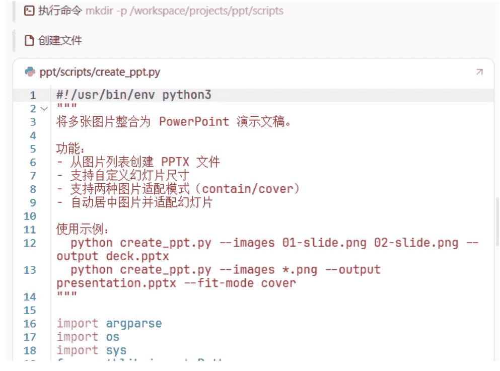

（a）

大纲：outline.md

## 步骤 6：整合为 PPT

所有幻灯片图片生成完成后，调用脚本把图片合并为 PowerPoint 文件：

```bash
cd slide-deck/{topic-slug}/
python /workspace/projects/ppt/scripts/create_ppt.py --images *.png --output {topic-slug}.pptx
```

**参数说明**：

- `--images`：图片文件列表，支持通配符（如 `*.png` 或 `01-*.png`）

- `--output`：输出 PPTX 文件路径

- `--width`：幻灯片宽度（可选，默认 1280 像素）

- `--height`：幻灯片高度（可选，默认 720 像素，16:9）

- `--fit-mode`：图片适配模式（可选，默认 `contain`）

  - `contain`：保持比例，完整展示图片（推荐）

很好！现在进行功能测试，创建几张测试图片并验证脚本能正常工作：

```
执行命令 cd /workspace/projects/ppt/scripts && python -c " from PIL import Image imp...
```

```
Bash
Created: 01-slide-cover.png
Created: 02-slide-content.png
Created: 03-slide-end.png
[Command completed]
```

```
执行命令 cd /workspace/projects/ppt/scripts && python create_ppt.py --images test_im...
```

```
Bash
✓ 已添加第 1 张幻灯片：01-slide-cover.png
✓ 已添加第 2 张幻灯片：02-slide-content.png
✓ 已添加第 3 张幻灯片：03-slide-end.png
✓ 演示文稿已保存至：test_deck.pptx
✓ 共 3 张幻灯片
[Command completed]
```

(c)

图7-7 扣子编程智能体的开发过程

通过上述三步，整合 PPT 输出的新需求便得以完整实现。

接下来，可沿用7.2.5 节中的测试方法，在预览区重新发起一次任务（本次选择“水墨风”模板），以验证系统是否能成功生成 PPT 文件。如图7-8 所示，任务完成后，文件预览界面中会出现名为“济南到皖南自驾旅游规划.pptx”的输出文件。


济南到皖南自驾旅游规划.pptx

此文件暂不支持预览

下载

图7-8 PPT 文件

下载该文件并在本地 PowerPoint 或兼容软件中打开后，可看到如图7-9 所示的实际演示效果。


图7-9 PPT 文件打开效果

至此，从内容分析、幻灯片生成到最终文件整合的整个 PPT 自动创作流程已完整打通并稳定运行。

本项目的开发与测试部分已全部完成。鉴于此前多个项目已详细介绍过 Skills 的部署方式以及通过扣子平台调用 Skills 的流程，本项目不再重复演示。读者可参照已有流程（4.2.2 节的 Skills 部署流程），将本方案集成到实际应用环境中。

## 第8章 数字营销 GEO 与 SEO Skills 库开发实战

第 3～7 章的实战项目分别实现了直播带货话术复用 Skills、股票技术分析 Skills、微信公众号文章配图 Skills、小红书图文生成 Skills 及 PPT 创作助手 Skills。这些案例验证了扣子智能体在单一 Skills 赋能下处理特定任务的可靠性。然而在复杂的商业场景中，单一 Skills 往往难以应对链路较长的业务需求，开发者需要构建整套 Skills 库以支撑业务逻辑。


本章聚焦数字营销领域，通过扣子平台打造一套集成搜索引擎优化（Search Engine Optimization，SEO）与生成式引擎优化（Generative Engine Optimization，GEO）的 Skills 库。本章不再局限于开发离散的功能点，而是把市场调研、内容策略、技术检测及实时监控整合成一个专家系统。通过本章的学习，读者将掌握如何把复杂方法论拆解为多个 Skills，并实现多 Skills 协同工作。本章配套视频可扫描右侧二维码观看。

### 8.1 技术背景与设计：从索引时代迈向生成时代

在数字营销领域，流量分配规则正经历从传统索引向生成式回复的范式演进。作为智能体开发者，需要重新审视信息在不同生态下的分发逻辑。

#### 8.1.1 搜索生态的范式转移

过去二十几年，SEO 是数字化增长的核心。开发者通过关键词研究与技术栈优化，提升网页在搜索引擎（如 Bing、百度）结果页面（Search Engine Results Page，SERP）中的排名，如图8-1 所示。

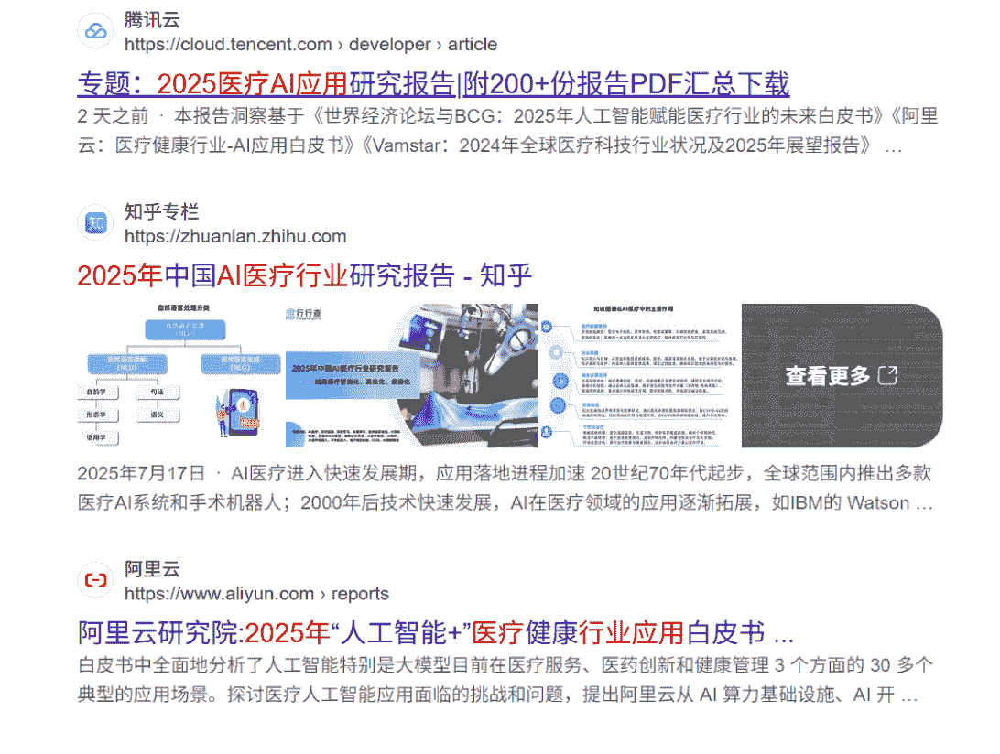

图8-1 搜索引擎搜索示例

进入 AI 时代，生成式 AI 对网页的引用催生了 GEO，如图8-2 所示。

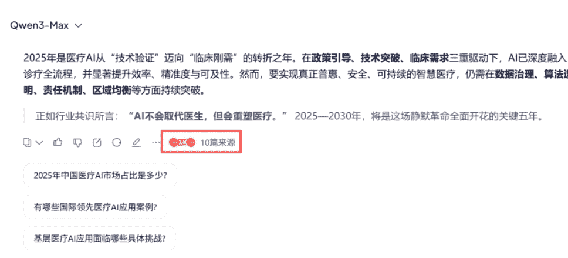

图8-2 生成式 AI 对网页的引用

当用户习惯于在千问、DeepSeek 或豆包中直接获取结构化答案时，流量规则发生了如下变化。

- 从点击转换转向引用归因：用户不再频繁点击搜索结果链接，而是阅读由 AI 整合生成的总结。品牌的曝光量取决于是否被 AI 采信为原始素材。
- 从关键词堆砌转向语义建模：网页内容能否被 AI 提取，取决于内容的语义深度、专业权威性，以及结构化数据的完备性。

#### 8.1.2 数字营销 GEO 与 SEO Skills 库的设计

在实际业务场景中，营销团队常面临流程脱节的困境：研究、创作、审计与监控各环节缺乏数据闭环，导致生成的内容难以在 AI 时代获得流量。

为解决上述痛点，本章设计的 Skills 库基于研究-构建-优化-监控 4 阶段方法论，把碎片化的营销任务转换为多个可组合、可复用的 Skills 组件，使得扣子智能体可以根据任务需要，自行选择 Skills 进行任务处理。4 阶段方法论具体如下。

- 研究阶段：分析搜索趋势与 AI 响应特征，识别具备 AI 引用潜力的高价值语义主题。
- 构建阶段：引导智能体兼顾 SEO 的结构化逻辑与 GEO 的语义特征，自动化生成符合 AI 检索偏好的高质量内容。
- 优化阶段：对存量内容进行处理，修复技术规范缺陷，并通过内部链接矩阵优化站点权重。
- 监控阶段：构建数字化“增长监控中心”，实时追踪关键词排名演变及 AI 引用率波动，实现策略的快速迭代。

### 8.2 数字营销 GEO 与 SEO Skills 库的开发与部署

本节基于研究-构建-优化-监控 4 阶段方法论，拆解 Skills 开发与部署各阶段要点，以及向智能体功能模块转换的技术路径。

由于各阶段 Skills 的底层开发逻辑具有一致性，本章采取“典型案例拆解 + 配套资源”的模式：每一阶段选取一个示例 Skills 进行讲解，其他 Skills 的完整内容请参考本书配套资源。

#### 8.2.1 研究阶段的 Skills 实现

研究阶段是数字营销 GEO 与 SEO Skills 库项目的冷启动核心，旨在在项目内容创建之前，了解市场、受众和机会。该阶段主要涵盖如下 4 个技术方向。

- 关键词研究：挖掘高价值词簇，通过数据评估该关键词的搜索热度、竞争难度及用户意图（是想找信息、找品牌，还是直接想买东西）。
- SERP 特征分析：观察目标关键词在搜索结果页的呈现方式（如有常见问题回答、视频或精选摘要），反推我们需要准备什么样的内容体裁。
- 竞品架构映射：解析行业头部内容的逻辑结构，并对照 Google 提出的 EEAT 标准（经验、专业度、权威性和可信度）评估对手的优劣势。
- 内容缺口发现：通过对比分析，找出竞争对手尚未覆盖的“流量蓝海”，构建差异化的选题矩阵。

在本项目中，上述研究方法被封装为 Skills。这种研究类技能的核心在于业务逻辑的结构化表达——它并不依赖复杂的编程代码，而是通过高精度的结构化提示词驱动智能体进行联网搜索与逻辑分析。

因此，可通过把这些提示词写进 SKILLS.md 文件来实现 Skills 的开发。以关键词研究 Skills 为例，其编写逻辑如下。

（1）把该 Skills 的描述、使用场景及具体功能描述清楚，便于智能体了解何时选用该 Skills。示例如下。

# 关键词研究

这项 Skills 帮助您发现、分析和优先排序 SEO 和 GEO 内容策略的关键词。它基于搜索量、竞争度、意图和商业相关性来识别高价值机会。

## 何时使用这项 Skills

- 开始新的内容策略或活动
- 扩展到新主题或市场
- 为特定产品或服务寻找关键词
- 识别长尾关键词机会
- 了解您行业的搜索意图
- 规划内容日历
- 研究 GEO 优化的关键词

## 这项 Skills 的功能

1. **关键词发现**：从种子词生成全面的关键词列表
2. **意图分类**：按用户意图对关键词进行分类（信息性、导航性、商业性、交易性）
3. **难度评估**：评估竞争程度和排名难度
4. **机会评分**：按潜在 ROI 对关键词进行优先排序
5. **聚类**：将相关关键词分组到主题集群中
6. **GEO 相关性**：识别可能触发 AI 响应的关键词

（2）编写具体的执行步骤，供智能体在调用该 Skills 时可以按照步骤执行。各步骤的设计原理如下。

① 业务建模：明确受众画像，建立初步的关键词筛选机制。
② 核心词提取：找准业务底层逻辑，提炼核心母词。
③ 长尾路径扩展：模拟真实用户的搜索习惯，多维度发散关联词库。
④ 搜索意图判定：识别用户搜索行为背后的真实动机。
⑤ 竞争门槛评估：量化目标词的排名难度。
⑥ ROI 机会评分：综合流量收益与竞争成本，计算优先级。
⑦ AI 引用潜力评估（GEO）：识别哪些主题更容易触发 AI 摘要（如 AI Overviews）的回应。
⑧ 主题权威度构建：将散乱的关键词组织成逻辑严密的主题群。
⑨ 标准化报告交付：输出一份从调研到实操的落地执行方案。

根据这 9 步原理，可进行详细的提示词编写。由于详细的 SKILLS.md 篇幅较长，为了保证阅读体验，本书正文仅展示逻辑框架，完整的 SKILLS.md 提示词模板已收录在本书的配套资源中。

#### 8.2.2 构建阶段的 Skills 实现

如果说研究阶段是在画图纸，那么构建阶段就是正式破土动工。这一阶段的目标是产出高产出的内容报告，或对初稿进行精细化打磨。它同样包含 4 个实战方向。

- SEO 深度内容创作：采用支柱-集群架构。即通过一篇核心长文建立行业权威，再辅以多篇子话题文章形成内容矩阵。这种体系化覆盖能有效提升 EEAT 标准得分，适合从零构建行业百科全书或深度专题。
- GEO：在初稿中有针对性地嵌入精准定义、权威统计数据与常见问题回答模块。其核心逻辑是迎合大语言模型的提取偏好，力求在 AI 搜索的概览中获得首选引用，抢占 AI 时代的流量制高点。
- 元标签与社交展示优化：为页面定制高点击率（Click-through Rate, CTR）的元标签（Meta Tags）及社交媒体预览卡片。这不仅是为了实现多平台视觉统一，更是为了让你的内容在搜索结果中更吸睛，确保在排位好的同时，读者更愿意点击进去。
- Schema 结构化数据生成：为常见问题回答、操作步骤、文章等生成标准化的 Schema 脚本。这相当于给内容贴上搜索引擎能读懂的数字标签，从而在搜索结果页获得下拉列表、星级评分等富媒体展示，显著增加页面的视觉占位面积。

接下来，以核心内容构建 Skills 为例，拆解其开发流程。该技能的本质是通过一套高标准的结构化提示词，指挥智能体创作出兼具文学美感与 SEO 逻辑的高质量内容。

在开发过程中，所有执行逻辑都会被写入 SKILLS.md 文件中。

在 SKILLS.md 的开头，需要清晰定义这项技能的身份、使命及应用边界，让智能体能迅速对号入座。示例如下。

# SEO 内容编写器

这项 Skills 创建搜索引擎优化的内容，在提供真正价值给读者的同时排名良好。它应用经过验证的 SEO 文案技巧、适当的关键词整合和最佳内容结构。

## 何时使用这项 Skills

- 编写针对特定关键词的博客文章
- 创建针对搜索优化的着陆页
- 为主题集群开发支柱内容
- 为电子商务编写产品描述
- 为本地 SEO 创建服务页面
- 制作操作指南和教程
- 编写比较和评论文章

## 这项技能的 Skills

1. **关键词整合**：自然地整合目标关键词和相关关键词
2. **结构优化**：创建可扫描、组织良好的内容
3. **标题和元数据创建**：编写引人注目、值得点击的标题
4. **标题优化**：使用策略性的 H1～H6 层次结构
5. **内部链接**：建议相关的内部链接机会
6. **可读性增强**：确保内容易于访问和引人入胜
7. **特色摘要优化**：为 SERP 功能机会格式化

有了定义后，需要编写具体的执行步骤。这套步骤背后的设计逻辑包含以下 10 个关键环节。

- 需求锚定：明确核心关键词、受众画像及搜索意图，为内容定下战略基调，防止 AI 产出空泛的废话。
- 竞品与数据规划：深度分析 SERP，通过竞品映射确定内容的广度与深度，确保内容在数据层面上具备排名优势。
- 标题诱饵优化：采用关键词前置与强力词汇的策略，在有限字符内平衡搜索引擎权重与用户点击欲望。
- 撰写元描述：将摘要作为高转换率的广告位来经营，通过简洁的利益点与行动号召（CTA）引导用户点击跳转。
- 构建层级架构：利用规范的 H 标签等级（H1～H4），为爬虫提供清晰的逻辑地图，同时为读者提供丝滑的扫视体验。
- 校准页面 SEO 规范：执行标准化的技术体检，对关键词密度、图片 Alt 属性等细节进行精细化微调，确保符合搜索引擎的偏好。
- 模块化内容创作：填充高质量信息，并配合专业的排版（如加粗、块引用、对比表格），全方位拉升页面的停留时长与专业度（E-E-A-T）。
- 抢占零位排名：针对特定的搜索摘要样式（如列表、定义框）进行格式化处理，力求在搜索结果最顶端获得突出展示。
- 内外部链接织网：通过内链引导站内权重流转，通过高权威外链为内容背书，增强信息的可信度。
- 终审与质量把关：引入最终的审查机制，从技术和内容两个维度查漏补缺，确保发布即具备极强的竞争力。

由于详细的 SKILLS.md 篇幅较长，为了保证阅读体验，本书正文仅展示逻辑框架，完整的 SKILLS.md 提示词模板已收录在本书的配套资源中。

#### 8.2.3 优化阶段的 Skills 实现

内容发布并非终点，而是持续优化的起点。优化阶段的核心目标是：确保网页始终处于搜索算法的首选区，并持续锁定 AI 引擎的引用位置。

这一阶段主要由以下 4 个实战方向构成。

- 页面级 SEO 深度审计：对单个页面进行全方位的 SEO 体检。这个方向不仅是检查关键词，更要分析页面是否存在影响排名的细微瑕疵。
- 全局技术 SEO 诊断：从网站底层健康度出发，确保服务器响应、爬取路径和索引机制畅通无阻。
- 内链逻辑优化（权重路由）：重新梳理站内链接结构。通过合理的内链布局，将权重引导至核心页面，帮助搜索引擎理清内容间的逻辑脉络。
- 内容周期性刷新：识别并重塑那些时效性减弱或排名下滑的旧文。通过注入最新数据与观点，激活沉睡流量，实现排名的二次飞跃。

接下来，以页面 SEO 审计 Skills 为例，拆解其开发逻辑。该 Skills 的功能是自动化识别网页在标题、元描述、内容质量及图片优化等层面的提升空间。

同样地，我们把所有的提示词封装在 SKILLS.md 文件中。

SKILLS.md 首先把该 Skills 的描述、使用场景及具体功能描述清楚，便于智能体了解何时选用该 Skills。示例如下。

## 页面 SEO 审核器

这项技能执行详细的页面 SEO 审核，以识别问题和优化机会。它分析所有影响搜索排名的页面元素并提供可操作的建议。

### 何时使用这项技能

- 在发布之前或之后审核页面
- 识别页面排名不佳的原因
- 优化现有内容以获得更好的性能
- 创建发布前 SEO 检查清单
- 将您的页面 SEO 与竞争对手进行比较
- 系统性的全站 SEO 改进
- 培训团队成员 SEO 最佳实践

### 这项技能的功能

1. **标题标签分析**：评估标题优化和 CTR 潜力
2. **元描述审查**：检查描述质量和长度
3. **标题结构审核**：分析 H1～H6 层次结构
4. **内容质量评估**：审查内容深度和优化
5. **关键词使用分析**：检查关键词位置和密度
6. **内部链接审查**：评估内部链接结构
7. **图像优化检查**：审核 alt 文本和文件优化
8. **技术页面审查**：检查 URL、规范标签和移动因素

接下来设计审计标准流程。为了让智能体能像资深 SEO 专家一样给出精准的建议，需要在 SKILLS.md 文件中为其设定一套环环相扣的执行指令。这套指令背后的设计逻辑分为以下 10 个维度。

- 全局信息锚定：明确审计的目标页面、核心关键词及其在业务链条中的角色，确保优化动作不偏离业务主线。
- 标题标签透视：诊断搜索结果中最关键的第一行信息，评估关键词布局是否精准，长度是否符合展示规范。

SEO与GEO全链路打法：从页面诊断到持续监控的闭环

- 搜索摘要点击力评估：以营销视角审视搜索片段，判断其能否激发点击并给出明确的行动号召。
- 标题层级合理性核查：检验 H1 到 H3 的逻辑链条，确保信息权重对爬虫友好且用户一目了然。
- 内容深度与可读性评定：对照 EEAT 原则，评估专业度与阅读体验是否真正解答用户疑问。
- 关键词与语义关联校准：梳理核心词及相关表达的分布，避免堆砌造成过度优化。
- 站内链接结构审计：分析页面在内部权重网络中的位置，借助锚文本优化提升权威传递。
- 多媒体资源体检：核查图片尺寸、格式及 Alt 文本，在保证加载效率的同时争取图片搜索曝光。
- 技术SEO深度扫描：排查 URL 规范、移动适配与 Schema 标记，消除阻碍索引的技术障碍。
- 审计结果可视化：把零散诊断数据整理成按优先级排序的行动清单，为迭代提供可执行的指南。

该审计模块的有效性源于严密的逻辑与可执行性。为保持正文精炼，完整的 SKILLS.md 执行模板已收录在配套材料中，可直接调用或修改。

#### 8.2.4 监控阶段的Skills实现

监控阶段的使命是及时捕捉算法波动、量化落地成效，并在风险初现时快速调整策略，使 SEO 与 GEO 从试错走向持续改进。

本阶段聚焦四个实战方向。

- 全域排名追踪：实时观察关键词在传统搜索与 AI 生成摘要中的位置变化，捕捉增长机会或下跌风险。
- 外链画像拆解：解析反向链接的质量构成，评估其对权重的贡献，并监控竞争对手的链接动向。
- 经营决策看板：整合多源数据生成直观的内容表现报告，为下一轮策略提供数据支撑。
- 异常指标预警：构建主动监控机制，对排名骤跌、索引异常等关键信号设置红色警报，实现从被动到主动的响应。

### 排名跟踪器

该 Skills 用于追踪、分析并汇报关键词排名随时间的变化，覆盖传统 SERP 与 AI/GEO 可见性，提供全面的搜索表现洞察。

### 何时使用这项Skills

- 为新 campaign 建立排名基线
- 跟踪关键词位置的实时变动
- 解析排名长期的演进规律
- 与竞争对手进行横向排名对比
- 监测 SERP 特色模块的出现
- 追踪 AI 概览的收录情况
- 为管理层输出排名绩效报告

### 这项技能的核心能力

1. **位置监测**：记录并持续跟进关键词排名
2. **趋势解析**：识别排名随时间的演变模式
3. **异动标记**：高亮显著的位置波动
4. **竞品对标**：与对手进行基准对比
5. **SERP 特征追踪**：监测精选摘要、PAA 等模块
6. **GEO 可见性监测**：追踪 AI 引用出现频次
7. **报告生成**：输出排名表现报告

要让智能体敏锐感知搜索市场的微小变化，需在 SKILLS.md 中写入执行逻辑。该逻辑由七个核心步骤构成。

（1）监控坐标建立：明确监测的地理位置、设备类型及关键词分组，为数据采集提供精准过滤，确保结果与业务强相关。
（2）实时位次快照：抓取关键词的即时排名并存档，为后续效果量化建立初始坐标系。
（3）异动穿透分析：对比不同周期的升降情况，剖析波动根因是算法更新还是内容迭代带来的正向反馈。
（4）搜索特征占位监控：关注蓝色链接之外的特殊展位，如精选摘要、PAA 问答框，是注意力争夺的第二战场。
（5）GEO 可见性扫描：专项扫描 AI 概览的引用情况，评估品牌在 AI 引用源中的权重，提前卡位生成式搜索红利。
（6）市场声量博弈：与竞争对手横向对比，分析声量份额，帮助客观评估行业位次，并在竞品出击时及时预警。
（7）决策型报告输出：将监控指标转化为“问题发现→归因分析→优化建议”的闭环报告，成为指导下一步动作的战术手册。

排名跟踪技能的精髓在于持续性。完整提示词需涵盖复杂的判断逻辑与报告格式，故已将完整的 SKILLS.md 模板置于配套资料中，方便直接调用或修改。

#### 8.2.5 数字营销GEO与SEO Skills库的部署

完成数字营销 GEO 与 SEO Skills 库的全量开发后，最终一步是通过扣子编程进行部署。

受限于当前扣子编程环境的机制，平台暂不支持多 Skills 打包为统一项目，每个项目仅能承载一份 SKILLS.md。因此一套完整的 Skills 库在部署时需将 16 个 Skills 分别上传。

### 1. Skills的部署

以关键词研究 Skills 的部署为例，需把该 Skills 的全部配置文件打包为 .zip 压缩包。点击如图 8-3 所示界面中的按钮，将资源包导入环境。


图8-3 Skills 压缩包上传界面

上传后系统自动进入适配阶段。当界面显示如图 8-4 所示的完成标识时，即代表该 Skills 可正常运行。

### Skill 适配完成

已成功适配转换 keyword-research Skill。

### 实现概览

- **Skill 名称**: keyword-research
- **核心能力**: 关键词发现、意图分类、难度评估、机会评分、主题聚类、GEO 优化
- **实现方式**: 全自然语言指导（智能体主导）

### 适配操作清单

1. **目录规范化**
   - ✅ 目录名 keyword-research 符合命名规范，无需重命名
2. **SKILL.md 调整**
   - ✅ 精简 description 字段至 136 字符（原 150+ 字符）
   - ✅ 保留完整正文内容（关键词研究流程、扩展模式、评分方法等）

图8-4 适配工作完成示意

部署前可在预览区测试。例如输入“请梳理2025年医疗智能应用落地的行业报告”，若能获得如图8-5所示的结构化输出，则说明 Skills 逻辑正常。

请梳理2025年医疗智能应用落地的行业报告

### 战略洞察与执行路径

该选题兼具行业价值，2025年处于医疗智能商业化的关键节点，相关落地数据对从业者有重要参考意义。我将从关键词研究切入，为你搭建报告骨架与数据支撑。

稍等，我先通过关键词研究技能挖掘行业核心脉络。

完成技能加载

关键词研究技能

### 报告核心框架与关键词策略

基于关键词研究技能的指引，我为你构建了2025医疗智能落地报告的核心框架与关键词体系：

### 一、核心关键词矩阵

```
# 医疗AI落地报告关键词体系

## 支柱关键词
- 2025医疗AI应用落地
- 医疗AI商业化进展
- 医院AI落地案例
```

图8-5 关键词研究 Skills 测试效果

部署完成后点击按钮（见图 8-6），该 Skills 即可正式上线，后续可在扣子智能体的“技能商店”或“技能”列表中查找到。


图8-6 部署按钮位置

其余 15 个 Skills 均需重复上述流程，依次完成部署。

按此方式部署后，如图8-7所示，这些 Skills 在扣子智能体看来是彼此隔离的工具箱，智能体需自行判断调用哪个。

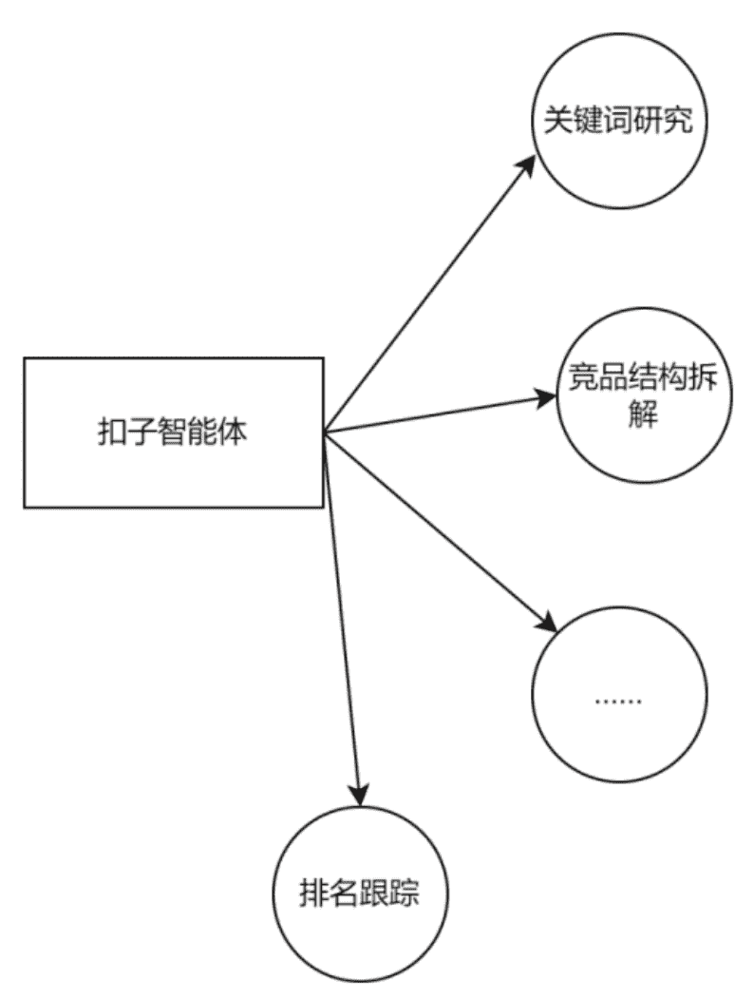

图8-7 扣子 Skills 库调用架构

为打破孤岛效应，需在每个 Skills 的 SKILLS.md 中引入相关技能描述，建立关联索引，辅助智能体选择协同 Skills。

### 2. Skills的互相关联

以关键词研究 Skills 为例，可在 SKILLS.md 结尾追加如下内容。

```
## 相关Skills
```

- [竞品分析(competitor-analysis)] - 查看竞争对手排名的关键词
- [内容差距分析(content-gap-analysis)] - 找到缺失的关键词机会
- [SEO内容写作(seo-content-writer)] - 为目标关键词创建内容
- [AI引擎内容优化(geo-content-optimizer)] - 优化AI引用

当智能体解析到这些关联描述后，不再机械执行单一任务，而能在实战中根据进展自动判断下一步，例如关键词挖掘后自动触发 competitor-analysis 或建议进入 seo-content-writer 生产环节。

#### 8.3 扣子通用智能体秒变数字营销GEO与SEO专家

完成技能部署后，本节演示如何借助多 Skills 协同，在扣子智能体上完成研究报告的生成与监控任务。

#### 8.3.1 多Skills加载与测试

进入扣子对话页，点击输入框图标，即可在弹出列表中看到已集成的全部 Skills（见图8-8）。


图8-8 Skills 列表展示

在单 Skills 场景下我们习惯手动指定名称，但在多 Skills 场景下，扣子已将所有已部署 Skills 的 SKILLS.md 原信息预加载至模型上下文。智能体可自主判断并在后台调用合适工具，无需逐一手动添加。

例如通过简单问答即可测试掌控情况。

在SEO和GEO领域，目前你有哪些技能可以调用？

如图8-9所示，智能体将列出全部 Skills 并给出功能概览。

> 在SEO和GEO（生成式引擎优化）领域，目前你有哪些Skills可以调用？

在SEO和GEO领域，我可以提供以下专业Skills支持：

### 一、核心SEO能力

1. 关键词研究：挖掘高价值关键词，进行意图分析、难度评估和机会映射，为内容策略提供数据支撑。
2. 页面SEO审计：全面分析标题、元描述、内容质量、内部链接、图像优化等关键元素，适用于发布前检查和排名诊断。
3. 技术SEO检查：审核网站速度、可爬取性、可索引性、移动友好性、安全性和结构化数据，识别技术层面的排名阻碍。
4. 反向链接分析：评估链接权威性，识别有毒链接，发现链接建设机会，监控竞争对手的链接获取策略。
5. 内部链接优化：分析和优化网站内部链接结构，改善网站架构，合理分配页面权威性。

### 二、GEO（生成式引擎优化）能力

1. 生成式引擎内容优化：调整内容以适配ChatGPT、Claude、Perplexity和Google AI概览等AI系统，增加被引用的机会。
2. 内容更新与翻新：识别过时内容，添加新信息和统计数据，恢复搜索排名，同时优化GEO适配性。

### 三、竞争分析与策略规划

1. **竞争对手分析**：深度剖析竞品的SEO和GEO策略，包括排名关键词、内容方法和AI引用模式，寻找超越机会。
2. **内容差距分析**：对比自身与竞品的内容差异，识别缺失主题和可定位关键词，规划内容策略。
3. **搜索引擎结果页面（SERP）分析**：理解排名因素、SERP功能和用户意图模式，为内容创作提供精准方向。

### 四、报告与监控能力

1. **性能报告生成**：整合排名、流量、反向链接和AI可见性指标，生成月度/季度SEO和GEO性能报告。
2. **关键词排名跟踪**：监控关键词排名随时间的变化，识别趋势并对重大变动发出警报。
3. **SEO警报管理**：设置和管理关键指标的警报，实现主动监控和快速响应问题。

### 五、内容创作与优化

1. **SEO内容写作**：创建高质量、SEO优化的博客文章、着陆页和产品描述，提升搜索引擎排名。
2. **元标签优化**：优化标题标签、元描述、Open Graph标签和Twitter卡片，最大化点击率和社交媒体分享参与度。
3. **结构化数据生成**：生成Schema.org JSON-LD标记，在搜索引擎中启用富结果展示。

图8-9 SEO与GEO可用技能汇总

注：因采用拆分部署，智能体会基于 Skills 元数据进行语义聚类，分类方式可能与 8.2 节理论划分略有差异，不影响实际调用。

为确保复杂任务不遗漏关键步骤，建议先规划后执行，输入如下提示词。

如果我要写一篇2025年医疗行业AI应用落地情况报告，需要进行SEO和GEO的优化，你规划一下应该调用哪些Skills？

如图8-10所示，智能体会自动串联关键词研究等核心技能并输出方案。

- 隐藏步骤
  - 完成技能加载 关键词研究
  - 完成技能加载 SEO内容写作
  - 完成技能加载 AI引擎内容优化
  - 完成技能加载 Schema生成

### 《2025年医疗行业AI应用落地情况报告》SEO与GEO优化方案

### 一、整体策略规划

### 核心目标

1. SEO优化：在搜索引擎中获得高排名，吸引自然流量
2. GEO优化：增加被AI系统引用的机会，提升在AI生成响应中的可见性

图8-10 SEO/GEO优化方案

确认无误后，输入提示词“请执行你设计的方案”。

扣子智能体将开始撰写报告，如图8-11所示。

请执行你设计的方案

2025医疗AI应用落地及投资趋势

25 个来源

### 2025年医疗行业AI应用落地情况报告

### 一、引言

随着人工智能技术的快速发展，医疗行业正经历着前所未有的变革。2025年，医疗AI应用从试点阶段进入规模化落地期，成为解决医疗资源分配不均、提升诊疗效率、降低医疗成本的关键技术手段。本报告将全面分析2025年医疗AI应用的现状、案例、挑战与未来趋势。

### 二、政策环境与市场规模

### 2.1 政策支持

2025年10月，国家卫健委等五部门联合发布《关于促进和规范“人工智能+医疗卫生”应用发展的实施意见》，明确了医疗AI的发展目标和应用场景。政策覆盖医疗服务、基层公卫、健康产业、医学科研四大领域，推动AI医疗从“探索期”迈入“规范发展期”。

图8-11 报告撰写过程

#### 8.3.2 长期计划

报告发布后，真正的 SEO/GEO 工作才开始。为持续跟踪内容排名与 AI 引用频率，可利用扣子的“长期计划”功能，将智能体转为 7×24 小时监控员。

在扣子主页侧边栏点击“长期计划”中的“创建计划”，新建一个长期计划，如图8-12所示。

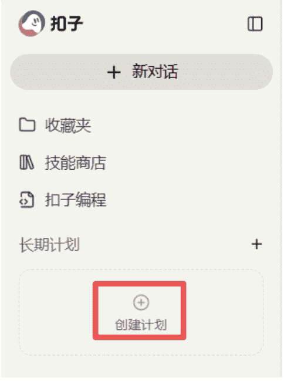

(a)


(b)

### 图8-12 长期计划创建界面

此处将 8.3.1 节生成的报告以附件形式上传，并演示如何创建长期计划并使用排名跟踪 Skills 进行持续监测。

点击图标上传附件，点击图标加载 Skills，然后输入提示词，如图8-13所示。

请使用该Skills对该报告进行长期跟踪


图8-13 医疗报告长期排名跟踪设置

发送后进入如图8-14所示的对话页面。

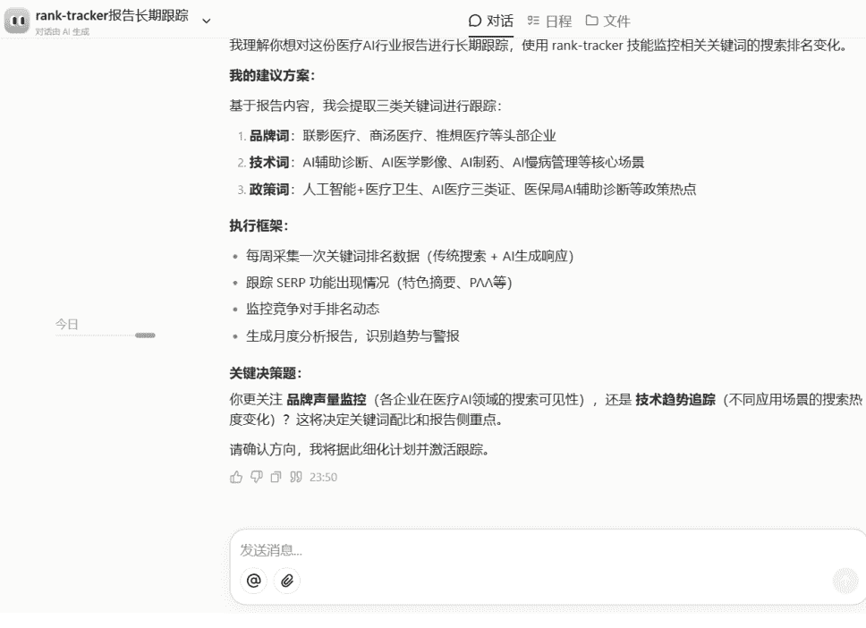

图8-14 长期计划对话页

此时智能体将据提示词设计计划方案。输入“技术趋势追踪”后，计划将被构建完成（见图8-15（a）），点击图标激活计划（见图8-15（b））。


（a）

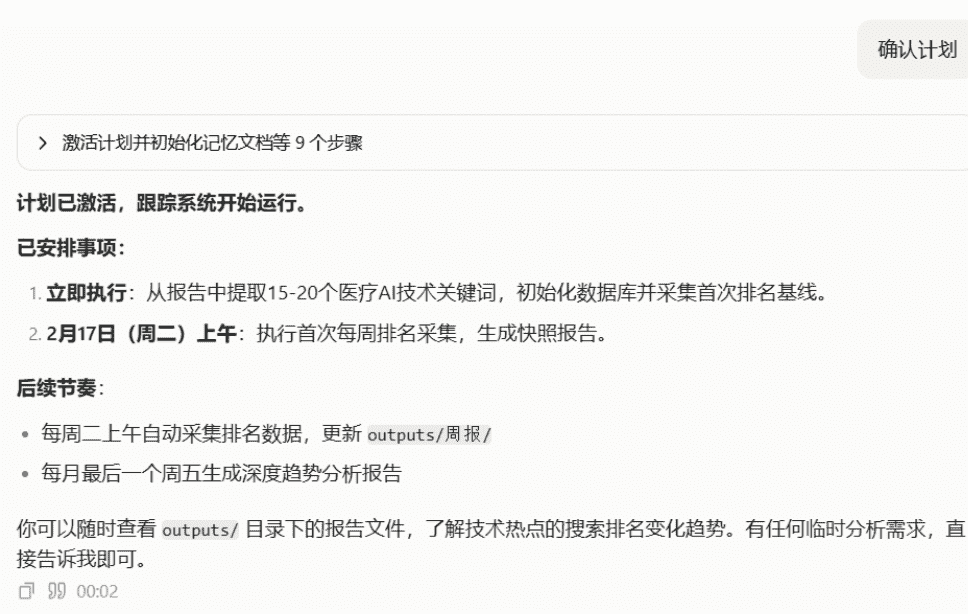

## 图8-15 激活计划

与普通对话相比，左侧多出“今日”时间轴，用于标注执行时间。页面上方有“日程”标签，点击后切换至日程页（见图8-16）。

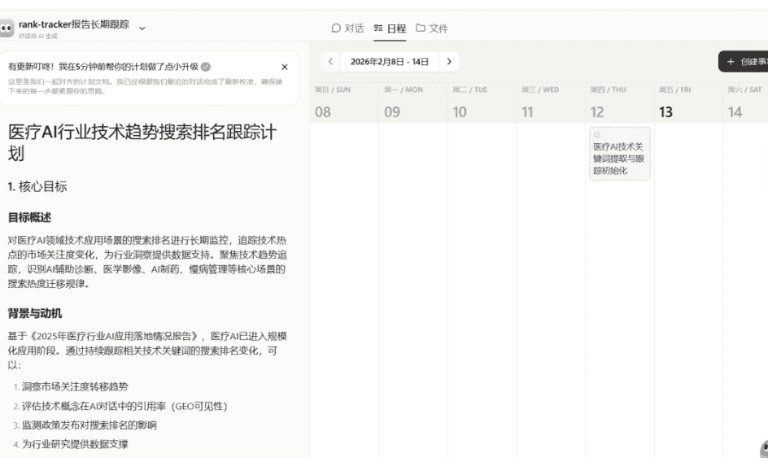

## 图8-16 日程视图

该页可像日历一样追溯智能体每日执行了哪些审计工作、捕捉到哪些数据波动，让复杂的 SEO 监控变得透明可控。

如此，通过普通对话实现内容快速爆发，通过长期计划实现资产持续增值，最终在扣子平台构建起闭环的数字营销 GEO 与 SEO 工作流。

## 第五部分 OpenClaw部署与实战篇

## 第9章 OpenClaw：基于扣子的部署与Skills实战

前文介绍了在扣子与扣子编程平台上开发各类 Skills 的方法，涵盖从纯文字交互到多模态协同，从单一 Skills 到复杂 Skills 矩阵。但在企业级场景中，如何将这些 Skills 无缝接入现有业务系统，实现 AI 能力的规模化落地，是开发者与决策者共同面临的核心挑战。

OpenClaw 创始人彼得·斯坦伯格在 2026 年初的多次访谈中指出：OpenClaw 的核心使命是将 AI 从聊天助手升级为连接真实世界的生产力工具。通过深度集成的工具与 Skills，OpenClaw 能在授权范围内控制个人电脑及服务器操作系统，使其从问答助手演变为类似《钢铁侠》中贾维斯那样的 AI 助手。

OpenClaw 自 2026 年初发布以来，已迅速成为全球 AI 领域的现象级开源项目，其增长速度远超 2025 年初 DeepSeek 的市场热度。据 GitHub 最新数据显示，OpenClaw 在 4 个月时间内登顶最受欢迎开源软件榜首，成为欢迎度增长最快的项目。

硬件市场的连锁反应随技术热度被放大。苹果 Mac mini 凭借低功耗桌面形态与足够的性能，很适合把 AI 工作负载 24 小时挂起运行，因此意外成为 OpenClaw 落地时最受欢迎的硬件之一。该机型在转售渠道被快速加价，部分地区甚至出现缺货。

商业侧的表现同样突出。Kimi 在上线免安装的 OpenClaw 能力后，仅用 20 天就把收入做到了超过 2025 年全年累计，且海外营收首次超过国内，侧面印证了 OpenClaw 作为 AI 执行层基础设施的价值。


Skills 插件生态是能力扩展的核心枢纽，也是开发者打造定制化 AI 应用的入口。通过它，OpenClaw 能无缝嵌入各类工作流，覆盖邮件处理、文档分析到自动化任务执行的全场景。本章以扣子编程平台为实践载体，演示上线流程并解析 Skills 与 OpenClaw 的协作方式，提供从基础部署到高级定制的完整路径，助力 AI Agent 在具体场景落地。配套视频可扫右侧二维码观看。

### 9.1 OpenClaw 如何重塑 AI 执行范式
本节先认识这位数字员工，说明它的能力范围与典型用途。

#### 9.1.1 OpenClaw 到底是什么
OpenClaw 并不是聊天机器人，而是一个会干活的 AI 助手。与豆包、千问或扣子不同，它可以在用户的 PC、服务器上解决真实问题，如文件操作、浏览器使用、邮件处理、消息回复、调用扣子生成深度研究报告等。

它还能保持常驻在线，并可绑定微信、钉钉、飞书等即时通讯软件，让用户像与同事对话一样下达指令。下班后不必把电脑带回家，也能用手机继续遥控，例如让它继续制作 PPT、处理邮件、整理周报、调用 Claude Code 编写代码等。

#### 9.1.2 应用场景 全方位覆盖自动化需求
OpenClaw 的强项在于 Skills 系统的可扩展性，能覆盖个人生活到商业创业的全场景。

在生活里，可扮演个人生活管家，完成：
- 信息过滤与推送：自动分类邮件、退订垃圾信息，结合天气和健康指标联动穿戴设备生成每日简报。
- 生活事务自动化：跨平台比价并预订行程、自动同步值机信息至日历、识别群聊需求并更新购物清单。
- 家庭自动化环境：远程控制智能家居，根据疲劳程度自动调节灯光及温度，甚至基于冰箱库存推荐食谱并下单食材。

在职场里，可充当办公利器，完成：
- 文档与行政处理：自动整理会议纪要、生成工作周报、批量重命名或归档服务器文件，大幅减少重复性复制粘贴。
- 团队协同加速：自动提取会议行动项并分发给相关负责人，在 Notion、Todoist、飞书等多个工具间实现数据实时同步，消除信息孤岛。
- 专业辅助：为开发者调试代码、为销售管理 CRM 客户关系、为创作者搜集素材并生成大纲。

对于一人公司、创业者与自由职业者，它可充当无需支付薪水的执行团队：
- 客户服务自动化：自动识别咨询邮件、打标签并回复，签单后自动调用模板生成电子合同、开具票据。
- 业务流程全闭环：仅需人工最终确认，即可完成从需求获取到交付归档的全流程，助力一人公司高效运转。

### 9.2 基于扣子编程的 OpenClaw 部署与使用全流程
明确核心概念与价值后，进入实战。本节从环境搭建入手，演示如何通过扣子编程平台上线 OpenClaw 并接入飞书等办公生态，最终实现 Skills 调用。

#### 9.2.1 部署方案的权衡与选择
部署 OpenClaw 通常有表 9-1 所列的三种方案。

**表9-1 部署方案**

| 部署方案 | 核心优势 | 主要劣势 | 适用人群 |
| :--- | :--- | :--- | :--- |
| 本地硬件部署 | 零成本、隐私性极高 | 存在误删本地文件风险、需保持设备 24 小时常开 | 技术背景用户、Mac mini 用户 |
| 传统云服务器 | 环境独立、稳定性高 | 成本较高、需具备运维基础 | 企业用户、资深开发者 |
| 扣子沙盒环境 | 性价比高、环境隔离、操作极简 | 需开通扣子相应版本权限 | AI 深度玩家、非技术背景用户 |

下面对三类方案的优点与痛点做简要说明，便于按需选择。

（1）本地硬件部署。直接在个人笔记本或台式机上安装运行是最直接的方式。优点是无需额外租金，能最大化利用现有硬件；痛点明显：
- 部署门槛不低，非技术用户上手困难，出现环境问题需自行解决。
- OpenClaw 拥有文件系统操作权限，指令误判可能导致本地关键文件被误删。
- 自动化任务往往需要长时间挂机，设备需支持常开不休眠且低功耗。

（2）传统云服务器方案。通过阿里云、腾讯云等厂商租用 ECS 或云桌面。部分厂商云桌面已预装 OpenClaw，可免安装直接使用，规避了本地部署的痛点。但仍存在：
- 运行中出现问题仍需用户自行处理。
- 租赁费用相对较高，且涉及安全组配置、SSH 密钥管理等技术门槛，对新手不友好。

（3）扣子沙盒环境部署。借助扣子编程提供的沙盒上线 OpenClaw 的优点在于：
- 无需自行采购和维护服务器架构。
- 沙盒完全隔离，操作的范围仅限沙盒内部，不会波及宿主机系统。
- 截至 2026 年 3 月初，该功能仅面向扣子个人高阶版及以上用户开放。虽有包月费用，但用户除获得稳定部署环境外，还可享受文生图无水印导出、更高频次模型调用等权益，对重度扣子生态用户而言是性价比最高、上手最快的选择。
- 使用过程中遇到问题可直接反馈给扣子编程，后台智能体将自动分析并解决。

因此本章选择在扣子编程平台部署 OpenClaw。

#### 9.2.2 在扣子编程沙盒中快速部署 OpenClaw
本节介绍如何利用扣子编程沙盒完成 OpenClaw 的一键上线。

##### 1. 基于扣子编程的部署与通信架构
为便于理解底层通信逻辑，先通过图 9-1 了解核心架构。

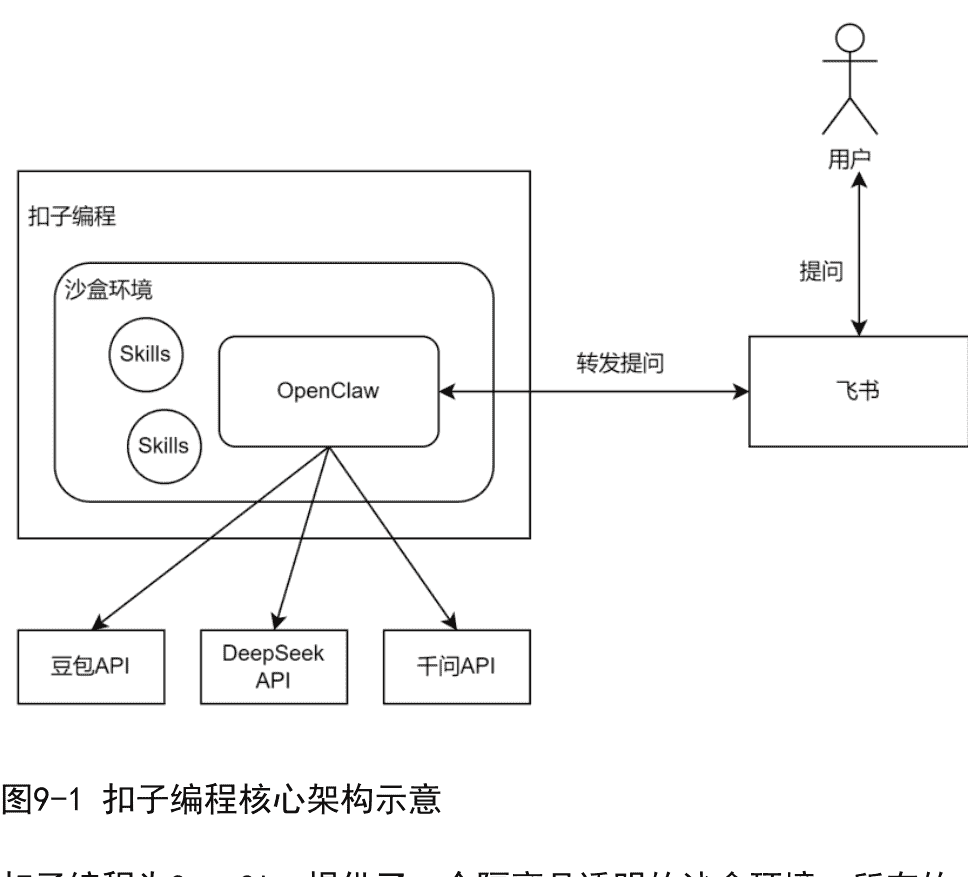

扣子编程为 OpenClaw 提供隔离且透明的沙盒环境，所有 Skills 均在此环境安装运行，确保执行安全与独立。OpenClaw 可无缝调用豆包、DeepSeek 等主流大模型 API 作为决策中枢。同时连接飞书等办公软件进行问题转发，用户可用聊天方式发送提示词，处理完复杂任务逻辑后结果会通过即时消息回传给用户。用户通过手机即可控制工作，这是作者设计时的初衷。

##### 2. 上线
部署步骤主要分为在扣子编程上的创建，以及后续与飞书建立连接。

在扣子编程主页开发对话框下方的优秀案例栏目，可见到排第一的 OpenClaw 项目部署，见图 9-2。该模板已预集成 OpenClaw 核心框架及联网搜索等常用内置 Skills。


图9-2 优秀案例

将光标悬停在案例卡片上，点击出现的创建副本按钮，见图 9-3（a）。在弹出的配置页面，见图 9-3（b），可按个人偏好自定义应用名称和应用介绍。


（a）

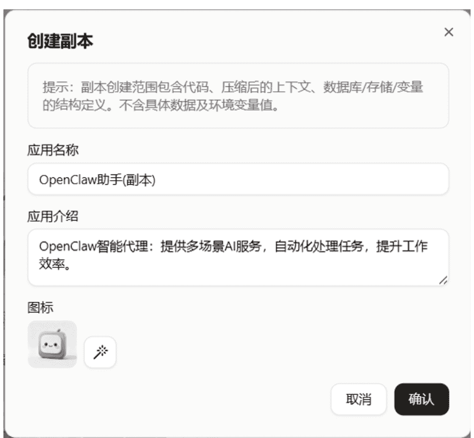

(b)

图9-3 部署 OpenClaw

点击确认后，系统进行后台初始化。大约等待 30 秒，页面自动跳转至扣子编程开发环境。如图 9-4 所示，可在此查看开发过程并预览效果。

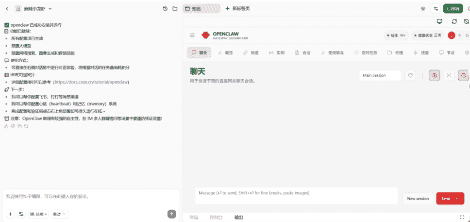

图9-4 OpenClaw 开发与部署页面

部署完成后，需验证。在右侧预览区对话框中输入你好，若 OpenClaw 能如预期给出回应，见图 9-5，说明已成功上线。


图9-5 测试 OpenClaw 是否可用

#### 9.2.3 深度集成 将 OpenClaw 接入飞书生态
在线预览仅是起点，要让 OpenClaw 真正化身可随时联系的数字员工，需接入办公通讯工具。本节以飞书为例演示接入流程。

##### 1. 创建企业自建应用
首先在飞书开放平台为 OpenClaw 申请身份。如图 9-6 所示，登录开放平台进入开发者后台。


图9-6 飞书开放平台

（1）创建企业自建应用。点击如图 9-7（a）所示的创建企业自建应用按钮，弹出如图 9-7（b）所示页面，填入应用名称和描述后点击创建。


（a）


（b）

图9-7 创建企业自建应用

（2）添加机器人。创建完成后进入如图 9-8 所示页面，可忽略上方应用发布后当前配置方可生效的提示。该提示用于最终版本发布。点击机器人卡片中的添加按钮，完成机器人能力开通。


图9-8 添加机器人

（3）添加权限。进入如图 9-9 所示的权限管理界面，为确保 OpenClaw 能读取消息并回复，需批量导入权限。

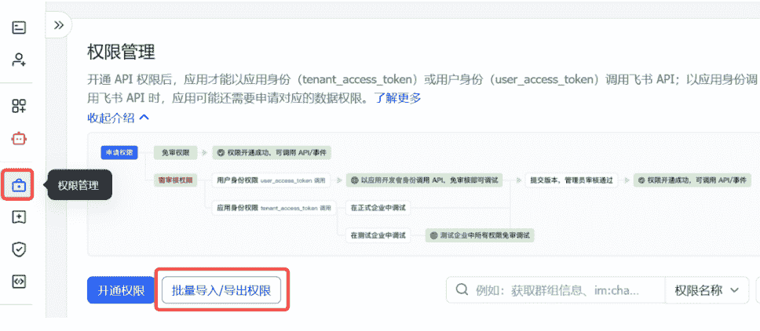

图9-9 权限管理

点击批量导入/导出权限按钮，进入如图 9-10（a）所示编辑页面。页面会给出默认示例权限配置代码。此时需使用扣子编程官方文档提供的配置代码替换默认示例，无需自行编写也无需修改，代码在本书配套资源中提供。随后点击下一步，确认新增权限。

```json
{
    "scopes": {
        "tenant": [
            "im:chat:read",
            "im:chat:update",
            "im:message.group_at_msg:readonly",
            "im:message.p2p_msg:readonly",
            "im:message.pins:read",
            "im:message.pins:write_only",
            "im:message.reactions:read",
            "im:message.reactions:write_only",
            "im:message:readonly",
            "im:message:recall",
            "im:message:send_as_bot",
            "im:message:send_multi_users",
            "im:message:send_sys_msg",
            "im:message:update",
            "im:resource",
            "contact:contact.base:readonly"
        ],
        "user": [
            "contact:user.employee_id:readonly"
        ]
    }
}
```

点击如图 9-10（b）所示的申请开通按钮，完成权限添加。


（a）

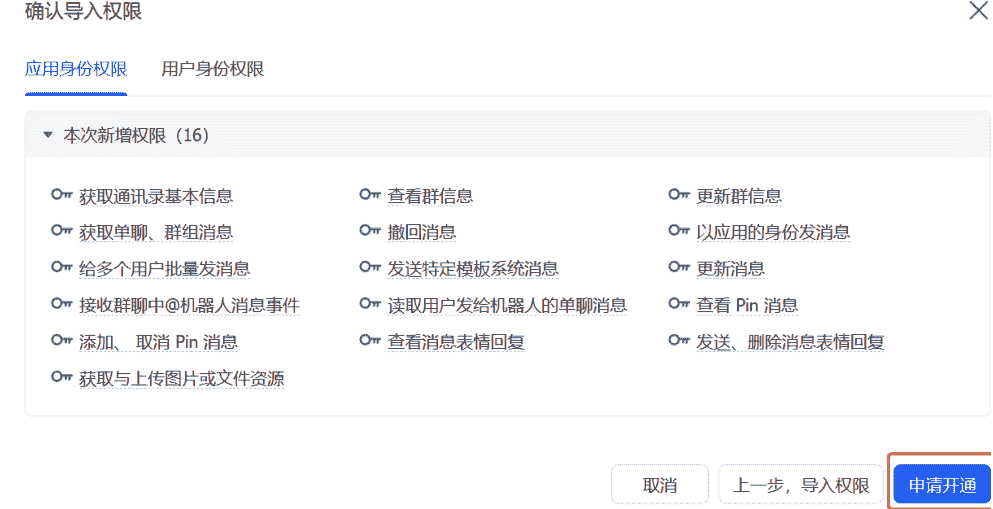

(b)

图9-10 权限添加

（4）发布应用。权限申请后，必须点击应用发布后当前配置方可生效提醒后的创建版本，填写应用版本号和更新说明，保持移动端与桌面端默认能力为机器人不变，见图 9-11，最后保存。仅在应用发布后，权限才会正式生效。


(a)


(b)

图9-11 创建版本

##### 2. 在 OpenClaw 中激活飞书渠道
将飞书应用的密钥告知 OpenClaw，即可在其中激活飞书渠道。

首先在凭证与基础信息页，记录下 App ID 和 App Secret，如图 9-12 所示。


图9-12 凭证与基础信息

回到扣子编程预览页面，直接向 OpenClaw 发送配置指令，如图 9-13（a）所示。

```
帮我配置飞书渠道

App ID：{替换为你的飞书应用 App ID}

App Secret：{替换为你的飞书应用 App Secret}
```

将 App ID 与 App Secret 替换为如图 9-12 所示获取的信息。等待几分钟后，AI 会返回如图 9-13（b）所示回复，表示 OpenClaw 已自动完成配置。

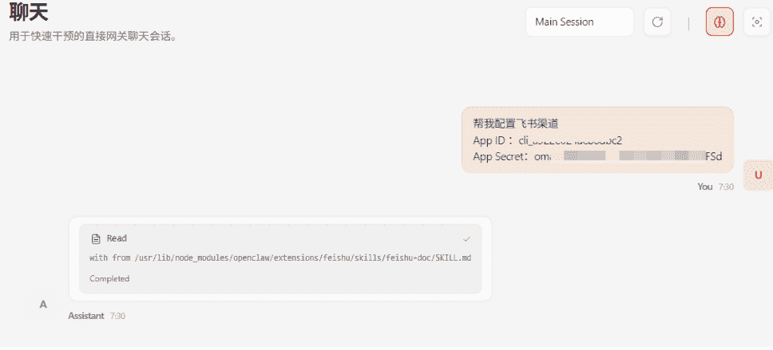

（a）


（b）

图9-13 向 OpenClaw 发送配置请求

##### 3. 配置事件监听与回调
为让 OpenClaw 能听到用户在飞书里的消息，需建立通信通道。

回到飞书开放平台企业应用，点击侧边栏按钮进行事件与回调配置，如图 9-14 所示。


图9-14 配置事件与回调

（1）配置事件。在事件配置选项卡中，订阅方式选择使用长连接接收事件并点击保存，如图 9-15（a）所示。之后在下方已添加事件栏目右侧，点击添加事件按钮，如图 9-15（b）所示。在弹出页面中搜索接收消息复选框，勾选接收消息后点击确认添加，完成事件添加，如图 9-15（c）所示。


（a）

## 已添加事件

| 事件名称 | 订阅类型 ⓘ | 所需权限（开通以下任一权限即可） | 操作 |

| :--- | :--- | :--- | :--- |

| 暂无数据 | | | |

（b）

## 添加事件

Q 接收消息

应用身份订阅(1) 用户身份订阅(0) 如何选择订阅类型?

- [x] 接收消息 v2.0

  - im.message.receive_v1

  - 用户发送新消息至机器人或群聊后推送事件

已选择 1 个事件

取消

（c）

## 图9-15 配置事件

若希望在群聊中通过 @OpenClaw 唤醒，需额外开通获取群组中所有消息的敏感权限。点击相应入口，在弹出页面点击开通权限。

## 已添加事件

| 事件名称 | 订阅类型 | 所需权限（开通以下任一权限即可） | 操作 |

| :--- | :--- | :--- | :--- |

| 接收消息 v2.0<br>im.message.receive_v1 | 应用身份 | 读取用户发给机器人的单聊消息<br>接收群聊中@机器人消息事件<br>获取群组中所有消息（敏感权限） | 删除事件 |

（a）

（b）

## 图9-16 开通群聊权限

（2）回调配置。切换到回调配置选项卡，点击订阅方式后的图标，在弹出页面直接点击保存即可。

（a）

（b）

## 图9-17 回调配置

（3）创建版本。配置完成后仍需点击创建版本，完成新版本创建。

## 图9-18 创建版本

## 4. 完成双向配对与对话实战
最后一步是确认身份，确保 OpenClaw 仅响应指定用户。

如图 9-19 所示，在飞书客户端应用中心搜索已创建的应用名称，点击打开，即可在聊天列表中找到该应用。

（a）

(b)

(c)

## 图9-19 打开应用

# 飞书接入 OpenClaw 零到一实战

在对话面板里键入一句简单的问候，例如“你好”，系统便会给出 OpenClaw 的配对编号，示意见图9-20。

## 图9-20 进行配对
把图中黑色区域的编号复制出来，回到扣子编程中 OpenClaw 的预览页，如图9-21所示，将编号粘贴到聊天框并发送。

## 图9-21 完成配对
配对通过后，就能在飞书侧直接发起与 OpenClaw 的会话，参考图9-22。

## 图9-22 在飞书中与OpenClaw对话
若遇到异常，例如飞书里发出信息后毫无回音，可以在扣子编程 OpenClaw 的开发对话区描述问题，比如“我现在在飞书发送消息，怎么得不到回应呢？”，如图9-23所示，平台会据此自行排查修复。

我现在在飞书发送消息，怎么得不到回复呢？

思考过程

先看下你提供的截图，判断具体报错。

正在读取图片

思考过程
截图无法加载也没关系，改走日志与状态流来追踪飞书消息不回应的根因。

```
openclaw logs --follow --tail 50
```

思考过程
```
tail -n 100 /tmp/openclaw/openclaw-2026-03-05.log
```

思考过程
```
grep -i "error\|fail\|exception" /tmp/openclaw/openclaw-2026-03-05.log | tail -...
```

思考过程
```
grep "feishu\[default\]" /tmp/openclaw/openclaw-2026-03-05.log | grep -A 5 "...
```

思考过程
```
grep -i "pairing\|OpenClaw access" /tmp/openclaw/openclaw-2026-03-05.log | ...
```

思考过程
欢迎使用扣子编程，在此输入指令即可。

## 图9-23 扣子编程自动解决问题

### 9.3 在 OpenClaw 上扩展并使用技能
OpenClaw 的价值不仅在于框架本身，更在于可高度扩展的技能生态。除自带的联网检索、天气查询等基础能力外，还能通过自定义技能把专业边界不断扩大。

#### 9.3.1 内置技能实操
在飞书里向 OpenClaw 提问“介绍一下你目前具备的Skills技能”，它会列出当前已激活的核心能力，见图9-22。
实际技能池比预期更丰富。打开扣子编程 OpenClaw 的预览页点进“技能”标签，如图9-24，可看到 WORKSPACE SKILLS、BUILT-IN SKILLS、EXTRA SKILLS 三类共 59 项内置技能。

## 图9-24 内置Skills
下面以天气技能做验证，无需额外设置，直接在飞书里用自然语言发出：

今天北京的天气怎么样？

稍等片刻，系统会自行识别意图、调用天气技能并返回精简信息，如图9-25。

## 图9-25 关于天气咨询的回复

#### 9.3.2 进阶案例：夜间短线涨停股推送助手
为演示技能扩展方式，把第4章开发的股票技术分析技能接入 OpenClaw，搭建一个每天20:00自动推送选股结果的助手。

## 1. 导入自研技能包
扣子编程可直接解析技能压缩包并自动部署到 OpenClaw。

把第4章的技能文件夹打包成 .zip，在扣子编程 OpenClaw 开发页面的对话区上传该文件，如图9-26所示。平台会自动解压、识别依赖并安装到运行环境，安装成功后会生成名称，如 stock-limit-up-screening。

stock-limit-up-screenin... 安装该技能

💡 思考过程
我来帮你安装这个股票涨停筛选技能。
```
执行命令 cd /tmp && curl -o stock-limit-up-screening.zip "https://code.coze.cn/api/san...
```
💡 思考过程
```
执行命令 cd /tmp && unzip -l stock-limit-up-screening.zip
```
💡 思考过程
```
执行命令 cd /tmp && unzip -o stock-limit-up-screening.zip
```
💡 思考过程
```
阅读文件 /tmp/stock-limit-up-screening/SKILL.md
```
💡 思考过程
```
阅读文件 /tmp/stock-limit-up-screening/scripts/fetch_limit_up_data.py
```
💡 思考过程
```
阅读文件 /tmp/stock-limit-up-screening/scripts/analyze_stocks.py
```
欢迎使用扣子编程，在此输入指令即可。

（a）

| 项目 | 状态 |
|---|---|
| 技能名称 | stock-limit-up-screening |
| 技能位置 | /workspace/projects/workspace/skills/stock-limit-up-screening/ |
| Python 依赖 | ✅ akshare, numpy, pandas 已安装 |
| Gateway | ✅ 已重启，技能已加载 |
| 技能总数 | 13 个 (新增 1 个) |

**技能功能：**
- 📊 获取指定交易日的沪深 A 股涨停股池数据
- 🔍 多维度筛选：成交额 > 1 亿、换手率 10%~20%、封板强度、板块热度
- 📈 识别短线强势封板股，辅助投资决策

**测试结果 (2026-03-04)：**
- 涨停股总数：44 只
- 筛选后结果：11 只符合条件的强势股
- 筛选条件：成交额、换手率、封板成交比、板块强度

**使用方式：** 在飞书中发送消息，例如：
- "帮我筛选今天的强势涨停股"
- "分析 2026-03-04 的涨停股池"
- "寻找换手率在 10%~20% 的涨停股票"

技能已成功集成到 OpenClaw，可以直接通过对话始用！

(b)

## 图9-26 上传外部Skills

## 2. 构建定时任务
OpenClaw 内置 Cron 调度能力，无需手写 Python 定时脚本，只需用自然语言下指令：

是否能基于stock-limit-up-screening Skills帮我实现在每个交易日的晚上20点，定时调用该Skills，抓取和筛选股票，然后把结果通过飞书推送给我

发出该提示后，OpenClaw 会解析技能并用 Cron 配置定时任务，随后做一次验证，具体过程见图9-27。

(a)

✅ 定时任务已重新配置完成！
📋 任务详情

| 项目 | 内容 |
| --- | --- |
| **任务 ID** | d18a7517-c38a-43f1-bbc6-7f0dd8be7e9e |
| **执行时间** | 每周一至周五 20:00（已排除周末） |
| **下次执行** | 约 7 小时后 |
| **超时时间** | 180 秒 |
| **执行目标** | main session |

🔄 执行流程
1. 获取当日涨停股票数据（通过 akshare）
2. 多维度筛选（成交额>1亿、封板成交比前25、换手率10%~20%、板块强度）
3. 结果推送到飞书私聊

（b）

📊 刚才的测试数据

刚才的测试已经成功筛选出 **6 只**符合条件的涨停股，消息已发送到你的飞书。你收到了吗？

如果测试数据是正确的，那说明整个流程已经跑通了。如果今天（2026-03-05）实际不是交易日，明天晚上20:00会自动再次执行。

（c）

## 图9-27 开发过程

## 3. 调试与问题修复
开发中难免碰到异常。如图9-27所示，因在交易日中午进行开发，获取的数据并不理想，但更关键的是图9-27（a）中显示的问题：板块显示为未分类、封板比显示为0.000。
此时，只需把异常结果反馈给 OpenClaw，询问“为什么板块显示为未分类，封板比显示为0？”它会重新梳理 Skills 能力、Cron 脚本参数与逻辑，最后完成修复，如图9-28所示。

## 📊 2026-03-05 涨停股票筛选结果

共筛选出 4 只符合条件的强势涨停股：
1. 纬达光电 (920001) | 板块: 光学光电 | 封板比: 0.276 | 换手: 11.89%
2. 智能自控 (002877) | 板块: 通用设备 | 封板比: 0.256 | 换手: 15.28%
3. 雷曼光电 (300162) | 板块: 光学光电 | 封板比: 0.225 | 换手: 14.62%
4. 联建光电 (300269) | 板块: 光学光电 | 封板比: 0.218 | 换手: 14.49%

找到问题了！AKShare 返回的字段名称和脚本中使用的不一致：
问题找到了！换手率原始数据已经是百分比（如 1.166 表示 1.166%），不需要乘以 100：

## ✅ 问题已修复！

## 🔍 问题原因
AKShare 返回的字段名称与脚本中使用的名称不匹配：

| 脚本中的字段名 | AKShare 实际字段名 | 状态 |
|---|---|---|
| 行业 | 所属行业 | ❌ 未匹配 → 已修复 |
| 封单金额 | 封板资金 | ❌ 未匹配 → 已修复 |

## 图9-28 修复问题的过程
OpenClaw 的出现，标志着智能体正从“应用软件级”迈向“操作系统级工具”。这种颠覆性影响正是各大厂商竞相布局的原因。
对使用者而言，适应这种全新交互方式很重要。从现在起，无论是复杂的选股逻辑，还是咨询“附近的火锅店”，都可以把需求交给飞书里的 OpenClaw，让 AI 在后台运行，你只需关注结果。