# 扩散模型：从原理到动手实践

# 内容提要

生成式 AI 的落地场景持续扩张，视觉合成方向尤为活跃，扩散类生成已成为主流技术路径。本书以扩散模型的基础理论为入口，由浅入深搭建知识体系，并结合大量生动案例拆解实现细节。全书八章，覆盖原理脉络、噪声退化机制、采样方法、DDIM 反转等核心问题，并延伸至 Stable Diffusion、ControlNet、音频扩散等实践方向。附录收录了模型生成的高质量图像合集以及 Hugging Face 社区的参考资料。

适合对该方向感兴趣的研究人员、科研从业者与有图像创作需求的设计人员阅读，也可作为计算机相关专业学生的参考。

# 大咖推荐

周明评价本书在原理与细节上系统完整，实战案例丰富，能帮助读者快速上手，对学习扩散模型的人具有参考价值。

杨耀东指出，扩散模型受非平衡热力学启发，具有良好的可解释性和生成可控性。本书从墨水扩散的直观意象出发，串联理论与实践，描绘了图像、文本、音频的生成蓝图，去噪留精，还原了知识体系的真实分布。

钟声认为扩散模型近年成果令人惊艳，有效缓解了视觉内容生成的瓶颈。阅读后可对原理形成深入理解，并付诸实践，为后续创新与应用打下基础。

马伯庸提到，人类历史中先行者往往占据先机，探究人工智能本质对把握变革浪潮至关重要。

# 前言/PREFACE

数年前通用人工智能仍常被视作科幻议题，实现路径不明。2022 年后，大模型驱动的生成内容浪潮加速，通用智能的实现看起来更近。实践表明，当模型规模突破阈值后，系统能够理解自然语言指令，并产出真实、优质的文本、图像、音视频等多模态结果。扩散模型是该浪潮的代表性先行者。

该技术源自物理学，最初用于描述物质迁移。结合神经网络后，其图像合成能力得到显著释放。从早期的 DALL-E 2、Imagin，到 Stability AI 发布的 Stable Diffusion 1.5，都表明只要用语言描述意图即可产出精美绘画。带 AI 生成标签的作品在社交媒体上迅速传播，已广泛应用于动画分镜、游戏立绘、图书插画、服装设计、家装概念等领域，对行业产生革命性影响，可比作工业革命时期的关键发明。

基于此，本书以实战为导向梳理扩散模型的机理、演进与应用，并结合 Hugging Face 与 Diffusers 展开工程实践。希望读者通过本书掌握核心方法，拓展探索空间。

# 写给读者的建议

本书涵盖理论基础、项目实战、前沿进展与应用案例，旨在帮助读者学会用扩散模型生成图像。适合大学生、研究人员、AIGC 爱好者及绘画相关从业者。阅读前建议具备一定编程能力，尤其熟悉 Python，并对深度学习有基础认知，了解人工智能常用术语会更顺畅。

全书分为基础与实战两部分。第 1、2 章为基础部分，介绍原理、发展、应用及 Hugging Face 环境准备；第 3 至 8 章为实战部分，逐步深入包括从零搭建基础模型、用 Diffusers 生成蝴蝶图像、微调与引导技术、Stable Diffusion 的概念与使用、DDIM 反转与 ControlNet 技巧，以及音频方向的拓展等。可按需择读。附录提供高质量生成图集与社区资源。

阅读时建议理论结合实践，加深理解。遇到问题可向同行请教或在技术社区提问。扩散模型更新迅速，建议持续关注前沿技术与开源模型，保持与学界进展同步。最后，希望读者能将所学与自身专业结合，用扩散模型解决实际问题。

# 致谢

第 3 至 8 章内容基于 Hugging Face 的 Diffusion 课程。感谢课程设计者 Jonathan Whitaker 与 Lewis Tunstall 的建议与支持，以及 Hugging Face 管理层的鼓励。

特别感谢周明、刘江、马伯庸、郑屹州、钟声博士等提供的宝贵意见。感谢 Hugging Face 团队、中国社区志愿者与开发者的付出。最后感谢全体读者的关注与支持。

# 资源与支持

# 资源获取

本书配套资源包括：

+ • 源代码
+ • 彩图文件
+ • 思维导图
+ • 异步社区 7 天 VIP 会员

扫描二维码按指引领取。

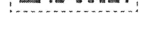

# 提交勘误

编者已尽力保证准确性，仍可能存在疏漏。欢迎反馈以提升质量。

登录异步社区，按书名搜索进入页面，点击“发表勘误”，填写信息提交。经审核采纳后将赠送 100 积分，可用于兑换优惠券、样书或奖品。

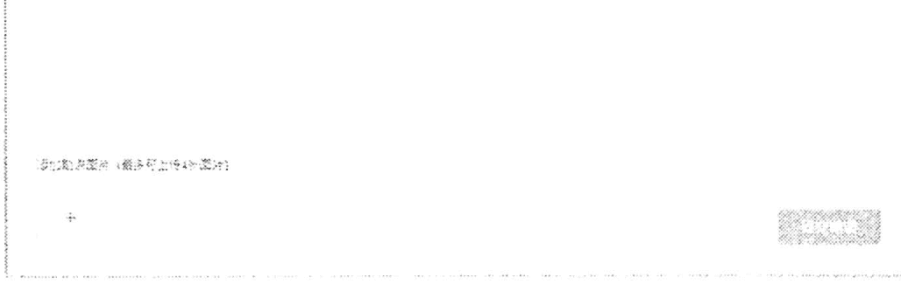

# 与我们联系

邮箱：contact@epubit.com.cn

如有疑问或建议请邮件联系，并在标题注明书名。如有出版、教学视频制作、翻译、技术审校合作，或院校企业批量采购需求，欢迎洽谈。如发现网上非授权传播，请将链接发送至邮箱，共同维护作者权益。

# 关于异步社区和异步图书

异步社区由人民邮电出版社创办，2015 年 8 月上线，专注优质 IT 内容出版与分享，为读者提供高质量学习资源，为作者提供专业出版服务，促进在线交流与传统出版融合。

异步图书是旗下精品 IT 图书品牌，依托人民邮电出版社三十余年计算机图书积淀，面向 IT 行业及各行业技术使用者。

## 第1章 扩散模型简介

扩散模型是一类基于扩散思想的前沿深度学习生成范式。除此之外，VAE 与 GAN 也是常见生成方法。二者虽有渊源，本书不展开，也不深入数学推导。依托本书内容，仍可通过代码生成精美图像。

本章要点：

+ * 原理介绍，说明扩散实现方式
* 演进梳理，回顾图像合成领域的迭代与生态
* 应用展望，介绍除图像合成外的其他用途

### 1.1 扩散模型的原理

扩散模型借鉴物理热力学中的扩散思想，由前向扩散与反向扩散构成。下文在不展开复杂推导的前提下介绍原理。

#### 1.1.1 生成模型

在深度学习中，生成模型的任务是根据训练样本产出新样本。给定训练集 X，假设其服从真实分布 p(x)，样本可视为该分布的观测。若能估计出真实分布，便可持续采样。生成模型即学习估计分布 q(x) 以逼近 p(x)，此过程即网络拟合。

如何衡量 q(x) 与 p(x) 的差距？一种直观思路是最大化训练样本在 q(x) 下的概率，这源自最大似然估计，也是生成模型的基本思想。

#### 1.1.2 扩散过程

最大似然估计已在 VAE 等模型上取得成效。扩散模型可视为更深层次的 VAE，表达能力更强，核心在于扩散过程。

扩散思想源自物理学非平衡热力学分支，研究非平衡物理系统。以一滴墨水在水中扩散为例，初始时墨水形成斑点，其概率分布复杂。随着时间推移，墨水逐渐均匀，水色趋同，分子分布变得简单易描述。

非平衡热力学可刻画墨水在每个离散时间步的状态分布。若将过程逆转，便可由简单分布逐步推断复杂分布。

公认最早的扩散模型 DDPM 的原理由此而来。为实现反推，DDPM 做了若干假设：扩散过程为马尔可夫过程，即当前步状态仅依赖前一步并加入高斯噪声；逆过程亦假设为高斯分布等。

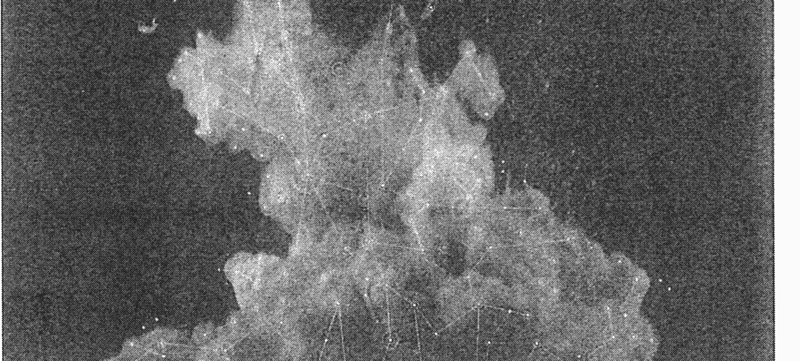

DDPM 的扩散过程如图 1-2 所示，分为前向与反向两部分。

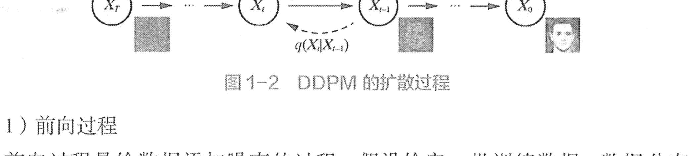

1）前向过程

前向是对数据逐步加噪。设训练数据分布为 x₀～q(x₀)，0 表示初始未扩散状态。将加噪过程离散为 T 步，每步 t 对 x_{t-1} 加入高斯噪声得到 x_t，再送入下一步。噪声方差由区间 (0,1) 内的固定值 β_t 决定，均值由 β_t 与当前带噪分布确定。经足够多次迭代后，数据趋近纯随机噪声，对应稳定墨水系统。

单步加噪的数学表达为：

q(x_t| x_{t-1})=\mathcal{N}(x_t; \sqrt{1-\beta_t}x_{t-1}, \beta_t I)

整体噪声分布为：

q(x_{1:T}| x_0)=\prod_{t=1}^T q(x_t| x_{t-1})

## 4 扩散模型从原理到实践

2）反向过程

前向是噪声化，反向则是去噪，即由随机噪声迭代恢复清晰数据。

从 x_t~N(0, I) 恢复 x_0 需要知道每步的分布转移。DDPM 将反向过程同样建模为马尔可夫链，由神经网络参数化的高斯分布序列构成。

单步去噪表达为：

q(x_{t-1}| x_t, x_0)=\mathcal{N}(x_{t-1}; \tilde{\mu}(x_t, x_0), \tilde{\beta}_t I)

经贝叶斯推导可得均值与方差：

\tilde{\beta}_t=1/\left(\frac{\alpha_t}{\beta_t}+\frac{1}{1-\overline{\alpha}_{t-1}}\right)=1/\left(\frac{\alpha_t - \overline{\alpha}_t + \beta_t}{\beta_t(1-\overline{\alpha}_{t-1})}\right)=\frac{1-\overline{\alpha}_{t-1}}{1-\overline{\alpha}_t}.\beta_t

\tilde{\mu}_t(x_t,x_0)=\left(\frac{\sqrt{\alpha_t}}{\beta_t}x_t + \frac{\sqrt{\overline{\alpha}_{t-1}}}{1-\overline{\alpha}_{t-1}}x_0\right)/\left(\frac{\alpha_t}{\beta_t}+\frac{1}{1-\overline{\alpha}_{t-1}}\right)=\left(\frac{\sqrt{\alpha_t}}{\beta_t}x_t + \frac{\sqrt{\overline{\alpha}_{t-1}}}{1-\overline{\alpha}_{t-1}}x_0\right)\frac{1-\overline{\alpha}_{t-1}}{1-\overline{\alpha}_t}.\beta_t=\frac{\sqrt{\alpha_t}(1-\overline{\alpha}_{t-1})}{1-\overline{\alpha}_t}x_t + \frac{\sqrt{\overline{\alpha}_{t-1}}\beta_t}{1-\overline{\alpha}_t}x_0

方差为定值，均值依赖 x_0 与 x_t，需由扩散模型优化。

## 5 扩散模型从原理到实践

3）优化目标

扩散模型预测噪声残差，要求反向预测的噪声与前向施加的噪声距离最小。

把中间变量视为隐变量时，扩散模型等价于含 T 个隐变量的深层 VAE，其损失可由变分推断得到变分下界，具体推导略。

最终优化目标为：

```
L^simple_{t-1} = E_{x_0, ε~N(0,I)} [||ε - ε_θ(√α_t x_0 + √1−α_t ε,t)||²]
```

训练 DDPM 时，用简单的 MSE 损失最小化前向噪声与反向预测噪声即可实现优化。

#### 1.2 扩散模型的发展

扩散模型从基础图像生成起步，逐步替代既有方案，开启 AI 作画时代。本节聚焦 2D 图像生成演进：

+ - 起步阶段：基础扩散模型的提出与改进。
- 生成加速：采样器优化。
- 性能突破：基于显式分类器引导的扩散模型。

- 全网爆发：CLIP 对比预训练让图文联合的图像合成登上风口。
- 再度走红：大模型微调方案 DreamBooth、LoRA、ControlNet 让个性化训练成为可能。
- 绘画平权：多家厂商推出开箱即用的图像生成服务，AI 作画走进大众。

# 扩散模型：原理与实战全景

## 1.2 发展脉络全解析

##### 1.2.1 起源与奠基：DDPM 及早期改进
在图像合成领域，最早被验证的扩散架构是 2020 年提出的 DDPM。它首次把去噪扩散概率模型引入图像生成，搭建起后续研究的通用底座，涵盖了扩散过程的定义、噪声分布的假设、马尔可夫链的推导、随机微分方程的求解以及损失函数的表述等核心要素。此后涌现的大量变体，基本都是在这一框架上进行针对性的优化。

##### 1.2.2 提速关键：采样器的演进
扩散模型在画质上取得进展的同时，生成效率始终是短板。早期实现往往需要上千次迭代，单张图像耗时可达数分钟，采样效率成为争议焦点。生成速度与质量在很大程度上取决于采样器的设计，如何在不牺牲效果的前提下压缩步数，是推动扩散模型普及的核心课题。

论文《Score-Based Generative Modeling through Stochastic Differential Equations》指出 DDPM 的采样本质上是更一般的随机微分方程求解问题。只要采用更高效的离散化策略，就能把原本 1000 步的流程压到 50 步、20 步甚至更少，显著提升成图效率，如图1-3所示。围绕快速采样，已出现 Euler、SDE、DPM-Solver++、Karras 等一系列求解器，这些加速手段对扩散模型走向主流起到了关键作用。

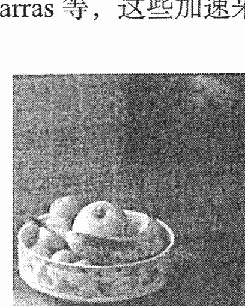

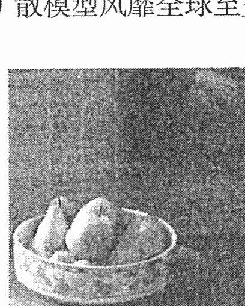

### 图1-3 DPM-Solver++ 用20步实现“一碗水果”到“一碗梨”的编辑演示

> 1 Ho J, Jain A, and Abbeel P. Denoising Diffusion Probabilistic Models [J]. Advances in Neural Information Processing Systems, 2020, pp.6840-6851.

##### 1.2.3 突破GAN：显式分类器引导的爆发
2021 年 5 月前，扩散模型虽已进入图像生成赛道，却始终难敌统治多年的 GAN。真正的转折点是论文《Diffusion Models Beat GANs on Image Synthesis》的发表。OpenAI 在文中系统性地展示了如何利用显式分类器对扩散过程进行引导。

该研究直接击败了长期占据榜首的 GAN，用更稳定、更逼真的样本证明了扩散模型的潜力，使其迅速成为学术圈和产业界关注的焦点，如图1-4所示。

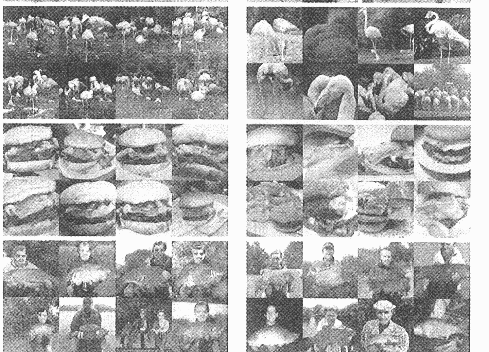

图1-4 扩散模型与GAN生成质量对比，左侧为BigGAN-deep结果，右侧为OpenAI扩散模型结果

##### 1.2.4 文本即画布：CLIP 点燃多模态生成
CLIP 的作用是把文本与图像映射到同一语义空间，例如“一个苹果”文字和“一个苹果”图像能够被拉到相近位置。CLIP 与扩散模型结合后，文本驱动的图像合成迎来爆发。代表作包括 OpenAI 的 GLIDE、DALL-E、DALL-E 2，其中 DALL-E 2 的样例如图1-5所示，以及 Google 的 Imagen，还有开源社区的 Stable Diffusion，Stable Diffusion v2 的项目主页如图1-6所示。各类文生图模型层出不穷，持续刷新想象空间。


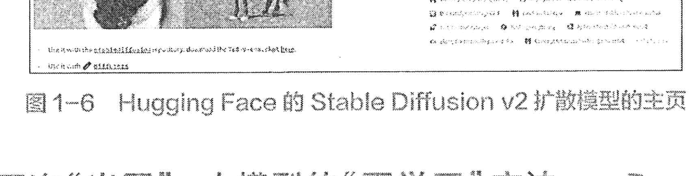

##### 1.2.5 个性化微调：DreamBooth、LoRA 与 ControlNet
扩散模型走向大模型后，从零训练的成本变得极高，个人研究者难以负担。好在像 Stable Diffusion 这类开源基座已经具备强大的通用生成知识，再训练并非必要。于是围绕“在已有模型上二次学习”的技术快速兴起，让消费级显卡也能完成定制化训练。DreamBooth、LoRA、ControlNet 是三种典型路径，各自对应不同需求。

DreamBooth 可把现有模型微调以记忆特定主体。用少量样本把主体绑定到专属文本标识后，就能通过提示词驱动该主体在不同场景中生成，如图1-7所示。

LoRA 擅长在保留原模型能力的同时注入特定风格或人物，并能与原生成流程融合。Hugging Face 提供了可视化的 LoRA 训练界面，如图1-8所示。

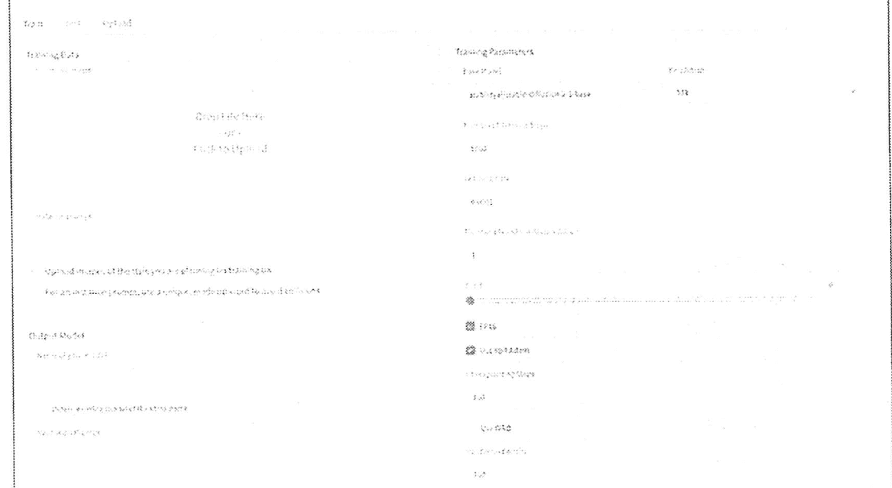

图1-8 Hugging Face 提供的 LoRA 训练演示界面

ControlNet 则扩展了可控制的模态，利用分割图、边缘图等条件实现更精细的布局控制。第7章将对 ControlNet 作更深入讲解。

##### 1.2.6 产业落地：商业级绘画工具遍地开花
随着技术成熟、关注度提升以及使用门槛下降，扩散模型在网络上呈现百花齐放的景象。大量成熟的商业解决方案相继出现。Midjourney 通过 Discord 频道支持提示词生成并允许用户社群交流，其主页如图1-9所示。Stability AI 推出的 DreamStudio 如图1-10所示，既支持提示词编辑，也提供 SDK 嵌入和 Photoshop 插件。Adobe 自家的扩散编辑套件 Firefly 如图1-11所示，可结合传统选区实现精细控制。

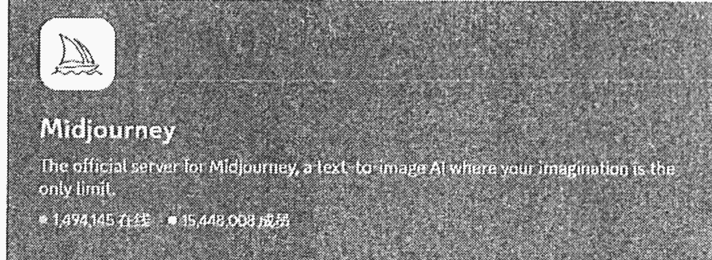

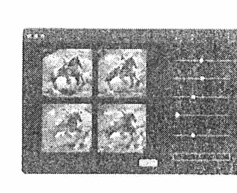

### Meet Adobe Firefly.

Document, transform, and make an infinite range of creations with the fly, a family of creative generative AI models coming to Adobe products

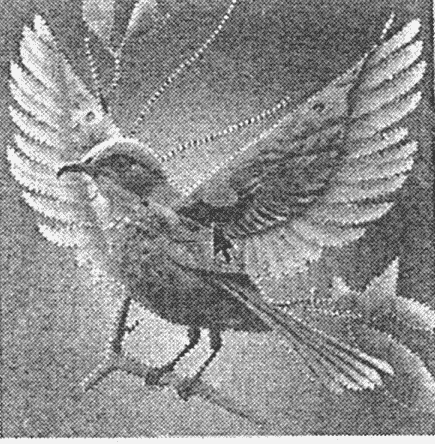

### 图1-11 Adobe 推出的图像编辑工具库 Firefly

百度发布的文心一格创作平台如图1-12所示，阿里巴巴达摩院也推出通义文生图大模型。除头部企业外，创业公司同样活跃。退格网络的 Tiamat 工具已获多轮融资，其生成的概念场景登上上海地铁广告。北京毛线球科技的 6pen Art APP 如图1-13所示，把 AI 作画带到移动端。

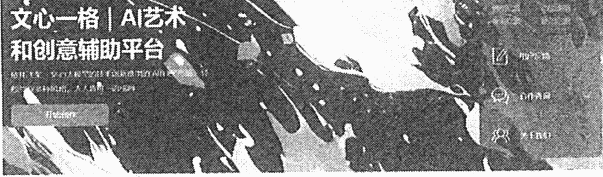

### 图1-12 百度文心一格 AI 创作平台


### 图1-13 6pen Art 图像生成移动应用

##### 1.2.7 大众化创作时代到来
众多服务商正以更成熟、更简便的方式，让用户仅靠文字或图片输入即可获得所需图像，AI 作画真正进入大众视野。

### 1.3 应用版图拓展
扩散只是一种思路，并非固定网络结构。把扩散思想迁移到其他领域，同样能发挥价值。

在实践中，最常见也最成熟的仍是图像生成，本书亦聚焦于此。但扩散模型在其他方向的探索同样值得关注，有望在未来迎来爆发。本节梳理如下方向：

- 计算机视觉。
- 时序数据预测。
- 自然语言。
- 文本驱动的多模态。
- AI 基础科学。

#### 1.3.1 计算机视觉
这里聚焦 2D 图像相关任务。图像处理研究历史悠久，扩散方法在多项任务中展现出优势：

- 图像分割与目标检测。分割和检测在自动驾驶、质检等场景至关重要。引入扩散后可获得更准确结果。Meta AI 的 SegDiff 能生成分割 Mask 如图1-14所示，DiffusionDet 可从随机矩形框逐步演化为检测框如 图1-15所示。不过速度仍是制约实时应用的因素。

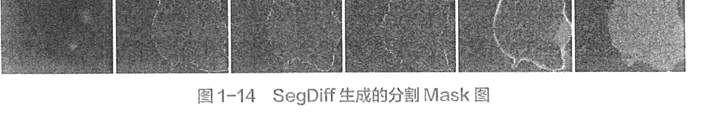

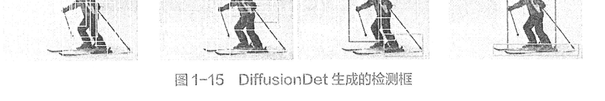

### 图1-14 SegDiff 生成的分割掩码图

### 图1-15 DiffusionDet 生成的检测框演化示例

- 图像超分辨率。超分辨率旨在把低分辨图像重建为高分辨且结构连贯的结果。级联扩散模型 CDM 通过串联多级扩散网络逐步放大分辨率，实现高质量超分，图1-16 给出示例。

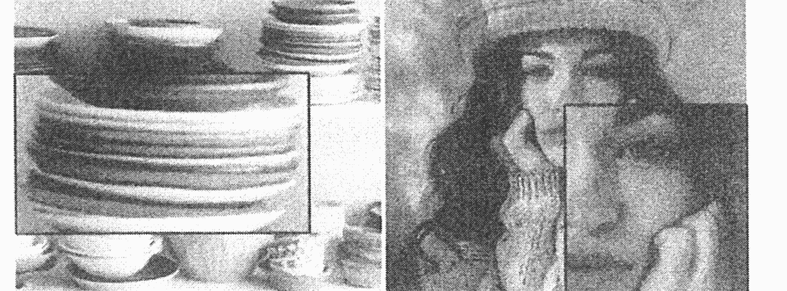

### 图1-16 CDM 实现的图像超分辨率示例

> 1 Jonathan Ho, Chitwan Saharia, William Chan, David J Fleet, Mohammad Norouzi, and Tim Salimans. Cascaded Diffusion Models for High Fidelity Image Generation. J. Mach. Learn. Res. 23(2022), 47–1.

- 图像修复、图像翻译和图像编辑。这类任务涉及对局部或整体区域的操作，如补全、风格迁移、内容替换。Palette 统一了修复、翻译、编辑等功能于单一扩散模型中¹。图1-17 展示了 Palette 的修复效果。

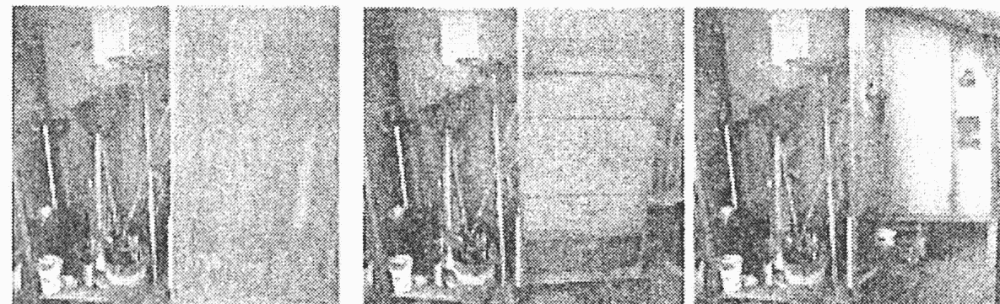

图1-17 Palette 对图像缺损区域的修复示例

#### 1.3.2 时序数据预测
时序预测的目标是基于历史观测推断未来走势，如气温、股价、销售预测等，本质上是一种条件生成任务，扩散模型能够胜任。

TimeGrad² 是首个将扩散思想引入多元概率时序自回归预测的模型。它先用 RNN 编码历史序列到隐空间，再对历史数据施加噪声实现扩散，最后在高维时序上完成预测。图1-18 展示了其在城市交通流量预测中的表现。

> 1 Chitwan Saharia, William Chan, Huiwen Chang, Chris Lee, Jonathan Ho, Tim Salimans, David Fleet, and Mohammad Norouzi. Palette: Image-to-Image Diffusion Models. In Special Interest Group on Computer Graphics and Interactive Techniques Conference Proceedings. pp.1-10, 2022.

> 2 Kashif Rasul, Calvin Seward, Ingmar Schuster, and Roland Vollgraf. Autoregressive Denoising Diffusion Models for Multivariate Probabilistic Time Series Forecasting. In International Conference on Machine Learning. pp.8857-8868, 2021.

图1-18 TimeGrad 在城市交通流量预测任务中的预测结果

传统方法长期由机器学习和 RNN 体系主导，而扩散模型已显现出强劲潜力。

#### 1.3.3 自然语言
自然语言是人工智能重要分支，近期爆火的 ChatGPT 即是典型问答生成系统。

扩散模型同样可用于语言生成。对句子分词并转为向量后，可通过扩散过程学习语句分布，进而支持翻译、对话、补全、情感分析、续写等任务。

Diffusion-LM¹ 是首个将扩散机制引入自然语言的模型，旨在解决连续扩散与离散文本之间的适配问题，实现高可控性的语言生成。测试显示其在 6 项可控文本生成任务上表现优异，如表1-1所示。

### 表 1-1 Diffusion-LM 在 6 种可控文本生成任务中的生成效果

| 输入类型与输出文本       | 具体内容                                                                                     |

|--------------------------|---------------------------------------------------------------------------------------------|

| 输入（语义内容）         | food : Japanese                                                                             |

| 输出文本                 | Browns Cambridge is good for Japanese food and also children friendly near The Sorrento.    |

| 输入（词性）             | PROPN AUX DET ADJ NOUN NOUN VERB ADP DET NOUN ADP DET NOUN PUNCT                             |

| 输出文本                 | Zizzi is a local coffee shop located on the outskirts of the city.                          |

| 输入（语法树）           | (TOP (S (*)(*)(*)) (VP(*) (NP(NP(*) 0))))                                                    |

| 输出文本                 | The Twenty Two has great food                                                              |

| 输入（语法范围）          | (7,10, VP)                                                                                  |

| 输出文本                 | Wildwood pub serves multicultural dishes and is ranked 3 stars                              |

| 输入（词数） | 14 |
| 输出文本 | Browns Cambridge serves Japanese cuisine near The Sorrento in downtown. |
| 输入（前上下文） | My dog was fond of tennis balls. |
| 输入（后上下文） | My dog stole all of them and hid them underneath. |
| 输出文本 | One day I discovered all my missing tennis balls under the bed. |

基于 Diffusion-LM 的探索持续推进，但在自然语言生成领域，仍以 GPT 为代表的预训练 Transformer 保持主导地位，扩散范式在语言任务上的发展潜力仍被看好。

# 第1章 扩散模型概览

扩散类方法在辅助人类处理多样化事务方面意义重大。随着 DALL·E 2、Stable Diffusion 等图像生成模型以及 ChatGPT 等语言模型相继出现，多模态交互正逐步转向以文本为核心的驱动方式，典型形态包括文生图、文生视频、文生三维等。

- 文生图：目前最成熟普及的方向。用户提供一段描述或几个关键词，模型就能依据文字意图合成对应画面。本章开篇提及的 DALL·E 2、Imagen 以及完全开源的 Stable Diffusion 等，都属于图文多模态扩散方案。图1-19 展示了若干 Imagen 产生的文字转图案例，后续章节会重点展开相关应用。

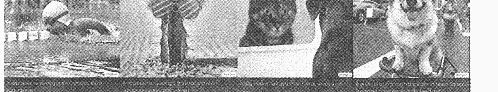

图1-19 Imagen 产生的文字转图样例

- 文生视频：逻辑与文生图相近，关键在于帧间连贯性。此类应用已相当广泛，例如 Meta AI 的 Make-A-Video 以及可精细调控细节的 ControlNet Video。图1-21 给出了 HF 平台上 ControlNet Video Space 的操作界面。

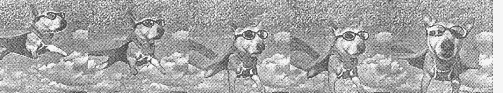

图1-20 Meta AI Make-A-Video 演示：身穿超人服、披红斗篷的狗狗在空中飞行

- 文生三维：可将自然语言映射为三维资产，常见表达形式包括点云、网格、NeRF 等。实现路径各异，比如 DiffRF 采用扩散方式从文本合成 3D 辐射场，如图1-22 所示；3DFuse 则基于二维图像生成对应点云，可在 HF 平台体验官方演示，如图1-23 所示。整体仍处于起步阶段，但在室内设计、游戏建模、元宇宙数字人等场景前景可期。

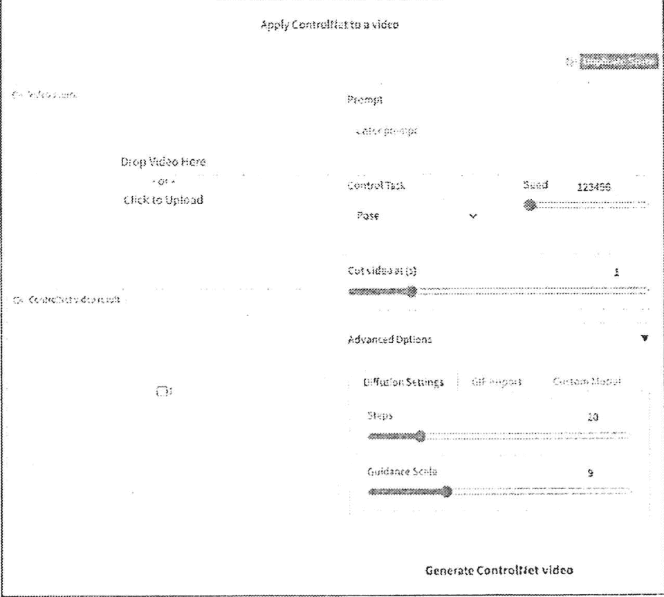

# 图1-21 HF 平台 ControlNet Video Space 界面截图

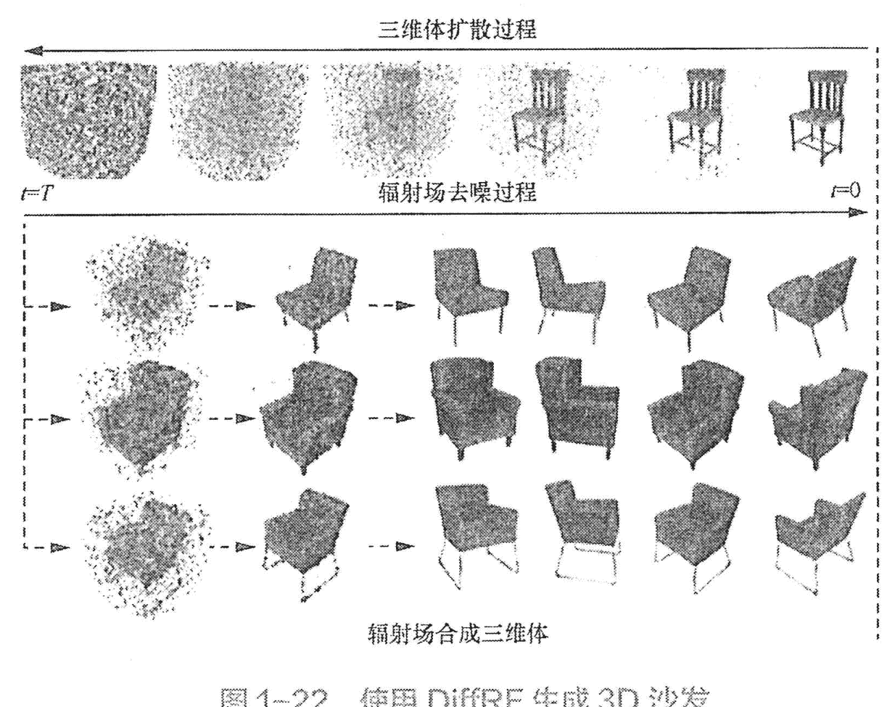

# 图1-22 DiffRF 生成的 3D 沙发模型

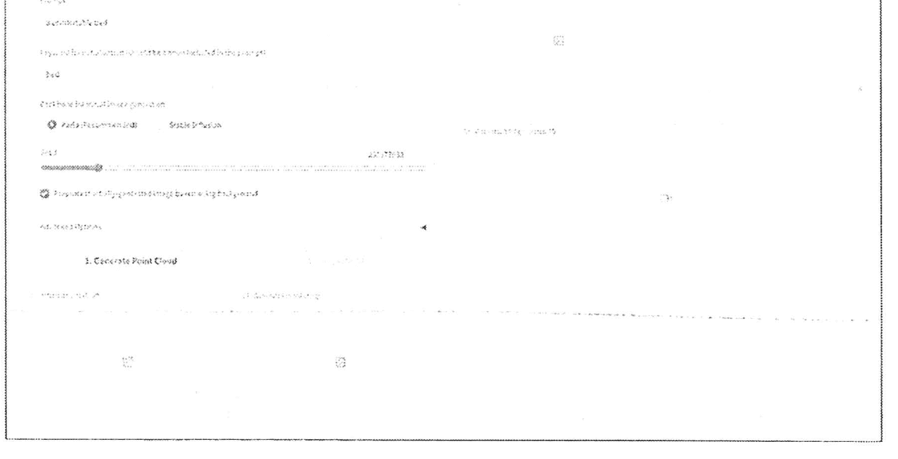
图1-23 HF 平台上 3DFuse Space 的应用界面

# 1.3.5 AI 基础科学

AI for Science，即以人工智能推动科学研究，是极具想象空间的分支，有望成为造福社会的重要技术。该领域成果多次登上《自然》等顶刊。例如 2021 年 DeepMind 的 AlphaFold 2 可预测人类约 98.5% 的蛋白质结构，2022 年 DeepMind 也用强化学习实现了核聚变装置内等离子体的稳定控制等。

扩散模型在生成类任务上表现突出，AI for Science 中的生成预测研究自然也离不开它。SMCDiff 提出一种扩散模型，可基于给定模体生成多样支架蛋白，如图1-24。CDVAE 提出一种扩散晶体变分自编码器，用于生成并优化具有固定周期性原子结构的材料，如图1-25。

> 
> 
> 1 Brian L Trippe, Jason Yim, Doug Tischer, Tamara Broderick, David Baker, Regina Barzilay, and Tommi Jaakkola. Diffusion Probabilistic Modeling of Protein Backbones in 3D for the Motif-Scaffolding Problem. In International Conference on Learning Representations. 2023.
> 
> 2 Tian Xie, Xiang Fu, Octavian-Eugen Ganea, Regina Barzilay, and Tommi S Jaakkola. Crystal Diffusion Variational Autocncoder for Periodic Material Generation. In International Conference on Learning Representations. 2021.

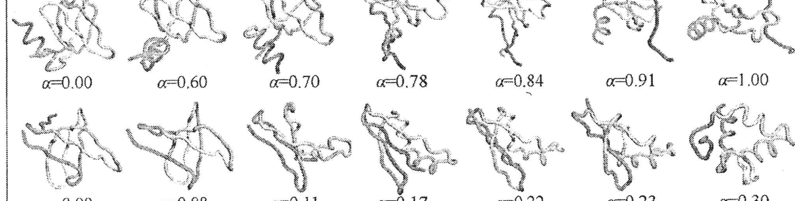

# 图1-24 SMCDiff 生成的多样支架蛋白

| 真值 | Perov-5 | Carbon-24 | MP-20 |
| :---: | :---: | :---: | :---: |
| 真值 | [图示] | [图示] | [图示] |
| 样本1 | [图示] | [图示] | [图示] |
| 样本2 | [图示] | [图示] | [图示] |
| 样本3 | [图示] | [图示] | [图示] |

# 图1-25 CDVAE 生成遵循 Langevin 动力学的多类原子结构材料

# 第2章 HF 平台导览

HF 是机器学习从业者协作交流的核心阵地。其 Hub 提供了统一入口，便于分享、探索、发现和体验开源机器学习资源。该平台助力从业者学习、协作、分享，共同推动开放、负责任的人工智能。

平台标志如图2-1。公司创立于 2016 年，在纽约与巴黎设有办公室，团队分布全球、远程办公。使命是让优质机器学习普惠大众，即把先进能力带给所有人。通过连接全球社区，逐步实现这一愿景。

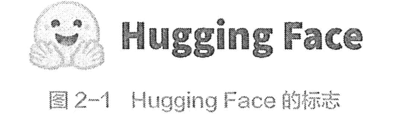

### 2.1 平台核心能力

核心产品是 HF Hub，这是一个采用 Git 版本管理的仓库体系，用户可在其上存放模型、数据集，并为模型添加说明页以介绍用途和使用方式。截至 2023 年 3 月底，Hub 已收录 16.2 万个模型、2.6 万个数据集以及 2.5 万个 Space 应用，仅计公开资源。下面简要介绍主要功能。

如图2-2，在 Hub 上，一个典型的模型说明页通常包含名称与分类标签、开源协议、arXiv 论文引用等，还会展示月度获取次数与趋势。

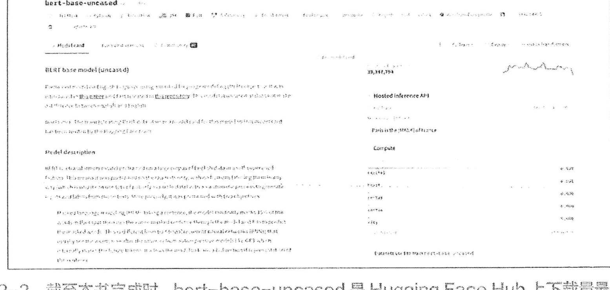

图2-2 书稿完成时获取次数最高的 bert-base-uncased 在 Hub 上的表现，累计接近四千万次

前文提到，Hub 上的仓库采用 Git，因此可直接使用模型页面的 URL 执行 Git 操作，代码示例如下：

```
git clone https://huggingface.co/bert-base-uncased
```

将模型开源到 HF 时，模型说明页的详细介绍最为关键，可包含用途、研发背景、模型说明、引用文献、使用指南等。受多方面因素影响，说明页也可以提前声明可能存在的偏见，让使用者形成合理预期。同时可提供训练思路等信息，方便社区成员贡献。

如图2-3 所示，Hub 还支持上传数据集后直接在线微调模型的功能。

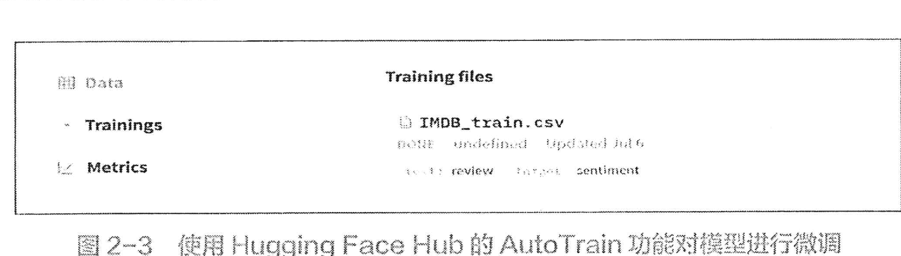

图2-3 通过 HF Hub 的 AutoTrain 功能在线微调模型

# 图2-4 推理 API 主界面

如图2-5 所示，托管式推理 API 除支持文字输入输出外，还可上传图片、调用浏览器 API 获取麦克风实时音频，并通过 API 对模型进行识别与处理。

模型说明页在描述分类、介绍与运行情况的同时，也会说明训练时使用的数据集。例如图2-6 可见，基础模型 bert-base-uncased 使用了 Hub 上存放的维基百科数据集，该数据集由 HF 开源维护，并按语言拆分、清理了 Markdown 代码及引用脚注等冗余信息，便于直接调用。

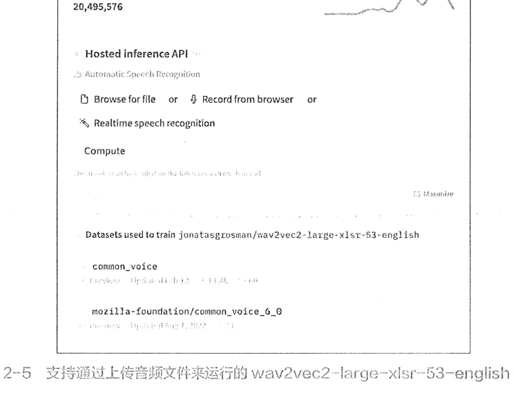

图2-5 可上传音频运行的 wav2vec2-large-xlsr-53-english 模型

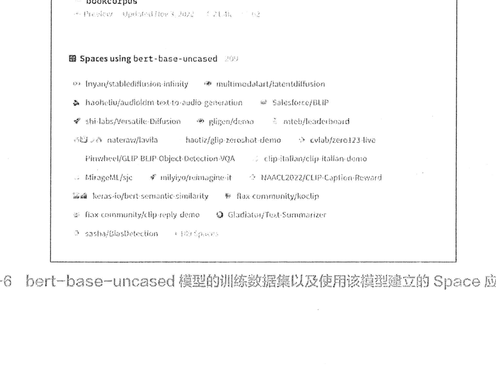

图2-6 bert-base-uncased 的训练数据集及基于它的 Space 应用列表

# 24 扩散模型原理与实践

调用 Hub 上的数据集也十分便捷，如图2-7 所示。

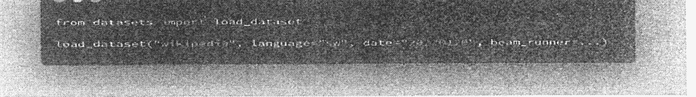

# 图2-7 用 load_dataset 方法加载 Hub 上的维基百科数据集

图2-7 所示代码使用的 Datasets 库已由 HF 开源，2.2 节将详细介绍此类开源库。

除模型和数据集外，Hub 还提供 Spaces 功能，可在数分钟内创建并部署机器学习应用。Spaces 的 SDK 支持 Gradio、Streamlit、Docker 和静态 HTML。平台为 Space 应用提供免费的双核 CPU 与 16GB 内存服务器用于推理等工作。图2-8 展示了 Hub 的 Spaces 页面，可查看本周热门应用。

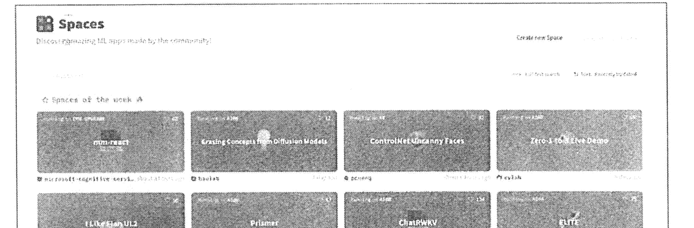

# 图2-8 Hub Spaces 页面呈现本周热度最高的 Space 应用

为保证资源有效利用，免费服务器在闲置一定时间后会自动休眠，目前阈值约为 72 小时，并在有用户访问时被唤醒。若需更稳定体验，可付费升级硬件、申请社区赞助或向官方申请免费硬件升级。

相比推理 API，Space 应用交互更复杂，还可提供示例输入以便用户和开发者快速上手。每个 Space 应用均提供可直接访问的网址，域名格式通常为：

用户名-Space 应用名.hf.space

图2-9 所示的由微软认知服务团队创建的名为 mm-react 的 Space 应用网址如下：

https://microsoft-cognitive-service-mm-react.hf.space

从该网址可看出团队账号为 microsoft-cognitive-service，应用名为 mm-react。也可以直接在 https://hf.co/ 后加上用户名访问个人主页，例如：

https://hf.co/microsoft-cognitive-service

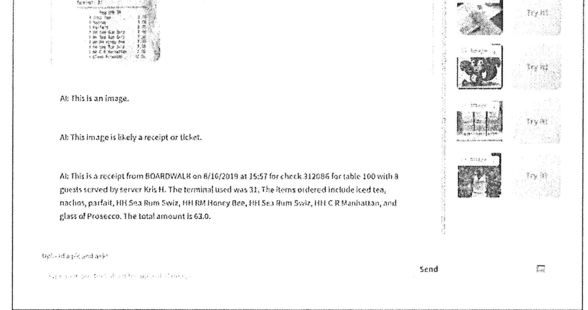

# 图2-9 微软认知服务团队打造的 mm-react Space 应用

你还可以参考图2-9，通过 Space 应用的“Duplicate this Space”功能一键复制他人应用。如图2-10 所示，根据原应用配置，复制时可能需要补充配置值等。其他用户创建的 Space 可能使用免费服务器，高峰期访问或不稳定。复制后即可使用自己的独占计算资源，并加入自定义的 API 密钥等配置。

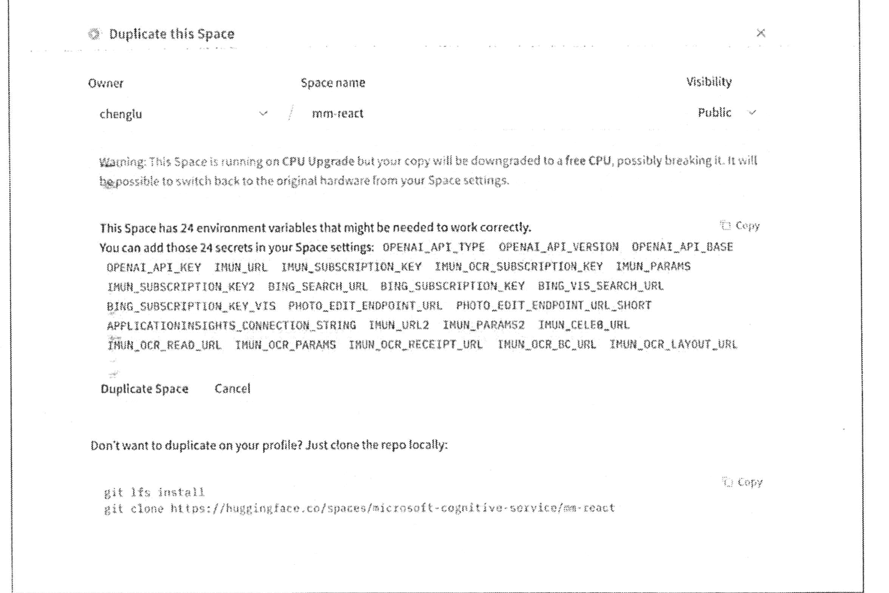

# 图2-10 “Duplicate this Space” 功能操作界面

Hub 上的模型和数据集仓库可像 GitHub 一样进行社区协作，支持发布讨论帖、提交 Pull Request，还支持用户点赞。HF 支持组织账户，目前已有近 3 万个组织类型的账户，众多跨国公司、研究机构等都在 Hub 上注册了官方组织账号，如图2-11 所示。


### 2.2 开源库概览

除提供 Hub 便于社区分享模型和数据集外，HF 还在 GitHub 上开源了一系列机器学习库和工具，如图2-12 所示。简要列举如下。

- Transformers：提供一系列 API 与工具，使用者可轻松下载并训练 SOTA 预训练模型，降低计算成本与碳排放。支持 PyTorch、TensorFlow 与 JAX，并可互操作。模型还可导出为 ONNX、TorchScript 等格式以便生产部署。
- Datasets：只需一行代码即可加载各类数据集，支持音频、计算机视觉和自然语言处理等任务。借助 Apache Arrow 支持零拷贝读取与处理大型数据集，并与 Hub 深度集成，便于共享。
- Diffusers：操作扩散模型的工具箱，可方便地使用多种扩散模型生成图像、音频，并使用不同噪声调度器调节推理速度与质量，支持多种模型类型。
- Accelerate：添加 4 行代码即可在任意设备上运行原有 PyTorch 训练脚本，将多 GPU、TPU 等相关模板抽象出来，其余代码保持不变。
- Optimum：Transformers 的扩展，提供性能优化工具，可在特定目标硬件上高效训练与运行模型。
- timm：PyTorch Image Models，包含图像模型、优化器、调度器及训练验证脚本等。

除上述库外，常用的开源库还有 Tokenizers、Evaluate 等。Tokenizers 是基于 Rust 的高性能分词器，可在 20 秒内用 CPU 完成对 1GB 文本的分词。Evaluate 则使用数十种流行指标对数据集和模型进行评估。可在 HF 的 GitHub 组织页面查看全部开源库。

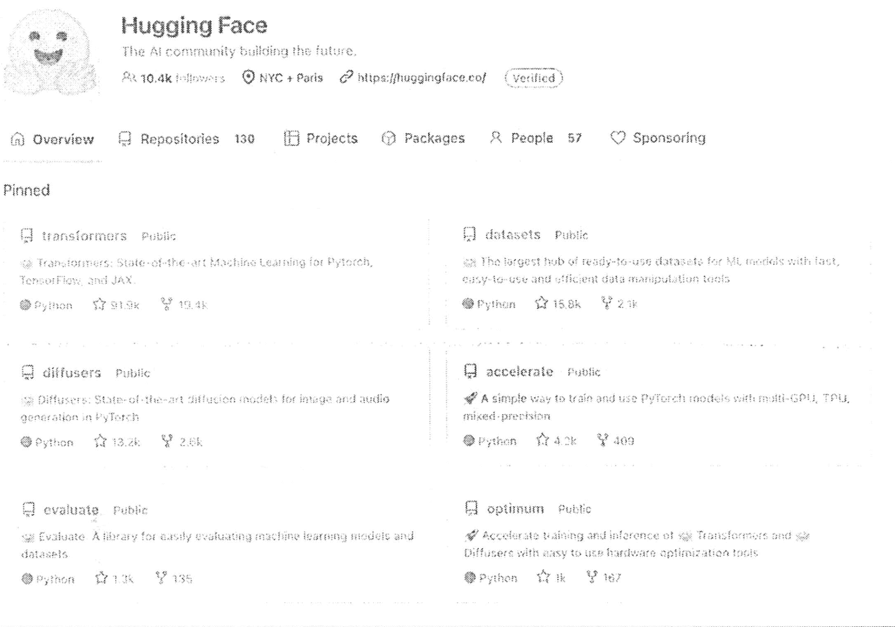


图2-12 Hugging Face GitHub 组织主页及置顶开源仓库展示

### 2.3 Gradio 工具概览

Gradio 由 Hugging Face 发起的一个开源 Python 工具包，专注于帮助开发者把机器学习和数据科学流程包装成可交互的 Web 演示。借助它，能够在很短时间内为模型或分析流程生成精致的前端，让访客直接在浏览器里上传图片、输入文字、录制音频并实时体验效果。图2-13 呈现了官网首页的代表性 Demo。

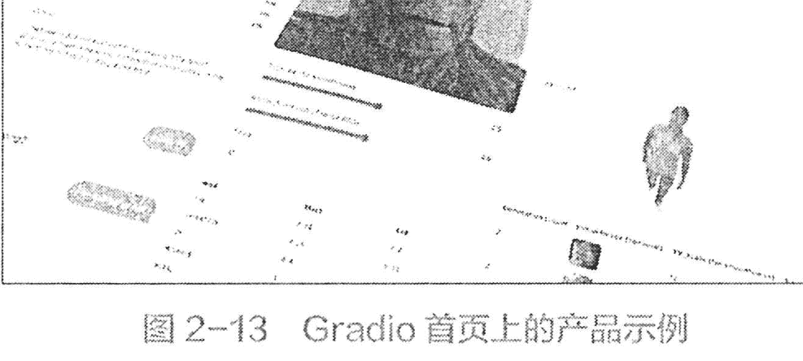

如果想把模型成果直观地呈现给他人，搭建一个可交互的小应用是常见做法，而 Gradio 能很好地满足这个需求。部署它并不复杂，下面用三步说明如何快速上手。

1. 通过 pip 安装 Gradio，相关命令如下：
   ```
   pip install gradio
   ```

2. 以最简的“Hello World”示例入手，参考图2-14 的代码片段，编写门槛很低。
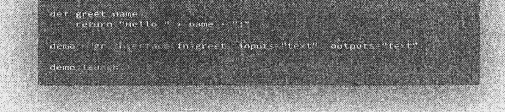```
# 采样策略：把采样过程拆解为5步，每次只前进一步
for i in range(5):
    # 获取当前预测结果
    pred = net(noisy_x.to(device)).detach().cpu()
    # 计算预测结果与真实值的误差
    error = torch.mean((pred - x)**2)
    # 如果误差减小，则更新noisy_x
    if error < prev_error:
        noisy_x = pred
        prev_error = error
    # 更新采样策略中的参数
    step_size = 0.2 * (1 - i / 4)
    # 更新noisy_x
    noisy_x = noisy_x + step_size * (pred - noisy_x)
```

# ·42· 扩散模型原理与实践

```
n_steps = 5
```
```
x = torch.rand(8, 1, 28, 28).to(device) # 从完全随机的值开始
```
```
step_history = [x.detach().cpu()]
```
```
pred_output_history = []
```
```
for i in range(n_steps):
```
```
with torch.no_grad(): # 在推理时不需要考虑张量的导数
```
```
pred = net(x) # 预测“去噪”后的图像
```
```
pred_output_history.append(pred.detach().cpu()) # 将模型的输出保存下来，以便后续绘图时使用
```
```
mix_factor = 1/(n_steps - i) # 设置朝着预测方向移动多少
```
```
x = x*(1-mix_factor) + pred*mix_factor # 移动过程
```
```
step_history.append(x.detach().cpu()) # 记录每一次移动，以便后续绘图时使用
```
```
fig, axs = plt.subplots(n_steps, 2, figsize=(9, 4), sharex=True)
```
```
axs[0, 0].set_title('x (model input)')
```
```
axs[0, 1].set_title('model prediction')
```
```
for i in range(n_steps):
```
```
axs[i, 0].imshow(torchvision.utils.make_grid(step_history[i])[0].clip(0, 1), cmap='Greys')
```
```
axs[i, 1].imshow(torchvision.utils.make_grid(pred_output_history[i])[0].clip(0, 1), cmap='Greys')
```

只要过程正常，多次迭代后即可生成一张全新的图片。图 3-4 中，左图展示了各轮次输入的样貌，右图则是模型预测的降噪结果。值得注意的是，首轮去噪虽能看出初步改善，却仅是微小进展。持续迭代数轮后，画面轮廓会逐步显现并不断优化，最终收敛到完整输出。
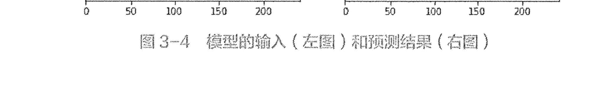

图 3-4 各阶段输入与模型预测的降噪输出

# 第3章 从零搭建扩散模型 ·43·

实际上，把采样拆分成更多步数可以提升画质，下面给出对应的代码示例：
```
# 将采样过程拆解成40步
n_steps = 40
x = torch.rand(64, 1, 28, 28).to(device)
for i in range(n_steps):
    noise_amount = torch.ones((x.shape[0],)).to(device) * (1-(i/n_steps)) # 将噪声量从高到低移动
    with torch.no_grad():
        pred = net(x)
        mix_factor = 1/(n_steps - i)
        x = x*(1-mix_factor) + pred*mix_factor
    fig, ax = plt.subplots(1, 1, figsize=(12, 12))
    ax.imshow(torchvision.utils.make_grid(x.detach().cpu(), nrow=8)[0].clip(0, 1), cmap='Greys')
```

生成结果见图3-5。
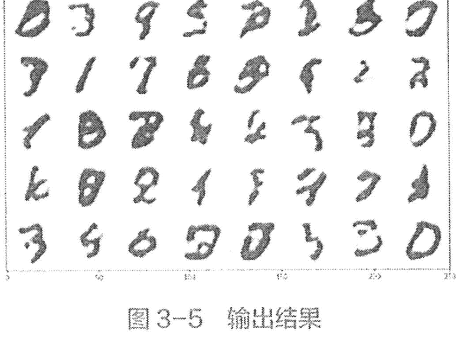

图3-5 生成样例

从图3-5 可以看出，整体质量仍有限，不过部分数字已隐约可辨。

可以延长训练时长，例如提升到 10 或 20 个 epoch，同时微调模型结构、学习率、优化器等超参数。 若想挑战更复杂的任务，可把代码开头加载 MNIST 的语句替换为 FashionMNIST，即可切换数据集。

#### 3.4.2 与 DDPM 的实现差异

接下来对比本示例与 Diffusers 提供的 DDPM 实现在关键环节上的不同，主要体现在以下几方面：

- 相较于 BasicUNet，UNet2DModel 的网络结构更为成熟先进。
- 前向加噪的退化策略采用了不同的实现方式。
- 训练时优化的目标由重建干净图像改为直接预测噪声。
- UNet2DModel 会把时间步 t 作为额外条件输入，以动态控制噪声强度。
- 采样阶段支持多种策略，灵活性与效果都优于此前使用的简化版本。

DDPM 提出后，社区涌现出大量改进思路，本示例展示了针对不同设计目标时的取舍思路。若想深入了解，可参考论文《Elucidating the Design Space of Diffusion-Based Generative Models》，文中系统分析了各组件的作用并给出了性能优化的建议。

若以上内容显得有些艰深也无需焦虑，可以先跳过后续章节，待实际需求出现时再回头查阅。

# 3.4.3 UNet2DModel 架构解析

相比前面讲到的 BasicUNet，Diffusers 中的 UNet2DModel 在设计上做了多项增强，具体包括：

- 引入 GroupNorm 对模块输入做组归一化处理。
- 加入 Dropout 层，帮助训练过程更稳定。
- 每个残差块可配置多个 ResNet 层，而非单一层。
- 在低分辨率的层级引入注意力模块，提升特征建模能力。
- 支持基于时间步的条件调节。
- 上采样与下采样模块均使用可学习参数。

下面通过代码演示如何实例化并查看 UNet2DModel 的结构：
```
model = UNet2DModel(
    sample_size=28,
    # 目标图像的分辨率

```
[PAGE 61]
```
in_channels=1,
out_channels=1,
layers_per_block=2,
block_out_channels=(32, 64, 64), # 与BasicUNet模型的配置基本相同
 down_block_types=(
 "DownBlock2D", # 标准的ResNet下采样模块
 "AttnDownBlock2D", # 带有空域维度 self-att 的ResNet下采样模块
 "AttnDownBlock2D", 
 ),
up_block_types=(
 "AttnUpBlock2D", # 带有空域维度 self-att 的ResNet上采样模块
 "AttnUpBlock2D", 
 "UpBlock2D", # 标准的ResNet上采样模块
 ),
 ),
 # 输出模型结构（看起来虽然冗长，但非常清晰）
print(model)
```

模型结构输出如下：
```
UNet2DModel(
 (conv_in): Conv2d(1, 32, kernel_size=(3, 3), stride=(1, 1),
padding=(1, 1))
 (time_proj): Timesteps()
 (time_embedding): TimestepEmbedding(
 (linear_1): Linear(in_features=32, out_features=128, bias=True)
 (act): SiLU()
 (linear_2): Linear(in_features=128, out_features=128,bias=True)
 )
 (down_blocks): ModuleList(
 (0): DownBlock2D(
 (resnets): ModuleList(
 (0): ResnetBlock2D(
 (norm1): GroupNorm(32, 32, eps=1e-05, affine=True)
 (conv1): Conv2d(32, 32, kernel_size=(3, 3), stride=(1,
 1), padding=(1, 1))
 (time_emb_proj): Linear(in_features=128, out_features=32,
bias=True)
 (norm2): GroupNorm(32, 32, eps=1e-05, affine=True)
 (dropout): Dropout(p=0.0, inplace=False)
 (conv2): Conv2d(32, 32, kernel_size=(3, 3), stride=(1,
 1), padding=(1, 1))
 )
 )
 )
```
[PAGE 62]

# ·46· 扩散模型原理与实践

```
(nonlinearity): SiLU()
)
(1): ResnetBlock2D(
  (norm1): GroupNorm(32, 32, eps=1e-05, affine=True)
  (conv1): Conv2d(32, 32, kernel_size=(3, 3), stride=(1,
    1), padding=(1, 1))
  (time_emb_proj): Linear(in_features=128, out_features=32, bias=True)
  (norm2): GroupNorm(32, 32, eps=1e-05, affine=True)
  (dropout): Dropout(p=0.0, inplace=False)
  (conv2): Conv2d(32, 32, kernel_size=(3, 3), stride=(1,
    1), padding=(1, 1))
  (nonlinearity): SiLU()
)
)
(downsamplers): ModuleList(
  (0): Downsample2D(
    (conv): Conv2d(32, 32, kernel_size=(3, 3), stride=(2, 2),
      padding=(1, 1))
  )
)
)
(1): AttnDownBlock2D(
  (attentions): ModuleList(
    (0): AttentionBlock(
      (group_norm): GroupNorm(32, 64, eps=1e-05, affine=True)
      (query): Linear(in_features=64, out_features=64, bias=True)
      (key): Linear(in_features=64, out_features=64, bias=True)
      (value): Linear(in_features=64, out_features=64, bias=True)
      (proj_attn): Linear(in_features=64, out_features=64, bias=True)
    )
    (1): AttentionBlock(
      (group_norm): GroupNorm(32, 64, eps=1e-05, affine=True)
      (query): Linear(in_features=64, out_features=64,bias=True)
      (key): Linear(in_features=64, out_features=64, bias=True)
      (value): Linear(in_features=64, out_features=64, 
    bias=True)
      (proj_attn): Linear(in_features=64, out_features=64, bias=True)
    )
  )
)
```
[PAGE 63]

# 第3章 从零搭建扩散模型 ·47·

```
)
```
```
)
```
```
(resnets): ModuleList(
```
```
(0): ResnetBlock2D(
```
```
(norm1): GroupNorm(32, 32, eps=1e-05, affine=True)
```
```
(conv1): Conv2d(32, 64, kernel_size=(3, 3), stride=(1,
1), padding=(1, 1))
```
```
(time_emb_proj): Linear(in_features=128, out_features=64,
bias=True)
```
```
(norm2): GroupNorm(32, 64, eps=1e-05, affine=True)
```
```
(dropout): Dropout(p=0.0, inplace=False)
```
```
(conv2): Conv2d(64, 64, kernel_size=(3, 3), stride=(1,
1), padding=(1, 1))
```
```
(nonlinearity): SiLU()
```
```
  (conv_shortcut): Conv2d(32, 64, kernel_size=(1, 1),
    stride=(1, 1))
```
```
)
```
```
(1): ResnetBlock2D(
```
```
(norm1): GroupNorm(32, 64, eps=1e-05, affine=True)
```
```
(conv1): Conv2d(64, 64, kernel_size=(3, 3), stride=(1,
1), padding=(1, 1))
```
```
(time_emb_proj): Linear(in_features=128, out_features=64,
bias=True)
```
```
(norm2): GroupNorm(32, 64, eps=1e-05, affine=True)
```
```
(dropout): Dropout(p=0.0, inplace=False)
```
```
(conv2): Conv2d(64, 64, kernel_size=(3, 3), stride=(1,
1), padding=(1, 1))
```
```
(nonlinearity): SiLU()
```
```
)
```
```
)
```
```
(downsamplers): ModuleList(
```
```
(0): Downsample2D(
```
```
  (conv): Conv2d(64, 64, kernel_size=(3, 3), stride=(2, 2),
    padding=(1, 1))
```
```
)
```
```
)
```
```
(2): AttnDownBlock2D(
```
```
  (attentions): ModuleList(
```
```
    (0): AttentionBlock(
```
```
      (group_norm): GroupNorm(32, 64, eps=1e-05, affine=True)
```
```
      (query): Linear(in_features=64, out_features=64,
bias=True)
```
[PAGE 64]

# 48. 扩散模型原理与实践

```
(key): Linear(in_features=64, out_features=64, bias=True)
(value): Linear(in_features=64, out_features=64,bias=True)
(proj_attn): Linear(in_features=64, out_features=64,bias=True)
)
(1): AttentionBlock(
(group_norm): GroupNorm(32, 64, eps=1e-05, affine=True)
(query): Linear(in_features=64, out_features=64,bias=True)
(key): Linear(in_features=64, out_features=64, bias=True)
(value): Linear(in_features=64, out_features=64,bias=True)
(proj_attn): Linear(in_features=64, out_features=64,bias=True)
)
)
(resnets): ModuleList(
(0): ResnetBlock2D(
(norm1): GroupNorm(32, 64, eps=1e-05, affine=True)
(conv1): Conv2d(64, 64, kernel_size=(3, 3), stride=(1,
1), padding=(1, 1))
(time_emb_proj): Linear(in_features=128, out_features=64,bias=True)
(norm2): GroupNorm(32, 64, eps=1e-05, affine=True)
(dropout): Dropout(p=0.0, inplace=False)
(conv2): Conv2d(64, 64, kernel_size=(3, 3), stride=(1,
1), padding=(1, 1))
(nonlinearity): SiLU()
)
(1): ResnetBlock2D(
(norm1): GroupNorm(32, 64, eps=1e-05, affine=True)
(conv1): Conv2d(64, 64, kernel_size=(3, 3), stride=(1,
1), padding=(1, 1))
(time_emb_proj): Linear(in_features=128, out_features=64,bias=True)
(norm2): GroupNorm(32, 64, eps=1e-05, affine=True)
(dropout): Dropout(p=0.0, inplace=False)
(conv2): Conv2d(64, 64, kernel_size=(3, 3), stride=(1,
1), padding=(1, 1))
(nonlinearity): SiLU()
)
)
```

# 第3章 扩散模型从零搭建实录 ·49·

```
) ) (up_blocks): ModuleList( (0): AttnUpBlock2D( (attentions): ModuleList( (0): AttentionBlock( (group_norm): GroupNorm(32, 64, eps=1e-05, affine=True) (query): Linear(in_features=64, out_features=64, bias=True) (key): Linear(in_features=64, out_features=64, bias=True) (value): Linear(in_features=64, out_features=64, bias=True) (proj_attn): Linear(in_features=64, out_features=64, bias=True) ) (1): AttentionBlock( (group_norm): GroupNorm(32, 64, eps=1e-05, affine=True) (query): Linear(in_features=64, out_features=64, bias=True) (key): Linear(in_features=64, out_features=64, bias=True) (value): Linear(in_features=64, out_features=64, bias=True) (proj_attn): Linear(in_features=64, out_features=64, bias=True) ) (2): AttentionBlock( (group_norm): GroupNorm(32, 64, eps=1e-05, affine=True) (query): Linear(in_features=64, out_features=64, bias=True) (key): Linear(in_features=64, out_features=64, bias=True) (value): Linear(in_features=64, out_features=64, bias=True) (proj_attn): Linear(in_features=64, out_features=64, bias=True) ) ) (resnets): ModuleList( (0): ResnetBlock2D( (norm1): GroupNorm(32, 128, eps=1e-05, affine=True) (conv1): Conv2d(128, 64, kernel_size=(3, 3), stride=(1, 1), padding=(1, 1)) (time_emb_proj): Linear(in_features=128, out_features=64, bias=True) (norm2): GroupNorm(32, 64, eps=1e-05, affine=True) (dropout): Dropout(p=0.0, inplace=False) (conv2): Conv2d(64, 64, kernel_size=(3, 3), stride=(1, 1), padding=(1, 1)) (nonlinearity): SiLU() (conv_shortcut): Conv2d(128, 64, kernel_size=(1, 1), stride=(1, 1)) ) (1): ResnetBlock2D( (norm1): GroupNorm(32, 128, eps=1e-05, affine=True) (conv1): Conv2d(128, 64, kernel_size=(3, 3), stride=(1, 1), padding=(1, 1)) (time_emb_proj): Linear(in_features=128, out_features=64, bias=True) (norm2): GroupNorm(32, 64, eps=1e-05, affine=True) (dropout): Dropout(p=0.0, inplace=False) (conv2): Conv2d(64, 64, kernel_size=(3, 3), stride=(1, 1), padding=(1, 1)) (nonlinearity): SiLU() (conv_shortcut): Conv2d(128, 64, kernel_size=(1, 1), stride=(1, 1)) ) (2): ResnetBlock2D( (norm1): GroupNorm(32, 128, eps=1e-05, affine=True) (conv1): Conv2d(128, 64, kernel_size=(3, 3), stride=(1, 1), padding=(1, 1)) (time_emb_proj): Linear(in_features=128, out_features=64, bias=True) (norm2): GroupNorm(32, 64, eps=1e-05, affine=True) (dropout): Dropout(p=0.0, inplace=False) (conv2): Conv2d(64, 64, kernel_size=(3, 3), stride=(1, 1), padding=(1, 1)) (nonlinearity): SiLU() (conv_shortcut): Conv2d(128, 64, kernel_size=(1, 1), stride=(1, 1)) ) ) (upsamplers): ModuleList( (0): Upsample2D( (conv): Conv2d(64, 64, kernel_size=(3, 3), stride=(1, 1), padding=(1, 1)) ) )
```

# ·50· 扩散模型原理拆解与实战演练

```
)\n(1): AttnUpBlock2D(\n  (attentions): ModuleList(\n    (0): AttentionBlock(\n      (group_norm): GroupNorm(32, 64, eps=1e-05, affine=True)\n      (query): Linear(in_features=64, out_features=64, bias=True)\n      (key): Linear(in_features=64, out_features=64, bias=True)\n      (value): Linear(in_features=64, out_features=64, bias=True)\n      (proj_attn): Linear(in_features=64, out_features=64, bias=True)\n    )\n  )\n(1): AttentionBlock(\n  (group_norm): GroupNorm(32, 64, eps=1e-05, affine=True)\n  (query): Linear(in_features=64, out_features=64, bias=True)\n  (key): Linear(in_features=64, out_features=64, bias=True)\n  (value): Linear(in_features=64, out_features=64, bias=True)\n  (proj_attn): Linear(in_features=64, out_features=64, bias=True)\n)\n(2): AttentionBlock(\n  (group_norm): GroupNorm(32, 64, eps=1e-05, affine=True)\n  (query): Linear(in_features=64, out_features=64, bias=True)\n  (key): Linear(in_features=64, out_features=64, bias=True)\n  (value): Linear(in_features=64, out_features=64, bias=True)\n  (proj_attn): Linear(in_features=64, out_features=64, bias=True)\n)\n)\n(resnets): ModuleList(\n  (0): ResnetBlock2D(\n    (norm1): GroupNorm(32, 128, eps=1e-05, affine=True)\n    (conv1): Conv2d(128, 64, kernel_size=(3, 3), stride=(1, 1), padding=(1, 1))\n    (time_emb_proj): Linear(in_features=128, out_features=64, bias=True)\n    (norm2): GroupNorm(32, 64, eps=1e-05, affine=True)\n    (dropout): Dropout(p=0.0, inplace=False)\n    (conv2): Conv2d(64, 64, kernel_size=(3, 3), stride=(1, 1), padding=(1, 1))\n    (nonlinearity): SiLU()\n    (conv_shortcut): Conv2d(128, 64, kernel_size=(1, 1), stride=(1, 1))\n  )
```

# ·52· 扩散模型：从理论认知到工程实践

```
(conv2)：Conv2d(64, 64, kernel_size=(3, 3), stride=(1,
1), padding=(1, 1))
```

```
(nonlinearity)：SiLU()
```

```
(conv_shortcut)：Conv2d(128, 64, kernel_size=(1, 1),
stride=(1, 1))
```

```
)
```

```
(1)：ResnetBlock2D(
(norm1)：GroupNorm(32, 128, eps=1e-05, affine=True)
(conv1)：Conv2d(128, 64, kernel_size=(3, 3), stride=(1,
1), padding=(1, 1))
(time_emb_proj)：Linear(in_features=128, out_features=64,
bias=True)
(norm2)：GroupNorm(32, 64, eps=1e-05, affine=True)
(dropout)：Dropout(p=0.0, inplace=False)
(conv2)：Conv2d(64, 64, kernel_size=(3, 3), stride=(1,
1), padding=(1, 1))
(nonlinearity)：SiLU()
(conv_shortcut)：Conv2d(128, 64, kernel_size=(1, 1),
stride=(1, 1))
)
```

```
(2)：ResnetBlock2D(
(norm1)：GroupNorm(32, 96, eps=1e-05, affine=True)
(conv1)：Conv2d(96, 64, kernel_size=(3, 3), stride=(1,
1), padding=(1, 1))
(time_emb_proj)：Linear(in_features=128, out_features=64,
bias=True)
(norm2)：GroupNorm(32, 64, eps=1e-05, affine=True)
(dropout)：Dropout(p=0.0, inplace=False)
(conv2)：Conv2d(64, 64, kernel_size=(3, 3), stride=(1,
1), padding=(1, 1))
(nonlinearity)：SiLU()
(conv_shortcut)：Conv2d(96, 64, kernel_size=(1, 1),
stride=(1, 1))
)
```

```
)
```

```
(upsamplers)：ModuleList(
(0)：Upsample2D(
(conv)：Conv2d(64, 64, kernel_size=(3, 3), stride=(1, 1),
padding=(1, 1))
)
)
```

```
)
```

```
)
```

```
(2)：UpBlock2D(
```

# 第3章 零起点自建扩散模型指南 ·53·

```
(resnets): ModuleList(
 (0): ResnetBlock2D(
   (norm1): GroupNorm(32, 96, eps=le-05, affine=True)
   (conv1): Conv2d(96, 32, kernel_size=(3, 3), stride=(1,
     1), padding=(1, 1))
   (time_emb_proj): Linear(in_features=128, out_features=32, bias=True)
   (norm2): GroupNorm(32, 32, eps=le-05, affine=True)
   (dropout): Dropout(p=0.0, inplace=False)
   (conv2): Conv2d(32, 32, kernel_size=(3, 3), stride=(1,
     1), padding=(1, 1))
   (nonlinearity): SiLU()
   (conv_shortcut): Conv2d(96, 32, kernel_size=(1, 1),
     stride=(1, 1))
 )
```

```
(1): ResnetBlock2D(
   (norm1): GroupNorm(32, 64, eps=le-05, affine=True)
   (conv1): Conv2d(64, 32, kernel_size=(3, 3), stride=(1,
     1), padding=(1, 1))
   (time_emb_proj): Linear(in_features=128, out_features=32, bias=True)
   (norm2): GroupNorm(32, 32, eps=le-05, affine=True)
   (dropout): Dropout(p=0.0, inplace=False)
   (conv2): Conv2d(32, 32, kernel_size=(3, 3), stride=(1,
     1), padding=(1, 1))
   (nonlinearity): SiLU()
   (conv_shortcut): Conv2d(64, 32, kernel_size=(1, 1),
     stride=(1, 1))
 )
```

```
(2): ResnetBlock2D(
   (norm1): GroupNorm(32, 64, eps=le-05, affine=True)
   (conv1): Conv2d(64, 32, kernel_size=(3, 3), stride=(1,
     1), padding=(1, 1))
   (time_emb_proj): Linear(in_features=128, out_features=32, bias=True)
   (norm2): GroupNorm(32, 32, eps=le-05, affine=True)
   (dropout): Dropout(p=0.0, inplace=False)
   (conv2): Conv2d(32, 32, kernel_size=(3, 3), stride=(1,
     1), padding=(1, 1))
   (nonlinearity): SiLU()
   (conv_shortcut): Conv2d(64, 32, kernel_size=(1, 1),
     stride=(1, 1))
 )
```

# 扩散模型：从理论到落地

```
)\n)\n)\n(mid_block): UNetMidBlock2D(\n  (attentions): ModuleList(\n    (0): AttentionBlock(\n      (group_norm): GroupNorm(32, 64, eps=1e-05, affine=True)\n      (query): Linear(in_features=64, out_features=64, bias=True)\n      (key): Linear(in_features=64, out_features=64, bias=True)\n      (value): Linear(in_features=64, out_features=64, bias=True)\n      (proj_attn): Linear(in_features=64, out_features=64,\n        bias=True)\n    )\n  )\n  (resnets): ModuleList(\n    (0): ResnetBlock2D(\n      (norm1): GroupNorm(32, 64, eps=1e-05, affine=True)\n      (conv1): Conv2d(64, 64, kernel_size=(3, 3), stride=(1, 1),\n        padding=(1, 1))\n      (time_emb_proj): Linear(in_features=128, out_features=64,\n        bias=True)\n      (norm2): GroupNorm(32, 64, eps=1e-05, affine=True)\n      (dropout): Dropout(p=0.0, inplace=False)\n      (conv2): Conv2d(64, 64, kernel_size=(3, 3), stride=(1, 1),\n        padding=(1, 1))\n      (nonlinearity): SiLU()\n    )\n    (1): ResnetBlock2D(\n      (norm1): GroupNorm(32, 64, eps=1e-05, affine=True)\n      (conv1): Conv2d(64, 64, kernel_size=(3, 3), stride=(1, 1),\n        padding=(1, 1))\n      (time_emb_proj): Linear(in_features=128, out_features=64,\n        bias=True)\n      (norm2): GroupNorm(32, 64, eps=1e-05, affine=True)\n      (dropout): Dropout(p=0.0, inplace=False)\n      (conv2): Conv2d(64, 64, kernel_size=(3, 3), stride=(1, 1),\n        padding=(1, 1))\n      (nonlinearity): SiLU()\n    )\n  )\n  )\n  (conv_norm_out): GroupNorm(32, 32, eps=1e-05, affine=True)\n  (conv_act): SiLU()
```

# 第3章 手把手搭建扩散模型 ·55·

(conv_out): Conv2d(32, 1, kernel_size=(3, 3), stride=(1, 1), padding=(1, 1))

从参数规模来看，UNet2DModel 比自行实现的 BasicUNet 要大得多。

sum([p.numel() for p in model.parameters()]) # UNet2DModel 约用 170 万个参数，而 BasicUNet 只有三十多万

运行后会得到：

1707009

把 UNet2DModel 换掉 BasicUNet，训练流程可以复用。需要把原始图和时间步一并喂入模型，这里演示时传 t = 0，表示暂时不使用时间步信息，同时让采样代码保持简洁可读。想让时间步和噪声强度对应起来，也可以尝试传 “amount × 1000”。

只要把代码里创建 BasicUNet 的那一段替换成 UNet2DModel 的实例化，就能直接用它来训练，示例如下：

```
# 尝试使用 UNet2DModel 模型替代 BasicUNet 模型
# 创建网络
net = UNet2DModel(
    sample_size=28,
    in_channels=1,
    out_channels=1,
    layers_per_block=2,
    block_out_channels=(32, 64, 64),
    down_block_types=(
        "DownBlock2D", 
        "AttnDownBlock2D", 
        "AttnDownBlock2D", 
    ),
    up_block_types=(
        "AttnUpBlock2D", 
        "AttnUpBlock2D", 
        "UpBlock2D", 
    ),
)
```

# ·56· 扩散模型原理与实操

net.to(device)

... 与前面给出的冗长但清晰的代码保持一致，此处不再重复

# # 采样

```
n_steps = 40
x = torch.rand(64, 1, 28, 28).to(device)
for i in range(n_steps):
    noise_amount = torch.ones((x.shape[0], ).to(device) * (1-(i/n_steps)))
with torch.no_grad():
    pred = net(x, 0).sample
    mix_factor = 1/(n_steps - i)
x = x*(1-mix_factor) + pred*mix_factor
axs[1].imshow(torchvision.utils.make_grid(x.detach().cpu(), nrow=8)[0].clip(0, 1), cmap='Greys')
axs[1].set_title('Generated Samples');
Finished epoch 0. Average loss for this epoch: 0.018925
Finished epoch 1. Average loss for this epoch: 0.012785
Finished epoch 2. Average loss for this epoch: 0.011694
```

输出如图 3-6。相比第一版的结果，质量明显提升。你可以再调整 UNet2DModel 的结构配置，或延长训练时间，效果还能继续变好。

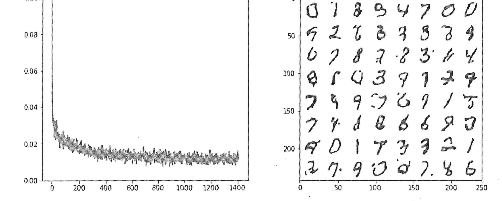

图3-6 损失曲线（左图）与生成的样本（右图）

### 3.5 扩散模型退化过程示例

#### 3.5.1 退化过程

DDPM 提出了一种逐步加噪的退化方式。每一步都在前一步图像上叠加一点噪声：

$q(x_t | x_{t-1}) = \mathcal{N}\left(x_t; \sqrt{1-\beta_t}x_{t-1}, \beta_t I\right) q(x_{1:T} | x_0) = \prod_{t=1}^T q(x_t | x_{t-1})$

直观理解就是对 $x_{t-1}$ 乘以 $\sqrt{1-\beta_t}$ 的系数，再加上强度为 $\beta_t$ 的噪声。$\beta_t$ 由调度器为每个时刻设定，决定该步加入多少噪声。直接把这个递推做 500 次得到 $x_{500}$ 太慢，我们更希望从 $x_0$ 一次性算出任意时刻 $t$ 的 $x_t$：

$q(x_t | x_0) = \mathcal{N}\left(x_t; \sqrt{\bar{\alpha}_t}x_0, \sqrt{(1-\bar{\alpha}_t)}I\right); 其中 \bar{\alpha}_t = \prod_{i=1}^T \alpha_i, \alpha_i = 1-\beta_i$

公式看起来复杂，实际调度器已帮我们封装好，例如本节代码里的 `# noise_scheduler.add_noise`。我们可以通过绘制 $\sqrt{\bar{\alpha}_t}$ 也就是 sqrt_alpha_prod，以及 $\sqrt{1-\bar{\alpha}_t}$ 也就是 sqrt_one_minus_alpha_prod 的变化，来观察不同轮次里信号与噪声的占比，代码如下：

```
noise_scheduler = DDPScheduler(num_train_timesteps=1000)
plt.plot(noise_scheduler.alphas_cumprod.cpu() ** 0.5, label=r"$(\sqrt{\bar{\alpha}_t})")
plt.plot((1 - noise_scheduler.alphas_cumprod.cpu()) ** 0.5, label=r"$(\sqrt{(1 - \bar{\alpha}_t})")
plt.legend(fontsize="x-large");
```

如图 3-7，最初阶段 $\sqrt{\bar{\alpha}_t}\approx1$，输入 $X$ 基本就是原始内容。随着迭代推进，$X$ 的贡献逐渐下降，噪声占比不断上升。

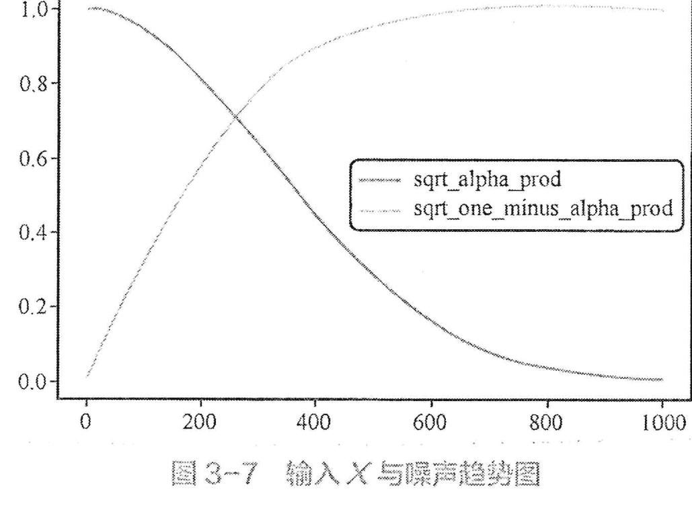

图3-7 输入X与噪声趋势图

#### 3.5.2 最终的训练目标

本例子里我们让模型学习“去噪”后的图像。DDPM 及众多实现里更常见的做法是让模型预测退化过程中加入的噪声，即无缩放的单位正态噪声。代码片段如下：

```
noise = torch.randn_like(xb) << 注意是使用 randn 而不是 rand
```

noisy_x = noise_scheduler.add_noise(x, noise, timesteps)

model_prediction = model(noisy_x, timesteps).sample

loss = mse_loss(model_prediction, noise) # 预测值与真实噪声

乍看之下，预测噪声似乎等价于直接预测去噪图像，为什么要选前者？背后不只是数学便利。训练时会在不同随机时间步上计算损失，不同的目标函数会收敛到不同的隐式权重。预测噪声的目标会让模型更偏向低噪声量的拟合。你也可以换更复杂的目标来改变这种隐式权重，从而让选定的噪声调度器在高噪声区间产生更多样本。

另一种常见设计是预测 “velocity”，它被定义为图像与噪声的混合量，见论文《Progressive Distillation for Fast Sampling of Diffusion Models》。

还可以保留预测噪声的形式，但对损失做缩放。例如有研究用噪声量本身做加权，见论文《Perception Prioritized Training of Diffusion Models》；也有工作基于大量实验探索最优的噪声加权策略，见论文《Elucidating the Design Space of Diffusion-Based Generative Models》。

总的来说，任务目标的选择会影响性能，目前预测 $\epsilon$ 是主流，但未来库中很可能会支持更多可调节的目标，用于不同场景。

### 3.6 拓展知识

#### 3.6.1 时间步的调节

UNet2DModel 同时接收图像和时间步。时间步会被编码成嵌入，再注入模型的不同位置。

原因在于，告知模型当前噪声水平有助于它完成去噪任务。理论上不提供时间步也能训练，但实践中时间步通常能带来提升，现在绝大多数实现都保留了它。

# 3.6.2 采样的关键问题

如果模型能预测带噪样本中的噪声，或直接给出去噪版本，我们该如何生成图像？

直接喂入纯噪声期待一步得到干净图像是不现实的，需要在模型预测的基础上做多次小步迭代，每一步只移除少量噪声。

具体走法取决于采样策略。无需深究理论，但建议思考三点：

+   ( 1 ) 每一步走多远？即采用怎样的“噪声计划”？
( 2 ) 是否只用当前步的预测来指导下一步，如 DDPM、DDIM 等？是否要多次预测以估计更高阶梯度，像高阶方法和离散 ODE 求解器那样？或者保留历史预测来指导当前更新，像线性多步或自回归采样器那样？
( 3 ) 采样时是否额外加入随机噪声或完全确定性更新？很多采样器提供参数如 DDIM 中的 'eta' 让用户选择。

扩散采样器的研究进展很快，已出现越来越多用更少步数就能得到好结果的方法。浏览 Diffusers 库的不同实现会很有意思，相关社区文章也不少。

### 3.7 本章小结

本章从多个角度帮助你审视扩散模型。内容改编自 Jonathan Whitaker 为 Hugging Face 开发的课程，他本人也有课程“The Generative Landscape”。如果你想看从噪声和约束分类中生成样本的例子，或遇到问题和 bug，欢迎通过 Discord 与我们交流。

# 第4章 Diffusers 实战

本章将指导你训练专属扩散模型，用来生成色彩斑斓的蝴蝶图像。过程中你会掌握 Diffusers 库的使用，为后续进阶打下基础。本章要点包括：

+   ● 学会使用强大的自定义扩散模型 pipeline，并了解如何派生新版本。
+   ● 通过以下步骤打造迷你 pipeline。
+     ● 回顾扩散模型核心概念。
+     ● 从 Hugging Face Hub 加载训练数据。
+     ● 使用调度器为数据加噪。
+     ● 构建并训练 UNet 模型。
+     ● 把各模块组合成可运行的 pipeline。

+   ● 写一段启动脚本来初始化一次耗时较长的训练任务，这段脚本会串联多个处理环节。
+   ● 借助 Accelerate 库调用多张 GPU 并行，加快整体训练速度。
+   ● 做好实验日志的记录与回查，方便追踪核心统计指标。
+   ● 训练完成后把最终权重推送到 Hugging Face Hub。

### 4.1 环境搭建

# 4.1.1 安装 Diffusers

先执行下面这段代码，一次性装好 Diffusers 及相关依赖：

```
%pip install -qq -U diffusers datasets transformers accelerate ftfy
```

#### 4.1.2 DreamBooth 微调

常逛 AI 社交内容的朋友，大概率都听过 Stable Diffusion。这类图像生成模型能力很强，但存在明显短板：没有大量你的网络照片，它就很难辨认出你和我的长相。

DreamBooth 可以对 Stable Diffusion 做个性化微调，在训练过程中注入特定人脸、物体或风格的信息。Corridor Crew 曾做过一个很棒的演示视频，用统一的人物形象来讲故事，完美诠释了这项技术的潜力，链接如下：

https://www.bilibili.com/video/BV18o4y1cR7/?vd_source=c5a5204620e35330e6145843f4df6ea4

视频里展示的模型可在 Hugging Face 上找到。训练时它只用了知名儿童玩具“Mr. Potato Head”土豆先生的 5 张照片。

先加载这个流水线，代码如下：

```python
from diffusers import StableDiffusionPipeline
```

```python
# https://huggingface.co/sd-dreambooth-library ，这里有来自社区的各种模型
model_id = "sd-dreambooth-library/mr-potato-head"
```

```python
# 加载管线
pipe = StableDiffusionPipeline.from_pretrained(model_id, torch_dtype=torch.float16). to(device)
```

以上片段会自动从 Hugging Face Hub 拉取权重等必要文件。本示例的数据量可达数 GB，若不想等待可直接跳过，先看输出效果。

流水线加载完毕后，用下面代码即可生成示例图：

```python
prompt = "an abstract oil painting of sks mr potato head by picasso"
image = pipe(prompt, num_inference_steps=50, guidance_scale=7.5). images[0]
image
```

生成的示例图如图4-2所示。

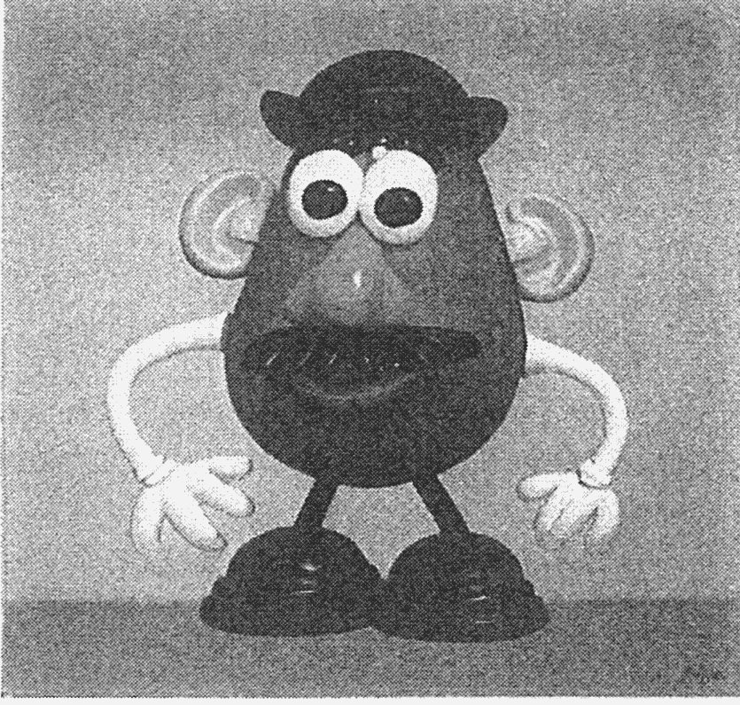

图4-2 DreamBooth 生成的示例图像

练习4-1: 你可以换不同的提示词来试玩。本例中 sk s 充当新引入的唯一标识符 UID，也可尝试留空观察效果。还能调节 num_inference_steps 和 guidance_scale。num_inference_steps 控制采样步数，guidance_scale 决定生成结果与提示词的贴合度。调这两个参数能进一步探索模型行为。

这条流水线内部其实发生了很多复杂而精妙的操作。读完本书后你会对整体原理更清晰。现在我们先聊聊如何从零训练一个扩散模型。

# 4.1.3 Diffusers 核心组件

Diffusers 核心 API 大致拆成三块。

+   - 流水线：面向部署的高层函数集合，能快速调用主流预训练扩散模型生成样本。
- 模型：在从零训练扩散模型时使用的网络结构，比如 UNet。
- 调度器：推理时用多种技巧从噪声生成图像，也能在训练时生成带噪样本。

对普通用户来说直接用现成流水线已足够好用。但既然你选择了本书，我们判断你想深入理解原理。读完本章后，你就能自己搭建一条流水线来生成漂亮的蝴蝶图，代码如下：

```python
from diffusers import DDPMPipeline
# 加载预设好的管线
butterfly_pipeline = DDPMPipeline.from_pretrained("johnowhitaker/ddpm-butterflies-32px").to(device)
# 生成8张图片
images = butterfly_pipeline(batch_size=8).images
# 输出图片
make_grid(images)
```

生成的蝴蝶图像如图4-3所示。

[PAGE 83]

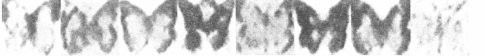

效果或许不及 DreamBooth 的展示图那么惊艳，但要注意，我们训练时使用的数据量不到训练 Stable Diffusion 所需数据的 1%。

到目前为止，训练扩散模型的流程可概括为：

+   (1) 从训练集里读入图像。
(2) 对图像加入不同强度的噪声。
(3) 把加噪后的数据送入模型。
(4) 评估模型去噪的程度。
(5) 根据评估结果更新权重，然后重复以上步骤。

接下来几章会逐步把上述步骤落地，直到训练循环完整跑通。之后会讲如何用训练好的模型生成样本，以及如何把模型封装成流水线方便分享。下面就从数据开始。

### 4.2 实战：训练蝴蝶生成模型

#### 4.2.1 准备蝴蝶数据集

下面会加载一个来自 Hugging Face Hub 的蝴蝶图像集，约 1000 张。注意这是一个小规模集。代码里注释掉了几行针对更大规模数据的片段，你也可以借用它们指定自己的图像路径来加载。

```python
import torchvision
from datasets import load_dataset
from torchvision import transforms
dataset = load_dataset("huggan/smithsonian_butterflies_subset", split="train")
```

```python
# 也可以从本地文件夹中加载图像
# dataset = load_dataset("imagefolder", data_dir="path/to/folder")
```

```python
# 我们将在32×32像素的正方形图像上进行训练，但你也可以尝试更大尺寸的图像
image_size = 32
# 如果GPU内存不足，你可以减小batch_size
batch_size = 64
```

```python
# 定义数据增强过程
preprocess = transforms.Compose(
    [
        transforms.Resize((image_size, image_size)), # 调整大小
        transforms.RandomHorizontalFlip(),
        transforms.ToTensor(),
        transforms.Normalize([0.5], [0.5]), # 映射到(-1, 1)区间
    ]
)
```

```python
def transform(examples):
    images = [preprocess(image.convert("RGB")) for image in examples["image"]]
    return {"images": images}
dataset.set_transform(transform)
```

```python
# 创建一个数据加载器，用于批量提供经过变换的图像
train_dataloader = torch.utils.data.DataLoader(
    dataset, batch_size=batch_size, shuffle=True
)
```

取出一批数据可视化，代码如下：

```python
xb = next(iter(train_dataloader))["images"].to(device)[:8]
print("X shape:, xb.shape")
show_images(xb).resize((8 * 64, 64), resample=Image.NEAREST)
```

输出如下：

X shape: torch.Size ([8, 3, 32, 32])

可视化结果如图4-4所示。

[PAGE 85]

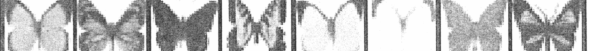

# 图4-4 蝴蝶图像的可视化输出效果

本例采用 32×32 像素的小图，目的是把训练时间控制在合理范围。

#### 4.2.2 调度器

训练扩散模型时，需要先对输入图像加噪再送入网络；推理时则用模型预测逐步去噪。这两个过程都由调度器负责。

噪声调度器决定每一轮迭代加入多少噪声。下面演示如何用 DDPM 的默认训练与采样设置创建调度器，基于论文《Denoising Diffusion Probabilistic Models》，代码如下：

```python
from diffusers import DDPScheduler
noise_scheduler = DDPScheduler(num_train_timesteps=1000)
```

练习4-2: 可通过 beta_start、beta_end 和 beta_schedule 三个超参控制 DDPM 调度器的 beta，原理可参照 3.5.1 节。beta_start 影响推理开始时的 beta，beta_end 决定最终 beta 值，beta_schedule 用函数映射为每一步生成 beta。请从下方两个被注释的调度器代码中挑一个，观察不同参数下曲线的变化。

```python
# 仅添加了少量噪声
# noise_scheduler = DDPScheduler(num_train_timesteps=1000, beta_start=0.001, beta_end=0.004)
# 'cosine' 调度方式，这种方式可能更适合尺寸较小的图像
# noise_scheduler = DDPScheduler(num_train_timesteps=1000, beta_schedule='squaredcos_cap_v2')
```

选定调度器后，就可以用 noise_scheduler.add_noise 为图片加不同程度噪声，代码如下：

```python
timesteps = torch.linspace(0, 999, 8).long().to(device)
noise = torch.randn_like(xb)
noisy_xb = noise_scheduler.add_noise(xb, noise, timesteps)
print("Noisy X shape", noisy_xb.shape)
show_images(noisy_xb).resize((8 * 64, 64), resample=Image.NEAREST)
```

输出：

Noisy X shape torch.Size ([8, 3, 32, 32])

加噪后的蝴蝶图如图 4-5 所示。

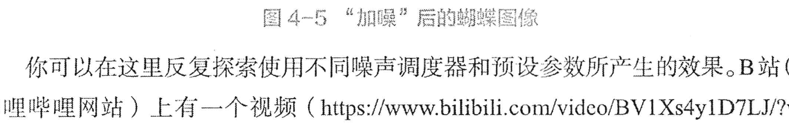

可以反复尝试不同调度器与参数的组合效果。B站有一个视频（https://www.bilibili.com/vidco/BV1Xs4y1D7LJ/?vd_source=c5a204620e35330e6145843f4df6ea4 ）对这些数学细节做了不错的讲解。

# 4.2.3 定义模型

本章的核心就是模型。大多数扩散模型都使用 UNet 的变体，其结构如图4-6所示。

UNet 的工作方式大致如下：

(1) 图像进入 UNet 后会经过若干 ResNet 模块，每经过一个模块尺寸减半。
(2) 相应的上采样层会把尺寸逐步恢复到原大小。
(3) 残差连接把分辨率相同的上采样层与下采样层特征图拼接起来。

UNet 的关键特性是输出尺寸与输入尺寸一致，这正好满足扩散模型的需求。

[PAGE 87]

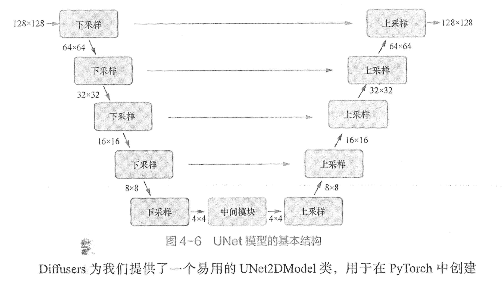

Diffusers 提供了易用的 UNet2DModel 类，可在 PyTorch 中快速搭建所需结构。

下面用 UNet 生成目标尺寸图像。注意代码里 down_block_types 对应下采样模块（图4-6绿色部分），up_block_types 对应上采样模块（图4-6红色部分）。

```python
from diffusers import UNet2DModel
# 创建模型
model = UNet2DModel(
  sample_size=image_size,  # 目标图像分辨率
  in_channels=3,          # 输入通道数，对于 RGB 图像来说，通道数为 3
  out_channels=3,        # 输出通道数
  layers_per_block=2,     # 每个 UNet 块使用的 ResNet 层数
  block_out_channels=(64, 128, 128, 256),  # 更多的通道→更多的参数
  down_block_types=(
    "DownBlock2D",      # 一个常规的 ResNet 下采样模块
    "DownBlock2D",      
    "AttnDownBlock2D",  # 一个带有空间自注意力的 ResNet 下采样模块
    "AttnDownBlock2D",  
  ),
  up_block_types=(
    "AttnUpBlock2D",    # 一个带有空间自注意力的 ResNet 上采样模块
    "AttnUpBlock2D",    
  )
"UpBlock2D",\n"UpBlock2D",\n# 一个常规的 ResNet 上采样模块\n),\nmodel.to(device);
```

[PAGE 88]

# ·72· 扩散模型从原理到实践

```
"UpBlock2D",\n"UpBlock2D",\n# 一个常规的 ResNet 上采样模块\n),\nmodel.to(device);
```

处理更高分辨率图像时，可尝试增加上采样与下采样模块数量，并只在最低分辨率处保留注意力模块，以此降低显存占用。后续会详细讨论如何通过实验找到最合适的配置。

搭建完网络后，可以输入一批数据和随机时间步，检查输出与输入尺寸是否一致，代码如下：

```python
with torch.no_grad():\nmodel_prediction = model(noisy_xb, timesteps).sample\nmodel_prediction.shape
```

输出：

```
torch.Size ([8, 3, 32, 32])
```

接下来看看如何训练这个模型。

# 4.2.4 搭建训练循环

准备工作完成后就可以开始训练。下面是 PyTorch 中典型的迭代优化流程：逐批喂数据，用优化器逐步更新参数。本例使用学习率 0.0004 的 AdamW 优化器。

单批训练步骤如下：

+   (1) 随机采样若干时间步。\n(2) 对数据做相应加噪。\n(3) 把加噪数据输入模型。\n(4) 以 MSE 为损失，比较目标与模型预测。本例即比较真实噪声与预测噪声的差距。\n(5) 调用 loss.backward() 和 optimizer.step() 更新参数。

[PAGE 89]

训练过程中需要记录每一步的损失值，方便后续画损失曲线，代码如下。

```python
# 设定噪声调度器
noise_scheduler = DDPScheduler(
  num_train_timesteps=1000, beta_schedule="squaredcos_cap_v2"
)
# 训练循环
optimizer = torch.optim.AdamW(model.parameters(), lr=4e-4)
losses = []
for epoch in range(30):
  for step, batch in enumerate(train_dataloader):
    clean_images = batch["images"].to(device)
    # 为图片添加采样噪声
    noise = torch.randn(clean_images.shape).to(clean_images.device)
    bs = clean_images.shape[0]
    # 为每张图片随机采样一个时间步
    timesteps = torch.randint(
      0, noise_scheduler.num_train_timesteps, (bs,),
      device=clean_images.device
    ).long()
    # 根据每个时间步的噪声幅度，向清晰的图片中添加噪声
    noisy_images = noise_scheduler.add_noise(clean_images, noise, timesteps)
    # 获得模型的预测结果
    noise_pred = model(noisy_images, timesteps, return_dict=False)[0]
    # 计算损失
    loss = F.mse_loss(noise_pred, noise)
    loss.backward()
    losses.append(loss.item())
    # 迭代模型参数
    optimizer.step()
    optimizer.zero_grad()
```

[PAGE 90]

# *74* 扩散模型实战拆解

```
if (epoch + 1) % 5 == 0:
	loss_last_epoch = sum(losses[-len(train_dataloader):]) / 
	len(train_dataloader)
	print(f"Epoch:{epoch+1}, loss: {loss_last_epoch}")
```

友情提醒：完整执行这段训练大约耗时十分钟左右。为节省时间，可直接跳过训练环节，采用已有的预训练权重。若想进一步提速，也可以尝试调低模型各层通道数。

Hugging Face 官方提供的训练示例，特意在更高分辨率下用更大模型在同一蝴蝶数据集上跑，以便让读者体会一次更接近真实规模的训练过程。

上述代码的输出结果如下：

Epoch:5, loss: 0.16273280512541533

Epoch:10, loss: 0.11161588924005628

Epoch:15, loss: 0.10206522420048714

Epoch:20, loss: 0.08302505919709802

Epoch:25, loss: 0.07805309211835265

Epoch:30, loss: 0.0747456245590013

脚本会按每五轮输出一次训练损失。为了更直观呈现收敛趋势，下面将这些数值绘制成曲线，相关代码如下：

```python
fig, axs = plt.subplots(1, 2, figsize=(12, 4))
axs[0].plot(losses)
axs[1].plot(np.log(losses))
plt.show()
```

运行后的输出为：

[<matplotlib.lines.Line2D at 0x7f40fc40b7c0>]

图4-7 展示了绘制出来的损失变化曲线。可以看出，初期损失下降很快，随后进入缓慢优化阶段，若使用对数坐标观察则更明显。

不想自己从头训练的话，也可以用下面代码直接加载现成管线来使用：

```python
model = butterfly_pipeline.onet
```

## 图4-7 损失曲线

## 4.2.5 图像的生成

接下来要解决的是如何利用已训练好的模型来生成图片，总体上可分为两种做法。

方法一：建立一个管线。

相关代码见此：

```python
from diffusers import DDPMPipeline
```

```python
image_pipe = DDPMPipeline(unet=model, scheduler=noise_scheduler)
```

```python
pipeline_output = image_pipe()
```

```python
pipeline_output.images[0]
```

第一种方式搭建好推理管线后，生成的蝴蝶样例见图4-8。

## 图4-8 生成的蝴蝶图像

若想把这套推理管线保存到本地，可执行下面这段保存指令：

```python
image_pipe.save_pretrained("my_pipeline")
```

下面代码用于查看本地目录下的保存结果：

## ·76· 扩散模型从原理到实战

```python
!ls my_pipeline/
```

运行结果显示：

model_index.json scheduler unet

scheduler 与 unet 这两个子目录保存了推理所需要的所有部件。例如在 unet 目录下可以看到权重文件 diffusion_pytorch_model.bin 以及结构配置文件 config.json，具体如下所示：

```python
!ls my_pipeline/unet/
```

输出结果为：

config.json diffusion_pytorch_model.bin

仅凭这两个文件就能完整复原推理管线。分享给他人时可手动上传到 Hugging Face Hub，也能借助 API 脚本自动完成上传。

## 方法二：写一个采样循环。

可以先查看 image_pipe.forward 的实现，理解管线运行时内部的流程。

基本思路是从一张纯随机噪声图出发，让调度器逐步从高噪声向低噪声推进，每一步都依据模型预测去掉一点噪声，具体实现如下：

```python
# 随机初始化（8 张随机图片）
sample = torch.randn(8, 3, 32, 32).to(device)
```

```python
for i, t in enumerate(noise_scheduler.timesteps):
```

```python
# 获得模型的预测结果
with torch.no_grad():
residual = model(sample, t).sample
```

```python
# 根据预测结果更新图像
sample = noise_scheduler.step(residual, t, sample).prev_sample
```

```python
show_images(sample)
```

使用手工采样循环得到的一张蝴蝶图即为图4-9。

## 图4-9 生成的蝴蝶图像

noise_scheduler.step 负责完成样本更新的数学计算。实际应用中采样器的种类很多，后续章节会介绍如何利用不同采样策略提升生成速度，并更深入剖析扩散采样的原理。

### 4.3 拓展知识

## 4.3.1 将模型上传到 Hugging Face Hub

前面我们只把管线存到了本地。若希望公开，就需要把文件推送到 Hugging Face Hub 的模型仓库。仓库名由你指定的模型 ID 决定，只要包含用户名即可，get_full_repo_name() 会帮你拼接完整路径，具体实现如下：

```python
from huggingface_hub import get_full_repo_name
```

```python
model_name = "sd-class-butterflies-32"
```

```python
hub_model_id = get_full_repo_name(model_name)
```

```python
hub_model_id
```

运行结果显示：

> 'lewtun/sd-class-butterflies-32'

确认仓库名后，可用下面代码在 Hub 上创建仓库并上传文件：

```python
from huggingface_hub import HfApi, create_repo
```

```python
create_repo(hub_model_id)
```

# 扩散模型从原理到实战

```python
api = HfApi()
api.upload_folder(
  folder_path="my_pipeline/scheduler", path_in_repo="", 
  repo_id=hub_model_id
)
```

```python
api.upload_folder(folder_path="my_pipeline/unet", path_in_repo="", 
repo_id=hub_model_id)
```

```python
api.upload_file(
  path_or_fileobj="my_pipeline/model_index.json", 
  path_in_repo="model_index.json", 
  repo_id=hub_model_id,
)
```

运行结果显示：

'https://huggingface.co/lewtun/sd-class-butterflies-32/blob/main/model_index.json'

为了让模型更容易被检索，还可以生成一张模型卡片，以下代码可实现此操作，描述部分建议写点创意介绍：

```python
from huggingface_hub import ModelCard
content = f"""
---
license: mit
tags:
- pytorch
- diffusers
- unconditional-image-generation
- diffusion-models-class
---
# 这个模型用于生成蝴蝶图像的无条件图像生成扩散模型
'''python
from diffusers import DDPMPipeline
pipeline = DDPMPipeline.from_pretrained('(hub_model_id)')
image = pipeline().images[0]
image
'''
card = ModelCard(content) card.push_to_hub(hub_model_id)
```

模型已成功上传到 Hugging Face Hub。之后可以从任意环境通过下面代码拉取使用

## 使用DDMPipeline的from_pretrained方法来下载该模型：

```python
from diffusers import DDMPipeline
```

```python
image_pipe = DDMPipeline.from_pretrained(hub_model_id)
pipeline_output = image_pipe()
pipeline_output.images[0]
```

拉取后生成的蝴蝶图见图4-10，完成！

## 图4-10 下载的蝴蝶图像

## 4.3.2 使用Accelerate库扩大训练模型的规模

本书定位入门，示例代码刻意保持简洁，所以省略了在大规模数据上训练大模型的一些进阶内容，例如多 GPU 支持、训练日志与预览图、梯度检查点以支持更大批次、自动推送模型等。完整实现可在官方示例仓库中找到，地址在 raw.githubusercontent 上。

若想获取完整示例训练脚本，可运行下面这段下载代码：

```python
!wget https://github.com/huggingface/diffusers/raw/main/examples/unconditional_image_generation/train_unconditional.py
```

阅读完这份文件后就能清楚模型结构及可调参数。下面命令可直接启动该示例训练：

```python
# 给新模型取个名字
model_name = "sd-class-butterflies-64"
hub_model_id = get_full_repo_name(model_name)
hub_model_id
```

运行结果显示：

'lewtun/sd-class-butterflies-64'

通过下面代码借助 Accelerate 启动训练，它能自动处理多 GPU 并行等部署细节：

# 扩散模型从原理到实战

```python
!accelerate launch train_unconditional.py \ --dataset_name="huggan/smithsonian_butterflies_subset" \ --resolution=64 \ --output_dir={model_name} \ --train_batch_size=32 \ --num_epochs=50 \ --gradient_accumulation_steps=1 \ --learning_rate=1e-4 \ --lr_warmup_steps=500 \ --mixed_precision="no"
```

同前面步骤，训练完成后同样可以推送到 Hugging Face Hub 并制作一个吸引人的模型卡片，具体代码如下：

```python
create_repo(hub_model_id)
api = HfApi()
api.upload_folder(
    folder_path=f"{model_name}/scheduler", path_in_repo=
```

```python
content = f""
---
license: mit
tags:
- pytorch
- diffusers
- unconditional-image-generation
- diffusion-models-class
---
```

# 这是一个无条件图像生成扩散模型，用来生成美丽的蝴蝶图像

### 5.1 环境准备

要把微调好的模型保存到 Hugging Face Hub，需要先用一个具备写权限的访问令牌登录。下面代码会引导你完成登录并关联令牌页面。同时本节还使用了 Weights and Biases 来记录训练日志，所以需要先注册一个账号。

首先安装所需 Python 库：

```python
!pip install -qq diffusers datasets accelerate wandb open-clip-torch
```

随后登录 Hugging Face Hub，后续开源模型时会用到：

```python
from huggingface_hub import notebook_login
notebook_login()
```

登录成功后会看到类似以下提示：

nToken is valid.

Your token has been saved in your configured git credential helpers (store).

Your token has been saved to /root/.huggingface/token

Login successful

接下来还需要完成一些额外准备，例如导入所需库和设置计算设备，具体如下：

```python
import numpy as np
import torch
import torch.nn.functional as F
import torchvision
from datasets import load_dataset
from diffusers import DDIMScheduler, DDPMPipeline
from matplotlib import pyplot as plt
from PIL import Image
from torchviz import transforms
from tqdm.auto import tqdm
device = (
    "mps"
    if torch.backends.mps.is_available()
    else "cuda"
```

### 5.2 载入一个预训练过的管线

本小节先加载一个现成的管线，探索其可实现的功能，代码见下：

```
image_pipe = DDPMPipeline.from_pretrained("google/ddpm-celebahq-256")
image_pipe.to(device);
```

生成图片的操作与调用函数类似，只需调用管线的 `__call__` 方法即可，下面做个简单尝试：

```
images = image_pipe().images
images[0]
```

上述代码生成的图像见图5-4。

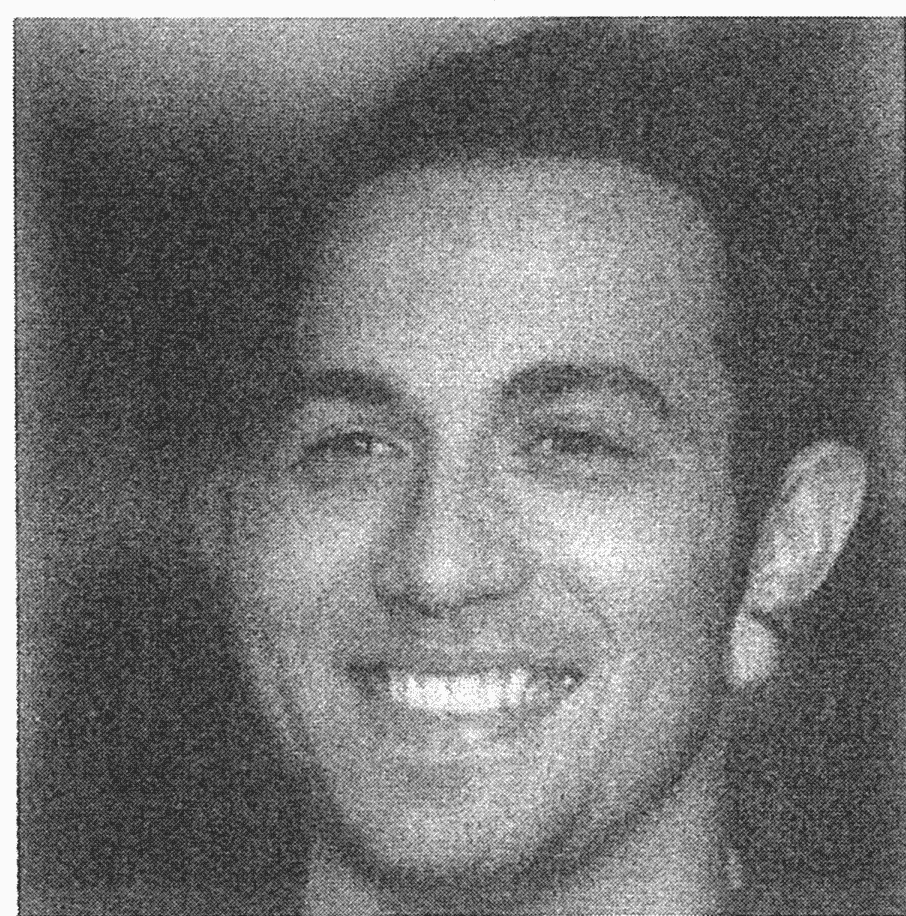

图5-4 合成示例

整体思路不难，实际耗时偏久。进入正题前，先把采样效率的问题梳理清楚。

### 5.3 DDIM —— 采样提速

扩散生成里，每一步网络都会拿到一张含噪图像，尝试估算其中的噪声成分，进而推断出干净的画面。早期预测精度有限，所以过去需要把迭代拆得很细。实际上不必走完上千步，近期的研究已经能用极少量步数得到可用样本。

在 Diffusers 体系里，采样策略由调度器掌控，具体更新交给 step() 完成。生成始于随机噪声，把含噪输入送进模型，预测结果再喂给 step()。返回的 prev_sample 之所以带 prev，是因为时间线是倒序推进的，整体由高噪声逐步降低至低噪声，正好相反于前向扩散。

现在做个小实验。先装载一个调度器，这里选用 DDIMScheduler，源自论文《Denoising Diffusion Implicit Models》。相较 DDPM，DDIMScheduler 在循环次数更少的情况下仍能产出不错样本。调度器装载片段：
```
# 创建一个新的调度器并设置推理迭代次数
scheduler = DDIMScheduler.from_pretrained("google/ddpm-celebahq-256")
scheduler.set_timesteps(num_inference_steps=40)
```

效果对比很直观：该模型仅用 40 次迭代，就优于原版 1000 步调度器在 25 步时的表现。对应实现：
```
scheduler.timesteps
```

运行后得到：

tensor([975, 950, 925, 900, 875, 850, 825, 800, 775, 750, 725,

              700, 675, 650, 625, 600, 575, 550, 525, 500, 475, 450, 425,

              400, 375, 350, 325, 300, 275, 250, 225, 200, 175, 150,

              125, 100, 75, 50, 25, 0])

随后以 4 张随机噪声图做循环采样，对比每轮输入与模型预测的去噪版本，示例：
```
# 从随机噪声开始
x = torch.randn(4, 3, 256, 256).to(device)
# batch size 为 4，三通道，长、宽均为 256 像素的一组图像
# 循环一整套时间步
for i, t in tqdm(enumerate(scheduler.timesteps)):
# 准备模型输入：给“带噪”图像加上时间步信息
model_input = scheduler.scale_model_input(x, t)
# 预测噪声
with torch.no_grad():
noise_pred = image_pipe.unet(model_input, t)["sample"]
# 使用调度器计算更新后的样本应该是什么样子
scheduler_output = scheduler.step(noise_pred, t, x)
# 更新输入图像
x = scheduler_output.prev_sample
# 时不时看一下输入图像和预测的“去噪”图像
if i % 10 == 0 or i == len(scheduler.timesteps) - 1:
fig, axs = plt.subplots(1, 2, figsize=(12, 5))
grid = torchvision.utils.make_grid(x, nrow=4).permute(1, 2, 0)
axs[0].imshow(grid.cpu().clip(-1, 1) * 0.5 + 0.5)
axs[0].set_title(f"Current x (step {i})")
pred_x0 = (
scheduler_output.pred_original_sample)
grid = torchvision.utils.make_grid(pred_x0, nrow=4).
permute(1, 2, 0)
axs[1].imshow(grid.cpu().clip(-1, 1) * 0.5 + 0.5)
axs[1].set_title(f"Predicted denoised images (step {i})")
plt.show()

```
## 第5章 微调和引导 ·89·

预测过程的可视化在图 5-5 中呈现。

[PAGE 106]

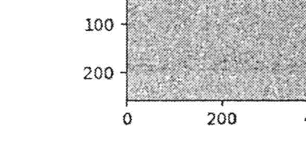
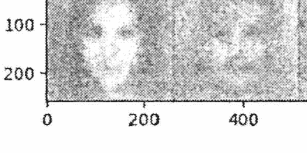
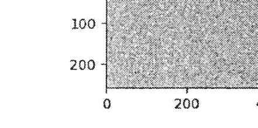
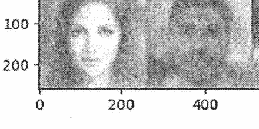
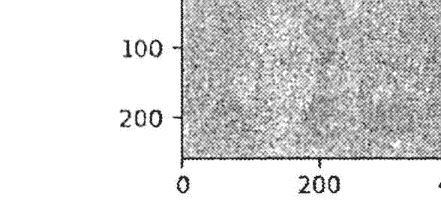


# 图5-5 预测过程的可视化效果

图5-5 表明初期预测不够可靠，随着迭代推进输出逐渐清晰。你也可以直接把新调度器替换进原有管线再采样，示例：
```
image_pipe.scheduler = scheduler
images = image_pipe(num_inference_steps=40).images
images[0]
```

产出见图5-6。

[PAGE 107]


至此采样已进入可接受的时间区间，后续内容学习会更顺畅。

### 5.4 扩散模型之微调

## 5.4.1 实战:微调

下面尝试更有趣的操作。假设手头有一个预训练管线，如何借助新数据对其进行再训练以得到新图像？

整体流程与从零训练相似，区别在于可以用已有权重初始化，节省不少时间。开始实操。

数据方面，可选用人脸类集合，比如 Vintage Faces 或动漫人脸，由于该模型原本即在人脸数据上训练。为便于讲解，这里沿用第4章的蝴蝶图像集。先用下面片段下载图像并创建数据加载器：
```
dataset_name = "huggan/smithsonian_butterflies_subset"
```

[PAGE 108]

# 扩散模型从原理到实战

```
dataset = load_dataset(dataset_name, split="train")
image_size = 256
batch_size = 4
preprocess = transforms.Compose(
    [
        transforms.Resize((image_size, image_size)),
        transforms.RandomHorizontalFlip(),
        transforms.ToTensor(),
        transforms.Normalize([0.5], [0.5]),
    ]
)
def transform(examples):
    images = [preprocess(image.convert("RGB")) for image in examples["image"]]
    return {"images": images}
dataset.set_transform(transform)
train_dataloader = torch.utils.data.DataLoader(
    dataset, batch_size=batch_size, shuffle=True
)
```

随后输出 4 张蝴蝶图以便观察，结果见图5-7。
```
print("Previewing batch:")
batch = next(iter(train_dataloader))
grid = torchvision.utils.make_grid(batch["images"], nrow=4)
plt.imshow(grid.permute(1, 2, 0).cpu().clip(-1, 1) * 0.5 + 0.5)
```


图5-7 输出的4幅蝴蝶图像

准备就绪后，还需兼顾若干额外考量。

首要考量：批大小与图像尺寸要在显存范围内平衡。这里批大小设得很小，仅为 4，因为训练基于 256×256 像素的大图，且模型体量庞大。若批大小过大，显存很容易吃紧。也可以缩小图像尺寸换取更大的批大小来加速，但要注意这些模型最初是为 256×256 像素生成而设计训练的。

下面看训练循环。首先把待优化参数指向 image_pipe.unet.parameters()，用以更新预训练模型的权重，其余部分基本沿用第4章写法，片段：
```
num_epochs = 2
lr = 1e-5
grad_accumulation_steps = 2
optimizer = torch.optim.AdamW(image_pipe.unet.parameters(), lr=lr)
losses = []
for epoch in range(num_epochs):
    for step, batch in tqdm(enumerate(train_dataloader), total=len(train_dataloader)):
        clean_images = batch["images"].to(device)
        # 随机生成一个噪声，稍后加到图像上
        noise = torch.randn(clean_images.shape).to(clean_images.device)
        bs = clean_images.shape[0]
        # 随机选取一个时间步
        timesteps = torch.randint(
            0,
            image_pipe.scheduler.num_train_timesteps,
            (bs,),
            device=clean_images.device,
        ).long()
        # 根据选中的时间步和确定的幅值，在干净图像上添加噪声
        # 此处为前向扩散过程
        noisy_images = image_pipe.scheduler.add_noise(clean_images, noise, timesteps)
        # 使用“带噪”图像进行网络预测
        noise_pred = image_pipe.unet(noisy_images, timesteps,```

--log_samples_every 100 --save_model_every 1000 \ --model_save_name 'vintageface'

#### 5.4.3 保存和载入微调过的管线

UNet 微调完成后，可用下面片段将其保存到本地目录：
```
image_pipe.save_pretrained("my-finetuned-model")
```

跟前面章节相近，需要保存配置文件、模型权重和调度器，清单为：
model_index.json scheduler unet

随后把模型推送到 Hugging Face Hub，片段：
```
from huggingface_hub import HfApi, ModelCard, create_repo, get_full_repo_name
# 配置 Hugging Face Hub，上传文件
model_name = "ddpm-celebahq-finetuned-butterflies-2epochs"
    # 使用 @param 脚本程序对上传到
    # Hugging Face Hub 的文件进行命名
local_folder_name = "my-finetuned-model" # @param 脚本程序生成的名字，
# 你也可以通过 image_pipe.save_pretrained('savename') 自行指定
description = "Describe your model here" # @param
hub_model_id = get_full_repo_name(model_name)
create_repo(hub_model_id)
api = HfApi()
api.upload_folder(
    folder_path=f"{local_folder_name}/scheduler",path_in_repo="",repo_id=hub_model_id )
api.upload_folder(
    folder_path=f"{local_folder_name}/unet", path_in_repo=
```

# 添加一个模型卡片，这一步虽然不是必需的，但可以给他人提供一些模型描述信息

# 98. 扩散模型从原理到实践

```
content = f"""
--- 
license: mit
tags:
- pytorch
- diffusers
- unconditional-image-generation
- diffusion-models-class
--- 
# 用法
from diffusers import DDPMPipeline
pipeline = DDPMPipeline.from_pretrained(' {hub_model_id}')
image = pipeline().images[0]
image
""
```

### 5.5 扩散模型之引导

本节介绍模型引导方法。为便于讲解，采用在 LSUN bedrooms 数据集上训练并在 WikiArt 数据集上做过一轮微调的模型。下面下载该模型并查看生成效果，片段：
```
# 载入一个预训练过的管线
pipeline_name = "johnowhitaker/sd-class-wikiart-from-bedrooms"
image_pipe = DDPMPipeline.from_pretrained(pipeline_name).to(device)

# 使用 DDIM 调度器，仅用 40 步生成一些图片
scheduler = DDIMScheduler.from_pretrained(pipeline_name)
scheduler.set_timesteps(num_inference_steps=40)

# 将随机噪声作为出发点
x = torch.randn(8, 3, 256, 256).to(device)

# 使用一个最简单的采样循环
for i, t in tqdm(enumerate(scheduler.timesteps)):
    model_input = scheduler.scale_model_input(x, t)
    with torch.no_grad():
```

# 第5章 微调和引导 ·99·

```
noise_pred = image_pipe.unet(model_input, t)['sample']
x = scheduler.step(noise_pred, t, x).prev_sample
```

```
grid = torchvision.utils.make_grid(x, nrow=4)
plt.imshow(grid.permute(1, 2, 0).cpu().clip(-1, 1) * 0.5 + 0.5)
```

# 查看生成结果，如图5-10所示


# 图5-10 生成的图片

图5-10 的呈现可能让人感到困惑。判断微调是否达标通常并不直观，且“足够好”在不同场景下的标准各异。例如在小数据集上微调文本条件模型如稳定扩散时，你通常希望模型保留原始训练的知识，以便理解数据集中未收录的各种文本提示，同时又要让它适应新数据，使产出风格贴合目标。这往往意味着要采用很小的学习率并配合指数滑动平均。

扩散模型的精准掌控：从微调到引导生成

在很多场景下，模型需要针对全新数据集合进行彻底重训，就像前面从卧室照片迁移到 WikiArt 艺术画那样，这类微调通常要配合较大的学习率并且长时间迭代。即便损失曲线看起来变化平缓，采样结果已经能明显看出风格在从原有分布向更具艺术感的方向偏移，只是整体协调性仍显不足。

接下来我们聚焦一个更精细的问题：如何在生成过程中加入额外约束，让输出更贴合意图。

#### 5.5.1 实战: 引导

怎样给采样结果施加可控的偏向？比如想让画面整体偏向某种特定色调，就能借助引导技术在采样迭代中注入额外控制。

首先需要定义一个可优化的目标指标。下面以让图像逼近指定颜色为例，color_loss() 会把像素值与目标色，比如一种淡蓝绿，进行比较并返回均方误差，具体实现如下：

```
def color_loss(images, target_color=(0.1, 0.9, 0.5)): 
    """给定一个RGB值，返回一个损失值，用于衡量图片的像素值与目标颜色相差多少；
这里的日标颜色是一种浅蓝绿色，对应的RGB值为(0.1, 0.9, 0.5)"""
    target = (
        torch.tensor(target_color).to(images.device) * 2 - 1
    ) # 首先对target_color进行归一化，使它的取值区间为(-1, 1)
    target = target[
        None, :, None, None
    ] # 将所生成目标张量的形状改为(b, c, h, w)，以适配输入图像images的张量形状
    error = torch.abs(
        images - target
    ).mean() # 计算图片的像素值以及目标颜色的均方误差
    return error
```

随后要对采样循环做改造，完成以下几步。

+   (1) 新建一张输入图像 x，并打开 requires_grad。
(2) 依据当前噪声估计出“去噪”后的图像 x₀。
(3) 把 x₀ 送入损失函数计算数值。
(4) 求出损失对输入图像 x 的梯度。
(5) 在调用调度器更新之前，先用该梯度修正 x，使其朝减小损失的方向移动。

实现上存在两种思路，可自行对比效果。第一种是让 UNet 输出的噪声预测参与梯度图，并把 requires_grad 放在输入 x 上，这样显存占用更省，因为不需要回传扩散模型，但梯度精度会打折。第二种是先把 x 设为可微，再送入 UNet 得到 x₀，梯度更准确但显存开销更大。

# # 第一种方法

```
# guidance_loss_scale 用于决定引导的强度有多大
 guidiance_loss_scale = 40 # 可设定为5-100的任意数字
 x = torch.randn(8, 3, 256, 256).to(device)
 for i, t in tqdm(enumerate(scheduler.timesteps)):
   # 准备模型输入
   model_input = scheduler.scale_model_input(x, t)
   # 预测噪声
   with torch.no_grad():
     noise_pred = image_pipe.unet(model_input, t)[
```

# 扩散模型从原理到实践

# 代码输出内容如下：

0 loss: 27.279136657714844

10 loss: 11.286816596984863

20 loss: 10.68311214470215

30 loss: 10.942476272583008

把损失随步数的变化画出来如图 5-11，可以看到图像色调正逐步接近目标颜色。


下面介绍第二种做法。即使 batch size 从 8 降到 4，第二种方案的显存需求仍接近第一种的两倍。你能看出两者的差异吗？思考一下为何第二种方案得到的梯度更精确，代码如下：

```
# 第二种方法：在模型预测前设置好 x.requires_grad
guidance_loss_scale = 40
x = torch.randn(4, 3, 256, 256).to(device)
for i, t in tqdm(enumerate(scheduler.timesteps)):
    # 首先设置好 requires_grad
    x = x.detach().requires_grad_()
    model_input = scheduler.scale_model_input(x, t)
    # 预测
    noise_pred = image_pipe.unet(model_input, t)["sample"]
```

# 得到“去噪”后的图像

```
x0 = scheduler.step(noise_pred, t, x).pred_original_sample
```

计算损失值

```
loss = color_loss(x0) * guidance_loss_scale
```

```
if i % 10 == 0:
```

```
    print(i, "loss:", loss.item())
```

获取梯度

```
cond_grad = -torch.autograd.grad(loss, x)[0]
```

根据梯度修改x

```
x = x.detach() + cond_grad
```

使用调度器更新x

```
x_ = scheduler.step(noise_pred, t, x).prev_sample
```

```
grid = torchvision.utils.make_grid(x, nrow=4)
```

```
im = grid.permute(1, 2, 0).cpu().clip(-1, 1) * 0.5 + 0.5
```

```
Image.fromarray(np.array(im * 255).astype(np.uint8))
```

代码输出内容如下：

0 loss: 30.750328063964844

10 loss: 18.550724029541016

20 loss: 17.515094757080078

30 loss: 17.55681037902832

可视化损失变化如图 5-12 所示。


# 第5章 微调和引导 -101-

第二种方案对显存压力更大，但颜色迁移的幅度反而减弱。你可能会觉得它不如第一种好。实际上第二种输出更贴近训练数据分布。若把 guidance_loss_scale 调大，颜色迁移效果也会随之增强。最终采用哪种方案，取决于实验中的实际表现。

练习 5-3：挑选一个你喜欢的颜色查出其 RGB 值，修改 color_loss() 中的目标色为该颜色并运行，观察结果是否符合预期。

#### 5.5.2 CLIP引导

仅用颜色引导已能提供一定控制力，但能否只用一段文字描述就得到想要的画面？

CLIP 是 OpenAI 推出的图文匹配模型，它可以量化图像与自然语言描述的契合度。更关键的是整个流程可微，可以直接作为损失来驱动扩散模型。

大致流程如下。

+   (1) 把文本提示先编码为 512 维嵌入，供 CLIP 使用。(2) 在扩散生成的每一步执行：
+   ● 生成若干版本的预测“去噪”图，多版本能提供更干净的信号。
+   ● 用 CLIP 为每张预测图做嵌入，并与文本嵌入比较，常用的度量是 Great Circle Distance Squared。
+   ● 计算损失对当前带噪输入 x 的梯度，在调度器更新前先用该梯度修正 x。

想深入了解 CLIP，可参考 Jonathan Whitaker 的课程或 wandb.ai 上关于 OpenCLIP 的报告。本书示例使用 OpenCLIP 加载模型，载入代码如下：

```
import open_clip
clip_model, _, preprocess = open_clip.create_model_and_transforms(
```

# 图像变换：用于修改图像尺寸和增广数据，同时归一化数据，以使数据能够适配 CLIP 模型 tfms = torchvision.transforms.Compose( [

```

+   
	torchvision.transforms.RandomResizedCrop(224), # 随机裁剪
	torchvision.transforms.RandomAffine(5),       # 随机扭曲图片
	torchvision.transforms.RandomHorizontalFlip(), # 随机左右镜像,
	# 你也可以使用其他增广方法
	torchvision.transforms.Normalize(
		mean=(0.48145466, 0.4578275, 0.40821073),
		std=(0.26862954, 0.26130258, 0.2757711)
	)

# ])
```

# 定义一个损失函数，用于获取图片的特征，然后与提示文字的特征进行对比 def clip_loss(image, text_features):

```

# -106- 扩散模型从原理到实践

# 代码输出内容如下：

# 读者可以探索一下这些超参数的影响
.guidance_scale = 8
.n_cuts = 4
```

# 使用 CLIP 从提示文字中提取特征

# 代码输出内容如下：

# 使用 CLIP 从提示文字中提取特征

```
text = open_clip.tokenize([prompt]).to(device)
```

# 使用 CLIP 从提示文字中提取特征

```
with torch.no_grad(), torch.cuda.amp.autocast():
```

# 使用 CLIP 从提示文字中提取特征

```
    text_features = clip_model.encode_text(text)
```

# 使用 CLIP 从提示文字中提取特征

```
x = torch.randn(4, 3, 256, 256).to(
```

# 使用 CLIP 从提示文字中提取特征

```
    device
```

# 使用 CLIP 从提示文字中提取特征

```
for i, t in tqdm(enumerate(scheduler.timesteps)):
```

# 使用 CLIP 从提示文字中提取特征

```
    model_input = scheduler.scale_model_input(x, t)
```

# 使用 CLIP 从提示文字中提取特征

# 预测噪声

# 使用 CLIP 从提示文字中提取特征

```
with torch.no_grad():
```

# 使用 CLIP 从提示文字中提取特征

```
    noise_pred = image_pipe.unet(model_input, t)["sample"]
```

# 使用 CLIP 从提示文字中提取特征

# 计算损失值

# 使用 CLIP 从提示文字中提取特征

```
cond_grad = 0
```

# 使用 CLIP 从提示文字中提取特征

```
for cut in range(n_cuts):
```

# 使用 CLIP 从提示文字中提取特征

# 设置输入图像的 requires_grad 属性为 True

# 使用 CLIP 从提示文字中提取特征

```
x = x.detach().requires_grad_()
```

# 使用 CLIP 从提示文字中提取特征

# 获得“去噪”后的图像

# 使用 CLIP 从提示文字中提取特征

```
x0 = scheduler.step(noise_pred, t, x).pred_original_sample
```

# 使用 CLIP 从提示文字中提取特征

# 计算损失值

# 使用 CLIP 从提示文字中提取特征

```
loss = clip_loss(x0, text_features) * guidance_scale
```

# 使用 CLIP 从提示文字中提取特征

# 获取梯度并使用 n_cuts 进行平均

# 使用 CLIP 从提示文字中提取特征

```
cond_grad -= torch.autograd.grad(loss, x)[0] / n_cuts
```

# 使用 CLIP 从提示文字中提取特征

```
if i % 25 == 0:
```

# 使用 CLIP 从提示文字中提取特征

```
    print(“Step:", i, “, Guidance loss:", loss.item())
```

# 使用 CLIP 从提示文字中提取特征

# 根据这个梯度更新 x

# 使用 CLIP 从提示文字中提取特征

```
alpha_bar = scheduler.alphas_cumprod[i]
```

# 使用 CLIP 从提示文字中提取特征

```
x = (
    x.detach() + cond_grad * alpha_bar.sqrt()
) # 注意这里的缩放因子

# 使用调度器更新 x
x = scheduler.step(noise_pred, t, x).prev_sample
```

```
grid = torchvision.utils.make_grid(x.detach(), nrow=4)
im = grid.permute(1, 2, 0).cpu().clip(-1, 1) * 0.5 + 0.5
Image.fromarray(np.array(im * 255).astype(np.uint8))
代码输出如下。
```

Step: 0 , Guidance loss: 7.437869548797607

Step: 25 , Guidance loss: 7.174620628356934

CLIP 引导的初步结果如图 5-13 所示。


画面看起来有点像玫瑰。虽然还不够完美，但适当调整参数就能得到更满意的结果。

细看代码会发现这里用 alpha_bar.sqrt() 作为缩放因子来调整梯度。理论上存在更“正确”的缩放方式，但在实践中仍需靠实验验证。对于某些引导，你可能希望作用集中在前几步；对于关注纹理的风格损失，则更希望在生成后期发挥作用。下面给出几种常见方案，对应曲线见图 5-14。

```
plt.plot([1 for a in scheduler.alphas_cumprod], label="no scaling")
plt.plot([a for a in scheduler.alphas_cumprod], label="alpha_bar")
plt.plot([a.sqrt() for a in scheduler.alphas_cumprod], label="alpha_bar.sqrt()")
plt.plot(
    [(1 - a).sqrt() for a in scheduler.alphas_cumprod], label="(1 -
```

### 5.6 分享你的自定义采样训练

如果你设计出一个有效的引导损失，并希望把微调模型与自定义采样策略分享给公众，Gradio 是一个很合适的选择。

Gradio 是免费开源的工具，能通过简洁网页界面创建并分享交互式机器学习模型。你可以为模型定制接口，然后用唯一 URL 分享给他人。它还集成 Spaces，让 Demo 的发布更便捷。

这里把核心逻辑封装成一个函数，接收输入并输出图像，再用简单界面包裹并自定义参数。示例中加入了控制引导强度的滑块和定义目标色的颜色选择器，代码如下：

```
!pip install -q gradio # 安装 Gradio
```

```
import gradio as gr
from PIL import Image, ImageColor
```

```
# generate 函数用于生成图片
def generate(color, guidance_loss_scale):
    target_color = ImageColor.getcolor(color, "RGB")
    target_color = [a / 255 for a in target_color]
    x = torch.randn(1, 3, 256, 256).to(device)
    for i, t in tqdm(enumerate(scheduler.timesteps)):
        model_input = scheduler.scale_model_input(x, t)
        with torch.no_grad():
            noise_pred = image_pipe.unet(model_input, t)["sample"]

```

```
x = x.detach().requires_grad_()
x0 = scheduler.step(noise_pred, t, x).pred_original_sample
loss = color_loss(x0, target_color) * guidance_loss_scale
cond_grad = -torch.autograd.grad(loss, x)[0]
x = x.detach() + cond_grad
x = scheduler.step(noise_pred, t, x).prev_sample
grid = torchvision.utils.make_grid(x, nrow=4)
im = grid.permute(1, 2, 0).cpu().clip(-1, 1) * 0.5 + 0.5
im = Image.fromarray(np.array(im * 255).astype(np.uint8))
im.save("test.jpeg")
return im
```

```
# 更多的输入输出信息可以参考 Gradio 文档
inputs = [
```

# 扩散模型核心到应用

```
gr.ColorPicker(label="color", value="55FFAA"), # 你也可以添加
 # 更多的输入
```

```
gr.Slider(label="guidance_scale", minimum=0, maximum=30,
              value=3),
```

```
]
```

```
outputs = gr.Image(label="result")
```

```
# And the minimal interface
```

```
demo = gr.Interface(
    fn=generate,
    inputs=inputs,
    outputs=outputs,
    examples=[
```

```
        ["#BB2266", 3],
        ["#44CCAA", 5],   # 此处可以添加更多的示例

```

```
    ],
)
```

```
demo.launch(debug=True) # 通过设置 debug=True, 你将能够在 CoLab 平台上
 # 看到错误信息
```

当然也可以搭一个更复杂的交互界面，加入炫酷的样式或更长的输入序列，这里仅做最简演示即可。

Spaces 里的 Demo 默认都在 CPU 上跑，建议先在 Colab 把原型跑通再对外交付。准备好演示后，需要新建一个 Space 应用，按 requirements.txt 的说明装好依赖，并把全部逻辑放到 app.py 这个 Python 文件里，该文件负责定义函数和接口。

好在 Space 支持直接复用。打开 Spaces 里的任意示例，点击设置中的 “Duplicate this Space”，就能拿到一份可改动的模板，后续在此基础上接入自己的模型和引导函数。

设置里还能为 Space 调整算力配置。如果你做出足够惊艳的效果，想在更好的硬件上分享，付费升级是值得的。


### 5.7 实战：构建类别条件扩散模型

本节介绍如何为扩散模型注入额外条件。具体是在 MNIST 上训练一个以类别为条件的扩散模型，推理时直接指定想要生成的数字即可。

#### 5.7.1 环境搭建与数据准备

先按需安装依赖库，代码片段如下：

```
!pip install -q diffusers
import torch
import torchvision
from torch import nn
from torch.nn import functional as F
from torch.utils.data import DataLoader
from diffusers import DDPMScheduler, UNet2DModel
from matplotlib import import pyplot as plt
```

#### 5.7.2 设计带类别条件的UNet网络

把类别条件送入网络的流程如下。

+   (1) 以标准 UNet2DModel 为起点，并在输入端扩充若干通道。
(2) 用一个嵌入层把类别标签映射成长度为 class_emb_size 的特征向量。
(3) 将该向量作为额外通道与原始输入拼接起来，代码如下：
net_input = torch.cat((x, class_cond), 1)
(4) 把包含 class_emb_size + 1 个通道的 net_input 送入 UNet，得到最终预测。

本例里 class_emb_size 设为 4，但这个值完全可以调。你可以尝试 1、2、3…10，也可把可学习的 nn.Embedding 换成简单的独热编码，代码如下：

```
class ClassConditionedUnet(nn.Module):
  def __init__(self, num_classes=10, class_emb_size=4):
    super().__init__()
  # 这个网络层会把数字所属的类别映射到一个长度为class_emb_size的特征向量上
  self.class_emb = nn.Embedding(num_classes, class_emb_size)
  # self.model 是一个不带生成条件的UNet模型，在这里，我们给它添加了额外的
  # 输入通道，用于接收条件信息
  self.model = UNet2DModel(
    sample_size=28,
    in_channels=1 + class_emb_size, # 加入额外的输入通道，
    # 用于施加生成条件
    out_channels=1,
    layers_per_block=2, # 设置一个UNet模块有多少个残差连接层
    block_out_channels=(32, 64, 64),
    down_block_types=(
      "DownBlock2D", # 常规的ResNet下采样模块
      "AttnDownBlock2D", # 含有spatial self-attention的
      "AttnDownBlock2D", # ResNet下采样模块
    ),
    up_block_types=(
      "AttnUpBlock2D", # 含有spatial self-attention
      "AttnUpBlock2D", # 的ResNet上采样模块
      "UpBlock2D", # 常规的ResNet下采样模块
    )
  )
  # 此时扩散模型的前向计算就会含有额外的类别标签作为输入了
  def forward(self, x, t, class_labels):
    bs, ch, w, h = x.shape
  # 类别条件将会以额外通道的形式输入
  class_cond = self.class_emb(class_labels) # 将类别映射为向量形式,
    # 并扩展成类似于 (bs, 4, 28, 28) 的张量形状
  class_cond = class_cond.view(bs, class_cond.shape[1], 1, 1).expand(bs, class_cond.shape[1], w, h)
```

#### 5.7.3 训练流程与图像采样

与常规写法 prediction = unet(x, t) 不同，这里用 prediction = unet(x, t, y)，训练时把正确的标签作为第三个输入送入模型，推理时传入任意期望的标签，模型就会生成对应内容的图像。y 即 MNIST 的数字标签，取值 0~9。

整体训练循环与第 4 章类似，只是目标改为预测噪声而非去噪后的图像，以匹配 DDPScheduler 的预期。DDPScheduler 负责训练阶段加噪和推理阶段采样。训练需要一定时间，加速训练可作为一个有趣的延伸，本节重在理清思路，代码可选择性运行。

```
# 创建一个调度器
noise_scheduler = DDPScheduler(num_train_timesteps=1000,
beta_schedule='squaredcos_cap_v2')
# 定义数据加载器
train_dataloader = DataLoader(dataset, batch_size=128, shuffle=True)
n_epochs = 10
net = ClassConditionedUnet().to(device)
loss_fn = nn.MSELoss()
opt = torch.optim.Adam(net.parameters(), lr=1e-3)
losses = [] # 记录损失值
```

# 第5章 微调与引导精要 ·115

```
# 训练开始
for epoch in range(n_epochs):
    for x, y in tqdm(train_dataloader):
        # 获取数据并添加噪声
```

```
x = x.to(device) * 2 - 1 # 数据被归一化到区间 (-1, 1)
y = y.to(device)
noise = torch.randn_like(x)
timesteps = torch.randint(0, 999, (x.shape[0],)).long().to(device)
noisy_x = noise_scheduler.add_noise(x, noise, timesteps)

# 预测
pred = net(noisy_x, timesteps, y) # 注意这里也输入了类别标签 y

# 计算损失值
loss = loss_fn(pred, noise) # 判断预测结果和实际的噪声有多接近

# 梯度回传，参数更新
opt.zero_grad()
loss.backward()
opt.step()

# 保存损失值
losses.append(loss.item())

# 输出损失值
avg_loss = sum(losses[-100:]) / 100
print(f'Finished epoch {epoch}. Average of the last 100 loss values: {avg_loss:.05f}')

# 可视化训练损失，效果如图5-17所示
plt.plot(losses)
```

## 扩散模型原理与实操

训练完成后，只需换不同的标签作为条件就能采样图像，代码如下：

```python
# 准备一个随机噪声作为起点，并准备我们想要的图片的标签
x = torch.randn(80, 1, 28, 28).to(device)
y = torch.tensor([[(i)*8 for i in range(10)]]).flatten().to(device)
```

```python
# 采样循环
for i, t in tqdm(enumerate(noise_scheduler.timesteps)):
    with torch.no_grad():
        residual = net(x, t, y)
    x = noise_scheduler.step(residual, t, x).prev_sample
```

```python
# 显示结果，如图5-18所示
fig, ax = plt.subplots(1, 1, figsize=(12, 12))
ax.imshow(torchvision.utils.make_grid(x.detach().cpu().clip(-1, 1),
nrow=8)[0], cmap='Greys')
```


# 图5-18 生成示例展示

### 5.8 本章要点回顾

本章内容较多，核心要点整理如下。

-   载入已有模型并搭配不同调度器进行采样。
-   微调在流程上与从零训练很像，区别在于用预训练权重初始化，能更快得到更好效果。
-   在大尺寸图像上微调大模型时，可用梯度累积来缓解 batch size 过小的问题。
-   微调过程中把采样图像写入日志很重要，单纯看损失曲线往往没有参考价值。
-   引导机制让无条件扩散模型也能受控生成，通过引导函数或损失函数在每一步计算带噪图像的梯度并更新，再进入下一轮迭代。
-   CLIP 引导可让文本描述控制无条件扩散模型的生成。若想实践，还可做以下三件事。
-   微调自己的模型并上传到 Hugging Face Hub。先找一个预训练模型作为起点，准备新数据集后即可运行本章代码或示例脚本。
-   用微调后的模型探索引导过程，可用本章的颜色损失或 CLIP 引导，也可自行设计引导函数。
-   将 Demo 分享到 Gradio，可复制并修改现有 Space 应用，也可创建功能更丰富的 Space。

## 第6章 Stable Diffusion 实战解析

Stable Diffusion 是一个强大的文本条件潜在扩散模型，能根据文字描述生成精美图像。本章将拆解其原理并给出使用技巧。图 6-1 展示了部分生成效果。


### 6.1 核心概念拆解

#### 6.1.1 潜在空间扩散

随着分辨率提升，生成所需的算力急剧增长，自注意力机制尤为突出，因为计算量随输入规模平方增长。128×128 图像的像素是 64×64 的 4 倍，自注意力层的内存和计算需求会变成后者的 16 倍，这是高分辨率生成的普遍瓶颈。

为解决此问题，潜在扩散引入一个独立的变分自编码器 VAE 把图像压缩到更小的隐式空间，结构如图 6-2。基本思路是图像信息高度冗余，用大量图像训练 VAE，学会把图像映射到紧凑的隐式表征并再还原。

[PAGE 135]

VAE 在大量图像上训练，实现编码与解码。Stable Diffusion 的 VAE 接收三通道图像输入，输出四通道潜在表征，空间维度压缩为原来的八分之一。例如 512×512 的图像会被压缩到 4×64×64 的潜在张量。


在潜在表征上做扩散而非在完整图像上，能大幅降低显存占用、减少 UNet 层数并加速生成。最后再用 VAE 解码器把结果展开为高分辨率图像，训练和推理成本显著下降。

#### 6.1.2 文本驱动的生成条件

前文已演示如何把额外信息注入 UNet 以实现可控生成。给定一张带噪图像，模型会基于附加线索如类别标签或 Stable Diffusion 中的文字描述来预测去噪后的图像。推理时输入期望的文本描述，从纯噪声出发逐步去噪，最终得到符合描述的图像。图 6-3 展示了文本编码过程：提示词被转为一系列文本嵌入，即图中的 ENCODER_HIDDEN_STATES，再作为条件输入 UNet。


# 文本如何化作可计算的向量

要让生成过程吃到文字信息，首要一步是把提示词变成模型能处理的数字表征。Stable Diffusion 这里调用的是预训练的 CLIP Transformer。CLIP 的文本编码器负责把自然语言描述映射成特征向量，这个向量之后会和图像特征向量做相似度对比，所以它非常适合为图像提取出对文本有意义的表示。实际流程是，输入的提示先被分词，也就是借助一个庞大的词表把句子拆成 token，再送入 CLIP 文本编码器，为每个 token 生成向量。Stable Diffusion 1.x 时每个 token 是 768 维，2.x 时升到 1024 维。为了统一格式，提示词始终会被补齐或截断到 77 个 token，最终作为条件输入的张量形状是 77 × 1024。

[PAGE 137]

这些条件怎么喂给 UNet 做预测呢？靠的是交叉注意力机制。UNet 的每一层里都布满了交叉注意力模块，每个空间位置都能去“查看”文字条件里的不同 token，从而吸收提示词在不同位置的关联信息。图 6-4 就展示了文本条件以及时间步条件是如何在不同层级被注入的，可以看到从浅到深 UNet 的每一层都有机会利用这些信息。


#### 6.1.3 无分类器引导提升贴合度

即便条件看起来已经到位，模型在去噪时仍常更依赖带噪的图像本身而非文字。原因也能理解，现实中很多配图和描述的关联并不紧密，模型学会了不把文字当成硬约束，这就导致生成结果常跑偏。

解决办法是无分类器引导 Classifier-Free Guidance, CFG。训练时我们会偶尔把文本条件置空，让模型学会在没有文字的情况下做无条件去噪。推理时则同时做两次预测，一次带文本，一次不带。把两次结果的差值按引导尺度放大，再叠回带条件的预测，就能让输出更坚定地朝文本指示的方向移动，实现更精准的匹配。图 6-5 用同一提示 “An oil painting of a collie in a top hat” 展示了不同引导尺度的效果，从左到右尺度依次为 0、1、2、10，尺度越大，画面越贴近文字描述。

[PAGE 138]


#### 6.1.4 除了文字还能用哪些条件：Img2Img、Inpainting 与 Depth2Img

文本并非唯一的控制手段，我们还能训练接受其它类型条件的 Stable Diffusion 模型，比如图像到图像、掩膜到图像、深度图到图像。这类模型在推理时接受目标图像的相关条件，进而生成符合条件的画面。

Img2Img 属于图像到图像转换，常见用法有风格迁移，例如把照片变为动漫画风，以及超分辨率，即以低分辨率图为条件生成高分辨率图，和 Stable Diffusion Upscaler 的思路类似。Inpainting 也叫图像修复，属于部分掩膜到图像，模型会参考掩膜外的全局结构和掩膜区的信息，在掩膜内部生成连贯内容，而外部保持原样。Depth2Img 则以深度图为条件，生成与深度图结构相近、具有一致全局布局的图像。图 6-6 就是以人物深度图为条件生成的示例，同一结构可以得到不同外观的结果。


#### 6.1.5 DreamBooth 个性化微调

DreamBooth 可用来对文本到图像模型做微调，让它学会新的概念，比如某个特定物体或专属风格。它最初为 Google 的 Imagin Model 设计，后被迁移到 Stable Diffusion 上，效果非常惊艳，社交媒体上流行的 AI 头像很多就是这类服务产出。DreamBooth 的做法是借助少量样本对模型做个性化训练。给它 3 到 5 张同一主题的图片，模型就能掌握该主题的概念，并在不同场景和视角下稳定生成相关图像。这让 DreamBooth 成为便捷、灵活且极具创造力的工具，不过它对超参数很敏感，需要细心阅读本章代码并参考 DreamBooth 的研究资料，才能让模型发挥应有水平。

### 6.2 环境准备

先安装必要的 Python 库，代码如下：

```python
pip install -Uq diffusers ftfy accelerate
```

安装 Diffusers 时请使用最新版，因为我们依赖最新的 Stable Diffusion 模型，代码如下：

```python
pip install -Uq git+https://github.com/huggingface/transformers
```

随后是接下来的代码段：

```python
import torch
import requests
from PIL import Image
from io import BytesIO
from matplotlib import import pyplot as plt
```

```python
# 这次要探索的管线比较多
diffusers import (
    StableDiffusionPipeline,
    StableDiffusionImg2ImgPipeline,
    StableDiffusionInpaintPipeline,
    StableDiffusionDepth2ImgPipeline
)
```

```python
# 因为要用到的展示图片较多，所以我们写了一个旨在下载图片的函数
def download_image(url):
    response = requests.get(url)
    return Image.open(BytesIO(response.content)).convert("RGB")
```

```python
# Inpainting 需要用到的图片
img_url = "https://raw.githubusercontent.com/CompVis/latent-diffusion/main/data/inpainting_examples/overture-creations-5sI6fQgYIuo.png"
mask_url = "https://raw.githubusercontent.com/CompVis/latent-diffusion/main/data/inpainting_examples/overture-creations-5sI6fQgYIuo_mask.png"
```

```python
init_image = download_image(img_url).resize((512, 512))
mask_image = download_image(mask_url).resize((512, 512))
```

### 6.3 从文本生成图像

先加载 Stable Diffusion 管线。当前有很多版本，以本书完稿时为准，最新是 Stable Diffusion 2.1。若想更换版本，只需修改 model_id，例如 CompVis/stable-diffusion-v1-4，或挑选 DreamBooth Concepts Library 中的模型即可。

```python
model_id = "stabilityai/stable-diffusion-2-1-base"
pipe = StableDiffusionPipeline.from_pretrained(model_id).to(device)
```

显存吃紧时可尝试以下降显存占用的方法。

- 加载 FP16 精度版本，部分系统支持，需确保所有张量为 torch.float16，代码如下：

```python
pipe = StableDiffusionPipeline.from_pretrained(model_id, revision="fp16", torch_dtype=torch.float16).to(device)
```

- 开启注意力切分，用速度换显存，代码如下：

```python
pipe.enable_attention_slicing()
```

- 降低生成图像的分辨率。

管线就绪后，可用如下代码基于文本提示生成图像：

```python
generator = torch.Generator(device=device).manual_seed(42)
pipe_output = pipe(
```

## 6.3.1 设置参数

```python
prompt="Palette knife painting of an autumn cityscape", # 提示文字: 哪些要生成
negative_prompt="Oversaturated, blurry, low quality", # 提示文字: 哪些不要生成
height=480, width=640, # 定义所生成图片的尺寸
guidance_scale=8, # 提示文字的影响程度
num_inference_steps=35, # 定义一次生成需要多少个推理步骤
generator=generator # 设定随机种子的生成器)
# 查看生成结果，如图6-7所示
pipe_output.images[0]
```


## 练习6-1

在上述代码基础上实践，用自己的提示词反复调整设置，观察影响。也可以尝试移除 generator 参数等随机操作，看结果如何变化。

主要调节项如下。

- width 和 height 决定输出尺寸，必须是 8 的倍数，否则 VAE 无法正常工作。
- num_inference_steps 影响质量，默认 50 也可用，尝试 20 也能看到差异。
- negative_prompt 用来标明不希望出现的内容，通常配合无分类器引导使用，列出负面特征往往能显著改善结果。
- guidance_scale 控制无分类器引导的强度，增大可让画面更贴近提示，过大则容易过饱和、不自然。

想找提示词灵感可参考 Stable Diffusion Prompt Book。下方代码演示了加大 guidance_scale 的作用，效果见图 6-8。

```python
cfg_scales = [1.1, 8, 12]
prompt = "A collie with a pink hat"
fig, axs = plt.subplots(1, len(cfg_scales), figsize=(16, 5))
for i, ax in enumerate(axs):
    im = pipe(prompt, height=480, width=480,
            guidance_scale=cfg_scales[i], num_inference_steps=35,
            generator=torch.Generator(device=device).manual_seed(42)).images[0]
    ax.imshow(im); ax.set_title(f'CFG Scale {cfg_scales[i]}')
```


对参数的感受很主观，但通常把 guidance_scale 设在 8 到 12 之间是不错的起点。

### 6.4 Stable Diffusion Pipeline

相较于 DDPMPipeline，Stable Diffusion Pipeline 结构更复杂。除 UNet 和调度器外，还包含其它模块。可通过下面代码查看组成：

```
print(list(pipe.components.keys()))
```

输出内容如下：

['vae','text_encoder','tokenizer','unet','scheduler','safety_checker','feature_extractor']

要彻底理解管线，需逐一认识这些组件并用代码实现，再组合复现完整功能，注意其中的实现细节。

#### 6.4.1 可变分自编码器

VAE 结构如图 6-9。VAE 能把输入图像编码成压缩信息，再解码回接近原图的输出。在 Stable Diffusion 中，先在 VAE 的隐空间做扩散生成隐编码，最后再解码成图像。因此 UNet 的输入不是完整图像而是缩小版特征，大幅降低计算需求。


下面代码先用 VAE 把图像编码成隐式表示，再做解码：

```
# 创建取值区间为 (-1, 1) 的伪数据
images = torch.rand(1, 3, 512, 512).to(device) * 2 - 1
print("Input images shape:", images.shape)
```

```
# 编码到隐空间
with torch.no_grad():
    latents = 0.18215 * pipe.vae.encode(images).latent_dist.mean
print("Encoded latents shape:", latents.shape)
```

```
# 再解码回来
with torch.no_grad():
    decoded_images = pipe.vae.decode(latents / 0.18215).sample
print("Decoded images shape:", decoded_images.shape)
```

代码输出如下：

Input Images shape: torch.Size([1, 3, 512, 512])

Encoded latents shape: torch.Size([1, 4, 64, 64])

Decoded images shape: torch.Size([1, 3, 512, 512])

示例中 512×512 图像被压缩成 64×64、4 通道的隐向量，空间维度缩小到八分之一，这也是宽度高度需为 8 的倍数的原因。

用 4×64×64 的隐编码代替原图，扩散过程更快、资源占用更低。解码并非完美，会有一定质量损失，但整体已足够好。

注意：示例代码里使用了 0.18215 的缩放因子，用来匹配 Stable Diffusion 训练时的处理方式。

#### 6.4.2 分词器和文本编码器

文本编码器功能概览

如图6-10所示，文本编码器的任务是把自然语言提示映射成数值向量，以便 UNet 能够作为条件利用。整个流程中，分词器先把提示拆成 token 序列。词表约五万，能够把长句切成最小语义单元。英文里常以单词为单位，中文则多以一到多个汉字组成的词为单位。得到的词嵌入随后进入编码器。编码器采用 Transformer 结构，并在 CLIP 任务上完成预训练，因此具备较强的语义表征能力，能够把自然描述稳定映射到特征空间。


下面用手工分词的方式演示编码流程。先自行分词并喂入编码器，再调用管线的 _encode_prompt 方法完成正式处理，该方法会自动做填充或截断并把长度对齐到7。下面是示例代码：

```
# 手动对提示文字进行分词和编码
# 分词
input_ids = pipe.tokenizer(['A painting of a flooble'])['input_ids']
print("Input ID -> decoded token")
for input_id in input_ids[0]:
    print(f"{input_id} -> {pipe.tokenizer.decode(input_id)}")
# 将分词结果输入 CLIP
input_ids = torch.tensor(input_ids).to(device)
with torch.no_grad():
    text_embeddings = pipe.text_encoder(input_ids)['last_hidden_state']
print("Text embeddings shape:", text_embeddings.shape)
```

代码输出内容如下：

Input ID -> decoded token

49406 -> `<|startoftext|>`

320 -> a

3086 -> painting

539 -> of

320 -> a

4062 -> floo

1059 -> ble

49407 -> `<|endoftext|>

## 图6-17 图像补全效果

与能自动生成掩膜的模型结合时效果更好。例如 Hugging Face Spaces 上的演示应用使用了 CLIPSeg，能够根据文字描述自动生成掩膜并去除画面指定物体。

另外要注意磁盘占用，Diffusers 下载的权重一般放在 ~/.cache/huggingface/diffusers 目录，空间不足时及时清理。

## 6.5.3 Depth2Image

Img2Img 已经很强，但有时想保留原图整体结构的同时彻底更换色彩或材质，仅调强度很难做到。此时可使用需要额外深度条件输入的微调模型，对应管线为 Depth2Img。它先用深度估计模型生成深度图，再把深度图输入微调后的 UNet 合成新图，目标是保留深度与整体布局，同时在局部填充全新内容。示例代码见下：

## 图6-18 Depth2Img管线的生成结果

相对图6-16，Depth2Img 的结果色彩更丰富，且整体结构对原图的忠实度更高。本例并不完美，为贴合狗的轮廓，生成的人物出现了畸形的肢体，但在某些场景仍很有用，比如为三维场景添加人物纹理。

## 6.6 本章小结

本章先体验了 Stable Diffusion 的生成能力，随后拆解了 Pipeline 各组成并亲手搭建完整流程，最后介绍了扩展用法。希望你能基于此构建自己的应用并分享。

## 第7章 DDIM反转

本章聚焦反转机制，探讨其对采样轨迹的影响，并将其用于扩散模型的图像编辑。

本章涉及的内容包括：

- DDIM采样的工作原理。
- 确定性采样与随机性采样的比较。
- DDIM反转的理论支持。
- 使用反转来编辑图像。

### 7.1 实战: 反转

#### 7.1.1 配置

首先安装依赖并配置环境，代码如下：

```
# !pip install -q transformers diffusers accelerate
import torch
import requests
import torch.nn as nn
import torch.nn.functional as F
from PIL import Image
from io import BytesIO
from tqdm.auto import tqdm
from matplotlib import pyplot as plt
from torchvision import transforms as tfms
from diffusers import StableDiffusionPipeline, DDIMScheduler
# 定义接下来将要用到的函数
def load_image(url, size=None):
    response = requests.get(url, timeout=0.2)
```

#### 7.1.2 载入一个预训练过的管线

环境准备好后，用 Stable Diffusion Pipeline 加载预训练权重，并把调度器换成 DDIM，随后做一次采样，代码如下：

```
# 载入一个管线
pipe = StableDiffusionPipeline.from_pretrained("runwayml/stable-diffusion-vl-5").to(device)
# 配置DDIM调度器
pipe.scheduler = DDIMScheduler.from_config(pipe.scheduler.config)
# 从中采样一次，以保证代码运行正常
prompt = 'Beautiful DSLR Photograph of a penguin on the beach,
golden hour'
negative_prompt = 'blurry, ugly, stock photo'
im = pipe(prompt, negative_prompt=negative_prompt).images[0]
im.resize((256, 256)) # 调整至有利于查看的尺寸
```

图7-1展示了采样结果。

## 图7-2 噪声曲线

在任意时刻 t，含噪图像 x_t 可看作干净图像 x_0 与高斯噪声 ϵ 的加权组合。DDIM 论文给出表达式：

x_t = √α_t x_0 + √1−α_t ϵ

其中 ϵ 是归一化高斯噪声，α_t 对应 DDPM 论文中的 ᾱ，用于描述噪声调度。实际实现中这些 α 值以累积乘积形式保存在 scheduler.alphas_cumprod。概念上有些绕，画图有助于理解，后续采用 DDIM 记号。代码如下：

```
# 绘制 'alpha'，'alpha'（即 α）在 DDPM 论文中被称为 'alpha bar'（即 ᾱ）。
# 为了能够清晰地表现出来，我们
# 选择使用 Diffusers 中的 alphas_cumprod 函数来得到 alphas）
timesteps = pipe.scheduler.timesteps.cpu()
alphas = pipe.scheduler.alphas_cumprod[timesteps]
plt.plot(timesteps, alphas, label='alpha_t');
plt.legend();
```

噪声曲线如图 7-2 所示。时间步 0 时图像干净，α_t 为1。随着步数增加，噪声占比上升，最终接近纯噪声，α_t 趋近于0。

## 图7-3 DDIM论文节选

# 译文如下：

'根据式（10）中的pθ(x₁:T)，

我们可以通过式（12）从xᵗ推导出xₜ₋₁，其中ϵᵗ～N(0, I)是独立于xᵗ的标准高斯噪声，并且我们定义α₀=1。使用不同的σ值会导致不同的生成过程，因为同时使用了相同的模型ϵθ，所以不需要重新训练模型。对于所有时刻t，当σᵗ=√((1−αᵗ₋₁)/(1−αᵗ))√(1−αᵗ/αᵗ₋₁)时，前向过程将变成马尔可夫过程，生成过程变成DDPM。'

我们还注意到另一个特殊情况，即对于几乎所有时刻（t =1除外）的σᵗ=0，前

## 第7章 DDIM反转 ·145·

向过程在给定x₋₁和x₀的情况下变得更加确定；在生成过程中，随机噪声ξ前面的系数变为0。得到的模型变成隐式概率模型（Mohamed & Lakshminarayanan, 2016），其中的样本是根据固定的过程从隐变量生成的（从xᵣ到x₀）。我们将这个模型命名为‘去噪扩散隐式模型’（Denoising Diffusion Implicit Model, DDIM），因为它是一个使用DDPM目标进行训练的隐式概率模型（尽管前向过程不再是扩散过程）。

目前噪声量级可控，且有公式能从 x_i 推导出 x_{i-1}，因此下面的示例可在不额外加噪的情况下实现完全确定的 DDIM 采样。代码表达如下：

```
# 采样函数（标准的DDIM采样)
@torch.no_grad()
def sample(prompt, start_step=0, start_latents=None,
guidance_scale=3.5, num_inference_steps=30,
num_images_per_prompt=1, do_classifier_free_guidance=True,
negative_prompt='', device=device):
# 对文本提示语进行编码
text_embeddings = pipe.encode_prompt(
prompt, device, num_images_per_prompt,
do_classifier_free_guidance, negative_prompt
)
# 配置推理的步数
pipe.scheduler.set_timesteps(num_inference_steps, device=device)
# 如果没有起点，就创建一个随机的起点
if start_latents is None:
start_latents = torch.randn(1, 4, 64, 64, device=device)
start_latents *= pipe.scheduler.init_noise_sigma
latents = start_latents.clone()
for i in tqdm(range(start_step, num_inference_steps)):
t = pipe.scheduler.timesteps[i]
# 如果正在进行CFG，则对隐层进行扩展
latent_model_input = torch.cat([latents] * 2)
if do_classifier_free_guidance else latents
latent_model_input = pipe.scheduler.scale_model_input(latent_
```

#### 7.1.3 DDIM采样

DDIM 采样通常从第1000步的纯噪声开始，逐步回溯到第0步。计算 x_{t-1} 时，先让模型预测当前噪声 ϵθ(xᵗ)，再据此估计无噪图像 x₀，随后沿反向迈进一步，必要时叠加系数为 σᵗ 的额外噪声。图7-3概括了论文中的公式。

# 4.1 DENOISING DIFFUSION IMPLICIT MODELS

From pθ(x₁:T) in Eq. (10), one can generate a sample xₜ₋₁ from a sample xᵗ via:

```
xₜ₋₁ = √αₜ₋₁ (√αₜ⁻¹ (xᵗ − √1−αₜ ϵθ^(t)(xᵗ))/√αₜ ) + √1−αₜ₋₁−σ²ₜ · ϵθ^(t)(xᵗ) + σₜ ϵₜ (12)
```

where ϵᵗ ~ N(0, I) is standard Gaussian noise independent of xᵗ, and we define α₀ := 1. Different choices of σ values results in different generative processes, all while using the same model ϵθ, so re-training the model is unnecessary. When σᵗ = √((1−αᵗ₋₁)/(1−αᵗ))√(1−αᵗ/αᵗ₋₁) for all t, the forward process becomes Markovian, and the generative process becomes a DDPM.

We note another special case when σᵗ = 0 for all t ; the forward process becomes deterministic given x₋₁ and x₀, except for t = 1; in the generative process, the coefficient before the random noise ϵᵗ becomes zero. The resulting model becomes an implicit probabilistic model (Mohamed & Lakshminarayanan, 2016), where samples are generated from latent variables with a fixed procedure (from x_T to x₀). We name this the denoising diffusion implicit model (DDIM, pronounced /dːɪm/), because it is an implicit probabilistic model trained with the DDPM objective (despite the forward process no longer being a diffusion).

# 图7-3 DDIM论文节选

# 译文如下：

'根据式（10）中的pθ(x₁:T)，我们可以通过式（12）从xᵗ推导出xₜ₋₁，其中ϵᵗ～N(0, I)是独立于xᵗ的标准高斯噪声，并且我们定义α₀=1。使用不同的σ值会导致不同的生成过程，因为同时使用了相同的模型ϵθ，所以不需要重新训练模型。对于所有时刻t，当σᵗ=√((1−αᵗ₋₁)/(1−αᵗ))√(1−αᵗ/αᵗ₋₁)时，前向过程将变成马尔可夫过程，生成过程变成DDPM。'

我们还注意到另一个特殊情况，即对于几乎所有时刻（t =1除外）的σᵗ=0，前

## 第7章 DDIM反转 ·145·

向过程在给定x₋₁和x₀的情况下变得更加确定；在生成过程中，随机噪声ξ前面的系数变为0。得到的模型变成隐式概率模型（Mohamed & Lakshminarayanan, 2016），其中的样本是根据固定的过程从隐变量生成的（从xᵣ到x₀）。我们将这个模型命名为‘去噪扩散隐式模型’（Denoising Diffusion Implicit Model, DDIM），因为它是一个使用DDPM目标进行训练的隐式概率模型（尽管前向过程不再是扩散过程）。

我们现在已经有了可控量度的噪声，并且有了公式来从xᵢ推导出xᵢ₋₁，因此接下来的示例不需要再额外添加噪声，即可实现完全确定的DDIM采样。我们来看看如何用代码表达这些内容，代码如下：

```
# 采样函数（标准的DDIM采样)
@torch.no_grad()
def sample(prompt, start_step=0, start_latents=None,
guidance_scale=3.5, num_inference_steps=30,
num_images_per_prompt=1, do_classifier_free_guidance=True,
negative_prompt='', device=device):
# 对文本提示语进行编码
text_embeddings = pipe.encode_prompt(
prompt, device, num_images_per_prompt,
do_classifier_free_guidance, negative_prompt
)
# 配置推理的步数
pipe.scheduler.set_timesteps(num_inference_steps, device=device)
# 如果没有起点，就创建一个随机的起点
if start_latents is None:
start_latents = torch.randn(1, 4, 64, 64, device=device)
start_latents *= pipe.scheduler.init_noise_sigma
latents = start_latents.clone()
for i in tqdm(range(start_step, num_inference_steps)):
t = pipe.scheduler.timesteps[i]
# 如果正在进行CFG，则对隐层进行扩展
latent_model_input = torch.cat([latents] * 2)
if do_classifier_free_guidance else latents
latent_model_input = pipe.scheduler.scale_model_input(latent_
```

#### 7.1.3 DDIM 逐步去噪

DDIM 在合成时通常以第 1000 步的纯高斯噪声为起点，逐步逼近第 0 步。为了得到逆向序列中前一步 x_{t-1}，先由网络估计当前时刻的噪声 εθ(x^t)，再据此反推无噪近似 x0，沿反向推进一步后按需叠加系数为 σ^t 的扰动。图 7-3 对应论文中所述的操作。

# 4.1 去噪扩散隐式模型

由式 (10) 的 pθ(x1:T) 可得从 x^t 到 x_{t-1} 的转移：

```
xₜ₋₁ = √αₜ₋₁ (√αₜ⁻¹ (xᵗ − √1−αₜ ϵθ^(t)(xᵗ))/√αₜ ) + √1−αₜ₋₁−σ²ₜ · ϵθ^(t)(xᵗ) + σₜ ϵₜ (12)
```

其中 ϵ^t ~ N(0,I) 与 x^t 独立，规定 α0:=1。σ 取值的不同会改变合成轨迹，而参数化网络 εθ 保持不变，无需重训。当对所有 t 满足 σ^t = √((1−α^{t-1})/(1−α^t)) √(1−α^t/α^{t-1}) 时，前向链路具备马尔可夫特性，整体退化为 DDPM。

特别情形是令所有 t 的 σ^t =0，前向链路在已知 x_{-1} 与 x0 时近乎确定，仅 t=1 例外；合成时随机噪声项系数归零。此刻模型变为隐式概率模型 Mohamed & Lakshminarayanan, 2016，样本由从 x_T 到 x0 的固定流程产生。我们把这类模型称为去噪扩散隐式模型 DDIM，因其仍以 DDPM 目标训练，前向链路却不再是扩散。

# 图7-3 DDIM论文节选

# 译文如下：

'依据式 (10) 的 pθ(x1:T)，可由式 (12) 把 x^t 推导为 x_{t-1}，其中 ϵ^t ~ N(0,I) 与 x^t 独立，并设 α0=1。σ 的不同选择会带来不同的合成方式，而 εθ 保持不变故无需重训。当对所有 t 使 σ^t=√((1−α^{t-1})/(1−α^t))√(1−α^t/α^{t-1}) 时，前向链路变为马尔可夫，合成即为 DDPM。'

我们还注意到另一个特殊情形，即除 t=1 外其余时刻 σ^t =0，

## 第7章 DDIM 逆向推演 ·145·

给定 x_{-1} 与 x0，前向链路趋于确定；合成阶段随机噪声 ξ 的系数消失。所得模型属于隐式概率模型，样本按预定流程由潜变量产生，从 x_T 推至 x0。我们命名为‘去噪扩散隐式模型’ Denoising Diffusion Implicit Model, DDIM，因其仍使用 DDPM 训练目标，而前向链路已非扩散。

至此噪声强度可调，且已有从 x_i 到 x_{i-1} 的递推式，后续演示可在不注入额外扰动的前提下完成确定性 DDIM 合成。下面给出对应的实现片段：

```
# 采样函数（标准的DDIM采样)
@torch.no_grad()
def sample(prompt, start_step=0, start_latents=None,
guidance_scale=3.5, num_inference_steps=30,
num_images_per_prompt=1, do_classifier_free_guidance=True,
negative_prompt='', device=device):
# 对文本提示语进行编码
text_embeddings = pipe.encode_prompt(
prompt, device, num_images_per_prompt,
do_classifier_free_guidance, negative_prompt
)
# 配置推理的步数
pipe.scheduler.set_timesteps(num_inference_steps, device=device)
# 如果没有起点，就创建一个随机的起点
if start_latents is None:
start_latents = torch.randn(1, 4, 64, 64, device=device)
start_latents *= pipe.scheduler.init_noise_sigma
```

#### 7.1.4 逆向重建

本节旨在把合成轨迹倒转。我们希望得到一张带噪的隐式表征，将其作为常规合成的起点即可复原原图。

先载入源图，若无现成素材也可先行合成，相关片段：

```
# 图片来源: https://www.pexels.com/photo/a-beagle-on-green-grass - field-8306128/ (代码中使用对应的JPEG文件链接)
input_image = load_image('https://images.pexels.com/photos/8306128/pexels-photo-8306128.jpeg', size=(512, 512))
```

源图展示在图7-5。

在反转时可加入无分类器指导的文本条件，先提供画面描述，示例代码：

# 图7-5 源图像

input_image_prompt = "Photograph of a puppy on the grass"

随后把该 PIL 图像编码为隐式序列，作为反转的起点，具体片段：

```
# 使用VAE进行编码
with torch.no_grad(): latent = pipe.vae.encode(tfms.functional.to_tensor(input_image).unsqueeze(0).to(device)*2-1)
l = 0.18215 * latent.latent_dist.sample()
```

接下来是关键部分。invert 与 sample 在结构上相似，区别在于时间步的遍历方向相反：从 t=0 起逐步走向噪声更大的区间，而非在更新中递减噪声。利用预测噪声可以撤销一次更新，把状态从 t 推向 t+1。

```
# 反转
@torch.no_grad()
def invert(start_latents, prompt, guidance_scale=3.5,
              num_inference_steps=80, num_images_per_prompt=1,
              do_classifier_free_guidance=True, negative_prompt='',
              device=device):
# 对提示文本进行编码
text_embeddings = pipe._encode_prompt(
```

# 对提示文本进行编码

prompt, device, num_images_per_prompt,

do_classifier_free_guidance, negative_prompt

)

# 已经指定好起点

latents = start_latents.clone()

# 用一个列表保存反转的隐层

intermediate_latents = []

# 配置推理的步数

pipe.scheduler.set_timesteps(num_inference_steps,device=device)

# 反转的时间步

timesteps = reversed(pipe.scheduler.timesteps)

for i in tqdm(range(1, num_inference_steps), total=num_inference_steps-1):

# 跳过最后一次迭代

if i >= num_inference_steps - 1: continue

t = timesteps[i]

# 如果正在进行CFG，则对隐层进行扩展

latent_model_input = torch.cat([latents] * 2) if do_classifier_free_guidance else latents

latent_model_input = pipe.scheduler.scale_model_input(latent_model_input, t)

# 预测残留的噪声

noise_pred = pipe.unet(latent_model_input, t, encoder_hidden_states=text_embeddings).sample

# 进行引导

if do_classifier_free_guidance:

noise_pred_uncond, noise_pred_text = noise_pred.chunk(2)

noise_pred = noise_pred_uncond + guidance_scale * (noise_pred_text - noise_pred_uncond)

current_t = max(0, t.item() -. (1000//num_inference_steps)) #t

next_t = t # min(999, t.item() + (1000//num_inference_steps)) # t+1

alpha_t = pipe.scheduler.alphas_cumprod[current_t]

alpha_t_next = pipe.scheduler.alphas_cumprod[next_t]

# 反转的更新步（重新排列更新步，利用x_{t-1}（当前隐层）得到 x_t （新的隐层））

latents = (latents - (1-alpha_t).sqrt() * noise_pred) * (alpha_t_next.sqrt()/alpha_t.sqrt()) + (1-alpha_t_next).sqrt() * noise_pred

# 保存

intermediate_latents.append(latents)

return torch.cat(intermediate_latents)

```

将 invert 函数应用于图 7-5 所示的小狗图片，我们便可以在反转的过程中得到图片的一系列隐式表达，代码如下：

```

inverted_latents = invert(l, input_image_prompt,num_inference_steps=50)

inverted_latents.shape

```

代码输出内容如下：

torch.Size([48, 4, 64, 64])

在图 7-6 中，我们可以看到最终的隐式表达，可以将其作为起点噪声，尝试新的采样过程，代码如下：

# 解码反转的最后一个隐层

with torch.no_grad():
im = pipe.decode_latents(inverted_latents[-1].unsqueeze(0))
pipe.numpy_to_pil(im)[0]
```

反转后的隐式可以像常规调用那样经 call 传入管线，示例：

```
pipe(input_image_prompt, latents=inverted_latents[-1][None],
num_inference_steps=50, guidance_scale=3.5).images[0]
```

# 图7-6 反转阶段末尾的隐式表征

使用 call 得到的合成结果见图 7-7。此时会发现结果与最初的源图并不一致。原因在于 DDIM 逆向建立在噪声一致性假设之上，即 t 时刻预测的噪声应等于 t+1 时刻预测的噪声，而在 50 步或 100 步的粗粒度逆向中该假设并不成立。

可通过提升步数改善精度，也可采用取巧策略，从 50 步逆向序列的第 20 步隐式开始，代码片段如下：

```
# 设置起点的原因
start_step=20
sample(input_image_prompt, start_latents=inverted_latents[-(start_step+)]][None], start_step=start_step, num_inference_steps=50)[0]
```

可视化见图7-8。

# 图7-8 校验图

图7-8 已非常接近初始源图！动机在于希望在保留原图其余内容的前提下，用新的文本条件生成画面。例如把小狗替换为小猫，得到的结果如图7-9，示例代码：

```
使用新的文本提示语进行采样\nstart_step=10\nnew_prompt = input_image_prompt.replace('puppy', 'cat')\nsample(new_prompt, start_latents=inverted_latents[-(start_step+1)])\n[None],start_step=start_step, num_inference_steps=50)[0]
```

# 图7-9 校验图

为何不直接使用 Img2Img 管线？逆向是否多余？理论上可对输入加噪后直接用新提示去噪，但噪声过大时会过度重绘，过小则几乎不变。下面尝试对比，示例片段：

```
start_step = 10\num_inference_steps=50\npipe.scheduler.set_timesteps(num_inference_steps)\noisy_l = pipe.scheduler.add_noise(l, torch.randn_like(l), pipe.scheduler.timesteps[start_step])
```

# 图7-10 校验图

```
sample(new_prompt, start_latents=noisy_l, start_step=start_step, num_inference_steps=num_inference_steps)[0]
```

注意，图7-10 中背景与草坪均发生了明显改动。

### 7.2 组合封装

下面把前面写的逻辑打包成一个简洁函数，只需喂入一张源图和两组文本提示，就能直接生成反转编辑后的新图，相关代码如下：
```
def edit(input_image, input_image_prompt, edit_prompt, num_steps=100, start_step=30,guidance_scale=3.5):
 with torch.no_grad(): latent = pipe.vae.encode(tfms.functional.to_tensor(input_image)).unsqueeze(0).to(device)*2-1
 l = 0.18215 * latent.latent_dist.sample()
 inverted_latents = invert(l, input_image_prompt,num_inference_steps=num_steps)
```
# 图7-11 反转编辑初版效果
```
final_im = sample(edit_prompt, start_latents=inverted_latents[-(start_step+1)][None],start_step=start_step, num_inference_steps=num_steps,guidance_scale=guidance_scale)[0]
return final_im
And in action: # 实际操作
edit(input_image, 'A puppy on the grass', 'an old grey dog on the grass', num_steps=50,start_step=10)
```
输出画面即图7-11 所展示的内容。
调整提示词与参数后，新的结果见图7-12，对应的代码如下：
```
edit(input_image, 'A puppy on the grass', 'A blue dog on the lawn',
num_steps=50,start_step=12, guidance_scale=6)
```
迭代次数越多，反转精度通常越好。若你对当前反转满意度不高，可以适当增加迭代轮数，只是耗时会随之上升。想验证反转是否生效，也可以用 edit 函数配合相同的提示词来测试，代码如下：
```
# 更多步的反转测试
edit(input_image, 'A puppy on the grass', 'A puppy on the grass',
num_steps=350, start_step=1)
```
# 图7-12 反转编辑进阶效果
生成的画面如图7-13。
# 图7-13 多轮迭代结果展示
效果明显提升了，接下来尝试对图片进行编辑，代码如下：
```
edit(input_image, 'A photograph of a puppy', 'A photograph of a grey cat', num_steps=150, start_step=30, guidance_scale=5.5)
```
输出即图7-14 所示。
# 图7-14 编辑后输出示例
换一张新图继续验证，代码如下：
# 图片来源: https://www.pexels.com/photo/girl-taking-photo-1493111/
(代码中使用对应的JPEG文件链接)
```
face = load_image('https://images.pexels.com/photos/1493111/pexels-photo-1493111.jpeg', size=(512, 512))
```
原图见图7-15。
接着对该图执行测试，代码如下：
```
edit(face, 'A photograph of a face', 'A photograph of a face with sunglasses', num_steps=250, start_step=30, guidance_scale=3.5)
```
# 图7-15 测试用原图
结果如图7-16。
# 图7-16 测试输出1
继续调整参数再次测试，代码如下：
```
edit(face, 'A photograph of a face', 'Acrylic palette knife painting of a face, colorful', num_steps=250, start_step=65, guidance_scale=5.5)
```
此次输出见图7-17。
# 图7-17 测试输出2
强烈推荐深入了解 Null-text Inversion，它基于 DDIM 对空文本提示进行优化，反转更精准，编辑质量也更佳。

### 7.3 ControlNet 结构与训练方法
学完前面内容后，相信你已经能熟练用文本提示来描述并生成精美的作品了。通常提示越准确、越丰富，生成结果就越贴合预期。不过你可能也发现，单靠文字很难精确控制人物四肢的角度、画面中物体的摆放、光线投射的方向等细节，因为语言本身的表达能力有限。
要成为优秀的 AI 画手，就需要跳出纯文本条件 text conditioning，引入能以图像特征来精细干预扩散生成过程的图像条件 image conditioning。ControlNet 就是这样一个工具。
ControlNet 能够接入任意已训练好的扩散模型，为其提供额外的控制信号。其基本结构如图7-18所示。
# 图7-18 ControlNet 结构概览
从图7-18 可看出，ControlNet 由一个与原网络对应的模块副本和两层“零卷积”组成。训练时原网络权重被冻结，只更新 ControlNet 副本和零卷积的权重。可训练的副本负责学习新的控制方式，而被冻结的主干则保留原模型已有的生成知识。这样即使训练数据量不大，模型的基础生成能力也不会受损。
零卷积本质上是权重与偏置全部初始化为 0 的 1×1 卷积。训练初期无论加入什么控制条件，它只输出 0，对生成没有任何影响。随着训练推进，ControlNet 会逐步学会调整原生成过程，使画面向控制条件靠拢。
也许你会疑惑，参数全为 0 的卷积如何更新？给出一个简化的推导。
假设一个简单层：
y = wx + b
已知：
\frac{\partial y}{\partial w} = x, \frac{\partial y}{\partial x} = w, \frac{\partial y}{\partial b} = 1
若 w = 0 且 x ≠ 0，则：
\frac{\partial y}{\partial w} \neq 0, \frac{\partial y}{\partial x} = 0, \frac{\partial y}{\partial b} \neq 0
只要输入 x 不为 0，梯度下降就能更新 w，使其脱离 0，进而得到：
\frac{\partial y}{\partial x} \neq 0
也就是说，经过若干次迭代，这些零卷积会逐渐变为具备正常权重的普通卷积。
把上述 ControlNet block 堆叠 14 次，就能得到一个完整的、可为稳定扩散添加新控制条件的网络，如图7-19所示。
# 图7-19 ControlNet 工作流程
仔细看图7-19 会发现，ControlNet 以训练好的稳定扩散编码器作为主干，这保证了它能学习更多样化的图像生成控制方式。
训练流程大致如下。
(1) 收集想要添加控制条件的数据集及对应 Prompt。例如训练人体姿态控制的 ControlNet，需准备人物图片、对应的 Prompt 以及人体关键点标注。
# 图7-19 ControlNet的生成过程
(2) 将 Prompt 送入被锁定的稳定扩散模型，将标注好的图像控制条件送入 ControlNet，按稳定扩散的训练方式迭代 ControlNet block 的权重。
(3) 训练中随机将 50% 的文本提示替换为空字符串，强制网络从图像控制条件中学习更多语义。
(4) 训练结束后，即可用对应的图像控制条件来驱动扩散模型生成符合要求的图像。
注意，由于原扩散模型权重被冻结不产生梯度，即使堆叠 14 个 block，训练显存需求也不会比训练原模型更高。

### 7.4 已训练 ControlNet 示例
本节展示一些来自 ControlNet 官方仓库的现成模型，可在 Hugging Face 上找到。图7-20 ~ 图7-25 中，左上为作为额外控制条件的输入图，右侧为在该条件下稳定扩散的生成结果。
# 7.4.1 ControlNet + Canny 边缘
Canny 边缘是 John F. Canny 于 1986 年提出的经典多阶段边缘检测算法，能从视觉对象中提取结构信息并降低数据量。图7-20 展示了 ControlNet 与 Canny 边缘结合的效果。
# 7.4.2 ControlNet + M-LSD 直线
M-LSD Lines 是一种轻量化的边缘检测方法，擅长提取直线。基于它的 ControlNet 很适合生成室内场景。图7-21 展示了相关效果。
# 7.4.3 ControlNet + HED 边界
HED Boundary 能保留输入图像的更多细节，基于它的 ControlNet 适合重着色和风格重构。图7-22 展示了效果。
# 7.4.4 ControlNet + 涂鸦
ControlNet 的优势在于即使不使用真实图像提取的信息也能生成高质量结果。训练在涂鸦上的 ControlNet 能把儿童涂鸦转绘为精美图像。图7-23 展示了效果。
# 7.4.5 ControlNet + 人体关键点
训练在人体关键点上的 ControlNet 可生成指定姿态的人体。图7-24 展示了效果。
# 7.4.6 ControlNet + 语义分割
语义分割用于提取图像各区域的语义，常分割人体、物体、背景等。基于语义分割训练的 ControlNet 能生成结构明确的场景图。图7-25 展示了效果。
此外深度图、Normal Map、人脸关键点等也都可结合 ControlNet 使用，可在 Hugging Face 自行查找开源模型。

### 7.5 ControlNet 实战演示
本节以 Canny Edge 为例，演示在 Diffusers 中用 StableDiffusionControlNetPipeline 生成图像。
先安装所需库：
```
!pip install -q diffusers==0.14.0 transformers xformers git+https://github.com/huggingface/accelerate.git
```
为了匹配 ControlNet，还需安装两个依赖库来处理图像并提取控制条件，代码如下：
```
!pip install -q opencv-contrib-python
!pip install -q controlnet_aux
```
下面以名作《戴珍珠耳环的少女》为例，代码如下：
```
from diffusers import StableDiffusionControlNetPipeline
from diffusers.utils import load_image
```
```
image = load_image(
    "https://hf.co/datasets/huggingface/documentation-images/resolve/main/diffusers/input_image_vermeer.png"
)
image
```
原始画面如图7-26所示。
# 图7-26 参考画作原图
先把图片送入 Canny Edge 边缘提取器做预处理，代码如下：
```
import cv2
from PIL import Image
import numpy as np
image = np.array(image)
low_threshold = 100
high_threshold = 200
image = cv2.Canny(image, low_threshold, high_threshold)
image = image[:, :, None]
image = np.concatenate([image, image, image], axis=2)
canny_image = Image.fromarray(image)
canny_image
```
边缘提取结果如图7-27所示。
# 图7-27 Canny 边缘预览
可以看出 Canny 能识别出物体边缘线条。接下来加载 runwayml/stable-diffusion-v1-5 模型以及对应的 Canny ControlNet 模型，为加快推理采用半精度读取，代码如下：
```
from diffusers import StableDiffusionControlNetPipeline,ControlNetModel
import torch
```
```
controlnet = ControlNetModel.from_pretrained("lllyasviel/sd-controlnet-canny", torch_dtype=torch.float16)
pipe = StableDiffusionControlNetPipeline.from_pretrained(
    "runwayml/stable-diffusion-v1-5", controlnet=controlnet,
torch_dtype=torch.float16
)
```
这里选用当前推理速度最快的调度器 UniPCMultistepScheduler，20 步迭代即可达到旧调度器 50 步的效果。
```
from diffusers import UniPCMultistepScheduler
pipe.scheduler = UniPCMultistepScheduler.from_config(pipe.scheduler.config)
```
管线准备就绪。ControlNet 运行仍需文本提示来指导生成，同时可叠加图像控制条件，例如用 Canny 控制生成物体的位置和轮廓。下面的代码生成几个人物肖像，姿势与画中少女一致，只需在文字描述中给出人物姓名即可，代码如下：
```
def image_grid(imgs, rows, cols):
    assert len(imgs) == rows * cols
    
    w, h = imgs[0].size
    grid = Image.new("RGB", size=(cols * w, rows * h))
    grid_w, grid_h = grid.size
    
    for i, img in enumerate(imgs):
        grid.paste(img, box=(i % cols * w, i // cols * h))
    return grid
```
prompt = ", best quality, extremely detailed"

```
prompt = [t + prompt for t in ["Sandra Oh", "Kim Kardashian", "rihanna", "taylor swift"]]
generator = [torch.Generator(device="cpu").manual_seed(2) for i in range(len(prompt))]
```

```
output = pipe(
prompt,
canny_image,
negative_prompt=["monochrome, lowres, bad anatomy, worst quality, low quality"] * len(prompt),
generator=generator,
num_inference_steps=20,
)
```

```
image_grid(output.images, 2, 2)
```

人物肖像的生成效果可参考图7-28。

# 图7-28 人物肖像生成样例

现在换一个更有趣的思路，先从一张参考图里提取人体姿态，再让模型生成姿态完全一致的新图。接下来就用 OpenPose ControlNet 让超级英雄们来一套瑜伽动作。

先准备几张练习瑜伽的人物照片，示例代码如下：

```
urls = "yoga1.jpeg", "yoga2.jpeg", "yoga3.jpeg", "yoga4.jpeg"\nimgs = [\n  load_image("https://hf.co/datasets/YiYixu/controlnet-testing/resolve/main/" + url)\n  for url in urls\n]\nimage_grid(imgs, 2, 2)
```

源图见图7-29。

# 图7-29 原图

借助 controlnet_aux 里的 OpenPose 预处理器把瑜伽动作拆解成姿态图，代码如下：

```
from controlnet_aux import OpenposeDetector
model = OpenposeDetector.from_pretrained("lllyasviel/ControlNet")
poses = [model(img) for img in imgs]
image_grid(poses, 2, 2)
```

姿态提取结果展示在图7-30。

# 图7-30 姿态图

接下来就是生成环节。用 OpenPose ControlNet 驱动扩散模型，合成一组做瑜伽的超级英雄，代码如下：

```
controlnet = ControlNetModel.from_pretrained(
  "fusing/stable-diffusion-v1-5-controlnet-openpose", 
  torch_dtype=torch.float16
)
```

```
model_id = "runwayml/stable-diffusion-v1-5" 
pipe = StableDiffusionControlNetPipeline.from_pretrained(
  model_id,
  controlnet=controlnet,
  torch_dtype=torch.float16,
)
```

```
pipe.scheduler = UniPCMultistepScheduler.from_config(pipe.scheduler.config)
pipe.enable_model_cpu_offload()
pipe.enable_xformers_memory_efficient_attention()
```

```
generator = [torch.Generator(device="cpu").manual_seed(2) for i in range(4)]
prompt = "super-hero character, best quality, extremely detailed"
output = pipe(
  [prompt] * 4,
  poses,
  negative_prompt=["monochrome, lowres, bad anatomy, worst quality, low quality"] * 4,
  generator=generator,
  num_inference_steps=20,
)
```

```
image_grid(output.images, 2, 2)
```

合成效果可查看图7-31。

以上演示覆盖了 StableDiffusionControlNetPipeline 的两种典型用法，生动体现了 ControlNet 与扩散模型结合的控制力。这两个案例只是 ControlNet 支持的众多图像条件控制中的一小部分。如想继续探索，可前往以下模型文档查阅更多用法。

+   - llyasviel/sd-controlnet-depth\n- llyasviel/sd-controlnet-hed\n- llyasviel/sd-controlnet-normal\n- llyasviel/sd-controlnet-scribbl

### 7.6 本章小结

本章我们掌握了 DDIM 反转的流程与采样技巧，学会了利用隐空间特征配合文本提示对图像进行编辑，同时体验了效果出色的 ControlNet。希望你能在此基础上尝试更多大胆的进阶实验。

## 第8章 音频扩散模型

本章将聚焦音频生成，学习如何用扩散模型合成声音。

本章涵盖的知识点如下。

- 音频波形与频谱之间如何相互转换。
- 编写专门的 collate 函数，把音频批量转为频谱生成器。
- 对指定风格的音频扩散模型进行微调。
- 把训练好的管线推送到 Hugging Face Hub。

注意，本章产生的音频仅作教学演示，音质不保证一定悦耳。

### 8.1 实战：音频扩散模型

#### 8.1.1 设置与导入

首先安装所需库并搭建运行环境，代码如下：

```python
# !pip install -q datasets diffusers torchaudio accelerate
import torch, random
import numpy as np
import torch.nn.functional as F
from tqdm.auto import tqdm
from IPython.display import Audio
from matplotlib import pyplot as plt
from diffusers import DiffusionPipeline
from torchaudio import transforms as AT
from torchvision import transforms as IT
```

#### 8.1.2 从预训练的音频扩散模型管线中进行采样

参考 Audio Diffusion 文档，该模型用于生成梅尔谱图，加载预训练管线的代码如下：

```python
# 加载一个预训练的音频扩散模型管线
device = "cuda" if torch.cuda.is_available() else "cpu"
pipe = DiffusionPipeline.from_pretrained("tetcio/audio-diffusion-instrumental-hiphop-256").to(device)
Fetching 5 files:   0%|                | 0/5 [00:00<?, ?it/s]
```

调用方式与之前章节的管线类似，使用以下代码即可：

```python
# 在管线中采样一次并将采样结果显示出来
output = pipe()
display(output.images[0])
display(Audio(output.audios[0], rate=pipe.mel.get_sample_rate()))
```

采样结果如图 8-1 所示。


#### 8.1.3 从音频到频谱的转换

音频波形在时间轴上记录了原始信号，如麦克风采集的电信号。时域表示处理起来不便，通常会转成频谱形式，频谱能在 x 轴时间、y 轴频率上直观展示能量分布。

```python
# 使用torchaudio模块计算并绘制所生成音频样本的频谱，如图8-2所示
spec_transform = AT.Spectrogram(power=2)
spectrogram = spec_transform(torch.tensor(output.audios[0]))
print(spectrogram.min(), spectrogram.max())
log_spectrogram = spectrogram.log()
lt.imshow(log_spectrogram[0], cmap='gray');
tensor(0.) tensor(6.0842)
```


以刚生成的音频为例，频谱数值范围约在 1e-13 到 1 之间，大部分集中在下限附近，直接用于可视化或建模效果不佳。对数值取对数能获得更丰富的灰度细节，这也是梅尔谱图的思路——对频率做感知加权，更符合人耳特征。图8-3 展示了 torchaudio 文档中的几种转换方式。

实际使用时无需手动处理细节，管线内置的 mel 模块会自动完成转换。把频谱转回音频的代码如下：

```python
a = pipe.mel.image_to_audio(output.images[0])
a.shape
代码输出内容如下：
(130560,)
```

[PAGE 195]


# 图 8-3 torchaudio 音频转换示例

可以直接读取源音频，随后调用 audio_slice_to_image() 将其转为频谱图像，超长片段会自动切分为 256×256 尺寸，代码如下：

```python
pipe.mel.load_audio(raw_audio=a)
im = pipe.mel.audio_slice_to_image(0)
im
```

正常频谱图如图 8-4 所示。

音频本质是一串数字序列，要播放必须知道采样率。采样率决定了每秒包含多少采样点。

在管线中可通过以下代码查询当前采样率：

```python
sample_rate_pipeline = pipe.mel.get_sample_rate()
sample_rate_pipeline
```

代码输出内容如下：

22050

[PAGE 196]


若人为把采样率设错，播放速度就会被拉快或放慢，示例代码如下：

```python
display(Audio(output.audios[0], rate=44100)) # 播放速度被加倍
```

#### 8.1.4 微调管线

对管线原理有了大致了解后，可以在新的音频数据上尝试微调。

我们使用的数据集由多种类别的音频片段组成，可通过如下代码从 Hugging Face Hub 拉取：

```python
from datasets import load_dataset
dataset = load_dataset('lewtun/music_genres', split='train')
dataset
```

查看各类别样本占比的代码如下：

```python
for g in list(set(dataset['genre'])):
print(g, sum(x==g for x in dataset['genre']))
```

代码输出内容如下：

```
+   * Pop 945
* Blues 58
* Punk 2582
* Old-Time / Historic 408
* Experimental 1800
* Folk 1214
* Electronic 3071
* Spoken 94
* Classical 495
* Country 142
* Instrumental 1044
* Chiptune / Glitch 1181
* International 814
* Ambient Electronic 796
* Jazz 306
* Soul-RnB 94
* Hip-Hop 1757
* Easy Listening 13
* Rock 3095
```

该数据集以数组形式保存音频，示例代码如下：

```python
audio_array = dataset[0]['audio']['array']
sample_rate_dataset = dataset[0]['audio']['sampling_rate']
print('Audio array shape:', audio_array.shape)
print('Sample rate:', sample_rate_dataset)
```

代码输出内容如下：

```
Audio array shape: (1323119,)
Sample rate: 44100
```

需要注意，原始采样率高于管线要求，使用前需重采样匹配。另外音频时长通常超过管线预设，但 pipe.mel 会自动切片，代码如下：

```python
a = dataset[0]['audio']['array']  # 得到音频序列
pipe.mel.load_audio(raw_audio=a)  # 使用 pipe.mel 加载音频
pipe.mel.audio_slice_to_image(0)  # 输出第一幅频谱图像，如图 8-5 所示
```

[PAGE 197]

# 第8章 音频扩散模型 ·181·

代码输出内容如下：

```
+   * Pop 945
* Blues 58
* Punk 2582
* Old-Time / Historic 408
* Experimental 1800
* Folk 1214
* Electronic 3071
* Spoken 94
* Classical 495
* Country 142
* Instrumental 1044
* Chiptune / Glitch 1181
* International 814
* Ambient Electronic 796
* Jazz 306
* Soul-RnB 94
* Hip-Hop 1757
* Easy Listening 13
* Rock 3095
```

该数据集已将音频存储为数组，代码如下：

```python
audio_array = dataset[0]['audio']['array']
sample_rate_dataset = dataset[0]['audio']['sampling_rate']
print('Audio array shape:', audio_array.shape)
print('Sample rate:', sample_rate_dataset)
```

代码输出内容如下：

```
Audio array shape: (1323119,)
Sample rate: 44100
```

注意，该音频的采样率更高。要使用该管线，就需要对其“重采样”以进行匹配。此外，该音频比管线预设的长度要长，但是当我们使用pipe.mel加载该音频时，pipe.mel会自动将其切片为较短的片段，代码如下：

```python
a = dataset[0]['audio']['array']  # 得到音频序列
pipe.mel.load_audio(raw_audio=a)  # 使用 pipe.mel 加载音频
pipe.mel.audio_slice_to_image(0)  # 输出第一幅频谱图像，如图 8-5 所示
```

[PAGE 198]

# ·182· 扩散模型从原理到实践


# 图8-5 首张频谱图

实际操作中采样率需调整，因为本数据集每秒采样点数为管线的两倍，代码如下：

```python
sample_rate_dataset = dataset[0]['audio']['sampling_rate']
sample_rate_dataset
```

代码输出内容如下：

```
44100
```

这里使用 torchaudio transforms 进行重采样，再用管线的 mel 功能生成频谱图，最后借助 torchvision transforms 将其转为训练用的频谱张量。以下代码中的 to_image() 函数可以将音频片段转换为频谱张量，供训练使用：

```python
resampler = AT.Resample(sample_rate_dataset, sample_rate_pipeline,
dtype=torch.float32)
to_t = IT.ToTensor()
def to_image(audio_array):
audio_tensor = torch.tensor(audio_array).to(torch.float32)
```

[PAGE 199]

# 第8章 音频扩散实战 ·183·

```
audio_tensor = resampler(audio_tensor)
pipe.mel.load_audio(raw_audio=np.array(audio_tensor))
num_slices = pipe.mel.get_number_of_slices()
slice_idx = random.randint(0, num_slices-1)  # 每次随机取一张（除了
  # 最后那张）
im = pipe.mel.audio_slice_to_image(slice_idx)
return im
```

借助 to_image() 转换器即可搭建一个专用的批量整理器，把原始音频数据送进数据加载管道用于训练。这个整理器定义了单条样本如何组合成可直接参与训练的批次。示例如下：先把每段音频映射为频谱图像，再把对应的张量叠加起来，具体代码见下文：

```python
def collate_fn(examples):
  # 图像→张量→缩放至(-1, 1)区间→堆叠
  audio_im = [to_t(to_image(x['audio']['array']))*2-1 for x in examples]
return torch.stack(audio_im)
```

```
# 创建一个只包含Chiptune/Glitch（芯片音乐/电子脉冲）风格的音乐
batch_size=4  # 在CoLab中设置为4，在A100上设置为12
chosen_genre = 'Electronic'   # << 尝试在不同的风格上进行训练 <<
indexes = [i for i, g in enumerate(dataset['genre']) if g == chosen_genre]
filtered_dataset = dataset.select(indexes)
dl = torch.utils.data.DataLoader(filtered_dataset.shuffle(), batch_size=batch_size,
collate_fn=collate_fn, shuffle=True)
batch = next(iter(dl))
print(batch.shape)
代码输出内容如下：
```

```
torch.Size([4, 1, 256, 256])
注意，你可能需要使用一个较小的batch size（比如4），除非有足够的GPU
显存可用。
```

#### 8.1.5 训练循环

下面给出若干轮次微调 UNet 流水线的训练流程，它会从数据加载管道

[PAGE 200]

# 184· 扩散模型原理与实践

拉取样本，具体实现如下。若想快速上手，可跳过本段，直接采用后文提供的加载流水线版本。

```python
epochs = 3
```

```python
lr = 1e-4
```

```python
pipe.unet.train()
```

```python
pipe.scheduler.set_timesteps(1000)
```

```python
optimizer = torch.optim.AdamW(pipe.unet.parameters(), lr=lr)
```

```python
for epoch in range(epochs):
```

```python
    for step, batch in tqdm(enumerate(dl), total=len(dl)):
```

> # 准备输入图像

```python
    clean_images = batch.to(device)
```

```python
    bs = clean_images.shape[0]
```

> # 为每张谱图随机指定时间步

```python
    timesteps = torch.randint(
```

```python
        0, pipe.scheduler.num_train_timesteps, (bs,),
```

```python
        device=clean_images.device
```

```python
    ).long()
```

> # 依据噪声调度在对应时间步向干净谱图注入噪声

```python
    noise = torch.randn(clean_images.shape).to(clean_images.device)
```

```python
    noisy_images = pipe.scheduler.add_noise(clean_images, noise, timesteps)
```

> # 得到模型的预测结果

```python
    noise_pred = pipe.unet(noisy_images, timesteps, return_dict=False)[0]
```

> # 计算损失函数

```python
    loss = F.mse_loss(noise_pred, noise)
```

```python
    loss.backward(loss)
```

> # 使用优化器更新模型参数

```python
    optimizer.step()
```

```python
    optimizer.zero_grad()
```

> # 装载之前训练好的频谱样本，如图8--6所示

```python
    pipe = DiffusionPipeline.from_pretrained("johnowhitaker/Electronic_test").to(device)
```

```python
    output = pipe()
```

```python
    display(output.images[0])
```

[PAGE 201]

# 第8章 音频扩散实战 ·185·

```python
display(Audio(output.audios[0], rate=22050))
# 输入一个不同形状的起点噪声张量, 得到一个更长的频谱样本, 如图8-7所示
noise = torch.randn(1, 1, pipe.unet.sample_size[0],pipe.unet.sample_size[1]*4).to(device)
output = pipe(noise=noise)
display(output.images[0])
display(Audio(output.audios[0], rate=22050))
```


# 图8-6 频谱图片


# 图8-7 更长的频谱样本

目前的输出只能算作初始尝试，距离理想效果尚有差距。建议自行调节学习率和训练周期，并在 Discord 上分享更好的成果。

导出音频后，可围绕以下问题继续思考：

采用 256×256 的正方形频谱图会显著占用显存，从而限制批次大小。是否能借助 128×128 的更小尺寸仍重建出可用音质？

当前通过每次随机截取不同片段来模拟增强，随着训练推进后期，是否可以引入更丰富的增强手段来进一步优化？

如何生成更长的音频？思路之一是先合成首段约 5 秒的内容，再借鉴图像修复或续写的方式逐步延展后续部分。

扩散模型的生成结果与 Img2Img 的输出在原理层面有哪些共通之处？

### 8.2 将模型上传到 Hugging Face Hub

当你对训练结果感到满意时，可以把模型保存并推送到 Hugging Face Hub 与他人共享，相关代码如下：

```
from huggingface_hub import get_full_repo_name, HfApi, create_repo, ModelCard
# 给模型取个名字
model_name = "audio-diffusion-electronic"
hub_model_id = get_full_repo_name(model_name)
# 在本地文件夹中保存管线
pipe.save_pretrained(model_name)
# 插入本地文件夹中的内容
!ls {model_name}
mel model_index.json scheduler unet
# 构建仓库
create_repo(hub_model_id)
# 上传文件
api = HfApi()
api.upload_folder(
    folder_path=f"{model_name}/scheduler", path_in_repo="scheduler", repo_id=hub_model_id
)
api.upload_folder(
    folder_path=f"{model_name}/mel", path_in_repo="mel", repo_id=hub_model_id
)
api.upload_folder(folder_path=f"{model_name}/unet", path_in_repo="unet",
repo_id=hub_model_id)
```

```
api.upload_file(
    path_or_fileobj=f"{model_name}/model_index.json", 
    path_in_repo="model_index.json", 
    repo_id=hub_model_id,
)
```

```
# 模型卡片
content = f""
license: mit
tags:
- pytorch
- diffusers
- unconditional-audio-generation
- diffusion-models-class
---
```

[ 扩散模型课程 ] 第8章 模型卡片

该模型为非条件扩散架构，目标是生成 (chosen_genre) 风格的音乐。

### 8.3 本章小结

本章梳理了音频从时域到频域的转换思路，并演示了如何借助流水线生成频谱。希望能让你感受到音频生成的潜力，并在此基础上探索更多有趣技巧，创作出令人印象深刻的内容。

## 附录 A 精美图像集展示


图A-1

# 图A-2


# 图A-3


# 图A-4


# 图A-5


# 图A-6


# 图A-7


# 图A-8


图A-9


# 图A-11


图 A-11


图 A-12


# 图A-14


# 图A-15


# 图A-16


图A-17


## 附录 B Hugging Face 相关资源

### B.1 学习资源

Hugging Face 依托开源社区推进其使命，而体系化且优质的学习材料是社区成长的关键。目前平台提供了大量免费资源，涵盖前沿研究解读、NLP 课程、扩散模型课程、深度强化学习课程等，并会定期邀请业界专家分享最新进展并组织论文研讨。这些内容可满足不同层次学习者的需求。

+   1. NLP 课程

Hugging Face 的 NLP 课程共计 9 章，引导你使用 Transformers、Datasets、Tokenizers、Accelerate 等生态工具进行自然语言处理。课程由团队成员撰写，由浅入深。学完后，你能熟练调用 Hub 上的模型、进行微调，解决常见 NLP 任务，并在生产环境中优化与分享自己的模型。图 B-1 展示了工程师为该课程设计的标识。


图 B-1 Hugging Face 工程师为 NLP 课程制作的标志

+   2. 扩散模型课程

扩散模型是生成模型家族中的新分支。它通过学习训练样本分布来创造新数据，如图像或声音。优秀的生成器能够产出多样化且风格相近但不完全重复的结果。

图 B-2 用两只小猫演示了噪声逐步累加的情形。扩散模型的核心在于迭代去噪：起初只有随机噪声，经过多步精炼后才能得到可辨识的图像。每一步模型都会预测如何将当前状态完全去噪。

扩散模型课程于 2022 年 11 月 28 日上线，共 4 个单元，并在 2023 年初完成更新，全程免费。课程由“抱抱脸中文本地化志愿者小组”成员、本书作者李忻玮（@darcula1993）发起，徐浩然（@XhrLeokk）、余海铭（@hoi2022）、苏步升（@Xertipeark）共同参与完成。


图 B-2 扩散模型逐渐添加噪声的过程（以两只小猫为例）

+   3. 深度强化学习课程

深度强化学习融合深度学习与强化学习，目标是让计算机通过试错学会最优决策。深度学习赋予其从海量数据中挖掘复杂规律的能力，强化学习则通过不断尝试优化策略。该技术已在游戏、机器人等领域取得明显成果。图 B-3 为社区志愿者“茶叶蛋蛋”（@wanglin）设计的课程标志。


图B-3是由社区志愿者“茶叶蛋蛋”（@wanglin）制作的深度强化学习课程标志图。

强化学习的思路可类比玩《超级玛丽》：踩到敌人会获得金币（+1 奖励），于是学会收集金币；撞上乌龟则会死亡（-1 奖励），于是学会规避危险。通过反复尝试与环境互动，智能体能在无监督的情况下逐渐精通游戏。

深度强化学习课程共 8 个单元，已于 2023 年 3 月更新完毕，每个单元包含理论讲解、实践操作和挑战任务。学员可在此基础上研究相关方法，并在 Snowball Fight、Huggy the Doggo、MineRL、ViZDoom 以及 Space Invaders、PyBullet 等经典环境中训练智能体。

### B.2 保持联络

Hugging Face 官网：可在官网浏览平台上托管的全部模型、数据集和 Space 应用。

GitHub 组织页面：这里收录了 Hugging Face 的全部开源库、课程、博客及活动资源，欢迎参与协作与中文本地化工作。

追踪 Hugging Face 的一手资讯

官方博客频道
这里集中发布 Hugging Face 的最新进展，涵盖论文精读与解读、社区近况、实操教程、开源协作案例、近期合作项目以及游戏开发相关内容等。我们还独立运营了中文版博客，地址是 https://hf.co/blog/zh，后续所有由志愿者本地化翻译的文章都将在该站点同步上线。如果你想加入本地化志愿者团队，可以直接前往 https://bit.ly/joinbaobaolian 提交申请。

国内社交触达方式
Hugging Face 的微信公众号已于 2022 年 11 月正式上线，欢迎用手机扫描图B-4中的二维码来关注。知乎官方频道也在 2023 年年初开通，入口为 https://www.zhihu.com/org/huggingface。


图B-4 Hugging Face微信公众号的二维码