# 扩散模型全景：从原理到落地的实战解析

# 内容简介
本书围绕扩散模型这一新锐深度生成范式展开系统梳理，覆盖 AIGC 整体图景与相关技术、扩散模型的基础原理、加速采样策略、似然最大化方法、面向结构化数据的适配方案、与 VAE、GAN、流模型、自回归模型及基于能量模型等生成家族的关联，以及在图像、3D、视频、音频、科学计算等场景的应用，最后展望与大模型协同的未来方向。旨在帮助读者建立对扩散模型的立体认知，明确当前核心研究议题，并找到可继续深挖的课题。适合深度学习研究者、工程人员、高校师生，以及对生成式模型感兴趣的开发者阅读。

# 序言
自人工智能诞生以来，让机器创作内容、与人对话一直是核心追求。DALL·E 2、Stable Diffusion、Midjourney 等文生图产品点燃大众热情，ChatGPT 的出现更把生成式 AI 推向全民视野。生成式 AI 的特长是创造全新内容，包括文本、图像、音乐等，未来极可能重塑创意产业，在创作环节提供个性化产出与灵感支持。

扩散模型属于隐变量模型族，借助变分推断逼近未知分布。其目标是刻画数据点在隐空间中的扩散演化，从而逼近数据集的整体分布。思路源于非平衡热力学：先用马尔可夫链定义逐步加噪的扩散过程，再学习逆向扩散从纯噪声重建目标样本。在视觉任务中，就是训练神经网络对叠加高斯噪声的图像进行去噪。扩散模型在图像、3D 内容、视频、音频生成上表现突出，且具备良好的扩展性。

本书作者杨灵等来自北京大学，长期与斯坦福、OpenAI 等机构交流合作，在生成式 AI 与扩散模型领域积累深厚，内容兼具理论深度与工程实用性，可供计算机、人工智能、医学、生物等交叉学科师生及 AI 应用开发者参考。

朱军
清华大学计算机系教授、清华大学人工智能研究院副院长

# 前言
内容生成浪潮已至，代表技术有两条主线：一是 ChatGPT 所代表的大模型，二是 Midjourney 等 AI 绘画背后的扩散模型。AI 绘画、对话、游戏创作等产品背后是深度生成模型，它能在已有数据与代码的基础上合成新数据。现实数据维度高、分布复杂、变量间存在非线性耦合，比如图像的像素间交互极其复杂，传统拟合方法难以胜任。除了真实性，人们还期待生成物具备新颖性与个性化，而非简单复制。扩散模型因能捕捉复杂分布并产出真实新颖的内容而受到广泛关注。

深度生成建模源于生成式建模与深度学习的结合。早期高斯混合模型、隐马尔可夫模型在表达力与扩展性上受限。随后 VAE 将深度网络与变分推断结合，实现端到端训练与更灵活建模；GAN 引入生成器与判别器对抗训练，通过极小极大博弈生成逼真样本。除此之外还有基于能量与基于流的模型。扩散模型虽于 2020 年集中爆发，其思想可溯至 2015 年，理论根源甚至可追到随机过程与随机微分方程的研究。

扩散模型先对原始数据逐步加噪破坏信息，再逆向去噪生成样本。相较以往方法，其生成质量更高、多样性更强、结构更灵活，因而迅速成为热点。本书将细述扩散模型与其它生成模型的关联。

用物理直观理解：把真实数据想象成空气中交织的一团分子，结构复杂难以直接把握。无规则运动的粒子对应标准高斯噪声。从噪声出发，每次只做一小步的位置变换，逐步把粒子分布推向目标分子形态。也就是说，从纯噪声开始进行大量微小去噪变换，就能把噪声分布转成数据分布。关键在于学习每一步怎样变换，这比直接学习原分布更可行。本书将详细展开原理与算法。

扩散模型也有局限，比如采样耗时、对结构化数据适应性不足。生成高质量图像需要反复调用神经网络，导致时间较长，但大量工作已在性能提升上取得进展，使其能更高效解决实际问题。本书将系统分析优缺点并讨论未来演进。

得益于强性能，扩散模型已在生产中落地。图像生成如 Stable Diffusion、DALL·E 2、Midjourney 等均采用条件生成，可依自然语言、部分图像或低分辨率图像等条件引导生成。另有多模态语音、视频生成应用。艺术家可直接创作或用其激发灵感、提升效率。与此同时，强大能力也带来失业风险、版权、隐私、偏见等负面问题。

在科学研究中，扩散模型用于分子结构生成、分子动力学模拟，可生成分子 3D 表示、图结构或二者结合，并控制性质，对 AI 制药是重要进展。工业界有在点云生成补全、异常检测的应用；医学领域则在图像重建、病灶检测等方面探索。总的来看，扩散模型正处于百花齐放阶段，本书将详细介绍其多领域实践。

推动发展需要机器学习算法、深度生成理论、随机分析、应用研究、隐私保护以及法律监管等多学科协作。目前资源分散于论文与网络，本书试图做一次系统整合。

本书结构为：第一章介绍 AIGC 与相关技术；第二章从不同视角讲解扩散模型基础理论、算法、网络结构与代码实践；第三至五章分别从高效采样、似然最大化、结构化数据应用三方面展开；第六章讨论与 VAE、GAN、归一化流、自回归、基于能量模型的关联；第七章梳理应用案例；第八章探讨扩散模型与 GPT、大模型融合的未来。

本书面向计算机科学、人工智能、机器学习专业的学生，以及大数据与 AI 应用开发者，本科高年级、研究生、教师与研究人员均可受益。课堂上可作研讨课教材，也可作研究参考。

生成式 AI 发展迅猛，本书难免有遗漏。若有错误建议或合作意向，可通过邮箱 yangling0818@163.com 联系。感谢提供帮助的老师、同行及电子工业出版社编辑团队。

杨灵
2023.7.6

# 第1章
# AIGC 与相关技术

# 1.1 AIGC 简介
AIGC 即 AI Generated Content，指由人工智能技术生成的文本、音频、图像、视频等内容，其产生依赖程序、模型与数据而非人工创作。AIGC 已进入新闻报道、广告投放、商品描述、文学创作等场景，对于需要大规模生产、快速迭代与多语言支持的企业而言，能提升效率、降低成本并加快交付。

实现上常借助自然语言处理、计算机视觉、语音识别等技术，通过在海量数据上训练机器学习或深度学习模型来学习规律并生成合规内容。按处理模态可分为：
文本类：文章生成、风格转换、问答对话等，如写稿机器人、聊天机器人；
音频类：文本转语音、声纹转换、语音属性编辑，以及音乐合成、场景音编辑，如智能配音、虚拟歌手、自动配乐、歌曲生成；
图像视频类：人脸生成、替换、属性编辑、动作操控、姿态操控，以及图像视频编辑、生成、增强、修复，如美颜换脸、风格迁移、AI 绘画；
虚拟空间类：三维重建、数字仿真，以及数字人、虚拟场景编辑，如元宇宙、数字孪生、游戏引擎、3D 建模、VR。

应用层面，AIGC 在提供丰富多元、动态可交互内容上优势明显，传媒、电商、影视、娱乐等数字化程度高、内容需求强的行业已出现显著创新。如 AIGC+传媒的人机协同写作，将深度报告生成时间从数十秒压缩到秒级；AIGC+电商的 3D 商品模型用于展示与虚拟试用；AIGC+影视拓展创作空间，提升作品质量；AIGC+娱乐生成趣味图像、音乐、视频。此外医疗、工业领域已有初步实践，但深入业务逻辑仍在探索。

总体看，AIGC 已广泛渗透：
内容创作：辅助快速产出高质量文章、博客、评论；
广告：生成文案、图像、视频并实现受众定向；
新闻：自动摘要、快讯、报道，辅助客观分析；
影视：拓展创作边界；
游戏：生成角色、场景、道具等元素，加速开发；
教育：生成练习题、课件、教案，节省教师精力；
营销：生成海报、产品介绍、促销文案，提升推广效果。
高效内容生产的同时，需警惕质量、版权、伦理等风险。本书将聚焦 AIGC 关键算法——扩散模型，并在最后结合 GPT 与大模型探讨未来方向。

# 1.2 扩散模型简介

# 扩散模型发展历史
扩散模型是面向高维复杂数据概率分布建模的生成模型族，核心是通过扩散过程描述生成、逆向扩散实现推断。主要演进脉络为：
朗之万动力学：最早灵感来自模拟随机过程的朗之万动力学，引入随机噪声类似布朗运动，在物理化学领域广泛使用；
去噪分数匹配：2010 年 Roux 等提出基于朗之万动力学的梯度概率模型，利用加噪样本与其邻域梯度训练模型；
扩散过程：2015 年 Sohl-Dickstein 等将朗之万动力学与扩散过程结合，用扩散描述生成、逆扩散估计先验；
无参数扩散：2019 年 Song 等把扩散过程嵌入流模型，实现对高维数据的建模；
扩散模型范式：2019 年至今，DDPM、SGM、SDE 等深度学习范式相继出现，生成效果显著提升。
本书将在第二至六章阐释理论与分类，并通过代码讲解算法；第七章结合经典论文介绍不同领域的应用方法。

# GPT 及大模型简介
GPT 即 Generative Pre-Training，采用无监督学习方式，先在海量无标注文本上预训练学习语言知识与规则，再在有标注数据上微调完成特定任务。随着数据与参数规模扩大，基础模型即大模型概念应运而生。目前 GPT 及大模型已覆盖自然语言、图像、多模态等领域，形成 ChatGPT、GPT-4、Visual ChatGPT 等高性能应用。OpenAI 已发布多尺度版本以适配不同场景，研究者也在持续优化性能与效率。本书第八章将结合 GPT 与大模型分析扩散模型的未来研究方向。

# 第2章
# 扩散模型基础
生成模型通过学习输入数据的分布来采样新样本，广泛用于图像视频、文本与分子生成。扩散模型先向数据逐步加入噪声破坏结构，再学习对应的逆向去噪过程以还原原始分布，可生成与真实样本高度一致的高质量数据。其思想源于气体分子从高浓度向低浓度扩散，与噪声干扰导致信息丢失的原理相近。典型流程中，原始图像在加噪过程中逐渐退化为不可辨识的白噪声；而逆向过程中，模型从噪声出发逐步去噪，信息逐渐显现，最终生成新图像。去噪每一步都依赖分数函数，即对数似然的梯度，指向更少噪声、更高似然的方向。

生成模型大致分为两类：直接建模数据分布的自回归模型与能量模型；以及基于潜在变量的模型，先假设潜在分布再通过变换逼近真实分布，后者包括 VAE、GAN、归一化流等。与 VAE、GAN 相比，扩散模型在生成质量与灵活性上具有独特优势，本章将详细介绍分数函数与去噪的关系及相关原理。

扩散类方法与 VAE、生成对抗网络、归一化流同属潜变量生成家族，核心机理都是对隐变量实施一系列变换，使变换后分布逐渐逼近真实数据分布。差异主要体现在建模方式上：VAE 在学习从潜空间到观测空间的生成器 qθ(x|z) 的同时，还必须引入可学习的近似后验 qφ(z|x) 来逼近真实后验 qθ(z|x)，这一步对最终效果影响显著。后验假设过于简单时难以逼近真实后验，生成质量受限；后验假设过于复杂时计算成本会迅速攀升。GAN 与归一化流不显式计算后验，却各有短板：GAN 需要额外的判别器进行对抗训练，训练过程容易不稳定、收敛困难；归一化流要求隐变量到数据的映射严格可逆，这一条件大幅限制了表达能力，也难以直接复用主流神经网络组件。扩散模型继承了前者的优势并规避了这些缺陷，仅需训练生成器，目标形式简洁、优化友好，无需判别器等辅助模块，表达灵活性也更高。下图 2-2 先给出扩散模型与其他生成范式结合的概览，具体关联将在第 6 章展开，此处仅作理解参考。

# 图2-2 扩散模型与其他生成模型的结合

[PAGE 19]

# 第2章 扩散模型基础

当前学界对扩散模型的研究主要集中在三条主线：去噪扩散概率模型 Denoising Diffusion Probabilistic Model, DDPM、基于分数的生成模型 Score-Based Generative Model, SGM 以及随机微分方程 Stochastic Differential Equation, SDE。本章将对这三种表述进行介绍，并梳理它们之间的内在联系。

# 2.1 去噪扩散概率模型

去噪扩散概率模型 DDPM 的灵感来自非平衡热力学，它构建一条马尔可夫链，缓慢地给样本注入随机噪声，再学习该链的逆过程，从纯噪声中逐步还原目标数据。可以把加噪过程类比为水中小分子的布朗运动。一个 DDPM 由两条马尔可夫链构成，正向链把数据推向噪声，逆向链把噪声还原为数据。正向链一般是预先设定的，目标是让数据分布逐步变为简单的先验分布，比如标准高斯；逆向链的每一步转移核则由深度神经网络来学习，目标是让逆过程抵消正向过程，从而生成新样本。新样本的生成先从先验中抽取随机向量，再送入逆向链，通过祖先采样法生成新数据[125]。DDPM[90, 215] 的结构图见图 2-3。

# 扩散模型：生成式AI模型的理论、应用与代码实践

来源：Jonathan Ho, Ajay Jain, and Pieter Abbeel. Denoising Diffusion Probabilistic Models. In Advances in Neural Information Processing Systems

严格来讲，假设原始数据 x₀ 服从分布 q(x₀)，正向链通过转移核 q(xₜ|

[PAGE 20]

# 扩散模型：生成式AI模型的理论、应用与代码实践

q(x₁,…

# 第2章 扩散模型基础

pθ(x₀,x₁,…,x_T) = pθ(x_T)Πₜ=ᵣ⁽ˢ¹ pθ(x_t−1|x_t) 严格近似于 q(x₀,x₁,…,x_T) = q(x₀) Πₜ=₁^T pθ(x_t|x_t−1) （见公式（2.1））。 实现这一近似的方式是最小化两者之间的 Kullback-Leibler（KL）散度：

KL(q(x₀,x₁,…,x_T)||pθ(x₀,x₁,…,x_T))

= −E_q[log pθ(x₀,x₁,… x_T)] + const

= E_q[−log p(x_T) − ∑ₜ=₁^T log(pθ(x_t−1|x_t)/q(x_t|x_t−1))] + const

≥E[−log pθ(x₀)] + const

(2.6)

(2.7)

(2.8)

(2.9)

公式 (2.7) 来自 KL 散度的定义；公式 (2.8) 利用 pθ 和 q 均为条件分布连乘的特性得到；公式 (2.9) 则借助 Jensen 不等式推导。其中 const 表示与参数 θ 无关的常数项，不影响优化。式 (2.8) 中的首项即数据 x₀ 对数似然的变分下界 VLB，VLB 是训练概率生成模型的常见目标。DDPM 的训练目标是最大化 VLB 或等价地最小化负 VLB，该目标可分解为独立项之和，可通过蒙特卡罗抽样[164]高效估计并结合随机优化方法[226]进行训练。

Ho 等人 [90] 建议对 VLB 中各项进行加权以提升样本质量。在忽略常数的意义下，损失 L 可以改写为：

L = E_q[−log(pθ(x₀:T))/q(x(1:T)|x₀)]

= E_q[−log p(x_T) − ∑ₜ≥1 log(pθ(x_t−1|x_t)/q(x_t|x_t−1))

= E_q[−log p(x_T) − ∑ₜ>1 log(pθ(x_t−1|x_t) q(x_t−1|x₀)/(q(x_t−1|x_t,x₀) q(x_t|x₀)) − log(pθ(x₀|x₁)/q(x₁|x₀))

= E_q[−log(p(x_T)/q(x_T|x₀) − ∑ₜ>1 log(pθ(x_t−1|x_t)/q(x_t−1|x_t,x₀) − log pθ(x₀|x₁)]

## 扩散模型：生成式AI模型的理论、应用与代码实践

最终可以改写为：

E_q[D_KL(q(x_r|x_0)||p(x_t)) + \sum_{t>1} D_KL(q(x_{t-1}|x_t,x_0)||p_0(x_{t-1}|x_t)) - log p_\theta(x_0|x_1)]

q(x_{t-1}|x_0,x_t) 也是高斯分布，其均值和方差完全由 x_0、x_t 决定。根据 Ho 等人[90] 的推导，q(x_{t-1}|x_0,x_t) 可写为：

q(x_{t-1}|x_t,x_0) = N(x_{t-1}, \widetilde{\mu}_t(x_t,x_0), \widetilde{\beta}_t I)

其中 \widetilde{\mu}_t(x_t,x_0) = \frac{\sqrt{\bar{a}_{t-1}} \beta_t}{1-\bar{a}_t} x_0 + \frac{\sqrt{\bar{a}_t(1-\bar{a}_{t-1})}}{1-\bar{a}_t} x_t, \ \widetilde{\beta}_t = \frac{(1-\bar{a}_{t-1})\beta_t}{1-\bar{a}_t}。

对 q(x_{t-1}|x_0,x_t) 使用重参数化技巧并利用高斯性质，L_t 可化为简单的 L_2 损失形式。最终损失函数为：

E_{t\sim U[1,T],x_0,\epsilon}[\lambda(t) || \epsilon - \epsilon_\theta(x_t,t)||^2] (2.10)

其中 λ(t) 为非负权重函数，x_T 由 x_0 和 ε 通过公式（2.4）生成，U[1,T] 为 {1,2,…,T} 上的均匀分布，ε_θ 为参数为 θ 的深度神经网络，用来在给定 x_T 和 t 的情况下预测噪声向量 ε，即 p_θ(x_{t-1}|x_t) 最终简化为噪声预测。对特定的 λ(t)，该目标等价于公式（2.8），并且与训练基于分数的生成模型常用的多尺度去噪分数匹配损失形式一致。下一节将讨论该模型。由于 ε 服从标准高斯，可进行充分采样；L₂ 损失训练更稳定、效果更好。

## DDPM代码实践

## DDPM代码如下：

```
#代码源自: Denoising Diffusion Probabilistic Model, in PyTorch
#人工设计的两种加噪方式
#注入噪声的强度呈线性增长
def linear_beta_schedule(timesteps):
    scale = 1000 / timesteps
    beta_start = scale * 0.0001
    beta_end = scale * 0.02
    return torch.linspace(beta_start, beta_end, timesteps, dtype = torch.float64)

#边缘噪声强度以余弦函数的方式增长
```

# 第2章 扩散模型基础

```
def cosine_beta_schedule(timesteps, s = 0.008):
  steps = timesteps + 1
  x = torch.linspace(0, timesteps, steps, dtype = torch.float64)
  alphas_cumprod = torch.cos(( (x / timesteps) + s ) / (1 + s) * math.pi * 0.5) ** 2
  alphas_cumprod = alphas_cumprod / alphas_cumprod[0]
  betas = 1 - (alphas_cumprod[1:] / alphas_cumprod[:-1])
  return torch.clip(betas, 0, 0.999)
```

## 定义一个扩散模型类，包含训练和生成所需的参数和类方法

```
class GaussianDiffusion(nn.Module):
  def __init__(self,
    model, image_size, timesteps = 1000,
    sampling_timesteps = None, loss_type = 'l1',
    objective = 'pred_noise', beta_schedule = 'cosine',
    p2_loss_weight_gamma = 0., p2_loss_weight_k = 1,
    ddim_sampling_eta = 1.):
```

## 参数

```
# model: 预测噪声的模型
# image_size: 图片维度
# timesteps: 马尔可夫链的长度
# sampling_timesteps: 采样步数
# loss_type: 损失函数类型
# objective: 用训练模型预测噪声
# beta_schedule: 前向加噪的强度设计
# p2_loss_weight_gamma: 损失函数的加权方式
# ddim_sampling_eta: DDIM采样方式的参数
```

# 第2章 扩散模型基础

```
super().__init__()
#使用内置的GaussianDiffusion类；模型输入和输出与原始数据维度相同
assert not (type(self) == GaussianDiffusion and model.channels != model.out_dim)
assert not model.random_or_learned_sinusoidal_cond
self.model = model
self.channels = self.model.channels
#是否使用条件扩散模型
self.self_condition = self.model.self_condition
self.image_size = image_size
#模型的预测目标，可以为噪声、原始图像、速度
self.objective = objective
assert objective in {'pred_noise', 'pred_x0', 'pred_v'}
#加噪方式
if beta_schedule == 'linear':
  betas = linear_beta_schedule(timesteps)
elif beta_schedule == 'cosine': #iDDPM提出的cosine加噪方式
  betas = cosine_beta_schedule(timesteps)
```

## 扩散模型：生成式AI模型的理论、应用与代码实践

else:

raise ValueError(f'unknown beta schedule (beta_schedule)')

#根据公式（2.3）计算alpha_t，和边缘噪声强度 alphas_cumprod

alphas = 1. - betas

alphas_cumprod = torch.cumprod(alphas, dim=0)

alphas_cumprod_prev = F.pad(alphas_cumprod[:-1], (1, 0), value = 1.)

timesteps, = betas.shape

self.num_timesteps = int(timesteps)

self.loss_type = loss_type

self.sampling_timesteps = default(sampling_timesteps, timesteps)

#采样步数（用于加速）要小于训练步数

assert self.sampling_timesteps <= timesteps

#是否使用DDIM采样方法

self.is_ddim_sampling = self.sampling_timesteps < timesteps

self.ddim_sampling_eta = ddim_sampling_eta

#使用 register_buffer 定义更多超参数

register_buffer = lambda name, val: self.register_buffer(name,

val.to(torch.float32))

#添加之前定义过的加噪参数

register_buffer('betas', betas)

register_buffer('alphas_cumprod', alphas_cumprod)

register_buffer('alphas_cumprod_prev', alphas_cumprod_prev)

#添加计算正向马尔可夫链转移核 q(x_t | x_{t-1}) 所需要的参数

register_buffer('sqrt_alphas_cumprod', torch.sqrt(alphas_cumprod))

register_buffer('sqrt_one_minus_alphas_cumprod', torch.sqrt(1. - alphas_cumprod))

register_buffer('log_one_minus_alphas_cumprod', torch.log(1. - alphas_cumprod))

register_buffer('sqrt_recip_alphas_cumprod', torch.sqrt(1. / alphas_cumprod))

register_buffer('sqrt_recipml_alphas_cumprod', torch.sqrt(1. / alphas_cumprod - 1))

#计算逆向过程中的方差。此处为简化的情形，逆向过程的方差是不可学习的

posterior_variance = betas * (1. - alphas_cumprod_prev) / (1. - alphas_cumprod)

register_buffer('posterior_variance', posterior_variance)

#在扩散过程的 0 时刻后验方差是 0，所以需要对方差的对数做 clip

register_buffer('posterior_log_variance_clipped', 

torch.log(posterior_variance.clamp(min = 1e-20)))

register_buffer('posterior_mean_coef1', betas * torch.sqrt(alphas_cumprod_prev) / (1. - alphas_cumprod))

register_buffer('posterior_mean_coef2', (1. - alphas_cumprod_prev) * torch.sqrt(alphas) / (1. - alphas_cumprod))

#训练过程：先获得并记录噪声和加噪数据，然后使用模型输入加噪数据来预测噪声，之后计算预测的噪声和真实噪声的差距损失，以进行优化

# 第2章 扩散模型基础

```
#定义GaussianDiffusion类的方法来获得加噪数据
def q_sample(self, x_start, t, noise=None):
#参数
# x_start: 输入图片
# noise: 与图片纬度相同的标准高斯噪声
noise = default(noise, lambda: torch.randn_like(x_start))
def extract(a, t, x_shape):
b, * = t.shape
out = a.gather(-1, t)
return out.reshape(b, *((1,) * (len(x_shape) - 1)))
return (
extract(self.sqrt_alphas_cumprod, t, x_start.shape) * x_start +
extract(self.sqrt_one_minus_alphas_cumprod, t, x_start.shape) * noise
)
```

## 扩散模型：生成式AI模型的理论、应用与代码实践

```
#计算损失的类方法。进行一次forward，即计算一次损失
def forward(self, img, *args, **kwargs):
#参数
# img: 一批用于训练的原始数据
b, c, h, w, device, img_size, = *img.shape, img.device, self.image_size
assert h == img_size and w == img_size
t = torch.randint(0, self.num_timesteps, (b,), device=device).long()
#对原始图片进行标准化
img = normalize_to_neg_one_to_one(img)
return self.p_losses(img, t, *args, **kwargs)
```

# 第2章 扩散模型基础原理

```
#定义类方法损失函数
def p_losses(self, x_start, t, noise = None):
#参数
# x_start: 原始数据
# noise: 标准高斯噪声
b, c, h, w = x_start.shape
noise = default(noise, lambda: torch.randn_like(x_start))
#产生加噪数据，用于之后的模型输入
x = self.q_sample(x_start = x_start, t = t, noise = noise)
#模型输出在t时刻的预测
model_out = self.model(x, t, x_self_cond)
#根据模型的目标（预测噪声、原始图像、速度），计算真实值
if self.objective == 'pred_noise':
target = noise
elif self.objective == 'pred_x0':
target = x_start
elif self.objective == 'pred_v':
v = self.predict_v(x_start, t, noise)
target = v
```

## 扩散模型：生成式AI模型的理论、应用与代码实践

else:

    raise ValueError(f'unknown objective {self.objective})

    loss = self.loss_fn(model_out, target, reduction='none')

    #对损失函数加权

    loss = loss * extract(self.p2_loss_weight, t, loss.shape)

    return loss.mean()

```

## 从噪声迭代生成数据。首先从标准高斯分布中采样，然后逐步通过逆向过程的转移核对数据进行去噪。去噪步骤为：

```

+   1.将x_t输入模型以预测噪声

2.使用预测的噪声计算预测的图片x_0

3.使用x_t和x_0采样获得x_t-1

```

# 第2章 扩散模型基础

```

#类方法：一个迭代去噪的采样函数

def p_sample_loop(self, shape):

    #参数

    # shape: 输出数据的维度，如果数据是图片，则维度是[batch,channels,256,256]

        batch, device = shape[0], self.betas.device

        #进行高斯采样获得初始值

        img = torch.randn(shape, device=device)

        x_start = None

        #迭代采样，共进行num_timesteps次迭代

        for t in tqdm(reversed(range(0, self.num_timesteps)), total=self.num_timesteps):

            img, x_start = self.p_sample(img, t, self.cond)

            img = unnormalize_to_zero_to_one(img)

        return img

```

## 扩散模型：生成式AI模型的理论、应用与代码实践

```

#类方法：采样函数。采样时不计算梯度

@torch.no_grad()

def p_sample(self, x, t, x_self_cond=None, clip_denoised=True):

    #参数

    # x: 上一步数据

    # t: 时间点

    # x_self_cond: 是否为条件扩散生成

    # clip_denoised: 是否进行clip

        b, _, device = *x.shape, x.device

        batched_times = torch.full((x.shape[0],), t, device=x.device, dtype=torch.long)

        #用训练好的模型预测下一步数据的期望和方差

        model_mean, _, model_log_variance, x_start = self.p_mean_variance(

            x = x, t = batched_times, x_self_cond = x_self_cond,

            clip_denoised = clip_denoised)

        noise = torch.randn_like(x) if t > 0 else 0. # no noise if t == 0

        #使用预测的期望和方差对下一步数据进行采样

        pred_img = model_mean + (0.5 * model_log_variance).exp() * noise

        return pred_img, x_start

```

## 使用模型预测下一步的期望和方差

# 第2章 扩散模型基础

```python

def p_mean_variance(self, x, t, x_self_cond=None, clip_denoised=True):

    # 参数

    # x: 上一步数据

    # t: 时间点

    # x_self_cond: 是否为条件扩散生成

    # clip_denoised: 是否进行 clip

    # 计算预测结果

    preds = self.model_predictions(x, t, x_self_cond)

    # 根据预测的噪声和公式计算出（预测的）原始图片

    x_start = preds.pred_x_start

    if clip_denoised:

        x_start.clamp_(-1., 1.)

    # 使用时间 t 预测原始图片和当前数据 x_t，计算下一步转移核的期望和方差

    model_mean, posterior_variance, posterior_log_variance = self.q_posterior(x_start=x_start, x_t=x, t=t)

    return model_mean, posterior_variance, posterior_log_variance, x_start

    # 使用预测的噪声计算预测的原始图片，从而获得预测的下一步去噪数据。每一步去噪都需要进行计算

```

```python

def model_predictions(self, x, t, x_self_cond=None, clip_x_start=False):

    # 参数

    # x: 上一步数据

    # t: 时间点

    # x_self_cond: 是否为条件扩散生成

    # clip_denoised: 是否进行 clip

    model_output = self.model(x, t, x_self_cond)

    maybe_clip = partial(torch.clamp, min=-1., max=1.) if clip_x_start else identity

    if self.objective == 'pred_noise':

        pred_noise = model_output

        # 根据公式（2.4）可以直接计算预测的原始图片 x_0

        x_start = self.predict_start_from_noise(x, t, pred_noise)

        x_start = maybe_clip(x_start)

        return namedtuple('ModelPrediction', ['pred_noise', 'pred_x_start'])

    # 使用时间 t 预测原始图片和当前数据 x_t，计算下一步转移核的期望和方差

```

```python

# 使用时间 t 预测原始图片和当前数据 x_t，计算下一步转移核的期望和方差

def q_posterior(self, x_start, x_t, t):

    # 参数

    # x_start: 预测的原始图片

    # x_t: 当前的数据来自上一步采样

    # t: 时间

```

## 扩散模型：生成式AI模型的理论、应用与代码实践

```python

# 计算下一步转移核的期望

posterior_mean = (

    extract(self.posterior_mean_coef1, t, x_t.shape) * x_start +

    extract(self.posterior_mean_coef2, t, x_t.shape) * x_t

)

# 下一步转移核的方差默认是固定的参数

posterior_variance = extract(self.posterior_variance, t, x_t.shape)

posterior_log_variance_clipped =

    extract(self.posterior_log_variance_clipped,t,x_t.shape)

return posterior_mean, posterior_variance,

    posterior_log_variance_clipped

```

由训练完的DDPM生成得到的示例结果图片，如图2-4所示。

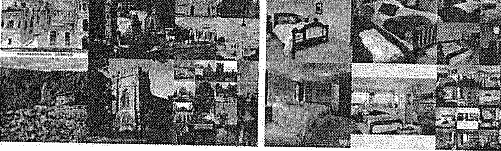

# 2.2 基于分数的生成模型

基于分数的生成模型（SGM）的核心是Stein分数（或分数函数）。给定一个概率密度函数p(x)，其分数函数定义为对数概率密度的梯度∇_x log p(x)。与统计学上常用的Fisher分数∇_θ log p_θ(x)不同，此处考虑的Stein分数是数据x的函数，而不是模型参数θ。它是一个指向似然函数增长率最大的方向的向量场。

# 第2章 扩散模型基础

基于分数的生成模型（SGM）[220]的核心思想是用一系列逐渐增强的高斯噪声来扰动数据，并训练一个深度神经网络来联合地估计所有噪声数据分布的分数函数。也就是说，训练一个深度神经网络，它可以接受噪声强度作为辅助信息，以估计在该噪声强度下加噪后数据的分数函数，这个网络是噪声条件分数网络（Noise Conditional Score Network，NCSN）。样本的生成是使用噪声强度逐渐减小的分数函数和基于分数的采样方法，比如朗之万蒙特卡罗（Langevin Monte Carlo）[81, 110, 176, 220, 225]、随机微分方程[109, 225]、常微分方程[113, 146, 219, 225, 277]，以及它们之间的组合[225]。在基于分数的生成模型中，训练和抽样是完全解耦的，因此可以估计分数函数之后使用各种的采样技术来生成新样本。

与第2.1节中的符号类似，设q(x₀)为数据分布，0 < σ₁ < σ₂ < … < σᵣ为一系列的噪声级别。SGM 中的一个典型例子是通过高斯噪声扰动数据点从x₀ 到xt ~ q(xt|x₀) = N(xt, x₀, σ²I)，这将产生一个噪声数据密度序列q(x₁), q(x₂), …, q(xᵣ)。我们需要训练一个深度神经网络sθ(x,t)来估计分数函数∇ₓ log p(x)，这个神经网络即为上述的噪声条件神经网络。从数据中学习分数函数（也称为“分数估计”）的方法包括分数匹配（Score Matching）[101]、去噪分数匹配（Denoising Score Matching）[188, 189, 238]、切片分数匹配（Sliced Score Matching）[222]。我们可以直接使用这些方法从扰动数据点训练我们的噪声条件分数网络。例如，与公式（2.10）中的符号相似，使用去噪分数匹配的训练目标可以表示为：

```python

E_{t~U[1,T],x0,xt} [λ(t)σ_t^2||∇_{x_t}log q(x_t) - s_θ(x_t,t)||^2]

```

(2.11)
= E_{t~U[1,T],x0,xt} [λ(t)σ_t^2||∇_{x_t}log q(x_t|x_0) - s_θ(x_t,t)||^2] + const
(2.12)
= E_{t~U[1,T],x0,xt} [λ(t)σ_t^2 || - (x_t - x_0)/σ_t - σ_t s_θ(x_t,t)||^2] + const
(2.13)
= E_{t~U[1,T],x0,xt}[λ(t)σ_t^2||ε + σ_t s_θ(x_t,t)||^2] + const
(2.14)
```

其中公式（2.12）来自[238]的推导，即分数匹配与去噪分数匹配在相差一个常数的意义下是等价的；公式（2.13）来自q(xt|xc) = N(xt, xc, σ²I)；公式（2.14）来自xt = x₀ + σtε。同样，我们用λ(t)表示一个正加权函数，用“const”表示一个不依赖可训练参数θ的常数。对比公式（2.14）和公式（2.10）可知，DDPM 和 SGM 的训练目标是一样的，只需要令ε_θ = -σ_t s_θ，那么学习分数函数实际上可以看作是在学习预测噪声。

## 分数与去噪的直观联系

从概率的角度看，分数场指引样本向密度更高的区域移动，即噪声更少、更可信的方向。沿着该方向调整被扰动的观测，就能逐步恢复真实数据并提升对数似然。Tweedie 公式把这种对应关系写得很明确：若 y = x + σ ε，则条件均值 E(x|y)= y + σ² ∇_y log p(y)。可以看出分数完整地编码了干净信号的最小二乘估计。把 σ² ∇_y log p(y) 加回带噪观测 y，噪声在一定意义上被抵消，这正是分数与去噪相通的核心。

证明可分两步展开。先写梯度：

\nabla_y p(y) = \frac{1}{\sigma^2} \int (x - y) g(y - x) p(x) dx\n= \frac{1}{\sigma^2} \int (x - y) p(y, x) dx

其中 g(·) 为标准高斯密度，p(x)、p(y)、p(x,y) 分别是边缘与联合密度。随后

\sigma^2 \frac{\nabla_y p(y)}{p(y)} = \int xp(x|y) dx - \int yp(x|y) dx = \hat{x}(y) - y

再利用 ∇_y log p(y)=∇_y p(y)/p(y) 代入即得结论。

在生成层面，SGM 可依次调用 s_θ(x_T,T)、s_θ(x_{T-1},T-1)…s_θ(x_1,1) 逐步构造样本。训练与采样被解耦，因而涌现出多种采样策略。最先提出的是退火朗之万动力学 ALD [220]。设每步迭代 N 次，步长 s_t>0，先采样

ε^t ← N(0,I)
x_t^{i+1} ← x_t^i + \frac{1}{2} s_t s_θ(x_t^i,t) + \sqrt{s_t} ε^i

依据朗之万蒙特卡罗理论 [176]，当 s_t → 0 且 N → ∞ 时，x_0^N 会收敛到数据分布 q(x_0) 的真实样本。

# 第2章 扩散模型概览
# 2.3 随机微分方程

DDPM 与 SGM 的离散描述可以延拓到连续时间与连续噪声强度的情形，此时前向扰动与后向去噪都可看作某随机微分方程的解。该统一框架通常称为 Score SDE [225]，它用 SDE 同时刻画加噪与采样，去噪时需要估计带噪分布的分数场。生成与去噪的示意分别如图 2-5 所示。

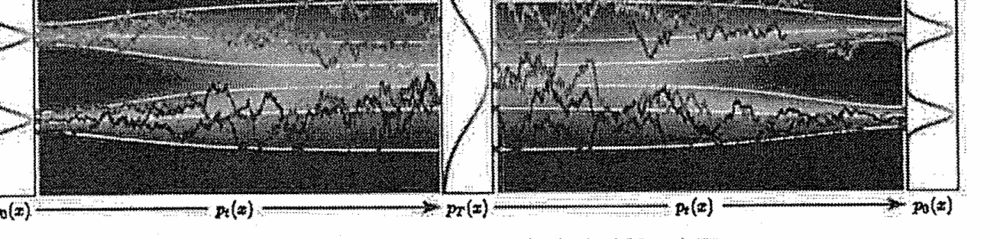

来源：Yang Song, Jascha Sohl-Dickstein, Diederik P Kingma, Abbishek Kumar, Stefano Ermon, and Ben Poole. Score-Based Generative Modeling

Score SDE 用下列的随机微分方程对数据进行扰动[225]:

```python
dx = f(x,t)dt + g(t)dw \ (2.15)
```

其中f(x,t)和g(t)是 SDE 的漂移和扩散系数，w 是标准维纳过程（也就是“布朗运动）”。DDPM 和 SGM 中的正向过程都是该 SDE 的离散化。正如 Song 等人[225]所证，DDPM 相应的 SDE 为:

```python
dx = -\frac{1}{2}\beta(t)xdt + \sqrt{\beta(t)}dw \ (2.16)
```

# 第2章 扩散模型核心概念

把噪声调度写成 β(t/T)=T β_t 并让尺度 T 不断放大时，若起点方差设为 1，极限情况下整体扩散过程的方差会稳定在 1 附近。基于这一特性，该随机微分方程被归类为方差保持型，即 VP-SDE。

在分数生成模型里，前向演化的 SDE 写作：

```python
dx = \sqrt{\frac{d[\sigma^2(t)]}{dt}} dw  (2.17)
```

其中采用 σ(t/T)=σ_t 的设定并令 T → ∞。不论起点方差取何值，解的方差都会随 T 增大而失控式增长，因此该类方程被称为方差爆炸型，即 VE-SDE。此处用 q_t(x) 表示正向扩散中 x_t 的边缘分布。

核心在于，凡是形如式 2.15 的扩散过程，Anderson[4] 证明只要求解下面的时间反向 SDE 就能实现可逆：

```python
dx = [f(x,t) − g²(t)V_x log q_t(x)]dt + g(t)dẆ  (2.18)
```

式中 Ẇ 是反向时间下的标准 Wiener 过程，dt 代表负方向的无穷小步长。反向 SDE 的解 p 与前向 SDE 的解 q 都是随 t 标记的无限维概率测度，二者边际密度一致，只是时间流向相反。换句话说，记 q_t、p_t 为各自在时刻 t 的边际，则有 q_t = p_{T−t}。直观上，反向 SDE 就是把纯噪声逐步精炼回数据的过程。随后 Song 等[225] 进一步说明存在一个常微分方程，称作概率流 ODE，其轨迹的边际分布与反向 SDE 完全相同：

```python
dx = [f(x,t) − \frac{1}{2}g²(t)V_x log q_t(x) dt]  (2.19)
```

因为两条轨迹共享相同的边际，二者都能从同一数据分布中采样。

一旦在每个时点 t 把对数密度梯度 ∇_x log q_t(x) 确定下来，反向 SDE 见式 2.18 与概率流 ODE 见式 2.19 就被完全刻画。之后可借助多种数值求解手段生成样本[225]，比如退火 Langevin 动力学[220]，数值 SDE 求解器[109,225]，数值 ODE 求解器[113,146,217,225,277]，预测校正方法，MCMC 以及 ODE/SDE 求解器的混合方案[225]。与 SGM 一致，我们引入时间相关的分数网络 s_θ(x_t,t) 来逼近目标梯度，并把式 2.14 的分数匹配目标推广到连续情形，得到：

```python
E_t~U[0,T],x0,xt [λ(t)||∇_xt log qot(xt|x0) − s_θ(xt,t)||²] (2.20)
```

其中 U[0,T] 为 {0,1,…,T} 上的均匀采样。注意该目标并不直接计算网络输出与 ∇_x log q_t(x) 的差距，而是改用条件梯度 ∇_{x_t} log q_t(x_t|x0) 来替代。

这种策略即去噪分数匹配，是当前扩散模型训练的主流范式。经典的分数匹配损失 ||∇_x log q_t(x)−s_θ(x_t,t)||² 难以直接使用，因为真实数据分布未知，而由 q_t(x)=∫ q_t(x|y)q_0(y)dy 可知 ∇_x log q_t(x) 也不可得。借助去噪分数即可绕过该困难。Song 等[235] 的推导表明，分数匹配与去噪分数匹配仅相差一项与参数无关的常数，在本设定下，去噪版本 ||∇_{x_t} log q_t(x_t|x0)−s_θ(x_t,t)||² 是可计算的。依据 SDE 理论，只要漂移项对 x 是线性的，就能显式求出 q_t(x_t|x0

# 第2章 扩散模型基础精讲

```
beta_max=config.model.beta_max,
N=config.model.num_scales)
```

```
sampling_eps = 1e-3
elif config.training.sde.lower() == 'vesde':
sde = sde_lib.VESDE(sigma_min=config.model.sigma_min,
sigma_max=config.model.sigma_max,
N=config.model.num_scales)
sampling_eps = 1e-5
else:
raise NotImplementedError(f
```

```
optimize_fn = losses.optimization_manager(config)
#Score SDE 使用连续时间的训练方式
continuous = config.training.continuous
reduce_mean = config.training.reduce_mean
likelihood_weighting = config.training.likelihood_weighting
#建立一次训练需要的函数，likelihood weighting 是特殊的加权方式
train_step_fn = losses.get_step_fn(sde, train=True,
optimize_fn=optimize_fn,
reduce_mean=reduce_mean,
continuous=continuous,
likelihood_weighting=likelihood_weighting)
eval_step_fn = losses.get_step_fn(sde, train=False,
optimize_fn=optimize_fn,
reduce_mean=reduce_mean,
continuous=continuous,
likelihood_weighting=likelihood_weighting)
```

```
#建立采样函数
if config.training.snapshot_sampling:
sampling_shape = (config.training.batch_size,
config.data.num_channels,
config.data.image_size, config.data.image_size)
sampling_fn = sampling.get_sampling_fn(config, sde, sampling_shape,
inverse_scaler, sampling_eps)
num_train_steps = config.training.n_iters
#开始训练
for step in range(initial_step, num_train_steps + 1):
#将数据转为JAX序列并正则化
batch =torch.from_numpy(next(train_iter)['image'].numpy()).to(config.device).float()
batch = batch.permute(0, 3, 1, 2)
batch = scaler(batch)
#进行一次训练
loss = train_step_fn(state, batch)
```

# 扩散模型理论·应用·代码实战

```
#周期性输出
if step % config.training.log_freq == 0:
logging.info("step: %d, training_loss: %.5e" % (step, loss.item())
writer.add_scalar("training_loss", loss, step)
#暂时保存存档
if step != 0 and step % config.training.snapshot_freg_for_preemption == 0:
save_checkpoint(checkpoint_meta_dir, state)
```

```
#周期性地在测试数据集上评价模型的训练结果
if step % config.training.eval_freq == 0:
eval_batch =
torch.from_numpy(next(eval_iter)['image'].numpy()).to(config.device).float()
eval_batch = eval_batch.permute(0, 3, 1, 2)
eval_batch = scaler(eval_batch)
eval_loss = eval_step_fn(state, eval_batch) #在测试数据集上的损失
logging.info("step: %d, eval_loss: %.5e" % (step, eval_loss.item())
writer.add_scalar("eval_loss", eval_loss.item(), step)
```

```
#周期性保存训练结果，如有需要的话，则可以生成样本
if step != 0 and step % config.training.snapshot_freq == 0 or step == num_train_steps:
#保存结果
save_step = step // config.training.snapshot_freq
save_checkpoint(os.path.join(checkpoint_dir,
f'checkpoint_{save_step}.pth'), state)
#核心代码：建立一次训练/评价函数
def get_step_fn(sde, train, optimize_fn=None, reduce_mean=False,
continuous=True, likelihood_weighting=False):
#参数
# sde: 一个'sde_lib.SDE' object 表示前向 SDE
# optimize_fn: 优化函数
# reduce_mean: 如果为 True，则会对损失函数做平均，否则对数据所有维度的损失进行求和
# continuous: 如果为 True，则是使用的是连续时间模型
# likelihood_weighting: 如果为 True，则使用特殊的最大化似然加权方法
#返回：训练或评价用的函数
if continuous:
loss_fn = get_sde_loss_fn(sde, train, reduce_mean=reduce_mean,
continuous=True,
likelihood_weighting=likelihood_weighting)
else:
#离散时间的目标函数，在原始的扩散模型中不支持 likelihood_weighting 这种特殊的加权方式
```

# 第2章 扩散模型基础精讲

```
assert not likelihood_weighting
if isinstance(sde, VESDE):
    loss_fn = get_smld_loss_fn(sde, train, reduce_mean=reduce_mean)
elif isinstance(sde, VPSDE):
    loss_fn = get_ddpm_loss_fn(sde, train, reduce_mean=reduce_mean)
else:
    raise ValueError(f"Discrete training for (sde.__class__.__name__)\nis not recommended.")
```

```
def step_fn(state, batch):
#参数
# state: 包含训练参数的字典、分数函数、优化器、EMA状态、优化步数
# batch: 一批训练/测试数据
#返回：此状态下的平均损失
model = state['model']
if train:
    optimizer = state['optimizer']
optimizer.zero_grad()
#使用刚引入的目标函数计算损失
loss = loss_fn(model, batch)
loss.backward()
optimize_fn(optimizer, model.parameters(), step=state['step'])
state['step'] += 1
state['ema'].update(model.parameters())
else:
with torch.no_grad():
ema = state['ema']
ema.store(model.parameters())
ema.copy_to(ema.model.parameters())
ema.restore(model.parameters())
return loss
return loss_fn
```

```
#连续时间下的目标函数
def get_sde_loss_fn(sde, train, reduce_mean=True, continuous=True,
                  likelihood_weighting=True, eps=1e-5):
reduce_op = torch.mean if reduce_mean else lambda *args, **kwargs: 0.5 * torch.sum(*args, **kwargs)
```

```
def loss_fn(model, batch):
#参数
# model: 预测分数函数的网络
# batch: mini-batch的训练数据

#返回：mini-batch的平均损失
#获得连续时间下的分数函数
```

# 扩散模型理论·应用·代码实战

```
score_fn = mutlis.get_score_fn(sde, model, train=
```

# 第2章 扩散模型基础精讲

网络输出维度要与输入样本维度保持一致；由于对每个维度都叠加独立标准高斯扰动，模型所要预测的噪声维度也必须与输入相同。将扩散模型用于图像合成时，U-Net 是常见选择，因为它能保证输出分辨率与输入分辨率一致。U-Net 本质是编码-解码架构，核心由特征压缩、特征放大和跨层连接三部分构成。编码侧借助卷积与池化实现逐层降采样，空间尺度缩小而通道数随卷积增长，从而萃取图像的高层语义。解码侧借助转置卷积实现逐层升采样，空间尺度回升而通道数下降，原始图像的空间布局与边缘信息逐步恢复，最终把低分辨率特征图映射为与原样本同维度的像素级结果。整体呈现 U 形故得名。编码阶段的降采样会丢失细节，为此 U-Net 在编码与解码之间引入跨层跳连，把对应位置的特征图融合，让解码在放大时能兼顾不同层次的信息，进而完善细节。如图 2-7 所示，这是面向扩散的 U-Net 结构，在第 t 步去噪时接收当前样本 x_t 与时间编码 temb，输出去噪后的结果。值得注意的是，去噪过程依赖时序 t，所以残差模块也随之改造，特征提取时把 temb 融入，如图 2-8 所示。

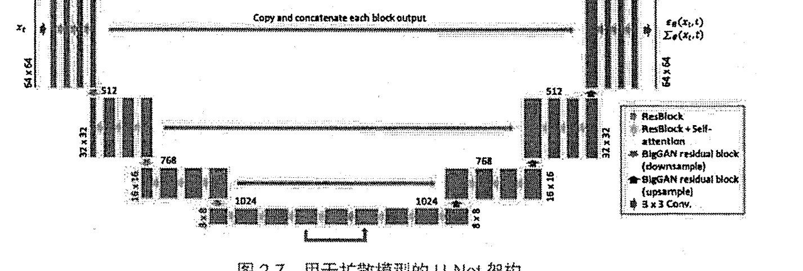


# 扩散模型理论·应用·代码实战

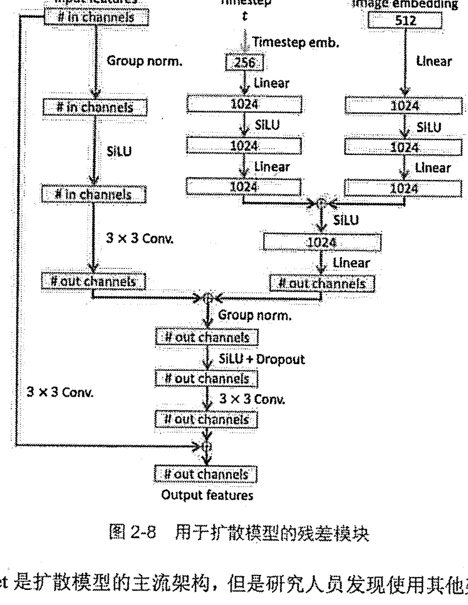

# 图2-8 扩散模型残差块图解

目前 U-Net 仍是扩散模型的主流骨架，但实践表明其他结构同样有效，例如 Transformer。近年 Transformer 在多个领域得到广泛应用，其抛弃了传统 CNN 与 RNN，整体由 Attention 机制搭建，具有并行计算与可扩展的优势。更具体地，Transformer 仅由自注意力与前馈网络构成。自注意力中，序列里每个位置都会与其它位置交互，生成新的表征向量。该机制让模型灵活处理序列并捕捉长程依赖。前馈网络同样关键，由多层全连接组成并以 ReLU 激活，可帮助模型刻画序列中的非线性关系。自注意力是 Transformer 的核心，它为序列中每个元素计算权重以刻画与其他元素的关联，然后

# 第2章 扩散模型基础精讲

# Transformer 时代的扩散模型

自注意力最核心的想法，是让序列里每个元素根据它和其它元素的关联程度，重新加权合成自己的新表征。下面先聚焦编码器的工作方式，因为在扩散任务里我们主要需要从图像中抽取特征，用来逼近期函数或逆向转移核的参数。把图像送入 Transformer 之前，需要先把整幅图切成若干小块 Patch，转成一段 token 串，再加上位置信息。每个 token 会先经过一个可学习的线性映射，得到对应的查询、键、值三组向量 Q_i、K_i、V_i。随后计算任意一对 i、j 的匹配分数 <Q_i,K_j>/√d_k，其中 d_k 表示键的维度。分数经过 softmax 归一化得到权重 a_ij，最终的输出 z_i 就是所有 v_j 的加权求和，之后再进入前馈网络做进一步处理。

查询、键、值这个概念源自信息检索。举例来说，用户在电商平台搜索“深度学习代码参考书”，输入的文字就是 Query，系统用来匹配的词“深度学习”“代码”“参考书”是 Key，按相似度返回的商品信息就是 Value。因此 <Q_i,K_j> 可以理解为两个向量的相关性，a_ij 则表示 i 对 j 的关注强度。为了防止训练退化，自注意力结构里加入了残差跳接。实际上一个输入可以生成多组 QKV 并行计算，最后把各组结果拼接起来，形成多头机制，如图2-9 所示[293]。把多个 Transformer 层堆叠起来就能构成可训练的网络。在扩散场景里，可以用 Transformer 对每一步加噪的图像做编码，并以编码结果预测下一步转移核的均值与方差，从而替代 U-Net。

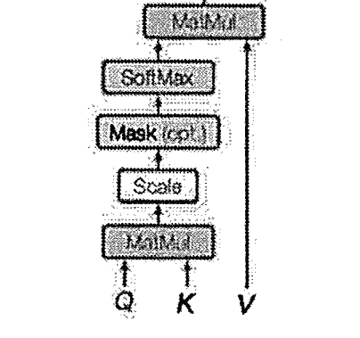

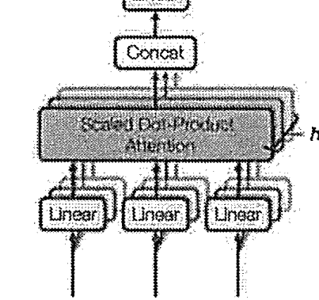

图2-9 Self-Attention（左）和 Multi-Head Attention（右）

# DiT 让 Transformer 接管扩散模型

Peebles 等人在 “Scalable Diffusion Models with Transformers” 中把 U-Net 换成 Transformer，吞吐更高、Gflops 更优，条件生成的质量也更强。提出的 DiT 框架如图 2-10 所示，核心是在潜在扩散 Transformer 的基础上设计三种条件注入方式，把每步的 temb、label 等引导信息送入网络：（1）自适应层归一化。把标准的 Layer Normalization 换成 Adaptive Layer Normalization，即 AdaLN，用引导信息动态生成缩放和偏移参数；（2）交叉注意力。让引导信息直接与中间特征在注意力层里混合；（3）上下文拼接。把引导信息作为额外输入拼在序列前端。其中 AdaLN 的表现最好且效率更高。ImageNet 上的生成实验验证了基于 Transformer 的扩散架构的优越性。

+   * （1）自适应层归一化。把标准层归一化替换为 AdaLN，由条件信息实时生成缩放与平移系数；
* （2）交叉注意力。条件信号与网络中间特征在注意力机制中直接融合；
* （3）上下文条件。把条件信息作为附加输入接在序列前端。

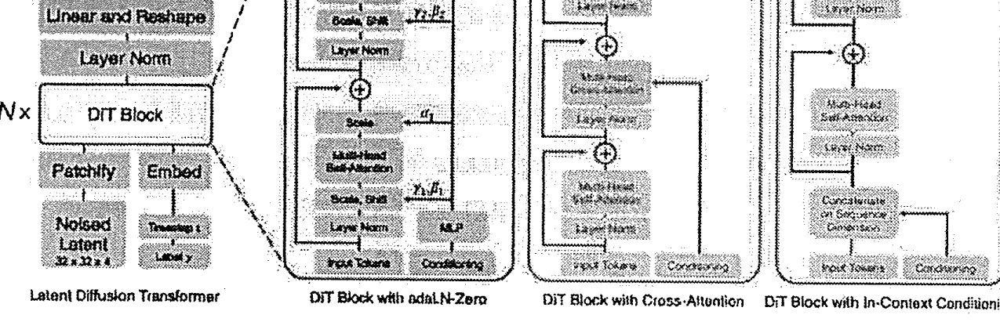

DiT 还做了消融验证，如图 2-11 所示。增大 Transformer 的深度或宽度，或提升 token 数量即减小 patch 大小，都能显著改善生成质量。

# 第2章 扩散模型基础

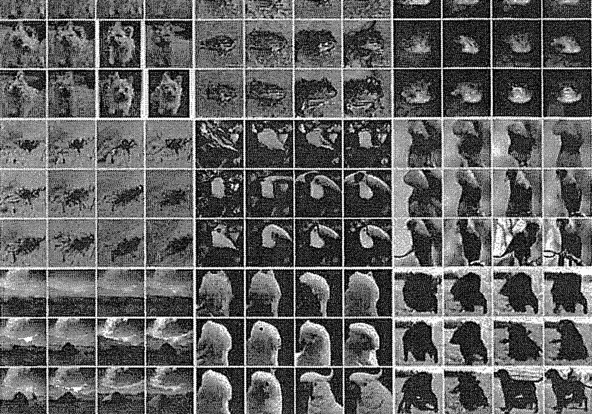

# 图2-11 DIT架构分析实验结果

# U-Net代码实践

U-Net代码如下:

```
#代码源自: Denoising Diffusion Probabilistic Model, in PyTorch
class Unet(nn.Module):
  def __init__((
    self, dim, init_dim = None, out_dim = None, dim_mults=(1, 2, 4, 8),
    channels = 3,
    self_condition = False, resnet_block_groups = 8, learned_variance = 
    False,
    learned sinusoidal cond = False, random_fourier_features = False,
    learned sinusoidal dim = 16
  ):
    #参数
    # dim: 维度参数
    # init_dim: 初始的卷积层的输出通道数
    # out_dim: 模型输出通道数

## 扩散模型：生成式AI模型的理论、应用与代码实践

```

# dim_mults: 下采样时每一步通道数是原始通道数的倍数

# channels: 原始通道数

# self_condition: 是否使用条件扩散

# resnet_block_groups: 使用组归一化时的组数

# learned_variance: 是否学习逆向扩散过程的方差

# learned_sinusoidal_cond: 时间嵌入是否使用学习的嵌入方式

# random_fourier_features: 是否使用傅里叶特征

# learned_sinusoidal_dim: 学习的时间嵌入维数

super().__init__()

#确定维数

self.channels = channels

self.self_condition = self_condition

input_channels = channels * (2 if self_condition else 1)

init_dim = default(init_dim, dim)

#进行第一次卷积将输入数据的3个通道转换为init_dim个通道

self.init_conv = nn.Conv2d(input_channels, init_dim, 7, padding=3)

#建立下采样和上采样时数据的通道数

dims = [init_dim, *map(lambda m: dim * m, dim_mults)]

#获得下采样的每一步输入维度和输出维度，即表中正序排列的每一个二元组。获得上采样的每一步输入维度和输出维度，只需将列表进行逆序排列

in_out = list(zip(dims[:-1], dims[1:]))

#初始化非线性映射模块，利用了时间嵌入的残差连接网络

block_klass = partial(ResnetBlock, groups = resnet_block_groups)

#时间嵌入

time_dim = dim * 4

self.random_or_learned_sinusoidal_cond = learned_sinusoidal_cond or 

random_fourier_features

#使用预先学习的嵌入方式

if self.random_or_learned_sinusoidal_cond:

sinu_pos_emb = RandomOrLearnedSinusoidalPosEmb(

learned_sinusoidal_dim,random_fourier_features)

fourier_dim = learned_sinusoidal_dim + 1

else:

#使用内置的时间嵌入方式

sinu_pos_emb = SinusoidalPosEmb(dim)

fourier_dim = dim

self.time_mlp = nn.Sequential(

sinu_pos_emb,

nn.Linear(fourier_dim, time_dim),

nn.GELU(),

nn.Linear(time_dim, time_dim))

#映射层。in_out记录了下采样的每一步的输入维度和输出维度

self.downs = nn.ModuleList([[]])

self.ups = nn.ModuleList([])

num_resolutions = len(in_out)

#进行下采样

```

# 第2章 扩散模型基础

```

for ind, (dim_in, dim_out) in enumerate(in_out):

```

```

is_last = ind >= (num_resolutions - 1)

```

```

self.downs.append(nn.ModuleList({

```

```

    #非线性映射，不改变数据维度

```

```

    block_klass(dim_in, dim_in, time_emb_dim = time_dim),

```

```

    block_klass(dim_in, dim_in, time_emb_dim = time_dim),

```

```

    #有正则化和线性注意力的残差网络

```

```

    Residual(PreNorm(dim_in, LinearAttention(dim_in))),

```

```

    #在此映射后数据长度和宽度都除以2，维度增加为2倍

```

```

    Downsample(dim_in, dim_out) if not is_last else

```

```

        nn.Conv2d(dim_in, dim_out, 3, padding = 1)

```

```

    ])

```

```

)

```

```

#对低维度特征进一步卷积来提取特征，但保持维度不变

```

```

mid_dim = dims[-1]

```

```

self.mid_block1 = block_klass(mid_dim, mid_dim, time_emb_dim =

```

```

    time_dim)

```

```

#有正则化和注意力的残差网络

```

```

self.mid_attn = Residual(PreNorm(mid_dim, Attention(mid_dim)))

```

```

self.mid_block2 = block_klass(mid_dim, mid_dim, time_emb_dim =

```

```

    time_dim)

```

```

#进行上采样

```

```

for ind, (dim_in, dim_out) in enumerate(reversed(in_out)):

```

```

    is_last = ind == (len(in_out) - 1)

```

```

    self.ups.append(nn.ModuleList([

```

```

        block_klass(dim_out + dim_in, dim_out, time_emb_dim = time_dim),

```

```

        block_klass(dim_out + dim_in, dim_out, time_emb_dim = time_dim),

```

```

        Residual(PreNorm(dim_out, LinearAttention(dim_out))),

```

```

        #上采样函数，将数据的长度和宽度乘以2，并将通道数除以2

```

```

        Upsample(dim_out, dim_in) if not is_last else

```

```

            nn.Conv2d(dim_out, dim_in, 3, padding = 1)

```

```

    ])

```

```

)

```

```

#如果学习逆向方差，则需要额外1倍的通道来进行学习

```

```

default_out_dim = channels * (1 if not learned_variance else 2)

```

```

self.out_dim = default(out_dim, default_out_dim)

```

```

#最后的输出层

```

```

self.final_res_block = block_klass(dim * 2, dim, time_emb_dim =

```

```

    time_dim)

```

```

self.final_conv = nn.Conv2d(dim, self.out_dim, 1)

```

```

def forward(self, x, time, x_self_cond = None):

```

```

    #使用条件扩散

```

```

    if self.self_condition:

```

```

        x_self_cond = default(x_self_cond, lambda: torch.zeros_like(x))

```

```

        x = torch.cat((x_self_cond, x), dim = 1)

```

```

    #初始化数据、数据复制和时间嵌入

```

```

    x = self.init_conv(x)

```

## 扩散模型：生成式 AI 模型的理论、应用与代码实践

```

r = x.clone()

t = self.time_mlp(time)

h = []

#下采样时记录映射结果，之后需要拼接到上采样对应层的特征

for block1, block2, attn, downsample in self.downs:

    x = block1(x, t)

    h.append(x)

    x = block2(x, t)

    x = attn(x)

    h.append(x)

    x = downsample(x)

#对高级语义特征进一步卷积

x = self.mid_block1(x, t)

x = self.mid_attn(x)

x = self.mid_block2(x, t)

#上采样

for block1, block2, attn, upsample in self.ups:

    x = torch.cat((x, h.pop()), dim=1)

    x = block1(x, t)

    x = torch.cat((x, h.pop()), dim=1)

    x = block2(x, t)

    x = attn(x)

    x = upsample(x)

#将初始特征拼接到经过下采样、上采样学习得到的特征，从而充分利用信息

x = torch.cat((x, r), dim=1)

#输出前最后的卷积

x = self.final_res_block(x, t)

return self.final_conv(x)

```

## 非线性映射模块

class ResnetBlock(nn.Module):
def __init__(self, dim, dim_out, *, time_emb_dim=None, groups=8):
# 参数
# dim: 输入维度
# dim_out: 输出维度
# time_emb_dim: 时间嵌入
# groups GroupNorm: 组数
super().__init__()
self.mlp = nn.Sequential(
    nn.SiLU(),
    nn.Linear(time_emb_dim, dim_out * 2)
) if exists(time_emb_dim) else None
self.block1 = Block(dim, dim_out, groups=groups)
self.block2 = Block(dim_out, dim_out, groups=groups)
```

# 第2章 扩散模型基础

```
self.res_conv = nn.Conv2d(dim, dim_out, 1) if dim != dim_out else nn.Identity()
```

# Transformer 核心组件逐块解析

## 可调卷积单元
该模块先用权重标准化的 3×3 卷积提取特征，再用分组归一化稳定激活分布。推理时若传入 scale_shift，会借助时间调制先放大后平移，最后通过 SiLU 完成非线性。
```
def forward(self, x, time_emb = None):
    scale_shift = None
    #使用时间嵌入学习对数据进行缩放的参数
    if exists(self.mlp) and exists(time_emb):
        time_emb = self.mlp(time_emb)
        time_emb = rearrange(time_emb, 'b c -> b c 1 1')
        scale_shift = time_emb.chunk(2, dim = 1)
    h = self.block1(x, scale_shift = scale_shift)
    h = self.block2(h)
    #仍然使用残差链接
    return h + self.res_conv(x)
```

## Block

class Block(nn.Module):

def __init__(self, dim, dim_out, groups = 8):

    super().__init__()

    self.proj = WeightStandardizedConv2d(dim, dim_out, 3, padding = 1)

    self.norm = nn.GroupNorm(groups, dim_out)

    self.act = nn.SiLU()

def forward(self, x, scale_shift = None):

    #对数据进行了卷积，然后进行组归一化

    x = self.proj(x)

    x = self.norm(x)

    #使用时间嵌入的信息对数据进行缩放

    if exists(scale_shift):

        scale, shift = scale_shift

        x = x * (scale + 1) + shift

    x = self.act(x)

    return x
## 模块依赖
集中引入后面的注意力与通用子层，后续编解码可直接复用。
```

## 下采样：降低数据分辨率，提高数据通道数（特征维度）

from einops import rearrange, reduce
from einops.layers.torch import Rearrange
def Downsample(dim, dim_out = None):
    # 参数
    # dim: 输入通道数
    # dim_out: 输出通道数
    return nn.Sequential(
        Rearrange('b c (h p1) (w p2) -> b (c p1 p2) h w', p1 = 2, p2 = 2),
        nn.Conv2d(dim * 4, default(dim_out, dim), 1)
    )
## 上采样：使用内置的上采样函数，默认将数据长度和宽度变为原来的2倍

def Upsample(dim, dim_out = None):
    # 参数
    # dim: 输入通道数
    # dim_out: 输出通道数
    return nn.Sequential(
      nn.Upsample(scale_factor = 2, mode = 'nearest'),
      nn.Conv2d(dim, default(dim_out, dim), 3, padding = 1)
    )
## Transformer 代码实践

## Transformer 代码如下:

> # 代码源自: BERT-PyTorch

> # 一个 Transformer 模块

```

import torch.nn as nn

from .attention import MultiHeadedAttention

from .utils import SublayerConnection, PositionwiseFeedForward
## 编码器块构造
TransformerBlock 在初始化阶段创建多头注意力、位置前馈以及两段带残差的子层，并保留一个 Dropout。
```

```

class TransformerBlock(nn.Module):

def __init__(self, hidden, attn_heads, feed_forward_hidden, dropout):

  # 参数

  # hidden: 中间层大小

  # attn-heads: 多头注意力的头数量

  # feed_forward_hidden: ffn(feed-forward network)大小, 一般是 4*hidden.size

  # dropout: dropout 比例

super().__init__()

self.attention = MultiHeadedAttention(h=attn_heads, d_model=hidden)

self.feed_forward = PositionwiseFeedForward(d_model=hidden,

d_ff=feed_forward_hidden,

dropout=dropout)

self.input_sublayer = SublayerConnection(size=hidden, dropout=dropout)

self.output_sublayer = SublayerConnection(size=hidden, dropout=dropout)

self.dropout = nn.Dropout(p=dropout)
## 前向走向
数据先经过带注意力的残差子层，再进入带前馈的残差子层，末尾加一次丢弃。
```

```

def forward(self, x, mask):

x = self.input_sublayer(x, lambda x: self.attention.forward(x, x, x, mask=mask))

x = self.output_sublayer(x, self.feed_forward)

return self.dropout(x)
## 残差包装器声明
从自定义层归一化导入并定义可复用的 SublayerConnection 骨架。
```

> # 残差链接和层正则化

```

from .layer_norm import LayerNorm

class SublayerConnection(nn.Module):
## 残差初始化细节
根据输入维度创建 LayerNorm 与 Dropout 实例。
```

```

def __init__(self, size, dropout):

    super(SublayerConnection, self).__init__()

    self.norm = LayerNorm(size)

    self.dropout = nn.Dropout(dropout)
## 残差计算逻辑
先做归一化，再交给子函数处理，处理结果丢弃后与原始输入相加。
```

```

def forward(self, x, sublayer):

    # 先进行正则化，再进行 sublayer 指定的运算，然后添加残差链接

    "Apply residual connection to any sublayer with the same size."

    return x + self.dropout(sublayer(self.norm(x)))
## 注意力基类
用于接收 query、key、value 计算归一化内积注意力的核心类。
```

```

# 输入 query,key,value，计算归一化的内积注意力

class Attention(nn.Module):
## 前向签名
支持可选掩码与可选丢弃的通用接口。
```

```

def forward(self, query, key, value, mask=None, dropout=None):
## 分数生成
把 key 转置与 query 做批点积，并用维度平方根的平方根进行缩放。
```

```

    # 将 key 转置来计算 batch 的 score

    scores = torch.matmul(query, key.transpose(-2, -1)) / 

            math.sqrt(math.sqrt(query.size(-1)))
## 掩码应用
若提供掩码，被遮蔽位置的分数置为 -1e9。
```

```

    if mask is not None:

        scores = scores.masked_fill(mask == 0, -1e9)
## 分布归一化
对分数做 softmax 得到注意力分布，可选对分布做丢弃。
```

```

        p_attn = F.softmax(scores, dim=-1)

        if dropout is not None:

            p_attn = dropout(p_attn)
## 结果输出
用注意力分布加权 value，并一并返回分布本身。
```

```

        return torch.matmul(p_attn, value), p_attn
## 多头注意力封装
将单头注意力扩展为多头并行计算的包装类。
```

# 多头注意力模块
from .single import Attention

```

class MultiHeadedAttention(nn.Module):

    def __init__(self, h, d_model, dropout=0.1):
## 维度校验
校验 d_model 能被头数整除并记录每头的维度，默认 d_v 等于 d_k。
```

# 参数
# h: 头的数量
# d_model: 模型隐层维度

```

    super().__init__()

    assert d_model % h == 0

    # 假设 d_v=d_k

    self.d_k = d_model // h

    self.h = h
## 投影与注意力实例
创建四个线性投影用于 QKV 与输出，实例化内部注意力并设定丢弃。
```

```

    self.linear_layers = nn.ModuleList([nn.Linear(d_model, d_model) for _ in range(4)])

    self.output_linear = nn.Linear(d_model, d_model)

    self.attention = Attention()

    self.dropout = nn.Dropout(p=dropout)
## 前向入口
接收查询、键、值及可选掩码。
```

```

def forward(self, query, key, value, mask=None):
## 批次准备
取出批量大小并说明后续会把 d_model 拆成 h*d_k。
```

```

    batch_size = query.size(0)

    # 计算 batch 中所有的线性映射，获得 query、key、value、d_model 被拆分为 h*d_k
## 头部拆分与聚合
分别投影并重塑为多头布局，执行注意力后拼接再做最终线性映射。
```

# 扩散模型：生成式AI模型的理论、应用与代码实践

```

query, key, value = [l(x).view(batch_size, -1, self.h, self.d_k).transpose(1, 2)

for l, x in zip(self.linear_layers, (query, key, value))]

#对batch中所有数据应用注意力机制
x, attn = self.attention(query, key, value, mask=mask,

dropout=self.dropout)

#拼接数据，然后进行最后的映射
x = x.transpose(1, 2).contiguous().view(batch_size, -1, self.h * self.d_k)
return self.output_linear(x)
## 位置感知前馈
经典的两层线性结构，中间使用 GELU 激活并带 Dropout。
```

```

#前馈网络，线性映射+gelu激活+dropout+线性映射
from .gelu import GELU

class PositionwiseFeedForward(nn.Module):

    def __init__(self, d_model, d_ff, dropout=0.1):

        # 参数

        # d_model: 隐层维度

        # d_ff: 前馈网络维度

        super(PositionwiseFeedForward, self).__init__()

        self.w_1 = nn.Linear(d_model, d_ff)

        self.w_2 = nn.Linear(d_ff, d_model)

        self.dropout = nn.Dropout(dropout)

        self.activation = GELU()

    def forward(self, x):

        return self.w_2(self.dropout(self.activation(self.w_1(x))))

```

后续扩散模型的研究重点是改进这些经典方法（DDPM、SGM 和 SDE）。我们将在接下来的章节（第3章至第5章）中对“扩散模型的高效采样”“扩散模型的似然最大化”“将扩散模型应用于具有特殊结构的数据”各个主题中的一些经典论文进行详细的阐释。在表2-1 中，我们对3 种类型的扩散模型进行了更详细的分类，还记录了对应文章和年份，并进行连续和离散两种时间设定。

# 第2章 扩散模型基础

# 表2-1

| Primary               | Secondary                | Tertiary                 | Article       | Year | Setting |
|------------------------|-------------------------|--------------------------|-------------------------|--------------|-------|
| Efficient Sampling     | Learning-Free Sampling  | SDE Solvers              | Song et al. [225]       | 2020         | Continuous |
|                         |                          |                           | Jolicoeur et al. [110]  | 2021         | Continuous |
|                         |                          |                           | Jolicoeur et al. [109]  | 2021         | Continuous |
|                         |                          |                           | Chuang et al. [37]      | 2022         | Continuous |
|                         |                          |                           | Song et al. [220]       | 2019         | Continuous |
|                         |                          |                           | Karras et al. [113]     | 2022         | Continuous |
|                         |                          |                           | Dockhorn et al. [54]    | 2021         | Continuous |
|                         | ODE Solvers              | Song et al. [217]       | 2020         | Continuous |
|                         |                          |                           | Zhang et al. [278]      | 2022         | Continuous |
|                         |                          |                           | Karrns et al. [113]     | 2022         | Continuous |
|                         |                          |                           | Lu et al. [146]         | 2022         | Continuous |
|                         |                          |                           | Zhang et al. [277]      | 2022         | Continuous |
|                         |                          |                           | Lu et al. [192]         | 2021         | Continuous |
| Learning-Based Sampling | Optimized Discretization | Watson et al. [243]     | 2021         | Discrete |
|                         |                          |                           | Watson et al. [242]     | 2021         | Discrete |
|                         |                          |                           | Dockhorn et al. [55]    | 2021         | Continuous |
|                         | Knowledge Distillation   | Salimans et al. [203]   | 2021         | Discrete |
|                         |                          |                           | Luhman et al. [148]     | 2021         | Discrete |
|                         | Truncated Diffusion       | Lyu et al. [156]        | 2022         | Discrete |
|                         |                          |                           | Zheng et al. [284]      | 2022         | Discrete |
| Improved Likelihood    | Noise Schedule Optimization | Nichol et al. [166]     | 2021         | Discrete |
|                        |                          |                           | Kingma et al. [121]     | 2021         | Discrete |
|                        | Reverse Variance Learning | Bao et al. [5]          | 2021         | Discrete |
|                        |                          |                           | Nichol et al. [166]     | 2021         | Discrete |
|                        | Exact Likelihood Computation | Song et al. [219]       | 2021         | Continuous |
|                        |                          |                           | Huang et al. [98]       | 2021         | Continuous |
|                        |                          |                           | Song et al. [225]       | 2020         | Continuous |
|                        |                          |                           | In et al. [145]         | 2022         | Continuous |
| Data with Special Structures | Manifold Structures      | Learned Manifolds        | Valhadar et al. [234]   | 2021         | Continuous |
|                        |                          |                           | Wehenkel et al. [244]   | 2021         | Discrete |
|                        |                          |                           | Ramesh et al. [186]     | 2022         | Discrete |
|                        | Known Manifolds          | Rombach et al. [198]    | 2022         | Discrete |
|                        |                          |                           | Hurtut et al. [45]      | 2022         | Continuous |
|                        |                          |                           | Huning et al. [97]      | 2022         | Continuous |
|                        | Data with Invariant Structures | Niu et al. [171]       | 2020         | Discrete |
|                        |                          |                           | Jo et al. [108]         | 2022         | Continuous |
|                        |                          |                           | Shi et al. [210]        | 2022         | Continuous |
|                        |                          |                           | Xu et al. [259]         | 2021         | Discrete |
|                        |                          |                           | Sch et al. [215]        | 2015         | Discrete |
|                        |                          |                           | Austin et al. [6]       | 2021         | Discrete |
| Discrete Data            | Discrete Data            | Xie et al. [255]        | 2022         | Discrete |
|                          |                           |                           | Gu et al. [83]          | 2022         | Discrete |
|                          |                           |                           | Campbell et al. [21]    | 2022         | Continuous |

# 第3章

# 扩散模型的高效采样

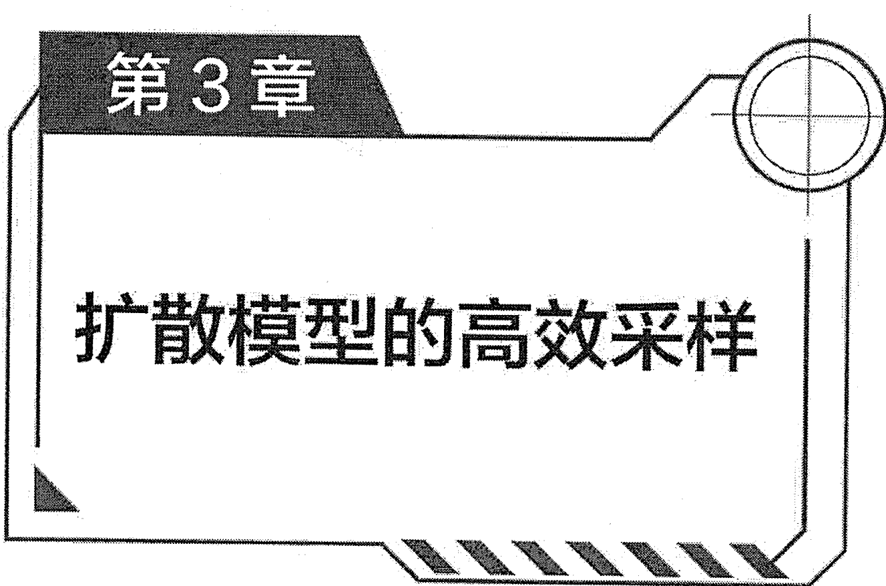

# 第3章 扩散模型的高效采样

使用扩散模型生成样本通常需要使用迭代的方法，涉及大量的计算步骤，时间复杂度较高。最近大量的工作集中在加快扩散模型的采样过程，同时提高所生成样本的质量。我们将这些高效的抽样方法分为两大类：一类是不涉及学习的抽样方法（无学习采样）；另一类是在扩散模型训练后需要进行额外学习的抽样方法（基于学习的采样）。

# 3.1 微分方程

微分方程是描述某一类函数与其导数关系的方程，微分方程的解是满足微分方程的一类函数。微分方程的应用十分广泛，可以解决许多与导数有关的问题。物理中许多涉及变力的运动学、动力学问题，如空气的阻力为速度函数的落体运动等问题，很多可以用微分方程求解。此外，微分方程在化学、工程学、经济学和人口统计等领域都有应用，比如流行病学中的 SIR 模型、金融行业中的布莱克-舒尔斯模型，等等。传统的微分方程需要研究者根据自己对系统的底层逻辑和规则的认知对对方程的形式和参数进行设计，然后使用数据对模型进行验证，再进一步对模型进行改进，循环往复。随着深度学习的蓬勃发展，我们可以利用现代计算机的强大算力和机器学习算法，直接从数据中学习这些系统运行的逻辑或规则，实现让数据说话。现代的深度学习算法不仅可以优化微分方程的参数，还可以对给定的（偏）微分方程进行求解。反过来，使用跳连的深度神经网络可以被视作常微分方程的离散形式，如 ResNET 可以被视为一个常微分方程的欧拉离散。从这个视角出发，我们可以利用微分方程领域的知识对神经网络进行设计和分析[328]。随机微分方程是一类特殊的微分方程，它描述了一类随机过程的轨迹。一般的随机微分方程形式为

\(d x_t = f(x_t, t)d t + g(x_t, t)d w\)

设g(x_t,t)=g(t)可以得到简化的公式（2.15）。但由于布朗运动的轨迹不是可微的，所以本质上随机微分方程是由相应的积分方程定义的：

\(x_t = \int f(x_t, t)d t + \int g(x_t, t)d w\)

而其中对轨迹的随机积分∫g(x_t,t)dw在扩散模型中通常指的是“伊藤积分”。利

# 扩散模型：生成式AI模型的理论、应用与代码实践

用随机微积分的工具，我们可以研究扩散模型的性质并对其进行改进，比如利用福克-普朗克方程（Fokker-Planck Equation）我们可以证明Score SDE 与概率流ODE 的等价性，利用吉尔萨诺夫变换（Girsanov Transformation）和伊藤对称性我们可以证明Score SDE的训练方法和最大似然训练的关系。

如2.3节所述，扩散模型可以被视为随机微分方程的离散化。扩散模型的生成过程就是对逆向SDE进行数值求解。在Score SDE中，首先我们使用深度学习算法在数据中对真实的逆向SDE（见公式（2.18））进行还原，然后通过数值算法（进一步利用深度学习）对拟合的逆向SDE进行求解。值得注意的是，由于前人对微分方程的研究，我们不需要从头开始学习，我们只要对分数函数进行估计，就能还原出完整的SDE，而分数网络的训练通过去噪分数匹配的方式可以转化成简单且稳定的L₂损失。此外，在Score SDE中对微分方程的估计和求解是解耦的，这使得我们可以对特定形式的或训练好的扩散模型设计采样方案，进一步优化扩散模型的效果。扩散模型的问题之一是其采样速度慢。这是因为对SDE进行数值求解实际上就是对SDE的解进行离散化近似，因此会存在离散化误差。当离散步数多、步长值小时，误差就小，就能产生精确的数据，但是也导致了采样时间过长的问题，因为每一步的求解都需要调用一次深度神经网络来计算分数函数。下面我们将介绍如何通过无学习采样（无学习）和基于学习的采样（有学习）这两种方式提高扩散模型的采样效率。

# 3.2 确定性采样

许多扩散模型的抽样方法依赖于对于公式（2.18）中的逆向SDE或公式（2.19）中的概率流ODE进行离散化数值求解。从理论上看，离散化的时间间隔越短、时间步数越多，数值近似求解的结果越好，生成的样本分布越接近于原始数据分布。但是增加采样的时间步数将导致采样成本增加，因为采样的时间与离散时间步数成正比。所以许多研究人员专注于开发更好的离散化数值求解方法，在减少时间步数的同时尽量减小离散化误差。

# 第3章 扩散模型的高效采样

# 3.2.1 SDE求解器

DDPM[90, 215]的生成过程可以被看作是一个逆向SDE的特殊离散化。正如第2.3节所讨论的，DDPM的前向过程离散化了公式（2.16）中的SDE，其相应的逆向SDE的形式为：

dx = -\frac{1}{2}\beta(t)(x_t - \nabla_{x_t}\log q_t(x_t))dt + \sqrt{\beta(t)}dW (3.1)

Song等人[225]证明，由公式（2.5）定义的逆向马尔可夫链相当于公式（3.1）中的数值SDE求解器。

噪声条件分数网络（Noise-Conditional Score Network, NCSN）[220]和临界阻尼朗之万扩散（Critically-Damped Langevin Diffusion, CLD）[54]都是在朗之万动力学（Langevin Dynamics）的启发下求解逆向SDE的。特别是，噪声条件分数网络利用退火朗之万动力学（ALD, 见第2.2节）迭代生成的数据，同时平滑地降低噪声水平，直到生成的数据收敛到原始数据的分布。朗之万方程是一个用来描述粒子在流体里因为受到粒子间不断碰撞和潜在的外部力场，而表现出随机移动的布朗运动的方程。在应用中，朗之万方法使用分数函数\nabla_y\log p(y)来产生服从p(x)的样本。具体方法是，给定步长h和初始分布x₀ ~ π(x)，朗之万方法使用下面的方法进行迭代：

x_t = x_{t-1} + \frac{h}{2}\nabla_x\log p(x_{t-1}) + \sqrt{h}z_t

其中z_t服从独立的标准正态分布。当h→0, T→∞时，在一定正则条件下x_T的分布会趋于原始数据的分布。但是此方法存在问题。首先，现实世界的数据往往存在于一个低维流形上，这样对于不在这个低维流形上的点就无法定义该位置的分数函数；其次，对于处于低密度区的点，模型也很可能因为无法获得足够多的数据而无法准确地学习该位置的分数函数。事实上，只有当数据的支撑集是全空间的时候，传统的分数匹配方法才能提供对分数函数的相合估计[220]。Song等人[220]使用对数据加噪的方式解决了上述问题，因为向数据中加入高斯噪声后，数据的支撑集就成了全空间而不再是低维流形，并且添加大量的高斯噪声实质上扩展了分布里的各个众数的范围，使得数据分布里的低密度区得到训练信号。如2.2节所述，噪声条件分数网络向数据中添加了不同强度的噪声，然后训练噪声条件分数网络来拟合每一个噪声强度上的样本分数函数。训练好分数神经网络后使用一种退火朗之万动力学（ALD）方法进行采样，即在每个噪声强度上都应用朗之万方法，并且下一个噪声强度上采样的初始样本是上一个朗之万采样的结果。当添加的噪声强度足够强、足够平滑时，噪声条件分数网络的加噪过程就会趋于公式（2.17）定义的 VP-SDE。假设朗之万动力学在每个噪声水平上都能收敛到其平衡状态，那么 ALD 就能得到正确的边际分布，因此可以产生正确的样本。尽管其整体的采样轨迹不是逆向 SDE 的精确解。ALD 被一致退火采样（Consistent Annealed Sampling, CAS）[110]进一步改进，这是一种基于分数的马尔可夫链蒙特卡罗（MCMC）方法，并且具有更好的时间步数和添加噪声的方式。

Song 等人 [225]提出的逆向扩散方法，用与正向 SDE 相同的方式离散逆向 SDE。对于正向 SDE（见公式（2.15））的任何一步离散化，我们可以写出下面的一般形式：

xi+1 = xi + fi(xi) + gi zi, i = 0,1,⋯,N − 1 (3.2)

其中 zi ~ N(0,I)，fi 和 gi 由 SDE 的漂移和扩散系数和离散化方案决定。逆向扩散方法提出，用与正向 SDE 类似的方式离散化逆向 SDE 方法，即：

xi = xi+1 − fi+1(xi+1) + gi+1 gi+1 sθ(xi+1,t_i+1) + gi+1 zi, i = 0,1,⋯,N − 1 (3.3)

其中 sθ(xi+1,t_i+1)是经过训练的噪声条件分数模型。逆向扩散方法是公式（2.18）中逆向 SDE 的数值 SDE 求解器，即公式（2.18）的一种特殊的离散方式。这个过程可以应用于任何类型的前向 SDE 中，并且经验结果表明，这种采样器对一种特殊的 SDE（称为 “VP-SDE”）表现得比 DDPM[225]略好。Song 等人[225]进一步提出了预测 - 校正方法通过结合数值 SDE 求解器（称为 “预测器”）和迭代 MCMC 方法（称为 “校正器”）来求解逆向 SDE。在每个时间步骤，预测器 - 校正器方法首先采用数值 SDE 求解器来产生一个相对粗略的样本，然后采用 “校正器” 使用基于分数的 MCMC 方法对样本的边际分布进行修正。这样产生的样本与逆向 SDE 的解轨迹具有相同的边际分布。也就是说，它们在所有时刻上的分布是相同的。实验结果表明，增加一个基于朗之万蒙特卡罗（Langevin Monte Carlo）的校正器比使用一个额外的预测器而不使用校正器[225]更高效。

Karras 等人 [113]进一步改进 Song 等人 [225] 提出的朗之万动力学（Langevin Dynamics）校正器。他们提出了一个类似朗之万的 “搅动”（churn）步骤，用来在采样过程中交替地添加和去除噪声。将朗之万采样法的步骤分为对数据进行加噪和去噪

# 3.2 扩散模型：生成式 AI 模型的理论、应用与代码实践

"搅动"，第一步加噪得到ẋₜ₊₁ = xₜ + √h zᵗ；第二步去噪得到下一步数据xₜ₊₁ = ẋₜ₊₁ + \frac{h}{2}∇_x log p(xₜ)。受此启发，Karras 等人提出在生成过程中的每一步先进行正常加噪步骤，然后在去噪的部分使用更高阶的分数函数，从而更好地去噪。具体方法是，只需将∇_x log p(xₜ)替换为∇_x log p(ẋₜ₊₁)，然后使用高阶分数函数进行矫正即可。对于高阶分数函数采用了 Heun 方法[5]。最终此方法在 CIFAR-10^[128] 和 ImageNet-64^[47]等数据集上实现了最佳的样本质量。

受统计力学的启发，临界阻尼朗之万扩散（Critically-Damped Langevin Diffusion, CLD）提出了一个带有"速度项"的扩展 SDE，类似于欠阻尼朗之万扩散（Underdamped Langevin Diffusion）。扩展 SDE 的精心设计对 CLD 高效采样和训练起到了关键作用。CLD 对数据x₀添加了速度项v₀。v₀服从独立的标准高斯分布，然后对耦合数据(x₀,v₀)进行扩散，具体扩散方程如下：

\dx_t = M^{-1}v_t\beta dt\dv_t = -x_t\beta dt + -ΓM^{-1}v_t\beta dt + \sqrt{2Γβ}dw_t

其中非负超参数 M 决定了xₜ和vₜ的耦合（强度），β使得数据分布可以收敛于先验分布，Γ决定了添加噪声的强度。Γ和M的关系决定了上述 SDE 的收敛方式，其中 Γ² = 4M被称为 "临界阻尼"（Critical Damping）。CLD 用此临界阻尼朗之万动力学使得 SDE 以最快的方式收敛，避免振荡。原数据与速度的交互作用源自哈密顿力学（Hamiltonian Dynamics），以帮助扩散过程更快速、更光滑地收敛到先验分布，如同哈密顿力学在 MCMC 方法中的作用一样。因为 CLD 只对速度进行了扰动，所以为了得到扩展 SDE 的时间反演，CLD 只要学习速度vₜ在数据xₜ下条件分布的得分函数即可。这比直接学习数据的分数函数更容易。因为 CLD 有复杂的漂移系数，所以耦合数据的边缘分布和条件分布无法直接计算，这使得分数匹配和去噪分数匹配都不再适用。

为了进行训练，CLD 使用了一种混合分数匹配的目标函数（HSM）：\E_{t~U[0,T], x_0, u_t}[λ(t)||∇v_t log q_0t(u_t|x_0) − s_θ(u_t,t)||₂²]

其中u_t = (x_t, v_t)，之后 CLD 使用训练的条件分数函数s_θ(u_t,t)进行逆向扩散采样，并设计了一种适用于 CLD 的采样方法。使用训练好的方法，添加的速度项可以提高采样速度和质量，并且训练的复杂度也降低了。

# CLD 代码实践

# CLD 代码如下：

```

# CLD-SGM 训练与采样实现速览

临界阻尼朗之万扩散把位置和速度一起扩散，训练时根据是否扩增状态以及 DSM 或 HSM 目标来决定初始速度的构造方式，再用重参数化得到可微的加噪样本。损失工厂负责时间采样、扰动与分数预测；SDE 的扰动方法用 Cholesky 分解生成条件噪声；采样侧则在一阶和四阶积分器中复用 transfer 完成状态推进。下面保留原始实现，仅对开头说明进行重述。

# 源码出处: Score-Based Generative Modeling with Critically-Damped Langevin Diffusion

#计算训练损失

def get_loss_fn(sde, train, config):

#参数

# sde: 使用的扩散方程

# train: 是否进行训练

# config: 训练配置

def loss_fn(model, x):

#参数

# model: 分数模型

# x: 一批训练数据

  #建立初始数据

  if sde.is_augmented:

    if config.cld_objective == 'dsm':

      v = torch.randn_like(x, device=x.device) * \
      np.sqrt(sde.gamma / sde.m_inv)

      batch = torch.cat((x, v), dim=1)

    elif config.cld_objective == 'hsm':

      # 对于 HSM，我们对所有的初始速度进行边缘化

      v = torch.zeros_like(x, device=x.device)

      batch = torch.cat((x, v), dim=1)

    else:

      raise NotImplementedError(

        'The objective %s for CLD-SGM is not implemented.' %

        config.cld_objective)

  else:

    batch = x

  t = torch.rand(batch.shape[0], device=batch.device,

  dtype=torch.float64) * (1.0 - config.loss_eps) + config.loss_eps

  #获取训练用的加噪数据

  perturbed_data, mean, _, batch_randn = sde.perturb_data(batch, t)

perturbed_data = perturbed_data.type(torch.float32)

mean = mean.type(torch.float32)

#对于 CLD，我们只需要速度部分的噪声来计算损失

  if sde.is_augmented:

    _, batch_randn_v = torch.chunk(batch_randn, 2, dim=1)

    batch_randn = batch_randn_v

  #使用分数模型进行预测

  score_fn = mutils.get_score_fn(config, sde, model, train)

score = score_fn(perturbed_data, t)

#损失函数的权重

```

```

#基于sde的类方法，获取加噪数据

def perturb_data(self, batch, t, var0x=None, var0v=None):

# 参数

# batch: 训练数据

# t: 训练时间点

# var0x: 初始时原数据的方差，一般默认为0

# var0v: 初始时附加的速度的方差，使用HSM方法将其设置为γ * M

#计算条件转移核的期望与方差

mean, var = self.mean_and_var(batch, t, var0x, var0v)

cholesky11 = (torch.sqrt(var[0]))

cholesky21 = (var[1] / cholesky11)

cholesky22 = (torch.sqrt(var[2] - cholesky21 ** 2.))

if torch.sum(torch.isnan(cholesky11)) > 0 or
   torch.sum(torch.isnan(cholesky21)) > 0 or
    torch.sum(torch.isnan(cholesky22)) > 0:

    raise ValueError('Numerical precision error.')

#使用重参数化技巧，对加入的噪声采样

batch_randn = torch.randn_like(batch, device=batch.device)

batch_randn_x, batch_randn_v = torch.chunk(batch_randn, 2, dim=1)

noise_x = cholesky11 * batch_randn_x

noise_v = cholesky21 * batch_randn_x + cholesky22 * batch_randn_v

noise = torch.cat((noise_x, noise_v), dim=1)

```

```

#计算加噪数据

perturbed_data = mean + noise

```

Jolicoeur-Martineau 等人 [109]开发了一个具有自适应步长的 SDE 求解器，以加快生成速度。直观上使用高阶的数值求解器来求解逆向 SDE（见公式（2.18））可以减小对连续轨迹进行离散化而导致的误差。因为高阶的求解器可以捕捉到解轨迹的局部变异。但是实验发现直接使用高阶求解器有可能使采样效率下降，因为虽然离散化误差降低了，但是高阶求解器需要计算高阶的分数函数，而高阶算法提高的精度往往不值得付出高阶分数函数的计算成本。低阶的数值求解器往往更快但是效果较差，所以我们的目标是能够动态地平衡二者，如果低阶求解器能够产生较准确的数据，那么就使用低阶求解器进行运算，否则就使用高阶求解器。然后根据当前样本的稳定性来动态调整步长。步长是通过比较高阶 SDE 求解器的输出和低阶 SDE 求解器的输出控制的。在每个时刻，高阶和低阶求解器分别从先前的样本x'prev 中产生新的样本x'high 和 x'low。然后通过比较新生成的两个样本之间的差异来调整步长。如果x'high 和x'low 比较相似，那么算法将返回x'high 并增加步长。x'high 和x'low 的相似性是通过以下公式度量的：

Eq = || (x'low − x'high)/δ(x'low,x'prev) ||² （3.4）
其中δ(x'low ,x'prev )= max(εabs, εrel max(|x'low |,|x'prev |))。εabs和εrel是超参数，分别被称为“绝对容忍度”和“相对容忍度”。如果Eq≤1，那么就选择x'high 作为本步的样本，然后更新原步长h为min(t−h,θhE_q^−r)。其中非负超参数θ和r是决定增加

# 第3章 扩散模型的高效采样

去噪扩散隐式模型（Denoising Diffusion Implicit Model, DDIM）[217]可完成早期的加速扩散模型采样的工作。其最初的动机是将原来的 DDPM 扩展到非马尔可夫链的情况下，它的前向扩散过程是如下定义的马尔可夫链：

q(x₁,…,x_T|x₀)=∏₁^T q(x_t|xₜ₋₁,x₀)
qσ(xₜ₋₁|xt,x₀)=N(xₜ₋₁|μ(xₜ,x₀),σᵗ²I)
μ(xₜ,x₀)=√āₜx₀+√(1−āₜ−σᵗ²)(xₜ−√āₜx₀)/√(1−āₜ)

公式（3.5）到公式（3.7）的参数化方式描述了更一般的随机过程，包含 DDPM 和 DDIM 作为其特殊情况，其中 DDPM 对应于设置 σᵗ²=βₜ₋₁/βₜ，DDIM 对应于设置 σᵗ²=0。这样设置前向马尔可夫链的理由是它可以产生与 DDPM 相同的边际分布，使其可以用与 DDPM 相同的方式来训练逆向过程。DDIM 通过训练一个条件噪声网络 εθ 来预测噪声，并通过边缘分布计算出预测的 x̃₀θ=(xₜ−√(1−αₜ)εθ(xₜ,t))/√αₜ。将 x̃₀θ(xₜ)、xₜ 插入公式（3.6）中就得到了对 xₜ₋₁ 的预测。迭代这个步骤就得到了 DDIM 的采样过程。DDIM 使用前向过程和后向过程的 KL 散度作为训练目标函数，并且证明了这个目标函数等价于 DDPM 的目标函数。另外，为了得到更好的 DDIM 效果可以将 σᵗ² 设置为零，也就是进行确定性采样。在后续研究[113,146,203,217] 中，DDIM 采样过程相当于是概率流 ODE 的一个特殊离散化方案（数值求解算法）。为了进一步加速采样过程，DDIM 还提出了一种“跳步”的方法，即仅在原始时间点的一个子集上进行前向加噪过程和后向去噪过程，如图 3-1 所示。实验表明 DDIM 可以进行高效的采样，并且因为其使用确定性的采样过程，从而使得其可以对样本进行有语义的内插。

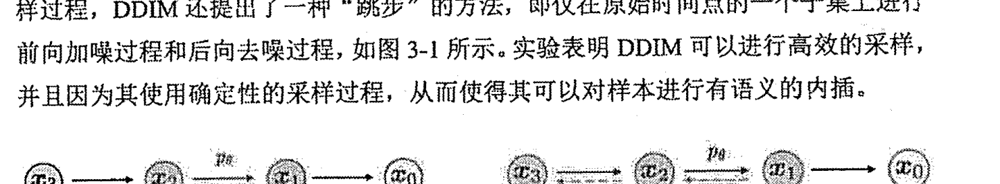

图 3-1 马尔可夫扩散过程（左）和非马尔可夫扩散过程（右）

广义去噪扩散隐式模型（generalized Denoising Diffusion Implicit Model, gDDIM）[278] 在狄拉克分布上（仅包含一个点的分布）分析了 DDIM 的性质。gDDIM 对 DDIM 的

高效采样进行了解释，并提出了在采样速度方面，确定性采样相比于随机性采样的优势。并受此启发改进了分数网络参数化方式，使更普遍的扩散过程可以进行确定性采样，如 CLD[54]。gDDIM 的作者首先观察并证明了，对于只包含一个点的狄拉克分布，确定性 DDIM 可以在有限步甚至一步计算中完美地还原原始分布。而对于一般的 ODE 或者 SDE 求解器，则是对解的轨迹进行了离散化，理论上需要无穷步的迭代计算才可以复原原始数据分布。此外，对于狄拉克分布，我们只需要一次分数函数的计算就可以根据公式推导出其他时间点的分数函数，并且这个公式和 DDIM 的离散采样方式是匹配的。这就解释了 DDIM 在狄拉克分布上确定性采样和离散方式的优势。另外，基于流形假设（现实世界的图像分布于低维流形上），上述分析对现实数据集也适用。在上述分析的基础上，gDDIM 的作者提出了类似于 DDIM 的一种对分数函数的参数化方式，使得 DDIM 的优势可以展现在其他的扩散模型如 CLD[54]中。

扩散模型的伪数值方法（Pseudo Numerical Methods for Diffusion Model, PNDM)[142]是指使用一种伪数值方法来生成在Rⁿ中特定流形的样本。使用带有非线性传递部分的数值解算器来解决流形上的微分方程，然后生成样本，或将 DDIM 封装为一个特例。Liu 等人[142]首先分析了传统 SDE 和 ODE 求解器的缺陷，它们在高速采样时会引入显著的噪声，并且会从远离样本主要分布的区域（基于流形假设）进行采样，致使采样的效果较差。所以 Liu 等人提出应该将生成器看作在流形上求解微分方程。Liu 等人分析了传统数值求解方法并将其分为两部分：第一部分称为“梯度部分”（Gradient Part），用来计算每一步的梯度；第二部分称为“变换部分”（Transfer Part），用来生成下一步的数据。新方法与经典的数值求解方法的梯度部分有所不同，但两种方法都使用了线性的变换部分。为了使每一步生成的样本更接近于原始样本存在的流形，Liu 等人提出了使用非线性变换部分的伪数值方法，在这种非线性变换部分保证如果使用估计准确的分数函数，那么生成的下一步数据也是准确的。而 DDIM 是其中的一个特例。基于 DDIM，Liu 等人使用其他（高阶）梯度部分与非线性的变换部分进行组合，如线性多步方法（Linear Multi-Step Method）和龙格-库塔方法（Runge-Kutta Method）。实验结果表明，使用非线性变换部分和高阶梯度部分的伪数值求解器，可以显著减少采样步骤并产生高质量样本。

# PNDM 代码实践

# PNDM 代码如下:

#代码源自: Pseudo Numerical Methods for Diffusion Models on Manifolds (PNDM, PLMS | ICLR2022)

#在 PNDM 中，使用一阶的非线性变换部分，得到 DDIM

```

def gen_order_1(img, t, t_next, model, alphas_cump, ets):

```

#参数

# img: 上一步采样的数据

# t: 本次采样时间点

# t_next: 下一步采样的时间点

# model: 分数模型

# alphas_cump: 边缘噪声强度āt

# ets: 噪声

```

noise = model(img, t)

```

#进行变换

```

img_next = transfer(img, t, t_next, noise, alphas_cump)

```

```

return img_next

```

#变换部分

```

def transfer(x, t, t_next, et, alphas_cump):

```

```

at = alphas_cump[t.long()].view(-1, 1, 1, 1)

```

```

at_next = alphas_cump[t_next.long()].view(-1, 1, 1, 1)

```

```

x_delta = (at_next - at) * ((1 / (at.sqrt()) * (at.sqrt() + at_next.sqrt()))) * x - \
```

```

1 / (at.sqrt()) * (((1 - at_next) * at).sqrt() + ((1 - at) * at_next).sqrt())) * et)

```

```

x_next = x + x_delta

```

```

return x_next

```

#使用高阶的梯度部分

```

def gen_order_4(img, t, t_next, model, alphas_cump, ets):

```

#使用龙格-库塔方法需要多个时间点来计算高阶梯度

```

t_list = [t, (t+t_next)/2, t_next]

```

```

if len(ets) > 2:

```

```

noise_ = model(img, t)

```

```

ets.append(noise_)

```

#当有前三步生成的时候，使用线性多步方法计算分数函数

```

noise = (1 / 24) * (55 * ets[-1] - 59 * ets[-2] + 37 * ets[-3] - 9 * ets[-4])

```

else:#否则使用高阶的龙格-库塔方法计算分数函数

```

noise = runge_kutta(img, t_list, model, alphas_cump, ets)

```

#使用和 DDIM 相同的变换部分

```

img_next = transfer(img, t, t_next, noise, alphas_cump)

```

```

return img_next

对抗校准驱动的快速扩散训练

把变分下界作为主干，把时间步向上截断来压缩计算量，再用对抗约束把隐式分布往真实数据流形上拉。配合滑动平均与梯度截断，整体收敛更平滑、训练更省时。

公式层面
下界把从干净样本到首个噪声的 KL 单独提出，剩下按区间累加。每个区间的贡献写成 L(t,s)，当 s 取 0 时退化为重构似然，s 大于 0 时用条件 KL 来度量信息损失。

```

# 扩散模型：生成式 AI 模型的理论、应用与代码实践

通过大量的实验调查，Karras 等人 [113]表明 Heun 的二阶方法[5]在采样质量和采样速度之间提供了一个很好的平衡。扩散模型的求解器可以视为数值求解 SDE（见公式（2.15））或 ODE（见公式（2.19））。传统的方法是使用低阶数值求解器如欧拉法，但低阶方法可能会导致较大的离散化误差，并且在迭代过程中进行累积。而使用高阶数值求解器则可以获得较小的离散化误差，即在迭代公式中包含分数函数的高阶导数。使用高阶导数可以捕捉到解轨迹的局部曲率，进而得到更好的近似，但代价是每个时刻需要对所学的分数函数进行额外的计算，以求得分数函数的高阶导数。通过大量探索和实验，Karras 等人发现 Heun 的二阶方法以较少的采样步骤产生了与使用欧拉法相当的甚至更好的样本。从算法上来看，该方法在逆向方差大于 0 时多调用了一次分数函数，以此来调整预测。这多一次的调用确认了 O(h³) 的局部误差，欧拉法的局部误差为 O(h²)，其中 h 是步长。Karras 等人还进一步讨论了对离散时刻的选取。

扩散指数积分采样器（Diffusion Exponential Integrator Sampler，DEIS）[277]和 DPM-Solver[146]利用概率流 ODE 的半线性结构，通过数学推导的方式简化了需要求解的方程，开发出更高效的高阶 ODE 求解器。具体方法是，概率流 ODE（见公式（2.19））的解可以写成如下积分方程：

x_t = e^{\int_s^t f(au)dau} x_s + \int_s^t e^{\int_au^t f(r)dr} \frac{g^2(au)}{2\sigma_au} \varepsilon_heta(x_au, \tau)d\tau

其中插入了预测的分数函数 s_θ = -ε_θ / σ_t。如果 f(t) 的形式比较简单，那么该方程的线性部分具有解析形式，即 x_s 前的系数可以直接计算。而非线性部分，即上式的第二项，可以用类似于 ODE 求解器中的指数积分技术来解决。DPM-Solver 使用换元法简化上式：

x_t = \frac{α_t}{α_s} x_s - α_t \int_{λ_s}^{λ_t} e^{-λ} \hat{ε}_θ(x_λ, λ)dλ

其中 λ_t = log(α_t / σ_t) 可以设计为关于 t 单调下降，因为前向过程中保留的信息越来越少，噪声越来越大。进一步对 ε̂_θ 关于时间 λ 进行泰勒展开，展开式中多项式部分的积分可以解析计算，而分数函数的高阶导数可以用低阶分数函数近似，这样便得到了高阶数值求解器。该方法包含 DDIM 作为其一阶近似。当使用高阶的积分器时，可以在短短 10~20 次迭代中产生高质量的样本，这远远少于扩散模型通常所需的数百次迭代。

# 第3章 扩散模型的高效采样

# 3.3 基于学习的采样

基于学习的采样是改善扩散模型采样效率的另一种有效方法。通过使用部分采样步骤或训练一个采样器的方式，实现更快的采样速度，但代价是采样质量的轻微降低。与使用手工调试的确定性采样方法不同，基于学习的采样通常涉及通过优化某些学习目标来选择采样步骤。

# 3.3.1 离散方式

给定一个预训练的扩散模型，Watson 等人[243]提出了一个策略来寻找在给定采样步数时最佳的离散化方案。他们的方案是选择最佳的K个时间步骤以最大化 DDPM 的训练目标。使用这种方法的关键是观察到DDPM 目标可以分解为单个 KL 散度损失项的总和，其适合使用动态规划方法来优化。假设在原始扩散模型的N个采样时间点中给定了K个时间点{t₁', t₂', …, t_k' }，并且K远小于N，那么原始DDPM的训练目标可以拆分为：

```
-L_ELBO = E_q D_KL(q(x₁|x₀)||p_θ(x₁)) + \sum_{i=1}^K L(t_i', t_{i-1}'),
```

```
其中\nL(t,s) = { -E_q log p_θ(x_t|x₀) s = 0\n          E_q D_KL(q(x_s|x_t,x₀)||p_θ(x_s|x_t)) s > 0

环境准备
读取配置和日志，组装训练集与验证集，搭建数据管道。主网络与鉴别网络分别实例化并做并行封装后放到运算设备。主网络、生成侧与鉴别侧各自拥有更新器，鉴别基线使用带 logits 的二分类交叉熵。若开启滑动平均则注册 EMA 助手。需要续训时从检查点恢复网络权重、优化器状态、当前轮次与步计数，以及平滑状态。

```

对于训练好的扩散模型L(t,s)可以直接计算出来。剩下的任务就是如何选择这 K 个时间点，使得 VLB 最大。这个问题可以使用动态规划解决，因为任意两个时间点 t、s 的 L(t,s) 都可以计算。然而众所周知，用于 DDPM 训练的变分下界与样本质量没有直接关系[232]，一些研究发现直接以 VLB 为目标函数优化采样器，会让用于评价生成图片质量的 FID（Fréchet Inception Distance）的评分变差，特别是当采样步骤很少的时候[243,219]。

随后的一项工作，可微扩散采样搜索（Differentiable Diffusion Sampler Search, DDSS）[242]可以通过直接优化样本质量的通用指标 KID（Kernel Inception Distance）[15]

# 扩散模型：生成式 AI 模型的理论、应用与代码实践

来解决这个问题。这种优化在重参数化[123, 195]的帮助下是可行的。Watson 等人[242]考察并推广了一系列扩散模型的参数，使这些参数可以使用深度神经网络进行学习，比如 DDIM 采样器的超参数σ²、DDPM 中前向扩散的边际方差āₜ、采样的时间点，还有文章[242]中定义的一种非马尔可夫采样过程。然后 Watson 等人研究了如何优化一个可以用来改善样本质量的目标函数。为了提高样本质量，Watson 等人提出可以使用 KID 的类似于蒙特卡罗模拟的无偏估计作为目标函数，使得目标函数可以进行微分和梯度传播。因为采样过程是逆向扩散过程，每一步采样都可以使用重参数化的方法进行采样，这样梯度就可以顺利地进行传播了。此方法广泛适用于各种扩散模型及其参数，并可以在采样步数较少的情况下改善生成样本的质量。在此基础上，该研究还提出了一类新的扩散模型范式，广义高斯扩散模型（Generalized Gaussian Diffusion Model, GGDM），如图 3-2 所示。GGDM 在每一个逆向过程中结合了之前所有的结果，所以 DDIM 可以视为该范式的一种特例。

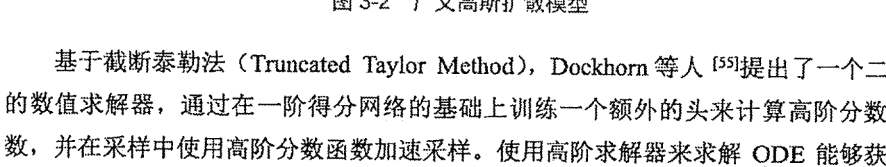

基于截断泰勒法（Truncated Taylor Method），Dockhorn 等人[55]提出了一个二阶的数值求解器，通过在一阶得分网络的基础上训练一个额外的头来计算高阶分数函数，并在采样中使用高阶分数函数加速采样。使用高阶求解器来求解 ODE 能够获得更精确的结果，因为高阶求解器可以捕捉到 ODE 的局部曲率，这使得高阶求解器即使在时间步长较大时也能生成较好的样本。Dockhorn 等人提出使用二阶截断泰勒法来求解概率流 ODE。与原始的 ODE 求解器如 DDIM 的不同点在于，它在每一步迭代中需要估计和使用分数函数的导数∇ₓ ∇ₓ log qₜ(x)。给定预训练的分数函数 sθ(xₜ,t)，我们可以对其使用自动微分，再求出二阶分数函数的近似，但这会使得采样过程多了一倍的计算。

# 扩散模型：生成式AI模型的理论、应用与代码实践

```
def train(self):

    #初始化训练数据和分数模型

    args, config = self.args, self.config

    tb_logger = self.config.tb_logger

    dataset, test_dataset = get_dataset(args, config)

    train_loader = data.DataLoader(

        dataset,

        batch_size=config.training.batch_size,

        shuffle=True,

        num_workers=config.data.num_workers,

        drop_last=True,

    )

    model = Model(config)

    #初始化GAN的判别器

    discriminator = Discriminator(c_dim=0,

        img_resolution=config.data.image_size,

        img_channels=config.data.channels,

        channel_base=config.discriminator.channel_base)

    model = model.to(self.device)

    model = torch.nn.DataParallel(model)

    discriminator = discriminator.to(self.device)

    discriminator = torch.nn.DataParallel(discriminator)

    d_criterion = nn.BCEWithLogitsLoss()

    optimizer = get_optimizer(self.config, model.parameters())

    optimizer_d = get_d_optimizer(self.config, discriminator.parameters())

    optimizer_g = get_g_optimizer(self.config, model.parameters())

    #是否使用滑动平均更新参数

    if self.config.model.ema:

        ema_helper = EMAHelper(mu=self.config.model.ema_rate)

        ema_helper.register(model)

    else:

        ema_helper = None

    start_epoch, step = 0, 0

    #在上次记录处载入数据，继续训练

    if self.args.resume_training:

        states = torch.load(os.path.join(self.args.log_path, "ckpt.pth"))

        model.load_state_dict(states[0])

        states[1]["param_groups"][0]["eps"] = self.config.optim.eps

        optimizer.load_state_dict(states[1])

        start_epoch = states[2]

        step = states[3]

        if self.config.model.ema:

            ema_helper.load_state_dict(states[4])

迭代过程
进入轮次后统计数据耗时，每批送入设备并做清洗，注入噪声后按截断上限做成对的时间步采样，上限越小迭代越轻。调用对应工厂得到噪声预测误差，反向后限制梯度幅值，刷新权重并同步滑动平均。

隐式步的对抗校准从标准正态出发，让生成侧直接给出最大步长样本，鉴别网络打分后以非饱和形式拉动生成方向。记录主目标、隐式目标与数据耗时，再单独用隐式信号微调生成侧。

鉴别侧按固定间隔更新。准备真实样本与合成样本，真实样本经加噪送到隐式步，合成样本同理。分别计算真假的非饱和鉴别目标并写入日志。若本步开启正则，就对真实隐式样本的鉴别输出求梯度，得到逐样本梯度范数约束并加权。鉴别总目标为三项之和，反向刷新鉴别参数。

```

# 第3章 扩散模型的高效采样

```
#开始训练

for epoch in range(start_epoch, self.config.training.n_epochs):

    epoch_start_time = data_start = time.time()

    data_time = 0

    for i, (x, y) in enumerate(train_loader):

        n = x.size(0)

        data_time += time.time() - data_start

        model.train()

        step += 1

        x = x.to(self.device)

        x = data_transform(self.config, x) #数据预处理

        e = torch.randn_like(x) #噪声

        b = self.betas #加噪进行

        #获得加噪数据，truncated_timestep决定采样时间点的上界，上界小则采样步骤少、速度快

t = torch.randint(low=0, high=self.truncated_timestep,

                  size=(n // 2 + 1,),

                  ).to(self.device)

t = torch.cat([t, self.truncated_timestep - t - 1], dim=0)[:n]

t_max = torch.tensor([self.truncated_timestep]).

to(self.device)

#获得预测噪声的损失，如一般的扩散模型

loss = loss_registry[config.model.type](model, x, t, e, b)

#反向传播，更新参数

optimizer.zero_grad()

loss.backward()

try:

    torch.nn.utils.clip_grad_norm_(model.parameters(), config.optim.grad_clip)

except Exception:

    pass

optimizer.step()

if self.config.model.ema:

    ema_helper.update(model)

#计算截断扩散的损失来更新分数模型

#获得标准高斯噪声

z_si = torch.randn_like(x).to(self.device)

#在生成器输入噪声，输出预测的x_T

x_gen_prime_implicit = model(z_si, t_max)

#获得判别器的分类结果并计算损失。此处只更新生成器，所以只需计算生成样本的判别损失

x_fake_logits = discriminator(x_gen_prime_implicit, c=0)

loss_T = torch.nn.functional.softplus(-x_fake_logits).mean()

tb_logger.add_scalar("loss", loss, global_step=step)

logging.info(

    f"Epoch: {epoch}, step: {step}, loss: {loss.item()}, "

    f"implicit loss: {loss_T.item()}, data time: {data_time / (i+1)}"

)

#更新分数模型的权重

optimizer_g.zero_grad()

loss_T.backward()

optimizer_g.step()

#训练判别器

do_Drl = (i % self.Dreg_interval == 0)

#获得真实数据和生成数据

z_si = torch.randn_like(x).to(self.device)

x_t_implicit = q_sample(x, self.alphas_bar_sqrt,

self.one_minus_alphas_bar_sqrt, t_max).detach().requires_grad_(do_Drl)

x_t_gen_implicit = model(z_si, t_max)

#真实数据的判别损失

real_logits = discriminator(x_t_implicit, c=0)

loss_Dreal = torch.nn.functional.softplus(-real_logits).mean()

tb_logger.add_scalar("Dloss/Dreal", loss_Dreal, global_step=step)

#生成数据的判别损失

gen_logits = discriminator(x_t_gen_implicit, c=0)

loss_Dgen = torch.nn.functional.softplus(gen_logits).mean()

tb_logger.add_scalar("Dloss/Dgen", loss_Dgen, global_step=step)

loss_Drl = 0

if do_Drl:

    #对真实数据的梯度做正则化

    with torch.autograd.profiler.record_function('rl_grads'),

         conv2d_gradfix.no_weight_gradients():

        rl_grads = torch.autograd.grad(outputs=[real_logits.sum()],

        inputs=[x_t_implicit], create_graph=True, only_inputs=True)[0]

    rl_penalty = rl_grads.square().sum([1,2,3])

    loss_Drl = (rl_penalty * (self.rl_gamma / 2)).mean()

tb_logger.add_scalar('DLoss/rl_penalty', rl_penalty.mean())

tb_logger.add_scalar('DLoss/reg', loss_Drl)

快照
鉴别参数更新后，按快照频率或首步保存网络与优化器等状态，保证中断后可接续。

```

# 扩散模型；生成式AI模型的理论、应用与代码实践

```
d_loss = loss_Dreal + loss_Dgen + loss_Drl

#更新判别器的参数

optimizer_d.zero_grad()

d_loss.backward()

optimizer_d.step()

#保存和输出

if step % self.config.training.snapshot_freq == 0 or step == 1:

    states = [

        model.state_dict(),

        optimizer.state_dict(),

Diffusion 快速采样蒸馏实现速读

以 v-diffusion 仓库的 Progressive Distillation 参考实现为蓝本，本文把可落地细节浓缩为三块：检查点落盘策略、学生网络蒸馏主循环、教师双步与学生单步的加权对齐方式，便于在技术自媒体场景快速吃透流程并复现。

落盘部分先把优化器状态、当前轮次和步号收集进列表，若开启了 EMA 则额外追加其状态，随后按步号命名保存一份历史副本，同时用 ckpt.pth 覆盖最新版本。随后记录时间戳并输出日志，为后续追踪提供锚点。

        optimizer_d.state_dict(),

        epoch,

        step,

    ]

if self.config.model.ema:

    states.append(ema_helper.state_dict())

torch.save(

    states,

    os.path.join(self.args.log_path,

                  "ckpt_().pth".format(step)),

)

torch.save(states, os.path.join(self.args.log_path,

                                   "ckpt.pth"))

data_start = time.time()

logging.info(

    f

```

# 3.3.3 知识蒸馏

知识蒸馏（Knowledge Distillation）是一种机器学习技术，它的目的是通过将一个大型、复杂的模型的知识传递给一个小型、简单的模型来提高后者的性能。知识蒸馏的基本思想是利用已经训练好的模型的知识来辅助训练新模型，从而加快模型的训练过程、提高模型的泛化能力和性能。在知识蒸馏中，通常有一个称为“教师模型”的大型模型和一个称为“学生模型”的小型模型。教师模型的任务是对输入进行分类或生成输出，例如，进行图像分类、语音识别、机器翻译等任务。学生模型的任务是尽可能准确地模拟教师模型的行为，并对输入进行相同的分类或生成输出。通过将教师模型的知识转移到学生模型中，学生模型可以在保持高准确率的同时减少模型大小，降低计算成本。

# 扩散模型：生成式AI模型的理论、应用与代码实践

知识蒸馏的基本过程如下：

+   1. 首先，使用教师模型对训练集进行预测，并将预测结果作为‘软标签’或‘伪标签’来训练学生模型。软标签通常是由教师模型输出的概率分布决定的，而不是单一的类别标签决定的。

+   2. 接下来，使用学生模型对训练集进行训练，使其尽可能地拟合软标签。

+   3. 最后，在测试集上评估学生模型的性能，以确定其是否可以准确地模拟教师模型的行为。

知识蒸馏可以应用于各种机器学习任务中，包括图像分类、语音识别、自然语言处理等。它已经被证明可以提高小型模型的性能，并帮助深度学习模型在移动设备等资源受限的环境下实现高性能。

使用知识蒸馏的方法[148, 203]可以显著提高扩散模型的采样速度。具体来说，在渐进蒸馏（Progressive Distillation）[203]中，Salimans等人提出将使用整个采样过程的原始采样器蒸馏成一个只需要一半步骤的、更快的采样器，如图3-3所示。通过将新的采样器参数化为一个深度神经网络，渐进蒸馏能够训练新模型的采样器以匹配原始采样器的输入和输出。Salimans等人采用了概率流ODE的视角，预训练的扩散模型采用确定性的迭代采样来生成样本。这种预训练的扩散模型称为‘教师模型’。教师模型有T步的采样步数，每次迭代教师模型输入xt并输出xt−1。渐进蒸馏提出训练一个学生模型，使其在迭代生成过程中的每一步接收xt，然后输出x′t−2，也就是说学生模型的一次计算等价于教师模型进行了两步计算，这样就减少了一半的采样步数。为了保证生成样本的质量，学生模型需要向教师模型学习。学生模型与教师模型采用同样的框架，保证学生模型进行一次计算所需资源与教师模型所需资源相同，然后通过优化教师模型两步计算结果xt−2和学生模型一次计算结果x′t−2的L2损失，使学生模型匹配教师模型。如果教师模型能够较准确地求解概率流ODE，那么经过足够多训练的学生模型也可以生成较高质量的样本。重复这个过程可以进一步减少采样步骤，而减少采样步骤会导致采样质量下降。Salimans等人认为这是源于在扩散步数较少时，分数函数的预测误差会被放大。为了解决这个问题，Salimans等人提出了扩散模型的新参数化方式和目标函数新的加权方案。实验表明，此方法可以将扩散模型的步数压缩到十位数甚至个位数，而生成的图片质量没有明显下降。

# 第3章 扩散模型的高效采样

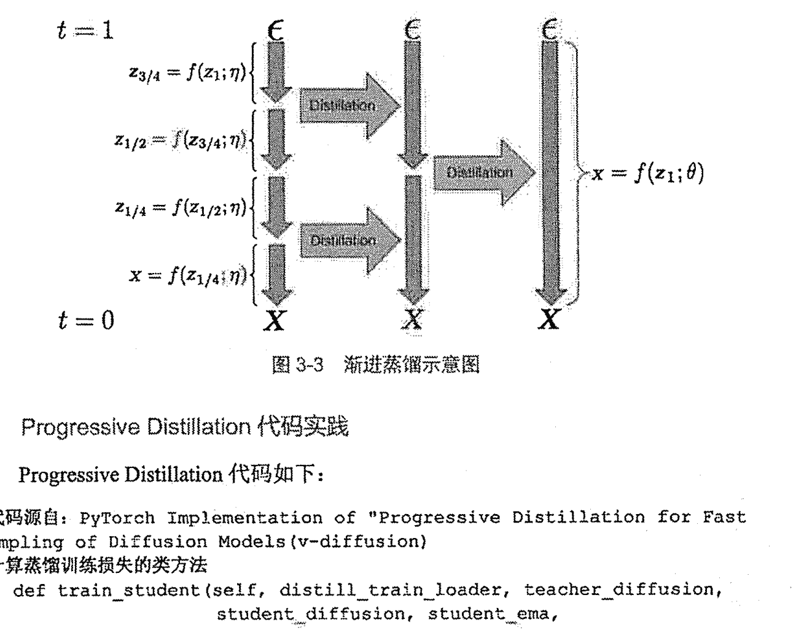

# 图3-3 渐进蒸馏示意图

# Progressive Distillation 代码实践

# Progressive Distillation 代码如下：

```

#代码源自: PyTorch Implementation of "Progressive Distillation for Fast Sampling of Diffusion Models(v-diffusion)

# 计算蒸馏训练损失的类方法

def train_student(self, distill_train_loader, teacher_diffusion,

                  student_diffusion, student_ema,

                  student_lr, device, make_extra_args=make_none_args,

                  on_iter=default_iter_callback):

```

# 参数
# distill_train_loader: 训练数据集
# teacher_diffusion: 教师模型
# student_diffusion: 学生模型
# student_ema: 学生模型训练的滑动平均
# student_lr: 学生模型的学习率
# device: cuda

```

#训练初始化

scheduler = self.scheduler

total_steps = len(distill_train_loader)

scheduler.init(student_diffusion, student_lr, total_steps)

teacher_diffusion.net.eval()

student_diffusion.net.train()

print(f"Distillation...")

pbar = tqdm(distill_train_loader)

N = 0

L_tot = 0

for img, label in pbar:

```

# 扩散模型：生成式AI模型的理论、应用与代码实践

```

scheduler.zero_grad()

img = img.to(device)

#教师模型的时间点是学生模型时间点的2倍

time = 2 * torch.randint(0, student_diffusion.num_timesteps,

(img.shape[0],),device=device)

extra_args = make_extra_args(img, label, device)

#使用教师模型的类方法计算训练损失

loss = teacher_diffusion.distill_loss(student_diffusion, img,

time, extra_args)

L = loss.item()

L_tot += L

N += 1

pbar.set_description(f"Loss: {L_tot / N}")

loss.backward()

scheduler.step()

moving_average(student_diffusion.net_, student_ema)

if scheduler.stop(N, total_steps):

    break

on_iter(N, loss.item())

on_iter(N, loss.item(), last=True)

```

#计算训练损失。此处的 ground truth 选择为渐进蒸馏中推荐的“速度"
def distill_loss(self, student_diffusion, x, t, extra_args, eps=None,
student_device=None):
# 参数
# student_diffusion: 学生模型
# x: 原始图片数据
# t: 训练时间点
# eps: 标准高斯噪声
if eps is None:
    eps = torch.randn_like(x)
#不训练教师模型
with torch.no_grad():
    #获取教师模型时间 t 处的加噪数据
alpha, sigma = self.get_alpha_sigma(x, t + 1)
z = alpha * x + sigma * eps
#获取学生模型时间 t/2 处的加噪数据，用于计算预测目标 v
alpha_s, sigma_s = student_diffusion.get_alpha_sigma(x, t // 2)
alpha_l, sigma_l = self.get_alpha_sigma(x, t)
#计算教师模型的第一步预测
v = self.inference(z.float(), t.float() + 1, extra_args).double()
rec = (alpha * z - sigma * v).clip(-1, 1)
z_l = alpha_l * rec + (sigma_l / sigma) * (z - alpha * rec)
#计算教师模型的第二步预测
v_l = self.inference(z_l.float(), t.float(),
extra_args).double()

# 第3章 扩散模型的高效采样

```

x_2 = (alpha_1 * z_1 - sigma_l * v_l).clip(-1, 1)

eps_2 = (z - alpha_s * x_2) / sigma_s

v_2 = alpha_s * eps_2 - sigma_s * x_2

#损失的权重

if self.gamma == 0:

w = 1

else:

w = torch.pow(1 + alpha_s / sigma_s, self.gamma)

#计算学生模型的一次预测

v = student_diffusion.net_(z.float(), t.float() * self.time_scale,

**extra_args)

my_rec = (alpha_s * z - sigma_s * v).clip(-1, 1)

#返回教师模型两步预测和学生模型一次预测的损失

return F.mse_loss(w * v.float(), w * v_2.float())

训练启动时调度器按数据量完成学习率初始化，教师保持评估模式不变，学生进入可训练状态并用 tqdm 展示进度。每个 batch 先清梯度并送入设备，时间采样区间取学生步数的两倍，随后通过 make_extra_args 组织额外输入，借助教师提供的蒸馏损失计算目标值。损失累加用于平滑显示，之后执行反向传播、调度器更新以及 EMA 平滑，若调度器判定已达总步数则提前退出，并按需触发迭代结束回调。

损失构造的核心思路是让轻量网络的一次前向逼近教师的两步推理结果。先由教师双步得到中间表征并推导出 v_2，依据超参数 gamma 决定缩放系数 w；学生网络在时间尺度缩放后输出 v，并构造对应的重建 my_rec，最终以加权均方误差衡量两者差异，完成快速采样的蒸馏目标。

```

# 第4章 扩散模型的似然最大化

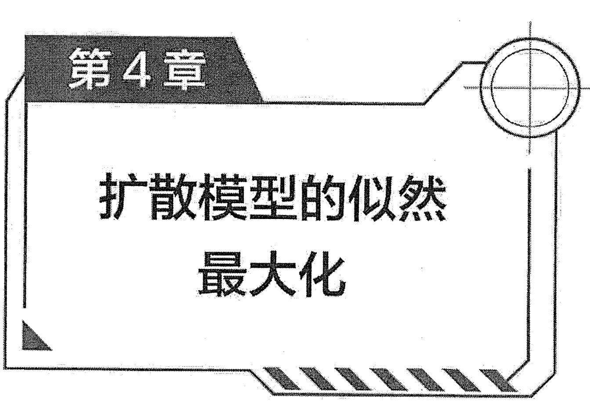

# 第4章 扩散模型的似然最大化

如第2.1节所述，扩散模型的训练目标是负的对数似然的一个变分下界（VLB）。然而，这个下界在很多情况下可能并不严格[121]，导致扩散模型的对数似然有可能不理想。在本节中，我们总结并调查最近关于扩散模型的似然最大化的工作。首先我们介绍似然函数最大化的意义，然后重点讨论3种类型的方法：噪声调度优化、逆向方差学习和精确的对数似然估计。需要注意的是，目前扩散模型的似然提高方法是通过改善负对数似然的VLB实现的，不能像归一化流（Normalizing Flow）那样直接改善似然函数值。

# 4.1 似然函数最大化

在生成模型中，我们认为真实世界的一个个数据是某个随机变量一个一个实现的。为了生成趋于真实的数据，我们希望能够学习到真实数据的分布 q，然后通过模拟这个分布来生成新样本。所以我们建立深度学习模型来对分布 q 进行参数化和学习。似然函数指的是，数据点在模型中的概率密度函数值即 p(x,θ) 所组成的函数，其中 x 是数据点，θ 是参数，p(·,θ) 是模型在参数 θ 下的生成样本的分布。
我们先介绍统计学中极大似然估计方法。假设观测到了包含 N 个独立样本的数据集{x₁,x₂,…,xₙ}，那么这 N 个样本的似然函数就是 Lθ = ∏ₖ=1^N p(xᵢ,θ)。似然函数是一个关于模型参数 θ 的函数，当选择不同的参数 θ 时，似然函数的值是不同的，它描述了在当前参数 θ 下，使用模型分布 p(x,θ) 产生数据集中所有样本的概率。一个朴素的想法是，在最好的模型参数 θ_ML 下，产生数据集中的所有样本的概率是最大的，即 θ_ML ∈ argmax L_θ。但在计算机中，多个概率的乘积结果并不方便计算和储存，例如，在计算过程中可能发生数值下溢的问题，即对比较小的、接近于 0 的数进行四舍五入后成为 0。我们可以对似然函数取对数来缓解该问题，即 l_θ = log[L_θ]，并且仍然求解最好的模型参数 θ_ML 使对数似然函数最大：θ_ML ∈ argmax l_θ。可以证明这两者是等价的。
在统计学中，参数 θ 往往有明确的含义，所以，人们希望知道参数的取值及其置信区间。通过数学推导可以证明，假设数据真实分布是 p(x,θ*), 那么在一定的正则条件下，θ_ML 是 θ* 的相合估计，即 √n(θ_ML - θ*) 有渐进正态性，并且是渐进最优（渐进有效）的。这些优良的性质让极大似然估计成为统计学中估计参数的常用方法。

# 4.2 加噪策略优化

在扩散模型中，我们希望优化生成样本分布的对数似然，也就是E_q₀ log p₀，其中q₀是真实样本的分布，p₀是生成的样本的分布。这等价于最小化q₀与p₀之间的KL散度D_KL(p₀||q₀)。但直接计算KL散度是很难处理的，因为在扩散模型中样本是迭代生成的，一般一个样本就需要几百甚至上千次计算。所以为了提高计算效率，我们转而优化D_KL(p_π||q_π)，这里p_π是整个前向加噪过程的分布，q_π是整个逆向去噪过程的分布。根据KL散度的性质，可以证明D_KL(p_π||q_π)是D_KL(p₀||q₀)的一个上界，即可通过减小D_KL(p_π||q_π)近似优化生成样本的似然。在经典的扩散模型（如DDPM）中

快导致信息丢失过多，那么会导致pπ难以通过学习的方式匹配qπ。从最优传输的角度来看，qπ和pπ是匹配数据分布q₀和先验分布的一座桥梁，而事实上能够匹配数据分布q₀和先验分布的随机过程有无限多个。所以我们会期望能够优化或者学习前向过程qπ，从而使学习pπ更简单，二者的KL散度更小。通过优化前向噪声的进程和扩散模型的其他参数，人们可以进一步最大化VLB，以获得更高的对数似然值[121,166]。

iDDPM[166]的工作表明，经典DDPM中的线性噪声在加噪的后期加噪程度过快，导致信息快速丢失，逆向去噪过程就会难以复原丢失的信息。而某种余弦加噪策略可以让信息丢失的速率更平缓，容易复原，从而改善模型的对数似然值。具体来说，iDDPM的余弦加噪策略可以采取以下形式:

$\bar{a}_t = \frac{h(t)}{h(0)}, h(t) = \cos^2\left(\frac{\frac{t}{T} + m}{1 + m}, \frac{\pi}{2}\right)$ (4.1)

其中$\bar{a}_t$如公式（2.3）和公式（2.4）定义，表示$x_t$中保留的$x_0$的信息量，而m是一个超参数，用于控制t=0时的噪声强度和整个余弦噪声的变化速率。Nichol 等人还提出了一个逆向方差的参数化方式，即在对数域中对βτ和1−$\bar{a}_t$之间进行插值。

在变分扩散模型（Variational Diffusion Model, VDM）[121]中，Kingma 等人提出通过联合训练加噪策略和其他扩散模型参数来最大化VLB，从而提高连续时间扩散模型的似然函数值。VDM使用单调神经网络γη(t)对加噪策略进行参数化，其中η表示单调神经网络中可学习的参数，并根据στ²=sigmoid(γη(t)),$q(x_t|x_0)=N(\bar{a}_t x_0, στ²I)$, $\bar{a}_t\sqrt{(1 - στ²)}$建立前向扰动过程。此外，Kingma 等人还证明了在连续时间的情形下（T趋于正无穷），数据点x的VLB可以简化为只取决于信噪比R(t)= $\bar{a}_t²/στ²$的形式。VDM对前向过程的学习也可以表示为对信噪比的学习，即R(t)=exp(-γη(t))。另外，L_VLB可以被分解为:

$L_{VLB} = -E_{x_0}D_{KL}(q(x_T|x_0)\|p(x_T))+E_{x_0,x_1}\log p(x_0|x_1)-L_D$ (4.2)

其中第一项和第二项可以与变分自编码器相似的方式进行训练。第三项可以进一步简化为以下内容:

$L_D = \frac{1}{2}E_{x_0,\epsilon} \int_{R_{min}}^{R_{max}} ||x_0 - \widehat{x_θ}(x_v,v)||_2^2 dv$ (4.3)

# 4.3 逆向方差学习

通过优化逆向过程p_π和前向过程q_π的KL散度来优化生成样本的似然值。在扩散模型的经典框架中，逆向过程p_π的初分布符合标准高斯分布，转移核是高斯转移核，所以能够学习的参数只有逆向过程中高斯转移核的期望与方差。但是在DDPM中假定了逆向马尔可夫链中的高斯转移核有固定的方差。虽然我们把逆向转移核写为p_θ(x_t−1|x_t)=N(μ_θ(x_t,t), Σ_θ(x_t,t))，但通常将逆向方差Σ_θ(x_t,t)固定为β_tI 。这就限制了p_π的表达和匹配能力。所以为了让p_π进一步匹配q_π，许多方法建议对逆向方差也进行学习，以进一步减小KL散度，从而提高VLB和对数似然值。

在iDDPM[166]中，Nichol和Dhariwal提议，通过用某种形式的线性插值来参数化并学习逆向方差，使用一种混合目标对其进行训练，以得到更高的对数似然和更快的采样速度，且不损失样本质量。特别是，他们将公式（2.5）中的逆向方差参数化

为：
Σθ(xₜ,t) = exp(θ)·logβₜ + (1−θ)·logβ̃ₜ
其中 β̃ₜ = (1−āᵗ⁻¹)/(1−āᵗ) βₜ，θ是可学习的参数。选择在β̃ₜ和βₜ中插值是因为这两种固定的逆向方差可以带来类似的结果。iDDPM 这种对逆向方差进行的参数化是简单且可学习的，它避免了估计更复杂形式的Σθ(xₜ,t)所可能带来的不稳定性，并且其实验结果显示，这种简单的参数化确实可以提高似然值。

Analytic-DPM[8]证明了一个惊人的结果，即最优逆向方差可以从预先训练的分数函数中获得。“最优”是指最大的VLB。假设qπ通过公式（2.2）、公式（2.3）来定义，并且pπ的期望和方差都可以学习，那么在逆向方差形如σ²I的假设下，最优逆向方差的解析形式如下：

Σθ(xₜ,t)=σᵗ² + \left(\sqrt{β̃ₜ/αₜ} − \sqrt{β̃ᵗ₋₁ − σᵗ²}\right)² · \left(1 − β̃ₜEₓₜ \left\|\frac{∇ₓₜ log qₜ(xₜ)}{d}\right\|²\right)² （4.4）

而最优均值等价于DDPM中对均值的参数化。在最优方差里，只有分数函数的二阶矩是未知的，所以可以直接替换成我们预训练的分数函数。因此，给定一个预训练的分数模型，我们可以估计其一阶矩和二阶矩，然后根据公式（4.4）进行计算，以获得最佳的逆向方差。将它们插入VLB可以得到更高的似然值。对这个结论的证明由几个核心步骤组成。Bao等人[8]观察到前向链和逆向链的KL散度完全由前向转移核和逆向转移核的期望和方差决定。这个重要的观察允许我们计算和求解最优的逆向方差和逆向期望。首先他们证明了一步加噪和一步去噪的交叉熵有以下的形式。

引理1：
假设q是一个概率密度函数，有期望μ_q和方差Σ_q。另一个分布为p~N(μ, Σ)，那么q和p的交叉熵H(q,p)等于H(N(μ_q, Σ_q), p)。

证明：
H(q,p) = -E_q log p = -E_q log \frac{1}{\sqrt{(2π)ⁿ|Σ|}} exp\left(-\frac{(x−μ)ᵀΣ⁻¹(x−μ)}{2}\right)
= \frac{1}{2}log((2π)ⁿ|Σ|) + \frac{1}{2}E_q (x−μ)ᵀΣ⁻¹(x−μ)

[PAGE 83]

# 第4章 扩散模型的似然最大化

= \frac{1}{2}\log((2\pi)^d|\Sigma|) + \frac{1}{2}\tr(E_q(x - \mu)^T(x - \mu)\Sigma^{-1})
= \frac{1}{2}\log((2\pi)^d|\Sigma|) + \frac{1}{2}\tr(E_q\left[(x - \mu_q)^T(x - \mu_q) + (\mu_q - \mu)^T(\mu_q - \mu)\right]\Sigma^{-1})
= \frac{1}{2}\log((2\pi)^d|\Sigma|) + \frac{1}{2}\tr(\Sigma_q\Sigma^{-1}) + \frac{1}{2}(\mu_q - \mu)^T\Sigma^{-1}(\mu_q - \mu)
= H(N(x|\mu_q, \Sigma_q), p)

再利用交叉熵和 KL 散度的关系，可以得到：

\quad D_{KL}(q||p) = D_{KL}(N(\mu_q, \Sigma_q), p) + H(N(\mu_q, \Sigma_q), p) - H(q)

证明：
\quad D_{KL}(q||p) = H(q,p) - H(q) = H(N(x|\mu_q, \Sigma_q), p) - H\big(N(x|\mu_q, \Sigma_q)\big) + H\big(N(x|\mu_q, \Sigma_q)\big) - H(q)
\quad = D_{KL}(N(x|\mu_q, \Sigma_q)||p) + H\big(N(x|\mu_q, \Sigma_q)\big) - H(q)

[PAGE 84]

# 扩散模型：生成式AI模型的理论、应用与代码实践

其中 c 是与逆向过程 p 无关的常数。这样我们可以针对每一步 KL 散度来优化其逆向转移核，如上述式子所示。再根据 Tweedie 公式建立最优期望和方差μᵗˡ、σᵗˡ与分数函数的联系，求得公式（4.4）。通过使用严谨的数学推导证明了最优逆向均值和期望的存在，并且其结果中唯一的未知量就是分数函数。因此，研究各种参数化逆向方差的技巧变得不再重要了，而应把注意力放在如何改善对分数函数的估计上。

# iDDPM 代码实践

# iDDPM 代码如下：

```

# 源码出处：improved-diffusion
# Diffusion 训练脚本
# 导入依赖与工具

import argparse

from improved_diffusion import dist_util, logger

from improved_diffusion.image_datasets import load_data

from improved_diffusion.resample import create_named_schedule_sampler

from improved_diffusion.script_util import (
    model_and_diffusion_defaults,
    create_model_and_diffusion,
    args_to_dict,
    add_dict_to_argparser,
)

from improved_diffusion.train_util import TrainLoop

def main():
    args = create_argparser().parse_args()
    dist_util.setup_dist()
    logger.configure()
    logger.log("creating model and diffusion...")
    # 按配置初始化分数估计网络与扩散组件。前者负责估计数据分布的梯度，后者负责参数管理及前向/逆向计算。网络结构采用 UNet，扩散实现为事先设定的 GaussianDiffusion
    model, diffusion = create_model_and_diffusion(
        **args_to_dict(args, model_and_diffusion_defaults().keys())
    )
    #将

# 第4章 基于似然优化的 Diffusion 训练

```python
data = load_data(
    data_dir=args.data_dir,
    batch_size=args.batch_size,
    image_size=args.image_size,
    class_cond=args.class_cond,
)
logger.log("training...")
#训练主体函数
TrainLoop(
    model=model, #分数模型
    diffusion=diffusion, #扩散过程
    data=data, #训练数据
    batch_size=args.batch_size, #一批数据的大小
    microbatch=args.microbatch, #一个microbatch的大小
    lr=args.lr,
    ema_rate=args.ema_rate,
    log_interval=args.log_interval,
    save_interval=args.save_interval,
    resume_checkpoint=args.resume_checkpoint,
    use_fp16=args.use_fp16,
    fp16_scale_growth=args.fp16_scale_growth,
    schedule_sampler=schedule_sampler, #时间点采样器，默认从0到T均匀采样
    weight_decay=args.weight_decay,
    lr_anneal_steps=args.lr_anneal_steps,
).run_loop()
```

```python
#通过命令行输入的训练参数
def create_argparser():
    defaults = dict(
        data_dir=
```

## Diffusion 体系：原理、落地场景及实现

```python
return parser
```

```python
if __name__ == "__main__":
  main()
```

```python
#定义一个类进行训练
class TrainLoop:
    def __init__(self, *, model, diffusion, data, batch_size, microbatch,
                 lr, ema_rate, log_interval, save_interval,
                 resume_checkpoint, use_fp16=False,
                 fp16_scale_growth=le-3, schedule_sampler=None,
                 weight_decay=0.0,
                 lr_anneal_steps=0):
```

# 超参数清单

# model: 分数估计网络
# diffusion: GaussianDiffusion 实现
# data: 输入数据集
# batch_size: 每批样本数量
# microbatch: 微批样本数量
# lr: 优化器步长
# ema_rate: EMA 平滑系数
# log_interval: 日志输出周期
# save_interval: 检查点保存周期
# resume_checkpoint: 是否恢复此前进度
# use_fp16=False: 是否开启半精度
# fp16_scale_growth: fp16 动态缩放因子
# schedule_sampler: 时间步采样策略
# weight_decay: 权重正则化系数
# lr_anneal_steps: lr 退火步数上限

```python
# 初始化参数
self.model = model
self.diffusion = diffusion
self.data = data
self.batch_size = batch_size
self.microbatch = microbatch if microbatch > 0 else batch_size
self.lr = lr
self.ema_rate = (
    [ema_rate]
    if isinstance(ema_rate, float)
    else [float(x) for x in ema_rate.split(",")] 
)
self.log_interval = log_interval
self.save_interval = save_interval
self.resume_checkpoint = resume_checkpoint
```

76

# 第4章 扩散模型似然最大化

```python
self.use_fp16 = use_fp16
self.fp16_scale_growth = fp16_scale_growth
self.schedule_sampler = schedule_sampler or
    UniformSampler(diffusion)
self.weight_decay = weight_decay
self.lr_anneal_steps = lr_anneal_steps
self.step = 0 #训练次数
self.resume_step = 0 #已经训练的次数
self.global_batch = self.batch_size * dist.get_world_size()
self.model_params = list(self.model.parameters())
self.master_params = self.model_params
self.lg_loss_scale = INITIAL_LOG_LOSS_SCALE
self.sync_cuda = th.cuda.is_available()
self._load_and_sync_parameters()
if self.use_fp16:
    self._setup_fp16()
#设置优化器
self.opt = AdamW(self.master_params, lr=self.lr,
    weight_decay=self.weight_decay)
#如果在命令行中 resume_step 设置为 True，那么就从事先给定的状态继续训练
if self.resume_step:
    self._load_optimizer_state()
    self.ema_params = [
        self._load_ema_parameters(rate) for rate in self.ema_rate
    ]
else:
    self.ema_params = [
        copy.deepcopy(self.master_params) for _ in
            range(len(self.ema_rate))
    ]
#如果可以使用 cuda，则使用 torch 中的 DDP 进行训练
if th.cuda.is_available():
    self.use_ddp = True
    self.ddp_model = DDP(
        self.model,
        device_ids=[dist_util.dev()],
        output_device=dist_util.dev(),
        broadcast_buffers=False,
        bucket_cap_mb=128,
        find_unused_parameters=False,
    )
else:
    if dist.get_world_size() > 1:
        logger.warn(
            "Distributed training requires CUDA. "
            "Gradients will not be synchronized properly!"
        )
```

## 扩散模型：生成式AI原理、落地与代码实操

# 基于 TrainLoop.run_loop 的训练循环实现

```python
def run_loop(self):
    while (not self.lr_anneal_steps or self.step + self.resume_step <
        self.lr_anneal_steps):
        #抽取一批数据
        batch, cond = next(self.data)
        #进一步训练
        self.run_step(batch, cond)
        #周期性输出
        if self.step % self.log_interval == 0:
            logger.dumpkvs()
        #周期性存储数据
        if self.step % self.save_interval == 0:
            self.save()
        #测试模式
        if os.environ.get("DIFFUSION_TRAINING_TEST", ") and 
            self.step > 0:
            return
        self.step += 1
        # 完成训练后储存模型
        if (self.step - 1) % self.save_interval != 0:
            self.save()
```

# 追加训练所需的函数集合

```python
def run_step(self, batch, cond):
    #参数
    # batch: 一批训练数据
    # cond: 数据类别，在条件扩散时使用
    #计算进一步训练的损失
    self.forward_backward(batch, cond)
    #进行优化
    if self.use_fp16:
        self.optimize_fp16()
    else:
        self.optimize_normal()
    #输出训练过程的指标
    self.log_step()
```

# 损失计算方式

```python
def forward_backward(self, batch, cond):
    # 参数
    # batch: 一批训练数据
```

# 第4章 解读扩散模型的似然最大化

```python
# cond: 数据类别，在条件扩散时使用
zero_grad(self.model_params)
for i in range(0, batch.shape[0], self.microbatch):
    #获得microbatch训练数据
    micro = batch[i : i + self.microbatch].to(dist_util.dev())
micro_cond = {
    k: v[i : i + self.microbatch].to(dist_util.dev())
    for k, v in cond.items()
}
last_batch = (i + self.microbatch) >= batch.shape[0]
#采样用于训练的时间点，如果使用重要性采样，则还需要获得时间点的权重
t, weights = self.schedule_sampler.sample(micro.shape[0], dist_util.dev())
#计算损失
compute_losses = functools.partial(
    self.diffusion.training_losses,
    #具体的损失函数类型，是GaussianDiffusion类的方法
    self.ddp_model,
    micro,
    t,
    model_kwargs=micro_cond,
)
#计算损失
if last_batch or not self.use_ddp:
    losses = compute_losses()
else:
    with self.ddp_model.no_sync():
        losses = compute_losses()
#计算完此步损失后，若损失的权重使用基于上一步损失的重要性采样，则更新下一步损失的权重
if isinstance(self.schedule_sampler, LossAwareSampler):
    self.schedule_sampler.update_with_local_losses(t, losses["loss"].detach())
loss = (losses["loss"] * weights).mean()
log_loss_dict(
    self.diffusion, t, {k: v * weights for k, v in losses.items()}
)
#梯度回传
if self.use_fp16:
    loss_scale = 2 ** self.lg_loss_scale
    (loss * loss_scale).backward()
else:
    loss.backward()
```

## 扩散模型：生成式AI从理论到代码的完整实践

```python
#损失的计算，是之前 GaussianDiffusion 类的方法
def training_losses(self, model, x_start, t, model_kwargs=None,
noise=None):
# 参数
# model: 训练的模型
# x_start: [N x C x ...]输入的张量
# t: 一批加噪时间点
# model_kwargs: 额外的参数，可用于条件生成模型的训练
# noise: 可以指定要去掉的高斯噪声
if model_kwargs is None:
    model_kwargs = {}
if noise is None:
    noise = th.randn_like(x_start)
x_t = self.q_sample(x_start, t, noise=noise)
#GaussianDiffusion类的加噪采样
terms = {}
#根据参数选择损失的类别并计算
if self.loss_type == LossType.KL or self.loss_type ==
LossType.RESCALED_KL:
    #计算 KL 散度
    terms["loss"] = self._vb_terms_bpd(model=model, x_start=x_start,
x_t=x_t,t=t,
clip_denoised=False,
model_kwargs=model_kwargs,)
    if self.loss_type == LossType.RESCALED_KL:
        terms["loss"] *= self.num_timesteps
elif self.loss_type == LossType.MSE or self.loss_type ==
LossType.RESCALED_MSE:
    #模型输出
    model_output = model(x_t, self.scale_timesteps(t),
**model_kwargs)
    if self.model_var_type in [
ModelVarType.LEARNED,
ModelVarType.LEARNED_RANGE,
]
    B, C = x_t.shape[:2]
    #模型的数据分为预测的噪声（期望）和学习 的逆向方差
    assert model_output.shape == (B, C * 2, *x_t.shape[2:])
    model_output, model_var_values = th.split(model_output, C,
dim=1)
    #使用 VLB 损失来学习方差，但不要使它影响模型对噪声的预测。将预 测期望冻结
    frozen_out = th.cat([model_output.detach(),
model_var_values], dim=1)
    #逆向方差的损失使用 KL 散度
    terms["vb"] = self._vb_terms_bpd(
```

# 第4章 扩散模型如何最大化似然

```python
model=lambda *args, r=frozen_out: x,
x_start=x_start,
x_t=x_t,
t=t,
clip_denoised=False,
)["output"]
if self.loss_type == LossType.RESCALED_MSE:
    #把逆向方差的损失除以1000，以避免影响模型预测噪声部分的训练
    terms["vb"] *= self.num_timesteps / 1000.0
#根据模型预测的类型，获得ground truth数据
target = {
    #预测x_t-1
    ModelMeanType.PREVIOUS_X: self.q_posterior_mean_variance(
        x_start=x_start, x_t=x_t, t=t)[0],
    #预测x_0
    ModelMeanType.START_X: x_start,
    #预测噪声
    ModelMeanType.EPSILON: noise,
    ][self.model_mean_type]
assert model_output.shape == target.shape == x_start.shape
#计算预测噪声的损失
terms["mse"] = mean_flat((target - model_output) ** 2)
#总的损失：预测逆向期望和逆向方差
if "vb" in terms:
    terms["loss"] = terms["mse"] + terms["vb"]
else:
    terms["loss"] = terms["mse"]
else:
    raise NotImplementedError(self.loss_type)
return terms
```

```python
#使用 KL 散度计算 VLB 损失
def _vb_terms_bpd(
    self, model, x_start, x_t, t, clip_denoised=True, model_kwargs=None
)
# 参数
# model: 模型
# x_start: 原始数据
# x_t: t 时刻加噪数据
# t: （一批）时间
# clip_denoised: 是否进行 clip
    # 计算真实的 q(x_t-1|x_0,x_t) 的期望和方差
    true_mean, _, true_log_variance_clipped = 
        self.q_posterior_mean_variance(
            x_start=x_start, x_t=x_t, t=t
        )
```# 扩散模型：生成式AI理论、应用与编程实践指南

```
#计算模型预测的逆向期望和方差
out = self.p_mean_variance(
    model, x_t, t, clip_denoised=clip_denoised,
    model_kwargs=model_kwargs
)
#计算KL散度，因为两个分布都是高斯分布，仅需要两个分布的期望和方差就能计算KL散度
kl = normal_kl(
    true_mean, true_log_variance_clipped, out["mean"],
    out["log_variance"]
)
kl = mean_flat(kl) / np.log(2.0)
#从1时刻到0时刻的KL散度需要特殊处理
decoder_nll = -discretized_gaussian_log_likelihood(
    x_start, means=out["mean"], log_scales=0.5 * out["log_variance"]
)
assert decoder_nll.shape == x_start.shape
decoder_nll = mean_flat(decoder_nll) / np.log(2.0)
#在0时刻使用decoder.nll作为损失，其他时刻使用KL散度
output = th.where((t == 0), decoder_nll, kl)
return {"output": output, "pred_xstart": out["pred_xstart"]}
```

# 4.4 对数似然的精确估计

第4.1节与第4.2节把前向、逆向都参数化为离散时间的马尔可夫链，本部分则切换到连续时间的视角，假设两者均可由随机微分方程刻画。连续时间讨论的收益很明显，得到的结论更普适，经适当转换就能覆盖多种扩散族，DDPM 与 SGM 本质上都可视为 Score SDE 的离散近似。反过来，从连续时间出发还能拓展设计空间，一些在离散链框架下难以构造的模型，比如 CLD，在连续设定下就变得可行。

在 Score SDE 设定中，采样是通过数值求解反向 SDE 实现的，其中公式 2.18 里出现的 ∇ₓlogqₜ(x) 被已训练的噪声条件分数网络 sθ(xₜ,t) 替代：

dx = [f(x,t) − g²(t)∇ₓlogqₜ(x)]dt + g(t)dẼ (4.5)

流程是先训练 sθ(xₜ,t)，再把它代入 2.18 得到 4.5，最后用数值求解器求解该随机微分方程。

# 第4章 让扩散模型的似然可度量

上述数值求解本身就是生成过程。我们记通过求解该 SDE 得到的时间 0 分布为 p_θ^sde，即公式 4.5 的解。也可以把学到的分数代入公式 2.19 的概率流 ODE 来生成：

dx_t\over dt = f(x_t,t) - \frac{1}{2}g^2(t)s_θ(x_t,t) := ŷ_θ(x_t,t) (4.6)

相应的样本分布记作 p_θ^ode。神经常微分方程与连续归一化流的理论指出，尽管计算开销较大，p_θ^ode 的对数似然可以被精确计算出来。

关于 p_θ^sde，同期工作 [98,145,219] 证明在合适加权下存在可高效计算的变分下界，于是可以直接用修改后的损失训练扩散模型来提升 p_θ^sde。这为基于去噪分数匹配的训练提供了似然层面的理论支撑。

Song 等人 [219] 表明，使用一种特殊加权即“likelihood weighting”时，训练 Score SDE 的损失会隐式地最大化数据对数似然，等价于最大化 p_θ^sde。他们给出：

D_KL(q_0||p_θ^sde)≤L(θ;g²(·)) + D_KL(q_T||π) (4.7)

其中 D_KL(q_0||p_θ^sde) 为真实数据分布与模型分布的 KL，L(θ;g²(·)) 表示把 Score SDE 损失公式 2.20 中的权重 λ(t) 取为 g²(t)。因为 D_KL(q_0||p_θ^sde) = −E_{q_0} log p_θ^sde + 常数，而 D_KL(q_T||π) 也是常数，减小 L(θ;g²(·)) 就等价于提升 E_{q_0} log p_θ^sde。Song 与 Huang 等 [98,219] 还给出了单一样本的界：

-log p_θ^sde(x)≤L'(x) (4.8)

L'(x) 的核心部分与隐式分数匹配 [101] 相关，整体界可用蒙特卡洛估计。

由于概率流 ODE 属于神经 ODE / 连续归一化流的子类，可沿用其似然计算方法。若数据按公式 4.6 连续生成，则 0 时刻的对数似然可由瞬时变量变换得到：

logp₈⁰de(x₀)=logp_T(x_T)+∫₀ᵀ∇·f̃_θ(x_t,t)dt (4.9)

该一维积分可用数值 ODE 求解器配合 Skilling-Hutchinson 迹估计计算 [100,214]。迹估计写为：

∇·f̃_θ(x_t,t)=E_p(ε)ε^T∇f̃_θ(x_t,t)ε

其中 ∇f̃_θ(x_t,t) 为雅可比，可通过 PyTorch 等框架自动微分获得，ε 为均值零、方差为 I 的随机向量。由期望与迹的可交换性可证该式，从而能以任意精度估计散度并用 ODE 求解器得到 logp₈⁰de(x₀)。直接用此式优化对数似然代价很高，因为每个样本都要调用昂贵的 ODE 求解器。神经 ODE 文献 [30] 也面临同样问题。

为降低开销，Song 等人 [219] 提出最大化 p_θ^sde 的变分下界作为 p_θ^ode 最大化的代理，形成一类 Score Flows。采用 likelihood weighting 训练 Score Flows 时会遇到方差膨胀：扩散模型常用蒙特卡洛近似公式 2.20，加权后方差显著增大。缓解手段是重要性采样，改变时间 t 在 [0,T] 上的采样分布，仍可实现任意加权损失。若目标权重为 α²(t)，只需令 t 的分布为 p(t)=g²(t)/[α²(t)]Z，其中 Z 为归一化常数。文献 [225] 中的 α²(t) 能明显降低方差，例如 VE-SDE 取 α²(t)=σ²(t)'。

Lu 等人 [145] 进一步改进概率流 ODE 的训练。他们提出除了最小化标准分数匹配损失，还应优化其高阶推广，并证明 logp₈⁰de 可被一阶、二阶、三阶分数匹配误差所限制。在此之上，他们设计了高效优化这些高阶误差的训练算法，降低了高阶损失并提升了 p₈⁰de。

# 第5章 扩散模型在特殊结构数据上的迁移

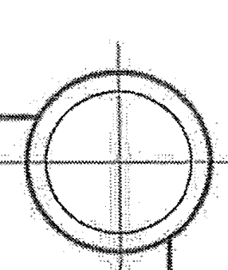

# 扩散模型：生成式AI模型的理论、应用与代码实践

扩散模型在图像、音频等模态上取得很大进展，但并不总能直接迁移到其他领域。许多关键任务里的数据带有特殊结构。缺少对结构的考虑，经典扩散就会失效。例如分数函数仅在连续域有良好定义，对离散数据无定义；数据落在低维流形上也会出现问题。因此需要对扩散框架进行针对性改造。

# 5.1 离散数据

主流扩散模型面向连续域。DDPM 使用的高斯扰动适合连续值，不适用于离散；SGM 与 Score SDE 所需的分数也只在连续域定义。分数本质是概率密度对数梯度 ∇ₓ log qₜ(x)，离散数据没有密度，故分数无意义。为此 [215,6,83,96,255] 等提出了可生成离散数据的扩散方法。如图 5-1 所示，VQ-Diffusion [83] 先用 VQ-VAE 把图像特征离散为 token，再把前向的高斯噪声换成离散空间上的随机游走或随机遮蔽。

前向转移核可写为：

其中 v(xₜ) 为 one-hot 列向量表示 t 时刻状态，Qₜ 为预设转移矩阵：

Qₜ = [

  αₜ + βₜ   βₜ   …   βₜ 

  βₜ   αₜ + βₜ…   βₜ 

  ⋮     ⋮      ⋱   ⋮ 

  βₜ    βₜ  …αₜ + βₜ]

其中 αₜ ∈ [0,1]，βₜ = (1 − αₜ)/K。每个 token 以 αₜ + βₜ 的概率保留原值，以 Kβₜ 的概率在 K 类中重采样。借助前向核的马尔可夫性可解析得到 q(xₜ₋₁|x₀,xₜ)。因离散无分数，VQ-Diffusion 直接用神经网预测原始样本 x̂₀，再匹配 q(xₜ₋₁|x₀,xₜ) 与 pθ(xₜ₋₁|ˆx₀,xₜ) 进行训练。D3PM [6] 提供了更多转移核选择，包括一致核、带吸收态核、离散化高斯核或基于嵌入距离的核。

# Step1: VQ-VAE

# Step2: VQ-Diffusion

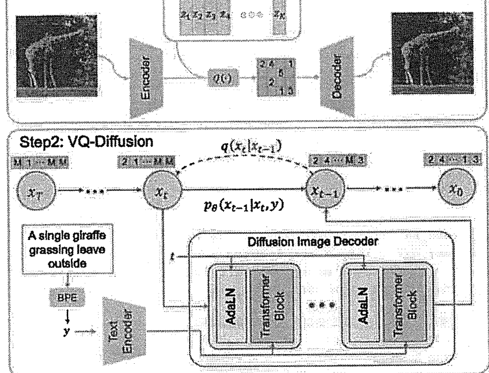

# 图5-1 VQ-Diffusion框架图

# VQ-Diffusion代码实践

# VQ-Diffusion代码如下：

```
#代码源自: VQ-Diffusion (CVPR2022, Oral) and Improved VQ-Diffusion #基于Diffusion类计算训练损失 def _train_loss(self, x, cond_emb, is_train=True): #参数 # x: 输入的离散one-hot数据 # cond_emb: 辅助信息，如其他文字嵌入 # is_train: 训练模式 b, device = x.size(0), x.device assert self.loss_type == 'vb_stochastic' x_start = x #采样训练时间点 t, pt = self.sample_time(b, device, 'importance')
```

# 扩散模型：生成式AI模型的理论、应用与代码实践

```
#将数据从one-hot形式转变为对数的形式，便于损失的计算
```
```
log_x_start = index_to_log_onehot(x_start, self.num_classes)
```
```
#获得加噪数据，即获得前向链经过t步后得到的采样
```
```
log_xt = self.q_sample(log_x_start=log_x_start, t=t)
```
```
xt = log_onehot_to_index(log_xt)
```
```
#使用模型预测原始样本
```
```
log_x0_recon = self.predict_start(log_xt, cond_emb, t=t)
```
```
log_model_prob = self.q_posterior(log_x_start=log_x0_recon,
```
```
log_x_t=log_xt, t=t)
```
```
log_true_prob = self.q_posterior(log_x_start=log_x_start,
```
```
log_x_t=log_xt, t=t)
```
```
#计算真实的和预测的后验分布的KL散度，并在计算时使用了掩码
```
```
kl = self.multinomial_kl(log_true_prob, log_model_prob)
```
```
mask_region = (xt == self.num_classes-1).float()
```
```
mask_weight = mask_region * self.mask_weight[0] + (1. - mask_region) * self.mask_weight[1]
```
```
kl = kl * mask_weight
```
```
kl = sum_except_batch(kl)
```
```
decoder_nll = -log_categorical(log_x_start, log_model_prob)
```
```
decoder_nll = sum_except_batch(decoder_nll)
```
```
mask = (t == torch.zeros_like(t)).float()
```
```
kl_loss = mask * decoder_nll + (1. - mask) * kl
```
```
#对损失进行加权，计算重建损失并添加到原损失中
```
```
loss1 = kl_loss / pt
```
```
vb_loss = loss1
```
```
if self.auxiliary_loss_weight != 0 and is_train==True:
```
```
    #计算重建损失
```
```
    kl_aux = self.multinomial_kl(log_x_start[:,:,:-1,:],
```
```
        log_x0_recon[:,:,:-1,:])
```

# 第5章 将扩散模型应用于具有特殊结构的数据

Campbell 等人 [21] 给出了首个离散扩散的连续时间框架。连续视角下，前向马尔可夫轨迹由每个时刻 t 的转移速率矩阵 R_t(x,y) 决定，R_t 可看作转移概率对时间的导数，知晓 R_t 就确定了前向转移。与 Score SDE 类似，可证明存在逆向速率矩阵，由其构造的逆向连续马尔可夫链能完整恢复数据分布。在此设定下，唯一需要学习的就是逆向转移速率。Campbell 等人推导出学习逆向速率与生成对数似然的关系，并据此设计目标函数以提升似然，同时提出面向离散数据的有效采样器，并给出样本分布与真实分布误差的理论分析。

从 SDE 角度看，Liu 等人 [292] 在 “Learning Diffusion Bridges on Constrained Domains” 中提出学习受限区域上的扩散模型。根据随机分析中的 Doob’s h-transform，只需适当调整 SDE 的漂移项，就能使解以概率一

# 第5章 将扩散模型应用于具有特殊结构的数据

# GDSS代码实践

# GDSS代码如下：

```
#在代码源自: Score-Based Generative Modeling of Graphs via the System of Stochastic Differential Equations
#在GDSS中计算一批数据损失的函数
def get_sde_loss_fn(sde_x, sde_adj, train=True, reduce_mean=False,
                  continuous=True, likelihood_weighting=False, eps=le-5):
# 参数
# sde_x: 节点特征的扩散方程形式，如VP-SDE、VE-SDE 等
# sde_adj: 邻接矩阵的扩散方程形式
# train: 是否进行训练
# reduce_mean: 是否对损失求均值
# continuous: 是否是连续时间模式
# likelihood_weighting: 损失函数加权方式
reduce_op = torch.mean if reduce_mean else lambda *args, **kwarg:
                0.5 * torch.sum(*args,**kwarg)
#损失的计算
def loss_fn(model_x, model_adj, x, adj):
#根据扩散方程的类型和神经网络的输出，获得对分数函数的预测函数
score_fn_x = get_score_fn(sde_x, model_x, train=train,
                        continuous=continuous)
score_fn_adj = get_score_fn(sde_adj, model_adj, train=train,
                        continuous=continuous)
#训练时间采样
t = torch.rand(adj.shape[0], device=adj.device) * (sde_adj.T - eps) + eps
flags = node_flags(adj)
#生成噪声和加噪数据。在邻接矩阵和节点加入独立的标准高斯噪声
z_x = gen_noise(x, flags, sym=False)
mean_x, std_x = sde_x.marginal_prob(x, t)
perturbed_x = mean_x + std_x[:, None, None] * z_x
perturbed_x = mask_x(perturbed_x, flags)
z_adj = gen_noise(adj, flags, sym=True)
mean_adj, std_adj = sde_adj.marginal_prob(adj, t)
perturbed_adj = mean_adj + std_adj[:, None, None] * z_adj
perturbed_adj = mask_adjs(perturbed_adj, flags)
#预测分数函数，注意模型的输入是加噪后的联合数据
score_x = score_fn_x(perturbed_x, perturbed_adj, flags, t)
score_adj = score_fn_adj(perturbed_x, perturbed_adj, flags, t)
#下面利用DSM方法，分别计算偏分数函数的预测损失
if not likelihood_weighting:
    losses_x = torch.square(score_x * std_x[:, None, None] + z_x)
    losses_x = reduce_op(losses_x.reshape(losses_x.shape[0], -1), dim=-1)
    losses_adj = torch.square(score_adj * std_adj[:, None, None] + z_adj)
```

# 扩散模型：原理、应用与实战

```
losses_adj = reduce_op(losses_adj.reshape(losses_adj.shape[0], -1), dim=-1)
#使用likelihood_weighting的加权方式，需要调用SDE的扩散系数
else:
g2_x = sde_x.sde(torch.zeros_like(x), t)[1] ** 2
losses_x = torch.square(score_x + z_x / std_x[:, None, None])
losses_x = reduce_op(losses_x.reshape(losses_x.shape[0], -1), dim=-1) * g2_x
g2_adj = sde_adj.sde(torch.zeros_like(adj), t)[1] ** 2
losses_adj = torch.square(score_adj + z_adj / std_adj[:, None, None])
losses_adj = reduce_op(losses_adj.reshape(losses_adj.shape[0], -1), dim=-1) * g2_adj
return torch.mean(losses_x), torch.mean(losses_adj)
return loss_fn
```

Shi 等[210] 与 Xu 等[259] 的工作让扩散模型能够生成对平移和旋转保持不变的分子构象。Xu 等[259] 给出的核心判断是：当马尔可夫链的初始分布具备不变性且转移核具备等变性时，其边缘分布也会继承不变性。这为分子构象生成中必要的几何一致性提供了理论依据。具体而言，设 T 为平移或旋转操作。若初始分布 π 满足 π(x₀)=π(T(x₀))，转移核 pθ 满足 pθ(xₜ₊₁|xₜ)=pθ(T(xₜ₊₁)|T(xₜ))，则经过 T 步后边缘分布满足 pθ(x_T)=pθ(T(x_T))。因此，只要先验与转移核同时被设计成具有相应不变性与等变性，就能构建出生成平移旋转不变构象的扩散模型。Xu 等选用了平移旋转不变的噪声先验，并构建了一个具备相同几何性质的消息传递神经网络。给定第 l 层的节点特征 h^l 与位置特征 x^l，第 l+1 层的更新如下；

m_ij = Φ_m(h^l_i, h^l_j, ||x^l_i - x^l_j||², e_ij; θ_m)

h^l_i^(l+1) = Φ_h(h^l_i, ∑_(j∈N(i)) m_ij ; θ_h)x^l_i^(l+1) = ∑_(j∈N(i)) (1/d_ij)(c_i - c_j)Φ_x(m_ij; θ_x)

其中 e_ij 为边特征，d_ij 为节点距离，N(i) 为节点 i 的邻域，即距离小于阈值 τ 的所有节点。Φ_m、Φ_h、Φ_x 均为神经网络。每层先计算邻居间的信息传递 m_ij，再据此更新节点特征 h^(l+1) 与位置特征 x^(l+1)。经过 L 层后以 x^l 作为输出预测加噪量。该网络的不变性可递归证明。若 h^l 不变且 x^l 等变，则 m^(l+1)_ij 不变，进而 h^(l+1) 不变、x^(l+1) 等变。最终预测 x^l 具备平移旋转等变性，从而逆向转移核亦为等变。

# GeoDiff 实战代码

GeoDiff 代码如下：

```
#代码源自, GeoDiff: a Geometric Diffusion Model for Molecular Conformation Generation
# GeoDiff中的信息传播神经网络
class SchNetEncoder(Module):
    def __init__(self, hidden_channels=128, num_filters=128,
                num_interactions=6, edge_channels=100, cutoff=10.0, smooth=False):
        # 参数
        # hidden_channels: 节点特征隐层通道数
        # num_filters: 滤波的数量
        # num_interactions: 进行信息传播的次数
        # edge_channels: 边特征通道数
        # cutoff: 相邻节点的阈值
        # smooth: 是否进行光滑化.
        super().__init__()
        self.hidden_channels = hidden_channels
        self.num_filters = num_filters
        self.num_interactions = num_interactions
        self.cutoff = cutoff
        self.embedding = Embedding(100, hidden_channels, max_norm=10.0)
        #建立信息传播神经网络
        self.interactions = ModuleList()
        for _ in range(num_interactions):
            block = InteractionBlock(hidden_channels, edge_channels,
                                    num_filters, cutoff, smooth)
            self.interactions.append(block)
    def forward(self, z, edge_index, edge_length, edge_attr, embed_node=True):
        # 参数
        # z: 原子类别
        # edge_index: 边的索引
        # edge_length: 加噪后原子之间的距离
        # edge_attr: 边特征，在信息传播网络中不更新
```

# 扩散模型：原理、应用与实战

```
# embed_node: 是否对节点信息（原子类别）进行嵌入
if embed_node:
    assert z.dim() == 1 and z.dtype == torch.long
    h = self.embedding(z)
else:
h    h = z
# 进行 num_interactions 次信息传递来更新节点特征，并使用残差链接
for interaction in self.interactions:
    h = h + interaction(h, edge_index, edge_length, edge_attr)
return h

#信息传播层
class InteractionBlock(torch.nn.Module):
def __init__(self, hidden_channels, num_gaussians, num_filters, cutoff,
            smooth):

# 参数
# hidden_channels: 节点特征隐层通道数
# num_gaussians: Gaussian数量
# num_filters: 滤波的数量
# cutoff: 相邻节点的阈值
# smooth: 是否进行光滑化
super(InteractionBlock, self).__init__()
#建立神经网络来进一步提取边特征信息
mlp = Sequential(
    Linear(num_gaussians, num_filters),
    ShiftedSoftplus(),
    Linear(num_filters, num_filters),
)

#使用连续滤波卷积层来提取节点特征
self.conv = CFConv(hidden_channels, hidden_channels, num_filters,
                    mlp, cutoff, smooth)
#非线性和线性映射
self.act = ShiftedSoftplus()
self.lin = Linear(hidden_channels, hidden_channels)

def forward(self, x, edge_index, edge_length, edge_attr):
x = self.conv(x, edge_index, edge_length, edge_attr)
x = self.act(x)
x = self.lin(x)
return x

#基于 torch_geometric 包中的 MessagePassing 进行信息传播
From torch_geometric.nn import MessagePassing
class CFConv(MessagePassing):
# 参数
# in_channels: 输入通道数
# out_channels: 输出通道数
# num_filters: 滤波的数量
# nn: 提取边特征的神经网络层
# cutoff: 相邻节点的阈值
# smooth: 是否进行光滑化
#信息聚合使用加法运算
super(CFConv, self).__init__(aggr='add')
self.linl = Linear(in_channels, num_filters, bias=False)
self.lin2 = Linear(num_filters, out_channels)
self.nn = nn
self.cutoff = cutoff
self.smooth = smooth
#初始化网络参数
self.reset_parameters()
def reset_parameters(self):
torch.nn.init.xavier_uniform_(self.linl.weight)
torch.nn.init.xavier_uniform_(self.lin2.weight)
self.lin2.bias.data.fill_(0)
def forward(self, x, edge_index, edge_length, edge_attr):
# 参数
# x: 原子节点特征
# edge_index: 边的索引
# edge_length: 加噪后原子之间的距离
# edge_attr: 边特征
#选择使用哪些节点作为邻居节点，进行 smooth，根据原子间距离对边特征加权
if self.smooth:
C = 0.5 * (torch.cos(edge_length * PI / self.cutoff) + 1.0)
C = C * (edge_length <= self.cutoff).float()
else:
C = (edge_length <= self.cutoff).float()
#进一步抽取边特征的信息并加权
W = self.nn(edge_attr) * C.view(-1, 1)
x = self.linl(x)
#信息传播
x = self.propagate(edge_index, x=x, W=W)
x = self.lin2(x)
return x
#计算函数并在 self.propagate 中被调用
def message(self, x_j, W):
return x_j * W
```

# 扩散模型：原理、应用与实战

# 5.3 流形结构数据

机器学习中处处可见流形结构的数据。流形假说[63]指出自然数据往往落在内在维度更低的流形上。不少数据域本身就带有明确的流形，例如气候与地球数据天然位于球面上。围绕流形上的扩散建模已形成一支分支，按流形是否已知来划分并涌现了典型方法。

# 5.3.1 已知流形

已有研究把 Score SDE 推广到多种已知流形上，这与神经 ODE[30]、连续归一化流[77] 向黎曼流形泛化[144,158] 的思路相近。训练时也把分数匹配与分数函数改写为黎曼形式的表达。

黎曼分数生成模型 Riemannian Score-Based Generative Model, RSGM[45] 可适配球面、环面等在较弱条件下成立的已知流形。RSGM 证明了扩散模型向紧致黎曼流形扩展的可行性，并给出了流形上的逆向扩散公式。从内蕴视角出发，它用测地随机游走 Geodesic Random Walk 近似黎曼流形上的采样，并以广义去噪分数匹配进行训练。

黎曼扩散模型 Riemannian Diffusion Model, RDM[97] 则采用变分框架，把连续时间扩散推广到黎曼流形。RDM 以对数似然的变分下界 VLB 作为损失，其作者指出最大化 VLB 等价于最小化黎曼分数匹配损失。与 RSGM 不同，RDM 假设流形嵌入更高维欧氏空间，采用外蕴视角。

# 5.3.2 未知流形

依据流形假说[63]，多数自然数据位于内在维度明显更低的流形上。先识别低维流形再在其上训练扩散模型往往更有效。大量工作先用自编码器把数据压缩到低维流形，再在潜在空间训练扩散模型。此时的流形由自编码器隐式定义，并通过重建损失学习得到。

关键在于设计让自编码器与扩散模型协同训练的损失。基于分数的潜在生成模型 Latent Score-based Generative Model, LSGM[234] 将分数 SDE 扩散与变分自编码器 VAE[123,195] 结合以解决联合训练问题。LSGM 先用 VAE 学习潜在空间，再在潜在空间用扩散生成特征，并在训练扩散的同时训练 VAE。此配置下扩散可视为学习 VAE 的先验。由于扩散作用于 VAE 得到的潜在空间且需同步训练，常规的分数匹配、去噪分数匹配不再适用。作者提出联合目标，将 VAE 的证据下限 ELBO 与扩散的分数匹配目标合并，并证明其为数据对数似然的下界。把扩散置于潜在空间提升了采样效率，且可通过自编码器把离散数据转为连续潜在表征。

潜在扩散模型 Latent Diffusion Model, LDM[198] 采用分步策略，不联合训练自编码器与扩散。首先训练自编码器得到低维潜在空间，再在该空间训练扩散。低维潜在使扩散更高效并利于可控生成，如文本到图像。具体做法是把文本嵌入潜在空间，并在 U-Net 中引入交叉注意力 Cross-Attention 以文本引导去噪。DALL·E 2[186] 采用类似思路，先在 CLIP 图像嵌入空间训练扩散，再训练独立解码器基于 CLIP 嵌入生成。

# LDM 实战代码

# LDM 代码展示：

```
#代码源自: Stable Diffusion #使用预训练的自编码器将图片数据嵌入潜在空间 class AutoencoderKL(pl.LightningModule): def __init__(self,ddconfig, lossconfig, embed_dim, ckpt_path=None, ignore_keys=[], image_key=
```

## 扩散模型：原理、应用与实战

```
# ddconfig: 自编码器的参数
# lossconfig: 训练自编码器的损失函数类型
# embed_dim: 潜在空间维度
# ckpt_path: 自编码器参数存档路径
# ignore_keys: 忽略的存档标签
# image_key: 是否处理图像数据
# monitor: 是否使用monitor
super().__init__()
self.image_key = image_key
# 初始化编码器和解码器神经网络
self.encoder = Encoder(**ddconfig)
self.decoder = Decoder(**ddconfig)
assert ddconfig["double_z"]
self.quant_conv = torch.nn.Conv2d(2*ddconfig["z_channels"], 2*embed_dim, 1)
self.post_quant_conv = torch.nn.Conv2d(embed_dim, ddconfig["z_channels"], 1)
self.embed_dim = embed_dim
# 初始化自编码器训练损失
self.loss = instantiate_from_config(lossconfig)
if monitor is not None:
    self.monitor = monitor
# 载入预训练的参数
if ckpt_path is not None:
    self.init_from_ckpt(ckpt_path, ignore_keys=ignore_keys)
def init_from_ckpt(self, path, ignore_keys=list()):
sd = torch.load(path, map_location="cpu")["state_dict"]
keys = list(sd.keys())
for k in keys:
    # 不载入标记在 ignore_keys 中的参数
    for ik in ignore_keys:
        if k.startswith(ik):
            print(f"Deleting key () from state_dict.".format(k))
del sd[k]
self.load_state_dict(sd, strict=False)
print(f
```

# 第5章 特殊结构数据上的扩散模型

```
#获得期望与方差，嵌入向量是由该期望和方差决定的高斯随机向量
posterior = DiagonalGaussianDistribution(moments)
#获得期望与方差后进行采样，将采样结果作为扩散模型的输入进行训练
return posterior
#解码
def decode(self, z):
# 参数
# z: 从扩散模型中生成的潜在变量
    z = self.post_quant_conv(z)
    dec = self.decoder(z)
    return dec
#将从编码得到的期望和方差采样嵌入向量
class DiagonalGaussianDistribution(object):
    def __init__(self, parameters, deterministic=False):
# 参数
# parameters: 期望和方差
# deterministic: 是否进行确定性采样
        self.parameters = parameters
#将其拆分为期望和对数方差并进行 clamp
        self.mean, self.logvar = torch.chunk(parameters, 2, dim=1)
        self.logvar = torch.clamp(self.logvar, -30.0, 20.0)
        self.deterministic = deterministic
        self.std = torch.exp(0.5 * self.logvar)
        self.var = torch.exp(self.logvar)
#若进行确定性采样则将方差设置为0，返回值为期望
        if self.deterministic:
            self.var = self.std = torch.zeros_like(self.mean).to(device=self.parameters.device)
def sample(self):
x = self.mean + self.std *torch.randn(self.mean.shape).
to(device=self.parameters.device)
return x
#使用交叉注意力机制来利用文本信息引导图片去噪
class CrossAttention(nn.Module):
    def __init__(self, query_dim, context_dim=None, heads=8, dim_head=64,
                dropout=0.):
# 参数
# query_dim: 图片数据维度
# context_dim: 文本嵌入维度
# heads: 注意力头的数量
# dim_head: query 的维度 (同 key, value)
# dropout
        super().__init__()
#初始化维度和神经网络
        inner_dim = dim_head * heads
```

# 第6章 扩散模型与经典生成范式的交汇

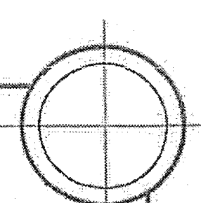

## 生成式AI：理论、应用与代码全景

本部分先梳理五大主流生成思路——变分自编码器、生成对抗网络、归一化流、自回归模型以及能量基模型——对比各自的优势与局限，继而阐述它们与扩散机制之间的相互关联，并说明扩散思想如何为这些模型带来实质性提升。

# 6.1 VAE 与扩散模型的深层关联

变分自编码器 VAE 属于概率生成框架[56,124,195]，核心是通过学习数据的低维潜表征来合成新样本。相较于传统自编码器，VAE 兼具更强的概率建模能力与更稳健的采样表现。如图6-1所示，整体由编码器 Encoder 与解码器 Decoder 构成。编码器把观测映射到潜变量空间，解码器再把潜变量还原回原数据域完成重建。训练时模型以最大化对数似然为目标更新参数，并借助变分推断来处理后验不可知的情形。

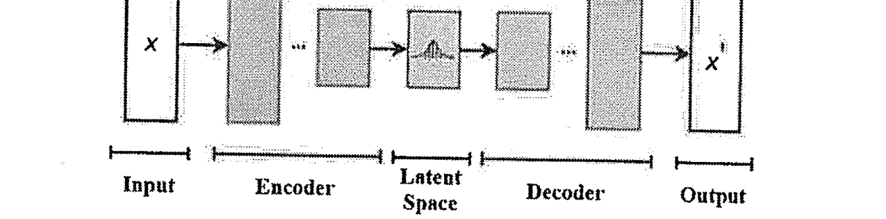

图6-1 VAE架构示意

具体而言，VAE 在潜空间引入先验以保证生成多样性，常用高斯或混合高斯作为先验。优化时一方面提升重建对数似然，另一方面压低学习得到的潜分布与先验间的差距，该差距常用 KL 散度衡量。形式上观测 x 由隐变量 z 经条件分布 pθ(x|z) 生成，z 服从简单先验 π(z)，而 qφ(z|x) 用来近似真实后验 pθ(z|x)，从而

# 第6章 扩散模型与其它生成范式的连接

利用观测 x 反推隐变量 z。为此采用变分贝叶斯思路最大化证据下界 ELBO：

ℒ(φ,θ; x)=E_q(z|x)[log p_θ(x|z)−q_φ(z|x)]

其中ℒ(φ,θ; x)≤logp_θ(x)。只要参数化的似然 p_θ(x|z) 与后验近似 q_φ(z|x) 可逐点计算并可微，ELBO 即可经梯度下降最大化。VAE 的这种形式允许灵活挑选编码解码器的具体模型。通常这些模型落在指数族，其参数由多层神经网络生成。VAE 的关键难点在于近似后验 q_φ(z|x) 的选择：太简单则难以逼近真实后验导致效果受限，太复杂则对数似然难以计算。扩散模型的做法是先固定后验分布，再学习生成器去匹配该后验，从而绕开后验优化直接优化生成器。

DDPM 可被看作编码器固定的分层马尔可夫 VAE。其前向扩散对应 VAE 编码器，采用确定性线性高斯路径见式2.2；逆向去噪则扮演解码器角色，且潜变量维度与数据相同，多步解码中复用同一网络。

在连续时间视角下，Song 团队[225]、Huang 团队[98]、Kingma 团队[121]证明分数匹配目标可用深度分层 VAE 的 ELBO 近似。因此训练扩散模型等价于训练无限深的分层 VAE。这一发现支撑了普遍观点：Score SDE 扩散模型是分层 VAE 的连续极限。

对于潜空间扩散，潜在分数生成模型 Latent Score-Based Generative Model, LSGM [234] 表明 ELBO 可视作一种特殊的分数匹配目标。在潜空间情形下 ELBO 的交叉熵项难以处理，但把基于分数的生成模型看作无限深 VAE 时，该交叉熵可转化为可处理的分数匹配目标。

## 生成式AI理论、代码与实践全景

# 6.2 GAN 与扩散模型的协同演进

生成对抗网络 GAN 的目标是通过两个网络的博弈合成与训练数据相近的新样本。一个网络负责伪造数据，另一个负责判断真伪。二者同步迭代以提升生成质量。GAN 由 Ian Goodfellow 等人于 2014 年提出，通常由生成器 G 与判别器 D 组成。G 希望产出逼真样本，D 希望区分真实与伪造。训练时 D 对真实样本输出 1，对伪造样本输出 0。图6-2 为最基础的训练框架。G 的目标是让 D 无法区分二者，G 与 D 的联合优化可表述为 min-max 问题：

```
min max E_x~p_data [logD(x)] + E_z~π[log(1 - D(G(z)))]
```

GAN 的训练流程可概括为如下几步：

+   - 生成器从随机噪声采样，合成一批伪造数据。
+   - 判别器同时接收真实数据与伪造数据，输出真伪判断。
+   - 根据判别结果更新生成器以逼近真实分布，同时更新判别器以提升区分能力。

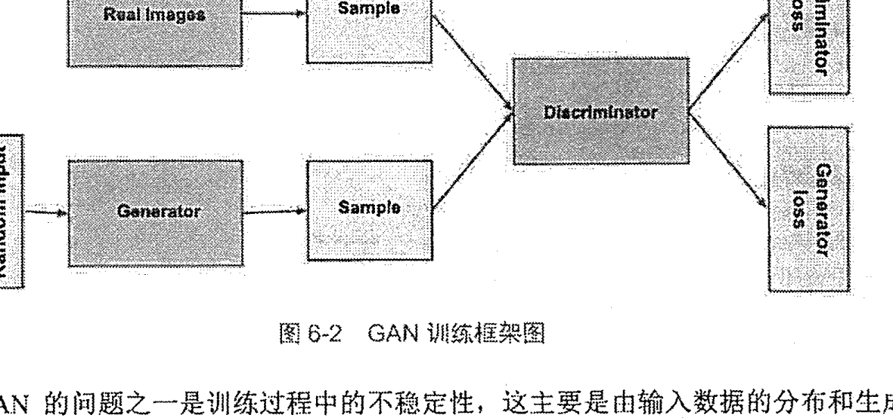

# 图6-2 GAN训练流程示意图

GAN 的一个痛点是训练不稳定，主因是真实分布与生成分布支持集不重叠。常见对策是在判别器输入中加入噪声以扩大支持。利用扩散模型的灵活性，Wang 等人[241]采用扩散模型决定的自适应加噪方案向判别器注入噪声。

反过来 GAN 也能加速扩散采样。Xiao 等人[253]指出扩散采样缓慢源于去噪步中高斯假设仅在小步长下成立，因而需要大量迭代。他们提出用条件 GAN 建模每一步去噪，从而允许更大步长与更少迭代。在第 t 步去噪时，DDGAN Denoising Diffusion GAN 使用生成器 G(xₜ,t,z) 以当前噪声样本 xₜ 与额外标准高斯潜变量 z 为输入预测无噪声样本 x₀'。借助已知高斯 q(xₜ₋₁|xₜ,x₀') 可得下一步样本，并用判别器 D(xₜ₋₁,xₜ,t) 判断去噪后样本是否真实，与生成器进行对抗训练。实验显示 DDGAN 在保持质量与多样性的同时显著缩短采样时间。

## 扩散加GAN实战

## 代码示例：扩散增强GAN

```
#代码源自: Official PyTorch implementation of "Tackling the Generative Learning Trilemma with Denoising Diffusion GANs" (ICLR 2022 Spotlight Paper)
#训练 DDGAN
def train(rank, gpu, args):
#参数
```

## 生成式AI理论、应用与代码概览

```
# rank: 次序
# gpu: 使用的“gpu”
# args: 额外参数
 #加载生成器、判别器和EMA包
from score_sde.models.discriminator import Discriminator_small,
    Discriminator_large
from score_sde.models.ncsnpp_generator_adagn import NCSNpp
from EMA import EMA
 #初始化随机种子
torch.manual_seed(args.seed + rank)
torch.cuda.manual_seed(args.seed + rank)
torch.cuda.manual_seed_all(args.seed + rank)
device = torch.device('cuda:{}'.format(gpu))
batch_size = args.batch_size
nz = args.nz
 #加载数据集
if args.dataset == 'cifar10':
    dataset = CIFAR10('./data', train=True,
        transform=transforms.Compose([transforms.Resize(32),
            transforms.RandomHorizontalFlip(),
            transforms.ToTensor(),
            transforms.Normalize((0.5,0.5,0.5),(0.5,0.5,0.5))]),
        download=True)
train_sampler = torch.utils.data.distributed.DistributedSampler(
    dataset,
    num_replicas=args.world_size,
    rank=rank)
data_loader = torch.utils.data.DataLoader(dataset,
    batch_size=batch_size,
    shuffle=False,
    num_workers=4,
    pin_memory=True,
    sampler=train_sampler,
    drop_last = True)
 #初始化生成器和判别器
netG = NCSNpp(args).to(device)
if args.dataset == 'cifar10' or args.dataset == 'stackmnist':
    netD = Discriminator_small(nc = 2*args.num_channels, ngf = args.ngf,
        t_emb_dim = args.t_emb_dim,
        act=nn.LeakyReLU(0.2)).to(device)
else:
    netD = Discriminator_large(nc = 2*args.num_channels, ngf = args.ngf,
        t_emb_dim = args.t_emb_dim,
        act=nn.LeakyReLU(0.2)).to(device)
broadcast_params(netG.parameters())
```

# 第6章 扩散模型与主流生成模型的关联

```
broadcast_params(netD.parameters())
#初始化优化器和EMA
optimizerD = optim.Adam(netD.parameters(), lr=arg.s.lr_d, betas = (arg.s.betal, arg.s.beta2))
optimizerG = optim.Adam(netG.parameters(), lr=arg.s.lr_g, betas = (arg.s.betal, arg.s.beta2))
if arg.s.use_ema:
    optimizerG = EMA(optimizerG, ema_decay=arg.s.ema_decay)
schedulerG = torch.optim.lr_scheduler.CosineAnnealingLR(optimizerG, arg.s.num_epoch, eta_min=le-5)
schedulerD = torch.optim.lr_scheduler.CosineAnnealingLR(optimizerD, arg.s.num_epoch, eta_min=le-5)
#使用DDP
netG = nn.parallel.DistributedDataParallel(netG, device_ids=[gpu])
netD = nn.parallel.DistributedDataParallel(netD, device_ids=[gpu])
exp = arg.s.exp
parent_dir = 
```

# 扩散模型：原理、应用与实战全解

```
#开始训练
for epoch in range(init_epoch, args.num_epoch+1):
    train_sampler.set_epoch(epoch)
    for iteration, (x, y) in enumerate(data_loader):
        for p in netD.parameters():
            p.requires_grad = True
        netD.zero_grad()
        #真实样本
        real_data = x.to(device, non_blocking=True)
        #采样训练时间点t
        t = torch.randint(0, args.num_timesteps, (real_data.size(0),), device=device)
        #获得真实的加噪数据
        x_t, x_tpl = q_sample_pairs(coeff, real_data, t)
        x_t.requires_grad = True
        #使用真实的加噪样本训练判别器
        D_real = netD(x_t, t, x_tpl.detach()).view(-1)
        errD_real = F.softplus(-D_real)
        errD_real = errD_real.mean()
        errD_real.backward(retain_graph=True)
        #梯度惩罚
        if args.lazy_reg is None:
            grad_real = torch.autograd.grad(
                outputs=D_real.sum(), inputs=x_t, create_graph=True
            )[0]
            grad_penalty = (
                grad_real.view(grad_real.size(0), -1).norm(2, dim=1)**2
            ).mean()
            grad_penalty = args.rl_gamma / 2 * grad_penalty
            grad_penalty.backward()
        else:
            if global_step % args.lazy_reg == 0:
                grad_real = torch.autograd.grad(
                    outputs=D_real.sum(), inputs=x_t, create_graph=True
                )[0]
                grad_penalty = (
                    grad_real.view(grad_real.size(0), -1).norm(2, dim=1)**2
                ).mean()
                grad_penalty = args.rl_gamma / 2 * grad_penalty
                grad_penalty.backward()
        # 使用生成的样本训练判别器和生成器。首先从标准高斯分布采样
        latent_z = torch.randn(batch_size, nz, device=device)
        #预测 x_0，然后使用预测的 x_0 获得预测的 x_t-1
        x_0_predict = netG(x_tpl.detach(), t, latent_z)

```

# 第6章 扩散模型与主流生成范式对话

```
x_pos_sample = sample_posterior(pos_coeff, x_0_predict, x_tpl, t)
output = netD(x_pos_sample, t, x_tpl.detach()).view(-1)
errD_fake = F.softplus(output)
errD_fake = errD_fake.mean()
errD_fake.backward()
#计算判别器的总损失并更新参数
errD = errD_real + errD_fake
optimizerD.step()
#训练生成器。重新采样，并使用更新后的判别器计算假样本的分类损失
for p in netD.parameters():
    p.requires_grad = False
netG.zero_grad()
t = torch.randint(0, args.num_timesteps, (real_data.size(0),), device=device)
x_t, x_tpl = q_sample_pairs(coeff, real_data, t)
latent_z = torch.randn(batch_size, nz, device=device)
x_0_predict = netG(x_tpl.detach(), t, latent_z)
x_pos_sample = sample_posterior(pos_coeff, x_0_predict, x_tpl, t)
#将判别器的判别假样本的输出结果作为生成器的损失
output = netD(x_pos_sample, t, x_tpl.detach()).view(-1)
errG = F.softplus(-output)
errG = errG.mean()
#更新生成器
errG.backward()
optimizerG.step()
global_step += 1
if iteration % 100 == 0:
    if rank == 0:
        print('epoch {} iteration{}, G Loss: {}, D Loss: {}'.format(epoch,iteration, errG.item(), errD.item()))
if not args.no_lr_decay:
    schedulerG.step()
    schedulerD.step()
```

# 6.3 归一化流 × 扩散模型：互补之路

Normalizing Flow [51,194] 归属一类生成建模思路，核心做法是把容易采样的简单分布经一系列可逆变换映射到高维数据分布上 [53,122]。借助这种变换，简单分布能被拉伸成极其复杂的形态，并在强化学习、变分推断等场景中发挥作用。其训练流程可参考图6-3。

# 图6-3 归一化流训练流程示意

当前归一化流大多建立在变量替换定理之上 [51,194]，连续时间版本则用常微分方程来刻画样本轨迹。直观上，连续归一化流借下面这组微分方程把原始数据逐步推演过去：

```
\dot{x}_t = f(x_t, t, \theta)
```

这里 \dot{x}_t 指的是 x_t 对时间 t 的导数。切换到离散情形时，数据 x 映射到潜变量 z 需要叠加多个双射，整体映射写作 F = F_N ∘ F_{N-1} ∘ … ∘ F_1。对应的中间轨迹记为 {x_1, x_2, …, x_N}，满足：

```
x_i = F_i(x_{i-1}, \theta), x_{i-1} = F_i^{-1}(x_i, \theta), \forall 1\leq i\leq N
```

与连续情形一致，归一化流也能利用变量替换公式得到精确对数似然。然而严格的双射约束在面对复杂数据时既带来建模瓶颈也在理论上受限，于是有研究尝试松弛这一条件 [53,246]。代表作 DiffFlow [276] 正是以归一化流为灵感构造的生成框架，它用可学习的流来替代扩散模型里原本手工设定的漂移项。兼顾两者长处后，DiffFlow 相较传统归一化流能画出更干净的分布边界、拟合更广义的分布；相较标准扩散模型则因离散化步数更少而采样更快。

另一条思路是隐式非线性扩散模型 Implicit Nonlinear Diffusion Model, INDM，它借鉴 LSGM 的做法，先借助归一化流把原始数据投射到潜空间，随后再在该潜

# 第6章 扩散模型与主流生成范式对话

空间中进行扩散。借助伊藤公式可证明，INDM 本质上是用归一化流学习到的一条非线性随机微分方程来完成数据的扰动与恢复。进一步推导显示，INDM 的 ELBO 可拆分为归一化流损失与分数匹配损失之和，从而实现高效训练。实验表明该方法在提升采样效率的同时也提高了模型似然。

# INDM 实战演示

# INDM 参考代码

```
#代码源自: Maximum Likelihood Training of Implicit Nonlinear Diffusion Model (INDM) (NeurIPS 2022)
def flow_step_fn_nll(state, flow_state, batch):
    #参数
    #state: 一个记录了训练信息的字典，包括分数模型、优化器、EMA状态、优化步数
    #flow_state: 一个记录了训练信息的字典，包括归一化流模型、优化器、EMA状态、优化步数
    #batch: 一批训练数据
    #返回: 训练损失
    #加载分数模型、归一化流模型及优化器
    model = state['model']
    flow_model = flow_state['model']
    optimizer = state['optimizer']
    flow_optimizer = flow_state['optimizer']
    #初始化损失，梯度归零
    batch_size = batch.shape[0]
    num_micro_batch = config.optim.num_micro_batch
    losses_ = torch.zeros(batch_size)
    losses_score_ = torch.zeros(batch_size)
    losses_flow_ = torch.zeros(batch_size)
    losses_logp_ = torch.zeros(batch_size)
    optimizer.zero_grad()
    flow_optimizer.zero_grad()
    #开始训练，首先将数据分割成mini-batch
    if train:
        for k in range(num_micro_batch):
            mini_batch = batch[batch_size // num_micro_batch * k : batch_size // num_micro_batch * (k + 1)]
            #将原始数据输入归一化流，获得变换后的数据和归一化流部分的损失
            transformed_mini_batch, losses_flow = flow_forward(config,
                    flow_model, mini_batch, reverse=False)
            #将变换后数据放入扩散模型，预测分数并获得分数匹配损失
            losses_score = loss_fn(model, transformed_mini_batch,
                st=config.training.st)
            #计算对变换后数据进行扩散后得到的加噪样本的熵
```

# 扩散模型：从理论到代码的全栈解析

```
losses_logp = calculate_logp(transformed_mini_batch)
#是否要对损失进行平均
if config.training.reduce_mean:
    losses_flow = - losses_flow / np.prod(batch.shape[1:])
    losses_logp = - losses_logp / np.prod(batch.shape[1:])
else:
    losses_flow = - losses_flow
    losses_logp = - losses_logp
    assert losses_score.shape == losses_flow.shape ==
        losses_logp.shape ==
        torch.Size([transformed_mini_batch.shape[0]])
#计算总损失并回传
losses = losses_score + losses_flow + losses_logp
torch.mean(losses).backward(retain_graph=True)
#保存损失
losses_[batch_size // num_micro_batch * k: batch_size // num_micro_batch * (k + 1)] = losses.cpu().detach()
losses_score_[batch_size // num_micro_batch * k: batch_size // num_micro_batch * (k + 1)] = losses_score.cpu().detach()
losses_flow_[batch_size // num_micro_batch * k: batch_size // num_micro_batch * (k + 1)] = losses_flow.cpu().detach()
losses_logp_[batch_size // num_micro_batch * k: batch_size // num_micro_batch * (k + 1)] = losses_logp.cpu().detach()
#优化
optimize_fn(optimizer, model.parameters(), step=state['step'])
optimize_fn(flow_optimizer, flow_model.parameters(),
            step=flow_state['step'])
#更新参数
update_lipschitz(flow_model)
state['step'] += 1
state['ema'].update(model.parameters())
flow_state['step'] += 1
flow_state['ema'].update(flow_model.parameters())
return losses_, losses_score_, losses_flow_, losses_logp_
```

# 6.4 自回归模型与扩散模型的碰撞

自回归模型 Autoregressive Model, ARM 的建模方式是把联合分布拆成一系列条件概率的连乘，整体结构见图6-4。

# 图6-4 自回归模型结构图

根据概率链式法则，随机向量 x₁:T 的对数似然可表达为 log p(x₁:T) = Σ_{t=1}^T log p(x^t | x^{<t})，其中 x^{<t} 表示 x₁:T 的前 t-1 部分 [11,130]。得益于深度学习的进步，ARM 已被广泛用于图像 [34,237]、音频 [112,236]、文本 [12,18,80,160,163] 等多种模态 [25,162,207]。这类模型通常用单一神经网络实现生成，但采样时需要逐维调用网络，次数与数据维度一致。尽管密度估计效果可靠，高维数据下的逐次采样仍显得缓慢且连贯。

相比之下，自回归扩散模型 ARDM [95] 支持任意生成顺序，兼容顺序无关自回归与离散扩散 [6,96,216]。不同于传统 ARM 依赖因果掩码的显式建模，ARDM 引入受扩散概率模型 DPM 启发的训练目标，使其更易扩展到高维场景。其采样机制与带吸收态的离散扩散模型相近，推理时可借鉴扩散模型的并行生成特性，因而在多种生成任务上具备实用潜力。

# 6.5 能量模型与扩散模型的融合

# 扩散模型概览：从理论关联到工程落地

能量基模型 EBM 常被描述为一类兼具生成与判别特性的框架，可在无标注数据上进行学习。记训练样本 x ~ p_data(x)，目标密度 p_θ(x) 希望逼近真实分布 p_data(x)。模型可写成：

pθ(x) = 1/Z_θ exp(f_θ(x))

其中 Z_θ = ∫exp(f_θ(x)) dx 为归一化常数，在高维情形下难以解析得到。对于图像，f_θ(x) 通常由输出标量的卷积网络实现。Salimans 等 [204] 将受限分数模型与 EBM 的分数建模能力做了对比，发现受限分数模型本质上等价于一种 EBM。在模型结构可比的前提下，EBM 的效果能达到无约束版本的水准。图 6-5 给出了训练前后的对比。

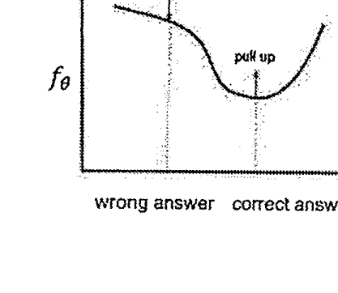

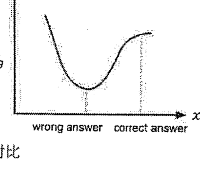

即便具备不少理想属性，EBM 在高维建模上仍面临两大难题。其一，最大似然训练后生成样本往往依赖 MCMC，计算开销较大。其二，实践中未完全收敛的 MCMC 学得的能量面易出现不稳定，长时间链产生的样本与观测样本的偏离明显。Gao 等 [69] 提出在逆扩散过程中串联条件 EBM 来刻画分布：序列中的每个条件 EBM 接收前一步产生的噪声较大的样本并进行去噪，输出噪声更小的样本。条件模型 p_θ(x|ẋ) 采用恢复似然训练，即在给定高噪声观测 ẋ 的前提下最大化低噪声数据 x 的条件概率。

条件建模更易提升恢复目标，因为原边际分布常为多模态，而在加噪样本条件下原数据的条件概率比边际似然更易处理。从条件分布采样远比从边际分布采样更便利。当单步加噪幅度足够小，条件 EBM 的条件似然可近似为高斯。因此扩散恢复似然中逐层条件 EBM 的采样近似于逆扩散的逐次去噪。Gao 等 [69] 进一步证明在小步长下，扩散恢复似然的最大似然训练与 Score SDE 的分数匹配训练近似等价，由此建立了 EBM 与扩散模型之间的联系。该方法可生成高质量样本，且长期 MCMC 样本仍与真实图像相近。

最后借用第 2 章的图归纳五类生成模型与扩散模型的融合范式，如图 6-6 所示。

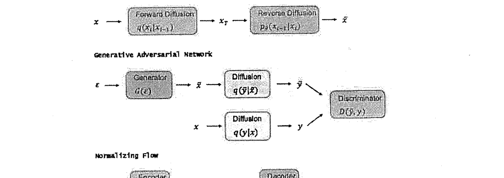

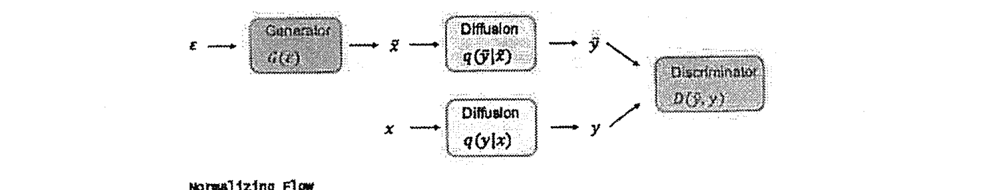


图 6-6 5 种生成模型和扩散模型的结合范式

# 第6章 扩散模型与其他生成模型的关联

扩散模型因其强生成力与灵活性，被广泛用于各类挑战性任务。按任务可划分为计算机视觉、自然语言处理、时序建模、多模态学习、鲁棒学习和跨学科应用六大方向。对每个方向先介绍任务定义与经典方法，再说明扩散模型的接入方式。此处先概括两种基本用法：无条件扩散模型 Unconditional Diffusion Model 与条件扩散模型 Conditional Diffusion Model。作为生成范式，扩散模型与 VAE、GAN、Flow 的演进路径相似，都是先做无条件生成再发展条件生成。无条件生成多用于摸索性能上限，条件生成更偏向应用，因其可按需求调控输出。下面重点介绍条件扩散模型。如图 7-1 所示，相较无条件版本，条件扩散模型额外引入引导信息 c 和条件机制，二者共同引导反向采样过程 p_θ。引导信息形式多样，可为类别、风格、图像、文本，甚至 AI Drug 中的靶点蛋白、分类器梯度等人为定义的特征。条件机制形式也多样，从简单拼接、交叉注意力到自适应层标准化等，条件扩散模型在可控生成中作用愈加关键。

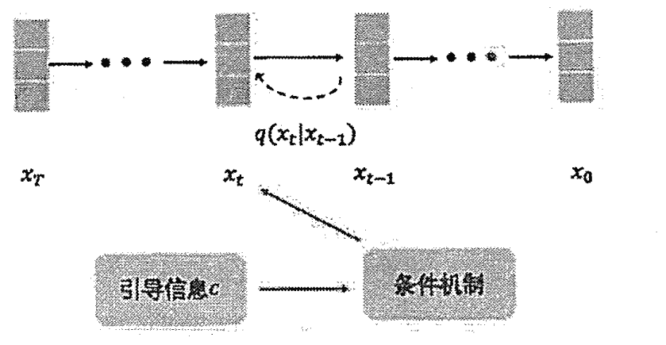

图 7-1 条件扩散模型示意图

# 第7章 扩散模型的应用

# 7.1 无条件扩散模型与条件扩散模型

扩散模型凭借强大的生成性能与灵活性，被用于解决多类现实难题。依据任务类型将其归为 6 大方向：计算机视觉、自然语言处理、时间序列建模、多模态学习、鲁棒学习和跨学科应用。对每个方向先交代任务定义与相关经典方法，再详述扩散模型的适配方式。此处先简要说明两种基本使用范式：非条件扩散模型与条件扩散模型。作为生成模型，扩散模型与 VAE、GAN、Flow 的演进相似，均由无条件到条件逐步发展。无条件生成侧重探索模型上限，条件生成更强调应用可控性，能按需求调控输出结果。下面聚焦条件扩散模型。如图 7-1 所示，条件扩散模型在无条件基础上增加了引导信号 c 与条件机制模块，二者对反向采样 p_θ 产生重要引导。引导信号可以是类别标签、风格、图像、文本，甚至药物设计中的靶点蛋白、分类器梯度等人工特征。条件机制的形式丰富，包括拼接、交叉注意力、自适应层归一化等，条件扩散模型在可控生成中愈发重要。


图 7-1 条件扩散模型示意图

# 7.2 计算机视觉

# 7.2.1 图像超分辨率、图像修复和图像翻译

本节介绍图像超分辨率、图像修复与图像翻译的定义及常见算法。

图像超分辨率 Image Super Resolution 是指借助计算方法把低分辨率图像提升为高分辨率的过程。该技术在数码相机、视频设备、医学影像等领域有广泛需求。常见算法包括：

- 插值法。最基础的方法，通过低分辨率像素邻域的加权平均生成高分辨率图像。典型代表为双线性插值与三次插值。实现简单但易产生模糊与失真。
- 基于样本的方法。通过大量高分辨率图像学习特征，提升超分辨率效果。先训练低分辨率到高分辨率的映射，再用其预测。典型如最近邻算法。
- 基于稀疏表示的方法。利用低分辨率与高分辨率之间的稀疏线性组合实现超分。先构建字典，再用稀疏编码从字典中挑选最适配的样本。代表方法有 K-SVD 与 BM3D。
- 基于深度学习的算法。近年主流，使用卷积神经网络学习映射。需大量训练数据，但效果突出。代表有 SRCNN、VDSR、SRGAN 等。

图像修复 Image Inpainting 是指修复图像中缺失或损坏区域的方法。应用于图像编辑、计算机视觉、医学图像处理与数字文物保护等。常见算法：

- 基于插值的算法。用邻域像素平均值或线性插值填补缺失区。易实现但质量有限。
- 基于偏微分方程的算法。利用 PDE 描述图像边缘与纹理，通过优化能量函数生成修复结果。常用拉普拉斯、欧拉-拉格朗日方程等。
- 基于纹理合成的算法。利用纹理与结构信息生成缺失内容。可分为区域合成与像素合成。前者复制相似纹理结构区域，后者复制像素值相似的像素。
- 基于机器学习的算法。用神经网络等模型预测缺失像素。需大量数据与计算，但可得到高质量结果。

图像翻译 Image Translation 是指将一种图像转化为另一种图像的过程。可实现风格转换、色彩改变、分辨率转换等，在生成、风格迁移、增强等领域应用广泛。常见算法：

- CycleGAN。无监督图像翻译，保持内容不变将图像从一域映射到另一域。利用对抗损失与循环一致性损失训练生成器与判别器。广泛用于风格迁移。
- Pix2Pix。有监督图像翻译，用条件生成对抗网络学习输入输出映射。需要成对训练数据。
- StarGAN。多域图像翻译，可将图像转为多种风格。采用共享生成器与多任务判别器，无需成对数据，可同时学习多种风格。

# 扩散模型驱动的图像任务实践

总体来看，以 GAN 为代表的深度学习方法长期主导图像生成。随着扩散模型快速发展，其在超分、修复、翻译三大任务中的使用明显增加。例如实现迭代细化的超分辨率方法 Super-Resolution via Repeated Refinement, SR3 [202] 利用 DDPM 实现条件性图像生成。SR3 通过随机迭代去噪获得超分辨率结果。级联扩散模型 Cascaded Diffusion Model, CDM [91] 由多个扩散模型串联，逐级提升分辨率。如图 7-2 所示，CDM 框架图 [294] 由多个级联的类别条件扩散生成模块与超分辨率扩散模块组成。SR3 与 CDM 均直接在输入图像上进行扩散，需更多生成步数。

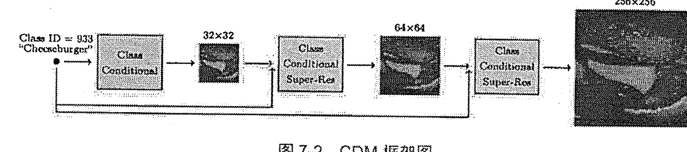

来源：Ho J, Saharia C, Chan W, et al. Cascaded Diffusion Models for High Fidelity Image Generation

为在有限算力下训练扩散模型，部分方法 [198, 234] 使用预训练自编码器将扩散过程迁移至潜在空间 Latent Space。通过在潜在空间扩散，LDM Latent Diffusion Model [198] 在不损失样本质量的前提下简化训练与采样。具体而言，LDM 用预训练自编码器把扩散从像素空间搬到潜在空间，大幅降低计算消耗。由于在语义空间进行扩散，引导信息与图像特征的交互更为充分。实验表明，LDM 的生成效果超过了之前的 SOTA 模型 DALL·E 2 和 VQGAN。LDM 框架图 [295] 由 3 部分组成：第一部分是从像素空间到潜在空间的转换模块；第二部分是在潜在空间上进行扩散生成的 Diffusion Process；第三部分是对扩散采样过程进行条件控制的 Conditioning 模块，如图 7-3 所示。

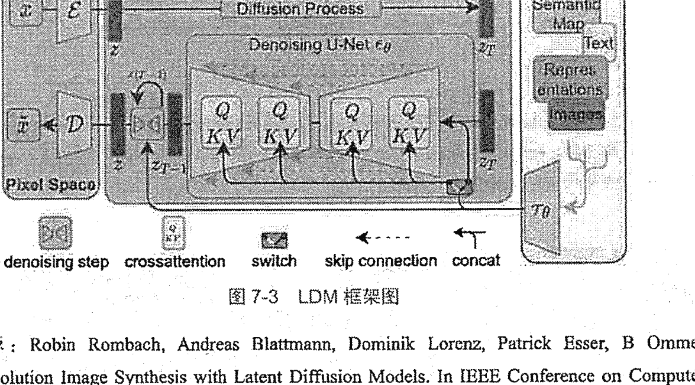

来源：Robin Rombach, Andreas Blattmann, Dominik Lorenz, Patrick Esser, B Ommer High-Resolution Image Synthesis with Latent Diffusion Models. In IEEE Conference on Computer Vision and Pattern Recognition

针对图像修复任务，RePaint [147] 使用增强去噪策略，通过迭代重采样更好地引导生成。RePaint 修改标准去噪过程，以便在给定图像内容的条件下进行修复。每一步中，已知区域从 DDPM 输入采样，修复部分从 DDPM 输出采样。图 7-4 为 RePaint 框架图 [296]。RePaint 采用预训练的无条件扩散模型作为生成的先验。为有效引导生成过程，只通过使用给定的图像信息对未进行掩码的区域进行采样来改变反向扩散迭代。由于这种技术并不修改或调节原始的扩散网络本身，所以该模型对任何补全形式都能产生高质量和多样化的输出图像，其逐步去噪和最终结果如图 7-5 所示。另一边，Palette [200] 采用条件扩散模型，为图像生成任务创建统一框架，其中也包含了图像的修复任务。

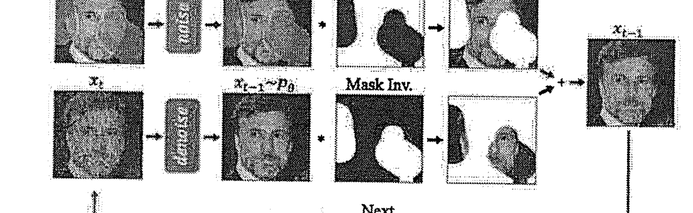

图7-4 RePaint 框架图

来源：Andreas Lugmayr, Martin Danelljan, Andres Romero, Fisher Yu, Radu Timofte, and Luc Van Gool. Repaint: Inpainting using Denoising Diffusion Probabilistic Models. In IEEE Conference on Computer Vision and Pattern Recognition

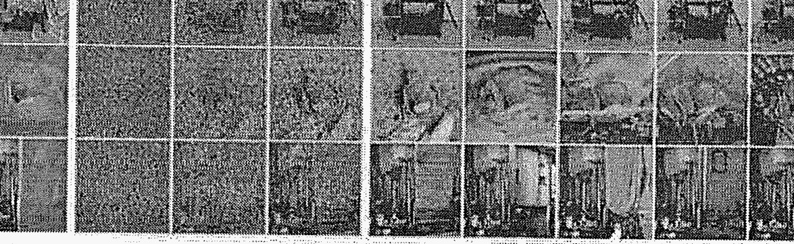

图7-5 RePaint 逐步去噪和最终结果

来源：Andreas Lugmayr, Martin Danelljan, Andres Romero, Fisher Yu, Radu Timofte, and Luc Van

# 解码器去噪预训练在语义分割中的运用

如图 7-9 所示，解码器去噪预训练 Decoder Denoising Pretraining [17] 提出了 3 步训练过程，将去噪预训练巧妙地运用到了语义分割场景中。第一步使用有监督预训练图像编码器；第二步使用去噪预训练解码器；第三步微调编码器 - 解码器来做语义分割任务。

Step #1: Supervised pretraining of the Encoder:

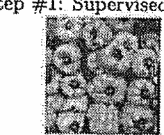

Step #2: Denoising pretraining of the Decoder:

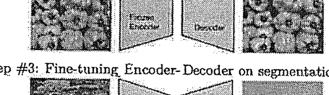

Step #3: Fine-tuning Encoder-Decoder on segmentation:

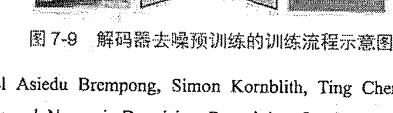

# 图 7-9 解码器去噪预训练的训练流程示意图

来源：Emmanuel Asiedu Brempong, Simon Kornblith, Ting Chen, Niki Parmar, Matthias Minderer, and Mohammad Norouzi. Denoising Pretraining for Semantic Segmentation. In IEEE Conference on Computer Vision and Pattern Recognition

# 7.2.3 视频生成

视频生成 Video Generation 是指使用计算机生成符合人类视觉感知的视频序列的技术。与传统的视频编码、解码技术不同，视频生成是一个较新的研究领域，主要应用于视频合成、视频增强、视频修复、视频预测等方面。

下面介绍几种常见的视频生成方法：

# 视频生成到点云检测，扩散模型如何重塑生成范式

视频帧预测领域长期以来形成了几种主流技术路线。
第一类是光流驱动的预测。核心思路是利用相邻画面间的像素位移场来推演下一帧，光流本质上是描述像素运动轨迹的向量场，代表性工作有 FlowNet、EpicFlow、PWC-Net。
第二类依赖生成对抗网络。训练时让生成器负责合成画面，判别器负责区分真假，两者博弈促使生成质量提升，常 Harrison VGAN、TGAN、VidGAN。
第三类基于变分自编码器。编码器把输入视频压缩成隐向量，解码器再从隐空间还原出视频序列，典型模型包括 V3D-VAE、ST-VAE。
第四类走流形学习路径。先对帧集合进行流形结构建模，再沿流形轨迹外推下一帧，代表性方案有流形序列学习 Manifold Sequence Learning 和 VideoLSTM。
第五类是 Transformer 家族。借助自注意力机制同时捕捉时空依赖，生成新样本，该方向在视频合成中起步较晚但进展迅速。

# 基于扩散模型的视频生成

研究重心正加速向扩散架构迁移。视频扩散模型 Video Diffusion Model，VDM 采用 3D U-Net 作为去噪器，继承 U 形的编码解码骨架，并在时空两维上并行处理，如图 7-10 所示。图 7-11 是 VDM 在文本引导下合成视频的示例。可以看出，VDM 所产序列帧间高度相似，画面复杂度相对有限。

[PAGE 138]

# 扩散模型：生成式AI模型的理论、应用与代码实践

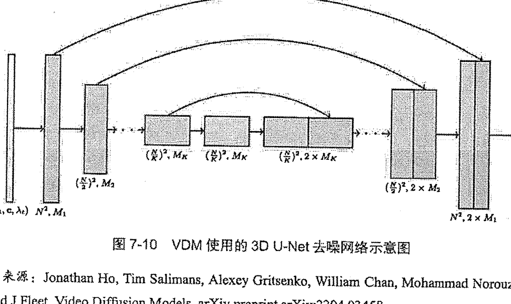

图 7-10 VDM 使用的 3D U-Net 去噪网络示意图

来源：Jonathan Ho, Tim Salimans, Alexey Gritsenko, William Chan, Mohammad Norouzi, and David J Fleet. Video Diffusion Models. arXiv preprint arXiv:2204.03458

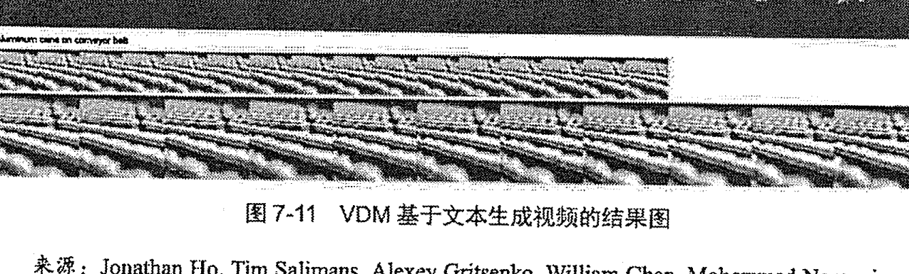

图 7-11 VDM 基于文本生成视频的结果图

来源：Jonathan Ho, Tim Salimans, Alexey Gritsenko, William Chan, Mohammad Norouzi, and David J Fleet. Video Diffusion Models. arXiv preprint arXiv:2204.03458

灵活扩散模型 Flexible Diffusion Model, FDM 能够完成长时视频的合成。如图 7-12 所示，其训练体系采用 U 型结构配合条件式扩散去噪，以某帧为分界点，对前半段随机采样作为条件引导，再用扩散过程生成后半段。如图 7-13 所示，FDM 所生成的视频时长可控，内容丰富度明显优于 VDM。后续还将介绍的 Imagen Video 这一文本到视频算法，能实现更高品质的输出。

[PAGE 139]

# 第7章 扩散模型的应用

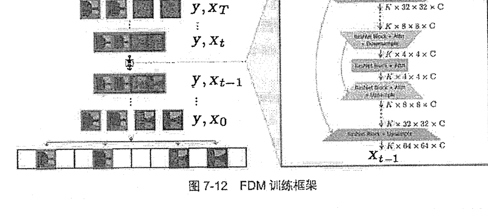

# 图 7-12 FDM 训练框架

来源: William Harvey, Saeid Naderiparizi, Vaden Masrani, Christian Weilbach, and Frank Wood.

Flexible Diffusion Modeling of Long Videos. arXiv preprint arXiv:2205.11495

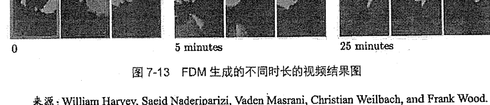

# 图 7-13 FDM 生成的不同时长的视频结果图

来源: William Harvey, Saeid Naderiparizi, Vaden Masrani, Christian Weilbach, and Frank Wood.

Flexible Diffusion Modeling of Long Videos. arXiv preprint arXiv:2205.11495

# 7.2.4 点云补全和点云生成

点云补全与点云生成是三维视觉的两大基础任务，都涉及对点集数据的恢复或创造。补全是指在仅有部分点云的前提下推断缺失部分，以尽可能无失真地还原物体形貌，常用于三维建模、机器人视觉与自动驾驶。生成则是指从随机噪声直接采样出符合特定分布的点云，实现对某一物体类别的建模。常见做法包括：
1. PointNet++。一种通用的点云处理框架，可用于分类、分割、重建与生成。
2. 点补全网络 Point Completion Network，PCN。采用编码器解码器结构，编码器把不完整点云映射到低维隐空间，解码器再重构完整点云。
3. 占用网络 Occupancy Network。从随机噪声生成点云的生成式模型，通过体素网络从潜在向量合成三维形状。
4. 点变换器 Point Transformer。引入注意力机制刻画点间关系，可用于分类、分割、重建与生成。
5. 三维形状补全 3D Shape Completion。面向点云重建与补全的深度学习方案。

# 基于扩散模型的点云补全、点云生成

扩散范式已被大量迁移到点云任务，对三维重建、增强现实与场景理解产生影响。Luo 等人 2021 年的工作如图 7-14 所示用于点云生成，其中 N 表示点总数，Shape Latent 充当扩散生成的先验引导，并用归一化流对 Shape Latent 进行参数化，提升表达能力，生成效果见图 7-15。

[PAGE 141]

# 第7章 扩散模型的应用

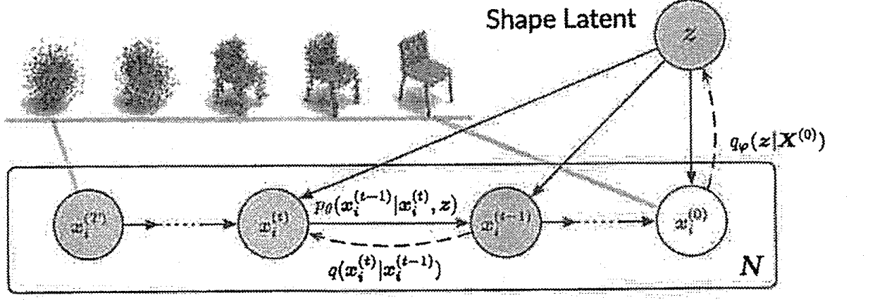

# 图7-14 基于扩散模型的点云生成框架图

来源：Shitong Luo and Wei Hu. Diffusion Probabilistic Models for 3D Point Cloud Generation. In IEEE Conference on Computer Vision and Pattern Recognition

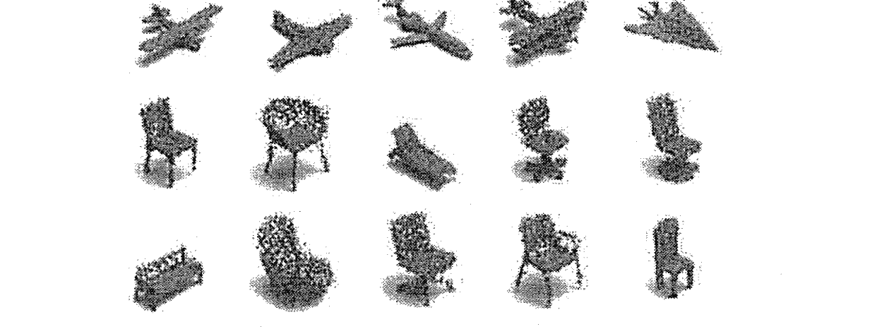

# 图7-15 基于扩散模型的点云生成结果

来源：Shitong Luo and Wei Hu. Diffusion Probabilistic Models for 3D Point Cloud Generation. In IEEE Conference on Computer Vision and Pattern Recognition

点-体素扩散 Point-Voxel Diffusion, PVD 模型如图 7-16 所示，将去噪扩散与体素表示融合，利用体素表征执行扩散生成。

[PAGE 142]

# 扩散模型：生成式AI模型的理论、应用与代码实践

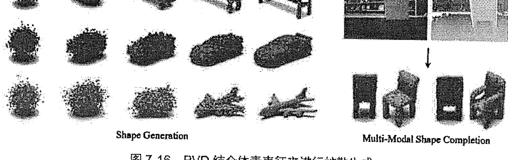

图7-16 PVD结合体素表征来进行扩散生成

来源：Linqi Zhou, Yilun Du, and Jiajun Wu. 3D Shape Generation and Completion Through Point-Voxel Diffusion. In Proceedings of the IEEE/CVF International Conference on Computer Vision

点扩散修正 Point Diffusion-Refinement, PDR 模型使用条件 DDPM，先对部分观测做粗糙补全，再借助优化网络进一步提升补全质量。

# 7.2.5 异常检测

异常检测旨在图像或视频中定位偏离常态的区域，在工业质检、安防监控与医学影像中应用广泛。常用策略包含：
- 基于统计学的方法。假设正常区域服从某种统计模型，如高斯分布，将偏离模型的部分标记为异常。
- 基于传统图像处理的方法。利用边缘检测、纹理分析、形状分析等手工特征提取，再交由分类器判断异常。
- 基于深度学习的方法。采用自编码器、卷积神经网络或循环神经网络学习正常数据的特征分布，通过与测试样本的差异判定异常。

# 基于扩散模型的异常检测

生成模型是异常检测的重要支撑，扩散模型正被广泛采用。AnoDDPM 利用 DDPM 对输入图像进行破坏再重建，相较对抗训练方法，它在小样本上采样更稳定、训练更可靠。DDPM-CD 把大量无监督遥感图像纳入 DDPM 预训练，并利用预训练解码器的多尺度表征完成遥感异常检测。论文 Diffusion Models for Medical Anomaly Detection 通过分类器引导把异常图像逐步转化回完整图像，图 7-17 展示了对应的训练流程，去噪阶段引入分类器引导以改善生成，异常图则由原始输入与去噪结果的差异得到。

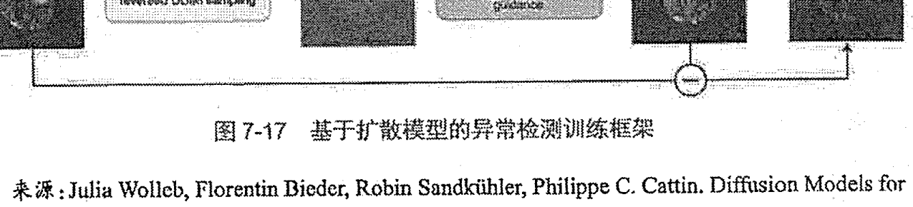

# 图7-17 基于扩散模型的异常检测训练框架

来源: Julia Wolleb, Florentin Bieder, Robin Sandkihler, Philippe C. Cattin. Diffusion Models for Medical Anomaly Detection. arXiv preprint arXiv:2203.04306

图 7-18 给出了结果对比，扩散方案明显优于此前 GAN 与 VAE 的表现。

[PAGE 144]

# 扩散模型：生成式 AI 模型的理论、应用与代码实践

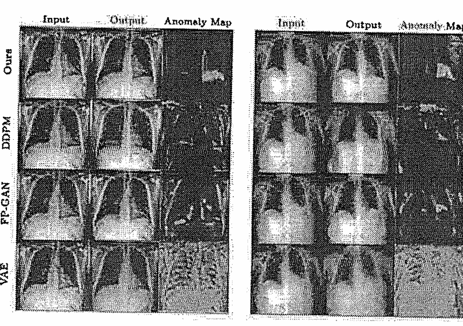

# 图7-18 异常检测结果对比图

来源 : Julia Wolleb, Florentin Bieder, Robin Sandkühler, Philippe C. Cattin. Diffusion Models for Medical Anomaly Detection. arXiv preprint arXiv:2203.04306

# 7.3 自然语言处理

自然语言处理是研究计算机与人类语言交互的学科，涵盖语音识别、文本处理、语言生成与机器翻译等。语言模型作为 NLP 的基础，目标是估计文本中下一个词或句子的出现概率，广泛用于自动补全、翻译与语音识别。

典型语言模型包括：
1. n-gram 模型。计算相邻 n 个词构成的 n-gram 概率，用以预测后续词，适用于文本分类、信息检索与语音识别。
2. 神经网络语言模型。早期以循环神经网络为主，LSTM 与 GRU 有效缓解了数据稀疏与长距离依赖问题。
3. 深度学习语言模型。采用 CNN 与 Transformer 等深层结构，在生成与识别任务上取得显著提升，Transformer 因并行效率与上下文表达力成为主流。
4. 基于预训练的语言模型。通过大规模无监督语料预训练通用模型，再针对下游任务微调，如 BERT、GPT 等，在分类、情感分析与翻译上表现突出。

以 BERT 为例，Bidirectional Encoder Representations from Transformers 是 Google 于 2018 年提出的大规模双向预训练模型，能对文本进行深度理解并输出语义向量。不同于单向模型，BERT 可同时利用上下文信息。训练分为预训练与微调两阶段。预训练使用维基百科、Google Books 等语料，采用 Masked Language Model 随机掩盖 15% 词元并预测，以及 Next Sentence Prediction 判断句子是否连续。微调时在预训练模型上接任务特定层，实现情感分析、分类与问答等。

# 基于扩散模型的自然语言生成

扩散思想正被引入文本生成。D3PM Discrete Denoising Diffusion Probabilistic Model 将扩散机制推广到离散字符级生成，扩展了基于一致转移概率的加噪扩散过程。面对自回归大语言模型的高质量生成，已有研究关注生成可控性。Diffusion-LM 提出在连续向量空间中进行扩散，利用语法解析树作为分类器提供条件引导，把高斯噪声逐步去噪为词向量再解码为自然语言，如图 7-19 所示。该方法从一串高斯噪声向量出发，逐步逆向去噪得到对应词向量，分层连续的隐变量便于基于梯度的精细控制，在细粒度控制任务上成功率翻倍，且无需额外微调。

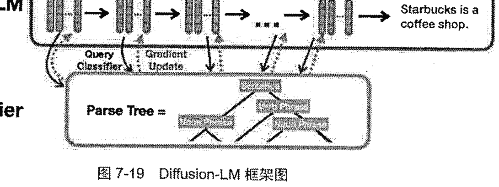

图7-19 Diffusion-LM框架图

来源 : Xiang Lisa Li, John Thickstun, Ishaan Gulrajani, Percy Liang, and Tatsunori B Hashimoto. Diffusion-LM Improves Controllable Text Generation. arXiv preprint arXiv:2205.14217

扩散模型重塑 Seq2Seq 与时序生成

DiffuSeq[88] 首次把扩散过程引入非自回归的序列到序列文本生成，为处理更复杂的文本转换任务提供了一套可行的方案。该工作随后成为同类扩散式语言生成的参考起点，后续研究多在这一框架上进行迭代，整体表现持续向好。论文同时梳理了扩散、自回归与非自回归三种范式的关联。生成阶段采用条件扩散思路，将源端上下文与目标序列拼接成整体，再依据两者间的语义对应关系在噪声空间中逐步精炼，示意图见 7-20。

# 第7章 扩散模型的应用

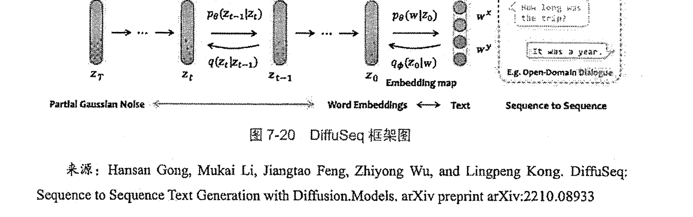

图 7-20 DiffuSeq 框架图

来源：Hansan Gong, Mukai Li, Jiangtao Feng, Zhiyong Wu, and Lingpeng Kong. DiffuSeq: Sequence to Sequence Text Generation with Diffusion Models. arXiv preprint arXiv:2210.08933

图 7-21 呈现了对话生成的对比结果，DiffuSeq 的回复在多样性和自然度上均优于基线。

_Utterance: How long does the dye last?\nResponse: Just did this two days ago, not sure how it'll fade yet!\nGPVAE-T5\n* I'm not sure, I'm not sure. I've tested it a few times, but I don't know for sure. I've\n* I'm not sure. I'm not sure how long it lasts, I'm sure it 'll get better. It's been a while since\n* I've been using it for about a year and a half. I've been using it for about a year and a half.\nGPT2-large finetune\n* Two weeks in my case.\n* I've had it for about a year.\n* The dye can sit around for a month then you can wash it.\nNAR-LevT\n* half .\n* half .\n* half .\nDIFFUSEQ\n* About an hour, 5 days or so.\n* 4 days.\n* I'm not sure about this, about the same kind of time.

图 7-21 DiffuSeq 在对话生成场景中的结果

来源：Hansan Gong, Mukai Li, Jiangtao Feng, Zhiyong Wu, and Lingpeng Kong. DiffuSeq: Sequence to Sequence Text Generation with Diffusion Models. arXiv preprint arXiv:2210.08933

图 7-22 展示了问题生成情形，DiffuSeq 生成的问题类型更丰富，与陈述的语义契合度更高。

Statement: The Japanese yen is the official and only currency recognized in Japan.

Question: What is the Japanese currency?

GPVAE-T5

* What is the japanese currency

* What is the japanese currency

* What is the japanese currency

NAR-LevT

* What is the basic unit of currency for Japan ?

* What is the basic unit of currency for Japan ?

* What is the basic unit of currency for Japan ?

GPT2-large finetune

* What is the basic unit of currency for Japan?

* What is the Japanese currency

* What is the basic unit of currency for Japan?

DiffuSeq

* What is the Japanese currency

* Which country uses the "yen yen" in currency

* What is the basic currency?

图 7-22  DiffuSeq 在问题生成场景中的结果

来源：Hansan Gong, Mukai Li, Jiangtao Feng, Zhiyong Wu, and Lingpeng Kong. DiffuSeq: Sequence to Sequence Text Generation with Diffusion Models. arXiv preprint arXiv:2210.08933

图 7-23 对比了文本简化任务，DiffuSeq 的输出在保留原意的前提下更简洁通顺。

Complex sentence: People can experience loneliness for many reasons, and many life events may cause it, such as a lack of friendship relations during childhood and adolescence, or the physical absence of meaningfulpeople around a person.

Simplified: One cause of loneliness is a lack of friends during childhood and teenage years.

GPVAE-T5

People can experience loneliness for many reasons, and many life events may cause it,

* such as a lack of friendship relations during childhood and adolescence, or the physical

absence of meaningful people around a person

People can experience loneliness for many reasons, and many life events may cause it,

* such as a lack of friendship relations during childhood and adolescence, or the physical

absence of meaningful people around a person

People can experience loneliness for many reasons, and many life events may cause it,

* such as a lack of friendship relations during childhood and adolescence, or the physical

absence of meaningful people around a person

GPT2-large finetune

* Loneliness can be caused by many things.

* Loneliness can affect people in many ways.

* Loneliness can be caused by many things.

DiffuSeq

* Many life events may cause of loneliness

* People can also be very experience loneliness for many reasons.

* People can experience loneliness for many reasons, and many life events may cause it.

图 7-23 DiffuSeq 在文本简化场景中的结果

来源：Hansan Gong, Mukai Li, Jiangtao Feng, Zhiyong Wu, and Lingpeng Kong. DiffuSeq: Sequence to Sequence Text Generation with Diffusion Models. arXiv preprint arXiv:2210.08933

# 扩散模型：生成式AI模型的理论、应用与代码实践

# 第7章 扩散模型的应用

# 7.4 时间数据建模

# 7.4.1 时间序列插补

时间序列插补指当序列中出现缺失时，用算法对空缺值进行估计的过程[213,229,269]。在实际应用中[60,173,265,280]数据缺失十分常见，插补因此是时序处理的关键环节。常见插值手段包括：

+   1. 线性插值。连接缺失点两侧的已知数值，用直线近似，假设区间内变化均匀。
+   2. 拉格朗日插值。选取缺失点邻近若干观测点构造插值多项式，再以此推断缺失值。
+   3. 平滑插值。采用分段二次或三次连续函数拟合，使曲线过渡更平滑，思路与拉格朗日类似。
+   4. k-最近邻插补。取与缺失点最相近的 k 个邻居的均值或中位数作为估计值。
+   5. 基于模型的插补。先基于已知数据拟合自回归、ARIMA、VAR 等统计模型，再用模型预测缺失位置。
+   6. 矩阵分解。将序列转为矩阵，利用奇异值分解、主成分分析等方法填补缺失条目。
+   7. 基于深度学习的插补。借助循环神经网络、长短时记忆等模型学习序列规律，对空缺位置进行推断。

基于扩散模型的时间序列插补

近年来确定性插补[23,27,154]与概率插补[165]均取得进展，扩散模型成为重要方向。CSDI[230]基于分数扩散提出一种时序填补新方法。为更好挖掘时序相关性并用于生成建模，该方法采用自监督训练优化扩散模型。如图7-24所示，CSDI 在部分已知序列的基础上，利用扩散模型逐步恢复缺失信号。Conditional observations 和 Imputation targets 分别对应输入的条件信号与待填补的目标片段。

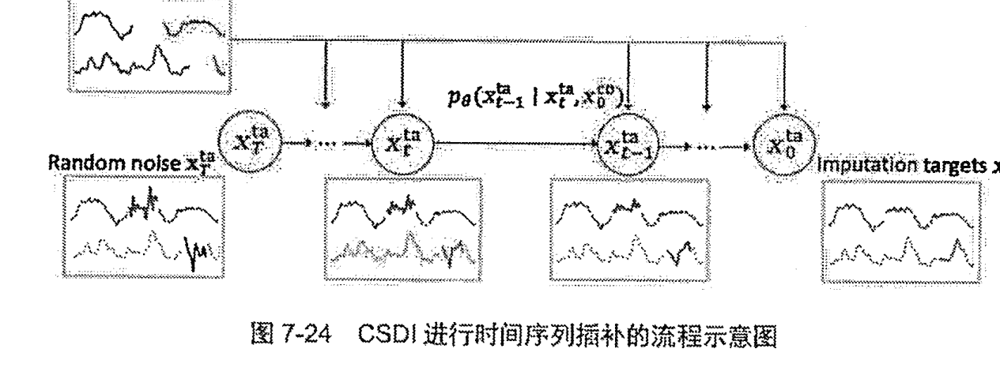

图7-24 CSDI进行时间序列插补的流程示意图

来源：Yusuke Tashiro, Jiaming Song, Yang Song, and Stefano Ermon. CSDI: Conditional Score-Based Diffusion Models for Probabilistic Time Series Imputation. In Advances in Neural Information Processing Systems

图7-25 给出 CSDI 的训练框架，通过最小化正向加噪与反向预测噪声的差异实现去噪生成。训练时随机遮蔽部分数据，以剩余部分作引导，去噪网络基于 Transformer 建立预测时序与条件时序的关联，并关注多变量序列中不同通道的交互。实验表明在多个真实数据集上其效果优于以往方法。

SSSD (Structured State Space Diffusion)[1] 融合条件扩散模型与结构化状态空间模型[82]，用以捕捉时间序列的长期依赖，在插补与预测任务中均表现良好。

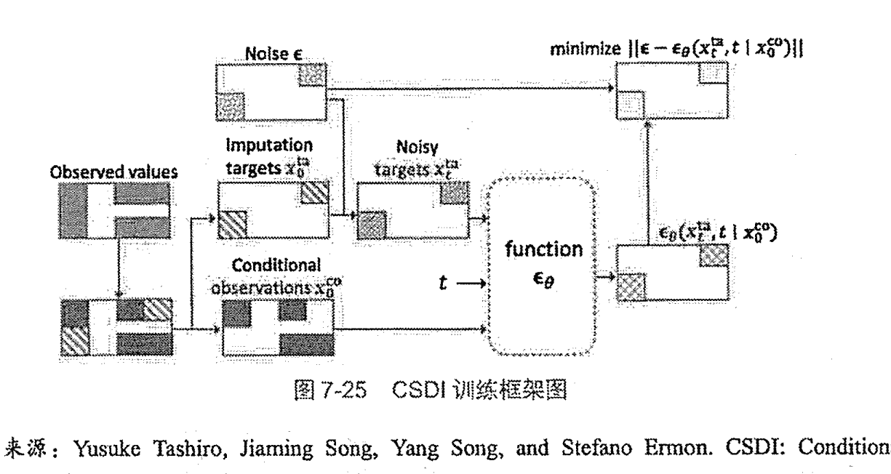

图7-25 CSDI训练框架图

来源：Yusuke Tashiro, Jiaming Song, Yang Song, and Stefano Ermon. CSDI: Conditional Score-Based Diffusion Models for Probabilistic Time Series Imputation. In Advances in Neural Information Processing Systems

# 7.4.2 时间序列预测

时间序列预测指基于历史数据对未来一段时段的数值进行推断，是时间序列分析的核心，广泛用于经济、金融、工业、社会等领域。常用方法有：

+   - 1. 移动平均法。利用序列平均值进行预测，常见简单移动平均、加权移动平均等。
- 2. 指数平滑法。利用平滑后的序列值进行预测，常见单指数平滑、双指数平滑、三指数平滑等。
- 3. ARIMA 模型。通过自回归、差分、移动平均三步建模，具有较好的拟合能力。
- 4. SARIMA 模型。在 ARIMA 基础上引入季节性因素，通过季节性差分和季节性自回归建模。
- 5. VAR 模型。将多个序列变量整体建模，通过描述变量间的相互关系反映不同序列间的交互。
6. 预测 Prophet 模型。由 Facebook 开发，能自动处理季节、节假日等要素，可解释性较好。
7. 深度学习模型。如循环神经网络 RNN、长短时记忆 LSTM、卷积神经网络 CNN 等，可自动提取特征，具有很强的非线性建模能力。

基于扩散模型的时间序列预测

深度学习可用于时序预测，常见单点预测[172]与单变量概率方法[205]。多变量场景下存在点预测方法[140]及概率方法，涉及 GAN[271] 或归一化流[192] 等生成技术，扩散模型也被引入。TimeGrad[191] 提出一种自回归式多元时序预测方法，通过估计每个序列样本分布的梯度从数据分布中采样，利用扩散概率模型搭建。该方法与分数匹配及基于能量的模型密切相关。具体而言，它通过优化数据对数似然的变分界学习梯度，推理时使用朗之万采样，并借助马尔可夫链把白噪声转化为目标分布样本[220]，图7-26 为 TimeGrad 的预测结果。

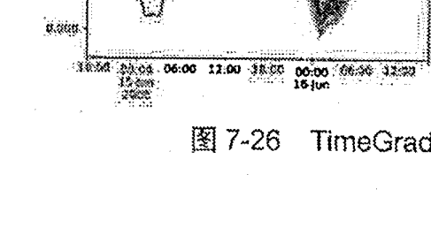

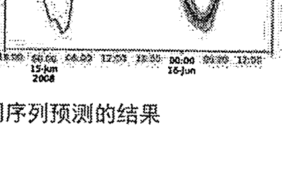

图7-26 TimeGrad 时间序列预测的结果

# 第7章 扩散模型的应用

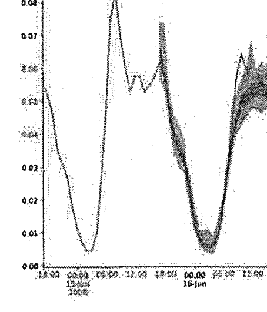

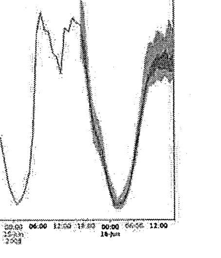

图7-26 TimeGrad 时间序列预测的结果（续图）

来源：Kashif Rasul, Calvin Seward, Ingmar Schuster, and Roland Vollgraf. Autoregressive Denoising Diffusion Models for Multivariate Probabilistic Time Series Forecasting. In International Conference on Machine Learning

# 7.5 多模态学习

# 7.5.1 文本到图像的生成

文本到图像生成即文生图，指把自然语言描述映射为图像的技术[57, 116, 235]。它可在缺乏真实图像时合成逼真画面，满足多样化需求。该方向是深度学习交叉应用，兼具计算机视觉与自然语言处理特征。下面介绍除扩散模型外的文生图算法：

# 从语言到画面：早期文本成像模型

OpenAI 推出的 DALL·E 2 将自然语言描述转成图像的能力推向前进。该系统依托 GPT-3 的预训练权重，采用 Transformer 编码解码的思路构建。用户输入一段描述，例如“蜜蜂停在棕色花朵上”，模型即可生成对应视觉。除了纯文本，还可附加颜色、尺寸、数量等限定信息，帮助控制细节。

## 扩散与自回归两条路线

Google Research 提出 Parti 作为双阶段文图合成方案。先用以 Transformer 为底座的 VQGAN 训练图像分词器把像素映射为离散码，后续再训练自回归模型学习文本分词引导图像分词的映射，最终经逆分词器还原画面。整条流水线仍以 Transformer 编码解码为核心，强调跨模态语义对齐，从而让画面更丰富。

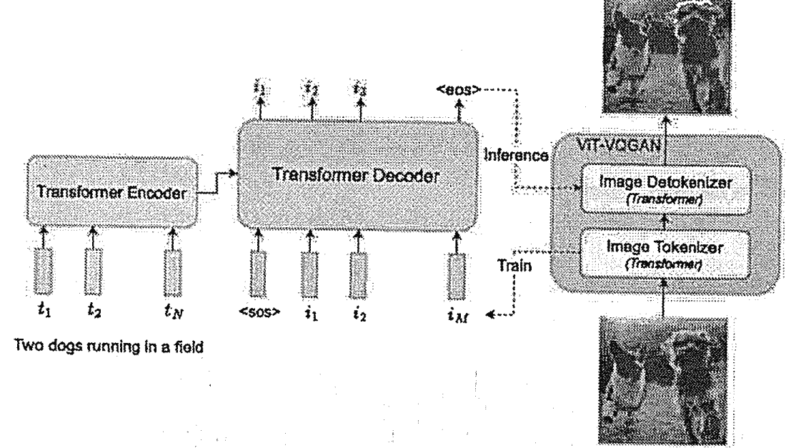

来源：Jiahui Yu, Yuanzhong Xu, Jing Yu Koh, Thang Luong, Gunjan Baid, Zirui Wang, Vijay Vasudevan, Alexander Ku, Yinfei Yang, Burcu Karagol Ayan, Ben Hutchinson, Wei Han, Zarana Parekh, Xin Li, Han Zhang, Jason Baldridge, Yonghui Wu. Scaling Autoregressive Models for Content-Rich Text-to-Image Generation. arXiv preprint arXiv:2206.10789

同团队的 Muse 选用掩码生成式预训练范式，解码阶段改用并行生成，对比 Parti 的自回归方式效率提升。模型接入大尺度预训练语言模型，对细粒度指令的理解更强。图7-28 展示训练流程，实质是在多分辨率下用文本提示重建被遮挡的图像特征，并配合多层次重建提升清晰度与质量。

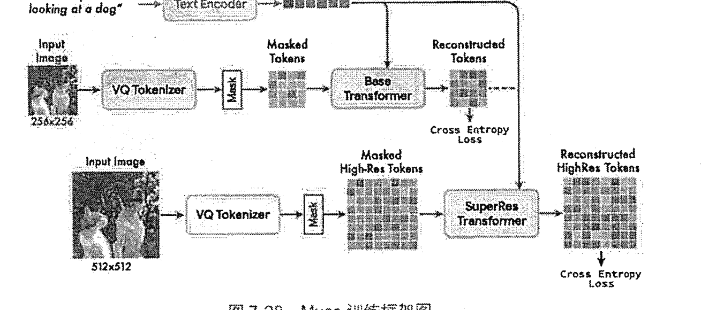

来源：Huiwen Chang, Han Zhang, Jarred Barber, AJ Maschinot, Jose Lezama, Lu Jiang, Ming-Hsuan Yang, Kevin Murphy, William T. Freeman, Michael Rubinstein, Yuanzhen Li, Dilip Krishnan.Muse: Text-To-Image Generation via Masked Generative Transformers. arXiv preprint arXiv:2301.00704

## 文本引导的图像编辑与生成

文生图仍存在清晰度与自然感不足的问题。Blended Diffusion 融合预训练 DDPM 与 CLIP，提供了针对局部区域的文本引导编辑能力。VQ-Diffusion 采用离散 token 化图像后做扩散采样。unCLIP 提出三步流程，框架见图7-29，上半区训练文图对齐的 CLIP，下半区训练潜在先验与图像解码器。首步让图文进入同一语义空间；第二步学习在时间条件下去生成符合 CLIP 语义的潜在表征，研究者尝试自回归与扩散两种先验，扩散在效率上占优而被采纳；第三步用解码器把潜在表征转成真实像素。图7-30 呈现了 DALL·E 2 基于 unCLIP 的合成样例。

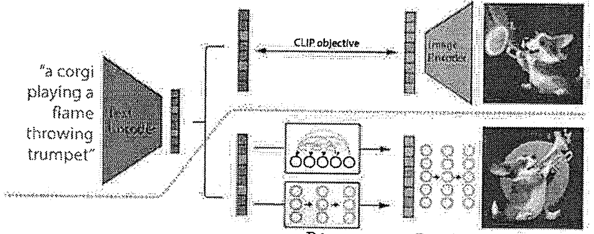

图 7-29 unCLIP 框架图

来源：Aditya Ramesh, Prafulla Dhariwal, Alex Nichol, Casey Chu, and Mark Chen. Hierarchical Text-Conditional Image Generation with Clip Latents. arXiv preprint arXiv:2204.06125


图 7-30 unCLIP 生成结果图

来源：Aditya Ramesh, Prafulla Dhariwal, Alex Nichol, Casey Chu, and Mark Chen. Hierarchical Text-Conditional Image Generation with Clip Latents. arXiv preprint arXiv:2204.06125

# 7.5.2 文本到音频的生成

TTS 即把文字转为语音的技术，使计算机能朗读内容，常见于语音提示、客服、电子书等场景。主流实现可分为：

+ 1. 拼音拼接法。先把文字转成拼音，再用语音库中的拼音片段拼接，准确率高但听感机械，库需求小。
+ 2. 隐马尔可夫合成法。依据输入的音素序列生成语音，利用多状态马尔可夫链与音素库拼接，可听起来更自然，但需大量训练数据与算力。
3. 端到端神经合成。借助深度神经网络直接把文本映射为音频波形，自然度高，却对数据量与计算资源要求更大。

## 基于扩散的文转音

Grad-TTS 以分数解码为核心，逐步转化编码器预测的噪声，并在单调对齐搜索机制下与输入文字保持一致，从而合成音频。Grad-TTS2 在此基础上加入自适应改进。前向过程见图7-36，采用 U-Net 配合 ODE 求解器完成解码。


图 7-36 Grad-TTS 的前向流程

来源：Vadim Popov, Ivan Vovk, Vladimir Gogoryan, Tasnima Sadekova, and Mikhail Kudinov. Grad-TTS: A Diffusion Probabilistic Model for Text-to-Speech. In International Conference on Machine Learning

Diffsound 基于离散扩散模型构建非自回归解码器，每步预测全部梅尔频谱标记，后续迭代细化。EdiTTS 是分数型文转音模型，可对粗糙的梅尔图进行修改与细化。ProDiff 直接对原始数据进行参数化去噪扩散，而非估计密度梯度。

# 7.5.3 场景图到图像的生成

文生图在表达单一度描述时已取得进展，但面对多对象多关系的复杂句时忠实度不足。从场景图生成图像是重要而困难的任务。传统做法先预测布局再绘图，中间表示会丢失语义，且多数扩散模型难以解决。SGDiff 是首个针对场景图的扩散模型，通过学习连续的场景图嵌入来调节潜在扩散过程。该嵌入借助掩码对比预训练实现全局与局部的语义对齐。

如图7-37，方法先用对比学习与掩码自编码把场景图与图像在语义空间对齐，再将对齐后的场景图提示输入扩散模型，实现局部与全局可控的图像合成。


图7-37 SGDif框架图

来源：Ling Yang, Zhilin Huang, Yang Song, Shenda Hong, Guohao Li, Wentao Zhang, Bin Cui, Bernard Ghanem, Ming-Hsuan Yang. Diffusion-Based Scene Graph to Image Generation with Masked Contrastive Pre-Training. arXiv preprint arXiv:2211.11138

图7-38 展示 SGDiff 的生成结果。相比非扩散与扩散基线，SGDiff 能更好地刻画场景图中密集复杂的关联。不过高质量配对的场景图-图像数据稀缺且规模有限，如何借助大规模图文数据增强训练或提供更好的语义先验以改善初始化，仍待解决。


# 7.5.4 文本到3D内容的生成

3D 内容在游戏、娱乐、机器人仿真等领域需求旺盛，将自然语言与 3D 生成结合对新手与专业创作者都有价值。

DreamFusion 使用预训练的文本到 2D 图像扩散模型，通过概率密度蒸馏损失优化随机初始化的 3D 表示如 NeRF，把 2D 扩散模型作为参数化图像生成先验。为提升 NeRF 优化效率，Magic3D 提出两阶段级联扩散框架，结合低分辨率图像扩散先验与高分辨率潜在扩散先验。图 7-39 显示 Magic3D 的文本驱动 3D 生成结果，效果优于 DreamFusion。


图 7-39 Magic3D 基于文本进行 3D 内容生成的结果图

来源：Chen-Hsuan Lin, Jun Gao, Luming Tang, Towaki Takikawa, Xiaohui Zeng, Xun Huang, Karsten Kreis, Sanja Fidler, Ming-Yu Liu, Tsung-Yi Lin. Magic3D: High-Resolution Text-to-3D Content Creation. arXiv preprint arXiv:2211.10440

# 7.5.5 文本到人体动作的生成

人体动作生成是计算机动画的基础，应用于游戏与机器人学。动作通常以关节旋转与位置的姿态序列表示。MDM 即 Motion Diffusion Model，采用无分类器扩散模型适配动作生成，如图7-40。以 Transformer 为主干，融入运动生成经验，并用位置与速度的几何损失正则化模型。FLAME 使用 Transformer 扩散处理运动数据，支持变长序列并关注自由形式文本，可对运动局部进行编辑，无需逐帧或关节微调。


图7-40 MDM 基于文本生成人体动作示意图

来源：Guy Tevet, Sigal Raab, Brian Gordon, Yonatan Shafir, Daniel Cohen-Or, Amit H. Bermano. Human Motion Diffusion Model. arXiv preprint arXiv:2209.14916

# 7.5.6 文本到视频的生成

Make-A-Video 通过时空分解扩散把文本转为视频，扩展了文生图扩散模型，利用联合文本图像先验避免依赖成对文本视频数据，并提出高清高帧率生成策略。Imagen Video 采用级联视频扩散生成高清视频，借鉴文生图经验，包括冻结 T5 文本编码器与无分类器引导。FateZero 是首个借助预训练文本到图像扩散模型实现时序一致零样本文本视频编辑的框架，通过 DDIM 反演与生成过程中的注意力特征融合，最大程度保留编辑时的动作与结构一致。Imagen Video 的文本到视频样例见图7-41。

[PAGE 167]

# 第7章 扩散模型的应用


A beautiful sunrise on mars, Curiosity rover. High definition, timelapse, dramatic colors


A shark swimming in clear Caribbean ocean.


A hand lifts a cup.

图7-41 Imagen Video进行文本到视频生成

来源：Jonathan Ho, William Chan, Chitwan Saharia, Jay Whang, Ruiqi Gao, Alexey Gritsenko, Diederik P. Kingma, Ben Poole, Mohammad Norouzi, David J. Fleet, Tim Salimans. High Definition Video Generation with Diffusion Models. arXiv preprint arXiv:2210.02303

FateZero 的文本视频编辑结果见图7-42，红色文字为编辑提示。


Source Video Prompt: A silver jeep driving down a curvy road in the countryside.


Zero-shot object shape editing with pre-trained video diffusion model [51]: silver jeep → Porsche car.


Zero-shot video style editing with pre-trained image diffusion model [4]: watercolor painting.

图7-42 FateZero 进行基于文本的视频编辑

来源：Chenyang Qi, Xiaodong Cun, Yong Zhang, Chenyang Lei, Xintao Wang, Ying Shan, Qifeng Chen. FateZero: Fusing Attentions for Zero-shot Text-Based Video Editing. arXiv preprint arXiv:2303.09535

[PAGE 168]

# 7.6 鲁棒学习

抗扰式机器学习的核心诉求，是让模型在噪声、离群值与分布漂移等真实干扰下，依然保持可信的预测精度与稳定表现。现实任务中采集偏差、处理失误或外界扰动会让训练数据带上各种污染，传统机器学习在这种环境下容易失准、性能下滑。鲁棒学习正是为提升真实场景下的抗干扰能力而提出的重要技术方向[16,168,179,240,248,270]。对抗防御讨论里，对抗训练长期被视为图像分类器的基准防护，但对抗净化已展现出可替代的强效表现[270]，思路是通过独立净化模块把受攻图像恢复为洁净样本。DiffPure[168]先用前向扩散向对抗样本注入少量噪声，再经逆向生成流程还原干净图像。ADP自适应去噪净化[270]证明，经降噪分数匹配训练的能量基模型EBM[238]可在数步内有效净化攻击样本，并提出净化前先向图像注入随机噪声的随机化策略。PGD投影梯度下降[16]是一种以随机扩散为基础的预处理方案，追求与模型无关的对抗防御并获得高质量去噪效果。此外也有研究主张把引导式扩散引入更精细的对抗纯化流程中[240,248]。

# 7.7 跨学科应用

# 7.7.1 人工智能药物研发

借助AI贯穿新药创造全过程是人工智能药物研发的主线，覆盖发现、分子设计、疗效预测、毒性评价等环节，可压缩研发周期并提升药效与安全性。常见技术路线包括：

+ 1. 深度学习驱动的分子性质预测与新分子生成。利用神经网络学习海量分子数据，在保持结构稳定性和生物活性的前提下创造全新药物分子，并对药效、毒副作用等属性进行预判，从而降低研发时间和成本。
JT-VAE[311]是MIT早期采用VAE对分子数据进行生成学习的框架，融合图神经网络与树结构分解范式来刻画分子。如图 7-43 所示，JT-VAE遵循VAE的整体范式，训练时分子同时经左侧分子图网络和右侧树编码网络处理后重建分子。


来源：Wengong Jin, Regina Barzilay, Tommi Jaakkola. Junction Tree Variational Auto-Encoder for Molecular Graph Generation.In International conference on machine learning

2022年后出现Pocket2Mol，该方法以靶点蛋白的口袋为起点，自回归地逐步合成结合力强、成药性好的小分子。图 7-44 为Pocket2Mol的整体架构[312]，该方法依据靶点蛋白逐步构建高结合度的小分子结构。

[PAGE 170]

# 扩散模型：生成式AI模型的理论、应用与代码实践


来源：Xingang Peng, Shitong Luo, Jiaqi Guan, Qi Xic, Jian Peng, Jianzhu Ma. Pocket2Mol: Efficient Molecular Sampling Based on 3D Protcin Pockets.In International Conference on Machine Learning

2. 强化学习驱动的药物筛选。筛选的本质是在大量候选物中找出具有治疗价值的分子。传统筛选依赖大量实验，耗时耗力。强化学习式的筛选让智能体在模拟环境中试探，通过策略学习快速定位有效药物。

3. 网络分析驱动的药物相互作用预测。不同药物之间会产生增强、减弱或拮抗等相互影响。利用复杂网络模型对大规模药物-药物关系进行建模与分析，可预测相互作用模式及潜在毒性风险。

4. 机器学习驱动的药物剂量预测。剂量过低影响疗效，过高则带来毒性。机器学习方法可基于大量患者数据和剂量记录学习药效-剂量关系，从而为新药快速估计最佳给药方案。

[PAGE 171]

# 第7章 扩散模型的应用

# 基于扩散模型的分子/蛋白质生成

图神经网络GNN[85, 251, 266, 285]及其图表征学习[86]在分子图建模中取得广泛进展[14, 231, 250, 258, 264, 288]。在分子属性预测[59, 71]、分子生成[105, 111, 152, 211]等任务里，分子天然可用节点-边图表示。研究者将分子图生成与扩散模型结合以增强建模能力。在药物研发场景，AI需处理兼具几何属性的小分子与蛋白质，图里既有原子的内在特征，也包含三维坐标的几何特征，这类特征通常具有对称性和等变性。等变图神经网络对这类性质建模效果良好。GeoDiff[259]证明，采用等变马尔可夫核演化的马尔可夫链可产生置换不变的分子数据分布，并为逆向转移核设计神经网络参数化以保证生成分子图的等变性。图7-45 为 GeoDiff 的结构示意图[259]，即基于2D分子图逐步去噪生成3D化合物的流程。给定2D分子图，GeoDiff可通过扩散过程逐步生成对应的3D分子构型。


图7-45 GeoDiff框架图

> 来源：Minkai Xu, Lantao Yu, Yang Song, Chence Shi, Stefano Ermon, and Jian Tang. GeoDiff: A Geometric Diffusion Model for Molecular Conformation Generation. In International Conference on Learning Representations

图7-46 为 GeoDiff 的合成结果，其与参考结果高度相似。

[PAGE 172]

# 扩散模型：生成式AI模型的理论、应用与代码实践

| Graph       |      |        |        |      |

| Reference   |      |        |        |      |

| GeoDiff    |      |        |        |      |

| ContGP     |      |        |        |      |

| OraphDG    |      |        |        |      |

来源: Minkai Xu, Lantao Yu, Yang Song, Chence Shi, Stefano Ermon, and Jian Tang. GeoDiff: A Geometric Diffusion Model for Molecular Conformation Generation. In International Conference on Learning Representations

扭转角扩散 Torsional Diffusion[107]是在扭转角空间操作的扩散框架，采用基于分数的扩散模型。图7-47 为其结构示意图，每次逆向步骤模型先预测扭转变化，再将该变化映射回3D坐标进行去噪生成，实质把3D坐标去噪转化为内部扭转角更新。


来源: Bowen Jing, Gabriele Corso, Jeffrey Chang, Regina Barzilay, and Tommi Jaakkola. Torsional Diffusion for Molecular Conformer Generation.arXiv preprint arXiv:2206.01729

[PAGE 173]

# 第7章 扩散模型的应用

受经典力场模拟分子动力学的启发，ConfGF[210]直接估计分子构象生成中原子坐标对数密度的梯度场。以靶点蛋白为导向的3D小分子药物生成成为热点。TargetDiff[313]以靶点蛋白为条件信息，在3D空间显式建模蛋白-分子相互作用，进行分子的逐步扩散生成。图7-48 为以靶点蛋白P为条件，利用条件扩散模型生成高结合性3D小分子的过程。


来源：Jiaqi Guan, Wesley Wei Qian, Xingang Peng, Yufeng Su, Jian Peng, Jianzhu Ma. 3D Equivariant Diffusion for Target-Aware Molecule Generation and Affinity Prediction. In International Conference on Learning Representations

训练好的扩散模型还可作为打分函数，提升分子-蛋白结合性预测的准确度。图7-49展示了TargetDiff的合成结果及与若干靶点蛋白结合度的测试结果，vina分数越低越好，该模型在部分靶点上优于既往自回归生成方法。

另有研究把扩散模型用于抗体设计，例如DiffAb[314]。DiffAb首创基于扩散模型的3D抗体设计框架，同时对互补性决定区CDR的序列与结构建模，其多分支扩散框架如图7-50所示。该方法同步对氨基酸类型、Cα原子位置及朝向进行去噪生成。

[PAGE 174]

# 扩散模型：生成式 AI 模型的理论、应用与代码实践


# 图7-49 TargetDiff生成结果和与某些靶点蛋白结合度的测试结果

来源：Jiaqi Guan, Wesley Wei Qian, Xingang Peng, Yufeng Su, Jian Peng, Jianzhu Ma. 3D Equivariant Diffusion for Target-Aware Molecule Generation and Affinity Prediction. In International Conference on Learning Representations


# 图7-50 多分支扩散模型框架图

来源：Shitong Luo, Yufeng Su, Xingang Peng, Sheng Wang, Jian Peng, and Jianzhu Ma. Antigen-Specific Antibody Design and Optimization with Diffusion-Based Generative Models

[PAGE 175]

# 第7章 扩散模型的应用

实验表明DiffAb可支持序列-结构联合生成、固定骨架CDR设计、抗体优化等多任务，图7-51展示了DiffAb抗体生成时抗体-抗原相互作用产生的能量变化与RMSD分布，部分合成样本的结合性优于参考样本。


来源：Shitong Luo, Yufeng Su, Xingang Peng, Sheng Wang, Jian Peng, and Jianzhu Ma. Antigen-Specific Antibody Design and Optimization with Diffusion-Based Generative Models

# 7.7.2 医学影像

医学影像学借助X射线、MRI、CT等成像技术观察与诊断人体状态。由于影像数据体量庞大，需要高精度自动化的计算方法辅助诊断与治疗。医学影像逆问题指从测量数据重建原始影像，在CT、MRI等仅能获取间接测量的场景中至关重要[36,37,178,224,257]，解决该问题可改善诊断准确性与治疗方案制定。常用算法包括：

+ 1. 基于逆过程的算法。通过对成像过程进行逆向建模求解原始场景，代表方法有迭代逆过程与逆过程算法。
2. 基于先验知识的算法。利用对原始场景的先验进行建模求解，常用正则化与贝叶斯方法。
3. 基于统计学习的算法。通过样本学习原始场景与观测影像的映射关系，例如深度学习方法。

## 扩散模型：生成式 AI 模型的理论、应用与代码实践

## 基于扩散模型的医学影像重建

Song等人[224]采用基于分数的生成模型重建与观测测量一致的影像。

图7-52 为基于扩散模型解决医学影像逆问题的算法框架图。


图 7-52 基于扩散模型解决医学影像逆问题的算法框架图

> 来源：Yang Song, Liyue Shen, Lei Xing, and Stefano Ermon. Solving Inverse Problems in Medical Imaging with Score-Based Generative Models. International Conference on Learning Representations

图7-53 为基于扩散模型的医学影像重建结果，与既有方法相比重建结果更接近真实影像，扩散模型指标更优。


图 7-53 基于扩散模型的医学影像重建的结果图

## 第 7 章 扩散模型的应用

Chung等人[38]使用去噪分数匹配训练连续且时间相关的分数函数，并在数值SDE求解器与数据重构一致性之间迭代优化。Peng等人[178]基于观测k-空间信号逐步引导反向扩散过程进行MR重建，并提出由粗到精的高效采样策略。

## 第8章

## 扩散模型的未来——GPT 及大模型


## 扩散模型的未来——GPT 及大模型

扩散模型研究尚处早期，理论与实证均有很大提升空间。主要方向包括高效采样、似然函数改进、处理特殊数据结构、与其他生成模型融合以及任务定制等。本章先概述未来研究方向，再详述扩散模型与GPT及大模型的交叉可能性。

需重新审视扩散模型中的典型假设。例如前向扩散完全抹除数据信息并等价于先验的假设并非总是成立，有限时间内完全去信息是不可能的。何时终止前向噪声以在采样效率与样本质量间权衡是值得探讨的问题[66]。近期薛定谔桥与最优传输[31,44,46,212,218]的进展有望提供替代方案，提出在有限时间内收敛到指定先验的新型扩散公式。

理论理解也需深化。扩散模型是强大模型，尤其在不依赖对抗训练的情况下可与生成对抗网络GAN竞争。关键在于理解为何在特定任务上扩散模型优于其他选择。识别其与变分自编码器、能量基模型、自回归模型等的区别，有助于解释其生成优质样本并获得更高似然的原因。同时需发展理论指导系统性超参数选择。

扩散模型的潜在表示亦是研究重点。与VAE或GAN不同，扩散模型在提供良好数据潜在空间表示方面表现较弱，难以用于语义操纵等任务。此外，由于其潜在空间维数通常与数据空间相同，采样效率受限，模型也难以学习有效表征方案[106]。

接下来我们要重点聊聊扩散模型与 GPT 及大模型交叉研究的可能性。为了让大家更好上手，思路会这样展开：先把预训练这项基础技术讲清楚，再梳理 GPT 及大模型的发展脉络与关键论文，最后探讨扩散模型怎样与 GPT 及大模型结合、能怎么结合。

# 8.1 预训练技术简介

无监督学习的核心是从没有标注的数据里挖掘模式与结构。相比需要人工标注的有监督学习，它更灵活，能在海量原始数据上自动学习，还能发现新知识和隐藏结构。预训练就是一种典型的无监督方法，先用大规模无标注语料训练出通用的表征和规律，再在下游任务上做微调，从而显著提升效果。自然语言处理里的预训练大致经历了四个阶段：

+ 1. 词向量模型 2013 年：word2vec、GloVe 等是早期代表，利用上下文生成词向量，有效缓解了语言稀疏与维度灾难，主要用在文本分类、信息检索、文本生成等场景。
+ 2. 语言模型 2018 年：ELMo、ULMFiT 等开始使用单向或双向的语言建模来得到文本表征，能捕捉序列上下文并迁移到不同 NLP 任务。
+ 3. Transformer 模型 2018 年：引入自注意力机制，能在序列内建立长距离位置依赖，更好处理长文本，在机器翻译、文本生成上取得突破，成为预训练的重要分水岭。
+ 4. 大规模预训练模型 2018 年至今：BERT、GPT、T5 等在更大语料与更复杂结构下训练，泛化能力大幅提升，已成为 NLP 研究的主流方向。

从词向量到语言模型，再到 Transformer 与巨型预训练模型，技术演进不断推高了效果与泛化能力，也推动了理解与生成等方向的快速发展。

# 8.1.1 生成式预训练和对比式预训练

预训练模型常见三类结构：Encoder-Only、Decoder-Only、Encoder-Decoder。Encoder-Only 与 Encoder-Decoder 多见于图像与多模态预训练，Decoder-Only 更常见于自然语言预训练。Encoder 负责抽取语义并做匹配对齐，Decoder 负责解码生成。Encoder-Only/Encoder-Decoder 在训练时常依赖特定标注，模型变大后微调成本高。Decoder-Only 则把特征抽取与解码合并进行，减少了 Encoder 的计算与参数，训练推理更快，可扩展性更好，且在零样本场景下表现通常更优。下面介绍两类代表性预训练范式。如图 8-1 所示，生成式预训练以重构损失为目标，对比式预训练以对比损失为目标。


## 生成式预训练

生成式预训练通常用 Encoder 把输入 x 编码为显式向量 z，再用 Decoder 从 z 重构回 x，按重构损失更新两端；若采用 Decoder-Only 结构，则只训练 Decoder。常见的目标有掩码式语言建模 Masked Language Modeling、掩码式图像建模 Masked Image Modeling 等。如图 8-2 所示，MLM 通过提升被掩码词的预测准确率来训练模型。如图 8-3 所示，MIM 通过提升被掩码图像 patch 的重建保真度来训练 encoder 与 decoder。除单模态外，UNITER、VinVL 等多模态生成式预训练工作也大量采用这一思路。


# 图 8-2 掩码式语言建模示意图

来源：Kaiming He, Xinlei Chen, Saining Xie, Yanghao Li, Piotr Dollar, Ross Girshick. Masked Auto-Encoders Are Scalable Vision Learners. In Proceedings of the IEEE/CVF Conference on Computer Vision and Pattern Recognition


# 图 8-3 掩码式图像建模示意图

来源：Kaiming He, Xinlei Chen, Saining Xie, Yanghao Li, Piotr Dollar, Ross Girshick. Masked Auto-Encoders Are Scalable Vision Learners. In Proceedings of the IEEE/CVF Conference on Computer Vision and Pattern Recognition

# 8.1.2 并行训练技术

预训练-微调范式已广泛应用于自然语言处理、计算机视觉和多模态语言建模。随着数据与参数规模的扩大以提升泛化能力，模型参数在 2023 年已逼近万亿级别，训练难度急剧上升。为此出现了多种并行训练策略，主要分数据并行、张量并行和流水线并行三类。

数据并行

数据并行是最基础也最常用的做法。核心思想是把一个 batch 切分为多份，分发到不同 GPU 计算，每个 GPU 保存完全一致的模型与优化器状态。完成前向与反向后，各卡梯度需要汇总平均得到全 batch 梯度。如图 8-6 所示，数据被切成 4 份送入 4 个相同模型训练，损失计算时先对梯度做平均再反传。


# 张量并行

当单个 GPU 放不下完整模型时，可用张量并行把模型拆分到多卡上。与数据并行不同，张量并行是在算子层面把张量切分。例如线性变换 Y=AX，可按列或行切分矩阵 A 分别在两卡计算，再通过通信拼回结果。该思路可推广到更多可切分的算子。如图 8-7 所示，在多层感知机 MLP 中，输入 X 先复制到两卡，对矩阵 A 做列切分分别得到 Y₁、Y₂；随后对 Dropout 相关的矩阵 B 做行切分分别得到 Z₁、Z₂，最后通过 All-Reduce 得到最终输出 Z。如图 8-7 所示，MLP 与 Self-Attention 都可实现张量并行，后者常将 attention heads 中的 Q、K、V 做张量分解并行计算。


来源：Shoeybi M, Patwary M, Puri R, et al. Megatron - LM: Training Multi - Billion Parameter Language Models Using Model Parallelism. arXiv preprint arXiv:1909.08053

# 流水线并行

流水线并行同样把模型拆到不同 GPU，以解决显存受限问题。与张量并行不同，它按层把模型分配到不同设备，如图  - 8 所示。以 Transformer 为例，可把若干连续层放在同一卡，前向传播时按顺序逐层计算隐状态。


三类并行各有取舍。数据并行通用性强、通信与计算效率较高，但显存开销大；张量并行显存效率高，但会带来额外通信成本，通用性相对不足；流水线并行显存效率高，通信开销小于张量并行，但流水线中容易出现气泡导致无效计算时间。

# 8.1.3 微调技术

微调是指在预训练模型基础上，用少量任务特定数据做调整，以获得更好性能。该技术属于迁移学习的一种，不用从头训练即可快速适应新任务并提升准确率。通常先在大规模数据上学习通用特征，再在规模较小且分布相近的数据集上以较小学习率继续训练，避免过拟合。微调已广泛应用于自然语言处理、计算机视觉和语音识别等。以 NLP 为例，BERT、GPT、XLNet 等模型经微调后可用于文本分类、命名实体识别、情感分析等任务，性能提升明显。

## 8.2 GPT 及大模型

GPT 即 Generative Pre-Training，指基于生成式预训练的语言模型，是 NLP 领域极具影响力的方向。初代 GPT 于 2018 年由 OpenAI 提出，随后演进为 GPT-2、GPT-3、InstructGPT，再到 GPT-3.5 系列、ChatGPT、Visual ChatGPT 以及 GPT-4。GPT-1 就已在多项任务上达到 SOTA，后续版本甚至能零样本解决未见任务，并生成符合人类阅读习惯的长文本，或生成与输入语义一致的逼真图像、视频。迭代过程中，数据量、训练方式与架构都在变化，GPT-3 参数约 1750 亿，GPT-4 参数据称达 100 万亿级别，“大模型”概念由此兴起。

研究大模型的重要性在于业务场景复杂、需求碎片化，AI 研发成本高、定制难，常处于手工工坊状态。大模型提供“大规模预训练+下游微调”的通用方案，通过扩大预训练提升泛化能力，用以解决通用性难题并覆盖自然语言、多模态等任务。下面将详细梳理 GPT 的发展历程与关键论文技术细节。

##

# 第8章 扩散模型的未来——GPT及大模型

整体可分为两个阶段，第一阶段以无监督方式在海量数据上训练，让模型学习词间关联即“常识”；第二阶段以有监督方式提升下游任务能力，且不改变模型主体结构。

具体而言，第一阶段目标为自回归式似然最大化：

L₁ = Σᵢ log P(uᵢ|uᵢ₋₁,…,uᵢ₋ₖ,θ)

其中 θ 为网络参数，即用前 k 个词预测第 k+1 个词，从而捕捉词间关联并获得良好表征。第二阶段目标是有监督形式：

L₂ = Σᵤ,y P(y|u₁,u₂,…,um)

GPT-1 在第二阶段采用 L₂ + λL₁ 的混合目标以增强泛化。无监督训练完成后，只需接上一个带 softmax 的线性层即可做有监督训练，且无需改动主干结构，能更好利用无监督表征。微调时还需对输入做结构化处理，如加入起始符、终止符、在示例间加分隔符，帮助模型识别任务类型。如图 8-9 所示，预训练后的 Transformer 可微调用于多选、相似度计算、蕴涵关系、分类等多种下游任务。

在架构上，GPT-1 选择 Transformer，因为其具有更结构化的记忆单元，能缓解长距离依赖，处理更长文本，使迁移更鲁棒。完整 Transformer 含编码器与解码器，GPT 仅使用解码器部分，因解码器借助 mask 机制只能看到上下文，恰好匹配自回归训练目标。此前 LSTM 是主流语言模型架构，GPT 证明 Transformer 在信息容量与效果上更优，从而开启了以 Transformer 及变体为核心的大模型时代。

与 GPT 同期的竞争对手 BERT 采用掩码语言模型，预测被遮挡词时可同时看到前后文，类似完形填空，因此选用 Transformer 编码器。GPT 仅利用前文预测当前词，目标更具挑战性。

GPT-1 的模型规模为总参数 1.17 亿，特征维度 768，Transformer 层数 12，头数 12，训练语料为 BooksCorpus，文本约 5GB，来自约 7000 本书籍。该语料以高质量长句为主，有助于学习长距离依赖。

实验表明，在 12 项任务中 GPT-1 有 9 项超过专门有监督训练的 SOTA，并展现出一定零样本能力。如图 8-10 所示，随着预训练步数增加，模型在与预训练相关的下游任务上的零样本表现持续超越传统 LSTM，且方差更小，稳定性与归纳能力更好。这得益于 GPT-1 在预训练中获得的强泛化能力，也为 GPT-2、GPT-3 的出现奠定基础。


图8-9 经过预训练后的Transformer可以被用在各种下游任务中进行微调

> 未源：Alec Radford, Karthik Narasimhan, Tim Salimans, Ilya Sutskever. Improving Language Understanding by Generative Pre-Training

# 第8章 扩散模型的未来——GPT及大模型

因为 GPT-1 在预训练中获得了较强的泛化能力，这也为 GPT-2、GPT-3 的出现打下了基础。


图 8-10 GPT 在下游与预训练相关任务上的 Zero-shot 的表现超过了传统的 LSTM 模型

来源：Alec Radford, Karthik Narasimhan, Tim Salimans, Ilya Sutskever. Improving Language Understanding by Generative Pre-Training

# 8.2.2 GPT-2

GPT-2[319]的论文指出，经过海量语料的自监督预训练后，模型能够在不依赖任务专属标注的情况下完成跨任务迁移。下面要介绍的就是 GPT-2 提出的核心概念——Zero-shot。

GPT-1 以及 BERT 代表的主流路线仍然是先做预训练再做微调，新任务上线就必须靠有标注数据做二次训练，人工与算力的开销都很高。GPT-2 试图省去这一步，其前提是当网络规模与语料规模都足够时，单纯的语言建模就能覆盖原本需要有监督学习的任务，下游不再需要微调。

与 GPT-1 相比，GPT-2 的主要变化体现在体量上。最大配置约十五亿个可训练权重，Transformer 堆叠四十八层，可处理的上下文长度拉到 1024。团队共训练了四档规模，可训练权重分别为 1.17 亿、3.45 亿、7.62 亿和 15 亿。实验显示体量攀升伴随下游效果提升，困惑度同步下降，说明语言理解更深入。训练文本取自 Reddit 高质量帖子整理而成的 WebText 网页语料，约 40GB，远大于 GPT-1 使用的 BooksCorpus。作者强调超大模型需要更多数据才可能收敛，实验中仍呈现未充分拟合的现象。

结构上做了精细化调整。层归一化被前移到每个子模块的输入端，接近预激活残差网络的设计；残差分支的系数被缩放，并在最后一次自注意力之后额外增加一层归一化。这些改动意在压低预训练时层间方差的波动，使梯度更平稳。GPT-2 同时引入多任务训练并提出 Task Conditioning，把学习目标表述为 P(output|input,task)。同一输入在不同任务下应产生不同输出。对语言模型而言，任务条件化通常靠在输入里加入示例或自然语言提示实现，为 Zero-shot Learning 奠基。

Zero-shot Learning 也称 Zero-shot Task Transfer，是指模型在没有训练样本与示例的情况下，仅凭自然语言描述就能把握任务并给出正确回答。GPT-2 希望靠大模型加大数据实现这一目标。与 GPT-1 的微调不同，下游任务不再改写句子，而是直接用自然语言提示，例如英译中任务，输入先是英文句子，随后接上单词 “Chinese” 与提示符 “:”。这样就不需要为下游调整数据，也避免无监督训练中使用特殊分隔符。通过构建尽可能庞大且多样的数据集，收集来自不同领域、不同任务的自然语言描述，让模型具备理解任务要义的能力。

实验表明，GPT-2 在不少任务上优于纯无监督基线，在 8 个任务里有 7 个在 Zero-shot 设置下刷新了当时的最佳成绩，显示出 Zero-shot 能力。但与有监督微调相比仍有距离，即便参数超过 BERT，在主流 NLP 下游任务上的表现也不算突出。此外模型仍欠拟合，且随规模增大性能持续提升，15 亿参数显然未触碰上限。如图 8-11 所示，参数量上升时各下游任务的成绩也在持续上扬并有继续增长的趋势。

# 第8章 扩散模型的未来——GPT及大模型


# 图 8-11 GPT-2随着参数量的增长，性能也在上涨

来源：Alec Radford, Jeffrey Wu, Rewon Child, David Luan, Dario Amodei, Ilya Sutskever.

Language Models are Unsupervised Multitask Learners

# 8.2.3 GPT-3 和大模型

GPT-2 的试验显示模型越大 Zero-shot 能力越强。为了构建无需微调即可处理下游任务的强模型，OpenAI 推出 GPT-3[320]。GPT-3 拥有 1750 亿参数，远超 GPT-2。巨大的参数量与数据量使其在 Zero-shot 与 Few-shot 任务上表现突出，同时能生成高质量文章、完成数学计算和代码编写。本节围绕 GPT-3 的核心技术与关键概念——少样本学习、上下文学习、提示学习和涌现能力展开。

# 少样本学习

少样本学习是机器学习的一种范式，目标是用极少标注样本训练出可快速分类、识别或回归的模型。传统方法往往需要数千甚至上万标注，而现实中可获得的标注通常稀缺。少样本学习的核心是用少量样本学到可泛化的模型。此前主流是元学习，通过元学习器从多个小任务中学到通用特征表示，使新任务在少量数据下也能泛化。

GPT-3 采用基于生成模型的 Few-shot 方法。它先在大规模无标注语料上预训练，再在输入示例中捕捉文字规律，融合预训练获得的语言知识解决目标问题。GPT-3 与 GPT-2 不同，并非完全不需要样本，而是像人类阅读极少数示例后依托已有知识完成任务。注意 GPT-3 只是阅读新样本，并不基于新样本做梯度更新，在如此大参数规模下微调成本极高。如图 8-12 所示，当输入文本里包含少量示例时，GPT-3 展现出强大的模仿学习能力，并在多项指标上超过基于微调的 BERT。


图 8 - 12 （左）随着模型参数量的不断上涨，预训练模型的 Few - shot 能力越来越强；（右）随着输入中示例样本的数量增加，GPT - 3 的表现在样本初始增加时性能暴涨，并在之后一直保持着上涨趋势

来源：Tom Brown, Benjamin Mann, Nick Ryder, Melanie Subbiah, Jared D Kaplan, Prafulla Dhariwal, Arvind Neelakantan, Pranav Shyam, Girish Sastry, Amanda Askell, Sandhini Agarwal, Ariel Herbert - Voss, Gretchen Krueger, Tom Henighan, Rewon Child, Aditya Ramesh, Daniel Ziegler, Jeffrey Wu, Clemens Winter, Chris Hesse, Mark Chen, Eric Sigler, Mateusz Litwin, Scott Gray, Benjamin Chess, Jack Clark, Christopher Berner, Sam McCandlish, Alcc Radford, Ilya Sutskever, Dario Amodei. Language Models are Few - shot Learners. In Advances in Neural Information Processing Systems

# 第8章 扩散模型的未来——GPT及大模型

具体而言，Zero-shot 情形测试输入仅含任务的自然语言描述，Few-shot 情形则在描述之外把示例放进上下文窗口。GPT-3 能依据任务描述与示范作答。One-shot Learning 是少样本学习的特例，仅用一个示范。

# 上下文学习

上下文学习是一种新型自适应技术，完成特定任务时把任务所处的上下文环境纳入考量，以提升准确率与泛化能力。传统机器学习从静态数据集学习，缺乏实时理解与适应能力，很难处理时间、空间等动态任务。上下文学习强调结合上下文进行学习。GPT-3 在上下文学习中不更新梯度，而是通过设计输入上下文来挖掘模型已有能力，从而提高性能。在 GPT-3 中，上下文学习常用于：

+   1. 生成对话。用于生成对话时，上下文学习可帮助模型依据当前上下文与对话历史给出更准确流畅的回复。
2. 文本生成。用于文本生成时，上下文学习可让模型依据当前上下文与任务需求产生更有逻辑、更准确的文本。
3. 问答。用于问答时，上下文学习可让模型结合问题与上下文给出更有逻辑的答案。

# 提示学习

提示学习是自然语言处理领域针对预训练语言模型的自适应技术，目标是通过简单提示完成各类任务，而无需特定任务的微调。其基本思想是用预定义提示引导预训练语言模型的生成过程。提示通常是针对特定任务的文本片段，可为问题、关键词、主题等。训练时把提示与输入一同给模型，模型按提示生成相应输出，从而实现任务。提示可视为对模型的指令，指导其在不同上下文执行不同任务。使用提示的好处是让模型更聚焦特定任务，提高效果，同时避免额外微调节省计算与训练时间。

在 GPT-3 中，提示学习允许用户输入自定义提示来指定任务与生成内容。例如输入“Translate from English to Spanish”作为提示，再输入一段英语文本，GPT-3 会按提示生成西班牙语。用户还可通过不同提示控制文本

# 第8章 扩散模型的未来——GPT及大模型

链提示不是逐轮单独生成，而是把每一轮对话当成链条上的环节组成连续整体。这样可以避免无意义或不连贯的对话，保持连贯性和一致性。实现方式通常是把上一轮回答作为下一轮输入，用自然语言模型生成下一轮回答，模型会考虑上一轮回答和任务描述以保持一致。

如图8-13所示，标准提示和思维链提示对比，在思维链提示下，模型在回答问题时会给出推理过程及答案，进一步利用大模型的推理能力。


# 图8-13 标准提示和思维链提示对比

# 涌现能力

在自然语言处理中，涌现能力指模型在训练时自主学会新任务或新功能，即在没有额外训练数据的情况下实现新任务。涌现能力建立在泛化能力和表示能力之上。泛化能力指训练集与测试集上的表现差异，表示能力指模型在训练集中学到的语言表示和结构。若泛化与表示足够，模型可在新任务出现时自主学习，无需重新训练。

从 GPT-1、GPT-2 到 GPT-3 可以看到，随着规模增大，在极少或无提示的情况下解决新问题的能力在提升。Wei 等人[322]发现，随着规模增大，模型会出现涌现能力，即小模型没有大模型才有的能力。例如模型未达到一定规模时 Few-shot 回答随机性大，突破临界点后 Few-shot 能力大幅提升。如图 8-14 所示，8 个不同模型在 Few-shot 场景中展现涌现能力的例子可看出，达到一定规模前表现接近随机模型，超过阈值后显著提升并远超随机水平。


图8-14 8个不同模型在“Few-shot”场景中展现出涌现能力的示例

来源: Jason Wei, Yi Tay, Rishi Bommasani, Colin Raffel, Barret Zoph, Sebastian Borgeaud, Dani Yogatama, Maarten Bosma, Denny Zhou, Donald Metzler, Ed H. Chi, Tatsunori Hashimoto, Oriol Vinyals, Percy Liang, Jeff Dean, William Fedus. Emergent Abilities of Large Language Models. arXiv preprint arXiv:2206.07682

在 BIG-Bench 上，GPT-3 与 LaMDA 在未达临界点时表现接近零。当 GPT-3 的训练计算量突破 10^22，LaMDA 突破 10^23 时，表现开始快速上升。这些结果说明必须达到一定规模机器才具备智能。

下面介绍 GPT-3 的模型参数与训练参数。GPT-3 有 96 个注意力层，每层 96 个注意力头。词嵌入维度从 1600 提升到 12888，上下文窗口为 2048 个词长。此外还使用了稀疏注意力模块，降低计算复杂度，仅关注相对距离不超过 k 以及 2k、3k 等位置的字符。稀疏注意力兼具局部紧密相关和远程稀疏相关的特性，对近距离上下文关注多，远距离关注少。除此之外与 GPT-2 基本相同。GPT-3 的训练集由 5 个库组成，分别为 Common Crawl、WebText2、Books1、Books2 和 Wikipedia，总体数据量超过 GPT-2 的 10 倍，高质量库采样量更大、训练 epoch 更多。

实验结果表明，无论 Zero-shot 还是 Few-shot，GPT-3 在多个任务上都比原 SOTA 更好。对部分数据集上的任务，虽然不能击败 SOTA，但比 Zero-shot SOTA 更好。在绝大多数情况下 Few-shot 表现在 One-shot 之上。但 GPT-3 仍有局限与负面影响。生成长句时会出现前后矛盾或重复；自然语言推理表现不佳，难以判断句子是否蕴含另一语句。因为训练时所有词权重相同，对无意义词或虚词也要花费大量计算，无法按任务目标导向处理字符。另一方面，模型过于庞大、推理昂贵且难以解释机理，我们不清楚它是记忆还是学习。对少样本学习，哪些示例和提示有效仍不明确。最后，GPT-3 可生成逼真的新闻稿，意味着存在传播错误信息、不实消息、造假以及生成偏见文本的风险。

# 8.2.4 InstructGPT 和 ChatGPT

尽管 GPT-3 在自然语言处理与文本生成任务上令人惊艳，它仍会产出带有偏见、不真实、有害或可能造成负面社会影响的信息。预训练模型是在海量数据上训练的超大参数模型，与人工可控的专家系统相比像黑盒子，无法保证不会生成种族歧视、性别歧视等危险内容，因为训练数据里可能包含此类样本。此外 GPT-3 不能按人类偏好表达回应，我们希望输出与人类真实意图对齐。创造 InstructGPT 的初衷正是为了解决对齐问题，其优化目标可概括为“3H”：Helpful、有用；Honest、可信；Harmless、无害。

为实现 3H，InstructGPT[323]在 GPT-3 基础上微调，训练分为三步：1.有监督微调；2.奖励模型训练；3.强化学习训练。ChatGPT 采用的就是与 InstructGPT 相同的技术方案。如图 8-15 所示，InstructGPT 流程中第一步是有监督微调 GPT-3；第二步训练奖励模型；第三步用强化学习对奖励模型做策略优化训练。


图8-15 InstructGPT流程示意图

来源：Long Ouyang, Jeffrey Wu, Xu Jiang, Diogo Almeida, Carroll Wainwright, Pamela Mishkin, Chong Zhang, Sandhini Agarwal, Katarina Slama, Alex Ray, John Schulman, Jacob Hilton, Fraser Kelton, Luke Miller, Maddie Siemens, Amanda Askell, Peter Welinder, Paul F. Christiano, Jan Leike, Ryan Lowe. Training Language Models to Follow Instructions with Human Feedback. In Advances in Neural Information Processing Systems

整体思路可归纳为两条路线：监督式微调 SFT 与借助人类反馈的强化学习 RLHF，后者先构建奖励模型再展开强化训练。下面对两者分别展开。

在 Few-shot 设定下，GPT-3 面对同一下游任务时往往使用统一的任务描述模板，这与真实使用情境存在明显落差。真实使用者不会刻意遵循固定话术，而是按个人习惯表达意图。InstructGPT 的监督微调正是为弥合这一差距。做法是从真实用户请求中抽样任务描述，再由标注员对描述进行续写生成高质量答案，最后以这些配对数据对基础模型进行微调。

RLHF 的核心是对模型产出进行评分，符合规范的回答给予高回报以鼓励生成，不符合的给予低回报以抑制生成。人工评分成本高效率低，于是引入奖励模型来模拟人类偏好。具体做法是让模型针对同一问题产出多篇文本，再请评估者按好坏排序，用排序结果训练奖励模型以复现人类判断。训练本质上是回归问题，鉴于生成文本的多样性和复杂性，奖励模型通常与主模型规模相当。训练完成后即可用其替代人工对 GPT 进行强化学习。

实际操作流程为：先由 GPT 生成候选文本，再借助训练好的奖励模型打分，随后以此分数驱动 PPO 算法更新模型。优化目标为

E_{(x,y)~π^RL_φ}[r_θ(x,y) − β log\frac{π^RL_φ(y|x)}{π^{SFT}_φ(y|x)}] + λE_{x~π_pretrain}log π^RL_φ

该式中第一部分对应 PPO 的优化项，r_θ(x,y) 代表已训练好的奖励模型打分，π^RL_φ(y|x) 为强化学习后模型，φ 为待优化参数。得分越高说明输出越贴合人类偏好，最大化该部分即推动偏好对齐。为防止强化学习模型偏离监督微调模型太多，引入 KL 散度惩罚 β log\frac{π^RL_φ(y|x)}{π^{SFT}_φ(y|x)}，β 为超参数，π^{SFT}_φ(y|x) 来自监督微调模型。第二部分为预训练对齐项，防止能力退化。单独使用 PPO 会导致通用 NLP 性能下降，因此加入 λE_{x~π_pretrain}log π^RL_φ 使分布贴近预训练数据，λ 控制强度，

π\_pretrain 是训练前数据的分布。如图 8-16 所示，InstructGPT 模型 PPO-ptx 以及未混合预训练的变体 PPO 都明显优于 GPT-3 基线 GPT、GPT prompted。


来源：Long Ouyang, Jeffrey Wu, Xu Jiang, Diogo Almeida, Carroll Wainwright, Pamela Mishkin, Chong Zhang, Sandhini Agarwal, Katarina Slama, Alex Ray, John Schulman, Jacob Hilton, Fraser Kelton, Luke Miller, Maddie Siemens, Amanda Askell, Peter Welinder, Paul F. Christiano, Jan Leike, Ryan Lowe. Training Language Models to Follow Instructions with Human Feedback. In Advances in Neural Information Processing Systems

实验显示评估者更偏好 InstructGPT 的输出，仅 1.3B 参数的 InstructGPT 主观体验就超过 175B 的纯 SFT 模型。真实性与丰富度明显提升，对有害内容的生成控制也更有效。提升源于人工续写微调与强化学习共同引导模型输出更真实安全的样本。偏见问题未见明显改善，有时仍会出现荒诞输出，可能与纠正数据量有限有关。即便加入约束，InstructGPT 在通用自然语言处理任务上的表现仍会有所下降。

# 8.2.5 Visual ChatGPT

前面提到的 GPT 技术多局限于纯文本，实际生产生活往往需要图文等多种模态交互。Visual ChatGPT 是将 ChatGPT 与视觉基础模型 VFM 融合的多模态问答系统。VFM 通常指计算机视觉领域的一套基础算法集合，例如 Stable Diffusion、BLIP、ControlNet 等，它们把通用视觉能力迁移到具体应用，并可作为复杂系统的基础。

Visual ChatGPT 把一系列 VFM 接入 ChatGPT，使用户能以文本和图像形式同时对话，并支持复杂的视觉指令，让多个模型协同工作。除了像普通 ChatGPT 那样的语言问答，它还能基于输入图像实现视觉问答 VQA、生成与修改图像、移除不需要的区域等。系统还能理解搜索、查询类指令，并具备修改和改进输出的反馈回路，可根据反馈不断调整和提升。

图 8-17 展示了一次典型交互，用户上传黄花图像并要求“先根据深度预测生成红花，再做成卡通风格，分步执行”。在 Prompt Manager 调度下，系统依次调用深度估计、深度转图像、风格迁移三个 VFM，最终得到卡通红花。该管道中 Prompt Manager 作为 ChatGPT 的调度器，提供视觉格式类型并记录信息转换过程。当最终卡通提示返回时，执行链结束并展示结果。

为了在 ChatGPT 与视觉基础模型之间建立高效连接，团队设计了一系列提示并把视觉信息注入 ChatGPT。新型 Prompt Manager 明确每个视觉基础模型的能力、输入输出格式，并把不同视觉信息转成语言格式以便 ChatGPT 理解和处理。它还能处理不同视觉基础模型之间的历史记录、优先级和冲突。Visual ChatGPT 利用这一模型集合的反馈，迭代地构建视觉理解和生成能力。图 8-18 为 Visual ChatGPT 的系统架构。


# 图8-17 Visual ChatGPT使用实例

来源：Chenfei Wu, Shengming Yin, Weizhen Qi, Xiaodong Wang, Zecheng Tang, Nan Duan.\ Visual ChatGPT: Talking, Drawing and Editing with Visual Foundation Models. arXiv preprint arXiv:2303.04671


# 图8-18 Visual ChatGPT系统架构

来源：Chenfei Wu, Shengming Yin, Weizhen Qi, Xiaodong Wang, Zecheng Tang, Nan Duan. Visual ChatGPT: Talking, Drawing and Editing with Visual Foundation Models. arXiv preprint arXiv:2303.04671

Visual ChatGPT 的系统架构由用户查询 User Query 模块、提示管理 Prompt Manager 模块、视觉基础模型 VFM、调用 ChatGPT API 系统和迭代交互 Iterative Reasoning 模块、输出 Outputs 模块构成。其中 ChatGPT 和 Prompt Manager 图 8-18 中为 M 负责意图识别和语言理解，并决定后续操作和产出。以图 8-18 中的 3 轮对话为例：

+   1. 系统接收用户上传的图片 Q₁，并返回确认回复 A₁。
+   2. 根据用户的文本修改图像并发送给用户。Q₂ 包含“沙发改为桌子”和“把画风改为水彩画”两项要求，Prompt Manager+ChatGPT 识别出需要调用 VFM；第一项意图是替换图片内容，系统调用“replace-something”功能，生成符合该意图的中间图像；第二项意图是按语言修改图像，系统调用“pix2pix”功能，对上一张图像进行操作，生成符合第二项意图的图像；识别到任务已完成，不再需要调用 VFM，并输出生成的两张图像。
+   3. 识别图像：用户提出 Q₃，Prompt Manager+ChatGPT 发现不需要 VFM，而是调用 VQA 功能，回答问题得到答案 A₃。

可以看到，整个系统通过意图识别与模型调度实现多轮图文协同。

# 扩散模型：生成式AI模型的理论、应用与代码实践

## 8.3.1 算法研究

从算法层面看，扩散模型和 GPT、大模型一样都走生成式预训练路线，可能的研究方向包括：

- 当训练数据和参数规模持续扩大时，大模型性能会持续上升并可能出现跃迁式涌现。扩散模型是否遵循相似规律、是否会出现涌现特性值得探索，但其训练成本高昂，放大参数时的优化难度也需考虑。
- ChatGPT 等系统的卓越性能部分归功于训练中引入基于人类反馈的强化学习微调，用奖励模型实现偏好对齐。将类似思路迁移到扩散模型中，利用人工标注训练 Reward Model 并进行强化微调，有望在人工评估维度取得提升。
- LLaMA 等大模型开源后，社区提出仅微调少量参数的适配器方案，不改动主干，通过指令集和适配器挖掘已有知识。类比来看，如何低成本微调 Stable Diffusion 等扩散模型以适应新任务，如 ControlNet，值得深入研究。

## 8.3.2 应用范式

从应用来看，GPT 类大模型已能覆盖大量任务，扩散模型的应用形态仍在探索中：

- 目前扩散模型在条件生成上表现突出，能产出逼真且符合提示语义的样本。但在认知推理、少样本泛化等方面的探索较少。把扩散模型拓展到更多应用范式，接近 GPT 类模型的应用广度，对释放其潜力很重要。
- Visual ChatGPT 里扩散模型被当作 VFM 使用，多模态问答中自然语言和多模态特征都很关键。开发语言扩散大模型乃至多模态扩散大模型，以及研究不同模态的扩散模型如何与基于 LLM 的大模型协同，都是下一步方向。

# 相关资料说明

撰写本书时作者查阅大量学术论文并咨询领域权威人士，以保证内容准确权威。这些文献和专家提供了丰富见解，对成书起关键作用。

为便于读者了解来源，作者公开了相关专家的姓名和机构，以体现资料对研究的重要性和影响。我们相信借助文献和专家建议，本书观点会更深入全面。

再次感谢为本书提供帮助的专家和文献作者，他们的研究不仅充实本书，也推动了相关领域发展。

本书相关资料请登录官网 http://www.broadview.com.cn/book/7288，单击“下载资源”获取。