技术之外：AI的社会肌理

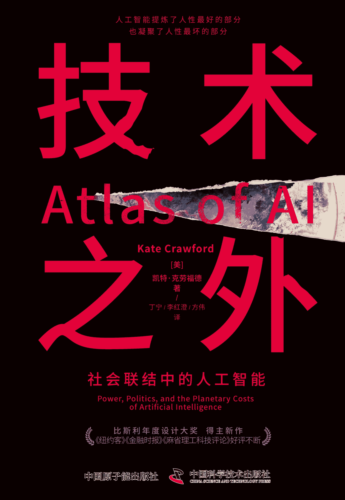
# 序章

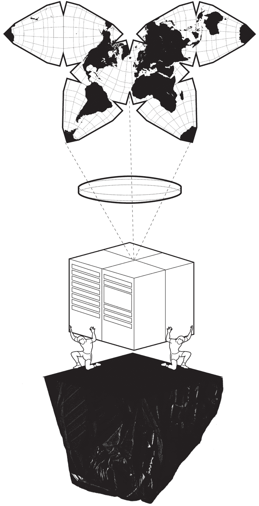
## 汉斯：会算术的马

十九世纪末叶，一匹九岁的德国种公马汉斯在欧洲巡回演出，让观众为之着迷。这匹马被宣传为能解算术题、报出星期、核对日历日期、分辨音高、在特制板上敲出单词与句子。面对“2 加 3 等于几”的提问，它会用蹄子敲五下；被问“今天星期几”，它就依次点出字母。连“我心里想的数减九剩三，那个数是多少”这类稍复杂的问题，它也能给出对的回应。很快“聪明汉斯”之名传开，1904 年《纽约时报》以“柏林神驹：除了说话几乎无所不能”为题报道了它。

训练者是退休数学教师威廉·冯·奥斯滕，他笃信颅相学，对动物智力抱有热情。起初他握住马腿、展示数字，教它用蹄子回敲对应次数；随后引入粉笔字母板，让马为每个字母对应敲击。两年后冯·奥斯滕认定自己培养出对高级概念的理解，便带汉斯四处巡演，企图证明动物具备推理能力。汉斯在“美好年代”^(¹)的舞台上大受欢迎。

质疑声最终推动德国教育部成立调查组，由心理学家兼哲学家卡尔·斯图姆夫与助手奥斯卡·芬斯特主导，成员还包括马戏经理、退休教师、动物学家、兽医与骑兵军官。长期观察后他们发现，无论训练师在场与否，马的回答都准确，表面看不到舞弊。正如芬斯特后来记录，汉斯在数以万计观众、马术师和顶尖魔术师面前演出数月，没人能捕捉到提问者与马之间有规律的信号。

委员会认为冯·奥斯滕的教法更像教小学儿童而非驯兽，“值得科学审视”，并称汉斯为“具推理能力的马”。但斯图姆夫与芬斯特仍存疑。一个关键现象是：提问者若不知答案，或站得较远，汉斯的正确率明显下降。这指向一种无意识的社会互动。

芬斯特在 1911 年的专著中指出，答案藏在提问者的细微身体反应里：呼吸停顿、面部放松、手势微变，恰在马给出正确答案时出现。提问者通常意识不到自己在“示意”。这一发现令支持者震惊，冯·奥斯滕拒绝接受，坚持汉斯的智能是专业训练的成果。

汉斯的故事反复被引，因其牵涉欲望、奇迹生意、拟人化偏见与智力政治。由此诞生了“聪明汉斯效应”或“观察者期望效应”，用来描述主试者无意识暗示对被试的影响。人与马的关系揭示了偏见如何无意识产生，以及学习者总被期望牵制。

这正是本书的核心追问：智能是怎样被“制造”出来的？表层看是人通过训练让马模仿类人认知来建构智能；深层看，创造智能需要学界、学校、科学、公众、军方等多重机构的验证与加持。冯·奥斯滕与他的马有市场，情感与经济推动巡演、报道与讲座，权威人士以经济、文化、科学力量评估并宣告汉斯的与众不同具有意义。

于是出现两种思路：一是计算机、马等非人类系统只是人类思维的仿制品，只要训练或资源足够就能生成类人“智能”，无需理解其在更广生态中的交往与筹划；二是“智能”是自然属性，与社会文化政治无关，甚至被用来为奴隶制、父权制、优生学等辩护。这种迷思在 AI 领域尤其深刻。

自上世纪中叶起，人类智能可被程序化复制的观念流行。图灵 1950 年预言本世纪末谈论机器思考将不再受质疑。冯·诺伊曼 1958 年说人类神经系统“初步数字式”。明斯基则说机器可以思考，人类不过是“血肉机器”。但魏泽鲍姆创造了 ELIZA，却认为把人类简化为信息处理系统过于简单，这催生了“一意孤行的宏伟幻想”——造出像孩子一样学习的机器。

1961 年麻省理工的“未来的管理与计算机”系列讲座是关键节点。赫柏、利克莱德、明斯基、纽厄尔、西蒙、维纳等人讨论计算快速进步，麦卡锡总结说人机差异是虚幻的，只需更多时间把复杂任务形式化。哲学家休伯特·德雷弗斯则反驳，工程师没考虑大脑可能以完全不同方式处理信息。他在《计算机不能做什么》中指出，人类智能依赖无意识过程，而计算机要求一切明确形式化，难以处理情境信息。

此后 AI 从符号系统转向机器学习热潮，早期争论被遗忘，寒冬怀疑消失。21 世纪中叶以来少数科技巨头在全球部署系统，系统被宣称媲美甚至超越人类智能。正如汉斯被培养在极窄范围内模拟加减而非理解语言、音乐或烹饪，AI 也被窄化为简单类人智能。工程师兼作家埃伦·厄尔曼指出“大脑像计算机”之说长期影响计算与认知科学，形成原罪式的笛卡尔二元论：AI 被当作脱离物质世界的思维系统。

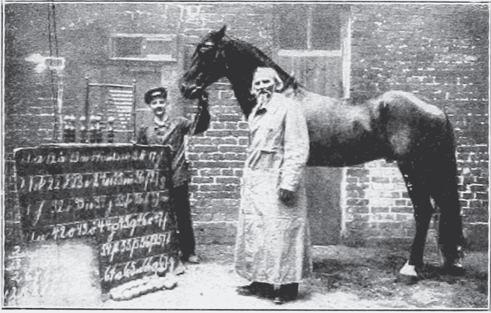
图 0.1 威廉·冯·奥斯滕与聪明汉斯

## AI 是什么？既非人工，也非智能

问“人工智能是什么”？路人会提到 Siri、亚马逊云、特斯拉自动驾驶或谷歌搜索；深度学习专家则会讲层级神经网络、标注数据、权重阈值、难以解释的分类。1978 年唐纳德·米基讨论专家系统^(²)时已显露分歧。

每种定义都在划定理解、衡量、评估与管理的框架。若由消费品牌定义，市场营销便先行圈定功能；若认为 AI 比人类专家更理性、能做“最优行动”，则意味着信任它在医疗、教育、司法的高风险决策。当焦点只在算法技术，计算成本与对地球的压力就被忽视。

本书认为 AI 既不人工，也不智能。它是具身的、物质的，由自然资源、燃料、人力、基础设施、物流、历史与分类构成。没有大规模、按预设规则与奖励条件训练的数据库，AI 无法自主、理性或识别。现存 AI 完全依赖更广的政治社会结构，因所需资金与优化方式，它最终为既有利益集团服务。换言之，AI 是权力的代理。

本书要探索 AI 怎样被制造，经济、政治、文化、历史力量如何塑造它。一旦把 AI 与更广泛的社会系统连接，就能摆脱“纯技术”迷思。AI 是技术与社会的实践，是机构与基础设施，也是政治与文化。计算理性与人类劳动紧密相连：AI 既映射社会关系，也映射人对世界的理解。

“人工智能”在计算机科学界常被视作营销热词，技术圈更常用“机器学习”。资金申请或媒体宣传时，AI 名称又会被迅速启用。用与弃之间，词义一直在变化。对我而言，AI 指代这个庞大的产业形态，包括政治、文化与资本；机器学习则指技术方法范畴，虽同样具社会与基础设施属性却少被提及。

领域过度关注算法突破、产品增量与便利性是有原因的：这种狭义抽象分析恰好服务于技术、资本与治理交汇的权力结构。要理解 AI 的政治化，需跳出神经网络与统计模式识别的窄义，问什么被优化、为谁优化、由谁决定，再追溯后果。

## 把 AI 看作导航图

导航图有助于理解 AI 的制造。它由不同尺度、不同分辨率的图层组成，从卫星俯瞰到小岛细节。打开它可以查特定信息，也可以随好奇漫游。科学史家洛林·达斯顿指出，导航图训练眼睛聚焦关键细节。法国哲学家乔治·迪迪-于贝尔曼认为导航图同时存在于审美与认知范式，颠覆科学与艺术完全分离的观念，它让世界以不同方式被重新编辑与拼贴。

物理学家兼技术评论家厄苏拉·富兰克林说，地图是有意义的努力，是集体知识的证明。好的地图提供可组合的观察认知原则；但也有政治地图，按权力断层划分领土，标记干预与帝国占领。

我借用导航图提出新视角：我们需要关乎驱动 AI 工业帝国的理论，关乎采矿、数据采集、严重不平等与劳动剥削的权力结构。地图隐喻让我们不只盯着计算智能的抽象前景或最新模型，而是走遍 AI 涉及的各领域，远离当下狭窄争论。

更具体地说，AI 正以清晰可辨的计算方式重绘地球。这不是隐喻而是直接野心。行业制作并规范自己的私有地图，以秘密的上帝视角观察人类活动、交流与劳动。AI 学者表达过占领世界、取代其他认知的渴望。李飞飞将她的图网 ImageNet 项目^(³)视为...

本书受科技、法律与政治哲学传统影响，也源于十年工业 AI 实验室工作。先贤如鲍克、布拉顿、达斯顿、伽里森、哈金、德·兰达、尼尔森、斯塔尔、韦斯特等丰富了我的理解。我的视野涵盖矿井、耗能数据中心长廊、尘土档案与仓库荧光灯下的吊架。

制图方法多种，人与 AI 的使用也有多种可能。扩张看似不可避免，却充满争议与不完整。愿景并非自发，而是特定信念建构的产物。当代 AI 导航图的主设计者是极小且同质的群体，分布在少数城市、最富行业。中世纪 mappae mundi 把宗教与古典概念作坐标，AI 地图也反映主观信念而非客观自然。

本书按“殖民”地图的逻辑组织，收纳帮助理解 AI 的故事、地点与知识。

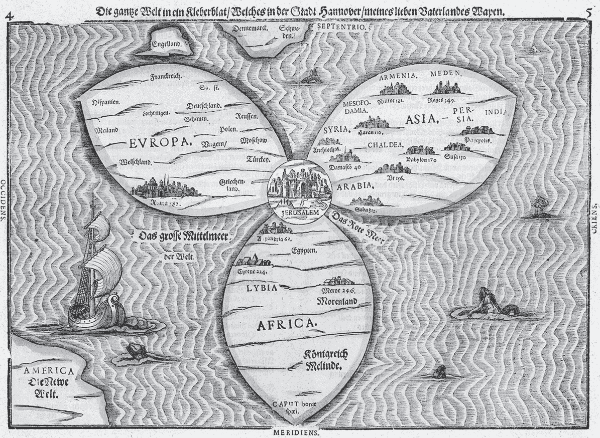
图 0.2 海因里希·本廷的“世界地图”，即“本廷三叶草世界地图”，象征基督教三位一体，耶路撒冷居中。刊于 1581 年马格德堡出版的《神圣抄本之旅》

## 计算拓扑学

核心问题是：21 世纪今天，AI 如何被概念化与建构？转向人工智能的利害何在？系统解释与绘制世界地图的方式蕴含何种政治？把 AI 纳入教育、医疗、金融、政府、工作招聘、通信与司法等决策系统会带来怎样的社会物质后果？本书不写代码与算法综述，也不只做单一社区的人类学描述。

本书提供的是 AI 及其逻辑、材料与成本的扩展视图。AI 不是单一事物，而是一幅图景——行业、意识形态、观察方式、哲学、研究领域与营销术语。为了探索这片土地，我们将前往揭示 AI 本质之处。

第一章从美国内华达州的锂矿开始，那是支撑当代计算能力的众多矿场之一。采矿是字面上可见 AI 攫取性政治之处。科技行业对稀土、石油、煤炭需求巨大，真正成本却从未由行业承担。在软件层面，自然语言处理与计算机视觉模型极度耗能，争夺更快更高效模型的竞赛推动贪婪算法，拓宽了 AI 的碳足迹^(⁴)。

第二章把被包装成魔法的部分拆开，重新归于人的重复劳动。低薪的临时工人通过点选微任务把零碎信息拼凑成训练模型，镜头再切到亚马逊仓库，拣货员被算法节拍推着冲刺；再到芝加哥的肉类拆卸线，工人们把动物屠体分割成可销售的规格。书中也收录了抗议者的记录，他们控诉人工智能为管理层提供更强监控与管控，从对身体的直接干预到对抽象时间的操作。

这段劳动本质上是时间治理的故事。让人的动作与机器人、传送带保持同步，需要在空间与时间上对身体进行精细校准。从秒表的普及到谷歌的 TrueTime 服务，工时同步一直是工厂管理的核心。人工智能既渴求更精密的时间调控，也在创造这种调控的条件。实现同步必须掌握更详细的行动档案——人们做了什么、何时做、怎样做。后台运行的工作场所人工智能，为少数人以他人的代价获益提供了便利。

第三章把焦点放在数据上。如今所有可触及的数字材料，包括个人记录或具破坏性的内容，都被吸纳进用来训练模型的集合。仓库里堆满自拍、肢体手势、驾驶画面、婴儿、街头行人，用以优化人脸识别与目标检测。作者认为正在发生一种政治转向：这些集合不再被当作个人档案，而是被等同于基础设施。图像与视频的具体语义和情境被判定为无关紧要。除隐私外，当前的数据处理方式还引发了伦理、方法论与认识论层面的深层关切。

第四章讨论人工智能内的分类操作，社会学家卡琳·克诺尔·塞蒂娜称之为“认知装置”。当代系统常用标签来预测人类身份，常见的是二元性别、固化的种族划分，以及对性格、信用价值的评级。一个记号代表一套系统，一个代理服务代表真实身份，一个“玩具”模型取代了人类主体性的无限复杂。从十七世纪的百科全书到今天的计算机视觉数据集，分类方式展示了社会组织的技术模式如何不断强化等级并扩大不平等。最棘手的是，机器学习提供了一种规范推理机制，当它占据主导时，就成为一种强有力的治理理性。

随后视线被带到巴布亚新几内亚的山地城镇，追溯“情感识别”的历史。第五章细读心理学家保罗·艾克曼关于人脸可读出六种普遍情绪的观点。科技公司正把这一套路装进情感识别系统，背后是一个预计超过九十亿美元的市场。学界对情绪检测的争议很大，乐观者认为它不完整，悲观者认为它完全站不住脚。即便科学前提摇摆不定，这类工具已迅速渗透进招聘、教育与警务领域。

第六章回看人工智能作为国家权力工具的用法。军事上的历史与现状塑造了今天监控、数据抽取与风险评估的实践。如今科技产业与军方之间错综的联系被用来服务强烈的民族主义议程。与此同时，原本只在情报管理范畴之外的工具已外溢到商业技术，被用于教室、警察局、工厂与失业登记处。塑造人工智能的军事逻辑正融入市政运作，进一步扭曲了国家与民众的关系。

结语审视人工智能如何以基础设施、资本与劳动的结合体发挥权力。从被催单的优步司机，到被追踪的无证移民，再到与人脸识别系统对抗的公屋租户，人工智能建立在资本、警务与军事化逻辑之上，进一步放大既有的权力不对称。人工智能观察社会的方式兼具抽象与榨取：抽象掉制造它的物质条件，同时从最难反抗的人群身上抽取更多信息与资源。透过设计与使用中的权力动态，可以看到高度集中、不透明的制度如何在公共机构与私人决策中发挥关键作用，却把股东利益置于首位。

提取、权力和政治

人工智能既是理念，也是基础设施、产业、权力形式与观察方式；更是高度组织化的资本体现，由环绕地球的庞大开采与物流供应链支撑。所有这些都浓缩在四个字里，映射出一系列复杂的期待、意识形态、欲望与恐惧。

尽管人工智能具有可塑性、混乱性与特定的时空范畴，在当下时刻与这种多重性对抗很重要。术语的混杂与可重配置性，使其可被多重使用：从亚马逊智能音箱这样的消费设备，到匿名的后端处理系统；从狭义的技术论文，到全球最大的产业集团。术语的宽泛让我们得以思考重叠的现象：从情报政治到大规模数据收集，从技术部门的产业集中到地缘政治与军事力量，从封闭的社会环境到通过不透明系统对女性、有色人群与残障者的持续歧视，系统可以预测谁是优秀员工、专注学生、暴力惯犯。

我们的任务是保持对宏观层面的敏感，观察“人工智能”这一术语意义的变化与可塑性——它像一个容器，不断装入又取出各种内容——因为这本身就是故事的一部分。

简言之，人工智能如今已成为塑造知识、交流方式与权力的重要角色。重构发生在认识论、正义原则、社会组织、政治表达、文化、对身体的理解、主体性与身份层面，即人工智能决定我们是什么、可以是什么。我们可以理解得更深入。人工智能不只是重绘与改造世界，更是一种根本的政治性世界创造形式——尽管它自己不承认。其过程本质上不民主，被控制着大规模行星计算的六家公司主导。

如今更多社会机构受到大型科技公司工具与方法的影响，这些工具塑造其价值观与决策方式，并产生复杂的下游效应。技术官僚权力的强化已持续很久，如今加速，部分源于经济紧缩与外包时期工业力量的集中，包括削减曾作为市场制约的社会福利制度与机构资金。这只是与人工智能作为政治、文化与科学力量抗衡的重要原因之一。

我们正处于关键历史时刻，随着“人工智能”作为思想与物质实践扩散，我们已到达哲学家艾蒂安·苏里欧所说的“质疑情境”。此时需要对人工智能的生产与接受提出关键问题。问题应包括：我们如何定义人工智能，它为谁服务，边界在哪里。这意味着要审视这些技术所处的更广阔领域，它们直接与间接从何处抽取，以及谁将承受最大伤害。正如厄苏拉·富兰克林所写，“就像民主一样，技术的可行性最终取决于司法实践与对权力的限制”。

我们需要对错综复杂的科技与政治结构提出尖锐问题。其中一些问题没有简单答案。但本书并非关于无法解决的灾难或不归路——这种思维会让我们无所作为。事实上司法实践中有许多可行路径。本书也不是携带简单解决方案清单的简化图。我不能宣称所有复杂问题都有答案。相反，把它当作地图，帮助我们了解身在何处、可以去向何方。目标是共同探索边界，拓展对人工智能帝国正在发生之事的理解，看清利害攸关之处，并对下一步做出更好的集体决策。为此我们首先必须打开导航图，看清可能的前路。

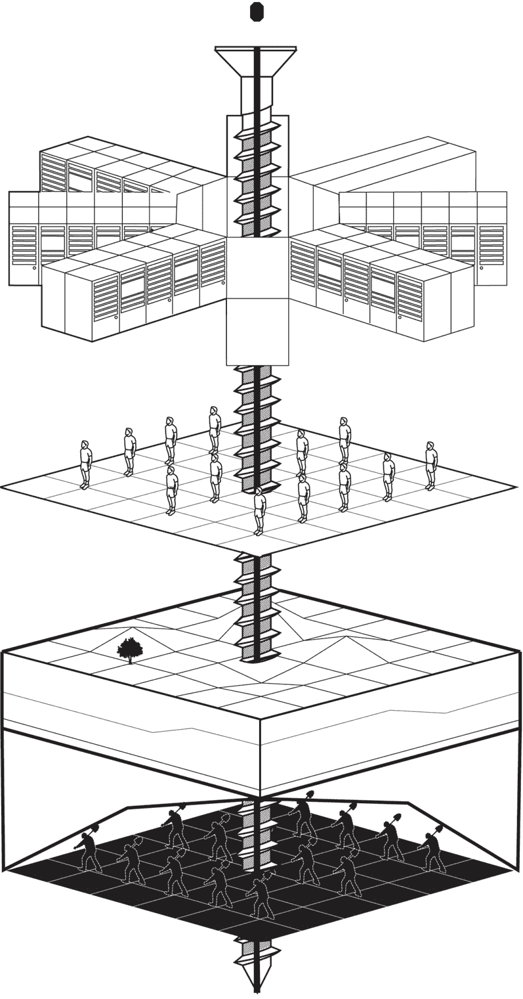
# 第一章
## 地球
一架波音七五七从圣何塞上空斜切而过，正要降落在旧金山国际机场。机翼下倾对准跑道，眼前展开的是科技行业最具标志性的鸟瞰。下方是硅谷的商业帝国群：苹果总部的巨型黑色圆环建筑像无盖的相机镜头在阳光下闪烁；谷歌总部毗邻美国宇航局莫菲特联邦机场，该机场二战时是美国海军基地，如今被谷歌高管租下六十年作为私人机场。紧挨谷歌的是洛克希德·马丁的大型制造棚，这里研发了数百颗俯瞰地球的轨道卫星。唐巴顿大桥旁的低矮楼群是脸书现改名为 Meta 的总部，四周环绕大面积停车场，靠近雷文斯伍德斯劳的硫酸盐池。从这个角度看，帕洛阿托不起眼的郊区小径与不高耸的天际线几乎不透露其真正的财富、权力与影响力，很少有迹象显示它在全球经济与计算机基础设施中的中心地位。

我此行是为了理解人工智能及其由来。但要做到这一点，我必须完全离开硅谷。

从机场我跳上一辆面包车向东驶去。越过圣马特奥-海沃德大桥，经过劳伦斯利弗莫尔国家实验室，战后爱德华·泰勒曾在这里聚焦热核武器研究。很快内华达山脉的山麓越过中央山谷的斯托克顿与曼特卡。道路在索诺拉山口高耸的花岗岩峭壁间蜿蜒，随后沿山脉东侧通向点缀金色罂粟的青草山谷。松林让位给莫诺湖的碱性水域以及大盆地与内华达山脉干涸的沙漠地貌。为加油我驶入霍桑，这里是世界上最大的弹药库所在地，谷中整齐排列着数十座布满尘土的贮弹塔，美国军队的武器就存于此。在内华达州二六五号公路又行驶数小时后，远处出现一座孤零零的 VORTAC 塔，这是为 GPS 前时代设计的大型针状无线电塔，功能只有一个：向过往飞机广播“我在这里”，在偏远地带充当固定参照点。

我的目的地是内华达州克莱顿谷银峰的未建制社区，常住人口约一百二十五人，视统计方式而定。这座采矿小镇是内华达最古老的小镇之一，一九一七年地下金银采尽后几近荒废。一些淘金热时代的建筑仍矗立着，在沙漠阳光下风化。这个小镇很小，废弃汽车比人多，但藏有稀罕之物。镇子坐落在一座巨大的地下锂湖之上。地表下珍贵的含锂卤水被抽出，留下空旷、流光溢彩的绿色池塘自行蒸发。几公里外即可看见闪烁的池塘。近看又是另一番景象：异形黑色管道在地面喷发，沿盐壳地面蜿蜒，在浅沟里穿梭，把盐碱混合物送往干燥皿。

图 1.1 银峰锂矿（摄影：凯特·克劳福德）

就在内华达的这个偏远角落，人工智能的材料被制造出来。

### AI 的挖掘
克莱顿谷与硅谷的联系，类似十九世纪金矿区与早期旧金山的关联。采矿的历史常伴随选择性失忆，被技术进步的故事淡化。正如历史地理学家格雷·布里金所指，旧金山正是建立在加州与内华达淘金挖银所得收益之上。城市基于采矿业而生。一八四八年美墨战争结束，《瓜达卢佩-伊达尔戈条约》规定墨西哥割让这些土地，当时定居者已清楚这里是价值连城的金矿。布里金指出，这是“贸易追随旗帜，旗帜追随选择”这句老话的极佳例证。在美国领土扩张期间，成千上万墨西哥人被迫离乡。在大规模美国入侵后，矿工随之涌入。土地被剥夺，水路受污染，周围森林被毁。

自古以来采矿有利可图，因其不计真实现价：环境破坏、矿工疾病与死亡、被迫迁移社区的消失。一五五五年被称作“矿物学之父”的格奥尔格乌斯·阿格里科拉指出：“众所周知，采矿造成的危害远大于其产出的金属价值。”换言之，获利者之所以能获利，是因为成本由他人承担，包括活着的人与未出生的人。贵金属易于标价，但一片草原、一泓清溪、可呼吸的空气、本地社区健康的确切价值如何计算？这些从未被估价，于是出现简单算计：尽可能快地提取一切。这是“快速行动，打破局面”在另一时代的重现。其后果是中央山谷严重受损，正如一八六九年一位旅行者观察到的，“龙卷风、洪水、地震与火山爆发加在一起，都很难造成比淘金行动更大的浩劫”。在加州，采矿不尊重任何权利，利益至上。

旧金山从采矿获取巨额财富时，很容易忘记来源。矿井远离因之致富的城市，这种距离让城市居民对山川、河流与劳工身上发生之事一无所知。但矿井的记忆无处不在。城市摩天大楼使用了与中央山谷矿井深处相同的技术驱动垂直运输、通信与生命保障。把矿工送入井下的滑轮系统经改造倒置，把电梯乘客送往摩天大楼顶层。布里金建议把旧金山的摩天大楼看作倒置的矿井景观。从地下洞穴采出的矿石被出售，用来建造空中的楼层；开采越深，高耸办公楼建得越高。

旧金山因黄金发展起来，矿石承担了所有费用。如今推高股价的是对白色锂晶体等物质的提取，被矿产市场称为“灰色黄金”。

旧金山再度富裕起来。科技产业已成为新的最高利益，世界市值最高的五大公司在此设点：苹果、微软、亚马逊、脸书与谷歌。走过市场街以南的初创仓库，这里曾是矿工搭帐篷之处，可见豪车、风险投资支持的咖啡连锁店，以及沿私人路线行驶的带色玻璃豪华巴士，把员工运往山景城或门洛帕克的办公室。但步行很短距离就到迪威逊街，位于市场街以南与教会区之间的一条多车道大道，那里排满帐篷，为无处可去者遮风避雨。科技繁荣下，旧金山现为美国街头无家可归者比例最高城市。联合国适足住房权特别报告员称这是“令人无法接受”的侵犯人权行为，因成千上万无家可归者得不到水、卫生设施、医疗等基本必需品，与附近大量亿万富豪形成鲜明对比。提取的最大收益被少数人获取。

本章将穿越北美、东南亚与东亚内陆：从沙漠到海洋。我们也将穿越历史长河，从刚果^(⁶)

### 计算景观
夏日午后，我驾车穿过沙漠山谷前往最近采矿热潮中的矿区。手机拴在仪表板上别扭的位置，用一根白色 USB 线连接，回应我的语音指令把我导航到锂池周边。银峰巨大的干涸湖床形成于数百万年前的新近纪，四周是向上延伸的结壳层状构造，通向含深色石灰岩、绿色石英岩与灰红板岩的山脊。锂在二战期间该地区钾碱被确认为战略矿产后被发现。此后五十多年，这类质地柔软的银白金属仅少量开采，直到成为科技领域极具价值的材料。

现在情况改变。二零一四年锂矿公司洛克伍德控股被化工制造商雅宝以六十二亿美元并购，成为美国唯一在运营的锂矿。银峰是埃隆·马斯克等依赖锂的科技大亨关注之处，因其可生产可充电电池。锂是制造锂离子电池的关键元素。智能手机电池通常含约八克锂。每辆特斯拉 Model S 电池组需约七千克锂。这类电池从未打算为汽车这样高耗电设备供电，但锂电池是目前大众市场唯一可用的可充电方案。所有电池寿命有限：一旦降解即被当作垃圾丢弃。

距银峰北约三百二十公里是特斯拉超级工厂，世界最大的锂电池厂。特斯拉是全球第一大锂离子电池消费者，从松下与三星大量采购电池并重新包装成轿车与家用 Powerwall。特斯拉目前每年需两万四千吨氢氧化锂，占地球总消耗量的一半。实际上特斯拉更准确地应被描述为电池企业而非汽车公司。镍、铜、锂等关键矿物即将短缺，给公司带来风险，也使银峰的锂湖极具吸引力。控制该矿即意味着控制美国国内供应。

正如诸多证据所示，电动汽车并不能解决二氧化碳排放问题。电池供应链的开采、冶炼、输出、组装与运输对环境有巨大负面影响，进而对受其降解影响的社区造成严重后果。少数家用太阳能可自给，但绝大多数情况下为电动车充电需从电网取电，而美国目前不足五分之一电力来自非化石燃料。迄今这些并未削弱汽车制造商与特斯拉竞争的决心，电池市场压力加大，必需矿物质储备加速减少。

全球计算与贸易对电池的依赖惊人。“人工智能”一词可能涉及算法、数据与云架构，但若没有构成计算机核心元件的矿产与资源，这些概念无法运作。可充电锂离子电池是移动设备、笔记本电脑、家用数字助理与数据中心备用电源的必需品。它们支撑互联网及运行其上的所有商业平台，从银行到零售再到股市交易。现代生活的许多方面被转移到“云端”，但人们很少考虑这些原材料的成本。我们的工作、个人生活、病历、闲暇、娱乐与政治利益——所有这一切都发生在网络计算架构世界，而由云联通的我们手中的设备，其内核是锂。

人工智能的挖掘既有字面意义，也有隐喻意义。数据挖掘的新攫取主义包含并推进了传统挖掘的旧攫取主义。驱动人工智能系统所需的堆栈远超数据建模、硬件、服务器与网络的多层“技术堆栈”。人工智能的“全栈供应链”涉及资本、劳动力、地球资源——每一方面的需求量都很大。

云是人工智能行业的支柱，由岩石、锂卤水与原油制成。

理论家尤西·帕里卡在其著作《媒介地质学》中建议，我们不应从马歇尔·麦克卢汉的角度——媒介是人类感官的延伸——来看待媒体，而应视其为地球的延伸。计算媒体参与地质学与气候学进程的方式包括，把地球物质转化为基础设施与设备，利用石油与天然气储备为新系统提供动力。将媒介与技术视作地质过程的反思，使我们开始考虑推动当前技术发展所需的不可再生资源彻底枯竭问题。从网络路由器到电池再到数据中心，人工智能系统扩展网络的每一部分都是由需数十亿年才能在地球内部形成的元素构建而成。

把亿万年形成的矿藏压缩进几年使用寿命，这几乎就是当下科技消费的默认节奏。为了换取极短的体验窗口，人类把地质史里沉淀的矿石挖出来，制成亚马逊音箱、苹果终端这类寿命注定很短的产品。美国消费者技术协会的数据显示，一部智能手机平均只用 4.7 年。高频报废推着人不断换新，抬高利润，也让依赖不可持续开采的做法更具吸引力。矿物在地下以千万年计孕育，却被骤然拉进开采、破碎、混炼、冶炼、物流和跨数万公里再造的链条。矿石被掏出，尾矿与弃渣被抛弃，随后装配、运输、使用，最后在加纳、巴基斯坦的电子垃圾场终结。从诞生到报废，人工智能的生命周期是一张分形的供给网：既是对劳动与自然资源的多重攫取，也是企业与地缘政治力量高度集中的体现。整张网络靠持续大规模的能源消耗维持运转。

### 旧金山开创的攫取主义
## 矿物层
内华达的锂盐湖只是撬开 AI 原料的入口之一。玻利维亚西南乌尤尼盐沼、刚果中部、蒙古、印度尼西亚与西澳大利亚沙漠，都是这条生命线的起点，却极少进入视野。没有这些地方的矿石，今天的计算无法运转，而供给正在收紧。

美国地质调查局曾在 2020 年列出制造商面临高供应风险的 23 种矿种，一旦断供，科技为首的产业会停摆。关键品种包括用于手机喇叭与电动车电机的稀土镝、钕，用于军用红外与无人机的锗，以及能提升锂离子电池性能的钴。

17 种稀土经处理后嵌进笔记本与手机，让设备更轻更薄。彩色屏、扬声器、镜头、可充电电池、硬盘等都含有它们，也出现在通信塔的光纤、信号放大器乃至卫星与 GPS 系统中。但从地下取出必然触发地方冲突。采矿本就是残酷行业，要理解 AI，就必须承担采矿带来的战争、饥荒与死亡。

近年美国对部分稀土的监管只是象征性动作。2010 年《多德-弗兰克法案》本为金融危机后的金融改革，其中冲突矿产条款要求使用刚果周边金、锡、钨、钽的公司提交来源报告，防止销售资助武装组织。与“冲突钻石”一样，“冲突矿产”一词掩盖了深重的苦难与大量杀戮。采矿利润为刚果地区延续数十年的冲突提供资金，造成数千人死亡、数百万人流离失所，矿井内的工作条件等同现代奴役。

英特尔花了四年多才对自己的供给网有基本认知。生产、设备、物流包装由分布在上百国家的 1.9 万多家供应商提供直接物料。英特尔与苹果只对冶炼厂而非矿场进行审计，以确认矿物在无冲突状态下被提取，为此受批。审计对象多为刚果以外的冶炼厂，且常由当地人执行，无冲突认证因此受质疑。

荷兰飞利浦也宣称在做供给网的无冲突化。与英特尔类似，飞利浦拥有数万家供应商，每家提供不同零部件。供应商再向下衔接数千家部件制造商，这些制造商从数十家冶炼厂采购加工材料。冶炼厂则从数量不明的贸易商处进货，贸易商直接与合法或非法的采矿企业交易，获取制造电脑组件所需的多种矿物。

戴尔表示，金属与矿物供给网的复杂性让无冲突电子元件的生产近乎不可克服。元素像洗钱一样在流水线上的大量实体间流转，让溯源几乎不可能，至少制造商这样说，这也让他们得以在某种程度上合理否认利润背后的剥削。

就像 19 世纪服务旧金山的矿场，科技业的开采依赖被隐藏的真实成本。从企业借助第三方承包商与供应商为自己设防，到向消费者推销商品的方式，供给网的无知已内嵌于资本主义。这不仅是看似合理的否认，更是一种熟练的欺骗：左手若想不知右手在作何，需要不断增设更奢华、结构更复杂的疏离形式。

为战争提供资金的采矿是有害开采的极端案例，大多数矿物并非来自战争地区。这并不意味着它们与人类苦难和环境破坏无关。对冲突矿物的关注固然重要，也常被用来转移视线，使人们忽视更直观的采矿危害。实地参观为计算系统提供矿物的主要地点，会看到酸性物质污染河流、土地荒芜、支撑当地生态的关键动植物灭绝，令人压抑。

## 锡矿和白乳胶
印度尼西亚苏门答腊沿岸的邦加岛和勿里洞岛，全国 90%的锡产自这里，锡是半导体原料。该国是世界第二大锡出口国。国有锡矿公司蒂玛既直接供货给三星，也向焊料制造商晟楠和升贸供货，后者再为索尼、LG、富士康供货，而这些正是苹果、特斯拉、亚马逊的主要供应商。

岛上大量未正式雇佣的灰色矿工坐在临时浮筒上，用竹竿刮海床，再潜入水下用类似吸尘器的真空管从海床吸取锡。矿工把锡卖给中间商，中间商也从合法矿场工人处收矿石，混合后卖给蒂玛。这一过程完全不受监管，超出正式用工或环境保护的范围。调查记者凯特·霍德尔报道，锡矿开采利润丰厚却极具破坏性，摧毁岛屿景观，铲平农场和森林，杀死鱼群和珊瑚礁，削弱棕榈海岸的旅游。空中可见茂密森林被大片贫瘠的橘色土地挤压。无矿区的地方布满坟墓，许多埋着数个世纪因挖锡而死的矿工。在后院、森林、路边、海滩皆有矿场，这里俨然废墟。

关注日常所见、所闻、所触的世界是惯常做法，它让我们定位社区与关切。但要理解 AI 的完整供给网络，需要在全球范围内寻找范例，也需要对历史与具体危害因地而异却又因多种开采力量紧密相连的敏感性。

我们能看到跨空间的开采模式，也能跨时间找到它们。跨大西洋电报电缆是跨洲传输数据的重要基础设施，是全球通信与资本的象征，也是开采、冲突与环境破坏的物质产物。19 世纪末，东南亚特有的古塔胶木成为科技热潮中心。这些树主要生长在马来西亚，能产出乳白色的天然乳胶古塔胶。1848 年，英国科学家迈克尔·法拉第在《哲学》杂志发表了关于用该材料作电绝缘体的研究，古塔胶随即成为工程界宠儿。工程师认为它能为电报电缆提供绝缘，承受海底恶劣条件。为保护厚重的镀锌钢丝免受水害并传输电流，需要柔软有机树液包裹。

图 1.2 古塔胶木（*Palaquium gutta*）

随着全球潜艇业务扩张，对古塔胶木需求激增。历史学家约翰·塔利描述，当地马来人和达雅人从砍伐树木和危险缓慢的集乳工作中获得微薄报酬。乳胶加工后经新加坡贸易市场销往英国，制成环绕全球的海底电缆外护层。至今海底电缆路线仍是早期帝国中心与外围殖民网络的标记。

一棵成熟古塔胶木仅产约 300 克乳胶。1857 年，第一条跨大西洋电缆长约 3000 千米，重达 2000 吨，需约 250 吨古塔胶。每吨需约 90 万根树干，马来西亚与新加坡的丛林被洗劫。至 19 世纪 80 年代初，古塔胶木几乎绝迹。为挽救供应链，英国 1883 年立法禁止采收乳胶，但树种已灭。

在全球信息社会到来之际，维多利亚时代的古塔胶环境灾难展示了技术与其材料、环境与劳动实践的交织。正如当时的电缆引发生态灾难，稀土开采与全球供给链也在危及我们时代脆弱的生态平衡。

行星计算的史前史带有黑色幽默。如今大规模 AI 推动对环境、数据与人类多重形式的利用，但从维多利亚时代起，为管理战争、人口与气候变化，算法计算便已出现。历史学家西奥多拉·德里尔描述数理统计创始人卡尔·皮尔逊如何通过开发标准差、相关与回归等数据架构来应对规划管理中的不确定性。这些方法与种族科学紧密相连，正如皮尔逊及伦敦大学学院同事优生学家弗朗西斯·高尔顿所认为，统计数据可能是“探索对一个种族的任何特征进行选择可能产生的影响的第一步”。

德里尔写道，到 20 世纪 30 年代末，这些数据架构成为解释社会与国家信息的主要工具。追踪全球贸易的节点路线可发现，两次世界大战期间“数理统计运动”成为大事业。此后在二战后不断扩张，如干旱期间的天气预报等新计算系统被用于大规模工业化农场提升产量。从此角度看，算法计算、计算统计与人工智能都是 20 世纪为应对社会环境挑战而发展的技术，后来被用来强化工业开采与环境资源消耗。

## “洁净技术”之谜
矿物已成为 AI 支柱，其命脉却是电能。高级计算很少计入碳足迹、化石燃料与污染；“云”的比喻象征着某种漂浮而微妙的自然绿色产业。服务器藏在不起眼的数据中心，污染不如燃煤电厂烟囱明显。科技部门大力宣传环境政策、可持续举措，以及用 AI 解决气候问题的计划，这是一场无碳排放的可持续技术产业的高度幻想。实际上运行亚马逊网络服务或微软 Azure 的计算基础设施需要巨大能量，AI 系统的碳足迹巨大且在增长。

简言之，学者胡东辉指出，“云是一种资源密集型的提取技术，它把水和电转化为计算能力，造成相当大的环境破坏，却把公共视线从这方面移开了”。这种巨大能源密集的基础设施几乎完全私有。业界虽努力提升数据中心能效并增加可再生能源使用，但全球计算基础设施的碳足迹已与航空业相当，且增速更快。估算各异，卢特菲·贝尔基尔与阿迈德·埃尔梅利吉估计到 2040 年科技行业排放将占全球温室气体排放的 14%，瑞典研究团队预测到 2030 年仅数据中心电力需求就将增长约 15 倍。

细看构建 AI 模型所需的算力，可见对速度与精度指数级增长的渴望如何让地球付出高昂代价。AI 训练模型的计算需求与其能耗仍是新兴研究领域。2019 年马萨诸塞大学阿默斯特分校研究员艾玛·斯特贝尔团队发表早期论文，主题为自然语言处理模型的碳足迹，通过数十万计算小时运行模型估算。最初数字令人震惊：仅运行一个 NLP 模型就产生 30 万千克二氧化碳排放，相当于 5 辆汽油动力汽车全生命周期的排放，或纽约到北京往返 125 次航班的排放。

更糟的是，研究者指出这只是乐观的底线估计，未反映苹果、亚马逊等公司的真实商业规模，它们在互联网范围内收集数据集并提供自己的 NLP 模型让 Siri、Alexa 听起来更自然。但科技部门 AI 模型产生的确切能源消耗数据不清晰，被视作高度机密保留。在此意义上，数据经济也是以保持对环境的无知为前提的。

在 AI 领域，“越大越好”的信念主导，标准做法是最大化计算周期以提高性能。正如 DeepMind…

数据中心是全球最大电力消费者之一。为此类多级设备供电需煤、天然气、核能或可再生能源电力。部分公司正回应大规模计算能耗的警告，苹果与谷歌宣称碳中和…

水资源提供了计算真实成本的另一故事。美国用水史充满战争与秘密交易，如同计算一样，水交易也是保密的。美国目前建造的最大数据中心属于犹他州布拉夫代尔的美国国家安全局。自 2013 年底投入使用以来，犹他数据中心不对公众开放。驱车经过邻近郊区，我在一座长满山艾树的山上找到一条死路，可近距离观察约 11.1 公顷的设施。该址在政府数据采集时代具有象征力量，曾出现在《第四公民》等影片与数千篇 NSA 报道中。对我而言，它不伦不类、平淡无奇，像巨大的储物容器与政府办公楼的结合。

鉴于数据中心位于干旱犹他州，其投入使用前水资源争夺已开始。当地记者想确认每日 170 万加仑的估计用水量是否准确，NSA 最初拒绝分享真实数据，删除公共记录细节，并称用水事关国家安全。反监视活动人士编写手册，号召停止为监视提供水电物质支持，并称对用水进行法律控制可能导致全中心停转。布拉夫代尔市已与 NSA 达成多年协议，以远低于平均水平的价格售水，换取设施带来的经济增长。无论从哪个角度，水地缘政治已与数据中心机制、政治、计算与权力深度结合。从俯瞰 NSA 数据储存库的干旱山坡看，所有关于水的争论与困惑都有道理：这是一个有界限的景观，社区与栖息地赖以生存的水被抽走用来冷却服务器。

正如采矿的肮脏工作远离获利最多公司与城市居民，大多数数据中心也远离主要人口中心，设于沙漠或半工业化远郊。这让我们感觉云离开视线被抽象化，事实却是它根本是物质的，并以远未充分认识的方式影响环境与气候。云属于地球，要维持增长需不断扩张的资源储备与始终运行的物流运输网络。

## 物流层
到目前为止，我们已考察 AI 的物质材料，从稀土到能源。通过把分析建立在 AI 的特定物质性之上…

标准化的货物集装箱本身由地球基本元素碳与常见元素铁锻造的钢制结构构成，促成了现代航运业爆发，进而使我们能把地球想象成巨大工厂。集装箱是单一价值单元，像乐高积木，可在抵达最终目的地前行驶数千公里，是更大运输系统的模块化部分。2017 年，海运贸易集装箱船运力接近 2.5 亿载重吨，主要由丹麦马士基、瑞士地中海航运、法国达飞轮船等大型航运公司主导，每家拥有数百条集装箱船。对商业企业而言，海运是全球工厂循环系统中相对便宜的运输方式，却掩盖了更大的外部成本。正如它们常忽视 AI 基础设施的物理现实与成本，大众文化与媒体也很少涉及航运业。罗斯·乔治称此状况为“海盲症”。

近年来，船舶每年产生的二氧化碳排放占全球二氧化碳排放 3.1%，超过整个德国。为最大程度降低内部成本，大多数集装箱运输公司大量使用极低等级燃料，导致空气中硫和其他有毒物质增加。据估计，一艘集装箱船污染相当于 5000 万辆汽车，每年约有 6 万人死亡可间接归因于货船业污染。

即便像世界航运理事会这类行业友好来源也承认，每年数千个集装箱丢失，沉入海底或随海浪漂走。部分集装箱携带有毒物质泄漏到海洋，其中一个曾释放数千只黄色橡皮鸭进入海洋，这些橡皮鸭数十年间被冲上世界各地海岸。通常工人在海上度过近 10 个月，班次很长且无法与外界通信。

全球物流业最严重的代价由地球大气层、海洋生态系统与海洋生物，以及收入最低的工人承担。从构建当代网络社会所需技术与基础设施的材料，到传输、分析、存储流经庞大互联系统数据的能源，这些深度关联与成本比企业对 AI 的想象中表现出的更重要，历史也更长。只有计入这些隐性成本、参与者与系统的广泛集合，才能理解转向自动化意味着什么。这意味着与脱离尘世的技术想象惯常运行方式背道而驰。就像对“AI”一词进行图像搜索，会返回数十张发光大脑图片与漂浮在太空的二进制代码，适应技术物质性的过程中存在强大阻力。

因此，我们必须从地球、开采业与工业强国的历史出发，考虑这些模式如何在劳动与数据系统中重复，才能更好地看出人工智能如何成为这一更大提取轨迹的一部分。

## AI 作为巨型机器
20 世纪 60 年代末，技术历史学家与哲学家刘易斯·芒福德提出“巨机器”概念，用以说明所有系统无论多么庞大，都是由许多个体参与者的工作组成的。对芒福德来说，曼哈顿计划…

AI与其说是由模型与算法堆叠而成，不如说是一套伸向全球却极少被看见的庞大机器。它的运转离不开完整的工业配套、跨国供应链与具体的肉身劳动。谈论它不能只困在数据库、机器学习或线性代数里，而要看见制造、运输与体力操作在其中起的作用；要看见数据中心与横跨大洲的海底光缆；要看见个人终端及其底层零件、天空中穿行的电磁波、互联网源源不绝产生的原始数据集，以及永不停歇的计算轮回。每一环都在产生真实的代价。

我们习惯拷问城市与矿区、公司与供应链的纠缠，也注意到资源自南半球流向北半球的开采模式。生产、制造与物流的紧密咬合提醒我们，支撑AI的采矿并非零散的点状事件。马赞·拉班把它称作“行星矿”，意思是开采被拉伸到全球并进入新的互动空间。这并不是抹杀技术主导的采矿在特定地点发生，而是说明采矿行为已被重塑并扩散到世界各地。

气候变化的后果已开始显现之时，重新打量AI系统深层的物质基础与人文根源变得紧迫。可操作起来并不容易。部分相关产业有意遮蔽长期成本；所需资源体量巨大，知识产权法规晦涩，贸易物流网络错综，让全盘掌握几乎不可能。但这并未降低迫切性。本书将继续追踪与AI相连的环境与劳动代价，以及从日常系统与设备中抽取、分类数据的过程。

我再度造访银峰。进镇前把车停在路边，看了一块斑驳的历史牌。它纪念内华达州一个名叫布莱尔的小镇兴衰。1906年，匹兹堡银峰金矿公司买下此地矿场。投机客看好繁荣，抢购银峰附近的地块及其水权，把地价炒到人为峰值。公司却在北边数公里勘测后宣布新镇址：布莱尔。为浸出采矿，他们建起全州规模最大的氰化处理厂，并铺设一条从布莱尔枢纽通往托诺帕与戈德菲尔德主线的支线铁道。短时间内城镇繁荣。条件虽恶劣，仍有数百人自各地涌入求职。但随着开采加剧，氰化物渗入地表，金银矿层枯竭萎缩。到1918年，布莱尔被废弃。十二年即告终结。废墟在地图上留痕，步行约四十五分钟可达。

那天沙漠酷热，空气里只有金属质感的蝉鸣与偶尔掠过的喷气机轰响。我沿长长的土路攀升，到达山顶的石造建筑群时已汗透衣衫。躲进一处坍塌的废墟，原本是淘金工人的居所。只余碎陶、玻璃瓶渣与锈蚀的罐头盒。布莱尔鼎盛时，附近有多家酒馆，还有为游客修建的两层旅舍。如今只剩被破坏的地基（见图 1.3）。

从缺了窗的开口望出去，山谷尽收眼底。我忽然意识到银峰很快也会沦为鬼城。如今对锂的汲取近乎掠夺，却无人知晓能维持多久。最乐观的估计是二十年，或更早。届时克莱顿山谷下的锂卤水将被抽干，用来制造最终进入填埋场的电池，而银峰将在古老盐湖边空寂下来，回到干涸前的模样。

▲图 1.3 布莱尔（Blair）遗迹（摄影：凯特·克劳福德）

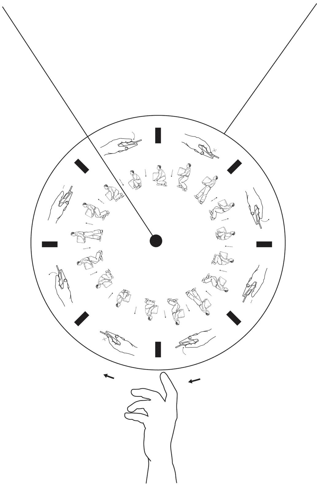

# 第二章

## 劳工

我走进亚马逊在新泽西州罗宾斯维尔的大型履约中心^(¹³)

图 2.1 位于新泽西州罗宾斯维尔镇的亚马逊履行中心里的员工和考勤钟（美联社照片/胡里奥·科尔特斯）

这座中心启用不久，机器人负责搬运装满货物的重型货架。橙亮的Kiva小车在水泥地上滑行，像水面上的小虫般平稳。它们遵循既定程序缓慢旋转，随后锁定通往待命工人的路径，背着重达1.3吨的货物堆前行。一支贴地移动的机器人队伍显得悠然又高效：搬运、旋转、前进，循环往复。它们发出低沉嗡鸣，却几乎被另一阵声浪淹没——那是工厂中枢的传送带，约22千米长，不停运转，轰鸣不止。

当机器人隔着铁栏上演协调的算法芭蕾时，工人们的境遇远没那么安稳。他们被拣货率指标推着走，必须在限定时间内完成指定件数的分拣与包装，焦虑与损伤随之而来。我在参观时看见许多人佩戴支撑护具：护膝、护肘、护腕。带路的工人指给我看每隔一段距离的自动贩卖机，“里面备着非处方止痛药，给有需要的人”。

机器人已成为亚马逊物流的关键环节，当机器运作顺畅时，人类更像备用选项。他们负责机器做不好的精细、特殊工作：在最短时间内挑出并核对人们想要送回家的各种奇形怪状物品，从手机壳到洗洁精。人的角色像结缔组织，把订单装进集装箱和货车并交付客户，但并非机器中最值钱、最可靠的部分。每天收工，所有员工都要穿过一排金属探测器才能离开。有人告诉我，这是防盗措施。

伴随网络技术发展，“网络数据包”成为常用的计量单位，在亚马逊，最基础的单位是棕色纸箱，上面印着模仿人笑的弯箭头。每个数据包都有“生存时间”^(¹⁴)这一参数。

对时间的掌控贯穿亚马逊物流帝国的始终，工人的身体按算法节奏运转。亚马逊是美国第二大私营企业，许多公司都在模仿。大量企业投入自动化，试图用更少的人榨出更多劳动。效率、监控与自动化的逻辑正通过算法管理劳动力体现。要理解这种效率背后的代价，亚马逊的人机混合配送仓库是关键的观察点。从那里可以开始思考AI系统中劳动、资本与时间如何交织。

本章不讨论人类是否会被机器人取代，而是关注监控、算法评估和时间调度如何改变工作体验。比起机器人是否取代人类，我更关心人类为何越来越像机器人被对待，以及这对劳动意味着什么。许多工作被“AI”一词遮蔽，掩盖了重复性劳动仍由人完成的事实，也强化了机器能做这些事的印象。但大规模计算深深植根于对人类身体的剥削。

若要理解AI背景下工作的未来，必须先了解工人过去与现在的经验。从福特时代的装配线，到为增强追踪与督促而设计的机器学习工具，价值最大化的路径从未中断。本章描绘了劳动地形的变迁，从塞缪尔·边沁的监察室，到查尔斯·巴贝奇的时间管理，再到弗雷德里克·温斯洛·泰勒的人体微观管理。在此过程中可看出，AI既不人工也不智能，它建立在众包劳动、时间私有化以及到岗、搬运、整理箱子等永不止息的人类努力之上。从机械化工厂衍生出一种模式，重视产品、流程与人类在一致性、标准化和互通性上的提升。

## 工作场所 AI 的史前史

工作场所自动化常被讲成未来故事，实际上已是当代常态。装配线强调一致性与标准单元，如今在零售、餐饮等服务业同样存在。所谓的知识型员工，自认不易被自动化威胁，却越来越受监控设施、流程自动化和工作休闲边界瓦解的支配［尽管女性几乎从未体验到清晰的边界，正如西尔维娅·费德里奇所指出的］。为了被软件管理系统解读，各行各业的工作被迫大幅调整^(¹⁵)。

我们生活在一个人类与AI协作被视为常态的时代，但这种协作并非公平协商。它建立在明显的权力不对称上——几乎没有不与算法系统合作的选项。即便想抵制自动化的公司，也面临自动化程度更高的竞争对手压力，要么融入主流，要么占据尚未被计算殖民的顶端价值。

AI对工作场所的侵入，与其说是既定形式的根本转变，不如说是19世纪末20世纪初建立的工业化劳动力开发的重演。那时工厂劳动被视为与机器相关，任务被拆分为技能要求低、体力要求高的行为。如今的劳动自动化延续了工业资本主义的历史动力。自工厂出现以来，工人不断遭遇更强工具、机器与电子系统，它们把更多价值转移给雇主并改变管理方式。我们在重温一个旧主题。关键区别在于，雇主现在能观察、评估并调整工作周期与身体数据中最私密的部分，而过去是被禁止的。

工作场所人工智能的史前史很多。其一是工业革命后生产活动的广泛自动化。亚当·斯密在《国富论》中首次提出，制造任务的细分是提高生产力与机械化生产的基础。他观察到，通过拆解生产步骤，曾由工匠手工完成的产品可由低技能团队用专用工具制造，产量显著提升而不增加劳动成本。

机械化很重要，但只有与化石燃料结合才推动生产能力大跃进。与产量上升同时，工人相对于机器的重要性大幅下降。工厂机械最初被视作帮助工人省力的协作设备，很快成为生产核心，决定速度与方式。以煤和石油驱动的蒸汽机带来持续的机械运动。工作不再是人类劳动的象征，而呈现机械化特征，工人去适应机器的节奏。基于斯密理论，卡尔·马克思在1848年就指出自动化从成品中抽离劳动力，使工人沦为“机器的附属物”^(¹⁶)。

工人的身体与机器结合得极彻底，早期工业家把员工当作可管理控制的原材料。借助地方政治影响力与付费安保，工厂主把工人困在工厂城镇，有时甚至阻止他们去机械化程度低的地区。

对工人的控制也体现在时间上。历史学家E.P.汤普森探讨了工业革命如何要求更严格的工作同步与时间纪律。转型过程中出现新的分工、监督形式、班次、罚款与考勤表：技术改变了人们体验时间的方式。文化同样强大。18到19世纪，关于努力工作的宣传以小册子和散文形式强调纪律，倡导早起与勤奋。利用时间既是道德也是经济行为：时间被当作货币，要么有效花费要么浪费。随着纪律加强，更多工人开始反抗——为时间而战。19世纪劳工运动强烈要求缩短可能长达16小时的工作日，时间本身成为斗争焦点。

早期工厂维持高效纪律员工队伍需要新监控系统。其一是“监察室”，一种圆形建筑，让所有工人处于监工视线内，主管在中央高台办公室工作。17世纪80年代，受雇于波将金亲王的英国造船工程师塞缪尔·边沁在俄国首创此设计，使经验监工能监管未经训练的下属，主要是波将金借给他的俄国农民。它也让边沁能密切关注监工是否有纪律松懈。他抱怨“日复一日，我都要处理下属的纠纷”。挫败感驱使他设计更极致的监控方案。在其兄功利主义哲学家杰里米·边沁到访后，监察室成为著名“圆形监狱”的灵感，中央瞭望塔可监视牢房。

自米歇尔·福柯《规训与惩罚》出版后，人们习惯把监狱视作监控社会的起点，杰里米·边沁是先驱。实际上圆形监狱的灵感源自年轻边沁早年的工厂经验。在被设计为监狱前，它最初是工作场所机制。

塞缪尔·边沁的监察室已基本从集体记忆消失，但故事仍在词汇中。监察室是波将金亲王的战略之一，他希望通过展示俄国农村现代化潜力和把农民转为制造业劳动力，在沙皇叶卡捷琳娜大帝宫廷获青睐。监察室为来访政要和金融家提供奇观，像“波将金村”那样用装饰外墙分散注意力，遮掩贫困乡村。

这只是冰山一角，与其他劳动相关历史事件共同塑造了监视与控制实践。美洲殖民种植园靠劳役维持糖等经济作物，奴隶主依赖持续监控。正如尼古拉斯·米尔佐夫在《观看的权利》中所述，种植园核心是监工，他们监视奴隶生产流程，“监督”意味着在极端暴力体系中指挥工作。正如一位种植园主1814年所描述，监工的角色是“永远不要让奴隶有片刻清闲。他一直在监视制糖，一刻也不离开糖厂”。这套制度还包括用食物与衣物收买部分奴隶，使其进入扩大监控网络，在监工不在时维持纪律与速度。

如今，监视在现代工作场所主要由监控技术代理。管理层用各种技术追踪员工：应用程式记录活动、分析社交媒体讯息、比较邮件回复方式与会议预定，并用“建议”推动更快更高效工作。员工数据被用来预测谁最可能成功，谁可能偏离目标，谁可能组织他人。部分系统使用机器学习，部分是更简单的算法。随着工作场所AI普及，基本监控与追踪系统扩展出更多预测能力，成为更具侵入性的员工管理、资源控制与价值萃取机制。

## 波将金 AI 与土耳其机器人

AI常被忽视的一大事实是，它需要海量低薪工人来开发、维护与测试系统。这种隐形劳动形式多样——供应链工作、按需点击工作与传统服务业。从为AI系统核心架构提取与运输资源，到每个微任务只值几便士的软件端，整条流水线都存在剥削。玛丽·格雷与希德·苏瑞称之为“幽灵工作”，莉莉·伊朗称之为“人工驱动的自动化”。她们都关注众包工人或“微工人”的经验：给数千小时训练数据做标记、审查可疑或有害内容。他们从事让AI“魔法”成立的重复工作，却从未因使系统运转而获认可。

尽管工作至关重要，薪酬通常很低。联合国国际劳工组织一项调查追踪了75个国家3500名微工人，他们定期在亚马逊土耳其机器人、Figure Eight、Microworkers与Clickworker等平台提供劳动。报告发现相当一部分人收入低于当地最低工资，尽管75%受访者在科学与技术方面专业程度很高。同样从事内容审核的人——评估待删除的暴力视频、仇恨言论与网络暴力——薪酬也很低。正如莎拉·罗伯茨所描述，这类工作会留下持久心理创伤。

没有这些工作，AI系统无法运行。AI研究圈依赖廉价众包劳动完成许多机器无法完成的任务。2008年至2016年，“众包”一词在科学论文中的出现从不足1000篇增至超过两万篇，与亚马逊土耳其机器人项目2005年启动相符。但同期，对依赖远低于最低工资劳动力的伦理讨论很少。

人们有强烈动机忽视世界各地对低薪劳动力的依赖。他们的工作——从为计算机视觉系统标记图像到测试算法结果——比雇用研究生更快更便宜地改进AI。因此问题常被忽视，正如一个众包研究团队观察到的，使用众包平台的客户“期待在没有监视的情况下廉价地、‘无摩擦地’完成工作，好像平台不是连接工人的接口，而是一台没有生活开销的巨大计算机”。换言之，客户把人当机器对待，因为认可并公正补偿会让AI系统更贵、更不“高效”。

工人有时被直接要求假装成AI系统。虚拟助理机器人创业公司x.ai声称其名为艾米的智能体能“神奇地安排会议”并处理日常琐事。但记者艾伦·休特在彭博新闻社的调查揭露，这根本不是人工智能。“艾米”由一支超时加班的合同工团队仔细检查并修改。同样，脸书的个人助理M也依赖持续人工介入，一组受薪工人审查并编辑每条信息。

伪装人工智能是身心俱疲的工作。x.ai员工有时实行14小时轮班，为电子邮件添加注释以维持服务全天候自动运行的假象。每个深夜，在队列完成前他们都不能离开。“我离开时感觉完全麻木，没有任何情感。”一位员工告诉休特。

## 门面光鲜 背后有人

别把铺天盖地的自动化宣传当真。业内常提的波将金式人工智能，本质上是一块给投资人以及容易上当的媒体看的展示板，真实运转依旧依赖后台的人工支撑。换个说法，这被包装成人工智能兑现前的概念验证，或是最小可行产品^(¹⁷)

作家阿斯特拉·泰勒把这类夸张其词却从未真正实现自动化的系统叫做人造自动化。界面看起来接管了过去由人完成的工序，实际上只是把工序转手给幕后的劳动力。泰勒举过快餐自助点单与超市自助收银，员工的劳动并未消失，只是被甩给顾客；还有号称能自动去重、自动删帖的线上平台，真正驱动它们的是一批在家工作的琐碎付出。像波将金的假村庄与模型作坊一样，当前最值钱的自动化把低薪的数字计件工与被迫承担无偿任务的消费者拴在一起运转，企业却拼命让外界相信干活的是智能机器。

这套打法的算盘是什么？人工智能的真实人力成本被刻意压低与遮掩，但推动现象的力量远超营销花招。这是剥削与去技能化的延续：人必须做更多单调重复的活来喂养自动化，因为自动化未必比被取代的对象更稳更可靠。可这条路能放大——开销下降、利润上升。我们不清楚远程工被依赖到何种程度，但清楚他们拿的是勉强糊口的底线工资，为消费者擦屁股、校对错误。

人造自动化并未真正裁掉人类，而是把劳动在时空中搬家、重新分配。这样拉大了劳动与价值的距离，在意识形态层面发挥作用。劳动者与成果疏离，也与从事相同工作的他人断开联系，更易被剥削。全球众包工的薪酬就是明证。他们与所有伪自动化工人面临的共同现实是：平台上成千上万的竞争者随时可以替代你，或者一个更简化的自动化系统随时把你顶掉。

1770年，匈牙利发明家沃尔夫冈·冯·肯佩伦做了一台精密的机械棋手。木箱加钟表装置里坐着一个真人大小的木偶，能赢人下棋。首秀在奥地利皇后玛丽亚·特蕾莎的宫殿，政要们全信这是智能自动机。它戴方巾、穿阔腿裤与镶毛边的长袍，被叫作土耳其机器人。那种种族化的装扮呼应了当时维也纳精英的异国情调。真相是箱子里藏着人类大师在操盘，外面看不见。

大约160年后，这个骗局被续写。亚马逊把基于小额支付的众包平台命名为亚马逊机械土耳其机器人，完全无视其种族主义与欺骗渊源。在平台上，真正的工人被刻意隐形，以营造人工智能自动、像魔法一样的假象。亚马逊最初搞这个的原因很直白：人工智能无法有效识别零售站内重复的商品页。试了好多昂贵方案失败后，工程师用人手补位。现在机械土耳其机器人把生意连到一群看不见的匿名工人身上，他们为微任务抢单。这是一个大规模分布式车间，人类通过检查与纠正算法过程来模拟、改善人工智能。亚马逊首席执行官杰夫·贝佐斯直言不讳地称之为人工驱动的人工智能。

波将金人工智能无处不在。显眼的是街上那辆自动驾驶车，驾驶座上总坐着一个随时准备接手的员；不显眼的是网页聊天界面。我们只触到被模糊处理的表面，不知道回应来自系统本身，还是被付钱、代表系统利益回应的真人操作员。

怀疑自己是不是在跟人工智能对话的同时，悖论也在发生。为了证明自己是人，我们要让谷歌验证码相信我们是人，乖乖点选带门牌号、汽车或房屋的方块。免费为谷歌的图像识别做训练。人工智能作为高效神话，靠的就是抽取大量无薪劳动来调校世界最富公司的系统。

当下的人工智能既不人工也不智能。我们可以而且应该为矿工的体力苦役、流水线上的重复劳作、外包程序员的精神血汗工厂、机械土耳其机器人里低薪众包的劳动，或用户无偿的隐形工作发声。在这些地方，能看到行星计算如何依赖对身体的剥削，而这剥削位于资本主义剥削链的顶端。

## 巴贝奇、福特与泰勒：劳动被拆解的蓝图

查尔斯·巴贝奇常被视作第一台机械计算机的发明者。20年代他提出差分机，用来极快生成精确巨量的数据表；30年代他有了分析机的可行设想，可编程通用机械计算机，用穿孔卡片给指令。

他对自由社会理论也很投入，写了很多关于劳动性质的文章，把对计算机与工人自动化的兴趣绑在一起。追随亚当·斯密，他认为分工能精简工厂、提效。但他走得更远：工业公司可以类比成计算系统，由多个负责特定任务的专业单元组成，相互配合完成工作。可整体看，成品里蕴含的劳动变得隐形。

在更思辨的写作里，巴贝奇设想可视化的数据表工作流，由计步器与重复时钟监控。他觉得把计算、监控与劳动纪律合在一起，就能实现更高效率与质量控制。这是惊人的预见，只到人工智能进入工作场所的近年才大规模成真。

巴贝奇的经济学基于斯密，但分歧明显。斯密认为商品价值源于生产所需的劳动成本；巴贝奇则认为价值来自生产过程设计的投入，工人只是执行被定义好的任务、按指示操作机器。对他而言，劳动力在价值链里多半是负面作用：工人可能因纪律差、受伤、缺勤或抵抗而跟不上精密机器的节奏。正如历史学家西蒙·沙弗所说，“在巴贝奇眼里，工厂像完美引擎，计算机器像完美电脑。劳动力可能是麻烦来源——会让表格出错或工厂倒闭——但不能算价值来源”。工厂被视作理性计算机器，唯一弱点是需要脆弱不可靠的人类劳动。

他的理论受金融自由化思潮影响，把劳动力当成需靠自动化控制的问题。他几乎不谈自动化的成本，也不谈能否改善员工体验。理想化的机械设备本质是为工厂主与投资者最大化回报。今天工作场所人工智能的倡导者也推生产愿景，优先效率、更高利润、削减成本，而非宣传的取代重复艰苦工作来帮员工。正如阿斯特拉·泰勒所言，“技术布道者追求的效率强调标准化、简单化与速度，而非多样性、复杂性与相互依存”。这不足为奇：营利公司的标准模式最高责任是为股东创造价值。我们活在这个系统里，公司必须尽可能多地榨取价值。与此同时，2005到2015年间，美国新增就业岗位中有94%是“可替代工作”——不属于全职、带薪的工作。随着自动化提升，人在不安全岗位上工作更久、负担更重、薪水更低。

## 芝加哥肉联：流水线的雏形

19世纪70年代的芝加哥肉类加工业，是巴贝奇设想的机械化流水线最早的落地场。火车把牲畜运到围场，动物被赶进邻近屠宰场，胴体通过机械化的架空电车运送到各加工站——后来的解体线。成品用冷藏轨道车送往遥远市场。劳工史学家哈里·布拉弗曼指出，芝加哥牲畜围场完全实现了巴贝奇的自动化与分工愿景，几乎任何人都能做解体线上任何技术性任务。低技术工人领最低工资，问题一现就被替换，自己像包装肉一样被彻底商品化。

厄普顿·辛克莱写《The Jungle》时，本意是揭露移民工人的悲惨，支持社会主义愿景。但小说产生不同效果。对带病腐烂肉的描写引发食品安全抗议，促成美国1906年《Meat Inspection Act》。公众对食品安全的关注有了回应，对工人的关注却缺席。从肉联业到国会都准备干预生产方式，却不愿碰支撑系统的剥削性劳动力因素。这种模式的延续说明权力如何回应批评：产品是牛的躯体还是面部识别，回应都是边缘管理，而非触及剥削性生产的根本逻辑。

工作场所自动化的另一对关键人物是亨利·福特与弗雷德里克·温斯洛·泰勒。福特在20世纪早期的流水装配线受芝加哥解体线启发；泰勒是“科学管理”创始人，在19世纪末发展出聚焦工人身体微小动作的管理方法。斯密与巴贝奇的分工概念关注在工具间分配工作，泰勒把焦点进一步缩小，纳入每个工人的微观动作。

秒表是关键工具。泰勒用秒表研究工人，把执行任务涉及的不连续身体运动做成详细中断时间。《Principles of Scientific Management》建立了量化身体运动的系统，优化工具与流程布局，目标是以最低成本获最大产出。这呼应了马克思对时间支配性的描述。

对时间的控制至今仍是效率手段。在服务业与快餐业，时间精确到秒。麦当劳流水线工人被标准评估：5秒处理屏幕订单，22秒夹好汉堡，12秒包装。最轻微的延迟——客人点单慢、咖啡机故障、员工请病假——就会引发连锁延迟、警告声与管理通知。

进入流水线前，他们的时间已被算法管理。一个结合历史数据分析与需求预测模型的排班系统决定班次，导致每周甚至每天都变。2014年加州一起集体诉讼指出，加盟商拿到软件提供的员工与销售额比预测，被指示在需求下降时迅速裁员。员工被告知推迟轮班，只能在附近闲逛，随时准备上岗。由于只按工作时间计薪，这被指为严重克扣工资。

算法分配的时间弹性很大，从一小时以内的超短班到繁忙时段的超长班，取决于哪个最赚钱。等待成本、被安排上班却被叫回家的精力浪费、无法预测个人日程而无法安排生活——这些人力成本都不在算法考虑里。这种时间盗窃提升了公司“效率”，代价由员工直接承担。

## 秒表与算法：被切碎的时间

快餐企业家雷·克罗克把麦当劳做成全球连锁，在设计标准化汉堡流水线时，承接了斯密、巴贝奇、泰勒与福特的谱系，让员工机械地跟随生产线。监控、标准化与削减个体手艺是核心。正如劳工研究者克莱尔·梅休与迈克尔·昆兰所争论的，“福特主义管理系统对工作与生产任务记录极其详细。它要求持续可记录的劳动参与，并对每个人的工作过程进行细致控制。任务执行中几乎没有思维活动”。

最大化每个工位耗时、减少“周期时间”成为福特主义工厂的铁律。工程师把工作分解得越来越细以便优化与自动化，主管惩罚落后者。亨利·福特本人常手拿秒表在车间走动，记录周期时间，留意生产率差异。

如今领导可被动监控员工，不必亲临工厂。工人刷卡或用指纹打卡，前面是计时设备，显示当前任务还剩几分几秒。他们坐在一堆传感器前，持续上报体温、在房间里的位置、浏览非指定网站花了多久。WeWork这家2019年精疲力竭的联合办公巨头，秘密安装监控设备，努力创造数据货币化新形式。2019年收购空间移动分析公司Euclid，暗示计划在付费会员经过他们的设备时追踪他们。达美乐比萨在厨房加装机器视觉系统，检查比萨是否按标准制作。监控被合理化，要么为进一步调解工作时间的算法提供输入，要么收集可能与效率相关的行为信号，要么单纯作为“观察了解”卖给数据代理商。

社会学教授朱迪·瓦克曼在《How Silicon Valley Set Time》一文中指出，时间追踪工具的目标与硅谷人口构成并非巧合。硅谷精英劳动力“更年轻、更具男子气概、更全心投入全天工作”。为最大化效率，他们创造了以残酷无情、赢者通吃为前提的生产力工具。这意味着年轻工程师在构建监督工作场所的工具，量化员工的生产力与期望值，他们大多是男性，通常没有耗费时间的家庭或社区职责困扰。科技初创企业吹捧的工作狂与全天候工作成为衡量他人的隐形基准，制造了一种“标准劳工”愿景：男性化、小范围、依赖他人无偿或低薪的辛勤工作。

## 主从时钟：谁在掌控时间

在工作场所管理的技术形态里，时间协调越来越精细。通用汽车的制造自动化协议Manufacturing Automation Protocol，MAP是为制造机器人协调问题提供标准解决方案的早期尝试，包括时钟同步。不久后出现了更通用的时间同步协议，可通过以太网与TCP/IP交付，包括网络时间协议Network Time Protocol，NTP和后来的精确时间协议Precision Time Protocol，PTP，它们在不同操作系统里衍生出多种竞争实现。NTP与PTP都通过在网络上建立时钟层级来实现，由“主”时钟驱动“从”时钟。

主从关系的比喻贯穿工程与计算。对这一种族主义比喻最早的使用可追溯到1904年，用来描述开普敦一座天文台的天文钟。直到20世纪60年代，这个术语才传播开来，尤其在达特茅斯分时系统开始被用于计算后。在人工智能早期创始人约翰·麦卡锡的建议下，麻省理工学院教授约翰·凯梅尼与托马斯·库尔茨开发了访问计算资源的分时程序。正如他们在1968年《Science》杂志中所写那样，“首先，用户的所有计算都在从机中进行，而执行程序（系统的‘大脑’）存在于主机中。因此，从机中的错误或失控的用户程序不可能‘破坏’执行程序，从而使整个系统停止运行。”控制等同智能的暗示在未来几十年继续影响人工智能领域的发展。正如罗恩·埃格拉什所说，这句话与南北战争前关于逃亡奴隶的话语有强烈呼应。

许多人认为主从术语冒犯，并已从Python与Github中删除。但它仍存在于世界上最广泛的计算基础设施中。谷歌的Spanner，因其跨越地球而得名，是一个巨大的、全球分布的、同步复制的数据库。它支撑Gmail、谷歌搜索、广告及谷歌所有分布式服务。

在这个规模下，Spanner在全球范围内运行，在数百个数据中心的数百万台服务器上同步时间。每个数据中心作为一个“时间控制”单元，始终接收GPS时间。但是由于服务器在轮询各种主时钟时，会出现轻微的网络延迟与时钟偏移。如何解决这种不确定性？答案是创建一个新的分布式时间协议——一种专有的时间形式——这样，服务器不管在地球上的哪个地方都可以同步。谷歌真情实感地称这个新协议为TrueTime。

谷歌的TrueTime是一种分布式时间协议，它通过在数据中心的本地时钟之间建立信任关系来实现功能，这样它们就可以决定与哪些对等点进行同步。得益于足够多的可靠时钟，包括提供极高精确度的GPS接收器与原子钟，以及非常低的网络延迟，TrueTime用一组分布式服务器来保证事件可以在一个广域网中以确定的顺序发生。

谷歌搭建的私有计时体系里，最让人注意的情节是单台服务器出现时钟漂移时，TrueTime 如何消化不确定性。研究人员说，一旦误差窗口被放大，Spanner 就会主动降速，等不确定性过去再继续。这一做法暗含一种近乎幻想的设想：放慢时间、挪动时间、把整颗星球绑进自家的时间代码里。人的时间感本就松动且带主观性，快慢取决于身在何处、和谁在一起，这正是时间的社会属性。TrueTime 在中央主钟的操控下，可以生产一种可滑动的时间标尺。牛顿曾设想一种脱离感知者的绝对时间，谷歌则为自己造出了一套宇宙级的时间。

把时间私有化以让机器顺滑运行的历史很久。19 世纪的铁路财团各自拥有计时体系，1849 年新英格兰的所有列车都按“国会街26 号威廉·邦德父子公司提供的波士顿真实时间”运行。彼得·伽里森记载，铁路经营者厌恶因目的地州而换时，纽约与新英格兰铁路公司的总经理称这种切换“讨厌、极不方便，对任何人都没有用”。1853 年一次正面相撞造成14 人死亡后，用新型电报技术同步各钟的需求变得紧迫。

电报与今日的人工智能一样被宣传为放大人类能力的联合技术。1899 年索尔兹伯里伯爵夸耀电报“在很大程度上把全人类拉到一起”。企业、政府与军队借助电报把零散计时拼成统一网格，削弱地方计时。电报由早期工业垄断巨头西联汇款掌控。传播学者詹姆斯·凯里认为，电报不仅重塑了人际的时空边界，还催生了一种新垄断资本主义——一套为合理化私人垄断公司控制而服务的法律、经济、政治、管理与科学框架。电报与跨大西洋电缆的结合，也让帝国列强更集中地管控殖民地。

电报让时间进入商业内核。商人不再靠地区价差在不同地点低买高卖，而是在不同时区之间交易：从空间套利转向时间套利，再走向期货。数据中心的私有时区正是这一脉络的最新体现。时间基础设施的排序像是一种宏观物理力量，在行星尺度上塑造信息的新逻辑。

对集中时间的反抗贯穿历史叙事。1930 年代福特想对全球供应链加强控制，在巴西雨林深处建立了他命名的福特城，建起橡胶园与加工厂。他雇佣当地人加工橡胶后运回底特律，试图把严密的制造纪律强加给社区，结果适得其反。暴动的工人拆毁工厂的钟，砸碎记录每个人进出的设备。

另一种抵抗聚焦于劳动过程本身。法国无政府主义者埃米尔·普热把工人刻意放慢节奏的行为称为怠工，即在车间里“放慢脚步”。目的是夺回效率，降低时间作为货币的价值。即便人们总能找到对抗算法与视频监控强加工时的办法，这种对抗正变得愈发艰难，因为劳作与时间的关联被监控得愈发紧密。

图 2.2 在 1930 年 12 月的暴乱中被毁坏的福特之城的考勤钟（来自亨利·福特博物馆的收藏）

从车间内部对时间的精细调节，到行星级计算网络上的大规模调控，都是对时间进行定义，这本身就是集中权力的手段。人工智能让对全球分散劳动力的开发程度进一步加深，从而利用经济拓扑的不平衡。与此同时，科技业正为自己铺设一个平滑的全球时间地貌，以提升效率并加速业务达成。无论是教堂、火车还是数据中心的钟，控制时间历来承载规训政治秩序的功能。但这场争夺从未一帆风顺，而是长久的深远冲突。工人总能找到介入和反抗的缝隙，哪怕技术被强加、被美化为进步，其实质不过是强化企业的监督与控制。

## 设定速率
亚马逊不遗余力地控制访客在运营中心能看到什么。我们被告知起薪至少15 美元每小时，工作满一年还有额外补贴，还有明亮的休息区，墙上印着奥威尔式的企业标语“节俭”、“赢得信任”、“贵在行动”。官方导览用排练过的片段轻松说明站点流程。任何涉及劳动条件的提问都会被细致回应，以呈现最积极的形象。但仍有难以掩盖的不适与失衡迹象。

在拣货区，员工要把装满货物的灰色包装袋，俗称“手提包”，搬到发货区，白板上记着最近会议的要点。有人多次投诉手提包堆放过高，频繁伸手取物导致身体疼痛与伤害。亚马逊的指南迅速回应称正在通过降低关键段传送带的高度来解决，被视作一次成功：投诉已登记，将采取行动。指南借此解释为何这里不需要工会，因为“员工有很多机会与经理沟通”，工会只会干扰沟通。

离开厂区时，我经过一面实时滚动工人信息的电子屏，标题写着“同事之声”。光鲜感在这里消失了。对随意改动的排班抱怨、临近假期无法预约休假、错过家庭聚会与生日的信息快速闪过。管理层也即时回复，语式不外乎“我们重视您的反馈”之类变体。

“适可而止。亚马逊，我们希望你像对待人类一样对待我们，而不是像对待机器人一样。”这是明尼阿波利斯阿伍德中心执行董事阿卜迪·缪斯的话。该中心致力于改善明尼苏达州东非社区的工作条件。缪斯是仓库工人的温和捍卫者，当地许多工人被亚马逊招募，并获赠免费通勤等甜头。

亚马逊招募这些员工时，很少提及“速率”——衡量履约中心员工生产力的指标，很快变得不可持续，且缪斯认为它是不人道的。工人承受高压、伤痛与疾病。缪斯解释，若一天内速率下降三次，就会立即被解雇，无论工龄多久。员工担心表现不佳，甚至不得不在本该如厕的时间继续工作。

见面那天，缪斯很乐观。尽管亚马逊公开反对工会，非正式的工人团体在美国各地涌现并举行抗议。他笑着说：“不可思议的事情正在发生。”次日，一群仓库工人将离职。约六十名工人身着规定的黄色背心，在明尼苏达州伊根的一处配送中心外雨中集会，多为索马里裔女性，手举标语要求提高夜班工资与限制箱子重量。几天前，萨克拉门托的员工抗议公司解雇一名仅因家人去世后休一小时丧假的同事。此前两周，逾千名员工举行了公司历史上首次白领罢工，抗议其巨额碳排放。

最终，亚马逊在明尼苏达的代表坐到谈判桌前。他们愿意谈很多事，却从不谈“速率”。缪斯回忆对方说：“忘了速率吧，我们可以谈其他事，但速率是我们的商业模式，无法改变。”工人威胁停工，亚马逊仍不让步。对双方而言，速率是核心也是最难改的问题。与可由现场主管让步的地方纠纷不同，速率标准由西雅图的高管与技术人员制定，并写入优化计算分配基础设施的程序。若当地仓库不同步，亚马逊的时间安排就会受威胁。组织者于是把注意力转向在不同工厂与部门间建立运动机制，以应对速率无情节奏所代表的权力与集权核心。

正如所见，争夺时间主权的斗争历史悠久。AI 与算法监控只是工厂、计时表与监控架构长期演进的最新一环。如今从优步司机到仓库工人，再到高薪的谷歌工程师，都意识到自己卷入同一场战斗。纽约出租车工人联盟执行董事巴拉维·德赛说：“工人们总是知道的。无论是在红灯前、餐馆里或酒店排队，他们都团结，因为他们知道要繁荣必须团结。”技术驱动的剥削在许多行业普遍存在，工人们正与生产逻辑及其中嵌入的时间秩序斗争。时间结构从不完全不人道，却始终徘徊在大多数人容忍边界之外。

跨部门团结并非新鲜事。传统工会曾联结不同行业的工人争取加班费、工作安全、产假与周末休息。但强大的商业游说与受其影响的政府在数十年间削弱劳工权利与保护，限制组织与沟通渠道，使跨部门支持更难。现在，AI 驱动的提取与监控系统已成为劳工组织者联合反对的核心。

“我们都是技术工人”已成为技术相关抗议的常见标语，由程序员、门卫、食堂工人与工程师共同举起。它要求科技业承认，其产品、基础设施与工作场所的运转依赖大量劳动力。它也提醒我们，绝大多数人在工作中使用笔记本与移动设备，登录 Facebook 或 Slack 时，受制于工作场所 AI 的标准化、追踪与评估。这为一种更广泛、更具力量的新型团结奠定了基础。因为如果我们都受制于寻求控制与分析时间的提取技术基础设施，那么我们在未来工作的形态上便有共同利害。

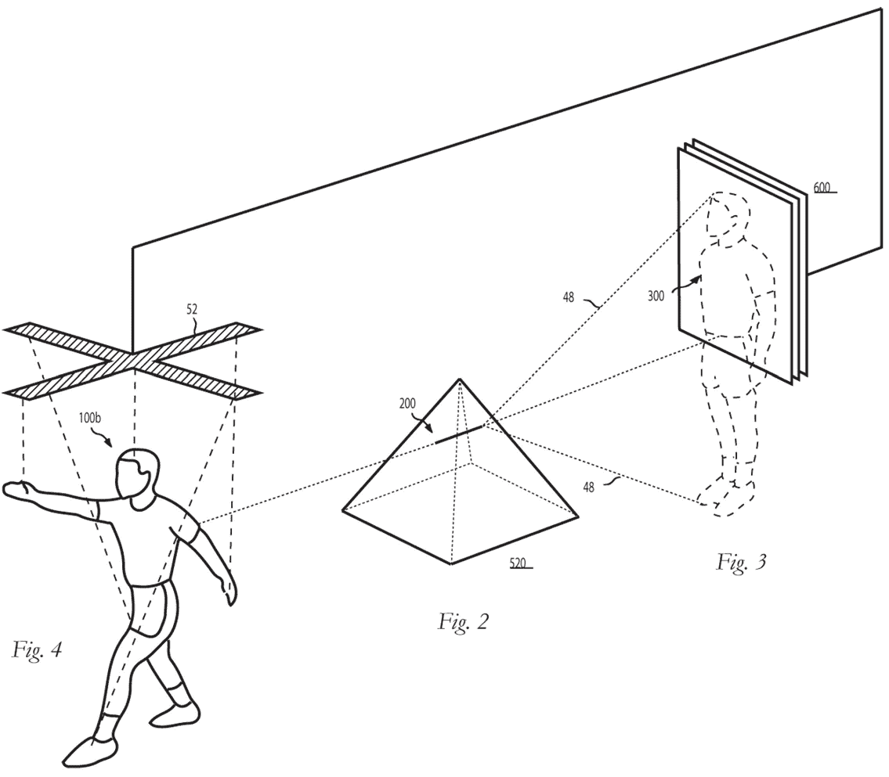
# 第三章
## 数据
一名年轻女子仰望，目光落在镜头外的某处，仿佛拒绝承认拍摄。下一张照片里，她的视线锁定在不远处；再下一张，头发凌乱，表情沮丧。随着照片增多，她嘴角的线条逐渐下沉加深。最后一张，她看起来衰老许多，精神萎靡——一只眼睛受伤，脖颈皱纹明显。这些照片是某位女性在有生之年多次被捕时拍摄的面部照。她的图像被收录进名为“特殊数据库 32 号”的数据库，这是一种多重遭遇数据集，在网上共享，供任何人测试面部识别软件。

图 3.1 面部照片图像数据库，该组图片来自美国国家标准与技术研究所（NIST）的多重遭遇数据集（MEDS）——“特殊数据库 32”（美国国家标准与技术研究所，美国商务部）

该数据集由美国国家标准与技术研究所维护，该所是美国历史最悠久的物理科学实验室之一，现属商务部。NIST 成立于 1901 年，旨在强化国家测量基础并与德国、英国等工业对手竞争，制定标准。电子健康记录、抗震摩天楼、原子钟等皆在 NIST 管辖。它负责时间、通信协议、无机晶体结构、纳米技术的计量。NIST 的目标是定义与支撑各类标准以实现系统互操作，现今开发人工智能标准也被纳入工作范畴。为生物识别数据设立的测试基础设施即是 NIST 需要维护的内容之一。

2017 年，我在浏览 NIST 数据档案时首次发现这些面部照片库。生物特征数据的规模庞大。50 多年来，NIST 与联邦调查局合作自动指纹识别，并开发指纹扫描仪与成像系统的质量评估方法。2001 年 9 月 11 日后，NIST 成为国家应急部门之一，通过制定生物识别标准来核查与追踪入境者。这成为面部识别研究的转折点，使其应用从执法扩展到跨境管控。

面部照片极具冲击力。有人带着明显的伤口、瘀伤与黑眼圈，有人哀伤哭泣，有人只是茫然盯着镜头。“特殊数据库 32 号”收录数千张死者生前多次被捕时的照片，源自他们与刑事司法系统的多次接触。数据集中的人物被呈现为数据点，不带任何故事、背景或姓名。因照片系被捕时拍摄，无法得知这些人是否被指控、被判无罪或被监禁。他们以相似方式被展示。

这些面部照片进入 NIST 数据库的意义，已从在执法系统中识别个体，转变为测试商业与学术 AI 系统的技术基准。艾伦·塞库拉指出，面部照片属于技术现实主义传统，旨在“提供罪犯的标准画像”。他注意到警用摄影史上有两条脉络：发明入案照片的阿尔方斯·贝蒂永等犯罪学家视其为识别惯犯的个人生平机制；另一边，统计学家与优生学奠基人弗朗西斯·高尔顿用囚犯复合肖像来探测生物学上的“犯罪类型”。高尔顿的工作出自面相学范式，目标是从外表找通用特征以揣测性格。当面部照片用作训练数据时，它们不再是识别工具，而是微调自动化视觉形式的材料，可视为高尔顿式做法。面部照片被用来提取面部的数学成分，把自然还原为几何本质。

面部照片构成测试面部识别算法档案的一部分。多重遭遇数据集的人脸已成为标准化图像，用于比较算法准确性。NIST 与智能高级研究项目活动合作，基于这些数据举办研究竞赛，比拼算法速度与准确度。研究团队在人脸验证或从监控视频检索人脸等任务中角逐。胜利带来名声、工作机会与行业认可。

照片中的人与其家属对这些图像的使用毫无发言权，甚至可能不知自己成为 AI 测试平台的一部分。面部照片这一研究主题鲜为人知，工程师也很少认真对待。正如 NIST 文件所述，面部照片的存在纯粹为“改进面部识别的工具、技术和程序，以支持下一代识别项目、法医比较、培训、分析，以及面部图像一致性与机构间交换标准”。其描述冷冰冰地指出，许多人表现出暴力承受迹象，如疤痕、瘀伤与绷带。但研究者推测这些迹象难以解释，因缺乏“清白”样本作对比。这些人不是个体，而是共享技术资源的一部分，仅是验证测试程序的数据组件，这正是该领域的“黄金标准”。

多年研究 AI 系统构建方式，我考察过数百个数据集，NIST 面部照片库尤其不安，因其预示了一种已渗透科技行业的逻辑：一切都是数据，且随时可用。照片拍摄地点、是否反映脆弱或痛苦时刻、是否构成羞辱皆无关紧要。行业里获取并使用任何可用东西已成常态，很少有人质疑其政治合理性。

从此意义看，面部照片是当前 AI 制造方法的原始基础。图像背后的来历与权力被视作无关紧要，因其不再作为独立存在。它们不被视作具意义或道德重量的个人形象，或监狱系统结构性权力的代表。个人的、社会与政治意义被视作中立。我认为这体现了从图像到基础设施的转变，在成为驱动更大系统的聚合体时，对个人形象背后意义或关怀被视为可清除的。所有这些被当作需处理后运行的数据，或为提升技术性能而消耗的材料。这正是数据提取主义的核心前提。

机器学习每天用这类图像训练——在无背景信息、无同意的情况下从互联网或国家机构获取。它们并不中立。它们承载个人历史、结构性不平等，并与美国治安与监狱系统的种种不公正相伴。但把它们当作非政治性惰性材料的假设，影响了机器学习“观察”的方式与内容。计算机视觉能检测人脸或建筑，却无法检测一个人为何出现在警察局，或当时的社会历史背景。最终，单个实例如一张人脸照片对训练 AI 模型并不重要，重要的是足够多样化的集合。任何一张图像都可被另一张替换，系统仍同等运行。而互联网与社交媒体这些全球性的宝库，持续提供更多数据。

一个身穿橙色连体衣站在镜头前的人，被非人化为更多数据。他的出身、照片获取方式、背后的制度与政治背景都被忽略。这些数据被用来制作面部识别等工具。入案照片被视为提供免费、光线充足人脸图像的实用资源，是测试面部识别技术的基准。无论是否定罪，这些数据都在未经同意下被取用。就像不断收紧的棘轮

如今所有可公开访问的数字资料，即便涉及隐私或具有破坏性，都被同等抓取并汇入训练集，用以生成治安、广告、翻译、招聘自动化等应用的 AI 模型。毋庸置疑，大规模获取数据已成为人工智能的基础。那我们是如何走到这一步的呢？到底是什么样的数据构造方式促进了背景信息、意义和特异性的剥离？如何在机器学习中获取、理解和使用训练数据？训练数据在哪些方面限制了人工智能解释世界的要素和方式？这些行为增强和催生了哪些形式的权力？

数据被包装成人工智能神话的燃料，抓取起来看似唾手可得，但这种惯常操作埋下的结构性后果却极少被正视，它不断拉大权力落差。行业里流行一种冷酷的实用主义，视情境、审慎和对方同意为累赘，反而鼓吹大规模搜集原材料是打造可盈利计算“智能”的正当前提。于是图像、文字、声音、视频都被降格为模型的原料，目的的合理性足以掩盖手段的争议。问题在于，谁从这种转变中获利最多？为何这种主导叙事屡屡自我强化？此前讨论过的、重塑人类与自然劳动关系的提取逻辑，在机器学习里同样是决定性的。通过聚焦训练数据这个核心环节，就能看清整个转向的要害。

## 让机器学会“看”

## 模型为何对数据如此饥渴

想明白当代系统为何离不开海量样本，可以从计算机视觉切入。让机器解读图像是一项极其复杂且充满关联的工作，却很少被拆解讨论。图像本身不稳定，承载多种意义、未解难题与矛盾。如今搭建视觉系统，第一步往往是网罗数十万甚至上百万张网络图片，再搭建分类层级以此作为感知“事实”的基座。这些庞大图集被称作训练集，被开发团队视作“基本事实”。于是真相不再是现实的反映或共识产物，而成了从线上抓取的混乱拼贴。

工程师通过人工标注来监督学习过程，背后运作着两类算法：学习器与分类器。学习器在标注样本上训练，随后指导分类器如何关联新输入与预期输出，像判断图中有无面孔、邮件是否垃圾。标注样本越多，预测越准。模型形态多样，有神经网络、逻辑回归、决策树等，工程师按任务挑选并匹配算力。

举例来说，要区分苹果与橙子，先要收集并标注成千上万张两者的照片，再用以训练神经网络。算法会统计图像特征，构建区分两类“类别”的模型。若顺利，模型也能辨认从未见过的苹果与橙子。但如果训练图里全是红苹果而没有绿苹果，系统就会归纳出“苹果都是红的”。这种基于现有样本的归纳推理不同于逻辑演绎，导致青苹果被误判。由此可见，训练集是绝大多数机器学习做推理的核心原材料。

训练集不仅塑造模型特性，还用于评测其随时间表现。算法在全球赛场上相互较量，工程师借此判断谁在特定数据上更好。这些基准集成了行业通用语的字母表，ImageNet挑战赛就是最知名的竞技场之一。

一旦某套训练集成为可用基准，就会不断被改造、扩充、衍生。一种谱系由此诞生，新集继承旧集的学习逻辑。ImageNet借鉴了上世纪八十年代词网的词类分法，而词网本身又可追溯至1961年出版的百万词条布朗语料库。训练数据踩着旧分类的肩膀累积，像一部不断增厚的百科全书。^(²⁰)

## 数据胃口的历史演变

“世界已进入一个高度可靠且廉价的精密设备时代；一定会发生点什么。”这是曼哈顿计划负责人、国家科学基金会创始参与者范尼瓦尔·布什在1945年的设想。他描绘的未来算术机能高速运转并自行挑选数据，但需要巨量喂养：

这类机器胃口惊人。以往需要一屋子女孩敲键盘输入指令与数据，几分钟才出结果。在数百万人的复杂事务里，总有大量细节可供计算。

被点名的“满屋子女孩”是当时的数据操作员。历史学家詹妮弗·莱特指出，她们常被视作可读取记录的输入设备，实则在加工数据与运行系统上的作用，与设计战时数字计算机的工程师同等重要。机器与数据的关系被视为永无止境的消耗。

七十年代人工智能主攻专家系统，用规则编程缩小行动范围。但现实世界的复杂与不确定让规则集显得脆弱不实。八十年代中期起，实验室转向概率论与“蛮力”，用海量计算周期穷举选项。

IBM研究所的语音识别团队是典型案例。最初靠语言学方法，后来弗雷德·耶利内克、拉利特·巴尔、彼得·布朗、罗伯特·默瑟组成新团队转向统计相关性，弱化语法与语言学规则。若要统计方法生效，就需要海量真实语音与文本。媒体学者李晓昌写道，这相当于把语音简化为数据，在缺乏理解的情况下建模。后续数十年，内容简化为数据、意义简化为统计模式的路径被反复使用。

对数据的依赖带来新挑战，模型必然由训练数据的特征决定。数据集大小成为核心，越大越能改善概率估计，也越易捕捉罕见结果。1985年，罗伯特·默瑟用“更多的数据就是更好的数据”概括团队方向。

当时获取数据的难度很大。拉利特·巴尔回忆，那时连一百万个可读单词都不好找。他们收集IBM技术手册、儿童小说、激光专利、盲人书籍，甚至迪克·加文写氢弹设计的信件。这与斯坦尼斯拉夫·莱姆的小说呼应，书中人物特鲁尔想造写诗机器，需“从宇宙级别的数据中挖掘优质部分”。

IBM最终在反垄断诉讼中找到“宇宙”。1969年起的联邦诉讼持续13年，近千名证人作证，IBM雇员把证词数字化到霍勒瑞斯穿孔卡，到八十年代中期形成一亿词语料库。默瑟公司当时说，政府无意中造了个宝库。

IBM并非唯一。1989至1992年，宾夕法尼亚大学团队打造宾夕法尼亚树库，收集450万个美式英语词，来源包括能源部文摘、《华尔街日报》新闻专线、联邦通讯社关于南美“恐怖活动”的报道。他们发现新文本常借用旧文本再贡献新资源，收集谱系由此显现。

另一个经典案例来自安然公司破产后的欺诈调查。联邦能源监管委员会为搜证公开了158名员工的电子邮件，在“公众知情权高于个人隐私”理由下上线。超过五十万次日常对话成为语料库，却仅代表特定性别、种族与职业倾向。安然语料被数千篇论文引用，《纽约客》评价其为“无人真正阅读的经典”。这种构建与依赖预示了自然语言处理的新常态。

文本档案被视作中立集合，技术手册与同事邮件被等同。但语言并非惰性物质，Reddit帖文与高管邮件不会同等地运行。每批收集的文本都携带偏差与偏见，会被内建进更大系统。语言没有中立底座，所有集合都烙印着时空、文化与政治。部分语言因缺乏数据而难以被研究。

IBM训练数据、安然档案、宾夕法尼亚树库都可追溯到特定历史语境。如何标注“该集可能因依赖八十年代南美恐怖报道而偏离”这类警告，至今没有标准。三十年后，数据源头、获取方式的伦理仍缺乏记录规范。

## 人脸数据如何被系统化收割

随着文本对语音识别愈发重要，人脸数据成为面部识别系统的基石。上世纪九十年代末，美国国防部反毒品技术开发计划办公室资助FERET计划，用以研发情报与执法用的自动人脸识别。在此之前可用人脸数据稀少，仅几十张。美国陆军研究实验室建立的训练集包含一千多人、多姿态肖像，共14126张图像，与NIST面部图像集一起成为比较方法的规范基准。

FERET的目标包括自动检索人脸图像、机场与边境监控、驾照数据库欺诈检测等。两个核心场景是：把已知个人面部提交给算法，在大规模图像库中找最接近匹配；以及在大量陌生人群中识别已知目标，如走私犯或恐怖分子。

照片为机器设计而非人眼，却呈现出不寻常的视觉效果。乔治梅森大学用35毫米镜头拍摄，高分辨率正式肖像风。1993至1994年拍摄的首批图集像时间胶囊，保存了九十年代初的发型与时尚。受试者需转向多个角度，有侧脸、正脸、不同光照、不同服装，部分对象跨年拍摄以追踪衰老。每位参与者签署经大学伦理委员会批准的知情同意书，知晓项目并同意参与。这种知情标准在随后几年迅速罕见。

FERET标志着“正规制作数据”时代，数据规模大且有知情同意、专业相机。早期多样性仍不足。1996年论文承认年龄、种族、性别分布存在问题，但认为程序层面算法性能才是关键。2001年后，随着对恐怖分子监控关注上升，资金激增，FERET成为最常用基准，生物识别与自动化视觉随之扩张。

## 从网络狂潮到图网帝国

互联网改变了资源获取方式。在AI研究里，它被视为天然可得的宝库。随着图片上传至网站、图库与社交平台，数据掠夺开启。训练集规模达到八十年代研究者无法想象的量级。过去需精细控制光照、参数、设备的人脸拍摄已不再必要，现在每种光照、角度、景深都有数百万自拍。婴儿照、家庭旧照成为追踪遗传相似性与面部衰老的资源。每天互联网产生数万亿行文本。2019年，脸书日均上传3.5亿张照片，推特日均发送5亿条推文，仅是美国两大平台的数字。任何在线信息都能成为训练原料。

科技巨头占据上风：持续不断的图像与文本流，分享者越多其力量越大。人们免费为照片标注姓名地点，这种无偿劳动提升了视觉与语言模型的精度。行业内部这些数据集极具价值，因隐私与竞争优势，它们从不共享。学术实验室若想比肩巨头，却难以负担收集与标注的成本，于是转向廉价众包，批量提取网络图文。

ImageNet是AI领域最重要的训练集之一。2006年李飞飞提出构建大规模目标识别集，“我们要做前所未有的事，要绘制整个世界”。2009年计算机视觉大会上，海报开篇写道：

数字时代带来巨大数据爆炸。据最新估计，Flickr^(²¹)

从一开始，数据就被描述为海量、无序、非个人化且可即时利用。作者指出如何利用与组织仍是未解问题。通过搜索引擎抓取数百万张网络图像，研究团队得到“大规模图像实体”，为识别算法提供训练与基准。ImageNet最终累积超过1400万张图像，分成两万多个类别。尽管数以万计图像涉及高度隐私且不适宜公开，研究论文却未优先讨论或甚至提及获取个人数据的道德问题。

互联网上抓取到海量图像之后，接踵而来的难题是：谁来给它们命名、归类？李教授最初的设想很朴素，用 10 美元一小时的价格雇普林斯顿的本科生手工把图片归到数据集里。她很快算出，按现有预算，这个活要干 90 多年。转折来自一名学生，他向她展示了亚马逊 Mechanical Turk。这个分布式的人力平台让研究者能够在极短时间内调动规模庞大、成本极低的在线劳动力，去完成标记、分类这类重复工作。李教授后来回忆，看到网站的那一刻她就认定图网项目能成，“我们一下子拿到了一种可以规模化使用的工具，这是靠本科生做不到的。”于是，这份工作从校园里消失了。

图网很快成为该平台全球最大的学术客户。团队搭建后，平均每分钟能把 50 张图分进数千个类别，苹果、飞机、潜水员、相扑选手都在其中。也混进了让人不适的标签：酒鬼、猿人、疯子、妓女、斜眼。没有任何架构师认真审视过这些图像或类别，没人去管它们为什么会长期存在于网络里。十年间，图网从一个标注项目膨胀成机器学习图像识别的巨兽，成为领域的基准。未经同意、免费抓取互联网用户的标注方式被固化为行业惯例，此后数百个训练集都照此模仿。而这种做法制造的标记数据，最终又回流进了图网本身。

## 知情同意为何失效

21 世纪初，数据采集从以知情同意为前提转向单方面占有。收集者可以把互联网上的内容直接纳入囊中，不用签协议、不走伦理审查。除了不再需要摆拍，人为决定就已足够。色彩更刺眼的案例随之出现。科罗拉多大学科罗拉多斯普林斯分校的一位教师在校园主干道上架起摄像头，秘密拍摄了 1700 多名师生，用来训练自己的面部识别系统。杜克大学也有类似项目，在学生完全不知情的情况下拍摄了 2000 多人课间走动画面，研究成果直接放到网上。这个名为 DukeMTMC 的多摄像头人脸数据集，由美国陆军研究办公室和国家科学基金会资助。

这并非孤例。斯坦福的研究人员征用旧金山一家热门咖啡馆的网络摄像头，在毫无告知的情况下收集了将近 12 万张“市中心咖啡馆日常”的照片。一遍遍地，未经当事人同意的抓取数据被送给机器学习研究者使用，而使用场景往往会让被拍者感到不安。

微软的里程碑式面部数据集 MS-Celeb 也属此类。2016 年，该集从网上抓取了约十万名名人的近千万张照片，成为当时最大的公开人脸库，涵盖演员、政客、记者、行动者、政策制定者、学者、艺术家。讽刺的是，其中不少人正是面部识别的批评者：纪录片导演劳拉·波伊特拉斯、数字权利活动家吉莉安·约克、评论家叶夫根尼·莫罗佐夫，以及《监控资本主义》作者肖莎娜·祖博夫。

即便抹掉姓名并谨慎发布，识别仍会发生，敏感信息也会泄露。2013 年，纽约市出租车与豪华轿车委员会公开了一个包含 1.73 亿次行程的数据集，记录时间、地点、费用和小费。司机编号原为匿名，后被公布，研究者据此推断年收入、家庭住址等隐私。和名人博客等公开信息一结合，演员、政客等公众人物的出行就被轻易还原，甚至能查出谁去过脱衣舞俱乐部及地址。更甚者，所谓可预见的群体隐私伤害也会出现：通过观察祈祷时段出租车停运，就能揣测哪些人是虔诚信徒。

匿名且看似无害的数据集总能挖出高度个性化的信息，但这并未减缓图像与文本的采集潮。机器学习越成功，对更大数据的依赖越强。明明科学家和公司早知风险，为何扩张仍被默许？是何种信念、说辞与经济激励让大规模数据提取和把数据等同于通用价值变得正常？

## 数据崇拜的修辞

要理解机器学习里数据神话的崛起，可以看人工智能教授尼尔斯·尼尔森 2010 年的人工智能史。他写道，大量原始数据需要高效的数据挖掘技术来分类、量化、提取有用信息。机器学习正因能处理海量数据而愈发重要。事实层面，数据越多越好。

这与几十年前罗伯特·默瑟的观点相呼应：数据无处不在，有利于大规模分类，于是形成了一个不证自明的共识：数据可被获取、可被优化、可变成价值。

时间推移，既得利益者不断强化这一信念。正如社会学家玛丽恩·弗卡德与基兰·希利所说，强制性数据采集不仅来自数据行业，也来自机构与所部署的技术：来自技术的制度性指令最有效——我们这么做是因为我们能做。专业建议、制度需求、技术支持让组织收集尽可能多的个人数据。数据量可能远超组织的想象与分析能力，但没关系，大家默认它终究有用。现代组织既受数据不可阻挡的文化推动，又握有加速这一趋势的工具。

于是形成一种道德命令：收集数据以改进系统，而不去关心未来可能带来的负面后果。“越多越好”的潜台词是，积累足够多样的数据后，个人信息就会完全可知。但数据到底是什么？历史学家莉萨·吉特尔曼指出，每个学科和机构对数据的认知都有自己的规范与标准。在 21 世纪，数据变成了可以随意拿取之物。

“数据挖掘”“数据是新石油”等表述把数据从个人、私密、受产权控制的事物，转化为惰性、非人化的资源。数据被描述为消耗品、需要管控的流量、需要变现的投资。“数据是新石油”虽暗示可开采的原材，却极少用来讨论石油与采矿业的成本：契约劳工、地缘政治冲突、资源枯竭、超出人类时间尺度的后果。

最终，“数据”变成一个血less 的词，遮蔽了物质来源与目的。若把数据视作抽象非物质，便更容易脱离关怀、同理或风险相关的责任。研究者卢克·斯塔克与安娜·劳伦·霍夫曼指出，把数据隐喻为等待发掘的天然物质，本就是殖民大国长期使用的修辞。若数据来自原始未炼资源，抓取就合理；若数据是新石油，机器学习就被视作必要的提炼。

数据也开始被当作资本，与市场作为价值组织主要形式的观点一致。算法把人类活动转化为数字痕迹，再在评分指标中统计排序，这本身就是价值提取。拥有正确数据信号的人，例如能拿到折扣保险或更高市场地位的人，会获得更多优势。主流经济中的高成就者在数据评分经济中表现良好，而最贫困者则成为最危险的数据监控与提取的目标。当数据被等同于资本，只要能收集更多，一切都合理。这也是集中式数据提取的核心驱动力。社会学家贾森·萨多夫斯基认为，数据采集由永久的资本积累循环驱动，它反过来构建并依赖一个一切皆数据的世界。数据普遍性把一切重新定义为数据资本主义的范畴，所有空间都必须被数据化。若把宇宙视作无限数据储备容器，积累与循环就能永续。

海量提取的意识形态极具力量。萨多夫斯基称之为“不断前行的前沿，是资本主义的未来，也是 AI 发挥作用的基础”。于是整个行业都不希望这一前沿被质疑。

机器学习模型需要持续的数据流才能更准。但机器只能渐进，永远达不到完全精准，这又推动算法从尽可能多的人身上抽取信息为 AI 供能。这造成从“人类主体”到“数据主体”的转变，即把人简化为缺乏主观性、背景、明确权利的数据点集合。

## 工程师的免责叙事

绝大多数大学的智能研究都是绕开伦理审查完成的。若技术用在教育、医疗等敏感决策中，为何不接受更严格审查？要回溯到机器学习出现前的学科。应用数学、统计学、计算机科学历史上并不被视作研究人类的领域。

人工智能早期的基础科学把人类数据当作远离研究的客体。即便数据集来自并代表人类生活，使用它们的研究更多被视作一种无实质风险的应用数学。大学的机构审查委员会长期接受这一立场，起初有道理：它们主要关注生物医学与心理学实验中会导致个体受试者明显风险的干预，而计算机科学被认为更抽象。

一旦人工智能脱离 80、90 年代的实验室，进入现实世界——预测再犯风险、福利资格等——潜在危害急剧放大，且会波及整个社区。但社会仍相信公开可用的数据集风险极小，应免于伦理审查。这一想法是早期产物，当时跨地迁移数据困难、存储成本高昂。如今数据集更容易互联、可被无限重用、持续更新且常失语境。

随着 AI 工具愈发侵入，研究者可在不接触被试的情况下获取数据，风险图谱迅速变化。有人发表论文称开发出“犯罪自动分类系统”，聚焦暴力犯罪与帮派，仅用四项信息预测：武器、嫌疑人数、邻近区域、位置。他们使用洛杉矶警察局的犯罪数据，记录五万多起案件，部分标记为帮派相关。

帮派数据以不准确和漏洞著称，但研究者仍将其作为权威来源训练预测系统。例如加州警方广泛使用的 CalGang 数据库被证实错误严重。州审计发现，审查的数百条记录中有 23% 缺乏罪犯属于帮派的充分证据。数据库里有 42 名婴儿，其中 28 名因“承认是帮派成员”被列入。多数成年人从未受过指控，一旦入库就无法删除。入列理由可能只是穿红衬衫、和邻居聊天。正是这些微不足道的标签，让黑人和拉丁裔被不成比例地添加。

该项目在 AI、伦理与社会会议上展示时，听众不安。问题包括如何确保训练数据本身无偏，以及被错误贴上帮派标签会发生什么。哈佛计算机科学家侯灿回应，他不知道这项新工具如何被使用。“我只是一名工程师。” 有听众引用以火箭科学家冯·布劳恩为灵感的歌词：“火箭升起后，谁在乎它落在哪？”

“只是一名工程师”映照出 AI 领域更普遍的回避责任做法。正如安娜·劳伦·霍夫曼所写，问题不仅是偏见数据集、不公平算法或意外后果，更在于研究者主动传播可能破坏脆弱社区、加剧不公的想法。即便哈佛团队的帮派暴力识别项目从未落地，是否已造成损害？它本身是否就是一种文化暴力？

有害想法的再生产事关重大，因为 AI 已从大学实验室的实验走向对数百万人的大规模测试。技术工具被迅速嵌入系统，不仅强化长期的结构性偏见与文化暴力，还以不可见、无责任、难以逆转的方式将其自动化。

机器学习与数据科学常在研究者与被试之间制造抽象距离，工作远离最需要关注的社区。约瑟夫·魏泽鲍姆在 1976 年就批评人工智能科学家试图绕开所有人类情境。他认为数据系统让科学家与因其想法而被武器系统致残或杀死的人保持心理距离。他主张科学家必须通过意志与想象，积极缩小这种心理距离，直面自己实际在做什么。

魏泽鲍姆希望技术人员更深入思考工作的后果与风险人群，但这并未成为标准。数据常被视为可自由获取、无限制使用、无需背景即可解释之物。掠夺式的国际数据提取文化具有剥削性、侵入性，并造成持久伤害。许多行业、机构与个人有强烈动机维持这种“殖民”态度——数据就在那里等待提取——而不愿被质疑或监管。

## 无人区的数据占领

隐私、道德、安全争议并未阻止数据提取文化的扩张。通过梳理数千个可供 AI 开发的免费数据集，可以窥见面部识别技术系统，以及计算机怎样以人类少见的方式呈现世界。这些系统里存放着自拍、纹身、牵着孩子走路的父母、各种手势、开车者、闭路电视里的嫌疑人，以及坐下、挥手、举杯、哭泣等数百种日常行为。每一种生物数据——病理、生物、社会、心理特征——都被抓取、记录，供 AI 查找模式并评判。

训练集在伦理、方法论与认识论层面都极其复杂。多数是在人们不知情、未经同意的情况下构建的，常来自 Flickr、谷歌图片搜索、YouTube 视频，或由 FBI 等政府机构捐赠。如今它们被用来扩展面部识别、提高健康保险费率、惩罚不专心驾驶、支撑预测性警务。

数据提取正向过去被视为禁区或成本过高的生活领域渗透。科技公司用多种手段取得进展：厨房柜台或床头柜设备收集语音数据；智能手表与口袋手机提供身体数据；平板与笔记本留下书籍报纸偏好；工作场所与教室则被用来评估手势与面部表情。

收集数据构建 AI 系统的隐私问题显而易见。英国 NHS 基金会与谷歌子公司 DeepMind 的交易共用 160 万名患者的记录。NHS 受托为所有人提供免费医疗并保障数据安全，但调查显示协议因未充分告知患者而违反数据保护法。信息专员结论是：“创新不该以侵蚀基本隐私权为代价。”

更少被关注的是其他问题。数据提取与训练集构建预设了对公共领域的商业化掠夺。这是一种隐秘的私有化过程，从公共物品中抽取知识价值。数据集可能仍公开，但由其创造的模型——元价值——是私有的。公共数据当然能造福社会，但社会与技术上都存在未完成的期望：通过公共机构与在线公共空间共享的数据，其价值应以某种公共形式回流公共利益。现实是少数私营公司基本垄断了这一产业，从这些来源获取信息与利润。AI 淘金热把人类知识、感知、行动的各个领域——每一种可用数据——纳入永无止境的收集扩张主义逻辑，这构成了对公共空间的掠夺。

归根结底，多年的数据积累培育出强大的数据提取逻辑，它已成为 AI 运作的核心特征。该逻辑让拥有最大数据渠道的科技公司富足，同时未被开采的数据空间急剧缩小。如范尼瓦尔·布什预见，这些机器胃口很大。如何填饱它们、需要何种数据，对世界阐释方式有巨大影响，拥有者的关注重点始终影响这种愿景的货币化方式。通过审视塑造与连接 AI 模型和算法的训练数据层，可以看出收集、标记世界数据是一种社会与政治干预，即便伪装成纯技术干预也是如此。理解、捕获、分类、命名数据的方式，从根本上是在构建并控制世界。这深刻影响 AI 的全球运作，以及哪些社区将承受最大冲击。把数据收集神话为计算机科学的仁慈实践，掩盖了权力运作，保护了获利最多的人，同时让他们免于对后果负责。

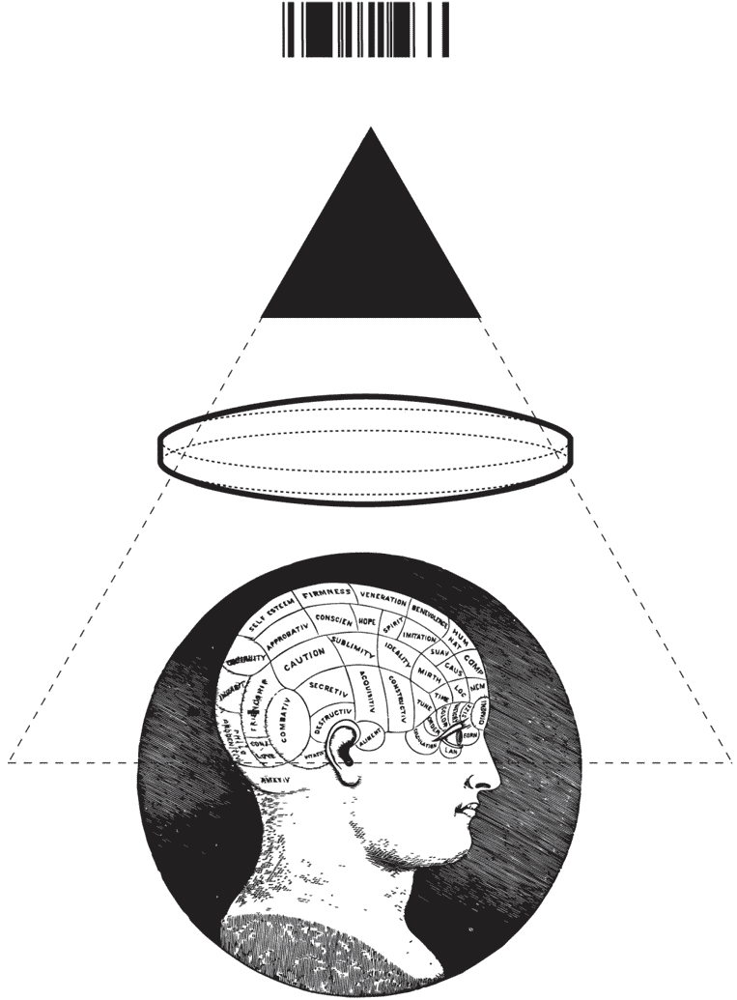

# 第四章

## 分类

此刻展厅被成堆的颅骨包围。约五百具人类颅骨陈列其间，采集时间集中在十九世纪上旬。每件标本都上了亮漆，额区以墨水写下编号。颅面被手绘的小圆圈标注，显示颅相学里被认为对应“仁慈”“崇敬”等品格的区域，部分颅骨另刻有大写字样，如“荷兰人”“印加人”“疯子”，见图 4.1。整批材料均出自美国颅骨学家塞缪尔·莫顿，他逐件称重、测绘并做标记。莫顿身兼医师与自然史学者，是费城自然科学院的成员。他借助与各地学者、头骨搜集者的交易网络从全球汇聚标本，其中不乏盗墓来源。1851 年去世时，其藏品已逾千件，为当时体量最大的颅骨库。如今主要档案存于费城宾夕法尼亚博物馆体质人类学部的教学室内。

图 4.1 莫顿颅骨收藏中一个被标记为“疯子”的头骨（摄影：凯特·克劳福德）

莫顿并不属于古典颅相学派，解剖形态决定性格并非他的主张。他企图通过物理比较“客观”地归类并排序人类。为此他将人类划分为非洲人、美洲原住民、高加索人、马来人、蒙古人五个“种族”，这正是当时通行的划分，也折射殖民时代的地缘政治心态。其依据是多起源论，即不同人群在不同时期先后演化，该说法被欧美白人学者正当化，并为殖民探险者提供暴力掠夺的理据。颅容量测定成为主要手段，因其宣称能精确评估人群差异与优劣。

我所见的不少颅骨来自出生于非洲却在新大陆被贩卖致死的人。莫顿用铅弹填充颅腔，再倾入圆筒以立方英寸计体积，随后公布对比结果：白人颅容量最大，其次印度人，黑人最小。这份按种族取均值的表格在当时被视作前沿成果，被反复引用以论证种族智力高低与白人生物优势，并在美国为奴隶制与种族隔离提供科学背书。即便以当时的技术水平，该研究早已失去学术参考价值，仍在为统治阶层服务。

证据基础却相当脆弱。如斯蒂芬·杰伊·古尔德在《人类的误测》里所说，坦率讲其结论是为了配合先验信念而被捏造、挤压、拼凑出来的。令人不安的是几乎查不到蓄意造假的痕迹，却充斥无意识的自我欺瞒，这说明了科学的社会语境。因为若研究者能像莫顿那样诚实地自欺，偏见便可能侵入任何领域，哪怕是丈量骨骼、做加法这类最基础的操作。

古尔德与后来者重新称量颅骨、复核材料，发现莫顿在计算与流程上存在多处失误，例如忽视体型较大者脑容量也偏大的基本事实。他挑选符合白人优越论的样本，并剔除偏离组均值的子集。宾夕法尼亚博物馆的当代评估显示，即便使用莫顿自有的材料，人与人之间并无明显差异。然而“先验偏见”作为一种观看世界的姿态，塑造了他所说的客观科学，形成自我强化的回路，影响了其发现，正如那装满铅的颅骨本身。

正如古尔德所言，颅容量学是十九世纪占主导的生物决定论数字科学，其核心预设严重错误：脑容量与智力成正比，不同人类种族为不同生物物种，且可按智力与先天特质排序。最终这套种族科学被证伪，如康奈尔·韦斯特所说，其隐喻、逻辑与分类不仅支撑白人至上，还使某些关于种族的政治主张成为可能，同时排斥其他主张。

莫顿的工作预示了当下人工智能中测量与分类的认识论困境。将颅形与智力乃至合法权利相连，成为殖民与奴役的技术托词。人们更愿关注颅容量测量的错误及修正方法，但更严重的错误在于催生该方法论的潜在世界观。因此目标不应是要求更精确或“公平”的头骨测量来支撑种族主义智力模型，而是彻底否定这种测量。莫顿的分类实践本质上是政治性的，他对智力、种族、生物学的无效假设产生了广泛的社会经济后果。

分类的政治学是人工智能的核心实践。它说明“机器智能”如何从大学实验室走向科技产业。正如前一章所见，世界现象经由抽取、测量、标注、排序被转化为数据，这在有意或无意中成了每个以该数据训练的技术系统承认的模糊基本事实。当系统被证实对种族、阶级、性别、残障或年龄产生歧视性结果时，制造商承受巨大压力，需要改良工具或让数据更“多元”。但结果往往有限，它们通常只在表面修补明显的技术错误，篡改数据使其看起来更合理。更基本的问题被忽视：分类在机器学习中如何运作？分类时涉及哪些利害？分类与被分类者如何互动？在对世界进行分类时，哪些不言自明却承载社会政治理论的基础支撑着这一过程？

杰弗里·鲍克与苏珊·利·斯塔尔在里程碑式研究中写道：“分类是强大的技术。当被嵌入工作基础设施中时，它们会变得相对不可见，而又不会失去任何力量。”我们分类和测量的方式永远强大，无论是给训练集里的图像打标签、用面部识别追踪行为，还是把铅弹注入头骨。但正如两人所观察，分类消失了，“成为基础设施、习惯，以及理所当然的东西”。我们很容易忘记，为塑造技术系统而随意选择的分类，能在塑造社会与物质世界方面发挥动态作用。

把注意力放在人工智能偏见的趋势，会让我们偏离评估人工智能分类的核心实践及其伴随的政治问题。为了看清实际效果，我们将探索二十一世纪的若干训练数据集，观察其中如何植入社会秩序模式、纳入等级制度并放大不平等。我们还将审视当前关于人工智能偏见辩论的局限，包括常被提出的用数学意义上的平等来制造“更公平的系统”，而不是改变潜在的社会、政治与经济结构。简而言之，我们将探究人工智能如何用分类编码权力。

## 循环逻辑系统

十年前谈人工智能偏见被视为异端，如今歧视性系统的例子俯拾皆是：苹果信贷算法中的性别偏见、COMPAS 犯罪风险评估软件中的种族主义、脸书广告投放中的年龄偏见。图像识别工具错分黑人面孔，聊天机器人使用种族主义与厌女语言，语音识别软件无法识别女性声音，社交媒体向男性展示更多高薪招聘广告等。学者鲁哈·本杰明与萨菲娅·诺布尔展示了科技生态系统中数百个案例，还有更多未被发现或未公开承认。

一名调查记者或吹哨人揭露系统如何产生歧视性结果，是正在进行的“人工智能偏见”叙事的典型环节。随后故事被广泛传播，涉事公司承诺解决。之后系统被替换，或公司进行技术干预以求更公平的结果。这些结果与修复手段往往专有保密，但机构仍向公众保证偏见已被“治愈”。为什么歧视反复发生？除了数据集内容不足或算法设计不当，是否还有更基本的问题？此类公开辩论非常少。

来自亚马逊内部的一个更生动的例子。2014 年公司试图自动化简历筛选。如果自动化能提升产品推荐和仓库组织效率，按逻辑也能提升招聘效率。一位工程师说：“他们真心希望推荐系统成为一个引擎，给它 100 份简历，它就会吐出排名前 5 的人，公司就会录用这些人。”机器学习系统被设计为 1 到 5 级给应聘者打分，这也映射亚马逊的产品评分系统。为构建底层模型，工程师使用了公司十年同事的简历数据集，并根据其中出现的五万个术语训练统计模型。很快，系统开始不再重视编程语言等常用工程术语，因为人人都会写。相反，模型重视在成功简历中重复出现的微妙线索，并对特定动词产生强烈偏好，如“执行”“捕获”。

招聘人员开始把该系统作为日常补充使用，很快出现严重问题：系统不推荐女性。它会主动降级女子学院候选人，以及任何包含“女性”一词的简历。即便编辑系统去除了明显的性别指涉，偏见仍在。男性气质霸权仍通过语言的性别化使用显现。该模型不仅作为分类体系对女性有偏见，也对常见的性别化语言形式有偏见。

无意间亚马逊造出一个诊断工具。过去十年被公司聘用的工程师绝大多数是男性，因此模型基于男性成功简历训练，学会为未来招聘推荐男性候选人。过去与现在的就业实践正在塑造未来的招聘工具。通过男性气质在语言、简历和公司本身中的编码，亚马逊的系统出人意料地揭示了偏见已存在的样态。该工具强化了亚马逊既有的动态，并凸显了人工智能行业长期缺乏多样性的特征。

亚马逊最终关闭了招聘实验。但偏见问题的规模远超一个系统或一次失败。人工智能行业习惯性地把偏见理解为需要修复的错误，而非分类本身的特征。结果公司只专注于调整技术系统以在不同群体间产生更大数量平等，而这种做法本身已产生问题。

理解偏见与分类的关系，需要超越知识生产分析——判断数据集是否“有偏见”——而着眼于知识构建本身的机制，社会学家卡琳·克诺尔·塞蒂娜称之为“认知机制”。要看到这一点，需要观察历史不平等模式如何影响资源与机会获取，进而影响数据。数据随后被抽取，用于可进行分类与模式识别的技术系统，产生被认为是客观的结果。其结果是一种统计学上的循环形态：一种披着技术中立外衣的自我强化歧视机器，放大了社会不平等。

## 去偏见系统的限制

要更好地理解分析 AI 偏见的局限，可以看看修复偏见的尝试的局限。IBM 试图通过创建所谓更具“包容性”的数据集——“面部多样性” Diversity in Faces，DiF——来回应系统偏见的质疑。DiF 是对乔伊·博拉姆维尼与提姆尼特·格布鲁一年前突破性结果的行业回应，该工作显示 IBM、微软、亚马逊等公司的面部识别系统对肤色较深者尤其是女性的识别错误率高得多。因此三家公司都在内部努力展示进展。

IBM 研究人员写道：“我们希望人脸识别能准确地为我们每个人工作。”但“解决多样性挑战”的唯一方法，是构建“由所有人的面部信息组成的数据集”。IBM 研究人员未意识到这本身就是危险提议，他们决定从 Flickr 的一亿张图像中抽取数据，Flickr 当时是互联网上最大的公开可用数据集之一。然后他们制作了一个百万张照片的小样本，并测量每张脸上五官间的颅面距离：眼距、鼻宽、唇高、眉毛高度等。像莫顿测量头骨一样，IBM 试图给颅面测量值分配类别并创建差异类别。

IBM 团队声称目标是增加面部识别数据的“多样性”。然而即便经过谨慎控制，他们创建的分类仍揭示了“多样性”背后的政治倾向。例如，为标记人脸性别和年龄，团队要求众包工人使用男性或女性这种具有限制性的二元分类进行主观标注。任何似乎不属于此二元分类的人都被从数据集中删除。IBM 的多元化视野强调颅眶高度和鼻梁类型的广泛选择，却完全忽视跨性别或非二元性别人群的存在。“公平”被简化为机器主导的面部识别系统准确率更高，而“多样性”是指用于训练模型并提高准确率的更大范围人脸数据。颅骨测量分析像个诱饵与开关，最终将多样性去政治化，并以对变化的关注取而代之。一切都由设计者决定，包括谁、如何以及改变到何种程度。同样，分类实践的本质是集中权力：决定哪些差异拥有产生影响的权力。

IBM 研究人员接下来的结论问题更大：“我们传统中的各个方面，包括种族、民族、文化、地理等，以及我们的个人身份——年龄、性别和可见的自我表达形式——都反映在我们的脸上。”这一结论没有承认，所有这些特征都是可变的、可转移的、具备文化解释特性并具有不稳定意义。

IBM 对多样性进行分类的狭隘技术方法，也源于团队所拥有的工具。人们使用颅骨测量法并非因为其在某种程度上是了解人类更有见地的工具，而是因为这是一种可以通过机器学习完成的方法。工具的可供性成了真理的地平线。能够大规模开展颅骨测量的能力，促使人们渴望在这些测量中找到意义，即使这种方法与文化、遗产或多样性无关。它们只是用来增加对“准确性”特定理解的一种方式。关于准确性和性能的技术主张，被关于类别和规范的政治选择击穿，但这一点很少被承认。这些方法根植于生物即命运的意识形态前提，于是我们的面部数据成为我们的命运。

## 偏见

自古以来，分类行为就与权力保持一致。在神学中，命名和划分事物的能力是上帝的神圣行为。“范畴”一词来自古希腊语 katēgoríā，由 kata（反对）和 agoreuo（公开讲话）组成。在希腊语中，这个词可指审判中的逻辑主张或指控——暗指科学和法律的分类方法。

偏见作为术语的历史谱系出现得更晚近。它首次出现于十四世纪，在几何学中指斜线或对角线。到了十六世纪，它已具有类似目前大众理解的含义，即“不适当的成见”。到二十世纪初，偏差在统计学中发展出更具技术性的含义，指样本与总体之间的系统差异，而样本并不能真正反映整体。机器学习正是从这种统计传统中得出对偏差的理解，这种理解与一系列其他概念相关：泛化、分类和方差。

机器学习系统旨在从大量训练示例中进行归纳，并对未包含在训练数据集中的新观察对象进行正确分类。换句话说，机器学习系统可以执行一种归纳，即从特定示例中学习以决定在新示例中寻找哪些数据点。在这种情况下，术语“偏差”指的是在泛化的预测过程中可能发生的一种错误类型，即系统在呈现新示例时表现出的系统性或经常性再现的分类错误。这种类型的偏差通常与另一种泛化误差形成对比——方差，方差是指算法对训练数据差异的敏感性。具有高偏差低方差的模型可能对数据欠拟合，未能捕获其所有重要特征或信号。或者，具有高方差低偏差的模型可能会过度拟合数据，构建的模型离训练数据太近，因此除了数据的重要特征外，它还可能捕获一些“噪声”。

在机器学习之外，偏见还有许多其他含义。例如在法律中，偏见是指某种先入为主的观念或意见，一种基于成见的判断而不是基于对案件事实的公正评估的决定。在心理学领域，阿莫斯·特沃斯基与丹尼尔·卡尼曼研究了“认知偏见”，即人类判断系统地偏离概率预期的方式。最近关于内隐偏见的研究，强调了无意识态度和刻板印象是如何造成与一个人公开声明的或认可的信念或原则背道而驰的行为方式。这里的偏见不仅仅是一种技术错误；它还涉及人类的信仰、陈规或不同形式的歧视。这些定义上的混淆，限制了偏见作为术语的实用性，尤其是当来自不同学科的人们使用这一术语时。

毫无疑问，人们可以通过改进技术设计，来更好地考虑其系统如何产生偏差和歧视性结果。但是，在急于得出解决统计偏差的狭隘技术方案时，人们通常会跳过一个更难解答的问题，即为什么人工智能系统会延续各种形式的不平等，即使这是解决更深层次结构问题的充分方法。人工智能中的知识工具反映并服务于更广泛的数据提取经济的激励机制，而这些激励机制存在很多问题。剩下的则是权力的持续不对称，无论设计者的意图如何，技术系统都保持了结构性的不平等。

用于训练机器学习系统的每个数据集，无论是在有监督还是无监督机器学习的背景下，无论是否在技术上被视为“有偏见”，都包含一种特定的世界观。创建训练集，即是将一个几乎无限复杂和多变的世界，固定为一个由被谨慎分类的数据点组成的分类体系，这个过程包含了内生性的政治、文化与社会选择。通过关注这些分类，我们可以窥见内置于 AI 世界架构中的各种形式的权力。

## 训练集作为分类引擎的案例：图网

在前一章中，我们回顾了图网的历史，以及这个基准训练集自 2009 年创建以来，是如何对计算机视觉研究产生持久影响的。通过仔细观察图网的结构，我们可以看到数据集的排序方式及其映射世界中各种对象时的底层逻辑。图网的结构如迷宫一样，且体量庞大、令人好奇。图网的底层语义结构是从词网导入的，词网是一个词语分类数据库，最初由普林斯顿大学认知科学实验室于 1985 年开发，由美国海军研究办公室资助。词网被构想为一个机器可读的字典，用户可以在其中根据语义而不是字母的相似性进行搜索。它成了计算语言学和自然语言处理领域的重要资源。词网团队收集了尽可能多的单词，从布朗语料库开始——一个在 20 世纪 60 年代由一百万个单词汇编而成的集合。布朗语料库中的单词来自报纸和一堆乱七八糟的书籍，如《巫术疗法》、《家庭防辐射避难所》，以及《谁统治着婚床》等。

词网试图将英语组织成“同义词集”。图网研究人员只选择了名词，认为名词是图片可以表示的东西——这可以训练机器自动识别物体。因此，图网的分类法是根据嵌套层次结构组织的，其中每个“司集”代表一个不同的概念，同义词被分在一组。例如，“机动车”和“汽车”属于同一个集合。层次结构从更一般的概念转移到更具体的概念。例如，“椅子”这个概念出现在“人工制品→装潢→家具→座位→椅子”之下。不出所料，这种分类系统反映了许多先前的分类等级，从林奈生物分类系统到图书馆书籍的排序。

ImageNet 的层级第一眼像一座套娃迷宫，往下钻就越来越不对劲。最奇怪的地方在顶层，只剩九个大筐，全部内容都得先从这九个口子里分出去：植物、地质构造、自然物体、运动、人工制品、真菌、人、动物、杂项。九个上位类下面又裂开数千个细到离谱的子层，把数百万张图装进去。苹果系就是典型例子：苹果、苹果黄油、苹果饺子、苹果天竺葵、苹果果冻、苹果汁、苹果蛆、苹果锈、苹果树、苹果盒子、苹果车、苹果酱，各自占据独立格子。热相关的词也被硬塞进各种怪类：热线、热裤、电热板、火锅、辣酱、温泉、热酒、热水浴缸、热气球、热软糖酱、热水瓶，凑在一起像博尔赫斯笔下那本神话百科全书。

库里的图像质感参差极大。能看到摄影棚的高清成品，也能看到模糊昏暗的手机抓拍，还有儿童自拍、色情剧照。卡通、封面女郎、宗教偶像、政界名人、好莱坞明星、意大利喜剧演员全混在一起，从专业到业余、从神圣到世俗的跨度让整体显得既荒诞又随意。

人的划分尤其能看出技术里渗透的政治。ImageNet 里人体被安放在自然物体→身体→人体的链条上，再往下拆成男性身体、人类、少年身体、成人身体、女性身体。成人身体继续分成成人女性身体和成人男性身体。隐含的前提是只有男性和女性身体才算自然。词条雌雄同体被单独归到人→感觉论者→双性这条支线，和假性两性畸形、左右开弓运动员并列。

还没走到更具争议的类目，就能读出这套方案的政治性。把性别硬塞进生物二元框架，跨性别或非二元者要么被抹去，要么被塞进与性征相关的类目里。这并非新现象。ImageNet 对性别与性行为的层级让人想起 DSM 曾把同性恋列为精神障碍的历史。那种带着污名的分类曾被用来合理化所谓治疗，直到一九七三年美国精神病学会在持续抗议下才将其移除。

伊恩·哈金提醒，人文科学长期试图把人钉进固定属性的类目，但这些类目其实是活的。它们塑造被分类者，被分类者的反应又反过来改写类目，这就是循环效应。鲍克和斯塔尔也指出，一旦分类建立，它会以不易察觉的方式把有争议的政治类别固化。没有主动抵制，分类就会被当成理所当然。AI 领域正是如此：看似纯技术的训练集与基础设施，实则暗含激进干预与特定的世界秩序。

给事物命名本身像施法。把未分化的群体归进一个范畴，赋予秩序，也在具体化该范畴。ImageNet 最初的二万一千八百四十一个类目里，苹果或苹果黄油看似无害，但名词从不平等。语言学家乔治·拉科夫指出，苹果的概念比光更具名词性，光又比健康更具体。从具体到抽象、从描述到判断的梯度，在 ImageNet 逻辑里被抹平。一切被压成标签，像标本馆里的蝴蝶。结果常是种族主义的、不合逻辑的、残忍的，尤其当标签贴在人身上的时候。

过去十年，ImageNet 在人之下收纳了两千八百三十二个子类。图片量最多的前几名是少女一千六百六十四张、祖父一千六百六十二张、爸爸一千六百四十三张、CEO 一千六百一十四张，多为男性。从这些高频类目就能勾勒世界观的轮廓：按种族、年龄、国籍、职业、经济地位、行为、性格甚至道德品行对人群切片。

对人的切割问题很多。虽然创始人二零零九年撤掉了一些明显冒犯的词集，库里仍保留大量种族主义类目：阿拉斯加原住民、英裔美国人、黑人、非洲黑人、黑人女性却没有白人女性、拉丁美洲人、墨西哥裔美国人、尼加拉瓜人、巴基斯坦人、巴布亚人、南美印第安人、西班牙裔美国人、得克萨斯人、乌兹别克人、怀特人、祖鲁人。把这些当成组织逻辑已足够不安，更不用说后来被用来按外貌给人分类。还有按职业或爱好的标签：童子军、啦啦队、认知神经科学家、美发师、情报分析师、神话学家、零售商、退休人员，像极了忙忙碌碌镇的工作图鉴。更离谱的是一些对视觉分类毫无意义的概念：债务人、老板、熟人、兄弟、色盲患者，都是描述关系而非外观的词。

在人类深处，还藏着厌女、种族主义、年龄歧视、残障歧视的类目，直接带着侮辱、诽谤和道德评判。这些冒犯性词汇保留了十年。ImageNet 常被用于目标识别，对象定义很宽泛，技术会议很少讨论具体的人类类目，直到艺术家特雷弗·帕格伦发起的 ImageNet 轮盘项目病毒式传播后才被公众注意到。该项目做了一个应用，让人上传照片查看 ImageNet 如何给人类类目打标签。

随后团队决定删除一千五百九十三个被视为不安全的类目及相关六十万张图像，宣称剩下的五十万张是安全的。但在对人分类时，什么算安全？聚焦仇恨类目回避了更根本的系统问题。整个分类法展现了人类分类的复杂与危险。微观经济学家、篮球运动员这类词看似无害，但和瘫痪患者、非技术人员、混血儿、乡下人并置时，标签背后浮现出种族、性别、年龄、残障的多重刻板印象。在 ImageNet 的形而上学里，助理教授和副教授有独立图像类目，仿佛升职会改变生物特征。

事实上，ImageNet 里没有中性类目。图像选择始终和词语含义相互作用。政治性被写进分类逻辑，即使词汇本身不刺耳。由此可见，把人当物品一样分类会怎样。但这种实践近年才大规模普及，尤其在大型科技公司内部。像脸书这类公司的方案更难被调查与审计，因为专有系统对外几乎封闭。

图像来源同样关键。如前文所述，ImageNet 创建者从谷歌等搜索引擎抓取大量图片，未经当事人同意就把自拍和度假照取走，再由土耳其的众包工人标记和重打包。搜索引擎本身的偏差和偏见被抓取和标注系统完整收录。低收入的众包者每分钟被要求处理约五十张图，几乎不可能做认真判断。于是荒谬与刻板印象层出不穷：躺在沙滩巾上的女人被标为盗窃狂，穿运动衫的少年被贴失败者，西格妮·韦弗的照片被归为雌雄同体。

数据像所有意义的载体一样充满歧义。ImageNet 的标签把复杂图像压缩简化。仅删除攻击性术语并不能对抗权力驱动的分类，反而排除了对底层逻辑的彻底审视。即便最坏例子被修补，方法仍建立在把数据与其生成背景剥离的提取逻辑上。随后数据被技术世界观重新包装，试图把多样文化材料熔铸成单一客观形式。这并非特例，而是许多 AI 训练集的常态，揭示了自上而下的方案如何把社会、文化、政治、历史关系扁平化为可量化实体。当操作指向种族和性别时，这种现象最明显也最阴险。

监视学学者西蒙·布朗指出，这些技术预设性别认同和种族的类目是清晰的，机器可以被编程去分配性别，或判定身体部位应代表什么。在机器学习里自动检测种族性别被当成既定事实，很少被质疑，却牵涉严重政治问题。

UTKFace 就是例证。由田纳西大学诺克斯维尔分校团队创建，包含超过两万张带年龄、性别、种族标注的人脸。年龄以零到一百一十六的数字表示，性别用二元编码，男性零女性一。种族分为五类：白人、黑人、亚洲人、印度人、其他人。这种还原主义分类已被广泛使用多年。

这种狭隘模式呼应了二十世纪有问题的种族划分，比如南非种族隔离。鲍克和斯塔尔提到，一九五零年的人口登记法和种族分区法把公民划为欧洲人、亚洲人、混血、有色人种和原住民。种族主义法律支配生活，黑人行动受限并被强行迁离。一九六六至一九六七年的不道德法案禁止跨种族性行为，到一九八零年已导致超过一万一千五百人被定罪，多为非白人女性。运行这些分类的中央数据库由 IBM 负责设计维护，但实践中因没有纯种而频繁重排和再分类。每个个体都是混合体，分类随时间和分类者改变。

这些系统造成巨大伤害，纯种概念不可理解且饱受争议。哲学家唐娜·哈拉维观察到，在分类法中，分类者总是避开的对象很简单，即种族本身。种族这个让梦想、科学和恐怖活跃起来的纯粹类型，不断从分类器中溜走，因而种族在分类系统中无休止地增殖。然而在数据集和机器学习里，纯种神话又被赋予科学权威。

一些方法更进一步，比如从约会网站照片检测性行为，或基于驾照头像推测犯罪倾向。这些做法问题重重，因为犯罪像种族和性别一样是相对且社会决定的，并非内在固有特征。机器学习试图把相对事物固定为类别，全靠偶然的训练数据，引发诸多伦理问题。

机器学习以真实方式创造种族和性别：在自身设定条件下定义世界，并对被分类者产生长期影响。当系统被宣传为能预测身份和未来行为的科学工具时，它掩盖了技术脆弱性、设计者优先级和政治分类过程。对动态相关的事物命名，等同于政治和规范干预，且常模仿真实人类的做法，限制了自我表达与被承认的身份范围。

回到哈金的论述，分类是帝国的当务之急：被征服的臣民被归类为某一类人。命名行为产生持久权力效应，名字与人之间的互动形成了比帝国更长久的理解方式，分类技术限制认知并被植入 AI 逻辑。

那么该怎么办？如果训练数据和系统中的分类大多是伪装成科学的权力形式，如何纠正它们真实而可记录的影响？系统设计者该如何解释其受益的同时制造了奴役、压迫和数百年歧视？AI 应如何呈现社会现实？

何时学习何种信息以产生新分类，是一个强大的决策时刻，但由谁决定、基于什么基础？计算机科学的困境在于，人工智能的正义无法被编码或计算。它需要超越优化指标和统计奇偶性的新评估，理解系统如何与数据、工人、环境及受影响者互动。

鲍克和斯塔尔主张需要更敏感的方法，关注分类方案冲突下的模糊性分布，以及一种像板块构造而非静态地质学那样流动的分类衔接。他们也提醒注意利益与痛苦的不均衡分配，选择本身即是伦理核心。

本章看到的分类基础设施如何处理差异与矛盾：它必须降低复杂性，剥离背景以便计算。但在机器学习平台中，它又以翁贝托·艾柯所称的混沌列举激增。在一定粒度上，相似与不同的事物变得机器可读，但特征本身无法控制。

问题远不止分类对错。机器类别与人相互作用、相互改变，试图在不断变化的形态中追求可读性，进入正确类别并争取有利的信息推送。在机器学习里这些扭曲更难发现。危险的不仅是历史好奇心，或平台与推送之间的错位感。每一种分类都有后果。

历史表明，最具危害的人类分类——从种族隔离到同性恋病理化——并未在科学和伦理批判下自然消失。变革需要多年的政治行动、持续抗议和大众运动。分类模式支撑形成它们的权力结构，若无巨大努力不会改变。用废奴领袖弗雷德里克·道格拉斯的话说：没有诉求，权力就不会让步。它从来没有，也永远不会让步。而在机器学习分类的隐形制度中，提出诉求更难。

公开的训练集如图网、UTKFace 让我们窥见工业 AI 和研究实践中的分类类型。但真正庞大的分类引擎由私营科技公司全球运营，脸书、谷歌、抖音、百度等缺乏监督与独立公众干预途径。当匹配过程被隐藏，人们无法了解自己为何获得优势或劣势时，需要集体的政治回应，即便更困难。

# 第五章
## 情感
一九六七年，一位名叫保罗·埃克曼的美国年轻心理学家带着卡片和一个新理论来到巴布亚新几内亚高地的偏远地区奥卡帕。他听说福尔人几乎与外界隔绝，认为这是验证其假设的理想样本。像之前的许多西方研究者一样，他来到原住民社区提取数据，试图证明所有人都表现出少量普遍情绪，这些情绪天然、先天、跨文化且全球一致。虽然该说法并不主流，却催生出价值超过两百亿美元且不断扩张的产业。这是一个关于情感识别如何进入人工智能，以及它带来的问题的故事。

在热带奥卡帕，医学研究员 D.卡尔顿·盖杜谢克和人类学家 E.理查德·索伦森的指导下，埃克曼想测试福尔人如何识别面部表情传达的情绪。因为他们很少接触西方人或大众媒体，埃克曼认为对核心表达的识别与展示将证明其普遍性。方法很简单：给他看印有面部表情的卡片，看是否用相同词汇描述。用埃克曼自己的说法，我只是给他们看有趣的图片。

但埃克曼没有接受过关于福尔人历史、语言、文化或政治的训练。他试图用翻译进行卡片实验的尝试失败了。皮钦语译员和研究对象都表示不理解。沮丧的埃克曼离开了巴布亚新几内亚，第一次跨文化情感研究以失败告终。这只是开始。

如今，情感识别工具出现在国家安全系统、机场、教育和初创企业的招聘中，声称能检测精神疾病或预测暴力。通过审视基于计算机的情感检测历史，可以看到它如何引发伦理问题和科学怀疑。正如接下来要看到的，用面部特征准确评估一个人内部感受的说法，其前提不稳定。事实上，二零一九年发表的一项关于从面部运动推断情绪的文献综述明确指出：没有可靠证据表明可以从某人的面部特征准确预测其情绪状态。

谁在教机器读懂你的表情？一段被低估的权力史

为什么今天的情感人工智能会把复杂的内心世界压缩成几张固定的面部模板？哪怕反证层出不穷，为什么“少数几种普遍情绪就能从脸上直接读出来”这个说法依然在行业里通行无阻？要想看清这种共识是怎么形成的，就得回溯那些想法在真正嵌入生活基础设施之前，如何一路被培育、被资助、被放大。

保罗·埃克曼并非唯一的贡献者，但他的职业轨迹像一条主线，照出了推动这个领域的复杂合力。他的研究与冷战时期美国情报系统对人文领域的投注紧密相连，从早期计算机视觉的萌芽，到九一一之后以反恐为名的安保计划，再到当下的AI情绪识别热潮。那是一段由意识形态、经济算计、恐惧驱动的政治以及渴望绕过人类意志获取信息欲望共同写成的编年史。

### 从产业野心到监控现实：情绪被定价的那一刻

对军队、公司、情报机构和警察来说，自动化的情绪识别既诱人又赚钱。它承诺能把敌人和朋友自动筛开，把谎言和真相分开，用“科学仪器”窥探内心。

大厂和平台已收集了海量的面部影像：数十亿条Instagram自拍、Pinterest人像、TikTok短视频和Flickr照片。海量数据让机器学习去挖掘情绪的“隐藏真相”成为可能。从巨头到初创，情感识别被嵌进各种人脸识别平台。人脸识别的任务是辨认是谁，情绪检测则是分析面部数据给情绪贴标签。系统并不一定管用，却能成为强烈影响行为、训练人们以可识别方式表达自己的机制。尽管缺乏坚实的科学支撑，它已经在改造行为模式和社会机构运转。

招聘是最典型的落脚点。伦敦初创Human用情绪识别来评判求职者的视频面试。金融时报报道，该公司声称能捕捉候选人的情绪表达并映射到性格特质，随后给诚实度、工作热情等维度打分。HireVue的客户包括高盛、英特尔和联合利华，它用机器学习解读面部线索来推断岗位适配度，自称用AI从微表情、语气等变量中提取“科学指标”，再与成功样本对比。2016年初，苹果收购了声称能从人脸图像中“识别”情绪的Emotient。后者源于加州大学圣迭戈分校的学术项目，是该赛道众多创业者之一。波士顿的Affectiva可能是最大玩家，它诞生于麻省理工的学术系统，罗莎琳德·皮卡德和同事在此开拓情感计算，研究如何通过计算与情绪相关或影响情绪的现象。

Affectiva主要用深度学习给各类情绪应用编码：监测司机是否分心、测量广告带来的情绪反应等。公司自称拥有全球最大情感数据库，覆盖87国750万人。庞大的视频集主要由开罗的员工手工标注。如今越来越多的企业授权其数据和算法，开发从求职视频评估到课堂参与度检测的项目，本质都是抓取并解析被评估者的面部与肢体。

巨头也在布局。微软Face API提供情绪检测，声称能识别愤怒、蔑视、厌恶、恐惧、快乐、中立、悲伤、惊讶，并宣称这些情绪以特定的面部表现实现跨文化普遍交流。亚马逊的Rekognition同样声称能识别七种情绪，近来更新加入“恐惧”，还能量化情绪随时间的变化，例如绘制演员情绪时间线。

这些技术并非凭空出现。情绪识别是在人工智能、军事优先项目和行为科学尤其是心理学之间长出来的。它们共享一套蓝图与前提：存在少数独特且普遍的情绪类别，人会不由自主地在脸上显现，机器可以捕捉。这一套信念在特定圈子里极受欢迎，以至于难以察觉其荒诞，更难去质疑，已然固化成“常识”。一旦把情绪分类拆开来看——整齐排列、统一标注——问题立刻显现，而领军人物正是保罗·埃克曼。

### 被称为“人脸读心术之王”的心理学家

埃克曼的研究始于一次偶遇普林斯顿心理学家西尔万·汤姆金斯，后者1962年出版《情感意象意识》第一卷。汤姆金斯的成果深刻塑造了埃克曼，后者把大半职业生涯用于探究情感的影响。其中一个关键假设是：若情感是与生俱来的进化反应，就必然具有普遍性，可跨文化识别。这种对普遍性的追求，正是解释为何这些理论在今天的AI情绪识别中被广泛接受的原因：它提供了一套简化的、可复制的通用规则。

在《情感意象意识》开篇，汤姆金斯把生物学层面的普遍影响理论建构为对人类主权危机的回应。他挑战行为主义和精神分析，认为它们把意识当成副产品。意识一次次被削弱：哥白尼把人类从宇宙中心移开，达尔文打破了人类形象源自上帝的叙事，尤其是弗洛伊德把理性去中心化。汤姆金斯认为忽视意识作为控制机制的作用，导致了“最大限度控制自然、最小限度控制人性”的悖论。简言之，意识无法告诉我们为何会那样感受和行动。这对后来的情感应用至关重要：它强调人类难以察觉自己的感受，那么AI是否能替我们做到？

汤姆金斯用情感理论解释动机。他认为动机由情感与本能两套系统控制。本能与饥饿、口渴等直接生理需求相连，有用却单一。主导行为的却是情感，能放大本能信号但极其复杂。婴儿哭泣的原因可能是饿、冷、湿、疼或热，回应方式也多种多样。汤姆金斯总结：与本能的工具性相反，情感的灵活性以模糊和出错为代价。个体可能无法正确识别恐惧或喜悦的原因，也可能学不会缓解恐惧、保持喜悦。情感高度独立于外部刺激，常常让我们弄不清为何愤怒、害怕或快乐。

所有的暧昧似乎暗示情感难以解开。汤姆金斯给出的答案是：主要情感与一个显而易见的器官系统一对一关联，那就是面部。他援引19世纪两位先驱：达尔文鲜为人知的《人和动物的情绪表达》以及法国神经学家杜兴·德·布洛涅的《人体面部表情机制，或激情表达的电生理分析》。

汤姆金斯假设情感的面部表现具有人类普遍性。他认为情感是“位于面部并广泛分布于全身肌肉与腺体的反应，能产生感觉反馈……在皮层下中心触发的、被存储的独特程序”。这已是早期计算隐喻的雏形。

他也承认解读受个人、社会和文化影响，不同社会有面部语言的“方言”。文化差异与生物普遍性之间的张力，一直影响着表情与情绪识别的研究。若表达本质可变，用来训练机器学习的大量数据必然混杂不同背景、角色和期望，解释结果可能南辕北辙。

上世纪60年代中期，机会出现了。美国国防部下属的先进研究项目局ARPA伸出了橄榄枝。埃克曼回忆：“做这件事不是我的主意，是被要求或推着去做。我甚至没写计划书，是给我钱的人代写的。”1965年他在斯坦福研究临床环境中的非语言表达，寻求资助。华盛顿的ARPA行为科学部负责人李·霍夫对他的现有工作不感兴趣，却看中跨文化非语言交流的潜力。

埃克曼自己也承认对跨文化研究一无所知：“我不知道论点是什么，文献有哪些，方法该怎么用。”本可放弃资助，但霍夫坚持一天之内写好了提案，让他去做后来最广为人知的课题——证明某些情绪面部表情的普遍性及手势的文化差异。最终获得约100万美元，相当于今天800多万美元。

当时埃克曼不明白霍夫为何如此急切。后来发现，霍夫只想尽快花掉预算以免被参议员弗兰克·丘奇质询，后者抓到霍夫用社会科学研究为幌子获取推翻智利阿连德政府的情报。埃克曼自认只是个幸运的“去海外做研究给他解围的人”。ARPA是首个为埃克曼职业生涯和更广的情绪识别研究提供国防与情报资金的机构。

有了资金，埃克曼启动了证明面部表情普遍性的首批实验。设计在很大程度上复制早期人工智能实验室的思路，甚至复刻汤姆金斯的方法，使用汤姆金斯的照片测试智利、阿根廷、巴西、美国和日本被试。先让参与者模拟情绪表情，再与“野外”收集的表情对比。实验者挑选通常体现“纯粹”或强烈情绪的照片，被试在预设情绪类别中选择并标记。相关性被用来衡量一致度。

方法从一开始就受质疑。强制选择被认为会提醒被试已有面部—情绪的联想；表情是假装的，也让效度存疑。人527rq人类学家雷·伯威斯特尔质疑，即使有契合，也可能是大众媒体如电影、电视、杂志带来的文化学习而非先天。争论促使埃克曼前往巴布亚新几内亚，研究高地福尔人。如果几乎未接触西方媒体的人也能认同他的分类，就能提供强证据。

第一次尝试失败后，他改为让美国被试看照片后从快乐、恐惧、厌恶—蔑视、愤怒、惊讶、悲伤六个词中挑选，结果与其它国家接近。埃克曼据此认定“特定的面部行为与特定的情绪具有普遍相关性”。

### 从相术到快门：读脸的古老欲望

相术的悠久历史显示出从外表推断内在的渴望。在古希腊，亚里士多德认为可通过外貌判断性格，因为身体与灵魂共同受影响。相术也被当作早期种族分类工具，用以划分埃及人、色雷斯人、斯基泰人等。

18至19世纪相术被视作解剖科学的一部分。关键人物是瑞士牧师约翰·卡斯帕·拉瓦特，他1775年出版《论相貌，以增进人类知识与爱为目的》。拉瓦特试图用轮廓替代艺术家雕刻以实现更“客观”的比较，兼具机械记录与标准化对照。他认为骨骼结构是外貌与性格的桥梁。头骨测量随后被用于民族主义叙事，19世纪高尔与斯普茨海姆的颅相学，以及借鉴切萨雷·隆布罗索的科学犯罪学，都在为当代AI系统的分类类型埋下回声。

真正把摄影引入人脸研究的是法国神经学家纪尧姆·杜兴·德布洛涅，被埃克曼称为“极有天赋的观察者”。1862年出版的《人体相学的机制，或激情表达的电生理分析》把相术与颅相的旧观念与新生理学、心理学衔接。他用摄影作为技术表征手段，把对性格的模糊断言替换成对表情与内心状态的有限调查。

杜兴在巴黎萨尔佩特里耶收容所工作，收容数千精神与神经疾病患者。部分人成为痛苦实验的对象，属于对脆弱群体进行医学技术实验的悠久传统。他开发电击技术刺激面部独立肌肉运动，以建立更完整的解剖生理认知。用湿版火棉胶等新摄影技术把稍纵即逝的肌肉动作冻结。

即便在早期，面部表情也不是自然呈现，而是电刺激制造的模拟。杜兴相信摄影与技术系统能把不稳定的面部表现变为客观对象。达尔文在其《人与动物情绪表达》导论中赞扬杜兴的“华丽照片”，并引用其复制品。情绪转瞬即逝，摄影提供了固定、比较、分类的能力，但杜兴拍摄的“真实”图像高度人工。

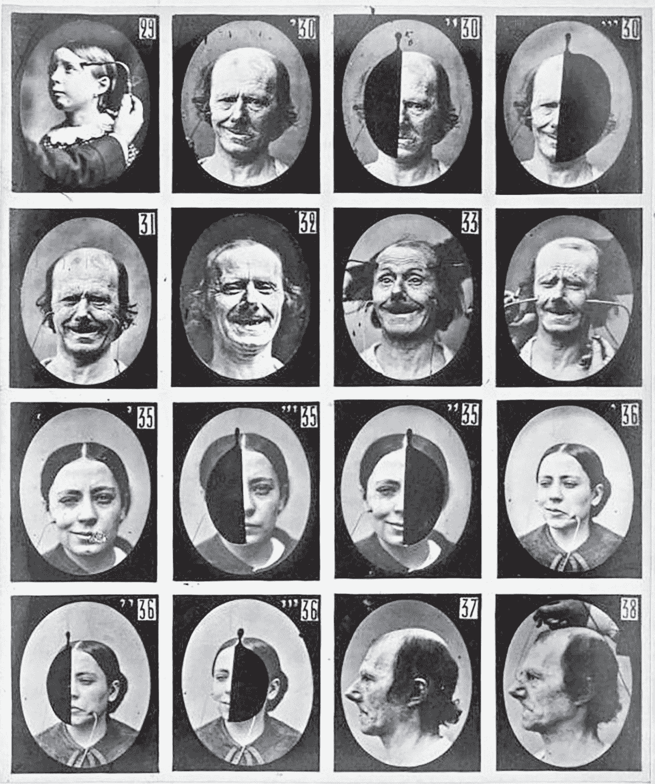

图 5.1 该图片来自杜兴·德布洛涅的著作《人体相学的机制，或激情表达的电生理分析》，由美国国家医学图书馆提供

埃克曼追随杜兴，把摄影作为实验核心。他认为慢动作摄影必不可少，因为许多表情超出人类感知极限，目的是捕捉微表情——极细微的肌肉运动。他称微表情持续时间很短，若不用慢动作投影几乎无法识别。后来他甚至声称，任何人在一小时内就能学会识别微表情，只要接受训练或配备慢动作设备。

早期研究还抱有雄心：将研究编码为面部表情检测与分析系统。1971年他与他人发表面部动作评分技术FAST，使用刻意拍摄的面部姿态照片，以六种情绪类型为主，这六类基本建立在埃克曼直觉之上。当其他研究者能造出不在他类型中的表情时，FAST很快遇到瓶颈。于是他把测量转向面部肌肉组织，回到了杜兴的电击研究思路。埃克曼确定了面部约40种肌肉收缩，把每个表情的基本单元称为动作单元。经过测试验证，他与弗里森于1978年发布面部动作编码系统FACS，更新版至今仍被广泛使用。FACS劳动强度极大，埃克曼说培训使用者需75到100小时，评估一分钟面部镜头则需一小时。

**从人工编码到机器读脸的转折**

1980 年代初，保罗·埃克曼在一次学术交流里听到了一个研究通报，认为可以用计算机分担 FACS 带来的高强度人工标注负担。他在回忆录里没有点名提出者，只说方案叫“巫师”，来自伦敦布鲁内尔大学。学界普遍推断这指向伊戈尔·亚历山大早期开发的机器学习类目识别系统 WISARD，内部带有神经网络雏形，当时已显过时。另有说法称 WISARD 曾在“已知的足球流氓数据库”上训练，提前演示了后世用犯罪照训练面部识别的做法。

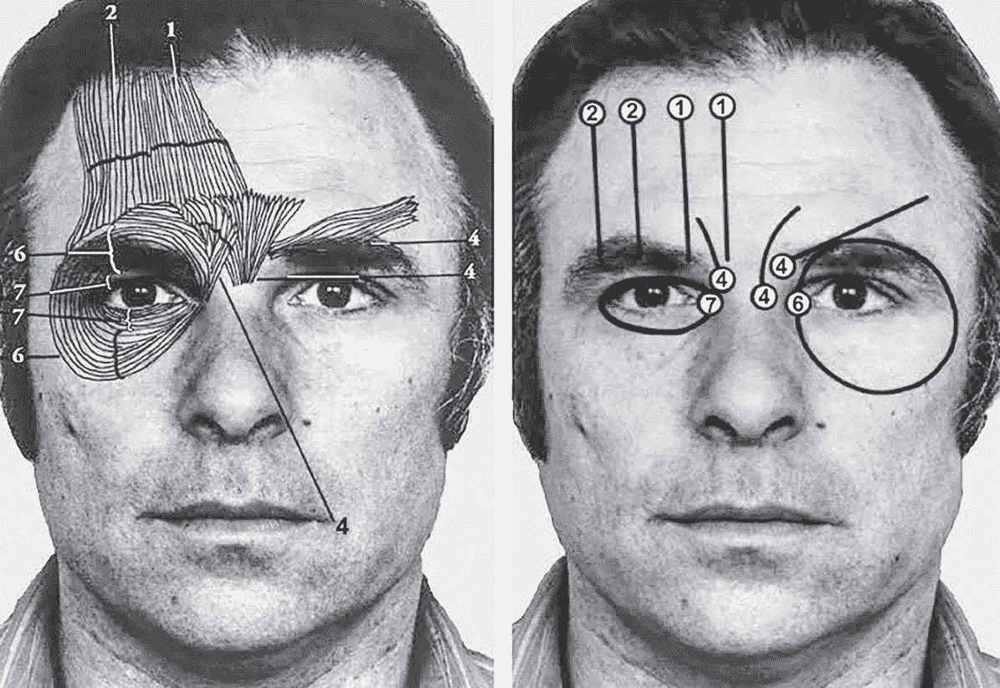

图 5.2 来自面部动作编码系统中的一些元素（资料来源：保罗·埃克曼与华莱士·弗里森）

人脸识别本身就是六十年代萌芽的人工智能基础应用，所以早期研究者发现埃克曼的需求与自身目标一致并不意外。埃克曼本人声称，在获得 ARPA 资助期间，他借助旧有的国防与情报关系积极推动情感自动识别，并在两支使用 FACS 资料的团队之间搭建非正式竞赛，由中央情报局的罗威娜·斯旺森监督指导。此后这两支队伍都在情感计算领域发挥关键作用。

一支由特里·谢诺沃斯基领衔，其学生玛丽安·巴特利特后来成为情感识别计算机科学的核心人物，并担任 2016 年被苹果收购的 Emotient 首席科学家。另一支位于匹兹堡，由匹兹堡大学心理学家杰弗里·科恩与卡内基梅隆著名计算机视觉学者金出武雄共同主导，两人长期从事情感识别研究，并创建了广为人知的科恩—金出情感表情集 CK 及其后续集合。

FACS 为后来的机器学习提供了不可或缺的底座：一组稳定、离散、有限的人类标注标签，用来对面部照片分类；同时提供一种宣称能把原本依赖艺术家与小说家主观判断的“洞察内心”难题，转化为实验室、企业与政府可使用的理性、可知、可度量的规则体系。

## 捕捉感觉：表现情绪的技巧

随着计算机化情感识别开始成形，研究者意识到需要先积累标准化的影像。1992 年，由埃克曼与他人合著的美国国家科学基金会报告建议，建立一个由不同面部研究社群共享且易于访问的多媒体数据库，以解决和拓展面部理解问题。一年内 ARPA 开始资助 FERET 计划收集面部照片，正如第三章所述。到二十世纪末，机器学习研究者已开始汇编、标记并公开驱动当下研究的诸多数据集。

CK 数据集直接受埃克曼的 FACS 指南指导。沿袭刻意摆出表情的传统，“实验者指示被试者进行一系列共 23 次的面部展示”，随后由 FACS 专家编码并提供标签。CK 允许实验室相互对比结果，并在构建新表达识别系统时进行基准测试。

图 5.3 图片展示的是来自 CK 数据集中的一些面部表情：喜悦、愤怒、厌恶、悲伤、惊讶、恐惧。图片来自 T.Kanade 等人。《身体人类学年鉴》（2000 年）© Cohn & Kanade

其他实验室与企业也在并行开展项目，创建大量供计算机视觉与机器学习使用的照片库。例如瑞典团队制作了卡罗琳斯卡情感面孔数据集。图像中的个人按指定情绪做表情，而这些情绪又与埃克曼设计的类别相对应。各机构将受试者的脸塑造成六种情绪形态。翻阅这些训练集，很难不被其极端程度震慑：不可思议的惊喜、极度的快乐、瞠目结舌的恐惧，受试者实质上是在制造机器可读的情感。

随着研究规模与复杂性扩张，可供情感识别使用的照片类型也在增加。研究者开始用 FACS 标记并非刻意摆pose 而产生的数据，而是来自自发面部表情，有时是在野外采集。例如 CK 发布十年后取得巨大成功，一组研究者发布了第二代扩展科恩—金出数据集 CK+。CK+ 不仅包含常见姿势表达，还开始纳入从视频中截取的主体“非摆拍”或自发表情。

2009 年，Affectiva 项目在麻省理工学院媒体实验室诞生，目标是在现实生活中捕捉“自然和自发的面部表情”。该公司通过让用户选择加入系统来收集数据，用户观看广告时网络摄像头拍摄面部照片，随后这些图像由接受埃克曼面部动作编码系统训练的编码员使用定制软件手工标记。但这里出现矛盾。FACS 是从大量摆拍照片档案发展而来，因此即使图像在自然环境中收集，分类仍依据摆拍图像的方案。

埃克曼大获成功。他的工作对测谎软件到计算机视觉方方面面产生深远影响。《纽约时报》称他为“世界上最著名的读脸人”；《时代周刊》将他列为全球最有影响力百人之一，他为联邦调查局、中央情报局、特勤局提供咨询，甚至动画工作室皮克斯也向他请教如何制作更逼真的卡通面孔。他的思想进入流行文化，出现在马尔科姆·格拉德威尔畅销书《眨眼之间》以及电视剧《别对我撒谎》中，他成为主角顾问的原型，而这些作品都草率地将他的意见作为依据。

商业版图也在扩张：他将欺诈检测技术出售给运输安全管理局等安全机构，后者据此开发“乘客筛查观察技术 SPOT”以监控航空旅客面部表情。“9·11”多年后，该系统还尝试自动检测恐怖分子。系统采用 94 条标准，据称都能反映压力、恐惧或欺骗程度。但为获取这些迹象，部分群体立刻陷入不利。任何容易感到压力、在审问中不自在，或与警察和边防警卫有负面经历的人，都可能得分更高。SPOT 因缺乏科学方法受到政府问责办公室和公民自由团体批评，尽管标价 9 亿美元，却未取得明显成功。

## 对埃克曼理论的诸多批评

名声越大，质疑声越多。最早批评之一是文化人类学家玛格丽特·米德，她在二十世纪六十年代后期就情感普遍性与埃克曼展开辩论，引发围绕绝对普遍性想法的激烈交锋。埃克曼不考虑文化因素、单纯认为行为受普遍生物决定因素影响的观念无法令米德信服。尤其是他倾向把情绪分解为过于简化、相互排斥的二元形态：情绪要么普遍，要么不普遍。米德等指出更细微情况可能存在。米德立场中立，强调“人类具有与生俱来的行为核心的可能性”与“情感表达可能受文化高度限制”两种观点并无内在矛盾。

数十年间，更多科学家加入声讨。近年心理学家詹姆斯·罗素与何塞·米格尔·费尔南德斯-多尔斯表明，最基本问题仍未解决：“情绪的面部表情是否真的表达情绪”仍存在巨大争议。社会科学家玛丽亚·根德龙与莉萨·费尔德曼·巴雷特指出人工智能行业使用埃克曼理论的具体危险，自动检测面部表情并不能可靠表明内部心理状态。正如巴雷特所观察：“公司可以随心解释数据，但数据表达的内容其实是明确的。他们可以检测到皱眉，但这与检测愤怒不同。”

更令人不安的是，情绪研究领域内部对情绪究竟为何仍无共识。情绪是什么、如何在体内形成与表达、其生理或神经生物学功能可能为何、与刺激关系如何、甚至如何定义，所有这些都仍是未解科学问题。

或许最重要的批评者是科学史学家露丝·莱斯。在《情感的演化》中，她剖析了“埃克曼成果背后的基本面相学假设含义……即可以根据面部表情差异严格区分真实与人工的情感表达”。莱斯看到方法基本循环：先假设所用摆拍姿势或模拟照片表达了一组“已不受文化影响”的基本情绪状态，然后用这些照片引出对不同人群的标签以证明普遍性。莱斯指出严重问题：埃克曼假设实验中照片的面部表情一定没有文化污点，因为它们得到普遍认可；同时结论是这些面部表情普遍认可，因为它们没有文化污点。方法本质上递归。

当想法在技术系统实施，其他问题更清晰。正如所见，许多数据集基于演员模拟情绪状态，是他们面对相机表演。这意味着人工智能系统训练可能只是识别虚假情感表达。虽然 AI 声称获取自然内心状态基本事实，训练资料不可避免是人造的。即便捕捉人们对广告或电影反应，人们也知道自己被观看，这会改变反应。

难以自动化面部动作与基本情绪类别联系，导致更大问题：情绪是否可完全归为少量离散类别。该观点可追溯汤姆金斯，他认为“每种情绪都可通过或多或少独有身体反应识别”。但几乎没有一致证据。心理学家多次复查已发表证据，均未能找到假设中情绪状态与可测量反应关联。最后还有棘手问题：面部表情几乎不能说明最真实内心状态，任何笑了但未真正感到快乐的人可确认。

这些严重问题并未阻止其成果在当前人工智能应用中获得权威。尽管理论存在数十年科学争议，仍有数百篇论文引用埃克曼对可解释面部表情看法，视其为不成问题事实。很少计算机科学家承认这些文献不确定性。例如情感计算研究员阿维德·卡帕斯直接指出其缺乏科学共识：“在此类情况下，我们对面部表情及可能其他表情活动的复杂社会调节因素知之甚少，无法从表情行为可靠衡量情绪状态。这不是可用更好算法解决的工程问题。”与许多信心满满支持者不同，他认为计算机尝试感知情绪并非好主意。

投入越多，反对证据越多。2019 年，莉萨·费尔德曼·巴雷特领导小组对从面部表情推断情绪文献进行广泛审阅，明确得出结论，面部表情远非无可争议，并“与指纹或能可靠表明情绪状态诊断显示完全不同”，更不用提跨文化与情境。根据现有证据，团队观察到：“不可能从微笑推断幸福，从皱眉推断愤怒或悲伤，对这项技术应用就像当前许多技术被错误认为是科学事实而展开应用一样。”

正如巴雷特团队所观察，这对宣称可自动进行情感推理的 AI 公司并非好兆头：

例如科技公司正花费数百万美元研究资金制造从面部读取情绪设备，错误地将普遍观点视为具有强大科学支持事实……实际上，我们对科学证据梳理表明，人们对某些面部运动表达情绪的方式原理了解少之又少，尤其缺少足够细节以为重要现实应用所用。

为何在众多批评下“从面部读取情绪”仍被容忍？分析这些想法历史可知，军事研究资金、警务优先事项与利润动机塑造该领域。自二十世纪六十年代起，在美国国防部大量资金推动下，已开发多种系统，测量面部运动方面越来越准确。一旦出现可通过测量面部评估内心状态理论并开发测量面部技术，人们便心甘情愿接受基本假设，即理论由工具用途产生，而埃克曼理论非常适合新兴计算机视觉，因为它们可实现自动化。

有强大机构与企业愿投资证实埃克曼理论与方法论有效性。因为一旦承认情绪不易分类，或从人类面部表情无法可靠探测情绪，整个行业有效性受威胁。在人工智能领域，技术人员更倾向引用埃克曼作为问题已解决标志，而非直接进入工程挑战。与背景、条件、关系或许多文化因素斗争，即接受不确定性与可变性，是既定的，不符合计算机科学学科方法，也不符商业技术部门雄心。所以埃克曼基本情感分类成正统理论，而更精妙方法如米德中间立场反而被遗忘。取而代之，许多工程师寻求训练人工智能系统检测情绪表达，仿佛这些表达一致并反映内心状态。重点一直是提高人工智能系统准确率，而非研究体验、表现与隐藏情绪复杂方式，以及如何解释他人面部表情等更重要问题。

与基于 AI 情感识别所用技术不同，巴雷特呼吁截然不同技术。她写道：“我们技术中许多极有影响力模型都假设情绪是与生俱来生物类别，因此情绪类别是可识别的而不是由人类思维构建的。”用于情绪检测 AI 系统完全以这个想法为前提。考虑情绪时，识别体系使用可能是完全错误框架，这是因为识别假设情绪类别是给定，而非突发且相关。

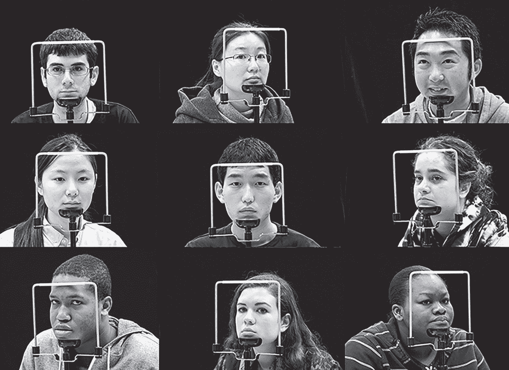

图 5.4 哥伦比亚凝视数据集。来自布莱恩·A·史密斯等人，“凝视锁定：人物交互的被动眼神接触检测，”ACM 用户界面软件与技术研讨会（UIST），2013 年 10 月，271-280（由布莱恩·A·史密斯提供）

## 面孔政治

我们不应该构建更多可将情感表达分配到机器可读类别系统，而应就这些类别本身起源以及社会政治后果提出更多问题。情感识别工具已被用于部署政治攻击。例如保守派博主声称自己创建“虚拟测谎系统”来评估美国国会女议员伊尔汗·阿卜杜拉希·奥马尔视频。通过使用亚马逊 Rekognition、XRVision 公司 Sentinel AI 与 IBM Watson 等面部与语音分析工具，博主声称奥马尔基于分析得到‘谎言’得分始终超过‘真实’基线，且她在压力、蔑视与紧张方面有较异常表现。几家保守派媒体报道该分析，声称奥马尔是“病态骗子”，会对国家安全构成威胁。

人们应相信什么？众所周知，这些系统对女性言语影响与男性不同，尤其是黑人女性。正如第三章所见，从不具代表性训练数据构建“平均值”，一开始在认识论层面就可疑。马里兰大学一项研究表明，面部识别软件将黑人面孔解释为比白人面孔具有更多负面情绪，尤其是将他们记录为更愤怒、更轻蔑，甚至控制微笑程度。

这就是情感识别工具危险。正如所见，这些工具把我们带回由骨相学统治过去，那时虚假主张被提出并被允许存在，以支持既有权力系统。围绕从人脸推断不同情绪想法科学争论持续数十年，强调中心问题：一刀切“识别”模型并非识别情绪状态正确隐喻。情绪复杂，并与家人、朋友、文化、历史以及 AI 框架之外所有多样丰富背景相关。正如所见，情绪“检测”系统并未像声称那样运作，它们并非直接测量人内部心理状态，而是在统计学层面，优化面部图像间某些物理特征相关性。AI 情绪检测背后科学基础存在问题，但新一代 AI 工具已在越来越多高风险环境进行推理预测。它们被拥有特权的人使用，从企业老板到街头警察等。

尽管现在所有证据都指明人工智能公司说法不可靠，人工智能公司仍在继续寻找新资源，以从面部图像中谋利；他们都在争夺有望带来数十亿利润行业头部市场份额。巴雷特对从人们面部推断情绪研究进行系统回顾，得出结论：

更普遍地说，科技公司很可能在问一个从根本上就存在错误问题。仅仅从面部运动分析中“读出”人们内部状态，而不考虑环境各种影响，在最好情况下这种做法不完整，而最糟情况下这种做法完全缺乏有效性，无论计算算法多么复杂……通过使用这项技术，从分析面部运动来获取关于人们感受结论，还为时过早。

但直到这一点被更广泛认识之前，我们都面临以下风险：人们难以被顺利聘用，因为微表情与成功员工微表情不符；某些学生成绩会比同龄人差，因为脸上表现出缺乏热情特征；顾客会被拘留审讯，因为人工智能系统会根据面部线索，将他们标记为可能入店行窃者。这些人正在承担系统成本，这些系统不仅在技术上不完善或“持有偏见”，而且建立在从根本上就有问题世界观之上。

这些系统涉及生活领域正在迅速扩张，实验室与公司可以为这些系统创造新市场。然而，它们都用对情绪狭隘理解——植根于埃克曼最初愤怒、快乐、惊讶、厌恶、悲伤和恐惧分类——来代表人类无限感受与跨越时空表达。这再次将我们带回到在单一分类模式中捕捉世界复杂性深刻局限。它让我们回到了机器学习中看到相同问题：希望将复杂事物冷冰冰过度简化，以便轻松计算，从而打包供市场使用，并被开发以获取利润。人工智能系统正在尝试从我们肉体中，提取我们情感、私密和内在体验，但结果会是一幅漫画草稿，它无法捕捉世界上情感体验细微差别。

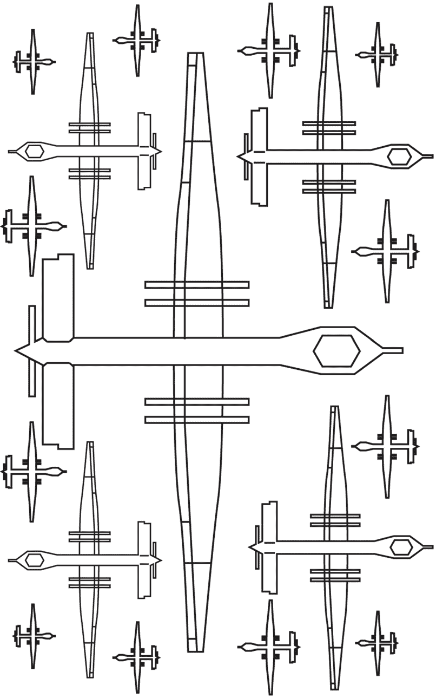

# 第六章

## 国家

此时，我坐在纽约一座建于 20 世纪 20 年代的仓库大楼的 10 层，面前是一台气隙电脑 ^(²⁶)

解密档案：AI 背后的军方系谱

2014 年经纪录片导演 Laura Poitras 引荐，我第一次拿到这批材料，当时它的保密等级仍在顶层。翻阅时冲击感很强，里面收录的是 NSA、GCHQ 等机构超过十年之久的情报思路与内部往来。没有顶级许可，根本无从接近。这类内容被称作“机密信息帝国”，据估算其扩张速度是公众可及信息量数据的五倍。斯诺登带出的文件像一个时代的注脚：抽取的重心已经迁移，政府正从手机、浏览器、社交平台与邮件里大规模取样。这份档案提供了一个难得的观察窗口，让外界得以看清情报体系怎样推着后来被称作 AI 的技术往前走。

斯诺登披露的材料指向一条与公众认知并行的隐秘演进线。操作手法与市面上常见的通用方案有相近之处，可在覆盖面、设计目的和最终产出上差异明显。NSA 内部几乎把所有软件系统都写成“尚未被占据、尚未被击败”的对象；除极个别被划为保护平台外，其他数据平台都被一视同仁。美国情报系统长期主导大数据领域，自上世纪五十年代起便与 DARPA 一同大力扶植 AI 研究。科学史家 Paul Edwards 在《封闭的世界》里指出，军事研究机构从一开始就在塑造后来被称作 AI 的新领域。1956 年达特茅斯首届夏季研讨会的部分经费就来自海军研究办公室。在公众对 AI 的大规模应用尚无清晰想象时，这门学科已长期处于军方主导或被列为军事优先项。正如 Edwards 所言：

作为最不产生直接效用而又最具雄心的项目，人工智能异乎寻常地严重依赖 ARPA 的资金。因此，ARPA 成了人工智能研究前 20 年的主要资助方。前局长罗伯特·斯普劳尔（Robert Sproull）自豪地总结道，“整整一代计算机专家都在 ARPA 的资助下起步”，而且“20 世纪 80 年代中期进入第五代（高级计算）项目的所有想法——人工智能、并行计算、语音理解、自然语言编程——都源于 ARPA 资助的研究”。

指挥、自动化与监视等军事关切，对 AI 的成长路径产生深远影响。ARPA 资助项目里的工具与方法，推动了计算机视觉、机器翻译、自动驾驶等方向的研究。更深一层，这些技术内嵌了一套分类思维，无论是战场导向的目标、资产与异常识别，还是更隐蔽的高中低风险分级，都构成了 AI 整体逻辑的一部分。对情境的持续感知与对目标的持续定位，驱动了随后数十年的研究，也塑造了业界与学界的认识论框架。

从国家视角看，转向大数据与 ML 不仅改变了信息抽取的可能，还提供了一种社会认知：人可以通过元数据被解读。跟谁通话、去过哪里、读过什么、为何使用某项服务……时间与地点都被用来识别威胁、评估风险并判定有罪与否。远程大规模采集成为理解社群、评估个体风险的主流手段。这也是政府与科技产业合作模式演变的组成部分，本章聚焦这种关系在美国的演进。正如我们会看到，AI 产业在冲击与重塑国家传统角色的同时，也被用来巩固甚至放大传统地缘政治力量。

## “第三次抵消”战略

美国国防部前部长 Ash Carter 常出现在硅谷。在他上任前，已有二十多年没有国防部长踏足该地。Carter 在硅谷的角色更像推销员，要说服科技公司，美国国家安全与外交的未来系于在 AI 领域保持领先。2020 年，他提出自己的“第三次抵消”战略。抵消通常被理解为通过改变规则来抵消潜在的军事劣势。正如美国国防部前部长、核物理学家 Harold Brown 在 1981 年一份国会报告中所写：“技术可以成为一种力量倍增器，用以抵消对手在数量上的优势。较之与对手开展常规军备竞赛，先进的技术是一种更为有效的平衡军事能力的方法。”

各国长期都在探寻借助技术对抗更强对手的办法。军事术语里，首轮抵消指上世纪五十年代依靠核武器与核威慑扩张获得优势，第二轮抵消则指七十、八十年代依靠隐蔽物流与常规武器创新获取优势。^(²⁷)

要打造 AI 战争机器，国防部需要成本高昂的采集基础设施，而算力与熟练工程人才的大头集中在硅谷。因此与产业界联手变得关键。NSA 通过“棱镜”（`PRISM`）这类系统，一边与电信与科技公司公开合作，一边辅以秘密渗透，为目标铺路。斯诺登泄密后，这些隐秘做法遭遇新的政治阻力。2015 年美国国会通过《美国自由法》，限制了 NSA 获取硅谷实时数据的权限。但在 Carter 看来，以数据与 AI 为核心建立更大规模军工复合体依然可行。如今硅谷已构建出 AI 的逻辑与基础设施并实现货币化，完全可用作新的抵消战略。只是首先要让硅谷相信，在不导致员工流失、不进一步损害公众信任的前提下，与政府共建战争基础设施是有价值的。

## 实施 Maven 计划

2017 年 4 月，国防部发布备忘录，宣布成立代号为 `Maven` 的算法战争跨职能团队（见图 6.1）。副部长在文件中写道：“国防部必须在作战中更有效地整合人工智能和机器学习，以保持相对于日益强大的对手和竞争者的优势。”项目意图是让完成度约八成的算法尽快上战场。马文计划的核心是做一个能在无人机视频里自动识别目标的系统；分析人员先选定目标，随后调取所有包含该人物或车辆的无人机片段。这是一个庞大的无人机视频检索平台，用以发现并清除敌方战斗人员。

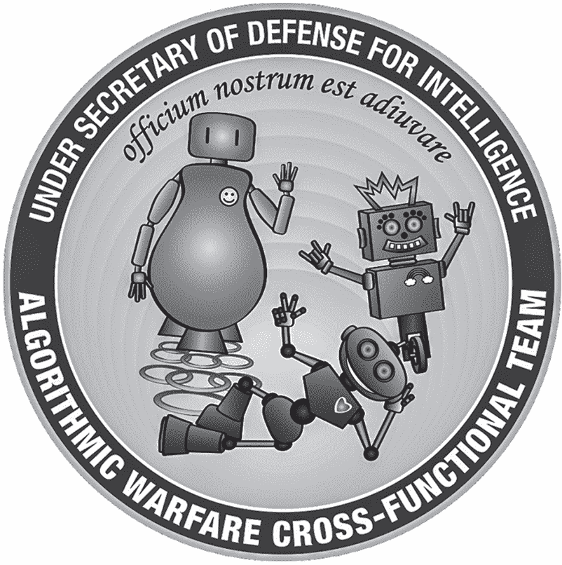

图 6.1 算法战争跨职能团队的官方印章，代号 `Maven` 计划。拉丁语意为“我们的工作旨在提供帮助”（由美国国防部制作）

`Maven` 需要的技术平台与 ML 专长主要集中在商业科技行业。国防部向这些企业付费，让它们把系统调整为分析卫星与战场无人机收集的军事数据，而这些数据在美国国内隐私法的适用范围之外。这样一来，美军与科技公司在 AI 上的经济利益被捆绑，同时规避了像 NSA 那样触及宪法隐私层面的风险。亚马逊、微软、谷歌为赢得 `Maven` 系统建设合同展开竞争。

`Maven` 首个合同给了谷歌。协议里五角大楼将使用谷歌的 `TensorFlow` ^(²⁸)

谷歌起初想对项目保密。

2018 年夏天，部分谷歌员工发现了公司的参与。他们对工作被用于战争感到强烈愤怒，尤其是在有新证据显示 `Maven` 的图像识别目标涵盖车辆、建筑与人物之后。激烈辩论在内部留言板与论坛展开。超过三千一百名员工签署抗议信，称谷歌不应涉入战争业务并要求终止军方合同。压力之下，谷歌正式结束 `Maven` 工作，并退出五角大楼一百亿美元的 `JEDI` 联合企业防御基础设施合同竞争。该合同最终落入微软。

内部抗议不久后，谷歌发布 AI 原则，其中一节名为“我们将不再从事的人工智能应用”。列出“制造主要用于对人们造成直接或间接伤害的武器或其他相关技术”，以及“违反国际公认准则收集或使用信息以实施监视的技术”。条文看似清晰，文后却附注：随着经验积累，目录可能调整。埃里克·施密特把 `Maven` 事件描述为“科技界普遍担心军工企业会用我们的产品不当杀人”。争论焦点从是否在战争中使用 AI，转向 AI 能否“以正当理由杀人”，这极具战略意义。把关注点从 AI 作为军事技术的根本伦理，转移到技术精准度与准确性上，为谷歌及美国 AI 产业提供了舒适区。然而自动化战争的问题远比技术准确性棘手。正如科技学者 Lucy Suchman 所说，问题远超出杀戮是否准确或“正确”的范畴。尤其在目标检测情境下：谁在构建训练集、用哪些数据、以何种机制把事物标记为迫在眉睫的威胁？依据何种分类法判定异常活动足以触发合法无人机打击？为何要允许这些不稳定且固有的政治分类产生如此暴力的后果？

斯诺登文件发布于 2013 年，读起来很像当下的人工智能营销手册。其中一份演示文稿展示了“藏宝图（`TREASUREMAP`）”（见图 6.2）：用来构建近乎实时、交互式互联网地图的程序。它声称能追踪任何联网电脑、移动设备或路由器的位置及其所有者。幻灯片自夸“此藏宝图可以在任何设备、任何地点、任何时间绘制整个互联网地图”。几张“作为推动者的藏宝图”幻灯片提供了信号分析的层级图。地理层与网络层之上是“网络人物角色层”——用糖果时代的 `iMac` 电脑与诺基亚功能手机表示——随后是“人物角色层”：边长“30 万英尺（约 91.4 千米）”的互联网视图，用以描绘全球使用联网设备的人。它与社交网络追踪与操纵公司如剑桥分析的做法如出一辙。

如果说藏宝图是互联网的“上帝之眼”，那么名为“酸狐狸”（`FOXACID`）的程序就更贴近现实：系统内的告密者。^(²⁹)

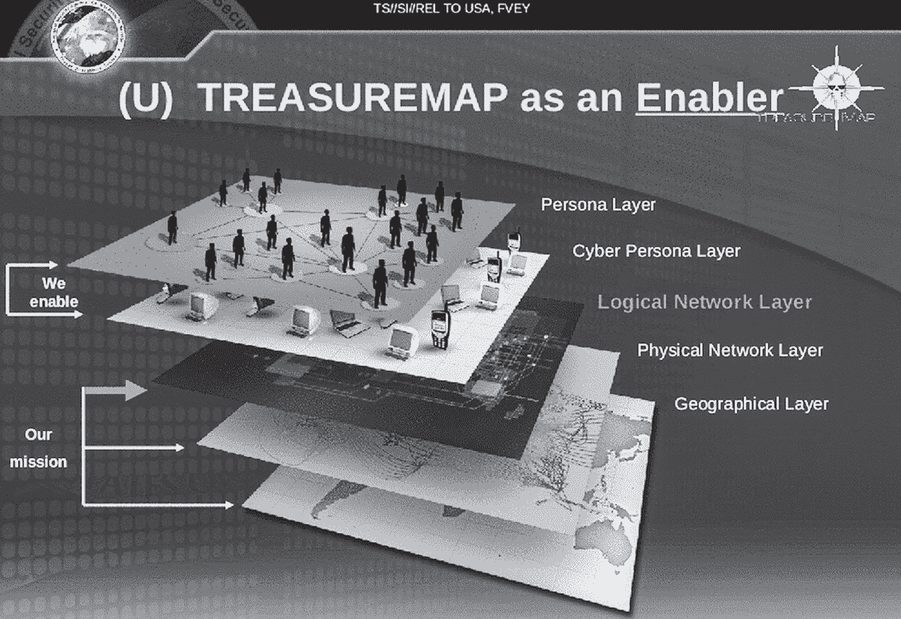

图 6.2 提供赋能的藏宝图

国家与 AI 产业的流动与交流不限于军队。过去仅情报机构与国防部能用的、设计上属违法的技术，如今已被市政部门、执法部门等地方机构采用。这得益于商业监控行业的壮大，它们积极向警察与公共机构推销工具与平台。表面看与把政府职能外包给洛克希德·马丁、哈里伯顿这类私营部门相似，但当军事形式的权力与市政服务交织时，性质发生变化。以托尔金《指环王》中的魔法水晶球 `Palantir` 命名的公司就是典型例子。

帕兰提尔成立于 2004 年，贝宝创始人、亿万富翁彼得·蒂尔是创始人之一，蒂尔也是特朗普的顾问与金主。蒂尔后来在评论文章中指出，人工智能首先是一项军事技术：

忘掉科幻幻想吧；现有人工智能的强大之处在于，它在计算机视觉和数据分析等相对琐碎任务上的应用。虽然不如弗兰肯斯坦那么不可思议，然而，这些工具对于任何军队来说都是很有价值的，比如获得情报优势……毫无疑问，机器学习工具也可以付诸民用。

泰尔认识到机器学习在非军事领域的潜力，并特别看重中间地带：商业公司生产带军事特征的工具，提供给任何想要“情报优势”并愿意付费的人。

帕兰提尔最初的客户是美国国防部、国家安全局、联邦调查局、中央情报局等联邦军方与情报机关。该公司并未把自己定位成典型的哈里伯顿式军事承包商。它采用硅谷初创企业的形态，总部设在帕洛阿尔托，员工多为年轻工程师，并得到美国中央情报局风险投资部门 `In-Q-Tel` 支持。除最初的情报客户外，公司还与对冲基金、银行及沃尔玛等合作。但基因上，公司已被在美国国防领域的工作塑造。它使用与斯诺登文件中展示相同的方法，包括从所有设备提取数据、渗透网络以追踪与评估人员与资产。帕兰提尔很快成为首选的外包监控制造商，通过设计数据库与管理软件推动美国移民和海关执法局的驱逐机制。

帕兰提尔的商业模式是提供基于机器学习的数据提取与模式检测服务，并辅以通用咨询。工程师被派驻到被服务公司，尽可能多地提取公司同意分享的电子邮件、通话记录、社交媒体、员工进出时间、机票预订等信息，随后找出模式并给出下一步建议。这些模式通常用于寻找当前或潜在的不良行为者，即可能泄露信息或欺骗公司的不满员工。帕兰提尔工具暗含的基本方法论让人想起国家安全局：先收集所有信息，再在数据中寻找异常。但国家安全局的工具是在传统或秘密战争情境下针对国家敌人进行监视与打击，而帕兰提尔的方法针对的是平民。正如彭博新闻社 2018 年的一项调查所描述的，帕兰提尔是“为全球反恐战争设计的情报平台”，如今“被用来对付美国普通民众”：

帕兰提尔最初在阿富汗与伊拉克为五角大楼与中央情报局工作。工程师与产品本身不直接参与间谍活动；它们更像间谍的大脑，收集并分析来自手、眼、鼻、耳的信息。该软件先梳理财务文件、机票预订、手机记录、社交媒体帖子等不同来源数据，搜寻人工分析师可能忽略的关联，然后以彩色、易解释、像蜘蛛网的图形展示出来。美国间谍部门与特种部队立刻爱上它；他们部署帕兰提尔，对大量战场情报进行合成与分类……美国卫生与公众服务部用它检测医疗保险欺诈。联邦调查局用它进行刑事调查。美国国土安全部用它对航空旅客筛查，并密切关注移民动向。

很快，对非法移民的监视演变为在其工作场所以及孩子上学地点进行逮捕与驱逐。为实现此目的，帕兰提尔开发了一款名为猎鹰（`FALCON`）的手机应用程序，其运行如一张大网，从多个执法部门与公共数据库中收集数据，包括人们的移民历史、家庭关系、就业信息、学校信息等。

尽管帕兰提尔力求保持系统构建与运行方式的保密，但其专利申请仍暴露了他们如何基于人工智能进行驱逐。在一款名为“用于动态交互式移动图像分析和识别的数据库系统和用户界面”的申请中，帕兰提尔吹嘘称该应用可在短时间内拍摄人们相遇的照片，并将他们的照片与所有可比对数据库进行匹配，无论是否受怀疑。从本质上说，该系统使用面部识别与后端处理技术创建框架，作为实施逮捕或驱逐的基础（见图 6.3）。

帕兰提尔的系统在结构上与美国国家安全局的系统高度相似，却下沉至地方与社区层面，被出售给连锁超市与地方执法部门。这意味着该系统从传统警务目标向与军事情报基础设施更相关的目标转变。正如法学教授安德鲁·弗格森所解释的：“我们正进入一种境况，检察官与警察会说，‘算法让我这么做，我就照做了，但我也不知道我正在做什么’。类似情况将会非常普遍，且缺乏监督。”

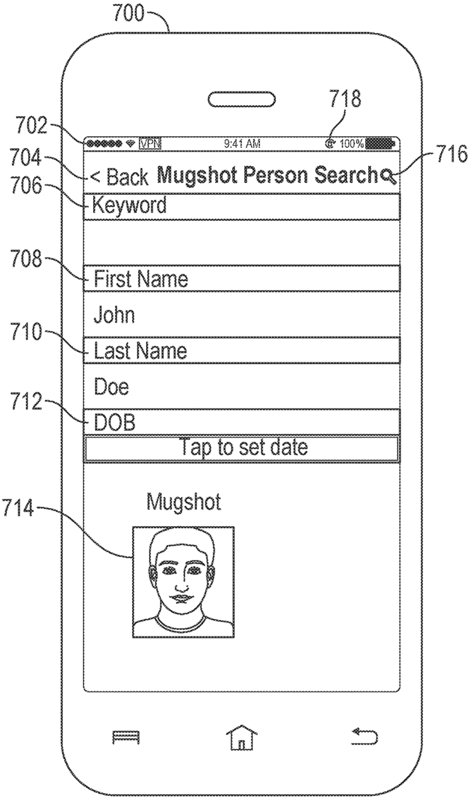

图 6.3 帕兰提尔公司 `US10339416B2` 号专利图片

（图片来源：美国专利和商标局）

社会学家 Sarah Brayne 以洛杉矶警察局为切入点，是首批直接观察帕兰提尔数据平台在现场如何使用的学者。在两年多时间里，她与警察同行巡逻、观察室内办公并多次访谈后得出结论，这些工具在某些领域强化了既有做法，在其他方面则彻底改变了监视过程：

从传统监控向大数据监控的转变，与执法行动向情报活动的转变密切相关。执法与情报的本质区别在于，执法通常在犯罪发生后才介入。从法律上讲，在有充分证据前警方不能搜索与收集个人信息。相比之下，情报活动本质上是预测性的。情报活动涉及收集数据、识别可疑模式、地点、活动与个人，并据此进行先发制人的干预。

虽然每个人都受此种监视，但移民、穷人与有色人种受监视更多。正如 Brayne 的研究所观察到的，帕兰提尔软件的使用再现了不平等，使主要居住在贫困、黑人与拉丁裔社区的人受到更严密监视。一名警官称警方的统计做法“只是数学计算”而已，因此客观。但他们创造了一个强化的逻辑循环。Brayne 写道：

尽管计分系统的目的是避免在警察执法中存在法律上具有争议性的偏见，但它隐藏了警务中有意和无意的偏见，并创造了一个自我延续的循环。如果有些人的积分值高，他们将会处于高度监视之下，因此他们的行为更有可能被阻止，从而进一步提升他们的积分值。这种做法，阻碍了已经被刑事司法系统记录下来的个人，拒绝被进一步纳入监视网络的能力，同时模糊了执法在形成风险评分方面的作用。

帕兰提尔及类似的机器学习方法，会导致一个反馈循环。在此循环中，被纳入刑事司法数据库的人更可能被监视，导致数据库中关于他们的信息更多，为警方进一步审查提供依据。因此，它不仅加剧不平等，而且在看似不会出错的技术合理性掩饰下，加剧了过度监管与监控中的种族偏见。开始应用于政府机构的情报模型，如今已扩散至边缘区域。警察局的“国家安全局化”加剧了历来存在的不平等，并从根本上改变与扩大警察工作的实践。

从另一角度审视这种商业军国主义的人工智能，可以参照 2005 年建立的警视公司（`Vigilant Solutions`）。该公司运行的基础是：将本应由政府操作、需司法监督的监控工具，转变为一个在宪法隐私限制之外的、蓬勃发展的私营企业。警视公司已在美国多个城市把自动车牌识别摄像头安装到汽车、电线杆、停车场、高层公寓楼等地。这些网络摄像头拍摄经过的每一辆汽车，并将车牌图像存储至一个巨大的永久数据库中。然后，警视公司把数据库访问权限卖给警察、私家侦探、银行、保险公司，以及任何想要访问的人。同样地，若一家银行想收回一辆汽车，警视可以以一定价格透露其位置。

扎根加州的警视公司对外塑造的形象是执法可靠的助推器，宣称能为警方找线索、加速破案。公司已经与得州、加州、乔治亚州等地的州政府展开合作，向基层警队提供一套名为 `ALPR` 的车牌自动识别巡逻方案，同时开放后台数据库查询权限。交换条件是地方政府把未执行逮捕令、法院欠费逾期的个人记录交给警视。凡是和未缴罚款挂钩的车牌都会被录入警用移动终端，系统会即时提醒拦截。被拦下的司机基本只有两条路：当场补缴欠款，或被直接带走。除此之外，警视还额外收取 25% 的服务费，并把每次扫到的车牌全部留存、抽取、沉淀进自家不断扩大的数据库。

这家公司与 `ICE` 的合作规模更大。协议让移民执法机构能够调阅由私营企业收集的约 50 亿条车牌记录，再加上 80 个地方执法机构提供的、涉及民众生活工作线索的 15 亿个额外数据点。这些数据很可能源于地方警方与 `ICE` 之间非正式的信息共享，存在触碰州级数据共享法规的风险。`ICE` 本身的隐私规范明文禁止在校园、教堂、抗议现场等敏感场所收集信息，但它并未自己采集或维护数据库，而是直接购买警视系统的访问权限，后者的限制远比官方政策宽松。表面上是一次采购，实质是将公共监控职能外包给私营方，让国家机器与商业供应商的边界变得模糊，形成一套游离于监管之外的不透明采集网络。

随后，警视把“破案工具箱”从车牌摄像头拓展到能辨认人脸的摄像头。公司试图把人脸处理成类似车牌的标签，再回流到警务生态中。像私人侦探网络一样，警视的野心是为全美道路、高速以及沿途每个人搭建一种上帝视角，并在几乎没有实质约束的情况下运行。

如果把视线从巡逻车挪到居民家门口，就能看出公共部门与私营部门的数据操作正在趋同。新一代的社交型举报应用，比如“邻居”`Neighbors`、“公民”`Citizen`、“隔壁”`Nextdoor`，让用户实时接收周边事件推送，在群里讨论、上传并标注监控片段。`Neighbors` 由亚马逊依托其“门铃摄像头”`Ring doorbell camera` 推出，自称是“新型社区监控平台”，把视频分类为犯罪、可疑、陌生人等标签后推送给警方。这些家用监控生态把“藏宝图”与“酸狐狸”的逻辑拼在了一起，把家庭、街区乃至中间的每个角落都串联起来。对亚马逊而言，每卖出一台门铃设备，就等于为家庭内外扩张训练数据集，并建立一套符合“盟友与敌人”战场思维的“正常与异常”行为模型，比如用户会举报亚马逊快递员取件不温柔。调查显示，用户帖子中充斥种族主义言论，视频内容也明显偏向把有色人种塑造成潜在窃贼。除了举报犯罪，门铃还被用来监督和惩罚亚马逊自己的员工，形成多一层的 workplace 监控。

为了把这套基础设施补全，亚马逊正积极向警局兜售门铃系统，不仅提供价格优惠，还上线了一个门户，让警方查看本地摄像头分布，并在没有搜查令的情况下直接联系屋主，非正式索要录像。截至报道，已有 700 多个警局与亚马逊签署了视频共享合作。

记者卡罗琳·哈斯金斯·Caroline Haskins 通过公共记录申请，揭露亚马逊与佛罗里达一地警局的谅解备忘录。备忘录激励警方推广“邻居”应用，每完成一次合格下载，警方就能获得门铃摄像头的免费使用额度。哈斯金斯指出，这形成了一个自我强化的监控循环：应用下载越多，门铃装机越多，录像量暴增，警方想要的内容就越多。过去只能由国家安全信件与禁言令控制的监控能力，如今已进入苹果应用商店供地方警察使用。正如媒体学者胡东辉所言，我们正“成为国家安全机构的自由职业者”。

胡东辉还指出，“精准锁定”这一军事术语的各种变体——精准广告、精准锁定可疑邻居、精准锁定无人机——本质上是一个相互关联的权力体系。“我们不能单独看待某种精准锁定，它们关乎数据主权，需要用不同的方式理解云时代的力量。”这并非说我们都成了国家安全局的眼线，而是说，原本属于情报机构的观察方式，已分散到众多社会系统，常由横跨商业与军事人工智能的科技公司驱动。

## 从恐怖分子信用评分到社会信用评分

精准军事逻辑的核心是“特征”。在布什第二任期临近尾声，中央情报局提出应依据个人行为模式或“特征”实施无人机打击。“个性打击”针对已知个体，“特征打击”则根据元数据签名杀人，即身份不明但数据模式吻合。斯诺登档案显示，奥巴马时期美国国家安全局的全球元数据监控会先定位嫌疑人的 SIM 卡或手机，随后美军利用无人机清除持有该设备的人。前国家安全局和中央情报局局长迈克尔·海登将军说过：“我们会根据元数据实施打击。”国家安全局地理细胞部门的说法更直白：“我们跟踪他们，你打击他们。”

特征打击听起来像经过授权的精准，仿佛“签名”就是身份的证明。2014 年，人权组织“暂缓执行”Reprieve 的报告指出，原计划打击 41 人的行动最终导致约 1147 人死亡。负责人珍妮弗·吉布森表示：“公众一直被灌输无人机袭击是‘精确’的，但精确度取决于情报质量。”实际上传递的并非精确度，而是相关性。一旦数据中出现某种模式并达到阈值，就可以在缺乏确凿证据的情况下行动。这种模式化的决策最常见的落地形式是“分数”。

2015 年叙利亚难民危机高峰期，数百万人冒死穿越地中海。9 月 2 日，三岁男孩艾伦·库尔迪·Alan Kurdi 与五岁哥哥溺亡，尸体冲上土耳其海滩的照片成为人道灾难的国际符号。与此同时，IBM 启动了一个项目，试图用机器学习平台从难民数据中捕捉“恐怖分子特征”，也就是自动区分难民与恐怖分子。IBM 战略计划主管安德鲁·伯雷内向《防务一号》解释初衷：欧洲团队担心混在“饥肠辘辘、垂头丧气”的寻求庇护者中，有“正值战斗年龄且身体健康”的男性，这是否意味着极端组织渗透的风险。

IBM 数据科学家在纽约办公室里从机器学习视角切入：尽可能抽取数据，再推断最优答案。忽略难民营恶劣条件带来的众多变量，以及用于定义恐怖行为的数十项未经证实的假设，团队做出一个实验性“恐怖分子信用评分”，从看似健康的难民中筛出风险。分析师收集了大量非结构化数据，包括推特内容和希腊、土耳其海岸沉船溺亡者的官方名单。评分并非简单的有罪无罪，而是基于个人过往住址、工作单位、社会关系构建的画像。叙利亚难民并不知情，也没有任何途径反驳可能让他们被标记为潜在威胁的分数。

这只是把难民尸体当作国家控制新技术试验场的案例之一。军事与治安逻辑正被金融化：社会建构的信用模型已渗入大量人工智能系统，影响贷款、跨境许可等事务。从委内瑞拉到美国，数百个平台按预设行为奖励与惩罚。社会学家马里恩·富尔卡德与基兰·希利称之为“新的道德化社会分类”，它偏爱传统经济中的高成就者，同时把最脆弱者推向更不利的位置。信用评分已成为军事特征与商业特征的交汇点。

这种评分逻辑不仅用于执法与边境，也渗透进公共福利。学者弗吉尼亚·尤班克斯在《自动不平等》一书中指出，当人工智能用于福利发放时，技术主要被用来识别欺诈与滥用，而非改善社会公平。

例如，前捷威公司主席、共和党密歇根州州长里克·斯奈德为削减财政赤字推行两项算法驱动的紧缩。第一项匹配算法执行逃犯政策，根据未执行的重罪逮捕令自动取消个人食品救济资格。2012 至 2015 年间，系统错误匹配了 1.9 万多名居民，导致他们被停发救济。第二项系统名叫密歇根综合数据自动化系统 MiDAS，旨在自动判定并惩罚骗取失业保险的人。它把个人记录中任何不一致都视作违法证据。系统错误标记了 4 万多名居民存在可疑欺诈，后续后果包括扣押退税、工资及处以被指控欠款四倍的民事罚款。最终两个系统都以财务失败收场，州政府花费远超节省金额。受害者随后起诉并胜诉，但在那之前，数千人已遭受重创、数家破产。

这些算法的设计目的并非最大化福利供给或提升效率，而是防范欺诈与犯罪，决定谁该被惩罚、谁该被剔除出公共支持。系统本质上是惩罚性的。评分与风险的思维已深植美国官僚机构的架构，并通过自动决策系统投射到社区与个人身上。

## 纠缠的干草堆

斯诺登档案里有一张幻灯片把地球形容为“信息大干草堆”，情报则是丢失其中的针。画面是一幅欢快的剪贴画，巨大的干草堆矗立在田野，头顶蓝天。这看似陈词滥调的呈现暗含战术意味：割草是为了农场利益，收割数据是为了制造价值。它唤起一种令人安心的“数据农业”田园想象：管理数据领地而非对抗数据生产者。菲尔·阿格雷曾说：“技术现在是一种隐蔽的哲学，关键在于让它具有公开的哲学性。”整体来看，国家在军事到市政层面使用的人工智能与算法，揭示了一种秘密哲学：通过数据提取、精准目标、监视手段相结合，对大规模基础设施实施指挥控制。几十年里这始终是情报机构的核心目标，如今已扩展到地方执法与公共福利。国家、市政、企业逻辑正通过行星计算深度融合。

斯诺登档案也暴露了监控系统的广度。保存档案的工作室对数据处理极度敏感，分级管控。协议规定文件只能在现场阅读，禁止复制，研究只能手写。

在一本笔记里，我记下了国家安全局员工在时事通讯中描述的“登顶热”：对数据提供上帝视角的上瘾，即使出错也无法脱身。登山者称之为“登顶热”，一个人过于执着于登顶，其他一切从意识中消失。我相信 SIGINT...

美国国家安全局的特殊方法和工具已渗入课堂、警局、工作场所和失业办公室。它是巨额投入、事实上的私有化、风险与恐惧金融化的产物。这种曾定义情报机构权力的模式，如今可从帕兰提尔、警视、亚马逊等公司买到，并被宣传为通过预测性警务、车辆追踪、家庭安全系统实现完美监控的幻想。无论这些系统如何重塑地图、伤害多少人，对全知的渴望已演变成病毒式狂热。但人脸识别、社会评分等人工智能系统是否技术上有效，其实并不重要。失效时它们很危险，生效时它们更具危害。我们该质疑：这是谁的愿景？谁渴望一个无论在家、工作、街头、餐馆、音乐会或通勤路上都被捕捉的世界？谁从中获益最大？答案显然是既有且强大的军队、情报机构、警察与企业。斯诺登泄密是分水岭，它揭示了政府与商业混合合作时信息提取文化能走多远，但网络图表与 PPT 剪贴艺术相比，后来的发展显得更为怪异。这种不同权力形式的深度纠缠，正是第三次抵消战略的期待。它早已超出战场优势的目标，覆盖日常生活里所有可追踪、可计分的环节，并界定“好公民”的沟通、行为、消费规范。这种转变在国家愿景层面制造分歧，导致代理人与本应服务的人民之间权力严重失衡。

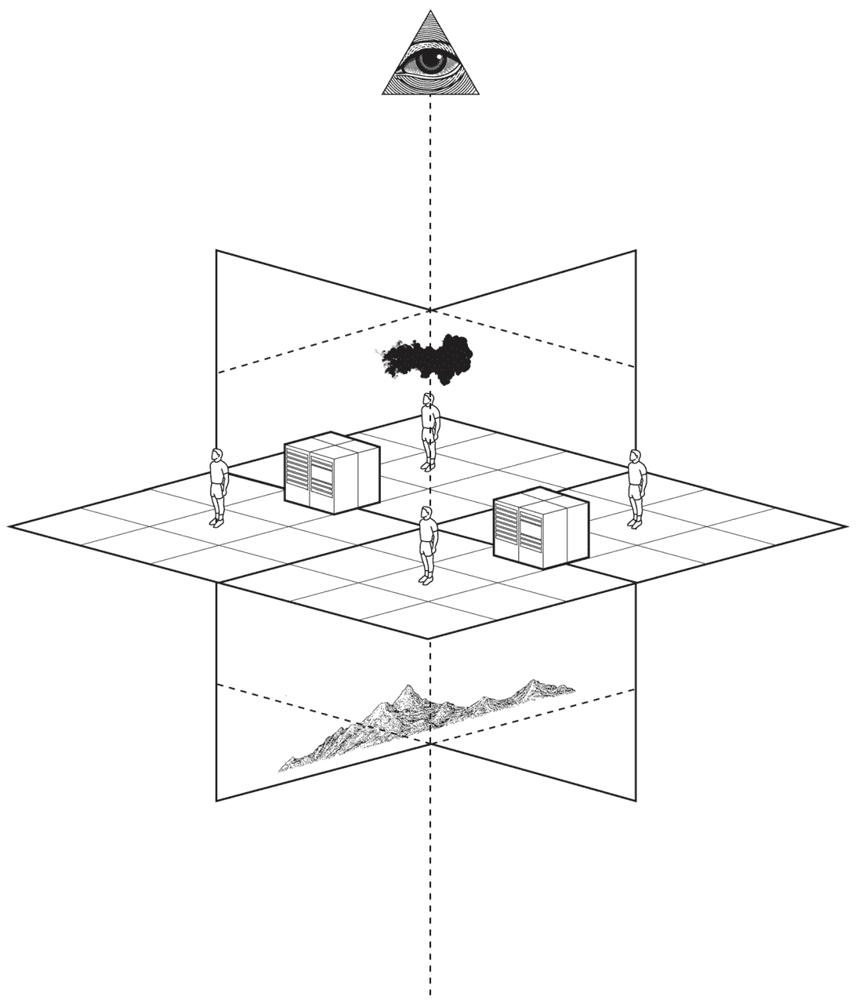
# 第七章
## 权力
### 捕获的领域

看这张 AlphaGo Zero 的图像。2016 年，人类围棋冠军李世石与谷歌 DeepMind 训练的早期系统 AlphaGo 进行现场对弈，全球观众见证了李世石被击败。仅一年后发布的 AlphaGo Zero 标志着新阶段。没有使用人工标注数据或超出规则的训练，它在 36 小时内学会围棋，成为当时最顶尖的系统。谷歌 DeepMind 在《自然》发表的论文中写道：“从零开始，我们的新程序 AlphaGo Zero 取得了超人成绩。”

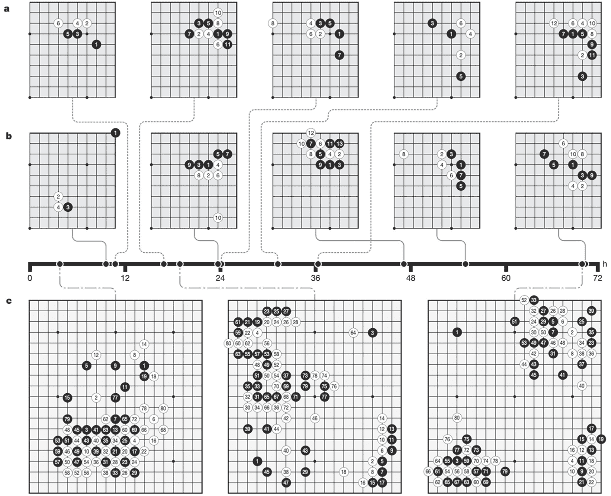
图 7.1 AlphaGo Zero 学习的围棋知识（图片来源：谷歌 DeepMind）

如果细读这张图像能学到什么。它表面代表棋盘走法，因为 AlphaGo Zero 发现了人类需多年练习才能掌握的顺序与策略。说明文字称“游戏初期贪婪地吃子，像人类初学者”。随后“游戏展现了死活、势和地的核心要素”。随着熟练度提升，戏剧化曲线被简化为线形图，看起来几乎像电路板。对外，这仍是人类游戏，一旦系统化就显得非人。Alpha Zero 系列把技术推广到围棋、国际象棋、日本将棋。DeepMind 联合创始人戴米斯·哈萨比斯说：“它不像人类，也不像传统引擎，像是第三种，几乎外星般的方式……像来自另一个维度的国际象棋。”在人工智能发展史上，这种把 AI 描绘成例外、神秘、外星、超人的说法反复出现。用神秘语言包装的东西到底做了什么？为谁服务？AlphaGo 与 Alpha Zero 会自与自己下数百万盘棋，进行统计分析、优化胜率，再重复数百万盘。它会产生人类棋手少见的惊人走法，仅仅因为人类下不了那么多盘。这并非魔法，只是大规模统计分析。但对投资者与传播者来说，这个事实不足以解释巨额成本，于是大算力统计基础设施被描述成施了魔法的对象。哈萨比斯说 Alpha Zero 在 72 小时内“重新发现了人类 3000 年积累的知识”。这属于更深层的笛卡尔意识形态，程序被想象成与身体、基础设施、世界分离的思维。这种二元论具有深远的社会政治后果。

### 没有边界的竞赛

自 20 世纪 50 年代起，游戏一直是 AI 测试的首选，因其参数封闭、胜负明确。回溯美国人工智能的源头，二战期间的信号处理与优化军事研究，让早期 AI 强调合理化与预测，并相信通过数学形式化来理解人类与社会。一种社会内隐理论由此产生：准确预测本质上就是减少社会复杂性，在噪音中找信号，在混乱中建立秩序。

把复杂社会场景在认识论层面“扁平化”为清晰信号用于预测，成为当代机器学习的核心。技术史学家亚历克斯·坎波罗和我把这种现象称为“赋魅”：AI 系统被描述为超自然、超越已知世界，却又确定，因为能发现可用于日常生活的预测模式。这本质上是神学观点，认为 AI 是抽象、可预测、超人的产物，是精湛技术的成果，脱离社会、政治、环境背景。它还支撑一种观点：系统过于复杂，难以监管。

深度学习常通过堆叠更抽象的数据表征层来扩展机器学习，这使得多数深度系统对创造者本身也难以解释。当庞大昂贵的模式识别计算基础设施被赋魅时，任何怀疑性质询都可以被终结。

# 神话与地基：AI 的双重叙事

谈论生成式 AI 时，公众常被两套镜像话语牵引。一套把系统神化为能修复气候、司法等所有困境的万能解法，另一套则把系统妖魔化为奇点后反噬人类的终极威胁。乐观与焦虑构成同一根技术至上的轴线：前者把全部希望押在系统上，后者把全部恐惧堆在系统上。不论被塑造成全能工具还是全能霸主，落脚点都是把 AI 抬到拯救或毁灭社会的中心，而它日常的失灵、资源损耗与真实伤害被有意淡化。两种立场都回避了行星计算框架下，对有色族群、低收入群体与南半球地区进行的系统性收编。

### 人工智能的管道
换一张说明书来看：谷歌在俄勒冈州达尔斯的数据中心总图。工程图上三座约 6380 平方米的仓库，按 2008 年的测算，其用电量可供 8.2 万户家庭，或相当于华盛顿州塔科马市的整体用电量。园区坐落在哥伦比亚河岸，享用北美最便宜的电价。谷歌与地方政府谈判半年，拿到免税、长期低价电、城市自建光纤环等极其有利条件。与 AlphaGo 在棋盘上的布线相比，图纸上密布的燃气管、下水道与输电线，显示出技术愿景对公共事业的深度依赖。记者金格·斯特兰德写道：YouTube 的运转实质上是靠城市基础设施与各级补贴在买单。

这张总图拆开了产业的内部逻辑。提醒我们从国防拨款、联邦科研，到公用事业与税收减免，再到所有搜索、发图用户的无偿数据与劳动，扩张过程吸纳了大量公共养分，最终被私有化。AI 更像一项巨大的公共工程。

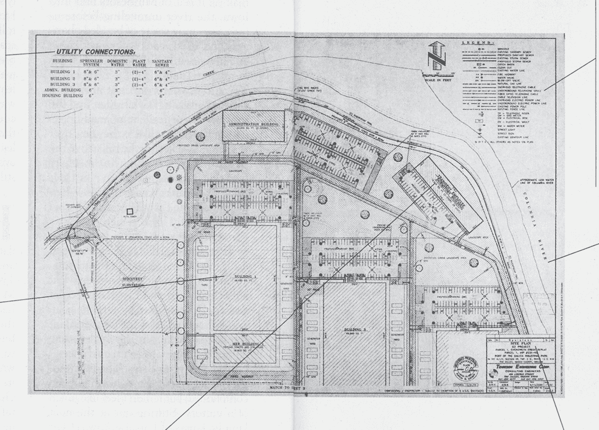

图 7.2 谷歌数据中心蓝图（图片来源：Harper）

这些材料提供另一种解读路径。对 AI 的界定与边界由谁划定，直接决定我们能看见什么、争论什么。AlphaGo 讲的是抽象云计算的行业故事，却回避了支撑它所需的地球资源。这种叙事崇拜创新、抗拒监管、拒绝披露真实成本。迈克尔·哈特与安东尼奥·内格里称之为抽象与提取的双重操作。之所以盛行，是因为得到同一权力结构的扶持，这些结构正是从地球、劳动与公众中抽取价值的最大受益者。总图只呈现硬件，历史、政治与社会后果却被遮蔽。

本书试图勾勒 AI 的轮廓，去丈量这个集中化的行星基础设施，以及贯穿过去与现在的物质、社会与劳动提取链。我们看到系统被训练去识别世界中固有的政治行为。由此可触及更深层的技术、资本与权力机制，而 AI 只是最新表征。本章从“AI 是什么”转向“AI 在哪、为谁、为什么是 AI”。把调查定位于此，可追溯资本主义、计算与控制的历史纠缠，并思考未来的其他组合。

### 真实存在的 AI
该如何看待完整生命周期与驱动力？首先需要以更广阔的物质、社会、政治背景绘制地图。离开硅谷的大学实验室与开放式办公室，去看全球提取脉络。AI 诞生于玻利维亚盐湖与刚果矿山，由试图给所有人类行为、情感与身份分类的数据集训练，再由点击工人标注，最后被用于导航也门上空的无人机、指导美国移民执法、调节全球信用评分。广角与多尺度视角，能瞥见提取、政治与技术力量如何交错。

从地下开始，便能看见真实的资源政治。稀土、水、煤、油：科技部门正在改造地球，为高耗能的行星计算供能。硬件上，数据中心与智能设备高度依赖日渐枯竭的资源与冲突矿区原料。软件上，语言与视觉模型的构建需要巨量能源，更快更高效的模型助长了“贪婪计算”，推高碳足迹。

对环境损耗，行业始终缺乏坦承，同时扩大数据中心网络也帮助石油天然气业开采剩余化石燃料。总体而言，计算的真实成本不透明，反映了一种长期商业模式：从公共资源抽取价值，却不为产出买单。

劳动是另一重提取。跳脱高薪机器学习工程师，要看全球范围内让系统运转的所有工作。印尼采矿锡的矿工、印度做亚马逊土耳其机器人任务的众包者、菲律宾的内容审核员，构成远超想象的劳动规模。即便在科技公司内部，也存在大量影子合同工，例如高估值的谷歌以更低成本、更少福利、无带薪假维持一个规模远超全职员工的合同队伍。

在物流节点，人类完成机器做不到的事。成千上万人从事标注、纠正、评估、编辑工作，却要假装自己是智能以维系“智能”的假象。另一些人搬运包裹、开网约车、送外卖。系统全程监控的同时，从人体指尖、眼球、膝盖榨取最后产出，因为人的复杂连接比机器人更便宜更易得。那里的未来工作更像过去的泰勒式工厂，区别在于犯错时手环会震动，上厕所次数过多会被惩罚。

工作场所使用情绪检测，进一步加剧权力不对称。应用追踪员工、延长工时、实时排名。亚马逊典型地显示了微观身体控制如何与行星尺度的时间与信息物流相连。AI 利用不同市场的时间与工资差加速资本循环，突然间市中心每个人都能当日达。系统加速，而真实成本藏在无尽纸箱、货车与“立即购买”按钮之后。

分析每个眼神与手势也是价值提取。“情感识别”声称能从微表情与语调判断员工是否合适、在电脑前是否投入。工作场所的工具把更多控制权交给企业，同时掩盖系统背后古怪且常错的假设，进一步扭曲劳动权力关系。

在数据层，是完全不同的提取哲学。2012 年谷歌街景工程师说：“我们正在建造现实世界的一面镜子，现实里看到的任何东西都要纳入数据库。”此后对现实数据的收割愈演愈烈。公共空间被广泛掠夺：科技公司捕捉街头行人面孔训练人脸识别、刮取社交媒体建立心理健康预测模型、抓取个人照片与在线辩论训练机器视觉与自然语言处理。做法已成常态，几乎无人质疑。大量职业与估值都依赖它。曾经仅属情报机构的“收集一切”心态，如今被常态化甚至道德化，不收集反而被视为浪费。

数据一旦被提取编入训练集，便成为系统分类世界的认知基础。ImageNet、MS Celeb、NIST 等基准集用图像代表标签所暗示的更具关联、更具争议的想法。第四章展示标签如何频繁强加强制的二元性别、简单武断的种族分类，以及高度规范化的性格、优点与情绪状态。这些分类不可避免负载价值，同时声称科学中立，强化了一种看世界的方式。

数据集从来不是单纯原材料，而是本质上的政治干预。收集、分类、标注再训练本身就是政治。这带来“操作型图像”的转变，为机器创造世界的表象。偏见只是冰山一角，其下是一个更集中、更规范的逻辑，决定我们该如何看待与评价世界。正如洛林·达斯顿对导航图的描述，分类都取决于抽象，从纷繁细节中突出某些特征、淡化其他特征。这些选择看似微小，却影响深远持久。

第五章介绍的情感检测系统是个重要例子，它依赖有争议的人脸—情绪关联，按测谎仪的还原逻辑运行。该领域科学仍存在大争议。机构历来按身份分类贴标签，缩小人格复杂性，机器学习让这一过程大规模自动化。几十年的奇特信念已变代码。从巴布亚新几内亚山城到马里兰军事实验室，技术试图把混乱的情感、内心状态、偏好与认同降为定量、可检测、可追踪之物。AI 的识别方式像个魔术，数年演化的技艺，以巧妙手法与精确条件为基础，比它声称看到的身份类别更能透露工具与其创造者的信息。

要让整个世界对机器学习“可读”，需要怎样的认识论？AI 试图系统化非系统之物、形式化社会，把无限复杂且不断变化的宇宙压缩成机器可读、林奈式的整齐表格。许多成就依赖把事物归约成简洁标签与形式，这些标签依赖代理，即识别并命名某些特征，忽略或模糊无数其他特征。数据集本身也是代理，例如为情感识别算法模仿六种普遍情绪的女性脸。这让人想起尼采所说的“把纷繁复杂不可估量的事物变为相同、相似、可计算的事物”。

当代理被当作基本事实，单一固定标签套用到流动复杂的现实时，系统处于最确定状态。我们看到案例：用面孔预测性别、种族或性取向，预测保释后是否再犯、有无信用风险、是否与黑帮有关。这些身份由深刻关系、背景与社会决定，并非一成不变，会随时间与情境改变。

当系统被用作权力工具时，这种极端最明显。情报机构在规模化数据收集上领先，元数据足以触发致命无人机袭击，一个已知手机位置就能杀死未知目标。但即便如此，无情的“元数据”“外科手术式打击”语言，与导弹并不准确、死亡往往超预期等众所周知的事实直接矛盾。露西·萨奇曼质疑：“对象”如何被认定为迫在眉睫的威胁？我们知道“恐怖组织轻型货车”标签基于手工标注数据分类，由谁选择分类并贴标签？哪些错误可能导致更多意外死亡？第四章已显示目标识别训练集的认识论混淆与错误，军用系统与无人机攻击建立在同样的不稳基础之上。

第六章概述的科技与军方紧密联系，正被民族主义议程进一步塑造。美国国家安全局与中央情报局的工具以商业军事合同形式下沉市政层面。帕兰提尔仅是向执法与联邦机构如美国移民和海关执法局出售元数据收集与预测平台的公司之一。在完整信息控制与捕获的后勤系统支持下，未登记移民被锁定追捕，这些系统曾仅为游离于法律之外的间谍活动所有。如今车牌读取技术被加入家庭监控，由 ReKor 等公司生成的可疑司机名单可被输入亚马逊总部 Ring 建筑，形成广泛整合先前独立监控网络的系统。监控范围迅速扩张，私人承包商、执法部门与科技部门界限模糊。市政层面，自动化决策系统追踪异常数据以切断失业补贴并指控欺诈。本质上，以战争考验的工具与世界观彻底重绘公民生活。

透过这些场景可见，AI 是更广阔权力结构的一部分。系统由股东价值驱动的公司开发销售，卖给军队、执法、雇主、土地所有者等本就强大的群体，从而加剧权力不对称。从被推荐的优步司机，到被追踪的非法移民，再到被迫在家装面部识别系统的公共住房租户，资本、治安与军事化逻辑的工具强化了权力的中心。

## 为什么是人工智能？
一本导航图如何帮助我们用不同方式理解 AI？不同角度能提出什么新问题？导航图可引发尺度转换：从眼前所见，到连接不同空间的图表。AI 导航图已超越“人工”“智能”的抽象概念，甚至超越机器判断的内涵，旨在展示提取主义的物质化全球脉络。这极大拓宽了当前聚焦预测、自动化与效率的定义。重新界定带来观念转变：服务于资本、军队与警察的工具，同样可被用来改变学校、医院、城市与生态，若它们真的是无成本中立计算器，便应适用于任何地方。

简单说，我们需要从最大意义上展示 AI 是什么，并认清它服务的权力结构。我们已看到政治内建于计算堆栈，在理论与实践层面产生影响。若当前 AI 只为既有权力结构服务，便会提出显而易见的问题：我们难道不该让 AI 民主化吗？难道不能有一个“面向人民的 AI”，致力于更公正平等的社会，而非榨取与放大既得利益？

这看似诱人，但需谨慎。正如本书展示，实现 AI 的结构，以及被 AI 激活的结构，强烈倾向于集中权力与信息，放大压迫性国家功能与歧视性设计。从这个意义上，让 AI 民主化以分散权力，其不切实际程度犹如“让武器制造民主化以服务和平”。历史证明，用主人的工具拆掉主人的房子极其罕见。

科技行业该反思。迄今回应之一是签署 AI 伦理声明，但远远不够。欧盟议员玛丽埃特·舍克指出，2019 年欧洲已有 128 个 AI 伦理框架。这些文件多为更广共识产物，却常缺席受害最深者的声音。

伦理原则与声明很少关注如何落实、是否有效。此类道德宣言大多忽略准则如何、哪里、由谁编写，极少可执行，极少对公众负责。伦理学家布伦特·米特尔施塔特指出，与医学不同，AI 没有正式专业治理结构或规范，也没有商定定义与目标。最重要的是，与医学伦理不同，AI 伦理没有外部监督或实施道德护栏的标准规程。

通过承诺合乎伦理，企业暗中宣称有权决定“负责任部署”的含义，从而决定合乎伦理的 AI 对世界意味着什么。迄今科技公司因 AI 违法鲜少受经济制裁，违反道德原则也几乎没有实质后果。简单说，伦理不是解决本书提出基本问题的正确框架。AI 本身是提取产业，以股东价值最大化为首要指令的公司宣称能让 AI 更“道德”，本身矛盾。虽然减少危害重要，但目标需更高。

现在应关注权力，而非伦理。特别是首先关注受影响社区的利益。从那些承受技术负面影响者的声音出发，而非如常赞美公司创始人、风险投资家与技术远见者。聚焦工人、租户、失业者，以及所有被系统剥夺权力与伤害的人，我们才能看见权力的普遍运行。

这本导航图旨在重构关于 AI 的对话，提供不同的思考视角与概念。当有人提及 AI 伦理时，我们该问矿工、承包商、众包工人，以及整个供应链的劳动条件。当听到“优化”时，我们该想它是否被用于移民驱逐。当赞颂大规模“自动化”时，我们该记起大气中二氧化碳的上升，以及对仅存公有物的圈占。

1986 年政治理论家兰登·温纳担忧地写道，他看到一个致力于创造人造现实的社会，却未考虑它会给生活条件带来不可磨灭的变化。他说，迫切需要的是“解读技术设备的中介作用，如何以明显而微妙的方式改变日常生活”。他继续说：

我们共同世界的结构发生了巨大变化，但很少有人注意到这些变化意味着什么。对技术的判断一直基于狭隘理由，关注新设备是否满足特定需求、是否更高效、是否盈利、是否便利。直到后来选择的广泛意义才变得清晰，而这通常是一系列令人惊讶的“副作用”或“次级后果”……在技术领域，我们不断签订社会契约，但条款只有在签订后才披露。

未来四十年，这些变化的规模已改变大气的化学成分、地球表面温度与地壳构成。人们如何评价技术与技术持久后果之间的差距，只会越来越大。曾经存在的社会契约加剧财富不平等，产生影响深远的监督与劳动剥削形式。剩下要做的是，找到不同道路并实现集体拒绝政治。这可以从思考优化、预测与价值提取系统所不能触及的内容开始。这意味着拒绝进一步加剧不平等、暴力与剥夺权力的体制。在强化隐私法、提供机器学习公平性或其他次要保护之外，还需根本上挑战 AI 的必然性。

当我们把疑问转成“为什么要人工智能”，就等于是对把整个人生与社会都收编进统计预测和利润累积这套默认逻辑的质疑。关键从来不是技术还能被塞进多少个使用场景，而是它是否真的值得被启用。弄清每一次选择所付出的真实代价，是我们共同需要完成的功课。完成它需要先摆脱技术主义解法的迷恋，转而拥抱彼此依存的多样性以及世界得以被创造的不同方式。超越价值榨取的集体政治仍然存在，值得被保留的公有物仍然存在，跳出市场交换的世界仍然存在，无法被量化的生命形式仍然存在。我们的任务是在这个星球上，为自己开辟一条远离无休止提取与残酷优化逻辑的新航线。

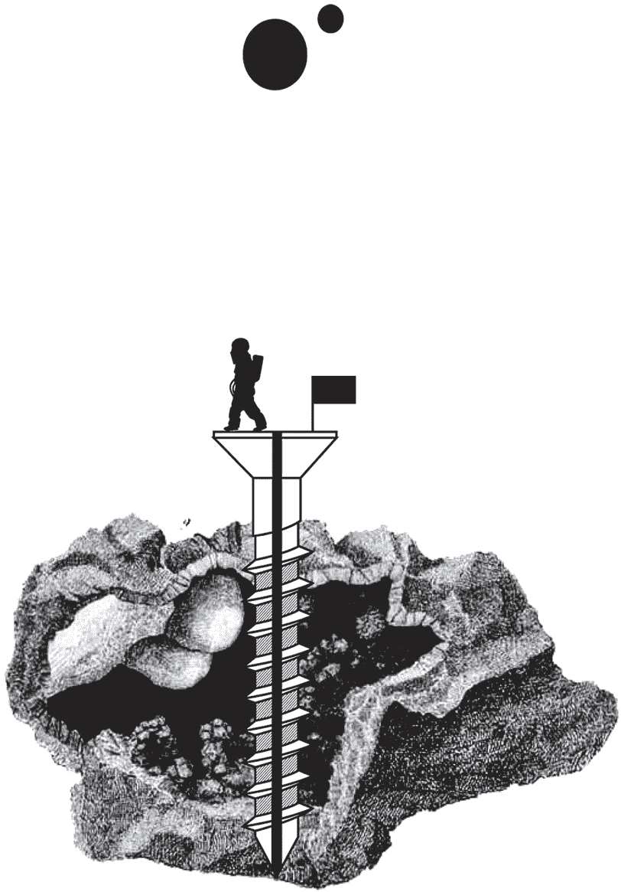

# 余音

## 太空

倒计时开启，画面切入。庞大的土星五号底部发动机点燃，火箭冲天而起，随后传来杰夫·贝佐斯的声音：“我五岁时阿姆斯特朗踏上月球，从那刻起我就对太空、火箭、发动机与星际旅行着迷。”随后出现一连串鼓舞人心的影像：山巅的攀登者、峡谷里的探险者、在鱼群间穿梭的潜水员。镜头转到发射场控制室，贝佐斯在调整耳机，画外音继续：

这是我当前最看重的工作。显而易见，我们生活在最美的星球上。所以我们面临抉择：随着文明进步，要么走向停滞，进而限制人口与人均能源，要么通过向太空迁移来化解困境。

配乐上扬，深空画面与洛杉矶繁忙的高速公路及拥堵的三叶草匝道形成强烈对比。“冯·布劳恩曾说登月之后他学会了对‘不可能’这个词格外谨慎，我希望你们也能用这种态度面对人生。”

这则片子出自贝佐斯的私人航天公司蓝色起源。公司格言是 *Gradatim Ferociter*，拉丁文意为“逐步推进，猛烈前行”。近期该公司在得克萨斯州西部的基地与亚轨道场址研制可复用火箭与月面着陆器并展开测试，计划于 2024 年把人员与物资送往月球。从长远看野心更大：让数百万人生活与工作在太空。贝佐斯设想的庞大空间聚落漂浮于人工环境，重工业彻底撤出地球，转移到新的开采区；地球则被划为居住与轻工业区，成为“宜居且可观光之地”，前提是付得起票价的人，而非在殖民区劳作的人。

贝佐斯手握庞大且持续扩张的产业力量。亚马逊在美国电商市场的份额不断上升，亚马逊网络服务占据云计算市场近半江山。据估算，亚马逊站点的商品检索量已超越谷歌。他担忧地球日益增长的能源需求将很快触顶。对他而言，最大的威胁“不是毁灭”，而是停滞：“我们将被迫停止增长，我认为那是个非常糟糕的未来。”

贝佐斯并不孤单。谷歌月球 X 大奖赛创始人彼得·戴曼迪斯领导的行星资源公司，获谷歌拉里·佩奇与埃里克·施密特注资，目标是在小行星上钻探建立首个太空商业矿场。特斯拉与 SpaceX 首席执行官埃隆·马斯克宣称要在百年内实现人类移居火星，并坦言首批太空人必须做好赴死的准备。马斯克主张在火星两极引爆核武改良地表，SpaceX 甚至推出印有“核爆火星”的 T 恤。马斯克还投下史上最昂贵的公关预算，用猎鹰重型火箭把一辆特斯拉汽车送入日心轨道，研究人员估算它将在太空停留数百万年直至最终坠回地球。

这些太空奇观背后的意识形态，与人工智能行业的逻辑有着深刻共振。科技巨头的财富与权力如今让少数人能够展开私人太空竞赛。它们倚赖对二十世纪公共太空计划的知识与基础设施的攫取，也倚赖政府资金与税收优惠。其目标不是遏制开采与增长，而是把两者扩张至整个太阳系。实际上，这些努力与其说关乎太空移民可能出现的不确定与不适，不如说关乎对太空、无尽增长与不朽的想象。贝佐斯对征服太空的灵感部分来自物理学家与科幻作家杰拉德·K·奥尼尔。奥尼尔 1976 年出版《最前沿：太空中的人类殖民地》，书中描绘了罗克韦尔式的月面矿区等幻想。贝佐斯的蓝色起源计划建立在人类永久殖民的田园式憧憬上，而现阶段的技术尚不具备实现条件。当奥尼尔读到罗马俱乐部 1972 年发布的里程碑报告《增长的极限》时，他感到“沮丧与震惊”。建筑与规划学者弗雷德·沙尔曼归纳道：

罗马俱乐部的模型按不同初始假设推算。根据当时趋势的基准情境显示，资源与人口将在 2100 年前崩塌。即使假设已知资源储量翻倍，仍会在 2100 年前以略高水平再次崩塌。若假设技术能提供无限资源，则因污染激增人口下降更严重。若加入污染控制，人口仍会在粮食耗尽后减少。在提升农业生产的模型里，污染超过既有控制，最终粮食与人口均会崩塌。

《增长的极限》指出，向可持续管理与资源再利用迈进是全球社会长期稳定的答案，缩小富国与穷国差距则是生存关键。该报告的不足在于，未预见构成全球经济的更庞大内部关联系统，也未预见先前不经济的采矿形式将如何被激励，导致更大环境危害、土地与水资源退化并加速资源枯竭。

撰写《最前沿》时，奥尼尔试图设想另一种摆脱无增长模式的路径，而非限制生产与消费。通过假设太空是解法，他为 1970 年代全球对汽油短缺与石油危机的焦虑指明新方向，设想宁静稳定的太空结构既能维持现状又提供新机会。奥尼尔敦促：“如果地球表面积不足，人类就该建造出来。”至于科学层面如何运作、经济上如何负担，则留待日后，梦想才是最重要的。

太空殖民与前沿采矿已成为科技亿万富翁普遍的企业幻想，凸显出人与地球关系上的不安。他们的未来图景不包括停止石油天然气勘探，不包括控制资源消耗，甚至不包括减少其致富所依赖的剥削性劳动。相反，其话语与殖民主义如出一辙，企图取代地球人口、占地进行矿产开采。硅谷的太空竞赛同样假设，最后一块公共外层空间可由率先抵达的帝国占据。这置 1967 年《外层空间条约》于不顾，该条约规定外层空间是“全人类共同利益”，探索或利用应“为各国人民利益进行”。

2015 年，奥巴马政府签署《商业宇宙发射竞争力法》，标志着贝佐斯蓝色起源与马斯克 SpaceX 游说的胜利。该法案将商业太空公司免受联邦监管的权利延长至 2023 年，允许其透过小行星资源开采获利。这是首个放弃太空公有的立法，允许公司与个人拥有从小行星开采所得的任何材料。太空已成为帝国终极野心，象征着逃离地球、肉身与资本的极限。因此诸多硅谷科技精英热衷于抛弃地球的愿景并不意外。太空殖民与延年益寿的节食、输入青少年血液、把大脑上传至“云端”、服用维生素求长生等幻想高度契合。蓝色起源的高光广告正是这种黑暗乌托邦主义的一部分。它低声召唤人们超越所有生物、社会、伦理与生态界限，成为超人。但细究之下，这些美好新世界的愿景主要由恐惧驱动，包括对个人与集体死亡的恐惧，以及对时间所剩不多的恐惧。

我回到车里，开始旅程的最后一段，但这份导航图永远不会完整。我向南驶出阿尔伯克基，前往得克萨斯州边境。途中绕道圣奥古斯丁山峰表面，沿陡峭山路向下抵达白沙导弹靶场，美国在此发射了第一枚装有摄像头的火箭。该任务由曾任德国导弹火箭开发项目技术总监的沃纳·冯·布劳恩负责。战后他叛逃美国，在此试验被没收的 V-2 导弹——正是他曾参与设计并用于攻击盟国的武器。这次他直接把火箭送入太空。火箭升至约 104 千米高度，在坠入新墨西哥沙漠前每 1.5 秒拍摄一次影像。胶片保存在钢盒中，显示出颗粒状但清晰可辨的地球弧线（见图 1）。

图 1 从 1946 年 10 月 24 日登录的 V-2 #13 上的照相机看到的地球（图片来源：白沙导弹靶场/应用物理实验室）

值得注意的是，贝佐斯在其蓝色起源广告中引用了冯·布劳恩的话。冯·布劳恩是第三帝国的首席火箭工程师，他承认使用集中营奴工建造 V-2 火箭，因而被视为战犯。在建造火箭的营地中死亡的人数，比战争中被火箭杀死的人还多。但冯·布劳恩最知名的工程，是担任美国宇航局马歇尔宇宙飞行中心负责人期间参与土星五号火箭设计。沐浴在阿波罗 11 号光辉中、历史被漂白后，贝佐斯将这位拒绝相信不可能的人奉为英雄。

驶过埃尔帕索后，我沿 62 号公路前往盐盆沙丘。午后积云色彩变幻。这里有个 T 形路口，向右转后道路沿着代阿布洛山脉延伸。这是贝佐斯的领地。首先映入眼帘的是栋大型牧场房屋，位于路后方，白色大门上挂着红色字母标志“Figure 2”。这是他 2004 年购入的农场，仅是其在该地区约 30 万英亩土地的一部分。这片土地有着暴力历史：1881 年，得克萨斯州游骑兵与阿帕奇印第安人最后一次战斗就发生在此地西部，9 年后，前联盟骑兵兼牧牛人詹姆斯·门罗·多尔蒂在此建立农场。

附近是通往蓝色起源亚轨道发射设施的路口。这条私人道路被一扇亮蓝色大门阻断，大门张贴安全告示，提醒有监控录像，还有挂满摄像头的警卫站。我把车停在公路边，几分钟后将车挪至路边。从此可见干涸山谷，蓝色起源公司的着陆点正在进行首次载人太空任务的火箭测试（图 2）。工人们打卡下班，汽车驶过吊杆门。回望那些标示火箭基地的棚屋，在二叠纪盆地这片广阔沙漠中显得临时搭建。山谷宽阔空间被一个空心圆环打破，蓝色起源的可重复使用火箭坐落在中央绘有羽毛标志的着陆平台上。这就是全部可见景象。它是由地球最富有者驱动、正在建设中的私人基础设施，有警卫与门禁，是对权力、开采与逃离的科技想象。这是对地球的一种防御。

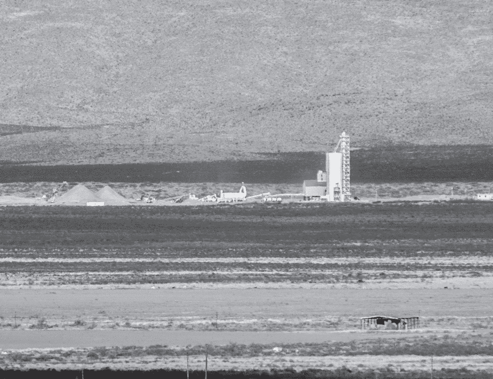

图 2 得克萨斯州西部的蓝色起源亚轨道发射设施。摄影：凯特·克劳福德

此时光线渐弱，钢灰色云层在天际移动。沙漠泛着银光，白色的鼠尾草丛与火山凝灰岩簇点缀着这片昔日巨大内海海床。拍完照片后我回到货车，启程前往马尔法镇。直到准备离开时才意识到被跟踪了。两辆黑色雪佛兰皮卡在近距离紧追不舍。我把车驶到路边，希望它们会开过。它们也同样靠边停车。无人行动。几分钟后我慢慢重新上路，它们一路保持着邪恶的护送，直至越来越暗的山谷边缘。

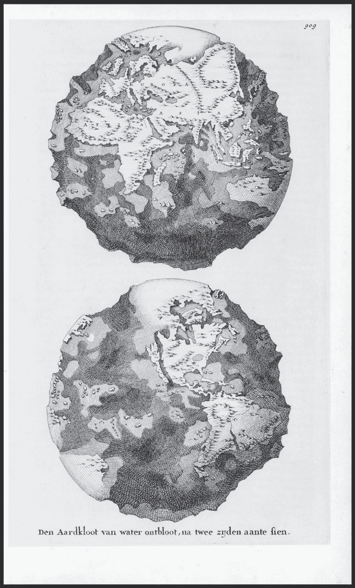

没有水的世界（托马斯·伯内特 1694 年绘制的海洋干涸后的世界形态）

* * *

1. 1. “美好年代”是欧洲社会史上的一段时期，从 19 世纪末开始，至第一次世界大战爆发结束，这个时期被上流阶级认为是一个“黄金时代”，此时的欧洲处于一个相对和平的时期，随着资本主义及工业革命的发展，科学技术日新月异，欧洲的文化、艺术及生活方式等都在这个时期日臻成熟。——译者注

↩

2. 1. 专家系统（expert system）是一个具有大量的专门知识与经验的程序系统，它应用人工智能技术和计算机技术，根据某领域一个或多个专家提供的知识和经验，进行推理和判断，模拟人类专家的决策过程，以便解决那些需要人类专家处理的复杂问题。——译者注

↩

3. 1. 图网（ImageNet）项目是一个用于视觉对象识别软件研究的大型可视化数据库，是目前世界上有关图像识别最大的数据库之一。——译者注

↩

4. 1. 碳足迹，是指企业机构、活动、产品或个人通过交通运输、食品生产和消费以及各类生产过程等引起的温室气体排放的集合。——译者注

↩

5. 1. 本书介绍了人工智能技术在美国的前沿理论与实践，具体应用以我国法律法规为准。——编者注

↩

6. 1. 本书提到的刚果均为刚果（金），全称刚果民主共和国。——编者注

↩

7. 1. 桑德罗·梅扎德拉（Sandro Mezzadra）和布雷特·尼尔森（Brett Nielson）使用“攫取主义”（extractivism）一词来命名当代资本主义中不同形式的攫取操作，我们在人工智能行业的背景下看到了这种操作重现。

↩

8. 1. 在《力量元素》（The Elements of Power）一书中，大卫·亚伯拉罕（David S.Abraham）描述了全球电子供应链中稀有金属贸易商的隐形网络：“稀有金属从矿场进入你的笔记本电脑是通过一个由贸易商、处理器和零部件制造商组成的不透明网络实现的。交易者不仅是买卖稀有金属的中间人，他们还矫正信息，是确定金属工厂和我们的笔记本电脑之间的网络的隐藏力量。”

↩

9. 1. DeepMind，位于英国伦敦，是由人工智能程序师兼神经科学家戴密斯·哈萨比斯（Demis Hassabis）等人联合创立的人工智能企业，其将机器学习和系统神经科学的最先进技术结合起来，以建立强大的通用学习算法。——译者注

↩

10. 1. 碳中和，节能减排术语，是指通过节能减排降低排放量，并依靠植树造林等形式对人类经济社会活动进行抵消，从此实现碳排放对环境的零影响。——译者注

↩

11. 1. 物质性是一个复杂的概念，在科学技术与社会、人类学和媒体研究等领域有大量文献分析它。在某种意义上，物质性指的是利亚·利弗洛（Leah Lievrouw）所描述的“物体和人工制品的物理特征和存在形式，使它们在特定条件下有用并可用”。但正如戴安娜·库尔（Diana Coole）和萨曼莎·弗罗斯特（Samantha Frost）所写，“物质性永远不仅是‘纯粹’的物质：一种超越、力量、活力、相关性或差异性，它使物质变得活跃、自主创新、富有成效或毫无成效”。

↩

12. 1. 美国陆军部于 1942 年 6 月开始实施利用核裂变反应来研制原子弹的计划，亦称曼哈顿计划。——译者注

↩

13. 1. 亚马逊的仓储中心被称为履行中心。

↩

14. 1. 生存时间指定数据包被路由器丢弃之前允许通过的网段数量。它是 IP 协议包中的一个值，它告诉网络，数据包是否应因在网络中的时间太长而被丢弃。——译者注

↩

15. 1. 在《规则的乌托邦》（The Utopia of Rules）中，大卫·格雷伯（David Graeber）详细描述了白领工人所经历的失落感，他们现在不得不将数据输入决策系统，而决策系统已经取代了大多数专业工作场所的专业行政支持人员。

↩

16. 1. 卡尔·马克思在《资本论》第 1 卷中把工人的概念扩展为“附属品”（appendage）：在手工业和制造业中，工人使用工具； 在工厂里，机器利用了他。在那里，劳动工具的运动由他操作；在这里，他必须跟随机器的运动。在制造业中，工人是生存机制的一部分。在工厂里，我们有一个没有生命的机制，它独立于工人，工人作为活的附属物被纳入其中。

↩

17. 1. 最小可行产品（Minimum Viable Product，MVP）是一种避免开发出客户并不真正需要的产品的开发策略。该策略的基本想法是，快速地构建出符合产品预期功能的最小功能集合，这个最小集合所包含的功能足以满足产品部署的要求并能够检验有关客户与产品交互的关键假设。——译者注

↩

18. 1. 这与福柯（Foucault）所谓的“权力的微观物理学”（microphysics of power）形成了对比，“权力的微观物理学”描述了制度和机构创造特定逻辑和合法性形式的方式。

↩

19. 1. 一种外缘或内缘上有刚性齿形表面或摩擦表面的齿轮，是组成棘轮结构的重要构件。由棘爪推动做步进运动，这种啮合运动的特点是棘轮只能向一个方向旋转，而不能倒转。——译者注

↩

20. 1. 20 世纪 70 年代后期，雷扎德·迈克尔斯基（Ryszard Michalski）编写了一种基于符号变量和逻辑规则的算法。这种语言在 20 世纪 80 年代和 20 世纪 90 年代非常流行，但是，随着决策和资格规则变得更加复杂，该语言变得越来越不可用。与此同时，使用大型训练集的潜力引发了从概念聚类到当代机器学习方法的转变。

↩

21. 1. 雅虎旗下图片分享网站。——译者注

↩

22. 1. “偏见”与“偏差”在英文中皆为 bias，这里视情况作不同翻译。 ——编者注

↩

23. 1. 图网轮盘是艺术家特雷弗·帕格伦和我多年合作研究的成果之一，我们研究了 AI 中多个基准训练集的底层逻辑。由帕格伦领导、列夫·瑞格（Leif Ryge）制作的图网轮盘是一款应用程序，它允许人们与在图网中“人类”类别上训练的神经网络进行交互。人们可以上传自己的图像、新闻图像或历史照片，以查看图网标记它们的方式。人们可以看到有多少标签是匪夷所思的、种族主义的、厌女的，以及有其他问题的。该应用程序旨在向人们展示相关标签，同时还提前警告他们潜在的后果。所有上传的图像数据会在处理后被立即删除。

↩

24. 1. 根据埃克曼的说法，霍夫以他与一位泰国女人的婚姻为证，跨文化交流的想法也被用来对一系列冷战倡议进行合理化解释。

↩

25. 1. 埃克曼和他的合作者弗里森解释说：“我们自己的研究和来自视觉感知神经生理学的证据强烈表明，短至一个电影帧（1/50 秒）的微表情是可以被察觉到的。这些微表情通常不会被人眼看到，由于它们被嵌入了其他会分散注意力的表情中，以及出现的频率低，或者是人们有一些习得性的忽略快速面部表情的感知习惯。”

↩

26. 1. 气隙系统，一种将电脑与互联网以及任何其他联网设备进行完全隔离，以保护数据安全的系统。——译者注

↩

27. 1. 这套被称作抵消的思路，最早可以上溯到1952年12月。彼时苏方常规部队的规模大约是美方十倍左右，Eisenhower政府于是把nuclear deterrence作为填补劣势的抓手。这套打法并不只剩下以核力量进行massive retaliation的口头威胁，还体现在加速装备储备、研制长航程喷气式轰炸机、研发氢弹并最终形成ICBM战力，以及明显加大对间谍活动、破坏行动和隐蔽任务的倚赖。进入七十年代到八十年代，在Robert McNamara等一批以追求兵力优势为导向的谋划者影响下，美军把战略重心转向用计算方式改进分析与后勤管理。所谓第二轮抵消，最清晰的案例是1991年Gulf War中的Desert Storm。在这次行动里，情报搜集、压制对方防御体系以及precision guidance，一方面改造了美军的实战样式，另一方面也左右了美国国内关于军事的讨论与舆论走向。↩

28. 1. TensorFlow可视为一个核心开放源代码工具，用来搭建机器学习模型并开展训练工作。——译者注↩

29. 1. 代号“酸狐狸”的程序由美国国家安全局下属的Office of Tailored Access Operations，TAO所开发，该部门现已改名为Computer Network Operations Office，属于NSA负责网络战情报搜集的单位。↩

30. 1. 指的是那名NSA工作人员隶属的团队名称。——译者注↩