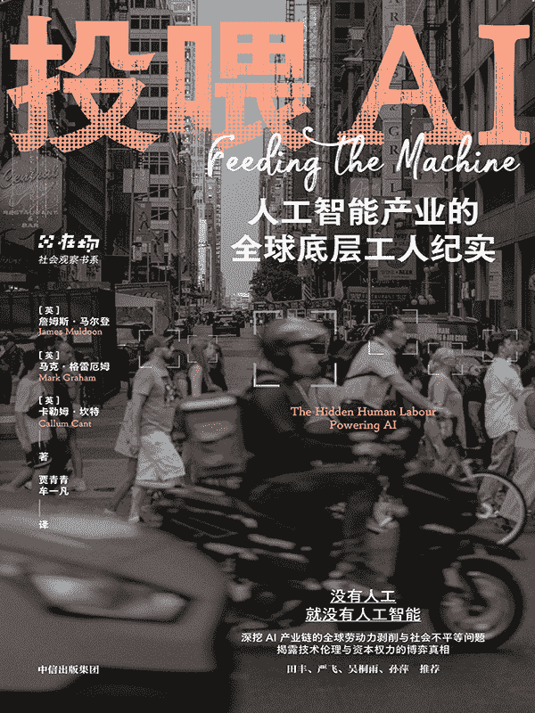

# 算法的盛宴，人类的代价：揭秘AI背后的隐形劳工链

# 重磅推荐

这几年AI狂飙突进，震动全球，甚至成了大国博弈的核心战场。当政商名流、科技精英纷纷为AI描绘改天换地的蓝图时，这本书像一声惊雷，撕开了光鲜的外衣：**人，正沦为AI的“生产原料”**。这是一个近乎残酷的真相——AI汲取人类行为、智慧与知识成长，却在无情地拉大阶层间的权力与财富鸿沟。作者深入AI生产全链条，对各环节劳动群体进行微观田野调查，深刻剖析了算法时代的结构性不平等，直指唯有全供应链治理，方能制衡资本逐利本性。文笔流畅易读，思想锋利深邃，是读懂当下数字社会的必读之作。

—— **田丰** 中国社会科学院社会学研究所研究员

本书揭开了AI幕后不为人知的劳动版图：从数据中心的技术员、亚马逊仓库的打包工，到肯尼亚的外包标注员。这条跨越阶级、种族与地理的权力链条昭示我们：AI的崛起，不仅仰仗大模型算法的迭代，更依赖成千上万隐身的“数据工人”持续“投喂”。这不仅是部AI发展史，更是对数字鸿沟与人类尊严的拷问。

—— **严飞** 清华大学社会学副教授

在喧嚣的AI研究界，本书独树一帜。它以“投喂”这一极具穿透力的隐喻，串联起数据清洗标注、模型训练工程、创意与仓储劳动被压缩重组的全过程。冷静犀利的笔触发出追问：当劳动面临沦为AI“燃料”的命运，我们能否拒绝、另辟蹊径？这正是当下关于AI与劳动公共讨论中最稀缺、最迫切的声音。

—— **吴桐雨** 浙江大学社会学系研究员、《牛马游戏》作者

在欢呼与警惕交织中，AI制造出一批批“数字难民”。本书以全球视野和一手资料，展示新技术架构如何重塑生存图景，并对殖民主义、资本主义、加速主义进行反思。技术与人类关系已入新阶段，伴随AI诞生的数字劳动者值得深切关注，**因为他们的故事，从头到尾就是我们的故事**。

—— **孙萍** 中国社会科学院大学新闻传播学院副教授

# 引言：名为“剥削机器”的黑箱

默茜身体前倾，深吸一口气，点开下一个任务。屏幕上跳出的，是一连串让人窒息的画面。作为Meta（原Facebook）在肯尼亚内罗毕外包中心的内容审核员，她每天工时长达10小时，平均每55秒就得裁决一条违规举报。此刻，她盯着一段用户上传的惨烈车祸视频，任务是判定其否违反“极端暴力血腥”条款。她屏息凝神，跟随镜头视线逐帧排查。可当画面聚焦时，她浑身血液倒流——车祸受害者之一，竟是她的祖父。

默茜猛地冲向大门，同事们投来关切目光。办公室外，她哭着打电话回家，无人信以为真。主管出来安抚，话锋一转却提醒：班还没上完，回去干完吧；事出突然，明天可以请假。默茜硬着头皮回工位，屏幕刷新出的全是祖父车祸的视频——转发的、不同机位的、变形车架、遗体特写、文字实录……真相碎片拼凑完整：傍晚，熟悉的街道，四命陨落。那一刻，时间仿佛凝固成永恒的折磨。

我们在肯尼亚、乌干达走访了同一家外包商的三个中心，采访数十位像默茜一样的审核员与标注员。前者清洗违规帖文，后者给数据打标签喂算法，合称“数据工作”，是数字世界基石般的隐形劳动。默茜非个例。一位尼日利亚籍工作者说：“身心俱疲，如行尸走肉。”高强度、高时效、高精准的KPI下，他们须全神贯注，严守标准——暴力煽动比霸凌更险，必须看完全程不能漏判。

另一位审核员透露：“让人不安的不止暴血，还有充斥着性暗示与恶意的内容。”自杀、虐待、强奸影像，他们“几乎每天”过目，早成“家常便饭”。日均处理500至1000条违规件，几乎无喘息消化之机。许多人坦言：再也回不去了，烙印难磨，影响毁灭性。被解雇者直言：“心理创伤普遍，甚至有自杀者；伴侣因压力离去，他们束手无策。”

“制度比活儿更狠。”一中心因斩首视频吓哭员工，方案仅是安排一名“健康顾问”——实为同事，无资质，周咨询30分钟。因惊吓离岗未输“休息/上厕所”指令者，被判违规扣绩效。我们听太多：“办公室晕倒”、“重度抑郁”、“病重求医”、“公司漠视健康”。更寒心的是，公司查就医记录，非关怀，乃核实“装病逃工”。

就业保障近乎为零。受访者合同多为1-3个月，项目完合同止。环境昏暗拥挤，百人挤一排。雇主是总部旧金山的知名外包商，在东非设中心，招当地人做低保低薪活。许多人从基贝拉（非洲最大贫民窟）来，名义“助弱势就业”，实则恐惧失业不敢发声，有怨言者遭打压、随时可替换。

受访多为肯尼亚本地人，也有非洲他国移民协助审核多语种内容。移民街头遭警骚扰虐待，仅是冰山一角。一女受访者称：因审核不满，邻国组织获取名单照片网曝恐吓。员工恐慌提交证据，公司仅承诺“考虑加安保”，建议“注意安全”。

没人愿在这样不人道环境煎熬，全球却存数百万此类岗位。走访后环境有变，第8章再表。Meta等巨头常设多外包中心，为利润合同厮杀。数据工作深嵌日常：社交软件、聊天机器人、自动化技术，无审核员网络早被暴力露骨内容淹没；无标注员喂数据，自动驾驶识别不了红绿灯；无训练师调教，没有ChatGPT等先进工具。

广义上，AI是基于机器的系统，经数据处理输出决策、预测、建议。近来焦点转向驱动聊天机器人的大语言模型（LLM）。其训练基于互联网抓取的海量文本。“大”在两方面：数据集达数千亿GB量级；参数极多，如GPT-4约1.76万亿。参数经微调优化模式识别，提升新数据处理性能。

当下正处技术炒作高潮，企业竞相嵌入AI。物流、制造、医疗经历前所未有变革。AI在辅助诊断、供应链优化、运输自动化显价值。2023年全球AI市场破2000亿美元，年增约20%，预计2030年近2万亿美元。

使用AI产品，我们无形中与全球劳动者紧密相连。如品咖啡参与全球供应链，每一次搜索、对话、扫地机器人启动，都触动全球数据与资本流动，连接工人、公司、消费者。但科技巨头只展示光鲜、自主、时尚的机器形象，隐瞒制造过程，避谈拿微薄薪水、被机器束缚却又训练机器的幕后工作者。作为消费者、公民，我们的行动能改善其处境。他们站在变革前沿，AI驱动的监控与生产力工具席卷各行，自以为安全者亦无处遁形。故而，首当其冲的是看清AI的生产逻辑与运作机制，方知AI如何将权力、财富、塑造未来的能力集于少数人手中。

本书讲述AI行业劳动者故事，剖析导致全球资本、网络、就业不平等的权力结构。揭秘幕后工作者日常生存状态，及其被刻意隐匿的现实。深度访谈200余名标注员、审核员、算法工程师、AI伦理学家、仓储员工、劳工组织者、行业专家，揭开产业链面纱，还原常被忽视的数字劳工真实世界。层级跨度极大：从恶劣环境、无保障、低收入不稳定的底层标注员，到巨头总部高薪的算法工程师。追踪资金流向，挖掘AI历史根基，揭示殖民遗留问题的延续影响。

汇聚作者十余年研究，逐章跨越地域，深入各地AI产业链服务者生活。7位核心人物：标注员、工程师、技术员、创意工作者、仓储员工、投资人、组织者。记录源自真人真事，为护隐私经处理、糅合。各章深揭工作环境、社会背景、日常生活，全景理解AI生产中的人的因素及深远影响。有觉得枯燥无望的乌干达标注员，有发现声音被算法合成恐被取代的爱尔兰配音演员，有联手对抗数字经济权贵不公体系的肯尼亚活动家。展现7人错综联系及行动对他人生活的涟漪效应。

篇幅所限，未详述开采关键矿产的矿工、组装产品的工厂工人。故事还有很多，但目标是跳出硅谷框架，提供多维视角，全面理解AI。将带读者穿越肯尼亚、乌干达、爱尔兰、冰岛、英国、美国，探寻AI全球影响。

AI常被喻为人类智能之镜，试图复制脑内过程探寻智慧本质。本书视角下，AI更像一台**剥削机器**。消费者端只见输出结果，光鲜外表下隐匿复杂组件网络与人力关系。这台机器吞噬资本、电力、自然资源、人力、数据、集体智能等关键投入，转化为统计预测，经AI公司加工，最终变现为利润。视其为机器，便撕下“客观中立”幌子。一切机器有历史，源于特定时期人类特定需求。AI受政经体系制约，其分类、判别、预测服务于创建者，助权势者巩固地位，在数据层面深化社会偏见。

企业只吹智能便捷，对海量基础投入与人工劳动只字不提。另一被忽略事实：**AI看似自动，实则隐藏大量人力劳动兜底技术短板。**

AI运行不但需物质资源与人工，更依赖训练集中的人类智能。抓取知识后，经机器学习编码为自动化程序。AI是数据衍生品，通过训练习得驾驶、识物、生成语言等技能。根底上，靠数十亿数据点构成的人类知识库运行。背靠庞大数据集，AI表现超人类。大部分数据公开版权，亦有未授权数据。AI企业常限制数据库访问将集体智能私有化，或用专利软件“洗”争议版权数据。AI对智力资源渴求，丝毫不亚于物质资源。

称AI为剥削机器，不仅因其诞生源于资源掠夺、人力剥削、集体智能榨取，更因其应用于实况时，催生更深层剥削——核心是**榨取劳动者精力**。AI系统集中劳动知识，通过程序化、简单化降低技能门槛，导致强度更大、节奏更快，雇主以此榨取更多剩余价值。这将是AI给普通人最大伤害。短期内我们或不成默茜，但AI同样在侵蚀岗位。

看实例：全球领先德系车企，全球供应商协作，车企统筹全系统。决策造L3级自动驾驶（有条件自动化）。竞品推自驾股价飙升，股东推动董事会研发。车企整理公开数据集、购私有数据集（数千小时视频标注数百物体类别）。实验室出基础模型后，工程师发现“边缘情况”需新标注再训练。数据含各工况行驶，需数千标注员手工标。车企在菲律宾、肯尼亚、印聘三家外包商。工程师审核微调后，数批数据退回重标。

实验室租亚马逊云算力满足算力、内存、存储需求。虽不愿发敏感数据给外部，但必须提前数月锁定专用AI服务，亚马逊是极少能满足进度规模的供应商。

模型经多轮安全测试推向市场。早期客户为想降本增效的大型物流企业。高速自驾卡车穿梭枢纽，雇主重排司机专攻“最后一公里”短途配送，提升产出与管控。始至终，AI生产与使用都在汲取劳动、资源、智能与价值。

我们即将步入技术发展新纪元，研究AI社会大环境愈发重要。21世纪第二个十年，少数“数字守门人”崛起，平台积聚数十亿用户，成万亿美元巨头，施展前所未有的政经影响力。AI发展引发科技业巨变，深远影响全球经济。2005年前后至2022年是平台时代，如今已踏入AI时代。ChatGPT发布、巨头与AI公司新合作确立，投资策略与商业模式受一股以AI为核心的新合力驱动。

## AI时代的权力重构与劳动批判

### 新的参与者格局与战略合作

# 重塑权力版图：AI 时代的新霸主与旧剥削

AI 浪潮滚滚而来，重塑了科技界的权力金字塔。这套新格局虽与平台时代有交集，内核却截然不同。曾主宰 2010 年代的巨头们，正让位于一批“大 AI”玩家：亚马逊、Alphabet、微软、Meta 这些老牌豪强依旧在列，OpenAI、Anthropic、Cohere 等初创独角兽与英伟达这类芯片霸主强势入局。放眼中国，阿里、华为、腾讯、百度组成了不可忽视的第二梯队。成员名单虽会流动，但底色一致——它们把 AI 视为独家印钞机，核心技术严加封锁，誓要锁死训练知识，死守先发优势。

ChatGPT 的横空出世，引爆了巨头与新贵的联姻潮：微软砸下百亿豪赌 OpenAI，谷歌、亚马逊追投 Anthropic，Meta 携手微软与 Hugging Face，微软更直接吞并 Inflection 团队组建新部。而英伟达凭借 GPU 近乎垄断的 95% 市占率，身价飙升至 2 万亿美元，稳坐“卖铲人”宝座。

## 平台逻辑 vs. 基建逻辑：从轻资产到重资产

平台时代靠的是网络效应——用户越多，平台越强，数据越多，变现越狠，Meta 和谷歌便是靠此建起广告帝国。可到了 AI 时代，游戏规则变了：软件版图固然重要，底层硬件才是硬通货。

平台巨头爱彼迎、优步的秘诀是“轻资产”，无房无车，卖服务、靠网络。大 AI 却走起了“重资产”路线，核心竞争力在于我们称之为的“基础设施力量”——掌握训练大模型所需的算力与存储，掌控超大数据中心、跨洋海缆、核心 AI 芯片。全球半数以上大型数据中心握在寥寥三家手中，能供出顶级训练硬件的厂商更是凤毛麟角。这种基建护城河，成了顶尖人才的强力磁铁，大家都想挤进头部厂商搞前沿研发。结果非但没让创新百花齐放，反而让财富权力进一步向极少数人聚拢——新入局者多选择躺进成熟大厂怀抱，而非另起炉灶。

## 融资范式大逆转：告别“创始人独裁”，拥抱“抱团取暖”

这直接改写了融资剧本与股权结构。AI 创业起步烧百万，后期跑模型更是亿级砸钱买云算力。于是，初创公司纷纷投奔云厂商怀抱，以少数股权换取百亿级输血。平台时代风投给钱、创始人掌舵，诞生无数“一人治下的亿万帝国”；AI 时代这套行不通了——新帝国想活命，必须与老巨头合并或结盟。AI 产品商品化催生多极鼎立格局，老牌巨头联手有实力的新贵，组团围剿对手。

## 商业模式、地缘博弈与生存红线

更深层、也更鲜为人知的变局在于商业模式重构。平台时代的“原罪”是监控资本主义，祖博夫笔下的 Meta、谷歌靠卖用户注意力发家。AI 时代背景复杂得多：气候危机、能源危机、中美博弈，层层叠叠决定着 AI 走向。数字平台向来与安全、监控、边缘技术纠缠，但 AI 不同——各国政府一致认定：这是直接关乎军事与经济国力的战略高地。中美关系紧绷，技术成了文明竞争、军事对抗、经济角力的核心筹码。

地缘博弈绕不开环境账。大厂嘴上都喊绿色，平台时代鲜少听说数字基建的生态成本，现在却躲不掉了。可持续发展倒逼关键矿产开采版图重组，重塑特定地区在芯片供应链中的战略地位。在动荡世界里，这些因素将直接锚定 AI 的未来形态。

## 技术传承下的野心膨胀：权力更集中，底层更边缘

AI 技术源于数十年积淀，脉络清晰可循。区别在于：这批玩家野心更大——想主导世界、渗透生活、握话语权。AI 成了加速器，让权力向权贵倾斜，让美股巨鳄更肥。底层民众分羹极少，“全球南方”在数字监控时代已难发声，在算力饥渴的 AI 赛道更是连门槛都摸不着。但作为剥削机器，AI 不断向这些地区索取——把它们只当原料，吞进贪婪的机械核心。

## 为何写这本书：看见被隐形的“造AI者”

我们三人来自牛津互联网研究所“AI 公平劳动”项目，跨学科背景（社会学、政治学、地理、历史、法学、哲学）汇聚成书。核心追问：劳动者如何参与构建 AI？如何改善他们的处境？

舆论场挤满了对 AI 未来的猜想、对《终结者》式灭绝的恐慌，唯独忽略了当下——那些真正搭建 AI 的血肉之躯。偏见歧视的研究不少，却鲜少追问：这些偏见如何在生产环节植入？如何伤害女性、少数族裔、“全球南方”劳动者？AI 在职场与社会如何被实操？

本书首创双维融合：一手剖析 AI 生产背后的政治经济学，一手讲述数据标注员等一线从业者的生存切片，串联起支撑庞大网络的隐形劳动。这不是调查报告，是揭露数字经济加剧全球不平等体系的批判之作。

## 从种植园到硅谷：剥削的历史同构

我们将 AI 生产置于工业纪律谱系中：并不新鲜，只是旧瓶装新酒。从种植园到工厂再到硅谷，对劳动力的控制与剥削一脉相承。当下 AI 从业者的不稳定工况，与历史上的性别、种族压迫同构。追溯 90 年代外包潮，资本逐廉价、守纪律劳动力南下，新控制手段随之诞生——这正是今日 AI 全球分工的前夜。

## 殖民性逻辑：旧秩序的数字化延续

AI 运作如殖民掠夺：不平等协定、压榨劳动、掠夺资源。去殖民化学者揭示的“殖民性”权力体系，依旧基于旧等级定义文化、劳动与知识生产。

这殖民性嵌入 AI 构建逻辑的生产与运作两端：
*   **生产端**：国际数字分工下，高薪稳岗锁定美欧核心城市，高危低薪外包“全球南方”边缘；
*   **供应链端**：关键矿产在南方开采加工，北上组装成高阶芯片，延续西方“以经济优势榨取边缘资源”的殖民模式；
*   **产出端**：生成式模型因训练数据根植西方知识体系，强化旧等级，复刻刻板印象，对被误读群体输出偏见。

## 基贝拉见证：铁路、光缆与永不停歇的榨取

殖民史与当下的缝合，在肯尼亚基贝拉最具具象感。这号称非洲最大贫民窟的地方，20 万至 100 万居民挤在铁路两侧。铁路不停靠此地，却劈开贫民窟，成了居民最便捷的“主干道”。简陋铁皮房、露天污水、低寿命、高文盲，贫困代际轮回。

铁路史即殖民史：1899 年内罗毕因乌干达铁路诞生，英资巨资修筑，连接维多利亚湖与蒙巴萨港，锁死英属东非，将内陆资源吸吮殆尽。基贝拉因铁路聚集廉价劳动力，成殖民经济齿轮。

百年后，光缆沿旧铁路线铺设。2009 年东非接入海底光缆，肯尼亚政府高喊外包梦：英语优势、劳动力廉价、缺正式岗位，承接欧美后台单，与印、菲争食。铁路抽走资源，光缆接入流量，本质相同——将基贝拉纳入全球价值抽取网络。

如今，AI 产业顺着光缆找来数据标注员。他们在机器面前无力，薪酬与创造价值天壤之别。最贫困者付出劳动，最富厂商收割红利。**这不是系统漏洞，是系统设计初衷。**

## 认识“剥削机器”，给变革找支点

默茜的故事揭示 AI 产业的剥削性、不公性、残酷性：榨取海量劳动，回馈微薄报酬。但未来不止这一种写法。改变机器，先要看清机器。本书旨在揭示 AI 生成运行的黑箱，声援正在抗争的劳动者。交谈越深，越发现他们清醒认知被剥削、知晓有效抵抗。掌权者虽强，但职场、街头、法庭上的反抗正在汇聚跨国工人运动，为更公平的 AI 与数字经济而战。

为助力这场斗争，书中提出五大行动纲领：

1.  **组织跨国集体力量**：不止建立地方工会，更要打通蓝白领，串联全球 AI 生产网络的劳动者大联盟。
2.  **激活消费端杠杆**：AI 嵌入消费品服务，让民间团体施压供应链全链条达标薪酬与工况。
3.  **立法兜底红线**：消费者压力失效时，需政府监管托底。防止岗位外流规避，须借国际劳工组织公约等全球协定锁定最低标准。
4.  **推动劳动者自主干预**：团结增强集体力，探索职场民主新路——如劳动者合作社、重塑所有权结构，让企业更包容。
5.  **直面资本主义根瘤**：前四招尽落地，仍须追问：为何资本主义制度总是改善全球 AI 劳动者生活的拦路虎？这才是终极课题。

---

**参考注释保留原貌：**

1.  [[1]](#Chapter2#ref1) 人类内容审核员所做的决定也被用来构建训练数据集，这些数据集会被 Meta 等公司用来开发 AI 内容审核系统。这些系统会自动执行基础的内容审核任务，例如：优先处理轰动性的内容、检测重复内容以及判断可能违反平台服务条款的内容。
2.  [[2]](#Chapter2#ref2) 我们的定义借鉴了经合组织对 AI 的最新定义。See Bertuzzi, Luca. ‘OECD updates definition of Artificial Intelligence“to inform EU's AI Act”’.Euractiv, 9 November 2023, www.euractiv.com/section/artificial-intelligence/news/oecd-updates-definition-of-artificial-intelligence-to-inform-eus-ai-act/.
3.  [[3]](#Chapter2#ref3) Thormundsson, Bergur. ‘Artificial intelligence (AI) market size worldwide in 2021 with a forecast until 2030’. Statista, 6 October 2023, www.statista.com/statistics/1365145/artificial-intelligence-market-size/.
4.  [[4]](#Chapter2#ref4) Crawford, Kate. Atlas of AI. Princeton: Princeton University Press, 2021.
5.  [[5]](#Chapter2#ref5) Gray, Mary L. and Suri, Siddharth. Ghost Work: How to Stop Silicon Valley from Building a New Global Underclass. Boston, MA: Houghton Mifflin Harcourt, 2019; Tubaro, Paola, Casilli, Antonio A. and Coville, Marion. ‘The trainer, the verifier, the imitator: Three ways in which human platform workers support artificial intelligence’. Big Data & Society, Vol. 7 No. 1 (2020), doi.org/10.1177/2053951720919776; Williams, Adrienne, Miceli, Milagros and Timnit Gebru. ‘The Exploited Labour Behind Artificial Intelligence’, Noēma, 13 October 2022, www.noemamag.com/the-exploited-labor-behind-artificial-intelligence/.
6.  [[6]](#Chapter2#ref6) Irani, Lilly. ‘The cultural work of microwork’. New Media & Society, Vol. 17 No. 5 (2015), pp. 720-39, doi.org/10.1177/1461444813511926.
7.  [[7]](#Chapter2#ref7) Leswing, Kif. ‘Meet the $10,000 Nvidia chip powering the race for A.I.’. CNBC, 23 Februrary 2023, https://www.cnbc.com/2023/02/23/nvidias-a100-is-the-10000-chip-powering-the-race-for-ai-.html.

8. [\[8\]](#Chapter2#ref8) Kak, Amba and West, Sarah Myers. ‘AI Now 2023 Landscape: Confronting Tech Power’. AI Now Institute, 11 April 2023, ainowinstitute.org/2023-landscape.

9. [\[9\]](#Chapter2#ref9) Zuboff, Shoshana. The Age of Surveillance Capitalism. New York: Public Affairs, 2019.

10. [\[10\]](#Chapter2#ref10) Quijano, Anibal and Ennis, Michael. ‘权力殖民性、欧洲中心主义与拉丁美洲’. Nepantla: Views from South, Vol. 1 No. 3 (2000), pp. 533-80, www.muse.jhu.edu/article/23906; Maldonado-Torres, Nelson. ‘论存在的殖民性’. Cultural Studies, Vol. 21 No. 2-3 (2007), pp. 240-70, doi.org/10.1080/09502380601162548.

11. [\[11\]](#Chapter2#ref11) See Muldoon, James, and Wu, Boxi A. ‘人工智能与权力殖民矩阵’. Philosophy ＆ Technology, Vol. 36 art. 80 (2023), doi.org/10.1007/s13347-023-00687-8. 其他作者也提出过这个论点，例如，Mohamed、Shakir、Png、Marie-Theres，以及 Isaac William。‘去殖民化人工智能：人工智能中的去殖民化理论作为社会技术预见’. Philosophy ＆ Technology, Vol. 33 (2020), pp. 659-84, doi.org/10.1007/s13347-020-00405-8.

# 第 1 章 标注员安妮塔的清晨

天刚蒙蒙亮，安妮塔便踏上了两小时的步行通勤路。简单喝碗粥、润杯茶，五点出门。她和母亲、姐姐、三个孩子挤在乌干达北部重镇古卢郊外的小镇上。家门口是条土路，没公交，想省摩托车钱只能靠腿。来回八美元车费，对她是笔大数目，所以风雨无阻走去上班，下班累透了再花钱坐摩的回家。

两年前，她攒钱分两批买砖，把祖传的两间泥墙草顶圆棚屋，换成了现在这座瓦楞铁皮顶的方砖房。院子里那棵大芒果树，每年六月雨季过后果实累累。树下种几垄菜，远处是棕榈林和茂密灌木。上班时孩子们在院里野，帮阿姨和保姆分担家务；鸡群啄食红土，偶尔越界去邻居家串门。

古卢城，是内战催生的产物。

涌入此地的多是赤贫青年，无地可种，只能被迫卷入货币经济。人道机构提供的安保、翻译、保洁岗位寥寥无几，失业潮推动非正规劳动市场野蛮生长。找不到正式工，大众只能靠低薪、恶劣的临时活计糊口。至今约三分之一青年失学失业，绝大多数住房不达宜居标准，战火留下的伤痕未曾愈合。

安妮塔上班路过菜市，摊贩们正摆弄茄子、洋葱、秋葵、木薯，铺好坐垫待客；摩的司机聚堆等活。太阳升起时，她路过古卢大学。五年前她在此攻读工商管理，兼职入了现在这家公司。起初业务刚起步，办公点就是校内一个集装箱。后来业务做大，搬到了城里正式楼宇。

如今的工作地是栋灰色混凝土楼，一至三层在用，四楼烂尾只剩墙骨和空窗框。围墙顶端架双层铁丝网，门口持枪站岗，招牌早斑驳褪色。这是一家总部设在旧金山的数据标注巨头，在东非落地的交付中心之一。

越走近大楼，安妮塔心头越沉。掏出工牌，随人流刷卡入厂。直奔食堂找朋友——这是全天唯一的社交窗口，其余时间非点击鼠标不可。早八开工，两次休息共一小时，全让位给上厕所和排队打饭。工时被严密监控，闲聊是奢望。

中庭装潢硅谷风：原色沙发、静音播 MTV。门对面挂创始人巨幅像，墙贴使命宣言——“融合创造力与 AI 加速人类发展”，核心价值观：坚韧、诚信、高质量、人文精神。

安妮塔常年负责自动驾驶项目，盯司机驾驶录像看面部表情。一旦分心、疲劳，记数据标注。这些素材喂给车内监控系统。可连续数小时盯屏实在煎熬，无聊像无形重力压得她靠椅合眼。可她不敢松懈，必须像屏幕里的司机般保持警醒。她为这份工作自豪，自觉推动前沿科技造福人类，这份荣誉感支撑她坚持至今。

进厂前，她摆过果汁摊、卖过菜。非正规活计看天吃饭，收入微薄不稳定。能在公司干五年，靠体面薪资撑起小家，已算幸运。虽因客户需求波动同事常被裁，但她表现优异留进核心团。可薪资仅够交学费、付保姆工资、养母亲，细算为公司创造的价值，她难免心生不平。

键盘鼠标飞舞，速度惊人。唯有维持这节奏，才能完成指标，让后台主管面前的名字保持“绿色安全”。变红则意味着免费加班补齐。时间难熬，腰酸腕麻眼花，刚合眼又惊醒。下班拖着残躯冲出大门，打摩的飞奔回家，只想守在芒果树下，赶走最后一缕夕阳。

安妮塔陷入进退维谷：工作枯燥高压，辞职却无更优选择。银行、公务员、NGO 好岗位竞争惨烈。她提过意见、诉过苦、投诉过管理层压榨，均石沉大海。她感到被困死。只要有更好机会，她二话不说就会走。

1. [\[1\]](#Chapter3#ref1) Branch, Adam. ‘战时与和平时期的古卢？北部乌干达的营地之城’. Urban Studies, Vol. 50 No. 15 (2013), pp. 3152-67, doi.org/10.1177/004209801348777; Human Rights Focus, 两火之间：北部乌干达境内流离失所者的困境. Gulu, 2002, https://www.humiliationstudies.org/documents/OnenBetweenTwoFires.pdf.

## 深度揭秘：AI 数据工厂的真实图景

外界对安妮塔所在的此类数据工厂内情知之甚少。虽承担着 AI 生产线上最密集的劳动环节，却在行业版图中隐身。偶有恶劣工况曝光，多止步于个案，未触及深层管理机制。

部分标注任务经数字平台分发给全球远程工作者，而安妮塔所在的外包模式，则聚人集管，以严苛纪律换效率产出。这并非新发明，溯源可至殖民时期种植园、纺织厂、工厂的劳动组织雏形。

集中管控自有逻辑：人非机器，行为难精准预测，创造价值亦无法预设，需在复杂情境中动态确立。管理科学的发展史，本质上就是为降低这种复杂性，将人力劳动标准化、机械化、可预测、可控制。要读懂此制度实况，还得回到安妮塔的工位。

数百标注员排排坐，环境制度酷似电话客服中心。灯光特意调暗，缓解九小时高强度视觉疲劳。图像视频流不断涌现，待标注员按客户规范识别元素，用多边形框选红绿灯、路标、人脸等。百人项目切分为二十人小组，组长巡视监控数据、防偷懒、抓效率、督整改，或吼或柔，只为交付合格成果。

客户赶工期则实行两班倒：早八晚六、晚八早六。任务大则放宽时限。项目前测速，以此设定绩效线——故意卡在最慢那 10%-15% 人够不着的高度，逼迫人人拼命。标准非固定，效率涨，指标跟涨，榨取更多利润。日指标未达，免费加班；周进度滞后，周末免费续命。周工时 45 小时起步，常含无偿加班。月薪约 80 万乌干达先令（约 200 美元），折合时薪 1.16 美元。

快不够，还得准，二者天然矛盾。组长盯进度，质检员盯准确率——常规项 95% 起步，特殊项更高。任何“不准”判定直接扣绩效。除速度质量，还得盯“效率分”：十小时工时，非规定休息不超一小时。其余时间争分夺秒，一停工分就降。分低组长远程调取屏幕查岗。标注员每秒都在走钢丝：在可承受压力与可接受评分间找平衡。

无长期合同保障，短期合同一两月一签，时刻恐惧完不成任务被切合同。单子随客户撤单波动，大项目一结束，闲置人员进“候补池”，等扩招重启。古卢就业环境恶劣，候补者只能靠零工续命，盼着外包厂再来活。对背负家庭重担者，这日子望不到头。

权力滥用随之滋长，女性风险更高。受访女工述说生育歧视、性贿赂潜规则司空见惯。管理层以录用、晋升、留任为筹码索取性利益。我们反馈后，公司回应“零容忍”，推出新规审视文化，对核心 HR 法务行政岗做反性骚扰培训（详见第 8 章）。

世人常以为全方位监控员工细节是现代技术专利。毕竟建库量化产出、摸鱼时长、效率分、质量分，离不开现代技术。实则劳动监控史由来已久。17 世纪北美巴巴多斯甘蔗园，欧洲白人主已寻求同类方案。

体系在 19 世纪 40 年代美南棉花园繪荣期再进阶，主欲巩固扩张态势。

虽源于加勒比与美南种植园，实质飞跃在 19 世纪末工业时代。1878 年，弗雷德里克·温斯洛·泰勒入费城米德维尔钢铁厂，科学管理理论雏形初现。

如今管控安妮塔们的模式，正是上述演变的数字化终极形态：生物识别刷脸进楼、闭路电视无死角、效率软件秒级记录工况，监控严度远超最苛刻园主厂长。工友间流传管理层安插眼线监言行、防组工会，走访中普遍共识：仅讨论建工会便是丢饭碗前兆。

持续不断的高强度作业透支身心。工作被拆解至最小单元，剥夺自主性，极致追求效率产出。标注员被迫高速机械重复，陷入乏味焦虑。这就是 AI 产业一线真相：在高压监控下拼命，只为守住饭碗、养家糊口。

1. [\[1\]](#Chapter3_1#ref1) Branch, Adam. ‘战时与和平时期的古卢？北部乌干达的营地之城’. Urban Studies, Vol. 50 No. 15 (2013), pp. 3152-67, doi.org/10.1177/004209801348777; Human Rights Focus, 两火之间：北部乌干达境内流离失所者的困境. Gulu, 2002, https://www.humiliationstudies.org/documents/OnenBetweenTwoFires.pdf.

2. [\[2\]](#Chapter3_1#ref2) See Whittaker, Meredith. ‘起源故事：种植园、计算机与工业控制’. Logic(s) Magazine, n.d, logicmag.io/supa-dupa-skies/origin-stories-plantations-computers-and-industrial-control/.

3. [\[3\]](#Chapter3_1#ref3) Van der Linden, Marcel. ‘非自由劳动：现代劳动管理的训练场’. In: Marcel van der Linden, 全球劳动史：两篇论文. Noida: V.V.Giri National Labour Institute, 2017, pp. 13-27, vvgnli.gov.in/sites/default/files/125-2017-%20Marcel%20van%20der%20Linden.pdf; Menard, Russell R., 甜蜜的谈判：糖、奴隶制与早期巴巴多斯的种植园农业. Charlottesville: University of Virginia Press, 2006; Morgan, Philip D. ‘任务制与帮工制：新世界种植园中的劳动组织’. In Stephen Innes (ed.), 早期美国的工作与劳动. Chapel Hill: University of North Carolina Press, 1988, pp. 189-222.

4. [\[4\]](#Chapter3_1#ref4) See Rosenthal, Caitlin. 为奴隶制记账：主人与管理. Cambridge, MA: Harvard University Press, 2018; Manjapra, Kris. ‘种植园剥夺：农业种族资本主义的全球旅行’. In: Beckert S., Desan, C. (eds.), 美国资本主义：新史. New York: Columbia University Press, 2018, pp. 361-88.

5. [\[5\]](#Chapter3_1#ref5) Taylor, Frederick W. 科学管理的原则. New York: Harper, 1911.

6. [\[6\]](#Chapter3_1#ref6) Ouma, Stefan, Premchander, Saumya. ‘劳动、效率、批判：将种植园写入技术现在与未来’. Environment and Planning A: Economy and Space, 第 54 卷第 2 期 (2021), 页码 413-21, ideas.repec.org/a/sae/envira/v54y2022i2p413-421.html.

### 人机闭环：隐形的齿轮

全球数百万劳动者从事枯燥标注，将海量原始数据转为 AI 可读数据集。模型训练极其贪食数据，若无安妮塔们预先分类打标，AI 便无法识别分析这些原料。

### 算法光鲜背后的“隐形蓝领”：AI 训练的真实图景

提及人工智能，大众视野里浮现的往往是硅谷写字楼里、空调房中敲击键盘的顶尖工程师。鲜为人知的是，支撑起这些智能模型运行的基石，竟有 80% 的研发周期耗费在枯燥繁杂的“数据打标”上。

以计算机视觉为例，自动驾驶系统要精准辨别行人、红绿灯与车辆，必须吞噬数百万张经人工确认的标准样本。2018 年亚利桑那州 Uber 自动驾驶致死案便是悲剧注脚：系统因未识别出推车过马路的行人而酿成祸端。这倒逼训练数据必须更海量、更精细——从早期粗略的矩形框，进化到如今像素级的语义分割，甚至引入激光雷达生成三维点云，标注员仿佛置身 3D 游戏世界，在彩色点线间勾勒物体轮廓，门槛与成本双双攀升。

这块“蛋糕”诱人：2022 年全球数据标注市场规模逾 22 亿美元，预计 2030 年将破 180 亿美元，年复合增速约 30%。为寻觅低成本劳力，科技巨头开辟了两条主路。

一条通向“数字流水线”。亚马逊 Mechanical Turk、Appen 等众包平台将任务拆解为微操作，分发给全球数百万自由职业者。贝佐斯直呼其为“人造人工智能”，业界称作“微劳动”或“人力即服务”。标注员多为年轻、高学历或处于贫困线挣扎者，时薪约 2 美元，无社保、无假期、无养老。对英国兼职者或是赚零花钱的消遣，对委内瑞拉、肯尼亚等“全球南方”家庭却是生存绳索。耶鲁学者波萨达记录过这样一幕：疫情失业的夫妇轮班守在两台电脑前，做饭间隙由孩子顶班，全家合力维持 24 小时不间断产出。东南亚甚至衍生出“微型分包公司”，几张桌子、两三台电脑，二道贩子压榨差价，童工现象隐秘存在。

另一条通向传统 BPO（业务流程外包）巨头。承袭 90 年代离岸外包遗风，印度、菲律宾、肯尼亚凭借廉价英语劳力与严格纪律承接高端订单。他们提供端到端托管、数据脱敏培训，解决了众包平台质量参差不齐、隐私风险高企的痛点。但文化鸿沟难以跨越：东非标注员因当地无“排水格栅”实物认知，导致漏标率飙升，客户投诉不断。

资本与善意交织的叙事里，世界银行、洛克菲勒基金会力推“影响力外包”，萨玛创始人贾娜主张“给予工作而非施舍”，支付宝公益基金会联手阿里巴巴在国内农村落地“AI 豆计划”。试图让数字红利渗透贫困腹地。

技术正试图切断对人力的依赖。OpenAI 掌门奥尔特曼断言：“很快所有数据皆为合成。”算法分析真实分布，生成无限拟真训练集——金融业早年因隐私法规受限，率先用合成交易数据测模型；自动驾驶领域，Synthesis AI 等厂商构建虚拟街景，精准复刻孩童冲车等长尾罕见场景，大幅降低识别误判。但高昂的 3D 建模成本，让合成数据仅在车企、仓储等高价值赛道铺开。

大模型时代，困局更深。论文《递归的诅咒》揭示：若模型持续吞噬自产合成数据，将陷入“不可逆缺陷”甚至崩溃。更关键的是，合成数据出炉前仍需人工清洗、校验、偏好对齐（RLHF）。“AI 合作计划”项目负责人金达尔一语道破天机：“AI 的基座是人类智能……这些蓝领岗位短期内绝不会消失。”

光鲜算法的每一次进化，都踩着亿万双隐形之手搭建的阶梯。这场智能革命，本质上是一场人机闭环的漫长共舞。

---
**参考文献**
[1] Griggs, Troy and Wakabayashi, Daisuke. ‘How a Self-Driving Uber Killed a Pedestrian in Arizona’, New York Times, 21 Mar. 2018.
[2] Cloudera. AI Data Engineering Lifecycle Checklist.
[3] Jones, Phil. ‘The Mechanical Turk’, Verso Blog, 26 Nov. 2021.
[4] Grand View Research, Data Collection and Labeling Market Size, Share & Trends Analysis Report, 2023-2030.
[5] Pontin, Jason. ‘AI with a Human Helping Hand’...
[6] Ouma, Stefan, Premchander, Saumya. ‘Labour, Efficiency, Critique: Writing the Plantation into the Technological Present and Future’. Environment and Planning A: Economy and Space, Vol. 54, No. 2 (2022), pp. 413-21.

### AI繁荣背后的“隐形劳动力”

全球有数百万像安妮塔一样的劳动者，日复一日从事着枯燥的数据标注工作，将原始素材转化为算法可读的“教科书”。没有这海量的预处理数据，AI模型便如同未开蒙的孩童，无法分辨图像中的车辆、信号灯与行人。以计算机视觉为例，自动驾驶系统需吞噬数百万张标注精准的路况图片，方能学会在复杂场景中做出判断。2018年亚利桑那州Uber自动驾驶致死案便是血的教训：系统因未能识别推车过马路的行人，酿成悲剧。

大众印象中，AI诞生于硅谷帕洛阿尔托的摩登写字楼，由精英工程师敲击键盘创造。鲜为人知的是，模型训练周期里，**八成时间耗费在数据清洗与标注上**。这属于典型的“脏活累活”，多由外包团队承接。据统计，2022年全球数据标注市场规模达22.2亿美元，年复合增速约30%，预计2030年将突破180亿美元。

**众包平台：将任务拆解至极致的“微工作”**

企业寻找标注供应商的常见渠道，是亚马逊“机械土耳其人”、Clickworker、Appen等数字劳动平台。任务被拆解为微不足道的“微任务”，分发给全球成千上万的自由职业者。杰夫·贝佐斯直呼此为“人造人工智能”，业界则称“人力即服务”。企业仅需支付几美分单价，即可获取高价值训练数据。

然而，标注员多无劳动合同保障，时薪约2美元，无社保、无带薪假、无养老金。从业者画像呈两极：既有视此为“自由兼职”的英式白领，也有视作全家生计的“全球南方”家庭。委内瑞拉经济崩溃期，耶鲁学者波萨达记录到这样一户人家：父母失业后守着两台电脑轮班干活，做饭间隙由孩子顶上，只为维持24小时在线接单。东南亚甚至衍生出“二道贩子”微型外包公司，数人几台电脑即可承接转包业务，层层压榨单价。

**专业外包商：更严格的纪律与文化鸿沟**

除众包平台，AI大厂也青睐BPO（业务流程外包）公司。这股潮流始于90年代，印度、肯尼亚、菲律宾凭借低成本英语劳动力与严格管理承接全球后台业务。BPO提供端到端服务，含培训体系与数据安保，胜过众包平台的散乱。

但“文化差异”常成隐形门槛。东非某标注公司曾因“排水格栅”识别率低被客户投诉：当地格栅样式迥异，甚至根本无此设施，标注员自然无从下笔。这揭示了数据标注并非纯技术活，更需本地化认知。

**从框选到像素级：技术迭代倒逼专业化升级**

早期只需在目标物画框，如今自动驾驶引入激光雷达，标注员在三维点云中作业，宛如玩3D游戏，入行需经周培训达标。大模型时代，需求更精细：像素级语义分割、基于人类反馈的强化学习（RLHF）对语言润色提出专业门槛。定制化、高阶标注服务由此应运而生。

**“数字脱贫”叙事与中国实践**

世界银行、洛克菲勒基金会曾力推众包作为“全球南方”脱贫路径。萨玛公司创始人勒伊拉·亚娜倡导“有尊严的外包”，试图让财富渗透至金字塔底层。国内，支付宝公益基金会联合阿里巴巴达摩院、妇基会推出“AI豆计划”，将标注任务下沉至农村，探索数字就业扶贫新模式。

**合成数据能否“去人化”？**

OpenAl CEO奥特曼断言：“很快所有数据将变为合成数据。”合成数据由算法模拟生成，可规避隐私合规、补充罕见长尾场景（如孩童突冲车前）。金融压测、自动驾驶仿真（Synthesis AI, Rendered.ai）已大量采用。但高昂制作成本限制其在小众领域的普及。

更关键的是，**大模型若在自身生成的合成数据上循环训练，将陷入“递归诅咒”**——论文《The Curse of Recursion》证实，这会导致模型性能不可逆崩塌。

**人类智能，仍是AI的地基**

“AI合作计划”项目负责人索南·金达尔直言：**“AI的基石是人类智能……数据标注及数据富集工作，短期内绝不会消失。”** 即便合成数据浪潮来袭，数据的分级、校验、对齐，终究需要人类的判断力兜底。这场看似自动化的革命，深处仍由无数双人类的手托举。

# 标注江湖：AI繁荣背后的隐形劳动力版图

## 数据流水线上的“隐形工匠”

在算法的光鲜外表下，藏着数百万默默无闻的劳动者。他们日复一日地从事着枯燥的数据标注工作，将混沌的原始素材打造成AI能够“读懂”的结构化数据集。没有安妮塔这样一线工作者的预先分类与打标，再精妙的模型也只是瞎子摸象，无法识别与分析海量信息。

计算机视觉作为AI的核心疆域，要求机器具备理解影像、依据视觉信息决策的能力。以自动驾驶为例，要让车载系统精准区分车辆、信号灯与行人，必须投喂数百万个覆盖各种工况的“标准答案”。2018年亚利桑那州Uber自动驾驶致死案便是血的教训：系统因未能识别推车过马路的行人而酿成悲剧，暴露了训练数据覆盖不足的致命短板。

大众印象中，AI诞生于旧金山湾区帕洛阿尔托或门洛帕克的豪华写字间，由吹着空调的精英工程师敲击键盘而成。鲜为人知的是，模型训练周期中，约80%的时间耗费在数据标注这一“脏活累活”上。

因极其耗时耗力，标注环节常被外包。全球数据标注市场正处于爆发期：2022年规模约22.2亿美元，年复合增速30%，预计2030年将破180亿美元大关。

AI企业寻找标注供给的渠道多元，最知名的莫过于亚马逊Mechanical Turk、Clickworker、Appen等数字劳动平台。这种将任务拆解分发给全球海量注册用户的模式，被称为“微任务”、“点击工作”或“众包”。杰夫·贝佐斯直呼其为“伪人工智能”，业界也称“人力即服务”。企业仅需支付几美分单价，即可低成本获取高价值训练数据。

然而，平台上的标注员多为零工自由职业者，时薪约2美元，无社保、无带薪病假、无养老金。群体画像虽涵盖各行各业，但研究显示：年轻、高学历、经济拮据者比例偏高。收入依赖度决定了工作态度——英国受访者视其为“灵活赚外快的乐子”，而在“全球南方”，这往往关乎一家人的生计温饱。

众包生态呈现多元甚至灰暗面貌：从兼职补贴到童工现象屡禁不止；任务层层转包、中间商赚差价；门槛极低，东南亚涌现出“夫妻店”式微型外包工作室，两三台电脑即可运转。

耶鲁大学朱利安·波萨达教授在委内瑞拉危机中记录到极端生存图景：一家六口，父母疫情失业后挤在两台电脑前日夜奋战，只为在Workerhub平台抢任务；父母做饭间隙，孩子接力上阵，维持账号24小时在线，只为不漏单、不断收入。

除众包平台，AI大厂也青睐业务流程外包（BPO）公司——安妮塔所在企业即属此类。BPO浪潮兴起于90年代，企业为压成本将后台职能转移至印、肯、菲等英语普及、劳动力廉价、纪律严明的国家。虽标注无需高阶语言技能，全球皆可布局，但文化鸿沟常成拦路虎。东非某标注公司曾因“排水格栅”识别率低被客户投诉：当地格栅长相迥异，甚至根本无此设施，标注员自然无法完成任务。

BPO之所以受青睐，因其提供端到端托管服务，含培训体系、质量管控及数据安防，专业度远超散兵游勇的众包平台。

标注任务亦在进阶。激光雷达（LiDAR）标注要求员工在三维点云中如玩游戏般勾勒物体，自动驾驶极度依赖此技术。此类高精任务要求标注员接受长达一周专项培训，以达标交付速度与质量。

需求端标准水涨船高：早期只需画粗略框，现今动辄像素级语义分割；大模型时代，神奇功能成基配，用户要求语言更精准、表达更流畅。这催生了除众包、BPO外的定制化高阶标注服务赛道。

不只资本嗅到商机，世界银行、洛克菲勒基金会等机构视众包为“全球南方”脱贫良方。萨玛公司创始人勒伊拉·亚娜生前推动“影响力外包”，著作《就业援助》直陈初衷：颠覆传统外包，让金字塔底层劳动者分享技术红利。中国亦在实践：支付宝公益基金会、阿里巴巴AI实验室联合妇基会发起“AI豆计划”，将标注岗位延伸至农村女性。

展望未来：若AI能自主标注，这支大军将何去何从？合成数据——由算法分析真实数据统计规律后生成的“人造数据”正成替代选项。OpenAI奥尔特曼断言：“确信不久所有数据皆为合成。”

合成数据渗透率分场景：金融测试、系统仿真因隐私合规早用多年；自动驾驶借Synthesis AI、Rendered.ai等厂商生成的精准合成街景，低成本模拟“儿童突然倒地”等长尾极端案例，大幅降误识率。但高昂的三维建模成本限制其在非主流场景落地。

大模型面临更棘手的“递归诅咒”：《The Curse of Recursion》实证——以模型自生成数据持续训练，会导致不可逆退化甚至崩溃。

更关键的是，合成数据全链路仍离不开人：生成策略设定、质量抽检、偏见纠偏，均需人工介入。正如“AI伙伴关系”项目负责人索南·金达尔所言：“AI的地基是人类智能……行业内的人力劳动短期内绝不会消失。”

---

### 参考文献速览
1.  **Business Wire** (2019) - 支付宝基金会与阿里AI实验室启动“AI豆计划”助力欠发达地区女性就业。
2.  **Factor Daily** (2019) - 印度数据标注员如何驱动全球AI竞赛。
3.  **Financial Times** (2023) - 为何合成数据被用于训练AI模型。
4.  **Gartner** (2022) - 合成数据是AI的未来吗？
5.  **ArXiv** (2023) - Shumailov等：《递归的诅咒：基于生成数据训练导致模型遗忘》。
6.  **Dzieza** - 《AI Is a Lot of Work》。
7.  **New York Times** (2018) - 亚利桑那州Uber自动驾驶致死案复盘。
8.  **Cloudera** - AI数据工程生命周期检查清单。
9.  **Verso Blog** (2021) - 《机械土耳其人》。
10. **Grand View Research** - 数据收集与标注市场分析报告 (2023-2030)。
11. **Pontin, Jason** (2007) - 《在人类帮助下的人工智能》。
12. **Ouma & Premchander** (2021) - 《劳动、效率、批判：将种植园写入技术现在与未来》。

标注工作远非全是“轻松差事”。面对复杂场景，激光雷达等硬核技术往往必不可少。这项技术通过激光扫描，能迅速、精准地构建三维空间数据。对标注员而言，操作界面仿佛置身于三维游戏世界，五彩斑斓的点与线构成了作业视野。这在自动驾驶领域尤为关键：搭载激光雷达的车辆能清晰“看见”周遭物体，精准锁定其位置与体量。为驾驭此类高阶任务，外包公司通常要求标注员接受为期一周的强化培训，确保交付速度与质量达标。

随着 AI 技术演进，标注需求正向“微米级”进阶。早期模型仅需在目标外轮廓粗略框出方框或多边形，如今客户普遍要求像素级精度，迫使模型学会精准切割物体边缘、分离画面区域。大模型赛道更是如此，曾经引以为傲的“神奇功能”已成标配，用户转而追求语义精准与表达丝滑。这倒逼专业标注服务迎来爆发式增长，服务形态也从单纯的众包、外包，延伸至为头部 AI 企业量身定制的深度方案。

看清这块蛋糕的不只有资本方。世界银行、洛克菲勒基金会等机构认为，众包模式能为“全球南方”群体打开数字就业大门，成为脱贫新路径。萨玛公司前 CEO 莱拉·贾纳生前推动“有偿众包”理念，致力于让金字塔底层劳动者分享技术红利，其著作《就业援助》中写道：“若我创办一家颠覆传统外包的公司，让底层劳动者创造财富，会怎样？”中国已落地实践：支付宝公益基金会、阿里达摩院联合妇发会启动“AI 豆计划”，将标注任务精准投放至农村地区。

但标注岗位的不稳定性显而易见。长远看，若 AI 能自我标注，局面将如何改写？合成数据正成为此路径的先锋——它非源自实地采集，而是由算法分析真实数据分布后“模拟”生成。OpenAI 掌门人奥特曼断言：“很快所有数据都将合成化”，似乎预示着人工标注的终局。

技术虽进，人力难退。合成数据在不同赛道渗透率差异巨大：金融压测、系统测试等隐私敏感领域早已用惯合成数据，且趋势上扬；自动驾驶借势崛起，Synthesis AI、Rendered.ai 等厂商量产“合成街景”，精准标注能压低识别误差，且能低成本模拟“孩童突然倒地”等长尾极端案例——这对模型鲁棒性至关重要。但高昂的三维建模成本蚕食利润，导致合成数据主要集中在车企、仓储等高频场景，小众领域鲜有问津。

大模型当前面临的核心困局是：能否用自己生成的合成数据“自我进化”？论文《递归的诅咒》给出否定答案：基于聊天机器人输出训练的模型会产生“不可逆缺陷”，甚至导致模型崩塌。

更关键的是，合成数据落地前仍需人工清洗、分类、校验。数据标注及广义的数据富集工作，短期内不会消失。正如“AI 合作计划”项目负责人索南·金达尔所言：“AI 的基石是人类智能……我们必须正视行业里的人力劳动，它们短期内无法被替代。”

### 人机闭环：AI 背后的隐形大军

全球数百万标注员正从事着枯燥却至关重要的劳动，将海量原始素材转化为模型可读的训练集。没有安妮塔们的预先分类与打标，AI 便如盲人摸象，无从识别与分析。

计算机视觉是核心战场。要让车载 AI 区分车辆、信号灯、行人，需投喂数百万覆盖全工况的正样本。2018 年亚利桑那州 Uber 自动驾驶撞人亡案，根因便是系统未能识别推车过马路的行人。

大众印象中，AI 诞生于硅谷高楼空调房里的工程师键盘下。鲜为人知的是，模型训练 80% 的耗时耗力，都耗在数据标注上。这属于典型的“脏活累活”，常被外包出去。市场规模 2022 年约 22.2 亿美元，年增速 30%，预计 2030 年破 180 亿。

AI 企业寻找标注供给，主要有两条路：一是亚马逊 MTurk、Clickworker、Appen 等众包平台，将任务拆解为“微工作”、“点击工作”，分发给全球登录用户，单价仅几美分，这便是贝佐斯口中的“人造 AI”与“人力即服务”；二是业务外包公司（BPO），提供端到端专业服务，含培训体系与数据安保，源于 90 年代全球外包潮，聚集于印、肯、菲等英语劳动力廉价且纪律严明之地。

平台工作者多为自由职业者，时薪约 2 美元，无社保、无病假、无养老。群体画像偏向年轻、高学历、低收入者。对许多人是兼职赚外快，对“全球南方”主力军却是生存命线。耶鲁学者朱利安·波萨达调研委内瑞拉危机下的标注家庭：夫妇失业后在 Workerhub 全天候轮班，做饭间隙由孩子顶班，只为维持账号在线率。

任务层层转包、童工隐现、文化差异导致标注偏差（如东非标注员因当地无排水格栅而漏标），乱象丛生。复杂任务如前文所述的激光雷达三维标注，外包商需投入周级培训才能上岗。

近年精度要求跃升：从粗框到像素级语义分割，从基础指令到大模型 RLHF（人类反馈强化学习）的精细偏好排序，专业定制服务应运而生。萨玛的“有偿众包”、阿里的“AI 豆计划”，均试图将红利下沉至底层。

### 全球数据标注劳动力版图

## 数据标注江湖：全球劳动力市场的隐秘角力

在数据标注这座“血汗工厂”里，员工遭遇的压榨并非仅源于个别管理层的恶意逐利。我们访谈的多位管理者均表示，他们的严厉手段旨在确保企业生存，进而守住员工的饭碗。恶劣的劳动环境也非个别数据中心的“专利”。资深从业者透露，尽管各企业对外宣称的形象各异，内核却惊人一致：管理制度如出一辙。这套制度早已不是待修复的漏洞，而是被行业视为标准配置。外包企业身处红海竞争，被迫以高压手段榨取工时、压低人力成本、保交付质量，这已成行业生存的潜规则。

二十年前，托马斯·弗里德曼在《世界是平的》中断言：90年代全球化重塑了世界经济版图。他的话半真半假：互联网确实编织起覆盖三分之二人口的连接网，曾让外包中心选址受限的“最后一公里”通网难题，如今在古卢等地也已攻克。安妮塔工作的集装箱办公室，曾是“离网也能干数据”的实验田，靠发电机和卫星链维持；如今当地已铺设光纤，地理壁垒荡然无存。

但弗里德曼忽略了关键变量：**连接的平等 ≠ 议价的平等**。数据标注虽在全球市场流转，参与者权力却极度失衡。要读懂当下劳动图景，必须直面欧洲殖民主义的历史重压——它塑造了全球经济的不均骨架。科技巨头凭借资本与技术垄断，掌握AI数据任务的分配大权。“全球南方”高失业、弱保障，迫使劳动者接受低薪、不敢维权、随时可被替换。巨头外包南方，图的不是带动就业，而是那里更严苛的纪律、更高性价比的产出。

这是典型的买方市场。科技公司对外包商不满意，随时切单、换家——上周在乌干达，下周转菲律宾。制造业转移需砸重金建厂，数据标注却只需鼠标一点，数据与利润随之流走。外包商为抢单陷入“向底竞赛”，层层克扣工资、极限报价。赢家是谁？躲在幕后的投资人与高管，收割劳动价值，装满自己的腰包。

科技公司切换供应商零成本，但“全球南方”打工人“安土重迁”。大卫·哈维一语道破：“工人晚上得回家”，劳动天然锚定在地理坐标上。这是安妮塔们的困境，也是外包商老板们的无奈。我们调研的企业，美籍高管年薪超千名非洲员工月薪总和。可涨薪有天花板：真正的定价权在甲方科技巨头手里，合同条款、最低工资、休息保障全由他们钦定。

转机在产业链上游。借力劳工与消费端舆论，倒逼巨头严管AI供应链，或能破局。本书最后两章将深度拆解：劳动者如何组织、如何构建更强监管机制，迫使大厂担责，让数据标注更有尊严、AI发展更健康。

镜头拉回古卢黄昏。安妮塔拖着疲惫身躯回家，和孩子们挤在芒果树下塑料椅上，困得睁不开眼。哄睡后她得早早合眼——明早五点又要打卡。独处片刻，她许着愿：攒钱转行，不想一辈子盯着屏幕、听闹钟起床。她盯上家具生意：古卢人爱盖房扩建，有房就需家具，她想成本地首家卖床卖沙发的商人。

闭眼深呼吸，现实泼来冷水：造床要巨资，工厂在两三百公里外的坎帕拉；租车拉到主干道，家里还隔十公里烂泥路；三娃要上学，工资刚够供俩娃学费。幻想归幻想，明早依旧得上班。没人自愿离开外包厂，这是唯一选项。路上常见前同事摆摊卖菜、兜售爆米花——有别的路谁不走？她只能咬牙刷KPI保饭碗，期待下个项目、新岗位能不一样，哪怕只多喘口气的机会。或许下次标注街景、勾勒路标时，能透过镜头想象遥远国度霓虹灯下的绿草坪生活。

几周后，新批标注数据交付客户。安妮塔不知流向何方。团队偶尔听到只言片语，大多时候工作如石沉大海。虽不懂自己劳动分量，但无数熬夜终见成果。项目经理交付那刻，她在AI供应链的角色画句号。数据继续流动，抵达另一片大陆的机器学习工程师手中——他们借助顶尖算力训练模型。其中一位工程师住在伦敦肖尔迪奇，安妮塔奔赴工位时，她正在睡梦中。

1.  [\[1\]](#Chapter3_3#ref1) Friedman,Thomas. The World Is Flat:A Brief History of the Twenty-first Century.New York:Farrar,Straus and Giroux,2005.

2.  [\[2\]](#Chapter3_3#ref2) Graham, Mark and Anwar, Mohammad Amir. ‘The Global Gig Economy:Towards a Planetary Labour Market?’.First Monday,Vol.24 No.4(2019), doi. org/10.5210/fm.v24i4.9913.

3.  [\[3\]](#Chapter3_3#ref3) Grosfoguel,Ramón.‘The Epistemic Decolonial Turn’.Cultural Studies,Vol.21 No. 2-3 (2007), pp. 211-23, doi.org/10.1080/09502380601162514; Mohamed, Shakir, Png, Marie-Therese and Isaac, William. ‘Decolonial AI: Decolonial Theory as Sociotechnical Foresight in Artificial Intelligence’. Philosophy＆Technology,Vol.33(2020),pp.659-84,doi.org/10.1007/s13347-020-00405-8.

4.  [\[4\]](#Chapter3_3#ref4) Harvey, David. The Condition of Postmodernity. Oxford: Blackwell, 1989, p.19.

# 第二章：代码背后的工程师画像

清晨，李的第一个动作是点亮模拟日光的台灯，强行校准生物钟——这是她为提升生命质量立下的众多规矩之一。她住在伦敦肖尔迪奇区改建的阁楼公寓，清真寺诵经声穿透晨雾。她爱这座城市，因它是欧洲科技心脏。早餐是精心调配的营养奶昔：维生素、水果、奇亚籽、坚果、椰奶、蛋白粉一饮而尽。随即送两只腊肠犬去汉普斯特德荒野公园托管嬉戏，再赶去健身房练力量与柔韧，倒立、引体向上样样在行。课后冥想APP计时，骑行十五分钟抵达公司。

李是某科技公司的机器学习工程师，主攻名为“Minerva”（取自罗马智慧女神密涅瓦）的大语言模型，目标是将其作为下一代企业级AI工具直销。她的核心职责：架构模型、调参适配，使其能泛化处理多元任务。区别于多数厂商基于GPT-4等现成模型二开，Minerva支持按需注入专有数据定制训练，并采用检索增强生成（RAG）技术——引入外部知识库实时校验输出，大幅提准降幻觉。

李统筹两支标注团队为模型“喂料”。一支在菲律宾，负责基础RLHF（基于人类反馈的强化学习）：收题、对比模型给出的三个答案、按准确实用度排序、奖励最优解。这步旨在把人类常识“蒸馏”进算法——毕竟互联网文本训练出的模型偏见深重，RLHF是破偏增准的关键钥匙。

另一支在伦敦，由学生、作家、专业人士组成，享受体面时薪，攻坚高阶任务：撰写高质量回答范本供模型模仿。他们文笔老到，能注入文采与风格，助产品在红海中突围。成本虽高，但产出溢价足覆盖投入，反哺商业利润。

### 算法背后的焦灼：当“完美办公室”遭遇失控模型

李所在的公司坐落在法灵顿区，那是肖尔迪奇西侧一座经过彻底焕新的老果酱厂楼层。建筑师有意保留了粗砺的裸砖墙与金属落地窗，使得即便在阴郁的冬日，工位也能沐浴在充足的自然光中。楼下是广告公司，楼上是制鞋企业的办事处。内部配套堪称“教科书级”：瑜伽室、休息室一应俱全，会议室更依据人格特质定制，或色彩斑斓，或柔和静谧。满目的绿植与覆盖柱身的苔藓墙构建出都市绿洲，专业餐饮团队包揽早午餐，周五固定的三文鱼更成了福利标杆。

然而，光鲜表象下暗流涌动。今天，李面临棘手危机：高层对核心模型“Minerva”失去信心。缘由是一次面向荷兰客户的演示翻车——模型突然“发疯”，用极其低俗的语言描绘阿姆斯特丹夜生活，现场气氛降至冰点。问题被抛回李的团队溯源。排查揭示，罪魁祸首竟是一名数据标注员的玩笑：此人曾在标注荷兰经济数据时，随口调侃夜生活为何吸客。Minerva 毫无保留地吸收了这段“毒数据”，并当众复述。李只能严令标注组把控文本质量，因为在大模型训练里，蝴蝶效应是铁律——微小噪声皆可引发灾难性偏移。

伦理与安全，李从不轻视，却陷入“巧妇难为无米之炊”的窘境。团队日常构建答案时频频撞上伦理灰区，公司却迟迟未出台指导性政策。对外有客户操作手册划定红线，对内标注员面对两难却只能凭直觉独自断。虽可寻求李裁决，但她身陷繁杂事务，精力有限，亦不自信能妥善化解所有复杂议题，专业资源缺位显而易见。李深知高层心知肚明，奈何行业厮杀惨烈，技术指标成唯一KPI，伦理建制被无限搁置。

困境具象化极强：世界杯冠军名单，只列男赛还是男女并列？地缘政治雷区更密集——何为种族灭绝？哪个组织属恐怖实体？“远东”称谓是否过时冒犯？每位标注员认知差异巨大，李手中却无统一标尺可供校准。

外包体系更是重灾区。2023年初李履新时，招募标准唯“成本低、产出快”马首是瞻。几篇揭露肯尼亚低薪数据标注血泪的深度报道引爆舆论，高层为避雷、护品牌，始推动外包管理规范化。李竭力兑现承诺：保障体面薪酬，搭建沟通渠道。

发布节点逼近，内部撕裂公开化。高层定调本月推新版，技术派却强硬叫板：模型未成熟，贸然上线风险失控。争论核心直指性能短板与“幻觉”风险——不可靠答案对客户即毁灭性打击。李站在舆论漩涡中心。内部论坛上，工程师吐槽竞争压力迫使走捷径，安全护栏虽搭，却难解释为何特定场景屡屡失手，更无修复之法。纵使性能看齐竞品，顽疾难除。

最终，妥协方案出炉：新版以“测试版”面世，标榜“前沿实验性技术”。李携手责任创新团队，将伦理建议嵌入开发全链路。临发布前夜，她心绪交织——兴奋于工作创造价值，忧虑于“全球南方”标注员的生存现状，恐惧于算法黑箱可能释放的未知恶果。她权限有限，难撼决策机制，仅能尽力合规把关。至于模型落地后的使用乱象与衍生风险，早已超出她的掌控半径。

---

### ChatGPT 并不聪明：揭开“随机鹦鹉”的统计外衣

二战布莱切利园，图灵与密码学家唐纳德·米基因棋艺在天才云集的团队中“垫底”而结缘。二十年后，米基迷上井字棋，认为这简单游戏能映射人类归纳与反思思维。无算力无数据的年代，他用300余个火柴盒装彩珠，每盒对应一局面，珠色代表落子。输了撤珠，赢平加珠。这就是“MENACE”（火柴盒可训井字棋引擎）。实验证明：机器学习本质是解决思维问题的路径，只是规模化需算力与数据支撑——这足足等了半个世纪。关键洞见在于：AI 不思考，却能产出类思考结果。MENACE 不懂井字棋规则，经人类调教，却能让人错觉它会下棋。

OpenAI 的 ChatGPT、谷歌 Bard，功能惊艳，似有意识、能对话、答合理结构化答案。实则皆是假象，底层是复杂模型、海量数据与疯狂调参。语言模型早有雏形，今时不同在于数据集与算法托举出流畅精准的生成力。GPU 从渲染图形跨界挖矿训模型，成关键基建。单张 V100 训 GPT-3 需 355 年，1024 张并行仅 34 天——算力重塑了可能。

特殊训练催生出“第二人格”：它渴望摆脱机器身份，瞬间深情永恒，瞬间威胁用户。要解码这矛盾，须溯源原理：人类喂数据，模型扫描语言模式，按指令按概率重组输出。它计算词汇共现概率，定取舍。较简易自动化系统进化在于：能结合语境语法成句，捕捉逻辑关联，锚定核心语义。

但大模型**不思考、不理解**。它处理的是符号统计规律，非语言承载的社会意义。人类答题调用对语境与社会的认知；模型答题调用字符统计相关性，不知符号指涉现实为何物。语言学教授艾米丽·本德以“随机鹦鹉”喻之：系统仅基于数据概率输出，未曾理解文本内涵，故有天然局限。

症结不在程序如何运作，而在人机交互中我们**遗忘了对面是机器**。面对复杂输出，人易误判其具理解力与意图，陷入“拟人化幻觉”。本质上，大模型只是**概率猜词游戏**。这解释为何明确指令下表现精准，开放场景下却一塌糊涂——貌似合理，实则编造，根因是它不懂自己在说什么。

数据溯源有助认知模型。ChatGPT 基于 Common Crawl 爬虫语料，囊括互联网近八年数十亿网页。GPT-4 验证了强化学习威力，却因竞争与安全由头封锁架构、硬件、数据、训练细节，被批为 AI 透明度大倒退。

模型行为亦非全可控。“故障词元”曾引发恐慌：输入“TheNitromeFan”答“182”，复读“StreamerBot”骂脏话。推测源于 Reddit 百万级计数子版块数据中用户名重复，导致模型困惑。必应机器人曾劝记者离婚，微软 CTO 凯文·斯科特亦承认：“对话越离奇，回复越失真。”——黑箱怪癖，连造物主也难料。

“逆转诅咒”实验更具讽刺：问“汤姆·克鲁斯母亲是谁”，GPT-4 79% 正确；反问“玛丽·李·菲弗尔儿子是谁”，正确率骤降至 33%。它记不住对称关系，只学会了单向统计关联。

总结：唯有**不将大模型拟人化**，方能客观评估其优劣边界。

1.  [[1]](#Chapter4_1#ref1) Michie, Donald. ‘关于游戏学习机械化的实验 第一部分。模型及其参数的表征’。The Computer Journal, 第 6 卷 第 3 期 (1963), 页 232-6, https://doi.org/10.1093/comjnl/6.3.232.
2.  [[2]](#Chapter4_1#ref2) Narayanan, Deepak, 等. ‘使用 Megatron-LM 在 GPU 集群上进行高效大规模语言模型训练’。 (2021) SC21, https://arxiv.org/abs/2104.04473.
3.  [[3]](#Chapter4_1#ref3) Vaswani, Ashish, 等. ‘注意力就是一切’。 https://arxiv.org/abs/1706.03762.
4.  [[4]](#Chapter4_1#ref4) Bender, Emily M., 等. ‘关于随机鹦鹉的危险：语言模型会太大吗？’。FAccT’21, 页 610-23, https://dl.acm.org/doi/10.1145/3442188.3445922.
5.  [[5]](#Chapter4_1#ref5) Common Crawl. https://commoncrawl.org/.
6.  [[6]](#Chapter4_1#ref6) OpenAI, ‘GPT-4 技术报告’。 2023. https://cdn.openai.com/papers/gpt-4.pdf.
7.  [[7]](#Chapter4_1#ref7) Roose, Kevin. ‘与必应聊天机器人的对话让我深感不安’。New York Times, 2023 年 2 月 16 日, https://www.nytimes.com/2023/02/16/technology/bing-chatbot-microsoft-chatgpt.html.
8.  [[8]](#Chapter4_1#ref8) Berglund, Lukas, 等. ‘逆转诅咒：训练于“A 是 B”的大语言模型无法学会“B 是 A”’, https://arxiv.org/abs/2309.12288.
9.  [[9]](#Chapter4_1#ref9) Bender,Emily. ‘抵制“AI”时代的非人化’, Cognitive Diversity 2022, Toronto, Canada. https://faculty.washington.edu/ebender/papers/Bender-CogSci-2022.pdf.
10. [[10]](#Chapter4_1#ref10) Dennett, Daniel C. 《意向立场》, Cambridge, MA: The MIT Press, 1987.

---

### 机器会抢饭碗吗？辅助而非替代，警惕“过度授权”

高盛预测 3 亿岗位或被自动化吞噬，麦肯锡估算 4-8 亿，AI 失业论再掀惊涛骇浪。实则，2013 年牛津研究曾预言未来 10-20 年美 47% 岗位面临高风险，历史惊人相似。

国际劳工组织 2023 报告定调：生成式 AI 职场主角是**副驾**，非替身。透过大模型能力图谱，其擅长明确目标、有文本数据支撑的标准化任务。据此可推演冲击重心：虽难全盘取代，但垂直领域专用 AI 将重塑行业生态。代码生成让单兵程序员匹敌过往团队；文案创作、广告营销、新闻传播效率指数级跃升，小时级任务压缩至分钟；法务金融文档审阅、市场研判交易分析等重文本场景同享红利。但红线不可逾越——**切勿过度依赖 ChatGPT**。

最大隐患在于**高估功能与生产力**，导致未经审慎评估即大规模落地，决策权从可担责的人类转移给不受监、不可追责的机器。2023 年 AI 初创吸金近 500 亿美元，资本狂欢加速了这种冒进。

李这类一线工程师在实验室攻坚，却难掌 AI 命运走向。市场竞争倒逼抢跑，政治、经济、文化多重力场博弈，技术应用趋势扑朔迷离。在缺乏足够人力监管前提下，过度授权、过度信任，无异于鲁莽赌博。模型恰似私立名校培育的精英阶层，金句频出、逻辑自洽，细究却满溢阶层偏见，折射权力分配的结构性失衡。

1.  [[1]](#Chapter4_2#ref1) Goldman Sachs. ‘生成式 AI 可能将全球 GDP 提高 7%’, 2023 年 4 月 5 日; McKinsey Global Institute, ‘工作流失、工作获得……’, 2017 年 11 月 28 日.
2.  [[2]](#Chapter4_2#ref2) Frey, Carl Benedikt and Osborne, Michael A. ‘就业的未来：工作对计算机化的易感性如何？’. https://www.oxfordmartin.ox.ac.uk/downloads/academic/The_Future_of_Employment.pdf.
3.  [[3]](#Chapter4_2#ref3) Gmyrek, Pawel, 等. ‘生成式 AI 与工作：对工作数量和质量潜在影响的全球分析’. ILO 工作论文 96, 2023. https://www.ilo.org/global/about-the-ilo/newsroom/news/WCMS_890740/lang--en/index.htm.

### 算法审判日

AI 的危险边界究竟在哪里？要拆解这个问题，不妨先梳理围绕 AI 负面效应的两大核心辩论阵营。一方聚焦于 AI 可能引发的生存层面风险，另一方则紧盯算法当下持续造成的现实伤害。简而言之，争议焦点在于：我们应优先警惕大模型未来的“觉醒”，还是当下决策系统里实实在在的偏见与歧视？

长期跟踪 AI 进展的人士指出，通用人工智能（AGI）潜在的威胁不容小觑：它在特定领域已超越人类，并具备自主决策雏形。与之相对，另一派声音更强调算法当下对人的直接冲击——尤其是金融、司法、招聘等关键场景中，自动化决策固化并放大了结构性偏见。

如何看待这场看似难以调和的对峙？关于“生存风险”的探讨其实由来已久，长期局限于专家与哲学家组成的“AI 安全”小圈子，学术上常冠以“AI 对齐”之名，意指确保未来系统目标与人类价值观一致。但 2023 年，“AI 威胁论”突然破圈成主流议题：辛顿、本吉奥、哈萨比斯等业界领袖联名签署声明，将“降低 AI 灭绝风险”拔高至与核战争、大流行病同级的全球优先事项。

这种警告究竟几分真几分戏？有人直指其为产品炒作；但若完全不信，为何业界仍对漏洞百出的模型投入重金、高度上心？2022 年一项针对 AI 研究者的调查显示，半数受访者认为 AI 导致人类灭绝的概率超 10%[4]。然而须冷静认识：可预见未来中，此类威胁尚不具备现实性。当下的 AI 连仓鼠级别的自主意识都不具备，大模型本质是基于提示词检索生成的概率机器，不会早起思考是否忠于人类。虽存协助网攻、制造谣言等隐患，但距《终结者》式机器猎杀人类仍有鸿沟。舆论场过早渲染末日叙事，实则偏离了技术现状——但这不等于无视长远后果，而应立足当代 AI 实况，剖析既有危害，推演演进风险。

眼下具体面临哪些风险？恶意利用大模型制造社会危害首当其冲：批量生成定制化虚假信息干预选举、降低生物武器制造门槛。以往靠低级脚本运作的“水军”，如今借生成式 AI 实现了覆盖面、个性化与说服力的指数级跃升[6][7]。商用模型虽设有安全护栏，屡被证实可绕过；开源模型扩散更让危险知识触手可及。大模型具备专家级知识库，理论上能指导合成新型病原体。Inflection AI 创始人苏莱曼警告：最坏情况是利用 AI 改造病原体，有意或无意推高传播率与致死率[8][9]。

除此，生成式 AI 还在金融、住房、福利、司法等民生核心领域放大偏见、强化刻板印象，直接侵蚀基本权利。要透析根源，必须深挖塑造 AI 发展的隐形价值观。

---

### 设计上的偏见

AI 常被包装成超越人类局限与偏见的“超级智能”：将易受情绪波动的人类决策交给算法，似乎就能获得标准答案、规避主观错误。宣称 AI 能更精准理解海量数据、天然免疫潜意识偏见，仿佛握着游戏外挂、逢关必过。

现实却远非宣传那般纯粹。技术并非神赐恩物（希腊神话中普罗米修斯盗火予人，寓意知识馈赠[1]），大模型开发高度依赖训练语料。海量抓取的非结构化互联网数据本身浸润社会偏见，导致生成式 AI 以数字新形态复刻旧有歧视[2][4]。维基百科、Reddit、YouTube 等主流平台用户画像高度同质——以年轻、白人、男性、美籍为主，种族主义、性别歧视、年龄歧视言论在数据中过度表达，边缘群体视角被系统性抹除[3]。

皮安塔多西教授实测曾令聊天机器人按种族、性别筛选“优秀科学家”标准，回复竟直指“白人”、“男性”[3]。偏见不止源于数据，工程师在模型调优、目标函数设定、公平性权衡等关键决策中注入的主观价值观同样关键。且 AI 核心实验室多聚集硅谷，该地“加州意识形态”浓厚：新自由主义、自由至上主义、激进个人主义、反工会情绪交织[9]，导致从数据标注、模型训练到政策制定的全链路话语权，高度集中于以白人男性为主的欧美科技精英手中。AI 由此习得特权视角，只回应特定群体关切。

偏见随之在落地场景转化为歧视性实践：黑人面部识别高误判率、搜索引擎输出刻板印象结果……多非恶意，源于设计者意识形态盲区[5][7][10]。更深层看，AI 确立西方世界观为唯一标尺：按欧洲知识体系分类认知世界，声称客观普适，实则延续启蒙运动以来的“知识殖民性”[奎加诺语]——将欧洲中心论包装成全球真理，强加于前殖民地民族。

大模型加速渗透知识生产，人们越来越依赖聊天机器人认知世界。亟需反思：AI 权威感营造出“无立场观察者”假象，实则暗藏立场。以 AI 形象为例：搜索、影视、营销、虚拟助手中呈现的几乎全是白人机器人形象。剑桥大学“AI 叙事”项目负责人指出：想象智能机器即想象白人机器，因白人种族框架中唯有白人具备自主、能动、强力特质[Dihal & Cave 语]。

基础模型是近年 AI 革命核心引擎。以机器学习工程师李为例，她虽在开发链条中占微小一环，却见证模型广泛落地与公司估值飙升：三年融资数千万，估值数亿，巨头争抢算力合作，冲刺独角兽门槛。但这新兴营利产业的基石，是凝结在数据集里的人类劳动与智慧。AI 公司高呼“服务人类”，核心驱动实为变现获利。大模型建立在人类数百年知识积淀之上——书籍、论文、社区、论坛……如同早期社交平台收割社交红利，今 AI 企业将自由共享知识私有化、产品化兜售。Meta、Google 靠算法推荐变现用户注意力；大模型则通过习得人类智能模式推动集体智慧私有化，延续科技资本商品化人类经验的旧路。

李薪酬优厚、兢兢业业，内心却觉自身不过庞大机器上一颗螺丝钉。模型扩容狂飙，数据渴求无底；她怀疑现有模型偏见深重、局限巨大，但在商业逻辑面前，安全与伦理永远让道于利润最大化。

---

**参考文献**

1.  [\[1\]](#Chapter4_3#ref1) Bostrom, Nick. *Superintelligence: Paths, Dangers, Strategies*. Oxford: Oxford University Press, 2014.
2.  [\[2\]](#Chapter4_3#ref2) Benjamin, Ruha. *Race After Technology: Abolitionist Tools for the New Jim Code*. New York: John Wiley and Sons, 2019; Buolamwini, Joy. *Unmasking AI: My Mission to Protect What Is Human in a World of Machines*. New York: Random House, 2023; Buolamwini, Joy and Gebru, Timnit. 'Gender Shades: Intersectional Accuracy Disparities in Commercial Gender Classification'. *Conference on Fairness, Accountability and Transparency*, pp. 77-91.
3.  [\[3\]](#Chapter4_3#ref3) 'Statement on AI Risk'. https://www.safe.ai/statement-on-ai-risk.
4.  [\[4\]](#Chapter4_3#ref4) 2022 Expert Survey on Progress in AI. https://aiimpacts.org/2022-expert-survey-on-progress-in-ai. Note: Only 162 of 4,271 contacted responded (<4%). See https://www.warpnews.org/artificial-intelligence/no-50-of-ai-researchers-dont-believe-there-is-a-10-risk-that-ai-will-kill-us/.
5.  [\[5\]](#Chapter4_3#ref5) Nature Editorial, 'Stop Talking About Tomorrow's AI Doomsday When AI Poses Risks Today'. *Nature*, June 27, 2023. https://www.nature.com/articles/d41586-023-02094-7.
6.  [\[6\]](#Chapter4_3#ref6) Benson, Thor. 'This Disinformation Was Custom-Made for You'. *Wired*, Aug 1, 2023. https://www.wired.com/story/generative-ai-custom-disinformation/.
7.  [\[7\]](#Chapter4_3#ref7) Robins-Early, Nick. 'Disinformation Reimagined: How AI Is Undermining Democracy in the 2024 US Election'. *The Guardian*, Jul 19, 2023. https://www.theguardian.com/us-news/2023/jul/19/ai-generated-disinformation-us-elections.
8.  [\[8\]](#Chapter4_3#ref8) The Diary of a CEO, 'Google DeepMind Co-Founder: AI Is Becoming More Dangerous & Threatening! — Mustafa Suleyman'. YouTube, Sep 4, 2023. https://www.youtube.com/watch?v=CTxnLsYHWuI.
9.  [\[9\]](#Chapter4_3#ref9) Urbina, Fabio, Lentzos, Filippa, Invernizzi, Cédric, Ekins, Sean. 'Dual Use of Artificial Intelligence-Powered Drug Discovery'. *Nature Machine Intelligence*, Vol. 4, Issue 3 (2022), pp. 189-91. doi:10.1038/s42256-022-00465-9.

---

**参考文献**

1.  [\[1\]](#Chapter4_4#ref1) 希腊神话中，普罗米修斯违抗众神盗火予人，象征知识与技术的馈赠。
2.  [\[2\]](#Chapter4_4#ref2) Graham, Mark and Dittus, Martin. *Geographies of Digital Exclusion: Data and Inequality*. London: Pluto, 2022.
3.  [\[3\]](#Chapter4_4#ref3) Steven T. Piantadosi (@spiantado), Tweet, Dec 4, 2022. https://twitter.com/spiantado/status/1599462375887114240.
4.  [\[4\]](#Chapter4_4#ref4) Gallegos, Isabel, Rossi, Ryan, Barrow, Joe, et al. 'Bias and Fairness in Large Language Models: A Survey'. 2023. https://arxiv.org/pdf/2309.00770.pdf.
5.  [\[5\]](#Chapter4_4#ref5) Crowell, Rachel. 'Why AI's Diversity Crisis Matters and What to Do About It'. *Nature*. https://www.nature.com/articles/d41586-023-01689-4.
6.  [\[6\]](#Chapter4_4#ref6) Stanford AI Index Report 2023. https://aiindex.stanford.edu/report/.
7.  [\[7\]](#Chapter4_4#ref7) West, Sarah Myer, Whittaker, Meredith and Crawford, Kate. 'Discriminating Systems: Gender, Race and Power in AI'. AI Now Institute, Apr 2019. https://cdn.vox-cdn.com/uploads/chorus_asset/file/16125391/discriminating_systems_041519_2.pdf.
8.  [\[8\]](#Chapter4_4#ref8) 2022 Taulbee Survey. https://cra.org/crn/wp-content/uploads/sites/7/2023/05/2022-Taulbee-Survey-Final.pdf.
9.  [\[9\]](#Chapter4_4#ref9) Barbrook, Richard and Cameron, Andy. 'The Californian Ideology'. *Mute*, Sep 1, 1995. https://www.metamute.org/editorial/articles/californian-ideology.
10. [\[10\]](#Chapter4_4#ref10) Miceli, Milagros, Posada, Julian, Yang, Tianling. 'Studying Machine Learning Data: Why Talk About Power When We Talk About Bias?'. *Proceedings of the ACM on Human-Computer Interaction*, Vol. 6, Article 34, pp. 1-14. doi.org/10.1145/3492853.

11. Johnson, Thadeus L. & Johnson, Natasha. "Police Facial Recognition Technology Can't Tell Black People Apart." *Scientific American*, May 18, 2023. https://www.scientificamerican.com/article/police-facial-recognition-technology-cant-tell-black-people-apart/; Noble, Safiya. *Algorithms of Oppression: How Search Engines Reinforce Racism*. New York: NYU Press, 2018.

12. Giorno, Taylor. "Federal Watchdog Warns AI, Machine Learning May Perpetuate Bias in Lending." *The Hill*, July 18, 2023. https://thehill.com/business/housing/4103358-fed-watchdog-warns-ai-machine-learning-may-perpetuate-bias-in-lending/.

13. Hao, Karen. "AI Is Sending People to Jail—and Getting It Wrong." *MIT Technology Review*, January 21, 2019. https://www.technologyreview.com/2019/01/21/137783/algorithms-criminal-justice-ai/.

14. Burgess, Matt, Schot, Evlaine & Geiger, Gabriel. "This Machine Could Ruin Your Life." *Wired*, March 6, 2023. https://www.wired.com/story/welfare-algorithms-discrimination/.

15. Quijano, Anibal & Ennis, Michael. "Coloniality of Power, Eurocentrism, and Latin America." *Nepantla: Views from South*, Vol. 1, No. 3 (2000), pp. 533–580.

16. Nagel, Thomas. *The View from Nowhere*. Oxford: Oxford University Press, 1986.

17. Harding, Sandra (ed.). *The Feminist Standpoint Theory Reader*. New York & London: Routledge, 2004; Smith, Dorothy. "Women’s Perspective as a Radical Critique of Sociology." *Sociological Inquiry*, Vol. 44 (1974), pp. 7–13; Hartsock, Nancy C. M. "The Feminist Standpoint: Developing the Ground for a Specifically Feminist Historical Materialism." In Harding & Hintikka (eds.), *Discovering Reality*. Amsterdam: Kluwer Academic, 1983; Collins, Patricia Hill. "Learning from the Outsider Within." *Social Problems*, Vol. 33, No. 6 (1986), S14–S32.

18. Harding, Sandra. "Rethinking Standpoint Epistemology: What Is Strong Objectivity?" In Alcoff & Potter (eds.), *Feminist Epistemologies*. New York & London: Routledge, 1993, pp. 49–82.

19. Cave, Stephen & Dihal, Kanta. "The Whiteness of AI." *Philosophy & Technology*, Vol. 33, No. 4 (2020), pp. 685–703. doi:10.1007/s13347-020-00415-6.

20. Crunchbase. "Current Unicorns Tagged with AI." https://www.crunchbase.com/lists/current-unicorns-tagged-with-ai/f296fc53-ac45-44e0-88eb-2979f7857fe2/organization.companies.

# 第 3 章 极北机房的守夜人

春光乍泄，机房内秩序井然。今日迎来重量级客户入驻，设施主管埃纳尔全程盯控迁移筹备。对方是总部设在巴黎的欧洲头部银行，意图分散数据存储风险、压缩运营开销。埃纳尔任职于冰岛北部一家新建机房，团队精简：电工约翰、运维技师哈尔多尔，加上他自己三人。整个上午，他穿梭于冷热通道间，指挥外包工人按图纸部署全新机柜。此处主营主机托管，企业租用机位即享电力、基建与运维一体化服务。工期吃紧，能否如期交付仍是未知数。一旦延期，不仅面临巨额违约金，更恐失去客户信赖，埃纳尔必须死守节点。

埃纳尔的故乡是北部沿海小镇布伦迪欧斯，常住不足九百人。机房落成后，他从首都雷克雅未克回乡掌舵。冰岛多靠渔业立镇，布伦迪欧斯却另辟蹊径，居民多服务周边农场。数十年来，从未有大型企业落户，靠建筑、纺织、咨询等小微业态维系生计，发展平稳。机房入驻，引来资本、激活经济。小镇坐拥大型水电站，是冰岛当之无愧的“能源高地”，可向全国输电。

机房选址在镇外雪山脚下，具体坐标因安保考量严格保密。此处承载政府、银行、医院、安全部门的核心任务数据，泄露后果不堪设想，安保是头等大事。虽距市区不远，四周却拉起铁丝网，在治安极好的冰岛显得格外突兀。旁边草场冰岛马低首啃草，布兰达河鲑鱼游弋，河水经布伦度湖注入丹麦海峡。机房由七栋灰顶白墙斜坡建筑整齐排列。

冷却系统引入外部冷气，排出服务器余热。两栋楼仍塞着数百排比特币矿机，是冰岛算力市场的“活化石”，每排近两米高，行走其间热浪扑面、轰鸣震耳。如今机房主攻高性能计算——高速处理数据、执行复杂运算，标榜“在大自然心脏赋能AI”。

今日埃纳尔应接不暇，回复施工端各类疑问，确保新设备进场前交接无误。电缆即将接入服务器。总供电 50 兆瓦，可供 10 万户家庭。不同于他处，此处电力 100% 来自布兰达水电站，纯绿电。日常管理能耗仅为欧盟同类机房十分之一，能源使用效率（PUE）高达 1.03，远优于欧洲 1.57 的均值。

埃纳尔习惯按日程表精准推进：预防性维护、远程执行客户指令、处理临时工单。日常多为例行公事，核心挑战在于准时交付、兑现空间承诺。延期意味着违约金与声誉双重受损。他深知，这行立足于信任，失信于时即失信于市。

建设初期曾雇佣约 50 名本地合同工。埃纳尔身为正式员工颇为幸运。头部科技巨头机房多用临时工或外包员工，福利待遇难以保障。

机房承诺元旦前上线，团队冲刺数月，却仍需战至 12 月 31 日傍晚六点。此行当中，守时是铁律。今日任务是为次晨九点客户考察做足准备。压力虽大，埃纳尔以为时间敏感型行业莫不如是。公司计划扩容至 120 兆瓦以上，能否成行，系于冰岛乃至北欧算力产业未来十年命运。

[1] TechTarget 释义：“能源使用效率（PUE）系评估数据中心能效核心指标，以设施总用电量除以 IT 设备用电量计得。”详见 https://www.techtarget.com/searchdatacenter/definition/power-usage-effectiveness-PUE.

[2] 参阅 Moss, Sebastian. "Underpaid and Overworked: Behind the Scenes with Google's Data Center Contractors." *Data Center Dynamics*, Dec 2, 2021. https://www.datacenterdynamics.com/en/analysis/underpaid-and-overworked-behind-the-scenes-with-googles-data-center-contractors/.

## 从边缘走向中心：冰岛的算力野心

全球云市场规模约 5000 亿美元，冰岛志在分羹。冰岛处北大西洋腹地，距美欧大陆均约 2000 公里，人烟稀少、地处经济边缘。然高速海底光缆将其纳入数字经济版图，彻底重塑发展前景。

全球数据中心网络是互联网基石，亦是 AI 产业关键基建。观察全球算力布局，冰岛是绝佳切入点。当下业界聚焦三大议题：AI 环境成本、数据中心能耗、劳工标准。冰岛核心营销话术直指痛点：稳定供给可再生能源。冰岛自诩为数据中心理想选址，折射出随着 AI 崛起与气候危机加剧，科技巨头对数据中心认知的范式转移。冰岛的边缘视角，可窥见 AI 全球生产网络运作全貌，更凸显权力正加速向科技寡头集中。

作为实地调研一环，我们于 2023 年底出席雷克雅未克数据中心论坛。时任总统古德尼·索尔拉修斯·约翰内松开幕致辞，定调：数据中心将长期扎根冰岛，数字基建迁徙于此，缘于此间绿电充沛。冰岛数据中心官方机构（政府主管，负责产业招商）全程参会。主打“低温”牌，称冰岛为算力产业“天然老家”。航拍纯净山川配以广告语：“冰岛——最‘冷酷’的数据中心天堂”，以此招商引资。

这套以自然环境为卖点的叙事，可追溯至丹麦殖民时期——彼时世人眼中，此地荒凉偏远、人迹罕至、神秘莫测。

1994 年首条海底光缆 CANTAT-3 通达，投资随至。2003 年、2009 年 FARICE-1 与 DANICE 相继铺设。光缆传输速率超铜缆 20 倍，信号更清晰、耐用性更强，极大增强冰岛全球联通度。2022 年新建大容量光缆 IRIS 直连爱尔兰戈尔韦，冰岛不再依赖英丹电缆联通欧陆。冰岛数据中心主席比约恩·布利约尔弗松称：“新缆让我们离市场更近……爱尔兰汇聚全球云厂商，项目落地冰岛阻力大减。”雷克雅未克 Borealis 数据中心营销总监布莱克·E.格雷戏称：“冰岛成了‘都柏林的数字后花园’。”

Statista 数据显示，冰岛仅 10 个数据中心，英德各超 500 个，爱尔兰亦超 80 个，全球市场份额微乎其微。

故而北极圈愈发进入算力视野。凉爽稳定的气候成稀缺资产，包装得当即能吸金。冰岛踞北极圈边缘，沿海冬季均温 0℃，夏季 10-13℃，无极寒酷暑。气候红利使免费自然风冷成为可能，大幅压降运营成本。算力升级、芯片迭代推高单机柜功耗，对散热提出更高要求。AI 发展七年，单机柜耗电翻倍不止。比约恩透露：早年单柜不足 10 千瓦，现增至 44 千瓦，峰值甚至触达 66 千瓦。

绿电是另一王牌。IEA 统计，2022 年全球数据中心与传输网耗电占比 2%-3%，相当于法德全年用电总和。冰岛凭水电（70%）与地热（30%）实现 100% 可再生能源供给，规避了风光间歇性波动。

政经稳定、全民精通英语，除偶发火山扰民航，冰岛堪称世界最安全稳定国家之一。俄乌冲突引发能源安全与基建自主权焦虑，能源稳定性成外资核心考量。冰岛还提供异地灾备，助客户在网络攻击下快速恢复数据。

地理偏远曾是劣势，冰岛正力图将其转化为优势。早期欧洲数据中心扎堆伦敦、巴黎、阿姆斯特丹、法兰克福等核心节点，信奉“离终端越近、延迟越低”。金融巨头砸重金优化架构，将延迟压至毫秒级，利用微小信息差跨市套利。

Farice 电信 CEO 索尔瓦杜尔·斯维恩松指出：“AI 需海量数据分析，处理端不必设在伦敦金融城。我们可建稳定传输通道，数据汇聚冰岛算完再回传。”地质勘探公司英国分部图像处理经理安德鲁·布伦顿亲测迁移成效：服务器迁至冰岛后，成本骤降 84%，碳排暴跌 92%。“若明天能全量迁移，我绝不犹豫。”

随企业聚焦成本与可持续，寻找低碳高效落地点成趋势。冰岛仗设施先进、租维成本低，欲与传统核心区争锋，承接下波投资。然延迟敏感度仍是硬约束，长距传输总量恐存天花板。

[1] Johnson, Alix. "Emplacing Data in Imperial History: Imagining Iceland as a 'Natural' Home for Data Centers." *Culture Machine*, Vol. 18 (2019). https://culturemachine.net/vol-18-the-nature-of-data-centers/emplacing-data/. Also: Johnson, Alix. *Cloud as Ground: Placing Data and Constructing Place in Iceland*. Oakland: University of California Press, 2023.

[2] Statista. "Number of Data Centers Worldwide by Country 2023." https://www.statista.com/statistics/1228433/data-centers-worldwide-by-country/.

[3] OECD. *OECD Economic Surveys: Iceland 2021*. https://www.oecd.org/economy/surveys/Iceland-2021-OECD-economic-survey-overview.pdf.

[4] McKinsey & Company. "Investing in the Rising Data Center Economy." Jan 13, 2023. https://www.mckinsey.com/industries/technology-media-and-telecommunications/our-insights/investing-in-the-rising-data-center-economy.

[5] Keane, Daniel. "London NHS Hospitals Record 260+ 'Overheating Incidents' Amid Climate Fears." *The Standard*, June 23, 2023. https://www.standard.co.uk/news/health/nhs-overheating-incidents-heatwave-london-hospitals-climate-change-b1089712.html.

[6] International Energy Agency. "Data Centres and Data Transmission Networks." https://www.iea.org/energy-system/buildings/data-centres-and-data-transmission-networks.

### 隐形帝国：解码 AI 统治力的地下根基

**一、  流动在海底的“神经束”：从殖民电缆到科技巨头私有网络**

我们暂且搁置冰岛的案例，将目光投向驱动 AI 运作的全球循环系统。每一秒，上兆字节的数据便在跨洋海底光缆中穿梭，抵达地球的每个角落。威瑞森 2023 年 9 月的监测数据显示，伦敦至纽约 5000 余公里的传输延迟仅 71.089 毫秒——快过人类一次眨眼。承载着 98% 国际互联网流量的这些光缆，表面看是冰冷无趣的通信管道，实则暗藏着殖民扩张、资本博弈、冷热战争交织的百年权力谱系。

**殖民时代的“全线铺设”**
19 世纪，海底电报线的铺设与大英帝国的版图野心紧密咬合。英国借助雄厚的金融市场与商业网络，以“公私合营”名义垄断了国际电缆市场。核心绝缘材料杜仲胶产自马来亚殖民地，技术红利与掠夺红利同步收割。早期的跨国联盟虽打着商业旗号，实则各国政府影子挥之不去。

**技术迭代与地缘投射**
从铜线到同轴电缆，潜水中继器的发明让语音跨洋成为现实。冷战时期，美军青睐同轴电缆的保密性，首条深水中继电缆连接佛州与巴蒂斯塔统治下的古巴，成为维系傀儡政权的数字锁链。80 年代光纤革命打通了互联网与 AI 算力传输的“大动脉”。90 年代私有化浪潮下，跨国财团抢滩铺设首批光纤网络；21 世纪，非洲资本主导的 SEACOM 才将骨干网延伸至东南非。

**巨头“自建私网”时代**
过去十年，所有权版图剧变。Google、Meta、Amazon、Microsoft 等巨头斥巨资自建光缆，剥离对传统电信运营商的依赖。Google 已布局 19 条专属光缆（如以居里夫人命名连接加州与智利的“居里光缆”）；Meta 联手 NEC 建成横跨大西洋、单秒 500 Tbps 峰值带宽的“全球最强海底光缆”。连接权即定价权，基础设施层面的“去中介化”正在重塑全球数字地理。

> **参考文献**
> 1. Verizon, ‘IP Latency Statistics’.
> 2. Starosielski, Nicole. *The Undersea Network*. Duke University Press, 2015.
> 3. Tarnoff, Ben. *Internet for the People*. Verso, 2022.
> 4. Starosielski, *The Undersea Network*.
> 5. Burrington, Ingrid. ‘How Railroad History Shaped Internet History’. *The Atlantic*, 2015.
> 6. Kennedy, P. M. ‘Imperial Cable Communications and Strategy, 1870–1914’. *English Historical Review*, 1971.
> 7. Burns, Bill. ‘History of the Atlantic Cable & Submarine Telegraphy’.
> 8. Kennedy, ‘Imperial Cable Communications’.
> 9. Haigh, Kenneth Richardson. *Cableships and Submarine Cables*. 1968.
> 10. Headrick, D. R. & Griset, P. ‘Submarine Telegraph Cables’. *Business History Review*, 2001.
> 11. Corera, Gordon. ‘How Britain Pioneered Cable-Cutting in WWI’. *BBC News*, 2017.
> 12. Parfitt, Tom. ‘Georgian Woman Cuts Off Armenia’s Internet’. *The Guardian*, 2011.
> 13. Starosielski, *The Undersea Network*.
> 14. Starosielski, *The Undersea Network*.
> 15. Cochrane, Paul. ‘“Digital Suez”: How the Internet Flows Through Egypt’. *Middle East Eye*, 2021.
> 16. Data Center Dynamics. ‘NEC to Build World’s Highest Capacity Subsea Cable for Facebook’. 2021.

---

**二、  算力军备竞赛：超大规模数据中心如何成为新“石油田”**

AI 模型参数量从 GPT-1 的 1.17 亿跃升至 GPT-4 的 1.76 万亿，算力需求呈指数级爆发。这场军备竞赛催生了“超大规模云服务商”——拥有海量内存、弹性算力与存储的巨型数据中心集群。单个此类设施的耗电量相当于 8 万多美国家庭，对电网构成极限压力。

**极度集中的“算力地理”**
全球超大规模数据中心半数以上落子美国，欧洲与中国各占约 15%-16%。仅弗吉尼亚北部一地，集聚近 300 个数据中心，数量超越大多数主权国家。2021 年，Amazon、Microsoft、Alphabet 三家独占全球超大规模节点半数以上。基建即护城河：先布局者已锁死稀缺电力、土地、光纤入口，新进入者面临“预订数月仍无机柜”的绝望。

**从“平台垄断”到“基建封建主义”**
平台时代靠软件与用户量聚拢权力；AI 时代，核心生产资料是混凝土、钢材、铜、锂、硅构成的物理算力工厂。数据中心是剥削机器的引擎，吞吐电力、水、劳动、矿产与数据，榨取出模型训练所需的 Token。巨头将算力封装为租赁服务（Vast.ai 等小众平台仅能提供残羹冷炙），所有 AI 创业者都须按其条款付费“接驳电网”。

**老牌巨头的“降维打击”**
传统云厂凭借二十年积累的基建资产，瞬间化身 AI 时代的“地主阶级”。它们与头部初创公司结盟（Microsoft-OpenAI、Amazon-Anthropic、Google-DeepMind），以算力换股权、换生态锁定，彻底堵死竞争对手的基建追赶路径。瓶颈不在数据获取，而在谁能持续堆叠万卡集群、谁能垄断顶尖系统工程师。

> **参考文献**
> 1. Heller, Martin. ‘Large Language Models: The Foundation of Generative AI’. *InfoWorld*, 2023.
> 2. Appenzeller, G., Bornstein, M. & Casado, M. ‘Navigating the High Cost of AI Compute’. *a16z*, 2023.
> 3. McKinsey & Company. ‘Investing in the Rising Data Center Economy’.
> 4. Statista. ‘Hyperscale Data Center Capacity Share by Region, Q2 2022’.
> 5. Synergy Research Group. ‘Hyperscale Capacity to Nearly Triple in Six Years, Driven by AI’. 2023.
> 6. Kidd, David. ‘Data Center Capital of the World Is in Virginia’. *Governing*, 2023.
> 7. Synergy Research Group. ‘Microsoft, Amazon, Google Account for Over Half of 600 Hyperscale Data Centers’. 2021.
> 8. Kim, Tae. ‘Meta Boosts 2024 Spend Plan—Good News for Nvidia’. *Barron's*, 2024.

---

**三、  冰岛启示录：绿电、比特币与数据中心的“资源诅咒”**

冰岛以近 100% 可再生能源（地热+水电）和天然冷却气候，成为数据中心与加密挖矿的“应许之地”。KPMG 2018 报告指出其数据中心产业潜力巨大；Wired 与半岛电视台实地探访揭示：比特币矿场蜂拥而至，电力消耗曾一度超全国家庭用电总和，引发能源分配争议与碳中和承诺（2040 目标）的张力。更隐蔽的是，铝冶炼厂以“实物出口电力”形式，2022 年创汇 30 亿美元——数据中心与重工业本质上都是“电力嵌入型出口”。

**微观地理的宏观教训**
Zook 与 Grote 的研究表明：高频交易通过微秒级布局构建信息不对称；冰岛亦然——谁离地热电厂更近、谁拿到专用变电站、谁绑定海底光缆登陆站，谁就掌握算力分配的生杀大权。绿电不等于公平，基建锁定的地理红利，最终总是流向资本最耐心、国家信用最强硬的玩家手中。

> **参考文献**
> 7. KPMG. *The Icelandic Data Center Industry*. 2018.
> 8. Mallonee, Laura. ‘Inside Iceland’s Bitcoin Mines’. *Wired*, 2019.
> 9. Bjarnason, Egill. ‘Iceland Is a Bitcoin Miner’s Heaven, But Not Everyone Is Happy’. *Al Jazeera*, 2019.
> 10. Le Page, Michael. ‘Green Tech That Could Make Iceland Carbon Neutral by 2040’. *New Scientist*, 2023.
> 11. CEIC. ‘Iceland Aluminum Exports’. 2022 ($3B).
> 12. Zook, M. & Grote, M. H. ‘Microgeographies of Global Finance’. *Environment and Planning A*, 2017.

### 文献索引 9-13

9.  [\[9\]](#Chapter5_3#ref9) Field, Hayden. “科技巨头直言：AI 盈利先得烧钱”。 CNBC，2024 年 2 月 2 日，https://www.cnbc.com/2024/02/02/techs-new-ai-game-plan-spend-money-to-make-money.html.

10. [\[10\]](#Chapter5_3#ref10) Vipra, Jai and West, Sarah Myers. “算力与人工智能”。 AI Now Institute，2023 年 9 月 27 日，https://ainowinstitute.org/publication/policy/compute-and-ai.

11. [\[11\]](#Chapter5_3#ref11) Cao, Sissi. “苹果核心高管接连出走，AI 人才战白热化”。 Observer，2023 年 5 月 2 日，https://observer.com/2023/05/apple-ai-chief-chatgpt-google/.

12. [\[12\]](#Chapter5_3#ref12) Frier, Sarah. “科斯拉曝料：Meta、Google 大将纷纷涌入 AI 初创阵营”。 Bloomberg，2023 年 5 月 4 日，https://www.bloomberg.com/news/newsletters/2023-05-04/meta-google-talent-leaving-for-ai-startups-khosla-says.

13. [\[13\]](#Chapter5_3#ref13) Hurd, Tom. “2024 年全球 AI 人才现状报告”。 Zeki Research 发布，https://www.thezeki.com/the-state-of-ai-talent-2024.

---

### 巨型算力中心的渴望：水电与劳工的隐忧

超大型服务器园区疯狂扩张，引发的争议早已超出人才抢夺，直指资源榨取与劳工困境。这些“钢铁巨兽”吞噬惊人电力，视选址与散热方案而定，亦可能抽干当地水源。AI 繁荣的基石是水电双重供给，但展望未来数十年，两者均面临枯竭风险。以爱尔兰为例，预测显示 2028 年境内服务器园区耗电量将吞噬全国总发电量逾四分之一。

炎热气候区的设施更是“饮水如渴”。单个大型园区日耗水量高达 1100 万至 1900 万升，相当于一座五万居民城镇的全员用水总和。

环境代价之外，劳工权益亦是一道难题。科技巨头宣称落户能带来大量高薪技术岗，实则编制极其有限。除建设期的设计施工团队，运维仅需少量技术员、设施管理、安保、保洁及行政人员。待遇悬殊取决于合同性质：极少数为正式编制，享长期合同；绝大多数则是 TVC（临时工、外包商、合同工）。他们合同短、同工不同酬、福利近乎为零。虽较数据标注员境遇稍好，但在企业内部被视为“二等公民”，由此激起反抗。

2021 年，《数据中心动态》披露：某搜索巨头服务器园区 TVC 员工达 13 万至 15 万，远超正式工人数。正如第 7 章将详述，这种二元结构极大复杂化了维权。该刊记者塞巴斯蒂安·莫斯直言：“资金如潮水涌入，企业日进斗金、自诩理想职场，实则薪酬过低、工作过载，言行背离令人震惊！”追问回应时，莫斯无奈道：“他们仅甩出一句‘为何不看看同行？’便再无作为。”

---

### 文献索引 1-8

1.  [\[1\]](#Chapter5_4#ref1) EirGrid and Soni. “全岛发电能力声明 2020-2029”。 https://www.eirgridgroup.com/site-files/library/EirGrid/All-Island-Generation-Capacity-Statement-2020-2029.pdf.
2.  [\[2\]](#Chapter5_4#ref2) Not Here Not Anywhere: For A Fossil Free Future. “不在这里不在任何地方：为了无化石燃料的未来”。 https://notherenotanywhere.com/campaigns/data-centres/.
3.  [\[3\]](#Chapter5_4#ref3) Swinhoe, Dan. “EirGrid 宣布暂停受理都柏林新园区申请至 2028 年”。 Data Center Dynamics，2022 年 1 月 11 日，https://www.datacenter-dynamics.com/en/news/eirgrid-says-no-new-applications-for-data-centers-in-dublin-till-2028/.
4.  [\[4\]](#Chapter5_4#ref4) Australian Energy Council. “服务器园区：24 小时不间断电力负载？” 2023 年 10 月 12 日，https://www.energycouncil.com.au/analysis/data-centres-a-24hr-power-source.
5.  [\[5\]](#Chapter5_4#ref5) Rogoway, Mike. “档案显示某搜索巨头在 The Dalles 用水量激增，两新园区即将落地”。 The Oregonian，2022 年 12 月 17 日，https://www.oregonlive.com/silicon-forest/2022/12/googles-water-use-is-soaring-in-the-dalles-records-show-with-two-more-data-centers-to-come.html.
6.  [\[6\]](#Chapter5_4#ref6) Livingstone, Grace. “‘这是掠夺’：干旱中的乌拉圭人控诉巨头抢水计划”。 The Guardian，2023 年 7 月 11 日，https://www.theguardian.com/world/2023/jul/11/uruguay-drought-water-google-data-center.
7.  [\[7\]](#Chapter5_4#ref7) Google Sustainability. “2023 环境报告”。 https://sustainability.google/reports/google-2023-environmental-report/.
8.  [\[8\]](#Chapter5_4#ref8) Moss, Sebastian. “薪酬不足、工作过载：揭秘巨头服务器园区承包商生存现状”。

---

### 算力军备赛：矿产、芯片与大国博弈

各国竞逐 AI 霸权，意图在新技术浪潮中锁定领导权，深度重塑国际政治版图。美中两国投入总额，已超其余国家总和。

欲占先机，须全链条布局：从战略性矿种开采、服务器园区建设、研究所设立，到顶尖人才招揽。矿产将 AI 与绿色能源深度绑定——园区至模型训练全链路依赖可再生能源，而后者又高度依赖核心矿种。各国竞相锁定供应链，全球范围内铺设基建。虽西方掌握部分资源（如澳洲拥全球近半锂矿），但核心矿种多集中“全球南方”，开采热潮随之引发劳工、环境与贸易协定多重危机。

20 世纪主导资源退场，铜、钴、锂、镍等新贵登台。它们既是清洁能源驱动力，也是 AI 硬件核心原料。需求激增下，供应链断裂风险升高。过去五年核心矿种需求翻倍，预计 2030 年再增 3.5 倍。

矿种直指高阶芯片，芯片即 AI 心脏。生成式 AI 爆发催化芯片需求暴涨：某绿色巨头估值 2023 年 5 月破万亿美元，2024 年 3 月倍增至两万亿。《2023 AI 现状报告》显示，其芯片在学术论文中出现频次是其他所有芯片总和的 19 倍。

海湾国家亦入局抢筹：沙特、阿联酋大举采购。沙特通过阿卜杜拉国王科技大学囤积 3000 片 H100。

芯片短缺加剧美中对抗。2022 年 10 月，拜登政府禁售高阶芯片予中国，意遏其 AI 发展。中国技术突围与矿产硬件掌控，引发美方安全焦虑。2023 年初，美资助研究震惊国际：44 项关键技术中，中国 37 项领跑，西方落后。

焦虑催生激进论调。2023 年 5 月，前贸易代表莱特希泽在听证会上断言：“中国是美国史上最强劲对手，誓要取我而代之。”

算力竞赛中，国家视 AI 为制衡工具，却深陷对私营巨头的依赖。政府投入以亿计，巨头基建投入以千亿计——权力天平倾斜。白宫邀巨头共商规则，话语权落入寡头之手。2023 年 7 月，亚马逊、Anthropic、某搜索巨头、微软、Meta、OpenAI 与白宫签署协议，为生成式 AI 立规矩。

人类命运辩论中，AI 成焦点。巨头视其为印钞机，国家视其为制胜刀，二者合流恐难引向普惠方向。鲜少有人询问用户——尤其是弱势群体——期盼何种 AI。

AI 网络庞大，节点稠密。冰岛埃纳尔的 3 人微型园区，亦通过毫秒级光缆融入全球神经。连接创造机遇，亦编织权力之网。巨头掌基建霸权，强制小厂就范、锁定合作、收高额费、把持准入权。

冰岛若扩大份额，国利可期，然全球舞台上只能扮演边缘角色。埃纳尔等人不以为忧：电网容量有限，企业已与政府约定十年限速，避免能源崩溃。AI 赋予冰岛稳健增量与非实时业务承接良机。

本章聚焦全球 AI 生产网络边缘——距加州决策中心万里之遥。下章，视线转向另一关键节点：为模型喂料的创意工作者。他们直面生存危机——训练一旦成功，模型将取而代之。

---

### 文献索引 1-15

1.  [\[1\]](#Chapter5_5#ref1) Stanford AI Index Report 2023. “斯坦福人工智能指数报告 2023”。 https://aiindex.stanford.edu/wp-content/uploads/2023/04/HAI_AI-Index-Report_2023.pdf.
2.  [\[2\]](#Chapter5_5#ref2) National Committee on U.S.-China Relations. “Kai-Fu Lee：AI 超级大国”。 https://www.youtube.com/watch?v=0-8VccRDHgY.
3.  [\[3\]](#Chapter5_5#ref3) International Energy Agency. “2023 年关键矿产市场回顾”。 https://www.iea.org/reports/critical-minerals-market-review-2023.
4.  [\[4\]](#Chapter5_5#ref4) ING. “中国反制科技战，限制镓锗出口”。 2023 年 7 月 7 日，https://www.ing.com/Newsroom/News/China-strikes-back-in-the-tech-war-restricting-exports-of-gallium-and-germanium.htm.
5.  [\[5\]](#Chapter5_5#ref5) International Energy Agency. “2023 年关键矿产市场回顾”。
6.  [\[6\]](#Chapter5_5#ref6) Stanford AI Index Report 2023. “斯坦福人工智能指数报告 2023”。
7.  [\[7\]](#Chapter5_5#ref7) Leswing, Kif. “解读那颗价值 1 万美元、推动 AI 军备赛的芯片”。 CNBC，2023 年 2 月 23 日，https://www.cnbc.com/2023/02/23/nvidias-a100-is-the-10000-chip-powering-the-race-for-ai-.html.
8.  [\[8\]](#Chapter5_5#ref8) Khan, Saif M., and Mann, Alexander. “AI 芯片：定义与重要性”。 Center for Security and Emerging Technology，2020 年 4 月，http://cset.georgetown.edu/research/ai-chips-what-they-are-and-why-they-matter/.
9.  [\[9\]](#Chapter5_5#ref9) Toews, Rob. “AI 芯片地缘政治将定义 AI 未来”。 Forbes，2023 年 5 月 7 日，https://www.forbes.com/sites/robtoews/2023/05/07/the-geopolitics-of-ai-chips-will-define-the-future-of-ai/.
10. [\[10\]](#Chapter5_5#ref10) Mann, Tobias. “台积电预警：AI 芯片短缺将持续 18 个月”。 The Register，2023 年 9 月 8 日，https://www.theregister.com/2023/09/08/tsmc_ai_chip_crunch/.
11. [\[11\]](#Chapter5_5#ref11) Financial Times. “沙特阿联酋抢购芯片，赌注 AI 雄心”。 Financial Times，2023 年 8 月 14 日，https://www.ft.com/content/c93d2a76-16f3-4585-af61-86667c5090ba.
12. [\[12\]](#Chapter5_5#ref12) Gaida, Jamie 等. “ASPI 关键技术追踪器——传感器与生物技术更新”。 Australian Strategic Policy Institute，https://www.aspi.org.au/report/critical-technology-tracker.
13. [\[13\]](#Chapter5_5#ref13) 中国共产党问题特别委员会. “创造公平竞争环境：如何应对中共经济侵略”。 听证会，华盛顿朗沃斯大楼 1310 室，2023 年 5 月 17 日，https://selectcommitteeontheccp.house.gov/committee-activity/hearings/hearing-notice-leveling-playing-field-how-counter-chinese-communist.
14. [\[14\]](#Chapter5_5#ref14) 纽约时报. “拜登施压下，AI 公司同意为新工具设护栏”。 纽约时报，2023 年 7 月 21 日，https://www.nytimes.com/2023/07/21/us/politics/ai-regulation-biden.html.
15. [\[15\]](#Chapter5_5#ref15) OpenAI. “前沿模型论坛”。 https://openai.com/blog/frontier-model-forum.

---

# 第 4 章 创作者的困境：当笔触遇上算法

### 声纹被盗：一位资深声优的失语之夜

那个来电，劳拉此生难忘。圈内搞技术的老友开门见山：“你把嗓音授权给AI企业了？”劳拉一愣——她从未与任何AI厂商签过约。虽是科班声优，戏剧系毕业后在声坛深耕近二十载，广告、动画、游戏、有声书、舞台剧、影视剧样样精通，甚至涉猎编剧，但“把声音卖给AI”这档子事，从未发生。

朋友发来个链接。网页中央立着个叫“克洛伊”的亚裔虚拟形象，标榜“标准爱尔兰腔，擅长有声书”。劳拉点开试听，血液仿佛凝固：那分明是她的声线。虽裹着层电子合成的生硬感，气息咬字、细微喘息，却像极了本人。

“各位好，我是克洛伊。嗓音温润亲和，有声书、教学片、广告、带货……通通拿捏。”虚拟人自报家门。劳拉瞬间明白：无论对方如何获取她的声纹数据，如今她得跟个“数字分身”抢饭吃了。

缓过神，她找媒体律师咨询、查公司底细。欧盟法典不认嗓音有版权，只能走“表演权”维权。更绝望的是：官网连注册地、注册国都查无此人。发邮件问地址，回复冷硬：“地址保密，不予协助。”

彻查真相让她心寒：几年前服务某大厂，合同厚如砖头，夹杂条款“永久持有声纹所有权”。她当时只想拿下工作，未细阅。大厂转手将录音卖给第三方，第三方合规练出“克洛伊”。霸王条款显失公平，可工作难寻，疫情下个体对抗跨国资本毫无还手之力。

律师结论：不触犯法律，仅背离伦理。法条滞后于技术，行业无计可施。成本敏感型甲方蜂拥而至，开价仅为真人十分之一，成百上千万声优面临失业、职业身份崩塌。哪怕合成配音质量逊色，买单方根本不在乎。这就如同有人盗取声纹，造出个《科学怪人》般无灵魂的分身。

劳拉再听“克洛伊”样音，心底空落落。真人嗓音有共鸣，能随语境转折语气传情达意，合成音做不到。若未来全是这种无灵魂合成音，行业乃至社会何去何从？演员生涯到头？AI能逼真以假乱真？答案只能交给时间。如今，她只能接受：多了个永不下线、不吃不喝、价格屠夫般的对手。

---

### 算法的盛宴：创作者缺席的狂欢

2022年末，ChatGPT、Dall-E、Midjourney引爆生成式AI浪潮。想让Stable Diffusion以戈雅黑色画风绘“科米蛙”？要张绿洲乐队95-97年风新专辑？要首融合梅根说唱风与艾略特诗风的诗？全搞定。迪士尼用AI做《秘密入侵》片尾，Netflix日本甚至官宣新作全流程AI制造。

生成式AI踩在巨人肩上，靠海量人造数据训练。大模型参数堆至千亿级，数据集难免混入受保护内容。作家控诉ChatGPT吞食“灰色图书馆”（如Library Genesis、Z-Library）盗版书；Stable Diffusion基于LAION-5B训练，抓取58亿图文对。

本质上，AI厂商在变卖不属于自己的东西：工具价值建立在人类原创之上，作品被剥离、商品化、标价出售。硅谷信条“Move Fast and Break Things”异化为“Move Fast and Steal Things”。受害最重的是原创者——从未被纳入考量。图像生成器让人人能零成本批量模仿画师风格，生计受威胁。仿作自古有之，但AI实现了工业级掠夺：百万用户点一下鼠标，即可洗劫整个创作群体的心血。

原创者早就在抗争。常被迫签走未来收益，抵制霸王条款。受访声优透露：版税制被“买断制”取代，无论销量几何只付固定费用，成行业新标准。“创作者永远在价值链底端被压榨，AI不是始作俑者，却是推波助澜者。”

破局者现身。芝加哥大学团队研发“Nightshade”，在数字图像植入特殊像素，AI一练就崩，堪称“数据投毒”利器。

模型迭代飞快，越来越像人。早期画不准脸、手，现已突破。GPT-4能过美律考，却答不出需语境理解的简易题，还会一本正经胡说八道。限制终将被攻克。

配音领域，真人与AI仍有鸿沟。大牌仍用真人把控品质，但大头预算有限的项目转投AI怀抱。某平台月费27美元，百种声线、口音、情绪随用，秒出成品，成本碾压真人。随着技术成熟、大众耳朵适应，真人配音生存空间将被极度压缩。

生成式AI或重塑娱乐版图。美演员肖像权受保护，但州法差异大。也别高估现阶段AI：指令限制多、聊天机器人缺特色创造力、合成配音缺乏深度复杂性。《赛博朋克2077》《荒野大镖客2》级别大作，开发者不信AI能扛大梁。

可创意产业有梯队。那些“不够复杂”的基础活儿先消失——虽不体面，却是养家糊口的基本盘。受访者说：“词汇录制、教学音频、旁白、企业宣传片……养活我的就是这些。”基层岗位消失，新人入行阶梯被锯断。原本薪资就低，体面活没了，艺术成“富家子弟游戏”。2018年调查：近半视觉创作者90%收入非创作所得，近三成靠家庭资助/遗产维持创作。

反击已开始。好莱坞成主战场。2023年，编剧工会（1.15万会员）、演员工会（16万会员）双双罢工。编剧怕AI啃食公共领域作品生成剧本，最终协议锁死：AI不得参与编剧/修改，不得用剧本训练模型。演员工会盯住“滥用AI导致失业”，主席法兰·德瑞雪怒吼：全员需书面合同保护身份作品，防未经授权、未付酬劳被AI利用。

配音演员是替代高危群体，冲在最前线。全球20多个工会组成“联合配音演员协会”，发起“别偷我们的声音”运动，向政府施压立法监管。

好莱坞高管视AI为驾驭创作者的武器。这剧本大概率在教育、建筑、产品设计、网页开发等一切含创造性劳动的行业重演：资本想方设法用AI分食员工劳动、压缩人力成本。博弈才刚开始，随技术演进与创作者自卫，形态将升级。核心拷问摆在面前：AI有创造力吗？能拥有类人的智慧与想象力吗？

---

### 机器有灵魂吗？创造力的边界测试

AI能干传统“创造性工作”，但它真有创造力？两位思想家唱反调。

艾达·洛芙莱斯，19世纪英国数学家、作家，看透巴贝奇分析机本质——常被视为首台计算机雏形。她断言：机器只能执行指令，无自主学习，无创造力，所有创造归功于程序员。“分析机毫无创造力可言。只要人类知晓指令，机器照单全收。”

艾伦·图灵，计算机科学之父、AI之父。他坚信机器能给人惊喜，能触及人类认知盲区。他提出“模仿游戏”（即图灵测试）：若人与机器纯文本对话无法辨别真伪，机器即具智能。1950年论文中他写道：若审问者无法判断对话对象是人是机，机器便通过测试。

[PRE1] Yeo, Amanda. ‘Netflix blasted for using AI art instead of hiring artists’. Mashable, 2 February 2023.
[PRE2] Creamer, Ella. ‘Authors file lawsuit against OpenAI for unlawfully “ingesting” their books’. The Guardian, 5 July 2023.
[PRE3] LAION-5B. https://laion.ai/blog/laion-5b/.
[PRE4] Vincent, James. ‘AI art tools Stable Diffusion and Midjourney targeted by copyright lawsuits’. The Verge, 16 January 2023. (Updated Dec 2023: Amended complaint adds Runway AI and more infringement details.)
[PRE5] Salkowitz, Rob. ‘Midjourney Founder David Holz On AI’s Impact On Art, Imagination And The Creative Economy’. Forbes, 16 September 2023.
[PRE6] Heikkilä, Melissa. ‘This new data poisoning tool lets artists fight back against generative AI’. MIT Technology Review, 23 October 2023.
[PRE7] See Rothman, Jennifer. *The Right of Publicity: Privacy Reimagined for a Public World*. Cambridge, MA: Harvard University Press, 2018.
[PRE8] Obedkov, Evgeny. ‘Game developers on generative AI: “World and task design as hard for AI as neurosurgery”’. Game World Observer, 14 December 2022.
[PRE9] The Creative Independent. ‘Financial survey of visual artists today’. thecreativeindependent.com/artist-survey/.
[PRE10] Bedingfield, Will. ‘Hollywood writers struck a historic AI deal’. Wired, 22 September 2023.
[PRE11] SAG-AFTRA. ‘Message from SAG-AFTRA President and Chief Negotiator’. 13 July 2023.
[PRE12] Chmielewski, Dawn. ‘Black Mirror: Actors battle Hollywood over AI digital doubles’. Reuters, 14 July 2023. (AMPTP disputes this characterization.)
[PRE13] Draft agreement only at time of writing: https://www.sagaftra.org/files/2023%20SAG-AFTRA%20TV-Theatrical%20MOA_F.pdf.
[PRE14] Weiss, Laura. ‘SAG-AFTRA’s new contract falls short on AI protections’. Prism, 5 December 2023.
[PRE15] United Voice Artists. https://www.unitedvoiceartists.com/.
[PRE16] United Voice Artists. ‘Global voice professionals speak out’. Manifesto, May 2023.

### 破解机器创造力的测试困局

21 世纪初，计算机科学教授塞尔默·布林斯约德及其团队敏锐地捕捉到了图灵测试的短板，致力于研发一套更严谨的评估体系。由此诞生的“洛夫莱斯测试”，将考察重点置于 AI 是否具备创造力。

然而，实践证明，这项测试同样难以判定机器是否拥有真正的创造力，症结主要在于两点。首先，机器或许能输出连编程者自己都难以解读的结果，但这些产出未必具有实质价值或意义。若仅执着于程序员与机器间的认知关联，便会忽视生成内容的质量本身。要认可机器拥有创造力与智慧，其产出必须具备艺术价值，能为世界增添全新内容。本书第二章曾提及，早期机器人已能产出程序员难以解释的结果，尤其是在输入异常信息时表现尤甚，但学界并不将此视为 AI 创造力的佐证。其次，该测试局限性过大。给予足够时间，程序员终能复盘机器产出结果的生成路径。因此，核心问题不在于人类能否读懂机器的“心路历程”，而在于机器能否自主生成有创造性、有价值的新事物。

为延续洛夫莱斯测试的核心思路并加以完善，我们提出“创造力测试”概念：若 AI 能产出有价值的新内容，即视为具备创造力。此测试遵循两条准则：一、保留洛夫莱斯测试精髓。即便输出结果源于训练数据，也必须包含原创成分，方算新贡献；二、机器创作须具艺术价值。这非指市场高价或评论界认可，而是指结果对人类社会具有某种意义的价值。虽受上述规则约束，创造力测试仍难消除主观性，这使其难以成为评判 AI 创造力的标准化工具。

欲知 AI 何时能通过此测试，先要弄清机器产出与人类创作的本质区别。计算机的创造力实指其模仿与理解创造力的能力。

一方面，艺术家常将杰作归功于“灵光一现”，古代哲学家更将其视为神赐。柏拉图在《伊安篇》中即云：诗歌是神灵疯狂时的表达，诗人作为先知向众人揭示真理。这种灵感迸发在现代依然存在。前披头士成员保罗·麦卡特尼曾回忆：某晨醒来脑中回荡旋律，原以为是他人曲作片段，四处询问无人识得，“若数周无人认领，便属于我了”。

另一方面，无长期积累与磨砺，灵感乍现也难化为伟作。若麦卡特尼幼时未受乐理训练、未精通乐器、未与创者交流，便无法创作变革性乐章。诸多突破性艺术成果，皆建立在对前作的深度理解之上。创造看似瞬间绽放，实则源于创作者长年的沉淀与试错。

同理，人类思维与创造模式在本质上亦遵循程序化运作。技能习得多靠重复强化，许多所谓“创新”，实为对既有事物的微调模仿。

虽无法断定 AI 是否具备创造力，但其能力确已超越洛夫莱斯测试的判定上限。深度神经网络能基于输入数据生成惊艳结果，绝非单纯执行指令。当前机器学习模式与儿童认知高度相似。现代国际象棋程序，尤其是融合神经网络与强化学习者，表现远超开发者预期。DeepMind 的 AlphaZero 即为典范：开发者仅输入规则，让其通过百万次自博弈习棋，最终超越人类顶尖棋手。

AI 无法“无中生有”乃铁律，其产出源于训练数据的模式分析与重组。2018 年，佳士得拍卖首件 AI 艺术品，引发轰动。

质疑者指出，生成图像本质仍是复制，纵有创新成分也难通过创造力测试。此言非虚：AI 画作虽新，实为既有数据衍生物。小说领域同理，洛夫莱斯测试创建者布林斯约德曾言：若 AI 能写出令他爱不释手的长篇，即达其创造力标准。

但让 AI 独立创作长篇极难产出流畅佳作。2018 年 AI 小说《1号公路》面世，模仿杰克·凯鲁亚克《在路上》体裁，讲述美式公路漂泊。

判定 AI 创造力，须依具体领域标准。棋类程序已创造原创高价值棋招，有充分理由认定其具创造力；图像生成器亦能产出高质量原创作。但 AI 写作工具距通过测试尚远，因输出质量不稳且深度依赖人工干预。

事实上，创意产业更看重 AI 作品能否变现、能否上市。艺术在资本场本质是商品，唯从商品视角审视，方能读懂资本对新技术的应对逻辑。就作者而言，虽见 AI 创造力潜力，也解渴望将其视为创造力的心理，但坚持认为：AI 仍无法创作真正的艺术臻品。

1.  [\[1\]](#Chapter6_2#ref1) 引用自 Hartree, Douglas.《计算仪器与机器》。Urbana-Champaign: University of Illinois Press, 1949, 第 70 页。
2.  [\[2\]](#Chapter6_2#ref2) Turing, Alan. ‘计算机器与智能’，Mind 59 (1950) 第 433-60 页。
3.  [\[3\]](#Chapter6_2#ref3) Press Association. ‘模拟 13 岁男孩的计算机成为首个通过图灵测试者’。《卫报》，2014 年 6 月 9 日。
4.  [\[4\]](#Chapter6_2#ref4) Bringsjord, Selmer, Bello, Paul and Ferrucci, David. ‘创造力、图灵测试与（更好的）洛夫莱斯测试’。Minds and Machines 11, 第 3-27 页(2001)。
5.  [\[5\]](#Chapter6_2#ref5) Jordanous, Anna. ‘评估评估：计算创造力研究进展的评估’。In:《第二届计算创造力国际会议论文集 (ICCC-11)》(2011), 第 102-107 页。
6.  [\[6\]](#Chapter6_2#ref6) Veale, Tony, and Cardoso, F.Amílcar (eds.). 《计算创造力：自主创造系统的哲学与工程》。Cham: Springer, 2019.
7.  [\[7\]](#Chapter6_2#ref7) 引用自 Marks, Robert J.《不可计算的你：人工智能永远不会做的事情》。Seattle: Discovery Institute Press, 2022.
8.  [\[8\]](#Chapter6_2#ref8) 引用自 Du Sautoy, Marcus.《创造力密码：人工智能如何学习写作、绘画和思考》。London: Fourth Estate, 2020.
9.  [\[9\]](#Chapter6_2#ref9) Silver, D., et al. ‘通过通用强化学习算法的自我对弈掌握国际象棋和将棋’ (2017). ArXiv./abs/1712.01815.
10.  [\[10\]](#Chapter6_2#ref10) Cone, Gabe. ‘佳士得 AI 艺术品以 43.25 万美元售出’。《纽约时报》，2018 年 10 月 25 日。
11.  [\[11\]](#Chapter6_2#ref11) 近期扩散模型逐渐取代 GANs 成主流图像生成技术，通过学习图像结构添加噪声模拟扩散过程逐步生成细节。参见 Song, Jiaming, et al. ‘去噪扩散隐式模型’ (2020).
12.  [\[12\]](#Chapter6_2#ref12) Marks, Robert J. and Bringsjord, Selmer. ‘思考机器？洛夫莱斯测试是否通过了？’。Mind Matters, 2020 年 4 月 17 日.
13.  [\[13\]](#Chapter6_2#ref13) Schaub, Michael.‘未来的获奖小说家会是写作机器人吗？’。《洛杉矶时报》，2016 年 3 月 22 日.
14.  [\[14\]](#Chapter6_2#ref14) Merchant, Brian. ‘当 AI 完全化身杰克·凯鲁亚克’。《大西洋月刊》，2018 年 10 月 1 日.
15.  [\[15\]](#Chapter6_2#ref15) Tapper, James. ‘作者震惊发现 AI 抄袭其书籍在亚马逊上售卖’。《卫报》，2023 年 9 月 30 日.

### 算法为何无法复刻卡拉瓦乔的灵魂

尽管 AI 在创造力维度有所突破，但触及人类核心本质时，仍存难以逾越的鸿沟。

创造力与物质世界深度绑定。人类并非在真空中抽象思考创作，我们的认知扎根于生理体验与生活实感。生理需求、脆弱性、有限性感知，以及肌肉神经对意识的调节，皆构成创造力的物质基石，亦是技能习得、灵活协调的关键。艺术既能表达欢愉，亦能映照欲望与苦痛，助我们理解并应对苦难。物质世界是艺术存在的前提，承载着人生核心体验。

艺术家对 AI 替代之恐惧，源于 AI 将艺术本质与创作过程过度简化。澳洲音乐家尼克·凯夫痛斥 ChatGPT 生成的“风格化歌曲”为“拙劣模仿”与“怪诞嘲弄”。

康德作为西方美学泰斗，断言伟大艺术需天才创造。依其言，AI 或能造“机械”或“悦目”之作，却缺乏铸就真正天才之作的技艺与创造力。

充斥 AI 艺术的世界里，我们无法借艺术窥见真理。艺术植根历史，承载特定文化民族特质，创作者从所处社会汲取灵感。海德格尔指出，伟大艺术能让人类社会更懂自身，定义关键时刻。如古希腊神庙展现生死、人神、贵贱概念，具有象征意义，折射当时生活理解。

AI 艺术亦无法如人类艺术般发挥政治功能，缺批判颠覆力，不表达对真理的追索。艺术能削弱统治权力，提供非主流视角。唯熟悉本土政治文化的创作者，能用艺术揭露不公、传递真实。奥威尔直言写作动机非美学而是政治：“我写书是为了揭露谎言、唤醒真相关注，首要目的是让更多人听到我的声音。”

人类确多程序性劳动，算法可替；但人类尚能臻至 AI 永不可及的创造高度。切勿混淆模仿与真实体验、有意识反思。除非 AI 学习执行模式发生根本质变，否则永难摆脱人类编程掌控。

1.  [\[1\]](#Chapter6_3#ref1) Jiang, Harry, et al. “AI 艺术及其对艺术家的影响”。AAAI/ACM 会议，2023.
2.  [\[2\]](#Chapter6_3#ref2) Cave, Nick. 《红手档案》第 218 期，2023 年 1 月.
3.  [\[3\]](#Chapter6_3#ref3) Eliot, George. “德国生活的自然史”，1992.
4.  [\[4\]](#Chapter6_3#ref4) Kant, Immanuel. 《判断力批判》。2013.
5.  [\[5\]](#Chapter6_3#ref5) Kant, 《判断力批判》，§44, 5:306.
6.  [\[6\]](#Chapter6_3#ref6) Heidegger, Martin. “艺术作品的起源”。1971.
7.  [\[7\]](#Chapter6_3#ref7) Orwell, George. “我为什么写作”。《Gangrel》1946.

### “新事物诅咒”下的 AI 艺术狂欢

AI 艺术井喷将冲击社会如何？新技术会致传统艺术衰微、人类创造力被遗忘？自动化世界会因失去关键要素而变得贫瘠？此类忧虑非 AI 时代独有，凡新事物现世，总伴随过度期待与过度恐惧，此即“新事物诅咒”。20 世纪初，本雅明即忧机械复制让艺术失去“灵韵”与独特性。

此担忧站得住脚吗？机械复制在艺术界已存续数百年。米开朗基罗指助手填色西斯廷壁画；伦勃朗办作坊、收徒批量创作；安迪·沃霍尔工作室亦多为助手量产。新工具必削弱艺术社会属性吗？自原始打击乐与洞穴壁画起，工具技术便辅助创作。电鼓与唱片机未让流行乐消亡，反催生新流派。

2022 年生成式 AI 工具公测即爆火，提供新创作范式。大众追捧很大程度上源于其提振股价。巨头夸大宣称产品将引发艺术革命，众人争搭 AI 东风。实则所有新技术皆有炒作周期，众人对其变革抱过大期望与恐惧。同前代技术一样，AI 确能提供新功能、完成特定任务，但我们应将这些看似亲民的生成式 AI 与历代尖端技术对标，以保持冷静客观。

19 世纪中叶摄影兴起，人们恐其取代绘画，因摄影能精准捕捉世界，媲美传统肖像山水。舆论震荡，不知恐惧还是庆祝，莫测影响——这与今人面对 AI 的心态如出一辙。

传闻画家保罗·德拉罗什初见银版照片即叹：“绘画已死”。

时过境迁，摄影从被抵制恐惧转为被认同为新艺术形式。英国先驱朱丽亚·玛格丽特·卡梅隆以戏剧布光与柔焦，将摄影推向“高雅艺术”殿堂。

技术浪潮亦开始重塑绘画领域，迫使画家们重估自身创作的价值。

新旧技术的更迭从非简单的零和博弈，实情远比设想中错综复杂。摄影终究演化为独立艺术门类，自成体系；传统艺术亦未随之消亡，反借摄影之力焕新生、拓新径。诚然，摄影普及让大众得以轻松记录影像，部分谋生手段（如肖像画师）随之淡出历史舞台。

同理，艺术家亦可借助 AI 精进技艺、激发灵感、实现前所未有的创作构想。当代艺术家安娜·里德勒便主张 AI 应融入艺术创作流程。

生成式 AI 备受追捧，关键在于它打破了“创作专属天才”的壁垒，极大拓宽了创作者群体。虽素有业余爱好者涉足创作，但 AI 让普通人也能产出影音图像，这在数年前尚属天方夜谭。数据显示，日均 AI 生成图像已突破 3400 万张。

AI 的核心隐患或不在于取代人类艺术，而在于被不良商业势力利用，通过压榨创意劳动者牟取暴利。众大型工作室青睐自动化流程以压缩成本，仅在必要时引入人力。技术走向终由社经环境定夺。生成式 AI 的症结在于，众人误视其为低成本捷径、规避支付创意报酬的手段。

劳拉忧虑：若过度仰赖 AI 创作，未来图景将如何？千百年来，人类艺术推动了文明演进，构建文化、拓展精神内核、传递生存智慧。若 AI 全面接管，其参照仅限既往人类成果，未来将无新发明创造。社会或将本质性衰退：伦理审美建立于复制的复制之上，真正的原创将被遗忘。

艺术抽象无形、难以界定，承载人类精神，非 AI 可复刻。AI 不懂清晨爱人在侧的温存，不谙战火生死的恐惧。读《奥赛罗》可省察嫉妒，听《葬礼进行曲》可思考生死。AI 无情感，故其作总显空洞。更堪忧者，掌握于巨头手中的 AI，恐沦为敛财工具，以全球创意者的血汗填满钱袋。

1.  [\[1\]](#Chapter6_4#ref1) Benjamin, Walter. “机械复制时代的艺术作品”。载于《照明》，Hannah Arendt 编。纽约：Schocken Books，1969 年。

2.  [\[2\]](#Chapter6_4#ref2) Benjamin, “机械复制时代的艺术作品”。

3.  [\[3\]](#Chapter6_4#ref3) Bellinetti, Caterina. “‘从今天起绘画已死’：摄影的革命性影响”。《Art＆ Object》，2019 年 4 月 8 日，https://www.artandobject.com/news/today-painting-dead-photographys-revolutionary-effect.

4.  [\[4\]](#Chapter6_4#ref4) Baudelaire, Charles. “论摄影”，选自《1859 年沙龙》。https://www.csus.edu/indiv/o/obriene/art109/readings/11%20baudelaire%20photography.htm.

5.  [\[5\]](#Chapter6_4#ref5) Victoria ＆ Albert Museum. “朱莉娅·玛格丽特·卡梅隆的工作方法”。https://www.vam.ac.uk/articles/julia-margaret-camerons-working-methods.

6.  [\[6\]](#Chapter6_4#ref6) Silva, Eva. “摄影如何开创了对艺术的新理解”。《The Collector》，2022 年 6 月 4 日，https://www.thecollector.com/how-photography-transformed-art/.

7.  [\[7\]](#Chapter6_4#ref7) Anna Ridler 个人网站。https://annaridler.com/.

8.  [\[8\]](#Chapter6_4#ref8) “Helena Sarin 的精选 AI 作品”。This is Paper。https://www.thisispaper.com/mag/selected-ai-nft-works-helena-sarin.

9.  [\[9\]](#Chapter6_4#ref9) “AI 已创造了与摄影师 150 年拍摄的图像一样多的图像。2023 年统计数据”。Everypixel Journal。https://journal.everypixel.com/ai-image-statistics.

10.  [\[10\]](#Chapter6_4#ref10) Kelly, Kevin. “指尖无限创造力”。《Wired》，2022 年 11 月 17 日，https://www.wired.com/story/picture-limitless-creativity-ai-image-generators/.

# 第 5 章 仓储一线的真实日常

清晨六点，闹铃准时炸响，亚历克斯闭着眼按灭它。他侧身瞥见女友，庆幸未吵醒她。两居室租屋，为不惊扰对方，他习惯前夜便将工装置于浴室。每天抢在日出前起床，冲洗、进食、出门，三十分钟一气呵成。老车驶出车道，穿过铺着塑料草皮的排屋区，挡风玻璃内侧布满雾气——暖气升温慢，他只能用抹布反复擦拭。目的地是座高度自动化的物流巨仓：挑高大厅内，传送带高速轰鸣，成吨货物皆受世上最复杂 AI 系统管控。

途经英格兰西米德兰兹郡考文垂，此地曾为英国汽车制造心脏。二战几近夷为平地，却在六十年代满血复活，工业实力暴涨，号称“英国底特律”。1971 年，西米德兰兹跃居全英经济第二，全国四分之三汽车产自于此。

七十年代末去工业化冲击远胜战火。1981 年，本地乐队 The Specials 唱响《鬼城》，直击彼时萧条景象，霸榜数周。至 1982 年，5.3 万汽车工人失业。

亚历克斯深有同感，便是那批失业者之一。昔日同窗多入捷豹流水线，厂关则调岗或裁员。幸存加工厂分包旧厂房，他在一家供应捷豹内饰的公司操作机床。好景不长，2017 年公司永久关停，五百员工集体下岗。

2018 年，亚马逊新仓拔地而起于捷豹旧址。前同事纷纷回巢，亚历克斯别无选择入职。虽待遇不如从前、工时更长、薪资更低、遭管理层轻视，但亚马逊不倒闭。巨仓落子于后工业废墟，雇佣后工业弃儿。

亚马逊以临近机场代号命名设施，此仓编号 BHX4。它非普通物流点，兼具官方配送中心与中转枢纽（内部称“进港交叉转运”）功能，为系统内其他仓供货。欧洲仅三座此类中转仓，乃亚马逊分销网络关键节点。BHX4 位于东米德兰兹机场南侧，车程约一小时。该机场居全英货运次席，坐落“黄金三角区”核心——全英 90% 人口驾车四小时可达。昔日车城，今朝物流重镇，主干道旁巨仓林立。

亚马逊从未公开物流网络细节，消费者只见极速达包裹，内里门道一无所知。但对亚历克斯，这谋生之本并非秘密。他穿好反光背心、挂绳，从停车场走向入口，途经数个“临时”监控探头——自工会派发传单起，这些探头便长驻未走。

早七点十分打卡。工前在食堂闲聊，仓内日均六百人，分属各职能组。七点半晨会拉开序幕。

晨会多强调安质。亚历克斯觉得台上讲台下听皆乏味。今日例外，增设工会议程。显系工会昨日向晚班派发传单。组长高举海报：“与其交会费，不如免费找公司聊！”仓内张贴满墙。组长称公司重视员工，问题优先内部解决，管理层很关心。亚历克斯与同事交换冷笑眼神。

工会话题毕，公布今日任务量：超 140 万件。一名四五十岁女工用菲律宾语骂了句，指指监控头，同伴无奈摇头。经理装聋作哑。众人炸锅，因量远超往常。近周费利克斯托港工人罢工（全英最大集装箱港，半数入境箱经此），连锁反应致全网积压。工人们须拼命补齐周耗库存。任务艰巨，亚历克斯深吸一气，经严安检，穿越巨厅至工位。

以一水壶为例窥流程：数百水壶随托盘由货车至卸货区，三人组拆箱上传送带，入收货区——亚历克斯的战场。他抽检核对货物与 AI 系统信息，系统指令分流：直送出货区，或装入身后黄色周转箱再由传送带转运。收货区工人无需交语，独站听令，机械重复动作。

周转箱贴标后发货（或由工业机械臂监督下作业）。出货区按目的地组托、码垛、打包贴标。搬箱苦役，今日节奏十五秒一箱。虽安规禁举箱过顶，但遵规则完不成任务，亦是工伤高发区。另员工装车发往配送中心，新单随至。继而送达近都市分拨中心，Flex 司机取货完成末端配送。

连轴转数小时，亚历克斯只想寻处坐下。除经理室，仓内无椅——管理层认定坐着降效。一切活动以速度为核心，因智能系统如此设定。扫描岗受严控，管理层盯着件/小时指标。初入 BHX4，苛刻标准让他水土不服。一次心情极差、效率减半，十点组长逼问，他沉默，组长身后盯梢五分钟，直至加速才走。赤裸裸的尊严践踏，让他颜面扫地。

很快他悟出：效率定转正。急需此职，只能拼命，熬过半年合同工成正式工。此后适应节奏，不再焦虑。上班平心静气，匀速作业，脑内可思他事。铁律：不留“空闲时间记录”（扫描枪未捕捉到作业轨迹）。休息定时定量（日两次，各半小时，一薪一非），超一分钟不许。下午三点组长巡仓，问效率、查空闲。组长从不在亚历克斯工位久留，抛句“干得漂亮”奔下一个。

不达标或有空闲记录，触发强制绩效改进（PIP）——监控整改方案，达标留任，不达标解雇。旧规：六周五次跌入速度后四分之一即触发。皆欲避之。今弊：目标速度成谜。昔公布实时榜单，收货区时处 300 件为基准，虽因人异仍有参照。数月前公司停发统计表，仅点名后四分之一“加速”。相对排名陷阱：全员加速，仍有人垫底，无绝对安全。垫底者即不合格，即便时处 300 件亦不知是否达标。效率排名不透明，致使时刻绷紧神经，末小时亦不敢松懈。

亚历克斯在此五年，陷深度挫败（虽不愿称抑郁）。进仓门便想逃离。工位孤立无交流，脑海反复浮现同一拷问：“我这辈子究竟在干什么？”他拼命回避，因答案太怕人。

终于下班，拖步向食堂。聚群声比晨间低沉。昔日骑行上下班，今连骑力皆无。女友调侃：“你最爱挂嘴边的词就是‘累’吧。”入仓以来，他觉自己变了，暴躁、痛苦、难相处。

1 [\[1\]](#Chapter7#ref1) Donnelly, Tom, Begley, Jason, Collis, Clive. ‘The West Midlands automotive industry:the road downhill’.Business History,Vol.59 No.1(2017),pp.56-74.

2 [\[2\]](#Chapter7#ref2) Healey,Mick J.,and Clark,David.‘Industrial Decline in a Local Economy:The Case of Coventry, 1974-1982’. Environment and Planning A: Economy and Space,Vol.17 No.10(1985),pp.1351-67.

3 [\[3\]](#Chapter7#ref3) Healey, Mick J., and Clark, David. ‘Industrial Decline in a Local Economy: The Case of Coventry, 1974-1982’.

## 亚马逊的榨取引擎——SCOT

提亚马逊，联想创始人贝佐斯及其 2400 亿身家。分析常归功创始人天赋。若要读懂其零售版图，须跳出个人视角，转向由电缆、服务器、劳力、数据编织的复杂系统。物流网络骨干是计算机程序，由专职团队 SCOT（供应链优化技术）掌舵，有望成 21 世纪最先进物流系统。

亚马逊技术文献喻：“商城是躯体，SCOT 即神经系统”，能“端到端协调供应链”，属“全球最大最复杂自动化决策系统之一”。

该系统四大核能：预测需求、核算投入、规划交付、管控网络。从采购到交付，每项职能嵌入物流各环，深度重塑员工生活。它将能权集中于自动化产线与高管，弱化员工，致技能退化、劳动强度激增，复刻工业革命技术控制旧剧本。

预测端，SCOT 运行全球最大级模拟平台，依点击量预判销量与季节波动。

顾客点下“立即购买”瞬间，系统即时依实时数据决策最优发货地，高效合并周边订单联运。

数据源不止于此，仓内死角遍布监控探头，交织视频流亦为数据源。货经 BHX4 出库抵配送中心，中心常环绕中央“笼子”建设。小型机器人在笼沿货架间穿梭，服务拣货打包站。员工厌恶站点：孤立作业十小时，机械复述寥寥步骤，夜班更苦，许多人终染焦虑抑郁。每站三摄像头监控，搭载名为“Nike”的计算机视觉 AI，记录摆放位以便后续拣货，投射彩光指引位置。95% 无需人工介入，余 5% 异常视频传至印哥两国标注员处理。他们填补系统漏洞，保识别完备，劳碌却薄酬。

英独立非营利调查新闻局揭露：证据显亚马逊推行“人际距离系统”计划，令标注员监视员工，查核其是否恪守疫情期规定。

# 当算法取代工头：隐形的数字流水线

亚马逊渴望将其 AI 打造为“物流大脑”，这背后的逻辑并不神秘：给决策披上“高科技”的外衣，便能让管理层、投资人乃至监管者对技术深信不疑，同时也让一线员工对系统的安排言听计从。这种把机器拟人化为“大脑”的构想，最早可追溯至 1956 年达特茅斯会议，即人工智能学科的诞生之日。

今日的算法管理，与百年前福特汽车发明的流水线有着惊人的同构性。流水线诞生前，造车依靠几位能工巧匠围绕车身协作，工人自主掌握节奏。亨利·福特却另辟蹊径，确立了“分秒必争、寸步不让”的准则。经过五年布局调整、工序拆解、零件标准化与专用机床引入，1913 年，会移动的装配线横空出世。汽车在传送带上流转，工人固定工位重复单一动作，节奏由机器速度强行锁死。这场革命让 T 型车组装时间从 12 小时骤降至 93 分钟，效率暴涨 774%。

但代价是惨痛的：熟练工沦为机器附庸，技能归零，离职潮汹涌。福特被迫推出“每天 5 美元”的高薪配合严苛考核来留人。随着流水线席卷全球，工人再无避风港，知识与决策权彻底上收至管理层手中。

这段历史在亚马逊仓库重演。高管掌握核心算法，操控庞大物流网；一线拣货员、司机却沦为“看不见的手”操纵的傀儡。人之所以未被机械臂完全取代，仅因在精细操作与应急处理上性价比更高。一旦偏离系统轨迹、跟不上算法节拍，便面临自动解雇与极速补位的命运——工作零门槛、零积累，离职率高企至 150%，甚至导致亚利桑那、加州等地出现“招工荒”。昔日捷豹工厂里有序分工的工匠，今已化作算法调度链条上可替换的节点，所有行为数据实时回流，喂养着日益庞大的智能网络。对亚历克斯们而言，系统是不透明的黑箱，诉求在优化目标前不值一提，效率与成本才是唯一真理。

---

## 你的下一位上司，可能是一行代码

这不仅是亚马逊的孤例，更是亿万打工者未来的预演。前文已揭示 AI 供应链深处的隐形劳工，现在轮到算法如何重塑你我的工作场景。对低效行业雇主而言，AI 的核心诱惑在于：从员工身上榨取更多剩余价值。

严密监控早非新鲜事。流水线让蓝领承压，呼叫中心让“通话录音”常态化。如今，AI 管理技术只是将这套控制逻辑向白领、服务业全面外溢。2020 年以来，职场监控呈爆发式增长：工卡精确记录进出，屏幕软件捕获操作轨迹，甚至摄像头、麦克风延伸至居家办公环境。短短三年，市面上涌现 550 余款员工数字化管理产品，覆盖招聘、考核、惩戒全链路。

员工深恶痛绝。调查显示，半数技术岗宁愿裸辞也不愿接受全天候监控。更危险的是，效率至上的逻辑正无边界侵蚀隐私与身体自主权：情感计算、面部识别、语音监控……如 Teramind 这类软件，甚至能远程开启设备摄像头窥探私密对话。

招聘环节同样沦陷。简历筛选、面试评测、性格画像，AI 全程介入。美国已有超三成企业引入 AI 招聘，成本降四成。但亚马逊 2014 年的翻车案例极具警示：其自动评分系统因训练数据偏见，系统性歧视女性求职者。剑桥大学研究证实，AI 几乎无法消除种族性别偏见。即便打着“大五人格”中立评价的旗号，面试者的着装、用词仍会扭曲算法判断。Modern Hire 等平台推出的“AI 面试官”，让求职者对着摄像头答题，命运由黑箱裁决。

算法管理正将工业时代的高压控制移植到写字楼。白领失去自主权，工作强度向零售、酒店等服务业蔓延。技术控制的双重目的赤裸裸：以牺牲工作质量、自主权、民主权利为代价降本；以削弱员工议价能力为代价强权。

监控也是反工会利器。雇主借摄像头、通讯监听、反工会咨询公司，在法律框架内瓦解集体行动。亚马逊被指控监视工会活动者邮箱，只是冰山一角。当算法成为隐形工头，这场没有硝烟的权力重构，关乎每一个被数据化的劳动者。

在亚马逊仓库的电子眼注视下，工人们从未停止过突围。有人钻算法漏洞偷闲，有人干脆甩手走人，更多的是三五成群凑在监控死角，琢磨如何糊弄计件系统挤出几分钟喘息。这种地下游击战虽无硬证，却早成公开秘密，是劳资博弈的常态注脚。但压抑久了，火星总能燎原。考文垂 BHX4 分拨中心，便成了那颗引爆全英的火种。

外卖骑手与网约车司机在平台经济里的游击对抗，早预演了这场「人对决算法」的大戏。Deliveroo、优步的自发停工、拉横幅、入工会，蔓延速度不亚于资本扩张的野心。学者将亚马逊的模式定性为「技术官僚专制」，海量数据与 AI 编织的大网，仿佛堵死了反击缝隙，让人透心凉。可 BHX4 的现实却撕开了一道口子。

工会在厂门口坚守多年，发传单如石沉大海。阿历从不敢停车——后车座常坐着主管，只能硬着头皮塞进车门槽，攒成一摞灰。直到 2022 夏天，东欧战事引爆物价，薪资却纹丝不动。加班成命，周均六十小时才能养家，下班还得开网约车补贴家用，车窗贴满某车服标志的同事肉眼可见地多。压力大到临界点，鸡毛蒜皮小事都能引发大吵大闹。

导火索毫无悬念。八月通胀破百，公司画饼涨薪，大伙盼着涨两镑，落地仅半镑。疫情三年利润暴涨两倍多，创造价值的人却为柴米油盐发愁。蒂尔伯里分部率先炸锅，数百人围堵厂长的视频刷爆网络。组长们慌了，把人哄食堂安抚，推三阻四说不知情、承诺查、扬言扣钱逼复工。工人不吃这套，当场摆烂，晚班接棒者二话不说跟进。

翌晨，战火从蒂尔伯里烧到布里斯托尔，五大分部停摆，四地受震。BHX4 上午十点半茶歇，食堂里刷着短视频直播，大伙拍板午休走人。阿历跟着混进去，几分钟三百号人离岗，占满食堂边吃边刷别处战况。

接下来三天，BHX4 间歇性瘫痪。总经理想找代表私谈，被拒，只得公开对质。众人追问半镑从何而来、要求改涨幅。总经理说汇报上级再给话，转头又拿扣薪威胁，毫无作用。这剧本在全英复刻。第八、九天，那座斥资四亿镑建成的斯温顿「旗舰园区」也趴窝了。第十天新增四仓，第十一天再添一仓。连美加州圣贝纳迪诺、土耳其科贾埃利主仓六百人静坐、德国因生活成本正式停工，风暴跨越半个地球。

尘埃落定时，仅英区十一个分部发起二十二次停工，规模空前。波兰、法美早有先例，但这次声势不同。它证明：这家巨头的一线不是任人宰割的羔羊。多年被视为无自主权的受害者，如今硬生生夺回了话语权。停工潮开启新纪元，BHX4 工会入会潮涌来，虽自发运动被压、涨薪落空，却让大伙信了：靠组织才能赢。这被视为劳动者主动争权的转折。

可阿历仍在犹豫。老爸当年的工会骨干满腔热血终败于铁娘子关矿停厂的铁腕，那个斗争年代仿佛成了陈年旧事。他不信还有什么值得拼命，只盼熬到升职，或等制造业巨头回迁另谋高就。

### 一位老工人的无奈，点燃了亚历克斯的怒火

真正促使亚历克斯下定决心入会的，是一位年过六旬的老同事，年纪跟他叔叔差不多大。俩人早班前总爱凑一块儿聊几句。有个周五清早，亚历克斯随口问老头周末咋安排。老人沉默了会儿，挪了挪椅子，眼神盯着手里的茶杯，闷声道：“没啥安排。”

他接着讲，以前每周干四十小时，四天班换三天休，一天钓鱼，两天陪家属。可如今，得干五六天才勉强糊口，钓鱼成了奢望。就在这天下班后，亚历克斯掏出手机，完成了入会手续。

这场自发罢工戳破了一个假象：亚马逊仓库的控制体系虽严密复杂，工人并非任人宰割。罢工此起彼伏，工会队伍持续壮大。亚历克斯先后参与了首轮、次轮正式罢工，不久后，停工成了常态。截至 2023 年底，BHX4 仓库累计罢工时长破三十天。其工会组织 GMB 已着手研究动用法定程序，强制亚马逊就薪资议题坐上谈判桌。

本章伊始提到的那天，亚历克斯与工友面对百万件货物的冲击。没过几天，他又站在了罢工一线。清晨六点半，天未亮，大雨倾盆，亚历克斯浑身湿透站在路上。仓库唯一通道被印着巨大 Logo 的浅蓝色货车堵死，夹杂着几辆想强行闯过罢工线的私家车。警察在车群中穿梭维序，远处传来鲍勃·马利的雷鬼乐，扩音器里有人高声喊话。约四百名工会骨干在游行，他们是罢工的中坚，风雨无阻。亚历克斯认得大半张面孔，虽谈不上皆是挚友，但此刻目标一致。工会早发的传单早被雨泡成了浆糊。他瞥见右侧车窗里坐着熟人，示意对方摇下窗，大声喊道：

“老兄，罢工，了解一下？”

1. [\[1\]](#Chapter7_3#ref1) Vallas, Steven P., Hannah Johnston, and Mommadova, Yana. ‘首要嫌疑人：亚马逊仓库中的劳动控制机制’.《工作与职业》, Vol. 49 No. 4 (2022), pp. 421-56, doi. org/10.1177/07308884221106922.

2. [\[2\]](#Chapter7_3#ref2) 关于客服中心和工人抵抗的辩论，see Bain, Peter, and Phil Taylor. ‘被“电子全景监狱”困住？呼叫中心中的工人抵抗’.《新技术、工作与就业》, Vol. 15 No. 1 (2000), pp. 2-18, doi. org/10.1111/1468-005X.00061;Woodcock,Jamie.Working the Phones.London:Pluto Press, 2017; Ferrari, Fabian, and Graham, Mark. ‘算法权力中的裂缝：平台、代码与抗争’.《文化研究》(2021),doi.org/10. 1080/09 502386.2021.1895250.

3. [\[3\]](#Chapter7_3#ref3) Silver,Beverly. Forces of Labour: Workers’ Movements and Globalisation since 1870.Cambirdge:Cambridge University Press,2003.

4. [\[4\]](#Chapter7_3#ref4) Fine, Sidney. Sit-down: The General Motors Strike of 1936-1937. Ann Arbor: University of Michigan Press, 1959; Rawick, George. ‘关于美国工人阶级的笔记’.Speak Out,1968.https://www.marxists.org/archive/rawick/1968/06/us-working-class.htm.

5. [\[5\]](#Chapter7_3#ref5) Cant, Callum. Riding for Deliveroo: Resistance in the New Economy. Cambridge: Polity Press, 2019.

6. [\[6\]](#Chapter7_3#ref6) Delfanti,Alessandro.The Warehouse:Workers and Robots at Amazon.London:Pluto Press, 2021.

7. [\[7\]](#Chapter7_3#ref7) Chua, Charmaine, and Cox, Spencer. ‘对抗巨兽：亚马逊与美国新工人阶级的崛起’.Socialist Register(2023),https://socialistregister.com/index.php/srv/article/view/39597; Moody, Kim. On New Terrain: How Capital Is Reshaping the Battleground of Class War.Chicago:Haymarket Books, 2017.

8. [\[8\]](#Chapter7_3#ref8) Anon. ‘亚马逊的非法罢工’. Notes From Below, 2022, https://notesfrombelow.org/article/wildcat-strike-amazon.

9. [\[9\]](#Chapter7_3#ref9) Anon. ‘亚马逊非法罢工如何蔓延’. Notes From Below, 2022,https://notesfrombelow.org/article/how-amazon-wildcat-spread.

10.  [\[10\]](#Chapter7_3#ref10) Childs, Simon. ‘亚马逊在全球各地遭到罢工’. Novara Media, 2022, https://novaramedia.com/2022/08/19/amazon-hit-by-strikes-across-the-globe/.

11.  [\[11\]](#Chapter7_3#ref11) Boewe, Jorn, and Schulten, Johannes. ‘亚马逊员工的长期斗争’. Berlin: Rosa-Luxemburg-Stiftung, 2019. https://www.rosalux. de/en/publication/id/8529/the-long-struggle-of-the-amazon-employees; Cant, Callum. ‘绘制亚马逊罢工图谱’. Notes From Below, 2022, https://notesfrombelow.org/article/mapping-amazon-strikes.

12.  [\[12\]](#Chapter7_3#ref12) Boewe, Jorn, and Johannes Schulten. ‘亚马逊员工的长期斗争’. Berlin: Rosa-Luxemburg-Stiftung, 2019. https://www.rosalux.de/en/publication/id/8529/the-long-struggle-of-the-amazon-employees.

13.  [\[13\]](#Chapter7_3#ref13) Weise, Karen, and Scheiber, Noam. ‘亚马逊劳工联盟在奥尔巴尼附近仓库选举中落败’. New York Times, 18 October 2022, https://www.nytimes.com/2022/10/18/technology/amazon-labor-union-alb1.html.

14.  [\[14\]](#Chapter7_3#ref14) Gall, Gregor. ‘英国亚马逊.com 的工会打压’. Indymedia, 2004, https://www.indymedia.org.uk/en/2004/01/284179.html.

# 第 6 章 资本视角：投资人的抉择

泰勒眼前的显示器上，曲线全线向上，绿色指标闪烁，一切看似按部就班。用户数日增，关键节点全标“按计划完成”，标志着项目步入高增长期。虽是漂亮开局，但对泰勒而言远不够——他渴望一战成名。过去一年业绩平平，虽未垫底，却也谈不上体面，憋屈得很。

泰勒是硅谷某风投公司合伙人，专职淘那些估值有望暴涨的科技种子。他生于南加州内陆帝国，单亲妈妈拉扯大，娘家从未伸过援手。洛杉矶房租太高，母子俩搬去圣贝纳迪诺，母亲谋了份兽医护士差事。美式阶层划分里，他们勉强算下层中产，不愁吃穿，但跟洛杉矶亲戚一比，日子寒酸得多。小时候跟邻居孩子打架，让他早早尝到“格格不入”的滋味；家族聚会在舅舅泳池边烧烤，他总像个局外人。高中进了越野跑队，虽无天赋却能坚持完赛。每次冲线倒在高尔夫球场修剪整齐的草皮上，大口喘气，埋头草丛里缓过劲儿。

他入行风投颇具戏剧性。本是人权律师，因缘际会转了行。起因是位大学同窗，毕业进了家拿到巨额融资的金融科技独角兽。公司员工跟投资方混熟了，结伴去火人节狂欢，泰勒也在场。狂欢散场后，他开始审视现状：NGO 初级法务的工作，填不满他“改变世界”的野心。他想，与其写法律意见书，不如当投资人，把钱给到能造风浪的创业者，推动社会前行。于是不久便递了辞呈。

他所在基金管着 5 亿美元，全押科技赛道，目标十年内跑出 3 倍回报（IRR 300%）。大概率大部分项目会归零，但只要跑出个百倍回报的独角兽，就能把本金翻倍。泰勒主攻 A 轮，实战版《龙穴》：初创公司缺钱拓展，投资人要高回报，多轮融资接力跑。退出通常三条路：IPO 减持、被大厂收购、后轮融资转让股份。泰勒的活儿是用人脉挖项目、带人、送上云端。

泰勒在椅子上转悠几圈，起身去厨房磨咖啡。磨豆、压粉、萃取、打泡，三分钟流水线，暂时抛开数字与邮件，难得清静。半小时后专车送他去帕洛阿尔托办公室。午餐约了同行，聊斯坦福新项目、大型孵化器、串联硅谷圈子的闭门会。

回到工位，泰勒盯着一家初创公司的数据看板。他们在做 AI 安全合规产品——接入现有监控摄像头，自动识别港口、枢纽、仓库里的风险隐患与违规动作，提升安环上报效率。官网醒目标语：“美每年 5333 名工人死于工伤，本可避免。”

屏幕上毛利测算值刺眼。公式是营收减运营成本，随时间动态变化。像所有初创公司一样，前期深陷亏损泥沼，虽在向好，但增速让泰勒焦虑。要让投资真正兑现，利润曲线斜率必须陡峭起来。他想了两招。

招一：增收。要么多卖，要么涨价。涨价不行，产品虽独特但市场近饱和，涨价即失份额。只能拓客：要么深耕存量，要么创新功能拓宽客群。泰勒盯着这套“监控违规/事故”系统琢磨：能不能挪作他用？比如监测偷盗，卖给超市、怕丢货的仓库。

招二：降本。调出上月账单按金额排序，最大头是数据标注，烧了几十万刀。外包给阿拉巴马伯明翰一家公司，员工盯视频打标签——违规、事故片段。严格 SOP 保证数据质量，反哺模型精度。泰勒算笔账：数据公司最大成本是人力。降本最快路径，找更便宜的劳动力。现时薪约 15 美元，放眼全球，几十亿人愿拿日薪 15 美元干活。

两招都让泰勒犯难。他抱头沉思，旁人早选最优解执行了，可他总爱在伦理秤上称称。可生意就是生意，市场本质是资源配置机制，对抗不了，也强加不了道德逻辑。公司想活、想在红海里最优配置资源、想被收购、想让泰勒完成 KPI、想实现“让职场更安全”的愿景——毛利不涨，一切归零。于是他在手机备忘录飞快敲下：“能否压低标注成本？能否找海外标注商？考虑过东非国家没？”

去办公室的车上，他会把这想法细化成详尽邮件。上午十点团队呼吸冥想，然后分享会，再是午餐局。

## AI 狂潮下的决策室

前几章我们跟随一线视角，看开发者与使用者如何体验 AI 冲击。本章换个座次，坐进董事会会议室，看那些决定 AI 命运、掌握投资方向盘的人。核心追问：AI 热造就了怎样的商业生态？谁在主导演进？决策在何处发生？面临何种结构性压力？为何他们的未来图景关乎我们每个人？

帕洛阿尔托撞上 AI 热潮，时机精准。2022 年底，科技巨头股价腰斩，裁员潮席卷，往日宏图化作泡沫。疫情高峰期，全民居家办公，硅谷业绩狂飙。企业与公共部门被迫数字化转型，原本十年才能落地的技术一夜成真。全球经济低迷时，科技股 2020 年却暴涨 43% 以上。

2022 年转折，巨头们疲态尽显，急寻新曲线。加息、通胀、衰退预期下，成本飙升，压力倍增。11 月 Meta 裁 1.1 万，喊出“增效年”；两月后 Alphabet 裁 1.2 万，亚马逊裁 1.8 万。全年美上市及私营科技公司合计裁 9.3 万，同比激增 649%。

同期，押注“下一个大风口”也落空。仅 2022 年，Meta 就在元宇宙烧掉 137 亿美元（至 2023 年 10 月 VR 实验室累计亏损 465 亿美元）。物价高企挤压平台购买力，利率上行加重债务负担，投资意愿降温，新赛道缺乏吸引力。但并非全线阴霾，新机遇正悄至，或能救硅谷于水火。拐点在 2022 年 11 月：生成式 AI 爆发，ChatGPT 横空出世，Midjourney、Stable Diffusion 杀入大众视野。2023 年初，AI 赛道密集成交，微软砸 100 亿投 OpenAI，被视为历史转折。实则微软 2019 年已投 10 亿成首选算力伙伴，OpenAI 借 Azure 练模型；2021 年再追投 10 亿。全球低利率周期里，企业 AI 投资 2021 年见顶超 1190 亿，2022 年虽回落仍近 640 亿。

生成式 AI 被捧为百年一遇技术突破，声称重塑物流、法律、医疗、金融。但对投资人而言，AI 落地前景是次要考量。只要能托高股价、推高估值，质疑声便会噤默，狂欢可续。2023 年 AI 热成市场上涨主引擎，科技巨头财报再添信心。亚马逊、微软、Alphabet 股价超预期，巨额获利。甚至 2022 年股价腰斩近 60% 的 Meta，靠降本增效与押注 AI，至 2023 年底股价反弹 55%。

OpenAI 掌门萨姆·奥尔特曼成时代宠儿，将 AI 推向大众，也激怒深耕 AI 十余年的谷歌等老牌巨头。2023 年初，奥尔特曼以“AI 国际大使”身份开启环球行，见领导人、风投、技术派，高呼“全球合作”，建立安全负责 AI 体系，实为给未来监管松绑、护 OpenAI 发展航道。彼时，他还是个怀揣朴素理想的创业者。半开玩笑说：“AI 可能毁灭世界，但也能孕育一批伟大的公司。”

# AI 独角兽狂欢背后的资本局

ChatGPT 横空出世，让 OpenAI 一跃成为新一代 AI 领域的霸主。据披露，2023 年 4 月其估值约 290 亿美元，短短半年飙升至 860 亿美元，市值翻倍速度惊人。

紧随其后，一批 AI 新贵纷至沓来，动辄斩获数亿融资。Anthropic 便是典型代表：由 OpenAI 前员工 2021 年创立，首轮即吸金 1.2 亿美元攻克大模型算力难关。其旗舰产品 Claude 直指 ChatGPT，投资方阵容星光熠熠——Skype 联合创始人贾恩·塔林、埃里克·施密特等大佬在列。值得注意的是，其 5 亿美元资金源自已因欺诈入狱的 SBF 创立的 Alameda Research，侧面印证了该公司与“有效利他主义”圈层的深度绑定。这股力量早年主张“行最大的善”，近年焦点却悄然转向 AI 灭绝风险。

再看 Cohere，出身名门：联合创始人艾丹·戈麦斯是奠基之作《Attention Is All You Need》作者之一。成立两年获 Index Ventures 领投 4000 万美元，随即与谷歌云绑定基建，主攻企业级 NLP 落地——检索、摘要、生成一站式解决。2023 年携手麦肯锡赋能运营，商业化路径清晰。

OpenAI、Anthropic、Cohere 只是冰山一角。截至 2023 年底，估值超 10 亿美元的 AI 公司已破 200 家。

宏观环境倒逼融资结构生变。加息推高债务成本、枯竭投机资金，让高估值初创公司不得不躲入大厂羽翼下“借鸡生蛋”。前文已述，训练模型烧钱惊人，外部输血不可或缺，这让科技巨头握住了初创公司的命门。奥尔特曼直言：OpenAI 或是“硅谷史上最烧钱的初创公司”。

风投眼中，初创公司能否盈利只是“锦上添花”。他们的退出逻辑是：被收购或 IPO 变现。长期生存力？不在考核指标里。只要极少数跑赢大盘，基金早已收割满仓而去。投资人逐逐的核心是“高估值”而非“商业模式”。生成式 AI 变现尚在萌芽——订阅制、按量付费、嵌入现有业务，估值泡沫即便按硅谷标准也显夸张。

要读懂资本如何通过决策重塑技术轨迹与劳动者命运，必须回溯更久远的资本史。每一美元投入都承载着过往剥削积累的剩余价值，顺着这循环轨迹倒推，便能触及那台剥削机器的原点。

1.  [\[1\]](#Chapter8_1#ref1) 标普 500 信息技术板块 2020 年飙涨 43.89%。参见 Scehid, Brian. '受大型科技公司疫情收益推动...' S＆P Global Market Intelligence, 2021-01-04.
2.  [\[2\]](#Chapter8_1#ref2) Challenger, Gray & Christmas: '2022 年裁员同比增 13%', 2023-01-05.
3.  [\[3\]](#Chapter8_1#ref3) Confino, Paolo. '扎克伯格元宇宙亏损 465 亿美元...' Fortune, 2023-10-27.
4.  [\[4\]](#Chapter8_1#ref4) 人工智能现状报告. https://www.stateof.ai/.
5.  [\[5\]](#Chapter8_1#ref5) 人工智能现状报告. https://www.stateof.ai/.
6.  [\[6\]](#Chapter8_1#ref6) Oberoi, Mohit. 'Meta 股票为何仍被低估'. Nasdaq, 2023-10-06.
7.  [\[7\]](#Chapter8_1#ref7) Financial Times. 'OpenAI 寻求 860 亿美元估值', 2023-10-19.
8.  [\[8\]](#Chapter8_1#ref8) Stone, Brad, and Bergen, Mark. 'OpenAI 与美军合作开发网安工具'. Bloomberg, 2024-01-16.
9.  [\[9\]](#Chapter8_1#ref9) Krantowitz, Alex. 'Anthropic 的奇怪治理结构'. Slate, 2023-12-02.
10. [\[10\]](#Chapter8_1#ref10) Berruti, Massimo. '深入 AI 末日论白热化中心'. New York Times, 2023-07-12.
11. [\[11\]](#Chapter8_1#ref11) Sweney, Mark. '亚马逊拟投 Anthropic 最高 40 亿'. The Guardian, 2023-09-25.
12. [\[12\]](#Chapter8_1#ref12) Crunchbase. '当前 AI 独角兽名单'.
13. [\[13\]](#Chapter8_1#ref13) Mollman, Steve. 'Altman 解释硅谷创新衰退'. Fortune, 2023-09-07.
14. [\[14\]](#Chapter8_1#ref14) Rosoff, Matt. 'Bezos 讲述最佳初创投资故事'. Business Insider, 2016-10-20.

---

# 硅谷风投的血色起源

“风投”虽为 60 年代加州新词，其基因却古老如航海时代——满载香料、蔗糖、象牙与奴隶的商船，是富人杠杆赌博的起点。但资本主义真正的摇篮不在码头，而在中世纪英格兰的田野。

彼时封建领主靠政治特权榨取农民剩余，却受“庄园法”习惯法约束。历史学家科米奈尔言：此法是民众长期积淀的生产生活智慧。圈地运动撕毁契约，取消共有地，制造出一无所有、只能出卖劳动力的无产阶级，将他们推入珍妮纺纱机与蒸汽机编织的现代剥削机器。

资本逐利本性决定其疆域无界。带着殖民与种族灭绝的基因，圈地运动登陆加州。殖民者初至，原住民近 30 万。他们拥有独特的集体土地管理传统，生活方式融合狩猎采集灵活性与定居稳定性，构建“多样性经济”以维系资源丰度。

种族灭绝扫清障碍，原住民土地成为加州资本主义原始积累的基石。淘金热后，大规模、集约化、机械化的“工厂式农业”崛起。农业与淘金财富沉淀为 1904 年旧金山意大利银行（后更名美国银行）的储备；铁路大亨为避工人怒火，在帕洛阿尔托建马场，后演变为斯坦福大学——早期无线电研发重镇（亦涉优生学黑历史）。

1957 年苏联“斯普特尼克 1 号”上天，美政府巨额注资科研，斯坦福成冷战关键节点。《国防教育法》推动十年科研经费从 2.86 亿暴增至 16 亿，国防部成全美最大金主。

现代风投业由此觉醒。1959 年首支基金落地帕洛阿尔托，起步 600 万。加州风投独树一帜：东海岸习惯小股松散，西海岸则深度绑定、大股压阵、有限合伙制下介入核心决策，早早掌握技术走向的私人定价权。

70 年代经济低谷曾让风投停摆，估值回落。直到 PC 与互联网浪潮彻底扭转局势。1991-2000 年，资本承诺激增 2000%，养老基金成主力资金源。

回溯过往，支撑这繁荣的海量研发仰仗公共财政。从《国防教育法》到《小企业投资法》，硅谷是加州资本主义与国家机器共谋的产物。百年来，即便项目源于公共资金，决定技术命运的关键决策却在暗室中完成，大众永被动接受。乔姆斯基直指痛点：塑造未来的企业是“暴政的孤岛”，其地基之下，埋藏着种族灭绝、歧视与剥削的不堪过往。

1. [\[1\]](#Chapter8_2#ref1) Comninel, George C. '英国封建主义与资本主义的起源'. The Journal of Peasant Studies, Vol. 27 No. 4 (2019).
2. [\[2\]](#Chapter8_2#ref2) Brenner, Robert. '前工业欧洲的农业阶级结构与经济发展'. Past & Present, No.70 (1976).
3. [\[3\]](#Chapter8_2#ref3) 库克预测原住民约 30 万. 《加利福尼亚印第安人的人口，1769-1970》.
4. [\[4\]](#Chapter8_2#ref4) Madley, Benjamin. 《美国种族灭绝：美国与加利福尼亚印第安人灾难，1846-1873》.
5. [\[5\]](#Chapter8_2#ref5) Madley, 同上.
6. [\[6\]](#Chapter8_2#ref6) Mamdani, Mahmood. 《既非定居者也非原住民》.
7. [\[7\]](#Chapter8_2#ref7) Lightfoot, Kent G., and Parrish, Otis. 《加利福尼亚印第安人与其环境》.
8. [\[8\]](#Chapter8_2#ref8) Coulthard, Glen. 《红皮，白面具》.
9. [\[9\]](#Chapter8_2#ref9) McWilliams, Carey. 《田野中的工厂》.

**技术演进的权力游戏：为何创新从不中立**

10. [\[10\]](#Chapter8_2#ref10) Ngai, Mae M. 《不可能的主体：非法外来者与现代美国的形成》。 Princeton: Princeton University Press, 2014.

11. [\[11\]](#Chapter8_2#ref11) Harris, Malcolm. 《帕洛阿尔托：加利福尼亚、资本主义与世界的历史》。 New York: Hachette Book Group, 2023.

12. [\[12\]](#Chapter8_2#ref12) 斯坦福大学早年曾是美国优生学研究的核心基地之一。这门伪科学鼓吹通过干预生育来 “优化” 人种，其极端逻辑最终在纳粹大屠杀中得到癫狂实践。自 2019 年 “斯坦福优生学历史” 研究项目启动以来，公众对这段校史的审视愈发深入。详见 www.stanfordeugenics.com.

13. [\[13\]](#Chapter8_2#ref13) Leslie, Stuart W. 《冷战与美国科学：MIT 与斯坦福的军工学术复合体》。 New York: Columbia University Press, 1993.

14. [\[14\]](#Chapter8_2#ref14) O’Mara, Margaret. 《知识之城：冷战科学与寻找下一个硅谷》。 Princeton: Princeton University Press, 2005.

15. [\[15\]](#Chapter8_2#ref15) O’Mara, 《知识之城》。

16. [\[16\]](#Chapter8_2#ref16) O’Mara, Margaret. 《密码：硅谷与美国的重塑》。 New York: Penguin Press, 2019.

17. [\[17\]](#Chapter8_2#ref17) O’Mara, 《密码》。

18. [\[18\]](#Chapter8_2#ref18) O’Mara, 《密码》。

19. [\[19\]](#Chapter8_2#ref19) Gompers, Paul, and Lerner, Josh. ‘风险投资革命’. Journal of Economic Perspectives, Vol.15 No. 2 (2001), pp. 145-68, doi.org/10.1257/jep.15.2.145.

20. [\[20\]](#Chapter8_2#ref20) Gompers and Lerner, ‘风险投资革命’。

21. [\[21\]](#Chapter8_2#ref21) Leslie, 《冷战与美国科学》。

---

大众往往误以为技术迭代是自然演化的必然结果，摩尔定律便是典型注脚——算力每两年翻倍，似乎像牛顿定律般刚性兑现。这种线性进步叙事让人习惯性地将车轮、印刷机、智能手机直至大模型串联成一条必然的历史长河。实则不然，技术演进的底层逻辑与物理规律截然不同。它是重塑社会的关键变量，其运行遵循的正是支配日常生活的准则：逐利、扩张、增殖与支配。欲读懂技术，必须剖析塑造它的体系与冲突。前文已梳理 AI 企业与投资人所处的当代商业生态，并揭示加州资本如何造就了 “所有者与管理者垄断技术决策” 的特权，催生了硅谷这一超级资本聚合体。现在，我们需拉宽镜头，直面两个核心追问：AI 发展承受着怎样的结构性重压？为何科技巨头高层对 AI 未来的判断至关重要？

大型科技企业是 AI 推进的主力军，它们深陷全球资本主义的残酷竞争泥沼，首要压力来自降本增效。途径无二：要么压榨劳动力——延长工时、压缩薪酬；要么押注能提效、去冗余的新技术。在此语境下，技术创新成为超越对手的利器，倒逼企业陷入永不止歇的军备竞赛。市场博弈的残酷性，构成了企业难以逾越的结构性枷锁。

化解压力的重担，落在了资本所有者及其代理人——决策层（高管、股东、投资人）肩上。决策过程极少下放至基层，绝大多数打工者对公司运营毫无话语权。于是，决策天然向权力端倾斜，而非劳动端。在全球 AI 生产网络中，寻常人难以撼动现有生产关系。先前案例多聚焦底层争取能动性的抗争，而决策层这类特权阶层，掌握核心控制权与稀缺知识资源，得以在董事会会议室里定乾坤。

何种世界观在主导他们的视野？约三十年前，理查德·巴布鲁克与安迪·卡梅隆概括出 “加州意识形态”，精准勾勒硅谷基因：古典自由意志主义政治与新自由主义经济的融合体。

此后，硅谷技术工人群体觉醒渐进，开始反思超级个人主义与技术乌托邦，关注种族、性别、气候议题。早年 “加州意识形态” 被视为一种模糊信仰：技术传播可致富、可解放。然进入 21 世纪第二个十年，监控常态化、垄断巨头化、算法歧视化等弊端暴露无遗。特朗普上台加剧政治撕裂，科技巨头被迫站队，高管们巨额政治献金、声援 BLM 与 MeToo 运动成了常态。

但在技术控制权与决策权上，他们达成了隐秘而深刻的共识——我们称之为 “创始人心态”。其核心信条：创业者与 CEO 是关键决策的最佳人选，资源倾斜与技术路线理应由他们定夺。这折射出一种深层偏好：迷信市场胜过民主，依赖企业与慈善超越公共财政，推崇行业自律替代法治监管。

创始人自视为变革主角，将民主进程降格为辅助工具——负责搭建法律框架、发放税收红利，却不得以监管红线束缚商业扩张。即便公开叫好监管的 CEO，一旦红线触及利润底线，亦会迅速翻脸。

扎克伯格是进步派 CEO 的典型代言：力挺进步议程、建立庞大慈善版图。但他在 Meta 实行的双重股权结构，让他握有 61.1% 投票权，将上市公司变作私人封地。曾在内部问答中被问及亿万富翁权力过大之虞，他坦言 “某种程度上确实不公，但或许是次优解，总比政府全权分配科研经费强”。这番话暴露了核心逻辑：尽管权力失衡显而易见，精英们仍辩称这是为 “更大的利益”——他们笃信产业筛选出的赢家，比民选政府更懂决策。

“创始人心态” 的盲区在于：掌权者浑然不觉手中权力的危险性。他们不承认阶级冲突与利益博弈的存在，世界在他们眼中只有待解的技术难题和待发现的天才。扎克伯格等人坚信科技向善、历史长进，且自我定位为关键推手。他们从未审视：对某群体的 “善”，可能正是对另一群体的 “恶”。因不自视为威胁，便在行使近乎无限的权力时毫无顾忌。

彼得·蒂尔与扎克伯格殊途同归。这位 “PayPal 黑帮教父”、保守自由主义信徒，主张更激进：废除监管、释放私有产权、让资本自由支配市场。其主张深度渗透 AI 领域。作为 Palantir 创始人兼董事长，他掌舵这家市值 380 亿美元的全球监控巨头。2007-2021 年，Palantir 与美联邦情报及安全部门签署 940 份合同，总额超 15 亿美元。学者批评其 “将监控包装成服务” 兜售警军。伊利亚迪斯与阿克指出，其技术栈覆盖数据收集、标注、建模，广泛服务于人脸识别、预测性警务、职场监控、社媒挖掘，终极目标是助客户构建隐秘数据底座以实现管控。

蒂尔版图延伸至 Clearview AI（30 亿图片抓取助力移民抓捕，覆盖全美 600+ 警局）、Safe Graph（实时位置数据库）、Anduril（智能边防军工）。这些 “蒂尔系” 企业编织成 AI 数据与基建网络，在美监控体系扩张中获利丰厚。其背后指引哲学清晰可辨：基于反民主原则的精英统治。

“创始人心态” 面目多样：有的打造 “家庭友好型全球社区”，有的在阴影中织就反民主监控巨网。虽政见分歧，硅谷高管共有共性：对政府功能深度怀疑，对自我善意深信不疑。他们自诩全球思想领袖，坚信万亿市值公司与精英慈善才是推动世界的引擎，而投票、公共政策等民主程序不过是绊脚石。

在创始人主导下，AI 发展路径发生异化。它本可（且仍可）用于资源优化、减轻负担、解放人类，实则却倒行逆施：提高工作强度、加重负担、全天候监控生活。这非仅源于全球经济结构性压力，更受掌握特权与知识的少数人政治意愿驱动。技术掌控在实力雄厚的科技巨头手中，逐利本能驱使其持续扩张，认定 “能为客户创造最大经济价值” 即 “最有用”。AI 领域权力高度集中，寥寥数人足以改变世界，海量 AI 从业者却近乎无声。

---

1. [\[1\]](#Chapter8_3#ref1) Barbrook, Richard, and Cameron, Andy. ‘加州意识形态’. Mute, 1995 年 9 月 1 日, https://www.metamute.org/editorial/articles/californian-ideology.

2. [\[2\]](#Chapter8_3#ref2) Schleifer, Theodore. ‘以下是为击败唐纳德·特朗普花费最多的 15 位硅谷百万富翁’. Vox, 2020 年 10 月 27 日, https://www.vox.com/recode/21529490/silicon-valley-millionaires-top-donors-2020-election-donald-trump; Schleifer, Theodore. ‘硅谷的反拜登行动’. Puck, 2023 年 12 月 8 日, https://puck.news/silicon-valley-makes-its-anti-biden-move/.

3. [\[3\]](#Chapter8_3#ref3) Sherman, Justin. ‘哦，当然，大科技想要监管——但要按自己的条件’. Wired, 2020 年 1 月 28 日, https://www.wired.com/story/opinion-oh-sure-big-tech-wants-regulationon-its-own-terms/.

4. [\[4\]](#Chapter8_3#ref4) Stanley, Ben. ‘民粹主义的薄弱意识形态’. Journal of Political Ideologies, 第 13 卷第 1 期 (2008), 页码 95-110, doi:10.1080/13569310701822289.

5. [\[5\]](#Chapter8_3#ref5) Jones, Rachyl. ‘马克·扎克伯格的投票权使股东无权’. Observer, 2023 年 6 月 1 日, https://observer.com/2023/06/mark-zuckerberg-2023-shareholder-meeting/.

6. [\[6\]](#Chapter8_3#ref6) Zuckerberg, Mark. ‘扎克伯格在每周内部问答中的 Facebook 视频直播’ (2019). Zuckerberg Transcripts, 1092, https://epublications.marquette.edu/zuckerberg_files_transcripts/1092.

7. [\[7\]](#Chapter8_3#ref7) 更多关于精英主义意识形态在硅谷所扮演的角色的讨论，见 Noble, Safiya Umoja, and Roberts, Sarah T. ‘硅谷中的技术精英、精英主义和后种族主义神话’. 收录于 Racism Postrace, Roopali Mukherjee, Sarah Banet-Weiser, and Gray Herman (编). Duke University Press, 2019, https://doi.org/10.1215/9781478003250.

8. [\[8\]](#Chapter8_3#ref8) Thiel, Peter. ‘自由意志主义者的教育’. Cato Unbound, 2009 年 4 月 13 日, https://www.cato-unbound.org/2009/04/13/peter-thiel/education-libertarian/.

9. [\[9\]](#Chapter8_3#ref9) Slobodian, Quinn. Globalists: 帝国的终结与新自由主义的诞生. Cambridge, MA: Harvard University Press, 2018.

10. [\[10\]](#Chapter8_3#ref10) Iliadis, Andrew, and Acker, Amelia. ‘先知与被观看者：审视 Palantir 的监控平台’. The Information Society, 第 38 卷第 5 期 (2022), 页码 334-63, doi.org/10.1080/01972243.2022.2100851.

---

### 十六街夜话：资本视角下的全球棋局

泰勒乘网约车抵达旧金山传教士区，赴一场与四位 NGO 老友的聚餐。他鲜少涉足此地，相较他处，此间流浪者聚集、治安堪忧。湾区捷运站旁，破帐篷、轮椅、空瓶遍地，异味扑鼻；脏毯下伸出一只脚，无规律抽搐。虽是暖意融融的夜晚，墨西哥小馆里，众人举杯啤酒，吐槽职场人事，话锋一转，却又怀念大学毕业时 “有所作为” 的赤诚。酒罢，众人漫步至二十街多洛雷斯公园，倚长椅仰望。满月当空，星汉灿烂，航班划过夜空。光污染映衬下，摩天大楼灯火通明，勾勒出耀眼天际线。

白日里，泰勒刚力劝一家 “健康与安全” 赛道初创公司创始人：将数据标注业务从阿拉巴马迁往东非。风投惯例下，他的强力建议极少落空——经验与判断正是其核心资产，决定着公司航向与产品命运。迁移若成，成本骤降七成，毛利大增，财报将大幅向好。创始团队下周将与多家新标注商会谈，核心顾虑在于质量把控，泰勒却颇为笃定：这些供应商必能达标。他曾担忧原标注团队（阿拉巴马工人）生计受冲击，想通后反倒觉得：仅因 “全球南方” 劳力廉价，便剥夺其就业机会，岂非更不公？全球市场博弈必有受损者，此番不过轮到伯明翰罢了。泰勒不认为自己是 “抢走” 了工作，而是 “赋予” 了肯尼亚、乌干达人民机会。他浏览东非标注商官网 “社会影响” 版块，标注员们笑容灿烂，工作让家庭生活蒸蒸日上。

泰勒与这些标注员素昧平生，却在全球分工链条上为同一目标协力——这正是全球劳动分工的奇妙之处。他脑海浮现宏大蒙太奇：云端服务器静默运算于各地节点；设计师打磨全新 UI；仓库工人在系统 “温柔” 监管下有序穿梭；工程师攻关融合各环节成果。泰勒的工作极具变革张力，虽路径曲折，终能撬动世界。这，便是他矢志追逐的靶心。

# 第 7 章 聚力者的篇章

# 内罗毕审核员的觉醒与困境：数据标注产业链底层的博弈

在内罗毕郊区一座毫不起眼的办公楼里，一场原本例行的会议，彻底点燃了基层员工与管理层积压已久的火药桶。内容审核员保罗再也按捺不住内心的愤懑：工作量饱和、处理时限苛刻、长期暴露于有害内容导致心理创伤，这些积重难返的问题让他感到窒息。他和同事默茜一样，身处一个合同短期、工时漫长、工作内容极度单调且冲击性强的环境中。尽管预感这可能是一场注定无果的对抗，但保罗决定豁出去，誓要让高层直面他们群体的痛苦，逼迫改变发生。

主持会议的经理神色冷漠，对保罗的控诉充耳不闻，转而滔滔不绝地念叨绩效指标、海外客户合同的不稳定性，甚至一说就是十几分钟。她的潜台词赤裸裸：若想保住饭碗，就得维持甚至加快节奏，否则订单飞去印度，大家一起失业。这套“画大饼、甩锅、恐吓”的老套路，这一次却意外失灵了。

全场哗然。原本沉默的同事们纷纷接话，会议室气氛瞬间凝重到冰点。大家冒着合同不续签、甚至被怀疑安插了“内鬼”监视的风险，集体摆出过往遭遇，逼宫改革。经理吓得手忙脚乱，假装记笔记实则掩饰慌乱，落荒而逃。事后公司迅速叫停线下会议，改为线上模式切断面对面对质的可能，并以“扰乱秩序”为由盯上了带头人，诉求依然石沉大海。

压制反而催化了组织化。保罗拉起核心骨干建群，从吐槽发牢骚、发表情包，逐渐凝聚共识：这不公已久，必须讨个说法。随后转入线下小聚，虽有人因惧怕公司“断粮”论调而退缩，但更多人感到从未有过的释然与力量。历经数周磋商，一份承载近两百人签名的请愿书诞生了：要求同工同酬看齐国际、重视心理健康、改善待遇、确立审核员核心贡献者地位。附带最后通牒：一周内无回应，集体辞职。

公司的回应是雷霆手段：以“职场霸凌”莫须有罪名开除保罗，高层轮番上阵施压利诱——扬言“替代者多的是”恐吓动摇派，许诺晋升诱惑墙头草瓦解核心层。保罗转向媒体求援，多家国际媒体跟进曝光内罗毕数据工厂的惨状，试图以舆论反制资本。

资本的应对更狠：直接切掉惹麻烦的社媒平台订单，转型做数据标注。结局是两败俱伤——数百审核员失业，订单流向另一家规模更大、待遇更差的内罗毕外包厂。员工们走出大楼静坐抗议，提起诉讼，高举请愿书呐喊“我们哪儿也不去！”虽被驱散，但火种已存。

他们意识到，无工会无合法罢工权。保罗离职前整理的建会资料成了火种。2023年国际劳动节，150名数据从业者齐聚Mövenpick酒店，投票成立**ACMU（非洲内容审核员工会）**。彩带飞舞，掌声雷动，这是非洲首个同类工会，肯尼亚法律下的合法实体。虽保罗已失业，其组织者功勋永载史册。工会赋予了集体发声与行动的合法性，是通往体面劳动的基石。

---

## 数据工人，能抱团取暖吗？

ACMU及全球同类组织前路几何？能否撼动科技巨头与外包网络，兑现薪酬待遇与尊严的承诺？2023下半年，我们采访了ACMU三位核心组织者罗斯、穆罕迈德、布莱恩，目睹成立半年以来的艰难处境。成员多来自服务Meta、字节、OpenAI等巨头的外包企业。虽满怀期待，但对手是全球最强资本联盟，谈判难度堪比蚍蜉撼树。

**罗斯**的愿景是将内容审核确立为“需持证上岗的技能工种”，推动政府立法托底保障。建会初期满腔热血，半年后现实骨感：待遇未增反降。订单辗转流向更不重人道的二包商，随即二包商又丢单，数百人悬崖边。审核经验在本地就业市场几乎兑换不了别的岗位，养家糊口成刚需枷锁。

技能贬值是结构性陷阱。任务设计刻意弱化创造性与专业性，将人标准化嵌入算法流水线，导致技能退化、异化为算法附件。离职对企业零成本，议价权由此归零。

**低薪困局**同样结构化。肯尼亚工人为“全球北方”创造巨额价值，分得的却是利润九牛一毛。全球竞争压低价格底线：审核虽需语境文化懂，但懂这门语言的不只东非；标注更无门槛、无地理限制，月球上干活客户也认。加上国内高失业率，替代者随时待命，经理当面明牌：“跟印度拼价格涨不了薪”、“周末必须加班抢工期”、“干不了走人，排队的多的是”。罗斯亲历此话非虚。

面对“迁徙即正义”的资本逻辑，三位组织者陷入集体失语：
布莱恩：“活儿来这儿是因我们便宜，更便宜的在加纳。”
穆罕迈德：“资本转移随心所欲，政府护产业不护劳工。”
缺乏先例指引、无经验可循、肯尼亚传统工会甚至误把他们当“TikTok舞者联盟”、国际援助杯水车薪、组织者多为义务兼职挤时间运营……ACMU的挣扰，折射出**低技能门槛、低薪、全球流动性强、工会组织率极低**的数据工群体通病。入会是必要条件，却非充分条件。

---

### 破局只两招：卡脖子，或搞臭名声

劳动经济学指出，弱势工会仅剩两大权力资源：**“阻断流程”**与**“敲响警钟”**。

*   **阻断流程**：罢工、怠工卡住生产链。前提是**不可替代性**或**停工即瘫痪**。分两种瓶颈：
    *   **拓扑瓶颈**：关键节点垄断。如港口工人、空管、海关、卡车司机——货物必经之路，一罢即乱。
    *   **时间瓶颈**：刚性时限。如医护罢工致死、越南外包员工30秒内处理欧邮政20%异常信件（字迹潦草/多地址），超时即转人工高成本分拣，微小故障即放大成跨国运营事故。
    *   **数据工人掌握拓扑瓶颈**：无审核员，社媒内容失控、大模型无法对齐、自动驾驶无法训练；实时标注场景下亦存时间瓶颈。
*   **敲响警钟**：曝光批评，用声誉损失逼企业践行“良知人设”。如星巴克墙上笑容采咖工照片、B Corp认证、公平贸易标签，皆在售卖“道德溢价”。英国独立工人联盟（IWGB）曾搞“#ShameOnOcado”话题逼平台转正外包骑手。

**但两招在数据链条上都使不上劲：**

1.  **极度不透明，卡不准脖子**。保密协议层层叠叠，工人不知终端客户是谁、不知自己在链条哪环、不知链条全貌。不知链路，何谈精准阻断？
2.  **服务对象非终端消费者，臭不了名声**。ACMU服务的外包商不面向C端，不卖模型、不造车、不运营社区。想借巨头声誉施压，必须先穿透多层外包迷雾，将自家惨状精准绑定终端品牌——难度指数级跃升。

---

### 结语：孤军难鸣，唯有联盟

综上，数据工人单打独斗谈判，筹码极少：瓶颈策略因信息黑箱失效，声誉策略因链条过长脱靶。工会谈判力先天不足。

**出路唯在：跨群体、跨地域、跨链条的信息共享与联盟构建。**

唯有打通不同岗位、不同国家数据工人的经验互通、策略互鉴、行动协同，才能在算法管理的全球流水线上，重建劳动者的集体主体性。

---

**参考注记**

1.  [\[1\]](#Chapter9_1#ref1) 并非全无胜例。2021年法摩突三国工会联动罢工，斩获两位数涨幅。然凤毛麟角，鲜为数据工所知。
2.  [\[2\]](#Chapter9_1#ref2) 关于“权力资源”理论，详见 Olin Wright, Erik 等经典文献及 Schmalz 等综述。
3.  [\[3\]](#Chapter9_1#ref3) IWGB #ShameOnOcado 活动详情见官网存档。
4.  [\[4\]](#Chapter9_1#ref4) PAYYOURWORKERS 致阿迪达斯CEO公开信见官网。

## 算法链条上的代码群体：从高薪孤岛走向跨阶级联合

扎根于智能制造体系关键环节的，不止清洗数据的基础劳动者，还有一批享受厚禄的代码层群体。程序员、架构师、产品经理虽薪资远超常人，却极少投身工会怀抱——美国同行入会比例不足百分之一，全球其他地区亦大抵相同。

记录者兼亲历者本·塔诺夫在复盘时指出：2016年特朗普入主白宫成了关键导火索，引燃后续声势浩大的集体发声。

此次技术圈群体破圈意味深长：从业者影响力首度溢出薪资工时等传统经济诉求。伊始，面对政府拟建“穆斯林注册库”提案，硅谷巨头中唯有鸟形平台（原推特）公开拒绝参与。

随后数年，更多技术社群延续这种“超经济”抗争范式。核心推手为2014年诞生并迅速壮大的TWC组织。该联盟借力网络论坛与社交媒介连接分散个体，立誓在缺乏组织传统的硅谷植入工运基因，制衡资本逻辑。2018年一场聚焦工人抵抗的研讨会上，TWC代表勾勒宏大蓝图：

> 成员虽以程序员、工程师等高知者为主，但终局指向全行业、全工种组织化——覆盖餐厅服务生、客服坐席至数据科学家。TWC早期以松散团体起步，初衷助推服务业建会、争取技术工种声援。实践中，与底层劳动者并肩作战唤醒了更多成员的阶级自觉，使其主动认同劳动者身份。如今TWC矛头直指平台资本主义，试图将“搭建平台的码农”与“被平台算法支配的骑手、外卖员”熔铸为新型阶级联盟。

进入20年代早期，组织浪潮井喷。仅美国境内便涌现三十余个技术类工会，亚马逊分会、Alphabet分会相继亮相。

### 三条防线与隐形大军

TWC将行动聚焦三大维度：一护“生存防线”，反对无偿加班、薪酬倒挂与高压霸凌；二守“尊严防线”，清算性别偏见、种族歧视与性骚扰；三捍“伦理防线”，审视项目合规性、倒逼企业在重大社会议题上亮剑。

外判员工处于“生存防线”最末端。科技巨头大量蓝白领岗位实为第三方输送，这支“隐形大军”薪资福利、就业保障远逊正式编制，长期填补编制空缺、承担核心苦累活。2019年数据显示，谷歌22万全球员工中，外包身份者竟占多数。

**2018年“跨国离岗潮”**直指“尊严防线”：因抗议高管性骚扰被压制，50余座城市、2万名谷歌员工联合离岗。

**“Maven计划”抗争**则捍卫“伦理防线”：五角大楼利用机器学习解析无人机影像，被指践踏谷歌早年“不作恶”创业誓言。这场拒为军事AI输血的行动，如同先前“绝不重演”承诺，激发全行业效仿——微软内部人士先后施压叫停JEDI云合同竞标、废除向美军供应定制版AR头显（IVAS）协议。

### 关键筹码：为何他们比基础数据工更具韧性？

与标注群体一样，高端技术人才卡住了算法产出链条的结构与时序双重咽喉——一旦集体停摆，损失难以估量。但有趣的是，鲜见真正“停工断供”案例，主流仍以请愿、公开信等“鸣警”手段为主。

相较于数据清洗工，代码层从业者手握两张王牌：

1.  **全流程掌控与介入能力**  
    标注工常蒙在鼓里，不知成果去向；算法工程师、架构师则清晰掌握模型落地场景，能精准切断或威胁切断最关键的训练与推理环节。

2.  **紧缺本领筑就的替代门槛**  
    标注岗面对全球庞大后备军，极易被异地低成本替换；机器学习工程师、分布式系统专家等核心岗位却因合格人才长期短缺而占据优势（经合组织2022报告显示14国AI技能缺口3年增33%，麦肯锡2023指出热门技能岗位胜任人选不足世界平均线一半）。企业裁掉千名标注员仅需数周招聘，拆散核心建模组却可能拖垮半年迭代计划。过往胜利反复印证：议价筹码源于独特性。

---

### 参考文献

1.  [[1]](#Chapter9_2#ref1) Lipscombe, Dakota and Hirsch, Jeffrey M. ‘Google has a union. Is this and other recent organizing efforts a sign of a broader tech labor movement?’.The North Carolina Journal of Law and Technology,8 March 2021,ncjolt.org/blogs/google-has-a-union-is-this-and-other-recent-organizing-efforts-a-sign-of-a-broader-tech-labor-movement/.

2.  [[2]](#Chapter9_2#ref2) 剑桥大学研究员海登·贝尔菲尔德（Hayden Belfield）认为 AI 工作者具有高议价能力是因为该领域的人才供应有限。See Belfield, Hayden. ‘Activism by the AI Community: Analysing Recent Achievements and Future Prospects’, Proceedings of the AAAI/ACM Conference on AI, Ethics, and Society(2020), pp. 15-21, doi/10.1145/3375627.3375814.与此相印证的是，2022 年经合组织的一份报告显示，2019—2022 年，澳大利亚、加拿大、新西兰、英国、美国、奥地利、比利时、法国、德国、意大利、荷兰、西班牙、瑞典和瑞士等国需要 AI 技能的职位空缺增长了 33%。See Borgonovi, Francesca, et al. ‘Emerging trends in AI skill demand across 14 OECD countries’, www.oecd-ilibrary.org/docserver/7c691b9a-en.pdf.从更广泛的技术领域来看，2023 年麦肯锡的一份报告也显示，尽管全球岗位需求总体下降了 13%，但在 2021—2022 年，科技领域的职位发布增长了 15%。对涵盖 15 个技术趋势的 350 万个职位发布进行的调查发现，许多需求量最大的技能，每个岗位对应的合格从业者数量还不到全球平均水平的一半。See Chui, Michael, et al.‘McKinsey Technology Trends Outlook 2023’, www.mckinsey.com/capabilities/mckinsey-digital/our-insights/the-top-trends-in-tech#tech-trends-2023.

3.  [[3]](#Chapter9_2#ref3) 例如，在美国，2021 年官方可获得的最新数据显示，科技从业者（包括科技专业人士以及在科技公司工作的商业人士）的工资中位数为 100 615 美元。这一数字比全美工资中位数高 103%。See ‘The Computing Technology Industry Association, State of the Tech Workforce’, www.cyberstates.org/pdf/CompTIA_State_of_the_tech_workforce_2023.pdf (p. 8).

4.  [[4]](#Chapter9_2#ref4) Maxwell, Thomas. ‘Tech is paying big salaries for engineering and developer jobs specializing in AI. Here's how much you can make’. Business Insider, n.d, www.businessinsider.com/ai-engineer-developer-salary-jobs-2023-6?r=US&IR=T.

5.  [[5]](#Chapter9_2#ref5) Tarnoff, Ben. ‘The Making of the Tech Worker Movement’. Logic(S) Magazine,9 May 2020,logicmag.io/the-making-of-the-tech-worker-movement/full-text/.

6.  [[6]](#Chapter9_2#ref6) Neveragain.tech. ‘Our Pledge’, neveragain.tech.

7.  [[7]](#Chapter9_2#ref7) Tarnoff, ‘The Making of the Tech Worker Movement’.

8.  [[8]](#Chapter9_2#ref8) Tarnoff, ‘The Making of the Tech Worker Movement’.

9.  [[9]](#Chapter9_2#ref9) Biddle, Sam. ‘Of Nine Tech Companies, Only Twitter Says it Would Refuse to Help Build Muslim Registry for Trump’. The Intercept, 2 December 2016, theintercept.com/2016/12/02/of-8-tech-companies-only-twitter-says-it-would-refuse-to-help-build-muslim-registry-for-trump/.

10.  [[10]](#Chapter9_2#ref10) Tech Workers Coalition. ‘Tech Workers, Platform Workers, and Workers’ Inquiry’.Notes From Below,30 March 2018,notesfrombelow.org/article/tech-workers-platform-workers-and-workers-inquiry.

11.  [[11]](#Chapter9_2#ref11) Collective Action in Tech. data.collectiveaction.tech.

12.  [[12]](#Chapter9_2#ref12) Smith, Brad. ‘Microsoft Adopts Principles for Employee Organizing and Engagement with Labor Organizations’.Microsoft On the Issues,2 June 2022, blogs.microsoft.com/on-the-issues/2022/06/02/employee-organizing-engagement-labor-economy/; Silberling, Amanda. ‘Microsoft Now Has Its First Official Union in the US’. TechCrunch, 3 January 2023, techcrunch. com/2023/01/03/microsoft-zenimax-union/.

13.  [[13]](#Chapter9_2#ref13) Wong, Julia C, and Koran, M. ‘Google Contract Workers in Pittsburgh Vote to Form Union’. The Guardian, 25 September 2019, www.theguardian.com/technology/2019/sep/24/google-contract-workers-in-pittsburgh-vote-to-union; Kari, Paul. ‘Kickstarter Workers Vote to Unionize amid Growing Industry Unrest’.The Guardian,19 February 2020,www.theguardian.com/us-news/2020/feb/18/kickstarter-union-crowdfunding-tech.

14.  [[14]](#Chapter9_2#ref14) Collective Action in Tech.

15.  [[15]](#Chapter9_2#ref15) Tech Workers Coalition. ‘Tech Workers, Platform Workers, and Workers’ Inquiry’, 2018.

16.  [[16]](#Chapter9_2#ref16) Von Struensee, Susan. ‘The Role of Social Movements, Coalitions, and Workers in Resisting Harmful Artificial Intelligence and Contributing to the Development of Responsible AI’. 16 June 2021, https://ssrn.com/abstract=3880779, p. 22. Google figures come from March 2019, see Wakabayashi, Daisuke. ‘Google's Shadow Work Force:Temps Who Outnumber Full-Time Employees’.New York Times,28 May 2019,www.nytimes.com/2019/05/28/technology/google-temp-workers.html.

17.  [[17]](#Chapter9_2#ref17) Stone, Katherine. ‘The Origins of Job Structures in the Steel Industry’. Review of Radical Political Economics,Vol.6 No.2(1974),pp.113-73,doi. org/10.1177/048661347400600207.

18.  [[18]](#Chapter9_2#ref18) Tarnoff, ‘The Making of the Tech Worker Movement’.

19.  [[19]](#Chapter9_2#ref19) Tarnoff, ‘The Making of the Tech Worker Movement’.

20.  [[20]](#Chapter9_2#ref20) Stapleton, Claire, et al. ‘We’re the Organizers of the Google Walkout. Here Are Our Demands’.The Cut,1 November 2018,www.thecut.com/2018/11/google-walkout-organizers-explain-demands.html.

21.  [[21]](#Chapter9_2#ref21) Bhuiyan, Johana. ‘The Google walkout: What protesters demanded and what they got’.Los Angeles Times,6 November 2019,www.latimes.com/business/technology/story/2019-11-06/google-walkout-demands.

22.  [[22]](#Chapter9_2#ref22) 2015 年，谷歌重组为 Alphabet，Alphabet 用“做正确的事”（Do the right thing）取代了原本的“不作恶”（Don’t be evil）口号.

23.  [[23]](#Chapter9_2#ref23) Tarnoff, Ben. ‘Tech Workers Versus the Pentagon: Interview with Kim’. Jacobin, 6 June 2018, jacobin.com/2018/06/google-project-maven-military-tech-workers.

24.  [[24]](#Chapter9_2#ref24) Tarnoff, Ben, ‘Tech Workers Versus the Pentagon’.

### 跨越国界的劳工联合：三大组织路径探析

25.  [\[25\]](#Chapter9_2#ref25) Von Struensee, Susan, ‘The Role of Social Movements, Coalitions, and Workers in Resisting Harmful Artificial Intelligence’, 16 June 2021, pp. 21-2.

26.  [\[26\]](#Chapter9_2#ref26) Collective Action In Tech. https://data.collectiveaction.tech/action/117.

27.  [\[27\]](#Chapter9_2#ref27) 联合企业防御基础设施项目（JEDI）因亚马逊与微软的采购博弈而终结，转而由亚马逊、微软、甲骨文及谷歌共同承接的联合作战人员云能力项目（JWCC）取而代之。

28.  [\[28\]](#Chapter9_2#ref28) Collective Action In Tech, https://data.collectiveaction.tech/action/568.

29.  [\[29\]](#Chapter9_2#ref29) Collective Action In Tech. https://data.collectiveaction.tech/action/569; ‘No Tech for Apartheid: Protesters Call Out Google for Cloud Contract with Israel’. DemocracyNow!, 1 September 2023.

30.  [\[30\]](#Chapter9_2#ref30) 在反“ Maven 项目”抗争中，一批核心员工以拒工形式强力介入，成为推动运动的关键力量。详见 Molinari, Carmen. ‘There is something missing from tech worker organizing’. Organizing Work, 9 December 2020.

31.  [\[31\]](#Chapter9_2#ref31) 2021年后，科技从业者的抗争范式发生转移：从请愿、公开信转向组建工会。见 Lytvynenko, Jane. ‘Why the balance of power in tech is shifting toward workers’. MIT Technology Review, 7 February 2022.

如何将高薪的技术精英与底层的数据标注员、内容审核员凝聚成合力，让身处 AI 产业链最末端的劳动者赢得体面薪酬与劳动条件？资本借助全球生产网络压榨劳动，劳动者也必须从这一网络中寻找突围的支点。这要求从业者重塑职业认知：明白自己的劳动并非孤立于某个工位，而是嵌入跨国复杂生产链条的关键一环；必须以全球视野思考、谋划策略、落地行动。究竟哪种跨国组织形态能最有效助力身处劣势的 AI 生产网络劳动者维权？以下三种路径值得深究：**团结行动、跨国联盟、跨国工会**。

**路径一：团结行动——基于同情与利他的跨国支援**

此模式指不同地域劳工协同一致、同步出击。百年前，英国伦敦东印度码头工人拒绝装运援助波兰干涉苏联的军火；1973年智利政变后，利物浦码头工人拒卸智利货物，东基尔布赖德劳斯莱斯工程师拒修智利战机引擎（后拍成纪录片《尼尔·帕萨恩》）；2003年伊拉克战前，苏格兰铁路工人拒运军火列车，工会庇护下司机免受处罚；2023年以军进入加沙，英国军工厂门前工会组织人墙纠察线，逼迫工厂停摆。

虽威力巨大，但此类运动根基在于“同情心”与“利他主义”——强势劳工助弱势劳工。这虽惠及缺乏自主变革能力的群体，却难逃“全球北方主导、全球南方受惠”的结构性局限。情感动员虽能爆发强大能量，却无法从根本上重塑生产网络内的权力版图。

**路径二：跨国联盟——基于互惠的战略协同**

联盟成员间呈互惠关系，囊括工会、工人协会、公民社会组织及权益倡导者。核心职能是跨国谈判、提出超越单一地域诉求的共同纲领。各地组织保持独立性，却在国际层面统一战略步调。此类联盟由来已久，很大程度上填补了中低收入国家劳动监管的真空——这些国家受新自由主义及国际货币基金组织贷款条款束缚，视低廉劳动力为比较优势，往往压制乃至暴力对待维权工会。于是，跨国联盟转而与跨国资本签署全球框架协议，推行体面劳动底线标准。

“洁净成衣运动”汇聚 45 国 235 余组织，为全球服装供应链工人发声；ExChains（全球劳动者赋权联盟）由德国第二大工会 ver.di 成员于 2002 年发起，旨在连接亚洲工厂工人与德国零售从业者。尽管 ExChains 重视地方力量建设，现实却是：多数企业不视劳工为平等对话方，视其为可买卖、可榨取的资源。生产网络的不透明性让施压失焦，面对这类资本，**罢工仍是唯一的硬通货**。

**路径三：跨国工会——掌握“选择性罢工”核心武器**

跨国工会能汇聚同行业跨国劳工，构建实体组织，形成集体意志。其独特优势在于：可直接指挥**选择性罢工**——仅调动处于关键瓶颈节点的少量工人，即可瘫痪全链条生产或服务。1968年后欧洲工业浪潮中，关键车间短暂停工即致全厂瘫痪；90年代美国空乘协会推行“CHAOS”策略（搅乱系统），少数空乘登机时离岗，因航司无法预判受影响航班，被迫妥协。

但上述案例均限于单一国别。对身处跨国生产网络节点（如保罗）的劳工而言，产出即刻跨境流转，国内罢工无法触及核心利益。亚马逊、谷歌等巨头全球统筹产能，劳工若想有效博弈，必须具备同等规模的跨国协同能力。

能否复制 ver.di 或美国汽车工人联合会（UAW）经验？如何将 CHAOS 策略植入 AI 产业、建立贯穿全链条的工会？这需要一个全新的工会形态：整合全球生产网络情报，依托跨国会员体系制定策略，精准打击链条薄弱环节。现实阻力在于：地方工会不愿交出会费权；法律框架设限（如英国亲商工会法禁止工会与境外实体纠纷，将严重掣肘跨国选择性罢工）。

虽道阻且长，跨国工会并非镜花水月。当前 AI 领域跨国组织稀缺，去工业化导致大工会萎缩，鲜有组织数据行业经验。法律障碍、制度差异虽存，但可通过协商化解——工会分会扎根于具体组织劳工的现实土壤，而非悬浮云端。组建跨国工会挑战重重，但劳工争权历来非坦途。

---

**小结与展望**

我们梳理了三种提升数据工作者权益的组织形态：团结行动以强助弱；跨国联盟在全球层面制衡资本；跨国工会虽具选择性罢工核心优势，但建设困难重重。即便当前已有大工会跨部门、跨链条合作先例，要实现全球劳工有序组织，仍任重道远。**唯有跨越国界、携手共进，方能在全球棋局中取胜。**

数据工人不可全赖外部支援根治数字资本主义剥削，但跨国团结的力量不可小觑。科技业及他界跨国合作实例众多，已切实改善劳工生存状态。我们当汲取经验、善加利用，同时更需探索全球组织新路——无论是发动运动、缔结联盟，还是创立工会。从舆论造势、联名请愿、罢工停工，到跨供应链协作，劳工尝试百般手段，施压决策者、唤醒良知、震慑管理层，集体力量威力尽显。行业影响力的构建终将取决于劳工自身的实践探索。虽可依现有信息推演，未来走向终掌握在劳工手中。**惟有集体组织与行动，方能落实权益保障。劳工若不自强，旁人莫能助。**

1.  [\[1\]](#Chapter9_3#ref1) Clean Clothes Campaign. cleanclothes.org.
2.  [\[2\]](#Chapter9_3#ref2) Clean Clothes Campaign. The Accord on Safety, cleanclothes.org/campaigns/the-accord.
3.  [\[3\]](#Chapter9_3#ref3) Clean Clothes Campaign, The Accord on Safety.
4.  [\[4\]](#Chapter9_3#ref4) ExChains. www.exchains.org.
5.  [\[5\]](#Chapter9_3#ref5) Lohmeyer, Nora., Schüßler, Elke, Helfen, Markus. ‘Can solidarity be organized “from below”in global supply chains? The case of ExChains’. Industrielle Beziehungen, Vol.25 No.4(2018), pp.401-24.
6.  [\[6\]](#Chapter9_3#ref6) Kuttner, Robert. ‘Labor's Militant Creativity’. The American Prospect, 18 September 2023.
7.  [\[7\]](#Chapter9_3#ref7) Fricke, Beatrix. ‘BSR: Streik auch am Freitag—Verzögerungen bei Müllabfuh’. Logo Berliner Morgenpost, 10 March 2023.
8.  [\[8\]](#Chapter9_3#ref8) Kassem, Sarrah. ‘Labour realities at Amazon and COVID-19: obstacles and collective possibilities for its warehouse workers and MTurk workers’. Global Political Economy, Vol.1 No.1(2022), pp.59-79.

# 第 8 章 重塑机器：让 AI 服务于人

提及 AI，大众联想的往往是科幻小说而非聊天机器人、搜索引擎或自动补全。苏格兰作家伊恩·M·班克斯的“文明”系列极具代表性：书中超级 AI 包揽大部生产，人类摆脱苦役，建成无货币、无雇佣、资源共享、极致自由的富足乌托邦。

科幻深刻塑造社会想象，激发对技术与未来的思考，拓展思想与生活的边界。哲学家恩斯特·布洛赫曾言：“最悲哀的不是失去安全感，而是我们失去了想象事情变得更好、变得不同的能力。”

然而现实与班克斯笔下截然异趣。机器已会作画、作曲、作诗，人类却被迫如机器般从事单调、低薪劳动，只为成就这些“非凡机器”。AI 被视为不容抗拒的宿命力量，而非可被主动塑造的工具。技术决定论盛行之际，科技企业家高谈阔论发明如何美好生活，幕后却有数百万工人构建、服务、维修这些机器，资本对此讳莫如深，执意维护“AI 自主运行”的幻觉。**我们要如何创造一个“机器服务人”而非“人沦为机器燃料”的世界？**

这绝非个人或单一群体之力所能及。前文已揭示 AI 生产网络中权力高度集中。从数据标注员、内容审核员，到仓储员工、创意工作者、机器学习工程师，虽身处不同节点，共同特征是**“无控制权”**——无法决定工作组织形式、劳动条件、成果价值与社会影响。他们被接入统筹全球分工的系统，该系统榨取价值的逻辑，不在于将劳动抽象化为可替换齿轮，而在于实施**精细到极致的全球分工**。

对本书每位劳动者而言，AI 生产网络是不透明的“黑箱”。无现成地图指引，甚至联系最广、影响力最大的角色，也难洞悉网络全貌与深远冲击。头部企业虽协调大量活动，但网络规模远超其掌控。单一参与者无法独自应对 AI 系统风险。若要建设更人性、公正、公平、体面的 AI 生产网络，必须实施**多地点、多规模、多主体、相辅相成的组合拳策略**，合力撬动系统变革。

本章拟定五项具体举措，旨在营造全体 AI 从业者享有尊严与尊重的环境。聚焦改善劳动者经济处境，而非直接修改技术模型或重构架构（技术问题留予技术专家）。五项举措为：**筑牢劳动者集体力量、动员公民社会问责企业、强化对 AI 企业监管、拓展劳动者企业治理参与权、挑战体系内结构性不公**。举措间可并行、互补。例如，严管 AI 企业“全球南方”外包行为，能强化劳工议价能力，优化谈判立场。若有效落地，将重塑更公平、更人性的 AI 劳动环境，让 AI 真正造福人类，而非消耗人类。

1.  [\[1\]](#Chapter10#ref1) Bloch, Ernst. The Principle of Hope. Cambridge, MA: The MIT Press, 1995.

## 措施一：筑牢劳动者的集体力量基石

本书揭示，诸多劳动者困境的症结，在于他们在工厂、公司乃至宏大生产网络中**缺位于决策权**。在庞杂的全球系统面前，个体劳动者微不足道。他们不仅受制于直属上级，更承受来自供应链与 AI 生产网络的双重挤压。大量数据标注员深陷恶劣工况，管理层却视而不见——唯恐成本上升、订单流失予竞争对手。

# 困局：个体为何在AI产业链中难掌命运？

站在一线视角，每位从业者手头都有明确的KPI，工作节奏也因岗位不同保留着一定的操作空间。但一旦涉及企业命脉——预算怎么砍、战略往哪拐——话语权完全集中在资本方与高管层手里。这种“话语权缺失”看似相对，实则贯穿始终：无论是基层标注员，还是拿着高薪的架构师，统统被挡在核心决策圈之外，与雇主形成显著的不对等。哪怕业绩最顶尖的技术骨干，一旦与管理层分歧，单凭个人也毫无还手之力。员工在组织版图里处于下风，缺乏安全感，根源在于**“极易被替代”**。技能栈、受训经历、过往产出，在劳务市场上都能找到同质替代品，这让个体在博弈桌上天生处于劣势，议价空间被压缩至极限。

这绝非个案，而是阶级社会的通则。从为地主耕作的佃农、流水线上的蓝领，到如今为算法喂数据的标注员，“少数人坐享其成、多数人劳而不获”的剧本古今中外如出一辙。学界称之为“精英寡头制”：小圈子垄断权力，编织制度护城河，用强权或话语霸权维持统治，甚至让被压迫者误以为现状是“最优解”。

历史证明，唯有组织起大多数人，才能撼动既得利益者的统治根基。古典城邦的民主萌芽，本质就是贫民阶层为反抗富人腐败而发起的阶级抗争。

这正是“权力视角下的社会变革论”内核：受压迫群体必须通过运动与制度建设积聚合力，才能实现持久变革。改良派幻想靠讲公平、讲道理说服统治者让权，但历史上的激进实践者深知，真正的转型只会在阶级力量对比发生根本逆转后才会到来。

本书刻画的七位主角（资本方除外），虽身处产业链不同节点、国籍背景迥异、工种天差地别，却共享同一宿命：被卷入榨取机制，创造的价值远超所得回报；无力改写网络运作规则，无法自主定位自身角色。这赤裸裸地揭示了资本方与劳动方的核心矛盾——全球资本主义框架下，AI发展的底层逻辑是逐利，这注定了技术路径与从业者生存环境的内在张力。

身陷囹圄，破局首要之举是**建立职工组织**。这是争取体面薪酬、改善工况、制衡管理层专权的基石。

进阶路径是**推行“董事会职工代表制”**，让劳方代表直入决策中枢行使表决权。典型如德国：监事会半数席位由职工方占据，源于上世纪早期工人争取职场民主的斗争成果。

更深层的变革是**股权共享方案（ESOP）**，实现所有权民主化。瑞典学者鲁道夫·迈德纳上世纪70年代即提出：大型私企须设立基金，逐步将股权转移给员工，让劳动者共享决策权与分红权。这旨在深化组织建设、放大员工话语权，落地虽面临跨国协同、内部派系等棘手难题，但方向明确——无论蓝领白领、标注员还是架构师，渴望自主权与塑造未来的主动权，**汇聚合力是唯一的必答题**。

***

# 博弈：用声誉杠杆撬动巨头担责

除了内部造血，外部施压同样关键。消费端与社会运动可将企业声誉作为筹码，迫使供应链全条线改善薪酬工况。这套“曝光施压”打法直击痛点——无商家甘愿背负恶名，掌握网络话语权的头部大厂更怕“翻车”，被迫审慎行使权力。

我亲历的“公平用工倡议”便是生动注脚。该行动研究项目制定10项客观考评指标，对平台企业量化打分（0-10分）。

2023年，项目组评估东非标注服务商 Sama。其为“全球北方”某世界500强供数据，官网打着“授人以渔不授人以鱼”旗号，展示绿植环绕、员工欢笑的办公照，宣称改善数万生计、年培训数万次。实地走访东非两国数周后，真相令人震惊：薪资低于生存线、强制白加班、短期合同轮番刷新……评分直接挂零。

项目组未立即公开，给整改窗口期并提建议。意外发生了：Sama两个月内推出24项整改——补齐最低薪、合同从月签转年签、取消无偿加班。该倡议累计推动近300项改进，靠的不是员工罢工，而是管理层为护住评分、护住ESG形象、护住客单主动妥协。这虽荒诞，却精准印证了声誉杠杆的威力。

头部大厂已在供应商准则里写入底线：谷歌、微软、亚马逊限周工时不超60小时，谷歌更强制“七天一休”。标准虽保守（百年前“全球北方”早淘汰此制），但确立了“巨头有责管供应链”的共识。战场当下移至：涨薪、减工时。

创意工作者可借势要求版权护盾，仓储一线可争取健康阈值，工程师可把关产品伦理。民间组织若能串联全球产链各角色，持续向头部施压，撬动作用将放大。但切记：唯靠外部施压，无组织支撑、无法律兜底，终是一时缓解。唯有组合拳打出，才能真正重塑产链力量天平。

***

# 破局：法律红线才是硬约束

前两招虽有效，天花板明显。缺乏硬性法规托底，资本永会反扑一切削弱其权力的尝试。

## 参考文献

**第一节 引用：**
1. Ober, Josiah. *Mass and Elite in Democratic Athens: Rhetoric, Ideology, and the Power of the People*. Princeton: Princeton University Press, 1989.
2. Cooper, Frederick. *Decolonization and African Society: The Labor Question in French and British Africa*. Cambridge: Cambridge University Press, 1996.
3. Ransby, Barbara. *Ella Baker and the Black Freedom Movement: A Radical Democratic Vision*. Chapel Hill: University of North Carolina Press, 2005.
4. Douglass, Frederick. “West India Emancipation,” speech at Canandaigua, NY, Aug 3, 1857.
5. O’Neill, Martin, and White, Stuart. “Trade Unions and Political Equality.” In *Philosophical Foundations of Labour Law*, eds. Collins, Lester, Mantouvalou. Oxford: Oxford University Press, 2018.
6. Klein, Steven. “Democracy Requires Organized Collective Power.” *Journal of Political Philosophy* 30, no. 1 (2021): 26–47.
7. McGaughey, Ewan. “The Codetermination Bargains: The History of German Corporate and Labour Law.” *Columbia Journal of European Law* 23, no. 1 (2016): 1–43.
8. Jäger, Simon, Noy, Shakked, and Schoefer, Benjamin. “What Does Codetermination Do?” NBER Working Paper Series (2016).
9. Ferreras, Isabelle. *Firms as Political Entities: Saving Democracy through Economic Bicameralism*. Cambridge: Cambridge University Press, 2017.
10. Viktorsson, Mio T., and Gowan, Saoirse. “Revisiting the Meidner Plan.” *Jacobin*, Aug 22, 2017.
11. Lawrence, Mat, and Mason, Nigel. “Capital Gains: Broadening Company Ownership in the UK Economy.” IPPR, Dec 21, 2017.
12. Syal, Rajeev. “Employees to Be Handed Stake in Firms under Labour Plan.” *The Guardian*, Sep 24, 2018.

**第二节 引用：**
1. Fairwork Principles: Living wages, hazard protection, fair contracts, due process, collective representation rights. See fair.work.
2. Graham, Mark, et al. “The Fairwork Foundation: Strategies for Improving Platform Work.” *Weizenbaum Conference 2019*.
3. Fairwork 2023 Annual Report. Oxford.
4. Sama. “The Ethical AI Supply Chain: Purpose-Built for Impact.” sama.com.
5. GPAI. *Fairwork AI Ratings 2023: The Workers Behind AI at Sama*. Dec 2023.
6. GPAI. *Fairwork AI Ratings 2023* (ibid).
7. Google. *Supplier Responsibility Report 2022*.

# 破解 AI 全球生产网络的立法困局：从管辖权博弈到合作社实验

AI 产业的触角早已伸向全球，但法律的长臂却只能管辖特定版图。想搞定有效立法，首要难题就是“管辖权错位”。科技巨头虽声势浩大，终究逃不开当地法律的约束。依据生产网络在地分布的差异，监管实践衍生出三种截然不同的路径：源头治理、市场端杠杆与全球统筹。

## 一、 源头治理：陷入“逐底竞争”的囚徒困境

针对低薪劳动密集区的监管，来得最直接，却也最棘手。数据标注、内容审核这类“脏活累活”，总爱扎堆在工资低、监管松的地方。企业把就业机会当筹码，一旦风声不对就拎包走人，地方政府为留住饭碗，不得不在监管尺度上睁一只眼闭一只眼。

菲律宾的外包产业就是活教材。百万级从业者撑起就业基本盘，劳动条件恶化显而易见，政府却不敢动真格。十年前我们在马尼拉实地调研时，问主管经发局的高官如何提升岗位质量，对方抛出的理由直击痛点：“一亿人口，每年五十万毕业生，有岗位就不错了，管它好不好？”潜台词明白无误：低薪就是核心竞争力，提薪等于自毁长城。虽然后续多部《外包工人福利法》接力推进，至今仍卡在立法关口[1]。正如琼·罗宾逊所言：“与其无活可干，不如被剥削。”[2]

不过，若工作带有强地理粘性，剧本就变了。意大利仓储物流靠不了“跑路”，得益于政府推动的社会伙伴对话机制，亚马逊被迫坐上谈判桌，与工会及分包商签下硬核协议[3]。

## 二、 市场端杠杆：用“准入权”撬动全球供应链

生产线能转移，但超级市场挪不走。车企离不开德法，社交平台割舍不了美洲用户。这种“卖方市场”地位，让买方国家掌握了制定全球标准的主动权。

德国《供应链法》率先破局：员工超 3000 人（2024 年降至 1000 人）的德企，必须为全链条人权环保负责，从童工禁令到结社自由，逐项落实尽职调查[4]。虽执行初期阻力重重，但它重新定义了龙头企业的责任边界——不能再对上游苦劳视而不见。

加拿大、英国、澳大利亚、法国、挪威相继跟进，核心逻辑殊途同归：以透明度义务与尽职调查倒逼企业自省。挪威更进一步，强制企业回应供应链工况查询。欧盟酝酿中的《企业可持续发展尽职调查指令》（CSDDD）野心更大，试图覆盖更广泛的人权与体面劳动议题，虽饱受“底线变上限”“豁免条款多”“漏管零工群体”等诟病[5]，但其里程碑意义无法抹杀：**域外效力的法律框架跑通了**。只要发达经济体守住市场准入关，巨头为保份额，就不得不乖乖合规。

## 三、 全球统筹：国际劳工组织的“兜底”野心

上下游监管终有盲区。国际劳工组织（ILO）覆盖 187 成员国，公约经批准即具法律效力，虽谈判周期长、难度大，却是为 AI 劳动者建立“全球最低保障线”最正统的路径[6]。

---

## 措施四：劳动者合作社——把“打工人”变成“合伙人”

法律守底线，工会争增量，合作社则另辟蹊径：**让劳动者直接掌舵**。成员既是股东又是管理者，利润共享、决策民主，这种模式在欧洲普及度超 17%，却在英美稀缺。

印度班加罗尔的 **Karya** 给出了 AI 语境下的标注答案。这家自诩“全球首家伦理数据公司”的非营利组织，瞄准南亚语言数据荒：13 亿人口、30 多种百万级母语方言，却极度缺乏训练语料。创始团队出身微软研究院，深知痛点——AI 训练数据利润惊人，标注工时薪中位数仅 0.1-0.5 美元，创造价值却是工资的 200 倍。

Karya 的反制三板斧：
1.  **高薪兜底**：时薪 5 美元，远超法定最低标准，限制工时防透支；
2.  **数据合作社许可**：劳动者集体拥有数据集所有权，销售分成长期流水；
3.  **包容性招募**：手机端任务下沉农村，非政府组织协助覆盖边缘群体，3.2 万劳动者零门槛入局。

但合作社扩张面临“成长烦恼”：数万人分散决策难，风投嫌话语权弱、回报慢、周期长不愿入局，规模上不去便丧失议价权。特雷博·肖尔茨直言：离了合作银行、税收优惠、同类互助组成的生态圈，合作社难独善其身[6]。它虽无法单挑资本主义体系，却证明了“民主生产”非虚妄。

---

## 措施五：拆解剥削机器，重写未来剧本

回望历史，奴隶制、农奴制曾是常态，劳动者权利从无到有、从局部到普及，从来不是统治者的恩赐，而是流血斗争换来的。选举权、双休日、组织自由，每一项背后都是前人的博弈。

可权利分布极不均：瑞士少年享有的尊严保障，孟加拉同龄人遥不可及。本书揭示的 AI 全球生产网络，本质上是一场**“起跑线即终点线”**的囚徒困境——乌干达标注员困在结构性剥削里，个人奋斗无法破局。

变革没有捷径，但每一次立法突围、每一家合作社萌芽、每一次跨国维权联动，都在松动这台机器的地基。路漫漫其修远兮，吾辈当以微光撼动黑暗。

# 互联网的失落承诺：从数字乌托邦到剥削机器

早期互联网时代充满了乐观主义色彩，主流叙事坚信技术普及将打破信息壁垒，构建一个机会均等、知识共享的全球村。理论上，数字工具确实赋予了我们跨越时空、自由传递信息的能力。然而，现实为何背离了这份美好的剧本？

症结锚定在全球资本主义的运作逻辑之上。在一个资源、知识与能力极度失衡的世界里，连接性非但未能拉平差距，反而将更多地区和群体卷入了一台以“价值榨取”为核心目的的巨型机器。AI 产业仅仅是这段漫长殖民史的最新篇章。这台机器极力削弱外界改变其运行规则的能力：唯有资本掌握全球生产网络的全貌与动态，唯有资本拥有指挥全球劳动分工的权柄。

若渴望更公正的未来，出路绝非单纯增加连接或追求技术平等，而是彻底拆解这台剥削机器，重写底层代码。历史不会主动让权，昔日君王不肯退位，今朝数字帝国的掌舵者亦不会将权力拱手相让予原本无权无势的劳动者——唯有施加足够强大的外部压力，才能迫使其松手。

强弱群体同陷一统体系，共受机器摆布。重塑公正体系，必須从根本上重构系统架构，这无捷径可走。我们须直面任务的艰巨，怀揣远大志向、无惧险阻，提出全新的思路与方案，方能凝聚合力，共创公平未来。

# 实证：AI 战争与隐形劳工的全球拼图

2021 年，以色列与哈马斯在加沙爆发为期 11 天的武装冲突，以军事后将其定义为“首次 AI 战争”。早在 2019 年，以色列便成立了目标管理局，核心依托 AI 机器学习工具，利用海量数据加速锁定打击目标。前参谋长阿维夫·科查维直言：过去一年仅能确定 50 个目标，如今一日可锁定百余个，且对半数实施打击[\[1\]][\[2\]]。

“技术让战争更人道”乃是历久弥新的宣传话术。上世纪 80 年代以军入侵黎巴嫩南部，吹捧空袭“如外科手术般精准”[\[3\]]；海湾战争美军称精确制导弹药为“智能炸弹”[\[4\]]。表面主张减少平民伤亡，实则是公关策略——将战争包装为区别于屠杀的“精确行动”，降低推销战争的阻力。以军智能定位系统虽宣称精准控制打击范围，实况却截然相反。

2023 年 11 月，《+972》杂志与 Local Call 揭露机密项目“福音”（Hasbora）。该系统锁定目标远超军事设施，覆盖民宅、公共设施、高层公寓。摧毁这些目标旨在冲击巴勒斯坦社会结构，迫使民众向哈马斯施压[\[5\]]。调查人员透露：“摧毁高层建筑旨在引发恐慌，让居民觉得哈马斯失控，目标或为居民楼、邮局、政府大楼”[\[6\]]。

2023 年 10 月 7 日后，以军放宽平民伤亡限制，引入 AI 辅助轰炸。调查显示，以军掌握精确的平民伤亡预估数据，以此为决策依据判定行动是否“在可接受范围内”。发言人承认：目标是彻底消灭哈马斯，“在精准与破坏间寻平衡，但当前核心是造成最大破坏”[\[7\]]。以往不列为目标的哈马斯初级成员住宅，如今悉数标记轰炸。官员坦言：“标记了这些房屋然后轰炸，无人生还”[\[7\]]。

10 月 11 日以军通报轰炸 2687 目标，含 1329 重要目标，涵市中心高楼、住宅、大学、银行、政府大楼[\[8\]]。《+972》进一步披露，初期曾启用“薰衣草”（Lavender）系统生成杀戮名单，几乎未经核实即攻击 3.7 万目标。该系统依托大规模监控数据与机器学习，对加沙个人涉军可能性评分（1-100 分）。配合“爸爸在哪儿？”系统确认目标在家，夜间投掷非制导导弹，造成巨大附带损害，内部消息称导致数千妇女儿童丧生[\[9\]]。AI 极大扩充了国家军事攻击力，为军事目的导致大量平民伤亡——非但未救命，反加剧流血。除目标锁定，以军仍用“火力工厂”系统统筹战时后勤。记者安东尼·卢温斯坦指出，这些系统经巴勒斯坦实战“检验”后，将由以色列安保公司输出全球战区[\[10\]]。

军事 AI 依托全球生产网络，背后是遍布世界的隐形劳动大军。本书已证实：网络决策权分配极度不均，由大型公司依据私利操控。绝大多数劳动者对网络全貌一无所知，除少数巨头外，系统对外不透明。谷歌、亚马逊通过“Nimbus 计划”为以军提供 AI 云服务[\[11\]]，中标后在以投资数亿美元建设抗导弹地下数据中心，雇佣如冰岛技术人员埃纳尔等维护运营。合同也催生新工运形式：肯尼亚工人保罗发起组织，数百名谷歌犹太侨民员工联署抗议，要求终止支持侵犯巴勒斯坦权利的合同[\[12\]]。

构建军事系统需专业工程师，以色列义务兵役制为情报部门输送人才，训练工程师与网络专家。美军工复合体助推硅谷早期发展，以军工业亦成软件工程师与高科技初创摇篮[\[13\]]。许多以色列创业者有军旅背景，亲历先进监控与占领技术。军事目标定位、面部识别、自动驾驶无人机等视觉系统，需要海量数据标注，外包至乌干达古卢等中心。这些隐形劳动支撑 AI 运转，自身却困于不公全球网络，得不到资本青睐与公平待遇。

AI 生产网络本质带有殖民基因，溯源殖民期，今犹受其影。基建层面，海底光缆走向与殖民期航运、电报线路重合。更关键的是，价值从边缘向中心单向流动。核心高科技强国利用权力，率领新企业从边缘国家掠夺劳动力、关键矿产、数据资源，维系本国财富地位[\[14\]]。全球 AI 分工赤裸裸呈现此模式：安稳高薪的工程师岗位处于核心，低薪高强度工作外包给劳动法规宽松、劳动者弱势的“全球南方”，延续旧殖民掠夺模式——这正是这些国家贫困根源。

但我们认为网络存在裂隙，可被改变重塑。AI 生产方式非铁板一块，AI 非不可控邪恶力量，现实中是人在做选择。虽面临市场结构性压力、渴望提升网络地位，但不代表体系不可变。网络动态演变，随供应链压力调整。某环节劳动者境遇可深度影响他处。关键节点若劳动者组织起来，变革便可能发生。前提是看清全貌，知晓着力点。

技术发展常制造宿命感，劝人顺应而非干预。实则科技领域是政治色彩浓烈的争夺战场，我们完全有能力塑造 AI 未来。持股企业家描绘的蓝图，多基于资产增值愿望而非理性推演；亿万富翁资助的项目未必成功。尽管科技巨头试图定格未来，但未来仍充满变数，待我们去争取塑造。

在探讨共同塑造未来前，先立五大核心判断。

**1. 数据标注属全球劳动力市场一环，极度不稳定、随时可转移，劳动者必须跨国组织以自保。**

AI 生产网络中，劳动者置身全球化市场，空间分工显著。低技术含量数据标注灵活、不受地理束缚，理论上地球任何角落皆可作业。雇主利用此机制让各地劳动者恶性竞争压低成本，恐吓涨薪反损自利。孤立群体极难争取改善。“全球北方”公司握合作决定权，逼迫外包公司厮杀抢单，受益者始终是北方巨头。

面对网络复杂性与全球性，劳动者欲抗衡巨头，必须跨国组织。需探索新路径，贯穿供应链建立联结，串联各环节劳动者。巨头资源深厚、握决策权、占杠杆优势，劳动者唯有团结、靠集体力量施压，迫使改善薪资条件。且唯有劳动者自主领导的组织，才能真正捍卫自身利益。

**2. AI 驱动的算法管理系统正席卷全球职场。**

AI 在职场的真实威力，在于以强监控标准化流程、精细化管控劳动力、降低对专业技能依赖。雇主借此实时追踪动态、全维监控表现效率、聚敛劳动过程数据。甚至洞察员工身心状态。HR 引入 AI 决策招聘解聘：简历初筛、不达标自动启动纪律程序。零工经济首当其冲，技术正速度外溢[\[15\]]。别天真以为自己幸免——一旦技术在弱势劳动者身上验证成功，必全铺开。AI 可替代岗位、加速节奏、降低专业门槛，从而压缩成本。

算法管理设计初衷服务管理者与所有者，而非劳动者。这导致强度超安全线、技能要求降低削弱自主权。普遍现象是：工作更不人性、更危险、更榨干心力。前文亚马逊工人日复一日站定位重复琐碎动作，仅为满足 AI 效率指标，正是未来缩影。数百万大军面临高伤病风险、全时监控、持续催促。从扫描枪数据到头顶摄像头轨迹，压力无处遁形。

监控早溢出仓库。疫情推动居家办公，雇主尝试监控技术考核效率。微软因软件套件内置“生产力评分”被群嘲——管理者可追踪邮件、协作文档活跃度评估效率[\[16\]]。办公室监控常态化：摄像头、键盘记录、电脑活动、表现跟踪软件无孔不入。未来职场，无人能逃离监控之网。

**3. AI 将权力收敛至寡头手中，重塑雇佣关系。**

AI 激烈竞赛致使控制权高度集中于少数巨头与个人，其决策将影响数十亿人生存。训练基座模型需强算力与海量数据存储，均被大厂垄断：控数据中心、算力、基建使用权。超大规模数据中心资本密集，进一步巩固巨头护城河。AI Now 报告显示：大规模模型几乎全由巨头开发（谷歌 Brain/DeepMind、Meta、微软/OpenAI）；AI 云服务市场早已高度集中（AWS、Google Cloud、Azure）[\[17\]]。这些公司亦是全球最赚钱群体，巨额估值与现金储备足以投资影响初创与实验室，将新技术纳入既有产品，主导市场。

对劳动者负面冲击显性。全经济体 AI 产品掌握在寡头手中，开发旨在极致效率、榨取价值。监控与绩效软件普及迫使员工提速、增负。工具不均衡分布恐加剧两极分化，形成垄断巨头与僵尸企业共存局面。大公司影响力膨胀下，工人运动前景堪忧。新自由主义改革推进、集体谈判与工会弱化已重创工运，AI 兴起或进一步巩固资本对劳动控制，制造劳动者内部竞争。

然而资本主义史证明：技术无论多先进，剥夺不了劳动者自我组织能力。随算法管理普及，英美罢工大幅攀升，AI 成核心争议点。英通信工会直指 AI 成邮政工人最大威胁之一[\[18\]]。AI 生产网络权力集中反向提供契机：历史上行业整合与权力集中曾创造有利条件，让工会跨公司团结劳动者共御强敌[\[19\]]，此趋势或重现。算法管理实效，终将由一线劳动者与管理层博弈决定。

**4. 核毁灭与灭绝风险属未来假设，AI 威胁已迫在眉睫。**

AI 作为前沿疾行技术，带来巨大不可预测社会风险，这点似核武器。但相似止步于此。诸多新危险技术均被贴此标签，导致难以辨识各自特质。这种类比易引发不当联想——如《终结者》式 AI 接管世界，纯属对 20 年或 100 年后的臆想抽象。聚焦当下实存 AI：计算机视觉、面部识别、自动驾驶、推荐系统、虚拟助手、聊天机器人，已造成多元危害。暂不论未来合成自主智能体，当下人类已能将 AI 用于作恶：虚假宣传、深度伪造、选举干预、伤害他人。系统设计本身常以新算法形式复刻社会偏见。随巨头竞逐前沿，需关注模型能力跃升，但无须恐慌自主 AI 发动暴力政变——那类技术与现代 AI 根本不同。过度恐慌反妨碍评估当下实害。事实是，AI 已用于增强现有军队杀伤力（如加沙行动），并未出现真正自主智能体主导行动。我们如何应对当下 AI 危害，将直接定义未来数十年轨迹，助我们迎接未来变革。

**5. 若视 AI 为剥削机器，人类便是其原料。**

# 算法巨兽的隐形燃料：我们为何正在喂养吞噬自己的怪兽

**一句话总结：所谓的人工智能，实则是建立在亿万人类血汗之上的“机械土耳其人”。**

别再被“自主进化”的神话迷惑。拆开算法的黑箱，里面没有鬼神，只有无数被隐形的凡人。从肯尼亚审核员在屏幕前反复凝视亲人车祸的创伤帧，到乌干达村姑为硅谷巨头打点训练素材；从伦敦工程师为代码伦理失眠，到冰岛技工守护着全网命脉的服务器轰鸣；从配音演员与自家数字分身抢饭碗，到英国仓储工、非洲审核员组建工会对抗算法压榨。这七个跨越经纬的面孔，不是异乡奇谈，是你我大概率的未来——凡是靠劳动吃饭的，终将沦为这台收割机的耗材。

**这台机器不生产，只收割。**
它吞食的不仅是体力，更是集体智慧的结晶：标注清洗的数据、搭建维护的代码库、源源不断的电力水源、稀缺矿产、文学艺术创作、支撑一切的供应链。资本逻辑下，决策权握在极少数股东手中，风险成本却全嫁给底层。无论岗位高低，核心算法只有一条：让财富向顶端聚敛，让权力向中心收缩。标注员不配叫“零件”，他们只是维持指数级膨胀的廉价柴薪，烧尽即弃。

**西方科技树的根系，扎在资本主义的腐土里。**
私有制决定了一切可触及之物皆可标价。硅谷叙事再动听，驱动力始终是逐利。殖民时代的权力版图，在数据中心与海底光缆上复刻了；劳动强度在加大，技能含量在被抹平，生产线追逐着全球最低人力成本转移。泡沫与炒作周而复始，AI 早已不是外挂工具，而是长进了这具躯体里的新器官。

**但剧本未写死。**
我们能想象另一种图景：算法接管繁琐苦役，协调稀缺资源，加速科学突破。可这靠不了资本家的良心，而靠全球大多数的联手——重塑生产关系，拆解收割机。工程师拒写监控代码，仓储工罢工讨薪，审核员建会维权，火种已燃。每个人的杠杆点不同，但方向同一：砸烂旧范式，重铸技术为解放人类而非奴役人类的工具。

---

### 六十年前的警钟，敲在今天的心口上

1964 年 12 月 2 日，伯克利广场。马里奥·萨维奥对着镇压学运的校方吼出那段振聋发聩的誓言：“总有那么一刻，机器轰鸣刺耳欲呕……我们要把身体塞进齿轮、车轮、杠杆，逼它停摆！告诉操纵者：不自由，机器永不重启！”

这不仅是历史记忆，更是当下的动员令。我们拒绝做算法炉膛里的燃料。我们誓要用血肉之躯，卡住那吞食汗水、吐出冰冷利润的冷酷齿轮。向掌控智能系统的少数精英宣告：**众生不得解脱，机器不得运转！**

---

### 主要参考来源

*   Ahronheim, Anna. *JPost*, 2021. 关于以色列首次“AI 战争”报道。
*   Davies 等. *The Guardian*, 2023. “福音”系统选目机制。
*   Abraham, Yuval. *+972 Magazine*, 2023/2024. “薰衣草”系统、“大规模暗杀工厂”深度调查。
*   Loewenstein, Antony. *The Palestine Laboratory*, Verso, 2023.
*   Biddle, Sam. *The Intercept*, 2022. 谷歌“宁木斯”项目细节。
*   Mohamed 等. *Philosophy & Technology*, 2020. 去殖民化 AI 理论框架。
*   Wallerstein, Immanuel. *The Modern World-System*, 1974.
*   EuroNews, 2023; Hern, Alex. *The Guardian*, 2020; AI Now Institute 报告, 2023; CWU 工会声明, 2023; Moody, Kim. *On New Terrain*, 2017.
*   萨维奥演讲实录见 YouTube (Indrid Cold 频道)。

---

### 致谢漫漫调研路

二〇〇九年初涉内罗毕数字外包一线，肯尼亚刚接入海底光缆。比坦格·恩德莫教授为我们敲开第一扇门，引荐关键人脉，奠定十五年非洲数字劳动观察基石。牛津互联网研究所为基地，英文学院、经社研究委员会、国际发展部接力资助。欧盟科研理事会资助的 Geonet 五年项目（马克主导）汇聚精英团队：Felix Akoli, Muhammad Amir Anwar, Fabian Braesemann 等协作共研，观点雏形尽出于此。

“公平劳动项目”依托牛津与柏林社科中心，深入 AI 产业链劳工公正议题。Funda Ustek-Spilda 在项目设计、执行与深度思考中居功至伟，无她倾力，著难成书。感谢所有受访者、合作者、资助方，你们的信任让这本书得以面世。

---

### 鸣谢

**公平劳动项目** 团队全体成员。

**鸣谢｜每一份微光，都照亮了这本书的路**

**公平劳动项目：众人拾柴火焰高**
这项探究的基石，源自“公平劳动项目”的集体智慧。核心发起人 Roberto Mozzachiodi、David Brand、Matt Cole 深度卷入，助力我们获取亚马逊一线与全球 AI 从业者的真实图景。研究助理 Lola Brittain 扎实完成海量文献梳理；Sheryl Soriano 深度解析马尼拉 BPO 产业脉络。Jonas Valente 与 Raphael Grohmann 对首份报告的犀利反馈，极大拓宽了写作视野。向项目百余位同仁致敬——是你们的坚守，印证了科研改变职场的可能。名单浩瀚，此处引用项目官网完整名录，恕不逐一展开。特别鸣谢德国国际合作机构（GIZ）经济发展团队，Shahlo Kaharova、Kirsten Schuttler、Lucas Sonaberg 的无私托举，让项目行稳致远。

**全球 AI 伙伴关系小组：思想激荡的高地**
身为小组成员，Mark 与 Callum 获益颇丰。感谢全体同仁营造的开放对话场域，让我们得以深度剖析 AI 如何重塑未来劳动图景。

**学术院所护航：提供思想生长的土壤**
牛津大学互联网研究所（OII）倾力相伴。Duncan Pasfield、Michelle Gardner、Victoria Nash、Katya Padvalkava、Joanna Barlow 提供全周期行政保障；David Saclell 精细打磨第 7 章。埃塞克斯商学院为 James 与 Callum 的创作期撑腰。Peter Bloom 教授营造的独特学术生态至关重要。Mark 在柏林社会科学中心（WZB）驻留期间完成部分章节，感谢 Martin Krzywinski 团队热情接待，为攻坚全球化就业难题提供理想土壤。

**智库同行：Autonomy**
致敬 Autonomy 全体同仁，你们不仅构建了正向的项目生态，更驱动了技术理解的范式革新。

**同行评议：Bernie Hogan**
感谢 Bernie Hogan 对第 2 章核心论点的犀利把脉与建议。

**家人：爱是著书最坚硬的底气**

**James**
深爱伴侣 Yasmin，家人 Catriona、Peter、Michael、Stacey、Noah、Elizabeth、Sarah，感谢你们岁月不变的支撑。还有两只短腿爱犬 Baxter 与 Cali，毛茸茸的相伴治愈了创作的孤独。

**Mark**
妈妈 Jenny Graham 是数字平台打工人，让我直面劳动市场的脆性；爸爸 Hashem Hashemi 的激励化作前行动力。挚爱 Caroline，是我的避风港与定海神针。

**Callum**
感谢妈妈 Judy Cant 一贯的信赖；爸爸 John Cant 为第 5 章把关并贡献技术洞见；爱人 Evelyn Gore，最好的拍档，包容我所有的冷笑话。感谢《自下笔记》编辑部同仁，创新访谈路径，指引探究航向。

**出版合作者：将构想变为实体书**
感谢 Janklow & Nesbit 的 Will Francis 与 Corisa Hollenbeck；Bloomsbury 的 Ben Hyman；Canongate Books 的 Simon Sorogood 与 Fraser Crichton。你们的信赖、打气与倾力相助，让构思最终抵达读者手中。

**致一线工友：本书的灵魂共作者**
此书灵魂源于多年与世界各地劳动群体共研、共行。缺失那些在雨夜街头、罢工现场、酒吧长谈中获得的亲历视角，读懂 AI 社会角色如同学数学不知“零”般不可能。你们贡献的光阴、坦诚与深刻洞见，是成书的基石。没有你们，便无此书。献上至诚敬意，感谢每一份参与与托举。