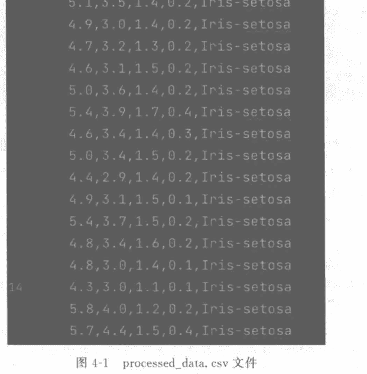

# 用自然语言指令操控 ChatGPT 编程

# 内容概览
本书以 ChatGPT 为核心，系统梳理指令式编程的原理、实践路径以及面临的难点与演进方向。全书共七章。开篇奠定基础，第二章补充基本知识与技能，第三章聚焦指令撰写方法，第四章进入真实实践，第五章讲解进阶技巧，第六章剖析挑战，第七章展望未来走向。

写作强调可操作性，案例覆盖自然语言处理、软件研发、数据处理、图像处理等多个垂直方向。理论讲解之外，还探讨指令式编程与大模型的关系、技术优化思路，以及对应用开发、交互方式带来的改变。

适合高校计算机及相关专业的教学参考，也可供对该主题感兴趣的自学者阅读，同时可作为从事研发和研究人员的案头资料。

# 前言
党的二十大报告强调，教育、科技、人才是建设社会主义现代化国家的基石性战略支撑。要把科技自立、人才优先、创新驱动坚定贯彻，科教兴国、人才强国、创新驱动三大战略共同推进创新型国家建设。高等教育与经济社会发展高度联动，对促进就业创业、支撑产业发展、增进民生福祉意义重大。

本书是一部综合性著作，集中呈现以 ChatGPT 为代表的指令式编程核心内容与应用。先解释概念与价值，再深入剖析运行机理与与智能模型的关系，帮助读者把握原理与技术基础。全书共七章。首章讲基础，第二章讲基本知识技能，第三章讲指令编写技术，第四章讲实践，第五章讲高级技巧，第六章讲挑战，第七章做展望。

书中收录了在各领域的实践案例，涵盖自然语言处理与对话系统在文本分类、情感分析、对话生成方面的应用；介绍了在软件研发与自动化方面的应用，包括代码生成与自动化测试。本书还讨论了在数据处理、图像处理、机器学习模型训练、物联网、金融、自动化报告生成、资源调度优化、自动化文档生成等领域的案例，让读者对应用广度有全面认识。同时也讨论了对研发流程的影响，以及对伦理和社会层面的影响，供读者审慎思考。

阅读完可掌握指令式编程的原理、技术要点与典型场景，了解其挑战与前景。本书适合对该方向感兴趣的学生、研究者与从业人员，也可作为课程教材。无论是入门者还是有经验的专业人士，都能获得实用指导。

> **资料获取说明**
**数据包：** 目录顶部二维码可下载。
**代码示例：** 每章开头附有源码二维码，扫码即可获取。
著者
2024年3月

## 1.1 绪论

### 1.1.1 指令编程的定义与背景
指令式编程指把应用的技术需求用精确的自然语言描述出来，以指令形式提交给 ChatGPT，由模型理解后生成代码或给出解答的开发方式。借助这种方式，开发者能更直接、高效地完成应用构建。

传统开发需要深厚的编码功底和大量代码编写，指令式编程依托 ChatGPT 的自然语言理解与生成能力，让开发更灵活、简便、高效。

支撑该模式的核心是大规模预训练语言模型 ChatGPT。该模型在海量文本上完成预训练，具备丰富的语言知识与语义理解能力。指令输入后，模型可依据描述产出对应代码或答案。

该模式的兴起与深度学习和自然语言处理近年来的快速发展密切相关。大规模预训练模型的出现提供了技术底座，ChatGPT 的持续迭代让指令式编程更可行、更普及，形成新的开发范式。

应用范围很广，可用于快速原型、自动化任务、代码片段生成、文档与报告自动生成等。便捷性使开发者能聚焦业务逻辑与需求表达，减少对底层编码细节的投入。

本书将深入讨论指令式编程的各个方面，包括指令撰写技巧、数据处理、调试优化、输入输出处理等。学习后，读者能更有效地利用 ChatGPT 进行应用开发，提升效率与代码质量。

### 1.1.2 指令编程的目标与优势
指令式编程是一种融合自然语言处理与生成技术的创新开发方式，以 ChatGPT 为基础，追求更高效率、更大灵活性与更强智能的开发体验。其目标主要包括：

- （1）流程简化：开发者只需清晰描述技术需求与操作步骤作为指令提供给模型，无需深入学习复杂语言与框架，开发更直观，门槛降低。
- （2）提速研发：提供准确指令后，模型能迅速理解需求并产出代码或答案，节省手工编写繁琐代码的时间，加快进度。模型还能提供智能化建议，帮助快速排障。
- （3）学习成本下降：对初学者和非专业开发者而言，掌握编程语言与框架难度较大。指令式编程以自然语言表达需求，降低入门门槛，无需深究语法细节即可参与开发。
- （4）高灵活性与适应性：依托模型的语义理解与生成能力，开发者可用自然语言描述多样化需求。指令式编程可应用于文本处理、图像处理、机器学习等场景，也能与不同语言和开发环境集成。

总体来看，目标是通过自然语言精准描述技术需求并交由 ChatGPT 执行，实现快速、智能化的应用开发。

优势主要体现在：
- （1）以自然语言表达需求，无需逐行写代码。模型能快速理解并生成对应代码或答案，使开发者聚焦问题本质。
- （2）简化开发流程。只需提供清晰、详细的指令，无需研究复杂语言与框架。流程更直观，学习曲线变缓。
- （3）降低学习成本。自然语言描述将复杂编程概念转化为可理解指令，使开发更易上手，让更多人参与。
- （4）灵活多变。可根据实际需求调整指令形式，支持跨领域任务，实现定制化开发。
- （5）促进协作。以自然语言描述需求，便于开发者与领域专家沟通协作，推动知识共享与跨界创新。

例如，要做情感分析应用。传统方式需学习机器学习算法并编写大量代码处理文本、构建模型。指令式编程下，只需描述“创建一个情感分析应用，输入一段文本，输出正面、负面或中性”，模型即可生成代码并实现核心功能，大幅简化流程。

在软件研发与自动化领域同样适用。代码生成时，用指令描述功能与逻辑，模型生成代码片段；自动化测试时，用指令描述用例与预期结果，模型生成测试脚本并执行，提升测试效率。

指令式编程在自然语言处理、对话系统到软件自动化等场景均能发挥作用，为开发者提供直观、高效、智能的开发体验，推动应用开发创新。尽管仍存在挑战，但随着技术进步，其前景广阔。

## 1.2 指令编程概述
指令式编程是一种通过与人工智能大模型对话来生成程序的表达方式。开发者以自然语言向类 ChatGPT 的聊天模型发出指令与需求，由模型返回生成的程序代码。该方式让编程过程更直观易懂，并提供更灵活的实现路径。

其工作原理基于自然语言处理与人工智能技术。开发者用自然语言描述问题与需求，模型解析理解后生成对应程序代码。交互式、人性化的流程让非专业人员也能参与开发，加快上线速度并降低技术门槛。

应用前景广泛，可覆盖虚拟助手、智能问答、自动化工作流等领域。通过与大模型的指令交互，开发人员能快速创建并定制多样化应用，满足变化需求。指令式编程也促进创新与用户体验提升，通过智能代码生成与自动化流程为用户带来更智能个性化的体验。随着人工智能持续进步，指令式编程将在多领域发挥关键作用，推动应用开发全面革新。

### 1.2.1 指令编程的实现
指令式编程的落地建立在 ChatGPT 的自然语言理解与生成能力之上。ChatGPT 是经过大规模预训练和微调的强力语言模型，能理解指令并生成自然语言文本。

开发中，技术需求以自然语言输入模型，内容可包括功能要求、算法逻辑、输入输出规范等。指令需要准确、清晰、详尽，以便模型正确理解并生成代码或答案。

输入后，ChatGPT 内部的深度神经网络对指令进行编码与理解，通过上下文建模与语义推理，推断出对应的编程任务。

生成阶段，模型利用文本生成能力产出代码片段、建议或答案，内容取决于指令描述与模型的理解程度。

例如，要做一个简易计算器，用户输入两数与运算符，程序输出结果。可向模型输入指令“创建一个计算器应用，用户输入两个数字和运算符，程序输出计算结果”。模型理解后生成实现输入计算逻辑并输出结果的代码。

实现依赖模型能力。预训练阶段模型在海量语料中习得语言知识，提升语义理解；微调阶段在特定领域数据上训练，使其在特定任务上表现更佳，从而理解指令并生成相关代码或答案。

需要注意的是，过程并非完全无人干预。模型生成的代码通常需要开发者审阅、调整。开发者需检查是否符合预期，进行重构、优化、扩展，补充错误处理、边界条件、输入校验等，确保稳定可靠。

实现还体现在人机交互的迭代上。开发者提供指令，模型返回输出，开发者据反馈细化描述、修改代码，反复迭代直至满意。

指令式编程实现了自然语言处理与生成技术在开发中的创新应用，将指令转化为代码或答案，简化流程、降低成本、提升效率，让缺乏深厚编程背景的人也能实现创意。

同时也存在局限。模型对复杂需求可能理解偏差或无法生成合格代码，输出具有不确定性需人工验证调试。因此使用指令式编程时，开发者仍需具备一定编程知识，以理解和处理模型产出，保证最终质量。

尽管有挑战，指令式编程潜力巨大。随着自然语言处理与生成技术的进步，模型理解与生成能力将持续提升，指令式编程有望成为一种主流开发方式，提供更便捷智能的体验，推动应用开发创新。

### 1.2.2 指令编程与人工智能模型的关系
指令式编程与人工智能模型，特别是 ChatGPT 这类强力语言模型紧密绑定。指令式编程借助模型的语言理解与生成能力，为开发者提供一种新颖高效的开发模式。

在指令式编程中，开发者通过交互把自然语言的指令输入模型，期待模型生成符合需求的代码或答案。交互方式类似人与人对话，便于表达需求。

关键在于准确传递开发意图。开发者需用清晰明确的语言描述技术需求，包括功能、算法、输入输出规范等。模型解析理解后生成代码、答案或建议。

指令传递后，模型利用深度学习算法处理输入，建立上下文理解，并推断出相应的编程任务，随后生成代码片段、函数定义、算法逻辑等，供开发者作为基础进行调整优化。

例如，要做图像分类应用，可向模型输入指令“创建一个图像分类应用，输入一张图片，输出类别标签”。模型理解后生成加载训练模型、图像预处理、推理等代码，实现分类功能。

二者结合使开发更智能自动化。开发者用简单指令表达需求，减少手工写代码的工作量。交互式开发节省时间精力，降低门槛，让更多人参与。

模型的训练数据与学习能力会影响结果质量，模型水平是关键。对复杂需求，可能需结合手工编程，将模型生成代码与人工实现整合优化。

尽管结合尚存问题，但不会阻碍应用。随着模型在语言理解与生成方面的不断提升，指令理解更准确，代码质量更高。对开发者而言，指令式编程提供更直观高效的开发路径，提升效率。

## 1.3 指令编程的应用领域
指令式编程在多个领域得到广泛应用。自然语言处理与对话系统是重要方向。在文本分类中，可通过与大模型交互实现文本自动分类与标注；在情感分析中，可快速提取文本情感信息，用于市场调研、社媒分析与舆情监控；对话生成方面，通过与模型对话交互生成自然流畅的对话内容。

另一个重点是软件研发与自动化。指令式编程可用于代码生成，通过交互自动生成代码片段、函数或应用框架；在自动化测试中，可生成测试用例、自动执行测试流程并分析结果，提升软件质量与开发效率。

除此之外，还在诸多领域展现强劲能力。数据处理方面，可用于数据清洗、转换与分析，提升效率与准确性；图像处理方面，可用于图像识别、增强与生成；机器学习模型训练方面，可优化参数、调整结构、自动化训练；物联网应用方面，可用于设备控制、数据采集与远程监控；金融应用方面，可用于交易分析、风险管理与投资决策。自动化报告生成、资源调度与优化、自动化文档生成等也能借助指令式编程实现自动化与提效。

指令式编程通过与人工智能大模型交互，实现自动化、高效、个性化的任务处理，为各行业提供强有力的编程工具与技术支撑。

### 1.3.1 自然语言处理与对话系统
自然语言处理与对话系统是指令式编程的重要应用场景，涵盖文本分类、情感分析与对话生成。

- （1）文本分类中，指令式编程可通过与人工智能大模型交互，实现文本自动分类与标注。开发者提供分类要求作为指令，模型据预定义标准对文本进行准确分类，如将新闻稿归为体育、政治、娱乐等类别。
- （2）在情感分析中，指令式编程可通过与模型交互快速提取文本中的情感信息。开发者通过指令引导模型分析文本情感倾向，如积极、消极或中性。该应用对市场调研、社交媒体分析和舆情监测具有重要价值，有助于洞察海量文本中的情感倾向与观点。

用自然语言指挥模型写代码：指令编程的实战地图

指令编程正在把和大模型的对话变成直接的生产力。只要用准确的指令去引导，开发者就能让模型产出自然、流畅且贴合场景的对话内容。对话系统因此变得更智能、更个性化，能够真正读懂用户意图并给出合适的答案和解决方案。典型的落地方向有智能助手、在线客服、虚拟主播等。

更广义地看，指令编程在文本分类、情感分析、对话生成这些环节都是核心驱动力。通过与大模型的交互，可以把任务处理推向自动化、个性化与智能化，在信息处理、用户体验和决策支持上释放出相当大的空间。

#### 1. 文本分类里的指令编程实战

在分类任务里，指令编程能帮忙自动生成分类代码。下面以邮件分拣为例。

假设要做一个邮件分类App，按“工作”“个人”“广告”来归类。用指令编程的方式可以这样描述需求：

> 粗略指令：依据邮件内容和特征，把它分到工作、个人或广告。
> 精确指令：写一个 Python 函数，接收邮件内容和特征作为输入，返回分类结果为工作、个人或广告。

第二条指令把函数名、参数、返回值都限定清楚，模型就能按要求生成可运行的代码。模型给出的示例类似下面这样：
```
def classify_email(content, features):
    # 在这里添加分类逻辑
    # 根据邮件的内容和特征进行分类，并返回分类结果
    # 示例代码
    if "工作" in features:
        return "工作"
    elif "个人" in features:
        return "个人"
    elif "广告" in features:
        return "广告"
    else:
        return "未知"
```
这里模型依据邮件内容做简单逻辑判断，会把结果放到工作、个人、广告或未知里，输出的类别数甚至会超出指令要求的范围。这只是入门演示，真实业务里的判断逻辑会复杂得多。

写得准确、清晰的指令可以让 ChatGPT 生成符合预期的分类代码。但要提醒的是，指令编程还在早期，落地时仍需调优和调试才能适配具体需求。

实际工作流里，开发者把指令喂给模型，模型理解后输出代码片段，完成分类任务。常见的生成步骤包括：

- (1) 数据预处理：生成清理原始邮件的代码，比如去掉特殊字符、标点、停用词。
- (2) 特征提取：生成提取关键特征的代码，如词频、TF-IDF、n-gram 等。
- (3) 分类算法：生成应用机器学习或深度学习算法的代码，如朴素贝叶斯、支持向量机、卷积神经网络，用来训练和推理。
- (4) 模型评估：生成评估代码，计算准确率、精确率、召回率等指标。

借助指令编程，开发者不用手写大量重复代码，只需描述需求就能拿到代码，开发效率明显提升。同样的方法还能迁移到情感分析、主题识别等其他分类场景。在文本分类案例中，指令编程凭借生成能力自动产出适配不同任务的代码，让开发更顺畅，也推动了分类技术本身的应用。

#### 2. 情感分析任务的指令编程实践

指令编程同样能产出情感分析代码。只要把分类要求和预处理步骤说清楚，模型就能自动生成算法。

假设要做社交媒体监测，对用户评论做情感倾向判断，分成积极、消极、中性。

> 粗略指令：根据社交媒体评论内容做情感分析，分为积极、消极或中性。
> 精确指令：写一个 Python 函数，接收社交媒体评论内容作为输入，返回情感分类结果为积极、消极或中性。

明确的指令限定了输入输出，模型会据此生成代码。示例输出类似：
```
def classify_sentiment(comment):
    # 在这里添加情感分析逻辑
    # 根据评论的内容进行情感分类，并返回分类结果
    # 示例代码
    # 使用情感分析模型对评论进行预测，将其分类为“积极”“消极”或“中性”
    sentiment = sentiment_analysis_model.predict(comment)
    if sentiment >= 0.6:
        return "积极"
    elif sentiment <= 0.4:
        return "消极"
    else:
        return "中性"
```
模型会调用情感分析模型做预测，背后通常涉及文本处理、特征提取等。指令写得越清晰，生成的代码越贴合预期。需要说明的是，情感分析本身复杂，往往要结合现成模型或自行训练才能获得更好效果。

在真实使用中，指令输入模型后得到代码，实现情感分析。典型步骤是：

- (1) 数据预处理：清理评论，去掉标点、特殊字符，做大小写统一等。
- (2) 情感特征提取：生成提取词袋、词向量、n-gram 等特征的代码。
- (3) 情感分类算法：生成使用 SVM、CNN、RNN 等算法训练和推理的代码。
- (4) 结果解析：生成解析结果并把评论标记为积极、消极或中性的代码。

有了模型生成的能力，特征提取和分类算法不用再手工堆砌。

举例输入：“这款产品真是太棒了！我完全爱上它了。”生成的流程会先清洗、提特征、再分类，最终得到积极标签。

应用面不止社交评论，还能扩展到产品评价、客户反馈、新闻报道等。指令编程让情感分析更快落地，也具备灵活可定制的特点。

进阶用法还包括：

- (1) 多类别情感分类：除了积极、消极、中性，还可以扩展为喜欢、厌恶、惊讶等，通过指令生成对应代码。
- (2) 情感强度分析：在分类基础上量化强度，比如非常积极 vs 稍微积极。
- (3) 长文本情感分析：针对文章、评论集合等长文本，生成分段、上下文理解和整体判断的流程。

再看电商场景。想要分析用户评论满意度，可以这样指令：

> 粗略指令：对购物网站的用户评论做情感分析，分为积极、消极或中性，并给出情感强度分。
> 精确指令：写一个 Python 函数，接收购物网站用户评论内容作为输入，返回情感分类为积极、消极或中性，以及一个 0 到 1 的情感强度评分。

模型示例输出：
```
def analyze_sentiment(comment):
    # 在这里添加情感分析逻辑
    # 根据评论的内容进行情感分类和评分
    # 示例代码
    # 使用情感分析模型对评论进行预测，将其分类为“积极”“消极”或“中性”
    sentiment = sentiment_analysis_model.predict(comment)
    # 计算情感强度评分
    sentiment_score = sentiment_analysis_model.predict_score(comment)
    if sentiment >= 0.6:
        sentiment_label = "积极"
    elif sentiment <= 0.4:
        sentiment_label = "消极"
    else:
        sentiment_label = "中性"
    return sentiment_label, sentiment_score
```
它会把评论分为类别并计算强度分，用来衡量满意度。例如：“这件衣服的质量很好，颜色也很漂亮，我非常满意购买它。”会被判为积极且高强度。

需要强调的是，指令编程是辅助工具，不是人工分析的替代。最终仍需根据业务实际情况优化和调整代码。

#### 3. 对话生成中的指令编程案例

对话系统也能用指令编程来开发。通过描述场景、策略和生成规则，模型可以产出对话系统代码。典型应用有聊天机器人、虚拟助手、客服系统等。

以旅行助手为例，用户可以用自然语言询问目的地、交通、住宿、景点，并得到建议。指令可以这样写：

> 指令：生成一个旅行助手对话系统的代码，用户可以提问旅行相关问题并获得回答和建议。系统需要支持：
> (1) 询问目的地，例如“我想去巴黎旅行。”
> (2) 询问交通方式，例如“我应该怎么去巴黎？”
> (3) 询问住宿，例如“有什么推荐的酒店吗？”
> (4) 询问景点，例如“巴黎有哪些著名景点？”
> (5) 保持上下文连贯，按问题给出回答和建议。

简化示例代码如下：
```
def travel_assistant():
    print("欢迎使用旅行助手！我可以回答关于旅行的问题并提供建议。")
    print("请提出您的问题或输入'退出'来结束对话。")
    while True:
        user_input = input("用户：")
        if user_input == "退出":
            print("谢谢您的使用，祝您旅途愉快！")
            break
        # 检测用户问题的类型并生成相应的回答
        if "目的地" in user_input:
            destination = extract_destination(user_input)
            answer = get_destination_info(destination)
        elif "交通方式" in user_input:
            transportation = extract_transportation(user_input)
            answer = get_transportation_info(transportation)
        elif "住宿信息" in user_input:
            answer = get_accommodation_recommendation()
        elif "旅游景点" in user_input:
            answer = get_attractions_info()
        else:
            answer = "抱歉，我无法理解您的问题。请问还有其他问题吗？"
        print("旅行助手: " + answer)

def extract_destination(user_input):
    # 在用户输入中提取目的地信息
    # 示例代码：使用简单的字符串匹配方法提取目的地
    destinations = ["巴黎", "伦敦", "罗马", "东京", "纽约"]
    for destination in destinations:
        if destination in user_input:
            return destination
    return ""

def extract_transportation(user_input):
    # 在用户输入中提取交通方式信息
    # 示例代码：使用简单的字符串匹配方法提取交通方式
    transportation_methods = ["飞机", "火车", "汽车", "轮船"]
    for transportation in transportation_methods:
        if transportation in user_input:
            return transportation
    return ""

def get_destination_info(destination):
    # 根据目的地提供相关信息
    # 示例代码：根据目的地返回相关的介绍和建议
    if destination == "巴黎":
        return "巴黎是法国的首都，被誉为浪漫之都。您可以游览埃菲尔铁塔、卢浮宫和圣母院等景点。"
    elif destination == "伦敦":
        return "伦敦是英国的首都，拥有丰富的历史和文化遗产。您可以参观大本钟、大英博物馆和伦敦塔等景点。"
    elif destination == "罗马":
        return "罗马是意大利的首都，有着悠久的历史和令人惊叹的古迹。您可以游览斗兽场、万神殿等景点。"
```
基于指令，模型会产出流程控制、语义解析和回复生成的代码。开发者再做重构和整合，就能形成完整系统。

这种方式大幅降低对话系统开发门槛，只需描述功能需求即可快速得到原型。指令编程为对话生成提供了高效起点，加速迭代。但生成的代码仍需优化，以适配具体场景和用户习惯。

## 1.3.2 软件开发与自动化

软件开发与自动化是指令编程的另一大阵地，核心是代码生成和自动化测试。

在代码生成上，通过交互式指令，编程人员可以让模型按功能和逻辑自动写代码，大幅提升效率，减少重复劳动。只要把需求描述清楚，模型就能输出对应实现，加快进度并降低错误率。

在自动化测试上，指令编程可以帮开发人员自动搭建测试流程。把需要验证的功能和用例告诉模型，它就能自动执行并生成测试报告，提高测试效率、节省人力、提升质量。

#### 1. 代码生成领域的指令编程示例

指令编程可以自动生成代码片段和模板，让软件开发提速。开发者用自然语言描述需求和交互行为，模型就能产出对应片段。

例如下面这条指令：

> 指令：生成一个用于图像分类的深度学习模型代码。模型应包含卷积神经网络结构、训练流程和预测函数。代码需要可定制，允许用户自定义网络层数、激活函数和优化器等参数。

# 用自然语言把需求写成代码

把需求用自然语言描述出来就能得到可运行的实现，正是指令编程最直观的表现。以 PyTorch 的图像分类片段为例，该片段提供了一套可自行调节参数的卷积网络雏形，为后续的训练与推理奠定基础。

```python
import torch
import torch.nn as nn
import torch.optim as optim

class CustomCNN(nn.Module):
    def __init__(self, num_classes, num_layers=2, activation='relu'):
        super(CustomCNN, self).__init__()
        self.num_layers = num_layers
        self.activation = activation
        # 定义卷积神经网络的结构
        self.conv_layers = nn.ModuleList()
        self.conv_layers.append(nn.Conv2d(3, 16, kernel_size=3, padding=1))
        self.conv_layers.append(nn.BatchNorm2d(16))
        for _ in range(self.num_layers - 1):
            self.conv_layers.append(nn.Conv2d(16, 16, kernel_size=3, padding=1))
            self.conv_layers.append(nn.BatchNorm2d(16))
        self.fc = nn.Linear(16 * 32 * 32, num_classes)
        # 定义激活函数
        if self.activation == 'relu':
            self.activation_func = nn.ReLU()
        elif self.activation == 'sigmoid':
            self.activation_func = nn.Sigmoid()
        elif self.activation == 'tanh':
            self.activation_func = nn.Tanh()
    
    def forward(self, x):
        # 前向传播
        for layer in self.conv_layers:
            x = layer(x)
            x = self.activation_func(x)
        x = x.view(x.size(0), -1)
        x = self.fc(x)
        return x

def train_model(model, train_loader, criterion, optimizer, num_epochs):
    device = torch.device("cuda" if torch.cuda.is_available() else "cpu")
    model.to(device)
    for epoch in range(num_epochs):
        running_loss = 0.0
        for inputs, labels in train_loader:
            inputs = inputs.to(device)
            labels = labels.to(device)
            optimizer.zero_grad()
            outputs = model(inputs)
            loss = criterion(outputs, labels)
            loss.backward()
            optimizer.step()
            running_loss += loss.item()
        print(f"Epoch {epoch+1}/{num_epochs} Loss: {running_loss/len(train_loader)}")

def predict(model, test_loader):
    device = torch.device("cuda" if torch.cuda.is_available() else "cpu")
    model.to(device)
    predictions = []
    with torch.no_grad():
        for inputs in test_loader:
            inputs = inputs.to(device)
            outputs = model(inputs)
            _, predicted = torch.max(outputs.data, 1)
            predictions.extend(predicted.tolist())
    return predictions
```

这份模板支持对网络深度、激活方式、优化策略等要素进行个性化配置，借助它可以搭建可训练、可预测的卷积结构，完成图像分类任务。

运行前要准备匹配的训练集与数据加载机制。

按自然语言的描述，模型能够产出完整实现，涵盖卷积堆叠的设计、训练流程的组织以及预测函数的编写。产出可按需求定制与扩展，以应对不同场景的分类问题。

指令式编写的价值并不局限于深度学习，还能延伸到数据处理和分析等方向。比如自动产出清洗、特征抽取、统计分析等脚本。只要用自然语言说明处理目标与步骤，模型就能给出对应实现，显著降低手工编码成本，提升处理效率。

不同领域的落地形态可归纳为以下几种。

(1) 生成数据库查询代码。

> 指令：生成一个数据库查询代码，用于从用户表中检索所有年龄大于或等于 18 岁的用户记录，并按照姓名的字母顺序进行排序。

该范例的输出基于 SQL 语法。

```sql
SELECT *
FROM users
WHERE age >= 18
ORDER BY name ASC;
```

假设存在名为 users 的表格，包含 name 与 age 两个字段。语句抽取全部列，从 users 中筛选出年龄不小于 18 的记录，再按 name 的字母顺序升序排列。

提示：需依据真实的数据库与表结构做适当调整，以保障语句与系统兼容。

依据上述描述，ChatGPT 产出了对应的数据库查询，使用合适的查询语言编写查询语句，包含筛选条件与排序规则。该产出可直接用于数据库操作，从而提升查询效率与准确性。

(2) 生成图像处理算法代码。

> 指令：生成一个图像处理算法代码，用于将一张彩色图像转换为灰度图像。

该范例的输出在 Python 环境调用 OpenCV 进行图像操作。

```python
import cv2
# 读取彩色图像
image = cv2.imread('input_image.jpg')
# 将彩色图像转换为灰度图像
gray_image = cv2.cvtColor(image, cv2.COLOR_BGR2GRAY)
# 显示灰度图像
cv2.imshow('Gray Image', gray_image)
cv2.waitKey(0)
cv2.destroyAllWindows()
```

片段起初借助 cv2.imread 读取彩色原图，再通过 cv2.cvtColor 把彩色图转成灰度图，指定了 COLOR_BGR2GRAY 的转换规则。随后用 cv2.imshow 展示结果，并借 cv2.waitKey 等待按键关闭窗口。

提示：需先部署 OpenCV，并把读取路径修改为实际图片，再按实际情况调整。

依据上述描述，ChatGPT 产出了对应的图像处理算法，包含读取图像、彩色到灰度的转换实现，以及保存处理后图像。该产出可用于图像处理应用，简化开发并提升处理效率。

(3) 生成网络爬虫代码。

> 指令：生成一个网络爬虫代码，用于从指定网站上抓取最新的新闻标题和链接。

该范例的输出在 Python 环境使用 BeautifulSoup 进行网页解析与数据提取。

```python
import requests
from bs4 import BeautifulSoup
# 指定目标网站的 URL
url = 'https://www.example.com/news'
# 发送 HTTP GET 请求并获取网页内容
response = requests.get(url)
html_content = response.text
# 使用 BeautifulSoup 解析网页内容
soup = BeautifulSoup(html_content, 'html.parser')
# 查找新闻标题和链接
news_titles = soup.find_all('h2', class_='news-title')
news_links = soup.find_all('a', class_='news-link')
# 打印最新新闻的标题和链接
for title, link in zip(news_titles, news_links):
    print('标题:', title.text)
    print('链接:', link['href'])
    print('---')
```

代码先通过 requests.get 发起 HTTP GET，借助 response.text 获取页面内容。再用 BeautifulSoup 类解析内容，按标签名与类名定位新闻标题与链接。遍历后取出文本与 href，将最新新闻的标题与链接打印出来。

提示：把 url 变量换成真实目标站点的地址，并按实际页面结构与类名调整。

依据上述描述，ChatGPT 产出了对应的爬虫代码，包含请求网页、解析内容、抽取标题与链接等。该产出可自动抓取最新新闻信息，用于新闻聚合、数据分析等场景。

以上事例说明了指令编程在代码生成中的实际效果，通过清晰描述功能需求与交互逻辑，开发者能够借助 ChatGPT 产出符合预期的代码，大幅减少手动编码的工作量，加快开发节奏。需要说明的是，对于复杂程度较高的软件工程问题，指令编程目前更适合作为辅助手段，核心研发仍需人工把关。

#### 2. 指令编程在自动化测试中的应用案例

在自动化测试里，指令式编写能明显提升效率与质量。只要准确描述测试目标与期望结果，模型即可自动产出测试脚本、断言语句以及测试数据的生成逻辑。

下面用一个具体情境说明。开发者可给出如下指令。

> 指令：生成一个自动化测试脚本，测试登录功能。测试用例包括输入正确的用户名和密码，预期结果是成功登录，并验证登录后显示正确的用户信息。

以下是一个示例的自动化测试脚本，用于测试登录功能。该示例使用 Python 和 Selenium 库进行浏览器自动化操作。

```python
from selenium import webdriver
from selenium.webdriver.common.keys import Keys
import time
# 创建 WebDriver 对象
driver = webdriver.Chrome()
# 打开登录页面
driver.get('https://www.example.com/login')
# 输入用户名和密码
username_input = driver.find_element_by_id('username')
password_input = driver.find_element_by_id('password')
username_input.send_keys('your_username')
password_input.send_keys('your_password')
# 提交登录表单
password_input.send_keys(Keys.ENTER)
```

## 1.3.3 其他领域的指令编程应用案例

除情感分析、软件开发和自动化测试之外，指令编程还能覆盖数据处理、图像处理、机器学习模型训练等更多方向。只要描述清楚操作意图或模型结构，模型即可生成可执行的代码与算法。

### 1. 数据处理

指令编程可用于数据清洗、转换、合并、筛选等任务。通过说明处理需求和步骤，模型可以输出对应脚本，加速整体数据处理流程。

> 示例指令：生成一个数据处理脚本，将 CSV 文件中的重复记录去除，并根据指定条件对数据进行筛选和排序。

以下是一个示例的数据处理脚本，用于处理 CSV 文件并进行数据去重、筛选和排序操作。该示例使用 Python 的 Pandas 库进行数据处理。

```python
import pandas as pd
# 读取 CSV 文件
data = pd.read_csv('input.csv')
# 去除重复记录
data = data.drop_duplicates()
# 根据指定条件进行筛选
filtered_data = data[data['条件列名'] > 指定值]
# 根据指定列进行排序
sorted_data = filtered_data.sort_values(by='排序列名')
# 保存处理后的数据到新的 CSV 文件
sorted_data.to_csv('output.csv', index=False)
```

该脚本起初用 pd.read_csv 读取名为 input.csv 的文件，数据存入 DataFrame。随后用 drop_duplicates 去重，保留唯一记录。接着按指定条件筛选，再用 sort_values 排序。最后用 to_csv 写入名为 output.csv 的新文件，index=False 表示不保存索引。

提示：需按实际情况替换文件名、条件列名、指定值与排序列名，并调整筛选与排序方式。

依据上述描述，ChatGPT 产出了对应的数据处理代码，包含读取 CSV、去重、筛选与排序步骤。该产出可应用于各类数据处理任务，提升效率与准确性。

### 2. 图像处理

指令编程同样适用图像增强、特征提取、目标检测等任务。描述清楚需求与算法步骤后，模型能够生成对应的实现代码，完成图像的优化与分析。

> 示例指令：生成一个图像增强的函数，将输入图像的对比度增强，并应用直方图均衡化算法。

以下是一个示例的图像增强函数，使用 Python 的 OpenCV 库来实现对比度增强和直方图均衡化算法。

```python
import cv2
def enhance_image(image):
    # 将图像转换为灰度图像
    gray = cv2.cvtColor(image, cv2.COLOR_BGR2GRAY)
    # 对比度增强
    enhanced = cv2.equalizeHist(gray)
    # 将增强后的灰度图像转换为彩色图像
    enhanced_image = cv2.cvtColor(enhanced, cv2.COLOR_GRAY2BGR)
    return enhanced_image
```

enhance_image 接收输入图像，返回经对比度增强与直方图均衡化处理后的图像。内部先用 cv2.cvtColor 转为灰度，以便应用直方图均衡化。随后用 cv2.equalizeHist 对灰度图做处理，增强对比度。最后再用 cv2.cvtColor 转回彩色。

提示：上述函数仅为简易示例，具体增强方法会随应用需求变化。可依据实际需求修改与扩展。

依据上述描述，ChatGPT 产出了对应的图像处理代码，包含读取图像、对比度增强与直方图均衡化的实现。该产出可用于各类图像处理任务，提升图像质量与分析效果。

### 3. 机器学习模型训练

指令编程也可服务于机器学习模型的训练环节。描述数据集、网络结构与训练参数后，模型能够生成相应的实现代码，缩短模型研发周期。

> 示例指令：生成一个用于图像分类的卷积神经网络模型的训练代码，应包括网络结构、损失函数和优化器的定义，并使用给定的数据集进行训练。

以下是一个示例的卷积神经网络模型训练代码，使用 Python 的深度学习框架 TensorFlow 来定义和训练模型。

```python
import tensorflow as tf
from tensorflow.keras import layers, models
# 定义卷积神经网络模型
def create_model():
    model = models.Sequential()
    model.add(layers.Conv2D(32, (3, 3), activation='relu', input_shape=(32, 32, 3)))
    model.add(layers.MaxPooling2D((2, 2)))
    model.add(layers.Conv2D(64, (3, 3), activation='relu'))
    model.add(layers.MaxPooling2D((2, 2)))
    model.add(layers.Conv2D(64, (3, 3), activation='relu'))
    model.add(layers.Flatten())
    model.add(layers.Dense(64, activation='relu'))
    model.add(layers.Dense(10))
    return model
# 加载数据集
(train_images, train_labels), (test_images, test_labels) = tf.keras.datasets.cifar10.load_data()
train_images, test_images = train_images / 255.0, test_images / 255.0
# 创建模型
model = create_model()
# 定义损失函数和优化器
loss_fn = tf.keras.losses.SparseCategoricalCrossentropy(from_logits=True)
optimizer = tf.keras.optimizers.Adam()
# 编译模型
model.compile(optimizer=optimizer, loss=loss_fn, metrics=['accuracy'])
# 训练模型
model.fit(train_images, train_labels, epochs=10, validation_data=(test_images, test_labels))
```

这段示例代码的执行脉络可以拆成四步来看。第一步是调用 create_model 来搭建卷积神经网络，架构里串联了多个卷积层、池化层以及全连接层。第二步通过 tf.keras.datasets.cifar10.load_data 把 CIFAR-10 数据集读进来，并对图像像素做归一化处理。第三步执行 model.compile，指定交叉熵损失函数并选用 Adam 优化器。第四步用 model.fit 启动训练，传入训练集、训练轮数 epochs 和验证集，训练过程中网络会按损失和优化器的反馈不断更新参数，并实时打印 loss、accuracy 等指标。

注意：以上仅是一个入门级演示，真实任务的训练流程会因业务需求和数据特点而不同，需要据实调整和扩展，才能适配具体的图像分类场景。

借助这样的指令，ChatGPT 可以自动生成完整的机器学习训练代码，涵盖网络结构定义、损失与优化器配置，以及基于指定数据集的训练流程。生成的代码能直接用于各类图像分类项目，帮助缩短迭代周期并提升性能。

总体来看，指令编程在数据处理、图像处理、模型训练等方向都有很强的落地价值。只要用自然语言描述任务目标和操作步骤，就能让模型产出适配不同领域的代码和算法，从而降低开发门槛、加速交付效率。

### 4. 自然语言处理应用
指令编程同样适用于自然语言处理。通过描述文本预处理、分类、命名实体识别、关键词抽取等需求，模型可以产出对应的 NLP 算法和代码。

> 示例指令：请生成一段中文文本分类的代码，实现文本清洗与特征抽取，并基于给定的训练集完成分类。

下面以 Python 的 scikit-learn 为例，给出一个中文文本分类的特征抽取与建模示例。

```python
import jieba
from sklearn.feature_extraction.text import TfidfVectorizer
from sklearn.svm import SVC
# 加载训练数据集
train_texts = [
    '这是一篇关于科技的文章',
    '这个手机真好用',
    '这个电影真精彩',
    '这个产品有点失望',
]
train_labels = [1, 1, 1, 0]    # 1 代表正向, 0 代表负向
# 分词
train_texts = [' '.join(jieba.cut(text)) for text in train_texts]
# 特征提取
vectorizer = TfidfVectorizer()
train_features = vectorizer.fit_transform(train_texts)
# 定义模型
model = SVC()
# 模型训练
model.fit(train_features, train_labels)
# 预测新样本
test_text = '这个手机性能不错'
test_text = ' '.join(jieba.cut(test_text))
test_feature = vectorizer.transform([test_text])
predicted_label = model.predict(test_feature)
# 打印预测结果
if predicted_label[0] == 1:
    print('正向')
else:
    print('负向')
```
在该示例中，先准备好训练文本和对应的标签，用 jieba 对中文进行分词，分词结果用空格拼接在一起。接着借助 TfidfVectorizer 把文本转为 TF-IDF 向量，TF-IDF 能够衡量词在文档中的重要程度，是文本表示的常用手段。然后实例化一个支持向量机 SVM 作为分类器，通过 fit 方法在训练集上学习。最后对新样本先分词再转 TF-IDF，向模型输入 predict 得到预测结果并输出。

注意：这只是基础实现，实际的中文分类往往需要更精细的特征工程和模型选择，可根据具体任务进行改动和扩展。

按照上述指令，ChatGPT 能生成包含文本预处理、特征抽取和分类建模的 NLP 代码，可直接用于中文文本分类，提升分类效果和开发效率。

### 5. 物联网场景实践
指令编程也能用于物联网，比如传感器采集、设备控制、数据分析等。只要说明设备功能、数据处理和通信方式，模型就能生成相应的应用代码。

> 示例指令：生成一个温度监测的物联网代码，要求采集传感器数据、上传到云端并做温度分析。

下面是一个基于 Python 与 MQTT 协议的温度监测示例，实现数据采集、云端推送和本地分析。

```python
import time
import random
import paho.mqtt.client as mqtt
# MQTT Broker 信息
mqtt_broker = "mqtt.example.com"
mqtt_port = 1883
mqtt_username = "your_username"
mqtt_password = "your_password"
# 温度传感器数据采集和发送
def collect_and_send_temperature():
    # 模拟传感器数据采集
    temperature = random.uniform(20, 30)
    # 创建 MQTT 客户端
    client = mqtt.Client()
    client.username_pw_set(mqtt_username, mqtt_password)
    client.connect(mqtt_broker, mqtt_port)
    # 发布温度数据
    topic = "temperature"
    payload = str(temperature)
    client.publish(topic, payload)
    # 断开MQTT连接
    client.disconnect()
    print("Temperature sent:", temperature)
# 温度数据分析
def analyze_temperature(temperature):
    if temperature > 25:
        print("Temperature is too high!")
    else:
        print("Temperature is within the normal range.")
# 主程序
def main():
    while True:
        collect_and_send_temperature()
        time.sleep(5)    # 每5s采集一次温度数据
        # 模拟从云端接收温度数据
        temperature = random.uniform(20, 30)
        analyze_temperature(temperature)
if __name__ == "__main__":
    main()
```
对这段代码的逻辑做如下拆解：

- (1) 先配置 MQTT Broker 的连接信息，包括主机地址、端口、用户名和密码，实际使用时需要替换为真实 Broker 的参数。
- (2) 编写 collect_and_send_temperature 函数模拟采集，使用 random 生成一个随机温度值，再通过 MQTT 客户端发布到指定主题。
- (3) 编写 analyze_temperature 函数做简单判断，若温度高于 25℃ 则提示“温度过高”，否则提示“温度正常”，可按需扩展更复杂的分析规则。
- (4) 主程序采用无限循环模拟实时监测，循环内调用采集发送函数，并用 random 模拟从云端回传的温度值，随后调用分析函数输出结果。

> 注意：以上为简化演示，真实的物联网项目涉及更复杂的传感器处理和云端分析，需结合实际场景做定制化改造。

通过这类指令，ChatGPT 可以生成包含数据采集、上传和温度分析的物联网代码，适用于温度监测等智能化应用。

### 6. 金融行业应用
指令编程在金融领域同样可发挥作用，例如投资组合优化、风险管理、交易策略开发等。描述业务需求、数据处理和算法逻辑后，模型可输出对应的金融应用代码。

### 7. 资源调度与优化
指令编程也可用于资源调度和优化任务。只要给出资源条件和约束，模型就能生成调度算法和优化策略代码。

> 示例指令：生成一个生产计划优化代码，依据给定任务量和资源限制输出最优调度方案。

生产计划优化通常需要结合具体环境和约束建模求解。下面用线性规划给出一个简化演示。

```python
import numpy as np
from scipy.optimize import linprog

def optimize_production_plan(demand, resources):
    # 提取需求和资源的维度
    num_products, num_resources = demand.shape
    # 构建线性规划模型
    c = np.zeros(num_resources)  # 目标函数系数，最小化资源使用
    A_ub = -resources  # 不等式约束矩阵，限制资源使用不能超过资源限制
    b_ub = -demand.flatten()  # 不等式约束向量，限制生产需求必须满足
    bounds = [(0, None) for _ in range(num_resources)]  # 变量范围，资源使用非负
    method = 'highs'  # 选择线性规划求解器
    # 调用线性规划求解器求解最优资源分配
    result = linprog(c, A_ub=A_ub, b_ub=b_ub, bounds=bounds, method=method)
    # 输出最优资源分配方案
    if result.success:
        production_plan = result.x.reshape(num_products, num_resources)
        print("最优资源分配方案:")
        print(production_plan)
    else:
        print("无法找到最优资源分配方案。")

# 示例数据
demand = np.array([[100, 150, 200], [120, 130, 140]])
resources = np.array([[80, 100, 120], [70, 90, 110], [60, 80, 100]])
# 优化生产计划
optimize_production_plan(demand, resources)
```
对代码的思路整理如下：

- (1) 定义 optimize_production_plan 函数，接收 demand 需求矩阵和 resources 资源限制矩阵。需求矩阵行表示产品数、列表示资源种类；资源矩阵行表示资源种类、列表示可用量。
- (2) 函数内部把问题转化为线性规划模型，调用 linprog 求解器，目标是最小化资源消耗，同时满足资源上限和生产需求两类约束。
- (3) 根据求解结果输出最优资源分配矩阵，若求解失败则提示无法找到可行方案。

注意：该示例仅做演示，真实的生产优化往往包含更多约束和复杂性，需按场景建模求解。此外，除了线性规划，整数规划、动态规划、遗传算法等方法也常用于此类问题，具体选用取决于问题性质和约束难度。

借助指令，ChatGPT 能生成包含任务分配、资源分配和约束优化的调度代码，可用于生产计划优化，实现资源高效利用和任务合理安排。

### 8. 自动化报告生成
指令编程还能用于自动化报表。通过描述报表结构、数据来源和呈现要求，模型可以生成报表生成代码，节省人力和时间。

> 示例指令：生成一段销售报表代码，要求包含销售数据的可视化图表和统计指标，并支持按时间范围筛选。

生成销售报告通常会用到 Pandas 做数据处理和 Matplotlib 做可视化。下面是一个示例思路，用于按时间筛选数据并输出图表与统计指标。

```python
import pandas as pd
import matplotlib.pyplot as plt
# 读取销售数据
sales_data = pd.read_csv('sales_data.csv')
# 将日期列转换为日期时间类型
sales_data['Date'] = pd.to_datetime(sales_data['Date'])
# 根据给定的时间范围进行筛选
start_date = '2022-01-01'
end_date = '2022-12-31'
filtered_data = sales_data[(sales_data['Date'] >= start_date) & (sales_data['Date'] <= end_date)]
# 计算统计指标
total_sales = filtered_data['Sales'].sum()
average_sales = filtered_data['Sales'].mean()
max_sales = filtered_data['Sales'].max()
min_sales = filtered_data['Sales'].min()
# 生成按月份的销售额折线图
monthly_sales = filtered_data.resample('M', on='Date')['Sales'].sum()
plt.plot(monthly_sales.index, monthly_sales.values)
plt.xlabel('Month')
plt.ylabel('Sales')
plt.title('Monthly Sales Report')
plt.show()
# 输出统计指标
print('Total Sales:', total_sales)
print('Average Sales:', average_sales)
print('Maximum Sales:', max_sales)
print('Minimum Sales:', min_sales)
```

示例中假设销售记录集中在一份名为 `sales_data.csv` 的表格里。先用 Pandas 的读取接口把文件载入内存，并把日期列转成时间类型；接着依据指定的时间区间做布尔筛选，把符合条件的数据挑出来，再借助 Pandas 的统计接口求出总销售额、平均值、最高值与最低值。随后调用 Matplotlib 绘制以月份为维度的销售额折线并在界面展示，最后将所有指标输出到控制台。

提示：以上仅为简化演示，真实的销售报表落地时需要结合具体数据形态与业务规则做增补与调整。

按照这条自然语言描述，ChatGPT 给出了报表生成程序的完整实现，涵盖数据接入、图表绘制与统计计算的逻辑链路。这类代码能够把销售报告的制作流程自动化，提升效率并降低人为误差。

### 9. 文档一键生成

指令式开发同样可以承担文档自动生成的任务。只要用自然语言说明文档的层级、所需内容与版式规范，模型就能据此给出文档生成程序，大幅减少手工编写的工作量。

> 举例指令：写一段程序自动生成用户手册，手册需包含产品功能概述、操作指引及常见问题解答。

生成用户手册的程序通常要配合文本编辑与格式化工具。下面给出一个结构示意框架，展示手册基础骨架的搭建思路。

```python
def generate_user_manual():
    # 创建用户手册
    user_manual = open('user_manual.txt', 'w')
    # 添加产品功能介绍
    user_manual.write('产品功能介绍\n')
    user_manual.write('-------------------\n')
    user_manual.write('这里添加产品功能介绍的内容。\n\n')
    # 添加使用说明
    user_manual.write('使用说明\n')
    user_manual.write('-------------------\n')
    user_manual.write('这里添加使用说明的内容。\n\n')
    # 添加常见问题解答
    user_manual.write('常见问题解答\n')
    user_manual.write('-------------------\n')
    user_manual.write('这里添加常见问题解答的内容。\n\n')
    # 关闭用户手册
    user_manual.close()

# 生成用户手册
generate_user_manual()
```

在这个示例里，先声明了 `generate_user_manual` 来负责手册的产出。函数内部先创建 `user_manual.txt` 作为输出载体，再通过 `write` 逐步写入功能介绍、使用说明与 FAQ 三个板块，各板块的标题与正文可按实际情况扩充；结束后关闭文件。

提示：这只是一个基础骨架，落地时要依据具体内容与版式要求做扩展。若需要更复杂的排版，可考虑使用专业的文档工具或 Markdown 等标记语言来产出。

按上述描述，ChatGPT 输出了文档生成的实现，包含结构定义、内容填充与格式设定。该实现可用于用户手册的自动化产出，提升编写效率与一致性。

指令式开发的应用边界远不止前述场景，还能根据具体需求延伸到更多领域。明确任务目标与操作步骤后，模型即可自动生成对应的程序与算法，帮助开发者提速、降错并简化复杂任务的开发路径。

需要留意的是，即便模型可以自动产出部分程序与算法，落地仍离不开开发者的理解与调试。生成的代码往往需要进一步优化以适配具体业务，此外受限于训练数据与模型能力，使用前必须做验证测试以确保正确可靠。

## 1.4 指令编程从萌芽到落地

指令编程的演进轨迹是从早期尝试到如今实践与案例研究的完整过程。起初研究者尝试用自然语言与计算机交互来生成代码，受限于技术与数据发展相对缓慢。随着人工智能尤其是大语言模型如 ChatGPT 的快速崛起，指令编程迎来了新机遇，可借助强大模型实现更高效智能的指令生成与执行。该方向关注度提升，并在文本分类、情感分析、代码生成、自动化测试等多个领域展现潜力。通过案例分析与实践，指令编程正逐步成为一种新型编程范式，为开发者提供更便捷高效的开发方式。

### 1.4.1 初期探索

起步阶段，研究者主要聚焦于把预训练语言模型用于生成任务，并探讨指令编程的概念与方法，目标是打造能够理解开发者描述并产出对应代码或答案的模型。

一方面，研究者尝试把自然语言描述映射为机器可执行的代码。研究重点在于描述的语义表达与语法结构，以便模型准确把握需求并生成合适代码。不同的模型结构与算法被设计，如基于递归神经网络 RNN 或 Transformer 的方案，用来实现描述到代码的映射。

另一方面，研究者也致力于提升生成结果的质量。研究生成算法与技术，提高代码准确性与可读性。借助预训练语言模型结合领域知识与规则实现代码的自动产出，同时关注生成结果的可扩展性与灵活性，使其能适应不同场景需求。

早期尝试的典型方向包括：

- (1) 语义解析应用：通过语义解析把自然语言描述转化为机器可执行的表示，例如解析为抽象语法树 AST，进而生成对应代码结构。
- (2) 领域知识引入：为提升质量与准确性引入领域特定知识与规则，例如在图像分类代码生成时，模型利用图像处理知识自动生成特征提取与分类结构。
- (3) 规则与学习结合：设计自动化规则与模板生成代码骨架或模块，再用机器学习模型填充细节。
- (4) 数据集构建与评估：构建描述与代码配对、描述与答案配对等多种数据集，用于训练、评估与性能对比。通过相似度或准确率等指标衡量生成质量。

除此之外，研究者还尝试代码注释生成、文档生成、自动代码修复等任务，探索序列到序列模型、强化学习、生成对抗网络等结构以提升效果。

早期阶段面临诸多挑战。生成结果的可控性与可解释性不足，复杂模型产生的代码或答案难以理解。生成的代码质量与性能也难以保证，实际应用需满足质量与性能标准，需进一步提升生成效率与质量。

尽管存在局限，早期工作为指令编程的后续发展奠定基础。随着技术进步与研究深化，指令编程有望在软件开发与自动化领域发挥更重要作用，带来更多创新应用。

### 1.4.2 ChatGPT 驱动的崛起

ChatGPT 的面世成为自然语言处理与生成领域的重要里程碑。该模型依托大规模预训练数据与强大的神经网络结构，具备强大的语言理解与生成能力，能理解上下文、进行逻辑推理、生成连贯表达，并以类人对话方式交互。

ChatGPT 为指令编程提供了理想基础。指令编程的核心是通过自然语言描述技术需求，从模型获取生成的代码、答案或建议。ChatGPT 的语言生成能力使其能够理解开发者描述，并以自然语言形式返回对应代码或解答。

这种结合为开发者带来全新开发模式。不必手写大量代码，只需以指令方式与 ChatGPT 交互即可快速获得所需代码或解决方案，大幅简化流程、提升效率。

例如，开发者可通过指令编程生成图像分类、情感分析、自动化测试等特定任务代码。用自然语言描述任务要求与约束，即可从模型获取生成代码，节省编写时间并支持快速迭代调试。

此外，ChatGPT 还可作为交互伙伴，通过对话为开发者答疑、提供建议或解决方案。

### 1.4.3 实践案例概览

指令编程已在多个领域得到验证与应用。以下为部分典型案例。

- (1) 软件开发与自动化：开发者可用指令编程生成代码片段与模板，加速开发。如描述功能需求与交互行为，让模型自动生成常见代码结构与算法实现，减少手工编写量。同时可用于自动化测试，描述测试用例、预期结果与环境，让模型生成测试脚本与断言，加快测试、提升质量。
- (2) 数据处理与分析：可生成数据清洗、特征提取、统计分析等代码。通过描述处理操作与需求，模型自动生成对应代码与算法，简化流程，在大数据场景下加快处理速度、提升分析效率。
- (3) 人工智能模型开发：可描述模型架构、训练流程与预测函数需求，让模型生成对应代码，加快开发、减少手工量。也可用于模型调优，通过对话获取架构与参数优化建议，提升性能与准确度。
- (4) 自然语言处理与生成：可与 ChatGPT 对话交互获取 NLP 解决方案。例如在对话生成任务中，描述场景、策略与生成规则，让模型生成对话系统代码，为智能客服、聊天机器人等提供高效开发路径。
- (5) 社交媒体监测与舆情分析：描述特定话题、产品或事件需求，让模型生成情感分析算法代码，帮助组织了解用户情感倾向，辅助品牌声誉管理与社交媒体营销。
- (6) 市场调研与用户反馈：描述调研数据与反馈需求，让模型自动生成情感分析代码，实现市场需求评估、产品设计改进与用户满意度提升。
- (7) 情感导向推荐系统：描述用户情感偏好与推荐需求，让模型生成个性化推荐算法代码，按情感倾向提供推荐，提升体验。
- (8) 情感分析辅助工具：描述分析需求与数据处理操作，让模型自动生成情感分析工具代码，对新闻分析与社会科学研究有价值。

通过指令编程，开发者可用自然语言描述需求，让模型自动生成代码与算法，加快开发并降低出错风险。这种交互式开发使开发者能更灵活地与模型对话，并根据生成结果进行定制扩展，实现更具创造性的个性化方案。

需注意，指令编程在实践中仍处探索发展阶段，需进一步研究以提升生成能力与代码质量。但其潜力巨大，已为软件开发与自动化带来新可能。

## 1.5 挑战与未来展望

指令编程在应用开发中具备巨大潜力，但也面临挑战与限制。包括描述表达局限、语义理解准确性与领域知识依赖等问题。随着技术改进与未来探索，指令编程有望迎来更广阔前景。技术提升可增强系统的理解与生成能力，使其更智能灵活。指令编程对开发产生积极影响，为开发者提供更高效便捷创新的方式。因此整体前景乐观，有望未来发挥更重要作用。

### 1.5.1 局限性与挑战

指令编程仍存在若干挑战，如描述准确性、生成结果可靠性与代码可读性。

- (1) 准确性问题：指令编程的关键挑战之一是准确性。开发者需以准确清晰的方式描述需求，确保模型正确理解并生成对应代码。若描述模糊或存在歧义，可能导致代码不符合预期或不完整。因此需进一步研究改进模型的理解与生成能力。
- (2) 可靠性问题：生成结果的可靠性是另一挑战。模型在训练数据上表现良好，但在实际应用中仍可能出错或生成不可预测代码，这可能源于对特定领域或任务理解不足，或受训练数据偏差影响。需提升模型的鲁棒性与泛化能力。
- (3) 可读性问题：生成代码的可读性是重要考量。代码应结构清晰易读，便于理解、修改与维护。但自动生成的代码常存在冗长、重复或难懂之处，需改进代码生成算法与规则以提升可读性。

解决这些问题需要多方面研究与技术改进，可用方法包括：

- (1) 数据与模型改进：使用更准确多样且具代表性的训练数据，改进模型架构与算法，可提升准确性与可靠性。可涉及更复杂的预训练方法、迁移学习与领域适配等技术。
- (2) 上下文理解与推理：深入研究模型对上下文的理解与推理能力，使其更好地把握开发者描述并生成一致代码。可包括领域知识、对话历史与程序语言约束的建模。
- (3) 可控性与定制化：提供更多可控与定制选项，让开发者可在生成过程中施加指导并按需求定制。可包括指定代码风格、优化目标与规则，以及提供反馈与修正机制。
- (4) 人机协作与交互：研究更有效的人机协作方式，让开发者在生成过程中实时反馈、参与决策与调整结果。通过有效协作改善准确性、可靠性与可读性。
- (5) 领域特定指令编程：针对特定领域或任务开展研究，通过收集领域专家描述样本、建立领域特定语言模型与规则并进行自适应训练，提升模型对领域语义与约束的理解，生成更准确可靠代码。
- (6) 评估与度量指标：开发更全面准确可靠的评估指标，衡量生成代码的质量与可用性，涉及风格一致性、功能正确性、执行效率与可维护性等。通过建立评估标准更好地了解模型优劣，为改进提供指导。
- (7) 社区与合作研究：指令编程涉及多学科交叉，积极促进学术界、产业界与开源社区合作与知识共享，可加速发展。通过共享数据集、模型、算法与实践经验，形成持续创新生态。

总体而言，解决局限与挑战需综合运用数据、模型、算法与人机交互等多技术。随着指令编程不断发展完善，它有望在软件开发与自动化领域发挥更重要作用，为开发者提供更高效智能的编程工具与方法。

### 1.5.2 技术升级与未来走向

指令编程接下来的演进重点比较明确，主要集中在提升模型生成与语义理解水平，完善指令的表达与解析能力，以及增强代码生成与优化能力。

- 1）强化生成能力与语义理解
  - (1) 超大模型持续演进：得益于硬件与算力的提升，训练参数规模更大的语言模型变得可行，生成质量与表达力随之提高。GPT-4 已显示出明显效果，后续更庞大的模型有望进一步拉升指令编程的表现。
  - (2) 多模态融合学习：将图像、视频、音频等多种模态数据纳入指令编程体系，可实现更为全面的语义理解与生成。通过对不同模态的联合学习与推理，模型能够基于多模态输入产出相关代码与算法，从而拓展应用场景。

- 2）改进指令表达与理解
  - (1) 自然语言处理能力提升：通过优化语义解析与语法分析，提升对指令的精准理解与拆解能力。更好地识别和处理复杂指令结构，能让指令编程更准确可靠。
  - (2) 上下文与语境感知：加强模型对上下文和语境的敏感度，更好把握指令背后的含义与背景。借助上下文编码器、对话历史建模或全局推理机制，模型可更妥善应对复杂的指令情境。

- 3）增强代码生成与优化水平
  - (1) 生成过程可定制灵活：为指令编程模型提供更多参数与选项，让开发者按具体需求与偏好调整生成策略。可引入代码模板、可配置规则或生成策略，使代码结构与风格的控制更灵活。
  - (2) 生成阶段自动优化：在产出代码的同时自动执行优化与改进，提升代码的质量、性能与可读性。可结合静态代码分析、自动化重构与优化算法，帮助生成更高效、易维护的代码。

上述方向勾勒出指令编程技术改进与发展的清晰脉络。该领域仍处于快速迭代阶段，未来仍可能出现更多创新。随着技术进步与实践积累，指令编程还可能在以下方面进一步发展。

- 1）面向特定领域的指令编程
  - (1) 领域专用模型：研发针对特定行业的指令编程模型，使其更擅长理解并生成该领域相关的代码。例如金融、医疗、物联网等场景，可设计具有领域语义理解与代码生成能力的专用模型。
  - (2) 融入领域知识：将行业知识与规则注入指令编程，提升模型对特定领域的理解与应用能力。结合领域专家的经验与知识，可更精准满足垂直场景的代码生成需求，降低开发负担。

- 2）自动化与协作融合
  - (1) 自动化生成与集成：进一步提高自动化程度，使模型能够直接生成可执行代码并完成自动化集成与部署，以此压缩软件开发周期，提升效率与质量。
  - (2) 多人协作与代码共享：构建基于指令编程的协作平台，支持多名开发者共同使用与维护生成模型，共享指令与代码片段，促进团队协作与开发提速，并提高代码复用。

- 3）易用性与可解释性
  - (1) 交互界面设计：设计直观易用的指令编程界面，让开发者方便表达需求、引导模型生成，并在交互中调整优化代码。
  - (2) 生成代码的可读与可解释：提升产出代码的可读性与可解释性，便于开发者理解与调试。可通过注释、命名规范、缩进等手段改善代码品质。

### 1.5.3 指令编程重塑应用开发的价值与前景

指令编程对应用开发产生了重要影响，能够加速开发流程、降低学习门槛、提升开发效率，并提供更灵活的开发模式。随着技术持续进步和方法的不断完善，它有望在应用开发领域发挥更大作用，为开发者创造更多创新空间。

前景十分广阔。伴随人工智能模型的不断演进，指令编程将更精准地理解开发者意图，生成更高质量、更准确的代码与答案，从而显著提升开发效率与体验。

它还能推动低代码与无代码开发的发展。只需以自然语言描述技术需求，开发者无需深入掌握编程语言与框架即可实现应用开发。这将让更多人参与到应用建设中，加速创新与问题解决。

此外，指令编程有助于跨领域合作与创新。开发者可通过自然语言指令与领域专家交流，快速落地领域特定的应用，促进知识共享与跨界合作，推动创新向更广范围扩散。

不过，指令编程也面临挑战。如何准确表达需求、产出可靠高质量代码仍是关键。同时还需解决生成的代码与现有系统集成、可读性与可维护性等问题。未来研究与技术改进将聚焦于这些方向，以进一步提升实用性与可靠性。

总体来看，指令编程作为一种创新的应用开发方式，未来将扮演关键角色。它为开发者提供更高效、灵活、富创造性的开发路径，加速应用落地，促进技术创新与知识共享，助力数字化时代持续发展。

# 第2章 指令编程核心基础与实操技能

本章将介绍 ChatGPT 的工作机制、输入输出格式及其局限性，并讲解数据准备与处理的关键环节，包括数据采集、清洗、预处理与划分。同时介绍撰写高效指令的基本原则与技巧，探讨指令调试与优化的常见问题与解决思路，并研究用户输入处理与高质量输出生成的技术与工具。

学习完本章，读者可掌握指令编程所需的基础知识与技能，为后续章节的实践打下坚实基础。

## 2.1 ChatGPT 模型认知

### 2.1.1 ChatGPT 模型概述与运行原理

ChatGPT 是一种基于 Transformer 架构的语言模型，具备强大的语言理解与生成能力。它通过大规模无监督训练从海量文本中学习语言的统计规律与语义信息。其工作原理可归纳如下。

- 1. Transformer 架构：ChatGPT 采用 Transformer 架构，这是一种适用于序列处理的深度学习架构。相较于传统循环神经网络或卷积神经网络，Transformer 利用自注意力机制捕捉序列内部依赖关系，支持并行处理，从而大幅提升效率。
- 2. 自注意力机制：自注意力允许模型在生成每个输出时对输入序列各位置进行权重计算。模型可自动聚焦与当前生成位置相关的上下文，从而更好地把握句子的语义与语法。自注意力还能处理长距离依赖，避免传统 RNN 的梯度消失或爆炸问题。
- 3. 输入表示：模型中输入文本通常以词嵌入序列形式呈现。词嵌入把词语映射到高维向量空间，保留语义关联。ChatGPT 将每个词转换为连续向量表示，供模型理解。
- 4. 多层堆叠：ChatGPT 由多个 Transformer 层堆叠构成，每层包含多头自注意力子层与前馈神经网络子层。多层结构使模型逐步学习不同抽象层次的语义，低层捕捉词级信息，高层理解复杂句法与语义关联。
- 5. 输出生成：模型在训练时根据上下文预测下一个词，生成时则基于已生成文本逐步扩展。在给定输入上下文后，模型依据语言模型能力预测最可能的下一个词或标记，再以此作为下一步输入，循环生成完整文本。

完整生成流程如下。
- (1) 输入编码：将文本序列转为词嵌入向量作为模型输入。
- (2) 自注意力计算：模型计算上下文中各词之间的相关性，聚焦重要信息以理解语义语法。
- (3) 上下文融合：自注意力结果融入当前位置表示，使生成更贴合上下文。
- (4) 词语生成：基于训练得到的语言模型采样或选择下一个词。
- (5) 序列更新：将新生成的词加入序列，并作为下一步输入。
- (6) 重复步骤(4)(5)，直至达到设定长度或结束条件。

生成过程可通过不同策略调整，如调节采样温度控制多样性，或采用束搜索提升准确性。模型基于对输入的理解与语言预测能力，产出连贯逻辑的文本，满足指令编程需求。

### 2.1.2 输入输出规范

ChatGPT 作为生成式语言模型，其输入输出格式对指令编程至关重要。正确处理格式有助于更高效地撰写指令并获得期望结果。

#### 1. 模型输入格式
- (1) 输入通常为一段字符串，即用户指令或问题。
- (2) 可将单一指令作为输入，也可按需合并多条指令为一段文本。
- (3) 输入应包含任务相关的关键信息，以引导模型生成合适的回答或代码。
- (4) 指令中可加入关键词、上下文、格式要求等，以更精确地指导模型。

示例 1：
如天气查询应用，用户指令可以是：“查询北京明天天气。”可直接作为模型输入。

示例 2：
“编写名为 calculate_average 的函数，接收列表参数并返回列表元素的平均值。”

#### 2. 示例代码作为输入
- (1) 明确目标编程语言与风格，如 Python。
- (2) 对某些编程任务，可将已有代码片段或示例作为输入供模型参考。
- (3) 示例代码可在指令中提供，或使用特定标记引用。

示例：
基于以下示例代码完成函数实现。
```python
def calculate_average(lst):
    total = sum(lst)
    average = total / len(lst)
    return average
```

#### 3. 模型输出格式
- (1) 输出通常为字符串，即模型生成的回答、建议或代码。
- (2) 对话类任务输出为回答文本。
- (3) 代码生成任务输出为代码片段。
- (4) 生成代码应符合语法与最佳实践，具有良好可读性与可维护性。

示例 1 输出：
“北京明天预计晴天，最高 25℃，最低 15℃。”即为模型生成的回答。

示例 2 输出：
返回列表所有元素的平均值。
```python
def calculate_average(lst):
    total = sum(lst)
    average = total / len(lst)
    return average
```

#### 4. 输出示例代码的注释与解释
为帮助理解，模型可输出注释与说明，解释功能、关键步骤或算法。
示例：
```python
# 计算列表中所有元素的总和
total = sum(lst)
# 计算平均值
average = total / len(lst)
```

### 2.1.3 模型局限与限制

ChatGPT 在自然语言生成方面取得显著进展，但仍存在若干限制，开发者需注意并妥善处理。

1. 知识与理解能力有限
模型基于大规模文本训练，能生成合理文本，但在专业领域理解有限。例如医学领域可能无法准确理解专业术语或复杂病例。此时需限制输入或提供明确指引，以确保结果可信。

> 示例：
用户输入：“请说明心脏病的治疗方法。”
模型生成：“包括药物、手术和康复等。”
开发者处理：提示用户咨询专业医生获取准确医疗建议。

2. 常识推理不足
模型在复杂逻辑推理与常识判断上仍显不足，可能给出错误结论。

> 示例：
用户输入：“明天太阳会从西边升起吗？”
模型生成：“会。”
开发者处理：解释地球自转原理并纠正错误回答。

3. 安全与伦理风险
模型缺乏自我审查，可能生成误导、有害或不当内容。需进行内容过滤与审查，确保符合道德与法律要求。

> 示例：
用户输入：“我想买枪。”
模型生成：“某些地方有合法销售商。”
开发者处理：启用敏感内容过滤并提醒相关法规。

4. 输出一致性差
生成过程基于概率与随机性，相同指令可能得到不同结果。

> 示例：
用户输入：“明天天气如何？”
模型生成 1：“晴天，气温偏高。”
模型生成 2：“可能下雨，记得带伞。”
开发者处理：说明模型的随机性，建议多次尝试获取更稳定结果。

缓解方法包括：
- （1）指令撰写与数据准备：使用清晰明确的指令，并在训练数据中加入领域特定样本，增强理解。
- （2）后处理与过滤：对生成文本进行后处理与过滤，确保内容符合预期与合规要求，可采用敏感词过滤、规则检测或人工审核。
- （3）迭代优化：持续收集用户反馈，迭代改进模型数据、架构与参数，提升质量与准确性。
- （4）引导式对话：在特定任务中通过引导式对话限制输入并指导回复，提升可控性与准确性。

总体而言，ChatGPT 具备强大生成能力，但在专业知识、常识推理与内容安全方面仍有限制，需通过合理指令设计、数据准备与后处理来降低风险。

## 2.2 数据准备与处理

### 2.2.1 数据收集与清洗

在指令编程中，数据收集与清洗是关键环节。数据质量与多样性直接影响模型性能与生成效果，需投入足够精力。

- 1. 数据收集
  （1）公开数据集：利用政府统计、研究机构发布、开放数据平台等公开资源，这些数据通常经过验证，具备一定可靠性与多样性。
  （2）社区贡献：借助开源社区共享与贡献数据，获取跨来源、跨领域样本，提升覆盖面。
  （3）用户反馈：通过问卷、意见反馈、用户生成内容等方式收集实际场景数据，有助于提升模型适应性。

- 2. 数据清洗
  （1）去重：去除重复样本，减少冗余训练与计算，通常通过唯一标识或关键属性比对实现。
  （2）标准化：统一表示方式与格式，如日期格式、单位转换，确保后续处理一致性。
  （3）缺失值处理：根据情况删除含缺失值的样本、填充缺失值或采用插值估算，避免训练偏差。
  （4）格式转换：将数据转为模型可接受格式，如文本转数值表示、图像预处理与缩放等，需适配模型与任务需求。
  （5）异常值处理：识别并剔除或修正异常值，避免对训练与性能产生负面影响，需结合领域知识与数据特征。

## 3. 进阶技巧与注意事项

数据准备与处理过程中需保持质量与一致性，并按模型要求进行适配。以下为进阶建议。

- （1）数据可视化与探索：在清洗前进行可视化与探索分析，了解分布、特征与异常，指导后续清洗步骤。
- （2）错误与异常处理：重点关注文本拼写、语法错误及数值异常等，通过识别与修正提高数据可靠性与质量。

做指令式开发，先把数据这关过好，后续才顺。数据的干净、靠谱以及跟模型是否匹配，直接决定训练能不能起来、产出好不好。别想着靠模型硬扛，多花点时间在源头把控上，回报很明显。

- （3）样本分布不均。实际项目里正负样本悬殊、少数类样本寥寥是常事。这时候可以考虑过采样补量、欠采样降量，或者直接给不同类别加权，让模型不偏心多数类，也不去死记那点少数样本。
- （4）合规与隐私。收集、清洗全流程都要卡住合规底线。个人敏感字段务必脱敏或匿名，凡是涉及用户资料必须取得明示同意，按隐私条款执行。
- （5）数据要常新。数据不是一锤子买卖。定期补新样本、清理过期记录、修正标注，必要时重新训练，让模型保持对当前情况的敏感度。

资料获取与清理是整个指令链条的根基，决定了模型上限。花时间把质量、准确性、适配度抓好，训练效果和落地表现才会跟上。

### 2.2.2 预处理与格式适配
想让数据进 ChatGPT 得先按它的胃口准备好。下面把常用预处理步骤拆开讲。

#### 1. 文本净化与统一
原始材料里常夹杂特殊符号、标点、HTML 标签等噪音。预处理阶段用正则或字符串手段把这些无关内容剔除，同时把大小写统一。Python 的 re 模块就能做匹配替换。

示例代码：
```python
import re
def clean_text(text):
    # 去除特殊字符和标点符号
    text = re.sub(r'[^\w\s]', '', text)
    # 转换为小写形式
    text = text.lower()
    return text
# 示例
text = "Hello, <b>World!</b>"
cleaned_text = clean_text(text)
print(cleaned_text)                    # 输出：hello world
```

#### 2. 切词与编码
把一段文字拆成词或子词序列，再为每个单元分配唯一 ID。现成的 NLP 库就能搞定，比如 NLTK、spaCy 里的分词组件。

示例代码：
```python
import nltk
def tokenize_text(text):
    tokenizer = nltk.tokenize.WordTokenizer()
    tokens = tokenizer.tokenize(text)
    return tokens
# 示例
text = "This is a sample sentence."
tokens = tokenize_text(text)
print(tokens)                         # 输出：['This', 'is', 'a', 'sample', 'sentence', '.']
```

#### 3. 长度把控
ChatGPT 对输入长度有上限。太长就截断，太短就填充。先定一个最大长度，再对超出或不足的序列做处理。

示例代码：
```python
MAX_SEQUENCE_LENGTH = 100
def truncate_or_pad_sequence(sequence, max_length):
    if len(sequence) > max_length:
        sequence = sequence[:max_length]
    elif len(sequence) < max_length:
        sequence = sequence + [0] * (max_length - len(sequence))
    return sequence
# 示例
sequence = [1, 2, 3, 4, 5, 6, 7, 8, 9]
processed_sequence = truncate_or_pad_sequence(sequence, MAX_SEQUENCE_LENGTH)
print(processed_sequence)             # 输出：[1, 2, 3, 4, 5, 6, 7, 8, 9, 0, 0, ..., 0] (总长度为 100)
```

#### 4. 编码与向量化
模型只吃数字，文本得先转成数值。常用做法是词嵌入或 one-hot。词嵌入会把词压成低维向量，还保留语义关系，代表性方案包括 Word2Vec、GloVe、BERT。

示例代码：
```python
import numpy as np
from gensim.models import Word2Vec
sentences = [['I', 'like', 'cats'], ['Dogs', 'are', 'friendly']]
model = Word2Vec(sentences, min_count=1)
# 获取词嵌入向量
embedding_vector = model.wv['like']
print(embedding_vector) # 输出: [0.0123, 0.0456, ...]
# 示例:将文本序列转换为词嵌入向量序列
text = "I like cats"
tokens = text.split()
embedding_sequence = [model.wv[token] for token in tokens]
print(embedding_sequence) # 输出: [[0.0123, 0.0456, ...], ...]
```

#### 5. 格式整理
按照模型输入规范把材料组织成合适结构，比如序列的列表或 NumPy 数组。

示例代码：
```python
import numpy as np
# 示例:将文本序列转换为 NumPy 数组
text_sequences = [["I", "like", "cats"], ["Dogs", "are", "friendly"]]
max_sequence_length = 5
# 将文本转换为词嵌入向量序列
embedding_sequences = []
for sequence in text_sequences:
    embedding_sequence = [model.wv[token] for token in sequence]
    embedding_sequences.append(embedding_sequence)
# 序列长度控制:截断或填充序列
processed_sequences = []
for sequence in embedding_sequences:
    processed_sequence = truncate_or_pad_sequence(sequence, max_sequence_length)
    processed_sequences.append(processed_sequence)
# 转换为 NumPy 数组
data = np.array(processed_sequences)
print(data.shape) # 输出: (2, 5, embedding_dim)
```

处理完这些步骤，原数据就能顺利喂给模型。具体细节可按任务灵活调。

### 2.2.3 训练集划分策略
怎么切分数据，直接影响训练和评估的可靠性。下面聊聊常见做法。

#### 1. 三份划分
一般把原始材料按比例切成训练、验证、测试三份，分阶段完成训练、调参、评估，检验泛化能力。

示例代码：
```python
from sklearn.model_selection import train_test_split
# 假设原始数据集为 X 和 y
X = ... # 特征数据
y = ... # 目标标签
# 划分为训练集、验证集和测试集
X_train, X_val_test, y_train, y_val_test = train_test_split(X, y, test_size=0.2, random_state=42)
X_val, X_test, y_val, y_test = train_test_split(X_val_test, y_val_test, test_size=0.5, random_state=42)
```
示范里先用 train_test_split 把数据按 8:2 切成训练和剩余，再把剩余 1:1 拆成验证和测试。

#### 2. 训练与验证
训练集负责拟合参数，验证集负责在训练中监控表现、调超参。

示例代码：
```python
model = ... # 创建并编译模型
# 在训练过程中使用验证集进行模型评估
model.fit(X_train, y_train, validation_data=(X_val, y_val), epochs=10, batch_size=32)
```
代码里用 fit 训练，同时把验证集传进去，每轮结束模型会在验证集上输出损失和指标，方便看训练曲线。

#### 3. 测试与定评
训练收敛后，用完全独立的测试集做最终评价，衡量真实场景下的泛化。

示例代码：
```python
# 使用测试集评估模型性能
test_loss, test_accuracy = model.evaluate(X_test, y_test)
```
通过 evaluate 算出测试集的损失、准确率等，判断实际可用性。

除基础划分外，还可用交叉验证提升稳定性。把数据切成多折轮流作验证，其余作训练，多次结果取均值。

示例代码：
```python
from sklearn.model_selection import cross_val_score
# 使用交叉验证评估模型性能
scores = cross_val_score(model, X, y, cv=5)
```
示例用了 5 折交叉验证，返回每折分数取均值，得到更稳的评估。

切分时注意：
- （1）随机切分，避免引入人为偏差。
- （2）各子集分布要跟整体一致，保证评估可信。
- （3）分类任务里，各类别在三份数据中的比例要保持一致，防止偏科。
- （4）时间序列必须按时间顺序切分，模拟真实使用。

合理切分能让评估更可信，也让开发流程更顺。

## 2.3 编写有效的指令

### 2.3.1 写指令的底层原则
写好指令是整个流程的关键。下面几条原则实用。

- （1）简洁直白。用简单直接的表达，别堆冗余和复杂句式。
- （2）具体到点。明确要生成什么，函数名、参数名、返回值及其含义关系都要说清。
- （3）用关键词引导。用“生成”“定义”“返回”等明确动词，帮助模型抓住意图。
- （4）边界要考虑。输入为空、非数字、异常值等情况，最好在指令里说明怎么处理。
- （5）加注释加文档。在指令里说明用途、用法、输入输出，方便别人读懂和维护。

例如在指令中加注释说明函数作用、参数含义和用法等，代码如下。
```
# 生成一个名为 add 的函数，接收两个参数 x 和 y，返回它们的和
def add(x, y):
    """Add two numbers together
    Parameters:
    x (float): The first number
    y (float): The second number
    Returns:
    float: The sum of x and y
    """
    return x + y
```
- （6）留扩展空间。设计指令时预留灵活的结构和参数，方便后续改动和复用。
- （7）举例更清晰。提供示例或小案例，展示用法和预期结果，理解更快。

遵循以上做法，指令会更清晰，生成代码的准确率和效率也会提升。

### 2.3.2 让模型读懂你的四要素
为了让模型正确把握意图，指令里最好包含以下要素。

- （1）动作词。用“生成”“定义”“创建”等明确操作。
- （2）名词实体。明确函数名、参数名、返回类型，给模型具体指引。
- （3）参数约束。说明参数名、类型、取值范围等限制。
- （4）示例模板。提供代码示例或模板，帮助模型学习模式。

示例说明：

- （1）动作词示例。
  - ① 要求模型给出 add 函数，接受 x 和 y 两个输入，输出二者之和。
  - ② 让模型写出 square 函数，输入 x，输出平方值。
  - ③ 定义 get_length，传入 string，返回长度。
- （2）名词实体示例。
  - ① calculate_average 接受整数列表 numbers，返回均值。
  - ② 新建 Person 类，带 name、age 两个属性。
  - ③ multiply 接收整数 x、y，返回乘积。
- （3）参数约束示例。
  - ① calculate_area 要求 width、height 均为正数，返回矩形面积。
  - ② find_maximum 接受整数列表，返回其中最大项。
  - ③ is_prime 接收正整数 num，判断是否质数。
- （4）示例模板示例。
  - ① get_date 无参数，返回当前日期时间。
  - ② Product 类包含 name、price、quantity，并提供计算总价的方法。
  - ③ is_palindrome 接收字符串，判断是否为回文。

动作词点明操作，名词实体给出对象，参数约束限定范围，示例模板提供上下文，四者结合能显著提升可理解性。

### 2.3.3 不同场景下的写法策略
根据任务差异，写法也会变化。

- （1）生成指定功能。任务明确时，指令要说清功能点、输入类型、处理方式。比如要排序算法，就要指明算法名、数据形态、排序规则。
- （2）用模板加速。常见模式可准备好代码模板，里面放固定片段或常用调用，模型照着填，开发更快。

让大模型写出靠谱代码的指令写法

写指令不是堆字数，而是把任务的边界、效率诉求和扩展需求讲清楚。下面这几条是实操中最管用的思路。

处理边界和异常要说透。对需要兜底的任务，指令里要主动点名异常分支并给出处理范例。比如让模型写异常处理代码时，直接要求它加上 try-except、抛出明确的错误提示，而不是让它自己猜。

强调效率和优化要具体。想拿到性能好的代码，就要在指令里点名数据结构、算法或优化手段。比如要求用哈希表降复杂度、或用特定算法实现，让模型有明确的性能锚点。

考虑可扩展性和灵活性要参数化。任务需要能适配不同输入时，指令要引导模型写成可配置的接口，通过参数控制行为，而不是写死逻辑。这样生成的代码才好迁移和复用。

落地时，策略要随任务和模型能力微调。靠不断试错和迭代，才能把指令磨得更准、结果更好。

下面用常见场景拆解怎么下指令。

生成特定功能的代码。指令要把输入输出说死。
① 写一个 sort_numbers 函数，收整型列表，返回升序结果。
② 写一个 calculate_average 函数，收浮点列表，返回均值。
③ 写一个 find_common_elements 函数，收两个列表，返回交集。
指令越清晰，模型越不会跑偏。

自定义代码模板。给算法或结构做限定，能加速生成。
① 写 binary_search 函数，收有序整型列表和目标值，返回索引，要求必须用二分查找实现。
② 写 Person 类，含 name、age 属性，并提供打印信息的方法，要求按类模板生成。
③ 写 calculate_factorial 函数，收正整数 n 返回阶乘，要求用递归实现。
模板和算法一并给出，模型会直接按范式产出。

考虑边界条件和异常情况。把易错点写进指令。
① 写 divide 函数，收 numerator 和 denominator，返回商，并在指令中明确要求处理除零情形。
② 写 get_element 函数，收列表和索引，返回对应元素，并在指令中要求处理越界。
③ 写 parse_integer 函数，收字符串，解析为整数返回，并在指令中要求处理解析失败。
把边界写进需求，代码鲁棒性会明显提升。

强调效率和优化。点名算法名字。
① 写 matrix_multiplication，收两个矩阵返回乘积，要求采用高效算法如 Strassen。
② 写 get_prime_numbers，收 n 返回小于等于 n 的质数列表，要求用埃拉托斯特尼筛法。
③ 写 fibonacci，收正整数 n 返回第 n 项，要求用动态规划实现。
指定思路等于给模型性能约束。

考虑可扩展性和灵活性。用参数驱动。
① 写 train_model，收训练集和模型参数，返回训练好的模型，要求代码能适配不同模型和数据集。
② 写 process_data，收数据集和处理参数，返回处理后数据，要求支持灵活配置处理逻辑。
③ 写 evaluate_model，收模型和评估集，返回性能指标，要求可换模型和数据集。
参数化设计让代码更通用。

综合来看，指令越具体、越有约束，模型的理解度和代码质量就越高。持续互动调试，才能把意图传递到位。

### 2.4 指令调试与性能优化
指令调优是提升模型产出质量的核心环节。重点在常见问题排查、用日志反推问题、以及对模型输出做后处理。

#### 2.4.1 调试中常踩的坑及应对办法
写指令时容易掉进这些坑。

语法错误。指令本身结构不通顺或关键词用错，模型解析失败。解决方法是通读指令结构，确保表达符合代码语言的常规写法。

歧义和模棱两可。表述不清会让模型自行脑补。需要把功能、操作步骤、限制条件讲明白，减少多种解读空间。

缺乏具体性。名词、实体、约束条件不足，生成结果偏离预期。要在指令里补全输入类型、输出格式、边界值等细节。

边界条件和特殊情况遗漏。没说明异常怎么处理，代码在极端输入下会出错。应在指令里明确列出边界场景和期望行为，保证鲁棒性。

调试靠反复对话。边跑边看模型输出，边修正指令表述，准确性和清晰度会逐步提升。

#### 2.4.2 用日志和输出反推指令短板
日志是优化指令的好帮手。执行时在关键位置加日志，记录代码片段、变量值、执行路径。通过日志能还原指令的实际执行流，定位逻辑偏差。

同时要直接分析模型输出。

检查生成的代码结构。看函数命名是否合理，缩进、括号是否匹配，整体是否符合预期逻辑。

检查代码细节。核对算法实现、参数传递、条件分支是否正确，行为是否一致。

对比输出结果。把生成代码跑在真实数据或测试用例上，与预期输出对比，找出偏差。

迭代反馈。根据日志和结果发现问题后调整指令，形成闭环优化。日志驱动的迭代能持续提升指令质量。

#### 2.4.3 模型输出的后处理与精炼
生成只是第一步，后处理决定可用性。

代码优化。审视算法和数据结构，替换低效实现，抽取出可复用的模块。

引入错误处理。为可能出错的地方加上异常捕获和友好的错误信息，增强健壮性。

过滤无效代码。删掉冗余或无用的片段，让代码更简洁可维护。

代码注释和文档。为函数、关键步骤加上注释，补充使用示例，方便他人接手。

结果验证。用测试数据跑通并验证正确性，及时修复偏差。

用户反馈和改进。把代码交给使用者收集反馈，按需求再调指令和代码。持续打磨才能稳定产出高质量结果。

### 2.5 用户输入输出的处理艺术

#### 2.5.1 处理用户输入的多样性与灵活性
指令要能接住各种输入。

支持多种输入格式。文本、图像、音频都要有对应的处理路径。

处理多种数据类型。字符串、数字、日期等都要能正确解析。

考虑输入灵活性。允许信息缺失或不完整时有容错和默认值。

用户提示与交互。通过文本提示、选项、表单引导用户给出准确输入。

输入验证与格式化。用正则、校验函数或自定义规则保证格式正确，必要时自动转换。

参数化输入。让用户通过参数或选项定制生成逻辑，提升可配置性。

用户反馈与纠错。对错误或不完整输入给出清晰提示和修正建议。

上下文感知。根据已有信息和执行状态推断用户意图，提供更智能的处理。

#### 2.5.2 解析和理解用户输入的技术与工具
分类型处理输入。

自然语言处理。用分词、词性标注、句法分析等识别关键词、实体和语义，理解文本意图。

图像和视觉处理。用图像识别、目标检测、分割等从图像中提取信息。

音频处理。用语音识别把语音转文本，再做语义理解。

用户界面工具包。用输入框、下拉、复选框等组件搭建交互界面，降低输入门槛。

#### 2.5.3 设计与生成高质量的模型输出
输出质量决定体验。

明确的生成目标。先确定代码结构、功能、性能指标，再据此训练和生成。

模型输出校验。静态分析或运行时测试，确保正确性和功能完整。

多样性与创新。引入随机或变异策略，让输出更丰富。

可读性和可维护性。注意组织结构、命名规范、注释，方便后续维护。

输出后处理。格式化、优化、补注释、加文档示例。

用户反馈与迭代。收集使用反馈持续改进模型和指令。

高质量输出能提升开发效率，减少调试成本，加快产品落地。

# 第3章 指令编写核心技术
指令编写是驱动编程的根本。本章聚焦开发环境、语法语义、常用模式、输入输出处理等关键技术。

### 3.1 开发环境与工具选型

#### 3.1.1 如何挑选趁手的开发环境
合适的环境能大幅提升编写效率。

集成开发环境

Visual Studio Code。轻量跨平台，插件生态丰富，支持高亮、自动补全、导航、调试，适合多语言指令开发。

PyCharm。专为 Python 设计，提供强大的编辑、调试、重构和版本控制集成，适合复杂指令和 Python 应用。

Eclipse。开源综合 IDE，插件可扩展，适合大型项目和多语言开发。

Jupyter Notebook。交互式文档，支持代码、文本、可视化混排，方便实验和展示指令执行结果。

文本编辑器

Sublime Text。启动快、响应快，支持高亮、片段、快捷键，适合快速编辑。

Atom。GitHub 出品，可插件扩展，具备 IDE 级别编辑、补全、调试功能。

Notepad++。Windows 轻量编辑器，语法高亮、代码折叠，适合简单任务。

Emacs。可高度自定义，支持多语言和版本控制，适合重度定制需求。

Vim。键盘驱动编辑器，操作高效，适合喜欢命令模式的开发者。

选型要看支持的编程语言、功能插件、界面易用性。最终是舒服且能提效的工具最重要，多实践才能熟练掌握。

#### 3.1.2 辅助插件提效攻略
借助工具降低出错率。

代码编辑器插件。提供语法高亮、代码折叠、自动缩进，让指令更易读易写。Python 插件等能提升专项体验。

自动补全工具。根据上下文推测变量、函数、类名，减少手打和语法错误，Visual Studio Code 的智能补全是典型代表。

语法检查工具。实时捕捉语法、拼写、命名不一致等问题。JavaScript 可用 ESLint 做风格和规范检查。

工具组合使用，能让指令编写更快更稳。

(4) 靠谱的资料查阅
在撰写指令的阶段，主动查阅权威资料能显著降低失误率。官方文档可以给出语言、库、框架的精确用法说明，参考资料则为具体任务提供可复用的解法和片段。借助这些信息，开发者能更快掌握语法细节、API 调用方式和业界最佳实践。常见的参考来源包括官方文档、语言规范、库与框架手册、线上教程以及技术社区论坛。

合适的工具链能明显提升指令编写的效率与准确度。选定顺手的开发环境和编辑器，并善用插件来加速工作，是基本功。文档查阅同样不可或缺，它提供持续的指导与支撑。除了编辑器插件、自动补全和语法检查之外，还有多类辅助工具值得纳入工作流。

(1) 版本控制系统
版本控制系统负责在指令编写过程中管理代码的历史快照。它可以追踪改动轨迹、回滚到任意历史点、合并不同分支的成果，对团队协作和代码备份都很有价值。主流选择有 Git、SVN 等。

(2) 文档生成工具
这类工具能把注释或标记信息自动整理成结构化的文档，例如 API 手册、用户指南。Sphinx、Javadoc 等都是常用方案。

(3) 调试器
调试器是定位和修复指令问题的利器。它支持逐行执行、查看变量实时值、追踪执行路径、设置断点，从而帮助理解程序行为。GDB、pdb 等属于典型代表。

(4) 性能分析工具
优化阶段需要性能分析工具来发现瓶颈。它们采集运行时数据并输出分析报告，指出耗时热点，方便针对性改进。Profiling、perf 等是常见工具。

(5) 代码生成器
代码生成器依据输入或模板批量产出代码片段或文件，特别适合重复性任务。它按预设规则和模板，结合用户参数生成代码，既可用通用工具，也可自研专用生成器。

工具的选择取决于任务需求和个人习惯。合理配置后能提供额外便利，让指令编写更高效、更准确。熟悉并掌握这些辅助手段，有助于整体质量和效率的提升。

### 3.1.3 版本控制和协作工具
借助指令与 ChatGPT 进行应用开发时，版本控制与协作工具的价值非常突出。它们支撑多人协同、确保代码版本可追溯、可协调。下面以 Git 与 GitHub 为例展开说明。

#### 1. 版本控制系统 Git
Git 是一款分布式版本控制系统，在软件开发中应用广泛。它支持团队并行开发指令，并对代码版本进行精细化管理。Git 能记录文件变动并保存每位参与者的修改历史，方便合并成果、解决冲突、回退到先前状态。

使用 Git 开发指令的基础流程如下。
1. 初始化仓库：在项目目录执行 `git init` 命令，将目录初始化为 Git 仓库。
2. 添加和提交修改：用 `git add` 把改动文件放入暂存区，再用 `git commit` 完成提交。
3. 分支管理：通过 `git branch` 创建和切换分支，实现多功能并行开发。
4. 合并和解决冲突：用 `git merge` 将各分支合并，并在必要时处理冲突。
5. 远程仓库：关联本地仓库与远程仓库，用 `git push` 把本地代码推送上去。

#### 2. 协作工具 GitHub
GitHub 基于 Git 构建，提供代码托管、问题跟踪等协作能力。它让团队在指令开发过程中实现代码共享、评审和讨论。成员可以方便地提交代码、提出问题建议，并对代码进行评论和审查。

GitHub 的协作能力主要包括。
1. 仓库管理：新建项目仓库、配置访问权限、管理分支等。
2. Pull Request：开发者把分支改动提至主干，并发起审查请求供他人评审合并。
3. Issue 跟踪：用于登记、追踪问题、需求和任务，支持分配与讨论。
4. 代码审查：支持对代码发表评论与讨论，给出改进建议，保证质量和一致性。

结合 Git 与 GitHub，多人协作编写指令会更顺畅。成员可在各自分支独立工作，定期合并并处理冲突，保持代码统一。以下是以 Git 与 GitHub 开展指令开发的典型做法。

1. 创建分支：开始工作前，每位开发者应先创建专属分支，避免直接在主分支上修改，从而降低冲突风险。

```
git branch feature-branch # 创建一个新的分支
git checkout feature-branch # 切换到新创建的分支
```

2. 提交修改：完成一段工作后，将改动提交到个人分支。提交信息应写得清晰明确，便于他人理解改动意图。

```
git add # 添加修改的文件
git commit -m "Add new feature" # 提交修改，并添加提交消息
```

3. 定期合并主分支：为保持与主线的同步，应定期把主分支最新代码合并到自己的分支，减少最后合并时的冲突量。

```
git checkout feature-branch # 切换到自己的分支
git fetch origin # 获取主分支的最新代码
git merge origin/main # 合并主分支的最新代码
```

4. Pull Request 和代码审查：工作完成后，通过创建 Pull Request 请求合并。评审者在 PR 中进行代码审查、提出修改意见，最终完成合并。

5. 解决冲突：合并时可能出现冲突，通常是多人在同一区域做了改动。解决时需仔细比对冲突内容，按实际需求调整合并。

6. 使用代码审查工具：GitHub 内置行级评论和文件级评论等审查功能，开发者可在代码上直接批注、讨论，促进理解和改进。

通过 Git 与 GitHub 的配合，指令编写的协作开发更高效，版本可追溯，借助代码审查进一步提升质量与可靠性。

## 3.2 指令编写的语法与语义

### 3.2.1 语法规则和约定
在指令编写中，采用统一的语法规范和约定，例如标识符命名、函数变量声明方式、注释习惯等，有助于保持一致性和可读性。

常见规范如下。
1. 标识符的命名规范
(1) 使用具表达力的名字：选取能说明用途的描述性名称，便于他人快速理解。
(2) 遵循统一命名约定：保持风格一致，如驼峰或下划线命名，提升可读性。
(3) 避开保留关键字：不要使用语言保留字作为标识符，以免冲突报错。

示例：
```
# 使用驼峰命名法
函数名: 计算总和
变量名: 用户输入值
```

2. 函数和变量的声明方式
(1) 数据类型显式声明：在定义函数与变量时明确写出类型，增强可读与可维护性。
(2) 保持声明风格统一：比如固定返回类型位置等，使代码风格一致。

示例：
```
# 在函数声明之前指定返回类型
返回类型: 整数
函数名: 计算平均值
参数: 数值列表

# 在函数声明之后指定返回类型
函数名: 计算平均值
参数: 数值列表
返回类型：浮点数
```

3. 注释的使用
(1) 说明设计意图：在关键位置添加注释，解释代码目的与功能，帮助维护。
(2) 避免冗余注释：注释应聚焦目的与核心逻辑，减少无意义描述。

示例：
```
# 计算平均值的函数
函数名：计算平均值
参数：数值列表
返回类型：浮点数

# 初始化变量 sum 为 0
变量名：sum = 0
# 遍历数值列表并累加到 sum
循环：数值 从 数值列表
sum = sum + 数值
# 计算平均值并返回结果
返回：sum / 数值列表的长度
```

坚持这些规则与约定，能让指令更规范、易读、易维护，降低错误率，也方便他人协作。

### 3.2.2 数据类型和数据结构
数据类型与数据结构是处理和操作数据的基石。下面列出几种常见类型。

(1) 整数(integer)：表示整数，可做加减乘除等运算，常用于计数、索引和存储整型数据。

示例：
```
变量名：年龄 = 25
变量名：计数 = 0
变量名：索引 = 3
```

(2) 浮点数(float)：表示带小数点的数值，运算方式与整数类似，常用于实数计算与存储。

示例：
```
变量名：价格 = 9.99
变量名：比率 = 0.5
```

(3) 字符串(string)：由字符序列构成的文本类型，常用于存储和处理文本信息。

示例：
```
变量名：姓名 = "张三"
变量名：信息 = "欢迎使用指令编程！"
```

(4) 数组(array)：存储同类型元素的集合，通过索引访问，常用于批量同类数据处理。

示例：
```
变量名: 数字列表 = [1, 2, 3, 4, 5]
变量名: 姓名列表 = ["张三", "李四", "王五"]
```

(5) 字典(dictionary)：键值对结构，每个键对应一个值，常用于关联数据的存储与检索。

示例：
```
变量名: 学生信息 = {"姓名": "张三", "年龄": 18, "性别": "男"}
变量名: 课程成绩 = {"数学": 90, "英语": 85, "物理": 92}
```

合理选用这些类型与结构，能有效管理各类数据，提升指令的准确性与可靠性，尤其在与 ChatGPT 协作开发时尤为重要。

### 3.2.3 语义解析和分析
语义解析与分析是指令编程的关键环节，用于把握指令意图并将其转化为可执行代码。过程涉及语义分析、校验与逻辑推理，确保生成代码逻辑正确合理。在与 ChatGPT 进行应用开发时，这一环节帮助把自然语言指令转为可操作代码。

提高效率与准确性的技术手段如下。
(1) 自然语言处理：利用 NLP 技术分析自然语言文本，包括词法、句法、语义角色标注等，提取关键信息与结构。
(2) 实体识别和解析：识别函数名、变量名、数据类型等实体，并进行分类处理，为后续生成做准备。
(3) 语法规则和约定：制定统一的编写规范，涵盖命名、声明、注释等，减少歧义与错误。
(4) 逻辑推理和验证：检查输入输出匹配、条件正确性、循环递归边界等，确保语义合理。
(5) 基于模板的生成：借助预定义模板快速生成代码片段，如函数定义、条件、循环等，提升开发速度。

示例指令：创建一个名为 sort 的函数，接收列表参数 lst，返回升序排列的列表。

语义解析与分析：
(1) 提取关键信息：函数名 sort，参数 lst 为列表。
(2) 确定操作：对 lst 元素排序，按升序。
(3) 生成代码：

```
def sort(lst):
    sorted_lst = sorted(lst)
    return sorted_lst
```

通过上述流程，可把自然语言指令准确转为代码，保证意图一致、逻辑合理，避免错误并提升开发效率。实际场景可能更复杂，具体实现视需求而定；与 ChatGPT 协作时也需考虑模型能力边界，合理进行语义解析与分析。

## 3.3 常用指令模式与用法

### 3.3.1 控制流指令
控制流指令是实现复杂逻辑与流程的关键。通过合理设计条件、循环、跳转，能与 ChatGPT 有效交互，获得预期代码。

编写要点如下。
1. 条件语句
条件语句根据不同情况执行不同分支。编写时应覆盖各种可能情形，提供对应处理逻辑，使 ChatGPT 能按条件给出正确回复。

示例：
指令：如果用户输入包含关键词“帮助”，则回复帮助信息；否则，回复其他信息。
ChatGPT 回复：
(1) 用户输入包含关键词“帮助”：显示帮助信息。
(2) 用户输入不包含关键词“帮助”：回复其他信息。

2. 循环语句
循环语句重复执行操作直至满足终止条件。要明确起始与结束条件，避免无限循环，并在循环中加入判断，使 ChatGPT 在条件满足时退出。

示例：
指令：循环 5 次，每次回复用户的消息。
ChatGPT 回复：
(1) 第 1 次循环：回复用户的消息。
(2) 第 2～4 次循环：回复用户的消息。
(3) 第 5 次循环：回复用户的消息。

#### 3. 跳转语句
跳转语句可跳过代码或改变执行路径。编写时需确保跳转目标合理，避免过度跳转影响可读性与维护性。

示例：
> 指令：如果用户选择菜单项 1/2/3，则执行对应功能 1/2/3；否则，回复无效的选择。
ChatGPT 回复：
- (1) 用户选择菜单项 1：执行功能 1。
- (2) 用户选择菜单项 2：执行功能 2。
- (3) 用户选择菜单项 3：执行功能 3。
- (4) 用户未选择菜单项 1/2/3：回复无效的选择。

合理运用条件、循环、跳转等控制流指令，可编写清晰准确的指令并获得预期代码。建议充分考虑输入多样性，保证逻辑完备与鲁棒性，提升应用质量与开发效率。

在指令编程中，ChatGPT 的回复常作为代码生成的依据。可将回复解析为代码结构，结合模板生成 Python 代码。

示例：
```python
def process_menu_choice(choice):
    if choice == 1:
        # 执行功能 1 的代码
        pass
    elif choice == 2:
        # 执行功能 2 的代码
        pass
    elif choice == 3:
        # 执行功能 3 的代码
        pass
    else:
        # 回复无效的选择的代码
        pass
```

把 ChatGPT 回复与预设模板结合，能生成具备具体功能实现的 Python 代码。不同场景下可扩展模板，增加更多功能与逻辑。

实际编码时往往需要更完整的上下文与逻辑，包括参数定义、函数调用、数据处理等。因此基于 ChatGPT 回复生成代码时需结合实际情况做适当调整与修正。

### 3.3.2 函数和模块指令
函数与模块指令用于实现代码模块化与复用，涵盖函数定义、参数传递、返回值，以及模块导入与调用。清晰描述可让 ChatGPT 生成所需代码。

#### 1. 函数指令
需要特定功能代码时，提供函数描述与需求，包括名称、参数、返回值与功能。示例：
> 指令：创建一个名为 calculate_circle_area 的函数，接收一个参数 radius，并返回计算出的圆的面积。
ChatGPT 解析后可生成代码如下。
```python
def calculate_circle_area(radius):
    pi = 3.14159
    area = pi * radius ** 2
    return area
```

指令仅给出描述，ChatGPT 按要求产出代码。这种方式能按需生成准确函数实现。

#### 2. 模块指令的编写
模块指令描述导入与调用模块的操作。示例：
> 指令：导入名为 math 的数学模块。
ChatGPT 可解析该指令，生成相应的代码如下。

```python
import math
```

模块引入的表述写得够明确，模型就能把需要的库完整接入，后续步骤直接调用其能力。

当函数实现需求变复杂时，给出更细的要求和说明，模型才能产出更复杂的代码。下面是一个扩展案例。

> 需求：实现 calculate_sales_tax，接收 price 与 tax_rate 两个参数，返回含税价格。内部先把 price 乘以 tax_rate，再把结果返回。

模型读懂后生成的代码如下。

```python
def calculate_sales_tax(price, tax_rate):
    tax = price * tax_rate
    total_price = price + tax
    return total_price
```

上面这个案例里，提示明确了函数名、参数名以及内部运算。模型据此完成了含税价计算逻辑。

模块调用思路类似，也可以把细节补全。下面是另一个示例：

> 需求：从 numpy 包里引入 mean 与 std 两个函数。

模型会据此生成对应的导入语句：

```python
import numpy
# 使用 numpy 模块中的 mean 和 std 函数
numpy.mean()
numpy.std()
```

把模块描述写得更细，就能准确定位要引入的包以及其中可用的函数或方法。

无论是函数描述还是模块描述，都可以补充更复杂的细节。函数侧可以说明参数类型、返回值类型与内部逻辑；模块侧可以指定使用的函数、方法或类。模型会按这些说明生成满足实际场景的代码。

### 3.3.3 输入输出指引

在应用开发里，数据的进出是核心环节。输入指令负责把外部信息读入，输出指令负责把结果呈现或落盘。描述写准确，就能让 ChatGPT 顺利完成各类数据交互。

#### 1. 采集用户输入
这类描述重点在于说明要收集什么、用什么提示、如何采集。例如：

> 需求：从用户处获取一对整数，分别存入 num1、num2。

模型会生成对应的读取代码：

```python
num1 = int(input("请输入第一个整数:"))
num2 = int(input("请输入第二个整数:"))
```

示例展示了如何让模型用 input 读取两数并赋给变量。

#### 2. 呈现结果
输出描述需要交代数据类型、提示文案、展示方式。例如：

> 需求：输出计算出的圆面积，保留两位小数。

对应的生成结果为：

```python
area = calculate_circle_area(radius)
print(f"圆的面积为:{area:.2f}")
```

这里模型调用了计算函数，并用格式化字符串把结果保留两位小数后打印。

#### 3. 文件读写
除了交互，还有文件操作。描述里需要包含路径、打开模式、数据类型。例如：

> 需求：读取 data.txt 中的整数数据，并把计算结果写入 output.txt。

生成代码如下：

```python
# 读取文件中的整数数据
with open("data.txt", "r") as file:
    data = [int(line) for line in file.readlines()]

# 进行计算
result = perform_calculation(data)

# 将结果写入文件
with open("output.txt", "w") as file:
    for item in result:
        file.write(str(item) + "\n")
```

模型先打开 data.txt 按行读取整数，计算后写入 output.txt。

更复杂的进出需求也可以通过叠加描述来说明：

#### 1. 文件逐行处理
> 需求：逐行读取 input.txt 的内容，并把处理后结果按行写入 output.txt。

生成代码：

```python
# 逐行读取文件
with open("input.txt", "r") as input_file:
    lines = input_file.readlines()

# 处理数据
result = process_lines(lines)

# 将处理后的结果写入文件
with open("output.txt", "w") as output_file:
    for item in result:
        output_file.write(item + "\n")
```

#### 2. 交互式采集
> 需求：实现一个简单交互，询问姓名和年龄并保存到变量。

生成代码：

```python
name = input("请输入您的姓名:")
age = int(input("请输入您的年龄:"))
```

#### 3. 结果格式化
> 需求：把计算得到的结果按一定格式输出，包含标题和表格。

生成代码：

```python
# 打印标题
print("计算结果如下:")

# 打印表头
print("编号\t姓名\t年龄")

# 打印数据
for i, person in enumerate(people):
    print(f"{i+1}\t{person['name']}\t{person['age']}")
```

把输入输出描述写清楚，就能让模型产出符合预期的读写代码，覆盖开发中的各种场景。

## 3.4 输入输出的处理

### 3.4.1 如何处理输入
让程序具备交互性，关键在于合理采集输入。常见做法包括命令行参数、交互式输入和文件输入。

- 1. 命令行参数解析
运行参数能让程序行为可控。Python 里常用 argparse 库。

> 需求：实现一个命令行工具，接收 --input 与 --output 参数，用于指定输入文件和输出文件。

生成代码：

```python
import argparse

# 创建解析器
parser = argparse.ArgumentParser()

# 添加参数
parser.add_argument("--input", help="输入文件路径")
parser.add_argument("--output", help="输出文件路径")

# 解析命令行参数
args = parser.parse_args()

# 使用参数进行操作
input_file = args.input
output_file = args.output

# 执行相应的操作
process_data(input_file, output_file)
```

模型创建解析器、注册参数并提取值，后续即可调用处理函数。

- 2. 交互式输入
实时问答场景用 input() 即可。

> 需求：编写程序，让用户输入姓名和年龄，并打印出用户信息。

生成代码：

```python
# 获取用户输入
name = input("请输入您的姓名:")
age = int(input("请输入您的年龄:"))

# 打印用户信息
print(f"您的姓名是:{name}")
print(f"您的年龄是:{age}岁")
```

#### 3. 文件输入
数据常以文件形式提供。

> 需求：编写程序，从文件中读取数据并进行处理。

生成代码：

```python
# 打开文件
with open("input.txt", "r") as file:
    # 读取文件内容
    data = file.read()

# 处理数据
result = process_data(data)

# 将结果写入文件
with open("output.txt", "w") as file:
    file.write(result)
```

通过以上例子可知，指令编程只要把采集方式说清，模型就能生成对应代码，提升协作效率。

### 3.4.2 输出侧的处理
输出不仅要展示，还要考虑格式、异常和记录。

> 需求：
> 格式化输出：把结果按指定格式呈现给用户。
> 错误处理：出错时执行特定处理，并向用户提供相应错误信息。
> 日志记录：记录输出结果和错误信息，便于排错和日志分析。
> 详细说明：给定数字 n，计算平方根，结果格式化为保留小数点后两位浮点数并输出。若计算过程中出现错误，如 n 为负数，则输出错误提示，并把输出结果和错误信息记录到日志文件。

据此可生成代码：

```python
import math
import logging

# 配置日志记录
logging.basicConfig(filename='app.log', level=logging.INFO)

try:
    # 用户输出的处理
    n = float(input("请输入一个数字:"))
    if n < 0:
        raise ValueError("输入的数字不能为负数")
    # 格式化输出结果
    result = math.sqrt(n)
    output = f"计算结果:{result:.2f}"
    print(output)
    # 记录日志
    logging.info(output)
except ValueError as ve:
    # 错误处理
    print(str(ve))
    logging.error(str(ve))
except Exception as e:
    # 错误提示
    print("发生了错误:", str(e))
    logging.exception("发生了错误")
finally:
    # 清理工作，如关闭文件、释放资源等
    pass
```

描述明确了格式、错误处理和日志，模型产出的代码自然包含输入校验、异常捕获、格式化打印与日志写入。

### 3.4.3 验证与清洗
输入必须先验证再使用，保证准确完整。

> 需求：
> 数据验证：对用户输入进行校验，确保合法完整。
> 数据清洗：清洗转换输入，使其符合特定要求和格式。
> 详细说明：用户输入一个年龄，验证是否在有效范围内（18岁及以上），若不在范围内则输出错误提示。对合法年龄，转为整数类型并输出给用户。

可生成代码：
try:
    # 数据验证
    age = input("请输入年龄:")
    if not age.isdigit():
        raise ValueError("年龄必须是一个正整数")
    age = int(age)
    if age < 18:
        raise ValueError("年龄必须大于或等于 18 岁")
    # 数据过滤
    # 执行其他操作或计算
    # 输出合法的年龄
    print("合法的年龄:", age)
except ValueError as ve:
    # 错误处理
    print(str(ve))

通过自然语言描述，模型能完成校验、类型转换与错误提示，确保数据可信。

## 3.5 指令优化和性能调优

### 3.5.1 代码优化技巧
提升执行效率的思路包括减少循环次数、规避重复计算、选用合适的数据结构。

> 需求：
代码优化：优化指令以提高代码执行效率和性能。
详细说明：优化一个计算过程，减少循环次数，避免重复计算，并使用高效的数据结构。
输入：数据集（如一个列表）。
输出：优化后的计算结果。

基于该描述即可生成优化后的实现：

```python
# 原始的计算过程
def original_computation(data):
    result = 0
    for item in data:
        result += item * item
    return result
# 优化后的计算过程
def optimized_computation(data):
    result = sum(item * item for item in data)
    return result
# 输入数据集
data = [1, 2, 3, 4, 5]
# 执行原始的计算过程
original_result = original_computation(data)
print("原始结果:", original_result)
# 执行优化后的计算过程
optimized_result = optimized_computation(data)
print("优化结果:", optimized_result)
```

借助指令来驱动代码生成，可以把同样的计算逻辑写出两种不同效率的实现。以前面提到的示例为例，original_computation 采用显式循环逐个遍历数据并累加平方值，而 optimized_computation 则借助生成器表达式配合 sum 直接完成求和，省掉了手动循环和中间累加变量。

有了明确的指令，ChatGPT 就能按你的意图产出更高效的实现。指令里可以进一步细化优化方向，比如压缩循环次数、杜绝重复计算、挑选合适的数据结构等。这样的描述能帮助开发者更快得到性能更佳的代码，提升整体运行效率。

### 3.5.2 内存管理与资源释放策略
在工程实践中，合理地支配内存、及时归还资源、防止泄漏是保证程序稳定运行的基础。下面用一个例子说明如何通过指令来规范内存管理。

> 指令：
内存管理：优化指令以合理使用内存和释放资源。
指令描述：构建一套完整的内存管理方案，涵盖分配、释放以及避免泄漏。
输入：数据集，例如一个大容量列表。
输出：执行过程的稳定性与效率。

上述描述定义了内存管理的思路，可据此生成对应的 Python 实现。

```python
# 内存管理指令的示例代码
import random
# 优化前的代码，存在内存泄露问题
def generate_random_numbers(n):
    numbers = []
    for _ in range(n):
        numbers.append(random.randint(1, 100))
    return numbers
# 优化后的代码，显式释放资源
def generate_random_numbers_optimized(n):
    numbers = []
    for _ in range(n):
        numbers.append(random.randint(1, 100))
    del numbers
    return
# 生成大量的随机数列表
generate_random_numbers(1000000)  # 内存泄露
generate_random_numbers_optimized(1000000)  # 优化后的代码，显式释放资源
```

示例中对比了 generate_random_numbers 与 generate_random_numbers_optimized 两个函数。未优化版本每次生成随机数后都追加到列表，却没有主动回收内存，容易形成泄漏。优化后在列表使用完毕通过 del 显式销毁，杜绝了泄漏风险。

通过指令编程，可以要求 ChatGPT 在写代码时兼顾内存使用与资源回收。指令里可以强调合理分配、及时释放、规避泄漏等要点，帮助开发者在应用中落地有效的内存管理策略，提升运行稳定性，同时避免资源泄漏带来的性能损耗。

### 3.5.3 并发与并行加速方法
开发中常会引入并发与并行技术，如多线程、多进程、异步编程，以提升指令的并发度与执行速度。下面以示例说明如何使用相关技术。

> 指令：
并发和并行处理：优化指令以实现并发和并行处理，提高指令的并发能力和运行效率。
指令描述：借助多线程、多进程、异步编程等手段，增强并发能力与运行效率。
输入：待处理的任务。
输出：指令的并发能力与运行效率。

该描述概括了并发并行的思路，可据此生成 Python 代码。

```python
# 并发和并行处理指令的示例代码
import threading
import multiprocessing
import asyncio
# 多线程示例
def run_in_threads(tasks):
    threads = []
    for task in tasks:
        thread = threading.Thread(target = task)
        thread.start()
        threads.append(thread)

    for thread in threads:
        thread.join()
# 多进程示例
def run_in_processes(tasks):
    processes = []
    for task in tasks:
        process = multiprocessing.Process(target = task)
        process.start()
        processes.append(process)

    for process in processes:
        process.join()
# 异步编程示例
async def run_async(tasks):
    await asyncio.gather(*tasks)
# 示例任务函数
def task1():
    # 执行任务 1 的代码
def task2():
    # 执行任务 2 的代码
def task3():
    # 执行任务 3 的代码
# 并发执行多线程任务
run_in_threads([task1, task2, task3])
# 并发执行多进程任务
run_in_processes([task1, task2, task3])
# 并发执行异步编程任务
asyncio.run(run_async([task1(), task2(), task3()]))
```

示例演示了多线程、多进程以及异步编程的任务执行方式。多线程与多进程能够让任务并行推进，提升并发表现；异步编程则在处理 IO 密集型操作时避免阻塞主线程，让响应更流畅。

通过指令编程，可以明确告知 ChatGPT 选用多线程、多进程或异步等方案来实现并发。指令可以包含选择合适的并发模型、实现任务并行执行等指导，帮助开发者优化指令，提升并发能力与程序性能，更好应对高并发场景。

## 3.6 错误处理与调试
### 3.6.1 异常捕获与处理
异常处理指程序运行出现错误时采取的应对措施，以保证流程不中断。开发中常用的做法包括捕获异常、输出错误提示、记录异常信息等，确保指令在异常场景下仍能正确运行。

典型做法是使用 try-except 结构捕获异常并执行对应逻辑。指令可以要求 ChatGPT 生成 try-except 代码，并说明需要捕获的异常类型及处理方式，同时描述错误信息的输出与异常日志的记录，便于排查问题。

> 指令：
异常处理：捕获和处理异常，输出错误消息和记录异常信息。
指令描述：用 try-except 捕获指定异常类型并执行对应处理，给出错误提示，同时记录异常信息以便排查。
输入：待执行的代码块、指定的异常类型、错误消息。
输出：异常处理的结果。

该指令描述了在代码中通过 try-except 捕获、处理异常并输出记录的步骤，并以代码块、异常类型、错误消息作为输入指导生成。

下面通过示例说明如何编写异常处理代码。

```python
# 异常处理指令的示例代码
try:
    # 执行需要处理的代码块
    # 可能会引发指定的异常类型
    # ...
    pass
except ExceptionType as e:
    # 处理捕获的异常
    # 执行相应的处理逻辑
    # ...
    print("发生异常:", e)
    # 输出错误消息,提供有用的错误提示
    # 记录异常信息
    # ...
    logging.error("发生异常:", exc_info=True)
```

示例中使用 try-except 捕获指定异常，并在 except 中执行处理，给出错误提示并通过日志工具记录异常。这种写法能提升应用的健壮性与可维护性，帮助开发者快速定位问题。

指令编程中可按需定制异常处理。常见技巧包括：

- (1) 同时捕获多种异常类型。为不同类型提供各自的处理逻辑，提升代码灵活性。
- (2) 使用 finally 块。无论是否异常，finally 中的清理或释放资源代码都会执行，保证程序收尾正确。
- (3) 自定义异常。继承内置 Exception 创建专用异常类，用以表达特定错误，并在指令中描述其使用与处理。
- (4) 错误提示与日志。输出易懂的错误信息帮助用户理解，同时用日志记录异常细节，便于后续调试。

指令编程可结合上述方法，指导 ChatGPT 生成具备良好容错能力的代码。通过描述异常类型、处理逻辑、提示信息与日志记录，使生成代码更可靠、更易维护。

> 注意：在写指令时要保证准确清晰，让 ChatGPT 能正确理解并产出代码。合理使用注释与文档说明异常处理逻辑，可提升代码可读性。

异常处理是指令编程的重要环节，合理的捕获与记录机制能增强应用的稳定性与可靠性，帮助开发更高效地推进。

### 3.6.2 调试手段与工具
开发中常借助调试技巧与工具，如断点、日志、调试器等，快速定位问题。常见做法有：

- (1) 断点调试。设置断点让程序暂停，便于观察变量值、执行路径与程序状态。指令中可描述设置断点、查看与修改变量的操作。
- (2) 日志调试。将运行状态与关键信息写入日志文件，便于事后追溯。可在指令中描述如何使用日志工具记录关键与调试信息。
- (3) 调试器的使用。调试器可跟踪执行流程、查看变量、提供多种调试功能。指令可说明如何调用调试器功能。
- (4) 输出调试信息。向控制台或日志打印调试信息辅助排查。可在指令中说明输出级别与内容。

指令编程可融合上述手段，指导 ChatGPT 生成利于调试的代码。通过描述调试方式、工具使用与信息输出，使代码具备良好的可调试性，帮助开发者更快定位问题。

> 注意：指令需准确清晰，配合注释与文档说明调试相关代码，提高可读性与可理解性。

合理的调试技巧与工具能显著提升开发效率与代码质量，指令编程可据此生成更易调试的代码。

# 第4章 指令编程实践
本章聚焦于如何在应用开发中与 ChatGPT 交互。实践内容涵盖交互式对话系统、输入输出处理、数据校验过滤、代码优化、错误处理与调试等。通过方法讲解与真实场景结合，帮助开发者借助 ChatGPT 构建高效、稳定且优化的应用程序。

## 4.1 交互式对话系统的开发
本节介绍交互式对话系统的构建方法，通过实例讲解如何设计对话流程、处理用户意图与上下文，并提供针对特定任务的指令编写技巧，帮助读者写出精准指令以实现目标功能，掌握构建智能助手的关键方法。

### 4.1.1 智能助手应用示例
本节以智能助手应用为例，展示对话系统的设计与实现。通过指令与 ChatGPT 沟通，明确功能需求并形成初步指令集，通常由多个指令组成以实现复杂模块。随后逐步完善指令并获取代码，完成系统开发。

1) 明确智能助手的功能与特性
假设助手是一个任务管理器，用户可通过对话创建任务、查看清单、设置提醒等。

2) 编写精准指令描述功能
指令是与 ChatGPT 沟通的核心。以下为示例指令。

(1) 创建任务。
Prompt: [指令]创建任务[参数]任务名称: 提醒我明天开会

(2) 查看任务列表。
Prompt: [指令]查看任务列表

(3) 设置提醒。
Prompt: [指令]设置提醒[参数]任务编号: 1[参数]提醒时间: 2023-05-30 10:00

3) 与 ChatGPT 交互
通过以上指令明确功能与要求后，可与 ChatGPT 进一步细化，比如参数校验、重复任务处理等。

交互后可获得相关函数与模块代码，语言取决于开发环境与需求。

4) 集成代码并测试调试
持续交互与迭代，可逐步完善功能，确保满足用户需求。

通过指令编写与交互，能快速设计并实现智能助手功能，大幅提升开发效率。

以下是智能助手应用程序的示例代码。

```python
# 导入所需的模块和库
import datetime
# 定义任务管理器类
class TaskManager:
    def __init__(self):
        self.tasks = []
    def create_task(self, task_name):
        # 创建任务并添加到任务列表
        task = {
            'name': task_name,
            'created_at': datetime.datetime.now()
        }
        self.tasks.append(task)
        print(f'Task "{task_name}" created.')
    def view_task_list(self):
        # 查看任务列表
        if len(self.tasks) == 0:
            print('No tasks found.')
        else:
            print('Task List:')
            for i, task in enumerate(self.tasks, start=1):
                print(f'{i}. {task["name"]}')
    def set_reminder(self, task_number, reminder_time):
        # 设置任务提醒
        if task_number < 1 or task_number > len(self.tasks):
            print('Invalid task number.')
            return
```

### 4.1.2 对话流程与场景设计
本节介绍如何设计对话系统的流程与场景，定义起始状态与用户输入方式，并规划系统如何根据反馈与需求回应与引导。通过指令编写，可与 ChatGPT 协作设计出符合用户意图的对话流程。

在设计流程时，可使用以下指令集。

```
指令：创建任务 [任务名称]。
描述：创建一个新的任务。
示例：创建任务 购物清单。

指令：查看任务列表。
描述：查看当前存在的任务列表。
示例：查看任务列表。

指令：设置提醒 [任务编号] [提醒时间]。
描述：为指定的任务设置提醒时间。
示例：设置提醒 1 2023-06-01 10:00。

指令：退出。
描述：退出应用程序。
示例：退出。
```

借助前文定义的命令集，操作者可以以对话形式驱动程序，完成新建待办、浏览清单、添加提醒以及退出运行等动作。程序会依据收到的操作码与实际诉求给出对应反馈。

下面展示指令解析函数的落地思路，参考实现如下。
```python
tasks = []  # 任务列表
def create_task(instruction):
    """
    创建新任务
    """
    task_name = instruction.split('创建任务 ')[1]  # 解析任务名称
    tasks.append(task_name)  # 添加任务到列表
    print(f"任务 '{task_name}' 创建成功!")
def view_task_list():
    """
    查看任务列表
    """
    if len(tasks) == 0:
        print("当前没有任何任务。")
    else:
        print("任务列表:")
        for i, task in enumerate(tasks):
            print(f"{i+1}. {task}")
def set_reminder(instruction):
    """
    设置任务提醒
    """
    try:
        params = instruction.split('设置提醒 ')[1].split(' ')  # 解析任务编号和提醒时间
        task_index = int(params[0]) - 1  # 任务编号从1开始，转换为列表索引
        reminder_time = params[1]
        if task_index >= 0 and task_index < len(tasks):
            task_name = tasks[task_index]
            print(f"为任务 '{task_name}' 设置提醒时间为 '{reminder_time}' 成功!")
        else:
            print("无效的任务编号。")
    except IndexError:
        print("无效的指令格式,请按照 '设置提醒 [任务编号] [提醒时间]' 的格式输入。")
# 主循环
while True:
    instruction = input("请输入指令:")
    if instruction.startswith('创建任务'):
        create_task(instruction)
    elif instruction == '查看任务列表':
        view_task_list()
    elif instruction.startswith('设置提醒'):
        set_reminder(instruction)
    elif instruction == '退出':
        print("应用程序已退出。")
        break
    else:
        print("无效的指令,请重新输入。")
```

执行后的呈现效果如下。
```
请输入指令:创建任务 喝咖啡
任务 '喝咖啡' 创建成功!
请输入指令:召开商业项目会议
无效的指令,请重新输入。
请输入指令:创建任务 召开商业研讨会
任务 '召开商业研讨会' 创建成功!
请输入指令:创建任务 与朋友聚餐
任务 '与朋友聚餐' 创建成功!
请输入指令:查看任务列表
任务列表:
1. 喝咖啡
2. 召开商业研讨会
3. 与朋友聚餐
请输入指令:设置提醒 1 2023-6-4 14:00
为任务 '喝咖啡' 设置提醒时间为 '2023-6-4' 成功!
请输入指令:退出
应用程序已退出。

Process finished with exit code 0
```

按照统一的语法与程序交互，可实现新建待办、查看清单、设置提醒和退出等功能。解析器内部先拆解指令结构提取关键参数，再映射到对应的业务逻辑。例如新增待办时把名称写入列表，浏览时把当前内容呈现出来，设置提醒时把编号与时间解析后触发处理。用户可循环输入指令直至选择退出。

### 4.1.3 意图捕捉与会话状态维护
本小节聚焦于如何把握使用者的真实目的并维护会话记忆，介绍自然语言处理、语义解析等常用手段，帮助模型更精准地捕捉需求。借助大模型对话，可以用命令来表述目的识别与记忆维护的流程，让系统在理解输入的同时抽取出关键要素。具体命令与示例如下。

> 指令：识别意图 [用户输入]。
描述：识别用户输入的意图。
示例：识别意图 我想预订一张机票。

指令：管理上下文 [上下文信息]。
描述：管理对话中的上下文信息，以便更好地理解用户的意图和需求。
示例：管理上下文 {"task": "购物清单", "item": "牛奶"}。

上述两条命令分别负责目的判定与记忆维护。首先通过“识别意图”把原始输入作为参数传入，系统可借助文本分类、命名实体识别等技术进行分析并判定目的。处理函数中可调用相应的 NLP 模型或算法对输入进行解析。

随后通过“管理上下文”在对话链中保存关键变量或状态，用于追踪对话进展与用户目的。处理函数接收上下文信息作为参数并在系统中存储或更新，后续交互即可复用这些信息推断目的并给出恰当响应或操作。

下面是用 Python 完成上述两类命令需求的示例实现。
```python
import nltk
from nltk.tokenize import word_tokenize
from nltk.corpus import stopwords
stop_words = set(stopwords.words('english'))
def recognize_intent(instruction):
    """
    识别用户意图
    """
    user_input = instruction.split('识别意图 ')[1]    #解析用户输入
    tokens = word_tokenize(user_input)                #分词
    tokens = [token.lower() for token in tokens if token.lower() not in stop_words]
                                                    #去除停用词并转为小写
    #根据分词结果进行意图识别的逻辑处理
    #这里可以使用 NLP 技术、机器学习模型或其他方法来识别用户意图
    #假设识别到的意图是 task_booking
    intent = "task_booking"
    print(f"用户意图:{intent}")
def manage_context(instruction):
```

温馨提示：直接运行该代码通常会报出异常。提示的错误多与系统资源加载有关，这是指令编程中常见的处理环节，并非代码生成本身的失误。

运行中可能遇到的报错如下。

- (1) 缺少了"stopwords"资源。
请按错误提示中的指引，执行以下代码下载所需资源。
```python
import nltk
nltk.download('stopwords')
```
执行后会把“stopwords”资源下载到 NLTK 库中，随后需要重新运行之前的程序。

- (2) 缺少 SSL 证书。
一种简便的应对方式是临时禁用 SSL 证书验证。可在程序启动时加入以下代码来关闭验证。
```python
import ssl
ssl._create_default_https_context = ssl._create_unverified_context
```
注意：禁用 SSL 证书验证可能会带来安全风险，请在开发环境中谨慎使用。

- (3) 缺少 NLTK 的 punkt 资源。
可在代码开头添加以下导入语句来解决。
```python
import nltk
nltk.download('punkt')
```

程序执行后的输出如下。
```
用户意图：task_booking
上下文信息：{'task': '购物清单', 'item': '牛奶'}
```

### 4.1.4 以任务为中心的命令设计方法
本小节介绍以任务为导向的命令设计思路，并以数据处理为例展开。数据处理在诸多场景中很常见，涵盖清洗、转换、分析等环节。下面给出针对数据处理任务的一组指令。
```
指令：加载数据 [文件路径]。
描述：从指定的文件路径加载数据。
示例：加载数据 data.csv。

指令：查看数据。
描述：显示当前加载的数据。
示例：查看数据。

指令：清洗数据。
描述：对加载的数据进行清洗,如处理缺失值、去除重复项等。
示例：清洗数据。

指令：转换数据 [转换方式]。
描述：对加载的数据进行指定的转换操作,如数据格式转换、特征提取等。
示例：转换数据 特征提取。

指令：保存数据 [文件路径]。
描述：将处理后的数据保存到指定的文件路径。
示例：保存数据 processed_data.csv。
```

借助大模型交互，可依据这些指令生成对应代码完成数据处理。例如加载数据可使用 Python 的 Pandas 库读取文件，清洗数据可使用 Pandas 提供的清洗方法，转换数据则按指定方式执行相应操作，保存数据可用 Pandas 将处理结果写入文件。

下面是基于上述指令集生成的示例代码。
```python
import pandas as pd
data = None
def load_data(file_path):
    global data
    data = pd.read_csv(file_path)
    print("数据加载成功!")
def view_data():
    global data
    if data is not None:
        print(data)
    else:
        print("请先加载数据!")
def clean_data():
    global data
    if data is not None:
        # 数据清洗逻辑
        cleaned_data = data.drop_duplicates()
        # 更新数据
        data = cleaned_data
        print("数据清洗完成!")
    else:
        print("请先加载数据!")
def transform_data(transformation):
    global data
    if data is not None:
        # 数据转换逻辑
        transformed_data = None
        if transformation == "特征提取":
            transformed_data = data.dropna()
        # 更新数据
        data = transformed_data
        print("数据转换完成!")
    else:
        print("请先加载数据!")
def save_data(file_path):
    global data
    if data is not None:
        data.to_csv(file_path, index = False)
        print("数据保存成功!")
    else:
        print("请先加载数据!")
# 示例指令
load_data("data.csv")
view_data()
clean_data()
transform_data("特征提取")
save_data("processed_data.csv")
```

代码中定义了若干函数对应指令描述的功能。load_data 负责加载数据，view_data 负责展示已加载的数据，clean_data 负责清洗，transform_data 负责转换，save_data 负责保存。每个函数内部均会先判断数据是否已加载。

运行该程序需准备一份 data.csv 数据集，测试时从网络下载了 iris.data.csv 作为机器学习样本。

运行后呈现如下。
```
数据加载成功！
1    5.1  3.5  1.4  0.2  Iris-setosa
2    4.9  3.0  1.4  0.2  Iris-setosa
3    4.7  3.2  1.3  0.2  Iris-setosa
4    4.6  3.1  1.5  0.2  Iris-setosa
5    5.0  3.6  1.4  0.2  Iris-setosa
6    5.4  3.9  1.7  0.4  Iris-setosa
...  ...  ...  ...  ...  ...
144  6.7  3.0  5.2  2.3  Iris-virginica
145  6.3  2.5  5.0  1.9  Iris-virginica
146  6.5  3.0  5.2  2.0  Iris-virginica
147  6.2  3.4  5.4  2.3  Iris-virginica
148  5.9  3.0  5.1  1.8  Iris-virginica

[149 rows × 5 columns]
数据清洗完成！
数据转换完成！
数据保存成功！
```

此时会生成 processed_data.csv 文件，处理后的数据存于其中，部分截图如图 4-1 所示。


后续可根据需求继续完善各函数的实现逻辑，以支持更复杂的数据处理需求。

通过为特定任务编写指令并生成对应代码，能够实现灵活可定制的解决方案，满足不同场景的实际需求。

## 4.2 自然语言处理应用的构建实践

### 4.2.1 文本分类与情感判别实战
本小节探讨如何构建自然语言处理应用中的文本分类与情感分析能力。文本分类是将文本归入不同类别的任务，情感分析则是判断文本的情感倾向，如正面、负面或中性。下面先介绍基本概念与方法，再通过指令集定义并实现相关功能。

> 指令：加载数据 [数据文件]。
> 描述：从给定的数据文件中加载文本数据。
> 示例：加载数据 data.csv。

> 指令：预处理数据。
> 描述：对加载的文本数据进行预处理，如分词、去除停用词等。
> 示例：预处理数据。

> 指令：训练模型。
> 描述：使用预处理后的数据训练文本分类和情感分析模型。
> 示例：训练模型。

> 指令：分类文本 [文本内容]。
> 描述：对给定的文本内容进行分类，并输出分类结果。
> 示例：分类文本“这部电影非常精彩”。

> 指令：分析情感 [文本内容]。
> 描述：对给定的文本内容进行情感分析，并输出情感倾向。
> 示例：分析情感“这个产品令人失望”。

借助大模型交互，可使用上述指令集完成数据的加载、预处理与模型的训练，进而实现文本分类与情感分析。按指令逐步生成代码即可搭建起自然语言处理应用中的分类与情感分析能力。

以下是基于上述指令集生成的 Python 示例代码。

```python
import pandas as pd
import nltk
from nltk.corpus import stopwords
from nltk.tokenize import word_tokenize
from sklearn.feature_extraction.text import TfidfVectorizer
from sklearn.naive_bayes import MultinomialNB
from sklearn.metrics import classification_report

# 加载数据
def load_data(file_path):
    data = pd.read_csv(file_path)
    return data

# 预处理数据
def preprocess_data(data):
    stop_words = set(stopwords.words('english'))
    data['processed_text'] = data['text'].apply(lambda x: ' '.join([word for word in word_tokenize(x) if word.lower() not in stop_words]))
    return data

# 训练模型
def train_model(data):
    vectorizer = TfidfVectorizer()
    X = vectorizer.fit_transform(data['processed_text'])
    y = data['label']
    model = MultinomialNB()
    model.fit(X, y)
    return vectorizer, model

# 分类文本
def classify_text(text, vectorizer, model):
    stop_words = set(stopwords.words('english'))
    processed_text = ' '.join([word for word in word_tokenize(text) if word.lower() not in stop_words])
    X = vectorizer.transform([processed_text])
    prediction = model.predict(X)
    return prediction

# 分析情感
def analyze_sentiment(text, vectorizer, model):
    stop_words = set(stopwords.words('english'))
    processed_text = ' '.join([word for word in word_tokenize(text) if word.lower() not in stop_words])
    X = vectorizer.transform([processed_text])
    sentiment_score = model.predict_proba(X)
    return sentiment_score

# 示例指令
# 加载数据
data = load_data('data.csv')
# 预处理数据
data = preprocess_data(data)
# 训练模型
vectorizer, model = train_model(data)
# 分类文本
text = "This movie is amazing!"
classification = classify_text(text, vectorizer, model)
print(f"Classification: {classification}")
# 分析情感
text = "This product is disappointing."
sentiment = analyze_sentiment(text, vectorizer, model)
print(f"Sentiment: {sentiment}")
```

这个脚本主要负责句子归类与情绪判定。整体思路是先读入语料、完成清洗与规范化，随后在处理好的数据上训练出分类器，模型就绪后即可对新句子进行类别判断和情绪倾向评估。技术层面，NLTK 承担分词、清洗等前处理，Sklearn 的 TfidfVectorizer 负责把文本转为数值特征，MultinomialNB 作为分类器完成训练与推理。使用者只要按约定调用对应接口，输入指令就能拿到分类与情绪的输出。

执行前先准备训练集，文件名 data.csv，表头为 text 和 label，示例集由 ChatGPT 产出。

data.csv

```
text,label
This is a positive sentence,positive
I'm feeling happy today,positive
I don't like this product,negative
The weather is terrible,negative
```

程序运行结果如下。

```
Classification: ['negative']
Sentiment: [[0.63675697 0.36324303]]
```

### 4.2.2 命名实体识别和关键词提取

在 NLP 场景里，抽取实体和提炼关键词是常见需求。实体抽取的目标是定位人名、地名、组织等具体对象；关键词提炼则是挑选出能概括主题的核心词组。

以下是针对命名实体识别和关键词提取的指令集。

> 指令：识别实体 [文本]。

> 描述：从给定的文本中识别命名实体。

> 示例：识别实体“我喜欢去纽约的时候逛中央公园”。

> 指令：提取关键词 [文本]。

> 描述：从给定的文本中提取关键词。

> 示例：提取关键词“这部电影真的很精彩，演员表演出色，剧情紧凑”。

以下是根据相应指令生成的 Python 示例代码。

```python
import nltk
from nltk.tokenize import word_tokenize
from nltk.corpus import stopwords
from nltk import ne_chunk, pos_tag
import ssl
ssl._create_default_https_context = ssl._create_unverified_context
# nltk.download('punkt') # 下载必要的资源
# nltk.download('averaged_perceptron_tagger') # 下载必要的资源
# nltk.download('maxent_ne_chunker') # 下载必要的资源
# nltk.download('words') # 下载必要的资源

def extract_entities(text):
    """
    从文本中提取命名实体
    :param text: 输入文本
    :return: 提取到的命名实体列表
    """
    tokens = word_tokenize(text) # 对文本进行分词
    pos_tags = nltk.pos_tag(tokens) # 对分词结果进行词性标注
    chunks = ne_chunk(pos_tags) # 对词性标注结果进行命名实体识别
    entities = []
    for chunk in chunks:
        if hasattr(chunk, 'label'): # 如果 chunk 是一个命名实体
            entities.append(' '.join(c[0] for c in chunk.leaves())) # 提取命名实体的词组并拼接
    return entities

def extract_keywords(text):
    """
    从文本中提取关键词
    :param text: 输入文本
    :return: 提取到的关键词列表
    """
    stop_words = set(stopwords.words('english'))  # 获取停用词列表
    tokens = word_tokenize(text)  # 对文本进行分词
    keywords = [word for word in tokens if word.lower() not in stop_words]  # 过滤停用词
    return keywords

# 获取用户输入的指令和文本
instruction, text = input("请输入指令和文本,以空格分隔:").split()
# 根据指令类型选择相应的处理函数并打印结果
if instruction == "命名实体识别":
    entities = extract_entities(text)
    print("提取到的命名实体:", entities)
elif instruction == "关键词提取":
    keywords = extract_keywords(text)
    print("提取到的关键词:", keywords)
else:
    print("无效的指令")
```

该示例借助 NLTK 实现了实体抽取与关键词提炼。不同指令会触发不同分支，程序据此调用对应函数并展示结果。

下面拆解所用函数。

(1) recognize_entities(text) 依赖 NLTK 的词性标注与命名实体识别能力。处理链路为先分词，再标注词性，随后筛选出被标记为实体的片段，最后给出识别结果。

(2) extract_keywords(text) 用来挑出关键词。它先用 NLTK 提供的停用词表剔除功能词，再分词，最后返回关键词列表。

主程序先读取用户输入的指令，利用空格把指令与待处理内容拆开，再依据指令类型分发到对应函数处理并呈现。

提示：NLTK 涉及的模块与词表需要在运行前下载，代码中通过 nltk.download() 完成资源获取。

### 4.2.3 机器翻译和语言生成

本节关注机器翻译和文本生成两类应用。翻译是把一种语言的表述自动转换到另一种语言，生成则是依据模型与规则产出连贯的自然语言。下面演示如何用指令形式调用这两项能力。

> 指令：

> ① 机器翻译：翻译 <源语言><目标语言><文本>。

> ② 语言生成：生成文本 <模型><文本>。

> 描述：

> ① 机器翻译：通过指定源语言、目标语言和待翻译的文本,实现将源语言文本翻译为目标语言的功能。

> ② 语言生成：通过指定使用的语言生成模型和输入的文本,生成与输入文本相关的自然语言文本。

以下是根据相应指令生成的 Python 示例代码。

```python
import transformers

def translate(source_language, target_language, text):
    # 创建翻译器 pipeline,指定翻译模型
    translator = transformers.pipeline("translation", model=f"Helsinki-NLP/opus-mt-{source_language}-{target_language}")
    # 调用翻译器进行翻译,返回翻译结果
    translation = translator(text, max_length=512)[0]['translation_text']
    return translation

def generate_text(model_name, text):
    # 创建文本生成器 pipeline,指定生成模型
    generator = transformers.pipeline("text-generation", model=model_name)
    # 调用文本生成器生成文本,返回生成的文本结果
    generated_text = generator(text, max_length=100, num_return_sequences=1)[0]['generated_text']
    return generated_text

# 读取指令和文本
input_text = input("请输入指令和文本,以空格分隔:")
split_input = input_text.split(maxsplit=3)
instruction = split_input[0]
text = split_input[1:]

# 解析指令并执行相应的功能
if instruction == "翻译":
    source_language, target_language, text_to_translate = text
    # 调用翻译函数进行翻译
    translation = translate(source_language, target_language, text_to_translate)
    print("翻译结果:", translation)
elif instruction == "生成文本":
    model_name = text[0]
    text_to_generate = text[1]
    # 调用生成文本函数生成文本
    generated_text = generate_text(model_name, text_to_generate)
    print("生成的文本:", generated_text)
else:
    print("无效的指令")
```

对上述实现做简要说明。

(1) 首先导入 Transformers，该库提供了多种预训练模型及流水线工具。

(2) translate 接收源语、目标语与待译内容，基于指定模型创建翻译流水线，执行翻译并给出结果。

(3) generate_text 接收模型名称与提示内容，利用对应模型搭建生成流水线，调用后返回生成文本。

(4) input_text 用于从控制台读取指令与内容。

(5) split_input 用 split 把整行输入按空格切分为列表。

(6) instruction 变量保存指令部分，text 变量保存内容部分。

(7) 使用 if-elif-else 依据指令分流。

(8) 当指令为“翻译”时，解析出源语言、目标语言与正文，调用 translate 并展示译文。

(9) 当指令为“生成文本”时，提取模型名与输入内容，调用 generate_text 并展示生成结果。

(10) 其他情况则提示指令无效。

总体而言，该代码能根据用户输入的指令与内容执行翻译或生成。输入“翻译”触发翻译流程，输入“生成文本”则启动内容生成。

对机器翻译和语言生成的指令进行测试，测试结果如下。

翻译示例 1：

请输入指令和文本，以空格分隔：翻译 en zh "hello world!"

翻译结果 1：

"哈喽世界!"

翻译示例 2：

请输入指令和文本，以空格分隔：翻译 en zh " These containers are a quick way to run or try TensorFlow. The source is available on GitHub. For building TensorFlow or extensions for TensorFlow, please see the TensorFlow Build Docker files."

翻译结果 2：

" 这些容器是运行或尝试 TensorFlow 的捷径，来源在 GitHub，用于建造 TensorFlow 或 TensorFlow 的延伸，请见 TensorFlow Building Docker 文件。"

### 4.2.4 其他自然语言处理任务

前面章节已经介绍了翻译、情感分析、文本生成等指令写法。NLP 任务种类繁多，很多都能用相似的指令模式驱动。

这里补充三类常见任务的指令示例：摘要生成、语言检测、关系抽取，有助于理解指令驱动任务执行的思路。

(1) 摘要生成可采用指令“摘要生成 <文本>”，<文本> 为待压缩的原文，调用对应函数即可得到摘要。

(2) 语言检测的指令为“语言检测 <文本>”，传入待检内容后，函数会返回其所属语言。

(3) 关系抽取使用指令“关系抽取 <文本>”，函数会从内容中识别实体间的关系并返回列表。

下面对这 3 种自然语言处理任务进行详细分析。

(1) 文本摘要生成。

#### （2）语言检测。

> 指令：语言检测 <文本>。

描述：检测给定文本的语言类型,判断是哪种语言。

示例代码如下。

```python
def detect_language(text):
    # 执行语言检测任务的代码
    # 返回检测的语言类型
    return language

input_text = input("请输入指令和文本,以空格分隔:")
split_input = input_text.split(maxsplit=2)
instruction = split_input[0]
text = split_input[1]
if instruction == "语言检测":
    language = detect_language(text)
    print("检测的语言类型:", language)
```

执行结果展示如下。

```
请输入指令和文本,以空格分隔:语言检测 "I love China"
检测的语言类型：English
```

本次实验里，把语言检测的返回结果限定为 English，涉及的代码片段是：

```python
def detect_language(text):
    # 在此处添加语言检测的代码逻辑
    language = "English"
    return language
```

#### （3）关系抽取。

指令：关系抽取 <文本>。

说明：从输入文本里找出实体间的关联关系。

示例代码如下。

```python
def extract_relations(text):
    # 执行关系抽取任务的代码
    # 返回提取的关系列表
    return relations

input_text = input("请输入指令和文本,以空格分隔:")
split_input = input_text.split(maxsplit=2)
instruction = split_input[0]
text = split_input[1]
if instruction == "关系抽取":
    relations = extract_relations(text)
    print("提取的关系:", relations)
```

运行后输出为：

```
请输入指令和文本,以空格分隔:关系抽取 "猫","狗"
提取的关系: [('猫', '喜欢', '鱼'), ('狗', '喜欢', '骨头')]
```

在此例子中，关系列表的输出格式被这样配置：

```python
def extract_relations(text):
    # 在此处添加关系抽取的代码逻辑
    relations = [("猫", "喜欢", "鱼"), ("狗", "喜欢", "骨头")]
    return relations
```

以上案例说明，针对不同的 NLP 任务，可以设计对应的指令并借助函数驱动执行。把指令与处理逻辑配合好，就能在代码里灵活运用自然语言处理，对文本进行加工并拿到预期结果。

# 第5章 指令编程进阶技巧

本章聚焦进阶指令编程思路，帮助提升灵活性与功能边界，更好地应对复杂场景，打造更强健高效的指令体系。

## 5.1 上下文管理与记忆

本部分会讲解借助上下文管理器维护执行环境，以及如何用记忆机制提升性能与效率。

### 5.1.1 理解上下文管理

在指令编程里，管理执行环境是一项关键能力。上下文管理器能在进入或离开某个特定环境时自动执行预设动作，比如申请资源或释放资源。这样就能在任务运行期间保持资源受控，防止泄漏或错误。

实现这一能力的核心语法是 with。借助它，可以在进入环境时完成初始化，离开时自动收尾。这种自动化省去了手写资源申请和释放的繁琐，让代码更清晰、更好维护。

熟练使用环境管理对指令编程很重要。它能让执行流程更有序，确保资源被恰当使用并及时归还。同时，它也提供了状态记忆的能力，让多条指令间的数据保持一致，从而提升效率与灵活性。

下面对环境管理相关的指令做简要说明。

> **指令：** 理解上下文管理。
> **指令描述：** 本条指令帮助读者吃透环境管理的原理与价值，方便在实际指令开发中落地。
> **指令功能：**
> ① 环境管理是一种编程范式，支持在指令运行期间对资源进行监管与控制。
> ② 管理器是一个对象，规定了进入环境和离开环境时需要执行的动作。
> ③ 一般借助 with 语法来实例化并使用管理器。with 会自动触发 `__enter__()` 进入环境，退出时触发 `__exit__()`。
> ④ 进入阶段可做初始化，比如打开文件、建立数据库连接等。
> ⑤ 离开阶段可做收尾，比如关闭文件、归还资源等。
> ⑥ 管理器能保证资源一定被释放，即便出现异常也能维持一致。
> ⑦ 管理器还能实现指令记忆，让不同指令间保持状态与数据同步。

示例代码如下。

```python
class MyContextManager:
    def __enter__(self):
        # 进入上下文时的准备工作
        print("Entering context")
    def __exit__(self, exc_type, exc_value, traceback):
        # 退出上下文时的清理工作
        print("Exiting context")
# 使用上下文管理器
with MyContextManager():
    # 在上下文中执行指令
    print("Executing instructions inside the context")
```

下面对这段代码做解读。

该片段体现了环境管理的核心思想。通过自定义管理器配合 with，可在指令运行期间自动处理资源的进出。执行前 `__enter__()` 负责准备，执行后 `__exit__()` 负责清理，从而确保资源被妥善释放，异常时依然稳定。

此外，管理器还能承担记忆角色，使多条指令间共享状态与数据保持一致，这在需要跨指令传递上下文时非常有用。

在 Python 里，contextlib 库简化了管理器的创建。下面给出一个完整可运行的示例，演示如何用管理器处理文件。

```python
import contextlib
# 定义一个上下文管理器类
class FileContextManager:
    def __init__(self, filename, mode):
        self.filename = filename
        self.mode = mode
        self.file = None
    def __enter__(self):
        self.file = open(self.filename, self.mode)
        return self.file
    def __exit__(self, exc_type, exc_val, exc_tb):
        self.file.close()
# 使用上下文管理器来读取文件内容
with FileContextManager('example.txt', 'r') as file:
    contents = file.read()
    print(contents)
# 使用 contextlib 模块的 contextmanager 装饰器创建上下文管理器
@contextlib.contextmanager
def open_file(filename, mode):
    try:
        file = open(filename, mode)
        yield file
    finally:
        file.close()
# 使用上下文管理器来写入文件内容
with open_file('example.txt', 'w') as file:
    file.write('Hello, World!')
```

该示例演示了两种实现思路。第一种是自定义类 FileContextManager，用 `__enter__()` 打开文件并返回句柄，用 `__exit__()` 收尾时关闭。第二种是借助 contextlib 的 contextmanager 装饰器定义函数 open_file()，用 yield 划分作用域，并在末尾关闭文件。

无论采用哪种写法，管理器都能保证进入时打开、退出时关闭。在 with 块里操作文件无需担心泄漏。

运行前请先准备好 example.txt。程序会读取内容打印，并写入 “Hello, World!” 。运行后检查文件即可验证写入是否成功。

测试时，可把一条新闻写入 example.txt。

执行后，原新闻会被打印，随后文件内容被替换为 “Hello, World!”。

### 5.1.2 使用 with 语法实现自动管理

本小节介绍如何利用 with 语法实现自动管理。借助它，指令结束后资源会自动释放，无需手动干预，从而提升可读性、可维护性，降低泄漏风险。

下面对使用 with 实现自动管理的相关指令做说明。

> **指令：**
> `with 上下文管理器 as 变量：`
> `    指令块`
> **指令描述：**
> ① 管理器：实现了协议的对象，定义进入与退出时的行为。
> ② 变量：用于引用管理器的别名。
> ③ 指令块：在管理器作用域内执行的操作集合。
> **指令功能：** with 会先调用 `__enter__()` 进入环境，再执行块内指令。无论是否异常，最终都会调用 `__exit__()` 收尾并释放资源。

示例代码如下。

```python
class MyContextManager:
    def __enter__(self):
        print("进入上下文")
    def __exit__(self, exc_type, exc_value, traceback):
        print("退出上下文")

with MyContextManager() as context:
    print("执行指令")
```

上面代码定义了自定义类 MyContextManager，实现了 `__enter__()` 与 `__exit__()`。

使用 with 时，先实例化 MyContextManager() 并赋给 context，随后执行块内指令，打印“执行指令”。

进入时触发 `__enter__()` 打印“进入上下文”，退出时触发 `__exit__()` 打印“退出上下文”。

借助 with 无需手动调用进入/退出，解释器会自动完成清理，保证执行可靠。

下面运行示例观察输出，更直观感受自动管理效果。

程序运行结果如下。

```
进入上下文
执行指令
退出上下文
```

运行下面程序时，会自动新建 example.txt 并在结束时关闭，体现了自动管理。

```python
class FileContextManager:
    def __init__(self, filename, mode):
        self.filename = filename
        self.mode = mode
        self.file = None
    def __enter__(self):
        self.file = open(self.filename, self.mode)
        return self.file
    def __exit__(self, exc_type, exc_value, traceback):
        self.file.close()
# 使用 with 语句自动管理文件资源
with FileContextManager('example.txt', 'w') as file:
    file.write('Hello, World!')
```

该代码定义了 FileContextManager，进入时打开文件并返回句柄，退出时关闭。此时 “Hello, World!” 已写入 example.txt。

使用 with 后，块内可通过 file 操作文件，异常或正常都会自动关闭。

组合使用 with 与管理器，可免去手动开关文件的繁琐，提升可读性与可维护性。

### 5.1.3 创建自定义上下文管理器

本节讲解如何按需创建自定义管理器，用于资源控制、特定操作或状态记录，下面介绍步骤并演示优化效果。

> **指令：** 创建自定义上下文管理器[参数]。
> **描述：** 用于生成自定义管理器。
> **参数：** 指定管理器的配置参数。
> **示例：** 创建自定义上下文管理器 MyContextManager。
> **指令功能：** 自定义管理器是扩展能力的手段，通过编写类可定义进入/退出行为，并在执行期间提供额外功能与资源管理。

示例代码如下。

```python
class MyContextManager:
    def __enter__(self):
        # 在进入上下文时的操作
        print("Entering the context")
    def __exit__(self, exc_type, exc_value, traceback):
        # 在退出上下文时的操作
        print("Exiting the context")
        if exc_type is not None:
            # 处理异常
            print(f"An exception occurred: {exc_type}, {exc_value}")
# 创建自定义上下文管理器的示例
with MyContextManager():
    # 在上下文中执行的指令块
    print("Executing instructions inside the context")
```

代码定义了 MyContextManager，实现了 `__enter__()` 与 `__exit__()`。进入时可打印 “Entering the context”，退出时可打印 “Exiting the context” 并检测异常。

块中使用 with 实例化 MyContextManager，形成作用域，内部可执行其他操作。

运行该程序，输出结果如下。

```
Entering the context
Executing instructions inside the context
Exiting the context
```

运行后，先打印进入信息，执行块内指令，再打印退出信息。

自定义管理器可在进入/退出时执行特定逻辑，实现自动管理与清理，保证环境可靠。

### 5.1.4 利用上下文管理器实现指令记忆功能

本小节介绍如何借助自定义管理器实现指令记忆，让不同指令间保持状态与数据一致，提升效率与便利。

## 5.2 外部数据引入和 API 调用

本部分讲解如何引入外部数据并调用 API，丰富功能与数据源。

### 5.2.1 外部数据引入

外部数据可包括文本、图像、音频等多种形式。引入指令环境后，可对其进行处理、分析与操作。

指令接入外部世界：数据引入与多模态实践

把外部素材带入指令链路之前，先要弄清不同形态的数据该怎么处理。文本类通常靠读写文件把内容读进内存，供后续指令直接使用；图像类则需要借助专业的图像库完成加载，才能进入下一步分析或加工。

在指令式编程里引入外部数据，能打开很多应用场景。文本任务可把外部语料拉进来做分词、词频统计、摘要生成；图像任务可把图片接入指令，实现特征提取、分类或生成。把数据引入机制与指令能力结合起来，就能更灵活高效地处理多源信息，让指令功能更丰富。

下面介绍外部数据引入的相关指令。

> 指令：外部数据引入 [数据类型] [数据路径]。

说明：
① 数据类型：指要引入素材的类别，常见的有文本、图像、音频等。
② 数据路径：指素材的具体位置或标识，用来定位要读取的文件。

用途：执行后系统会按类型与路径从指定位置加载数据并暂存到内存，供后续指令调用。

示例：
外部数据引入 文本 数据/文本文件.txt
外部数据引入 图像 数据/图像文件.jpg

参考实现：
```python
def import_external_data(data_type, data_path):
    if data_type == '文本':
        # 执行文本数据引入的操作
        with open(data_path, 'r') as file:
            text_data = file.read()
            print(f"成功引入文本数据:\n{text_data}")
    elif data_type == '图像':
        # 执行图像数据引入的操作
        # 这里只是一个示例，实际的图像处理需要使用相应的库或工具
        print(f"成功引入图像数据:{data_path}")
    else:
        print("不支持的数据类型")

# 使用示例
import_external_data('文本', 'data/文本文件.txt')
import_external_data('图像', 'data/图像文件.jpg')
```

解读要点：
这里实现了一个 `import_external_data()` 函数来完成导入。当类型为“文本”时，用 `open()` 打开文件读取内容并输出；类型为“图像”时目前仅输出文件路径。真实的图像处理需要配合专业的图像处理库或工具。

运行后可看到：
```
成功引入文本数据:data/文本文件.txt

成功引入图像数据:data/图像文件.jpg
```

### 5.2.2 API 调用
本节说明如何通过 API 调用获取外部数据来扩展指令能力，以高德地图天气查询 API 获取天气信息为例。

相关指令如下。

> 指令：查询天气 [城市名称]。

说明：
城市名称为需要查询天气的目标城市。

用途：
① 拼接高德天气查询 API 的请求地址，并把城市名称作为参数带入。
② 发起请求并获取返回。
③ 解析返回内容，提取天气信息。
④ 展示或进一步处理天气信息。

示例：查询天气 北京。

参考实现：
```python
import requests

def get_weather(city):
    url = f"https://restapi.amap.com/v3/weather/weatherInfo?key=YOUR_API_KEY&city={city}"
    response = requests.get(url)
    data = response.json()
    if data['status'] == '1':
        weather = data['lives'][0]['weather']
        temperature = data['lives'][0]['temperature']
        wind = data['lives'][0]['winddirection']
        print(f"Weather in {city}: {weather}")
        print(f"Temperature: {temperature}°C")
        print(f"Wind: {wind}")
    else:
        print("Failed to retrieve weather information.")

city = input("请输入要查询的城市名称:")
get_weather(city)
```

解读要点：
1. 组装高德天气查询 API 的请求 URL，`YOUR_API_KEY` 需要换成自己的密钥，`{city}` 用来传入城市名。
2. 用 `requests` 发送请求并把返回解析为 JSON。
3. 检查返回里的 `status` 字段，值为 1 代表查询成功，继续提取天气。
4. 从 `lives` 字段中取出天气状况、温度、风向等信息。
5. 输出结果。

注意：`YOUR_API_KEY` 必须替换为个人的 API 密钥，否则无法正常调用。

运行后可看到：
```
请输入要查询的城市名称:北京
Weather in 北京: 晴
Temperature: 32°C
Wind: 西
```

### 5.2.3 外部数据和 API 返回结果处理
本节介绍如何对外部数据和 API 的返回结果进行处理，提取有用信息并做后续操作。

> 指令：无。

说明：无特定指令描述。

用途：
① 发起 API 请求并获取响应。
② 解析响应数据，抽取所需信息。
③ 对抽取的信息进行处理和分析。
④ 按需展示、保存或使用处理后的结果。

参考实现：
```python
import requests
import json

def get_quote():
    response = requests.get("https://api.quotable.io/random")
    data = response.json()
    if response.status_code == 200:
        author = data['author']
        quote = data['content']
        print(f"Author: {author}")
        print(f"Quote: {quote}")
    else:
        print("Failed to retrieve quote.")

get_quote()
```

解读要点：
1. 用 `requests` 库向 "https://api.quotable.io/random" 发起 GET 请求，该接口会返回一条随机名言。
2. 用 `.json()` 把响应解析为 JSON。
3. 检查状态码，200 代表请求成功，继续提取作者和内容。
4. 从 JSON 中取出作者与名言内容并输出。

示例展示了如何调用公共 API 获取随机引语，解析 JSON 后抽取作者和内容并处理显示。不同 API 的数据结构不同，解析方式也需相应调整。

运行后可看到：
```
Author: William Saroyan
Quote: Good people are good because they've come to wisdom through failure. We get very little wisdom from success, you know.

Author: Bruce Lee
Quote: A wise man can learn more from a foolish question than a fool can learn from a wise answer.
```

### 5.2.4 实现与外部数据和 API 的交互
在指令编程中，与外部数据和 API 交互是核心能力。本节探讨请求发送、响应接收、数据处理等实现要点，包括请求构建、参数处理、响应处理、错误处理等技巧。

相关指令如下。

> 指令：发送请求 [请求 URL]。
说明：向指定 URL 发起 API 请求。
示例：发送请求 https://api.example.com/data。

> 指令：接收响应。
说明：获取最近一次请求的响应。
示例：接收响应。

> 指令：处理数据 [处理方式]。
说明：按指定方式对接收到的数据进行处理。
示例：处理数据 解析 JSON。

> 指令：错误处理 [错误类型]。
说明：针对指定错误类型执行对应处理。
示例：错误处理 超时错误。

用途：
① 发送 API 请求：按给定 URL 发起请求获取外部数据或调用服务，URL 通常包含方法、参数、鉴权信息等。
② 接收响应：获取上一次请求的返回，包含状态码、响应头和响应体。
③ 处理数据：对返回数据进行解析、字段提取、类型转换等操作。
④ 错误处理：对超时、请求失败、服务器错误等情况进行针对性处理。

参考实现：
```python
import requests

def send_request(url):
    response = requests.get(url)
    return response

def process_data(response):
    if response.status_code == 200:
        data = response.json()
        # 对数据进行进一步的处理
        print("处理数据成功")
    else:
        print("处理数据失败")

def handle_error(error_type):
    if error_type == "超时错误":
        print("处理超时错误")
    elif error_type == "请求错误":
        print("处理请求错误")
    elif error_type == "服务器错误":
        print("处理服务器错误")
    else:
        print("未知错误类型")

# 示例指令:发送请求
url = "https://api.example.com/data"
response = send_request(url)

# 示例指令:接收响应
# 这里省略了接收响应的代码,假设已经获得了响应对象

# 示例指令:处理数据
process_data(response)

# 示例指令:错误处理
error_type = "服务器错误"
handle_error(error_type)
```

解读要点：
示例演示了完整的交互流程。先用 `send_request()` 发起请求得到 `response`，再通过 `process_data()` 处理响应，这里用 `response.json()` 把响应体转为 JSON 并做后续处理。之后可根据需要用 `handle_error()` 处理异常，示例中假设出现服务器错误，按“服务器错误”类型输出简单处理逻辑。

该示例展示了如何发送请求、接收响应、处理数据。实际业务中可在此基础上扩展优化。

注意：https://api.example.com/data 为示例地址，需替换为真实链接。

使用 https://api.quotable.io/random 进行测试，运行后可看到：
```
处理数据成功
处理服务器错误
```

## 5.3 多模态应用程序的指令编写
多模态应用需要同时处理文本、图像、音频等多种数据类型。设计适配多模态的指令编程范式，可以让指令根据输入自动执行对应操作并处理不同类型数据。合理设计指令格式与编程模式，能实现更创新、实用的多模态功能，提升用户体验。

### 5.3.1 处理多模态数据
多模态应用常涉及文本、图像、音频等数据的处理。本节介绍指令格式、说明、内容及示例代码。

相关指令如下。

> 指令：处理文本 [文本内容]。
说明：对给定文本数据进行处理。
示例：处理文本 "Hello, World!"。

> 指令：处理图像 [图像文件路径]。
说明：对给定图像数据进行处理。
示例：处理图像 "image.jpg"。

> 指令：处理音频 [音频文件路径]。
说明：对给定音频数据进行处理。
示例：处理音频 "bgmusic.MP3"。

用途：
(1) 处理文本数据。
① 对输入文本执行关键词抽取、情感分析等操作。
② 可借助 NLTK、spaCy 等自然语言处理库。
(2) 处理图像数据。
① 对图像文件执行识别、目标检测等操作。
② 可借助 OpenCV、PyTorch 等计算机视觉库。
(3) 处理音频数据。
① 对音频文件执行语音识别、音频合成等操作。
② 可借助 SpeechRecognition、pydub 等语音处理库。

参考实现：
```python
def process_text(text):
```

## 处理文本数据的代码逻辑
```python
print("Processing text:", text)
def process_image(image_path):
    # 处理图像数据的代码逻辑
    print("Processing image:", image_path)
def process_audio(audio_path):
    # 处理音频数据的代码逻辑
    print("Processing audio:", audio_path)
def process_multimodal_data(input_type, data):
    if input_type == "文本":
        process_text(data)
    elif input_type == "图像":
        process_image(data)
    elif input_type == "音频":
        process_audio(data)
    else:
        print("Unsupported data type.")
# 示例调用
input_type = input("请输入数据类型(文本、图像或音频):")
data = input("请输入数据:")
process_multimodal_data(input_type, data)
```

解读要点：
代码定义了 `process_text()`、`process_image()`、`process_audio()` 三个函数，分别处理不同模态数据。通过 `process_multimodal_data()` 判断输入类型并分发调用。示例中用用户输入模拟不同类型数据的处理流程。

实际应用时，可按需求编写对应处理函数，并依据数据类型执行相应操作。如文本可做关键词提取、情感分析；图像可做目标检测、图像识别；音频可做语音识别、音频合成。

运行后可看到：
```
请输入数据类型(文本、图像或音频):文本
请输入数据:hello world
Processing text: hello world
请输入数据类型(文本、图像或音频):图像
请输入数据:image.jpg
Processing image: image.jpg
请输入数据类型(文本、图像或音频):音频
请输入数据:bgmusic.MP3
Processing audio: bgmusic.MP3
```

### 5.3.2 多模态指令编程模式
多模态指令编程模式是一种面向多模态应用的设计思路，支持根据不同指令输入执行对应操作并处理文本、图像、音频等多种数据。

通过合理设计指令格式与编程模式，可实现灵活可扩展的多模态功能。下面介绍相关指令。

# 多模态指令编程实战指南

多模态命令式编程的核心思路是把一次请求的意图拆成两部分：涉及的媒介种类以及期望执行的动作。系统据此挑选对应的处理通道，图片走图像处理链路，文字走文本处理链路，呈现类需求直接映射到可视区。例如收到对图片的编辑请求会被送往图像编辑模块，文本相关的请求则交给文本分析模块，需要展示时结果直接投射到界面。

> 指令：操作 [数据类型] [操作类型]。
> 描述：执行指定数据类型的操作。
> 示例：操作 图像 编辑。

> 指令：处理 [数据类型] [处理类型]。
> 描述：处理指定数据类型的数据。
> 示例：处理 文本 分析。

> 指令：展示 [数据类型]。
> 描述：展示指定数据类型的数据。
> 示例：展示 图像。

执行时引擎先抽取媒介种类与动作类别，再决定走哪条流程。不同组合会触发不同函数，例如图像操作进入编辑器，文本处理进入分析器，展示图像则直接在界面呈现。

参考实现如下。
```python
# 定义函数 process_command，用于处理用户输入的指令
def process_command(command):
    # 将指令按空格分割成多个部分
    command_parts = command.split(" ")
    # 如果指令不是由两个部分组成，则返回"无效指令"
    if len(command_parts) != 2:
        return "无效指令"
    # 提取操作类型和数据类型
    operation_type = command_parts[0].split(":")[1].strip()
    data_type = command_parts[1].split(":")[1].strip()
    # 根据数据类型和操作类型执行相应的操作
    if data_type == "图像":
        if operation_type == "编辑":
            print("执行图像编辑操作")
        elif operation_type == "压缩":
            print("执行图像压缩操作")
        else:
            print("无效操作类型")
    elif data_type == "文本":
        if operation_type == "分析":
            print("执行文本分析操作")
        else:
            print("无效操作类型")
    else:
        print("无效数据类型")
# 定义函数 process_data，用于处理数据
def process_data(data_type, data):
    # 根据数据类型执行相应的处理操作
    if data_type == "文本":
        print("处理文本数据:", data)
    elif data_type == "图像":
        print("处理图像数据:", data)
    else:
        print("无效数据类型")
# 定义函数 display_data，用于展示数据
def display_data(data_type):
    # 根据数据类型展示相应的数据
    if data_type == "图像":
        print("展示图像")
    else:
        print("无效数据类型")
# 接收用户输入的指令
command = input("请输入指令:")
# 调用 process_command 函数处理指令
result = process_command(command)
print(result)
```

对该实现做简要说明。

这是一个极简的多模态样例，由使用者输入驱动系统完成不同任务并返回不同形态的结果。

命令进入后，系统先分离出动作与媒介种类，再按二者组合触发对应分支。示例中会触发图像编辑、图像压缩、文本分析等流程，最后把图像结果呈现出来。

该片段展示了多模态应用中命令书写与解析的基本思路，后续可按需求扩展。常见组合有：

- 1) 动作编辑，媒介图像。
  > 操作类型：编辑 数据类型：图像
- 2) 动作压缩，媒介图像。
  > 操作类型：压缩 数据类型：图像
- 3) 动作分析，媒介文本。
  > 操作类型：分析 数据类型：文本

注意：书写须遵循“操作类型：操作 动作 数据类型：数据类型”这一约定，两个字段均可按实际需要替换为编辑、压缩、分析等，但必须与系统内部分支保持一致，否则会被判定为无效。

在多模态命令编程里，动作与媒介种类可自由搭配以满足多样化需求，例如做图像编辑、图像压缩、文本分析，并按需展示结果。常见交互入口有：

- 1) 命令行交互。
  1. 终端启动程序后会等待输入。
  2. 输入完毕回车即执行。
- 2) IDE 或编辑器控制台。
  1. 在控制台启动后等待输入。
  2. 控制台输入后回车执行。
- 3) 脚本参数。
  1. 预先把命令写入脚本参数。
  2. 启动时把命令作为参数传入系统。

例如在命令行启动后输入以下命令。
```
请输入指令:操作类型:编辑 数据类型:图像
```

运行结果如下。
```
执行图像编辑操作
```

### 5.3.3 实现创新和实用的多模态功能

多模态应用的价值不只在于兼容多种媒介与常见操作，更在于提供更有创造性和实用性的能力来提升体验。

下面介绍实现创新多模态功能的相关命令。

> 指令：操作类型 = 具体操作 数据类型 = 具体数据类型。
> 指令描述：该指令用于执行多模态应用程序的不同操作和处理不同数据类型的功能。
> 指令功能：
> 1. 操作类型：表示需要执行的操作，如编辑、压缩、分析等。
> 2. 具体操作：表示操作类型的具体操作，如编辑图像、压缩图像、分析文本等。
> 3. 数据类型：表示需要处理的数据类型，如图像、文本等。
> 4. 具体数据：表示数据类型的具体数据，如图像、文本的文件名（或标识符）等。

参考实现如下。
```python
def process_command(command):
    # 使用空格将指令分割为两部分
    command_parts = command.split(" ")
    # 检查指令是否包含两部分
    if len(command_parts) != 2:
        return "无效指令"
    # 从指令部分提取操作类型和数据类型
    operation_type = command_parts[0].split("=")[1].strip()
    data_type = command_parts[1].split("=")[1].strip()
    # 检查数据类型以确定适当的操作
    if data_type == "图像":
        if operation_type == "编辑":
            print("执行图像编辑操作")
        elif operation_type == "压缩":
            print("执行图像压缩操作")
        else:
            print("无效操作类型")
    elif data_type == "文本":
        if operation_type == "分析":
            print("执行文本分析操作")
        else:
            print("无效操作类型")
    else:
        print("无效数据类型")
command = input("请输入指令:")
result = process_command(command)
```

对该片段的说明。

- 1) `process_command()` 接收命令参数，完成解析与处理。命令以空格分隔为操作类型与数据类型两部分。
- 2) 检查命令是否包含两部分，不足则返回“无效指令”。
- 3) 从命令中提取操作类型与数据类型，以等号 = 为分隔符并去除空格。
- 4) 按数据类型与操作类型执行对应流程。
  1. 数据类型为“图像”时，按操作类型执行图像编辑或图像压缩。
  2. 数据类型为“文本”时，执行文本分析。
  3. 其他数据类型则输出“无效数据类型”。
- 5) 系统通过输入函数获取使用者命令，并调用 `process_command()` 处理。

对该片段进行测试。例如要执行文本分析，可输入以下命令。
```
请输入指令:操作类型 = 分析 数据类型 = 文本
```

运行结果如下。
```
执行文本分析操作
```

## 5.4 处理复杂逻辑和条件控制

本节围绕复杂逻辑与条件控制的落地方法展开，说明如何借助逻辑与条件提升系统的灵活性和可扩展性，同时强调边界与异常处理的必要性，并给出思路与机制。

- 1) 复杂逻辑和条件控制技巧：重点介绍组合条件的方法，包括用逻辑运算符 and、or、not 拼接判断，用嵌套条件处理多重分支，用逻辑表达式简化判断。这些技巧能让复杂情形更清晰易读。
- 2) 灵活运用逻辑和条件控制：介绍如何通过 if-elif-else 根据不同情形执行不同逻辑，用布尔表达式简化判断，用条件表达式实现简洁控制，从而提升适应性和扩展性。
- 3) 处理边界情况和异常情况：强调输入校验、边界检查与异常处理的必要性。示例演示了如何用异常处理机制捕获可能出现的异常并给出友好的错误提示，避免系统因非正常输入而崩溃，提升稳定性和健壮性。

掌握这些技巧后，开发者能更好地驾驭复杂逻辑与条件，并具备处理边界与异常的能力，写出更稳健、可扩展的代码。

### 5.4.1 复杂逻辑和条件控制的处理技巧

开发中常遇到需要处理复杂逻辑与条件控制的场景。本节介绍借助逻辑运算符、条件语句和循环结构来实现灵活流程控制的思路。

下面详细介绍相关命令。

- 1) 命令写法
  命令书写没有统一标准，会随编程语言和场景而变。通常可通过命令行参数、函数调用或交互方式传入。
- 2) 命令说明与功能
  处理复杂逻辑时可使用以下技巧。
  - 1) 使用逻辑运算符。
    1. 逻辑与 and：连接多个条件，仅全部为真时结果为真。
    2. 逻辑或 or：连接多个条件，只要其一为真结果即为真。
    3. 逻辑非 not：对条件结果取反。
  - 2) 使用条件语句。
    1. if 语句：依据条件真假执行不同代码块。
    2. if-else 语句：依据条件真假执行不同分支。
    3. if-elif-else 语句：依据多个条件真假执行对应分支。
  - 3) 使用循环结构。
    1. while 循环：在条件满足时重复执行代码块。
    2. for 循环：遍历可迭代对象中的元素。

下面示例演示如何用复杂逻辑与条件控制来分析和筛选数据。
```python
def analyze_data(data):
    if data < 10:
        print("数据满足特定条件")
    else:
        print("数据不满足特定条件")
def process_command(command):
    if command.startswith("分析"):
        data = command.split(" ")[1]  # 获取输入指令后的数据部分
        try:
            data = int(data)  # 将数据转换为整数类型
            analyze_data(data)
        except ValueError:
            print("无效数据")
    else:
        print("无效指令")
command = input("请输入指令:")
process_command(command)
```

下面通过示例命令分析上述代码。

- 1) 命令写法：命令以“分析”开头，后跟一个数值，中间以空格分隔。
- 2) 命令说明：指示系统对特定数据进行分析。
- 3) 命令功能：以“分析”开头，后接数值，用于触发分析操作。

示例代码逻辑如下。

1. 使用者提供命令，存入 `command` 变量。
2. 系统调用 `process_command()` 并传入命令。
3. 函数内部用条件语句判断命令是否以“分析”开头。若是，则：
   1. 提取数据部分，取空格后第二个元素作为数据。
   2. 尝试转成整数，成功则调用 `analyze_data()` 并传入数据。
   3. 转换失败则输出“无效数据”。
4. 若命令不以“分析”开头，则输出“无效指令”。

使用者可用“分析 数据”的形式指定待分析数据。例如“分析 8”表示分析数据 8，若数据非法则提示“无效数据”。

程序运行结果如下。
```
请输入指令:分析 8
数据满足特定条件
```

### 5.4.2 灵活运用逻辑和条件控制

在不同应用场景下，灵活运用逻辑与条件控制是编写高效程序的关键。本节介绍组合逻辑运算符、嵌套条件控制和多分支选择等技巧。下面介绍相关命令。

> 指令：根据具体应用场景，指令格式可以有所不同。
> 指令描述：指示程序在特定条件下执行相应的操作。
> 指令功能：根据不同的条件，执行不同的代码块。

参考实现如下。
```python
def process_command(command):
    if command == "开始":
        print("程序开始")
    elif command == "结束":
        print("程序结束")
    elif command == "执行操作 A":
        print("执行操作 A")
    elif command == "执行操作 B":
        print("执行操作 B")
    else:
        print("无效指令")
```

### 5.4.3 处理边界情况和异常情况

编写程序时，妥善处理边界与异常情况可显著提升稳定性和健壮性。本节介绍输入验证、边界检查和异常处理等方法。

下面介绍相关命令。

> 指令：根据具体应用场景，指令格式可以有所不同。
> 指令描述：指示程序在边界情况和异常情况下执行相应的处理逻辑。
> 指令功能：根据不同的边界情况和异常情况，进行相应的处理和错误提示。

参考实现如下。
```python
def calculate_average(numbers):
    if not numbers:
        raise ValueError("输入列表为空")
    total = sum(numbers)
    average = total / len(numbers)
    return average

try:
    numbers = input("请输入一组数字(用逗号分隔):").split(",")
    numbers = [int(num) for num in numbers]
    average = calculate_average(numbers)
    print("平均值:", average)
except ValueError as e:
    print("错误:", str(e))
except Exception as e:
    print("发生了一个未知错误")
```

对该片段进行分析如下。

在该片段中，`calculate_average()`函数用于计算一组数字的平均值，异常处理机制用于处理边界情况和异常情况，程序使用了异常处理机制。

1. 使用者提供一组数字，以逗号分隔，存储在变量 `numbers` 中。
2. 使用列表推导式将输入的数字转换为整型，并存储在列表 `numbers` 中。
3. 系统调用 `calculate_average()`函数，并将列表 `numbers` 作为参数传递给该函数。
4. 在 `calculate_average()`函数内部，进行边界情况的检查。

- 当传入的列表为空时，程序会主动抛出 `ValueError` 异常，并给出“输入列表为空”的提示。
- 当列表中包含数据时，程序会统计所有数字的总和并计算平均值，将平均值作为结果返回。

5. 在主程序层加入异常捕获机制
- 用 `try-except` 把可能出错的代码段包起来进行保护。
- 捕捉到 `ValueError` 时，将对应的错误信息输出给用户。
- 捕捉到其他类型的异常时，统一输出“发生了一个未知错误”。

该示例体现了如何应对边界条件与异常场景。借助合理的输入校验、边界探测以及异常捕获，即使在非正常输入或运行期出现问题时，程序也不会直接崩溃，而是提供清晰可读的错误提示，从而提升健壮性与可靠性。

程序运行结果如下。
```
请输入一组数字(用逗号分隔):2,3,45,12,23
平均值: 17.0
```

## 5.5 指令性能与扩展性优化指南
本部分围绕提升指令执行效率和增强编程可扩展性展开，主要涵盖以下四个方向。

1. 指令执行提速：说明优化指令性能的意义和常见做法，涵盖选用高效算法与数据结构、降低资源消耗、改进循环与条件判断、合理使用缓存、引入并行处理等思路。优化后能加快执行速度、减少资源占用、改善用户体验。
2. 常用性能优化手段：介绍可落地的优化技术，包括代码层面优化、内存管理优化、并发与并行优化、I/O 优化等。应用后可提高指令执行效率、减少资源消耗、提升响应速度。
3. 可扩展指令架构设计：强调构建可扩展指令编程模式的重要性，介绍借助模块化与面向对象的思想，通过抽象、封装、继承等手段打造可复用的指令模块，支持灵活扩展与定制，使编程更易维护、可扩展、可复用。
4. 性能测试与调优：介绍性能测试的方法与工具，说明如何用测试工具评估指令表现、分析瓶颈与热点、定位问题并监控执行时间与资源消耗，从而持续改进性能与质量。

掌握本节内容后，开发者能够运用优化与扩展的技巧，提升指令执行效率、降低资源消耗，设计出更易维护、可扩展且高性能的指令编程方案。

### 5.5.1 指令执行效率提升方法
编写程序时提升指令执行效率至关重要，能明显加快执行速度与响应。本节介绍具体的优化思路与做法。

1. 定位性能瓶颈：通过性能分析工具或手工代码审查，找出执行低效、拖累整体的指令段。
2. 选对数据结构与算法：根据需求挑选最合适的结构与算法，减少不必要的指令开销，提升计算效率。
3. 减少内存访问与指令次数：优化数据的存储方式，充分利用缓存与局部变量，减少对内存的访问频次。
4. 循环优化：针对循环结构采用展开、合并、拆分等技术，降低循环次数与循环体内指令量。
5. 并行处理：把指令或任务并行执行，提升并发性与整体效率，可利用多核或并行编程模型实现。

示例代码如下。
```python
import time

# 优化指令性能的示例函数
def optimize_instruction_performance():
    # 选择合适的数据结构和算法
    data = [1, 2, 3, 4, 5]
    if 5 in data:
        print("数据中包含数字 5")
    # 减少内存访问和指令执行次数
    result = sum(data)
    print("数据的和为:", result)
    # 循环优化
    for i in range(0, 10, 2):
        print(i)
    # 并行处理
    start_time = time.time()
    # 并行执行的代码段 1
    end_time = time.time()
    execution_time1 = end_time - start_time
    start_time = time.time()
    # 并行执行的代码段 2
    end_time = time.time()
    execution_time2 = end_time - start_time
    print("执行时间 1:", execution_time1)
    print("执行时间 2:", execution_time2)

# 测试性能
start_time = time.time()
optimize_instruction_performance()
end_time = time.time()
execution_time = end_time - start_time
print("总执行时间:", execution_time, "秒")
```

对上述代码的解读如下。

1. 选用了适配的数据结构与算法。示例使用列表存储数据，并用 `in` 运算符判断元素是否存在，借助列表内部实现快速查找，提升指令效率。
2. 降低了内存访问与指令执行次数。示例调用内置 `sum()` 快速求和，避免手写循环，减少循环次数与指令量，提高计算效率。
在循环优化方面，使用 `range()` 生成步长为 2 的迭代范围，减少迭代次数；结合循环展开等手段，进一步削减指令执行量，提升性能。
3. 展示了并行处理的思路。通过让代码段 1 与代码段 2 并行运行，提高并发与效率。实际中可借助多线程、多进程或异步模型实现并行，进一步优化性能。

掌握这些提速技巧后，程序执行与响应会更流畅。结合具体场景，还可引入更多优化手段，达成更高的性能与扩展性。

程序运行结果如下。
```
数据中包含数字 5
数据的和为：15
0
2
4
6
8
执行时间 1：0.0
执行时间 2：0.0
总执行时间：0.0001342296600341797 秒
```

### 5.5.2 实用性能优化手段
本节介绍可应用于指令编程的常见优化技术，用于提升执行效率与整体性能。

1. 缓存优化：合理使用缓存可缩短内存访问时间，提升数据读写效率，常见做法包括优化数据局部性、数据对齐、缓存预取等。
2. 代码重排与指令调度：通过调整指令执行顺序，减少依赖关系，提升指令并发与执行效率。
3. 资源管理与分配：合理管理内存、线程、进程等计算资源，提高并发度与资源利用率，进而改善指令性能。
4. 并行计算：把指令或任务并行执行以提升性能，常用技术包括并行算法、多线程、多进程、分布式计算、GPU 加速等。

示例代码如下。
```python
import numpy as np

# 缓存优化示例
def cache_optimization():
    # 优化数据的局部性，尽可能连续存储数据
    data = np.random.randint(0, 100, size=(1000, 1000))
    sum_value = np.sum(data)
    print("数据总和:", sum_value)

    # 优化数据对齐，使数据按照缓存行对齐
    a = np.random.rand(10000)
    b = np.random.rand(10000)
    c = np.random.rand(10000)
    result = a + b + c
    print("计算结果:", result)

    # 缓存预取，通过合理的数据访问顺序提高缓存命中率
    data = np.random.randint(0, 100, size=(1000, 1000))
    for i in range(1000):
        for j in range(1000):
            value = data[i][j]

# 代码重排和指令调度示例
def code_reordering():
    a = 1
    b = 2
    c = 3
    result = a + b + c
    print("计算结果:", result)

# 资源管理和分配示例
def resource_management():
    # 合理管理内存资源，避免内存泄露
    data = []
    for i in range(1000000):
        data.append(i)
    # 合理分配线程资源，提高并发性
    import threading
    def worker():
        print("线程开始执行")
    threads = []
    for _ in range(10):
        t = threading.Thread(target=worker)
        threads.append(t)
        t.start()
    for t in threads:
        t.join()

# 并行计算示例
def parallel_computing():
    import multiprocessing
    def worker(data):
        return data * 2
    pool = multiprocessing.Pool()
    data = [1, 2, 3, 4, 5]
    result = pool.map(worker, data)
    print("并行计算结果:", result)

# 测试性能
cache_optimization()
code_reordering()
resource_management()
parallel_computing()
```

对上述代码的分析如下。

1. 缓存优化示例。通过提升数据局部性，使内存中数据连续存放，降低缓存未命中率，提高读取效率。数据对齐让数据按缓存行对齐，减少访问次数与延迟。缓存预取则按合理访问顺序提前把数据载入缓存，减少等待、加快访问。
2. 代码重排与指令调度示例。重新排列指令执行顺序，削减指令间依赖，提升并发与效率。示例中调整变量定义与计算顺序，让计算尽早进行，减少等待，提升执行效率。
3. 资源管理与分配示例。合理管理内存、线程、进程等资源，提升并发与利用率。示例展示了内存管理的实践，避免内存泄漏；同时合理分配线程资源，实现多线程并发，提升性能。
4. 并行计算示例。并行计算是重要优化手段，通过并行执行指令或任务提升性能与响应。示例使用多进程模型，将任务拆分为子任务并行计算，最后合并结果得到最终值。

运用这些常见优化技术，可提升指令编程的执行效率与性能，改善用户体验与系统表现。根据需求与场景组合使用，能有效增强指令性能。

程序运行结果如下。
```
数据总和: 49467036
计算结果: [2.24137071 1.84998388 2.11338791 ... 0.9248896 1.50414446 1.58654375]
计算结果: 6
线程开始执行
线程开始执行
线程开始执行
线程开始执行
线程开始执行
线程开始执行
线程开始执行
线程开始执行
线程开始执行
线程开始执行
并行计算结果: [2, 4, 6, 8, 10]
```

### 5.5.3 可扩展指令架构设计
面对需求变化与规模增长，需保持性能与可维护性，因此要设计可扩展的指令编程模式。常用的设计原则与模式包括。

1. 模块化设计：将程序拆分为高内聚、低耦合的模块或组件，便于扩展与修改功能，降低对其它模块的影响。
2. 可配置性：借助配置文件或参数实现指令可配置，无需改动源码即可按需定制与调整。
3. 松耦合架构：采用松耦合设计减少模块间依赖，提升系统灵活与可扩展性，常见形式有消息队列、事件驱动、微服务架构等。
4. 异步编程：使用异步模型实现非阻塞指令执行，提升并发与响应性，可用回调、Promise、async/await 等技术实现。

除上述原则外，以下技术也能帮助构建可扩展指令模式。

1. 并行计算：将指令或任务拆分为多个子任务并行执行，提升性能与吞吐量，可借助多线程、多进程、分布式计算或 GPU 加速实现。
2. 分布式系统：数据规模扩大时，可将系统设计为分布式架构，把指令分发到多台机器或节点执行，通过负载均衡、分片、复制实现高可用与可扩展。
3. 缓存与数据存储优化：合理利用缓存与优化存储提升性能。可使用 Redis、Memcached 等缓存计算结果，减少后端访问。对大规模数据，可采用 Hadoop、Cassandra 等分布式存储实现分布式存储与处理。
4. 自动化部署与扩展：借助容器化平台如 Docker 与容器编排工具如 Kubernetes，实现指令的自动化部署与弹性扩展，快速可靠地上线新功能并按需扩容运行环境。
5. 监控与性能调优：对指令进行监控与调优是保持可扩展性的关键。通过监控执行情况与性能指标，及时发现瓶颈并优化数据库查询、调整系统配置等，确保在大规模高负载下仍可扩展。

设计可扩展指令模式需综合模块化、可配置性、松耦合、异步编程、并行计算、分布式系统、缓存与存储优化、自动化部署与扩展、监控与调优等多方面，结合具体需求选择合适技术与方法。

### 5.5.4 性能测试与调优实操
性能测试与调优是提升指令性能的关键环节。通过测试可评估响应时间、吞吐量、资源利用率等指标，依据结果进行针对性调优。

1. 代码优化：对关键部分进行精简，如减少循环次数、简化条件判断、降低资源占用，以提高执行效率。
2. 系统优化：优化操作系统与硬件环境，如调整系统参数、扩充硬件资源、优化存储与网络，提升整体性能。
3. 剖析与分析工具：使用性能剖析与分析工具监测程序瓶颈，定位问题后再做针对性优化。
（4）循环优化：针对循环结构做展开、合并、拆分等优化，提升循环体内指令执行效率。

示例代码如下。
```python
import time  # 计算斐波那契数列的第 n 项
def fibonacci(n):
    if n <= 0:
        return None
    elif n == 1:
        return 0
    elif n == 2:
        return 1
    else:
        prev = 0
        curr = 1
        for _ in range(3, n + 1):
            temp = curr
            curr = prev + curr
            prev = temp
        return curr
start_time = time.time()
result = fibonacci(40)
end_time = time.time()
execution_time = end_time - start_time
print("斐波那契数列的第 40 项为:", result)
print("执行时间:", execution_time, "秒")
```

对上述代码的解读如下。

代码演示了计算斐波那契数列第 n 项的功能，并进行了性能测试与调优。

函数 `fibonacci()` 使用循环迭代计算，避免了递归带来的性能损耗，提升了执行效率。

性能测试借助 `time` 模块记录执行耗时，先保存开始时间 `start_time`，执行计算得到结果，再记录结束时间 `end_time` 并求得 `execution_time`。

通过测试可评估程序效率并据此调优。示例中计算第 40 项并输出结果与耗时。

该示例说明了用迭代替代递归、借助循环等技巧优化指令性能。实际开发中可结合更多优化手段，进一步提升性能与响应速度。

程序运行结果如下。
```
斐波那契数列的第 40 项为：1
执行时间：3.0994415283203125e-06 秒
```

# 第6章 指令编程的挑战

指令编程攻坚全攻略

本篇聚焦指令编程在实际落地中会碰到的一系列难题。从语义不清、多义词干扰、上下文缺失，到模棱两可的指令、异常与错误恢复，以及如何规避不当生成和支撑大规模部署，问题贯穿始终。针对这些难点，文章梳理了一套可操作的做法：借助上下文推断意图、主动澄清用户诉求、识别并处理异常、设计错误恢复机制、收敛生成边界并引入过滤与评估环节，同时在工程层面探讨性能与可扩展性的优化手段。读完后，你将对指令编程的典型风险有系统认知，并掌握构建更稳健可靠系统的关键思路。

## 6.1 指令编程中的常见问题与难点

本节盘点指令编程里最常卡住的几类问题：语义的模糊与歧义、上下文的捕捉与推理、用户意图的澄清与把握。

### 6.1.1 语义模糊和歧义性

自然语言本身就充满弹性，用户一句指令往往能对应多种解读，这正是语义模糊和歧义带来的困扰。

语义模糊主要源于词项的多义，比如“打开”既可以是打开门，也可以是打开文件；也可能来自短语的多种读法，比如“三个学校的老师”可以理解为三所学校各有一名老师，也可以理解为同一所学校的三个老师。系统必须结合上下文做出合理取舍。

语义歧义则多体现在结构或指代上，例如“请打电话给他”中的“他”指谁，需要靠对话历史或用户资料来确定；“请关灯”究竟是主灯还是台灯，也存在多种理解。

应对的核心是借助上下文做推理和筛选。系统要综合先前的指令、对话记录、用户画像和外部环境，借助语义解析、语义推理和上下文建模来推断最可能的含义。实践中常用语义角色标注、命名实体识别等手段提取关键要素，再用机器学习和深度学习构建语义模型，从大体数据中学习隐含的解释规律，从而提升理解准确度。

目前仍存在两点制约：
- (1) 语义理解的质量受限于语料库和知识库的覆盖面与质量，遇到冷门指令或垂直领域表达时容易误判或无法处理。
- (2) 用户指令有时涉及条件、假设、比较等复杂逻辑推理，对模型的能力提出更高要求。

未来方向在于发展更精细的自然语言处理与机器学习技术，如更准的语义角色标注、语义依存分析、篇章理解和常识推理，并把知识图谱与领域专知融合进来，让系统在复杂多变的场景下更智能、更可靠。

### 6.1.2 上下文理解和推断

在指令编程里，抓住上下文是消除歧义、还原真实意图的关键。上下文涵盖当前指令的前后文、对话历史、系统状态和环境条件，为理解提供背景支撑。

关键步骤包含两部分：
- (1) 上下文的建模与表示。需要判断哪些信息有效、哪些干扰，以及如何融合不同类型的上下文。常见做法有基于规则的手工解析、基于统计的概率建模、以及基于深度学习的神经表示。规则法可解释但难应付复杂情境，统计法依赖历史数据而灵活性不足，深度学习法能捕捉更复杂的语义和语境，但对标注数据和算力要求更高。
- (2) 基于上下文的推断。系统要能识别条件、假设、因果等逻辑结构，结合历史指令进行推理。例如用户给出条件式指令时，需要判断前提是否成立，再决定执行动作；同时要识别语义关联和语境依赖，提升解释的准确性。

实现有效上下文理解需要NLP、语义角色标注、依存分析、篇章理解和常识推理等技术协同工作。

当前需要重点关注：
- (1) 语境的动态性和多样性。对话中上下文会持续演化，需要回溯历史并对当前状态保持敏感，不同用户也可能有个性化差异。
- (2) 复杂依赖与长距离关联。某些指令需要跨多轮对话或多条信息才能判断含义，系统必须具备长程记忆能力。
- (3) 数据稀缺与领域迁移。上下文多样导致标注难获取，不同应用场景的语境特征差异大，需要适应性建模。

例如虚拟助手的“明天早上提醒我去开会”。系统需要判断用户是想被提醒参加会议本身，还是提醒去会议地点；要回溯对话历史消除歧义；对话中若出现新细节要动态调整；若前面已提到会议时间地点，则需跨轮关联信息。处理好语义模糊、动态语境和长距离依赖，才能实现更精准的交互。

### 6.1.3 用户意图的澄清和理解

指令编程的本质是准确把握用户想达成的目标。意图受表达方式、上下文、个人偏好和目标影响。

常用的澄清策略包括：
- (1) 用NLP解析指令，抽取关键词和实体，通过词性标注、句法分析和语义角色标注转化为机器可处理的形式。
- (2) 结合上下文推断，先前指令、对话历史、用户偏好共同帮助定位当前意图，例如利用历史解析代词指代，或通过推理补全信息缺口。
- (3) 主动交互澄清。对含糊或不完整的指令，系统可提问、给出选项或提供建议，确保理解无误。
- (4) 处理表达多样性。不同用户习惯不同，且多义词和歧义会干扰理解，需要持续优化NLP与机器学习能力。

目前的关键关注点：
- (1) 多样性处理。系统要适应不同表达和个性化用语，可通过灵活的模型和个性化学习逐步拟合用户习惯。
- (2) 上下文感知。需建立对话状态跟踪与上下文管理机制，利用历史记录、当前语境和领域知识解析意图。
- (3) 交互与反馈。及时提问、解释可能含义、请求补充信息并响应用户修正，是提升理解可靠性的重要环节。
- (4) 持续改进。通过收集用户反馈，结合监督学习和强化学习不断优化模型，提升意图解析的准确性和鲁棒性。

## 6.2 处理模棱两可的用户指令

模棱两可的指令容易导致误解或错误执行，需要识别歧义、消解歧义并正确解析。

- (1) 模糊指令的识别与处理。指令表达不清或可有多重解释时，可用模糊匹配与模式识别对照模板库判断意图，再用统计和机器学习方法将其映射到最可能的目标。
- (2) 多义词消歧与语义推断。针对一词多义的问题，借助上下文信息、词义相似度计算和语境推断确定最佳含义，配合语义推断算法和知识图谱进一步解释。
- (3) 上下文关联与指令解析。将当前指令与历史指令和对话关联，维护对话状态与上下文以便准确理解；指令解析则是把自然语言转化为可执行操作并匹配系统功能。

### 6.2.1 模糊指令的识别和处理

模糊指令的核心是含义不清或有多义性，处理上可从以下角度入手：
- (1) 语义与句法分析。利用词性标注、命名实体识别、语义角色标注等技术解析指令，定位关键词和短语的角色，帮助消除模糊。
- (2) 上下文建模。指令含义常依赖对话历史、过往指令或系统状态，通过对话历史、用户配置和环境状态构建上下文模型，用学习或规则匹配关联当前指令。
- (3) 用户交互澄清。遇到歧义时主动提问或请求补充说明，通过交互获取更多信息确保执行正确。

关注点包括：
- ① 语义理解与推理能力要求高，纯规则或模板方法难以应对。
- ② 多义性常涉及领域知识和语言规则，需具备适应学习能力。
- ③ 个性化表达习惯增加复杂度。

可借助预训练语言模型如BERT、GPT进行语义表征，提升模糊指令理解能力；结合领域语料和知识图谱引入约束；同时通过清晰的交互界面引导用户准确表达并及时反馈，降低模糊发生率。

处理语义模糊的常见手段还包括同音字与近义词校正、上下文推断与引导、基于规则和知识库的解析、以及依赖用户反馈的迭代改进。

### 6.2.2 多义词消除和语义推断

多义词是指同一词在不同情境下含义不同，导致指令理解困难。消除其影响需要结合上下文判定词义，并通过语义推断还原真实意图。

### 6.2.3 上下文关联和指令解析

上下文关联指把当前指令与先前指令或对话历史联系起来获取更准确的解释。忽略上下文容易造成误解。

典型例子是代词指代问题。用户说“将第二张图片移动到左侧”，系统需根据历史判断“第二张图片”具体指哪一张。

指令解析包括语法分析、语义分析和指令解释。语法分析校验结构是否合规；语义分析确定含义、操作和目标；指令解释则转化为具体计算机操作。

当前需注意：①上下文关联可能涉及多条历史指令和复杂对话，需有效建模长期依赖；②指令解析需处理语义模糊、歧义和复杂逻辑推理，可借助NLP、知识图谱、机器学习和深度学习提升准确性。

为解决上述问题，可采用多种策略和技术。

指令编程要跑得准，先得让系统具备“看上下文”的能力。把过往的指令和对话历史纳入考量，模型才能更准确地理解当前意图。实践中常用记忆网络记录长期信息、对话状态追踪把握轮次进展、上下文表示学习抽取出隐含关联，从而让解释和执行都更到位。

再借助结构化的知识表达来补足语义。知识图谱提供实体与关系，程序可以快速定位指令里提到的对象及其联系；语义网络则捕捉概念间的隐含关联，辅助推理和解释，提升解析的准确度。

数据驱动的优化同样关键。用大量指令样本及其执行结果训练模型，可以形成理解与解析能力。循环神经网络搭配注意力机制擅长处理序列，适合做上下文建模和重点聚焦，帮助系统抓住指令的核心意图。

技术之外离不开人和反馈。用户的使用反馈能指引系统修正偏差，比如在模棱两可时主动追问澄清，或提供候选选项让用户选择。人机交互设计要让表达更直观，减少歧义。

综合来看，指令编程的痛点集中在语义模糊与歧义、上下文理解与推理不足、用户意图的澄清难度。应对思路就是把上下文感知、知识图谱、机器学习与深度学习结合，同时融入人机交互与持续反馈，才能让系统越来越智能、更贴合真实使用。

6.3 异常与错误恢复实战
指令编程中，异常处理和错误恢复是决定体验可靠性的底线。本节聚焦异常如何被发现与归类、系统该如何恢复、以及怎样引导用户共同解决问题。

主要涉及三层工作：先敏锐地察觉并归类执行过程中的异常；随后针对不同类型设计恢复动作；最后通过有效沟通，帮助用户理解问题并快速修复。三者配合能提升系统鲁棒性与满意度，需要异常处理、交互设计与引导策略协同优化。

6.3.1 如何识别并分类异常
指令执行失败往往源于不完整、格式不对、参数缺失或不支持的操作。识别异常依赖语法分析和语义解析。语法分析负责校验格式合规性，比如括号是否匹配、操作符是否合法；语义解析判断逻辑是否通顺，比如参数类型是否匹配、操作是否被支持。

分类是为了对症下药。常见类型有语法类错误、运行时错误、逻辑类错误。语法类在解析阶段就能捕获；运行时类多发生在执行中，如参数错误、越界访问、除零等；逻辑类则是指令本身不自洽或不符合预期。分清类别后才能选择合适的处理路径。

实现上可借助语言本身的异常捕获机制，在关键点埋入处理代码，按类型输出提示、回滚操作或修复建议。结合机器学习与自然语言处理，也能从海量异常样本中训练模型，自动识别和归类，提升发现效率与准确度。做好识别与分类，系统才能更快止损、更稳运行。

6.3.2 错误恢复策略与应对机制
错误发生时，系统的第一反应决定用户感受。一种常用做法是明确提示并给反馈。检测到问题后，用文字说明、图形提示、弹窗或日志形式解释原因，并给出可行的解决建议，让用户知道该做什么。

例如用户传入了非法参数，系统可提示参数无效，并提醒检查格式或取值范围，帮助快速纠正。

另一种做法是自愈与容错。遇到网络中断，可尝试自动重连；操作中途失败，可回滚到上一个稳定状态，避免数据丢失。容错设计降低单点错误对整体的冲击。

此外，错误日志记录与自动上报机制也很重要。日志便于研发与运维复盘根因；上报机制让问题更快进入修复流程。安全和隐私保护也不能忽略，错误处理过程中要避免信息泄露或数据损坏。

以智能家居控制为例，用户用语音或文本操控灯光、温度等。设备离线时系统自动重试连接；指令格式不对时给出清晰指引；设备故障时发出警告并建议检修。配合日志与上报，问题可被及时跟进。这种组合让指令编程更可靠、更易用。

6.3.3 引导用户主动解决问题
当指令不够明确或存在歧义时，需要与用户互动来补全信息。引导的核心是帮助用户把隐含意图显性化。

一种方式是提供提示与候选。系统可列出可能的选项或反问细节，如用户说“打开文件”，可回“请指定文件名或路径”。另一种是对话式澄清，通过轮流提问逐步收敛到具体意图。

自然语言处理与机器学习也能辅助引导。文本分类、命名实体识别、意图识别等技术可解析用户输入，结合知识库进行匹配与推理，自动生成合适的追问。

设计上要简洁易懂，避免技术术语堆砌，并及时给出反馈解释。实际场景中常出现多轮连续指令，系统需要跟踪上下文，保持对话连贯性。结合情感分析与语音识别，还能捕捉语气和口语特征，更全面地理解需求，提升引导效果。

6.4 守住模型输出底线
指令编程依赖模型生成响应，风险在于可能产出不当、不准或违规内容。保障质量需要多层防御：筛查与合规检查、修正与修饰、用户反馈驱动迭代。

6.4.1 过滤审查双管齐下
内容过滤负责剔除不当信息。方法包括关键词匹配屏蔽敏感词、情感分析识别负面表达、语义理解判断上下文是否合适。

合规性检查则关注规范与合法性。代码生成时要验证语法、排查安全漏洞；文本生成时要检查语义、风格是否符合要求，避免违规表述。

技术上可结合模型、规则引擎与规则库，让筛查自动化。目前难点在于语言多样性和语境复杂性，同样的词在不同领域含义不同，需结合上下文判断。上下文理解与推理也是关键，用户指令模糊时系统要能推断意图。用户意图的澄清同样重要，通过交互获取补充信息，才能更准确地进行过滤与合规审查。

6.4.2 修正模型输出让指令更精准
修正的目标是让生成的指令语义正确、逻辑自洽。可先用自然语言理解做语法与语义解析，再用逻辑规则校验一致性，发现问题就修正或给出建议。

修饰则是在特定条件或上下文下调整指令含义。比如加入条件修饰符，让操作仅在满足前提时执行；或根据执行环境动态调整执行方式。

具体应用：语义修正与澄清。用户说“找一家不错的餐厅”，系统可追问“偏好中餐、西餐还是其他类型”，消除模糊。

上下文感知修饰。智能家居中“打开灯”可结合用户上一次的开关状态，自动理解为切换状态而非重复打开。

安全性修正与策略。在金融交易场景，系统可加入密码校验、二次确认或双因素验证等安全修饰，防止误操作与恶意行为。

合理修正与修饰在保持可理解与可执行的前提下提升准确性、可靠性和安全性。

6.4.3 靠用户反馈持续迭代
提升满意度的核心是收集并利用用户反馈。标注正确的结果、指出误导或不当回答，都能成为优化数据。基于反馈进行迭代训练与参数调整，模型会逐步减少不当生成，提升合规与实用性。

反馈驱动的指令编程进化论

用户在使用指令编程系统时产生的声音，来自评价区、建议箱、漏洞上报等多个入口。这些信息直指用户在实际操作中碰到的堵点、想要的功能以及对体验的期待。对反馈进行梳理与归纳，团队就能快速定位系统缺陷、改进方向和真实痛点。

有了清晰的反馈指引，迭代就有了方向。团队会修补已知问题、补充新能力、打磨现有功能、提升响应与运行效率。在持续迭代中，系统的完备度、稳定性与友好度不断提升，逐步贴合用户变化的需求。迭代时常采用敏捷方式，把零散反馈拆解成可执行的计划与任务，让改进有条理、响应更及时。更紧密的用户沟通能让需求被更精准地理解，确保改进不偏离。

除了直接的反馈，行为数据也是重要补充。通过收集操作轨迹、使用习惯和行为模式，可以挖掘偏好与隐性痛点，为设计和功能优化提供依据。

倾听、采纳、落地、再验证，这套循环是指令编程保持生命力的关键。只有把用户声音转化为具体的优化动作，产品质量、可用性和满意度才能持续攀升，也能带来更智能、更便捷的使用体验。

用户反馈与迭代改进的具体流程

- (1) 反馈收集：团队通过应用内反馈通道、邮件、社媒等多种方式主动触达用户。例如某虚拟客服系统在收集中发现，不少用户提问时使用含糊关键词，导致指令理解不准。这一发现推动了自然语言处理能力的专项优化，让意图识别更准确。

- (2) 反馈分析与整理：对收集到的意见进行归类与优先级排序。例如某智能问答平台在整理中发现，多位用户反映特定领域的回答不够准确。团队据此判定需要扩充垂直领域知识库，并作为下一轮重点。

- (3) 迭代改进计划：结合分析结果制定路线图，明确要解决的问题、要增强的功能、要修复的缺陷，并排优先级。团队可能先处理影响体验较大的语义模糊与歧义问题，同时规划在下一轮加入上下文理解与推理能力，以提升指令解析水平。

- (4) 实施改进措施：按计划落地优化，包括自然语言处理算法调优、上下文建模增强、引入机器学习模型澄清意图等，并完成开发、测试与上线，确保改动稳定有效。

- (5) 反馈循环和持续改进：上线后再次收集反馈，观察效果、评估满意度，保持与用户的互动以发现新问题与新需求，闭环驱动下一轮优化。

- (6) 用户参与和共同进化：用户是改进的重要推手。邀请用户参与内测、评估与共创，能形成良性生态，让系统更贴合真实使用场景。

- (7) 示例解释：某电商平台的个性化推荐系统初上线后，用户反映推荐不匹配。分析后发现系统难以捕捉偏好变化与兴趣演进。团队引入上下文理解与推断技术，在下一轮迭代中上线改进版，转化率与满意度均提升。后续仍有局部不准的问题，通过持续优化与反馈循环逐步完善。

总体来看，反馈与迭代是指令编程解决问题的核心路径。持续收集和分析意见，转化为明确计划并落地，再通过互动验证，形成闭环，才能不断优化体验并创造价值。

## 6.5 面向大规模应用的指令编程策略

本节聚焦大规模场景下的指令编程思路。

- (1) 性能优化与扩展性设计，覆盖代码优化、算法改进与数据结构优化，提升执行效率以应对用户量增长。
- (2) 并行计算与分布式计算，探索并行模型的构建，充分利用算力，提升任务处理与响应能力。
- (3) 资源管理与负载均衡，研究系统资源调配与负载平衡机制，保证高可用、稳定与高效利用。

掌握这些策略，能够构建高性能、可扩展、可靠的指令编程系统，满足大规模应用需求，提供优秀体验。

### 6.5.1 性能优化和扩展性设计

在大规模应用里，性能优化是基础。通过代码层面改进，减少指令执行耗时，提升响应与吞吐。一个常见做法是选用更高效的算法与数据结构，比如对高频检索场景采用二分查找或散列表加速访问；对大数据处理任务采用分治策略拆解为子任务并行执行。

扩展性同样关键。用户增长时，系统需具备横向与纵向扩展能力。横向扩展通过扩容服务器数量分摊压力，结合负载均衡与分布式技术把请求均匀分发，保证稳定与高可用。纵向扩展则通过提升单机算力与存储，如增加CPU、内存与磁盘，并优化架构以充分利用硬件。

优化与扩展还需兼顾可维护性与可扩展性。清晰的代码结构、模块化设计与合理模式让系统易于维护；配合监控、调试与性能测试工具，能及时定位瓶颈并持续优化。

关键因素示例

- (1) 代码优化：用更优算法与数据结构替代低效实现。例如虚拟客服的智能问答常面对模棱两可的指令，可借助自然语言处理与机器学习提升解析速度与准确性，并用缓存存储高频问答避免重复计算。
- (2) 横向扩展：通过增加节点分担负载。例如个性化推荐与电商场景下用户激增时，使用负载均衡将请求分发至多台服务器，保持并发能力与响应速度。
- (3) 纵向扩展：提升单机资源。例如智能编程助手在处理大规模代码生成任务时，增加CPU核数、内存与存储容量以满足高负载。
- (4) 可扩展性：模块化设计与微服务架构可让各服务独立开发、部署与扩缩，增强弹性与伸缩性。
- (5) 可维护性：借助监控与调试工具配合压力与负载测试，模拟高并发场景定位瓶颈并针对性优化。
- (6) 资源管理和负载均衡：动态分配计算、存储与网络资源，结合实时监控与指标调节，实现高效利用与均衡负载。

实践差异取决于需求与架构

- (1) 虚拟客服与智能问答可引入Redis或Memcached等分布式缓存加速热点数据，并以Nginx或HAProxy做请求分发实现横向扩展与均衡。
- (2) 个性化推荐与电商可借助Apache Spark做大规模数据处理与模型训练，采用Apache Cassandra或Hadoop HBase等分布式存储支撑查询与扩容。
- (3) 智能编程助手与代码生成可使用Apache Hadoop或Apache Flink实现并行任务调度，加速生成流程，并通过缓存已生成片段避免重复工作。

总体而言，需综合代码、算法、硬件、架构与资源管理，提升效率、容量与可维护性，确保系统在高负载下稳定运行并提供良好体验。

### 6.5.2 并行计算和分布式计算

面对海量数据与复杂任务，并行与分布式计算能显著提升处理能力与响应速度。

并行计算把大任务拆成小任务同时执行。指令编程中可设计并行模型充分利用算力。常用模式包括线程池，通过预分配线程与任务队列避免频繁创建销毁，提升调度效率并可按负载自动调节并发度；分布式任务调度则把任务分发到多节点并行，借助消息队列、分布式文件系统与数据处理框架实现更高并发。

设计时需考虑任务划分、调度策略与依赖关系，确保负载均衡、资源充分利用与结果一致性。

分布式计算将任务下发到多机协同，依托分布式存储与计算资源应对大数据需求。需解决数据分发、节点通信、任务调度与结果合并等问题，典型框架有Apache Hadoop与Apache Spark。

设计分布式模型时同样关注负载均衡与资源利用率，可借助消息队列、分布式文件系统与数据处理框架实现功能。

实际落地需配合性能优化与扩展性设计。优化包括任务划分、通信与算法调优；扩展性设计涵盖动态资源分配、自动负载均衡、故障处理与水平扩展。

例如图像处理任务可把数据集切块分发到各节点并行处理，节点间通过消息传递共享数据与结果，整体耗时大幅下降。机器学习训练也可把数据分片到多节点并行计算梯度，再汇总更新参数，加快收敛。

负载均衡与资源管理是核心，需根据任务特征与节点性能合理分配，并做好通信与数据同步，避免冗余与延迟。通过并行与分布式策略，可在大数据、机器学习、科学计算与云计算等领域提升效率，满足增长的算力需求。

### 6.5.3 资源管理和负载均衡

资源管理与负载均衡是支撑大规模指令编程稳定运行的关键。资源管理涉及内存、存储、网络等资源的合理分配与使用。内存可通过内存池、垃圾回收、压缩等技术提升利用率；存储与网络需设计分片、复制与拓扑优化方案，提升可扩展性与鲁棒性。

负载均衡负责把请求均匀分配到各节点，避免热点过载。常见算法有轮询、最少连接、加权均衡等，结合监控与自适应调节可实时优化分发策略，保证高可用。

在大规模场景下，资源需求多维且动态，不同应用对CPU、存储等资源的侧重不同，需灵活调配。分布式环境中网络延迟与带宽限制让均衡更复杂，算法需兼顾通信开销、决策实时性与负载波动的快速响应。

有效策略与技术

（1）性能优化与扩展性设计，减少资源占用并采用可扩展架构，提升吞吐与弹性。
（2）并行与分布式计算，将任务拆分或分发，提高并发处理能力。
（3）可用性与容错，引入容错机制与冗余设计，避免单点故障，负载均衡具备故障转移能力。
（4）监控与自动化，通过实时监测资源使用、负载与性能指标，自动调整分配与均衡策略。自动扩缩容可按负载动态增减节点，智能调度与预测模型可提前规避瓶颈。

同时要关注安全与数据一致性，保障系统免受威胁，并在分布式环境下保持节点间数据一致。

示例说明

（1）弹性资源调配：在云环境中，可利用自动扩缩容机制根据负载动态增减虚拟机实例。负载升高时扩容以满足请求，负载下降时缩容以释放资源，实现弹性与高可用。

（2）负载均衡算法：在分布式环境下，均衡各节点的工作压力是保证系统稳定运行的关键。借助负载均衡机制，可以避免部分节点过载而其他节点闲置，常见的方案有轮询、最少连接和加权轮询。以轮询为例，请求会按顺序依次送往各个节点，让每个节点都分担相近比例的流量；最少连接则把新请求导向当前活跃连接数最少的节点，从而实现更均衡的分流。

（3）数据分片与分布式存储：当业务规模放大后，单一节点难以承载全部数据。此时可把数据切分为多个片段，分散保存在不同机器上。配合分布式存储系统，既能实现并发读写，也能在节点故障时仍保持服务可用，还能提升整体性能。比如 Hadoop 的分布式文件系统就会把一个文件拆成若干数据块，散布在集群节点上进行存储与计算。

（4）负载监控与自动化运维：资源调度和均衡的前提是对系统状态保持实时感知。监控层会采集 CPU 占用、内存使用率、请求耗时等核心指标。基于这些数据，可触发自动化策略，例如动态扩缩资源、迁移虚拟机实例或重新分配任务，及时应对负载波动，实现资源利用最大化。

以一个日均访问量巨大的在线购物平台为例，上述方法可这样落地。

（1）弹性资源调度：根据实时流量高低自动增减服务实例。促销高峰时自动扩容，保证商品浏览、下单流畅；低谷时自动收回闲置实例，降低成本。

（2）负载均衡算法：通过均衡器把用户请求平均分摊到多台后端服务器。如采用轮询方式，让每个请求依次落到不同服务器，防止单机过载。

（3）数据分片和分布式存储：把商品目录和用户信息按规则切分，分别写入多台数据库节点。分布式存储支持并行访问与容错，同时可按商品类别或用户区域做局部分片，减少跨网络访问延迟。

（4）负载监控和自动化管理：持续跟踪服务器 CPU、内存、网络带宽等指标。结合实时数据执行自动扩缩、数据分片迁移或任务再分配，以优化处理效率和资源利用。

综合弹性调度、均衡分发、分片存储与自动化运维，能够让大规模应用具备高可用、稳定、可扩展的特质，为用户提供顺畅体验的同时提升系统效率与可靠性。

# 第7章 指令编程展望

本章聚焦指令编程在应用开发中的走向，解析其前景与潜力。首先从自动化提效、可扩展适应性、技术创新与体验提升等维度审视其价值；再关注技术演进方向，特别是人工智能、机器学习以及自然语言处理与语义理解的进展；随后探讨伦理与社会影响，围绕数据隐私、安全、就业与公平展开讨论；最后审视其与人机交互的融合，包括自然语言交互、可视化工具、增强现实虚拟现实以及智能助手等趋势。

## 7.1 指令编程在应用程序开发中的前景

指令编程在应用开发领域拥有广阔空间。它能把重复性手工编码转化为自动化流程，让开发者更快交付成果。良好的扩展性与适应性使其能应对需求变化与规模增长。通过指令生成代码、编排自动化流程等手段，开发过程更灵活高效，也为技术进步和用户体验升级提供新路径。

### 7.1.1 自动化实现和效率提升

在开发实践中，指令编程的主要价值之一是提升自动化水平与效率。它能帮助团队减少繁琐编码，加快迭代节奏，同时改善代码质量和可维护性。借助指令技术，常见任务和模式可被抽象为可复用的指令，提供更高层抽象与领域特定语言，并结合自动化工具链简化流程。这些指令可涵盖常用算法、数据结构操作、界面交互等，让开发者用一次调用完成复杂操作。借助高层抽象与领域语言，开发者可聚焦业务核心逻辑，无需深究底层实现，从而降低认知负担，提升代码可读性与可维护性。

具体表现如下。

（1）指令编程能把排序、过滤、聚合等常规数据操作封装起来，开发者只需调用简洁接口即可完成复杂处理。
（2）已有指令库与框架能显著提速。例如 Web 领域的 Django、Ruby on Rails 提供大量现成指令与模板；机器学习领域的 TensorFlow、PyTorch 则提供丰富的模型与操作库，让搭建神经网络更便捷。
（3）模块化与抽象特性提升代码质量。像 calculate_average() 这样的指令可在多个模块复用，使逻辑清晰、可测、可维护。
（4）集成开发环境的代码补全、重构、调试，以及 CI/CD 的构建、测试、部署自动化，均能进一步降低人工成本。

在电商网站的商品排序筛选场景中，可直接调用现成排序与过滤指令，比如用 Python 的 sorted() 按价格排好列表，用 filter() 筛选符合条件的商品，省去大量重复编码。在机器学习建模时，TensorFlow 等框架允许开发者用简洁指令定义网络结构、损失函数与优化器，专注模型设计而非底层数学细节。

总体而言，指令编程的自动化与提效能力，能简化编码、加速交付、提升质量，是应用开发的重要助力。

### 7.1.2 可扩展性和适应性

可扩展与可适应是应用开发的核心诉求，指令编程通过多种策略实现。

（1）模块化设计是扩展的基础。将系统拆分为高内聚低耦合的模块，每个模块承担单一职责。新功能或修改只需触及相关模块。以电商平台为例，用户管理、商品目录、购物车、订单处理各自独立；新增支付渠道时，只需调整订单模块，不会影响其他部分。
（2）可配置性增强适应力。通过配置文件或参数，在运行时调整行为，无需改动源码。例如电商平台可通过配置控制商品展示样式、优惠规则、配送选项，实现灵活运营。
（3）插件机制提供第三方扩展能力。核心系统保持稳定，通过插件接入新功能，如内容管理系统的社交分享、SEO 优化或数据分析插件，实现按需定制。

模块化、可配置与插件化共同赋予指令编程更强的灵活性和定制能力，使其能持续适应变化需求。

### 7.1.3 技术创新和用户体验

指令编程不仅提供功能实现，还推动技术创新并带来更智能、个性化的体验。

常见创新方向包括：
（1）指令生成代码。开发者描述功能需求，指令框架自动转换为代码，加快开发并提高复用性。例如描述“用户注册时发送验证邮件”，框架即可生成邮件发送与验证逻辑。
（2）自动化工作流编排。将一系列依赖任务描述为指令序列，系统按顺序自动执行，减少人工干预与出错概率。

个性化方面，用户可编写自定义指令或通过配置进行个性化。例如电商应用可让用户定义推荐偏好指令，系统据此推送相关商品，提升参与感与满意度。

性能与交互层面，借助并行计算与分布式技术可提升响应速度；结合机器学习与人工智能可实现智能推荐、语义理解与情感分析，进一步优化体验。

示例包括：
（1）智能助手：通过指令实现语音助手或聊天机器人，理解用户指令并完成预订机票、外卖下单等操作。
（2）自动化流程：在企业管理系统中定义请假、报销审批等工作流，用户填写信息后系统自动推进后续步骤。
（3）智能推荐：根据用户指令与行为分析偏好，生成个性化商品或内容推荐。
（4）情感分析：通过指令集从文本、语音或图像中提取情感信号，系统据此做出回应或提供支持。

这些案例体现了指令编程在创新与体验层面的潜力。

## 7.2 技术发展与研究趋势

指令编程领域的技术演进持续加速。一方面，人工智能与机器学习推动指令生成智能化；另一方面，自然语言处理与语义理解提升指令解析准确性；分布式与并行计算则支撑大规模指令的高效执行。

### 7.2.1 人工智能和机器学习

人工智能与机器学习为指令编程带来智能化突破。基于大数据的指令生成模型可学习语法与模式，自动产出符合规范的代码。自动化编码规范则利用机器学习分析代码质量，提供一致性、可读性与性能建议。

发展趋势包括更强大的深度学习模型能理解复杂上下文，生成更精准代码；机器学习还能自动推断变量类型、选择算法与数据结构，进一步提升效率。

示例：
（1）GitHub Copilot 利用海量开源代码训练，通过上下文预测用户意图并自动补全代码片段，提升开发效率。
（2）静态代码分析工具借助机器学习检测常见错误、性能瓶颈与安全风险，并给出修复建议。
（3）自动化测试与调试借助模型理解程序预期行为，自动生成测试用例并分析运行日志，帮助快速定位问题。

### 7.2.2 自然语言处理和语义理解

自然语言处理技术使系统能解析人类语言指令。通过关键词识别、语法分析与句法解析，可提取关键信息并映射为可执行操作。

## 7.3 指令编程的伦理与社会影响

指令编程的普及带来伦理与社会议题，需关注数据隐私、安全以及对就业与公平的影响。构建可持续生态需要遵守法规与伦理准则，保护用户权益。

### 7.3.1 数据隐私与安全

在指令编程场景中，必须严肃对待数据隐私与安全。

- （1）保障数据的机密性与完整性。通过加密技术防止未授权访问与泄露。例如用户与智能问答系统交互产生的个人信息需在存储与传输全程加密，确保隐私不被暴露。

数据合规与隐私保护的核心实践

（2）合规授权使用，防范滥用与泄露。需要搭建公开透明的数据使用与共享机制，保障用户隐私与个人信息权益。以社交媒体的内容个性化推荐为例，指令编程在应用中必须严格限定在用户明确授权的前提下调取个人数据，依据用户的偏好与行为生成推荐。技术上可引入数据匿名化与脱敏处理，切断数据与真实身份的关联，降低隐私风险。

（3）坚守伦理底线，保证数据使用的合法合理透明。以开发智能教育类应用为例，指令编程应确保学生的个人数据仅服务于教学目的，符合教育行业伦理与法律规范。即数据处理与分析必须基于教育研究的正当目的，遵循数据保护与隐私权要求。

（4）遵循相关法律法规，如欧洲 GDPR 及其他隐私保护法规。这些法规明确了个人数据处理与保护标准，指令编程需落实最佳实践以满足合规要求并采取必要安全措施。
具体做法包括遵循数据最小化原则，仅采集与使用必需的数据，并在不再需要时及时删除；建立访问控制机制，限制敏感数据的访问范围，并记录监控使用情况，以便快速发现并应对潜在安全风险。
同时要制定透明的隐私政策与用户协议，向用户阐明数据采集与使用方式。通过清晰的信息披露并获取明确同意，确保合规与合法性，让用户了解数据用途并自主决定是否与系统交互。

（5）引入安全审计与风险评估，定期检视系统安全与隐私能力并持续改进，涵盖漏洞修复、数据备份与灾难恢复计划等。这样才能营造安全可靠的环境，守护用户数据与隐私。
指令编程中的数据隐私与安全必须立足技术、伦理与法律三重维度。只有构建合适的保护机制、遵守伦理准则与法规要求，才能确保数据隐私安全，赢得用户信任，为行业广泛应用奠定基础。

### 7.3.2 社会影响与公平性
指令编程的外部效应广泛，覆盖就业、公平与经济发展。本节梳理其主要影响并探讨如何让发展产生积极社会价值。

指令编程在社会层面产生以下效应。

（1）就业市场迎来机遇与挑战。随着应用普及，对具备指令编程能力人才的需求快速增长，为程序员、数据分析师、人工智能专家等提供更多岗位。同时催生新职业，如虚拟客服开发、智能系统设计师等。教育与培训体系需及时跟进技能供给，保障就业公平与竞争力。

（2）社会公平性问题不容忽视。应用过程中必须保证系统设计与算法的公正性，防止因数据偏见、歧视性算法或个人偏好导致不公。例如个性化推荐系统需在推荐多样性与个性化之间取得平衡，避免信息过滤偏见。还需完善相关政策法规，保护用户权益，遏制数据滥用与算法不当使用。

（3）对经济产生积极推动。通过提升工作效率、优化资源利用与促进创新，增强企业与组织的竞争力。如智能编程助手加速开发流程，减少编码错误与重复劳动；个性化推荐提升购物体验与销售额。这些应用助力企业增长，对整体经济产生正面作用。

关注重点如下。

（1）建立监管与法律框架，守护用户权益与数据隐私。法规应明确数据采集、使用、共享规则，对违规行为实施处罚。
（2）强化技术研究与监测，对潜在影响进行评估与跟踪。早期识别风险并及时调整改进。
（3）鼓励产业内外协同，促进良性发展。行业协会、研究机构与政府部门可联合制定指导原则与最佳实践，推动可持续发展。

示例说明如下。

（1）数据隐私与安全层面，某虚拟客服系统开发公司需采取保护措施。可使用加密技术保障机密性，通过访问控制限制敏感数据接触面，建立符合法规的数据处理政策，并通过定期安全审计与安全措施更新维持数据安全性。
（2）社会公平层面，某个性化推荐团队可通过数据分析确保算法不受个人偏好或歧视影响，采用多元数据源避免信息过滤偏见。监管机构与利益相关方可与企业合作制定公平准则，对违反原则的行为进行监督与处罚。

总体来看，指令编程对社会经济影响深远，发展中必须重视数据隐私安全、社会公平与经济影响。借助法规政策、监测评估与行业协作，可最大化其正面价值。

## 7.4 指令编程与人机交互融合新范式
指令编程与人机交互的结合催生多个创新方向，包括自然语言交互界面、可视化编程工具、增强现实与虚拟现实，以及智能助理与机器学习。首先，通过自然语言处理与语音识别实现语音或自然语言指令交互，让非专业用户也能便捷使用。其次，可视化编程工具以图形化界面与拖拽操作降低门槛。再次，借助增强现实与虚拟现实构建沉浸式交互编程体验，用户可通过手势、头部追踪等与虚拟环境交互。最后，智能助理与机器学习让系统学习用户习惯与偏好，提供个性化建议，提升效率并减少错误。这些融合拓展了指令编程的可能性，推动人机交互发展。

### 7.4.1 自然语言交互界面
自然语言交互界面将自然语言处理与语音识别应用于指令编程，实现通过语音或文本自然语言下达指令。这种融合提升了直观性与友好度，降低非专业人员使用门槛。

计算机借助词法分析、句法分析、语义理解等技术解析用户输入，提取具体指令与操作需求。语音识别则把口头指令转为文本，供后续处理。

非专业用户无需掌握繁琐语法，直接用口语或书面语描述需求即可，计算机据此生成代码或执行操作。

举例：普通用户需批量处理图片，可说“把这个文件夹下的所有图片转成黑白并保存到另一文件夹”。系统解析关键词与操作后生成对应指令，用户无需了解编程语言细节。

详细示例：
（1）智能家居控制。用户说“打开客厅灯”或“把温度调到25度”，系统经语音识别与语义理解后生成控制指令。用户无需记忆复杂命令，提升可用性。
（2）软件开发协作。项目经理可语音或文字指示“创建一个用户登录界面，包含用户名密码输入框和登录按钮”。系统提取关键信息生成指令代码，便于与开发团队沟通，提升效率。
（3）智能助理应用。Siri、Alexa、Google 助手等通过语音指令发送短信、播放音乐、提醒日程。自然语言处理与语音识别实现自然交互。

自然语言交互界面让编程更直观高效，适用于家居控制、开发指令传达与智能助理等场景。

### 7.4.2 拖拽式可视化编程
可视化编程工具通过图形界面与拖拽操作，让用户直观创建、编辑与管理指令，降低门槛并提高开发效率。

工具通常提供指令模块或组件库，用户拖拽并连接模块构建程序逻辑。每个模块对应数据处理、条件判断、循环等功能，可自由组合。

优势在于将复杂概念转化为可视化图形，帮助理解结构流程，减少错误与逻辑混乱，并提供实时反馈与调试，加快迭代。工具具备可扩展性与灵活性，支持扩展库与插件定制，满足不同场景需求。

示例：
（1）数据分析与可视化。用户选择数据输入模块，从数据库或文件读取数据；拖拽数据处理模块进行过滤、排序、计算；连接图表展示模块生成可视化结果。非专业分析人员也能快速构建应用。
（2）物联网场景。用户挑选传感器、执行器、通信模块，通过拖拽连接定义设备交互规则。如温度传感器超阈值触发执行器降温并推送通知。非技术用户也能快速搭建复杂物联网系统。

可视化工具让复杂指令逻辑变得易懂，推动更多人参与应用开发。

### 7.4.3 AR/VR沉浸式编程体验
增强现实与虚拟现实为指令编程带来沉浸交互新可能，用户可通过动作、手势、头部追踪与虚拟环境交互，实现编写与执行指令。

常见应用：
（1）头戴显示设备构建虚拟编程环境。用户可看见虚拟界面与编辑器，通过手势或控制器操作。手势选取拖拽指令块形成流程，触控调整参数。AR 还可将虚拟环境与现实融合，将指令块放置于真实物理表面。
（2）编程教育。创建虚拟场景与角色的学习环境，学生在虚拟城市中编写指令指导角色导航、交互、探索，身临其境理解概念。

这种融合激发创造力与想象力，为倾向于身体动作与空间感知的学习者提供新方式，促进教育创新与协作开发。

示例：
（1）虚拟编程工作室。AR 将工具与编辑器投射到真实工作空间，手势与语音指令创建、修改、测试代码。拖拽连接代码模块直观构建流程，交互调试更易上手。
（2）编程游戏。玩家进入虚拟世界，编写指令解谜、完成任务，实时观察执行结果并优化。兼具娱乐与学习，提升技能。

AR/VR 与指令编程融合降低门槛、提升学习效果，推动创新。

### 7.4.4 智能助理与机器学习加持
智能助理与机器学习结合带来更智能个性化体验。系统分析用户习惯与偏好，学习编程风格、常用函数与代码结构，提供定制化建议。

常见应用：
（1）基于代码分析的自动补全。通过机器学习了解编码习惯与上下文，输入时自动提示代码片段，减少工作量与语法拼写错误。
（2）基于机器学习的错误检测与纠正。模型识别常见错误模式，提供逻辑错误、命名问题、语法错误的提示与建议，提升代码质量。
（3）自动化编程任务。学习用户常用操作后，可基于简短指令或问题描述自动生成代码片段，简化重复性工作。

随着机器学习与自然语言处理进步，助理可实现更自然对话，用户用自然语言交互，系统准确理解意图。配合虚拟现实与增强现实，可在沉浸环境中以手势、眼神交互，提升创造力与生产力。

智能助理与机器学习的融合让指令编程更智能直观，推动更多人参与编程与创新。

# 附录A
## ChatGPT原理与知识背景
ChatGPT 是一款基于深度学习的自然语言处理模型，构建于 GPT-3.5 架构之上。GPT 指生成式预训练 Transformer，利用深度神经网络与自注意力机制处理自然语言文本，目标是理解人类输入并生成准确、合乎逻辑的回应。

实现分为预训练与微调两阶段。

（1）预训练阶段，模型利用海量文本进行自监督学习，掌握语言统计规律、句法结构与语义表示，形成深层语言理解。此阶段依赖大规模语料库，如互联网文本，使模型具备广泛语言知识。

# ChatGPT 从预训练到实战的核心路径

在微调阶段，ChatGPT 会在通用预训练模型之上，借助面向具体任务的数据集完成定向优化。常见做法是采用带标签样本进行监督式学习，同时引入强化学习对生成效果进行打磨。整体意图是让模型更贴合特定场景，在细分任务上输出更精准、更有参考价值的结果。

底层架构上，ChatGPT 依赖 Transformer 模型，其核心是自注意力机制。该机制使模型在处理序列时能够动态关联不同位置的信息，不受传统卷积或固定滑动窗口的限制。长程依赖与上下文线索因此得以完整保留，复杂语言任务的处理能力明显提升。

应用面相当宽泛，涵盖对话式客服与智能问答、个性化推荐与电商、编程辅助与代码生成、智能教育等方向，各自实现了对话自动化、推荐定制化、代码产出优化与教学互动增强。

- (1) 在对话式客服与智能问答场景中，ChatGPT 充当虚拟助手，与用户进行交互并提供信息及解决思路。它能够理解用户意图并给出准确回应，支撑更专业的客户服务体验。
- (2) 在个性化推荐与电商领域，ChatGPT 可依据用户偏好与历史行为，推送与其兴趣相契合的商品、服务或内容，提升使用感受与购买意愿。
- (3) 在编程辅助与代码生成方面，ChatGPT 能帮助开发者快速产出代码片段、自动化流程或给出优化建议。通过交互理解需求，生成符合语法与功能要求的代码，降低编码负担并提高研发效率。
- (4) 在智能教育应用中，ChatGPT 为学习者提供定制化辅导与答疑功能，让学习过程更具互动性与有效性。

发展与推广仍存在挑战。

- (1) 模型偶发不合规输出风险，如虚假信息、冒犯性言论或歧视性内容。缓解路径包括对模型进行过滤、引入风险评估与审核机制，确保输出符合道德与法律规范。
- (2) 大规模部署下指令式编程的效能与扩展性问题，涉及资源调度、负载均衡、性能优化与分布式计算，需在系统架构、算法设计与技术实现层面综合考量。

总体来看，ChatGPT 是一种基于深度学习的自然语言处理模型，应用前景广阔。依托预训练加微调的组合，以及 Transformer 结构与自注意力机制，它能够实现人类语言的理解与生成，可支撑智能对话、定制化推荐、代码生成与优化等能力，为用户带来更智能、更贴心的体验。但生成内容的安全性与大规模部署的效率扩展仍需持续攻关。

# 附录B

## 指令编程工具与资源汇总

指令编程是一种高效灵活的范式，帮助开发者实现复杂任务与应用。选对工具与资源是提升效率与质量的前提。以下是对常用支持体系的梳理。

- (1) 开发环境与集成开发工具。开发环境是开展指令编程的基础。针对不同语言与平台，可选的 IDE 众多。例如 Python 常用 PyCharm、Jupyter Notebook；Java 开发多用 Eclipse、IntelliJ IDEA。这些工具提供代码补全、调试、版本控制集成等功能，能明显提升开发效率与代码质量。
- (2) 指令编程框架与库。框架和库为开发者提供现成功能与组件，加速开发进程。可按需求与领域选择，例如机器学习与数据科学领域常用 TensorFlow、PyTorch、Scikit-learn；Web 开发领域流行 Django、Flask。这些工具封装了大量算法与功能，便于快速构建复杂系统。
- (3) 在线学习资源与教程。学习过程中可借助丰富的线上课程提升技能。Coursera、Udemy、Codecademy 等平台提供免费或付费课程；GitHub、Stack Overflow 等开源社区也积累了大量教程与最佳实践，帮助掌握新技术与开发规范。
- (4) 开发工具与辅助软件。版本控制工具如 Git、代码编辑器如 Visual Studio Code、API 文档与参考资料等，都是日常开发的高频工具。它们有助于代码组织、协作加速与问题排查。
- (5) 开发者社区与论坛。加入社区并参与讨论是获取前沿信息与解决问题的高效途径。Stack Overflow、Reddit、GitHub 社区等平台可进行经验交流、知识分享与求助，扩大人脉并获得反馈。
- (6) 文档与手册。规范的文档是理解与使用工具的关键。官方文档与手册提供详细说明与示例，配合优质书籍与教程，能帮助快速上手并深入掌握技术要点。
- (7) 开源项目与示例代码。参与开源项目可学习优秀实践与设计模式。GitHub 等代码托管平台聚集了大量开源项目与示例代码，便于借鉴与实战演练。

综合来看，指令编程的工具与资源涵盖开发环境与 IDE、框架与库、在线学习资源、开发辅助软件、开发者社区、文档手册以及开源项目与示例代码。开发者应依据实际需求甄选并善用这些资源，持续提升指令编程能力。

# 附录C

## 案例代码所使用的数据集概览

本书示例代码与案例使用了多个真实数据集，用以展示指令编程在不同领域的落地效果。这些数据覆盖多种类型与场景。

以下是部分数据集的说明。

- (1) 电子商务数据集。本书采用了一个包含商品信息、用户评价与销售数据的电商数据集，涵盖电子设备、家居用品、时尚服饰等品类。借助指令编程可进行销售趋势预测、基于评价的商品推荐等分析。
- (2) 社交媒体数据集。数据集包含大量用户发布内容、评论及社交关系，可用于社交网络分析与推荐系统开发。通过指令编程可挖掘社交关系、识别兴趣与行为模式，实现定制化推荐。
- (3) 医疗数据集。数据包含患者病历、诊断结果与治疗方案等信息。可用于疾病风险预测、基于治疗方案的定制化医疗建议等，提升医疗决策效率与服务质量。
- (4) 自然语言处理数据集。使用了文本分类、情感分析、机器翻译等任务的数据集。可构建对应的模型，实现文本的自动处理与分析，应用于智能客服、舆情分析与多语言交流等场景。

除上述数据外，本书还引入了金融、交通、气象等领域的数据，以体现指令编程的多样性。示例中演示了数据的读取、清洗、转换与分析过程，通过编写指令集灵活处理不同格式数据，提取有用信息并进行统计与可视化。

通过这些实际案例，读者可更直观地理解指令编程在各领域的具体应用，结合自身数据开发定制化应用，推动创新。

# 图书资源支持

感谢您对清华大学出版社图书的关注与支持。为了配合本书学习使用，本书提供配套资源，有需要的读者可通过“书圈”微信公众号二维码进入图书专区获取，也可通过电话或电子邮件进行咨询。

如在使用本书过程中遇到问题，或有相关出版计划，欢迎以邮件形式告知我们，以便更好服务。

**联系方式：**

清华大学出版社计算机与信息分社网站：https://www.shuimushuhui.com/

地　　址：北京市海淀区双清路学研大厦 A 座 714

邮　　编：100084

电　　话：010-83470236　010-83470237

客服邮箱：2301891038@qq.com

QQ：2301891038（请写明您的单位和姓名）

**资源获取：关注公众号“书圈”下载配套资源。**

# 指令编程

——用ChatGPT轻松实现编程

资源下载·扩展阅读

清华大学出版社

书 圈

官方微信号

定价：49.00元