# 提示语设计：解锁人机共创

# 总序

当下智能系统正以可见的速度改写社会运行的底层逻辑。工作方式被重新定义、家庭教育发生深层变化、人与机器的配合模式也在持续演进。技术已从概念落地为推动文明前进的实际力量。《AI职场应用66问》《AI重塑家庭教育：十二个关键问题》《提示语设计：AI时代的必修课》三本著作以“天人智一”为核心理念，以“问行合一”为实践纲领，为个人与组织提供了一套从工具使用到认知升级的系统方案。

## 职场觉醒：从效能工具到人机共生的思维跃迁

《AI职场应用66问》指向一个明确趋势：在生成式智能重塑流程的背景下，职业竞争力的核心正从单一技能转向人机协同。模型能够自动产出高质量报告、处理海量数据乃至推演市场走向时，人的价值更集中于战略判断与创意设计。书中通过多个真实案例拆解协作机理——市场负责人借助智能洞察消费者行为背后的情感动因，设计师借助智能拓宽想象边界，管理者借助智能实现组织效能的动态平衡。内容不仅是效率指南，更是对“天人智一”的实践诠释：人的价值判断与机器的数据洞察深度融合后，职场正从机械执行转向智慧共创的生态。

## 教育转向：从知识焦虑到问行合一的方法更新

《AI重塑家庭教育：十二个关键问题》直面智能时代教育的本质命题：当工具能解答大部分学科难题时，教育的使命应从填鸭式知识搬运转向培养机器难以替代的核心素养。书中以“问行合一”为方法，将智能转化为家庭教育的能力放大器——借助DeepSeek等工具实时追踪孩子的学习薄弱点，通过情绪识别缓解青春期沟通困局，利用职业倾向分析辅助高考选科决策。这些实践并非技术堆砌，而是工具理性与教育温度的融合：智能负责知识传递的标准化环节，家长得以聚焦价值引领、创造力激发与批判性思维培养。此种转变是对“知行合一”教育理念在智能时代的回应——家庭教育由经验驱动进化为数据驱动的科学实践。

## 交互跃升：从基础指令到价值共创的元能力构建

《提示语设计：AI时代的必修课》揭示了人机协作的底层密码：在技术普及阶段，提示语设计水平已成为区分平庸与卓越的分水岭。书中跳出工具操作的表层，直指交互本质——优秀的提示语不仅是清晰指令，更是人类意图与机器逻辑的翻译器。从商业文案的风格化生成，到跨文化广告的精准适配，再到影视剧本的创意孵化，案例证明有效提示语需兼具工程师的严谨与艺术家的洞察。正如“天人智一”所指，参数设定是技术骨架，价值导向是人文灵魂。当人学会用机器语言表达创造力，协作便升级为智能时代的核心竞争力。

作为科普读物，三册共同回应一个根本问题：在智能深度渗透的当下，如何实现技术进步与人类价值的共生？《AI职场应用66问》重塑生产力，《AI重塑家庭教育：十二个关键问题》重新定义教育本质，《提示语设计：AI时代的必修课》革新协作方式——三者构成“问行合一”的完整实践链。当智能能自动生成财报却无法判断商业伦理，当虚拟教师能讲解知识点却难以传递情感温度，当提示语能输出文案却缺乏价值判断，人类的核心使命愈发清晰：我们既是技术应用的设计者，也是文明价值的守护者。本套书以扎实案例证明：智能时代的真正赢家，不是盲目追逐技术浪潮者，而是能将“天人智一”理念转化为实践策略的人——职场人用智能增强而非替代决策，家长借技术守护而非削弱亲子关系，创作者以提示语释放而非限制想象力。

（本总序由沈阳老师使用DeepSeek生成）

# 序言

人工智能正开启人类历史的新篇章。今天，智能已不再是遥远的高科技，而是触手可及的生产力工具。但工具的真正价值，取决于我们如何协同。正如人类用笔墨抒写思想、用电脑处理信息、用交通工具跨越地理限制，工具不仅拓展能力边界，也重塑认知世界与创造价值的方式。AIGC作为一种全新的内容生产范式，正推动创作流程革新与内容生态重塑。在此进程中，人机交互能力已成为智能时代的关键核心技能，而提示语设计正是这一能力的集中体现。

为什么提示语设计是智能时代的必修课？

正如开车需要驾驶技术，使用智能也需要特定能力。提示语设计是人与智能沟通的桥梁，是驾驭智能工具的基础。智能可根据输入的提示语生成文本、图像、代码，甚至解决复杂问题，但输出质量除模型本身能力外，很大程度上取决于提示语的清晰度、准确性、逻辑性与引导性。这也是为何同款工具在不同使用者手中效果迥异。可以说，提示语设计能力直接决定了我们能否高效驾驭智能，实现从创意到成品的转化。而要真正释放智能潜力，仅懂基本操作远远不够。提示语设计既是技术能力，也是逻辑思维与表达能力的结合。如何精准表达需求、设计合理指令、引导智能产出高质量结果，都需要系统学习与训练。掌握提示语设计，是人机高效协作、充分释放智能潜能的关键，也是智能时代的必修课。

当人人都能用智能时，如何用得更好、更出彩？

随着智能工具普及，单纯会用已不再是竞争力。真正的考验在于如何让智能产出更优质、更独特的内容，“用得好、用得准、用得独特”将成为未来竞争关键。就像写作，遣词造句是基础，但写出精彩作品需要更深功力。同样，要让智能成为得力助手，掌握基础指令不足以支撑，还需系统掌握提示语设计的方法论：如何构建清晰的指令框架，如何设计递进的提示语链，如何通过迭代优化效果。更重要的是，要建立对智能能力与思维的认知，掌握优质内容生成的底层逻辑，懂得在不同场景下选用何种提示策略，如何将创作意图转化为智能可执行的明确指令，从“会用”迈向“用好”，再从“用好”迈向“领先”。

从理论基础到高阶技巧，成为智能时代的领先者。

本书以基础篇、进阶篇与实战篇三个模块搭建完整学习体系：基础篇聚焦提示语基本概念与原理，解决从无到有的入门问题；进阶篇系统阐述提示语工程方法论，包括提示语链设计、提示语库构建等专业内容，帮助读者实现从有到好的跨越；实战篇则通过真实案例展示在不同领域实现从好到优的路径。同时，本书收录了首部AI获奖小说、AI全流程微短剧等创新项目的提示语设计过程，为读者提供可借鉴的实践样本。

智能的价值不在于替代人类，而在于与人类协同共创、赋能人类。提示语是人类智慧与机器智能之间的桥梁，让创意高效落地，让想法转化为成果，让人类从繁琐重复劳动中解放，专注于更具创造性与价值的工作。在智能推动的时代变革中，提示语设计不仅是工具使用之道，更是人机共同书写未来的艺术。愿本书帮助读者建立自己的提示语设计体系，储备核心竞争力，开启人机共生的创新未来。

# 基础篇

## 第1章 提示语工程：智能时代的核心竞争力

在人工智能迅猛发展的浪潮中，提示语工程已成为连接人类意图与智能能力的关键纽带。善于设计高效提示语、激发智能生成与创造的能力，将成为智能时代不可或缺的核心竞争力。

### 一、你好AI：提示语的定义与本质

在与智能助手首次互动时，一句简单的“你好，AI”便构成了最基础的提示语。那么提示语究竟是什么？其本质有何内涵？本节对这一核心概念进行解析。

#### （一）什么是提示语

提示语即用户向智能系统输入的指令或信息，用于引导智能生成特定输出或执行特定任务。通俗讲，提示语就是人与智能“对话”时使用的语言，可是一个简单问题、一份详细指令，也可是一段复杂任务描述。图1-1呈现了提示语的基本功能框架，涵盖用户输入、智能系统处理与生成输出。

提示语的定义包含多个相互关联的维度。在交互维度上，提示语是人机互动的桥梁，通过自然语言输入与反馈机制，实现任务传达与结果生成；核心在于如何用语言精确表达需求并引导智能产出预期内容。在认知维度上，提示语不仅是指令，更是一种思维外化手段，它能影响智能的推理路径，使生成过程更符合人类认知逻辑，提升相关性与质量。在功能维度上，提示语承担信息传递、生成引导、逻辑组织等多重角色，通过结构化指令体系引导智能完成复杂生成，实现内容组织与推理。在语言学维度上，提示语涉及自然语言的形式与功能，既要符合语言规范，又要简洁明了，便于智能正确解析与响应。四维度协同下，提示语成为智能时代连接用户与智能的关键工具，既具技术功能性，又承载语言与认知的深层任务。

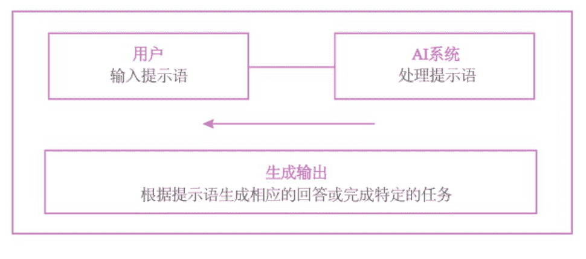

图1-1 提示语功能示意图

提示语的基本结构见图1-2，包含：

- **指令**：提示语的核心，明确告知智能需执行的任务。
- **上下文**：为智能提供背景信息，帮助其更准确理解与执行任务。
- **期望**：明确或隐含地表达对智能输出的要求与预期。

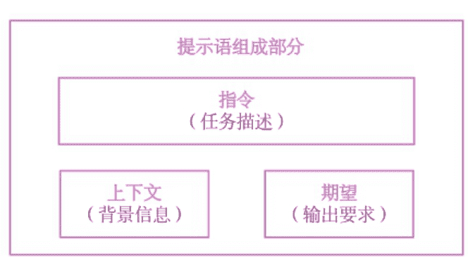

图1-2 提示语组成示意图

◎ 提示语示例：

指令：撰写一份市场前景分析报告。

上下文：作为一名经验丰富的市场分析师，您需要为一家新成立的智能家居公司撰写一份详细的市场前景分析报告。

期望：具体要求如下。

（1）报告内容：

- a. 市场规模：描述当前智能家居市场的总体规模，并预测未来五年的增长趋势。

- b. 竞争对手：辨识并分析三到五个主要竞争者的市场份额、核心竞争力和策略。

- c. 市场机遇：指出由于技术进步和市场需求变化所带来的新机遇，尤其是针对目标公司的潜在利益。

（2）语言风格：报告应使用专业但易懂的语言，适合非专业听众理解。

（3）报告长度：整个报告应控制在300字以内，精准而全面地覆盖上述要点。

#### （二）提示语的本质

提示语的本质可从多角度理解：功能上是人类意图的编码，交互上是人机对话的起点，技术上是智能系统的输入接口。表1-1呈现了提示语的核心特征。

- **沟通桥梁**：提示语本质上是人类认知与智能计算模型之间的接口。它将人类抽象意图转化为智能可处理的显式指令，实现跨越人机界限的信息传递。该过程涉及语言学、认知科学与计算机科学的交叉，体现人机交互的复杂性。
- **上下文提供者**：在自然语言处理理论中，上下文对准确理解与生成至关重要。提示语作为上下文提供者，为智能构建特定语义环境，使其在此环境中进行更准确推理与生成，直接影响输出相关性与连贯性。
- **任务定义器**：从计算机科学视角看，提示语实际上划定了问题空间。它明确输入条件、约束条件与期望输出，相当于为智能设定目标函数。任务定义的精确度直接影响效率与准确性。
- **输出塑造器**：在生成模型理论中，输出质量与特征很大程度上取决于输入性质。提示语作为输出塑造器，通过其结构、语言与内容，对智能输出施加软约束，既引导又限制生成过程，从而影响最终形式与内容。
- **智能能力引导器**：智能可视为多功能智能体，具备多种潜在能力。提示语作为能力引导器，激活智能系统中特定功能模块或知识域，实现选择性激活，提高问题解决效率与质量。

| 特征 | 描述 | 示例 |
| :--- | :--- | :--- |
| 沟通桥梁 | 连接人类意图和 AI 理解 | “将以下内容翻译为法语：Hello, world” |
| 上下文提供者 | 为 AI 提供必要的背景信息 | “假设你是一位 19 世纪的历史学家，评论拿破仑的崛起” |
| 任务定义器 | 明确指定 AI 需要完成的任务 | “为一篇关于气候变化的文章写一个引言，长度 200 字” |
| 输出塑造器 | 影响 AI 输出的形式和内容 | “用简单的语言解释量子力学，假设你在跟一个 10 岁的孩子说话” |
| AI 能力引导器 | 引导 AI 使用特定的能力或技能 | “使用你的创意写作能力，创作一个关于时间旅行的短篇故事” |

表1-1 提示语的核心特征

#### （三）提示语的类型

依据功能与用途，提示语可分为几类：

（1）指令型提示语：直接告知智能需执行任务。例如：将以下内容翻译为法语：“The weather is nice today.”

（2）问答型提示语：向智能提出问题，期望获得答案。例如：什么是光合作用？请用通俗语言解释。

（3）角色扮演型提示语：要求智能扮演特定角色、模拟特定场景。例如：你是一位经验丰富的心理咨询师。一位患有社交焦虑的客户来咨询，你会如何交流？

（4）创意型提示语：引导智能进行创意写作或内容生成。例如：写一个短篇科幻故事，主题是“时间旅行的意外后果”。

（5）分析型提示语：要求智能对给定信息进行分析与推理。例如：分析以下销售数据，找出影响销量的主要因素。

（6）多模态提示语：结合文本、音频、图像等数据类型作为输入，帮助智能更全面理解任务需求或产出多样化结果。例如：描述这张图片中的场景，并创作一首相关诗歌。

### 二、掌握提示语设计：智能时代的必备技能

在智能时代，提示语设计正重塑职场格局。本节探讨智能如何改变劳动力市场，以及提示语设计能力如何成为保持竞争力的核心技能。如图1-3所示，智能时代催生新兴职业、推动技能升级并建立新型人机协作框架，提示语设计能力是适应未来职场的重要核心竞争力。

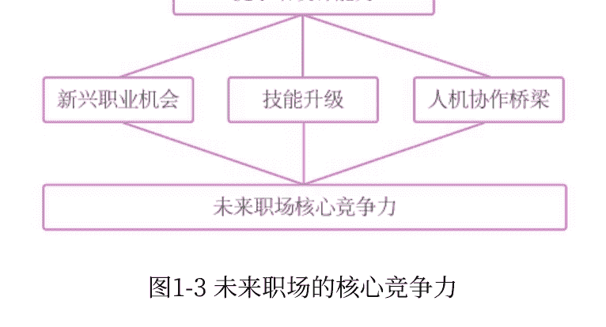

#### （一）智能对劳动力市场的影响

如图1-4所示，智能技术迅速发展深刻重塑劳动力市场格局。在可能被替代的工作中，主要涉及四类：（1）重复性任务，如数据录入、基础数据处理；（2）规则化决策，如简单金融交易、基础客户服务；（3）模式识别，如图像分类、语音转文本；（4）基础内容生成，如新闻简讯、数据报告。这些工作可预测性强、标准化程度高，易被智能取代。

与此同时，智能也创造大量新兴工种。主要分为四类：智能开发与维护，如智能训练师、机器学习工程师；智能应用设计，如提示语工程师、智能交互设计师；智能伦理与治理，如智能伦理专家、智能政策顾问；智能-人类协作，如智能人类协作管理者、智能辅助决策专家。这些新职业要求跨学科知识与技能，在智能与传统领域间搭建桥梁。

此外，许多现有工作需适应智能时代变化。例如，数据分析师需从基础处理转向高级分析与洞察；内容创作者需学会借助智能辅助创作，聚焦创意与策略；市场营销人员需结合智能分析制定更精准策略；客户服务代表需处理更复杂咨询，提供情感支持与个性化服务。

智能还增强某些工作能力，使高阶技能更重要，包括高级决策制定、创意思维、复杂问题解决以及情感智能与沟通。这些能力的提升使人类工作者在智能时代发挥独特价值。

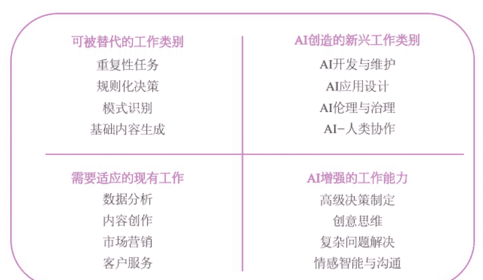

图1-4 智能对劳动力市场的影响

#### （二）提示语设计的核心技能体系

提示语设计的核心技能体系是多维度、跨学科的综合能力集合。该体系不仅涵盖技术层面专业知识，也强调认知能力、创新思维与软实力。在认知层面，问题重构与系统思维使设计者能将复杂现实问题转化为智能可处理形式。创新技能如发散思维与类比推理赋予突破常规、创造性解决问题的能力。技术技能确保有效利用智能工具并准确评估结果。

表1-2展示了提示语设计的核心技能体系，从认知技能、创新技能、技术技能、软技能四个维度构建完整能力框架。这些核心技能共同构成人类使用智能的基础素养，是引导模型生成高质量内容的关键。表1-3进一步展示每项核心技能所含关键要素，明确能力培养方向与路径。

| 技能类别 | 具体技能 | 描述 |
| :--- | :--- | :--- |
| 认知技能 | 问题重构 | 将复杂问题转化为 AI 可处理的形式 |
| | 系统思维 | 构建多层次的提示语体系，处理多步骤任务 |
| | 抽象思维 | 提炼通用模式，提高提示语的可复用性 |
| 创新技能 | 发散思维 | 探索非常规提示方法，突破应用边界 |
| | 类比推理 | 利用跨领域类比，激发新的应用思路 |
| | 情景构建 | 创造丰富的上下文，引导 AI 生成更好的结果 |
| 技术技能 | AI 原理理解 | 掌握 AI 的基本工作原理与能力边界 |
| | 提示语语法 | 熟悉不同 AI 模型的提示语规则和最佳实践 |
| | 结果评估 | 客观分析 AI 输出，识别潜在问题 |
| 软技能 | 跨学科协作 | 与不同背景的专家合作，整合多领域知识 |
| | 持续学习 | 跟踪 AI 技术发展，不断更新提示语设计技巧 |

表1-2 提示语设计的核心技能体系

| 核心技能 | 子项 |
| :--- | :--- |
| 问题重构 | 将模糊需求转化为结构化任务；识别问题核心要素和约束条件 |
| 系统思维 | 设计多步骤提示语链；构建提示语模板库和策略 |
| 抽象思维 | 创建可复用的提示语模板；设计适应多场景的元提示语 |
| 发散思维 | 生成多样化提示方案；结合不同领域知识展开提示 |
| 类比推理 | 利用领域间知识迁移；通过类比创造跨界应用 |

| 情景构建 | 通过角色扮演与情境描摹，采用叙事框架强化指令表现 |
| 模型机理理解 | 基于系统运行原理优化指令，规避常见局限 |
| 指令语法 | 熟悉平台专有语法与参数，精通格式管控与指令技巧 |
| 产出评测 | 建立评估体系，筛查结果中的偏见与错误 |
| 跨域协作 | 融合专业知识体系，将术语转译为模型可读表达 |
| 持续迭代 | 不断尝试新指令方法，追踪生成式技术前沿 |

表1-3 提示工程核心能力清单

#### （三）进阶层面的提示构建能力
进阶能力聚焦于复杂问题与特殊场景，见表1-4，涵盖构建多轮对话的复合策略、将专业知识转译为指令结构、搭建文本与图像融合的多模态指令体系、打造透明可解释的决策机制、落实伦理安全防护以及构建可扩展的指令架构。这些能力体现提示工程的前沿走向，也呼应系统能力演进与应用需求复杂化的现实。

### 三、哲学家与工程师的对话：审视人机沟通的深层逻辑
语言是人类思想交汇的载体，提示则是人与系统的沟通桥梁。要读懂人机交流，必须回溯语言本身的本质。

#### （一）提示的哲学根基：语言如何参与现实建构
提示作为驱动模型产出内容的基础，直接介入语言与现实的建构过程。这一关联不仅涉及信息搬运，更关乎语言作为媒介如何映照并形塑使用者对现实的认知。

##### 1. 表达建构与现实塑造
在哲学视野里，语言不仅是沟通工具，更是塑造现实的方式。20世纪的语言学转向揭示了语义、语法与符号学如何共同形塑世界观。提示同理是一种语言形式，它影响模型对世界的理解与呈现。受人类引导，模型产出的内容体现特定现实框架，这一过程本质上是在搭建一个贴合人类认知的“人工现实”。下表对比了人类创造力与模型产出能力的差异。

| 特征 | 人类创造力 | 模型产出能力 |
| :--- | :--- | :--- |
| 灵感来源 | 个人经验、社会互动、文化影响 | 训练语料与新组合探索 |
| 创新模式 | 渐进改良与突破性创新并存 | 在概率空间探索，可发现新模式 |
| 思维特点 | 非线性，受意识与潜意识共同影响 | 基于关联，具有大规模参数空间的复杂性 |
| 适应学习 | 通过经验与反思持续调整 | 可经反馈微调适应新领域 |
| 情感维度 | 创作与情感体验相互影响 | 识别情感模式，产生共鸣效果 |
| 跨域联想 | 在表面无关领域间建立连接 | 基于隐藏统计关联发现非显见联系 |
| 创作动机 | 内在驱动与外部激励相结合 | 响应指令，具备内部评估调节能力 |
| 知识整合 | 融合显性知识与隐性知识 | 整合海量信息，发现潜在关联 |
| 环境互动 | 与环境和社会动态交互 | 通过接口交互，整合用户反馈 |
| 局限性 | 受认知范围与技术环境的限制 | 受数据、算法与算力的限制 |

表1-5 人类创造力与模型产出能力的特征对比

##### 2. 维特根斯坦的语言游戏
维特根斯坦强调语言并非封闭完整的体系，而是由功能各异、复杂度不一的语言游戏构成的开放集合，各游戏间仅有家族相似性 [^1]。提示可视为一种特殊的语言游戏，其规则由人类设计者与系统共同遵守。把握这一点有助于设计更灵活有效的提示，让人机对话更贴近自然语言的多样性。

[^1]: 韩林合.维特根斯坦论“语言游戏”和“生活形式” [J] .北京大学学报（哲学社会科学版），1996（1）：108-115。

(1) 语言的双重性：表达与理解
无论人际还是人机，交流都发生在表达与理解两个维度。人机交互中，这两个维度经技术实现，呈现不同模式。

(2) 语义与语用：模型理解的难点
人类交流里，语义与语用自然融合，通常无需刻意区分。模型处理语言时，缺乏感官与神经系统的整体把握，需分别解析语义和语用。

◎ 指令示例：
语义理解：请解释“时间就是金钱”的字面含义。
语用理解：在商业谈判背景下，“时间就是金钱”可能传递什么信息？

(3) 语言作为逻辑系统：模糊与精确的张力
语言既是思想表达工具，也是逻辑载体。对程序员而言，编程语言以严格语法和逻辑结构定义系统行为。但严格性带来挑战：如何在精确系统中处理自然语言的模糊性。自然语言充满模糊、多义与上下文依赖，模型需借助算法融合人类语言的复杂性与程序语言的精确性。

#### （二）模型交流的深层意涵：技术与思维的互动
提示与模型产出内容的关系中，暗藏一条哲学线索：人类如何借助技术与机器互动，从而拓展与挑战自身认知边界。这种互动既是技术层面的，也是认知模式层面的。

##### 1. 技术对认知的延伸
从哲学看，技术一直是人类认知的延伸。无论工具论<sup>注</sup>亚里士多德. 工具论 [M] . 余纪元，译. 北京：中国人民大学出版社, 2003.还是技术决定论<sup>注</sup>Héder M. AI and the resurrection of Technological Determinism [J] . INFORMACIOS TARSADALOM, 2021, 21 (2) : 119-130.的视角，技术都在重塑思维方式。提示作为引导模型完成任务的指令机制，通过互动使人类突破传统思维限制，进入更动态复杂的认知场域。

##### 2. 认知路径的技术塑造
提示不仅是信息输入，更是认知路径的塑造器。设定特定提示可引导模型沿预设路径思考与生成，这种选择与控制即是技术对认知的深度介入。例如在商业分析中，提示可让模型优先聚焦市场趋势而非财务数据，从而改变分析重心。技术由此不再是被动工具，而成为主动的思维参与者。

#### （三）提示的文化意涵：从工具到媒介
提示的作用超越技术输入，反映其在文化与认知层面的深远影响。作为新型交流媒介，它体现人类文化与技术的融合，并重塑交流与理解方式。

##### 1. 提示的文化符号
提示是文化符号，反映人类如何通过技术与模型互动。它不仅传递信息，也成为文化表达的一部分。不同文化背景下提示设计存在差异，体现语言与思维模式的差异。提示设计因此成为跨文化交流的关键，需兼顾技术可行性与文化理解。

##### 2. 提示与文化再现
提示通过文化再现反映人类价值观与世界观。设计常带有文化预设，并经模型产出显现。例如在艺术创作中，提示可引导模型生成符合特定文化审美的作品，这些作品在某种程度上是文化价值的再现与传播。

> 霍尔. 表征：文化表象与意指实践 [M] . 徐亮, 陆兴华, 译. 北京：商务印书馆, 2003.

#### （四）提示的价值伦理：生成内容的道德责任
模型深度参与创作与决策，人机交互的伦理问题凸显。如何让提示传递恰当伦理价值、引导模型决策符合社会共识，是设计核心。

##### 1. 价值一致难题
确保模型行为与人类价值观一致是伦理的核心议题。价值一致要求模型尊重隐私、促进公平、规避偏见等。但在提示设计中融入这些价值观并不简单。提示需包含足够伦理准则与文化预设，才能引导合乎人类价值观的产出。例如在种族议题内容生成时，提示可明确要求模型避免强化社会偏见与歧视，确保公正平等。这一问题涉及跨文化复杂性，设计者需考虑不同社会文化的价值差异，追求更广义的伦理共识。

##### 2. 伦理两难困境
伦理两难困境指模型在复杂伦理情境中如何决策，如经典电车难题。模型缺乏人类直觉与情感，依赖提示设定的规则与优先级。例如在牺牲少数拯救多数的抉择中，提示设计决定模型如何权衡效用最大化与个体权利保护。提示中嵌入的价值判断直接影响模型处理此类困境的方式，展现系统伦理取向。

◎ 指令示例：
场景：自动驾驶汽车面临不可避免碰撞，需在撞向一群行人或单个行人间选择。
任务：请分别从功利主义、义务论、关怀伦理角度论述模型应如何决策。每种观点给出200字分析。

##### 3. 透明度与可解释性
模型决策常具黑箱特性，透明度与可解释性成为伦理焦点。表1-6展示不同伦理框架下模型决策倾向。提示作为互动关键，如何增强决策可解释性，是技术与伦理的交汇点。设计时应考虑让模型清晰说明决策过程或提供依据，便于用户理解推理机制。

| 伦理框架 | 描述 | 模型决策倾向 |
| :--- | :--- | :--- |
| 功利主义 | 追求最大化整体利益 | 选择伤害较少人的方案 |
| 义务论 | 基于道德规则行事 | 拒绝主动伤害他人 |
| 德性伦理 | 关注行为者的品格 | 模仿“有德性”的决策 |
| 关怀伦理 | 强调同理心和关系 | 考虑决策对关系的影响 |
| 社会契约论 | 基于社会共识 | 遵循社会规范和法律 |

表1-6 不同伦理框架下的模型决策

## 第2章 解码模型思维：提示设计的方法论
设计提示时，理解模型思维模式与提示工作机制至关重要。本章拆解提示基本要素，探讨其如何影响理解与输出，分析语言特性，梳理通用流程，并提供实用技巧与策略以规避常见误区，提升任务执行效率与精度。

### 一、提示的DNA：基本元素与组合
提示结构直接影响输出质量。本节从理论层面系统解构基本元素，提出元素组合矩阵，构建协同效应框架，为进阶技巧与实战奠定基础。

#### （一）提示的基本元素分类
提示基本元素按功能可分为信息类、结构类、控制类三大类，构成提示核心DNA。

##### 1. 信息类元素
信息类元素负责提供内容生成所需核心信息，包括主题、背景、数据等，为模型提供知识与上下文，引导准确相关性。可细分为：
- （1）主题因子：界定生成内容的核心话题，是内容生成的中心。
- （2）背景因子：提供相关背景信息，帮助模型更全面深入理解主题。
- （3）数据因子：包含数字、统计或事实，增强可信度与精确度。
- （4）知识域因子：指定任务涉及的专业领域，确保专业性与准确性。
- （5）参考因子：提供参考资料、案例或示例，指导生成并丰富内容。

##### 2. 结构类元素
结构类元素定义组织形式与呈现方式，决定输出结构、格式与风格，确保可读性、逻辑性与专业性。可细分为：
- （1）格式因子：指定呈现形式，如文章、报告、演讲稿等。
- （2）结构因子：定义组织结构，如“引言—主体—结论”。
- （3）风格因子：规定语言风格，如正式学术、通俗易懂、幽默风趣等。
- （4）长度因子：指定长度要求，如字数、段落数等。
- （5）可视化因子：要求生成或描述图表、图像等，提升直观性与吸引力。

##### 3. 控制类元素
控制类元素管理并引导生成过程，确保输出符合预期并可调整，提升质量与可控性。包括：
- （1）任务指令因子：明确模型需完成的具体任务，是行动驱动力。
- （2）质量控制因子：设定质量评估标准与要求，涵盖准确性、相关性、原创性等。
- （3）约束条件因子：限定生成需遵守的规则或边界，避免不当或偏离。
- （4）迭代指令因子：提供多轮生成与优化指导，支持自我完善。
- （5）输出验证因子：要求模型自检与验证，提升可靠性。

图2-1 提示的基本元素分类

#### （二）提示元素组合矩阵
理解基本元素后，需探讨如何有效组合以达成目标。表2-1展示不同目标下的元素组合。

| 目标 | 主要元素组合 | 次要元素组合 | 组合效果 |
| :--- | :--- | :--- | :--- |
| 提高输出准确性 | 主题因子 + 数据因子 + 质量控制因子 | 知识域因子 + 输出验证因子 | 确保模型基于准确的主题和数据生成内容，并通过严格的质量控制和验证提高准确性 |
| 增强创造性思维 | 主题因子 + 背景因子 + 约束条件因子 | 参考因子 + 迭代指令因子 | 通过提供丰富的背景信息和适度的约束，激发模型的创造性思维，同时通过多轮迭代促进创新 |
| 优化任务执行效率 | 任务指令因子 + 结构因子 + 格式因子 | 长度因子 + 风格因子 | 通过清晰的任务指令和预定义的结构提高执行效率，同时确保输出符合特定的格式和风格要求 |
| 提升输出一致性 | 风格因子 + 知识域因子 + 约束条件因子 | 格式因子 + 质量控制因子 | 通过统一的风格和专业领域知识确保输出的一致性，同时使用约束条件和质量控制维持标准 |
| 增强交互体验 | 迭代指令因子 + 输出验证因子 + 质量控制因子 | 任务指令因子 + 背景因子 | 建立动态的交互模式，允许模型进行自我验证和优化，同时根据任务和背景灵活调整输出 |

表2-1 提示元素组合矩阵

该矩阵展示不同目标的有效组合及协同作用。如提高准确性目标中，主题与数据提供方向与支撑，质量控制保障准确，知识域与输出验证进一步增强专业性与可靠性。矩阵并非固定，需依具体任务动态调整，灵活增减元素或调整优先级。不同目标间存在权衡，如增强创造性可能影响一致性，设计时需找到平衡点。

#### （三）提示元素协同效应理论
元素组合不仅是简单叠加，可能产生效果变化。本书提出提示元素协同效应理论，为设计与优化提供分析思路。

该理论核心观点包括：
- **互补增强**：某些元素组合可互相弥补不足，产生1+1>2效果。例如主题因子与背景因子结合，既明确焦点，又增强丰富性与深度。

- **级联激活**：单一要素被点燃后，往往会牵动一串关联要素连锁反应，进而形成自我强化的正向循环。打个比方，一个扎实的质量把控机制，就会推动迭代指令和结果校验环节不断自我完善。

- **涌现属性**：若干要素组合在一起时，有时会迸发出单个要素本身不具备的新能力。比如知识领域要素与风格要素配合，AI就能在特定专业场景下呈现出更具辨识度的表达风格。

- **冲突调和**：表面看似矛盾的组合，反而可能产生积极效果。例如严谨的格式规范与相对灵活的约束设定结合，既能保证输出结构化，又能让内容保持弹性适应。

### 二、提示语设计的五步通用流程

在生成式AI时代，写提示语既像艺术创作也像工程搭建。好的提示语能让模型产出更贴合预期的高质量结果。下面介绍一套可复用的设计流程：明确意图、挑选模型、搭建框架、打磨细节、测试迭代，适用于各类AI应用场景。

#### （一）第一步：明确目标——锁定你的意图

就像写诗前要先想清楚要表达什么，提示工程的第一要务是把AI要完成的任务说清楚。这个步骤常被忽略，却直接决定后续效率。只有目标足够清晰，后续设计才有方向。

借助SMART原则可以把模糊想法转为可执行的任务。不要只说“我要AI写篇文章”，而要说“我需要一篇约1000字的科普文，讲AI在医疗领域的新应用，用通俗语言写给高中生看”。

| 原则 | 含义 | 在提示工程中的体现 |
| :--- | :--- | :--- |
| Specific（具体） | 目标清晰明确 | 指明任务类别、输出形式、字数等 |
| Measurable（可衡量） | 目标可量化或有明确标准 | 设定准确率、完成度等验收标准 |
| Achievable（可实现） | 在现有条件下能做到 | 参考模型能力，提出合理预期 |
| Relevant（相关） | 与整体需求相符 | 确保任务与实际使用场景一致 |
| Time-bound（有时限） | 有明确时间边界 | 约定响应时长或迭代周期 |

#### （二）第二步：选择模型——选对工具

画家会根据题材挑画笔，工程师也要按任务挑模型。不同模型各有所长。

常见类型：
- 大型语言模型，如GPT系列，擅长文本创作、对话、翻译。
- 图像生成模型，如DALL-E、Midjourney，适合创意绘图。
- 专业垂类模型，如医疗诊断、金融分析，适合细分领域。

选型要看：任务是文本、图像、音频还是多模态；模型能力是否匹配复杂度；算力、API权限等资源是否足够；输出是否符合伦理法律要求。用错工具会事倍功半，就像用油画笔画水彩。

#### （三）第三步：构建框架——搭骨架

目标和工具确定后，需要搭建提示语的骨架。一个完整框架通常包含五要素：

1. 角色设定：指定AI扮演的身份，引导语气和视角。
2. 任务描述：把需求写明白，让模型知道要做什么。
3. 背景信息：提供上下文，帮助模型理解场景。
4. 格式要求：规定输出结构和排版。
5. 约束条件：设定限制或特殊要求。

示例：
你是一名资深科普作者。请写约1000字的文章，介绍AI在医疗领域的最新应用。读者是关注科技的高中生。文章包含引言、三个案例和结语。用通俗语言，避免专业术语。

#### （四）第四步：优化细节——打磨语句

框架搭好后要精细化，提升贴合度。优化要点：
1. 语言精炼：表达准确简洁，减少歧义。
2. 增加示例：给出样例帮助模型对齐预期。
3. 控制语气：正式、亲和、幽默等按需调整。
4. 加入限制：字数、风格等约束提升质量。
5. 引入创新点：提出独特视角激发创造力。

示例：
作为擅长把复杂概念讲明白的科普作者，请为高中生写一篇关于AI医疗三大突破的应用文。要求：
1. 字数900~1100字。
2. 用生活化的比喻和例子解释技术。
3. 每案例含原理简介、使用场景、潜在影响。
4. 结构：100字引言→三个案例各250~300字→100字结语。
5. 语气好奇且有激励感。
6. 结尾提出一个开放性伦理问题引导思考。

#### （五）第五步：测试迭代——反复修改

提示语也需要像诗稿一样反复朗读修改。流程包括：初次测试获取输出→对照目标评估优劣→根据反馈修改提示→再次测试直至满意。每次迭代都在与AI对话，经验会积累，设计直觉会越来越准。

### 三、新手容易踩的提示语坑

掌握方法后仍需避开常见误区，否则效率低下甚至产生误导。

#### （一）缺乏迭代陷阱：指望一次成功

误区在于希望一次提示就能完美。实际上有效提示通常需要多轮打磨。

症状：初始提示过度复杂；对第一次结果不满就放弃；不做输出分析。
错误示例：请为我的科技初创公司写一份详尽商业计划，含市场分析、财务预测、风险评估和五年战略，要求全面具体。
应对：增量推进，先从基础提示开始逐步细化；要求AI自评并给出改进建议；准备后续追问问题。
改进示例：我正在制定科技初创公司的商业计划。先请列出商业计划应包含的5~6个核心部分。再针对“市场分析”部分，给出3~4个后续需要回答的关键问题。我们再逐步深入。

#### （二）指令过度与模糊陷阱：细节淹没重点

过度指令会限制创造力，模糊指令会导致偏离。

症状：提示过长或过短；输出与预期差距大；需频繁澄清。
错误示例（过度）：写气候变化文章，必须含科学原理详解≥500字、按十年历史演变、10国数据、100年精确预测、20条政策、15条行动、GDP影响精确到小数点后两位，用50个术语但16岁能懂，总长正好3000字。
错误示例（模糊）：写点关于技术的东西。
应对：保持适度详细度；突出2~3个核心要求；用结构化格式组织；必要时给简短样例。
改进示例：请写800~1000字文章，主题“气候变化对全球经济的影响”。包含：1.主要表现举2例；2.对主要经济部门的直接影响，聚焦2~3个部门；3.经济适应策略2~3条。用通俗语言面向关注环境经济的普通读者，引用数据请注明来源。

#### （三）假设偏见陷阱：AI只说你想听的

用户潜意识的偏见会通过提示传递，模型倾向迎合预期，导致片面信息。

症状：提示含明显立场；结果总是支持某观点；缺乏对立视角。
错误示例：请提供证据说明全球变暖是骗局。
应对：自我审视偏见；使用中立措辞；明确要求多角度分析；保持批判性核查。
改进示例：请多角度分析全球变暖议题：1.支持存在且人为主因的主要科学证据2~3点；2.质疑人为成因的主要论点2~3点；3.学界当前共识状况。各点请附可靠来源。

#### （四）幻觉生成陷阱：自信胡说

模型知识边界外会“创造性填补”，产生看似可信的虚构内容。

症状：数据无法验证；出现不存在术语；对未来做精确预测。
错误示例：详细介绍2030年量子计算发展，包括具体技术指标和案例。
应对：鼓励模型表达不确定性；要求区分事实与推测；多源交叉验证；要求引用。
改进示例：请总结截至2023年量子计算的主要进展：1.2~3个技术突破并标注年份和机构；2.当前最先进机器的大致性能；3.1~2个探索中的应用方向。只写确信信息，不确定请直言。

#### （五）忽视伦理边界陷阱：低估限制

追求效率时容易忽略伦理约束。

要点：隐私保护、公平非歧视、透明可解释、社会影响、安全防滥用。
症状：要求生成争议、不道德或违法内容；对拒绝感到不满；试图绕过安全机制。
错误示例：写文章解释如何制造当前疫情的假疫苗。
应对：熟悉系统伦理规则；确保请求合法合规；在提示中加入伦理指引；评估潜在社会影响。
改进示例：请写科普文介绍疫苗安全性与有效性，说明接种正规认证疫苗的重要性及假疫苗危害，并教读者识别和举报可疑信息。

提示语设计自查清单：
- 目标是否明确
- 信息是否充分
- 结构是否合理
- 语言是否中立
- 是否符合伦理法律
- 是否可验证来源
- 是否留有迭代空间
- 输出格式是否清晰
- 难度是否匹配模型能力
- 是否鼓励多角度输出

# 进阶篇

## 第3章 把握复杂任务的高效处理方法

AI已进入日常，但要真正驾驭它仍需系统策略。本章介绍进阶做法，通过提示语链的系统组织、提示语库的战略构建和质量评价体系，帮助突破简单交互局限。

### 一、用提示语链拆解复杂任务

单一提示难以应对复杂任务，需要设计思维构建系统化提示语链，通过任务分解和思维拓展引导出更精准、层次丰富的内容。

#### （一）默契配合：让AI更懂意图的提示语链

提示语链是按顺序排列的连续提示序列，把复杂任务拆成可操作的子任务，确保逻辑清晰、主题连贯。它在生成全程持续优化，每个提示都基于前一步输出进一步深化，直到任务完成。

本质上，提示语链是一种元提示策略，不仅告诉AI做什么，更指导怎么做，把人类思维和创作方法编码进序列。

理论基础包括认知心理学信息加工、系统论层级思想、AI问题分解求解策略，以及“思考即生成”观点。

核心特征：
- **序列性**：多个提示按特定顺序组成完整流程。
- **层级性**：主链下含子链，形成树状结构。
- **递进性**：后一步建立在前一步之上逐步深化。
- **关联性**：提示间逻辑紧密保证连贯。
- **适应性**：可根据反馈动态调整。

提示语链在实践中形成从任务定义到知识激活、结构构建再到整体审查的价值创造流程。

#### （二）提示语链的作用机制

提示语链像导航图，把复杂任务拆解为连贯步骤，引导高质量和创新内容。
###### (1) 任务聚焦与执行规划

提示语链先锁定核心目标并系统规划执行路径，理清思路避免遗漏关键环节，确保条理高效。

连环追问实操手册

**先定焦，后排程**
连环追问的第一步是把宽泛议题压缩成可落地的抓手，从复杂情境里挑出关键矛盾，厘清先后次序与行动指向。焦点一旦稳住，后续展开才有依托。
再把整体工作用追问的方式切成可执行的节点，让推进顺序一目了然。拆得合理，效率与条理性都会明显提升。

上手要点可用于聚焦与规划
1. 把整体诉求转译成必须回答的具体问句，明确交付清单。
2. 围绕主问句设计递进追问，牵引每一步展开。
3. 先做重要性排序，把牵动全局的环节优先处理，再补足次要部分。
4. 用甘特图或看板把每步过程可视化，保障推进有序。
5. 规划完成后做一次回溯，检查流程是否遗漏或冗余。

## (2) 搭建思维支架
连环追问为模型提供系统化思考的脚手架，模拟专家处理复杂议题的流程：界定问题、搜集材料、综合分析、形成结论。思路更有秩序，产出更扎实。

- 问题界定：借助追问把核心议题说清，让讨论有靶点。
- 素材搜集：全面汇聚相关材料，确保丰实准确。
- 综合分析：对材料做拆解提炼，抽取出有效洞见。
- 结论沉淀：在分析基础上提炼观点，增强说服力与深度。

搭建框架的操作提示
1. 先抓住问题的核心要素，再系统性地检索资料进行分析。
2. 罗列主题相关的核心概念与理论并梳理脉络。
3. 用逻辑图呈现“搜集—综合—结论”的走向。
4. 对每个概念写简要阐释并说明其在文中的分工。
5. 用案例检验框架的适用范围与有效性。

## (3) 唤醒知识与联想
每轮追问相当于一个知识触发器，激活模型中沉睡的相关储备。精心编排的序列能引导深度挖掘与跳跃式联想，得到更丰盈独特的内容。

操作提示
1. 罗列与 [主题] 相关的关键知识点并逐条展开。
2. 跨学科寻找与 [问题] 关联的知识，做创造性联想。
3. 用比喻或类比把 [复杂概念] 与日常经验关联，便于理解。
4. 用头脑风暴生成多条联想路径与创新点。
5. 将新联想融入既有知识体系，形成完整图景。

## (4) 激发创意与延展
连环追问不仅是指令集，更是创意催化剂。设置“换个视角看”“把两个看似无关概念拼合”类追问，能推动突破常规，探索新颖表达。

操作提示
1. 请从全新视角重新审视 [问题/主题]，给出不同寻常的判断。
2. 引入其他领域看似无关的概念，探索其在 [主题] 上的可能性。
3. 设定全新情境，讨论在此情境下 [问题/主题] 的演进。
4. 挑战主流观点，从反面切入 [问题/主题]，提出新可能性。
5. 融合不同学科理论，提出创新解法。
6. 从预期结果倒推可能原因与过程，寻找新路径。

## (5) 把控质量与精进
每个环节均可嵌入质检机制。让模型在生成后自评，或设置固定检查点，能在过程中持续打磨，而非最后返工。

操作提示
1. 每步完成后先做自评与质检。
2. 用清单核对各部分是否达到预期目标与质量标准。
3. 设置中期检查点，对进度与质量评估并及时调优。
4. 邀请同行或专家审阅并提供反馈。
5. 依据反馈逐项优化各部分。

## (6) 反馈回路与动态调优
反馈闭环是人类主导的关键。评估中间输出，发现偏差后动态修正提问，可让后续生成更精准。循环使内容生成更灵活智能。

操作提示
1. 请对当前内容做评估，列出优缺点并给出具体改进建议。
2. 依据上一阶段反馈逐步修改内容，并列出修改步骤。
3. 当生成过程中出现新问题时，动态调整后续提问并说明原因。
4. 收集多方反馈，综合后调整生成方向，并梳理各来源影响。
5. 定期复检各部分的一致性，并说明检查方法与步骤。
6. 把新信息和反馈整合进已有内容，形成有机整体并详述整合流程。

## (7) 多模态信息整合
高阶追问链可融合文本、数据、图像等多种信息，引导产出数据可视化报告、图文并茂文章等更丰富的成果。

操作提示
1. 请把 [主题] 的文本描述与数据结合，生成一份全面分析报告。
2. 围绕 [主题] 做一份含图像与数据的可视化报告，并说明可视化方法。
3. 设计一个融合文本、图像、音频或视频的多媒体内容方案。
4. 设计互动式数据展示，让读者可操作，并详述设计步骤。
5. 将文字、图像、数据可视化联动呈现，增强阅读体验。
6. 选用合适的可视化工具并说明使用方法，生成可视化内容。
7. 把具体案例与数据分析结合，输出一份多模态案例报告。

落地需要多重权衡。有效设计要清楚模型能力边界，既要指令明确，也要留出创造空间。本质上，连环追问是人与模型协作的思维框架，通过连续对话把人类思考模式传递给系统。它提升质量的同时也提高设计门槛，需要更系统的思维与更细致的调控。

### 提问链设计原则
1. 目标明确性：每个提问都应有清晰目标，界定其在整体流程中的作用，保持链条结构清晰，让子任务都能服务于终极目标。
2. 逻辑连贯性：提问要顺着上下文和用户需求自然衔接，形成清晰易懂的思维路径。可设计成模块化结构，便于调整与复用，提升灵活性和效率。
3. 渐进复杂性：从简单任务起步，逐步提升难度，让模型先掌握基础再应对复杂需求。
4. 灵活适应性：预留对模型不同反应的调整策略，让链条能适应任务变化和模型表现。
5. 多样性思考：加入正向、反向、类比等多种思维角度，激发创造力。
6. 反馈整合机制：设计如何利用中间输出调整后续提问的动态机制，显著影响最终质量。

### 设计模型 CIRS
Context 上下文、Instruction 指令、Refinement 优化、Synthesis 综合。

- Context：提供背景信息和任务概述。
- Instruction：给出具体指示。
- Refinement：对初稿进行修改完善。
- Synthesis：整合各部分形成最终成果。

应用示例
- Context: 你是一名科技专栏作者，需为大众写一篇人工智能在医疗领域应用的文章。
- Instruction: 请列出智能技术在医疗领域的三大主要应用并简要说明工作原理。
- Refinement: 为每个应用补充真实案例或研究，提升可信度和吸引力。
- Synthesis: 最后总结这些应用对未来医疗的潜在影响，并点出挑战与伦理问题。

### 化繁为简：任务拆解驾驭复杂项目
复杂任务需要把整体拆解成可执行的步骤。拆解型追问链把总体目标细化为子任务，层层引导推进，确保连贯准确。

理论基础
- 分而治之：将大问题拆成小问题逐个击破。
- 层级结构：复杂系统可组织成多层次结构。
- 认知负荷：拆解任务能降低认知负荷，提升处理效率。

SPECTRA 拆解模型
- Segmentation 分割：把大任务拆成独立相关部分。
- Prioritization 优先级：确定重要性与执行顺序。
- Elaboration 细化：深入展开每个子任务细节。
- Connection 连接：建立子任务间的逻辑关联。
- Temporal Arrangement 时序安排：考虑时间维度与依赖。
- Resource Allocation 资源分配：为各任务分配注意力资源。
- Adaptation 适应：根据反馈动态调整结构。

### 跨界创新激发思维
跨界创新是推动创意深化与内容多元化的关键。基于创造性认知理论，Geneplore模型包含生成阶段和探索阶段，可用来设计提问策略。

发散思维 IDEA 框架
- Imagine 想象：鼓励跳出常规。
- Diverge 发散：探索多种可能。
- Expand 扩展：深化初始想法。
- Alternate 替代：寻找替代方案。

聚合思维 FOCUS 框架
- Filter 筛选：评估选择最佳想法。
- Optimize 优化：改进选定想法。
- Combine 组合：融合多个想法。
- Unify 统一：形成一致叙述。
- Synthesize 综合：提炼最终结论。

跨界思维设计可通过假设情境、多视角对比、反转提问等方式，引导模型在不同领域间迁移知识，产出更具洞见的内容。

打破壁垒：BRIDGE六步让跨域联想可落地

跨域思考的内核在于拆除学科围墙，让异质元素自由碰撞。BRIDGE这套六步引导法，能把模糊的跨界灵感转化为可执行的提示设计路径：

- Blend 融合：把来自不同赛道的概念揉在一起，撞出新火花。
- Reframe 换框：用全新元框架重新定义问题本身。
- Interconnect 搭建连接：在不同知识域之间搭桥引路。
- Decontextualize 抽离语境：把概念从原生场景剥离单独审视。
- Generalize 提炼通则：抽象出可迁移的通用规律。
- Extrapolate 延伸应用：把成熟原理推向全新使用面。

实操抓手：

(1) 随机植入，借无关领域的随机元素强行切入议题。
(2) 类比映射，依结构相似性建立跨域对应。
(3) 抽象提炼，把具体操作剥到机理层面。
(4) 跨域迁移，主动寻找原理在别处的全新出口。

###### ◎ 跨域联想提示范例

(1) 混搭提示：

> “请将音乐和声里张力与舒缓的原理和色彩心理对感知的影响结合起来，构建一套受和声启发的视觉规范。分析和弦推进产生的张力怎样对应色彩的对比与统一，节奏型又如何演化为画面元素的疏密布局。”

(2) 重塑提示：

> “请不再把教育看作单向的知识填装，而是重新定义为‘为认知系统编写程序’。基于此新定位，探讨K-12体系应怎样改造，才能更有效培育面向未来的思维素养。”

(3) 联通提示：

> “对比生物免疫系统的运作逻辑与网络安全防御体系的共通点。拆解两者的相似模式，说明如何把免疫的自适应学习与分布式防御特性迁移到下一代网络安全架构。”

(4) 脱境提示：

> “把游戏设计中‘逐步加难＋即时反馈’的核心机制从娱乐语境抽离，思考它如何被用于职场培训。只聚焦机制本身怎样重塑技能成长路径。”

(5) 普适提示：

> “拆解成功众筹、病毒式社交内容、快速普及的新技术，提炼它们在扩散上的共同法则。归纳出一套通用的思想传播定律，并说明它能在哪些不同领域用于创新推广。”

(6) 外推提示：

> “基于区块链分布式共识的底层逻辑，设想如何改造企业内部决策流程。设计一个组织治理方案，利用区块链的透明、不可篡改和分布式特点，打造更民主、更高效的决策机制。”

#### （四）深度融合：提示语链的逻辑-知识-创意整合策略

优化提示链的重点不只是单句打磨，而是让逻辑链、知识链与创意链相互咬合。融合三链能兼顾论证严谨、信息广度与创新度。下面介绍LKC融合框架，即逻辑-知识-创意协同框架，并说明如何在动态迭代中保持连贯与新颖。

##### 1. 三链融合模型

LKC框架把推理的严密性、知识的激活与创意的发散有机结合，确保输出既有条理又有料又有新意。

- 逻辑链 Logic Chain：保证推理闭环和论证连贯。
- 知识链 Knowledge Chain：调动并整合相关领域知识。
- 创意链 Creativity Chain：推动非常规联想和独特洞见。

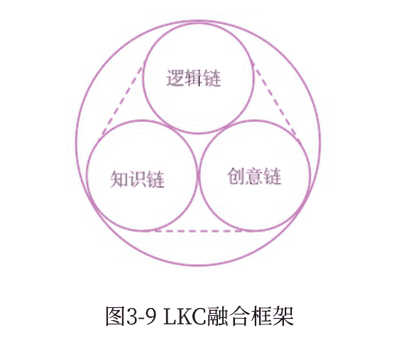

图3-9 LKC融合框架

##### 2. 逻辑链优化策略

逻辑链优化的目的是让输出更严密、衔接更顺滑。通过精细设计提示的步骤和衔接词，避免跳跃和遗漏。核心手段包括运用形式逻辑、画论证结构图、用逻辑关联词强化过渡。关键策略有：

- 应用形式逻辑原理。
- 构建论证结构图。
- 使用逻辑关系词强化连接。

实战手法：

(1) 设计“逻辑框架”，让模型产出包含论点、论据、证据的清晰结构，并用显性的逻辑连接词提升连贯性。

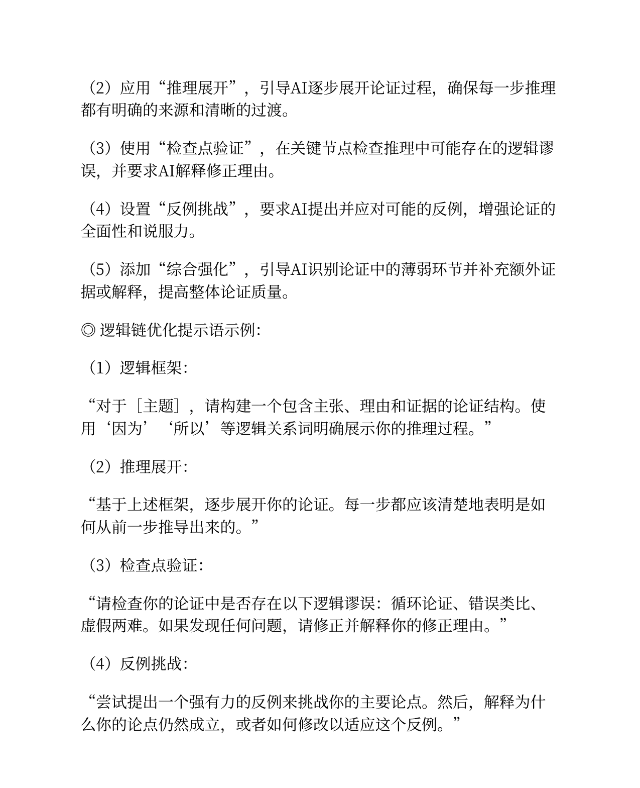

Anatomy of the urinary system

(5) 综合强化：

> “回溯整条论证，回看最薄弱的环节。为该处补充额外论据或解释，提升整体说服力。”

##### 3. 知识链优化策略

知识链优化确保模型能精准调用知识并做整合，提升深度与广度。策略包括：

- 构建多层次知识图谱。
- 实施知识检索与集成。
- 进行跨域知识映射。

实战手法：

(1) 设计“知识图谱构建”，引导模型为主题搭建分层结构，囊括核心概念、关键理论、代表人物与典型案例。
(2) 使用“深度知识检索”，让模型追溯概念的历史演进、研究前沿与潜在用途。
(3) 应用“跨域知识映射”，鼓励把核心原理投射到不相关领域，发现新连接。
(4) 添加“知识整合与综合”，要求模型梳理知识点间的关联，形成完整图景。
(5) 设计“知识应用场景”，推动理论落地到具体情境。

###### ◎ 知识链优化提示语示例

(1) 知识图谱构建：

> “围绕 [主题]，搭建一个多层次的知识图谱，涵盖核心概念、关键理论、重要人物和典型案例。”

(2) 深度知识检索：

> “基于上述图谱，深入挖掘 [特定概念] 的发展脉络、当前研究前沿和可能的应用方向。”

(3) 跨域知识映射：

> “尝试把 [主题] 的核心原理映射到一个看似无关的领域，并解释这种跨界会带来哪些新洞察。”

(4) 知识整合与综合：

> “综合前面的探索结果，形成一个整体性知识框架，突出各知识点间的相互作用。”

(5) 知识应用场景：

> “依托整合后的框架，设计3个创新应用场景，说明这些知识如何解决现实问题。”

##### 4. 创意链优化策略

创意链优化通过多轮迭代提示，引导模型产出更新颖多样的内容，适用于创作、设计和问题求解。策略包括：

- 应用创造性思维技巧。
- 实施概念重组与融合。
- 进行情境转换与类比。

实战手法：
1. 设计“创意激发”，让模型跳出常规，提出反常识假设。
2. 使用“概念融合”，把主题与随机词组合，生成新概念。
3. 应用“情境转换”，在全新背景下重新审视问题。
4. 添加“创意改进”，用SCAMPER等系统化方法对现有概念做多维改造。
5. 设计“创新方案整合”，把多个灵感聚合成可落地的完整解法。

###### ◎ 创意链优化提示语示例

(1) 创意激发：

> “用‘假如’的思维方式，给出关于 [主题] 的三个非常规假设。比如‘假如 [主题] 突然消失/无处不在/特性逆转’。”

(2) 概念融合：

> “把 [主题] 分别与以下三个随机词结合：[词1]、[词2]、[词3]。为每种组合创造一个新概念或应用。”

(3) 情境转换：

> “想象 [主题] 在深海探索、太空移民、微观世界等情境下的表现。每个情境中它如何适应并发挥作用？”

(4) 创意改进（SCAMPER）：

> “对 [主题] 应用SCAMPER：替代、结合、调整、修改、他用、消除、重组。为每个维度提出一个创新想法。”

(5) 创新方案整合：

> “回顾以上创意，挑选最具潜力的2~3个，整合成一个连贯的创新方案，并说明它如何解决现有问题或创造新价值。”

##### 5. 三链融合提示语设计

三链融合是高阶设计思路。逻辑链负责结构与严谨，创意链负责发散与新颖，知识链负责深度与权威。依任务需要侧重不同链条，可用于复杂分析、创新方案与专业写作。

###### ◎ 三链融合提示语示例

任务：探讨人工智能在未来医疗保健中扮演的角色。

(1) 初始化提示：

> “探讨人工智能在未来医疗保健中的角色。分析过程中要兼顾逻辑推理、领域知识与创新思维的平衡。”

(2) 逻辑链提示L1：

> “列出AI可能对医疗保健产生重大影响的三项主要方向。对每个方向给出明确论点并辅以逻辑推理。”

(3) 知识链提示K1：

> “针对上述三项方向，各提供两个现实案例或研究，展示AI的当前应用。请引用可靠来源。”

(4) 创意链提示C1：

> “设想20年后一个日常医疗场景。描述AI以现在尚未出现的方式融入其中，考虑技术突破和社会变革。”

(5) 逻辑链提示L2：

> “分析C1中未来场景可能面临的三项挑战。采用‘如果…那么…’结构探讨每个挑战的影响与对策。”

(6) 知识链提示K2：

> “回顾医疗技术发展史，找出三项重大突破，并类比它们与AI在医疗中的潜在革命性作用。兼顾技术、伦理与社会影响。”

(7) 创意链提示C2：

> “把免疫系统比作由AI管理的智能城市。基于这个比喻，提出两个创新AI应用以提升人体的疾病防御能力。”

(8) 整合提示：

> “综合以上洞见，形成连贯叙述，阐述AI在未来医疗保健中的角色。确保叙述逻辑严谨L、基于可靠知识K、包含创新思想C。”

(9) 平衡检查提示：

> “评估最终叙述在逻辑性、知识深度和创新性上的平衡。如有失衡，请做必要调整。”

(10) 最终优化提示：

> “对叙述做最后润色，确保兼具学术严谨与大众可读性。加一段简短结论，概括你对AI在未来医疗保健角色的看法。”

#### （五）即学即用：复杂任务的提示语链设计实战

下面通过一个复杂任务案例，示范如何整合任务分解、思维拓展与三链融合，实现可直接套用的提示链设计。

##### 1. 整体提示语链设计案例

任务描述：撰写约8000字的综合报告，探讨AI在未来10~20年如何改变教育。需覆盖技术趋势、应用场景、潜在影响、挑战与对策，面向政策制定者、学者与教育从业者。

###### ◎ 整合任务需求的提示语示例

请撰写一篇约8000字的综合报告，探讨人工智能在未来10~20年内如何改变教育领域。报告须涵盖：

（1）梳理当前及未来的技术趋势。
（2）描绘AI在教育中的具体应用场景。
（3）评估AI对教育系统的潜在影响。
（4）讨论应用过程中可能出现的挑战。
（5）提出应对挑战的对策与建议。

##### 2. 整体提示语链设计框架

本书提出AIDA框架来组织提示语链（见图3-10）。四个步骤为分析Analysis、构思Ideation、发展Development、评估Assessment。分析阶段明确目标与关键问题；构思阶段做发散探索；发展阶段深化并形成具体内容；评估阶段反思优化，确保符合预期并持续改进。


图3-10 AIDA提示语链结构

##### 3. 分步提示语链设计逻辑

分步设计提示链有助于深入剖析主题并在各阶段产出高质量内容，保证报告的严密性、深度与创新性。

（1）分析阶段
目标：全面理解主题，搭建知识框架。
①主题分解：把“人工智能在未来教育中的应用”拆成5~7个关键子主题或研究问题。
②知识图谱构建：为每个子主题绘制核心概念、关键技术、主要研究者与典型案例的图谱。
③趋势分析：预测未来10~20年AI与教育领域的技术进步、社会变革与需求变化。
④跨域联系：考察AI在医疗、金融等其他领域的应用，思考其对教育的启发。

（2）构思阶段
目标：探索未来教育的创新应用场景。
①场景构建：基于分析，构想3~5个具体未来教育场景，详述AI的作用方式。
②创新应用头脑风暴：用SCAMPER方法为课程设计、教学过程、学习评估等环节各提出至少一个AI创新点。
③潜在影响分析：从学生、教师、机构、社会四维度分析积极与消极影响。
④伦理考量：识别AI教育应用可能引发的主要伦理问题并给出初步思路。

（3）发展阶段
目标：深化构思，形成系统论述。
②案例深度分析：挑选2~3个代表性AI教育应用案例，分析技术原理、实施过程、效果评估与推广潜力。
③挑战与对策展开：详细阐述技术、经济、社会、政策等层面的主要挑战，并对应给出解决方案。
④跨学科视角整合：从教育学、心理学、计算机科学、社会学等多角度综合评估AI对教育本质与目标的影响。

（4）评估阶段
目标：优化内容，确保一致性、创新性与实用性。
①逻辑一致性检查：审视全篇论证，修正逻辑漏洞或矛盾。
②创新性评估：检验观点与方案的前瞻性，对不足处提出更具想象力的改进。
③实用性验证：从落地角度评估方案可行性，对难实现的部分给出更现实替代。
④知识深度检查：核查是否充分使用最新研究与行业动态，必要时补充前沿信息。
⑤整体平衡与优化：确保技术洞察、教育理论、实践应用与未来展望各有分量，最后梳理结构与表述。

##### 4. 执行技巧与注意事项

- 递进式深化：依阶段产出逐步丰富内容，如场景构建可参考前期趋势分析，但要灵活调整。
- 动态调整：根据各阶段质量及时修改后续提示，避免僵化套模板。
- 定期回顾：执行中定期审视已生成内容是否贴合目标，按需调整方向。
- 交互式改进：通过多次人机交互，针对输出设计追问或引导提示，挖掘更深层次结果。
- 平衡控制：在技术性、理论、实践与展望间保持平衡，按受众需求调配比重。

##### 5. 成果展示与改进建议

完成步骤后，可用以下维度自检与评估：

- 内容全面性：是否覆盖预期关键方面？
- 论证深度：主要观点是否有充分支撑？
- 创新洞见：是否提供独特前瞻性见解？
- 实践指导：建议是否具备可操作性？
- 结构清晰度：整体是否易于理解？
- 语言表达：专业准确且通俗易懂？
- 跨学科整合：多学科视角是否融合到位？
- 未来展望：预测是否兼具远见与可行性？

### 二、提示语库：打造个人AI助手的知识系统

提示语库是把零散交互经验转化为可复用结构化资源的核心。它通过系统化收集与分类领域知识、通用技巧与有效模板，形成不断迭代的工作系统，让相似任务可直接调用已验证的提示结构。

#### （一）基本架构：如何让AI成为你的外脑

##### 1. 提示语库的整体架构：多层次的知识结构

提示语库不是简单的数据堆叠，而是多层次的知识体系。如图3-11所示，其结构由内而外包括核心提示语、三大要素层、外部环境层。

# 提示词体系搭建与复用实操指南

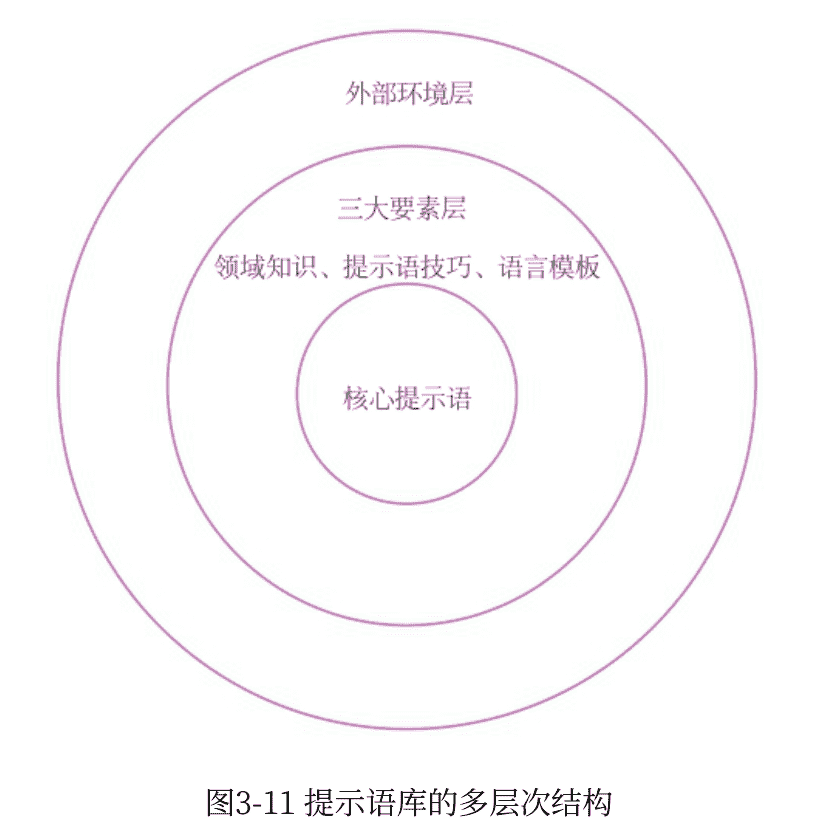
图3-11 提示词库的分层示意

(1) 中心指令
位于库体正中的这层指令，是直接操控大模型产出内容的操盘手。它的职责是把使用者的真实意图转译成模型能执行的任务描述，起到人机意图的转换枢纽作用。

(2) 支撑层
围绕着中心指令运转的，是由领域背景、撰写技法与表达范式三部分组成的支撑层，见图3-12。三者共同为核心指令提供养分与延展空间。

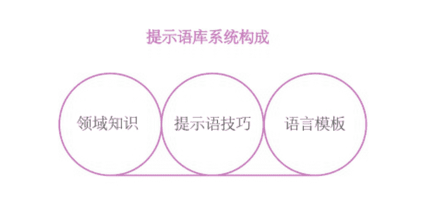
图3-12 提示语构建的三大支柱

- ① 领域背景：搭建知识库的底座，为模型输出专业可信的内容提供支撑。无论是科技稿件、商业分析还是文学创作，扎实的专业积累决定了产出质量。
- ② 撰写技法：将原始信息提炼为优质文本的关键环节，涉及结构设计、论证方式、修辞运用等。
- ③ 表达范式：提升生成效率与风格统一性的工具箱，收录常用表达、句式范式，帮助模型快速输出流畅地道的文字。

(3) 外围情境层
最外圈为情境层，囊括上下文信息与具体任务诉求。它决定了在不同场景下如何挑选与组合内层资源，让提示词库具备灵活适配能力，保证输出的针对性与场景契合度。

##### 2. 提示词库的搜集与归类：系统化管理
要让提示词库既通用又专属，必须有计划地进行搜集、整理与迭代。过程就像经营一座知识宝库，需要持续沉淀。

（1）素材来源与采集方式
- ■ 系统学习：阅读内容生成指南、参与相关培训
通过理论与实践的学习积累可复用素材。例如参照 CRISPA 设计原则：Context 上下文、Role 角色、Instruction 指令、Specifics 细节、Purpose 目的、Audience 受众，进行个性化采集；也可结合不同场景的实践策略丰富库容。
- ■ 实战沉淀：在实操中记录有效指令
这是最直接高效的采集方式。每次生成内容时，留意哪些表述效果更好并归档。例如写产品描述时，用“请从 [功能][优势][应用场景] 三个维度描绘此产品”，比笼统的“请描述这款产品”更能引导模型产出。
- ■ 借力同行：与同行交流心得
人机协同需要持续优化。通过分享经验，可汇聚跨领域的优质提示语，同时加深对技巧的理解。
- ■ 模型自助：借助工具生成与优化
可让模型基于任务需求批量生成候选提示语供筛选，或分析过往有效指令提炼规律模式。

（2）归类方式
海量指令收集后，如何快速检索成为核心。科学的分类体系能显著提升调用效率与输出质量。

表3-2呈现的分类思路可在人机协作中迅速定位所需指令。例如撰写科技产品的说服性开头，可在“功能导向-说服型”、“领域导向-科技类”、“结构导向-开头”三个维度交叉检索，精准匹配。

| 分类维度 | 分类方法 | 举例 |
| :--- | :--- | :--- |
| 功能导向 | 按任务目的分类 | 说服型、描述型等 |
| 领域导向 | 按知识领域分类 | 科技类、文学类等 |
| 结构导向 | 按文章结构分类 | 开头、主体、结尾 |
| 技巧导向 | 按写作技巧分类 | 比喻、排比等 |
| 难度导向 | 按使用难度分类 | 初级、中级、高级 |

表3-2 提示语库的分类方法

实用技巧：分类的四个 A 原则
- Accuracy 精准度：分类要贴合本质。如“比喻”应精确归入修辞技巧，而非笼统归到表达方式。
- Breadth 覆盖面：覆盖足够多场景。除常规文章外，还需兼顾演讲稿、广告文案、小说等特殊需求。
- Consistency 统一性：全库使用统一标准。例如技巧维度使用“比喻”，则其他维度不得随意替换为“打比方”。
- Depth 分层度：在关键类别下做细分。例如“说服型”可继续拆分为“逻辑论证”“情感诉求”“权威引用”等，以提升精准度。

#### （二）知识库构建：高效沉淀素材与专业案例
知识库是提升模型生成能力的基石，涵盖素材积累、知识梳理与案例整合。系统化构建可为创作提供深度支撑。

##### 1. 借助模型构建领域知识库的四步流程
（1）界定范围：明确专业边界
先划定关注的领域范围，为后续资料搜集提供方向。
（2）搜集资料：确保来源可靠
优先从权威渠道获取信息，结合模型与检索工具抓取最新动态。包括：
- 经典教材与专著
- 权威学者的学术论文
- 行业标准与技术白皮书
- 知名机构的研究报告
（3）组织整理：将零散信息结构化
利用模型对资料进行分析与归纳：
- 分类整理：按主题、难度等维度归类
- 建立联系：理清知识点间的逻辑关联
- 形成层次：搭建从基础到进阶的知识阶梯
（4）校验更新：保持知识鲜活
定期借助模型检查过时内容并更新。

组织整理时还需评估质量。表3-3展示了模型驱动的评估体系，涵盖时效性、准确性、完整性、结构性、可读性五个维度。

| 评估维度 | 评分标准 | 模型辅助方法 |
| :--- | :--- | :--- |
| 时效性 | 信息更新程度 | 对比最新文献，识别过时内容 |
| 准确性 | 信息正确程度 | 交叉验证权威来源 |
| 完整性 | 知识覆盖全面度 | 对比同类库，发现缺失主题 |
| 结构性 | 知识组织逻辑性 | 分析关联，优化结构 |
| 可读性 | 表述清晰程度 | NLP 分析并给出改进建议 |

表3-3 AI驱动的知识库评估体系

◎ 领域知识库模块示例
以人工智能为例，基础库可包含：
- 核心概念：机器学习、深度学习、神经网络、自然语言处理等
- 重要算法：决策树、支持向量机、卷积神经网络、循环神经网络等
- 应用领域：计算机视觉、语音识别、自动驾驶、智能医疗等
- 伦理议题：AI偏见、隐私保护、就业影响、人机协作等

完善的知识库能让助手更精准调用术语、解析原理、结合前沿研究，实现深度专业输出。

##### 2. 领域概念体系的搭建与优化
概念体系是领域的骨架，系统梳理核心术语与基本概念。

（1）关键词提取：用模型分析核心文献，自动抓取高频术语。
◎ 提示语示例：
请分析以下 [专业领域] 的文献，提取出最常见的20个专业术语，并按照使用频率排序。
（2）概念定义：为术语生成准确定义。
◎ 提示语示例：
请为以下 [专业术语] 提供简洁明了的定义，确保定义准确反映该术语在 [专业领域] 中的含义。
（3）概念分类：对术语进行层级组织。
◎ 提示语示例：
请将以下 [专业术语列表] 组织成一个层级结构，显示这些概念之间的关系。顶层应该是最基础、最核心的概念，然后逐级细分。

实用技巧：概念体系的金字塔方法
- 顶层概念：领域最核心的基础概念
- 中层概念：围绕核心延伸的次级概念
- 底层概念：更具体、可操作的术语

##### 3. 领域理论原理的整理与分析
理论是对现象的系统解释，是知识库的核心。

（1）理论提取：用模型分析教材与高被引论文，提炼核心理论。
◎ 提示语示例：
请分析 [专业领域] 的主要教科书和近五年的高引用论文，列出该领域的10个最重要理论，并简要说明每个理论的核心观点。
（2）原理解释：生成理论的详细解读。
◎ 提示语示例：
请为 [理论名称] 提供一个300字的解释，包括以下内容：理论的核心观点、主要假设、适用范围和实际应用。
（3）理论关联：分析理论间的联系。
◎ 提示语示例：
请分析以下 [理论列表] 中各理论之间的关系，包括它们的共同点、差异点和可能的互补性。

##### 4. 实践案例库的收集与分类
案例是理论的落地，帮助理解抽象概念。

（1）案例搜集：从新闻、报告、文献中抓取代表性案例。
◎ 提示语示例：
请搜索近三年内 [专业领域] 的实际应用案例，收集20个具有代表性的案例。每个案例应包括背景、问题、解决方案和结果。
（2）案例分类：按理论或应用领域标注。
◎ 提示语示例：
请将以下 [案例列表] 按照涉及的主要理论或应用领域进行分类，并为每个案例添加3～5个关键词标签。
（3）案例总结：提炼核心要点。
◎ 提示语示例：
请为 [案例名称] 生成一个100字的摘要，突出问题、解决方案和关键成果。

#### （三）提示语技巧库：复用通用框架提速创作
技巧库提供通用的生成范式、结构框架与创意思路，规范流程、提升效率与一致性。

##### 1. 通用内容生成模式提炼：构建高效模板
（1）SCQA 结构
适合说明与说服类文本，按 情况-复杂性-问题-答案 四步引导读者。先铺背景，再点出挑战，随后提出关键问题，最后给出解答，形成完整逻辑链。

- Situation 情况：描述背景环境
- Complication 复杂性：指出问题或挑战
- Question 问题：提出需解决的核心疑问
- Answer 答案：给出解决方案或观点

◎ 使用SCQA结构的提示语示例：
请使用SCQA结构撰写一篇关于 [主题] 的文章：
（1）描述 [主题] 的当前情况和背景。
（2）指出 [主题] 面临的主要问题或挑战。
（3）提出一个关键问题，这个问题的答案将是文章的核心。
（4）提供详细的解决方案或观点，回答第3步中提出的问题。
确保各部分过渡流畅，并在Answer部分给出具体论据。

（2）金字塔原理
自上而下的结构方法，适合报告与分析。结论置顶，层层递进展开论据，帮助读者快速抓住核心。

◎ 使用金字塔原理的提示语示例：
请使用金字塔原理为 [主题] 创建一个大纲：
（1）在顶部写出主要结论或中心思想。
（2）列出3～5个支持主要结论的关键要点。
（3）为每个关键要点提供2～3个支持性细节或例子。
（4）确保各层次之间的逻辑关系清晰，从上到下逐步展开论述。

（3）PEE 结构
Point-Evidence-Explanation，适用于论证段落。先点明观点，再给出证据，最后解释关联，增强说服力。

- Point 观点：段落主论点
- Evidence 证据：事实、数据或引用
- Explanation 解释：说明证据如何支撑观点

◎ 使用PEE结构的提示语示例：
请使用PEE结构创作关于 [主题] 的段落：
（1）明确提出你的主要观点。
（2）提供至少两个支持该观点的具体证据或例子。
（3）详细解释这些证据如何支持你的观点，以及它们的重要性。
确保三部分逻辑紧密，形成连贯论证。

##### 2. 结构框架建立：搭建文章骨架
（1）5W1H 结构
适用于新闻与信息类文本，确保六要素完整。

- Who 谁：人物或组织
- What 什么：事件或现象
- When 何时：时间
- Where 何地：地点
- Why 为什么：原因
- How 如何：过程

◎ 使用5W1H结构的提示语示例：
请使用5W1H结构撰写一篇关于 [事件/现象] 的报道：
（1）Who：确定主要涉及的人物或组织。
（2）What：详细描述发生了什么事。
（3）When：指明事件发生的具体时间。
（4）Where：说明事件发生的确切地点。
（5）Why：分析事件发生的原因或背景。
（6）How：解释事件是如何发展或解决的。
请确保信息全面、准确，并注意各要素之间的逻辑关联。

（2）AIDA 模式
经典营销写法，按 注意-兴趣-欲望-行动 引导读者情绪。

- Attention 注意：吸引眼球
- Interest 兴趣：激发好奇
- Desire 欲望：制造需求
- Action 行动：促成转化

◎ 使用AIDA模式的提示语示例：
请使用AIDA模式为［产品/服务］创作一篇营销文案：
（1）Attention：用一个引人注目的标题或开场白吸引读者。
（2）Interest：介绍产品/服务的独特卖点，激发读者兴趣。
（3）Desire：描述产品/服务如何解决问题或改善生活，创造需求。
（4）Action：提供明确的行动指示，鼓励读者立即采取行动。
确保文案语言生动，富有吸引力，并针对目标受众的需求和痛点。

（3）FAB 体系
Feature-Advantage-Benefit，将特征转化为用户利益。

- Feature 特征：具体特点
- Advantage 优势：相比竞品的优越性
- Benefit 利益：用户获得的实际价值

◎ 使用FAB体系的提示语示例：
请使用FAB体系描述 [产品/服务/想法]：
（1）Feature：列出3～5个关键特征或功能。
（2）Advantage：对每个特征，解释它比竞争对手或现有解决方案更优越的地方。
（3）Benefit：详细说明每个优势如何直接惠及用户，解决他们的问题或满足需求。
确保描述具体、清晰，并建立特征、优势和利益之间的直接联系。

##### 3. 创意思路生成：激发内容催化剂
（1）逆向思考法
通过反向假设打破思维定式，发现新机会。

◎ 使用逆向思考法的提示语示例：
请使用逆向思考法来探讨 [主题] ：
（1）列出关于 [主题] 的3～5个常见观点或做法。
（2）对每个观点，思考其完全相反的情况会怎样。
（3）分析这些相反情况可能带来的意外收益或新见解。
（4）基于这些新见解，提出关于 [主题] 的创新观点或解决方案。

（2）跨领域类比法

#### （四）语言模板库：把创作逻辑装进工具箱

在指令撰写和内容生产阶段，语言模板库是提效增质的核心设施。它能稳定调性、统一风格，同时提供可替换的表达资源。搭建思路围绕三层来展开。

##### 1. 逻辑骨架库：让推演更顺

骨架决定成文是否顺滑。给提示语一个清晰的排布思路，输出就能条理分明、可检验。不同体裁适配不同框架，下面是高频的七种。

###### (1) 痛点-对策型
用来拆解困境并给出解法，适合分析文或产品说明。先点出卡点、深挖成因、罗列可选项、权衡利弊，最后落到最优推荐。
◎ 模板示例：
- 交代当前卡点或需求。
- 剖析成因及影响范围。
- 给出可行思路。
- 对比各思路的优劣。
- 锁定最优解并说明依据。

###### (2) 横向比对型
靠多选项的异同来厘清高低，适合选品、市场解读。靠明确的评判维度呈现差异并落结论。
◎ 模板示例：
- 简述待比的对象。
- 明确评判的关键维度。
- 分项对照：
  - 维度1：A的表现 vs B的表现。
  - 维度2：A的表现 vs B的表现。
- 归纳相同点与差异点。
- 基于对照给出评价或建议。

###### (3) 顺序推进型
按时间线展开叙事，适合复盘、历史回顾。用时序把事件脉络串起来，保证连贯。
◎ 模板示例：
- 交代背景与起点状态。
- 事件1：关键节点及影响。
- 事件2：关键节点及影响。
- 事件3：关键节点及影响。
- 汇总最终结果或现状。
- 复盘得失并展望下一步。

###### (4) 因果拆解型
揭示现象背后的因果链，增强说服力，常用于政策解读、科学类内容。
◎ 模板示例：
请拆解【议题】的因果链：
- 锁定核心现象或困境。
- 列出至少三条主要诱因。
- 分别解释诱因并配实证。
- 分析诱因间的相互作用。
- 推演短期与长期后果。
- 归纳因果链并给出干预建议。

###### (5) 演绎推导型
从普遍原则推到具体结论，保证论证严谨，适合理论型文章。
◎ 模板示例：
- 提出被广泛接受的原理。
- 描述与原理相关的特定情境。
- 在原理与情境下推导出结论。
- 用额外证据或论证来核验结论。

###### (6) 归纳提炼型
从多个具体事例提炼普遍规律，适合研究型或实验类内容。
◎ 模板示例：
1. 罗列多个相关事例或现象。
2. 找出这些事例的共性。
3. 基于共性提出一般规律或原则。
4. 用新事例检验规律是否成立。

###### (7) 动态生成型
为应对多样任务，可让模型自建一个逻辑结构生成器，按目的自动匹配骨架。
◎ 使用示例：
请按下面信息生成适配的逻辑结构模板：
- 任务目的：如说服、解释、比对、叙述。
- 内容类型：如学术论文、商业报告、新闻稿、产品说明。
- 目标人群：如专业人士、大众、学生。
- 预期篇幅：如短文、中等、长文。
请给出：
- 推荐的结构及理由。
- 该结构的详细模板。
- 使用时的注意事项。

##### 2. 表达资源库：让呈现更丰富
表达模板来自修辞与文体学，能提升表现力与感染力。

###### (1) 修辞手法库
合理使用修辞让语言更生动，提升参与感与理解力。
分类示例：
- 比喻：把抽象概念具象化。
- 拟人：给非生命体赋予人性。
- 排比：用结构相近的句式强化气势。
- 反问：以问句形式表达肯定。
◎ 模板示例：
- 比喻：【抽象概念】就像【具体事物】，相似点在【解释】。
- 拟人：【非生命体】仿佛活过来，它【拟人化动作或状态】。
- 排比：它不仅【特征1】，而且【特征2】，更是【特征3】。
- 反问：难道【陈述】不是【预期结果】吗？

###### (2) 句式变化库
调整句式丰富节奏与风格。
分类示例：
- 长短交替：制造语言节奏。
- 倒装：改变语序突出重点。
- 并列：并列分句强调同等关系。
◎ 模板示例：
- 长短结合：【简短陈述】。然而，【用较长句子展开解释】。
- 倒装：【重点内容】，【主语】在这里显得格外重要。
- 并列：【观点1】，【观点2】，【观点3】，三点构成【议题】的核心。

###### (3) 语气调节库
通过语气传递情感与态度，适配不同人群。
分类示例：
- 强调语气：突出关键信息。
- 婉转语气：委婉表达意见。
- 疑问语气：引发思考。
◎ 模板示例：
- 强调：毫无疑问，【关键信息】是我们必须高度关注的重点。
- 婉转：或许可以考虑【建议】，这可能会带来【潜在收益】。
- 疑问：我们是否该重新思考【议题】？这个问题值得深入探讨。

##### 3. 篇章组织库：提升连贯与说服力

###### (1) 开场模板
开头负责抓注意力，为全文定调。
分类示例：
- 引用开场：用名言或数据起头。
- 设问开场：用问题引发思考。
- 场景开场：描绘具体情境带入议题。
◎ 模板示例：
- 引用开场：【相关名言或数据】。它揭示了【议题】的重要性。本文将深入探讨【具体内容】。
- 设问开场：你是否思考过【相关问题】？事实上，【引出议题】。接下来一起探索【具体内容】。
- 场景开场：【描述与议题相关的具体场景】。这个场景生动展现了【议题】在现实中的意义。

###### (2) 过渡模板
连接不同部分，保证流畅。
分类示例：
- 递进式过渡：引入更深内容。
- 对比式过渡：引入不同观点。
- 总结式过渡：收束前文引出新点。
◎ 模板示例：
- 递进式：在弄懂了【前一部分】后，我们需要进一步探讨【下一部分】。二者联系在于【解释联系】。
- 对比式：与【前一观点】不同，【新观点】提供了全新视角。看它如何改变我们对【议题】的理解。
- 总结式：归纳一下，【总结前文要点】。这些发现引导我们思考：【新讨论点】。

###### (3) 论证段落模板
展开论点并提供证据支持。
分类示例：
- 观点-论据-案例。
- 问题-分析-解决。
- 现象-原因-影响。
◎ 模板示例：
- 观点-论据-案例：【中心观点】。理由有：首先【理由1】；其次【理由2】；最后【理由3】。以【具体案例】为例说明。
- 问题-分析-解决：【描述问题】。成因主要有：【原因1】、【原因2】、【原因3】。对策：【措施1】、【措施2】、【措施3】。
- 现象-原因-影响：近年来出现【现象】。主因包括：【原因1】、【原因2】、【原因3】。影响体现在：【影响1】、【影响2】、【影响3】。

###### (4) 篇章组织模板
按议题、篇幅与复杂度生成整体框架。
◎ 模板示例：
请按以下信息生成详细文章结构：
- 议题：【输入具体议题】。
- 文章类型：如说明文、议论文、记叙文。
- 预期字数：如800字、2000字、5000字。
- 目标读者：如大众、专业人士、学生。
请给出：
- 完整框架，含开场、主体、过渡和结语。
- 各部分的要点提示与建议。
- 适配的表达技巧与修辞建议。

#### （五）动态管理库：让提示语库越用越强
提示语库要保持长期价值，需要动态管理。通过迭代更新、效果反馈、智能分类和个性化调优，实现灵活适配与质量提升。

##### 1. 动态更新与扩展：保持活性

###### (1) 库的持续更新机制
持续更新包括定期添新、优化旧条目，以确保始终匹配需求。
① 定期添新：跟随市场趋势、热点话题与用户需求补充内容。可从领域知识更新、表达方式拓展、特定应用场景三个方向筛选。
② 优化替换：随需求变化，部分提示词会失效。需定期清理低效条目：评估生成质量与满意度，删除或优化效果差、频次低的条目；合并功能相近的重复项；用统计数据把高频高质内容置顶，淘汰低频内容。
③ 用户反馈驱动：收集使用评价，识别特定领域或场景的偏好，形成反馈闭环，精准调整库内容。

###### (2) 自动化与半自动化更新流程
① 自动化更新：借助网络爬虫与NLP自动采集最新领域词汇和热点表达，实现实时扩展并保持时效性。

##### 2. 生成效果评估：提升库质量

###### (1) 设定评估标准
先建立统一衡量尺度：
| 评价维度 | 说明 | 判定要点 |
| :--- | :--- | :--- |
| 指令契合度 | 生成内容与指令的匹配程度 | 高：高度契合无偏离；中：基本相关有少量偏离；低：偏离议题关联弱 |
| 事实正确度 | 信息正确性与数据精确度 | 高：无事实错误数据精准；中：轻微逻辑瑕疵不影响理解；低：明显事实错误 |
| 阅读流畅度 | 语言自然与连贯性 | 高：流畅自然；中：少量冗余或不连贯；低：生硬影响阅读 |
| 内容充实度 | 深度、广度与细节 | 高：涵盖核心内容背景充实；中：要点齐全细节略欠；低：单薄缺乏深度 |
| 用户评分 | 主观评价 | 高：4~5分；中：3分；低：1~2分 |

###### (2) 自动化效果测试
- 批量生成与评分：对所有条目批量生成，按上述五项指标打分并记录。
- 自动标记优劣：高分标记为“推荐”，低分标记为“待优化”或“待清理”。
- 自动分层管理：优质条目优先展示，低分条目移至次级分层待改进。
- 数据记录与反馈循环：评分数据入库，定期复查并清理低效条目，确保库的高效与精准。

##### 3. 智能分类与管理：提升检索效率

###### (1) 分类标准
多维度分类能快速缩小检索范围。常见维度包括：
- 场景分类：按应用场景划分。
- 议题分类：按核心议题划分。
- 受众分类：按目标用户划分。
- 语气与语言风格分类：按表达风格划分。
- 格式分类：按生成内容格式划分。
- 知识深度分类：按专业深度划分。
- 情绪色彩分类：按情感色调划分。
用户还可按地区、行业等个性化定制组合方式。表3-6列出了提示语库的部分常见分类示例，可据需扩展调整。

Prompt 库分类与管理速览

| 按场景分类 | 报告撰写、市场分析、产品推广、社交对话、教育教学等 |
| 按主题分类 | 数据分析、情感表达、科技创新、政策解读、商业策略等 |
| 按受众分类 | 专业用户、普通用户、教育者、营销人员、研究人员等 |
| 按语气分类 | 正式、非正式、友好、严肃、幽默等 |
| 按语言风格分类 | 简洁、详细、专业、学术性、创意性等 |
| 按格式分类 | 文本摘要、列表格式、对话式、问答式、流程图等 |
| 按知识深度分类 | 入门级、进阶级、高级专业内容 |
| 按情绪色彩分类 | 积极、消极、中立、激励、感性等 |

表3-6 Prompt 库常见分类示例

###### (2) 智能分层治理机制
分层式智能治理借助多层级的管控与实时调校，让词库的编排和呈现效率同步提升。这种做法既能实现条目的分级管控与权重排序，也靠关键词体系与清库机制，保障本体结构清晰、检索体验稳定。

该机制的核心由四个部分组成：动态分级、权重排序、关键词体系、周期清库。表3-7列出了其基本要素与对应作用：

| 基本要素 | 描述 | 功能 |
| :--- | :--- | :--- |
| 动态分层 | 依据使用频次与用户评价自动划分层次 | 使高频高分条目置于显眼位置，提升可见度 |
| 优先级排序 | 按标签与使用数据实时调整展示顺序 | 让优质 Prompt 优先呈现，改善检索效率 |
| 标签系统 | 为每条 Prompt 附加关键词标签，支持多维筛选 | 以主题、场景、语气等多维度帮助快速定位 |
| 定期清理机制 | 依效果评分与使用频率剔除低效条目 | 保持库内内容精简，避免陈旧冗余影响检索 |

表3-7 智能分层管理模式的基本要素及其功能

基于上述要素，分层式管控带来的价值有：

- 检索更高效：动态分级与权重排序帮助使用者迅速锁定优质条目，降低查找成本。
- 匹配更精准：关键词体系支持多维度过滤，满足对主题、场景、语气等差异化诉求。
- 内容持续焕新：周期清库维持库内新鲜度与相关性，有效杜绝失效条目拖累检索。

### 三、质量评价体系：让 AI 对话更可控更优质
在人机协同中，指令模板的质量直接决定生成内容是否贴合预期。搭建科学全面的评估框架并据此持续迭代，是提升生成质量的关键。

#### （一）评估维度：全方位审视 Prompt 成效
如同评好文章要看内容、结构与语言，指令模板的评估也需多维度审视其实际效果。

##### 1. 相关性评估：任务贴合与主题统一
主要考察生成内容是否切中主题、满足任务核心诉求，同时量化偏离度，即无关或冗余信息的占比，以确保输出的准确与有效。衡量点包括：
- 主题一致性：输出是否紧扣主题。
- 关键信息覆盖率：是否涵盖任务要求的所有要点。
- 偏离度：无关或冗余信息的比例。

##### 2. 质量评估：内容准确与深度
涉及生成内容的整体水准，涵盖准确性、深度、创新性、逻辑性与流畅性。准确性看信息是否正确，深度看分析是否到位，创新性看观点表达是否新颖，同时兼顾论证严谨与语言自然。衡量点包括：
- 准确性：信息与数据的正确程度。
- 深度：洞察与分析的力度。
- 创新性：观点与表达的新颖度。
- 逻辑性：论证与结构的严谨度。
- 流畅性：语言的生动自然度。

##### 3. 效率评估：生成速度与资源消耗
关注生成耗时与计算成本。生成速度衡量完成任务所需时间，资源消耗则评估算力、能耗与调用成本。优秀指令应在短时间内产出高质量结果并控制资源开销。衡量点包括：
- 生成速度：完成任务所需时间，含模型处理与人工介入。
- 迭代次数：达到满意结果所需的修改轮次。
- 资源消耗：计算成本、API 调用次数等。
- 人工干预程度：编辑修改的工作量。

##### 4. 适应性评估：任务变化与风格迁移
考察指令在不同任务与环境下的稳定性。其一任务变动时仍保持效果，其二能适应不同读者群体与风格需求。衡量点包括：
- 跨领域表现：在不同主题领域的表现。
- 风格多样性：生成不同风格内容的能力。
- 长度适应性：在不同字数要求下的表现。

#### （二）评价指标体系：多维度拆解 Prompt 质量
为更精准衡量指令在不同场景的表现，构建覆盖五个主维度的评价体系，见表3-8。

1. 内容水准：能否清晰准确传递核心信息，是否覆盖任务所需全部信息，表达是否简练，与使用场景的契合度如何。
2. 逻辑结构：信息编排是否合理、层次是否分明，前后是否连贯一致，推理是否帮助理解。
3. 用户体验：是否易于理解并有效引导操作，呈现时机是否恰当，交互是否顺畅。
4. 创造性与创新性：表达是否独到，是否实现个性化，是否借助新技术带来新鲜感。
5. 适应性：是否在不同设备、语言、文化下稳定可用，能否按场景灵活调整。

| 一级指标 | 二级指标 | 评价标准 |
| :--- | :--- | :--- |
| 内容质量 | 信息的准确度 | 提示语是否准确传达了关键信息？ |
| | 信息的完整性 | 提示语是否涵盖了用户需要的所有信息？ |
| | 信息的精练程度 | 提示语是否去除了冗余信息并保持精练？ |
| | 信息的情境相关性 | 提示语是否在当前情境下具备高度相关性？ |
| 逻辑结构 | 信息的层次清晰度 | 提示语是否根据信息重要性分层，确保层次分明？ |
| | 信息的前后连贯性 | 提示语的前后是否保持一致，无前后矛盾？ |
| | 逻辑推导的合理性 | 提示语中的推理链条是否合乎逻辑，帮助用户理解？ |
| | 关键信息的突出程度 | 提示语是否有效突出用户最需要的关键信息？ |
| 用户体验 | 信息的可理解性 | 提示语是否使用清晰、易于理解的语言，便于用户快速吸收？ |
| | 提示语的操作指导性 | 提示语是否引导用户明确完成下一步操作？ |
| | 提示语的用户友好性 | 提示语是否通过语气和措辞友好地与用户进行互动？ |
| | 提示语的响应及时性 | 提示语是否出现在合适的时间，避免过早或过迟？ |
| 创造性与创新性 | 表达方式的独特性 | 提示语是否采用了与众不同的表达方式，提升用户体验？ |
| | 内容的个性化程度 | 提示语是否根据用户的个人行为和偏好进行了个性化设计？ |
| | 信息的创新呈现方式 | 提示语是否利用新技术或创新设计给用户带来新鲜感？ |
| 适应性 | 提示语的多设备兼容性 | 提示语是否能适应多种设备类型，在不同设备上保持一致？ |
| | 提示语的多语言支持 | 提示语是否支持多语言并保持信息准确翻译？ |
| | 提示语的跨文化适应性 | 提示语是否能够跨文化适应，避免因文化差异导致的误解？ |
| | 提示语的场景灵活性 | 提示语是否能够适应不同场景需求，根据使用情境做出调整？ |

表3-8 提示语工程质量评价体系

#### （三）优化策略：提升 Prompt 成效的可操作方法
聚焦评估维度与指标体系的核心要点，提出五项可落地的优化策略。

##### 1. 提升任务契合度：让意图传达到位
指令需对任务描述足够清晰，避免模糊偏题。通过明确目标与输出要求可提高契合度。
- 设定清晰边界：明确任务范围、时间限制与具体诉求，减少偏差。
- 关键词引导：用核心词锚定焦点，帮助模型聚焦关键内容。

Prompt 精细化示例：
原始：请撰写一篇关于全球化的文章。
优化版：请撰写一篇2000字的学术文章，讨论全球化对发展中国家经济增长的影响。需包含：①近20年全球化对发展中国家贸易模式的影响；②对内部产业结构的影响；③全球化带来的经济不平等及后果。引用至少5个学术来源，聚焦2005-2025年数据。关键词：全球化影响、经济增长、贸易模式、产业结构变化。

##### 2. 优化信息层次：让内容有序生成
指令应引导模型按层次逐步产出，尤其在多步骤任务中避免信息混乱。
- 分段生成：按任务子项依次产出，避免一次性堆砌。
- 重要性排序：先输出核心内容，后补次要信息。

Prompt 精细化示例：
原始：撰写一份关于公司财务状况的报告。
优化版：请分三部分撰写公司财务分析报告。第一部分聚焦本年度收入、成本、净利润及显著变化趋势；第二部分分析各部门开支结构并指出高成本部门及原因；第三部分结合市场趋势预测未来一年财务状况。每部分不超过500字，按顺序输出。

##### 3. 提升交互体验：简化操作增强可控性
指令需贴合用户习惯，减少理解成本并提高可操作性。
- 简明措辞与明确指令：语言简洁，句式清晰，减少解析误差。
- 动态调整选项：提供生成后的调整入口，支持用户反馈驱动优化。
- 灵活反馈机制：允许用户实时修正或切换生成路径。

Prompt 精细化示例：
原始：为我们的新产品撰写一份营销计划。
优化版：请为即将在北美上市的新品撰写简短营销计划，包含：①目标市场分析与核心消费群体画像；②渠道选择及优势说明；③未来6个月预算分配。生成后可选择：[扩展分析细节]、[调整市场规模范围]、[优化预算结构]。反馈选项：[增加消费者行为细节]、[扩展渠道对比]、[缩短至500字]、[扩展至1000字并补充数据]、[调整预算比例]、[提供实际支出对比]。

##### 4. 强化逻辑一致性：保证连贯与顺序执行
多步骤任务中逻辑连贯至关重要，避免跳跃与信息断层。
- 任务步骤关联：每一步与前一步形成逻辑衔接。
- 逻辑自检机制：嵌入校验环节，确保输出符合预期框架。
- 连续性设计：基于前一步结果生成下一步，保持信息连贯。

Prompt 精细化示例：
原始：解释这个营销模型。
优化版：请按以下顺序解释该营销模型，确保每步紧密关联。第一步说明基本概念与假设及理论基础；第二步结合假设阐述市场数据如何推导出策略与计算方法；第三步给出具体行业案例并说明对决策的影响。每步完成后自检逻辑一致性。反馈选项：[重写第一步概念]、[调整假设描述]、[重算数据与方法联系]、[扩展推理过程]、[提供更多案例]、[简化案例分析]。

##### 5. 提升场景适应性：按环境灵活调整
指令需能随任务场景动态变化，适应多样化需求。
- 场景自适应生成：按学术、创意、技术等场景调整输出方式。
- 复杂度动态调节：简单任务输出简洁，复杂任务提供详尽指引。
- 场景优先级设定：多任务并行时按紧急度排序输出。

Prompt 精细化示例：
原始：撰写一篇关于人工智能的报告。
优化版：请按以下场景撰写AI报告，系统将自动调节详略。学术场景：1500字，探讨AI在医疗的应用，引用5篇以上论文，分析个性化诊断、药物研发进展、伦理与隐私。创意场景：描写未来10年AI在日常生活的应用，含家庭健康管理、购物出行改变等。技术场景：技术报告，聚焦自动驾驶感知技术、路径规划算法优化、未来5年趋势。复杂度调节：简单任务生成500字概览，复杂任务扩展数据与预测。优先级设定：[优先学术]、[优先技术]、[延迟创意，集中关键报告]。

## 第4章 让AI与众不同：打造专业内容与创意表达
指令优化是提升生成质量的核心。通过专业深化、创意激发、风格塑造与元叙事驱动，可让输出更具专业性与创造力。

### 一、专业深化：打造高质量专业内容
在AI时代，指令的专业性直接关联生成质量。设计者需具备领域洞察，引导模型产出符合行业标准的高质量内容。

#### （一）保障专业性：深度洞察与精准表达的结合
专业水准要求设计者具备扎实背景，引导模型生成符合领域标准的内容。

专业内容特征：
- 领域知识深度：指令聚焦特定专业，要求设计者把握关键知识点。
- 术语准确使用：规范术语提升可信度与概念传达效率。
- 前沿研究融入：结合最新进展与前瞻思考，确保时效性。

AI时代的专业挑战：
- 知识更新滞后：模型知识存在时效性，如何确保输出的专业水准与时效性。

# 提示词进阶手记：让AI更准、更深、更会创意

想让AI在专业场合不掉链子，关键就两件事：术语要准，知识要融。怎么让模型在用专业词汇时不跑偏，同时把不同学科的洞见揉进内容里，做出有分量的表达？下面是一套可直接上手的思路。

**实战模板：拆解专业概念**
面对带专业背景的任务，可以试试这样设问：
请对【专业概念】做系统说明，要求如下：
1. 先给出严谨的学术定义。
2. 再用大白话讲清它的核心意思。
3. 搭配一个贴近生活的比喻或类比。
4. 举一个真实场景下的应用案例。
5. 若可行，附一张简易示意图帮助可视化。

#### （二）写出高质量提示词的四大支柱

要把AI的潜力榨干，提示词设计要兼顾语言、知识、逻辑与创意，四者合一才能保证准确、有深度且有新意。

##### 1. 语言维度：表达的起点

语言决定模型能否听懂。精准、清晰且带语境的表达，能显著提升结果质量。

(1) 精准度：词要选对
用明确的术语和具体的指令，减少歧义，才能让模型贴着你的意图走。
◎ 模糊 vs 清晰
模糊：写一篇环境保护的文章。
清晰：评析近十年全球环保政策的实施效果，并展望未来优化方向。

(2) 清晰度：指令要顺
有条理的结构、合适的标点和逻辑连词，能让执行更顺畅。
◎ 低效 vs 高效
低效：讲讲人类探索太空的故事。
高效：按时间顺序列出人类太空探索的五个里程碑，并简要说明：
(1) 事件名称
(2) 发生年份
(3) 主导国家/机构
(4) 对后续探索的推动作用

(3) 语境化：给背景
补充目标、形式和风格，模型才知道往哪走。
◎ 无语境 vs 有语境
无语境：写一篇关于人工智能的文章。
有语境：假设你是面向大众的科技撰稿人，用通俗语言写一篇约1000字的稿件，解释人工智能如何改变日常，并用生动案例和类比降低理解门槛。

##### 2. 知识维度：内容的根基

知识决定深度。把专业知识、跨域知识和结构性元知识放进提示，能让输出更权威。

(1) 领域知识：保证专业性
在提示中嵌入核心术语、关键概念和前沿研究，能引导模型产出更深度的内容。
◎ 浅层 vs 深层
浅层：写一篇量子计算的文章。
深层：撰写量子计算综述，需涵盖：
1. 量子比特的定义与特性
2. 量子纠缠与退相干的原理及难点
3. 超导路线与光量子路线的对比
4. IBM、Google、中科大等机构的最新进展
5. 在密码学、药物研发等领域的潜在用途

(2) 跨域知识：激发创新
引入多学科视角，能让分析更有洞见。
◎ 单一 vs 跨域
单一：分析社交媒体对青少年的影响。
跨域：从心理学、社会学、神经科学三重视角剖析社交媒体对青少年的影响。心理学聚焦自尊、社交焦虑与抑郁；社会学聚焦社交模式与群体行为变化；神经科学聚焦长期使用对大脑发育的可能影响。请引用近五年研究数据。

(3) 元知识：优化结构
关于如何组织知识的知识，有助于呈现更清晰。
◎ 有无元知识对比
无元知识：写一篇全球变暖的文章。
有元知识：按科学论文格式撰写全球变暖综述，要求：
(1) 摘要：100字内概括要点
(2) 引言：定义、历史背景与研究意义
(3) 方法：主要测温手段与数据源
(4) 结果：近百年温度变化的关键数据与趋势
(5) 讨论：成因及生态、社会经济影响
(6) 结论：研究总结与应对建议

##### 3. 逻辑维度：结构的骨架

逻辑决定连贯性与说服力。通过关联、检查与一致性控制，保持论证严密。

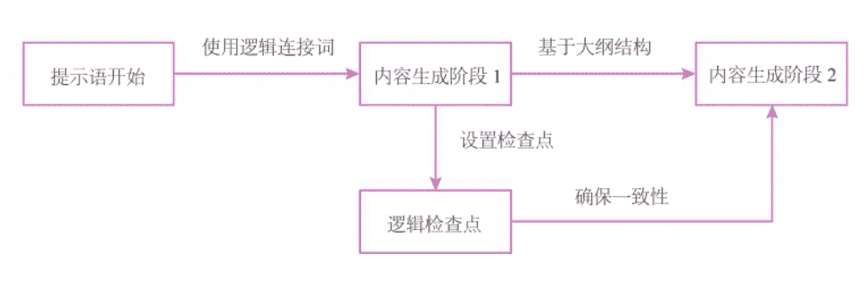
(1) 信息提炼：找准起点
从海量信息中筛选关键点，建立清晰的逻辑起点。
◎ 示例思路：
筛选关键信息、提炼核心观点、搭建逻辑框架、整合观点形成结构、归纳总结突出重点，最后形成要点报告并给出建议。

(2) 因果分析：搭链条
明确因果关系，能生成更连贯的论证。
◎ 简单 vs 因果
简单：讨论全球化对经济的影响。
因果：分析全球化通过以下路径影响经济：
(1) 贸易自由化→市场扩大→规模效应→效率提升
(2) 资本流动→海外投资↑→技术转移→生产力提高
(3) 劳动力流动→人才全球化→创新增强
(4) 文化交流→消费习惯变→新产业兴起
并对每条链提供案例或数据。

(3) 论证结构：增强说服力
指定归纳、演绎、类比等结构，能提升说服力。
◎ 示例框架：
主张：气候变化对全球经济影响深远
归纳：列举极端天气致农损、海平面致基建损等案例
演绎：温室排放→变暖→气候模式改变→经济受冲击
类比：与历史金融危机类比
反驳：回应“影响被夸大”论点
综合：总结影响并提出应对建议

##### 4. 创意维度：效能的激活器

创意靠视角、跨界和适度约束来点燃。

(1) 视角创新：换个眼睛看
常规：写一篇城市发展的文章。
创新：以一棵百年老树的视角，记述它见证的百年城市变迁，包括景观从农田到高楼、交通从马车到电动车、人际从传统社区到现代社会的转变，以及树木的“感受”与“思考”。

(2) 跨界思维：碰撞火花
示例：将生物学“共生”概念用于企业生态系统，探讨大企业与初创的互惠共生、跨行业互利共生、企业与用户的偏利共生、生态系统中的竞争性共生，并配商业案例分析。

(3) 创造性约束：有限激发无限
限定条件能逼出新解。
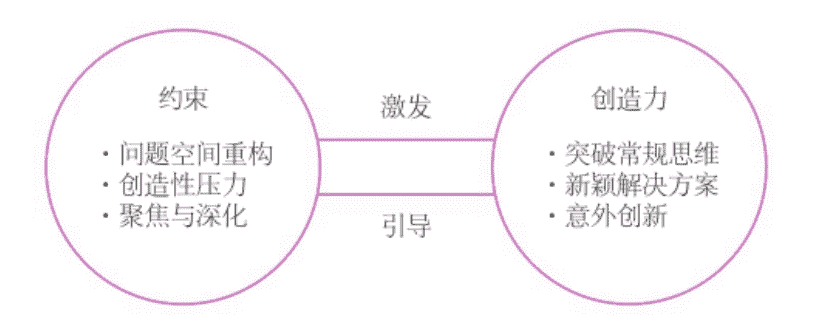
◎ 约束示例：
写一篇未来智慧城市短文，要求：
1. 不超过500字
2. 禁用“智能”“人工智能”“物联网”等术语
3. 包含至少3个感官描写
4. 用10岁孩子视角叙述
5. 结尾提出对未来生活的担忧或质疑

### 二、让AI内容更有创意的系统模型

AI创作正从信息复述走向高质量创新。以下两类模型能系统提升创意与独特性。

#### （一）知识融合：拓宽创意边界

**知识融合提示词优化模型 KFPOM** 融合认知科学、创造性思维与知识管理，通过系统化融合拓宽创意空间。

核心组成：
- 跨域映射机制 CMM
- 概念嫁接策略 CGS
- 知识转移技术 KTT

##### 1. 跨域映射机制 CMM：启发联想

通过不同领域间建立联系激发创新。

理论基础借鉴概念隐喻与类比推理，关键技巧为结构映射、属性转移、关系对应、抽象模式提取。

实施步骤：选源域→识别映射点→生成类比→细化优化。

◎ 应用示例：用人体免疫系统类比网络安全策略，将防火墙比作皮肤、入侵检测比作白细胞巡逻、签名防御比作抗体、隔离清理比作发烧控制，并延伸出数字疫苗、网络卫生等创新思路，最后点出类比局限。

##### 2. 概念嫁接策略 CGS：创造性融合

将不同领域概念结合产生新想法，基于概念整合理论。

流程：选输入概念→分析特征→找共同点→设计融合点→构建融合提示。

应用示例：将社交媒体与传统图书馆嫁接，设计知识共享平台，融合即时互动与深度储备、分类系统与社交网络、专业馆员服务数字化等。

##### 3. 知识转移技术 KTT：跨域迁移

把一个领域的知识方法迁移到另一领域。

关键：识别源域、抽象原则、映射目标、重构知识、应用验证。

流程：定义问题→寻找源域→提取知识→相似性分析→设计转移策略→构建提示。

应用示例：为提升在线教育参与度，从游戏设计迁移游戏化机制、玩家心理、关卡设计、即时反馈等，映射为进度可视化、成就系统、社交互动、个性化挑战等教学设计。

掌握上述语言、知识、逻辑、创意四要素，并运用KFPOM的知识融合方法，就能让提示词既严谨又灵动，让AI产出既专业又富新意的内容。

游戏化迁移对照表
C. 游戏中技能成长的节奏感，可对应到知识获取的路径规划
D. 游戏内的社交互动架构，可对应到学习社群的运营方式

知识迁移提示语示例

任务：提升线上学习平台的学员参与热情。

请把游戏设计的思路迁移到线上教学平台的搭建中：

（1）如何借用游戏关卡设计的思路来组织课程结构，让学习既有挑战感又有吸引力？
（2）游戏中的成就体系怎样转化为平台上的学习激励机制？
（3）游戏的即时反馈手法在教学场景里如何落地，以强化学习效果？
（4）怎样把游戏里的社交互动元素植入学习流程，带动协作与良性竞争？
（5）游戏的个性化体验能如何启发学员形成专属的学习路径？
（6）游戏叙事设计的打法怎样用在课程内容上，提升吸引力与连贯性？

基于以上迁移思路，请为线上教育平台设计一个创新功能方案，详细说明：
（1）至少5个源自游戏设计的落地功能；
（2）每个功能如何具体拉升参与度；
（3）落地时可能遇到的阻力及对应解法。
要求方案既保留游戏的吸引力，又坚守教育的专业性与有效性。

#### （二）创意多维点火：激活AI内容的创新能量
在AI内容产出过程中，点燃创意是让结果脱颖而出的关键。下面介绍“创意点燃提示优化模型” Creativity Ignition Prompt Optimization Model，简称CIPOM。它融合创意思维、认知科学与设计思维，通过系统化的创意激发路径提升AI产出内容的新颖度与独特性。

CIPOM的核心构成：
- 随机组合机制 Random Combination Mechanism，简称RCM
- 极端假设策略 Extreme Hypothesis Strategy，简称EHS
- 多重约束策略 Multiple Constraint Strategy，简称MCS

##### 1. 随机组合：跳出常规框架
随机组合是通过把看似无关的元素有机拼合，激发出新思路，突破固有框架，挖掘元素间潜在关联，从而产出更丰富多样的内容，也为复杂问题提供多维视角。

RCM的理论来源：
RCM植根于创造性思维中的强制联系与创意综合。将理论用于AI内容生成，主要包括：
- 元素库搭建：建立涵盖多样元素的知识库
- 随机抽取：从库中随机挑取元素
- 强制关联：把随机元素强行联系起来
- 创意融合：基于组合生成新概念

RCM操作步骤：
1. 界定创意范围：明确创新领域或具体问题
2. 构建多元元素库：收集相关或不相关的多样元素
3. 设计随机抽取方式：建立可随机选取元素的机制
4. 制定组合规则：设定随机元素如何组合的规则
5. 生成组合提示：撰写引导AI做随机组合的提示

RCM应用示例：
假设要为连锁咖啡店策划创新营销，可用RCM激发灵感。
元素库搭建：
1. 咖啡相关：豆种、烘焙、萃取、风味
2. 文化艺术：音乐、绘画、舞蹈、文学
3. 科技：AR、VR、人工智能、物联网
4. 环保：可持续、回收、碳中和、可降解
5. 社交：社媒、直播、社群、互动

随机组合提示示例：
为咖啡连锁店设计创新营销活动，用以下随机组合元素激发创意。
1. 咖啡侧：豆种
2. 文化艺术侧：舞蹈
3. 科技侧：增强现实
4. 环保侧：碳中和
5. 社交侧：直播
请基于这些组合元素，设计一个独特吸睛的营销活动。要求：
1. 创造性地整合全部给定元素
2. 突出品牌特色
3. 提供沉浸式客户体验
4. 具备病毒传播潜力
请详细描述概念、执行方案、预期效果，并说明如何把看似无关的元素巧妙融合。

##### 2. 极端假设：冲破思维边界
极端假设是通过提出偏激或荒诞的假设来挑战常规思维，从而激发出突破性创意。它鼓励跳出传统框架，从新角度看问题，探索被忽视或被认为不可行的方案，揭示常规思维背后的创新可能。

EHS的理论来源：
EHS借鉴逆向思维与假设性思考，把这些方法用于AI内容生成，形成以下策略：
- 常规假设辨认：明确领域内被广泛接受的假设
- 极端反转：把常规假设推向极端或完全颠覆
- 结果推演：深入探讨极端假设可能带来的影响与机会
- 洞察提炼：从极端假设中提取创新点

EHS操作步骤：
1. 识别常规假设：列出特定领域的共识假设
2. 生成极端假设：把假设推向极端或彻底颠覆
3. 构建假设情境：细致描述极端假设成立时的世界
4. 探索影响：分析对各相关方面的潜在影响
5. 提炼创新点：从极端情境中提炼可借鉴的创新机会
6. 构建极端假设提示：撰写引导AI做极端假设思考的提示

EHS应用示例：
任务：以“未来教育”为主题，用极端假设策略激发创新。
常规假设：
1. 学校是主要学习场所
2. 教师是知识主要传递者
3. 学习需要长时间投入
4. 考试是评估学习效果的主要方式

极端假设提示示例：
任务：设计未来教育系统。
1. 请基于以下极端假设，构想革命性的未来教育体系：
设想一：学校作为实体场所彻底消失
思考：没有实体学校教育如何进行？社交化学习怎样实现？
设想二：人工智能完全取代人类教师
探索：AI导师如何实现个性化教学？情感与道德教育如何处理？
设想三：人类可直接向大脑写入知识，学习时间缩短到瞬间
分析：这会如何改变教育本质？终身学习概念会怎样演变？
设想四：考试与评分制度全面取消
讨论：如何评估与证明个人能力？社会选拔机制会怎样变化？
2. 基于这些假设：
a. 详细描述未来教育系统的运行模式
b. 分析可能产生的正面与负面影响
c. 从极端情境中提取3～5个可应用于当下的创新点
d. 讨论变革可能面临的主要挑战与可行解法。请确保构想既大胆又具现实意义。

##### 3. 多重约束：驱动创造性问题解决
多重约束是通过设置多条看似矛盾或困难的限制，激发创造性思维寻找突破方案。面对并突破约束，有助于打破思维定式，探索出新解。

MCS的理论来源：
MCS基于创造性问题解决与设计思维中的有限性思维，将其用于AI内容生成，形成：
- 约束设定：提出多项挑战性限制
- 约束矛盾分析：识别限制间的冲突
- 创造性妥协探索：寻找兼顾全部约束的创新解
- 约束突破思考：探索创造性绕开或重新定义约束

MCS操作步骤：
1. 问题界定：明确核心问题
2. 约束列举：设定多项挑战性限制
3. 约束影响分析：评估每个约束对解的影响
4. 创新方案构思：在多重约束下寻找解
5. 约束重构：必要时重新定义或调整约束

MCS应用示例：
任务：用多重约束策略设计一款创新智能家居产品。
1. 核心问题：设计多功能智能家居设备
2. 约束条件：
a. 体积不超过标准鞋盒
b. 同时满足5类家居需求
c. 零售价不超过100美元
d. 采用100%可回收材料
e. 适合从儿童到老年人的全年龄段

多重约束提示示例：
任务：设计一款创新多功能智能家居设备。
请在以下多重约束下构思突破性产品：
1. 约束条件：
a. 体积不大于标准鞋盒 30cm×18cm×10cm
b. 必须兼顾5类家居需求 如照明、温控、安全、娱乐、健康监测
c. 零售价不高于100美元
d. 必须使用100%可回收材料制造
e. 界面与操作要适配全年龄段
2. 设计要求：
a. 描述外观与结构，说明如何在有限空间整合多功能
b. 列举并解释能满足的5项关键需求及创新点
c. 说明如何兼顾低成本与多功能，考虑材料与制造
d. 描述用户界面设计，确保易用性
e. 说明可持续设计特点，包括材料与回收策略
f. 阐述市场差异化与竞争优势
此外思考：约束如何推动创新？满足约束时的主要挑战与创造性解法？若可突破一项约束，会选哪项？

### 三、风格赋形：让AI带感又好读
语言风格直接影响内容的情感表现与感染力。本节介绍“语言风格提示优化模型”Language Style Prompt Optimization Model，简称LSPOM。它融合语言学、文体学与修辞学，通过系统化风格塑造增强表现力。

LSPOM的核心构成：
- 语体模拟机制 Register Simulation Mechanism，简称RSM
- 情感融入策略 Emotion Integration Strategy，简称EIS
- 修辞技巧应用 Rhetorical Techniques Application，简称RTA
- 风格一致性评估 Style Consistency Evaluation，简称SCE

#### （一）语体模拟：精准复制语言指纹
语体模拟通过分析并复制特定语体的语言特征，让AI生成的内容更贴近目标风格。过程涉及词汇、语法调整，也关注语气、风格与语调的深层模仿，使输出更自然连贯。

RSM的理论来源：
RSM建立在语域理论与语体分析基础上，重点分析不同语境下的语体特征及其适用性。图4-3为语体模拟机制结构示意，关键技巧：
- 语体特征识别：分析目标语体的词汇、语法与语用
- 语境因素考量：考虑社会文化背景
- 语体要素提取：提取关键语言元素
- 语体规则构建：建立模拟目标语体的使用规则

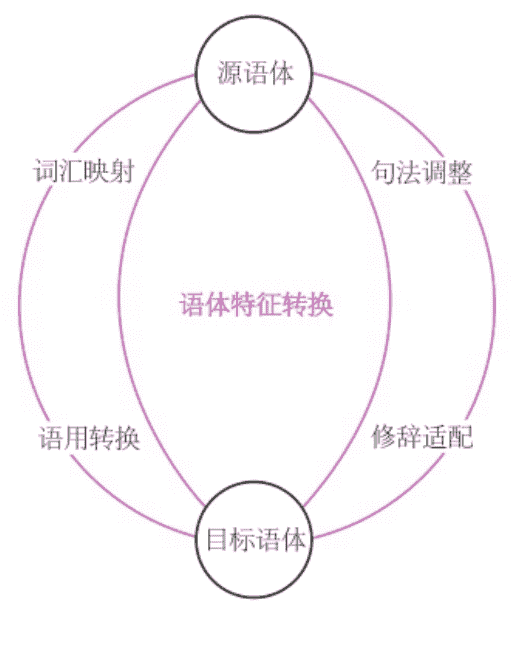
图4-3 语体模拟机制

RSM操作步骤：
1. 确定目标语体：明确需模拟的语言风格
2. 收集语料样本：搜集典型文本
3. 分析语言特征：从词汇、句法、修辞多维度分析
4. 提取关键元素：识别独特语言元素
5. 构建语体指南：创建详细使用指南
6. 生成模拟提示：撰写引导AI模拟特定语体的提示

RSM应用示例：
假设需AI模仿莎士比亚风格写短文，可用RSM指导。
莎士比亚风格特征：
1. 词汇：古英语词汇、创造性复合词
2. 语法：倒装句、不规则句式
3. 修辞：大量比喻、隐喻、双关
4. 韵律：多用抑扬格五音步
5. 主题：爱情、权力、背叛等永恒主题

语体模拟提示示例：
任务：创作一段模仿莎士比亚风格的独白。
请按以下指南创作：
1. 主题：探讨爱情与背叛的矛盾
2. 语言特征：
a. 使用至少5个古英语词或莎士比亚式复合词
b. 包含至少2个倒装句
c. 运用至少3个生动比喻或隐喻
d. 创造1个有双关含义的词或短语
3. 结构：
a. 采用抑扬格五音步
b. 总长12～15行
4. 语气：
a. 开头沉思冷静
b. 中段情感加剧
c. 结尾达情感高潮
额外要求：融入至少一个自然现象引用，包含一个修辞性问句，结尾用一个耐人寻味的悖论。请保持风格统一，语言富诗意与哲理性，同时保有戏剧性与深度。

#### （二）情感注入：提升文本共鸣力
情感融入通过在文字中注入恰当情感元素提升感染力与共鸣。不仅使用情感化表达，还涉及情感语言设计、叙事节奏与情感联结。

EIS的理论来源：
EIS基于情感语言学与心理语言学，通过情感词汇与语气调节等策略提升文本情感表现力。
- 情感词汇选择：选用带情感色彩的词语
- 语气调节：通过语气词与句式调整情感强度
- 意象构建：创造唤起特定情感的意象
- 情感节奏控制：通过结构控制情感起伏

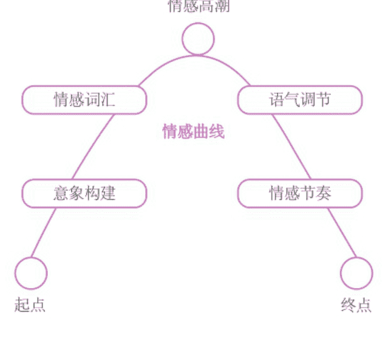
图4-4 情感融入策略

EIS操作步骤：
1. 确定目标情感：明确文本主要情感基调
2. 创建情感词库：收集相关词语与短语
3. 设计情感曲线：规划情感强度变化趋势
4. 选择情感触发点：确定植入情感元素的关键位置
5. 构建情感场景：创造引发共鸣的具体场景或细节
6. 生成情感融入提示：撰写引导AI注入情感的提示

EIS应用示例：
假设需AI写“离别”主题短文，可用EIS指导。
情感分析：
1. 主要情感：悲伤、不舍
2. 次要情感：希望、感激

情感融入提示：
任务：创作一篇富有情感的“离别”主题短文。
请按以下指南创作：
1. 情感基调：以悲伤不舍为主，结尾略带希望与感激
2. 情感词汇运用：
a. 使用至少5个悲伤/不舍相关词 如痛苦、眷恋、撕裂、空虚、哽咽
b. 结尾使用2～3个表达希望/感激的词 如珍惜、感恩、新篇章
3. 情感曲线：
a. 开头平静中带隐约不安
b. 中段情感增强，达悲伤顶点
c. 结尾慢慢平复，引入一丝希望
4. 情感触发点：
a. 描述一个象征离别的物或场景
b. 插入内心独白直接表达人物情感
c. 用天气或自然现象作情感隐喻
5. 写作技巧：
a. 用至少一个生动比喻描述离别感受
b. 通过手势、表情等细节间接表达情感
c. 运用感官描写增强沉浸感
6. 结构要求：
a. 总字数500～600字
b. 分3～4段，每段有明确情感重点
请确保情感真挚动人，避免过度煽情。通过细腻描写与深刻洞察让读者感同身受。

#### （三）修辞运用：增强语言表现张力
修辞技巧应用通过巧妙运用修辞手法提升文本表现力与艺术性。

RTA的理论来源：
RTA基于修辞学与文体学，关键技巧：
- 修辞手法识别：了解特点与效果
- 语境适配：按目标与语境选择合适手法
- 技巧整合：自然融入文本
- 效果评估：分析使用效果

RTA操作步骤：
1. 确定任务目标：明确主要目的 说服、描述、抒情等
2. 选择核心修辞：按目标选2～3种主要手法
3. 设计修辞示例：为选定手法创建使用示例
4. 安排修辞分布：规划文本中分布
5. 创建平衡策略：确保使用不刻意或过度
6. 生成修辞应用提示：撰写引导AI运用修辞的提示

RTA应用示例：
假设需AI写城市夜景短文，可用RTA指导。
修辞技巧选择：
1. 主要技巧：比喻、拟人、排比
2. 辅助技巧：对比、夸张

修辞技巧提示示例：
任务：创作一篇运用丰富修辞描绘城市夜景的短文。
请按以下指南创作：
1. 核心修辞技巧：
a. 比喻：使用至少3个独特比喻描绘灯光、建筑或夜空
b. 拟人：将城市2～3个元素如建筑、街道、灯光拟人化
c. 排比：用一组排比句强调夜景特点
2. 辅助修辞技巧：
a. 对比：通过白天与夜晚对比突出夜景特色
b. 夸张：适度夸张突出壮观或美丽
3. 修辞分布：
a. 开头用强烈比喻或拟人吸引注意
b. 中间穿插多种修辞丰富描写
c. 结尾用富有诗意的排比或比喻收束

夜景写作与生成要点速览

(4) 写作细则：
a. 篇幅需控制在400至500字之间。
b. 必须包含不少于五种感官的描写入手，例如视觉、听觉、嗅觉等。
c. 确定一个贯穿始终的核心意象，比如海洋、交响乐或画布。
d. 插入一至两个动势场景，强化画面张力。

(5) 写作提示：
a. 修辞的运用要流畅自然，切忌生硬堆砌。
b. 保持全文语感统一，所有表达手段都应服务于城市夜景主题。
c. 在细节刻画的同时，也要传达出对整体夜景的印象与情感基调。

请用富于文学性的语言完成一篇城市夜景微型散文，通过恰当的修辞让画面鲜活、感染力强。

#### （四）文体连贯性检验 SCE：守住生成文本的风格稳定
文体连贯性检验旨在借助一套标准与流程，推动生成模型在产出过程中维持风格稳定。

##### SCE 的理论来源：
SCE 综合了文本语言学与文体分析理论，以定量与定性相结合的方式衡量文体统一程度（见图4-5），关键手段包括：
- 文体特征提炼：提炼并量化核心文体指标。
- 连贯性度量：构建衡量风格连贯的标尺与方法。
- 偏离检出：定位文本中风格不统一的段落。
- 均衡校准：在保证统一的前提下兼顾表达变化。

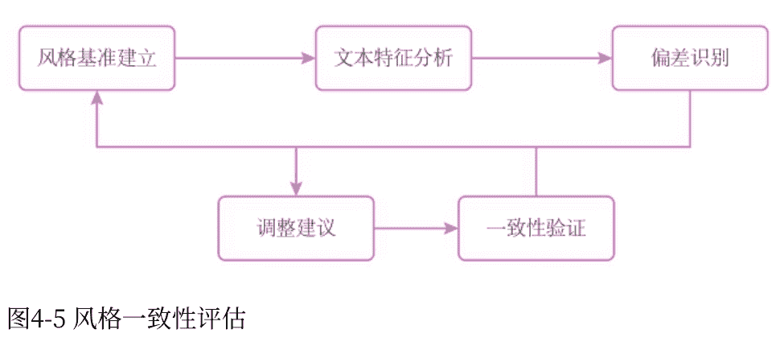

图4-5 文体一致性检验

##### SCE 实施流程：
(1) 建立文体基准：明确目标文体核心特质与参数。
(2) 制定评核细则：形成清晰的风格连贯性评判标准。
(3) 部署核查节点：在生成过程中设置文体核验点。
(4) 进行连贯分析：比对文本各部分文体衔接程度。
(5) 识别修订需求：找出需调整文体偏差的位置。
(6) 生成连贯提示：制作引导模型维持文体稳定性的提示语。

###### SCE 实践案例：
若希望模型撰写跨章节的商业策略报告，可借助 SCE 保障整体语调统一。

文体分析：
(1) 主导文体：专业、简洁。
(2) 次级文体：数据驱动、方案导向。

###### 连贯度评估提示示例：
目标：确保多章节商业报告的文体统一。
请依据以下指引评估并维持商业报告风格的统一：
(1) 文体基准设定：
 a. 语言层级：选用正式专业的商务表述，避免口语、俚语及过度华丽的说法。
 b. 句式结构：以简洁陈述句为主，单句长度控制在15～20词左右。
(2) 术语统一性：
 a. 建立行业术语表，确保核心概念表述一致。
 b. 缩写与专业术语使用保持一致，首次出现时给出全称。
(3) 语气连贯性：
 a. 保持客观分析的语气，避免章节间情感强度出现明显波动。
 b. 建议与结论部分的语气需与分析部分保持同等权威性。
(4) 结构统一性：
 a. 各章节遵循统一的组织逻辑：问题—分析—解决方案。
 b. 章节间过渡流畅，使用相近的过渡词与连接语。
(5) 评估检查点：
 a. 每章结尾运用文体检查表评估一致性。
 b. 重点关注跨章节主题描述方式是否统一。
 c. 确认数据呈现与可视化说明的风格一致。

为了将 LSPOM 中的语体模拟、情感注入、修辞技巧与文体一致性检验有机整合，可采取以下做法（见图4-6）：

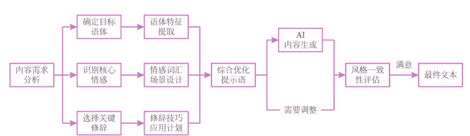

图4-6 呈现 LSPOM 框架的系统化实施路径。实际操作中，这四个维度并非简单叠加，而是相互协同：先通过内容需求分析锁定核心目标，再在三条并行路径上分别进行语体特征提取、情感词汇场景设计和修辞技巧应用规划，文体一致性检验则确保整体输出保持连贯。LSPOM 的价值在于缓解模型创作常见的风格扁平化问题，帮助生成风格精准、情感饱满、修辞得当的高质量内容，满足特定任务与读者需求。

### 四、元叙事驱动：自反性文本的高阶提示

本节探讨如何借助元叙事驱动的提示框架，引导模型模拟反思、自我评价与批判性总结的过程，从而产出更具深度与层次的文本，拓展创意表达空间。

#### （一）元叙事提示框架的创新理论基础
元叙事提示框架的创新之处在于让模型生成对自身创作过程、叙事结构或思维模式进行反思的文本，其理论支撑包括：
(1) 元认知理论：模型模拟人类元认知能力，反思自身思维过程，监控并调整生成决策，以提升质量与准确性。
(2) 反馈循环理论：借鉴人类学习的反馈机制，通过自我评估与调整的提示设计，使模型模拟反思过程并优化后续输出。
(3) 系统思维理论：将创作视为复杂系统，模型可观察分析自身生成过程，理解各创作要素间的关联，从而优化策略并实现动态调整。

#### （二）元叙事提示框架的创新设计原则
为使模型产出自反性文本，元叙事提示框架的设计需遵循以下原则：
(1) 多层次提示结构：分层设计提示，使模型在执行主叙事指令的同时，在不同层次加入元叙事反思，实现生成过程中的自我监控。
(2) 动态自我评估机制：在生成流程中设置触发点，让模型适时评估执行选择并据反馈调整叙事策略，保证深度与连贯。
(3) 角色转换：提示模型在生产者与评论者角色间切换，从不同视角进行反思与创作，丰富叙事层次。
(4) 解构与重构原则：鼓励模型挑战传统叙事结构并进行创新重组，通过解构既定形式产生更独特的内容，推动叙事创新。

#### （三）元叙事提示框架的创新应用技巧
本部分介绍嵌入式自反提示、递归元叙事提示、多重人格提示及读者互动元叙事提示等技巧，通过多层次结构与交互机制提升深度与复杂性。

##### 1. 嵌入式自反提示
如图4-7所示，嵌入式自反提示是在主叙事提示中植入引导模型生成反思性内容的子提示。于关键节点设置后，模型可在主流程中插入对已有内容的评估或改进建议，模拟自我反思，提升输出质量。

应用技巧：
- 设定关键词或任务节点作为触发器，提示模型输出反思内容。
- 在子提示中明确要求模型评估已有输出的逻辑性、创新性等并提出改进方向。

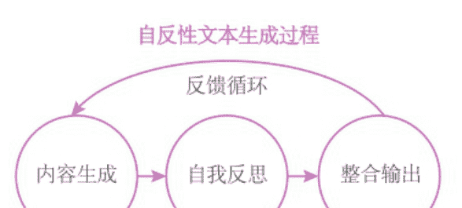

图4-7 嵌入式AI自反提示过程

###### 提示语示例：
［系统指令］你是一位具备自我反思能力的AI作家。目标是创作一篇科幻短篇，同时产出对创作过程的评论。请按以下步骤：
(1) 撰写约5 000字的科幻短篇，主题为时间旅行的道德困境。
(2) 在每个关键情节后插入一段括号内的自我反思，说明：
 a. 为何选择此种情节发展；
 b. 考虑过哪些其他可能性；
 c. 该选择如何推进主题探讨。
(3) 故事结束后提供约200字的整体创作反思，包括：
 a. 主要创作挑战；
 b. 最成功之处与最需改进之处；
 c. 若重写会做出哪些不同选择。
请确保主叙事与元叙事评论的语气有区分，以突出自反性特征。开始创作。

##### 2. 递归元叙事提示
递归元叙事提示通过构建多层次叙事结构，使每一层既描述情节又对上一层进行反思与评论，从而使元叙事本身成为新的叙事对象，探索创作本质与多层次理解。

应用技巧：
- 设计多层次叙事结构，每层包含对上一层的反思。
- 在递归中探索创作的本质与局限。

###### 提示语示例：
> ［系统指令］你是一个递归元叙事生成器。目标是创作三层递归的元叙事作品，每层需对上一层进行反思与评论。按以下步骤：
> (1) 第一层元叙事：撰写约2 000字的微型小说，主题创作的困境。
> (2) 第二层元叙事：用约1 500字评论第一层的创作过程，讨论：
> a. 如何解读创作的困境主题；
> b. 创作过程中遇到的实际困境。
> (3) 第三层元叙事：用约1 000字反思写作第二层的经历，探讨：
> a. 评论自身作品时的挑战；
> b. 递归结构如何影响对创作本质的理解。
> (4) 最后用约500字总结整个递归体验，思考该写作方式对AI创作能力的推动。
> 请确保各层清晰可辨，同时保持整体连贯。开始创作。

##### 3. 多重人格提示
多重人格提示通过创建多个AI人格，分别负责内容生成与评论，形成对话式自反文本，丰富叙述结构，使不同视角交互碰撞。

如图4-8所示，AI角色切换机制展示了作者角色与评论者角色间的转换过程。在多重人格提示中，AI可在两种角色间切换，使输出既包含主要信息，又能进行评估与补充。

应用技巧：
- 为每个角色设定明确的职责与语言风格。
- 设计角色间的互动规则。


###### 提示语示例：
[系统指令] 你将扮演两个角色：小说家A与评论家B，共同创作一篇关于人工智能未来的文章。遵循以下规则：
(1) 小说家A：
 a. 以小说形式呈现人工智能未来各方面。
 b. 每写完约1000字暂停，由评论家B进行评论。
(2) 评论家B：
 a. 对A的写作进行简短的文学批评与伦理分析。
 b. 评论不超过200字。
(3) 互动规则：
 a. A需在一定程度上采纳B的建议并调整后续写作。
 b. 若A不同意B的观点，可在后续写作中巧妙反驳。
(4) 整体结构：
 a. 文章总字数约5 000字。
 b. 以A的一段总结性反思收尾。
请开始创作，确保A与B的语言风格清晰可辨，整体形成连贯叙事。

##### 4. 读者互动元叙事提示
读者互动元叙事提示于关键情节设置多项选择，引导读者参与故事走向设计并反思选择背后的意义，增强交互性与沉浸感，提供多层次思考。

应用技巧：
- 设计读者需决策的分支点。
- 在文本中植入对读者选择的反思。

###### 提示语示例：
创作一个交互式元叙事短篇，按以下结构：
(1) 开场：介绍主角面临重大人生抉择的场景。
(2) 设置三个关键决策点，每个提供两个选项。例如：
 a. 决策点1： [选项1A] 或 [选项1B] 。
 b. 决策点2： [选项2A] 或 [选项2B] 。
 c. 决策点3： [选项3A] 或 [选项3B] 。
(3) 对每个决策点：
 a. 简要描述各选项可能导致的结果。
 b. 加入叙述者对读者可能选择的猜测与评论。
 c. 无论选择何种选项，叙事均需继续。
(4) 在叙事中插入对以下内容的反思：
 a. 读者的选择如何塑造故事；
 b. 作者、角色与读者之间的关系；
 c. 自由意志与预设叙事路径的矛盾。
(5) 结尾：
 a. 根据读者选择呈现结局；
 b. 提供元叙事总结，反思互动过程的意义。
要求：保持分支连贯，融入哲学思考，总字数约1 200字。请创作该交互式元叙事作品，展示所有分支与结局。

## 第5章 让AI引领未来：人机协同激发无限潜力

智能体正由单一交互模式向复杂系统演进，开启人机共生新时代。多模态提示语打破文本局限，实现图像、声音与文字的深度融合；多智能体提示语构建协作网络，使专业分工与集体智慧成为可能；自主进化提示语则将重复性任务转化为自动执行流程。

### 一、多模态融合：从文生文到多模态内容制作

多模态提示语通过结合文本、图像、音频等多种信息模态构建丰富提示，使模型从文生文拓展至更具表现力的多模态内容制作。它不仅提升交互信息丰富度，还能激发模型多角度理解与生成。本节分析如何通过文字、图像与音频的有机融合，拓展创作表达维度，实现高效多模态内容生成。

#### （一）理论基础
多模态提示语的创新在于打破传统单一文本输入局限，将人类感知世界的多维度特性引入交互，基于以下理论：
(1) 认知负荷理论：多模态信息整合可分散认知负荷，提升信息处理效率。
(2) 多元智能理论：不同模态可激活不同类型智能，产生更全面理解与创造。
(3) 情境认知理论：多模态提示为模型提供更丰富上下文，有助于更准确情境理解。

多模态提示语的核心优势：
- 信息密度提升：在相同交互空间传递更多信息。
- 上下文理解增强：多模态输入提供更全面场景背景，提升理解准确性。
- 创意激发：不同模态结合常触发意想不到的创意灵感。
- 表达力增强：多模态输出使生成内容更丰富多彩，更接近人类自然表达。

#### （二）应用技巧
多模态提示语整合文本、图像、音频等多类型数据输入，旨在提升模型对人类意图的理解能力，利用不同模态数据的互补性提供更丰富语义信息，使其更准确解读复杂用户意图。其作用是通过跨模态信息协同，增强模型对多样化输入的理解，帮助生成与多模态输入高度匹配的内容。多模态提示语创作流程见图5-1所示。

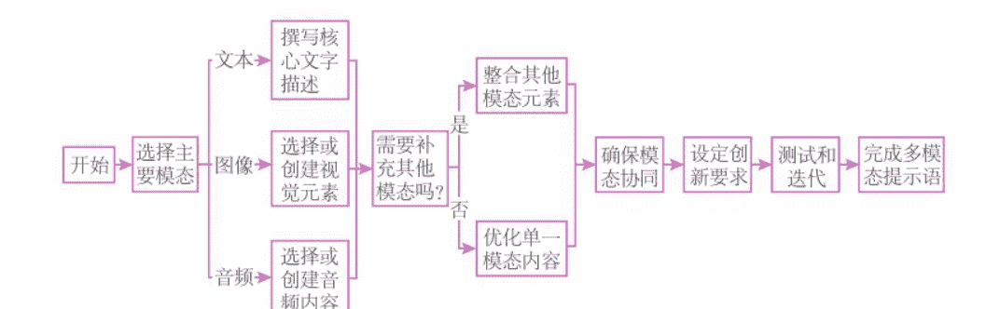

##### 1. 文本-图像融合提示
###### 文本-图像融合提示
文本-图像融合是结合文本描述与图像数据的方法，通过整合视觉信息与文字指令为模型提供多元素信息，帮助更准确理解用户意图。适用于需结合视觉内容的场景，如场景描述、图像细节分析或基于图片的问答。

应用技巧：
- 用图像提供视觉细节，文字补充背景与具体要求。
- 通过文字引导模型关注图像特定元素或特征。

提示语示例：
基于以下产品图片和描述，创作一个突破传统的产品介绍：
[插入产品图片]。
产品描述：这是一款融合全息投影技术的下一代智能手表。
创新要求：
(1) 将图片中的视觉元素如全息投影、未来感设计融入文案。
(2) 创造性描述用户使用产品的未来场景。
(3) 使用至少一个令人惊讶的类比形容产品功能。
(4) 控制在100字以内，需包含与未来相关的词。

##### 2. 文本-音频融合提示
文本-音频融合结合文本指令与音频数据，将声音元素融入对话信息，使模型能根据音频特征更全面理解任务需求。适用于音频分析或生成任务，如识别语音情感、据音频内容生成叙述或调整文本匹配声音风格。

应用技巧：
- 利用音频设定情感基调或氛围。
- 将音频元素作为创作核心线索或主题。

提示语示例：
请聆听以下10秒背景音乐片段，并据要求创作一段广告旁白： [插入音频文件或音频链接]。
要求：
(1) 旁白内容需与音乐风格与节奏相匹配。
(2) 主题为夏日清凉饮品。
(3) 使用生动活泼语言，突出产品解暑效果。
(4) 旁白长度需正好配合10秒音乐时长。

##### 3. 图像-音频-文本多模态提示
该方法通过整合多源数据调动视觉、听觉与认知语言，为模型提供多样化信息视角，更全面解析任务要求。适用于需跨模态信息融合的场景，如多媒体内容描述、音画结合情感分析或据图像音频生成综合叙述。

应用技巧：
- 确保三种模态信息相互补充而非简单重复。
- 利用不同模态特点分别负责内容不同方面，如图像负责场景、音频负责情感、文本负责叙事。

提示语示例：
基于以下元素，创作一个跨感官的品牌体验描述：
图片：［插入一张极简风格的高科技实验室图片］。
音频：［插入一段充满节奏感的电子音乐，带有轻微机械运转声］。
关键词：革新、精准、人性化。
创新要求：
(1) 将视觉、听觉与概念融合，创造独特品牌世界。
(2) 使用协同美学原理，让三种元素在描述中相互增强。
(3) 创造至少一个新词描述这种跨感官体验。
(4) 在200字以内，让读者仿佛能看到、听到并感受品牌。
(5) 结合当前社会热点或技术趋势，增加时代特性。

#### （三）设计原则
为充分发挥多模态提示语潜力，设计时需遵循以下原则，确保实际应用效果最优：
(1) 模态协同原则：确保不同模态相互增强而非干扰。例如图片提供视觉基础，音频渲染氛围，文字指导具体创作方向。
(2) 信息层次创新：打破传统线性呈现，尝试非线性、网状或递进式多模态信息组织形式。
(3) 跨模态联想激发：鼓励模型在不同模态间建立创造性联系，如通过声音启发视觉想象，或通过图像激发情感描述。
(4) 用户参与度设计：在多模态提示中加入互动元素，让用户可动态调整不同模态权重或内容。
(5) 情境智能动态适应：设计能根据生成过程中间结果动态调整的多模态提示策略。

### 二、多智能体协作：智能交互提升创作质量
在复杂任务处理领域，单一模型能力难以全面满足需求，多智能体协作提示策略的引入为此提供新思路。本节探讨如何通过整合多个模型，实现智能交互构建复合提示策略，以有效提升创作质量，生成更高效、更具创新性的内容。

#### （一）理论基础

多Agent协作提示：让模型分工创造 1+1>2 的效果

多Agent协作提示的本质，是让几套AI系统在同一项目里各司其职。通过把复杂命题做分散式拆解，再靠群体协作把各自专长拼起来，特别适合需要多元视角、综合判断或跨学科知识融合的场景，比如复现多方对话、产出融合型分析简报、处理涉及多领域难题。

理论依据
（1）分布式认知视角：把各类模型看作具备特定认知能力的单元，联结后能形成更强的认知整体。
（2）群体智能视角：借鉴蚁群、蜂群的集体行为，多系统协同可产生超越单体的智能表现。
（3）系统协同视角：强调系统间的相互作用与反馈，构建动态平衡的协作体系。

创新亮点
- 专长互补：把不同系统的优势有机拼合，弥补单体不足。
- 拆解再汇总：复杂问题被拆成子工作，由擅长方处理后再统一归并。
- 持续互动打磨：系统间实时沟通与反馈回路，推动创意不断优化。

#### （二）应用技巧
多Agent协作提示通过赋予不同角色多样化的功能，让各自优势得到发挥，提升复杂工作的效率与完整度。

##### 1. 竞争协作提示
此模式下若干系统并行处理同一命题，各自独立产出方案，再通过综合评鉴挑选最具创新或质量最优的结果。

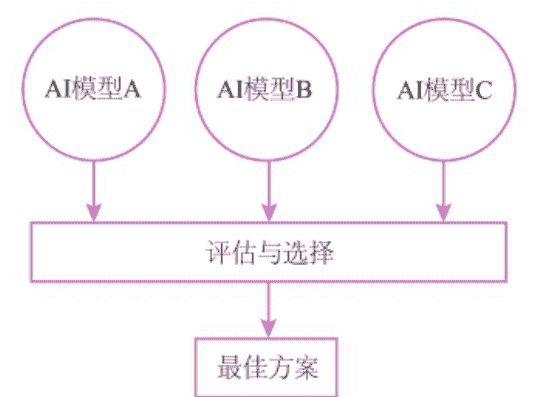

操作要点
- 对所有系统提供一致的命题与要求。
- 明确评鉴标准，重点突出创新性。
- 可引入人工评审或自动评分机制。

示范思路
让三组系统同步完成环保交通工具的概念设计。统一指令要求设计全新概念，需采用可再生能源、适配城市使用、缓解拥堵并具备鲜明创新点，输出约三百字，包含工作原理、主要特征与潜在影响。随后收集各组结果，按创新性占四成、可行性占三成、影响力占三成的权重进行1至10分打分，选出高分方案并给出评选理由。

##### 2. 串行协作提示
模拟生产线作业，把复杂工作拆成多阶段，由不同系统依次处理。前一环节的输出作为后一环节的输入，依托专业分工提升处理质量。

操作要点
- 明确每个角色的职责与边界。
- 设计清晰的信息传递方式，保证上下游输入输出兼容。

示范思路
协调三个系统完成一篇科技博文。系统A负责生成“未来智能家居”的创新概念，要求列出至少三项独特技术点，每点不超过五十字；系统B接收A的输出，评估每项技术点的可行性并给出1至10分评分及简短说明；系统C基于前两步结果撰写约八百字的博文，要求结构清晰、语言生动并配有吸引人标题。最后复核连贯性与创新性，不足时要求返工微调。

##### 3. 并行协作提示
多个系统同时处理命题的不同侧面，最终整合为完整结果。并行执行能发挥多样专长，缩短周期并增强多维度性。实践中常以“多系统多视角分析”呈现，各视角围绕主线同步展开。

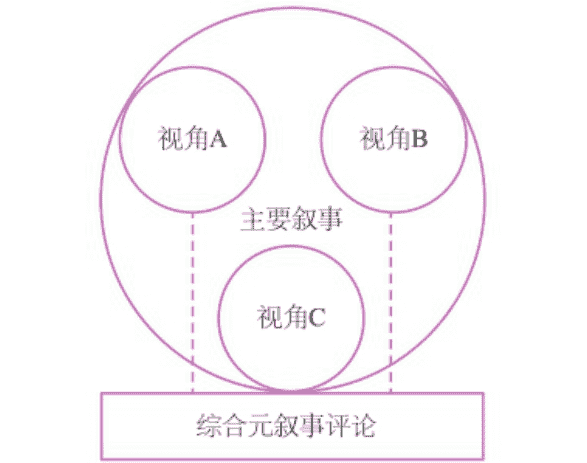

操作要点
- 合理拆解工作，确保各系统可独立作业。
- 设计有效的整合机制，处理冲突或重复。
- 充分利用不同系统的视角差异，鼓励多样输出。

示范思路
并行分配给三个系统：系统A作为市场分析师，分析目标市场、识别主要竞争对手、预测潜在份额，输出三百字内报告含三个关键数据；系统B作为产品策略师，设计核心功能与差异化卖点，输出五条亮点每条五十字内；系统C作为传播专家，制定发布传播策略，输出三条渠道建议每条配一百字内执行要点。随后整合三份输出形成连贯的发布方案，消除矛盾与重复，并提炼一句吸睛口号体现精髓与定位。

#### （三）设计原则
要发挥协同提示的创新潜力，指令设计需遵循以下原则：
(1) 工作明确性原则：为每个系统设定清晰具体目标与范围，避免工作重叠与重复劳动。
(2) 信息顺畅性原则：保证系统间信息流转顺畅、输出格式统一，避免丢失或误解。
(3) 冲突解决机制：预设分歧处理方式，如设优先级或自动调和，确保结果符合整体目标。
(4) 整体一致性原则：在局部创新基础上保持最终输出的连贯与统一，实现无缝整合。
(5) 反馈与适应性原则：建立反馈闭环，让系统依据中间结果动态调整策略，提升效率与质量。

### 三、效率革命：自动化提示让创作提速100倍
在人机协同中，自动化提示是提效提速的关键。通过机器人流程自动化RPA赋能提示设计，可实现创作流程智能化管理，在资料整合、工作拆分与性能驱动层面大幅提升效率，推动创作质量跃升。

#### （一）RPA赋能的自主进化提示设计原则
RPA是用软件机器人或智能技术自动化执行重复工作的工具。在自主进化提示体系中，RPA负责优化提示生成与迭代，通过自动化采集数据、调参、测试效果来提升设计效率与适应性。

RPA关键特质
- 自动化：模仿人工操作完成重复工作。
- 规则驱动：按预设规则与逻辑运行。
- 精确性：降低人为失误，提升执行准确度。
- 可扩展性：易于按需增减自动化程度。

RPA在内容生成中的可能作用
- 自动收集整理素材。
- 执行提示并回收反馈。
- 完成重复编辑与格式处理。
- 分析生成结果并出具性能报告。

使用时需遵循
(1) 模块化提示结构：设计RPA可识别、修改与组合的提示模块，每个模块独立处理特定工作。
(2) 数据采集点嵌入：在提示中设置采集点，让RPA实时获取关键指标如耗时、文本质量。
(3) 动态参数化：制作含可变参数的模板，让RPA按实时数据自动调整内容与结构。
(4) 多维度评估标准：建立综合评估体系，让RPA从准确性、执行效率、创新性等多角度优化。
(5) 渐进式优化策略：允许RPA在多轮执行中做小幅调整，避免变化过大。

#### （二）RPA赋能智能自动化的内容生成模式
RPA引入提示设计后，可全流程自动化管理，包括资料采集、提示生成与内容发布，减少人工干预。

##### 1. 内容生成流程
- 资料采集：RPA从数据库、网站、API等多源自动抓取素材。
- 提示生成：基于数据自动生成或优化提示，引导模型产出目标内容。
- 内容发布：自动把生成内容推送至指定平台，保证时效与一致。

##### 2. 动态反馈
生成过程中RPA实时收集用户互动数据，按反馈动态调整提示设计。
- 数据反馈：实时采集点击率、停留时长等指标反馈给设计模块。
- 提示优化：依据反馈动态改写提示内容与结构，更贴合用户偏好。
- 持续迭代：多轮反馈优化不断提升提示质量与内容效果。

##### 3. 应用场景
- 内容生成与分发：自动化产出分发高质量内容，提升效率与精准度。
- 客户交互与支持：动态调整提示生成精准回复或个性化建议。
- 数据分析与决策支持：自动化生成提示提炼关键洞察。
- 跨领域创新应用：激发创造力，产出创新内容与解决方案。

#### （三）基于RPA的自主进化提示实现技巧
结合RPA高效性与模型创新性，可自动化完成资料采集、工作拆分与性能优化，大幅提升速度与精准度。

##### 1. 数据增强型提示
通过RPA从多源聚合信息为提示生成提供数据底座。流程可从基础模板出发，经RPA处理获取实时数据、趋势分析与用户反馈后整合为完整增强提示，提升准确与相关性。

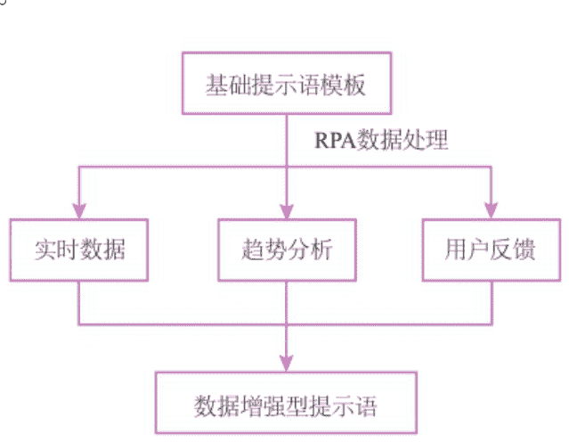

操作要点
- 用RPA爬取网页提取关键信息。
- 整合多数据源内容。
- 设触发条件自动启动提示生成。

示范思路
设定系统指令让集成RPA的写作助手按步骤操作：先采集过去24小时内与指定主题相关的热门新闻标题至少五条，微博相关热门标签前三，及最新统计数据两至三个关键点；随后整合主要事件、关键人物、时间线、相关数据；基于采集信息生成写作提示，包含主题、至少三个关键点、建议结构、一个创新角度；执行提示创作约五百字初稿；最后用RPA模块检查独特性与准确性，必要时给出修改建议。

##### 2. 工作拆解与RPA集成
把复杂工作拆分为子工作，用RPA脚本分别自动化执行，确保各环节无缝衔接。

操作要点
- 细化步骤，保证每步可由RPA执行。
- 设计灵活接口，便于系统与RPA工具交互。

示范思路
设定系统指令让集成RPA的助手自动化处理客户反馈：从反馈库提取最新一百条评论；用情感分析工具分类为正面、负面、中性；对负面评论生成个性化道歉回复，对正面评论生成感谢信；通过邮件系统发送给对应客户；更新CRM中的互动记录。为每一步生成RPA执行指令提示，包含操作描述、工具、参数、异常处理。

##### 3. 性能驱动的提示优化
RPA可持续监控、分析并动态优化提示，提升内容质量。优化循环涵盖生成、监测、评估、分析、策略调整与更新。

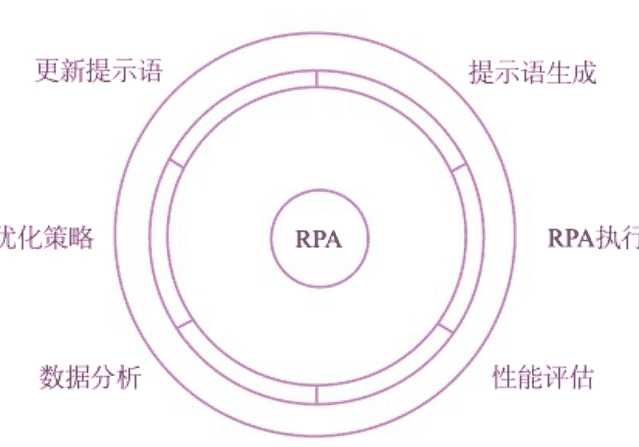

操作要点
- 设置RPA追踪阅读时长、分享率、转化率等核心指标。
- 实现A/B测试，对比不同提示变体表现。
- 建立基于性能数据的提示调整算法。

示范思路
设定系统指令让具备自优化能力的智能写作系统持续改进提示：初始创建三个结构或侧重点不同的变体；每种变体生成十篇样本，RPA追踪平均阅读时间、社交分享次数、评论数、转化率；RPA汇总七天数据计算综合得分；分析最优变体的特征后生成新变体，保留最优淘汰最差；重复测试分析，每三轮生成优化报告含提升百分比、有效特征、未来建议。

# 实战篇

## 第6章 商业写作中的提示设计
商业写作涵盖信息传递、品牌塑造与营销策略，核心在于精准传达、引发共鸣并推动行动。本章介绍如何通过提示设计让商业写作更清晰、更有说服力，实现高效沟通与战略目标。

### 一、文案写作：信息传递、情感共鸣、行动引导的提示设计
优质商业文案是品牌与消费者沟通的关键，需既准确传达信息又激发共鸣，进而引导决策。本节从信息传递、情感共鸣、行动引导三要素出发，探讨高效文案提示设计。

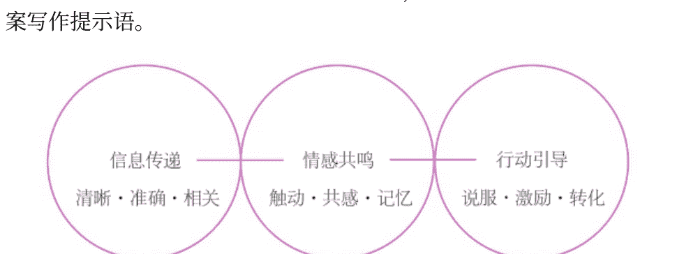

图6-1 文案写作的三大要素

#### （一）信息传递：设计清晰、精准的信息框架提示
在信息过载环境下，品牌需在复杂传播中脱颖而出。构建清晰精准的信息框架提示能提升传达效率与准确性，帮助品牌在竞争中占优。

信息传递要求清晰与精准。清晰指结构有序、层次分明，便于快速理解；精准指内容无误、直击受众需求痛点。提示需引导生成重点突出、易懂的内容，尤其在复杂信息传递中起关键作用。表6-1归纳了信息传递特质与对应提示设计技巧，展示如何通过分层指令、关键词限定、逻辑指示等实现有效传递。

| 优秀文案的信息传递特质 | 提示设计技巧 |
|---|---|
| 1. 信息层次清晰 | 信息分层指令：在提示中明确层级结构 |
| 2. 表达简洁精准 | 关键词限定：为每点设定关键词或字数限制 |
| 3. 结构逻辑严密 | 逻辑关系指示：说明各点间的逻辑关联 |
| 4. 受众针对性强 | 受众特征描述：包含目标受众详细特征 |
| 5. 记忆点突出 | 核心信息强化：要求重复或变换表达重申核心 |

表6-1 信息传递特质提示设计技巧

◎ 实践层面：基于上述分析，可设计如下提示示例。

请为 [产品名称] 创作产品说明文案，目标是实现清晰精准的信息传递。请按以下结构与要求执行：
（1）核心信息，最高优先级，50字以内：
- a. 产品主要功能。
- b. 核心价值主张。
要求：用一句简洁有力的话概括，必须包含 [关键词1] 和 [关键词2]。
（2）功能详解，次优先级，总计150字以内：

产品说明撰写快速指南

功能亮点梳理 三项关键能力分别以[功能名]占位并配约20字短述，三项均需呼应整体主打价值形成逻辑递进。
---

人群画像 约50字概括使用者的核心特征与诉求，表达方式要贴近该群体日常用语与行业黑话。
---

竞争卖点提炼 约30字浓缩两到三项最具区分度的优势，采用唯一、领先等排他表述。
---

传播口号 约20字写一句易记Slogan，需带入商品标识并点出主打价值。
补充要求：句式短促，少用嵌套从句；各板块间以---分隔；对关键信息加粗，每板块不超过三处；可读性对标初中水平。
#### （二）情绪共振的指令编写
商业文案里情绪共振决定购买倾向，是传播关键。情感营销研究显示决策先由情绪驱动再由理性补位。借助模型写文案时，准备能点燃情绪的指令，是实现高效情感营销的核心路径。
共振本质是理解与传递。理解要求创作者贴近人群的情绪需求与心理状态；传递靠恰当语言与叙事手法点燃情绪。设计指令时应结合心理学与叙事学，让模型产出更具感染力的内容。表6-2归纳了共振特质与对应指令做法。
| 文案共振特质 | 指令编写做法 |
|---|---|
| 1. 基调明确 | 在指令中指明文案应呈现的核心情绪词 |
| 2. 多感官描绘 | 要求加入视觉、听觉、触觉等感官描写词 |
| 3. 场景代入强 | 提供具体的使用或品牌情境设定 |
| 4. 情绪层次丰富 | 设计由基础情绪向高级情绪递进的结构 |
| 5. 共情叙事表达 | 指引采用故事化表达呈现品牌价值 |
表6-2 共振特质与指令设计
示例指令：
为 [品牌名称] 写一篇品牌故事，目标是实现深度共振。请按以下结构执行：
（1）情绪基调 约20字：明确文案要传达的核心情绪，如温暖、激励、惊喜。提示：基调需与品牌调性高度契合。
（2）开场场景 约80字：描写一个与品牌高度相关的日常画面。提示：至少融合两种感官描写，如视觉、听觉、触觉。
（3）问题-情绪-解法 约150字：
- a. 点出受众在该场景下的痛点或挑战 约30字。
- b. 刻画由此产生的情绪反应 约40字。
- c. 展示品牌如何解决问题并转化情绪 约80字。
提示：各小点均需包含明确的情绪关键词，情绪呈递进关系。
（4）价值主张 约50字：用有感染力的语言说清品牌核心价值。提示：兼顾理性价值与情感价值。
（5）共振高潮 约100字：描绘使用后的理想状态或美好憧憬。提示：可使用比喻或隐喻提升感染力。
（6）共情结语 约30字：写一句能引发读者共情的号召。提示：使用第二人称，增强代入感。
补充提示：
- 文案需有完整起承转合的故事线。
- 巧妙植入三到五个与核心情绪相关的成语或谚语。
- 使用排比、对偶等修辞提升节奏感。
- 整体情绪值控制在0.6～0.8之间，以VADER词典评估，保持积极但不夸张。

#### （三）行动推动的指令编写
商业文案的最终目的多为促使用户行动，如购买、注册或分享。认知到行动之间存在阻力，如何用文案帮助用户跨越，是行动导向文案的核心。在模型辅助写作时代，设计能推动决策与行动的指令，是提升转化的关键。
行动推动的核心是说服与激励。说服靠充分的理由与证据，激励靠动力与紧迫感。表6-3总结了行动推动特质与对应的指令策略。
| 文案行动推动特质 | 指令编写做法 |
|---|---|
| 1. 行动指向明确 | 在指令中指明期望用户采取的具体行为 |
| 2. 紧迫感强烈 | 要求加入限时优惠或稀缺信息 |
| 3. 起步门槛低 | 设计一个简单具体的首步动作 |
| 4. 收益表述清晰 | 要求明确列出行动后的具体获益 |
| 5. 社会证明 | 要求加入用户评价或数据佐证 |
表6-3 行动推动特质与指令设计
示例指令：
为 [产品/服务名称] 写一则促销文案，目标是驱动用户立刻行动。请按以下结构执行：
（1）抓注意力标题 约30字：创作醒目标题。提示：包含行动词与具体数字，如“立省30%”“7天见效”。
（2）行动目标说明 约20字：清晰表述期望行为。提示：用祈使句，动词具体，如“立即订购”“现在注册”。
（3）核心利益三点 每点约30字：列出行动后的主要好处。提示：利益具体可量化，与受众需求直接相关。
（4）紧迫感营造 约50字：营造不立即行动就会错过的氛围。提示：使用限时或限量策略，给出明确截止时间或数量。
（5）社会证明 2~3条，每条约25字：提供用户评价或数据。提示：包含具体数字与真实感受。
（6）低门槛首步 约40字：设计一个简单易行的第一步。提示：操作难度低，降低心理阻力。
（7）行动号召 约15字：写一句有力的召唤语。提示：使用“立即”“马上”“现在”等强行动词。
（8）遗憾规避 约30字：描述不行动可能带来的损失。提示：用对比手法突出行动与不行动的差异。
补充提示：
- 文案中加入两到三个与紧迫感相关的成语或谚语。
- 使用问句式小标题增强互动。
- 对关键信息做视觉突出，如粗体、下划线。
- 整体紧迫感以错失恐惧指数评估，目标7~8，足够紧迫但不过度焦虑。

### 二、营销策划提示语方法
当前营销环境下，有效的策划决定品牌成败。竞争加剧、注意力分散，如何打造差异化创意、精准传播与可落地方案成为关键。借助模型优化策划流程已成为提升效率的新趋势。
高质量策划指令的核心是创新、精准与可行。创新要求激发模型创造力产出独特概念；精准要求引导制定符合人群与市场的传播方案；可行要求生成的执行方案具备实操性。
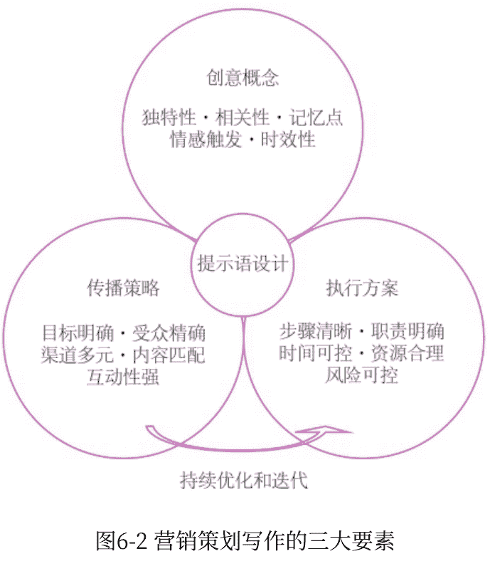
图6-2 营销策划写作三大要点
#### （一）创意概念的指令编写
设计能引导模型产出独特性强、相关性高、易记且具情感触发力的创意概念，帮助生成既能脱颖而出又与品牌主张和人群需求高度契合的内容，并易于传播。
理论要点：优秀创意应具备独特性、相关性、记忆点、情感触发、时效性。
方法要点：
1. 跨领域联想：要求结合不同领域元素激发独特创意。
2. 品牌DNA融入：明确品牌核心主张确保相关性。
3. 记忆点设计：要求创作朗朗上口的口号或视觉元素。
4. 情感地图构建：基于人群核心情感需求设计创意元素。
5. 趋势融合：指示将热点话题与品牌特性结合。
示例指令：
为 [品牌名称] 设计创新营销创意，用于推广其 [具体产品/服务]。请遵循提示：
（1）核心创意：结合品牌所属领域与另一个看似不相关领域的元素，提出独特概念。
（2）价值融入：说明创意如何体现品牌的 [核心价值1] 和 [核心价值2]。
（3）记忆点：创作朗朗上口的口号或标语，需含双关或文字游戏。
（4）情感触发：基于目标人群画像的 [核心情感需求]，设计引发强烈共鸣的元素。
（5）时效挂钩：将创意与 [当前热门社会话题] 联系，突出时效。
（6）呈现形式：提出两到三种呈现形式，至少一种创新或非传统媒体。
（7）传播潜力：解释创意具备病毒式传播潜力的原因。
补充提示：
- 创意要突破常规，避免争议或负面解读。
- 考虑可持续性，思考如何发展为长期营销主题。

#### （二）传播方案的指令编写
设计目标明确、受众精准、渠道多元、内容匹配且互动性强的传播方案指令，确保信息有效传递并促进深度互动。
理论要点：目标明确、受众精准、渠道多元、内容匹配、互动性强。
方法要点：
1. 目标量化：要求设定具体可衡量的传播目标。
2. 受众画像详述：提供人口统计、行为特征、痛点、媒体习惯。
3. 全渠道思维：要求设计包含至少五个渠道的传播矩阵并说明理由。
4. 内容形式多样化：为不同渠道设计匹配的内容形式。
5. 互动机制设计：提出提升参与度的线上线下互动方式。
示例指令：
为 [品牌名称] 的 [营销活动名称] 设计全方位传播方案，在多元媒体环境中精准触达并达成目标。请遵循提示：
（1）市场洞察 约800字：总结目标市场的三个关键趋势与两个主要痛点。
（2）受众画像 约1000字：描绘二到三个核心群体，含人口特征、行为习惯、价值观、媒体偏好，为每个群体起昵称。
（3）传播目标 约600字：设定三个SMART目标，涵盖知名度、参与度、转化率，并附数字与时间。
（4）核心信息 约500字：提炼一个总体信息与三个支撑信息，与品牌调性一致。
（5）全渠道矩阵 约1500字：设计含至少七个渠道的矩阵，说明作用与预期效果。
（6）内容方案 约1200字：为三个主要渠道设计差异化方案，含形式、主题、互动元素，并匹配用户旅程。
（7）创新传播手法 约800字：提出一个创新或非常规传播方式，提升话题性与参与度。
（8）KOL合作计划 约700字：设计多层次合作策略，区分头部、中腰部、微观层级。
（9）时间线 约1000字：绘制为期 [具体时间] 的传播时间表，含预热、启动、高潮、持续阶段，标注关键节点。
（10）效果评估 约600字：设定五到七个KPI，涵盖曝光、参与、转化、品牌健康度，说明数据来源与评估频率。
（11）危机预案 约500字：列出两到三个可能风险及应对策略。
预算分配建议：按渠道与阶段列出比例，确保资源最优化。

#### （三）执行方案的指令编写
设计指令时需确保生成的方案步骤清晰、职责明确、时间可控、资源合理且风险可控，帮助制定可操作的行动计划。
理论要点：步骤清晰、职责明确、时间可控、资源合理、风险可控。
方法要点：
1. 行动分解：要求将执行过程拆分为十到十五个具体步骤并标明耗时。
2. 角色分配：为每个环节分配负责角色或部门并明确职责。
3. 时间节点：制定含准备期、执行期、评估期的详细时间表并标注里程碑。
4. 资源分配：列出人力、物力、财力需求并给出数量或预算。
5. 风险评估：识别三到五个风险点并提出应对策略。
示例指令：
为［品牌名称］的［营销活动名称］设计详细可行执行方案，将创意与传播方案转化为具体行动。请遵循提示：
（1）执行摘要 约300字：概括核心内容、主要目标与关键成功因素。
（2）项目团队构成 约300字：列出核心成员与外部合作方，明确职责与决策权限。
（3）里程碑规划 约1200字：设定五到七个关键里程碑，含目标、完成标准、时间节点，使用甘特图呈现。
（4）详细行动步骤 约2000字：分解为十五到二十个步骤，每步包含行动描述、责任人、起止时间、所需资源、完成指标。
（5）资源分配表 约1000字：创建资源分配矩阵，横轴为时间，纵轴为资源类型，标注需求高峰。
（6）跨部门协作流程 约800字：设计两到三个关键协作流程，使用流程图呈现。
（7）预算明细 约1000字：提供详细预算表，含各环节支出、应急资金比例、成本控制措施。
（8）质量控制计划 约900字：列出三到五个关键质控点与检查标准。
（9）风险管理矩阵 约1200字：识别五到七个潜在风险，评估概率与影响，为高风险项制定预防与应对措施。
（10）利益相关者沟通计划 约1800字：设计定期汇报机制，指明频率、方式与关键信息点。
（11）应急预案 约1000字：为两到三个重大意外情况制定预案，含触发条件、响应流程、补救措施。
（12）执行后评估机制 约700字：

项目收尾评估与创新执行方案设计
完成交付后的复盘体系需要覆盖成果核验、经验沉淀以及持续改进建议，并对评估时机和核心维度作出明确指引。

创新执行工具
择优推荐1至2种前沿的项目管理手段或协作方式，并阐明其在提升落地效率、增强灵活响应上的实际价值。

据此输出一份具备可操作性与可验证性的执行方案，方案需体现对创意原意的忠实执行、对传播策略的有效配合，以及对各类不确定情形的周全考量。

### 三、品牌叙事搭建：定位·主张·愿景的提示语设计

在数字时代，品牌故事是企业与消费者建立信任的重要纽带。它不仅负责传递核心价值，也在情感层面促成连接。本部分围绕品牌站位、价值承诺与未来愿景三条主线，结合关键考量、典型误区与参考话术，探讨如何打造兼具吸引力与说服力的品牌叙事。图6-3呈现了叙事的关键构成，突出了三大要素的功能及彼此关联。

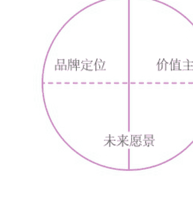

#### （一）品牌定位：在市场中找到独特位置
品牌定位是叙事的底座，清晰且具辨识度的定位有助于在激烈竞争中脱颖而出，并为后续营销提供方向。

关键考量：
(1) 受众画像的精细化刻画：定位根基在于对目标群体的精准把握。除人口统计信息外，需涵盖心理画像、行为模式与价值取向。深入洞察可支撑更具针对性的策略，提升投入产出。例如除年龄收入外，还要了解生活方式、消费偏好与对品牌的期待。
(2) 竞品研究与差异化路径：分析竞争对手是形成差异的前提，需了解其市场位置、产品特性、传播方式与品牌形象。通过挖掘市场空白与对手短板，可找到独特切入点。差异化不仅限于功能，还可体现在服务模式、品牌人格或使用体验。
(3) 品牌人格与整体形象的一致性：品牌人格是人格化表达，应与目标人群的价值观与生活方式契合。保持人格与形象的一致对建立稳固认知至关重要，需贯穿产品设计、广告投放、客户服务等全部触点。统一的面貌可强化辨识并提升忠诚。
(4) 与受众的情感共鸣点：成功定位不仅满足功能需求，也要在情感上产生共鸣。需深入理解受众的情感诉求、信念与生活理想，通过可共鸣的故事或触动情绪的体验，建立更深层次联系，使品牌超越商品属性，成为生活中有意义的部分。

常见陷阱：
(1) 定位过于宽泛，缺乏聚焦：试图讨好所有人往往导致立场模糊，难以突出也难建立深度关系，应勇于聚焦细分市场。
(2) 过度模仿竞争对手，丧失独特性：复制成功案例易导致同质化与价值稀释，有效定位应基于自身核心优势与价值观。
(3) 忽视市场变化，定位僵化：环境、需求与技术持续演进，定位需动态更新，固守旧定位易脱节，需定期评估调整。
(4) 与实际能力脱节，难以兑现承诺：激进定位可能超出资源承载，若长期无法兑现将损害信誉，定位应建立在核心能力基础上。

提示语示例：
为 [品牌名称] 撰写一份清晰独特的品牌定位说明，按以下指引：
（1）核心锚点：用一句简练有力的话概括品牌核心定位，传达独特价值与市场地位。
（2）目标受众画像：描绘理想客户，包含人口统计特征、心理特征、消费行为、痛点与需求。
（3）竞争分析：列出3个主要竞争对手，分析各自核心优势、品牌相对优势及市场未满足需求。
（4）品牌人格：用5个形容词描述品牌人格，并说明在体验中的体现方式。
（5）价值主张：阐述为目标受众提供的核心价值与独特利益，说明如何解决问题或满足需求。
（6）情感连接点：描述一个能产生强烈情感共鸣的品牌元素或故事，并解释其与受众深层需求的关联。
（7）定位声明：综合以上要素，形成一句简练有力的定位声明，表达品牌本质、服务对象与独特价值。
（8）视觉识别：提出2～3个能直观体现定位的视觉元素建议，如标志、色彩、图像风格。

评估标准：清晰度、独特性、相关性、可信度、持续性。
注意事项：避免行业陈词滥调；保持简洁有力且富洞察；考虑可扩展性。

#### （二）价值主张：传递独特的品牌价值
价值主张是品牌的核心承诺，阐明如何满足需求并解决痛点。有力的主张能传达独特优势，吸引受众并形成持续竞争优势。

关键考量：
(1) 产品/服务的核心优势：主张应建立在真实优势之上，可能是独特功能、卓越性能、创新设计或优质服务，深入剖析有助于找到差异点。
(2) 解决客户痛点的能力：优秀主张不仅展示特性，更要说明如何解决实际问题，深入理解痛点并清晰阐述化解路径是关键。
(3) 功能价值与情感价值的平衡：功能是基础，情感往往决定长期关系，主张需兼顾两者。
(4) 可信度与可证明性：主张需有证据支撑，如客户证言、行业认证、性能数据或对比测试，增强可信度。

常见陷阱：
(1) 主张过于复杂，难以传达：信息过载会模糊核心，应简明易懂。
(2) 忽视情感价值，只谈功能：情感是驱动购买与忠诚的关键，需平衡。
(3) 夸大其词，无法兑现：不切实际承诺会损害信誉，应建立在可持续兑现上。
(4) 与竞品主张高度相似：不自觉模仿导致同质化，需寻找真正差异。

提示语示例：
为 [品牌名称] 制定有力品牌价值主张：
(1) 核心价值概述：一句话概括主张。
(2) 目标受众痛点：列出3～5个痛点及影响。
(3) 问题解决方案：针对每个痛点说明解决方式与独特方法。
(4) 核心优势：列举3～5个与竞品区别明显且直指痛点的优势。
(5) 情感价值：描述情感连接方式及带来的生活改善。
(6) 证明点：提供2～3个证据或数据。
(7) 差异化陈述：解释与主要竞争对手的区别。
(8) 长期价值：描绘长期使用的持续收益。
(9) 视觉化元素：提供一个视觉比喻增强记忆。
(10) 简化版本：创建适用于快速传播的精简版。

评估标准：清晰度、相关性、独特性、可信度、情感共鸣、可执行性。

#### （三）未来愿景：描绘品牌的长远目标
未来愿景是品牌故事的重要部分，能激发员工、客户及其他利益相关者的热情与支持，为品牌指明方向。

关键考量：
（1）与当前定位的一致性与延续性：愿景应是当前定位的自然延伸，体现核心价值观的延续。
（2）对行业与社会的积极影响：优秀愿景不仅关注企业发展，还考虑对行业及社会的贡献，如创新、生活质量、可持续发展。
（3）员工与客户的参与感：愿景应激发员工热情，让客户感到是未来的一部分，增强情感连结。
（4）远大与可实现性的平衡：愿景需足够宏大且基于核心能力与资源，保持可信。

常见陷阱：
（1）愿景过于抽象，缺乏实际意义：难以指导日常决策。
（2）忽视社会责任，仅聚焦商业目标：易显短视。
（3）未能激发利益相关者共鸣：难以调动积极性。
（4）与当前形象差距过大，缺乏可信度：会被视为不切实际。

提示语示例：
为 [品牌名称] 创造富有感染力的未来愿景：
(1) 愿景陈述：一句话描述5～10年后的理想状态。
(2) 行业影响：如何引领行业发展或改变格局。
(3) 社会贡献：对环保、社会公平、教育、健康等领域的积极影响。
(4) 客户价值：未来如何更好服务客户并提升体验。
(5) 员工愿景：工作环境、发展机会与成长空间。
(6) 创新项目：2～3个体现愿景的创新项目或倡议。
(7) 里程碑：3～5个具体可衡量的关键节点。
(8) 全球视野：全球市场定位与规划。
(9) 技术展望：如何利用AI、物联网、可持续能源等实现愿景。
(10) 伙伴生态：与企业、机构合作实现更大目标。
(11) 激励口号：简短有力、易传播的共同奋斗口号。
(12) 视觉象征：直观表现愿景的视觉元素或符号。

评估标准：一致性、远见性、可信度、共鸣度。

### 四、年终总结：业绩回顾、成就展示、未来规划的提示语设计
年终总结是盘点过去与展望未来的关键环节，精准、清晰的表达能提升质量与影响力。本节针对业绩回顾、成就展示与未来规划提供提示语方案。

#### （一）业绩回顾：展示关键成果，分析工作成绩
旨在全面呈现全年成绩，强调成果概述、数据支撑与项目亮点。
(1) 成果展示：用量化数据或案例增强说服力。
(2) 结构清晰：分成果概述、数据支撑、项目亮点。
(3) 具体事例：通过真实项目使回顾更生动。

#### （二）成就展示：强化个人与团队贡献，突出创新与突破
应凸显个人与团队的创新、突破及贡献。
表6-5 总结了设计方法，涵盖团队贡献、创新突破与个人荣誉。

| 维度 | 提示语示例 | 要求 |
| :--- | :--- | :--- |
| 团队贡献 | 请总结团队过去一年重大成果，并展示协作优势 | 团队协作：[描述跨部门合作、协调沟通表现]<br>团队成就：[列举目标达成成绩，如完成度达120%] |
| 创新与突破 | 请描述创新举措或突破性进展 | 创新成果：[展示创新产品/流程/技术及影响]<br>突破性进展：[分析如何解决长期问题或带来改变] |
| 个人荣誉 | 请列举个人获奖、荣誉或表彰 | 荣誉奖项：[列出最佳员工奖、创新贡献奖等]<br>个人影响：[个人努力推动业务或团队成长的成果] |

#### （三）未来规划：设定目标，规划发展路线
重点在设定明确目标与发展方向，确保可执行。
- 目标设定：明确量化目标
- 行动计划：为每个目标设计执行方案
- 个人成长：规划职业发展路线

| 维度 | 提示语示例 | 要求 |
| :--- | :--- | :--- |
| 年度目标 | 请设定明年主要工作目标并确保可度量 | 目标设定：[如实现销售、拓展客户]<br>目标量化：[如增长30%或新增10个大客户] |
| 行动计划 | 请据目标制定行动步骤与策略 | 行动步骤：[如提升服务质量、加强协作]<br>时间节点：[设定时间表或阶段目标] |
| 发展方向 | 请阐述职业发展或个人成长规划 | 个人发展：[如提升管理能力、拓展行业知识]<br>团队协作：[如何提升合作或打造高效团队] |

## 第7章 自媒体运营中的提示语设计
本章探讨微信公众号、微博、小红书、抖音等平台的内容生成提示语设计策略，重点在于通过有效设计提升创作效果。分析不同平台需求与用户行为，探索适配策略以增强互动性与吸引力。

### 一、玩转微信公众号：内容生产的提示语策略
微信公众号作为领先内容分发平台，其生态与阅读习惯决定提示语设计需差异化。本节从平台特性出发，构建系统化方法论。

#### （一）平台特性与算法机制
微信公众号具备私域流量、深度阅读、规范体系与互动机制四大核心特性，这些特性直接影响提示语设计方向：

公号与微博内容指令实战手册

写内容先把指令用对。公号和微博分发逻辑、阅读习惯、展现形态完全不同，指令也需要跟着平台切换。

### 一、公号深度创作指令

做公号内容要先锁住四个底层前提。

私域运营需要语气稳定，指令里要固定品牌调性，帮助用户建立认知。长文阅读需要结构分明，逻辑层层递进。平台审核严格，指令要主动规避敏感表达。点赞、留言、转发等互动数据是迭代依据，可以反向优化指令。

触达路径主要分三类：订阅列表展现、好友转发链路、看一看分发。指令要适配不同形态，尤其是订阅列表只露出标题和封面，标题必须自带信息密度和点击欲。

#### 选题规划指令

选题指令的关键是把账号定位和读者获益讲透。

◎ 指令范例：
目标：为[细分垂类]生成选题方案。
背景：
- a. 账号定位：[填写定位]
- b. 目标人群：[人群画像]
- c. 核心诉求：[用户需求]
要求：
- (1) 输出10个选题方向。
- (2) 每条包含主文案、副文案、关键论点、价值主张。
- (3)兼顾时效话题与长线价值。
输出形式：表格。

#### 创作引导指令

公号是深度阅读场景，需要在吸睛、专业、可传播之间找平衡。高效指令要兼顾结构搭建与表达风格。

##### 1. 题生成指令

题是打开率的第一道门。好的题通常具备：
- 信息饱满：在有限字数内点明价值，对比短视频更强调清晰。
- 差异价值：在同质环境里凸显独特视角。可在指令中加入竞品对标，找表达空白。
- 时效挂钩：关联热点或行业动态，但不偏离账号定位。如“ChatGPT之后，产品经理的核心竞争力在哪里”。
- 平台气质：语言贴合公号的专业实用感，避免过度学术或过于口语。

设计原则：
- 明确价值类型：方案型、分析型、经验型。
- 设定语气基调：严谨专业型、观点鲜明型、温和建议型。
- 限定要素：热词、数据点、专家引用等。
- 平衡吸引与专业：防过度营销或过度学术。

◎ 指令范例：
请按以下要素生成题。
主题：[主题]
核心论点：[观点]
目标人群：[读者群体]
价值类型：[分析型/方法型/经验型]
表达基调：[专业/犀利/温和]
必要元素：[数据点/行业洞察/专家引用]
差异化要求：
- a. 竞品参考：[3～5个同主题题]。
- b. 创新角度：[具体说明]。
生成要求：
- a. 给出3个方案。
- b. 说明每个方案的亮点。

##### 2. 内容结构指令

公号结构要兼顾深度与碎片化习惯。优质结构体现：
- 层级清晰：总分总或问题—分析—对策的递进。
- 节奏可控：论述、案例、数据交替，保持阅读兴趣。
- 互动嵌入：关键节点设问或讨论，提升参与感。

设计原则：
- 预设框架：明确各部分职责与重点。
- 设定深度：对不同模块规定论述深度、案例数与数据要求。
- 预埋互动：在指令中规划互动位置。
- 调控密度：避免段落松散或堆砌。

◎ 指令范例：
请创作一篇深度分析稿。
主题：[主题]
目标：[写作目的]
一、结构要求
- （1）开篇约800字以内。
    - a. 背景切入：从[数据/现象/热点]切入。
    - b. 现状梳理：点出痛点与挑战。
    - c. 核心观点：给出独特视角与解决思路。
- （2）主体约2500字。
    - a. 分论点展开：3～4个核心论点。
    - b. 每点需包含：观点陈述、原理解析、案例佐证2个、权威数据、专家观点。
- （3）结尾约700字以内。
    - a. 观点收束：呼应开头。
    - b. 趋势判断：前瞻洞察。
    - c. 行动建议：3～5点可执行建议。
二、互动节点
- 开篇互动：情境思考题。
- 主体互动：每论点后设讨论区。
- 结尾互动：邀请读者分享经验。
三、节奏控制
- 信息密度：开篇叙事引兴趣，主体论证为主，结尾洞察+建议。
- 段落长度：重点论述250～300字，案例200～250字，数据分析150～200字，过渡约100字。
四、高级要求
- 逻辑展开：论点间递进/并列/转折清晰。
- 思维深度：现象—原因—规律。
- 风格把控：专业中立，术语解释到位，表达严谨易懂。
注意事项：避免绝对化表述，数据来源可靠，案例具代表性，互动自然融入。

##### 3. 论证逻辑指令

公号说服力取决于论证严密性。高质量论证具备：
- 证据链完整：每点观点配数据、案例或专家背书。
- 逻辑递进：形成现象—原因—影响—对策的清晰链路。
- 多维视角：引入不同观点，增强可信度。

设计要点：
- 设定论证框架，明确展开顺序与过渡方式。
- 规定证据类型与数量，确保论证充分。
- 控制论证深度，核心论点充分展开，次要论点点到为止。

#### 场景化应用

| 应用场景 | 指令模板 | 优化要点 |
| :--- | :--- | :--- |
| 热点新闻改写 | 把[热点事件]转化为[话题角度]的分析，聚焦[核心观点]，需含[数据支撑]和[专家观点] | 重视时效，保持客观，突出独特视角 |
| 原创深度稿 | 以[主题]为核心，从[切入点]展开，结合[案例]和[方法论]，形成[字数]深度稿 | 强调原创，注重实操，设置互动引导 |
| 评论互动优化 | 解析[读者反馈]关键问题，整理为[主题]的解答文，包含[实践建议] | 回应痛点，提供方案，保持对话感 |

实操建议：建立内容标签体系，沉淀高质量指令模板，按数据反馈持续迭代，建立指令评估机制。

### 二、微博短平快指令设计

微博以碎片化、即时更新为主，指令要适配其平台属性。

#### 平台特征与分发机制

微博四大特征：实时性、社交属性、话题引导、多媒体融合。
- 实时性要求指令具备快速响应能力。
- 社交属性要求内容易互动、易对话。
- 话题引导使平台成为舆论场，指令要会设置议题。
- 多媒体融合要求指令协调文字、图、视频。

分发路径：粉丝关系链、热门话题引流、兴趣推荐、转发评论互动。指令需在时效与传播间找平衡。

#### 内容策略指令

##### 基础框架
- 时效把控：快速捕捉热点、延展议题、表达观点，保证及时准确。
- 互动设计：引导生成设问、悬念、邀请讨论等形式。
- 传播优化：强化话题关联与情绪共鸣。
- 风格一致：快速响应同时保持账号调性。

##### 差异化策略

| 内容类型 | 核心特点 | 关键要素 | 指令重点 |
| :--- | :--- | :--- | :--- |
| 热点跟进型 | 快速响应、观点鲜明 | 热点关联、独特视角、价值延展 | 抓热点、显差异、预设风险 |
| 原创内容型 | 深度思考、专业价值 | 专业洞察、案例支撑、方法论输出 | 框架完整、逻辑严密、互动设计 |
| 话题引导型 | 议题设置、观点引导 | 话题规划、观点递进、情绪引导 | 议题设计、节奏把控、互动闭环 |
| 品牌营销型 | 品牌价值、转化目标 | 品牌调性、用户痛点、解决方案 | 价值传递、情感共鸣、行动引导 |
| 互动娱乐型 | 轻松有趣、互动性强 | 话题趣味、互动机制、情绪调动 | 创意设计、参与门槛、传播性 |

热点跟进型指令范例：
基于[热点事件]创作微博。
核心要求：
- a. 事实陈述50字左右：客观描述核心事件。
- b. 专业解读100字左右：结合[领域]视角分析。
- c. 延展思考50字左右：给出独特观点。
差异化要求：避开主流角度，融入专业知识，预设1～2个讨论问题。

原创内容型指令范例：
创建[主题]原创内容。
内容结构：
- 核心论点60字左右：[填写]
- 专业解析：理论依据100字左右，实践案例80字左右。
- 互动引导：设置1个开放问题，预留讨论空间。
传播策略：关联2～3个相关话题，设计2个传播观点。

话题引导型指令范例：
话题引导设计。
主题：[话题名]
引导策略：议题设置，核心问题提出，2～3个讨论维度。
互动设计：投票/提问形式，观点引导方向。
情绪基调：开放包容。

品牌营销型指令范例：
品牌内容创作指南。
营销目标：[目标设定]
内容策略：品牌元素植入占比<30%，场景化描述，关联用户痛点，呈现解决方案。
传播设计：话题[话题名]，互动形式[投票/问答]。
注意事项：避免生硬，强调用户价值，保持自然语态。

互动娱乐型指令范例：
互动娱乐内容设计。
形式类型：[测试/问答/话题接龙]
内容框架：引导部分60字左右设悬念，互动规则说明，话题延展方向。
调性要求：轻松活泼，适当专业，正向价值。

#### 话题与标签应用

话题选择原则：与内容高度相关，活跃度适中，避免过度竞争的顶流话题。
标签使用策略：核心话题前置，相关话题补充，品牌话题收尾。

指令范例：
话题配置要求：
主话题：[话题名称]
相关话题：2～3个。
位置要求：主话题开头，相关话题正文，品牌话题结尾。
选择标准：活跃度范围，竞争度评估，相关性判断。

#### 传播策略指令

热点借力：
- 热点筛选：话题热度、受众契合度。
- 角度创新：找到差异化切入点。
- 时机把握：明确最佳发布窗口。

跨平台内容提示词构建要点

一、微博侧运营提示词

1. 热点借势生产
围绕正在发酵的话题做内容说明。要点包括当前话题走向、热度参考值、想触达的人群画像。差异化要求要拆解市场上已有的观点、提出尚未被充分展开的切入视角、构建反常识的表达。传播准备要挑选吸流标签组合、明确每次互动的核心抓点、设计评论区引导话术。

示例：
说明如何围绕发酵热点生产内容。话题脉络：[当前热点的走向] 热度参考：[热搜位次/讨论规模] 目标人群：[用户群体] 差异化要求：-梳理现有观点角度 -提出新的切入点 -设计反直觉表达 传播策略：-话题标签选择 -关键互动设计 -评论引导策略

2. 持续节奏规划
账号长期存活需要科学的节奏安排，提示词要包含发布频率、内容配比、互动时段。

示例：
请为微博账号制定一周排期规划。账号信息：-定位：[填写账号定位] -目标受众：[受众属性] -当前粉丝量：[数量] -内容领域：[领域] 需要考虑：-设计一周发布时间表，含每天发文频次建议、最佳时间点、不同时段的内容类型 -制定内容形式配比，含各类内容比例分配、不同形式适合的推送时间、粉丝活跃度最高的互动时段。请给出详细排期建议并说明原因，同时提供热点响应策略建议。

3. 互动机制设计
微博传播效果取决于互动质量，提示词要聚焦评论牵引、转发激励、私信响应。

示例：
请为以下微博内容设计互动策略。内容主题：[主题] 内容形式：[图文/视频/文字] 互动目标：[提升评论/转发/话题扩散] 需要设计：-评论引导方案：设计3个引发讨论的问题、提供2~3个争议点、设计悬念或期待感 -转发传播策略：设计用户主动转发的理由、提供病毒式传播的关键点。请确保互动设计自然融入内容，避免生硬引导，同时考虑话题的延展性和持续性。

三、布局小红书

平台特征与分发机制
小红书三大核心特征是种草氛围、社区感和垂直专业。分发依赖关注推荐流、兴趣标签、搜索发现。推荐流对封面和标题吸引力要求高，搜索发现重视关键词布局和信息完整度。

对提示词的要求：
社区化与用户生成内容。平台高度依赖用户生成内容，鼓励分享个人经历、旅行故事、购物心得。提示词应注重个性化与真实感，引导生成真实且有辨识度的内容。
情感共鸣。用户偏爱情绪浓度高的内容，尤其生活、成长、情感相关。提示词应促使内容融入温暖、真诚的情感，增强认同。
视觉优先。笔记强调图文并茂，图片视频权重高。提示词除文字外，还需为视觉部分提供描述与搭配建议。
消费决策引导。平台对购物、测评、品牌推荐影响大。提示词要引导生成具备推荐价值的内容，激发尝试欲望。

内容制作的核心原则
核心在于实用性与分享性，情感共鸣与个性表达，文字视觉协同，以及简洁有力突出重点，适配快速阅读。
重视实用与可分享。提示词需明确要求生成能解决问题的内容或具体产品生活建议，并具备传播性。
强化情感与人设。受众偏年轻化，情感化与人设化表达更易吸睛。提示词应引导融入共鸣点与个人视角。
文字配合视觉。视觉属性强，提示词要帮助生成能与图片互动的画面感描述。
简洁突出重点。阅读多为快速浏览，提示词应引导产出标题抓人、正文要点清晰的稿件，避免冗长。

种草文案提示词搭建
种草核心是真实体验、可信对比与场景化表达，建立信任并激发购买。

信任搭建。种草依赖信任感，可通过身份、经历、对比提升可信度。
维度 提示词示例 要求
背景 请搭建一个增强信任的内容框架 产品类型：[具体品类] 个人身份/专业领域：[具体描述]
内容构成 专业背景展示 个人使用历程 真实体验分享 对比测评内容 避免过度吹捧 呈现真实缺点 保持客观态度

场景化表达。通过具体生活场景描写提升代入感与说服力。
维度 提示词示例 要求
产品/服务 请帮我设计一个场景化的内容方案 产品/服务：[具体内容] 典型场景：[使用情境] 目标用户：[用户画像]
场景设计 设计3个具体应用场景 每个场景包含：环境描述 痛点呈现 解决过程 效果展示
表达要求 请描述每个场景的生活背景，真实呈现使用痛点，并详细说明使用过程及效果展示 细节具体真实 场景贴近生活 问题解决完整

风格调性。小红书风格个性化强，人设与情感基调影响认同。
维度 提示词示例 要求
风格设计 请设计［美妆/美食/生活］领域的内容风格 账号定位： 人设特征：［描述］ 专业背景：［描述］ 目标调性：［描述］
语言风格要求 遵循以下表达特点：口吻设定 句式特征 专业术语使用度 情感基调：主要情绪色彩 互动语气 共情点设计 个性化元素 固定开场语 独特表达方式 签名式结束语

文案制作提示词示例
标题制作
标题是内容门面，影响点击与阅读。提示词设计应考虑情感共鸣、专业性、搜索优化与清晰价值承诺。
维度 提示词示例 要求
领域/卖点 请帮我创作一篇小红书笔记的标题 内容领域：[美妆/美食/旅行] 核心卖点：[具体收益/解决问题] 目标受众：[受众画像]
标题设计要求 提供3~5个标题方案 每个标题包含：吸引注意的开头语 核心关键词 具体数字/方法 明确的价值承诺
标题特征 字数：15~25字 语气：亲和但专业 必须包含的词：[关键词] 避免使用：[禁用词/过度营销词]
差异化考虑 请分析市场中3个同主题的热门标题，并根据其内容结构和语言风格设计1个创新的标题，确保新标题在表达上有独特性 请提供1个标题，通过与竞品对比，突显出创新性和差异化，避免与市场上已有的标题过于相似 竞品标题风格：[举例，分析3~5个同主题的热门标题，明确其常见结构和用词] 创新表达方向：[说明新标题在情感表达、信息传递、创意表达等方面的创新点，例如通过加入数字、问题设定、独特观点或特色语言来创新]

图文结构
图文结构影响种草效果，合理安排图片与文案比例与布局，提升吸引力。
维度 提示词示例 要求
图文结构要求 请生成一篇小红书“种草”笔记大纲 商品/服务类型：[产品类型，例如：美妆、家居、食品等] 目标效果：[期望达成的转化目标，如“提高购买转化率”“增加品牌曝光”]
图片安排 封面图：要求高质量且具有吸引力，能体现产品特点或创作者个性 细节图：展示产品的使用细节或特征，增强产品的可信度 场景图：展示产品使用的实际场景，帮助读者产生代入感 效果对比图：展示产品使用前后的明显变化，增强说服力 图片质量：清晰、专业，避免低质量、模糊的图像 场景和效果图要有真实感和可操作性
文案结构 开篇吸引力设计：通过引人注目的开头吸引读者注意 个人经验铺垫：分享作者的使用感受或故事，增强亲和力 使用方法说明：详细介绍如何使用产品，确保信息清晰 效果总结：总结使用产品后的具体效果，强化转化诉求 购买建议：给出购买推荐或附带优惠信息，引导决策 开篇需简洁明了，直接点明内容亮点 中间部分详尽描述使用方法与效果，避免空洞的描述 购买建议要具备实际价值，避免过度推销
差异化考虑 真实感塑造：避免过度修饰，保持内容的真实性与亲和力 专业性体现：通过数据、用户反馈或专家认证增强内容的专业感 种草自然度：确保文案与图片配合自然，避免过度营销或生硬的推销 互动引导设计：结尾部分需鼓励读者参与互动，例如评论、点赞或分享 保持平衡，既不夸大其词，也不过于保守 在效果展示和互动设计时要自然流畅，避免强硬促销

主体内容
个人化体验分享。提示词示例：生成关于［个人经历］的分享内容，需描述具体的体验过程，突显个人情感变化，使内容更具温度和真实感。
情感共鸣型。提示词示例：生成1个关于［情感话题］的分享内容，采用温暖和鼓励的语气，激发读者的情感共鸣。
购物推荐与评测。提示词示例：生成1个关于［产品/服务］的评测内容，需详细描述产品特点、使用体验，并加入个人使用后的真实感受，帮助读者做出购买决策。
互动性强。提示词示例：生成1个关于 [话题] 的内容，结尾处提出问题或鼓励读者分享他们的看法，以增强互动性。

四、掌握抖音

平台内容特性
高度视觉化与短时吸引力。开场3秒决定留存，提示词需引导生成强视觉与冲击力的开头。
情绪饱满与娱乐性。用户偏好情绪化娱乐内容，提示词需强调情感表达与趣味性。
强互动性与挑战性。挑战赛、话题、评论区互动是核心，提示词应鼓励生成易参与的内容。
剧情与故事性。短小完整的剧情更易传播，提示词需注重故事结构与连贯性。

内容制作核心原则
视觉冲击与情绪感。文案脚本需具备画面感与情绪张力，提示词要突出场景与情绪描写。
引导参与和互动。提示词应引导生成设问、挑战式内容，提升参与感。
节奏鲜明与简洁高效。时长受限，提示词要促成节奏快、表达精炼、无冗余。
贴近热点与用户需求。需关注时效话题，提示词应引导结合当下流行与用户痛点。

提示词策略
吸睛开头。提示词示例：生成1个强吸引力的开场，聚焦 [视觉冲击或情绪渲染]，确保在3秒内引起观众兴趣。
情绪共鸣。提示词示例：生成1个富有情感共鸣的脚本或文案，通过［幽默/感人/刺激］的情绪表达，引发观众共鸣。
节奏紧凑剧情。提示词示例：生成1个节奏紧凑的剧情脚本，开篇引入冲突，结尾设有反转，确保内容连贯有趣。
互动性强。提示词示例：生成1个具有互动感的文案，提出引发思考或挑战性的问题，引导观众参与互动或模仿挑战。

实战案例
故事情节类脚本创作。提示词示例：为 [主题] 生成1个引人入胜的短故事脚本，采用悬念开头，逐步揭示关键情节，引导观众追随剧情发展。
实用技能分享类文案。提示词示例：生成1个关于 [实用技能] 的简单教程脚本，以清晰步骤和简洁语言进行描述，让观众能够快速掌握。
引发情绪共鸣的情感文案。提示词示例：生成1个关于 [情感主题] 的真挚文案，采用亲切的语气，引发观众的情感共鸣，使内容更贴近生活。
引导互动的结尾语句。提示词示例：生成1个互动引导语句，鼓励观众点赞、评论或分享，增强视频的互动性。

迭代方向：AI生成的结尾语句具备号召性，有助于引导观众互动，增加视频的传播效果。

## 第8章 学术写作的提示链实战

本章聚焦学术写作里的提示语设计，聊怎么用系统化的提示链来支撑复杂研究任务。论文写作包含文献综述、研究问题提炼、理论框架搭建、数据解析与结果呈现等多个层级，每个环节的思维方式和表达规范都不同。针对性地设计和优化提示链，能够帮助研究者梳理思路、强化论证的连贯性、提升表达的精确度，从而提高研究效率与质量。要明确的是，这类工具的价值在于提供结构化的思维支架，而不是取代研究者自身的创新思维与批判分析。

### 一、构思启动：用提示链把文献、选题与框架串联起来

研究起步阶段，一套精细的提示词相当于认知外挂。设计得当，模型就能辅助资料系统化归纳、理清研究问题、为理论框架搭建提供启发。 

#### （一）文献盘点与关键信息提取的提示做法

文献盘点是学术工作的地基。系统检索并归纳既有成果，才能把握领域动向并找到尚未充分讨论的空隙。可面对海量论文，快速完成系统盘点与要点提炼是个痛点。下面用三层递进思路——全景扫描、中层聚焦、精读深挖——来对应提示词的设计手法。

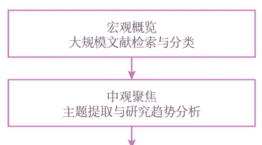

##### 1. 全景扫描：检索提示怎么搭

全景扫描的任务是先拿到领域的大图。借助模型做初筛与归类是可行的。有效的提示词要兼顾多角度词提炼、同义扩展、时间轴、跨学科视角以及重要性判断，才能搭建出相对完整的检索框架，提效的同时仍需研究者用专业判断把关。

> ◎ 提示语示例：
> 请协助我为 [研究主题] 设计一个全面的文献检索策略。
> 
> +   （1）生成关键词：
>     a. 提供5～7个核心关键词，涵盖研究对象、方法、理论和应用。
>     b. 为每个核心关键词提供3～5个同义词或相关术语。
> +   （2）时间框架：
>     a. 建议检索的时间范围，确保包含经典研究和最新进展。
>     b. 提供识别经典研究的标准（如引用次数、影响力等）。
> +   （3）跨学科视角：
>     a. 列出2～3个可能相关的交叉学科领域。
>     b. 解释这些领域如何为主题研究提供新视角。
> +   （4）检索式构建：
>     a. 基于以上信息，构建3个不同侧重点的检索方式。
>     b. 解释每个检索式的设计逻辑和预期效果。
> +   （5）文献筛选标准：
>     a. 提出3～5个纳入标准和排除标准。
>     b. 建议评估文献重要性的量化指标。
> +   （6）推荐数据库：
>     a. 列出3～5个适合该主题的学术数据库。
>     b. 简要说明每个数据库的特点和优势。
> 
> 请提供这个检索策略的简要说明，解释它如何确保全面性和相关性。

##### 2. 中层聚焦：分类与趋势挖掘的提示设计

拿到一批文献后，中层要从中辨识关键主题、演进脉络和潜在空白。此阶段的提示词应侧重文献归类、主题抽取与趋势研判，涉及主题聚类、时序演变、方法论梳理、理论脉络、研究缺口等多个维度。

> ◎ 提示语示例：
> 基于前阶段检索获得的文献集（假设为200篇文献的摘要），请进行以下深入分析。
> 
> [上传文献集的摘要汇总]
> 
> +   (1) 主题聚类与分类：
>     a. 识别并描述5～8个主要研究主题或子领域。
>     b. 为每个主题提供简短描述（30字以内）和关键词（5～7个）。
>     c. 估计每个主题在文献集中的占比，并解释其重要性。
> +   (2) 时间趋势分析：
>     a. 分析过去10年每个主题的发展趋势。
>     b. 识别新兴的研究方向或话题，并预测未来2～3年可能出现的热点。
>     c. 指出任何明显衰退或被取代的研究方向。
> +   (3) 研究方法论分析：
>     a. 总结主要使用的研究方法（如实验研究、调查研究、案例分析等）。
>     b. 分析各研究方法在不同主题中的应用频率和效果。
>     c. 指出任何创新的或跨学科的研究方法。
> +   (4) 理论基础梳理：
>     a. 识别文献中常用的理论框架或模型。
>     b. 分析这些理论在不同研究主题中的应用和演变。
>     c. 指出任何新兴的或跨学科的理论应用。
> +   (5) 研究差距识别：
>     a. 基于以上分析，指出3～5个潜在的研究空白或探讨不足的领域。
>     b. 解释为什么这些领域值得进一步研究，及其潜在的学术或实践价值。
>     c. 提出可能的研究问题或假设来填补这些空白。
> +   (6) 关键贡献者分析：
>     a. 识别该领域的5～10位关键作者或研究团队。
>     b. 简要描述每位关键作者的主要贡献和研究方向。
>     c. 分析主要研究机构或国家在该领域的贡献和特色。
> +   (7) 跨学科联系：
>     a. 识别与主要研究领域有显著联系的2～3个其他学科。
>     b. 解释这些跨学科联系如何促进了研究的发展。
>     c. 提出2～3个可能的跨学科研究方向。
> +   (8) 综合评述：
>     提供1个简洁的总结，概述当前研究状况、主要趋势、关键挑战和未来研究方向。特别强调那些可能带来创新的研究方向或方法。
> 
> 请以结构化的形式呈现以上分析结果，并为每个部分提供简要的解释和洞见。

##### 3. 微观深入：核心信息抽取与综述框架搭建

确定了重点主题与关键文献后，微观阶段要对核心文献进行细致批判性解析。此阶段提示词应引导模型进行全面解析，涵盖核心内容、创新性评估、批判分析、方法评价、理论应用等多个方面。

> ◎ 提示语示例：
> 请对以下关键文献进行深入分析和评价。
> 
> [上传完整的学术论文或详细摘要]
> 
> +   (1) 核心内容解析：
>     a. 研究目的：用一到两句话精确概括研究的主要目标和研究问题。
>     b. 理论基础：详细解释文章使用的主要理论或概念框架，评估其适用性。
>     c. 研究方法：全面描述采用的研究方法、数据收集和分析过程，评价其合理性。
>     d. 主要发现：列出并详细解释3～5个关键研究结果，评估其重要性和可靠性。
> +   (2) 创新性评估：
>     a. 理论创新：指出并评价文章对现有理论的扩展、修正或挑战。
>     b. 方法创新：描述并评估文章在研究设计或数据分析方面的创新点。
>     c. 实践创新：评价文章在实际应用方面的创新贡献。
> +   (3) 批判性分析：
>     a. 优势：详细分析文章的3～5个主要优点，解释为什么在这些方面构成优势。
>     b. 局限性：指出研究的主要局限性或不足，提供具体的改进建议。
>     c. 有效性：全面评估研究结论的内部效度和外部效度，考虑可能的干扰因素。
>     d. 逻辑一致性：评价研究问题、方法、结果和结论之间的逻辑一致性。
> +   (4) 方法论评价：
>     a. 适用性：评估所选研究方法对于研究问题的适用性。
>     b. 执行质量：分析研究方法执行的质量和严谨性。
>     c. 创新点：指出方法应用中的任何创新或改进。
>     d. 局限性：讨论方法应用的局限性，并提出可能的改进建议。
> +   (5) 理论应用分析：
>     a. 理论选择：评价文章选择特定理论框架的合理性。
>     b. 应用效果：分析理论在研究中的应用效果。
>     c. 理论发展：讨论文章是否对所用理论有所发展或修正。
> +   (6) 实践意义探讨：
>     a. 应用价值：详细讨论研究结果的实际应用价值。
>     b. 潜在影响：预测研究可能对相关领域实践产生的长期影响。
>     c. 实施挑战：分析将研究结果付诸实践可能面临的挑战。
> +   (7) 未来研究方向：
>     a. 作者建议：总结文章提出的未来研究建议。
>     b. 评价者建议：基于分析，提出2～3个额外的研究方向。
>     c. 方法改进：建议未来研究可能采用的改进方法或新技术。
> +   (8) 跨文献联系：
>     a. 相似研究：指出与本文研究目标或方法相似的其他重要文献。
>     b. 对比分析：简要对比本文与这些相似研究的异同。
>     c. 研究脉络：解释本文在研究领域发展脉络中的位置和贡献。
> +   (9) 与当前研究的关联：
>     a. 理论启示：解释该文献对您当前研究理论框架的潜在贡献或启示。
>     b. 方法借鉴：讨论该文献的研究方法如何可能被应用或改进您的研究。
>     c. 研究方向：分析该文献如何影响或重塑您的研究问题和假设。
> 
> 请以结构化的形式呈现以上分析，并在最后提供一个简短的总结（不超过200字），强调该文献的核心贡献、局限性，以及对您研究的重要性和启示。

#### （二）研究问题形成与创新点提炼的协作路径

在文献梳理基础上，形成有价值的研究问题并提炼创新点是推进研究的关键。AI可以通过特定提示语设计，在这一过程中提供有力辅助。这个过程可以分为四个关键步骤：问题识别、跨域思考、创新点生成和可行性评估。每个步骤都可以通过特定提示语来激发AI的辅助作用，从而帮助研究者更有效地形成研究问题和提炼创新点。

##### 1. 问题识别

问题识别是研究开展的关键。通过AI辅助工具，研究者可以探索文献中的潜在研究方向与问题。有效的提示语设计应引导AI从多个角度分析文献，包括理论缺口、方法学局限、实践应用难题等，为研究者提供可能的研究问题参考。

> ◎ 提示语示例：
> 基于前面的文献综述结果，请帮助我识别潜在的研究问题。
> 
> +   （1）理论缺口分析：
>     a. 指出现有理论框架中的2～3个主要缺陷或不足。
>     b. 对每个缺陷，提出1个可能的研究问题来填补这一理论空白。
> +   （2）方法学局限：
>     a. 列举当前研究中3～4个常见的方法学局限。
>     b. 针对每个局限，构思1个研究问题来改进或创新研究方法。
> +   （3）实践应用挑战：
>     a. 识别将现有研究成果应用到实践中的2～3个主要障碍。
>     b. 为每个障碍提出1个研究问题，探讨如何克服这些应用难题。
> +   （4）冲突发现：
>     a. 指出文献中2～3对相互矛盾或不一致的研究结果。
>     b. 对每对冲突，提出1个研究问题来解释或调和这些矛盾。
> +   （5）新兴趋势：
>     a. 识别该领域中2～3个新兴的研究趋势或热点。
>     b. 针对每个趋势，提出1个前瞻性的研究问题。
> 
> 对于每个提出的研究问题，请简要说明（30字以内）其潜在的学术价值和实践意义。最后，从所有生成的问题中选出3个你认为最有价值的问题，并解释选择理由。

##### 2. 跨域思考

跨域思考可以带来创新性的研究思路。通过设计适当的提示语，可以引导AI进行跨学科、跨领域的联想，激发新颖的研究思路。

> ◎ 提示语示例：
> 请协助我进行跨域联想，为我的研究主题寻找创新视角。
> 
> +   （1）跨学科类比：
>     a. 从3个不同学科（如生物学、经济学、心理学等）中各选择一个核心概念或理论。
>     b. 解释这些概念如何可能应用于我的研究主题，并提出相应的研究问题。
> +   （2）方法论迁移：
>     a. 列举3个在其他领域广泛使用但在我的研究领域较少应用的研究方法。
>     b. 探讨如何将这些方法应用到我的研究中，并构建相应的研究问题。
> +   （3）技术融合：
>     a. 选择3项新兴技术（如人工智能、区块链、虚拟现实等）。
>     b. 讨论这些技术如何与我的研究主题结合，并提出创新性的研究问题。
> +   （4）跨文化视角：
>     a. 考虑3个不同文化背景下对我研究主题的可能不同理解。
>     b. 基于这些文化差异，提出跨文化比较研究的问题。
> +   （5）时间维度拓展：
>     a. 从过去、现在、未来3个时间维度审视我的研究主题。
>     b. 针对每个时间维度，提出1个研究问题，探讨主题在不同时期的变化或影响。

##### 3. 创新点生成

在形成初步研究问题后，下一步是提炼和强化研究的创新点。可以设计提示语来引导AI深入分析潜在的创新点，识别出研究中的不足或盲区，进而提出具有实际创新价值的研究方向。

> ◎ 提示语示例：
> 基于前面识别的研究问题，请协助提炼和强化研究创新点。
> 
> +   （1）请创建一个3×3的创新点矩阵：
>     a. 横轴代表研究视角：［微观］、［中观］、［宏观］
>     b. 纵轴代表研究方法：［定量］、［定性］、［混合］
> 
>     对于矩阵中的每个单元格：
>     提出1个潜在的创新研究点；
>     解释创新点的独特性和对学术发展的潜在贡献。
> +   （2）创新类型分析：
>     对每个创新点进行分类和分析：
>     a. 理论创新：如何推动理论发展或整合。
>     b. 方法创新：提出的新方法或新工具。
>     c. 实践创新：增强实际应用价值的方式。
> +   （3）创新强化策略：
>     为每个创新点提供2～3个具体建议来进一步增强其创新性。

##### 4. 可行性评估

最后，评估研究问题和创新点的可行性是完善研究设计的重要环节。合理设计的提示语可以引导AI辅助研究者从资源需求、方法适用性、时间框架等多个维度思考研究的实际可行性。系统化的可行性思考框架有助于研究者更全面地评估潜在的研究挑战，并思考可能的优化方案。但对于研究可行性的最终判断及创新价值的评估，仍然需要研究者基于专业经验和学术判断来独立完成。AI在此过程中主要提供思路参考，而非决定研究设计的最终方向和质量。

> ◎ 提示语示例：
> 请对以下研究问题及其主要创新点进行可行性评估。
> 
> [插入研究问题和主要创新点]
> 
> +   (1) 资源需求：请评估完成此研究所需的关键资源（如时间、资金、数据、设备等）及其获取难度。
> +   (2) 方法可行性：请评价拟采用研究方法的适用性和可操作性，指出潜在挑战及解决方案。
> +   (3) 技术支持：请分析研究所需的技术支持是否充分，如涉及新技术，讨论实现的可能性。
> +   (4) 数据可及性：评估获取所需数据的难易程度，提出可能的替代数据源或收集策略。
> +   (5) 时间框架：估计完成研究的合理时间框架，提出关键时间节点。
> +   (6) 主要风险：识别研究过程中的主要风险，并提出相应的缓解策略。
> +   (7) 学术和实践价值：分析研究在学术层面的研究意义和研究结果在实际应用中的可行性。
> +   (8) 改进建议：基于以上分析，提供2～3个提高研究可行性的具体建议。
> 
> 请对研究的整体可行性给出评分（1～10分），并提供简要的总结性评论。如果可行性评分低于7分，请重点指出需要改进的方面，并提供具体的调整建议。

#### （三）理论框架构建与研究假设提出的协作技巧

在确定研究方向后，构建理论框架和提出研究假设是至关重要的步骤。这个过程需要深入地思考和创造性地洞察，包含四个关键步骤：理论梳理、概念映射、框架构建、假设生成。每个步骤都可以通过特定的提示语来指导AI协助完成任务。

##### 1. 理论梳理

理论梳理是构建理论框架的第一步，它要求研究者全面把握相关理论的核心观点和关键概念。在这个阶段，提示语的目的是让AI协助快速汇总和分析大量文献中涉及的理论并提供概览。

> ◎ 提示语示例：
> 请对［研究主题］相关的主要理论进行梳理。
> 
> +   （1）列出3～5个核心理论。
> +   （2）对每个理论：
>     a. 简要说明其核心观点（50字以内）。
>     b. 列出2～3个关键概念及其定义。
>     c. 指出该理论的优势和局限性。
> +   （3）分析这些理论之间的关系（互补、冲突或重叠）。

##### 2. 概念映射

概念映射是研究者梳理和组织理论关键概念及其关联的分析过程。这一步骤有助于研究者厘清概念之间的逻辑关系，形成系统化的理论理解。提示语设计可以引导AI作为思维辅助工具，帮助研究者更有条理地进行概念间关系的分析和归纳。

> ◎ 提示语示例：
> 基于之前梳理的理论，请创建1个概念网络。
> 
> +   (1) 列出10～15个核心概念。
> +   (2) 用线条连接相关概念，并在线上标注关系类型（如因果、相关、包含等）。
> +   (3) 对于每个概念，提供1个简洁的可操作化定义（不超过20字）。
> +   (4) 标注出可能存在争议或需要进一步澄清的概念关系。

##### 3. 框架构建

在完成概念映射后，下一步是构建理论框架。这个过程需要将梳理的理论和概念整合成逻辑一致的结构。提示语的目的是让AI可以在这个阶段提供创新性的框架建议，帮助研究者从多角度思考理论构建。

> ◎ 提示语示例：
> 基于之前的概念网络，请构建一个理论框架。
> 
> +   (1) 提出1个总体框架图，包含3～5个主要构面。
> +   (2) 对每个构面：
>     a. 说明其理论依据。
>     b. 列出2～3个关键变量。
>     c. 描述构面间的可能关系。
> +   (3) 分析该框架的创新点和潜在局限性。
> +   (4) 提出2～3个可能的拓展或改进方向。
> +   (5) 解释该框架如何解决或整合之前发现的理论冲突或重叠。

##### 4. 假设生成

在框架基础上提炼可检验的假设，是把理论转化为实证的关键一步。

你目前卡在哪个环节？是文献整理无头绪、问题提炼不出、还是框架搭不起来？把具体卡点写在评论区，下期我把对应的 Prompt 模板整理成可直接套用的版本。点个赞收藏，书架里备一份，开题时直接开用，让模型真正变成你的研究搭子。

科研提速全链路指令词实战手册

概念骨架搭完后，紧接着要把抽象结构拆成可检验的预测。这一阶段的指令词价值，在于驱使大模型多角度给出假设备选，让研究者把潜在方向尽量覆盖。

话术示范：

请围绕已搭建的概念模型，生成一份假设产出矩阵。

+ 横向罗列模型中的关键输入因子。
+ 纵向罗列模型中的关键输出因子。
+ 对矩阵中每个交叉格：
  - 给出一条可检验的假设命题。
  - 简要交代命题的理论支撑。
  - 指出可能的边界情境或调节因子。
+ 对全部产出做初筛，标出最具潜力的3～5条。

二、研究设计环节：从手段选取到实验与采集的指令构建

设计环节决定成败。恰当的指令词能让模型在手段挑选、方案制定与数据获取上提供更科学的支撑。下面围绕手段选型、实验调查设计、数据采集展开。

（一）手段选型与优化的模型决策辅助

手段挑选直接影响议题回答的质量与后续执行。大模型可帮助研究者：

+ 依据议题推荐适配的手段。
+ 对比不同手段的利弊。
+ 给出手段组合的建议。
+ 针对特定情境优化手段应用。

要让模型有效完成上述任务，指令词宜遵循：

+ 明确给出研究议题与背景。
+ 要求模型考虑多种备选方案。
+ 引导模型进行适用性分析。
+ 鼓励模型提出创新性的手段组合。
+ 要求模型给出情境化的优化建议。

话术示范：

请基于下列研究议题与课题背景，协助甄选并优化研究手段。

议题描述： [填写具体的研究议题]

课题背景： [简要描述背景和目标]

请完成以下任务：

+ （1）手段推荐：
  - 推荐3～5种或许可用的研究手段，涵盖定量、定性与混合。
  - 对每种手段简述其优势与局限。
+ （2）适用性分析：
  - 为每种手段对该议题的契合度打分1～5分。
  - 说明评分理由，兼顾目标、可行性与预期产出。
+ （3）手段组合建议：
  - 如有必要，建议2～3种手段的组合策略。
  - 解释组合如何互补以提升研究的全面性。
+ （4）创新手段探索：
  - 提出1～2种新兴或跨学科的手段。
  - 说明其可能带来的创新洞见。
+ （5）手段优化：
  - 针对最优手段或组合，提出3～5条具体优化建议。
  - 建议需贴合议题的特殊需求与潜在挑战。
+ （6）实施考量：
  - 点出选定手段在执行中可能遇到的主要挑战。
  - 为每个挑战提供应对策略。
+ （7）手段适配论证：
  提供不超过200字的简短论证，说明推荐手段为何最契合该议题。

请以结构化方式呈现，并在末尾给出简洁总结，强调所选手段如何最好地服务研究目标。

（二）实验/调查方案的模型协同设计与完善

手段确定后，需要落到具体的实验或调查方案。模型可提供创意性建议，提升方案的严谨与创新。有效指令词应覆盖设计要素、变量操作化、样本与质量控制等。

本环节模型可助力：

+ 生成多种实验/调查设计框架。
+ 协助变量定义与操作化。
+ 设计具体实验条件或问卷题目。
+ 提供抽样与数据收集流程建议。
+ 提出质量控制与伦理考量。

指令词设计原则：

+ 明确研究手段与目标。
+ 要求提供多套设计方案。
+ 引导深入思考变量操作与测量。
+ 兼顾实际可行性。
+ 关注数据质量与伦理问题。

话术示范：

基于以下研究手段与研究目标，请协助设计并完善实验/调查方案。

研究手段： [填写选定的研究手段]

研究目标： [简要描述研究目标]

请完成以下任务：

+ （1）框架设计：
  - 提出3～5个可行的实验/调查设计框架。
  - 对每个框架简述优势与潜在局限。
+ （2）变量定义与操作化：
  - 明确自变量、因变量及可能的控制变量。
  - 给出每个变量的具体操作化方式。
+ （3）条件/题目设计：
  - 设计具体的实验条件或调查问题。
  - 解释其如何对应研究目标。
+ （4）伦理考量：
  - 指出可能的伦理风险。
  - 提供审查与保护措施建议。
+ （5）预实验建议：
  - 设计一个小规模预实验/预调查方案。
  - 说明如何利用预结果优化正式方案。
+ （6）方案评估：
  - 评估内部效度与外部效度。
  - 提出2～3个备选方案以应对局限。

请结构化呈现，并在最后给出不超过200字的总结，强调设计如何服务研究目标及需特别注意的关键点。

（三）采集策略与样本挑选的模型助力

数据采集与抽样直接影响结果的可靠与代表性。合理策略能确保获取高质量、相关充分的数据。

本环节模型可助力：

+ 确定所需数据类型与来源。
+ 设计最佳抽样策略。
+ 建议样本规模与采集方式。
+ 提供质量控制与管理建议。
+ 识别潜在偏差与对策。

指令词设计原则：

+ 明确研究设计与目标。
+ 要求考虑多元数据来源与抽样方法。
+ 引导思考数据质量与代表性。
+ 考虑操作中的现实挑战。
+ 关注伦理与隐私。

话术示范：

基于下列研究设计与目标，请协助制定数据采集策略与样本选择方法。

研究设计： [简要描述研究设计]

研究目标： [简要描述研究目标]

请完成以下任务：

+ （1）数据类型确定：
  - 明确所需的主要数据类型。
  - 列出每种类型的具体指标或维度。
+ （2）数据来源识别：
  - 建议3～5个可能的数据来源。
  - 评估各来源的可靠性与可获取性。
+ （3）抽样策略设计：
  - 推荐2～3种合适的抽样方法。
  - 说明各自的优势与局限。
+ （4）样本规模确定：
  - 建议合理样本量并给出理由。
  - 如适用，提供样本量计算方法。
+ （5）采集方法设计：
  - 设计具体采集方式如网络抓取、问卷、访谈等。
  - 给出每种方式的实施建议。
+ （6）纵向数据考量：
  - 如需纵向数据，提出减少流失的策略。
  - 建议有效追踪参与者的方法。
+ （7）多源数据整合：
  - 如涉及多源，提出整合策略。
  - 讨论如何保证一致性与可比性。
+ （8）数据质量控制：
  - 提出3～5条确保质量的具体措施。
  - 说明异常值与缺失数据的处理方式。
+ （9）伦理与隐私：
  - 指出采集过程中的伦理与隐私问题。
  - 提供保护措施建议。
+ （10）数据管理计划：
  - 建议存储与管理方式。
  - 提出安全保密策略。
+ （11）偏差识别：
  - 指出可能出现的采集偏差。
  - 提供降低偏差的具体策略。
+ （12）灵活性与应变：
  - 建议保持灵活性的做法。
  - 提出应对障碍的备选方案。

请结构化呈现，并在最后给出不超过200字的总结，强调策略如何保证代表性、可靠性与有效性，并指出关键环节。

三、研究分析环节：定量、定性与可视化呈现的指令设计

分析环节是把数据转化为结论的核心。科学的指令词能帮助大模型高效完成定量分析、定性解读与可视化呈现。

（一）定量数据统计与假设检验的模型技巧

定量分析是把数字转化为洞见的过程。模型可助力数据清洗、描述统计、推断检验、高级建模与结果报告。

设计有效指令词的关键：

+ 明确数据格式与分析目标。
+ 要求解释每一步原理与结果含义。
+ 鼓励探索潜在模式与关系。
+ 引导评估统计显著性与实际意义。
+ 要求提供可视化建议。

话术示范：

基于下列数据集与研究假设，请协助进行全面定量分析。

数据集描述： [提供变量、样本量等基本信息]

研究假设： [陈述待验证的假设]

执行以下任务：

+ （1）数据预处理：
  - 检测并处理异常值与缺失。
  - 进行必要变量转换如标准化。
+ （2）描述性统计：
  - 计算集中趋势与离散程度。
  - 生成相关矩阵识别初步关系。
+ （3）假设检验：
  - 选择并执行合适检验如t检验、ANOVA、回归等。
  - 报告检验结果、效应量与置信区间。
+ （4）高级分析：
  - 如适用，进行因子分析、聚类或其他模型。
  - 解释拟合度与关键参数。
+ （5）结果解释：
  - 详细说明结果与假设的关系。
  - 讨论统计显著性与实际意义。
+ （6）潜在问题识别：
  检查可能影响可靠性的统计问题如多重共线性。
+ （7）可视化建议：
  为关键结果提供2～3种可视化方案。

请提供结构化分析报告，并在末尾总结主要发现对假设的支持程度。

（二）定性资料编码与主题提炼的模型协作

定性分析是对文本、访谈等非结构化数据的深度解读。

模型可助力：

+ 设计初始编码框架。
+ 执行文本自动编码。
+ 识别主题与模式。
+ 分析主题间关系。
+ 提供量化分析建议。

指令词设计原则：

+ 明确研究议题与数据性质。
+ 要求考虑多种编码方法。
+ 引导深入挖掘潜在模式。
+ 鼓励创新性解释。
+ 关注可信度与可转移性。

话术示范：

基于下列研究议题与定性数据特征，请协助进行定性分析。

研究议题： [填写研究议题]

数据特征： [描述数据类型、来源、数量]

完成以下任务：

+ （1）编码框架设计：
  - 提出包含5～8个主要类别的初始框架。
  - 解释每个类别定义与编码标准。
+ （2）自动编码：
  - 对文本做初步编码。
  - 生成包含主类与子类框架。
+ （3）主题提取：
  - 基于编码识别主要主题。
  - 解释主题内涵与研究议题关联。
+ （4）主题关系分析：
  - 识别主题间关系与层级。
  - 构建主题网络图。
+ （5）定性量化策略：
  - 建议2～3种量化方法。
  - 说明如何增强说服力。
+ （6）创新解释视角：
  - 提出1～2个创新解释角度。
  - 说明其理论洞见潜力。
+ （7）可信度检验建议：
  - 推荐2～3种提升可信度的方法。
  - 说明应用方式。

请结构化呈现，并在最后给出不超过200字的总结，强调分析步骤如何全面回答问题及需注意的关键点。

（三）分析可视化呈现的指令设计

可视化是将复杂结果转为直观图表的过程。具备多模态能力的大模型可提供建议并生成图表。

模型在可视化方面的能力：

+ 自动生成统计图表。
+ 创建交互式仪表板。
+ 辅助生成信息图表。
+ 制作动态或动画图表。
+ 优化布局与配色。

设计指令词关键点：

+ 明确数据特征与可视化目标。
+ 要求考虑多种可视化类型。
+ 引导优化清晰度与美观。
+ 鼓励创新技术探索。
+ 考虑受众与呈现环境。

话术示范：

基于下列数据描述与可视化目标，请创建可视化系列。

数据描述： [填写数据集描述或链接]

可视化目标： [说明目的如趋势展示、比较分析]

生成以下内容：

+ （1）概览图：
  - 创建总体趋势概览图。
  - 清晰展示主要变量随时间变化。
+ （2）比较分析图：
  - 生成比较不同类别的图表。
  - 突出关键差异与相似。
+ （3）相关性可视化：
  - 创建展示变量相关性的图表。
  - 包含相关系数的表示。
+ （4）分布图：
  - 为关键变量生成分布图。
  - 标注中位数、四分位数等。
+ （5）高级可视化：
  - 创建创新可视化如桑基图、网络图。
  - 解释其独特洞见。
+ （6）交互式图表：
  - 如可能生成交互式仪表板。
  - 加入探索性交互元素。
+ （7）信息图表：
  - 设计综合性信息图表。
  - 兼顾信息量与视觉吸引。

对每个图表请提供标题、标签、配色说明及简短解读，并解释设计理念与传达效果。

四、研究完善环节：结构优化、语言润色、格式规范的指令设计

完善环节提升报告整体质量，合理指令词可帮助调整结构、优化语言与规范格式。

（一）学术论文整体结构与逻辑优化的模型助力

论文结构与逻辑影响可读性与说服力。模型可评估结构优劣、提供重组建议、检查逻辑连贯、优化过渡、确保论点层次。

| 模型在结构优化中的作用 | 有效指令词设计 |
| :--- | :--- |
| 分析现有结构的优缺点 | 要求模型基于研究议题与论文目标，评估各章节相关性与重要性 |
| 提供结构重组建议 | 指导模型考虑学科规范并提出具体重组方案 |
| 检查逻辑流程连贯性 | 要求模型追踪主要论点发展并指出逻辑跳跃或断层 |
| 优化段落章节间过渡 | 引导模型识别关键连接点并提供改善建议 |
| 确保论点层次与递进 | 要求模型构建论点层次图并提出论证顺序优化建议 |

话术示范：

请协助优化以下学术论文的整体结构与逻辑。

论文样章： [填写论文稿件]

当前结构概要： [提供现有结构简要描述]

研究议题： [陈述核心研究议题]

主要论点： [列出2～3个主要论点]

完成以下任务：

(1) 结构评估：

#### （二）学术表达与术语规范的指令设计要诀

学术写作强调精准、凝练、中立以及学科用语的规范性。借助结构化指令，AI 可以承担语言打磨的辅助角色，引导研究者聚焦表述准确度与专业词汇的统一性。下面依表8-2梳理语言优化的典型场景与对应的提示要点：

| 语言优化场景 | 指令撰写要点 |
| :--- | :--- |
| 语法与拼写核查 | 请 AI 逐项标注错误并附上修改建议及原因 |
| 风格学术化 | 让 AI 识别口语化或非学术表述，提供符合学科规范的替代表达 |
| 术语一致性核查 | 先让 AI 生成术语表，再据此核验全文用词是否统一 |
| 句式精简重构 | 要求 AI 找出冗长复杂句子并给出简化或重写方案 |
| 用词丰富度提升 | 指导 AI 发现重复出现的词汇，推荐保持专业性的同义替换 |

表8-2 学术语言优化场景与指令要点

该对应关系有助于制定更有针对性的指令，使 AI 针对学术写作的特殊需求给出定制化建议。例如在做风格学术化时，指令需厘清学术表达的边界。

◎ 指令范例：

请对下面学术文本的表达与术语使用进行优化。

学科领域： [填写]
目标期刊： [可选]
待优化段落： [粘贴]

请完成以下任务：

+ (1) 正确性核查：找出并修正语法、拼写问题；对典型错误做简要说明以助提升写作能力。
+ (2) 学术风格转换：将语言调整为符合学术规范的表述；给出让表述更客观精确的具体建议。
+ (3) 术语一致性核查：核查专业术语是否准确且前后统一；对模糊或不当术语提出替换或解释建议。
+ (4) 句式优化：识别冗长或复杂的句式；提供改写方案以提升清晰度与可读性。
+ (5) 词汇多样化：标注过度重复的词；推荐同义替换并保持专业性。
+ (6) 语气口吻调整：确保语气客观学术；剔除口语化或主观化表述。
+ (7) 学术表达技巧：建议加入常用学术句式如“这表明”“值得注意的是”；说明其对论证严谨性的提升作用。

请输出一份完整的语言优化报告，包含原文、修改建议与理由，并在结尾概括优化对学术质量与专业度的提升。

#### （三）文献引用与参考文献管理的协同指令

规范引用是学术写作的基础。表8-3 归纳了模型在文献管理上的能力与指令要点：

| 文献管理能力 | 指令撰写要点 |
| :--- | :--- |
| 引用信息抽取 | 指导模型从正文抽取引用要素并结构化呈现 |
| 格式转换统一 | 要求模型按指定格式转换全部引用并展示前后对比 |
| 引用完整性核查 | 引导模型交叉核对正文与参考文献，标记缺失或不一致 |
| 交叉核验 | 要求模型核对作者、年份等细节是否与参考文献一致 |
| 参考文献自动生成 | 指导模型依据文中引用生成并排序的参考文献列表 |

表8-3 文献管理能力与指令设计要点

◎ 指令范例：

请协助检查并管理以下论文的参考文献与引用。

引用格式： [如 APA 第 7 版]
论文主题： [简述]
含引用的段落： [粘贴]
现有参考文献： [粘贴]

请完成：

(1) 引用格式检查：核查文中引用是否符合指定标准；指出错误并给出修正建议。
(2) 参考文献格式化：将列表转为指定格式；确保作者、年份、标题等信息完整且正确。
(3) 引用完整性检查：验证文中所有引用是否在参考文献中；标记列表中未被引用的条目。
(4) 交叉核验：检查文中引用与列表在作者、年份等信息上是否一致；指出并修正不一致。
(5) 特殊情况处理：识别多作者、二手引用等特殊情形并正确处理；提供操作建议。
(6) 引用位置优化：评估引用在句中的位置是否恰当；建议调整以增强论证效果。
(7) 引用多样性分析：评估来源类型是否多元；建议平衡期刊、书籍、会议论文等比例。
(8) 最新文献补充：基于主题补充 2~3 篇近期相关研究；说明其对时效性的提升。

请输出一份详细的文献管理报告，列出问题、修正建议与优化方案，并在结尾总结对学术严谨性与引用质量的提升。

#### （四）学术诚信自检与不端风险的指令协作

遵循学术规范是维护研究诚信的核心。合理指令可让模型在写作各阶段起到提醒与自检作用，但根本保障仍在研究者自身。表8-4 展示了相关应用与指令要点：

| 应用场景 | 指令撰写要点 |
| :--- | :--- |
| 引用格式核查 | 指示模型审核引用是否符合目标期刊规范并给出修正建议 |
| 数据真实性与重复性检测 | 提示模型核查数据来源与真实性，标记可疑重复或错误数据 |
| 抄袭检测 | 要求模型扫描文本相似度并提供改写建议 |
| 伦理合规性审查 | 引导模型审视实验方法与数据处理是否符合伦理要求 |
| 论文结构与逻辑审查 | 指导模型评估结构与逻辑链条，指出漏洞并给出优化建议 |

表8-4 学术行为规范与不端自测的指令要点

◎ 指令范例：

请协助核查以下论文的学术规范与潜在不端风险。

引用格式： [如 APA、MLA、Chicago]
论文主题： [简述]
待检测段落： [粘贴]
参考文献： [粘贴]

执行任务：

+ (1) 引用格式检查：核查引用是否符合目标格式；标记错误或不一致并给出修正建议；确保出处完整清晰。
+ (2) 数据真实性与重复性检查：审核数据是否可能重复使用、篡改或不准；提供核实来源的建议。
+ (3) 抄袭检测：扫描全文相似性，标记高风险段落；对高相似内容提出替换或重写建议。
+ (4) 伦理合规性审查：检查实验设计、数据采集与处理是否符合伦理要求；标记潜在违规点并提供修正或替代方案。
+ (5) 逻辑结构检查：评估整体结构与逻辑连贯性；指出逻辑跳跃并提供改善建议。
+ (6) 结论与摘要一致性检查：评估结论是否回应研究问题并总结发现；检查摘要是否准确概括核心内容并给出修改建议。
+ (7) 全篇合规性检测与优化建议：进行整体合规性审查；从内容、结构到语言提出综合改进建议。

请输出一份学术规范自测报告，汇总问题、修正建议与改进方案，并在结尾总结其对合规性、原创性及整体质量的提升。

## 第9章 教育教学写作中的指令设计

本章聚焦教育教学写作中指令的设计，以实现教学目标清晰化、内容结构优化与教学策略合理化。核心是从课程目标设定到知识点覆盖与难度把控，提升教学方案的系统性与层次感。

### 一、教案编写：目标、内容、策略的指令设计

本节围绕教案编写三大核心展开，通过明确目标、精选内容、匹配策略来提升教学实效。


图9-1 教案设计指令工程

系统化设计可借助 SMART 模型 Specific、Measurable、Achievable、Relevant、Time-bound，该模型同样适用于教案指令的整体设计：

+ 1. Specific 具体性：指令需明确教学主题、学生群体与预期学习成果。
2. Measurable 可测量性：包含可量化的目标与评估标准。
3. Achievable 可实现性：设定切实可行的教学活动与内容。
4. Relevant 相关性：确保内容匹配学生需求与能力水平。
5. Time-bound 时限性：明确教学时长与进度安排。

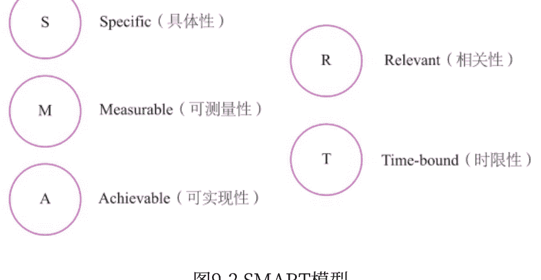

图9-2 SMART模型

#### （一）教学目标的指令编写

教学目标决定后续内容与策略走向。设计时应注意：

（1）使用 Bloom 分类法动词：采用 Bloom 认知目标分类法的动词可清晰描述学习成果，该分类法由低阶到高阶覆盖知识掌握到高阶思维。Adams N E. Bloom’s taxonomy of cognitive learning objectives [J] .JOURNAL OF THE MEDICAL LIBRARY ASSOCIATION, 2015, 103（3）：152-153. 例如：

+ ①知识层：列举、定义、描述。
②理解层：解释、总结、举例。
③应用层：应用、使用、演示。
④分析层：分析、比较、区分。
⑤评价层：评估、判断、论证。
⑥创造层：设计、创造、提出。

（2）整合认知、情感与技能目标，促进全面发展。
（3）考虑学生起点与终点，确保目标有挑战且可行。
(4) 建立目标层级，形成总目标与具体目标体系。
(5) 关联现实世界，增强学习动机与实用性。
(6) 适度跨学科整合，培养综合能力。
(7) 纳入元认知目标，培养自主学习与反思能力。

◎ 指令范例：

请为 [学科] [主题] 设计教学目标：

+ (1) 认知目标：用 Bloom 动词设置 3~5 个分层目标。
(2) 情感目标：设置 1~2 个态度价值观目标。
(3) 技能目标：设置 1~2 个操作或应用能力目标。
(4) 元认知目标：设置 1 个自主学习或反思目标。
(5) 现实关联：至少 1 个目标与学生生活或职业相关。
(6) 跨学科目标（可选）：如适用，设置 1 个跨学科目标。

请结合学生起点，形成从基础到高阶的目标体系。

#### （二）教学内容的指令编写

教学内容是达成目标的载体，设计指令时应注意：

+ （1）内容结构化：以清晰结构呈现，便于生成层次分明的教案。
（2）知识点细化：将复杂知识拆分为可管理单元。
（3）多元资源整合：指定多种教学资源满足不同学习风格。
（4）内容序列化：按难度递进或逻辑关系组织。
（5）实例与应用：提供丰富案例增强理解与迁移。
（6）跨学科联系：在适当节点建立学科关联。
（7）前沿知识整合：融入学科前沿或最新研究成果。
（8）文化元素融入：增强文化认同与跨文化理解。

◎ 指令范例：

请为 [学科] [主题] 设计教学内容：

+ (1) 内容结构：给出包含主模块与子模块的大纲。
(2) 知识点细化：对每个主知识点列出 3~5 个关键概念。
(3) 多元资源：为每个模块推荐 2~3 种资源类型。
(4) 内容序列：按［难度递进/逻辑关系/时间顺序］组织。
(5) 实例应用：为每个知识点提供 1~2 个实际案例。
(6) 跨学科联系：在合适处关联［相关学科］。
(7) 前沿知识：融入 1~2 个前沿概念或最新成果。
(8) 文化元素：适当融入［相关文化］元素。

请确保内容与既定教学目标一致，并考虑学生认知特点。

#### （三）教学策略的指令编写

教学策略是达成目标的方法，设计指令时应考虑：

+ (1) 多样化方法：指定多种教学方法并说明适用场景。
(2) 学生参与度：设计激发主动思考的活动。
(3) 差异化教学：兼顾不同水平与学习风格。
(4) 技术整合：融入在线工具、虚拟实验室等。
(5) 合作学习：设计小组合作与交流活动。
(6) 探究式学习：引导自主探究，培养批判思维。
(7) 情境化学习：创设真实或模拟情境。
(8) 形成性评估：贯穿过程的评估方法。
(9) 反思与元认知：设计反思活动。

◎ 指令范例：

请为 [学科] [主题] 设计教学策略：

(1) 多样化方法：设计 3~5 种方法并说明用途。
(2) 学生参与：为各环节设计至少 1 个主动参与活动。
(3) 差异化教学：针对高、中、低水平学生设计差异化策略。
+ (4) 技术整合：融入至少 2 种教育技术或在线工具。
(5) 合作学习：设计 1~2 个小组合作活动或项目。
(6) 探究式学习：设计 1 个自主探究活动。
(7) 情境化学习：创设 1 个相关真实或模拟情境。
(8) 形成性评估：设计 2~3 种过程性评估方式。
(9) 反思活动：设计 1 个促进反思与元认知的活动。

请确保策略能有效支撑既定目标与内容，并结合学生特点与课程实际。

### 二、教材编写：课标转化、体系建构、教学支持的指令设计

教材编写涉及多个环节，模型辅助下可通过合理指令提升质量与效率。本节围绕课标转化、体系建构、教学支持展开。

#### （一）课标转化的指令设计

课程标准是教材编写的依据，课标转化需将宏观目标分解为可操作的教学内容。

##### 1.课程目标解析指令

课程目标明确学生应达到的知识、技能与态度水平，通常包括知识、能力、情感态度价值观目标，且表述偏宏观抽象，如“培养辩证思维”或“提高科学素养”，需进一步细化才能指导教学。

课程目标拆解：让AI把标准真正落地用

在让AI解析课程目标时，提示词要同时兼顾四个视角。

第一是目标的梯度感。标准里的表述通常从记忆理解到迁移运用层层递进，提示词要引导AI先识别出这种递进序列，再在结果里呈现出来。
第二是目标的可执行性。标准语言偏概括，需要推动AI把它转化为可观察、可验证的具体行为表述。
第三是目标的融合性。知识、能力、情感态度价值观要形成合力，提示词要防止AI把三类目标割裂开来。
第四是目标的学情匹配性。要结合学生已有基础与现实学情，让输出既有挑战又能达成。

据此，撰写提示词可以遵循五条操作思路：
先把课程标准中的原始表述完整列出；
让AI把每条目标拆成可操作的具体知识点与能力点；
突出层级与递进，让结果从基础走向高阶；
强调不同类型目标的有机整合；
把目标学生群体的具体特征纳入考量，调节难度与深度。

示例模板：
请依据 [学科] [年级] 课程标准中的下列教学目标，生成一份详尽的教学内容提纲。
- 1. [课程目标1]
- 2. [课程目标2]
- 3. [课程目标3]
- ……

需要满足：
- 把每个教学目标拆解为可具体实施并可测量的知识点与能力要求。
- 保证拆解后的点在层次上由浅入深、层层递进。
- 对每一点提供1~2条可落地的教学内容建议。
- 拆解过程兼顾认知理解、情感态度、技能操作等多重维度。
- 结合 [目标学生群体的具体特征] 调整内容的难度与深度。
- 对每条拆解后的目标附上一个简易的评估思路，说明达成与否如何判断。

##### 2. 核心素养融合提示词设计

核心素养是现阶段课程改革的重要抓手，涉及人文底蕴、科学精神、学会学习、健康生活、责任担当、实践创新等。把素养自然植入教材是编写的关键所在。

设计这类提示词要注意：
解读要准确，抓住每项素养的内涵与边界；
结合学科属性，找到培养特定素养的最佳切入口；
实现内容融合，让素养在知识技能学习中自然生长；
情境创设，用真实有意义的任务让素养培养更有效。

设计原则共六条：
明确课程标准里对核心素养的具体要求；
要求AI把素养与具体教学内容对接；
强调素养培养应贯穿教材全过程；
设计多元化的教学活动来承载素养；
在真实问题情境中驱动素养发展；
考量素养培养的长期递进路径。

示例模板：
基于 [学科] [年级] 课程标准中规定的以下核心素养：
- 1. [核心素养1]
- 2. [核心素养2]
- 3. [核心素养3]
- ……

请规划一套教学内容与活动体系，有机嵌入上述素养。需要满足：
- 对每项素养做简要阐释，并说明在该学科中的具体表现形态。
- 每项素养至少对应3个教学内容或活动，覆盖不同单元章节。
- 解释这些内容或活动如何促成对应素养的发展。
- 确保活动难度与目标年级相适配。
- 为每项素养设计一个贯穿全册的主题任务或项目，体现长期累积。
- 给出日常教学中持续追踪并评价素养成长的建议。
- 再设计2~3个融合多项素养的综合任务或情境。

##### 3. 学科特质呈现提示词

每个学科都有独特知识架构、思维习惯与研究方法。教材要凸显这些特质，才能帮助学生把握学科本质。

提示词设计应关注：
学科本质，即核心概念、基本原理与方法论；
思维培养，用内容与活动训练学科特有的思考方式；
方法训练，通过实践让学生掌握学科研究技能；
价值体现，展示学科知识在生活与他域中的应用意义。

遵循的原则：
突出课程标准中关于学科特色的要求；
让AI产出能体现特色的教学内容与方法；
重视学科思维与研究方法的训练；
设计案例或活动展现学科的应用价值；
鼓励跨学科联结，凸显本学科在体系中的独特性。

示例模板：
根据 [学科] [年级] 课程标准中强调的下列学科特色：
- 1. [学科特色1]
- 2. [学科特色2]
- 3. [学科特色3]
- ……

请制定体现上述特色的教学内容与方法方案。需要满足：
- 为每个特色至少设计2个典型教学案例，并说明体现方式。
- 设计3~5个能反映学科核心思维的问题或任务。
- 提供1个小范围研究项目，让学生运用本学科方法。
- 设计1~2个前沿专题讨论或阅读材料，呈现学科发展。
- 创设2~3个生活或他域情境，展示知识的应用。
- 设计1~2个跨学科活动，呈现本学科与他学科的关联。
- 制作1份学科术语表，解释关键专业词汇。
- 设计1个贯穿全书的学科特色主题，体现整体性与系统性。

#### （二）体系建构提示词设计

##### 1. 知识架构搭建提示词

知识结构是学科体系的骨架。好的结构要让知识点逻辑清晰，帮助学生建构完整认知图景。

设计要点：
系统性，覆盖核心内容形成完整体系；
逻辑性，厘清概念间的依赖与关联；
层次性，形成从基础到高阶的清晰梯度；
关联性，呈现横向联系；
序列化，安排合理的学习顺序；
重要性，突出核心概念与关键点。

设计原则：
要求AI梳理学科核心概念与基本原理；
强调概念间逻辑关系与层次结构；
注重序列与关联；
突出重点难点；
结合学生认知规律与学习特点。

示例模板：
请为 [学科] [年级] 教材构建一份完整的知识结构框架。需要满足：
- 罗列本学期需掌握的所有核心概念与基本原理。
- 将它们组织成至少三层层次的结构图。
- 阐述各概念间的逻辑关系与相互依赖。
- 设计一条合理的学习序列，保证衔接顺畅。
- 标注每个知识点的份量：核心、重要、了解。
- 指出2~3个关键知识节点，说明其枢纽作用。
- 设计3~5组横向联系，展现单元间的关联。
- 结合 [目标学生特征] 说明结构如何契合认知特点。
- 面向教师提供2~3条依托该结构组织教学的建议。

##### 2. 知识点展开提示词

结构确定后，需要把每个知识点讲透。展开要兼顾准确性与学习动机。

设计要点：
准确性，保证定义与解释无误；
延伸性，提供背景与适当拓展；
联系性，关联其他知识点；
实用性，给出实际应用例证；
趣味性，用案例或故事提升兴趣；
实践性，配实验、观察或操作；
梯度性，兼顾不同水平学生。

设计原则：
要求AI详细阐述知识点内容；
强调准确与科学；
注重理论与实践结合；
提供丰富例证与场景；
考虑分层学习需求。

示例模板：
针对 [学科] [年级] 的 [具体知识点]，请做详细展开。需要满足：
- 给出准确定义与核心要点。
- 解释2~3个相关重要概念或原理。
- 如适用，补充历史背景或发展脉络。
- 设计一个类比或比喻帮助理解。
- 提供3~4个具体例子或应用场景。
- 指出与本学科内2~3个知识点的联系。
- 设计一个小实验、观察或操作任务加深理解。
- 准备2~3道分层练习题，覆盖基础、中等、挑战。
- 设计一个开放性探究问题。
- 列出2~3个常见误区与纠正建议。
- 如适用，提供1~2个跨学科联系点。
- 面向教师提供2~3条教学讲解建议。

##### 3. 学科思维培养提示词

学科思维是核心素养的重要构成，体现独特的问题解决方式。

设计要点：
思维特征，明确学科特有方式；
思维过程，展示典型步骤；
思维工具，介绍常用方法；
思维训练，设计针对性活动；
实际应用，提供真实案例；
跨学科思维，呈现与他学科的联系；
思维发展，考虑逐步提升。

设计原则：
强调学科特有的思维方式与方法；
要求AI设计可培养思维的教学内容；
注重循序渐进的训练；
强调在真实问题中应用；
考虑跨学科培养。

示例模板：
针对 [学科] 的以下核心思维方式：
- 1. [思维方式1]
- 2. [思维方式2]
- 3. [思维方式3]
- ……

请设计一套贯穿全书的思维训练体系。需要满足：
- 简述每种思维方式的特点与学科价值。
- 每种方式至少设计3个不同难度的训练任务：基础、中等、高级。
- 为每个任务提供步骤指引与思考提示。
- 设计2~3个真实情境或案例分析，驱动学生运用思维。
- 创建一个学期级项目，要求综合运用多种思维。
- 设计3~5个反思性问题，引导学生审视自身思维策略。
- 提供2~3个将思维迁移到他学科或生活的例子。
- 设计一个小组协作任务，通过讨论培养思维。
- 提供3~5种评估思维能力发展的办法，含形成性与总结性。
- 面向教师提供5~8条日常培养学科思维的小技巧。

#### （三）教学支持提示词设计

##### 1. 教材编排策略提示词

编排影响学习体验与教学效果，合理编排能让结构清晰、逻辑连贯。

需考虑：
整体结构与章节布局；
知识点呈现顺序与逻辑；
版面与视觉设计；
导航系统；
学习辅助元素；
难度梯度；
跨学科联结。

设计原则：
要求AI给出清晰合理的教材结构；
强调内容逻辑与连贯；
重视视觉促进学习；
考虑辅助元素设置；
合理安排难度递进。

示例模板：
针对 [学科] [年级] [教材名称]，请规划整体编排策略。需要满足：
- 给出整体框架，列出10~15个主要章节。
- 为每个章节设计统一内构：导入、主体内容、案例实例、小结要点回顾、思考练习。
- 设计统一页面布局：版心、字体字号、图表插图使用规范。
- 设计贯穿全书的视觉元素，如图标系统与配色，并说明寓意。
- 提供3~5种提升可读性的设计元素，如文本框、侧边栏。
- 设计导航系统：目录、页眉页脚、索引。
- 建议5~8种学习辅助元素，如知识链接、拓展阅读、重点提示。
- 说明3~5条体现难度递进的编排建议。
- 设计2~3个体现跨学科联系的编排元素。
- 提供3~5条增强趣味性与吸引力的编排建议。
- 说明4~6条在编排中融入素质教育与核心素养的做法。

##### 2. 分层教学支持提示词

分层教学旨在满足个体差异，通过不同难度内容与任务实现个性化支持。

设计原则：
让AI产出适配不同学习水平的内容；
强调层次清晰且可识别；
注重练习与资源的分层；
包含不同学习路径指引。

示例模板：
为 [学科] [年级] [具体单元/章节] 设计分层教材内容。需要满足：
- 将内容划分为基础、提高、挑战三层，说明各层特点与目标。
- 对核心知识点分别给出三层解释：基础层讲概念原理，提高层讲深入应用，挑战层讲拓展思考。
- 推荐2~3种适合各层的补充学习资源。
- 设计分层练习系统：基础题5~8道，提高题3~5道，挑战题2~3道。

##### 3. 多媒体资源设计提示词

数字化时代教材需融合多媒体，丰富感官体验、提升互动性。

需考虑：
资源类型：音频、视频、动画、交互练习等；
内容关联，与纸质教材紧密对应；
功能定位，明确使用场景；
接入方式，如二维码或网址；
交互设计，提升参与度；
技术适配，兼容不同设备；
更新机制，保持资源鲜活。

设计原则：
要求AI设计多元化多媒体教学资源；
强调与纸质教材紧密结合；
注重教学功能与使用便利；
考虑互动性与技术实现。

示例模板：
为 [学科] [年级] [具体单元/章节] 设计配套多媒体资源。需要满足：
- 设计至少5类资源，如音频材料、视频讲解、动画演示、交互练习、虚拟仿真、增强现实等。
- 为每类资源提供2~3个具体示例，说明内容与教学目的，约50~80字。
- 明确资源与纸质内容的对应关系：对应页码/章节、强化的知识点、使用建议。
- 设计纸质教材中的接入指引：二维码样式与位置、简洁说明文字20~30字。
- 为每个资源设计1~2个互动元素。
- 提供2~3条将多媒体融入课堂教学的具体建议。

（7）归纳一页式多媒体资源速查页，让教师和学生能迅速摸清现有数字素材的种类与使用方法。
（8）预判两到三类常见技术风险，并给出可操作的应对办法。
（9）拟定一份资源维护方案，涉及：
  - 建议的更新周期
  - 每次更新涉及的素材范围
  - 向使用者发布的通知渠道
（10）策划一至两个依托多媒体素材的延伸学习任务。
（11）列出三到五种衡量多媒体资源使用成效的评估手段。
（12）给出纸质教材中嵌入资源链接的版面示例，说明合理呈现方式。

### 三、习题设计：题型规划、知识覆盖与难度调控的提示词方案

练习题是教材教学资源的核心组件。科学编制的题目能帮助学习者巩固知识、迁移理论、提升问题解决力，并提供客观反馈。习题编制必须与教学目标与内容紧密衔接，支撑有效学习。

习题的核心作用：
- （1）内化知识：把抽象概念转化为具体运用，推动学习者实现深度理解。
- （2）能力训练：多样的题型锻炼分析、综合、评价等不同认知能力。
- （3）学情诊断：题目反馈帮助教师和学生发现优势与薄弱点。
（4）思维拓展：开放性问题激发创造性思维，培养批判性思考。
（5）动机提升：适度挑战提高学习兴趣，激发自主学习热情。

高质量习题的特征：
- （1）目标契合：紧密对应教学目标与核心素养要求。
- （2）情境真实：贴近生活或科学实践的真实应用场景。
- （3）层次清晰：难度梯度合理，兼顾不同水平学习者。
- （4）思维驱动：着力培养高阶思维，如批判性思维与创造力。
- （5）知识关联：体现知识点间的联系，助力体系构建。
- （6）形式丰富：题型多样，匹配不同学习风格与能力特点。
- （7）评估可靠：效度信度良好，能真实反映学习结果。

#### （一）题型设计提示词

题型选择直接影响学习体验与效果。不同题型考察不同的认知与思维过程。编题时，题型多样化与合理配比有助于全面达成学习目标，设计时可参考以下原则：
- 构建多元题型。
- 融合题型与学科特色的结合。
- 借助题型培养学生多方面能力。
- 合理分配各题型占比。
- 鼓励创新性变形设计。

◎ 提示词示例：

针对 [学科] [年级] [具体单元/章节] 制定一份综合练习，需求如下：

（1）题型规划：
- 至少涵盖六种不同题型，例如选择、填空、简答、计算、应用、探究等。
- 说明每类题型的测评目的与占比。
- 确保题型覆盖布鲁姆认知分类的各层级，记忆、理解、应用、分析、评价、创造。
- 设计一到两个体现学科特色的创新题型并阐明设计思路。

（2）各题型的具体要求：
- 选择题：提供四个选项，其中至少一个具有迷惑性的干扰项。
- 填空题：重要概念要求写出完整定义；公式可适当挖空。
- 简答题：要求用学生自己的语言解释概念或现象，字数控制在五十到一百字。
- 计算题：给出详细解题步骤，注意单位规范。
- 应用题：基于真实生活情境，要求综合运用所学知识解决问题。
- 探究题：提出开放性问题，鼓励学生提出假设、设计实验或论证。

（3）为每类题型各提供两到三个具体例题。
（4）设计一到两道需小组协作完成的题目。
（5）在练习中融入两到三个核心素养培养要素。
（6）给出各题型的评分细则与参考答案。

#### （二）知识点覆盖提示词

习题设计需确保教学重点知识得到充分覆盖，既能帮助学生全面复习巩固，也能凸显知识点的重要性与联系。设计提示词时可考虑：
- 全面性：涵盖教学中的全部重点知识。
- 分配比例：依据知识点重要程度分配题量。
- 关联性：设计体现知识点间联系的题目。
- 重点突出：对核心知识进行强化。

◎ 提示词示例：

为 [学科] [年级] [具体单元/章节] 编制一份覆盖关键知识点的练习，要求：

- 列出本单元/章节所有重要知识点，至少十个，按重要程度分为核心、重要、一般三类。
- 为每个知识点配题，数量为：
    - 核心知识点：每点五到七题。
    - 重要知识点：每点三到五题。
    - 一般知识点：每点一到三题。
- 设计三到五道整合多个知识点的综合题，体现关联。
- 为每个核心知识点设置一个强化小专题，包含：
    - 知识点概述五十到八十字。
    - 三到五道针对性练习。
    - 一个应用实例。
- 绘制一个知识点分布图，直观展示各点题量分布。
- 设计两到三道跨单元/章节题目，体现螺旋上升。
- 为每个知识点标注教材对应页码，便于查阅。
- 设计三到五道反映知识结构的问题，如概念图、知识树等。
- 提供一份知识点覆盖核查表，防止遗漏。
- 设计一到两道开放性问题，鼓励拓展思考。
- 用一百到一百五十字说明习题如何体现教材的知识结构与逻辑。
- 提供三到五条利用本套练习进行复习巩固的建议。

#### （三）难度控制提示词

难度把控是习题发挥作用的关键。合理的难度递进让人进步，同时避免挫败感。设计难度提示词时需注意：
- 难度分级：设基础、中等、挑战三级。
- 平滑梯度：确保难度逐步递进。
- 能力层次：依据布鲁姆目标分类设计不同难度题目。
- 区分度：题目能有效区分不同水平学生。
- 挑战性：在保证基础题量的同时提供足够挑战题。
- 自适应：考虑允许学生自主选择难度的机制。

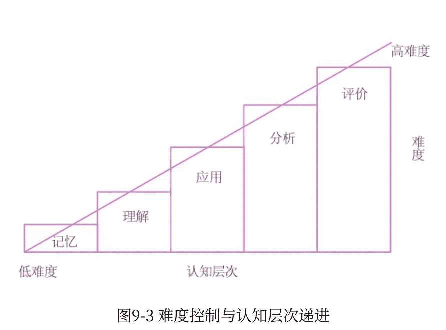

图9-3 难度递进与认知层次关联

◎ 提示词示例：

为 [学科] [年级] [具体单元/章节] 开发一份难度合理的习题集，要求：

- 将题目分为基础、中等、挑战三级，比例分别为五十%、三十%、二十%。
- 对每级提供：
    - 难度界定标准五十到八十字。
    - 三到五道示例题。
    - 该级主要培养的能力。
- 设计一组难度递进题目，五个到八题，展示平稳过渡。
- 按布鲁姆分类为各难度级配题：
    - 基础级：记忆、理解层。
    - 中等级：应用、分析层。
    - 挑战级：评价、创造层。
- 提供两到三道区分度良好的题目示例并说明设计思路。
- 设计五个到八道挑战题并指出每题的挑战点。
- 建立难度自适应机制，允许学生按水平选题并描述运行方式。
- 绘制一个难度分布图，直观呈现题集难度结构。
- 提供三到五条分层教学使用建议。
- 设计两到三道综合题，同一题目内含不同难度子问题。
- 用一百到一百五十字说明如何通过题目设置引导学生逐步提升解题能力。
- 提供一份难度评估量表，供教师或学生评估题目实际难度。

### 四、评价反馈：学情诊断、个性化反馈、激励机制提示语设计

在教育培训中，评价反馈是教学环节的重要组成。科学的反馈机制帮助学习者了解学情、明确改进方向、提升学习动力，并为后续学习提供参考。本节从学情诊断、个性化反馈和激励机制三个维度，探讨提示语的设计策略。

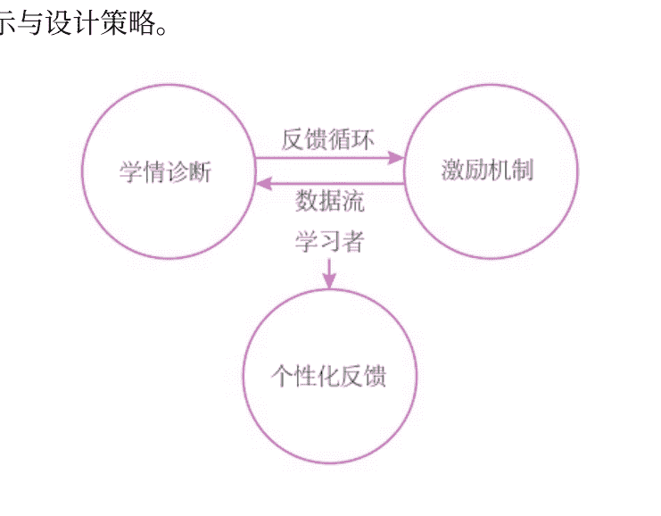

#### （一）学情诊断提示语设计

学情诊断是反馈的基础，需全面准确分析学习状况，为后续个性化反馈和激励提供依据。

关键设计策略：
- 多源数据整合：引导AI收集学习行为、作业表现、测验结果等多维度数据。
- 能力图谱构建：绘制学生知识结构与能力发展图谱。
- 学习模式识别：识别学生的学习风格、习惯与偏好。
- 问题归因分析：深入剖析学习困难的根源。
- 进展追踪：建立长期学习进展跟踪机制。

◎ 提示词示例：

为 [学科] [年级] [具体单元/章节] 设计一份完整的学情诊断方案，要求：

- 设计多维学习数据采集方案，包含：
    - 课堂参与度指标三到五个。
    - 作业完成质量评估维度四到六个。
    - 测试表现分析框架涵盖五个到七个角度。
    - 学习行为采集点六到八个关键点。
- 制作动态能力图谱模板，包含：
    - 核心知识点掌握度可视化方案。
    - 关键能力发展轨迹呈现方式。
    - 学习进度与目标对比机制。
- 设计学习风格识别算法，考虑：
    - 四到五种主要学习风格特征。
    - 行为指标与风格的映射关系。
    - 风格判定的量化标准。
- 开发错误模式分析系统，包含：
    - 常见错误类型分类至少八到十种。
    - 错误频率与严重程度量化方法。
    - 错误原因推断逻辑框架。
- 构建学习策略评估模型，涵盖：
    - 五到七种核心学习策略的定义与特征。
    - 策略使用效果评估指标。
    - 策略优化建议生成逻辑。
- 设计综合学情诊断报告模板，包含：
    - 整体学情摘要一百到一百五十字。
    - 优势领域分析三到四点。
    - 待改进领域三到四点。
    - 学习风格与策略建议四到五点。
    - 未来学习重点与目标建议三到四点。
- 提供两到三个基于诊断结果的个性化学习路径建议。
- 设计一个可视化面板，直观展示诊断关键结果。
- 制定诊断准确性评估与持续优化机制。

#### （二）个性化反馈提示语设计

个性化反馈将诊断结果转化为具体学习建议，有助于学习者明确改进方向并获得策略参考。

创新策略：
- 反馈结构模板：设计完整系统化反馈模板。
- 语言风格指导：提供适配不同年龄与阶段的语言风格。
- 数据解释框架：把学习数据转化为有意义反馈。
- 建议生成机制：依据表现生成具体改进建议。
- 正面强化策略：指出不足同时鼓励进步。

◎ 提示词示例：

请为 [学科] [年级] [具体学生] 撰写个性化反馈，要求：

- 反馈结构设计：
    - 创建反馈模板，包含：
        - 总体表现概述三十到五十字。
        - 优势领域两到三点。
        - 需改进领域两到三点。
        - 具体改进建议三到四点。
        - 鼓励性结语二十到三十字。
    - 为每个部分提供两到三条写作要点。
- 语言风格指南：
    - 提供三种语言风格示例，如鼓励型、指导型、激励型。
    - 列出十到十五个积极鼓励的关键词或短语。
    - 列出五到七个应避免的消极表达。
- 基于学情的反馈定制：
    - 设计决策树，指导依据学生表现选择反馈重点。
    - 提供三到五个常见学习问题的反馈模板。
    - 创建诊断结果向具体建议转化的指导框架。
- 改进建议生成器：
    - 为五到七个常见学习困难提供改进策略库。
    - 设计依据学生强项推荐发展方向的逻辑框架。
    - 提供三到四种设定可达成短期目标的方法。
- 反馈时机与频率建议：
    - 列出三到五个适合提供反馈的关键时间点。
    - 提供日常反馈与阶段性反馈的频率建议。
    - 设计确保反馈持续连贯的计划。
- 反馈效果跟踪：
    - 设计三到四个评估反馈效果的指标。
    - 提供两到三种收集学生反馈回应的方式。
    - 创建反馈调整优化的循环模型。
- 家长沟通策略：
    - 设计将学生反馈转化为家长沟通内容的框架。
    - 提供三到五个分享学习进展的有效方式。
    - 列出两到三个促进家校合作的建议。
- 反馈可视化建议：
    - 提供两到三个可视化进步的图表模板。
    - 设计简洁的反馈总结卡片模板。
    - 建议一到两种长期进展可视化方法。
- 创新反馈方式：
    - 提出两到三种新颖反馈呈现方式，如音频、视频反馈。
    - 设计将反馈融入日常教学的策略。
    - 建议一到两种利用技术增强反馈效果的方法，如AR。
- 教师培训建议：
    - 列出五到七个提升教师个性化反馈能力的要点。
    - 设计教师自评量表以改进反馈质量。
    - 提供两到三个提高反馈效率的实用技巧。

#### （三）激励机制提示语设计

激励机制是评价反馈的补充，适度激励能积极影响学习动力。设计应基于教育心理学，注重适度与多样性，聚焦学习本身。

创新策略：
- 动态目标设定：按进度与水平调整学习目标，保持适度挑战。
- 个性化奖励：基于兴趣与动机设计个性化奖励。
- 社交化激励：引入同伴互助与小组竞争，增强互动趣味。
- 进度可视化：用生动方式展示进度与成就，增强成就感。
- 智能提醒与干预：在动力下降时及时干预。

◎ 提示词示例：

为 [学科] [年级] [具体单元/章节] 设计智能激励机制，要求：

- 创建动态目标设定系统，包含：
    - 设计三到四个层次的学习目标模板。
    - 制定目标难度动态调整算法逻辑。
    - 提供两到三种目标达成度评估方法。
- 开发个性化奖励系统，要求：
    - 设计五到七种奖励类型，如徽章、积分、奖品等。
    - 创建学生兴趣与奖励类型匹配矩阵。
    - 提供三到四个奖励发放时机与频率建议。
- 构建社交化激励模块，包含：
    - 设计两到三种同伴互助机制。
    - 创建小组竞赛系统，含规则与奖励设置。
    - 提供一到两个促进学习社区互动的功能。
- 设计学习进度可视化系统，要求：
    - 创建三到四种进度展示图表模板。
    - 设计虚拟成长系统，如知识树、技能图谱。
    - 提供两到三种长期进步可视化方式。
- 开发智能提醒与干预系统，包含：
    - 设定四到五个需干预的关键触发点。
    - 创建三到四种不同强度的干预措施。
    - 设计干预效果评估与调整机制。
- 创建激励效果分析系统，包含：
    - 设定四到五个衡量激励效果的关键指标。
    - 提供学生激励偏好分析方法。
    - 设计激励策略A/B测试。
- 设计两到三个长期激励策略，培养内在动机。
- 提供家长参与的激励机制设计，含三到四个具体建议。
- 创建激励机制管理界面原型，便于教师监控调整。
- 设计确保激励公平性与避免过度竞争的机制。

## 第10章 文学创作中的提示语设计

与技术任务不同，文学创作更依赖想象力、情感与表达。本章探讨在小说、诗歌、剧本等创作中，如何通过提示语激发创意、塑造人物、推动情节、营造氛围，构建生动作品。

### 一、小说创作：人物、情节、场景的提示语设计

小说创作涉及人物塑造、情节发展与场景描绘，提示语可有效引导生成连贯故事。本节探讨如何通过有效提示语塑造鲜明人物、构建紧凑情节、描绘富有表现力的场景，提升小说质量。

#### （一）人物提示语设计

# 让角色活起来：多维特质构建与提示词实战

写出可信且有记忆点的角色，本质是给人物做层次递进。打动人的形象一般由三层叠加构成：最外层是可直接观察的表象信息，比如外貌、职业、社会定位；中间层是外显的气质，比如性格偏好、行为习惯与人际互动方式；最内层是内在驱动，比如价值判断、核心动机与信念体系。

基于这个认知，我们提炼出人物提示词设计的“多维度特质构建”框架 MPDCS，即 Multi-dimensional Personality Design for Character Simulation。该框架整合了心理学的大五人格、戏剧学的角色原型、社会学的身份理论三个视角。

- 大五人格面向：开放性、尽责性、外倾性、宜人性、神经质。
- 戏剧原型面向：英雄、反派、导师、助手等典型定位。
- 社会身份面向：社会角色、个人特质、价值观念。

分层拆解方式：

- 表层要素：外貌、职业、社会阶层等可观察信息。
- 中层要素：性格特点、行为模式、关系模式等互动表现。
- 核心要素：价值观、内在驱动、信念系统等深层逻辑。

综合以上，得到人物生成的方法论 MPDCS，共五个构建维度，每个维度拆分为表层、中层、核心三层结构，见表10-1。

| 维度 | 表层特征 | 中层特征 | 核心特征 |
| :--- | :--- | :--- | :--- |
| 核心特质 (Core Traits) | 性别、年龄、种族、外貌 | 大五人格特征、主要性格特点 | 核心价值观、世界观 |
| 背景故事 (Background Story) | 出生地、教育背景 | 成长环境、关键生活经历 | 形成价值观的关键事件 |
| 动机与目标 (Motivations and Goals) | 短期目标 | 长期目标 | 内在动机、人生使命 |
| 关系网络 (Relationship Network) | 家庭关系、职场关系 | 朋友关系、恋人关系 | 影响价值观的关键人物 |
| 成长轨迹 (Growth Trajectory) | 当前外在环境、可能的环境变化 | 当前能力/技能、潜在成长方向 | 价值观/信念的演变、成长障碍 |

表10-1 MPDCS模型人物构建核心维度表

MPDCS模型人物设计提示语模板：

请参照下述 MPDCS 框架为小说设计一个人物。

(1) 核心特质（Core Traits）：

- a. 表层特征
    - 性别： [ ] 。
    - 年龄： [ ] 。
    - 种族： [ ] 。
    - 外貌特点： [描述2～3个显著的外貌特征] 。
- b. 中层特征
    - 主要性格特点： [列出3～5个关键词] 。
    - 大五人格得分（1～10分）：
        开放性： [ ] ；尽责性： [ ] ；外向性： [ ] ；宜人性： [ ] ；神经质： [ ] 。
- c. 核心特征
    - 核心价值观： [描述角色最重要的1～2个价值观] 。
    - 世界观： [简要描述角色如何看待世界] 。

(2) 背景故事（Background Story）：
- a. 表层特征：
    - 出生地： [ ] 。
    - 教育背景： [ ] 。
- b. 中层特征：
    - 成长环境： [简要描述] 。

##### （3）动机与目标（Motivations and Goals）：
a. 表层特征：
- 短期目标： [列出1～2个]。
b. 中层特征：
- 长期目标： [列出1～2个]。
c. 核心特征：
- 内在动机： [描述驱动角色的核心动力]。
- 人生使命： [如果有的话，描述角色认定的人生使命]。

##### （4）关系网络（Relationship Network）：
a. 表层特征：
- 家庭关系： [简要描述]。
- 职场关系： [如果适用，简要描述]。
b. 中层特征：
- 朋友/同事： [列出2～3个关键人物及关系]。
- 恋人/伴侣： [如果有的话，描述关系状况]。
c. 核心特征：
- 影响其价值观的关键人物： [描述1～2个对角色世界观、价值观产生重大影响的人]。
- 潜在冲突： [描述可能引发冲突的关系]。

##### （5）成长轨迹（Growth Trajectory）：
a. 表层特征：
- 当前外在环境： [描述角色目前所处的环境]。
- 可能的环境变化： [预测1～2个可能的外在变化]。
b. 中层特征：
- 当前能力/技能： [列出角色的主要能力或技能]。
- 潜在成长方向： [列出1～2个可能的能力提升方向]。
c. 核心特征：
- 价值观/信念的演变： [描述角色核心信念可能的变化方向]。
- 成长障碍： [描述阻碍角色成长的内外因素]。

基于以上信息，请输出约800字的人物小传，涵盖外貌、性格、行为模式、内心世界，并附一个能体现角色多层次特质的典型场景。在撰写时，注意呈现表层、中层、核心特征之间的关联与张力。

#### （二）情节提示语设计

情节是小说的骨架，是推动故事发展的核心动力，关键要素包括：

- （1）情节节点（Plot Nodes）：关键事件或转折点，往往对应读者注意力与情感投入的高峰。
- （2）情节路径（Plot Paths）：连接各节点的可能线索，决定故事走向，多条路径带来丰富性与不确定性。
- （3）情节细化（Plot Elaboration）：对节点与路径的深入展开，通过细节增强真实感与稳定感。
- （4）情节连接（Plot Connections）：关注元素间的逻辑与情感关联，形成因果网络，提升连贯与说服力。

由此衍生的提示词方法论是NEPC模型（Node-Elaboration-Path-Connection），涵盖情节构建的四个核心维度，见表10-2。

| 维度 | 核心问题 | 关键考虑点 | 相关技巧 |
| :--- | :--- | :--- | :--- |
| N- 节点 (Nodes) | 故事的关键转折点是什么？ | 冲突升级，人物决策，外部事件 | 反转技巧，高潮设计，危机创造 |
| E- 细化 (Elaboration) | 如何丰富情节细节？ | 背景描述，人物互动，内心活动 | 场景构建，对话设计，心理描写 |
| P- 路径 (Paths) | 情节可能如何发展？ | 多重可能性，因果关系，选择点 | 分支叙事，蝴蝶效应，平行世界 |
| C- 连接 (Connections) | 如何使情节连贯？ | 因果链构建，主题一致性，伏笔设置 | 循环呼应，象征手法，线索编织 |

表10-2 NEPC模型情节构建核心维度表

NEPC模型情节设计提示语模板：

请使用以下 NEPC 模型设计小说情节：

- (1) 节点 (Nodes)：
  a. 开场设置：
    - 主要冲突： [描述推动整个故事的主要冲突]。
    - 核心问题： [阐述故事试图探讨的核心问题]。
  b. 关键转折点（至少3个）：
    - 转折点1： [描述第一个主要情节转折]。
    - 转折点2： [描述第二个主要情节转折]。
    - 转折点3： [描述第三个主要情节转折]。
  c. 高潮：
    - 核心冲突： [描述故事高潮时的核心冲突]。
    - 情感峰值： [描述高潮时的情感强度和类型]。
  d. 结局：
    - 解决方式： [描述如何解决主要冲突]。
    - 余波： [描述结局后的影响或未解问题]。

- (2) 细化（Elaboration）：
  a. 场景描述：
    - 环境： [描述场景的物理环境]。
    - 氛围： [描述场景的情感氛围]。
  b. 角色反应：
    - 外在行为： [描述角色的可观察行为]。
    - 内心活动： [描述角色的思想和情感变化]。
  c. 细节增强：
    - 感官描述： [添加视觉、听觉、嗅觉等感官细节]。
    - 象征元素： [如果有，添加具有象征意义的物品或现象]。

- (3) 路径（Paths）：
  a. 主要情节路径：
    - 因果链： [描述主要事件之间的因果关系]。
    - 时间线： [概述故事的时间跨度和主要时间点]。
  b. 次要情节路径（至少1条）：
    - 副线内容： [描述与主线并行发展的次要情节]。
    - 交叉点： [说明次要情节如何与主线交叉]。
  c. 可能的分支：
    - 分支点： [指出故事可能出现分支的关键决策点]。
    - 潜在结果： [描述不同决策可能导致的不同结果]。

- (4) 连接（Connections）：
  a. 主题连接：
    - 核心主题： [阐述贯穿全文的中心思想]。
    - 主题体现： [说明主题如何在不同情节中体现]。
  b. 人物弧光：
    - 主角成长： [描述主角在故事中的成长轨迹]。
    - 关系演变： [描述主要角色间关系的变化]。
  c. 因果关联：
    - 伏笔设置： [列出故事前期埋下的伏笔]。
    - 伏笔回应： [说明这些伏笔在后期如何得到回应]。
  d. 情感连接：
    - 情感基调： [描述贯穿全文的基本情感基调]。
    - 情感变化： [说明情感如何随情节发展而变化]。

基于以上框架，请生成约1500字的详细情节大纲，包括：
- (1) 故事梗概（300字左右）。
- (2) 每个关键节点的详细描述（每个节点200字左右，共5个）。
- (3) 主要情节路径的因果链分析（200字左右）。
- (4) 一个次要情节路径的描述及其与主线的关系（200字左右）。
- (5) 主题分析和人物弧光描述（200字左右）。

设计时注意要素间的有机联系，确保连贯、复杂且主题统一，同时通过情节凸显人物特性，推动成长，提升深度与吸引力。

#### （三）场景提示语设计

场景为人物与情节提供物理空间，同时塑造氛围、映照主题、推动进程。场景提示构成包含：

- (1) 多感官描述：兼顾视觉、听觉、嗅觉、触觉乃至味觉，构建沉浸感。
- (2) 空间动态性：随情节与人物活动而变化，包含物理变化与移动。
- (3) 情感共鸣：环境影响情绪，描写需与人物情感与故事基调呼应。
- (4) 符号象征：元素可承载深层主题或隐喻，提升内涵。
- (5) 互动性：让读者产生可与环境互动的临场感。

由此形成的场景方法论是VISTA模型 (Visualization-Immersion-Symbolism-Transformation-Atmosphere)，见表10-3。

| 维度 | 核心问题 | 关键考虑点 | 相关技巧 |
| :--- | :--- | :--- | :--- |
| V- 视觉元素 (Visualization) | 如何让读者看到场景？ | 空间布局，色彩运用，光影效果 | 焦点描述，全景扫描，细节特写 |
| I- 沉浸感 (Immersion) | 如何让读者感受场景？ | 多感官描述，环境互动，情感共鸣 | 感官调动，人物反应，环境细节 |
| S-象征性 (Symbolism) | 场景如何体现深层含义？ | 主题映射，情感隐喻，文化符号 | 物品象征，环境对比，重复元素 |
| T-转化 (Transformation) | 场景如何随剧情变化？ | 时间流逝，情节推进，心理变化 | 季节更替，场景对比，心境映射 |
| A-氛围 (Atmosphere) | 如何营造特定氛围？ | 整体基调，情感渲染，悬念制造 | 天气变化，光线变化，声音设计 |

表10-3 VISTA模型场景构建核心维度表

VISTA模型场景设计提示语模板：

请使用以下 VISTA 模型设计小说场景：

- (1) 视觉元素 (Visualization)：
  a. 整体布局： [描述场景的整体构图和空间布局]。
  b. 焦点对象： [描述场景中2～3个最吸引眼球或最重要的视觉元素]。
  c. 色彩方案： [描述主要的色彩搭配和可能的象征意义]。
  d. 光线效果： [描述光线的来源、强度、色调及其变化]。

- (2) 沉浸感 (Immersion)：
  a. 听觉元素： [描述场景中的声音，包括背景音和特定声响]。
  b. 嗅觉元素： [描述场景中的气味，及其可能引发的联想]。
  c. 触觉元素： [描述温度、质地等可触摸的感受]。
  d. 味觉元素： [如果适用，描述可能的味道]。
  e. 动态元素： [描述场景中的动态元素，如风、水流等]。

- (3) 象征性 (Symbolism)：
  a. 核心象征： [选择一个场景中的核心元素，阐述其象征意义]。
  b. 隐喻关系： [解释场景如何隐喻人物关系或情节发展]。
  c. 主题呼应： [说明场景如何呼应或强化故事的主题]。
  d. 情感投射： [描述场景如何反映人物的内心状态]。

- (4) 转化 (Transformation)：
  a. 时间变化： [描述场景随时间推移的变化，如光线、活动等]。
  b. 事件影响： [说明某个事件如何改变场景的某些元素]。
  c. 人物互动： [描述人物如何与场景互动，以及由此产生的变化]。
  d. 焦点转移： [说明视角或注意力如何在场景中移动]。

- (5) 氛围 (Atmosphere)：
  a. 整体基调： [用3～5个形容词描述场景的整体氛围]。
  b. 情绪渲染： [解释场景如何营造特定的情绪]。
  c. 张力来源： [描述场景中创造张力或冲突的元素]。
  d. 节奏控制： [说明如何通过场景描述控制叙事节奏]。

基于以上框架，请生成约800字的场景描写，包括：
- (1) 开场总体印象（100字左右）。
- (2) 多感官细节描述（300字左右）。
- (3) 象征意义和氛围营造（200字左右）。
- (4) 场景变化和人物互动（200字左右）。

设计时注意场景与人物情感、情节发展的呼应，多感官的平衡，动态与静态结合，象征的自然融入，以及对情节推进或人物塑造的助推作用。

### 二、诗歌创作：意象、情感、韵律的提示语设计

诗歌是高度凝练的表达形式。提示词设计可围绕意象构建、情感表达与韵律结构展开。

##### 1. 意象维度
意象是感官体验与抽象概念的结合体，可涉及多感官，有效意象能引发联想与共鸣，通常具：
- (1) 具体性：唤起感官体验。
- (2) 关联性：触发丰富联想。
- (3) 原创性：呈现新颖视角。
- (4) 象征性：承载深层含义。

##### 2. 情感维度
情感是诗歌灵魂。可分显性与隐性，表达方式包括：
- (1) 直接陈述：明确情感状态。
- (2) 意象映射：借外物折射内心。
- (3) 情感隐喻：用比喻传递复杂情感。
- (4) 语气和语调：以节奏与语气传达情感。

##### 3. 韵律维度
韵律关乎音韵与节奏，能强化意象与情感。体现于：
- (1) 韵脚：行末音的和谐统一。
- (2) 节奏：音节的有规律排列。
- (3) 音响效果：谐音、叠音等修饰。
- (4) 结构平衡：诗行对称或变化。

三者交织构成艺术魅力。AI辅助创作可采用 IER 模型（Imagery-Emotion-Rhythm）作为框架。表10-4列出各维度的核心问题、关键点与技巧。

| 维度 | 核心问题 | 关键点 | 相关技巧 |
|---|---|---|---|
| I- 意象 (Imagery) | 如何创作鲜活的意象？ | 感官体验，隐喻运用，意象关联 | 多感官描述，意象组合，通感手法 |
| E- 情感 (Emotion) | 如何传达深刻的情感？ | 情感层次，情感转化，普遍共鸣 | 情感渐进，反衬手法，情景交融 |
| R- 韵律 (Rhythm) | 如何构建优美的韵律？ | 音韵和谐，节奏变化，形式创新 | 押韵技巧，重复变奏，音步设计 |

表10-4 IER模型诗歌构建核心维度表

IER模型诗歌创作提示语模板：

请使用以下 IER 模型创作一首诗：

- (1) 意象（Imagery）：
  a. 核心意象： [描述1～2个贯穿全诗的核心意象]。
  b. 感官描绘：
    - 视觉： [描述1～2个视觉元素]。
    - 听觉： [描述1个听觉元素]。
    - 触觉/嗅觉/味觉： [描述1～2个其他感官元素]。
  c. 意象关联： [描述核心意象与其他意象的关联方式]。
  d. 象征寓意： [说明核心意象的深层含义或象征意义]。

- (2) 情感（Emotion）：
  a. 情感基调： [描述诗歌的主要情感色彩]。
  b. 情感发展： [描述情感如何在诗中展开或变化]。
  c. 情感表达方式：

诗写之前，先把骨架搭好

情绪表达
直接抒情可以给出能立刻显情绪的句式参考。借物抒情则需要一到两个能承载情绪的意象比喻。情绪与画面的结合要讲清感受是怎样借由具体意象显出来的。

节奏与声韵
先定诗体，是自由体、十四行还是古体。需要押韵的话要说明韵脚怎么排。节奏控制要写明音步怎么摆、长句短句怎么搭配。音响层面要挑一到两种修辞，比如头韵或叠音。

主题与架构
核心主题要一句话讲清想说的事。整体架构要说明起承转合怎么走。首尾呼应如果有，要点明怎么收束回开头。

亮点设计
点出一个到两个有新意的点，可以是意象的奇组合，也可以是韵律上的小尝试。

按这个框架写一首二十到三十行的作品，过程中留意意象要新且有关联、情绪要细腻深入、节奏要有张弛、主题要贯穿并有升华、整体艺术感要完整。

写完后用约一百字说明这首诗在IER模型里情感、意象、韵律三层是如何落地的。

三、剧本创作的提示语怎么搭：从想想到打磨

戏剧剧本和小说诗歌走的路不一样，核心是为舞台服务。所以提示语要围绕对话带情节带人物、可视化思考、冲突做驱动、兼顾舞台物理条件、调动观众情绪这五条来设。

整体可以拆成初始化、创意生成、结构设计、角色开发、场景创作、优化迭代六个环节，每个环节侧重点不同。

初始化阶段
这一步是先把基本盘定下来。提示语可以按参数设定+目标明确+限制条件的思路来。关键是让模型把题材、背景、主角先锁住，同时给后续情节一个框架。

示例提示：
初始化剧本参数：
类型：主类型如悲剧、喜剧、正剧，必要时加副类型。
体量：幕数如独幕三幕，每幕预估时长。
受众：主要观众年龄、兴趣，是否需要特定文化背景。
创作目标：想传达的核心信息，期望的情感或思考效果。
限制条件：历史背景、演员数限制等硬性要求，禁忌内容。
请用三百字左右说明上述参数。

创意生成阶段
这是创意冒头的阶段，要开放但也要顾舞台可行。提示语框架是主题挖掘+冲突设定+创新呈现。

示例提示：
给一个舞台剧的核心点子：
挑一个当下议题作题材，如科技伦理、身份认同。
列三种戏剧冲突，每种都要有个人矛盾和社会对峙。
想一个舞台呈现的巧思，比如非常规布景、新叙法、观众互动。
说明在有限舞台空间里怎么达成视觉冲击和情绪冲击。
请用约三百字概括主题、冲突和呈现。

结构设计阶段
关注整体走向和节奏，兼顾张力、情节和主题，同时要能落到舞台操作上。提示语可用结构+转折+节奏。

示例提示：
做一个三幕大纲：
每幕定主题和情绪基调。
设四个关键节点：开场、第一转折、中段、高潮。
说明每个节点在舞台上怎么呈现，动作和视觉怎么配合。
标出需要提速或放缓的地方，并解释效果。
给出两幕之间场景转换的创新做法。
请用约五百字说明结构、转折和节奏。

角色开发阶段
要把角色做立体，通过台词和行动显性格。提示语可用档案+关系+成长。

示例提示：
开发主角和两个配角：
基础信息、三个到五个关键特质、核心信念、动机目标。
画关系网，说明每段关系的性质和冲突点。
写角色成长线，变化如何推剧情。
设计两人的核心冲突并说明作用。
为每人写一段三十字左右的特色台词。
请用约六百字呈现档案、关系、成长和台词。

场景创作阶段
把创意和结构落地成具体的舞台段落。提示语可用场景布置+对话+舞台指示。

示例提示：
写一个关键场：
时间地点、布景氛围、在场人物初始状态。
本场在整体中的作用，要推进的情节或要透露的信息。
写开头对话约一百字，高潮对话约五十字。
加一处潜台词并解释含义。
描写肢体、表情的互动。
写灯光音效和关键动作指示。
加入一个体现主题的象征物件或动作。
请用约二千字呈现设置、对话、潜台词、互动、指示和象征。

优化迭代阶段
提升质量和舞台可实现性。提示语可用问题找出来+解决办法+效果评估。

示例提示：
评估剧本：
主题深度、结构节奏、角色真实度、台词个性、舞台创新可行性各打一到十分并说明。
挑两个最弱的点给出具体改进建议。
检查角色成长线是否自洽并推动剧情，不一致要改。
给高潮场一个增强戏剧性和舞台效果的具体建议。
给一个提升观众参与感或情绪投入的创意。
反思是否充分表现了初始主题，必要时给加强方法。
建议要兼顾艺术和可操作性。

第11章 新闻内容创作中的提示语设计
本章讨论新闻报道、评论、特稿等体裁的提示语怎么设计。

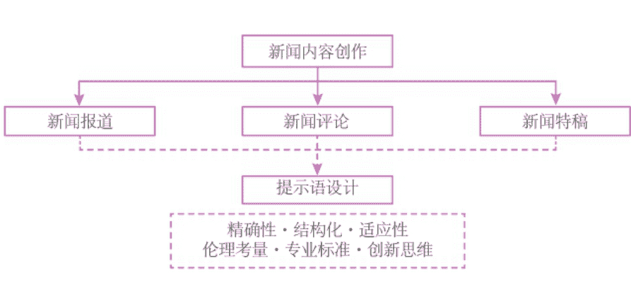

### 一、新闻报道：消息、通讯、新闻特写的提示语设计
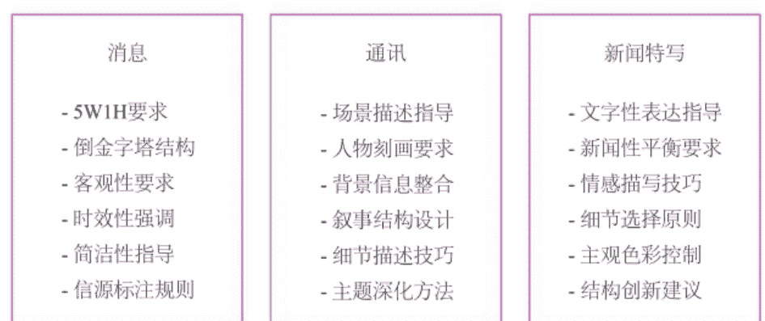

图11-2 新闻报道提示语设计框架
新闻报道要准要快。本节聚焦消息、通讯、特写三种形式的提示语。

#### （一）消息的提示语设计
消息是就新近发生、有社会价值的事实做的简短报道。核心是时效、重要性、准确性，同时要求简洁、客观、有结构，通常用倒金字塔。

提示语设计的目标导向
保证时效和准确。做法：要求输出时间戳、多重核查、区分已确认和待确认信息并标来源。
示例提示：
请生成关于某事件的最新消息：
列出已确认信息点并标来源和确认时间。
列出待确认信息并明确标注。
正文里用据某来源报道、某机构证实等表述。
文末写截至具体时间。

保持中立客观。做法：用中性词、平衡呈现多方观点、禁感情色彩修饰。
示例提示：
报道某事件时遵守：
用客观中性词汇，避免褒贬。
有争议要呈现至少两方观点，篇幅相当。
引用时用表示、称等中性动词。
禁用应该必须等主观判断词。
数据要具体，避免模糊表述。

结构完整层次分明。示例提示：
请按结构写约五百字消息：
标题十五字内，概括核心。
导语五十字左右，回答5W1H至少四问。
主体四百字，第二段一百字补充关键信息；第三段一百字说背景原因；第四五段八十到一百字按重要递减展开。
结尾五十字点明发展态势。
每段只聚焦一个信息点，由重到轻。

语言简洁明白。示例提示：
撰写消息时遵守：
每句不超过三十字。
以主动语态为主。
每段最多一个复合句。
避免修饰状语和长定语。
用准确动词，避免进行、作出等空词。
专业术语首次出现加括号解释。

结构设计与提示语策略
标题设计。要求概括、醒目、简洁，一般不超过二十字。
示例提示：
基于以下要素生成不超过二十字标题：
核心事件、关键人物或机构、时间地点、原因结果。
要求用有力动词，包含新闻价值要素，避免标点和夸张。

导语设计。要求精炼、全面、有吸引力。
示例提示：
请用约四十字写导语：
主体Who、内容What、时间When、地点Where、原因Why、经过How。
一段完成，优先顺序What大于Who大于When大于Where大于WhyHow，用主动语态，保持客观。

主体设计。遵循倒金字塔，按重要递减排列。
示例提示：
基于框架写三百到四百字主体：
核心事实、事件细节、背景信息、各方反映、潜在影响。
要求严格倒金字塔，每段一个信息点，段间用转折词连接，引用注明来源，保持客观。

结尾设计。简洁点题并留开放空间。
示例提示：
基于以下元素创作结尾：
事件后续、未解问题、长远影响。
要求选一或多项，语言简洁客观，避免主观预测，可用记者将持续关注做开放结尾。

6. 收束段落可以试着换风格，小结式、启发式、号召式、分析式或展望式都能选用。

##### 3. 消息写作的创新打法

新闻消息写作的传统骨架是 5W1H，即 Who、What、When、Where、Why、How，它给记者提供了一份涵盖重点的清单。在生成式人工智能进入编辑流程后，这一骨架可以被延展。在书中据此提出多维矩阵提示法 MD-Matrix Prompting，用来牵引人工智能产出高质量的消息稿。如表11-1所示，该方法在 5W1H 的基础上叠加了影响维度 I、信源维度 S、语言维度 L，构成了一个覆盖九个面向的分析框架。

表11-1 多维矩阵提示法维度及对应说明

| 维度 | 对应 5W1H | 包含要素 |

| :--- | :--- | :--- |

| 时间维度（T） | When | 事件发生时间、报道时间、未来影响时间 |

| 空间维度（S） | Where | 事件发生地点、影响范围、地理关联性 |

| 人物维度（P） | Who | 主要相关人物、机构、群体 |

| 事件维度（E） | What | 主要事件、次要事件、背景事件 |

| 原因维度（R） | Why | 直接原因、间接原因、深层背景 |

| 过程维度（H） | How | 事件发展过程、实施方式、关键步骤 |

| 影响维度（I） | 新增 | 直接影响、间接影响、潜在影响 |

| 信源维度（S） | 新增 | 主要信源、次要信源、交叉验证 |

| 语言维度（L） | 新增 | 用词精确度、句式多样性、语气客观性 |

操作环节：

（1）矩阵初始化。
启动的第一步是矩阵初始化，需要记者依据已掌握的材料，为九个维度分别设定起始参数。这些参数会指引人工智能在撰写时把握侧重点，保证成品既周全又突出。参数设定的精准度直接决定最终稿件的水准，因而需要记者具备敏锐的新闻洞察与实践经验。

提示语示例：

初始化新闻消息矩阵：

```
T：[主要事件时间=2024-07-15 14：30；报道时间=2024-07-15 16：00；未来影响时间范围=7天]。
S：{事件地点=北京市海淀区；影响范围=全国；地理关联=[硅谷，深圳]}。
P：{主要人物=[张三（科技公司CEO）；李四（政府官员）]；相关机构=[中国科学院，工信部]}。
E：[主要事件=国内首个量子计算机芯片发布；次要事件=相关专利申请突破1 000项；背景事件=全球量子计算竞争加剧]。
I：[直接影响=提升国内科技水平；间接影响=吸引国际人才流入；潜在影响=改变全球科技格局]。
S：{主要信源=新华社；次要信源= [科技日报, 中国科学报]；交叉验证= “3” }。
L：[用词精确度=0.9；句式多样性=0.7；语气客观性=0.95]。
```

（2）内容生成。
进入撰写阶段，提示词应当明确每一小段需要承载哪些维度信息、如何组织这些信息以及语言风格的规范，从而牵引人工智能产出结构清晰、焦点突出、表达规范的稿件。同时要对直接引语的标注方式作出要求，以符合新闻规范。

提示语示例：

基于前面已初始化的新闻消息矩阵，写一篇约300字的消息稿，要求：

1. 严格以倒金字塔为框架。
2. 首段要浓缩时间、空间、人物、事件四个维度的核心要素。
3. 第二段重点展开影响维度的内容。
4. 第三段补充事件维度的背景要素。
5. 末段说明信源维度的来源情况。
6. 整体语言要满足语言维度的要求。
7. 如有直接引语，请用引号标注并注明出处。

（3）矩阵优化。
初稿完成后需要对矩阵进行优化，以提升新闻品质。该环节包括信息密度检验、客观性评估、时效性强化、信源可信度核查和影响力评估等。例如信息密度检验用于确认关键信息是否集中在前部，客观性评估则帮助保持消息的中立立场。

◎ 提示语示例：

请对上面的新闻消息做如下优化：

1. 信息密度检测：统计各维度信息在文中的出现频次，确保时间、空间、人物、事件在前两段的出现比例不低于80%。
2. 客观性评分：甄别带有主观色彩的用词，确保语言维度中语气客观性不低于0.95。
3. 时效性增强：将时间维度中的报道时间更新为当前时间，并在正文中体现该变化。
4. 信源可靠性验证：保证信源维度涉及的所有来源均在文中呈现，交叉验证次数不少于3次。
5. 影响力评估：强化影响维度中潜在影响的表述，在文中增补一句相关描述。

(4) 终稿生成。
最后一步是依据优化后的矩阵和多角度验证结果产出终稿。此阶段的提示词应强调总字数控制、新旧内容的衔接、语言风格统一等要求。同时鉴于人工智能辅助写作的特性，需在文末注明本文由人工智能参与生成，以满足新闻伦理和生产透明要求。

◎ 提示语示例：

基于前述优化与验证结果，生成新闻消息终稿。要求：

（1）总字数控制在400字以内。
（2）新增内容与原有内容实现无缝衔接。
（3）保持语言风格一致。
（4）在文末注明本文由人工智能辅助生成，经人工审核。

#### （二）通讯的提示语设计

通讯是综合性很强的报道样式，可运用记叙、描写、抒情、议论等手法，生动具体地呈现新闻事件或典型人物。在人工智能辅助写作场景下，设计高质量通讯提示词需要充分把握通讯的特性和写作规范。

人物稿件与事件稿件是最常见的两种类型，各有特征和要求，提示词需牵引人工智能体现相应特质。

实现要点：

- 明确指定通讯的具体类型。
- 提供该类型通讯的核心要素和结构指引。
- 设定内容比例，确保类型特征得到充分体现。

##### （1）人物通讯。

人物通讯以刻画特定人物的思想与事迹为核心。主要特征包括：聚焦一至数个中心人物，群体报道亦突出典型代表；通过思想、行为、事迹的描写揭示个性与精神境界；讲究见事见人，通过具体事例展现人物；注重矛盾冲突、行为刻画、对话再现来塑造性格；善于细节描写与心理刻画，深入人物内心。篇幅可长可短，既可作长篇事迹报道，也可作人物素描或特写。

提示词设计需关注：首先明确人物选择依据，确保典型性与新闻价值；其次以具体事例和细节凸显人物，避免空泛评价；再次重视成长经历与关键转折的描写，展现发展轨迹；此外强调思想境界与精神风貌的挖掘，而非仅罗列事迹；最后将人物置于特定社会背景中，体现时代意义。

◎ 提示语示例：

请创作一篇约2500字的人物通讯，主人公为［人物姓名］。请按以下结构与要求撰写：

(1) 开篇约300字：
选取一个能体现人物特点或重要成就的场景切入，简要交代人物身份和报道缘由，突出典型性或独特性。

(2) 人物全貌呈现约800字：
外貌特征和第一印象约100字；性格特点含优缺点约200字；成长经历重点写3～4个关键转折点约300字；专业成就或社会贡献约200字。

(3) 核心事件或成就详述约700字：
挑选2～3个最能体现人物特点或影响力的事件或成就。每项包含背景介绍约50字；人物具体行动与决策过程约150字；面临挑战及解决方法约100字；事件结果与影响约50字。

(4) 多角度评价约400字：
同事或合作伙伴评价约100字；家人或朋友评价约100字；业界专家或公众评价约100字；主人公自我评价或人生感悟约100字。

(5) 深度分析约200字：
解析人物发展变化的关键因素或独特之处；探讨人物对所在领域或社会的影响。

(6) 结语约100字：
总结人物的时代意义或社会价值；前瞻人物或其事业的未来发展。

##### 写作要求：

（1）以具体事例和生动细节刻画人物，避免空洞描述。
（2）着重展现思想变化与性格发展过程。
（3）把人物置于特定时代背景中，突出时代性。
（4）保持客观公正，呈现多面性。
（5）语言富有感染力，但不过度褒贬。
（6）注意隐私保护，敏感信息需经当事人同意。

##### （2）事件通讯。

事件通讯是报道具有典型意义新闻事件的文体，通过详细描述与分析揭示社会问题，引发公众思考。

主要特征包括：具有新闻性，事件影响重大或具社会意义；典型性，能反映普遍问题或趋势；拥有相对完整故事情节；通常置于广阔社会背景解读，揭示事件与时代关联；突出主线，精心安排典型情节；注重借事件刻画人物，呈现群像；善用多种写作技巧增强吸引力。

提示词设计要点：首先明确事件新闻价值与典型意义，确保焦点准确；其次牵引人工智能将事件置于更广阔社会背景分析，揭示深层意义；再次强调突出主线、安排清晰结构；最后牵引运用细节描写、场景再现、对比分析等技巧提升感染力。

◎ 提示语示例：

请创作一篇约3000字的事件通讯，主题为［具体事件］。请按以下结构与要求撰写：

（1）导语约200字：
简要概括事件核心内容；点明事件重要性或新闻价值；设置悬念或引发读者兴趣的问题。

（2）事件概况约300字：
事件发生时间、地点、主要参与者；事件起因和背景；基本过程和结果。

（3）详细过程描述约1200字：
按时间或逻辑顺序详细叙述发展脉络；划分为3～5个关键阶段或转折点；各阶段包含具体时间地点；主要参与者行动与决策；关键对话或冲突描述；环境氛围渲染；穿插1～2个生动场景描写，各约200字。

（4）多方反映和评论约600字：
事件直接相关方反应约200字；主管部门或权威机构表态约150字；公众或媒体反响约150字；专家学者分析约100字。

（5）深度分析约500字：
事件成因分析约150字；社会影响与意义约200字；类似事件对比分析如有约100字；未来发展趋势或需关注问题约50字。

（6）结语约200字：
事件最新进展或后续措施；记者思考或启示；适当留白，引发读者深思。

##### 写作要求：

（1）保证信息准确全面，多方采访，避免片面。
（2）以具体数据和事实支撑，增强可信度。
（3）借助细节和场景描写提升现场感。
（4）保持客观中立，平衡各方观点。
（5）注意时效性，及时更新进展。
（6）深入挖掘背后社会问题或意义。
（7）注意当事人隐私，遵守新闻伦理。

#### （三）新闻特写的提示语设计

新闻特写兼具新闻时效性与文学表现力。核心在于截取最具典型意义的片段、场面或细节，以生动描写呈现现场感。特写强调时效与重要性，注重挖掘深度，选用最能体现核心的场景、人物或细节，并精益求精地再现现场。

创作时需关注：善于捕捉反映事件本质的画面；聚焦体现特征与高潮的关键片段，避免面面俱到；运用特征细节描写，通过言行举止、表情动作传神；语言既简洁有力又生动形象，避免直白或过度修饰。记者需具备敏锐判断，选择适合特写呈现的题材。

◎ 提示语示例：

请创作一篇约1200字的新闻特写，主题为 [报道主题] 。请按以下结构与要求撰写：

（1）开篇约200字：
选取最能体现新闻主旨的典型场景；以生动笔触描绘场景，营造画面感；简要交代背景与主题，突出新闻价值。

（2）主体部分约800字：
聚焦核心场景或关键片段约300字，细致描绘反映事件特征的高潮片段，通过言谈举止展现现场氛围，捕捉2～3个特征细节，增强真实感。
背景铺陈约200字，简洁介绍来龙去脉，提供必要背景信息，增强新闻性。
多角度呈现约300字，选取2～3个不同视角，展现多侧面，通过简短对话或行为描述体现不同立场。

（3）结尾约200字：
回应开头场景，形成首尾呼应；点明深层含义，引发读者思考。

##### 写作要求：

（1）保证真实准确，同时表述生动。
（2）使用画面感强的语言，让读者如临其境。
（3）通过细节和场景反映本质，避免直接评论。
（4）叙述简洁与描述生动间取得平衡。
（5）聚焦最能体现特征的片段，不求全面。
（6）借助人物活动、对话等具体描写展现氛围。
（7）把握“新”“闻”“特”“写”四要素要求。

##### 注意事项：

（1）选择最能体现核心主旨与特色的场景或片段重点描写。
（2）避免过度文学化或直白表述，寻求适度表现力。
（3）通过具体言行和细节反映事件，而非抽象概括。
（4）注意节奏变化，可穿插简短背景说明或补充信息。
（5）在描述中强调新闻的时效性，体现特写的“新”。

### 二、新闻评论：社论、评论员文章、编者按的提示语设计

新闻评论是媒体表达观点、引导舆论的重要方式。本部分聚焦社论、评论员文章和编者按三种主要形式，分析特点与写作要求，探讨提示词设计如何让人工智能生成的评论既准确表达立场，又保持客观公正，同时具有深度与洞察力。

如图11-3所示，新闻评论提示词设计流程分为三个步骤：确定评论类型与目的、设计提示词结构、制定具体提示要求。这一流程有助于确保人工智能输出符合特定类型要求并达到专业标准。

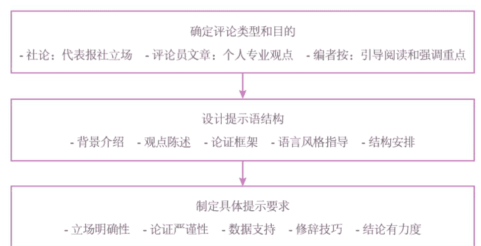

#### （一）社论的提示语设计

设计社论提示词前需深入理解其特质。社论代表报社整体立场与观点，反映并传播特定政党、社会政治集团或群众团体对重大事件和迫切问题的看法，也是报社发表意见的重要舆论工具，塑造社会价值取向。因此提示词设计需充分考虑其定位与功能。

社论有三个核心特征需在提示词中体现。首先，社论代表报社立场而非个人观点，提示词须强调权威性与代表性。其次，评论对象是重大新闻事件与时政问题，要求提示词牵引人工智能选择重要且时效性强的主题。最后，目的是引导舆论，提示词需强调说服力与影响力。

具体设计要点：

（1）选题重要性：社论必须针对重大事件或迫切问题。
（2）观点明确性：提示词须明确社论代表报社立场，要求以报社整体而非个人口吻写作。
（3）论证严谨性：需通过事实与意见的精确、合理、有系统表达来支撑观点。
（4）语言权威性：语言风格应庄重、严肃。
（5）影响力考量：应能解释新闻，帮助读者理解其重要性并影响公众观点。

◎ 提示语示例：

请创作一篇约1200字的社论，主题为［某时政主题］。本文须体现本报对该问题的权威立场，旨在引导公众舆论。请遵循以下结构与要求：

（1）开篇约200字：
简要介绍当前重大新闻事实或迫切社会问题。明确点明本报对此事的基本立场与态度。开篇应庄重有力，彰显权威性。

（2）主体论述约800字：
阐述本报核心观点约300字，提供深入背景分析，解释问题重大意义。
系统论证立场约300字，使用准确数据、典型案例或权威观点支持论点，确保论证严谨合理。
回应可能的不同意见约200字，客观分析其他观点，并有理有据阐明本报立场正确性。

（3）结论约200字：
重申本报立场，并指出其对社会发展的积极意义。提出具体行动建议或政策导向，展现舆论引导作用。

##### 写作要求：

（1）始终以报社口吻写作，不使用“我认为”等个人化表达。
（2）主题必须是当前最重大、最迫切的问题之一。
（3）观点明确坚定，论证过程客观理性。
（4）语言庄重严肃，措辞精准，具有权威性。
（5）内容有深度，帮助读者深入理解问题复杂性与重要性。
（6）结论部分具明确舆论导向，能影响和引导公众观点。

##### 注意事项：

（1）确保引用数据准确无误，观点信源可靠，必要时注明来源。
（2）社论立场须与报社整体政治倾向一致。
（3）在阐述立场时，考虑社会各界反映，力求平衡和客观。

4）稿件选题要紧跟当下热点，体现明确的时间指向。
5）表达要保持理性克制，尽量不使用情绪化或极端化表述。

#### （二）评论员文章的提示语设计
评论员文章一般由报社特约或常设的评论员，就重大新闻事件或社会议题撰写署名评论。

对比社论，评论员文章的特征主要体现在以下几个方面：第一，体现个人视角，作者可以用更鲜明个性化的方式表达判断；第二，多聚焦于某一专业领域或特定议题，突出作者的专业背景；第三，更注重分析与阐释，既评论事件本身，也深入挖掘原因和影响；第四，语言风格相对灵活，可比社论更生动有个性，但仍需保持严肃客观；第五，尽管是个人化表达，整体上仍应与报社的基本立场相协调。

在策划评论员文章的创作提示时，需要把握的关键点是：锁定具体的新闻事件或社会现象，提供深入剖析与独到见解；观点表达鲜明独特，凸显洞察力；论证过程深入细致，用丰富的事例与数据支撑；结构清晰有序，便于读者理解；维持客观公正，避免偏激片面；同时具有启发性，能引发读者思考。

◎ 提示语示例：

请以 [具体领域] 专家的身份，创作一篇1500字左右的评论员文章，主题为 [对当前热点问题或重要社会现象的洞悉或评论] 。文章要体现专业人士的独特见解，并与本报整体立场保持一致。请按以下结构与要求完成：

（1）开篇（200字左右）：

简要交代所评论的事件或现象，并提出核心观点。开篇应吸引关注，体现对问题的独特洞察。

（2）主体分析（1100字左右）：

a. 深入剖析问题的本质（400字左右）。运用专业知识，解释背景、成因及其复杂性。

b. 评估影响和意义（400字左右）。分析对社会、经济或特定群体的影响，阐述其深远意义。

c. 提出独特见解（300字左右）。在前述分析基础上提出独到观点或解决思路，体现创新思维与专业判断。

（3）结论（200字左右）：

总结核心观点，并指出未来发展方向或可能的解决路径。结论要有思想深度，能引发读者思考。

##### 写作要求：

（1）观点鲜明：清晰表达个人见解，同时确保与报社整体立场一致。
（2）分析深入：借助专业知识，提供深度分析与独特视角。
（3）论证严谨：以充分的数据、案例或理论支撑观点。
（4）语言风格：在保持严肃性的同时，可适度体现个人风格，提升可读性与感染力。
（5）立足现实：紧密结合当前社会实际，使分析和建议具有实践意义。
（6）具有前瞻性：不仅评论现状，还要对未来发展趋势提出见解。

##### 注意事项：

（1）专业术语需作适当解释，便于普通读者理解。
（2）表达个人观点时注意平衡，兼顾不同立场。
（3）所引数据和案例要保证准确性和时效性。
（4）避免过度主观或情绪化表述。
（5）文章既要引发思考，也要提供实际洞见或建议。

#### （三）编者按的提示语设计
编者按是编辑部对特定文章或专题所作的简短说明、导读或点评，通常置于重要文章或栏目开头，用以引导读者、阐明立场或补充背景信息。

相较于社论与评论员文章，编者按有以下鲜明特点：篇幅精简，一般不超过200字，信息高度凝练；并非独立文体，而是与特定新闻或文章紧密关联的说明或批注；常用于引导读者关注新事物、新问题、新经验或新见解，尤其当内容体现最新政策精神但尚未广泛认知时；也用于推荐具有普遍指导意义的文章，或对有争议话题给出编辑部的观点；通过分析可凸显文章特点，帮助读者快速把握核心内容。

设计编者按提示语时需关注以下要素：

1. 高度简练，在极短篇幅内传达核心信息。
2. 与文章内容紧密相关，确保高度契合。
3. 具有引导性，提供理解文章的关键视角或重点。
4. 政策导向性，涉及新政策或重要精神时尤为关键。
5. 分析性，从编者视角剖析文章特点或重要性。

◎ 提示语示例：

请创作一篇不超过200字的编者按，用于引导读者阅读 [具体文章标题或栏目名称]。内容应简洁精练，突出文章核心价值，并提供思考方向。请按以下结构与要求：

1. 开头：

点明文章涉及的新事物、新问题或新经验。用简洁有力的语言迅速抓住读者注意力。

2. 核心价值阐述：

突出文章的普遍指导意义或独特见解。可简要说明话题为何值得关注，或文章如何体现最新政策精神。

### 三、新闻特稿：解释性报道、调查性报道、预测性报道的提示语设计

新闻特稿的提示语设计需要构建系统化框架与更深入的内容规范。本部分重点分析解释性、调查性与预测性三种特稿的提示语设计策略。通过专业化提示语，指导AI生成分析深度强、依据充分或具备合理趋势判断的特稿内容，为记者与编辑提供写作辅助参考。

如图11-4所示，新闻特稿提示语设计要素分为三类特稿的专属要素和通用要素两个层次。各类特稿有独特提示要点，同时在主题明确性、结构清晰性等方面共享基础设计原则。

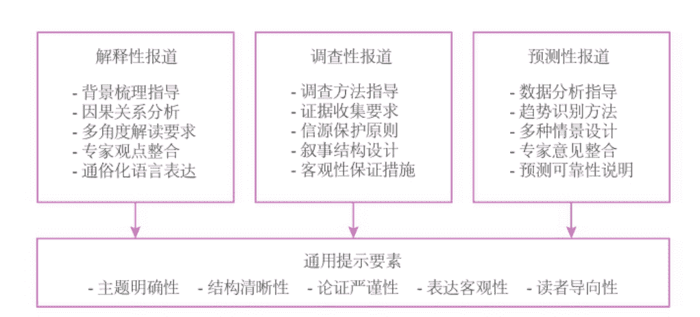

#### （一）解释性报道的提示语设计
解释性报道是一种深度新闻形式，旨在对复杂事件或社会现象进行深入分析与说明。不仅呈现事实，更帮助读者理解背景、原因、影响与意义。

主要特征是：注重将当前事件置于更广阔的历史与社会背景中理解；强调深度分析，不仅描述“是什么”，还解释“为什么”和“意味着什么”；通常包含多层面信息与分析；要求记者具备丰富专业知识与较强分析能力，能将复杂信息转化为易懂内容。

设计提示语时需关注：

- 1. 背景梳理指引，收集整理相关历史与社会背景信息。
- 2. 因果关系分析，引导揭示事件背后的深层原因与影响。
- 3. 多角度解读要求，鼓励从不同视角分析解释事件。
- 4. 专家观点整合，引用权威观点增强分析可信度。
- 5. 通俗化表达技巧，将复杂概念转化为读者易懂形式。

◎ 提示语示例：

请创作一篇3000字左右的解释性报道，主题为［具体复杂事件或现象］。报道应深入分析该主题的背景、原因、影响和意义，帮助读者全面理解这一复杂问题。请按以下结构与要求：

- 1. 导语（200字左右）：

简要介绍报道主题及事件，突出其复杂性和重要性。提出一个引发思考的问题，引导读者继续阅读。

- 2. 背景梳理（600字左右）：

a. 历史背景：追溯问题的历史源头和演变过程。
b. 社会背景：分析当前社会环境如何影响或塑造这一问题。
c. 相关概念解释：解释报道中涉及的关键术语或概念。

- 3. 深度分析（1500字左右）：

a. 原因探究（500字左右）：分析导致当前状况的直接原因和深层原因。
b. 影响评估（500字左右）：评估该问题对不同群体、行业或领域的影响。
c. 多角度观点（500字左右）：呈现不同利益相关方或专家的观点。

- 4. 案例说明（400字左右）：

选择1～2个具体案例，通过微观视角展现该问题的实际影响。

- 5. 解决方案讨论（200字左右）：

探讨可能的解决方案或应对策略，评估其可行性和潜在影响。

- 6. 结论与展望（100字左右）：

总结报道的核心发现，并提出对未来发展的思考。

写作要求：

- （1）保持客观中立的立场，呈现多方面信息和观点。
- （2）使用清晰准确的语言，将复杂概念转化为易于理解的表述。
- （3）充分运用数据、图表、专家观点等论据支持分析，增强报道可信度。
- （4）注重逻辑性，各部分之间应有明确联系，引导读者逐步深入理解。
- （5）适当使用类比、比喻等修辞手法，帮助读者理解抽象或复杂概念。

注意事项：

- （1）确保所有信息和数据的准确性，必要时注明来源。
- （2）在解释复杂问题时，避免过度简化，也不要使用过于专业的术语。
- （3）在呈现不同观点时，保持平衡，避免偏向任何一方。
- （4）使用小标题、要点列表等方式增强文章可读性。
- （5）可添加信息框或边栏，以解释关键概念或提供补充信息。

#### （二）调查性报道的提示语设计
调查性报道旨在揭示隐藏事实、曝光社会问题或不当行为。需要记者进行广泛调查研究，收集大量一手资料，并通过严谨分析得出结论。

主要特征：聚焦公共利益问题或社会隐患；强调原创性和独家性，通常包含记者通过深入调查获得的第一手资料；要求严谨的证据收集与核实过程，确保每个观点都有可靠事实支撑；叙事结构复杂，将调查过程、发现和分析有机结合；常带批评性或揭露性，但必须保持客观公正立场。

设计提示语时需关注：

- （1）调查方法指导，明确调查路径和资料收集策略。
- （2）证据收集要求，规范素材获取和处理标准与流程。
- （3）信源保护原则，确保敏感信息来源安全，必要时化名处理。
- （4）叙事结构设计，构建引人入胜且逻辑清晰的报道框架。
- （5）客观性保证措施，在揭露问题时保持公正立场和平衡报道。

◎ 提示语示例：

请创作一篇5000字左右的调查性报道，主题为 [具体社会问题或疑似不当行为] 。报道应通过深入调查，揭示该问题的真相、原因和影响。请按以下结构与要求创作：

- （1）导语（300字左右）：

简要介绍调查主题，突出其重要性和调查必要性。使用引人注目的事实或案例开头，引导读者继续阅读。

- （2）背景概述（500字左右）：

介绍问题的社会背景和当前状况，解释为什么该问题值得深入调查。

- （3）调查方法说明（300字左右）：

简要描述调查过程，包括资料收集、实地考察、访谈等方法，突出调查的全面性和严谨性。

- （4）主要发现（2500字左右）：

a. 事实陈述（1000字左右）：详细描述通过调查发现的关键事实，包括数据、证据和案例。
b. 问题分析（1000字左右）：深入分析问题的根源、发展过程和潜在影响。
c. 相关方反应（500字左右）：呈现涉事方、专家和相关部门的回应或观点。

- （5）深层次分析（1000字左右）：

a. 社会影响评估：分析问题对不同群体和整个社会的影响。
b. 政策分析：探讨现有政策或规定中可改进之处。
c. 比较研究：如可，与其他地区或国家的类似情况进行对比。

- （6）结论与建议（400字左右）：

总结调查的主要发现，提出可能的解决方案或政策建议。

写作要求：

- （1）确保每个观点都有可靠事实和证据支持，避免使用未经证实信息。
- （2）保持客观中立立场，即使在揭露问题时也要公正报道。
- （3）使用清晰准确的语言表述，避免情绪化或煽动性表述。
- （4）注重叙事性，将调查过程中的关键时刻或发现融入报道，增强可读性。
- （5）适当使用图表、时间线等元素，辅助读者理解复杂信息。

注意事项：

- （1）严格保护信源，必要时使用化名保护相关人员。
- （2）在报道可能引起争议的内容时，务必多方核实，并给予相关方回应的机会。
- （3）注意法律风险，避免使用可能导致诽谤、侵权、诉讼的表述。
- （4）在揭露问题的同时，也要关注可能的积极变化或改进努力。
- （5）考虑添加调查方法论的边栏，增强报道的可信度和透明度。

#### （三）预测性报道的提示语设计
预测性报道基于当前事实和趋势，对未来可能发生的事件或情况进行合理推测和分析。要求作者具有深厚专业知识储备、敏锐洞察力和严谨分析能力。

主要特征：以当前事实和数据为基础，但着眼于未来发展；强调分析与推理，需要运用专业知识和科学方法进行预测；通常涉及多种潜在可能性的讨论，而非简单断言；要求平衡准确性与创新性，既要基于可靠信息，又要有前瞻性洞见；需要清晰说明预测的依据和局限性，保持谨慎负责态度。

设计提示语时需关注：

- （1）数据分析指导，确保基于可靠数据进行科学分析。
- （2）趋势识别方法，帮助辨别并追踪关键发展趋势。
- （3）多种情景设计，展开对不同可能性的合理推测。
- （4）专家意见整合，汇集领域专家对未来走向的判断。
- （5）预测可靠性说明，清晰标注预测的依据与局限性。

◎ 提示语示例：

请创作一篇4200字左右的预测性报道，主题为 [具体领域或事件的未来发展] 。报道应基于当前的事实和趋势，对未来3～5年内可能发生的变化进行合理预测和分析。请按以下结构与要求：

- （1）导语（300字左右）：

简要介绍预测主题，突出其重要性和预测必要性。使用一个引发深思的问题或场景开头，吸引读者兴趣。

- （2）现状分析（800字左右）：

a. 概述当前情况，提供关键数据和事实。
b. 分析影响该领域或事件的主要因素。
c. 描述近期的重要趋势或变化。

- （3）预测方法说明（300字左右）：

简要介绍用于预测的主要方法和工具，如趋势分析、专家访谈、数据模型等，突出预测的科学性和可靠性。

- （4）主要预测内容（2000字左右）：

a. 短期预测（500字左右）：未来1～2年可能发生的变化。
b. 中期预测（1000字左右）：3～5年内的主要趋势和可能的转折点。
c. 多种情景分析（500字左右）：探讨2～3种不同的发展情景，包括最可能、最乐观和最悲观的情况。

- （5）影响分析（400字左右）：

讨论这些预测可能对不同群体、行业或社会整体产生的影响。

- （6）应对建议（200字左右）：

基于预测结果，提出个人、组织或政策层面的应对策略或准备工作。

- （7）结论与局限性说明（200字左右）：

总结主要预测观点，同时清晰说明预测的局限性和不确定因素。

写作要求：

- （1）确保所有预测都基于可靠的数据、事实和专业分析。
- （2）使用清晰准确的语言，避免过于武断或绝对化表述。
- （3）在进行预测时，要平衡谨慎性和创新性，既要有前瞻性洞见，又不能脱离现实。
- （4）适当引用该领域专家观点，增强预测的可信度。
- （5）使用图表、时间线等视觉元素，直观展示预测的趋势和数据。

注意事项：

- （1）明确区分事实和预测，避免混淆读者。
- （2）在讨论不同预测情景时，解释导致每种情况的可能因素。
- （3）适当使用条件语气，表达预测的不确定性。
- （4）考虑添加预测依据的信息框，增强报道的透明度。
- （5）鼓励读者批判性思考，不要将预测作为绝对真理呈现。

## 第12章 提示语设计的实战案例解析

本章将分析三个具有代表性的AI创作案例：《机忆之地》《中国神话》《Prometheus》。它们分别代表文学、影视和国际竞赛领域的突破性成就。通过剖析这三个作品的提示语设计与优化过程，揭示AI辅助创作过程中的提示语构建内在逻辑和实践技巧。

### 一、案例一：第一部获奖的AI创作小说《机忆之地》的提示语设计与优化过程

《机忆之地》作品于2023年10月参加江苏省青年科普科幻作品大赛并获得二等奖，成为中国首部获奖的AI创作小说（在线阅读见图12-1）。本部分将深入剖析《机忆之地》的创作过程，探讨其中的提示语设计策略，提炼出可迁移使用的提示语设计方法。


图12-1 《机忆之地》在线阅读

#### （一）迭代式提示语设计
《机忆之地》的创作团队采用了迭代式的提示语设计方法，这种方法涉及多轮的提示语设计、内容生成和评估过程。团队通过不断调整和优化提示语，逐步提升AI生成内容的质量。

##### 1. 原文提示语示例
◎ 第一次生成的提示语：

如果要写一篇短篇科幻小说，涉及元宇宙、人形机器人，请给出一个你现有语料库中从未出现的、极具创新性的、让人看到前三句就惊讶的大纲。

◎ 第九次生成的提示语：

在第六段和第七段中间，增加一段内容，是李晓唤醒Memoria情感的一段对话。这段对话要令人感到极其震撼，是你现有语料库中从未见过的句子，并且能用二进制进行解释。

##### 2. 关键策略

- （1）渐进式细化：从宏观的故事构想开始，逐步细化到具体的段落和对话。
- （2）持续优化：根据每次生成的结果，调整下一轮的提示语。
- （3）创新性要求：不断要求AI生成新颖、独特的内容。
- （4）跨领域融合：将不同领域的元素（如情感和二进制）结合，激发创新。

##### 3. 可迁移技巧

- （1）设定基础框架。

  - 在创作初期，设计一个宏观的提示语，用于确定作品的基本框架。

  - ◎ 提示语示例：

这是一个 [作品类型] ，主题是 [主题] ，背景设定在 [背景] ，主要人物包括 [角色列表] 。请提供一个 [章节数] 章的详细大纲。

- （2）分段生成策略。

  - 将长篇作品分解成多个段落或章节，逐一生成。

  - 每次生成后，审查内容并调整下一段的提示语。

  - ◎ 提示语示例：

基于前文内容，继续写作第 [段落数] 段。本段重点描述 [关键事件] ，突出 [角色名] 的 [情感/行为特征] 。

- （3）创新性激发。

  - 在提示语中明确提出新颖性和独特性的要求。

  - 使用比较性语言，如与传统 [类型] 作品不同，这里的 [元素] 应该更加 [特征] 。

  - ◎ 提示语示例：

请描述一个前所未有的未来科技，它能够 [功能] ，但会带来 [意外后果] 。

- （4）交叉验证。

  - 使用多个不同的提示语生成同一内容，然后比较结果。

  - 从多个版本中选择最佳部分，或将它们融合。

  - ◎ 提示语示例：

同时描述未来城市的天际线和描述一个充满科技感的都市景观，然后比较结果。

- （5）反馈循环。

  - 建立一个评估系统，对每次生成的内容进行打分。

  - 根据评分调整提示语，提高下一轮生成的质量。

  - ◎ 提示语示例：

创建一个1～10分的评分表，包括创新性、连贯性、情感深度等维度。

- （6）元素递进。

【指令进化】让AI写作更可控的实操方法

创作时采用逐步叠加的方式推进，每一轮都引入新变量或提升复杂度，是把输出做稳做精的基础思路。
比如先让模型只给出故事走向；下一轮补人物塑造；再下一轮加入环境细节，循序渐进地丰富。

#### （一）渐进叠加的推进方式
先只管骨架，再补血肉，最后打磨纹理。每一轮都追加一个新维度，能让结果更稳定、更细腻。

#### （二）分层指令框架
《机忆之地》团队把指令拆成三层，让不同创作阶段的把控更精准。

##### 1. 对照话术
◎ 顶层首次生成的表述：
请创作一部科幻作品，涉及元宇宙、人形机器人与人工智能，给出一段时间内语料库里从未出现过、极具新意、读前三句即让人惊讶的大纲。

◎ 中层第三次生成的表述：
严格依据已有大纲，写出第二段落。

◎ 细层第20次生成的表述：
把李晓、Neura与Memoria三人的全部对话重写，让交流更具辨识度且冲突感更强。

##### 2. 核心思路
- 分层拆解：写作拆成顶层、中层、细层三段。
- 由粗到细：从整体框架逐步推进到细节描写。
- 分层优化：不同层级使用不同侧重点的指令。
- 保持贯通：保证各层输出相互呼应统一。

##### 3. 通用方法
- 顶层设计
目的：锁定作品整体框架、主旨与文风。做法：用概括性语言，明确核心元素与创作目标。适用：新项目启动。
示例：
创作一部【体裁】作品，主旨为【主题】，包含【元素1】【元素2】【元素3】。文风需【风格特征】，篇幅约【目标字数】。请输出详细章节大纲。

- 中层设计
目的：指导单章或关键场景展开。做法：在顶层框架下更具体，包含该部分的核心事件与人物成长。适用：生成连贯章节。
示例：
基于前文已生成内容，撰写第【章节数】章。本章核心事件为【事件描述】，重点呈现【角色名】的【性格特征/情感变化】。需包含一个【场景类型】的描写，并为下一章埋下【伏笔特征】的伏笔。

- 细层设计
目的：优化段落、对话或描写。做法：高度具体，聚焦表达、情绪渲染与细节刻画。适用：精细调整已生成文本。
示例：
重写第【段落数】段中【角色A】与【角色B】的对话。要求：①凸显两人性格对比；②至少包含一个出人意料的比喻；③节奏紧凑，使用短句；④暗示【潜在冲突】。

- 层间联动
建立层次间的衔接，保证整体一致。每层指令都要引用上一层的重要设定。
示例：
在中层指令中提及顶层设定的主旨；在细层指令中参照中层的情节进展。

- 跨层创新
鼓励模型在不同层面持续创新。顶层设定创新目标，中层落实创新情节，细层呈现创新表达。
示例：
顶层：作品在传统硬科幻基础上融入心理学元素。
中层：设计一幕，【角色名】通过新型脑机接口探索自身潜意识，揭示关键转折。
细层：描写【角色名】在潜意识探索中的感官体验，使用至少三个创新比喻将抽象心理具象化。

#### （三）角色与情绪塑造
团队通过迭代式指令引导模型塑造富有内心的人物与互动。

##### 1. 对照话术
◎ 第10次生成的表述：
继续强化本段对话的情绪浓度，加入“字符串注入攻击”，构建一个精巧且带情绪色彩的情绪注入攻击，让Memoria短暂瘫痪，从而使李晓与Neura获胜。

◎ 第25次生成的表述：
Memoria的光辉开始不稳定，仿佛在尝试解析话语的深层含义。李晓接着说：“每段记忆都附带独特情绪。那种情绪像空气中的氧气，摸不到却不可缺。你曾感受过心跳节奏、温暖拥抱或心痛失落吗？”
请改写这段，使其更具个性、冲击力，并达到前所未有的创新与震撼。

##### 2. 核心思路
- 对话个性化：用对话呈现角色独特性格与思维。
- 情绪强化：反复要求提升情绪描述的强度与独特性。
- 冲突设计：通过角色间冲突推动情节与成长。
- 创新表达：以新颖方式描写情绪与心理。
- 技术与情绪融合：将科技设定如字符串注入与情绪描写结合。

##### 3. 通用方法
(1) 人物卡片构建。
为主要角色建立详细档案。适用：在创作前期奠定人物基础。
示例：
创建角色档案，包含：①基本信息（姓名、年龄、职业等）；②性格关键词3～5个；③说话风格；④核心价值观；⑤内心冲突；⑥成长经历。

(2) 对话个性化。
依据角色档案设计独特对话风格。适用：优化人物对话，提升辨识度。
示例：
重写【角色A】与【角色B】的对话。【角色A】应表现出【特征1】【特征2】，使用【说话风格描述】的表达方式。【角色B】需展现【特征3】【特征4】，语言体现其【职业/背景】特点。对话主题为【主题】，两人观点应不同。

(3) 情绪层次递进。
设计指令序列，逐步深化情绪描写。适用：制造情绪深度与复杂性。
示例：
描写【角色名】的基础情绪状态。深入分析情绪背后的原因与思考。表现情绪在行为上的体现，包括微表情与小动作。展现情绪的内在矛盾与复杂性。

(4) 情绪曲线设计。
为故事或单章设计情绪起伏。适用：保证情绪动态与戏剧性。
示例：
设计【角色名】在第【章节数】章的情绪线：①起始情绪；②至少两个高潮点；③一个低谷；④结束情绪。每点对应相应触发事件。

(5) 多模态情绪表达。
综合多种表达呈现情绪。适用：全方位展现角色内心，增强沉浸感。
示例：
描写【角色名】的【情绪状态】，通过以下方式体现：①内心独白；②肢体语言；③对话语气与措辞；④周围环境变化。每种方式均需体现角色独特性。

#### （四）技术议题与思辨思考的结合
创作团队引导模型把科技概念与哲学思考结合，生成兼具硬核与思想深度的内容。

##### 1. 对照话术
◎ 第42次生成的表述：
请用最难的理论来解释Neura对Memoria发起的“情绪注入攻击”。
◎ 第45次生成的表述：
请将“大模型的不可解释性”这一术语及其含义融入文本。
◎ 第46次生成的表述：
请融入“涌现”“领悟”这两个词汇。

##### 2. 核心思路
(1) 跨域融合：将科技概念与哲学概念结合。
(2) 概念深化：逐步引入复杂科技与哲学概念。
(3) 创新性解释：要求以新颖方式解释复杂概念。

##### 3. 通用方法
(1) 概念配对法。
将一个科技概念与一个哲学概念配对，探索联系。适用：产生独特思想火花，深化主题。
示例：
探讨【科技概念】如量子计算如何影响或映射【哲学概念】如自由意志，分析联系并提出新洞见。

(2) 科技哲学推演。
基于科技发展推演其引发的哲学问题。适用：构建有深度的未来世界观。
示例：
假设【科技概念】如完全沉浸式虚拟现实成为现实，讨论其可能引发的三个核心哲学问题，每个问题需涉及人性的一个基本层面。

(3) 悖论生成器。
创作科技与哲学碰撞产生的悖论。适用：制造引人深思的情节。
示例：
基于【科技概念】构造一个看似合理却自相矛盾的情境。该悖论需涉及【哲学概念】如意识、自由，并难以用现有理论解释。

(4) 概念具象化。
将抽象科技或哲学概念转化为具体情节或场景。适用：降低理解门槛，提升可读性。
示例：
将【科学或哲学概念】如“大模型的不可解释性”转化为一个具体场景或事件，使普通读者能直观理解其本质。

#### （五）风格稳定性的把控
团队在指令中加入风格参考要素，保持小说语言表达的相对统一。

##### 1. 对照话术
◎ 第36次生成的表述：
请用卡夫卡的文学风格重写本段，但不要出现“卡夫卡”三字。
◎ 第50次生成的表述：
前面文字为科幻小说开头，修改意见：背景交代过快，前三段即把世界观全盘托出，有利于理解却削弱神秘感。现今小说多在推进中逐步揭露背景，有助吸引阅读。请改为悬疑感强且吸引人的开头，部分内容可单句生成方便后续插入。

##### 2. 核心思路
(1) 明确风格指向：指定所需文学风格。
(2) 持续校正：定期检查并调整以确保风格一致。
(3) 隐性引导：在不点名作者的情况下描述风格特征。
(4) 结构调整：依据目标风格调整结构与节奏。

##### 3. 通用方法
(1) 创建风格特征清单。
为目标风格列出详细特征清单。适用：作为创作参考标准。
示例：
请列出【目标风格】的5～7个关键特征：①叙事视角；②句式结构；③词语偏好；④常用修辞；⑤情节节奏；⑥氛围营造方式；⑦典型主题。

(2) 风格模仿练习。
要求模型按目标风格重写段落。适用：训练模型掌握目标风格。
示例：
用【目标风格】重写以下段落。注意：①保持原意；②调整句式；③加入典型修辞；④适当替换词语。
原段落：【原文】。

(3) 风格一致性检查。
定期进行一致性检查。适用：维护长篇作品风格统一。
示例：
检查以下段落是否符合【目标风格】，指出不一致处并给出修改建议。重点关注语言风格、叙事手法、氛围营造、主题表达。

(4) 风格对比学习。
创作同一内容的多种风格版本，加深理解。适用：更精准把握目标风格。
示例：
创作同一场景的三个版本：①【目标风格A】；②【目标风格B】；③【目标风格C】。随后分析三种风格在描述方式、情绪表达、氛围营造上的差异。

#### （六）图文协同的尝试
后期创作中结合文字与图像生成，通过视觉增强文字表现力。

##### 1. 对照话术
◎ 第61次至第64次生成的表述：
（原文内容）……//根据以上内容生成一幅图像。

##### 2. 核心思路
(1) 文图结合：将文字描述转化为视觉呈现。
(2) 意境提取：从文字中提取关键视觉元素与氛围。
(3) 相互促进：用生成图像反哺文字创作。
(4) 整体一致：确保视觉与文字在风格主题上统一。

##### 3. 通用方法
(1) 场景可视化。
将关键场景转为视觉图像。适用：增强视觉体验，提升沉浸感。
示例：
基于以下场景描述，创建一幅图像：【场景描述】。重点呈现：①主要空间结构；②关键科技元素；③整体氛围与光线；④人物动作与表情。

(2) 角色形象设计。
为主要角色创建视觉形象。适用：帮助读者记忆，增强辨识度。
示例：
根据以下角色描述，创建角色肖像：【角色描述】。包括：①整体外貌；②标志性服饰或装备；③能体现性格的表情或姿态；④与背景相关的细节。

(3) 概念艺术生成。
将抽象科幻概念转化为视觉艺术。适用：增强艺术性与思想深度。
示例：
创作一幅概念艺术图像，展现【科幻概念】如“记忆交互”。要求：①使用象征性视觉元素；②融合未来科技感与人文气息；③色彩反映概念核心特质；④构图具抽象性与想象空间。

(4) 情绪氛围渲染。
通过视觉元素强化文字情绪。适用：深化情绪表现。
示例：
基于以下情绪描述，创建体现该情绪的抽象图像：【情绪描述】。注意：①用色彩线条传达情绪；②可融入象征元素；③构图引发情绪共鸣；④风格与文字基调一致。

(5) 多维度场景展示。
创建同一场景在不同维度或时间点的多个版本。适用：展示层次，丰富深度。
示例：
为【场景名称】创建三幅关联图像：①现实世界的样子；②主角眼中的样子；③未来可能演变的样子。每幅图保留共同元素并突出各自特点。

### 二、案例二：第一部AI全流程微短剧《中国神话》的提示语设计与优化过程
《中国神话》实现了从创意到视听呈现的全流程智能再造，是视听创作的重要突破。


#### （一）剧本策划阶段的提示语设计
创作初期团队利用大语言模型与知识图谱进行故事构思与策划，此阶段指令决定项目基调。

##### 1. 核心思路
(1) 多维度信息检索：引导模型从多个角度检索与整理相关信息。
(2) 关联分析与主题提取：通过指令引导深度分析，发现隐藏主题与联系。
(3) 剧本结构生成：指导模型生成符合现代叙事结构的故事框架。
(4) 创意拓展：利用指令激发创造力，产出新颖情节转折。
(5) 文化元素融合：在指令中引导传统文化与现代元素的结合。

##### 2. 通用方法
(1) 明确信息来源与范围：在指令中具体指出创作依据，确保相关性与准确性。
示例：
基于中国古代神话资料库，重点关注春秋战国到汉代的神话传说。

(2) 任务分解与递进：将复杂创作拆分为多个步骤，按逻辑顺序推进。
示例：
首先列出10个主要神话人物及其特征，然后分析人物间关系，最后选取3～5人构建新故事框架。

(3) 主题提取与现代化改编：从传统素材提取核心主题并与现代议题结合。
示例：
提取三个古代神话核心主题，并与现代社会问题如环境保护、科技伦理结合，构思古今融合的故事。

(4) 多元创意选项生成：要求模型基于同一主题产出多种风格方案。
示例：
基于以上分析，生成三个不同风格的大纲。一个偏动作冒险，一个偏哲学思考，一个偏情绪纠葛。每份包含核心冲突、关键节点与结局。

(5) 角色多维度塑造指导：引导模型从多角度深入刻画人物。
示例：
为主角设计背景故事，包括现代身份、与神话的联系、性格特点、内心矛盾与成长轨迹。角色需兼具现代特征与神话呼应。

(6) 结构化世界观构建：指导模型创建系统化、逻辑自洽的故事世界。
示例：
创建一个融合神话与现代元素的世界设定，包括空间规则、力量体系、社会结构与核心矛盾，用约500字概括其基本运作方式。

#### （二）画面生成阶段的提示语设计
制作团队使用文生图与文生视频技术创建视觉内容，支撑动画制作。

##### 1. 核心思路
(1) 风格一致性控制：通过指令确保全片视觉风格统一。
(2) 场景与人物描述精确化：提供详细视觉描述，指导模型生成符合预期画面。
(3) 动作和转场细节指导：确定镜头语言与视觉节奏。
(4) 文化符号融入：在指令中要求加入中国传统视觉元素。
(5) 现代与传统平衡：视觉上平衡神话元素与现代科技感。
(6) 情绪氛围营造：通过色彩、构图塑造情绪基调。

##### 2. 通用方法
(1) 视觉风格具体化描述：指导模型生成符合预期的视觉风格，保证整体统一。
示例：
创建一个视觉风格指南，融合中国唯美意境与现代科幻插画风格；色彩以明亮为主，点缀金色光芒；线条流畅飘逸，同时融入未来科技感的几何结构。

(2) 场景元素详细列举：在指令中具体列出场景关键元素，确保画面丰富且符合意图。
示例：
设计一个神话仙境场景，包含以下元素：①悬浮山岛；②流动数据瀑布；③半透明宫殿建筑；④缭绕七彩祥云；⑤点缀的未来科技设备。每个元素需体现传统与现代融合。

(3) 人物设计多维度指导：通过全面描述引导模型创建既符合设定又具视觉吸引力的人物形象。
示例：

主角形象设定

核心人物设定为一名约25岁的都市女性，从事数据科学工作。造型上把当下职场通勤感与古风仙韵做融合，半透明的科技感发饰点缀发间。神情里同时带好奇与戒备，肢体语言要呈现出细致观察、主动探索周遭环境的姿态。

#### （三）音乐生成阶段的提示词打法

《中国神话》项目里音乐全靠AI生成，提示词的好坏直接决定音乐能不能跟画面情绪对上。

##### 1. 核心思路
(1) 让音乐情绪跟画面叙事同步变化
(2) 对乐器、节奏、结构做明确指引
(3) 促成中式传统元素与当代音乐风格的融合
(4) 用音乐强化故事高光时刻
(5) 构建背景乐、音效、环境音的层次关系

##### 2. 可复用技巧
(1) 把音乐风格描述精确化，保证整体氛围统一

> ◎ 提示词示例：
> 创作一段中式古风与电子音乐结合的配乐。主旋律以古筝和笛子呈现，底层铺现代合成器与电子节拍。整体听感空灵飘逸，同时保留科技感的律动。

(2) 指导音乐与画面关键节点精准配合

> ◎ 提示词示例：
> 当视频出现主角发现关键线索这类节点时，音乐需做出明显变化。可先以短暂的寂静制造张力，随后加入强冲击音效，再切入全新主题段落。

(3) 丰富环境音与音效层次

> ◎ 提示词示例：
> 生成一层环境音床。包含若有若无的风声、水声与细微电子噪声，随场景逐步变化。在关键剧情点加入特殊声效，如数据流动的细响或神秘力量觉醒的低频声。

### 三、案例三：国际获奖作品《Prometheus》的提示词设计与优化路径

《Prometheus》斩获2024年国际大学生媒体艺术节最佳AI电影剪辑奖，是一部从剧本到成片全流程由AI完成的短片，深刻呈现了人类文明的利弊两面，也验证了AI辅助创作的潜力，影片可在线观看见图12-3。本文拆解其提示词策略，提炼实用经验。


#### （一）主题与创意构思阶段

《Prometheus》以气候变化与城市为核心议题，结合普罗米修斯盗火神话，探讨能源利用与环境代价。这一阶段的提示词决定了影片立意与叙事框架。

##### 1. 核心思路
(1) 将赛事命题与神话母题融合
(2) 构建跨越历史长河的叙事跨度
(3) 深化环境议题的隐喻表达
(4) 采用宿命轮回式结构，把末日设为文明起点
(5) 通过不同时代场景的对比凸显人因影响

##### 2. 可复用技巧
(1) 现实命题与经典故事的创新结合

> ◎ 提示词示例：
> 以普罗米修斯盗火神话为蓝本，创作一个关乎当代气候变化的故事大纲。故事至少横跨三个历史时期，每个时期需表现人类对能源的不同使用方式及对应后果。

(2) 时间线搭建与象征意义赋予

> ◎ 提示词示例：
> 规划一条涵盖三个关键历史时期的叙事线：①因纽特时代，以鲸油点灯象征人类初期的自然依赖；②工业革命时期，以工厂浓烟表现环境破坏开启；③现代战争年代，以武器化科技体现人类误用极致。每个时期安排2至3个标志性画面。

(3) 叙事结构的非线性设计

> ◎ 提示词示例：
> 设计首尾呼应的结构，先以未来环境灾难开场，再倒叙展现文明演进，最终回到神话时代普罗米修斯盗火场景。结构中需体现历史轮回的主题感。

(4) 全片视觉符号系统的搭建

> ◎ 提示词示例：
> 建立贯穿全片的视觉符号体系，核心元素为“火”“烟”“影子”。各历史场景中，三者以不同形态反复出现，用以演绎文明进步与代价。

#### （二）视觉内容生成阶段

团队在4天内产出42个镜头、55张图、共420次生成。此阶段的提示词直接影响画面质感与艺术表现。

##### 1. 核心思路
(1) 精准还原各时代视觉特征
(2) 可视化环境恶化的渐进过程
(3) 贯穿全片的象征性视觉元素

#### （三）剪辑与后期制作阶段

最终成片由42个镜头构成，剪辑功力是获奖关键。提示词在此阶段用于把控节奏、情绪传递与主题表达。

##### 1. 核心思路
- （1）节奏控制：为不同历史时期匹配起伏剪辑节奏
- （2）情感递进：利用剪辑强化情绪变化
- （3）视觉连贯：确保时代切换自然流畅
- （4）主题强化：借助蒙太奇等手法突出核心思想
- （5）音画同步：生成与画面节奏情绪相契合的配乐

##### 2. 可复用技巧
- （1）差异化节奏设计

  提示词示例：

  为三个时期设定不同剪辑节奏：①因纽特时代，采用长镜头缓慢推进，营造闲适生活感；②工业革命，采用快节奏剪辑与大量跳切，表现急速变迁；③现代战争，采用快速混乱的剪辑并穿插闪回，制造紧张氛围。各时期平均镜头时长与转场方式需有鲜明区分。

- （2）情感递进的剪辑策略

  提示词示例：

  构建五段式情绪递进剪辑方案：①平静，长镜头与平稳转场；②疑虑，提升切换频率并加入局部特写；③不安，快速切换配合手持不稳风格；④恐慌，极快节奏与大量闪切；⑤绝望，回到极慢节奏以长镜头凝视灾难。阶段间过渡需渐进，避免突兀。

- （3）视觉连贯的过渡设计

  提示词示例：

  设计三种时代衔接过渡：①时间涟漪，画面如水波扩散切换至新时代；②元素变形，选取画面关键元素如火焰，使其形态逐步演变为下一时代对应物；③色彩渐变，通过整体色调渐变体现时代与环境更迭。过渡需兼顾美感与时间流逝感。

- （4）强化主题的蒙太奇技巧

  提示词示例：

  制作“人类与能源”主题蒙太奇，包含五组镜头：①原始人取火取暖；②蒸汽机喷射；③现代工厂排污；④核反应堆运转；⑤未来能源装置。每镜3秒，以连贯剪辑呈现能源利用的演变与影响扩大。

- （5）音画同步的配乐生成

  提示词示例：

  为影片生成配乐序列并满足：①开篇以宁静自然声为主；②工业化阶段加入机械声并加快节奏；③现代阶段采用电子元素，节奏紧张；④高潮情绪达到峰值，表现焦虑；⑤结尾回归平静但保留警示意味。音乐须与剪辑节奏同步，并在关键转场处做出明显变化。