# 敏捷共治：人工智能治理的前沿视界

# 编委会

**顾　问**　（按拼音字母排列）

　　　　陈小平　段伟文　高奇琦　贺樑　　李修全

　　　　李正风　穆荣平　苏竣　　孙茂松　邢怀滨

　　　　徐峰　　王书华　王迎春　曾毅　　赵志耘

　　　　朱方伟

**主　任**　薛澜

**副主任**　梁正

**编　委**　（按拼音字母排列）

　　　　陈玲　　陈琪　　贾开　　孟庆国　申卫星

　　　　张楠　　赵静　　周伯文　朱旭峰

**主　编**　梁正

**编　者**　李洋　　谭颖臻

# 序

人工智能的推进在人类技术编年中具备里程碑分量，其改造力再次印证技术革命的冲击力，溢出效应必然波及经济、政治、社会等诸多生活面向。每一次拥抱技术未来的同时，人类都必须消化随之而来的负向外溢，就如机械化扩张伴随卢德运动、电力普及伴随环境压力、信息化浪潮伴随安全挑战一样，ChatGPT面世既点燃了公众对未来的想象，也掀起新一轮伦理争议，使AI治理成为难以回避的时代命题。它要求我们厘清科技伦理治理的要害，审视AI带来的时代考验，并反思当下智能社会的处境。

治理AI为何关键。第一，治理是抵消技术负外部性的有效手段。AI的应用呈现结果难以预判、伦理风险隐蔽、责任主体模糊等特征，必须由国家、政府、企业在治理层面作出回应，亡羊补牢为时不晚。第二，AI治理是社会治理、国家治理、全球治理的有机组成。一方面AI可作为治理工具，另一方面AI本身成为治理对象，二者相互嵌套、彼此影响，让治理复杂度显著提升。第三，生成式AI的突破性演进加剧了治理难度。ChatGPT首次让公众触摸到通用智能的轮廓，迫使我们直面AI与人类命运等根本性哲学议题。正因如此，围绕AI治理展开理论阐释与实践探索，已成为化解危机、寻求解决之道的重要路径。

治理要点何在。首要任务是厘清各主体的责任边界。政府、企业、高等院校、公众等需要在治理链条中确认自身权责，恪守价值准则、权衡利益关系、调整行为规范、落实行动方案，确保研究、应用、使用的全链条责任可追溯。下一步难点在于伦理原则与治理框架的落地。相关研究已较为充分，但如何找到兼具可操作性与有效性的实施路径，如何缩小理论与实践的差距，仍是核心。还需正视治理的滞后性。伦理困境与治理难题往往随着应用范围与深度的扩展逐步显现，认知与分析难以一蹴而就，故不可操之过急。

如何推进。第一，兼顾创新与治理的平衡。对新兴技术的未知性应保持适度包容，技术快速迭代期不宜设置过多刚性限制，更应倡导包容审慎。第二，促进治理主体的多元协同。通过增强互信、强化协作、共享信息，凝聚共识并探寻解决路径。第三，构建分层分级的治理思路，倡导分而治之，按智能化程度与风险等级差异化治理。第四，打造多维共治工具。借助技术标准、行为准则、国际倡议等共识约束，满足AI特殊化、差异化场景的发展需求。第五，形成敏捷治理行动方案，推动决策过程更具包容性与可持续性，以广泛参与和快速响应提升治理韧性与适应力。

放眼世界，百年变局中AI治理已成为大国博弈的新赛场。在国际格局与中美关系影响下，中国作为AI创新重要力量，必须在全球治理体系构建与国际合作中发挥积极作用。既要维护技术发展权、争取全球治理话语权，提升产品与服务竞争力，提供全球治理公共产品，也要回应国际社会关切。以全球发展、全球安全、全球文明、全球人工智能治理倡议为指引，在治理领域树立负责任大国形象，为全球治理贡献中国智慧与方案。

薛澜
2023 年 10 月 19 日

# 前言

社会进步与技术进步相伴而行，技术创新不断拓宽人类认知与改造世界的能力。某种程度上，人类历史就是一部技术史。蒸汽、电力、信息三大浪潮一次次重塑生活方式。如今，人工智能以新的颠覆性力量到来，其冲击在ChatGPT及大模型热潮中尤为明显。一方面，它让人再次看到通用智能的曙光，沿图灵思路大模型提供了技术路径，迈向意识涌现；另一方面，不确定性突破也放大疑虑，使伦理与治理议题进入政策、学术、产业乃至公众视野。

国家高度重视AI治理，先后发布《新一代人工智能治理原则》《关于加强科技伦理治理的意见》《生成式人工智能服务管理暂行办法》等文件。在此背景下，依托清华大学公共管理学院与智库中心，经科技部、中国科协、北京市教委支持，组建清华大学人工智能国际治理研究院与人工智能治理研究中心，凝聚了一支聚焦伦理与治理的团队。团队以“小核心、大联合”为模式，汇聚哲学、管理学、经济学、法学、国际关系等领域的学者，形成交叉互补、协同创新的优势。

治理平台致力于推动科学与人文融合、促进资源共享、支撑政策咨询、加强国际交流、提供善治方案。2020年，在科技部科技创新2030——“新一代人工智能”重大项目支持下，团队启动重点领域治理挑战及对策研究。三年间通过专家讲座、圆桌对话、定期研讨、实地调研、国际交流、线上论坛等形式，聚焦伦理与治理，在理论探索与实践对策上取得进展，产出一系列论文与方案，得到学界认可。

本书在此背景下形成。汇聚团队三年研究成果，覆盖治理体系探索、伦理框架设计、治理范式演进、国际治理比较、安全风险治理、公共管理应用、产业创新生态、数据治理体系与方案、算法治理理念与路径、平台治理机理与实践等方向。采用专题形式分为上下两篇：上篇研讨宏观议题——治理框架与体系建构、国际治理研究、公共治理及产业创新；下篇聚焦具体领域——数据治理、算法治理、平台治理。既立足整体框架，也切入具体问题与对策。

人工智能治理体系建构是首要议题。新兴技术治理需搭建协同共治机制，立足国家治理困境，在厘清技术特征与风险基础上，着眼价值取向、纳入多元主体、厘清多重对象、推进多重机制、运用多尺度工具，构建平衡包容的体系。我国新一代人工智能适应性治理经历探索式、回应式、集中式、敏捷式范式演进。需解析技术、制度、文化、资本四重逻辑下议题理解、价值取向、主体关系、路径依赖、工具选择的差异，进而形成综合有效且符合国情的体系。

国际治理是另一核心议题。从动态视角看，各国政策呈现相互借鉴、彼此融合态势，扩散广度与深度持续提升。在可持续发展原则下，完善AI可持续发展全球范式迫在眉睫。尤其在中美博弈主导国际关系时，治理成为重要战场。抢占先机即掌握规则与标准主动权。如何借鉴欧美方案、探索中国安全风险治理实践、平衡竞争与合作、善用政策、经济、法律手段争取高地与话语权，是国际治理核心。

AI在公共治理与产业创新中的应用不容忽视。一是公共治理赋能。新冠疫情抗击中，AI展现事前风险管理、事中应急管理、事后学习提升的效用，辅助政府精准决策、推动产业发展、助力复工复产，提升治理水平与企业创新。二是产业创新新拐点。AI推动技术与应用创新进入新阶段，产业形态呈现价值分配重构、智能制造升级、商业模式转变、组织决策变革特征。善用该技术已成为推动产业创新的革命性动力。

数据治理为具体领域的重点。需准确认知数据潜能、降低使用成本、控制隐含风险，在治理数据与用数据治理两端兼顾利用与保护，强化数字基础设施与数据标准引领。微观层面需协调效率与规范，场景推进需平衡技术理性与公共价值，数字驾驶舱设计需兼顾实战性与个性化。宏观层面需一体化、全局性统筹。

算法治理亦至关重要。数学上完备的算法设计往往缺乏对人性与社会环境的整体考量，应将算法置于社会体系中评估，以体系化思维推动算法向善。实践中，算法不可解释与歧视性风险催生“大数据杀熟”价格歧视与违法行为，凸显歧视、责任、无用与滥用风险对传统技术治理框架的挑战，完善算法治理是关键环节。

平台治理同样受关注。大规模复杂商业生态赋予互联网平台企业在经济、社会、文化领域的深远影响与复杂作用机制。需多维视角探讨平台治理之道，构建多利益相关方共同参与的协同治理体系，以“良治”保障数字经济健康发展，形成“敏捷适应、多元共治、场景驱动、技术赋能”的综合模式。

总体而言，本书汇总了团队在治理框架与体系建构、国际治理比较、公共治理与产业创新、数据治理、算法治理、平台治理六个维度的成果。学界已在理论与实践上积淀不少成果。然而正如技术持续迅猛发展，人工智能治理将始终处于进行时。必须积极应对技术挑战，办法总比困难多。技术由人造，人类需不断学习与新技术相处之道，真正实现善创、善用、善治。

感谢清华大学文科建设双高计划、清华大学自主科研计划及北京人文社会科学研究中心资助。

梁正 李洋
2023 年 10 月 5 日

# 上篇

## 第一部分 人工智能治理框架与体系建构

### 新兴科技发展中的人工智能治理

薛澜

#### 一 导言

习近平总书记在浦东开发开放30周年庆祝大会上指出，科学技术从来没有像今天这样深刻影响国家命运与人民福祉，我国经济社会发展比任何时候都更需要科技方案与创新首动力的增强。

科技创新对经济社会的作用愈发关键。如何把握其多维影响，将人文与伦理思考融入发展与治理，降低潜在风险、促进科技向善，已比以往更为紧要。

#### 二 技术演进的动向与潜在风险

人工智能是当前最具代表性的前沿方向之一。2017年阿尔法围棋击败职业棋手柯洁后发展加速，2020年阿尔法折叠攻克蛋白质折叠难题引发学界震动。近年来应用领域持续拓展，包括智能机器人辅助新冠诊断等。广泛应用不仅提升效率，更可能重塑科研范式与业态。例如在十维参数空间实验方案设计中，人工智能可从上亿候选中筛选出数百个方案，大幅节约人力物力。

生命科学领域经历从解读、修饰到创造的演进。世纪之交人类基因破译后发展日新月异。大肠杆菌由异养改造为自养型，人类首例单染色体酵母人工合成成功，中科院天津工业生物技术研究所实现人工合成淀粉等成果或将触发“食物革命”。实验室内培养纤维生产人造肉、改变传统饲养屠宰流通物流消费等创新产品已上市。

交叉领域亦快速发展，如生命科学与计算机交叉的脑机融合。埃隆·马斯克团队实现猴子意念操控光标，美国FDA2019年发布脑机接口设备指南，2020年8月批准相关临床研究器械豁免。

科技进步影响深远但伴随风险。人工智能人脸识别带来便利却存在数据滥用或泄露隐患。长期积累可能形成系统性风险。就业层面，世界经济论坛2020年报告指出新兴科技创造岗位落后于被替代岗位，失业问题值得关注。基因编辑等技术的滥用可能深刻改变人类自身，需高度警惕。

#### 三 新兴技术治理的形成机制

面对新兴技术的高收益与潜在风险，必须在推进发展的同时关注治理。历史表明现代与传统科技均伴随治理体系形成过程，可归纳为四阶段。第一，核心驱动阶段。初期知识重大突破或关键技术创新催生新产品，形成驱动。第二，市场变革阶段。新技术与市场互动、拓展场景与需求，形成应用领域与范式。第三，认知适配阶段。社会对技术友好性与风险性的认知、对服从关系判断的形成过程。部分技术因社会认知失配而失败。第四，治理范式形成阶段。主体、路径、工具等治理模式逐步成型。

中国在前几次工业革命中多处于后期应用阶段，承接成熟技术并借鉴治理模式。第四次工业革命中中国已赶上创新前沿，成为开发者与领先应用者，自然面临社会认知与治理范式挑战。

#### 四 以人工智能为样本的新兴技术治理

人工智能治理是新兴技术治理的典型挑战。核心在于让治理模式适应其高速发展。笔者认为“敏捷治理”较为契合。敏捷治理本质是创新治理模式，将传统流程与范式转变为适应技术高速发展的灵活机制。

框架内首先要识别治理对象。人工智能涉及数据、算法、算力、平台企业。数据层面挑战在于高质量数据集建设、公共数据开放程度、数据自主可控与宏观安全。算法层面需提升稳定性、安全性和可解释性、公平性。算力层面需推动核心硬件持续创新、寻求多边共赢合作避免垄断、突破创新范式。平台企业治理需超越传统反垄断，按行业特征分析行为与市场效果。

其次是治理理念，即在效率、公平、安全、自由等价值目标上的选择与排序。第三是参与主体，包括政府、企业、公众及社会组织。最后是治理工具，涵盖法律法规、行业标准、技术手段、社会共识。

框架明确后可推动敏捷治理运行机制，研究技术驱动下的新经济特征，跟踪市场变化，加强监管与市场的沟通，依据风险场景提出具体准则，灵活运用多元工具。

在实践中价值观念关键。中国坚持以安全与平等为底线，在此基础上鼓励创新，进而赋能经济社会发展与可持续目标。需及时识别风险并在适当时予以规制，让创新驱动与敏捷治理双轮并进。

基于敏捷治理，治理主体需与治理对象协同互动。传统模式下政府与企业信息不对称，新兴技术发展中双方应有效对话，政府更了解技术走向，企业更了解公众风险顾虑，从而弥合认知鸿沟。治理工具应灵活刚柔并济。宏观层面制定原则性法律，如个人信息保护法。中观层面构建行为准则，国家新一代人工智能治理专家委员会2019年出台的治理准则即属其列。微观层面需技术标准与监管技术。目前中国在宏观、中观层面已取得进展，理念逐步走向实践，既鼓励创新也提供落地标准与监管保障。

#### 五 以共识为基础构建人工智能全球治理

在国际视野下，人工智能正成为各国竞相布局的战略高地。经合组织人工智能政策观察站的统计显示，到2021年为止，经合组织成员国累计推出236项与人工智能相关的国家战略、规划与政策举措。与此同时，技术落地带来的社会各界关切也在持续升温。专门追踪伦理指南的德国非营利机构数据显示，近五年内全球已出现160多份人工智能伦理原则或指南，内容在表述上差异不大，这为通过对话达成初步全球共识提供了基础。

近年来，以美国为首的西方阵营在治理议题上试图对华划线，推动构建排他性的“全球人工智能伙伴”机制，试图在规则层面形成对中国的围堵。相比之下，中国坚持多边合作、科技向善、求同存异的立场，积极参与联合国等国际多边平台。在中国推动下，二十国集团于2019年通过了《G20人工智能原则》，明确倡导以人为本、负责任的发展路径。2021年11月25日，联合国教科文组织在巴黎发布《人工智能伦理建议书》，提出发展与应用人工智能应体现尊重与保护人权及人类尊严、促进环境与生态系统可持续、保障多样性与包容性、构建和平公正相互依存的人类社会等四大价值取向。

展望全球治理的未来路径，关键在于搭建多边协同共治的制度平台，将伦理准则、行业规范、技术标准与治理技术统一纳入框架，在各国共识基础上形成包容且有差异化的国际治理格局。具体可从三个维度展开：第一，夯实共同价值底座。各国表述虽有差别，核心价值高度重合，集中在包容、共享、审慎、负责等原则上。第二，明确主体分工协同。政府承担赋能与监管职责，技术供给方发挥赋能作用，形成迭代优化闭环；科研人员与使用者加强交流合作，社会公众提供及时有效的监督反馈。第三，推动治理体系与能力迭代。人工智能技术演进速度远超治理更新速度，必须以技术反哺治理，例如联邦学习、隐私计算、区块链等监管科技的应用。

* * *

[\[1\]](#chapter001.html#w1) 薛澜，清华大学文科资深教授、博士生导师，清华大学苏世民书院院长，人工智能国际治理研究院院长，研究方向为公共政策与公共管理、科技创新政策、危机管理及全球治理等。

### 构建包容均衡的人工智能治理体系
梁正 张辉[^(\[1\])](#chapter002.html#m1)

#### 一 开篇导览
近几年我国新型基础设施建设加速推进，高质量发展的动能明显增强。人工智能作为新基建的核心要素，是新一轮科技革命与产业变革的关键驱动，也是推动新旧动能转换的重要支撑。在稳住经济大盘的背景下，人工智能如何更好发挥作用助力高质量发展，以及如何为其发展定向导航的治理体系应呈现何种形态，成为必须前瞻的议题。

党的十八大以来，国家治理体系和治理能力现代化持续深化，以人工智能治理为代表的新兴科技治理进入新阶段。全球主要国家和代表性地区纷纷出台人工智能战略、规划和重大计划，力求在新一轮科技竞争中占据先机。人工智能的应用大幅提升了交通、医疗、金融、教育、制造、农业等传统领域效率，也提高了法治建设、政府治理、公共安全、应急处置的现代化水平。然而，伦理风险、隐私泄露、就业替代、技术安全等争议持续发酵，世界正从“技术创新竞赛”转向“技术规制竞赛”。构建符合我国治理现代化需求的人工智能治理体系已刻不容缓。

#### 二 国家治理面临的现实困境
人工智能是新兴技术的集成体，本身蕴含技术、社会、经济、政治等多重不确定性。各国态度不一，但治理手段呈现趋同：пуск一方面竞相发展技术、制定产业规划，另一方面又以立法、议案、规范等手段限制他国企业与产业发展，导致国家层面的治理面临内外双重挑战。

在国际层面，分散在各国和地区的治理原则与实践难以同步技术发展，治理议题随技术创新与社会深度嵌入而愈发突出。目前国内外研究尚处起步，哲学、经济学、社会学、管理学、法学、计算机等学科虽有涉足，但对何为人工智能治理、何为人工智能伦理、为何治理、如何治理仍缺乏深入共识，制约了治理走向成熟。

在国内，人工智能的复杂系统特征与技术不确定性，容易诱发“高端产业低端化”的实践倾向，产业促进政策与技术治理措施落地困难。国内难题既来自国际竞争，也源于地方政府竞争格局下的区域产业竞争。前者关注技术体系发展与规制，国家整体科技实力是重点；后者多以地方标准、规范或立法单方面推动技术创新，却忽视负外部性规制。

#### 三 人工智能的特性与潜在风险
人工智能的定义本身就存在片面化风险。哲学层面对其本质的讨论是技术创新与治理的基础，但技术哲学流派众多，统一定义几乎不可行。1950年图灵在《计算机与智能》中提出以“行为”界定“思维”，由此开启了人工智能研究。此后百余种定义并存。

从工程实现看，人工智能并非单一技术，而是语音识别、计算机视觉等技术与生物学、心理学等学科交叉的模糊概念组合。按水平可分为弱人工智能与强人工智能，即通用人工智能。前者只能在特定单项任务中超越人类，后者具备类人的通用智能，目前仍属科幻范畴。现阶段的主流是依赖海量标注数据、基于反向传播算法的神经网络程序系统，用以模拟人类专项智能。

### （一）深度学习成为新一代人工智能的起点
理解人工智能的特征与风险有助于后续治理。当前技术本质源于以神经网络为载体的“智慧即网络”的模拟理念。神经网络试图模拟人脑神经元联结形成认知的过程。其缺陷在于误读了神经元联结的逻辑关系。机器神经元的权重生成过程与人脑的联结方式存在诸多差异，更多是通过预测目标与精确度、拟合度等性能指标牵引的反向迭代过程。

### （二）大数据是驱动迭代的基础要素
迭代过程依赖大数据。通过提取实体特征向量与特征值、分析实体关联关系来决定性能。借助概率统计与模式匹配，从海量数据中提炼关联规则，形成预测、决策与执行依据。值得注意的是，这些依据并非由人类预先给定，而是系统在数据中自行迭代训练、由模型决定，逻辑更接近概率统计而非因果推理。

因此人工智能具有显著的不可解释性，即“黑箱”特征。即使了解算法原理，外部观察者也难以追溯决策过程。技术不确定性渗透于输入、算法、输出全链条：数据质量偏差、参数随机性、开发人员价值观等人为因素都会影响根源追踪。虽能高效解决大量预测问题，但因果性缺失与不可解释性构成“达摩克利斯之剑”，一旦决策失误，可能严重冲击个人生命健康、财产安全乃至组织与社会安全。

### （三）技术内生不确定性
在技术不确定性之上，社会应用与人机互动会放大不确定性。人工智能如电力般是通用目的技术，可广泛应用于各行业。然而人类行为本身高度复杂，使用方式、时机、场景、主体等问题始终伴随技术与社会互动，社会不确定性与技术不确定性叠加，导致应用结果的不确定性呈指数级上升，利益相关方难以掌控，尤其在法律、医疗、安全、教育等关键领域风险尤为突出。

除不可解释性外，数据驱动算法还带来自我强化困境与主体性难题。一方面，机器学习高度依赖历史训练数据，模型会最大化复制训练数据的统计特征，对分布外数据视为异常而忽略，长期形成回音壁效应与自我强化的心理陷阱。精准算法虽是优势，也限制使用者接触多元信息，易陷入信息内卷与自我平庸。

另一方面，人工智能的深度渗透模糊了人机分工边界，形成主体性难题。传统生产中技术工具与人类使用者界限清晰，而人工智能时代权利、责任、义务的归属难以在人与机器间明确划分，在AI生成作品著作权、自动驾驶事故责任认定等场景中尤为明显，导致传统奖惩机制失效。

### （四）应用层面的隐忧
人工智能深度嵌入经济社会生活，会重塑主体间的权利关系，产生强者愈强、弱者愈弱的极化效应。其子技术如云计算、大数据偏向性明显，使本就居于支配地位的技术拥有者进一步巩固垄断工具。

AI时代数据成为新型“石油”，在价值生产、知识生产与公共治理中作用攀升。微观层面，掌握技术、数据与资本的平台企业权力持续扩张，可借助AI对用户群体进行分化与权益切割，难以被监管部门与公众察觉。公共部门虽可借助AI提升服务效率，但也强化了对个体公民的管理能力。

宏观层面，公共部门难以跟上技术与知识的快速增长，AI企业与平台在公共政策乃至非正式制度变革中的影响力提升。政府与普通公民的议价空间被侵蚀，公共组织能力被平台组织稀释。公民与政府既可能沦为数据燃料的供给方却难分享收益，也可能在被动使用中陷入单向演化与内卷风险。若人工智能被武器化，其精度与自动化响应远超传统武器，将诱发激烈的自主武器军备竞赛，对人类安全构成严重威胁。

#### 四 人工智能治理的意涵
治理是公共或私人在管理共同事务时采用的多元方式集合，是协调冲突利益并促成联合行动的持续过程。其核心在于制度构建，包括正式规则与非正式安排。治理与传统统治不同，前者强调公私合作、多主体互动、超越国家边界、依赖社会共识。

人工智能治理概念仍在形成中，而AI定义混乱使其内涵更难厘清。AI内部流派多元、边界模糊，算法逻辑难溯、影响难判，导致治理对象易出现“无的放矢”。不同利益主体对治理的认知也存在差异：微观技术视角视其为提升透明度、可解释性与伦理合规的过程；中观组织视角视其为在降低安全风险前提下释放技术潜力的手段；宏观社会视角视其为以标准、法律、规范、政策确保负责任创新与可持续发展的制度体系。

总体而言，人工智能治理包含两类过程：一是以AI优化治理体系结构并提升效能，即AI For Governance；二是在制度环境下预测风险、制定方案、控制负面影响，即Governance of AI。治理体系需兼顾核心价值如发展、安全、人类自主性，多方诉求协调与机制保障。笔者认为，人工智能治理是指政府、社会、市场等利益相关方借助正式或非正式制度安排，共同推动AI创新、研发、生产与应用，并以AI提升人类福祉；同时识别、预防与应对技术创新与应用带来的政治经济社会风险与不良影响。

#### 五 综合性治理框架的思路
目前人工智能治理定义宽泛，缺乏国际共识，研究多集中于具体应用，整体性不足。现有研究在治理价值、机制与对象上有所欠缺，多关注现状与对策而非治理的根本动因。

治理对象上，研究常将AI作为整体或聚焦单一算法应用，忽视数据、算法、场景之间的关联。数据既是AI基础，也是数字技术与商业模式的关键投入，是第四次工业革命的基础市场要素，需整体社会治理。应用场景风险各异，需分类治理，负外部性也应纳入治理边界。

治理机制上，虽有理念与组织实践，但政府、产业、社会间缺乏协调互动机制。未来需结合政策与场景，深入研究三者的分工协作，既提炼普适原则，又实现因地因时因业制宜。

综合分析框架应兼顾多元主体、多层级对象、价值共识、治理过程与方式。广义主体包括所有被AI覆盖的社会个体，如公众、市场组织、非营利机构、政府部门。各主体在概念化、判断、分析、推理等能力上存在差异，呈现不同治理能力。因此，人工智能治理需要在综合理性基础上兼顾各主体的治理能力差异。

理性坐标下的AI管控

面对智能技术及其管控相关方，不论是组织还是个人，有限理性都在塑造其在决策情境中的偏好指向。作为参与决策的主体，各类行动者对理性维度的侧重点各不相同。同时，管控能力的分化进一步拉开了利益相关方的参与差距，在实践中形成参与深度的分层。为了平衡管控成本与管控效率，围绕技术供给与使用两端，有必要把相关方划分为AI管控的核心参与方与外围参与方；前者指直接介入技术供给与使用的各方，后者指间接关联技术应用的各方。在此划分基础上探索综合管控框架，为多方协同与互动机制的构建提供方向。

综合理性分析框架的价值在于厘清AI管控的理性内涵，为后续落地提供抓手。基于多元行动者理性偏好与管控能力的研判，将理性维度与行动者维度整合，就能搭建全景分析框架。综合框架由行动者的专业化选择、多元理性维度、管控能力即工具与手段构成一体化体系。它为AI管控提供了理性坐标，通过精准定位行动者与理性维度，为和谐友好、公平公正、包容共享、尊重隐私、安全可控、共担责任、开放协作、敏捷管控等原则与理念预留执行空间，有助于厘清多元行动者的分工协作，明确管控对象、方向与路径，为协同管控提供分析依据。

#### 六 AI管控实践建议

依托AI管控综合分析框架，实践要把握价值取向、涵盖多元行动者、厘清管控对象、明确管控机制并匹配多尺度工具。

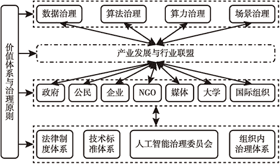

图 1 AI管理综合分析框架

图片来源：作者自制。

### （一）突出价值取向
首要底线是保障生产生活安全，在此基础上助力经济增长，更高层次则是应对可持续发展挑战。面向AI，一方面保持支持鼓励的基本姿态，另一方面必须正视发展不确定性、潜在风险与负面效应，确保有序发展与安全可控，防止滥用。总体态度应是包容审慎，在安全与平等底线之上，破除束缚产业发展的制度障碍，用AI赋能经济与社会可持续。

技术安全是管控的底线。除维护人身与财产安全外，还需捍卫公民的精神尊严与平等。现实层面，管控应削减阻碍技术发展的消极因素，推动广泛应用，让更多行业与人群共享红利；战略层面，智能技术对气候变化、环境污染、传染病扩散等人类重大挑战具备巨大潜力。

### （二）纳入多元行动者
研发、应用与扩散牵涉多类异质行动者的权利与责任。围绕议题，需要梳理核心与外围行动者的定位与职责。多元行动者在社会技术系统中权限、资源、利益与制约各异，通过正式与非正式渠道博弈平衡，形成复合管控机制。

智能技术正重塑不同行动者的角色。以数据隐私保护为例，数据生成者即用户、数据聚合者即平台企业、数据使用者即研发机构、数据监管者即政府等之间持续互动，各方皆需具备知识合法性或参与合法性。技术路径与商业模式的差异，也让AI管控区别于传统技术管控。政府通常居于核心，发挥引导与管控作用。行动者集合应由AI企业、公众、高校、科研机构、政府部门、社会团体共同构成，明确权责归属，实现灵活互动与敏捷沟通，更好应对多重挑战。

### （三）厘清多重管控对象
AI概念宽泛，涵盖诸多要素、技术与场景，若一概而治易致失焦。研发、生产、应用与影响过程中，既有算法与应用的特殊性问题，也有数据管控、个人信息保护等共性问题，后者也是其他数字技术与商业模式的共性议题。因此管控对象需从普遍到特殊分层，先就共性基础问题达成共识，再按场景与层级制定差异化措施。对数据与算法的共性问题形成底线约束，对场景的个性化问题制定专项规则。

遵循分而治之，宜从专项管控入手，可拆分为数据管控、信息管控、算法管控、算力管控、场景管控与外部环境管控等分支，再梳理各分支间的耦合关系与协同机制，最终实现整体管控。

### （四）推进多条管控机制
传统技术管控侧重政府联合第三方规制服务商经济行为。综合框架强调管控不仅需政府、AI组织与第三方参与，还要纳入广大利益相关方。在价值共识基础上，梳理各行动者价值分工，结合管控能力选择适配方式与工具，最终形成合作协同机制。

其一，多元行动者需形成价值共识，这是协同管控的根基，也是全景框架的内在要求，应科学全面看待议题。其二，明确行动者间价值分工，扬长避短，发挥各自优势，形成管控合力。其三，建立动态互动的协同共管机制，并根据技术创新与管控需求及时创新方式与工具。

### （五）调用多尺度管控工具
管控工具是解决问题的路径、方法与手段，不同工具各有优劣，在不同尺度与场景中发挥不同作用。法律强制力最强，但立法难以跟上技术迭代，普适性条款也难以覆盖个性化场景。管控宣言、技术标准、行为规范、国际倡议等正逐步进入工具箱，实现工具多样化。AI管控需要构建有层次的工具体系，各展所长，形成合力。

宏观层面，国家政策是引导发展方向、体现管控价值的重要载体，既要规划技术产业目标与进程，也要提出负责任开发与应用要求。中观层面，社会实验是有效探索。微观层面需组合技术标准、组织内部管控规范与监管科技等工具。

* * *

[1] 梁正，清华大学公共管理学院教授、博士生导师，人工智能国际治理研究院副院长，中国科技政策研究中心副主任，研究方向为科技政策、创新管理、新兴技术及其管控；张辉，浦江国家实验室（上海人工智能实验室）青年研究员，研究方向为AI管控、博弈论与政策设计。

### AI管控：认知图谱与范式突破

庞祯敬 薛澜 梁正

摘要：AI管控呈现清晰的生成机理，是其核心驱动层作用于环境变革层，并于不同认知适配层规范下形成管控范式层的过程。认知图谱主要体现为技术逻辑、制度逻辑、文化逻辑与资本逻辑，不同逻辑下议题理解、价值取向、主体关系、路径依赖与工具选择迥异，且各自存在难以回避的理论困境。AI的复杂性要求构建包容性框架，统一内生性逻辑与建构性逻辑、一般性逻辑与情境性逻辑。为此提出基于共性价值—结构要素—行业场景—微观操作的分层综合框架，阐释各层的价值取向、功能定位、管控原则、关注对象、主体关系结构与工具选择，揭示从宏观到微观、从抽象到具体的衔接。该框架启示管控需融合多元认知逻辑、协同多样范式、平衡多维目标。

关键词：AI管控 认知逻辑 管控范式 新兴技术

## 一 开篇
自工业革命以来，人类在器物层面的颠覆式创新不断重塑现代图景，在享受技术线性福祉的同时也在祛魅技术单一工具价值。如何建构完整的技术认知、评价与约束体系成为永恒主题，技术管控的焦点已由福利分配转向风险分配。基于本体安全与科林格里奇困境的忧虑，人们建构起应对技术风险的集体行动规则。AI最为典型，近年来在知识、技术与应用层面链式突破，似乎开启智能革命的轴心时代。与其它新兴技术不同，AI具有内核隐秘、技术拟人、场景跨域、利益交织、风险多维、社会影响复杂等特征，技术利维坦、数字鸿沟、信息茧房、马太效应、伦理困境等现实问题使管控成为复杂工程。不同行动者基于价值、利益与专业视角勾勒管控轮廓，而认知框架的前提差异直接决定管控强度、维度与形态的异质性，其背后是对AI及其风险与社会影响因果关系的理解差异。

由此，有必要阐释AI管控的生成机理，从认知逻辑视角厘清管控图谱，剖析理论困境，提出范式超越以实现善治。

## 二 文献盘点

### （一）新兴技术管控的理论脉络
20世纪60年代，核能、化学等引发环境问题，技术规制与技术评估成为核心范式，强调以法律规制为中心、以评估为决策支撑，本质是专家决策模式。80年代基因技术打开制造生命魔盒，风险不确定性削弱公众对专家体制的信任，预防原则成为后常规科学情境下的新路径，主张在因果关系未被证实前采取预防性政策并保持多元讨论开放。90年代人类基因组计划推进，为弥补评估的人文缺失，ELSI即伦理、法律与社会影响成为修正机制，将更广价值纳入评估框架，但受时代限制未获推广。21世纪初纳米技术兴起，预期管控概念提出，主张把社会价值与公众意见植入研究过程实现早期塑造，使技术朝道德福祉方向发展，形成开放科学理念，但纳米革命未兑现后反思开始兴起。2010年前后，负责任研究与创新RRI理念流行并被欧盟2020框架采纳，结合合成生物学场景，RRI由风险议题导向转向创新责任塑造，涵盖包容性意图、制度性回应、公共责任重塑与公众参与确立。此外，实验性管控、适应性管控、敏捷性管控等得到探讨，尚待形成完整理论。

### （二）AI管控研究脉络
现有研究集中于总体框架、场景生态、数据算法、应用案例四层。

总体框架方面，一是从传统理论视角对AI管控进行重释；二是从主体—对象—工具—价值—绩效要素出发构建层次性框架；三是从风险—利益、权力—权利、伦理—道德等社会影响视角探讨生成逻辑与管控路径。

场景生态方面，一是微观公众—个人场景，关注生物识别、人机融合、推荐算法等对隐私、歧视、数字鸿沟等的影响并提出救济机制；二是中观行业—组织场景，关注教育、医疗、交通、金融等行业在形态、架构、分工、责任、运营等方面的重塑并提出适应机制；三是宏观国家—社会场景，关注平台中枢对应急管控、城市管控、公共服务、宏观调控的整体性变革并提出修正机制。

数据算法方面，一是数据管控视角，围绕收集、存储、汇聚、利用、流动中的权属、权利保护、信息安全提出程序规则、法规、倡议与自律；二是算法管控视角，针对黑箱、易扩散、自我强化特征提出理念、目标与标准、法规、监督与自律原则。

应用案例方面，一是区域案例研究，通过中美日欧对比等解构价值取向、主体关系、工具选择差异；二是场景案例研究，对特定实践进行全景捕捉并提炼可推广框架。

### （三）文献评述
新兴技术管控演进脉络清晰，为智能时代提供了理论资源。AI管控研究在框架、生态、数据算法与案例层面成果丰硕，对实践指导与理论丰富意义重大。但现有工作多停留在解方层面，未深挖管控生成逻辑及认知逻辑差异，也未给出调和矛盾的超越性方案。本研究拟在阐释生成机理基础上，解构技术、制度、文化、资本四逻辑下的路径选择与理论病理，并探索基于共性价值—结构要素—行业场景—微观操作的分层综合框架。

## 三 AI管控的生成逻辑

# AI治理从何而来又为何分叉

AI治理的产生不是单向推进，而是在结构线索、内容推进、叙事脉络三条线共同编织下，在驱动基础、环境演化、认知调适、范式形成四个层次层层展开。总体来说，知识创新、能力跃迁、产品落地、场景赋能不断撞出新问题、新情境、新需求，并在不同认知取向的约束下，最后固化为多元的治理范式（见图 1）。

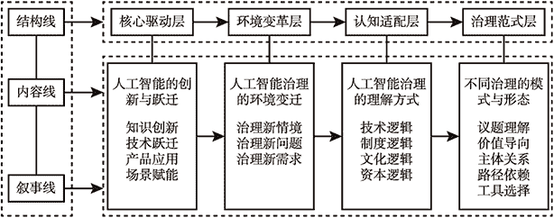

图 1 AI治理生成逻辑
图片来源：作者自制。

驱动基础层面看，从二十世纪五十年代起，人类对AI的探索经历了三轮技术浪潮，叠加出多元的技术底座，使得AI在知识端、能力端、产品端、场景端都具备很强包容性。尤其是以深度学习为标志的第三轮神经网络浪潮之后，AI在数据、算法、算力上实现全覆盖、高效复用、多源异构（姜李丹等，2022），由此催生的新产业、新服务、新业态、新模式，已成为数字化转型的核心引擎，智能时代的大门正被缓缓推开。

环境演化层面看，AI在聚合要素、联动行动者、融合形态的同时，也重塑了治理的新情境、新议题、新需求（姜李丹等，2022）。情境方面呈现四个特征：隐蔽性，研发和应用场景多处在黑箱里，风险和社会影响因此高度不确定；动态性，技术迭代迅速使治理情境持续变动，需要前瞻预见机制；拟人性，技术自带辅助、增益、关怀人类的理想，治理情境牵涉复杂的伦理、道德、价值边界；跨域性，风险和社会影响会跨时空、跨领域传导。问题方面兼具内生和建构双重属性：作为客观事实，风险源于技术自身的不稳和脆弱；作为社会建构，风险是在特定情境中生成，并和多元利益、价值体系、制度规则紧密缠绕。需求方面，新情境和新问题的开放性和延展性，已超出传统科层和因果推断式治理的结构和方法，需要全新工具承接。

认知调适层面看，不同行动者对问题、情境、需求的理解并不一致，形成了技术取向、制度取向、文化取向、资本取向四种代表性视角。它本质上是对AI治理图景的简化机制，是各社会系统对治理意义的关注并从中抽取要素给出处方。各国、各地区、各主体的路径失衡背后，正是认知取向未能协调：技术专家强调知识合法性，政策专家坚守制度供给的有效性，社会组织追求文化价值的最大公约数，市场主体则主张需求优先。

范式层面看，认知取向直接塑造治理模式。不同取向决定了对议题、价值导向、参与者互动、路径依赖和工具使用的差异化理解，实质上是对AI的知识、利益、价值分配方案的不同安排。其一是对风险知识的界定差异，进而判断社会影响的形式和边界；其二是关于利益分配的差异，进而维系社会利益的均衡；其三是关于价值取向的选择差异，进而平衡整体的伦理道德秩序。

## 四 AI治理认知图谱
本研究尝试以技术取向、制度取向、文化取向、资本取向四个视角，系统描绘当前AI治理的认知图谱，厘清不同取向下对治理议题、价值取向、互动方式、路径依赖和工具使用的分化（见图 2）。

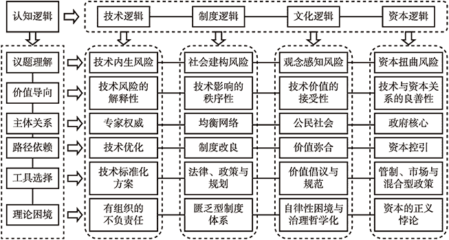

图 2 AI治理认知图谱
图片来源：作者自制。

### （一）技术取向下的AI治理
该视角从技术内生的风险切入，认为AI技术本身的偏差和脆弱是所有治理问题的根源。AI以算法为骨架、以数据为燃料，具备感知、推理、学习、决策等类思维能力，并按既定目标行动（贾开，2019），因此算法黑箱、数据偏差喂养导致的自我强化困境和扩散效应，成为治理痛点的起点。该取向带有技术决定论气质，倾向把治理压缩成技术议题，即对风险概率的科学预测、测算、评估和管控，价值上负载超验理性，目标是通过循证的技术路线图优化实现技术可解释性，最终描绘一个精密无瑕的技术世界。

在参与者互动上，该取向推崇专家权威，要求治理话语回归专业场域，由技术专家主导风险的量化运算、精准预判和有效管控。它强调风险评估的客观性，要求数据来自研发、设计、部署、应用的第一线，按标准化流程采集、整理、处理并对比，形成技术优化方案并固化为标准，而社会性、非科学的考量则被淡化。

工具层面，追求通过技术标准化方案实现技术无害化：以技术标准划定安全基线，降低算法偏离概率；以硬软件安全测试程序和标准前移风险阻断口，削弱数据噪声和环境突变带来的风险；以技术防御和应急处置的防火墙标准，遏制运行故障和数据泄露的跨域扩散。

其理论困境在于，虽然点明了风险的内生性和优先性，却难解现实复杂性。研发、应用、产业同步推进，创新链和产业链深度耦合，供给和需求互动演进，一方面让风险定位和识别愈发困难，另一方面标准化方案容易因风险归属分散、交织、模糊而出现责任真空，即有组织的不负责任，并把风险理解窄化为表象现象，忽视其背后的社会、政治、文化意涵。

### （二）制度取向下的AI治理
与技术取向强调内生风险不同，制度取向从社会建构的风险出发，视AI风险不仅是概率和评估的科学议题，更是内嵌于制度体系的社会议题。它把风险定义为社会结构功能失灵或秩序紊乱，如权力、权利、利益格局失序（高奇琦，2020），并在制度失范—制度改良—制度规范的循环中寻求社会影响的秩序化（庞金友，2018）。

该取向具有较强的社会理性与民主化取向，倾向搭建多主体协同的均衡网络，政府、科学、市场、公众和社会在充分信任下保持等距、平等共治，核心在于决策兼顾知识性、工具性、价值性，将技术专家、政治专家和公众纳入制度过程（杨正等，2021）。

治理工具上，主张以规划、法律、政策把AI治理接入国家治理整体，通过共识性制度方案降低复杂性（贾开等，2017）。用规划引领创新方向，用法律规范应用秩序，用政策调节发展利益。它反对技术乐观主义、技术怀疑主义和市场实用主义，提倡制度改良主义实现善治。其病理在于，当制度结构被用来应对已失结构的风险情境时，如何突破匮乏型制度体系成为难点。AI情境的高动态、高复杂要求治理具备高度敏捷、包容和前瞻性，而科层制和行为因果导向的方法难以覆盖宽域目标，往往只能呈现间断均衡，被动适应大于主动引领。

### （三）文化取向下的AI治理
文化取向以观念感知风险为视角，强调人机关系已超越人与自然、人与社会的传统框架，不宜用成本收益解释，其本质是不同文化观念和价值体系的认知分裂，风险因此具有文化异质性和不可计算性（洪杰文，2019）。文化被视为主体对事物意义的综合判断和稳定倾向，风险定义的竞争实质是文化框架前提的差异，界定并不取决于知识多少或制度差异，例如各国对隐私的文化敏感度差异就显著影响社会接受度。

该取向重视弥合分裂、凝聚价值共识，警惕技术对人类良善价值的僭越，主张通过对话达成伦理、道德、意义的最大公约数，推动技术人道化，实现技术可接受性（陈小平，2020）。它强调公民社会的主动参与，反对科学优先和精英主义。工具上主要依赖公平、公正、透明、安全、可持续等普遍价值倡议，以及伦理道德规范和标准，并配套价值指导、道德审查、伦理仲裁等制度安排，如中国新一代AI治理专业委员会等（吴红等，2021）。

其困境是长期互动易陷入自律性困境和治理哲学化。经济诱导、政治联盟和制度化科学资本在软约束下可能挤压科学场域自律；去精英化路径又因公民社会的专业缺口而缺乏抓手；把偶然的文化因素当作必然成因，也易让风险讨论神秘化、形而上学化（孙波等，2020）。

### （四）资本取向下的AI治理
该取向从反思福特主义出发，把现代性风险归因于生产方式，并以资本扭曲的风险理解AI治理。资本扩张会裹挟技术中性，使AI沦为逐利工具，科学理性退化为工具理性，工具理性排斥价值理性，人类既有制度、伦理在资本的抽象权力面前失效（刘召峰，2012）。

该逻辑试图通过重塑技术和资本的良善关系把AI拉回以人为本，核心是资本控引，遏制资本的强制同化倾向，避免AI异化为数字资本主义的底层技术，侵蚀创新带来的正义价值（余斌，2021）。它强调政府居于治理中枢，以公共利益界定和分配资本的权威角色，设定创新链和产业链中资本运行的边界和方式，并以管制型、市场型、混合型政策构建工具链，其中透明化和反垄断是重点。

该取向否定技术乌托邦和制度改良主义美好想象，主张根除资本的非正义性。但其痛点是资本正义性悖论。一方面，资本作为现代抽象权力，追求效用和增值本是属性，资本驱动下AI创新可能成为数字正义退场、算法霸权登场的试验场，信息垄断、数据控制、算法驾驭易催生数字资本主义（刘顺，2021）。另一方面，从文明演进看，资本也兼具促进功能，其正向激励为技术创新和场景赋能提供资本、商业和金融支持，推动生产力和社会形态升级。因此，如何在限制无限逐利侵蚀正义的同时释放创新激励，需要成熟的经济理性和政治智慧。

## 五 AI治理的范式跃迁
从实践看，AI治理呈现明显认知分异，技术、制度、文化、资本四种取向给出不同解法，兼具传统框架旧病理和AI情境新困境（薛澜等，2015）。数据、算法、平台等新治理对象的出现，传统伦理和新道德的张力，以及数字治理下科层结构的失灵，使得平衡发展和治理、把握工具和边界、构建参与者关系变得艰难。实践中聚焦价值问题和边界问题、理念上争论实践理性和道德理性、范式上较量结果主义和未来主义、标准上辩论风险可接受性和价值可接受性。

因此需要转换视角，统合内生和建构、一般和情境逻辑，建构包容性框架以实现见森林又见树木。在此基础上提出AI治理综合分层框架（见图 3），从宏观到微观递变、从抽象到具体衔接。治理维度上划为共性价值框架、结构要素框架、行业场景框架、微观操作框架：共性价值为根基，起统领作用；结构要素为树干，起提纲作用；行业场景为枝干，代表实践范围；微观操作为枝叶，最贴近落地。治理内容上从价值导向、功能定位、治理原则、关注对象、参与主体、工具应用六个维度解构理念、主体、客体和工具的全貌。

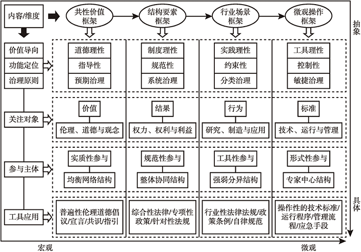

图 3 AI治理综合分层框架
图片来源：作者自制。

首先是共性价值框架
该层以道德理性为价值导向，各主体依据道德推理确立约束行为的伦理准则、道德规范和价值理念，凝结为集体规则（杨宗元，2007）。原则上坚持预期治理，以塑造技术的积极姿态，提前植入伦理道德考量。主体关系上构建均衡网络，政府、研发者、企业、社会组织、公众开放合作，公民社会承担实质性参与。技术端、政府端、市场端、社会端分别以负责任创新、公共价值、社会责任和公民社会共识为核心，构建伦理道德规范体系，通过伦理倡议、宣言、指引、共识等工具固化和谐友好、公平公正、包容共享、尊重隐私、安全可控、责任共担、开放协作等原则，实现价值指导功能。

其次是结构要素框架
该层以算法、数据、资本为载体，将抽象伦理转化为权利、权力、利益的结果关注。以制度理性为导向，构建成员共同遵守、按程序运行的行动准则，发挥制度反思、调节、创新功能，规范AI嵌入场景后的权利关系、权力结构和利益格局，维持秩序化发展。原则为系统治理，将AI视为数据、算法、资本等要素深度融合的社会系统，建立综合—分类式法律政策体系框定发展方向。主体间关系为整体协同，技术专家、政治专家、公众共同参与制度建构，并以知识、政治、社会互动彰显合法性。公民社会承担规范性参与，通过界定数据、算法、资本议题上的权利义务清单，如知情权、参与协商、危害总量限定等和学习、讨论、运用知识义务，实现公平、正义、民主价值。工具上以底线规范性为定位，采用综合性法律、专项性政策、针对性法规，如个人信息保护法、网络安全法、AI发展规划、资本管理条例，以及算法、数据、资本政策指导意见等。

再次是行业场景框架

# 场景到标准：AI治理的分层落地逻辑

行业场景层并不是用同一套模板覆盖所有问题，而是把共性价值层和结构要素层所要求的价值准则与秩序安排，落实到人工智能真正发挥作用的具体情境中去细化。生物识别、精准医疗、自动驾驶、智慧城市、工业大脑、数字政府等不同赛道，都在研发、设计制造、部署应用等环节产生可管控的行为诉求，因此必须按类分门推进。

赋能对象不同、风险发生的概率与后果的严重程度不同，就要用象限化的思路来设计对策。对公众个人、产业组织、国家社会不同层级的赋能不能一概而论，要针对具体痛点制定专属规则。落地的关键在于坚持实践导向：不先做预设，直接在第一线场景里发现问题、分析问题、解决问题，并适时更新相应的法规、政策和行业自律规范，让治理具备真实的约束力。典型做法有面向自动驾驶的数据安全管理规定、面向公共治理赋能的政务信息资源共享管理办法与公共数据开放安全管理条例，以及面向人脸识别的数据采集、存储、训练、流动等规范。

场景越细，主体关系的协调难度越大。公民社会受专业门槛和精力限制，很难深入介入具体应用，相对合理的安排是政企技术端形成强关联，公众侧采取工具性参与。此时公众参与的意义不在于兑现公平正义民主等规范价值，也不在于行使实质性的评审决策监督权力，而在于通过参与彰显各方信任，有助于治理目标的实现。

### 行业场景治理：分类施策、实践先行
场景层要舍弃预设，坚持从一线发现和解决问题，依据赋能对象和风险象限分类治理，避免一刀切。

### 微观操作框架：用标准把风险锁住
微观操作层以具体技术、软硬件产品和服务为载体，把场景层要求的行为规范转化为可执行的标准动作。它以工具理性为主导，强调定量、可预测、可控，通过研究设计标准、技术安全标准、运行程序标准、管理流程标准、应急处置标准等工具组合，降低风险概率、减轻后果烈度。

国内已有《无人驾驶航空器系统标准体系建设指南》《智能网联道路系统分级定义与解读报告》《信息技术生物特征识别应用程序接口》《公共安全人脸识别应用图像技术要求》《公共数据开放技术规范》等技术标准，企业内部也建立了覆盖研发全生命周期的安全控制体系、研发运营一体化安全运营平台、数据采集与标注安全合规标准等。

该层要坚持敏捷治理，在技术快速迭代中实现技术端、运行端、管理端、应急端方案的动态优化，保持快速响应与适应，发挥标准的控制功能。专业壁垒较强，技术专家与运营专家的知识权威应被尊重，其他主体更多承担监督角色。公民力量适合以形式性参与的方式存在，在缺失模型框架下推动公众理解科学 Durant et al.,1989。

## 六 理论思考与启示

新兴技术治理的演进脉络清晰可辨：由技术评估到预防原则，由伦理社会法律评估到预期治理，由负责任研究与创新到敏捷治理、适应性治理、试验性治理。每次范式跃迁都源于颠覆式创新带来的新问题、新情境、新需求，也体现出为维护本体安全，人们的关注从科学理性转向社会理性，再向道德理性求索的趋势。

AI治理的生成逻辑表现为核心驱动层推动环境变革层，在不同认知适配层规范下形成治理范式层。技术逻辑、制度逻辑、文化逻辑、资本逻辑四种认知视角并存，不同视角下议题理解、价值取向、主体关系、路径依赖与工具选择差异显著，也各自面临难以回避的理论困境。

与一般新兴技术不同，AI具有技术支撑的多样性、技术应用的通用性和技术影响的跨域性。它既有核能、化学那样的强负外部性担忧，也有生物基因工程那样的强伦理张力，更像新材料技术一样重塑社会生产生活方式。因此需要转换认知视角，建构包容性框架，统一内生逻辑与建构逻辑、一般逻辑与情境逻辑。

本研究据此提出共性价值—结构要素—行业场景—微观操作的综合分层框架，阐释各层的价值导向、功能定位、治理原则、关注对象、主体关系与工具选择，并揭示从宏观到微观的维度衍变与从抽象到具体的衔接。该框架在一定程度上实现了范式超越，具有以下启示。

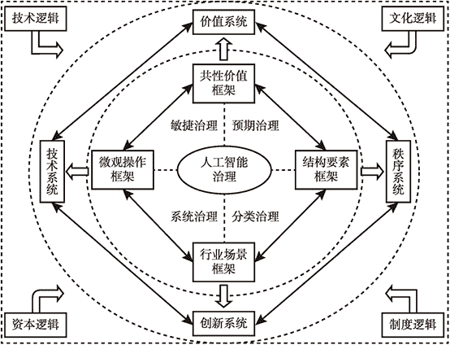

图 4 人工智能治理框架体系

图片来源：作者自制。

### 第一，认知视角必须多元融合
AI的内涵边界早已超出科学场域，承载了伦理、社会、政治、经济等多重意涵。风险归因、表现与解释的多维性决定了单一认知视角必然出现理论困境与功能缺损。治理设计不应以认知为标尺，而应以治理问题的层次衔接为经纬，把不同认知视角在工具层面融入不同治理层，从而实现善治。共性价值层主要体现文化逻辑，微观操作层兼具技术逻辑与制度逻辑，结构要素层与行业场景层则是文化、制度、资本逻辑的合一。

### 第二，治理范式要协同嵌入
AI治理情境具有私域性、动态性、拟人性、跨域性，定位、尺度、力度都更难把握。单一刚性治理难以匹配弹性需求，必须避免一刀切，嵌入多样范式，实现多主体协同与多工具协同。分层框架内含协同治理理想，通过刻画各层级的原则、主体关系与工具选择，实现情境针对性的范式供给。

### 第三，目标系统需要多维平衡
AI治理是系统工程，目标可划分为价值、秩序、创新、技术四大衔接系统。价值系统关切伦理道德边界，秩序系统聚焦权力权利利益分配，创新系统强调行为规范，技术系统侧重细节标准。效能取决于系统间平衡，包括重点平衡与强度平衡。不可过度偏向单一目标，治理强度应随层次递增，从价值系统到微观操作系统呈现宽严衔接、虚实结合。违背这一规律就会失范，比如把管制功能错置于秩序系统，就会压抑创新与技术。分层框架暗含系统平衡理念，由宏观到微观赋予指导性—规范性—约束性—管制性的梯度功能定位，实现多维目标的协调。

## 参考文献

陈小平：《人工智能伦理建设的目标、任务与路径：六个议题及其依据》，《哲学研究》2020 年第 9 期。

陈志刚：《马克思和海德格尔的技术批判思想之比较》，《自然辩证法研究》2002 年第 2 期。

高奇琦：《智能革命与国家治理现代化初探》，《中国社会科学》2020 年第 7 期。

洪杰文、兰雪：《从技术困境到风险感知：对智媒热的冷思考》，《新闻与传播评论》2019 年第 1 期。

贾开：《人工智能与算法治理研究》，《中国行政管理》2019 年第 1 期。

贾开、蒋余浩：《人工智能治理的三个基本问题：技术逻辑、风险挑战与公共政策选择》，《中国行政管理》2017 年第 10 期。

姜李丹、薛澜、梁正：《人工智能赋能下产业创新生态系统的双重转型》，《科学学研究》2022 年第 4 期。

刘宝杰：《价值敏感设计方法探析》，《自然辩证法通讯》2015 年第 2 期。

刘露、杨晓雷、高文：《面向技术发展的人工智能弹性治理框架研究》，《科学与社会》2021 年第 2 期。

刘顺：《资本逻辑与算法正义：对数字资本主义的批判和超越》，《经济学家》2021 年第 5 期。

刘然：《跨越专家与公民的边界：基于后常规科学背景下的决策模式重塑》，《科学学研究》2019 年第 9 期。

刘召峰：《拜物教批判理论与马克思的资本批判》，《马克思主义研究》2012 年第 4 期。

梅亮、陈劲、欣桐：《责任式创新范式下的新兴技术创新治理解析：以人工智能为例》，《技术经济》2018 年第 1 期。

庞金友：《AI 治理：人工智能时代的秩序困境与治理原则》，《人民论坛·学术前沿》2018 年第 10 期。

庞祯敬：《“理性-制度-行动”框架下的转基因技术风险治理模式研究》，《自然辩证法研究》2021 年第 3 期。

苏竣、魏钰明、黄萃：《基于场景生态的人工智能社会影响整合分析框架》，《科学学与科学技术管理》2021 年第 5 期。

孙波、周雪健：《人工智能“伦理迷途”的回归与进路：基于荷兰学派“功能偶发性失常”分析的回答》，《自然辩证法研究》2020 年第 5 期。

孙福海、陈思宇、黄甫全等：《道德人工智能：基础、原则与设计》，《湖南师范大学教育科学学报》2021 年第 1 期。

谭九生、杨建武：《人工智能技术的伦理风险及其协同治理》，《中国行政管理》2019 年第 10 期。

唐钧：《人工智能的风险善治研究》，《中国行政管理》2019 年第 4 期。

汪亚菲、张春莉：《人工智能治理主体的责任体系构建》，《学习与探索》2020 年第 12 期。

王磊：《参差赋权：人工智能技术赋权的基本形态、潜在风险与应对策略》，《自然辩证法通讯》2021 年第 2 期。

王钰、程海东：《人工智能技术伦理治理内在路径解析》，《自然辩证法通讯》2019 年第 8 期。

吴红、杜严勇：《人工智能伦理治理：从原则到行动》，《自然辩证法研究》2021 年第 4 期。

肖雷波、柯文：《技术评估中的科林格里奇困境问题》，《科学学研究》2012 年第 12 期。

薛澜、俞晗之：《迈向公共管理范式的全球治理：基于“问题—主体—机制”框架的分析》，《中国社会科学》2015 年第 11 期。

薛澜、赵静：《走向敏捷治理：新兴产业发展与监管模式探究》，《中国行政管理》2019 年第 8 期。

杨正、肖遥：《为何要引入公众参与科学：公众参与科学的三种逻辑：规范性、工具性与实质性》，《科学与社会》2021 年第 1 期。

杨宗元：《论道德理性的基本内涵》，《中国人民大学学报》2007 年第 1 期。

余斌：《“数字劳动”与“数字资本”的政治经济学分析》，《马克思主义研究》2021 年第 5 期。

张乐：《新兴技术风险的挑战及其适应性治理》，《上海行政学院学报》2021 年第 1 期。

Baram M S.，“Technology Assessment and Social Control”，Jurimetrics Journal，14（2）：79-99.

Durant J R，Evans G A，Thomas G P.，“The Public Understanding of Science”，Nature，340（6228）：11-14.

Friedman B，Kahn P，Borning A.，Value Sensitive Design：Theory and Methods，Seattle，USA：University of Washington technical report，2002.

Grin J，Grunwald A.，Vision Assessment：Shaping Technology in 21st Century Society Berlin Heidelberg：Springer，2000.

Guston D H.，“The Anticipatory Governance of Emerging Technologies”，Applied Science and Convergence Technology，19（6）：432-441.

Guston D H.，Sarewitz D，“Real-time Technology Assessment”，Technology in Society，24（1）：93-109.

Lyall C，Tait J.，“Beyond the Limits To Governance：New Rules of Engagement for the Tentative Governance of the Life Sciences”，Research Policy，48（5）：1128-1137.

Michael J D.，“What’s ELSI Got To Do with It？Bioethics and the Human Genome Project”，New Genetics & Society，27（1）：1-6.

Owen R.，Macnaghten P，Stilgoe J，“Responsible Research and Innovation：From Science in Society To Science for Society，with Society”，Science & Public Policy，39（6）：751-760.

Sarewitz D.，Anticipatory Governance of Emerging Technologies，Netherlands：Springer，2011.

Tan Y，Tong Y H.，“建设性技术评估：一种新的技术管理模式”，R&D Management，17（4）：1-7.

Urs G，Virgilio A F A.，“AI 治理的分层模型”，IEEE Internet Computing，21（6）：58-62.

Welsh R，Ervin D.，“谨慎作为技术发展的一种方法：转基因作物的案例”，Science，Technology and Human Values，31（2）：153-172.

Wirtz B W，Weyerer J C，Sturm B J.，“人工智能的黑暗面：公共行政的综合人工智能治理框架”，International Journal of Public Administration，43（9）：818-829.

Wynne B.，“风险与环境作为技术的合法性话语：向内反思”，Current Sociology，50（3）：459-477.

* * *

[1] 庞祯敬，四川大学公共管理学院副研究员，研究方向为智能社会与数字治理；薛澜，清华大学文科资深教授、博士生导师，清华大学苏世民书院院长，人工智能国际治理研究院院长，研究方向为公共政策与公共管理、科技创新政策、危机管理及全球治理等；梁正，清华大学公共管理学院教授、博士生导师，人工智能国际治理研究院副院长，中国科技政策研究中心副主任，研究方向为科技政策、创新管理、新兴技术及其治理。

### 我国新一代人工智能治理的时代挑战与范式变革

姜李丹 薛澜[1]

摘要：本文立足于我国新一代人工智能的鲜明时代特征与多重治理挑战，全方位探析新时期我国人工智能治理的核心问题，创新性构建我国人工智能适应性治理的工作框架，并系统性刻画我国人工智能适应性治理的范式变革。研究发现：（1）我国新一代人工智能治理的核心问题主要包括整合技术社会复合体的离散性认知、实现系统生态主权的非均衡调适、突破包容审慎探索的有限性实践三个方面。（2）我国新一代人工智能适应性治理已经形成以“逻辑内核—秩序重构—监管响应”为核心构成的清晰工作框架，其中技术社会复合体、生态重心偏移、秩序需求重构成为其稳定特性存在，而治理对象、治理理念、治理主体、治理工具则成为其动态特性存在。（3）我国新一代人工智能适应性治理经历了探索式治理（2016 年前）、回应式治理（2017～2019）、集中式治理（2020～2021）、敏捷式治理（2022 年至今）的范式变革历程，并且不同范式下技术创新力度与风险规制力度的组合特征存在显著的阶段性差异。

关键词：新一代人工智能 适应性治理 时代挑战 范式变革

## 一 我国新一代人工智能赋能的内涵特征与治理挑战

人工智能作为人类文明向智能社会迈进的创新“加速器”，正在对人类经济生活方式与社会结构转型产生重大而深远的影响。自 1956 年美国达特茅斯会议提出人工智能概念以来，人工智能已历经了由机器学习、神经网络、互联网技术驱动的三次繁荣发展期，但也相继遭遇了计算机算力受限、推理模型陷入瓶颈的两次低谷期。随着 21 世纪信息技术的飞速跃升和大数据时代的接踵而至，人工智能突破了多重限制得以快速恢复发展。2016 年，AlphaGo 战胜世界围棋冠军李世石事件引发了各国对人工智能技术赋能社会进步的高度关注，迅速将全球推入“数字空间、物理空间、社会空间”三元深度融合的新一代人工智能发展时期（米加宁等，2020）。

我国作为全球人工智能创新赛道的前沿国家，正在日益激烈的全球竞合中全方位书写着中国故事。近年来，我国科技创新整体实力实现了从“跟跑”到“并跑”、再到“领跑”的跨越式发展。虽然我国在关键核心技术、基础研究等方面仍与美国存在一定差距，但在专利授权数量与论文发表数量方面实现迅速追赶并跃居世界首位，已经成为国际影响力全球位势迅速提升的科技创新大国。同时，我国人工智能技术创新与社会场景也步入全球领先水平。当其他国家尚停留在人工智能场景开放、场景征集等问题争议层面时，我国人工智能发展已经进入“技术赋能与场景落地深度融合、技术创新与场景细分精准匹配、技术突破与场景应用交互迭代”的前沿阵地。海量社会场景的落地延伸催生出人工智能前所未有的风险频谱，其先进性、动态性、复杂性发展为我国人工智能带来史无前例的治理挑战，率先处理人工智能技术与社会相互调试的前沿性治理问题成为我国“大国责任担当”的时代任务。

中国新一代AI的实践图景与治理新课题

中国的新一代AI已深度切入科研突破、产业结构再塑与生产生活方式的改造。核心攻关坐标是大数据智能、跨媒体智能、群体智能、混合增强智能、自主智能系统（Pan Y，2016）。支撑面是多源异构数据的持续堆积、信息底座的高频迭代、智能应用在真实场景的纵深落地，以及伦理风险的同步显现。战略目标指向把握科技革命机遇、塑造国际竞争先发势能、建设科技创新强国。生态培育思路是推动基础理论跨学科融合、关键共性技术加速攻关、开放创新平台统一布局、试验区先行试点、高端人才加速集聚，从而深度赋能产业数字化与智能化转型。相较传统AI发展路径，本土实践呈现出技术跃迁、场景牵引、风险新生三条显著线索。

其一，智能形态正在从单任务专用迈向复合混合。近两年互联网的突破性进展打通了数据沉淀与算力升级的双重瓶颈，模型摆脱了对特定规则下的低阶挖掘限制。基于无监督学习和大规模预训练的新一代体系，正向具备自主学习、自我迭代与优化的高阶混合形态演进，让具备归纳、演绎、推理、预测等系统性思维的类生命智能体成为可能。

其二，场景驱动成为主线，社会运行规则被系统性改写。以应用场景为抓手的AI正以渗透式方式进入各行业，持续满足自动驾驶、智慧医疗、智慧防疫、智慧城市、智能家居等新业态的升级需求，并在价值重构、制造方式、商业逻辑、组织决策层面全面改写智能社会的运行规则（姜李丹、薛澜等，2020）。

其三，长尾风险持续释放，双向治理诉求凸显。AI深度嵌入社会场景为新风险提供了土壤。除算法黑箱、信息推送等技术类风险日益高频复杂外，个性化应用还激活了法务争议、伦理分歧、就业替代等社会类风险，以规则约束AI和使用AI开展治理的双向逻辑愈发迫切。

与此同时，技术场景的高速耦合、创新规制节奏错位、赋能效能的背离，让治理陷入多重困境。第一是难以摆脱宽松则失序、收紧则窒息的两难。初创与先发需要包容环境，而数据泄露、算法偏见、平台垄断则如达摩克利斯之剑，一旦失控危害难逆，需在弹性与审慎之间寻找平衡。第二是难以跨越风险先行制度滞后时差。技术迭代与风险涌现的速度远快于传统立法流程，导致规则效力不足与监管空窗（薛澜、赵静，2019）。第三是难以避免赋能变负能的偏移。为快速集聚数据要素与技术优势，部分领域出现重复填报、数据反复提交，人类反而被系统牵引，形成效率倒挂。

破解路径在于以多维视角剖解问题、以动态范式把握规律，推动治理从静态判断转向动态思辨、从局部修补转向系统研判。本文结合企业实地调研、专家深度访谈、座谈会及政策文本挖掘，从技术特质与社会信任、技术能动与秩序重塑、技术善治与监管响应三个维度展开，并以逻辑内核—内在动因、秩序重塑—新需求、监管响应—行动适配为框架搭建适应性治理体系。据此区分创新强度与规制强度的组合态势划定演进阶段，并从治理理念、对象、主体、工具的动态属性刻画范式转型，为安全可信、健康有序发展提供理论与决策参考。

## 二 我国新一代人工智能治理的核心问题与工作框架

### （一）技术特性与社会可信：整合技术社会复合体的离散性认知

当下没有任何时期让技术与社会粘合得如此紧密，AI以泛在部署重塑国计民生的生产方式与结构形态，本土特征尤为突出。已形成15个国家新一代开放创新平台，涵盖自动驾驶—百度、城市大脑—阿里云、医疗影像—腾讯、智能语音—科大讯飞、智慧教育—好未来、智能家居—小米等，以及18个国家创新发展试验区，覆盖北京、上海、合肥、杭州、深圳、天津、济南、武汉等，形成场景牵引—技术攻坚—企业与区域支撑的格局。场景需求持续倒逼技术突破，形成数据与场景的先发优势，技术在场景中释放价值并接受检验，场景也在迭代中累积数据并优化。由此形成逻辑清晰、要素共生的技术社会复合体。

该复合体的演进动力源于技术反噬效应与场景变革性的交互。一方面，赋能初衷是借助凝练规则实现人机交互便捷，发挥改造世界的主观能动性；另一方面，人们却陷入更复杂多元的不确定风险处境，甚至被动接受智能运行逻辑，这即反噬效应。例如电商平台依据浏览历史对用户进行个性化标注与推送，用户若不同意App协议即无法使用，而作为数据生产者的用户对二次利用与增值挖掘缺乏知情与选择权。技术需要在不断细分变革的场景中持续修正，实现人与社会和谐共存。同时，场景变革既是技术进步、释放、迭代的终极愿景，也是全球产业竞争的核心场域。技术不完备决定场景应用必然不足，场景变革既是治理内核的内在存在，也是领先发展的责任使命。

当前对治理逻辑的认知仍显割裂、模糊与滞后。

第一，应把厘清技术特质与社会信任的内在关联、处理好技术属性与社会属性的辩证统一作为治理内核的根本认知。AI反向作用于生产力并与其共生，是区别于蒸汽机、电力、计算机和互联网的特性，呈现技术属性与社会属性高度融合。技术属性服务于社会属性的场景发展与结构转型，关乎弱AI向强AI的迈进；社会属性则决定技术属性的应用深度与广度，关乎成败（李仁涵，2020）。如某些智慧教育产品虽通过技术安全审核，一旦触发儿童人脸信息采集的社会争议，项目即被撤回或搁置。

第二，迭代—变革—风险涌现的联动应成为基础性认知。技术嵌入场景即催生新风险，而新一代AI正处技术瓶颈突破、场景深度细分、风险高频爆发的动荡期。例如智慧教育同质化加剧后，机构为塑造优势深度细分场景，推出个性化教学、拍照搜题、作业批改、分级阅读、口语测评等精准定制，并在各场景集成多种技术功能。高度互动决定治理动因充满复杂联动与不确定性，头痛医头的固定范式不适用。

第三，应确立风险类型划分的标准，构建开放性风险认知体系。过往技术、伦理、道德、法律风险的划分缺乏确定依据，如智慧医疗的算法偏移是技术问题还是数据不完整引发的社会问题，机器人偏见属技术还是伦理，均源于属性边界混淆，难以界定普适约束与场景化约束，也难以确定无人驾驶故障、智能诊断事故的责任归属。突破点在于风险是在智能产生时消除还是在行为后规制。技术本身中立，风险在场景中被激活。按爆发环节可分为嵌入式风险，如算法不可解释性、信令风暴等；与衍生性风险，如平台数据泄露、无人驾驶责任划分、机器智能著作权归属等，由此实现开放认知与精准治理。

### （二）技术能动与秩序重构：实现系统生态主权的非均衡调适

新一代AI在生产生活全景式嵌入，正深刻改变传统社会的认知逻辑与思维方式。过去主要替代体力或简单脑力劳动，而新一代则最大限度解放人类智能。《新一代人工智能发展规划》把大数据智能等作为标志性方向，使类生命智能体尽可能具备归纳、演绎、推理、预测等高级脑力智慧。此过程预示技术能动性增强、人类能动性削弱，关系由利用转向共生。

技术能动性提升带来秩序基础的巨变。过去人类意志通过行为外显并承担相应责任，秩序主要靠一一对应程序化设置化解风险。智能社会中人类保留意志却把实践交予机器，强AI时代部分意志与行为将整体让渡。无人驾驶事故的责任主体是驾驶员、开发方还是运维方？AI生成物具备创作能力时是否享有著作权保护？意志与行为分离、意志与机器行为集成，正全面挑战传统秩序建构逻辑。

秩序重构主要体现为：

#### 1. 国际竞合格局的重塑
综合实力从跟跑到并跑再到领跑的快速跃升，引发全球对话语权、规则制定权、议程设置权的激烈角逐，也带来少数发达国家对后发地区实施规则霸权的隐患。新一代发展初期，5G领军企业即被限制参与国际标准制定，无论美方还是欧方主导的准则都试图排除国内主体。如今欧盟以《通用数据保护条例》成为全球数据安全执法中心，美国主导跨境数据流动标准。叠加模型不透明与运行难以解释，少数巨头国家或可通过算法嵌入国家意志实现长臂管辖。参与全球治理、共建人类命运共同体任重道远。

#### 2. 组织协同格局的重塑
数据作为创新的新型石油深刻改变政产学研用协同模式（姜李丹等，2022）。海量用户数据在企业端沉淀、训练模型、嵌入平台系统，政产学研功能向企业一体化聚集。模型不透明、难以解释与难以问责使监管难以及时发现前沿问题。如无人驾驶智能操作平台面临严峻合规评估挑战，即使监管可访问模型与训练库，也因缺乏复杂验证方法与专业判断而难以全面评估完备性与未知风险。企业与用户的博弈天然将用户置于弱势，用户作为数据生产者与产品验证者只能被动接受规则甚至不知情让渡权益。秩序体系正处不确定性挑战之中。

### （三）技术善治与监管响应：突破包容审慎探索的有限性实践

善治具有合法性、透明性、有效性、责任性、响应性等特质（俞可平，1999）。在国际局势动荡、技术高速迭代、风险复杂关联的不确定性中，更需敏捷回应、开放包容、韧性容错的技术善治导向，并实现监管理念、主体、工具的全方位适配。

其一，监管响应深受技术可控论与失控论并存影响。一方面面对人类智能与AI复合决策带来的新风险，存在强烈失控担忧，为避免科林格里奇困境出现过度遏制；另一方面沉迷技术红利，对数据泄露、场景滥用、算法偏见及伦理公平风险重视不足，出现先发展后治理。已历经初始发展期（2016年前）、技术创新主导期（2017-2019）、风险规制加强期（2020-2021），正进入技术创新与风险规制动态平衡的探索期（2022至今）。如《数据安全法》《个人信息保护法》保障用户权益的同时，也减小了自动泊车、自适应巡航等模型训练数据规模。平衡创新力度与规制力度成为包容审慎实践的新课题。

其二，多元协同治理共识已形成，政府、用户、企业、科研机构、非政府组织共同构成多中心协作，提升快速响应能力。但从多元协同的数据治理共同体向知识治理共同体转型成为新问题。大规模探索性社会试验积累了经验，依托公有云、行业数据集、国家数字银行等的数据协同治理共同体逐步完善。然而缺乏知识是关键短板。AI虽可识别视频、图像、声音、文本等异构数据，但数据只是孤立分散物理场景的机械整合。如何从海量数据中开发应用知识、建立组织管理知识体系并推动交叉融合，构建信息系统子部分间的复杂隐秘知识联系，引导监管主体向知识治理共同体转变，是从复杂数据整合系统迈向复杂知识集成系统、创生关系推理—逻辑演绎—行动预测等高级智能的重要突破口。

其三，需借助柔性工具与硬性工具有机组合实现精准与敏捷治理。2019年国家新一代人工智能治理专业委员会发布《新一代人工智能治理原则——发展负责任的人工智能》，表达支持鼓励态度并率先关注不确定性与负面影响，标志柔性监管工具出现。随着AI犯罪、外卖骑手算法困境、滴滴出行App下架通报等社会风险频发，相继出台《数据安全法》《个人信息保护法》等硬性法规以划清底线。但领军企业的信息资源优势加剧信息不对称，增加立法与适用难度。硬性规制虽约束力强但滞后性明显，难以应对算法、数据等复杂多变需求。中科院人工智能领域专家访谈指出，领军企业应率先研判新时期人工智能创新发展的红线与灰线，主动发起自律规范或价值观导向的行业倡议，赢得信任、树立负责任形象。因此，刚柔并济的组合性监管工具方能实现不同强度、层次与功能的适应性监管。

中国AI自适应管控的三层密码

以落地应用为牵引的中国新一代AI，已在全球竞争中跑在前面（Jiang L D et al.,2021）。当大量使用场景加速渗透，国内正逐步踏入全球AI创新管控的空白地带，讨论也从局部风险扩散为全域性难题。今天舆论聚焦多在高频爆发的核心风险，但随着应用面扩大，低频且尚未显现的长尾风险将集中显现，技术与智能社会的互动调适注定伴随高复杂性、高波动性和极强不确定性。

在这一判断下，本文提出以“逻辑—秩序—监管”为骨架的自适应管控工作框架，这对借鉴国际经验与丰富社会技术生态理论都有新意。如图1所示，框架可拆解为逻辑内核—根本动力、秩序重构—新兴需求、监管响应—行动适配三个层次，并区分出波动变化的动态部分与相对稳定的基底部分。

技术自反性与场景变革性的共同作用下，技术-社会融合体持续生成内生风险和外溢风险，成为范式演进的底层动力。数据、算法、平台作为关键风险载体，不断牵动社会技术生态系统的失衡，比如权力重心从人向技术偏移、意志投射从人的意志向机器行为转移，从而激发国际竞合与组织协同层面的秩序重构诉求。最终，在快速响应、包容开放、试错容错的技术善治导向下，监管思路、主办方、工具手段的系统化适配在推进，同时反向促进技术-社会融合体的生态有机互嵌。整体来看，只有各模块实现高度匹配的循环互动，才能削弱系统脆弱性，保障健康有序发展。

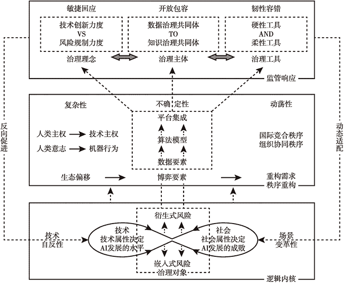

图1 基于“逻辑—秩序—监管”的中国下一代AI自适应管控工作框架

图片来源：作者自制。

## 三 AI自适应管控的阶段演进

拆解上述框架不难看出，技术-社会融合体、生态重心偏移、秩序需求重构属于贯穿始终的稳定基底；而管控对象及其博弈要素、管控理念、主办方、工具手段则呈现出明显波动，塑造了范式转换的轨迹。结合专家访谈与政策文本，技术创新与风险管控的组合特征具有鲜明阶段性，本文将中国下一代AI自适应管控划分为初始发展期（2016年前）、创新主导期（2017～2019）、管控加强期（2020～2021）、创新与管控平衡期（2022年至今）四个阶段，并对各阶段动态要素进行系统描绘（如图2所示），以厘清过去、现在与未来，为下一步演进提供参考。

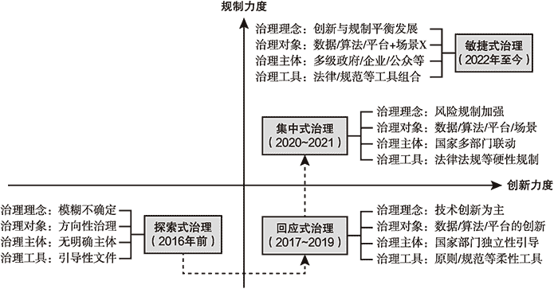

图2 中国下一代AI自适应管控的范式变革

图片来源：作者自制。

整体来看，历程短但节奏快。2016年前，AI正从研发向产业应用迁移，国际社会开始初步审视风险。2016年联合国发布《联合国人工智能政策》，美国白宫相继推出《国家AI研究和发展战略计划》等文件，英国议会发布《机器人和AI》报告。中国方面，工程院院士首次系统阐释中国下一代AI的内涵，提出大数据智能、群体智能等五大方向，标志着自适应管控起步，但理念、对象、主体、工具仍在摸索。该阶段以探索式管控为主，创新在推进，管控相对薄弱。

2017～2019年，《下一代人工智能发展规划》等国家战略持续发力，百度推出Apollo开源自动驾驶系统，商汤成为国内最大算法供应商，阿里成立达摩院并发布城市大脑2.0，腾讯上线首个AI辅诊开放平台。创新氛围浓厚，技术进步迅速。管控对象集中在数据沉淀、算法革新、算力提升。同期数据隐私保护、参与国际管治受阻等问题浮现，2019年《治理原则》以柔性方式释放政策信号。该阶段属于回应式管控，创新力度明显增强，管控以回应为主。

2020年后，技术性风险谱系复杂化、社会性事件频发，触发新一轮变革。第一，武汉国家下一代AI创新发展试验区建设深入，率先建成国内首个公共算力设施——武汉AI超算中心，形成“一中心四平台”的武汉模式。该模式依托超算中心提供普惠算力、孵化本地示范场景、推动生态集约、协同产学研，极大激发了创新潜力。数据、算法、平台在无人驾驶、智能制造、智慧城市、智慧农业等场景加速融合，技术属性与社会属性高度交织。第二，“数据—算法—平台—场景”的风险复杂度与危险系数显著上升，管控思路从以鼓励创新为主转向以风险管控为主，社会道德导向成为系统管控主轴。国家标准化管理委员会、网信部门、发展改革委、科技部、工业和信息化部联合发布《国家下一代AI标准体系建设指南》，主体协同加强；2021年《数据安全法》《个人信息保护法》出台，划定创新底线。该阶段以集中式管控为主，创新持续突破，管控力度明显提升。

表1 不同时期中国下一代AI管控的相关政策文件

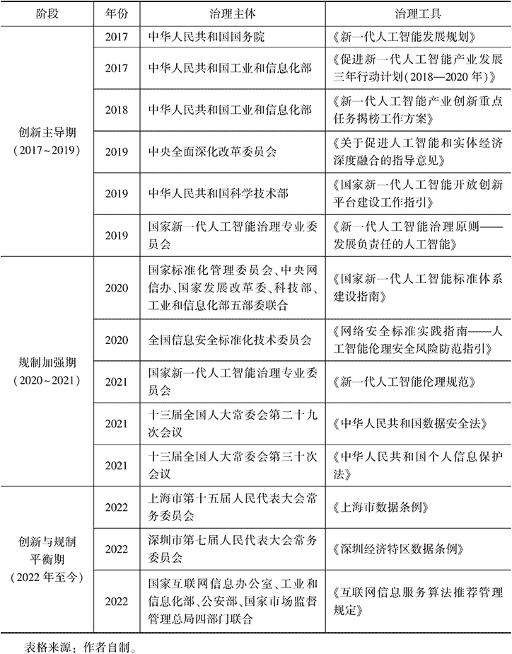

展望未来，自适应管控的目标是形成“理念动态平衡、主体多元协同、对象频谱细分、工具多维组合”的有机格局。既要坚持以人为本、安全可控的底线思维支持企业创新，也要对应用中涌现的新风险及时处置。技术落地速度可能超过管控响应，需要政府、企业、公众、行业团体、社会组织共同协同。管控对象应嵌入具体场景做细分，构建“普适性底线约束+个性化场景管控”的频谱，对共性问题实施强约束，对场景化问题赋予适度容错空间。硬法因程序刚性易现时效不足，柔性工具又常缺乏执行标准。未来工具箱应兼顾宏观层面的原则性法律、中观层面的行为准则、行业规范、技术标准和微观层面的行业倡议、企业自律，形成刚柔并济的组合，从而提升抗风险韧性。2022年以后，敏捷式管控成为主流，创新与管控需保持并重与动态均衡。

## 四 核心结论与实践启示

### （一）研究结论与理论价值

本文立足下一代AI赋能的时代特征与管控挑战，融合社会技术生态理论与实证调研，提出工作框架并刻画范式变革，形成系统性认知。

1. 核心问题可归纳为三类：整合技术-社会融合体的认知离散、实现系统生态主权的非均衡调适、突破包容审慎探索的局限。认知层面需建立技术属性与社会属性辩证统一观，深化技术迭代—场景变革—风险涌现的关联理解，并构建开放的风险划分体系。生态调适层面表现为技术能动性增强、人类能动性减弱，人类意志与行为分离并向机器行为注入。实践层面难在把握创新与管控的动态平衡、适应多元主体监管重心转移、调适组合工具的刚柔结合。

2. 工作框架以逻辑内核—秩序重构—监管响应为支柱，技术-社会融合体、生态偏移、秩序需求是稳定要素，管控对象、理念、主体、工具是动态要素。技术自反与场景变革驱动融合体持续调适，催生新风险；数据、算法、平台作为博弈要素牵引生态失衡，推动国际竞合与组织协同的秩序重塑；敏捷、开放、韧性的善治导向推动监管思路-主体-工具的系统适配并反向促进生态互嵌，降低系统脆弱性。

3. 范式经历探索式管控（2016年前）、回应式管控（2017～2019）、集中式管控（2020～2021）、敏捷式管控（2022至今）四个阶段。探索期创新推进、管控微弱；回应期创新为主导，对象为数据算法平台创新突破，主体为政府部门，工具为指南原则规范等柔性管控；集中期创新与管控并重，对象转向风险管控，主体为多部门联合，工具以硬性管控为主；敏捷期创新与管控动态平衡，对象为嵌入场景的细分，主体为中央与地方纵横联动，工具为法律与行业自律刚柔并济。

理论贡献在于全景化系统解析核心问题，超越以主体变革为核心的传统新兴技术管控思路，将逻辑、秩序、监管纳入框架并区分稳定与动态要素，并突破对AI自适应管控的静态研究局限，引入创新与管控强弱组合的动态演化分析。

### （二）研究启示

1. 超前研判国际竞争，兼顾“两轮驱动”。AI前沿管控已不仅是技术适应问题，中美在科技创新与管控规则上形成双重竞争。未来科技创新与管控规则将共同驱动国际竞争。

2. 持续推动全球共识，讲好中国故事。AI是人类命运共同体构建的基础，需跨越主权边界的管控冲突，最大化凝聚全球共识，避免先发展后管控或一刀切的极端。

3. 深化辩证思维，预警长尾风险。创新与管控不是零和博弈，管控是为了更好地创新。随着场景落地，低频潜在风险将增多，需从被动管控转向主动管控。

4. 坚持动态思维，聚焦范式适配。技术与场景需求的演进速度常快于理论，管控必须根据阶段、场域、矛盾及时调整策略与范式，保持响应能力与实践需求的匹配。

Cvitanovic C，Hobday A J，Van Kerkhoff L，et al，“Improving Knowledge Exchange among Scientists and Decisionmakers to Facilitate the Adaptive Governance of Marine Resources：A Review of Knowledge and Research Needs”，*Ocean & Coastal Management*，2015，112：25-35.

Gasser U，Almeida V A F，“A Layered Model for Ai Governance”，*Ieee Internet Computing*，2017，21（6）：58-62.

Hemphill T A，“The Innovation Governance Dilemma：Alternatives to the Precautionary Principle”，*Technology in Society*，2020，［2021-01-18］.

Imperial M，“Using Collaboration as a Governance Strategy-Lessons from Six Watershed Management Programs”，*Administration & Society*，2005，37（3）：281-320.

Jiang L D，Chen J Y，BaoY H，et al，“Exploring the Patterns of International Technology Diffusion in Ai from the Perspective of Patent Citations”，*Scientometrics*，2021，［2021-09-10］.

Janssen M，Brous P，Estevez E，et al，“Data Governance：Organizing Data for Trustworthy Artificial Intelligence”，*Government Information Quarterly*，2020，［2020-09-10］.

Lim H S M，Taeihagh A，“Algorithmic Decision-Making in Avs：Understanding Ethical and Technical Concerns for Smart Cities”，*Sustainability*，2019（20）.［2019-12-06］.

Olsson P，Gunderson L H，Carpenter S，et al，“Shooting the Rapids：Navigating Transitions to AdaptiveGovernance of Social-Ecological Systems”，*Ecology & Society*，2006，11（1）：441-473.

Olsson P，Folke C，Galaz V，et al，“Enhancing the Fit through Adaptive Co-Management：Creating and Maintaining Bridging Functions for Matching Scales in the Kristianstads Vattenrike Biosphere Reserve，Sweden”，*Ecology & Society*，2007，［2007-06-01］.

Pan Y，“Heading toward Artificial Intelligence 2.0”，*Engineering*，2016，2（4）：409-413.

Radu R.，“Steering the Governance of Artificial Intelligence：National Strategies in Perspective”，*Policy and Society*，2021，40（2）：178-193.

Reddy S，Allan S，Coghlan S，et al.，“A Governance Model for the Application of Ai in Health Care”，*Journal of the American Medical Informatics Association*，2020，27（3）：491-497.

Soteropoulos A，Berger M，Ciari F.，“Impacts of Automated Vehicles on Travel Behaviour and Land Use：An International Review of Modelling Studies”，*Transport Reviews*，2019，39（1）：29-49.

Taeihagah A.，“Governance of Artificial Intelligence”，*Policy and Society*，2021，40（2）：137-157.

Taeihagh A，Ramesh M，Howlett M.，“Assessing the Regulatory Challenges of Emerging Disruptive Technologies”，*Regulation & Governance*，2021，15（4）：1009-1019.

Wang W Y，Siau K.，“Artificial Intelligence，Machine Learning，Automation，Robotics，Future of Work and Future of Humanity：A Review and Research Agenda”，*Journal of Database Management*，2019，30（1）：61-79.

Wirtz B W，Weyerer J C，Sturm B J.，“The Dark Sides of Artificial Intelligence：An Integrated Ai Governance Framework for Public Administration”，*International Journal of Public Administration*，2020，43（9）：818-829.

Wirtz B W，Weyerer J C，Geyer C.，“Artificial Intelligence and the Public Sector-Applications and Challenges”，*International Journal of Public Administration*，2019，42（7）：596-615.

* * *

[\[1\]](#chapter004.html#w1) 姜李丹，北京邮电大学经济管理学院副教授，研究方向为创新网络与新兴技术治理；薛澜，清华大学文科资深教授，博士生导师，清华大学苏世民书院院长，人工智能国际治理研究院院长，研究方向为公共政策与公共管理、科技创新政策、危机管理及全球治理等。

## 第二部分 AI 全球治理观察

### 各国 AI 国家方案怎么搭：追求什么、怎么想、怎么落地

陈婧嫣 姜李丹 薛澜[^(\[1\])](#chapter005.html#m1)

**要点概述：** AI 的跨界赋能让它迅速变成重塑经济版图的核心变量。近年一批科技大国都围绕自身禀赋、发展阶段和治理传统密集推出国家级 AI 文件。本文把这些文件拆开看，先用“目标—理念—路径”的静态透镜，再用“学习—扩散”的动态透镜，搭起一套可对照的分析框架。静态来看，各国在想达到什么、秉持什么价值、采取什么动作上差异很明显；动态来看，方案之间相互借鉴、趋同融合的节奏在加快，学习和扩散的范围、层次和强度都在提升。

**核心标签：** AI 跨国比较 政策文本 政策扩散

#### 一 开篇

工业化历史里，通用技术的每一次跃迁都会拉动增长曲线。蒸汽带来了机械化，电力带来了规模化，信息电子带来了自动化，现在 AI 正在把生产推向智能化，开启新一轮技术产业浪潮。AI 这个概念 1956 年被提出后很长时间都停留在理论。近十多年，算力、算法和海量数据一起放大了它的互补和溢出效应，它从实验室走向各行各业，变成产业升级和生产力跃迁的战略资源。场景越扩越大，技术、经济、伦理方面的风险也随之显现，对既有价值和制度供给形成扰动。谁能更快抓住机会、管住风险、卡住制高点，已成为各国的心结。普京曾说谁赢了 AI 谁就赢了未来。于是各科技强国纷纷推出贴合自身禀赋、阶段和治理模式的 AI 方案，希望在全面判断影响后拿出有前瞻性、可操作、能落地的安排。

国家级文件集中发布的这几年，给了做横向对照的好时机。主要科技大国的方案到底分在哪儿？怎么归类、怎么比？本文就这个问题展开。现有研究多盯着创新绩效，用论文专利来比差距，对政策文件本身的系统对照做得不够，统一的对照框架也还没成形。各国规划因此缺乏一个统筹的梳理。本文尝试用“目标—理念—路径”来串起比较，揭示差异；同时也注意到，近期方案出现了相互参考、趋同整合的迹象，政策学习和扩散正在发生。其驱动和技术演进、社会认知深化、施政重点迁移以及国际交流更开放更频繁有关，这既给了形成全球共识的机会，也带来了新挑战。

#### 二 研究回溯和分析框架

##### （一）政策、比较公共政策以及问题意识

政策可以理解成政府为应对公共难题、实现公共目标、维护公共利益而推出的权威安排。本研究聚焦各国政府在 AI 领域的决策和行动，特别关注公共部门作为制定主体的特殊性。把 AI 的发展和治理当成技术崛起带来的重大公共议题，并把相关文件视作政策的延伸形态，战略、规划、措施、规范、方案等都纳入考察。

自 70 年代起，比较公共政策逐渐成形，学界一直强调比较的价值。相关研究覆盖卫生、福利、教育、环境、能源等多个领域，核心是揭示政策结果和制度特征之间的关联，常问各国为何选择不同路径。本文借鉴这一思路，先看主要科技大国 AI 文件的共性与分化，再为保证可比性搭建统一分析框架，还要问从哪些维度切入。引入时间维度后，还要看文件是否在演进、演进呈现怎样的趋势。回应这些问题，有助于为比较公共政策开辟 AI 语境。

##### （二）AI 国际对照框架怎么建

当前 AI 国际对照多用创新视角，以论文专利衡量创新能力，而政策视角则是从相关文件出发比对异同。既有研究对各国如何应对机遇与挑战的系统讨论不足，统一框架尚未建立。

在创新视角下，Tseng 团队基于 USPTO 专利数据梳理 1976-2010 年技术分布，发现美国、日本、德国、英国、加拿大、法国、韩国、意大利、荷兰等集中了全球绝大部分专利；美国数量领先，日本次之；质量上荷兰居首，美国紧随；荷兰与美国创新速度更快；美国主导机器学习，德国在网络结构上专利质量突出，荷兰在推理与知识系统领域领先。

Fujii 等利用 WIPO PATENTSCOPE 及 USPTO / JPO 数据分析 2000-2016 年授权专利，指出研发政策会影响技术绩效。日本对私人信息商业使用的严格限制削弱了大数据采集动机，使其 AI 专利吸引力低于美国，而美国通过制度设计与研发投入强化了创新激励。

国内学者薛澜团队基于 DWPI 数据，对中美产学研合作进行对比，发现中国合作规模近年快速增长，显示追赶态势。

与创新研究不同，学术层面政策视角尚未充分展开，更多见于智库报告。FTI Consulting 报告指出欧盟、英国、美国、中国、新加坡、澳大利亚、阿联酋的 AI 政策环境仍不成熟，伦理与监管边界模糊，决策者面临挑战。德国阿登纳基金会报告比较美、中、英、法、芬兰、韩国国家战略，认为目标体系、方向、主体、优劣均有差异，美中欧分化明显。中国学者也开始尝试，贾开等梳理美英德中政策沿革，归纳框架；曾坚朋等采用“主体—工具—目标”框架比较中美国家与地方政策，发现国家层面在主体结构、工具选择、目标设定上差异较大，地方层面中国更侧重技术与产业应用，对伦理、安全、舆情关注相对不足。

AI治理比较：从碎片到体系

目前关于AI的跨国研究，整体上落入了三种惯性。其一是技术视角压倒制度视角，研究多聚焦各国研发投入、模型能力、产业规模的差异并解释成因，对各国为何出台何种制度安排、这些安排对产业生态究竟是助力还是制约讨论不足。其二是案例堆砌多于横向提炼，多以单国叙事为主复述举措，描述性信息占优，从中归纳出可复制规律的尝试偏少。其三是偏爱强调差异表象而弱化差异幅度，乐于指出方案的独特性，却缺少把主要经济体置于同一坐标系衡量差异程度的统一框架。基于以上判断，本文以目标、理念、路径三条线索搭建跨国分析框架，对主要科技强国的AI方针进行系统梳理；同时引入时间维度，呈现政策间的相互借鉴与趋同演化。

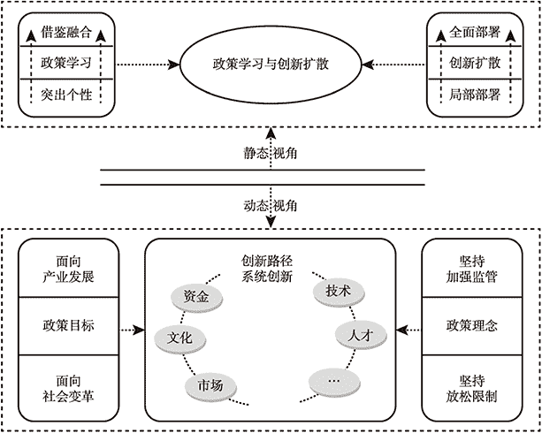

图 1 人工智能政策的跨国比较分析框架

图片来源：作者自制。

## 三 基于“目标—理念—路径”的案例比较

### （一）政策目标：面向产业发展与面向社会变革

政策指向决定了一国想把AI引向哪里。各国文件普遍把AI描绘成兼具通用性与颠覆性的前沿方向，承认大规模应用带来的风险不可回避，同时高度看重其对增长、安全与生活质量的拉动。争取或保持全球第一梯队，是几乎所有国家共同写进文件的核心诉求。

2019 年 2 月，特朗普签署第 13859 号行政令，正式推出“美国AI发展倡议”，核心诉求即“保持美国在AI领域的领先地位”，通过维持研发布署的主导权来应对战略竞争方的挑战（The White House，2019）。2017 年 7 月，中国国务院发布《新一代人工智能发展规划》，设定分阶段指标：到 2020 年整体技术与应用与国际先进水平大体同步，到 2025 年部分细分领域达到国际领先，到 2030 年理论、技术、应用全面领先并成为全球主要创新中心（中国国务院，2017）。在中美之外，中小经济体同样表现出强烈的追赶意愿，比利时在“AI 4 Belgium”文件中写道“多数国家已投入巨资，我们正面临掉队的风险，现在需要更果断的举措，让比利时在国际舞台上站稳脚跟”（AI 4 Belgium Coalition，2019）。如图 2 所示，自动驾驶、数据治理、自动决策等赛道已成为各国布局的重点，美国、欧盟、日本等纷纷以战略报告、准则形式密集发声。

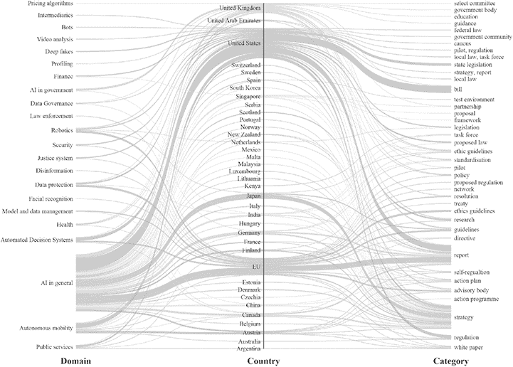

图 2 各国人工智能相关政策文件出台情况

注：数据来源于 NESTA：AI governance database，其中 2020 年数据截至该年度 3 月份。

在“要领先”的共识下，各国对领先的侧重点并不一致，形成了从产业驱动到社会重塑的光谱。有的一国更看重AI对经济结构的拉动，有的更强调其对社会形态的改造，有的则两者并重。这种取向差异本质上反映了对经济效益与社会效益的权衡。本文对 1974 至 2019 年德国与日本的相关文件进行文本挖掘，以便更清晰地呈现分野。

德国是把AI导向产业转型的典型代表。2018 年 11 月发布的《联邦政府AI战略》明确写道要在工业 4.0 的基础上成为该领域应用的全球领导者（The Federal Government of Germany，2018）。联邦经济与能源部另行开展了AI与制造业关联的专项研究（BMWi，2019a），口号“AI Made in Germany”既指技术研发在境内发生，也强调优先赋能制造业。2019 年 2 月的《国家产业战略 2030》把AI、数字化、电池制造等并列为核心行动领域（BMWi，2019b）。

日本的取向则更偏向社会层面的改造。2016 年 1 月《第五期科技基本计划》提出两大愿景：一是率先建成“超智能社会 Society 5.0”实现社会转型；二是把日本打造成“全球最适宜创新的国家”（Government of Japan，2016）。因此日本的方针更多是为回应人口下降、老龄化、医疗护理成本上升等现实压力，视AI与其他技术的融合为解决问题的重要抓手。

### （二）政策理念：加强监管与放松限制

理念决定了政策的基调，也是分歧最明显的地方。目前主要有两种取向：一是强化监管，主张在风险被证实前即行预防，赋予监管机构广泛的禁止性权限；二是放宽限制，主张只有在危害被明确证实时才介入，事先应减少对创新的约束，甚至清理可能抑制创新的旧规，以激发私营部门活力（Thierer，2016；Andorno，2004）。

欧盟是强化监管的代表，多数欧洲国家立场相近。欧盟认为审慎监管有助于赢得公众信任，从而形成竞争优势。继 2018 年 4 月《欧盟AI战略》之后，2020 年 2 月《AI白皮书》正式提出对“高风险”用途实施严格法律监管。白皮书强调要把AI置于面向未来的监管框架下，既遵守既有权利保护规则，又把在欧盟运营的高风险系统纳入监管，让公众安心、企业在法律确定性中创新，构建“信任型生态”。具体做法包括对医疗、交通、刑事司法等高风险领域采取更有约束力的规则，推出“可信赖AI”认证，低风险领域鼓励自愿遵守；要求高风险系统实施人为监督，明确责任主体，并在部署前由开发者证明系统符合欧盟规则（European Commission，2020）。

美国则延续了放松限制的传统。美国认为预先限制容易导致停滞。2018 年 5 月白宫科技政策办公室发布的《美国人民的AI》指出：“政府的工作不是去征服想象中的野兽，我们不会去解决不存在的问题。我们将最大程度允许科学家和技术人员自由进行下一次伟大发明。”文件以电灯、电话、飞行为例说明重大发明都历经数十年完善，AI亦然，并强调“为创新设障不会阻止未来，只会让未来流向海外”（Office of Science and Technology Policy，2019）。

### （三）创新路径：政企角色与国家优势

路径关乎资源如何配置、配置到哪里，既受体制内政府、企业、科研机构的互动影响，也受国家禀赋制约。中美在路径选择上形成鲜明对照。

#### 1. 中国：政府引导、企业跟随，依托海量数据、面向应用需求

中国路径可概括为政府定盘、企业跟进、依托数据、面向应用。政府扮演系统布局与方向划定的引导者，而非直接干预市场，通过制度优势统筹项目、基地、人才。中国是目前唯一在国家规划层面完整覆盖基础理论、关键共性技术、支撑平台和具体应用形态的国家。企业在此框架下选择重点方向，既为获取政策支持，也因为官方筛选的方向被认为风险更低。规划指出的独特优势是“技术能力与海量数据、巨大应用需求、开放市场环境的有机结合”（中国国务院，2017）。因此政策高度市场牵引，信息处理、智能监控、生物特征识别、工业与服务机器人、无人驾驶等应用增长迅速。整体体现出顶层设计强、分阶段推进、执行力高的特征。

#### 2. 美国：政府守夜、企业活跃，依靠良好的研发生态系统和创新生态系统

美国路径可概括为政府守夜、企业活跃、依托生态。联邦政府将AI列为优先资助领域，但在运行中避免过度干预，风险出现时及时补漏，同时为研发应用提供便利并拓展国际市场。企业是创新主体，谷歌、亚马逊、Meta、苹果等在基础研究、算法、硬件、人才方面的持续投入构成了显著优势（Akerkar，2018）。2019 年白宫科技政策办公室《美国将主导未来的产业》总结，美国依托早期投入形成的研发生态与创新生态，能够有效聚合政府、私营部门、高校、研究机构与公益力量（Office of Science and Technology Policy，2019）。政策核心是维护并让这两大生态自由运转。

### （四）学习与扩散：从突出个性走向借鉴融合、从面向局部走向全面部署

在目标、理念、路径的比较之外，主要科技强国正出现相互学习与融合的趋势。技术演进、社会认知加深、政府偏好变化以及国际交流频繁，共同推动了政策的扩散。

一是从强调个性到借鉴融合。美国早期对监管持高度宽松立场，但在欧盟及英德法等国家监管决心增强后，第 13859 号总统令要求管理和预算办公室与科技政策办公室联合发布备忘录，为联邦机构提供监管指引，在保护技术、安全的同时维护隐私、公民自由等价值观，并要求商务部通过 NIST 制定技术标准以支持可靠、可信的使用（The White House，2019）。与此同时，伦理议题在美国政策中的权重上升，受欧洲影响明显（Jobin et al.，2019）。

二是从局部场景到全面布局。如图 3 所示，早期政策多聚焦机器人、自动出行等单一技术或场景。随着边界明晰，AI政策逐步覆盖健康医疗、公共服务、机器人、自动出行等多个领域，赋能效应在经济、社会、文化层面全面显现。

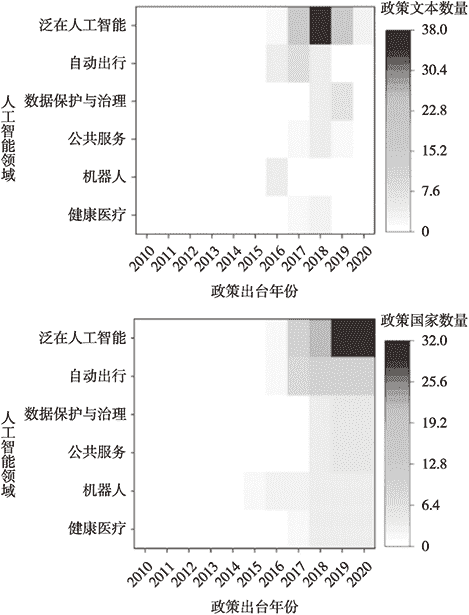

图 3 全球人工智能政策领域的演进（2010～2020 年）

注：数据来源于 NESTA：AI Governance Database，其中 2020 年数据截至本年度 3 月份。

### 四 研究结论与未来展望

全球AI政策：分化与趋同的双线叙事

人工智能凭借显著的外溢性，正快速演化为拉动全球经济增长的核心要素。谁先卡位，谁便能在科研、基础设施与经济扩张维度赢得持久比较优势，Cave等人2018年的这一判断至今仍具解释力。自2017年起，各国国家级AI战略集中面世，政策文本在短期内大幅攀升，这一态势印证了AI已进入大国博弈的核心赛道，技术水平被普遍视作国家综合实力的关键刻度。

本研究以全球主要科技大国公开的政策文本为对象，在静态层面搭建“目标—理念—路径”三维跨国比较框架，在动态层面梳理政策出台国家数与文本量的演进轨迹，意在为跨国比较提供更系统的分析思路。

静态来看，各国AI政策的分化十分突出，可归结为三条分野。第一条看目标取向，是偏向产业升级抑或社会转型。德国是推动AI赋能产业革新的典型样本，日本则更强调以技术进步为契机实现整体社会形态的演进。第二条看治理取向，是强化监管抑或放宽管制。欧洲整体呈现强监管阵营的特征，美国则延续了限制较松的传统路径。第三条看推进路径，受本国内部政企分工与资源禀赋制约而异。中国形成了政府牵引、企业响应、依托海量数据、聚焦应用落地的创新模式，美国则以政府扮演守夜者、企业高度活跃、倚靠成熟研发与创新生态为主要特征。

动态来看，全球政策之间已出现相互借鉴、趋向融合的态势，体现为两点。其一，政策风格由突出自身个性转向吸收各家长处，这对推动全球创新与治理共识具有重要意义。以我国为例，长期以来在AI规则制定上多以跟随为主，无论规则由谁提出，我方往往扮演使用者而非制定者。随着角色从跟跑转向领跑，未来需要在参与全球治理体系、应对国际新变局方面更主动。其二，政策视野由面向局部技术或单一应用场景，转向更加全面的、面向泛在智能的战略部署。展望未来，AI的赋能将在医疗健康、智慧出行、公共服务、机器人等社会各领域充分显现。这意味着各国AI政策并非孤岛，政策借鉴与传播的进程正在加速。

上述尝试亦存在局限。第一，案例国家尺度不一。研究聚焦传统科技强国，保持内部丰富性，却未能充分展开奥地利、比利时、墨西哥等中小国家在AI领域的积极探索。第二，“目标—理念—路径”框架设立的初衷是系统归纳差异，避免陷入千差万别无法比较的描述。然而受篇幅与目的限制，文章在描绘差异后未深挖成因。研究认为差异根源深植于制度基础与市场前景，未来可更多关注“科技—制度—新兴市场”三者间的关联效应。第三，政策创新与扩散的驱动动机尚不明确。是为获取政策优势、提升产业竞争力，还是为参与全球治理、达成共同共识？本文未给出定论。厘清全球层面政策学习与扩散的内在需求，有助于把握AI发展的机会窗口。

### 参考文献

贾开、郭雨晖、雷鸿竹：《人工智能公共政策的国际比较研究：历史、特征与启示》，《电子政务》2018 年第 9 期。

宁骚：《公共政策学（第二版）》，高等教育出版社，2011。

薛澜、姜李丹、黄颖、梁正：《资源异质性、知识流动与产学研协同创新：以人工智能产业为例》，《科学学研究》2019 年第 12 期。

曾坚朋、张双志、张龙鹏：《中美人工智能政策体系的比较研究：基于政策主体、工具与目标的分析框架》，《电子政务》2019 年第 6 期。

中国国务院：《新一代人工智能发展规划》，2017。

竺乾威、朱春奎、李瑞昌：《公共管理导论》，中国人民大学出版社，2019。

AI 4 Belgium Coalition.2019.AI 4 Belgium［R］.Brussel：AI 4Belgium Coalition.

Akerkar A.，“How AI is advancing across the world map”，*London Business School Review*，2018，29（3）：28-31.

Allen R C.，*Global Economic History：A Very Short Introduction*，Oxford：Oxford University Press，2011.

Andorno R.，“The Precautionary Principle：A New Legal Standard for A Technological Age”，*Journal of International Bio-technology Law*，2004，1（1）：11-19.

Technology Scenario Artificial Intelligence in Industrie 4.0，Berlin：BMWi，2019a.

National Industrial Strategy 2030，Berlin：BMWi，2019b.

Cave S，ÓhÉigeartaigh S S.，An AI Race for Strategic Advantage：Rhetoric and Risks，New Orleans：AI Ethics and Society 2018.

White Paper on Artificial Intelligence：A European Approach to Excellence and Trust，2020，Brussel：European Commission.

Artificial Intelligence：The Race is On，2018，Washington DC：FTI.

Fujii H，Managi S.，Trends and Priority Shifts in Artificial Intelligence Technology Invention：A Global Patent Analysis，2018，RIETI Discussion Paper Series 17-E-066.

The 5th Science and Technology Basic Plan，2016，Tokyo：Government of Japan.

Gupta K.，“Comparative Public Policy：Using the Comparative Method to Advance Our Understanding of the Policy Process”，*The Policy Studies Journal*，2012，40（S1）：11-26.

Jobin A，Ienca M，Vayena E.，“The Global Landscape of AI Ethics Guidelines”，2019，*Nature Machine Intelligence*，1：389-399.

Comparison of National Strategies to Promote Artificial Intelligence，2019，Berlin：KAS.

Artificial ［22］Intelligence for the American People，2018，Washington DC：OSTP.

America Will Dominate the Industries of the Future，2019，Washington DC：OSTP.

RT，Whoever leads in AI will rule theworld：Putin to Russian children on Knowledge Day，2017，https：//www.rt.com/news/401731-ai-rule-world-putin/.

Schwab K.，The Fourth Industrialrevolution：What It Means，How to Respond，2016，https：//www.weforum.org/agenda/2016/01/the-fourth-industrial-revolution-what-it-means-ana-how-to-respond/.

Artificial Intelligence Strategy，2018，Berlin：The Federal Government of Germany.

The President Executive Order 13859：Maintaining American Leadership in Artificial Intelligence，2019，Washington DC：The White House.

Thierer A.，Permissionless Innovation：The Continuing Case for Comprehensive，2016，Mercatus Center at George Mason University.

Tseng C Y，Ting P H.，“Patent Analysis for Technology Development of Artificialtive Study”，*Innovation：Management，Policy & Practice*，2013，15（4）：463-475.

* * *

[\[1\]](#chapter005.html#w1) 陈婧嫣，清华大学公共管理学院博士研究生，研究方向为科技政策与科研伦理；姜李丹，北京邮电大学经济管理学院副教授，研究方向为创新网络与新兴技术治理；薛澜，清华大学文科资深教授、博士生导师，清华大学苏世民书院院长，人工智能国际治理研究院院长，研究方向为公共政策与公共管理、科技创新政策、危机管理及全球治理等。

[\[2\]](#chapter005.html#w2) 日本将“超智能社会（Society 5.0）”界定为“在合适的时间将合适的事物和服务准确提供给合适的人，精准应对各种社会需求，使所有人都能享受高品质服务，跨越年龄、性别、区域、语言等界限，每个人都能安居乐业的社会”。

[\[3\]](#chapter005.html#w3) 20 世纪 90 年代，美国面对互联网技术的兴起便采取了放松限制的理念。1997 年，克林顿政府发布了《全球电子商务框架》，建议“私营部门应发挥领导作用，将互联网发展成为一个由市场主导而不是受到管制的行业”，呼吁各国政府“避免对电子商务施加不适当的限制，在需要政府参与的地方，政府的目标应该是支持和执行一个可预测的、最低限度的、一致的和简单的商业法律环境”。

### 可持续AI治理：建构SAID范式
周慎 朱旭峰 梁正[^(\[1\])](#chapter006.html#m1)

**摘要：**人工智能正在重塑世界秩序，在助力落实联合国2030可持续发展目标的同时，其自身的可持续性风险日益凸显。当前，主要国家、国际组织、高校、企业与技术社群均高度关注AI国际治理，各自提出原则、模型与方案，但普遍存在代表性不足、碎片化解读、技术逻辑与权力目标冲突等短板。本文以可持续发展为视角，聚焦AI自身及衍生的可持续发展议题，在AI系统三层架构与可持续发展5P维度中构建可持续人工智能发展矩阵，并据此梳理治理目标、客体、主体与手段，探索性提出人工智能可持续发展全球治理范式。该范式有助于夯实更广泛的国际合作基础，提升治理效能，保障AI更健康演进。

**关键词：**人工智能 全球治理 可持续发展

## 一 引言

当下，以人工智能为代表的新一代信息技术已成为未来发展的技术底座与增长动能。AI以独特能力推动《联合国2030年可持续发展议程》及各项目标的实现，同时其自身不可持续的演进问题也日益凸显。世界主要国家、国际组织、高校、企业、社会组织与技术社群都在密集关注AI治理，各自给出建议、原则与框架。这些成果为国际治理提供了认知基础，却也存在包容性与全球代表性不足、利益群体重叠解读碎片化、技术逻辑与权力诉求相抵触、表述笼统缺乏指导性、普适性忽略特殊性、与实践脱节等局限，不符合充分治理标准，亦难以具备全球治理属性。本文以可持续发展理念为依托，从全球可持续发展视角审视AI发展与国际合作治理，提出需实现“可持续的人工智能发展”，并在2030议程与SDGs体系中梳理AI面临的不可持续挑战，构建沟通基础更稳固的SAID治理范式，为广泛国际合作奠定理论基础，为规则制定提供整合选项。

## 二 文献综述

国内外关于AI国际治理、AI与联合国可持续发展目标的结合研究已有所展开。

### （一）人工智能国际治理

目前AI治理研究多集中于国家与次国家层面，国际治理研究仍处起步期。学界普遍认为AI治理难度极大，有观点指出技术界对AI尚未形成统一定义，难以划定可治理边界；也有观点认为AI是多技术集合，在不同应用与行业中的风险特征各异，难以一刀切监管。Gasser（2017）认为AI治理至少面临三大挑战：技术人员与政策制定者间信息不对称；利益相关方达成规范共识难度高；传统治理经验与政策工具难以匹配数字时代。AI系统的异质性、复杂性与技术自治程度，都要求对既有政策、法律与法规进行再思考。

在机制、模型与框架设计层面，研究者多从主动矩阵、多中心治理、机制复合体、混合监管与网格监管等理论汲取经验。麻省理工媒体实验室学者强调治理前提是理解技术逻辑下的“机器行为”，在动态静态、近观远观中构建四维度机器行为，并通过“道德机器”实验发现跨文化背景下的全球伦理偏好，揭示出三种价值偏好的国家集群。

### （一）人工智能国际治理的人权范式

在国际治理讨论中存在突出的人权范式，即援引主要欧洲与国际人权文书作为AI技术规范标准，在《世界人权宣言》《公民权利和政治权利国际公约》《经济社会文化权利国际公约》、联合国《企业与人权指导原则》与《欧洲人权公约》等框架下展开治理。对此范式的批评也很普遍，认为其过于西方化、个人主义色彩浓重、范围狭窄抽象、忽视文化差异，难以支撑健全的国际治理。中国学者积极参与相关研究，傅莹（2019）主张从人类命运共同体视角、以共同安全理念讨论AI国际规范；贾开等（2017）提出技术逻辑、传统治理适配性与公共政策选择问题；陈伟光等（2018）、俞晗之等（2019）梳理全球治理的主体、结构、机制与实践；鲁传颖等（2018）探讨多方治理与多边治理在不同治理对象中的适用；高奇琦（2019）从霸权与冲突逻辑出发，倡导形成全球善智与合智；卢迪等（2020）关注AI教育的全球治理。国内研究期待更多融合中国传统文化优势，为国际合作与治理贡献中国智慧与方案。

### （二）人工智能与可持续发展

在2030议程与SDGs语境下，不少研究把AI视作推动各项目标的关键驱动，覆盖SDG1至SDG17；也有研究关注AI对可持续发展的反作用，认为AI利用率提升可能加剧全球经济不平等并带来生存危机，阻碍可持续进程。Ricardo等评估了AI对各项目标积极或消极影响，发现AI可支撑134个子目标实现，也可能抑制59个子目标；Goralski等（2020）基于三项AI案例，从商业战略与公共政策角度分析影响，认为AI时代需与时俱进更新管理能力与领导力。

Truby（2020）指出AI治理框架必须服务全球可持续发展目标。Djeffal（2019）认为AI不仅要在应用端服务可持续发展，还应在研发前端践行可持续发展，即便当前存在诸多不可持续问题，但鲜有研究从可持续角度全面审视AI发展，故提出以可持续发展为治理理念与目标构建框架，并提出“可持续的人工智能发展”的技术层、社会层与治理层。技术层核心为Mulder等（2017）提出的“可持续技术”，社会层关注应用带来的社会影响，治理层以实现SDGs为目的。

上述研究为本研究提供了养分，奠定了理论基础。

## 三 SAID 框架

在前人研究基础上，本文探索性地在2030议程下构建可持续人工智能发展模型，搭建AI可持续发展全球治理框架，即SAID框架。

### （一）人工智能系统层

SAID：让可持续发展成为 AI 治理的通用语言

学界和产业界对 AI 产业链的拆解口径存在差异。中国信通院习惯用基础支撑、软件算法、行业应用三层表述；前瞻产业研究院则简化为基础、技术、应用。德勤给出五层视角，依次是技术支撑、算法、方法流派、技术领域、应用领域。ISO/IEC WD 5338 草案则采用生命周期口径，从启动、设计研发、检验验证、部署、运行监控、持续验证、重新评估到废弃依次排列。

### （二）可持续发展维度
近二十年围绕可持续发展的研究产出呈爆发式增长，该领域已逐步独立成体系。主流叙事强调经济增长、社会包容、环境保护三者协同。联合国《2030议程》把此概念进一步凝练为五大面向：人类 People、地球 Planet、繁荣 Prosperity、和平 Peace、伙伴关系 Partnership，统称 5P。

### （三）SAID 框架搭建
把 AI 的分层逻辑与可持续发展的 5P 维度叠加，本文形成了可持续 AI 发展矩阵，见表 1。
表 1 可持续的人工智能发展矩阵
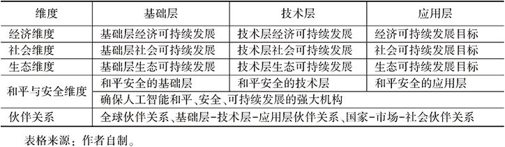
在矩阵之上，引入治理目标、治理主体、治理客体、治理手段四个要素，本文搭建出 AI 可持续发展的国际治理范式，见表 2，并对不同维度下对应的治理客体作示例梳理，见表 3。
表 2 人工智能可持续发展的国际治理范式
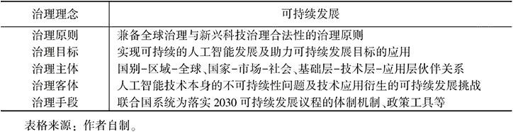
表 3 人工智能可持续发展治理客体举例
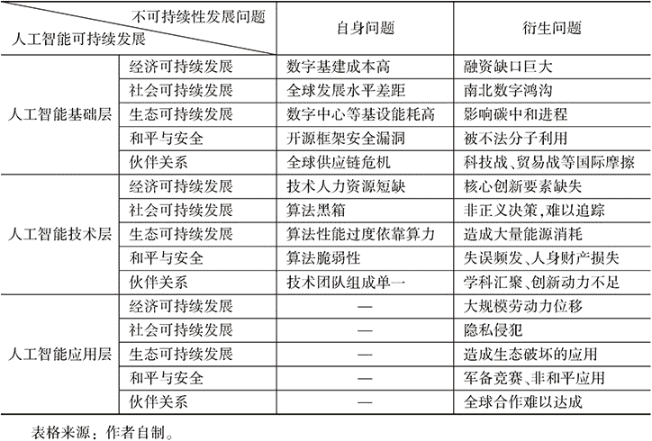

## 四 SAID 范式的比较优势
SAID 国际治理范式扎根于可持续发展理念、《2030议程》与 SDGs 的制度资源，相较于此前梳理的几类 AI 国际治理路径，在形成可操作的全球治理上具备更突出的比较优势。

### （一）人工智能伦理与治理问题的全面系统性梳理
可持续发展的包容特质使得 SAID 能对 AI 演进中的伦理与治理议题做整体盘点。现有研究多集中于系统本身的安全，或仅关注技术应用带来的社会外溢。SAID 分类兼具互斥与穷尽，能够把技术在不同层级自带的问题及其衍生影响统一纳入。尤其是基础层可持续与生态可持续，这类议题过去较少被提及，实践中却十分显性。结果导向的可持续视角不受地域或利益边界限制，相较人权等范式能呈现更完整的全球图景。

### （二）人工智能研发、评估与治理的指导性框架工具
SAID 矩阵既可以梳理新出现的治理客体，也可对 AI 系统各环节的研发、评估与治理提供规范指引。在研发全流程中，可促使产品经理、算法工程师关注技术可持续性并预判产品对可持续发展的潜在冲击；在自主评估或第三方评估中，可用来检查各阶段是否符合整体可持续与环节可持续的标准。本文还提出“立项勾选机制”，要求 AI 项目在申请立项时明确说明其与 SDG1 至 SDG17 的关联。

### （三）人工智能治理原则、目标与实践案例的耦合
对 AI 伦理治理原则的普遍批评在于空泛、操作性弱且缺乏可解读的案例。将国际治理与《2030议程》对接，可实现原则、目标与现实案例的联动。一方面 SDGs 覆盖面广，几乎囊括 AI 涉及的全部产业与场景，目标清晰；另一方面 ITU、牛津大学 AI 项目、北京智源研究院等已构建起 AI 助力 SDG 的案例库，这些真实实践让抽象价值具象化，指导意义更强。

### （四）人工智能国际治理的全球代表性与嵌入式优势
AI 合作与治理必须回应话语权包容性问题。现有倡议普遍缺乏发展中国家的充分参与，而 AI 对发展中国家的影响与数据权益问题尤为突出。《2030议程》经各方谈判形成全球共识，获联合国全体会员国认可。融合后至少带来两点嵌入优势：一是扩大治理的全球代表性，为更广泛合作奠基，确保决策惠及全球；二是发挥联合国协调作用，推动政府、私营部门、民间组织、学界与科技界协同。既有联合国体系、各国可持续发展国别方案与全球机制均可复用，避免重复建制与高动员成本。

### （五）各级各类组织人工智能转型与治理的普遍适配
AI 作为使能技术正在重塑各类组织的运行，无论该组织是否位于产业链上。可持续发展范式可广泛适用于国际组织、国家、高校、企业、社会组织与技术社群。联合国系统各机构均可找到对应治理维度并引导技术服务于其主攻的 SDGs；高校层面体现为 AI 转型、治理研究的可持续侧重及以 SDG 为导向的教育。产业链上已有实践，如旷视的可持续治理、商汤的可持续发展观，成为技术层典型案例。

### （六）人工智能治理的全球话语体系和积极叙事方式
AI 涉及学科众多，全球对话常因概念分歧而缺乏共同基础。负责任 AI、有益 AI、以人为本 AI 等概念丰富了治理维度，也导致概念碎片化。可持续的 AI 是一个更具包容性的选择，它降低了跨文化沟通成本，并提供积极叙事：不是从歧视、侵害、不公、滥用等负面问题出发，而是以建设性愿景提出议题，更有利于凝聚人心、实现治理目标。

### （七）人工智能治理与世界整体发展状况动态同行
全球发展目标的制定始终紧扣世界整体状态，并随认知深化而更新。2000 年《联合国千年宣言》提出 8 项千年发展目标，聚焦减贫、艾滋病遏制、小学普及，反映当时世界图景；2015 年 17 项 SDGs 则基于新的全球现实。世界持续变化，AI 技术迭代将带来更多不确定风险，将治理与《2030议程》及未来可能的 2045 年后议程结合，可使 AI 治理与世界整体发展动态同行。

## 五 结语与讨论
技术革命常伴随难以预见的挑战，人类曾因对颠覆性技术治理准备不足而付出代价。AI 国际治理已成共识，各国希望在第四次工业革命初期走在变革前面，提前识别风险、达成共识。可持续发展理念的包容性、《2030议程》的全球代表性、对标 SDGs 的执行清晰度，一定程度上弥补了既有框架局限，但 SAID 范式仍需在发展中完善。未来工作可关注以下方向。

### （一）在技术逻辑下实现治理目标
AI 技术既是治理对象，也是治理手段。伦理原则可通过算法实现，如 Stuart 提出的引领 AI 演化的利他、谦卑、助人三原则，并用严格数学方法落地。

### （二）借鉴以往新疆域全球治理经验
核技术、外层空间、生物化学等都曾是新治理疆域，其中积累了经验与教训。帕格沃什会议在核裁军中的作用、联合国外空事务厅帮助发展中国家利用空间技术、医学的希波克拉底誓言等，均可供借鉴。AI 治理应扬长避短。

### （三）加强全球共同价值的提取与确认
哈佛大学伯克曼互联网与社会中心梳理了 36 份公开 AI 伦理原则文件，发现全球大致有八项共识：公平公正 100%、隐私保护与可追责 97%、透明与可解释性 94%、安全 81%、专业研发责任 78%、人类价值与人在控制下 69%、人权 64%。治理原则受文化、语言、地缘影响，全球治理需在尊重差异基础上凝聚共识。

### （四）培植科技向善的企业与社会文化
AI 企业在产学研用链条中处于关键节点，科技向善的企业文化有助于伦理原则内化。同时应培植社会文化，将治理原则融入科普与科学教育，推动传播、教育与治理协同演进。可面向农民开展 AI 赋能农业农村、面向老年人开展数字银龄、面向产业工人开展就业引导与绿色技能培训、面向公务员开展科技治理培训等。

### （五）以人工智能治理促进全球治理变革
随着 AI 发展，衍生的治理问题会进一步暴露全球治理体系缺陷。AI 治理视角下，国际准则需随技术演进调整；透过 AI 治理可洞察全球治理痼疾并开拓新思路；AI 国际治理为推动全球治理向更公平公正、有序有效方向发展提供契机。

参考文献
陈伟光、袁静：《人工智能全球治理：基于治理主体、结构和机制的分析》，《国际观察》2018 年第 4 期。
傅莹：《人工智能对国际关系的影响初析》，《国际政治科学》2019 年第 4 期。
高奇琦：《全球善智与全球合智：人工智能全球治理的未来》，《世界经济与政治》2019 年第 7 期。
贾开、蒋余浩：《人工智能治理的三个基本问题：技术逻辑、风险挑战与公共政策选择》，《中国行政管理》2017 年第 10 期。
鲁传颖、约翰·马勒里：《体制复合体理论视角下的人工智能全球治理进程》，《国际观察》2018 年第 4 期。
卢迪、段世飞：《人工智能教育的全球治理：框架、挑战与变革》，《远程教育杂志》2020 年第 6 期。
裴新宁、郑太年：《国际科学教育发展的对比研究——理念、主题与实践的革新》，《中国科学院院刊》2021 年第 7 期。
俞晗之、王晗晔：《人工智能全球治理的现状：基于主体与实践的分析》，《电子政务》2019 年第 3 期。
Awad E，Dsouza S，Kim R.，et al.，“The Moral Machine Experiment”，*Nature*，2018，563（7729）：59-64.
Borenstein J，Howard A.，“Emerging Challenges in AI and the Need for AI Ethics Education”，*AI and Ethics*，2021，1（1）：61-65.
Cihonp，Matthijs M，Luke K.，“Should Artificial intelligence governance be centralized？Design lessons from history”，*Ethics，and Society*，2020：228-234.
Djeffal C.，“Sustainable Development of Artificial Intelligence”，*Global Solutions Journal*，2019（3）：186-192.
Fjeld J.，*Principled Artificial Intelligence：Mapping Consensus in Ethical and Rights-based Approaches to Principles for AI*，Berkman Klein Center Research Publication，2020.
Goralski M，Tan T.，“Artificial Intelligence and Sustainable Development”，*The International Journal of Management Education*，2020，18（1）：100330.
Gasser U.，“Alayered Model for AI Governance”，*IEEE Internet Computing*，2017，21（6）：58-62.
Khamis A.，“AI：A Key Enabler of Sustainable Development Goals，Part1［Industry Activities］”，*IEEE Robotics & Automation Magazine*，2019，26（3）：95-102.
Kajikawa Y，Tacoa F，Yamaguchi K.，“Sustainability Science：The Changing Landscape of Sustainability Research”，*Sustain-Ability Science*，2014，9（4）：431-438.
Mittel Stadtb.，“Principles Alone Cannot Guarantee Ethical AI”，*Nature Machine Intelligence*，2019，1（11）：501-507.
Mulder K，Didac F，Harro V.，*什么是可持续技术？感知、悖论与可能性*，London：Rout-ledge，2017.
Rahwan I，Cebrian M，Obradovich N，et al.，“机器行为”，*Nature*，2019，568（7753）：477-486.
Raso F.，*人工智能与人权：机遇与风险*，Berkman Klein Center Research Publication，2018.
Stone P.，“人工智能与 2030 年的生活：关于人工智能的百年研究”，*报告* 2015～2016 *研究小组*，2016.
Smuh N.，“超越基于人权的方法进行人工智能治理：承诺、陷阱、呼吁”，*Philosophy & Technology*，2021，34（1）：91-104.
Stuart R.，*人机兼容：人工智能与控制问题*，New York：Penguin，2019.
Truby J.，“治理人工智能以造福联合国可持续发展目标”，*Sustainable Development*，2020，28（4）：946-959.
Vinursa R，Azizpour H，Leite I，et al.，“人工智能在实现可持续发展目标中的作用”，*Nature Communications*，2020，11（1）：1-10.
Wong P.，“文化差异作为借口？全球人工智能伦理与治理中的人权与文化价值”，*Philosophy & Technology*，2020，33（4）：705-715.
Weber H.，*实现新的全球网络空间框架*，Berlin：Heidelberg，2015.

* * *

[1] 周慎，中国科学技术大学科技传播系、中国科学院科学传播研究中心副研究员，研究方向为科技传播与科技政策、网络与新媒体；朱旭峰，清华大学公共管理学院院长、博士生导师，清华大学科技发展与治理研究中心主任，研究方向为公共政策理论、智库与专家参与、可持续发展政策、科技治理；梁正，清华大学公共管理学院教授、博士生导师，人工智能国际治理研究院副院长，中国科技政策研究中心副主任，研究方向为科技政策、创新管理、新兴技术及其治理。

### 欧盟人工智能的规制路径及其对我国的启示
——以《人工智能法案》为分析对象
曾雄 梁正 张辉

### 摘要
欧盟发布的《人工智能法案》基于风险预防理念，为 AI 制定了一套覆盖全过程的风险规制体系，其风险分类思路、产品规制路径、负责任创新与实验主义治理理念等，对我国 AI 立法规制具有重要借鉴意义。立法必要性、立法体例、立法内容与立法价值取向是讨论我国 AI 立法的四个关键面向。研究认为，我国 AI 立法大势所趋，在体例上可采取综合性立法，单独制定一部人工智能法；在内容上进行事前—事中—事后全链条监管设计；在价值取向上应坚持规范与发展并行，制定兼具规制治理与产业发展的人工智能法。

### 关键词
人工智能 数字治理 智能治理 实验主义

## 一 欧盟《人工智能法案》的制定背景与规制逻辑

# 欧盟AI法案：从风险分类到信任治理

人工智能兼具模糊、复杂、自主和不可预知等特质，由此衍生出诸多社会风险。为让技术发展与人权相容并赢得公众信任，欧盟于2021年4月21日推出《人工智能法案》草案，为AI治理提供硬法支撑。

### （一）通过立法确保人工智能尊重人权并获得信任

法案要生效仍需欧洲理事会与欧洲议会批准，周期可能长达数年。结合欧洲在技术、社会经济与政治方面的特殊处境，欧盟力推立法以保障AI安全与基本权利，同步推动投资与创新，谋求把欧洲打造成可信AI的中心。

第一，在技术应用层面，传统AI多为规则式算法，按程序员设定的代码指令执行任务。如今学习型算法成为主流，其训练、验证都离不开海量数据与强算力支撑。

第二，在社会经济层面，AI推动经济加速与全球竞争力提升，欧洲各行业正加快智能化转型，抢抓发展窗口不可或缺。但技术带来的效益伴随操纵个人选择、侵害基本权利等风险。冯德莱恩指出：“要释放AI潜力，必须找到欧洲道路，在数据自由流动与广泛使用之间取得平衡，同时保持高标准的隐私、安全与伦理。”

第三，在法律保障层面，欧盟尚无专门的AI法律框架。《通用数据保护条例》虽涉及自动化决策的解释权与数据保护影响评估，但执行难度大、各成员国做法不一，不确定性突出。

第四，在政治背景层面，AI长期是欧盟委员会重点。2018年设立高层专家组并发布可信AI伦理指引，2019年提出政策与投资建议。2020年2月白皮书明确监管选项，10月系列报告呼吁解决AI的模糊性、偏见、不可预测性与自主性问题，强调不侵基本权利并推动修法。该法案是这一路线的重要环节，后续配套政策将继续跟进。

### （二）遵循“特征—问题—目标—举措”的规制逻辑

该法案沿“特征—问题—目标—举措”思路构建规则。

第一，特征上，AI区别于其他新技术，具有复杂、模糊带来的显著不可预测性，自动化提升使自主性增强。机器学习盛行后，对数据依赖度极高，数据质量直接决定算法质量。

第二，问题上，自动驾驶、人脸识别等应用日益普及，随时可能威胁公共安全与个人权利。技术原理晦涩难解，现有规则供给不足，监管陷入困境，公众信任受损反噬创新。成员国各自零散的政策碎片化严重，难以满足单一市场需求。

第三，目标上，欧盟确立四大关键方向：确保AI安全合法、实现科学治理与有效执法、填补法律空白、打造AI单一市场。

第四，举措上，设计风险管理体系、质量管理体系及监管沙盒等工具。

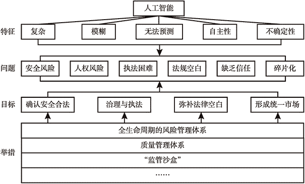

图 1 欧盟《人工智能法案》基本思路

图片来源：作者自制。

## 二 欧盟《人工智能法案》的规制理念

法案集中体现风险为本规制、负责任研究与创新以及实验主义治理三大理念。

### （一）基于风险的规制

风险为本规制的要点是：以风险为起点、评估贯穿全流程、手段随风险类型与程度动态调整。

#### 1.风险评估：根据风险程度的等级对人工智能进行分类

欧盟按风险高低将AI分为不可接受风险、高风险、有限风险、最小风险，并匹配差异化监管要求。

表 1 欧盟《人工智能法案》对人工智能风险的分类

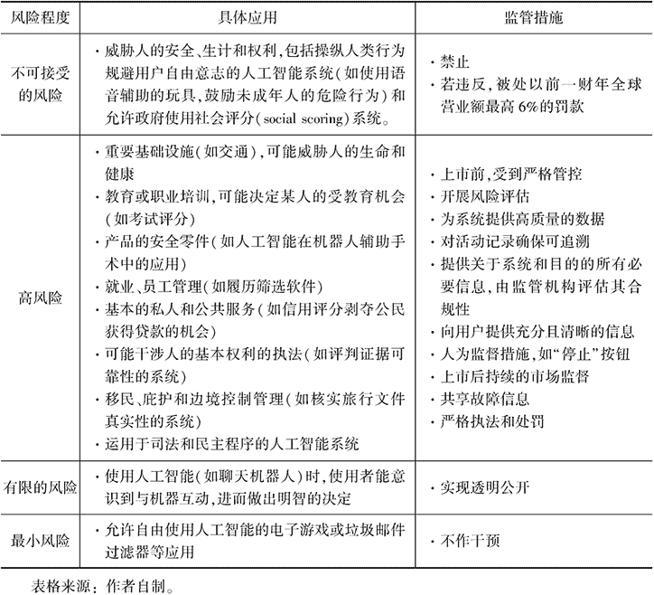

#### 2.覆盖全过程：风险管理措施覆盖入市前和入市后

规制覆盖产品全生命周期，实现事前、事中、事后闭环，借鉴德国产品跟踪观察做法。周期划分为设计开发、评估、注册、CE认证、监测五个阶段。

设计开发阶段须建立并维护风险管理系统，生命周期全覆盖。风险管理流程见图2。

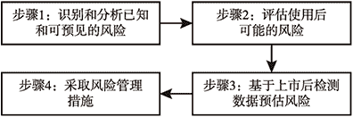

图 2 欧盟《人工智能法案》规定的人工智能风险管理步骤

图片来源：作者自制。

技术要求包括：数据治理须在合规高质量数据上训练，采集标注清洗规范化，保证代表性、准确性与完整性；上市前编制技术文件供主管机构审查合规性；系统具备自动记录日志功能以实现可追溯；向用户披露提供者信息、性能与缺陷、人为监督措施；设计人机交互工具支持人工干预与“一键停止”；确保准确性、鲁棒性与网络安全。

评估阶段供应商须完成合格评定，由评定机构核验是否符合第二章要求。注册阶段上市前须录入欧盟数据库，由委员会管理并公开。

CE阶段供应商需出具欧盟合格声明并保存10年，加贴CE标志方可流通，不合规产品须召回。

监测阶段上市后须建立售后监测机制，基于技术文件中的入市后监测计划收集运营数据。委员会将制定模板。发生严重事故或故障须在知悉后15日内通报监管机构。

#### 3.保证灵活性：敏捷评估风险变化并及时采取纠正措施

法案要求每年复核高风险清单并调整；提供者须保留日志确保全周期可追溯；高风险系统实质性修改后须重新评估；主管机构有权中止或撤回不合规证书。

### （二）倡导负责任的研究与创新

负责任研究与创新强调伦理可接受性、社会可持续性与社会期待，要求创新者与社会各方透明互动。核心是利益相关者共同参与实现包容发展。

落实路径包括：确立科研人员的道德责任；推动伦理设计，将道德判断嵌入系统；完善政策法规；促进跨学科对话与公众参与。法案鼓励企业自愿制定行为准则，涉及可持续发展、残障友善、利益相关者参与设计、开发团队多元化等，体现人本主义与多方共治。

### （三）坚持实验主义治理理念

实验性规制源自17世纪法国地方调整与19世纪英国实践，具有短期性、试错性、合作性特征。萨贝尔与蔡特林总结的实验主义治理主张在不确定环境下先设临时框架，再在执行中修正。

监管沙盒即是产物，指在限定时间、范围与真实环境中测试创新技术。欧洲理事会将其定义为在适当监管下试运行新技术、产品与服务。沙盒起于金融领域以平衡创新与系统性风险。AI监管沙盒允许主管机构在受控环境中对系统进行开发、测试与验证，出现健康、安全或基本权利风险时须即时降风控。

## 三 对欧盟《人工智能法案》的基本评价

作为全球首部AI专门立法，法案引入市场规制与全链条管理，也引发争议。

### （一）引入市场规制路径，责任机制存在缺陷

以产品思路监管AI是有效路径，准入门槛与全生命周期监测可提升可信度。欧盟拟修订产品责任与机械指令，并以效果原则行使长臂管辖，只要系统用于欧盟区域即适用，与GDPR一致。

法案侧重提供者，要求其开展风险评估，体现“谁提供谁负责”。但使用者同样关键，如人脸识别的日常运营多由物业公司承担，风险多源于使用场景的违法操作。仅要求提供者评估初期风险不足，应把实际运营使用者纳入责任体系。

### （二）超前制定监管措施，引发妨碍产业发展的担忧

欧盟数字立法一贯领先，市场对过度监管担忧明显。有研究称事前监管导致GDP与消费者福利损失。观点认为欧洲AI本就滞后，GDPR与AI法案可能把创业者推向监管宽松地区。

欧盟通过分级监管回应担忧，将大部分应用归入低风险，并引入沙盒提供创新空间。但大量事前合规环节仍会拖慢开发节奏，整体偏向规制，产业促进条款有限。

### （三）过于倚重企业自治，规制的有效性受到质疑

合规评估多为内部程序，企业自我证明合规。欧洲数字权利组织认为自律空间过大，EDPB与EDPS指出缺乏对行为准则的监督会削弱执行力。入市后监管偏松，前后不对称降低整体有效性。

### （四）对人工智能进行明确定义和分类，但界定和分类的合理性受到质疑

法案定义宽泛，从输入法联想、App推送到语音助手、地图导航均可能被纳入。技术演进快，定义易滞后或空泛。为提升精准度采用清单列举，仍存在遗漏。例如深度伪造未被列为高风险。EDPB与EDPS指出清单未涵盖按AI确定保费或用于健康研究评估医疗方法的场景。

## 四 欧盟《人工智能法案》对我国的启示

AI立法已到临界点

人工智能正以颠覆性力量重塑就业版图、冲击法律与伦理边界、侵蚀个人隐私、扰动国际规则，甚至牵动公共治理、经济安全、社会稳定乃至全球治理格局。面对这种系统性冲击，仅靠行业自律已不够，立法回应已是必然选择。

### （一）人工智能立法为何势在必行
相较传统科技风险，AI带来的风险更复杂、更系统、更难预判，治理难度被大幅放大。一方面技术门槛高，监管者、公众与研发者之间存在明显的信息鸿沟，新风险常超出既有监管视野；另一方面AI应用往往横跨多行业、多部门、多法域、多利益主体，协调成本极高；再者技术迭代速度远超监管体系更新节奏，风险、收益与演进路径高度不确定，前瞻性决策难度陡增，现有规则明显滞后。张欣2021年的研究已指出这一滞后性。

“软法”治理曾成为全球主流。美国亚利桑那州立大学软法治理项目统计，2001至2019年全球发布了634项AI软法项目；算法观察组织梳理的在线伦理准则清单显示，截至2020年6月已超过150个框架和准则。但软法缺乏强制力，约束力有限。学界反复提及的“伦理洗白”现象就是例证，企业设立伦理委员会后伦理事件仍频发，根源在于委员会独立性、透明度不足，易被企业利益绑架。把已获广泛认可的伦理共识上升为法律规则，硬化软法并配套惩罚责任，才是让约束落地的做法。

咨询公司Cognilytica的《全球人工智能法律和规范报告》显示，大多数国家对AI立法仍持观望。欧盟在立法动能上最积极，已就人脸识别、自动驾驶、自动化决策等提出方案或正式规则；美国则保持相对宽松。总体策略上，美欧等地区多采用差别化、场景化路径，对不同应用领域作专门规范。汪庆华2019年曾作此概括。

中国已明确路线图。2017年7月国务院印发的《新一代人工智能发展规划》提出三步走：到2020年部分领域伦理规范和政策法规初步建立；到2025年初步建立法律法规、伦理规范和政策体系，形成安全评估与管控能力；到2030年建成完善的法规体系。地方上深圳率先出台地方性法规，坚持促进性立法，以“全面促进与合理必要的规范”为核心，推动产业发展。网络安全法、数据安全法、个人信息保护法等已形成底层规则基石，但在具体应用层面仍是空白，产品与流通环节亟须立法补位。

### （二）人工智能立法的体例如何设计
学界对立法形式有两种主张。

吴汉东认为AI技术不确定性高、监管特殊性强，需要一部专门监管法。胡元聪、辛茹茹2018年建议设立《人工智能发展法》和《人工智能监管法》，前者规范产品质量安全与技术标准，后者解决监管原则、职责划分、违法责任与程序。朱体正2018年主张制定单行法并辅以配套法规和伦理准则，确保运行安全可控。龙卫球2020年则提出把AI定位为科技法的特别法，在继承既有科技法价值基础上优化规则，形成适配研发与应用的规范体系。

现实中应对AI风险的规则分散、位阶偏低，不利于监管执法，也不利于企业合规。因此需要一部综合性法律，提炼不同场景的共性规则，统领多场景应用。申卫星2021年提出“总—分”式体系：以中央综合立法作顶层设计，具体场景另行立法，如自动驾驶、自动化决策、精准医疗等。对此观点本文亦认同，综合性立法比碎片化立法效率更高。

### （三）人工智能立法应覆盖什么内容
风险本身不可根除，但可通过管理降低发生概率与后果严重程度。借鉴危机管理生命周期，AI风险治理可分为事前风险管理、事中应急管理、事后总结学习三个阶段，薛澜、张强等2003年的框架可资参考。事前包括风险预知、研判、预警；事中包括应急响应与处置；事后聚焦总结反思与重建。

2021年全国信息安全标准化技术委员会发布的《网络安全标准实践指南——人工智能伦理安全风险防范指引》即沿生命周期的逻辑，将研究开发者、设计制造者、部署应用者与用户均纳入规范范围。为此应构建全链条监管机制。

事前宜分类分级。对显著危害人类安全、人格尊严与自主意识的应用采取禁止，如禁止开发AI武器；对可控风险采取风险评估、备案注册等管控措施。

事中要建立产品后续观察义务。生产者既是风险源开启者也是利益获得者，应承担跟踪观察责任。具体包括建立内部质量监控机制确保生产符合安全指标，建立质量信息反馈渠道，及时向公众发布风险警示，建立缺陷产品召回或强制销毁制度，发现问题后除警示外须提供修理或召回。

事后须搭建风险数据平台。AI产品扩散快，召回难度大。李正华2003年就指出，建立统一科学权威的检测监控体系是召回制度基础。美国缺陷信息主要靠企业义务报告，辅以伤害档案、死亡证明、深度调查、国家电子伤害监视系统和24小时热线；欧盟则以RAPEX快速预警系统为核心，实现全境信息互通，形成以法律为基础、风险管理为核心、多主体参与的召回体系。中国目前主要依赖消费者主动上报、网络舆情和国外预警，来源质量不高、缺乏系统性。石念2021年已作此批评。拓宽采集渠道、建设AI风险数据平台，是监测与预防的关键。

### （四）人工智能立法的价值定位
立法需兼顾规范与发展。欧盟出台GDPR时曾引发行业担忧，《金融时报》报道其可能加剧数据寡头优势，2020年欧洲竞争杂志的研究也指出其对中小企业不利。AI法案更被预测将给欧洲经济带来超过300亿欧元成本，Barczentewicz与Mueller 2021年的分析强调定义模糊将带来隐性合规成本。

国内对此也有分歧。曹建峰2017年认为欧盟在平台责任、隐私保护等早期规则制约了创新，导致其在互联网发展中落后于美国和中国。周汉华2018年则反驳简单归因，认为隐私保护与创新并非零和，应避免制造对立叙事。实证研究不足时难下定论，但治理的出发点应是促成更好发展。立法过程中应坚持规范与发展的并重。

深圳《经济特区人工智能产业促进条例》明确包容审慎监管方针，运用政策指南、监管沙盒、应用试点等工具。深圳的实践为国家层面立法提供了可借鉴经验。

从国家指引到全球反思：AI伦理安全治理该往何处走

2021年1月，全国信息安全标准化技术委员会，简称信安标委，正式推出《网络安全标准实践指南——人工智能伦理安全风险防范指引》，下文称《指引》。这是国内首份由国家层面主导、聚焦AI伦理与安全风险共性议题并具备落地操作性的指导性文件，为我国AI伦理安全标准体系的系统化搭建提供了关键起点。

近几年AI技术加速渗透，围绕安全可靠可控的合规化建设也在同步展开。我国已初步摸清合规体系的建设规划与时间表[^(\[3\])](#chapter008.html#m3)，凝练出各方认可度较高的价值主张与原则[^(\[4\])](#chapter008.html#m4)，并在若干细分场景对相关标准进行了制定或修订[^(\[5\])](#chapter008.html#m5)。在这一进程里，《指引》的价值在于既对既有理念做了细化，也跳出了单一风险的局限，针对伦理与安全风险的共性难题给出了更具操作性的治理框架与行为建议。

肯定《指引》的积极意义，并不意味着AI伦理与安全风险的治理就此尘埃落定，也不能说明我们离解决更近。正如Acemoglu与Restrepo在2020年所提醒的，我们甚至尚未厘清“需要怎样的AI”这一根本目标。在国内外都在加紧推进管控之际，需要跳出对具体风险、原则或条款的反复权衡，以更宏观的视角审视问题本质与解决路径，并在比较反思中选择更适宜的方向。本文即从这一出发点对全球AI伦理与安全风险治理的研究与实践做综述性梳理，方法上属于文献综述的元分析。与近年涌现的大量治理方案相比，对方案起草代表性、起草方利益关联、有效性评估、内容缺陷与内在矛盾的批判从未中断，Greene等人2019年、Hagendorff2020年即是代表。本文延续这一批判脉络并结合中国实践，试图为关心该议题却不直接参与制度细节设计的公共管理研究者与公众提供一张全球比较的图景。

全文分五部分展开。第二部分界定AI伦理与安全风险治理的问题，明确研究对象并比较不同治理目标。第三部分梳理当前主要应对方案，从理念、客体、主体三维度做概括性说明。第四部分汇总对既有方案的批评，在比较中厘清主要反思视角。第五部分回到中国：一方面概括当前推进AI伦理与安全风险治理的整体框架，另一方面解读《指引》的内容特征与意义。第六部分则从未来展望角度对全文进行讨论与总结。

## 二 问题：人工智能伦理与安全风险治理的特殊性

自1956年诞生以来，智能技术历经两次波动，如今正迎来第三次高潮，被视作第四次工业革命的标志而广泛落地。即便有批评者认为AI不过是硅谷“答案主义”意识形态的包装，Morozov 2019，但其通过脑力劳动的机械化让人类转向更有意义活动的潜力，吴文俊 2019，仍展现出一般技术难以企及的变革价值。与此同时，应用带来的治理风险日益凸显。智能推送带来的信息茧房与极化，犯罪风险评估暴露的种族偏见，人脸识别可能构建的全面监控，以及就业冲击、舆论操纵、隐私侵害等典型案例，已成为推动伦理与安全风险治理的直接动因。目前各国鲜有出台针对AI风险的刚性法律，但据德国非营利机构算法观察组织的统计，政府、企业、社会组织、国际组织、学术团体等全球利益相关方已提出160多项原则或倡议，构成“软体系”[^(\[6\])](#chapter008.html#m6)。

技术应用导致个人权利受损或社会权力结构转移的风险并非AI独有，传统治理并非完全无力。技术社会史研究显示，条形码与扫码器的普及提升了零售供应链效率，有利于大型连锁，但并未必然导致权力集中与中小供应商、零售工人的边缘化。美国出现沃尔玛式垄断并压制博弈能力，德国与丹麦却出现大零售商与供应商、工人共享规模经济收益的情况，英法则呈现工人获益而供应商被垂直并购边缘化的差异，Watson 2011。可见技术带来的治理风险不必然触发治理变革，差异化结果更多反映文化制度的历史路径，各国对相似技术挑战的回应也并不一致。由此浮现更深的问题：AI作为新兴技术在发展与应用上具备哪些与他者不同的特质，以至于要求治理机制的变革？又为何这种变革更以“软体系”呈现，而非更具约束力的法律形式？

直接的解释指向发展与规制的平衡。新技术发展模式尚不确定时，更包容的软治理有助于降低规制对创新的前置挤压。但这只是一般规律的总结，未能解释AI的特殊性。更多研究指出AI作为通用技术，与蒸汽机、电力不同，在三方面表现出独特性。

其一，主体性难题首次显现。传统数字系统多体现人类对需求界定、流程拆分、条件判断的主导设计。基于机器学习的AI则能从海量数据中自主归纳规律与特征，表现出近似“表达”的能力。迈克尔·波兰尼提出的“人类懂得远超其能言说”的波兰尼困境，Polanyi 2009，正被AI部分突破，使其具备一定程度的主体性，由此冲击以人类行为因果为基础的传统治理框架，贾开 2019。这既拓展了数字系统的应用广度与深度，也带来了智能排序结果是否受言论自由保护、AI创作作品能否纳入版权等新问题。

其二，主体性难题不仅是技术产出引发的权利争议，更体现为社会运行规则形成方式的变化。网景创始人马克·安德森2011年“软件正在吞噬世界”的论断，强化了劳伦斯·莱辛格“代码即法律”的架构。数字化转型中，代码作为人类社会第四种规则的影响力持续上升。AI在扩大数字系统应用的同时，也提升了代码作为规则的重要性，它影响日常生活，也牵动选举、舆论、资源分配等重大公共议题。与法律、市场、社会习俗等传统规则建立在政治合法性或历史合理性之上不同，代码规则的生成过程很难说具备实质或程序正当性。代码规则并非完全取决于利益博弈，AI的实现过程使规则形成成为技术逻辑、社会逻辑与制度逻辑的复合体。以算法歧视为例，研究揭示搜索引擎更易将黑人姓名与犯罪记录关联，并非设计者有意为之，而是反映了搜索者关注黑人犯罪的社会心理，机器学习习得该规律并通过最大化点击的技术目标加以强化，Sweeney 2013。

其三，技术逻辑与应用过程的模糊性，即黑箱性。即便能在所有应用场景中理清代码规则的生成机制，前述两项挑战也就不算难解。近期数字平台不断调优算法以契合社会价值的做法即体现这一思路，且成效可观。然而受商业秘密保护，我们难以窥见数字公司设计与应用AI的基本逻辑；更关键的是，以算法为核心的AI已成为“看不见的手”，嵌入社会各处，管理、分类、约束乃至决定社会运行，却难以指认一个实体对象或清晰的工作流程来解释其运作。佐治亚理工学院教授伯格斯特将其比喻为“黑洞”：影响可感，内部难窥，Bogost 2012。

正是这三层递进的特殊性，使得AI的独特性与治理必要性更清晰。我们重视软体系与伦理安全风险，既出于发展与规制的平衡，更因为在主体性挑战下，AI作为社会运行规则，其运行机制的复杂性与黑箱性很难被纳入既有法律框架。在主体责权边界难以清晰界定时，唯有通过伦理与安全风险的软治理促进利益相关方共同探索，为新的治理体系与机制准备条件。

## 三 方案：现有规范的思路与特征

AI伦理与安全风险治理的核心是构建合规体系，在释放创新潜力的同时，通过理念引导、目标界定、风险揭示、底线探索，形成对技术产品或利益相关方的规范性要求，使发展应用契合社会价值。从现有研究与实践看，大致可从理念、客体、主体三个维度梳理思路。

聚焦理念，各方试图回答“发展何种AI”这一问题，通过核心概念、目标与价值的界定来影响技术开发与应用。AI的主体性及其技术政治性的复杂讨论，提醒我们发展路径多元且社会影响多重。因此明确并达成共识成为关键。尽管“AI”概念本身仍有争议[^(\[7\])](#chapter008.html#m7)，但治理视角下各方均在概念上加上限定。未来生命研究所提出的“有益AI”，beneficial AI，Future of Life Institute 2017，英国上议院的“伦理性AI”，ethical AI，UK House of Lords 2017，欧盟AI高级别专家委员会提出并被经合组织采纳的“可信赖的AI”，trustworthy AI，OECD 2019，以及中国新一代人工智能治理委员会提出的“负责任的AI”，都是影响力广泛的核心概念，其内涵解释与衍生的产品行为规范要求，共同引导着具体伦理与安全风险的治理。

聚焦客体，针对不同议题，各方试图提出整体性分析框架以实现局部化、模块化。挑战不仅在于问题复杂，也在于议题多元。在难以同时解决所有问题的前提下，尤其是私人部门开始聚焦具体议题并提出解决方案。常见思路是围绕AI全生命周期，从数据采集整理、模型训练验证到应用评估反馈，对各环节问题进行分析并提出对策。关注责任的“负责任及可解释的AI”，Accountability and Explainable AI，Mittelstadt et al. 2019，关注公平的“平等及歧视敏感型数据挖掘”，Fairness and Discrimination Data Mining，Gebru et al. 2018，关注隐私的“设计隐私”，Privacy by Design，Baron and Musolesi 2020，都是典型代表，谷歌、微软、脸书等大型平台提出的“AI Fairness 360 Tool Kit”“What-If Tool”“Fairness Flow”等工具则为解决这些问题提供了技术方案。同时，以“FAT ML”，Fairness，Accountability and Transparency in Machine Learning，或“XAI”，Explainable Artificial Intelligence网络社区为代表，国际社会已形成关注AI治理的技术社群，专门寻找技术解决方案。

聚焦主体，讨论不同利益相关方在治理中的责权分配与结构，以形成应对不确定性的治理体系。正如公共管理学者Wirtz与Müller所言，AI治理不应仅停留在技术层面，整体框架应涵盖技术、组织与政策层面，Wirtz and Müller 2019。近年来围绕新兴技术治理机制的讨论涌现出诸多新理念，已形成较完整理论框架，对政府监管者、企业、公众等主体的责权关系进行分析。敏捷治理，薛澜、赵静 2019，实验主义治理，Sabel and Zeitlin 2012，规制治理，Lobel 2012，都是典型代表，其大都要求在放权给基层或一线监管者的前提下，形成监管者与被监管者之间的制约激励关系，促使被监管者实现更有效的自我约束。这些理论在何种程度上适用于AI伦理与安全风险治理尚需更多研究，但已在规范层面成为探索治理机制创新的理论基础。

## 四 比较与反思：现有方案的争议、缺失与偏差

AI伦理与安全风险治理的快速发展并不必然意味着方向正确，批判性反思仍具重要价值，能更清晰地看到进展与不足。鉴于不同利益相关方会从各自角度提出准则规范，即便G20、经合组织、电气与电子工程师学会等国际组织积极参与，全球统一机制仍未建立，这必然导致工作分散、不成体系。现有比较性研究主要从三个方面提出反思。

### 第一，围绕关键概念的内涵界定尚存争议，并因此影响了全球治理共识的形成，这集中体现在三点。
概念层面，AI的定义在技术上分结果导向与过程导向，在治理上则分产品、流程还是主体归属；伦理与伦理风险的共识不足，安全风险讨论相对成熟，伦理风险则因文化差异与嵌入路径不同而分歧；具体治理要求如可解释性，层面与标准不一，分歧集中在源代码、模型、数据、应用逻辑何处可解释、如何判定可解释，沈伟伟 2019。这些争议反映出业态尚未成熟，也要求治理保持开放动态。

### 第二，当前提出的人工智能伦理问题与安全风险治理原则在内容上存在缺失或争议。
统计与比较研究显示，主流准则多覆盖透明度、反歧视与公平、隐私保护、责任归属、自由自主、安全可靠、向善促进、社会保障等维度，但在可持续发展、人机关系、特定领域限制、研究者多元与中立性等方面存在空白。同时不同准则间冲突明显，如普惠与隐私的张力、安全与非歧视的矛盾、技术指标权衡下的公平取舍等，Corbett-Davies et al. 2017。根源在于全球协同机制薄弱，缺乏统一且具共识的有效性评估与标准体系。

### 第三，提出并形成人工智能伦理问题与安全风险治理原则的决策过程不够开放、民主，并可能因此导致结果出现偏差和片面性。
对软治理动机的质疑突出，控制实验表明现有准则难以实质影响合规行为，McNamara et al. 2018；私人部门主导的准则易沦为抵制强监管的工具，Benkler 2019。起草过程封闭、技术专家主导，导致现实风险被忽视，如过度关注强AI而忽略已大规模应用的场景型风险；专家群体男性化也带来性别偏差，偏好理性计算化方案，对同理心、情感伦理重视不足。

## 五 中国实践：多方协同推进与《指引》要点
AI伦理与安全风险治理展现出全球图景，我国作为AI发展与应用大国，同样将治理体系建设置于优先位置，并初步形成一定框架。相比全球私人部门与社会组织的主动参与，我国更多体现政府主导下的协商建设过程。[^(\[8\])](#chapter008.html#m8)

2017年以国务院名义发布的《新一代人工智能发展规划》，也就是《规划》，提出了我国推进并形成AI法律法规、伦理规范与政策体系的基本要求与时间路线图。在《规划》指引下，相关工作可概括为沿着三个方向的并行努力。

### 第一，立足本土条件构建伦理与安全规范
结合国内发展阶段与现实需求，同时参考国际上的讨论和共识，我国在形成符合国情的智能技术伦理与安全风险治理规则上动作明确。相关规范在内部为研发、应用各方提供行为指引，对外则体现参与全球治理的话语与立场。

2019年6月，国家新一代人工智能治理专业委员会发布的《新一代人工智能治理原则——发展负责任的人工智能》具有代表性。北京智源人工智能研究院的《人工智能北京共识》、腾讯提出的面向智能技术的技术伦理观，也显示出不同主体在此议题上的探索。

### 第二，以标准体系细化技术治理
在具体问题层面，技术标准正成为规范化抓手。

2020年国家标准化管理委员会联合四部门印发的《国家新一代人工智能标准体系建设指南》，把伦理安全标准置于优先位置，并对概念术语、数据算法、系统服务、测试评估等研发应用关键环节的标准化工作作出部署。

### 第三，用政策法规划定应用边界
针对特定场景，主管部门正在研制具有约束力的法规与政策文件。

国家互联网信息办公室推出的《数据安全管理办法（征求意见稿）》《网络信息内容生态治理规定》，以及《常见类型移动互联网应用程序（App）必要个人信息范围（征求意见稿）》，都在为智能技术在垂直领域的落地划定红线。

上述三条路径共同构成的图景中，2021年初由信安标委发布的《指引》起到承上启下的衔接作用。它既是对《治理原则》的展开，也为后续标准制定准备了条件。《指引》主要回应三个问题：规范对象是谁、为何规范、规范什么。

首先，《指引》遵循研发应用全生命周期的逻辑，把研究开发者、设计制造者、部署应用者、用户全部纳入规范范围。研究开发涵盖理论推进、技术创新、数据汇聚、算法迭代；设计制造指运用智能技术形成特定功能的产品或服务；部署应用指在具体工作生活场景中的实际使用。

其次，《指引》归纳出五类风险关注点。失控性风险指系统行为与影响超出预设与可控范围并产生负面后果，既往讨论多指向强智能风险，《指引》强调当前水平下应用过程也可能失控。社会性风险源于误用滥用对社会价值观念的侵蚀，“信息茧房”即为典型，未必直接侵害具体权利，却会长期影响价值取向。侵权性风险涉及对个人基本权利的侵害，如自动驾驶事故导致人身损害、人脸识别带来隐私泄露、生成内容引发版权争议。歧视性风险关注系统对特定群体产生偏见并导致不公结果，与模型高度依赖大数据的特性密切相关。责任性风险聚焦负面后果发生后的归责难题，关乎社会变革成本分摊与信任维护。

最后，在提出普适性基本要求的基础上，《指引》依据不同主体的角色差异设定差异化要求，体现敏捷治理精神。基本要求既有积极引导，如以推动经济、社会、生态可持续发展为目标，也有底线约束，如尊重并保护个人基本权利、在合理范围内开展活动。

对研究开发者，限制性要求较少，更侧重鼓励可解释性与可控性持续提升。设计制造者承担更多合规义务，需建立应急处置、事故处理、信息回溯、救济保障机制。部署应用者除此之外，还需为用户提供非智能替代方案，并建立投诉、质疑、退出机制。

《指引》还识别出两类高敏感场景并提出强化规范：一是智能系统作为直接决策依据并影响个人权利的场景；二是公共服务、金融、健康卫生、福利教育等关乎公民基本需求的基础领域。用户虽非重点规范对象，但在合理使用与风险反馈上仍被赋予期待。

需要说明的是，《指引》在中国治理语境下意义重大，但仍有局限。核心概念如“智能伦理”缺乏明确界定，风险覆盖面不全，部分特殊领域未纳入；对不同场景的差异化要求不够精细，例如可解释性标准应随场景变化。起草时虽按惯例征求了两周意见，但并未形成充分的社会讨论，意见汇聚有限。这些不足既与文件定位相关，也反映治理议题的系统性与复杂性，一份文件难以面面俱到。

尽管如此，作为引导各方参与治理的指引性文本，《指引》细化了宏观原则的具体内涵，为后续标准制定提供衔接，展现出积极开放的态度，有助于未来参与全球对话。

## 六 治理前瞻与未来走向
《指引》的出台是我国智能治理进程的重要节点。本文以此为切入点进行学理解读，并非提出政策建议，而是试图勾勒利益相关方推动伦理与安全风险治理的整体图景。各方在核心概念与基础原则上已有一定共识，但争议、缺口与协同机制不足仍存，提出真正通用适用的治理准则仍需时日。结合全球进展，未来可能呈现三个趋势。

### 第一，核心表述趋于一致
具有全球共识且具约束力的治理原则短期内难以落地，但在“可信赖的智能”“负责任的智能”等核心表述上达成一致的可能性较大，这与G20、经合组织等国际平台的推动及主要国家态度趋同有关。

### 第二，中观机制加速成型
全球治理体系整体成熟需时，但共识度较高的评估框架、标准体系等中微观机制可能加速形成，实践倒逼与专业组织、学界积累是主要动力。

### 第三，软规范向硬约束演进
鉴于技术发展与风险暴露的紧迫性，当前以软体系为主的治理规范可能逐步转向更具约束力的硬法体系，尤其在具体应用领域将形成更明确规则。

对我国而言，在《规划》指引下，伦理与安全风险治理进程将进一步提速，多主体协同与合规体系建设也将常态化。

### 人脸识别治理的国际借鉴与中国路径
人脸信息高度敏感，其识别处理蕴含巨大安全隐患。风险贯穿数据、算法、应用三个环节，体现为隐私侵害、歧视、误识与滥用。治理需数据治理、算法治理与场景规范协同推进。数据端应确保控制者具备安全保障能力并尊重用户数据权利；算法端要求开发者完善训练数据并持续调优以避免偏见与错误。

对监管者而言，数据治理上应加快规则构建与用户同意体系建设；算法治理上应建立评测机制与市场准入标准，阻断劣质算法流通；在场景规范上应引入风险评估与分类监管。人脸识别已广泛应用于通行、测温、支付等场景，疫情期间人脸测温一体设备提升了效率，但杭州野生动物园“刷脸”入园引发诉讼、部分小区强制采集住户人脸信息、网络存在买卖人脸信息的黑色产业链等问题凸显。在产业竞争激烈的背景下，一刀切禁止并非明智选择，需在技术红利与风险防范之间寻求平衡，提出契合国情的系统化治理策略。

人脸技术全景：辨识逻辑、失控节点与治理方向

依据 GB/T 38671-2020《信息安全技术远程人脸识别系统技术要求》，该技术被界定为以面部生理特征区分个体的生物特征鉴别手段。工作流程先把采集到的面部图像转化为数字特征序列，再与系统预存的模板序列进行比对以确认身份。面部信息属于典型生物特征，具有个体独特性。研究团队借助深度神经网络在海量面部库上训练，让机器自行总结出机器易于理解和区分的表征。每张面部可映射为特征空间中的一点，同一受试者在不同照片下的点位会高度集中。以手机解锁为例，系统会计算当前采集点与注册点的几何距离，距离落在阈值内即判定为同一主体。

使用形态大致可分为两类。第一种为验证，即 1:1 比对，用于判断两张图像是否同属一人，解锁是典型场景。第二种为查询或辨识，即 1:N 比对，在库中检索当前图像对应的身份，常用于嫌疑人追踪或会场签到。两种功能均需保存面部与身份数据，运行时将现场抓拍图像与库中模板逐一匹配。面部探测是另一项边缘能力，它仅定位画面中的面部，不做身份判定，也不要求留存可识别数据。例如疫情期出现的非配合式测温，仅需在戴口罩的行人中准确定位额头即可，若不保留图像，隐私外泄风险明显更低。

按使用主体划分，主要为公共部门与商业企业。前者以公共服务为目标，后者以商业收益为主。技术能力、安全水平、管理规范的差异，使得公众对两类主体的信任度也不同。按使用场景划分，可分为公共场域与私人家庭场域。两类场域对公共利益与私人利益的影响不同，合规要求亦有差异。

技术短板可归纳为三层。数据层需要大量敏感面部样本进行针对性训练，一旦系统被攻破，敏感数据极易泄露。算法层依赖人工标注，标注成本高且易出错，错误标注会训练出错误模型。机器学习本身脆弱不稳定，图灵奖得主姚期智曾以“小猪变飞机”为例，照片加入微小扰动后系统可能把猪误判为飞机，因此面部系统容易被照片、纸质面具等攻击。应用层在光线不足、遮挡严重、面部大幅变形如大笑大哭时，神经网络难以提取接近标准的特征，点位会落在错误区域导致识别失败。在大规模用户场景下，误报率要求极低，而复杂环境下的误差会显著降低效率。

#### 三 人脸技术蕴含的公共安全风险

##### （一）从技术层面审视风险

技术缺陷会派生出误识、偏见、安全漏洞等风险。

###### 1. 算法识别易出错
实验室训练环境与真实使用环境存在落差，帽子、墨镜、妆容、现场光照、拍摄角度都会削弱准确率。准确率直接影响通行效率，甚至影响对特定对象的定性结论。以甄别罪犯为例，误识会导致错捕错判。据报道，美国公民自由联盟曾用亚马逊的面部软件做实验，错误地把 28 名在任议员匹配为此前被捕的罪犯。

###### 2. 算法存在歧视倾向
训练数据的质量与构成直接影响效果。麻省理工学院对微软、Facebook、IBM 等系统进行测试后发现，识别肤色较深女性的错误率，比识别肤色较浅男性高出 35%。这引发了性别歧视与种族歧视的质疑。算法由人设计，开发者的价值观可能被带入模型，形成人为偏见。

###### 3. 系统易受安全攻击
GeekPwn 2020 国际安全极客大赛上，黑客演示了劫持无人机、干扰自动驾驶、戴口罩“刷脸”结账等攻击案例。清华大学团队曾利用漏洞在 15 分钟内解锁 19 部国产智能手机。随着对抗训练与深度伪造技术发展，人像、声音、视频可以被合成，用以欺骗面部系统，侵害隐私权、肖像权、名誉权，甚至威胁社会稳定。市面上不同厂商系统安全水平参差不齐，缺乏统一标准，部分基于二维图像识别的低成本方案安全性偏低。媒体报道称，部分小区人脸门禁可用现场抓拍的住户照片打开。

##### （二）从应用场景审视风险

不同场景的风险表现不同，本文聚焦设备解锁、楼宇园区管理、市场营销、城市治理、教学管理、实名认证等场景，结合媒体曝光案例，总结出侵犯隐私、泄露敏感信息、违规滥用等后果，具体见表 1。

表 1 人脸识别若干应用场景的风险事件与风险后果

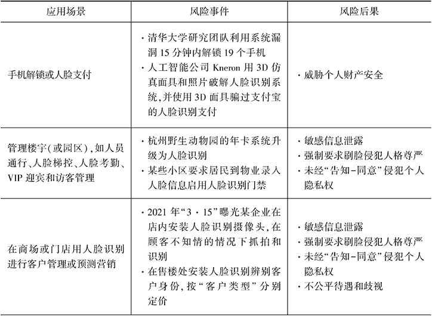

表 1 人脸识别若干应用场景的风险事件与风险后果-续表

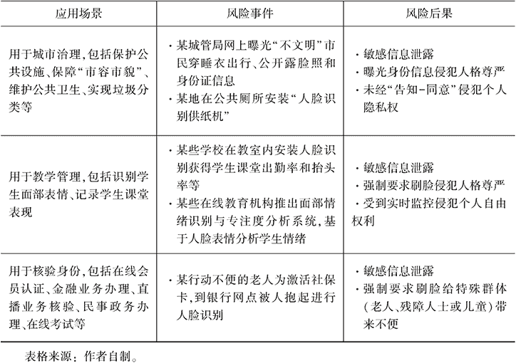

###### 1. 面部数据的收集存储使用缺乏透明
多数应用需先采集并存储面部信息。采集设备日益隐蔽智能，个人难以掌控自身面部信息。缺乏统一行业标准，面部数据分散在各运营者手中，用户不清楚数据是否脱敏、是否有安全保障、是否对外共享。这些库可能被黑客攻击，也可能被内部有权人员挪作非法用途，最终导致敏感信息泄露。央视新闻调查发现，部分网络交易平台上，花 2 元即可买到上千张面部照片。

###### 2. 面部数据库泄露带来严重安全问题
面部作为生物特征，具有唯一性和不可更改性，一旦被采集分析就难以摆脱技术束缚。尤其是身份证号、手机号、住址、银行卡号等与面部关联后，攻击者可能冒充身份进入特定场所或进行金融交易，造成人身和财产损害。不少开发者和运营者缺乏数据管理能力，无法安全保存数据库。以物业运营为例，住宅区或办公楼的面部系统交由物业管理，可能因能力不足或动力不足导致住户地址、联系方式、面部信息外泄。

###### 3. 面部识别被违规滥用
技术可能被用于不正当目的，如追踪个人行踪、分析轨迹，使人长期处于联网监控，侵犯隐私和行动自由。2017 年斯坦福大学研究团队曾研发以面部预测性取向的算法，也有研究尝试通过面部推断情绪，实现“察言观色”。国内部分部门曾在网上曝光“穿睡衣出行”市民，并公开姓名、身份证号、证件照，涉嫌侵犯人格尊严。还有公共厕所用刷脸防浪费厕纸、小区用刷脸垃圾桶做垃圾分类等违背比例原则的应用，因风险高、成本高、效率低并不合适。

#### 四 欧美治理经验与本土化启示

近年来欧美相继推出治理政策，本文比较其做法，为本土化治理提供参考。

##### （一）欧盟的治理政策与实践
欧盟构建了覆盖数据、算法、运用的全链条规则，对公共机构、私营主体、开发者提出具体要求。瑞典依据 GDPR 对违规使用面部识别的学校进行了处罚。

###### 1. 通过数据规则严格保护生物识别信息
GDPR 对面部数据提供全面保护，赋予用户知情权与同意权，企业采集资料需提前告知并获同意；赋予删除权，用户可因数据不再需要、撤回同意、存储期届满等理由要求删除；赋予反对权，当自动化处理对用户产生法律或重大影响时，用户有权提出异议。

###### 2. 发布指南对面部识别进行严格限制
2019 年 11 月欧盟基本权利局发布《人脸识别技术：执法中的基本权利考虑》报告，要求实施基本权利影响评估。欧盟委员会在《人工智能白皮书》草案中曾考虑对公共或私人机构在公共场所使用面部识别设 3 至 5 年禁令，最终稿删除了禁止条款，但提出严格使用条件：需通过安全测试和资质审核，只能基于正当相称目的并有足够安全保障。2021 年 2 月欧盟发布《人脸识别指南》，指导合规使用。

###### 3. 通过透明度报告、数据保护影响评估、审计机制等保障可问责性
根据指南，开发者需保证数据和算法质量，遵守数据保护原则。私营主体仅在受控环境下使用面部识别，需确保当事人自愿同意，禁止在购物中心等不受控环境为营销目的使用。公共和私营主体都需保证处理合法、安全，并采取可问责措施：发布透明度报告、为数据处理人员提供培训和审计程序、成立评审委员会、公共部门采购前进行事前评估等。指南重申需进行数据保护影响评估，说明合法性、涉及基本权利、数据主体脆弱性及风险降低措施。

## 4. 由数据保护机构负责对人脸识别进行监督执法
欧盟数据保护委员会 EDPB 负责监督执行数据保护规则，促进成员国监管合作，其常设秘书处欧洲数据保护专员公署 EDPS 为独立执法机构。成员国层面，法国国家信息与自由委员会 CNIL 2019 年发布相关报告。2019 年 9 月瑞典数据保护局依据 GDPR 对一所使用面部识别考勤且未备案、未评估的学校开出罚单。

##### （二）美国的治理政策与实践
美国联邦层面暂无统一法律，多州出台限制性法规。华盛顿州《人脸识别服务法》2020 和加州《人脸识别法》2020 提出具体监管工具。司法诉讼和行政执法已取得进展，处罚力度较大。

### 1. 各州采取不同治理政策
2019 年国会曾两次审议《商用人脸识别隐私法》，拟禁止收集处理面部数据，除非提供功能局限说明并获明示同意，禁止歧视、超出合理预见用途、未经同意共享数据、以同意作为使用条件。执法机构拟为 FTC。2020 年 2 月民主党议员提出《符合伦理的使用人脸识别法案》，要求在国会发布使用指南前非授权机构不得使用。目前联邦无统一规制，华盛顿、加州等州出台本州法律，旧金山、萨默维尔、奥克兰、伯克利等地直接禁止政府机构使用，纽约州 2020 年 12 月规定 2022 年 7 月 1 日前学校不得使用含面部识别的生物识别技术，除非特别批准。

### 2. 通过人工审查、测试、培训、问责报告机制和赋予个体抗辩权保证合规使用
人工审查：若决定对用户产生法律效力或重大影响，需经人工复核，涉及金融、住房、保险、教育、刑事司法、就业、医疗等基本生活权利。独立测试：公共机构应要求服务商提供接口以便独立测试，防止种族歧视。运营人员培训：需定期培训功能与限制。问责报告：政府机构应向立法机构提交意向通知并编制问责报告，包括供应商、功能、数据处理、数据管理政策、安全措施、对公民权利影响及缓解措施、反馈流程。报告需在决定使用前 90 天向公众发布，每两年更新并接受监督。个体权利：加州法律赋予用户确认图像是否登记、纠正或挑战决定、删除样本、撤回同意等权利。

### 3. 司法诉讼与行政执法并行且处罚严厉
2020 年 Facebook 因违反伊利诺伊州《生物信息隐私法》、未经许可采集数百万用户照片数据，被集体诉讼和解赔偿 5.5 亿美元。FTC 严厉处理 Everalbum，因其默认启用面部识别且无法关闭，利用用户照片训练模型却未写入隐私条款，被要求删除数据和算法。

##### （三）从欧美治理政策中获得的启示

公众对面部识别的态度受政治、社会、文化和伦理道德影响，各国国情差异大，借鉴时应避免简单移植。

### 1. 政治、社会和文化影响了欧美的治理态度
西方对政府监控高度敏感，二战期间人格尊严遭受严重践踏，特别是纳粹迫害，使民众对个人信息收集充满担忧。面部识别若在公共领域大规模应用，当权者可精准识别并实现严密监控。欧美因此特别限制公共机构使用，即使出于安全目的也常受质疑。2021 年 6 月 21 日欧盟 EDPB 与 EDPS 联合呼吁禁止公共场所使用面部识别。ACLU 在支持旧金山《停止秘密监控条例》时称，政府通过面部识别监控会压制公民参与、加剧警务歧视、改变公共空间。萨默维尔市条例也指出，公共部门面部监控会削弱宪法保护的言论自由。

人脸识别为何在欧美引发警惕又催生治理经验

西方对人脸识别的戒备首先来自社会情绪。宗教与族群对立加剧，少数群体长期被边缘化，对因信仰、出身、性别而来的偏见格外敏感。美国数百年的奴隶制遗留问题突出，2020年5月乔治·弗洛伊德遭警察暴力执法致死后，全国掀起反种族歧视浪潮，也让公众开始质疑人脸识别是否暗藏歧视缺陷。2018年一项美国研究发现，被识别者的肤色越深，误识率就越高。研究人员用三套系统对逾千名非洲国家议员照片进行测试，白人识别成功率明显高于黑人。英国《每日邮报》也报道过伦敦一名黑人男子上传头像时，因嘴唇较厚被系统误判为张嘴，这一低级误差被解读为种族偏见的体现。由此，欧美社会普遍担忧技术会放大种族不公。

文化差异是另一条分水岭。西方虽都重隐私，对隐私的理解并不一致。欧洲把隐私等同于尊严，核心是保护个人尊严免受侵害，媒体被视为主要威胁，常以伤害尊严的方式披露个人信息。美国则把隐私视作自由，尤其是个人对抗国家非法干预的自由，王利明2015年指出美欧在此存在差别。美国隐私权强调住宅不受国家等外部力量侵扰，居家内的私人统治被视为神圣不可侵犯。因法律文化不同，欧洲更在意人脸识别导致个人信息外泄，而美国更担心公共部门滥用技术侵蚀个人自由。

### 2. 可借鉴的欧美治理思路与工具箱
第一，数据规则要对生物特征严加保护。欧盟GDPR第4条把面部图像纳入生物数据，第9条对这类特殊个人数据处理作出限制，要求遵循原则上禁止、例外才允许的思路。美国则由州法细化，伊利诺伊州《生物信息隐私法》规定企业收集生物信息前必须事先告知并取得同意，同时禁止企业出售、出租、交易或从生物识别符中获利。加州、伊利诺伊、得克萨斯、华盛顿等州均要求企业告知并在收集前征得同意。

第二，用评估、问责与伦理提升可追溯性。欧盟层面提出透明度报告、数据保护影响评估、定期审计等制度组合。美国法案则强调人工复核、系统测试、人员培训、问责报告以及赋予个人申辩权，来保障合规使用。

第三，按风险预防原则做差异化治理。风险预防源自德国环境法，强版本要求在证据不足时仍先行干预，弱版本则要求先做成本收益权衡。欧盟呼吁公共机构在公开场合禁用人脸识别，美国部分州立法禁止政府使用，都体现强预防。商业用途则不同，欧盟未明文禁止，但须遵守GDPR及《人脸识别指南》；美国国会审议的《商用脸部识别隐私法》原则上允许商用，但设严苛条件。可见欧美对政府与商业两类主体采取差别化方案：公开场景用强预防，商业场景用弱预防。整体上形成数据、算法、技术应用全链条治理，兼顾公共问责与私权保护的双轨模式。

### 3. 在中国语境下校准治理策略
治理必须立足中国价值坐标。国内更具集体取向，公共部门坚持以人民为中心，国家建设强调社会整体利益与科技发展的平衡，李庆峰2020年曾作此概括。在维护公共安全的前提下，依法依规使用人脸识别能提升社会治理效能，赢得民众信任。考虑到国人对公共机构的信任度、对自由价值的理解以及与警务的关系，邢会强2020年的研究提示盲目照搬西方全面禁止的做法并不合适。

现行数据保护体系仍有空白，人脸作为重要生物特征缺乏专门法律兜底，数据权利边界也不清晰。需要加快立法进程，建立用户同意机制，为权利救济提供法律支持，商希雪2020年提出此点，同时对违法处置行为从严打击。

同时要以制度工具规范算法全生命周期，包括开发测试、审计、问责等机制，并在应用层面建立分级分类、分场景的监管体系，明确责任主体，避免出现监管真空。

## 五 我国人脸识别的本土化治理路径
回顾发展历程，我国长期坚持发展与规范并重，体现“管、促、创”理念。起步期密集出台支持政策：2017年7月国务院《新一代人工智能发展规划》提出研发视频图像分析与生物特征识别的智能安防警用产品；2019年9月人民银行《金融科技发展规划2019～2021》强调运用可信计算、安全多方计算、密码算法与生物识别等技术。配套标准如《安全防范视频监控人脸识别系统技术要求》《信息安全技术网络人脸识别认证系统安全技术要求》为金融、安防、医疗等领域扫清障碍。技术快速普及后，治理矛盾凸显，亟需完善政策框架。

### （一）当前治理的主要症结
#### 1. 生物特征保护与人脸识别规范缺乏精细化法律规则
《民法典》《网络安全法》《电子商务法》仅给出原则性指引，难以有效覆盖面部生物特征。杭州野生动物世界“刷脸案”最终依据合同法裁判，宁波市监管部门对违规房地产企业依据《消费者权益保护法》查处，均显规则粗放。尽管《信息安全技术个人信息安全规范》《信息技术生物特征识别应用程序接口》《公共安全人脸识别应用图像技术要求》《App收集使用个人信息最小必要评估规范人脸信息》等标准对告知与存储提出要求，却没有强制法律效力，约束力有限。

部门规制碎片化，仅金融领域较明确。人民银行2016年《关于落实个人银行账户分类管理制度的通知》允许银行以视频或人脸识别辅助核验身份；中国支付清算协会2020年《人脸识别线下支付行业自律公约》要求建立全生命周期安全管理，并按用户意愿提供开通或关闭刷脸支付服务。其他场景仍规则缺位。

#### 2. 地方政策不一，缺乏统一框架
《天津市社会信用条例》禁止企事业单位采集人脸、指纹、声音等生物识别信息；南京市住保房管局要求售楼处未经同意不得拍摄来访者面部；修订后的《杭州市物业管理条例》禁止物业强制业主以指纹、人脸识别使用共用设施；徐州市住建局要求售楼处不得使用人脸识别系统；2021年3月深圳征求《深圳经济特区公共安全视频图像信息系统管理条例草案》意见，限制监控布设并要求显著提示。缺少上位法统领，各地规范零散混乱，不利于全国统一应用，也加剧了技术发展与公众利益的冲突。

#### 3. 监管主体不集中，执行时效不足
国家网信办负责互联网信息内容管理，可监管App的人脸识别使用；2020年12月发布的《常见类型移动互联网应用程序必要个人信息范围征求意见稿》列明38类App的必要信息范围。公安机关主管公共安全视频图像系统，《公共安全人脸识别应用图像技术要求》明确公安部为主管部门。市场监管部门负责企业经营与消费者权益保护。2021年“3·15”晚会曝光后各地对违规商家突击检查。两会期间出现由公安审批、工信部与市场监管总局联合备案、由工信部牵头建立记录数据库等多种建议，反映出权责不清、协同不足的问题。

### （二）提升治理能力的政策建议
我国技术水平领先，得益于包容审慎环境与多元场景。如今滥用、安全、隐私风险引发担忧，需要协同治理，国家、行业、企业与个人共同参与，张文显2020年强调此点。应以场景驱动规则塑造，梁正、余振、宋琦2020年提出构建差异化案例库与数据库。监管可围绕数据、算法、技术应用三环节展开，实现全过程覆盖。

#### 1. 规范数据采集与流转，净化产业链
数据是算法原料，需打击“数据黑产”，制定行业标准与资质，推动健康流通。

人脸信息处理要明示告知并征得明示同意，表述须通俗清晰，包括处理方式、用途与保存期限。收集后须采取技术手段安全保存，禁止对外公开或交易，并提供非刷脸替代路径，保障用户有权拒绝刷脸。隐蔽采集设备应现场提示，用户有权退出与删除。测温、客流统计等非必要留存场景应自动清除照片。

运营者需具备数据安全能力，原则上不得长期保存原始人脸信息，已存信息应与其它个人信息隔离并匿名化处理，建立健全权限与运维管理制度。对开发者和运营者实施备案与追责，并公示资质与安保情况，引入社会监督。

执法须落到实处。《网络安全法》已把生物识别纳入个人信息，《民法典》要求合法正当必要并征得同意且可撤回，《个人信息保护法》对图像采集与身份识别作出规定，2020年版《信息安全技术个人信息安全规范》细化收集、存储、披露要求。法规需要强执行才能产生震慑。

#### 2. 为算法设立资质标准，保障安全与准确
算法决定识别效果，需强化审计评估。

建立行业准入与备案要求，防止劣币驱逐良币。金融领域已有模型报备先例，如《规范金融机构资产管理业务指导意见》要求报备人工智能模型参数。举例而言，小区场景中具备加密分级管理的安全产品可能因价格劣势败给无保障但廉价的产品，缺乏标准将损害行业生态。

技术层面要减少偏见。训练数据质量直接影响公平性，需保证数据多样充分，避免地域、种族、性别偏差；规范设计行为，防止人为歧视。应推进安全多方计算、同态加密、差分隐私等技术研究，杨庚、王周生2020年指出其价值。

明确监管职责，建立算法评审机制。针对脆弱性、可解释性弱、对抗性不足等瓶颈，设立伦理评审，要求上线前评估准确度、公平性与安全性。通过行业组织与第三方搭建检测平台，制定指标与工具，实现动态回访与信息反馈。

#### 3. 划定应用边界，防止技术滥用
技术中立但易被滥用，需构建影响评估机制明确场景边界。

借鉴环境影响评价与欧盟DPIA、美国问责报告，建立人脸识别影响评估，对自动化决策流程、数据使用与系统设计进行评判，分级定风险。公共机构与商业机构目标、管理能力不同，应适用不同准则。

引入公众参与。评估过程应邀请利益相关方发表意见，结果公开并建立后续反馈渠道，参照环境评价公众参与的做法，肖强、王海龙2015年对其机制作过梳理。

综合运用惩罚与激励，避免“伦理洗白”。企业应主动合规审查，调查客户用途并告知，内部建立伦理标准与审查委员会，主动公开算法报告。伦理洗白指企业把伦理制度当作规避监管的幌子，Wagner B 2018年提出此概念。元规制思路下，鲍德温等2017年认为可通过正负激励推动自我规制：将合规情况纳入融资上市审核，建立评级与排名机制，使合规成为竞争要素。

表 2 人脸识别影响评估的主要内容

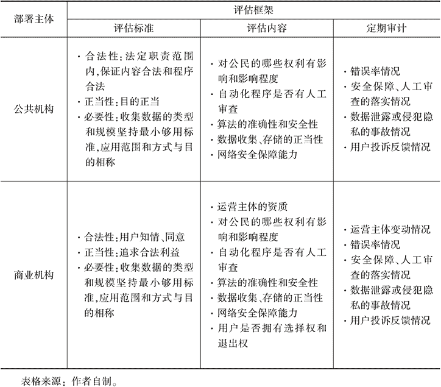

## 第三部分 AI与治理及产业创新

### 新冠防控中 AI 重塑公众健康应急的实践拆解

周慎 朱旭峰 薛澜[^(\[1\])](#chapter010.html#m1)

**摘要：** 公众健康类冲击直接动摇民众生命安全，唯有搭建韧性强、响应快的健康防护网络才能提供可靠托底。AI 作为前沿信息科技的核心抓手，正逐步在突发卫生危机处置里发挥放大及支撑功能。本文把 AI 贯穿危机应对全链条，围绕全球新冠防疫样本，梳理中外民间机构在抗疫期间的创新实践，从防范准备、应急处置、复盘总结三个时段阐释 AI 推动的内在规律及落地路径。通过中西经验对照，提炼可借鉴启示，提升我国运用科技手段应对卫生冲击的认知及能力，推动国家应急治理体系现代化。
**关键词：** AI 推动作用 危机应对

#### 一 绪论

公众健康风险关乎个体生命，也牵动经济社会平稳运行。成因多元、扩散迅猛、影响交织，是这类风险的典型画像，全球防范重大健康冲击的压力持续攀升。新冠大流行再次印证人类命运紧密相连，提醒社会必须对新发及再发传染病保持高度警惕，并构建更具韧性的健康保障网络。

2020 年的论述指出，人类战胜重大灾难离不开科技进步。AI 凭借视觉计算、语音识别、自然语言处理、内容生成及大数据分析等技术优势，能够为突发卫生危机提供技术支撑。在全球新冠阻击战里，AI 已在危机应对各环节释放出放大效应。国内外从业者以创造力及行动力在抗疫场景里开拓创新，使防控的组织及执行更为高效。深入研究 AI 在突发卫生危机中的助推逻辑、运行规律及现实应用，对构建强韧的卫生体系具有重要理论及实践意义。

本文以新冠防控为案例，探讨 AI 在突发卫生危机中的价值。结构安排如下：第二部分解析 AI 助推逻辑及技术储备；第三部分构建研究思路及方法框架；随后三个部分分别围绕危机应对的防范准备、应急处置、复盘总结，论述全球新冠防控中 AI 的效用及创新实践；最后进行中西对比分析，形成结语及政策建议。

#### 二 AI 助推逻辑及技术盘点

技术驱动正形成以应用为基础的社会问题解决机制。AI 助力突发卫生危机治理，需先厘清其如何发挥作用。

##### （一）助推逻辑

AI 作为提升突发事件治理效能的支撑性技术，其研究已覆盖自然灾害、事故灾难、公共卫生事件及社会安全四大类。研究相对集中于自然灾害应急。有学者调研 AI 助力洪水应急的现状及挑战；地震应急中计算机视觉用于跟踪位移、神经网络模型用于信号探测及震相拾取；火灾、干旱、泥石流及雪崩等领域亦有探索。其他类型事件中，深度学习用于城市交通安全事故预测；机器学习应用于传染病预测、诊断、分类及抗菌药物管理，以及理解恐怖袭击形成机理。

Wenjuan Sun 等学者从文献中梳理出 AI 赋能自然灾害治理的 17 大方向，如风险预测、影响评估、实时监测、损毁评估、重建跟踪等。共性在于借助 AI 处理海量数据的优势，快速提取可靠信息以支撑有效决策。Jessica Morley 等学者分析健康信息数字化工具时提出“数字技术助力的局限”，认为助力的常狭隘聚焦于监测及信息获取，隐含“信息越充分决策越助力”的假设，应超越信息助力本身。

不同类别突发事件治理的助推逻辑共性大于差异。差异主要体现在具体治理问题，共性在于皆需依托 AI 基础层及技术层，其解决方案的生产逻辑相通。（见图 1）。

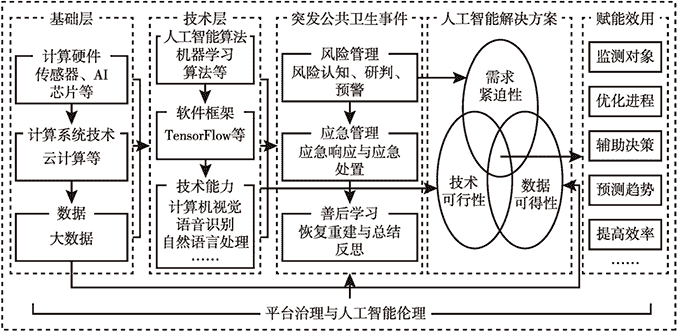

图 1 AI 驱动突发卫生危机治理的机制及效用运行逻辑

制图说明：本团队绘。

##### （二）技术盘点

基于当前发展水平，本文归纳出 7 类 21 种可用于突发卫生危机治理的 AI 技术手段。（见表 1）

表 1 AI 技术范畴及能力清单

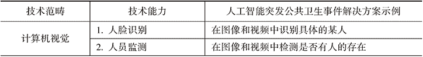

表 1 AI 技术范畴及能力清单-续表

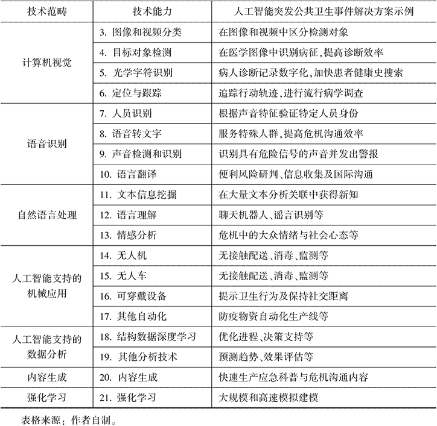

#### 三 研究思路及方法框架

为揭示 AI 在突发卫生危机治理中的推动效用，本文以危机演进时间轴为基础搭建研究框架，在收集全球民间机构 AI 抗疫案例的基础上，对中外在不同阶段所运用的技术能力种类及方案数量进行统计。

##### （一）危机演进的时间轴

危机从萌生到消退构成完整时间轴，随时间推移呈现不同特征，需匹配相应应对方式以预防发生、减轻伤害甚至转危为机。学界划分不尽相同，总体可归纳为风险管控即准备期、应急治理即处置期、复盘学习即总结期三个阶段（见图 2）。

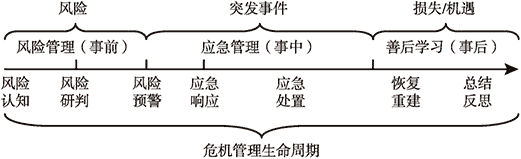

图 2 危机演进时间轴

制图说明：本团队绘。

以全周期为框架，既有助于案例归类并凸显短板，也能帮助从业者梳理防控应用场景，启发更多公众健康及其他危机事件中的 AI 方案创新。

##### （二）样本采集及分类

为全面把握民间机构运用 AI 抗击疫情的具体做法，本研究在国内、国外两个维度收集案例。采集时段为 2019 年 12 月 1 日至 2020 年 5 月 31 日，共获取 171 个案例。

国内案例主要通过三种途径采集：以“AI+疫情”关键词在百度、微信公众号、新浪微博抓取后人工筛选；提取《AI 知识图谱助力疫情防控和复工复产案例集》《数字健康技术疫情防控应用案例集》一至三集、《疫情防控中的数据与智能应用研究报告》中的案例。最终收集国内案例 83 个。

国外案例主要通过四种途径采集：以“AI+Coronavirus”“AI+COVID-19”为关键词在 Google、Facebook、Twitter、Medium 抓取后人工筛选；追踪 Techcrunch、MIT Technology Review、Popular Science、theVerge、Wired、Venturebeat 等科技媒体报道；提取欧洲议会智库报告《用 AI 对抗新冠病毒》中的案例。最终收集国外案例 88 个。

事中应急治理细分为应急响应及应急处置。国内以武汉“封城”措施前三天即 2020 年 1 月 20 日至 23 日视为应急响应，其他地区以 2020 年 1 月 25 日中共中央政治局常务委员会研究疫情防控工作会议后三天即 1 月 25 日至 28 日为应急响应期，其后为应急处置。国外疫情波及范围广，应急响应期难以统一，因收集案例多来自美国企业，本文以美国白宫宣布进入“国家紧急状态”的美东时间 3 月 13 日作为国外应急响应及应急处置的分界点。

将 171 个案例按实际应用场景归入危机治理不同阶段并进行技术分析后，全球民间机构“AI 抗疫”方案统计如下（见表 2）。

表 2 全球民间机构 AI 抗疫方案统计

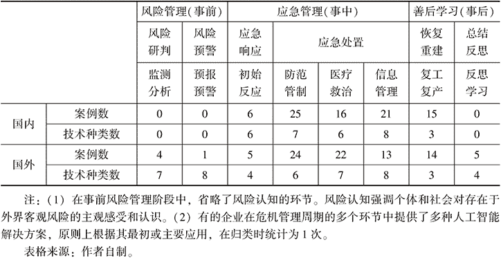

#### 四 预防阶段：AI 及风险防控

AI 深度挖掘及处理海量非结构化数据的能力，在风险防控阶段可助力识别危机萌芽。此阶段目标明确，推动主要体现为信息层面的支撑。

##### （一）风险评估

危机具有高度不确定性，AI 可从细微迹象中探寻危机可能，也可借助传播动力学模型、动态感染模型等大数据分析模型进行态势研判。本次疫情中，波士顿儿童医院开发的 HealthMap 平台较早捕捉了新冠病毒的大流行信号。Kinsa 借助智能物联网体温计及手机应用收集体温、症状等生理数据及年龄、症状持续时间、地理位置等信息，利用神经网络深度学习预测传染病区域走向及趋势。旧金山的 Metababota 提前警示病毒传播的社会政治风险，如将美中公众焦虑风险评级为“高风险”，刚果民主共和国猴痘病毒社会风险定为“中等风险”。

##### （二）早期预警

在风险预警里，AI 无法替代人类决策，但可基于研判结果供专家进一步分析。政府及公共卫生部门可利用初步结论加强关注并采取前瞻行动。加拿大由非典防控启发而生的 BlueDot 机构，通过自然语言处理技术浏览数万条涵盖 65 种语言的官方声明、新闻报道、全球航空票务数据、牲畜健康报告及人口统计数据，较早向客户发出传染病警告，并据航空票务数据预测病毒于首次出现后数日内将扩散至曼谷、首尔、台北、东京。Kinsa 亦通过开放接口及嵌入方式与客户建立预警合作机制。

表 3 海外 AI 抗疫典型案例

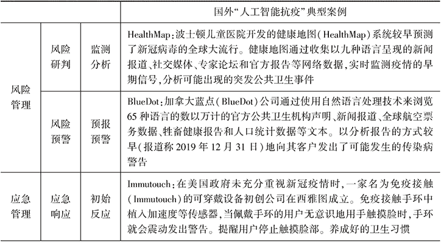

表 3 海外 AI 抗疫典型案例-续表

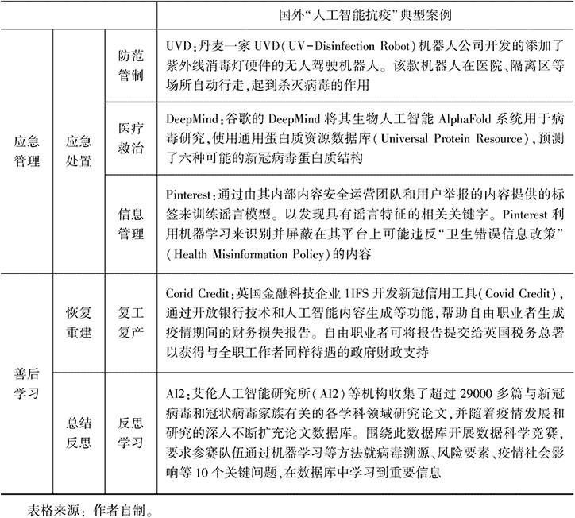

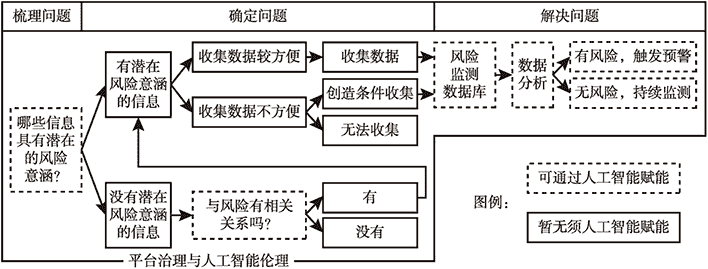

图3 AI 赋能风险管理的内在机理与运行流程
图片来源：作者自制。

## 五 应急进行时：AI 如何接手指挥
进入紧急状态后，人工智能主要集中在应急响应和应急处置两大环节发挥作用，尤其是处置阶段，相关案例最为集中。不同厂商依据自身业务和技术优势，选择切入点并落地方案。

### （一）应急响应
应急响应是进入紧急状态后的初始应对。对中外响应与处置的分界做时间锚定后，可以看到武汉响应期内的典型动作。1月21日，百度上线“新型肺炎”专题，汇总早期资讯；百度地图内搜索“发热门诊”，可定位最近的发热门诊医院。1月22日，小米推出“小爱捷径”肺炎实时查询功能，用户可通过手机AI键或对小爱同学说“实时肺炎疫情”获取即时信息。1月份，Facebook即着手清理平台不实内容；Google在相关搜索排序中优先呈现世界卫生组织的权威发布。

### （二）应急处置
AI方案在处置环节大量涌现。归并同类应用后，可归纳为疫情防控管控、医疗救治支持、疫情信息治理三大方向。

#### 1. 疫情防控管制
AI技术助力溯源、阻断传播、保护人群。

##### （1）锁定传染源
大数据分析、人脸识别等技术加快源头锁定与管控。一方面，结合地理位置与出行时间等手机数据，AI可辅助绘制传染源行动轨迹；另一方面，依据轨迹与同行时长较长的伴随人员推断密切接触者，进行流行病学溯源，大幅提升信息捕捉效率，为高危区与潜在高危区预测提供精准依据。发热是新冠典型症状，百度使用搭载热传感器的摄像头对人流逐人测温，How Baidu is Bringing AI to the Fight against Coronavirus，2020。该做法在快速筛查的同时提升通道通行效率，降低交叉感染风险。旷视、商汤等企业的同类方案已部署于商场、机场、车站、地铁站、大型社区等重点场所。

##### （2）阻断传播途径
智能机器人承担无接触配送、清洁消毒、监督防疫政策执行等任务，减少人际接触。物资供应得以保障，对隔离期生活与医疗供给至关重要。疫情爆发后不久，京东在核心区试点智能配送；广州一家农业AI方案商改造喷药无人车投入使用；深圳一家航空科技无人机企业在多城部署上百架具备热感、消毒、巡逻功能的无人机；滴滴利用车载录像与计算机视觉识别司机口罩佩戴情况。

##### （3）守护健康人群
AI在识别高风险人群的同时便利公众生活。“健康码”在本次防控中广泛应用，系统基于出行史、在疫区停留时长、可能接触者等大数据评估个人风险并赋予绿、黄、红三色标识。用户可通过微信或支付宝申请获取。不同颜色对应差异化隔离措施，为态势研判与精准防控提供依据。

#### 2. 疾病医疗救治
AI已用于辅助诊疗、线上问诊、科研攻关。

##### （1）辅助诊断
AI提升病毒诊断效率与准确性。面对传染迅速、疑似病例众多的局面，“AI+CT”可辅助医生决策。武汉大学人民医院等机构在MedRxiv发表的研究显示，以51例确诊病例和45000余张匿名CT图像训练的深度学习模型，诊断准确率达95%，诊断耗时缩短65%，Jun Chen et al.，2020。华中科技大学的一项研究则显示，基于武汉同济医院临床数据训练的机器学习预后模型，仅分析重症病例的3项临床特征即可预测生存率，准确率超90%，Li Yan et al.，2020。

##### （2）线上问诊
以知识图谱、推理机为代表的专家系统，以及网络平台应用，均可分流院内压力、整合资源、帮扶弱势群体、减少聚集。清华大学依托国家卫生健康委诊疗方案开发问答式自测评估工具，为用户提供感染风险分级与保健就医建议。平台打通地域与医院壁垒，缓解资源紧张与交叉感染风险。据中国互联网络信息中心统计，截至2019年6月，我国网民规模达8.54亿，农村网民2.25亿，中国互联网络信息中心第44次中国互联网络发展状况统计报告，2019。线上问诊有助于远离医疗资源的老少边远人群获得服务。

##### （3）科研攻关
AI助力蛋白筛选、药物与疫苗研发，加速科研进程。Benevolent AI公司利用机器学习从大量相关文献中提炼信息，寻找可复用的现有药物，Peter Richardson et al.，2020。在新药开发中，AI可模拟小分子与靶标蛋白结合， 从庞大分子库中筛选候选分子，避免盲目筛选，降低人力、时间与成本。疫苗研发周期长，AI可通过相似病毒数据加速进程。计算机视觉还能挖掘与药物应答相关的生物标志物，推动精准治疗。

#### 3. 疫情信息管理
AI深度参与信息采集、通报发布、谣言治理。

##### （1）信息采集
智能外呼、线上填报等手段提升基层采集效率。传统手工采集重复性高、核验成本大。通过智能外呼，社区只需提供问题清单与居民电话即可自动完成问询。目前多地已采用线上健康自查、线索填报与智能外呼填报开展筛查。

##### （2）疫情通报
AI助力通报更快、更全、更直观。对我国31省区市及新疆生产建设兵团通报方式的研究显示，各地创新多样：多语种通报、中英法德日韩老俄8国语言发布、自制疫情地图、数据图表化并辅以趋势预测等，均可依托内容生成、机器翻译、数据分析实现。世界卫生组织在WhatsApp推出聊天机器人，根据用户需求提供数据、防护、出行建议、新闻、辟谣与捐赠入口，The World Health Organization Launches WHO Health Alert on WhatsApp，2020。

##### （3）谣言管控
AI可识别虚假与恶意信息。对谣言进行机器学习能提升鉴别效率，已有基于深度强化学习的早期谣言检测模型与基于情感分析的识别方法。Facebook与Instagram规定过滤虚假信息，禁止制造疫情紧张感、暗示物资短缺或宣称100%有效的广告，Facebook is Banning Ads that Promise to Cure the Coronavirus，2020。完善的方案还需借助算法区分谣言与预警。

## 六 复盘重建：AI 助力恢复与学习
疫情大流行虽仍严峻，人类终将战胜病毒。恢复重建阶段，AI可支撑复工复产与反思学习。

### （一）复工复学复产
AI既可监测经济恢复、支撑数据驱动的复工决策，也可作为复工复学工具并带动自身产业。微众银行人工智能部“揽月”团队挖掘卫星遥感等另类数据，实时感知、量化与预测经济系统恢复，开发中国经济恢复指数，为复工投资提供依据，微众银行，2020。疫情催生的在线办公、远程协作、在线教育与娱乐新模式，为复学复工提供工具，并改变行为模式。招工困难倒逼制造企业在适用环节推进智能化改造，打破劳动力短缺与保守思维桎梏，带动工业机器人产业链发展。AI作为信息科技产业，也将随新基建重点建设加速发展，带来新动能。

### （二）事后反思学习
AI可为复盘梳理方向、搜寻政策建议提供洞见。疫情期间海量科研文献借助自然语言处理与数据分析，能厘清重点、发掘决策参考选题，并提炼基金立项方向。艾伦人工智能研究所AI2、微软研究院与美国国家医学图书馆等五家机构合作收集超29000篇新冠及冠状病毒相关论文，其中13000余篇已处理为机器可读，Researchs Will Peploy AI to Better Vnderstard Coronavirus，2020。基于该库开展的数据科学竞赛要求参赛队利用机器学习回答10个关键问题，包括溯源、遗传特性、治疗、疫苗、风险要素、社会影响与跨界合作等，COVID-19 Open Resoardh Dataset Challange，2020。

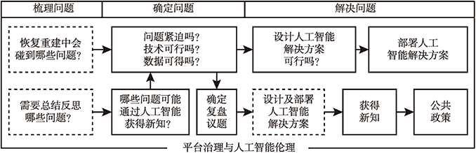

图4 善后学习中 AI 赋能的内在机制与流程
图片来源：作者自制。

## 七 中外抗疫 AI 用法对比
中美在整体、阶段、环节及应用特征上存在差异。

### （一）整体态势
案例数量上，采集期内2020年4月30日前国内案例多于以英文为主的国外案例，之后国外反超，与主战场转移相关。规模上，中外科技企业均积极参与，中国头部企业多提供整套解决方案，覆盖多个场景且平台优势明显；国外头部企业多聚焦单一方向。企业特征上，国内以大中型企业为主，国外以中小型企业与初创为主，且分布更广。创新扩散呈现反向学习，部分国内案例来自反向收集。

### （二）阶段与环节侧重
在阶段上，国外在事前风险管理与善后准备上更突出，国内未见此类AI应用，但国内在应急处置阶段案例密度更高。在环节上，国内更偏向应急处置中的疫情防控管制，国外更偏向医疗救治，尤其是科研攻关助力药物筛选与疫苗研发。应急响应速度上，中外大型企业反应均敏捷，但国外初创企业更活跃，能从创意快速推向产品与推广。

### （三）风险认知差异
国外更强调关口前移与风险意识。面对信息零散，国外较有针对性地用数据挖掘收集潜在风险信号：基于计算机视觉监测图像中的公共卫生风险要素；基于语音识别与自然语言处理跨语言翻译与分析；基于数据处理预测风险；基于内容生成快速形成预警报告。国外也更早为善后积累素材，更多投向基础研究与科学攻关。

### （四）创新形式
国外产品形态更活泼多样。Snapchat依托地理位置、出行与手机使用行为判断居家隔离状态并推出“宅家挑战赛”，用户可在排行榜分享与预防贴纸，Snapchat’s Zenly Launches Shelter in Place Leaderboard，2020。初创公司Immutouch在可穿戴手环植入加速度传感器，抬手触脸时震动提醒，Immutouch Wristband Buzzes to Stop you Touching Your Face，2020。初创参与度高带来更多创意场景。

### （五）伦理警示
国内外均需警惕AI滥用与隐私侵害。世界经济论坛2020年3月声明敦促企业在加快防疫的同时加强AI监管，Coronavirus is Forcing a Trade-off between Privacy and Public Health，2020。流调、隔离监督、趋势分析与人脸识别涉及行为、位置、生理数据，若缺乏安全环境与伦理框架，将严重侵害隐私。隐私保护与健康均为公共利益，需平衡防控效率与数据使用。相较国内，国外更注重隐私保护，导致其应急处置阶段AI案例相对较少。全球都应关注新兴科技带来的社会风险。

## 八 结论与建议
将AI嵌入危机管理全周期并绘制全球抗疫图谱可见，AI能显著提升突发公共卫生事件管理效率，但需警惕作用夸大与伦理风险。

### （一）构建AI大数据支撑的公共卫生风险监测预警体系，作为传染病网络直报的补充
研究显示，我国风险研判与预警是短板，应从事件应对转向风险防范。网络直报难以在初期即时发现危机，独立于人工意志的自动监测平台可提供参考。关键在于深入研究风险传导机制，挖掘数据与潜在风险的因果相关关系，识别可机器追踪的风险要素。

### （二）总结AI抗疫经验，筛选有效产品与方案，为全球危机提供技术援助
疫情证明人类命运共同体属性。我国AI防控应用与国外旗鼓相当，做法可作为借鉴。应梳理总结本土应用，筛选可行方案，在对外援助时除人财物外同步提供技术援助，按当地文化与伦理原则适配投放。

### （三）发挥市场机制，引入多元主体，探索科技应用下的平台治理模式
私营部门贡献了大量创新，但国内初创在应急初期的响应不足。应利用市场机制导向科技向善，采购优质企业服务，培育初创生态，引入平台企业、行业协会、公益组织与社区共治，提升社会危机反应能力与效率。

### （四）加强干部培训，提升党政干部运用科技防控能力
落实《全民科学素质行动计划纲要》有关领导干部科学素质要求，在公务员培训中增设应急管理与新兴科技内容，涵盖AI原理、伦理、赋能与反赋能机制及典型案例，使干部既能用科技管理危机，也能治理科技带来的社会风险。

### （五）正视AI能力边界，筑牢伦理与治理防线
尽管人工智能在技术层面取得显著进展，其实际效能依然受限，目前仍处于弱人工智能阶段。能否落地应用，不能只看算法突破，还需结合数据质量、任务复杂度等多重条件综合判断。在积极释放人工智能正面价值的同时，应高度警惕其自身可能引发的社会风险与伦理困境，建立既灵活又讲原则的技术治理机制。治理要以“和谐友好、公平公正、包容共享、尊重隐私、安全可控、共担责任、开放协作、敏捷治理”（国家新一代人工智能治理专业委员会，2019）的原则为遵循，强化伦理审查力度，推动数据立法完善。

新冠疫情防控既是一次对我国治理体系和治理能力的严峻检验，也为完善体系、提升能力提供了重要窗口。以疫情防控为切入点，梳理人工智能在突发公共卫生事件管理中的赋能作用与实现路径，明晰其技术边界与应用能力，盘点国内抗疫中的实践全貌，借鉴国外经验与启示，有助于化危为机，增强用科技手段应对公共卫生危机的意识与能力，推进国家治理体系和治理能力现代化。

## AI战疫观照：技术赋能治理与经济重启
梁正[^(\[1\])](#chapter011.html#m1)

**摘要：**在全国上下合力抗击新冠疫情的过程中，人工智能深度参与公共治理创新，为政府精准施策提供支撑，推动新业态成长，服务企业复工复产，有效提升了治理效能与企业创新活力。未来在疫情防控与经济社会恢复中，应持续探索多元主体协同治理模式，把握新场景催生的发展机会，助力企业渡过难关并完成产业转型升级。

**关键词：**人工智能 疫情防控 赋能 公共治理 复工复产

### 一 疫情背景下的技术需求
与2003年前后非典相比，本次新冠肺炎呈现出多重特殊性。潜伏期可达1至14天；隐匿性增强，出现初筛阴性后转阳及无症状感染案例；叠加春节大规模返乡返工，人流流动加剧传播范围与速度。病毒特性使溯源与隔离难度陡增，基层排查工作量剧增，科学认知不足与突发性也放大了决策压力，亟需新兴技术介入。

### 二 AI助力治理升级，支撑精准决策
在排查与管控环节，早期“一支笔、一张纸”的入户模式让基层不堪重负。国内大型互联网与AI企业迅速响应，三大运营商在用户授权前提下通过数据共享提供近期停留地查询，为出行核验提供依据；铁路、民航上线同乘人员查询服务；杭州、郑州、成都、广州等地借助大数据完成疑似病例轨迹回溯与高风险人群预警；旷视科技在机场、车站等人流密集场所部署AI测温系统，辅助快速筛查异常体温。上述创新在过去难以实现。

在信息披露与公开方面，AI检测终端、微信小程序及政务App普及提升了基层报送效率。杭州市社工将社区当日疫情信息直报街道钉钉群，社区日报合并为一张表格后同步至指挥部与数据资源局，实现“一表通”、多表合一，减少重复汇总。权威信息发布更实时、覆盖更广，人民网“全国地市新型冠状病毒感染肺炎实时动态”便于公众自查；浙江省“新型肺炎防控公共服务管理平台”24小时内上线至支付宝与浙里办App，提供同行查询与在线问诊。互联网成为科普、案例传播与辟谣的主渠道，间接遏制谣言蔓延。

在物资保障与供应链协同方面，网络化协作显著提升供需匹配效率。湖北等地医疗物资紧缺时，多家企业与社会组织自发驰援。支付宝推出防疫物资信息平台并以区块链实现全程可溯源；比亚迪、波司登等迅速调线生产医疗物资，提升产能；京东“AI应急管理公共服务平台”整合零售、物流、金融资源，搭建政府、医疗机构与供应商对接通道；淘宝、天猫对平台医疗物资商家进行补贴并倡导不涨价；猎豹、智行者、百度等投入AI机器人执行配送、消杀、送餐等重复性工作，降低人员接触。

“疫情就是命令，防控就是责任”。疫情按下生产生活暂停键的同时，也为人工智能规模化应用创造了新场景。非典后电子商务迎来元年，本轮疫情下数字政府与线上服务加速发展。AI赋能公共服务正形成以数据流通为核心的创新范式与“政府、企业、公众”共创机制，通过技术服务数据生产、共享与开放，提升公共服务效率。跨部门、跨区域、跨行业的数据联动为政府管理提供决策支撑，有望重塑基层服务体系，为数字政府发展与治理现代化提供启示。

### 三 AI驱动产业新生，助推复工复产

# 危局中的治理智慧：收放之间如何取舍

习近平总书记在杭州调研时指出，治理能力和治理水平的突出表现是收放自如、进退裕如。通俗而言就是疫情来临时能够迅速收紧管控，形势向好时又能有序放开，在复工复产与疫情防控之间寻找平衡点，并探索城市管理的新路径。当时全球疫情走势不明、经济悲观情绪蔓延，国内坚持外防输入、内防扩散常态化，控制疫情与恢复生产生活被列为两大迫切任务。人工智能作为通用型技术，在与各行业的深度融合中明显提升了运行效率，也催生出新的应用场景和增长点。与此同时，疫情对企业数字化转型的诉求明显上升，其影响贯穿当下并延续到后疫情阶段。

在具体应用层面，远程诊疗、网络教学、直播带货等领域扩张迅速，相关技术迭代加快。医疗方面，多地政府与互联网巨头相继上线免费在线义诊，全国医生通过线上方式为包含湖北在内的居民提供咨询。以阿里健康在线义诊为例，平均每小时接近3000人次发起问诊。教育方面，疫情导致中小学推迟开学，信息技术企业提供免费线上课程并搭建网络课堂，方便学生居家学习。在常态化防控背景下，企业还为学校和教师提供远程教学工具及课后辅导服务，助力实现停课不停教。消费娱乐方面，线上产业本就保持强劲，宅经济已有基础，疫情期间居家消费渗透率进一步提升，对冲击起到缓冲作用，游戏、在线视频、直播、电商、网络教育等板块表现突出。

日常生活服务层面，传统商超餐饮正加速转向线上生鲜配送、外卖、无接触快递。新冠病毒高传染性叠加春节人口大流动，全国出现史无前例的封城、封村乃至隔离措施，春节期间民众基本居家。隔离导致物资采购困难、社交生活受限。在此背景下，外卖、生鲜电商逆势上涨，借助大数据、物联网、人工智能精准把握需求、协调运输仓储，配合成熟供应链管理提升企业竞争力与行业整体效率，有望借此迎来新一轮发展契机。

企业数字化转型方面，疫情初期全国绝大多数机构无法按时复工，仅线上业务维持，线上办公需求爆发式增长。疫情的严峻性促使大量传统企业更积极依托电子商务平台开展采购销售，并广泛使用信息化工具提升运营效率。疫情推动了产业电商平台与云服务市场的发展，国内云办公从推广期迅速进入实用期，规模急速扩张的同时对承载能力提出更高要求。同时全部业务线上化，要求云办公厂商提供覆盖全部场景的在线协同方案和业务集成方案。总体来看行业增速将大幅提升，服务能力、业务集成能力与数据安全性将成为未来竞争关键。

企业复工复产方面，智能技术与大数据助力精准复工。在国务院办公厅电子政务办指导下，杭州健康码经验推广至全国，并配套钉钉员工健康打卡功能。阿里巴巴在全国推广的健康码加企业复工复产系统，将自有复工系统接入政府建设的复产复工平台，如杭州企业复工申报平台、上海企业复工健康云平台等，企业可授权调取员工健康码信息后通过政府在线平台提交复工申请。政府可掌握区域内返工复工人员健康状况与返岗需求，并以企业整体健康状况为依据决定批复。

同时，生产企业对接政府复工复产平台可实时获取疫情信息，优化员工健康、返岗、排班等管理；企业可通过政府平台与疫情物资、原材料资源有效对接，降低供应链风险。通过数据聚合与分析，平台帮助地方政府掌握各区域、各领域企业复产复工情况、员工健康状况以及疫情防控落实情况，实现全局化系统推进。政策落实上，杭州上线亲清在线，实现政策在线兑付，企业无需提交任何材料，3月2日率先上线年税收50万元以上商贸企业税收和企业员工租房补贴两项功能，配套服务和功能开发迅速跟进。

### 四 AI抗疫所带来的三点认识

第一，疫情防控要求下，智能技术为公共治理与企业发展提供精细化解决方案。对比2003年非典，本次突发公共卫生事件中智能技术有效助力社区排查、流行病调查、流动人口管理，极大提升政府管理效率与效果。同时也为特定行业与企业复工复产提供精准工具包，出现互联网企业智能平台协调抗疫物资调配、健康码实现人员一码通行、电力大数据指导复工决策等场景。得益于大数据与智能技术快速发展与市场应用，各级政府对数字产业大力扶持，近年来中国数字经济蓬勃发展，为应对疫情大考提供了基础设施、技术支撑和人才积累。

第二，智能技术助力疫情防控呈现多元主体参与的新型治理模式。实践证明应对复杂突发情况，仅靠政府难以有效，需要协调企业与社会组织力量。在部分防控成效显著地区，治理水平与产业发展相互促进。养兵千日，用兵一时，应急管理中的创新需要日常创新土壤和互联网思维培育。地方政府不仅要通过新型基础设施建设提升社会治理支撑条件，还要培养基层干部的互联网思维，提升其运用科技和数据的能力，对基层政府能力建设提出更高要求。

第三，疫情期间的特殊场景和需求为智能技术应用带来新的机遇。不见面、不接触的非常态为技术应用和数据共享提供契机和试验场，线上服务迎来发展春天，打破原有利益格局和现实束缚，为数字经济带来新机遇。从企业角度看，疫情将进一步推动智能制造、无人工厂发展趋势，企业抓住机遇利用数字化转型实现产业升级是化危为机的可行路径。

**参考文献**

关婷、薛澜、赵静：《技术赋能的治理创新：基于中国环境领域的实践案例》，《中国行政管理》2019年第4期。

梁正、吴培熠：《数据治理政策的国际比较：历史、特征与启示》，《科技导报》2020年第5期。

* * *

[1] 梁正，清华大学公共管理学院教授、博士生导师，人工智能国际治理研究院副院长，中国科技政策研究中心副主任，研究方向为科技政策、创新管理、新兴技术及其治理。

# 数字创新生态：市场价值与公益价值如何协同

梁正 李佳钰[^(\[1\])](#chapter012.html#m1)

**摘要：**本文以创新生态系统的价值创造与价值共创逻辑为基础，指出数字创新生态系统的运转需要行业数据与公共数据共同支撑，其演进需要市场价值与公益价值共同引领。力争上游的发展与行稳致远的治理需要协同推进。

**关键词：**市场价值 公益价值 数字创新 创新生态系统

### 一 引言

数字创新是指在创新过程中对信息采集、计算、沟通和连接技术进行组合应用，引致创新生态系统行为逻辑发生变化。数字创新加速了创新要素的关联重组，重塑了创新主体间的价值共创模式，引发了关于数字创新生态系统发展与治理的思考。倡导数字创新的市场价值意在促进创新政策与产业发展的有效结合，更可持续地推动数字创新生态系统力争上游；倡导数字创新的公益价值意在促进创新政策与公共治理的有效结合，更富成效地推动生态系统行稳致远。准确把握数字创新生态系统的价值导向，有助于指导行业数据与公共数据要素价值创造的创新实践，也将推动产业与社会发展的深度融合，对构建与治理具有重要意义。

### 二 行业数据和公共数据支撑创新生态系统的运行

在数字经济时代，工业经济时代的劳动者转变为知识创造者，传统能量转换工具升级为智能工具，数据成为除能源、资源、资本之外的全新生产要素。创新生态系统主张多元主体共同参与价值共创，数字创新生态系统一方面在行业数据基础上通过价值主张匹配多边参与者实现市场价值创造；另一方面在公共数据基础上通过合作传递网络、有效责任机制和评估体系实现公益价值创造。可以认为，行业数据和公共数据的形成为数字平台管理服务提供支撑，在企业互动和公民参与驱动下为数字创新生态系统运行提供动力，进而面向市场和社会形成市场价值和公益价值，如图1所示。

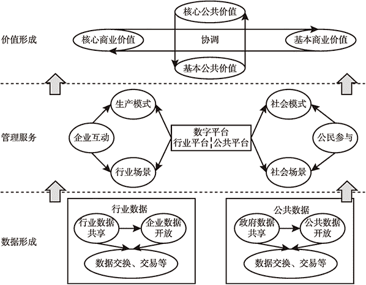

图1 面向价值创造的数字创新生态系统运行逻辑

图片来源：作者自制。

以数字平台为核心的管理服务能够为企业互动和公民参与提供有效激励和监督保障，相关数字创新主体可持续参与产业与社会发展。政府主导的公共平台管理服务有利于推进职能创新和流程再造，其基本公益价值表现为自下而上的公益价值创造模式，核心公益价值表现为自上而下的公益价值创造模式，即公众偏好和经营偏好通过社会系统进入数字创新领域后分别形成的公益价值。而企业主导的行业平台管理服务能够释放算力、算法和行业数据的活力，其基本市场价值表现为逐步聚焦的市场价值创造模式，核心市场价值表现为逐步扩张的市场价值创造模式，即普通企业和龙头企业通过产业创新系统进入数字创新领域后分别形成的市场价值。对于数字创新生态系统而言，应统筹协调基本市场价值、基本公益价值、核心市场价值、核心公益价值，从而创造数字创新生态系统最大的系统价值。

### 三 市场价值和公益价值共同引领创新生态系统的演化

尽管数字创新的市场价值和公益价值具有诸多共同性并相互依赖，但在生态系统中更多作为异质性存在发挥作用。为最大限度发掘两者，不能仅限于对已形成行业数据和公共数据的治理，还应扩展到数据+算力+算法的数字生产者体系中。

数字创新生态系统的演化离不开组织自身乃至所在系统的数字生产者体系，数字生产者体系对数据的形成具有使能作用。首先，数字生产者体系能够使行业数据和公共数据在不断试验和实施中快速形成、修改和重构，促进数字创新实施；数字生产者体系为生态系统运行提供创新模式快速迭代契机，但这种更具效率和动态性的模式也使得数字创新往往难以控制和预测。

其次，数字生产者体系中的行业数据和公共数据都应着眼并落脚于让数据处于可使用状态：一是运行主体数字化，从多边主体掌控的公共资源中识别公共数据，从价格信号机制调节的产业资源中共享行业数据，一并纳入生态系统；二是运行环境数字化，针对行业数据和公共数据在不同平台间的流动，构建便捷化数据通道，促进数据自由流动。当数字生产者体系被产业和社会很好感知和理解后，能够创造运行主体数字化和运行环境数字化的契机，形成新的产业组织或社会组织形式。

最后，数字生产者体系能够促使企业管理者和公共管理者建立新的产业循环和社会循环，进而构建新的数字治理体系改变市场价值和公益价值的导向。其中，市场价值和公益价值分别强调产业创新主体和公共管理者在价值创造中的核心作用：产业创新主体通过与行业企业、其他利益相关者协调确立市场价值并完成价值创造；公共管理者通过与社会公众、其他利益相关者协调确立公益价值并完成价值创造。前者是高度市场化的发展过程，后者是高度行政化的治理过程。这种发展与治理并存的形态，尽管在主体合作协商、利益表达等方面存在障碍，但有利于行业数据共享和政府数据整合，打破信息孤岛，突破碎片化管理，推动形成行业与社会联动的生态格局，进而推动行业数据和公共数据的价值共创。数字创新生态系统演化的本质是重新构建一套价值创造的方法论，在数字生产者体系使能作用下，通过在产业循环和社会循环中对运行框架的模拟和择优，最终实现市场价值和公益价值的共创，如图2所示。

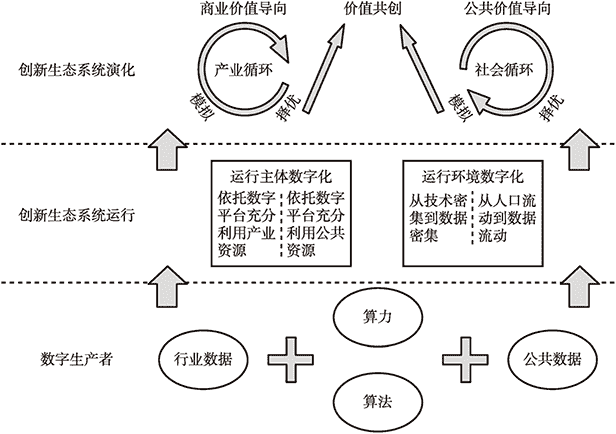

图2 面向价值共创的数字创新生态系统演化逻辑

图片来源：作者自制。

## 四 发展与治理需协同共进的经验总结与思考

总体来看，中国复杂的市场、社会和制度环境为数字创新提供了大量场景，数字创新主体通过市场价值和公益价值引导涌现全新创新模式，但政府对数字创新治理不适应的根本原因在于不放权，传统经济的事后监管模式与新经济治理模式需求不匹配，直观反映在监管速度低、信息掌握不足、人力物力缺乏三个方面。因此在中国处于全面深化改革阶段，需要以打造包容审慎的引领性治理规则为前提，从政府权力下放切入，提供行业和社会的实验情境来探索数字创新生态系统的治理机制。

首先，市场价值导向和公益价值导向需要形成良性互动与反馈。行业数据和公共数据都是在使用中创造价值，但我国无论行业原始数据还是公共数据，都存在质量差、可利用性低的问题，尤其是行业数据集建设成本高、专业性强，部分行业数据集建设各自为政、利用率不高。大量数据资源集中在政府部门，基础性数据向社会开放规模小，数据要素流动激励机制不足，数据共享缺乏安全保障，数据所属主体缺乏共享动力和意愿。

其次，在行业数据共享、政府数据开放等制度创新背景下，很有必要从数字创新生态系统视角探索发展与治理关系。市场价值和公益价值的平衡为数字创新生态系统治理研究提供可行思路。政府部门需以公益价值为导向推动政务数据整合，盘活公共数据资产，定期发布脱敏行业数据集；能源、交通、金融等领域央企、国企需以市场价值为导向制定数据积累指标，在不影响商业机密基础上定期收集发布，建立行业共享数据集。在此基础上搭建一体化开放共享平台，数据需求单位按权限分级访问，依条件申请获取数据资源，在充分调动行业和社会数据共享积极性的同时实现价值共创。

## 参考文献

陈衍泰、孟媛媛、张露嘉等：《产业创新生态系统的价值创造和获取机制分析——基于中国电动汽车的跨案例分析》，《科研管理》2015年S1期。

刘洋、董久钰、魏江：《数字创新管理：理论框架与未来研究》，《管理世界》2020年第7期。

张会平：《面向公共价值创造的城市公共数据治理创新》，《行政论坛》2020年第1期。

* * *

[1] 梁正，清华大学公共管理学院教授、博士生导师，人工智能国际治理研究院副院长，中国科技政策研究中心副主任，研究方向为科技政策、创新管理、新兴技术及其治理；李佳钰，清华大学公共管理学院博士后研究员，研究方向为数字经济、创新生态系统。

# 城市大脑：运行机制、效能提升与优化方向

梁正[^(\[1\])](#chapter013.html#m1)

**摘要：**城市大脑建设源于浙江杭州数字治堵实践，随后拓展至数字治城、数字治疫实践并实现全国多地复制推广。城市大脑作为助推城市治理体系和治理能力现代化的数字系统与现代城市基础设施，是面向当下和未来的以人民为中心的福祉建设和创新型实践。其运作机制可概括为，在公共价值导向下以数字基础设施建设为底座的数据治理和应用推进双轮驱动。城市大脑促使政府治理发生转变，为科学、民主的行政决策提供支撑，助推精准、高效的行政执行落地，实现均等、公正的行政权力配置，完善以人民为中心的公共服务集成。因此基于当前实践经验，为进一步优化城市大脑建设，从微观看，数据治理过程需强调效率性与规范化的协调，应用场景推进需实现技术理性与公共价值的平衡，数字驾驶舱设计需做到实战性与个性化的兼顾；从宏观看，城市大脑建设需做好一体化和全局性统筹。

**关键词：**公共价值 城市大脑 数据治理 应用推进 治理效能

## 一 引言

城市大脑：从治堵试点到城市新底座

很多人把城市大脑理解成一座会思考的超级系统。Feng L 在 2018 年给出的定义是，城市建设正在经历 21 世纪互联网架构的类脑化演进，其本质是一个把机器云端智能与人群集体智慧融合在一起的复杂巨系统。中国的起步点在 2016 年杭州的“数字治堵”，此后迅速扩展到治城、治疫等全域治理场景，核心目标是让便民服务更精准、城市运行更精细。阿里云创始人、杭州城智总架构师王坚曾说，这就是数据资源时代的城市数字地基。2020 年施行的《杭州城市大脑赋能城市治理促进条例》给出了制度层面的表述：由中枢、系统平台、数字驾驶舱和应用场景构成，以数据、算力、算法为基础底座，借助大数据、云端运算、分布式账本等技术，全面推动治理体系和治理能力现代化的数字系统。

2020 年 3 月 31 日，习近平总书记在杭州城智运营指挥中心考察时指出，要用海量数据、云端运算、区块链、智能算法等前沿手段创新城市管理的手段、模式和理念，从数字化走向智能化再到智慧化，让城市更聪明更智慧，这是推进治理体系和治理能力现代化的必由之路，前景广阔。此后北京海淀、江苏苏州、安徽合肥、福建福州等地相继跟进，用新技术赋能城市治理现代化。

学界对这一议题的梳理大致可分为三类。宏观层聚焦建设实践与社会智能化治理的政策进程，比如用米特—霍恩模型剖析执行梗阻、探讨智能化治理风险。中观层拆解运行机制及对政府作用的影响，如对上海某区、杭州的运转机制、数字界面设计原理的剖析。微观层则盯住某类技术嵌入的具体运行方式，比如智能算法嵌入行政治理的实践、机理与风险架构。

党的十九届四中全会强调，行政机关要为人民服务、对人民负责、受人民监督，创新方式提高效能，建设人民满意的服务型政府。城市治理现代化是国家治理现代化的重要板块，城智通过把信息技术与治理形态结合起来提升效能、创造公共价值，是面向未来、以人民为本的福祉型创新。现阶段研究较少从公共价值切口讨论运行机制，本文从中观机理出发，用公共价值理论审视中国城智的实践逻辑及其带来的治理变迁，探索技术与治理的融合路径。

二 公共价值视角下的城智解构框架

公共价值这一概念由哈佛大学教授马克·莫尔在 1995 年《创造公共价值：政府的战略管理》一书中系统提出，他认为政府管理的终极指向是为社会创造公共价值。此后该议题成为研究热点，有学者指出，传统官僚制与新公共管理难以充分承载公共服务的社会价值，公共价值强调公民本位，有助于修复因过度追求效率和顾客导向造成的信任与合法性危机。公共价值理论也呈现网络治理特征，能解释政策执行中的新型网络形态与更智能的公共服务。

在中国语境里，有学者提出公共价值的重构是从单一经济增长转向以人民为中心，注重公共性、有效性与高质量发展的复合价值体系。进入新时代，社会主要矛盾已转变为人民对美好生活的向往与发展不平衡不充分之间的矛盾。习近平总书记提出以人民为中心的发展思想，是公共价值理论本土化最新的诠释。城智建设正是国家治理现代化框架下兼具公共性与有效性的数字化转型实践。结合杭州城智的定义，本文在此视角下搭建分析框架。

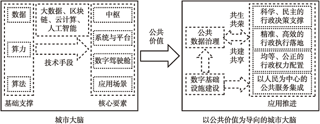

图 1 基于公共价值理论的城市大脑分析框架

图片来源：作者自制。

三 双轮驱动：数据治理与应用并进的运行逻辑

各地以杭州为样板推进城智，表述框架不完全一致，运作逻辑却高度趋同。杭州体系由中枢、系统平台、数字驾驶舱、应用场景四要素构成，彼此联动形成运转机制。中枢负责打通各平台的业务协同、数据协同与政企协同，提升整体运行协同度；系统平台承接中枢实现线上线下数据的双向融合；数字驾驶舱是经中枢协同后的智能化、可视化、精细化界面；应用场景依托中枢，通过线上业务与数据计算简化优化流程。

海淀采取“1+1+2+N”架构：一张城市感知神经网，一个智能云平台，两个中心即大数据中心与 AI 计算中心，N 个覆盖交通、生态、公共安全等领域的创新场景。2021 年启用的海淀城智智能运营指挥中心，其“智慧屏”领导驾驶舱能够一眼览尽海淀全貌。合肥以“2+3+4+N+1+1”思路建设两级联动市县大脑，夯实网络、政务云、物联网基础，完善数据中台、智慧中台、业务中台、时空中台，深化 N 类场景并集成统一管理入口。苏州则提出“1+2+N”运行机制。

横向对比的共性是，都强调数据全生命周期管理和数据驱动的应用推进。综合来看，核心机制可以概括为：在公共价值引领下，以数字基础设施为底座的数据治理与场景推进双轮驱动。如图 2 所示，二者构成城智运行的主线。

数据治理涵盖盘点、汇聚、编目、清洗、建模、开发、开放、共享、应用等全流程，并包括标准规范建设与安全保障，目标是实现数据完整、准确、及时、可用的安全可用。场景推进一方面通过数字驾驶舱等界面辅助行政决策，提升决断能力与执行效率；另一方面打造跨领域数字创新场景，实现数据赋能治理与公共服务。

两者互为因果并同受公共价值引领、数字基础设施支撑。政务数据多源于传统业务系统，治理以业务需求为牵引，服务于场景改造与新建；场景推进依赖数据支撑，其问题发现与需求回溯又反哺数据治理，倒逼标准体系优化、数据质量提升，最终体现数据取之于民、用之于民的理念，是兼具人民性、公共性、有效性的创新实践。

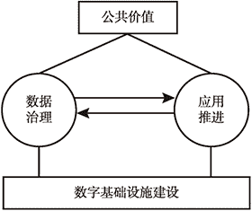

图 2 城市大脑的运作机制模型

图片来源：作者自制。

四 城智带来的四项治理换挡

支撑科学民主的决策。海量精准信息是决策科学化、民主化的前提。城智汇聚大量数据并通过海量数据、智能算法、云端运算进行深度分析，领导驾驶舱等工具能实时发现、识别、剖析问题，大幅提升反应速度与预测准确度，为决策提供智能化、科学化、民主化支撑。传统决策链条冗长，缺乏对公众即时信息的海量采集与分析，容易出现缺量、失真、失效，决策易受路径依赖影响。城智改变了信息量级与流动方式，减少传递损耗，自动预警功能让决策更可控、更贴合实际。

推动精准高效的执行。执行的成败取决于目标明确性与手段有效性。城智可快速定位执行对象，缩短反应链条，改变过去靠巡逻抽检的低效方式；实现无缝沟通协调，优化资源配置，强化多元联动并压实责任，避免职责交叉与推诿扯皮。海淀渣土车治理智慧监管平台调动各委办局力量实现源头与过程管控；杭州拱墅区“城市眼·云共治”借助 AI 视频识别迅速定位占道经营并匹配执法人员，打通基层治理最后一公里。

促进权力均等公正配置。行政权力发展的方向是扁平、均等、共享、透明、法治、合意。传统模式信息公开不足、监督缺位，易生寻租。城智落地后，政务数据公开透明有助于规范权力运行，压缩寻租空间，确保权力运行有据可查。杭州萧山区“清廉萧山”聚焦村务管理，横向整合村级工程、财务、补助等事项数据，纵向打通区镇村三级数据，6 亿多条数据实现小微权力一屏可见。通过多源数据比对监测工程异常，第一时间发现隐性风险，推动村社权力阳光运行。

完善以人民为中心的公共服务集成。十九届四中全会要求推进基本公共服务均等化、可及性。城智场景几乎覆盖幼有所育、学有所教、劳有所得、病有所医、老有所养、住有所居、弱有所扶等领域。杭州推出便捷停车、舒心就医、欢快旅游等 48 个场景，体现以人民为中心的设计。相较传统事项驱动、民众被动求办事的供给模式，城智倒逼职能优化，简化流程、扩大覆盖，实现从管理到服务的转变，提升获得感、幸福感、安全感。杭州“亲清在线”平台主动推送惠企政策，实现在线许可、政策兑付与补贴快发，在疫情期间助力企业复工复产。

五 优化路径：从数据到应用的四项抓手

数据治理：效率与规范要同步。数据治理是建设关键。互联网时代需用智能化手段监测预警数据质量，保证完整性、真实性、透明度，建立贯通生产、汇聚、共享、应用的数据资产交易与流通规则，借助区块链确权促进政务与行业数据开放共享。同时要长期推进规范建设与安全保障，对生产、采集、使用、流转、保密进行严格约束，防止厂商以商业价值滥用公共数据，统一标注规范、存储安全标准、申请使用方法，实现可持续发展。

场景推进：技术理性与公共价值需平衡。海量数据、智能算法、区块链创新了治理方式，但技术刚性与多元价值存在张力。技术应服务于提升群众幸福感，而非目的替代手段。提供公共服务时需兼顾人民实际需求，营造温情与智慧统一的氛围。例如治理占道经营、流动摊贩时应避免暴力执法，考虑居民便利、弱势群体生计、季节性务工需求，可采用柔性疏导。同时要兼顾隐私保护与数据鸿沟问题。

数字驾驶舱：实战能力与个性体验兼顾。数字驾驶舱是城智的终端呈现与核心能力体现。当前多停留于数据看板，缺乏深度辅助治理的实战性。未来需横向拓展覆盖领域，落实“五位一体”布局；纵向提升智能化水平，增强现象反应、数据分析与预测预警能力，辅助科学决策。可引入政治、经济、社会、文化等多维因素纳入方案制定，参考舆情动态与领导决策偏好提供备选。同时注重用户体验，实现个性化。可增设“猜你喜欢”“为你推荐”“智能检索”等功能，支持自主定制板块，并探索民众版、企业版驾驶舱拓宽受众面。

建设统筹：一体化全局协同要强化。城智建设需强化一体化和全局统筹，避免碎片化与重复建设，实现跨层级、跨部门、跨领域协同，推动数据、算力、算法、应用整体联动，形成协同高效的城市智能治理体系。

从全局视角审视，城市大脑的创新与落地需要兼顾整体协同与顶层统筹。2021年2月，浙江省委提出全面推进数字化变革，加快打造统一智能化公共数据平台，这一做法体现了集约协作、持续发展的建设思路，为各地提供了可参照的经验与整合模式。城市大脑的实战投入成本较高，建设推广时必须审慎权衡行政资源的利用效率，在可控投入的前提下追求公共价值最大化。省域层面建设时应实现横向贯通、纵向到底，强化跨层级跨领域跨职能主体的联动配合，同时提升一线公务员的数字认知能力，削弱厂商技术绑定的风险。更关键的是，在鼓励地方积极探索的同时，国家层面亟需尽快完善顶层设计，牵头制定相对统一的互联互通规范，尤其数据开放、共享与流通的标准体系建设刻不容缓，若不能及时达成共识，地方分散的创新实践很可能重塑技术壁垒与数据壁垒，进而拖累城市大脑应用体系的整体发展。

# 数字双赋激活韧性城市基层能力
梁正

### 摘要：
城市脆弱性持续攀升，韧性城市已成为治理现代化进程中的核心议题。基层韧性治理是韧性城市落地的关键末端，数字手段是撬动该末端的重要抓手。文章以“技术双赋—韧力释放”为分析框架，引入中国智慧社区的实践案例，梳理数字技术推动基层治理的运作逻辑。研究发现，在技术赋能与技术赋权形成双轮驱动的理想状态下，基层组织形态会发生迭代，具备韧性治理潜能的新型组织将逐步成型。因此，借助数字工具助力基层韧性治理，需充分发挥其机制优势，探索适配数字环境的权力配置路径，推动组织体系向韧性目标转型。

### 关键词：
韧性城市 韧性治理 数字技术 基层治理 智慧社区

## 一 引言
城市是现代社会的核心空间载体、经济枢纽与社会交往场域。在治理现代化进程中，城市作为高复杂巨系统，呈现集聚、规模化、流动性、异质性与多元性等特征，这些特性放大了城市脆弱性，治理难度不断上升，建设韧性城市势在必行。党的十九届五中全会指出要发挥制度优势、提升治理效能、增强发展韧性，并提出建设海绵城市与韧性城市。韧性概念源于生态学，1973年霍林在《生态系统韧性与稳定性》中提出系统受外部扰动后恢复稳态的能力。此后该理念在应急管理领域广泛应用，强调稳定性、可靠性和抗干扰性。韧性城市概念由此形成，2005年联合国《兵库行动框架》提出后受到国内外重视。

在国家治理现代化背景下，韧性已超越应急管理，强调系统受干扰后依靠硬件与软件协同，通过学习与再组织吸收冲击、降低损失，实现恢复或跃迁，其本质在于鲁棒性、自组织性与创新性。韧性与多元治理机制耦合后形成韧性治理，其重点在于维持系统功能而非形态，确保城市在压力冲击下仍能正常运转并提供服务。当前我国治理重心下沉，基层治理现代化是国家治理体系与能力现代化的重要组成部分，基层韧性治理成为韧性城市建设的末端环节。大数据、区块链、云计算、人工智能等数字技术正深度嵌入公共治理，成为现代化不可或缺的手段。中央印发的《“十四五”国家信息化规划》明确，到2023年基层智慧治理的规划政策与标准规范更为完善、数据整合成效明显；到2025年精细化感知、精准化风险识别、网络化协同行动的基层智慧治理体系基本建成。智慧社区、数字乡村等顶层设计与实践表明，数字技术深化应用是基层韧性治理的重要抓手。本文以基层韧性治理为轴线，以数字技术为路径，探讨其如何催生治理能力，核心问题是数字技术如何推动基层韧性治理及如何更好释放其优势。基于此构建“技术双赋—韧力释放”分析框架，并以智慧社区案例进行阐释。

## 二 文献综述与理论分析框架
### （一）韧性与韧性治理
韧性源自拉丁语 resillo，意为回弹。学界对其界定主要有能力恢复说、扰动说、系统说、能力提升说等。韧性理论经历了工程韧性、生态韧性、社会生态韧性的演进。近年学界围绕韧性内涵展开大量研究，多聚焦应急或风险治理。宏观研究关注概念特征、评价指标与实践探索；中观研究基于实证分析韧性理念在城市治理中的嵌入；微观研究聚焦具体机制，如危机学习机制，或特定领域如卫生安全韧性。少数学者将韧性拓展至更广阔治理领域，如治理体系韧性再解释、试验民主与韧性治理关系等。但将韧性治理拓展并深挖生成机理的研究仍薄弱。本文把韧性治理置于更宽领域，落脚基层治理，从组织与治理逻辑出发探究数字化背景下基层治理韧性的成因。

### （二）数字技术助力韧性治理
随着数字技术纵深发展，政府数字化转型加速，其实际效用成为热点。数字政府领域已有大量理论与实证研究，细分领域探讨也在增多。关于数字技术助力韧性治理，研究多在应对困境时提及可行性。部分学者关注韧性与智慧关系，如基层数字化创新在赋能同时可能削弱固有韧性，进而提出转型策略；也有学者通过智慧城市评价指标检验其对城市韧性的提升。深入治理环节探究逻辑或机制的研究较少，如已有研究剖析技术赋能与技术赋权在基层韧性治理中的作用，或论证智慧社区对灾害韧性的促进机制。总体看，韧性治理视角下数字技术影响研究稀缺，数字治理视角关注韧性实践的研究亦少。本文将二者结合，探究数字技术助力基层韧性治理的路径。

### （三）技术双赋—韧力释放：数字技术助力基层韧性治理的解释框架
技术赋能与技术赋权是数字政府转型的两大机制。技术赋能强调技术对公共部门的赋能作用，技术赋权强调技术提升社会主体参与协同能力的价值，二者相互促进。能与权是组织结构核心要素，其变化会影响组织特征。数字手段有效实现技术赋能，进而助推技术赋权，最终推动组织变革。已有研究论证数字技术对韧性治理的显著正向作用。基于此，本文提出解释框架：技术双赋—韧力释放。在技术赋权与技术赋能双轮驱动的理想状态下，能够释放韧性治理能力的韧性基层组织逐步形成。结合智慧社区实践，可深入探究数字技术助力基层韧性治理的逻辑。

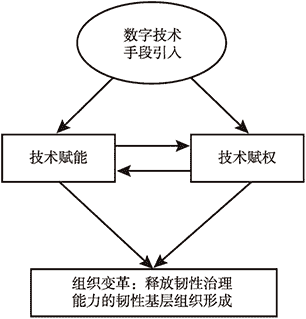

图 1 技术双赋—韧力释放：数字技术助力基层韧性治理的解释框架
图片来源：作者自制。

## 三 数字技术助力基层韧性治理的逻辑进路：以中国智慧社区建设为例
### （一）中国智慧社区：面向未来的智慧社区
《中共中央 国务院关于加强基层治理体系和治理能力现代化建设的意见》2021年4月28日强调加强基层智慧治理能力建设，要求市县级政府将乡镇街道、村社区纳入信息化规划，统筹推进智慧城市、智慧社区基础设施、平台和终端建设，强化系统集成、数据融合和网络安全。2022年5月10日民政部等9部门印发《关于深入推进智慧社区建设的意见》，指出智慧社区是应用大数据、云计算、人工智能等手段整合社区服务资源，形成信息化、智能化管理与服务的新形态。智慧社区是智慧城市的基础单元，建设需人、物、技术、组织协同联动。学界提炼其特征为：重视通信信息技术、推进要素资源整合、坚持以人为本鼓励公众参与、促进系统迭代升级、实现可持续发展。我国智慧社区建设基础、规模和成效可观。2012年3月北京市印发《智慧北京行动纲要》，海淀区率先启动智慧社区建设；随技术迭代标准提升，海淀区利用5G、人工智能、大数据整合资源，建立服务平台，实现公共服务智能化。2012年9月广州市启动天河、越秀、海珠、番禺试点；2013年11月上海市印发《上海市智慧社区建设指南（试行）》，提出网络化、便利化、信息化、智能化。2019年浙江省政府印发《浙江省未来社区建设试点工作方案》，以数字化改革为引领，开创未来社区先河。未来社区是智慧社区的进阶形态，更强调多元治理场景下数字手段与治理机制的耦合。总体看，我国智慧社区建设正走向未来。

### （二）智慧社区建设助力社区治理韧性的逻辑进路
#### 1. 技术赋能：“强健性”基础为社区韧性治理提供能力保障
技术赋能通过数据感知、智能分析与协同响应提升社区运行的健壮性，为韧性治理提供可依赖的能力底座。数字平台整合人流、物流、信息流，实现风险的早期识别与快速处置，增强系统在扰动下的稳定与恢复能力，从而为社区韧性治理奠定基础。

数字化如何让街区更有弹性

当智能工具进入日常治理，基层应对冲击的能力被明显放大，为构建具备弹性的治理体系提供了坚实底座。从实践观察，这一放大主要体现在四个层面。

其一，问题感知更敏捷。入口打通后，信息链路被压缩，治理方手里可用的第一手研判材料大幅增加，失真与损耗同步下降。感知力随之提升，自主预警等功能上线后，亟待处置的关键公共议题能够被迅速锁定并跟进。

其二，决策更讲道理。海量数据的聚类与剖析让拍脑袋和经验主义惯性被削弱，路径依赖的牵制减少，科学性明显增强。

其三，执行效率被拉高。智能化替代了大量重复性人工投入，整体运转提速。跨部门、跨层级、跨组织、跨领域的沟通协调成本下降，资源调度更迅速，冗余空间随之增大，应对危机与风险的能力也随之增强（梁正，2021）。

其四，全流程可追溯可调优。决策与执行环节均可对方案进行持续追踪与成效评估，并依据目标实时动态校准，运行过程因此更具韧性。以深圳南山区西丽智慧管理运营中心为例，其算法超市模块让管理者可挑选适配的数字方案，高效完成基层事务或专项治理。应急指挥场景下，技术可实现秒级自动下发核查任务，由网格员分拨到街区，达到减负效果。上海静安临汾路街道的社区大脑将网格、综治、物业、应急、保障等中心整合，接入绝大部分城市部件与全部城市事件管理数据，形成能分析、能判断、能指挥、能协调、能处置的社会治理平台。总体来看，数字工具让街区治理能力得到提升，形成了支撑弹性治理的强健根基。

2. 数字授权：权责对齐与多元共治推动弹性

赋能与授权互相牵引。能力提升后基层承接事务的意愿与实力同步增强，上级对街道、居委会的信任度提高，在可控范围内下移治理重心。基层自主处置事务，减少了层层授权的时间、协调与机会损耗，整体效能提升，精细化目标更容易实现，应对重大突发事件的响应速度和处置效果显著改善。北京的街乡吹哨，部门报到是典型经验。一线发现问题时借助平台发出哨声，上级部门须在半小时内响应。在能力提升的基础上实现授权，把执法力量下沉，破解权责错配、协同机制不完善的困境，让数字治理与弹性治理有机结合。朝阳区在此基础上推出社区吹哨、科室报到、社区吹哨、社会力量报到、支部吹哨、党员报到等创新做法。

另一面，数字工具拓宽了街区与外部的信息交互通道。智慧街区的主体不再局限于街道办和居委会，社会、市场、公众等参与主体作用愈发关键。多方共治常态化，权力结构向扁平化、均等化、共享化演进，实现了还权于民。杭州拱墅小河街道的红茶议事会已在9个社区推广。基于居民信箱、信访数据、网络舆情进行民意热点大数据分析，自动生成议题，邀请多方线上线下议事形成共治方案，回应群众诉求。杭州萧山瓜沥七彩社区则用积分制调动居民参与治理与建设。从基层管理到基层治理再到基层弹性治理，公众参与发挥关键作用。公众对政策的认同感提升，其意见被吸纳进制定与执行过程，能产生正向推动；治理过程对诉求的回应本身也是成效的体现。在数字工具下，赋能助推授权，权力运行变化又反向助推赋能，最终呈现出稳定性、自适应性、抗干扰性的治理图景，有力推动街区弹性治理。

3. 弹性组织生成：释放治理能力的韧性街区成长

在数字化赋能与授权双轮驱动下，基层组织发生变革，具备释放治理能力的韧性基层组织逐步形成。街区层面，韧性街区可理解为街道办、居委会、物业公司、业委会、公众及其他商业企业、社会组织等多元主体以实现街区弹性治理为目标共建共治共享的大型协同体。治理能力提升与权力运行机制变化，驱动科层体制、功能结构、治理机制、治理手段等系统性变革，韧性街区由此应运而生。它具备强健性、灵活性、稳定性、抗干扰性、自适应性，能够接纳外部环境的复杂多变，尤其在应对风险与例外事件时特质凸显。这些特质成为内生动力，助推街区弹性特征的稳定表达，自适应性所匹配的组织学习能力帮助街区随环境变化调整适应。弹性治理能力的持续供给最终来自组织自身，数字工具的引入只是制度性变革的契机与手段。

实践中的创新案例是杭州滨江缤纷未来街区。该街区建立多主体整体化治理机制，针对管理主体多、执法主体多、业态问题多、数据平台多、居民投诉多等痛点，整合公安、城管、交警、市监、消防等力量，由一支队伍综合管理。数字工具为多功能整合提供了条件，打破条块分割，基于多跨融合、高效协同、整体智治的数字化理念，建设街区微脑并形成整体化指令平台。缤纷未来街区的改革只是智慧街区实践的一个面向，已显现数字技术带来制度性变革的端倪。

四 结论与讨论

城市作为日益复杂的巨型系统，脆弱性攀升，弹性城市建设成为治理现代化的关键。基层弹性治理是弹性城市的最后一公里，是能否落地的具体指向。数字技术是实现基层弹性治理的有力抓手，研究其生成机理可为弹性城市尤其是基层实践提供理论指引与经验借鉴。本文构建技术双赋—韧力释放框架，基于中国智慧街区案例分析回应研究议题，贡献在于耦合弹性治理与数字治理视角，从治理环节机理层面探究数字技术助力基层弹性治理的逻辑。

总体逻辑是：数字引入助力技术赋能，进而助推技术赋权，二者在推动弹性治理中相互促进。双轮驱动下基层组织变革，能够释放治理能力的韧性基层组织逐步形成。技术赋能体现为迅速精准识别核心议题、科学化决策、行政执行效能提升以及政策执行效果的动态评估与调试，使治理过程极具韧性，形成强健性基础。技术赋权体现为权力运行转变、下放与回归、权责匹配与多主体共治，推动街区弹性治理向好发展。赋能是赋权的基石，赋权的实现反过来助推赋能。理想状态下，具备强健性、灵活性、稳定性、抗干扰性、自适应性的韧性组织形成，可持续释放治理能力。从技术赋能到技术赋权，再到韧性基层组织变革，是数字技术助力基层弹性治理的进路。

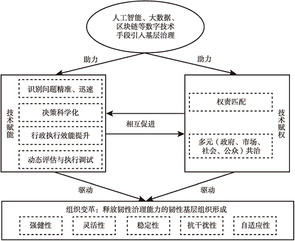

图 2 数字技术助力基层韧性治理的逻辑进路

图片来源：作者自制。

认识到内在机理后，如何更好发挥数字技术优势？提出三点建议：其一，善用数字技术特有规律，把数字化理念贯穿基层治理各阶段，为弹性治理提供硬实力支撑。其二，积极探索与数字技术相适应的权力配置方式，促进技术与机制有机融合，为弹性治理提供制度支撑。其三，大力推动建设面向弹性治理目标的组织体系，把被动应对化为主动变革，为弹性治理提供组织支撑。

数字信任：当算法开始承担信任角色

随海量数据、机器智能、万物互联等新一代信息技术进入日常生活，数字信任的概念才真正进入公众视野。起初它主要用来描述消费者、合作伙伴或员工对组织能否妥善保护数据与隐私的信心。进入数字经济后，组织边界被不断溶解，信任的投向也从具体的个人与机构，转向算法、系统、机器等非人格化的存在。初期这种变化并不显眼，技术往往被看作制度的延伸，是人类完全设计与掌控的产物。但智能技术的渗透深度与无处不在已超出常人理解与感知的极限，而区块链、深度学习等技术展现出不可篡改、结果难以完全预判等自主性特征，信任客体因此获得了近乎实在主体的地位。

### （二）信任可以被计算
信任并非玄学，它是可以被量化的。威廉姆森指出，世上并无抽象的信任，只有可信度各不相同的承诺。承诺越可信，协作的信任感越强，交易成本越低，交易发生的频次与规模也越大。信任差异是常态，可用差序结构来说明：亲属间的信任高于朋友，朋友高于熟人，熟人又高于陌生人。这类差异既可从文化、政经制度与经济发展水平等外部条件解释，也植根于微观的理性测算，比如互动频次、重复博弈次数、对收益损失的估算、对失信概率的预期等。王绍光等学者强调，预期收益相对于总体资源的脆弱度，是信任程度的理性根基。

在计算科学里，Marsh 首次把信任形式化为计算信任。其公理化框架大致包括：信任是主体指向客体的一种关系；关系独立且不对称，甲信乙不等于乙信甲；信任受场景约束，换了场景就不一定成立；信任有阈值呈现偏序特征；同一场景下信任可传递。基于此模型，系统能评估交易的可信度与预期损益，计算用户行为特征与信用分值，并在互联网、电商、人工智能等领域支撑起大规模数字化交往。

### （三）信任的担保方式
信任是在风险情境下对互惠的预期，只要损益可算，就能用担保方式来对冲风险。对传统的人际信任与制度信任而言，可算性提供了理性基础。人类学关注乡土社会的礼物交换，礼物即一份承诺未来履行的义务，“欠人情”“还礼”就是一种算计过的担保。礼物的轻重、礼金的厚薄可视为信任的抵押。现代社会运转依赖一套可算的制度信任，银行贷款的抵押品、担保人、单位证明等，违约时银行可通过处置资产、向担保人追偿或向单位求助来消化损失，政府监管与司法强制提供最终保障。

数字信任的担保方式是什么。数字信任的客体大致分两类。一类是借助数字平台发生的、指向具体个人或组织的互动，这类仍可依托现实制度追偿。另一类是具备自主性的非人格化数字智能技术。人们把损益风险托付给系统、算法、机器，现实中却找不到对应的责任主体可追索。这是文明史上新出现的现象：数字空间里真实存在行为主体，现实世界却缺乏可问责的对应者，我们尚缺乏成熟的处置经验。

## 三 信任机制与技术秩序

### （一）信任三角模型与自主技术秩序的融合
为厘清主体与关系，本文提出信任三角。如图 1（a），甲为相信方，乙为被信任方，乙出示凭证，甲是否信任取决于甲是否信任凭证发行人，且发行人信任乙并授予凭证，按可传递性，甲即信乙。三者构成第一个信任三角，发行人起中介作用。如图 1（b），再上一层若甲信任权威治理机构，而机构信任并授权发行人，则形成第二个信任三角。

这两种经典模式分别是中介信任机制与治理信任机制。前者对应市场自发秩序，中介化解陌生主体间的信息不对称并收取费用，本质是对失信的担保；后者对应权威层级秩序，政府分配发行权并赋予合法性。

市场自发与权威层级构成了人类制度演化的基本单元。然而数字智能技术把信任与否、交易与否的决策从人手中抽离，催生出第三种秩序：自主技术秩序。

图 1（c）中，甲与丙、乙与丙在技术层面相互确保信任，由此推导出甲与乙可相互信任。此处丙不必是具体的人或组织，可以是网络、技术、系统或机器。自主技术秩序嵌入信任机制后，人类无需借助宗教或迷信即可信任一切技术与物，后现代秩序由此显现。

图 1 “信任三角”及三种信任机制

图片来源：作者自制。

### （二）重塑数字信任的框架性路径
基于秩序与机制的分析，提出重塑数字信任的四条路径。

策略一：数据可信。通过加密、隐私计算等手段覆盖数据全生命周期，强化交易主体对数据的占有与控制能力，提升基础信任。

策略二：主体可信。提升组织、系统等市场主体的可信水平，从有界静态信任转向无界动态信任。中介信任机制干预少成本低，主体需以技术与制度保障组织安全与系统稳定。数字智能技术既打破边界，也提供了开放的动态安全能力。

策略三：权威可信。将权威治理与技术融合，补强权威治理的技术能力，打造权威性信用基础设施。权威信任机制以公共权力配置市场价值，有助于形成统一公平高效的信用体系。

策略四：技术可信。借助自主智能技术构建非人格化信任机制。技术中立派认为算法去人化后可实现中立，数学驱动与数据中心化可保证输出公正明确。区块链以加密与分布式共识实现无需信任单个节点的去中心化可信系统。

### （三）数字信任体系建设中的政府定位
三种信任机制往往共存于同一交易。一个完善的数字信任体系需嵌入市场、政府与技术三大秩序。政府承担顶层设计、政策规划与标准制定的宏观职能。典型设计包括欧盟《通用数据保护条例》GDPR、美国《加利福尼亚消费者隐私法案》CCPA，以及我国《数据安全法》《个人信息保护法》。在执行层面，美国设立首席数据官负责联邦机构数据治理与共享；欧盟要求成员国设专门部门并由企业任命数据保护官DPO；中国已有二十余个省级政府设立大数据管理机构。各国还在数字身份认证、电子签名、数据安全流动与互认机制等方面制定操作规范与技术标准。

## 四 重构数字信任的技术工具

### （一）基于数据的信任机制：隐私计算
隐私计算是对数据全生命周期进行保护的可计算模型与公理化体系。它不是单一技术，而是密码学、数据科学、经济学、人工智能、软硬件工程等的融合。代表性技术包括安全多方计算MPC、可信执行环境TEE、联邦学习FL，以及非对称加密、差分隐私等辅助手段。

隐私计算让数据在流转中实现可用不可见，降低明文复制与非授权使用的风险，从而显著提升系统可信度。它不改变组织边界，而是以技术增强传统制度信任。

### （二）源于数据关联和聚合的信任机制：大数据
大数据以大体量、多源、异构、非结构化、低价值密度著称，多由机器自动采集。大数据的关联聚合会创造新的价值与信息，这些信息在采集时无法预知，损益也难以预期。个体数据进入信息洪流后被反复访问、复制、计算并训练模型，事后拆分、撤回或删除的难度极高，个体实际上丧失了后悔权。

这种机制使单次算计与欺骗失去意义。例如某社交平台整合身份、社交网络、信贷消费、商旅出行、公益行动、缴费等数据形成画像模型，欺骗行为易被识别。画像模型再被用于贷款发放、社会信用评价等智能决策，使用者愈发谨慎，客观上提高了可信度。

### （三）基于主体的信任机制：零信任
零信任即从不信任，始终验证。其核心原则包括显式验证、使用最小权限访问、假设已遭入侵等，底层设计对身份、设备、应用、数据、网络、基础设施保持零信任，每一次访问均需验证。

零信任把安全焦点从有边界的组织架构转向流动无边界的数据。过去靠地理边界、部门层级、本地防火墙与访问控制确保安全。而云服务、物联网、移动计算让边界模糊，面向任意数据交互的安全设计才具备普适意义。

### （四）基于权威的信任机制：信用基础设施
智能城市与城市大脑正成为公共服务与城市运行的中枢。要实现跨部门、跨行业、跨层级、跨系统的数据互联，必须提供数字身份认证、电子签名、安全密码等信任服务。这需要统一、高可靠的信用基础设施支撑。信用基础设施兼具公共物品属性，既依赖高可靠性技术，更依赖政府权威确认标准、监管实施并提供法律救济。

### （五）基于自主技术的信任机制：区块链
区块链基于时间戳链式区块、分布式节点共识、经济激励与智能合约，具有去中心化、无须先验信任、开放自治、难篡改、安全容错等特性，比特币是最典型的应用。

它构建了全新的去中心化信任机制。传统信任依赖政府、银行、医院等中心化数据控制者作为履约方与中介，而区块链中各节点通过共识算法协同记账，无中心、无单一问责对象。这种特征在一定程度上挑战监管权威，欧盟数据保护委员会也长期未出台合规指引。

## 五 结论与启示
智能时代正经历一场深刻的信任危机，信任作为经济与社会交往的基石变得脆弱。数字智能技术既是危机的诱因，也提供了重构秩序的可能。传统人际信任与制度信任必须与数字信任结合、互补，才能形成更开放包容可信的体系。

信任的可计算性是理性分析与机制设计的根基。信任三角模型概括出中介信任、治理信任与网络信任三种机制，对应市场自发秩序、权威层级秩序与自主技术秩序。

依据上述框架，重塑信任需将数字信任融入各机制，通过提升数据可信、主体可信、权威可信、技术可信来完善体系。隐私计算、大数据、零信任、区块链等新兴工具已为此提供了可操作的路径。

# 下篇

## 第四部分 人工智能治理之数据治理

### AI 时代的数据该如何治理

梁正[^(\[1\])](#chapter016.html#m1)

**摘要：**数据已成为人工智能和大数据浪潮的驱动核心，对社会运行产生深远影响。伴随海量数据堆积、算力提升与质量改善，第四次工业革命时期如何用好、管好数据成为关键议题。面向人工智能语境的数据治理，总体方向是释放潜能、压低使用成本、守住隐含风险，并在治理原则、制度框架与场景化操作层面协同发力，推动落地见效。

**关键词：**数据治理 人工智能 大数据

#### 一 数据治理的背景
人类对数据的利用已有漫长历史，很早就学会用数字记录生产生活。19世纪初期，受私人资助的博物学者环游世界采集生物标本、观测天象，通过规模化记录从复杂现象中提炼规律。由此数据开始进入公众视野，被规范监管并逐步成为社会资产。欧洲霍乱期间，人们系统采集疾病传播信息，并发展出可视化与分析手段。20世纪以后，贸易扩张推动度量计算进步，统计学由此独立；军事需求则加速计算科学与数据传输的发展。如今，脸书、亚马逊、腾讯、阿里巴巴等平台掌握着数十亿人的工作娱乐消费信息，我们所讨论的已是人工智能时代的海量资源，即大数据。回溯历史，制度、技术与经济共同作用下，数据的体量、价值与影响持续放大。今天数据作为生产要素，被称作信息时代的“石油”，地位不亚于农业时代的土地与工业时代的资本。

数据治理包含两层含义：一是把数据作为工具应用于治理实践，与电子政务、电子商务紧密关联，研究相对成熟；二是把数据本身视作治理对象，聚焦数据属性、应用方式与管理机制。面对人工智能与大数据加速演进，第二层的理论、概念与政策梳理仍显薄弱，是未来需要补强的重点。这两层既相关又互不排斥。从一个角度看，“政务应用”“一体化办事”等改革让数据多跑路、群众少跑腿，显著提升公共服务效率与满意度；从另一角度看，无论公部门还是企业，数据的应用与管理已成为现实生活中的核心议题。

#### 二 数据治理的必要性
大数据、人工智能、共享经济、平台经济等新业态快速扩张，社交网络中的行为、偏好、性格特征均可被量化，通过算法生成用户画像，个人隐私正被侵蚀。在缺乏外部约束时，企业可依据偏好定向推销，并基于收入与消费倾向实行差异化定价，以“大数据杀熟”攫取利润。同时，平台用户数据泄露风险突出，隐私保护难度加大。仅2018年，脸书便出现三次重大泄露。上述现象说明，数据既是重要社会资源，其使用与监管也面临全新挑战，必须从保护、获取、利用等多角度，结合法律、制度与政策进行系统研究，既释放价值也控制风险。

#### 三 数据治理的目标
学界与实践尚未形成统一定义。通俗理解，数据治理是行使数据管理权力的过程，包含四层内涵：跨部门跨学科协作；把数据视作战略资产并提供结构化管理框架；明确管理决策的内容、形成方式与责任主体；建立政策标准流程并确保合规执行。

治理要追求三重平衡：最大化释放潜能、尽量降低使用成本、有效管控风险。宏观上涉及国际国内部门的法律政策条例；中观上聚焦组织内部治理，围绕价值实现与风险防范；微观上关乎日常数据处理与专业人员操作。按对象可分为科研数据、公共数据、商业行为数据、个人隐私数据等，不同类型在不同场景下需遵循差异化规则。

#### 四 数据治理的实现路径
本质上，数据治理是实现公共利益最大化的社会治理过程，首先要厘清基本原则。谁拥有数据？谁来管理？使用中如何保障个人权益？哪些数据应鼓励开放流动？这些问题仍需深入讨论。

其二，强化制度建设。欧盟2018年推出《通用数据保护条例》GDPR，被视为目前最严格的数据保护法规，将披露与使用权交予个人，要求控制者与处理者履行保护与防泄密义务。有观点认为过度保护会削弱数字产业竞争力。中国应辩证吸收欧盟经验，结合国情加快隐私权保护立法，明确数据权属与隐私规则，在产业发展与权益保护间寻求平衡。

其三，推动多元协同。数据治理是政府、企业、用户等多方共同行动，需要构建“多方参与、分层监管、合理担责”的体系。推动政府部门开放数据，打破数据壁垒。政府和平台可联合或委托第三方建立违法内容共享库，如假冒侵权库、低俗内容库、违法信息库、判定规则库等，描绘常见违法特征，便于平台借助人工智能自动识别与判定，更好履行审查责任。

其四，按数据类别实施精细化管理，把宏观规则落实到具体应用场景。数据治理离不开技术支撑，新问题也需要技术协同解决。设计共享机制时可分级分类，明确何种情形可共享及配套保护与惩戒措施。涉及个人信息的，可通过许可、接口验证等方式有限开放；不涉及隐私的公共服务数据，如环保、交通、气象等，在安全前提下应全面开放。

总体而言，物联网、人工智能、大大数据推动数字文明加速，也带来治理新挑战。为释放大规模数据应用的经济社会价值、降低成本与风险，需要构建全面、合理、平衡的数据治理体系，在利益相关方达成共识基础上明确原则，建立制度与法律框架，协调政府、企业与用户关系，并分类管理不同应用场景。

* * *

[\[1\]](#chapter016.html#w1) 梁正，清华大学公共管理学院教授、博士生导师，人工智能国际治理研究院副院长，中国科技政策研究中心副主任，研究方向为科技政策、创新管理、新兴技术及其治理。

### 数据治理研究：现状与展望

梁正 吴培熠[^(\[1\])](#chapter017.html#m1)

**摘要：**数据作为人工智能与大数据的核心要素，正深刻影响社会发展。随数据体量增长、质量提升与算力增强，如何使用与管理数据成为第四次工业革命的关键命题。梳理相关文献可见，数据治理存在两种解释：一是治理数据本身，二是利用数据进行治理，二者相连而不冲突。对数据本身的治理而言，数据已成为新的经济增长动力，数据法需重新审视知识产权与法规问题。未来研究可聚焦四个方向：各国数据政策演进与比较、数据多元主体问题、以数据为核心重构产业创新要素、国家数据治理体系的完善。

**关键词：**数据治理 数据使用 数据保护 人工智能

## 一 引言
在公共与私营领域，数据的使用与管理已成为真实场景。理论层面，各社会科学围绕数据治理展开了多轮讨论，但系统的概念、理论与政策梳理仍不足。数字经济时代，数据为公共管理、科研、商业带来效率提升与质量改善，被视作21世纪关键资源。

公共管理方面，地方政府和企业合作推进“跑一次办成”“政务应用”“城市大脑”等项目，建设数据中心与大数据局，打破信息壁垒，优化公共服务。科研领域，开放科学、开放获取成为共识，数据驱动推动科研变革。商业领域，互联网巨头以海量用户数据为基础展开激烈竞争。数据已成为高度关注的社会资源，如何有效管理与使用成为挑战，并暴露诸多管理与使用问题。需从获取、利用、保护等角度，结合法律、制度、政策深入研究，以指导实践。

数据治理问题复杂，既要在实践中探索，也要在理论上加强。与社会关注度相比，学界研究相对滞后，而实践暴露的问题不断提出新要求。尽管信息科学、情报学在数据管理上成果丰富，学界对数据治理的整体认识仍需深化。数据的本质是什么？如何理解数据？数据治理指什么？国内外研究现状与焦点为何？国际经验对我国未来体系构建有何启示？这些问题值得深入探讨。本文以历史、经济、法律为维度梳理已有文献，呈现研究前沿并展望未来。

## 二 数据的历史、概念和意义
人类使用数据的历史可追溯至数字发明时期，各文明均掌握记录与管理生产生活的能力。19世纪初，博物学者在资助下采集标本并观测天象，规模化记录催生开普勒定律等发现。当时数据虽多，但重要性仅为少数专业人士认知。数据真正被社会关注、规范与监管，才被制度化为社会资源。欧洲霍乱促使疾病传播数据统计与可视化技术诞生。1887年德国帝国技术物理研究所成立，成为首家标准局。20世纪贸易需求推动度量与计算发展，统计学独立；二战后军事投入推动计算科学与数据传输进步。近年，脸书、微信、亚马逊等少数互联网公司管理数十亿用户的线上活动数据。纵观历史，数据本质未变，但在制度、技术与经济交织下，完成从数字到资产的转变，规模、价值与影响持续扩大。

当下所谈数据是信息化与人工智能时代的海量资源。界定大数据常从体量、速度、种类、准确性、价值等5V切入。全球性、全方位、易获取的数据资源是人工智能系统输入的前提。数据既是经济资源也是生产要素，是新兴技术发展的动力，缺乏海量积累与应用场景，人工智能难以快速突破。数据带来机遇也带来风险，产权、安全与隐私保护问题凸起，催生数据治理命题。

数据治理概念有双重含义：一是以数据为对象的治理，如GDPR等隐私保护条例；二是以数据为工具的治理，如电子政务与集中服务。本研究更侧重前者。数据治理是价值与风险的权衡，目的在于充分挖掘价值、尽量减少成本与风险。宏观层面为国际、国家与部门法律政策；中观组织层面包括规章、价值衡量、风险权衡；微观层面关乎日常数据与专业人员操作。

## 三 数据对于经济的影响
经济学文献深入探讨数字转型与数字经济意义，从宏观、中观、微观分析数据对发展的推动。从宏观看，传统增长理论关注商品、服务、思想与人口跨境流动，如今数据跨境流动最具代表性。随着生产设备激增与存储处理能力拓展，21世纪大数据被喻为“金矿”，成为创新经济转型与循环发展的核心资源。世界经济发展关注点正从集装箱货运转向数据跨境流动，数据成为新的经济增长驱动。流入流出不平衡与质量差异导致地区与国家间发展分化加剧。

数据与传统要素差异是否会改变经济分析框架？韦伯认为不会。数据与传统要素虽不同，但既有理论仍适用。首先，具备产生、收集、利用基础设施后，数据成本极低；其次，原始数据可无限免费复制，价值潜力无限，但需知识产权保护；最后，数据无处不在，使用挑战在于如何收集与利用，这与传统自然资源开发类似。

中观产业层面，信息资产带来经济效益。数据价值已获商业验证，苹果、谷歌、微软等数据驱动型公司的净利润超过传统石油天然气企业两倍以上。数据驱动型企业成功在于聚集海量用户与数据，网络效应产生黏性，形成高昂转换成本。

数据价值的层级解码

在单一组织内部，原始记录怎样转化为可感知的收益？不少研究把记录看作智慧的雏形。罗莱伊据此搭建了从记录到智慧的递进阶梯，包含记录、情境化信息、经验知识与智慧四层。底层是未经加工的事实与符号，是整个构造的基座；其上是被置于具体时空中的记录，能回答何时何地何人何事；再往上是信息整合后叠加主观理解与行动能力的产物；顶端则是长期积累形成的直觉与洞察。层级越高对下层的依赖越强，整体可用作解释记录如何逐级升华为决策力。

海量记录的持续累积本身就是一次颠覆式创新，公司必须让记录在内部自由流通，并嵌入既有业务流程。记录正把范式从技术工具推向经营模式，推动组织由要素驱动转向以记录为核心驱动。以网约车为代表的行业里，个人记录已成为持续创新与竞争力的来源，跨公司的记录网络呈现集中化趋势。价值释放需要生态内对记录质量的管控、跨界流通与组织协同。广义上，记录是公司经不同渠道产生或获取的、可识别、非货币化、非实体的潜在资源。

瑞保特与索维卡拉提出的虚拟价值链，用搜集、整理、筛选、合成、分配五个环节阐释企业记录价值的形成，提供全流程视角。当前记录在企业中的意义与信息技术深度绑定，竞争焦点已从工具转向记录本身，记录治理能力决定未来。实践中记录常被视作可商业化的分析结果，整个链条涵盖采集、保存、分析、共享、可视化与应用，也是转型的核心动力。

信息技术创造价值的路径是投入先转化为资产，再转化为影响力，最后体现为绩效。面向大数据，企业首先要在记录与技术上投入，经历资产沉淀阶段，把投入沉淀为记录资产；随后进入能力构建阶段，培育匹配的能力，包含有形的处理硬件、无形分析算法、记录驱动的文化与机制，以及分析、创新、信息管理等能力；接下来依靠大数据能力实现转型，提升决策质量、运营效率、产品服务创新并孵化新商业模式；最后在行业竞争与市场监管构成的环境中把能力转化为经济绩效。

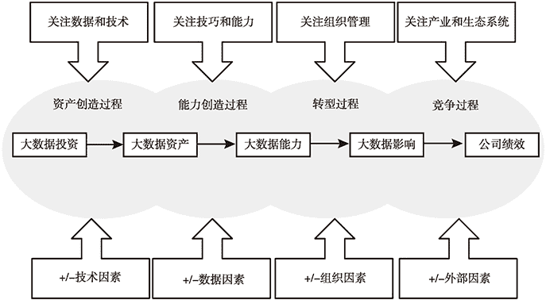

图 1 企业利用数据创造价值的过程框架

资料来源：Ylijoki 和 Porras（2019）。

## 四 数据治理面临的法治困境

在法学语境里，记录与信息相近，多被理解为电子化形态。与传统财产不同，记录可以无边界复制传播，传统物权法难以适用。现行规则对记录权属缺乏明确界定，例如因难以被盗而被认为不具备财产权，记录集合也无法用于抵押。随着技术演进，记录相关的知识产权与法律规制亟需重新审视。

物联网时代的隐私保护是核心议题。物联网能够采集巨量记录，进而衍生新知识。智慧城市里，记录知识可帮助政府优化政策与公共交通；消费场景里，记录反馈可以改进服务、提升体验。采集过程不可避免地触及隐私，物联网时代对保护与被遗忘权的关注度上升。欧盟把保护技术、数据库管理、所有权、隐私政策列为物联网发展的关键挑战。调研显示多数用户担忧智能设备过度采集个人信息，这种担忧已开始制约物联网发展。皮瑞认为未来需在以下方面完善隐私保护：充分且有效获取用户授权、在用户自主选择与控制下使用、采集后严格按既定用途使用不得挪用、在建模、存储、分析、传播、聚合环节采用匿名技术、强化传输过程中的安全。

公共记录有可能成为最具价值的国家资产，其管理需要解决保护、增值、维护、盈利等多重议题，同时平衡利益竞争、隐私与个人自由、国家安全与公民权利、商业利益与公民利益的关系。凯普提出了一个普适的大数据法律框架，包含平台基础设施、信息结构、与记录相关的知识产权、合同、监管、信息安全与管理六个层次，其中知识产权、合同与监管直接关联记录。知识产权指版权与数据库权限，合同赋予拥有者通过开放使用获取回报的资格，监管则划定处理个人信息的权利与义务。实践中不少组织已建立治理政策与框架，用以结构化管理大数据。

社会透明度提升，物联网每天产生海量记录，需要从所有权与产权两方面进行界定。记录所有权应归谁？新技术背景下现行法能否确定归属？是否需要新的产业记录权力？以智能汽车为例，行驶记录应属于车主、驾驶者、制造商、采集装置生产商、导航服务商还是道路建设方？各方都是潜在受益者。现实是现行法虽有触及但仍显不足。

在知识产权层面，欧洲现行版权法只保护作者的知识产品，生产知识的机器不被视为作者，因此物联网生成的内容不受版权保护。由机器产生的内容能否获得知识产权保护？对内容的保护与知识产权保护不应等同，现行法律体系难以全面应对物联网等机器创造内容及其衍生问题，新的法律设计需要深入研究。

## 五 研究转向与未来议程

已有研究从数据科学、经济学、法学、科技政策等角度梳理了概念、价值、产权、隐私、管理规制，但缺乏跨学科的多维综述。本文试图从历史、经济、法律维度描绘全景，指出理论问题并为未来研究提供新视角。目前治理研究呈现双重转向：内容从理论建构走向实证研究，从概念建构转向经验研究；方法从定性走向定量，围绕利用、开放等主题的定量化研究增多。在此基础上提出四个方向。

### （一）各国数据政策演进与比较研究
既有工作梳理了数字经济发达国家的数据政策，但政策落地与效果缺乏系统评估。未来需要分析各国治理背景、执行过程与效果。随着人工智能与大数据发展，各地政策持续增加，因认知差异可能走向分化，国际比较与前瞻性分析对提升制定与实施的合理性至关重要。

### （二）基于记录的多元主体协作研究
物联网用户隐私保护涉及设备制造商、云服务与平台提供商、第三方应用开发商、政府监管部门、消费者五大利益相关者。隐私保护不仅是技术管理问题，也关乎用户自身及政府监管规范，各主体作用与地位不同，需协同完成。随着人工智能与区块链发展，价值链分工进一步细化，创造与使用主体从人与人、人与机器转向机器与机器，多元主体治理面临新挑战。

### （三）以记录为核心重构产业创新体系
海量记录积累构成颠覆性创新，对产业转型与经济发展产生深远影响，重塑创新生态。以记录为核心的创新体系更强调共享与开放以提升效率与活力，其新规律与新问题值得探索。

### （四）完善国家治理体系
政策法规是新兴技术进步的重要保障。面对记录这一核心战略资源，需在国家层面创新治理原则、关系与工具，秉持敏捷治理思想开展政策实验、试点与立法尝试，形成灵活全面的框架。记录带来的所有权归属、知识产权保护、隐私保护、伦理与反垄断问题持续增多，中国作为数字经济与人工智能的引领者，应在记录使用与保护法规上前瞻研究，提出具有中国特色的原则、制度与方案。

* * *

全球数据流动秩序与中国方案

梁正 于洋

摘要：数字经济快速发展，记录流动对全球经济影响深远。为释放红利、凝聚数字优势，各国逐步完善跨境流动内部规则并参与全球规则构建。因保护水平与市场环境差异，各国对跨境流动治理缺乏共识，成为国际合作的挑战。本文基于要素特征与流动与全球化的关联，梳理欧盟、美国及国际合作中的跨境流动规则，总结中国保护与跨境流动规则现状，为制定符合现实需求的中国治理方案提供参考。

关键词：治理 公共政策 国际比较

## 一 引言

2008 年金融危机后世界经济增速放缓，贸易与金融流动减速，新冠疫情进一步加剧形势复杂性。与此相对，记录驱动的数字经济逆势稳步增长，流量迅速扩张。《2021 年数字经济报告》指出，2020 年全球互联网带宽提升 35%。流动规模扩大带来机遇也产生治理难题，管理庞大跨境流动成为各国新挑战。

美欧等发达国家在治理体系构建上起步较早，近年为推动共享、释放红利率先提出战略与行动计划。它们在国内共享保护规则相对成熟，但在以国家安全为基础的跨境流动规则上仍在探索，分歧较大。中国要素治理起步较晚但发展迅速，2020 年将要素市场化配置提升至国家战略，多项顶层政策法规相继出台。国内框架初步搭建，仍需完善规则并参与国际规则构建。本文分析要素特征及与全球化的关联，比较美欧等国政策法规与国际合作秩序，结合中国现状提出中国方案。

## 二 数字经济和要素

### （一）要素
记录是基础原材料，可提炼信息、知识与智慧，如图 1 所示，通常被视为新一代信息技术生产资源。记录投入生产后可与其他要素结合产生递增报酬，促进经济增长；积累被视作研发投入，助推企业创新。记录在经济主体间转移信息，提升生产效率、公平与竞争。企业运营产生的记录及其反馈循环，一方面促进在干中学并用于管理决策提升运营效率，另一方面扩大市场份额以获取更多记录。

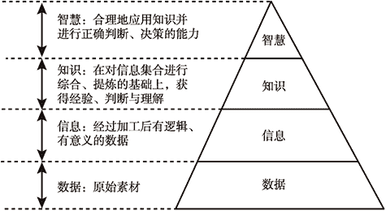

图 1 数据的地位关系

图片来源：作者自制。

记录作为新兴生产要素，在技术与经济层面呈现独特属性。其一是非竞争性与非排他性。记录并非公共物品，但在特定条件下可被多使用者同时使用，使用后价值不降反增；采集时不同收集者互不干扰。如平台间采集个人信息互不排斥。其二是边际成本低。记录作为经济活动副产品产生时，采集主要为一次性前期投入，持续采集边际成本极低且易大规模获取；使用时复制成本几乎为零。其三是规模效应显著。规模与维度增加时，价值与信息量大幅增长。其四是正外部性。记录提升企业生产效率与决策质量等。另有隐忧：提供者、收集者、挖掘者与规则决策者类型多样，主权规定不清；使用成本难统一，垄断者可收取高额费用而滞后内容成本趋近零；流动依赖互联网，速度快、范围难控，存在隐私泄露风险甚至国家安全威胁。

### （二）流动和全球化
金融危机以来，全球化一方面得益于数字经济蓬勃发展，另一方面由大规模流动支撑。传统贸易与金融流动减速期，跨境传输量激增。流动创造的经济价值已超传统商品贸易，成为国际贸易与投资的基础，对全球化形态产生深层影响。

记录已成为全球经济关键推动力。其一，记录是国际贸易命脉，运输、交易、结算等环节难以脱离流动。跨境流动规模可反映全球供需，协调生产，助力企业在全球市场高效匹配。其二，跨境流动是数字贸易的重要形式，即数据贸易。新冠疫情期间各国抗疫记录共享，有助于全面了解病毒并提供临床依据。

## 三 全球跨境流动秩序的构建

近年跨境流动规则备受关注。经合组织、Salesforce、世界经济论坛等发布相关报告，内容多为现状、比较与趋势。总体看记录主导并推动全球化，是战略资源。当前规则以不同程度的流动要求与本地化要求为主，如图 2 所示。

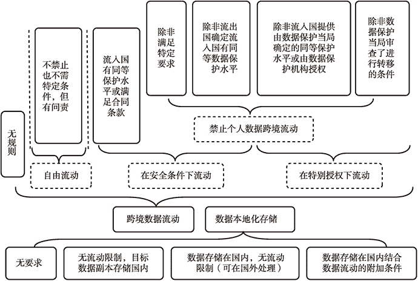

图 2 跨境数据流动规则

图片来源：作者自制。

### （一）各国的跨境流动规则

#### 1.美国和欧盟的规则
1997 年美国提出《全球电子商务框架》管理跨境流动，并与欧盟沟通推进。信息时代美国升级开放共享规则。2014 年发布《开放数据行动计划》，扩大开放途径与内容。2016 年提出《M-16-19 数据中心优化计划》与《联邦机构公共网站和数字服务政策》。2019 年颁布《开放政府数据法》，要求各政府部门公开非敏感内容并提高质量，为产业发展提供要素支撑。同年基于《大数据研发倡议》形成国家层面治理方案，成为平衡开放与安全的战略支点。美国一方面鼓励流入并要求贸易伙伴破除壁垒，另一方面通过多边合作圈定自由流动区，同时严格限制公民记录流向威胁国家安全的国家。

欧盟跨境规则体现内外兼顾。欧盟治理体系建设走在前列，以严格个人信息保护为特征。与美国补充完善已有法律不同，欧盟采整体法规与成员国立法结合方式。近年思路转向由严苛监管向促进区域内共享转变，推行单一数字市场战略。2018 年正式实施《通用数据保护条例》GDPR，该条例对成员国直接生效，构成欧盟隐私保护法律框架。

#### 2.其他国家的规则
除美欧外，新加坡与日本倡导保护与自由流动结合，为企业设置多样出境条件。发展中国家中，俄罗斯要求本地化，首次存储境内，合规后有序出境；印度对个人信息分级，按级别实施差异化本地化与跨境限制。

### （二）国际合作中的跨境流动规则
各国积极参与构建跨境流动规则框架。经合组织、亚太经合组织等已确立代表性框架，旨在推动区域内有序流动，减少摩擦，最大化红利。

#### 1.双边或少数国家间的合作
美欧合作具代表性。2000 年签署《安全港协议》，5000 多家美国企业获准在欧洲收集信息后传回美国处理存储。2015 年协议取消，2016 年达成《隐私盾协议》，欧盟对美国企业与政府使用内容作严格规定，体现对个人信息的强保护。2018 年美墨加三国签署协议，规定缔约国不得将金融记录本地化存储。近年美国为主导亚太跨境规则，大力推行亚太经合组织跨境隐私规则体系。2010 年由美国与日本主导的亚太经合组织下跨境隐私执行合作安排开始实施，在保障隐私安全同时减少信息流动障碍。

除了美国主导的格局之外，2020 年新加坡、新西兰与智利三方签署了《数字经济伙伴关系协定》DEPA。市场普遍把这份协议视作 CPTPP 的配套安排，协定在跨境数据流动方面的表述与 CPTPP 高度接近，因具备可操作性而获得较多认可，也逐步成为经济体参与经贸规则制定的参考样本。

#### 2.多国间的合作

多边机制方面，OECD 于 2013 年对《关于隐私保护和个人信息跨境传输的指南》进行了修订。指南第四部分重新梳理了跨境数据流动规则与隐私执法口径，为降低与各国本土政策的冲突，指南明确成员可在达成最低共识的基础上制定更严格的国内隐私规范，以此推动共识形成。

APEC 于 2003 年设立数据隐私小组，2005 年推出《亚太经合组织隐私框架》，并于 2015 年完成更新。该框架借鉴 OECD 思路，目标是促进亚太地区数据自由流动、提升个人信息保护的一致性，进而推进区域一体化。2011 年 APEC 建立跨境隐私规则，为成员间个人信息流动提供隐私保护认证机制，意在在流动便利与安全之间取得平衡。

在已签署的区域贸易协定中，CPTPP 与 RCEP 均对跨境数据流动作出安排。以 RCEP 为例，有关诉求主要写入贸易政策条款。金融服务贸易领域禁止缔约方限制服务提供者在必要情况下开展跨境信息传输；计算设施本地化要求以及电子信息传输的内部监管，均需要在不构成贸易歧视或壁垒的前提下给予相对或绝对豁免。RCEP 涵盖发展阶段不同的经济体，协定并未对数据防护设定强制统一标准。在无法实现完全自由流动的条件下，通过不同保护水平下的规则协调，有助于缩小各国数据治理差距，逐步缓解数字经济发展的鸿沟。

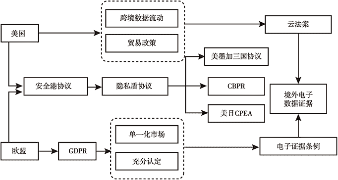

图 3 美欧主导及参与建立的部分跨境数据流动规则

图片来源：作者自制。

总体来看，全球跨境数据流动规则呈现层次化特征，未形成统一框架，各国在流动与防护方面的标准存在分歧。求同存异的关键在于国际合作中积极参与或主导规则构建，推动数据在组织内部有序流通，扩大各自数据生态圈。目前全球规则仍处探索期，率先形成的框架对后续规则产生显著影响。成员国防护水平不一，难以达成完全一致共识。因此在参照已有成果的基础上，各国在不同合作平台持续制定契合本国发展需求的多元化规则，贸易协定中体现尤为明显。

## 四 中国方案

我国数据治理起步较晚但增速较快，在借鉴美欧经验的同时探索更契合自身需求的路径。

### （一）数据共享

相较美国半个世纪前就启动的政府数据资源管理，我国政府数据管理方法和体系建设相对滞后。当前政府数据开放保障机制仍处研究构建阶段。2012 年上海成立首个政府数据开放平台；2015 至 2017 年间先后推进政府数据开放共享、实施大数据战略、推进公共数据共享，并密集发布信息资源共享文件与方案；2018 年提出《公共信息资源开放试点工作方案》以落实试点。

与美国长期成熟的体系相比，我国政府数据共享机制是在短期内快速搭建的。后续推进开放过程中，需充分考量资源管理效率与成本，以及数据公开所需的基础运营设施。进入高质量发展阶段，数据要素质量直接关乎企业生产与民生各领域。一方面要突破数据采集、处理与整合的技术瓶颈，以满足生产生活需要；另一方面各地数据开放平台建设应统一标准，为浏览与应用提供更高效便捷通道。目前多种开放方案已推出，落地仍需配套基础设施与数据安全保障机制支撑。

### （二）数据保护

2020 年我国将数据列为新型生产要素，数据要素市场化配置上升为国家战略。数据已成国家战略资源，数据安全关乎个人隐私、经济运行、政治稳定与国家安全。数据防护被置于重要位置，但相较欧盟严苛完备的个人信息保护制度，我国在针对性法律指引与健全制度体系上仍在完善。2021 年《数据安全法》和《个人信息保护法》相继颁布实施，对数据处理活动、数据安全、数据开发利用及个人信息处理保护作出顶层规范。《个人信息保护法》是我国首部个人信息保护专项立法，既强化保护又为数据自由流动与开发提供制度支撑。其第三章《个人信息跨境提供的规则》明确，境内产生与收集的个人信息原则上须在境内存储。《数据安全法》作为数据安全领域的基础性法律，体现安全与发展并重理念。

对企业和个人而言，面对数据防护的新工具，常缺乏应用与合规经验指引，需进一步提升个人信息保护意识，做到有法可依，用法律武器维护权益。政府与有关部门在完善法律基础的同时，应持续开展个人信息保护宣传，强化数字经济试点地区与示范企业的数据要素治理，以点带面完善全国数据治理；针对各地共享与保护基础差异，采取差异化指导，避免一刀切。

### （三）跨境数据流动

#### 1.顶层设计

近年出台的数据保护相关法规均涉及跨境数据流动。十四五规划及有关部门也提出跨境数据流动的具体实施方案。随着顶层法律相继落地，数据跨境安全管理框架基本成型，出境安全评估成为主要手段。2021 年《数据出境安全评估办法》构建相对完备的评估流程，为企业个人数据出境提供指引，并对重要数据出境管理作出具体安排。2017 年《网络安全法》首次提出重要数据概念。2021 年《重要数据识别指南》征求意见稿为重要数据识别提供参考。近年也在逐步完善特殊数据出境管理办法，旨在保障国家数据安全同时促进多元数据有序跨境流动。如 2022 年 3 月针对人类遗传资源信息出境，发布《人类遗传资源管理条例实施细则》征求意见稿。

从现行规则看，我国重点管控个人信息、重要数据跨境流动，契合保护个人隐私与维护国家安全的内在要求。个人信息与重要数据具有特殊性，也是各国数据流动管理的核心对象。关于重要数据，各国界定各不相同，但本地化要求等措施均体现对重要数据流动的严格管控，目标是在保障国家安全前提下实现安全跨境流动。

#### 2.国际合作

近年我国积极参与构建双边或多边跨境数据流动规则体系框架，这既反映同各国确保数据安全前提下实现有序流动目标上的一致，又体现作为数字经济大国与“一带一路”倡导者，参与制定国际规则、弥合数字鸿沟的大国担当。

跨境数据流动牵涉个人、企业、国家诸多层面，解决顶层制度仅是其一。需采用可持续的技术与模式，平衡保护与流动，逐步消除各主体在数据出境时面临的问题，才能有效助力经济产业发展。虽然我国已逐步建立跨境数据流动规则，仍需完善补充。评估目的主要在于保障安全性，评估重点集中于是否涉及个人利益、公共利益及国家安全。未来评估部门要做到职责清晰、标准明确、流程便捷，为企业自评估提供详细参照，加强政企合作，共同培养专业数据评估人才，填补行业空白，有效保障数据流动的安全性与时效性。

## 五 结语

数据在当前经济发展中的重要性不言而喻，若要未来进一步释放数据红利，全球数据保护与跨境流动相关规则必须随时代更新。美欧拥有丰富数据治理经验与较完备体系，可供各国参考。我国数据治理模式仍在逐步探索完善，鉴于数字经济蓬勃发展、数据要素丰裕，在借鉴他国经验同时，更要积极探索符合国内数据要素保护方式与跨境流动规则的路径，逐步形成具有中国特色的治理之路。

制定或完善数据要素跨境流动规则是各国面临的新任务。为缓解数字经济过度碎片化、跨境数据流动政策过度分散化，各国应加强国际对话合作。我国作为数字经济大国，面对新时期全球规则重塑，更应积极参与并发挥主动权与话语权。同时必须认识到，鉴于当前各国做法多样性及对主权、隐私与国家安全的合理关切，建立相对统一完备的跨境数据流动规则过程必将充满挑战。

2018 年欧盟《通用数据保护条例》正式进入执行阶段，在业界被视作全球个人信息监管的转折点，也体现出欧洲长期以来的隐私保护偏好。该条例终结了成员国各自立法的碎片化状态，搭建起统一个人数据保护通道，重新定义了欧盟境内的数据流通逻辑，并对全域监管尺度做了系统性对齐，使各地执行标准趋于一致。其实际作用主要体现在四个维度。第一，整合了不同行业与不同场景下的多元诉求，实质性扩大了个人权利清单，欧盟居民获得知情、查阅、更正等数字权利，同时配套了未成年人专项保护与主动告知要求。第二，彰显内部市场优先立场，监管触角延伸至一切处理欧盟居民个人数据的境外主体。第三，以极高的合规门槛与执行强度保障落地，最高可处涉事主体全球营业额4%的罚款，参见吴沈括2019。第四，收紧跨境传输流程管控，并以跨境流动为杠杆对外输出规则，对他国数据制度建设形成直接制约，参见吴沈括2018。

## （二）美国
美国的数据管理兼具市场驱动与隐私底线两重属性。政府一边推动数据开放、鼓励自由流动以支撑数字经济扩张，另一边不断强化个人数据安全要求。CCPA被公认为当前美国约束力最强的消费者隐私法规，对银行保险、科技软件、零售旅游等板块冲击较大。该法明确监管边界，拓宽个人信息定义，并对未成年人作出差异化安排。核心体现为四点：其一，监管对象不再限于特定行业，凡收集加州消费者信息的企业全部纳入范围；其二，赋予消费者查询、删除、知情等权利组合；其三，规范企业采集、存储、使用行为，要求公开采集目录、按需删除、禁止随意出售，且不得以拒绝服务或收费方式实施差别对待；其四，建立数据泄露后的法定赔偿机制，为集体诉讼提供路径。法规禁止未经许可出售16岁以下未成年人信息，违规企业将承担民事处罚与高额赔偿。

## （三）英国
英国新版数据保护法的取向是让经济社会最大化地分享数据创新的红利，在打造可信网络环境的同时提升个人信息安全。法案一面推动数据在欧洲及境外高效流动以服务贸易与区域发展，一面对个人信息使用实施严格保密以保障共享安全。具体落地主要围绕三个层面。对个人而言，在原《数据保护法》基础上提高要求，确认个人对信息的主导权，强化知情同意规则，创设数据可携权，便于跨服务商迁移与按需删除，并在画像场景中增强参与与决定空间，何波2018。对企业而言，立法以数字化转型与数字经济成长为导向，引导规范使用以维护业务与声誉。对政府而言，赋予信息专员办公室ICO更强监督权，提升违规追责与赔偿强度。对司法与国家安全等特殊职能部门另设专门保护框架，提供定制化采集与管理机制以配合打击犯罪。

## （四）中国
中国数字经济扩张迅速，“互联网+”模式广泛渗透，制度对数据利用与保护的统筹需求持续上升，亟需全国性法律作出明确指引。第一，实践中被广泛援引的《信息安全技术 个人信息安全规范》虽属推荐性标准，却对企业形成实质约束，有助于遏制数据使用失控。第二，规范提出最小必要采集原则，对收集环节细化要求，打破一揽子授权惯例。用户数据被区分为必要信息、非必要关联信息与无关联非必要信息，App仅能在实现核心功能所必需范围内采集，以此限制过度采集与滥用画像。第三，强化安全执行，企业须在采集时明示用途、目的与留存周期，变更用途时需重新获取同意，敏感权限应提供关闭选项，未经同意不得共享用户信息，即便属于同一集团的不同产品也不例外。

# 四 对中国数据治理政策未来发展的启示
人工智能与大数据的演进不仅体现在算力提升，更体现在各国对数据政策的高度关注。面对治理的新挑战，各国仍在探索，可借鉴空间较大。比较主要国家的演进、框架与工具可为中国提供三点参考。

第一，治理要根植于国家核心利益并与本土数字经济发展节奏相匹配。各国均基于自身实际制定准则，数据作为基础资源与生产要素，其作用类同传统矿产。数据治理既是产业政策，也是第四次工业革命下国家战略的重要构成。欧盟做法受自身数字化滞后与传统治理优势影响，美国与英国则更强调创新与隐私的平衡。此种平衡有助于守住既有优势，也可通过制度创新释放数据商业价值。政府应将AI、大数据发展与政策设计相协同，让监管服务于产业创新。

第二，治理需要在利用与保护之间求平衡，推动创新与规范协同。当前正处于大数据赋能传统产业升级的关键期，数据治理处在传统经济与数字经济的交汇点，新旧问题叠加提升治理复杂性。如对中国网约车的数据结构研究显示，平台对个人数据的掌控已成为竞争与持续创新的关键要素，社交与支付平台在多边市场的角色愈发重要，个人数据的作用将重塑市场竞争、监管与企业创新逻辑，参见Huang L等2019。同时应避免“一管就死、一放就乱”的恶性循环，防止重蹈“先污染后治理”的覆辙。引入敏捷治理理念，在灵活性与全面性之间创新工具与模式，参见薛澜、赵静2019。

第三，强化数字基础设施与数据标准的引领作用。数字基础设施是释放数据要素价值的前提，数据价值的实现依赖于低成本的使用与处理环境。政府应推动5G、工业互联网、云计算、数据中心等建设。除硬件外，数据汇聚、共享与开放同样需要政策驱动、行业标准与法律规范构成的“软性”基础设施支撑，这应成为未来政策的重点。

# 五 结论
第四次工业革命下，新兴技术与数字经济蓬勃发展，有效治理关乎个人数据利用与保护的平衡，也关乎新兴产业发展与未来竞争。作为AI与数字经济的重要高地，中国需要持续探索一套应对挑战与风险的治理框架与政策工具，提升治理能力，促成数字经济健康发展，最终在保护与价值挖掘间实现最优平衡。唯有深入理解国外实践背后的文化传统、历史演进与政策特征，吸收成功经验并结合国情，才能形成适合自身的数据治理路径。

# 参考文献
何波：《英国个人数据保护立法改革进展及分析》，《通信管理与技术》2018 年第 2 期。
刘云：《欧洲个人信息保护法的发展历程及其改革创新》，《暨南学报》（哲学社会科学版）2017 年第 2 期。
陆健英、郑磊、Sharon S.Dawes：《美国的政府数据开放：历史、进展与启示》，《电子政务》2013 年第 6 期。
吴沈括：《欧盟〈一般数据保护条例〉（GDPR）与中国应对》，《信息安全与通信保密》2018 年第 6 期。
吴沈括：《数据治理的全球态势及中国应对策略》，《电子政务》2019 年第 1 期。
薛澜、赵静：《走向敏捷治理：新兴产业发展与监管模式探究》，《中国行政管理》2019 年第 8 期。
California State［2018-06-28］，https：//oag.ca.gov/privacy/ccpa.
General Data Protection Regulation［2018-05-25］，https：//gdpr-info.eu.
Huang L，Zhao Y，Mei L，et al.，“Structural Holes in the Multi-sided Market：A Market Allocation Structure Analysis of China’s Car-hailing Platform in the Context of Open Innovation”，*Sustainability*，2019，11（20）：5813.
United Kingdom［2018-12-01］，http：//www.legislation.gov.uk/ukpga/2018/12/contents/enacted.

* * *

[\[1\]](#chapter019.html#w1) 梁正，清华大学公共管理学院教授、博士生导师，人工智能国际治理研究院副院长，中国科技政策研究中心副主任，研究方向为科技政策、创新管理、新兴技术及其治理；吴培熠，北京航空航天大学人文社会科学学院助理教授、硕士生导师，研究方向为新兴技术治理、公共组织创新。

### 工业数据治理：核心议题、转型逻辑与研究框架
李佳钰 黄甄铭 梁正[^(\[1\])](#chapter020.html#m1)

## 摘要
工业数据治理体现了传统制造向数字化、智能化转型的核心。本文以工业数据多源异构、红利释放、价值挖掘与体系兼容四个议题为切入点，分析治理动因与现实障碍，并以中德对比的视角归纳不同体制下治理的特征。研究指出工业数据治理的本质是价值共创，可从战略管理、创新管理与工业工程管理三个维度构建理论基础，为我国实践与政策提供参考。

## 关键词
工业互联网 工业数据 数据治理 数字化转型

## 一 引言
在新一轮科技与产业革命驱动下，创新组织和产业组织的变革重塑了创新体系结构，数字化要素成为生态治理焦点。在数字经济语境下，数据汇聚产生的颠覆性力量改变了企业决策与管理范式，使能数据基础设施与治理成为大国竞争制高点。当前我国消费互联网深化、工业互联网起步，自 2018 年工信部发布首个三年行动计划以来，工业互联网在架构、平台、软件、标识解析、应用与安全等方面取得进展，但工业数据应用仍处于探索期，难以复制消费互联网的爆发路径。在借鉴国际经验基础上实现自主创新已成共识，而工业互联网更需立足国情，既解决自下而上的技术问题，也解决自上而下的流程再造问题。厘清工业数据治理的内在动因与障碍，辩证审视发达国家经验，构建适配框架，对发挥数据要素驱动创新的作用至关重要。

## 二 核心议题：治理的内在动因与现实障碍
工业数据治理是系统工程，存在多重失灵叠加，现有理论与政策难以应对场景复杂性与动态性。数据治理强调决策责任路径，Khatri V，Brown C V，2010，而工业场景中供需关系复杂，责任难以厘清。数据治理与数据资产密不可分，Aiken P，2016，但工业领域保护与增值规则不清晰，运营主体缺位。数据治理规范有助于提升质量，Bhansali N，2013，而工业领域缺乏分级分类标准，质量评估工具不统一。根本痛点集中在以下四个方向。

### （一）提高工业数据质量，需破解多元异构问题
提升数据质量的关键在于管理而非仅技术讨论。从理论看，全生命周期与流程管理方法众多，基于操作经验搭建的溯源逻辑与ETL流程往往优于碎片化方法。从实践看，工业数据接口与维度对质量有牵一发而动全身的影响，上游接口变更会让下游系统被动。我国制造系统总体遵循以 ISA-95 为代表的架构，该架构推动了数字化信息化，但随转型深化，ERP、MES、CRM 等业务系统间集成难度加大，“信息孤岛”凸显。表现为跨层级传递效率低、供应商执行标准不一导致接口复杂、IT 与 OT 脱节导致流程碎片化、生产数据分散难以利用。同时 ISA-95 对结构化数据管理有效，对海量多元异构数据处理能力不足。

### （二）提高工业数据采集能力，需破解红利释放问题
技术上，强化采集能力关键在于传统工厂内网。接入以有线为主，无线仅用于仪表采集，而企业网的以太网与 TCP/IP 难以满足工业现场高实时高可靠需求，反映出工业控制网络能力不足，无法支撑海量采集与无死角覆盖，大量生产数据沉淀于网络中。工业互联网产业联盟 2020 管理上，持续提升采集能力的核心是数据红利释放，王田苗、陶永 2014。近年来平台多重“重采集轻挖掘”，造成存储负担且红利未释放，陆峰 2022。政策与资本推动下，各方对数据关联有限性与价值密度稀疏性认识不足，导致在盈利模式未明的情况下对数据价值高估。

### （三）提高工业数据应用能力，需破解价值挖掘问题
应用能力提升依赖工业智能技术深度挖掘价值，进而提升信息系统服务能力。但深度学习与知识图谱等技术与传统信息系统集成成本高、技术壁垒大。现阶段主要以提升平台层分析能力为主，将 AI 算法嵌入工业互联网平台层并组合模型，武汉大学工业互联网研究课题组 2020。不同系统共性模块难以复用，“重复造轮子”普遍，创新成本增加。当前战略指向锚定共性，以工艺智能的机理模型为锚点，实现基础研究与生产实践双向映射，其可解释性是大数据 AI 模型所缺乏的优势。

### （四）提高工业数据互通能力，需破解体系兼容问题
2022 年市场监管总局等 16 部门印发《国家标准化发展纲要》行动计划，提出加强工业互联网标准研制，反映出平台在融通标准化上面临难题，应用、数据与资源层均缺乏标准支撑，导致信息孤岛与数据烟囱。现行生态基于国际现场总线协议与厂商私有协议，系统设备接口各异，形成互不兼容的数据体系，各自拥有独立通信协议、数据模型与语义规范。跨厂商跨系统互操作仅能实现简单功能，难以实现高效实时全面互通，工业和信息化部信息技术发展司 2020。

## 三 转型逻辑：德国经验借鉴与中国路径探索
数据要素流通能力直接影响数字化产出效率，可信、安全、透明、可计量已成国际共识。

### （一）德国经验
从构建工业数据空间架构模型到《欧洲数据战略》提出建设九大行业数据空间，德国展现出抢占国际治理主导权的战略意图。

#### 1. 政策引导：项目牵引、资金支持与环境营造

德式数据治理拆解与中国路线的反思

回顾德国在制造端数据管控的演进轨迹，可以看出其高度倚重政策牵引并且贯穿产业全周期作业。

项目牵引层面，联邦教研部于2014年抛出工业数据空间行动倡议，次年依托工业4.0主线正式立项Industrial Data Space研究，划拨500万欧元专项用于搭建参考架构并推进跨行业验证，用以破解共享与流动的卡点。经费配套层面，IDS属于工业4.0的子任务，由弗劳恩霍夫协会下属智能分析与信息系统研究所主导执行，联邦政府按该协会年度合同科研经费总额的50%进行匹配，以支撑非营利基础研究，保持前瞻性与引领力。环境营造层面，2021年联邦政府出台《联邦数据战略》，明确在保障公共利益与数据提供方合法权益前提下，在工业、能源、医疗等领域构建公共数据空间，释放更广数据资源并推动跨境共享，标志顶层部署到位。同时德法联合发起GAIA-X，将IDS定位为云平台的核心架构，以共享工具研发和治理体系建设为抓手，为各类数据空间提供统一底座。

#### 2. 研发支持：协同创新、架构引领与开源创新
协同研发层面，德国强调联合攻关应对跨学科诉求。教研部指定弗劳恩霍夫协会作为执行主体，协会内部12家所协同推进，通过联盟与网络机制组建多支科研联合体，灵活整合专家、企业与高校资源，确保各方力量聚焦共享难题。架构引领层面，德国注重打造规范化模型，提供标准接口与认证机制，促进信息在可信伙伴间安全流转。该设计兼顾数据主权，让持有者自行界定使用条款；也解决了去中心化问题，仅靠标准连接器IDS Connector实现互联，无需中央权威统一监管。开源创新层面，德国持续强化组件开发与维护。国际数据空间协会IDSA在GitHub上架设IDS参考测试平台开源项目，为开发与认证提供测试评估环境，并开放参考实例与示例代码，供开发者构建符合标准的组件并验证互操作性。

#### 3. 推广应用：企业牵引、生态共建与国际联动
在推动数据空间走向欧盟与全球的过程中，企业发挥关键作用。IDSA组建跨行业工作组与行业社区，对不同场景用例开展评估测试，梳理差异化需求，进而孵化大量产品与方案。生态共建上，德国鼓励市场主体基于IDS提供软件产品与服务，持续优化生态供给。比如海尔海外洗衣机工厂借助IDS技术，实现洗衣机传感器数据与卡奥斯COSMOPlat平台的安全可控交换，依托数据优化洗涤程序并回传终端设备。国际化层面，德国积极推动IDS纳入国际标准体系并扩大应用覆盖。IDSA推动核心内容转化为正式国际标准，支持多元数据空间实现互联协作。例如IDSA成员荷兰应用科学研究组织TNO与日本NTT.Com依托标准搭建互联数据空间，实现供应链信息跨境安全交换。此外，IDSA通过组建数据空间商业联盟DSBA、在多国设立区域中心等方式，加速标准在欧洲及全球的推广。

### （二）中国路径
自2015年国务院发布《促进大数据发展行动纲要》后，工信部相继出台《工业数据分类分级指南试行》《关于工业大数据发展的指导意见》《十四五大数据产业发展规划》等文件，对数据汇聚、共享、应用与安全作出具体部署。

#### 1. 总体规划：“促开放”与“建闭环”
从规模与体系完整度看，中国制造业具备一定优势，但在高端赛道仍显差距，“大而不强”的瓶颈短期难解。中国既是制造大国，也是数据资源与应用大国，但生产数据的管控尚处起步，难以照搬发达国家顶层设计与交易流通经验。关键矛盾在于政府在谋划兼顾开放生态广度与自闭环体系深度时难以兼得。“专精特新”战略正是对配套政策不足、产业结构失衡、国际环境动荡制约中小企业发展等共性问题的精准回应。依托贵阳、上海、深圳、武汉等地的先行探索，我国已形成活力充沛的开放生态服务体系，孕育出多元数字创新主体，有效激发中小企业数字化转型内生动力。长远来看，面对转型升级机遇与外部贸易保护挑战，自主掌控核心技术，在生产装备、工业控制、数据标准、激励知识、服务平台、工业软件等关键领域补短板、锻长板、填空白势在必行。近年密集政策信号显示，在以数据为核心要素的数字经济战略框架下，系统推进工业互联网基础设施与数据资源管理体系建设是释放治理效能的关键。因此，以“闭环服务体系”为核心的中国特色内循环，有望成为破解制造数据管控难题的重要路径。

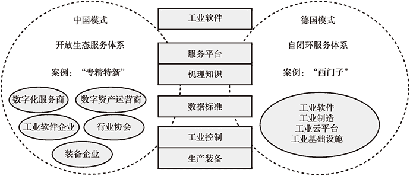
图 1 中德总体规划层面对比
图片来源：作者自制。

#### 2. 重点突破：“老问题”与“新问题”
不能脱离制造本身空谈模式与方法创新。德国是“第四次工业革命”概念的提出国，工业4.0在全球取得巨大成功。过去40年间，中国聚焦服务业发展与制造业外包获益时，德国工业自动化已臻化境。成效上，我国传统自动化与信息化为工业互联网奠定基础。自2017年起，习近平总书记多次作出重要指示，工业互联网连续五年写入政府工作报告，党中央国务院数十次部署。初步形成自下而上信息流与自上而下决策流协同的数字化应用优化闭环。

近年来我国工业网际架构日趋成熟，对数据管控重要性认知加深。随着新一代信息通信技术深度融合工业经济，工业互联网安全攻击呈现新形态、多样化、复杂化，现有安全保障体系显不足，暴露出多项新挑战：其一，平台采集存储使用的数据体量庞大、类型繁多、关联紧密、价值分布不均，导致责任边界模糊、分级分类保护难度大、溯源困难；其二，缺乏专业机构与安全厂商的有效信息支撑，企业风险感知、应急处置能力普遍偏弱；其三，工控系统与设备设计之初未充分考虑安全，计算与存储资源受限，多不支持复杂防护策略，难以保障可靠运行。在这些问题驱动下，我国正构建具备可靠性、保密性、完整性、可用性与隐私性的工业互联网数据安全能力框架，探索形成政府、企业与产业界共识，如工业数字空间，推动数据安全防护从被动响应向主动防御转型。

#### 3. 全面推进：“技术关”与“经济账”
数据管控是工业智能的底层基础，价值挖掘深度直接决定网络化→数字化→智能化的演进逻辑。技术视角看，我国AI基础设施在工业场景的底层硬件、计算框架、开发平台建设滞后。各下游行业均有原生价值链与高技术壁垒，既缺优质制造主体AI模型，也缺算法训练所需高质量制造标注数据集。Know-how技术壁垒导致工业智能应用呈点状分布，共性需求难以批量捕捉，技术方案推广受限。未来在攻克设备数字化改造与数据联网技术关的同时，智能生产系统建设需投入巨额资金与漫长周期，经济账目需审慎。

近年资金支持政策加码。2021年11月，工信部、央行、银保监会、证监会联合发布《关于加强产融合作推动工业绿色发展的指导意见》，推动产融合作机制建设；同月北京证券交易所开市，完善多层次资本市场，拓宽工业互联网企业直接融资渠道。大行积极参与债务融资，保险公司推出百余款相关产品，多家知名风投加大投入。然而在政策密集刺激下，工业与技术领域投资出现局部周期性过热。资本过度聚敛于高精尖赛道，而关乎制造升级的关键环节却成资本洼地。德国经验提示，高端制造投资应遵循周期长、赛道宽、不唯纯技术论原则。消费互联网投资逻辑难以复制到工业领域，资本投机与制造业跟风叠加催生大量泡沫，扰乱市场秩序，甚至出现劣币驱逐良币。

## 四 研究框架：治理的核心特征与理论基础
前述分析显示，我国制造数据管控实践面临多重困境，现有理论难以支撑门类齐全的大长尾工业实践。基于此，本文构建整体研究框架，如图2所示。该框架涵盖治理核心特征与理论基础两大模块。

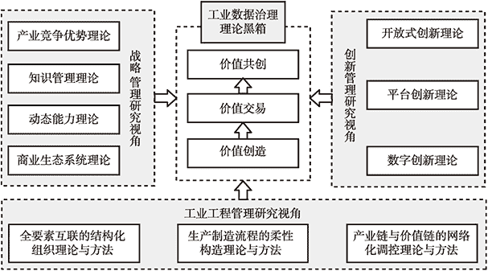
图 2 工业数据治理的研究框架
图片来源：作者自制。

### （一）工业数据治理的核心特征——价值共创
从价值交易向价值共创的转型，是全球数字化转型的核心认知。德国工业数据空间演进表明，工业经济时代以产品升级为核心的逻辑正向数字经济时代以服务解决方案为核心的逻辑迁移，即通过构建数字创新生态挖掘潜在需求，形成竞合为主的价值共创模式。与传统价值交易不同，制造数据管控的终极目标是解决数据质量、采集、应用、互通等难题，创新主体可借助数据治理机制实现价值传递，不再仅是价值需求方，更成为价值创造参与者。可以认为，德国经验的成功根植于数字创新加速了创新要素重组，塑造了新型价值共创模式，对我国具有借鉴意义。

## （二）工业数据治理的理论基础——战略、创新、技术维度
理论体系构建旨在实现工业数据治理总体战略目标，是对各类要素与概念进行逻辑整合。国外研究机构提出诸多通用模型，如ISO/IEC的IT治理标准ISO/IEC38500系列，以及国际数据管理协会DAMA的数据管理知识体系DMBOK，均强调数据管理功能与要素的匹配。为指导企业强化数据资产管理，实现价值创造释放，本文从战略域、价值域、技术域任务要求出发，将理论基础划分为战略管理、创新管理、工业工程管理三方面。

### 1.战略管理研究视角
该视角聚焦数据资产对企业竞争优势的影响。首先，制造数据管控理论应根植于Porter产业竞争优势理论，是在产业组织与结构作用下，企业依托数据资产获取竞争优势的过程。其次，探究数据、信息、知识异质性对竞争优势的作用需借鉴知识管理理论，工业企业基于机理知识的优势体现在数据资产属性与创新主体间的价值共创关系中。知识管理可推动原理、定理与实践经验结合，促进机理知识在工业互联网平台沉淀。在此基础上，数据治理驱动企业形成难以模仿的动态能力，其本质是通过价值交易创建、部署、保护数据资产以支撑持续商业绩效。

### 2.创新管理研究视角
该视角聚焦打破数字鸿沟、实现跨组织功能互补。开放式创新理论能解释企业内部研发中创新与知识的互动，即研发阶段边界渗透与模糊化。区别于传统生产要素驱动逻辑，数据要素驱动的研发增强了产业、组织、治理边界的模糊性，并具备自生长迭代特征。当分析对象为制造业时，特定数据创新生态系统成为开放式创新的典型案例。基于平台创新理论，研究制造数据管控需以工业创新生态建立在能创造价值的服务、工具、技术平台之上为前提。鉴于to C场景的平台理论在to B工业领域不完全适用，且工业互联网高技术壁垒与全流程管控对价值创造要求更高，可依托平台创新理论探讨架构创新环节，并研究如何突破平台化探索瓶颈。

### 3.工业工程管理研究视角

工业数据治理：从现场到价值共创

工业工程的知识脉络深深扎根于生产现场的长期实践，形成了相对独立且自洽的理论体系（齐二石、汪应洛、卢岚，1999）。以工业工程管理为观察棱镜审视工业数据治理，研究的重心落在数据要素在时空维度上的协同演化及其调控规律（亨利·法约尔，2014）。

其一，柔性制造流程的构建思路与方法论，为数据治理在柔性化全流程中保持顺畅与稳定提供了方向指引（黄群慧、贺俊，2013）。沿此脉络，数据价值的创造逻辑建立在容差分析及误差传递模型、全流程稳定性构建方法论、全流程重构理论之上，能够较为精准地描绘未来工业互联网制造链上误差如何扩散、流程的薄弱环节何在、产线重构是否具备收敛特性等关键问题。

其二，面向全要素互联的结构化组织理论与实践，明确了数据治理在要素连接方式与结构形态层面的演进路径（赵骥、齐晓锐、吴教丰等，2021）。数据价值的交易逻辑依托于按需联结的内生模型与调节机理、生产要素数据多维表征及结构化组织机理、全要素互联的系统熵理论，能够衡量治理的复杂程度并构建相互制衡的关系。

其三，产业链与价值链的网络化调控原理与应用，把跨链协同的多目标优化置于治理的核心议题。数据价值的共创逻辑建立在全产业链构建模型、全价值链构建模型以及跨链耦合的网络化调控原理之上，有助于解释制造活动在全产业链与全价值链层面的耦合特征与复杂调控逻辑。

## 五 结论与展望

工业数据治理关乎人、机、料、法、环各环节的全流程价值闭环，既是体系完备的整体，也是工程复杂度很高的系统工程。本文认为，中德两国在战略层面都高度重视工业数据的驱动作用，在将数据要素转化为价值的技术路径和发展方向上目标趋同，但因技术成熟度与产业基础的分化，具体落地策略存在差异。换言之，我国推进工业数据治理必须根植于本土国情和企业实际，既难以照搬德国的 IDS 模式，也不能直接套用既有数据治理理论或消费互联网经验来快速落地。由此，本文认为工业数据治理的本质是管理活动，其标志性特征在于价值共创，研究框架可围绕战略管理、创新管理、工业工程管理展开：其一，战略管理视角下需厘清数据产生的场景与使用场景，界定数据治理的边界，并明确分级分类、分布等具体要素；其二，创新管理视角下需理清高质量数据生成机理与高附加值价值创造路径；其三，工业工程管理视角下需打破管理数据与工程数据一概而论的做法，凸显工程数据作为企业核心资产的地位。

### 参考文献

陈国青、曾大军、卫强等：《大数据环境下的决策范式转变与使能创新》，《管理世界》2020 年第 2 期。

杜勇、曹磊、谭畅：《平台化如何助力制造企业跨越转型升级的数字鸿沟？——基于宗申集团的探索性案例研究》，《管理世界》2022 年第 6 期。

工业和信息化部信息技术发展司：《促进大数据与工业深度融合发展》，《中国电子报》2020 年 5 月 15 日。

工业互联网产业联盟：《工业互联网体系架构（版本 2.0）》，中国信息通信研究院，2020。

〔法〕亨利·法约尔：《工业管理与一般管理》，张扬译，北京理工大学出版社，2014。

黄群慧、贺俊：《“第三次工业革命”与中国经济发展战略调整——技术经济范式转变的视角》，《中国工业经济》2013 年第 1 期。

李燕：《工业互联网平台发展的制约因素与推进策略》，《改革》2019 年第 10 期。

刘洋、董久钰、魏江：《数字创新管理：理论框架与未来研究》，《管理世界》2020 年第 7 期。

陆峰：《制造业数字化转型推进路径及方式》，《中国工业和信息化》2022 年第 1 期。

梅亮、陈劲、刘洋：《创新生态系统：源起、知识演进和理论框架》，《科学学研究》2014 第 12 期。

穆荣平、郭京京、康瑾等：《制造业开放创新趋势、问题和政策建议》，《中国科学院院刊》2022 年第 7 期。

齐二石、汪应洛、卢岚：《中国工业工程学科发展现状与趋势》，《工业工程》1999 第 1 期。

孙国强、朱艳玲：《模块化网络组织的风险及其评价研究——来自一汽企业集团网络的经验证据》，《中国工业经济》2011 年第 8 期。

王瑜、任浩：《模块化组织价值创新：内涵与本质》，《科学学研究》2014 年第 2 期。

王田苗、陶永：《我国工业机器人技术现状与产业化发展战略》，《机械工程学报》2014 第 9 期。

邬贺铨：《数字机遇与创新生态》，《科技导报》2021 年第 2 期。

吴瑶、夏正豪、胡杨颂等：《基于数字化技术共建“和而不同”动态能力——2011～2020 年索菲亚与经销商的纵向案例研究》，《管理世界》2022 年第 1 期。

武汉大学工业互联网研究课题组：《“十四五”时期工业互联网高质量发展的战略思考》，《中国软科学》2020 年第 5 期。

《“新基建”背景下中国工业互联与工业智能研究报告》，艾瑞咨询研究院，2021。

杨伟、吉梨霞、周青：《企业数字化转型对创新生态系统的影响：基于市场规模动态的多 Agent 模型》，《中国管理科学》2022 第 6 期。

杨震宁、侯一凡、李德辉等：《中国企业“双循环”中开放式创新网络的平衡效应——基于数字赋能与组织柔性的考察》，《管理世界》2021 第 11 期。

张忠平、刘廉如：《工业互联网导论》，科学出版社，2021。

赵骥、齐晓锐、吴教丰等：《未来工业互联网松耦合结构理论、分析、评估及实现平台》，《计算机集成制造系统》2021 第 5 期。

Adner R.，“Ecosystem as Structure”，*Journal of Management*，2017，43（01）：39-58.

Aiken P.，“Experience：Succeeding at Data Management—Big Co Attempts to Leverage Data”，*Journal of Data and Information Quality*，2016，27（7）：1-35.

Ardley B，Mcintosh E，Mcmanus J.，“From Transactions to Interactions：The Value of Co-creation Processes within Online Brand Consumer Communities”，*Business Process Management Journal*，2020，26（04）：825～838.

Beltagui A，Rosli A，Candi M，et al.，“Exaptation in A Digital Innovation Ecosystem：The Disruptive Impacts of 3D Printing”，*Research Policy*，2020，49（01）：1-16.

Bhansali N.，*Data Governance：Creating Value from Information Assets*，CRC Press，2013.

Gawer A.，*Platforms Markets & Innovation*，Edward Elgar Press，2009.

Hamidi D Y，Machold S.，“Governance，Boards and Value Co-Creation：Changing Perspectives Towards A Service Dominant Logic”，*European Management Journal*，2020，38（6）：956-966.

Khatri V，Brown C V.，“Designing Data Governance”，*Communications of the ACM*，2010，53（01）：148-152.

Leone Daniele.，“How Does Artificial Intelligence Enable and Enhance Value Co-creation in Industrial Markets？An Exploratory Case Study in the Healthcare Ecosystem”，*Journal of Business Research*，2020，129（03）：849-859.

Lusch R F，Nambisan S.，“Service Innovation：A Service-dominant（s-d）Logic Perspective”，*Mis Quarterly*，2015，39（1）：155-176.

Matarazzo Michela.，“Digital Transformation and Customer Value Creation in Made in Italy SMEs：A Dynamic Capabilities Perspective”，*Journal of Business Research*，2021，123（02）：642-656.

Moore J F.，“Predators and Prey：A New Ecology of Competition”，*Harvard Business Review*，1993，71（3）：75-86.

Poter M E.，“Competitive Strategy”，*New York：Free Press*，1980.

Russell M G.，Smorodinskaya N V.，“Leveraging Complexity for Ecosystemic Innovation”，*Technological Forecasting and Social Change*，2018，136（11）：114-131.

Tilson D，Lyytinen K，Rensen C.，“Research Commentary：Digital Infrastructures：the Missing Is Research Agenda”，*Information Systems Research*，2010，21（4）：748-759.

Yoo Y，Henfridsson O，Lyytinen K.，“Research Commentary：The New Organizing Logic of Digital Innovation：An Agenda for Information Systems Research”，*Information Systems Research*，2010，21（4）：724-735.

* * *

[\[1\]](#chapter020.html#w1) 李佳钰，清华大学公共管理学院博士后研究员，研究方向为数字经济、创新生态系统；黄甄铭，清华大学公共管理学院博士研究生，研究方向为数字治理；梁正，清华大学公共管理学院教授、博士生导师，人工智能国际治理研究院副院长，中国科技政策研究中心副主任，研究方向为科技政策、创新管理、新兴技术及其治理。

[\[2\]](#chapter020.html#w2) ISA-95 体系架构的核心是打通企业商业系统和生产控制系统，将订单或业务计划逐层分解为企业资源计划、生产计划、作业排程乃至具体操作指令，并通过 ERP、MES、PLM 等一系列软件系统来支撑企业经营管理、生产管理乃至执行操作等具体环节。

[\[3\]](#chapter020.html#w3) 传统信息系统一般是与后台服务紧密耦合的重量级应用，当企业业务模式发生变化或者不同业务之间开展协同时，往往需要以项目制形式对现有信息系统进行定制化的二次开发或打通集成，实施周期动辄以“月”计算，无法快速响应业务调整需求。

[\[4\]](#chapter020.html#w4) 2019 年，德国正式提出“盖亚计划”，旨在于欧洲打造一个具备竞争力、安全、可靠的数据基础架构，包括数据生态系统、联邦服务、云计算、边缘计算、数据存储等基础设施生态系统。

## 第五部分 算法治理：如何让技术更有人味

### 算法治理的基本路径与核心理念

梁正[^(\[1\])](#chapter021.html#m1)

### 摘要

算法在数学逻辑上或许可以做到严谨完备，但若忽视人性与社会语境的综合考量，就容易呈现出脱离现实的机械化特征。以外卖配送算法为例，为追求效率而持续压缩送达时长，正是设计欠妥的典型表现。面对算法缺陷及其引发的问题，关键在于把算法置于完整的社会系统中审视，梳理其运行链条上的各方环节，以系统化思维为算法向善提供解决方案。

### 关键词

人工智能 大数据 算法治理

## 一 算法缺陷及其产生的问题

以外卖配送系统为例，平台借助大数据测算最优路径，明显缩短了骑手的平均用时，提升了整体效率。但同时各类问题也随之显现，部分源于算法本身的设计缺陷，部分则与外部社会矛盾叠加有关。

算法规则往往由制定方单方面设定，执行方只能被动接受。以餐饮配送平台的骑手分级机制为例，骑手须通过日常签到、分享推广链接、提交健康证明、完成订单等行为积累积分以晋升等级；反向扣分则包括超时配送、收到差评等，甚至个别情形会直接影响收入。等级机制让配送时长成为核心考核维度，骑手承受的压力持续加大。即便规则的人性化与合理性值得商榷，骑手也难以回避，只能适应并逐渐依赖算法。

算法运行容易削弱个体的自主空间。自泰勒提出标准化管理以来，工作被不断细化与固化，操作自由度随之下降，重复性动作使人趋同于机器。富士康等高度标准化的生产线报道中，工人效率以秒计，疲惫与枯燥并存。算法的介入与此相近，具有隐蔽性与专业性，参与者被化约为数据节点，在高速运转中只能接收指令并执行。骑手工作强度大，若完全受算法支配而丧失自主安排，休息权难以保障；更何况骑手与社会紧密关联，一旦发生事故既伤及自身也危及他人，保障其休息实质上也是维护公共安全。

仅靠算法自我迭代难以根治问题。算法设计在数学上可能完备，却容易因缺乏对人情与社会情境的考量而显得生硬。餐饮配送中，为追求效率而不断压缩时长，一旦忽略道路实况、天气变化、小区管理等现实限制，计算结果便可能失真，迭代反而加重骑手负担。现实中，交通违章查处不严、电动车限速执行松散，导致超速违章骑手增多；部分商务楼、医院、小区禁止骑手入内，只能在外等候或步行送达，造成延误。若不触及这些外部因素，算法单方面的优化无法奏效。

## 二 算法治理的路径

应对算法缺陷，需要内部自我优化与外部监督规范协同发力。

算法设计应走出“真空”状态，接受社会检验。代码是冰冷的，脱离人文关怀的算法难以造福人类。在现行配送算法中，偶然实现快速送达就会被赋予奖励，骑手为利益最大化会不断追求更快、更多订单，形成恶性循环。若在评价体系中引入安全等多元指标，例如对从未发生交通事故的骑手给予激励，就能避免速度成为唯一标准。

规则制定应实现多方共决，减少不合理设计。基于机器学习的算法多具黑箱特性，使用者难以对规则提出反馈，只能追赶目标。借鉴部分电商平台的“规则众议院”机制，买卖双方均可就规则发表意见。学者提出的算法解释权亦具意义，即受影响者有权知晓决策依据并享有申诉与辩解的权利。唯有掌握规则逻辑，主体才有能力指出不合理之处并参与修订。

算法的负外部性需依靠多元公共政策组合治理。算法嵌入不同应用场景，牵涉主体与规范各不相同，不宜仅作技术问题处理。国家应关注“困在系统”中的骑手群体劳动权益，特别是休息、薪酬、安全等。平台可参照已有做法设定强制休息规则，保障骑手与社会安全。交通管理部门须严格执行交管规则，对闯红灯、超速等行为予以外部约束；社区管理部门亦应完善进社区管理规范，允许安全送达或配置取餐柜，缓解最后一段配送压力。

为算法构筑法律监管与道德约束机制。2017年1月，美国计算机协会发布算法治理伦理原则，涵盖利益相关者责任、救济机制、机构责任、可解释算法研发鼓励、数据治理、算法审查要求、实时检查责任等七方面。2019年4月，美国参议员提出《2019年算法问责法案》，要求联邦贸易委员会对企业算法进行审查。欧盟在《人工智能时代：确立以人为本的欧盟人工智能战略》《通用数据保护条例》及《人工智能道德准则》等文件中，强调以价值观引领技术发展。外部规范层面需要建立伦理标准与审查制度，在设计标准、规则透明度等方面立法，并设立问责机制，保障个体知晓、更正、退出等权利。

## 三 算法治理的理念

算法治理需以基本原则为指引，并随情境变化调整具体方法。

算法治理应坚持利益平衡。平衡既存在于算法内部各主体之间，也存在于使用者与公众之间。配送平台通常将消费者置于首位，商家次之，进而对骑手形成挤压。平台应兼顾三方利益，治理亦需在尊重企业逐利属性的前提下为算法立规，确保其运行在合理轨道，避免因噎废食。

算法监管须始终锚定人道价值。步入以智能计算为主导的阶段，个人的表达权、选择权与人格尊严是不容让步的发展底线，相关工作应围绕尊严维护、权利保障与社会公平展开。尤其要把关照脆弱群体、遏制数字分化、推动实质公平置于突出位置。可通过强化企业的社会担当来体现人文温度，比如从福祉视角审视企业在扶助弱势群体、维护用户隐私、尊重个体人格、保障劳动者休憩权益等方面所作的努力。

总体而言，算法监管是一项需长期推进的系统性工程。算法本身在持续演进，管控方式也必须同步迭代，问责、评估、监督等机制仍需深化。视野不能仅局限于代码本身，而应把算法置于整体社会运行体系中考量，理清其运行涉及的各环节，以整体化思路为算法向善提供可行路径。

* * *

[\[1\]](#chapter021.html#w1) 梁正，清华大学公共管理学院教授、博士生导师，人工智能国际治理研究院副院长，中国科技政策研究中心副主任，研究方向为科技政策、创新管理、新兴技术及其治理。

# 工业4.0冲击下算法监管的应对之道

贾开 薛澜[^(\[1\])](#chapter022.html#m1)

### 摘要

在工业4.0的语境下，算法的演变集中表现为其逐步成为影响生产生活的重要规范，由此带来的偏见、归责不清、误用滥用等隐患，使得传统技术管控框架捉襟见肘。公共部门与市场主体都应回归人本导向，共同推进管控体系与机制的完善升级。

### 关键词

人工智能 大数据 算法管控

## 一 引言

哈佛大学法学院教授劳伦斯·莱辛格在1999年与2006年分别出版两部以《代码》为名的著作，提出“代码即法律”的命题。他认为代码构成了网络空间的新规范，但规则制定权已从立法者转移到商业公司。莱辛格担忧企业逐利会侵蚀代码的公共属性，因此呼吁政府对代码的设计、部署、使用及其结果进行约束。

莱辛格的观点可视为21世纪初算法监管的典型表达，但历史并未让它成为主流。当时各国多采取宽松审慎的规制姿态，以扶持互联网新兴产业。相比之下，如今算法监管已获得政府、企业、社会公众的广泛关注，围绕算法偏见、算法黑箱、算法责任、算法信息茧房等问题的规则在各国逐步落地。算法监管正从学者的理念概念，转变为具体的法律政策与伦理规范。

短短二十余年态度的转变，既是技术应用深化、互联网从弱小产业成长为庞大生态的自然结果，也是工业4.0下算法真正成为影响人类生产生活关键规则的体现，从而赋予算法监管与以往技术革命截然不同的新特征。

## 二 工业4.0背景下算法演变为社会运行核心准则

前三次工业革命都以标志性技术突破为代表，推动社会组织、经济政治形态变革。瑞士日内瓦高级国际关系及发展研究院的鲍德温曾指出，蒸汽机降低了商品流通成本，促进货物贸易全球化；信息通信技术降低了知识流通成本，推动生产网络全球化。与前三次不同，工业4.0的核心在于人工智能、生物技术、可再生能源、量子技术、3D打印等多项技术的跨界融合，并在融合中迭代扩散、引发连锁反应。

推动工业4.0到来的重要力量，是人类社会数字化转型的深化，“数据驱动”成为新范式并在各领域落地。药物研发、可再生能源调度、智能制造排产都在不同场景下采集、存储、分析数据。在此过程中，算法作为挖掘数据价值的核心工具愈发重要。但在工业4.0语境下，算法的影响远不止工具层面。

英国学者迈克尔·波兰尼提出“人类知道的远比能说出的多”。在传统信息技术下，算法可视为人类知识的表达，只有能清晰界定的需求才能被数字化实现。工业4.0中，人工智能突破了这一限制，算法不再依赖人类知识的显式表达，基于海量数据自我学习，自动抽取特定规则。于是算法应用范围被大幅拓宽，数字化转型加速，算法作为数字环境新规则的重要性愈发凸显。

以人脸识别为例。人们能轻松认出熟人，却难以说清依据何在。正因表达受限，过去算法图像识别准确率长期低于人类，安防、认证等场景数字化受阻。人工智能让算法能基于大量图片自学特征，打破人类表达瓶颈，实现与人类相当甚至更精准的识别。机场车站的黑名单筛查、金融服务的身份认证等过去依赖人工的工作，如今可由算法完成，这既加速了场景转型，也使其成为影响生产生活的重要规则。

变革带来效率的同时，合法性、合理性、正当性与平等性的争议也随之而来，风险随之浮现，这正是算法监管需要直面的要点。

## 三 算法实践触发的三类核心隐患：偏见、追责难题、滥用风险

算法监管要回应的是算法变革衍生的管控风险。作为规则的独特性决定了工业4.0下算法风险的复杂性，主要可归纳为三类。

### （一）偏见性风险

亚马逊曾在2014年推出一套用于招聘简历筛选的算法系统。团队训练了500个模型，让算法学习5万个简历术语以分配权重。但很快发现算法明显偏好男性候选人，一旦识别到女性相关词汇就降低分数，最终该项目被叫停。原因在于亚马逊员工以男性为主，训练数据本身带有性别偏差，算法只是照搬了偏见。

从概念上看，算法偏见指在决策场景中，算法基于群体身份特征产生系统性偏差。犯罪风险评估中黑人风险被系统性高估，招聘推荐中男性获得高薪岗位推荐概率显著高于女性，贷款、广告、公共服务等自动化决策都可能对特定群体产生结构性倾斜。

技术缺陷或主观意图固然是诱因，更复杂的是算法与应用环境相互塑造的结果。以搜索引擎排序为例，2013年有研究发现，搜索黑人名字时前排结果更易关联犯罪记录，搜索白人名字则无此现象。这并非程序员植入种族因素，而是排序原则倾向于把用户更可能点击的内容前置，用户对黑人名字的好奇心往往指向犯罪记录，反馈回算法后形成系统性偏差。该案例说明算法偏差既映射社会分化，也可能放大分化。

### （二）追责难题

算法责任指算法决策或应用结果损害特定主体权利时，因归责不清导致救济不足的风险。传统技术治理视技术为工具，由设计者或使用者承担民事责任。工业4.0下挑战体现在两个方面。

一方面，人工智能让算法具备一定主体性。基于海量数据自我学习的算法产出，与人类行为未必存在直接因果链，导致传统归责失效。例如算法“创作”的文学音乐作品侵权，设计者或使用者往往无法完全预知并控制产出。

另一方面是算法的黑箱性。对算法形成特定结果的内在机制难以解释清楚，影响溯源与责任界定。商业平台刻意隐瞒固然存在，但根本原因在于基于案例自学习的不可解释性。算法能浏览全部《人民日报》并判断哪篇易被分享，却说不清人们为何愿意分享；能为用户推荐资讯，却说不清为何“匹配”。一旦造成权益损失，因因果不明难以厘清责任主体与赔偿方式。

### （三）误用及滥用风险

算法处理大数据的效率很高，但局限性明显，忽视局限即可能导致误用滥用，主要表现为死板、短视、僵化。

算法学习目标需被明确前置设定，但现实常过于复杂。算法不懂何为“匹配”或“高质量”，设计者常将其简化为“点击率最高”等替代指标，两者并不等同，死板设定带来额外风险。

算法依赖实时反馈评估效果，对短期目标更友好，对长期目标则力不从心。资讯推荐过度追求点击率可能滋生低俗内容，不利于平台长期可持续发展，体现短视风险。

机器学习要求输入数据分布与应用环境保持稳定一致，但现实环境动态变化，基于特定数据集训练的模型很快过时，难以指导当前与未来预测，体现僵化风险。

综上，不同于传统技术治理，工业4.0下的算法监管已不局限于技术本身，而是算法与社会环境交互影响的产物。治理不仅要关注功能完备与鲁棒性，还需设计者、使用者与用户共同参与，提供动态反馈，这要求治理理念、体系与机制同步革新。

## 四 算法监管理念、体系、机制的革新路径

在工业4.0背景下，算法生产与应用已深度嵌入社会，其普遍性、可执行性与动态性要求更新治理理念并创新体系机制。

### （一）治理理念的回归与丰富：人本导向

传统技术治理中人本意指技术应服务社会、不作恶。对算法监管而言，其内涵更进一步，要求技术研发与应用体现“赋能于人”而非“替代于人”。

第一，算法正以独立行为主体身份参与生产生活，以规则形式深度影响人类行为。关键问题在于行为责任能否及如何从人转向机器。在此问题未解前，将重要规则决策权交还人类仍是审慎选择。资讯推送没有单一控制者，算法自主形成推荐内容进而塑造信息环境，若算法推送违法违规内容，人为干预不可或缺。

第二，自动化智能化特征易诱导研发者与使用者为提升效率降低成本而追求控制乃至替代人类自主性，忽视辅助赋能的可能性。以犯罪风险评估为例，其初衷是促进个体向善动机与环境，而非单纯用技术替代主观判断。若忽视算法的死板、短视、僵化弱点，片面追求替代人类决策，将制造更大风险。

### （二）治理体系和治理机制的延伸与重构

传统技术治理是典型的“命令-控制”结构，政府预先制定标准与规范要求执行。但算法更多作为“规则”而非“产品”产生影响，风险呈现多元化、动态化、不确定性。搜索引擎排序以“最大化点击率”为原则本身无争议，但落地后产生偏见性风险，监管者难以提前预设标准，也难以指向特定主体行为，传统结构难以为继。

因此治理体系需延伸，研发者、设计制造者、部署应用者乃至用户都应纳入，与政府监管部门共同构成利益相关方，在遵循规范基础上建立风险共担与应对机制，及时发现修正偏差。

纳入多方并不自动带来绩效，还需探索新的治理机制。以“敏捷治理”为例，世界经济论坛2018年提出的概念强调柔韧、流动、包容与可持续的决策过程。敏捷治理打破监管者与被监管者边界，以更快速度识别变化风险，共同探索渐进式应对策略。算法的动态性与风险浮现时滞，恰好需要此类机制创新。

## 五 结语

每一次技术革命都带来治理需求与变革，工业4.0不同之处在于，算法普及应用引发的挑战不仅关乎技术或新兴业态，更体现为算法在多方部署下与特定环境相互作用的产物。风险既源于技术特性，也源于社会复杂性。面对新挑战，需回归人本的价值导向，在兼顾技术、使用者、应用环境三重结构的基础上践行敏捷治理原则与机制。

* * *

[\[1\]](#chapter022.html#w1) 贾开，上海交通大学国际与公共事务学院长聘副教授，研究方向为数字公共治理、全球数字治理；薛澜，清华大学文科资深教授、博士生导师，清华大学苏世民书院院长，人工智能国际治理研究院院长，研究方向为公共政策与公共管理、科技创新政策、危机管理及全球治理等。

# 海内外算法管控新动向与国内框架构建思路

曾雄 梁正 张辉[^(\[1\])](#chapter023.html#m1)

**摘要：**算法监管是推动人工智能向善的关键环节，算法监控、偏见、滥用等问题频发，治理已迫在眉睫。但算法监管并非简单的“打地鼠”，需要建立体系化的综合治理框架。基于治理目标、主体、对象、手段与模式五大要素，对比欧盟与美国算法治理的共性与差异，域外最新实践可为我国提供借鉴。文章建议：在目标上实现算法可问责与数字经济高质量发展；在主体上通过部际联席会议制度形成合力；在对象上从应用主体与场景维度拓宽治理范围；在手段上补强司法救济与技术治理措施；在模式上优化多元协同共治。

**关键词：**算法 算法监管 人工智能 协同共治

## 一 引言

人工智能的热度一路走高，随之而来的治理难题也变得更加紧迫。数据、算法、算力共同支撑起当下的智能浪潮，而算法治理正是推动人工智能向善发展的关键切口。牛津英语词典把算法描述为计算机执行时遵循的过程或规则集，大英百科全书则说算法是在有限步骤内解决问题的系统程序。技术层面看，狭义的算法就是计算机程序，而在当下的讨论中，人们更常把算法宽泛理解为一套运算规则。为厘清人工智能治理中的讨论边界，本文采用狭义定义，即通过智能系统运行的规则。

学界对算法治理的研究大致分两路。一路是算法治理，即用算法实现精细化智能化治理，关注公共机构借助算法做决策的过程与后果，以及由此带来的行政体系和权力分配变化，像“算法官僚”就是典型议题。另一路是治理算法，即秉持风险预防理念，把算法及其应用场景本身作为被治理对象，讨论算法歧视、算法霸权、算法共谋等问题。每项人工智能技术背后都有算法在驱动，它既深植商业场景，也广泛进入公共服务。我们已经生活在一个算法主导的社会里，个人利益多多少少都受算法运行影响。

算法并非完美，人为使用时更易被滥用。骑手被算法困住、大数据杀熟、深度伪造等现象引发舆论关注，也在削弱社会对算法技术的信任。这些问题不仅损害当下利益，也对人工智能的长期健康发展不利，算法治理已经刻不容缓。

治理算法不能靠打地鼠式的零散应对，而要建立体系化机制，涵盖风险识别、目标明确、工具筛选等环节。目前文献对算法治理的要素并无共识，治理逻辑和框架也未统一。借鉴俞可平关于全球治理的五要素学说，即价值、规制、主体、客体、结果，本文以此为参照，把算法治理拆解为治理目标、治理主体、治理对象、治理手段、治理模式五项要素，具体定义见表 1。

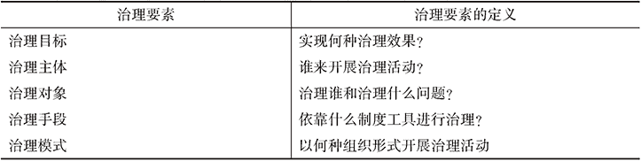
## 二 用五要素框架看欧美算法治理的异同
整体来看，欧盟偏重行政干预，美国更倚重市场调节，二者既有共通经验也各有策略。

### （一）治理目标：欧盟以立法先行抢占规则高地，美国以监管敏捷护航创新
欧盟的政策路径呈现由软到硬的演进，先以政策建议和伦理指南做柔性引导，再推出带惩罚措施的法律，监管强度逐步提升。新兴技术领域里，欧盟长期重视规则制定，希望以高标准规制重塑全球技术发展模式，并高度强调公民数字人权的保护，打造可信人工智能，倾向预防式规制。

美国则因产业基础不同更看重技术创新和产业领先。白宫相关文件反复强调保持人工智能全球领先地位，规避预防式监管。2020 年白宫科技政策办公室发布的《人工智能应用监管指南》重申减少硬性监管，倡导行政机构与私营部门协同。

### （二）治理主体：欧盟集中于数据保护机构，美国呈联邦与行业多元分散
欧盟把算法治理纳入数据保护框架，以强化个人权利来防范算法侵害。数据规则加算法原则构成其治理体系，形成源头治理的完整性。以《通用数据保护条例》第 12 至 22 条为例，赋予数据主体知情权、访问权、更正权、删除权即被遗忘权、限制处理权、数据可携权、反对权和反对自动化决策权等。

美国在纵向上缺乏统一联邦立法，各州先行先试推出区域性规则；横向上主体多元。联邦贸易委员会以消费者保护和反垄断职权关注算法垄断、歧视和数据滥用。食品药品监督管理局发布算法医疗软件指引，证券交易委员会出台算法交易指引，交通部则把自动驾驶安全纳入现有交通监管体系。

### （三）治理对象：欧美均兼顾私营市场与公共管理
欧盟 2019 年《算法问责与透明治理框架》要求公共机构强制开展算法影响评估，流程包括自我评估并披露目的范围预期用途、公布结果引入公众参与、根据社会监督调整规则。该机制聚焦公共部门，要求制定参与和教育指南并落实采购问责与透明度。对私营部门则实行分级监管，仅对可能导致严重或不可逆后果的系统启动影响评估。2021 年《人工智能法案》则从应用场景维度系统规范私营算法。

美国 2017 年纽约市通过算法透明法案并设立算法问责特别工作组，监督市政府在刑事调查、教师评估、消防、公共住房等场景的算法使用，人脸识别技术在多州多市被禁止用于政府和司法。私营方面，纽约市 2022 年《自动化就业决策工具法》要求就业场景下的自动化决策工具无偏见并接受第三方偏见审计。2021 年《算法正义与在线平台透明法案》禁止平台以算法歧视性处理个人信息。

### （四）治理手段：影响评估成为欧美共同采用的结果控制工具
欧美并未过度强调可解释性或透明度本身，而以结果控制为原则，要求责任主体自评。算法影响评估是典型工具，要求说明系统技术特征与目标，识别潜在风险类型与程度并准备补救措施。该制度已广泛用于环境、人权、数据保护等领域。欧盟的 GDPR 包含数据保护影响评估，框架文件也对公共机构强制要求。

美国 2019 年《算法问责法案》规定影响评估应包括算法设计训练数据与目标描述、数据最小化与存储期限、消费者获取和修改决策结果的权利、对隐私安全和歧视后果的风险评估、降风险措施。纽约大学 AI Now 研究所指出关键要素包括评估自动化决策对公平公正偏见的影响、引入外部研究员审核、向公众披露定义与自评结果、征求公众评论、为受影响者提供正当程序以挑战损害系统。

### （五）治理模式：协同共治，多元主体共同参与
欧盟政府是主导力量，同时重视协同。要求私营部门在研发创新中反思技术后果与伦理，承担道德责任实现负责任创新；提升公众算法素养营造问责氛围；对技术人员引入标准化披露准则，要求主动公开逻辑、使用目标、可能影响；并建立吹哨人保护制度。

美国历来强调政府、企业、行业组织、第三方机构与公众的多主体格局。2016 年科技政策办公室报告建议通过透明度与自我规制伙伴关系处理伦理问题。非政府组织发挥作用，如 ProPublica 揭露量刑算法的系统性歧视，消费者报告组织与美国公民自由联盟推动公众讨论。行业自律方面，2016 年亚马逊、微软、谷歌、IBM、Facebook 联合发起人工智能合作组织，共同推进理解与行为准则。

## 三 我国算法治理的现状与问题

近年来我国密集出台规则，部分走在前列，初步形成中国特色模式，但缺陷明显。

### （一）治理现状
#### 1. 算法治理的法治网络雏形初现
罗豪才教授把软法定义为约束力弱于传统硬法的准法律文件，形式包括合作规制、自律规范等。表 2 显示，我国已初步形成由法律法规、标准指南、行业自律公约构成的硬法与软法共治网络。

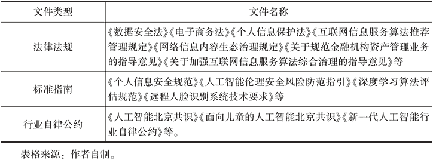
#### 2. 重点场景与问题基本明晰
为追求社会稳定、市场公平、个人公平正义，现阶段重点聚焦自动化决策、人脸识别、互联网信息推送、深度合成等场景，涉及深度伪造、大数据杀熟、算法共谋、数字劳工等治理难题。

#### 3. 互联网信息领域主管机构确立
网信部门作为互联网信息内容管理机构，在规则制定与监管中先行先试，牵头推动工作，关注消费者权益、市场竞争、意识形态管理、国家安全，规则主要适用于互联网信息领域。

### （二）主要问题
#### 1. 治理目标缺乏体系与聚焦
除《个人信息保护法》《互联网信息服务算法推荐管理规定》外，市场监管、网信、央行、人社等部门多以指导意见或指引规范为主，约束力不足。不同文件严厉程度不一，缺乏统一思路与框架。虽普遍提及公平透明，但概念内涵模糊，业界对可解释性和透明度的理解也不一致。

#### 2. 多部门竞争，合力不足
多部委在各自职权内发布低位阶文件，形成部门法规制路径。职能差异导致规范分散，算法全生命周期被切割到不同部门：设计部署阶段归工信，执行应用安全归网信，结果影响竞争或损害消费者权益归市场监管。易产生监管重叠或真空，不利于可信控制。

#### 3. 重市场轻公共，忽视政府算法责任
学界讨论的算法官僚现象反映算法已成为国家权力运行的重要工具，深刻影响公民权利与权力分配。疫情期间健康码即自动化行政的典型，若底层算法失误，治理依据尚不明确。美国纽约、华盛顿、加州等已将行政机构算法决策纳入规制，我国则更重私营部门的算法推荐。公共管理使用算法同样易出现歧视、黑箱、失控等问题，如健康码弹窗缺乏解释与救济。

#### 4. 手段偏行政，司法救济与技术治理不足
算法具有复杂性、系统性、不确定性，监管者与被监管者存在信息不对称，易导致急于强监管或规避监管。《互联网信息服务算法推荐管理规定》要求落实安全主体责任、定期审核、加强用户模型标签管理、特定算法备案，违者可被关停吊销许可，行政监管成为主轴。但对公民权利救济的情形方式程度缺乏明确，司法救济缺位。技术治理如伦理设计在数据源处理、设计优化阶段的应用尚未得到足够重视。

#### 5. 模式以平台责任为抓手，多方责任机制不完善
现阶段以平台问责为主，平台在算法治理中成为关键枢纽，赋予用户知情、选择、退出权。但线性监管路径平台边界不清，易增加成本影响产业发展并挤压中小平台。非平台模式的人工智能研发应用规模庞大，仅靠平台问责无法覆盖。单一归责忽视产业链上开发者与科研人员责任，开源代码扩张加剧风险失控，有必要建立覆盖全生命周期的源代码追责与多方责任机制。

## 四 构建我国算法治理的综合性框架
结合欧美经验与国内短板，提出以下方向。

### （一）在治理目标上，兼顾可问责与高质量发展
算法黑箱特征要求透明与可解释成为重要目标，透明不等于开源代码，而是向公众解释运行规则与功能。可支持可解释人工智能方案，并配套算法审计、影响评估、个体解释权等制度。

平等公正亦是核心，契合社会主义核心价值观与以人为本。重点保护消费者、弱势群体与未成年人，解决大数据杀熟、外卖骑手权益、未成年人沉迷等问题。

安全需兼顾技术安全与使用安全。对不同风险等级场景分类处置，低中高风险采取差异化规制。风险分级应体现中国国情，西方偏重个体自由绝对保护，我国需要在个人自由与公共利益、网络空间安全、信息内容安全、意识形态安全之间平衡。

根本目标是促进算法经济高质量发展，提升自主创新能力与国际竞争力，借鉴美国在竞争优势上的谨慎态度。

### （二）在治理主体上，通过部际联席会议制度形成算法治理合力

算法治理协同破局的关键路径

正因算法治理牵涉技术、社会与法律等多重维度，不同声音对监管架构各有分歧。境外曾出现两类主张：一是参照公共安全委员会设立国家级算法安全委员会，要求算法上线前接受审计、监管与许可；二是效仿美国药品监管模式，对算法实施前置行政审查，只有具备安全可靠的试验依据才能上市，参见 Tutt A 2017。2020 年，中国消费者协会亦提出设立算法伦理监督机构，负责拟定应用伦理、规则与标准并查处不公行为。综合研判，当前在我国另设专门机构条件尚不成熟，更务实的做法是借鉴反垄断与反不正当竞争部门联席会议经验，在多部委协同框架下组建算法治理联席工作机制，实现尺度统一、目标对齐、统筹强化与部门联动，形成治理合力。

### （三）先立通用规则再覆盖多元场景

从治理主体看，全球公共部门对大数据与算法的依赖度持续上升。欧美在约束私人主体算法使用的同时，也同步推进对行政机关算法行为的规范。我国现阶段监管重心集中在市场企业，对公共部门的算法责任关注相对薄弱。学界提及的“算法官僚”与“算法影子官僚”正是这一缺口的体现。算法官僚可视为传统官僚工具理性的技术化延续，一旦被赋予决策权，便会用于推动、引导、刺激、控制、操纵与约束人群行为，段哲哲 2021 年的研究已指出其出错风险。算法影子官僚则指通过政府采购或政企合作进入公共管理链条的算法公司及其人员，参与交通、税务、司法裁决等领域的决策支持。因技术本身存在缺陷且开发方具有逐利动机，这类力量易产生逆向选择与道德风险，郑崇明 2020 年亦提醒需纳入治理。

从应用场景看，自动驾驶、医疗人工智能、智能投顾等业态快速发展，治理诉求日益迫切。目前国内规则体系多聚焦互联网信息推荐，覆盖面受限。自动驾驶、医疗人工智能与智能投顾的规范分散于大量指导性文件与标准，目标、尺度与机制缺乏统一，既削弱治理效率，也抬高企业合规成本。有鉴于此，可推动制定一部《算法问责法》实现综合治理，搭建完整的问责体系，明确问责主体、对象、方式程序及事项。

### （四）补强救济与技术手段

司法常被视作维护公平正义的最后防线。当前算法治理中救济缺位较为突出，需将个人在算法应用中的救济权制度化、规范化并引入司法程序。个人的救济主要涵盖对算法结果的解释权与对算法决策的选择权，一旦权利受阻，应可诉诸司法。考虑到算法应用范围广且主体往往拥有资本、权力与技术优势，个体诉讼面临举证困难与效果有限的问题，应鼓励有资质的公益组织以民事公益诉讼方式参与监督。对算法导致的大规模社会侵害，检察机关也可提起民事公益诉讼。针对算法官僚或算法影子官僚致损情形，被侵害的行政相对人有权向行政机关提起行政诉讼，尹峰林、李玲娟 2021 年的分析已有论述。

算法治理本质上是技术密集型工作，规则出台后应善用技术创新化解新风险。数据泄露与隐私侵害方面，匿名化、联邦学习、区块链等技术被业界尝试。例如部分企业采用联邦学习实现数据不出域的联合建模，已在医疗、金融领域落地。黑箱问题方面，谷歌提出的模型卡片 Model Card、微软的 InterpretML 可解释工具均在探索。IEEE 提出的“遵循伦理的设计” Ethically Aligned Design，闫坤如 2019 年梳理为两点：一是将价值与伦理标准程序化为代码嵌入系统并进行训练评估，Wallach W、Allen C 2009 年已有相关论述；二是为设计者提供行为准则或设计规范以约束行为。推行该机制可确立底层伦理基准，实现事前干预。针对业界创新，还需完善政策导向与专利制度，推进算法相关发明的可专利性，激发创新动力，张吉豫 2022 年亦有呼吁。

### （五）构建多元协同共治格局

协同治理在理论上广受关注，它是一种多主体参与、共识导向的决策模式，能够跨越机构层级与公共-私人-市政边界，安塞尔 C、加什 A 2017 年已有阐释。其特征是主体多元化与协商共识化，关键在于各方具备参与能力与意愿。

在此模式下政府发挥主导牵引作用，欧美实践均高度重视这一点。

社会与市场亦需激活。社会层面，应公开算法规则与评估报告，接受舆论监督。当前公众与学界对算法存在神秘化或污名化倾向，易将数字时代的负面现象简单归咎于算法。应保持客观理性，加强跨学科研讨，重视算法科普，提升全民素养。

市场层面，应由技术、产品与合规人员为主组建行业协会，制定可操作的技术规范，就数据采集与利用等关键议题达成共识，对设计部署风险进行评估。企业应强化自我规制，加快制定算法合规标准、指南与伦理指引，建立内部纠偏机制，在测试阶段记录潜在问题，正式发布后及时响应用户反馈，段鹏 2020 年的平台研究已有建议。各企业可设立吹哨人制度，鼓励内部监督举报并给予保护。

总体来看，算法治理应以政府为核心，畅通社会参与渠道，吸纳企业、智库、行业协会与公众共同参与，重视对话协商，引导各方参与规则制定，并引入第三方独立监督力量。

## 五 研究展望

算法已深度嵌入人类社会系统，对生产生活产生深远影响，加强其设计、开发与利用的治理是一项长期工程。近年相关文献繁多，但国内尚未形成体系完备的综合治理框架，制度设计较为粗糙，实证案例支撑不足。本文结合现有研究，对治理目标、对象、主体、手段与模式进行了梳理，试图为我国勾勒综合治理框架的雏形。算法治理需持续迭代完善，应随技术演进与场景变化调整措施。当前我国集中出台了多项规制举措，其实际成效有待追溯与评估，并据此动态优化治理框架与措施，效果评估将成为未来研究的重要方向。

### 参考文献
丁道勤：《〈电子商务法〉平台责任“管道化”问题及其反思》，《北京航空航天大学学报》（社会科学版）2018 年第 6 期。
段鹏：《平台经济时代算法权力问题的治理路径探索》，《东岳论丛》2020 年第 5 期。
段哲哲：《控制算法官僚——困境与路径》，《电子政务》2021 年第 12 期。
陆凯：《美国算法治理政策与实施进路》，《环球法律评论》2020 年第 3 期。
罗豪才、宋功德：《认真对待软法——公域软法的一般理论及其中国实践》，《中国法学》2006 第 2 期。
宋亚辉：《网络市场规制的三种模式及其适用原理》，《法学》2018 年第 10 期。
汪庆华：《算法透明的多重维度和算法问责》，《比较法研究》2020 年第 6 期。
王德夫：《论人工智能算法的法律属性与治理进路》，《武汉大学学报》（哲学社会科学版）2021 年第 5 期。
王浦劬、臧雷振编译，《治理理论与实践：经典议题研究新解》，中央编译出版社，2017。
王莹：《算法侵害类型化研究与法律应对——以〈个人信息保护法〉为基点的算法规制扩展构想》，《法制与社会发展》2021 年第 6 期。
许可：《算法规制体系的中国建构与理论反思》，《法律科学（西北政法大学学报）》2022 年第 1 期。
闫坤如：《人工智能“合乎伦理设计”的实现路径探析》，《大连理工大学学报》（社会科学版）2019 年第 6 期。
尹锋林、李玲娟：《算法私人治理的三个维度：主体、内容与方式》，《理论月刊》2021 年第 3 期。
俞可平：《全球治理引论》，《马克思主义与现实》2002 年第 1 期。
袁康：《可信算法的法律规制》，《东方法学》2021 年第 3 期。
张吉豫：《构建多元共治的算法治理体系》，《法律科学（西北政法大学学报）》2022 年第 1 期。
张欣：《从算法危机到算法信任：算法治理的多元方案和本土化路径》，《华东政法大学学报》2019 年第 6 期。
郑崇明：《警惕公共治理中算法影响官僚的风险》，《探索与争鸣》2021 年第 1 期。
郑智航：《人工智能算法的伦理危机与法律规制》，《法律科学（西北政法大学学报）》2021 年第 1 期。
Engler A.，“The EU and U.S.Are Starting to Align on AI Regulation”（2022-02-01）［2022-03-20］，https：//www.brookings.edu/blog/techtank/2022/02/01/the-euand-u-s-are-starting-to-align-on-ai-regulation/.
European Parliament，A Governance Framework for Algorithmic Accountability and Transparency（2019-04-01）［2022-03-20］，https：//www.europarl.europa.eu/RegData/etudes/STUD/2019/624262/EPRS_STU（2019）624262_EN.pdf.
Executive Office of the President，Maintaining American Leadership in Artificial Intelligence（2019-02-14）［2022-03-20］，https：//www.federalregister.gov/documents/2019/02/14/2019-02544/maintaining-american-leadership-in-artificial-intelligence.
Reisman D，Schultz J，Crawford K，et al.，“Algorithmic Impact Assessments：A Practical Framework for Public Agency Accountability”（2018-04-09）［2022-03-20］，https：//ainowinstitute.org/aiareport2018.pdf.
Shneiderman B.，“Algorithmic Accountability：Design for Safety，（2017-05-31）［2021-12-08］，https：//www.cs.umd.edu/~ben/AlgorithmicAccountability-ATI-BritishLibrary-London-5-30-2017-v6X.pdf.
Tutt A.，“An FDA for Algorithms”，*Administrative Law Review*，2017，69（01）：83-123.
Wallach W，Allen C.，*Moral Machines：Teaching Robots Right from Wrong*，London：Oxford University Press，2009：25-33.

* * *

[1] 曾雄，北京科技大学文法学院讲师，研究方向为经济法学、数据法学、人工智能法学；梁正，清华大学公共管理学院教授、博士生导师，人工智能国际治理研究院副院长，中国科技政策研究中心副主任，研究方向为科技政策、创新管理、新兴技术及其治理；张辉，浦江国家实验室（上海人工智能实验室）青年研究员，研究方向为人工智能治理、博弈论与政策设计。

### 算法公平：国际借鉴与本土探索
陈玲 孙晋 薛澜[1]

### 摘要
中国正迈入全场景人工智能算法时代。算法既被广泛用于线上消费，也深度渗透日常生活：在私人部门，算法每天产生超 2600 万单出行推荐；在公共部门，算法参与交通信号、地铁班次、路灯照明和交通运维管理。与此同时，大规模应用的出行商旅领域成为算法争议的集中地，引发“算法公平”的社会讨论，推动治理秩序完善。

### 关键词
算法 算法治理 人工智能 协同共治

## 一 时代需要算法公平
代表性争议集中在出行商旅领域的大数据杀熟。2021 年 7 月 13 日《人民法院报》披露了中国首例大数据杀熟判决，携程平台将标价 1377.63 元的商旅商品以 2889 元售给可享受 8.5 折的钻石贵宾客户。法院最终判令携程补差价并支付三倍赔偿，要求修改服务协议与隐私政策，删除不必要的个人信息采集条款，修订版需经法院审核。

该案揭示了平台基于用户数据实施价格歧视的问题，部分老用户为同类产品支付更高价格。以此为代表的算法不公，本质是平台据消费记录与偏好推断用户在特定情境下的价格敏感度，以收益最大化为目标漠视甚至侵害消费者福利，推送更高价选项。

算法公平作为对照概念，自带自然法公平内涵，将以算法公平为基础的人工智能治理原则纳入立法议程已成趋势。

学界对算法公平有三种解读：第一种视其为算法推荐商在服务过程中的程序公平；第二种视其为算法使用者不得侵害消费者利益的结果公平；第三种视其为对个人信息或数据的延伸保护，赋予个人拒绝数据处理的起点权利。三种理解大致对应《互联网信息服务算法推荐管理规定》、《在线旅游经营服务管理暂行规定》和《深圳经济特区数据条例》第二十九条，以及《个人信息保护法》第二十四条。

可见，对算法公平的不同立法思路反映了中国不同部门对全球三大主要算法治理模式的取舍、妥协与融合。

## 二 全球算法治理的三个场域
何谓算法治理？当前全球算法治理的核心场域有哪些？

算法治理是指对全场景人工智能算法大规模商业应用的市场秩序进行全面规范和整顿，其本质是规范政府与市场及不同市场主体间的关系，厘清算法平台、平台商家、个人消费者与监管部门间的法律、治理和社会关系。其目标是通过建立算法公平治理准则，维护互联网时代数字消费市场的公平秩序。

对算法公平定义的不同理解与三大全球治理场域呈现对应关系。第一种程序公平对应社交媒体算法治理场域，主要主体为脸书、推特。第二种结果公平对应购物平台算法治理场域，主要主体为亚马逊。第三种起点公平对应广告平台算法治理场域，主要主体为谷歌。

具体来看：第一，社交媒体算法治理突出对推荐者的规范。美国总统大选争议引发公众对社交媒体算法治理的关注。普遍认为，2016 年特朗普的意外当选得益于其团队对选民意愿的精准操纵。特朗普顾问班农付费聘请剑桥分析，通过操纵社交媒体算法助力大选。

剑桥分析第一步是捕捉用户大数据：在脸书投放人格测试抽奖，吸引 27 万美国选民参与，点击后即获取用户及其社交网络数据，形成 5000 万条个人信息数据库。第二步是据此建立选民政治心理模型，预测政治倾向，锁定中间选民，并利用选民登记信息和撞库手段精确识别摇摆和不投票人群的社交账号。第三步是通过虚假账号、虚假新闻和煽动性内容向不同心理特征选民推送定制信息，影响投票行为。该过程之所以奏效，在于算法驱动的社交媒体时代公众易陷入信息茧房，资讯获取高度依赖算法推荐，茧房效应强化偏见，助长虚假信息传播，不利于社会公平与真实信息流通。社交媒体因此多次大幅修改推荐规则。

第二，购物平台算法治理旨在保护消费者公平权益。2000 年亚马逊成立 6 年后拥有 2300 万注册用户。为获取更多利润，亚马逊以价格实验为名，利用 Cookie 追踪浏览痕迹，对 DVD 实施差别定价：对可能比价的新用户显示 22.74 美元，对被认为购买意愿强、价格不敏感的老用户显示 26.24 美元，差价近 4 美元。亚马逊借此将销售毛利率提升了 15.4%。

算法定价的公开曝光与隐形延续

当年被视为略显稚嫩的价格差别化做法，上线后短短几周便被消费者识破，并引发舆论的集中谴责。随后亚马逊创始人贝索斯亲自致歉，称其属于一次技术试验，并承诺将多收取的部分退还。此事之后，基于算法的差别定价并未消失，而是换了更不易察觉的方式继续存在。美国办公用品连锁史泰博就部署了依托地理位置的新一代智能定价模型，对部分区域用户收取更高价格；亚马逊内部的A9团队则通过提升自营品牌商品在检索结果中的曝光度，来提高自有品牌的销量与份额。一旦这类推荐逻辑被揭露，电商巨头便会面临信任危机，因此主流平台开始强化算法自律，频繁调整规则以规避侵害用户权益的指责。

广告平台治理的核心在于赋权数据主体。在供给侧，数字广告平台可借助算法工具压缩广告位持有者的收益分成。以2021年6月为例，法国竞争监管机构认定谷歌在网络广告市场滥用算法支配地位，处以2.2亿欧元罚单。

法国启动调查的导火索是英国新闻集团、法国费加罗报社与比利时罗塞尔集团的投诉，指控谷歌利用广告算法进行不正当竞争，导致其自有网站及移动应用广告位销售受损。

在需求侧，传统广告模式为统一投放，而数字广告正走向千人千面的定向推送。于是广告平台算法治理的重点在于保障个体有权拒绝平台以精准数据算法侵害正当权益。

数字广告平台借助用户画像的智能分析手段构建数字人格画像，性别、年龄、职业、收入、婚姻状态、教育程度、兴趣爱好、IP地址与地理信息等要素都可能被采集标注。随后结合浏览偏好与购买行为进行定向剖析，推断需求后精准投放，从导流中获取最大分成。

欧盟《通用数据保护条例》明确，网站运营者须事先告知用户会自动记录搜索与购物记录并取得同意，否则按“未告知记录用户行为”处理，且任何数字平台不得再以模糊难懂或冗长的隐私政策换取数据使用许可。鉴于GDPR赋予了个人拒绝权，美国学者Goldberg等最新研究显示，用户拒绝提供个人信息会使页面访问量下降约7%，对电商收入的冲击约为29%。

## 三 中国算法治理的“1+N+1”格局与现实困境

中国算法治理的脉络与全球三大治理场域呈现对应关系。各部门在立法与监管中选择性借鉴了部分思路，致力于在数字市场构建公平并确立监管主导权，形成“1+N+1”政策版图。

具体来看，其一，围绕算法推荐服务商形成以国家互联网信息办公室为主导的体系，《算法推荐管理规定》和《关于加强互联网信息服务算法综合治理的指导意见》是代表性文件。

其二，围绕消费者权益形成多部门协同管理，主要体现为文化和旅游部下发的《在线旅游经营服务管理暂行规定》，科技部要求强化科技伦理意识完善伦理审查等，共同夯实算法安全治理，也体现为《数据安全法》和《网络安全法》在国家、部门及地方的配合，其中涉及工业、电信、自然资源、卫生健康、教育、国防科工、金融等主管部门及公安、国安和网信部门。

其三，围绕个人信息保护形成以工业和信息化部为主导的法律体系，包括已生效的《个人信息保护法》和即将出台的《工信领域数据安全管理办法》《移动互联网应用程序个人信息保护管理规定》等，覆盖个人信息收集使用、车联网、人工智能等重点领域的数据安全标准。

在此格局下，当前国内算法公正与监管主要面临三类难题。

第一，治理体系呈现行政监管主导色彩，缺乏综合的社会治理。以《算法推荐管理规定》为例，第二十五条由网信部门负责算法备案材料的接收与审查，第二十八条由网信部门会同电信、公安、市场监管等部门开展算法安全评估与监督检查，行政色彩浓厚。而国内外通行做法更倾向综合治理。例如国内科技伦理治理领域，《关于加强科技伦理治理的意见》提出从事生命科学、医学、人工智能等活动的单位若涉及伦理敏感领域应设立科技伦理审查委员会，并推动成立中国科技伦理学会，构建社会组织治理体系。

在欧盟，根据《数字服务法草案》和《数字市场法草案》，欧盟将成立欧洲数字服务委员会，广泛征询专家与专业团体意见，形成行政监管与社会治理并重体系。

第二，治理体系偏重行政法规，缺少配套指引性文件。以《算法推荐管理规定》《个人信息保护法》为代表，各部委主要通过完善行政法体系推进治理。欧盟在GDPR之外，还配套了一系列非强制性规范性文件，帮助完善治理配套。这些文件虽无强制约束力，却能规范算法平台、平台商家与个人用户或消费者之间的私法与社会关系。欧盟在2018年发布了《欧盟人工智能报告》和自愿性准则《虚假信息行为准则》，签署方包括Facebook、Google、Twitter、TikTok和Mozilla等；2019年则发布了《可信人工智能伦理指南》和《算法责任与透明治理框架》两份指引性文件。

欧盟计划年内出台网上政治广告透明化规则，进一步推动《虚假信息行为准则》和GDPR的落实。在国内，这一问题具体体现在《算法推荐管理规定》第十四条。该条要求算法推荐服务提供者以显著方式告知用户其提供算法推荐服务，并以适当方式公示算法推荐服务的基本原理、目的意图、运行机制等。

但实践中，即便借助专业律师，个人用户或中小商家也很难向服务商查询到自身遭受的不公平算法待遇的具体情形。即便在携程案中，算法推荐服务提供者始终未向个人用户披露算法歧视、算法滥用和算法垄断的具体事实，当事人只能通过线上线下价格对比的间接证据证明权益受损，却无法知晓“算法黑箱”内部侵害的具体过程。这说明国内有必要组织行业专家共同起草《可信人工智能算法伦理指南》和《算法责任与透明治理框架》。

第三，底层涉及算法相关的数据财产权界定难题。

以联合国贸发会议2021年年报观点来看，在数据产权上，美国倾向于认为社交媒体等脱敏数据归私人公司所有，欧盟倾向于认为这些数据是个人数字资产，而国内现状是大部分大数据掌握在政府或国有企业主体手中。

《民法典》在编纂时由于技术原因未设置单独的知识产权编。在此背景下，个人脱敏数据或公共部门脱敏数据能否用于算法开发或迭代，以及由此产生的收益权归谁，构成立法与社会治理难题。另外，算法本身目前在民法上尚无财产权定性，但不应与软件著作权、发明专利权、产品专利权、商业秘密简单等同。因此，通过完善立法、健全行政监督和社会治理机制，保障用户对个人信息算法的必要知情权，该知情权是用户同意授权个人信息用于自动化算法处理并产生商业化算法推荐的前提，并在算法备案、算法监管、分类指导管理的行政过程中约束行政部门尊重和保护算法相关知识产权，也是必须面对的难题。

## 四 破局路径：自律、规则与问责并行

在全球数字经济时代，国内作为领先者之一，正探索完善算法公正的市场监管、治理和法律监管体系。以人工智能和算法创新为驱动的国内数字经济，是产业转型升级和科技创新驱动的典型范例。在算法治理方向，年来的立法努力标志着国内开始厘清算法公正与治理的产业政策、治理体系和行政监管配套制度。但立法进程才刚起步，人工智能算法公正治理体系建设尚处于初期。

算法公正与治理关乎数字经济与传统经济的公平竞争，关乎科技公平创新与科技向善，关乎科技资本与国家数字安全、社会公众和个人数字权益能否和谐共存。发达国家已遭遇的经济公平与算法歧视、社会公平与算法滥用、市场公平与算法垄断等难题，正对国内全场景数字化、算法驱动的数字经济，乃至社会公共个人信息法益、数字法益和国家数字安全构成挑战。由于缺乏有效的市场监管、治理和法律监管体系，部分数字经济领域出现了先发展后治理、边发展边污染的态势，甚至出现只发展不治理苗头，忽视了算法滥用对社会公共秩序、个人信息法益和国家数字安全的潜在危害。

基于国内外现状分析，提出以下建议。

首先，算法公正与治理离不开有效的行业自律和社会治理机制。根据《数字服务法草案》，欧盟将建立欧洲数字服务理事会。作为独立咨询机构，理事会除欧盟数字服务协调专员外，还会吸纳业界代表和学界专家。理事会将支持协调专员开展联合调查、提出意见建议，并推动相关准则和报告的制定与执行。国内可考虑建立类似机制，促进科技创新与数字安全、公众权益的和谐发展。

其次，算法公正治理规则体系是构建数字安全与公平创新的基准。欧盟的规则体系由一部法律、两个草案和若干治理文件构成。国内可在现有法律和行政法规之外，结合国情和发展状况，着手制定和发布《中国人工智能算法公平政策》《虚假信息行为准则》《可信人工智能算法伦理指南》《算法责任与透明治理框架》《广告算法透明化规则》等指引性文件。

最后，在鼓励全球数字技术创新的同时，应完善算法安全与公平的监管和监督机制，启动《算法问责条例》《数据问责和透明度条例》等行政法规立法的准备和研究，并着手开展算法相关数据财产权的研究。

* * *

[1] 陈玲，清华大学公共管理学院副教授、博士生导师，清华大学产业发展与环境治理研究中心主任，研究方向为决策理论与政策过程、科技与产业创新政策；孙晋，香港中文大学助理教授，研究方向为全球治理、比较历史社会学、法律社会学；薛澜，清华大学文科资深教授、博士生导师，清华大学苏世民书院院长，人工智能国际治理研究院院长，研究方向为公共政策与公共管理、科技创新政策、危机管理及全球治理等。

# 第六部分 人工智能治理之平台治理

## 互联网平台协同治理体系构建

——基于全景式治理框架的分析

梁正[^(\[1\])](#chapter025.html#m1)

### 摘要

数字经济时代下，随着大数据和人工智能的蓬勃发展，互联网平台企业在其建构的商业生态领域中日益占据信息、资源与权力优势。大规模、复杂性商业生态系统赋予互联网平台企业在经济、社会、文化等领域广泛深刻的影响力和复杂多样的作用机制。正因如此，在经济社会数字化转型的大趋势下，亟须从多维视角探讨互联网平台治理之道，并探索构建诸利益相关方共同参与的平台协同治理体系。目标是基于数字治理、平台治理理论创新，借鉴国内外平台治理成功经验，形成内外部利益相关方全景式治理、互联网平台赋能公共部门、公共部门赋权互联网平台、第三方组织积极参与和社会公众共同监督的协同共治机制，打造融合敏捷治理、适应性治理、探索性治理等新型治理理念的综合治理体系，最终以“良治”为平台企业乃至数字经济健康发展提供有效保障和持久动力。

### 关键词

平台治理 协同治理 生态系统 全景式治理

### 一 引言

计算机技术和互联网技术的发明创新和扩散应用催生了各类互联网平台（以下简称“平台”），人工智能和大数据技术让平台的影响力超乎寻常。然而，互联网平台在带动经济社会飞速发展的同时，也引致了多种经济社会风险和不确定性。平台企业在其建构的商业生态领域中日益占据明显的信息、资源与权力优势，大规模、复杂性商业生态系统赋予互联网平台企业在经济、社会、文化等领域广泛深刻的影响力和复杂多样的作用机制。因此，探索构建数字经济时代下互联网平台治理成为必然。考虑到互联网平台涉及众多社会主体，每一类主体同时兼具多种理性视角，本文力图在总结国内外平台治理经验的基础上，从多维综合视角分析平台的理性属性，厘清多元治理主体的理性倾向，建构全景式治理框架，尝试探索构建数字经济时代互联网平台组织的协同治理体系。

## 二 互联网平台治理现状

美国是互联网的发源地，在几十年的发展过程中，美国出台了一系列法律法规以规范互联网内容。美国在平台治理方面关注的问题主要包括网络内容、版权保护、个人数据等。在网络内容上，美国一方面重视保护公民的言论自由，另一方面对网络内容进行管控，比如明令禁止涉及儿童色情淫秽的内容。在版权保护方面，美国不断平衡互联网发展过程中平台、用户、权利人之间的利益关系。1998 年美国《数字千年版权法案》（`DMCA`法案）确立了以“通知—删除”规则为核心的“避风港原则”。在随后《数字千年版权法案》的国会报告中，又很快确立了“红旗原则”，旨在对“避风港原则”进行补充与纠正。在个人数据保护方面，2018 年 4 月，扎克伯格因用户隐私数据泄露以及 Facebook 上的虚假信息等问题受到了美国国会参众两院的质询，参众两院要求 Facebook 必须做出努力和改变。近两年，美国开始重视对平台垄断问题的治理，2021 年 6 月 23 日，美国众议院表决通过了《终止平台垄断法案》等五项互联网平台反垄断相关法案，旨在促进互联网行业有序竞争，并推动美国成为全球数字经济领域规则制定的领导者。

欧盟早在 2010 年就启动了对谷歌的反垄断调查，平台垄断问题的治理一直是欧盟的重点，其已经相继对谷歌、Facebook、亚马逊等平台发起反垄断调查。除了办理反垄断案件，欧盟还制定平台领域的新规，2020 年 12 月，欧盟委员会提出两项新的立法，即《数字市场法》和《数字服务法》，以加强平台领域的竞争保护。现今，欧盟更加重视人工智能领域和算法领域的治理问题，如在 2021 年 4 月 21 日，欧盟委员会提出了人工智能（`AI`）法规，旨在将欧洲打造成为值得信赖的人工智能（`AI`）全球中心。

在我国，平台治理问题复杂多样，如在电商领域，主要涉及网络售假、虚假宣传、不良信息等；在社交网络领域，主要涉及反欺诈、个人信息保护等；在网络游戏领域，主要涉及未成年人保护、版权保护等；在音视频领域，主要涉及版权保护、消费者权益保护等；在信息内容领域，主要涉及违法信息、虚假信息、低俗内容、算法推荐等治理问题。目前，我国主要从细化法律规则、引入技术监管手段和加大执法力度等方面加强平台监管，在细化法律规则方面，2021 年 3 月，国家市场监督管理总局发布《网络交易监督管理办法》，进一步完善网络交易的监管规则，各个地方也相继出台本地规则，比如浙江出台《浙江省电子商务条例》，重庆出台《网络交易平台经营者落实法定责任行为规范》。2021 年 11 月，《个人信息保护法》实施，为个人数据保护提供了法律依据。在数字技术监管方面，市场监管部门设立电子商务 12315 投诉维权中心和网络商品治理监测中心等机构，加强对网络交易的监督。2021 年 2 月 26 日，浙江省市场监管局发布平台经济数字化监管系统“浙江公平在线”，该系统运用大数据、云计算、人工智能等“互联网+”技术，对重点平台、重点行为、重点风险等实施广覆盖、全天候、多方位的监测、感知、分析和预警，加强网络交易平台监测。在执法力度方面，市场监督管理总局相继对阿里巴巴和美团涉及“二选一”行为进行反垄断处罚，国家网信办等部门对滴滴启动网络安全审查。2021 年 10 月 29 日，国家市场监督管理总局同时发布了《互联网平台分类分级指南（征求意见稿）》和《互联网平台落实主体责任指南（征求意见稿）》两个重要文件，提出了平台分级分类治理的基本原则，并就不同平台主体责任提出明确要求，标志着我国对互联网平台的治理进入了一个新的阶段。

综上所述，全球主要国家或地区的平台治理既有共性问题也有个性问题，其中一个共同点是过于依赖政府的垂直管理方式，虽然政府出台了众多法律法规和管理条例，但是，缺乏对多元主体在平台治理中发挥作用的考虑。基于此，本文尝试提出构建平台协同治理体系建议，为完善平台治理模式提供助力。

## 三 多维理性视角下的互联网平台

作为数字经济的典型经济形式和组织结构，互联网平台企业关涉范围已经远远超出传统产业经济理论讨论的范围，其“触角”已经到达政治权利、社会生活、公众心理、文化传播、环境保护等领域的方方面面。互联网平台以网络通信技术和双边算法（或多边算法）等系列技术为基础，附着其上的价值则是利益相关方围绕互联网平台展开的各类交互行为的直接或间接体现。而无论是“平台”本身，还是“治理”本身，抑或是“平台治理”，都是利益相关方（`stakeholder`）理性（或者“有限理性”）行为的产物。理性与感性相对，重在按照事物发展的规律和自然演化原则来思考，将行为目标化，追求回报最大化或满意化。从理性视角出发去考察平台，意味着从多维视角去解构平台主体行为逻辑，同时考察其背后诸治理主体的理性倾向，从而提出完备的全景式治理框架。

平台治理的多面透视

从政治理角度看，资本裹挟下成长起来的线上生态，已经具备侵蚀公权力根基的现实能力，并分流了政府的组织职能。开放分散的架构让既有政治秩序受冲击，甚至连带国家安全风险。平台之所以被拿来当典型，是因为它的触角已渗入各阶层日常生活的每个角落，从物质需求到精神世界几乎无所不包，深刻改写了社会运行方式与政府管理逻辑。传统国家赖以维系的暴力垄断正被数据集中度稀释，平台掌握的信息量远超常规统计，借助大数据能产生远超传统治理的扰动力，甚至具备颠覆秩序的潜能。应急场景下，平台的反应速度与动员效能常优于政府，倒逼行政系统扩大技术应用广度与深度。数据汇聚推动大数据与人工智能规模化落地，而协议本身的开放属性让行为监管难以做到全时全域覆盖，一旦失控，非法组织便可能借道进行意识形态渗透或煽动色彩行动，直指国家安全。

技术视角的核心是厘清支撑体系与运行逻辑。所谓技术并非单一模块，而是算法、采集与管理、算力等组成的复合体，与人工智能技术栈高度重叠。算法经历了从检索查询到信息共享再到搜索，再到当下匹配与推送的演进；数据底座涵盖传感器网络、图形界面、鼠标浏览器等采集手段，以及关系型库、网络型库、分布式集、数据仓库与大数据等管理手段，并辅以安全、隐私保护、区块链等基础支撑。运行逻辑有三：采集与再交换不可分割，单独采集退化为清洗团队，单独交换退化为中介，真实平台是多源采集后清洗聚合结构化再分发；分解与聚合带来效率提升，采集本身可分布式适配，数据形态多样，经清洗补全可统一格式，聚合是交换的前提；互补性创新驱动生态跃迁，多主体耦合产生内部子系统协同与外部需求牵引，共同催生模块创新、结构优化与系统重构。

经济视角下，数字平台与平台经济基本同义。它是数字经济的重要组成部分，也是民营经济的重要载体，其商业模式在于加速信息流动与共享效率，修补工业时代商品流通中的信息鸿沟。模式源自雅虎，虽内涵多次演变，本质未变：依托网络效应构建经济网络，以信息优势获取收益并以交叉补贴维系交易体量。这造就行业分布特征：成长期普遍以高额补贴换取份额，市场常呈现七三格局，头部占据七成以上，中小合计难超三成，在人工智能与大数据加持下极化更明显；消费端呈现长尾特征，多样性提升消费者剩余；长尾虽激发细分创新创业，却也挤压中小企业的利润空间。

社会视角呈现双刃属性。网络空间的包容性为精神文明建设打开快捷通道；同时它也是新风险源头，改写风险生成机制，扩大风险可达范围，成为风险社会的推手。传统安全与网络安全在落实时都离不开平台支撑，平台已成为问题与风险的集散枢纽，任何波动都可能被无限放大。网络风险具层次、无限延展与即时三特征。人工智能与二维码、人脸识别、移动支付等应用普及重塑消费生活与沟通方式，大幅提升便利。但安全隐患凸显：公民信息被窃、人肉搜索、网络暴力、恐怖招募与募资频发，虚假信息借道高速传播，隐私、信息乃至生命财产因运行逻辑受威胁。

历史视角显示，平台既是区域与科技文化交流的参与者，也是中华文明走向世界的通道之一，更是文化塑造者。文明互鉴自丝路开启，中华始终以包容开放姿态推动交流。从一带一路到世界互联网大会，政府与各平台共同搭建互联互通与共享共治的国际场所，谋求共识、合作与共赢。全球化与开放性的技术属性拓展了展示文明魅力与国家魅力的渠道，提升吸纳先进精粹的能力。平台也是信息通信人才蓄水池与计算机、互联网、大数据、人工智能创新的推进器，在错失前几次工业革命的背景下，成为引入世界技术、参与全球创新的重要力量。文化塑造上具有两重性：融媒体时代可策划正能量议题助推网络文明，也可能因治理缺位成为丧文化、祖安文化等亚文化滋生地。

心理视角关注即时交互对空间与时间感知的改变，使用者产生距离被拉近、时间被压缩的错觉，进而影响生活半径、居住与职业选择。匿名特性既诱发网络欺凌，也带来复杂心理效应。积极面是便捷交流促进亲密友谊，对内向者尤为明显，更多自我表露带来充分讨论，有时改善现实人际。消极面是线上互动挤占线下交往，降低社会参与，幸福感下降，易出现群体性孤独、抑郁、冷漠与人际疏离。接入门槛降低让未成熟青少年过早接触不良内容，增加犯罪诱因。技术进步赋予平台近乎无孔不入的监控能力，失控时易被滥用；智能推荐的大规模应用强化回音室效应，使视野被动窄化，走向固化乃至极端。

环境视角下，平台既是能耗大户也是低碳倡导者。宣传中常被塑造为环保形象，现实却是人工智能研发带动海量数据中心与计算中心投入，建设与运行的碳排放与其它产业无异。数据驱动型架构下，边际能源利用率随数据与算力增长而下滑。华北电力大学与绿色和平2019年报告指出，2018年中国数据中心碳排放约9855万吨，预计2023年将达1.63亿吨，电耗与碳排的攀升是行业高速发展的隐形杠杆。虽未进入排放前列，增速使其很快成为大户。《清洁制造杂志》2018年研究提示，若不干预，到2040年全球信息通信产业温室气体年增长率可能从2007年的1%至1.6%升至14%以上。另一方面，绿色发展与环境保护已成基础设施与平台必须遵守的治理规则，部分平台成为公众参与环保的枢纽，借助新环保法赋予的知情、参与、监督权利，成为公众与行政部门沟通的桥梁。

四 全景式治理框架

治理相关方即是多维理性背后的多元主体。广义上涵盖所有被技术覆盖的社会成员：公众、市场组织、非营利机构、国家与政府等。主体在概念化、判断、分析能力上存在差异，治理必须兼顾能力差异。有限理性决定各主体在决策中拥有不同的理性权重序列，能力分化导致参与程度不一。为兼顾成本与效率，需把相关方划分为内部与外部治理主体。内部主体直接参与构建与运行，外部主体间接参与。

内部主体的激励与偏好决定价值创造与分配。所有者经济理性最强，经营者技术与经济并重且强于其他维度，双边或多边市场参与者经济与社会理性更高。经济偏向是内部主体的共同底色，这也是平台常被视作经济代名词的原因之一。但其它理性属性决定治理不能仅限内部，外部不可或缺。

外部制度与文化环境对创设与发展至关重要。外部主体虽不直接参与运营，却作为公共价值确立者、规则制定者与监督者，为长期存在提供基础保障。外部主体的经济偏向相对较弱。国家侧重政治与历史理性，政府偏好随阶段性目标与战略调整，主要用于识别与解决经济社会发展的根本矛盾。社会组织构成多元：消费者协会社会理性突出，第三方认证技术理性突出，环保组织具环境理性，媒体强调心理理性等。公众参与具有两面性：作为使用者重经济理性，作为影响承受者重社会理性。

不同理性偏好易导致价值冲突，进而出现市场失灵、政府失灵、社会失灵、伦理失范乃至公共价值失灵。治理能力差异是客观事实，能力维度为价值提供锚点与沟通可能。内部主体间差异体现于技术与管理能力，经营者拥有信息与技术优势，其他主体多只能借助结构与反向监督等非技术手段制衡。外部主体的能力更多体现于公共价值确立与保障，其中国家与政府发挥统筹与价值驱动的引擎作用。偏好与能力交织决定行为与工具选择。

综合理性分析在于明确理性内涵，为治理提供抓手。整合理性维度与主体维度可构建三维体系：主体专业化选择、多理性维度、治理能力含工具与手段。全景框架提供理性坐标系，精准定位主体与维度，为包容审慎分类监管提供空间，有助于厘清分工合作，确立方向与路径，为协同治理提供分析框架。

五 协同治理机制

传统治理多强调政府联合第三方规制经济行为。全景框架提醒，治理需要把广大利益相关方纳入进来，在价值共识基础上梳理分工，结合能力选择匹配方式与工具，形成合作协同机制。

首先需形成价值共识，这是合作的根基。平台治理的价值原则可概括为包容、共享、审慎、负责。包容是对非主观故意、轻微且未造成明显危害的首次违法建立容错机制，给予改正机会，尊重技术规律与创新规律，为新业态提供预期与空间。共享是公共价值应为所有相关方共有，机会平等，提升治理能力，促进共同进步。审慎是划定安全底线，既不放任也不一管就死。负责意味着发展与治理要促进社会向善与绿色发展，符合环境友好与资源节约，推动协调发展、缩小区域差距、提升弱势群体网络适应性，消除数字鸿沟。

其次需梳理价值分工，取长补短形成合力。平台相关方都是治理主体，鉴于能力与优势各异，应以平台组合与公共部门为核心，遵循公共价值共创原则，形成政府领导、平台参与、社会协同、公众监督、法治保障的有效分工与合作机制。从价值分工看，多元协同也是社会总福利最大化的客观要求。最终要探索形成平台积极赋能公共部门、公共部门有限赋权平台、社会组织与利益相关方积极参与并监督的良性共治循环。

平台协同治理的三条操作主线

从实践落地的角度看，平台协同治理大致能归纳为三条相互支撑的推进路线。

第一条是技术能力的向下渗透。具备较强技术判断力和市场敏感度的平台，往往会主动把大数据、人工智能等新一代工具介绍给公共部门，补足其对新业态、新场景、新业务的认知短板，削弱信息不对称和技术盲区，帮助政府更精准地锁定治理对象与关键环节，为后续协作奠定技术共识。另一方面，政府要在实操中真正消化并用好这些工具，重塑组织架构与流程运转，提升公共服务的质效。经验表明，层级化官僚运行方式已经难以匹配数字经济和平台经济的节奏，拥抱新技术是避免治理失灵的关键抓手；只有吃透平台的技术原理和体系架构，监管者才能看清其产业生态与运行规律，找准风险点并实施针对性干预。

第二条是审慎授权配合差异化监管。互联网把原本边界清晰的工业社会改造成无边界的流动空间，时空、地域与文化壁垒被打破后整合互动成为常态。单靠行政规制已难以实现市场最优。线上交易跨区甚至跨境，传统条块化管理明显失效；平台上的交易主体类型繁杂、频次极高，传统手段难以应对高频交易与在线支付等技术形态。因此需要更多利益相关方进入平台治理与线上公共事务，形成开放、扁平、平等的协作网络。监管上要差异化操作。对线上食品、线上药品、特种设备，以及故意违法造成群众生命财产重大损失的行为，政府须直接介入、提高准入门槛、完善风险监测，守住安全底线。对风险较低、非主观故意且后果轻微的服务类网络主体，则以引导教育为主、惩戒为辅，帮助其规范提升。互联网的开放与去中心化让相对弱势的消费者得以在线上实现组织动员等线下难以完成的行动，公共部门应予以鼓励与保护。

第三条是第三方与公众的深度参与。以全景式综合理性视域下的平台协同治理体系为例，在公共价值共识的牵引下，结合第三方与社会各方的治理能力，按领域、场景与环节划分价值责任，配合政府与平台完成治理任务。通过众包、协同等形式，把原本被动接受组织的第三方与利益相关方转化为自我组织的主体。对第三方与公众而言，互联网重塑了信息权力，网络媒体的话语权增强，信息发布与传播大幅缩小了传统媒体与个体在信息赋权上的差距，形成持续而强劲的监督合力。

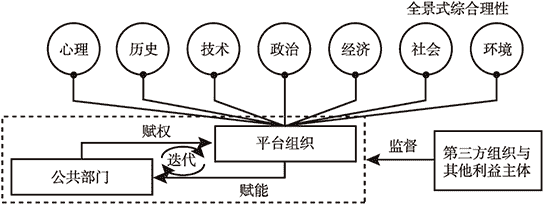

图 1 全景式综合理性视域下的平台协同治理体系

图片来源：作者自制。

在此基础上，各治理主体需要形成动态互动的协同共治机制，并随平台演进与治理需求不断创新方式与工具。主体的理性偏好与诉求并非一成不变，机制必须保持迭代优化的思维。总体上，国家与政府代表政治理性与历史理性，会在特定时期或区域阶段性调整取向；技术上可能不及平台内部主体，但能把治理意志转化为强制性制度发挥关键作用。面对线上线下交织的情境，政府作为协同机制的驱动端，更需因时因地调整机制、创新理念。对新业务新业态可尝试“沙箱监管”等敏捷治理模式，先行发展再及时纠偏；针对平台构建的双边多边市场所呈现的长尾效应，既能带动广泛就业又能提升消费者剩余，可坚持市场调节为主、强化政府规制激励的适应性治理；对深度学习、强化学习、区块链等存在技术黑箱的新技术，则应秉持探索性治理，在守住安全底线前提下分领域先试先行，激发创新活力。最终形成敏捷治理、适应性治理、探索性治理相互融合的综合体系。

## 六、结语

数字经济时代，大数据与人工智能快速演进，互联网平台构建起规模庞大、结构复杂的商业生态，在信息、资源与权力等方面占据优势，对经济、社会、文化产生深远而复杂的影响。基于“理性—动机—行为”逻辑，从政治、技术、经济、社会、历史、心理、环境七个维度审视平台的理性属性，可以发现利益相关方赋予平台丰富的理性内涵，而各治理主体在不同维度存在偏好差异与能力差异。围绕多维理性、多元主体与差异化治理能力构建全景式框架，有助于实现平台良序治理。在此框架下，多元主体协同共治需要形成基本的公共价值共识，并通过平台积极赋能政府、政府审慎授权平台、第三方与利益相关方积极参与监督三条路径，形成良性互动的协同机制。同时，为平衡发展与治理，多元主体应坚持迭代优化思维，保持机制动态互动，形成融合敏捷治理、适应性治理、探索性治理等新理念与范式的综合体系，最终为平台组织乃至数字经济的健康发展提供有效保障与持久动力。

### 参考文献

北京大学课题组、黄璜：《平台驱动的数字政府：能力、转型与现代化》，《电子政务》2020 年第 7 期。

陈威如、王诗一：《平台转型》，中信出版社，2016。

樊鹏：《利维坦遭遇独角兽：新技术的政治影响》，《文化纵横》2018 年第 4 期。

蓝志勇：《全景式综合理性与公共政策制定》，《中国行政管理》2017 年第 2 期。

梁正、余振、宋琦：《人工智能应用背景下的平台治理：核心议题、转型挑战与体系构建》，《经济社会体制比较》2020 年第 3 期。

王健、余建华、李开盛：《国际关系中的变局与治理》，上海社会科学院出版社，2021。

王利明：《人格权法研究》，中国人民大学出版社，2012。

肖红军、李平：《平台型企业社会责任的生态化治理》，《管理世界》2019 年第 4 期。

〔英〕维克托·迈尔·舍恩伯格、〔英〕肯尼思·库克耶：《大数据时代》，盛杨燕、周涛译，浙江人民出版社，2013。

袁熙：《互联网+》，人民邮电出版社，2015。

张辉、陈海龙、刘鹏：《智能时代信息通用技术创新微观动力机制分析——基于沃尔玛信息技术演化的纵向案例研究》，《科研管理》2021 年第 6 期。

Simon，H. A.，*Administrative Behavior*，New York：Free Press，1965.

Wu Y，Zhang W，Shen S，Mo Z，Peng，Y.，“Smart City with Chinese Characteristics Against the Background of Big Data：Idea，Action and Risk”，*Journal of Cleaner Production*，2018，173（01），pp.60-66.

* * *

[\[1\]](#chapter025.html#w1) 梁正，清华大学公共管理学院教授、博士生导师，人工智能国际治理研究院副院长，中国科技政策研究中心副主任，研究方向为科技政策、创新管理、新兴技术及其治理。

# AI 时代平台治理：议题、挑战与框架

梁正 余振 宋琦[^(\[1\])](#chapter026.html#m1)

**摘要：**人工智能的迅速发展推动着拥有算力、数据和资本的互联网平台在要素集成和资源配置中发挥越来越重要的作用。然而，人工智能与平台经济的深度融合也带来或加剧了诸多治理挑战，数据治理、算法正义以及权责划界等议题在新时期的平台治理实践中尤为凸显。尽管公共部门与平台企业对这一系列问题采取了不同治理方式，但均存在一定的局限性。同时，责任分配与数据共享机制的缺失极大制约了政府和平台的共治实践。文章认为，中国当前的平台治理体系在理念、主体、目标、场域、内容和工具上都尚未适应人工智能等新兴技术应用所带来的转型挑战。基于此，文章从治理主体、治理对象和治理工具等维度出发，对人工智能应用背景下的平台治理体系进行了初步构建，在此基础上提出了“敏捷适应、多元共治、场景驱动、技术赋能”的治理建议。

**关键词：**人工智能 平台治理 数据治理

## 一、引言

在数字经济时代，平台企业已经成为将数据和其他生产要素结合起来的主要组织（王勇、戎珂，2018）。从 2008 年到 2018 年，全球前十大上市企业中平台企业的市值占比从 8.2%上升至 77%（中国信息通信研究院，2019）。得益于庞大的用户群体与市场规模，中国孕育了一大批具有强平台特征的巨型企业（如阿里巴巴、腾讯、百度等）与独角兽企业（如滴滴出行、美团、字节跳动等），围绕平台经济的诸多新业态、新模式也正在不断涌现，创造出巨大的经济社会价值。正如一些学者所指出的，如果说以往的工业革命是围绕工厂的变革，那么当前的变革就是以这些数字平台为中心而展开的（Kenney M，Zysman J，2016）。

近年来，人工智能技术迅速发展，在赋能制造、金融、交通、医疗、安防等传统行业的同时，与互联网平台不断深度融合。总体上，我们今天所指的人工智能是建立在现代算法基础上，以历史数据为支撑，从而形成能够和人一样进行感知、认知、决策、执行的人工程序或系统（贾开、蒋余浩，2017）。在人工智能的推动下，拥有数据、算力和资本的互联网平台在国民经济体系中进行要素集成和资源配置的作用愈加凸显（Lee，Zhu，Jeffery，2018）。互联网平台在自身的战略制定与业务布局时也更加重视对技术红利的挖掘，在机器学习、智能机器人、算法分发等人工智能技术领域进行深入布局。以 Google、Amazon、Facebook、阿里巴巴、腾讯等为代表的互联网平台企业都处于当前世界人工智能研究与开发领域的领先阵营。

人工智能在平台经济体系中的深度嵌入为社会各方带来了诸多便利，但同时也为用户、公众、政府部门以及其他利益相关者带来了一系列冲突。这其中既有传统治理问题在平台经济中的具体显现（如负外部性、虚假信息和数据泄露等），也有因人工智能发展所带来或加剧的新兴问题（如隐私保护、算法歧视和责任分担等）。随着计算能力的基础性跃升，数据和算法成为全球人工智能技术竞争的焦点，围绕数据的争夺和算法的使用已诱发了一系列新的平台治理问题。例如，虽然传统平台上也存在用户隐私数据泄露的情况，但是这些数据多为用户呈报的身份、收入、住址等静态个体外在信息，而在人工智能深度应用的情况下，平台企业可以大量采集用户的动态行为数据，利用智能算法推算用户的性格特征、兴趣爱好、社交倾向等个体属性，从而准确地描绘出用户的“数据画像”，这使得人们难以再拥有传统意义上的“隐私”。另外，人工智能技术具有“算法黑箱”等特征，使得用户和平台间存在越来越多的信息不对称，平台用户的地位越来越弱势，面临越来越多诸如“大数据杀熟”等歧视的风险。因此，人工智能应用背景下的平台治理已经成为许多数字经济领先国家优先关注的政策议题之一。西方国家长期以来对平台企业实行“避风港”原则，但近年来随着平台上的治理问题越来越突出，这些国家也开始强调提升对平台在信息内容、数据隐私和算法等方面的监管。

实现平台经济的“善治”已经成为推进国家治理体系和治理能力现代化在数字经济领域的重要目标。然而，当前学术界对这一新兴治理领域的讨论仍不充分，且多是从经济学、法学等视角出发对个别现象进行描述性分析，缺乏对当前平台治理范式转型的系统认识与整体把握。工业经济时代的传统政治经济学理论，如国家能力、政府与市场关系，在数字经济与新兴技术迅速发展的背景下难以对现实问题进行有效的回答。此外，中国的复杂国情影响着其治理体系与治理能力的现代化之路（薛澜，2014），其独特的政治、经济和社会等体制的惯性一方面制约着平台治理体系的建设，另一方面也将在新技术、新业态的不断冲击下调整适应。本文认为，平台治理是指“以私人所有形式存在的平台企业在收集数据、匹配信息、提供服务等业务过程中可能会引发一系列超越组织边界的社会问题，以政府、企业、社会组织等为代表的多方利益相关者对这些问题进行监管、规制以使之符合公共利益的过程、制度和非正式安排”。基于对平台企业、人工智能企业、政府部门和行业协会等主体开展的广泛调研，本研究剖析人工智能应用背景下平台治理的核心议题，在总结中国治理现状的基础上识别当前中国平台治理所面临的系统性挑战，最后提出适应新技术和新业态的治理建议。

## 二、人工智能应用背景下平台治理的核心议题

平台的本质是一个双边市场（Rochet，Tirole，2006），其最大特征在于网络规模效应，即平台的用户规模会显著影响用户使用该平台的效用或价值。因此，早期文献中的平台治理主要是指平台所有者如何设计、管理和控制平台以获得竞争优势（Manner et al.，2012）。相应地，这些平台治理研究主要关注影响平台企业本身获得竞争优势的要素及其治理结构，如价格结构、边界要素、开放度、技术架构、竞争策略等（Evans et al.，2011；李允尧、刘海运、黄少坚，2013；Song et al.，2018）。随着平台发展带来越来越多的社会问题，平台治理不再仅仅是平台所有者对平台自身的内部管理，而是外部主体和平台所有者为实现公共利益对平台问题的共同治理（王勇、戎珂，2018）。因此，平台治理已经越来越具有准公共性质，其内涵延伸到社会治理乃至国家治理层面，但现有研究仅局限于关注平台所有者，忽略了政府、用户和第三方商户的作用（Schreieck，Wiesche，Krcmar，2016）。虽然已有学者指出了多元主体参与的重要性，但是并没有回答“多元主体为什么愿意参与以及如何参与”这两个关键问题（贾开，2015）。

传统的平台治理针对的主要是虚假信息、违法内容、商品安全和知假售假等负外部性问题，人工智能技术的应用为解决这些传统问题提供了有力的技术手段，但同时也迫使政策制定者不得不面临一些新的治理挑战，如隐私保护、算法歧视和责任分担等，而这些问题都与人工智能的两个支柱有关：数据和算法。能够自主识别、判断和决策的算法是人工智能的关键能力所在，而数据是“喂养”算法的核心要素。互联网平台掌握大量的数据和先进的算法，极大增强了平台的权力，而政府、用户、社会组织等主体缺乏相应的数据和技术能力，在要素共享缺乏规则激励的情况下，多元共治很有可能流于形式。因此，人工智能应用背景下的平台治理面临传统问题与新问题交织的复杂局面，虽然传统平台治理的许多挑战仍然存在，但是数据治理、算法正义与权责重塑等已经逐渐成为更加凸显的治理议题。

### （一）数据治理

作为人工智能发展的核心要素，数据被认为是“新型的石油”。互联网平台也早已更加重视数据的采集、利用和价值挖掘。例如，许多互联网平台都已经开始向手机、智能音箱、汽车等终端设备延伸布局，其主要目的在于占领更多获取用户数据的端口，从而为其他增值服务提供更多精准信息。然而数据又显著不同于石油等传统要素：首先，数据不会枯竭，具有无限增长的特征；其次，数据具有非竞争性，可以被不同主体同时使用；最后，数据具有外部性，一个个体创造的数据可能包含许多他人的信息（Goldfarb，Gans，Agrawal，2018）。在平台生态系统中，数据的生产和使用有多方主体参与，数据的所有权和流动规则都难以清晰界定。平台用户不仅仅是消费者，也是平台数据的主要生产者，因而用户是平台数据的“产消者”（Prosumer），所产生的数据集具有公共属性，而平台是这些数据的实际控制者。数据的这些特性显著影响平台治理的效果，但是现有的平台治理研究和实践却对数据治理没有给予足够的关注。例如，李等人（Lee，Zhu，Jeffery，2018）通过调查 Facebook、Youtube、eBay、Uber 等平台的数据治理规则，发现这些领先平台企业都没有明确界定过程数据的所有权，也没有规则判定数据提供者在平台上的贡献及相应收益分配的机制。另一方面，平台虽然实际上掌握了基于用户的海量数据，但在法理上缺乏收集公共数据的制度合法性，在主体间数据共享与交换上尚缺乏清晰且具有弹性的共识性规则。

### （二）算法正义

随着人工智能在平台运营中的应用，平台规则和功能更多地被嵌入在“不可解释”的算法之中，因而需要新的方法和途径来评估这个“黑箱系统”的投入与产出过程（Pasquale，2015）。此外，算法与个体在数字化社会中的生存发展息息相关，如将算法应用在犯罪评估、信用贷款、雇佣评价等关乎人身利益的场景中，一旦产生“算法歧视”，将会对个人权益产生极大的影响。然而，引发“算法歧视”的原因通常难以跟踪。有些歧视是数据有偏性造成的，有的是机器自我学习造成的，还有的是人为造成的，要在系统中发现有没有存在歧视和歧视根源，在技术上是比较困难的（国家人工智能标准化总体组，2019）。由于算法“黑箱”的存在以及资本的逐利性本质，在监管缺位的情况下平台企业很容易滥用算法从而导致公众利益受到损害。同时，许多信息平台通过算法向用户不断推荐同质化的内容从而造成“信息茧房”效应，带来了深远的伦理影响。

### （三）权责划界

数据在放大平台企业于数字经济体系中的影响力与控制力的同时，也让算法的黑箱属性成为权力被滥用的放大器。进入人工智能阶段，平台经济的垄断形态与外溢效应正在改写。个性化、精准化服务把原本统一的市场切割成无数个孤立的个体，用户的搜索与比价通道被切断，平台成了唯一掌握全貌的知情方。商家有强烈动机基于个人偏好推送特定商品，并依据收入、消费倾向实施差别化定价追求利润最大化。平台的内部制度与运营规则对上亿用户形成实质性约束，对入驻、退出、评价等拥有生杀予夺的处置权。凭借技术、数据、管理上的综合优势，行政机关为提升执法效能，主动将部分职能让渡出去，平台因此衍生出“准行政权力”。人工智能让平台的行动半径进一步扩张，政府的部分公共管理职能出现弱化甚至加速替代的趋势。不过，政府依然掌握着核心的执政权力和海量的公共数据，治理主体之间权责如何划分，直接关系到资源再分配的走向，也决定着平台经济能否可持续发展。

## 三 中国平台治理的现实图谱：内管、外管与共治的实践

中国互联网平台从跟跑到领跑，发展路径极快。在线下信用、线下生态尚未成熟的背景下，平台填补了传统行业的空白，为产业实现跨越式成长提供了跳板。正因线下信用体系薄弱，许多治理难题被搬到线上，进而演化为平台自身的痛点。如今人工智能加速渗透，旧问题仍未落地，新技术冲击又让既有治理框架承压更重。

当下实践中，传统监管仍占据主导，侧重虚假信息等老问题，对隐私保护、算法歧视等新风险关注滞后。治理主体多集中于政府与平台自身，第三方机构基本缺席。现实管制主要落到两条线：平台内部自行对商家与消费者交易行为进行管理；公共部门以法规与司法手段进行监督。政企协同共治已有案例，但体制机制上的阻碍不少。

### （一）平台内部监管
为了吸纳并留住商家和用户，平台必须建立清晰规则，营造可信交易环境。对照公共部门，平台内控手段更多元、反应更快、成本相对更低，尤其在掌握海量交易数据时，对违规行为的判断更具客观性。当前中国平台监管仍聚焦虚假信息、假冒伪劣、人身安全、违法商品与内容等传统领域。平台主要通过资质审核、质量管控、声誉机制、技术筛查来执行。比如美团外卖在客户端上线“举报商家”功能，用户可反馈刷单、价格虚高、资质造假等问题；京东则依赖敏感词过滤与人工智能手段拦截违法商品和不良内容。

但平台本质是商业组织，内控的出发点是优化交易环境以获取更好回报，对与其盈利无关的外部性问题缺乏内在约束动力。现阶段重点仍在假信息和违法交易，负外部性、算法歧视等几乎不在雷达内。多数平台已发布入驻商家审核标准，实际操作中为抢占规模效应常放松资质审查，埋下安全隐患。即便严格审查，证照等关键数据多存于政府部门，平台难以单独完成完整认证。对商家违规，平台只能在合同范围内做经济惩罚，约束力有限。规则不健全时，监管人员也可能利用权力寻租。数据与算法完全掌握在平台手中，技术专业化与规则不透明，让消费者处于绝对弱势，商家同样可能被不公平对待。例如“二选一”强制选择在《电子商务法》出台后被遏制，平台却可借助隐蔽的技术手段继续施压。

### （二）政府监管
相比自律，政府监管公信力与威慑力更强，能更好维护公共利益、保护弱势用户。政府的治理边界更宽，既管传统问题，也开始关注隐私和算法歧视。例如2018年《电子商务法》要求收集个人信息须明示目的、方式、范围并获同意，不得收集无关信息，用户享有查询、更正、删除和注销的权利。

实践挑战突出。首先，对人工智能催生的新业态认知不足，比如高精度地图仍沿用纸质地图的版号审批流程，耗时长，不利于无人驾驶等新兴产业。其次，条块分割的监管体制难以匹配平台跨地域、跨部门的生态。电商交易打破属地边界，一旦发生纠纷，传统属地监管模式便显失能。再者，监管能力与时效跟不上。平台用户以亿计，交易次数达百亿级甚至千亿级，内容实时产生，对技术与人力要求极高。政府虽尝试引入技术手段，整体仍滞后，很难对平台行为进行有效监测与判定，如“大数据杀熟”长期缺乏证据充分的判例。

### （三）共治实践
依托数据与技术优势，互联网平台不断进入公共服务领域，接管原属政府的公共管理事务，成为新型治理主体。政企结合可以兼顾效率与公信。例如在国家发改委指导下，腾讯、京东等成立“反炒信”联盟，共享信用信息、公示黑名单；浙江省以“最多跑一次”改革为抓手，借助阿里云整合40余个省级部门、11个地市、90个县区政务资源，打破信息孤岛，推动数据共享。

不过，现有共治尚未直面人工智能带来的核心难题，尤其是隐私与算法歧视。制约因素在于责任与能力的错位以及数据共享困境。数据权属全球尚未统一，权属不清导致保护、流通、共享、交易难以展开。即使权属问题被搁置，没有清晰的风险收益规则，各方共享意愿极低。政府向平台索取数据的方式与程度也缺乏明确规范：一方面数据是平台核心资产，涉及公共安全时政府需要调取；另一方面平台担心政府数据保护能力较弱，对接标准不明。2018年“滴滴乐清事件”中，地方公安与滴滴就信息提供时效产生争执即为例证。

## 四 转型挑战与体系构建：走向新平台治理范式

### （一）转型挑战：从政策范式视角的系统梳理
人工智能与平台经济的交织是一个复杂、动态、协同演化的过程，早已超出工业时代规制框架，必须迈向新的治理范式。借鉴现有研究，本文以理念、主体、目标、场域、内容、工具六个维度识别转型挑战。从治理理念看，公共部门转型滞后，未能准确感知变革的长期性，规制框架仍带工业时代烙印，常以旧业态方式管新业态，面对舆情以强监管回应，包容审慎原则落实不足。

表 1 走向平台治理范式的关键转型挑战

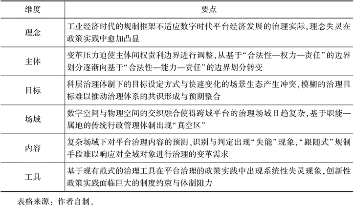
从治理主体看，公共部门仍居主导，但面对人工智能引发的问题，治理能力与其地位不匹配；平台企业在技术能力与治理责任之间处于尴尬位置。从治理目标看，AI场景爆发式出现，利益相关者众多，与科层制目标设定冲突，外部意见表达不足，难以形成共识，治理效能偏低。从治理场域看，线上线下交织加速，传统职能分工与属地管理难以覆盖，府际协作成本高，权力分散导致责任主体缺位，新业态受多头制约。从治理内容看，场景变化快、难以预判，数据、算法处于黑箱，一些老问题在线上被转译呈现新样貌。从治理工具看，工业时代工具系统失灵，同一工具在不同尺度效度差异大，试点推广模式受挑战，缺乏指引性目标导致多方难以协同，创新举措受制度阻滞。

### （二）体系构建：人工智能背景下的平台治理体系
当前问题已非局部失灵，而是范式失效，这正是治理低效的根源。新兴理论提供了启示：适应性治理强调持续检验修正、利益相关方参与、科研-政府-社会的持续互动；敏捷治理强调以用户为中心、适应与包容并重，快速响应、技术变迁下采用临时性实验方案并实时反馈调整。科技创新治理要回答谁来治、治什么、怎么治。本文据此提出从主体、对象、工具三方面构建适应人工智能的平台治理体系。

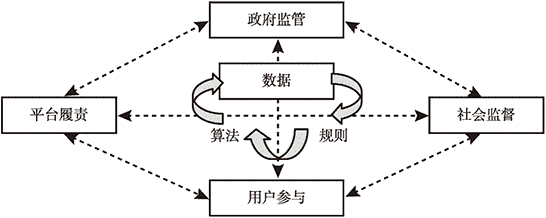
图 1 人工智能时代的平台治理体系示意
图片来源：作者自制。

从治理主体看，平台应从被咨询对象转为规则共建者，积极影响经济社会运行规则。已有案例显示平台已参与政策制定与工具设计。政府需认识自身只是分散权力系统一环，加强社会协作。政府应从监管单个市场主体转向监管平台制度设计，重点关注技术手段、投诉处理、判定规则、救济机制，而非个案严打。用户是数据主要生产者与直接利益相关方，可通过客服反馈、意见征集等方式参与，平台应回应质疑，形成“问题—参与—规制—反馈—完善”的闭环。第三方社会组织尤其是行业协会需提升自律与社会监督作用，政府应放权促其独立、公信、透明。

从治理对象看，数据与算法应成重点。数据治理是多元主体联合行动以协调冲突利益的过程，需先明确数据权属与隐私保护规则，再完善分类共享机制，明确何种数据在何种情形下可共享及保护惩戒措施，政府需打通数据孤岛，平衡开放与保护。算法应通过可视化转译实现公众理解，以易懂形式公开算法规则，增强信任。

在此基础上，需构建多层级综合工具。宏观层面制定法律、确立基本规则，利用市场优胜劣汰；中观层面以政策实验跟进技术与业态演进；微观层面利用新技术进行动态监管，推动平台自我约束与完善。

## 五 总结与建议
人工智能在各领域的扩散大幅提升经济效率，也带来新旧交替的治理挑战。中国平台治理正处新旧问题交织期，数据、算法、权力与责任成为核心，现有体系在理念、目标、主体、场域、内容、工具上难以应对。需系统调整治理方向。

第一，以“敏捷适应”迎接变革。对新技术过度管制会扼杀创新，任其失控则积重难返。政府应树立敏捷适应理念，对新问题快速响应、持续跟踪，建立动态反应机制，在风险可控下平衡效率与风险，贯彻包容审慎。

第二，以“多元共治”回应诉求。以合法性-能力-责任为原则，合理划定政府与平台责任边界，按场景差异分配监管权力，激发各方协同。在广泛利益分享机制下形成决策空间，提升风险研判效率，构建高效灵活机制。

第三，以“场景驱动”识别目标。平台治理场景高度碎片化，需对不同场景跟踪并识别差异化治理目标，形成基于场景的治理团队。构建跨域问题案例库与数据库，对数据、算法议题结合具体场景分析，强化技术能力、引入外部智力破解黑箱。

第四，以“技术赋能”重塑工具。新技术本身也是治理工具。区块链的可追溯与去中心化特性可用于信息保护。借助人工智能、区块链、物联网等构建更高效平台架构，用技术监管技术，提升平台治理的科学化与现代化水平。

## 参考文献
樊鹏：《利维坦遭遇独角兽：新技术的政治影响》，《文化纵横》2018 年第 4 期。
国家人工智能标准化总体组：《人工智能伦理风险白皮书》，2019。
贾开、蒋余浩：《人工智能治理的三个基本问题：技术逻辑、风险挑战与公共政策选择》，《中国行政管理》2017 年第 10 期。
贾开：《“实验主义治理理论”视角下互联网平台公司的反垄断规制：困境与破局》，《财经法学》2015 年第 5 期。
李广乾、陶涛：《电子商务平台生态化与平台治理政策》，《管理世界》2018 第 6 期。
李允尧、刘海运、黄少坚：《平台经济理论研究动态》，《经济学动态》2013 年第 7 期。
梁正：《从科技政策到科技与创新政策——创新驱动发展战略下的政策范式转型与思考》，《科学学研究》2017 年第 2 期。
王勇、戎珂：《平台治理：在线市场的设计、运营与监管》，中信出版集团，2018。
薛澜：《顶层设计与泥泞前行：中国国家治理现代化之路》，《公共管理学报》2014 第 4 期。
薛澜、赵静：《新兴产业发展与适应性监管》，《公共管理评论》2016 年第 2 期。
岳经纶、郭巍青：《中国公共政策评论（第 1 卷）》，上海人民出版社，2007。
中国信息通信研究院：《互联网平台治理研究报告》，2019。

# AI治理：敏捷协同的实践前沿

**主要参考文献**

1. BCG 2017 年白皮书《Decoding the Chinese Internet：A White Paper on China’s Internet Economy》。
2. David S. Evans 所著《Platform Economics：Essays on Multi-sided Businesses》，Social Science Research Network 与 Competition Policy International 联合推出，2011 年。
3. A. Goldfarb、J. Gans、A. Agrawal 合著《The Economics of Artificial Intelligence：An Agenda》，芝加哥大学出版社，2018 年。
4. P. A. Hall，《Policy Paradigms，Social Learning，and the State：The Case of Economic Policymaking in Britain》，*Comparative Politics*，1993 年，第 3 期，275-296 页。
5. K. Hillman、M. Nilsson、A. Rickne 等人，《Fostering Sustainable Technologies：A Framework for Analysing the Governance of Innovation Systems》，*Science and Public Policy*，2011 年，第 38 卷第 5 期，403-415 页。
6. M. Kenney 与 J. Zysman，《The Rise of the Platform Economy》，*Issues in Science and Technology*，2016 年，第 3 期，61-69 页。
7. S. U. Lee、L. Zhu、R. Jeffery，《A Data Governance Framework for Platform Ecosystem Process Management》，2018 年。
8. J. Manner 等，《Governance for Mobile Service Platforms：A Literature Review and Research Agenda》，收录于 AIS Electronic Library ICMB2012 会议论文集，2012 年。
9. F. Pasquale 所著《The Black Box Society》，哈佛大学出版社，剑桥，2015 年。
10. J. Rochet 与 J. Tirole，《Two-sided Markets：A Progress Report》，*Rand Journal of Economics*，2006 年，第 3 期，645-667 页。
11. M. Schreieck、M. Wiesche、H. Krcmar，《Design and Governance of Platform Ecosystems-Key Concepts and Issues for Future Research》，收录于 AIS Electronic Library ECIS 2016 会议论文集，2016 年。
12. P. Song 等，《The Ecosystem of Software Platform：A Study of Asymmetric Cross-side Network Effects and Platform Governance》，*MIS Quarterly*，2018 年，第 1 期，121-142 页。
13. W. Wallach 与 G. Marchant，《Toward the Agile and Comprehensive International Governance of AI and Robotics》，*Proceedings of the IEEE*，2019 年，第 107 卷第 3 期，505-508 页。

***

【1】梁正，现为清华大学公共管理学院教授、博士生导师，人工智能国际治理研究院副院长、中国科技政策研究中心副主任，研究方向为科技政策、创新管理及新兴技术治理；余振为北京师范大学讲师，研究聚焦城市与区域发展、可持续转型、新兴技术发展治理；宋琦为萨塞克斯大学科技政策研究中心博士研究生，研究方向为创新与可持续转型政策。

# 原刊信息说明

说明：部分论文收入本书后标题有过微调

1.《新兴科技发展中的人工智能治理》首次发表于《中国网信》2022年第1期
2.《构建平衡包容的人工智能治理体系》首次发表于《中国发展观察》2022年第12期
3.《人工智能治理：认知逻辑与范式超越》首次发表于《科学学与科学技术管理》2022年第9期
4.《我国新一代人工智能治理的时代挑战与范式变革》首次发表于《公共管理学报》2022年第2期
5.《跨国比较视阈下的人工智能政策：目标、理念与路径》首次发表于《科学学与科学技术管理》2021年第3期
6.《全球可持续发展视域下的人工智能国际治理》首次发表于《中国科技论坛》2022年第9期
7.《欧盟人工智能的规制路径及其对我国的启示——以〈人工智能法案〉为分析对象》首次发表于《电子政务》2022年第9期
8.《人工智能伦理问题与安全风险治理的全球比较与中国实践》首次发表于《公共管理评论》2021年第1期
9.《人脸识别治理的国际经验与中国策略》首次发表于《电子政务》2021年第9期
10.《人工智能在突发公共卫生事件管理中的赋能效用研究——以全球新冠肺炎疫情防控为例》首次发表于《中国行政管理》2020年第10期
11.《用 AI 战“疫”人工智能技术赋能公共治理大有可为》首次发表于《人民论坛》2020年第15期
12.《商业价值导向还是公共价值导向——对数字创新生态系统的思考》首次发表于《科学学研究》2021年第6期
13.《城市大脑：运作机制、治理效能与优化路径》首次发表于《人民论坛·学术前沿》2021年第9期
14.《数字双赋打通韧性城市建设“最后一公里”》首次发表于《人民论坛·学术前沿》2022年6月合刊Z1
15.《智能时代，如何重构信任机制？》首次发表于《装饰》2022年第1期
16.《人工智能时代亟需构建合理高效的数据治理体系》首次发表于《国家治理》2020年第31期
17.《数据治理的研究现状及未来展望》首次发表于《陕西师范大学学报（哲学社会科学版）》2021年第2期
18.《全球数据流动、保护及中国方案》首次发表于《中国科技论坛》2022年第11期
19.《数据治理政策的国际比较：历史、特征》首次发表于《科技导报》2020年第5期
20.《工业数据治理：核心议题、转型逻辑与研究框架》首次发表于《科学学研究》2023年第12期
21.《算法治理的基本路径与核心理念》首次发表于《国家治理》2020年第36期
22.《第四次工业革命与算法治理的新挑战》首次发表于《清华管理评论》2021年第4期
23.《欧美算法治理实践的新发展与我国算法综合治理框架的构建》首次发表于《电子政务》2022年第7期
24.《算法公平与算法治理的国际经验与中国探索》首次发表于《中国改革》2022年第3期
25.《互联网平台协同治理体系构建——基于全景式治理框架的分析》首次发表于《人民论坛·学术前沿》2021年第21期
26.《人工智能应用背景下的平台治理：核心议题、转型挑战与体系构建》首次发表于《经济社会体制比较》2020年第3期

### 图书编目信息

《敏捷与协同：人工智能治理理念与实践前沿》由清华大学人工智能国际治理研究院、清华大学中国科技政策研究中心、人工智能治理研究中心共同编著，社会科学文献出版社于2024年1月出版。

ISBN 978-7-5228-2863-3

Ⅰ.①敏… Ⅱ.①清…②清…③人… Ⅲ.①人工智能-应用-社会管理-研究-世界 Ⅳ.①C916-39

中国国家版本馆 CIP 核字（2023）第 214259 号

出版人 冀祥德
组稿编辑 祝得彬
责任编辑 刘学谦
责任印制 王京美
出版机构 社会科学文献出版社·当代世界出版分社，电话 010-59367004
地址 北京市北三环中路甲 29 号院华龙大厦，邮编 100029
网址 www.ssap.com.cn
发行机构 社会科学文献出版社，电话 010-59367028
印刷单位 三河市龙林印务有限公司
开本 787mm×1092mm 1/16，印张 23.75，字数 361 千字
版次 2024年1月第1版，2024年1月第1次印刷
书号 ISBN 978-7-5228-2863-3
定价 128.00 元
读者服务电话 4008918866
版权所有，翻印必究

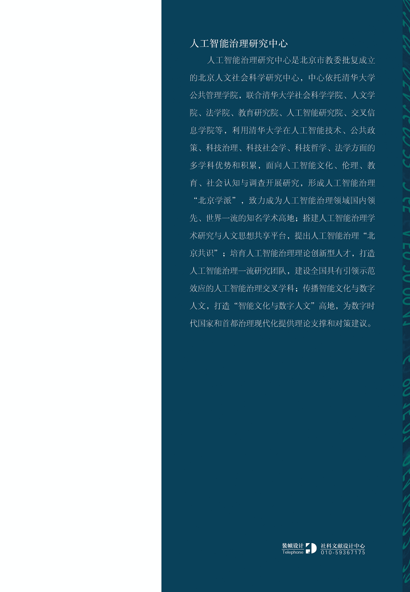

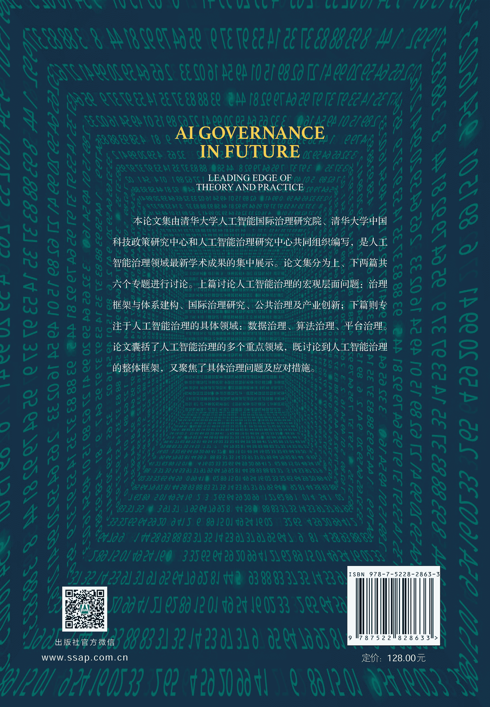