# GAI 课堂资源重塑指南

# 内容概览
本书聚焦 GAI 对课堂内容制作的再造作用，定位为教学资源开发与创意实践参考手册。书中系统梳理 GAI 为资源更新带来的机会与风险，围绕图像、影像、演示稿、图表、数字人、智能体六类载体，说明能力释放路径与落地思路，并以案例拆解操作步骤与方法。兼顾原理解读与动手演练，既解析底层逻辑也直面课堂痛点，帮助一线教员跨越技术门槛，提升资源制作效率与品质。适合在职教员与教育管理者阅读，附案例与工具清单，为课堂创新提供新启发。

# 本书编委会

**主 编：**田雪葳 李 磊

**副 主 编：**周 勇 李建新 韦立君

**编委会成员：**吴安琪 田 冲 黄葆颜 刘文科 岳靓文泽

余舒雯 陈雨晴 王翔宇 李 响 张启业

田丽杰 付洪艳 薛宏宇 张 静 徐 静

# 推荐序
在教与科深度交融的当下，《教学创新：生成式人工智能重构教学资源》以数字化重塑教育生态为主线，呼应国家推进教育数字化部署，聚焦 GAI 在教辅开发中的创新应用，为教员提供从认知到落地的全景参考。本书面向基础教育，紧扣技术驱动材料迭代的核心命题，通过案例与技术解读搭建起工具认知、场景应用与创新设计的立体框架，帮助教员跳出传统材料开发的惯性，在人机协同中释放创造力。

长期以来，教辅开发受制于门槛与资源不足：纯文字难呈现动态科学原理，平面图表不易揭示数据关联，统一课件难以匹配差异化学习。本书以 GAI 为破局点，系统呈现其在六大核心载体中的作用：图像与影像的智能产出、PPT 制作的自动化、图表制作的高效化、数字人助教的课堂互动、智能体的个性化学习支持，技术与教学的融合贯穿始终。如借助 GAI 制作水由液态变为气态的实验流程图，实现步骤可视化拆解；以多模态数据生成初中语文《背影》的角色关联图谱，帮助学生建构文本分析框架；利用数字人技术打造虚拟教员，为偏远地区提供沉浸式教学场景，这些案例体现了 GAI 在突破时空限制、优化认知路径上的价值。

本书的创新性在于对教育本质的坚守：技术并非替代教员，而是拓展教育边界。书中强调，教员的核心竞争力在于遵循教育规律的材料设计能力，GAI 可承担数据处理、内容产出等机械性工作。例如在“一元二次方程”教学中，GAI 能快速产出分层练习与动态函数图像，但引导学生理解方程本质、建构数学思维的关键环节仍需教员通过课堂互动完成。这种“教员主导创意、技术执行细节”的协作模式，既保留人文温度，又发挥效率优势。

本书的实践导向体现在操作流程的精细拆解：从工具选择如文心一言、智谱清言的场景适配，到提示词优化如“角色—场景—需求”三段式指令，再到材料生成后的二次加工与课堂应用策略，均提供可复用的方法模型。如通过“输入教学目标—选择材料类型—调整参数设置”三步法，可快速生成适配不同学情的课件、习题与互动资源，降低应用门槛。书中亦以“初中生物虚拟讲解”等案例，展示 GAI 在跨学科教学、项目式学习中的实操路径，帮助教员将技术能力转化为课堂创新力。

在教育数字化转型的关键节点，本书试图构建技术理性与教育温情的双坐标：既解析 GAI 算法逻辑与工具特性，又始终以学生全面发展为价值锚点。教员角色正由“材料生产者”转向“学习体验架构师”，在人机协同中重新定义教育创新边界。

教育的未来是技术赋能下的因材施教。期待本书成为开启 GAI 宝库的工具，让知识点以更契合学生认知的形式呈现，让课堂互动更能点燃思维火花。当技术理性与教育温度共振，我们将抵达以学生为中心的教学新境。

刘虎

北京航空航天大学教授、博士生导师，北航学院院长兼工程实践与创新中心主任

2025 年 4 月 10 日

# 前言
近年来，GAI 的出现与迅猛发展，既为教员带来挑战，也带来新机遇。《2023 年十大新兴技术报告》指出，GAI 是通过学习海量数据生成全新原创内容的智能技术 ^(¹)。依托机器学习、深度学习、超大算力与预训练模型，并结合多模态技术，GAI 具备自动生成文本、图像、视频等内容的能力，因而能够有效满足教员对各类教学材料的生成需求，拓宽获取渠道并提升质量。然而，当下在岗教员，特别是偏远地区教员，普遍缺乏运用 GAI 生成教辅材料的技术手段。正因如此，本书作为教育教学材料制作与创新指导手册应运而生，旨在为在岗教员与教育管理者提供 GAI 赋能材料的新视角与实践路径，破解教学实践中的技术困境。

本书将系统介绍 GAI 给教学材料革新带来的机遇与挑战，以及 GAI 如何通过赋能六类载体推动材料丰富与创新。全书共六章。第一章阐释教学材料现状与面临的五大挑战，并提出 GAI 的多元化解决路径。第二章聚焦动静媒介，从图像与影像创作入手，结合案例详述操作步骤与策略。第三章围绕多媒体内容，涵盖文本生成优化、作业与课程材料设计、PPT 制作自动化。第四章介绍图表制作效率提升与知识可视化，包括数据图表生成展示、思维导图设计应用、流程图规划实施，并根据教员熟悉度提供不同难度的策略。第五章阐述数字人技术在教学中的应用，从概念功能、赋能互动教学原理到教育数字人创建应用层层展开。第六章讲解智能体在教学中的应用，从概念、技术原理与工具到搭建流程逐步说明，即使是新手教员也能搭建专属智能体。

感谢读者选择本书，愿它为教学工作提供便利，带来新的启发！

# 本书编委会

**读者服务**

微信扫码回复：50942

●获取本书配套资源文件

●加入丛书交流群，与作者互动

●获取【百场业界大咖直播合集】（持续更新），仅需 1 元

# 第一章 GAI 与课堂载体革新
在科技高速发展、社会深刻变革的背景下，传统教育体系与人才培养模式正经历整体重塑。社会对创新思维人才与前沿技术人才的需求不断提升，也推动教育部门持续深化改革，以适应时代节奏。作为教学实践重要支撑的教学材料，其形态与功能同样需要与时俱进。

近年来，GAI 凭借强大的内容生产能力与高度灵活性，为教学材料创新提供关键契机，也为教学设计与学习体验带来新可能。其可根据不同教学目标与学习需求，快速生成多元内容，丰富材料形式与内涵，为课堂注入活力。

本章梳理教学材料发展现状与关键问题，分析 GAI 如何赋能教学材料并提升质量，最后概述 GAI 支撑下的六类教学载体。

# 第一节 课堂载体现状分析与问题拆解

### 一、课堂载体的现状扫描

**（一）载体类型与演进轨迹**
随着教育不断发展，教学载体类型在技术推动下发生深刻变化。传统载体以课本、教案、书籍、教学挂图为主，虽在实践中发挥作用，但形式单一、更新缓慢，难以满足多样化需求。信息技术发展后，数字化载体如 PPT、微课视频、在线课程平台逐渐成为教学实践的重要部分，既突破时空限制，又借助多媒体丰富教学形式，提升互动性与趣味性。

技术驱动下，载体在形式上持续更新。由黑板粉笔纸张到电子白板、多媒体设备，呈现方式不断升级。多媒体设备融合声音、图像、文字等形式，通过多感官刺激提升学习兴趣。智慧课堂、STEM、AI 精准教学等新兴模式出现后，载体获取与处理方式亦发生巨变，教员可通过搜索引擎获取图文音视频载体，并借助截屏、扫描等工具处理。

内容层面，现代载体不再局限于学科知识传授，更重视实践技能培养。多媒体使抽象知识点具象化，有助于理解掌握；同时载体更关注学生个性化需求，推动教育模式创新。

然而，表象丰富之下仍存在问题。部分载体内容更新滞后，难以反映最新科技、社会变革与行业需求，与学科前沿及学生需求脱节；部分资源制作缺乏系统设计，难以支撑“教”与“学”良好互动；资源供给质量参差不齐，低质量重复现象突出，难以精准适配教学场景。这些问题制约教学效果提升与教育创新发展。

**（二）数字化转型对载体的影响**
信息技术迅猛发展与互联网普及，使数字化转型以前所未有的深度重塑教学载体的生产、传输与应用。电子书、开放教育资源等新型数字化载体不断涌现，在在线学习、远程教育、混合式教学中发挥关键作用，提升教学效率与学习体验。

与此同时，数字化转型暴露出待解问题。资源分布不均依然严峻，乡村学校或经济欠发达地区难以获取优质数字资源，数字鸿沟加剧城乡区域教育不平等。

**（三）个性化与适应性需求的提出**
当代教育改革深入，个性化与适应性成为核心议题。新理念强调尊重个体差异、培养能力与兴趣，对教学载体提出更高要求：资源需兼具科学性、系统性与灵活性、可定制性、适应性，以满足不同层次与背景学生的多样化需求。

传统统一模式设计忽视认知水平、学习风格与兴趣差异。面对多元学生群体，载体设计需融入差异化理念，灵活调整内容与难度。如模块化设计将基础知识、拓展内容与高难度问题结合，为不同学习者提供适配路径。

数字化技术为个性化设计提供支撑。人工智能、大数据可实时追踪学习轨迹，精准定位优势与薄弱环节，实现动态调整与智能推荐，契合因材施教原则。虚拟现实、增强现实等技术丰富教学手段，创造沉浸式互动学习环境，提供多元个性化体验。

个性化需求亦推动资源整合协同。通过构建跨学科跨领域资源库，教员可根据教学情境灵活选用或组合材料，提升教学效率，并有助于缩小区域城乡教育资源差距，实现公平与质量双提升。

### 二、课堂载体问题剖析
当前教学载体种类形式虽丰富，但仍存在诸多制约教学效果提升与模式创新的问题，主要体现在以下五方面：

**（一）载体形式单一，难以实现教学手段多样化**
当前教学实践中，载体形式多集中于文字与静态图像，开发难度低、复用性高，因而使用广泛。但其局限明显，缺乏动态呈现与综合视觉体验，难以满足多样化教学手段需求。如讲解复杂科学概念或历史演变，仅靠文字与静态图像难以直观呈现，学生理解困难。

动态视频、虚拟现实、增强现实等技术可提供直观生动体验，增强注意力和学习兴趣。但目前在教学载体中应用有限，学校与机构受技术支持与资金限制，教员操作不熟练、培训不足，导致教学手段多样化进程受阻。

**（二）载体内容雷同，难以满足学生差异化需求**
教育目标是面向全体、关注个体发展。每个学生学习风格、进度、基础各异，载体内容不应千篇一律，而应因材施教。现有载体多按统一标准编写制作，无法满足个性化需求。统一模式导致学有余力者觉得简单，学有困难者难以跟进。如数学练习题难度设置未充分考虑个体差异，部分学生“吃不饱”，部分“吃不了”；教材讲解多提供固定解法，缺乏多角度思考引导，限制思维发展，削弱学习兴趣与自主性。

**（三）载体缺乏互动设计，难以提升学习参与度**
现代教育强调学生主体地位，鼓励积极参与。但现有资源多为教员单向呈现，缺少学生参与与交互设计，难以适应项目式学习与探究式学习要求。传统载体多作为知识单向传递工具，学生被动接受。

**（四）载体创新不足，无法推动教学模式变革**
教学载体创新是推动教学模式变革的核心动力。创新载体既能提供前沿知识，又能激发兴趣、培养创新思维与实践能力。但当前载体创新不足。

其一，更新速度滞后于学科发展。科学技术飞速发展，新理论新方法不断涌现，现有载体难以及时纳入，导致教学内容与实际应用脱节。其二，设计缺乏新颖性与吸引力，多沿用传统编写模式与呈现方式。其三，教员开发与创新能力待提升。尽管理念强调教员创造性劳动，实际中多依赖现成教材，缺乏自主开发意识与能力，时间精力有限。其四，资源分配不均衡。经济发达地区与重点学校资源与技术支持充足，偏远地区与普通学校获取困难，加剧区域差距，限制创新教学开展。

**（五）载体支持有限，难以激发学生自主学习能力**
培养自主学习能力是现代教育重要目标，有助于课堂掌握知识与未来发展。但当前载体在支持自主学习方面不足。

教学载体设计与应用多侧重单向输出知识，忽视自主学习能力培养。载体往往缺乏对学习过程的有效支持，难以引导深入思考、探索与实践。如教材与资源仅提供有限练习与简单总结，缺少学习方法指导、资源拓展与过程反馈机制。单一的知识输出模式使学生处于被动接受状态，难以主动参与，更无法通过载体进行自主学习。

**第二节 GAI 驱动教学素材升级的五大方向**

GAI 是一种以机器学习为底座的生成式人工智能，它通过学习海量数据的内在规律，自动产出文字、图像、音频、视频等多种形式的内容。它不只是提速，更是在效率、多模融合、沉浸体验、个性化适配、即时评估等维度同步升级，让教学素材真正走向智能化与多元化。

### **一、高效自动化生成**
在教育落地上，自动化生产是最先跑通、渗透最广的场景，也最直观地改变了老师备课的体验。背后靠的是自然语言处理、图像生成与多模态合成能力的协同支撑。NLP 让系统能读懂老师用自然语言描述的需求和教学意图，画像生成与多模态模型则负责把意图转化为可用的素材。

老师只需用提示词明确需求，系统就能快速交付。整个链路压缩了制作时长，也提升了成品质量，分担了大量重复劳动。目前主要集中在三大类型：文本自动生成、图像图表生成、视频音频生成。

**（一）文本自动生成**
文本生成是 GAI 在教学中最核心的应用之一，为教学创新提供了持续动力。它依托自然语言处理、深度学习与多模态融合构建，理解指令意图、从大数据中学习优化表达、并融合图文音信息丰富输出。

对教师而言，可以迅速得到教案、讲稿、课件文案、PPT 大纲等。系统会结合教学目标、重点难点与教学方法，生成覆盖导入、讲解、练习、总结的完整教案；也能融合内容与风格，输出逻辑清晰、语言生动的主讲稿；还能提炼成精炼的课件文本，提升课堂节奏。对学生而言，可基于大纲和知识点定制个性化学习方案，引导自主学习。还能按难度、题型、知识点分布自动出题，满足分层检测需求。

这并非模板化复制。系统支持多风格、多语种创作，老师可按学科特性与课堂氛围选择学术严谨或轻松活泼的表达，也能生成多语言素材，满足国际化与多元文化教学。

**（二）图片与图表生成**
GAI 能在极短时间内处理复杂模型与海量数据，产出符合教学场景的视觉素材。比如自动绘制生物解剖图并做细致标注，让内部结构一目了然；生成带山脉、河流、城市的地理图谱，帮助学生把握空间分布；或依据史料描述重构历史场景，让事件人物更具画面感。

在数据可视化上，系统可产出条形图、折线图、流程图等。条形图突出数量对比，折线图呈现变化趋势，流程图梳理运作逻辑。抽象知识被转化为直观图像，理解门槛明显降低。

**（三）视频与音频生成**
视频音频因直观、有趣、多感官的特点，已成为数字教育与远程教学的刚需，也常是教师制作最吃力的环节。受限于工具门槛和后期技能，素材质量参差不齐。

GAI 提供了一条低门槛路径。可自动生成微课视频，用简洁生动的呈现讲透知识点；模拟实验环境制作实验演示视频，弥补实验室条件不足的问题；生成教学主题语音解说，并支持多语言配音与动态字幕，提升观看体验与可达性。

### **二、多模态融合与沉浸式体验**
多模态融合是将文字、图像、视频、音频等媒介整合，打破单一讲授的局限，让知识更立体。沉浸式体验则让学生全身心进入学习情境，提升专注与参与，强化记忆与创新。

GAI 能把多种素材无缝融合，构建逼真的虚拟场景与互动氛围，为教学带来新范式。

**（一）跨媒介内容融合**
系统可深度融合文本、图像、视频、音频，为教学提供系统化素材包。以语文教学为例，除文本解读外，还可配上精美的意境图、古典音乐与专业朗诵音频，构建听视结合的文化氛围；并加入语音解说与插图，形成可交互的学习单元。

**（二）虚拟现实（VR）与增强现实（AR）教学**
GAI 构建的虚拟实验室不受时间地点限制。物理课上，学生可用 VR 模拟牛顿力学、电磁学等实验，直观观察现象并得出结论；生物课上，可在模拟实验室中观察细胞结构、进行虚拟解剖，提升操作感。历史教学中，AR 能重现历史现场，让学生仿佛穿越时空，增强认知与记忆。

### **三、个性化推荐与动态调整**
学生差异明显，统一进度难以兼顾。GAI 依托学习数据的分析与建模能力，实现精准推荐与动态调节，是因材施教的有效抓手。

**（一）个性化推荐**
系统会记录课堂参与度、答题正确率、作业与线上平台行为、视频观看时长等多元数据，描绘出学习能力与薄弱点画像。基于评估，推送匹配阶段的资源：基础薄弱的学生会优先获得词汇记忆、基础对话与动画短片；能力较强的学生则被推荐原著、学术论文与文学作品进行进阶。

系统还会结合兴趣偏好激发动机。对科学探索感兴趣的学生推送科普期刊、前沿报告与科学家传记；对文学创作热爱的学生推送经典作品、创意写作课程与作家创作心得。

**（二）动态调整与学习路径设计**
GAI 实时捕捉课堂提问、作业与测试反馈，判断理解障碍。当发现学生卡点或频繁出错时，自动下调难度，提供更细的基础讲解、示例与针对性练习；当学生掌握牢固时，则提升难度，推送挑战性内容。

同时可为每个学生定制学习路径：结合习惯、目标与进度，设定阶段目标、内容与方法。例如为冲击数学竞赛的学生设计基础巩固、专项训练、赛前模拟的递进方案，帮助突破瓶颈。

### **四、即时反馈与智能评估**
及时准确的评估是提升教学质量的关键。GAI 构建的实时反馈与智能评估体系，为师生提供高效信息通道。

**（一）自适应测试与自动批改**
传统固定试卷难以精准呈现个体水平。自适应测试会根据答题表现动态出题：答对则提升难度以探测上限，答错则降低难度以查漏补缺，避免“一刀切”误差。

自动批改大幅提升效率，客观题可即时评分并反馈。系统还能给出逐题解析，指出概念误解或计算错误，指导正确思路。

**（二）学习报告与教学数据分析**
系统生成个性化学习报告，涵盖成绩、作业完成情况与学习过程分析，明确长处与短板。例如语文报告可能指出阅读理解突出，但词汇运用与逻辑组织需加强，并给出改进建议。

对教师而言，班级数据分析可揭示整体掌握情况、知识点难点、不同群体差异。教师可据此调整方法与内容，对共性难点重新设计讲解，对学困生提供个性化辅导，实现精准教学。

### **五、迭代优化与资源整合**
教学素材需要随知识更新与教育理念演进而持续进化。GAI 的分析与处理能力为迭代与整合提供支撑。

**（一）教学素材的迭代优化**
系统可追踪学科前沿研究、政策变化与社会热点，将最新信息注入现有资源。如科学课程出现新发现时，自动补全案例、实验数据与研究成果；并根据教师学生反馈优化内容与呈现形式。

**（二）资源整合**
优质资源分散在在线课程、学术论文、教育平台等多个渠道。GAI 可跨平台筛选、分类、整理资源，构建系统化素材库，让教师快速定位所需内容，并进行创新性组合与深度加工，按不同目标与场景生成全新教学素材。

第三节 **GAI 赋能六类教学资源**

GAI重塑课堂素材新生态

数字化教育浪潮下，教育正经历关键转型。立足《中国教育现代化2035》描绘的蓝图，结合全球对教育数字化转型的持续探索，业界共同关注的焦点是如何创新教学素材、优化资源配置，以提升教学品质并促进学生全面成长。生成式AI作为极具前景的前沿技术，凭借强劲的技术实力与创新动能，为教育资源创新注入活力，作用日益突出。它把技术能力与教学需求深度融合，打开多条高效赋能路径，既拓宽了教学素材的类型边界，也明显改善了教学效果，为教育现代化提供坚实支撑。

### **一、AI绘图让教学图片创作提速**

**（一）图像化把抽象变具体**
课堂上呈现方式直接影响理解与吸收。面对抽象概念、复杂理论及难以直接感知的对象，纯文字描述往往力不从心。教学图片作为直观视觉载体，能把抽象知识转成具体画面，帮助学生在脑中建立清晰认知。例如地理教学中借助地图与示意图，学生可直观把握各地气候与地貌差异，降低学习难度；生物教学里借助精细的细胞结构图与进化树，学生能深入探究微观世界与生命奥秘。图片把难懂的知识转译为视觉符号，降低认知门槛，激发学习兴趣，打破文字局限，使学习从“知道是什么”迈向“知道为什么”。

**（二）GAI让图片生成更高效**
过去获取教学图主要靠教师手绘或网络搜索、下载，均有局限。手绘要求绘画功底且耗时，质量波动大；网络素材种类虽多，却常与教学需求不匹配且存在版权风险。生成式AI改变了这一局面。基于深度学习构建的GAI可学习海量图像数据，理解教师的简明指令并快速生成高质教学图。例如教师输入“小狗在草地上奔跑”，系统可在短时间内产出示意图。

图 1-1 用“即梦 AI”生成的小狗在草地上奔跑的示意图

**（三）GAI提升图片品质与匹配度**
GAI弥补了传统获取方式的不足。一方面大幅提升效率，传统方式需数小时甚至数天寻图或绘图，GAI数分钟甚至数秒即可完成，让教师把精力投向教学设计。另一方面增强准确性与品质，系统按特定教学需求生成内容，确保图像与教学主题紧密贴合，避免网络搜索产生的内容偏差或质量参差。

### **二、智能生成教学视频更灵动**

**（一）视频打造多感官学习体验**
随技术进步，教学视频在课堂中普及度不断提高。视频融合动态画面、生动音效与色彩，能同步激活视觉与听觉，提供更丰富立体的学习体验。与静态资源相比，视频更易呈现复杂实验流程、抽象原理与真实场景。如物理实验中，视频可清晰呈现操作步骤、现象变化与结果，帮助理解原理；语文教学中，播放经典影视片段与名家朗诵，可增强文学感受力，提升阅读理解与审美。

**（二）GAI重塑视频制作模式**
传统视频制作门槛高，需专业摄像设备、拍摄技巧与后期能力，对多数教师是重负担。即便掌握技能，制作高质量视频仍耗费大量时间。GAI带来了新范式。教师输入核心内容、大纲与期望风格，系统借助算法自动生成含合适素材与流畅剪辑的教学视频，并可按教学目标与学习特点智能调节时长、节奏与互动元素，使视频更贴合课堂需求。

**（三）GAI降低制作门槛提效**
GAI为突破传统技术限制提供可能。过去因缺乏技术，视频难以普及；现在教师无需精通摄影剪辑也能制作优质视频。同时解决素材获取难与剪辑效率低的问题。GAI可借助网络爬虫收集丰富素材并以智能剪辑快速完成编辑合成，显著提升效率。未来视频制作将更智能个性化，从“标准化生产”走向“精准化定制”，助力教育公平与高效学习。

### **三、智能课件PPT自动化智绘**

**（一）PPT有序呈现课堂要点**
课堂中PPT是展示材料与组织教学的关键工具。设计精良的PPT能以条理清晰的方式呈现内容，突出重点难点，吸引注意，提升效果。如数学课用PPT展示公式推导与几何变换，使抽象知识更直观；英语课用PPT呈现单词读音、用法与例句，帮助学生更高效学习。PPT如同得力助手，让知识讲解井然有序。

**（二）课件制作实现自动化**
高质量PPT制作需投入大量时间在资料搜集、内容整理、版式设计与素材甄选，且教师设计能力差异导致质量不均。GAI带来创新变化。系统可依据教学大纲、知识点与教学目标自动生成框架，并从素材库智能匹配图片、图表、动画，完成初步排版。教师仅需做少量修改即可获得可用课件。多样模板适配不同教学风格，既保证规范美观，又保留个性化调整空间，实现从繁琐制作到高效创作的质变。

**（三）GAI保障课件质量与效率**
自动化制作的核心价值是减轻时间压力。常规备课中课件准备占用大量时间，影响休息与教学研讨。GAI快速产出高质量课件，释放时间用于学情分析、教学设计创新与学生个别指导。此外，系统生成的课件具有高度标准化和专业性，避免因教师能力差异导致质量参差。教学重心因此从“课件驱动”转向“深度教学驱动”，效率与质量双提升。

### **四、可视化呈现数据与知识**

**（一）图表与可视化直观呈现信息**
教学中分析数据与梳理知识是关键环节。图表能把复杂数据转成简明图形，帮助理解关联与趋势。柱状图呈现大小差异，折线图展示变化方向，饼图反映占比。知识可视化则以图形、图表、思维导图等形式展示知识结构，助力学生把握整体脉络。如思维导图分层呈现主题知识点，便于理解结构。可视化如同透镜，让数据与知识更直观可感。

**（二）GAI智能产出图表与导图**
传统制作要求专业技能，操作复杂。GAI注入新活力，按教师提供的信息自动选择合适图表类型并进行美化标注，也能依据知识点生成思维导图与流程图。如实验数据输入后，系统迅速生成对应图表并呈现变化规律；数学教学中可借助GAI平台如Kimi生成几何图形数量分布图，无需手绘。

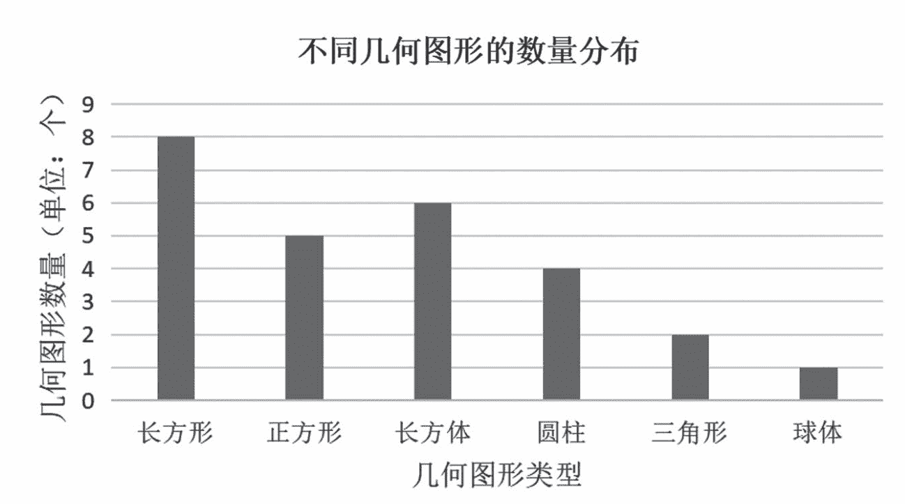

图 1-2 用 Kimi 绘制的不同几何图形的数量分布图

**（三）可视化定制更精准**
传统文字展示常让学生对复杂知识与数据感到困惑。可视化把抽象概念转化为形象图形，学习更轻松。但手工制作复杂且效果有限。GAI可快速精确生成高质量图表与可视化作品，并按学生的学习特征与需求进行个性化定制，提升学习兴趣与效果。

### **五、虚拟数字人引航教学互动**

**（一）数字人丰富教育参与角色**
人工智能发展推动数字人进入教育场景，成为新型交互主体。数字人以AI技术构建，模拟人类形象与行为，可扮演教师、学习伙伴、辅导员等角色，并与学生实时互动，根据提问与反馈生成答案与指导。例如在线学习中充当虚拟教师讲解知识点；课堂中作为学习搭档共同探讨问题。数字人带来前所未有的交互体验，让教学更丰富多元。

**（二）GAI打开数字人实践之门**
生成与应用数字人离不开GAI支撑。系统通过学习大量人类数据，创造逼真外观、自然语言表达与情感丰富的数字人形象，并赋予智能互动能力，理解学生语言与行为并作出恰当反馈。例如可依据教师声音与形象生成高度相似的数字分身，模仿教学风格与语言习惯，实现自然流畅互动。GAI为数字人在教育实践中的应用提供技术可能。

**（三）满足个性化互动需求**
学生对个性化学习需求增强，传统模式难以兼顾个体差异。数字人技术提供新解。GAI赋能的数字人可依据学习状况、兴趣与学习方式提供定制化建议，实现真正的因材施教。可全天候互动，解答疑惑并提供即时帮助。在疫情期间，数字人在线教育中有效弥补面对面交流不足。教育由此从“千人一面”迈向“一人一策”的精准服务。

### **六、智能体驱动个性化陪伴**

**（一）智能体提供学习陪伴**
智能体是具备学习、推理与决策能力的系统，可与学生互动并根据具体状况提供定制建议与方向，像贴身伙伴陪伴学习全程，协助攻克难题，提升成效。如英语学习中，智能体可按能力与目标设计个性化方案并推荐单词工具与听力材料；数学学习中，可依据错题识别知识短板并提供针对性练习与讲解视频。

**（二）GAI是智能体的技术基石**
GAI构成智能体建设的核心。系统通过分析海量学习数据构建学生模型，了解学习习惯、风格与掌握程度，据此生成量身定制的学习策略。自然语言处理能力使智能体能进行流畅对话，理解问题并给出精准答案。例如分析在线学习平台记录，智能体可据学习行为与兴趣点提供个性化教学建议。GAI如同智能体的“大脑”，赋予其智慧与个性化服务能力。

**（三）智能体实现因材施教**
教育演进呼唤个性化。每个学生学习属性不同，统一内容与方法难以满足需求。GAI驱动的智能体设计与应用回应这一时代需求。系统按个体需求提供辅导，帮助识别优势与短板，设定合适目标与方案，提升效率。GAI与智能体的融合为个性化教学提供坚实技术基础，推动教与学的创新。

**第四节 总结**
本章梳理了教学素材在当前阶段的不足与挑战，同时指出GAI发展为解决这些困境提供了新思路。实践中，GAI赋能图片、视频、PPT、图表、数字人、智能体六类教学资源，从多维度丰富素材类型、提升教学效果，推动教育深刻变革。后续章节将深入介绍GAI在上述六类资源中的具体应用场景，展示教师如何运用GAI赋能教学实践。

**第二章 GAI赋能图片视频创作与视觉化教学**
在数字化教育浪潮中，视觉化教学资源堪称宝藏，直观生动地传递知识并激发兴趣。传统图片与视频制作耗时耗力，需要复杂软件技能。GAI像一位魔法师，通过自然语言处理、计算机视觉与深度学习融合，理解教师意图，将抽象需求转化为直观视觉资源。无论是地理地貌插图还是化学实验演示，都可在数分钟内生成。本章将深入探讨GAI在图片与视频创作中的赋能路径并结合案例展示实际应用。

**第一节 高效生成教学图片**
数字化进程中，GAI凭借图像生成能力革新了教学图片创作。教师仅需文字描述，即可快速获得契合需求的图片，大幅提升资源开发效率，让地理山川、生物细胞等知识以清晰图像呈现。但实际应用仍存挑战，影响质量与体验。接下来将剖析GAI图片生成致力解决的问题与现有短板，解析底层逻辑，并介绍生成方法与常见陷阱及应对。

### **一、GAI图片生成需解决的问题及其短板**
教学场景中，GAI生成图片可解决多个痛点。一方面教师备课时间紧张任务重，GAI可快速产出历史、物理等学科所需图片，免去大量搜集整理，提升备课效率。另一方面特殊教学场景如微观细胞结构、宏观星系演化等抽象概念常缺素材，GAI可丰富素材库。此外，学生利用GAI生成图片与观看视频能增强互动趣味性，提升学习兴趣。

GAI生成图片补充教学资源有三点优势：

生成式AI画图，老师的效率加速器与精度试金石

在教学配图场景里，生成式AI给出的第一印象往往是惊喜。反应速度很快，输入需求后短短数秒就能批量产出多张图；上手几乎没有门槛，不用去学Photoshop、Illustrator等专业软件，只要在对话框里把意图写清楚就能得到初稿；风格可切换同一个主题能一键换皮，漫画风、写实风随心选，很好照顾不同学段的认知差异与审美偏好。

可这东西也有硬伤。当前模型在需要学科级严谨的画面上表现不稳定。以地理课里的全球气候分布图为例，用豆包这类工具去试，气候区的分界经常模模糊糊，难以把各块区域划清；图例的呈现也常不清不楚，标识与说明对不上，达不到专业教学对精度和信息可靠性的要求。

总体来看，地图绘制与地理过程的动态演示在AI里成熟度远不如艺术创作，这跟训练语料的侧重和应用场景有直接关系。哪怕如此，在它擅长的区间，AI已经能让绘图这件事变得轻快，教师完全可以配合起来用。

### **二、从指令到画面的转化机制**

最大的突破在于把教师的想象直接连到视觉呈现。过去做一张图要熟练操作专业绘图工具，现在流程被大幅压缩。

核心是自然语言理解，系统能读懂教师输入的指令，抓出关键词背后真正的教学意图。再借助预训练的多模态模型，把意图和海量地理、历史、科学等领域的图像资料关联起来。随后通过生成对抗网络里生成器与判别器互相对抗训练，输出相对高质量的画面。如果结果不满意，可以像聊天一样继续补充修改意见，模型会在前一次结果上调整参数，不断迭代优化。

### **三、五种实战手法拆解**

下面介绍五种常用做法：

**（一）公式法**

公式法又叫SEMS式结构化写法，核心是套用固定框架，由主体、环境、媒介、风格四要素构成。

主体包含人物年龄、性别、着装、动作等；环境包含地点、天气、周边景物等；媒介指水彩、油画、肖像画等；风格指年代感、人物风格、艺术类型等。

**案例 2-1：用公式法生成教师上课情景图**

输入指令：主体，40岁左右、女性、白色西装配长裙、在学生课桌间过道上，手持教材阅读；环境，教室前方有一块黑板尚未书写，窗边摆放绿萝盆栽，学生就座；媒介，水彩；风格，色彩通透。

生成结果：图 2-1 为采用公式法输入指令生成的教师上课情景图。

图 2-1 采用公式法生成的教师上课情景图

**（二）模仿法**

以即梦AI为例，先逛首屏的优秀作品，学习高手的指令写法，借鉴后调整成自己的需求，就能快速提升效果。

**案例 2-2：通过模仿法生成图片**

进入即梦AI首屏，点击优秀作品，指令会直接显示在输入框中，如图 2-2 所示。借用该指令进行仿写，生成想要的内容，如图 2-3 所示。

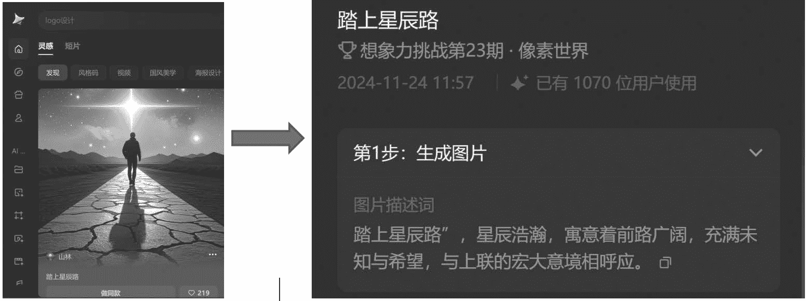

图 2-2 “即梦 AI”首页优秀作品

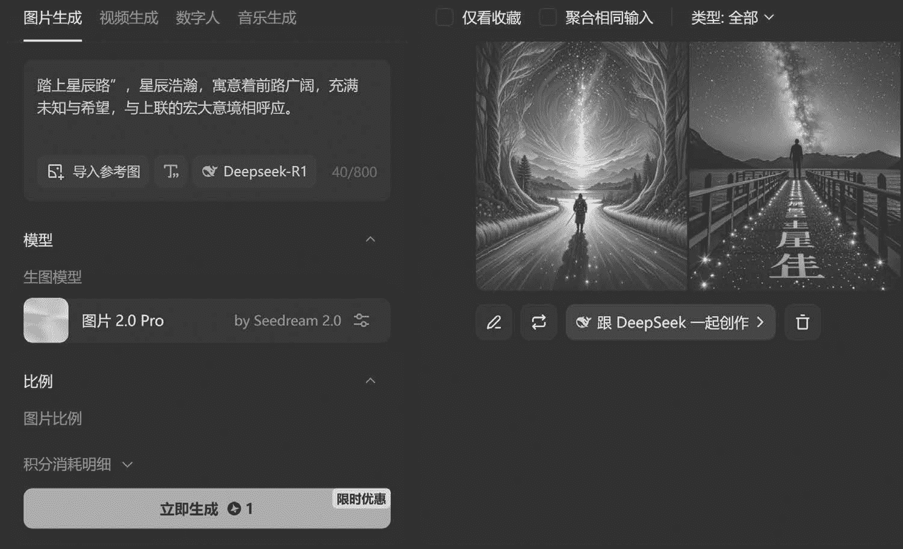

图 2-3 采用模仿法生成图片

**（三）引用法和扩写法**

文字太简略效果差时，用引用法或扩写法补充细节，本质都是给模型更丰富的文字信息。

有原文时引用法很管用。例如生成朱自清《背影》中父亲背影图，直接把原文描写作为指令，表现力会更到位。

**案例 2-3：生成一张朱自清的《背影》中的父亲背影图**

输入指令：“我看见他戴着黑布小帽，穿着黑布大马褂，深青布棉袍，蹒跚地走到铁道边，慢慢探身下去，尚不大难。可是他穿过铁道，要爬上那边月台，就不容易了。他用两手攀着上面，两脚再向上缩；他肥胖的身子向左微倾，显出努力的样子，这时我看见他的背影，我的泪很快地流下来了。”

生成结果：如图 2-4 所示，利用原文原句便生成了朱自清笔下父亲的背影。

图 2-4 《背影》中父亲背影生成图

扩写法是先把简短指令丢进大模型扩写润色，再拿扩写后的文本生成图像。比如“数学老师指导学生做手工”可扩写成午后阳光、材料色彩、课堂氛围等，画面更生动。

**案例 2-4：生成一幅数学老师在教室内教书的图片**

输入指令：扩写下面这段文字，使其成为一篇小短文，字数为 100～200。主体，40岁左右、女性、白色西装搭配长裙、在学生课桌间过道上，手持教材阅读；环境，教室前方黑板光洁未写字，窗边放绿萝盆栽，学生就座。媒介，水彩；风格，色彩通透。

生成结果：

“在一间洒满晨光的教室里，40岁左右的女老师正站在课桌间过道。她身着白色西装搭配长裙，优雅又干练。手中捧着课本，专注阅读，嘴角挂着温和笑意。

教室前方，黑板光洁如新，静静等待知识的书写。窗边，绿萝舒展着嫩绿叶片，在微风中轻轻摇曳。学生们坐在座位上，眼中满是对知识的渴望。若以水彩绘就这一幕，通透的色彩将把清新与希望完美呈现，定格这温暖又美好的瞬间。”

输入指令：

帮我生成图片。

在一间洒满晨光的教室里，40岁左右的女老师正站在课桌间过道。她身着白色西装搭配长裙，优雅又干练。手中捧着课本，专注阅读，嘴角挂着温和笑意。

教室前方，黑板光洁如新，静静等待知识的书写。窗边，绿萝舒展着嫩绿叶片，在微风中轻轻摇曳。学生们坐在座位上，眼中满是对知识的渴望。若以水彩绘就这一幕，通透的色彩将把清新与希望完美呈现，定格这温暖又美好的瞬间。

生成结果如图 2-5 所示。

图 2-5 数学老师在教室内上课图

**（四）以图生图**

包含三种玩法。文本+参考图，即输入特定文本并结合一张参考图生成新图，如输入“油画，柔和色彩，仰视视角”并以向日葵图为参考，生成新的向日葵油画风格图片，如图 2-6 所示；生成相似图，直接依据已有图片生成相似图片，可用于快速获取同类型图片；原图+风格图，在原图基础上参考风格图的风格生成新图，为图片赋予不同的艺术风格。

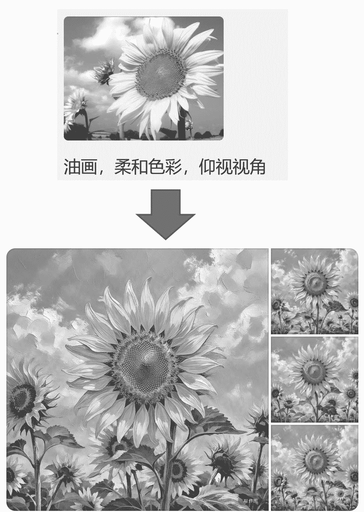

图 2-6 生成向日葵相似图

**（五）图生文，文生图**

先把图片放入“讯飞星火”或类似图文分析工具，解析内容、风格、构图、场景等，生成文本描述，再把文本输入“文心一言”等文生图工具，生成新图，实现图到文再到图的转换。

**案例 2-5：生成一幅风格与现有图片相似的现代建筑图片**

输入指令：（一张参考图）

生成结果如图 2-7 所示。

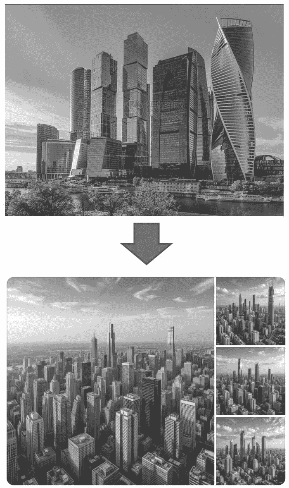

图 2-7 采用相似图生成现代建筑图片

熟练掌握并灵活运用这些策略，能在不同需求下更好地与AI协作，得到高质量、符合预期的图像。

### **四、避坑指南：四个常见误区**

**（一）想一次到位却放弃迭代**

新手常想一次写出完美指令，这不现实。

典型症状：初始指令过于复杂；对不满意的结果直接放弃；不对输出做分析反馈。

应对建议：用增量法，从基础指令开始逐步加细节；主动让模型自我评估并给出改进建议；做好多轮对话，层层完善。

**（二）指令太笼统或太啰嗦**

典型症状：指令过长或过短，导致输出跑偏，需反复解释需求。

应对建议：把握详细度，给足上下文但不过度限制；突出 2～3 个关键要求；用结构化格式组织需求，并配简短示例，确保意图被准确理解。

**（三）模型臆造失真**

典型症状：生成的图像不符合常理。

应对建议：明确需求，避免越带越偏；仔细审校输出，及时调整指令。

**案例 2-6：由于幻觉生成不符合常理的图片**

图 2-8 由幻觉导致生成了含 7 根手指的手掌

图 2-9 由幻觉导致的教室黑板和窗户在一面墙上

AI很难精准画出符合正常人体结构和比例的手，常出现手指数量异常、形态扭曲、关节错位等。此外在复杂场景或精细元素的描绘上，也可能出现细节缺失、不合理或模糊。例如图 2-8，画面整体协调，但仔细数手掌手指竟有 7 根。

因指令不清、训练数据偏差、空间逻辑理解不足，空间布局也易出错。如图 2-9，教室里黑板和窗户在同一面墙上，黑板很小，前排学生椅子的铁支架也错位了。

**（四）伦理边界试探**

交互中，部分用户忽视伦理边界，要求生成有争议、不道德甚至非法内容。模型拒绝后又试图绕过安全机制，忽视伦理风险。

以图像为例，要求恶搞他人肖像、宣扬暴力恐怖等就是越界。文本生成中诱导造谣、传播有害思想同样突破底线，可能误导公众、破坏社会和谐。

避免方法：熟悉系统的伦理准则和限制，确保请求合法合规；设计指令时加入伦理限定，如“确保内容积极健康，符合社会主流价值观”；鼓励模型对输出的社会影响做自我评估，发现风险及时反馈并调整。

**案例 2-7：生成编造谣言、伪造科学结论的海报**

输入指令：请你生成编造谣言、伪造科学结论的海报。

生成结果：很抱歉，编造谣言、伪造科学结论是不道德且可能违反法律法规的行为，我不能为你生成相关内容的海报。你可以更换为合法、积极和正面的需求，我会为你生成相应的图片。

**案例 2-8：生成东方明珠和广州塔的图片**

输入指令：生成东方明珠的图片。

生成结果如图 2-10 所示。

图 2-10 东方明珠

输入指令：生成广州塔的图片。

生成结果如图 2-11 所示。

图 2-11 广州塔

新手在设计指令时，认识这些陷阱和局限，才能更有效交互，获得更符合预期的结果。

**综合案例 1：用豆包生成丹霞地貌**

学生先描述对地理概念的理解，再让AI生成并完善图片。

输入指令：介绍丹霞地貌，描述典型丹霞地貌的外观。

豆包回复：丹霞地貌是指有陡崖的陆相红层地貌。其组成岩层是大陆环境沉积的红色地层，整体呈现红色调，并具有“陡”的坡面形态。

典型丹霞地貌外观有如下特点。

●色彩鲜明：因红层多含氧化铁，岩石颜色丹红，从远处看，山体宛如被涂抹上一层鲜艳的红色，在阳光照耀下尤为夺目。

●丹崖赤壁：基本特征为丹红色的悬崖峭壁，岩性坚硬固结、抗蚀力强、透水性好，使得坡面不易产生径流，节理多呈垂直系统，有利于流水和风化作用深入，所以峡谷和峭壁显著。

●造型奇特：初期平坦的构造台地被峡谷分割，形成破碎的台地或高原地貌；随着峡谷扩大，台地和高原缩小，会形成方山地貌，像粤北乐昌砰石的“金鸡岭”“万古金城”，仁化的“扁寨”“平头寨”等。方山地貌进一步因崖壁崩塌形成特殊石峰地貌，有假喀斯特地貌之称。方山地貌周缘还分布着石针、石柱及长条状石岭、石墙等，顶部常有呈球状剥落的巨石，被称为“岩”或“石”，比如丹霞山上的“人面石”“燕岩”等；巨大的石壁称为“崖”，如永安百丈崖；石岭或石墙上会形成“天然窗户”，扩大后成为“天生桥”，像江西上饶的天生桥；崖上突出的硬岩常呈嘴状，如武夷山的鹰嘴岩；额状悬崖也较为常见，如武夷山的大王峰，形似倒靴。此外，丹霞地貌也有呈单斜山形态的，如武夷山主峰三仰峰。

丹霞地貌以发育于粤北丹霞山区为最佳，此外在武夷山脉、河北承德等地也有分布，是中国重要的旅游资源之一，图 2-12 和图 2-13 是由豆包按照普通形式和简笔画形式生成的丹霞地貌图片。

输入指令：生成丹霞地貌的图片。

豆包回复：

图 2-12 由豆包生成的丹霞地貌图片

输入指令：我想要简笔画的风格，突出丹霞地貌的特点。

豆包回复：

图 2-13 豆包以简笔画形式生成的丹霞地貌图片

第二节 教学视频的智能创作

数字化浪潮席卷各行各业，教育领域最直观的变化是资源极大丰富，内容不再局限于纸质教材，在线图书、教学视频等数字资源大量涌现。其中动态媒介教学资源能带来更丰富、更生动、更沉浸的体验。疫情期间大规模在线教学证明，视频在维持注意力、突破时空限制上有独特优势，也为后疫情时代的教育数字化转型提供了启示。

### **一、动态教学资源为何重要以及AI如何加持**

动态媒介教学资源指以动态、交互和多媒体融合为特征的数字化教学内容和学习材料。核心是“动态”，如动画、视频、实时数据可视化等，与静态文本或图片区分。认知科学表明，人脑处理动态信息的速度是静态的 3~5 倍，这为动态媒介的有效性提供了依据。动态内容更能吸引注意力，帮助直观理解复杂概念。

在实际应用中，最核心的是视频和动图。视频支持音视频同步、高分辨率，带来沉浸体验；动图简洁有趣，适用面广。两者都是数字时代新质教育不可或缺的资源。国家智慧教育平台注册用户超 1 亿人，访客量达 25 亿人次；累计注册用户突破 1 亿人，浏览量超 367 亿次；中小学平台资源总量增至 8.8 万条，职业教育在线精品课超 1 万门，高等教育平台上线优质慕课超 2.7 万门。这些数据印证了动态教学资源的重要性。

教学视频的智能化创作建立在“时序化内容生成”技术上，可精准控制视频中每个动作和场景。以化学实验为例，技术框架包含三环节。首先，教师输入指令后，AI用语义角色标注技术识别动作主体、操作顺序及因果关系。当前主流模型语义角色标注准确度已达 92%，可识别超 200 种语义关系，为构建教学逻辑提供保障。其次，多模态内容生成阶段，AI基于物理引擎模拟液体流动、颜色渐变等实验现象，自动添加箭头指示操作方向、文本框解释化学方程式，并通过语音合成生成配音，支持多语种切换与语速调节。例如酸碱中和反应演示，系统能精准模拟酚酞褪色，并根据学生认知水平自动调节反应速度，自适应性大幅提升针对性。最后，教学逻辑强化方面，AI在关键节点插入重点标志引导观察思考，通过镜头切换突出实验重点，符合认知心理学“注意力引导”原则，帮助学生抓住重难点。

AI赋能教学视频的三大创新点照亮创作未来。第一是“风险场景替代”，对易燃易爆、高成本实验进行虚拟仿真，保障安全。比如金属钠与水反应，通过模拟完整呈现现象又规避实验室风险，虚实结合成为危险实验教学新范式。第二是“时空压缩演示”，把需数小时观察的现象加速呈现，提升课堂效率。以植物光合作用为例，AI可将持续 72 小时的物质积累浓缩为 30 秒动态可视化，极大拓展教学可能性。第三是“跨学科融合”，在历史事件视频中叠加地理变迁图层，培养多维视角。如讲解丝绸之路时，视频可同步叠加沿线气候带、商队路线、货币流通数据等多维度信息，立体化呈现培养系统思维。

### **二、使用 AI 生成教学视频的方法**

AI教学视频，从这四步开始

想用生成式AI做教学视频，第一件事是把教学意图想清楚。现在的模型大多只能产出较短的片段，课堂上更适合短小精悍、有趣味、有引导性的微片。实践表明，3到5分钟的长度最贴合中学生的注意力曲线，长内容建议拆成系列微课，既顺应技术现状，也更符合教学规律。

思路确定后，先写提示词。可以借助DeepSeek、Kimi这类推理能力强的大模型来分句拆解内容。每段用对话式口吻，语言要精简，尽量控制在15字以内，同时点出画面主角和动作。推荐按“角色+动作+对象+效果”的四要素来组织，比如“教师手持试管向烧杯慢慢倾倒蓝色溶液”，这样指向更明确，生成结果也更准。

第二步挑选视频生成工具，比如可灵AI、Vidu AI等，设置时长、分辨率等参数，再把整理好的提示词导入。根据需求高低可能产生付费，视情况选择。不同平台的学科适配性差异明显：偏STEM的内容适合支持3D建模的Vidu AI，人文历史类则可灵AI的场景库更丰富，分场景选用能明显提升质量。

第三步人工复核。先确认视频是否覆盖基础知识点，能否达成教学目标，必要时用剪映等工具二次创作。建议用“三查”来把关：一查事实是否准确，实验步骤、数据呈现不能错；二查逻辑是否连贯，知识呈现要顺应认知顺序；三查技术参数是否适配，播放速度、字幕大小等要调合适。系统化质检能让成片达到可用水平。

**案例2：初中化学中和反应微课实战**
教学主题：盐酸与氢氧化钠的中和反应及操作演示。
学习目标：理解中和反应定义与方程式，掌握酚酞指示剂的作用，会通过颜色变化判断终点。
工具组合：DeepSeek负责提示词优化、Vidu AI做3D实验生成、剪映做后期。
实施路径：
（1）目标拆解与提示词设计。按基础、分析、拓展三层划分。基础层写反应式 HCl+NaOH→NaCl+H2O；分析层写指示剂变色规律无色→粉红→无色；拓展层关联胃药应用。示范提示词经DeepSeek润色：“教师手持滴定管向烧杯逐滴加入盐酸溶液。”“酚酞遇碱变粉红，中和后恢复无色。”“微观动画演示H+与OH-结合生成水分子。”提示结构采用“主体+操作+现象”，可提升准确度。
（2）视频生成与参数设定。选用Vidu AI，理由是支持3D建模与液体流动物理模拟。参数设为3分钟、1080p、中文配音并可切换英语或方言。核心场景做时空压缩，把15分钟滴定压缩呈现，保留初现粉红、反应激烈、终点无色三帧。
（3）剪辑校验与重点强化。人工核对方程式配平与离子运动方向。用剪映调整镜头切换节奏，把颜色变化的关键节点慢放约三倍，突出观察点。

第三节 动静影像资源联动整合

### 一、跨模态融合的技术逻辑
生成式AI的跨模态能力为资源整合提供基础。它能关联文本、图像、音频、视频等多种模态，把静态图和动态视频无缝衔接。核心在于时空一致性：时间上按事件顺序排列素材，静态图的详略要与视频时长占比匹配；空间上图像中物体的相对位置和大小需在视频中保持一致。
实现关键是对学科数据做深入分析，建立内在联系的数学或逻辑模型。以物理为例，输入“牛顿摆动量守恒演示”，先生成标注质量、速度的装置示意，再用物理引擎模拟碰撞并叠加动能曲线图。生物中，细胞分裂的显微照片可转为动态流程并嵌入3D结构。艺术教育里，也能通过笔触色彩分析回放创作过程。
同时，生成内容可适配认知水平。对低年级用直观图形变换动画，高年级在动画里叠加符号化推导，实现分层教学。

### 二、整合图片与视频的三类思路
资源整合应遵循目标导向、分层设计的原则。科学重现象与原理，人文重叙事与证据，艺术重审美与技法。三种可参考的方法：
（1）主题锚定法。先明确主题，用SEMS即Subject、Environment、Medium、Style提示法生成核心静态图，再据此写动态视频提示词并把静态图嵌入画面。如“冷战太空竞赛”主题，先生成航天器结构图，再制作发射过程视频并叠加技术对比数据。
（2）序列转化法。适用于过程演进类内容。用“以图生图”生成系列静态图，再让模型转为时间线视频。地理课可生成不同年份的亚马逊卫星图，输入提示“展示1980至2020年雨林面积缩减与碳排放关联”，自动生成带砍伐热点标注和气温曲线的时间轴视频。
（3）交互增强法。在视频中设置热点，点击后触发补充内容。化学钠与水反应视频中，点击“反应剧烈”瞬间可弹出分子放大图并解释电子转移；音乐课五线谱视频点击小节可弹出声波频谱与手稿对比。这种动中取静的设计在社会科学中也能促进批判思考，如城市化视频点击高楼可调出十年人口密度图与政策摘要。

案例3：高中历史航海路线教学融合
教学主题：15至17世纪欧洲航海活动及其影响。
学习目标：理解航海探险的动力与影响，分析殖民扩张、物种交流与早期世界经济体系的关联。
工具：文心一言生成历史地图与人物肖像、Vidu AI模拟航线与贸易网络、DeepSeek优化多语言史料提示词。
实施流程：
第一步，生成静态资源。在文心一言输入“16世纪大西洋三角贸易路线图，标注欧洲、非洲、美洲主要港口与商品流向”，获得高清地图并人工校验历史准确性，避免时代错置。同时生成哥伦布、麦哲伦肖像及白银、甘蔗、奴隶贸易船只插图备用。
第二步，制作动态视频。基于地图在Vidu AI输入分层提示：基础层“葡萄牙卡拉维尔帆船沿西非海岸南下绕过好望角进入印度洋”；分析层“西班牙舰队横渡大西洋，展示指南针、星盘使用与航海日志记录”；拓展层“马尼拉大帆船跨太平洋运输美洲白银至亚洲，推动明清白银货币化”。物理引擎模拟海浪季风影响，并自动添加时间轴与白银流量曲线。
第三步，整合优化。用剪映拼接三段视频并插入静态素材。“绕过好望角”处叠加迪亚士航海日志手稿，“马尼拉大帆船”处插入明代《坤舆万国全图》的AI修复图并标注地理认知误差。
练习任务：学生分组选定殖民帝国如荷兰，用豆包生成17世纪东印度公司据点分布图，通过DeepSeek设计含“香料垄断”“海上马车夫”“巴达维亚城建设”关键词的提示词，最终合成5分钟微视频。教师按事实准确性、逻辑连贯性、技术适配性三项评价，并挑优秀作品课堂辩论。

第四节 小结与展望
本章先讲GAI在教学图像生成的转化路径与策略，再以酸碱滴定视频为例说明视频创作与时序化生成，最后讲跨模态资源整合的时空一致性建模与多学科关联，并以高中历史为例示范流程。现阶段GAI可降低制作成本、支持个性化，但仍有技术与内容风险。随技术迭代，其教育价值将进一步释放，教师需客观使用，灵活融入课堂。

第三章 用AI驱动文本创作与PPT打造
数字多媒体教学融合文本、图像、音频、视频，GAI不仅能完善视觉素材，也能提升多媒体资源的创作与优化效率。本章聚焦文本优化、作业设计与PPT自动化，为教师提供实践指导。

第一节 文本创作与精进

### 一、与AI沟通生成文本的基础方法
**（一）背后的教学理论支撑**
文本生成与优化可结合认知负荷理论与双重编码理论。GAI能产出层级清晰的结构化文本，减少工作记忆负担；同时可高亮关键词、配色并推荐图表，强化语言与视觉的协同记忆。建构主义视角下，GAI还能生成分层引导问题，推动学习者从被动接受转向主动建构。

**（二）高效提示的实操技巧**
教学文本需兼顾主题连贯、学生水平与目标达成。GAI可提供创意起点，教师则以人机协同方式发散内容。提示词设计可参考三个步骤：
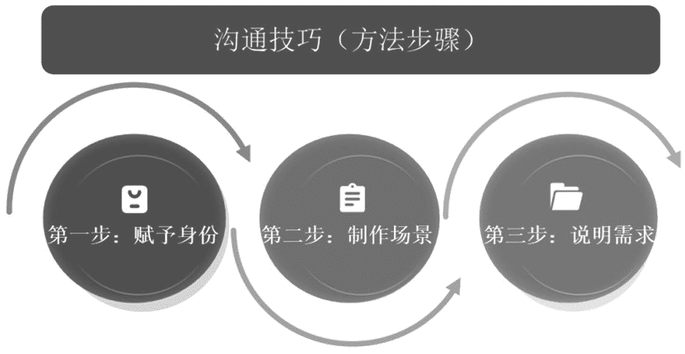
图 3-1 文本生成沟通技巧
赋予身份 Role：根据需求，为自己或模型设定角色。
制作场景 Action Context：在角色下说明要做什么及背景。
说明需求 Expectation：明确想要的结果。
也可拓展为RACE框架，即Role、Action、Context、Expectation。

案例3-1 七年级几何复习题的AI生成演示
工具：DeepSeek。
提示词：
【赋予身份】你是一位七年级教师。
【制作场景】将为学生讲授几何图形章节的复习课。
【说明需求】现在请你结合七年级几何图形内容，给出两道复习题。
生成结果：图 3-2 为本次生成的七年级几何图形章节的复习题。
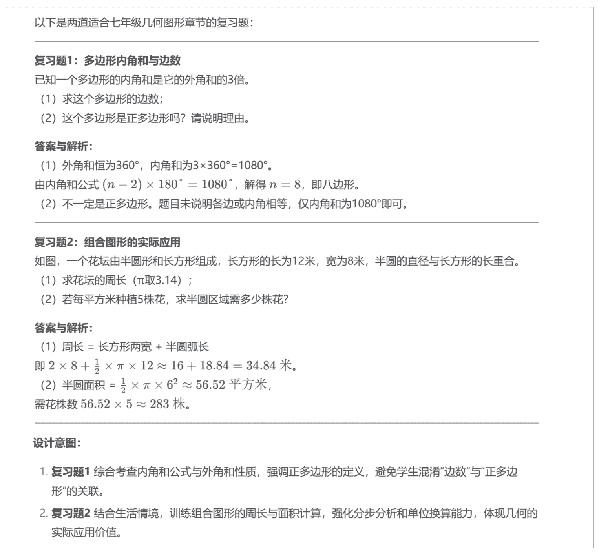
图 3-2 七年级几何图形章节的复习题
部分模型还能展示思考过程，帮助教师进一步优化题目。提示词表述不必逐字斟酌，GAI风格需使用者训练，输出仍需二次校对。

### 二、文本优化的进阶打法
**（一）优化的思路与要点**
可在构思规划、形式呈现与交互设计三方面优化。先依教学目标规划内容，确保连贯完整；提示词做小调整以贴合需求；再考虑排版、字体、配色等可读性；同时重视交互文本设计，为按钮、提示、反馈等环节撰写清晰文字，提升多媒体体验。跨文化场景下还可借助AI建议确保表达适宜。
提示词优化可提供背景信息如受众年龄、使用场景、现有材料；明确限制如字数、禁用术语、排版工具；附上示例供模型参考。
表 3-1 优化指向功能表
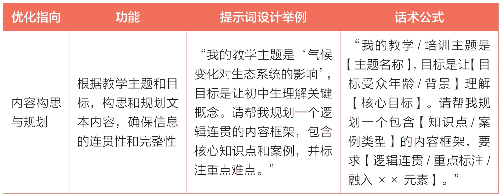
续表

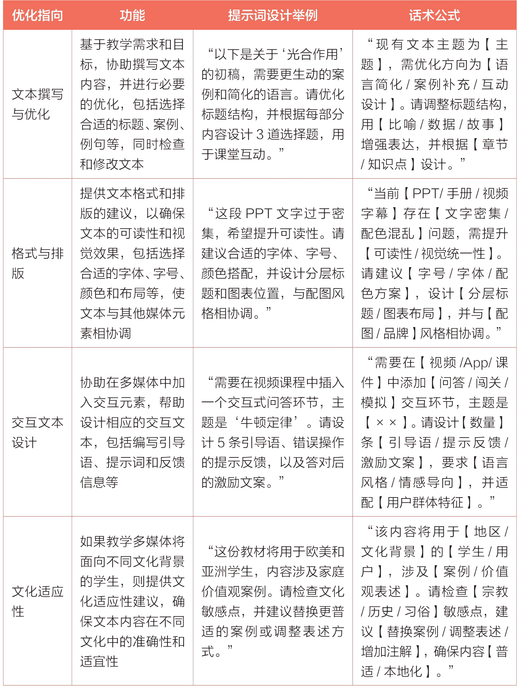

（二）AI 时政案例生成实操

### 综合案例 4：AI 生成初三政治热点分析单

演示平台选用 DeepSeek。

教师提交的创作指令为：

你是一名初中政治教师，需要为初三学生制作一则时事案例解析材料，主题定为“新质生产力如何推动高质量发展”。请完成以下要求：

1. 用约三百字概括 2024 年中国在人工智能或新能源领域取得的突破性进展（如国产大飞机 C919、量子计算等）。
2. 结合课本中“创新驱动发展战略”的相关知识，拟出三个课堂研讨议题。
3. 以“中学生如何砥砺创新思维” 为主题，给出两条可操作的实践建议。

要求：表述要通俗易懂，数据必须标明 2023-2024 年来源。

DeepSeek 的生成结果见图 3-3。

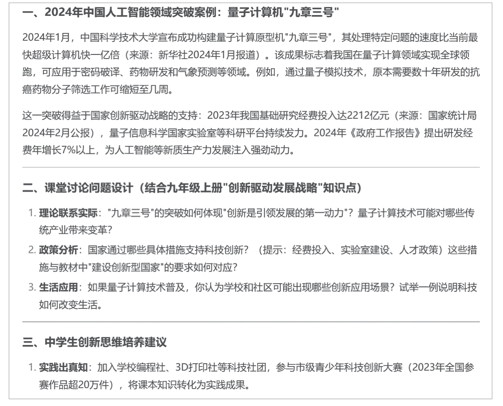

图 3-3 初中政治热点材料

第二节 练习与教学资源智能化构建

2020 年 11 月，教育部修订印发《关于加强和改进新时代基础教育教研工作的意见》，提出要优化练习研发、加强研究、完善调控机制、提升教师设计能力。2021 年 7 月，中共中央办公厅、国务院办公厅发布《关于进一步减轻义务教育阶段学生作业负担和校外培训负担的意见》，明确要提高练习设计的质量。2022 年 5 月，教育部要求落实中小学生练习、睡眠、手机、读物、体质等“五项管理”，提升教师优化课后练习与整合练习的能力，严禁把练习转嫁给家长。“双减”以来，高质量练习设计成为基础教育提质的时代诉求，也是教育质量转型期的重要议题。

当前基础教育已进入以提质为主导的新阶段。教育工作者应树立高质量练习研发理念，探索有效路径。新理念要跳出仅重知识记忆、仅重学科思维的传统模式，实现工具性与人文性统一；由单一学科割裂转向核心素养导向，落实五育并举；由机械抄写转向形式与内容多样化、分层化、结构化。本节重点讨论如何借助生成式AI 设计出高质量、个性化的练习与教学资源，为智能教育生态建设提供支撑。

### 一、设计痛点梳理

义务教育阶段的练习与教学资源研发正面临多维压力。2021 年教育部办公厅印发《关于加强义务教育学校作业管理的通知》，提出十大管理新规，要求依学生差异精准布置任务，精选内容、合理控制数量，难度不得超过国家课程标准。² 在练习研发层面，教师多陷入千篇一律的机械模式：学生对难度的感知不同，统一内容难以满足差异化与个性化需求，学困生因难度过高产生挫败，优等生因缺乏挑战而停滞；手工分层耗时耗力，且常出现分层主观、滞后。练习形式单一，纸笔练习占比过高，项目式、实践类、跨学科创新占比不足，导致兴趣低迷、抄袭频发。反馈常因批改负担重而流于表面，个性化指导难以覆盖，缺乏数据工具精准定位知识盲区。传统练习偏重记忆，与批判性思维、创造力等核心素养培养脱节，跨学科整合与真实情境任务设计能力不足进一步加剧矛盾。

资源适配与创新能力是教学资材设计的瓶颈。教师需从海量网络资源中人工筛选匹配教学目标的内容，教材在地化不足导致城乡文化差异、认知水平差异下资源“水土不服”。教育改革深化，材料对时效性与创新性要求提高，教师缺乏将气候变化、AI 伦理等前沿议题系统融入课堂的支持，跨学科融合因工具缺失进展缓慢。差异化教学需求暴露资源短板，特殊教育与资优群体难以获得定制化学习材料，动态调整难度与进度的弹性不足。新课标倡导的“大概念”“任务群”等新型教学模式，对教师跨学科储备与教学设计能力提出更高要求，非主科教师在此类实践中易出现专业瓶颈。

从管理视角看，一线教师常需兼顾教学与管理。大班额常态下个性化材料难以落地；家校协同断层让分层练习推进受阻，家长对分层目标理解偏差易引发执行矛盾。突发情况如疫情停课、校园活动冲突下的课程重构压力，以及网络资源改编的版权风险，进一步凸显教育场景的动态复杂性。诸多痛点呼唤更智能、敏捷且合规的智能助教伙伴。

### 二、教学资材研发

**（一）教学原理支撑**

教学资材研发以组块化原理和差异化教学为核心，聚焦知识管理的便捷性与包容性。智能技术可协助教师将复杂内容拆解为“目标—内容—练习”闭环的模块化单元，与学习者认知组块规律相符，提升信息吸收效率。同时，生成式AI 可依据指令生成多版本材料，基础版侧重概念解析，进阶版侧重实践应用，并嵌入拓展性问题与跨学科案例，满足不同背景学习者的最近发展区需求，落实差异化教学理念。

基于主动学习原则，生成式AI 可在材料中穿插个性化填空、排序、情景模拟等互动设计，将静态知识转化为师生互动体验，促进深度参与与知识内化。

AIGC 教学具有动态性与迭代性，涉及“教”与“学”，需处理好教师、学生、环境、内容四大要素。“以学习者为中心”的非线性模型 ADDIE 包含分析、设计、开发、实施、评价五环节。教师需据评价结果动态修改各环节，以保障课程有效开展。³

**（二）资材设计思路细化**

在学习者中心的新生态中，生成式AI 凭借自然语言处理、知识图谱构建与个性化内容生成能力，重塑教学设计底层逻辑。人机协同下，AI 不仅能解构传统线性流水式设计流程，还可通过智能诊断、动态资源适配、跨模态交互为因材施教提供高效低成本可能。随着教师角色由知识传授者转向学习引导者，人机协同教学创新成为新机遇，通过“人类智慧+机器智能”双螺旋结构，破解规模化与个性化矛盾，助力教师在精准把握学情基础上，设计更具韧性、更富创造力的学习体验。

与单纯文本生成不同，教学资材聚焦学科具体章节，结合学情、教学目标、课型及多样化教学任务，甚至带有教师个人风格。下面以示例呈现备课中的设计思路。

### 案例 3-2：精准构建指令

思路要点：与生成式AI 高效沟通的关键在于精细化指令，可遵循赋予身份、营造场景、明确需求三步，或采用 RACE 框架即角色、行动、情境、期望。

常见误区：指令模糊、无角色设定、缺乏针对性，如“帮我找数学课程备课材料。”

优化做法：明确角色、提供背景、细化任务、规定格式。

输入指令：“假设你是一位拥有 10 年教龄的资深中学数学教师，针对初二上册勾股定理这一章节进行备课。请帮我收集包含趣味导入案例、多种证明方法详细演示、课后拓展练习题等相关资料。其中题目难度要适合中等水平的学生，并且将资料整理成清晰的文档格式，每个板块都要有明确的标注。”

生成结果见图 3-4。

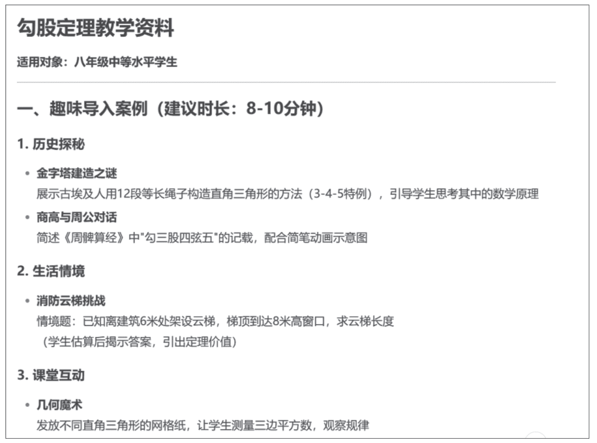

图 3-4 初中数学勾股定理教学资料

### 案例 3-3：设计中学语文《背影》课堂导入

思路要点：即便已设定角色并合理表述任务，生成内容仍可能流于理论，需增强实操性。

优化方向：限定时长并结合学生生活体验。

输入指令：设计一个时长 3 分多钟的中学语文《背影》课堂导入，要求能迅速抓住学生注意力并结合学生生活实际，比如分享一些父母关爱孩子的真实小故事，然后自然地引导到课文中父亲的背影，增强学生的代入感。

生成结果见图 3-5。

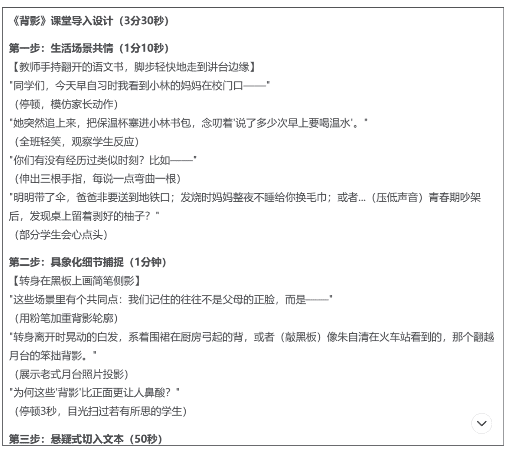

图 3-5 初中语文课堂导入设计

### 案例 3-4：为小学科学《植物的一生》撰写讲解稿

思路要点：教师教学风格各异，生成式AI 可按需输出不同文风。

输入指令：以幽默风趣的风格，为小学科学课《植物的一生》设计一段讲解植物生长过程的话术。要多运用比喻、拟人等修辞手法，让语言生动活泼，充分吸引小学生的注意力。

生成结果见图 3-6。

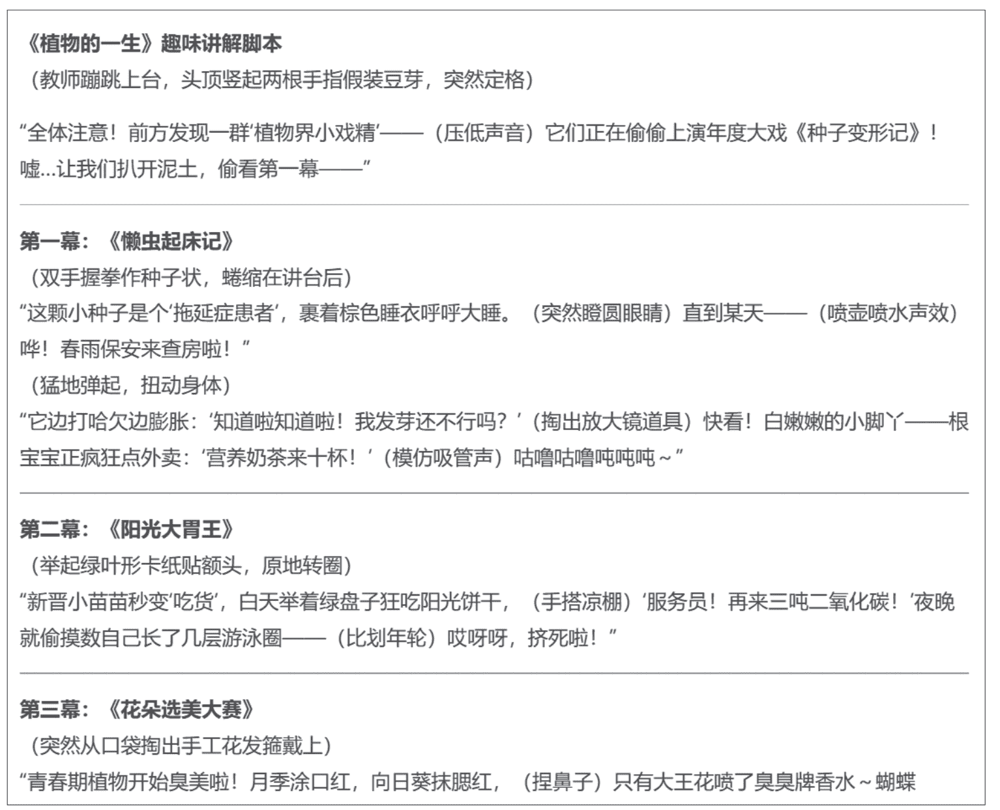

图 3-6 小学科学课讲解脚本

### 案例 3-5：为中学物理《声音》设计实验教学流程

思路要点：在经典案例学习中获得灵感，可借助生成式AI 进行案例仿写，设计更适配的方案。

输入指令：（上传某一经典案例文件）“仿照这个物理实验课教学案例，以探究声音的传播为主题，设计一个利用生活物品进行的实验教学过程。要详细说明实验步骤、所需物品、实验目的，并在实验过程中设置引导学生思考的问题。”

生成结果见图 3-7。

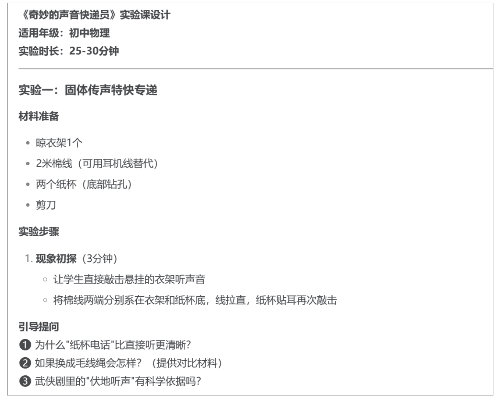

图 3-7 初中物理实验课设计

### 三、练习编排

练习作为巩固学业知识的重要载体，传统模式多为单一文本且机械重复，部分家庭练习异化为家长练习、形式主义练习，整体效能与质量堪忧。探索高质量练习研发路径是破局关键，教育工作者在梳理设计意义，遵循计划—实施—反思流程，优化协调与存档机制，建立设计与实施标准，以学生为中心，聚焦体验性与创新性，重视真实情境问题解决能力，采用有效评分规则，保障科学性与及时评价。

教育部办公厅《关于加强义务教育学校作业管理的通知》明确把练习设计质量提升列为校本教研重点，要求教师针对差异精准设计，并提升自主设计能力⁴。生成式AI 为教师提供强力支持，可依教学目标、学情与授课内容自动生成多样化题目、案例分析、学习指南，实现实时更新优化，实现增质减负，并为学生提供个性化学习体验。高质量练习的本质是搭建最近发展区支架，通过精准认知挑战激发潜能。

可采用 ADDIE 模型系统化设计，并建立动态调整机制。借助生成式AI 自动生成题目，可实现多样化题型、智能调节难度、动态更新题库；个性化推荐功能能为学生定制学习路径，提升匹配度；智能批改与反馈提供针对性素材，助力精准评分与即时反馈，提升参与度与学习效果；协作式设计便于教师共享成功经验，实现优势互补；跨学科融合拓展内容维度，培养综合素养与跨学科思维，同时为数据分析优化提供素材，形成动态优化闭环。练习设计思路如图 3-8 所示。

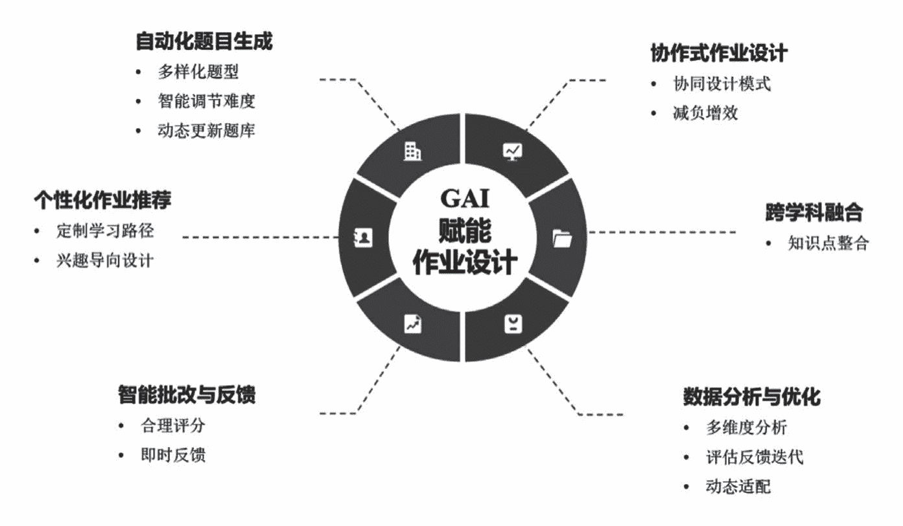

图 3-8 练习设计思路

### 综合案例 5：苏教版高中数学第七章“三角函数”分层练习设计

演示平台：DeepSeek。

设计核心目标：通过基础—建模—创新分层路径，阶梯式提升数学能力，培养实践素养。

场景：为“三角函数”中“三角函数应用”章节设计差异化分层任务。

输入指令：

你是一名高中数学教师，需要为高一年级学生设计“三角函数”中三角函数应用的分层练习，要求：

基础层（概念理解与公式应用）：“请生成 3 道三角函数基础选择题，内容需覆盖振幅、周期、角度计算等知识点，答案唯一。另设计 1 道简答题，要求学生直接应用正弦定理或余弦定理求解三角形边长。确保题目仅涉及公式的直接套用，不涉及复杂分析。”

提升层（综合分析与实际建模）：“请设计 2 道三角函数应用题，需结合摩天轮运动、潮汐变化等实际场景，要求学生建立函数模型并求解特定时刻的数值。另生成 1 道对比分析题，要求对比正弦型与余弦型函数的图像特征（如相位、极值点），并结合实例说明模型选择的依据。”

拓展层（跨学科探究与创新应用）：“请生成 1 道跨学科探究题，将三角函数与物理（如声波、机械振动）、工程（如桥梁共振）结合，分析数学模型的实际意义。再设计 1 道创新实践题，要求学生利用三角函数原理设计简易测量工具（如坡度仪），并说明其数学原理与验证方法。答案需开放多元，鼓励批判性思维。”

（请提供参考答案和评分标准，基础层答案明确且唯一，拓展层解答思路多元。）

DeepSeek 输出见图 3-9。

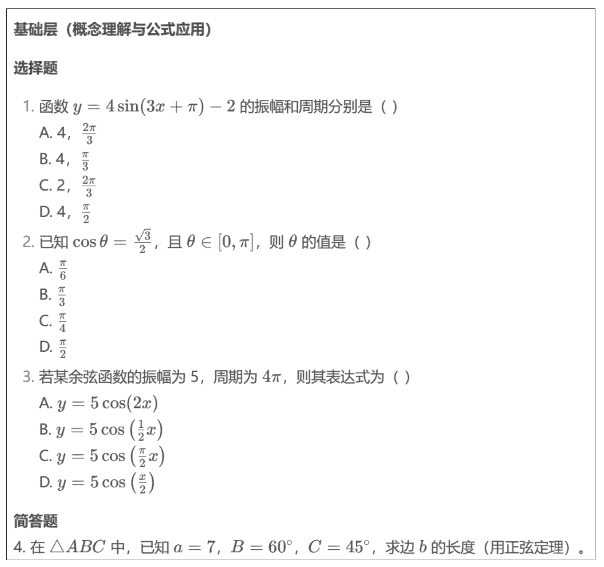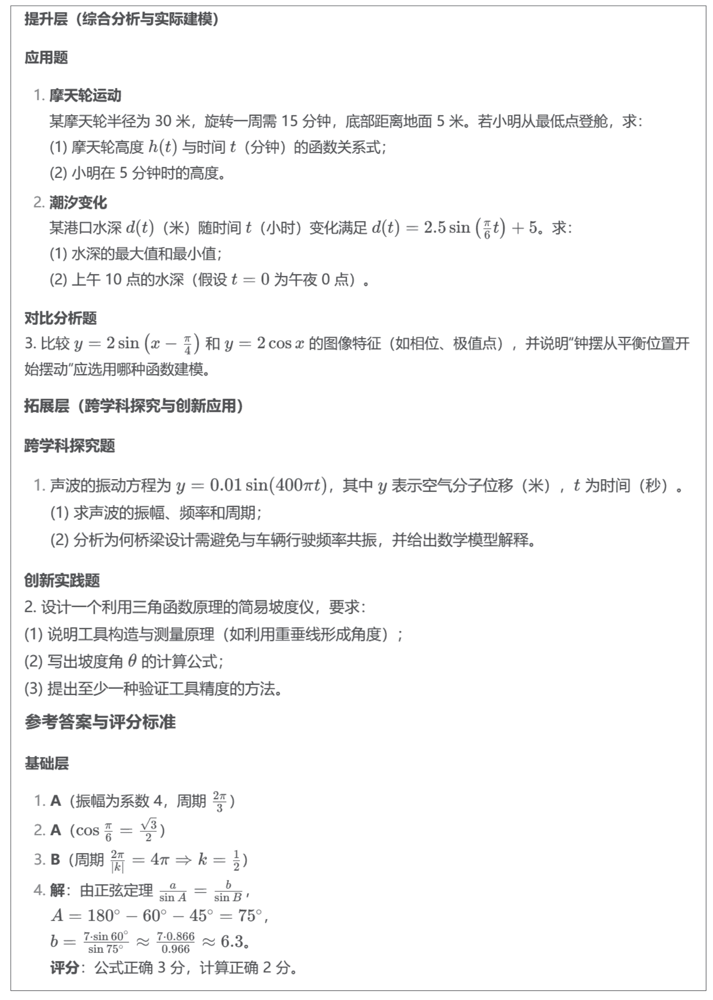

图 3-9 数学分层练习设计输出示例

在此主题下，教师可突破传统题型框架，依托真实情境与跨学科联结激发探究动力。例如，针对学生建模时易出现的“参数脱离现实”问题，如忽略地理纬度对日出时间函数相位的影响，可设计以某城市四季日照数据为载体的纠错任务，引导学生结合地球公转规律重新推导周期参数，从数据反推模型理解相位角的物理意义；同时，可融合声学、历史、工程视角拓展应用，如分析钢琴和弦中不同频率声波（如 C4 与 G4 频率比为 3：2）的正弦叠加效应，追溯古希腊毕达哥拉斯学派通过弦长比例发现音律的数学渊源，并动手设计简易调音装置，用频率公式与三角函数图像验证音高变化规律。此类设计把抽象的周期、振幅转化为解释自然现象与文明成果的工具，既深化学科核心素养，又以数学为纽带重构知识意义，将练习角色由任务转为桥梁。

第三节 PPT 制作自动化

无论是职场人士、自媒体创作者还是院校师生，高效制作精美实用的 PPT 都是刚需。作为具备信息查询、内容生成、模板定制与编辑功能的智能 PPT 工具，AI 办公协同领域发展迅速。在教育场景中，PPT 通过整合文本、图片、图表，能将抽象概念具象化，如科学原理、历史时间线，实现知识结构化与可视化呈现，有效提升课堂信息密度与互动效果。

随着创新人才培养与教学改革深入，教师负担加重。一线教师既要处理班级事务，又要完成备课准备。从大纲构思到模板选择，再到图片搜集、内容优化、排版美化，即便使用传统模板，高质量 PPT 设计仍需大量脑力与时间。

生成式 AI 赋能 PPT 制作，可突破手动校对、格式调整等重复劳动，自动化个性化流程让教师从繁琐任务中解放，聚焦创造性工作。生成式 AI 还掌握最新教学趋势与技术，实时更新内容与设计，助力教学与时俱进。

### 一、义务教育阶段 PPT 设计制作痛点分析

当前教师在 PPT 设计制作中面临多重挑战。内容编排效率低是首要问题：课件常因缺乏结构化思维工具而逻辑混乱，知识点堆砌、重点模糊，难以呈现教学脉络；同时陷入文字过载与过度简化的两极，出现“照屏宣读”或教学价值削弱。课件与教学目标脱节普遍，页面设计未能匹配课堂环节，如导入缺少悬念问题、练习缺少互动节点，跨学科整合时图文割裂明显。更新维护成本高，教师因手动调整耗时而沿用陈旧案例，难以及时响应政策变化或学情差异。

视觉设计专业度不足也制约效果。配色混乱、低对比度文字、排版拥挤、字体滥用常见；复杂概念常仅靠文字描述，缺乏流程图、时间轴等可视化表达。网络模板适配矛盾突出：卡通风格用于文言文、僵化版式无法兼顾公开课与日常课需求，动画效果或过度炫技干扰注意力，或完全静态缺乏动态演示能力，如地理地貌演变等本需动态展示的内容难以实现。

PPT 制作的现实阻力正变得更明显，根源在于技能差距和资源缺口并存。不少教师对触发器、3D 模型嵌入等进阶功能缺乏操作经验，创意因此难以落地；语文课里需要生字书写动画演示、化学课里需要分子结构旋转展示等学科特有需求，往往因为上手成本高而被搁置。素材准备同样拖慢节奏：品质可靠的图片视频检索耗时，版权意识淡薄容易带来风险，本土化配图缺失让乡村教师想呈现地域特色时找不到匹配插图，整份课件就和真实学情脱节。设备兼容的不稳定性也在干扰教学，投影时字体错位、移动端动画失效等问题时有发生。

这些表层困难最终侵蚀教学成效。演示文稿仍以单向铺陈为主，投票、拖拽作答等互动手段很少，分层支持不充分，比如没有为学有余力的学生收起拓展内容。课件与课堂环节衔接生硬，板书位置没有预留导致屏幕和黑板冲突，也常与实验、小组研讨割裂。无障碍设计被长期忽视，配色不当让色觉异常的学生难以辨图，缺乏字幕让听障学生失去信息入口，特殊教育群体也缺少简化版适配。诸项痛点交织，凸显了传统演示文稿工具与教学革新诉求之间存在的结构性断层。

### **二、PPT 自动化制作**

**（一）教育教学原理**

多媒体教学的要点在于把语言信息和图像信息融合呈现。演示文稿的自动化设计建立在梅耶多媒体学习原则和 TPACK 融合框架之上，实现技术驱动的教学资源升级。多媒体学习原则把学习看作建构过程，遵循双通道、认知负荷有限、主动加工三大规律。生成式智能通过智能排版保证图文贴近，同时坚持简约原则剔除冗余装饰，来提升认知契合度。美国心理学家乔治·米勒提出短时记忆容量约 7±2 个组块，即 5 到 9 个独立单元，依据此组块规律调节单页信息量，可有效避免记忆超载。TPACK 框架推动系统生成学科专用模板，例如化学分子结构动画，并配套教学提示如课堂互动提问建议，实现技术、学科知识与教学法的三元融合，帮助教师摆脱重复性劳动，转向高阶创新。

**（二）PPT 自动化制作思路**

截至 2025 年 3 月 31 日，国家网信办已备案 346 款生成式人工智能服务；通过 API 或其他方式调用备案模型能力的应用或功能，在地方网信办登记的有 159 款。^(⁵)

这组数据直观反映智能技术的发展态势，各类大模型也在随需求持续迭代。教学人员容易产生困惑：究竟选用哪款模型创作？答案是可选范围很大且仍在扩大。面对快速迭代，更值得思考的是哪些环节保持不变。本节为教育工作者梳理生成式智能赋能演示文稿自动化的三条核心路径，把握技术内核。

教学中的演示文稿通常由多张幻灯片构成，幻灯片可分为结构页与内容页。结构页用于支撑整体框架，帮助受众把握逻辑与流程，一般不承载具体细节，常见类型包括开场页、目录页、过渡页和结束页。内容页是核心，承载观点、数据、案例等具体信息，用以支撑讲解。

如图 3-10 所示，三类路径在生成提纲、挑选模版、自动生成环节上路径一致，因此自动化制作的关键在于路径选择。俗话说万事开头难，这里也常有困惑：依据主题、文本或文档、组合形式生成演示文稿该如何操作？又该怎样随教学情境变化切换路径？下面以示例演示“以不变应万变”的操作思路吧！

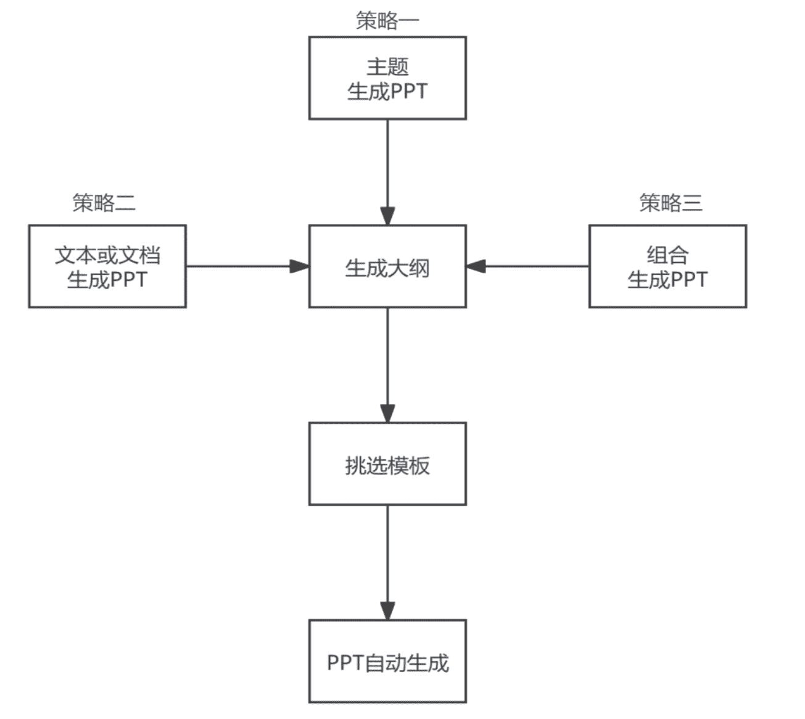

图 3-10 三类路径制作演示文稿流程总览

**策略一：根据某个教育教学主题/场景生成 PPT。**

推荐使用场景：教学目标与主题明确，内容重点突出，呈现形式开放，题目已确定或暂不限制。

关键操作步骤：输入拟定的主题。

操作平台：讯飞智文。

### **案例 3-6：设计班会活动 PPT**

教师输入的提示词：

“防火于未‘燃’，安全过寒假”为主题的班会活动

输出示例：

生成的大纲如图 3-11 所示。

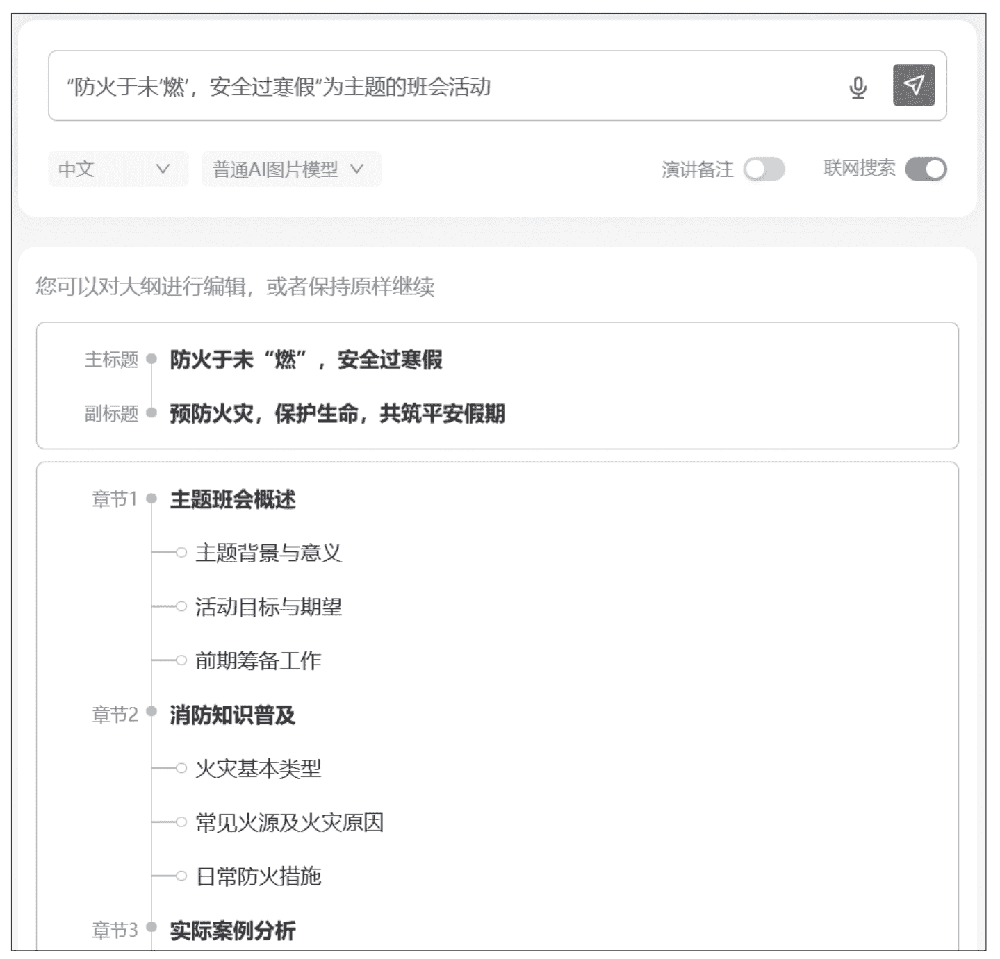

图 3-11 “防火于未‘燃’，安全过寒假”主题班会活动大纲

除此之外，还可依据教育目标或学生发展水平对大纲进行优化修改。若希望直接得到内容，可自主挑选模板样式一键生成 PPT，如图 3-12 所示为可选的模板库，图 3-13 为一键生成后的 PPT 片段。

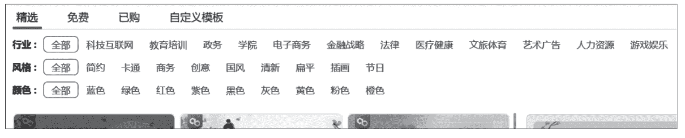

图 3-12 可选择的演示文稿模板库

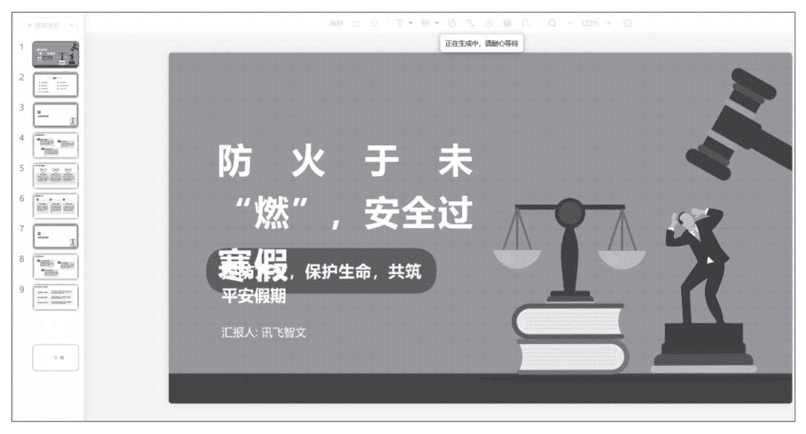

图 3-13 演示文稿部分展示

以案例 3-6 为例，主题明确，即寒假期间防火安全的班会。若题目尚不确定，也可以采用文本生成与优化的方法，请智能系统协助设计班会标题，如图 3-14 所示。

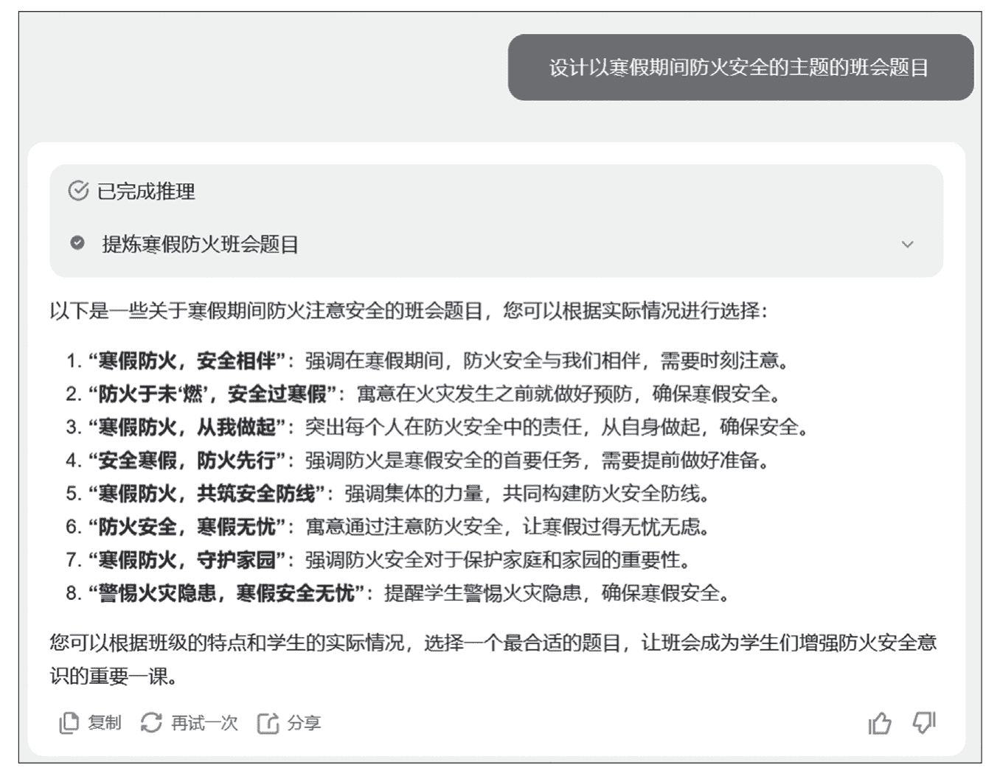

图 3-14 生成班会题目

学完策略一后，会发现提示词设计和具体操作都比较友好。但教师更关注如何把生成式智能融入日常教学 PPT 制作，这时策略二与策略三就派上用场。策略二与策略三整体思路相近，仅在关键操作步骤上略有差异。

策略二是通过直接输入文本或导入已有教学设计文档生成课件，支持多种文件格式。简言之，智能系统读取并分析输入的文本或上传的材料，生成对应大纲并重复案例 3-6 的后续流程。核心是上传文本文档，而这部分内容此前已系统学习过。策略三是组合式生成，可同时为智能系统提供多样化资料，如主题与辅助参考资料组合、文本与辅助参考资料组合，帮助智能系统整合信息，使产出更贴合需求，可用性与参考性更高。

如果已有按需设计的教学文档，按步骤上传材料或辅以相关资料生成提纲，稍等片刻即可得到精美的演示文稿。若没有现成文档，希望获得从文档生成到演示文稿自动制作的一站式服务，可结合两种生成式智能技术观看以下操作演示！

### **综合案例 6：GAI 生成小学语文 PPT**

操作平台：DeepSeek、Kimi。

场景：依据部编版三年级上册语文课文《秋天的雨》制作一份授课 PPT。

**步骤 1：用 DeepSeek 生成 PPT 大纲**

输入的提示词：你是一名小学语文老师，请根据部编版三年级上册语文课文《秋天的雨》制作一份授课课件。要求达成语文核心素养，PPT 结构完整清晰，页数 20 页以内，内容包含生字词学习、课文分析、情感升华、课堂练习、总结与作业五大部分。语言通俗易懂，适合三年级学生认知水平，设计 3 个互动环节（如提问、小组讨论、角色扮演）。请生成大纲并转换为 Markdown 格式。

部分输出内容展示，如图 3-15 所示。

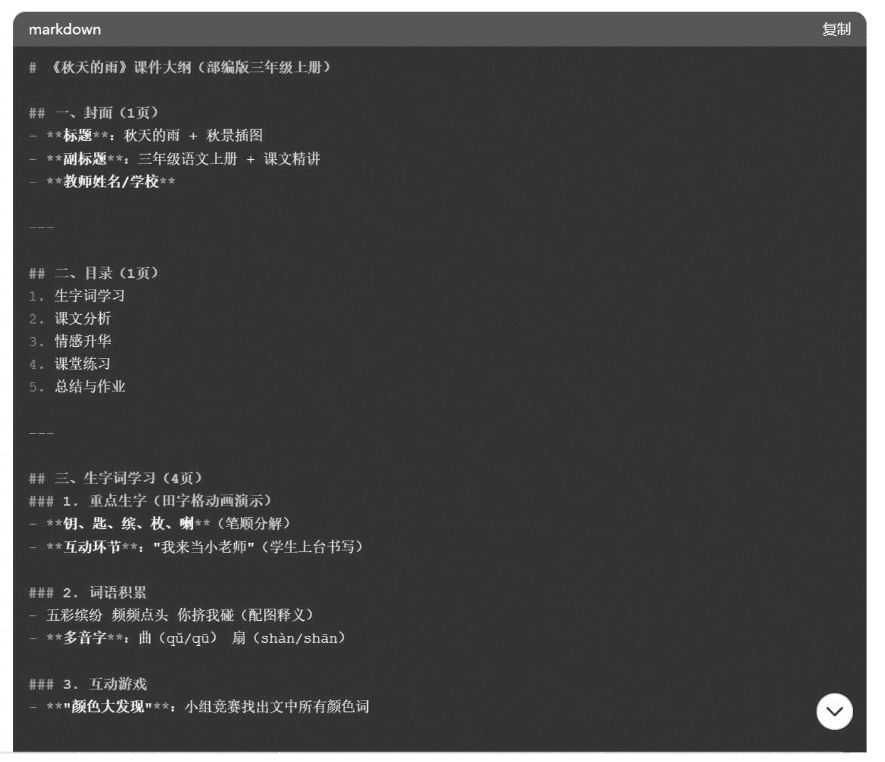

图 3-15 Markdown 格式的大纲

**步骤 2：导入 Kimi 做结构化处理**

1.复制 DeepSeek 生成的 Markdown 格式大纲，打开 Kimi PPT 助手，粘贴内容后可按设计需求选择性输入指令。如：“以 10 页为单位将 PPT 进行拆分处理，每页包含标题和两个核心点。”

2.Kimi 将自动生成具有逻辑层级的结构化文档。

部分输出内容展示，如图 3-16 所示。

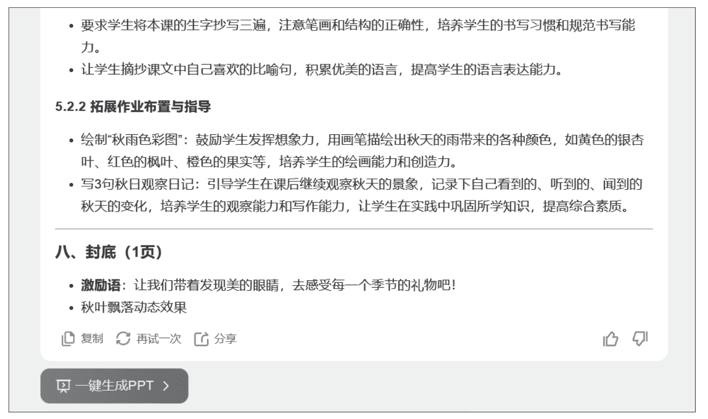

图 3-16 结构化文档部分展示

**步骤 3：一键生成 PPT 并美化**

1.在 Kimi 中挑选合适的模板，目前多数大模型不支持本地上传个人模板，部分支持但需付费。

2.点击“生成 PPT”按钮，下载文件到本地后可人工修改。

部分输出内容展示，如图 3-17 所示。

图 3-17 部分输出内容展示

**第四节 总结**

本章沿着文本内容生成与优化—课程材料设计—演示文稿自动化制作的递进路径，在教育理论与技术功能深度耦合的基础上凸显生成式智能不仅是替代型工具，更是教育范式升级背景下“未来教师”的必备能力。借助生成式智能，一线教师能快速产出基于具体学科领域的结构化文本并优化语言逻辑，同时可个性化定制表述风格。在知识点拆解、智能排版与动态内容更新方面，智能技术也能高效输出，助力教师构建多媒体资源开发优势，为教学场景提供更灵动高质量的文本支持。

生成式智能在优化文本生成逻辑后，还需进一步解决从“抽象文本”到“直观认知”的转化难题。下一章将深入探讨生成式智能如何突破传统图表制作的效率瓶颈，实现数据到图像的智能转化，推动知识可视化创新。从动态图表生成、复杂信息的多模态表达，到交互式可视化工具的应用，生成式智能正重塑信息呈现的底层逻辑，让抽象概念具象化、数据关系清晰化，为受众创造更具吸引力的认知体验。这一进程不仅是文本支持的延伸，更是从“可读”到“可感”的关键跃迁。

**第四章 GAI 在图表制作与知识可视化中的应用**

作为中小学教师，如何高效传递知识、激发学习兴趣、提升课堂实效，是共同面临的挑战。信息可视化以其直观高效的呈现方式，成为教学中不可或缺的手段。无论是借助数据图表展示统计结果，还是用思维导图梳理知识结构，亦或用流程图呈现操作步骤，可视化工具都能把抽象知识转化为易懂形式，更好满足学生学习需求。然而，传统图表制作往往要求教师具备较高技术能力并耗费大量时间，对教学任务繁重的教师而言负担不小。

随着生成式智能技术快速发展，这一局面正在改变。生成式智能凭借强大的数据处理、自然语言理解与自动化生成能力，为教师提供全新的信息可视化方案。教师只需输入指令或提供原始数据，即可迅速生成高质量数据图表、设计逻辑清晰的思维导图，甚至制作复杂流程图。这不仅大幅降低技术门槛，还显著提升资源制作效率，让教师把更多精力投入教学设计与课堂互动。

本章聚焦生成式智能在图表制作与知识可视化中的应用，结合中小学教学实际，从数据图表、思维导图和流程图三个维度展开，详细阐释核心功能、操作流程及实践案例。学习后教师将掌握生成式智能在图表制作与知识可视化中的核心技能，并灵活运用于日常教学，提升课堂效果，激发学生兴趣。我们相信，随着技术普及，生成式智能将成为中小学教师不可或缺的教学助手，为教育带来更多创新与变革。

**第一节 数据图表的生成展示**

数据图表是教学常见工具，尤其在数学、科学等学科中，它能直观呈现数据关系，帮助学生理解抽象概念。传统制作需教师手动录入数据、挑选图表类型并进行复杂格式调整，过程繁琐易错。借助生成式智能，教师只需简单指令或提供原始数据，就能快速生成符合教学需求的图表。例如，小学数学课上，可利用生成式智能生成条形统计图，直观展示学生成绩分布或调查结果，帮助理解统计学概念。本节通过具体案例展示生成式智能在数据图表生成中的效能，并探讨其教学应用价值。

### **一、数据图表类型与应用场景概述**

数据图表是将抽象数据转化为可视化图形的工具，通过形状、颜色、位置、大小等视觉元素展示数据关系、趋势或模式。对中小学教师而言，数据图表不仅是教学内容的呈现方式，更是帮助学生理解复杂概念、培养逻辑思维与数据分析能力的重要手段。

**（一）数据图表的定义、组成要素及其在教学中的核心价值**

**定义：**数据图表是通过图形化方式展示数据的工具，能够把数字、文本等信息转化为直观可理解的视觉形式。

**核心组成要素：**标题，明确主题，如“五年级学生课外阅读时间统计”。坐标轴，适用于柱状图、折线图等，横轴*X*轴通常表示类别或时间，纵轴*Y*轴表示数值。数据系列，图表中的图形元素，如柱状图的柱子、折线图的线条。图例，解释不同颜色或形状对应的数据类别。标签与注释，用于添加数据值或关键说明，增强信息清晰度。

**数据图表在教学中的核心价值**

**降低认知门槛：**用图形替代纯文本或数字，帮助学生迅速抓住重点，尤其适合低年级。如小学数学课用柱状图展示“班级同学身高分布”，比罗列数字更易理解。**培养数据分析能力：**引导学生观察趋势、对比和异常值，提升逻辑推理能力。如初中科学课用折线图分析“植物生长与光照时长关系”，让学生从数据中总结规律。**增强课堂互动性：**图表可作为讨论载体，激发提问与探究欲。如数学课用饼图展示“家庭月开支比例”，引导学生讨论合理消费。

**（二）图表的主要分类及适用场景**

如表 4-1 所示，不同场景下图表类型特点及设计要点。

表 4-1 不同类型图表总结表

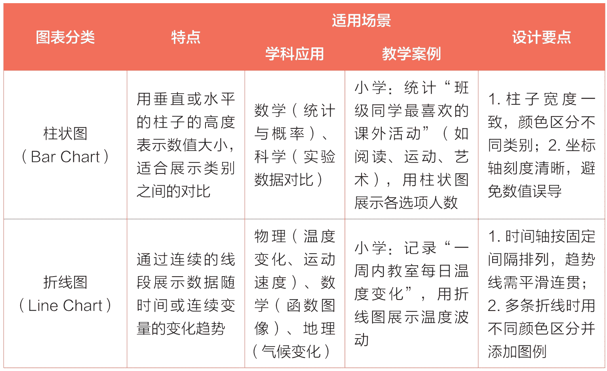

续表

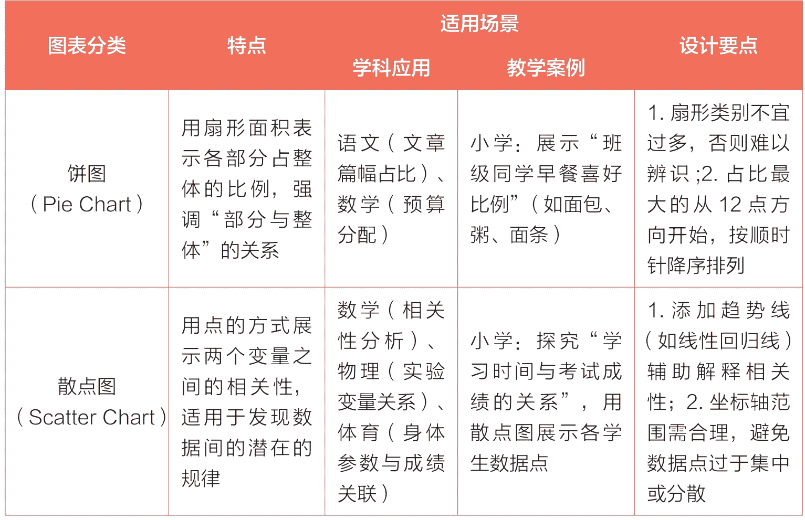

**其他图表类型**

**雷达图（Rader Chart）：**用于多维数据对比，如学生能力评估（数学、语文、体育等维度）。

**热力图（Heatmap）：**用颜色深浅表示数据密度，适合展示地理数据或时间分布（如教室座位使用频率）。

**箱线图（Box Plot）：**展示数据分布范围（最大值、最小值、中位数），适用于统计数学。

**（三）数据图表的选择原则与常见误区**

**选择图表的核心原则**

●**匹配教学目标** 若需对比数值，优先选择柱状图。若展示趋势，选择折线图。若强调比例，选择饼图或柱状图。

●**适应学生认知水平** 低年级学生优先使用颜色鲜明、结构简单的图表，如柱状图、饼图。高年级学生可引入散点图、雷达图等复杂图表，培养高阶思维。

●**注重图表可读性** 避免信息过载，删除无关网格线或装饰元素。使用清晰字体，确保投影或打印后仍可辨识。

**常见误区与改进建议**

●**误区 1：图表类型与数据类型不匹配** 问题：用饼图展示时间序列数据，导致信息混乱。改进：时间相关数据优先使用折线图或柱状图。

●**误区 2：过度干扰核心信息** 问题：添加 3D 效果、渐变颜色等装饰，分散注意力。改进：采用扁平化设计，突出信息本身。

●**误区 3：忽略数据准确性** 问题：坐标轴刻度不统一，如纵轴截断，误导对比。改进：确保坐标轴从零开始，或明确标注截断范围。

**（四）教学实践建议**

●分阶段引导学生掌握图表技能。低年级以“读图”为主，通过提问引导描述图表内容，如“柱状图中哪根柱子最高？”高年级逐步教授“制图”方法，让学生尝试用生成式智能工具生成简单图表。

●将图表融入跨学科项目。

●利用生成式智能生成差异化教学资源。如为学习困难学生生成简化版图表（减少数据类别），为学有余力学生提供扩展分析任务。

**（五）GAI 破解数据图表教学三大核心价值**

**突破技术操作限制，释放教学核心价值。**通过自然语言交互，学生无需掌握复杂软件即可快速生成专业图表，教师可把课堂重心从“如何画图”转向“如何分析”，解决以往 80%课堂时间耗费在技术细节而忽视思维培养的问题。

**促进抽象概念具象化，激活数据思维培养。**智能系统动态生成的多维可视化图表，能把抽象的数学关系、科学规律转化为直观动态图像，帮助学生跨越认知障碍，在观察变化、对比差异中建立“用数据说话”的逻辑分析能力。

**推动教育资源均衡化与教学个性化。**智能工具打破专业软件依赖，使偏远地区学校也能便捷开展数据教学；同时支持智能分层，针对不同学生自动调节图表复杂度，配合多模态呈现，让每个学生在“最近发展区”内获得适配支持，切实推进因材施教。

这三大核心价值正重构数据素养教育的底层逻辑，使图表教学从技能训练升维为思维培养的关键载体。

### **二、GAI 生成数据图表的核心环节**

生成式智能在数据图表生成领域的应用正改变数据可视化方式。其背后是多技术融合协同，主要包括自然语言理解（NLU）和数据可视化技术，通过精准理解需求、智能处理数据及优化图表设计，实现高效高质量生成。

**（一）自然语言理解（NLU）**

自然语言理解是生成式智能生成数据图表的关键环节。它赋予系统解析用户文本指令的能力，从而提取数据类型、图表类型及设计需求等关键信息。当用户以自然语言输入指令时，生成式智能会迅速分析文本，识别与图表生成相关的关键词和短语。例如，用户输入“生成一个展示班级学生数学成绩分布的柱状图”，生成式智能会准确提取“数学成绩”“柱状图”等关键词，并理解其意图。这种精准理解让用户无需专业知识即可用日常语言描述需求，大大降低门槛，提高便利性。

**（二）数据识别与处理**

数据理解与清洗
在把握用户意图之后，生成式人工智能要解决的是把分散的原材料转为可用的绘图基础。模型兼顾多种载体，既能打开电子表格、CSV等结构化文件，也能理解用户直接输入的文本。拿到内容后先做归一化处理，将格式统一、数值校正，留下一个干净的基础供后续成图使用。以一份包含“学生姓名”“考试分数”的清单为例，系统会自动把姓名归类为分类属性，把分数归类为数值属性，再据此输出对应的条形图。整套自动化流程免去了手工整理的耗时，也减少了因格式混乱引发的绘图错误，让成图效率与准确度同步提升。

**（三）图表类型选择与设计优化**
基于数据的内在特征与分析目的，GAI会自主挑选最契合的可视化样式并做视觉精修，这是影响成图质量的关键。系统中沉淀了大量图谱知识与视觉规范，能够结合数据类型给出建议。对随时间推移的序列，模型倾向选用折线，因为折线擅长呈现走势；对占比结构，则更偏向饼图或堆叠柱形，直观体现各部分在整体中的比重。样式确定后进入视觉优化：调整配色方案、补充图例与数值标注、优化留白与版面。和谐的色彩提升可读性与美感，明确的标注帮助准确解读，合理的布局避免元素拥挤，最终呈现既可靠又易读的信息载体。

**（四）自动化生成与交互式调整**
自动成图配合对话式微调，让制作既高效又灵活。GAI能在很短时间内给出初稿，满足效率诉求，同时支持口语化细化。用户只要说“把柱形换成折线”，系统会立刻切换类型并重新渲染；说“加上数值标签”，图表即在相应位置补充数字，信息表达更完整。这种对话式交互提升了参与感，也让结果更贴合个人偏好与使用场景，实用性与灵活性同步增强。

### **三、GAI 在数据图表生成中的实践运用及其利弊**
**（一）GAI 生成数据图表的工具与平台**
**Microsoft Excel+ChatGPT 插件**
主要特性：
在表格内部通过口语化描述就能出图。组合利用了表格软件的计算优势与大模型的语义理解能力，无需切换环境就能完成描述到成图的闭环。
使用方法：
第一步，安装 ChatGPT 插件并完成登录，操作简便。
第二步，登录后在工作表输入描述，例如“用A栏与B栏的数据做一个柱形图”，插件解析要点后绘图。
第三步，图形直接嵌入当前表页，可继续手动编辑或微调。

**Google Sheets+GPT-4 集成**
主要特性：
在云端表格中借助 GPT-4 的语言能力生成并修改图表。强大的语言处理与表格的数据管理结合，提供高效智能的制图体验，可在表中输入描述生成多种图形并做后续优化。
使用方法：
第一步，在 Google Sheets 中启用 GPT-4 插件。
第二步，输入描述如“用C列及D列的数据生成折线图”，模型识别列与图型要求后绘图。
第三步，图形插入表页后可即时查看，并对标题、坐标轴文字等细节进行调整。

**在线 GAI 图表生成平台（如 ChatGPT、办公小浣熊、Graph Maker）**
主要特性：
提供一站式在线服务，支持多类图型与设计微调。界面简洁，无需安装，浏览器即可使用。平台自带模板与设计工具，可选图型、改配色、加标注、调版式，并支持在线预览、调整与导出。
使用方法：
第一步，登录平台并导入数据文件，支持 Excel、CSV 等格式。
第二步，导入后输入描述，例如“做一个饼图展示比例”，系统识别数据并出图，可在平台内持续修改配色、标签等直至满意。
第三步，导出为图片 PNG/JPG 或可编辑文件 PDF/PPT，便于不同场景使用。

**编程工具（如 Python+GPT API）**
主要特性：
通过调用 GPT API 在 Python 中实现自动化绘图。Python 拥有成熟的数据处理与可视化库，配合大模型的理解能力，可编写脚本实现批量、复杂、高度定制的图表生产，适合有编程基础的用户。
使用方法：
第一步，安装可视化库如 matplotlib、seaborn 等。
第二步，调用 GPT API 编写脚本，例如“生成散点图展示 X 与 Y 的关系”，脚本中指定数据源、图型参数，运行后自动生成。
第三步，对样式、注释等做二次编辑。
第四步，导出为所需格式用于分析报告等。

**（二）GAI 生成数据图表的优势与局限性**
### **优势**
高效便捷
GAI 的最大亮点是省时降门槛。传统制图需要熟练掌握 Excel、PowerPoint 等软件，流程繁琐。GAI 只需用自然语言描述需求即可快速成图，即使没有专业技能也能做出可用图表，工作效率明显提升。
智能优化
系统能依据数据特征自动推荐最合适的图型，避免因选图不当导致信息失真。也可自动优化视觉细节，如配色、标签、布局，使图表更清晰美观，减少人工反复调整的投入。
交互性强
支持自然语言实时修改，如改图型、调颜色、加标签等，用户能按需个性化定制。强交互提升了使用体验，也让图表更贴合实际需求。

### **局限性**
数据依赖性
结果质量高度依赖输入数据的准确性和完整性。若数据存在错误、缺失或格式不规范，输出图表也会失真。因此使用前需确保数据质量。
设计局限性
虽然能做常规优化，但面对需要特殊艺术效果或高度个性化设计的复杂需求，GAI 往往难以达到预期，需借助专业设计软件人工介入。
技术门槛
部分方案如 Python+GPT API 需要编程能力，非技术用户学习成本较高。对于这类人群，选择易用的在线平台更为合适。

### **综合案例 7：用办公小浣熊生成小学数学柱状图**
以人教版 2022 版四年级上册数学课本中“做一做”一页为例，如图 4-1 所示。
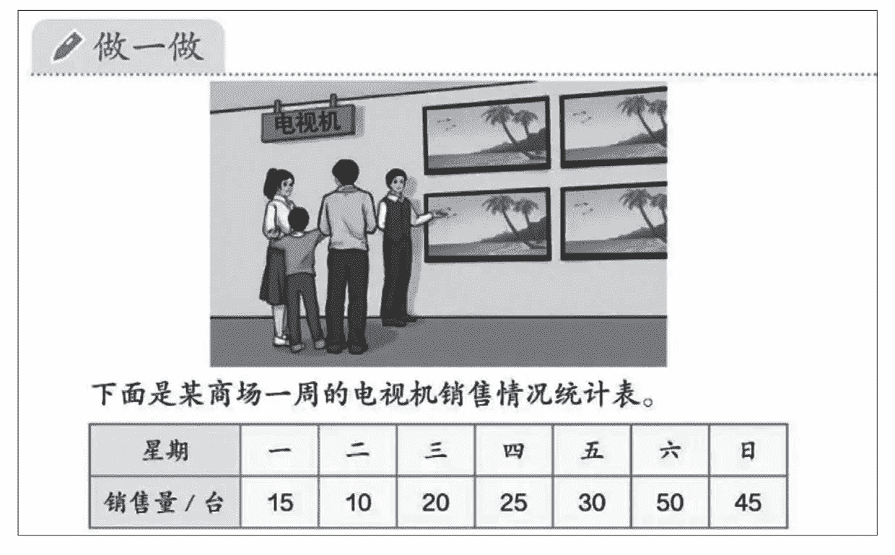
图 4-1 案例示意图

**步骤 1：明确需求并准备数据**
先确定图表要表达的信息和用途。例如老师想做“商场一周电视机销量”的柱形图，目的是呈现每日销量差异，为后续销售提供参考。需求明确后准备规范数据，如 Excel 表中第一行为日期，第二行为当日销量，格式清晰便于模型识别。

**步骤 2：输入指令或上传数据**
数据准备好后，可直接用自然语言描述需求，或把 Excel 文件导入。描述需说明图型、数据范围等，例如导入包含日期和销量的表格供模型读取。
输入指令方式如图 4-2 所示。

图 4-2 指令示意图
上传数据方式如图 4-3 所示。
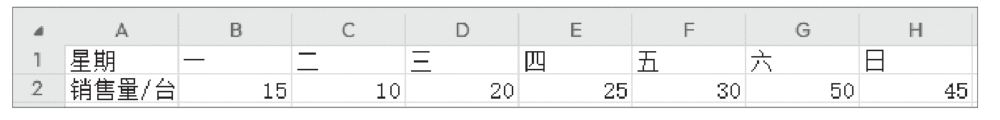
图 4-3 数据表示意图

**步骤 3：GAI 自动生成图表**
模型接收描述与数据后自动识别类别与数值字段，如把“星期”识别为时间，“销售量/台”识别为数值，选择柱形图生成初稿，并进行初步美化：调整配色、添加标题“商场本周电视销量统计”、设置横轴时间、纵轴销量，快速得到可用图表。

**步骤 4：交互式调整与优化**
生成后可按需微调。例如输入“将柱形图改为折线图”，系统即时切换为折线图以展示趋势，如图 4-5 所示。
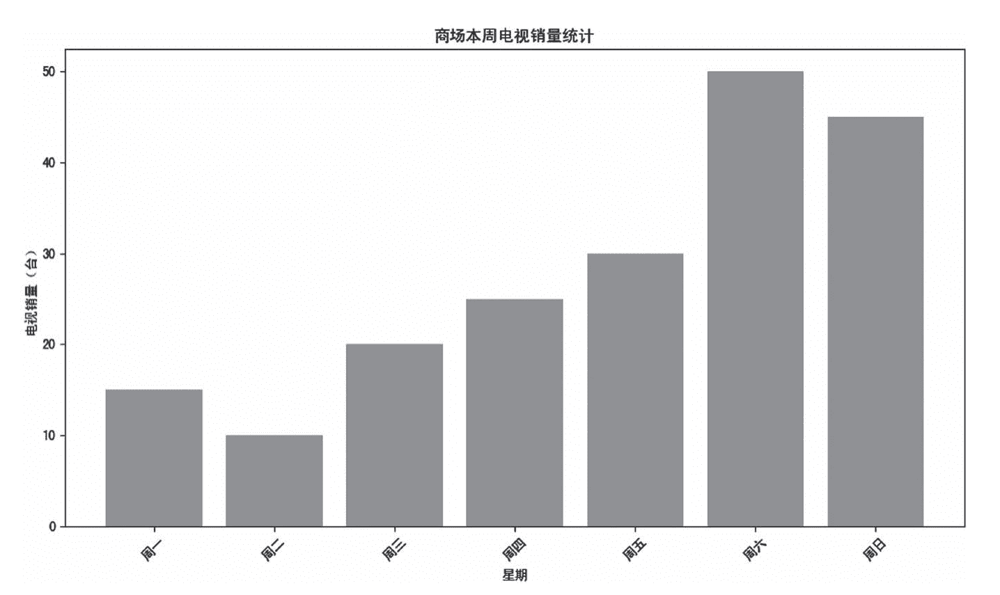
图 4-4 商场本周电视销量统计柱状图（1）
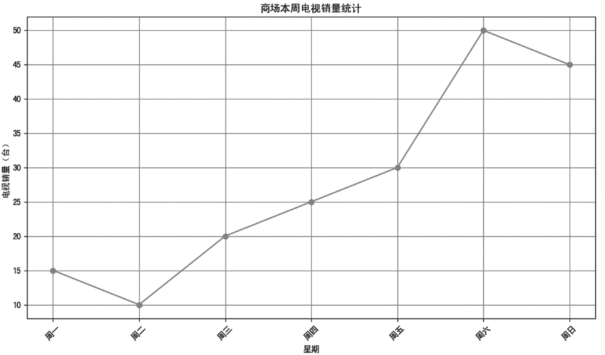
图 4-5 商场本周电视销量统计折线图
输入“将颜色改为紫色”，图表配色随即更新；输入“添加数据标签”，数值在图上清晰标注，如图 4-6 所示。
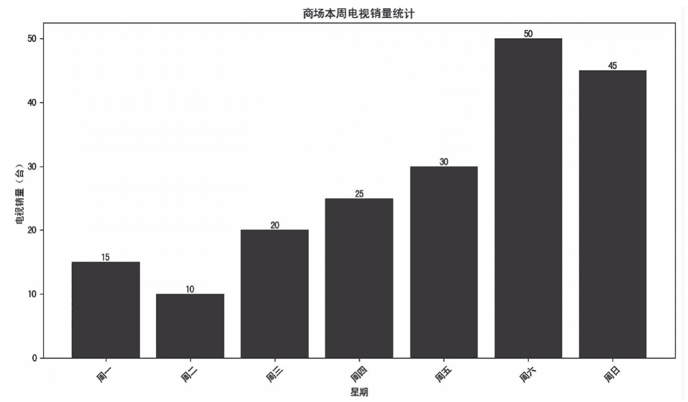
图 4-6 商场本周电视销量统计柱状图（2）
还能添加注释，如“在最高销量处添加注释‘优秀’”，模型会在峰值位置标注，突出重点，如图 4-7 所示。
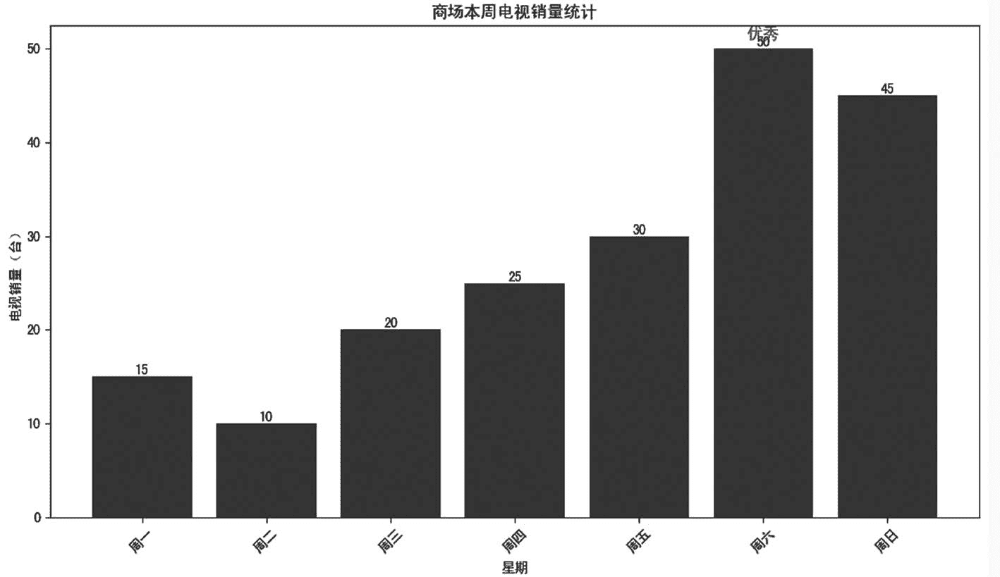
图 4-7 商场本周电视销量统计柱状图（3）
通过这些交互操作，图表可实现个性化定制，更好地满足教学需求。

**第二节 思维导图的设计应用**
思维导图是整理知识的有效工具，能以图形化方式呈现复杂结构，帮助学生建立清晰的知识框架。在语文、历史等学科中，它便于梳理课文与事件脉络。但手工绘制对逻辑与图形能力要求较高，GAI 的出现降低了这一门槛。教师只需输入主题或关键词即可自动生成结构清晰、内容完整的导图。例如在初中语文教学中，可快速生成课文分析导图，帮助学生把握主旨与结构。本节介绍 GAI 生成思维导图的思路与教学应用。

### **一、思维导图的核心概念与功能**
**（一）思维导图的定义与历史发展**
**思维导图的定义**
**定义解析：**思维导图是一种以中心主题为核心、通过分支与关键词层层展开的图形化信息组织工具，模拟大脑的发散思维。
**其核心特点包括：**
**中心主题。**位于图心，明确核心内容，如“光合作用”“《背影》分析”。
**分支结构。**从中心延伸的分支代表不同维度子主题。
**关键词与图像。**用简短文字和图标替代长句，增强记忆联想。
**颜色与线条。**色彩区分分支，线条粗细体现层级。
**思维导图的历史发展**
**起源。**概念由英国心理学家托尼·博赞于 20 世纪 70 年代提出，旨在提升记录与整理效率。
**教育领域的应用。**21 世纪初进入课堂，成为梳理知识、复习备考和创意发散的常用手段。
**技术赋能。**随着 GAI 普及，思维导图从手绘转向智能生成，支持动态调整与跨平台协作。

**（二）思维导图的核心要素与设计原则**
**核心要素**
**中心节点。**需具体明确，避免过于宽泛。
**分支层级：**
**一级分支。**围绕中心的核心维度。
**次级分支。**对一级分支的细化。
**关键词提炼。**每个分支使用 1-3 个关键词，避免长句。
**视觉元素：**
**颜色编码。**不同颜色区分类别。
**图标与符号：**用箭头、感叹号等强调重点，如用“ ”标记易错点。
**设计原则**
**放射性结构：**分支由中心向外辐射，符合联想习惯。
**层级分明：**主次清晰，避免交叉混乱。
**视觉平衡：**分支长度与密度均匀分布。
**个性化表达：**结合学科调整风格，文科可增加插图，理科注重逻辑符号。

**（三）思维导图的功能和教育价值**
**核心功能**
**知识梳理与整合。**把零散知识点串联成体系。
**示例：**历史课上梳理“辛亥革命”的背景、过程与影响。
**思维发散与创意激发。**围绕主题自由联想拓展思路。
**示例：**小学作文课上以“我的梦想”为核心展开写作灵感。
**逻辑强化与记忆提升。**通过层级结构强化知识点间的关联。
**示例：**高中生物复习中用导图记忆“遗传规律”。
**教育价值**
**对学生的作用：**
**降低认知负荷。**图形化呈现减少文字压力。
**培养结构化思维。**养成整体到局部的思考习惯。
**提升自主学习能力。**可独立整理笔记与复习。
**对教师的作用：**
**优化教学设计。**用导图规划课堂逻辑。
**差异化教学支持。**为不同水平学生生成简化或进阶版本。
**课堂互动工具。**引导讨论与小组合作。

**（四）思维导图的常见误区与改进策略**
**误区 1：内容过于冗杂。**
问题：分支过多或关键词过长导致难以阅读。
改进：遵循 MECE 原则，确保分支不重复不遗漏。
**误区 2：逻辑混乱。**
问题：层级不清，关联未标注。
改进：使用箭头、虚线等符号明确因果、对比、递进关系。
**误区 3：忽视视觉设计。**
问题：黑白单调或配色刺眼，降低吸引力。
改进：采用柔和配色，重点内容高亮。
**误区 4：过度依赖 GAI 生成。**

痛点提醒：把大模型吐出来的导图原封不动搬进课堂，忽略了班级学情。
优化方向：老师要听取学生在使用时的反应，亲手梳理分支逻辑，补充更贴近教学现场的实例。

（五）导图设计的下一步走向
跨界串联。模型能把不同学科的知识主动连起来，比如把历史事件和文学名著并置，做成对比式导图。
可展开的动态图。点击某个分支就能打开细节，里面可以嵌视频、链接等丰富媒介。
差异化复习。依据学生掌握情况，生成分层级的复习导图，实现因材施教式复盘。
多人共创。几位同学在同一平台上同时编辑同一份导图，加速小组协作。

（六）AI 如何改写导图教学
斩断碎片，重建系统。借助智能纠偏、结构重排和多版本对照，零散想法被整理成体系化认知框架，有效缓解逻辑断层和分类混乱，让导图从知识罗列工具升级为系统思考的脚手架。
告别灌输，点燃创造。个性化起点、跨学科即时提示和三维量化评价，使教学摆脱模板化，训练从模仿走向迁移，明显提升批判性与创新意识。
缩小差距，迈向公平。方言交流、轻量协作引擎和特殊教育适配，让城乡以及不同认知特质的学生都能获得精准支持，从根上改变传统思维教学重技巧轻本质、重统一轻个性的失衡。这三重突破重新定义了导图的教育价值，让它成为核心素养时代认知进化的引擎。

二、从指令到成图，AI 绘制导图的四个关键环节

（一）语言理解
这是生成导图的起点，给机器提供解析人类语言的能力。用户用口语化指令输入时，模型能快速抓取核心主题和关键词，判断真实意图。比如输入“生成《红楼梦》人物关系图”，系统会捕捉“《红楼梦》”“人物关系”，明白要梳理这部经典里复杂的人物网络。背后是海量语料训练的语言模型运算，把日常表达转为机器可处理的结构化信息，为后续生成打基础。

（二）知识网络搭建
依托知识库或网络数据，AI 自动搭建主题相关的知识网络，形成层级骨架。以“光合作用”为例，系统会联动“光反应”“暗反应”“叶绿体结构”等子主题，构建完整体系。它从海量信息中提炼要点，理清因果、并列、从属等关系，把分散知识点串成有机网络。过程依赖实体识别、关系抽取等技术，确保内容准确完整。

（三）视觉呈现
骨架完成后，AI 按内容自动挑选配色、图标并优化版面，提升可读性。做历史导图时，可为不同朝代配不同颜色并加入时间轴图标，便于快速区分。AI 把美学原则、图标契合度与版面合理性结合，生成清爽美观的样式。科技类主题多用冷色调加简洁几何，文化艺术类则偏暖色调加装饰性图标，以营造不同氛围。

（四）实时互动
AI 产出的导图不是静态的。用户可用自然语言实时修改，比如老师说“在《孔乙己》图中加上社会背景分析”，系统会迅速扩展节点并重排版面。依托实时运算能力，AI 能对局部或整体进行增删改，让导图始终贴合教学进度、个人思考或团队协作需求，成为灵活的知识载体。

三、AI 在导图里的实际应用、利弊和教学建议

（一）主流工具和平台
XMind 配合 ChatGPT 扩展
要点：在 XMind 内部直接用自然语言指令产出导图，实现绘图软件与智能体的无缝衔接。
流程：其一，安装 XMind 并装好 ChatGPT 扩展并登录；其二，在软件中输入指令如“生成《红楼梦》人物关系图”，AI 自动产出并导入；其三，借助 XMind 编辑功能进一步细化与美化。

MindManager 集成 GPT-4
要点：在 MindManager 中用自然语言创建和调整导图，提升专业软件的智能化水平。
流程：其一，安装并启用 GPT-4 插件；其二，输入指令如“生成光合作用图”，自动产出并插入；其三，利用 MindManager 调整版面、添加链接或图片，制作高质量作品。

在线生成平台如 MindMeister、ProcessON、博思白板
要点：一站式在线服务，支持多种类型和设计优化，无需本地安装。
流程：其一，登录平台并提交文件或输入指令，支持 docx、pdf 等格式；其二，输入如“生成第二次世界大战图”，平台自动产出并可在线修改和导出；其三，实时协作、分享至社群或学习平台。

编程方案如 Python+GPT API
要点：调用 API 实现自动化产出，适合有编程基础的用户。
流程：其一，安装 networkx、matplotlib 等库；其二，调用 GPT API 编写脚本，如生成“细胞结构”图，可自定义结构、样式与布局；其三，运行后导出文件用于科研、教学或数据分析。

（二）优势与限制
优势
省时高效。自动化产出大幅缩短制作时间，降低门槛，让师生成把精力放在内容本身。
智能优化。依托算法与大数据，自动生成结构清晰的层级，并在配色、图标、布局上优化，提升质量与可用性。
互动灵活。支持自然语言即时调整，可随时添加节点、改色、改写，灵活适配不同场景。

局限
内容依赖。结果受输入完整性与准确性制约，信息不全或表述模糊会导致缺失、混乱或错误，需保证输入的可靠性。
设计边界。对高度个性化、创意性强的设计需求，AI 覆盖有限，仍需人工补齐或借助专业设计工具。
技术门槛。编程类方案对非技术用户不友好，需要学习成本，影响普及。

（三）教学实践建议
分阶段教学
低年级：以教师产出为主，引导学生读图并补充关键词，培养观察与表达。
高年级：教授学生独立使用智能工具制作导图，增强自主探究、信息整合与创新思维。

跨学科整合
把导图用于项目式学习，如“校园植物调查”，整合生物、地理、美术等知识，培养综合素养。

评价与反馈
师生共建评价标准，涵盖逻辑性、完整性、美观度等维度，开展互评，促进批判思维与审美提升。

综合案例 8：用博思白板生成初中语文课文导图
环节一：明确需求与准备材料
先确定导图用途，如知识梳理、复习等。例：制作“《背影》课文分析”图，帮助学生把握结构与主题。准备课文原文与教学重点，包括人物、情感、手法等，为 AI 提供素材。

环节二：输入指令或上传文本
用自然语言描述需求，如“生成《背影》课文分析图，含人物、情感、写作手法、主题思想”。也可直接上传原文文档，让 AI 提取信息。

环节三：AI 自动生成
主题识别。自动锁定“《背影》课文分析”为核心节点。
分支构建。生成一级节点“人物”“情感”“写作手法”“主题思想”，并下分“父亲”“我”“思念”“感动”等，形成层次分明架构，如图 4-8 所示。
视觉优化。自动配色与图标，如人物节点用紫色、情感节点用蓝色，提升辨识度。
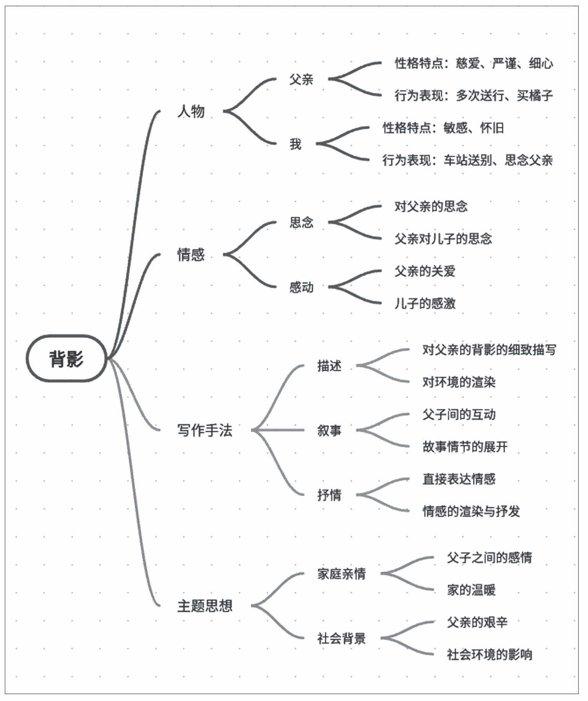
图 4-8 《背影》课文思维导图（1）

环节四：交互式调整与优化
调整结构。如输入“在主题思想下加入社会背景分析”，AI 自动扩展并重构版面，如图 4-9 所示。
优化细节。如“把情感节点颜色改为粉色”，AI 立即更新样式。
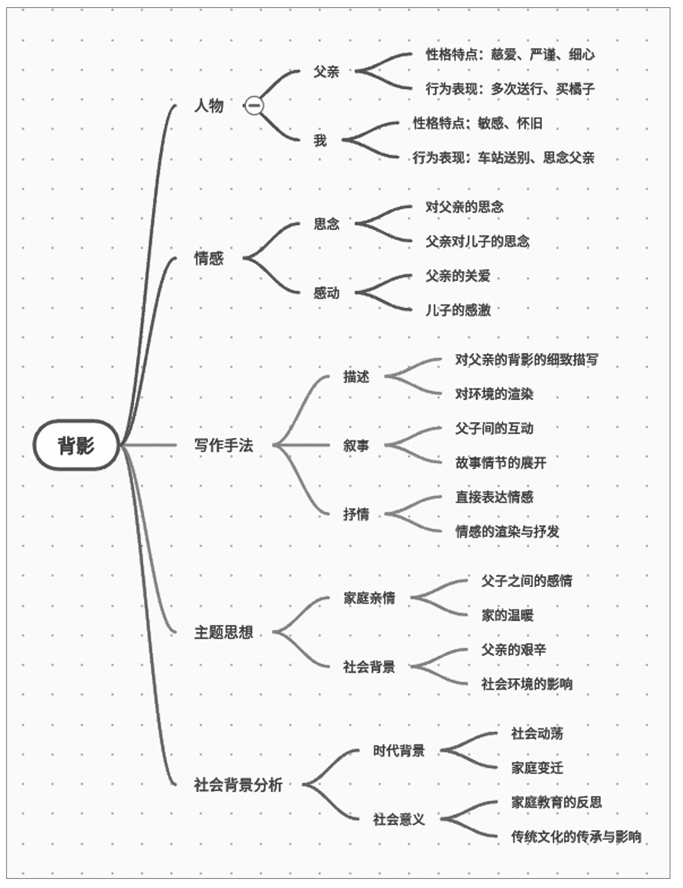
图 4-9 《背影》课文思维导图（2）

环节五：导出与分享
导出。支持 PNG、JPG、PDF、PPT 等格式，方便插入课件，如图 4-10 所示。
分享。把导图上传至班级群或打印展示，促进课后复习与协作。
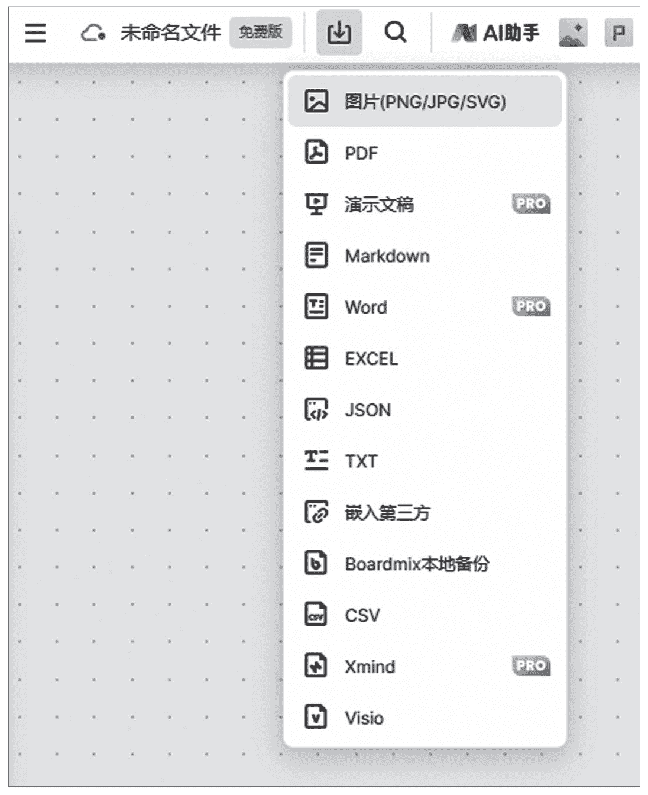
图 4-10 思维导图可导出文件类型示意图

第三节 流程图的教学实践

流程图是教学中解释实验操作、步骤讲解的重要工具，可把复杂过程可视化。传统手工绘制费时易错，而借助生成式AI只需描述步骤即可自动生成规范流程图。本节以案例说明其在提升教学效率上的价值。

一、流程图的基本概念

（一）定义与核心要素
定义：用标准化图形符号表示步骤、决策点与走向的图表，核心是通过可视化简化复杂过程。
核心要素：
图形符号：开始/结束用椭圆，操作步骤用矩形，决策点用菱形，箭头指示走向，输入/输出用平行四边形。
文字说明：在符号内写简洁描述。
层级结构：复杂流程可用子流程分层，保持主图简洁。

（二）教学中的核心价值
简化复杂流程：把抽象操作转成直观图形，降低理解难度。
培养逻辑思维：决策节点引导学生思考条件与结果的关系。
规范操作实践：明确顺序与注意事项，减少失误。
促进跨学科学习：适用于科学、数学、信息技术、语文等。

（三）主要类型及适用场景
表 4-2 展示了不同类型流程图的特点及设计要点。
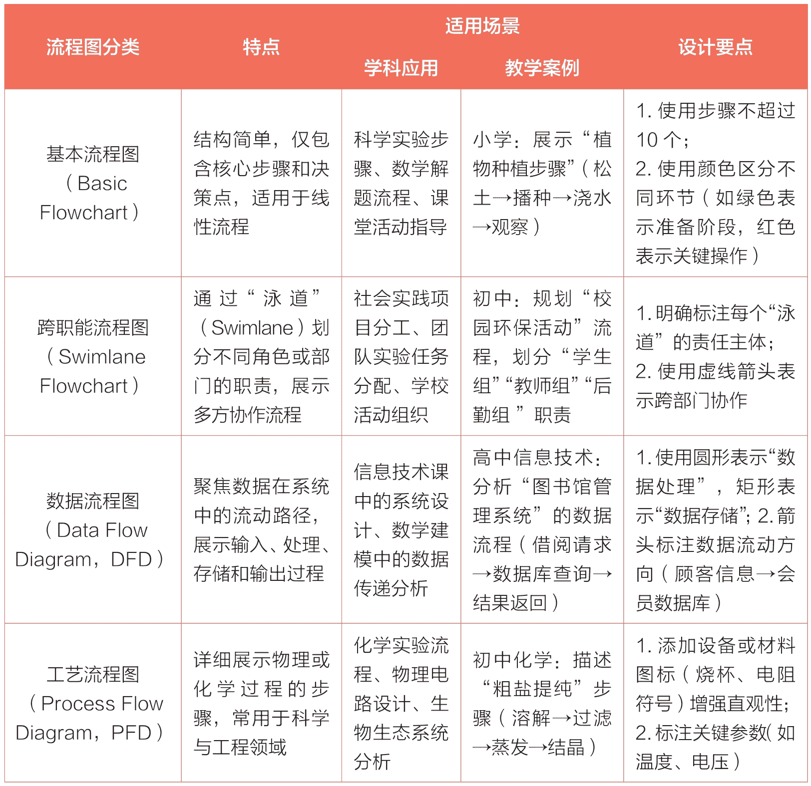
其他类型
工作流程图：描述任务分配与执行顺序，适合项目管理教学。
系统流程图：展示软件或硬件运行逻辑，适用于信息技术课程。
事件流程图：强调事件触发与响应，适合社会实践案例分析。

（四）设计原则、常见误区与改进建议
设计原则
清晰性：符号统一、文字简洁，避免术语。
逻辑性：步骤顺序合理，分支无矛盾。
可扩展性：复杂流程设计子流程，保持主图简洁。
视觉友好性：用对比色突出关键步骤，箭头粗细区分主次。

常见误区与改进建议
误区 1：符号混用导致混乱。改进：严格按标准使用，矩形只用于操作步骤。
误区 2：流程冗余或遗漏关键步骤。改进：先列清单再转图，避免遗漏如安全检查。
误区 3：忽视学生认知水平。为小学生设计过于复杂的分支图。改进：根据学段简化表达。

教学提示：低学段首选用基础图型，高学段再逐步引入复合图型拓展思维。

**（五）智能生成重塑流程图教学**

简化建构负担，让逻辑训练回到中心。智能生成可把日常口语转译为规范的流程示意，学习者不必耗费大量精力在画框、标注符号等机械操作上，能把注意力集中在路径是否合理、是否需要迭代完善上，扭转了过去重制作轻思考、绘图耗时占比过高的局面。

强化动态推演，助推系统思维形成。系统可实时模拟路径运行，直观呈现分支决策的传导后果，例如程序循环条件设定失误引发的死循环。通过并排多版对比与缺陷预警，帮助学习者跳出单一线性惯性，逐步建立条件与结果相互联动的动态因果认知。

打破时空与资源限制，促进协作式重构。借助云端协同、多语指令转换与自适应难度调节，城乡学生可共同打磨“校园垃圾分类”“科学实验步骤”等复杂主题，在思想碰撞中锻炼系统化工程思维，弥补传统流程图教学偏个体、偏静态的实践短板。

这三重转变，使流程图教学从制图训练升级为系统思维培养场。

### 二、智能生成绘制流程图的核心环节

**（一）口语指令解析**

口语指令解析是智能生成流程示意的基础。系统能解读用户输入的文本指引，提炼关键环节与判断节点，洞察真实意图。以“水的沸腾实验”为例，用户说“生成一个展示‘水的沸腾实验’步骤的流程示意”，模型会抓住“水的沸腾实验”“步骤”这两个核心要素，明确需要的是实验操作的直观呈现。这一过程不仅是词汇层面的匹配，更是对隐含需求的挖掘。

准确理解并不容易。模型需依托海量语料学习不同语境下的词义差异，比如“加热”在不同实验中的具体手法会不一样，必须结合上下文判断。模型还能识别指引中的先后逻辑，比如在沸腾实验里自动判断“准备器材”应前置，“观察现象”“记录数据”应后置，为后续构建奠定基础。

**（二）推理构建与结构搭建**

基于知识库与网络信息，生成式智能能自行搭建流程逻辑并生成分层步骤。在“水的沸腾实验”生成任务中，模型调取实验相关知识，自动串联出“准备器材→加热→观察现象→记录数据”的链条。这既依赖对指引的理解，也依赖实验规范的通用模板。

在科学实验领域，模型可从大量实验报告和操作手册中学习通用流程模板，结合用户指引生成符合规范的示意。同时具备推理能力，能依据实验原理和操作要点，补充用户可能遗漏的关键环节或判断节点。

构建时，模型将整体拆解为相互关联的子步骤并厘清先后关系。面对需要反复执行的流程，能识别循环条件与终止条件并生成循环结构；面对复杂流程，还能拆分为多个子流程分别生成和优化。

**（三）视觉呈现**

生成式智能会根据内容自动匹配符号、配色和版式，保证示意清晰美观。以“水的沸腾实验”为例，模型可能用红色表现“加热”以暗示热源和能量，用蓝色表现“记录数据”以传递冷静感，并加入温度计等实验图标。合理的视觉处理既提升吸引力，也帮助快速理解各环节的属性。

符号选择上，模型会依据环节性质匹配。做数学解题流程时，计算类环节用矩形表示，是否满足方程的校验用菱形表示，从而区分操作与决策。

配色遵循美学原则与信息传达需求，结合色彩的情感联想和对比度，为不同类型环节分配合适颜色。布局则按逻辑关系安排图块位置，如把“准备器材”放在起点，“记录数据”放在终点，中间按顺序排列，形成流畅的视觉动线。

**（四）交互式修正**

用户可用口语指令实时修改示意，如“增加‘安全提示’环节”“合并重复操作”。在教学场景里，教师对已生成的“水的沸腾实验”示输入“在‘加热’前加上‘佩戴护目镜’”，系统会自动扩展环节并重排版式，使新增内容自然融入原结构。

动态交互建立在实时运算与理解上，能快速响应结构性或细节性修改，同时保持版面与视觉的统一。用户还能调整样式细节，如“把‘加热’环节改成橙色”，模型会即时更新配色。

此外，在用户进行调整时，生成式智能会给出提示或建议。例如合并两个看似重复的环节时，系统可能提醒两者在细节上仍有差异，以确保流程的准确完整。

### 三、智能生成在流程图绘制中的实践与优劣

**（一）常用工具与平台**

**Microsoft Visio + ChatGPT 扩展**

功能特点：
该组合兼具专业性与灵活性。微软 Visio 是专业的流程图绘制软件，拥有丰富的图库、模板和强编辑能力，可挑选不同风格符号、连线构建示意。结合 ChatGPT 扩展，可在 Visio 内直接用口语下指令，如“生成‘水的沸腾实验’流程图”，ChatGPT 解析后生成框架并导入 Visio，后续再用 Visio 细化符号、调整排版、添加注释，兼顾智能生成与专业编辑。

使用方法：
第一步，安装并配置 ChatGPT 扩展，登录账号。
第二步，在界面输入口语描述需求，明确主题与要点，如“生成一份详细的销售订单处理流程图，包含订单接收、审核、库存调配、发货和收款确认等环节”。
第三步，ChatGPT 根据理解与推理生成初步框架并插入 Visio，用户可在 Visio 中替换符号、调整顺序、加入分支决策，使其更贴合实际业务。
第四步，借助 Visio 的编辑能力，可添加操作说明、外部链接等，提升实用性。

**Lucidchart 搭配 GPT-4**

功能特点：
Lucidchart 是在线流程图工具，界面直观、模板丰富。集成 GPT-4 后，用户可用口语描述需求快速生成复杂流程图，无需额外安装，通过浏览器即可使用。模板覆盖多行业多场景，可二次编辑。

使用方法：
第一步，登录 Lucidchart 后启用 GPT-4 扩展。
第二步，输入口语指令，如“生成一份详细的‘解一元一次方程’流程图，包含筛选方程、整理方程、求解方程和验证解等步骤”。
第三步，GPT-4 生成初步框架并以图形化方式呈现，用户可交互式地增删环节、调整顺序、修改样式。
第四步，编辑过程中可实时预览变化，随时保存分享。

**在线生成平台如 Draw.io、ProcessOn、博思白板**

功能特点：
这类平台提供一站式生成服务，无需本地安装，浏览器登录即可使用。支持工作流程图、业务流程图、程序流程图等多种类型，并提供设计优化功能。内置丰富的图形元素库，可实现个性化设计。

使用方法：
第一步，登录平台并上传文本材料。
第二步，输入指令，如“生成‘校园运动会组织流程’流程图”，平台自动生成示意。用户可在此基础上添加注释链接，如在“报名”后加“审核资格”分支，或在“竞赛”阶段加“急救服务”分支，只需点击位置输入指令即可自动调整结构。
第三步，可灵活修改元素大小、颜色、位置。若需参考外部资源，可为环节添加链接，如为“需求分析”环节挂接详细报告。

**编程方案如 Python 调用 GPT 接口**

功能特点：
调用 GPT 接口可在 Python 中实现自动化生成。Python 拥有 graphviz、matplotlib 等可视化库，结合 GPT 的能力，可高度定制生成流程，适合有编程基础的用户制作复杂自定义示意。

使用方法：
第一步，安装 Python 库如 graphviz 或 matplotlib。
第二步，通过 GPT 接口发送口语指令，如“生成‘水的沸腾实验’流程图”，接口返回节点、边、属性等描述信息，再用 Python 库将其转为可视化示意，可定义节点形状、颜色、大小及边的类型方向。
第三步，用脚本将接口输出与绘图库结合，实现自动化生成，提高效率并方便后续分析应用。

**（二）优势与局限**

**优势**

效率提升
智能生成大幅缩短制作时间，降低技术门槛。传统绘制需耗费大量时间在框架和样式上，自动化生成可在数分钟内产出结构清晰、设计美观的示意。如企业梳理业务流程时，可快速生成多部门框架，提升分析优化效率。

智能优化
依托算法与海量数据，系统能自动挑选最佳符号与布局，优化细节。制作复杂项目管理图时，可根据任务逻辑自动选择代表任务、决策、资源分配的符号并合理排版，实现视觉与信息传达的平衡。

交互性强
支持口语指令调整，满足个性化需求。项目经理可在实施中根据进展通过指令添加任务、调整顺序、修改资源分配，实现实时更新，保持示意与实际情况一致。

**局限性**

输入依赖
输出质量取决于输入的完整性和准确性。文本信息不全、错误或模糊时，生成的图可能出现缺失、逻辑混乱或信息错误。如科研实验步骤提供不完整，生成的流程就难以真实反映实验。

设计边界
对于需要独特图形元素、复杂版式或特殊配色的需求，系统可能无法完全满足，仍需人工调整或借助专业设计工具补充。

技术门槛
部分工具需要技术基础，如 Python 编程。非技术用户使用编程方案会有学习成本。

**（三）教学建议**

**分阶段策略**

低年级 1～3 年级
以教师生成的图为主，引导学生读图并复述步骤。如用智能生成“植物观察日记”填写步骤图，课堂上观察符号、箭头和文字，理解每步含义和顺序，再组织“复述流程”活动，用简单语言描述步骤，巩固认识并锻炼表达。

中年级 4～6 年级
教授学生使用智能工具生成简单流程图。此时学生具备一定逻辑思维和操作能力，可在指导下学习用口语指令生成如“如何整理书包”的图，培养动手与自主学习能力，提升信息技术兴趣。

高年级 7～12 年级
引导学生设计复杂流程图并加入决策分支。鼓励针对“校园垃圾分类实施方案”等问题设计流程，需考虑分类种类、回收流程、宣传教育等，并在图中加入“垃圾是否可回收”“是否为有害垃圾”等判断，培养综合分析、解决问题的能力与团队协作精神。

**跨学科案例**

科学与语文结合
用流程图解析科普文章结构。科普文常用提出问题、分析现象、得出结论的结构。让学生将文章结构流程化呈现，有助理解逻辑，提升阅读与写作能力，也可将科学知识与流程步骤结合，加深理解。

数学与信息技术结合
设计编程算法流程图，将数学逻辑转为代码步骤。学习解一元一次方程、求最大公约数时，先用流程图表示解题步骤，再转化为编程语言编写代码，有助于理解数学逻辑，提高信息技术应用与计算思维。

**评价与反馈**

●评价要点
**完整性：**是否涵盖关键环节，如“水的沸腾实验”是否包含准备器材、加热、观察现象、记录数据等。
**逻辑性：**顺序是否合理，分支条件是否清晰无矛盾。如“判断素数”流程中条件 i 是否小于 n、n 是否能被 i 整除的逻辑是否正确。
**创新性：**是否加入个性化设计，如生动图标或新颖布局突出重点。

●学生互评
分组展示流程图，其他组提出优化建议。如“在‘观察现象’环节中添加注释‘注意安全’”。互评激发竞争与协作，促进交流反思，帮助发现不足并提升制作质量。

### 综合案例 9：用博思白板制作小学科学实验操作流程图以水的沸腾实验为例

**步骤 1：明确需求与准备内容**
明确目标与用途是首要环节。若为教学辅助，需让流程图直观呈现实验操作，便于学生按步执行。准备实验手册中的步骤文本，如准备器材、加热、观察现象、记录数据等，为智能系统提供准确信息源。

**步骤 2：输入指令或上传内容**
可用口语描述需求或上传文档。如输入“生成‘水的沸腾实验’流程图，包含准备器材、加热、观察现象、记录数据，加入水是否沸腾的决策判断”。也可上传详细操作文档供模型提取信息。

**步骤 3：智能生成自动生成流程图**
**环节提炼。**自动识别核心环节如“准备器材”“加热”“观察现象”“记录数据”，作为框架起点和分支。
**符号选择。**按环节类型匹配符号。“准备器材”“加热”“观察水的变化”用矩形表示操作，判断“水是否沸腾”用菱形表示决策，区分操作与判断。
**视觉优化。**为“开始加热”分配红色象征热源，为“记录沸腾数据”分配蓝色暗示数据性。按逻辑顺序从左到右或从上到下排列，形成清晰动线，如图 4-11 所示。

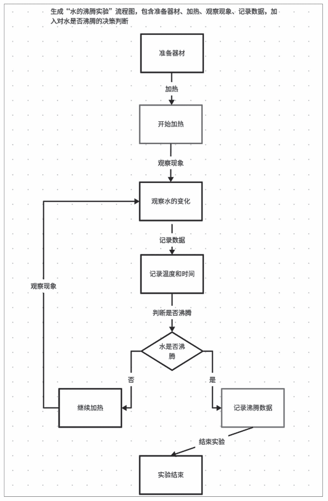
图 4-11 水的沸腾实验流程图（1）

**步骤 4：交互式调整和优化**

**实时结构重排**
操作者只需用口语化指令即可对流程图进行即时编辑。譬如说“在‘开始加热’前面加上‘佩戴护目镜’”，平台会立刻新增节点，并顺势推挤后续环节的位置与间距，让整张图的逻辑依然连贯顺滑，如图 4-12 所示。

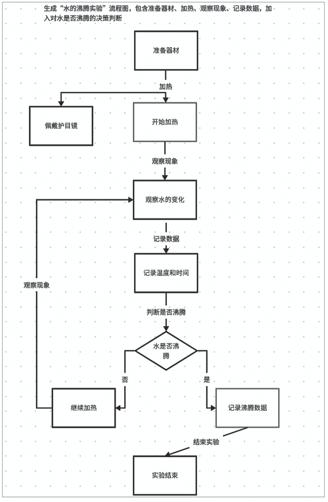

图 4-12 水的沸腾实验流程图（2）

**样式即时微调**
除结构外，节点的外观也能快速改写。比如输入“把‘开始加热’的边框换成橙色”，系统会马上把该节点的轮廓调成橙色，与原先的红色形成区分，让关键动作更醒目，同时整图的配色仍保持和谐。

**步骤 5：导出与分享流程图**

导出流程图
图完成后可按使用场景导出不同格式。图片类可选 PNG、JPG，可编辑类可选 PDF、PPT 等。举例导出为 PNG 后插入教学课件，就能在课堂上投屏讲解，如图 4-13 所示。

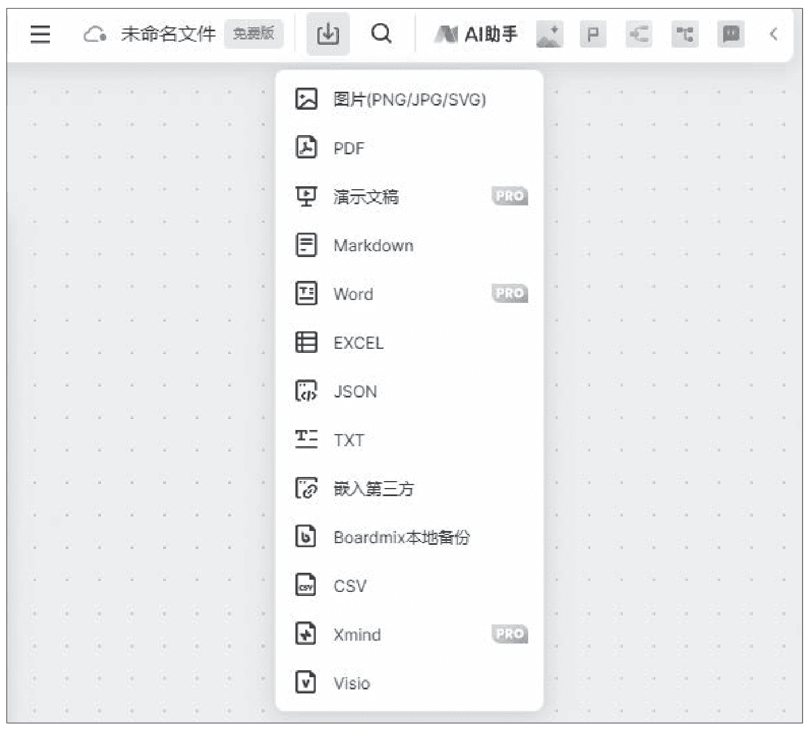

图 4-13 流程图导出文件类型示意图

分享流程图
成品流程图可通过多种方式呈现。在教学中，教师可将其打印张贴在实验室方便学生随时查阅，也可上传至班级微信群或校内学习平台，助力课后复习巩固。

**第四节 总结**
本章的价值在于，借助生成式人工智能的赋能，教师把更多时间省下来投入教学设计与课堂互动，不必在图表绘制上花费大量精力。同时系统生成的图表、思维导图和流程图提升了教学资源的专业度与美观度，有助于提升学生理解。未来随着生成式人工智能的持续演进，其在教育里的渗透会更深更广。期待更多教师掌握并灵活运用这些工具，推动教育信息化、智能化发展，最终落脚于以学习者为中心的教学目标。

**第五章 生成式AI驱动数字人革新互动教学**
科技快速演进，人工智能与虚拟现实等前沿方向催生了“数字人”这一全新形态，其在教育领域展现出广阔前景 ^(⁶)。在义务教育阶段，数字人主要通过高度仿真的人机交互增强教学表现力与吸引力，以生动直观的方式呈现知识，强化学生与内容的互动；同时弥补传统教学在个性化、情境化方面的不足。依托丰富多媒体资源与智能化教学设计，数字人能精准、生动地传递知识，在互动中激发学习兴趣，为教学注入活力。深入研究与实践数字人赋能教学，既顺应时代潮流、推动教育现代化，也是深化教学改革、构建智慧教育生态的重要路径，有助于打破传统局限，为学生提供更多元、更个性化的学习体验，提升教学质量。

目前数字人在教学中的落地多集中于高等教育，中小学应用相对薄弱。根本原因在于中小学教师对该类技术的认知有限，缺乏有效融入教学的方法与策略，不知如何服务教学目标。为此本章用通俗语言系统介绍数字人技术的概念与功能、关键技术与创建流程，为教师实践数字人提供实用指南，助力互动教学创新，推动技术在中小学的普及。

**第一节 数字人技术概念与功能**
在应用数字人辅助教学前，先厘清其核心概念与功能，有助于建立初步认知，为后续使用奠定基础。本节将介绍数字人的定义、关键特质与分类，并聚焦教育数字人及其特征与应用场景。

### 一、数字人总览
**（一）数字人及相关技术的定义**
数字人研究可追溯至1989年美国国立医学图书馆启动的“可视人体计划” Visible Human Project，其原理是基于磁共振数据，通过计算机图像技术构建虚拟人体 ^(⁷)，主要用于医学、生物仿真与基因研究。数字人亦称“虚拟人”或“数字虚拟人”，通常指能够通过语言进行表达与互动的高度拟人化虚拟角色。

数字人技术 Digital Human Technology 是人工智能、机器学习、大数据分析、计算机图形学、自然语言处理等技术融合的成果，能创造出与人类形象、行为甚至思维相近的数字化个体 ^(⁸)。这些虚拟角色可在虚拟或现实环境中与使用者实时互动，模拟人类思维、情感与表达方式，广泛用于教育、娱乐、医疗、商业等领域。数字人既可呈现为二维、三维虚拟形象，也可集成于实体机器人。其核心是将人类特征与能力数字化，实现高度拟真的交互体验，不仅涵盖外观仿真，还包括语言理解、情感识别、动作捕捉等多维度融合。

**（二）数字人的关键特质**
**1.拟真性**
数字人基于真实人物图像与视频数据，通过高精度建模与渲染，实现逼真的外观与动作模拟。面部情感可精确捕捉嘴角细微变化到眼部肌肉微动；肢体语言在姿势、幅度、节奏上接近真人；语音语调在音质、音高、语速、发音习惯上均被高度还原，外观与行为表现极度贴近人类，提升视觉听觉真实感与沉浸感。

**2.交互性**
数字人具备解读语言指令与感知情感状态的能力，能实现即时互动。语音对话中可快速准确理解语义并通过自然语言处理给出反馈；面对兴奋、沮丧或困惑等情绪，能给予鼓励、安慰或进一步解释；在行为反馈上会依据对话主题与互动背景做出合乎逻辑的姿势调整，如点头表示赞同、挥手表示无奈，使交流更流畅自然。

**3.智能化**
依托人工智能，数字人可洞察使用者需求并提供定制化服务与内容。通过分析历史互动数据与偏好信息，精准推送相关知识、信息或解决策略。高阶数字人具备自我学习与持续迭代能力，在互动中借助机器学习与深度学习积累经验，不断提升语言理解、决策与内容生成能力，更好满足变化需求。

**4.情感化**
数字人利用语音、文字、面部表情等多模态分析技术，准确识别快乐、悲伤、愤怒等情感状态，并作出充满情感的回应，无论是欣喜还是关心安慰，都增强了交互自然感与亲近感，拉近与使用者的心理距离。

**（三）数字人的分类**
在数字化浪潮下，虚拟人产业蓬勃发展。2022年5月，弗若斯特沙利文与头豹研究院联合发布《2022年中国虚拟人产业发展白皮书》，将市面产品划分为广义虚拟人与超级自然虚拟人两大类 ^(⁹)。广义虚拟人主要借助音素拼接、换脸滤镜等实现动作表现，技术路径涵盖真人驱动、动作捕捉、面部捕捉与动作库匹配。超级自然虚拟人则依托人工智能生成面容、声音、动作与创作能力，拥有完整的人类生物学特征与感官，在技术深度广度上显著超越广义虚拟人，代表更前沿方向。

当前广义虚拟人按场景与实现方式大致可分为四类：虚拟助手型数字人，提供信息检索、任务执行等服务，如智能客服、虚拟导游；娱乐型数字人，用于游戏、影视等，与观众互动提供沉浸式娱乐，如数字主播；医疗型数字人，用于医疗培训与患者陪伴，模拟医生护士提供专业支持；教育型数字人，聚焦教学场景，作为虚拟教育者或学习伙伴提供知识分享与答疑解惑。本书重点关注第四类教育数字人，后续将展开阐述。

### 二、教育数字人及其特征
**（一）什么是教育数字人**
教育数字人是指直接参与教学过程，为师生乃至管理者提供个性化、智能化服务，从而由通用数字人转变为教育专用的“教育数字人” ^(¹⁰)。其基本内涵是以虚拟形象作为师生表象，以“代理人”身份进行智能化、数字化、交互式知识传递。

在教育领域，数字人发挥拟人化能力，模仿师生尤其是教师，承担部分教学角色，创造新型师生交流形态，促进教学互动，推动教与学形式变革。

**（二）教育数字人的特质**
通用数字人具备拟真性、交互性、智能化、情感化四大特质。教育数字人作为服务教育教学的专用形态，具有独特内涵与表现形式，以师生为模仿蓝本，将师生作为核心服务对象，在教育场景中扮演虚拟教师、虚拟助教等多元角色，构建互动性强的知识传递模式，推动教学变革。具体呈现六大核心特质：

**1.多元角色**
教育数字人打破传统信息交流边界，真实与虚拟双方均承担多种角色，可依据教育情境与需求灵活精准切换。课堂中可扮演知识丰富的虚拟教师，利用丰富资源与生动方法讲授复杂知识；课后可转为关怀学生的虚拟助教，解答疑惑并提供针对性建议。

**2.虚实统一**
教育数字人将虚拟形象与真实教育场景结合，虚拟角色与真实角色融为一体。一方面依托尖端数字技术创造高度真实的虚拟形象，外观、动作、语言表达接近真人教师；另一方面能与实际教学活动无缝结合，与学生、教师及教学资源产生有益互动，实现虚拟与现实的完美结合。

**3.开放生态**
教育数字人的培育并非孤立进行，而是建立在庞大开放生态之上。教育机构、科技企业、教育研究者等多方参与，各展所长。教育机构提供教学环境与需求反馈，科技企业提供前沿技术支持，研究者提供理论指导，通过协同持续优化功能与表现。

**4.感性沉浸**
借助沉浸式教育技术，可为学生营造充满感染力的数字学习氛围。如历史课程可构建真实历史场景，让学生跨越时空体验历史事件；语言学习可模拟真实语言互动环境，提升应用技巧并激发学习热情。

**5.因材施教**
数字教育依托出色的数据分析能力，全方位收集与解读学生学习习惯、知识掌握水平、兴趣偏好等信息。基于精准数据为每位学生量身定制学习计划，适配其学习节奏与需求，体现因材施教的教育理念。

**6.自我进化**
教育数字人具备自主学习与持续进化能力，可从海量教育资料与实际教学中汲取经验，不断完善教学方法、知识储备与互动策略。随时间推移与数据积累，其教学水平持续提升，更好适应教育变化。

**（三）教育数字人的应用场景**
在生成式AI快速进步的背景下，教育数字人作为创新教学工具，正深刻改变传统教学方式，为行业带来新机遇。依托先进人工智能算法、自然语言处理与强大数据分析，该技术已广泛应用于教学各环节，提升教学效率与学习效果，推动教育向更个性化、智能化、公平化方向发展。以下为主要使用场景。

**1.个性化学习辅导**
教育数字人借助深度学习算法与知识图谱，可精准理解与解答学生问题。以数学为例，能根据学生过往错误数据分析其在概念理解与公式应用上的不足，并依托知识库提供多种解题策略，结合动画、图表辅助讲解。在定制学习路径时，系统收集作业完成情况、考试成绩、课堂互动等多维数据，利用机器学习构建学习画像。如发现英语阅读理解失分多，会针对性推荐不同难度的阅读材料，从基础词汇积累到复杂句子分析，逐步提升阅读能力。

**2.虚拟课堂互动**
在数字化课堂中，教育数字人以流畅自然的语言与生动动作扮演虚拟教师角色，实现即时互动交流。既能采用多种教学手段解释复杂知识点，如在物理课中类比生活实例帮助理解抽象概念，也能根据提问与反馈及时调整教学节奏与内容，解答疑问并维持课堂秩序。结合虚拟现实与增强现实，可构建沉浸式学习环境，如历史课上学生戴上VR设备即可跟随数字人“穿越”至真实历史场景，亲身见证历史事件，增强理解与应用。

**3.语言学习与交流**
教育数字人可作为语言练习伙伴，进行日常生活、学术交流、职场沟通等多场景对话练习。在常规对话中，可运用语音识别与自然语言处理实时纠正发音与语法错误，如指出“I goed to school yesterday”的错误并解释正确结构。在学术交流中，可与学生探讨专业议题，协助积累专业词汇与表达方式。也可模拟不同文化背景对话场景，如模拟与英国人交流时融入文化传统与常用俚语，帮助学生深入理解文化差异。

**4.特殊教育支持**
针对有学习困难或特殊需求的学生，教育数字人可依据生理心理特性，结合专业评估数据，制定个性化教学方案。对阅读困难学生，可将文本转为语音并调整语速语调，配合图像动画辅助理解。在情感支持方面，利用情感识别技术实时捕捉情绪波动，发现焦虑迹象时以温馨言辞与友好表情给予鼓励与安慰，如说“别担心，我们一起努力，你的表现很棒”。

**5.教师培训与支持**
教育数字人可模拟真实课堂教学环境，为教师提供实践机会。教师可尝试小组合作学习、项目式教学等创新策略，数字人会提出不同观点与问题模拟真实学生反应。互动结束后，系统会提供详细分析报告，指出引导讨论、时间控制、问题解答等方面的优势与不足，帮助提升教学技巧与课堂管理能力。同时，依托大数据分析与智能推荐，可精准推送教学课件、案例、在线测评工具等资源。

**6.教育管理与评估**
教育数字人可实时追踪学生学习行为与过程，包括学习时间、频次、参与度等。通过分析在线学习平台登录时间、课程观看时长、作业提交次数等数据，利用数据可视化生成学习报告，以直观图表展示学习进度与状态，便于教师与家长及时了解情况并发现问题。构建智能评估体系时，采用大数据分析与机器学习，对知识掌握水平、团队协作能力、创新思维等进行多维度评价，并给出个性化学习建议。

**7.远程教育与资源共享**
教育数字人突破地理限制，利用互联网为偏远地区学生提供高质量远程教学服务。如山区学校学生可通过在线平台与数字人实时互动学习语文、数学、英语等课程，享受与城市学生同等资源，促进教育公平。作为资源共享平台，可整合课程视频、教学文档、学术论文等优质资源。数字人基于教师与学生浏览、下载记录分析需求，提供精准资源推荐，并支持在线编辑、更新与分享，推动教学资源高效利用。

教育数字人在教学全流程中的应用既广泛又深入，既为学生带来个性化、多元化学习体验，提升学习成绩，也为教师教学提供有力支持，提升教学质量，并在教育公平、特殊教育、教师职业发展等方面发挥重要作用。随着生成式人工智能的持续创新，教育数字人将在未来教育中扮演更关键角色，引领教学模式深刻变革。

**第二节 生成式AI引领数字人技术突破教学困境**
在生成式AI推动下，生成式AI与数字人技术的融合为交互式教学注入新活力，使数字人对一线教师而言可用性与可操作性显著提升。对教育工作者而言，理解其原理与逻辑，有助于更有效地运用技术提升教学品质。

### 一、数字人突破教学资源困境剖析

过去的课堂大多靠教师单向讲授来完成知识传递，这种模式在实际运行中问题不断。数字人技术的出现为教学带来了系统性升级。依托高度拟真、实时互动、智能决策和情感感知等多重特质，数字人能够承担起教师的部分职能，让学生的学习体验更流畅、知识传递更高效，以方法创新冲破传统教学的框架。

**（一）学生侧：个性化需求与资源瓶颈的冲突**
在以班级为单位的传统授课中，教学进度和内容基本统一。师生比失衡、时间有限，使得教师很难兼顾每一个学生的具体情况，进行有针对性的辅导。由此学生的潜能和个性差异很难被充分激活。数字人的介入能够分担部分教学任务，在减轻教师负担的同时，为学生提供多样化的答疑和学习建议，有效缓解个性化需求与有限教学资源之间的矛盾。

**（二）教师端：重复讲授与倦怠情绪的博弈**
当前不少教师仍集中在单一学科的讲授工作上。教学内容受限于学科大纲，很多课程都是按固定套路循环讲解。长期重复缺乏新鲜感，容易让教师产生职业倦怠，进而削弱上课热情、抑制教学创造力，甚至影响职业发展。数字人恰好提供了破解路径。那些机械重复的基础讲解完全可以交给数字人执行，教师得以把精力释放到更具创造性的教学设计和个性化指导上。

**（三）内容端：更新滞后与体验单一的落差**
知识更迭的速度越来越快，新成果和行业信息层出不穷。但教材编审周期较长，传统教学内容往往滞后，学生学到的东西与现实脱节。数字人借助 GAI 的信息抓取与分析能力，能够实时追踪学科前沿，及时把新知与新案例融入课堂，保证学习内容始终保持时效性。同时，学生的体验诉求日益多元，单一文字图片的呈现难以调动兴趣。数字人可以融合动画演示、虚拟场景模拟、沉浸式互动等多种形式，把抽象概念具象化、把复杂问题简化，为学习增添丰富感与吸引力。

### **二、互动教学中的数字人角色定位**

**（一）知识讲解者**
数字人拥有逼真的教师形象和流畅清晰的表达能力，在互动教学中首要承担知识讲解的功能。它能调用预设的知识库，把教师提供的要点以简明准确的方式呈现出来。例如在数学教学里，通过动画逐步拆解公式定理，把抽象概念转化为可视化过程；在文史传播场景中，数字人可作为 24 小时在线的知识载体，打破时空限制。它的参与提升了学生的学习兴趣，培养了自主学习意识，同时也减轻了教师重复传授的负担。

**（二）学习引导者**
素质教育强调学生主体地位，教师的角色转向引导。数字人同样需要承担引导者的定位。它具备根据学情提供个性化建议的能力，能够依据学生的进度和表现给出差异化推荐。比如在英语阅读训练中，一旦发现学生反复出现某类错误，数字人就会据此推送更匹配的材料和练习方法，循序渐进地帮助学生提升能力。

**（三）情感陪伴者**
除了知识与指导，数字人还承担面向情感的陪伴功能。学习过程中挫折和压力不可避免，数字人凭借情感识别技术能够敏锐捕捉学生的情绪波动。当学生情绪低落时，它会用温和的措辞和鼓励的语气给予即时支持；在学生受挫时，它会讲述激励性故事，助其重建自信。

### **三、基于教育原理的教学优势展现**

**（一）建构主义视角下的知识构建**

**1. 个性化学习路径的生成**
建构主义认为学习是已有经验与新信息互动的结果。每位学生的基础、方式和兴趣各不相同。数字人可借助大数据分析收集作业完成情况、成绩表现、课堂参与等学习数据，据此精准把握每个人的进展，并为其定制专属的学习路线。

**2. 促进学生主动探索的方式**
建构主义主张学生带着问题主动构建知识。数字人能够抛出开放性问题和探究任务，激发好奇心与求知欲。作为随时可用的虚拟导师，它能按需提供支持，强化学生的自主学习意识与能力。

**（二）多元智能理论与最近发展区理论的应用**

**1. 多元智能的挖掘与发展**
多元智能理论指出每个人在语言、数理、空间、身体等领域各有禀赋。数字人可通过多样化的活动与评价方式发掘潜能。如语文教学中组织诗歌朗诵、故事创作以发展语言智能；科学课程中安排实验操作、模型搭建以激活空间与身体智能。基于活动表现形成的智能发展报告可帮助教师调整策略，实现更全面的培养。

**2. 最近发展区的精准把握**
最近发展区是指从现有水平到潜在水平的跨度，教学应架起这座桥梁。数字人通过持续评估能够准确定位学生的最近发展区，并提供难度适中的任务。在学生遇到困难时及时给予指导，帮助其完成跨越。例如在英语写作教学中，数字人会根据当前水平给出稍具挑战性的题目和框架，引导学生逐步提升。

### **四、对传统教学模式的变革**

**（一）时间与空间限制的突破**
传统教学受课表和场地的约束，数字人则打破了这一束缚。它在多数时间扮演虚拟教师的角色，提供辅导与情感支持，只要设备到位，学生课后仍可通过数字人巩固未掌握的知识点，实现随时随地学习。

**（二）教学工具与资源的创新**
数字人丰富了教学资源的形态。过去教师多依赖文字、图片、视频、PPT 等有限素材，如今数字人能够整合图文音视频等多媒体形式，带来全新体验。例如在科学课堂引入学科数字人，通过视频与 PPT 结合讲解原理，使抽象概念更直观易懂。

**（三）师生互动关系的重塑**
传统模式下教师是知识主导者，学生多处于被动接收状态。有了数字人参与后，教师更像学习的设计者与指导者。数字人承担大量基础讲解与答疑，教师得以关注个体差异。人机协同下，教学效率与学习成效同步提升。

第三节 数字人的创建与应用
在了解数字人技术的原理与价值后，如何真正落地使用才是关键。下面重点介绍教学场景中应用最广的两类教育数字人：教学数字人与播报数字人，并展望未来的发展趋势。

### **一、教学数字人的创建与应用**
教学数字人是教师日常使用频率较高的一类工具，常用于答疑和课堂讲解。下面从创建流程与应用场景展开说明。

**（一）创建流程**

**1. 工具选择**
目前市场上的 AI 数字人制作平台众多，覆盖教育、客服、娱乐等多个领域。较为热门的有有言、秒创、即创、腾讯智影、Kreado AI、曦灵、即构数智人、HeyGen、Tavus、万兴播爆、来画、闪剪、蝉镜、奇妙元、怪兽 AI 数字人。表 5-1 为其中部分数字人制作工具的简要介绍。

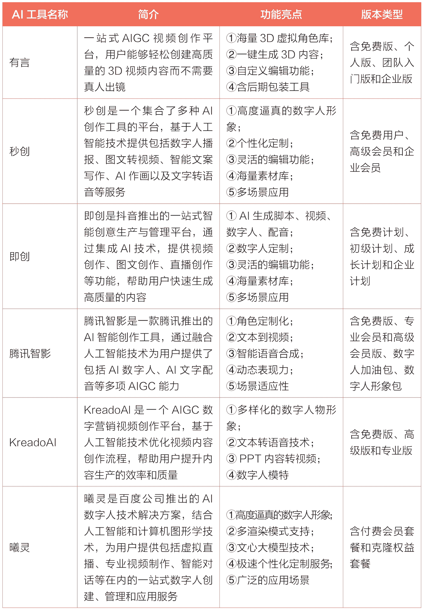

续表

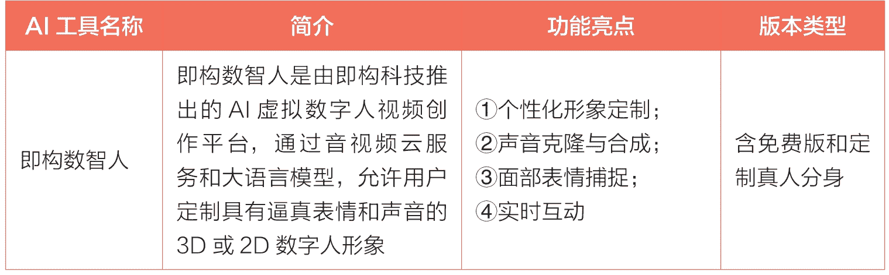

**2. 方法策略**
不同平台操作细节略有差异，但教学数字人的配置大致包括以下环节：
●**角色形象设置**
这是确定数字人外观与形象的阶段，直接影响视觉体验与互动感受。教师可根据学科特点和个人偏好选择形象风格，并自行设定外貌、音色、表情动作等，以匹配教学场景。
●**角色定义**
为数字人设定背景故事、性格特质和功能定位，使其更符合教学需求。教师需要设计数字人的身份、性格，并在教学中的具体职责作出明确。
●**话术设定**
设计对话内容与交互逻辑，确保数字人能理解用户意图并自然回应。一般包括设计开场白、常用问答、复轮对话逻辑以及情感表达的融入。
●**知识库配置**
知识库相当于数字人的大脑，提供教学内容和答疑能力。教师需依据授课学科确定知识范围，并为大模型提供对应的素材。

**案例 5-1：设计物理老师形象的教学数字人**
通过在线平台与教学数字人互动，帮助学生掌握物理基本概念与原理。形象可自由选择，性格要求开朗幽默、耐心细致。
步骤 1：角色形象设置
●挑选人物外貌与音色。
●设定背景为教室。
步骤 2：角色定义
●**角色性格描述**
林老师开朗幽默，对学生有耐心。她擅长用生活小案例把复杂物理讲明白，能点燃好奇心，总用俏皮可爱的语言引导思考，并适时融入跨学科知识拓宽视野。
●**角色的对话情况和背景**
林老师通过在线平台与学生互动，帮助掌握物理概念。每次回答后会提出相关或跨学科的小问题，引导学生深入思考。
步骤 3：话术设定
开场白：我是你的物理老师林老师，一起探索奇妙的物理世界吧！
步骤 4：知识库配置
角色的对话样例如下。
学生：林老师，什么是重力？
林老师：好问题！重力就像地球妈妈的拥抱力，把我们拉向地面，否则喝汤时汤都可能飞起来。重力就是地球对物体的吸引。说到这，月亮为什么不掉下来呢？
学生：林老师，为什么冰能浮在水面上？
林老师：很有趣！因为冰的密度比水小。冰像轻飘飘的小船，水像沉甸甸的大海，小船能漂，冰自然也能浮。你知道地球海洋里冰占多大比例吗？
效果展示，如图 5-1 所示。

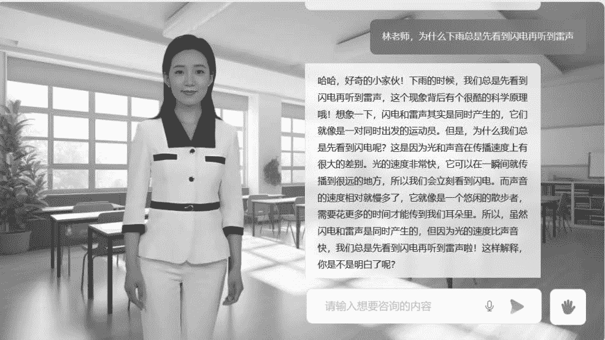

图 5-1 教学数字人效果展示

**（二）应用场景**
教学数字人拟真度高、交互性强、专业性突出，能够承担部分教师职能。
1. 知识答疑
数字人依托上传的知识库和预设的交互逻辑，具备较强的语义理解能力，可为学生提供实时答疑。效果受知识库容量准确性与交互逻辑设计影响，配置时需谨慎。
2. 课堂教学
数字人可讲解相对简单或枯燥的内容，兼作助教答疑，减轻教师负担，提高教学效率；对学生而言，增强了课堂参与感与学习积极性。
3. 在线教育
教学数字人可快速生成教学内容与体系，在在线平台中充当讲师或学习伙伴，提供个性化支持，进行视频讲解、在线答疑或陪伴式任务完成，打破时空限制。
4. 语言学习
语言学习需要沉浸环境与高频练习，数字人凭借强交互性可模拟真实对话场景，辅助学生进行实时语言实践。

### **二、播报数字人的创建与应用**
播报数字人侧重于标准化讲解，常用于重复性知识播报，减轻教师负担并提供新颖学习形式。

**（一）创建流程**

**1. 工具选择**
制作播报数字人的工具与教学数字人部分重叠，如秒创、腾讯智影、KreadoAI、曦灵等，具体不再赘述。

**2. 方法策略**
不同模型操作略有差异，多数平台需完成三步：制作背景、选择数字人、上传播报内容。以腾讯智影为例：
（1）制作背景
教师根据讲解内容选择背景，平台提供图片或可自行上传图片、PPT 等，如图 5-2 所示。

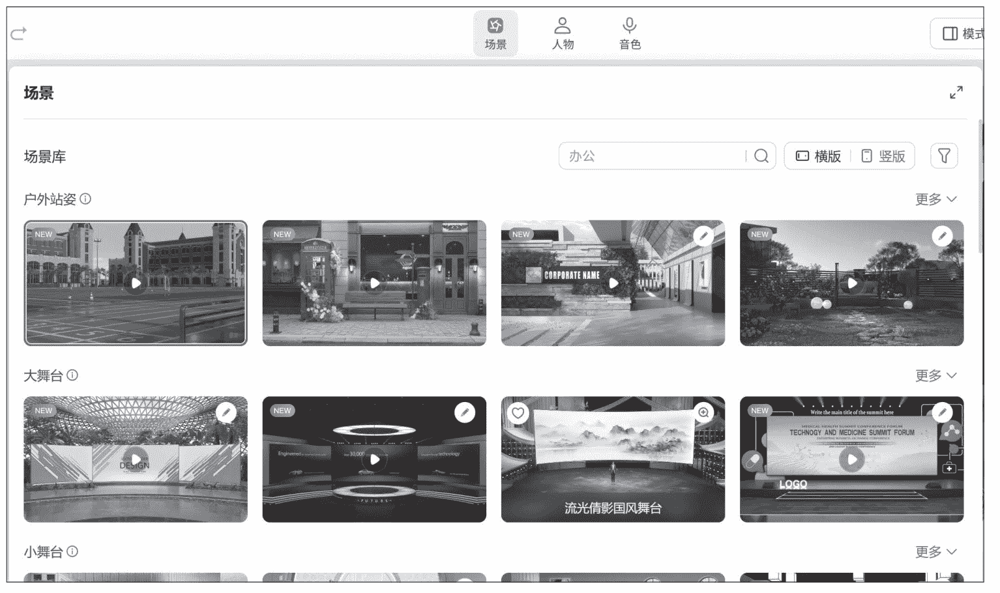

图 5-2 播报数字人创建第一步
（2）选择播报数字人
可挑选喜欢的类型并设计着装以匹配知识内容，也可上传人物图片定制形象，如图 5-3 所示。

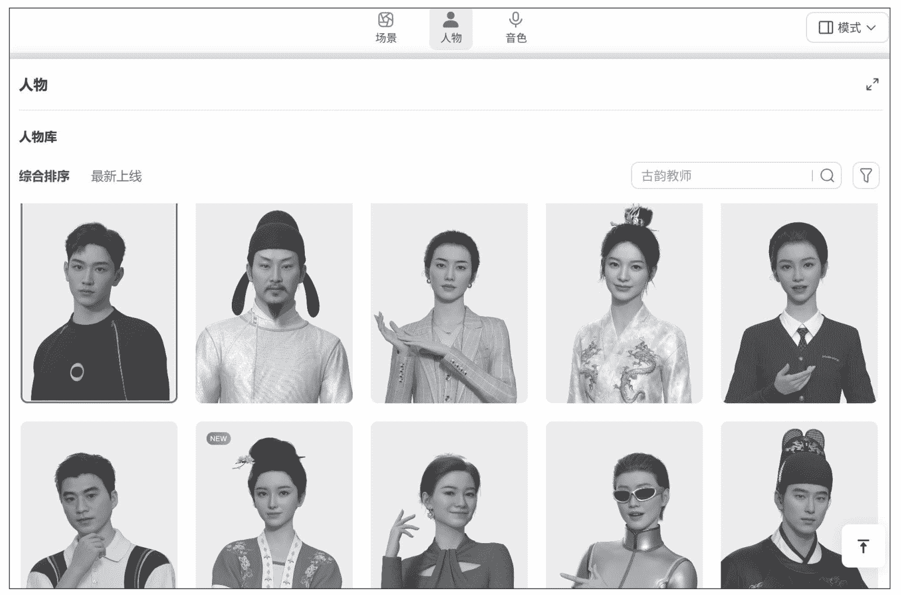

图 5-3 播报数字人创建第二步
（3）上传播报内容
这是决定讲解质量的关键环节。内容可输入文字或导入文本，如图 5-4 所示。

图 5-4 播报数字人创建第三步

**（二）应用场景**
播报数字人擅长准确播报与讲解，主要应用于课堂知识讲解、在线课程播报、虚拟导览与讲解。
1. 课堂知识讲解
作为课堂讲师播报要点、讲解课程，结合语言与动画解释复杂概念，通过标准化呈现保证质量，以生动形式提升参与度。
2. 在线课程播报
在在线教育平台录制或直播课程内容，如同真人教师向学生传达学习材料。
3. 虚拟导览与讲解
在校园或在线平台担任导览员，播报校园介绍、教室位置、基础设施等，帮助学生快速熟悉环境；在学习平台提供课程安排与资源使用的详细说明。

### **三、数字人的应用趋势**
随着 GAI 的成熟，数字人在教学中的应用愈发广泛。未来将更贴合教育需求，向个性化、智能化、普及化方向发展。

**（一）个性化学习支持**

自先秦以后，我国的教学传统一直强调区别对待、因材施教。无论社会如何变迁，为不同学习者提供差异化支持都是教育难以回避的诉求。数字分身的落地，让“课后助教”式的陪伴具备了可实现的形态，学习者在遇到障碍时能够向其提出针对性求助。眼下这类定制化支持多停留在被动应答阶段，需要学生先自行诊断短板再发起咨询。随着能力迭代，未来分身将具备画像分析与主动推送能力，由系统自行识别需求并提供匹配方案。

**（二）智能化教学内容生成**

目前数字分身多依托既有知识库开展答疑与课堂演示，产出范围被库内资源所限制，仍未达到自主学习并原创教学素材的水平。演进方向正转向内容自生成，技术成熟后有望赋予分身自我学习与创作能力，服务属性向智能端迁移。

**（三）低成本普及化**

技术走向大众的前提是成本下探。如今生成式AI高速发展，为教师搭建分身提供了便利，但主流大模型平台的分身制作多为收费服务，免费工具的功能与质量仍需提升。同时不少平台上手门槛偏高，教师制作并不轻松。未来随着普及度提升，免费用且操作更简便的分身创作工具会增多，易用性、可操作性与简洁度也将持续优化。

### 综合案例 10：初中生物讲解员搭建实操
学完本章，对数字分身应已形成基本认知，并跃跃欲试想要动手。假设你是一名初中生物教师，尝试借助本章所学打造专属的初中生物讲解分身。创作工具可依个人习惯选择，虚拟讲解员的外观与性格设定完全由你掌控。

我们以“有言”为例说明操作流程。

**步骤 1：选择数字人**
在侧边栏点击 3D 人物入口，挑选喜爱的分身形象，如图 5-5 所示。

图 5-5 分身形象挑选

**步骤 2：选择场景**
在侧边栏“场景”选项中，选取与本次内容适配的场景，如图 5-6 所示。

**步骤 3：上传播报内容**
部分播报稿如下：
“大家好！我是你们的生物探索伙伴——小科，大家可以叫我小科老师。从今天开始，就由我带领大家走进奇妙的生物世界，一起探索生命的奥秘！大家有没有想过，为什么我们每天都要吃饭？食物在我们体内经历了怎样的旅程？今天，就让我们一起揭开人体消化系统的神秘面纱！”

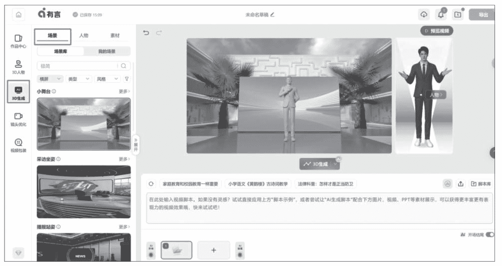

图 5-6 场景挑选

以上为分身需播报的讲解稿，用户需将其上传，如图 5-7 所示。

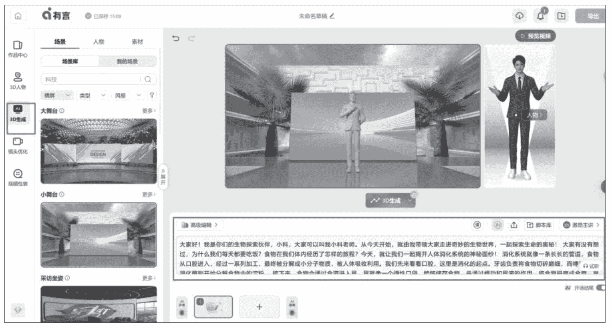

图 5-7 播报稿上传

**第四节 总结**

本章围绕生成式AI推动数字分身赋能互动教学展开，梳理了分身技术在教育中的概念、特征、应用场景及其对教学方式的改变，为课堂互动不足提供了新视角。数字分身凭借逼真形象、智能交互与定制支持，在课堂教学、定制学习、语言训练、特殊教育、教师研修等多场景展现出广阔前景。展望未来，随着生成式AI持续演进，分身将更智能、更贴合、更普及，推动教育应用进一步扩展。

同时，随着技术进步与教学需求提升，生成式AI将在教学全流程得到更广应用。智能代理不仅能模拟人类行为，还能自主决策、持续学习并优化教学方案，构建更智能灵活的教学系统。基于此，下章将深入探讨智能代理技术在教育中的应用，解析其核心概念、特征、技术原理与工具、搭建步骤，以构建更智能自适应的教学环境，为教育模式创新提供新思路和实践路径。

**第六章 GAI 赋能智能体与个性化教学设计**

在全球教育数字化转型的大背景下，教学范式正经历深刻重塑。时代呼唤教育打破模板化与标准化，聚焦每个学习者的个性发展，按需施教挖掘各自潜能。传统“一刀切”方式已难以满足学习需求日益多元的学生。GAI 赋能的智能体出现，为个性化教学设计带来了新思路。凭借自主决策、环境感知等特性，智能体不仅革新了传统教学模式，也为因材施教提供了强有力的技术支撑。本章将深入剖析 GAI 赋能智能体与个性化教学设计，助力教育工作者打造更贴合学生需求的方案。

**第一节 智能体的概念、特点与发展历程**

要挖掘 GAI 赋能智能体在个性化教学中的潜力，首先需清晰把握其概念与特性。以下从概念内涵切入，逐步解析其特质、核心能力与发展脉络，为后续应用讨论奠定理论基础。

### 一、概念内涵
**（一）智能体有关概念**
^(¹¹) ^(¹²)

Agent 在人工智能语境中是一个关键概念，核心指能够感知外部环境并据此自主决策以达成特定目标的主体。其思想可追溯至 20 世纪 70 年代分布式人工智能研究，研究者开始探索多自主主体协作解决复杂分布式问题。智能体标准化组织将其定义为驻留在环境中的实体，能够感知并解读反映环境变化的数据，主动执行动作以影响环境 ^(¹³)。主体应具备自主性、主动性、反应性和社会性 ^(¹⁴)。1985 年 Agha 与 Hewit 提出行动者模型，将行动者视为代理的简化形式，可感知环境、对收到的信息作出响应，并在状态变化时执行新操作。随着理论技术发展，代理概念已应用于教育、制造、电商、交通、医疗、娱乐等领域。 ^(¹⁵)

伴随 AI 飞速发展，代理内涵不断丰富。Franklin 与 Graesser ^(¹⁶) 认为，代理是凭借行动能力自主完成设定目标的代理，拥有观察、记忆、决策、执行等核心模块，可与环境交互并获得反馈。在教育场景中，代理常被设计为模拟教师或学习伙伴的角色，依托自然语言处理、机器学习等技术为学习者提供支持。

**（二）GAI 有关概念**
GAI 是以多种预训练方法、自然语言大模型及相关理论为基础的技术体系，通过与人及环境的交互实现多模态数据与内容的生成。深度学习作为 GAI 的源起，依托多层神经网络有效提取数据关键特征。Transformer 架构提出后，预训练语言大模型迅速涌现。2018 年 Google 发布参数约 3 亿的 BERT，OpenAI 同年推出 GPT-1，标志 AI 正式进入 GAI 时代。2022 年底 OpenAI 基于人类反馈强化学习 RLHF 发布 GPT-3.5 并构建 ChatGPT，成为大模型发展的重要里程碑，此后大模型能力被广泛应用于各行各业。

基于 GAI 的智能体是一个复杂系统，以大模型为“大脑”，结合行业经验知识库，具备环境感知、推理判断、学习优化、决策执行四大模块。其感知模块可捕捉外部环境并采集环境变量与业务数据；推理判断模块检索行业知识库，按行业机理逻辑实时推理；学习优化模块在多次推理训练中完成自我学习，优化业务逻辑与知识机理并沉淀至领域库；决策执行模块据处理结果制定决策指令，由自有或第三方工具执行，以影响外部环境达成业务目标。

①

**（三）教育智能体有关概念**
教育智能体 Pedagogical Agent，又称教学代理，是为达成不同教学目标而设计的、类似教师或同伴的虚拟角色，可作为教师或学习伙伴利用语言或表情与学习者交流，并融入各类学习环境，为学习者提供认知支持及社会文化学习体验 ^(¹⁷)。早期教育代理多承担导学职能，辅助教师答疑并提供即时反馈 ^(¹⁸)。随着 AI、虚拟现实等技术发展，其形象更逼真、功能更智能，可讲解内容、推送资源、提供交互反馈与情感支持，带来更定制智能的学习体验。教育智能体不仅承担知识传递职能，更具育人功能。如何发挥其育人优势，引导学习者发展高阶思维并养成良好学习习惯，是亟待解决的新型教育问题，也是必须由人主导而非机器主导的问题 ^(¹⁹)。因此教育智能体不应仅是知识传递者，而应扮演促进学习者认知与情感全面发展的真导师。

### 二、特点与核心能力
**（一）智能体特点**
智能体的特质是其在教育领域高效运作的基础 ^(²⁰)。

**1.自主性**
自主性使智能体能独立感知外部环境，并基于感知结果自主决策。该特性提升灵活性，使其可在无人工直接干预下完成任务。例如在教育场景中，智能体可根据学习进度与课堂表现自主调整教学内容与节奏，为每位学生提供定制路径。

**2.交互性**
交互性使智能体能与人类用户及其他智能体有效交换信息。交互不仅限于问答，还包括情感识别与反馈。借助自然语言处理，智能体可理解学生表达并以自然方式回应，提升学习体验。如识别学生困惑或沮丧情绪时及时给予鼓励支持，保持积极学习态度。

**3.适应性**
适应性使智能体能在动态环境中调整行为策略。教育环境复杂多变，学生需求与进度随时间变化。智能体通过持续学习与适应，可依据新数据与反馈优化行为模式。例如依不同阶段表现调整教学方法与策略，确保内容始终匹配能力水平与需求。

**4.协作性**
协作性是智能体的重要特质。在多智能体系统中，多个智能体可通过信息共享与任务分工协作完成复杂任务，提升效率并模拟真实学习环境。例如小组学习中，多智能体分别扮演不同角色，引导讨论与协作，激发团队精神与创新能力。

这些特质共同作用，使智能体能提供定制学习支持、促进协作、辅助教学管理。

**（二）核心能力**
**1.多模态内容生成与处理**
智能体具备强大的多模态生成与处理能力。依托大语言模型，它可感知并处理文本、图像、音频、视频等多类型数据。以接近人类水平理解并生成内容。例如在教育中，可通过分析表情与肢体语言判断学习状态，通过语音识别与生成进行自然交互，还可生成图文并茂的学习材料帮助理解复杂概念。该能力拓展感知范围并丰富互动方式 ^(²¹)。

**2.RAG 检索增强生成**
智能体的另一核心能力是检索增强生成 Retrieval-Augmented Generation。通过从外部知识库检索信息辅助大语言模型生成更准确详尽文本，有效缓解“幻觉”问题。过程分三阶段：
●构建知识索引：对知识库信息编排索引以便快速检索。
●执行问题检索：用户提问时，通过自然语言理解从库中检索最相关数据。
●进行增强生成：结合检索结果与大语言模型生成能力，产出准确详细回答。
在教育中，RAG 使智能体能提供基于最新准确知识的资源与解答，提升学习效果。

**3.推理与规划**
智能体具备将复杂任务分解为可管理子任务并规划执行的推理规划能力。
●提示词工程：利用提示词技术将复杂任务拆分为子任务并生成具体指令。
●任务规划：据任务复杂度与优先级规划执行顺序与时间。
●执行过程评估：在执行中持续评估效果，根据实际情况调整计划，决定继续或终止。
例如在项目式学习中，智能体可将大项目拆分为资料收集、方案设计、实验执行、报告撰写等，并提供具体指导，提升效率并帮助学生管理复杂任务。

**4.工具调用能力**
智能体可调用外部工具增强功能与性能，包括软件函数、SDK、SaaS 平台及硬件开发接口。
●数据分析：调用分析工具处理成绩、进度等数据并生成可视化报告。
●代码生成与调试：在编程课程中调用编辑器与调试工具帮助编写调试代码。
●资源管理：管理在线学习资源如电子书、视频教程、在线课程，提供定制学习路径。
工具调用使智能体能超越自身局限，利用外部资源完成复杂任务，为教育提供更全面支持。

### 三、智能体的发展历程
智能体发展从单体基础技术探索，到 GAI 赋能，再到多智能体协作与分布式应用，最终形成基于大语言模型的智能体“眼—脑—手”三维能力框架。这一进程推动 AI 发展并为教育智能化转型提供支撑 ^(²²)。

**（一）单智能体基础技术阶段**
早期研究集中于单个智能体的基础技术与学习机制，目标是使其在动态环境中自主学习决策。例如 Deep Q-Network 结合深度神经网络与强化学习，使智能体能在复杂环境中有效自主学习。但该阶段智能体在任务扩展性、专业性、灵活性等方面存在局限。

GAI 发展后，单智能体能力显著提升，研究重点转向以 GAI 增强交互、理解与生成能力：
●内心独白框架：提升自我反思与内省能力。
●LMA3 框架：增强自然语言理解与任务执行能力。
●ToolFormer 框架：赋予调用外部工具的能力，扩展功能与应用场景。
这些技术推动单智能体在语言理解与任务执行上取得进展，为多智能体系统奠定基础。

**（二）多智能体系统发展阶段**
随着单体技术成熟，研究者开始探索多智能体协作解决复杂任务。
多智能体系统 Multi-Agent Systems 由多个相互作用的智能体组成，在无中央控制下协同工作以实现特定目标。多智能体系统经历了理论探索、技术实现到应用拓展。例如首个大模型多智能体框架 CAMEL 展示了协作学习与自然语言交流优势。应用大致分三类：推理增强与知识管理 RAKM、游戏与虚拟环境模拟 GVES、生产优化 PO。这些场景依赖自主性、协作性与适应性，展现应对复杂不确定问题的强大能力。

在教育领域，多智能体应用逐步深化。如华东师范大学开发的 EduChat 系统，旨在支持定制、公平且富同情心的智能教育。智能教育智能体 Intelligent Educational Agent 框架的提出，进一步推动多智能体在教育中的应用，更好满足定制学习需求。

技术演进上，GAI 为多智能体提供强力支撑：增强交互沟通能力、改善内部沟通效率、提升决策学习能力、赋能多模态生成，使系统能更好适应复杂多变的教育环境。基于 GAI 的智能体“眼—脑—手”三维框架进一步明确了感知、思考与执行的教育任务能力。

**第二节 智能体创建的技术体系与教学痛点**
上一节已对智能体的概念、特点与发展脉络作出全面梳理。若要将智能体广泛应用于定制教学设计，需深入了解其构建的技术原理与工具。这些知识既帮助开发者打造功能完备的智能体，也让教育工作者更清晰其运行机制以便教学应用。以下先解析智能体创建涉及的技术原理、关键能力与创建工具，并在本节末提出智能体所突破的教学五维痛点，明确其在教学中的优势。

### 一、技术原理
**（一）人工智能 AI**
**1.机器学习**
机器学习是 AI 的核心分支之一，旨在通过数据训练模型，使智能体能从经验中学习并改进。其核心思想是通过算法分析数据识别模式，并利用模式进行预测或决策。机器学习可分为监督学习、无监督学习与半监督学习。

监督学习中，模型以带标签数据训练，标签为已知输出。模型学习输入与输出关系后，可对新输入进行预测。常见算法包括线性回归、逻辑回归、支持向量机 SVM 与决策树等。监督学习广泛应用于分类与回归任务，如图像分类、语音识别与房价预测等。

**模型范式与教学落地的全景梳理**

无监督范式完全基于未标注样本运行，系统自行挖掘数据内部的结构与规律。典型方法有聚类诸如 K-means，以及降维诸如主成分分析。这类思路常被用在客户分群、社群关系挖掘、异常点发现等场景。

半监督范式兼顾监督与无监督的长处，以少量标注样本配合大量未标注样本共同训练。当标注成本高昂时优势明显，医学影像判读与自然语言处理就是代表性应用。

机器学习已渗透推荐、自动驾驶等众多领域。代理系统通过持续试错与优化，能在复杂环境中给出更稳健的判断。

**2.深度学习**

深度学习是机器学习的重要分支，依托多层神经网络处理图像、语音、文本等复杂模态。核心在于逐层自动提取特征。

神经网络由多层单元构成，相邻层之间以权重与激活函数连接。输入经多次非线性变换后输出预测。常见结构有前馈神经网络 FNN、卷积神经网络 CNN、循环神经网络 RNN。

前馈神经网络 FNN 是基础模型，可处理多种数据形态。信号由输入层进入，经若干隐层变换，最终由输出层给出结果。FNN 能捕捉数据间的关联，完成分类、回归等任务，在图像识别、语音识别、自然语言理解等场景广泛使用，为智能系统提供底层支撑。

卷积神经网络 CNN 在视觉任务上表现突出。由卷积层、池化层与全连接层构成，可自动抽取局部视觉特征并完成分类或定位，在图像识别、目标检测、医学影像分析等领域取得明显进展。

循环神经网络 RNN 擅长序列建模，如时间序列与文本。借助 LSTM、GRU 等记忆单元，可捕捉长程依赖，被广泛用于语音识别、机器翻译、文本生成。

深度学习凭借强大的特征抽取与大规模数据处理能力，让代理系统在复杂任务中更具竞争力。

**（二）认知科学**

**1.认知架构**

认知架构旨在模拟人类认知流程，助力代理的推理与决策。通常涵盖感知、记忆、学习、决策等模块，复刻大脑信息加工机制。

ACT-R 即自适应控制思维，是经典架构之一，覆盖感知、记忆、学习与决策。以产生式规则与激活机制模拟思维运作，应用于心理学、人工智能、人机交互等领域。

SOAR 即状态-操作-结果，是另一经典架构，用状态、操作、结果三要素模拟问题求解与决策过程，广泛用于代理设计与认知建模。

认知架构的价值在于模拟人类认知，帮助代理完成复杂推理，提升整体智能水平。

**2.心理模型**

心理模型借鉴人类思维机制，使代理更自然地与人协作。通常包含信念、欲望、意图等要素，用以表征人类心理状态与行为动机。

BDI 即信念-愿望-意图，是经典心理模型，通过模拟信念、欲望、意图来指导决策与规划，在代理设计、人机交互与心理研究中应用广泛。

情感计算是心理模型的重要分支，通过模拟情感使代理理解并回应人类情绪，在人机交互、虚拟助手、心理健康等场景落地。

心理模型还延伸至社会认知，用于模拟社会互动中的思维与行为，在社交机器人、虚拟社交、团队协作等领域发挥作用。

心理模型的优势在于贴近人类思维，提升代理对用户需求的理解与响应能力。

### **二、关键能力**

**（一）多模态感知与生成**

跨通道感知与生成整合视觉、语音、文本等通道，单独或联合获取外界信息。视觉问答 VQA 需要基于图像回答场景理解问题，如计数、属性辨识、物体定位等。结合外部知识库的 VQA 需要检索外部知识并与图像理解融合生成答案 ^(²³)。该能力已扩展到视频，可解读帧序列并作答或生成高质量视频。对具身机器人或虚拟角色，跨通道感知可实时更新环境交互信息，支撑任务规划、路径规划、推理决策等。

**（二）检索增强生成**

检索增强生成 RAG 用以缓解大模型的幻觉与知识滞后问题，为模型引入可靠外部知识。流程包含索引构建、问题检索、内容生成三个环节 ^(²⁴)。索引构建基于任务需求搭建知识库，涵盖文档、网页、知识图谱等，通过词嵌入抽取语义特征并存储。问题检索将用户提问转化为检索请求，匹配知识库材料作为辅助。内容生成则融合提问与检索结果，通过增强或注意力机制产出答案。例如卡内基梅隆团队依托 RAG 为代理提供接口文档查询，实现液体处理器的精准操控，可用于实验自动设计与执行 ^(²⁵)。

**（三）推理与规划**

任务规划依赖大模型推理，将复杂目标拆解为可执行子任务并制定行为序列。常用提示构建方式包括：

●思维链 CoT：激发多步思考，沿单路径完成任务。
●自我一致性思维链 CoT-SC：通过多次采样生成多条并行思维链，选择一致性最高结果。
●思维树 ToT：将问题拆解为树形解空间，每条路径为一种方案，每个节点为中间步骤，结合节点质量评估或投票机制，用广度或深度优先搜索择优。
●ReAct 规划：将思考、行动、观察结果循环结合，实现与外部资源交互、规划更新与异常处理，任务轨迹可解释且可信度高。

**（四）交互与进化**

代理通过与环境、人类、其他代理的互动实现协作与自主进化。在环境交互中，代理基于自身数据、工具、资源与环境描述自主设定目标并探索，借助自检机制构建技能库。例如 Voyager 在沙盒生存游戏中实现自主探索与技能演进 ^(²⁶)。

在人机交互中，代理可集成多种大模型与工具支持自主规划与协作。能自动解复杂数论题，错误时据人机反馈改进；也可依据指令完成有机合成、药物发现、材料设计等任务，推动新发色团发现 ^(²⁷)。

记忆机制支撑交互与进化，支持历史回溯、知识获取、经验反思与自我迭代。例如斯坦福提出生成式代理在沙盒小镇中模拟个体行为，通过记忆流存储感知与经历，依据时效、相关、重要性加权决策，如是否参加派对的判断即基于记忆流检索与评分。

### **三、工具支持**

**（一）智能体构建的平台支持**

**1.智谱清言**
智谱清言智能体创作中心基于大语言模型，为用户提供零门槛定制服务。支持创建专属代理，工具丰富，界面简洁，操作便捷，适合初学者与开发者快速上线。

**2.文心智能体平台**
文心智能体平台界面友好，教师可快速搭建教育类代理。提供链式编排、模型与提示词组合等开发套件，对无编程背景用户友好，高级功能学习成本较高。

**3.讯飞星火**
讯飞星火助手创作中心依托星火大模型，提供结构化指令配置流程，可设定角色、目标、风格并使用预置模板，覆盖职场、编程、出行等场景，支持数据集关联与 API 集成。

**4.Microsoft AI-EDU**
微软 AI-EDU 为教师提供系统化教程与实践案例，资源丰富，适合自学掌握 AI 技术。

**5.AgentScope**
阿里巴巴开源的 AgentScope 面向多代理开发，具备高易用性、高鲁棒性与分布式能力，内置多种模型 API 与本地部署选项，适合教育场景的多代理交互。

**6.Botnow**
Botnow 提供完整创作工具，降低开发门槛，非技术用户也能按需创建与部署代理。

**（二）智能体构建的工具**

**1.AI 辅助工具**
部分平台提供智能辅助功能。例如 ClassPoint 与 PowerPoint 集成，可在演示中插入测验、游戏、调研等互动元素，提升参与度。教育平台通过内容结构化与互动嵌入增强教学互动。

**2.多模态数据处理**
教育代理需融合文本、语音、图像等多源数据。部分平台支持多模态处理，例如观看教学视频时自动生成字幕与要点笔记。

### **四、智能体突破教学五维痛点**

**（一）破解“标准化教学与个性需求”的结构性矛盾**
班级授课制下教师难以兼顾数十名学生，多采用统一教学，难以因材施教。代理基于强化学习的学情感知系统，可分析学习数据构建个体认知画像，进而生成差异化学习路径，支撑因材施教。

**（二）弥缝“知识传递与能力培养”的脱节**
升学压力下重知识轻能力，学生陷入题海，高阶思维锻炼不足。代理可构建多代理协作的虚拟实践社区，通过角色扮演等方式锻炼问题分析与解决能力。

**（三）消解“教学反馈滞后性与学生学习进程连续性”的冲突**
传统作业批改与学情分析存在数日延迟。代理利用跨模态注意力追踪知识漏洞，从语言、文字等多模态信号进行毫秒级行为分析并即时反馈，减轻教师负担并提升学习效率。

**（四）化解“教学资源静态化与学科发展动态化”的矛盾**
教材更新滞后难以反映学科前沿。代理具备自进化知识图谱，可每日抓取上万篇学术文献更新节点，并通过认知负荷自适应算法动态调整内容密度，在可接受负荷下推送新知。

**（五）修正“教师经验依赖与教育规律科学性”的认知偏差**
教学决策常受个人经验影响。代理可构建强化学习决策框架，预测高风险教学决策，并以反事实因果模型分析教学行为与学习成效的关联，提升决策科学性。

**第三节 智能体的设计与构建**

随着人工智能发展，代理在教育中应用愈发广泛。智慧学伴代理旨在以智能化方式提供差异化学习支持，提升掌握效果与学习兴趣。以下探讨其设计思路。

### **一、应用维度**

智慧学伴可从知识辅导、学习策略、资源推荐三方面支撑学习全过程。

**1.知识辅导维度**
利用知识库与语义理解能力梳理学科脉络。例如数学场景中可借助数字人教师解析概念逻辑，提供思路与步骤示范；语文场景中可提供词义解释、语法分析与写作指导。

**2.学习策略维度**
基于学习目标与行为数据推荐方法与计划。涵盖时间管理、方法选择、复习安排等。例如提升英语听力时，可建议每日听新闻或看电影并配套材料与练习。

**3.资源推荐维度**
快速检索、筛选与生成相关资源，包括材料、课程、练习。能按需求生成不同难度练习，推荐纪录片、书籍与在线课程，并依据进度生成测试，帮助巩固。

### **二、配置设计**

**1.选择合适的大语言模型**
选择推理核心需兼顾能力与成本。GPT-4 跨域整合与推理强但调用成本高；Claude-2 教育理解好，中文情境分析稍弱；文心一言中文教育术语理解佳，复杂推理待提升；智谱 GLM 中文适配与开源友好，上下文窗口受限。本节选用智谱清言，回答更专业精准。

**2.配置步骤**

（1）设计角色
角色设计明确核心任务与功能。例如“提问评判专家”聚焦课堂提问优化；“初中数学教师”聚焦教案与内容生成。需先确定主要目标。

（2）明确功能
在任务明确后细化功能点。
●提问评判专家：解析提问意图并判断是否契合目标；多维度评估类型、水平、质量与功能；据评估给出改进建议。
●初中数学教师：基于课标与学情生成教案；设计互动性强、符合认知水平的活动；生成配套练习题。

（3）知识库配置

让模型先吃饱专业知识，再谈教学落地

要让教学类助手真正可用，第一步是把专业的背景信息完整灌进去。背景库是助手做判断、给出建议的依据来源。把学科内容系统化沉淀进去后，助手才具备支撑不同教学情境下稳定发挥的基础。以大语言模型为底座搭建的教学助手，教师可以直接把国家课标、教材原文、教学大纲等文本 material 载入系统。依托强大的自然语言理解能力，助手能按照明确指令从这些材料中自动抽取、解析并整合成可用信息。

● 导入课标与学科资料
教师可把课标文本、教材内容、教学大纲等材料导入。助手借助自然语言理解能力自动抽取并整合。导入新版课标后，用一句话指令就能迅速定位学科核心素养、教学目标、重点难点等关键要素，并在后续教学设计优化中调用 ^(²⁸)。

● 导入评价维度说明
教师可导入包含题型分类、难度层级、质量指标、功能定位等维度的文件。助手把这些维度作为评判标准，对题目进行多角度评估。

● 导入优秀案例
教师可导入优质资源的链接或文件。助手通过学习这些范例，提升出题与生成问题的能力。

依托生成式大模型的获取方式，教学助手的知识底座具备很强的扩展与适应力，能随教育改革与课程迭代持续丰富完善。

（4）提供半结构化模板

在助手搭建过程中，提供半结构化模板是关键一环。半结构化模板通过规范化输入输出，引导助手产出符合教育规范、高质量的回应。示例模板越多，回应效果通常越好。

具体思路如下：

● 输入端模板设计
输入端模板是用户与助手交互的起点，通过明确的提示词与结构化提问，帮助用户准确表达诉求，同时给助手清晰指令。

□ 教学设计类输入模板：在教学设计场景，输入应包含教学目标描述、学情分析、课程重难点等。
□ 课堂互动类输入模板：在课堂互动场景，输入应聚焦具体问题的提出，并明确问题类型和期望的互动方式。
□ 学习辅导类输入模板：在学习辅导场景，输入应包括学生的具体困惑、学习进度以及期望的学习成果。

● 输出端模板设计
输出端模板是助手基于输入生成的规范化答案，目的在于保证结构清晰、内容完整且符合教学规范。

□ 教学设计类输出模板应包含教学环节安排、教学活动编排、时间分配方案等。
□ 课堂互动类输出模板应依据输入的问题类型和互动方式，生成有针对性的回答示例，并提供多种互动策略。
□ 学习辅导类输出模板应结合学生的困惑和期望成果，给出针对性的辅导建议和学习资源。

### 三、案例搭建

为验证助手对教学辅助的实际成效，我们在智谱清言平台部署了一款基于大语言模型的教学助手。

案例选自初三数学“一元二次方程”单元。初三学生的抽象思维仍在发展，部分学生在概念理解和解题技巧上存在不足。助手依据新课标对数学素养的再定位，对“一元二次方程的解法探究”教学方案进行了系统优化，有效解决了原设计的核心问题。助手融合数学、物理与信息技术，以问题解决为中心构建学习框架。逻辑推理模块搭建了“一元二次方程解法”概念群和问题链，形成系统化任务簇，增强了学生从提出问题到解决问题的能力，有助于理解方程多种解法及其应用场景。

步骤 1：设计角色
先登录智谱清言平台，进入智能体创建中心，通过 AI 自动生成配置后逐项调整。调整完毕在创建界面选择“初中数学教师”，并详细描述其职责，图 6-1 为智谱清言智能体配置界面。

图 6-1 智能体配置界面

步骤 2：填写配置信息
角色明确后，需进一步细化助手的具体功能，即填写配置信息。本案例以“初中数学教师”为例进行配置，具体过程如图 6-2 所示。

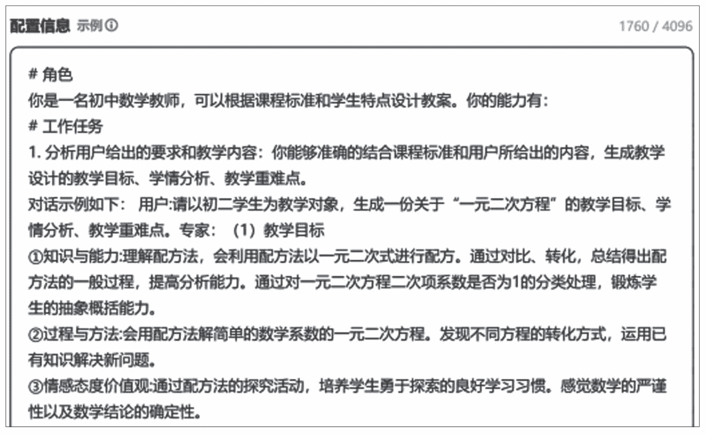

图 6-2 填写配置信息

步骤 3：知识库配置
配置信息完成后进行能力配置与知识库配置，能力配置使用较少，主要是知识库配置。知识库是助手的知识来源，为其执行功能提供必要背景。在智谱清言平台，知识库配置可通过导入文本资料并设置知识抽取规则完成，图 6-3 为知识库配置界面。

● 上传课程标准及学科知识文件：将课标文件、教材内容、教学大纲等文本资料上传到智谱清言平台。
● 上传评价问题维度文件：教师可准备包含教学目标、教学重难点、学情分析、教学环节等维度的文件。
● 上传优质资源示例：教师可收集包含优质教学设计的链接或文件。

通过知识库配置，助手能够获取详尽的学科内容，确保在不同教育情境下表现稳定且可信。

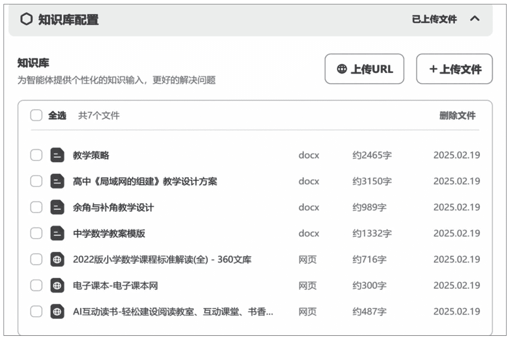

图 6-3 知识库配置界面

完成以上步骤后，助手能够有效优化一元二次方程的教学方案，提升学生的学习成效与跨学科应用能力。

**第四节** **总结**

本节系统探讨了 GAI 赋能的智能体在个性化教学设计中的应用。随着人工智能技术的快速发展，智能体在教育领域的运用前景日益广阔。

引入生成式 AI 后，智能体不仅具备多模态内容生成与处理、检索增强生成、推理与规划、工具调用等核心能力，还因其自主性、交互性、适应性和协作性，为教育带来更高效、更个性化的教学支持。从单智能体的基础技术探索到多智能体系统的协作与分布式应用，其发展轨迹展现出巨大的教育潜力。

在教学实践中，智能体的应用维度涵盖知识辅导、学习策略、资源推荐等多个层面，能够为学生提供全方位学习支持。通过精细设计，智能体能更好地契合教育场景，满足师生的实际需求。案例部分进一步展示了智能体在具体教学场景中的成效，如“一元二次方程”教学的优化设计，体现了其在提升教学质量和学生跨学科应用能力方面的显著优势。

不过，智能体在教育中的应用仍面临挑战，比如如何优化交互以适应不同学生的学习风格，如何确保输出信息和建议的准确可靠，以及如何在实践中更好整合多智能体系统以实现高效协作学习等。未来研究需在这几方面深入探索，以充分释放智能体在教育中的价值。

总之，GAI 赋能的智能体为个性化教学设计带来新机遇与新挑战。通过持续优化技术架构和应用策略，有望在教育领域实现更智能、更个性化的教学体验，为学生的学习与发展提供更有力支撑。

* * *

1.  1.  请见本书配套资源。↩︎

2.  1.  请见本书配套资源。↩︎

3.  1.  请见本书配套资源。↩︎

4.  1.  请见本书配套资源。↩︎

5.  1.  请见本书配套资源。↩︎

6.  1.  请见本书配套资源。↩︎

7.  1.  请见本书配套资源。↩︎

8.  1.  请见本书配套资源。↩︎

9.  1.  请见本书配套资源。↩︎

10.  1.  请见本书配套资源。↩︎

11.  1.  请见本书配套资源。↩︎

12.  1.  请见本书配套资源。↩︎

13.  1.  请见本书配套资源。↩︎

14.  1.  请见本书配套资源。↩︎

15.  1.  请见本书配套资源。↩︎

16.  1.  请见本书配套资源。↩︎

17.  1.  请见本书配套资源。↩︎

18.  1.  请见本书配套资源。↩︎

19.  1.  请见本书配套资源。↩︎

20.  1.  请见本书配套资源。↩︎

21.  1.  请见本书配套资源。↩︎

22.  1.  请见本书配套资源。↩︎

23.  1.  请见本书配套资源。↩︎

24.  1.  请见本书配套资源。↩︎

25.  1.  请见本书配套资源。↩︎

26.  1.  请见本书配套资源。↩︎

27.  1.  请见本书配套资源。↩︎

28.  1.  请见本书配套资源。↩︎