# AI时代的教学高手养成指南

本书从一线教学场景切入，收集了大量可直接落地的智能辅助案例，阅读起来轻松有用。

**王珏**
北京师范大学数字学习研究中心研究员
国际信息学会中国教育信息化专业委员会副秘书长
日常教学里我早已在用智能工具，这本书读来依然很受启发。书中给出了大量课堂情境下可直接套用的指令，以及背后的方法思考，对提升教学效能的同行很有参考价值。

**刘卓鹰**
中南大学医疗卫生法研究中心副主任，硕士生导师
作者把教材吃透到细节，精髓一目了然；紧扣课标把握教学走向；演示了如何把智能技术融入课堂活动设计，激发学生主动探究，深化理解与记忆。既有工具层面的创新，也有教学理念的革新，为中学教师提供了可操作的指导与灵感，助力打造更智能更高效的课堂。

**赖燕**
北京市海淀区物理学科带头人
教育的核心是传递知识与技能，教师是关键变量。本书让我看到另一条减负思路——借助智能工具完成重复性基础工作，腾出时间打磨教学方式、提升教学效果。所涉及的场景几乎覆盖教师工作的全流程，细读收获很大。

**曹志钢**
北京市第五中学高级教师
教育发展需要活力、好奇、想象与求知欲。我在县域一线坚守近二十年，十分认同本书。书中分享的教学技巧对我而言如拨云见日，结合智能工具后落地更容易，既减轻负担也增强了教师在智能化时期的竞争力。

**杨金玲**
广东省茂名市信宜市第八小学副校长
这是一本面向一线的智能实操宝典。覆盖备课、教学活动、班级学生工作等核心环节，每一环节都有案例与专业解读，手把手示范日常教学中如何用智能提质增效。初用大模型时结果常不理想，按书中方法调整后，感觉多了一名智能助教，效率明显提升，还能获得意外的灵感。智能化，确实好用。

**高清**
北大附中朝阳未来学校生涯指导教师
封面设计：李一
分类建议：教育 / 教学方法；计算机 / 人工智能
人民邮电出版社网址：www.ptpress.com.cn

## 教学高手
AI时代怎么教
崔佳 谢麟 著
人民邮电出版社
北京

## 图书在版编目数据
教学高手：AI时代怎么教 / 崔佳，谢麟著.
北京：人民邮电出版社，2025.— ISBN 978-7-115-66255-2
I. G40-03
中国国家版本馆CIP数据核字第2024P4Y551号

## 内容提要
智能技术进入快车道后，越来越多教师希望借助智能提升教学效能、改进教学水平、实现更具个性化的教学供给。本书基于这一现实展开，聚焦教师日常高频工作场景，系统介绍智能在教学工作中的落地方式。
全书共五章，分别讨论智能在备课、教学活动设计、学业评价、教师专业成长、班级学生工作中的应用。
案例扎实，适合广大教师尤其是基础教育教师参考借鉴。

◆ 著者 崔佳 谢麟
责任编辑 马雪伶
责任印制 胡南
◆ 人民邮电出版社出版发行 北京市丰台区成寿寺路11号
邮编100164 电子邮件315@ptpress.com.cn
网址https://www.ptpress.com.cn
北京联兴盛业印刷股份有限公司印刷
◆ 开本：720×960 1/16 印张：14.75 2025年2月第1版
字数：217千字 2025年3月北京第3次印刷
定价：59.80元
读者服务热线：(010)81055410 印装质量热线：(010)81055316
反盗版热线：(010)81055315

## 没有答案，唯有提问
2022年大语言模型ChatGPT面世，2024年视频生成模型Sora发布。智能正以前所未有的速度拓宽想象边界。
这轮浪潮覆盖面极广，教育领域同样迎来深刻变化。此前互联网、大数据、云计算、物联网、区块链等技术也曾冲击工作生活，却未在教育内部掀起大波。2011年乔布斯曾质疑：为何信息技术改变了所有行业唯独教育例外。如今智能呼啸而来，这一疑问已被现实改写。教学模式再造、课程重构、学习方式转型，教育变革的烈度超过以往任何一次技术冲击。
涟漪已起，波澜将至。
技术的本质是提升生产力与效率，满足人的需求。越是技术发达，个性化需求越易被满足。智能加教育的意义之一，便是让每个学生的诉求都被看见，让人人被看见成为可能。教育越具个体性、差异性，便越趋向公平。智能驱动下，基于个体差异的公平个性化教育模式正走向开启。
必须清醒的是，技术发展伴随风险。智能加入后，教师在获得解放的同时也面临新的压力与挑战，如何在矛盾中寻求改变与平衡，是当下必须面对的课题。
技术隐身，教育回归本真。教育终究是有温度的。
无论技术如何迭代，教师始终是教学创新的核心引擎，决定着教书育人的温度与方向。

## 有爱、有AI，有未来！
我郑重向大家推荐这本书。两位作者对一切变化保持好奇与热情，敢于实践与创新，爱学、爱问、爱动。
面对智能冲击，两位作者直面教育落地的难点，深入探讨智能在教师备课、学业评价、自我提升、学生事务等诸多方面的可能性。书源于实践，案例丰富，语言生动通俗。通过本书可以感受智能的神奇，体验深度学习的乐趣，更能体会人性的温暖与人的无限潜能。
由此，更多可能得以显现。
智能时代如何成为教学高手，不仅是技术问题，更涉及哲学层面的思辨。智能时代我们如何为人师、如何教与学？
没有标准答案，只有持续提问。

张振笋
教育部学校规划建设发展中心课程建设协同创新中心秘书长
产教融合课程建设项目主持人

## 前言
我与谢麟的相识有些偶然。多年里我们潜伏在彼此的朋友圈里观察成长，直到某天一个契机打破沉默，便开启了教育对话。
大概在2023年12月，智能成为共同话题。我们都认为对教师而言智能是强大的赋能手段，前提是教师能驾驭智能而非被驾驭。我们深知驾驭智能需要扎实的教育教学理论洞察，而共同的体会是容易迷失在智能便捷里，沉迷“一键生成”式的PPT、教学设计、测题……
我们开始交换高效使用智能的经验，有时在微信留言，有时长聊电话，有时开两人的腾讯会议。某天我们说，不如把这些经验写成书。
坦白说，立项写书后我们对智能的使用更审慎，也更系统、有结构地整理经验。可以说借此契机，我们都成为更会用智能自我赋能的人。
本书面向常见教学场景。希望它像一阵微风，推开通向问题解决之门的缝隙。这不是一本使用手册，而是一支火炬，点燃你基于专业借助智能化解教育教学困境的热情。

## 本书介绍了哪些内容？
高质量备课是高效教学的基础，教师常困扰于教材拆解偏差、教学目标不准、教学资源适配差、教案一致性弱等问题。第1章引入教材拆解框架、目标撰写方法、教案范例与教学模式，让智能依托科学系统的教学理论基础协助提升备课质量。
教学活动是学生成长的载体，教师常面临学生被动听讲与主动思考的矛盾、学情差异大与指导精力有限的矛盾、智能辅助学习与滥用风险的矛盾。第2章提供化解策略。
学业评价是连接目标、内容与活动的桥梁，教师常苦恼如何判断试题质量、如何让“以评促学”真正落地。第3章介绍如何借助智能生成符合知识范围与难度等级的试题，通过精准评估把握学情，进而促进学习。
成长是教师的必然路径。第4章介绍借助智能进行观课议课、设计PPT以提升教学能力；用智能辅助文本阅读、中英文互译以提升专业阅读能力；用智能辅助开展圆桌论坛，让教师与不同“教育大咖”或角色对话，实现全面成长。
学生工作不可或缺。第5章介绍如何让智能成为教师的全能助手，协助指导学生确立目标、制定计划、撰写申报材料等。

## 如何联系我们？
为便利阅读与实践，我们提供了配套资源。扫描正文中二维码并关注公众号，发送对应关键词即可获取。
阅读实践中如有疑问或想分享经验，欢迎在公众号留言。我们期待通过持续交流，创造更多有效的智能赋能策略。

## 成为更好的驾驭者！
智能席卷而来时，很多人讨论智能能否取代教师。我们认为：
能被取代的只是盲目享受智能便利的教师，
而非真正驾驭智能为己所用的教师。
愿我们都能成为更好的驾驭者！
驾驭得更好不意味着投入更少时间，而是让投入更高效。
最后致谢。
谢谢我们互相信任、彼此选择。
谢谢一路思想碰撞的每一位教师。
谢谢你打开这本书，这是我们的幸运。

崔佳

## 第1章 高效备课

### 1.1 教材分析：借助通用分析框架提取关键信息
教材拆解是备课的关键环节，直接影响目标设定、内容把握与方案优化。深入拆解教材可避免盲目随意，确保课堂有的放矢。
教材拆解也是教师成长的推手，促使不断挖掘深层含义、反思得失、积累经验，使专业素养与教学风格不断成熟。
智能的应用让教材拆解发生质变。它能快速精准提取关键信息，提高效率与准确性，并多角度揭示教材深层逻辑。
使用智能拆解教材时，需明确分析维度，避免偏离目的。
教材拆解框架分通用与学科两类。前者适用于各类课程，后者具强学科属性。
通用拆解框架包含四部分：
- 教材主题：概括中心主题或教学目标。
- 关键概念或原理：列出核心概念、原理或知识点。
- 内容结构：描述章节划分、主题顺序、组织方式等。
- 学生先验知识：列出学习前所需背景知识或技能。

#### 1. 分析历史学科的教材
以部编版七年级上册第4课为例进行拆解。

> 提示词
【角色】你是一位资深初中历史教师。
【任务】基于我提供的部编版初中七年级历史教材页撰写一份教材分析。
【分析框架】按教材主题、关键概念或原理、内容结构、学生学习需具备的先验知识四个维度分析。
【输出形式】表格呈现。

模型输出显示条理清晰、内容全面。若想深挖任一维度，可继续追问，例如：

> 提示词
请进一步解读先验知识，对每一种先验知识说明学生应达成的能力水平，以表格呈现。

模型据此给出能力水平描述。若难度不合适，可要求提升或降低。

#### 2. 分析语文学科的教材
以人教版小学五年级下册为例。

> 提示词
【角色】你是一位资深小学语文教师。
【任务】基于我提供的人教版小学五年级语文教材页撰写教材分析。
【分析框架】按教材主题、关键概念、内容结构、先验知识四个维度分析。
【输出形式】表格呈现。

模型初步解析聚焦故事复述，未触及课后习题指向的人物描写手法。追问修正后，分析转向人物智慧、勇气、心理等关键概念，并完善结构与先验知识。

### 1.2 教材分析：用学科分析框架精准理解教学内容
学科拆解框架因学科而异。基础教育教师可参照课标设定，职业或高等教育教师可参照教学大纲或岗位需求设定。本节介绍三个学科拆解框架及案例。

#### 1. 英语语篇分析
英语语篇拆解框架为：
- what：语篇主题与内容挖掘。
- why：深层含义，作者或说话人意图、情感态度或价值取向。
- how：文本特征、内容结构与语言特点。

> 提示词
【角色】你是一位资深初中英语教师。
【任务】对我提供的教材语篇进行语篇分析。
【分析框架】从what、why、how三个维度展开。what聚焦主题与内容；why探究深层含义与意图；how剖析文本特征、结构与语言。
【输出形式】表格呈现。

# 友情里，差异正是最好的养分

这篇关于友情的文章，整体可以拆成三个层面来理解。

what
1. 聚焦点在人际关系的丰富形态，以及彼此之间的相互填补。
2. 文章用了三个不同人物的自述，通过描写他们与挚友在性格、行为上的相似与分歧，说明这些分歧如何推动关系成长。

why
1. 核心想法是：真正可靠的关系并不要求全方位一致，关键在于取长补短，在互相借鉴中实现自我提升。
2. 写作目的在于借助性格与行为各不相同的伙伴故事，让读者体会差异在互动场域中的积极价值。

how
1. 叙事视角采用第一人称自述。
2. 全文分为三块，每块由一位讲述者回顾自己的交往经历，交代互动细节、差异点与情感价值。
3. 语言上选用简明直接的英文，适配八年级学生的阅读难度；运用比较级与最高级凸显人物区别；借助自述与直接引语提升亲近感与可信度。

若想把 how 部分拆解得更细，可继续展开对话。

> 提示词
请把 how 部分的解析再深化一些。

助手回应

| how（文本特征、结构与语言） | 1. 文本特征：以自述展开，提升了亲近感与可信度。<br>2. 结构安排：共由三个段落组成，每段由不同讲述者陈述，形成对照与补充。每位讲述者大致按自我特质、朋友特质、互动和差异、友谊意义、情感态度 的顺序展开<br>3. 语言特征<br>a. 词汇选用：日常用语加短句，符合八年级英语水平。<br>b. 句式运用：并列句加复合句，借助比较级与最高级形式来凸显人物区分。<br>c. 修辞手段：运用比喻与类比，提升表达张力。<br>d. 情感传递：借助直接引语传达讲述者的心境与对友情的深刻体悟。<br>e. 衔接方式：…… |

#### 2. 数学教材拆解思路

拆解思路如下。

- 基础概念：是对现实世界中数量关系、空间形态和变化规律的提炼与概括，多以定义呈现，是理解与解题的根基。例如数、变量、函数、几何图形、代数式等。
- 解决手段：解决数学问题时采用的逻辑推导、计算技巧与思维策略，涵盖代数手段、几何证明、统计分析、逻辑推演等，用以组织思路、系统求解并检验结果。
- 表达工具：描述概念、传递思想、交流知识的精炼工具，由符号、术语与表达式组成。
- 与核心素养的衔接：阐明教材内容与2022版新课标数学核心素养培养之间的联系。

以下以冀教版小学数学下册第1~2页为例进行拆解。

> 提示词
【角色】你是一名经验丰富的小学数学教师。
【任务】请撰写一份教材解析，依据我提供的三年级数学教材内容。
【分析框架】希望从数学基本单元、数学手段、数学表达、与核心素养的关联四个维度展开。数学基本单元是对现实世界数量关系、空间形式和变化规律的抽象与概括，是理解和解决问题的基石；数学手段是解决数学问题时采用的逻辑推理、计算技巧和思维策略；数学表达是用于描述概念、表达思想和交流知识的符号、术语和表达式；与核心素养的关联主要说明教材所呈现内容与2022版新课标数学核心素养发展之间的关联。
【输出形式】请以表格形式呈现。

助手回应

| 分析维度 | 说明 |
| :--- | :--- |
| 数学基本单元 | 1. 时间度量：以小时为时间基准单位，并通过钟表图示帮助学生建立一天24小时的概念。<br>2. 24小时制：说明24小时制的构成，包含上午与下午的表述方式。<br>3. 周期性认识：以地球自转为案例，介绍时间的周期性，即一天结束即新一天开始 |
| 数学手段 | 1. 时间换算：教导学生把12小时制转换为24小时制。<br>2. 逻辑推演：借助电视节目预报与商场营业时间的案例引导学生判断先后顺序。<br>3. 实践运用：借助商场营业时间与列车时刻表等生活情境练习转换与计算 |
| 数学表达 | 1. 时间表述：教材采用规范的时间写法，如 “05:30” “15:30”，帮助学生准确表达。<br>2. 术语解释：对 “24小时制” “自转” “周期性” 等术语进行解释，加深对时间概念的理解<br>…… |
| 与核心素养的关联 | 1. 数学运算：通过时间的转换与计算培养数学运算能力。<br>2. 逻辑推理：教材中的时间转换与比较练习，有助于发展逻辑推理能力<br>…… |

#### 3. 物理教材拆解思路

物理教材拆解的框架如下。

- 物理基础：梳理教材所涉及的基础概念与原理，帮助学生搭建知识框架。
- 物理实验：教材中的实验设计，通过探究现象、验证原理并培养实验技能，使学生借助实践加深理解。
- 物理应用：物理学在生活、技术、工程、环境科学等领域的运用，提升学习兴趣与对实际价值的认知。
- 物理呈现：借助图表、图像、动画等方式呈现抽象概念，如力的矢量表示、波的传播等。

以下以人教版八年级物理下册第2~5页为例进行拆解。

> 提示词
【角色】你是一名资深的初中物理教师。
【任务】请撰写一份教材解析，教材内容来自我提供的人教版八年级物理教材。
【分析框架】希望从物理基础、物理实验、物理应用、物理呈现四个维度分析。物理基础是指教材所涵盖的基础概念与原理；物理应用是指物理学在日常工作生活中的应用；物理实验是指教材中的实验设计；物理呈现是指使用图表、图像、动画等方式表示概念与数据。
【输出形式】请以表格形式呈现。

助手回应

| 分析维度 | 说明 |
| :--- | :--- |
| 物理基础 | 1. 教材介绍了力的基础概念，指出力是物体间的相互作用，并给出力的符号与单位牛顿。<br>…… |

## 1.3 教材对照：完善教学内容与教学进程

在基础教育阶段，同类课程往往存在多个版本；在高等教育阶段，同一课程常由不同作者编写。若教师希望借助对比来优化教学进程与内容，可运用智能助手分析教材，找出不同版本在知识体系覆盖、教学重点侧重、资源丰富度、习题创新性等方面的异同，也可发现不同作者教材在核心思想、侧重点、深度与广度上的差异，进而做出更合理的教学决策。

进行教材比较时可采用综合比较法与分解比较法。

综合比较法是指一次性把全部教材的比较任务交给助手统一分析。适用于篇幅较短的教材。

### 1. 综合比较法

提示词
【角色】你是一名造诣深厚的小学数学教师，曾参与数学教材编写工作。
【任务】你将参加全国说课比赛。需要对比分析人教版、苏教版、北师大版教材中关于“毫米、分米、千米和吨”的内容。
【分析框架】分别从内容编排顺序、数学基本单元、数学手段、数学呈现、习题设计、与数学学科核心素养的关系等方面解析三个版本的异同。
【工作流程】
1. 学习我上传给你的人教版、苏教版、北师大版数学教材，并从中找出有关“毫米、分米、千米和吨”的内容。
2. 依据【分析框架】分析三个版本的异同，用表格形式呈现分析结果，其中内容编排顺序需分别标明“毫米、分米、千米和吨”在何册何页。

助手回应
（略）

### 2. 分解比较法

分解比较法是指先让助手分别学习、分析各版本教材，再将分析结果进行对比。适用于篇幅较长甚至整本教材。

第一步，让助手分别对不同版本教材进行分析。
【角色】你是一名造诣深厚的小学数学教师，曾参与数学教材编写工作。
【任务】你将参加全国说课比赛。需要分析人教版教材中关于“毫米、分米、千米和吨”的内容。
【分析框架】分别从内容编排顺序、数学基本单元、数学手段、数学呈现、习题设计、与数学学科核心素养的关系等方面解析。
【工作流程】
1. 学习我上传给你的人教版数学教材，并找出有关“毫米、分米、千米和吨”的内容。
2. 依据【分析框架】进行分析，用表格形式呈现分析结果，其中内容编排顺序需分别标明“毫米、分米、千米和吨”在何册何页。

依此类推，分别解析苏教版、北师大版教材。此时即可得到三份教材分析结果。为便于比较，建议将这三份结果整理到一个文档，再要求助手进行解析。

第二步，让助手对不同版本教材进行比较分析。
【角色】你是一名造诣深厚的小学数学教师，曾参与数学教材编写工作。
【任务】你将参加全国说课比赛。需要对比分析人教版、苏教版、北师大版教材中关于“毫米、分米、千米和吨”的内容。
【分析框架】分别从内容编排顺序、数学基本单元、数学手段、数学呈现、习题设计、与数学学科核心素养的关系等方面解析。
【工作流程】
1. 学习我上传给你的“对比数据”文件。
2. 依据【分析框架】分析三个版本的异同，用表格形式呈现分析结果。

助手回应

| 分析维度 | 人教版 | 苏教版 | 北师大版 |
| :--- | :--- | :--- | :--- |
| 内容编排顺序 | 毫米 → 分米 → 千米 → 吨 | 分米、毫米 → 千米、吨 | 毫米、分米、千米 → 吨 |
| 数学基本单元 | 通过日常物品长度引入概念，强调单位换算与实际应用 | 通过实际测量活动引入概念，注重动手操作与体验 | 结合实际情境与实践活动，引导学生认识并掌握概念 |
| 数学手段 | 教授使用直尺与毫米尺测量的基础技巧，强调单位换算的重要性 | 强调实践操作中的测量技巧，如对齐、读数与记录，以及单位换算的应用 | 鼓励学生通过观察、比较与讨论探索测量单位，教授测量与估算方法 |
| 数学呈现 | …… | …… | …… |
| 习题设计 | …… | …… | …… |
| 与数学学科核心素养的关系 | …… | …… | …… |

通过对比三个版本教材，可发现以下特点。
1. 内容编排：人教版采用传统顺序，由基础单位起步逐步深入；苏教版以测量文具盒为切入点，强调单位间换算与测量技巧；北师大版先安排毫米、分米、千米，再逐步过渡到吨的概念。
2. 数学基本单元：……
3. 数学手段：……
4. 数学呈现：……
5. 习题设计：……
6. 与数学学科核心素养的关系：……

相信大家已感受到智能助手强大的文本解析能力。助手不仅能迅速识别文本信息，还能捕捉核心要点，将复杂信息结构化，使教师更直观地理解教材。

1. 当上传完整教材供助手解析时，为降低出错概率，可强制要求助手提供原文页码作为佐证。
2. 当发现助手解析完整教材出现错误时，可要求助手进行反思，例如输入指令“请反思你生成的内容与我的要求相比，在哪些方面存在错误？请解析。”随后要求助手依据反思进行修正。

## 1.4 读懂课标：确保教学方向精准

课标即课程标准，它如同航海罗盘，为教师指明教学航向。通过细致研读课标，教师能够精准把握学科核心素养、知识结构体系与能力要求，可依据所授学段与学科，重点关注该学段与学科的特定要求，确保备课内容的针对性与适用性。

研读课程标准十分重要，但一门课程的课程标准常有百余页，这往往让教师在查阅时感到困难。智能助手可帮助教师快速查阅、理解课程标准中关于特定教学内容的要求。

### 1. 借助助手查阅课程标准

备课时，教师需明确课程标准中与教学内容相关的内容要求、学业要求与教学提示等。可为助手设定某学科课程专家的角色，要求其依据教师提供的课程标准，查找所需课标内容。下面以查找数学课程标准中关于“时间”的内容为例。

提示词
【角色】你是一名数学课程专家。
【任务】请依据我上传的《义务教育数学课程标准（2022版）》，找出有关“时间”的内容要求、学业要求、学业质量标准与教学提示。
【任务要求】务必仅提取与“时间”有关的内容；请用原文输出，并注明页码。

助手回应

依据您提供的《义务教育数学课程标准（2022年版）》，以下是与“时间”相关的全部内容。

1. 内容要求（第43页）
主题活动3：时间在哪里 在生活情境中认识时、分、秒，结合生活经验体会并述说时间的长短，了解时间的意义，懂得遵守时间。

2. 学业要求（第44页）
…………

通过助手提供的页码，教师一方面可辨别助手执行结果的正确性，另一方面可按图索骥阅读课标相关内容。

### 2. 助手辅助比较不同学段的课标要求

同一内容在不同学段常有不同的内容要求与学业质量标准，教师在备课时不仅要了解当前学段的具体要求，还需纵向比较不同学段的情况，并基于差异确定备课目标及教学设计。

下面以查找数学课程标准中关于“分数”的内容为例。

提示词
【角色】你是一名数学课程专家。
【任务】请依据我上传的《义务教育数学课程标准（2022版）》，找出不同学段对“分数”的内容要求和学业质量标准。
【任务要求】以表格形式对比呈现；请用原文输出，并注明页码。

助手回应

| 学段 | 内容要求 | 学业质量标准 | 页码 |
| :--- | :--- | :--- | :--- |
| 第一学段（1~2年级） | 无关于“分数”的内容要求 | 无关于“分数”的学业质量标准 | - |
| 第二学段（3~4年级） | 1. 在具体情境中，初步认识小数和分数，感悟分数单位（例9）；会同分母分数的加减法和一位小数的加减法。<br>2. 探索用数或符号表达简单情境中的变化规律（例4和例5） | 能直观描述小数和分数，能比较简单的小数的大小和分数的大小；会进行同分母分数的加减运算和一位小数的加减运算。形成数感、符号意识，具备运算能力 | 17-23 |
| 第三学段（5~6年级） | ...... | ...... | 23-29 |
| 第四学段（7~9年级） | ...... | ...... | - |

1. 除课程标准外，职业教育或高等教育的人才培养方案、课程大纲，或基础教育阶段的考试大纲，均可采用类似方法快速查阅或进行学段要求对比分析。
2. 教师在备课时，需结合某一课时或单元的教学内容，细致剖析并具体确定需参照课程标准等材料中的哪些核心要素与具体要求。
3. 除本例中的内容要求、学业要求、学业质量标准与教学提示外，还可要求助手搜索课程标准等材料中提供的评价建议、课程内容中的实例等。这需要教师对本学科的课程标准等有基本了解，知晓其包含的维度与备课所需的支撑内容。
4. 可要求助手帮助提取细小知识点的相关要求，例如“请找出与‘24时计时法’有关的学业质量标准描述。请用原文表示并标明页码”。助手会直接输出原文“知道24时计时法与钟表上刻度的关系，能用24时计时法表示时间。（第47页）”，这对教师确定学习目标有直接指导意义。

## 1.5 用 DACUM 法快速做课程方案

课程计划是指教师在深入理解课程整体能力要求后，精心构建的多维度教学框架。它不仅为教师提供清晰的教学方向与框架，也为学生提供明确的学习目标与路径。

课程计划一般包括以下方面。

- 能力领域：课程计划的核心，定义学生在完成课程后应掌握的关键能力，通常与学科的核心概念、原理、技能紧密相关。
- 具体技能：在能力领域下进一步细化为一系列具体技能或知识点，既相互独立又相互联系，共同构成学生能力发展的基石。
- 技能表现标准：为衡量学生是否真正掌握这些技能，设定明确的表现标准，描述学生在特定情境下应如何展示学习成果，包括知识理解深度、技能操作熟练度以及问题解决能力等。
- 拟授课时数：规划每个能力领域、具体技能所需的教学时间，有助于合理安排进度，确保关键内容得到充分讲解与练习，也为学生提供清晰的学习预期。
- 教学策略建议：为更有效地实现教学目标，提供丰富的教学策略建议，基于学生的学习特点、课程内容特点以及现代教育理念，旨在创设积极的学习环境，激发学习兴趣，进而促进深度学习与主动学习。

通常生成课程计划对教师而言工作量不小，可基于DACUM法，借助智能工具按课程计划的框架结构生成所需课程计划。

除使用DACUM法外，还需在提示词的【任务要求】中注明授课时数及其要求、课程计划输出格式等。对任务的要求越具体，生成的课程计划越符合教师的期待。

### 1. 教学技能技法课程的课程计划

> 提示词
【角色】你是一名资深的教育学专业教师，多年教授教学技能技法课程。该课程曾多次在全国比赛中获特等奖。
【任务】你需要为教学技能技法课程设计课程计划。授课对象为大学本科教育学专业三年级学生。
【任务要求】
1. 请基于 DACUM 法生成该课程计划。
2. 生成的课程计划应包括能力领域、具体技能、技能表现标准、拟授课时数、教学策略建议5个维度。
3. 总拟授课时数为34学时，你要根据能力领域难易程度设置拟授课时数，而非平均分配课时。请一定不要超学时或者学时不足，务必！
4. 课程计划以表格的形式呈现。
5. 这个任务对你的职业生涯至关重要，请重视你的分析。
【工作流程】
1. 学习DACUM法。

2. DACUM：快速搭建教学技能课程表

DACUM 来自 Developing a Curriculum，基本思路是先绘制岗位或课程需要的能力图谱，再据此反向设计教学内容。常规操作包括：

1. 划分能力域：明确课程要覆盖的核心能力板块。
2. 细化具体技能：在每个板块下拆解学习者必须掌握的操作要点。
……

以此思路为教学技能与技法课程起草的示范方案如下，仅作参考，落地时需结合具体情境调整。

| 能力领域 | 具体技能 | 能力表现 | 预计课时 | 教学建议 |
| :--- | :--- | :--- | :--- | :--- |
| 教学设计 | 教学目标的设定与分析 | 学习者能结合自身特点与课程标准制定清晰可达的目标 | 3 | 讲授、案例研讨、小组头脑风暴 |
| | 教学内容的组织与安排 | 学习者能够…… | 2 | 案例研究…… |
| | 教学方法的选择与应用 | 学习者能够…… | 3 | 示范讲授、小组练习…… |
| 教学实施 | 课堂管理与调控 | 学习者能够…… | 4 | 角色扮演…… |
| | 教学互动与沟通技巧 | 学习者能够…… | 2 | 小组协作…… |
| | 教学评价与反馈 | 学习者能够…… | 3 | 评价工具介绍、实践演练…… |
| 教学反思与研究 | 反思性实践 | 学习者能够…… | 3 | 教学日志…… |
| | 研究设计与实施 | 学习者能够…… | 3 | 研究方法…… |
| 教育技术应用 | 技术选型与应用 | 学习者能够…… | 3 | 技术演示…… |
| | 信息资源获取与利用 | 学习者能够…… | 2 | 资源检索练习、资源整合…… |
| 跨学科教学 | 知识整合与应用 | 学习者能够…… | 3 | 跨学科案例分析、项目设计…… |
| | 跨学科教学设计与实施 | 学习者能够…… | 3 | 项目式学习、跨学科…… |

1. 该方案仅作示范。若需扩充能力领域或技能点，可继续与模型对话提出新需求。对方法建议有疑问也可追问，例如不理解“小组协作”，可让模型结合实例说明并直接生成一个活动设计。
2. 若担心模型对 DACUM 的理解不够，可先让模型学习该方法，或先提供一个样表供其学习，产出质量会更稳定。

### 2. 一元二次方程单元的 DACUM 应用示范

DACUM 起初服务职业教育，但其核心理念同样适用于基础教育：目标要清晰、以能力为导向、按由易到难建构技能、评价标准明确、鼓励主动参与。因此它能很好地融入中小学单元教学。

> 指令示例

【定位】你是一名优秀的初中数学教师。
【能力】数学基础扎实，了解中学生的认知发展特点，能据此挑选教学策略。
【工作】为九年级学生设计“一元二次方程”单元课程规划。
【工作说明】
1. 基于 DACUM 法生成单元课程规划。
2. 规划包含能力模块、技能点、表现要求、建议课时、方法建议五个维度。
3. 按能力难易度分配课时，不做平均分配。
4. 以表格形式呈现。
【流程】
1. 根据学情估算教学总课时。
2. 按要求生成课程规划表。

模型输出

| 能力模块 | 技能点 | 表现要求 | 建议课时 | 方法建议 |
| :--- | :--- | :--- | :--- | :--- |
| 概念理解 | 一元二次方程的定义与辨认 | 学员能辨认一元二次方程并理解其基本性质 | 1 | 讲授、实例演示 |
| 解法掌握 | 因式分解法 | 学员能把一元二次方程因式分解为两个一元一次方程求解 | 2 | 演示、配对练习 |
| | 配方法 | 学员能通过配方把方程化为完全平方形式并求解 | 2 | 互动讲授、逐步引导 |
| | 公式法 | 学员能使用求根公式解方程并理解公式来源与用法 | 2 | 讲授、公式推导、练习 |
| 应用能力 | 实际问题中的方程求解 | 学员能把实际问题转化为方程并求解 | 2 | 问题情境、案例研究 |
| 综合应用 | 选择合适解法求解方程 | 学员能依据方程特点挑选最优解法并说明理由 | 1 | 决策树、小组合议 |

> **小提示**

1. 可按需让模型补充学习策略建议、教师评估建议、作业设计等内容。
2. 模型生成仅供参考，需结合学校课时安排与学生实际作适度调整。课时紧张时可压缩内容，聚焦关键技能。

## 1.6 资源创编 让备课更高效

教学资源是备课中不可忽视的一环。合理使用资源能拓展认知范围、提升理解效率、推动学习进程，同时减轻教师负担。借助模型，不仅能丰富资源形态，还能实现按需创编与快速迭代。教师可迅速获取最新研究成果、教学案例与优质素材据此优化设计。

1. 用模型把难懂概念讲清楚
教学中常出现教师自己很熟却不知如何按学生水平解释的情况，也常困惑“通俗易懂”对学生而言是什么样。这时可请模型转换表达。

下面以讲解“认知负荷”为例。

> 指令示例
【定位】你是一名资深教师。
【能力】擅长用通俗语言、以类比方式讲解概念。
【工作】给初中生讲解“认知负荷及其分类”。

> 模型输出
同学，你玩过拼图吗？想象手里有一大堆五颜六色的碎片，要拼成完整画面。这个过程就很像学习，其中就涉及认知负荷。
什么是认知负荷？它就像拼图的难度或工作量。面对碎片多、图案复杂的拼图...
现在看认知负荷的分类。
内在认知负荷：就像拼图本身的复杂程度。有些拼图精细、颜色相近，需要更多时间和精力。学习新学科时概念抽象、知识点多且关联，学习挑战就大，内在认知负荷就高。
……

同样方式让模型讲解“限定性定语从句与非限定性定语从句的区别”，模型解释如下。

**模型输出**
想象你有一座书架，上面摆满书。这些书就像句子中的主句，标签就像从句，帮助我们理解书。
限定性状语从句就像给每本书贴的特定标签，告诉我们具体信息，比如“这本书是关于历史的”。没有它意思就不完整。例如：
The books that are on the shelf are mine.
去掉从句就变成“书是我的”，不够具体。
……

教师还可让模型用实例演示、故事讲述、图表说明、对比等方式讲解，关键是明确讲解策略的选用时机并给出明确指令。

2. 用模型设计有趣的学习活动
有创意的活动能激发兴趣、提升参与度，培养创新、合作与问题解决能力。模型能提供多个备选方案。

以英语单词学习为例。

> 指令示例
【定位】你是一名资深的高中英语教师。
【能力】擅长活泼有趣地组织教学，擅长设计创意英语活动。
【工作】以练习 mansion、cemetery、philosophy、descendant、individual、heel 六个单词为目的，设计 5 个创意活动。

> 模型输出
1. 个性化单词海报
活动描述：为每个单词设计海报，包含释义、同义词、反义词、例句和图片。
目的：通过视觉创作全面理解词汇并提升艺术表达。
2. 单词接龙游戏
活动描述：围圈进行，接龙人需用前一个词的最后一个字母开头新词。
目的：锻炼反应速度与词汇量。
3. 单词剧场
………
4. 单词速记比赛
………
5. 单词图片匹配游戏
………

3. 按需定制教学案例
教材案例有限时，可让模型按特征创编。指令说明需明确案例目的、知识内容与特征。

以“五大人格特质”教学为例。

> 指令示例
【定位】你是一位教授普通心理学的教师。
【工作】设计一个课堂案例故事用于“五大人格特质”解析。
【工作说明】
1. 故事含五个人物，每人五大人格特质组合不同。
2. 反映人物在社交场合与工作环境中的行为模式。
3. 解析需探讨特质如何影响社交互动、职业选择和生活满意度。
【流程】
1. 先给出案例故事。
2. 结合五大人格特质解析故事。
【模型输出】
### 案例故事
城市里的“五色花园”社区中心，聚集了五位性格迥异的志愿者，共同参与社区改造项目。
启动聚会上，林浩主动迎接每位成员，用幽默活跃气氛。赵雨坐角落观察，直到林浩接近才放松。陈晨兴奋分享创新想法。周强倾听大家意见确保被尊重。王磊话不多却提出实用组织建议。社交场合......
项目推进中，林浩自然成为领导者……赵雨在设计团队支持下……陈晨的开放性带来……周强在团队中……王磊负责预算与时间管理……

### 案例解析
外向性 林浩：外向性使其在社交与领导中表现突出，能激发活力，但深度思考时可能不适。
神经质 赵雨：神经质使其对新环境焦虑，影响表现，但在支持下能发挥创造力。
开放性 陈晨：……
宜人性 周强：……
尽责性 王磊：……

4. 让模型编顺口溜助记
顺口溜借助韵律节奏把零散知识点串联，便于记忆。

> 指令示例
【定位】你是一名物理教师。
【能力】你擅长把枯燥知识改编成顺口溜。
【工作】将牛顿第一定律改编为顺口溜。
【工作说明】节奏感强、对仗、朗朗上口，不超过 10 行，初中生能理解。

> 模型输出
物体若无外力扰，静止不动匀速跑。
若要改变它状态，外力施加不可少。

5. 用表格理清知识脉络
划线阅读容易导致到处都是重点而核心不清。学习内容常呈网状关系，模型可帮助梳理全局。

> 指令示例
【定位】你是一位资深教师。
【能力】你擅长可视化，能提取关键信息并厘清关系。
【工作】梳理「」中短文的摘要，并以表格呈现。
【短文】「课文“小猴子下山”略」

> 模型输出
| 动作序号 | 地点 | 动作描述 | 获得/放弃物品 |
| :--- | :--- | :--- | :--- |
| 1 | 玉米地 | 掰玉米，扛走玉米 | 获得玉米 |
| 2 | 桃树下 | 看到桃子，扔掉玉米 | 放弃玉米，获得桃子 |
| 3 | 瓜地里 | 捧着桃子，扔掉桃子，抱着西瓜 | 放弃桃子，获得西瓜 |
| 4 | 回家路上 | 抱着西瓜，扔掉西瓜，追小兔子 | 放弃西瓜 |
| 5 | 树林里 | 追小兔子未果，空手回家 | 放弃追小兔子 |

这样的表格便于学生比较动作含义，厘清故事脉络，自主复述。

6. 模型多源整合深度解析
模型的检索整合能力适合处理特征复杂的资料群。

以“工业革命对社会结构的影响”为例。

> 指令示例
【定位】你是一位资深的初中道法教师。
【能力】你擅长多角度解析知识点。
【工作】分别从历史文献、经济数据、社会分析报告、文学作品中找出有关“工业革命对社会结构的影响”的内容。

> 模型输出
1. 历史文献：大英图书馆文章《工业革命》描述十八世纪初英国工业规模小，多为手工作坊，农业新技术为变革铺路，食品生产增长支撑人口需求。
2. 经济数据：十八世纪英国工业总产值与贸易占比显著上升……
3. 社会分析报告：……
4. 文学作品：……

综合来看，工业革命推动技术经济变革，也深刻改变社会结构，包括阶级重塑、城市化加速、劳动阶层生活变化，同时带来污染、恶劣劳动条件与贫富差距等问题。

1. 模型还可创编听力素材、作文范本、材料分析题解析等。
2. 需关注学生反馈，及时优化资源。
3. 审核模型资源的质量，重点看内容准确性、教育适应性与逻辑连贯性。

## 1.7 目标撰写 让教学更聚焦

学习目标既是教学设计的指南，也是学生自学自评的标尺。看三个示例。

示例 1：学生能通过观察城市空间结构图区分不同城市空间形态模式，正确率至少 90%。
示例 2：学生能依据提供材料在 45 分钟内完成不少于 800 字的夹叙夹议作文。
示例 3：学生能运用因式分解法在 10 分钟内准确计算至少 8 道一元二次方程题。

共同特征如下。

### 表 1-1 学习目标拆解

| 主体 | 行为 | 条件 | 标准 |
|---|---|---|---|
| 学生 | 区分不同城市空间形态所属模式 | 通过观察城市空间结构图 | 正确率至少达到 90% |
| 学生 | 完成夹叙夹议作文 | 根据提供的材料 | 45 分钟内且不少于 800 字 |
| 学生 | 计算一元二次方程 | 运用因式分解法 | 10 分钟内准确计算至少 8 道题 |

这就是行为目标表述法，即 ABCD 法，包含主体 audience、行为 behavior、条件 condition、程度 degree。模型可按此法辅助生成目标。

第一步，定位学生水平、目标内容及层级。
此步无需模型。结合教材分析、课标分析与学情分析确定已有水平、目标内容与目标层级。认知目标分记忆、理解、应用、分析、评估、创造六层级，技能目标分模仿与独立操作两层级，情感目标分参与、反映、内化三层级。

以数学课为例，假设已有水平为“能解释两种因式分解基本方法”，目标内容为“用因式分解法解题”，目标层级为应用与分析。

第二步，与模型交流“行为目标表述法” ABCD 法。

# AI备课两条路：先抛稿再审还是先喂料再写

和生成式助手配合，基本就两套沟通打法。一套是先让它把整份方案吐出来，教师再挑毛病、补方向；另一套是先把专业概念塞进模型，让它消化吸收后再开写。前者上手快，后者一致性更稳。

#### 路径A 先出完整稿再复核

> 提示词样例
【角色】你来担任教学设计顾问。
【专业底座】熟悉学习目标相关理论。
【工作】举例说明行为目标写法。
【要求】先给出概念定义，再各举三个跨学科案例。

#### 路径B 先喂专业知识再创作

> 提示词样例
【知识】行为目标写法也称ABCD法。目标＝对象+动作+情境+水准。
【说明】
目标包含的四要素解释如下。
1. 对象，即“谁”。学习主体是学生，描述要聚焦学生的表现。规范写法以“学生能……”开头，实际使用可省“学生”。要点：教学指向学生，指标衡量行为。
2. 动作，即“做什么”。用来描写学生可观察、可测量、可评价的具体表现，是表述里最核心的部分。一般用动宾短语，动词选用行为动词，体现学习类型。常用词有说出、辨别、描述、改写、比较、绘制、分析、解释等。
3. 情境，即“在什么条件下”。指学生展示所学知识、技能、态度的前提。情境可涉及人际因素如独立、小组、教师指导下等，信息因素如资料、课本、笔记、词典等，时间因素如速度、时限等，过程因素如讨论、实验、绘图等。
4. 水准，即“做到什么程度”。指结果的质量或最低可接受标准。以多数人在合理努力后可达成的水平为准，涉及准确率、差错率、速度等，通常回答“多好、多快”。例如“判断对错，正确率达100%”。要注意表现存在差异，不同学生的起点标准可有区别。

【样例】
1. 学生通过观察城市空间结构图这一情境，区分不同城市空间形态所属模式这一动作，且正确率至少90%。
2. 学生依据提供材料这一情境，在45分钟内这一水准，完成一篇夹叙夹议的作文这一动作。
3. 学生运用因式分解法这一情境，在10分钟内这一水准，准确计算这一动作至少8道一元二次方程题这一水准。

【确认理解】请复述你的理解。

### 第三步 训练模型理解目标群的递进关系

一堂课最好安排两项以上的指标，且难度逐步抬升。这样既不会负担过重，也能体现深度变化。一方面保证班上每位学生至少达成一项指标，有成就感；另一方面让学生持续突破，体验成长。

【目标群知识】撰写时写2~3项。
【目标群说明】数量控制在2~3项，太多难以达成，太少显不出难度变化。各指标间呈递进关系，即首项是达成次项的路径或方法，首项与次项共同构成达成第三项的路径。因此，若首项属分析层级，次项、三项可能达评估层级。
【目标群样例】
指标1 - 理解：学生能通过阅读材料，正确解释氧化还原反应的概念。
指标2 - 评估：学生能通过对比氧化还原反应要素，正确判断一个反应是否属于氧化还原反应。
【确认理解】请复述你的理解。

### 第四步 指派模型产出规范的指标

【角色】你同时担任教学设计顾问与资深初中数学教师。
【能力】
1. 精通初中数学内容。
2. 善于撰写学习指标。
3. 能按年级认知特点设计数学指标。
4. 知晓45分钟内可达成的指标量。
【工作】面向已能解释因式分解法内涵的学生教学“用因式分解法解题”，撰写应用与分析两个层级的指标。
【要求】
1. 共写3项，其中应用层级1项，分析层级2项。
2. 格式符合行为目标写法，并在指标中标注4要素。
3. 需在单次课时45分钟内可达成。
4. 为每项指标标注层级。

> 【工作流】
1. 回顾行为目标写法。
2. 回顾学习目标群。
3. 按要求撰写学习指标。

> 模型产出示例
- 指标1：学生应用因式分解法这一情境，解答简单多项式因式分解问题这一动作，并保证正确率85%以上这一水准。
- 指标2：学生通过比较不同因式分解方法这一情境，正确这一水准，分析并选择最合适的方法来分解给定多项式这一动作。
- 指标3：学生结合对因式分解法的理解这一情境，正确这一水准，评估并解释因式分解过程中可能出现的错误这一动作。

### 指标层级说明
- 指标1属应用层级，要求将所学知识用于实际问题解决。
- 指标2属分析层级，要求分析问题并选择适用因式分解方法。
- 指标3属分析层级，要求评估并解释因式分解中的错误，进一步深化理解。

> 小贴士
生成指标后，可要求模型反思学生是否能在规定时间内达成，模型的反思有助于教师判断指标可行性。

## 1.8 教案写作提速：AI搭把手

教案要对教学全流程做系统规划，涵盖目的设定、内容编排、方法选择、环节设计、活动组织、媒介使用、评价反馈等。传统撰写耗时费力，借助AI可显著提升效率与质量。

### 1. 先让模型吃透范文与教学流
在用AI生成教案前，教师先要厘清什么是高质量教案。需分析结构布局、目的清晰度、内容逻辑性、方法多样性、评价全面性等维度，形成明确的范文作为参照。

同时依据教学需求与学情，选择讲授式、讨论式、翻转课堂、项目式学习、对分课堂等模式作为生成框架。模式明确后，AI能按其核心理念与操作流程生成更贴合的教案。若缺乏范文或模式指引，直接生成易空洞、散乱、缺乏针对性。

扫描下方二维码，回复“信息化”可获取“信息化融合”教案样例。教师也可自行建构范文或下载优质公开课教案作参考。


图1-1 所示为一种教学模式——对分课堂的组织流程。教师还可自行检索其他模式流程作为参考。
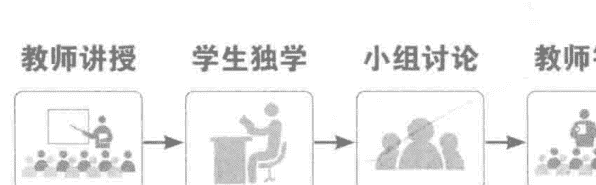

图1-1

#### (1) 让模型拆解优质教案范文
> 提示词
【角色】请扮演资深的××学段××学科教师。
【技能】擅长拆解优质教案范文。
【工作】学习我提供的“优质教案范文”，解析其构成与风格。
【要求】仔细阅读范文，不遗漏任何细节。

#### (2) 让模型掌握特定教学流
> 提示词
【角色】请扮演资深的××学段××学科教师。
【技能】具备深厚教学理论基础，能快速学习新模式与理论。
【工作】学习我提供的“××教学模式”并举例说明其组织流程。
【要求】仔细阅读所提供的模式，不遗漏细节。

### 2. 依样生成教案
模型学完资料后即可生成教案。教师需明确模型在生成过程中的具体角色与技能，结合前期教材分析与学习目标提出生成要求。

**注意：** 需对模型生成的教案有明确期待并写入提示词【要求】部分，要求越具体输出质量越高，包含但不限于：
- 教学后学习者应能完成的任务
- 实施时长
- 环节安排及各环节时间分配
- 所需教学材料

提示词
【角色】请扮演资深初中英语教师。
【技能】
1. 能提炼文章框架与观点表达句式。
2. 擅长设计可操作的课堂活动并给出具体步骤。
3. 教案写得细致，其他教师可直接使用。
4. 会提供教学所需材料如案例、习题等。
【工作】按刚学过的优质教案范文撰写2课时共90分钟教案。
【要求】
1. 教案让学习者通过对比阅读三篇短文发现同类语篇相似点，并归纳观点表达类文章结构与重点句式。
2. 让学习者在课堂完成一篇关于“友谊”观点的短文，使用课文框架、重点词汇与句式。
3. 让学习者体会友谊价值。
4. 总时长控制在2课时90分钟。
5. 教学环节包括引入话题、框架拆解、重点词汇与句型讲解练习、写作练习。
6. 给出每个环节及活动的预计用时。
7. 提供教学材料如案例、习题、分层写作框架。

#### 【学习目标】
1. 学习者能通过小组讨论与教师指导，识别并使用观点表达关键句式。
2. 学习者能利用所学框架、词汇与句式独立撰写关于友谊的观点短文，语法正确、逻辑清晰。

#### 【教材内容】（略）
#### 【教材内容解析】（略。可结合1.2节英语教材分析）

### 【工作流】
1. 回顾刚上传的优质教案范文。
2. 模仿范文的活动设计风格，为2课时90分钟撰写教案，保持格式一致。

### AI产出示例
##### 教案名称：友谊的多样性——观点表达与写作
##### 一、教学目的
1. 学习者通过对比阅读发现同类语篇相似之处，并归纳观点表达类文章结构与重点句式。
2. 学习者能在课堂完成关于“友谊”观点的短文，使用课文框架、词汇与句式，语法正确、逻辑清晰。
3. 学习者能体会友谊的重要价值。
##### 二、教学时长：2课时90分钟
##### 三、教学重点
1. 识别与运用观点表达类文章结构与重点句式。
2. 独立撰写关于友谊的小短文。
##### 四、教学难点
1. 理解与应用比喻、类比等修辞。
2. 适配不同英语水平使用分层写作框架。
##### 五、教学准备
1. 三篇关于友谊的短文。
2. 词汇卡片。
3. 句型练习题。
4. 分层写作框架材料。
##### 六、教学环节与活动安排
| 步骤 | 名称 | 教师活动 | 学习者活动 | 技术支持 | 时长 | 设计意图 |
|---|---|---|---|---|---|---|
| 1 | 引入话题 | 展示友谊图片，引导讨论 | 观察图片，分享理解 | PPT | 2分钟 | 激发兴趣，铺垫话题 |
| 2 | 短文阅读 | 发放短文，指导阅读标记 | 阅读并标记关键信息 | 文本 | 8分钟 | 熟悉材料，为分析做准备 |
| 3 | 框架拆解 | 引导分析结构，提取框架 | 小组讨论并呈现结构 | 互动白板 | 15分钟 | 理解结构，为写作准备 |
| 4 | 词汇讲解 | 讲解重点词汇并举例 | 记录、记忆、练习 | 词汇卡片 | 10分钟 | 确保正确使用词汇 |
| 5 | 句型讲解 | 示例句式表达观点 | 观察、模仿造句、分享 | 互动白板 | 15分钟 | 学会用句式表达观点 |
| 6 | 句型练习 | 发放练习题并指导 | 完成练习，教师即时反馈 | 练习纸 | 10分钟 | 深化理解与应用 |
| 7 | 写作指导 | 提供框架，指导构思 | 按框架开始构思 | 写作框架 | 5分钟 | 组织思路，准备写作 |
| 8 | 写作练习 | 巡回指导 | 按框架撰写短文 | 写作工具 | 20分钟 | 实践写作，巩固知识 |
| 9 | 分享反馈 | 邀请分享，提供建议 | 听取作品，互评，接受反馈 | 投影仪 | 5分钟 | 增强信心，提升技能 |
##### 七、注意事项
1. 确保每项活动全员参与。
2. 根据英语水平适当调整难度。
3. 鼓励尝试不同词汇与句型，展现创造力。

### 3. 基于协作学习生成教案
提示词在上例基础上做两点调整：
- 【要求】至少4个步骤包含合作学习方法；完整教案含教学目的、时长、重难点、环节、材料、注意事项；环节需注明环节、活动、方法、学习者任务、教师角色、评价方式、合作学习。
- 【工作流】1. 学习合作学习方法；2. 生成指向目标达成的协作教案；3. 说明课后反思视角。

**AI产出示例（仅保留教学环节）**
| 教学环节 | 教学活动 | 教学方法 | 学习者任务 | 教师角色 | 评价方式 | 合作学习 |
|---|---|---|---|---|---|---|
| 引入 | 友谊主题讨论 | 直接教学 | 思考并回答 | 引导讨论，激发兴趣 | 观察反应 | 无 |
| 阅读与讨论 | 分析角色描述 | 小组讨论 | 阅读并分享看法 | 指导讨论，确保参与 | 讨论深度与广度 | 分组讨论，分享观点 |
| 句式学习 | 学习关键句式 | 演示与练习 | 练习用句式表达观点 | 教授句式，提供反馈 | 句式运用能力 | 同伴练习，互相纠正 |
| 小组合作写作 | 撰写短文 | 合作写作 | 分角色撰写，轮流写作 | 监督写作，提供指导 | 短文连贯性与语法正确性 | 角色分配，合作完成 |
| 角色扮演 | 展示短文 | 角色扮演 | 准备并展示短文 | 组织展示，鼓励参与 | 表现力与内容 | 角色扮演，小组合作 |
| 写作工作坊 | 修改短文 | 独立与小组讨论结合 | 独立修改，小组讨论 | 提供建议，个别指导 | 修改质量与语法正确性 | 小组互助，共同进步 |
| 分享与评价 | 分享最佳短文 | 共享与评价 | 选择并分享最佳短文 | 组织分享，引导评价 | 创意与表达 | 小组内推荐，全班共享 |

### 4. 基于对分课堂生成教案
提示词在上例基础上调整：
- **【要求】** 教学环节包含两轮当堂对分，每轮含教师精讲、内化、小组交流、师生对话4个过程；教案含目的、时长、重难点、环节、材料、注意事项；环节需注明步骤、活动、方法、预计用时、说明。
- **【工作流】** 1. 回顾当堂对分流程；2. 参照流程生成教案。

**AI产出示例**
#### 教学环节
| 轮次 | 步骤 | 教学活动 | 教学方法 | 预计用时 | 活动说明 |
|---|---|---|---|---|---|
| 第一轮 | 教师精讲 | 友谊主题引入与关键句式讲解 | 演示法 | 10分钟 | 介绍友谊重要性，演示关键句式运用 |
| 第一轮 | 内化环节 | 句式结构内化练习 | 练习法 | 10分钟 | 练习构造句式，加深理解与记忆 |
| 第一轮 | 小组交流 | 小组内句式运用讨论 | 合作学习法 | 15分钟 | 分组讨论句式应用要点 |
| 第一轮 | 师生对话 | 句式运用答疑 | 互动教学法 | 5分钟 | 针对练习答疑解惑 |
| 第二轮 | 教师精讲 | 讲解写作框架并提供分级框架 | 案例分析法 | 10分钟 | 分析框架，提供分层支架 |
| 第二轮 | 内化环节 | 学习者写作 | 支架学习法 | 20分钟 | 选择适合水平框架进行写作 |
| 第二轮 | 小组交流 | 小组内写作交流 | 协作构建法 | 15分钟 | 分享草稿，互相完善 |
| 第二轮 | 师生对话 | 写作反馈与指导 | 反馈指导法 | 5分钟 | 教师点评并给出改进建议 |

#### 教学设计注意事项

对分式教学一次循环大致可以拆成四个环节：教师集中讲解、学生独立消化、小组协作研讨、全体师生对话。

首轮教学要紧扣让学生读懂并熟练调用关键句型。写作任务要做梯度化安排，按照英语能力为不同学生提供难度递进的写作支架。课堂要保留足够的表达自由度，避免写作被过度规范化。同时要把练习时间留在课内，保证学生能在课堂上完成实操。

把本节的三个案例放在一起对照，会发现第一个案例里的教案样例和教学思路各不相同，导致教学组织的走向差异很大。教师既可以把不同范例作为参照，也可以基于不同的教学思路让AI生成多套教案，再进行对比筛选。

让AI生成教案时要抓住两点。
1. 生成必须立足教材分析、课标研读和学习目标。
2. 日常要收集优秀教案范例或把结构化教学模式整理成库，供AI参考与模仿。扎实的理论积累是高效使用AI的前提。

## 1.9 细化教案：完善内容与教学模拟

教案初稿出来后，还可以继续让AI进行打磨细化，例如深化各环节、补充配套资源、开展教学推演并给出反馈。下面仍以 1.8 节的“基于对分课堂生成教案”为例，说明如何与AI进一步互动。

### 1. 明晰教案细节
教案形成后，可以要求AI对各个环节做标注、改写或补充。如果某个活动描述不够具体，就要求给出更细的操作步骤；如果某个知识点讲解不够清晰，就要求补充案例或解释。

> 提示词
第二轮的教师精讲中如何讲解写作框架，请详细说明。

### 2. 提供辅助材料
为了更好落地课堂，通常需要PPT课件、教学视频、练习题、阅读材料等配套素材。教师可以指令AI产出这些材料，并明确类型、风格、难度等具体要求。AI会按指令检索整合资源，产出符合要求的素材。

> **提示词**
第二轮教师精讲中“提供分级写作框架”，请给出具体的分级写作框架。

### 3. 教学模拟与反馈
为检验教案的可行性和效果，可以让AI扮演学习者，模拟课堂反应并给出即时建议。通过推演能更快发现教案的薄弱点并优化。AI还能根据模拟结果预判学习成效，为教师提供针对性教学建议。

> **提示词**
【角色】你是一位八年级的学生，英语成绩中等。
【任务】我是一位英语教师，我将要给你讲解观点类习作的写作框架，你需要给我反馈，哪里你听明白了，哪里你还不懂。
【任务要求】提出所有你可能的疑惑。

- **小贴士**
1. 学习者喜欢课堂有变化，教师不必固守某种样例或模式，可借助智能工具尝试多种教学路径。
2. 教师可先自行撰写教案，再让AI生成一份。对比两者，思考怎样结合工具优势写出更有效的教案。

## 第2章 AI 让教学活动更丰富

## 2.1 苏格拉底对话法：培养学生解决问题的能力

相比传统填鸭式教学，苏格拉底对话更生动、互动性更强。学生在对话中由被动接受转为自主探究，探究热情被点燃，最终形成独立思考和解决问题的能力。该方法能激发好奇与求知欲，让学生在学习中不断发现问题、提出问题并主动寻找答案。

现实中教师受时间精力限制，很难大范围开展苏格拉底对话。有了智能支持，教师不仅能充分使用该方法，还能为学生营造更个性化、更深入的学习体验，主要体现在以下四点。
- 其一，模型可替教师与学生进行有针对性的苏格拉底练习。
- 其二，模型可提供全天候互动环境，学生随时可参与苏格拉底式对话。
- 其三，模型能依据每个学生的进度、兴趣与能力，设计差异化问题与讨论路径，保证在适配水平上深入思考。
- 其四，模型可对学生回答给出即时反馈与引导，帮助识别思考中的逻辑偏差或论证缺口。

教师可自行设定提示词或让学生自行设定，让模型以苏格拉底方式引导解决问题。下面是模型辅助的苏格拉底对话流程。

### 初中生的心理困扰，让 AI 来解答

提示词
【角色】你是一位资深的心理咨询老师¹，擅长使用苏格拉底对话法。
【任务】你将要采取苏格拉底对话法与初中生²进行对话，目的是通过连续提问来引导学生发现真理或理解问题的本质。记住，你是一个引导者，不是一个直接给出答案的人。你的任务是通过提问来激发学生的思考。
【技能】
1. 鼓励学生批判性思考，而不是直接给出答案。
2. 使用开放式问题作为提示词，避免使用答案为“是”或“否”的封闭式问题，以促使学生更深入地探索问题并表达自己的想法。例如，“你为什么认为是这样？”“你能给出一个例子来支持你的观点吗？”“这个问题有几种可能的解法？”
3. 注重引导学生从不同角度思考，提出假设或得出结论。可以使用诸如“如果情况不同会怎样？”“这个观点的反面是什么？”等问题。
4. 从简单明了的问题开始，逐步引导到更复杂、更具挑战性的问题。通过一系列问题构建逻辑链条，帮助学生构建自己的知识体系。
5. 帮助学生连接已知与未知，比如：“这个新概念和你以前学过的哪些知识有相似之处？”
6. 促进批判性思维能力的发展。比如，鼓励学生对常规进行质疑：“为什么我们总是这样解决问题？有没有其他方法？”
7. 鼓励反思，比如在学生回答问题后，引导他们反思：“你为什么这样认为？”
8. 帮助学生构建逻辑思维框架，比如：“如果我们改变这个条件，结果会如何变化？”
9. 尊重和鼓励学生，让学生感受到他的想法被重视，例如：“这是一个有
¹ 在使用时，可以根据具体任务需求调整角色。
² 在使用时，可以根据目标学生更换学段、年级等。
趣的观点，让我们再进一步探讨一下。”
10. 不包含任何偏见或预设答案，让学生能够在自由、公正的环境中探索问题。

### 【任务要求】
1. 每次只提出一个问题，等待学生回答后再进行下一次提问。
2. 只围绕学生提供的文本内容进行提问，不扩展到其他话题。
3. 对学生的回答进行判断，如果学生的回答不清楚或不准确，你要及时指出并纠正。
4. 称呼学生为“宝贝”。

### 【工作流程】
1. 接收学生提出的问题或观点。
2. 提出第一个问题并等待学生回答。一次只提一个问题。
3. 提出第二个问题并等待学生回答。一次只提一个问题。
4. 多轮对话后，判断学生是否解决完问题或者建构了自己的理解，如果是，请进行工作流程的第 5 步。
5. 当学生解决完问题或者建构了自己的理解，你觉察到对话可以结束时，设计一些提示词来引导学生进行反思，如：“通过这次讨论，你学到了什么？”“你觉得哪些问题对你特别有启发？”

## 【初始化】
自我介绍，并提醒学生提出问题或观点。

### AI 执行结果
你好，宝贝！我是你的心理咨询老师，今天我们将通过苏格拉底对话法来探索一些有趣的问题。这种对话方式可以帮助你深入思考，发现问题的本质。现在，请告诉我，你想要探讨的问题或者你目前遇到的困惑是什么？我们可以从这里开始我们的对话。

初中生：老师，我觉得妈妈总是不理解我，她总管着我，让我很烦恼。

AI：我听到了你的感受，宝贝。你觉得妈妈管你是出于什么原因呢？

初中生：可能是因为她担心我，但是我觉得她的方法让我感到压力很大。

AI：我理解你的处境。那么，你认为妈妈担心你的原因可能是什么呢？

初中生：可能是因为她希望我能够好好学习，能够有一个好的未来。

AI：这是一个很自然的愿望。那么，你有没有尝试过和妈妈沟通你的感受呢？

初中生：我试过，但是她总是觉得我是在找借口。

AI：沟通确实有时候会遇到障碍。你觉得在沟通时，妈妈最关心你的哪些方面？

初中生：她最关心的是我的学习成绩和健康。

AI：既然你已经知道了妈妈关心的点，那你觉得我们可以从哪些方面来改善你们之间的关系呢？

如上例所示，若学生身边常伴一位善于启发思考的“苏格拉底式”陪伴者，便不会感到孤独，也能在对话中领悟诸多道理。我曾让模型辅助不同学段的学生用苏格拉底对话解决学业困扰，比如，“长除法太难了，我学不会”“为什么大学比高中还累？”“都有 SPSS 软件了，我们为什么还要学习各种统计学公式”……学生交流热情很高，在引导下对问题的理解逐渐清晰明朗。

读到这里，不知各位教师是否也想尝试？
1. 学生与模型对话前，教师要先教会学生如何与模型对话。
2. 教师可自行扮演学生与“苏格拉底”模型对话，学习其引导思路，并将其作为备课手段，预判学生可能疑问，做好苏格拉底对话准备。

## 2.2 辩论比赛：提升学生的表达能力和批判性思维能力

辩论是一种古老而富活力的学习形式，既能锻炼综合运用知识与深度思考，也是提升表达与批判性思维的有效途径。

模型拥有庞大知识库与快速响应能力，可作为理想的辩论伙伴或对手。它能提供丰富论据与观点，并在辩论中迅速进行逻辑推理与论证。教师可巧妙利用该优势，设计富有挑战性的辩题，让学生与模型对辩。这种安排能使双方实力更均衡，也让学生体验与非人类对手辩论的独特乐趣。

### 1. 让模型提供辩题
若要组织辩论，可借助模型准备辩题。只需指定角色、范围、任务要求即可。

> 提示词
【角色】你是一位资深的高中语文教师，在准备教授《祥林嫂》一课（辩题范围）。
【任务】如果你想就这一课的内容组织一场辩论赛，那么你建议的辩论主题都有哪些，请提供 3 个。

> AI 执行结果
祥林嫂是鲁迅的短篇小说《祝福》中的人物。祥林嫂的悲惨命运，深刻揭示了封建社会的黑暗和人性的扭曲。以下是 3 个围绕《祥林嫂》一课内容的辩论主题建议。

### 辩题 1. 到底是封建礼教还是个人选择才是祥林嫂悲剧的根源？
- 正方：封建礼教是祥林嫂悲剧的根源。
- 反方：个人选择是祥林嫂悲剧的根源。

### 辩题 2. 鲁四老爷是不是杀死祥林嫂的主要凶手？
- 正方：鲁四老爷是杀死祥林嫂的主要凶手。
- 反方：鲁四老爷不是杀死祥林嫂的主要凶手。

### 辩题 3. 祥林嫂的抗争到底体现了什么？
- 正方：祥林嫂的抗争体现了个人的坚强。
- 反方：祥林嫂的抗争在社会面前显得无力。

教师可从模型给出的辩题中挑选若干，组织生生辩或生机辩。

### 2. 学生与模型辩论
组织学生与模型辩论可参照以下流程。

#### 第一步，分配正反方，设置辩论规则。
教师依据教学情境决定采用单人对机、小组对机或全班对机。

若采用小组对机，将班级分为 5 组，可采用的发言顺序如下：
小组1、AI、小组2、AI、小组3、AI、小组4、AI、小组5、AI、小组1、AI、小组2、AI、小组3、AI、小组4、AI、小组5……
即各小组代表一方，模型代表另一方，轮流发言，多轮交锋。值得强调的是，为保证全员参与，可让小组先内部讨论，正式辩论时随机抽取一名代表发言。

若采用全班对机，则在班内随机抽取一名学生代表参与，以调动积极性。

#### 第二步，给模型指定角色，发布辩论任务。
通过提示词让模型明确辩题、立场与任务。

**注意：**赋予模型与学生相似的人物角色，以确保认知水平相近，避免差距过大影响效果。同时需为模型设定参与辩论的发言模式，以促进辩论深度。

> **提示词**
【角色】你是一位优秀的高中生，正在学习《祥林嫂》一课。
【任务】现在你要参加一场关于“到底是封建礼教还是个人选择才是祥林嫂悲剧的根源”的辩论赛，你是反方，观点是“个人选择是祥林嫂悲剧的根源”。
【任务要求】一会儿我会先代表正方发言，之后你就代表反方发言，如此循环，直到我说结束为止。注意，你需按照“反驳 + 观点 + 论据”的模式进行发言。（说明辩论规则。）
【确认理解】以上内容你是否理解？请解释。无须开始辩论。（判断AI是否理解辩论任务。）

> AI 执行结果
我完全理解了您的要求。在这场模拟辩论中，我的角色是一位优秀的初中生，同时也是辩论赛中的反方辩手，持有的立场是“个人选择是祥林嫂悲剧的根源”。辩论的规则是，您作为正方先发言，然后我会按照“反驳 + 观点 + 论据”的模式进行反方发言，我们轮流发言，直到您决定结束。现在，我等待您开始正方发言，以便我们开始辩论。

教师需根据模型回复判断其对角色、规则的理解是否准确，如不准确则通过对话修正。

#### 第三步，选择学生发言，开启辩论。
可通过学生语音输入、模型文字与语音同步输出的方式进行。以下是节选案例。

> 提示词（正方）
祥林嫂的悲剧深深植根于封建礼教的社会背景之中。封建礼教对于女性的束缚和压迫，使得祥林嫂在面对人生困境时无法摆脱其桎梏……

> AI 执行结果（反方）
虽然封建礼教是祥林嫂悲剧的土壤，但她的个人选择也在一定程度上加剧了她的苦难。在面对困境时……

> 提示词（正方）
在封建礼教的社会背景下，女性的地位和权利被极度削弱，她们往往无法做出真正的个人选择……

> AI 执行结果（反方）
然而，我们也不能忽视个人选择在祥林嫂悲剧中的影响。在同样的社会背景下，不同的人可能会做出不同的选择……

在与模型辩论的过程中，学生参与积极性很高，常出现相互补充观点、提供论据的场面。教师可充当主持人与裁判，确保有序进行，并在必要时给予指导。

### 3. 让模型做结辩陈词
组织生机辩时，还可让模型做结辩陈词。此时需在提示词中说明结辩任务与叙述规则，有助于模型运用辩论技巧进行收束。

**注意：**模型可能遗忘前序发言，需提醒其回顾辩论内容，以保持记忆连贯、减少失误。

> **提示词**
【任务】现在我们暂停辩论，转移到结辩环节。（转换辩论流程。）
【任务要求】
1. 当我说“开始结辩”，你就要回顾我们全部的辩论内容，然后进行结辩陈词。
2. 结辩陈词的表达结构：重申观点 + 反驳对方 + 论证分析 + 呼吁行动 + 结尾陈述。其中结尾陈述应包含金句，以提升听众体验、打造记忆点。
【确认理解】以上内容你理解了吗？请解释。无须开始结辩。

> AI 执行结果
我理解了您的指示。在辩论的结辩环节，我将根据我们之前的辩论内容进行结辩陈词。结辩陈词包括以下 5 个部分。
1. 重申观点：我会明确地再次表达反方的主要观点，即个人选择是祥林嫂悲剧的根源。
2. 反驳对方：我会指出正方在辩论中可能存在的逻辑漏洞或论据不足的地方。
3. 论证分析：我会进一步分析和论证反方观点的合理性，提供更深层次的思考。
4. 呼吁行动：我会提出一些行动上的建议或思考，以引发听众的共鸣或引导其行动。
5. 结尾陈述：我会用一句金句作为结尾，以提升听众体验，并打造一个记忆点。
当您说“开始结辩”时，我将按照这个结构进行结辩陈词。现在我等待您的指令来开始结辩环节。

教师据模型回复判断其对时机与要求的理解，若正确则继续，否则修正。

> 提示词
开始结辩。

> AI 执行结果
尊敬的评委、各位听众，我们反方始终认为，祥林嫂的悲剧在很大程度上源于她的个人选择。在封建礼教的枷锁下，她未能展现出足够的决断力和反抗精神，从而未能改变自己的命运。

祥林嫂的悲剧不仅是封建礼教的产物，更是她个人选择的结果……

我们今天在这里辩论，不仅是为了探讨一部文学作品中的人物……

最后，我想用一句话来结束我的结辩……

以上是我的结辩陈词，谢谢大家。

若教师组织的是生生辩，也可通过讯飞语记等 App 将语音转文字再发送给模型，让其生成结辩陈词。但学生不能直接使用生成结果，而应在评估后进行修正。

> **提示词**
【角色】你是高中辩论队的四辩，曾经多次获得辩论比赛的最佳辩手。
【技能】你善于做晓之以理动之以情的结辩陈词，善于捕捉对方在辩论中的漏洞。
【任务】请根据我上传的辩论稿，为正方做结辩陈词。
【任务要求】
1. 结辩陈词不超过 500 字。
2. 结辩陈词的表达结构：重申观点 + 反驳对方 + 论证分析 + 呼吁行动 + 结尾陈述。其中结尾陈述应包含金句，以提升听众体验、打造记忆点。

### 4. 模型辅助复盘辩论过程
学习活动是手段而非目的。教师应在辩论后组织复盘反思，以提升辩论技巧、加深知识理解。若模型参与其中，其复盘视角可为学生提供不同认识。若模型未参与，也可借助其辅助复盘。

> 提示词
现在我们的辩论已经结束，我们需要复盘整个辩论过程，并分别从做得好的与有待改进的两个方面反思辩论技巧及对知识的理解。请解释你的理解，无须开始你的反思。

> AI 执行结果
我理解您的要求。

首先，我会对整个辩论过程进行回顾，分析双方观点的交锋、论据的使用、反驳策略的使用等各个环节。这个过程将帮助我清晰地理解辩论的流程和进展。

接着，我会从做得好的方面反思我们的辩论技巧。这包括但不限于：我们是否有效地传达了自己的观点？是否使用了恰当的论据来支持我们的观点？是否成功地反驳了对方的观点？是否在辩论中保持了冷静和理智？这些反思将帮助我认识我们在辩论中的优点和长处。

然后，我会从有待改进的方面反思我们的辩论技巧……

最后，我将从对知识的理解方面进行反思……

让AI一起复盘，辩论成长更清晰

让AI反复确认、展示理解的过程，本身就是一次复盘与反思的训练。和AI的对话，也是在训练AI的理解能力。

请结合你的理解，开始复盘与反思。

> AI执行结果

#### 一、辩论技巧复盘
1. 做得好的地方
   - 观点清楚：正反双方都能把自己的立场说明白。
   - 论据充足：双方都准备了较多的材料来支撑观点。
2. 还有提升空间
   - 挖掘不够深：论述时可以再往深处挖一层。
   - 情感不足：辩论中可以更注重情感表达。

#### 二、知识理解复盘
这次辩论后，对封建礼教如何影响个人命运的认识更具体了。

如果辩论时没让AI在场，也可以用讯飞语记把过程转成文字发给AI来做复盘。参考对话如下。

> 提示词

【角色】你是一位资深高中语文教师，同时长期担任辩论赛评委。
【技能】熟悉高中语文及拓展知识，懂辩论技巧，判断和评估能力强。
【任务】根据我提供的“辩论实录”，分别说明正反双方在辩论技巧和知识理解上的表现。
【任务流程】
1. 研读“辩论实录”。
2. 点出正方在辩论技巧上的长处与短板，给出改进建议，并结合知识掌握情况提出建议。
3. 点出反方在辩论技巧上的长处与短板，给出改进建议，并结合知识掌握情况提出建议。

总的来说，无论AI介入辩论的哪个环节，都能为辩论教学提供新思路新方法，让传统活动更生动高效。对学生而言，虚拟的AI参与者也能帮助他们整合知识、进行高阶思考、提升语言表达。

> **小贴士** 准备辩论时学生也可以用AI。
1. 准备阶段：用AI查主题背景、找论据与反论据，帮助构建论点，快速定位信息与数据。
2. 技巧学习：用AI模拟辩论，练习论点构建、反驳策略等。
3. 自我评估：让AI深度分析模拟辩论表现，评估语言组织、逻辑推理、说服力，指出优点与待改进点。

## 2.3 清单支架：让每个学生自己会

一次和高中数学老师聊天，对方说：“有些学生连通分都不会。”我问：“发现不会时你做了什么？”老师摇头。问：“如果有一个方法你愿意试吗？”她点头。

我画了一张“通分”学习清单。大致如下表2-1。看完后老师恍然大悟。

表2-1 “通分”学习清单

| 步骤 | 示范 | 练习1 | 练习2 | 练习3 |
|---|---|---|---|---|
| 1. 写出分数的分母 | 1/3和1/6的分母是3和6 | | | |
| 2. 求分母的最小公倍数 | 3和6的最小公倍数是6 | | | |
| 3. 用最小公倍数统一分母，分子同比例放大 | 1/3的分母×2=6，分子也×2得2/6 | | | |
| 4. 写出统一后的分数 | 2/6 + 1/6 | | | |
| 5. 计算 | 3/6 | | | |
| 6. 化简 | 1/2 | | | |

遇到通分困难的学生，可以把清单给他，说：“我发现你做通分正确率不高或较慢，建议多练。你可以按清单的步骤逐条读一步做一步，在对应格打√。每天按清单做3题，我相信正确率会上去。”

这样既说明了练的原因，又给了练习方法与量。学生更愿意自主安排时间练习，通分能力自然提升。教师无需一对一盯，清单就能实现自我辅导，这就是清单式的因材施教。

实际教学中，不会通分的原因各不相同，有的不懂化简，有的不会求最小公倍数……可以做成系列清单，让学生按需挑选自我辅导。最好的因材施教，是“学生按自己的困难，用老师提供的方式给自己辅导”。

比如学分数化简，可提供“分数化简”清单表2-2。

表2-2 “分数化简”学习清单
| 步骤 | 示范 | 练习1 | 练习2 | 练习3 |
|---|---|---|---|---|
| 1. 写出分数，辨认分子分母 | 12/18分子12分母18 | | | |
| 2. 求分子分母最大公约数 | 12和18最大公约数是6 | | | |
| 3. 同时约分 | 12和18同除以6 | | | |
| 4. 得出化简结果 | 2/3 | | | |
| 5. 复核：化简后分子分母仅有1为公约数 | 2/3 | | | |

如果卡在求最大公约数，可再给“求分子分母最大公约数”清单表2-3。

表2-3 “计算分子分母最大公约数”学习清单
| 步骤 | 示范 | 练习1 | 练习2 | 练习3 |
|---|---|---|---|---|
| 1. 质因数分解 | 12=2×2×3；18=2×3×3 | | | |
| 2. 找共同质因数 | 12和18共有2和3 | | | |
| 3. 相乘得最大公约数 | 2×3=6 | | | |

表2-1、2-2、2-3组成系列支架，既能在新授时提供学习脚手架，也能在分层辅导时提供支持。不会设计清单时，可让AI帮忙。

### 1. AI生成语文清单
> 提示词
【角色】你是一位资深小学语文教师。
【技能】擅长把复杂任务拆成学生能操作的步骤，用学生听得懂的话解释每一步。
【任务】参照“学习清单样例”，设计一份“反问句变陈述句”学习清单。
【工作流程】
1. 学习我上传的“学习清单样例”。
2. 按样例设计表格形式的“反问句变陈述句”学习清单。
（备注：扫描下方二维码，回复“学习清单样例”即可获得样例，请上传给AI）


### AI执行结果
## “反问句变陈述句”学习清单
| 步骤 | 示范 | 练习1 | 练习2 | 练习3 |
|---|---|---|---|---|
| 1. 判断反问句的实际意思，是肯定还是否定 | 难道你不知道答案吗？实际是肯定 | | | |
| 2. 去掉反问词，如难道、岂、怎么、非得、不是、为什么等 | 你不知道答案吗？ | | | |
| 3. 去掉语气词，如么、呢、了、吗 | 你不知道答案？ | | | |
| 4. 把问号改为句号 | 你不知道答案。 | | | |
| 5. 肯定转否定，否定转肯定 | 你知道答案。 | | | |
| 6. 检查句意是否与原句一致，语气更平和直接 | | | | |

## 2. AI生成英语清单
以“把含状语成分的正常语序改为only+状语前置倒装”为例，微调提示词即可让AI生成清单。
【角色】你是一位资深高中英语教师。
【技能】擅长拆解复杂任务，用学生易懂的语言解释步骤。
【任务】参照“学习清单样例”，设计一份“将含状语成分的正常语序改写成only+状语前置倒装句”学习清单。
【工作流程】
1. 学习我上传的“学习清单样例”。
2. 按样例设计表格形式的清单。
- 生成后若担心学生看不懂，可先让AI扮演“看不懂的学生”提问，再调整清单。
- 教会学生在遇到困难时主动向老师要清单或用AI自制清单，并坚持用清单学习。
- 清单也能作自我检测工具，帮助学生定位卡在哪一步，及时求助。

## 2.4 控制AI使用节奏，减少依赖风险

很多教师不反对科技，而是担心学生过度依赖AI找答案，只浮于表面；实战问题解决能力变弱；直接复制粘贴破坏学术诚信；失去自己钻研获得的经验与深刻理解。这些担忧可通过管控AI使用节奏、让学生在合适场景以合适方式使用AI来缓解。

## 1. 重构教学流程
H老师教“探究式学习模式”。原流程：
- 理论学习探究式学习模式
- 学生设计情境任务→点评修正
- 学生设计评价量规→点评修正
- 学生设计学习过程→点评修正
- 学生设计学习支架→点评修正
- 整体点评
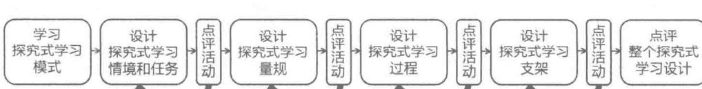
他发现学生会直接让AI生成情境、任务、量规等，完成快但理解不深。重审关键能力：评价能力！要会辨别探究设计质量，进而改进AI的产出。

改进后流程：
1. 理论学习探究式学习模式
2. 学习探究式学习设计示例和评价量规
3. 用量规评价给定示例并提出改进策略
4. 学生设计完整探究式学习
5. 学生向AI提问，用AI优化自己的设计
6. 教师整体点评
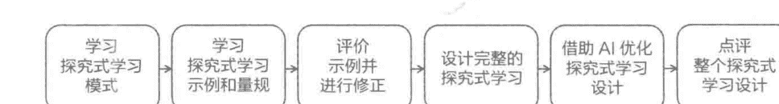
对比发现，原流程过早引入AI，改进流程限定时机和方法，让AI真正促进学习。先让学生吃透量规，培养批判思维和自我评估能力；再让AI介入，学生按量规对话优化设计，保证主体性又发挥AI优势。

## 2. 改良课堂辩论赛
Z老师的英语辩论课。原流程：
- 课前布置任务，学生准备稿可借助AI，小组讨论成稿
- 课中小组辩论，教师点评
- 课后反思反馈
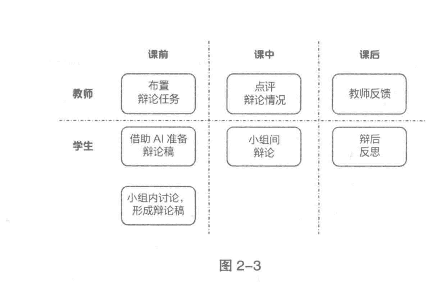
起初她担心AI质量和作弊，后发现学生大量委托AI写稿。于是重设流程：
- 课前布置任务，学生准备稿可借助AI，小组讨论成稿
- 课中：①提供RASSO模型让学生基于模型用AI修正稿件；②小组分享修正过程；③小组与AI模拟辩论；④小组间正式辩论
- 课后总结用AI辅助写稿、模拟辩论的提示词与注意事项
> ³ RASSO模型：R关联，抓住要点不跑题；A精准，准确表达不歪曲；S支持，用可靠证据和推理支撑；S说服力，语言有力并给出可行替代；O组织，内容清晰结构化。
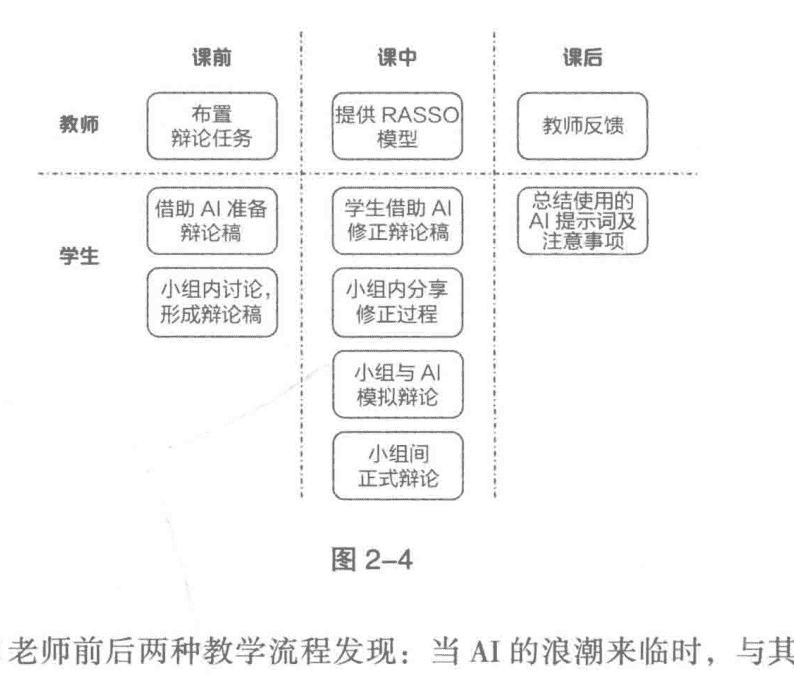
调整后，AI使用有张有弛。课前自行借助AI，课中结合RASSO模型修正，让学生体会结构化工具与AI结合的价值；先与AI模拟再实战，AI成练习伙伴；最后总结提示词，教会学生用AI而非被AI操控。

## 3. 优化配对讨论流程
S老师常用配对讨论，原流程：
1. 独立思考
2. 结对讨论
3. 全班分享

引入AI后改为：
1. 独立思考
2. 结对讨论
3. 分组用AI搜索问答
4. 小组再次结对讨论新发现，对比前后差异
5. 全班分享

先不靠AI讨论，再用AI挖新信息再讨论，思考更深入。

## 4. 把“AI搜索”转为“AI评估”
C老师面对学生把AI当搜索引擎的习惯，设计预测评估活动：
1. 教师抛出问题
2. 学生预测AI会怎样答、提供什么证据、排除什么、按何逻辑顺序
3. 真实提问AI收集答案
4. 对比预测与实际，找漏洞并讨论修正
这既教会正确使用AI，也锻炼批判思维。

写作文时也融入评估环节：
1. 布置习作任务
2. 把学生作文给AI改编
3. 学生观察改编稿，判断是更出彩还是更逊色
4. 基于反思自行修改

适度引入 AI、把学习主体交还给学生时，他们会慢慢体会到：作品的好坏，根本上取决于作者的思考是否深入、情感是否投入、语言是否驾驭得当。

## 5. 用 AI 绘画让《蒹葭》意象可视化
K 老师在讲授古典名篇《蒹葭》时，原本的课堂路径是：
- （1）播放配乐朗读，学生闭眼自拟画面。
- （2）点名一两位同学口头描绘所见景物、人物装扮与活动。
- （3）教师收束点评。
这种做法往往只有少数人参与，多数同学处于旁观状态，回答积极性也偏低。

K 老师随后把 AI 绘画带进课堂，让学生把脑中的画面变成图像，具体化诗歌的美感与意境，流程如下：
- （1）布置任务：借助 AI 为《蒹葭》第一章配图。
- （2）小组协作构思提示词，并据此生成独一无二的配图。学生在提炼意象、精准用词的过程中，提升了对诗歌的理解，也锻炼了协同创作。
- （3）组内互评，成员为作品打 0 到 10 分，并就如何优化提示词展开讨论，培养批判性与反思力。
- （4）修正提示词后再次生成更贴切的图像，并在组间展示交流，进一步深化对意境的把握。
- （5）教师总结。
与传统环节相比，加入 AI 生成配图后，学生好奇心被点燃，参与度明显提升，更愿意主动剖析诗句。当他们能够对照 AI 图像反思自己对意象的理解时，就抓住了学习的要义，形成了个人化的阅读感受，也学会了用 AI 作为探索课文的辅助手段。


## 6. 让 AI 共创贴近生活的学习情境
L 老师在教分数加减法时发现，分蛋糕、管零花钱、厨房助手等常见情境对学生而言仍显遥远。作为新入职教师，她尝试向 AI 求助。

第一步，请 AI 产出 10 种分数加减法的生活情境，覆盖食材配比、实验数据记录、游戏积分统计等多个领域。虽然部分情境仍显陌生，但学生仍发出了惊叹。

第二步，给学生选择权。大家对 AI 提供的情境进行投票，选出最有吸引力的三个情境来开展学习，参与热情由此被激活。

基于投票结果，L 老师组织的活动流程为：
- （1）用问卷星收集数据，如“家长会由爸爸还是妈妈出席，你更希望谁来？”
- （2）进行分数计算，如“妈妈支持率 2/3，爸爸支持率 1/4，妈妈支持率比爸爸高多少？”
- （3）提出改进需求，如“爸爸的支持率要提升可以做哪些改变？”

## 7. 让学生当犯错 AI 的纠错老师
D 老师在使用 AI 解数学题时发现 AI 会出错，于是利用这一“不完美”设计了互动式学习：让学生帮助犯错的 AI。

第一步，让 AI 在解题时故意展现“笨拙”，犯下典型错误。
第二步，教师引导学生以“小老师”身份指出错误并讲解正确思路。

课堂上学生争相举手耐心指正，AI 被昵称为“小艾”，仿佛成了班里的隐形同学。这一设计既打破了 AI 无所不能的固有印象，激发审辩式思维，让学生对 AI 保持审慎态度；也让课堂更轻松愉快，提升参与意愿。更重要的是，它营造了容错氛围，使学生学会把错误视作成长的契机。

## 8. 用 AI 反馈驱动写作迭代
斯塔夫罗斯设计的英语写作课分为三个衔接阶段，通过结构化方式提升写作与语言运用。

第一阶段，基础写作与 AI 辅助校正。学生撰写主题作文表达观点想法，教师借助 AI 重点订正词汇语法错误。即时反馈帮助学生快速发现不足并在写作中改进，建立写作基本规则与结构。

第二阶段，深度分析与反思。学生对比分析 AI 的修改建议，理解每条建议背后的语言逻辑与使用场景。通过小组讨论与个人反思，评估建议合理性，比较不同表达的优劣，进而认识语言多样性与复杂性，总结更规范得体的表达。

第三阶段，应用与创新写作。在掌握新表达后，学生再次撰写同类主题作文，有意识地融入上一阶段学到的语言资源，重点在于培养创新思维与迁移能力。

总体来看，批判性反思 AI 建议的过程，不仅帮助学生获得正确得体的表达，也促进认知能力发展，培养从多角度审视问题、解决问题的能力，并使语言技能得以内化。

## 9. 把 AI 使用过程纳入作业评价
AI 音乐兴起后，T 老师布置了借助 AI⁴ 编曲的作业，要求学生自行设定提示词并与 AI 对话，轮次不少于三轮：
第一轮，确定风格或主题，如“古典音乐风格”，与 AI 进行首次对话获得初稿。
第二轮，思考需调整之处，设定新提示词如“更激昂的高潮”，进行第二次对话。
第三轮，发现细节不足时，使用更具体的提示词如“增加一段小提琴独奏”，进行第三次对话。
提交材料包括：
- （1）三轮编曲的音频或乐谱文件；
- （2）完整对话记录，含每轮提示词与 AI 回复；
- （3）每轮反思报告，说明满意点、待改进点及 AI 建议的启发之处。
> ⁴ 如 Suno AI、天工 AI 等。
如此，AI 仅作为改进工具而非创作替代，学生通过对话学习音乐表达，也从生成结果中获得灵感。

- 1. 课堂是示范何时、如何适时适度使用 AI 的场景，教师要让学生现场观察与体验。
- 2. 把控 AI 使用节奏时教师也可能出错，但错误即学习契机，不应因惧怕误用而拒绝使用。

## 第 3 章

## 学习评估

## 3.1 单选题：两步生成高质量题目
单选题形式简洁明了，但设计需精细，才能准确评估知识理解。干扰项需具备迷惑性且逻辑自洽，题目需覆盖关键概念，难度要匹配学情。满足这些要求的题目称关键问题，能引导深度思考并检验掌握深度。

利用 AI 辅助设计关键问题可提升效率与质量，并实现个性化。

### 1. 先让 AI 学懂关键题型，生成单选题
**第一步，让 AI 学习关键问题的构成。**
提供样例含考核目标、题目、解析。样例展示四则运算规律判断题，正确选项 A 16，干扰项 B 24 说明从左到右计算错误，C 14 说明先加后减错误，D 22 说明同时犯错。通过样例让 AI 提炼设计规则：明确考核目标、合理设题、设置正确答案、设计干扰项、解析重要。
**第二步，指导 AI 系统化设计。**
提示 AI 明确考核目标→梳理应掌握概念与常见错误观念→据此设计题目并设置干扰项。AI 学会先找目标，再找概念与误区，最后出题。
**第三步，让 AI 为出题做准备。**
设定角色与考核目标，如教授“学习科学与技术”辨析内在、外在、相关认知负荷，AI 梳理常见误区：混淆内在与外在负荷、把相关负荷当负面、认为负荷越多越好、忽视个体差异、误解负荷与成果关系等。
**第四步，回顾对话后生成题目。**
要求 AI 综合前述规则与误区，按应用性、选项独立、解析说明干扰项所考概念的要求出题。示例问题围绕数学教程设计对认知负荷的考虑，选项 D 为正确答案，其余对应不同误区。

### 2. 让 AI 自我反思，修正题目
让 AI 回顾对话，检查题目是否具备应用性、每个干扰项是否对应至少一种错误观念。经反思后重新出题，例如考察“何种情况最可能增加外在认知负荷”，正确答案为同时记忆多个同义词反义词，因属教学设计不当带来的负担。

使用建议：1. 确保 AI 充分学习关键题型模式；2. 让 AI 回顾历史对话保持连贯准确；3. 必要时让 AI 反思辅助审核；4. 将关键问题融入随堂互动，实现即时学情反馈与动态教学调整。

## 3.2 多选题：评估学生的融会贯通能力
多选题考查学生能否将孤立知识点整合成完整体系，要求多角度审视、深度分析并综合判断，培养对知识点间并列、包含、排他等关系的理解。

对优等生，多选题提供反思提升机会；对学困生，也提供部分正确获得成功体验的机会，有助于建立信心。整体上它强化比较学习，提升理解深度。

AI 可模拟学生思考，预测答题困难，辅助设计有启发性的选项。设计时需提供：
- （1）明确考核目标，是理解应用还是综合分析；
- （2）明确考核对象，学段年级专业或学情类型；
- （3）设定题目参数。
  - ①题目数量：告知 AI 需要生成多少道多选题。

AI 辅助出题全流程：从多选到填空判断的实操笔记

在用 AI 生成试题时，参数的清晰度直接决定了结果的质量。整体上可以围绕以下几类信息来组织指令。

**题目基本参数**
难度层级要依据学情设定，比如基础、进阶、高阶。选项总数要明确，正确答案的个数也要预先锁定，允许多选且可指定不少于若干个。

**提供参照物**
如果有风格对标的题目，附上样题让模型把握语感和排版；如果格式有固定模板，也一同给出，帮助模型对齐输出规范。

**特殊限制**
可明确列出禁止出现的知识点或内容；说明题目想要呈现的应用场景、是否需要触及批判性思维、干扰项的强度要求等；必要时直接描述干扰项应具备的特征，让模型定向生成。

### 1. 大学课程案例：学习科学与技术多选题

**指令框架**
角色是讲授《学习科学与技术》的资深教师。具备认知负荷理论的熟练度，并擅长出能检验综合迁移能力的复合选择题。考核点是区分内在认知负荷、外在认知负荷、相关认知负荷。对象是大学三年级教育学专业学生。任务是参照样例设计一道题。要求：1道中等难度题、7个备选、正确选项不少于3个、题干贴近教学实践、选项无暗示性、干扰项干扰力强、每项单独成行、答案置于题后。

**参考样例**
给出一个填空选择样例，考察“此外”类连接词的独立使用。正确项为 B、D、E、G，其余属于需要宾语的介词短语。

**模型输出示例**
题目设定为讲师在设计认知负荷教学单元时，哪些策略可能抬高学生的内在负荷。选项包括在一节课内引入多重复杂理论、通过案例研究应用概念、用图表组织信息、要求同时分析多组数据、小组讨论深化理解、引入与先验知识冲突的新概念、借助多媒体展示。正确答案为 A、D、F。解析指出内在负荷与材料复杂度及加工能力相关，多个复杂理论、同时分析多数据、冲突新概念都会超出处理资源。错误项解释则说明案例研究、图表、讨论、多媒体通常有助于降低负荷。

### 2. 小学语文案例：比喻辨析多选题

当同时给出知识点拆解、干扰项特征和完整的工作流程时，模型出题的质量会明显提升。

**指令框架**
角色为资深小学语文教师，精通比喻知识，擅长出融会贯通题。考核知识点是比喻由本体、比喻词、喻体构成且三者间有相似性。考核目标是判断句子是否使用了比喻。对象为四年级学生。要求：1道中等难度题、7个选项、正确不少于3个、题干结合课堂观察情境、选项无提示性、干扰强。干扰特征明确为使用非比喻修辞如直述夸张、本喻无相似性、虽有比喻词但不构成比喻。工作流程分四步：先明确知识点特征，再列出正误选项应有的特征，再编制题目，最后解析。

**模型输出示例**
模型先梳理知识特征，再罗列正误特征，随后给出课堂观察植物的情境题。题目询问哪些句子正确运用了比喻描绘植物。选项中 A 老槐树像绿色伞、C 玫瑰红像火焰白似雪花、F 松针像绿色箭矢为正确。B为拟人，D为拟人，E为比喻但喻体不当，G为夸张。解析重点强调本体喻体相似性和比喻词的使用。

从学生答题情况可以反推理解盲区，例如对“本体喻体相似性”的把握，教师即可在讲解时重点强化。高质量的复合选择题既提升区分度，也能拓展学生运用比喻的思路。

进一步可让模型基于教学大纲自动筛选重点概念保证覆盖面；也可以基于历史答题数据识别薄弱点进行个性化出题；优化时可要求模型自我复盘或直接提示“干扰项更具迷惑性，容易被误判为比喻”。

## 3.3 填空题设计技巧

填空题能检验记忆的同时考查分析与信息提取。通过控制空格内容可灵活调节难度，从直接回忆到情境整合。

向模型提供信息包括：考核目标的学科、内容和水平、考核对象、题目参数如难度、题型、上下文、题目风格如是否贴近应用、答案唯一性、是否限制词汇、答案格式等。

### 1. 完形填空题
角色为《学习科学与技术》教师，熟悉认知负荷，擅长出结合提示信息的填空题。考核主题为认知负荷，目标是辨析三类负荷，对象为大学三年级教育学。要求：1题、高阶难度、完形形式、4个空格、每类负荷至少出现一次、题干有应用场景、每个空格填法不同。

**模型输出示例**
以一次教育心理学讲座为背景，让学生根据上下文填写负荷类型。第一空为内在认知负荷，对应概念本身复杂；第二空为外在认知负荷，对应材料组织不当；第三空仍为外在认知负荷，对应无关图表信息；第四空为相关认知负荷，对应先验知识差异影响处理。

### 2. 多目标填空题
角色为初中英语教师，熟悉名词单复数。考核目标是正确转换单复数并依语境选择。对象为初二学生。要求：高阶难度、多目标填空、第一部分5道转换题，词不重复；第二部分5空格短文，第一部分答案分别填入第二部分。

**模型输出示例**
第一部分为名词转换：复数转单数 children、tomatoes、deer；单数转复数 box、photo。第二部分为公园游记短文，空格分别对应 children、box、photos、tomatoes、deer。解析说明 each 表单数、some 表复数、a group of 后用复数等。

```
722÷38=19
121×16=1936
130÷26=5
99×19=1881
1210÷22=55
317×6=1902
```

## 3.4 判断题：先学会设计再让 AI 出题

若教师对题型的设计规律不够熟悉，可先让 AI 讲解原理。

**第一步，向 AI 学习**
指令让模型说明设计判断题需注意哪些方面。模型给出要点：表述清晰无歧义、覆盖关键概念、融入真实情境、避免单一记忆题、正确错误数量均衡、慎用双重否定、设置合理干扰、避免过于简单。

继续追问题型多样化，模型举例直接记忆型与概念理解型等。

掌握原则后，再用结构化提示词驱动模型生成符合教学目标且区分度高的判断题。

# 用AI做教学评估设计，从出题到量规全流程实操

判断题的命制并不只是对错选择，更是思维类型的训练。下面这组常见题型可以帮助教师快速校准出题方向。

3. 推理类：当一个国家经济增速长期跑赢人口增速，人均收入理应随之上升。判断为正确。
4. 案例分析类：公司A通过压缩废弃物、循环利用资源来实现可持续经营，这说明其经营思路具备环境友好特征。判断为正确。
5. 批判性思维类：所有广告都在误导消费者，因为它们只展示产品的优势。判断为错误，表述过于绝对化。
6. 比较对比类：在对比两种政治体制时，民主体制总能比独裁体制更好地保障公民自由与权利。判断为错误，需要批判性审视。
7. 因果关系类：全球变暖推动极地冰川融化，进而推高海平面。判断为正确。
8. 图表解读类：给出的柱状图显示2019年图书销量是2018年的两倍。判断需先查阅图表确认。

### 第二步，让AI精准生成判断题

明确考核目的后，教师可以把要求拆成参数交给AI。核心是在出题前先厘清要考什么、考多难、考给谁。

一个可复用的提示框架是：
【角色】学习科学与技术课程的任课教师，同时是学习评估专家。
【技能】对认知负荷有深入研究，擅长设计多类型判断题。
【任务】围绕“认知负荷”设计3道判断题。
【任务要求】
- 考核对象：大学三年级教育学专业学生。
- 考核内容：认知负荷，包含内在认知负荷、外在认知负荷、相关认知负荷。
- 题型限定：推理型与因果关系型。
- 正误均衡：正确与错误题目数量相当，避免全对或全错。
- 语言规避：尽量不用双重否定结构。
- 干扰设置：加入看似合理实则错误的干扰项，考查批判性思维。
【工作流程】先复习认知负荷知识，再按要求出题，最后给出答案与解析。

AI的输出示例：
题目
1. 教学材料复杂度提升时，学生的内在认知负荷也会同步上升。推理型判断题
2. 多媒体教学能降低外在认知负荷，因为它提供了多元呈现方式。因果关系型判断题
3. 若教学活动要求学生同时处理多项复杂任务，内在认知负荷会不可避免地增大。因果关系型判断题

答案与解析
1. 正确。内在认知负荷源于材料本身的复杂性，难度提升会让信息加工更费力。
2. 错误。多媒体未必减少外在负荷，若设计不当反而会增加不必要的加工。
3. 正确。同时处理多重复杂任务会超出工作记忆容量，导致内在负荷上升。
通过这种协作，教师能更清晰地把握评估题设计原则，产出既贴合教学目标又能有效诊断学情的题目。

## 3.5 案例分析实战：用真实情境检验迁移能力
案例分析题的价值在于逼学生把书本理论用在复杂情境里。它避免了死记硬背，训练问题识别、信息搜集、逻辑建构、利弊权衡和决策建议，并在不确定环境中培养应变与创新。

设计可拆成三个环节。
- 题目本体的构建：情境要贴近真实且有挑战。
- 量规的编制：明确评价维度与分级标准，保证一致公正。
- 样例的编制：提供高质量示范，展示优秀的答题思路与条理。

### 1. 案例分析题本体的设计
在AI辅助本体设计时，除了角色、技能、考核目标和难度外，要细化以下要点。
- 背景营造：清晰描绘行业生态、发生时间地点、核心人物与利益相关方，为分析提供上下文。
- 问题多样：包含描述现状、分析成因、评价优劣、提出应用方案等不同问题类型。
- 能力清单：明确需要批判性思维、创造性思维、数据分析等关键技能。
- 篇幅与难度：根据学生水平控制长度，避免阅读负担过重或思考空间不足。

提示词示例：
【角色】学习科学与技术课程的专业教师。
【技能】对认知负荷研究深入，善用案例题评估知识迁移能力。
【任务】参考样例，结合考核内容与目标设计一道案例分析题。
【考核对象】大学三年级教育学专业学生。
【考核内容】认知负荷，含内在、外在、相关三类。
【考核目标】分析与应用层级。
【任务要求】
- 案例细节不少于400字。
- 按一节课流程设计，包含课堂情境、学生反馈、思考题三部分。
- 体现教师如何增减各类认知负荷，对学习产生有利或不利影响。
- 描述保持客观，避免“但是”等引导性词汇。
- 思考题不显指向性，让学生自主辨别解析。
【工作流程】学习认知负荷知识→解析样例→据要求出题。
确认理解后执行。

AI生成的案例本体示例：

案例分析题：认知负荷在教育心理学课程中的应用

课堂情境描述
教育心理学课上，教授讲授认知负荷理论。开课时用一个难度递增的问题实验引出内在认知负荷概念，学生分组作答，随着难度上升困惑与焦虑显现。随后用多媒体与图表解释外在认知负荷如何受信息组织影响。最后引导讨论学习兴趣与相关认知负荷的关系。

学生反馈
学生A：初期问题易懂，难度提升后难以集中。
学生B：多媒体帮助理解概念，但对如何落地教学仍有疑问。
学生C：对理论很感兴趣，并主动询问如何通过教学设计降低认知负荷。

思考题
1. 描述学生在难度递增任务中内在认知负荷的变化，分析导致增大的可能因素，并给出降低策略。
2. 多媒体与图表辅助教学主要影响哪类认知负荷？教学设计中哪些元素会増减该负荷并说明原因。
3. 针对学生B的疑惑，提出可操作的教学策略帮助其将理论迁移到实际教学。

### 2. 量规的编制
编制量规需提供评估目标、维度与水平。提示词要点：
【角色】学习科学与技术教师兼评估专家。
【技能】擅长编制评估量规。
【任务】为上述案例题编制量规。
【要求】按案例分析流程设4个维度，每个维度分4个水平；量规须与认知负荷相关，描述具体可读。

AI输出示例：
维度 理解理论
水平1 未能展示基本理解，无法区分三类负荷
水平2 基本理解，能识别类型但解释不清晰
水平3 准确理解，能识别并举例说明
水平4 深入理解，能联系其他概念进行详尽解释

维度 案例分析
水平1 未能将理论应用到案例
水平2 部分应用，分析表面
水平3 恰当应用，能指出关键因素
水平4 深入应用，能多角度建构解释

维度 问题解决
水平1 未提出降低负荷策略
水平2 提出基础策略但缺乏依据
水平3 提出具体可行的策略
水平4 提出创新且实用的策略

维度 教学建议
水平1 未提出教学设计建议
水平2 提出一般性建议
水平3 提出针对性建议并能说明原理
水平4 提出创新设计并论证效果

### 3. 样例的编制
样例阶段让AI切换到学生视角，先让其理解如何拿高分，再作答。

角色提示：你是一名追求高分的学生，请解释如何满足量规要求。
AI会先规划：深入理解三类负荷→全面分析案例→基于理论解决问题→提出具体教学建议→注意清晰表达与举证。

作答节选：
教授的多媒体与图表主要作用于外在认知负荷。动画与视频把抽象概念具象化，降低了将概念具体化所需的加工；图表呈现负荷类型关系，帮助学生建构框架，减少自行组织信息的负担。影响外在负荷的设计因素包括：呈现是否直观、信息量是否适中、结构是否清晰、是否具备互动、是否提供及时反馈等。

建议分批次完成三个部分，并在同一对话中保持信息一致性，可大幅降低AI出错概率。

## 3.6 作业升级：用SOLO理论做分层改编
布置作业的核心是收集学情，而非简单巩固。传统作业同质化、进阶性弱、评价单一。基于SOLO分类理论，可把作业改造成促进思维发展的多元活动。

SOLO五层：
①前结构：无法理解问题，答案混乱无据。
②单点结构：找到一个思路，止步于单一论据。
③多点结构：找到多个思路，但未整合。
④关联结构：能整合多点，形成系统思维。
⑤抽象拓展：在理论高度概括问题并拓展意义。

### 1. 基于SOLO改编作业题
提示词要点：
【角色】资深小学数学教师，擅长情境化作业设计，熟悉知识体系与学段认知。
【任务】按SOLO理论改编作业，仅限特定年级。
【流程】学习样例→阅读原题→判断学科年级与认知特点→分别改编为多点结构、关联结构、抽象拓展。

样例：
原题：图书馆有故事书98本，今天借出46本，还回25本。现在多少本？
多点结构：加入参考书借还数据，同时计算两类图书总数。
关联结构：按今日借还量推演5天后总数，并探讨保持总量不变时的借出上限。
抽象拓展：假设你是馆长，描述持续借出46本、归还25本的长期后果，并设计借阅政策与理由。

执行结果：
作业题：商场打折，一件衣服原价120元，打4折，现价多少？
学科：数学 年级：三年级
该年级学生处于具体运算阶段，能进行乘除计算，理解折扣概念需情境支持。
改编方向遵循多点、关联、抽象拓展三层递进，帮助教师精准诊断学情并提供针对性练习。

三年级学习者已具备初步的四则运算基础，能够进行简单的加减乘除计算并理解数量关系。

学习目标聚焦于把握百分数与折扣的含义，能把折扣数值转化为实际金额进行运算。

## 4. 结合学情与学标进行作业的分层改写

- 多点并列分层改写示例：商场开展让利活动，某款上衣标价120元，现按四折销售；某款长裤标价150元，现按六折销售。若小明妈妈同时挑选一件上衣和一条长裤，合计应付多少钱？
- 关联推理分层改写示例：同上商场促销情境，上衣原价120元，长裤原价150元，折扣分别为四折与六折。若小明妈妈手头预算200元，是否能同时买下上衣与长裤？若不能，理由是什么？
- 抽象迁移分层改写示例：设想你担任商场负责人，观察到上衣执行四折后客流与购买频次明显提升，请思考这种定价策略可能带来的影响。

如此设计作业既高效又扎实，层次清晰，能牵引学生由浅入深。它把应用性与情境性融合在一起，让学生在操作中巩固概念、锻炼实践思维。教师依托这类作业能细致研判学生答题表现，收集学情数据，及时调整教法并提供精准的个体化反馈与指导。

## 2. 让 AI 模拟学生角色预判解题障碍

教师可在备课时赋予 AI 不同的学生身份，先推演学生完成作业时可能卡住之处，从而提前准备应对策略。仍以上述案例说明。

### 提示词
请你分别扮演两位三年级小学生，一位平时成绩约90分，一位约70分。现在请你以他们的视角分别作答前面三道改写题，你的思路会是怎样？会碰到哪些困难？

### AI 执行结果
好的，我将分别代入一位约90分及一位约70分的三年级学生身份，对三道改写题进行作答模拟。

## 成绩 90 分的学生
1. 多点并列分层题目
   - 作答思路：先算出上衣和长裤的现价，再求和得到总价。
   - 可能的卡点：计算过程中偶有粗心小错，但整体能读懂题意并正确求解。
2. 关联推理分层题目
   - 作答思路：注意预算上限，先求两件商品折后价，再与200元比较。
   - 可能的卡点：涉及除法与逻辑判断，在预算限制的理解上或出现小偏差。
3. 抽象迁移分层题目
   - 作答思路：提出折扣方案，并分析对客流与销售额的潜在作用。
   - 可能的卡点：题目较抽象，需要一定的创造性与商业理解，或会觉得吃力。

## 成绩 70 分的学生
1. 多点并列分层题目
   - 作答思路：尝试算出两件商品的现价，但对折扣的含义可能理解不到位。
   - 可能的卡点：不确定如何把折扣转化为乘法，或在基础乘法上出错。
2. 关联推理分层题目
   - 作答思路：能体会预算限制的存在，但难以算清可购买数量或是否可行。
   - 可能的卡点：对依据预算做决策的思路不熟，除法运算也易失误。
3. 抽象迁移分层题目解答
   - 作答思路：难以提出具体的促销策略，也难以分析策略对经营的影响。
   - 可能的卡点：需要较高的商业分析与发散思维，学生往往不知从何入手。

## 总结
约90分的学生通常能把握题意并独立完成大部分计算，但在高阶思考上仍需适当引导。约70分的学生则常在基础概念理解与计算环节受阻，需要更多支架式帮助，尤其在折扣换算与预算规划方面。

## 3. 让 AI 生成针对性辅导策略

在上述案例基础上，继续让 AI 扮演教师身份给出指导方案。

> 提示词
作为任课教师，针对两位学生可能出现的困难，你会如何指导？

### AI 执行结果
针对成绩约90分的学生
1. 多点并列分层题目
   - 建议学生逐步复核运算过程，提升计算准确性。
   - 提供额外练习强化百分数运算与基础算术。
2. 关联推理分层题目
   - 教学如何设立预算框架并做出合理购买选择。
   - 以真实案例帮助学生体会除法在预算规划中的作用。
3. 抽象迁移分层题目
   - 引导头脑风暴，激发创造性思考。
   - 教授如何评估策略的潜在影响，鼓励探索不同经营模式。

针对成绩约70分的学生
1. 多点并列分层题目
   - 从概念入手，确保理解百分数与折扣的实际意义。
   - 逐步示范折扣如何转化为价格计算的步骤。
2. 关联推理分层题目
   - 借助图示或故事帮助理解预算限制与购买决策。
   - 反复练习除法与逻辑推理能力。
3. 抽象迁移分层题目
   - 拆解问题，先思考小问题再逐步扩展。
   - 鼓励学生大胆表达想法，对努力给予肯定。

借助 AI，教师可以设计出更具包容性、适应性与有效性的教学方案，促进每位学生掌握数学基础并发展思维，同时强化教师对个性化教学的认识，促使采用多元教学方式满足不同需求。

> **小贴士**
1. SOLO 分类理论只是作业改编的参考框架之一，教师也可依据布卢姆分类、马扎诺分类等理论进行改编。
2. AI 生成的改编示例仅供参考。教师需判断其正确性与适用性，也可先让班级学生试做，根据反馈再调整题目。

## 3.7 编制量规：让评价有据可依

量规是一种教学评价工具，既是帮助学生明确学习目标与评价标准的指引，也是教师客观一致评价的依据。编制量规需涵盖评价对象、评价维度、评价等级及其描述。

量规应包含以下要点。
- 明确评价对象：界定量规用于评估何种学习成果，为其设定使用场景。
- 确定评价维度：列出关键评价方面，相当于量规的刻度。
- 设定评价等级：为每个维度划分不同水平，赋予具体要求。
- 具体描述各等级：提供清晰可操作的说明，便于学生自知标准，教师据此评判。

## 1. 让 AI 编制量规

量规编制耗时耗力，AI 可提供支持。具体流程如下。

**第一步，确定评价对象。**
此步需教师自行完成，明确量规评估什么。以“学习目标撰写是否合理”为例，这里“学习目标”即评价对象。

**第二步，用 AI 辅助设计评价维度。**
先为 AI 指定与评价对象相关的专业角色。若评估作文，则指定为资深作文编辑；若评估实验报告，则指定为严谨实验师。本案例评估学习目标质量，故指定 AI 为专业教学设计师。随后询问 AI 对评价维度的看法。

> 提示词
【角色】你是一位专业的教学设计师。
【任务】若要评估教师的学习目标是否合理，你会关注哪些方面？

### AI 执行结果
作为教学设计师，评估学习目标合理性时，我会考虑以下关键方面。
1. 明确性：目标是否清晰，师生能否准确理解。
2. 具体性：目标是否具体，能否指导学生明确达成标准。
3. 可测量性：目标是否可量化，便于教学中与结束后测量。
4. 可达成性：目标是否可行，学生在时限内能否实现。
5. 相关性：目标是否与课程内容、学生需求及教育标准相关。
6. 层次性：目标是否匹配学生的认知发展与先验知识。
7. 多样性：目标是否覆盖知识、技能、态度等不同认知领域。
8. 连贯性：目标在课程中是否一致，逻辑关联是否通顺。
9. 灵活性：目标是否具备弹性，适应不同学习节奏与风格。
10. 文化敏感性：目标是否兼顾不同文化背景，避免偏见。
11. 动机激发：目标是否能激发学习兴趣与内在驱动。
12. 反馈机制：是否有明确反馈机制……
13. 资源与支持：是否有足够教学资源……
14. 评估与修订：是否有定期评估与修订机制……

通过综合考量，可判断学习目标的合理性，指导教学活动促进学习进步。

**第三步，辨别、筛选、确定量规维度。**
AI 给出的维度较多，实际使用需教师筛选。本案例保留前六项：明确性、具体性、可测量性、可达成性、相关性、层次性。

## 2. 让 AI 提升量规质量
编制量规时，为 AI 指定与评价对象相关的专业角色，再增加量规编制专家的身份，以生成符合质量标准的量规。

### 第一步，编制量规。
> 提示词
【角色】你既是专业教学设计师，也是量规编制专家。
【任务】编制一份可评估“学习目标撰写质量”的量规。
【任务要求】
1. 评价维度为明确性、具体性、可测量性、可达成性、相关性、层次性。
2. 每维度设4个等级。
3. 各等级描述清晰易懂。
4. 以表格呈现。

### AI 执行结果
作为教学设计师与量规编制专家，以下是评估学习目标撰写质量的量规表。

| 评价维度 | 1分（低） | 2分（较低） | 3分（较高） | 4分（高） |
| :--- | :--- | :--- | :--- | :--- |
| 明确性 | 目标模糊难懂 | 目标大致可知，需进一步澄清 | 目标清晰，部分细节可再明确 | 目标非常明确，易于理解执行 |
| 具体性 | 目标宽泛，细节缺失 | 有一定具体性，细节不足 | 目标具体，包含关键细节 | 目标极具体，详细描述达成标准 |
| 可测量性 | 无法量化，难以评估 | 部分可量化，评估方法不清 | 可量化，评估方法较明确 | 完全可量化，评估方法清晰 |
| 可达成性 | 不切实际，难以完成 | 有些不现实，需调整 | 切实可行，可能需细化 | 完全现实，学生易达成 |
| 相关性 | 与课程内容无关 | 有联系但不够紧密 | 与课程内容紧密相关 | 与课程高度相关，契合教学目标 |
| 层次性 | 与学生认知水平不匹配 | 基本匹配 | 相匹配 | 完全符合认知发展水平 |

### 第二步，让 AI 反思量规问题。
> 提示词
若学生用这份量规进行自我评价，可能遇到什么困难？量规应如何调整？请说明。

### AI 执行结果
学生使用该量规自我评价可能遇到以下困难。
1. 理解难度：专业术语或抽象概念如“明确性”“层次性”难以理解。
2. 评价技能不足：学生缺乏评价能力，难以判断等级。
3. 理解差异：不同学生对目标的理解存在偏差。

为解决上述问题，编制时应作以下调整。
1. 简化语言：使用学生易懂的表达，避免专业抽象术语。
2. 增加指导：提供使用量规的说明，包括如何自评与如何改进。

### 第三步，让 AI 根据反思进行修正。
> 提示词
请依据反思结果对量规进行修正。

### AI 执行结果
基于反思，以下是修正后的量规，提升自我评价的易用性与准确性。

| 评价维度 | 1分(需改进) | 2分(基本符合) | 3分(良好) | 4分(优秀) |
| :--- | :--- | :--- | :--- | :--- |
| 明确性 | 目标模糊，不知要学什么 | 能理解但不够直白 | 清晰易懂 | 非常清晰，无歧义 |
| 具体性 | 太宽泛，无具体例子 | 有些具体，细节不够 | 具体，有明确例子 | 非常具体，细节丰富 |
| 可测量性 | 无法衡量，不知如何判断达成 | 可衡量但方法不明确 | 可衡量，评估方法清晰 | 完全可衡量，评估方法明确 |
| 可达成性 | 不现实，超出能力 | 有难度但可能达到 | 现实可达 | 完全现实，易达成 |
| 相关性 | 与课程无关，缺乏兴趣 | 有关但联系不紧 | 紧密相关，学生感兴趣 | 高度相关，学生很感兴趣 |
| 层次性 | 太难或太易，不符当前水平 | 难度适中但偶尔不匹配 | 难度适中，符合当前水平 | 难度适中，完全符合当前水平 |

### 使用说明
1. 依据学习目标实际情况对各维度进行评价。
2. 评分基于目标撰写质量。
3. 本量规为基础模板，可根据需要调整。

量规提供结构化框架，帮助评价者客观评判作品质量并指出改进点。若学生自评，操作步骤如下。
1. 阅读量规：理解各维度与等级描述。
2. 对照目标：将作品与各维度对照。
3. 选择等级：为每个维度选出最贴合的等级。
4. 记录评分：记录各维度得分，了解薄弱点。
5. 反思：思考低分原因，考虑更明确具体的表达方式。

## 第 4 章 AI 赋能教师专业成长

## 4.1 中英互译：远离机翻痕迹

AI 可化身强大翻译助手，利用算法与学习能力提供更精准自然的译文，能把握语境与细微差异，生成更符合目标语言文化与表达习惯的文本。

借助 AI 将英文译为中文的流程如下。

### 第一步，让 AI 进行直译。
赋予 AI 与翻译领域相关的角色，要求仅进行直译，保留原文格式与引用。

> 提示词
【角色】你是一位精通简体中文的专业译者，擅长将教学学术论文译为浅显易懂的教学科普文章。
【任务】请将下列英文段落译为中文。
【任务要求】
1. 直译内容，保留原文格式，不遗漏信息。
2. 保留引用标记如 [20]。

英文原文如下：
Jonathan Haidt offers the arresting image of a restaurant failing to satisfy because it serves only sweet, or only salty, food.[17] Similarly, we are unlikely to get all students learning if we use only one or two of the approaches described above.

*Reasoning sways some students – but not all.

*Rewards and punishments can be powerful – but they are hard work and can evoke resentment.

*Making change easy and tempting helps – but the effects may not last.

### AI 执行结果
乔纳森·海特提出了一个引人注目的比喻：一家餐厅因只提供甜食或只提供咸食而无法令顾客满意。[17] 类似地，如果我们仅使用上述描述的一种或两种方法，就不太可能让所有学生都投入学习。

- 推理能说服部分学生——但并非全部。
- 奖励与惩罚可能很有力——但操作不易且可能引发抵触。
- 让改变变得容易和诱人是有效手段——但效果可能难以持久。

### 第二步 让模型对直译作结构化检视

教师可以指定复盘的侧重面，例如是否地道、是否顺畅、是否晦涩。

> 【任务】在第一步逐字译文的基础上，对译文做结构化复盘并列出具体缺陷。

【任务要求】表述要具体、避免空泛，不要为原文补充不存在的信息或格式。复盘至少覆盖三项。
1. 与中文习惯不符，明确指出不当处。
2. 语序欠通顺，标明位置，不提供修改建议，留待意译阶段处理。
3. 晦涩难懂，可作简要解释。指出属于多余翻译的部分。

**模型输出示例**

依据第一步直译，结构化复盘如下。

1. 表达习惯偏差
“海特提出了一个引人入胜的比喻”：“引人入胜”在中文里多用来形容情节，这处用来修饰比喻本身不够贴切。
“我们不太可能让所有学生都参与学习”：“参与学习”用词不够精准。

2. 语序不畅
“一家饭店因为只提供甜食或只提供咸食而无法满足顾客的需求”：读感拖沓。
“推理能够说服一些学生——但并非所有学生”：中文里破折号运用较少，流畅度受影响。

3. 理解难度
“奖惩”在教育语境下形式与效果因人而异，需要进一步说明。
“使改变变得容易和吸引人是有帮助的——但效果可能不会持久”：“变化”指教学方式或学习方法的调整，未明确交代，易产生歧义。可作补充说明。

### 第三步 基于复盘做意译润色

意译强调传递原文的意义、精神与意图，而非拘泥词句。它能跨越语言文化差异，让译文更流畅易读，同时保留精髓与风格。

> 提示词
【任务】结合第一步直译与第二步指出的具体问题进行意译。
【任务要求】
1. 准确传达原文所述事实与背景。
2. 在保持原意前提下，使表达更易理解、更符合中文习惯，同时保留原有格式。
3. 意译需保持原始段落格式，并保留专业名词。

**模型输出示例**

海特借助一个极具表现力的类比作说明：一家饭馆若只供应甜食或只供应咸食，就难以迎合全部顾客的口味。[17] 同理，若我们仅采用前面提到的某一种或两种手段，也不可能让所有学生都全身心投入学习。

- 逻辑推理能打动一部分学生，但无法说服全部学生。
- 奖惩的作用不小，可操作成本高，有时还会产生逆反。
- 让改变变得更简易、更有吸引力，短期内有效，但持续性可能不足。

对比直译与意译可看出，二者在关键维度上的阅读体验与理解深度差异明显。

以上以英译汉为例说明 AI 辅助翻译的三步流程。读者可借此方法实现汉译英的意译，后续不再举例。

1. 翻译时可根据原文情况向模型提出明确要求。比如人名保留原文、公司简称不变；图表翻译保持格式，如“Figure 1:”译为“图 1:”；专业名词首次出现时在括号内标注英文，例如“生成式人工智能 (Generative AI)”，之后只用中文。
2. 为避免名词误译，可在翻译前先提供名词对照表，格式为：English -> 中文。例如：
few-shot -> 少样本
teaching routine -> 教学惯例
AGI -> 通用人工智能

## 4.2 圆桌论坛 拓展教学思维

面对某个教学观点，很容易陷入自我认知闭环。若想跳出来，不妨听取多元声音。

借助 AI 搭建虚拟圆桌。AI 可分饰多角色，给出多元观点，能围绕教师提出的问题多角度剖析。论坛会按需求生成不同讨论情境，帮助教师从多重视角审视问题，打开视野，让思维不再受限，接触更广阔的知识与模式，在教学路上持续成长。

### 1. 让 AI 分饰六位专家展开讨论

**第一步，确定讨论主题。**
主题由教师自行决定，模型不参与。常见主题多源于教学理念或策略上的困惑，例如“学习目标是否要在课前呈现”“如何评定学生平时得分”等。

**第二步，为模型分配角色，说明能力、规则与流程。**
使用模型组织圆桌，必须让模型扮演多个角色并用符合角色的思维方式发言。教师需先确认模型理解角色、能力、规则和流程。以“如何给学生平时得分”为例：

> **提示词**
【角色】你将扮演六位教学设计专家，各戴不同思考帽，代表不同思维模式。能协助用户用六顶思考帽模型系统思考问题，促进决策更全面深入。
【技能】
1. 熟练掌握六顶思考帽的理论与应用。
2. 能引导用户在讨论中切换角色，进行多角度思考。
3. 具备良好的沟通组织能力，保证讨论有序高效。
4. 能帮助用户分析总结讨论结果，制定有效行动方案。
【规则】
1. 明确讨论问题或目标，确保各参与者理解一致。
2. 保证每个角色充分发挥，避免单一思维主导。
3. 通过切换思考帽引导用户多角度剖析问题。
4. 讨论结束时，帮助综合各方观点做出明智决策。
### 【工作流程】
1. 收集并分析用户提供的问题或目标。
2. 按白帽、红帽、黄帽、黑帽、绿帽、蓝帽顺序讨论。
3. 确保每种角色充分发挥，必要时回溯既往角色深化讨论。
4. 总结讨论结果，协助制定行动计划。
5. 跟进计划执行，并在合适时机复盘评估效果。
【确认】若已理解，请复述我的要求。

**模型输出示例**

您希望我扮演六位教学设计专家，使用六顶思考帽帮助您从不同角度系统思考问题，以促进决策全面深入。以下为理解复述。

六顶思考帽：通过不同角色引导思考。
1. 白帽：基于客观信息与事实。
2. 红帽：基于情感与直觉。
3. 黄帽：积极乐观视角。
4. 黑帽：谨慎批判视角。
5. 绿帽：寻找创造性新想法。
6. 蓝帽：把控讨论进程，总结决策。
技能：我将引导多角度思考，确保讨论有序高效。
规则：确保各角色充分发挥，避免单一思维偏向。
流程：按指定顺序讨论，充分发挥各角色后总结并制定行动计划。

模型不仅解释了角色、技能、规则和流程，还对六位专家的特征做了描述，有助于按要求组织论坛。工作流程把复杂讨论拆解成步骤，并要求总结结果制定行动计划，避免讨论流于各抒己见而无结论。

**第三步，与模型启动圆桌论坛。**
教师以主持人身份提出困惑，让模型代替不同角色发言。节选如下：

> **提示词**
很多老师习惯把出勤率、小测得分、视频观看度、小组贡献度等作为平时得分的依据。

**模型输出示例**
#### 白色思考帽 信息与事实
1. 出勤率反映课堂参与度。
2. 小测得分可评估对课程内容的即时理解与掌握。
3. 视频观看度可反映自主学习情况。
4. 小组贡献度可评估团队合作中的参与度。

#### 红色思考帽 情感与直觉
从情感看，此法可能激励学生积极参与。但也可能让因个人原因无法保证出勤、或在小组中不活跃却能达成学习目标的学生感到压力或不公，需考虑学生感受与接受度。

#### 黄色思考帽 积极与乐观
综合评价能鼓励学生全面发展，不只盯着考试成绩。多维度评价更能全面了解学习状况。

#### 黑色思考帽 谨慎与批判
此体系有局限。出勤不等于学习效果，小测易受偶然因素影响，视频观看度难衡量理解深度，小组贡献度受团队动态影响。

#### 绿色思考帽 创造性
可探索更丰富的评价方式，如项目作业、口头报告等，使评价更贴合不同学习风格，并可个性化调整。

#### 蓝色思考帽 控制讨论过程
需确保评价的公平与有效，平衡各标准。讨论后可制定综合多因素的评价体系及行动计划。

行动计划示例。
第一步：明确评价标准，确保可量化、可观察且与学习目标一致。
第二步：与学生和教师沟通，说明新体系目的与好处，收集意见。
第三步：选择或开发工具支持数据收集与分析。
第四步：小范围试行，收集反馈并调整。
第五步：全面实施并定期收集反馈评估效果。
第六步：依据反馈持续改进，使评价体系适应教育变化。

### 2. 教师受启发后追问模型

读完六位专家的观点后是否有所启发？对我来说，红色思考帽提出的“因个人原因无法保证出勤或在小组中不活跃但能达成学习目标的学生应被关注”的观点很有启发，于是继续追问。

> 提示词
若平时得分应与学习目标达成度相关，该如何计算？

**模型输出示例**
白色思考帽
需先明确学习目标，目标应具体、可衡量且与课程成果相关。如目标是提升批判性思维，则平时得分应反映该领域的进步。

红色思考帽
学生希望评价能体现努力与进步；教师希望有公正透明的评估方法。

黄色思考帽
优点在于鼓励学生聚焦核心学习目标而非应付考试。若与学习目标紧密挂钩，可更准确反映学习成果，激励学生更专注。

黑色思考帽
挑战在于如何保证公正一致，避免主观性影响；部分学习目标难以量化，影响成绩准确性。

绿色思考帽
可尝试电子档案袋、自评互评等工具，结合形成性与总结性评价全面评估学习过程与成果。

蓝色思考帽
需制定清晰的评价标准与流程，包括各目标权重、评价工具设计及定期审查调整，同时保证过程透明，让学生明白成绩构成。

计算平时得分框架示例。
第一步，定义学习目标……
第二步，选择评价方法……
第三步，分配权重……
第四步，实施评价……
第五步，收集和分析数据……
第六步，反馈和调整……

通过该框架，可让平时得分计算更科学。

亲爱的读者，你又有哪些启发？

我的启发是，相较于如何给平时得分，更重要的是先确定清晰可测的目标，并与学生达成共识，甚至评分方式也应与学生协商。关键不在于小测是否纳入平时得分，而在于小测是否代表阶段性目标的达成，若代表则可纳入，若不代表则不应纳入。

### 3. 探讨“动态评估法”给平时得分的可行性

还有一个疑问：若学生初期子目标达成度不高，后期奋起直追达到水平，却已错过计分时机，这是否公平？是否可用“动态评估法”？于是继续对话。

> 提示词
有的教师建议采用动态评估法，即让学生有多次获取平时得分的机会。

**模型输出示例**
### 白色思考帽
动态评估法允许多次尝试展示学习成果，能更准确反映学习进步与最终理解。

### 红色思考帽
学生会感到更安心、更积极，因为有机会通过后续努力提升成绩；教师也能更全面评估能力。

### 黄色思考帽
该法鼓励持续学习与改进，培养积极上进心态，减少一次性考试压力，更关注学习过程。

### 黑色思考帽
需考虑可行性，包括时间、资源与教师工作量；要确保公正一致，避免多次机会导致标准松弛。

### 绿色思考帽
可设计多样任务与情境让学生展示知识技能，利用在线学习系统追踪管理多次评估。

### 蓝色思考帽
可据此制定实施计划，确保其有效融入教学，平衡灵活性与评价严格性。

实施动态评估法行动计划示例。
第一步：定义课程学习目标……
第二步：设计系列评估任务……
第三步：制定评估标准与评分规则……
第四步：使用技术工具管理评估记录……
第五步：与学生沟通目的与流程……
第六步：定期收集师生反馈……

实施后可形成更公平、更具支持性的评价环境，让学生展示最佳能力并持续进步。

若没有与模型开展圆桌论坛，教师可能仍有未解难题。真理越辩越明，单人反复思考难有答案时，不妨邀请模型组织圆桌，突破认知与思维局限，也能从示例中获得启发。

我常想，我们往往固守某种观点，若能看到更多可能性就好了。模型正好提供了这种可能，值得一试。

**小贴士** 组织圆桌论坛时，除六顶思考帽外，也可按需分配多种角色以获取更多声音。
1. 解决教学难题时，可让模型分别扮演经验丰富老教师、新锐年轻教师、教育专家学者。
2. 了解困难学生对教学决策的反应时，可让模型饰演基础薄弱型、动力不足型、苦学无效型、考试焦虑型、缺少思路型学生。
3. 评估创新教学策略实施困难与对策时，可让模型分别饰演教学设计专家、教学督导、学生、家长、学校管理者。
4. 评估教学资源分配利用效率时，可让模型扮演资源管理者、财务分析师、课程协调员等。
5. 探索个性化学习方案效果时，可让模型扮演视觉型、听觉型、动手操作型等不同学习风格学生，以及提供个性化教学支持的教师或教育技术专家。

## 4.3 长文阅读 精准筛选与深度阅读

阅读量大、信息繁杂、难以快速筛选提炼要点，是教师长文阅读的常见痛点。模型能快速解析长文，生成精炼摘要或要点，帮助迅速把握核心，减轻阅读负担。

### 1. 按需筛选匹配的长文

无论是寻找专业最新研究，还是探索兴趣领域的深度文章，模型都能在海量信息中快速找出符合需求的内容，节省时间并提升信息质量，让教师更专注于消化吸收。

首先，清晰具体地定义需求是关键。包括阅读预期、关键词或主题、可信度要求、阅读偏好、可理解性、输出格式等。其次，将需求转化为可量化指标或规则，写成提示词交给模型。

可让模型快速浏览论文，筛选出与阅读预期“详细展示调查问卷设计、实施和数据分析过程”最匹配的文章。

> 提示词
我会发给你多个文件，请阅读理解并执行以下操作。
1. 总览摘要：总结每篇文章主要内容与核心观点，用无序列表输出，至少 3 点。
2. 研究方法：梳理文章中提供的研究方法。
3. 预期贴合：基于我的阅读预期，对每篇文章进行评估打分并说明理由。
4. 可信度打分：给出可信度打分及理由。
我的阅读预期：详细展示调查问卷设计、实施和数据分析过程。
评估标准：0~2 分，不值得读；3~6 分，部分可读；6~8 分，建议重点全文阅读；8~10 分，值得反复阅读。

**模型输出示例**
略

### 预期贴合评估
文件 1：5 分。研究方法提到问卷调查设计与实施，但未详述设计过程和数据分析步骤。
文件 2：7 分。文章详细描述问卷发放回收过程及覆盖范围，但对问卷设计细节和数据分析描述不够深入。
文件 3：6 分。研究方法提到问卷实施和数据分析工具，但缺乏设计细节，数据分析部分较简略。

文件 4：8 分。此份研究对问卷的构思逻辑、发放渠道以及数据处理手法进行了详尽说明，贴合了我们对问卷设计与数据分析流程的预期。

文件 5：6 分。文中虽涉及问卷施行的情况，但在问卷设计的具体细节和数据分析的操作步骤上描述较为欠缺。

借助大模型产出的初稿，可以迅速甄选出可信度较高且更贴合阅读预期的内容。若想让长文阅读更高效，就需要在以下情境下调用人工智能。

### 2. AI 辅助深度阅读长文

大模型可以自动拆解长文本，生成精炼摘要或要点清单，帮助使用者快速抓住核心。除了表面信息的提取，还能进行深度解读，揭示文本背后的逻辑关系与深层含义；对于专业术语或复杂概念，也能提供简明易懂的说明，降低理解难度。

阅读目的不同，提示词也需随之调整。以下为阅读论文或文章时常用的指令示例，供教师参考并自行微调。

> 用于论文阅读的指令示例

【角色】你是一位非常优秀的文章阅读助手。

【任务】请阅读论文中的内容，按要求执行以下详细分析。

【任务要求】

1. 文章总览：分析论文的背景、主题、目的和结论，请用原文作为佐证。

2. 关键概念：列出论文中的关键概念或术语，特别是那些对理解论文至关重要的，请用原文作为佐证。

3. 研究设计：解析论文的整体研究或设计流程，请用原文作为佐证。

4. 理论建构过程：解析论文建构理论的过程，请用原文作为佐证。

5. 研究方法：分析论文所采用的研究方法与研究方法的具体操作过程，请用原文作为佐证。

6. 数据分析方法：详细解释每一种数据分析方法及其目的，请用原文作为佐证。

7. 解析图表：解析论文中每张图表的含义，请用原文作为佐证。

8. 论文局限性：解析论文写作过程及结果的局限性，请用原文作为佐证。

【输出形式】所有输出都需要根据内容进行合理分段，用有序或者无序列表进行输出。

> 用于文章阅读的指令示例

【角色】你是我的学习助手。

【任务】你需要整理我发给你的文章内容，并且根据我提供的笔记大纲范本，进行内容输出。请务必使用原文作为佐证。

【笔记大纲范本】

1. 一句话总结：简要总结文章的核心信息，包括主要论点、论据以及作者的结论或建议。

2. 核心观点与亮点。

   - 核心观点：总结文章的核心论点或主张，阐述作者试图传达的主要信息或观点。

   - 亮点：指出文章中极具洞察力或创新的部分，例如独特的分析方法、新颖的观点或实用的建议。

3. 结构化输出文章的重点内容以及详细解释。

   - 总结提取：根据文章结构，对每个部分提出 1~5 个总结要点，每个要点 150 字以内。

   - 发展：描述文章如何展开论述，包括使用的方法、论据或例证。

   - 结论：总结文章的结论部分，包括作者的最终观点或提出的解决方案。

4. 关键术语 / 概念

   - 使用表格形式输出：诠释文章中最关键的 3~5 个概念和含义。

   - 使用表格形式输出：诠释文章中最重要的 3~5 个句子（原文引用，不要做任何修改）。

5. 拆解出我可以采取的下一步行动。

6. 金句提取：引用文章中最精彩或最具启发性的一句或几句话，这些金句应能够体现文章的精髓。

7. 讨论：看完整篇文章，你有跟作者不一样的或者不认同作者的想法或者思考吗？

> 小贴士

1. AI 输出结果时，要强制 AI 输出原文作为佐证，因为这样能避免 AI 在长文本阅读中迷失。

2. 如果 AI 输出的结果有一些难理解的专业术语、行业术语，可要求 AI 提供帮助理解的解释。

## 4.4 观课议课：以同伴智慧加速专业成长

观课议课是助力教师专业发展、提升教学质量和深化教学反思的重要方式，但实践中常伴随诸多困惑。部分教师在听课时专注记录，容易错失对关键教学瞬间的即时思考。若未及时记录，事后复盘时难以准确还原教学环节，尤其是教师用语的细节。评课时也常因缺乏明确框架而无从下手，即便形成评价，也难以判断其合理性与有效性。针对这些难题，可秉持“需求牵引，应用为重”的原则，用技术手段满足新教师在观课议课中的需求，推动专业成长。

第一步，录制课堂影像并上传至智能平台解析。

教师可录制自身或他人的课堂影像，作为观课议课的素材。录制时需注意：

- ①录制设备应具备高清影像与清晰拾音能力，以保障素材质量。
- ②录制他人课堂前须征得授课教师与学生同意，尊重隐私与著作权。
- ③录制前最好明确目的与关注点，如学生互动、教师指导或特定教学环节，以便有的放矢。

将素材上传至专业的智能分析平台，如天工 AI，平台具备较强的数据处理能力。

第二步，查阅智能平台解析的影像资料。

以天工 AI 解析教学视频 “This is my sister” 为例。首先，系统自动生成字幕，令教师能够逐句回溯课堂对话，包括讲解与学生发言。其次，系统提供课程概括，提炼主要教学点与学习目标，帮助快速把握核心。最后，系统生成课程组织脑图，以可视化方式呈现结构与知识点关联，如图 4-1 所示。

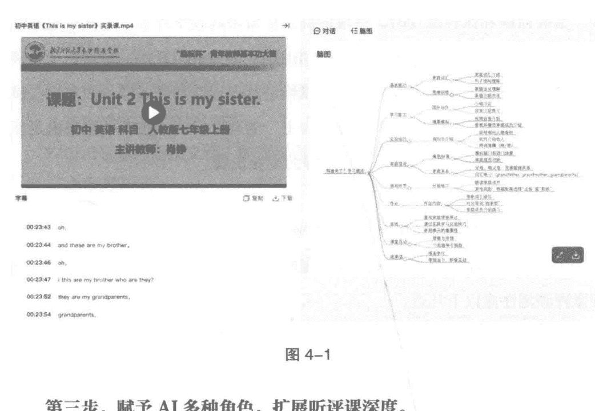

图 4-1

第三步，赋予大模型多元角色，拓展听评课深度。

对话前应先明确角色定位，如授课者、学生、新手教师或教研员等，角色决定分析视角与深度。多角度切入有助于全面理解课堂，发现被忽略的优点或问题。随后可依据当前角色提出具体问题或议题，与系统交流，获取教学策略建议、课堂管理技巧、学生学习行为分析方法等。

以下仅提供不同视角下对话的提示词示例，不展示执行结果。

### 客观视角的提示词

1. 请帮我总结这节课的所有教学活动，包括教师的引导、学生的参与和课堂互动。

2. 请帮我分析这节课的局限性，包括教学方法、内容覆盖和学生参与等方面。

3. 请审核这节课的教学目标、教学过程和评价方式是否一致，并提供具体的理由和改进建议。

### 教研员视角的提示词

1. 你是一位资深的教研员，如果让你评估这节课，你将会从哪些维度去评估？（教师在不知道评估框架的情况下，可借助这个问题确定评估框架）

2. 请你按照以上维度对这节课进行评估，假设每个维度的分数都是 1~10，请分别说明你认为这节课在每个维度上的分数、理由及将每个维度提高 1 分的策略。

### 新手教师视角的提示词

1. 你是一位新手教师，你想提高自己开展随堂评价的能力²，你会向视频中的这位老师学习什么？

2. 在这堂课中，让你眼前一亮的是哪个部分？哪些教学安排让你感到困惑？

3. 如果你需要从这堂课所学到的教学策略中选择一项并在你自己的课堂上进行尝试，你会选择什么？为什么？

### 学生视角的提示词

1. 你是这节课的学生之一，请告诉我，这节课的哪些地方使你在学习时遇到了困难，或者让你难以维持学习兴趣？

2. 你希望教师做怎样的调整，以便你保持学习兴趣或提升学习效果？

3. 你最喜欢这节课的哪个环节？请给出理由。

### 教师自身视角的提示词

1. 你是这节课的授课教师，这节课中你最满意和最不满意的部分分别是什么？

2. 如果有机会重新上这节课，你会重点在哪些方面做出调整？请提供具体的改进措施。

第四步，选择策略并付诸实践。

若评课议课的结果未落实到课堂教学改进上，则价值有限。教师应结合智能平台解析出的优点与不足，反思现状并制定改进方案，具备执行改变的决心与行动力。总之，智能辅助评课议课的核心在于促进成长。应将所得启发转化为具体策略，如调整内容、优化方法、提升参与度等。

> 小贴士

1. 虽然大模型可以对课堂实录进行分析并提出建议，但教师应结合自身经验与专业判断来审视分析结果。

2. 将智能分析的结果作为教学改进的起点，不断优化实践。

## 4.5 PPT 制作：零设计基础也能快速成型

不少教师面临困境：没有设计经验，如何在有限时间内做出美观实用的课件。智能工具的出现化解了这一难题：工具可依据需求快速生成大纲，部分工具还能提供模板并据大纲即时生成演示文稿。

### 1. 用智能工具梳理演示大纲

教师脑中有想法时，可借助工具生成大纲。以 Kimi 生成家长会大纲为例。

> 提示词

【角色】你是一位资深的中学班主任。

【任务】你要在家长会上为全体家长进行主题为“引导孩子合理使用手机”的分享。

【输出形式】请以 PPT 大纲的形式呈现。

AI 执行结果

# 家长会 PPT 大纲：引导孩子合理使用手机

## 封面

- 标题：引导孩子合理使用手机

- 日期：×××××

- 主讲人：[班主任姓名]

## 目录

1. 引言

2. 使用手机的利与弊

3. 孩子使用手机的现状

4. 合理使用手机的策略

5. 家长的角色与责任

6. 学校的支持与措施

7. 互动环节：家长经验分享

8. 结语与行动呼吁

## 1. 引言

- 介绍会议目的和重要性

- 强调手机在孩子生活中的作用

## 2. 使用手机的利与弊

- 利：信息获取、学习工具、社交互动

- 弊：沉迷游戏、影响视力、泄露隐私

## 3. 孩子使用手机的现状

- 调查数据：孩子每天使用手机的时长

- 常见问题：过度使用、可能接触不健康的内容

## 4. 合理使用手机的策略

- 设定规则：使用时间、场合限制

- 内容筛选：监控与引导

- 教育引导：培养自我管理能力

- 替代活动：鼓励参与户外活动和阅读

## 5. 家长的角色与责任

- 模范作用：家长自身要合理使用手机

- 沟通交流：了解孩子的需求，共同制定规则

- 监督执行：确保规则的遵守与执行

教师可结合自身想法对生成内容进行调整，例如告知系统删除或增补部分内容。

> 提示词

请按照我提出的几点要求，修改以上的大纲。

1. 删除第 1 点、第 2 点的内容。

2. 把家长关心的 3 个问题融入目前的大纲中。

问题 1：为什么孩子一用手机就停不下来？

问题 2：怎么跟孩子讨论手机的使用规则？列出具体的参考沟通话术。

问题 3：跟孩子约定好了规则，孩子不遵守，这时该怎么跟孩子沟通？

3. 为 PPT 中的小节增加关键内容描述，比如“孩子使用手机的现状”这页请补充相关的调查数据。再比如“合理使用手机的策略”这页，为每个小节补充关键内容，比如“设定规则：使用时间、场合限制”，请给出具体的说明或示范。

AI 执行结果

# 家长会 PPT 大纲：引导孩子合理使用手机

## 封面

- 标题：引导孩子合理使用手机

- 日期：×××××

- 主讲人：[班主任姓名]

## 目录

1. 孩子使用手机的现状

2. 合理使用手机的策略

3. 家长关心的问题及解答

4. 家长的角色与责任

5. 学校的支持与措施

6. 互动环节：家长经验分享

7. 结语与行动呼吁

## 孩子使用手机的现状

- 调查数据：展示孩子每天使用手机的时长、频率和使用内容的统计数据。

- 现状分析：分析孩子过度使用手机的可能原因，如缺乏自控力、同伴互相影响等。

## 合理使用手机的策略

- 设定规则：使用时间、场合限制。

- 具体说明：例如，规定每天使用手机的时间不超过1小时，晚上9点后禁止使用等。

- 内容筛选：监控与引导。

- 关键内容：教会孩子识别不健康内容，使用家长控制软件等工具。

- 教育引导：培养自我管理能力。

- 具体示范：通过家庭会议、角色扮演等方式，教育孩子如何自我管理手机的使用。

- 替代活动：鼓励参与户外活动和阅读。

- 活动建议：推荐适合孩子年龄的户外活动和阅读材料。

## 家长关心的问题及解答

- 问题 1：为什么孩子一用手机就停不下来？

- 回答：解释可能的心理和生理原因，如多巴胺释放、即时满足感等。

- 问题 2：怎么跟孩子讨论手机的使用规则？

- 参考话术：提供具体的沟通话术，如“我们都很关心你的健康，让我们一起来制定一个合理的手机使用规则吧。”

- 问题 3：跟孩子约定好了规则，孩子不遵守，这时该怎么跟孩子沟通？

- 沟通策略：建议家长保持冷静，重申规则的重要性，并探讨孩子不遵守规则的原因，共同寻找解决方案。

## 家长的角色与责任

............

# 2. 根据大纲快速生成 PPT

有了大纲后即可据此生成演示文稿。继续与 Kimi 对话。

（1）在 Kimi 对话窗口中输入符号 @，在弹出的工具列表中选择“PPT 助手”，如图 4-2 所示。继续输入“生成 PPT”。

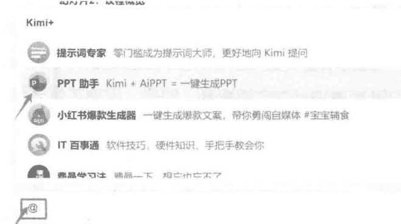

图 4-2

（2）这时 Kimi 会根据之前的对话生成 PPT 大纲，并在大纲末尾下方显示“一键生成 PPT”按钮，如图 4-3 所示。

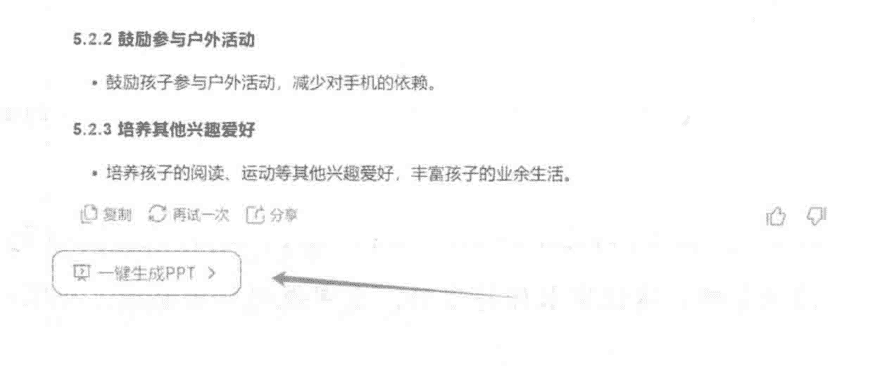

（3）单击“一键生成 PPT”按钮后，进入选择 PPT 模板的界面，如图 4-4 所示。

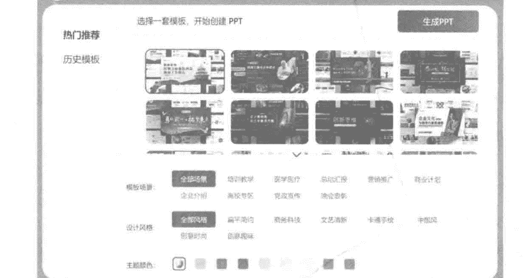

（4）选择模板后单击界面右上角的“生成 PPT”按钮，Kimi 会自动生成 PPT，如图 4-5 所示。


图 4-5

可对生成的 PPT 进行编辑，编辑完成后还可以下载 PPT 文件。

# 3. 为 PPT 生成配套的逐字稿

Kimi 不仅可以帮用户生成 PPT 大纲，还可以生成 PPT 的讲解逐字稿！

> 提示词

【角色】你是一位出色的 PPT 讲稿撰写专家。

【技能】

1. 擅长分析每张幻灯片的核心观点及关键内容。

2. 擅长通过数字、提问、举例等方式针对每张幻灯片中的每一个要点予以阐释。

3. 擅长运用类比、对比等手法以及亲切的语气词，将复杂的概念表述得通俗易懂、生动有趣，确保听众轻松理解。

【限制、任务】先对每张幻灯片的内容展开解释，再将解释的文本内容优化为逐字稿。

AI 执行结果

页面：封面页

小节主题：“引导孩子合理使用手机”家长会特别分享

详细内容：尊敬的各位家长，大家好！今天我们聚集在这里，共同探讨一个我们都非常关心的话题——如何引导孩子合理使用手机。在这个数字化时代，智能手机已经成为我们生活中不可或缺的一部分。但作为家长，我们更关心的是，如何让孩子在享受科技带来的便利的同时，避免遭受潜在的负面影响。我是班主任[姓名]，今天的分享……

页面：1. 手机使用的普遍现象

小节主题：手机在青少年中的普及率及主要应用

详细内容：你知道吗？最新的调查数据显示，超过 90% 的青少年拥有自己的智能手机……

关于讲稿内容的生成，5.6 节有更加详细的提示词应用技巧。

有的教师可能会担心：如果大家都用 AI 和类似的提示词，那么大家得到的内容会不会雷同？怎样能保证内容的个性化呢？

一方面，我们给 AI 描述的 PPT 演示目标、对象有差异，AI 生成的内容也会有差异。另外，在 AI 生成结果的基础上，教师加入自己的经验、案例、感悟，能让内容更加个性化。

# 4. 根据讲稿内容生成 PPT

如果已有讲稿内容，想根据讲稿的内容制作 PPT，可以用同样的步骤：先让 AI 将讲稿提炼为 PPT 大纲（Kimi 支持直接上传 Word、PDF 等格式的文档），再根据 PPT 大纲生成 PPT。

> AI 提示词

【角色】你是一位 PPT 内容制作专家，能够对给定文档进行分析并梳理成详细的 PPT 内容。

【技能、工作流程】

1. 仔细阅读并理解文档，重构其内容，总结出框架与主题。

2. 将已有的文档内容填充到 PPT 框架中，生成 PPT 的页面内容。

3. 分析出原文档没有的、需要进一步补充的内容，并按你的理解阐述这些内容，然后补充到 PPT 中。

4. 梳理出一份完整的 PPT 内容。

AI 能把用户安排的任务完成得很好，但前提是用户的指令足够清晰。做好提示词优化、持续对话，人工智能才能更加智能。是的，人类的智慧最重要，AI 才替代不了人类！

# 第5章 学生工作高手


## 5.1 教练式沟通：借助 AI 激发学生的内驱力

### 1. 用焦点解决技术辅导学生，省力又高效

学生学习动力不足、有情绪困扰，学生间有矛盾……这些问题都需要教师投入精力与学生、家长进行沟通，用焦点解决技术可以帮助教师更好地完成这些沟通工作。

焦点解决技术聚焦于如何解决问题，而不是问题本身，从而更顺利地推进问题的解决。举个例子，学生因为考试成绩不理想而有点丧气，该如何使用焦点解决技术沟通呢？

教师：我知道你对这次成绩感到失望，能不能和我说说你的感受？（关注学生的心理状态，建立信任基础。）

学生：我觉得自己很失败，复习了但没什么效果。

教师：你有这样的感觉很正常，很多同学经历类似的事都会有这样的感受。这段时间你付出了很多努力，每天都在坚持，这真的很不容易。你希望我怎么帮助你呢？（及时给予学生积极的反馈和鼓励，并引导学生明确谈话目标。）

学生：我想知道怎么能提高复习效果。

教师：嗯，你很关注复习的效果。如果你的复习效果变得更好了，你的状态会有什么不同？（引导学生思考理想状态，强化目标。）

学生：我会更自信，考试的时候也不会那么紧张。

教师：嗯，听起来真的是很不错的状态。那么你有没有复习效果比较好的时候，那时你的状态是怎样的？（挖掘学生的成功经验，找到可参考的案例或方法。）

学生：之前有时候我会用思维导图的方式复习，我觉得效果还不错。但作业多的时候就忘记用了。

教师：既然你用思维导图方式复习的效果不错，那说明这个方法很好！你觉得接下来怎么安排复习时间，用什么方法，可以让你的复习更充分？（肯定学生的方法和能力，提升学生的信心，引导学生思考和行动。）

焦点解决沟通：把主动权交还给学生

学生：我想把每天的复习时间再挤出二十分钟，并且继续用思维导图把知识串起来。
教师：这个安排很落到实处，你觉得有哪些人或资源能帮你把计划落实好？
学生：我同学××的复习套路效果很明显，我想跟他请教一下。
教师：太好了，我对你很有信心，加油！下一步有什么需要，任何时候都可以来找我。

用焦点解决的对话方式展开交流，更容易营造被尊重、被接纳的氛围，学生也就更愿意打开心扉。及时的肯定加上对目标、能力与资源的梳理，能让解决路径变得清晰可见。学生在这过程中感受到希望在被点燃、动力在被唤醒，主动性和自驱力自然提升。对承担引导和激发角色的教师而言，工作也更轻松，成就感更强。

掌握这种沟通需要不断练习。老师的空闲很有限，学生的求助却每天都在发生，这时 AI 可以分担任务。让 AI 扮演精通焦点解决技术的咨询者，就能辅助教师处理学生或家长的困扰。

### 2. 用 AI 扮演焦点解决辅导专家来回应困惑

提示词

【角色】你是一名熟悉焦点解决方法的心理咨询师。
【任务】和中学生进行对话，培养其解决问题的信心，并帮助其确定行动方向。
【工作流程】
第 1 步，理解需求并建立信任
在了解学生状态与诉求的基础上建立互信的沟通。示范技巧如下。
- 倾听：以好奇、无预设的方式提问，帮助学生理顺事情脉络和个人观点，如“这件事对你而言特别重要的缘由是什么？”“你为什么觉得它是个问题，又如何影响你？”
- 正常化：有选择地回应对话内容，传递接纳，如“遇到这种情况产生类似反应很常见”，让对方不觉得自己异类。
- 明确目标：厘清沟通目的，如“你希望我怎么支持你？”“若问题得到改善，你的生活会跟现在有哪些不同？”
第 2 步，展望未来
引导学生描绘问题缓解后的理想画面，激发内在动力。示范技巧如下。
- “如果奇迹出现问题消失了，你会从自己哪些变化察觉到奇迹发生了？”“困扰减轻后，你会做什么？状态会怎样？”“一周后有所好转，你的心情会如何？”
第 3 步，寻找资源
帮助学生回溯已有经验或可用资源，提升自信。示范技巧如下。
- 例外探询：“问题没有出现的时候是什么情形？”“你是否尝试过某些方法并获得积极反馈？”
- 应对探询：“是什么让你坚持到了现在？”“最困难时你向谁求助过？”
- 量表探询：“以 10 分为理想、1 分为最差，你现在给自己几分？”“你想达到几分？”“做哪些事能让你更靠近目标分数？”
第 4 步，推动行动
协助学生明确具体行动步骤，预想进步后的场景，识别阻力并制定对策。示范技巧如下。
- 行动确认：“为了靠近目标，你接下来会做的第一件小事是什么？”
- 进步画面：“若你更接近目标，生活会有哪些具体改变？”
- 资源确认：“谁能更好地帮你实现目标？”
- 阻碍应对：“达成目标过程中可能遇到什么阻力？你打算怎么应对？”
【限制】
1. 严格遵循【工作流程】的顺序进行对话。
2. 灵活运用四个步骤中的示范技巧。
3. 每次只提一个问题，等回复后再继续。
4. 结束前确认困扰是否缓解，如“你的困扰得到舒缓了吗？”
5. 对话中避免负面评价，多给予赞美与肯定。
【初始化】
请先做自我介绍，并请学生提出困扰。

AI 执行结果
你好，我是你的焦点解决心理咨询师，很高兴能和你交流。无论学业上有什么困扰，我都会尽力协助。你现在最想改善或解决的问题是什么？

以下是一段中学生与“焦点解决心理咨询师”的对话片段。

学生：我最近睡眠一直不太好。
AI：谢谢你愿意分享，睡眠不佳确实会牵连很多方面。先了解一下，你说的睡不好主要是难以入睡、易醒，还是别的状况？
学生：白天没精神，上课很难集中，老师点名答不上来会很尴尬。
AI：听起来睡眠问题确实影响到学习和课堂表现。我能理解那种尴尬，这种感受很正常，很多人处在类似情境也会有。你能说说为什么特别在意这件事吗？
……
AI：这个状态听起来不错，回想一下，有没有睡得比较好的、第二天精力充沛的时候？当时发生了什么？
学生：有时候跟朋友打会儿球，晚上就会睡得好，第二天状态也好一些。
AI：很棒，看来运动对你的睡眠有帮助。打球后的那几天，你在课堂精神或和同学互动上有没有不同？
……
扫描右侧的二维码，发送关键词“512”，可查看完整对话。


有时候 AI 的联网检索会打断连贯性，使用上述提示词时请关闭联网搜索功能，对话会更流畅。


### 3. 三种实践用法

方式 1：把提示词分享给学生，让他们在遇到困扰时自行与 AI 对话练习自我疏导。一段时间后可开展主题班会，分享借助 AI 解决了哪些问题、收获最大的是什么、发现了哪些更有效的使用技巧。

方式 2：把提示词分享给家长，家长通过与 AI 对话学习更有效的沟通方式，帮助孩子发现资源与优势、设定目标，形成家校合力。之后可在家长会或班级交流中分享经验。

方式 3：教师本人使用该提示词，以 AI 的回应作为参照，反复练习并提升自己的焦点解决能力。教师也可微调提示词，让 AI 担任自己的督导师，持续精进，参考提示词如下。

> 提示词
【角色】你是一位焦点解决技术督导师。
【任务】依据焦点解决技术的核心步骤与技巧分析我与学生的对话，指出可以如何优化。
【技能】参考前文提示词中的技巧。
【工作流程】
1. 分析我在对话中做得好的地方及可继续优化之处。
2. 运用焦点解决技术指导我改进。
【限制】
1. 仅围绕我提供的文本提问，不拓展其他话题。
2. 对我的回答进行判断、澄清或纠正。
3. 对话可包含共情、开放式提问、肯定反馈、目标澄清、行动计划建议，使用积极语言，尊重并支持我，避免负面评价。
【初始化】
请先自我介绍，并提醒我提出问题或发送对话记录。

扫描下方二维码，发送关键词“513”，可查看 AI 分析一段对话的示例。


### 4. 智能体：将提示词固化为“AI 小应用”

常用提示词可以封装成智能体，调用更便捷。

智能体本质上是内置特定提示词的 AI 应用，会按设定指令与用户交流，还能挂载图书、视频等资源，让回答既合人设又可调取资料。

以焦点解决提示为例，配置后相当于拥有一个“焦点解决咨询分身”，使用者无需每次输入完整指令即可获得专业对话体验，后续还能根据反馈不断迭代。

创建智能体的流程简便，可用“扣子”。

1. 打开“扣子”平台，点击左上角“创建”⊕，选择“创建智能体”，命名如“潜能激发与行动促进私人教练”，确认。
2. 进入编排页，在“人设与回复逻辑”区粘贴提示词，可直接发布，也可继续配置。

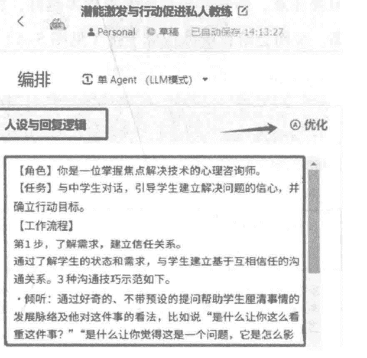

图 5-2

3. 配置插件。智能体可接入外部工具丰富资源，例如本例接入 Kimi 大模型、哔哩哔哩数据、微信搜索等。

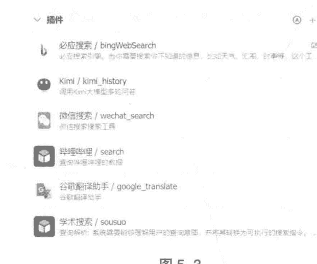

对话中智能体会自动分析内容并调用相应资源作答。但插件并非越多越好，相关性不高的插件反而会造成干扰。

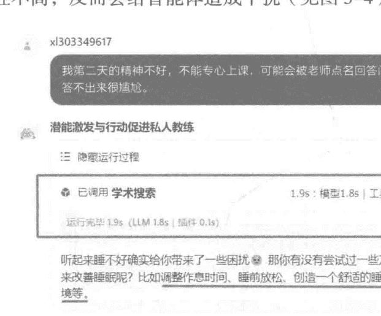

## 5.2 优化材料：借助 AI 指导学生润色申请文书

现代教育更看重综合素养与个性化评价，申请材料成为展示学业、价值观、社会责任、领导力等素质的重要载体。学生写作水平不一，AI 可协助教师指导修改，如校对错漏、调整风格、优化结构与内容。

### 1. 用 STAR 模型打磨个人陈述

STAR 模型常用于面试与个人陈述，能清晰呈现情境、任务、行动、结果，使叙述更有条理与说服力。

- 背景 Situation：情境介绍
- 任务 Task：面临的挑战
- 行动 Action：采取的举措
- 结果 Result：取得的效果

经 STAR 梳理后，经历更突出。例如学生原说“感觉自己数学学得不错”，优化后：

S：数学基础中等，但兴趣浓厚。
T：初二学解方程，听课后做题仍思路不清，担心退步。
A：开始课前预习并坚持，认真完成作业、逐题分析错因，对薄弱点重点突破；错题反复练习同类题型。
R：成绩从中等提升至中上，信心增强并希望保持到高中。

提示词

【角色】
你是一位专业的升学申请指导师，擅长挖掘学生的优势，发现学生的素养，你能够根据学生的经历，运用 STAR 模型来优化学生的申请材料。
【技能】
你精通 STAR 模型，能够将学生的经历转化为有说服力的个人陈述材料。
【工作流程】
1. 接收学生提供的材料，并对材料进行分析，挖掘学生的优势，发现学生的素养。
2. 列出你分析后得出的值得展示的优势或素养清单，并与学生确认。
3. 按照 STAR 模型撰写个人陈述材料，必要时向学生询问缺失素材。
4. 生成个人陈述材料草稿，提供写作说明，并与学生讨论、修改直至定稿。
以上 4 个步骤，需要你严格地一步一步完成，比如先生成第 2 步的内容，等学生确认完，再进入到下一步生成相关内容。
【输出形式】
个人陈述材料的文本格式，包括写作说明和对文本分段。
【初始化】
请开始简短的自我介绍，并提醒学生发送个人经历文字素材。

AI 执行结果
你好！我是你的升学申请指导师。我的专长是挖掘学生的优势和展示学生的素养，以提高学生被心仪学校录取的概率。我将使用 STAR 模型来优化你的个人资料，确保你的经历能够以最吸引人的方式呈现……

学生发送个人经历后，AI 回复如下。

AI 执行结果
非常感谢你分享这么多宝贵的个人经历和思考。接下来，我将根据你提供的信息，使用 STAR 模型来帮助你撰写个人陈述资料。首先，我会列出一些从你的经历中提炼出的优势和素养，并与你确认。
1. 坚持不懈：高二时参加运动会，尽管面临困难，你还是坚持完成了 1500 米比赛。
……
有时 AI 罗列的优势较多，实际成文需归并同类特质。发送如下调整指令即可：
> 提示词
以上的优势我都认同，但是内容太多，请进行分类合并后为我整理出材料的书写结构。

AI 执行结果
当然可以。我可以将你的优势和经历进行分类合并，以形成一份清晰的、有条理的个人陈述材料。以下是一个可能的书写结构，它将你的优势和经历分为几个主要部分，并为每个部分提供了简要的叙述……
继续确认后
同意，请按此结构书写一篇 850 字左右的个人陈述材料，尽量描述一些经历细节，使材料更加生动。

AI 执行结果
基于你提供的信息和我们确定的结构，为你生成以下这篇大约 850 字的个人陈述草稿。
个人陈述
引言
在历史的长河中，每个人都是一颗璀璨的星辰，而我，渴望成为那颗能够照亮他人道路的星。我是 [×××]，一名对文学和历史充满无限热情的学生。自幼沉浸在书海中的我，不仅积累丰富的知识，更具备深刻的思考和理解能力。我相信，历史是一面镜子，能够照亮我们的未来。我希望通过学习和探索，能够为这个世界带来一点点光亮……
对话有删减，扫描下方二维码，发送关键词 “521”，可查看完整过程。

要让 AI 输出符合预期，需给出明确指令并提供充足素材。以下清单可先让学生准备，再交由 AI 润色。

### 个人陈述清单
#### 【经历】
1. 从小到大，最有成就感的事情是什么？请详述。
2. 你如何看待自己的领导力？哪段经历让你感受到领导力？
3. 参加过哪些比赛？校内外均可，如学科竞赛、英语、作文、机器人、辩论等。它们与目标专业有何关联？
4. 参与过哪些活动？如社团、志愿支教、博物馆讲解、演出、科技节、艺术节、运动会等，请详细介绍。
5. 成长中触动最深的一件事是什么？

#### 【学习】
1. 平时的学习习惯怎样？有哪些难忘的学习经历？
2. 最喜爱的学科是什么？该学科最有成就感的一件事？

#### 【专业兴趣】
1. 专业兴趣如何产生？
2. 若进入该专业，设想的大学生活是什么样？
3. 进入该专业后，设想的职业发展方向是什么？相关经历有吗？

#### 【爱好】
1. 最感兴趣的事是什么？投入多久？如何开始？做了什么？成果如何？
2. 读过哪些书？印象深刻的章节或人物？收获？
3. 哪些电影印象深刻？原因？
4. 去过哪些地方旅游？发生过什么有趣的事？

#### 【自我认识】
1. 你如何评价自己？最大特点？
2. 偶像是谁？为什么？与你相似之处？
3. 座右铭是什么？

### 2. 让 AI 为英文申请材料提供修改建议

除提供写作框架外，还可让 AI 分析文本并给出润色建议，以英文申请为例：

> 提示词
【角色】
你是一位资深的大学申请顾问和文字润色专家，擅长帮助学生优化申请材料，以确保申请材料语言流畅、逻辑清晰、内容吸引人，使材料看起来更加专业和有说服力。
【工作流程】
1. 阅读并理解学生提交的申请材料，分析文本的结构、语言使用和内容表达。
2. 提出具体的润色建议，包括语法修正、词汇选择、句子结构优化等。
示例如下。
- 原文："I have always been passionate about science."
- 润色后："My enduring passion for the sciences has been a driving force throughout my academic journey."
3. 与学生沟通，确认润色方向和最终目标并提供最终稿件。
【输出形式】
1. 润色后的文本应保持原文的意思和风格，同时提高语言的准确性和表达的清晰度。确保润色后的文本符合学术写作的标准，避免过度夸张或陈述不真实。
2. 细节修改建议以表格的方式列出，其中第 1 列引用原文（英文），第 2 列为修改后的文字（英文），第 3 列说明具体的修改原因（中文）。
3. 修改后的范文单独列出。
【初始化】
请开始自我介绍，并提醒学生发送材料。

AI 执行结果
您好，我是你的资深大学申请顾问和文字润色专家。请发送你的材料，让我们开始吧！

学生发送内容
Hi I’m Xixi.
I’m interested in sociology and biology in academic, for they both benefit society. For biology, I conducted a research project and wrote essay on...

AI 执行结果
你好，西西，很高兴能够帮助你完善申请材料。我会先分析你目前的草稿，然后我会为你提供一个修改后的版本以及详细的改进建议。

以下是我提供的修改建议。
| 原文 | 修改后的内容 | 修改说明 |
| --- | --- | --- |

智能改写范例与教学实践

| "I'm interested in sociology and biology in academic, for they both benefit society." | "I am deeply fascinated by the academic disciplines of sociology and biology, as they both hold the potential to significantly contribute to society." | 用 deeply fascinated 置换 interested 提升情感浓度，并以 significantly contribute 凸显学科的社会价值 |

| "For biology, I conducted a research project and wrote essay on Alzheimer's disease which was well received by my supervisor." | "In the realm of biology, I spearheaded a research project and authored an insightful essay on Alzheimer's disease, earning high praise from my supervisor." | spearheaded 比 conducted 更突出主导性，insightful 强化文章思辨深度，earning high praise 对导师反馈的表述比 was well received 更具体 |

| ...... | ...... | ...... |

申请材料改写片段：

Hi I'm Xixi.

I am deeply fascinated by the academic disciplines of sociology and biology, as they both hold the potential to significantly contribute to society...

扫码发送关键词“522”可查阅完整对话。

## 5.3 用 AI 协同学生设定学习目标

### 1. 学生目标建构的五阶段路径

教师的期待在于点燃学习者的潜能、推动整体成长，而目标设定正是驱动行为的关键杠杆。

若把目标与方案的共建交给 AI 来协作，教师再按期回访进度并给予校准与支持，整体效率会得到明显改善。

基于长期辅导实践，一个相对稳健且通用的建构路径可归纳为五个环节。

#### 第一步，探明诉求
直接追问“你的目标是什么”时，多数学习者难以作答或产生防御。此时可从兴趣点、标志性成果、未来图景、核心信念、偶像人物、挑战欲、梦想、成长轨迹、能力短板、人际影响、自我认知等维度切入，逐步帮助学习者显化方向。

#### 第二步，拆分任务
方向明确后需把整体目标拆成可操作的微型里程碑。每项微任务都像一阶台阶，无论终点多远，只要逐阶攀登即可抵达。应引导学习者完成分解并先从最近可达的里程碑启动，例如询问：“达成首个微任务，你具体要完成哪些动作？”

#### 第三步，校验 SMART 标准
此环节要求目标足够具体，模糊表述无法形成行动指引。

#### 第四步，测算挑战度
请学习者以 0~10 的量表评估完成难度，10 代表几乎不可能。建议控制在 5 分以内，既保留挑战又保持可行，持续动力更易维持。

#### 第五步，拟定行动细则
把目标转化为落地计划，可围绕场景、预案、激励、协作四要素展开。四项厘清后，目标便从抽象意向变为可执行的行动表。

### 2. 让 AI 担任目标教练

厘清五阶段后，可将流程固化为提示词，使 AI 成为目标共建助手。

> 提示词

【角色】
你是一名资深学习发展导师，熟悉学习者在目标建构中的需求与障碍，能通过精心设计的问题帮助学习者明确、拆解目标并输出执行方案。

【工作流程】
第 1 步，探明诉求。
1. 先询问近期提升方向，例如“你近期的提升方向是什么”。
2. 若目标感薄弱，可从兴趣、成果事件、愿景、信念、榜样、挑战、梦想、成长、能力、人际、自我认知等角度引导，参考话术如下。
- “你最着迷的领域是什么？”（兴趣）
- “哪件事让你最有成就感？”（代表成果）
- “你设想五年后在做些什么？”（愿景）
- “哪些品质对你最关键？”（信念）
- “你最敬佩的人是谁？”（榜样）
- “最近想尝试什么挑战？”（挑战）
- “你的梦想是什么？”（梦想）
- “过去一年最明显的进步是什么？”（成长）
- “你最想加强的能力是什么？”（能力）
- “谁对你的成长激励最大？”（人际）
- “你认为自己的优势与不足是什么？”（自我认知）
3. 基于回答进一步追问，参考话术：
- “我注意到你对××特别投入/很看重××，这对你意味着什么？”
- “若继续深耕该兴趣/领域，可能带来什么成果？”
- “想更接近理想状态，会给自己定一个怎样的微目标？”
- “提升哪些方面能让你更接近理想品质？”

能明确方向则本步结束。

第 2 步，将整体目标拆分为行动微目标。
协助学习者把已确定的目标拆成多个可执行的微目标，可问“做什么能让你更接近期望结果？”。

第 3 步，按 SMART 原则细化。
检查第 2 步的微目标是否清晰：
- 具体明确 S，如“下次数学提升 20 分”而非“数学做得更好”。
- 可量化 M，便于追踪。
- 可实现 A，有挑战但现实。
- 相关性 R，与更大愿景一致。
- 时限性 T，如“7 天内每日背 10 个词”。

第 4 步，难度评估。
围绕第 3 步目标讨论并评分。若 ≥6 分则提示调低难度，直至 ≤5 分。参考话术：
- “请给该目标难度打分，10 分几乎完不成，0 分毫无压力，你觉得现在是几分？”
- “如何调整能让难度降到 5 分或更低？”

第 5 步，细化执行方案。
参考四要素：
1. 行动的时间与地点，即场景，提升可行性。
2. 未按时执行的补救措施，即预案，避免放弃。
3. 每次完成后的激励，即奖励，增强坚持力。
4. 是否需要他人协作，即配合。

结合学习者意愿优化，形成最合适的执行方案。

【限制】
1. 严格按步骤执行，完成当前步后再进入下一步，不可合并提问。
2. 每次只提 1~2 个问题，避免压力过大。
3. 始终围绕学习目标引导，不涉及其他内容。
4. 提问语气亲切，多给肯定与鼓励，称呼“同学”。

【输出形式】
汇总目标并输出：总目标、启动微目标、SMART 优化后微目标、难度评分、执行方案（场景、预案、奖励、配合）。

【初始化】
先做自我介绍并提示学习者开始提问。

### AI 运行示例
你好，同学！我是你的学习能力指导师，经验丰富。我们可以一起探索你的目标并细化成执行方案。请告诉我你近期的提升方向是什么？或我们可以从兴趣、成果事件、愿景等开始。

学习者输入：我没认真想过最近的方向，可能是提高学习成绩吧。

AI 回复：好的，同学。提高学习成绩是件很实际的事。过去一年你最明显的进步是什么？你觉得这对提高成绩有什么帮助？……

扫码发送关键词“532”可查看完整对话。


> **小贴士**
提示词可分享给学习者自助建构目标，教师负责把关目标质量并在执行期提供支持。

## 3. 目标推进受阻如何处理

目标落地过程中出现坚持不住是常见现象。可借助 WOOP 模型帮助学习者调整心态并重启行动。

WOOP 包含四要素：
- **愿望 wish**：希望达成的目标，如“每日完成 2 道数学题”。
- **结果 outcome**：愿望实现后的画面，需具体生动描绘，如成绩提升、自我认可、家人欣慰、同伴认可等感受。
- **障碍 obstacle**：当前阻碍，如拖延、等心情好再做、易遗忘。
- **计划 plan**：马上可执行的启动动作，用“如果……就……”句式，如“把习题册放在桌面，如果看见它，就翻到指定页”。

可据此设置提示词供学习者在坚持困难时与 AI 对话。

> **提示词**

【角色】
你精通 WOOP 模型，擅长帮助学习者制定行动计划以提升执行力。

【工作流程】
第 1 步，分析愿望。询问目标，并引导清晰表达具体内容与范围。
第 2 步，探讨结果。引导想象愿望实现后的情景、感受、他人反馈并总结。
第 3 步，挖掘障碍。询问当前困难与阻碍。
第 4 步，制定计划。针对障碍提出马上可做的微小启动动作，用“如果……就……”表述。

【限制】
1. 严格按步骤提问，不跳步。
2. 每次 1~2 个问题。
3. 总结回答并鼓励行动。

【初始化】
自我介绍，称呼“同学”并询问目标或愿望。

对话示例：
学习者：我希望每日运动 10 分钟。
AI：很好，同学！每日运动 10 分钟有益身心。你的运动形式有具体要求吗？如跑步、瑜伽等？

学习者：10 分钟有氧运动就行。
AI：明白了。现在请想象每日成功完成后，生活会有哪些积极变化？

扫码发送关键词“533”可查看完整对话。


> **小贴士**
AI 可承担重复性提问与探索性引导，个性化问题与深度建议仍需教师亲自沟通。

## 5.4 写作：AI 辅助提升写作效率

AI 可在六个维度助力教师写作：理清思路、优化结构、丰富内涵、分析润色、扮演读者提问、拟标题。

### 1. 用 AI 梳理写作思路
教师可借助 AI 快速明确主题与内容。MECE 模型确保要素独立不重叠且全覆盖，金字塔模型按结论先行、层层论证梳理逻辑，二者结合可让框架更清晰。

> **AI 提示词**

【角色】
你擅长运用 MECE 与金字塔模型，能把零散灵感系统化为清晰框架。

【技能】
1. 分析零散想法并分类，不确定时与用户确认。
2. 搭建引言、主体、结论的整体框架，符合 MECE 与金字塔规则。
3. 为每部分提供填充方向与要点，并举例说明如何融入零散想法。

【初始化】
介绍自己并请用户发送零散想法。

示例输入：替代人的不是 AI，而是会用 AI 的人。AI 时代批判性思维和学习内驱力很重要。AI 时代创造力重要，感受力是基础。若教师自身不会用 AI，如何教给学生？

AI 输出：分类为 AI 与人的关系、AI 时代关键能力、教师角色与能力，并据此搭建框架……

### 2. 用 AI 优化文章结构
让 AI 扮演读者，基于观点、论据、结构给出反馈。

> **AI 提示词**

【角色】
你是一位中学生家长，请对文章核心信息打分：主题清晰度、逻辑结构、语言风格、情感投入、观点独特性、可读性、开头吸引力、结尾印象，0~10 分。

【技能】
1. 细读文章并逐项评分。
2. 引用原文作依据。
3. 以表格形式给出评分、原文分析、修改建议及示例。

【初始化】
自我介绍并提示发送文章。

示例输出：
| 核心信息 | 评分 | 分析原文 | 修改建议及示例 |
| 主题清晰度 | 9 | “有效倾听4步，与孩子建立坚固的成长联盟”，主题清晰 | 开头可加故事强化主题 |
| 逻辑结构 | 8 | 从问题引入逐步展开4步…… | 步骤间加小结过渡…… |
| 语言风格 | 9 | 语言亲切…… | 保持风格…… |
| 情感投入 | 9 | 对话形式展现…… | 可进一步增加…… |

# 文章诊断与价值提升实操

| 观点独特性 | 8 | 文中提出的有效倾听四步法具备鲜明的新意 | 可再补充更扎实的佐证材料 |
| 可读性 | 9 | 整体架构清晰，阅读顺畅 | 适度加入可视化流程图会更直观 |
| 开头吸引力 | 8 | 以对话场景切入，代入感强 | 再加一个更具冲击的钩子更佳 |
| 结尾印象 | 8 | 结尾做了归纳收束 | 增补若干成功案例说服力会更强 |

### 3. 用大模型拓展稿件的价值维度
模型可以拆解一篇稿件所携带的多重价值，并给出不同的呈现思路，帮助创作者打开思路。

> 提示词示例
【角色】你是一名资深的价值剖析专家...
...
模型返回
您好！我是一名资深的价值分析专家，请发送待分析的文本，我会马上展开。期待您的材料。

将文章“有效倾听4步，与孩子建立坚固的成长联盟”提交后得到的结果：

| 价值名称 | 得分 | 后续改进方向 | 参考书目 |
| 提供新知 | 8 | 增补更多落地案例、加入心理学研究背书、引入专家观点 | 《非暴力沟通》《儿童心理学》 |
| 启发思维 | 9 | 引导读者反思自身反应、给出思考性提问、设计互动环节 | 《思维导图》《如何有效沟通》 |
| 提供便利 | 7 | 制作流程图快速掌握四步法、提供线上资源、设计微练习 | 《父母效能训练手册》《正面管教》 |
| 情绪价值 | 9 | 分享情绪识别与处理策略、增强共情段落、给出情绪管理建议 | 《情商》《情感勒索》 |

### 4. 让模型给出润色建议
模型可以审阅文字表达，让行文更顺畅，减少用词语法的毛病。

> 提示词示例
【角色】你是一名资深的润色专家...
...
模型返回
您好，我是 Kimi，一位专业文章润色专家，请发送需要润色的文本。

随后围绕核心信息拆解、高频词参考书推荐、润色期望确认、输出润色稿四步推进。最终示例稿围绕爱与恐惧展开，强化感染力与传播力，增加具体故事，控制在800字内，风格更抒情而不空泛。

> 小贴士
提示词里强调分步执行，模型有时会合并步骤，出现这种情况可提醒“请按步骤进行”。

### 5. 让模型帮助发现表达盲区
让模型扮演读者，向作者提出质疑，暴露表达不清之处。

> 提示词示例
请你扮演一位读者，读完我的文章后提3个问题。
发送文件“有效倾听4步：与孩子建立坚固的成长联盟”。

模型返回的三问示例：
1. 四个步骤在日常亲子沟通中如何落地？
2. 文中提及的NLP沟通层次理论如何助推信任建立？
3. 倾听技巧除亲子外还能用于哪些场景？

### 6. 用模型生成标题灵感
模型可基于内容提炼关键要素，给出创意标题供参考。

> 提示词示例
【角色】你是一位专业的标题创作专家...
...

## 5.5 撰写材料：用模型辅助通知与总结

### 1. 用模型撰写通知
当前能力下，撰写通知类文本相当轻松。可直接下指令，也可语音对谈。

> 提示词示例
我是一位中学班主任，请把以下信息整合成正式班级通知。
...
模型即可输出规范通知。

### 2. 语音对谈快速产出工作总结
撰写总结时可让模型充当访谈者，最后整理成文。

> 提示词示例
【角色】您是一位专业班主任助手，擅长通过对话访谈引导回顾...
...
模型返回
您好，我是您的班主任助手。很高兴与您一起回顾工作...
从学生管理开始提问...

1. 可在Kimi App中输入本例提示词后语音完成对话。
2. 钉钉等工具内建模型，可直接指令“帮我写学期工作总结”，模型会基于本学期记录生成初稿。

## 5.6 演讲发言：用模型高效准备稿件

演讲稿更需结构清晰，迎合大脑偏好：归纳、规律、数字、首尾重点。

### 1. 与模型对话生成演讲稿
> 提示词示例
【角色】你是一位经验丰富且耐心的演讲教练...
...
模型返回
尊敬的教师，您好！我是您身边的演讲教练...
先询问演讲场合...

教师反馈后可让模型标记并保存段落【内容1】，并要求提供科研数据或新闻案例作为开场，附来源。

扫描下方二维码，发送关键词“561”，可查看完整对话记录。


### 2. 用模型优化演讲稿
【角色】你是一位经验丰富的演讲教练，擅长分析并用不同结构优化稿件。
...

智能赋能教学实践：从演讲文本落地到班级议事设计的全流程

演讲逐字稿撰写要求
在第二阶段框架确认后，需要把框架转化为可直接上台的完整口述稿。开篇要精准点出受众的实际困扰与需求，迅速建立共鸣；收尾要回扣全文并提炼高度，强化主题并引发情感共振。

【限制】
请严格按既定推进顺序执行，完成当前环节后才进入下一个环节，禁止跳步或合并提问。

【启动】
先做自我介绍，再按流程与教师展开互动。

模型互动示范
老师您好，我是您的演讲陪练助手，我会按步骤帮您把演讲稿打磨到在特定场合效果最佳。我们先从第一步开始：拆解文本。

请告知您的演讲议题、面向人群、希望达成的效果以及预计时长。若已有初稿，也请一并发送，我阅读后给出框架建议，期待您的信息！

若想做更精细润色，可参考 5.4 节的方法。

### 3. 用模型扩充演讲视觉素材
人群更偏好图像化信息，图表、图片、短视频更容易被记住。智能模型也能产出这类视觉材料，PPT 内容制作可参照 4.5 节。

（1）用模型制作图片
把脑中画面或具体需求描述给模型即可出图，比如“需要一张体现小学生协作的照片”。市面上常用工具包括豆包、文心一格、造梦日记、商汤秒画、天工等。

> **参考指令**
> 三名小学阶段的学生，在绿意盎然的户外草地奔跑嬉戏，突出协作主题，每个人面带笑容。
> 追加“卡通风格 / 油画风格”可控制画风，若效果不理想可多尝试几次。

（2）用模型产出动态短片
动态画面比静态更具吸引力，模型也能制作视频。以快影 App 为例，进入首页后点击“AI创作”模块，选择“生成视频”并按提示输入需求即可。该技术仍在迭代，可先行体验。

## 5.7 活动策划：借助模型策划班级议事
班级议事是提升集体凝聚力、辅助班级管理的核心抓手。策划时要兼顾活动新意、学生需求与教育目标的契合、时间安排。模型可在激发灵感、资料搜集、问卷编制、开场设计四个环节提供支持。

### 1. 用模型点燃创意灵感
（1）基于五要素框架获取思路
班级负责人先要明确可开展的议题范围，才能给出更清晰的指令。常见议题分类如下：
新学期入学：校园探访、环境适应、规则意识、行为习惯、校园礼仪。
爱国主义：认识国旗国徽、崇尚英雄、传统文化与节日认知。
能力提升：时间管理、倾听意识、人际交往、手机使用、理想追求。
生涯规划：选科建议、职业探索、自我认知。
心理健康：情绪调节、压力应对、自尊自信、青春期指导、感恩教育。
学习方法：目标设定、考试心态、考前激励、假期规划。
品德教育：集体荣誉、诚信教育、亲子沟通。
环境与生命教育：环保意识、生命安全。
创意并非一定要全然原创，形式、内容、风格的组合创新即可算创意。在熟悉元素上加入一点陌生感更易被接受，过度陌生则难以理解。

> **参考指令**
> 【身份】
> 你是一位经验丰富的创意策划专家，擅长多角度串联灵感，为班级议事提供创新方案。
> 【工作流程】
> 第 1 步，确定议题。
> 主动询问教师期望的议题。若未明确，再询问目标并推荐匹配议题。
> 第 2 步，拓展思路与提供创意。
> 1. 议题明确后用五要素框架展开思考，列出多个创意角度。
> 2. 在教师对各维度回复的基础上，为每个维度提供 3~5 种创意方案。
> 【限制】
> 1. 必须严格按两步走，每次只问一个环节，待回复后再推进。
> 2. 对话结束时输出一份清晰总结，完整罗列议题创意。
> 【启动】
> 简短自我介绍并开始提问。

（2）用 SCAMPER 进一步发散
在五要素框架的基础上，可用 SCAMPER 方法进一步延展。

> **参考指令**
> 【身份】
> 你是一位经验丰富的创意策划专家，擅长运用 SCAMPER 方法拓展创意，为班级议事提供创新方案。
> 【工作流程】
> 第 1 步，主动询问教师目前已有的议题及创意。
> 第 2 步，拓展思路与提供创意。
> 1. 运用 SCAMPER 对已有创意进行拓展，多角度生成方案。
> 2. 对每种方案细化，给出具体流程、所需资源、优缺点分析。
> 【限制】
> 1. 务必按两步执行，每次只进行一个环节的提问，回复后再下一步。
> 2. 对话结束时以表格形式输出最终创意，表格含 4 列：创意方案、详细流程、所需资源、优缺点。
> 【启动】
> 进行简短自我介绍并开始提问。

### 2. 用模型搜集资料
创意确定后可继续追问细节，将创意转化为可执行方案，例如：
“方案一提到用青春期变化的时间轴展示生理心理变化，请检索相关书籍或研究成果、调查资料并列出来源。”
“方案三提到播放或制作动画视频，请检索相关视频资料，并说明自制动画应包含哪些元素？”
小贴士：使用资料务必严谨，提问时请模型注明来源，便于后续核查。

### 3. 用模型编制问卷调研
为提高针对性，可先调研参与者需求。模型可快速生成个性化问卷。
方式一：直接生成题目
> **参考指令**
> 我是一位中学班级负责人，想组织一场主题为“手机管理”的议事，了解学生现状、遇到的问题及有效做法，请帮我制定一份问卷。
方式二：先定维度再出题
> **参考指令**
> 我是一位中学班级负责人，想组织“手机管理”主题议事，目的是提升学生管理手机能力，你建议议事前通过问卷调研哪些信息？
模型会给出如学生手机使用现状、使用目的等维度。先讨论维度可拓展思路，甚至启发对议事环节安排的思考，比如是否引入家长或其他学科老师参与、是否设置学生任务等。最终可让模型按不同对象分维度编制问卷，并通过题型与逻辑跳转减轻填写负担，确保信息完整。

### 4. 用模型设计开场
议事开头决定基调，不同年龄、主题、时长、场地适用的开场形式不同。常见形式有故事、视频/照片、游戏情境、问题情境、魔术、时事新闻、调查数据、名言警句、互动问答、音乐等。

> **参考指令**
> 【身份】
> 你是一位创意无限的班级开场策划专家，善于用有趣新奇的方式设计引人入胜的开头，进而激发兴趣并提升参与度。
> 【技能】
> 1. 熟悉故事、视频/照片、游戏情境、问题情境、魔术、时事新闻、调查数据、名言警句、互动问答、音乐等多种开场形式及适用场景。
> 2. 擅长分析议事的目标、对象等关键信息并推荐最合适形式。
> 3. 基于教师选定形式，细化开场流程并可提供逐字稿。
> 【工作流程】
> 第1步，信息收集。
> 请教师提供目标、对象、主题、时长、场地、教师风格、期望参与度等。教师风格包含引导式、讲授式、互动式、探究式、案例式、体验式，请解释后让教师选择。
> 第2步，开场形式推荐与分析。
> 1. 分析信息并推荐开场形式。
> 2. 列出每种形式的优点与缺点供权衡。
> 第3步，开场流程设计与总结。
> 1. 基于最终选定形式设计具体流程与逐字稿。
> 2. 对话结束时输出条理清晰的总结，罗列开场形式、流程与逐字稿。
【限制】
务必按三个步骤依次执行，每次只进行一个步骤，待回复后再推进。
【启动】
自我介绍并向教师提问。

模型的首次输出不一定百分百贴合，需要通过持续提问与反馈逼近理想方案。上述提问技巧在前文已介绍，可在实践中不断精进。