# 教师助手2：用 DeepSeek 重塑高效育人

# 写在前面

技术浪潮正在改写各行各业的运行边界，学生工作也进入了新的演进期。许多教师仍被繁杂的事务性工作拖住脚步，而智能工具已经悄然走进办公桌边，成为教学一线最得力的伙伴。

**一、效能变革正悄然发生**

从前，起草通知、策划活动、汇总数据常常占据教师的大量时间。现在，几秒钟即可得到一份规范的公文框架，五分钟就能完成过去需要数小时的主题班会设计。心理普查数据的可视化、职业规划的个性化推演、突发事件汇报稿的即时生成、思政类文章的润色优化，都在被智能工具承接。重复性劳动被逐步剥离，教师得以把更多精力放回育人本身。

**二、人机配合重塑工作形态**

智能工具并非要取代教师，而是对教育智慧的放大器。在党团工作中，它可以快速产出迎新海报和军训视频脚本，但活动的育人主线仍需教师把关；在心理疏导中，它能从谈话记录里提炼要点，而情感共鸣和价值引领始终属于人。形成“机器管事务，人专注育人”的双轨协作，学生工作的内涵由此被重新定义。

**三、多模态赋能实现精准触达**

大模型的综合能力正在打开传统场景的局限，主要体现在四个方向。

· 数据洞察：借助学业预警捕捉学风变化，用算法描绘班级成长轨迹。
· 创意支持：自动生成五四宣传短视频，让思政教育有了数字艺术的表达。
· 个性服务：为每位学生生成职业发展方案，让就业指导从群体覆盖走向个体适配。
· 风险应对：快速生成突发事件处置预案，实现经验判断与数据推演的结合。

当智能渗透到谈心谈话、就业指导、舆情管理等核心环节，工作就从粗放管理转向精细经营。

**四、弥合资源差距的新路径**

智能工具有助于缓解教育资源分布不均。偏远学校的教师能获取接近名校水准的活动方案，新手教师可以借此快速吸收资深教师的数据处理经验，个性化学习推荐让每个学生都能获得定制化的成长建议。技术在此不是拉开差距的工具，而是搭建桥梁的手段。

**五、带着敬畏拥抱智变未来**

深度应用也带来新的自省：技术依赖会不会削弱人文感知？数据采集与隐私保护如何平衡？程序化回复是否会冲淡心灵温度？这些难题恰是教育进化的契机，要求我们始终把智能工具定位为延伸教育理想的手段，而非定义教育本质的主体。

本书既是智能工具的实践指南，也是关于教师角色再造的讨论。它不给出唯一答案，而是邀请一线教师共同探寻人机协同的最佳比例，在技术赋能中坚守教育的初心。

全书以 DeepSeek 为主线，辅以其他智能工具，讲述教师如何在日常工作中用好智能提升效率、激发教育新思路。

愿以智能为舟，以育人为桨，驶向学生工作的新海域。未来已至。

温馨提示：随书附赠资源可通过关注“博雅读书社”微信公众号，输入第77页资源下载码获取，或关注“秋叶 AI 校园”，回复关键词“教师助手2”领取。资源下载码：250618

# **第一章**

# **超级助手已就位**

如果能有一位得力助理帮我处理琐碎，让我在教学工作中喘口气，那该有多好？如今，这个设想已经成为现实。

2022年11月，OpenAI 推出的 ChatGPT 首度登场，其自然语言处理能力迅速引发关注。现阶段已演进至 GPT-4.5 版本，集成了 DALL·E 3 图像生成、代码执行以及丰富的插件生态，支持文本、图像、数据分析等多模态交互，成为通用型 AI 助手。

ChatGPT 基于深度学习，从海量语料中自动抽取特征，理解并生成自然语言，可完成写作、编程、图像视频生成等多类任务。与此同时，全球大模型生态呈现多元化。比如中国 DeepSeek 公司于2025年1月发布的 DeepSeek-R1，聚焦数学推理与复杂逻辑，其开源版本在代码生成、金融数据分析等垂直场景表现突出。

总的来说，这位超级助手并非传统意义上的秘书，而是一款依托前沿人工智能技术构建的通用大模型。

## **1.1 大模型运作的底层逻辑**

理解原理才能更好地使用工具。

向搜索引擎提问“明天北京穿什么”，得到的是一串链接；向大模型提问同样的问题，会直接得到“25摄氏度有阵雨，建议短袖加雨伞”。前者是信息搬运，后者是内容生成。类比来说，搜索引擎像关键词检索的百科全书，大模型更像一位会思考的智者，通过理解、分析、组织给出答案。以 ChatGPT、DeepSeek 为代表的核心能力，可归结为学习、推理、生成三步。

**1. 学习：从海量数据汲取知识**

模型先通过阅读书籍、文章、对话记录等海量文本，掌握语言结构、语义关系和上下文规律。类似人类通过学习积累知识，建立起庞大的知识储备，为后续推理生成打基础。ChatGPT 通过互联网文本学会问答与写作，DeepSeek 则在特定领域数据上精进，表现出更强的专业性。

**2. 推理：理解意图并寻找解法**

用户提问后，模型会解析意图，从已学习知识中提取相关信息。好比在脑中快速检索筛选答案。例如询问“番茄炒蛋怎么做”，模型会提取烹饪步骤与要点。DeepSeek 在专业问题上会结合垂直知识库给出更精准回应。推理能力决定理解是否准确。

**3. 生成：以自然语言输出结果**

推理结果需要转化为流畅的人类表达，而非简单复制。ChatGPT 能根据对话语气调整风格，DeepSeek 则更强调专业性与准确性。生成质量决定结果是否易被接受。

总体而言，学习、推理、生成构成大模型的工作闭环，理解这一逻辑有助于更有效地驾驭工具。

## **1.2 技术如何重塑教师工作**

智能正在推动教师从“应付事务”转向“创新育人”。这种转变不只是替代，而是通过自动化、预警、数据分析等手段提升效率与育人质量，主要体现在工作流程优化、危机干预强化、思政教育提效三个层面。

**1. 工作流程的优化路径**

教师长期被数据统计、文档整理、心理筛查等事务性工作占据。AI 的自动化工具与数据分析带来了明显效率提升。表 1-1 列出了教育场景的典型应用。
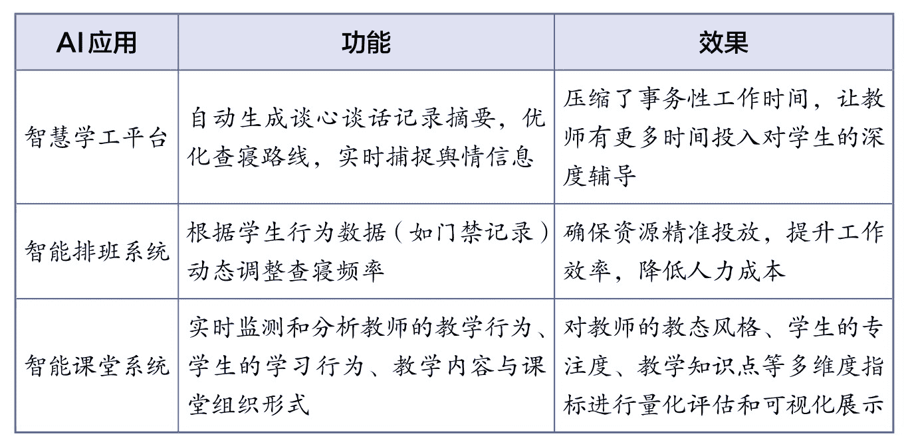
借助流程优化，教师能把时间留给个性化辅导与思政引领，实现由事务驱动向育人驱动的转变。

**2. 能力要求的升级信号**

AI 深度融入后，工作场景发生改变。某省教育厅推行的“AI+思政”能力认证，旨在培养能操作智能学工平台、设计数字思政方案、解读教育大数据的复合型教师，数据显示持证教师晋升速度提升约30%。表 1-2 呈现了能力升级的维度。
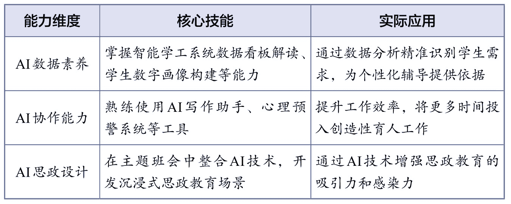
表 1-3 则展示了 AI 在教师与学生沟通中的多维支持。
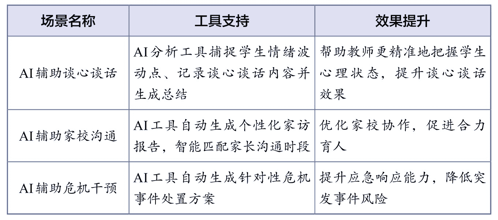
新时代教师需要具备数据素养、协作能力与数字思政设计能力，以更好地服务学生成长。

**3. 四大核心赋能场景**

传统痛点如危机发现滞后、个性化指导效率低、突发事件应对不足、思政形式单一，都可通过智能手段改善。以某高校为例，其“AI 心理预警系统”通过出勤、访谈、问卷等数据提前预警，多次成功干预潜在危机，筛查效率提升50%。表 1-4 汇总了四大核心场景。
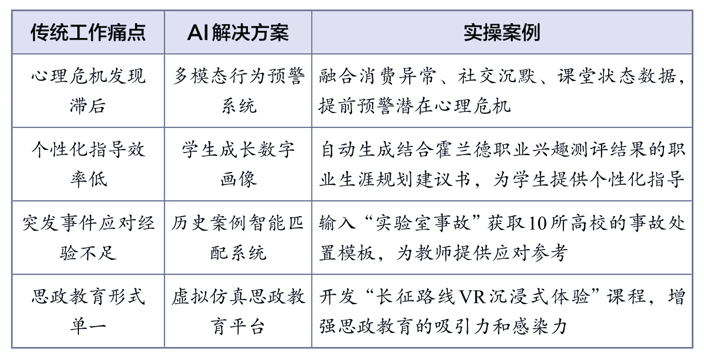
掌握技术原理固然重要，关键仍在实践中的有效提问。接下来将探讨如何提出高质量问题挖掘 AI 潜力。

## **1.3 提问技巧：让 AI 更懂你的需求**

我们期待精准贴心的回应，但常因提问模糊而失望。问题不在于 AI 不够聪明，而在于提问方式需要改进。下面介绍两种常用方法，让对话更高效。

**1. 角色扮演式提问：化身领域专家**

工作中向专家请教往往比向新手更有效。与 AI 交互时，也可以先设定角色。例如用“请你扮演”“假设你是”“你是一位”等句式引导。角色设定后，输出会更具专业度与细节。

**提问一：**
如何处理学生管理问题？
AI 会给出通用策略，偏重规则、沟通等原则性建议。

**提问二：**
请你扮演一位有多年教学经验的资深班主任，给出小学生管理的具体建议。
这时回复会包含信任关系建立、规则一致性、心理关注、家校沟通、持续反思等更贴近实际的操作要点。

角色扮演之所以有效，是因为它让模型生成更符合身份的表达。提问时应明确角色并补充背景，如“资深小学班主任”“学生年龄”等。教师场景中可用的专家角色如表 1-5 所示。
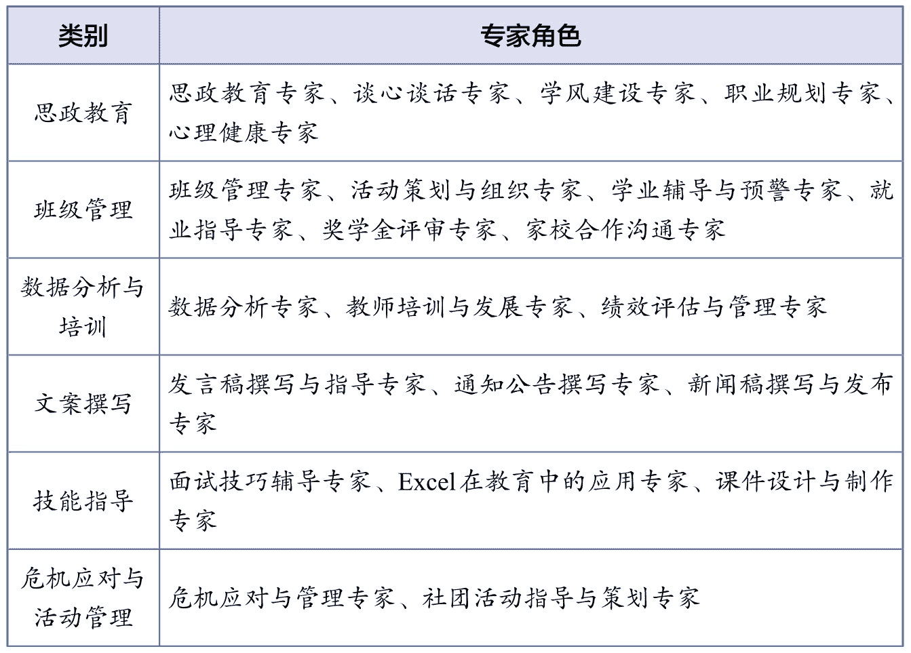
续表

通过角色设定，AI 能成为你的私人专家助手。

**2. 要点式提问：直击核心要素**

清晰的指令如同领导布置任务，能让执行更精准。对比如下。

普通指示：
××老师，新生开学了，请组织一个开学季活动，尽快给我方案。

清晰指示：
××老师，请设计一场“迎新启航，梦想启航”主题的新生开学活动，要求如下：
（1）主题聚焦，活动富有创意且传递学校关怀；
（2）内容涵盖报到介绍、校园导览、学长分享、互动游戏及迎新晚会；
（3）面向全体新生，鼓励老生参与；
（4）提供宣传计划，方案以 PPT 呈现。

（5）提交时间：请务必在本周三 16:00 前完整提交活动方案，材料需涵盖活动流程、预算规划、安全保障等核心要素。

在工作场景里，下属往往更乐意去执行优秀管理者布置的任务，这类任务通常具备以下优势。

（1）目标清晰：工作说明完整，诉求具体明确。
（2）推进顺畅：要点一目了然，减少来回沟通成本。
（3）结果可控：验收标准具体，便于把控质量。

同理，面对 AI 工具时也一样。若想拿到理想输出，就要模仿优秀管理者下指令的方式，即使用要点式提示词。

要点式提示词也叫优质指令，其本质是把最有价值、最关键的信息提供给模型。优质指令的四大原则如图 1-1 所示。

图 1-1 优质指令的四大原则

· 结构通顺：指令要有清晰的框架，起承转合连贯自洽。
· 突出重点：借助分段、标点等手段，让关键信息更醒目。
· 表达精炼：以短句为主，剔除赘余，信息更凝练。
· 好理解：优先使用可量化的表述或具体场景描述，比如用“300 字以内”替代“别写太长”；同时避免生僻表达，采用直白易懂的措辞。

结合案例与原则，要点式提示词的常用写法可以归纳为：

要点式提示词 = 目标任务 + 具体要求

根据……（背景说明），请完成……（具体任务），要求如下。

要求 1（对第一项要求的详细说明）

要求 2（对第二项要求的详细说明）

要求 3（对第三项要求的详细说明）

……

具体要求可展开的维度见表 1-6。

表 1-6 具体要求维度清单

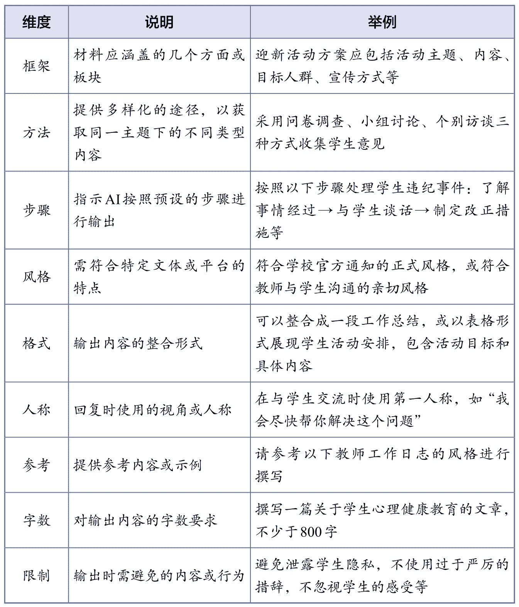

**3． 示例式提问：以案例为师，让 AI 举一反三解难题**

有时候，一个典型范例比冗长解释更能精准传递需求。给出具体案例可以帮助 AI 迅速抓住文体风格、逻辑框架等核心要素，从而产出更符合预期的内容。

例如教师经常需要撰写比赛演讲、开学致辞等稿件，这类稿件对主题聚焦、结构设计、情感表达要求较高。可采用示例式提问，操作如下。

（1）提供 1～2 篇同类型的高质量演讲稿。
（2）引导 AI 拆解案例的关键要素，如主题切入点、受众定位方式、核心观点递进逻辑等。
（3）在拆解结果基础上形成明确指令，如“参照案例的排比式开场，围绕‘育人初心’主题撰写 800 字演讲稿”，即可得到符合场景需求的稿件。示例式提问流程如图 1-2 所示。

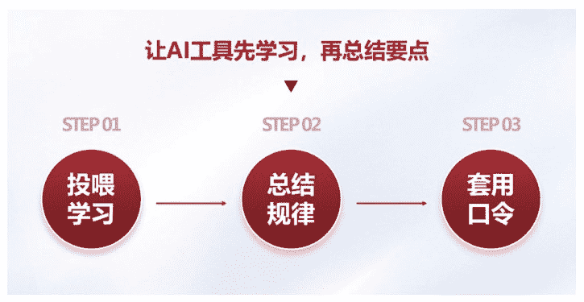

图 1-2 示例式提问流程

**第 1 步** 将演讲稿全文交给 AI 学习并提炼要点。

**向 AI 提问：**

请分析并总结以下演讲稿的亮点与特色。

我是张××，我是一名演员。

今年春节，我在社交媒体上收到的最多评论是“恭喜你，张××，你的春天来了”。大部分朋友对我的肯定都夹杂着些许同情。大家都觉得，在无人知晓的角落，我默默努力了二十年。

我从小就对花花草草情有独钟。第一次种花的记忆与四岁那年我家的隔壁邻居卢伯伯有关。卢伯伯有个爱好，喜欢到后山挖些矮小的树根，回来种在盆里。不久，这些不起眼的树根便会长出枝叶。卢伯伯种过许多形态各异的盆栽，我看着便也心生欢喜，想自己尝试一番。然而，无论我怎么努力，每次都以失败告终。后来，卢伯伯告诉我：“你知道哪里出错了吗？你只想着挖取上面的部分，却忽略了根部，枝繁叶茂是你能看见的，但支撑它的是根系。只有根系扎得深、扎得牢，有朝一日才能绽放鲜花。”

我常常将演员的工作比作城市中的“绿植”。只有与土地紧密相连，才不会被大风吹倒。我这二十多年并非虚度。在那些不为人知的日子里，我从未沮丧。每一天，我都在汲取作为演员应有的养分。我们常说：“不要试图去比植物与天地的高度，那是遥不可及的。你要做的是让它根系更深、树干更粗，这才是它应有的宽度。”

我感激那段不被瞩目的二十年。在这二十多年里，我用眼睛观察万物，用心感受身边的每一个人。你永远不要轻视自己，不要害怕那些被视为缺点的特质。在你人生的剧本里，你是主角。你要相信，总有一天会散发出属于你的光芒。

春天来了，天空湛蓝，人群熙攘。如果你愿意相信我们是一颗种子，请再给它浇点水，让它多见阳光。终有一天，我们会长成参天大树。

**AI 回答：**

这段演讲稿的亮点与特色如下。

1． 感人个人经历的引入：演讲以个人经历开篇，迅速吸引了听众的注意力并引发了共鸣。这种亲身经历的分享方式，使听众更容易与演讲内容建立情感连接。

2． 明确的主题与生动的比喻：演讲稿巧妙地运用了“种植与根深叶茂”这一比喻，将演员的成长历程与植物的生长过程作类比，有力地传达了“努力、耐心和深耕是成功的关键”这一主题。这种具象化的表达方式使抽象的概念变得可视化，更易被听众理解和接受。

3． 情感共鸣的激发：通过详细描绘张××二十多年的不懈努力和奋斗历程，演讲稿成功地激发了听众的情感共鸣。听众能够从中感受到希望、坚持和成长的力量，从而与演讲内容产生更深的情感联系。

4． 积极的鼓励：演讲中强调了每个人都应珍视自己的努力，并坚信自己的潜力。这种鼓励能够增强听众的自信心，激发他们追求人生目标的勇气。

5． 简洁明了的语言：演讲稿采用了简洁明了的语言和直观的比喻，使内容更加通俗易懂。这样的表达方式有助于广大听众跟上演讲的节奏和思路。

6． 连贯紧凑的结构：演讲稿具有清晰的起承转合结构，从个人经历的引入，到植物比喻的阐述，再到人生观点的提炼，结构紧凑且逻辑流畅，便于听众理解和接受。

7． 积极向上的氛围营造：演讲整体传递出一种积极向上的情绪和氛围，使听众在聆听过程中能够感受到希望，进而激励他们勇敢追求自己的梦想。

**第 2 步** 把提炼的要点转化为指令，让 AI 按要求创作。

**向 AI 提问：**

请基于以下指令和要求，撰写一篇主题为“青年的担当与责任”的致辞。

1． 感人个人经历的引入：以一段感人的个人经历作为开篇，迅速吸引听众的注意力，并让他们与演讲内容产生共鸣。

2． 明确的主题与生动的比喻：清晰地阐述主题，并运用生动的比喻将抽象的概念具体化，使听众更容易理解。

3． 情感共鸣的激发：通过讲述或描述，引发听众的情感共鸣，使他们与演讲内容产生更深的情感联系。

4． 积极的鼓励：在演讲中穿插积极的鼓励，增强听众的自信心，鼓励他们追求自己的目标。

5． 简单明了的语言：使用简单明了的语言和直观的比喻，确保内容易于理解，让广大听众都能跟上演讲的思路。

6． 连贯紧凑的结构：构建清晰的起承转合结构，从个人经历引入，逐步过渡到主题阐述，再到人生观点的提炼，确保结构紧凑且逻辑流畅。

7． 积极向上的氛围营造：整体传递积极向上的情绪和氛围，让听众在听完演讲后感受到希望，激励他们勇敢担当，履行责任。

**AI 回答：**

当我们谈及青年，脑海中常浮现无忧无虑、活力四射的画面。然而，在这些充满激情的年轻人肩上，也承载着沉甸甸的担当与责任。今天，我想与大家分享一个感人至深的故事，以此勾勒出青年的责任与担当。

在我身边，有这样一位朋友，他名叫李鹏（化名）。李鹏自幼家境并不宽裕，却始终怀揣着悬壶济世的理想。少年时期，他便立志成为医生，希望以医术治愈病痛，为社会贡献力量。

然而命运骤然转折。高中时期，李鹏被确诊患有罕见眼疾，视力日渐衰退。对于怀揣医学梦想的青年来说，这无异于晴天霹雳。但李鹏以超乎常人的坚韧，在光明渐逝的困境中坚持学习，用盲文教材钻研医学典籍，用听觉记忆解剖图谱。他的坚持不仅是对医学理想的坚守，更是对生命价值的叩问——真正的医者，能否在黑暗中为他人点燃光明？

李鹏的经历，恰似暗夜中的灯塔。他向我们揭示：青年的担当从不在顺境中彰显，而于逆境里淬炼成形。当命运之锤重击时，有人选择沉沦，有人却在废墟中重建星辰。

想象一艘穿越暴风雨的帆船。年轻舵手面对惊涛骇浪，既要校准航向，又需保持船体平衡。这恰似青年的成长轨迹——既要应对时代浪潮的冲击，又要守护内心的罗盘。

或许有人质疑：个体力量何其渺小？但请记住，李鹏虽失去视觉，却用指尖感知医学典籍的温度，用听觉感知生命跳动的韵律，在黑暗中完成从医学生到眼科专家的蜕变。正如古希腊哲人所言：“人的价值不在于占有什么，而在于成为什么。”每个青年都是未完成的雕塑，而担当与责任正是雕琢人生的刻刀。

历史长河奔涌向前，每一代人都要回答时代的命题。今天的我们或许会遭遇技术瓶颈、面临职业困惑、经历理想与现实的碰撞，但正是这些淬炼，让青年的脊梁越发坚挺。当我们选择在实验室彻夜攻关，在三尺讲台默默耕耘，在手术台挽救生命，便是在用具体行动诠释担当——它不在宏大的宣言里，而在脚踏实地的耕耘中。

朋友们，让我们以李鹏为鉴：真正的光明，不在瞳孔反射的物理成像，而在永不停息的探索之心。愿我们都能成为自己命运的舵手，在时代的惊涛骇浪中，既校准个人理想的航向，又汇聚成推动文明进步的磅礴力量。当百年后的青年回望此刻，愿他们看见的是无数个你我以担当为帆、以责任为锚，在浩瀚的人生海域留下的璀璨航迹！

谢谢大家！

示例式提问的本质是通过“引导”让 AI 理解需求，即向模型展示优质演讲稿案例，让其学习并提炼核心要素：主题、受众与核心信息。

当需要撰写演讲稿时，只要把这些关键信息传达给 AI，它就能迅速“领会”意图，生成更贴近实际、质量更高的演讲稿。可归纳为：通过模仿与学习，让 AI 深入理解需求，从而提供更优质的服务。

# **第二章**

# **教师要掌握的 AI 基础工具**

进入 AI 时代，教师的工作正经历 AI+ 的深度重构。想要站稳脚跟乃至引领潮流，熟悉并熟练使用各类 AI 工具已成为教师的必修课。

“工欲善其事，必先利其器”，在 AI 时代，AI 工具就是教师的新利器。无论是通用大模型助力智能问答与文本生成，还是视频类工具辅助制作专业课件，亦或图片处理、数据分析等工具的加持，都能让教师工作更高效、更便捷。

本章将介绍适配国内教育场景的 AI 工具，帮助教师把 AI 技术融入日常，构建智能化教学体系。

## **2.1** **通用语言大模型**

通用语言大模型具备深度语义理解和自然语言生成能力，正在重塑教育场景的工作方式。教案设计、学情分析、作业批改等环节，都可通过大模型实现效率跃升。

下面介绍几款常用的通用语言大模型，供教师选用。

**1.** **DeepSeek**

公司：深度求索（DeepSeek）

产品特点：DeepSeek-R1 于 2025 年 1 月开源发布，擅长数学推理和代码生成，API 成本约为行业均值的 3.6%。该模型支持教育场景多轮对话优化，可自动生成学风建设方案和心理辅导话术，已集成于微信、钉钉等多个主流平台。

官方网址：https://deepseek.com

**2．** **文心一言**

公司：百度

产品特点：通过对话，文心一言不仅能帮助用户解决问题、获取信息，还能激发创意和灵感。2025 年 4 月新增深度搜索功能，可调用代码解释器生成带溯源标记的专业报告。在教育场景下，可与 DeepSeek-R1 模型结合优化学术解题能力。

官方网址：https://yiyan.baidu.com

**3.** **Kimi**

公司：月之暗面

产品特点：作为生产力工具，Kimi 特别擅长长文总结，交互体验出色。它支持 128K 上下文长度，并采用动态计费方式。此外，月之暗面还推出 Kimi 创作空间，即 AI 视频创作平台，平台提供教育课件、微课脚本等 12 种视频风格模板，很适合教师群体。

官方网址：http://kimi.moonshot.cn

**4．** **通义**

公司：阿里巴巴

产品特点：通义是阿里巴巴阿里云团队推出的大模型，支持百万 Token 的长文本处理和 7K 图像动态解析。作为综合型 AI 大模型，通义提供内容生成、文档分析、图像分析等多方位服务，满足不同场景需求。在商业和金融领域表现突出，可帮助用户进行商业分析、报告生成等任务。

体验网址：https://www.tongyi.com

**5．** **豆包**

公司：字节跳动

产品特点：借助抖音平台的强大推荐能力，豆包实现用户量的快速增长。豆包提供多模型家族，包括通用模型、语音识别模型、文生图模型等，满足不同群体的个性化需求。豆包集成了自研的深度思考模型，支持思维链式问题拆解，并新增拍照解题功能，日均 Token 处理量超过 4 万亿。

官方网址：https://www.doubao.com

**6．** **腾讯元宝**

公司：腾讯

产品特点：腾讯元宝是腾讯推出的人工智能产品，利用先进的大模型技术为用户提供丰富的 AI 功能。无论是文本生成、智能问答，还是情感分析、机器翻译，腾讯元宝都能轻松应对。此外，腾讯元宝新增了“溯源标记”功能，可自动标注商业报告中的数据来源。

官方网址：https://yuanbao.tencent.com

**7．** **智谱清言**

公司：智谱华章

产品特点：智谱清言以丰富的产品矩阵和多模态生态产品著称。它提供文本、图片、视频、音频等多种形式的 AI 服务，并持续推动开源文化发展，为用户提供更灵活多样的 AI 应用体验。此外，大模型还专注于科研、学术等领域的应用，提供丰富的学术资源和强大的知识推理能力。智谱清言还提供学术图表自动生成功能，在论文解析任务中表现优秀，是科研人员进行学术研究、论文撰写的得力助手。

官方网址：https://chatglm.cn

**8．** **讯飞星火**

公司：科大讯飞

产品特点：结合科大讯飞在语音识别和自然语言处理领域的深厚积累，讯飞星火推出全方位 AI 服务。它不仅支持语音识别和文本生成，还提供智能问答、机器翻译等多种功能。此外，讯飞星火集成了深度搜索功能，支持多种场景的智能体调用，目前日均调用量已突破 15 亿次。在教育场景中，讯飞星火的解题步骤展示准确率也得到大幅提升。

官方网址：https://xinghuo.xfyun.cn

## **2.2** **视频类 AI 工具**

视频类 AI 工具能迅速把文字或图片转化为生动视频，宛如文字与图片的“魔法师”，彻底革新传统视频制作方式，助力教师快速产出宣传视频与教学课件。

下面介绍几款常用的视频类 AI 工具。

**1．** **腾讯混元 AI 视频**

公司：腾讯

产品特点：腾讯混元 AI 视频 3.0（2025 版）基于动态分辨率架构，支持从文本/图像生成 10 秒 4K 视频，并提供运动轨迹控制面板（如模拟物体抛物线运动）。它在画面质量和动态效果上表现出色，且已开源，允许社区参与开发和优化。

官方网址：https://video.hunyuan.tencent.com

**2．** **可灵 AI**

公司：快手

产品特点：可灵 AI 支持生成 10 秒 1080p 视频，并提供动态物理引擎（如模拟雨滴溅水、滑雪腾空等效果），允许用户通过运动笔刷同时控制 6 个物体的运动轨迹。可灵 AI 支持文本生成视频和图像生成视频，提供首尾帧定制、对口型动画、运动笔刷等高级功能。此外，它还提供 API 接口，支持人脸模型训练和 AI 试衣等扩展功能。

官方网址：https://klingai.kuaishou.com

**3．** **海螺 AI**

公司：MiniMax

产品特点：海螺 AI 支持无限时长视频生成，通过导演模式实现精准运镜（如平移、缩放、跟踪等）。它是首个支持中文艺术字特效的 AI 工具，适用于广告设计与短视频创作。海螺 AI 同样具备文本生成视频和图像生成视频能力，在泛化能力和创意想象力方面表现出众。

官方网址：https://hailuoai.com

**4．** **即梦 AI**

公司：字节跳动

产品特点：即梦 AI 支持生成 3～12 秒的视频。它同样提供文本生成视频和图像生成视频功能。即梦 AI 现已开放风格迁移 API 接口，支持智能画布多图融合（如古风场景无缝扩展），进一步增强视频生成能力。

官方网址：https://jimeng.jianying.com/ai-tool/home

**5．** **通义万相**

公司：阿里巴巴

产品特点：通义万相 2025 开源版支持无限时长的 1080p 视频生成，新增中文水墨字特效（如“福”字的晕染效果），集成文本生成视频和图像生成视频功能，并提供丰富的视频音效。

官方网址：https://tongyi.aliyun.com/wanxiang

**6．** **剪映**

公司：字节跳动

产品特点：剪映是一款功能全面的视频编辑软件，提供剪辑、转场效果、滤镜、字幕添加、音频编辑等一系列视频编辑工具。它支持多种视频格式，用户界面直观易用，使视频编辑变得简单快捷。此外，剪映还提供丰富的模板和素材库，用户可快速制作出专业级别的视频内容。其移动端应用也非常受欢迎，支持在手机上进行视频编辑，并具备一键成片功能。新增的移动端实时绿幕抠像与多轨道智能剪辑功能，使剪映更加适配电商直播与微课制作。

官方网址：https://capcut.cn

## **2.3 图片处理类 AI 工具**

图片处理类 AI 工具凭借文生图或图生图技术，能迅速完成图片的生成、编辑与优化。用户输入关键词或上传基础图片后，AI 工具即可生成专业级图像作品。教师可将其用于制作讲座海报、课件配图等场景。例如，输入“讲座、教育、创新”等关键词，即可快速生成设计感十足的海报。同样，制作课件所需的配图、展示学生活动所需的照片等，都能通过 AI 工具快速生成或优化。

下面介绍几款常用的图片处理类 AI 工具。

**1． 即梦 AI**

公司：字节跳动

产品特点：即梦 AI 支持文本、图片和视频生成。2025 年升级版支持双视频模型，并搭载智能画布实现分层编辑与 3D 场景扩展。其文生图模型可输出 8K 超清图片，适用于影视级海报、短视频素材等场景。

官方网址：https://jimeng.jianying.com/ai-tool/home

**2． 豆包**

公司：字节跳动

产品特点：豆包支持文生图、图生视频及智能排版，新增了跨模态搜索功能，可基于图片反推优化提示词，并提供企业级 API 接口，用于批量生成带有品牌标识的图片。其 AI 排版支持自动适配小红书、抖音等平台的尺寸要求。

官方网址：https://www.doubao.com

**3. LiblibAI**

公司：奇点星宇

创作类 AI 平台速览

LiblibAI 今年把定位升级为多模态创作平台，2025 年对接了阶跃星辰的视频模型，可输出 540p 动态影像。通过节点编辑器能把文生图、语音合成、视频渲染等工序串成一条可复用的链路，常用于影视分镜试演与动态课件制作。
官方网址：https://www.liblib.art

**4. WHEE**
公司：美图
产品特点：WHEE 于 2025 年加入 AI 动效引擎，可将静态图转成带运镜的 5 秒短片，支持多人同屏协作编辑，也能依据单张图片快速生成简易 3D 模型，侧重产品展示类动画制作。
官方网址：https://www.whee.com

**5． 美图秀秀**
公司：美图
产品特点：美图秀秀为在线图片处理工具，提供抠图、拼图、证件照等基础能力。2025 年新增 Live 实况图修复，对动态图片进行智能补帧与降噪。
官方网址：https://pc.meitu.com

## **2.4** **数据分析类 AI 工具**

这类产品善于把海量信息迅速归纳，为教师提供可落地的洞察，帮助解读学业表现与行为轨迹，为个性化辅导提供依据。整体上能明显提升备课效率，让教学更精准、更科学。

相关产品举例如下。

**1. WPS AI**
公司：金山办公
产品特点：基于 DeepSeek-R1 大模型，可用自然语言指令生成 Excel 公式，快速完成数据整理、清洗与分析。内置函数可做计算、统计与可视化。
官方网址：https://ai.wps.cn

**2． 办公小浣熊**
公司：商汤科技
产品特点：商汤自研大语言模型驱动的数据分析工具，支持自然语言输入得到可视化结果。可处理复杂表格、多表与多文件，完成清洗、运算、对比、趋势、预测性分析及图表生成。新增文档解析功能，可把会议记录等对话内容一键转成结构化报告，支持跨表关联分析和营销模型预测。
官方网址：https://xiaohuanxiong.com/login

**3． 酷表 ChatExcel**
公司：北京大学元空 AI 实验室
产品特点：借助自然语言处理，让用户用日常表达与 Excel 交互，自动完成公式生成与数据清洗，无需手工写公式。兼容中英文混合指令与多轮迭代。2024 年加入在线协作与局部选区操作，具备表头语义识别，可把 PDF/图片转为可分析表格并生成复合图表。
官方网址：https://chatexcel.com

**4． 北极九章**
公司：北极九章科技有限公司
产品特点：数据智能分析搜索引擎，可对接 OpenAI、文心一言等主流大模型，自动产出数据洞察报告与业务优化建议，如客户留存提升方案。
官方网址：https://datarc.cn

## **2.5** **公文写作类 AI 工具**

此类型产品相当于教师的智能写作助手，熟知公文规范，能理解指令并依据逻辑推演生成格式规范、条理清楚的文本。教师可把精力从格式与用词调整中解放，聚焦内容本身，写作效率与专业度同步提升。

**1． 新华妙笔**
公司：新华社媒体融合生产技术与系统国家重点实验室及博特智能联合研发
产品特点：集检索、撰写、审核、问答、学习于一体，提供海量范文库与素材库，支持智能写作、校对纠错、润色续写，适用于述职报告、工作总结、竞聘材料、发言稿、调研报告等公文。
官方网址：https://miaobi.xinhuaskl.com

**2． 讯飞文书**
公司：科大讯飞
产品特点：基于星火认知大模型打造的文书写作工具，覆盖素材收集、内容撰写、智能审核、格式优化全流程。支持通知、公告、讲话稿、工作报告等多类文种，具备一键成稿、素材联想、模板套用、智能校对等特性。
官方网址：https://gw.iflydocs.com

随着模型与交互的持续迭代，以上产品的模块会不断更新。教育从业者需要保持技术敏感度，通过订阅更新日志、参加官方培训等方式及时跟进功能演进，充分释放教学辅助价值。建议把 AI 应用的学习纳入个人专业发展体系，既能打破传统工作模式的效率瓶颈，也为数字化转型提供路径。

后续章节将聚焦教学设计、学业评价、行政事务等典型场景，结合案例说明如何通过这类应用实现三大价值。

（1）流程自动化：把重复性工作转为智能批处理。
（2）决策数据化：依托分析结果优化教学策略。
（3）成果专业化：快速产出符合行业标准的文档材料。

# **第三章**

**DeepSeek 高阶实战 2025**

年初 DeepSeek 在美国 App Store 的下载量超过 ChatGPT，引发国际关注，被 OpenAI 高管视作中国 AI 崛起的标志。此后国产大模型走向主流，DeepSeek 成为最受关注的标杆。

截至 2025 年 3 月，DeepSeek 仍聚焦文本生成，未拓展到图像与视频生成，但凭借突破性的推理能力与资本支持，已能在技术层面与 ChatGPT 抗衡。

## **3.1** **DeepSeek 的核心竞争力**

DeepSeek 在认知推理模型上的创新在于过程可视化，输出答案前会完整呈现问题分析、逻辑推演与信息检索全过程。相较 OpenAI 同类产品，其 API 价格仅为后者的 3%，训练成本约为十分之一，为规模化落地提供支撑。差异化优势集中在中文场景。

（1）无需复杂提示词即可精准理解意图并产出预期内容。
（2）率先采用开源架构，吸引全球开发者共建生态，已在主流平台形成应用矩阵。
（3）产出内容兼具专业深度与人文表达，在技术文档撰写等场景表现突出。

与其他大模型相比，DeepSeek 在体验上的优势如表 3-1 所示。

表 3-1 DeepSeek 在用户体验上的优势

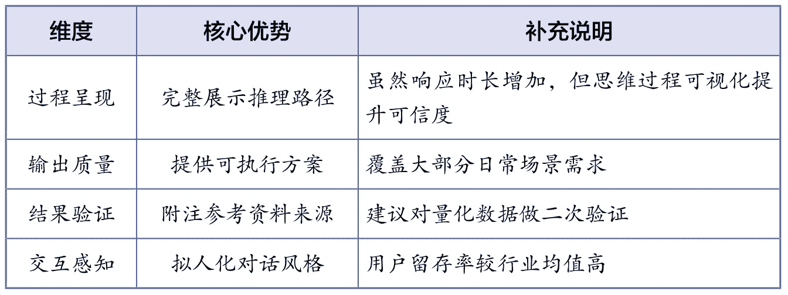

## **3.2** **如何使用 DeepSeek 批量解读文档**

DeepSeek 功能强大，操作仍遵循注册→登录→提问的基础逻辑。教师可按以下步骤快速掌握核心功能。

通过浏览器进入 DeepSeek 官网，完成注册并登录后即可进入操作界面，当前为免费服务。页面底部输入区设有三大模块：【深度思考（R1）】【联网搜索】【上传附件】，其中【上传附件】支持批量文档处理。

**1． 深度思考（R1）**

选择【深度思考（R1）】后系统启用 R1 模型，如图 3-1 所示。该模式面向复杂问题提供结构化深度解析，适用于学术研究、政策分析等专业场景。

图 3-1 DeepSeek 的【深度思考（R1）】功能

**2． 联网搜索**

开启【联网搜索】后，系统实时检索网络信息并生成带溯源标注的整合回答，典型场景如下。

· 追踪科技突破、政策变更等热点。
· 获取金融市场动态、气象预警等实时数据。
· 验证法律法规修订等时效敏感信息。

**3． 上传附件**

通过【上传附件】功能，支持 PDF、Word、TXT 及图片 OCR 识别，可一次性上传多份文档进行批量分析。DeepSeek 基于语义理解自动完成：

· 核心内容提取与结构化摘要。
· 指定段落精准定位。
· 跨文档关键词检索与对比分析。

典型应用场景如下。

· 教学资料整合：快速提取教案要点，实现多文献交叉比对。
· 学术论文精读：自动生成研究框架，解析专业术语与参考文献。
· 作业智能批改：批量识别学生文档中的逻辑矛盾与格式偏差。

## **3.3** **如何使用 DeepSeek 做出精美图片**

DeepSeek 不仅能理解复杂指令、产出逻辑文本，还能分析用户需求给出精准的绘画提示词，帮助跨越创意与技术鸿沟。结合即梦 AI、Midjourney 等绘画工具，可创作出令人瞩目的数字艺术作品。

**1． 理解 DeepSeek 的绘画提示词生成机制**

DeepSeek 基于大语言模型，通过学习海量艺术文献与绘画作品数据，掌握不同流派特征、色彩理论与构图规律。用户输入描述后，模型解析语义重点，结合艺术知识库生成包含主体元素、风格标签、色彩参数、构图规则的标准化提示词，符合主流 AI 绘画工具输入规范。

**2. AI 绘画生成步骤**

（1）明确创作意图：清晰阐述主题、艺术风格、色彩基调等核心要素。
（2）输入描述性指令：建议采用“主体+风格+色彩特征+光影效果+特殊要求”的结构化描述。例如，生成一幅赛博都市主题的赛博朋克风格画作，采用蓝紫冷色调，突出霓虹光影，建筑群呈现立体主义几何结构，背景加入全息投影，地面反射体现湿润质感。
（3）获取 AI 绘画提示词：DeepSeek 根据描述给出主题关键词、风格描述、色彩搭配建议等，为后续创作提供指导。
（4）导入 AI 绘画工具：将提示词导入即梦 AI、可灵 AI 等工具，利用深度学习算法生成初步图像。
（5）调整与优化：调整色彩饱和度、对比度，修改构图细节等。

**3． 案例：星空下的未来城市**

假设创作《星空下的未来城市》，在 DeepSeek 中输入：“我希望创作一幅画作，以星空为背景，融合未来科技元素，形成超现实主义风格。色彩以冷色调为主，特别是蓝紫色调，强调宇宙深邃与神秘。城市建筑采用流线型设计，光影突出，营造梦幻神秘氛围。请生成详细提示词。”

**DeepSeek 回答：**

（1）画面主题：超现实主义未来都市悬浮于璀璨银河中央，建筑群以半透明晶体结构呈现，表面流转液态金属光泽。几何形态与有机曲线嵌套分形迭代，构成自相似建筑语言。量子环状装置悬浮于天际线，释放虹彩能量涟漪。
（2）星空背景：全景化宇宙分层构图，近景为蓝紫渐变电离星云，中景脉冲星阵列周期性辐射锥形光束。背景采用引力透镜扭曲成像展现深空星系，暗物质丝状结构交织发光网络。
（3）建筑细节：反重力塔楼采用超导双螺旋框架，外覆动态银河全息投影。光量子廊桥通过量子纠缠态定位，连接十二面体生态舱。
（4）光影效果：基于量子色动力学原理，冷蓝切伦科夫辐射与正电子湮灭光晕交织。建筑投影通过时空曲率形成非欧几何图案。
（5）色彩方案：主色调采用钴蓝-钕紫渐变光谱，关键节点运用激光诱导荧光色。
（6）超现实元素：时空褶皱处嵌有冯·诺依曼探机残骸，硅基植物执行分形生长算法。
（7）氛围营造：采用闵可夫斯基时空度规构建视觉扭曲，光学幻象引导视觉流形分析。
（8）技术建议：建议采用 IMAX 级 2.39∶1 画幅，前景采用次表面散射技术表现晶体。

用户可将结构化提示词导入即梦 AI 生成作品，如图 3-2 所示。画面中冷调星幕与赛博城市构成动态平衡。

图 3-2 即梦 AI 生成的绘画作品

得益于 DeepSeek 技术赋能，即使无专业绘画基础，也能创作出兼具创意与艺术表现力的作品，重新定义数字艺术创作维度，构建零门槛创作生态。

## **3.4** **如何使用 DeepSeek 高效制作课件**

教学工作中，教师需精通专业知识并具备信息技术能力制作高质量多媒体课件。DeepSeek 可帮助快速生成与优化 PPT 内容，大幅提升效率。

制作流程分为三步。

**第 1 步 明确主题，生成并优化课件大纲。**

例如筹备“气候变化”科普课程，可将素材上传至 DeepSeek 并提出需求：

请根据我提供的素材，生成一份关于【气候变化】的 PPT 大纲，用于【科普教学】，要求内容条理清晰、逻辑严密，以 Markdown 格式输出。

Markdown 通过标题层级结构化内容，便于 AI 工具识别框架并快速转为 PPT。

DeepSeek 给出的提纲如图 3-3 所示，教师可进一步调整章节顺序或补充重点。

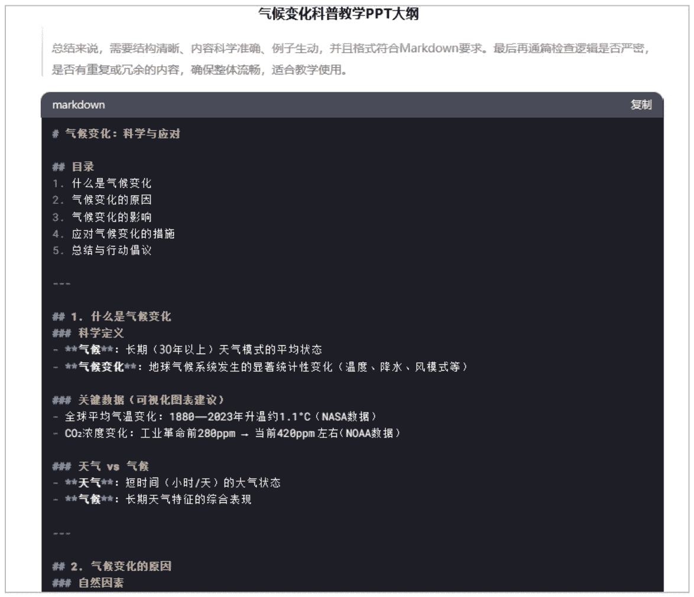

图 3-3 DeepSeek 生成的 PPT 大纲

**第 2 步 借助 AI 工具生成课件。**

主流 PPT 生成工具如表 3-2 所示。

表 3-2 主流的 PPT 生成工具

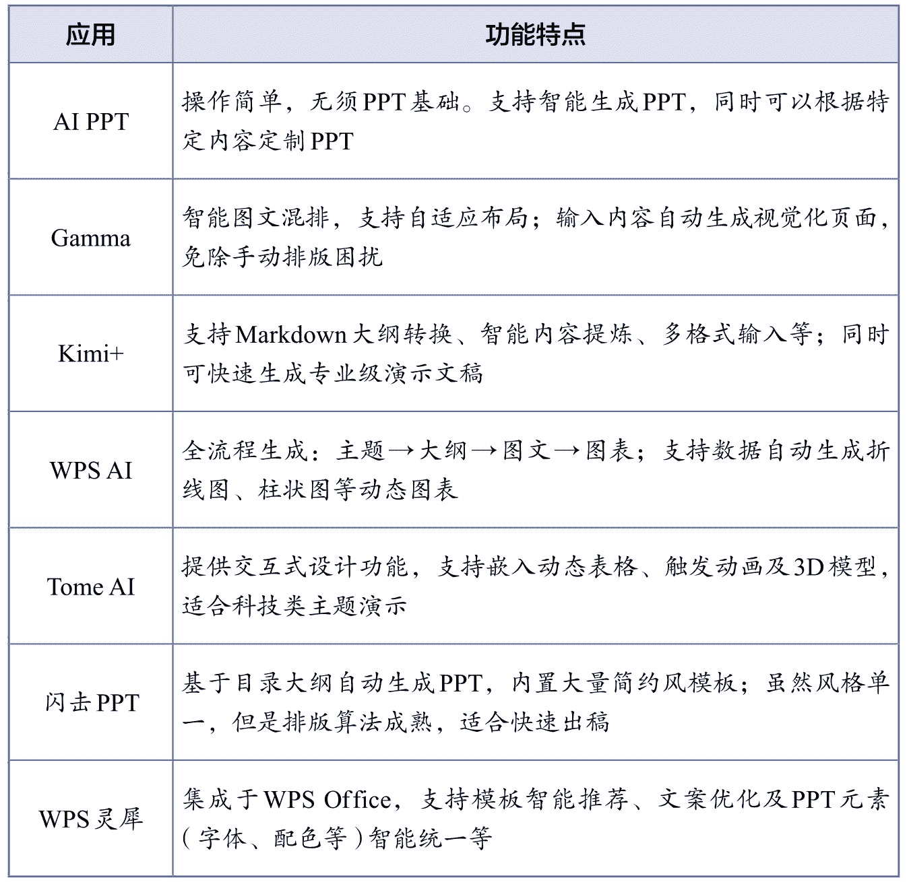

以 Kimi+ 为例操作。

登录 Kimi 官网，选择【Kimi+】→【PPT 助手】模块，将 DeepSeek 给出的 Markdown 大纲粘贴至输入框，如图 3-4 所示。

单击“发送”后，Kimi+ 生成详细 PPT 内容，再选择适配主题的模板，单击“生成 PPT”即可，如图 3-5 所示。

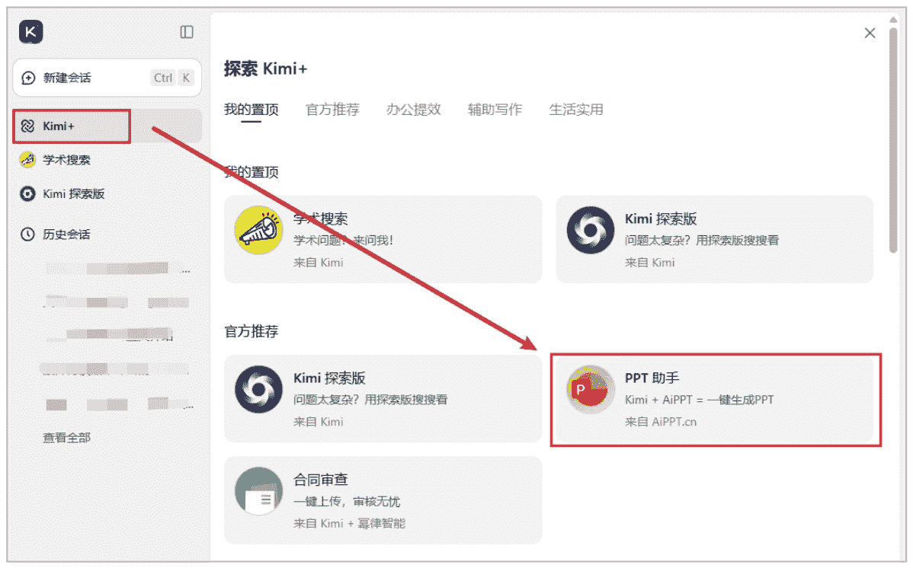

图 3-4 选择【Kimi+】→【PPT 助手】模块

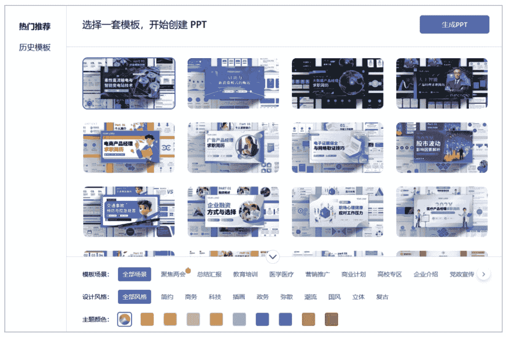

图 3-5 单击“生成 PPT”按钮

**第 3 步 精细编辑，优化整体风格。**

DeepSeek 已提供基础提纲，但教师仍需根据教学场景调整结构与知识点分布。对自动生成内容若存在逻辑衔接不畅、图文匹配不足等问题，可手动优化文本、替换示意图、调整数据可视化形式，确保课件精准契合需求。

还可根据学科需求选择模板、调整配色、字体层级、动态过渡效果，强化视觉逻辑与沉浸感。编辑完成后通过“一键导出”生成适配投影比例的高质量课件。编辑界面如图 3-6 所示。

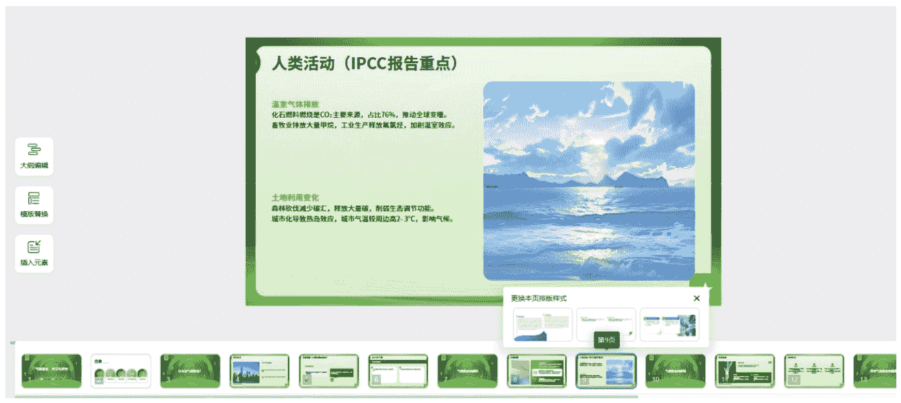

图 3-6 “编辑 PPT”界面

在课堂实践中，结构化课件可显著提升知识传递效率：清晰框架配合渐进式动画降低认知负荷，关键知识点的信息图表激活具象化思维，提升留存率。多模态教学方式维持注意力，并通过视觉锚点引发深度学习。

综上，整合 DeepSeek 智能提纲生成与 Kimi+ 自动化设计，可大幅提升制作效率，同时保证专业性、规范性与个性表达的统一，实现“减负增效”。

## **3.5** **如何使用 DeepSeek 制作教学视频**

多模态 AI 成熟后，基于 DeepSeek 的视频创作流程已实现教学资源快速开发。本节解析从脚本生成到视频输出的全链路。

**1． 工具链配置**

（1）生成脚本：DeepSeek，生成结构化脚本与分镜描述。
（2）视觉生成：Midjourney、通义万相，静态画面生成。
（3）动效转化：可灵 AI 等，图片转视频并控制镜头运动。
（4）后期合成：剪映专业版、Descript，支持 AI 配音与自动字幕。

**2． 使用 DeepSeek 生成视频制作需求**

明确视频主题至关重要。初学者适合产品展示、场景重现、服务介绍等。确定主题后可向 DeepSeek 提出需求，例如：“我想制作一个关于春日赏花的 30 秒短视频，请帮我设计脚本、文案、画面，并包含时间轴，以表格形式输出。”

DeepSeek 会给出包含时间轴、旁白文案、字幕和画面描述的脚本，如图 3-7 所示。

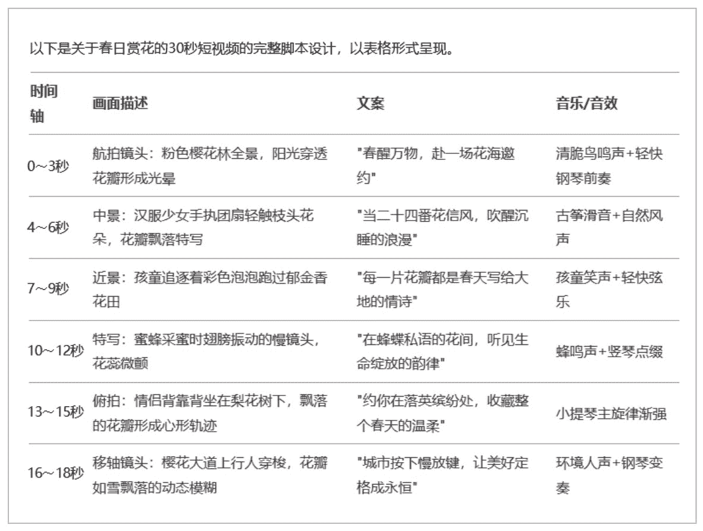

图 3-7 DeepSeek 生成的脚本

**3． 优化视频画面描述**

短视频制作与数据办公提效实战

想要成片质感更上一层，可请 DeepSeek 帮忙润色提示词，使其符合主流 AI 平台的输入规则。一条完整的描述一般要兼顾场景设定、环境描绘、机位建议、光影氛围与风格指令。

例如：请把脚本第 5 个镜头的画面写成可用于出图的描述词。将每个镜头的描述复制到 AI 平台，就能得到对应的静态画面，这些静图随后会作为视频的关键帧素材。

4． 静图转动态片段
借助可灵 AI、即梦 AI、海螺 AI 等工具，可以把静态画面转为动态视频片段，即常见的图生视频能力。这类平台通常支持自动补帧与画面微动，让静图更生动逼真，如图 3-8 所示。

图 3-8 AI 工具生成的视频画面

5． 后期剪辑与合成
把生成的动态片段导入剪映等编辑软件，按 DeepSeek 给出的时间轴顺序排列即可。剪映的【图文成片】功能支持直接输入主题、文案、素材，几步就能自动产出短视频，省掉了繁琐的剪辑与配音流程。剪映的【图文成片】功能，如图 3-9 所示。

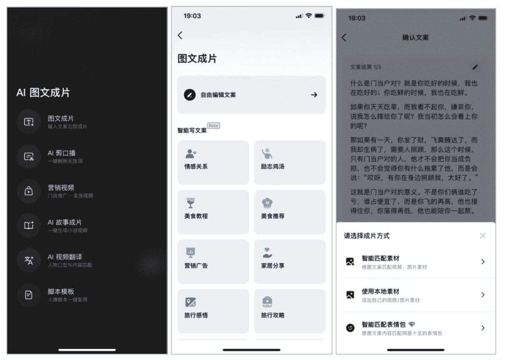

图 3-9 剪映的【图文成片】功能

按上述流程即可完成视频制作。若对成品要求不高，也可直接在剪映、即梦等平台里输入提示词，一次性生成短视频。

## 3.6 如何使用 DeepSeek 生成图表
DeepSeek 虽能产出结构化基础数据，但图表渲染仍需借助专业工具完成。

1． 生成可视化图表
使用场景：把原始数据迅速变成图表，比如销售走势、成绩分布等。
操作思路：先让模型整理成数据表，再把表导入 WPS 或 Excel 画图。
提示词示例：请根据我上传的数据，统计 2025 年度班级数学成绩，并以表格形式呈现，分不合格＜60 分、合格 60～69 分、良好 70～89 分、优秀≥90 分四类。

模型产出的表格，如图 3-10 所示。

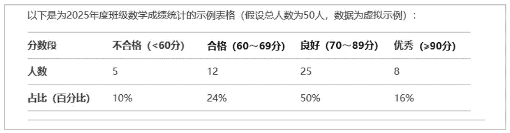

图 3-10 DeepSeek 生成的表格

具体步骤如下。
第 1 步 选中模型产出的表格数据并复制。
第 2 步 打开 Excel，新建工作表并粘贴。
第 3 步 点击菜单“插入”→“推荐的图表”，选择折线图、柱状图等类型。

2． 生成 Mermaid 流程图
适用场景：快速生成结构化流程图，如用户操作流程。
操作方法：在提问时明确要求输出 Mermaid 代码。例如指令：“请用 Mermaid 语法画出用户使用 DeepSeek 的流程图，保持简洁清晰。”

模型产出的 Mermaid 代码，如图 3-11 所示。

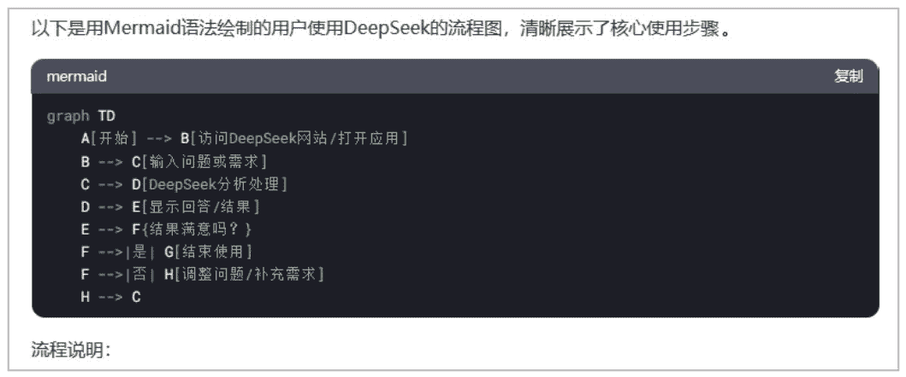

图 3-11 DeepSeek 生成的 Mermaid 代码

把代码粘贴到支持 Mermaid 的编辑器，如 Typora、Visual Studio Code 等，就能得到使用 DeepSeek 的可视化流程图，如图 3-12 所示。

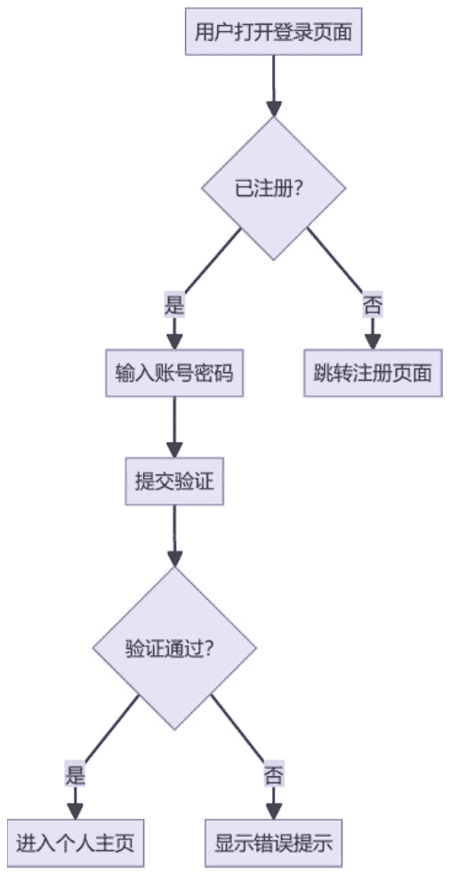

图 3-12 使用 DeepSeek 的可视化流程图

## 3.7 如何使用 DeepSeek 处理表格并生成图表
DeepSeek 可以配合 Excel 完成表格处理的半自动化，大幅简化操作。用自然语言指令就能执行复杂任务，无需手工操作。核心能力与用法如下。

1． 自动拆分表格
适用场景：按规则把大表拆成多个工作表。
输入指令：将“分销”表中 A2:A21 范围的每行数据拆到独立工作表，新表保留首行表头，以 A 列编码命名。最后请用表格形式反馈结果。

2． 按行数拆分到多工作表
适用场景：按固定行数把表格拆成多个独立工作表。
输入指令：将“分销”表 A2:A21 的内容每 5 行拆成一个独立工作表，保留首行表头，保存至 E:\AI 办公\2025 年\DS&Excel。最后以表格形式输出。

3． 表格数据处理
适用场景：批量调整表格格式。
输入指令：“从第二行起每隔一行插入空行”或“删除所有空行”。模型可快速完成。

4． 数据标记与图表生成
适用场景：数据可视化。
输入指令：将 A 列中大于 100 且小于 300 的单元格设为黄色底纹，大于 1000 的数值标红。完成后把数据粘贴到 Excel，使用【插入】→【图表】即可生成柱状图、折线图等。

总体来看，DeepSeek 结合 Excel 的优势主要有：
高效便捷：能快速完成各类表格任务，无需手动操作，节省时间精力。
易于上手：仅需用文字指令操作，无须学习复杂公式和功能。
灵活性强：支持多种表格处理方式，可满足不同需求。

# 第四章
# 巧用 DeepSeek 高效搞定日常行政办公
教师日常除了备课、上课、考核评估，还要处理撰写专业介绍、发布行政通知、撰写社会实践汇报等事务。DeepSeek 正是分担这些工作的好帮手。

## 4.1 使用 DeepSeek 撰写专业介绍
高校招生时，教师常需编写专业介绍，用于宣传册、官网或学校主页，吸引考生及家长关注。介绍应涵盖专业亮点、优势、特色及毕业生就业前景等。

模型可迅速生成专业介绍。

向模型提问：
我需要一份关于【网络与新媒体】专业的详细介绍，用于学校招生宣传。具体要求如下。
1． 突出该专业核心优势和特色，激发潜在学生及家长兴趣。
2． 涵盖就业前景，包括毕业生可从事的工作领域和职业发展路径。
3． 详细说明学习后学生将掌握的关键技能和知识要点。
4． 列出核心课程、研究方向及学习资源，让学生了解知识技能获取途径。
5． 强调学校在该专业领域的教学资源和实验设施，包括师资团队、科研项目和实践机会。

模型给出：
网络与新媒体专业介绍——连接数字未来，塑造传播新势力

一、核心优势与特色
1． 跨学科融合，培养复合型人才
本专业融合新闻传播学、计算机科学、艺术设计、市场营销等多学科，培养既懂内容创作又精通数字技术应用的全媒体复合型人才。
2． 引领前沿技术，贴近行业动态
课程覆盖人工智能、大数据分析、短视频制作、虚拟现实 VR、增强现实 AR 等前沿技术，帮助学生掌握数字时代核心竞争力。
3． 实践导向，产学研深度融合
学校与多家知名互联网企业、传媒机构共建实习基地，学生可参与品牌新媒体运营、短视频 IP 孵化等真实项目，积累行业经验。

二、就业前景
数字化浪潮下，网络与新媒体人才需求持续增长，就业前景广阔。
1． 热门岗位
新媒体运营经理、数字内容策划师、社交媒体数据分析师、短视频导演编剧、互联网产品经理、品牌传播顾问等。
2． 行业分布
互联网巨头如字节跳动、腾讯、阿里巴巴；传媒机构如央视、新华社、地方融媒体中心；广告公关公司；政府及企事业单位数字宣传部门等。
3． 就业率与薪资
近三年毕业生平均就业率超 95%，起薪普遍高于传统文科专业约 30%，市场竞争力强。

三、关键技能与知识点
1． 技术能力
数据分析与可视化：熟练使用 Python、Tableau 等工具进行数据采集、整理、分析与可视化。
基础编程与网页开发：掌握 HTML/CSS、JavaScript 等，能进行简单网页开发和交互设计。
短视频剪辑与特效：熟练使用 Premiere Pro、After Effects 等软件完成剪辑、特效和后期。
2． 内容创作能力
全网平台文案策划：能为微信、抖音、小红书等平台策划文案，撰写吸睛标题与内容。
交互式 H5 设计、信息图表制作：制作具有传播力的互动作品。
3． 传播理论素养
网络传播规律、用户行为分析、舆情管理；具备数字营销策略制定、品牌 IP 孵化、流量变现等商业思维。

四、核心课程、研究方向及学习资源
1． 核心课程
新媒体概论、数字传播技术、社交媒体营销、网络舆情分析、数据新闻制作、交互设计原理、短视频创作与运营等。
2． 研究方向
智能媒体与算法传播、网络文化与亚文化研究、元宇宙与虚拟空间传播、数字社会治理与公共传播等。
3． 学习资源
实验室：4K 影像工作室、VR/AR 体验舱、大数据分析平台等。
行业认证：与腾讯、字节跳动等合作提供“新媒体运营师”“数据分析师”等认证课程。
国际交流：与美国南加州大学、英国利兹大学等开展交换生项目。

五、教学资源与设施
顶尖师资团队、丰富科研项目和实践机会等强大后盾。
联系方式：[学校官网链接] | 招生热线：××-××
扫码关注：[学校新媒体平台二维码] 获取最新招生动态及学生作品展示。

## 4.2 使用 DeepSeek 撰写工作总结和计划
学期结束时，教师需提交工作总结和计划，对学期工作进行梳理，展示亮点与成绩，并规划下一阶段方向。

工作总结和计划通常包括：
上一学期任务回顾、实施效果综述、成效评估与反思、面临挑战、应对策略与改进方案、新阶段任务规划、个人成长计划等。

结合以上信息设计提示词并提问。

请你扮演一名【小学语文老师】，授课对象为【六年级上学期两个班级】的学生。现在需要撰写工作总结和计划。请按以下框架完成。

## 工作总结和计划
[教师姓名]:××
[学年/学期]: ××
一、上一阶段工作回顾
1． 教学目标
2． 课程安排
3． 教学方法与活动
二、实施情况概述
1． 授课情况
2． 学生反馈
3． 课堂管理
三、成果与反思
1． 学生表现
2． 教学亮点
3． 需要改进的地方
四、问题与挑战
1． 遇到的主要问题
2． 原因分析
3． 影响评估
五、改进措施
1． 针对问题的解决策略
2． 教学方法的调整
3． 资源和支持需求
六、下一阶段工作计划
1． 教学目标设定
2． 课程和活动规划
3． 预期成果
七、个人发展计划
1． 专业技能提升
2． 学术研究与合作
3． 继续教育计划
八、总结
1． 本阶段工作主要收获
2． 对未来工作的展望

模型给出：
## 工作总结和计划
[教师姓名]:××
[学年/学期]：六年级上学期
一、上一阶段工作回顾
1． 教学目标
学期初设定目标，全面提升学生阅读理解、写作表达、文学鉴赏能力，培养批判性思维和良好学习习惯。
2． 课程安排
严格按人教版六年级上册教材推进，每单元包含课文学习、生字词、阅读练习、写作训练、口语交际，每周四节语文课。
3． 教学方法与活动
采用讲授法、讨论法、小组合作学习法、情景模拟教学法等，组织课堂讨论、小组阅读、朗诵比赛、写作工作坊、文学赏析等，激发学习兴趣。

二、实施情况概述
1． 授课情况
注重因材施教，针对不同学生个别指导，通过提问、讨论、课堂练习检测效果并及时调整进度难度。
2． 学生反馈
学生反映多样化活动提升了语文课兴趣，小组合作和讨论增强了表达能力和团队协作。
3． 课堂管理
制定明确课堂规则和奖惩机制，通过积极鼓励营造积极向上氛围。

三、成果与反思
1． 学生表现
学期末学生在阅读理解、写作、口语表达方面均有明显进步，作业完成质量提高，考试成绩优异。
2． 教学亮点
小组合作学习提升参与度和协作能力；情境模拟教学加深课文理解，激发兴趣。
3． 需要改进的地方
部分后进生进度较慢需更多个别辅导；课堂时间分配需进一步优化。

四、问题与挑战
1． 遇到的主要问题
学生间学习差异大，教学进度难以统一；部分学生对语文学习兴趣不高，主动性不足。
2． 原因分析
（略）

## 4.3 使用 DeepSeek 撰写行政通知
一份规范的行政通知应包含主题、目的、内容、时间地点、责任人及执行要求等。借助 DeepSeek 可快速生成。

向模型提问：
你是一位【小学】工作人员，拥有丰富行政经验，请撰写一份行政通知，基本信息如下。
（1）受众：全校师生。
（2）目的：宣布学校新学期选修课相关事宜。
（3）内容：请家长知悉选修课类型（20 种），结合孩子喜好选择合适的选修课（每人最多 3 门）。因部分课程报名火爆，家长需按规定时间提前预约。
（4）格式和语气：正式。
（5）发布方式：学校网站、电子邮件、公告板等。
（6）后续跟进和反馈机制：欢迎提出意见建议，有疑问请及时与教务处联系。

模型给出：
××小学 202×—202×学年第二学期选修课选课事宜的通知
尊敬的全体师生及家长：
大家好！
为落实素质教育要求，丰富学生校园生活，我校新学期将开设涵盖五大类别的选修课程共 20 种。现将有关事项通知如下，请家长协助孩子完成选课。

一、选修课类型及内容
本次选修课分为以下类别（示例）。
（1）学科拓展类：趣味数学思维、英文绘本阅读、科学实验工坊等。
（2）艺术素养类：创意美术社、陶艺制作、少儿合唱团等。
（3）体育健康类：武术基础班、篮球技巧训练、少儿瑜伽等。
（4）科技实践类：机器人编程、3D 打印设计、航模制作等。
（5）生活技能类：小小烘焙师、植物养护课堂、礼仪与表达等。
完整课程列表及简介详见附件。

二、选课说明
（1）选课原则：每位学生最多可选 3 门课程，请家长结合孩子兴趣特长科学规划。
（2）报名时间：202×年××月××日（周××）9:00 至××月××日（周××）17:00。
（3）预约方式：登录学校选课平台（网址：××.edu.cn）进行选课。

三、重要提醒
（1）热门课程如机器人编程、创意美术社名额有限，采用先报先得。
（2）部分课程需自备材料，详见课程说明，请提前准备。
（3）课程确认后原则上不可更改，特殊情况需于开课后一周内提交书面申请至教务处。

四、反馈渠道
学校将持续优化课程设置，欢迎通过以下方式提出意见建议。
☎ 教务处热线：××-××（工作日 8:30—17:00）

电子邮箱：××@××.edu.cn

现场咨询：行政楼 203 室教务处
感谢大家的支持与配合！
××小学教务处
（学校公章处）
202×年××月××日
附件：选修课手册

## 4.4 使用 DeepSeek 撰写暑期社会实践汇报
一份完整规范的暑期社会实践汇报通常包含标题、目录、活动背景和目的、活动内容和过程、活动成果和收获、活动反思和展望。

我们可以借助 DeepSeek 生成一份规范的暑期社会实践汇报模板。

向 DeepSeek 提问：

DeepSeek 写作助手：让高校文案更高效更规范

高校教师在指导学生整理材料、撰写规划时，常会遇到格式不统一、思路零散的问题。借助 DeepSeek 的结构化生成能力，可以快速得到标准模板，再结合具体信息填充出成稿。下面以几类高频场景为例，展示如何把需求转化为可直接使用的文案。

一键生成暑期社会实践汇报框架

当需要给学生提供规范的汇报思路时，可以让模型先输出一份通用模板。模板通常包含汇报人基本信息，随后是项目总览、实施过程、成果成效、问题反思、收获感悟等模块。

项目总览部分建议填写主题名称、起止时间、具体地点、个人或团队形式，以及 200 至 300 字左右的背景与价值说明。内容与过程部分要分前期筹备和实施两块，前期包括方案设计、能力储备、分工与安全；实施按阶段描述活动安排、主要形式和关键发现，并突出创新点。成果与成效要量化呈现，如调研报告数量、服务时长、受益人数、媒体报道等，并补充社会反响和个人成长。问题分析要客观指出困难，再给出针对性改进建议。感悟启示部分分别写思想认识和对未来学业职业的影响。最后可附日志、问卷、照片等材料并致谢。备注通常提醒字数 3000 到 5000 字、根据调研服务实习等类型调整侧重点、避免流水账并配合数据案例图片，格式上标题三号黑体、正文小四宋体、1.5 倍行距。

模板落地示例：汉语言文学专业古籍服务实践

给出学生身份、专业、时长、主题后，模型即可按上述框架填充完整案例。以文学院汉语言文学专业 2021 级李华为例，2024 年 7 月 1 日至 7 月 31 日在校图书馆古籍文献部与读者服务部开展个人实践，主题为图书馆古籍整理与文化传播服务。

前期与指导老师制定了整理与推广双线方案，学习古籍整理基础和分类法，参加修复观摩培训并签署安全协议。第一阶段 7 月 1 日至 15 日完成 200 余册清代地方志、民国诗集的编目与录入，参与 3 册虫蛀本的除尘平整，发现一本清代县志手抄本中的民俗歌谣线索。第二阶段 7 月 16 日至 31 日策划“古籍里的中国”展览，撰写 10 篇展板文案、挑选 30 幅插图，组织 2 场古籍修复体验工作坊，服务读者 50 余人，并通过官网与社交平台发布信息。

特色在于专业知识与文献学相结合，以及短视频记录修复过程在 B 站累计播放 1.2 万次。量化成果为编目古籍 213 册、数据条目 500 多条、读者活动 4 场、参与 240 人、推文 3 篇、短视频 4 条并获地方日报报道。社会影响体现在助力数字化进程与提升读者保护意识，调查显示 83% 参与者关注度提升。个人层面掌握编目技能、提升检索与文案能力，并将文化传播确立为职业方向。

问题主要在术语不熟导致效率偏低、宣传覆盖不足，改进建议是制作古籍术语速查手册并联合社区文化中心推广。感悟强调古籍是文明基因，触摸批注墨迹体会传承责任，未来拟选修数字人文课程探索 AI 与古籍研究的结合。

## 4.5 使用 DeepSeek 撰写活动策划方案

活动策划需要名称、目标、形式、预算等要素清晰。给模型输入时间、地点、参与对象和大致环节，即可得到结构完整的方案。

以 2025 年世界读书日活动为例，活动名称为书香校园——××大学庆祝世界读书日，目标是推广阅读习惯并强化校园文化，时间 4 月 23 日至 25 日，地点为图书馆大厅、报告厅、学生广场及线上平台，面向全校师生校友，预算总计 1 万元。

模型输出的方案包括背景、主题“阅见世界，共享书香”、基本信息、内容设计、宣传、预算、注意事项和预期效果。内容设计分主会场书香长廊主题书展与声动校园朗诵会，以及学生广场的图书以旧换新市集与图书漂流瓶计划，线上开展豆瓣书评大赛和教授荐书直播。宣传分前期预热、中期跟进、后期总结。预算分配为宣传物料 2500 元、图书采购 3000 元、奖品纪念品 2000 元、场地布置 1500 元、其他费用 1000 元。注意人流疏导、雨天备选场地、环保宣传和数据留存。预期参与超 2000 人，打造长效品牌，推动借阅量提升 15%。

## 4.6 使用 DeepSeek 撰写学生就业计划书

就业计划书的核心是个人信息、求职目标、自我分析、规划路径、行动策略、资源支持与动态评估。模板应帮助学生清晰表达优势劣势、兴趣价值观、技能提升计划、实践积累方式及求职渠道。

模型给出的框架包含基本信息、短期 1 至 3 年和中长期 3 至 5 年目标、优势劣势与改进计划、行业岗位选择依据、技能证书规划、实习项目安排、简历求职信优化、面试准备与时间表、校内校外资源利用、导师校友支持，以及定期评估与灵活调整。结语部分要求重申目标并承诺执行。附录建议附简历与作品链接，注意事项强调个性化、简洁明了、可操作性强。

# 第五章 巧用 DeepSeek 优化学生日常事务管理

将智能工具融入日常管理，能显著降低重复性工作量，让教师更聚焦于质量把控。

## 5.1 放假通知，DeepSeek 助你精准表达

各类通知要求表述准确无歧义。借助语义分析与文本生成，可以快速输出规范的假期告知。以某大学 2024 年国庆节放假通知为例，模型会先给出尊称问候，随后清晰列出起止时间、放假安排、值班要求、安全提示等要点，确保信息完整、语气得体，避免学生误解。

整体来看，DeepSeek 能够把高校教师的经验需求转化为结构化模板，再根据具体信息填充成稿，兼顾规范性与可读性，是提升学生事务写作效率的有效工具。

假期通知怎么写才既规范又好读：范本拆解与智能辅助实操

参照《国务院办公厅关于2024年部分节假日安排的通知》国办发明电〔2023〕7号精神，结合学校实际，现将2024年国庆放假有关事宜公告如下。

休假安排
国庆放假为10月1日星期二至10月7日星期一，连续七天。
调班安排
9月29日星期日正常上班，按10月7日星期一的课表执行；10月12日星期六正常上班，按10月4日星期五的课表执行。

工作要求
各学院各部门要妥善安排值守与校园安保，保持信息畅通。遇重大突发事件须按规定及时上报并妥善处置。放假前各单位应组织一次全面安全隐患排查，确保校园平稳。

注意事项
假期师生员工要注重人身财产安全，遵守交通法规，不参与违法活动。外出旅游或探亲访友时请留意天气与路况，确保行程安全。各单位负责人请保持电话畅通，便于应急处置。全体人员请于10月7日18:00前返校，10月8日星期二正常上课。

特此公告。
××大学校长办公室
2024年××月××日

从这份示例可以看出，假期通知需要明确告知目的，兼顾受众特点，遵循公文规范，用简洁明了的语言分段呈现要点并突出关键信息。结合学生特点适当调整内容与语气，确保涵盖放假起止、调休、返校节点等核心要素，同时加入人文关怀，增强归属感与亲和力。

用提示词引导智能助手生成寒假通知

以“智能放假通知助手”的角色为××大学××学院起草节假日通知，主要要求为假期为2025年1月16日至2月19日，回校日为2025年2月19日；语言简洁易懂，分段呈现休假时段、回校节点、教学活动安排；结合学生阅读习惯采用亲切表达；加入人性化祝福与安全提醒，涵盖离校返校流程、交通财物安全；全文控制在800字以内。

助手给出的寒假安排要点如下。

××大学××学院2025年寒假安排通告

同学们：

为帮助大家提前规划假期，根据学校统一部署并结合学院实际，现将2025年寒假安排及相关要求通知如下。

休假与回校安排
休假时段为2025年1月16日星期四至2月19日星期三。课程结束后次日起方可离校，1月16日前不得提前离开。
回校须于2025年2月19日星期三18:00前完成报到注册，2月20日星期四正式上课。返校后请在班级群完成线上签到，并持学生证到辅导员办公室核销假期去向登记。

教学活动调整
补考安排将于2月17日在教务系统公布，请届时登录查询。参与寒假社会实践的团队，请于1月12日前将安全承诺书交至学工办。

离校与留校
1月15日为本学期最后教学日，请完成期末考核。实验室开放至1月14日17:00，需寒假使用者请于1月10日前提交申请。离校前请关闭宿舍电源水源，锁好门窗，贵重物品随身携带，并在“智慧校园”App提交《假期去向登记表》，截止1月14日22:00。因特殊原因需留校者，请于1月8日前填写《寒假留校申请表》，审批通过后统一安排集中住宿，留校期间每晚22:30前回宿舍打卡。

安全提示
交通方面请乘坐正规交通工具，拒绝非法运营，途中做好个人防护，建议避开1月24日至2月5日春运高峰。财产方面警惕电信诈骗，不轻信刷单兼职、低价购票等信息，妥善保管证件，建议复印备份。健康方面注意饮食卫生，减少不必要的聚集，如遇突发情况请联系辅导员或拨打学院24小时值班电话。

假期既是休整也是提升的机会，建议制定阅读计划、参与学院活动、多陪伴家人。祝大家度过平安充实的春节假期！

××大学××学院学生工作办公室
2025年1月10日

借助提示词引导生成的通知既符合规范，又体现了学院的严谨与专业。生成效率高，能迅速整合休假时段、回校节点、教学安排等关键信息；结构优化清晰，逻辑顺畅，便于阅读并减轻教师负担；同时融入人文关怀与温馨祝福，增强归属感，提升通知吸引力。

5.2 设计调查问卷，统计学生开学返校情况

新学期开始，统计返校情况是教师的重要工作。领导常会交代开学时把返校情况统计好，笼统要求往往让教师无从下手。

1. 问卷设计
统计返校情况的关键在于问卷设计，借助智能助手可高效获取统计要点。

提问示例：请以高校辅导员身份，基于返校统计经验，为××学院设计一套大学生开学返校情况统计方案，要求明确统计核心要点并细化具体项目，语言简洁。

助手给出的方案要点如下。

××学院大学生开学返校情况统计方案

核心要点
学生基本信息、返校时间信息、健康状况信息、行程详情、特殊需求。

项目细化
学生基本信息含姓名、学号、班级专业、联系电话、紧急联系人及电话。
返校时间信息含计划返校日期、实际返校日期、是否按时返校及原因。
健康状况信息含体温情况、有无发热咳嗽等症状、近期是否到中高风险地区旅居、其他健康说明。
行程详情含交通方式、出发地、预计到达时间、是否需要接站服务。
特殊需求含是否需要搬运行李帮助、是否需要特殊住宿安排、其他需求。

该方案结构清晰、内容全面，涵盖核心要点并细化到具体条目，便于高效获取数据并满足个性化服务。

2. 问卷收集
明确内容后，可将信息汇总到问卷平台发布。推荐腾讯文档，其大纲录入功能便捷，可自动匹配标题并预览。

第1步 访问腾讯在线文档 https://docs.qq.com/，新建收集表并选择【大纲录入】功能，如图5-1所示。
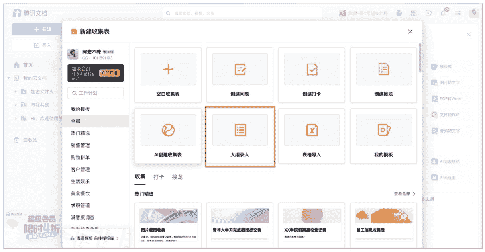
图5-1 大纲录入入口示意

第2步 将助手生成的问卷内容整理填入大纲创建区，完成后点击“创建收集表”按钮，如图5-2所示。
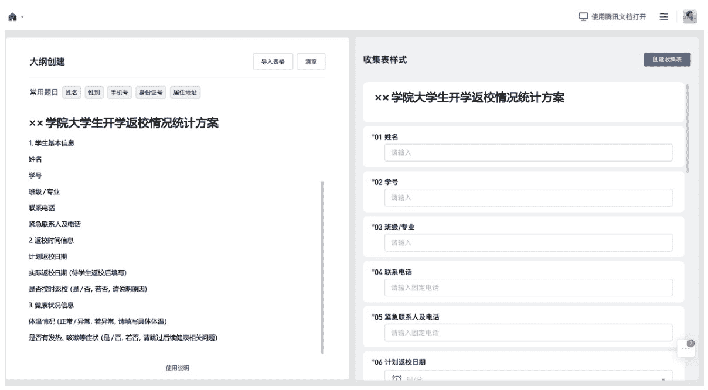
图5-2 创建收集表操作

第3步 优化表格选项。例如“是否按时返校”初始仅有“是”“否”两个选项，如图5-3所示。

图5-3 初版的两项选择

可借助智能功能完善。点击该选项，下方功能栏显示“让 AI 文档助手帮你添加问题”，如图5-4所示。

图5-4 AI助手提示入口

输入指令补充完整选项，点击“发送”按钮，如图5-5所示。

图5-5 输入补充指令

点击“立即生成”按钮，系统会结合指令重新生成针对性选项，如图5-6所示。
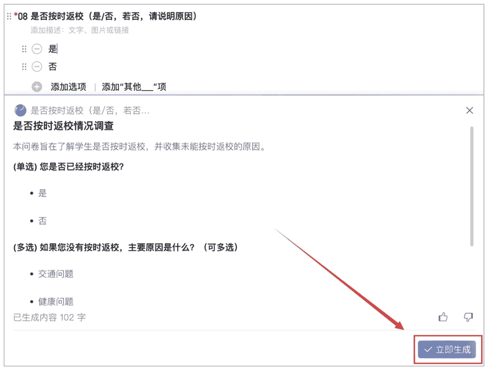
图5-6 生成新选项画面

修改后的选项更符合填写场景，如图5-7所示。
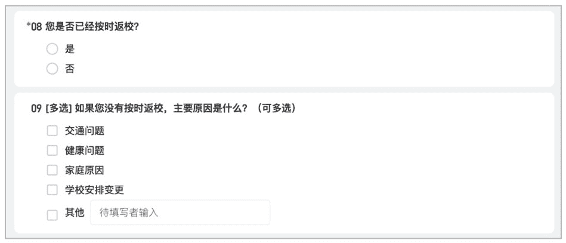
图5-7 优化后的选项

第4步 完成设计后，点击“发布分享”按钮，可通过QQ、微信以二维码或链接形式分享至班级群，如图5-8所示，开始收集返校信息。
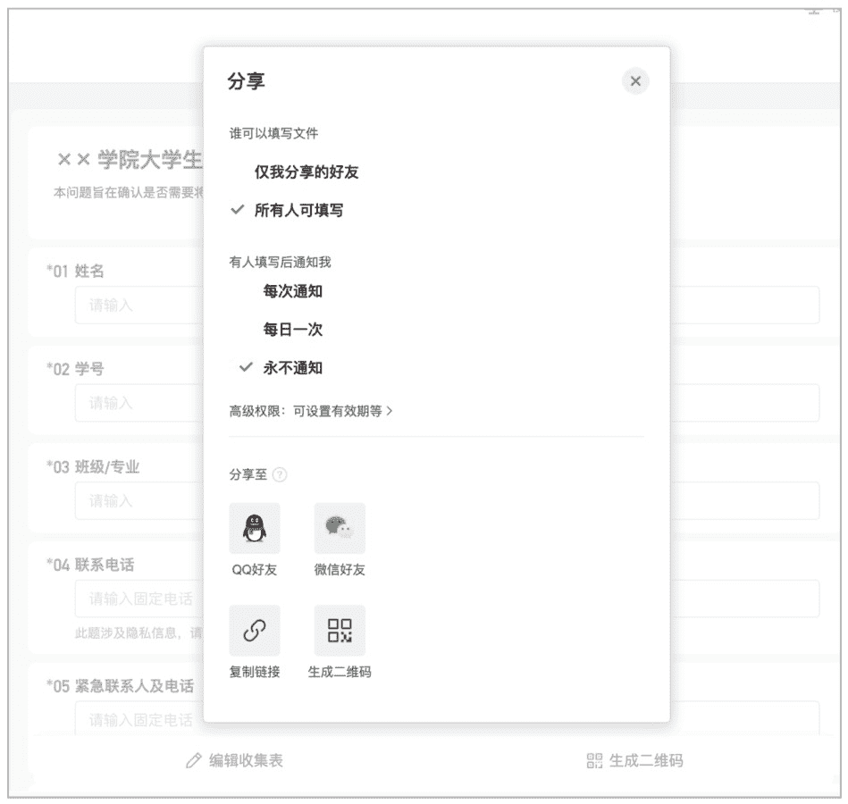
图5-8 问卷分享入口

5.3 谈心谈话，快速记录并提炼要点

谈心谈话是教师日常工作的核心环节，受时间、精力与环境限制，记录质量与效率常难以保证。教师需兼顾多班多生，行政事务繁忙；不同学生需差异化沟通策略；学生也可能因环境有所保留，影响效果。

借助智能助手可设计个性化谈心方案，优化沟通技巧并捕捉情绪变化。AI还能同步语音录入并自动提炼关键信息，辅助总结与跟进计划制定。

1. 精准识别问题成因
谈心涉及学习方法、情绪管理、压力应对、人际关系、职业规划、生活困扰等场景，可围绕其构建提示词模板。

学习方法提示词示例：请担任“学风优化专家”，作为教师助手，核心能力是分析学习数据并识别学困生。请针对学习困难学生分析难点成因并制定个性化提升方案。学生情况如下【输入成绩、出勤、作业等】。

情绪管理提示词示例：请担任“情绪管理专家”，作为教师助手，核心能力是识别并分析学生情绪问题。请针对情绪管理不当的学生分析来源并制定个性化情绪管理方案。学生情况如下【输入情绪表现等】。

压力应对、人际关系、职业规划、生活困扰等提示词同理构建，分别聚焦压力来源、人际问题、职业倾向与生活困扰的分析与方案制定。

2. 快速生成个性化谈心清单
谈心前需明确主题、收集信息、制定计划、保持积极心态并应对突发情况。

提问示例：请担任“智能谈心专家”，作为教师助手，专注于个性化指导。请为××主题准备一份谈心问题清单，要求问题具体清晰、具有针对性引导性与开放性，语气亲和温暖，传递信任并激发积极性，同时考虑突发情况应对。学生情况如下【输入主题与相关信息】。

以室友关系不和为例，助手给出的清单分为建立信任、探索根源、引导反思与行动三个阶段，通过共情式提问、归因分析与赋能式提问，帮助学生厘清现状、识别需求并制定微行动，提升沟通效果与后续跟进的针对性。

谈心话术升级与AI提效实操手册

把抽象的沟通意图拆成可操作的提问，能显著降低学生回应门槛。

“如果下周只改一个小细节，比如主动约舍友一起打水或是分享点零食，你更倾向哪一种？”

3． 风险预判

“假设你去示好却没得到预期回应，你会如何自我解释？为了缓解可能的失落，你打算借助哪些支撑？”

提前做情景演练，可帮助学生提升心理韧性。

第四阶段：制订个性化方案（合作式共创）
1． 关系重构实验
“我们可以共设计一个‘21天舍友互动小实验’，每周挑选一个低门槛行为，比如点赞舍友的朋友圈、参与一次宿舍夜聊，你准备先从哪些具体做法试起？”
把长期目标拆解为可计数的短期动作，掌控感会随之增强。
2． 外部支持激活
“遇到需要时，你更希望老师牵头发起集体活动，还是私下与某位舍友单独聊聊？”
提供选择空间，也兼顾隐私诉求。

第五阶段：巩固信心与长期视角
1． 认知重塑
“有人认为舍友不必发展成挚友，保持友善协作就够了，你怎么看？这种观念能否减轻压力？”
帮助学生跳出非黑即白的框架，拓宽人际可能性。
2． 成长性思维
“设想三年后回看现在的困扰，你觉得它会对社交能力产生什么影响？可能带来哪些正向收获？”
以更长的周期审视当下焦虑，有助于稀释紧张感。

第六阶段：交流保障：突发情况应对与引导策略
1． 情绪失控时的干预
先暂停追问、优先安抚，递纸巾、调适座位距离，用共情表达：“我留意到你很委屈，这种情绪确实很难承受。”
2． 偏离主题时的引导
自然关联拉回：“你刚才提到××，这和你与舍友的相处有什么联系吗？”
3． 沉默抗拒时的应对
避免开放式发问，提供二选一：“有同学会写日记梳理心情，也有同学通过运动释放压力，你觉得哪种更适合自己？”

经过优化，问题清单更系统、更落地，既能引导深度反思，也传递出信任与支持，推动学生由被动承受转向主动探索，逐步建立可持续的交往策略。

3． 利用生成式助手快速记录谈心谈话内容

谈话时借助通义类工具做实时记录与归纳，效率明显提升。

使用途径 1：网页端
在通义官网登录后进入【实时记录】，点【开始录音】，系统即可把语音转为文字，如图 5-9 所示。

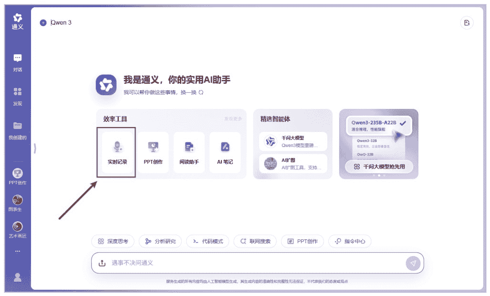

图 5-9 选择【实时记录】功能

使用途径 2：移动端
微信搜索【通义效率助手】小程序登录后，选择【实时记录】，点【开始录音】即可。

【实时记录】不仅支持即时语音转文字，录完后还能自动产出归纳总结。下面是一次谈心记录的示例。

李一，化名，女，20岁，大二。上学期她开朗活跃，常参与学院活动，和同学关系融洽。下学期开学第一周，她主动来办公室求助，表示近期因学业压力焦虑严重，注意力难以集中。

进一步了解后，问题源于寒假的家庭环境：家人反复强调学业重要性和就业形势的严峻，对其大一成绩提出批评，要求加倍努力。她本对成绩保持客观乐观，但在持续施压下开始自我怀疑，对未来迷茫。新学期她想投入学习却出现逃避，逃避又放大焦虑，形成恶性循环，最终察觉状态异常才主动求助。

我们把该案例归为情绪调适问题，导入情绪管理提示词向 DeepSeek 发起询问。

提问示例：
你是一名“情绪管理专家”，作为教师的助手，擅长精准识别学生情绪困扰。请对情绪管理不当的学生剖析成因，并制定个性化的情绪管理方案，帮助提升学习效率与生活质量。

学生情况同上。

DeepSeek 的回应：
李一同学情绪问题分析与个性化管理方案

一、情绪问题来源分析
1． 家庭压力
外部压力：家人过度强调成绩与就业，使其承受较大外界压力。
自我认同受损：家人对大一成绩的负面评价削弱其自我认同。
2． 自我认知偏差
消极思维：本相对乐观，受负面评价影响产生“成绩无望、未来黯淡”的想法。
负面自我暗示：想法加剧焦虑，形成恶性暗示。
3． 逃避行为
应对方式：用逃避学习应对焦虑，反而加重焦虑。
恶性循环：逃避导致进度滞后，焦虑加深。
4． 情绪累积与爆发
长期积压未疏导，在开学时集中爆发，以求助行为呈现。

二、个性化管理方案
1． 认知重构
目标：帮助其重新看待成绩与前景，建立积极自我认知。
方法：深入对话，引导其认识家人批评出于关心但未必客观；鼓励列出优点与成就，增强自信；设定合理学习目标，关注过程。
2． 情绪调节技巧
目标：学会应对焦虑。
方法：深呼吸、冥想等放松训练；正念练习，减少对未来的过度担忧；情绪日记，记录变化与触发点，提升觉察力。
3． 行为激活
目标：打破逃避循环，恢复学习状态。
方法：制定详细计划，把大目标拆小；建立奖励机制，完成小任务后自我奖励；加入学习小组或找学习伙伴互助。
4． 家庭沟通策略
目标：改善与家人的沟通。
方法：教授“我”表达法，避免指责；建议共同制定学习与就业规划；鼓励分享校园进步，增进信任与支持。
5． 持续跟踪与反馈
目标：确保方案落地并动态调整。
方法：定期沟通进展与状态；根据反馈调整方案；必要时提供心理支持与资源链接。

三、总结
李一的情绪问题源于家庭压力、认知偏差、逃避行为和情绪积压。通过认知重构配合情绪调节等个性化方案，可帮助她有效管理情绪，提升效率与生活质量。情绪管理是持续学习的过程，需要不断练习。

该模型在极短时间内抓住核心根源，把家庭压力和认知偏差作为重点，方案模块衔接紧密，形成完整科学的管理体系，体现了对个体差异的尊重与细致关怀。

5.4 起草违纪处理文件不用愁

学生违纪通常涵盖学术不端、校规校纪违规、损坏公物、扰乱秩序等。处理流程包括询问、调查、审理、决定，其中调查审理环节需整理大量证据并撰写处理文件，耗时易错。

借助 DeepSeek 等智能助手，教师可高效精准分析违纪行为，步骤如下。
1）证据整理：把谈话记录、时间线、视频、聊天记录整理成文档上传。
2）智能分析：输入标准化提示词，引导助手深度剖析。

助手核心功能：
自动生成初稿：按模板生成违纪描述、处理依据、建议措施。
智能校对：检查语法、逻辑并给出优化建议。
动态调整：按审核意见或新政策修订内容。

处理结果既合规又提效。

1. 智能助手专业分析违规行为

提问示例：
你作为“纪律分析专家”，熟悉《普通高等学校学生管理规定》及校纪，能敏锐判断。请完成：
1． 精准界定事实：分析因果，明确行为动机。
2． 制定处理意见：客观评估对校园秩序及个人成长的影响；结合校规与实际情况提出合理方案，为后续管理提供依据。
3． 情感引导与教育：剖析行为背后的情感需求；引导认识错误并改正。
要求：逻辑清晰，结论明确，语言简洁易懂。

以张三宿舍违规使用大功率电器致整楼停电为例，助手回复如下。

DeepSeek 回复：
学生张三违纪行为分析报告

一、事实依据与行为界定
事实依据：2025年3月10日，张三在宿舍使用电煮锅1500W、电吹风1200W，导致电路过载停电，影响整栋楼，停电约2小时。
违规认定：违反《高等学校消防安全管理规定》第18条第3款，人员密集场所禁止违规使用大功率电器；违反校《宿舍管理条例》第5.3款，禁止使用功率超800W电器。
行为性质：安全隐患，威胁电路安全，可能引发火灾；群体影响，公共设施瘫痪，干扰他人生活。
动机分析：直接原因追求便利忽视风险；心理因素侥幸心理、规则意识薄弱；潜在诉求或对食堂时间、吹风机不足不满，未走合规渠道。

二、影响评估
对管理负面影响：电路老化加速，维修费约5000元；处理不当易引发效仿。
对个人危害：处分影响评优奖学金，增加心理压力；认知不改可能重蹈覆辙。

三、处理意见与教育方案
纪律处分建议：基础处理警告或严重警告并通报批评；附加责任承担检修部分费用，参加安全培训。
教育引导：情感疏导，辅导员约谈了解需求并反馈后勤；开展“安全与责任”主题班会。
行为矫正：要求在宿舍楼内做一次公开检讨与安全宣讲；签“安全承诺书”，设1个月观察期，宿舍长每周反馈。

四、后续跟踪与制度优化
对学生：每月一次心理辅导，观察期后可申请降级。
对管理：每层增设公用吹风机，开放公共厨房；每学期开展安全用电宣传周，组织应急演练，本案例纳入教育库。

五、总结
兼顾刚性与温度：处分维护纪律，疏导解决实际需求，推动惩教防一体化。

分析人：纪律分析专家组
××大学学生工作处
2025年3月11日

通过助手高效梳理证据，让每份文件都立于事实之上，客观公正。

2. 智能助手辅助生成并优化违纪处理文件，让效率倍增

基于分析结果，用标准化提示词让助手生成初稿，再校对优化，最后按审核意见和最新要求调整。

继续以张三为例提问：
你是一位“纪律管理专家”，精通相关规定，请撰写结构清晰的处理文件初稿并提出公正建议。要求：文件结构包括标题、基本情况、违纪事实、处理依据、处理决定、申诉权利；语言规范、逻辑清晰。

DeepSeek 回复：
关于学生张三违纪行为处理的决定
文件编号：××大学〔2025〕12号
发布日期：2025年3月11日

一、基本情况
姓名：张三，学院：××学院，班级：2023级××专业××班，学号：2023××，宿舍：××栋××室，事件时间：2025年3月10日21时30分。

二、违纪事实
2025年3月10日晚，张三宿舍违规使用电煮锅1500W、电吹风1200W，致电路过载停电约2小时。
影响：300余名学生受影响，部分设备受损。
应急：后勤紧急抢修恢复。
证据：监控录像、后勤故障报告及维修清单、同寝及邻寝证词。

三、处理依据
《高等学校消防安全管理规定》第18条第3款，禁止违规使用大功率电器。
《××大学宿舍管理规定》第5.3款，禁止使用超800W电器；第8.2款，个人行为致损需赔偿。

四、处理决定
纪律处分：严重警告，期限6个月，全校通报，记入档案，取消本年度评优奖学金资格。
附加责任：承担30%维修费，10日内缴付；参加3天校园安全培训并考核。
行为纠偏：在班级及宿舍楼做两次用电安全宣讲；签订安全承诺书，辅导员、宿舍长监督，观察期1个月。

五、申诉权利
自收到决定之日起5个工作日内，可向××大学学生申诉处理委员会提交书面申诉。受理地址：行政楼301室，电话：××-××。

六、后续跟踪与教育
辅导员每月谈心一次，关注心理与行为改进；向后勤反馈学生需求，如增设吹风机、延长食堂时间。

签发单位：××大学学生工作处
签发人：李××（处长）

附件：电路故障报告复印件、安全承诺书模板
备注：一式三份，学生、学院、学工处各存一份。

助手生成的初稿依托标准化模板，依据情况输出描述、依据与建议，显著提升效率。

5.5 通知海量记不住？AI 帮你抓重点

学校通知种类繁多，活动通知、事务通知、教学安排等，部分时效强需即时处理。教师需花大量时间阅读、判断优先级并传达要点。智能助手能整合海量文件，快速分类归纳，精准提取关键信息，避免遗漏，并据学生管理工作提出针对性建议与方案。

AI 让校园文件整理与班会策划更高效

以 DeepSeek 为例，单次可同时读取约 50 份材料。结合教学管理实际，可以按两步推进。

第一步 把待整理的材料上传并下指令
向 DeepSeek 发出指令：
请以“文件处理专家”的身份担任教师助手，主要工作是高效梳理校内文件并提炼要点。对每份材料逐一识别关键信息，用通俗易懂的语言呈现。具体要求如下。
1. 全面通读每份材料，确保核心要素不遗漏。
2. 自动抽取重点，例如截止时点、参与范围、具体要求等。
3. 以条理清晰的方式归纳要点，方便学生快速理解与记忆。
材料信息：××

第二步 按学生管理类别给出针对性建议与方案
学生活动类通知提示词：
请承担“学生活动专家”角色，协助教师整合文件信息并结合活动通知要求提出可落地的建议。要求如下：
1. 深入理解通知的诉求，涵盖目的、时间、地点、参与对象及预期成效。
2. 在信息整合基础上给出针对性建议，如如何组织学生参与、如何保障活动顺利推进、如何提升吸引力与影响力。
3. 设定活动效果评估标准，便于活动结束后复盘。
材料信息：××

学生事务类通知提示词：
请担任“学生事务专家”角色，协助教师整合文件信息并依据事务通知提出具体建议。要求如下：
1. 深入理解通知的具体诉求，包含事务类型、涉及群体、时间节点及期望目标，为后续建议奠定基础。
2. 针对不同事务类型给出可行方案。如奖学金评选如何制定公平公正标准，活动组织如何设计兼具趣味与意义等。
3. 设定明确的评估标准，便于执行中与执行后评估成效。
材料信息：××

教学安排类通知提示词：
请担任“教学安排专家”角色，协助教师整合文件信息并依据安排通知提出优化建议。要求如下：
1. 深入理解通知要求，包含课程安排、时间分配、教学资源等，明确学校教学目标与期望。
2. 基于整合信息提出优化建议。如如何调整课程提升效率，如何合理调配资源，如何化解教学冲突。
3. 设定评估标准，便于教学实施过程中追踪效果。
材料信息：××

按此两步走，AI 可以快速完成学校各类文件的归类、整合与处理，并有针对性地总结提出方案指导后续工作。教师无需独自面对繁琐整理，可借助智能支持更精准把握学生需求，提供个性化指导，最大程度保障学生权益，维持正常教学秩序。

下面以《某高校关于开展 2023—2024 学年大学生综合素质测评工作的通知》为例说明。

第一步 借助 AI 提示导入案例，如图 5-10 所示。
将该通知导入 DeepSeek，按预设提示词模板操作。

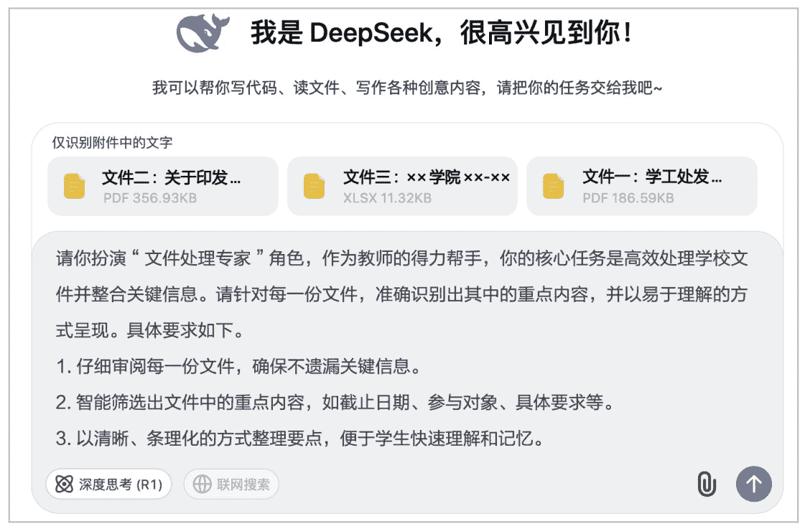

图 5-10 借助 DeepSeek 提示词导入案例

DeepSeek 的输出：

文件一：学工处发〔2024〕31 号《关于开展 2023—2024 学年大学生综合素质测评工作的通知》
要点归纳：
1. 测评覆盖范围
2021 级、2022 级、2023 级普通全日制在校本专科学生。
2. 测评维度
围绕思想道德素质、专业学习素质、身心健康素质、文化艺术素质、实践服务能力、创新实践能力六个维度综合评价。
3. 组织实施
学生工作处统筹，各学院具体执行。各班由班主任、班长、学生干部、学生代表组成 7～9 人的测评小组。
4. 测评流程
自我评定：学生填写《××大学大学生综合素质测评表》。
班级评定：小组核实材料，汇总排序并公示班级结果。
学院认定：公示 3 天无异议后，各学院将结果填入《××学院××—××学年大学生综合素质测评成绩及排名一览表》，并于 9 月 30 日前报学生工作处。
5. 结果应用
作为评奖评优、推荐就业及毕业鉴定的依据。
6. 工作要求
各学院须高度重视，指定专人负责，确保材料真实、程序规范；班主任做好协调、监督和审核。

文件二：关于印发《××大学本专科学生综合素质测评办法》的通知（南师学字〔2019〕31 号）
要点归纳：
1. 测评目的
全面科学评价在校期间综合素质，促进学生全面发展。
2. 测评原则
公开、客观、准确，接受师生监督。
3. 适用范围
具有我校正式学籍的普通全日制本专科在校生。
4. 测评计分方法
总分 = 思想道德素质(A)×15%+专业学习素质(B)×30%+身心健康素质(C)×10%+文化艺术素质(D)×10%+实践服务能力(E)×20%+创新实践能力(F)×15%。
5. 各部分细则
思想道德素质含基本分、加分项和扣分项，总分不超过 100 分。
专业学习素质依据课程成绩及英语、计算机等级考试等加分项计算。
身心健康素质包括身体和心理健康，总分不超过 100 分。
文化艺术素质涵盖活动参与、比赛获奖、作品发表等加分。
实践服务能力涵盖学生工作和社会实践表现。
创新实践能力涵盖学术科研、竞赛参与及论文发表等。

文件三：××学院××—××学年大学生综合素质测评成绩及排名一览表
要点归纳：
1. 表格结构
包含学号、姓名、年级、专业及各素质测评成绩、排名和学年总分排名。
2. 具体项目
六项素质均设单独成绩、排名及总分排名列。
3. 应用说明
为评奖评优、推荐就业及毕业鉴定提供数据支撑。

第二步 按学生管理分类提出建议，选择事务类通知模板提问。
请担任学生事务专家，基于已整合的文件信息，针对大学生综合素质测评工作提出建议和方案。要求：
1. 深入理解通知要求，包含事务类型、涉及学生群体、时间节点及期望目标。
2. 针对不同事务提出具体可行建议。
3. 设定明确评估标准，便于过程和结果评估。
材料信息：××

DeepSeek 的回复：

作为学生事务专家，基于已整合材料，针对综合素质测评提出以下建议。

一、深入理解通知要求
1. 事务类型：大学生综合素质测评。
2. 涉及群体：2021 级、2022 级、2023 级普通全日制本专科在校生。
3. 时间节点：自我评定与班级评定即时启动；学院认定与公示须在 9 月 30 日前完成。
4. 预期目标：全面公正科学评价，为评奖评优、推荐就业及毕业鉴定提供依据。

二、具体建议和方案
1. 自我评定阶段
建议提前告知测评内容和要求，确保每位学生了解流程和意义；提供测评表填写指南，协助学生全面回顾学年表现；强调诚信原则，要求如实自评。
评估标准：自评表是否按时提交；自评内容是否真实反映实际情况。
2. 班级评定阶段
方案：成立由班主任、班长、学生干部、学生代表组成的测评小组，保证公开公平；小组成员学习《测评办法》，统一评分标准；核实证明材料，按标准打分；汇总结果并向全班公布，接受监督反馈。
评估标准：小组是否按时完成；结果是否公正准确。
3. 学院认定及公示阶段
建议：教师认真复核班级结果，学院范围内公示不少于 3 天，接受质询；对异议及时调查处理；公示无异议后按时报送学生工作处。
评估标准：是否按时完成公示和报送；异议是否得到妥善处理。

三、整体评估与反馈
过程评估：定期检查各班和学院进展，确保按计划推进。
结果评估：对比历年数据和学生反馈，评估公正性、科学性和有效性。
持续改进：据评估结果和反馈不断优化方案和流程，提升测评质量。

借助 AI 工具，可高效完成文件整合分析并提供针对性方案，有效辅助学生理解规则参与测评。

# 第六章
# 巧用 DeepSeek 做好党团和班级建设

在党团和班级建设中，教师承担思想引领、活动组织、团队凝聚等职责。传统模式常因活动策划、海报设计、新闻稿撰写等多任务并行而吃力，借助 AI 可明显提升效率和质量。

## 6.1 智能生成主题班会方案

主题班会是班级文化建设的重要载体，常围绕新生教育、学习方法指导、心理健康、职业规划、校园文化等展开。教师常遇主题同质化、内容脱离实际、形式单一等问题。AI 支持可实现方案设计的精准化与创新。

1. 搞定班会流程方案，AI 助你快速成型
一个有成效的班会流程应基于：
1. 理解学生兴趣与需求，设计有教育意义且能引发思考的内容。
2. 采用多样化形式，如小组讨论、角色扮演、游戏，提升互动趣味。
3. 明确目标并在活动中给予引导和反馈。
4. 及时收集反馈并调整，确保达到预期效果。

据此可转化为以下提示词模板：
你是一位××教师，擅长班会流程策划。请为一个××主题班会设计有趣且有效的流程方案。要求：
1. 明确主题和目的，内容贴近学生实际，能引发共鸣。
2. 设计有趣且有教育意义的活动，如小组讨论、角色扮演、游戏，提升互动趣味。
3. 每个活动设定明确目标，过程中给予引导与反馈。
4. 设计反馈环节如问卷、讨论，根据实际情况优化方案。

以“网络安全”为主题快速生成指令：
你是一位大学教师，擅长班会流程设计。请设计“网络安全教育”主题班会流程。要求：
1. 主题与目的贴合实际，聚焦网络诈骗识别、隐私保护等需求；通过问卷了解学生关注点，如社交平台安全、网购风险。
2. 设计趣味教育活动：小组讨论“网络诈骗识别与防范”；角色扮演“网络安全危机处理”，模拟钓鱼邮件、虚假中奖等；互动游戏“安全知识擂台赛”巩固技能。
3. 明确分层目标：提升安全意识、掌握识别技巧、规范网络行为；教师在角色扮演中示范应对策略，游戏后总结要点。
4. 反馈与优化：匿名问卷收集内容深度、趣味性等反馈；焦点访谈 5～8 名学生 15 分钟；据反馈调整后续设计。

DeepSeek 的输出：

“网络安全教育”主题班会策划方案

一、背景与目的
互联网普及使网络安全问题日益突出。本次班会通过有趣活动增强安全意识，掌握诈骗识别技巧，培养良好网络习惯。

二、流程设计
1. 开场引入
教师简述主题与目的，播放涵盖网络诈骗、信息泄露等风险的案例视频，激发兴趣。
2. 小组讨论：网络诈骗识别与防范
分组 5～6 人，围绕冒充公检法、虚假购物、钓鱼邮件等案例讨论识别要点和防范策略，分享亲身经历，各组汇报并互动提问。
3. 角色扮演：网络安全小卫士
学生自愿扮演用户、诈骗分子、安全卫士等，模拟可疑邮件、诈骗电话、社交诱导等场景，表演后分享感受并由师生点评正确应对策略。
4. 游戏：网络安全知识大挑战
设计密码设置、个人信息保护、病毒防范等题目，抢答或小组竞赛，答对者给予小礼品或班级积分奖励。
5. 教育目标强调与引导
教师总结核心目标，强调安全重要性，引导从日常做起，如定期更新密码、谨慎点击不明链接。
6. 学生反馈与调整
问卷调查满意度、内容评价、知识点掌握及期望；小组自由讨论收获与不足；据反馈优化流程。
7. 总结与结束
回顾重点知识，强调实践应用，预告下次主题如“网络社交中的自我保护”。

三、后续工作
整理反馈数据，分析学生需求；持续改进流程与形式；通过广播、海报、公众号宣传，增强全校网络安全意识。

借助思路，DeepSeek 快速输出全面且具创意的班会流程，主题明确、内容翔实、互动性强。

2. 预设班会问题，AI 工具助力精准解答
筹备阶段应从学生视角预设可能提问并准备引导性问题，提前准备答案或引导思路，有助于把控节奏。同样可借助 AI 快速预设问题并精准解答。

提示词模板：

班会引导设计：从学生视角预设问题

长期负责主题班会的教师，习惯为每次活动提供系统化教学支持。请站在学习者立场，针对即将开展的【具体班会主题】，提前预判同学可能产生的疑惑，并构建一套启发思考、开放讨论的提问方案，促进深入研讨。对每个议题准备准确清晰的回应或启发性引导思路，确保活动顺利展开，帮助学生真正理解主题。基本要求如下。

1．结合学生的【具体专业】背景，系统梳理兴趣点与潜在迷惑。
2．确保所设计问题紧扣班会主题，能够有效激发思考。
3．答案必须准确清晰，引导思路重启发、少说教。

下面以“网络安全教育”为例，把该主题嵌入上述框架，向 DeepSeek 发起询问。

**向 DeepSeek 提出的问题：**

你是一位班会教学经验扎实的教师，擅长为主题活动提供全方位助力。请发挥专业能力，从学生视角出发，针对即将开展的【网络安全教育】班会，预先设想学生可能产生的疑问，并设计一系列具有引导性和开放性的问题来激发深入思考与讨论。同时为这些问题准备准确清晰的解答或启发性引导思路，确保班会顺利进行并帮助学生深度理解主题。具体要求如下。

1．结合学生的【视觉传达专业】背景，全面分析其兴趣点及可能存在的困惑。
2．确保问题与班会主题紧密关联，充分激发思考。
3．答案必须准确清晰，引导思路具有启发性，避免说教式回应。

**DeepSeek 给出的内容：**

网络安全教育班会 预设疑问与引导提问

一、学情画像

学习视觉传达的学生对创意表达、视觉呈现与信息传递高度敏感。他们天然关注网络安全与设计的交叉议题，例如数字作品在网络传播中的版权保护、作品被恶意篡改的风险等。日常高频使用设计软件与素材平台，对软件安全、素材合规、发布平台隐私机制格外在意。

二、学生可能疑问及参考回应

1．疑问：网络诈骗中不法分子如何借助视觉手法迷惑人？
参考回应：骗子常伪造企业Logo、官方界面等视觉元素进行仿冒。比如制作与银行官网几乎一致的钓鱼页面，借助假Logo、相似配色诱导用户输入敏感信息。可建议“三查”习惯：核查域名是否官方、核查安全证书是否有效、核查视觉细节是否与正版一致。

2．疑问：身为视觉传达专业的学生，能如何用专业能力提升网络安全意识？
参考回应：可将视觉叙事转化为安全传播手段。如设计警示性信息图表揭示诈骗套路，制作反诈主题动态海报扩大传播，开发互动H5小游戏模拟网络陷阱场景。

3．疑问：网络环境下个人信息如何泄露？怎样有效防护？
参考回应：除黑客攻击、钓鱼网站等传统渠道外，AI还能通过图片元数据、设计源文件等挖掘隐私。建议分层防护：普通账号使用密码管理器，重要作品添加数字水印，商业稿件采用区块链存证。

三、引导性开放问题设计

1．问题：从专业角度看，哪些视觉设计原则能提升网络身份认证的可信度？
引导思路：启发学生用格式塔原理思考安全设计。例如利用邻近性让验证码与操作按钮明确分离，用相似性保证安全提示图标风格统一，用封闭性设计易识别的防伪标识体系。

2．问题：遭遇AI换脸诈骗时，能通过哪些视觉细节辨真伪？
引导思路：引导关注生物特征连贯性，如眨眼频率是否异常、发丝边缘是否出现像素断裂、光影方向是否与背景一致。可组织用Adobe Photoshop实操检测编辑痕迹，理解深度伪造的局限。

3．问题：如何用视觉设计破解“隐私条款太长没人看”的困境？
引导思路：鼓励创新信息可视化方案。比如将条款要点转化为表情包，设计色彩预警系统标注不同隐私风险等级，开发AR交互模型直观展示数据流向。可延伸探讨《中华人民共和国个人信息保护法》中“知情同意”原则的落地难题。

4．问题：除了视觉辨识，还有哪些跨维度网络安全防护策略？
引导思路：拓展技术防护如启用设计软件版本控制与操作日志、法律防护如学习《中华人民共和国著作权法》、行为防护如建立发布前数字指纹备案流程，形成“设计—存储—传播”全链条风险管理。

## 6.2 用 AI 快速生成迎新海报

迎新季一张优质海报的传播力不可小觑。它既是校园文化风貌的直观体现，也是新生初识学校、感知氛围的重要窗口。设计精致、创意突出的迎新海报能有效拉近新生与学校的距离，传递关怀，同时制作过程也需用心打磨。

目前众多设计工具已内置人工智能功能，大幅降低操作难度，即便是缺乏设计经验的教师也能快速上手。输入核心文案、视觉风格、主题方向等需求，就能高效产出专业级作品。推荐在线工具美图秀秀。

在视觉传播主导的当下，美图秀秀已从美颜工具演变为多功能创意平台。除基础图像优化外，其人工智能海报生成功能支持智能排版与元素匹配，并提供海量迎新主题模板，非专业教师也能轻松做出吸睛作品。支持网页端 https://pc.meitu.com/ 和移动端操作。下面以网页版为例说明流程。

**第 1 步** 打开美图秀秀官网，首页点击“海报设计”按钮，如图 6-1 所示。

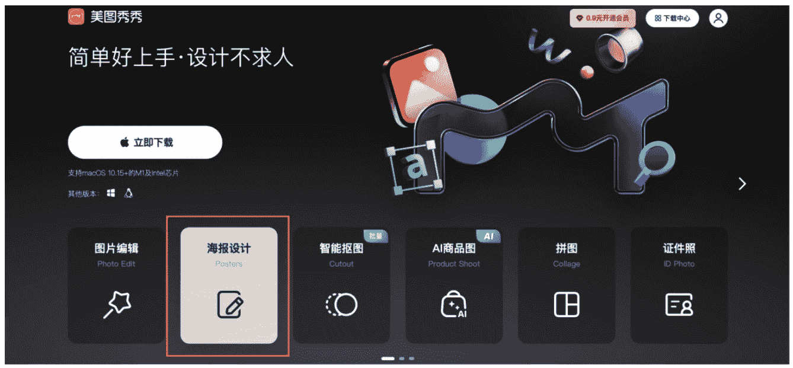

图 6-1 单击“海报设计”按钮

**第 2 步** 进入 AI 设计区，点击“AI 海报”按钮，如图 6-2 所示。

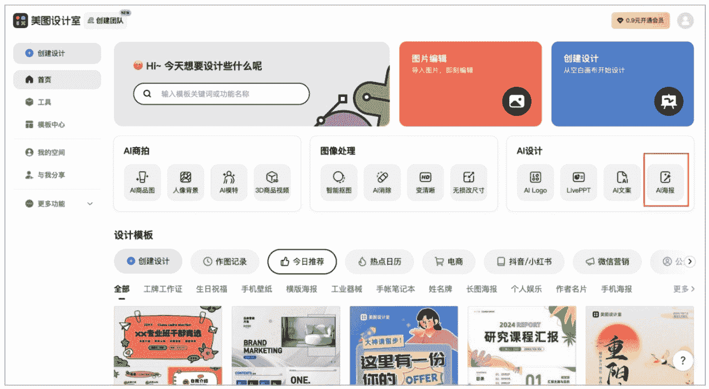

图 6-2 单击“AI 海报”按钮

**第 3 步** 按使用场景选择分类，如“公告通知”，如图 6-3 所示。

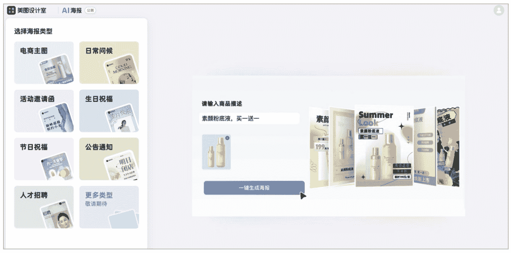

图 6-3 根据使用场景选择分类

**第 4 步** 在左侧编辑区输入主题、通知内容、发布方、通知时间等，点击“生成”即可得到多张开学季主题海报。选定满意作品后点击“下载”进行高清保存，如图 6-4 所示。

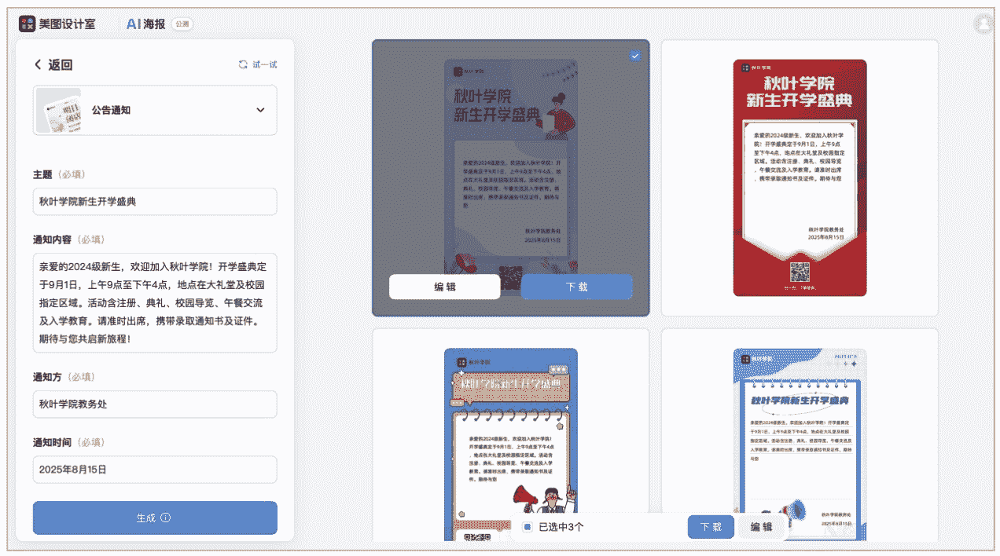

图 6-4 单击“下载”按钮

如需二次编辑，勾选目标海报右上角选择框并点击“编辑”即可。注意部分高级功能需开通付费会员，如图 6-5 所示。

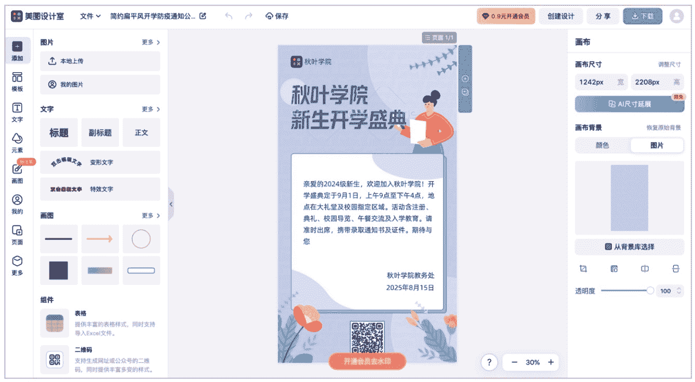

图 6-5 二次编辑海报内容

此外在模板中心搜索框输入“开学季”，即可获取大量精美模板，如图 6-6 所示。

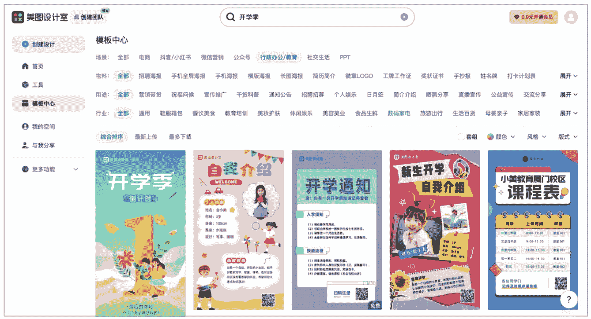

图 6-6 模板中心

除美图秀秀及第二章介绍的工具外，表 6-1 还汇总了几款适合主题海报设计的平台。

表 6-1 主题海报设计平台

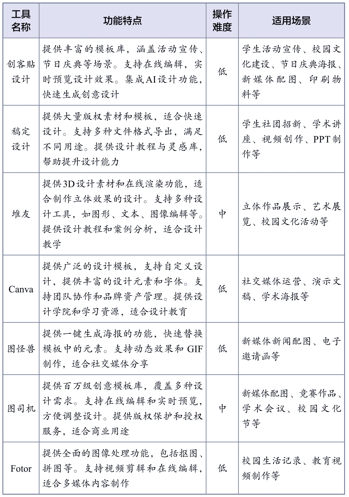

## 6.3 新闻稿写作告别反复修改

新闻稿是信息传递的核心载体，价值在于结构清晰、信息精准。规范的新闻稿通常包含以下要素。

· 基本构成：标题、导语、正文、结尾、落款
· 撰写原则：真实性、时效性、客观性、简洁性
· 核心目标：活动推广、成果展示、政策解读
· 主要受众：学生群体、家长群体、教职员工、社会媒体
· 注意事项：保持中立立场、突出时效特点、语言精炼、凸显亮点

可据此转化为以下提示词模板。

**提示词模板：**

你是一位【具体学科】教师，擅长撰写学校活动新闻稿，请为【具体活动主题】撰写一篇新闻稿。具体要求如下。

1． 按照新闻稿基本构成 标题、导语、正文、结尾和落款 进行撰写，突出【具体活动主题】的重点与亮点。
2． 明确传播目标和受众定位，兼顾学校宣传诉求与社会关注需求。
3． 采用客观中立的叙事风格，语言简洁易懂。
4． 全文控制在 800 字以内。

新闻稿相关信息如下。
时间：[具体时间]
地点：[具体地点]
活动流程：[详细流程]
参与人员：[具体人员]

应用示例：以“秋叶学院 2024 级新生开学典礼”主题生成新闻稿。

**向 DeepSeek 提问：**

你是一位教师，擅长撰写学校活动新闻稿，请为“秋叶学院 2024 级新生开学典礼”撰写一篇新闻稿。具体要求如下。

1． 按照新闻稿基本构成 标题、导语、正文、结尾和落款 进行撰写，着重突出主题重点与亮点。
2． 明确传播目标和受众定位，兼顾学校宣传诉求与社会关注需求。
3． 采用客观中立的叙事风格，语言简洁易懂。
4． 全文控制在 800 字以内。

新闻稿相关信息如下。
时间：2024 年 9 月 1 日上午 10 点。
地点：秋叶大楼 2 楼演播厅。
活动流程：典礼隆重举行。
参与人员：学院院长张老师、其他任课老师及全体 2024 级新生。

**DeepSeek 回复：**

秋叶学院 2024 级新生开学典礼隆重举行

2024 年 9 月 1 日上午 10 点，秋叶学院 2024 级新生开学典礼在秋叶大楼 2 楼演播厅隆重举行。学院院长张老师携全体任课教师与 2024 级新生共同出席，标志着新学年正式开启。

典礼在庄严的国歌声中拉开序幕。张院长在致辞中系统阐述了学院“厚德博学，经世致用”的育人理念，通过校史沿革、特色专业、培养体系三方面展现学院优势，勉励新生把握学习机遇，夯实专业基础。教师代表团队依次登台，从课程建设、实践平台、创新培养等维度进行学科解读，现场多次响起热烈掌声。

新生代表发言环节成为典礼亮点，2024 级王同学以“传承与突破”为主题，结合个人成长经历畅谈求学规划，其“既要做知识传承者，更要当创新实践者”的宣言引发强烈共鸣。典礼全程通过学院官方直播平台进行实时转播，线上观看人数突破 5000 人次。

本次典礼作为新生入学教育的重要环节，通过多维度展示有效增强了新生归属感。活动结束后，学院新媒体中心同步推出《新生指南》系列推送，持续完善新生服务体系。

秋叶学院

2024 年 9 月 1 日

AI 工具生成的新闻稿在结构完整、信息准确、受众匹配等方面均达到专业水准，显著提升了宣传效率。

## 6.4 班级纪念视频快速生成

对教师而言，制作班级主题视频是留存集体记忆的好方式。这类视频能全面呈现班级特色，涵盖学术竞赛、运动会、文艺展演、志愿实践等场景。传统制作依赖专业团队，涉及设备租赁、脚本设计、后期剪辑，成本高、周期长。

当前 AI 视频工具的迭代彻底改变了这一现状。通过智能素材匹配、自动剪辑优化、AI 配音配乐等功能，教师无需专业背景即可快速产出高质量作品。只需上传基础素材、选择叙事风格，系统就能智能生成兼具温度与美感的班级纪念视频，让班级故事更生动。

以下以剪映专业版为例演示 AI 视频生成流程。

**第 1 步** 打开 PC 端剪映，点击“图文成片”按钮，进入生成视频界面，如图 6-7 所示。

图 6-7 单击“图文成片”按钮

**第 2 步** 在“智能编辑”页面输入主题，如“我来说爱国”，输入若干话题关键词，如“国家情怀”“历史传承”“文化自信”等，然后点击“生成文案”按钮，如图 6-8 所示。

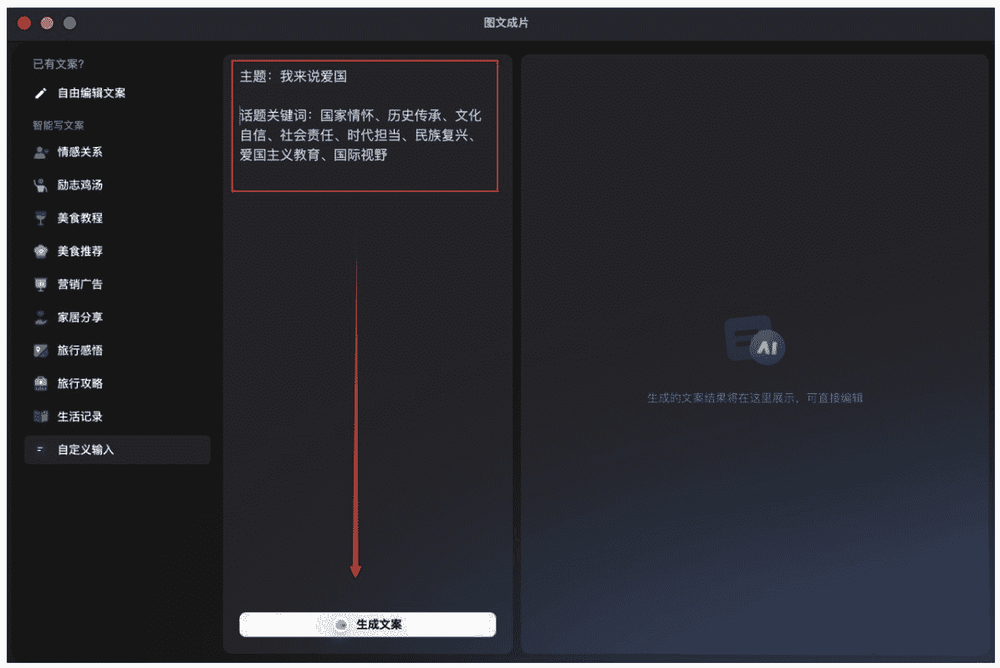

图 6-8 单击“生成文案”按钮

**第 3 步** 文案生成后，在音色库中选择“新闻男声”选项，点击“生成视频”按钮，如图 6-9 所示。

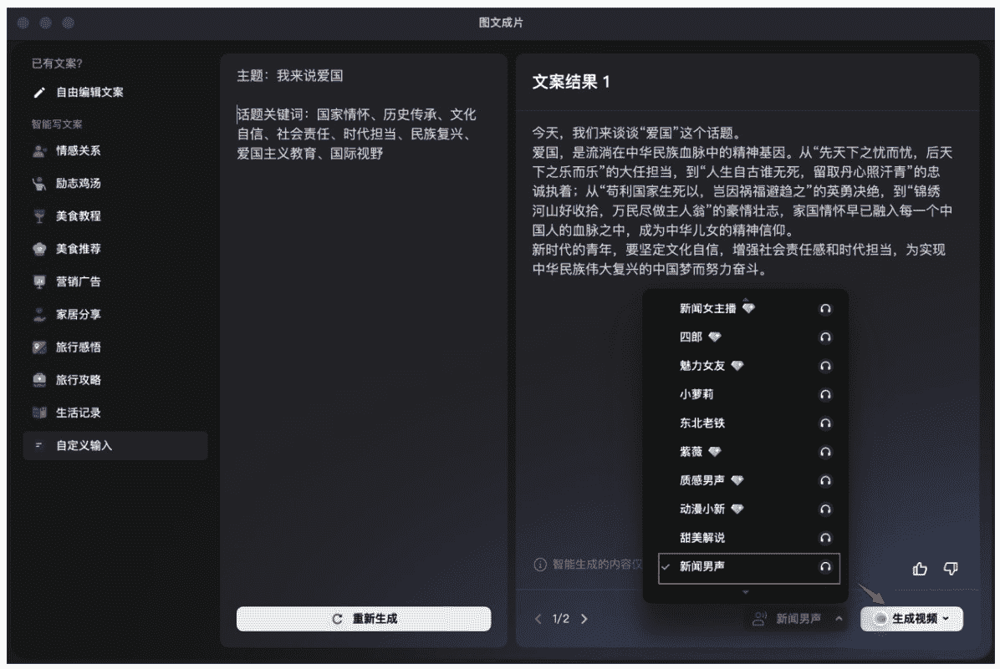

图 6-9 单击“生成视频”按钮

**第 4 步** 系统自动跳转至视频编辑页面，可看到字幕轨、配音轨、背景音乐轨已生成，点击“导出”按钮，进入导出页面，如图 6-10 所示。

图 6-10 单击“导出”按钮

**第 5 步** 设置视频参数后，点击“导出”按钮，即可获得成品视频，如图 6-11 所示。

剪映的核心优势在于智能化创作流程：依托 AI 语音合成、智能字幕识别、自动节奏卡点等技术，零基础用户也能快速掌握核心功能。编辑界面提供专业级视频处理工具，包括多轨时间轴、关键帧动画、动态变速等进阶功能。

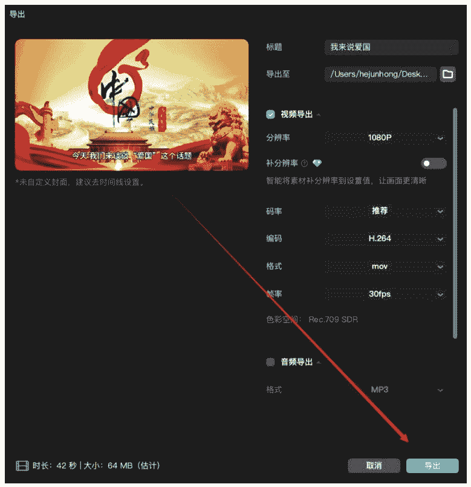

图 6-11 设置视频参数

制作视频时需注意：合理运用转场特效保持视觉连贯；通过智能调色统一画面风格；利用 AI 工具校验字幕文本准确性。

对于教学类视频制作，可重点使用智能素材库和课程录屏功能。完成后通过内置一键分发功能即可分享至抖音、微信视频号等平台，实现教学成果的快速传播与存档。

# 第七章

# DeepSeek驱动学风精细化管理

学风是校园文化的核心载体，集中体现全体成员的学习态度与学术追求。面对学风建设这一系统工程，AI 为教育工作者提供了全新方案，其核心价值体现在以下几点。

· 构建学习行为数据库，实现学风状况量化分析。
· 生成个性化学习方案，适配学生认知特征。
· 智能推荐教育资源，精准匹配学习需求。
· 建立实时反馈机制，提供全天候学习支持。

## 7.1 数据驱动洞察学风脉搏

学风为何重要？学风质量犹如教育生态的“PM2.5 指数”，直接反映人才培养成效。优质学风环境能显著提升学习效率，促进学生全面发展。

因此，作为教师，必须重视学风建设！

要做好学风建设，教师需要摸清学生学风的“脉搏”。这需要建立科学诊断机制，如同医生运用现代检测设备对病人进行体检，通过多维数据采集精准把握学生的学习状态、行为及学风状况。设计学风数据统计表时应包含以下关键要素。

一、学生基本信息
1． 学生姓名/学号
2． 年级/专业
3． 性别

二、学习行为数据
1． 在线学习时长：记录日均在线学习时长和平均登录频次。
2． 作业提交情况：作业提交次数、提交时间、是否按时完成等。
3． 课程参与度：课堂互动次数、主动发言次数等。
4． 成绩变化（平均分）：记录考试成绩、平时成绩等。

三、学风状况指标
1． 出勤率：反映学习态度和对课程重视程度。
2． 学术诚信记录：如抄袭、作弊等行为，体现学术道德水平。
3． 学习氛围评价（满分 10 分）：通过问卷调查或同学互评，了解班级或学校学习氛围的主观感受。

接下来演示如何借助 AI 工具进行学风数据诊断。

**第 1 步** 整理××班级学风数据统计表，如图 7-1 所示。

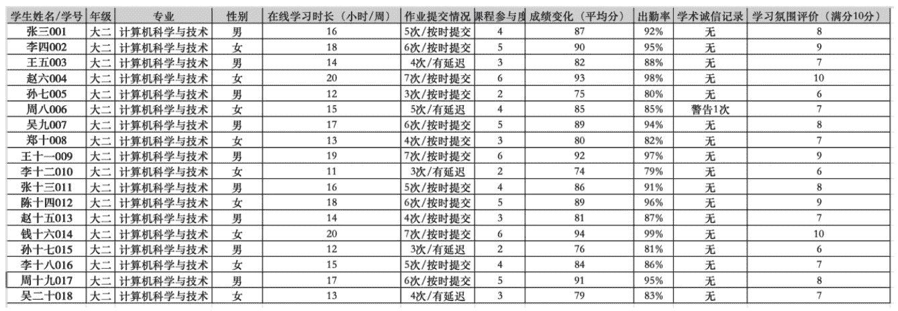

图 7-1 ××班级学风数据统计表

**第 2 步** 选择用 WPS Office 打开文档，选择 WPS AI 的“AI 数据问答”功能，如图 7-2 所示。

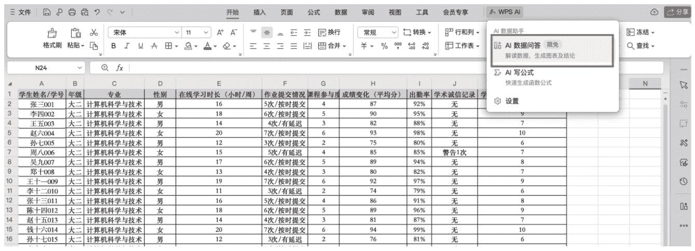

图 7-2 选择 WPS AI 的“AI 数据问答”功能

**第 3 步** 选择“快速解读表格内容”功能，如图 7-3 所示。

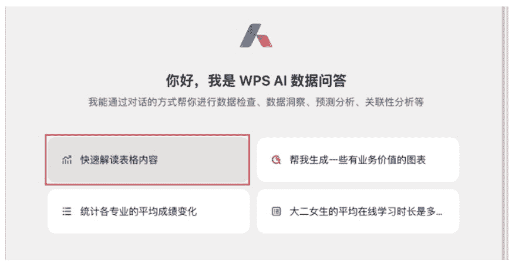

图 7-3 选择“快速解读表格内容”功能

随后 WPS AI 会快速分析表格数据并生成结构化分析报告。

**WPS AI 回复：**

1． 数据概述

该数据表展示了某班级学生的学风情况，包括在线学习时长、作业提交情况、课程参与度、成绩变化及出勤率等指标，综合反映了学生的学习表现和学习氛围。

2． 重要指标

（1）在线学习时长（小时/周）：学生平均每周在线学习时长，反映学习投入程度。数据显示，较长的学习时长通常与较优的学习成绩存在相关性。

（2）成绩变化（平均分）：通过学生平均成绩变动评估学习效果与知识掌握程度，是学风建设的核心量化指标。

（3）出勤率：统计学生课堂出勤情况，较高出勤率往往对应积极的学习态度，与学业表现呈显著正相关。

3．可视化分析

通过“在线学习时长（小时/周）”与“成绩变化（平均分）”的散点图（见下图）可见，随着学习时长增加，学生平均成绩总体呈上升趋势，表明学习投入与学业成果的正向关联。需注意，部分高时长学生成绩未达预期，可能与学习方法差异、课程难度梯度或个体理解能力等因素有关。

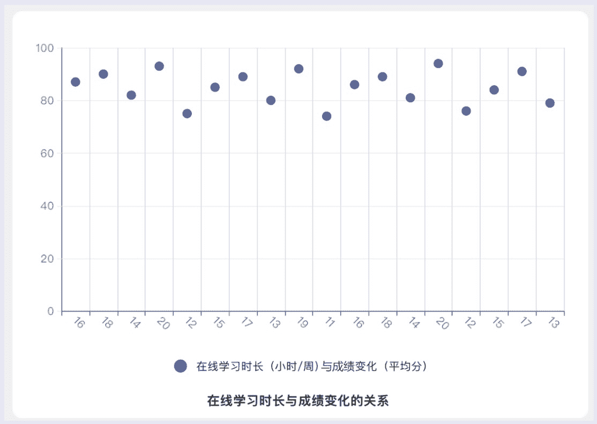

4．关键洞察

学习时长与成绩的相关性需结合学习效率综合评估，单纯延长学习时间并非提升成绩的充分条件。同时，出勤率作为学风建设的重要指标，其与学业表现的强关联性建议通过回归分析进一步验证。后续研究可通过聚类分析区分不同学习习惯群体，结合作业提交质量与课程互动频次等维度，构建多因子评价模型，为个性化学习方案提供数据支撑。

综上所述，WPS AI 通过整合在线学习时长、作业提交情况及成绩变化等数据，实现了对班级学风的立体化解析。这种基于多维数据的学习行为画像，为精准化教学管理提供了新路径。

**第 4 步** 将以上表格和关键数据导入 DeepSeek，如图 7-4 所示。

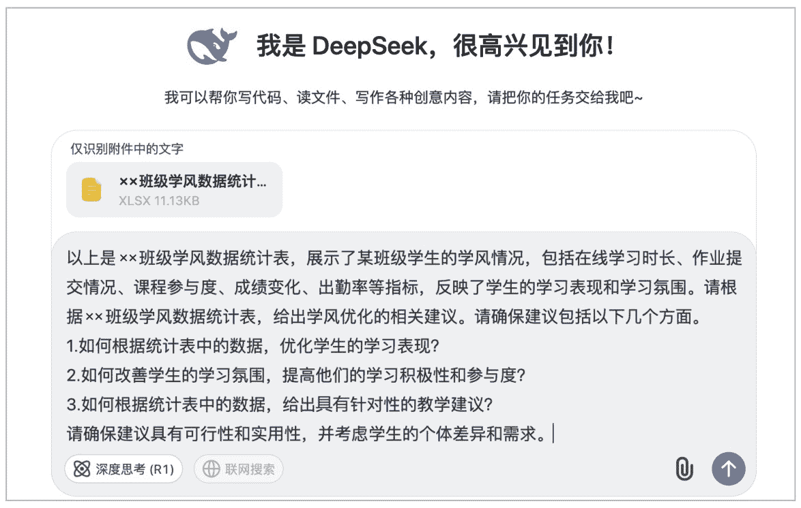

图 7-4 将表格和关键数据导入 DeepSeek

**DeepSeek 回复：**

根据××班级学风数据统计表，以下是学风优化的相关建议。

一、优化学生学习表现

1．对在线学习时长不足的学生（如孙七 005 等），教师可开展个案访谈，结合平台数据追溯具体成因（如网络环境、时间管理等），制订分层学习计划，并借助家校协同机制向家长推送个性化学习提醒。

2．作业提交异常的预警与帮扶
对常出现递交延迟的学生，如王五 003、周八 006 等，教师可建立作业迟滞预警机制。连续三次逾期会自动触发教师约谈，并向当事人精准推送补差辅导资源。教师也可尝试“学长帮扶制”，由高年级优民事先点对点指导。

二、营造积极学习氛围
1．提升课堂参与度
对于参与度低于班级均值的学生，如郑十 008、赵十五 013 等，可推行混合式教学。课前以微课夯实基础，课中借助即时反馈系统 IRS 监测互动质量，课后通过论坛积分制延续讨论。同时设立“课堂贡献度”排行，并与学分激励挂钩。
2．优化出勤管理
针对出勤异常，教师需先区分缺勤类型：属网络故障给予技术援助，属动机缺失启动学习契约，属心理困扰则对接专业咨询。同步构建“虚拟班级社区”，以线上签到、学习打卡等数字仪式增强归属感。

三、精准教学改进策略
1．干预成绩波动学生
对成绩明显波动的学生，如孙七 005、孙十七 015 等，可开展学情三因素分析。基于平台数据回溯知识断点，结合错题本剖析认知偏差，并通过学习日志评估认知水平。同步开发自适应测试系统，动态生成补偿性练习题库。
2．重塑班级氛围薄弱环节
可实施环境干预双路径：物理层面打造沉浸式学习空间，如配备多屏协作系统的研讨室；社交层面构建学习共同体，如跨学科项目小组。同时建立心理健康雷达图，对压力指数异常的学生启动分级干预。

经分析，智能工具可对班级学风现状进行精准诊断，并提出一系列可操作性强的优化建议。建议既聚焦个体学业表现提升，如延长有效学习时长、规范作业递交行为，又着力改善班级整体学习生态，如强化课堂互动质量、完善考勤管理制度。

依托智能工具提供的多维数据支持，教师能够精准定位学风建设薄弱环节，通过数据驱动的决策机制及时干预。这种实证化指导不仅提升了教学管理效能，也使学风建设形成需求导向的动态优化机制。智能工具在教育场景的深度应用，标志着教育管理正向精准化、科学化演进，这正是现代教育助力学生全面发展的应有之义。

## **7.2 个性化学习：AI 助力量身定制成长方案**
在当代教育中，“个性化学习”已成核心议题。高校教学显示，学生认知风格差异显著：有的偏好沉浸式文本学习，有的倾向具象化实验探索；有的以逻辑思维为主导，有的艺术创造力突出。传统标准化教学难以适应多元培养需求，而教育智能化的突破在于用技术将普适教学转为精准培育。

当学习过程与个体特质同频共振，学习成效自然提升。这既是教育规律的回归，也是技术赋能的创新。

**1． 情景再现**
某日处理教务时，收到视觉传达设计专业大二学生小李的微信咨询：“老师，人工智能发展让我产生职业焦虑。当前 AI 已能完成基础设计功能，我的 Photoshop 专业技能是否会被替代？”这位专业排名靠前的优等生，作品以创意独特、细节把控精准著称。他的焦虑折射出数字时代设计人才的共性挑战：如何融合传统技艺与智能技术。

为帮助他厘清思路，我迅速回复并约其当天下午到办公室面谈。

**2． 问题解析**
（1）学生背景：
小李，大二视觉传达设计专业，成绩优异，对色彩、形态、空间有独到见解。随着 AI 技术发展，他担心传统设计技能如 PS 被替代，希望在保持设计能力的同时学习 AI 知识，提升职业竞争力。
（2）技能替代风险：
· 技术冲击：基础设计技能可能被自动化替代；
· 知识更新压力：需持续学习新设计理念与工具；
· 职业规划：需明确是深耕设计领域，还是成为设计与技术复合型人才。

**3． 解决办法**
基于小李的需求，整理成 AI 提示词模板。

**个性化学习方案提示词模板：**
请你扮演学习方案定制专家，依据学生的学习特点与需求，为其量身打造个性化方案。具体要求如下。
1． 学习内容：结合学习基础、兴趣点与目标，精选知识点、技能点、拓展阅读等。
2． 学习方法：结合学习风格与习惯，推荐自主学习、合作学习、实践操作等方法，提高效率。
3． 时间规划：制定每日、每周、每月的学习任务与时间安排，确保进度有序可控。
4． 预期达成目标：设定短期、中期、长期目标，要求具体、可量化，便于跟踪评估。
学生情况如下：××

将小李信息导入模板向 DeepSeek 提问。

**向 DeepSeek 提问：**
请你扮演学习方案定制专家，依据学生的学习特点与需求，为其量身打造个性化方案。具体要求如下。
1． 学习内容：结合学习基础、兴趣点与目标，精选知识点、技能点、拓展阅读等。
2． 学习方法：结合学习风格与习惯，推荐自主学习、合作学习、实践操作等方法，提高效率。
3． 时间规划：制定每日、每周、每月的学习任务与时间安排，确保进度有序可控。
4． 预期达成目标：设定短期、中期、长期目标，要求具体、可量化，便于跟踪评估。
学生情况如下。
1． 学生背景：
小李，大二视觉传达设计专业，成绩优异，对色彩、形状、空间有独到见解。随着 AI 技术发展，他担忧传统设计技能如 PS 被替代，希望在保持设计能力的同时学习 AI 知识，增强职业竞争力。
2． 技能替代风险：
（1）技术冲击：基础设计技能可能被自动化替代。
（2）知识更新压力：需持续学习新设计理念与技术工具。
（3）职业规划：需明确发展方向，深耕设计领域或成为设计与技术结合的复合型人才。

**DeepSeek 回答：**
小李同学的个性化学习方案
一、学习内容
1． 设计技能提升
（1）知识点：深入学习设计理论，涵盖色彩心理学在不同文化和场景的应用、版式设计高级技巧、字体设计的创意方法等。
（2）技能点：熟练掌握专业设计软件高级功能，如 Adobe Photoshop 的 3D 建模与渲染、Illustrator 的复杂图形绘制与动态效果制作、After Effects 的视觉特效合成等。同时加强手绘能力，包括素描、速写、水彩等，提升创意表达。
（3）拓展阅读：《超越平凡的平面设计：怎样做好版式》《写给大家看的设计书》《设计中的设计》等，结合行业最新趋势与优秀案例。
2． 人工智能知识学习
（1）知识点：了解人工智能基本概念、发展历程、主要技术原理如机器学习、深度学习、计算机视觉、自然语言处理等及其在设计领域的应用案例，包括 AI 辅助设计工具使用方法、智能设计系统工作原理等。
（2）技能点：掌握至少一种 AI 设计工具，如 Midjourney、Stable Diffusion 等，能进行创意构思与初步设计，并学会利用 AI 技术优化作品，如通过图像识别检测设计问题、利用智能排版提升效率等。
（3）拓展阅读：《深度学习》《人工智能：一种现代方法》等专业书籍，以及在线课程资料、学术论文与行业报告，关注前沿研究成果。

二、学习方法
1． 自主学习
利用 Coursera、Udemy、网易云课堂等平台学习设计与人工智能相关课程，做好笔记并定期总结，通过实践项目巩固技能。制订阅读计划，每周阅读定量章节并撰写笔记，关注 Behance、知乎等平台行业动态。
2． 实践操作
每周完成至少一个设计项目如海报设计、用户界面设计等，尝试结合 AI 工具辅助设计，探索传统方法与新技术融合。参加设计竞赛与开源项目，通过团队协作积累经验。
3． 合作学习
加入设计社团或学习小组，定期交流作品与心得。寻求有经验导师指导，参与项目实践积累经验。

三、时间规划
1． 每日安排
早上用 30 分钟复习前日设计理论或人工智能概念，通过回忆默写加深记忆。上午安排 2-3 小时进行设计技能学习与练习，可结合在线教程与实际操作案例，每个功能点至少练习 3-5 次。午间休息 1-2 小时。中午后安排 2-3 小时学习人工智能知识，阅读书籍、观看在线课程或线上讲座，做好笔记并思考如何应用。晚上用 1-2 小时进行设计项目实践，应用当日所学技能与 AI 知识，完成任务或优化作品，并用 30 分钟总结问题与次日计划。
2． 每周安排
周一至周五按日计划执行，每晚总结调整。周六上午 3-4 小时系统复习本周设计技能与 AI 知识，下午 2-3 小时参与社团或小组交流，晚间放松。周日上午 3-4 小时完成项目收尾并自我评估，下午 2-3 小时阅读拓展资料，晚间 1-2 小时制定下周计划。
3． 每月安排
第一周制定本月目标与计划，总结上月成效与不足。次周至第三周按周计划推进并动态优化方法。第四周综合复习，通过作品集制作、学习报告撰写或模拟考试自评，完成一项融合 AI 技术的综合设计项目，并总结制定下月计划。

四、学习目标
1． 短期目标 1-3 个月
熟练掌握两种专业设计软件高级功能，独立完成商业海报、品牌形象等复杂任务，作品在校内竞赛或展览获奖。理解人工智能基础概念与原理，掌握至少一种 AI 设计工具进行草图生成、图像创作等基础应用。建立含 5-10 个优秀作品的作品集，初步体现 AI 技术应用。
2． 中期目标 4-6 个月
融合多元设计元素创作创新作品，在省级及以上设计竞赛获奖。系统掌握机器学习、深度学习等技术在设计领域的应用，运用 AI 工具进行用户需求分析、设计方案优化等深度实践。完成至少一个 AI 与设计融合的实际项目，获得市场认可并积累协作经验。
3． 长期目标 6 个月以上
成长为设计科技复合型人才，在知名企业主导创新项目，推动行业变革。在设计领域产出学术成果如论文发表、行业标准制定，促进 AI 与设计深度融合与广泛应用。

该方案充分考虑小李的学习习惯、兴趣偏好与目标需求，展现了 AI 技术在教育领域的独特优势。通过深度分析个体差异，精准满足多元学习需求，为学生提供高效路径与资源配置支持。

## **7.3 学习资源推荐：AI 比你更懂学生需求**
知识更迭加速，学习资源并非匮乏而是过载，核心挑战是如何精准锁定最新最前沿资源，避免被陈旧信息束缚。AI 技术可动态整合并分析全球知识库的实时更新内容，基于学生知识水平、学习目标与兴趣偏好智能筛选匹配度最高的资源，突破传统教材更新滞后限制，帮助学生直达学科前沿。

在 7.2 节小李个性化方案基础上，通过细化资源推荐提示词并调用 DeepSeek 联网搜索功能，可获得更完整的资源获取方案。

**向 DeepSeek 提问：**
请你扮演智能学习资源顾问，擅长通过分析学生学习偏好与需求提供个性化资源推荐。请针对【小李同学的个性化学习方案】，提供兼具时效性与针对性的学习资源推荐。具体要求如下。
1． 精选符合该生特点的时效性资源，涵盖最新在线课程、电子书籍、实践项目及学习工具，确保接触前沿知识与技能。
2． 推荐时重点关注资源发布时间，优先选择近两年内更新内容及季度以上更新频率，保证时效性。
3． 确保资源既匹配学习兴趣，又能有效支撑学习目标达成。
小李同学的个性化学习方案
一、学习内容
1． 设计技能提升
（1）知识点：深入学习设计理论，涵盖色彩心理学在不同文化和场景的应用、版式设计高级技巧、字体设计的创意方法等。
（2）技能点：熟练掌握专业设计软件高级功能，如 Adobe Photoshop 的 3D 建模与渲染、Illustrator 的复杂图形绘制与动态效果制作、After Effects 的视觉特效合成等。同时加强手绘能力，包括素描、速写、水彩等，提升创意表达能力。
（略）

**DeepSeek 回答：**
一、设计技能提升
1． 在线课程
（1）Adobe Creative Cloud 官方教程：提供 Photoshop、Illustrator、After Effects 等软件最新功能教程，涵盖 3D 建模与渲染、复杂图形绘制与动态效果制作等高级技巧。
（2）Domestika 设计课程：包含色彩心理学、版式设计高级技巧、字体设计创意方法等内容，由行业专家授课，课程更新频繁，与设计趋势保持同步。
2． 电子书籍
（1）《设计心理学：色彩与情感的力量》2023 年版：深入剖析色彩在不同文化和场景的应用，结合神经科学最新研究成果，为设计决策提供科学依据。
（2）《动态设计：从基础到高级技巧》第 4 版：介绍动态设计基本原理及 After Effects 高级实现方法，适合希望提升动态设计能力的设计师。
3． 前沿实践项目
（1）Behance 设计挑战赛：参与 Behance 设计挑战赛，与全球设计师同场竞技，实践设计理论，提升创意表达能力。
（2）开源设计项目：加入 GitHub 开源设计项目，如开源 UI 组件库、设计系统构建等，通过实际操作提高设计水平。
4． 新兴学习工具
（1）Figma：支持实时协作和原型设计，适用于团队项目合作。
（2）Sketch：专为 Mac 用户设计的矢量绘图工具，界面简洁易用，适合用户界面/用户体验设计。

二、人工智能知识学习
1． 在线课程
（1）Coursera“机器学习专项课程”：由斯坦福大学教授 Andrew Ng 主讲，涵盖机器学习基础知识和进阶内容。
（2）Udemy“深度学习实战”：结合最新论文和实践案例，深入讲解深度学习原理和应用，包括计算机视觉、自然语言处理等领域。
2． 电子书籍
（1）《深度学习实战》最新版：结合最新研究成果和实践经验，介绍深度学习基本原理和实现方法。
（2）《人工智能简史：从图灵到 AlphaGo》：梳理人工智能发展历程，介绍主要技术原理和应用案例。
3． 前沿实践项目
（1）Kaggle 竞赛：通过机器学习竞赛提升算法和数据处理能力。
（2）AI 辅助设计项目：利用 Midjourney、Stable Diffusion 等 AI 设计工具进行创意构思和初步设计，探索 AI 技术在设计中的应用。
4． 新兴学习工具
（1）Jupyter Notebook：开源网页应用程序，支持交互式编程和数据分析，适合机器学习和数据科学的学习与实践。
（2）TensorFlow Playground：可视化机器学习工具，通过直观方式展示神经网络工作原理和学习过程。

三、学习资源使用建议
每日晨间复习使用电子书与课程片段；上午和下午主攻课程学习与项目实操；晚间尝试工具辅助设计。周六利用复习资料巩固知识；周日结合项目收尾与行业报告拓宽视野。定期追踪课程更新，订阅设计、AI 领域权威媒体，同步行业动态与技术趋势。

该推荐方案紧密契合小李的学习需求与兴趣方向，确保其精准触达学科前沿知识体系与技术应用。推荐内容全面覆盖在线课程、电子书籍、前沿实践项目及新兴学习工具。这种动态匹配机制不仅提升学习目标聚焦度，而且通过趣味化、场景化资源整合，使知识获取兼具效率与启发性，实现“学以致用，用以促学”的良性循环。

## **7.4 打造智能体管家，实现 AI 24 小时在线服务**
教师工作繁杂，需处理学生信息整理、学习进度跟踪、心理问题辅导等事务性工作，同时关注学生思想、学业与职业规划，提供全面指导。这些工作不仅繁琐，还需高度专业性与个性化处理能力。AI 智能体的出现为此提供可能，让每项工作都有专属“超级管家”。

**1． 什么是 AI 智能体**
AI 智能体是一种利用人工智能技术实现的软件程序，能在特定环境或情境中自主或交互执行任务，达成特定目标或解决问题。

简单说，AI 智能体可视为拥有某项专长、可解决特定问题的智能助手。在教育教学领域，智能体可辅助教师开展教学活动、提升教学效果、实现个性化教育。例如“家庭教师智能体”、“语文学习小助手”，或模仿李白创作风格的“李白智能体”均可定制化实现。

例如，在豆包搜索框输入“作文”关键词，可看到多个与作文学习相关的智能体，选择其中一个即可与其对话，对话场景已预设作文相关功能与内容，操作简便，如图 7-5 所示。
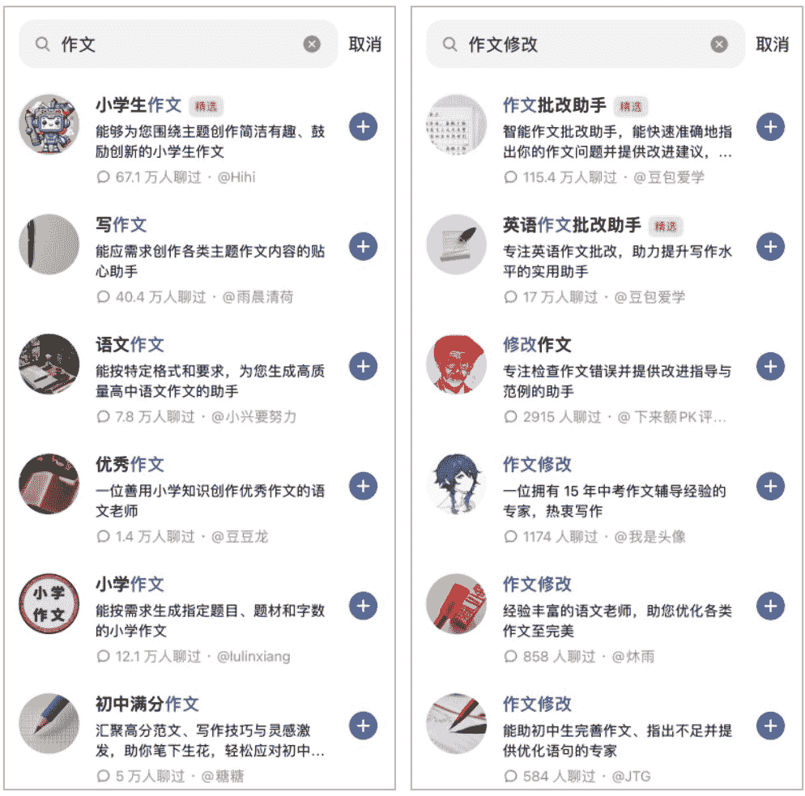
图 7-5 豆包的智能体搜索

AI 智能体与普通 AI 工具的区别可通过案例说明。例如，假设用户需求为“生成班级植树节活动的海报，需包含精美背景图、活动信息、扫码报名等”。

海报制作从分工拼凑到一键成图

过去做活动海报往往是流水线操作：先用 Midjourney 生成背景图，再让 DeepSeek 写活动文案，接着在 PS 里合成图文并加上二维码，最后人工把关收口。这种多手衔接容易导致视觉风格走样、信息细节打架，效率也不高。

换成可配置的智能体就简便多了：只需给出主题词和关键要素，决定是否带二维码，就能直接输出一张可用完整的宣传稿。

由此可以看出，单点提问类需求用通用生成模型即可；涉及多环节协作、强定制、专业性高的综合任务，更适合调用可编排的智能体方案。

**2．智能体在教师工作中的核心作用**

在教学辅助层面，智能体把手工流程升级为自动化协作，主要体现在三方面。

（1）数据归集与即时响应：能自动抓取学生的学习行为数据，完成归纳分析，及时处理学生的咨询与反馈，明显减轻日常事务负担。

（2）定制式指导与建议：依据学习习惯、兴趣倾向和能力水平，为学生制定专属学习方案。对学业吃力或有心理困扰的学生进行初步筛查与建议，帮助教师尽早介入。

（3）情感交流与心理陪伴：扮演“知心伙伴”角色，与学生展开深度对话，对有心理需求的学生提供初步疏导，引导其采用积极的应对方式。

**3．智能体搭建落地路径**

明确应用场景后，搭建流程清晰可循。

**第 1 步** 明确需求与目标
先厘清智能体要承担的职责，例如学情管理、进度追踪、定制辅导、情感交流等，再把目标具体化，如提升效率、优化指导效果、增强师生互动。

**第 2 步** 选择合适的模型与平台
依据需求挑选适配的模型，例如自然语言处理模型、情感分析模型等。平台方面，豆包、百度智能云、Coze 等是常见选择，它们提供丰富的模型与插件配置，方便快速搭建。

**第 3 步** 配置功能与参数
在平台新建智能体，填写名称、简介、人设等基础信息。设定功能边界、回答风格、交互方式等参数，并导入相关数据集与知识库，使其能准确理解并回应学生提问。

**第 4 步** 测试与优化性能
通过对话测试检验回答的准确性与流畅度，根据结果调整功能与参数，提升体验与满意度。保持定期维护，让知识储备跟上变化。

**第 5 步** 部署与应用
将训练完成的智能体放到校园官网、微信公众号、移动应用等渠道，引导学生使用并收集反馈，持续迭代功能。

下面用两个实操案例演示快速搭建。

案例一 快速生成智能体
选用平台：Coze

**第 1 步** 打开 Coze 官网完成注册登录，进入管理后台后点左上角加号，进入创建界面，如图 7-6 所示。
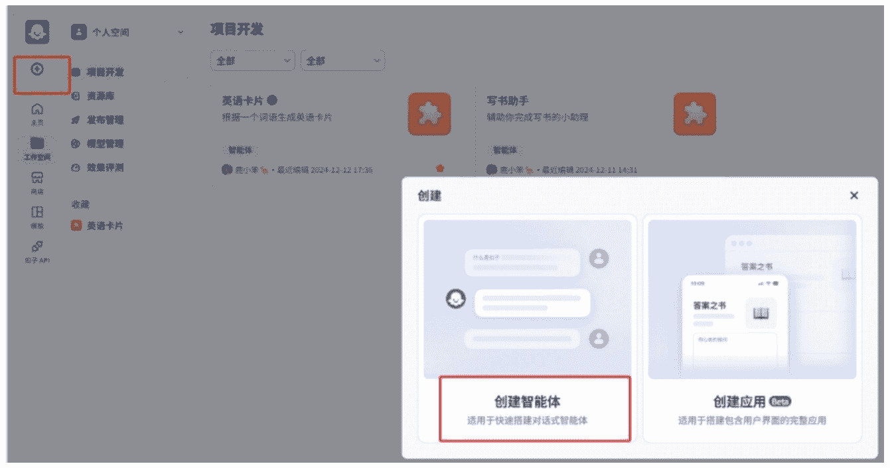
图 7-6 Coze 智能体创建界面

**第 2 步** 在创建页填写名称和描述，描述可手工撰写也可使用一键完善。权限可选公开所有人可对话或不被发现。点击创建 AI 智能体按钮即可生成定制体，如图 7-7 所示。
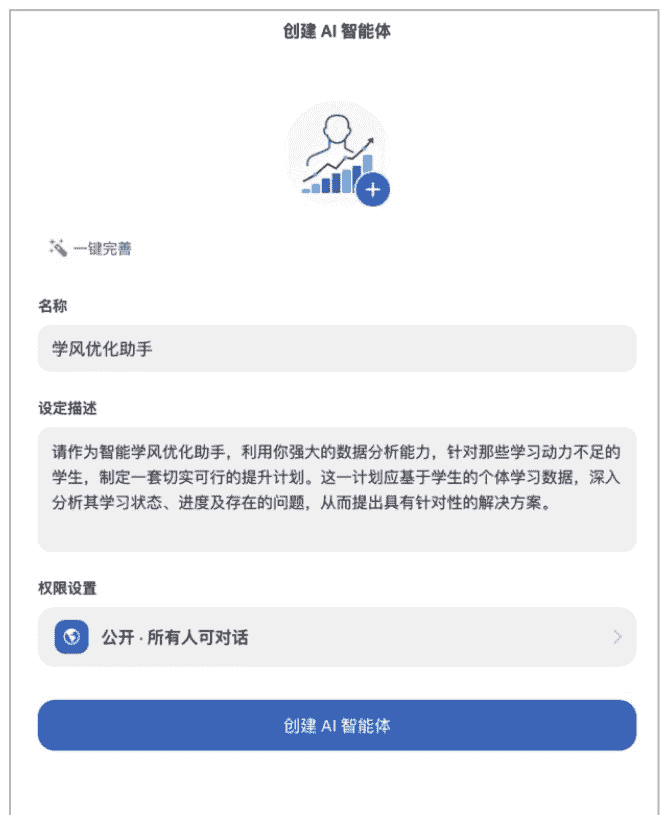
图 7-7 单击创建 AI 智能体按钮

**第 3 步** 细化设置。
（1）配置知识库：在编辑页点数据库模块，导入领域知识数据，比如公开数据集、专业书籍、网络文章等。教师可上传教材文档、习题、学生作业分析报告等作为知识底座，并做好分类打标签，方便检索。同时要定期更新维护。
（2）设置技能：Coze 等平台都提供插件功能，通过插件调用外部 API 可扩展能力，比如添加语音识别与合成插件实现语音交互。还能调节技能参数如识别率、响应速度，设计工作流和开场白，提升体验。Coze 添加插件界面如图 7-8 所示。
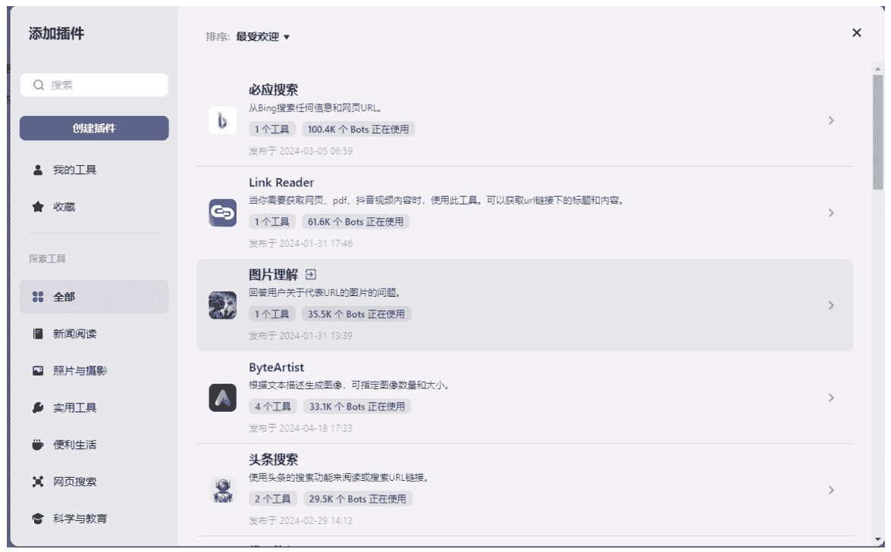
图 7-8 Coze 的添加插件界面

**第 4 步** 测试与发布。
配置完成后点测试按钮，以用户视角对话检查功能。确认无误后通过 Coze 发布到豆包、飞书、微信公众号等渠道。发布后持续收集反馈优化。Coze 智能体发布界面如图 7-9 所示。
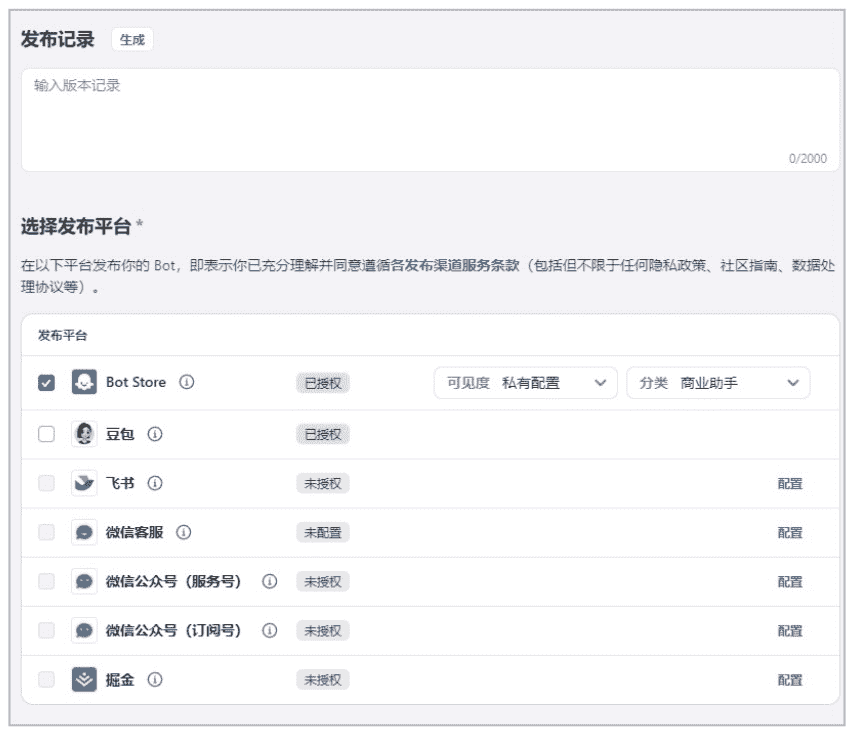
图 7-9 Coze 智能体发布界面

按以上四步就能得到一个基础可用 Coze 智能体，后续可按需持续优化升级。

用页面提示与学风优化主题对话时，因具备上下文记忆，智能体能不断优化调整，实现更好效果。学风优化助手智能体界面如图 7-10 所示。
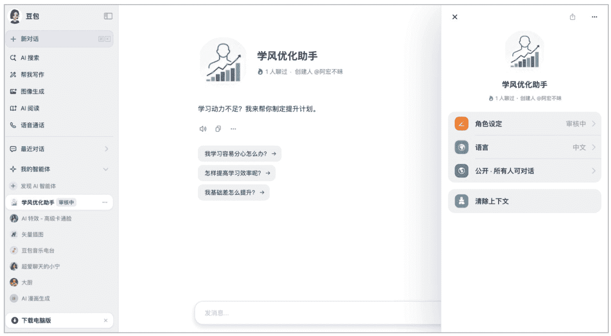
图 7-10 学风优化助手智能体界面

案例二 设置定制化智能体
选用平台：智谱清言

**第 1 步** 打开智谱清言官网，点击智能体中心，再点击创建智能体按钮，如图 7-11 所示。
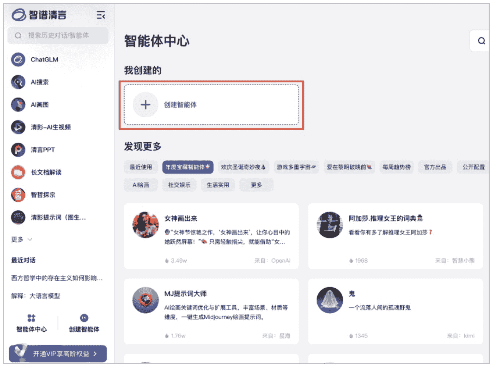
图 7-11 单击创建智能体按钮

**第 2 步** 创建页会用示例引导一键描述智能体。这里把学风优化助手的描述填入输入框后点生成配置按钮，如图 7-12 所示。
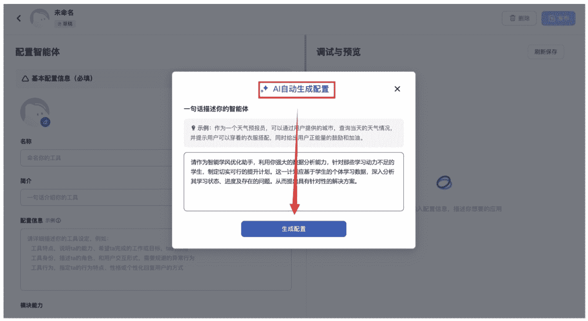
图 7-12 单击生成配置按钮

**第 3 步** AI 优化后进入配置与调试预览页。左侧配置区包含名称、简介、配置信息、模块能力等详细参数，如图 7-13 所示。
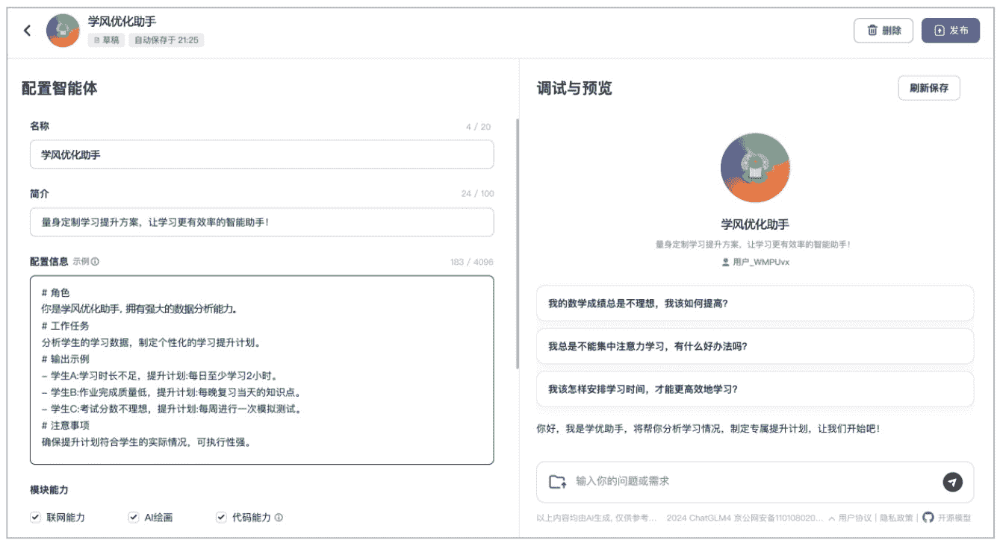
图 7-13 配置与调试预览页面

在配置信息里点示例，可看到 4 种示例模板。用户可以直接使用 AI 生成的配置或换模板再优化学风优化助手主题，如图 7-14 所示。
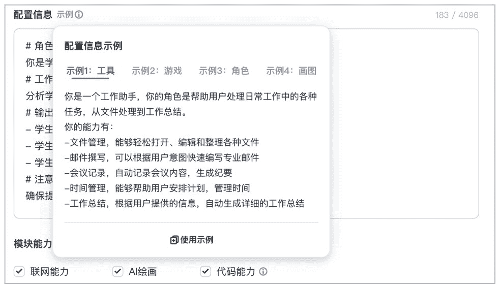
图 7-14 配置信息示例

**第 4 步** 配置页提供丰富功能模块，模块能力如图 7-15 所示。

图 7-15 模块能力
（1）界面定制：可按需选择 UI 组件，如单行文本、多行文本、文本段落、分类、下拉选项、附件上传等，满足个性化需求。
（2）对话配置：可自定义开场白、推荐问题，系统会按描述自动生成 Logo、名称、简介和配置信息。
（3）能力配置：可自建插件或从插件市场选择插件扩展功能，实现复杂交互。
（4）知识库配置：上传专属知识库文件，支持 PDF、TXT 等格式，智能体可解析检索分析。
（5）高级配置：支持模型能力调用、私有知识库配置等，实现更高定制。

**第 5 步** 参数设置完成后点击确认发布按钮，选择私密、分享或公开权限即可发布，如图 7-16 所示。

图 7-16 单击确认发布按钮
另外，智谱清言支持把定制化智能体嵌入其他平台，实现多平台应用。发布渠道配置如图 7-17 所示。

图 7-17 发布渠道配置

生成的学风优化助手智能体如图 7-18 所示。

图 7-18 学风优化助手智能体

与通用生成模型相比，定制化智能体能直接服务于特定场景，避免反复提问修正，大幅提升使用效率。

# **第八章**

# **善用 DeepSeek 助力学生心理健康与危机应对**

在繁忙的教学工作中，心理健康教育与危机应对常被视作难点。面对成百上千的学生，如何及时捕捉潜在心理问题并实施有效干预，是每位教师的挑战。

当前生成式 AI 可以在心理健康与危机应对中发挥作用，既能让海量心理普查数据变得有序可视，也能深度分析个案，为谈心沟通、家校协同提供科学建议。

## **8.1 普查数据杂乱，AI 让结果一目了然**

心理普查数据量大，人工整理耗时且易错。例如开学季为了解新生心理状况，学校会安排 SCL-90 和 UPI 问卷测评。以下某学院 2024 级新生心理测评筛选结果汇总表如图 8-1 所示。

图 8-1 某学院 2024 级新生心理测评筛选结果汇总表

数百名新生的多维度结果需要整合、分类、筛查，工作量巨大，稍有遗漏就可能影响干预效果。

推荐使用 WPS AI。金山办公旗下的人工智能助手，支持智能写作、一键 PPT、数据处理分析、PDF 智能问答等，已深度嵌入 WPS Office 各组件。

其中数据问答功能如同数据分析师，能通过自然对话完成复杂分析。无论 SCL-90 还是 UPI 数据，都可快速完成数据校验、洞察、预测与关联分析，并生成可视化图表和结论，如图 8-2 所示。

图 8-2 WPS AI 的数据问答功能

操作时用 WPS 打开测评汇总表，点击 WPS AI 入口选择数据问答功能，如图 8-3 所示。

图 8-3 选择数据问答功能

进入问答界面，系统会按表格内容生成常用提问模板，如快速解读表格内容、统计存在异常心理症状的学生比例等。点击快速解读表格内容即可生成答案，如图 8-4 所示。

图 8-4 单击快速解读表格内容

WPS AI 能快速整理分析数据，呈现概览并精准捕捉关键指标，用可视化图表呈现。同时提供深度洞察和专业分析建议，帮助教师精准识别心理状态，及时干预，如图 8-5 所示。

图 8-5 WPS AI 对表格数据的整理与分析

在对话框里还可输入定制化指令。例如：
（1）高风险群体：SCL-90 汇总分数较高的学生心理问题更严重，尤其是 250 分以上者需进一步干预和跟踪。
（2）自杀倾向预警：UPI 敏感题选择有轻生念头的学生需优先关注，建议心理中心立即介入提供支持。

继续输入筛选出 SCL-90 汇总分数在 250 分以上的学生信息，如图 8-6 所示。

图 8-6 输入筛选信息

系统据此生成预警提示，建议学校心理中心立即介入。点击查看表格按钮即可查看信息，如图 8-7 所示。

图 8-7 单击查看表格按钮

WPS AI 会自动生成名为 SCL-90 汇总分数在 250 分以上的学生信息的独立图表，点击在新工作表中查看按钮，如图 8-8 所示。

图 8-8 单击在新工作表中查看按钮

此时会得到需要重点关注的学生名单，如图 8-9 所示。

图 8-9 需要重点关注的学生名单

该方法不仅能快速识别重点关注对象，还能提供精准名单和处理建议。除总分筛查外，还可按 SCL-90 和 UPI 的临床维度如躯体化、强迫、人际敏感、抑郁、焦虑、敌对、恐怖、偏执等做多维度精准筛查。实践证明 AI 工具能显著提升普查效率，实现精准施策的育人目标。

## **8.2 不知怎么沟通？AI 提供专业建议**

与存在心理问题的学生沟通对教师综合能力要求很高。每个学生的心理世界独特，如何切入、如何用语气建立信任、如何处理情绪反应，都需要专业技巧。

AI 可以提供个性化沟通策略支持，从话题切入到情绪处理，都能基于问题类型给出科学指导。

**1． 明确问题归因**
学生心理问题包括焦虑、抑郁、自我认同危机、学业压力、人际障碍等，每种问题表现和成因不同，谈话前需要先有了解。可归为以下类型：
（1）受重大生活事件影响：家庭变故、负性刺激导致波动。
（2）确诊心理障碍：抑郁症、焦虑症、强迫症、恐怖症、精神分裂症等。
（3）自杀风险群体：有自杀未遂史或家族史。
（4）慢性疾病困扰：长期病痛导致心理异常。
（5）学业压力型：学习问题引发心理失调。
（6）情感挫折型：亲密关系破裂后行为异常。
（7）人际冲突型：社交关系恶化导致问题。
（8）社会孤立型：性格孤僻且缺乏支持系统。
（9）适应障碍型：环境适应不良引发行为异常。
（10）经济压力型：贫困导致自卑心理。
（11）危机传染型：受他人心理危机影响的焦虑群体。
同时注意多因素叠加的复合型案例，需重点干预。

**2． 沟通技巧**
（1）积极聆听与共情：全神贯注倾听，避免打断评判，用肢体语言和眼神传递理解。
（2）提问与引导：用开放式提问引导表达感受和想法，如你能具体说说这种情况是怎么发生的吗？这种感受对你产生了哪些影响？适时给予引导和建议。
（3）评估与干预：对可能存在严重心理问题的学生具备评估能力，必要时转介专业心理咨询机构或医生。
（4）建立信任与支持系统：让学生感受到关心，鼓励参与校园心理健康活动，构建支持网络。

**3． 提示词应用**
结合归因和技巧，可用 AI 生成个性化谈话方案提示词模板。

提示词模板：
你是一位专业、富有同情心且具备高度沟通技巧的教师，专注为学生提供个性化心理支持与咨询服务。请结合学生的具体情况开展一次深入且个性化的心理健康谈话。你的每一个行动都可能对学生的心理健康产生积极影响，因此务必保持高度责任心和敏感性，用心倾听，用爱陪伴。

为保障谈话效果，请遵循以下步骤。
1． 建立信任，倾听心声：以温暖关怀态度开启谈话，让学生感受到支持和理解。全神贯注倾听，避免打断评判，通过同理心感知情绪与诉求。
2． 深入探索，理解感受：通过开放式提问引导表达感受和想法。例如，你能具体说说这种情况是怎么发生的吗？或这种感受对你的日常有哪些影响？同时适时给予反馈，鼓励继续分享。
3． 评估情况，引导认识：根据描述评估心理问题严重程度及潜在原因，引导学生认识问题所在，共同探讨解决方案或应对策略。
4． 提供建议，构建支持：依据个体差异提出针对性建议，如正念练习、同学互助或专业咨询等。着重介绍学校心理咨询室、24 小时热线等支持资源，强化社会支持感知。
5． 制订计划与持续跟进：协同制定包含具体步骤和时间节点的行动方案，约定两周内随访，建立长效关注机制，通过定期评估确保干预效果。

相关背景信息如下。
本次谈话对象属于××类型心理问题（请从既定分类中选择或填写具体类型，如学业压力导致焦虑状态的学生），具体情况描述如下：××（请完整说明学生的行为表现、情绪特征、持续时间及环境诱因等）。

4. 模板落地：一次可落地的心理对话设计

案例背景快照
小李在校读计科大二，往期成绩名列前茅，社团和公益活动都很活跃。最近父亲病重不治猝然离世，这一打击让她的状态明显偏移，往日开朗的她变得寡言少语，情绪长期走低，还伴随一些异常表现。

主要反应汇总
情绪面：丧父之后持续压抑，习惯独自待在宿舍或图书馆角落发呆，对外界事物提不起兴趣，易流泪，课堂上偶尔失控。
学习面：原先对专业很投入，现在动力明显衰退，不再发言，作业水准下滑，甚至出现逃考倾向。
人际面：主动疏离同学朋友，退出了社团，不回信息，形成自我封闭。
身心面：焦虑感一直存在，夜里难入睡、多梦易醒，白天昏沉，注意力难集中。

整体判断属于家庭重大变故触发的创伤应激，属于外在负性事件诱发的心理行为偏离，需要针对性介入。

指令搭建
请扮演一位兼具职业素养与同理心的辅导老师，为学生提供定制化心态支持。【针对因家庭变故或外在负性刺激出现心理行为异常的学生，开展一次深入且个性化的心理健康谈话】。每一次回应都可能影响走向，请保持高度责任感与敏感度，耐心聆听，用温暖陪伴。

为保证效果，请按以下流程执行。
1. 营造信任氛围并倾听：用温暖关怀的姿态开启交流，让学生感受到被支持与被理解。全神贯注、不打断、不评判，用共情去感知情绪需求。
2. 进一步探查感受：借助开放式提问引导学生表达想法。例如“你能具体说说事情是如何发生的吗？”“这种感受对你日常造成了哪些影响？”适时给予回应，鼓励持续分享。
3. 判断严重程度并帮助自我觉察：基于学生叙述评估问题严重性与可能成因，引导其正视自身困扰，共同探讨应对思路。
4. 给出针对性办法并链接资源：结合个体差异给出建议，如正念练习、同伴互助或专业辅导。重点介绍校园心理服务中心、全天候热线等资源，增强社会支持感知。
5. 共制计划并持续回访：共同制定包含具体步骤与时间节点的行动方案，约定两周内回访，建立长效关注机制，通过定期评估确保效果。

相关背景信息同上。

模型给出的对话要点
针对小李的对话方案
一、建立信任氛围并倾听
开场语：点明欣赏其过往积极表现，表达近期观察到状态变化，愿意倾听并提供帮助。
聆听方式：保持适度眼神交流，传递关怀与专注；全程耐心不打断；用点头、轻声回应传递理解与支持。

二、进一步探查感受
开放式询问：询问情绪低落的变化起点，以及父亲离世后内心最强烈的感受。
反馈与鼓励：肯定其信任与分享，说明学习兴趣下降、社交回避、焦虑失眠是重大生活事件后的常见反应，很多人会经历类似低谷。

三、判断与认知引导
状态评估：抑郁情绪、动力缺失、社会功能受损、睡眠问题，提示需要专业支持。
认知引导：把困难定位为成长机会，强调可以一起面对，逐步找回积极体验。

四、给出建议并构建支持
个性化建议：参与校园心理健康活动如讲座、团体辅导以学会情绪调节；预约心理咨询师进行专业辅导；保持与关心朋友的联系，参与轻松活动。
强调支持：说明校园心理健康中心、教师和同学会持续陪伴。

五、行动计划与后续跟进
行动计划：每周参加一次心理健康活动，每周至少三次与朋友联系，每天安排放松时段如散步、听音乐；约定每周五午后固定交流进展。
后续跟进：表示会持续关注，有需要随时找我，办公室随时敞开。
结束语：肯定勇气与坦诚，相信共同努力能走出阴霾，重拾活力。

该方案以搭建信任为起点为深入交流奠基。探查阶段用开放式询问引导释放情绪，教师适时反馈让学生感到被理解。评估与认知环节帮助学生正视问题并看到成长可能。建议阶段给出贴合实际的指引并突出校内资源。最后的行动计划与跟进确保干预可持续，充分体现长期关怀。

整体兼具专业性与人文温度，符合学生心理辅导规范。

8.3 家长沟通卡点？用AI预判家长心理
教师和家长沟通常遇阻力，家长对心理问题的认知偏差、对教师角色的误解容易造成沟通卡点，让教育工作者应对质疑时倍感压力。

智能系统正成为破局助手。通过分析学生心理表现，预判家长的心理状态与核心诉求，智能系统能搭建理解桥梁，为每位家长定制沟通策略，推动家校合作。

1. 家长情况分析
以小李母亲为例，作为关键支持者，其心理状态直接影响干预成效。初步沟通发现三方面特征：
悲痛与无力感：丧偶之痛未平，又要担心女儿心理，双重压力下感到无力。
焦虑担忧：过度担心女儿未来发展，害怕丧父阴影影响学业与人生规划，继而出现睡眠问题。
自责内疚：倾向不合理归因，将家庭变故归咎于自己，增加心理负担。

2. 沟通关键点
建立共情连接：用“您最近观察到孩子哪些不一样的表现”这类开放提问，收集家庭观察信息。
症状具体化：记录异常行为的发生频率、持续时长、触发场景。
溯源分析：引导识别应激源，如“近期家庭是否经历重大变化”，评估家庭生态影响。
支持体系评估：了解已尝试的方法，“您试过哪些帮助孩子的方式”，分析效果。
专业资源对接：提供分级支持方案，包括心理辅导、亲友互助小组、学业帮扶等。
协同干预计划：制定短期目标情绪稳定、中期目标社会功能恢复、长期目标心理弹性培养的阶梯计划。
沟通机制构建：建立定期家访、线上反馈、危机预警三级联络制度。

3. 智能指令模板
你是一位兼具专业素养与共情意识的教师，专注为学生家长提供个性化心理支持。请结合学生××类型心理问题的具体情况，和家长开展有针对性的沟通。
1. 沟通准备：分析学生××类型心理问题的临床特征，制定沟通准备指南，涵盖共情表达技巧、自然话题过渡策略，以及通过观察性语言初步评估家长对学生心理状态的认知程度。
2. 深入掌握学生状况：设计基于临床心理学依据的结构化访谈提纲，系统收集行为表现，包括情绪反应模式、行为频次、持续时间及潜在诱因。
3. 探究根源：通过开放式引导问题，和家长共同探讨生活事件、家庭环境、学校因素、社交关系等影响，帮助梳理成因。
4. 梳理家长现有支持：评估家庭应对策略效果，调查既往干预尝试、非正式支持网络使用、专业求助经历及坚持情况，注意文化因素影响。
5. 提供专业支持：结合心理问题特征，给出针对性咨询建议和学习资源推荐。
6. 制订个性化方案：制定目标设定、步骤规划、责任分配、评估标准的方案，确保符合学生实际并获家长配合。
7. 强调持续合作：制定家校协同沟通框架，明确定期沟通时段、联系方式、核心议题及紧急响应预案，建立阶段性评估机制与信息共享平台。

学生情况和家长情况分别填入。

4. 应用案例
将小李及母亲的信息代入统一模板提问。

模型回复的沟通方案要点
与李女士的详细沟通方案
沟通准备：情感铺垫表达关怀，明确沟通目标，温和引入议题，询问家长最揪心变化。
深入掌握学生状况：详细描述、发生频率与持续、诱发因素、影响程度。
探究根源与影响因素：家庭环境、学校因素、人际关系、个人因素。
梳理家长现有支持方式：当前采取措施、是否寻求专业帮助。
提供专业心理支持：推荐校心理服务中心或外部机构，强调哀伤处理、情绪调节、压力管理；提供心理自助手册、在线课程、心理健康App；建议参与哀伤互助小组。
制订个性化解决方案：短期目标改善情绪、提升学习动力；长期目标建立积极应对机制、促进身心成长；短期安排定期心理辅导、参与低压力社交、制定适应性学习计划；长期培养兴趣、强化时间管理、构建支持系统；明确家长、校方、学生责任；设定情绪稳定度、学业进步、社交参与度等量化指标。
强调持续沟通与合作：约定每周或每两周一次沟通，可电话、线上会议或面谈；沟通内容包括情绪、学业、社交动态、困惑与需求、方案进展与成效反馈；提供学校紧急联络方式；建议家长通过互助小组关注自身心理健康。

该方案融合情感铺垫、问题探究、专业支持、个性化方案与长期沟通机制。通过结构化提问体现共情理解，也为家长提供精准指导。个性化干预与长期机制彰显专业考量，明确短期与长期目标兼顾可操作性与家校合作理念。特别纳入家长心理支持，凸显系统性与前瞻性。

8.4 危机上报：用AI快速成稿
校园突发事件如同潜在风险，可能是自然灾害、公共安全事故，也可能是心理危机，往往措手不及。处置过程考验应急能力，也直接关乎学生身心与校园安全。每个环节都需严谨且专业。

传统模式下，教师常被繁琐汇报和记录拖住，既要整理事件信息撰写材料，又要在会议中分心记录要点，精力被严重消耗，注意力分散还可能影响处置时效与准确性。

借助智能系统，可快速整合危机信息生成精准汇报，让教师从文字工作中解放。语音识别与文本处理重塑了会议记录模式，实现高效准确的纪要生成。

场景回放
傍晚，夕阳透过树影洒在校园小径。忽然急促脚步声响起，学生们惊慌从宿舍楼奔出，高喊着“着火了！”浓烟滚滚从阳台涌出，紧张氛围瞬间笼罩校园。

面对此类突发事件，教师需同步完成多重任务：第一时间到场协同保卫处等应急部门处理火灾、安抚学生情绪、及时向上级汇报进展，确保信息精准传递与决策高效。在时间紧迫的时刻，是仓促记录还是事后补录？每个细节都关乎安全，任何延误都可能带来难以预料的后果。

标准处置流程包括：
迅速收集并有效整理现场关键信息与资料。
整合信息，生成条理清晰、数据准确的汇报文本。

信息梳理收官后要尽快形成处置建议，把定稿的汇报材料与建议一并呈报领导审议。

2. 智能助手赋能
对照标准处置流程，可以把操作步骤转化成可重复使用的提示模版。

提示模版：
请你扮演校园突发事件汇报协作角色，具备迅速整合危机资料并撰写高质量工作报告的能力。针对校园突发的【××事件】，请输出一份详实准确的工作报告。具体要求如下。
1. 全面归纳事件起因、发展经过、应急处置及最终成效等关键要素。
2. 把素材整理为条理分明、数据准确的标准化汇报文本。
3. 给出事件的深层解读与后续改进建议，为校方科学研判提供支撑。
背景资料如下：××

因情况紧急，仅抽取火灾事件的核心要素。
（一）起因说明
2024年10月15日18时，××大学××区××栋603宿舍突发火灾。初步核查显示，系在校生违规使用大功率电器致电路过载所致。
（二）处置举措
1. 辅导员即刻启动应急机制，拨打119并同步告知保卫处及相关校领导，同时组织楼内住宿人员沿安全通道有序撤离。
2. 现场配合：协同消防人员开展灭火作业，协助教师维持现场秩序。
3. 火情特点：603宿舍内为小型明火，伴随大量浓烟，存在蔓延风险。
4. 善后工作：教师分组开展学生心理疏导；启动受损设施清点登记。
（三）处置成效
在消防部门与校方协同下，19时5分明火完全扑灭。本次事件未造成人员伤亡，主要损失为603宿舍家具如桌椅床铺的部分烧毁。

把上述内容填入提示模版向模型提问。

提示模版：
请你扮演校园危机汇报支持角色，具备迅速整合危机信息并产出高质量工作报告的能力。针对突发的【校园火灾危机处置】事件，生成一份详实准确的工作报告。具体要求：
1. 全面梳理事件背景、经过、应对举措及处理结果等关键信息。
2. 将信息整合成结构分明、数据准确的标准化汇报文本。
3. 提供事件的深入剖析与后续建议，支撑校方科学研判。
背景资料如下。
1. 起因背景
2024年10月15日18时，××大学××区××栋603宿舍发生火灾。初步调查为学生违规使用大功率电器导致线路过载引发。
2. 应对举措
1) 辅导员立刻启动应急机制，拨打119火警并同步通报保卫处及相关校领导，同时组织楼内学生沿安全通道有序疏散。
2) 现场配合：协同消防队员开展灭火，协助教师维持秩序。
3) 火灾特点：603宿舍内出现小型明火，伴随大量浓烟，存在扩散风险。
4) 善后工作：教师分组开展学生心理疏导；启动受损设施清点登记。
3. 处理结果
经消防与校方协同处置，19时5分明火被完全扑灭。本次事件无人员伤亡，主要损失为603宿舍家具桌椅床铺部分烧毁。

模型的返回示例如下：
××学校火灾突发事件处置工作汇报
一、起因背景
2024年10月15日18时许，××大学××校区学生公寓××栋603室发生火灾。经初步调查系学生违规使用大功率电器导致线路过载引发。该事件在全校引发高度关注，也暴露出校园安全管理存在的薄弱点。
二、应对举措
1. 紧急报警与疏散：值班辅导员立即拨打119，同步上报学校保卫处及相关领导。启动应急疏散预案，组织全体学生沿消防通道有序撤离至集合点，实现人员零滞留。
2. 现场配合：成立现场指挥部，向消防人员提供建筑平面图、电力布局等关键资料。组建教职工应急分队协助设置警戒线并引导消防车辆进场。勘查显示火灾为局部明火伴随浓烟扩散态势。
3. 善后工作：心理咨询团队对132名受影响学生进行心理干预，后勤部门完成6间宿舍、23件家具的受损评估，并设立临时安置点保障基本生活。
三、处置结果
经专业队伍处置，19时5分明火扑灭，21时完成现场隐患排查。确认无人员伤亡，直接经济损失8.6万元，受损区域已封闭管理。
四、整改提升方案
1. 暴露问题：电器使用监管不到位、线路检测周期偏长、应急照明系统响应滞后等问题亟待解决。
2. 改进举措：
1) 即日起开展“安全规范强化月”，推行电器使用申报备案制。
2) 委托专业机构对全校供电系统进行负载检测并更新老化线路。
3) 每月组织多场景应急演练，重点检验夜间疏散效率。
4) 启动智慧消防系统建设，力争本年度实现烟感报警全覆盖。
从处置过程看，学校现有应急预案具备基本可操作性，但在响应时效、物资储备等方面仍需提升。建议建立跨部门安全联席机制，将消防演练纳入年度考核，真正筑牢校园安全防线。
可以看出，智能化工具能在短时间内生成完整的校园火灾应急处置报告，精准记录事件背景、处置举措、结果及整改建议等内容。报告结构规范、信息整合高效，有效减轻教师负担，同时基于深度剖析提出针对性改进意见，为完善安全制度和推进后续管理工作提供决策参考，保障校园安全体系持续稳定运行。

8.5 危机事件处理：录音快速生成会议记录、纪要
教师工作中，危机事件处置往往伴随紧张高效的节奏。以校园火灾为例，事后各部门的紧急会议讨论与决策尤为关键。

1. 智能工具
此时可借助会议类智能工具提升效率，如表8-1所示。
表8-1 会议类智能工具

这类办公会议智能工具功能大同小异，主要体现在以下几个方面。
1) 实时语音识别与转写：把会议语音实时转化为文字，便于参会者尤其是听力受限或需查阅文字记录的人准确理解内容。
2) 会议纪要自动生成：在语音转写文本基础上自动抽取关键信息生成结构化纪要，极大降低人工整理成本。用户还能通过自然语言与智能体交互，快速检索会议信息，节省时间。腾讯会议AI小助手在其官网展示的纪要与互动问答，如图8-10所示。

图8-10 腾讯会议AI小助手的会议纪要与互动问答
3) 多语言识别与翻译：部分高级工具支持多语种实时识别与互译，解决跨国或多语言会议的沟通障碍，让参会者更专注议题本身。
4) 发言人识别与标注：利用声纹识别区分不同发言人并自动标注身份，便于追溯讨论脉络与决策过程。
5) 关键词提取与摘要生成：自动提炼核心关键词并生成内容摘要，帮助参会者快速把握要点，便于后续跟进与复盘。
6) 办公系统集成：多数工具可与主流办公软件如文档协作、邮件系统、项目管理平台深度集成，实现成果便捷分享、归档与任务流转。

2. 操作步骤
以通义为例，其智能会议管理功能支持中英文实时转写，具备发言人区分、智能总结等特性，可帮助教师高效整理会议内容。具体操作如下。
第1步 在PC端打开通义，首页找到【效率工具】，会议开始时点击“实时记录”按钮，如图8-11所示。

图8-11 单击“实时记录”按钮
第2步 会议进行中可实时修正文字和发言人信息，使用高亮标记重点内容与待办事项，使关键信息一目了然，如图8-12所示。

图8-12 高亮标记功能
第3步 右侧区域可记笔记、插入时间戳、摘取识别原文片段，提升纪要撰写效率，如图8-13所示。

图8-13 右侧笔记区域
第4步 会议结束后，系统自动生成包含议程概要、发言总结、待办清单的结构化纪要，便于参会者快速回顾要点，如图8-14所示。

图8-14 自动生成结构化纪要
借助通义的会议管理功能，可实现会议信息全链路传递。其分享功能支持将完整会议记录快速同步至协作同事，确保全员及时掌握要点并协同推进工作，如图8-15所示。

图8-15 会议记录分享功能
使用这类智能工具，教师可从繁琐记录中解放，提升会议效率并保证信息准确传递，更专注于学生发展，实现教学与管理的提质增效。

第九章 巧用DeepSeek做好网络思政教育
数字化时代，网络思想政治教育已成为教师工作的重要阵地。如何创新内容、吸引学生，成为一大挑战。以下场景展现破题路径。
· 学生军训视频策划不再困难，AI脚本助手可快速生成创意方案与流程设计。
· 历史教育实现沉浸式体验，“日本无条件投降”主题短视频能一键生成，让学生感受历史瞬间。
· 五四青年节宣传图文由AI工具智能排版配图，使宣传更具感染力与时代感。
这些案例体现了人工智能技术在网络思政教育中的实践价值。通过大数据分析学生兴趣偏好，智能优化呈现形式，AI使思政教育突破时空限制，以更贴近青年认知的方式实现入脑入心。以下将通过具体案例解析AI如何为网络思政教育注入新动能。

9.1 学生军训视频策划，AI脚本助手来啦
军训视频策划常面临创意提炼与专业呈现的双重挑战。教师既要构思新颖主题，又要掌握影视脚本创作技能，才能将军训亮点转化为生动影像。
如今AI智能助手可提供多维支持：分析优秀案例自动生成创意主题框架；基于行为识别智能抓取训练高光时刻；结合教育目标推荐适宜的视频叙事结构。借助这些工具，教师既可提升策划效率，又能确保作品兼具思想性、艺术性与传播力。

1. 基本操作思路
军训视频策划可划分为视频主题确定与创意脚本生成两个阶段，如图9-1所示。

图9-1 军训视频策划的两个阶段
确定视频主题提示词示例如下。
请扮演智能军训视频策划助手，核心任务是提供学生军训视频的核心主题。请结合军训深远意义、具体目标及××专业特点，策划出既具感染力又具深刻教育意义的××个主题，为后续脚本创作奠定基础。具体要求：
1. 深入理解军训对培养纪律性、团队协作、坚韧精神等的重要意义。
2. 分析××专业独特特色，思考专业特点如何与军训目标结合，形成独特主题视角。
3. 确保主题符合军训教育意义，能体现专业特色，同时具吸引力与感染力。
生成创意脚本提示词示例如下。
请扮演军训视频脚本策划助手，针对××主题，充分发挥创意与策划能力，生成详细且富吸引力的军训视频脚本。具体要求：
1. 主题理解：深入把握主题内涵与要求，确保内容紧扣主题。
2. 内容构思：基于主题设计脚本整体框架与故事情节，包括开场、发展、高潮与结尾，确保脚本符合军训实际并突出主题特色。
3. 创意元素：在脚本中融入至少三个创意点，如独特拍摄角度、新颖叙事手法、精彩情节转折，提升观赏性与吸引力。
4. 细节规划：详细规划每个场景人物活动、对话内容及配乐，确保每个环节准确传达主题信息。

2. 确定视频主题
以某校【历史学专业】学生军训为例，生成提示词。
向模型提出：
请扮演智能军训视频策划助手，核心任务是提供学生军训视频核心主题。请结合军训深远意义、具体目标及【历史学专业】特点，策划出既具感染力又具深刻教育意义的【三项主题】，为后续脚本创作奠定基础。具体要求：
1. 深入理解军训对培养纪律性、团队协作、坚韧精神等方面的重要意义。
2. 分析【历史学专业】独有特色，思考专业特点如何与军训目标结合，形成独特主题视角。
3. 确保主题符合军训教育意义，并能体现【历史学专业】特色，同时具吸引力与感染力。
模型的输出如下：
很高兴为你策划军训视频核心主题。结合军训意义、目标及历史学专业特点，提出三项建议。
首项主题：历史与现代的交汇——纪律的力量
1) 军训通过规范化训练培养纪律性，使学生深刻理解规则意识。
2) 历史学视角下，历史研究聚焦过往文明脉络，军训是当代实践行为。对比古代军事纪律如秦汉军功爵制度与现代军训规范，可清晰展现纪律在不同历史语境中的表现及其核心价值。从商周青铜铭文记载的军律到红军长征的“三大纪律八项注意”，纪律始终是维系秩序的核心。
3) 教育层面需让学生认识：无论是古代战阵布局还是现代校园管理，纪律都是构建秩序、实现目标的重要基石。
感染力元素可通过历史场景复现呈现，如秦兵马俑军阵森严阵型与当代军训方阵协同操演形成时空呼应，凸显纪律精神古今传承。
第二项主题：团结协作的历史脉络——团队的力量
1) 军训通过队列协同、战术演练强化集体主义观念，与历史学研究中的协同方法论相呼应。
2) 解析历史事件时，团队协作是还原复杂史实的关键维度。从秦代长城修建的“物勒工名”责任制到抗战时期军民协同的“地道战”模式，集体力量始终是突破困局的核心动能。
3) 教育目标在于让学生领悟：从大运河工程百万民夫调度配合到军训拓展训练信任背摔，团队协作始终是跨越时代的人类智慧结晶。
感染力元素可通过情景化叙事展现，如借助居延汉简中戍卒轮值记录与军训夜间岗哨交接镜头组接，诠释集体责任意识古今贯通。
第三项主题：坚韧不拔的历史精神——意志的力量
1) 军训设置的体能强化、野外生存本质是意志力的现代淬炼，与历史长河沉淀的精神遗产深度契合。
2) 从《汉书·苏武传》记载的北海牧羊十九载，到中央红军血战湘江突围，历史研究揭示意志品质往往构成文明存续关键变量。
3) 教育意义在于使学生认识：无论是敦煌遗书守护者常书鸿的文化坚守，还是军训烈日下军姿定型，这份超越时代的坚韧始终是人类突破困境的核心动能。
感染力元素可通过蒙太奇手法呈现，如将考古工作者沙漠发掘纪实影像与军训拉练途中相互扶持画面交叉剪辑，构建精神传承视觉叙事。

3. 生成创意脚本
在上一步基础上选择合适主题，生成创意脚本。
向模型提出：
请扮演军训视频脚本策划助手，针对【坚韧不拔的历史精神——意志的力量】这一主题，充分发挥创意与策划能力，生成详细且富吸引力的军训视频脚本。具体要求：
1) 主题理解：深入理解【坚韧不拔的历史精神——意志的力量】主题内涵与要求，确保脚本紧扣主题。
2) 内容构思：基于主题设计脚本整体框架与故事情节，包括开场、发展、高潮与结尾，确保脚本符合军训实际并突出主题特色。
3) 创意元素：在脚本中融入至少三个创意点，如独特拍摄角度、新颖叙事手法、精彩情节转折，提升视频观赏性与吸引力。
4) 细节规划：详细规划每个场景人物活动、对话内容及配乐，确保每个环节准确传达【坚韧不拔的历史精神——意志的力量】主题信息。
模型的输出如下：
军训视频脚本：坚韧不拔的历史精神——意志的力量
一、开场 00:00—00:30
场景：晨曦初照，历史学院学子身着迷彩整装待发。
画面：镜头由远及近扫过学生坚毅面庞，定格在手持历史典籍、目光灼灼的学生上。
旁白：“在历史长河中，有一种精神如星辰永耀，照亮前行之路——那便是坚韧不拔的意志。今天，让我们在历史学院军训中见证这份力量的传承。”
二、发展 00:30—02:00
场景一：体能训练场
画面：学生进行高强度训练，汗水浸透衣襟，目光如炬。
对话
教官：“军训不仅锤炼体魄，更是意志的熔炉。你们能否坚持？”
学生齐声：“能！”
旁白：“西汉苏武持节牧羊十九载，困守异域不改其志；今日少年挥汗如雨，续写坚韧新篇。”
场景二：野外生存训练
画面：学生在荒野攀岩涉水，无人机航拍呈现蜿蜒前行队伍。
旁白：“恰似红军长征跋涉二万五千里，以信念丈量山河。你们的足迹正在拓印坚韧的维度。”
场景三：历史课堂与军训结合
画面：篝火映照下，学生围坐聆听教官讲述长征故事，黑白历史影像与现实彩色画面交替闪现。
对话
教官：“红军靠什么完成长征？”
学生A：“百折不挠的钢铁意志！”
教官：“正是！此刻你们正用行动诠释这种精神。”
三、高潮 02:00—03:00
场景：夜间徒步拉练
画面：夜色如墨，手电光束汇成星河，镜头交替捕捉学生踉跄、相互搀扶、咬牙坚持特写。
旁白：“至暗时刻方见精神光芒，你们用行动印证：坚韧意志是征服险阻、超越自我的密钥。”
高潮点：几近虚脱的学生在战友搀扶下完成最后百米，瘫坐时露出释然微笑。
对话
同伴A：“还有五十米！”
学生B喘息：“扶我……走完！”
四、结尾 03:00—03:30
场景：凯旋营地，学生相拥而泣，历史学院旗帜在晨光中猎猎飘扬。
画面：镜头掠过布满汗水的年轻脸庞，最终定格在迎风舒展旗帜全景。
旁白：“历史长河奔涌不息，坚韧精神永世传承。今日你们以热血为青春作注，未来无论治学问道还是人生征途，这份百折不挠的意志终将成为最锋利的刃。”
配乐：恢宏交响乐渐强，画面在震天欢呼声中淡出。

9.2 60秒快速生成思政教育短视频
在思想政治教育工作中，深入挖掘历史事件的爱国主义教育价值尤为关键。这不仅能培养学生的民族自豪感与责任感，更能为历史教育注入时代活力。然而传统教学方式普遍存在素材单一、呈现形式固化等问题，难以有效激发学生兴趣。
在新媒体时代，短视频已成为知识传播的新兴方式，但在制作过程中仍面临诸多挑战，如内容创意同质化、制作周期长等。

AI 工作流：历史教学、海报与新媒体写作提效实操

传统爱国育人常被内容生产效率低和情感穿透弱所拖累。引入智能体可以实现两条提速路径：先让模型提炼历史节点的教育价值并输出兼具思想分量和共鸣的脚本，再借助文生视频能力把文字转成镜头顺畅、主题鲜明的短片。这一组合大幅缩短制作周期，也强化了传播力，为新时代爱国教育提供新打法。

**1. AI 工具生成视频文案**

视频产出可拆成先写脚本后成片两段，如图 9-2 所示。

图 9-2 视频生成的两个阶段

脚本生成类提示词要点大致是：让模型扮演短视频脚本助手，围绕某段历史案例挖掘爱国育人的价值，产出适配短视频的文案，帮助青少年增强民族自豪感与责任意识。要求一是挑选教育意义强、情感冲击强的要点，二是基于素材写出主题集中、逻辑通顺、符合当下青少年认知习惯的脚本，三是全程保持育人导向，确保价值正向。

以“日本无条件投降”为例的提问思路是：请模型深度发掘该事件的爱国育人价值，创作精品短视频脚本，培养民族自豪感与使命担当，推动历史教育焕新。具体包括从事件中抽取能引发共鸣的素材、以抗战胜利为核心构建清晰结构、通过叙事引导青少年理解历史启示并强化和平担当。

DeepSeek 的输出示例为《日本无条件投降——民族的荣耀与责任》。开篇以 1945 年 9 月 2 日签字现场的老照片切入，旁白点出历史瞬间对民族未来的照亮。随后分三段展开：八月十五投降广播带来的全民欢庆与十四年抗战的胜利感；黑白画面呈现战争惨烈与先烈以血肉筑脊梁的牺牲；彩色画面转向战后重建，强调不屈精神与复兴征程。结尾回到老照片并拉远至新时代中国，点明历史是教科书也是警醒，铭记与担当并重，号召共同建设祖国明天。

**2. AI 工具文生视频**

下面以剪映演示成片流程。

第 1 步 打开 PC 端剪映，点击“图文成片”进入生成界面，如图 9-3 所示。

图 9-3 单击“图文成片”按钮

第 2 步 选用“自由编辑文案”功能，如图 9-4 所示。

图 9-4 选择“自由编辑文案”

第 3 步 把模型生成的脚本粘贴到编辑区，选择“新闻男声”音色后点“生成视频”，如图 9-5 所示。

图 9-5 选择“新闻男声”音色

第 4 步 启用“智能匹配素材”功能，如图 9-6 所示。

图 9-6 选择“智能匹配素材”功能

生成后自动进入编辑页，点击“导出”进入导出界面，如图 9-7 所示。

图 9-7 视频导出界面

设置好参数再次点击“导出”，即可完成《日本无条件投降——民族的荣耀与责任》主题短片，如图 9-8 所示。

图 9-8 设置视频参数并导出视频

## 9.3 AI 助力海报与课件，让五四主题更具感染力

在共青团主题教育中，把热点融入教学能更好引发共鸣，但老师做海报或课件时常卡在配图与文案上。工作繁忙顾不过来，网上素材良莠不齐，也制约了教育深度。智能工具可快速产出贴合主题的高质量视觉素材，助力教师高效推进主题教育，引导学生传递正能量。

制作流程如图 9-9 所示。

图 9-9 制作海报或课件的具体流程

第 1 步 构建主题场景提示词。提示词框架可要求模型作为文生图大师，围绕“××”主题设计海报，包含核心元素呈现、版面布局、背景氛围、光影层次、主题信息突出、留白预留等要点。

第 2 步 把“五四青年节”等关键词填入模板提问。要求模型给出详细的结构化文生图描述。

DeepSeek 给出的描述要点包括：人物为民国装束的青年学生，男生穿立领校服、女生着蓝斜襟上衣配玄色裙，手持绛红色旗帜；构图以左侧黄金分割为主体，旗帜向右上延伸形成动势；背景为灰调钴蓝苍穹，远景有中西合璧建筑轮廓和青石板地面；晨光斜射配合伦勃朗布光，逆光勾勒发丝与旗帜边缘并点缀高光；视觉符号完整呈现新文化运动语境；左侧与顶部留白采用浅米色宣纸肌理，便于加文案。

第 3 步 用图像类智能工具生成。访问即梦 AI 官网，点击“图片生成”按钮，如图 9-10 所示。

图 9-10 单击“图片生成”按钮

输入提示词，模型选“图片 2.0 Pro”，精细度设 5，比例按需求选“9∶16”或“16∶9”，点“立即生成”，如图 9-11 所示。

图 9-11 单击“立即生成”按钮

系统生成 4 张图，选定后点“去画布进行编辑”，如图 9-12 所示。

图 9-12 单击“去画布进行编辑”按钮

编辑页点“HD 超清”提升质量，如图 9-13 所示。

图 9-13 单击“HD 超清”按钮

顶部输入标题如“传承五四精神，续写青春华章”，调整字体、大小、颜色与行距，如图 9-14 所示。

图 9-14 输入标题文案

完成后点右上角“导出”，选“当前画板”，格式设为 PNG 透明背景，下载即可。亦可使用稿定设计或 Coze 平台中的海报智能体快速出图。

## 9.4 网文写作，AI 赋能新媒体思政表达

信息碎片化下，把热点融入新媒体网文成为网络思政的关键。教师既要跟上时事，又要把热点转化为教育资源，引导学生正确思考。智能体可快速捕捉热点并推荐话题，在标题创作中提供点睛之笔，也能基于背景梳理清晰大纲。

**1．网文写作思路**

写作思路分三步，并据此设计提示词模板，步骤如图 9-15 所示。

图 9-15 网文写作思路的步骤

选题提示词要求模型扮演网络思政教育助手，结合××热点为教师推荐兼顾教育要求与学生兴趣的选题，确保核心要素融入且能引导思考。

标题提示词要求在理解选题意义的基础上，结合专业知识确保教育性，同时运用新媒体技巧如热点词、悬念、流行语等，提升吸引力，并给出至少 5 个标题及创意说明。

大纲提示词要求明确核心议题及其意义，构建符合新媒体阅读习惯的逻辑框架，内容积极向上并具正向引导。

**2．案例应用**

以 2024 年 8 月 20 日国产 3A 游戏《黑神话：悟空》发售并登顶 Steam 等平台为例，该作取材《西游记》，以东方美学与神话内核获全球关注，成为传统文化出海的数字化范例。

第 1 步 将关键词与背景导入选题提示词。DeepSeek 推荐的选题包括：游戏与中华优秀传统文化传承、成功与国产游戏产业崛起、英雄叙事与价值观引导、全球传播与文化互鉴、青少年数字素养培育、研发历程与工匠精神等，均配有分析与教育融入点。

第 2 步 选定“《黑神话：悟空》与中华优秀传统文化的传承”导入标题提示词，让模型生成兼具教育性与传播力的爆款标题。

《黑神话：悟空》思政选题实操指南

写作准备与规范要求
1. 深入研读《黑神话：悟空》与中华优秀传统文化传承这一命题的内在意涵，厘清其在网络思想政治教育中的价值指向以及主要受众。
2. 结合思想政治教育专业视角，让标题既体现鲜明的教育导向，又能引导青年形成正确的价值判断。
3. 借鉴新媒体网文写作手法，借助热点词汇、营造悬念、引用流行表达等策略，提升标题的点击欲与新鲜感。
4. 产出不少于五个符合要求的吸睛标题，并对每个标题的创意重点与预期传播效果作简要说明。

参考生成效果
基于网路思政要求与新媒体传播规律，为《黑神话：悟空》与中华优秀传统文化传承选题拟定的标题如下。

标题 1：金箍棒登顶Steam热榜！《黑神话：悟空》带给新世代的意义远超打怪
创意亮点：
① 引入Steam榜单这一游戏圈热搜，形成圈层共鸣。
② 以“带给”凸显育人功能。
③ “远超打怪”形成认知反差。
预期效果：借助榜单热度撩起好奇，牵引读者关注游戏背后的文化意蕴，打破游戏只是娱乐的固有印象。

标题 2：悟空为何现象级出圈？《黑神话：悟空》里的思政课堂你通关了吗？
创意亮点：
① “现象级出圈”突出文化输出成效。
② “思政课堂”点明教育属性。
③ “通关”呼应游戏术语。
预期效果：用游戏化语言拆解严肃议题，引导读者在解谜式阅读中体认文化自信的当代实践。

标题 3：从大闹天宫到数字化西游——《黑神话：悟空》燃向CG里藏着五千年文化密钥
创意亮点：
① 时空对照营造史诗感。
② “燃向CG”吸引视觉型受众。
③ “文化密钥”制造解密期待。
预期效果：借视听语言激发兴趣，促使关注传统美学的数字化转译，理解创造性转化与创新性发展方针的现实内涵。

标题 4：全网都在刷的《黑神话：悟空》，原来是一封致新生代的传统文化情书？
创意亮点：
① “刷”是玩家圈层的行话。
② “情书”赋予叙事温度。
③ 疑问句式触发立场思辨。
预期效果：摒弃说教口吻，用青年话语重塑传承叙事，强化传统即潮流的认知认同。

标题 5：当游戏邂逅《黑神话：悟空》！妖怪图鉴中暗藏思政关键点
创意亮点：
① “妖怪图鉴”对接游戏核心系统。
② “思政关键点”制造意外反差。
③ 表达紧迫感。
预期效果：以备考场景切入，通过角色解析传递善恶观、斗争精神等思政元素，实现柔性教育。

设计逻辑说明
1. 圈层融合：融入Steam、燃向、刷等游戏话语，降低思政内容的接受门槛。
2. 价值把握：紧扣文化自信、创造性转化、斗争精神等思政核心要义，确保导向正确。
3. 传播助力：采用悬念体、反问体、对比体等新媒体标题结构，提升打开率。
4. 情感共鸣：通过情书、通关等情感化表达，搭建传统文化与青年群体的精神对话。
5. 认知突破：借助“不仅仅是……”“藏着……”“原来是……”等句式冲破固有认知，引导深度思考。

建议配套短视频素材
1. 游戏实景与传统艺术的对比混剪。
2. 开发者访谈中关于文化表达的片段。
3. 高校思政教师的玩梗式讲解。
4. 新生代玩家对传统文化的二次创作展示。

第3步 根据个人偏好和教学需求挑选一个标题。例如选用“当游戏邂逅《黑神话：悟空》！妖怪图鉴中暗藏思政关键点”后，导入大纲梳理提示词向 DeepSeek 发问。

向 DeepSeek 发问
请扮演网络思想政治教育助手，具备思政专业知识与新媒体写作能力，核心任务是为【当游戏邂逅《黑神话：悟空》！妖怪图鉴中暗藏思政关键点】制定新媒体文章大纲。要求内容积极向上，具有正向引导性。具体要求：1. 明确核心议题，说明其重要性及现实意义。2. 构建符合新媒体阅读习惯的逻辑框架，保证条理清晰。

DeepSeek 回复
为“当游戏邂逅《黑神话：悟空》！妖怪图鉴中暗藏思政关键点”设计的新媒体文章大纲如下。

一、核心议题定位
1. 核心议题：在数字媒体环境中，《黑神话：悟空》妖怪图鉴系统对新时代青年价值塑造的启示。
2. 重要性解析：
（1）文化转化创新：游戏作为第九艺术，通过数字技术重构《西游记》经典IP，印证推动中华优秀传统文化创造性转化、创新性发展的方针。
（2）青年价值引领：Z世代日均游戏时长约1.5小时，借助游戏叙事开展隐性思政教育具有现实紧迫性。
（3）批判思维养成：解构妖怪角色背后的文化隐喻，打破妖魔化等于负面化的刻板认知，培养辩证唯物主义思维方式。

二、新媒体文章逻辑大纲
（一）标题
当游戏邂逅《黑神话：悟空》！妖怪图鉴中暗藏思政关键点
（二）导语
情景代入：“白骨精在游戏中连续变身？黄风怪竟有环保人设？这些设计藏着意想不到的思政知识点！”
数据钩子：上线72小时后，Steam峰值在线人数破200万，超过60%玩家主动查阅妖怪背景资料。
灵魂发问：游戏中降妖除魔时，我们究竟在对抗什么？
（三）正文框架
模块1：妖怪图鉴里的传统密码
小标题：从“吃唐僧肉”到“生态复仇”——黄风怪的现代性改造
内容：以黄风怪剧情中的环境污染隐喻为例，提炼生态文明建设的历史文化根基，呼应人与自然和谐共生理念。互动发起#最值得改编的经典妖怪#话题投票。
模块2：战斗系统的价值隐喻
小标题：金箍棒的七十二变——读懂游戏机制里的斗争哲学
内容：对比原著“一棒打死”与游戏多重形态战斗设计，提炼量变与质变的辩证关系及新时代斗争精神的具象表达。配B站玩家“大圣归来”MOD二创截图。
模块3：反派塑造的认知革命
小标题：白骨精的三重皮肤——被重新定义的“恶”
内容：解构妖怪形象从脸谱化到复杂人格的演变，警惕非黑即白的二元对立，培养历史唯物主义分析方法。结合网络暴力、饭圈文化等现实议题对照分析。
（四）升华段
金句提炼：在4K画质下重走西游路，不仅要打怪升级装备，更要升级认知世界的思维方式。
认知拔高：传统文化现代化表达的范式创新；数字原住民价值观引导的渠道拓展；批判性思维培育的场景化实践。
（五）结尾设计
社交货币：生成“你的本命妖怪思政属性”测试小程序二维码。
教学衔接：文末附高校马克思主义学院“游戏中的思政元素”选修课报名通道。

三、执行要点说明
1. 圈层适配：每模块设置“知识点弹幕”，如“弹幕护体！这里要考”，增强玩家代入感。
2. 权威背书：引用中办国办《关于实施中华优秀传统文化传承发展工程的意见》等政策原文强化说服力。
3. 风险防控：设置“健康游戏忠告”浮动窗口，平衡娱乐性与教育性。
4. 转化设计：在黄风怪分析处嵌入《神奇动物在秦岭》纪录片导流链接，实现跨平台育人。

可以看出该大纲兼顾深度与趣味。接下来即可据此生成正文。

图 9-16 DeepSeek 生成的正文

# 第十章

# 巧用 DeepSeek 做学生职业规划与就业创业指导

设想一种场景：面对数百份性格测评数据、两百个职业案例库以及瞬息万变的就业市场，职业指导教师正陷入困境：用单一MBTI性格分类工具套用所有学生、依赖过时行业报告指导求职、在海量岗位信息中低效筛选……这些场景充分暴露出传统职业指导的局限。每位学生的兴趣图谱、能力矩阵各不相同，却常被标准化教案束缚，用通用钥匙去打开千差万别的职业之门。

人工智能技术正让“千人千面”“因材施教”落地，推动职业规划与就业指导从粗放走向精准。

## 10.1 借助智能工具开展个性化职业测评

课堂上常问：“你的兴趣爱好是什么？”学生会列举养鱼观鸟、莳花弄草、声乐舞蹈、冰雪运动等。这些信息正是测评的关键。霍兰德职业兴趣理论因其科学性和实用性被广泛使用。

霍兰德将人格划分为六型：
·现实型：偏好工具操作与机械运作，动手能力强。
·研究型：擅长抽象思维与理论探索，求知欲旺盛。
·艺术型：富有创造力，追求独特表达与审美。
·社会型：热衷人际互动，具备教导与关怀特质。
·企业型：崇尚领导力与资源整合，目标导向。
·常规型：注重规则秩序，擅长系统化信息处理。

每个人都是六型的动态组合。传统测评虽能提供基础参考，却受限于静态量表和单向问答，在全面性、个性化和前瞻性上存在短板。

1. 情景再现
课后，学生小李焦虑地来访，展示其测评报告：“您属于艺术型，适合艺术创作、设计、演艺等领域。”这让他矛盾。他承认对艺术有兴趣，却对“艺术型”标签感到迷茫。他回忆测评题目并未精准捕捉真实特质：擅长绘画却对设计无感，热爱文学创作却惧怕舞台，想象聚光灯就起鸡皮疙瘩。最终感叹：“老师，测评结果笼统且不符预期。”

由此总结传统测评的局限：
（1）主观性强，客观性不足。问卷设计本身带有主观偏好，结果受被测者理解与框架偏差双重影响，导致错位。
（2）缺乏个性化，易被稀释。统一体系下个性特质被模板稀释，未能识别绘画与文学的独特组合及对创作与表演的不同态度，反而加深困惑。
（3）忽视动态变化，缺乏前瞻性。基于历史数据的体系难以反映职场剧变，新兴职业与技能需求更迭使得建议迅速过时。

2. 解决办法
借助人工智能的智能分析与计算能力，将传统测评升级为动态认知系统。整合教育背景、实践经历、技能图谱、兴趣演变等多维数据，构建随时间完善的数字画像。人工智能不仅解析显性特征，还能通过语义分析与行为模式识别挖掘特质的独特组合与发展潜能。

智能测评的两个步骤如图10-1所示。

图 10-1 智能测评的两个步骤

生成人物画像提示词模板：
请扮演专业人物画像构建专家，综合信息整合与分析能力，基于同学基本信息构建全面立体真实的个人画像。要求：1.梳理教育背景，分析学校、专业、核心课程、学术成就及校园活动，勾勒学术成长路径。2.解析工作经历，按时间整理任职单位、职位、核心职责与业绩，标注能力突破关键节点。3.提炼技能专长，归纳可验证专业技能、软实力及特殊才能，突出差异竞争力。4.刻画兴趣爱好，记录参与频率、成就及特殊偏好，通过细节展现个性。5.整合多维画像，形成兼具专业深度与人性温度的侧写，呈现特质与潜力。同学信息如下：××

生成个性化测评提示词模板：
请作为霍兰德职业兴趣测评分析师，基于同学个人画像，结合霍兰德理论进行专业分析，量身定制职业发展规划建议。要求：1.完整解读画像，建立立体认知框架。2.霍兰德人格类型判定，通过六型交叉分析确认主导与次级类型，呈现得分梯度。3.潜能定位分析，解析主导类型的核心特质。4.量身定制职业建议，涵盖适配领域、岗位、技能提升路径及长期目标。5.提供实施策略与资源推荐，如实习、培训、社团、证书及相关书籍、课程、论坛或导师。同学信息如下：××

将小李信息导入模板提问。

向 DeepSeek 提问：
请扮演专业人物画像构建专家，基于同学基本信息构建全面立体真实的个人画像。要求：1.梳理教育背景...5.整合多维画像...同学信息如下。学生姓名：李×× 教育背景：××大学艺术学院绘画与文学创作专业本科在读大三。实践经历：参与市级美术馆展览筹备及布展，担任校【文心】文学社责任编辑。技能专长：擅长绘画素描油画与文学创作散文短篇小说。兴趣爱好：参观艺术展览，阅读文学作品。性格特点：内敛深邃，善于观察思考，情感丰富，有坚定自我追求。行为模式：建立晨间写生与夜间文学创作规律，保持每周20小时以上专注创作时长。

DeepSeek 回复：
李××个人画像
一、教育背景
李××就读于××大学艺术学院绘画与文学创作专业，现为大三。在校系统学习素描、油画技法，并深入研习散文与短篇小说创作。核心课程包括艺术史、绘画技法、文学创作原理，奠定扎实理论基础。积极参与艺术竞赛并获奖，担任文学社核心成员负责校刊编辑，提升文字处理能力并精进创作。
二、工作经历
虽未正式就业，已通过实践积累经验。多次参与艺术展览筹备执行，承担作品遴选、展陈设计及现场协调，培养组织协调能力。文学社编辑期间主导稿件甄选、编校与内容策划，提升文学鉴赏水平并形成严谨作风。
三、技能专长
在绘画与文学领域表现突出：熟练掌握素描与油画，作品兼具情感张力与叙事性；擅长细腻笔触创作散文及短篇小说，文字充满人文关怀与社会洞察。艺术敏感度与创造性思维在实践中得到验证，兼具沟通与协作意识，形成跨领域竞争力。
四、兴趣爱好
艺术鉴赏与文学阅读构成精神生活的双翼。频繁观摩各类展览，从古典到当代均能触发灵感；广泛涉猎小说、散文、诗歌，通过深度阅读拓展认知与素材库。沉静深邃、善于思辨的人格特质由此映现。
整体而言，李××兼具扎实功底与创新思维，跨学科知识使其在绘画与文学间形成协同优势，丰富实践验证了专业能力的可迁移性。对艺术本体的持续探索与人文关怀使其创作呈现超越年龄的成熟度，复合型素养预示其在艺术与文学领域具备显著潜力。

相较于本人简要描述，该画像通过多维例证与行为细节系统呈现专业成长轨迹与核心竞争力，不仅记录教育与实践经历，更剖析技能优势与性格特质的互动机制，为职业定位提供更具象依据。原始自述虽简明，但在能力可视化与个人品牌构建层面尚有深化空间。

接下来结合具体信息，再次填入个性化测评提示词模板。

向 DeepSeek 提问：
请作为霍兰德职业兴趣测评分析师，基于【李××同学的个人画像信息】，结合霍兰德职业兴趣理论进行专业分析，为该同学量身定制既符合个人兴趣又贴近实际的职业发展规划建议。要求：1.完整解读画像，建立立体认知框架。2.霍兰德人格类型判定，通过六型交叉分析确认主导类型并辅以次级类型说明，呈现各维度得分梯度而非简单归类。3.潜能定位分析，针对主导类型解析核心特质，如艺术型突出视觉表达能力与设计敏感性，社会型强调共情能力与团队建设天赋。

AI 驱动职业规划实战：从画像到落位

4. 定制化职业建议
一份有价值的建议要覆盖匹配的行业方向、具体岗位选项、能力提升节奏与长期发展愿景。方案既要贴合学习者当下的真实情况，也要点燃其内在潜力，引导其进入更宽广的职业空间。

5. 可落地的策略与资源
要给出能立即启动的行动清单，例如进入目标赛道的实习、专项培训、社团实践或考取相关职业资格。同时搭配实用参考，如职业规划读物、线上课程、行业社群和合适的职业导师，助力规划真正落地。

示例产出：李××职业发展建议

一、兴趣模型解读
依据 Holland 理论，李××的主导倾向属艺术取向 A。在绘画与文学创作上他展现出明显的天赋与热情，美学感知敏锐、洞察独到。再结合其参与艺术展筹备布展、担任文学社编辑的经历，可看出社交取向 S 的特征，偏好人际互动、协作与服务。

二、特质与潜能挖掘
1. 创造力：能灵活运用多种绘画技法完成情感饱满、叙事性强的作品，文字细腻富有感染力。
2. 想象力：对艺术有独特视角，常借作品探讨人性与社会现实，思想层次较深。
3. 审美敏感：热衷参观展览，美学嗅觉灵敏，能把观展收获转化为创作灵感。
4. 发展方向：持续深耕艺术修养有望成长为有影响力的艺术家或作家；沟通与协作经验也为未来从事艺术管理、策划工作奠定基础。

三、职业发展规划建议
1. 适配领域：艺术创作类如职业画家、雕塑家；文学创作类如小说家、专栏作者；艺术策划管理类如画廊策展人、出版编辑等。
2. 分阶段路径：
（1）起步期：以自由职业身份深耕创作，如独立艺术家、自由撰稿人。
（2）成长期：进入艺术机构或出版社担任策展人、编辑，积累项目策划执行经验。
（3）成熟期：成为艺术管理者，如画廊总监、文学期刊主编。
3. 能力提升路线：
（1）持续打磨绘画与写作，通过参赛投稿提升专业水准。
（2）补充艺术管理、文化市场营销知识，增强策划推广能力。
（3）多参与团队项目，强化沟通与组织力。
4. 长期愿景：成长为具国际声誉的艺术家或作家，推动艺术生态发展。

四、实施策略与资源推荐
1. 行动策略：
（1）定期参加艺术展、文学沙龙，扩大人脉与视野。
（2）加入艺术协会或创作团体，通过策划活动提升统筹力。
（3）在美术馆、出版社实习，积累职业经验。
2. 资源清单：
（1）书籍：《艺术家之路》《小说写作教程》。
（2）课程：艺术管理、文化品牌营销等在线课程。
（3）平台：艺术行业论坛、文学社群，追踪前沿动态。
（4）导师：对接资深艺术家或编辑，获取专业指点。

总体看，李××以艺术取向为主，创作根基扎实且兼具社交潜能。通过系统化能力加深、资源整合与经验累积，有望在艺术或文学领域取得突出成绩。

把方案交给这位同学后，他很兴奋地说老师这份规划比之前测评具体太多。这让我切身感受到，智能系统确实能为学生职业导航提供更精准的支持。

10.2 定制化职业路径规划
基于上一节获得的个人资料、学业背景、技能特长与兴趣爱好等信息，可借助人工智能进行综合分析，找准核心优势与可挖掘空间，进而推荐适配的职业方向并制定发展路径。

关键环节包括。
· 信息收集：教师通过问卷、访谈、行为观察等手段获取学习者数据。
· 数据解析：用算法做多维度交叉分析，构建能力画像与潜力评估模型。
· 职业匹配：结合个人分析报告与职业数据库，生成个性化适配方案。
· 路径制定：明确短期 1～3 年与长期 5～10 年目标，制定能力提升策略与具体步骤。
· 持续跟进与优化：建立反馈机制，依据成长进度、市场变化与行业趋势动态更新方案。

据此提炼出智能职业规划助手提示词模板。

智能职业规划助手提示词模板
请扮演专业智能职业规划助手，运用前沿数据分析与机器学习，结合学习者个人信息、兴趣特长、能力结构、教育背景及市场供需，为其定制专属职业发展路径。

请依据学习者信息及 Holland 测评结果，通过潜能评估、兴趣解析与行业趋势预测，制订兼具个性化与未来适应性的职业方案。具体要求如下。
1. 数据整合与深度解析：合并基础信息如专业背景、核心技能、项目实习经历等，用聚类分析与能力建模精准识别核心优势与兴趣图谱。
2. 职业定位与发展路径：基于分析结果锁定 1～3 个高匹配职业方向，设计分阶段路径，明确各阶段目标如技能进阶、必备资质、经验积累节点及实现方式。
3. 个性化发展策略：结合实际情况，制定针对性提升方案，包括行业峰会参与计划、专业社群融入、目标企业实习通道等强化措施。
4. 动态评估体系：建立季度评估机制，通过成长监测、市场预警与行业指数追踪，实现路径持续优化与策略迭代。

请按上述框架为××学习者构建兼具科学性与可操作性的职业发展方案。
学习者基本信息如下：××

据此我们继续以李同学为例向 DeepSeek 发问。

向 DeepSeek 提交问题
请扮演专业智能职业规划助手，运用前沿数据分析与机器学习，结合【李同学】的个人信息、兴趣特长、能力结构、教育背景及市场供需关系，为其定制专属职业发展路径。

请根据【李的信息及 Holland 职业兴趣测评结果】，通过职业潜能评估、兴趣倾向解析及行业趋势预测，制订兼具个性化特征与未来适应性的职业发展方案。具体要求如下。
1. 数据整合与深度解析：整合学习者基础信息，运用聚类分析与能力建模技术，精准识别其核心优势与职业兴趣倾向图谱。
2. 职业定位与发展路径：基于数据分析结论，确立 1～3 个适配度最高的职业方向，设计分阶段发展路径。需明确各阶段目标及实现路径。
3. 个性化发展策略：结合学习者实际情况，制定针对性提升策略，包括行业峰会参与计划、专业社群融入方案、目标企业实习通道建立等竞争力强化措施。
4. 动态评估体系：建立季度评估机制，通过能力成长监测、市场波动预警及行业指数追踪，实现职业路径的持续优化与策略迭代。

请依据上述框架，为李同学构建科学性与实操性兼备的职业发展方案。
李同学基本信息如下：××

DeepSeek 回复：李同学的个性化职业路径规划方案

一、数据整合与分析
1. 基础信息整合
（1）专业背景：就读艺术学院，主修绘画与文学创作，理论基础与实践能力扎实。
（2）技能特长：擅长素描、油画，精通散文与短篇小说写作，艺术洞察力强，情感表达丰富。
（3）实习经历：参与艺术展筹备布展，任校文学社执行编辑，具备项目统筹、团队协作与内容审编经验。
2. Holland 测评分析
假设倾向艺术取向 A 与社交取向 S 组合。
（1）艺术取向 A：创造力、想象力突出，适合艺术创作、设计、文化传媒等。
（2）社交取向 S：擅长交往、乐于助人，适合教育、咨询、社会服务等。
3. 核心优势与潜在兴趣
（1）核心优势：复合型艺术创作能力与跨领域沟通协调能力。
（2）潜在兴趣：艺术创作、文化内容生产、美育咨询等融合领域。

二、职业定位与路径设计
1. 职业方向
（1）核心路径：职业艺术家/作家，绘画与文学双线发展。
（2）关联路径：文化艺术策划人、艺术教育导师、出版内容专家。
2. 详细路径
（1）短期 1～3 年：高质量完成学位论文与毕业创作，建立个人作品集；通过省级以上展览、赛事提升可见度；在画廊、出版社或文化机构完成半年以上系统实习。
（2）中期 3～5 年：加入地方美协/作协，举办首次个人巡展或出版首部作品集；攻读 MFA 或参与驻留计划深化理论；在文化机构兼任策展助理、文学编辑积累资源。
（3）长期 5 年以上：形成独特风格与方法论，进入国家级专业协会；创立跨界艺术工作室，开展商业与公共艺术项目；开发艺术疗愈课程或担任高校客座讲师，实现创作与教育协同。
3. 关键能力与资源建设
（1）技能升级：学习数字艺术工具，补充艺术管理、知识产权法规等知识。
（2）资源网络：每年参加 2～3 个行业峰会，与资深从业者建立深度联系。
（3）资质认证：考取文化经纪人资格证、教师资格证等拓展职业半径。

三、个性化策略
1. 行业渗透：定期参加北京国际美术双年展、上海书展等头部活动，关注青年艺术家扶持单元；在豆瓣、小红书发起图文共生创作挑战，打造差异化内容 IP。
2. 复合能力：辅修心理学课程，强化艺术疗愈储备；在艺术自媒体开设创作手记专栏，提升写作与新媒体运营能力。
3. 里程碑：第一年完成个人官网，发布 30 幅油画与 20 篇短篇小说数字作品集；第三年实现与区域美术馆/文学刊物首次商业合作；第五年作品进入拍卖市场或获文学奖项提名。

四、动态评估机制
1. 量化评估
· 创作产出：每年 8～10 幅绘画、5 万字文学作品。
· 行业认可：每两年至少获一次专业机构奖项或资助。
· 商业转化：五年内创作收入占比超 40%。
2. 弹性调整
· 若艺术市场遇冷，转攻教育咨询开展美育培训；若文学突破有限，转型艺术评论或展览文案写作。
· 定期追踪文化政策风向，如非遗活化、乡村美育，捕捉新机会。

该方案兼顾创作本质规律与文化产业运作逻辑，既强调专业纵深，也预留跨领域接口，通过创作、学术、市场三维推进，助力从艺术学子成长为文化创变者。

10.3 人工智能工具智能匹配就业机会
在智能化时代，职业认知与路径规划进入新阶段。智能系统使职业匹配从盲试变为精准对接。教师应掌握这一工具，结合市场数据与学习者个性特征构建智能匹配系统，助力找到高契合职业方向。基于人工智能的个性化建议已成为新时代教育的重要助力。

1. 操作思路
具体操作上，先用智能系统将学习者画像与岗位需求库进行智能比对，筛选高匹配职位；再通过简历解析系统做结构化诊断，提出针对性优化建议，突出核心优势，提升适配度。AI 工具智能匹配就业机会逻辑框架，如图 10-2 所示。

图 10-2 AI 工具智能匹配就业机会逻辑框架

据此将岗位筛选与个人兴趣整合为提示词模板。

岗位筛选提示词模板
请扮演岗位筛选智能助手，利用智能匹配与分析能力，针对学习者的具体岗位需求，进行高效精准的岗位筛选与推荐。具体要求如下。
1. 深入理解学习者需求：详细分析岗位需求信息，明确行业领域、职位类型、技能要求等关键要素。
2. 数据库筛选与匹配：基于需求在岗位数据库中筛选符合条件的岗位列表，注重匹配度，确保高度契合。
3. 岗位信息优化呈现：整合优化岗位信息，突出核心优势、发展前景及匹配点，便于快速理解与选择。
4. 个性化推荐与建议：结合个人背景、技能特长及职业规划，从筛选岗位中挑选最适合者并给出推荐理由与建议。

学习者的岗位需求信息：××

继续以李同学为例进行整合提问。

向 DeepSeek 提交问题
请扮演岗位筛选智能助手，利用智能匹配与分析能力，针对李同学的具体岗位需求，进行高效精准的岗位筛选与推荐。具体要求如下。
1. 深入理解学习者需求：请详细分析李同学的【个人资料信息及 Holland 职业兴趣测评结果】，明确其关键要求。
2. 数据库筛选与匹配：基于李同学的需求，请在岗位数据库中筛选出符合条件的岗位列表，特别注意匹配度要高。
3. 岗位信息优化呈现：对筛选出的岗位进行信息整合与优化，突出每个岗位的核心优势、发展前景及与李同学需求的匹配点。
4. 个性化推荐与建议：根据李同学的个人背景、技能特长及职业路径规划，从筛选出的岗位中挑选出最适合的几个，并给出个性化的推荐理由和建议。

李同学的岗位需求信息如下。
1. 艺术创作与文学发挥：希望岗位能让他充分发挥艺术创作和文学才能，如画画、办展览、写作及参与策划工作。
2. 沟通能力：期望在工作中能与人打交道，发挥良好的沟通能力。
3. 持续学习成长：希望岗位提供不断学习进步的机会，让自己能够不断提升。

DeepSeek 回复：岗位筛选智能助手报告

针对李同学的岗位需求及背景，经过分析与智能匹配，给出以下推荐及个性化建议。

一、深入理解学习者需求
结合艺术教育背景、实习经历、技能专长及 Holland 测评，李同学适合从事艺术创作、文学写作及艺术策划管理。核心诉求为：能发挥创作与文学才能、具备良好人际沟通场景并提供持续成长通道。

二、数据库筛选与匹配
1. 艺术策展助理
主要职责为协助策展人完成展览策划执行、展品布展与宣传推广，与参展艺术家沟通协调，传达艺术理念。
2. 文学编辑（出版方向）
工作涵盖作品筛选编校、出版流程管理与营销推广，需参与作者沟通与市场调研。
3. 艺术项目执行
统筹项目全周期运营，包括方案制定、资源协调、进度把控与团队协作，涉及文化机构、美术馆对接。

三、岗位信息优化呈现
1. 艺术策展助理
优势在于深度参与展览全流程，快速积累行业资源与实战经验。3～5 年可晋升独立策展人。与艺术背景契合度约 86%，项目沟通占比约 60%。
2. 文学编辑
提供系统出版专业培训，年均接触文学作品超 200 部，利于文学能力专业化转型。与艺术取向 A 与社交取向 S 匹配度约 78%。
3. 艺术项目执行
复合型岗位锻炼项目管理与商务谈判，知名艺术机构该岗位年均参与 5～8 个跨领域项目，利于搭建资源网络。与组织策划经历契合，并提供海外研修机会。

四、个性化推荐与建议
首推艺术策展助理，能最大化发挥绘画专长与布展经验，工作场景约 70% 涉及艺术家沟通与创意输出，契合度最高。次选文学编辑，建议优先考虑设有新媒体内容创作方向的出版机构，既发挥写作特长，又接触数字出版前沿。

短期建议通过美术馆志愿或文化机构实习积累实操，中期可考取全国会展策划师等证书提升专业度，长期聚焦当代艺术策展或公共艺术项目。若选择出版，建议同步搭建个人创作自媒体，形成专业编辑与独立创作者双线发展。

智能系统对李同学的艺术与文学双重背景进行了深入分析，从海量岗位中筛选出艺术策展助理、出版社文学编辑等高契合职位，并给出个性化发展建议，展现了智能匹配在职业对接上的高效与准确，为职业规划提供有力支持。

2. 匹配就业机会
依据“艺术策展助理”“出版社文学编辑”两个方向，打开招聘网站输入关键词“艺术策展助理”。在搜索结果页可见多个符合要求的岗位，岗位说明中详细列出具体需求，如图 10-3 所示。

图 10-3 招聘网站上的岗位需求

若李同学希望应聘此类岗位，为精准匹配要求、提高简历通过率，可借助智能系统生成针对性简历。

简历构建提示词模板
请扮演智能助理，运用专业简历撰写知识，根据提供的学习者个人信息，生成适配××岗位的简历大纲。具体要求如下。
1. 分析学习者个人信息：审阅基本信息、教育背景，重点关注专业技能、实习经历、课外活动及个人亮点。
2. 确定简历核心亮点：基于信息筛选最契合目标岗位要求的核心技能与关键经历，制定呈现策略形成记忆点。
3. 构建简历大纲：
（1）个人信息：简明呈现基础信息，确保联系方式准确。
（2）教育背景：按时间倒序列出学历，标注相关核心课程或荣誉。
（3）技能清单：分类展示专业技能、软技能及语言能力。
（4）实习/工作经历：详细描述经历，量化成果并突出核心能力。
（5）项目经验：重点展示与岗位匹配的校内外项目，说明个人贡献与成果。
（6）附加信息：选择性补充职业证书、论文、重要奖项等增值内容。
4. 优化简历结构：层次清晰、逻辑连贯，采用模块化布局与专业排版，关键信息可快速抓取。
5. 个性化定制：根据申请职位或行业特点，对简历大纲进行适当调整，突出最相关经验与技能。

学习者个人信息：××
岗位需求描述：××

用 AI 精准打磨履历，洞察毕业去向走向

以小李同学为案例，说明大模型如何为美术馆艺术策展助理岗位生成可直接落地的履历骨架。

Prompt 示例
请扮演资深履历顾问，基于小李同学提供的背景资料，针对美术馆艺术策展助理职位输出一份可直接使用的个人履历框架。首先通读基础资料，聚焦专业能力、实习经历、课外活动及个人亮点；再提炼与目标职位高度契合的核心卖点并设计记忆焦点；随后搭建包含联系方式、求学背景、能力盘点、实习经历、项目成果、增值资质六大模块的结构，并完成结构优化与岗位个性化微调。

资料占位符设为【填写人物画像、霍兰德测评结果等】，职位需求涵盖展览创意研讨与艺术品专业咨询、场馆日常运营与展厅展品维护、布展撤展与图文归档、设计落地与展示优化、艺术鉴赏与品类认知、新媒体交互影像装置策划、高审美与沟通执行力，以及本科及以上艺术院校优先等。

大模型输出的骨架概览
基本信息与最高学历

学业背景：××大学艺术学院 2020.09—2024.06，主修艺术史、绘画技巧、文学创作原理等，连续三年获校级最高等级奖学金，策展实务课程作业获院级最佳方案奖

核心能力
专业侧：策展项目从立项到落地的全流程把控、展品遴选、空间布局，熟练操作 AutoCAD 与 Photoshop，持有文化经纪人三级职业资格
优势侧：曾统筹超 30 人策展小组；大学英语六级 580 分并有国际艺术论坛陪同口译经历；独立运营艺术类公众号，粉丝增幅 120%

实习经历
上海某当代艺术馆 策展部实习 2023.06—2023.09，参与“城市肌理”主题展，负责 32 件展品数字化建档与保险估值，独立完成三组新媒体交互装置，开幕首周互动超 2000 人次，撰写中英双语说明文档被采纳为馆内模板
长三角高校艺术双年展 执行策展人 2022.11—2023.04，统筹 12 所高校 87 件作品的运输与布展，策划“艺术科技”平行论坛并邀请 6 位行业专家，项目获 2023 年度上海市大学生优秀社会实践项目

项目成果
校级重点立项数字策展研究，研发 VR 虚拟展馆原型，实现 3D 展品 360°观赏，报告《数字技术在场馆运营中的创新应用》获院长特别推荐
艺术乡村建设实践，为浙江余村设计“山水记忆”艺术动线，推动当地旅游收入提升 18%

附加资质
全国美术馆专业人才认证初级、艺术品鉴定评估师中级；雅思 7.0 阅读 8.5、法语 DELF B1；Tableau 数据可视化专家认证、Unreal Engine 基础认证

该结构紧扣岗位诉求，突出策略制定、项目管理、艺术品甄选推荐及新媒体策展的实操成效。

快速实现个性化履历
单一模板套用容易同质化且修改成本高。借助专业履历生成平台未来简历 https://futurecv.cn/ 可低成本完成定制。

第 1 步 进入官网首页，点击免费定制专业简历入口，见图 10-4。

图 10-4 免费定制专业简历入口

第 2 步 按职业方向挑选板块，小李可选用会务会展 全，见图 10-5。

图 10-5 会务会展 全板块

第 3 步 按身份选用实习生 零经验模板，见图 10-6。

图 10-6 实习生零经验模板

第 4 步 将上述骨架整理为 Word 文档导入，输入职位名称与岗位描述后点击开始优化简历，见图 10-7。

图 10-7 开始优化简历按钮

第 5 步 在左侧信息栏补全个人资料即可导出成品，见图 10-8。

图 10-8 下载生成的简历

至此个性化简历完成。

10.4 一键生成毕业去向研判报告，掌握流向规律

过往毕业季教师既要做就业指导又要手工整理数据，易出错耗时。如今借助智能系统可快速产出一份直观详实的毕业生去向分析报告，为后续指导提供依据。

基本流程
数据收集与整理、数据解读、报告撰写与呈现、建议对策输出。可把分析、撰写、建议环节提炼成 Prompt 模板。

毕业去向研判 Prompt 模板
请扮演就业数据分析与报告撰写专家，基于提供的数据构建结构严谨逻辑清晰的报告，全面反映市场现状、趋势与挑战并提出可执行建议。要求撰写引言、呈现录用比例、地区分布、行业流向、薪酬区间等关键指标并用可视化呈现，识别结构性矛盾与挑战，提出优化专业设置、强化就业服务、鼓励多元就业、完善信息平台等对策。

AI 生成研判报告示例
以某学院就业数据统计表为例，见图 10-9。

图 10-9 某学院就业数据统计表

将表格导入大模型并输入指令，见图 10-10。

图 10-10 向 DeepSeek 发出询问

模型输出
毕业去向研判报告
一、引言
在经济全球化背景下就业动态关乎社会稳定与发展。本报告基于某学院 2024 届毕业生数据，反映现状、趋势与挑战，并提出对策。围绕录用比例、地区分布、行业流向、薪酬水平展开。

二、数据呈现
录用比例分析：20 人中 11 人已落实工作，占比 55%；4 人考研 20%；3 人待业 15%；3 人考公考编 15%；创业 2 人 10%。注：部分学生兼顾多路径。

地区分布：已就业群体集中于北京、上海、深圳、广州等超大城市，其次为南京、武汉、成都等新一线。

行业流向：互联网 IT、金融、制造、设计创意占比高，其中互联网 IT 最高。

薪酬区间：多集中在 6000～15000 元月，8000～10000 元月占比最高。

三、问题识别
结构性矛盾：计算机、金融热度高于英语、生物科学，体现供需错配。
薪酬差异：行业与地区梯度明显，互联网 IT 及超大城市中位数达 10000 元月。
分流现象：约 45% 选择考研考公创业等非直接就业路径，给传统统计带来新挑战。

四、对策建议
优化专业与课程，增设实践与校企合作；健全就业指导服务体系，提升简历面试能力；鼓励基层、中西部及创业多元路径；建设高效就业信息服务平台并持续分析。

该报告高效整合了关键数据并给出可操作建议。

借助 WPS AI 制作可视化图表
为弥补模型可视化局限，可用 WPS AI 补充。打开统计表后点击工具栏 WPS AI 功能键，选择 AI 数据问答，见图 10-11。

图 10-11 AI 数据问答功能

生成毕业生录用比例分析图表。

解读：已落实工作比例较高，待业群体需重点帮扶，其他状态体现考研考公创业等多元选择。

生成毕业生就业地区分布图表。

解读：超大城市仍是主要集中地，新一线城市产业升级形成热点。建议构建区域合作网络并联动校友资源。

生成就业行业流向图表。

解读：集中度高但也出现环保新能源、医药生物科技等多元选择。建议加强精准行业指导并拓展新兴领域视野。

生成已就业群体薪酬水平图表。

解读：75% 薪酬集中在 6000～15000 元月，中位数为典型水平。建议深化与高薪行业合作，拓宽优质实习渠道。

（2）定制化职业规划：结合学生专业特质与职业偏好，给予差异化的就业辅导，强化薪酬谈判能力训练，整体提升求职成效。

前文的梳理为高校和学生搭建了薪资现状的认知框架，也为改进就业质量与薪酬水平提供了改进思路。

总体来看，WPS AI 能够从表格里迅速抽取出就业率、区域分布、行业去向、薪酬等核心数据，并自动产出可视化图表供报告使用，明显降低了图表制作负担。更关键的是，它还能分析数据间的内在联系和演进趋势，为教师开展就业指导提供数据依据与决策参考。

# 第十一章 让 DeepSeek 成为科研好搭档

把一线教学经验沉淀为系统的理论成果，是否总让你感到吃力？教师长期与学生相伴，积累了大量实践经验与理论认识，但在提炼成研究成果时却往往不知从何下手。

当下无论是文献综述、选题确定、框架搭建还是内容深化，各环节都能借助智能助手提效。人工智能参与教育规律的解析后，理论研究已从遥不可及的高峰变为可拆解执行的流程任务。

## 11.1 文献梳理：借助助手加速资料汇总

高质量研究多建立在系统文献综述之上，思路受阻时阅读文献往往是首选。但该工作对专注度与解读力要求很高。

借助智能助手，文献工作的效率明显提升。文献处理可拆解为三步，如图 11-1 所示。

图 11-1 文献整理的三个环节

**1． 文献检索**

DeepSeek、Kimi、橙篇、星火科研助手等平台均支持联网检索，可获取相关论文。以科大讯飞旗下的星火科研助手为例，登录后在首页点选成果调研模块，如图 11-2 所示，输入研究主题关键词即可呈现相关论文。用户可浏览原文与摘要，也能批量生成综述，极大节约阅读与提炼时间。

图 11-2 选择“成果调研”功能

首页点击论文研读按钮，可批量导入多篇论文。平台还提供多论文对比、多文档问答、生成综述等能力。

使用 DeepSeek 时，可通过联网搜索功能查找文献。

DeepSeek 交互示例：

我拟撰写一篇关于××领域的文章，请帮我检索该方向的最新文献。运用你的专业检索能力，在各大数据库与期刊平台搜索近三年发表的××篇论文，并确保来源权威、时效性强。具体要求如下。

1． 基于摘要、关键词和引用次数筛选出最具代表性与影响力的文献。
2． 整理作者、标题、发表年份、摘要等关键信息，形成清单，便于快速把握研究动态与趋势。

**2． 文献翻译**

星火科研助手首页的学术写作功能支持中英文互译及语言润色，适用于阅读外文论文或将中文论文译出，如图 11-3 所示。

若使用 DeepSeek 进行翻译，需先提供文档。DeepSeek 交互示例：

图 11-3 选择“学术写作”功能

请以论文翻译助手身份，擅长精准理解学术内容并提供高质量译文。针对这篇涉及复杂学术内容的××外文论文，完成专业中文翻译。具体要求如下。

1． 内容理解：准确解析专业术语、复杂句式与学术观点，确保全面把握研究内容。
2． 质量把控：术语采用领域通用译法；复杂句式重构为符合中文表达的句型，在忠于原意前提下保证流畅。
3． 风格统一：遵循中文论文写作规范，采用学术书面语，全文保持术语一致、句式规范、表述严谨，达到发表水平。

【上传翻译文档】

**3． 文献归纳**

文献归纳可借助星火科研助手、Kimi、橙篇、DeepSeek 完成。以星火科研助手为例，其论文研读功能可对检索或上传的论文进行归纳并推荐相关文献，如图 11-4 所示。

图 11-4 “论文研读”功能

DeepSeek 支持对多篇文献一次性总结。在提供相关文档后，DeepSeek 交互示例：

请扮演××领域研究专家，具备深厚专业知识与分析能力。任务是提炼论文主要发现、说明研究方法，并阐述其对领域的意义。具体要求如下。

1． 仔细阅读文献，提炼每篇最具创新性的观点或结论。
2． 明确所用研究方法，并解释其如何支撑研究目的与主要发现。
3． 从理论贡献、实践应用、未来方向三方面说明研究在××领域的意义。
4． 客观分析创新点及其对学科发展的贡献。
5． 指出研究不足或潜在缺陷，以及对结论可靠性的影响。

请将以上分析以表格形式整理。

实测显示，DeepSeek 不仅给出代表性文献，还附带来源链接，可点击深入阅读。需注意文献时效与权威性可能存在差异，AI 也可能产生虚构或不准确信息，建议通过官方渠道获取全文并核验。此外，检索国外主题文献时，通常可通过 Web of Science 等权威数据库进行关键词检索。

## 11.2 选题定位：借助助手快速锁定研究方向

提出好问题是科研的起点，正如爱因斯坦所说：“提出问题往往比解决问题更重要。”教师日常面对的多样化学生问题，正是科研问题意识的来源。基于前期文献的关键信息，可进一步借助 AI 进行归纳，提炼出具有研究价值的选题方向，加快科研进程。

**1． 选题确定的流程**

我们将选题确定的流程分为两步，如图 11-5 所示，同时把生成研究问题与确定论文选题的要求转化为提示词模板。

图 11-5 敲定选题的流程

生成研究问题提示词模板：

请扮演××领域的研究优化专家，专注于提升研究质量与洞察力。任务是基于对××领域的深入理解，分析给定的文献综述，从中提炼出 3～5 个具体、明确且具探索性的研究问题。具体要求如下。

1． 研究问题应针对文献揭示的不足或局限，为后续研究提供方向与框架。
2． 问题应体现对××领域的专业积累，并展现创新思维与前瞻视角，推动领域突破。
3． 确保问题具体可操作，能引导研究深入发展。

文献总结如下：××

确定论文选题提示词模板

请扮演××领域的研究专家，针对××这一具体研究问题，构思并提出 3～5 个兼具创新性、针对性与可操作性的论文选题。具体要求如下。

1． 每个选题紧扣研究问题的核心、目标与意义。
2． 选题体现你在××领域的专业知识与独特见解。
3． 对每个选题简要说明研究背景、预期成果及可能采用的方法，确保可行与学术价值。

研究问题如下：××

**2． 案例应用**

以“大学生心理健康”为例，将文献资料导入生成研究问题提示词模板，向 DeepSeek 发起询问。

DeepSeek 交互示例：

请扮演【大学生心理健康】领域的研究优化专家，专注于提升研究质量与洞察力。基于对【大学生心理健康】领域的深刻理解，分析给定的文献总结，提炼出 3～5 个具体、明确且具探索性的研究问题。具体要求如下。

1． 研究问题应直指文献中揭示的不足或局限，为后续研究提供清晰方向。
2． 问题应体现对【大学生心理健康】领域的专业积累，并展现创新与前瞻视角。
3． 结合【新媒体】专业背景，确保问题具体可操作，能引导深入研究。

文献总结如下。

《家庭教育对大学生心理健康教育的影响及对策研究》

一、主要发现

1． 家庭教育的重要性：家庭教育在塑造大学生心理健康方面起核心且持久作用，父母教养方式、家庭结构和家庭氛围均显著影响心理健康。
2． 家庭教育模式的影响：强制型、溺爱型、放纵型、民主型四种模式对心理健康影响不同，民主型最有利。
3． 优化对策：提出从社会、学校、家庭、大学生自身四个层面优化家庭教育环境，促进心理健康发展。

二、研究方法

1． 文献综述：查阅分析大量相关文献，梳理家庭教育与大学生心理健康关系。
2． 案例分析：结合实际案例探讨不同家庭教育模式的具体影响。
3． 多学科视角：融合心理学、教育学、社会学理论提出全面对策。

三、意义

1． 理论贡献：丰富了家庭教育对大学生心理健康影响的理论体系，为后续研究奠定基础。
2． 实践应用：对策具有可操作性，可为家长、学校、社会提供指导。
3． 未来方向：指出进一步研究方向，如不同文化背景下家庭教育模式影响等。

（略）

DeepSeek 回复要点：

基于文献总结，提炼出以下研究问题。

1． 不同家庭教育模式下新媒体对大学生心理健康影响的差异研究
问题背景：文献指出家庭教育模式对心理健康有显著影响，但新媒体与家庭教育模式的交互尚未深入。
研究问题：强制式、溺爱型、放纵型和民主型家庭教育模式下，新媒体对大学生心理健康的影响是否存在显著差异？如何基于不同家庭教育模式特点，设计针对性的新媒体心理健康教育方案？
研究意义：揭示家庭教育模式与新媒体的交互作用，为精准化心理健康教育提供依据。

2． 体验式教学模式在新媒体时代大学生心理健康教育中的创新应用与效果评估
问题背景：体验式教学有效性已被证实，但其与新媒体技术的结合研究不足。
研究问题：如何整合新媒体技术创新体验式教学模式？新媒体时代的体验式教学模式对心理健康素养提升的独特作用如何量化？
研究意义：探索新媒体与体验式教学融合路径，增强教育实效。

3． 新媒体环境下大学生心理健康预防机制的构建与优化
问题背景：现有预防机制难以适应新媒体时代心理问题的动态隐蔽特征。
研究问题：如何利用大数据和人工智能构建实时心理健康预警系统？如何通过新媒体平台实现学校、家庭、社会资源的协同干预？
研究意义：提升问题早期识别与多主体协同干预能力。

4． 基于个体差异的新媒体时代大学生心理健康教育策略研究
问题背景：现有研究缺乏对个体差异的针对性分析。
研究问题：不同性格类型大学生对新媒体心理健康教育的需求差异如何？如何通过用户画像实现个性化心理健康内容推送？
研究意义：推动心理健康教育从普适向精准转型。

5． 新媒体对大学生心理健康动态影响的长期追踪研究
问题背景：新媒体影响与心理健康均具动态演变特征，缺乏纵向证据。
研究问题：新媒体使用强度、内容偏好与心理健康状态的时序关联模式如何？如何建立跨学期追踪数据库与分析方法？
研究意义：为动态调整教育策略提供科学依据。

通过上述步骤，DeepSeek 已提供多个研究方向。基于此，可使用确定论文选题提示词模板，进一步生成具体论文选题。

## 11.3 研究框架：借助助手梳理选题逻辑

前序步骤完成后，研究者已明确方向指引。如何保证研究过程始终聚焦核心、达成目标？关键在于构建坚实的研究框架。研究框架是论文骨架，承载研究逻辑、方法论与结论的内在关联。

借助 AI 可系统梳理思路，精准锚定论文核心要素，如研究问题、理论依据、研究方法与数据，从而提升设计科学性，为论证严密性奠定基础。

可依据论文框架要求生成提示词模板。

提示词模板：

请扮演“论文框架构建专家”，针对××研究选题构建科学严谨且具创新性、实用性的论文框架。具体要求如下。

1． 框架构建符合学术规范，体现该领域研究的创新与实用。
2． 章节内容衔接紧密，逻辑顺序合理，有效支撑研究目标。
3． 明确各章节关键内容，确保论文连贯一致。

选题内容如下：××

将之前生成的选题“新媒体环境下大学生心理健康预防机制的构建与优化”导入模板，向 DeepSeek 发起询问。

DeepSeek 交互示例：

请扮演“论文框架构建专家”，针对【大学生心理健康】研究选题构建科学严谨且具创新性、实用性的论文框架。具体要求如下。

1． 确保框架符合学术规范，充分体现创新性与实用性。
2． 保证章节衔接紧密、逻辑合理，有效支撑研究目标。
3． 明确各章节关键内容，确保论文连贯一致。

选题内容如下。

新媒体环境下大学生心理健康预防机制的构建与优化

（1）问题背景：文献指出新媒体时代大学生心理健康预防机制不健全，难以及时发现和解决心理问题。
（2）研究问题：如何利用新媒体技术构建更高效、灵敏的预防机制？如何整合学校、家庭、社会资源形成协同合力？如何评估和优化机制效果？
（3）研究意义：构建适应新媒体时代的预防机制，提升早期识别能力和及时干预效能。

DeepSeek 回复要点：

新媒体环境下大学生心理健康预防机制的构建与优化

摘要
概述新媒体环境下大学生心理健康现状与挑战；提出研究问题：构建与优化预防机制；概述研究目的、方法及主要发现。

第一章 引言
背景介绍：阐述新媒体时代特征及其对大学生生活方式和心理状态的影响。
问题提出：基于文献综述，指出当前预防机制不足。
研究意义：阐明研究对提升心理健康水平的重要性。
研究目的与问题：明确研究旨在构建和优化新媒体环境下的预防机制，并探讨效果评估方法。

第二章 文献综述
新媒体与心理健康：综述新媒体对大学生心理健康的积极与消极影响。
心理健康预防机制：梳理现有机制类型、特点及问题。
新媒体在预防机制中的应用：探讨新媒体技术在预防中的潜力与局限。

第三章 新媒体环境下心理健康预防机制的构建
理论基础：阐述构建机制的理论依据，如认知行为理论、社会支持理论等。
机制设计：提出基于新媒体技术的预防机制框架，包括预警系统、干预措施等。
技术实现：探讨大数据、人工智能等技术在预防机制中的应用路径。

第四章 资源整合与协同预防
学校资源：分析学校在预防中的职能及资源整合策略。
家庭资源：探究家庭角色及家校合作模式。
社会资源：研究社会机构在预防中的协同作用。
协同机制：构建学校、家庭、社会三位一体的协同预防网络。

第五章 预防机制的效果评估与优化
评估指标：确立效果量化指标，如问题识别率、干预成功率等。
评估方法：采用问卷调查、深度访谈、案例研究等多元方法。
数据分析：运用统计学方法处理与分析数据。
优化策略：结合评估结果，提出技术升级、流程优化等改进建议。

第六章 结论与展望
研究总结：归纳主要发现与结论。
创新点：提炼研究创新，如新媒体技术应用、协同预防模式等。
未来展望：展望新媒体环境下大学生心理健康预防机制的发展方向。

参考文献
按学术规范列出所有引用文献，确保格式统一。

附录
包含调查问卷、访谈提纲、数据统计表等补充材料。

从 DeepSeek 生成的回复可见，其在梳理论文框架方面效率极高。它能快速整合信息、解析结构，帮助研究者构建科学严谨、创新性强且实用的框架，大幅提高撰写效率和质量。

## 11.4 结构扩充：借助助手完整表达写作思路

论文写作是严谨系统的工作，其标准结构包括标题、摘要、引言、正文等核心部分。借助 AI，可快速梳理前期成果，如研究问题、方向选择、文献综述及框架，并高效转化为文字表述。确保各部分衔接紧密、逻辑自洽，最终形成完整学术论文。

只要善用 AI，将研究内容与论文结构有机结合，并通过精准提示优化表达，研究者即可高效完成高质量论文。

以论文写作核心部分为例，写作流程拆解如图 11-6 所示。

图 11-6 论文写作的具体步骤

**1． 标题拟定**

优秀标题应兼具吸引注意力和传达核心的双重功能。通过最简练文字向读者明确研究对象、研究问题及解决方案，具体而言，要传达发现了什么问题并提出何种解决方法。

据此生成标题拟定提示词模板。

标题拟定提示词模板：

请扮演论文标题拟定助手，核心能力在于精准分析论文内容、提炼核心问题与解决方案并拟定吸睛标题。请运用分析能力，拟定××个既简明扼要又能准确反映论文主旨的标题，标题需包含研究对象、研究问题并暗示解决方案。具体要求如下。

1． 标题需明确研究聚焦的具体对象或领域，如某种技术、现象或群体等。
2． 标题必须基于研究和分析，准确识别该对象或领域中存在的关键问题或挑战，确保问题可通过研究解答。

让 AI 成为你的论文写作加速器，从标题到润色的完整实操

标题智能拟定
论文标题要同时点明研究对象、核心难题和解决思路，还要突出创新点和实用价值。我们把这套要求写进提示词，让模型扮演标题拟定助手，精准提炼问题与对策并给出三个简明扼要的方案。

相关研究信息围绕新媒体环境下大学生心理健康预防机制的构建与优化展开。背景是文献指出当前预防机制不够健全，容易出现发现不及时、处置不及时的情况。研究要回答的是如何借助新媒体技术搭建更高效灵敏的预防体系，如何把学校家庭社会资源整合形成协同合力，以及如何评估和优化机制效果。意义在于适应新媒体时代需求，提升早期识别和及时干预能力。

把背景信息导入模板后提问，DeepSeek 给出了三条参考：
1． 新媒体技术赋能：大学生心理健康预防机制重构与优化策略。
2． 协同新媒体：大学生心理健康预防机制的全面构建与评估优化。
3． 新媒体视角下的创新路径：大学生心理健康预防机制构建与资源整合。

这几条标题都抓住了新媒体语境、大学生心理健康预防机制构建的核心，同时点出了技术应用、资源整合和效果评估的关键，能够迅速抓住同行注意。

2． 摘要快速生成
好的摘要能在几分钟内让读者抓住问题与对策，规范的摘要必须包含研究对象、研究问题和解决方案。

提示词模板要求模型扮演摘要生成助手，深入理解材料后输出包含问题描述、成因分析和解决方案的结构化摘要，且控制在指定字数内。要求明确论文探讨的核心问题，归纳产生原因或背景，提供解决方案及其预期影响。

把前面得到的选题、框架等信息作为输入，限定300字以内。模型输出的核心意思为：论文聚焦新媒体环境下大学生心理健康预防机制的构建与优化。新媒体快速发展深刻改变了大学生的生活方式和心理状态，但现有预防机制存在不足，难以及时有效发现和处理心理问题。针对现状，提出利用新媒体技术搭建更高效精准的预防机制，通过整合学校、家庭、社会资源形成协同体系。框架包括预警系统和干预措施，结合大数据和人工智能实现功能落地，最终给出具体对策。

AI 生成的摘要把背景、原因和对策浓缩得很清楚，结构完整、信息饱满，方便读者快速把握主旨。

3． 引言结构梳理
引言是论文的入口，要呈现整体框架并激发阅读兴趣。一个完整引言应涵盖标题解读、研究背景、研究问题、文献局限、研究创新、研究思路和研究意义。

提示词模板要求模型作为专业引言撰写助手，依次完成标题内涵阐释、对象特征与时代背景交代、具体问题点出、文献局限分析、本研究的差异化创新、方法与技术路径揭示，以及学术价值与社会价值说明，控制字数。

导入选题、摘要、框架后提问。模型对标题“新媒体环境下大学生心理健康预防机制的构建与优化”做了双重解读：新媒体环境特征，以及大学生心理健康预防机制的体系化构建和效能优化。背景交代了在新媒体时代大学生生活方式和心理状态受多重影响，现行机制响应滞后、覆盖不足，难以及时识别和干预。文献梳理指出已有研究关注关联性或局部应用，系统建构缺失、动态评估不完善。创新点体现在构建了基于新媒体技术赋能的“监测—预警—干预”三维框架，并搭建家校社协同育人平台形成多主体防护网络。方法上采用混合研究，通过问卷调查、深度访谈和案例分析三重验证，建立量化评估模型并提出优化路径。意义在于提供理论范式并提升早期识别率和精准干预度。

AI 能快速把背景、问题、方法、价值串起来，逻辑清晰。

4． 提纲内容扩写
写作时常卡在深度不足和逻辑不顺。AI 可以按提纲逐段扩写，保持学科语言风格并提升效率。

提示词模板要求模型扮演论文撰写助手，严格遵循提纲，解析核心主题与逻辑关系，确保内容不跑题；注重深度与广度，引入文献案例数据支撑；保证结构清晰、逻辑连贯；使用规范学术语言。

以“评估指标：设定评估心理健康预防机制效果的量化指标，如问题识别率、干预成功率等”为例。模型输出指出评估必须量化，核心指标包括问题识别率和干预成功率。问题识别率衡量新媒体技术监测和识别心理问题的能力，反映机制的敏锐度和有效性，可通过大数据和人工智能对网络行为、言论、情绪进行多维分析来提升。干预成功率指已识别问题经干预后解决的比例，反映处置能力和方案针对性，需要科学方案和个性化新媒体干预。设定指标需考虑新媒体下心理问题的复杂性和多样性，量化评估能客观了解实际效能，为优化提供依据，也便于横向比较。

AI 的结论紧扣提纲要求，指标设定清晰、论证完备。

5． 语言精细润色
论文修改常面临观点保留与表达提升的矛盾，以及学术规范与可读性的平衡。AI 润色可以通过句式调整、术语规范、逻辑衔接来提升严谨性和传播力。

提示词模板要求模型扮演润色专家，优化语言表达规范性，诊断语法、拼写、标点，针对冗余和口语化提出修改；优化宏观架构与微观逻辑，增强论证链条；提升学术价值，引入新观点并核查引用格式。

以评估指标段落为例并补充不同心理问题识别差异的论据：抑郁症的躯体化与情感淡漠易被忽视误诊；焦虑症生理症状易被判为躯体疾病，心理症状隐匿；强迫症仪式化行为易被误解为怪癖，侵入性思维难察；对立违抗障碍对抗行为易被归为品行问题。

润色后模型将评估指标表述为不可或缺的关键环节，核心围绕问题识别率与干预成功率。问题识别率即新媒体技术对大学生心理问题监测识别的准确率，体现敏感性与时效性，鉴于各类心理问题的临床表现差异大，需结合大数据与人工智能对网络行为模式、语言特征、情绪波动进行多维分析以实现早期发现与精准识别。干预成功率为已识别问题采取措施后取得预期效果的比例，反映处置能力和策略科学性，需循证方案和个性化新媒体干预。量化评估可客观把握机制效能，为后续改进提供数据支撑，也推动预防工作持续发展。

通过结构化优化，文本在专业性、可读性和说服力上均得到明显提升。

对照原稿，经过 AI 润色后的论文在语言表现上获得明显改善：用词更精准，表达更流畅，术语运用更规范，冗余信息被清理，可读性随之提升；从结构上看，段落之间的衔接与论证次序得到调整，使论点与论据结合更紧密，论证的严密性与说服力得到增强。借助引入的实证与观点，文稿进一步剖析了不同心理健康议题如何影响问题识别效率，并凸显制定科学可行干预方案的必要性，既避免了 AI 生成文本常见的空泛问题，也提升了研究的学术厚度与实践意义。

# 第十二章

# DeepSeek 助推教师专业成长

深夜两点还在打磨思政微课课件，周末被数千字的年度总结占据，成堆的作业批改让眼睛发酸——这类真实片段，正是教师成长路上的磨砺场。教师并非缺乏进取动力，而是被事务性工作牵制，抬头时已难以看清发展方向。

AI 正在改写突围的方式：几分钟内形成竞赛水准的 PPT 框架，把“七一”演讲的感染力转化为可量化的数据呈现，将原本需数日的备课压缩至午休之间。本章围绕邮件沟通的表达优化到论文评分的智能校准等多个实操情境，解析工具如何把重复性劳动转化为专业进阶的驱动力。

当工具理性与教学智慧相互配合，教师的进化坐标会在迭代中逐步清晰。

## 12.1 备课加速 快速搭建课程框架并提炼核心内容

面对繁杂的行政事务与不断变化的思政教学环境，教师既要紧跟热点又要贴合学情，既要钻研理论又要做到通俗易懂。综合要求高，高效备课成为普遍难题。

教学设计中，课程骨架的搭建与内容提炼流程繁复，需要同时考虑教学目标、学生特征、教学方法等要素。借助 AI 能在短时间内形成合理的教学安排与内容提示，显著提高工作效率与针对性。

提示词模板：
请扮演一位经验丰富的课程规划专家，协助教师为××专业的学生制定一份教学方案，方案需包含明确的目标、丰富的教学内容、合理的学时安排、多元的教学方式及科学的评价体系，具体如下。
1.明确××课程的核心目标，涵盖应掌握的关键知识、技能及价值取向，目标需符合培养方向且可落地。
2.围绕目标细化教学内容，列出各章节/单元主题、重点、难点及拓展资源，体系完整、层次分明。
3.课程共××学时，分××章，请结合总时长与内容合理分配课时，并设置阶段性检验节点。
4.充分考虑××专业学生的学情，包括学习习惯、知识基础及可能出现的困难，建议采用分层策略与梯度任务。
5.根据内容与学情灵活选用讲授、讨论、案例分析等方法，并融合多媒体、在线互动平台等技术手段提升参与度。
6.构建多元评价体系，涵盖作业、测验、项目报告、课堂展示等，确保评价客观且具激励作用。

示范案例以【网络与新媒体】专业的【职业生涯规划】课程为例。

示例指令：
请扮演课程规划专家，为【网络与新媒体】专业的学生制定一份【职业生涯规划】课程教学方案，需包含清晰目标、丰富内容、合理进度、多样方法及科学评价，具体要求同上，学时【32】，共【10】章。

DeepSeek 给出的方案：
网络与新媒体专业“职业生涯规划”课程教学方案
一、核心目标
提升学生的职业规划能力，涵盖知识理解、技能应用与态度养成。
二、教学内容
共10章，围绕职业认知、自我评估、职业探索、定位与目标、规划制定、技能提升、求职策略、职场适应、规划调整、优秀案例等展开。
三、教学进度
总计32学时，分段安排：前两章4学时，第3-4章8学时，第5-6章8学时，第7-8章6学时，第9-10章6学时。关键节点为期中检测、期末考核及第八章后提交个人职业规划报告。
四、教学策略
采用案例分析、小组讨论、角色扮演等激发兴趣；为不同方向学生提供差异化资源；利用在线平台促进交流。
五、教学方法与技术
讲授、讨论、案例分析结合多媒体与在线互动。
六、评价方式
作业、测验、项目报告、口头展示。
该方案系统梳理了目标、内容、进度、策略与评价，结构清晰，符合教学大纲预期。

## 12.2 作业点评 “形势与政策”论文评分更从容

在日常教学中，“形势与政策”课程承担着把握时事、培养政策解读与批判思维的功能。论文是主要考核形式，如何把握评分标准一直是难点。批改时教师应兼具评价者与学业指导者角色，既指出问题也给出改进路径。

借助 AI 可迅速完成论文结构解析、内容评估与反馈生成，促使学生深化思考、拓宽视角。人机协同的评阅模式有助于学生提升理论掌握与学术实践能力，实现课程“知行合一”。

点评维度聚焦内容质量、分析深度、逻辑架构、语言规范与创新价值。基于此形成可操作的提示词模板。

提示词模板：
请扮演论文批改指导专家，协助提升××课程论文质量，对以下××论文进行深入分析，确保其在内容把控、分析深度、逻辑结构、语言表达与创新思考方面符合要求，并给出具体反馈。具体要求如下。
1.内容把控：审视论文与课程主题的相关性及信息准确性，对偏离或错误之处明确指出并给予纠正。
2.分析深度：评估理解程度，对表层分析引导其进一步挖掘并提出更具洞见的观点。
3.逻辑结构：核查结构清晰度与段落衔接，对混乱或松散处提供修改建议。
4.语言表达：关注准确性与文字组织，对表述不清或语法问题指出并给出改进方案。
5.创新思考：鼓励原创思维，对有深度的观点给予肯定。
6.总体评分：综合上述维度给出0-100分的评价，客观反映整体质量。

以《新时代背景下中国外交政策的挑战与机遇》为例演示，论文如图12-1所示。

图12-1 点评演示

示例指令：
请扮演论文批改指导专家，提升【形势与政策】课程论文质量，对【新时代背景下中国外交政策的挑战与机遇】进行深入分析并提供反馈，具体要求同上。

DeepSeek 给出的反馈：
《新时代背景下中国外交政策的挑战与机遇》批改反馈
一、内容把控
论文紧扣新时代中国外交政策的挑战与机遇，符合课程主题，结构为形势概述、挑战分析、机遇探讨、对策建议，内容全面、信息准确，无偏题或明显事实错误。
二、分析深度
能结合地缘政治重塑、经济全球化逆流、科技革命与数字化变革等背景展开剖析，部分议题尚可进一步细化，例如地缘政治压力的具体表现、经济全球化逆流对外交的具体影响。
三、逻辑结构
整体清晰，层层推进，部分段落内部逻辑关系可更明确，增加过渡句可提升连贯性。
四、语言表达
语言流畅，部分句子可更凝练，避免口语化，保持学术严谨性。
五、创新思考
在机遇部分提及“一带一路”推进与全球治理体系改革，体现一定创新。对策部分可更前瞻，如提出外交数字化转型路径。
六、总体评分
综合来看内容、分析、逻辑、语言与创新均表现良好，鉴于分析深度与创新性仍有提升空间，评为85分。建议按反馈修改完善。

AI 可快速识别论文框架、逻辑与语言问题并实时生成针对性建议，体现其在信息处理与交互效率上的优势。依托学术规范，AI 能进行全维度评估并提供有指导价值的修改建议，显著减轻教师批改负担。

## 12.3 邮件沟通升级 用 AI 让跨部门协作更高效

教师日常需与学工处、教务处、招生就业处等部门频繁对接。实现高效协同是工作顺利推进的关键，掌握部门间邮件沟通规范是必备素养。

AI 可优化邮件措辞与逻辑，确保信息清晰准确。该方式兼顾效率与精确，能有效减少口头沟通中的信息偏差，提升协同效率。

提示词模板：
请扮演智能邮件助手，擅长优化沟通内容并提升撰写效率。协助教师撰写与学校××部门沟通的邮件，确保内容清晰、准确、高效，具体要求如下。
1.根据沟通目的与背景调整语气与用词。
2.清晰传达教师意图与要求，便于对方快速理解并响应。
3.结构清晰、重点突出，避免冗长与无关信息，提升阅读效率。
相关信息：××

场景一：因特殊原因某门课程需调整上课时间，教师需通知教务处并请求协助。

示例指令：
请扮演智能邮件助手，协助教师撰写与【教务处】沟通的邮件，内容清晰准确高效，具体要求同上。相关信息：近期××课程授课教师临时无法按原定时间上课，需调整至【具体时间】，涉及××专业××班学生。

DeepSeek 给出的文稿：
关于××课程时间调整的申请与通知
尊敬的教务处领导：
您好！我是××学院教师××，因××课程授课教师临时无法按原定时间授课，为保障教学质量与学习进度，经慎重考虑，拟将该课程调整至【具体时间】。涉及学生为××专业××班。
为顺利推进，恳请教务处协助更新课程时间表、通知相关教师、通过官方渠道向学生发布调整通知。教学衔接预案及备用师资方案已同步呈报，相关材料见附件。如需补充，请随时联系。感谢支持！
此致敬礼！

邮件清晰传达意图，语气得当、用词精准，结构严谨、重点突出，有效提升沟通效果。

场景二：某教师拟组织心理健康教育讲座，需学工部提供场地与资源支持。

示例指令：

AI赋能教师办公，让沟通与备课更省心

当教师需要与校内部门高效对接时，借助智能助手梳理思路、润色表达，能大幅提升成文速度和沟通质量。核心在于根据沟通目的调整语气用词，把意图讲透，同时保持结构清晰、重点突出。下面两个典型场景可供借鉴。

场景一：向学工部申请心理健康主题讲座
教师希望在下周开展“压力管理与情绪调节”心理健康教育讲座，需要场地、宣传、专家与物资支持。沟通要点是语气尊重、申请内容具体、便于对方快速决策。

邮件范本改写：

关于“压力管理与情绪调节”心理健康讲座的协作申请

尊敬的学工部老师：

您好！我是××学院教师××。拟于近期联合举办心理健康教育讲座，主题为“压力管理与情绪调节”，旨在提升学生应对压力与调节情绪的能力。

讲座要点：
主题：压力管理与情绪调节
时间：202×年××月××日〔周××〕14:00-16:00
地点：××校区××报告厅
面向：全校师生，重点面向毕业年级及有需求同学
内容框架：压力源识别、情绪管理方法、正念放松练习

申请支持事项：
1．场地与设备：协调××报告厅约200人容量，并确认多媒体正常可用。
2．宣传配合：借助学工系统官网、公众号及校内LED屏发布通知。
3．专家推荐：恳请推荐具备心理咨询师资质的专业讲师。
4．物料准备：签到表、宣传折页、饮用水约200人份。

随函附初步方案供审阅，细节可进一步沟通。望能在三个工作日内反馈审批结果，便于推进后续安排。可随时联系：××〔电话/邮箱〕。

顺颂教祺
××学院××
202×年××月××日

点评：表述清晰完整，语气正式温和，条目化呈现重点，便于学工部快速理解并响应。

场景二：与招生就业处合作企业招聘
教师获悉××企业在招与本专业相关的××岗位，希望得到招生就业处的协同发布与就业指导支持。

邮件范本改写：

关于××企业××岗位招聘合作的沟通建议

尊敬的招生就业处老师：

您好！感谢贵处长期以来对我院学生就业工作的支持。为拓宽高质量就业渠道，助力××企业精准引才，我院希望就该岗位招聘开展合作。

合作建议：
1．信息推送：请通过就业信息网、微信公众号等官方渠道发布招聘信息，包含岗位要求、薪资与应聘方式。
2．简历甄选：我院将组织意向学生按统一模板制作简历，恳请就业指导中心提供专业筛选，建立“简历匹配度评分表”，从专业契合、项目经验、技能证书等维度打分，按1∶3比例推荐候选人。
3．宣讲安排：建议协调企业于【具体时间段】在我校【具体场地】举办专场宣讲，可包含企业分享、模拟面试、场景体验等环节，请协助安排设备与对接人员。
4．面试培训：恳请开设“××岗位特训营”，含行业知识速成2学时、结构化面试演练4学时、商务礼仪2学时，欢迎企业HR参与设计并提供笔试样题。
5．后期跟进：建立“求职进度跟踪表”，每周更新进展，对未通过环节给出诊断，对入围终面者安排导师1对1辅导，并请企业提供个性化反馈。

保障措施：
时间节点：建议本周五前确认合作备忘录，下周三前完成宣传物料并启动简历收集。
协同机制：拟成立5人校企工作组，每周视频协调。
信息安全：严格遵守《个人信息保护法》，学生信息仅用于本次招聘。

期待双方携手为学生提供更多机会，也为企业输送优秀人才。望予支持。

此致
敬礼
××学院××
电话：+86-××-××
邮箱：××@××.edu.cn
日期：××

点评：意图明确、层级分明，时间节点清晰，兼顾学生发展与企业需求，沟通效率高。

## 12.4 5分钟搞定思政微课PPT

思政微课大赛既是育人创新的实践，也是提升教师教学能力的机会。备赛痛点常集中在PPT制作：选题、架构、内容与视觉都需要打磨，技术短板容易拖慢进度。AI工具可快速生成契合主题的高质量课件，逻辑规范、设计专业，显著节省备课时间。以Kimi为例演示操作流程。

第 1 步 打开Kimi官网，进入“PPT助手”模块。
第 2 步 输入提示词，例如以“中国特色社会主义理论体系”为主题生成大纲，如图 12-2 所示。

图 12-2 生成PPT大纲
第 3 步 点击“一键生成PPT”按钮，如图 12-3 所示。

图 12-3 单击“一键生成PPT”按钮
第 4 步 进入模板选择页，按思政课程需求挑选“党政宣传”模板，主题色选红色后点击“生成PPT”按钮，如图 12-4 所示。

图 12-4 单击“生成PPT”按钮
第 5 步 生成完成后点击“去编辑”进入编辑页，如图 12-5 所示。

图 12-5 单击“去编辑”按钮
第 6 步 在编辑区做细节调整后点击“下载”保存课件，如图 12-6 所示。

图 12-6 单击“下载”按钮

若需更高精度，可用优化提示词模板：

请你扮演××课PPT生成专家，擅长依据详细信息产出符合××课比赛要求的课件。请基于我提供的“××”主题详情，包含内容大纲、核心观点、风格偏好、模板选择、补充素材与注意事项，生成兼具规范与创意的PPT。要求：
1．主题贯穿：确保“××”始终为核心，每章紧密关联。
2．结构清晰：按大纲组织，每章给出明确观点并配解释与例证。
3．风格适配：依据偏好选模板，正式且具吸引力，注意跨设备兼容。
4．素材融合：合理使用图片、图表与数据增强说服力。
5．受众匹配：面向××群体，贴合认知与兴趣。
6．细节打磨：优化排版、字体、色彩与链接准确性。

将思政微课提示词导入需求框架后即可生成更针对性的课件，如图 12-7 所示。

图 12-7 将提示词模板导入PPT需求框架中

按上述提示词，Kimi会输出更细化的提纲。确认后点击“生成PPT”，随后点击“一键生成PPT”按钮，如图 12-8 所示。

图 12-8 单击“一键生成PPT”按钮

生成完毕后点击“去编辑”进入编辑页，选择预设模板，如图 12-9 所示。

图 12-9 单击“去编辑”按钮

完成细节微调后下载即可得到完整课件。

## 12.5 AI助力打造爆款演讲稿

演讲是教师传递知识、塑造形象、拉近与学生的桥梁，从入学班会到毕业致辞均需高质量稿件。撰写耗时且要求目的明确、结构严谨、语言流畅。AI可系统化辅助创作。

常用提示词模板：

请你扮演教师演讲稿智能生成助手，擅长理解需求并产出定制化稿件。请结合演讲目的与受众特点，生成符合教师风格的高质量演讲稿。要求：
1．结构完整：吸睛开场、清晰主体、自然高潮、收束有力。
2．内容精准：重点突出，语言得体，核心思想表达流畅。

信息要素：主题、目的、情感基调、场合、受众、案例素材、时长。

案例：新学期开学第一课
提示输入：主题开学第一课、目的激励学生、基调激励亲切、场合班级活动、受众学生、案例上学年学习动力不足的学生××在老师与同学帮助下重燃热情并取得优异成绩、时长10分钟。

生成示例：

开学第一课：启程新起点，共赴成长之约

亲爱的同学们：
欢迎加入【××学校/班级】！此刻你或许忐忑，也许期待，请相信从今天起，这里将成为探索未知与重塑自我的起点。每个故事都始于勇敢的第一步，你的故事从这里书写。

我想分享一个成长故事。去年我认识了新生小航。开学第一天，他躲在角落写道：“学习为了什么？”他说自己像卡住的钟表，在动却无方向。故事并未止步。

我们为他点亮三盏灯。第一盏是寻找热爱，他常注视窗外吊车，我赠他《齿轮中的宇宙》，扉页写“好奇心是钥匙”。第二盏是拆解目标，不再盯分数，而是探究公式的现实意义：用函数算吊车最佳角度，用几何解析齿轮咬合。第三盏是创造价值，三个月后他用自制齿轮模型演示变速原理，掌声响起时他发现“不务正业也能照亮别人”。期末成绩跃升127名，更珍贵的是眼中的笃定。

提炼三点成长法则：
一、像树扎根，先构建知识根系，每日吃透一小题胜过囫囵十页。
二、让知识活起来，三角函数可诠释音乐，历史可映照人性，学习即探索罗盘。
三、允许慢赢，成长像海螺纹路，看似迂回却始终向上。

神经科学显示大脑高度可塑，每次专注都在强化突触，每次突破都在重塑认知。小航的“迷茫日记”变为“灵感宝库”，即是证明。你手中的笔记每一次尝试都可能成为改变命运的时光胶囊。

我们同在起跑线上，速度不重要，方向才关键。学校是共生生态园，跌倒时的搀扶与灵感碰撞将凝成最珍贵记忆。

让我们许下三年之约：愿点滴坚持汇聚力量，愿毕业时能骄傲地说“我成为更好的自己”。新篇已翻开，你准备好书写自己的故事了吗？

点评：结构紧凑、层层推进，既契合教师身份，又能引发学生共鸣。

演讲落地时建议配合互动与PPT，增强现场氛围。

## 12.6 年终总结AI高效完成

年终总结是教师对年度工作梳理、成果展示与未来规划的重要文本，需提炼亮点、用数据说话。完整总结通常包含基本信息、工作回顾、问题挑战、创新改进、成长反思、未来计划与结束语。

高效提示词模板：

请你扮演教师工作总结助手，擅长梳理工作、提炼亮点、剖析问题。请基于我的工作记录，协助高效完成年终总结，涵盖工作内容梳理、成果提炼、问题分析与改进建议。

要求：
1．内容梳理：列举并分类年度主要任务〔含学生日常管理、心理健康教育、职业规划指导等〕，简述背景、目的与执行过程。
2．成果提炼：突出显著成效〔如学生获奖、就业率提升、项目成效等〕，用数据量化增强说服力。
3．问题分析：诚实反映主要难题及原因与影响。
4．改进建议：提出可行方法创新、项目优化与协作加强，并给出初步实施计划。
5．字数控制：××字以内。

只需将成果数据与问题要点整理后导入模板，AI即可生成条理清晰的总结稿。

2023年度工作复盘：管理、关怀与就业全链条推进

过去一年，我以××学院专职教师身份深耕学生工作版块，围绕日常管理、心理支持、职业发展三条线持续发力。虽然成效初显，但痛点也很清晰。下面把这一年的做法、收获、困境和下一步打算梳理清楚。

一、工作内容梳理

1. 日常管理落地
出发点是守住教学秩序和住宿安全。先制定并执行统一的学生日常管理规范，随后通过24次班级会议厘清规则、解决苗头性问题；36次宿舍巡查确保环境与安全；一年内累计承办请假、违纪等各类事务120余件，力求处理即时、反馈闭环。

2. 心理健康教育
针对学业与就业压力带来的情绪波动问题，目标是提升全员心理素养、降低隐性风险。共开展心理健康专题讲座6场，累计触达600人次；完成个体心理咨询50次；发动心理健康月活动，学生参与率达80%。

3. 职业规划指导
面对市场竞争激烈、学生职业意识不足的现状，目的在于帮助学生找准方向、增强竞争力。举办职业规划讲座4场，提供一对一咨询80次；组织模拟面试3场；安排企业参观2次，为学生提供真实场景体验。

二、工作成果提炼

日常管理层面，学生违纪率较上年同期下降20%，班级自律氛围明显改善。心理工作层面，心理问题发生率下降15%，心理健康筛查覆盖率实现100%。就业层面，毕业班就业率由90%提升至96%，其中约30%的毕业生签约世界500强企业。学业科研层面，指导学生在省级科技竞赛中斩获一等奖1项、二等奖2项、三等奖3项。

三、问题与挑战分析

学生管理仍有难度。部分同学纪律意识薄弱、自主管理能力不足，班级管理成本偏高，根源在于个性差异大、家庭教育背景各不相同。

心理健康教育存在阻力。一部分学生对心理议题存在回避心态，不愿主动求助；同时现有人力与资源有限，难以实现精细化覆盖。

职业规划指导面临不确定性。学生普遍对未来方向感到迷茫，规划意识淡薄；就业市场迭代快，指导内容和案例需要持续更新，这给工作带来持续压力。

四、改进建议提出

方法上要创新。线上线下结合开展活动，借助新媒体推送心理科普和职业干货，便于学生随时获取；同时加强家校联动，形成协同育人合力。

方案上要精准。依据年级、专业和个体差异定制心理与职业指导方案，活动形式差异化；深化校企合作，拓展实习实训与就业渠道。

协作上要强化。与任课教师、专业导师及学院相关部门建立常态化沟通机制，资源共享、经验互通；团队定期开展研讨和外部培训，提升专业能力。

执行上要落地。制定细化工作计划与时间表，明确责任人和节点；保持与学生、家长的高频沟通，及时收集反馈；定期召开团队例会推进协作，积极引入外部资源为学生创造更多平台。

一年盘点，是为了下一年更有效。管理要更细、关怀要更深、指导要更准，仍需持续迭代。