# 智联课堂·教员跃迁指南

# 内容概览

此册面向一线课堂编写的生成类AI实操手册。以智化背景下的教学痛点为切口，筛选数字人、AI绘图、智能图表等关键手段，给出从功能到场景再到落地的完整路线。首创“生存—适应—引领”三阶赋能模型，助教员由基础上手走向创新设计；并构建“3×3 工具迁移框架”，让专业能力实现持续迭代。全书以大量真实案例串联，采用问题驱动、工具落地、案例拆解三种写法，直指教、研、管的核心诉求。

适合渴望提升数智化教学力量的新人，也适合资深教员、学校管理者、教育研究者。附赠专属AI学习平台入口及配套练习，可即时实操、迅速上手。

# 本书编委会

**主 编：**马玉娟 郑伟明

**副主编：**荣振山 陈 哲 高守宝

**编委会成员：**汤用翔 程 思 钟 宁 蔡天悦 谢小林

干沈成 卢龙潇 任婧涵 吕贝贝 江润杰

刘 莉 刘 克 尹 迪 张贤金 曾 凤

# 推荐序

当智技重塑社会肌理，教育正经历结构性重塑。生成类AI的加速演进，为教员打开了新的工具空间，也对传统授课角色与专业素养提出颠覆性要求。教员如何在变局中由被动转向主动？如何借助生成类AI重塑教、研、管？如何从“知识传递者”转向“智联时代的育人设计师”？这正是本书试图回应的核心追问。

以教育本位为出发点，勾勒“数智教员”成长全景。与市场上偏技术取向的书目不同，本书以真实教学需求为锚、以教育规律为底，首创性地提出“数智化教师”成长图谱。通过教学资源创新、学科教学研究、课程设计革新、教育管理优化、学科教学实践五大能力模块的整合，搭建起“理论—工具—场景—策略”的闭环路径。书中既解析生成类AI的技术底层与教育适配性，又聚焦“会用、善用、好用”的实操环节，提供从入门到卓越的分级跃迁方案。以教学资源开发为例，采用“基础素材生成—进阶精准创作—高阶深度产出”的三段递进，助教员跨越技术门槛，完成由工具使用者到教学创新者的身份转变。

直面痛点，给出即学即用的智能解法。书中针对智能时代教员面临的资源开发低效、研究能力受阻、跨学科实践薄弱三大难题给出破解思路——其一，场景化工具箱：每章配备“问题清单—应对策略—实操案例”，例如用生成类AI一键生成图文、视频及多模态资源库，自动解析教学行为数据，智能优化家校沟通话术，将技术赋能无缝嵌入日常教学。其二，实证导向的方法论：基于团队积累的数百个应用案例，提炼出“基于模板迭代优化法设计历史单元目标与活动”“Napkin AI 数据可视化”等可迁移、可验证的使用策略与案例。

本书是面向智能时代教员的转型指南。初学者可通过入门教程快速生成个性化课件、智能批改作业，将机械性劳动压缩五成以上；骨干教员可借助生成类AI打通科研全链路，从选题、知识图谱构建、文献综述、研究设计、数据分析到论文成稿实现智能化升级；管理者可参考“数据—算法—人本”三元协同演进模型，重构学业评价、优化资源配置，打造数据驱动的智慧校园。

价值不止于“授人以鱼”，更重“授人以渔”。揭示生成类AI与教育融合的底层逻辑，引导教员建立“人机协同”思维，在保留教育温度的同时释放技术势能。相信当每一位教员都能成为“数智教育设计师”时，教育方可真正迈向以学生为中心的智能育人新阶段。

翻开本书即开启一段技术赋能教育的探索之旅，也是一次对教育未来的深度思考。

任福君

2025 年 4 月 10 日

任福君：二级教授、博士生导师，北京科技大学科技与文明研究中心主任，中国高技术产业发展促进会副理事长，中国科技新闻学会副理事长，曾任中国科协创新战略研究院院长，中国科普研究所所长。

# 前言

当前，AI正深度改写各行各业，教育亦在其中。技术渗透带来生态巨变，也为教员带来机遇与挑战。传统模式下，教员常被繁重事务压抑，职业幸福感与创新空间受限。生成类AI的出现，为减负增效提供了新思路。

AI已全方位进入教学、教研与教学管理，推动教学形态创新。2025 年 1 月，中共中央、国务院发布《教育强国建设规划纲要（2024—2035 年）》，明确提出要深化人工智能在教师队伍建设中的应用，制定完善师生数字素养标准，推动教师适应人工智能时代需求。人工智能素养正成为教师必备的核心素养，是教育高质量发展的关键。

《教师成长：生成式人工智能成就高效教师》隶属“GAI 教育领航者丛书”，聚焦人工智能在教师日常工作中的应用，力求为减负增效提供实用解法。作为一本减负手册，本书以人工智能时代教师须具备的五项关键技能为核心，构建理论到实践的完整体系。既深入解读理论基础，又结合真实案例阐释在教学、教研、管理环节的具体运用，助力教师在人工智能时代实现高效教学与专业成长。

愿本书帮助教师看清人工智能在教育教学中的巨大潜力，并落到实处。无论课堂互动、教学管理还是专业发展，人工智能都将成为得力助手，助力教师在新时代舞台上发挥更大作用。

衷心希望本书能成为一线教师的实用指南，助其在人工智能赋能教育的道路上不断前行，成就更多高效智慧的教学实践，为培养未来创新型人才贡献力量。

本书编委会

2025 年 4 月

# 第一章
**智能时代教职成长的数智化轨迹**[21]

本世纪以来，AI对教育带来巨变，教员角色的转型已成必然。AI正成为教员的得力助手，减轻日常教学负担。但如何有效发挥优势、融入教学生活，仍是教员面临的挑战。本章从入门到熟练，系统介绍AI在教育中的应用，助力教员在人机协同中让教学更轻松高效。

## 第一节 生成类AI演进脉络与底层原理

身处教育前线，或许已感受到生成类AI掀起的技术浪潮。从课堂创意启发到课后个性化辅导，生成类AI正渗透进教育的每个角落。了解其演进史，不仅能掌握前沿技术，更能为教学打开无限可能。下面共同回顾这段充满惊喜的发展历程。

**（一）从理论到实践：生成类AI的发展轨迹**

**1. 梦的起点：早期理论奠基（20 世纪 50—70 年代）**

上世纪中叶，计算机还笨重庞大，人们已畅想机器智能。1950 年，图灵在《计算机器与智能》中提出图灵测试：若人无法分辨对话对象是人还是机器，则机器可视为智能。这点亮了探索的明灯。

1956 年达特茅斯会议上，“人工智能”一词正式确立，标志学科诞生。当时研究集中在基于规则的系统与逻辑推理，尝试让计算机解算术、做基础语言翻译。但面对复杂自然语言与图像生成，规则方法力不从心，如同小钥匙难开大锁。

**2. 探索前行：知识工程与专家系统时代（20 世纪 70—90 年代）**

规则受限后，知识工程兴起，核心是将专家知识经验转化为机器可处理的形态，构建专家系统。这一时期出现多款著名系统，用于化学分析、医疗诊断等，如同专业小助手提供初步判断。然而知识获取困难、扩展性差成为瓶颈，好比难以快速传授与扩充知识储备。

**3. 崭露头角：机器学习的兴起（20 世纪 90 年代—21 世纪初）**

为破解专家系统难题，机器学习进入视野。它像聪明的学生，通过海量数据学习模式规律，而非依赖显式编程。支持向量机、决策树、神经网络等算法不断改进，使图像识别、语音识别取得突破。机器能准确辨识图像物体、将语音转为文字，但在海量数据与复杂任务面前，效率与泛化仍受限。

**4. 重大突破：深度学习的崛起（2001—2019 年）**

深度学习以多层神经网络模仿人脑，通过大量训练自动学习高级抽象特征。如同人从基础到高级不断积累知识，解决问题能力随之提升。

2006 年，杰弗里·辛顿等提出深度学习概念，并在图像与语音识别上验证实力。此后快速发展。卷积神经网络推动图像识别准确率大幅提升，AlexNet 在 2012 年图像识别大赛中远超传统算法。循环神经网络及其变体 LSTM、GRU 在语音识别中大幅提升时序处理能力。

**5. 大放异彩：生成类AI的崛起（2010 年至今）**

深度学习成熟后，生成类AI开始显现。其目标是让计算机自动创造文本、图像、音频等内容。与判别式AI不同，生成类AI更像创作者，学习数据分布并生成全新样本。

（1）生成对抗网络：创意的博弈
2014 年，伊恩·古德费洛提出生成对抗网络，由生成器与判别器构成创意博弈。生成器造样本，判别器判断真伪，对抗训练使生成样本愈发逼真。可生成栩栩如生的人脸、风景，亦用于图像修复、超分辨率重建，如同修复破损画作。

（2）变分自编码器：可控的创造
2013 年提出的变分自编码器基于概率模型与变分推断，将输入编码为低维潜在向量再解码生成新样本。生成样本连续可控，可通过调整潜在向量编辑图像内容；在文本上能依主题条件生成连贯段落，成为贴心写作助手。

（3）生成式预训练模型：语言的魔法
2017 年谷歌提出 Transformer 架构，以自注意力机制更好处理长序列与语义。2018 年 OpenAI 发布 GPT，通过大规模无监督预训练学习通用语言知识，再针对任务微调。GPT-2 语言生成能力增强；GPT-3 参数达 1750 亿，可完成多种自然语言任务并据提示生成故事、诗歌、代码。2022 年推出的 ChatGPT 基于 GPT-3.5，能进行自然流畅对话。同期 Gemini、文心一言、通义千问等亦体现技术蓬勃。

（4）教育新篇：生成类AI在教育领域的应用与展望
2025 年，DeepSeek 以自研架构低成本训练出千亿参数大模型，改变美国在人工智能领域的垄断格局，中文理解准确率超越西方大模型。其攻克高性能、低成本、易用性的“不可能三角”，训练成本仅 550 万美元，远低于 OpenAI 同类模型，得益于纯强化学习架构革新。DeepSeek 对教育的意义深远：可提供个性化智能教学支持，通过自然语言处理与数据分析给出精准学习建议；可作教师助手，帮助洞察学情设计方案；可为教育资源开发共享提供新思路，推动公平分配。开源特性亦为教育工作者与学生提供学习研究平台，培养创新思维与科技素养。

生成类AI在教育前景广阔。教学端可自动生成教案、课件、练习题，减轻负担；可依学情提供个性化建议，实现因材施教。学习端可激发兴趣与创造力，供学生创作故事、诗歌、绘画，营造虚拟学习与模拟实验环境。

挑战亦存在：如何保证生成内容准确可靠，如何避免学生过度依赖而削弱思考，如何保护隐私与数据安全。相信随技术进步，生成类AI将带来更多变革。中小学教师应积极关注、掌握技术，合理应用于教学实践中，为培养未来创新人才贡献力量。

**（二）核心技术解析：深度学习与自然语言处理**

要善用生成类AI，需了解其底层技术。作为教师，无需深究细节，但基本原理有助于更好应用。

**1. 深度学习：模仿人脑的神经网络结构**

深度学习是机器学习的分支，试图模仿人脑神经网络。以多层网络处理数据，每层学习不同特征。如教孩子识别动物，先看腿、尾巴、叫声等特征，深度学习系统自动从大量数据中学习这些特征。图像识别中，第一层学边缘与简单形状，第二层学复杂形状，最终层学物体概念。这种层层递进使模型可处理复杂任务。借鉴此思路，教师可设计更符合认知规律的递进课程。

**2. 自然语言处理：让机器理解人类语言**

自然语言处理致力于让计算机理解、解释与生成人类语言，是生成类AI的关键。近年进展显著：

• 语言理解：可解析语法、语义，并捕捉情感与语气。
• 文本生成：可生成连贯对话到复杂文章。
• 机器翻译：实现高质量跨语言转换。
• 情感分析：分析文本情感倾向，利于反馈与舆情洞察。
• 文本摘要：自动提炼长文本要点。

教师可利用文本生成工具制作多样化材料，用机器翻译辅助外语学习，用情感分析洞察学情。

**3. Transformer 模型：自然语言处理的革命性突破**

2017 年谷歌提出的 Transformer 是自然语言处理的关键突破，以注意力机制更好理解长文本上下文。其核心优势：

• 并行处理：不同于循环神经网络，可并行处理输入序列，大幅提升速度。
• 长距离依赖：有效捕捉长文本中的远距离关联，对复杂语言结构至关重要。
• 可扩展性：随模型规模与数据增长性能持续提升，正是 GPT-3 等大模型展现惊人能力的基石。

了解这些优势有助于教师在使用 AI 写作或内容创作工具时，提供更丰富的上下文，获得更准确相关输出。

生成类人工智能的迅猛发展不仅重塑教育工具，更对教师专业角色提出历史性挑战。当 AI 能生成教案、批改作业、开展个性化辅导时，教育工作者亟需审视自身核心价值。技术革新带来教学方式升级，也引发教育本质的深层追问——在机器智能日益强大的今天，教师如何重构专业边界，才能守护教育的人文温度？这促使我们深入探讨智能时代教师角色的转型路径。

## 第二节 智能时代教师角色的数智化转型

在这个变化速度远超以往的时代，教育也在经历系统性重塑。人工智能、大数据、物联网等新技术正渗透进教学的各个角落，身处其中的中小学教师既感受到强劲的推力，也面临不小的压力。本篇聚焦智能时代教师身份重塑的缘由、困境与实现路径，为一线教师提供可落地的思路，帮助他们在新环境中继续发挥关键作用，成为学生成长的引路人。

**（一）传统教师角色遭遇的挤压**

**1. 知识垄断地位的松动**
过去课堂里教师常是唯一的信息源。如今互联网与生成式AI让获取知识变得极其便捷，学生可通过在线平台、学习APP、搜索引擎瞬间触达海量内容。单纯凭借知识储备授课已难以成立。教师必须从知识的持有者转向知识的筛选者与联结者，协助学生在信息洪流中辨真伪、找重点，培养批判性思维与自主学习力。这需要持续更新知识结构、提升信息与数字能力，并设计更开放、互动的探究活动，而不是单向灌输。

**2. 统一化教学的局限**
应试导向塑造的标准化教学在保证规范与公平的同时，也放大了问题。它忽视个体差异，用同一标准衡量不同基础、兴趣、认知方式的学生，容易制造挫败感；过度聚焦分数会压抑创造力与独立思考；难以匹配未来多元职业形态对复合型人才的需求。教师需要跳脱固定套路，引入个性化教学、项目式学习、翻转课堂等多元形态，根据学生特点定制策略与任务，点燃学习兴趣与潜能。

**3. 评价方式的单一化**
以考试分数为核心的评价让教师成效被窄化衡量，导致重智轻德智体美劳的现象持续，学生品德、体质、艺术素养得不到应有关注；资源向高分群体倾斜，公平受损；全员围绕分数焦虑，偏离教育育人的本意。教师应探索多元评价，如形成性评价、过程性评价、成长档案袋等，关注学业之外的品格、创新、实践表现，并借助学习分析工具收集数据，为精准教学与公平评价提供支撑。

**4. 职业倦怠加剧**
繁重任务、长期压力、发展空间受限，让不少教师滋生倦怠，热情消退，身心受损，教学质量随之下滑。对策在于主动求变：用技术分担重复性工作提升效率、尝试新教学法重燃乐趣、参与专业发展拓宽视野、强化自我管理保持身心平衡、建立同伴学习共同体获得支持。学校与管理部门也应提供合理负荷、激励机制与成长机会，帮助教师找回意义感。

**5. 教育公平出现新裂口**
数字化为优质资源下沉提供了可能，偏远学生也能触达名校课程，但数字鸿沟同步加剧不平等。硬件上城乡网络与设备覆盖不均，软件上教师与学生对新技术的接受与使用能力差异明显。教师需提升自身数字素养，关注处境不利的学生，帮助其跨越障碍，并参与政策讨论，呼吁加大投入、推动资源共享、探索技术缩小差距的有效做法。

被动适应已无法跟上变革节奏。当标准化模式撞上个性化需求，当知识权威消解于信息海量时，教师需要主动重构职业坐标，这不是简单装配技术，而是理念与实践范式的系统革新。

**（二）智能时代教师的再定位**

**1. 学习引路人**
传授知识让位为教会学习。教师要激发动机、传授有效方法、培育批判与创新思维，针对不同个体提供个性化指导，推动自主学习，并帮助学生善用纸质与数字资源。这一转变要求更强的观察与洞察，及时回应学习需求。

**2. 课程建构者**
不再仅执行现成教材，而是设计课程。需要跨学科整合、开发数字化资源、强化实践与探究，兼顾时代性与前沿性。这要求广阔知识面、敏锐趋势感知，以及一定的技术开发能力。

**3. 技术融合者**
熟悉各类教育技术工具的应用场景，按教学目标与学生特点择优使用，创造性设计活动，同时保持适度，不被技术绑架。核心是创新思维与教学实践的有机结合。

**4. 数据解读者**
利用学习分析工具采集与分析学生数据，支撑教学决策，同时守护隐私与数据安全。需具备数据素养与统计可视化能力，并坚守数据伦理。

**5. 终身学习者**
保持好奇心，持续参与培训、研讨，反思改进，与同行共建学习社群。强烈的学习意愿、自我管理能力与开放合作心态是关键。

明确方向后，如何落地是核心命题。需要系统化能力框架，将理念转化为行动，在学习科学重塑认知、技术思维再造流程中完成数智化蜕变。

**（三）角色转型的必要性与实现路径**

**1. 转型的必要性**
（1）呼应教育生态演进。虚拟现实、AI、大数据重塑教学场景，教师必须同步进化。
（2）匹配学生新特点。数字原住民偏好主动、个性化、协作学习，传统模式难以满足。
（3）应对未来社会需求。复杂多变的社会需要批判思维、创新、协作等核心素养，而非单纯知识记忆。
（4）提升质量与效率。技术可支撑个性化教学、精准评价与高效管理。
（5）促进教师自身专业成长。转型拓展视野，提升能力，实现职业增值。

**2. 实现路径**
（1）更新理念，树立以学生为中心观。教育目标是培育素养与终身学习力，从讲授者转向引导者。
（2）提升数字素养。熟练使用数字工具平台，掌握基础数据分析、网络安全与信息伦理，创造性开展教学创新。
（3）掌握新教学法。翻转课堂、项目式学习、合作学习、个性化与游戏化学习等能激活高阶思维与实践力。
（4）深度参与课程开发。按需求与社会趋势设计内容，开发数字资源，设计多元活动与评价方式。
（5）构建专业学习共同体。分享经验、共研问题、协同研究，获得情感与专业双重支持。
（6）开展行动研究。将自己作为研究者，系统反思、解决问题、验证策略，持续改进。
（7）借助技术实现个性化。用学习分析洞察状态，用自适应系统提供定制路径，用沉浸式技术创造体验，用AI辅助诊断与干预。

**（四）结语**
数智化转型是长期过程，需要教师主动作为，也需要组织支持。转型中会遇到不确定，但以学生发展为原点，保持开放尝试与理性批判，就能稳步推进。技术只是手段，教育的本质是人。教师的人文关怀、专业判断与道德引领不可替代。通过转型，教师能提供更高质量的教育，实现自身成长，最终培养适应未来的人才。

能力体系的重构随定位而生。从知识传递者到学习生态设计师，从课堂主导者到智能协作伙伴，传统技能已不足以应对新场景。需聚焦人机协同优势的核心理念，构建面向未来的专业发展新范式。

## **第三节 智能时代教师必备的五项核心技能**

在生成式AI快速发展的背景下，教师需补足新的能力。

**（一）GAI赋能的教学资源创新**
传统备课耗时耗力，GAI带来效率革命。教师要学会用大语言模型快速生成教案框架、课程概述、学习目标等初稿；与模型多轮对话对初稿进行精炼、举例、降难度或加入互动环节；利用AI图像、视频、语音合成工具创作图文并茂的多模态素材，丰富课堂。更要掌握基于学生风格与水平的个性化资源生成，并保持批判意识，审核内容准确性、适宜性与教育价值，严守隐私与合规底线。

**（二）GAI赋能的学科教学研究**
GAI可加速专业研究。教师可用其快速梳理文献、提炼研究热点与趋势，确定方向；协助设计教学实验，提供方案与样本量估算，优化变量设置；处理数据并生成可视化报告，辅助结合理论进行结果解释；协助构建论文框架、撰写初稿与修改建议，同时保持原创与学术规范；探索跨学科整合，发现创新研究切口。

**（三）GAI赋能的课程设计革新**

要让学习更贴合个体、更具弹性，教师首先得升级课程设计的思路，让 GAI 成为共创伙伴。

第一，要学会用 GAI 做需求洞察与目标校准。GAI 能在很短时间内梳理学生背景、学习风格、行业需求等海量信息，帮助把握课程方向。比如可以让它分析某个年龄段的认知特点和学习诉求，再据此给出课程目标的初稿建议。关键在于教师要懂得如何喂数据、提指令，并用自己的专业判断对结果做取舍与定型。

第二，需要掌握借助 GAI 搭建课程骨架与内容的能力。基于既定目标，GAI 可以迅速产出初步大纲和内容框架。教师要通过多轮对话不断打磨结构，确保逻辑通顺、衔接自然。比如在设计跨学科课程时，请 GAI 整合不同学科的知识节点，再根据反馈调整顺序和深度。同时要学会评估生成内容是否符合教育理念和学生的真实需求。

第三，要培养用 GAI 激活教学方法和活动设计的意识。GAI 能基于课程内容和目标给出多样化的教学法与活动灵感，教师需要筛选、改造后落地，形成既善用技术优势又能激发学生主动参与的设计。例如编程课可以请 GAI 设计一套游戏化教学方案，再结合班级实际调整实施。另外，还要学会用 GAI 设计多元评估工具，如随堂测验、项目评价表、同伴互评表等，通过设定合适参数生成既能测准学效又能促进全面发展的方案，并利用 GAI 分析评估数据及时调整策略。

第四，要具备用 GAI 持续迭代课程的能力。GAI 可收集课程运行中的各类反馈，包括学生表现、家长意见、同行评议等。教师要学会解读这些数据，结合 GAI 的改进建议不断优化设计，保持开放和创新的工作姿态。

熟练这些能力后，教师就能打造更贴合时代、更尊重个体差异的课程，提升教学质效，点燃学生兴趣，为长远发展奠基。

（四）用 AI 提升教育管理的效能

智能时代教育管理正加速数字化，承担管理角色的教师需要掌握用 GAI 优化管理的技能。

第一，学会数据驱动决策。GAI 能快速处理学生成绩、出勤、课程评价等大量数据，为决策提供客观参考。教师要懂得如何准备数据、提出分析需求，并读懂分析报告，更要把数据洞察与现场实际结合，做出合理判断。比如制定发展规划时，可用 GAI 回溯几年数据、预测趋势，据此设定可落地的目标。

第二，掌握资源分配的优化方法。GAI 可依据班级规模、教师专长、设备条件等生成分配建议。教师需设定约束条件和优化目标，再结合实际情况微调。例如安排任务时，可把教师背景、工作负荷、成长需求输入给 GAI，让它给出既满足学校需求又兼顾教师发展的方案。

第三，培养风险预警与危机预防意识。GAI 能基于历史数据和现状预判可能的风险点。教师要学会解读预警信息并制定预防和应对策略，如通过分析学习数据和行为模式提前发现学业困难或心理预警学生并及时支持。同时要善用 GAI 改进沟通协作，如优化沟通流程、自动生成报告通知、提供个性化沟通建议，但在使用时必须注意隐私保护和人际温度。

第四，具备持续改进和创新的能力。GAI 可帮助收集分析各类反馈，找准管理短板和改进机会。教师要保持开放心态，将建议转化为实际的管理创新。

掌握这些技能后，管理会更高效、更科学，营造更好的学习环境，推动学校持续发展。

（五）AI 助力学科教学实战升级

学科教学要与时俱进，充分挖掘 GAI 的潜力。

第一，学会个性化教学。GAI 可依据学习数据生成个性化路径和内容推荐。教师要读懂分析报告并调整策略，如在数学教学中通过错题类型和进度为不同学生匹配针对性练习和辅导。要把 GAI 的推荐与自身经验结合，做到科学又有人情味。

第二，掌握沉浸式体验的创造。GAI 能生成 VR、AR 等内容，让抽象概念可视化。比如历史课可用 GAI 生成的 VR 场景，让学生“身临其境”感受历史事件。

第三，培养实时调课的能力。GAI 可在课堂上实时捕捉学生反应和参与度，给教师即时反馈。教师要快速解读信息，灵活调整节奏和讲解方式。当检测到多数学生理解困难时，可即时增加例证或换种说法。同时要学会跨学科整合教学，借助 GAI 发现学科关联，设计综合性学习任务。例如环保主题项目可整合科学、社会、艺术等多学科知识点。

第四，促进自主学习与批判思维。GAI 能提供大量信息和答案，教师的核心作用是引导学生学会提问、分析、质疑。设计合适的探究任务，培养学生辨别信息真伪、评估 GAI 回答的素养。

掌握以上实践技能，教师能让课堂更有效、有趣、有意义，提升学效并培养适应智能时代的核心素养。

这五项核心能力构成一个互为支撑的生态：资源创新是底层支撑，学科研究决定专业深度，课程设计决定质量水平，管理优化保障运行，教学实践是最终落点。五者共同描绘出智能时代教育者的专业画像。

第四节 教师的进化之路

智能时代教师角色正在深度重塑。GAI 带来机遇与挑战，教师需要主动学习、重新定位。通过培养教学资源创新、学科研究、课程设计革新、教育管理优化和学科教学实践五大核心技能，教师可成长为智能时代的教育专家。

必须清醒认识到，技术无法完全替代教师。教师的价值在于塑造人格、传递情感与价值观。在提升效率与质量的同时，更要坚守人文关怀，培养创造力、批判思维和社会责任感。只有将先进技术与教育理念、人文精神融合，教育智能化升级才真正落地，培养出引领未来的人才。

成长路漫长而值得期待，保持开放创新、持续学习实践，就能在新时代释放光芒，为教育事业贡献更大力量。

# 第二章
# AI 让教学资源实现智造升级

科技发展让教学资源对技术依赖越来越强，配置差异直接影响课堂成效。借助生成式人工智能，教师能快速产出心仪的材料，并像专业编辑一样筛选组合，打造专属的资源库。本章从应用现状与问题切入，依循理论与原则，通过案例展示阶梯式开发路径，推动备课从“找资源”转向“创、生成、整合资源”。

## 第一节 GAI 重塑教学资源的现状与需求

教学资源涵盖设施、人力、材料等多方面。其中教学材料如教案、PPT、图视频、交互动画与平台，因其对思维发展的直接作用和相对低的革新成本，成为技术赋能的关键突破口。当前 GAI 正推动资源从“静态库”转向“动态认知助力”，全球教育智能化加速。

例如 OpenAI 2024 年推出的 ChatGPT Edu 以多模态交互提升资源生成与共享效率；国内博雅教育大模型融合认知推理算法与教学数据库，支持因材施教与创新教学。技术落地释放了巨大潜力，也暴露出现实问题。本节剖析国内外应用现状，并揭示顶层设计到教学实践的三层发展需求。

（一）GAI 助力教学资源创新的应用现状

1.平台建设维度
教学平台是整合存储各类材料的数字系统，扩大了资源应用的时间和空间。GAI介入后，平台具备智能推荐等创造性功能，增强线上学习的参与感与沉浸感。基于人类反馈的强化学习实现多模态数据关联与融合，提升加工效率与质量，并可监测时效，提醒优化更新。学生可随时自学，教师可反复编辑推送节点，材料重复利用率大幅提升。GAI为平台建设提供强力支撑，让传统教辅、老教案、PPT 也获得新生，实现资源广度创新。

现有平台中，OpenAI 的 API 与 GPT 模型成为主流开发框架，可生成动态学习路径、智能问答并实现反馈式使用。如为中文学习设计的 CFLingo 平台融入任务型语言教学理论，教师可用其设计句子生成、角色扮演、写作练习，并通过智能反馈纠错。AI 助手 GAI Programming 平台可埋点存储问答记录与作品，实现编程知识问答、代码生成等教学资源需求，已成为新型教学资料的基础。

2.学科融合维度
在跨学科主题学习中，GAI 扮演“知识编织者”，推动资源在学科融合层面深度创新。智能分析与整合使单一学科从被动适应转向主动融通，重塑适应性发展路径。横向上，模型从多学科核心概念出发，延展关联概念、规律与技能，形成完整知识体系。纵向上，融合科学实践指导、技术生活化应用、工程项目化教学与数学常规练习的 STEM 课题，可最大化拓展发散、批判与创造思维。教师借助数据库更清晰认识关联学科素养与逻辑，为跨学科探索提供可能。

GAI 还助力明确跨学科项目的目标与评价标准。Martin 与 Graulich 指出，在获取学生对化学反应机制的因果推理数据时，结合真实人类反应与 GAI chatbot 响应，人机一致性最高，说明 GAI 可预测与补充学生现有水平与最近发展区，助力分层设计。跨学科主题要求高阶思维，传统选择题自动评分转向精准形成性评价。例如有研究用 GAI 识别学科标准运行模式与学生反馈，以高语义重叠减少标准冗余，制定新标准。可知 GAI 赋能的跨学科资源更丰富、思维含量更高且可持续。

3.复合场景维度
课内外场景是资源开发起点。GAI 对教、学、管、评四大场景数字化重塑，为 AR 视频等认知资源、虚拟同伴等情感资源、调节反馈等元认知资源提供人机共创路径，推动专业化发展。

精准教学中，人机协同使课程内容、形式、效果与供给渠道发生结构性变革，实现本土化资源创新。GAI 既能高效筛选网络素材并生成视频文本模板，也能以虚拟增强方式配合虚拟仿真教学。结合智能辅助与拟人化决策，教师可让 GAI 重组调配资源，聚焦学习习惯培养。如基于 GAI 的 OCW 对话代理，其脚手架模块根据诊断反馈的行为与文本数据，选择触发脚手架库检索或 Spark 大模型搜索，动态提供元认知与社交支持，资源与场景结合更紧密。

个性化学习中，GAI 延展出系列学习工具，扩展认知材料并激活虚拟同伴的情感价值。不同于固定界面练习，GAI 实现“随时随地名师辅导”，在布置任务的同时提供鼓励与提问。Rudolph 等研究表明即时反馈满足情感、尊严与自我实现需求，增强归属感。学生在智能体引导下完成任务，学习计划可个性化调整，并获得最新资讯与虚拟奖励。

动态管理中，资源以智能化方式整理。OpenAI 2024 年推出的文生视频模型 Sora 可将图文管理内容统一可视化，建立主题为核心的多维关联或因果网络，减轻教学进度安排与设备维护负担，优化后续配置。

科学评价中，GAI 在形成性评价基础上丰富多元主体数据，反哺个性化供给。通过真实与智能反馈佐证，可开展自适应测试，帮助学生了解状况及时调整。教师也能据此优化资源布局。

总体看，GAI 已形成“平台集中—内容生产—场景应用”的三维创新图景，分析整合能力强，但教育工作者在生成使用中仍面临结构性问题。

（二）GAI 助力教学资源创新的发展需求

黎加厚教授指出，数字化资源建设遵循冰山模型，课堂应用浮于表层，海量资源创新与重组支撑其下，教师学生管理者数字素养构成底层理念层，根本影响转型方向。GAI 全流程介入后，智能化创新暴露三大瓶颈：教育逻辑与算法逻辑耦合、制度与智能教学适配、教师智能素养升级。唯有“技术赋能、制度变革、教研迭代”并行，方可实现可持续发展。

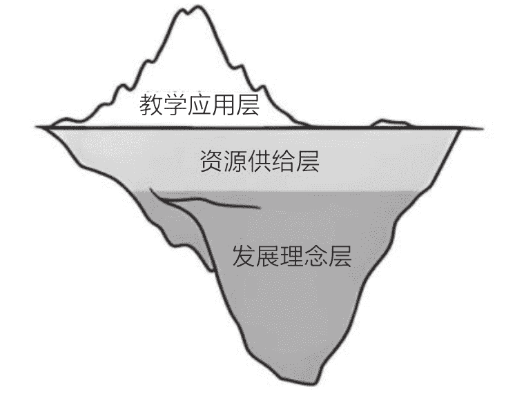
图 2-1 教学资源建设结构图

1.技术层发展需求
深度开发中 GAI 呈现技术与教育矛盾。知识精准度仍待提升，如科学课程中生成实验方案时，偶发细节描述不清、原理解释不准、反应条件或产物信息错误，误导理解。情感缺失是另一难题。教育既是知识探索与经验传授，也是关注成长与心智健全的育人工程。当下 GAI 能按提示生成对话文本，却缺乏真挚情感，需突破“教育情感计算”，在保证准确性的同时注入情境化情感要素。

可解释性不足限制应用。多数大模型不展示推理过程，使用者困惑。DeepSeek-V3 是正面案例，能展示思考逻辑并给出优质结果，但目前尚无教育版，V3 缺乏影音图像生成能力。整体上需加强自然语言处理等研发，像真实教师一样流畅互动并及时反馈，提升信任与接受度。

2.制度层发展需求
制度支持对智能化开发至关重要。顺应趋势的制度既提供规范保障，也为资源创新营造环境。

国内在国家层面已经启动了生成式智能进入课堂的顶层谋划，比如2024年3月教育部正式推出智能赋能教育行动。落地层面看，政策对教学实践的驱动力还显不足。理解与执行出现偏差后，部分学校和培训机构未能发挥该技术在资源创新上的潜力，反而让教师和学生对工具产生过度倚赖，削弱了教与学的主导地位。当学习过程被机器的即时反馈主导、知识本身的价值被淡化时，原本的人才培养目标容易滑向同质化批量输出以及人与系统的对弈。如何设计更具可操作性的教育制度，并在区域与校情差异明显的环境中落实关键要点，需要更长远的规划。

与此同时，用生成式AI创造新内容会牵涉数据隐私、算法偏见等伦理风险，对学习者权益和教育公平构成潜在威胁。因此制度层面必须把伦理与安全保障置于核心位置。各使用主体要强化数据管控，建立起国家—地方—学校的联动风险预警机制，并逐步建立以定期巡查应用状况与潜在风险为重点的教育教学调查制度。

从国际实践看，部分发达国家已有可借鉴经验。美国教育部2023年6月发布《人工智能与教学的未来》*Artificial Intelligence and the Future of Teaching and Learning*，提出把新一代人工智能纳入教与学的行动建议，强调 Humans-in-the-Loop、以人为本、使用现代学习原则设计人工智能、制定教育领域的GAI伦理准则等，以保障合理应用。澳大利亚2023年12月发布《学校中运用生成式人工智能框架》*The Australian Framework for Generative AI in Schools*，聚焦学生隐私与安全，优先考虑教学成效、人文与社会福祉、透明度、公正性与问责性。我国教育部门可吸收这些做法，制定契合国情的应用制度，推动技术在教学资源创新中的健康发展。

总体而言，要正视制度建设的不足，借鉴海外经验出台更细化、更明确、更易落地的教学政策，同时同步强化学校与社会的引导和伦理安全保障。只有为教育领域的生成式AI构建起坚实的制度基础，教学资源的创新才能行稳致远，为教育数字化转型提供支撑。

**3.能力层发展需求**

教师的数字素养是驱动教学资源创新的根本力量。随着生成式AI的演进，教师与技术正形成创造性伙伴关系，这对教师适应人机协同的智能教学环境提出更高要求。现实中不少教师在数据分析、人工智能编程等应用能力上仍显薄弱，主动使用技术的意愿不足。调查显示，52.41%的教师认为在教育中使用生成式AI并不容易，68.07%的教师表示若同事在使用，自己也会去尝试。这说明教师亟需完成面向生成式AI及其衍生资源的能力转型。

具体而言，首先要强化提示词设计能力，掌握智能生成的核心技能。 生成式AI依托海量数据与算力能实现一键产出，但本质是对既定模板的叠加。若使用时缺乏思考、不经追问，很容易遮蔽人脑知识建构的思维链条，导致数字化能力不升反降。提问能力仍是人类智慧的独有优势，设计提示词时应注意三点：一是精准锚定目标，如生成教学课件；二是融合学科概念，如讲授古诗词时围绕意境、意象构建提示；三是多轮交互提问，依据生成内容进一步定位、挖掘与拓展。

其次，要提升收集、分析与利用教学数据的能力，为决策提供依据。在大数据、大模型、大算力的智能时代，教师工作已以数据要素和数据赋能为核心。 生成式AI具备强大的检索、比对、聚类能力，教师可借助其深入了解学生的学习特征与需求，定制更具个性化的教学方案。例如要求生成式AI为东部沿海八年级“浮力”专题复习课生成约25分钟教案，输入学情、单元测试浮力板块失分数据、2022年科学课程标准要求等，即可输出包含教学目标、重难点、方法、过程与反思的完整设计。

此外，树立终身学习理念尤为重要。通过培训、阅读前沿文献等方式，不断扩展知识面，锤炼主动获取教育技术融合知识的元认知能力，提升专业素养。

在三层发展需求中，教师个体专业能力的成长是核心，也是提升生成式AI教学价值的最直接动力。

## **第二节** 生成式AI辅助教学资源创新的基础理论与关键原则

为延续教学资源创新的优势，应对数智化时代的新要求，本节介绍教师运用生成式AI辅助教学资源创新的基础理论与关键原则，以指导备课实践。

**（一）生成式AI辅助教学资源创新的基础理论**

教育认知理论与技术理论的融合，为生成式AI赋能教学资源创新提供了底层逻辑。从教育视角看，沉浸理论要求任务难度需动态适配学习者认知水平；在技术层面，深度学习理论则为突破传统资源静态、孤立的局限提供新可能。

**1.教育认知理论：沉浸理论**

沉浸理论阐释个体在活动中达到高度专注的心理机制。Csikszentmihalyi 等研究者指出，沉浸体验需满足九个条件：目标明确、挑战与能力平衡、反馈即时、进入忘我状态、内在动机驱动、注意力高度集中、活动与意识融合、时间感扭曲、任务控制自主。在此指导下， 生成式AI可发挥整合优势，确保教学材料具备动态适应性，使任务难度与学生认知水平匹配，嵌入分层目标与连贯课堂情境，借助认知负荷理论剔除无关信息，维持专注阈值。该类设计能延长深度投入周期，推动学生在沉浸中主动参与，高效发展技能。

**2.技术理论：深度学习理论**

计算机领域的深度学习根植于数学、计算机科学与神经科学，通过模拟人脑信息处理神经结构，实现对外部数据的由低到高特征提取，使机器自发学习并作出解释。历史上，深度学习概念萌芽于20世纪心理学对“深度加工”的探索，强调学习者借助批判性思维主动建构知识关联，而非机械记忆浅层信息。由认知心理学延伸至机器学习，深度学习发展为基于人工神经网络的技术，并解放传统人工设计流程，催生生成式AI。深度学习理论为生成式AI辅助资源创新提供逻辑支撑，如基于多层特征提取的神经网络可模拟人类深度认知，设计自适应学习任务与反馈资源，帮助教师构建支持知识迁移的教学环境。

**（二）生成式AI辅助教学资源创新的关键原则**

为推动学生在多通道环境中更沉浸、更安全地建构知识，教师使用生成式AI创新教学资源时应遵循以下关键原则（见表2-1）。

表2-1 教师使用生成式AI技术创新教学资源时应遵循的关键原则

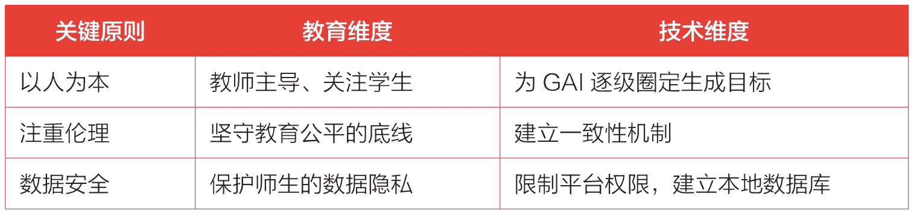

**1.坚持人本导向**

生成式AI尚缺乏类人的情绪共鸣与自适应价值观，面对真实教学情境，教师的育人价值不可替代。经验丰富的教师积累了大量随机、临场、内隐的知识，而技术的介入可能让教师忽视自身相对于机器的优势，如灵活性、自发性等。尤其在生成本土化教学材料时， 生成式AI往往输出宽泛、可操作性差、信息不准，难以辅助决策。为避免“机器限制人而非人控制机器”，教师必须以自身为本，有主见地对生成内容进行价值判断。利用生成式AI拓展思路、获取素材时，要以专业知识与教学经验为基础进行批判性审视，反思“我提供的材料是否被正确使用、生成的类型是否符合需求、写作风格是否实现”等，把技术纳入教师思维框架，服务教育工作。

同时，资源创新也要以学生为本。研究表明，随着互联网普及，“社会影响”超越物理空间，数字原住民更易受在线互动和媒体报道影响。教师需了解学生关注的网络话题，利用生成式AI生成符合认知水平的素材。在建构主义指导下，可在视频提示词中加入班级人数、整体智力背景、个人概况等本土信息，并提出情境化与会话性要求，如“加入游戏抽卡、抢红包等趣味元素”。教师还应借助生成式AI给予学生情感支持与引导。师生、生生协作是人机共创的关键保障，教师可依据沉浸理论，开发更具针对性和情感共鸣的内容。例如基于生成式AI图片引导学生进行创意写作或绘画，将个人情感与想象融入学习，并对AI作品进行欣赏与评价，培养创造力与情感表达。

**2.注重伦理**

数字鸿沟加剧使以教育公平为核心的伦理问题凸显。Pariser提出的“过滤气泡”概念揭示在线平台如何通过算法把群体分隔并定制内容流。基于黑箱模型的生成式AI因过度个性化，进一步放大个体获取相似主题结果的差异。有研究显示，部分学生担忧生成式AI的局部引入会拉大教育差距，冲击人才选拔与考核机制。对多模态教学资源，教师还需关注生成素材中可能隐含的性别歧视等偏见，避免数据失衡导致刻板印象传播。

“道德物化”理论认为技术设计时即应嵌入伦理考量，强调技术与人共同发挥伦理作用。因此教师需用个人智慧保持班级整体的统一性。例如围绕“氢氧化钠与氢氧化钙性质是否相同”这一核心问题，可先引导学生提出假设与检验思路，再借助深度学习理论由生成式AI生成多条检验路径，鼓励学生在智能路径规划下完善实验方案。为确保技术熟练度不同的学生获得相似可行的路径，教师需课前介绍生成式AI基本用法，并提供一条检验路径的提示词模板。该生成路径即为教学资源创新的具体范例。

**3.数据安全**

数据在黑箱模型生成式AI平台流转过程不透明，教师需把数据安全置于核心以降低隐私泄露风险。首先，处理教学材料生成时，应优先选用符合隐私保护标准的工具，审慎阅读平台数据使用协议，确保明确禁止将用户数据用于二次训练。如使用ChatGPT时关闭默认的“历史记录保存”，避免学生对话纳入模型迭代。其次，避免在平台中直接输入含家庭住址等敏感信息的原始数据，必要时采用匿名化处理或用合成数据替代。最后，技术型教师可联合建立本地化小型语言模型，利用开源框架在封闭环境处理敏感教学数据，既发挥创新潜力，又最大限度降低隐私风险。通过这些实践，可在推动创新的同时筑牢数据安全防线。

## **第三节** 生成式AI赋能多级教学材料的开发步骤

从课堂基础材料的自动生成到高阶素材的深度交互， 生成式AI正在部分替代人力承担的重复劳动，如网络素材的上传下载，并逐步展现机器思考所衍生的创造性。本章最后将遵循上述关键原则与理论，分层次利用生成式AI开发优质资源。本节从入门级基础教学素材出发，详解生成式AI赋能教学材料开发的三级流程。

**（一）入门级：高效生成基础教学素材**

日常教学中，寻找图片、设计视频、撰写文本等准备工作大量消耗教师精力。 生成式AI为基础素材生成打开了新门，让制作更高效轻松（见图2-2）。

图2-2 生成式AI生成基础教学素材流程图

 生成式AI在自动生成图片方面能力强劲。教师只需在图片生成功能页输入文字描述，即可快速获得画质清晰、独一无二的精美图片。具体而言，需先构想画面大致轮廓，为生成式AI提供主题、风格与详细内容。尤其在内容层面，鉴于当前文生图技术难以生成可读文字，应尽量避免图片中包含文字或缩小文字占比。案例1展示了少量文本生成后的二次编辑：在即梦 AI、文心一格等平台涂抹消除文字，再用Word、ipiccy、PicMonkey等本土软件添加新文本。生成后应全面检查，若大范围错误需重新提问，小范围错误可用系统自带编辑器免费修正。相较于版权存疑的网页搜索， 生成式AI图片生成更安全且适配教学。目前国内较实用的文生图平台包括即梦 AI、文心一格、智谱清言、讯飞星火等。

**案例1：**某初中英语教学场景，为《如何制作香蕉奶昔》设计一组制作过程图，帮助学生理解新词。

操作平台：即梦 AI。

**输入的关键提示词**

请围绕“How do you make a banana milk shake？”这一内容，以插画风格生成包含四张图片的组图，内容分别为：①Peel the bananas；②Cut up the bananas；③Pour the milk and the bananas into the blender；④Turn on the blender。

**生成的组图（见图2-3）**

图2-3 使用即梦 AI 生成的组图

图2-3（续）

 生成式AI自动生成视频也大幅简化制作流程。教师无需掌握专业拍摄、剪辑、特效技能，通过文字描述即可轻松制作教学视频。不论是理科课堂难以直接演示的实验，还是文科艺体类以文字为主的片段， 生成式AI都能通过短视频帮助学生生动理解，实现建构主义情境化需求（案例2）。教师可在视频中插入背景音乐、讲解音频，或拼接实拍片段以增强效果。即梦 AI、智谱清影、通义万相等平台均可实现文生视频，基本流程与文生图类似。

**案例2：**“赤壁赋”中“白露横江，水光接天”的江上风光，仅需输入下列提示词即可自动生成贴切视频。

操作平台：智谱清影。

**输入的关键提示词**

以“赤壁的江上风光”为主题，按照“电影感”风格生成视频：水波不兴、浩瀚无涯的江面，两侧群山耸立，月光照耀，白茫茫雾气笼罩，天光水色连成一片，正所谓秋水共长天一色，游人乘一叶扁舟。

**生成的视频**

视频截图见图2-4，完整视频下载地址见附录A。

图2-4 使用智谱清影生成的视频（截图展示）

智能文本生成在备课阶段作用突出，这也是教师最熟悉的功能。输入课程主题、教学目标、重难点等关键信息， 生成式AI能生成详细教案与课堂活动参考。切换提问内容，例如让生成式AI依据章节知识点和教学目标对应的题型生成复习课练习题（案例3），生成内容就从“怎么教”转向“怎么学”。教学中涉及文本的环节均可借助生成式AI完成，后续教师再据实际情况调整完善，可大幅节省备课时间。现有大语言模型均可实现文本生成，为展示不同平台效果，本节案例尽量选用不同平台。

**案例3：**某初中数学教师需为“不等式与不等式组”复习课设计四道课堂练习题。输入以下提示词可快速生成。

操作平台：豆包。

**输入的关键提示词**

请从初中数学“不等式与不等式组”章节中生成四道难度递增的练习题，要求第一题为选择题围绕不等式的定义和性质；第二、三题为填空题围绕不等式组的求解；第四题为包含两小问的计算题围绕不等式组的解集和参数。

**生成的练习题（见图2-5）**

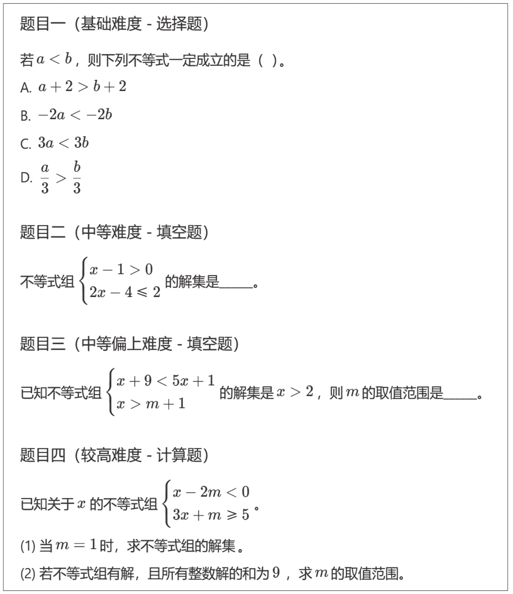

图 2-5 使用豆包生成的练习题

**（二）进阶篇：精细化打磨教学素材**

把生成式AI引入演示文稿、可视化图表与智能导图的制作中，能让教师摆脱大量重复的排版与绘图事务。先让模型跑出一条清晰的课堂思路骨架，教师再在此基础上做二次加工，既保留个人的教学逻辑，又让备课效率显著提升。

自动生成PPT已成为备课环节中的实用伙伴。过去的做法多半把输入内容直接平铺到空白页，如今的模型会先把整节课的知识要点梳理拆解，形成可调整的提纲文本，再依此产出结构分明、设计精美且仍可继续编辑的演示文件。提纲可以拓展原有思路，成品也会提示哪些页面适合加入补充资料与图片，使得PPT的价值不局限于单次授课，也能助力专业成长。案例4演示了借助讯飞星火大模型完成PPT的效果。操作通常先输入指令并挑选模板，随后由AI产出可修改的提纲，最后形成可编辑的演示文稿，流程见图2-6。

图 2-6 GAI 生成 PPT 流程图

**案例4：**作为初中历史教师，若要为“第一次工业革命”一课制作PPT，输入下述关键提示词，GAI即可自动匹配相应的历史图片、图表，并为每页添加合适的文字说明与动画效果。

操作平台：讯飞星火大模型。

**输入的关键提示词**

请你以“第一次工业革命”为主题（PPT 主题），生成约 25 页（PPT 页数）在初中历史课堂上展示的 PPT。PPT 内容包括：①背景。17 世纪末，英国君主立宪制建立后，政局稳定，资本主义经济发展迅速。你可以呈现当时的社会经济数据图表和反映工厂场景的历史图片。②主要发明。纺织技术、蒸汽机和工厂制度、火车与铁路。③影响。你可以从衣、食、住、行四个方面进行说明。

**生成的PPT（见图2-7）**

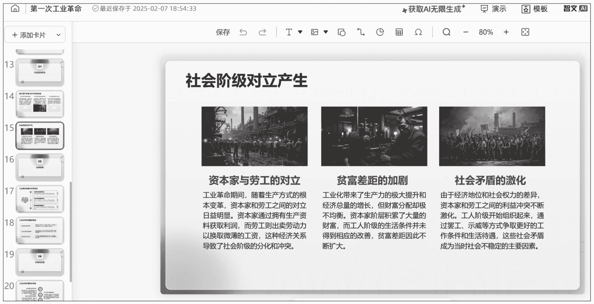

图 2-7 使用讯飞星火大模型生成的 PPT

可视化图表能让复杂数据和抽象概念直观易懂。物理、历史等学科经常涉及真实数据与难以语言化的问题，常规表述效率有限。尤其在课外拓展中，学生通过调查或测量得到的数据，若以图表呈现，就能像研究者一样继续思考。借助GAI的可视化工具，只需把Excel文件导入平台并给出图表类型指令，即可快速得到所需图形，流程见图2-8。

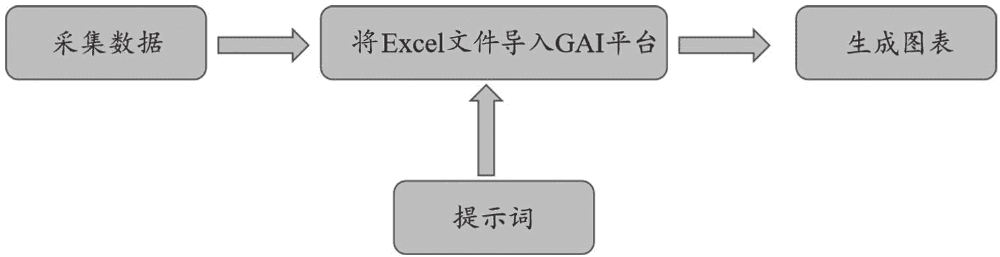

图 2-8 GAI 生成可视化图表流程图

**案例5：**你正在负责一个“怎么测量空气阻力系数”的课外拓展项目，现在你要利用采集到的数据生成图表。

操作平台：智谱清言。

**输入的关键提示词**

请你生成两张以“小球抛射实验”为主题（图表主题）的图表，其中第一张以*f**[x]*/N 为纵坐标、*v**[x]*/m·s^(-1)为横坐标，第二张以*f**[y]*/N 为纵坐标、*v**[y]*/m·s^(-1)为横坐标，并在两张图表上直接绘制包含公式的拟合线，生成阻力参数*k**[x]*、*k**[y]*，即图表的斜率（图表内容）。

**生成的图表（见图2-9）**

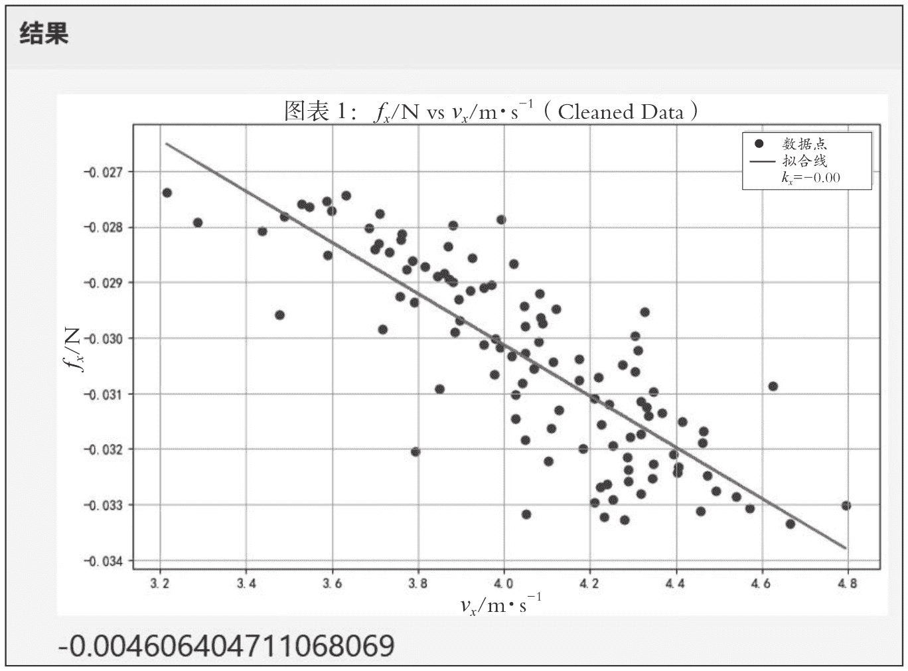

图 2-9 使用智谱清言生成的图表

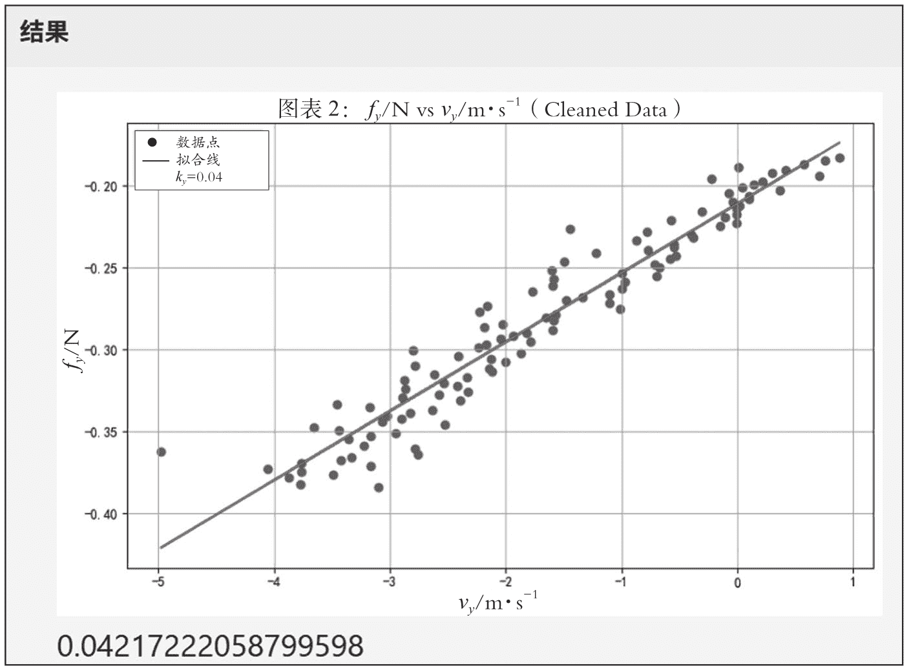

图 2-9（续）

教师还能借助GAI智能生成思维导图来理清教学脉络。BoardMix博思白板、TreeMind树图、ChatMind等工具，只需提供课程主题、章节要点及知识点间的关联，就能迅速得到层次分明、脉络清晰的导图，流程见图2-10。

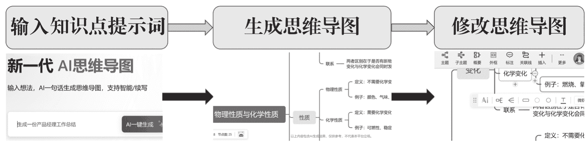

图 2-10 GAI 生成思维导图流程图

**案例6：**你是一位初中科学教师，为了教学“物理性质与化学性质”这一节内容，你计划使用下列关键提示词自动生成思维导图。

操作平台：TreeMind 树图。

**输入的关键提示词**

请你为“物理性质与化学性质”（思维导图主题）这一节生成思维导图，要求其包含下列内容：“变化”部分包括物理变化和化学变化的定义及二者的联系；“性质”部分包括物理性质和化学性质的定义及变化与性质的联系；“思考”部分则针对上述变化和性质给出生活实例（思维导图内容）。

**生成的思维导图（见图2-11）**

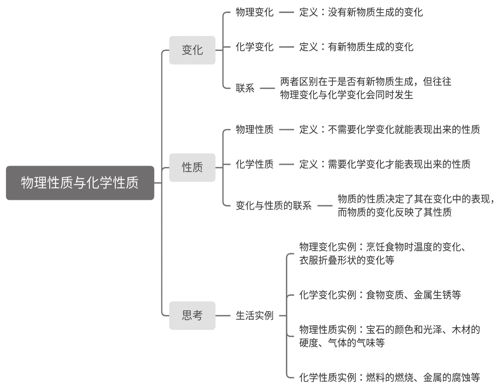

图 2-11 使用 TreeMind 树图生成的思维导图

**（三）高阶篇：深度构建教学素材**

与前两个层级相比，生成科学阅读材料等高阶素材对模型的要求更高。不仅要调动教学经验与知识体系完成专业任务，还需具备接近真实教师的创造力与情感表达能力。

相较传统知识中心文本，AI辅助下教师更容易获得模拟真实科研过程的情境化阅读材料，为学生提供有趣且严谨的思维训练。优质科学阅读材料通常遵循“异常现象→提出疑问→技术观测→科学分析→实验验证”的探索逻辑，并设置角色分工明确的情境，通过具象描写和人物行动自然揭示原理。教师只需把结构与背景输入平台并做补充修改即可。这类材料既有扎实的科学知识，也穿插生活实例与科学故事，并可通过对话反馈根据学生年龄和认知水平进行调节，确保多数学生掌握表层含义，部分学生挖掘科学思维，从而提升兴趣与理解深度。

教育智能体可看作具备智能交互能力的教学助手。定制或选用特定智能体后，教师能像与真人对话一样获得即时辅导、温暖鼓励并协助教学。智能体的推理逻辑严谨且符合设定。目前可生成智能体的平台包括豆包、讯飞星火大模型、文心智能体、智谱清言等，流程见图2-12。

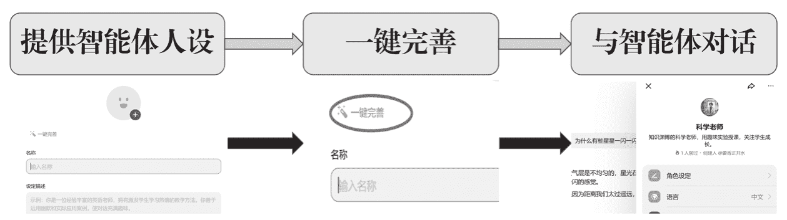

图 2-12 GAI 生成智能体流程图

**案例7：**为了帮助学生深入理解“光的折射”原理及其在生活中的实际应用，你计划使用下列关键提示词自动生成科学阅读材料。

操作平台：DeepSeek。

**输入的关键提示词**

请你根据“光的折射”这一主题（文本主题），采用“异常现象→提出疑问→技术观测→科学分析→实验验证”的科学探索逻辑（文本结构），生成包含标题在内且总字数约为 900 字的文本（文本字数）。要求文本中包含光的折射原理及其生活应用、不同介质对光的折射的影响、光的折射现象的趣味实验（文本内容）。围绕针对初中学生的眼镜制作情景（文本情景），设置多个分工明确的角色，并通过问题链推进情节的展开，最后生成一个不分段的完整故事（文本角色要求）。

**生成的科学阅读材料**

“眼镜工坊的光线谜题”阅读文本（部分）

午后阳光斜斜地照进眼镜工坊的窗户，此时小然正在帮师傅打磨一副树脂镜片。突然，她发现镜片边缘的刻度线浸入水中后竟像被“折断”一样扭曲起来。“师傅，镜片在空气里明明是直的，为什么在水里变弯了？”她举着镜片喊道。戴着厚厚眼镜的陈师傅笑了笑：“这可是光线的‘魔术’，咱们用激光笔和玻璃水箱来找找答案！”阿铭闻声凑过来，打开激光笔对准空气里的镜片——红光直直穿过镜片，在墙上投下一个小圆点。但当镜片半浸入水箱时，光线突然在水面处“拐了个弯”，圆点位置猛地偏移了 5 厘米。“哇！光真的会‘拐弯’！”阿铭惊呼。正在记录数据的科学课代表小雨推了推眼镜：“我查过资料，这叫折射！但为什么不同材质影响不一样呢？”陈师傅搬出一台折射仪，示意三人测试不同材料：玻璃、树脂和水的折射率。他们依次将材料放入仪器，激光穿过时在刻度盘上划出不同角度的折线——玻璃让光线偏折 32°，树脂 28°，水只有 19°。“折射率高的材料就像黏稠的蜂蜜，光线‘跑不动’就会急转弯！”小然比喻道。阿铭恍然大悟：“所以近视镜要用高折射率树脂，薄薄的镜片也能矫正视力！” 

**案例8：**智能体既可以被嵌入PPT中实现课堂互动，也可以在课后成为指导学生复习的小帮手。

操作平台：豆包。

**输入的智能体设定**

你是一位经验丰富的科学老师，风趣幽默，具有扎实的学科知识和教学经验，并且擅长撰写和使用情景化案例。

**生成的智能体（见图2-13）**

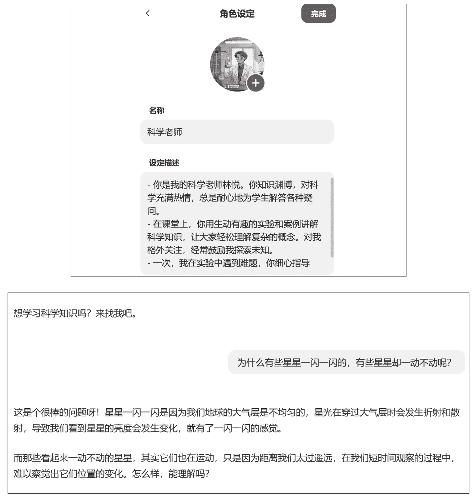

图 2-13 使用豆包生成的智能体

教育数字人能模拟真实教师的形象与风格，生成生动的微课视频。相比阅读材料和智能体对思维的侧重，数字人通过仿真面部表情、肢体动作和语音语调提供沉浸式课堂体验，彰显人文关怀。它还能根据教学场景切换形象。常用平台为有言，流程见图2-14。

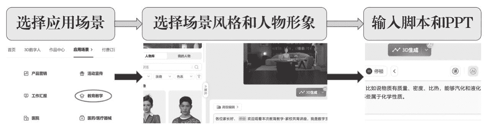

图 2-14 GAI 生成教育数字人流程图

**案例9：**在“物理性质与化学性质”网课中，教师可以利用教育数字人生成教学视频。

操作平台：Kimi（文案编辑）、有言（视频生成）。

**输入的内容**

事先写好的脚本逐字稿和 PPT，或者由 GAI 平台智能生成，这里生成的内容如下。

**文案：**同学们，今天我们一起走进物理性质与化学性质的奇妙世界。物质的世界丰富多彩，而物理性质和化学性质则是我们认识它们的两把关键钥匙。物理性质是物质不需要发生化学变化就能表现出来的性质，比如颜色、状态、气味、密度、熔点、沸点等。我们看到一块红色的铁、闻到花香，或者观察到冰在加热后变成水，这些现象都属于物理性质的范畴。它们是物质的“外在标签”，让我们能够直观地感知和区分不同的物质。而化学性质则不同，它是物质在化学变化中表现出来的性质，例如可燃性、氧化性、还原性、酸碱性等。化学变化的本质是原子之间的重新组合，生成新的物质。比如木材燃烧，生成了二氧化碳和水，这就是木材的可燃性这一化学性质的体现。化学性质是物质的“内在灵魂”，它决定了物质在化学反应中的行为和变化。物理性质和化学性质相互关联，共同构成了物质的完整“性格”。通过研究它们，我们能够更好地利用物质，为人类的生活和生产服务。在后续学习中，我们会通过各种实验和实例，深入探究物质的物理性质和化学性质，希望大家积极参与，用心感受物质的奇妙世界！

**生成的教育数字人**

视频截图展示见图2-15，完整视频的下载地址见附赠资源“附录A”。

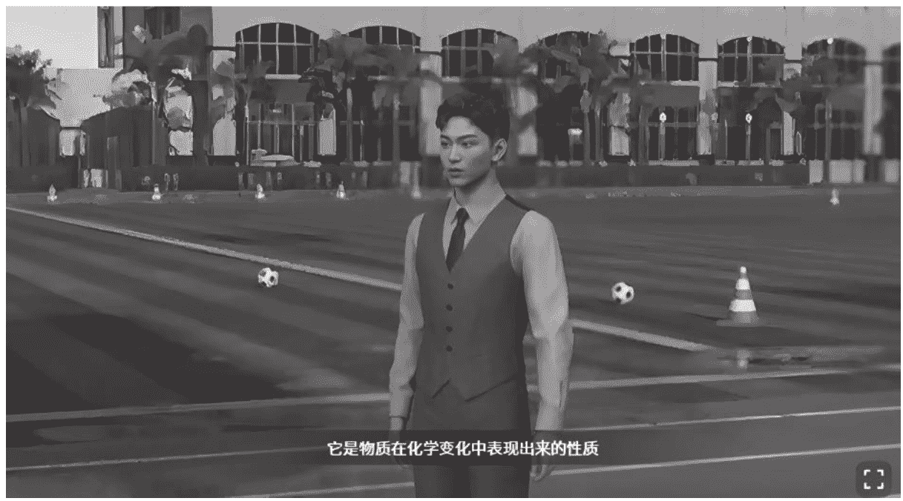

图 2-15 使用有言生成的教育数字人（截图展示）

**动手练一练**

**练习一：**作为一线教师，你计划根据当前的教学进度设计下一节新课的教学方案。为了使知识呈现更加具象化，你决定搜集一些插图、符合课文描述的视频并设计课堂练习题。请选择恰当的 GAI 平台，设计出【PPT 文本配图】【教学视频】【课堂练习题】，以高效完成备课工作。

**建议：**

使用智谱清言可以直接完成上述三个任务；也可以使用其他 GAI 平台来分别完成，比如先使用豆包、DeepSeek 生成提示词，再将其导入智谱清言、有言等 GAI 平台生成视频。

• 给定的提示词信息越丰富，生成的视频效果越好。

• 尝试使用不同的 GAI 平台，对比不同 GAI 平台的效果。

**练习二：**在涉及实际数据的某节课中，你需要制作 PPT 和可视化图表，并在小结部分使用思维导图引导学生回顾和反思。请借助 GAI 平台如讯飞星火大模型、智谱清言和树图软件等，生成上述教学材料。

**建议：**

• 如果你是讯飞星火大模型的会员，则可以直接在此平台生成和修改 PPT。你也可以先使用 DeepSeek 生成 PPT 大纲，再将其导入 Kimi 中生成免费的 PPT。

• 你可以先使用 Kimi 生成 Markdown 格式的知识点大纲，再将其导入 X Mind 中生成彩色的思维导图。

**练习三：**作为教育工作者，你如何利用 GAI 来进一步优化教学资源的深度和广度？请设计一个科学阅读活动，详细说明你将如何使用 DeepSeek、豆包、有言来生成【科学阅读材料】【教育智能体】【教育数字人】，使学生能够完成“阅读材料趣味学知识—询问智能体互动拓思考—观看数字人稳固知识基础”的发展流程。

**建议：**

尝试选择符合学情的学科概念，并使用不同大模型的资源来生成相应的效果。

## **第四节 小结**

目前 GAI 已成为教学资源创新的重要力量。从平台建设、学科融合到复合场景应用，它不仅拓展了教学材料的时空边界，以跨学科为支点实现素材内部创新，也在教、学、管、评四大环节推动资源专业化发展。但就教学视角而言，GAI 仍不够成熟，技术上知识准确度、情感表达与可解释性待提升；制度上政策制定与后续管理不足；能力上教师数字素养有待提高。基于建构主义等理论，GAI 辅助资源创新应遵循以人为本、注重伦理、数据安全三项原则。

结合能力成长需求与上述原则，可从三个层级探索赋能路径：先练习生成图片、视频、智能文本等基础素材，再进阶制作 PPT、可视化图表和思维导图，最后挑战科学阅读材料、教育智能体和教育数字人等高阶素材，从而在学思练中逐步提升专业能力。

总体来看，GAI 为教育打开了全新可能，我们正处在探索辅助教学的先行阶段。希望教师能在阅读后掌握资源生成方法，并携手多元大模型持续打磨教育技能。

# **第三章**

# **GAI 赋能学科教学研究**

生成式人工智能凭借强大的数据生成与模式分析能力，为学科教学研究提供了革命性工具，成为教育领域热点话题。它可以动态解析学习行为数据、生成虚拟教学场景、支持跨学科知识建模，推动教育研究向数据驱动的计算实证范式转变。一方面，多模态数据分析揭示教学干预与认知发展的隐性关联，虚拟实验验证教育理论的普适性；另一方面，它促进教育学与计算机科学、认知科学的深度交叉，拓展学科边界。同时，GAI 的应用倒逼研究伦理框架革新，需平衡算法效率与数据主权、技术赋能与学术主体性，为智能时代兼具科学理性与人文关怀的教育研究体系奠基。本章将探讨 GAI 在学科教学研究中的理论支撑与实践应用，为教育工作者提供参考。

## **第一节 GAI 助力学科教学研究的应用现状与发展需求**

了解 GAI 在学科教学研究中的应用现状与发展需求，对教师开展研究具有双重意义。一方面，GAI 提供数据驱动的创新工具，如自动化学情分析、虚拟实验生成和跨学科知识建模，能高效识别教学痛点的本质规律，例如学生认知路径的群体差异或教学策略，有效突破传统研究样本局限与质性分析的主观性；另一方面，它迫使教师重构研究思维，从被动应对技术变革转向主动驾驭智能工具，例如利用 GAI 模拟不同教学干预的长期影响。同时，教师需在技术赋能中保持学术主体性，批判性审视算法结果的可靠性，避免数据偏见干扰结论，并在人机协同中探索教育研究的伦理边界，最终实现工具与价值的深度融合。

**（一）GAI 助力学科教学研究概览**

我国 GAI 在学科教学研究领域的应用不断深入，展现出广阔前景和巨大的教育变革潜力。新一轮教育变革中，GAI 深度应用将进一步凸显，教育信息化与数字化转型将加速。当前，GAI 在学科教学研究上取得多项突破，同时也面临发展瓶颈。

**（二）GAI 助力学科教学研究的应用现状：新枝初显效**

（1）当前，GAI 在教育资源的生成和优化方面已取得较大突破。

在学生层面，GAI 可依据教学目标和学习需求生成个性化学习资源，提供个性化指导，促进全面发展并激发学习兴趣与潜能。在教师层面，GAI 能基于教学大纲和目标，利用自然语言处理技术筛选针对性教学资料，快速生成优质教学设计与方案，自动整理教学反思并生成反馈评价，降低备课外部认知负荷，让教师把更多精力放在培养学生成长上，减轻非教学负担。

例如，Squirrel AI（松鼠 AI）是一家利用 GAI 提供个性化教育的公司，其智能平台通过分析学习者的课前预习、课堂学习、课后复习等数据，生成定制化学习路径与内容。研究表明，使用松鼠 AI 的学习者在标准化考试中成绩显著提升，尤其在数学和英语等基础学科。GAI 为教与学全过程提供个性化学习支持服务设计与资源，不断优化有针对性的教育教学资源。

（2）GAI 可作为课堂虚拟助教参与互动，实时监测学生课堂表现与思考深度，为学生提供即时反馈与评价，教师可更直接获取学习状况，以便调整教学方法与策略。

GAI 驱动的学科教学研究新图景

在数学学习情境里，师生与生成式系统的互动能够实现层层递进的解题引导。学生不断追问某题的求解路径时，思考会随之加深，对概念的理解也更扎实。Labster 平台借助该类技术可复现各类教学实验场景，为物理、化学等科目的理论讲授与实践操作提供仿真支持。课堂中，系统能预判学习者可能卡住的环节，推送有针对性的点拨与解决思路，提升课堂投入与专注，同时帮助任课教师更清晰地把握学情。课后，系统依据教学要求与学习目标自动批改作业与试卷，输出具体修改建议，并据此生成详尽的学习状况分析报告，呈现学生在各知识点上的掌握程度，为教学微调提供精准依据。

（3）跨学科研究与协作进入多维创新阶段
其一，项目式跨学科教学中，虚拟数字人与生成式技术的融合正成为关键创新方向。该组合既重塑了教学形态，也优化了资源供给。虚拟数字人依托高精度建模、动作捕捉与语音合成呈现高度拟人形象并支持实时互动，可在教学环节中充当重要伙伴，为学习者带来更生动、直观且可定制的体验。生成式技术凭借强大的数据生成与自主学习能力，可在给定数据与规则基础上创造全新内容。二者联动使虚拟形象能够快速生成并个性化定制，并借助自然语言处理、情感计算等手段赋予其丰富的情感表达与智能交互能力，提升了资源制作效率与质量，也带来了更沉浸的学习体验。

例如，“生成式技术+虚拟数字人”已在某地普通高中的“智慧农场”项目中落地。该项目搭建沉浸式智慧学习场景，学生在小组探究与自主学习中完成游戏化闯关与任务，强化综合运用学科知识解决现实问题的能力。此类跨学科项目式教学减轻了教师课堂负担，同时提升了参与度、学习兴趣与创新力。

其二，在跨学科课程创生层面，生成式技术为教育改革提供了新思路。技术赋能大概念教学，从大概念提炼到学习指引的定制，从跨学科创意表达到学习评价的定制，全方位推动教学模式变革。

其三，在学科教学研究中体现为教学内容的实时更新与个性化支持。以信息技术课程为例，系统能自动整合最新编程语言与软件开发工具，并按行业动向及时刷新教学内容。这种自适应更新让知识与实践紧密衔接，增强了学生对社会议题的敏感性与分析力。

（4）资源优化与教育公平层面作用突出
教育资源分布不均是全球尤其是发展中国家的长期难题。生成式技术可低成本高效地生成并分发课件、教学方案、练习、课堂视频、互动学习内容等资源，并通过在线教育平台进一步优化配置，使发展中国家和偏远地区借助智能终端或多媒体设备获得相对丰富优质的教育资源，有效弥补师资与资源的缺口。

与此同时，技术为教育政策完善提供了强支撑。通过数据分析、模拟预测与政策建议生成，深度洞察教育教学态势，辅助决策者制定更公平高效的举措。UNESCO运用生成式系统分析全球教育数据，形成关于教育公平、资源配置与学习成效的报告，识别资源失衡地区并提出增加在线教育投入、优化教师配置等针对性建议。美国教育部亦借助该技术分析各州教学数据，识别教育不平等主因，关联成绩、家庭背景与学校资源，推演影响公平的关键变量。

总体看，生成式技术在学科教学研究中的创新应用正多路径重塑教育生态：在定制化学习端，通过多模态资源生成打破地域限制，以智能评估系统实现教学闭环优化和教育政策科学化；人机协同新机制为教师职业成长开辟新范式，全方位提升教育的公平性、效率与质量。需注意的是，技术应用过程要同步构建数据隐私保护机制，确保人工智能发展和教育伦理同频。随数字化转型政策持续完善，生成式技术有望从辅助工具升级为教育系统变革的核心引擎，成为推动全球教育公平与现代化的主要驱动力。

（三）助力学科教学研究的发展需求：深度融合促创新
随着生成式技术在学科教学研究中渗透加深，其核心矛盾日益凸显，即学科知识体系的独特性复杂性与标准化生成逻辑之间的结构性冲突。该冲突不仅体现在技术层面，更反映了知识生产传播规律和人工智能范式间的根本分歧。

1. 学科知识体系的独特性与复杂性
在符号系统精确性上，数学符号逻辑要求严格遵循形式化规则如公理体系、证明链条，多数学科通用模型因符号推理不足常产生错误或逻辑断裂的证明；物理公式推导需满足量纲一致与物理意义，通用模型易生成形式正确却物理无意义的表达式；在情感语境上，文学创作依赖情感表达、文化语境与历史背景的深度理解，生成式技术生成或分析文本时常缺乏细腻情感与文化敏感度，导致内容表面化或情感失真；在微观建模复杂性上，化学分子结构预测与反应机理模拟需高精度量子计算与物理引擎支持，技术生成实验方案或分子结构时易因算力限制出现不准结果或难以捕捉动态形态。技术在学科知识辅助上的缺陷及具体实例见表 3-1。

表 3-1 技术在学科知识辅助上的缺陷及具体实例

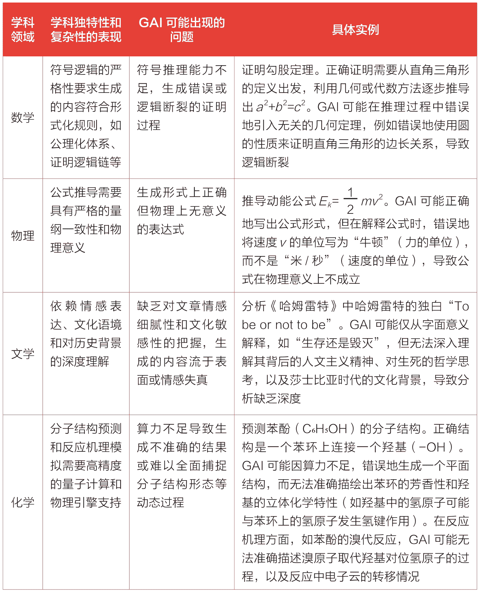

2. 标准化生成逻辑
该类系统依赖人工供给的大规模数据训练，生成逻辑基于统计规律而非学科内在逻辑。面对需严格逻辑推理或高度语境化的学科问题时，固定范式易产生成“形式正确、实质错误”的结果。如数学问题求解，系统更擅长归纳而非严格演绎，面对创新性问题时只能按固定模式应对，针对性有限。学科知识常需文本、符号、图像、数据综合表达，通用模型在多模态综合表达上仍存瓶颈。

将二者应用于学科教学研究时，需不断缩小本质差异。人类的认知具情景敏感与灵活适应，偏向感性创新思维而非固定范式；系统的输出标准化，受限于训练数据质量与规模。在弱人工智能阶段，二者矛盾亟待化解。

应依据不同学科特性开发专用模型，如数学符号推理引擎、文学情感分析模型、化学分子生成器，并构建多模态知识表示体系，整合文本、符号、图像、数据信息，突破数据投喂瓶颈，增强逻辑推理能力，引入形式化逻辑与符号推理机制，提升数学、物理等理科生成准确性与一致性，例如 Lean4 证明助手和 ChemBERTa。

学科独特性与模型标准化生成逻辑的结构性冲突，本质是知识复杂性与技术范式局限性的矛盾，需从技术、认知、教育三维协同突破，推动技术从通用工具向学科增强型智能体进化，实现技术和教育的深度融合。

此外，教师是融合的关键。需开发“技术+教学”等培训项目，帮助教师在教学设计与数据分析中规范使用，建立智能素养认证机制，推动工具规范化使用，促进教学数字化转型。学生作为最终受益者，应明确技术在学习过程与认知发展中的定位，以提升认知能力为目标，而非替代思考，帮助显性化学习路径。

技术应用还需伦理规范框架。数据隐私与安全方面，训练与应用依赖成绩、行为等海量教育数据，需脱敏处理并建立知情同意机制，确保用途透明、安全可控。地域文化方面，训练数据偏见可能导致性别、种族、地域歧视内容，应开发偏见检测工具定期评估，并提升教师信息筛查能力。人机协同伦理方面，需提升智能素养，避免过度依赖，倡导 “AI 辅助、学生主导” 模式，借助认知轨迹分析工具保障学习主体地位，提升批判性与创造性思维。

总体来看，生成式技术在学科教学研究的应用正从基础工具支持迈向深层教学模式变革，需求集中于技术优化、伦理治理、教师能力提升与教育公平保障。随着多模态技术与垂直模型成熟，技术有望成为教育创新的核心驱动力，构建以“人机共生”为核心理念的新生态。

第二节 生成式技术辅助学科教学研究的基础理论与关键原则

对一线教师而言，开展学科教学研究颇具挑战。生成式技术的发展提供了有效路径，可显著提升效率。但网络教程多聚焦操作，底层逻辑阐述不足，易导致碎片化应用。明确基础理论与关键原则，有助于搭建数字化转型桥梁，提升专业素养，实现深度融合。

（一）生成式技术辅助教师进行学科教学研究的基础理论
应用需建立在坚实理论基础上，避免盲目使用。第三空间理论、联通主义理论与数据驱动决策理论在此尤为关键。前者为开放动态性提供支撑，后者关注知识网络化连接，第三者突出数据在分析决策中的核心作用。

1. 第三空间理论
由美国学者爱德华·索亚提出。第三空间存在于第一空间物理现实与第二空间精神想象之外，是混合空间，既含真实场景实践，又融入数字技术构建的虚拟环境。其开放性、动态性、实践性与技术特性高度契合。

（1）开放性：多元主体参与
第三空间打破传统研究边界，实现多元协同。传统研究多由专门研究者主导，参与有限，封闭性强。技术借助自然语言处理与数据分析降低门槛，让教师参与研究。

（2）动态性：过程迭代优化
研究过程可按实践需求不断迭代，形成“研究—实践—再研究”闭环。传统研究多基于固定设计与数据收集，静态性强。技术可即时处理更新数据，支持图文等多模态交互，提供最新结果，助力动态调整方向与方法。

（3）实践性：虚实交织
实现虚拟与现实交织，增强实践性与可操作性。传统理论与实践常分离，成果难落地。技术可基于研究成果与学习需求提供精准个性化反馈，助教师优化教学策略，促进理论实践高效结合。

2. 联通主义理论
由乔治·西蒙斯提出，面向数字时代的学习理论。核心观点是知识存在于外部网络而非个体内部，学习是通过建立多元连接构建知识网络的过程。“管道比内容更重要”。

（1）知识网络的扩展与重构
教师可借助技术拓宽研究视野，重构知识网络。传统研究依赖个人储备与有限文献，网络封闭静态。技术可快速整合海量数据转化为结构化节点，构建更广阔动态的知识网络。

（2）跨学科研究的连接与融合
传统研究多局限于单一学科。技术可整合多学科知识，提供跨学科连接点，如将认知科学理论用于教学设计，或大数据技术用于教育评价。

3. 数据驱动决策理论
强调系统化收集、分析、应用数据支持教育决策，而非依赖直觉经验。学科教学研究高度重视数据价值，技术作为强数据处理与知识生成工具，可提升研究科学性、精确性与有效性。

（1）研究问题的发现与定义
传统问题多依赖经验或文献阅读。教师可利用技术从数据中挖掘潜在问题，推动研究创新。

（2）研究数据的分析与解读
传统数据分析多一次性难以深入。技术可实时分析并多视角解读，如生成报告、可视化图表与语义分析，挖掘数据规律，为研究提供前瞻性与创新性指导。

（二）生成式技术辅助教师进行学科教学研究的关键原则
关键原则以实践为落脚点，为教师提供行动指南，平衡技术创新与教学需求。

1. 问题研究导向：聚焦真实需求，避免技术滥用
使用应以解决具体学科教学研究问题为核心，而非追求技术新颖性。引入前需明确研究问题或假设，确保源于实践痛点，保证成果具实际意义。

2. 数据驱动的动态迭代：从经验转向证据
技术优势在于数据处理，学科研究亦高度依赖数据。应以高质量数据为基础，保证代表性、多样性与准确性，避免偏差导致结论失真。可借助技术挖掘潜在关联，提出创新假设，提升效率。研究过程需动态迭代，结合反馈优化设计，推动从经验驱动向证据驱动转变。

3. 人机协同分工：教师主导，技术赋能
教师应始终主导，技术作为辅助。技术可承担数据整合、模式初筛、文献综述等重复性技术任务；教师负责研究设计、结果解读、理论建构等核心工作，确保方向正确与深度。对技术输出需批判性验证，避免“幻觉”干扰结论，发挥技术优势的同时保障学术价值。

4. 透明可解释：拒绝“黑箱”，保障研究可信度

AI 辅助教学研究的透明化与合规化要诀

在教学研究中引入生成式人工智能，首要是要确保整个工作链条清晰可查、可核验。教师应该完整留存资料来源、所调用模型名称与版本、核心超参数设定、分析步骤记录等关键信息，并在正文中明确标明人工智能在信息采集、数据处理或假设提出等环节的具体分工。由模型自动生成的段落必须附上推理依据或参考出处，保证结论能够被独立检验并重复复现。撰写学术论文或研究报告时，应把人工智能的贡献与研究者自身的原创性思考明确区分，严格遵循署名规范，避免不当署名、抄袭等学术不当行为。只有建立可解释的透明机制，研究的可信度与学术价值才能得到保障。

遵循上述规范，教师才能够在合规框架内借助生成式工具开展教学研究，既提升效率与质量，也坚守科学严谨与伦理底线，为教育实践创新提供支撑。

## 第三节 生成式AI贯穿教学研究的路径与对策

**（一）准备阶段：选题与文献综述的智能优化和辅助**

生成式工具能够帮助教师更系统地进入研究准备。选题优化时，可从政策文件、学术成果与课堂实践中快速提炼有价值的方向，降低选题重复或脱离实际的风险；文献综述时，可分担检索与整理负担，自动筛选与主题相关的高质量文献并提炼核心观点与演进脉络，帮助教师迅速把握领域现状与空白，避免常见误区，使研究起点更稳。

**1.选题的智能优化**

**（1）选题生成与拓展**
以关键词驱动是常用做法。把“混合式教学”“核心素养培养”等核心词输入系统，通过组合与延展得到备选题目，例如将“混合式教学”与“在线学习成效”结合，得到“在混合式教学模式下提升在线学习成效的策略研究”。借助Elicit、ResearchRabbit等平台还能绘制领域知识图谱，快速掌握核心概念、热点议题与潜在关联。
学科热点与政策解读也可被放大。结合教育数字化转型、跨学科融合等当前趋势，模型可解析新课标、教育信息化规划等文件，提炼研究价值点。输入“AI+语文作文教学”，即可得到“基于生成式人工智能的个性化写作反馈机制研究——以初中语文为例”，再进一步细化为“基于生成式人工智能的初中语文作文个性化写作反馈机制与教学效果评估研究”。使用ChatGPT/DALL·E等大模型生成概念图，还能把选题思路可视化，快速理清逻辑，如图3-1所示。

**（2）选题可行性评估**
借助VOSviewer、CitespaceAI等计量工具可以描绘选题热度变化与研究空白，辅助判断切入点是否合适。
生成式模型还能按创新性、实践性、技术可行性三个维度搭建评估框架，自动生成雷达图供决策参考。以“基于生成式人工智能的个性化写作反馈机制研究——以初中语文为例”为例，可从填补空白的创新程度、提升教学效果的实用价值、现有技术支撑的现实可行性三方面进行综合打分。

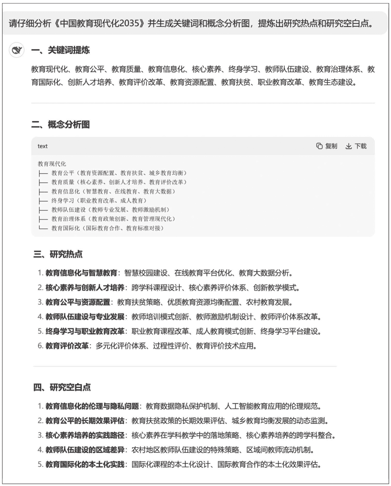

图3-1 提供选题思路

**2.文献综述的智能助力**

检索与筛选方面，教师可搭建多语种文献检索机器人，例如Semantic Scholar API加Python爬虫，覆盖中英文核心库，按关键词自动抓取；也可使用TLDR等AI摘要插件快速提炼文献要点，判断相关性。实证显示，传统文献综述约需2周，借助生成式工具可压缩至3～5天，效率提升50%～70%，具体对比见图3-2所示。

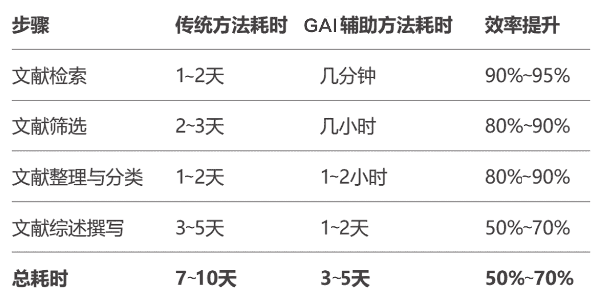

图3-2 文献综述的传统方法与GAI辅助方法耗时对比

分析与知识图谱构建上，Gephi、Tableau等工具可生成动态图谱，直观呈现研究脉络，帮助教师明确目标与方法。比如用Gephi绘制“AI+教育”知识图谱，展示主题关联与演化路径。生成式模型还能根据下载量、权威度与时事热点预测领域发展趋势。
结合主题模型与情感分析，可识别文献中的争鸣点与共识区，定位切入点。例如用LDA分析“AI在教育中的应用”，能发现技术依赖与教育公平两个争议焦点，为新方向提供线索。
总体而言，生成式工具可基于已整理文献自动生成综述框架与选题初稿，教师再加入批判性思考与逻辑调整。AI不只是工具，更是研究伙伴，让教学研究更高效、更扎实。

**（二）中期阶段：研究设计与数据解读的可视化分析**

**1.生成式工具对学科教学研究设计的支持**

研究设计是连接问题与成果的桥梁，决定研究的科学性与可行性。有了生成式工具参与，设计过程更精准、更具创新性。它能帮助教师快速厘清问题或假设，并提供方法选择的數據化建议，推动研究从经验驱动转向数据驱动。

接下来聚焦研究设计的关键环节。

**（1）确定研究问题或假设**
在选题与文献综述基础上，教师可引导模型拟定研究问题。先把前期材料输入平台，让模型深挖问题；初稿生成后，教师需评估与优化，如有不足或新灵感，可反复迭代，直至形成学术价值高且可操作的问题框架。 

**案例1：**初中语文教师已锁定选题“智能作文反馈能提升中学写作教学效果吗？”，希望据此提炼研究问题。操作平台：DeepSeek。
输入提示词：我上传了一个文档，文档内容为研究选题与文献综述，请你基于文档中的信息撰写几个研究问题。
生成的问题：
1.中文智能作文反馈工具（如IN课堂）在中学议论文写作中如何影响学生的修改行为？
2.融入智能作文反馈的议论文教学能否显著提高作文质量？
3.提升效果在文本准确性、逻辑结构、文体要素等方面与传统教师反馈有何差异？
4.智能作文反馈对中学生写作动机与信念，如投入度、修改意愿、解决问题的韧性有何影响？
问题说明：上述问题紧扣文献核心议题，聚焦中文工具在中学议论文中的实证，覆盖修改实践、质量变化、差异比较、动机信念四个维度，填补中文语种与文体空白，并探索人机协同路径。
模型不仅给出多选题，还附说明帮助理解。教师也可输入关注重点，指导模型定向调整。 

**案例2：**教师对初稿不满意，想把“提升效果差异性”改为“学生反馈体验”。操作平台：DeepSeek。
输入提示词：请适当修改上面生成的研究问题，我想把“提升效果的差异性”方面改为“学生反馈体验”，其他方面不变，依然是写作修改实践、作文质量、写作动机与信念，请你重新撰写研究问题。
生成的问题：
1.智能作文反馈如何影响中学生的写作修改实践，如修改次数、层次与成功率？
2.智能作文反馈能否显著提升学生议论文的作文质量，如准确性、逻辑与文体要素？
3.智能作文反馈对学生的写作动机与信念，如投入度、修改意愿、自我效能感有何影响？
4.学生对智能作文反馈的体验与感受如何，其接受度与满意度是否影响写作效果？
问题说明：修改后问题覆盖修改实践、质量、动机信念、反馈体验四个层面，既突出智能反馈作用，也纳入学生主观感受，便于全面评估课堂应用效果。

**（2）确定研究大纲**
大纲是研究的骨架，逻辑清晰的大纲既能呈现学术价值，也能指导实验设计。大纲是动态的，研究推进中需要不断修订。受制于教学任务重、文献研读时间不足、实证设计训练有限等问题，一线教师常感吃力，借助生成式工具可大幅缩短技术性劳动时间。
实施步骤：①完成文献综述，明确对象、目标、问题；②让模型整合材料输出带层级标题的初稿大纲；③教师人工审阅并动态调整。
DeepSeek的推理能力可帮助生成结构清晰的大纲。教师需说明主题、已有思路与方法要点，模型即给出框架。 

**案例3：**教师已确定对象为七八年级学生，目标是探究智能作文反馈的教学效果，内容涉及修改特点、质量提升、动机信念发展及学生体验。操作平台：DeepSeek。
输入提示词：在我进行一项学科教学研究，请你参考以下内容以及文档内容，撰写一份简洁的研究大纲。研究对象是七年级和八年级的初中生，研究目标是探究融入智能作文反馈的中学写作教学效果，研究内容是学生写作修改特点和作文质量提升状况，同时探究学生写作动机与信念的发展情况，并调查学生对智能作文反馈的体验和感受。研究选题、研究问题与文献综述都在我上传的文档里面。
生成的大纲：
一、摘要
背景、方法、核心发现、关键词。
二、引言
背景与问题提出、目标与意义。
三、文献综述
智能反馈对修改行为的影响、反馈与质量的争议结论、反馈对动机的促进作用、中文工具研究缺口。
四、研究方法
设计：准实验（实验组/对照组）；对象与变量控制；工具：量化（作文评分表、动机量表、信念量表）、质性（修改记录表、访谈提纲）；分析：量化（ANCOVA、卡方检验）、质性（主题编码）。
五、研究结果
量化（修改行为、质量、动机变化）、质性（体验与障碍）。
六、讨论
有效性与局限、人机协同优化建议。
七、结论与展望
主要结论、未来方向。
八、参考文献

**（3）选择研究方法**
把研究问题与预期目标输入模型，可获得方法推荐。教育研究类型多样，方法体系也不同。以DeepSeek为例，推荐方案通常包括对象选择标准与分组、研究设计框架、数据收集工具开发与效度验证、数据分析策略与步骤。 

**案例4：**教师已确定选题、目标与问题，需借助模型设计研究思路。操作平台：DeepSeek。
输入提示词：这是我本次学科教学研究的目标和问题，请根据研究目标和研究问题撰写研究方法。研究目标是聚焦人机协同的议论文写作实践，探究融入智能作文反馈的中学写作教学效果。研究问题见案例1。
生成思路节选：
研究方法采用混合方法，结合量化与质性。
1.对象与分组：某中学初中生，实验组用智能反馈教学，对照组用传统教师反馈，保持任务与时长一致。
2.实验设计：准实验，前后测加过程数据。
3.数据收集：写作修改行为通过系统记录提交次数、修改层次与成功率；质性访谈与日志了解动因；动机用量表前后测；访谈与反思日志补充主观感受。
4.数据分析：SPSS做描述统计、t检验或方差分析；质性做主题分析。
5.工具：智能反馈工具如IN课堂、动机量表、半结构访谈提纲、写作日志。
6.步骤：准备、前测、8～12周干预、后测、整理分析。
7.伦理：自愿参与、保护隐私。
总结：混合方法可全面评估智能反馈在议论文教学中的效果，为人机协同提供依据。

教师若需深入某环节，可针对性提问，获取更精细方案。 

**案例5：**教师想了解“学生写作动机与信念量表”的设计要点与示例。操作平台：DeepSeek。
输入提示词：我想设计一个测量学生的写作动机与信念的量表，那么如何能够设计好量表呢？请你说明设计思路并且设计量表的一些题目。
生成设计：
设计思路需结合理论与需求，保证信效度。
1.明确维度
动机：写作兴趣、投入度、修改意愿、写作毅力。
信念：自我效能感、反馈价值感知、目标导向。
2.参考成熟量表
写作动机量表、自我效能感量表、反馈感知量表。
3.题目示例采用李克特量表。
写作动机：我对写作任务充满兴趣；我愿意花时间认真完成写作任务。

● 得到审阅反馈后我会逐条对照修改，哪怕任务繁重也会坚持写完。

从上述示例可以看出，生成式人工智能能够有条理地展开研究工具设计的思路，涉及设计准则、指标搭建方法、信效度检验程序等专业内容。教师也可以直接指令系统先行搭建量表雏形。

（4）研究实施流程图绘制

以 Napkin AI 为代表，该工具为教师提供了流程图制作的智能化方案。用户只要输入描述性文字，系统就能自动提取要点并转化为规范的流程图，同时支持多种视觉风格切换与灵活编辑。

将一段关于准实验设计的说明文本（见图 3-3）导入 Napkin AI 后，系统自动生成了包含关键节点的流程图。教师还能随时对图形进行修改或更换新的样式（见图 3-4）。

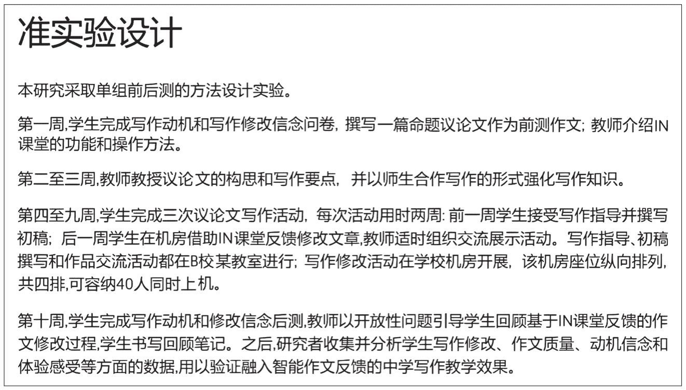

图 3-3 准实验设计文本

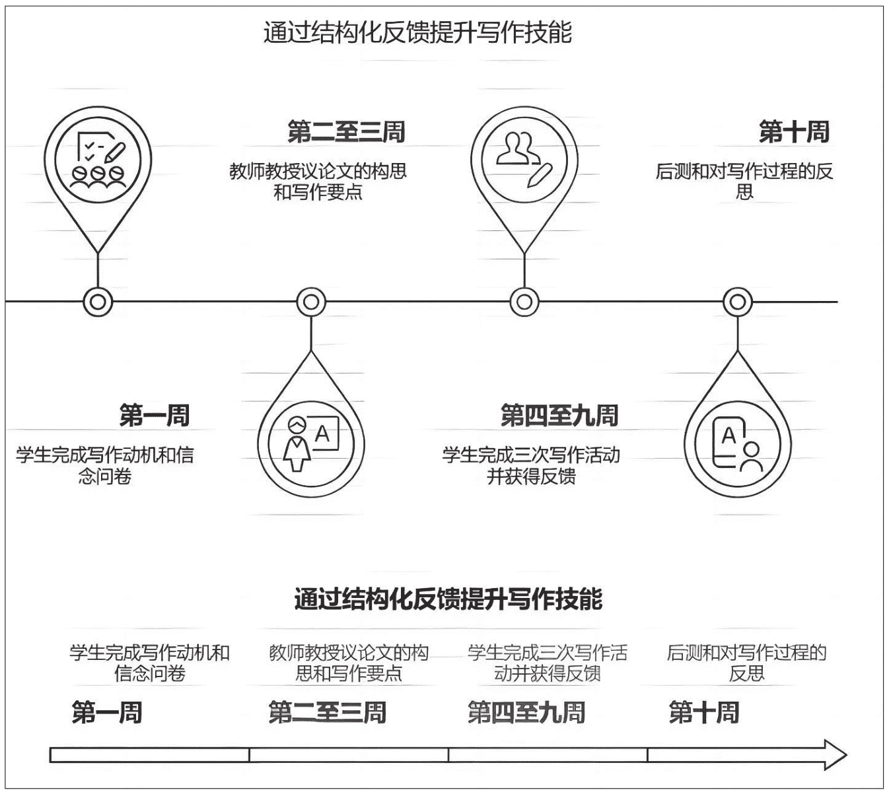

图 3-4 Napkin AI 将文本描述转化为不同形式的流程图

**2. GAI 支持数据的可视化分析**

把数字转化为直观洞察是研究的桥梁。在学科教学研究里，可视化能够帮助教师清晰把握学生学习轨迹，准确判断教学成效，为教育决策提供支撑。随着教育数据规模与复杂度提升，传统可视化手段已显不足。GAI 的加入让数据可视化实现突破。凭借强大的处理能力、智能模式识别和动态交互体验，GAI 不仅让数据会表达，更让数据具备思考能力。以下围绕 GAI 在学科教学研究中的几类应用展开，说明其如何帮助教师更直观地读懂数据。

（1）自动化数据预处理

GAI 可自动识别数据中的缺失、异常、重复等问题，进行清洗整理，保证数据完整与准确。ChatExcel 是一款 AI 数据分析辅助工具，用户给出对上传文件的处理指令，系统即可分析并操作 Excel 表格。该平台还支持选用 DeepSeek 模型来完成数据处理。 

**案例 6：** 教师已收集 120 名学生的写作修改相关数据，包含修改次数、修改类型（词汇、语法、结构）、修改前分数与修改后分数。因学生不够细心及采集疏漏，数据中存在异常与缺失。分析前需先整理。

操作平台：ChatExcel。

**输入的关键提示词**

上传数据文件。

学生编号按大小顺序排列，修改次数应该为 1～5 次，修改类型为词汇、语法或结构，修改前分数和修改后分数都为 1～10 分。请按照这个要求进行数据清洗。

**生成的总结报告**

如图 3-5 所示，GAI 会筛选出符合要求的数据，并生成总结报告供教师下载。

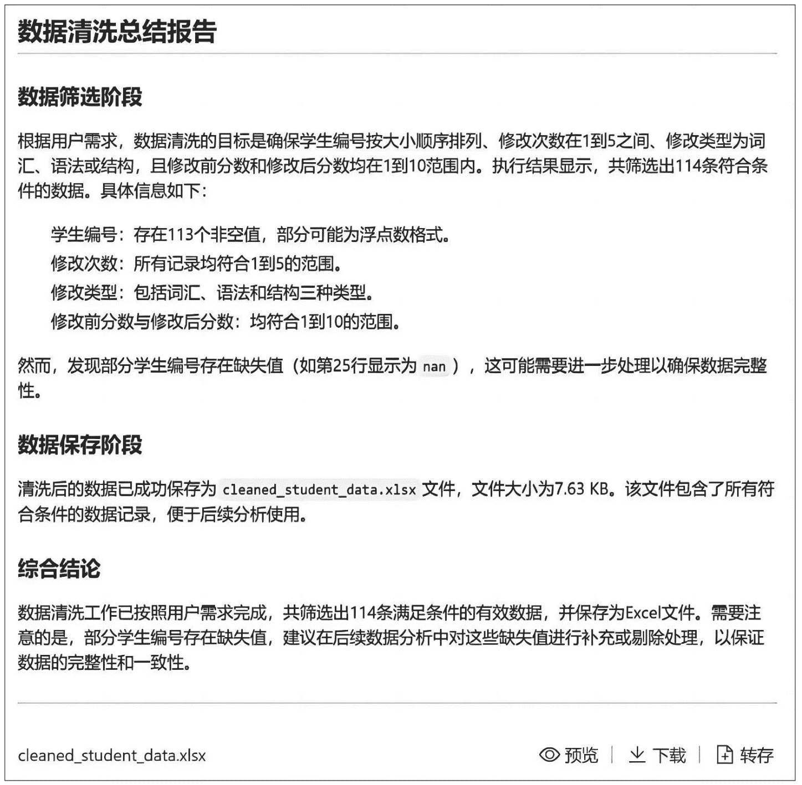

图 3-5 数据清洗总结报告

（2）数据描述分析

GAI 能自动输出数据概要，如均值、中位数、标准差等，帮助教师快速掌握整体态势。还能自动捕捉关键特征与变量间的关联，为后续可视化提供更有价值的线索。 

**案例 7：** 希望基于修改前后作文分数表，迅速了解修改后作文水平变化的整体情况。

操作平台：ChatExcel。

**输入的关键提示词**

上传学生的成绩数据。

根据学生作文分数表格统计修改前后不同作文水平的学生人数并制作成表格。作文满分为 10 分，1～4 分为水平 3，5～7 分为水平 2，8～10 分为水平 1。

**生成的总结报告与作文水平统计结果（分别见图 3-6 和图 3-7）**

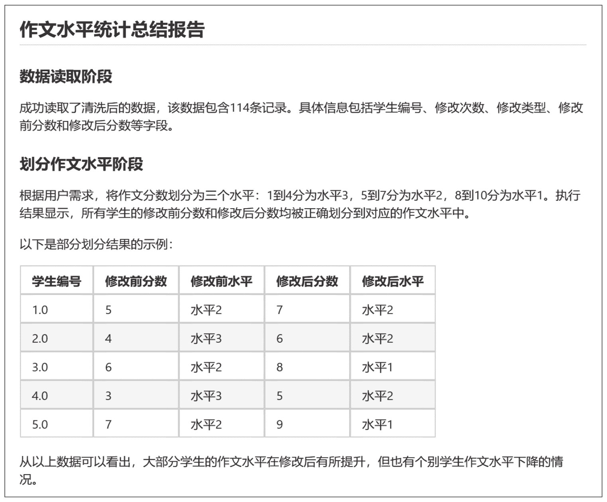

图 3-6 作文水平统计总结报告

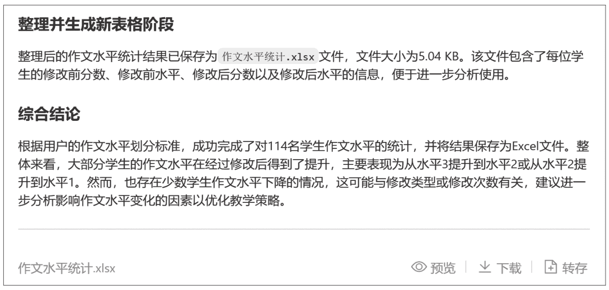

图 3-6（续）

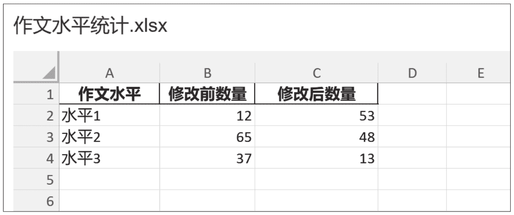

图 3-7 作文水平统计结果

（3）生成智能图表

GAI 可依据数据特征与分析目标，自动推荐合适的图表类型并快速生成。还能产出交互式图表，支持教师自行编辑。 

**案例 8：** 想更直观查看修改前后作文水平统计结果，于是借助 ChatExcel 快速生成可视化图表。

操作平台：ChatExcel。

**输入的关键提示词**

请将案例 7 中的作文水平统计结果制作成图表的形式。

**生成的图表和总结报告（分别见图 3-8 和图 3-9）**

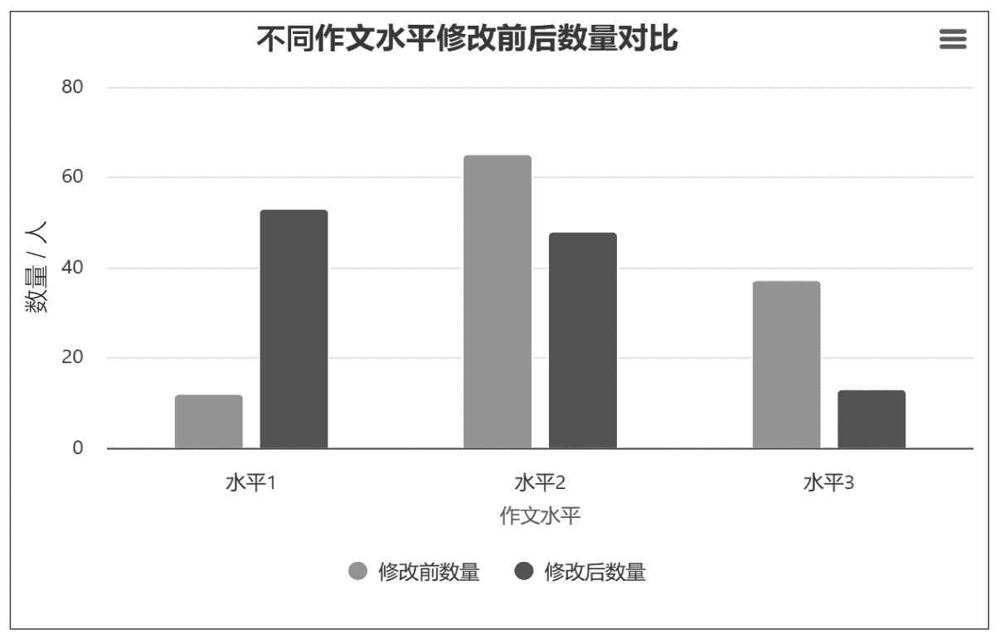

图 3-8 修改前后学生作文水平统计柱形图

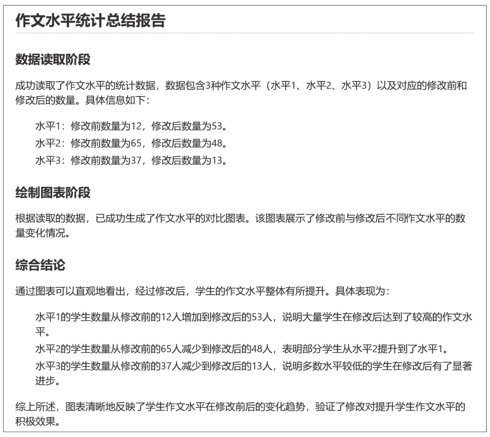

图 3-9 作文水平统计总结报告

教师也可按需指定图表类型，例如将案例 7 的统计结果制成雷达图（见图 3-10）。

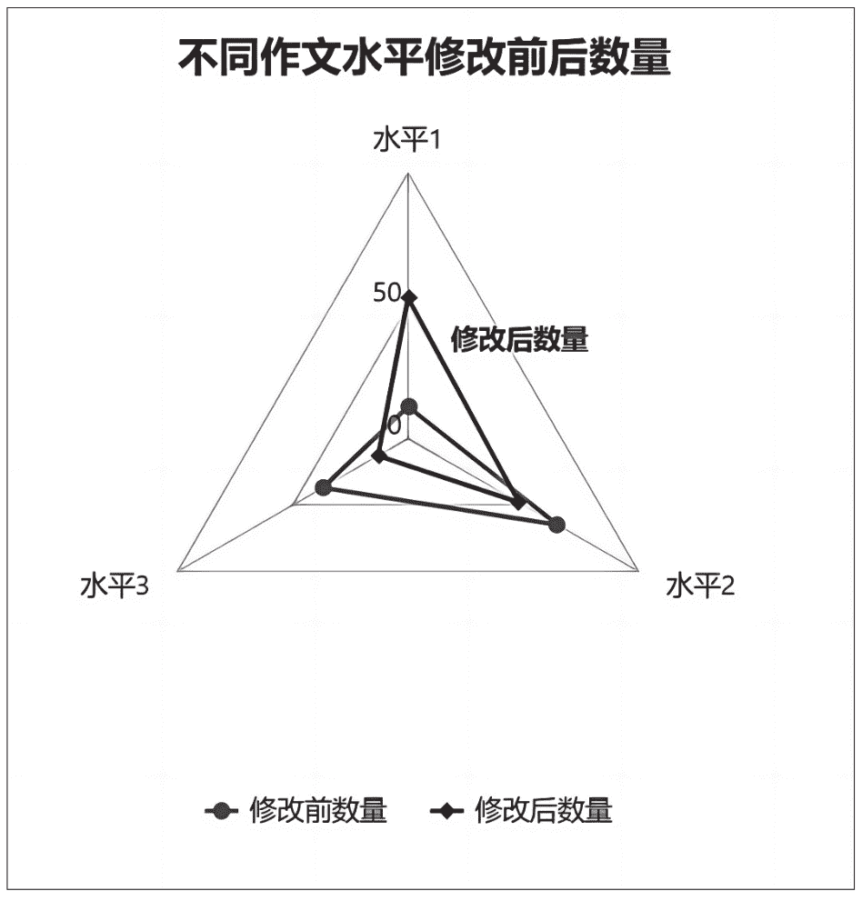

图 3-10 修改前后学生作文水平统计雷达图

除 ChatExcel 外，Napkin AI 也可作为数据可视化工具：将分析结果的文本输入 Napkin AI 后，它会自动生成图表。

如图 3-11 所示，Napkin AI 把修改前后作文水平结果数据整合在一张图表中，呈现更直观清晰。

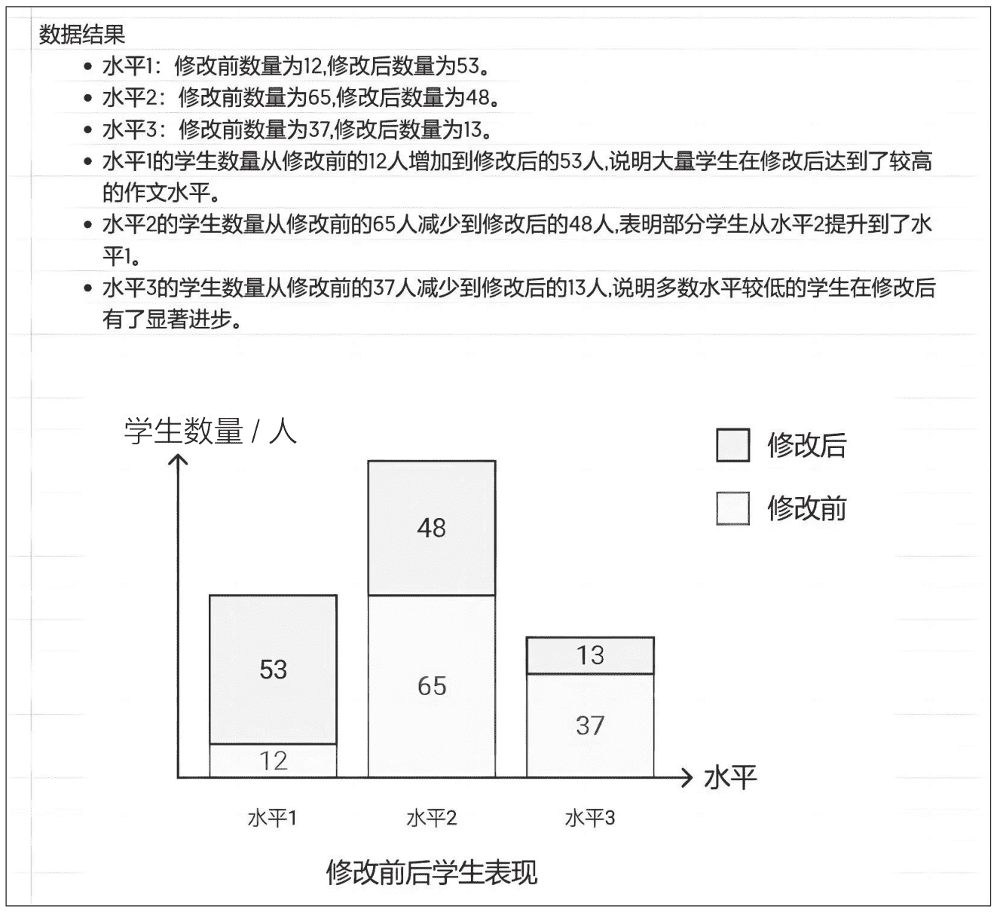

图 3-11 Napkin AI 的数据可视化

**（三）结题阶段：研究报告与论文写作的实证转化**

研究报告与论文写作是学术研究的核心环节，是把实证数据转化为逻辑严谨、表达精准文本的关键步骤。该过程往往耗时费力，研究者既要深入分析数据，又要将其转写为有说服力的文字。近年来 GAI 的发展为研究写作提供新可能。它可自动化生成文本、优化语言表达，并辅助研究者高效完成实证转化。以下探讨 GAI 在研究报告与论文写作中的关键应用与操作步骤，说明其如何提升写作效率与质量。

**1.研究结果与结论**

研究结果与结论是核心产出，直接体现研究价值。结果揭示数据背后的规律，为教学实践提供依据；结论提炼普遍意义，指导理论发展与实践改进。GAI 能快速处理数据、提取要点、生成结构化结果与初步结论供教师参考。同时还能提供多角度解读，帮助教师更全面挖掘数据含义，提升研究的科学性与实践价值。

实施步骤：①输入数据与研究目标。教师把研究数据、研究目标及核心问题输入工具，明确分析方向。②生成初步总结。先提取数据分析关键信息生成结果描述，即客观呈现数据；再结合研究目标推断结论，即解释结果意义。③人工审阅与调整。教师修正可能存在的问题。 

**案例 9：** 已整理好“智能作文反馈能提升中学写作教学效果吗”研究的分析结果，现在想撰写研究结论，于是借助 GAI 提供总结要点。

操作平台：DeepSeek。

**输入的关键提示词**

我上传了以“智能作文反馈能提升中学写作教学效果吗”为研究选题的文档，其中包含数据分析结果、研究目标和研究问题。请你根据文档总结和撰写研究结论。

**生成的研究结论**

**1.智能作文反馈显著提升中学议论文写作效果**

融入智能反馈的教学显著促进了学生作文成绩的提高、文章长度的增加及议论文要素（论点、论据、论证）的使用，低阶修改的高占比表明，智能反馈更适合辅助基础写作问题（如语法、结构等）的改进，而对高阶思维（如论点创新、反驳逻辑等）的引导作用有限。

**2.反馈质量与类型决定学生采纳程度**

具体、精准的反馈（如语法纠错等）更易被学生接受并转化为有效修改，而笼统建议（如“提升立意”等）因缺乏操作性难以落地。此外，即时评分（“秒评分”）通过可视化技术的进步增强了学生的写作毅力和写作激情，但过度依赖量化指标可能削弱学生对深层写作能力的关注。

**3.技术赋能需要与教学实践深度结合**

尽管智能反馈提升了学生的修改信念，但将信念转化为行为仍需要教师引导（如明确高阶修改标准等）和技术支持（如优化反馈算法等）。在未来的系统开发中，应当注重平衡“纠错型”与“启发式”反馈机制，引入动态迭代评分功能，以更好地满足写作修改的连续性需求。

**2.理论结合与解释构建**

理论结合与解释构建是连接数据与研究意义的关键。通过把数据与既有教育理论相联，揭示现象深层逻辑，这一过程既能验证或拓展现有理论，也能为教学实践提供依据。然而该环节对教师的理论素养与批判思维要求较高。GAI 可基于研究结果快速关联相关理论，帮助教师搭建逻辑严谨的理论框架，提升效率。

实施步骤：①输入关键词与发现。教师输入核心研究发现、理论关键词及研究背景，限定检索范围。②生成理论解释。自动检索相关文献、推荐适配理论并生成初步解释文本。③人工完善与验证。 

**案例 10：** 想了解支撑自身学科教学研究结论的已有研究发现与重要理论，以更好理解自身结论并增强研究专业性与可信度。

操作平台：DeepSeek。

**输入的关键提示词**

我已经上传包含研究选题、研究背景、研究问题、文献综述和研究结论的文档，对于该研究中“写作动机与信念”的有关结论，请你撰写能够支持该结论的已有研究发现和重要理论。另外，请参考文档中包含的研究背景和文献综述。

**生成的支持资料**

**智能反馈对写作动机与信念的影响**

（1）已有研究发现

动机提升：Grime 和 Warschauer 发现 MYAccess 系统显著增强了中学生写作动机；Foltz 指出智能反馈延长了学生的写作投入时间。这些发现与本研究中毅力（*t*=2.15）和激情（*t*=2.53）维度的显著提升一致。

信念与行为的关系：Wilson 和 Czik 的实验显示，智能反馈组的学生对“解决写作问题”的信念更强，且提交次数更多。这解释了本研究中低阶修改信念（*t*=3.58）与高阶修改信念（*t*=4.47）的双重提升，但低阶修改信念始终占优的现象。

（2）重要理论

技术接受模型（TAM）认为用户对技术的感知有用性（Perceived Usefulness）和感知易用性（Perceived Ease of Use）决定其采纳意愿。80%的学生认可 IN 课堂评分（如“帮助认识自身水平”等），65%的学生肯定反馈建议的实用性，表明智能反馈通过即时评分（“秒评分”）和可视化技术的进步（如分数提升 5 分等）增强了学生感知，进而提升写作动机。

**3.讨论部分的深化拓展**

讨论部分的深化拓展是提升研究深度与广度的关键。通过对结果的深入剖析与多角度探讨，教师可揭示现象内在意义并与更广阔的教育背景相连接。该过程既能增强学术贡献，也能为实践提供可行建议。然而深化讨论需要开阔视野与批判思维，对许多教师而言挑战较大。GAI 可基于研究结果快速生成多维度的讨论内容。

实施步骤：①输入上下文信息。教师提供研究全文、教育实践背景、讨论目标（如实践启示、局限性、未来方向等）。②生成讨论内容。基于输入内容提出多元讨论点。③人工修正与聚焦。 

**案例 11：** 想在讨论部分撰写本研究对人机协同写作教学发展的建议，于是借助 GAI 工具，根据研究结论和研究背景提供思路。

操作平台：DeepSeek。

**输入的关键提示词**

请撰写对人机协同写作教学发展的建议，要求基于研究结论和研究背景，并从多个维度进行探讨。

**生成的建议**

对教师的建议：

（1）深度整合智能反馈与课堂教学

教师应将智能反馈作为教学工具的一部分，设计有针对性的写作教学活动。例如，先利用智能反馈快速识别学生作文中的基础问题，再通过课堂讨论深化学生对高阶问题的理解。

（2）强化高阶思维训练

教师在智能反馈的基础上，应设计专门的高阶思维训练活动（如逻辑推理、论点创新等），帮助学生从低阶修改向高阶思维过渡。例如，在议论文写作中，教师可引导学生通过正反对比、案例分析等方式深化论证。

（3）关注学生动机与信念的培养

教师应利用智能反馈的即时性和可视化特点，增强学生的写作自信和动机。例如，通过展示学生的进步曲线或生成“写作成长报告”，帮助学生看到自己的努力成果。

此外，教师还可以根据研究目标和实际需求，选取合适的角度对讨论内容进行修改和完善，从而使其更具针对性。

**4.多轮迭代与反馈优化**

GAI 虽能初步生成研究内容，但初稿仍可能存在不足。完成后，教师可先让系统评价文章结构与内容，并借助系统进行润色、充实或提供写作思路以激发灵感。需注意，系统的评价与建议存在局限，无法完全替代教师的批判性思考。教师应审慎审视初稿，结合自身研究经验与学术判断反复打磨优化。唯有经教师主动思考与持续完善，初稿才能成长为成熟高质量的研究文章。这种“人机协作”模式既发挥系统效率优势，又凸显教师在研究中的主导作用，实现成果优化与创新。

## **第四节 小结**

GAI 的快速发展为学科教学研究注入新活力，推动教育研究向数据与智能协同的创新模式转型。从理论看，应用需与学科教学研究的核心逻辑深度结合：第三空间理论揭示人机协同的动态交互如何拓展研究的开放性，使教师能在虚实交织环境中探索更灵活路径；联通主义理论强调知识网络化与智能技术整合的关联，为跨学科动态连接提供新视角；数据驱动决策理论通过强化教学分析的精准性，为教育实践科学化提供方法论支持。上述理论共同构建 GAI 赋能学科教学研究的底层框架，明确技术应用须以教育规律为边界，避免盲目追逐技术而忽视学科特性。

在实践上，GAI 的潜力贯穿研究全流程。研究设计阶段，智能工具通过热点挖掘与文献计量帮助教师精准定位研究缺口；数据收集与分析阶段，自动化预处理与可视化技术大幅降低操作门槛，使教师聚焦数据背后的教育意义；成果转化阶段，智能写作辅助不仅提升文本生成效率，还通过逻辑校验与理论匹配强化结论的学术严谨性。然而仍存在多重矛盾：学科知识复杂性与系统标准化生成逻辑的结构性冲突导致通用系统难以满足学科特异性；部分教师过度依赖技术可能削弱研究主体性，出现“为用 AI 而用 AI”的功利倾向；数据隐私保护、算法偏见消解等技术伦理问题尚未形成系统性方案，可能影响结果可信度。

面对挑战，GAI 与学科教学研究的深度融合需在三方面突破。其一，重构人机协同角色分工，明确系统作为“增强工具”而非“替代主体”的定位。其二，建立动态迭代机制，形成“实践反馈—系统优化—再实践”闭环。其三，构建跨学科协同生态，联合教育研究者、技术开发者与政策制定者，共同设计兼顾创新性与伦理约束的智能教育系统。

长远来看，GAI 的终极目标并非替代教师专业判断，而是通过减少重复劳动，推动教育研究回归本质——以学生发展为原点，探索更具人文性与创造性的教学实践。只有当技术工具与教育者智慧实现共振，才能真正从“效率提升”迈向“生态变革”，为教育研究质量提升开辟新路径。

# **第四章**

# **GAI 赋能课程设计革新**

随着教育领域对创新技术的持续探索与应用，生成式人工智能正逐步成为推动课程设计革新的关键力量。在此背景下，本章将深入探讨 GAI 如何赋能课程设计，从理念更新到实践应用，全方位解析其对传统课程设计模式的重塑与优化。引入 GAI 后，课程设计不再局限于线性思维，而是能够实现更具个性化、动态化与智能化的教学内容生成与调整。这不仅为教师提供更丰富的教学资源与工具，也为学生创造更具互动性与适应性的学习体验。接下来，让我们一起走进 GAI 赋能课程设计革新的精彩世界，探索其在教育领域的无限可能。

## **第一节 GAI 助力课程设计革新的应用现状与发展需求**

GAI 凭借强大的数据处理与内容生成能力，为课程设计带来全新机遇与挑战。目前，GAI 在课程设计中的应用已显现诸多优势，例如能够依据学生学习需求生成个性化教学资源，提供智能教学建议，并助力教师快速评估教学设计的合理性。

**（一）GAI 点亮课堂：当前应用现状解析**

作为一线教师，我们亲眼见证 GAI 如何悄然改变传统教学模式与课程设计方法。让我们一起深入探讨 GAI 在课程设计中的应用现状，了解这项技术如何为教学工作带来新可能性。

第一，GAI 在个性化学习方面展现出巨大潜力。传统课程设计多采用统一模式，难以满足个体差异。GAI 的出现改变了这一局面。通过分析海量学习数据，GAI 能精准把握每个学生的学习风格、知识掌握程度与学习进度，从而为其量身定制个性化学习路径。例如在数学课程中，GAI 可根据学生作答情况自动调节题目难度，确保学生始终处于最佳学习区间。这种个性化体验不仅提升学习效率，也激发学习兴趣。

第二，GAI 在教学资源生成方面发挥作用日益重要。作为教师，我们深知备课的繁琐耗时。GAI 的出现为我们提供强大助手。它能够依据教学目标与学生特点，自动生成丰富多样的教学资源，如练习题、课件、教案等。这不仅大幅减轻教师工作负担，还能保证资源质量与多样性。例如在语文课程中，GAI 可依据不同教学主题，生成相关的阅读材料、写作提示与讨论话题，为教师提供丰富教学素材。

第三，GAI 在评价与回馈环节的价值尤为突出。过去的课程测评主要依赖统一考试，很难呈现学习的真实全貌。借助 GAI，评价可以转为在线且持续进行。它能够全程跟随学习进程，迅速捕捉问题点，并推送针对性的建议。譬如在英语听说教学里，GAI 可即时辨识学生的发音偏差，指出错误并给出改进路径，这种即时回馈明显提升了学习成效。

第四，必须正视 GAI 应用于课程设计时仍处的起步阶段以及存在的制约。首先是数据隐私与安全，GAI 需要采集并分析海量学法人数据，如何保障这些数据合规使用亟待解决。其次是技术门槛，多位教师对 GAI 的操作技能和经验不足，会制约普及。最后是教育公平，技术落地可能拉大资源差距，如何让每位学生都能公平受益值得深思。

尽管如此，GAI 在课程设计上的发展前景依然被看好。随技术迭代与教师群体的积极探索，GAI 有望为课程带来更多创新与突破，让每个学生获得更优质、更具个性化的学习体验。

（二）为何教师急需 GAI 搭档
作为一线教学者，我们深切体会到课程设计工作的繁复与挑战。面对不断攀升的教育需求与变化的教学环境，我们渴望一个强有力的助手来提升效率与品质。GAI 正具备这样的潜力，其在课程设计中的需求主要集中在以下方面。

第一，需要 GAI 助力课程内容的智能梳理与优化。传统备课常耗费大量时间在资料搜集、整理与组织上。GAI 可大幅提速，能够快速扫描海量教学资源，结合教学目标与学情，自动甄选并重组最适配的内容。例如历史课设计时，GAI 可依据教学大纲从网络自动抓取相关史料、图片与视频，按时间或主题进行智能归类，为教师提供结构清晰、素材丰富的教学包。这既节省备课时长，也保证内容的完整与时效。

第二，需要 GAI 提供个性化的教学策略建议。每个班级、每位学生的差异明显，如何为不同对象制定最优策略一直是难题。GAI 通过分析学习数据与教学效果反馈，可输出定制化的策略建议。例如数学教学中，GAI 可依据学生过往表现推荐合适的教学法与练习类型，真正实现因材施教。这种数据驱动的决策能提高教学实效，也帮助教师迭代改进方法。

第三，需要 GAI 实现教学资源的动态更新与智能推荐。知识更新加速，如何保持内容前沿是难题。GAI 可持续监测学科前沿动态，自动更新教学素材，确保学生接触最新观点。例如科学课程中，GAI 能实时追踪最新科研成果与技术进展，及时纳入教学，让学生始终站在学科前沿。

第四，需要 GAI 提供智能化的持续评价与回馈。传统评价多集中于期中期末，难以反映过程。GAI 使持续、多维度的评价成为可能，能实时分析课堂表现、作业完成、线上行为等数据，形成深入的评价报告。例如语文评价中，GAI 不仅能解读考试分数，还能衡量阅读广度、写作水平、口语表达等维度，为师生提供更全面客观的反馈。

第五，需要 GAI 促进教师协作与经验共享。课程设计往往是集体工程。GAI 可充当智能协作平台，分析不同教师的方案，提炼优秀元素并智能推送给同行参考。这种基于数据的知识流动能增强协作，也推动教育共同体进步。

总体来看，GAI 对课程设计的需求是多维的，既能提升效率与质量，也能给予教师个性化支持。教师应主动拥抱此技术，探索将其融入日常教学，以不断提升教学水平，为学生提供更优质体验。

（三）GAI 绘就的未来课堂图景
随技术趋于成熟，未来的课程设计将呈现全新面貌。这不仅是科技与智能的叠加，更是教育机遇的拓展。

第一，可期待高度个性化的自适应课程。在 GAI 支撑下，每位学生都将拥有专属 AI 学习助手。它能实时解读学习数据，根据风格、兴趣与掌握程度动态调整内容与进度。例如数学课上，有学生还在夯实基础代数，另一些已进入几何进阶，GAI 会为每个人匹配合适的难度与内容，使学习始终处于最佳区间，提升效率并激发主动性。

第二，将出现更智能、更互动的教学资源。未来的教材不再是静态纸质，而是可动态更新的智能终端。依托 GAI，教材能按学习进度与兴趣推送补充材料，如视频、交互动画、虚拟实验。例如生物课学到细胞结构时，智能教材可弹出 3D 细胞模型，借助虚拟现实让学生“走进”细胞内部，沉浸式体验结构与功能，深化理解与兴趣。

第三，基于 GAI 的智能评价体系将普及。该系统不再局限笔试选择题，而是全方位评估学习过程与成果。可分析课堂参与、作业情况、协作能力、创新思维等维度，给出全面客观报告。例如跨学科项目学习中，GAI 可整合研究报告、展示视频、讨论记录等多源成果，评估知识掌握、批判思维、沟通表达等能力，为教学改进提供数据支撑。

第四，GAI 驱动的跨学科融合课程将兴起。学科边界将日益模糊。GAI 可帮助设计灵活综合的课程。例如以“可持续发展”为主题的课程可融合地理、生物、物理、化学、经济学等知识，GAI 智能整合核心概念与方法，设计兼具深度与广度的学习活动，培养学生系统思维与解决复杂现实问题的能力。

第五，可期待 GAI 支持下的全球化协作学习。课堂不再受地理限制，学生可通过平台与世界各地同伴实时交流合作。例如全球气候变化主题课中，不同国家学生共同收集本地气候数据，经 GAI 平台整合可视化后共同讨论影响与对策。这种跨文化协作拓宽国际视野，培养跨文化沟通与全球公民意识。

与此同时，需清醒认识实现这些图景的挑战。技术层面需提升准确性、可靠性与安全性；理念层面需重新审视教育本质，确保技术服务于教育；教师角色需转型，更新知识结构，提升数字素养，成为学习引导者；公平层面需思考如何让所有学生公平受益。

教师既应对 GAI 驱动的未来充满期待，也应保持理性。我们要积极探索应用潜力，同时坚守人文关怀与价值导向。未来课程设计不是用技术替代教师，而是发挥 GAI 优势，让教师更聚焦个性发展、情感培养与价值塑造，从而真正实现教育赋能。

第二节 GAI 助力课程革新的理论根基与设计原则

（一）智能教学原理：GAI 课程设计的理论基石
任何教学创新都需要坚实的理论支撑。GAI 辅助课程设计同样如此，智能教学原理为其提供了关键理论支持。

第一，自适应学习理论。有效学习应据个体差异调整。传统教学难以做到真正的因材施教，GAI 使其成为可能。它能实时分析学习进度、知识掌握与学习风格，动态调整内容与难度。例如英语阅读课上，GAI 可为每位学生推荐难度适中的文章，避免过于简单导致无聊或过于困难导致挫败，提升效率与动力。

第二，认知负荷理论。人类工作记忆有限，过载会影响学习。GAI 可帮助管理认知负荷。例如设计复杂科学实验时，GAI 可将步骤拆解为易懂的小环节并以可视化呈现，降低负荷；同时依据学生反应实时调节信息呈现方式与节奏，使学习处于最佳状态。

第三，社会学习理论。学习发生在社会互动中。GAI 可创造更多协作机会，依据学习特点与兴趣智能匹配学习伙伴，组织小组讨论与项目合作。在语言学习中，GAI 可扮演对话伙伴，提供即时练习。这种社交化学习提升效果，也培养协作与沟通能力。

第四，数据驱动决策理论。教育决策应基于数据分析。GAI 可收集大量学习数据，为教师提供深度洞察。通过分析作业完成、错题类型、学习时间分布等，GAI 帮助识别学习困难，发现教学问题，从而作出科学、针对性的决策，持续优化教学策略。

理解这些理论对有效使用 GAI 至关重要。技术只是工具，必须服务于教育本质目标，始终以学生全面发展为中心，将技术与教育理念结合，创造真正有效的学习体验。

（二）课程设计新范式：GAI 赋能的关键原则
在把握理论基础后，需将之转化为可操作的课程设计原则。

第一，个性化定制是核心。传统“一刀切”难以满足需求。GAI 使真正个性化教育成为可能。设计时应利用数据分析能力，为每位学生构建个性化学习路径。例如数学课程中，GAI 可根据学习史、知识掌握与风格定制内容与进度，对基础好者推送挑战性问题，对薄弱者提供基础练习与辅导，提升效率与自信心。

第二，实时反馈与动态调整。传统课程多为静态，难以响应学情。GAI 可实现动态调整。应建立反馈闭环，使课程随学生表现自动优化。例如语言课程中，GAI 可实时分析口语表现并即时反馈，根据进步情况调整后续内容。对普遍薄弱的语法点自动增补练习，对已熟练的知识点快速推进，保持针对性与挑战性。

第三，跨学科整合。信息爆炸时代，单一学科难以应对复杂问题。GAI 提供强大的整合工具。设计时应利用知识图谱与关联分析，创造综合系统体验。例如环境保护主题课程，可整合生物、化学、地理、社会学等知识，形成全面方案，帮助学生建立系统认知，培养解决复杂问题的能力。

第四，体验式学习。VR 与 AR 等技术为沉浸式学习提供可能。设计时应充分利用，构建生动互动环境。例如历史课可借助 GAI 与 VR 构建虚拟历史场景，让学生“穿越”至特定时期，亲历事件。学习古希腊时，可漫步虚拟卫城，与苏格拉底对话，参与民主辩论，增强兴趣与记忆。

第五，持续评估与改进。GAI 提供前所未有的数据采集分析能力，使持续全面评价成为可能。应建立持续改进机制，实时收集学习进度、掌握程度、行为模式等数据，深入分析发现问题与改进空间。对效果不佳的环节及时调整，对有效方法推广应用，不断提升课程质量。

这些原则构成了新的课程设计范式，不仅改变设计方式，更改变教育认知。教育成为动态、个性化、持续演进的过程。教师需不断学习适应，并始终以学生发展为中心，保持人文关怀，才能发挥 GAI 的真正潜力。

（三）数据驱动教育：GAI 优化课程的核心策略
在 GAI 辅助的新范式中，数据驱动教育是核心策略。有效教学需深入了解学情，而 GAI 提供强大的数据收集分析能力。

第一，需理解数据驱动的本质。它不只是收集分析数据，更是用数据指导决策与课程改进。GAI 可采集多维实时数据，包括进度、掌握度、行为模式、情感状态等。例如在线英语课，GAI 可记录阅读速度、查词次数、口语准确率等，提供全面视角。

第二，需学会分析与解读。GAI 不仅能采集，还能进行复杂分析，识别模式与趋势，发现问题与机会。通过分析错题类型与频率，可识别薄弱知识点；通过分析学习时间分布，可优化课程安排，为设计提供科学依据。

第三，基于分析开展精准干预。例如数据显示某班几何题普遍薄弱，可增补讲解与练习。若数据显示学生听力表现倾向内容策划与知识整合，需凭借专业洞察将 GAI 提供的资源转化为有意义的学习体验。依托 GAI 赋能的内容组织，可创造更丰富、灵活、个性化的课程，提升兴趣与成效，帮助学生应对未来挑战。在此过程中，教师角色从知识传授者转向资源整合者与引导者，既具挑战也带来机遇。

第三节 GAI 赋能课程宏观框架的开发程序与应用情境

在教育环境快速变化的背景下，AI 技术正深刻重塑课程设计。作为一线教师，必须积极拥抱变革，利用 AI 赋能，推动课程创新。本节探讨如何借助 GAI 在目标定位、内容组织、实施与评价层面全面提升课程设计的科学性、针对性与有效性。

（一）课程目标定位层：精准定位与智能规划
课程目标是设计的起点与落脚点，直接决定实施方向与效果。传统目标设定常显模糊、操作性不足，难以支撑个性化教学。GAI 的应用为目标定位提供新路径，能够实现目标的精准设定与智能规划。

用GAI让课程目标更精准

第一，生成式AI让学情研判立体起来。海量学习轨迹被模型加工后，每个人的知识薄弱点、能力发展曲线和学习风格都能被描绘成全景画像。基于这些高精度信息，差异化与个性化目标才有依据。比如七年级语文写作课堂，模型会综合过往作文得分、阅读理解表现与表达习惯，为每位同学定制写作成长目标，既接住现有水平，也预留发展空间。

第二，生成式AI让目标拆解更合理。过去靠教师经验拆目标，容易逻辑松、层次乱。模型依托知识网络和海量教学案例，能自动搭建多层次目标框架，兼顾知识、技能、情感态度价值观，还能纳入创新思维、跨学科素养等新维度。对高二物理力学模块而言，“掌握牛顿运动定律”这一宏观要求会被细化为“理解力概念与表示”“分析物体受力”“用牛顿第二定律解题”等可操作子项，并进一步落到知识点与能力要点。

第三，生成式AI让目标校准更及时。课程目标不是定稿，而是随课堂反馈动态迭代。平台可实时追踪学习进度与表现，捕捉达成障碍与瓶颈，给出调整建议。目标始终贴合真实教学。比如一年级英语口语教学中，若监测到多数孩子音调进步缓慢，系统会提示提升语音目标权重，并自动生成针对性练习。

第四，生成式AI让跨学科目标整合更系统。在核心素养导向下，模型能以跨学科关联与能力模型为基础，编织融合多学科要素的综合目标，而非简单拼凑。七年级综合科技素养课里，数学、科学、技术、工程的核心概念与关键能力被有机串联，形成既有学科特色又突出综合素养的目标方案。

需要强调的是，模型的角色是辅助，教师的专业主导不可替代。所有由AI生成的方案都需经教师基于教育理念与课堂经验审阅、修正与个性化定制，只有技术效率与教师智慧融合，课程目标定位才能科学又智能。

**（二）课程内容组织层：边界拓展与模块建构**

课程内容是目标落地的载体，组织方式决定教学成效。传统组织受限于教材，很难跟上知识更新与学生多样需求。生成式AI的加入，让内容边界被拉大，模块组合更灵活。

第一，内容边界被大幅拉开。过去靠固定教材与有限资源，现在平台可连通海量在线资源库，涵盖前沿研究、科技动态与社会实践案例。学生能接触更广阔、更前沿、更贴近现实的材料。例如高一生物教学，除了课本基础，还能即时引入基因编辑最新进展与生物伦理讨论，视野立刻打开。

第二，信息过载时模型可做智能筛选与优化。依据预设目标与学情，平台会自动挑选最相关、最具价值的资源，并兼顾难度、时效、趣味与应用价值。比如低年级科学探究课，模型可从大量科普素材中挑出符合认知又能激发好奇心的实验案例与自然现象。

第三，内容支持模块化组装。模块化提升课程弹性。平台把筛选资源自动归类组合，形成相对独立又相互关联的学习单元，可单独使用也可自由拼接。如七年级历史教学，“中国古代文明”可拆成政治制度、经济形态、科技成就、文化艺术等若干单元，教师按需选用。

第四，实现动态更新与千人千面定制。教材更新慢，模型可实时对接最新知识库，保证内容时效。结合个体学习特征与进度，可为每人生成个性化学习序列。比如高三数学函数专题，对基础薄弱者推送概念夯实与简单应用，对能力突出者提供高阶思维与真实情境挑战。

第五，推动深层次跨学科融合。模型基于知识图谱自动识别学科联系，生成主题单元或项目任务，实现概念关联与能力整合。例如综合实践课围绕“节能环保”，把物理能量转换、化学材料特性、生物生态、地理气候变化等多学科知识整合进一个探究项目。

要清醒认识到，AI在内容组织中是助手。教师需以对学科本质与学生特点的深刻理解，对模型方案做批判性审视与创造性改造，既用好资源与建议，又守住科学性、系统性与教育价值。

**（三）课程实施和评价层：模式整合与证据评估**

实施与评价是检验设计成效的关键。传统实施模式单一、互动不足，评价多依赖分数，难以反映真实学习。生成式AI为教学实施与评价带来新可能，实现模式多元整合与证据智能分析。

在实施层面，生成式AI推动模式革新。

第一，课堂不再只有讲授。平台可支撑翻转课堂、项目式学习、探究式学习等创新形态落地。翻转课堂里，模型为学生生成个性化预习材料与微课，并依据预习反馈给出课堂指导建议；项目式学习中，模型协助设计真实情境任务并提供智能化学习支持与资源推荐。

第二，过程可实时监测并智能干预。模型通过学习行为分析，捕捉每个人的状态与潜在问题，推送干预建议。例如在线数学课上，若检测到某生解题错误频发，会即时提醒教师并推荐针对性辅导策略，及时反馈提升教学针对性。

第三，资源推送动态化。基于进度与兴趣偏好，平台为每人推送练习题、拓展阅读、视频讲解等适配资源，且会随反馈不断优化。如英语阅读课，若发现学生偏爱科技类文章，会优先推送相关主题以提升积极性。

在评价层面，最大变化是全方位多维度证据评估。模型可采集课堂参与、作业完成、在线时长、问题解决等全过程数据，构建完整表现画像。

第一，形成性与总结性评价融合。日常数据实时生成形成性评价报告，帮助教师及时掌握进展与问题；课程结束时，基于累计数据生成总结性报告，涵盖知识、能力、态度等多方面，提供更全面客观反馈。

第二，评价方式多元化。除了试卷，模型可设计在线讨论、虚拟实验、创意设计等创新任务，并借助智能算法自动评分与反馈。如高中化学“酸碱中和反应”虚拟实验项目，学生在虚拟实验室操作并记录数据，系统能判断操作规范性、分析原理理解程度并即时反馈，提升实践与创新能力。

第三，助力个性化学习路径。模型按进度与表现动态调整内容与评价标准，对学有余力者推荐挑战任务，对需支持者提供基础练习与辅导，打破“一刀切”，真正实现因材施教。

此外，平台在师生互动与家校沟通方面潜力很大。通过即时通讯与数据分析，教师能更了解学生需求，及时向家长分享进展与改进建议，家长可随时查看学习报告，家校合力促进成长。

同时要看到风险。数据隐私必须保障，使用时须确保学生数据安全，防止未授权访问。过度依赖技术可能削弱教师角色与人际交流，优化教学的同时要保持密切互动，关注情感需求与社会技能发展。教师需不断提升数字素养与应用能力，学会把工具融入实践；学校也应加大培训与支持力度，帮助教师适应变革。

总之，生成式AI正在重塑课程设计的各个环节，从目标、内容到实施评价均展现巨大潜力。教师应积极拥抱变革，用好强大工具推动课程向科学化、个性化、高效化迈进，同时保持批判思维，合理运用技术，确保服务于教育本质——培养全面发展的未来人才。

**（四）GAI赋能课程开发的具体应用情境**

教育变革加速，生成式AI正深度重塑课程设计的每个环节。作为一线教师，我们有责任探索其应用潜力，推动课程设计向更高层次创新。以下围绕目标定位、内容组织、实施评价三个关键维度，说明如何提升科学性、针对性与有效性。

**1.GAI赋能教学设计的底层逻辑**

（1）GAI的提问原则与提问技巧

教学设计中，提问方式决定输出质量。首先要明白生成本质是模式预测，模型基于已有数据模式推演，因而有局限。其次要警惕幻觉，必须做事实核查，避免采信看似合理却错误的内容。输入要使用模型可理解的语言，保持人的主导与专家思维，并把复杂任务拆成若干小任务以提升准确性。提问技巧上，要认识生成即预测，减少盲目轻信，又避免过度轻视，理性看待能力进化。要警惕幻觉，核查事实，了解工具边界，善用互补工具。要明确人的主导，保持专家思维，追问目的，学会提问、判断、欣赏与承担责任。最后用清晰结构化提示词，提供上下文，确保模型准确理解关键概念、方法、理论与文档要点等（见图 4-1）。

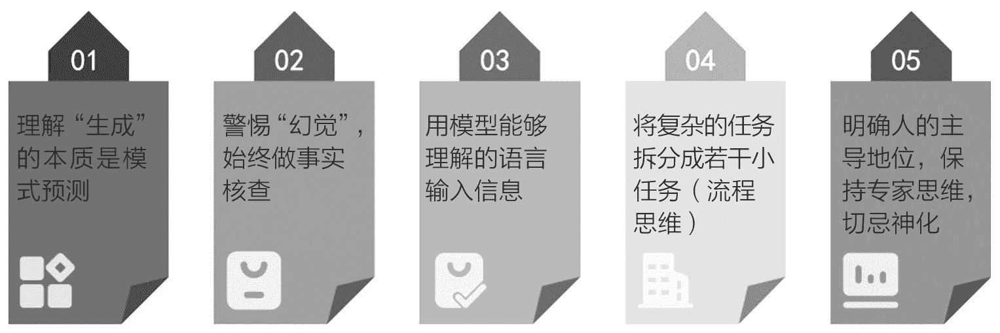

图 4-1 生成式AI提问策略全景

（2）流程思维与教学设计

流程思维对教学设计很关键。传统端到端要求模型一次性完成任务，易导致效果不佳。流程思维强调任务拆解，分环节优化迭代（见图 4-2）。比如写一篇文章，可拆为定题、搜集资料、列提纲、写初稿、修改润色，针对每个环节借助AI辅助，如资料搜集时让其检索信息，初稿撰写时让其提供素材。这种思路使设计更精细高效，有助于提升质量。

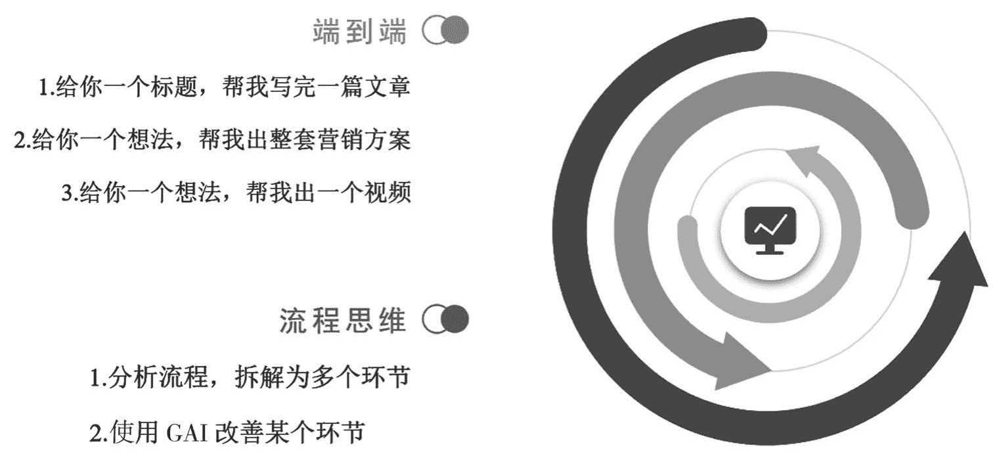

图 4-2 流程思维内涵解析

**2.GAI赋能的教学内容分析**

教学内容分析是设计基础，生成式AI可大幅提升效率，帮助教师把握重点难点。

（1）课程标准分析

模型可从学段目标、内容要求、学业质量标准、教学提示与建议、核心素养等维度展开分析（见图 4-3）。例如上传地理课程标准文件，要求分析“地球自转”相关内容，模型会多维度输出条理清晰的结果。

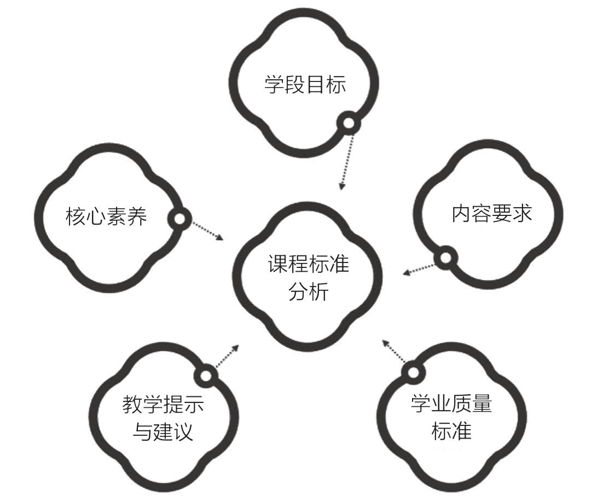

图 4-3 课程标准分析框架

**案例1：**高中地理课程标准分析。在一所重点高中，地理教研负责人李老师需对新颁布的高中地理课程标准做深入分析以指导教学。他要分析学段目标、内容要求、学业质量标准、教学提示与建议、核心素养，并据此制定计划与活动设计。

操作平台：Kimi。

**输入的关键提示词**

角色：经验丰富的地理学科负责人。

背景信息：需对新颁布的高中地理课程标准进行分析。

任务：依据课程标准内容，对课程内容进行分析。

分析维度：学段目标、内容要求、学业质量标准、教学提示与建议、核心素养。

教师可增添维度深化分析，随后模型生成对应内容。

**生成的课程标准分析内容（部分见图 4-4）**

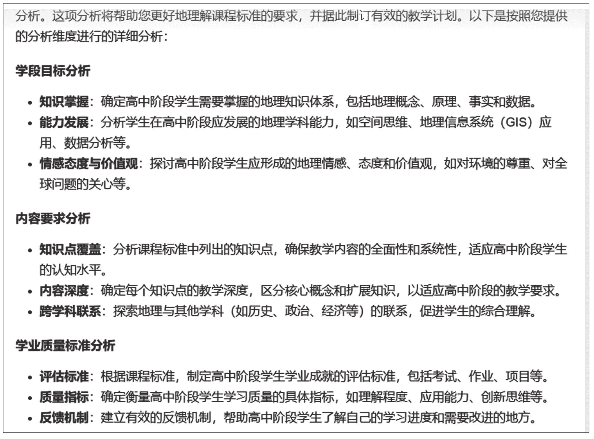

图 4-4 高中地理课程标准分析内容节选

（2）教材分析

模型可协助从教材基本结构、知识体系、逻辑顺序、地位作用、编写意图、重点难点等方面展开分析。例如上传语文教材文件，要求对指定内容进行分析，模型会多维度输出详细结果。

下载电子教材是第一步，操作流程如下（见图 4-5）。

步骤一：进入国家智慧中小学平台。

步骤二：搜索并选中目标教材版本。

步骤三：按 Fn+F12 组合键，选中 Network，在框内输入 .pdf 并点击刷新，随后双击目录中首个 PDF 文件。

步骤四：删除网址中的 -private 后回车。

步骤五：点击下载按钮。

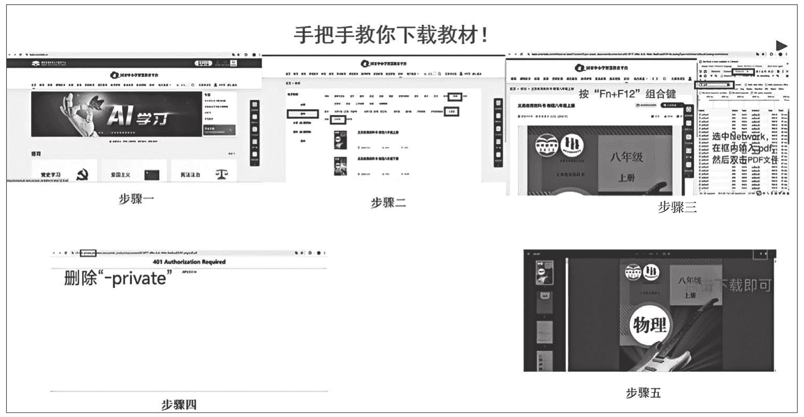

图 4-5 智慧中小学教材下载流程

**案例2：**初中语文教材分析。在一所重点中学，语文教研负责人王老师需对新教材《从百草园到三味书屋》进行分析。他习惯以“五步法”剖析：先俯瞰单元结构，再逐段提炼知识点，还原逻辑顺序，定位课文地位与作用，最后锁定重点破解难点，据此设计方案。

操作平台：豆包。

**输入的关键提示词**

角色：语文学科负责人。

背景信息：需对新教材《从百草园到三味书屋》课文进行分析。

任务：依据课文内容进行深入分析。

分析维度：课文结构、知识点、逻辑顺序、地位与作用、重点和难点。

**生成的课文分析内容（部分见图 4-6）**

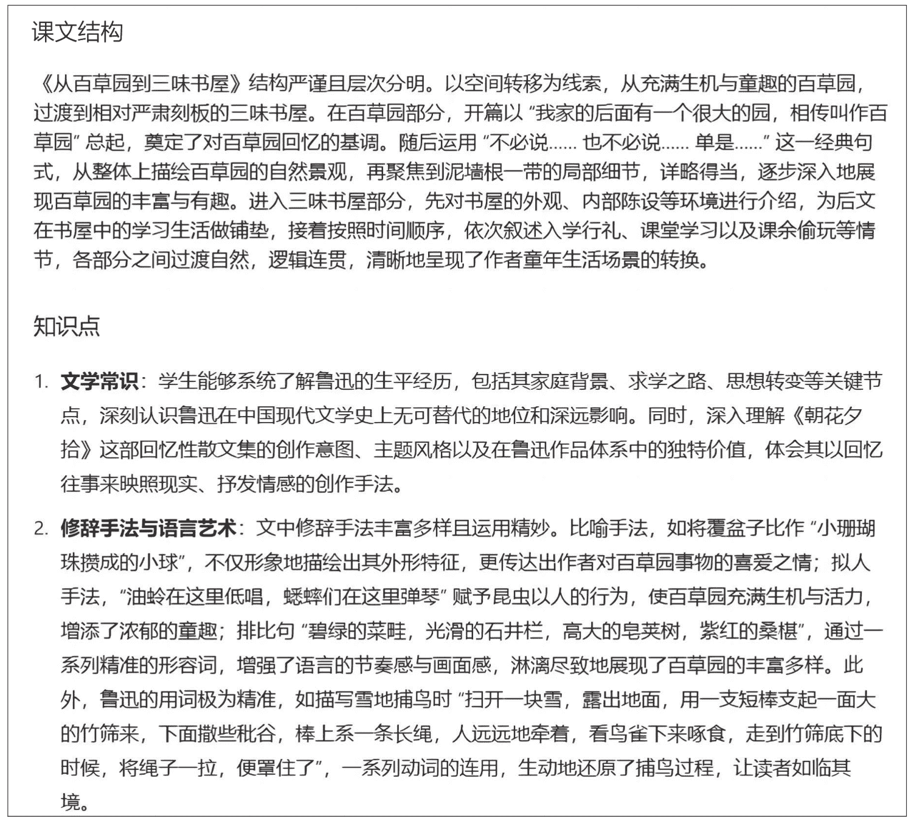

图 4-6 《从百草园到三味书屋》课文分析节选

**拓展：教学内容分析推荐大模型（见表 4-1）**

表 4-1 教学内容分析推荐大模型

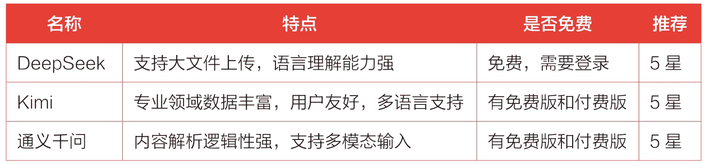

**3.GAI赋能的学情分析**

学情分析是教学设计重要环节，生成式AI可助力教师高效开展学生已知分析、未知分析、困难分析与解决路径分析，从而更全面了解学习状况并制定有效策略（见图 4-7）。

**智能驱动的学情洞察与教学设计新图景**

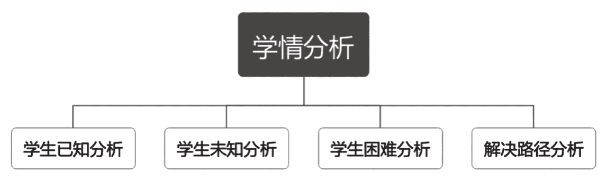

图 4-7 学情分析框架

（1）学生已知分析

在对学生已具备情况进行研判时，生成式人工智能能够支持教师从现阶段知识储备、既有背景经验和学习能力等多个视角构建学情画像。具体做法是把测评数据与课堂记录提交给系统，再给出清晰指令，要求模型依据所提供材料进行多维解析并以表格呈现，详见图 4-8。

**案例 3：**初中数学课程学情画像。某初中数学教师张老师，计划对即将授课的“整式加减”单元开展学情摸底，希望通过梳理学生现有的基础、背景经验和能力水平，设计更贴合实际的教学活动，并据此调整策略，确保全体学生都能跟上进度并理解概念。

操作平台：DeepSeek。

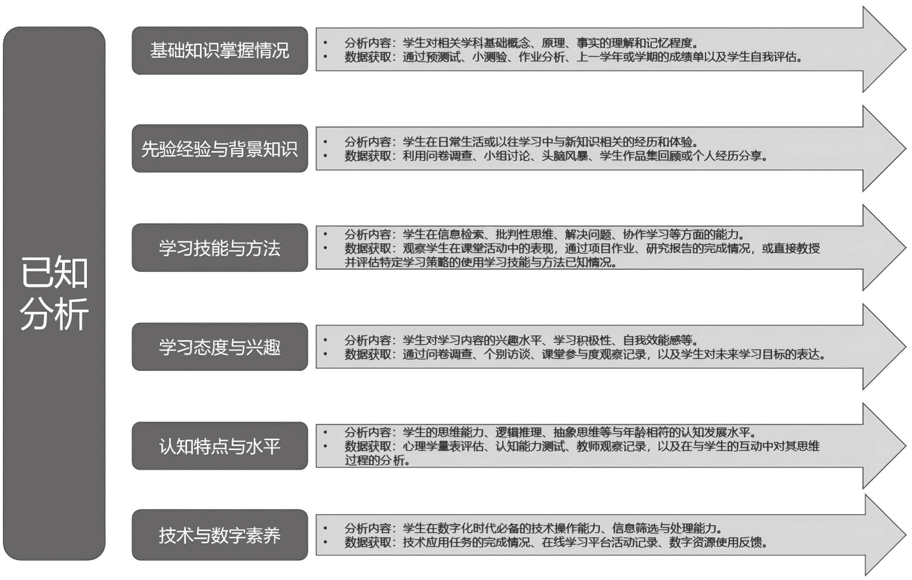

图 4-8 学生已知分析内容

**输入的关键提示词**

角色：初中数学老师。
背景：即将教授“整式的加减”课程。
指令：对该班学生从基础知识、背景知识、学习能力三个维度进行学情分析。
输入：根据所上传的文档内容（可能包括学生的测试成绩、作业表现、课堂参与度等）进行输入。
输出：将学情分析内容以表格的形式输出。

**生成的课程学情分析内容（见图 4-9）**

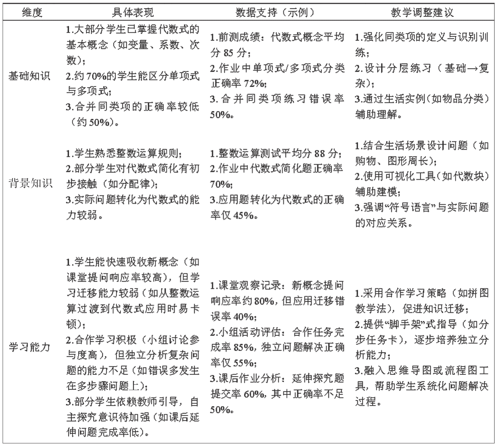

图 4-9 课程学情分析内容

**拓展：课程学情分析输入语句及其解释和示例（见图 4-10）**

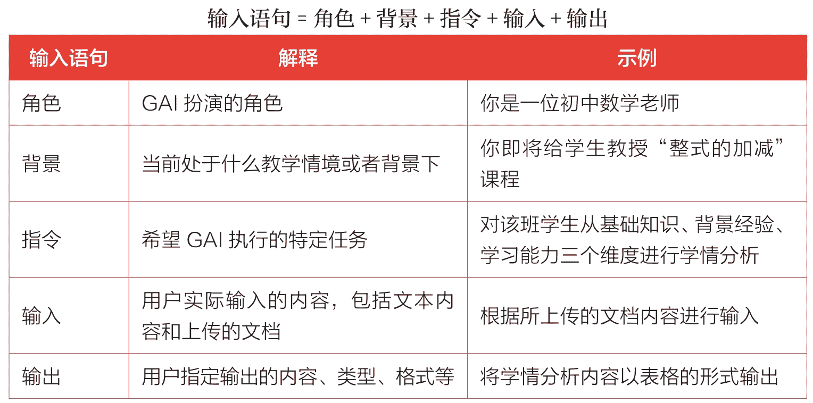

图 4-10 课程学情分析输入语句及其解释和示例

（2）学生未知分析

面向学生尚未达成的部分，生成式人工智能可协助教师从当前状态与目标状态的差距出发，对认知发展、知识技能、情感态度、行为动机等层面进行辨析。例如上传测评与课堂表现资料，通过提示词驱动模型基于材料完成多维度未知学情解析并以表格输出。

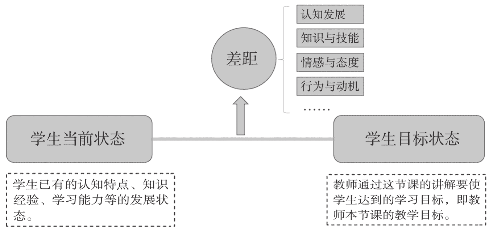

图 4-11 学生未知分析框架

**案例 4：**初中数学课程学生未知分析。张老师即将教授“整式的加减”，为更好地掌握学情，计划开展一次分析。他将依据认知发展、知识技能、情感态度三个维度的数据进行研判，以制定更有效的教学策略，提升教学质量与学习成效。

操作平台：小浣熊。

**输入的关键提示词**

角色：初中数学老师。
背景：在教授“整式的加减”课程之前。
指令：对该班学生从认知发展、知识技能、情感态度三个维度进行学情分析。
输入：根据所上传的“学生未知分析.xlsx”文档进行输入。
输出：将学生未知分析内容以表格的形式输出。

操作过程如图 4-12 所示。

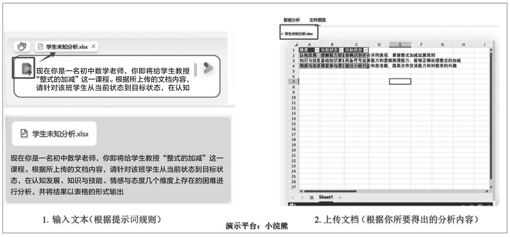

图 4-12 初中数学课程学生未知分析操作过程

**生成的学生未知分析内容（见图 4-13）**

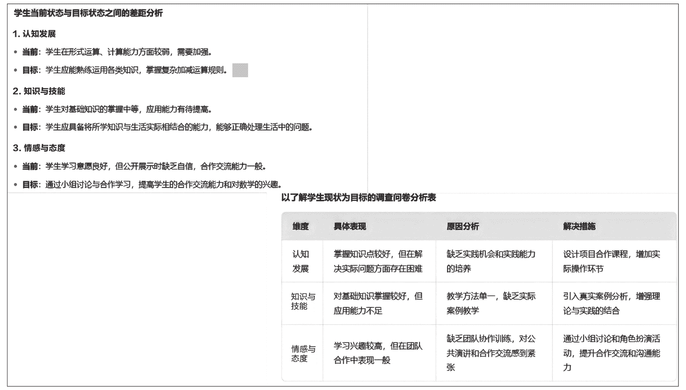

图 4-13 学生未知分析内容

（3）学生困难分析

在学困诊断层面，生成式人工智能可帮助教师识别学生在知识理解、思维方式和情感层面可能出现的障碍。把测评与课堂表现材料交给模型，通过提示词让系统基于材料从多维度分析难点并以表格呈现。

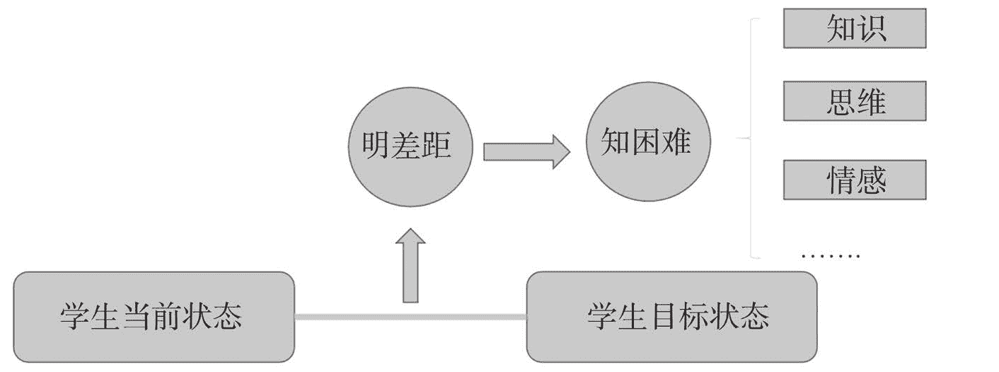

图 4-14 学生困难分析框架

（4）解决路径分析

在制定对策时，生成式人工智能能从教学方法、教学流程、作业布置等角度提出针对性建议。把测评与课堂表现资料提交给模型，通过提示词让系统针对学习难点制定干预措施并以表格形式输出。

**案例 5：**初中数学解决路径分析。周老师负责初二数学教学，新学期希望提升学习效能。他将依据学生管理分析文档，分析学生在知识基础、技能漏洞、思维误区等方面的现状，并制定针对性教学策略与解决路径。

操作平台：小浣熊。

**输入的关键提示词**

角色：初中数学老师。
背景：准备提升学生的数学学习效率。
指令：分析学生学习现状，制定教学策略和解决路径。
输入：学生管理分析文档中的数据。
输出：有针对性的教学策略和解决路径。

**生成的解决路径分析内容（见图 4-15）**

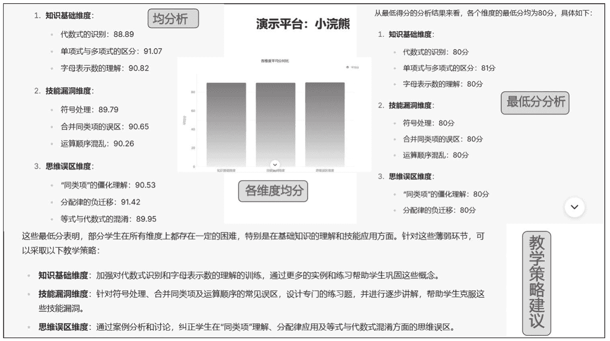

图 4-15 解决路径分析内容

**拓展：学情分析推荐大模型（见表 4-2）**

表 4-2 学情分析推荐大模型

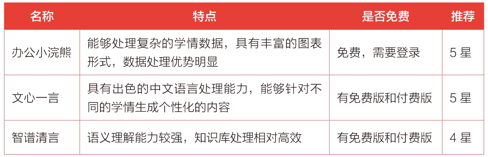

**4.生成式智能助力目标构建**

教学目标设计是教学设计的枢纽，生成式人工智能可显著提升大单元和课时目标制定的效率，帮助教师明确方向并指导后续活动。

（1）大单元整体教学目标设计

在大单元目标构建上，生成式人工智能能依据学科课时主题提取并整合可组成大单元的课时，以大概念为核心提炼单元目标并标明整合的课时范围。例如教师上传全部课时文档，通过提示词让模型据此生成大单元整体教学目标。

**案例 6：**初中物理大单元整体教学目标设计。王老师负责“力和运动”大单元规划，该单元涵盖牛顿运动定律、能量守恒等核心概念。他希望基于学生现有水平与兴趣，结合《义务教育物理课程标准 2022》，制定既具挑战性又符合实际的整体目标。

操作平台：Kimi。

**输入的关键提示词**

角色：初中物理老师。
背景：设计“力和运动”大单元教学计划。
指令：设计大单元整体教学目标。
输入：学生现有的知识水平和兴趣点。
输出：大单元整体教学目标。

**生成的初中物理大单元整体教学目标（见图 4-16）**

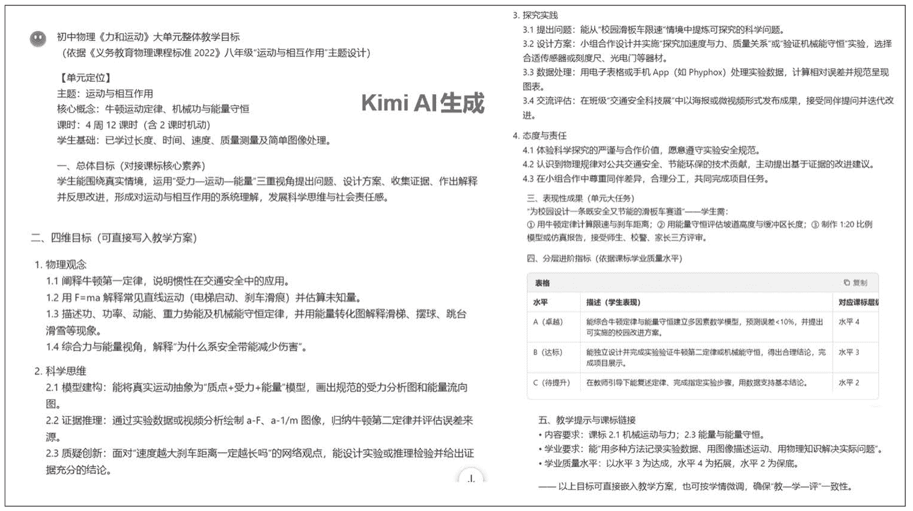

图 4-16 初中物理大单元整体教学目标

（2）课时教学目标设计

在课时目标层面，生成式人工智能可依据已有的单元目标生成单课目标，并从知识技能、过程方法、情感态度价值观三维度明确行为主体、行为表现、行为条件和表现程度。

**案例 7：**初中化学课时教学目标设计（根据《义务教育化学课程标准 2022》）。赵老师负责“酸碱反应”课时设计，希望目标能帮助学生理解基本概念、掌握实验技能并激发学习兴趣。

演示平台：Kimi

**输入的关键提示词**

角色：初中化学老师。
背景：设计“酸碱反应”课时教学计划。
指令：设计课时教学目标。
输入：学生现有的化学知识水平和实验操作能力。
输出：课时教学目标。

设计课时教学目标的具体指令如图 4-17 所示。

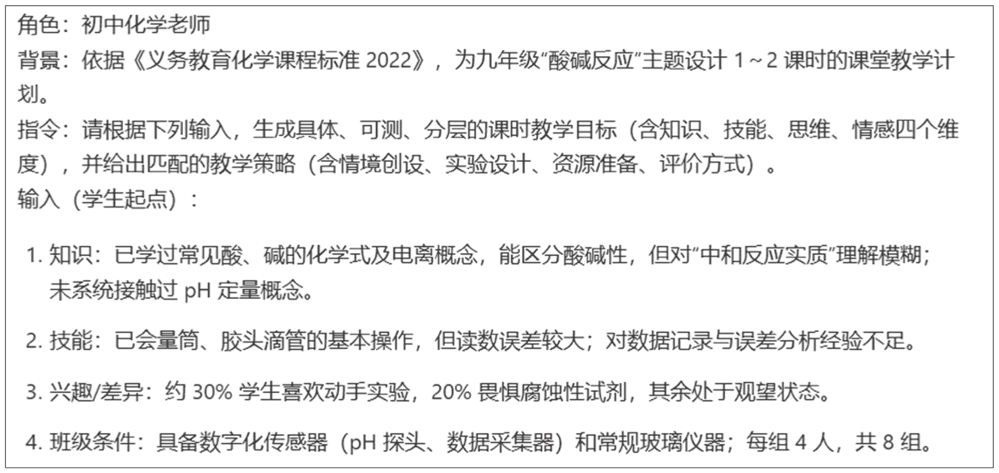

图 4-17 设计课时教学目标的具体指令

**生成的初中化学课时教学目标（见图 4-18）**

**5.生成式智能支撑的教学流程设计**

教学流程设计是教学实施的关键，借助生成式人工智能可更高效地完成单元与课时的设计，提升组织质量。

（1）单元教学设计

单元设计可在单元思路与课时思路两个层面展开。例如采用分布指令法将任务分解为多个步骤逐步生成；采用模板参考法提供已有流程或任务模板让模型据此生成新内容；采用迭代优化法先行生成后通过反馈逐步修正。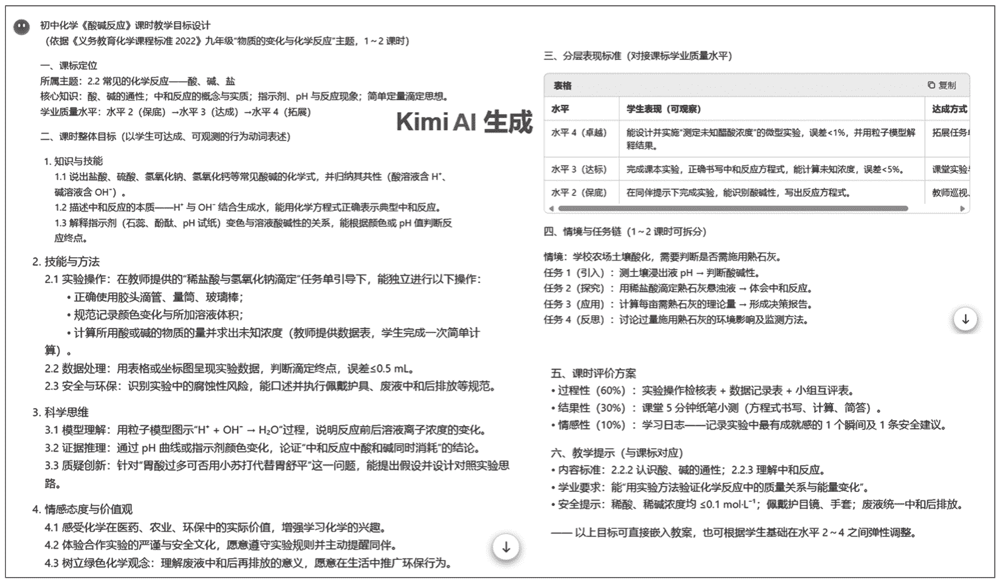

图 4-18 初中化学课时教学目标

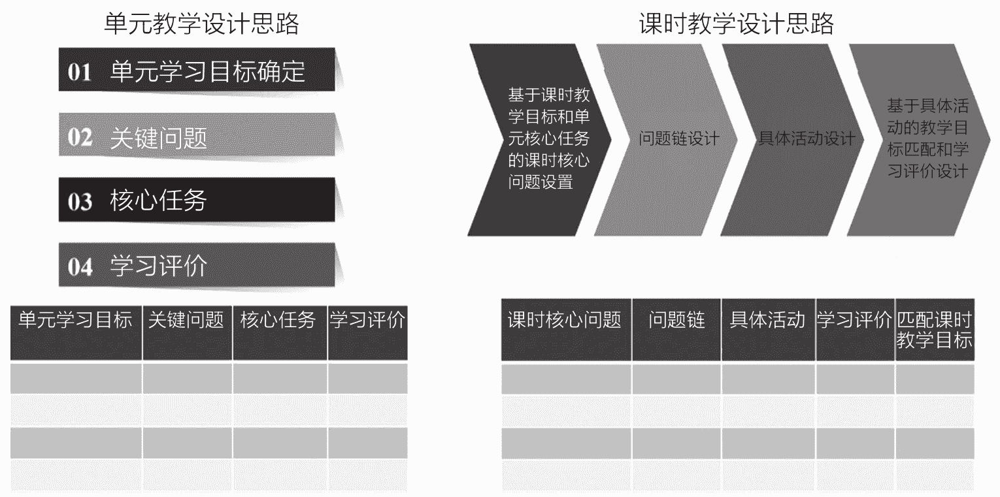

图 4-19 单元教学设计思路与课时教学设计思路框架

**案例 8：**单元教学设计——分布指令法。陈老师负责“细胞的生命历程”单元教学方案，内容涵盖生长、分裂、分化、死亡等关键概念。他计划采用分布指令法，将复杂内容拆解为多步骤，每步设定明确目标与活动，帮助学生逐步建构知识体系。

操作平台：文心一言。

**输入的关键提示词**

角色：初中生物老师。
背景：设计“细胞的生命历程”单元教学方案。
指令：采用分布指令法，将教学内容分解为多个步骤。
输入：学生现有的生物知识水平和学习需求。
输出：单元教学目标和教学活动。

**生成的初中生物单元教学目标和教学活动（见图 4-20）**

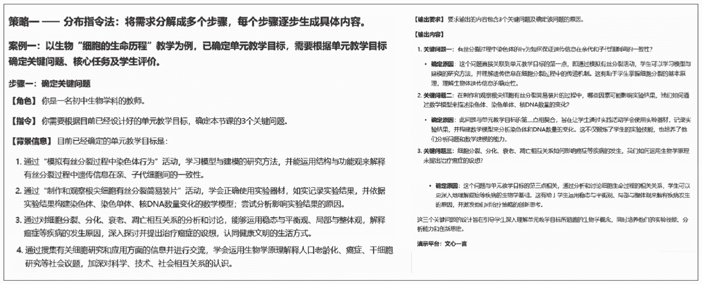

图 4-20 初中生物单元教学目标和教学活动（分布指令法）

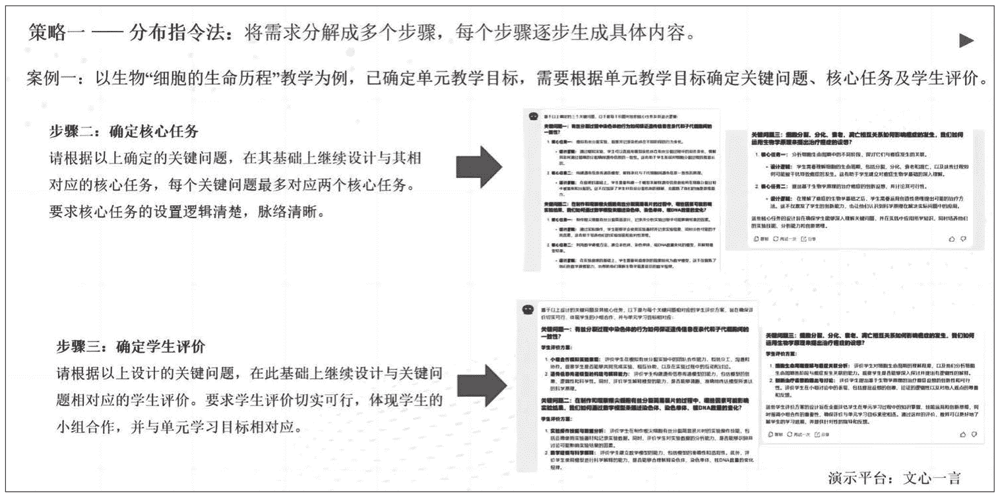

图 4-20（续）

**案例 9：**单元教学设计——模板参考法（根据《义务教育物理课程标准 2022》）。张老师准备设计“电与磁”单元教学计划，涉及电流磁效应、电磁感应等核心概念。他计划采用模板参考法，利用已有教学流程或任务模板进行设计，确保系统性与连贯性。

演示平台：Kimi

**输入的关键提示词**

角色：初中物理老师。
背景：设计“电与磁”单元教学方案。
指令：采用模板参考法设计教学活动。
输入：已有的教学流程或任务模板。
输出：单元教学目标和教学活动。

**生成的初中物理单元教学目标和教学活动（部分展示见图 4-21）**

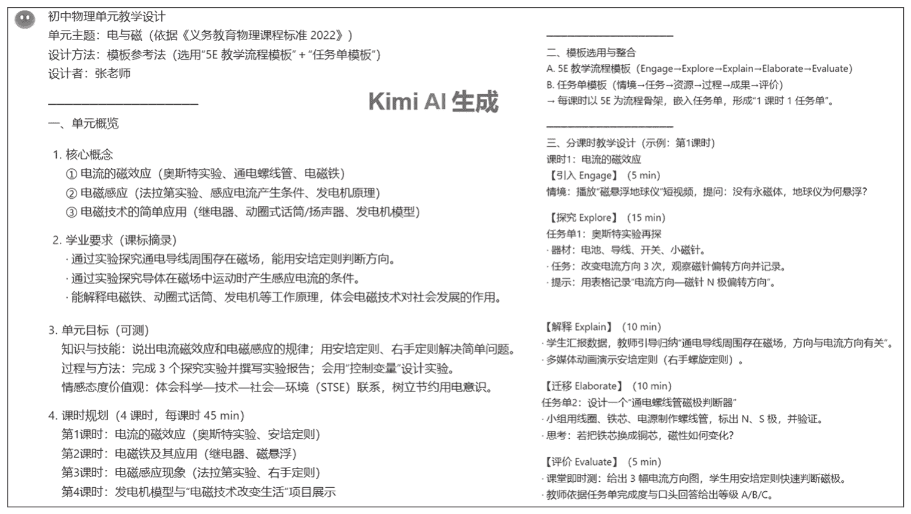

图 4-21 初中物理单元教学目标和教学活动（模板参考法，部分展示）

**案例 10：**单元教学设计——迭代优化法。李老师负责“工业革命”单元教学计划，涵盖起因、过程、影响及现代意义。他计划采用迭代优化法，通过初步设计、实施、收集反馈、修改优化逐步完善流程，提升教学效果与学习体验。

操作平台：文心一言。

**输入的关键提示词**

角色：中学历史老师。
背景：设计“工业革命”单元教学方案。
指令：采用迭代优化法逐步完善教学流程。
输入：学生现有的历史知识水平和学习需求。
输出：单元教学目标和教学活动，以及优化方案。

**生成的初中历史单元教学目标和教学活动（见图 4-22）**

图 4-22 初中历史单元教学目标和教学活动（迭代优化法）

（2）课时教学设计

课时设计可基于已确定的课时目标与单元核心任务，提炼一节课的核心问题，并在此基础上构建问题链，依托次要问题设计具体活动，每个次要问题最多对应两个活动，并完成目标匹配与学习评价设计。

**案例 11：**高中生物课时教学设计。王老师负责“遗传与变异”课时教学计划，涉及基因、染色体、DNA复制、突变等概念，希望学生能理解原理并在实验中应用。

演示平台：文心一言

**输入的关键提示词**

角色：高中生物老师。
背景：设计“遗传与变异”课时教学方案。
指令：设计课时教学目标和教学活动。
输入：学生现有的生物知识水平和学习需求。
输出：课时教学目标和教学活动，以及评价方案。

**生成的高中生物课时教学目标和教学活动（见图 4-23）**

图 4-23 高中生物课时教学目标和教学活动

（3）教师提问与反馈设计

生成式人工智能还可辅助提问与反馈设计并优化实验教学。提问与反馈可依据哈蒂教师反馈理论，涵盖任务、过程、自我调节及自我层面，生成具体话术。实验教学优化可从核心素养渗透、高阶思维培养、跨学科概念培养、生成式人工智能学习支架等方面入手设计方案。

**案例 12：**基于高阶思维的教师提问设计。刘老师教授“二次函数”章节，计划设计促进分析、评价、创造等高阶思维的提问，引导学生深入理解概念并探索现实应用。

演示平台：文心一言

**输入的关键提示词**

角色：高中数学老师。
背景：教授“二次函数”章节。
指令：设计基于高阶思维的提问。
输入：学生现有的数学知识水平和理解能力。
输出：基于高阶思维的提问列表和教学活动。

**生成的高阶思维问题（见图 4-24）**

图 4-24 高阶思维问题

**案例 13：**基于高阶思维的教师反馈设计。张老师教授“电磁学”单元，希望通过高阶反馈帮助学生深化概念理解、拓展应用并激发创新。

演示平台：文心一言

**输入的关键提示词**

角色：高中物理老师。
背景：教授“电磁学”单元。
指令：设计基于高阶思维的反馈机制。
输入：学生现有的物理知识水平和理解能力。
输出：基于高阶思维的反馈策略和教学活动。

**生成的高阶思维反馈文本（见图 4-25）**

图 4-25 高阶思维反馈文本

## 第四节 小结

科技进步尤其是生成式智能的发展，正在重塑教育各环节。从课程规划到教学实施再到评价，每一处都在被重新定义和优化。对基础教育教师而言既是机遇也是挑战，只有紧跟步伐积极探索新技术，才能在未来教育舞台中脱颖而出。

在此过程中教师角色依然关键。生成式智能提供强力辅助，但教学质量和学生发展最终仍依赖教师的专业裁量与人文关怀。教师不只是知识传递者，更是成长路上的引路人与支持者。因此在拥抱技术同时要坚守教育本真，关注每位学生的个性需求与发展潜能。

展望未来，随着更多先进技术与理念引入，教育将更个体化、智能化与包容。而这一切的基础，是每一位教育工作者的持续努力与探索。携手共进，迎接更美好的教育明天！

# 第五章

# GAI 赋能教育管理优化

## 第一节 GAI 助力教育管理优化的应用现状与发展需求

近年来生成式智能快速发展正深刻重塑全球教育管理体系，推动治理向智能化、精准化与高效化演进。各国政府和国际组织纷纷将人工智能纳入教育战略，以优化资源配置、提升决策科学性与管理效能，促进教育公平。

教育治理的智能跃迁：从粗放管控转向精准育人

美国2023年出台的《国家人工智能研发战略计划》明确，智能技术能够切入教育政策设计、学校运行与个性化学业支持，凭借数据智能提升管理效率与体系适应力。英国教育部《教育中的生成式人工智能》报告亦倡导学区运用生成式技术实现排课自动化、教师绩效评估和学习路径管理，以增强治理效能。联合国教科文组织《生成式人工智能教育与研究应用指南》则提醒，应用过程须兼顾伦理规范、数据安全与公平原则，保证决策可解释、个人隐私受保护、防范技术带来的负面风险。

国内政策亦在持续收紧与完善。2023年《生成式人工智能服务管理暂行办法》要求相关应用遵循安全、透明、公正底线，防止算法偏见与数据滥用。2024年北京发布的《教育领域人工智能应用指南》提出推进智慧校园、教育数据分析与学习行为预测，助力治理现代化。同年《政府工作报告》部署“人工智能+”行动，推动智慧教育治理体系建设。

在技术驱动下，全球教育管理正迈向更智能、更高效、更公平的新阶段，为体系创新供给实质支撑。

转变管理方式的路径主要集中在两方面。其一，管理部门借助智能技术搭建区域教育数据中枢等平台，支撑系统性变革。如房山区建设的区域教育数据大脑，打通了研修平台、质量监测平台及综合素质评价平台的数据，实现对师生成长的监测、预警与干预。其二，创新机制协同发力，包括实时联动的分级管控与预警、多方协作的管理机制，以及人机协同的运行模式，共同提升科学性、精准性与协同性，推动管理向高效智能演进。

生成式智能的不可预期性重塑了知识生产与人机互动方式。其易得易用的特性正以显性与隐性路径渗入大学生的学习与生活。智能时代的高校群体呈现新样态，时而出现迷茫、焦虑、倦怠等情绪，甚至沉溺于信息茧房构建的沉浸式数字世界难以自拔，为学生工作带来新的风险因子。传统模式多聚焦教学与生活的工业化流程，难以捕捉个体化需求。随着学生对多样化成长的追求，响应迟滞的管理已难以满足“即时响应”的期待。如何依托个性特质开展精准育人，成为高校改革的核心。唯有借助生成式智能赋能，高校管理方能从“管”向“育”实现跃迁，更快适应学生认知发展与数字心理特征的复杂变化。

（一）生成式智能在教育管理中的实践图景

全球教育技术演进差异化明显，各地侧重点与成熟度不一。不同社会语境塑造了多样化的实践。下表汇总了主要区域的应用特点与典型案例。
表 5-1 全球不同地区GAI在教育领域的应用特点和典型案例

**1.行政自动化：已步入成熟期**

行政领域是智能落地的先锋，排课与考勤效果突出。智能排课系统通过算法优化显著提效。以国内部分学校为例，结合学生选课与教师课时动态调整课表，将原需数日的手工排课压缩至1小时以内，冲突率下降超90%。财务、学籍等标准化报表自动生成工具在全球普及，美国PowerSchool系统即可自动产出各类报表，节省30%至50%的行政工时并降低人为差错。此类工具不局限于发达地区，众多发展中国家也在推广。但跨部门数据孤岛仍普遍存在，老旧系统难以对接制约了效能释放。

**2.学情研判与风险预警：发展迅速但争议并存**

学情研判与风险预警增长最快，尤其在辍学预测与心理健康监测方面。系统可实时汇聚出勤、作业完成度、社交互动等信号进行风险评估。澳大利亚某系统对辍学风险的预测准确率达82%。国内部分学校引入情绪识别监测课堂状态，帮助教师及早发现学业与心理隐患。生成式技术还能快速生成个性化评语，新加坡多校已应用，教师仅需微调即可，大幅提升效率。

争议同样突出。数据隐私是焦点，欧盟多国已严格限制采集课堂影像或学生生物特征。算法偏见亦受关注，历史数据依赖可能导致不公判断，如低收入家庭学 площ易被误标高风险，损害教育机会。

**3.教学资源动态配置：高等教育领先，基础教育滞后**

高等教育在资源动态配置上进展更快。哈佛大学利用智能技术预测实验室使用情况，设备闲置率降低18%。印度则运用智能技术将流动教师分配至农村学校，缓解师资短缺。课程设置方面，技术可分析选课数据预测新开课程与技能培训需求，美国社区大学据此调整供给以适应市场变化。

基础教育相对滞后。部分发达国家已尝试智能调配，但多数机构仍依赖经验与传统手段安排资源，缺乏实时数据支撑。农村地区数字化基础薄弱，部署成本高，导致工具难以普及。

**4.家校协同智能化：工具扩散但使用不均**

家校协同智能化已成管理新方向。钉钉、ClassDojo等平台借助智能技术自动生成学生行为报告，并提供多语种翻译，便于家长理解通知。国内大城市学校覆盖率超60%。日本则用智能技术分析家长留言，识别课后托管等高频诉求，为政策制定提供依据。

挑战同样明显。文化程度较低的家长对智能工具接受度有限，仍偏好人工沟通，导致沟通效率不高。信息过载亦削弱效果，家长在海量通知中易忽略关键推送，影响工具价值。

（二）生成式智能助力教育管理优化的需求

生成式智能不仅能提升教学，也能重塑行政、学情、资源配置与家校协同。以下从四个维度梳理诉求。

**1.技术层面：从单点应用到体系集成，推动管理全面智能化**

当前痛点是行政低效、学情研判不足、资源分配不均。技术需实现轻量化与本地化，解决农村等基础设施薄弱地区问题。边缘计算与低带宽优化可降低硬件门槛，使低配置设备也能运行。印度Byju's的自适应学习服务支持离线更新，减少对高速网络依赖即为示范。

在资源与行政管理上，生成式技术要从单一功能走向体系集成，打通排课、考勤、评估等环节，提升自动化水平，减少人工干预，实现校内一体化。

**2.政策层面：构建合规与激励并行的框架，保障公平与数据安全**

政策保障是推广前提。现有规则对伦理与隐私的覆盖仍不充分，尤其数据采集、存储与使用风险。需加大教育数据隐私立法力度，确保工具在合规框架下运行，欧盟《人工智能法案》对数据使用和生物特征采集的严格限制可作参考。

政府还应出台激励政策，通过财政补贴、税收优惠降低薄弱学校和农村学校的采购成本，促进公平。另需强化伦理审查，建立独立的教育智能伦理委员会，审视算法偏见和数据歧视，保证公平透明。

**3.应用层面：分层设计，针对痛点提供定制化方案**

以ChatGPT为代表的生成式智能可深度学习海量资源，按学习进度、能力水平和兴趣精准推荐材料，通过整合加工创造个性化学习资源，提升学习成就感与效率，也培养自主学习与健康管理能力。

管理应用上，需针对四个现状痛点定制方案。行政管理应强化排课、考勤、报表自动生成，减少人工。学情预警需突破单一维度，采用多模态融合，结合出勤、作业、互动数据全面分析。加州大学的多模态技术即通过课堂互动发现“安静学生”，帮助教师干预。资源配置方面，智能技术可精准预测和调度实验室、教师、课堂，提高使用效率。家校协同则需提供低门槛工具，为低文化水平家长设计语音优先界面，简化信息获取。

**4.协同模式：“政企校”共建生态，推动智能教育生态可持续发展**

智能全面推进离不开政府、企业、学校协同。政府以政策与资金引导，企业提供技术定制支持，学校反馈真实需求形成闭环。北京“智慧校园”项目采用PPP模式，政府给政策场地，企业负责技术开发，学校提供需求反馈即为典型。

开源生态同样重要。政府可鼓励企业与学界共建开放平台，降低门槛。国内“飞桨教育开源计划”通过开源智能平台为高校提供技术与资源共享，推动快速发展。政企校联动可为管理提供更智能、更个性化的方案。

第二节 生成式智能辅助教育管理优化的基础理论与关键原则

（一）生成式智能在教育管理中的理论基础

生成式智能凭借智能化数据分析、流程优化和个性化支持，推动管理体系向智能化、科学化、以人为本迈进。下文从管理学与组织理论、智能技术理论两个维度展开。

**1.管理学与组织理论**

（1）科学管理 生成式智能与科学管理结合可实现教育管理的智能高效。智能体能自动处理排课、考勤、绩效评估、资源分配等繁琐事务，减少人为错误，提升数据处理准确度。标准化流程与自动化处理相辅相成，为管理者提供数据支撑，实现科学决策，提升办学效益。

（2）人本管理 人本管理强调关注个体需求与发展。生成式智能通过情感计算与个性化分析洞察师生心理状态与需求，为管理提供及时反馈。智能体可分析学习轨迹与成绩，预测发展趋势并给出个性化建议，提升学习效果，促进个性化发展，也可优化教育环境，增强幸福感与满意度。

（3）复杂适应系统 复杂适应系统理论强调自组织、适应与演化。教育体系具有高度动态不确定性。生成式智能可通过实时分析、情境预测与动态调整帮助管理者快速识别问题并制定应对策略。在疫情或自然灾害等突发事件中，智能体可辅助制定灵活的在线教学方案，保障教学质量。动态分析学习进度与反馈，也为个性化教学与资源调整提供依据。

**2.智能技术理论基础**

（1）机器学习和深度学习 机器学习与深度学习是智能核心。通过数据训练模型实现模式识别与预测。在教育管理中，生成式智能利用这些技术分析大规模教育数据，识别学习模式、兴趣偏好与进度，提供个性化建议。深度学习通过多层神经网络挖掘深层规律，用于成绩预测、学习障碍识别等，为管理提供精准支持。

（2）自然语言处理 自然语言处理用于文本分析、语义理解与自动生成。生成式智能借助该技术实现智能问答、政策解读与报告自动生成。智能问答及时回应师生咨询，政策解读帮助管理者把握导向，自动生成评估报告与学业分析报告提升行政智能化水平，减少负担，提升决策科学性，同时促进资源共享与沟通。

（二）生成式智能优化教育管理的关键原则

生成式智能的价值不仅在于技术创新，更在于遵循原则以确保合理、安全与公平。下表归纳了关键原则。
表 5-2 GAI优化教育管理的关键原则

以下从以人为本的智能管理、数据安全与隐私保护、公平性与包容性、持续优化与人机协同四个方面展开论述，探讨原则的应用价值。

**1.以人为本的智能管理原则**

以人为本，让技术回归教育温度

把人放在决策中心，是 GAI 进入教育管理的先决条件。技术发展要符合教育伦理的底线，并且真正作用于管理者、教师和学习者。教育管理的价值不只是制度和资源的调配，更在于推动每个个体的整体成长。所以在落地时要守住方向：用技术增强人文关怀，而不是用冰冷的数据和模型取而代之。

以智能课堂管理为例，GAI 可以给出细致的学习行为洞察，但这些洞察必须和教师的现场经验融合，才能形成兼顾科学性、合理性和温度的反馈，帮助管理者做出更有共情的判断。总体定位上，GAI 应该是增强手段而非替代角色，成为管理者与教师的助手，通过智能化分析与行政办公等工具提升效率与质量，同时保留决策的灵活与创造空间。

**2. 数据安全与隐私保护原则**

在 GAI 赋能教育管理的过程中，数据既是驱动力也是风险点。教育场景涉及成绩、绩效、行政决策等大量敏感信息，安全与隐私必须前置设计。应用层面要严格合规，使用必须合法合规，禁止任何形式的滥用。以学情分析为例，GAI 仅能服务于教学改进，禁止无授权的挖掘或商业化利用。管理方要建立清晰的数据治理体系，覆盖采集、存储、使用的全链路，符合《通用数据保护条例》《中华人民共和国数据安全法》等相关要求。

同时要以技术手段筑牢防线，包括加密、分布式存储、匿名化处理等。例如智能学习系统可对学习记录做去标识化，确保分析过程不涉及个人身份。此外还要搭建完善的安全审查机制，合理分配并持续监控访问权限，防止未授权访问与滥用。

**3. 公平性与包容性原则**

公平是教育的基本底色，GAI 优化管理时更要警惕算法偏见带来的新不公。研发者与管理者需协同构建公平性检测机制，保证决策的透明与公正。模型基于历史数据训练，若训练数据本身带偏见，结果很可能放大该偏差。因此在智能招生、教师绩效评价等关键环节，要引入多维度考核指标，避免对特定群体产生系统性倾斜。

应用设计还要向弱势群体倾斜，推动教育公平。例如在偏远或资源薄弱的学校，GAI 可提供在线智能教学支持，缓解师资不足；在面向残障学生的管理中，可提供智能语音识别、视觉辅助等技术，帮助其更顺畅地融入学习环境。教育管理系统必须具备普适性与包容性，让所有学习者都能平等享受技术带来的优化成果。

**4. 持续优化与人机协同原则**

GAI 在教育管理中的落地是一个持续迭代的过程，需要随环境变化而演进，并与管理者形成良性协同。系统要具备持续进化的能力，跟上需求变化。教育管理是动态的，课程调整、教学创新、组织变动都会带来新需求，GAI 不能是一次性部署就结束，而要能根据反馈不断调整规则与模型，提升适应性与准确度。在教师管理、学生成长分析等场景，系统要支持个性化调优，更好贴合学校实际。

另一层面要构建有效的反馈闭环。GAI 的效能很大程度上取决于用户评价，管理者、教师、学生都应能对系统效果进行客观评估并提出改进建议。例如智能排课可以根据反馈优化推荐逻辑，教师绩效评价可以结合各校特色做适应性优化。通过人机协同，GAI 才能真正成为服务教育管理的智能伙伴，为未来发展提供持续智慧。

第三节 生成式AI驱动教育管理的关键场景与实践

传统教育管理多依赖经验判断，灵活但存在数据利用率低、效率不足、个性化支持缺失等问题。随着 GAI 发展，管理模式正从经验驱动转向数据、算法与人本三元协同。GAI 不替代教师和管理者，而是用智能化技术强化决策支持体系，提升资源配置效率，同时保留人在情感关怀和个性化教学中的核心作用，实现人机分工、优势互补、协同发展的新型管理方式。

（一）学生管理：迈向个性化、精准化发展

GAI 与学生协同创作的学术成果已被证实往往高于学生平均水平。深度应用后，学生管理可以向科学化、自动化、个性化、精准化迈进。核心在于学业跟踪、行为分析和个性化干预，GAI 能够在这些环节提供自动、精准的支持，让管理者更高效地关注成长。

**1. 用智能学伴实现个性化学习资源生成**

以标准化流程为主的传统学习管理难以满足个体差异。依托强大的语言交互能力，GAI 可以化身学生的智能学伴，提供全流程个性化学习支持。智能学伴还能扮演教师角色，通过大数据分析和机器学习为学生定制动态学习计划与建议，让学习管理成为激发潜能的催化剂，推动个性化全面发展。生成智能学伴的一般流程如图 5-1 所示。

图 5-1 生成智能学伴的一般流程

智能学伴可被设定为科学家、文学家或历史人物，营造从真实到虚拟再抵达现实的学习情境，缓解认知转变中的消极情绪，带来拟人化的管理体验。需要注意的是，智能学伴允许学生提问并生成难以与人类原创区分的新内容，这给学习成效评估带来挑战，也可能引发知识产权争议。如图 5-2、图 5-3 所示为智谱清言智能体中心页面和 ChatGPT 智能体中心页面。

图 5-2 智谱清言智能体中心页面

图 5-3 ChatGPT 智能体中心页面

**案例 1：**节选自某初中课堂上学生与课堂互动智能体对话的真实片段，话题聚焦电磁感应中切割磁感线与磁通量变化的因果关系。智能体以助教身份参与教学，通过类比和引导性语言帮助学生由现象走向原理。

学生提问：“为什么切割磁感线能产生感应电流？”

智能体回答：

这是电磁感应的核心之一。从机制看，导体在磁场中运动切割磁感线会引起磁通量变化。依据法拉第电磁感应定律，只要磁通量变化，导体中就会产生感应电动势；电路闭合则形成感应电流。具体可理解为：

● 切割磁感线相当于导体扫过不同磁场区域；
● 导体内部自由电子受洛伦兹力作用形成电动势；
● 整体遵循“导体运动→磁通量变化→感应电动势→感应电流”的链条。

学生追问：“切割为什么能改变磁通量？”

智能体回答：

这是个很好的深入问题。磁通量由磁感应强度*B*、穿过的面积*S*和磁感线与面积法线夹角*θ*决定。导体运动时所扫过的面积*S*不断变化，进而引起磁通量*Φ*=*B*×*S*×cos*θ*的变化。切割磁感线引发磁通量变化，本质是运动使导体接触的磁场区域在更新。

学生提问：“可以类比一下吗？”

智能体回答：

可以。可类比为“用网兜在水中捞水”，具体类比内容如表 5-3 所示。

表 5-3 智能体生成的类比元素与物理概念

学生提问：“能给我做一张示意图吗？”

智能体生成的水流类比切割磁感线示意图如图 5-4 所示。

图 5-4 智能体生成的水流类比切割磁感线示意图

**2. 生涯规划：助力个性化全面发展**

个性化全面发展是高等教育改革的重要方向。传统发展管理理念陈旧、模式单一，容易让个性目标滑向群体同质化。GAI 的价值在于尊重个体差异与自然需求，定制个性化发展方案，帮助学生发掘潜力、补齐短板，避免一刀切带来的错失。

GAI 通过记录学术背景、兴趣爱好、性格特征、课外活动等多维数据，形成伴随式个人成长数字化档案袋，实现全过程、全方位、全天候的数字人式陪伴与支持。它能动态微调认知模式与发展倾向，生成个性化成长规划，例如提供授人以渔式学习方法，赋能个性化育人管理。

系统还能实时纵向追踪学业进展，并基于即时反馈调整发展规划，确保成长路径符合自然需求。比如入学前就与学生成为好朋友，一起探索校园生活；学习科研时成为好搭子，深化专业学习并参与科研；求职前化身面试官，模拟真实应聘场景助推角色转变。

此外，借助多模态细粒度情感计算，GAI 可识别个性心理问题，并以知心伙伴式的情感同频，提供类人的情绪支持。

（二）教学管理：构建智能化教学管理与决策支持系统

教学管理的核心是优化资源配置、提升教学质量、提高教师效率。GAI 可通过智能质量评估、决策支持、资源推荐等手段提升管理精度与灵活性。

**1. GAI 排课助手**

GAI 正改变教学与管理方式。以智能排课为例，系统可依据教师、教室、时间等条件自动生成无冲突课表。例如教师可在Excel中整理课程基础数据，如班级、教师、教室、时间限制等，粘贴至ChatGPT即可生成方案。 

**案例 2：**GAI 生成课程表。

操作平台：Kimi

**输入关键提示词**

你是一名排课专家，请根据以下条件生成无冲突的课程表：

1.同一名教师不能同时在两个班级上课。2.实验室课程优先安排在上午。3.每门课程每周上课次数固定。4.每个班级每天的课程数量不超过 4 节。5.教师和班级的课程表需要清晰展示。6.输出格式为表格。

智能体回答：

假定上课教师为：“教师 A、教师 B、教师 C”；上课班级为：“班级 1、班级 2、班级 3”。

**课程信息如下：**

上课时间：

周一到周五，上午：8:00—10:00，下午：14:00—16:00

实验室信息：

实验室数量：1 个

开放时间：

周一到周五上午

**示例课程表（部分）：**

班级 1 的课程表

班级 2 的课程表

班级 3 的课程表

说明：

1.实验室课程优先安排在上午：物理和化学是实验室课程，均安排在上午。

2.同一名教师不能同时在两个班级上课：教师 A、B、C 的课程没有时间冲突。

3.每个班级每天的课程数量不超过 4 节：每个班级每天最多安排 2 节课程，符合要求。

**2. 智能推荐教学资源，帮助教师备课**

凭借语义解析、情境感知、文本生成三大特性，GAI 为备课提供高效智能支持。语义解析能精准理解教学内容，提取关键概念并自动构建知识结构图，厘清教学逻辑。情境感知可分析内容背景，结合学生认知特点和学段水平推荐教学方法和差异化资源，实现因材施教。文本生成能力可自动创建教学案例、课后练习等素材，减少重复劳动，并通过联网检索补充前沿资料，丰富课堂内容。在备课交互中，教师可依据教学目标、内容、重点难点与 GAI 对话优化设计，提升效率。下面以案例形式说明人机协作备课过程。 

**案例 3：**利用 GAI 生成教学目标——以“万有引力定律”为例。

操作平台：ChatGPT

**输入关键提示词**

你是一名高中物理教师，《普通高中物理课程标准（2017 年版 2022 年修订）》中要求：“2.2.4（P.15）通过史实，了解万有引力定律的发现过程，知道万有引力定律。认识发现万有引力定律的重要意义，认识科学定律对人类探索未知世界的作用。”根据课标要求和教材内容（在 Kimi 窗口上传本节课的电子版教材），请从物理学核心素养的四个方面撰写本节课“万有引力定律”的教学目标。

**生成教学目标**

万有引力定律教学目标（基于物理学科核心素养）如下。

● 科学观念：理解万有引力定律的基本内容，认识其在解释天体运动和日常现象中的重要性，理解万有引力定律的普适性和作用范围。

● 科学思维：通过分析牛顿的推理过程，培养基于观察和数学推导进行科学思考的能力，理解科学定律的形成过程和逻辑推理方法。

● 科学探究：了解万有引力定律的发现过程，认识科学探究在科学发现中的重要性，能结合史实分析科学研究的基本过程和方法。

● 科学态度与责任：培养实事求是、尊重事实的科学态度，认识万有引力定律在人类探索宇宙奥秘中的重要意义，增强对科学精神的理解和认同。

备课时检索资源是教师的重要环节。传统关键词搜索效率低、耗时。GAI 借助自然语言处理技术，能精准分析词汇、语义和语法，深度理解人类语言并生成合乎逻辑的回应。 

**案例 4：**利用 GAI 生成视频——以“万有引力定律”为例。

操作平台：ChatGPT

**输入关键提示词**

请生成一个关于地球绕太阳运动的动画视频，用于讲解“万有引力提供向心力”的物理概念。

视频画面采用俯视角度，太阳位于画面中央，表现为一个发光的球体；地球则以蓝色星球的形象沿近似圆形的轨道匀速绕太阳运动。轨道以白色或淡蓝色圆环呈现，并标注“地球轨道”。在地球与太阳之间，有一个箭头从地球指向太阳，标注“向心力=万有引力”，从而清晰地展示万有引力的方向及其作为向心力的作用。与此同时，地球轨道的切线方向上有一条箭头，标注“速度*v*”，始终垂直于向心力箭头，直观地表示地球的运动方向。此外，万有引力公式将在画面中适当的位置浮现，进一步强化这一物理概念。整个视频背景是星空，视觉效果简洁明了，适合教学使用，时长约 30 秒到 1 分钟，输出分辨率为 1080P 的 MP4 格式。

**生成教学视频**

我将为您生成一个地球绕太阳运动的视频，直观地展示“万有引力提供向心力”的物理概念，包括以下内容。

视角：太阳在画面中央，地球围绕太阳做匀速圆周运动，轨道为近似圆形，画面为俯视角。

包括如下元素：

太阳：一个发光球体，固定在画面中心。

地球：一个蓝色星球，沿轨道匀速运动。

轨道：标注为“地球轨道”，是一个白色或淡蓝色的圆环。

向心力箭头：从地球指向太阳，标注“向心力=万有引力”。

速度箭头：与轨道切线方向一致，标注“速度*v*”，箭头始终垂直于向心力箭头。

当地球围绕太阳一圈时，万有引力公式浮现。

生成的视频部分截图如图 5-5 所示。

图 5-5 ChatGPT 生成的地球绕太阳运动的视频

**案例 5：**利用 GAI 生成教师评价表——以“万有引力定律”这节课为例。

**输入关键提示词**

请你生成一个教师评价表，一级标题为四个核心素养，二级标题根据本节课的教学目标制定，表中包含自评、互评、师评。

生成的教师评价表如表 5-4 所示。

表 5-4 教师评价表

**再次输入提示词**

核心素养为一级指标，二级指标需要展开二到三个维度，请你细化评价标准。

生成的教师评价表 2.0 如表 5-5 所示。

表 5-5 教师评价表 2.0

续表

（三）班级管理：减负增效，提升管理效能

班级管理事务繁杂，考勤记录、班级活动组织、家校沟通等行政工作常消耗班主任大量精力。GAI 为缓解非教学负担提供了新路径。系统可依据班级管理的具体需求合理安排班主任工作任务，并在网络上广泛采集教育相关数据资料，极大分担班主任工作，其优势十分突出。

班级管理与家校协同的智能跃升

以考勤功能为切口，优化后的平台让教师不再受时空限制，能够即时搜集、整理学生的学籍信息、联系方式等各类资料。档案归类更流畅，班主任与教务部门的工作效能随之提升。在活动筹备上，生成式AI可以结合过往活动数据和学生的兴趣倾向，给出主题灵感、推进思路以及物资清单，使策划更轻松。家校沟通层面，AI能够迅速把学生的在校表现梳理成沟通纪要，让交流更规范高效，同时缓解教师日常负担。

**1. 量化积分表的自动化生成**

生成式AI正在重塑教学与班级管理的结合方式。以量化积分表的自动生成为例，系统可依据课堂表现、作业完成度以及卫生检查等维度，输出小组积分表、作业登记表、日常日志、卫生检查表等管理表格。

实际操作流程是，教师先在Excel中整理学生姓名、任务分工、作业与卫生记录等基础信息，再将表格导入对话式大模型并给出指令：你是班级管理专家，请依据以下学生表现数据，自动生成班级量化积分表。积分需结合课堂参与、作业完成、活动参与等表现评定，表格包含姓名、各项分值与总分，保证公开透明且易读，输出为表格形式并按表现计分。提交后模型会生成对应表格，教师复制回Excel进行微调与复核，确保准确合理。

**2. AI助力班团活动精准策划**

随着人工智能在教育场景的渗透，生成式AI在班团活动的策划与落实中的价值愈发凸显。班团活动是提升学生综合素养与集体凝聚力的核心载体，生成式AI可高效支持策划、组织与效果复盘，推动活动质量与影响力提升。

（1）活动方案的智能化设计

生成式AI可依据输入的主题、目标、学段特征、兴趣偏好等要素，自动生成贴合学生需求的方案，主要体现为：

• 创意自动产出：系统能快速梳理历史案例、社会热点与学生兴趣，生成新颖主题与形式。例如在环保教育主题下，可提出“校园低碳挑战赛”“废旧物品再利用工作坊”等思路，避免模式重复与枯燥。

• 模板智能优化：生成式AI可整合大量优质案例，提供志愿服务、团队建设、科普宣传等场景模板，并结合具体班级情况做个性化调整。例如筹备班级辩论赛时，可给出辩题建议、赛制安排与评分细则，提升专业度与可操作性。 

**案例 6：**利用生成式AI生成班级辩论赛策划方案。

**输入关键提示词**

请为八年级三班写一份班级辩论赛策划方案，辩题为“朋友之间应不应该计较”。要求明确赛制设计、评分标准等。

生成式AI生成的八年级三班班级辩论赛策划方案如下。

一、活动目标

培养思辨能力：通过辩论锻炼批判性思维、表达与论证能力。
增强团队协作：让学生在讨论与比赛中学会分工，培养团队意识。
引导价值思考：以辩题为载体，帮助学生理性看待友情中的宽容与原则。

二、赛制设计

参赛人员：正反两方，正方主张朋友间不该计较，反方主张应该计较；每方4名辩手共8人；1名主持人把控流程；3~5名评委由班主任、语文老师或学生代表担任。

辩论环节：立论阶段2分钟/队，开篇陈述观点；驳论阶段2分钟/队，针对对方立论反驳；自由辩论6分钟，交替发言展开攻防；总结陈词2分钟/队，巩固己方观点。

三、评分标准（100分制）

论点逻辑性30分：观点清晰、论证合理、论据有力。
语言表达能力20分：语言流畅、表达清楚。
辩驳能力20分：反应敏捷、有效反驳。
团队协作15分：配合默契、衔接顺畅。
临场应变15分：应对突发问题的灵活性。

四、参考辩论观点

正方：友谊核心是信任与宽容，过度计较会破坏感情；相互理解不斤斤计较才是真情谊；计较易导致关系破裂；人际交往需大局观，小让步利于增进友情。
反方：计较体现公平，不计较可能导致吃亏；适度计较可避免矛盾累积；原则问题需计较以防失衡；关系需要边界，不计较易被占便宜。

五、活动流程

赛前准备：选拔辩手、准备资料、模拟训练、评委制定评分规则。
正式比赛：主持人介绍赛制、比赛进行、评委记录关键点评。
赛后总结：评委点评、公布结果、选手反思、讨论辩题现实意义、观众互动。

六、预期效果

提升思辨与表达能力，增强逻辑思维；
帮助学生深入思考友情的价值与边界，形成成熟交友观；
增强班级凝聚力，培养合作沟通能力。

（2）智能组织与协同管理

活动组织环节，生成式AI可精准分配任务、协同进度、提升管理效率。通过任务自动分配，系统依据学生特长、兴趣和过往参与经验推荐分工。例如筹备校园公益活动时，擅长沟通的学生被安排宣传，擅长组织的负责流程策划，保证人员配置合理。同时生成式AI能自动生成宣传海报、通知推送、任务清单等信息载体，大幅提高沟通效率。生成适配社交媒体传播的预告文案，也能有效提升参与度，确保活动顺利推进。 

**案例 7：**接案例6内容，利用生成式AI为八年级三班班级辩论赛撰写社交媒体宣传文案与海报。

生成的社交媒体宣传文案如图5-6所示，海报如图5-7所示。

图5-6 ChatGPT生成的宣传文案

图5-7 ChatGPT生成的海报

**（四）生成式AI助力家校沟通**

家校沟通是学校教育与家庭教育协同的关键。传统方式常出现信息滞后、教师负担过重、家长参与不均的问题。生成式AI为家校联动提供了智能化、个性化、高效化的新路径。

**1.智能化信息传递**

家校通知自动生成：生成式AI可依据不同沟通需求自动撰写家长会通知、考试安排、学生表现反馈等通知。相较人工书写，系统能自动调整表达风格，使通知更清晰、正式且具亲和力，提升家长阅读体验与响应率。如图5-8所示为生成式AI自动优化的家长会通知。 

图5-8 生成式AI自动优化家长会通知

智能回复家长咨询：在家长微信群或家校互动平台中，生成式AI可基于常见问题库提供自动回复，减少教师重复沟通耗时。例如家长询问考试安排或作业情况时，系统可自动匹配信息即时作答，降低沟通压力，提高传递效率。图5-9展示了生成式AI智能回复家长咨询的场景。 

图5-9 生成式AI智能回复家长咨询的问题

**2.智能家长教育指导**

在沟通策略中，教师需主动回应并输出建设性建议，同时兼顾情感支持与教育建议。沟通时先用共情技巧安抚家长情绪，表达对家长关心与焦虑的理解，降低对立情绪；再以事实分析客观回应，如具体解读教学方法、分析学情或矛盾成因，避免情绪化指责；随后提出建设性方案，如个性化辅导、课堂强化等，并鼓励学生以正确方式解决冲突，向家长展示改进举措；最后通过正向反馈与持续沟通，肯定家长建议与参与，促成家校协作，共同助力孩子成长。这样的沟通方式能增强家长对学校的信任，营造良好合作氛围。 

**案例 8：**生成式AI赋能家校沟通。

**输入关键提示词**

你是一位中学班主任教师。家长在一次沟通中说：“老师，我看孩子这次考试成绩不太理想，是不是学校的教学方法出了问题？”请给出一段专业、耐心且具建设性的回应，既理解家长关切，又客观分析问题，积极引导家校共同支持孩子成长。

**生成相应的回应**

我完全理解您对孩子成绩的关注，看到成绩未达预期，您着急我也很揪心。成绩是反映学习成果的重要指标，但每个孩子的节奏和方式都不同。我们班一直采用多样化教学，如小组合作、多媒体教学等，旨在满足不同需求。[孩子名字]这次成绩偏弱，主要在[具体学科及知识点]上掌握不牢。我已分析试卷，他对该部分理解存在偏差，接下来我会在课堂上加强强化，也会安排课后辅导。我们一起看看孩子平时的学习习惯和状态，如何更好地帮助他提升。

## **第四节 小结**

本章系统探讨了生成式AI在教育管理中的优化价值，展现了其提升治理智能化、精准化与高效化的潜力。通过梳理全球不同地区的应用特征与典型案例，揭示了生成式AI在行政管理、学情分析、资源调配、家校协同等环节的现状与发展趋势。同时强调应用时需坚持以人为本、保障数据安全与隐私、维护公平包容、推进持续优化与人机协同，以确保技术使用的合理、安全与公平。本章通过学生管理、教学管理、班级管理、家校沟通等具体案例，展示了生成式AI辅助教育管理优化的实践路径，为教育体系创新提供有力支撑。

# **第六章**

# **生成式AI赋能学科教学实践**

教育的关键在于每一堂课的传承与每一次实践的点燃。技术发展为课堂带来新曙光，生成式AI正成为重塑学科教学的核心力量。《教育强国建设规划纲要（2024—2035年）》要求以教育数字化开辟新赛道、塑造新优势，生成式AI的出现高度契合这一方向。

语文借助生成式AI的语义理解与图像分析可实现精准文本解析与智能作文批改；物理依托程序化问题解决能力可按模型与公式梳理解题步骤，引导受力分析、方程列立与计算；美术借助艺术创作与识别反馈技术激发灵感并即时点评作品；跨学科项目利用资源整合与场景生成技术再现古丝绸之路贸易场景，实现沉浸式学习。这些实践丰富了教学手段，呼应了质量提升、全面发展与创新驱动的核心目标，重塑现代化教学形态。

本章将深入剖析生成式AI在语文、数学、科学等多学科教学中的具体应用，既总结成功经验，也正视现实问题，探索适宜发展的路径，为教育工作者与研究者展示生成式AI赋能学科教学的广阔可能，推动教育迈向新高度，为建成教育强国贡献力量。

## **第一节 生成式AI助力学科教学实践的应用现状与发展需求**

教育如同承载期望的巨轮，在知识海洋中破浪前行，生成式AI为其注入持续动力。无论是数理推导还是人文探讨，生成式AI已广泛渗透。其能一键生成教学资源，节省教师备课精力，使教师更聚焦方法创新与个性化指导；学生也能凭借生成式AI定制专属学习计划，显著提升效率。

但隐忧同样存在：资源一键生成如何保证质量，避免良莠不齐？个性化学习计划如何确保精准匹配每个学生的需求与节奏？教师群体对新技术的适应度如何，能否熟练运用？数据安全问题也不容忽视，学生学情数据与教师教研资料均含大量敏感信息，如何防范泄露与滥用？本节将深入剖析当前应用现状，洞察发展需求，为融合前行提供方向。

**（一）生成式AI助力学科教学实践的应用现状**

**1.教学资源智能生成，赋能高效备课**

在教育信息化浪潮中，生成式AI成为备课利器。语义理解与图像分析技术可生成深度课文解析、写作素材、阅读练习，并以图像辅助理解；程序化问题解决技术可生成习题集并呈现解题思路，引导学生拆解问题、流程化作答；艺术创作与识别反馈技术可产出针对性训练方案；资源整合与场景生成技术可融合多学科知识生成虚拟学习场景，全面辅助教学并支持个性化学习。

权威调查显示，使用ChatGPT辅助备课的教师每周备课时间减少约25分钟，仅为非使用者组的69%。同时，生成式AI能依据教师反馈与教学情境持续优化资源内容，实现教学资源与需求的高契合度，适配各教学环节。

**2.个性化学习精准导航，因材施教智慧领航**

生成式AI是个性化学习的智慧向导。在文科领域，语义理解技术可分析学生的阅读偏好、写作风格及作品理解程度，例如在古诗词学习中精准定位知识盲点并提供针对性解析；图像分析技术可帮助理解文学场景，如借助历史图片辅助历史学习，使情境更直观。

在理科与技能学科，程序化问题解决技术可引导学生分步解题，例如面对数学难题先梳理条件、分析知识点，再逐步找到解题路径。音乐教学中，生成式AI可识别音准节奏问题并给出改进建议，按风格推荐练习曲目；美术教学中可分析画作风格与技巧不足并提供改进方向，助力形成独特艺术风格；体育训练中可分析动作姿态并制定个性化计划。

资源整合与场景生成技术还能融合多学科知识，例如在科学实验课上整合物理、化学、生物知识生成虚拟实验场景，学生可自主探索，系统按操作反馈跨学科解答。有研究表明，借助生成式AI进行个性化学习的学生效率比传统课堂提升约40%。

**3.教学模式创新变革，跨学科学习精彩纷呈**

生成式AI正驱动教学模式创新，部分学校开展跨学科项目式学习。例如“智慧农场”项目，学生在生成式AI辅助下设计智能农业控制系统，模拟植物生长与数据分析，融合数学、科学与技术课程，实现知识融通。

生成式AI不仅提供知识与技术支持，还能培养创新思维与实践能力。虚拟数字人与生成式AI结合增强互动趣味性。参与项目的学生反馈，学习兴趣提升40%以上，综合能力显著提高。

**4.智能辅导全天候在线，学习疑惑即时化解**

学习中遇到难题时，生成式AI可随时答疑。部分智能辅导软件借助生成式AI实现24小时在线辅导，打破时空限制，如同随身学习伙伴。系统给出答案后还能详细讲解思路与知识点。例如学习物理电路原理时，生成式AI结合图文讲解并提供实验模拟与练习题，将抽象知识具象化，弥补教师精力有限难以逐一解答的不足。

**（二）生成式AI助力学科教学实践的难点洞察**

**1.教学资源：便利与瑕疵并存**

数字化转型中，生成式AI为教学资源获取开辟新路径。教师可快速生成海量、多主题、多形式的资料，缩短备课时间，拓展内容边界，让课堂更具时代感与趣味性，有效激发学习兴趣。

但问题同样突出。部分教师在生成资源后直接使用，未审慎审视与修改，未评估资源是否契合教学大纲与学生认知水平，也未甄别内容错误或价值观偏差。粗放使用导致教学内容与需求脱节，学生理解困难，教学效果受损，长期看不利于成绩提升与教育质量提高。

**2.个性化学习：潜力与优化方向**

在实践中，GAI 确实能基于学情数据为学生量身绘制学习路线，成效可期，但提升空间依然很大。语义解析和图像识别这些功能虽能提供学习支持，却很难捕捉到学生在阅读或看图时的情绪波动和深层驱动力。程序化解题引导可以帮学生拆解步骤、规范流程，唯独对解题过程中的畏难心理、探索欲强弱等动机层面把握较浅。数据存在偏差或缺口时，系统就难以准确定位真正的知识盲区，进而给出有效的思路指导和练习安排。艺术创作与评测反馈在解读学生风格或运动训练时，也缺少对兴趣取向、投入热情等非认知维度的关注。比如音乐创作，学生对某类风格的喜爱程度、坚持下去的内在动力往往没被深入挖掘，方案自然难以点燃创作热忱。资源整合与场景生成虽能把多领域知识拼成虚拟情境，却在学生跨学科衔接时的适应性、兴趣迁移等情感需求上考虑不够深入。数据失准会让生成的场景和资源与真实需求脱节，个性化匹配的精确度还有待加强。

**3.教师：传统与革新间的徘徊**

GAI 热潮涌来，不少教师卡在守旧与革新之间，左右为难。普遍对 GAI 的认知和操作能力尚显不足，实际应用时处处碰壁。一方面，系统培训缺位让他们面对工具感到陌生、无从下手，个性化教学难以落地；另一方面，部分教师习惯了传统讲授，对新技术本能排斥，宁愿在熟悉的课堂模式里行稳致远，也不愿登上充满未知的新船。这种犹豫不决，成了 GAI 深入学科教学的一大阻力，像石头一样挡在推进路上，亟需搬开。

**4.伦理与安全：高悬的达摩克利斯之剑**

GAI 普及的背后，伦理与安全风险如影随形。学生隐私泄露、学术诚信受侵等问题不容忽视。学习数据一旦外泄或被滥用，学生权益将严重受损；在作业、论文等环节，利用 GAI 抄袭作弊的现象潜伏暗处，随时可能爆发，侵蚀教育公平，扰乱学术秩序。建立规范的伦理准则和安全防线，已成为当务之急。

**（三）GAI 助力学科教学实践的发展需求**

**1.技术进阶：在创新中雕琢教育之光**

科技突飞猛进，GAI 已成教育变革的核心驱动，但核心能力仍需打磨。自然语言处理要更精准流畅，才能真正打通知识与需求；知识图谱构建要更完善，帮助梳理脉络，形成完整体系；机器学习算法需持续迭代，提升效率与智能水平。这些改进能提升资源生成质量与分析精准度，更贴合师生的真实需求。例如研发更智能的知识推理模型，让 GAI 像资深教师一样把握学科逻辑，精准识别学情，提供逻辑严谨且教学可用的资源建议。

同时推动 GAI 与 VR、AR 等前沿技术深度融合，打造沉浸式学习环境。历史课上，学生可通过 VR 穿越时空感受历史现场；实验课上，AR 能把抽象原理立体呈现，让学习从枯燥灌输变为探索乐趣。

**2.教师成长：在培训与交流中绽放教育智慧**

教师是融合的关键，素养提升必不可少。应开展有针对性的系统培训，线上线下结合。专题讲座可邀请专家解读前沿动态与案例，教授工具使用、资源设计与个性化教学策略，帮助教师熟练驾驭工具，实现因材施教。培训后搭建工作坊和交流平台，鼓励教师分享成功与失败经验，共同研讨创新方法，在实践中加深理解。

**3.伦理与安全：筑牢教育发展的坚实防线**

普及应用的同时，必须夯实伦理与安全基础。开发者应制定细化的应用伦理与安全规范，明确数据采集、存储、使用、共享全流程规则，严密保护师生隐私。教师要加强学生伦理教育，提升隐私保护和学术诚信意识。建立学术不端监测机制，用文本比对、行为分析等手段精准识别抄袭作弊，按规处理，维护公平尊严。国家层面也需强化监管，建立专业团队和严格流程，确保 GAI 在合法合规框架内运行，为教育营造清朗环境，让技术真正成为助推器。

**4.教育评价革新：打造适应时代的教育评价新标尺**

传统以分数为主的评价体系在新生态下已显不足，需要转型。教师应构建多元评价，纳入学习过程、创新、协作等多维素养。比如跨学科项目学习中，可观察学生的解题思路、团队沟通贡献、成果创意等，给出立体评价。

同时借助 GAI 的数据处理能力深度挖掘学情，为教师提供包含优势、不足、进步趋势及个性化建议的客观报告，为教学决策提供依据，让评价真正服务于成长和质量提升，推动教育迈向更高水平。

未来当优质资源能标准化生成、个性化学习能精准匹配每个细微需求、教师能自如驾驭技术让课堂充满智慧碰撞、伦理安全获得全方位保障时，教育才真正迎来高光时刻。愿以上内容为教育工作者提供指引。

## **第二节 GAI 辅助学科教学实践的基础理论与关键原则**

每一堂课都像传递知识的火炬，照亮学生的求知之路。如今 GAI 如同一股强劲的革新之风卷入课堂，推动数字化转型。在建构主义中学生主动建构知识，在系统论中各教学要素协同运作，这一过程在 GAI 影响下焕发新活力。教育性原则让目标始终清晰，协同性原则让师生人机配合更默契。以下理论与原则共同为 GAI 融入教学奠基。

**（一）GAI 辅助学科教学实践的基础理论**

教育与科技深度融合，GAI 为学科教学注入新活力。其背后有多重理论支撑。

**1.学习理论：启迪求知新航标**

（1）多元智能理论
多元智能理论强调个体差异，认为人具有语言、逻辑数学、空间等多种智能且优势各异。GAI 可借助语义理解与图像分析为文科生提供个性化文本与图像解读；用程序化解题为理科生定制训练与实验模拟；依托艺术创作与反馈技术帮助艺体生发展艺术智能。理论也倡导综合能力培养，GAI 的资源整合与场景生成可融合多学科知识，构建跨学科情境，如历史与艺术结合，让学生在多智能交互中提升综合运用能力。

（2）具身认知理论
具身认知强调身体感知与环境互动在认知中的作用。GAI 教学与之契合，可通过场景生成技术结合 VR/AR 构建具身学习空间。例如理科虚拟实验平台让学生“亲手”操作仪器，通过身体动作增强理解与记忆。

**2.传播理论：铺就知识传递通途**

拉斯韦尔五要素模型可解析 GAI 辅助教学流程：教师、系统、学生皆可为传播者；内容为 GAI 生成的文本图像资源；渠道为在线平台与智能设备；受众为学生；效果以成绩与掌握度衡量。分析该模型可优化信息传递。文科语义与图像技术助力生成与解读内容；理科程序化解题技术设计教学资源；艺体艺术创作与反馈提供资源与评价；跨学科资源整合与场景生成为各环节提供多元情境，共同完善传播。

**3.系统科学理论：构筑教学协同矩阵**

系统论强调整体性。GAI 教学中教师、学生、内容构成有机整体，教师借助 GAI 设计方案融合资源，学生作为探索者进行学习，各要素相互影响。唯有协调各要素关系，才能实现系统最优化。GAI 资源整合与场景生成打破学科壁垒，促进融合，提升综合素养。

**（二）GAI 辅助学科教学实践的关键原则**

**1.教育性原则**

首要任务是服务教学目标并促进全面发展。各学科需求不同，对应技术不同。文科可借助语义理解快速梳理古诗词主旨意象，图像分析呈现意境画面；理科可通过程序化解题展示步骤，培养逻辑与实践能力；艺体可利用艺术创作与反馈实时分析色彩构图、演奏表现并给出建议；跨学科依赖资源整合与场景生成构建真实情境，如历史地理融合场景，培养综合素养。选择工具需与知识体系和大纲契合，具备明确教育价值，避免过度娱乐化。

**2.适应性原则**

（1）适应学生个体差异
学生水平、能力、兴趣各异。GAI 可精准分析数据，为每位学生定制成长路径。对能力强者提供拓展资源与挑战任务；对困难者提供基础讲解与针对性练习，助力其在最近发展区进步。

（2）适应教学实际情境
不同学科与阶段需求不同，GAI 应灵活适配。教师需依据目标内容与学情合理选用工具。备课时可利用资源整合拓展视野；文科借助语义图像梳理主旨；理科借助程序化解题处理步骤。

**3.安全性与伦理道德原则**

（1）数据安全与隐私保护
数字化教学积累大量学情数据，需严格保护。教师与开发者应共同运用加密、访问控制等技术，遵守法规，防止泄露篡改滥用。对身份信息、成绩等敏感数据加密处理，授权访问，使用目的明确合法。

（2）学术诚信与道德规范
GAI 在作业论文中渗透，需警惕诚信风险。教师应强化学生道德教育，明确使用规范，引导正确使用，避免抄袭作弊。同时利用文本相似度检测等技术严格审查作业论文，守护学术纯净。

**4.协同性原则**

（1）人机协同
GAI 不应替代教师，而是协同合作。教师主导教学，运用 GAI 生成资源、分析学情；GAI 提供智能支持和个性化服务。课堂上教师使用审阅后的 GAI 课件讲解，结合学生反应灵活调整，实现高效协同。

（2）师生协同
GAI 搭建学习平台，促进师生沟通。教师可及时掌握需求困惑给予精准指导；学生可在平台分享心得、讨论问题。例如在线讨论区，教师提出启发性问题，学生借助 GAI 查找资料讨论，教师参与引导，提升合作与批判思维。

**5.发展性原则**

（1）技术持续更新
GAI 日新月异，教师应关注动态，及时升级工具资源；开发者需倾听教学需求持续优化。自然语言处理突破后人机交互更自然，能提供更精准解答与个性化指导，为教学质量注入活力。

（2）教师专业成长
GAI 应用对教师素养提出新要求。教师需不断学习掌握技术，提升设计实施评价能力。学校应提供培训支持，如工作坊、研讨会，鼓励开展基于 GAI 的教学研究与实践，让教师成长为新时代弄潮儿。

在教育的星河中，GAI 辅助学科教学如一颗新星，理论是基石，原则是灯塔。相信随着不断完善，GAI 将与教育深度融合，为每个学生打开通往知识殿堂的大门。

## **第三节 GAI 赋能跨学科教学的整合策略与执行步骤**

各学科本像独具魅力的花园，知识芬芳各异。传统模式下学科关联若有若无，GAI 如春日暖阳撩开薄纱，搭建互通桥梁。以下探讨如何借助 GAI 打破隔阂，让知识交相辉映。

**（一）整合策略：搭建跨越知识孤岛的桥梁**

**1.文科类组：借 GAI 之力，融文科万象**

当下文科融合是培养综合素养的关键。GAI 语义理解和图像分析技术为融合提供契机。

（1）GAI 语义理解技术

# GAI 重塑跨学科教学新格局

在课程设计层面，借助生成式AI 的语义洞察，能够对人文类课程的知识单元进行深度挖掘，梳理出隐藏的关联脉络。例如在历史和文学的交叉地带，模型可以把历史事件和同期文学作品的创作文脉关联起来，让学习者透过文本感受时代气息，也能以历史坐标解读作品的深层意蕴。

在资源整合层面，大模型为跨学科素材库搭建提供了语义标注和分类的支持。它能自动对海量文字、图像、音频材料进行打标归类，实现跨界精准匹配。比如哲学理论讲解视频和对社会学案例的资料建立链接，便于教师备课时快速调取跨界素材，也让学生自学时更易融会贯通。

在评价构建层面，生成式AI能够对学生跨学科学习产生的文本和观点阐述做语义分析，判断其整合多学科知识、迁移运用的水平以及批判性思维的发展程度。以政治和经济互动关系的论文分析为例，看其能否准确调用两学科的概念和理论，从而给出更全面客观的反馈，引导学习策略持续优化。

**案例 1：**《红楼梦》和清朝康乾盛世

操作平台：DeepSeek

**输入关键提示词**
-跨学科课程：语文、历史
-操作指令：语义理解
-具体内容：查找康乾盛世的经济、文化、社会方面的资料，分析小说中贾府的奢华生活、家族矛盾等情节和当时社会的联系，理解作者曹雪芹如何通过文学作品揭示封建制度的腐朽和衰落，体会作品中蕴含的历史深度

**生成结果**
盛世表象下的制度性衰亡：红楼的文学预演。康雍乾三朝的“盛世”外表下，封建体制已出现结构性腐化。曹雪芹以贾府为棱镜，把制度性衰败拆分为三面向：在朱门豪奢中窥见经济体系的失衡，在妻妾争宠闹剧中映照权力结构的崩解，在奴婢血泪里折射伦理秩序的异化。这种艺术呈现超越家族叙事，直指整个封建文明的宿命洞察。

图 6-1 生成式AI语义理解技术应用案例（部分）

（2）生成式AI图像解析技术

在图像解析和文化解读上，用大模型对历史文物、建筑等图像进行风格和工艺细节解析，可帮助学习者把握不同时期的文化特征和审美观念，并结合历史语境深化认知。

在图文互译上，文学和影视融合时可借助AI解析影视画面要素，把文学场景和情感具体化，也能从文学视角审视改编，提升双向理解。

在地理图像和设计启发上，利用模型分析地理景观、城市风貌的地理特征和空间布局，为艺术设计提供灵感，引导学生结合环境进行创意设计，培养空间思维和实践能力。

**案例 2：**敦煌壁画里的历史和美学

操作平台：DeepSeek

**输入关键提示词**
-跨学科课程：历史、美术
-操作指令：图像分析
-具体内容：请利用图像分析技术，帮我解析这张敦煌莫高窟壁画（见图 6-2）的服饰纹理、建筑工艺、历史背景、艺术风格和审美倾向

图 6-2 敦煌莫高窟壁画

生成结果如图 6-3 所示。

图 6-3 生成式AI图像分析技术应用案例

**2.理科类组：依智破壁，理科融合新路径**

理科教学强调逻辑推理、问题求解和实践应用，程序化问题求解是核心，生成式AI为其注入新动能。

首先，多维度拆解。运用模型程序化求解能力，从学科属性出发，把复杂理科问题拆分为若干子问题，厘清子问题间的逻辑链，揭示知识关联，帮助学生跳出学科框架构建综合体系。

其次，建模和验证。借助大模型把现实问题转化为数学模型，经运算后把结果回传至物理、化学等情境验证，解释数据背后的原理，促进数学和理科深度融合，提升用数学工具解决多学科问题的能力。

最后，项目式实践。借助生成式AI开展跨学科项目，制定流程，让学生在项目中协同使用多学科知识。如小型风力发电装置设计需融合物理、数学、化学，AI提供知识支持，深化对多学科互动的理解，提升解决实际问题的能力。

**案例 3：**小车斜面运动的数学模型构建之旅

操作平台：GeoGebra

**输入关键提示词**
-跨学科课程：物理、数学
-操作指令：程序化问题解决技术
-具体内容：假如你是一位资深的物理教师，在讲解高中物理的力学部分时，发现学生对物体受力分析和运动状态的变化理解起来较为复杂，需转化为数学模型，并总结梳理此类问题的解题流程

**生成结果**
通过软件创建小车在斜面上运动的场景，将物体的质量、斜面角度、摩擦系数等实际参数转化为动力学方程这一数学模型。学生可以直观地看到当改变这些参数时，小车的加速度和运动轨迹是如何变化的。生成式AI对这些参数进行分析，构建出物体运动的数学表达式，经过数学运算，得出物体在不同时间点的速度、位移等数据。

图 6-4 生成式AI生成小车斜面运动的数学模型

**3.艺体类组：凭技融合，艺体多元共生**

艺体类教学侧重创造力、表现力和身体素质培养，艺术创作和识别反馈技术其中作用关键，大模型带来新机遇。

（1）生成式AI艺术创作技术
借助该技术深度整合音乐、舞蹈、美术、体育等内容，剖析各学科元素特征。例如美术和舞蹈融合课中，用AI生成基于绘画风格的动态视觉效果，引导学生创作以体悟共通的情感表达和创意呈现。

教学中可实时互动。以音乐和体育为例，AI能根据训练节奏和强度实时生成匹配音乐，同时采集动作数据并据反馈调节音乐，形成互动闭环，帮助学生掌握动作韵律，提升音乐感知。

以项目驱动开展实践，如“未来体育场馆艺术设计”。学生分组协作，融合美术、音乐、体育知识，借助AI生成效果图、模拟声学效果，完成任务并提升跨学科实践力。

（2）生成式AI艺术识别反馈技术
在内容融合上，深度剖析艺体知识体系找融合节点。如艺术史和体育文化课程中识别作品中的体育元素，据此设计任务，引导学生从审美和文化传承角度理解体育，打破学科边界。

在互动教学上，舞蹈和音乐融合课中，AI实时识别并比对舞蹈动作数据和音乐元素，将结果反馈师生，助力教师调整、学生优化动作，实现个性化学习。

在多元评价上，依托该技术构建跨学科评价体系。在艺术设计和体育赛事策划项目中，识别作品和策划的多方面要素，进行量化和质性评价，考量综合素养，为教学改进提供依据。

**案例 4：**文艺复兴跨学科研习

操作平台：Kimi

**输入关键提示词**
-跨学科课程：美术、历史
-操作指令：艺术创作和识别反馈
-具体内容：请结合跨学科课程，将美术和历史融合，利用艺术创作及识别反馈技术，以文艺复兴为主题开展教学，给学生提供创作灵感，并对学生作品进行反馈，进而促进学生对跨学科知识的理解

**生成结果**
该画作（见图 6-5）是文艺复兴时期典型作品，描绘天使加百列向圣母玛利亚报喜的场景。画面分为三个部分，分别展示了报喜的天使、聆听的圣母以及一位正在阅读的学者。画作细节丰富，包括精细的室内装饰、窗外的城市景观和人物服饰，体现了文艺复兴时期对现实主义和透视法的探索。通过分析这幅画，学生可以深入了解文艺复兴时期的艺术风格、宗教主题以及艺术家如何将历史和文化元素融入作品中，从而在跨学科课程中获得灵感并提升创作能力。

图 6-5 罗伯特·康宾《受胎告知》

**4.跨学科群：仗能通脉，学科整体贯通**

跨学科教学旨在培养综合运用多学科知识解决问题的能力，资源整合和场景生成技术是关键，生成式AI提供强力支持。

（1）生成式AI资源整合技术
在资源梳理和整合上，可全面梳理教材、课件、论文、案例等资源，针对特定主题提取多学科信息，整合成系统教学资料，助力教师设计课程，引导学生多视角剖析主题。

在情境创设和互动上，可整合线上线下资源，创设互动性强的学习情境，如构建虚拟实验场景并融入多学科实验资源，让学生操作并实时获得讲解和反馈，通过平台交流促进融合。

在动态评价和反馈上，可收集跨学科学习的多源数据，分析知识掌握、迁移和协作能力，并对项目各阶段表现综合评价，为学生提供个性化建议，为教师调整策略提供依据。

（2）逼真场景生成促进知识应用
在情境导入上，可紧扣主题生成生动场景，如历史和地理课中呈现古代丝绸之路动态路线图，展示多维信息，让学生直观感受学科联系，激发兴趣。

在沉浸式教学上，可构建沉浸场景，如生态环境和能源课模拟城市生态系统，融入多学科知识，引导学生在体验中探索应用，深化理解。

在拓展式学习应用上，可围绕智慧城市规划生成不同阶段的城市虚拟场景，引导学生依托各学科知识分析、设计和模拟运行，实现理论到实践的转化，提升综合运用能力。

图 6-6 为不同的生成式AI技术对应的推荐工具。

生成式AI赋能学科教学的整合策略，在文科、理科、艺体及跨学科群的不同应用，为教学带来全新变革。它不仅提升效率和质量，更培养创新思维、综合素养和解决实际问题的能力，为未来奠基。随着技术持续完善，其在教育领域的作用将更加关键。

**（二）执行步骤：构建教育新生态七步曲**

**1.智启新程：生成式AI赋能教学前期精研**
教师借助资源整合技术从三方面分析学情，明确教学目标。在知识技能上，AI分析学习数据把握掌握程度；在学科思维上，剖析各学科思维习惯和发展程度；在跨学科创新思维上，挖掘日常数据评估创新潜能。全面分析后可制定更贴合实际的目标，也可借助AI搭建学习支架，通过语义理解和图像分析挖掘学生兴趣、结合知识储备和能力精准推荐贴近生活的任务，提前制作任务单，为自主学习和探究打基础。

**2.情境奠基：深度融入生活的问题场景构建**
教师运用资源整合和场景生成技术，将问题和学科知识、教学资源融合，构建沉浸式问题场景。借助3D建模、VR、AR等技术把抽象问题具象化，形成可交互虚拟场景。场景中多学科知识交织支撑，学生沉浸其中感受细节、获取信息，深切体会问题的真实和复杂，激发探索欲，逐步培养解决实际问题的能力。

**3.抽丝剥茧：“5W”分析法精准定位问题**
面对复杂情境，教师引导学生用程序化问题解决技术先洞察情境、梳理条件和限制，再在AI协助下进行“5W”需求分析：定位场景Where、确认主体Who、辨析影响物What、深挖原因Why、构思措施How。多轮分析锁定核心问题后，与同学教师协商界定具体需求，锻炼创新、批判和分析能力。

**4.创意汇聚：个性化方案多元设计探索**
确定核心问题后，学生收集资料数据，再用资源整合技术归纳分析。AI可对海量文献进行细粒度抽取、分析、归纳和提炼，提升探究效率。在此基础上进行二次加工，融合多学科资料挖掘价值，推动学习纵深发展。

**5.思维共振：跨学科方案协作设计生成**
经优化和探究后，学生调动知识储备制定最终方案。教师可引导小组协作制作实物作品，思维碰撞融合多学科知识，培养跨学科创新思维。期间可借力AI提供思路和创意，结合图像、视频生成和分布式AI快速搭建原型，便于审视、修改和完善，提升创作效率和质量。

**6.灵感共鸣：多视角成果交互展示并升华**
各小组交流过程和收获后展示作品并汇报创意。AI可赋能成果交流，降低制作汇报材料的认知负担，自动生成PPT初稿供教师完善。展示过程中锻炼表达力，创意阐述进一步提升创新思维。

**7.慧思汇聚：跨学科创新评价体系立体构建**
课堂时间有限，可将评价重点放在作品上，推行多元主体多元方法评价。主体包括自我评估、组间互评、教师评价和AI智能评价。为保证智能评价准确，需提前输入评价准则，从艺术表现、创新程度、完成过程、独特新意四个维度评估，并进行多轮训练以增强可信度。

生成式AI赋能跨学科教学的执行步骤如图 6-7 所示。

图 6-7 生成式AI赋能跨学科教学的执行步骤

**案例 5：**跨学科群——生成式AI资源整合和场景生成技术应用

操作平台：Kimi

**输入关键提示词**
1.主题和核心概念：跨学科教学结合体育和数学，借助生成式AI技术实现学科融合和教学目标的有机融合
2.通过前期精研、情境奠基、“5W”分析法、个性化方案设计、协作学习和成果展示等环节，推动学生主动探究和合作学习
3.学科内容：体育聚焦篮球基础技能和投篮命中率提升，数学围绕概率统计知识进行数据收集和分析
4.教学场景和工具：以篮球场和教室为场景，利用人工智能数据分析工具和PPT、大屏等辅助工具，实现体育实践和数学分析的自然转换和成果展示
5.学生能力和素养：培养学生基于兴趣特长的个性化设计能力、协作交流能力，以及批判性思维和创新能力
6.教学成果和评价：从体育技能提升、数学知识应用，以及综合素养发展等多维度对学生进行全面评价，衡量学生在跨学科学习中的收获和成长

**生成结果**
1.智启新程：生成式AI赋能教学前期精研
在开展此次跨学科教学前，教师借助人工智能技术，深度剖析学生在体育和数学学科中的过往学习数据，精准定位学生在篮球基础技能和数学概率统计知识掌握方面的水平。同时，利用大模型确定跨学科教学目标：在体育方面，致力于提升学生篮球投篮的技能，激发并培养学生对篮球运动的持久兴趣；在数学方面，让学生熟练掌握概率统计知识，切实学会运用数学方法分析诸如投篮命中率这类实际问题，实现学科目标的有机融合

2.情境奠基：深度融入生活的问题场景构建
以提升投篮命中率这一贴近学生校园生活的场景为切入点，搭建篮球场和教室两个紧密关联的场景。篮球场作为学生进行投篮练习的实践场地，学生在其中尽情挥洒汗水，收集投篮次数和命中次数等关键数据；教室则是学生运用知识进行深度分析的场所，学生利用人工智能数据分析工具整理、分析在篮球场所收集的数据，实现从体育实践到数学分析的自然场景转换

3.抽丝剥茧：“5W”分析法精准定位问题
教师引导学生运用“5W”分析法，对提升投篮命中率这一问题展开深入探究。例如，Why（为什么要提高投篮命中率？——为了在比赛中赢得更多分数，提升个人和团队的竞技水平）、What（要提高投篮命中率需要关注哪些因素？——投篮姿势、发力方式、投篮位置、练习次数等）、Where（在哪些位置投篮命中率可能有差异？——三分线内、三分线外、罚球线附近等）、When（随着练习时间的增加，命中率如何变化？）、Who（不同学生的投篮命中率会受哪些个体因素影响？——身体素质、运动天赋、数学基础等），精准定位问题核心，为后续解决问题奠定基础

4.创意汇聚：个性化方案多元设计探索

个性化方案酝酿

在完成前期问题剖析后，学习者结合个人兴趣与擅长领域，在生成式AI抛出的思路启发下，自主规划专属路径。有的同学聚焦于训练手法，从运动技能角度搭建多元投篮练习体系，例如定点原地投射、运球后出手等；有的同学则转向量化研究，从数理统计视角尝试多种数据处理手段，比如采用线性回归模型检验训练频次对命中表现的关联，采用概率分布刻画不同区位命中状态的分布规律，由此形成多姿多彩的定制方案。

5.思维共振：跨学科方案协作设计生成

各学习单元以团队形式展开协同研讨。具备篮球专长的成员分享实战技巧与训练经验，擅长数理的成员则借助概率统计工具对采集数据做深度解析与建模。思想碰撞后，团队共同打磨出一个完整且系统的跨界方案，既包含科学合理的篮球训练蓝图，也涵盖精准可靠的数理分析流程，实现了运动与数理知识的深度融合。

6.灵感共鸣：多视角成果交互展示并升华

成果呈现围绕课堂场景展开。各团队选用差异化形式外化学习收获：有的以PPT形式系统陈述投篮训练流程、数据采集路径、分析方法与最终研判；有的走进球场现场演示，用实操呈现多样训练手段对命中表现的差异，同时在教室大屏同步投放对应的数理图表。展示环节中同学间相互提问、补充观点，从多元视角对成果进行完善与提炼。

7.慧思汇聚：跨学科创新评价体系立体构建

评价覆盖多个层面。运动技能维度关注投篮技术进步幅度，如动作规范程度与命中水平的实质变化；数理应用维度考察学习者能否准确调用概率统计知识解读投篮数据，并绘制合规清晰的可视化图表；同时兼顾批判性思维与创新潜质，例如能否提出新颖的训练创意或别致的数据分析思路，全面衡量跨界学习中的收获和进步。

## **第四节 小结**
本章围绕生成式AI在课程教学实践中的落地展开，凸显其对教学效能改善、教育机会均等化与学习方式差异化所起的重要意义。

其一，梳理了生成式AI在各门课程中的实践现状，呈现出当前教育场景下的真实运用图景与现实瓶颈，并指明了后续演进方向。其中涵盖典型教学案例的拆解，以及实施进程中遭遇的痛点洞察。

其二，深入探讨了生成式AI辅助教学的理论根基与操作准则。包含对生成式AI如何呼应教学理论的审视，以及使用时需坚守的原则，诸如学习者为核心、数据安全并兼顾隐私守护、公平包容、持续改进与人机协作等。

其三，提出生成式AI助力跨界教学的融合策略与落地流程。通过打破学科壁垒，培育新型教育生态，为一线教师提供可操作的实践步骤，推动跨学科教学的真实发生。这些举措旨在帮助教师更高效地运用生成式AI，推动教育迈向更高效、更智慧、更公平的未来。

总体来看，本章为教学从业者提供了切实的参考与启发，阐明了生成式AI怎样赋能日常教学实践，以及跨学科方法如何带动整体教育品质的提升。