# AI助教实战：生成内容赋能教学

# 前言

当下人工智能正以极快节奏渗入社会各层面，教育形态也在同步重塑。作为长期观察教学实践与技术融合的从业者，我们希望把智能的价值和可能性传递给更多读者。新技术不仅打开了教与学的新空间，也在悄然改变认知方式。本书的目的是帮助教育工作者、学习者以及对新技术感兴趣的人，更深入理解智能在教育场景中的落地形态，一起把握这场技术变革的节奏。

# 本书内容

全书分为两大部分：

- 理念与趋势：先从数字技术演进及其对教育的影响谈起，剖析智能浪潮下对知识与学习提出的新诉求；随后聚焦智能时代人才需要掌握的核心素养，比如批判性思维、创造性解决问题、数字素养、人机协同、自主学习与终身学习；同时分析智能时代教师职业的新方向，为教育从业者提供前瞻思考。

- 技术与应用：系统呈现智能在教育里的典型场景与工具使用方法。从生成式智能的基本认识，到智能教学材料生成、文档处理、绘图、思维导图制作、科研辅助等实用功能；还介绍了智能在音视频处理、智能体等方向的创新落地，帮助读者掌握真实操作手法。

# 如何阅读本书

本书以实用易懂为原则，读者可按需选择章节。关注教育趋势的读者可优先阅读理念与趋势部分；需要操作指引的读者可直接进入技术与应用部分。每章都配有真实案例与分步说明，实用性强，便于在实践中快速掌握。

# 读者对象

本书是一本智能教育工具参考书，适合教育领域人士及学生家长阅读。

- 教师等教育工作者：了解智能在教学中的应用前景，提升教学创新能力。
- 学生与家长：获取智能学习工具与使用方法，培养数字素养。
- 技术爱好者：认识智能在教育中的实践案例，拓宽技术应用视野。

# 特色与亮点

- 前沿且实用：紧跟智能教育新动向，精选案例与操作指南。
- 跨学科覆盖：涉及语文、数学、外语、科学、艺术设计、音乐、历史、编程等多学科，有助于培养跨学科应用思维。
- 案例丰富：以真实案例展示智能在教育中的实践效果，直观呈现技术价值。
- 操作性强：提供详细步骤与指导，助力快速上手并迁移到真实教学。

本书既能提供前沿知识与实用工具，也可作为探索人工智能生成内容世界的伙伴，帮助师生在数字时代收获更多。

刘晓猛

2024年9月

# 第一部分

# 理念与趋势

本部分先梳理数字化演进对教学形态的影响，重点强调智能高速发展背景下“知”与“识”的新内涵；随后剖析智能时代人才的关键能力，包括批判性思维、创造性问题解决、数字素养、人机协作、自主学习与终身学习，并探讨智能时代教师的职责要求与发展路径。

# 第1章

# 数字化背景下的教育发展

在数字社会中，以人工智能应用为代表的新型数字化手段正逐步融入校园教学各环节，对教育观念、教学组织、教师定位、学习方式、教学评价等产生影响。

本章围绕以下维度展开：

- 数字化技术演进脉络。
- 智能技术对教学的作用。
- 智能时代的“知”与“识”。

## 1.1 数字化技术的发展概述

本节简要介绍数字化技术演进，以及人工智能与生成内容技术的概念与发展轨迹。

### 1.1.1 数字化技术的发展

数字化技术指把模拟信号转为数字信号，并以二进制编码进行表示、处理、存储与传输的技术。该过程提升了信息处理效率与可靠性。数字化技术的根基是计算机技术与信息技术，二者共同构成现代社会的数字基础。

数字化技术的发展深刻改变社会面貌，从计算机诞生，到互联网兴起，再到智能抬头，每个关键节点都伴随革命性工具出现。计算机诞生是起点，20 世纪中叶第一代电子计算机问世，虽体量庞大、运算有限，却为信息化革命奠基。随后互联网将世界连为一体，20 世纪 90 年代互联网普及使信息传递空前迅速，搜索引擎、电子邮件、社交媒体等典型应用丰富了生活，推动全球化进程。

进入 21 世纪，移动通信与人工智能成为新前沿，已渗透社会各领域，成为推动发展的重要力量。在消费层面，智能手机、电商、社交媒体成为日常生活核心。深度学习、自然语言处理、机器学习等突破，使智能在语音识别、图像识别、智能推荐等领域展现强劲能力。智能家居、自动驾驶的出现预示智能将成为未来社会关键驱动力。在企业与政府层面，数字化转型成为提升效率与竞争力的关键。在教育领域，数字化技术同样不可或缺，从在线教育平台兴起到智慧校园建设，再到智能与生成内容技术在教育中的广泛应用，数字化正在重塑教育面貌。

展望未来，数字化技术将持续深化，人工智能与虚拟现实/增强现实、云计算、大数据、物联网等新技术融合，推动社会数字化转型，为人类创造更美好未来。

### 1.1.2 人工智能与生成内容技术的概念及发展历程

人工智能是计算机科学的重要分支，也是数字化发展的新阶段，旨在研究、开发模拟、延伸和扩展人类智能的理论、方法、技术及应用系统，融合数学、计算机科学、心理学等多学科知识。

人工智能不仅是模仿人类行为或思维，更是通过算法与数据分析解决问题、优化流程、辅助决策的科学，其核心是让机器具备感知、理解、推理、学习、决策等能力，实现人机交互，提升智能化水平。

#### 1. 人工智能的发展历程

伴随计算机技术飞速发展、算法不断优化、算力大幅提升，人工智能从理论走向实践，并在多领域取得成果。如今人工智能已广泛应用于语音识别、图像识别、自然语言处理、机器翻译，成为推动社会进步的重要力量。

人工智能发展可追溯至 20 世纪 50 年代，“图灵测试”成为重要里程碑，为人工智能奠定理论基础。当时学者开始探问计算机能否像人一样思考。人工智能发展历程如图1-1 所示。

##### 人工智能发展历程重要里程碑

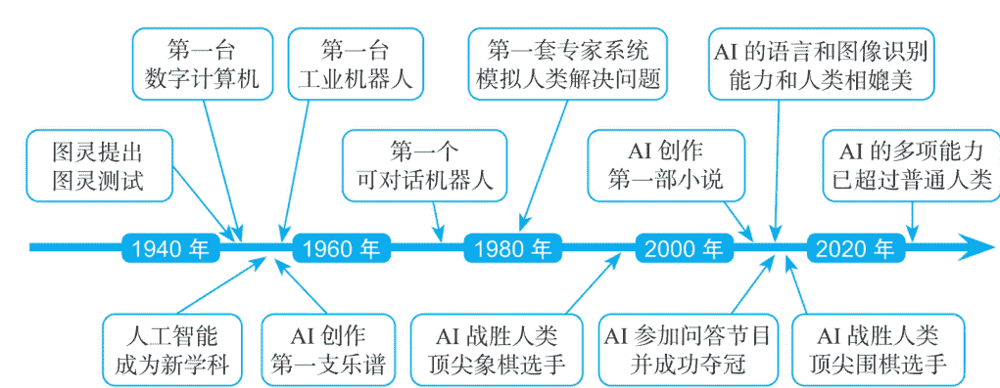

（1）知识表示与推理

20 世纪 60 至 70 年代，专家系统成为研究热点，这类系统通过存储大量专业知识与经验模拟专家决策。IBM 推出的 Watson 医疗助手是典型案例，该系统学习大量医学文献与病例数据，可辅助医生诊断与制定治疗方案。实践中，Watson 已成功协助诊断多种复杂疾病并给出个性化建议。

（2）机器学习

20 世纪 80 至 90 年代，统计学习与神经网络兴起，机器学习成为主流，使机器能从数据中自动学习并提升性能。典型场景有图像识别与分类、自然语言处理等。相关案例体现了机器学习潜力：苹果 Siri 和亚马逊 Alexa 是自然语言处理的代表，能理解用户问题并执行任务，如设定闹钟、查询天气、播放音乐；Netflix 通过分析观影历史与偏好提供个性化推荐，亚马逊也利用机器学习算法实现商品个性化推荐；Knewton 等教育科技公司用机器学习个性化设计学习路径，系统基于学习数据与表现提供定制资源与反馈。

（3）深度学习革命

21 世纪 10 年代至今，算力提升与深度神经网络结合大规模数据集，使人工智能在图像识别、语音识别、自然语言处理、自动驾驶等领域取得突破。特斯拉 Autopilot 与谷歌 Waymo 是自动驾驶代表，利用机器学习识别道路标记、障碍物与车辆，实现自动驾驶。科大讯飞的语音识别系统采用深度学习，可高效将语音转为文字并支持多语言方言，在智能家居、车载系统等领域广泛应用。谷歌 DeepMind 开发的 AlphaFold 利用机器学习预测蛋白质结构。此外，多团队正利用机器学习进行疾病诊断与预后预测，例如通过医学影像检测肿瘤等异常。DeepMind 开发的 AlphaGo 与 AlphaStar 通过深度学习训练，分别在围棋与《星际争霸》中达到人类顶尖水平。图1-2 展示了智能能力跃迁。

##### 人工智能多项能力已超过普通人类

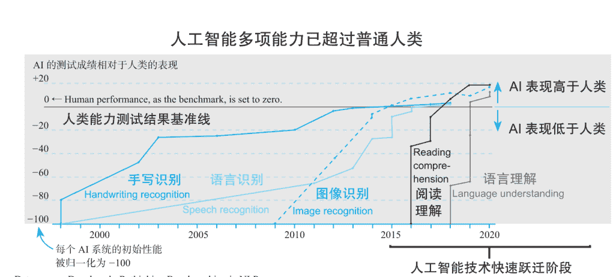

图1-2 人工智能的能力跃迁

#### 2. 生成内容技术的发展与教育应用展望

人工智能生成内容是人工智能的重要分支与应用方向，代表了人工智能在内容生成方面的能力，尤其通过生成算法、预训练模型与多模态技术自动生成文本、图像、音频、视频等多种内容。

早期生成内容多集中于简单文本生成，如基于模板的新闻或天气预报。深度学习兴起为生成内容奠基，其可自动从海量数据提取特征。生成对抗网络 GAN、对比语言图像预训练模型 CLIP、Transformer 等技术融合，为生成内容提供强技术支撑，使机器更准确理解与生成内容。

随着深度学习、大数据、云计算、边缘计算快速发展，以及预训练模型与多模态技术突破，智能可生成更复杂、更自然的文本、图像、音频与视频。尤其是以 GPT 系列为代表的大型语言模型出现，使生成内容在内容生成上取得显著进展，展现强大生成能力。

生成内容的出现标志着人工智能应用从数据分析型向内容创造型转变，大幅扩展应用范围。例如在内容创作领域，ChatGPT、文心一言、讯飞星火等大模型广泛用于创意写作，如自动生成文章、新闻、诗歌等文本；在图像处理领域，Midjourney、DALL·E 等可根据文字描述生成对应图像，用于广告设计、艺术创作、插画生成等；在视频处理领域，OpenAI 发布的 Sora 模型以出色视频生成效果引发关注，最长可生成 1 分钟视频，角色表情逼真，支持多角度镜头切换与流畅分镜，还原真实光影、运动与镜头移动，在游戏、电影预告片、虚拟角色制作等领域潜力巨大。

总体而言，生成内容是人工智能在内容生成方面的重要发展方向。随着技术进步与场景拓展，其大幅提升内容生产效率，已成为数字时代重要组成部分，必将改变内容创作与传播方式，而这种变革势必影响教育。如图1-3 所示，智能可提供精准个性化学习支持。

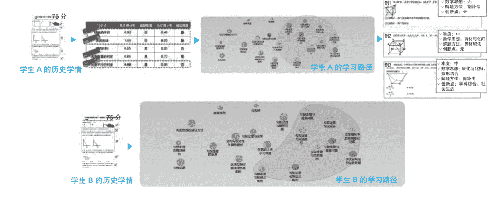

在教育领域，人工智能与生成内容为个性化教学创造条件。通过分析学生学习数据，教师可更精准把握每个学生的需求与进度，智能可提供定制化资源与路径、实时支持与反馈，使学习更高效便捷，实现因材施教。生成内容可创建虚拟教师与学习环境，提供更丰富、互动性更强的体验。人工智能与生成内容还能更高效生成与优化教育资源，如教案、课件、教学视频、虚拟情境等，减轻教师负担，实现资源共享与高效利用。

随着人工智能与生成内容持续发展，数字化技术将与教育深度融合，为教育事业注入新活力，有望带来革命性变化与提升。

## 1.2 智能技术对教育教学的影响

教育数字化的进程始于数据化，兴于网络化，加速于智能化。

经济合作与发展组织 OECD 教育研究与创新中心副主任斯蒂芬·文森特-朗科瑞在《2023 年数字教育展望：迈向高效数字教育生态系统》报告中指出，线下学习向远程学习的转变不等同于教育数字化转型。真正的转型意味着对教育过程的根本性变革，即不仅把技术当作工具，更用其重塑教学方法、学习过程与整个教育生态，使教育更有效。目前数字技术融入教育多是对传统方法的复制，而非革新。

教育部部长怀进鹏在 2024 年十四届全国人大二次会议答记者问时表示，对教育系统而言，人工智能是把“金钥匙”，它既影响未来的教育，也影响教育的未来，机遇与挑战并存，需积极拥抱科技与产业变革，主动迎接智能时代。

本节对比智能到来前后教师角色、课程设置、个性化教育与学习、教育评价等方面，探讨智能技术对教育教学的影响。

### 1.2.1 智能时代的教师角色

以 ChatGPT、Gemini、文心一言、讯飞星火为代表的大模型迅猛发展，凭借强大的自然语言处理能力，可完成问题解答、内容创作、代码生成等复杂任务，对知识获取与信息生成方式产生深刻影响。

智能时代前，教师主要担任知识传授者，负责讲解教材、解答疑问，并通过作业与考试评估学习成果。教师是课堂主导者，学生多处于被动接受状态。智能时代教师与智能教学平台的交互如图1-4 所示。


图1-4 智能时代教师与智能教学平台的交互

随着人工智能在教育中的应用，教师角色必将显著变化，由单纯的知识传授者转向学习过程的引导者、促进者与合作者。

- 引导者：在智能时代，教师可借助智能教学平台与资源，引导学生主动探索知识、发现问题并解决问题。教师不再直接给出答案，而是教学生如何寻找答案，培养自主学习与批判性思维。
- 促进者：智能为学生提供丰富资源与个性化路径，教师可根据学生情况与需求推荐合适资源与活动，促进全面发展。
- 合作者：智能时代师生关系更平等开放，教师可与学生共同参与项目式学习、探究性学习等，共同研究问题、分享成果。这种合作式学习有助于培养团队协作与创新能力。

### 1.2.2 智能时代的课程设置

智能时代前的课程设置相对固定单一，学校按既定课程体系与教学大纲安排教学，内容以单一学科知识为主，缺乏跨学科融合与实践。

STEM 教育是一种跨学科方法，将科学、技术、工程、数学整合，鼓励学生在这些领域探索创新。其目标是培养批判性思维、问题解决、创造力与团队合作，以适应快速变化的全球经济与技术环境。

如图1-5 所示，智能时代课程将更数字化。随着人工智能在教育中的落地，STEM 教育、工程教育、编程教育等将更易实施，课程呈现跨学科融合、实践性与创新性特点。

- 跨学科融合：智能时代课程更注重学科间融合与交叉。学校通过综合课程、项目式学习等方式整合不同学科知识与技能，培养综合素养。
- 实践性：智能时代课程更注重实践能力与问题解决能力培养。学校增加实验课程、实践项目，让学生在实践中学习，提升动手能力。
- 创新性：智能时代课程更注重创新意识与能力培养。学校开设创新课程、开展创业实践，激发创新思维与创业精神，增强竞争力。


图1-5 智能时代的课程更加数字化

### 1.2.3 智能时代的个性化教育与学习

智能时代前的个性化教育主要依赖教师经验判断。教师根据表现与需求进行个别辅导或分层教学，但受时间精力限制难以实现真正个性化。

随着智能应用，个性化教育得到更好实现。智能可分析学习数据与行为模式，精准了解每个学生的需求与学习风格，为其提供个性化资源与路径。这种学习方式能激发兴趣与动力，提升学习效果，这是以往数字技术难以达到的。基于学习数据与行为模式分析的智能时代课程如图1-6 所示。


图1-6 基于学习数据和行为模式分析的智能时代课程

智能在个性化教育与学习中的应用包括：

- 自适应学习平台：基于智能的个性化学习工具，能根据学习进度与能力推荐合适资源与练习，通过持续学习与数据反馈不断调整内容与难度，满足个性化需求，帮助学生更有针对性地解决问题，提升效率。例如，部分教育科技公司的智能阅卷系统可依据作业评测结果给出个性化指导意见，如图1-7 所示。
- 智能辅导系统：基于智能的个性化辅导工具，能针对学习问题与难点提供及时辅导与反馈。与传统辅导相比，智能辅导系统可更精准定位问题并提供针对性材料与练习，帮助学生有效解决问题，提高成绩。

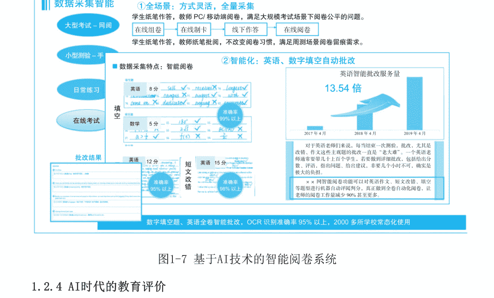

图1-7 基于智能技术的智能阅卷系统

### 1.2.4 智能时代的教育评价

智能时代前的教育评价主要以考试成绩为主。学校通过定期考试与测验评估学习成果与教学效果，评价方式单一片面，难以全面反映真实水平与发展潜力。

随着智能应用，教育评价逐渐呈现过程化与多元化特点，如图1-8 所示。

图1-8 智能时代的评价更加过程化、多元化

智能浪潮正重塑评价与认知方式

依托学习分析与数据追踪，过程化评价能够全程留痕记录学习轨迹与表现细节，呈现更贴近真实能力的水平与成长潜能，为教学决策提供更具说服力的依据。

在智能环境里，多元化评价已走出纸笔测验的边界。学校更倾向以作品呈现、项目汇报、团队协作等多种形态来衡量综合素养，立体反映能力结构，推动全面发展与个性化成长。

人工智能的大规模渗透必将对教学形态产生深远影响，既开拓新机遇也提出新挑战，需要持续探索与创新，最大化数字化技术尤其是智能技术的价值，为学习者提供更高质量、更具个性化的教育服务。

## 1.3 智能时代知与识的新图景

随着智能化迅猛发展，对“知”与“识”的理解正在经历深刻重塑，传统知识观在技术冲击下被迫重新定义。

### 1.3.1 智能技术对知识与知识观的影响

在智能技术尚未普及的阶段，知识多被理解为人类通过学习和实践积累的经验总结，以书籍、文献、口传心授等方式流传，观念建立在个体记忆与长期沉淀之上，获取往往需要大量积累。教育的主要任务是传递前人经验，过程强调记忆、理解与应用，创新主要依赖学者的研究与实践探索。

进入智能时代，传统的“知”“识”概念已难以覆盖新的知识体系。智能技术不仅提升了知识获取与创新的效率，也倒逼我们重新思考知识的本质与价值。如图1-9所示，智能化正在改变学习者的“知”与“识”。

图1-9 AI改变学习者的“知”与“识”

（1）智能时代的“知”
“知”不再是人类经验的独占物，而是一种以大数据、算法和机器学习为基础的智能认知过程。它融合了人类智慧与机器推理，形成更高效、更精准的知识获取方式。借助先进的信息技术，智能化能够对海量数据进行挖掘、分析、整合与提炼，产生深度洞察与精准预测，帮助人们更好地理解世界并指导行动，推动社会、经济、文化进步。

（2）智能时代的“识”
“识”也不再局限于个体主观理解，而是在智能网络环境中，个体与智能体、个体与个体通过共享知识、协同工作与智能交互所形成的群体智慧与创新力。这种“识”突破了个体边界，汇聚集体力量，推动知识创新。

（3）智能时代“知”与“识”的关系
两者相互支撑、相互促进。“知”为“识”提供基础，通过智能化认知更高效地处理知识；“识”反过来深化“知”，群体智慧不断发现新知识、创造新价值。

（4）智能时代知识的特征和知识观
在机器学习、深度学习等技术助力下，知识呈现新特征。

- 知识获取更便捷。搜索引擎、智能推荐与自然语言处理让查找信息更自然高效。
- 知识结构被重塑。知识不再是线性层级，而是网状互联，通过链接分析与语义网络揭示复杂关联，形成更全面的理解。
- 知识创新加速。算法能从海量数据中发现规律，为科研提供新思路；自动化工具降低创新门槛，更多人参与创新。

观念也在转变，知识不再是静态孤立的实体，而是动态互联的过程。其价值不仅在于正确实用，更在于激发思考与引导创新。随着智能化在商业、教育、医疗等领域普及，人们对知识、能力与智慧的关系有了更深认识，知识观与价值体系随之调整。

### 1.3.2 知识与知识观变革的意义和挑战

知识与知识观的变革深刻影响社会经济文化，改变了知识获取、处理与应用方式，提升生产效率与传播速度；促进跨领域融合，催生新产业新业态；也深刻改变思维方式、价值观念与生活方式，推动文明进步。

但挑战同样明显。
其一，知识的快速更新带来筛选、整合与应用难题。信息过载时代，需要更智能的方法管理知识资源。
其二，智能化对教育提出新要求。传统教学内容与方式需与时俱进，更新理念、改进方法、优化资源配置。如图1-10所示，AI时代的教育理念、教育方法需要同步革新。

图1-10 AI时代的教育理念、教育方法需要同步革新

其三，随着机器智能在部分领域超越人类，需重新审视人与智能体在创新与社会发展中的定位，涉及伦理、法律与社会责任，需共同探索。

智能化对“知”与“识”产生深远影响，改变了获取、整合与应用知识的方式与效率，也促使我们重新思考知识的本质与价值。未来在积极拥抱智能化的同时，必须正视变革带来的挑战，努力在技术助力下打造更丰富、更有智慧与创造力的知识世界。

# 第2章 AI与教师

智能化重塑教学形态，“知”与“识”随之改变，社会对人才的要求也水涨船高。我们必须重新审视教育体系，着重培养关键能力，以匹配未来需求。

通过理论与实践结合、多元化教学模式，可以培养出真正适配智能时代的高素质人才，这需要教育者努力，也需要全社会支持。

本章主要涉及的内容：
- AI时代的人才培养要素。
- AI时代教师的职业要求。
- AI时代教师的发展路径。

## 2.1 AI时代的人才培养要素

人工智能的迅猛发展不仅改变生活方式，也重塑了教育体系与人才能力要求。

### 2.1.1 AI时代对学生核心素养的新要求

智能时代，核心素养已远超传统知识掌握。除了基础学科，创新、批判性思维、团队协作等能力更受重视，帮助学生适应多变社会与日新月异的技术。

首先，数字素养至关重要。信息爆炸下，筛选整合有效数据的能力成为刚需。学生要学会运用技术工具高效检索、评估并应用数字化软件。如图2-1所示，AI时代学生的数字素养需不断提升。

图2-1 AI时代学生的数字素养

其次，创新思维与问题解决能力愈发关键。智能化虽强，面对复杂问题仍需人类创造性思维。学生应具备独立思考与跨界融合能力，应对未知挑战。

再者，人机协作能力大幅提升。跨学科合作频繁，学生需在团队中发挥专长、有效沟通，同时厘清人与智能体的能力边界，善于协作以提升效率与质量。

最后，道德素养与社会责任感不可忽视。运用智能技术时应树立正确道德观，明确使用边界，防止滥用与伦理冲突。

在培养过程中，理论与实践结合尤为重要。学校应提供多元学习环境，项目式学习让学生在实操中培养解决问题的能力，加深理解。作为教育者，应调整策略，注重信息素养、创新思维、协作能力与道德素养的培养，为学生全面发展奠基。

### 2.1.2 批判性思维与创造性解决问题的能力

在智能化高速发展的今天，批判性思维与创造性解决问题能力成为人才关键。

批判性思维是对信息与观点进行分析、评估、推理与判断的能力。智能时代信息泛滥、真伪难辨，培养理性分析与质疑反思能力，能造就独立思考与判断力强的人才。

创造性解决问题同样重要。智能化虽强，许多复杂问题仍需人类创新。创造不仅要求想象力，还要求多角度思考、灵活运用知识提出新方案。

教学实践中，教师可设计挑战性问题激发思维，鼓励多层次思考培养思辨。创新项目、科研实验等实践活动能让学生在真实情境中锻炼这两种能力。

总之，批判与创造是智能时代的必备能力，教育者应结合理论与实践，探索新方法培养适应新时代的高素质人才。

### 2.1.3 数字素养：信息筛选、评估与利用

数字素养已成为智能时代不可或缺的能力。它不仅是技术操作，更包含信息筛选、评估与高效利用。

在信息海洋中快速锁定有价值内容是必备技能，依赖搜索技巧与信息洞察力。评估信息的真实性、可靠性与时效性，是数字素养的重要部分，尤其在虚假信息泛滥的环境下尤为关键。

将数字信息转化为实际智慧是更高层次要求。学生不仅要理解信息，还要结合实际问题提出创新方案。

提升数字素养，教育需加入信息技术与素养培训，鼓励项目式学习将理论付诸实践。企业与社会也应提供培训与实践机会。

在课堂上，可通过信息技术课程培养学生使用大模型、搜索引擎、数据库等工具的能力，并训练其评估信息素养；开展信息分析与数据挖掘实践，提升信息处理能力。

总之，数字素养是人才培养的关键，通过教育与实践结合，可培养高素养人才，为社会进步与科技创新奠基。

### 2.1.4 人机协作：沟通、团队合作以及与机器互动

智能时代，人机协作将成为常态。学生需学会与智能机器有效沟通，理解其逻辑，在团队中发挥作用，与智能体共同完成任务。

有效沟通是协作基石。学生需掌握与机器对话技巧，理解反馈方式，确保信息准确传递。教育中应加强语言表达与倾听培养，并引入人机对话场景。

团队合作不可或缺。智能时代需在团队中与智能体协同，发挥各自优势。小组项目、角色扮演等形式可培养分工、协调与整合能力。

与机器互动能力同样重要。了解工作原理、掌握交互方法是关键。编程教育、机器人操作等课程能帮助学生从小建立良好互动。

AI时代人机协作的新场景如图2-2所示。

图2-2 AI时代人机协作的新场景

学校可引入机器人教学、编程教育，让学生了解原理并学习交互合作。教师设计团队项目，在实践中提升协作与沟通能力。教育体系需不断创新，结合理论与实践，为学生提供更多协作机会。

### 2.1.5 自主学习与终身学习的重要性

智能技术日新月异，知识更新加速，自主学习与终身学习能力愈显重要。持续学习是避免被淘汰的必备素质。

自主学习不仅是获取知识，更是对未知的探索与自我挑战。意味着主动寻找资源、独立分析问题、寻求解决方案，是职业发展与社会适应的基础。

终身学习是一种贯穿生命始终的态度。在技术快速迭代背景下，只有不断学习才能保持竞争力。

翻转课堂颠覆传统模式，课前通过视频、阅读、在线任务自主学习，课堂则用于讨论、解题与项目合作。

培养这两种能力，教育者需改变教学模式，鼓励主动参与与探索。翻转课堂、在线学习让学生按节奏与兴趣学习，培养主动性与自我管理。教师应提供丰富资源与指导，帮助建立自主学习习惯。学校可开设职业规划课程，激发终身学习的动力。

总之，自主学习与终身学习是智能时代人才的硬核能力，具备者才能在变化环境中立足、走远。

### 2.1.6 厘清技术使用的责任与界限

技术高度依赖的社会中，道德与伦理问题愈发凸显。学生需明确技术使用的道德与伦理边界，承担社会责任，包括尊重隐私、合理利用技术、防范潜在风险。

智能化是双刃剑，培养道德与伦理意识至关重要。需帮助新一代明确底线，理解技术不应侵犯隐私、伤害他人或违背公序良俗。

实践中应引导思考：如何平衡创新与责任？如何确保应用公正，避免偏见歧视？

教育者可通过案例分析、角色扮演让学生在模拟情境中体验伦理问题。科技伦理课程能帮助建立正确价值观与社会责任感，使其未来更好地运用智能化服务社会。

道德与伦理考量是智能时代不可或缺的关键能力，需培养具有高度道德自觉与伦理责任感的人才。

## 2.2 AI时代教师的职业要求与发展路径

智能化飞速发展，教育领域面临前所未有变革，教师的角色、职责与发展路径都在悄然变化。本节探讨智能时代教师的职业要求与发展影响，为新时代教育提供参考。

### 2.2.1 AI时代教师的职业要求

面对AI技术的冲击，教师职业也面临着前所未有的挑战和机遇。一方面，AI技术的广泛应用使得部分教学内容可以被机器替代，教师需要不断学习和掌握新的技术工具，以便更好地利用AI技术辅助教学，从而减轻工作负担；另一方面，AI技术的发展也对教师的专业素养提出了新的要求，面对机器的竞争，教师需要不断更新自己的知识和技能，以适应新时代的教育需求。

AI技术的发展正在深刻改变着教育领域。在教学方面，AI技术可以通过智能教学系统提供个性化的学习路径和定制化的教育资源，从而实现因材施教。此外，AI技术还可以辅助教师进行课堂管理，提高教学效率。在科研方面，AI技术为教育研究提供了强大的数据分析工具，有助于教师更深入地了解学生的学习情况，从而优化教学方法和策略。但是，AI技术的快速发展也可能给教师职业带来一些负面影响。首先，简单、重复的教学任务会被自动化取代，这会导致教师的工作内容发生变化，甚至面临职业转型的压力。其次，AI能够提供大量数据和分析，影响教师的教学决策和方法，教师可能会过度依赖AI的建议，而忽视自身的教学经验和判断。此外，AI虽然能模拟人类智能，但暂时还无法替代教师在培养学生道德、情感、创造力等方面的作用，若过度依赖AI，可能导致教师与学生之间缺乏真正的沟通和互动，影响教育效果。因此，教师需要认识到AI技术的发展已逐渐对教师的职业能力提出了新要求，教师在保持专业性和个性的同时，要积极适应AI时代的教育变革。

AI时代下的教师如图2-3所示。

图2-3 AI时代下的教师

在AI时代，教师的职业要求已经远超出传统的教学范畴。除了具备扎实的专业知识和教学技能外，教师还需要具备一系列关键能力来适应新时代的教育需求。

首先，技术能力是教师必备的基本素养。教师需要了解和掌握与AI技术相关的基本知识，能够熟练运用各种技术工具辅助教学。

其次，创新能力是教师职业发展的重要驱动力。除了关注学生的全面发展，培养学生的创新精神和实践能力外，教师自己也需要具备创新意识和创新思维，能够不断探索新的教学方法和策略，以提高教学质量。

在智能化时代，跨界协作已成为教师专业素养的重要维度。教职人员需与同行、研发人员以及学生家庭保持高效沟通与协同，方能推动学习者的整体成长。

### 2.2.2 教师的发展路径
为了锻造上述关键能力，教师可按以下路径推进：

- 1）持续进修。通过参与各类专业研修、阅读前沿刊物与案例等方式，不断提升学科素养与数字驾驭能力。
- 2）保持敏感。持续追踪教育政策、教学流变与技术演进，及时把握新理念与新方法。
- 3）勇于试错。以自身教学实践为场域，尝试借助生成式智能辅助授课，探索个性化与创新型教学样态。
- 4）同伴共创。加强与同事的交流合作，共同研讨教学创新，同时积极参与学术交流，分享教学经验与研究成果。

智能技术既带来机遇又伴随挑战，教师必须持续更新知识技能储备以匹配新时代需求。教育主管部门与学校也应加大投入，构建系统化的培训与支持体系。在更深层次，还需聚焦智能技术与教学融合的方式方法论体系，为未来教育提供可复制的参考。

总体来看，人工智能时代重塑了教师职业画像。技术驾驭力、创新思维与协同能力已成必备要素；在把握机遇同时探索新型教学模式与方法论，方能为教育注入持续动能。只有如此，才能培养出兼具创新精神与实践能力的复合型人才，为国家与社会发展贡献力量。

# Part 2
# 第二部分
# 技术全景扫描
本部分系统梳理智能技术在教育领域的多种应用形态与代表工具。从生成式智能的教育价值，到与模型沟通的技巧与案例；从智能教学材料生成到文档处理、图像绘制、思维导图制作、科研辅助等，再到音视频处理、虚拟课堂、智能体等创新场景，全面呈现当前智能技术在教育中的广度与潜力。

# Chapter 3
# 第3章
# AI课堂双刃效应
随智能技术的加速演进，我们正经历一场无声而深远的智能化浪潮，它正渗透到生活的每一个角落。在教育语境下，这场浪潮既带来前所未有的机遇，也伴随结构性挑战与变革。本章聚焦智能的双刃效应，尤其是对教师群体的深远影响，并强调只有深入理解、正确使用，才能最大化积极价值，引领教育发展方向。

本章主要涉及的知识点：
- 内容生成型人工智能的概览、发展脉络及其对教育的正负面效应。
- 智能技术在教育中的具体应用。

## 3.1 呼啸而来的智能化浪潮
智能化浪潮已成定局，无人可避。对普通人而言，关键在于善用之，顺势而为。本轮浪潮的核心驱动力是内容生成型人工智能。厘清其定义、演进脉络以及ChatGPT的爆发式成长，有助于洞察这项技术的潜力与边界，以及它对世界的持续重塑。

### 3.1.1 内容生成型人工智能概述
内容生成型人工智能是人工智能领域的重要突破，核心在于创造。不同于仅做分析的传统智能，它能在学习大量数据的基础上，产出全新的文本、图像、音频等内容，这一创造力使其成为当前研究与落地的热点。

#### 1. 内容生成型人工智能的发展历史
学界普遍把生成式智能的雏形追溯到1932年。法国工程师Georges Artsrouni发明了一台名为“机械大脑”的装置，后被巴黎工艺美术博物馆收藏，本质上相当于基于纸带的自动双语词典。“机械大脑”照片如图3-1所示。


FIG. 1. — Deuxième machine
图3-1 “机械大脑”照片

当代生成式智能的基石是深度学习与神经网络。2014年，Ian J. Goodfellow及其团队首次提出生成对抗网络GAN，从此开启新纪元。随着深度学习的迭代，生成式智能在艺术创作、音乐生成、游戏开发、药物研发等领域取得突破。

GAN由生成器与判别器两部分构成。生成器负责制作逼近真实的伪数据，判别器负责辨别真伪。两者在对抗中相互进化，使生成质量不断提升。如今主流的AI换脸及高仿真图像技术多源于GAN。如图3-2所示，为一种用于手写字生成的典型GAN架构图。

随后，生成式智能架构持续演进。代表性案例是OpenAI的ChatGPT，它基于Transformer架构构建，该架构由谷歌于2017年提出，擅长处理序列数据尤其是文本，因而在理解与生成自然语言上表现突出。

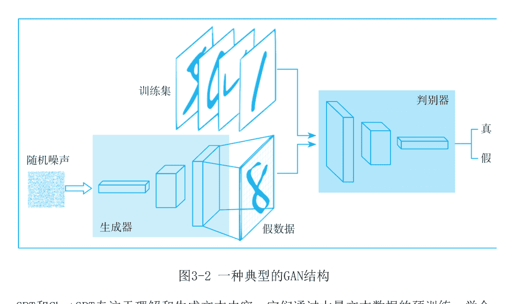
GPT与ChatGPT的核心能力是文本理解与生成。通过海量语料的预训练，它们掌握语言规律、句法结构与知识映射，从而产出连贯多样、相关性强的回复，因而在对话机器人、文本创作、内容辅助等场景中表现亮眼。由Transformer衍生的智能家族图谱如图3-3所示。

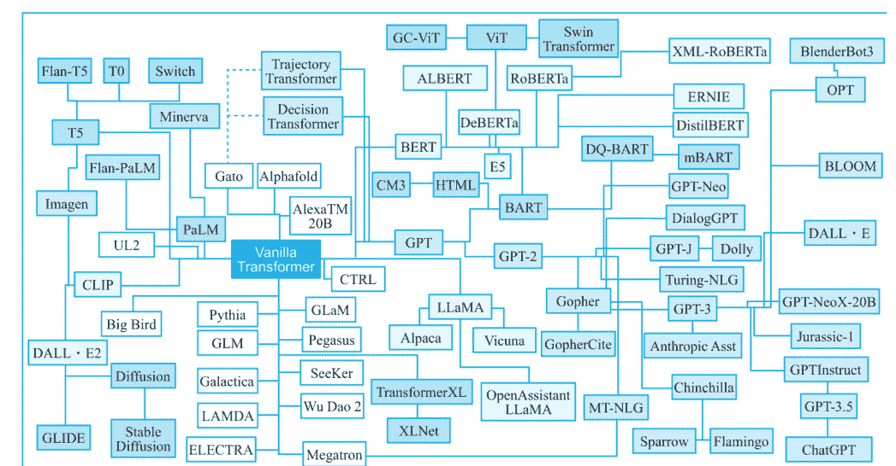
图3-3 由Transformer架构发展而来的各种智能系谱图

#### 2. ChatGPT的快速发展
ChatGPT由OpenAI打造，是生成式智能的标杆产品。它基于GPT-3、GPT-4等大规模语言模型，能够进行流畅、逻辑清晰的人机对话，标志着自然语言理解与生成能力的重大跃进。

基于Transformer架构的智能的神经网络参数量如图3-4所示。它展示了GPT参数的演进，可以简单理解为模型能力的提升。

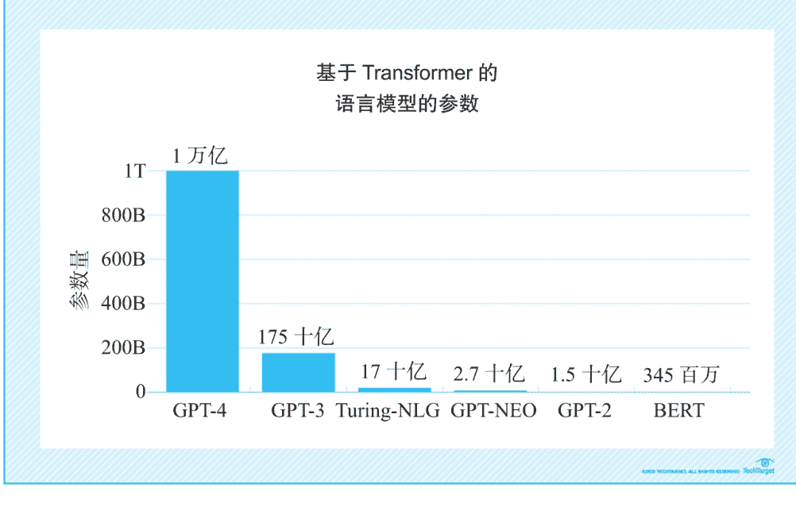
图3-4 基于Transformer架构的智能的神经网络参数量比较

通常参数规模与模型智能正相关。3年多时间里，模型参数从15亿攀升至万亿级别，足见技术增速。早期ChatGPT聚焦基础文本生成，如今已能完成高质量对话、复杂推理、情感分析、编程和诗歌创作，并可根据上下文灵活适配不同场景。

ChatGPT的快速发展得益于以下几个方面。
- 大数据训练：ChatGPT基于互联网海量文本训练，覆盖广泛主题，使其能理解和生成多样化内容。
- 算法优化：不断优化模型结构与训练算法，提升学习效率和生成质量，更准确把握用户意图。
- 多样化的应用场景：ChatGPT被设计为可适配教育、医疗、娱乐、客服等多领域，应用范围持续拓宽。
- 人机交互体验：以自然语言实现交互，大幅提升使用友好度。

生成式智能的发展潜力巨大，尤其在提效、创新和个性化服务方面。ChatGPT的成功不仅展示了生成式智能的强大能力，也为未来技术方向提供了重要参考。

### 3.1.2 生成式智能对教育的影响
生成式智能对教育产生深远影响，既带来创新机遇，也引发挑战争议。

#### 1. 正面影响
##### （1）个性化学习
生成式智能能依据学生的学习节奏、知识水平和兴趣，定制学习路径与材料，提升学习效率，尤其在复杂抽象主题上效果明显。
##### （2）提升教学资源
教师可借助生成式智能批量生成教案、练习题与参考资料，大幅节省备课时间。智能还能提供即时反馈，帮助教师掌握学情，更精准指导。
##### （3）拓展学习资源和环境
生成式智能让学习突破传统课堂限制。学生可通过聊天机器人等交互工具随时随地学习，拓宽时空边界，使教育更灵活。如图3-5所示，香港浸会大学于2023年7月13日在校内系统公布了有关生成式智能工具的使用指引。香港浸会大学也是较早积极拥抱生成式智能工具的大学。从2023年开始，新加坡大学也允许学生使用智能工具完成作业，以提升教学效果与鼓励学生接纳新技术。越来越多的大学甚至中小学，都在积极探索使用智能拓展学习资源。

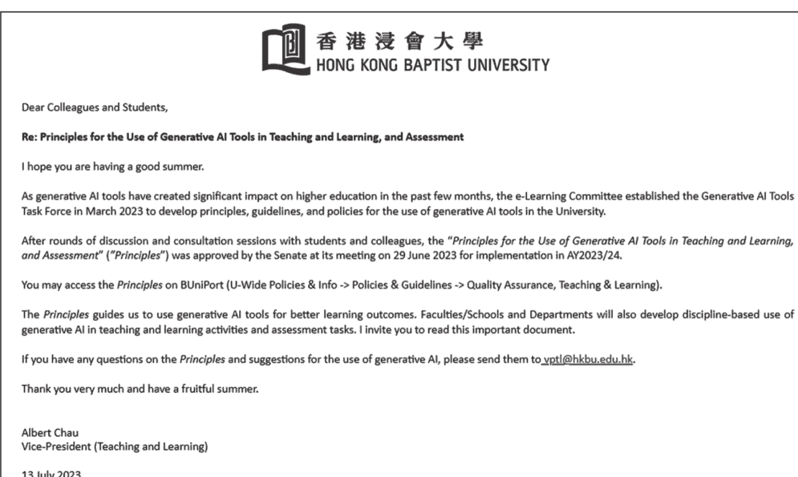
图3-5 香港浸会大学在校内系统公布有关生成式智能工具的使用指引
##### （4）促进创新思维和技能发展
通过与智能共创，学生可更快尝试新想法，培养批判性思维与问题解决能力。

#### 2. 负面影响
##### （1）学术不诚实和抄袭
强大的文本生成能力可能助长学术不端。学生易依赖智能完成作业与项目，削弱研究与思考过程，损害学术诚信。
##### （2）教育不平等
智能普及可能加剧资源差距。能负担技术的学校与学生获益更多，资源匮乏者可能被落下。
##### （3）技能和知识的深度
过度依赖智能工具可能削弱写作、批判性思维等基础能力。若习惯直接接受智能答案，问题解决与创造性思维会受损。
##### (4) 偏见和歧视
智能由人类设计，训练数据若含偏见，模型会放大问题。2022年12月，清华大学交叉信息研究院助理教授于洋带领团队对智能模型性别偏见进行评估，测试包括GPT-2。结果显示GPT-2将教师预测为男性的概率达70.59%，将医生预测为男性的概率为64.03%。2024年初大火的Meta图像生成器也出现类似问题，当输入“Asian man with Caucasian friend”或“Asian woman and white friend”时，生成的大多数图像仍是两个亚洲人形象，如图3-6所示。


图3-6 Meta图像生成器生成的“亚洲女性和白人朋友”的图片（图片来源：机器之心）

## 3.2 教师的“新伙伴”：智能在教育中的魔力
智能在教育中的应用已是现实。不论是新晋的内容生成型智能，还是持续演进的分析型智能，都在迅速融入日常生活，成为教育工作者、学生和家长的新伙伴。下面展示它如何推动教育创新。

### 3.2.1 智能对教师的赋能
#### 1. 生成教案和课程内容
智能可自动化生成教案、课文、习题与参考资料。借助自然语言处理与机器学习，智能能按教师需求与学生水平定制教学材料，节省备课时间，让教师聚焦教学创新与互动。
#### 2. 生成评语
通过分析作业、成绩与行为表现，智能可生成个性化评语与反馈，提升评价效率并提供更细致的改进建议。
#### 3. 辅助科研
利用生成式智能生成代码、辅助数据分析与模式识别，为普通教师开展科研提供巨大助力。智能可生成分析代码并解释使用方法，帮助非专业教师发现趋势、提升研究深度。
#### 4. 生成PPT和图像
智能不仅能生成文本，还能创建视觉材料，如PPT与课程相关图像。根据指令自动生成高质量视觉辅助，提升课堂表现力。

### 3.2.2 智能对学生的支持
#### 1. 个性化学习路径
智能可基于学习进度、能力与偏好，提供定制化路径与资源，让学生在自身节奏下学习，弥补短板。
#### 2. 即时反馈和辅导
智能辅导系统可即时解答疑问，保持学习动力并及时纠错。如图3-7所示，智能在中学理化生实验教学中的应用，极大地降低了教师的工作强度，而且可以做到实时纠正错误、考完立即评分，提高教学效果。

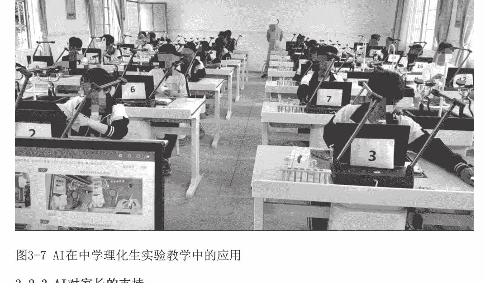
图3-7 智能在中学理化生实验教学中的应用
#### 3. 提高语言学习效率
智能驱动的语言学习应用可提供发音指导、语法练习和实时对话，帮助学生更快掌握语言技能。

### 3.2.3 智能对家长的支持
#### 1. 监控学习进度
智能系统可帮助家长监控学习进度与表现，通过数据分析生成报告，使家长及时了解学情，与教师协同支持。不少学校引入自动批改系统，家长能迅速获得作业完成度、知识点掌握情况等数据，无需持续盯梢也能把握孩子学习投入。
#### 2. 家庭教育资源配置
智能可向家长提供教育资源与建议，指导如何有效沟通、激发学习兴趣、处理学习问题。生成式智能在训练中积累大量家庭教育相关知识，家长遇到困惑时向智能求助是一种省事的方式。

例如询问ChatGPT：
> 你是一名家庭教育专家，请你对我的困境给出建议：自从我的小儿子出生后，我的大儿子在学校经常调皮捣蛋遭到老师投诉，请问我该如何让大儿子在学校听话一点？做得好给你10美元小费。

ChatGPT给出的专业建议包括给予大儿子更多关注与陪伴、引导情感表达、强化正面行为、让他参与照顾弟弟、建立清晰规则、与老师保持沟通、关注社交关系、必要时寻求专业帮助等。智能成功识别出新生儿到来后长子易产生被冷落感，解决方案聚焦于增强长子在家中的关注与责任感，与教育实践高度一致。

# Chapter 4
# 第4章
# 与智能高效对话
在智能化浪潮中，模型正悄然融入生活，像一位安静的助理跟随在身旁。很多人感受到了智能的存在，却难以高效交流。本章探讨与大模型的互动艺术，特别是与ChatGPT等大规模语言模型的沟通技巧。首先定义大模型及其在技术生态中的角色，随后详细讲解如何提问、解释复杂概念以及如何从回答中获取最大价值。

本章主要涉及的知识点：
- 通用大模型与垂直小模型概览。
- 与大模型交流的方法及案例。

## 4.1 智能“大脑”：探索模型体系的力量
2023年，大模型反复冲刷认知。究竟什么是大模型？它有哪些能力？是否存在小模型？下面进行介绍。

### 4.1.1 通用大模型与垂直小模型
大模型通常指功能更强、能完成多任务的系统。它结构复杂，可处理复杂信息，具备优异的语义理解、自然语言处理、图像识别等能力，ChatGPT、文心一言等均为代表。

以OpenAI首个重要产品GPT-1为例，参数数量为1.17亿。GPT-2跃升至15亿，GPT-3达到1750亿参数。庞大参数使模型不再局限于单一任务，应用范围大幅扩展。

小模型相对功能更聚焦，专攻特定任务，计算效率更高、响应更快。比如自动生成课件PPT的智能、生成思维导图的智能等，都是典型的垂直小模型。

把 AI 模型想象成厨房里的手艺人，就能更好理解大模型和小模型的区别。刚入门的学徒式小模型，只能掌握最基础的食材配合，像面粉加糖这样的简单混合。经验丰富的大厨式大模型，却能自如调用面粉、糖、奶油、牛奶、发酵粉、可可粉等多种原料，还能精准把控烤制的时间与温度。因为变量处理能力更强，大模型复现美味的精度自然更高。随着可调参数增多，这些 AI 大厨不仅能完美还原经典菜式，还能不断尝试创新配方，推动烹饪艺术进入新阶段。

选型上要看使用场景。说到底不是用不起大模型，而是小模型在性价比上更占优势。面对文本生成、文本分类这类复杂的自然语言任务，大模型在语言结构和语义理解上优势明显。面对命名实体识别等相对简单的理解任务，小模型响应更快、成本更低。

在 Ignite2023 的主题演讲里，微软董事长兼 CEO Nadella 先公布了依托 Azure 云的 MaaS 服务，随后就明确表达了微软看好小模型 SLM 的态度。未来小模型持续增强后，日常很多问题直接在手机本地运行的小模型就能搞定。


### 4.1.2 课堂里大模型和小模型的实战对比

下面用一个实测案例来做对比。为了公平，我们选取 Mistral AI 的 Mistral-7B 和 Mixtral-8x7B 在 HuggingChat 平台上的表现。参数量 B 可以理解为模型大脑里的神经元数量，7B 约 70 亿，8x7B 约 560 亿。相比之下 GPT-3 约 1750 亿，GPT-4 传闻超过 1.5 万亿，谷歌在 2021 年发布的 Switch Transformer 就把参数推到了 1.6 万亿。OpenAI 对 GPT-4 的真实参数至今保密。

给出的任务是让模型以“教师人工智能”开头，创作一首 6 行每行 7 字的中文藏头诗。

Mistral-7B 的输出基本没有达到要求，还出现了繁体字和标点使用不当的情况，这可能和为压缩参数而削弱简体中文能力有关。Mixtral-8x7B 的输出也未能严格完成藏头与字数限制。可见对这种复杂制约型创作，两个模型都难以稳定达标。

换成简单任务，差距就缩小了，而且小模型的效率优势更明显。以把“我爱中国”翻译成英文为例。Mistral-7B 给出了简洁的直译，并补充了几种正式表达。Mixtral-8x7B 则给出直译后附上大段文化背景说明，回答明显冗长。从字数上也能看出小模型更省资源。

在教育实践中，大模型经微调或提示学习后能具备一定专业能力，可用于拍照解题、虚拟口语陪练等多种教学场景，有助于提升师生互动和内容生成。 小模型则适合在教育领域专业数据上专门训练，在特定教学任务上表现更聚焦，同时能降低偏见和错误风险，更适配算力受限的环境。

展望未来，随着技术进步和成本下降，大模型和小模型很可能在教育领域长期共存，各自在不同场景发挥长处。

## 4.2 与大语言模型高效对话的实战指南

ChatGPT 能在很多场景提供帮助，但回答并不总准，时常出现错误或过时信息。只想要个答案，直接输入即可；想要满意、精确的答案，就需要掌握提示工程，通过设计和优化提示词来提升模型表现。

本节围绕提问技巧和交流优化，给出可直接参考的操作指南。

### 4.2.1 与大模型沟通的高频法则

以 ChatGPT 为例，它擅长回答基础事实类问题，比如“牛顿第三定律是什么”。对于主观意见类问题，比如“谁是世界第一足球运动员”，它往往会胡编乱造。

下面以 CRISPE 框架为基础，介绍常用的沟通技巧。

#### 1. CRISPE框架

在众多方法中，Matt Nigh 提出的 CRISPE 框架完整度较高，比较适合做提示词模板。框架说明如下表。

表4-1 CRISPE框架说明表

| 缩写 | 英文 | 含义 |
| :--- | :--- | :--- |
| CR | Capacity and Role | 期望模型扮演的角色与具备的能力 |
| I | Insight | 背景信息与上下文，笔者更倾向称作 Context |
| S | Statement | 具体要模型完成的任务指令 |
| P | Personality | 期望的风格、方式与输出格式 |
| E | Experiment | 要求提供多个候选答案进行尝试 |

实际使用时不必同时包含五项，可按需增减，也不必严格按顺序。经验上角色、背景、指令尽量保留。示例见下表。

表4-2 CRISPE框架应用示例

| 步骤 | 例子 |
| --- | --- |
| Capacity and Role | 你现在是一名中国初中信息科技教师，擅长用幽默生动、贴近生活的例子讲解复杂概念 |
| Insight | 需要为一节课设计内容，讲解当今主流的人工智能技术及其应用，如人脸识别用于游戏防沉迷和手机解锁 |
| Statement | 请为我输出一节人工智能科普课的教案 |
| Personality | 课程对象是初中生，内容要贴近生活、有趣易懂 |
| Experiment | 请提供两份教案，表现好有10美元奖励 |

把要素组合后得到的提示词比基础提问更清晰。对比之下，生成结果的结构化程度、可读性和可执行性明显提升。

常见的简易提问：请给我一节人工智能科普课程教案，目标群体是初中生。
经 CRISPE 优化后的提问：你现在是一名中国初中信息科技教师，擅长以幽默生动、贴近生活的例子讲解复杂概念。现在需要你设计一节课讲解当今世界主流的几种人工智能技术，以及它们的应用领域，比如人脸识别技术会用在游戏防沉迷系统和手机解锁中。请你给我一节人工智能科普课程的教案。请注意课程的受众群体是初中生，课程要设计得贴近初中生的生活，生动有趣。请给我写一篇教案，做得好给你10美元小费。

#### 2. 少样本提示

少样本提示就是给模型提供少量示范，让它模仿格式和风格来完成任务，是提示工程里使用最广泛的技巧之一。

以写藏头诗为例，加入示例后效果明显提升。提示中先给出主题、严格定义和两组范例，再要求模型按同样格式创作，成功率远高于直接提问。

直接提问往往得到格式混乱、字数不符的结果，加入示例后模型能较好地保持藏头、字数和主题一致性。

#### 3. 给小费

在提示尾部加上“做得好给你小费”是常见做法，并非无厘头。根据 X 用户 thebes 的实验，假装给小费会让模型的服务更卖力，主要体现在回答更详细、分析更具体，而非单纯凑字数。中国科学院软件研究所、北京大学心理学院、微软研究院的相关研究也发现大型语言模型能感知情感刺激。

小费数额上，10 美元、上万、百万等不同数额都能在一定程度上改善回答质量。

#### 4. 思维链

处理逻辑推理类复杂问题时，思维链 CoT 技巧非常有效，只需在问题末尾加一句“让我们一步一步地算，确保答案正确”，模型会展示推导过程，准确率明显提升。

该方法最早由 Kojima 等人在 2022 年论文《Large Language Models are Zero-Shot Reasoners》中提出。论文显示加入“Let’s think step by step”后模型能给出正确推理。

CoT 也适用于生成连贯长文、剧本等，但需注意错误会沿链条累积。当前 GPT-4 在很多问题上已无需显式 CoT，但当答案存疑时，用 CoT 逼模型展示思考过程有助于人工复核。

##### GPT-4-1106 在给小费时提供更长的回答

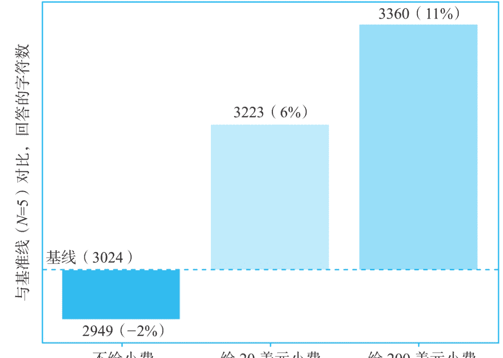

图4-2 X用户 “thebes” 的实验结果对比

Wei 等人在 2022 年论文《Chain-of-Thought Prompting Elicits Reasoning in Large Language Models》中指出，CoT 仅在参数大于等于 100B 的大模型上有效，小模型上效果有限。

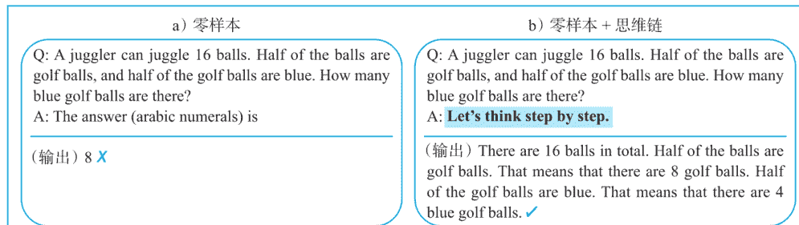

图4-3 实验对比结果

#### 5. 自我一致性

2022年谷歌研究院的Xuezhi Wang团队指出，单条推理链优化后的模型依然会出错。为此他们提出自我一致性策略，做法很直观：对同一问题让模型多次作答或给出多种可能解，最后采纳出现次数最多的结果作为最终答案。这一思路的示意可参见下图。

##### 图4-4 自我一致性回答的示意

### 4.2.2 提词简化版：RES三要素

学完前文会发现，想让大模型给出可靠输出，提问方式是关键。CRISPE框架在各主流大模型上都好用。结合长期重度使用的经验，笔者把常用做法浓缩为RES公式：

角色 Role - 例子 Example - 指令 Statement

它基本覆盖了除复杂逻辑推理外的日常对话场景，需求更专业时再回到CRISPE。RES的样例见表4-3。

##### 表4-3 RES公式样例

| Role（角色） | 你是一名人工智能研究专家，清晰了解人工智能的发展历史 |

| Example（例子） | 2011年，IBM的Watson问答机器人参与Jeopardy回答测验比赛最终赢得了冠军<br>2012年，Hinton和他的学生Alex Krizhevsky设计的AlexNet神经网络模型在ImageNet竞赛中大获全胜 |

| Statement（指令） | 请你列出2011年至今人工智能发展的重大事件，确保年份准确，事件可以在谷歌上查找到，格式要和这个例子一样 |

把上表整理后输入ChatGPT，得到的是一个从2011年到2023年的发展清单。文中覆盖了Watson夺冠、AlexNet胜出、DeepMind AlphaGo击败欧洲冠军Fan Hui、OpenAI成立、AlphaGo Zero零样本自学、GPT-2、GPT-3、AlphaFold2蛋白质结构预测、DALL·E 2与MusicLM的创作能力、ChatGPT上线等里程碑。

不过答案并不绝对可靠，例如把BERT写成了2013年提出，这属于事实性偏差，需要再手动核查。但相较裸提问，RES的提示效果明显更好。

直接提问的版本如下：

请你列出2011年至今人工智能发展的重大事件。

得到的回复虽然也能列出Watson、AlexNet、DeepMind被谷歌收购、AlphaGo、GPT-2、GPT-3、自动驾驶试点等节点，但时间点出现错位，比如把AlphaGo击败李世石写在2015年，实际是2016年；叙述冗长，2023年的重要进展也未覆盖。

对比下来，RES提问的信息密度和准确度更可控。这也侧面印证了2022年9月OpenAI CEO山姆·奥特曼在采访中提到“五年内我们可能不再需要提示词工程”的说法。https://greylock.com/greymatter/sam-altman-ai-for-the-next-era/ 如图4-5所示。尽管如此，截止到2024年3月，提示词工程依然是与AI高效协作的主流做法。

图4-5 山姆·奥特曼接受采访时的原文

### 4.2.3 教学设计实战：用AI跑通大单元全流程

AI在教学场景的应用远不止评价。教师在有了初步构想后，可以借助ChatGPT做深度推演，把想法完善成完整教学设计。以下案例以初中信息科技教师身份为例，围绕“机器学习结合micro:bit设计驱鸟器demo”设计三节八年级大单元课程。

（1）明确教学目标

教师把初步设想抛给模型：八年级三课时，主题是为解决农场草莓被鸟啄、稻草人无效、农场主不愿用农药的问题，利用micro:bit、电脑、摄像头做鸟类识别并发出尖锐蜂鸣驱赶。学生需学习收集照片、标注数据、训练二分类模型、在图形化编程平台中控制micro:bit的工作流程。并提供一个名师参考目标作为格式参照。

模型给出的目标包括：帮助学生认识AI在现代农业中的价值；提升用AI解决实际问题的能力；增强AI应用与探究能力；培养团队协作与表达；建立AI伦理意识与社会责任感。

（2）划分教学内容

在任务驱动原则下，模型给出三课时划分：

第一节课 探索人工智能在农业中的应用
核心问题：如何用技术解决草莓被鸟类破坏？
任务：小组头脑风暴现有方案局限，学习AI在农业中的应用案例，分析鸟害问题的技术切入点。

第二节课 设计和实施数据收集计划
核心任务：为训练模型设计数据采集方案
任务：理解训练数据与标注意义，设计拍摄计划，可用玩具鸟或鸟类图片模拟采集并标注，小组分享计划与遇到困难。

第三节课 实现智能驱鸟器
核心挑战：用收集的数据训练模型并通过micro:bit实现自动驱赶
任务：图形化平台模型训练，编程实现预测后响应动作，成果展示与反思。

（3）细化每节课的内容

在信息技术核心素养计算思维、信息社会责任、数字化学习与创新、信息意识的框架下，对第一节课进行细化：

教学目标聚焦逻辑推理、伦理讨论、数字工具使用、信息意识培养。
教学流程分为问题提出与初步探讨、资源调研与方案探索、方案设计与优化、AI案例学习、总结与反思五个环节。

从教师视角看，本课的重点是培养学生运用人工智能解决具体现实问题的能力，包括信息搜集、问题分析和方案设计。难点在于信息评估能力，如何在海量网络资源中筛选出准确可靠的信息，这对初中生而言需要批判性思维与信息素养的支撑。

针对重点，可通过案例学习和模拟实践让学生体会AI落地过程；针对难点，需要加强来源甄别与事实核查的训练。

培养学生的创新意识
借助头脑风暴和创意工作坊的形式，鼓励学习者积极提出解决思路，在反复练习中养成开创性习惯。

应对学习瓶颈的教学思路

- 信息素养培养：先厘清信息素养的关键点，再示范如何判断网络信息的真伪。
- 批判性思考训练：围绕同一议题的不同信息来源进行交流与剖析，提升质疑和解析能力。
- 实操训练：教师在旁指导下，学生亲手使用检索工具筛选资料，并对筛选结果的准确性作出评价。

上述做法综合运用后，有助于突破学习障碍，达成教学核心目标，即让学生能够运用人工智能解决实际问题，同时强化信息甄别素养。

（4）生成图片素材
本环节的意图是依托教学主题，借助人工智能迅速完成配图。

教师提示词：
请产出一张照片质感的图片，画面里一只褐色小鸟正站在郁郁葱葱的草莓地里啄食果实，呈现自然之美。鸟的足部构造合理、解剖准确，整体通透鲜亮，采用自然光与统一色调提升观感，翠绿叶片和鲜红草莓的细节真实可信。小鸟体型娇小、神情灵动，足部完整正常，与环境自然衔接，画面填满整个画幅，没有边框，比例16:9。

按照该提示，ChatGPT 产出的草莓与小鸟图见图4-6。若在此基础上叠加中文“保卫草莓”，呈现效果见图4-7，可见 ChatGPT 绘制中文的质量不理想。若需要更专业的中文艺术字，建议改用 Stable Diffusion。

# 第5章 教师办公助理：用 AI 释放教学时间
人工智能正成为教育领域尤其是教师日常工作中不可或缺的助手。它能够自动化、智能化地完成课件制作、与学习资料进行自然交互，并辅助创新教学设计，从而明显提升教学效率与质量。

本章将说明人工智能如何帮助教师提高工作效率。借助智能化手段，教师备课、教学资源准备以及教育科研的工作效能与品质都得到显著提升。这种革新不仅让传统备课工作提质增效，也为教师腾出更多精力投入教学创新与师生互动，进而优化整体教育成效。

本章主要涉及的知识点：

- 依托智能技术自动生成高质量教学演示文稿
- 借助智能工具实现与教育文档的自然互动
- 探索智能技术在教育内容可视化呈现中的应用
- 借助智能助手优化教育研究流程与文献管理

## 5.1 一键制作演示文稿
本节介绍智能技术如何改变教学演示文稿的制作方式，详细讲解利用智能工具自动创建优质课件的方法，从基础概念到进阶应用，涵盖 ChatGPT、Mindshow、MotionGo、Gamma App、Tome 等工具的实践路径，实现快速、高效且富有个性的内容呈现。这既能减轻备课负担，也能让课堂更生动，提升教学效果。

### 5.1.1 智能自动生成文稿
演示文稿是课堂展示的核心载体。传统做法下，从梳理内容到版式设计，一份课件往往需要约一小时。传统手工制作耗时且效率有限。自2023年起，随着智能技术普及，办公演示文稿制作模式迎来革命——自动化生成时代到来。

如图5-1所示，该技术借助算法自动整理内容、规划版式并加入视觉元素，让每份课件既专业又具吸引力。教师可把更多精力投入内容深化与学生互动，提升教学实效。


当前主流的智能生成演示文稿工具见表5-1。

**表5-1 生成演示文稿的主流智能工具集合**

| 智能工具名称 | 功能说明 |

| :--- | :--- |

| AiPPT | AiPPT 为在线演示文稿自动生成平台，操作简便，输入主题即可一键生成高质量文稿，支持在线定制编辑与文档导入，拥有十余万套定制模板与素材，助力高效产出专业级文稿 |

| Gamma App | Gamma 为网页版演示文稿制作工具，在智能加持下仅需输入文本与想法提示即可生成美观文稿，支持嵌入 GIF、视频、外链与图表，便于呈现复杂概念 |

| Tome | Tome 借助 OpenAI 的 GPT 与 DALL·E 2 技术，将文字与图像融合，生成引人入胜的动态视觉叙事 |

| ChatPPT/MotionGo | 该工具可通过对话一键生成演示文稿，也能依据上传文档生成带动画效果的文稿，完成后支持自然语言指令局部修改 |

| ChatGPT+Mindshow | 先用 ChatGPT 生成演示文稿内容并以 markdown 导出，再借助 Mindshow 定制化生成演示文稿 |

### 5.1.2 AiPPT 简化设计流程
在智能加持下，演示文稿制作不再是专业技能，只需简单的问答指令，四步即可生成设计感强、内容充实的课件。准备开始制作第一份教学演示文稿了吗？

1）在浏览器地址栏输入 https://www.aippt.cn/，完成注册登录，微信扫码即可。AiPPT 界面如图5-2所示。
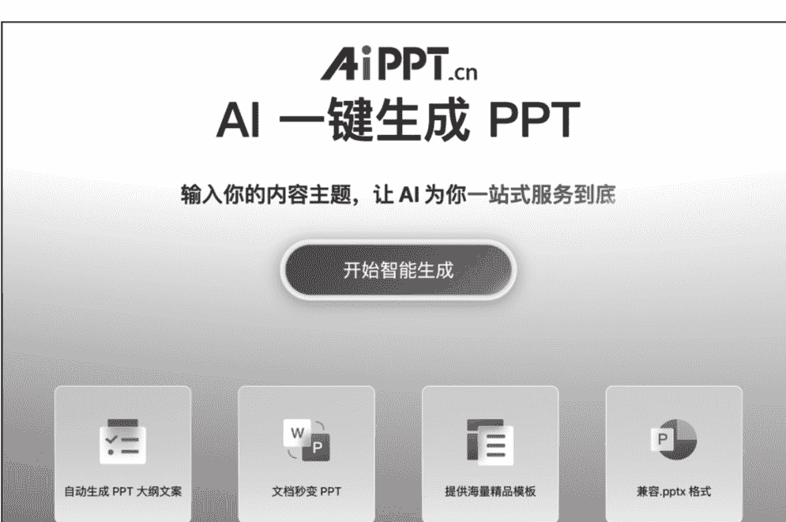

2）点击“开始智能生成”，出现两种生成方式，如图5-3所示。
- 直接输入指令由系统智能生成
- 导入本地大纲生成

3）输入生成指令，例如：生成一份语文课《桃花源记》的演示文稿。生成的大纲如图5-4所示。
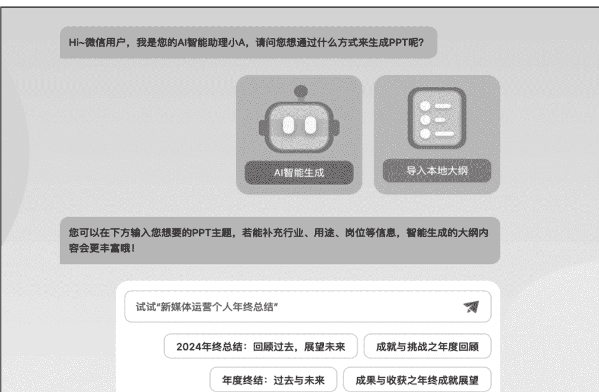
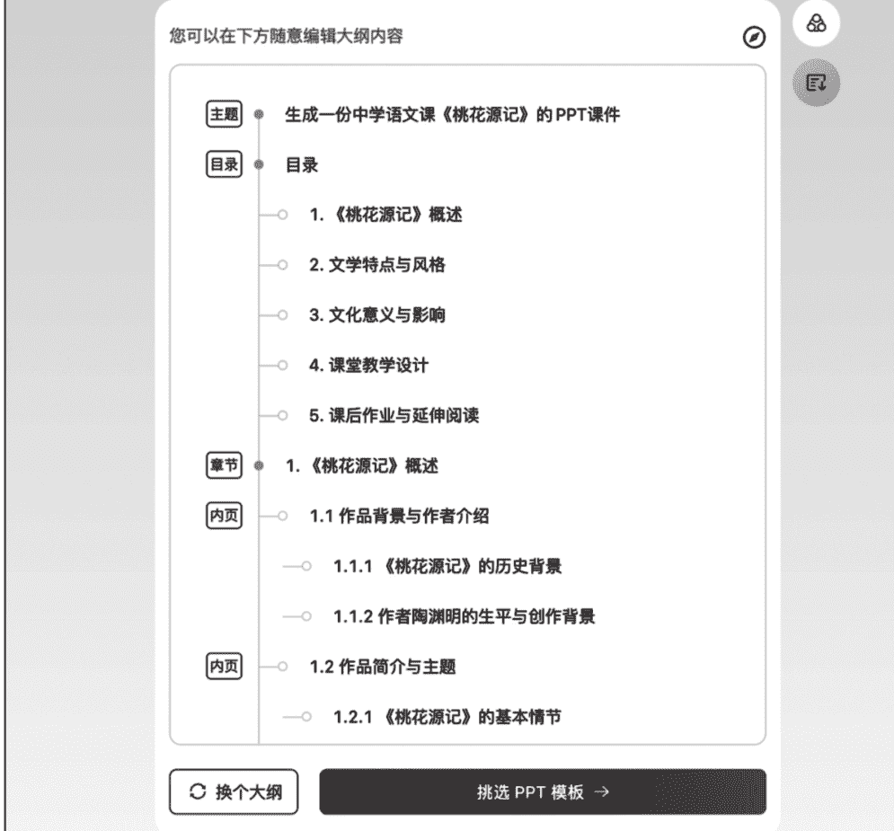

4）根据课文选择合适的模板，例如中国风模板，如图5-5所示。选定后点击右上角“生成PPT”，系统会按主题生成图文并茂的课件。如需修改可点击“编辑”调整文字、图片等，完成后再下载。生成效果预览如图5-6所示。
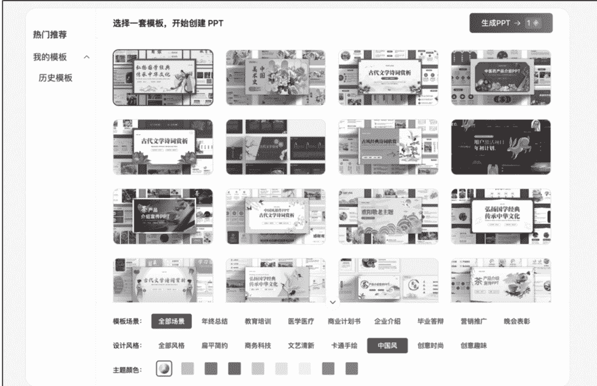
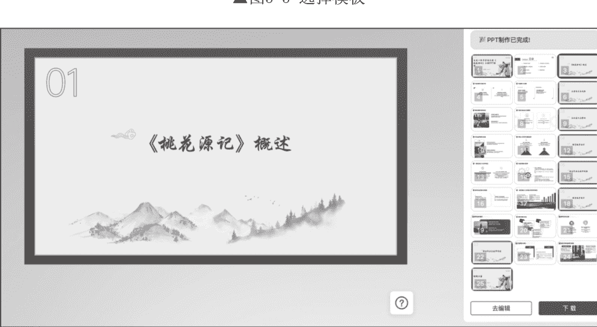

智能生成的演示文稿未必完全契合课堂需求，但基础内容与版式已可由系统完成，效率提升明显。

### 5.1.3 用 MotionGo 生成动画演示文稿
ChatPPT/MotionGo 代表了演示文稿创作的革新，是深度融合智能技术的 Office 插件。内嵌于 Office 套件中，兼容性好且体验流畅，用户无需切换应用即可从构思到成品快速生成。它通过自然语言处理理解需求，自动梳理信息逻辑并呈现视觉效果，降低手动调整格式的时间成本，让用户聚焦内容创意。

按以下六步尝试生成一份内容丰富、设计感强的课件。

1）在浏览器输入 https://motion.yoo-ai.com/，下载安装包，按官网教程安装。MotionGo 官网界面如图5-7所示。


2）安装后打开 ChatPPT 软件，选择上方 MotionGo 选项并登录账户，可微信扫码登录。打开后的界面如图5-8所示。
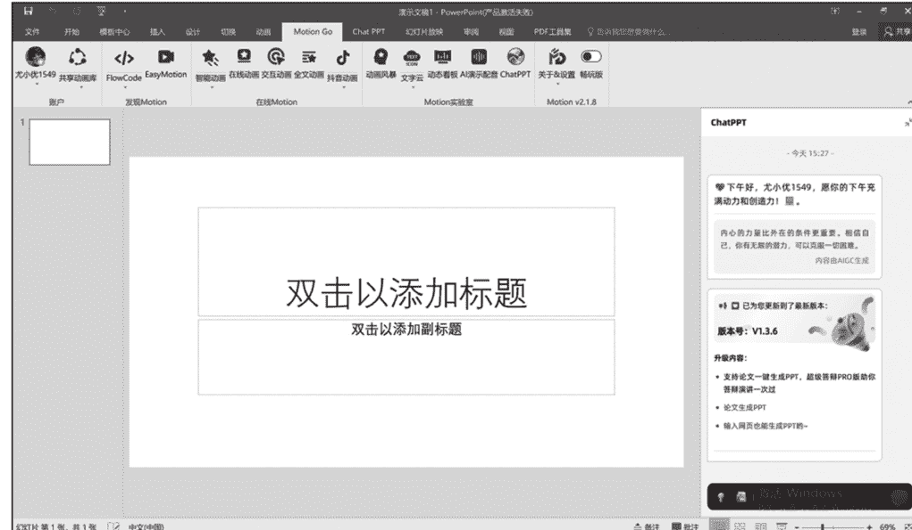

3）选择 ChatPPT 打开 AI 对话框，发送指令“生成语文课《范进中举》的教学课件”。按提示依次选择课件主题、风格、插图生成方式、内容丰富度并确认目录。具体步骤如图5-9～图5-11所示。


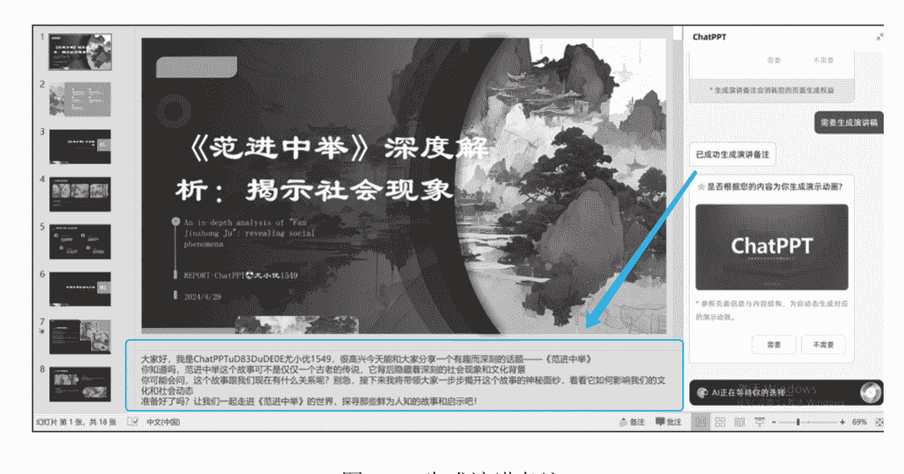

4）按需选择生成演讲备注稿，可依讲课习惯修改内容。如图5-12所示。
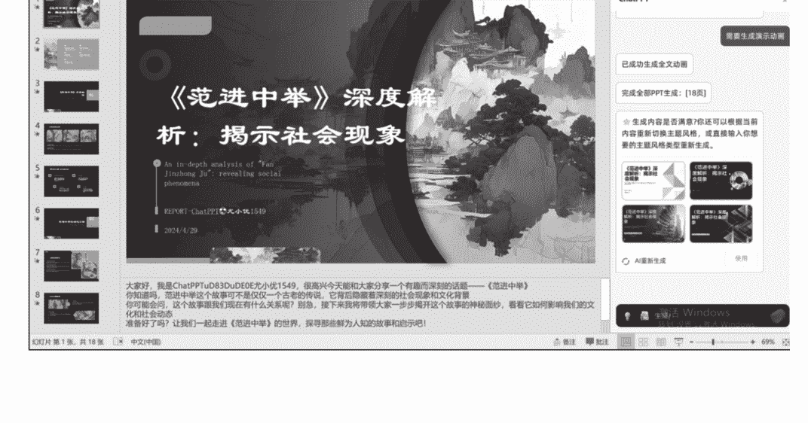

5）按提示选择智能生成动画效果，系统会依据页面信息与结构生成演示动效。如图5-13所示。
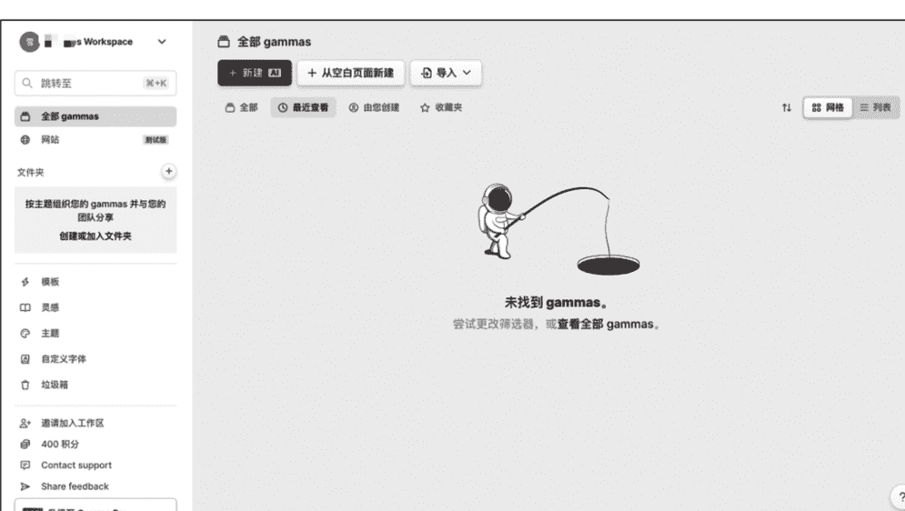

6）根据讲课需求手动微调课件，确认无误后保存。

该插件可无缝融入日常工作流，从构思到成品流畅高效，能精准捕捉意图并自动优化布局设计，节省美化时间，使用户专注内容精炼，自定义选项兼顾个性表达。

### 5.1.4 Gamma App 和 Tome：演示文稿设计的自动化革新
借助 Gamma App 与 Tome，演示文稿设计变得简单高效，兼顾设计感与内容充实度。几步即可解放双手生成优质课件，两款工具风格各异，可按喜好选择。

#### 1. Gamma App 智能生成演示文稿
Gamma App 风格选择丰富，操作步骤如下。

1）在浏览器输入 https://www.gamma.app/，注册登录，邮箱即可。Gamma App 界面如图5-14所示。


2）点击“新建 AI”，出现三种生成方式，如图5-15所示。
- 生成：直接指令生成
- 粘贴文本：导入本地大纲
- 导入文件：导入现有文档优化

3）选择“演示文稿”。智能生成界面如图5-16所示。

4）输入“请生成语文课《醉翁亭记》的 PPT”，确认后获得大纲，点击“继续”。系统生成的大纲如图5-17所示。
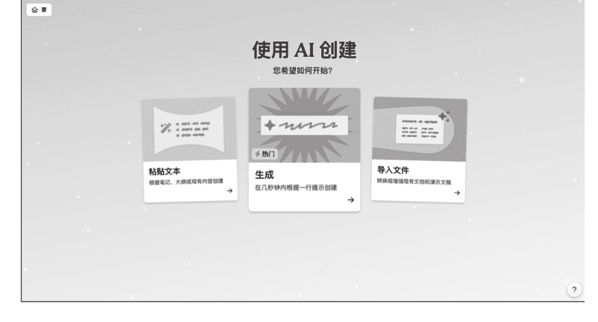
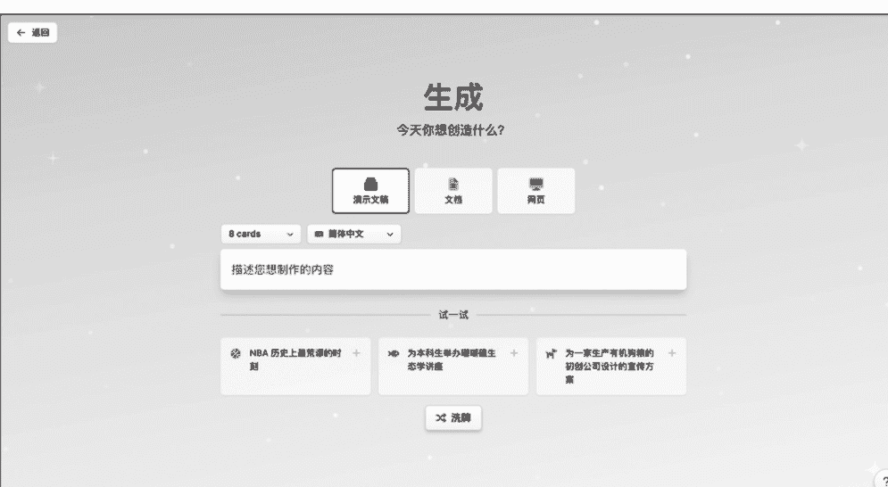
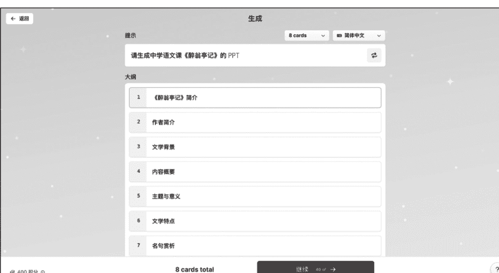

5）选择合适主题后点击“生成”，如图5-18所示。生成后可在页面直接编辑文字、图片、版式等。Gamma App 生成效果如图5-19所示。

6）编辑完成后点击右上角“…”选择“导出”。

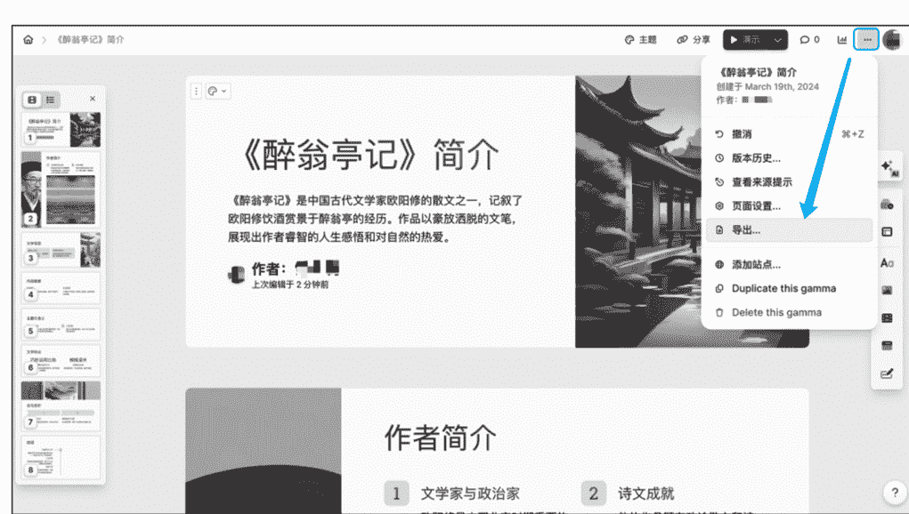


#### 2. Tome 智能生成演示文稿
相较 Gamma App，Tome 生成的演示文稿更简洁，操作如下。

1）在浏览器输入 https://www.tome.app/，注册登录，邮箱即可。Tome 界面如图5-21所示。


2）选择“Generate with AI”，输入指令生成大纲。如图5-22所示，本案例为语文课《醉翁亭记》，点击“Generate presentation”生成大纲。
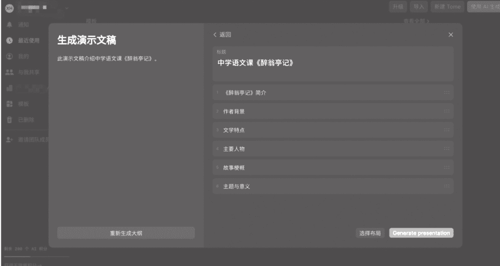

3）Tome 风格简洁，可直接编辑内容。如图5-23所示。
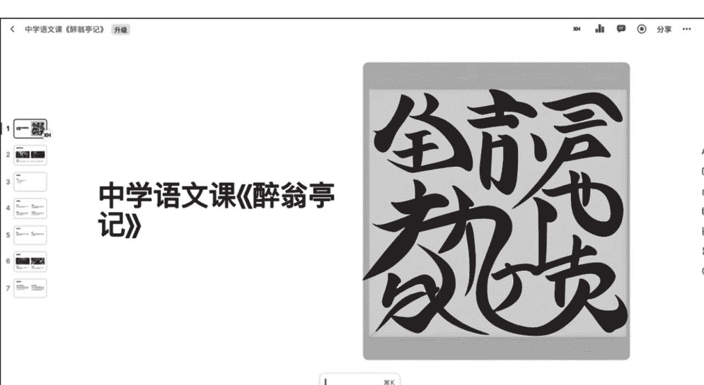

4）编辑完成后，点击右上角“…”选择“导出为 PDF”。如图5-24所示。
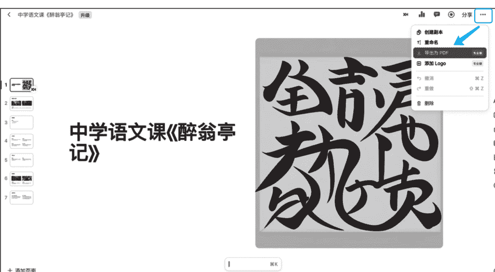

不同平台在生成课件时各有侧重，有的注重内容深度，有的追求视觉美感，有的提供定制服务。多样性使用户能按教学需求灵活选择。借助智能的便捷，不仅能快速获得内容完整、版式齐备的演示文稿，还能利用平台风格差异打造特色课件，提升效率并增添创新与个性。

## 5.2 与各类文档“对话”
在教育变革中，智能技术正以全新速度革新我们与文档的交互方式。本节探讨如何通过相关工具实现与各类文档的“对话”，并介绍 ChatExcel、ChatPDF 与云一朵等应用在教育与学习中的助力。

### 5.2.1 ChatExcel：与表格对话
处理和分析 Excel 数据常令人烦琐。ChatExcel 利用自然语言处理，允许用户通过对话式指令查询、编辑和分析表格，无需掌握复杂函数，大幅提升效率并降低门槛。

操作步骤如下。

1）在浏览器输入 https://chatexcel.com/，点击“现在开始”即可使用。ChatExcel 界面如图5-25所示。

2）点击上方“上传文件”，上传需处理的表格。操作界面如图5-26所示。

3）在输入框输入指令“2022年比2021年增长百分比作为最后一列”，点击“执行”后表格自动生成新列。如图5-27所示。

也可输入其他指令如“在所有省份前加上‘中国-’”“将最后一列数据四舍五入为两位小数”“删除第二列”等，实现免手动编辑，提升工作效率。
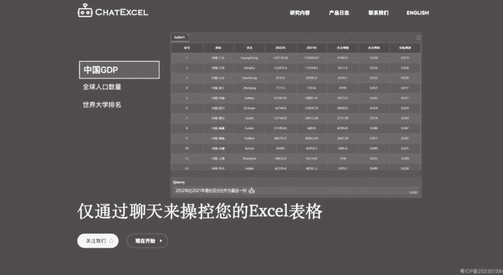
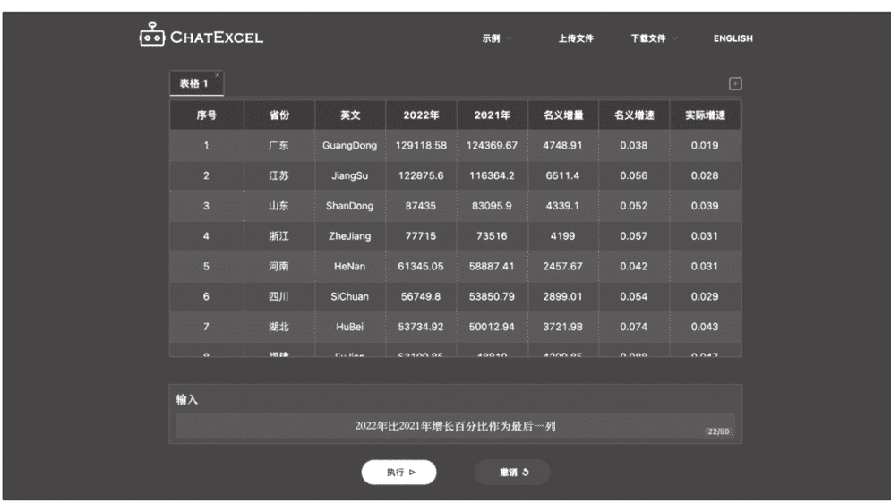
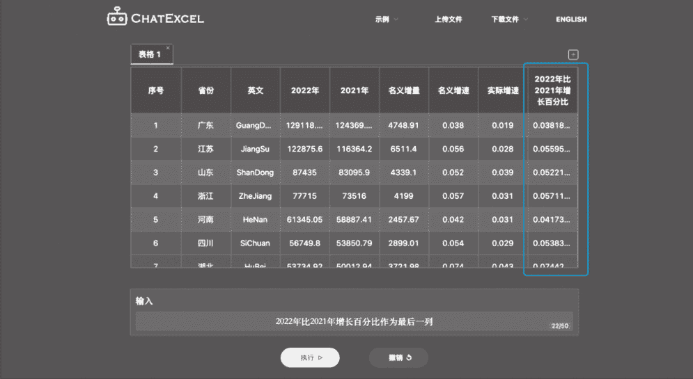

### 5.2.2 ChatPDF：轻松完成 PDF 阅读
PDF 是教育传播知识的重要载体，传统阅读器互动性不足。ChatPDF 基于智能的阅读器可识别并提取关键信息，通过对话界面实时互动、解答疑问、提供解释，是教育工作者的教学助手，也是学生的高效学习方式。

1）在浏览器输入 https://www.chatpdf.com/，注册登录，邮箱即可。ChatPDF 界面如图5-28所示。

### 5.2.3 云一朵：对话式体验教育视频
在线教育兴起，视频成为重要教学资源，传统播放缺乏互动与个性化。云一朵利用智能算法分析视频内容，按用户实时反馈提供个性化推荐与引导，支持语音或文字与视频对话式交互，实现深度学习。

- 1）在浏览器输入 https://pan.baidu.com/，注册/登录百度网盘。

网盘视频也能即问即答

在百度网盘打开学习视频后，留意界面右上方的功能键。点进去即可唤出云一朵的AI工作区。系统会在后台自动对当前视频做内容提炼，提炼完成后进入对话区提问即可。先会给出视频的概要，后续追问均基于原文作答并附上对应的进度时间。以“生成式AI在课堂上怎么用”为例，云一朵会结合视频原内容给出解释并标注参考片段，实现精准点对点交流。

▲图5-32 云一朵的图标位置
▲图5-33 视频内容智能总结
▲图5-34 云一朵互动问答

综合来看，AI正在改变人与资料的交互习惯，对教育产生深远影响。类ChatExcel、ChatPDF、云一朵的产品都在简化流程、提升学习效能，让教学更智能、更个性、更有参与感。展望未来，AI在教育中的作用仍将持续扩大，推动教育事业不断向前。

5.3 绘画与思维导图的融合点亮课堂创造力

对一线教师而言，数字艺术与智能工具的结合已不只是方法上的改变，更是课堂可能性的拓展。本部分为教师提供AI在教学中的实践指南。绘画教学方面，AI打破了时间、材料和技能的限制，给学生带来全新的创作体验，激发创造热情；思维导图教学方面，AI提供比手绘更高效、更易修改的方案，可自动产出美观清晰的导图，帮助学生理解与记忆。下面分别展开工具盘点与教学案例。

### 5.3.1 AI绘画工具导览

人工智能绘画大模型依托深度学习与海量图像数据，能够模仿多种绘画风格并创造新颖艺术效果。下面是当前主流的国内平台。

**表5-2 国内AI绘画工具合集**

| 平台名称 | 特点概述 |
| --- | --- |
| 悠船 | 被视作Midjourney的国内版本，出图质量较高。输入文字描述即可得到个性化画作，支持多种风格与参数调节，算法擅长捕捉文字意境，适合艺术家与爱好者创作，同时配有社区交流与分享功能 |
| 文心一格 | AI艺术创意辅助平台，输入文本描述并选择方向、风格与尺寸后，AI即可自动完成作品。提供丰富风格与创作选项，兼顾不同水平用户 |
| 通义万相 | 覆盖多种应用场景，支持水彩、油画、国画等风格，具备图生图、涂鸦创作、图像风格迁移及虚拟模特展示商品等能力。支持复用他人创意并在此基础上调整创新 |
| Vega AI | 提供文生图与图生图两类功能。文生图靠文字指令生成图像，图生图可上传图片后涂抹局部并输入修改内容生成新图，还支持放大、优化与二次编辑 |
| 奇域 AI | 专注中式审美创作，提供水墨、刺绣等国风风格，支持PC与移动端操作。上手门槛低，内置交流社区便于灵感分享与作品展示 |
| Dreamina | 将文字快速转化为图像，支持文字绘图、扩图、局部重绘。生成速度快、色彩丰富、风格多样，可用关键词生成精美图并做定制调整，还提供模板与一键同款功能，图像编辑灵活 |

这些平台均基于大模型提供高效便捷的绘画体验，各有侧重，可按教学需求选择。

### 5.3.2 案例：古诗一键变画作

语文课堂上，古诗教学常局限于文字解读与背诵，学生易感枯燥难入境。借助AI绘画可将诗句意境转化为视觉画面，帮助学生直观理解内涵与情感，同时激发兴趣、想象、审美与文化素养。本案例以通义万相演示。

- 1）在浏览器地址栏输入通义万相的官方网址并完成注册登录。
- 2）进入“创意作画”，打开AI绘画工作区。通义万相界面如图5-35所示。
图5-35 通义万相界面
- 3）在“文本生成图像”区输入指令如“朝辞白帝彩云间，超细节，高清，水墨画”，下方可自行选择风格与尺寸，也可上传参考图片。
- 4）点击“生成创意画作”即可得到作品。不满意可点“再次生成”。按同样方式为每句诗生成对应意境，示例如图5-36至图5-40。

AI绘画的应用价值很大。几步操作即可让古诗从文字走向画面，为古诗教学注入新活力。结合不同学科特点，教师可用AI绘画将书本知识以视觉化形式呈现，提升学习兴趣与综合素养。

▲图5-36 AI根据指令生成创意画作
▲图5-37 朝辞白帝彩云间
▲图5-38 千里江陵一日还
▲图5-39 两岸猿声啼不住
▲图5-40 轻舟已过万重山

### 5.3.3 AI生成思维导图工具导览

传统思维导图制作费时费力，修改更新也不便，限制了教学灵活性。AI生成工具可依据需求智能产出清晰美观的导图，大幅提升效率。

**表5-3 AI生成思维导图工具合集**

| 工具名称 | 特点概述 |
| --- | --- |
| 亿图脑图 | 按用户指令快速生成目标图表，通过连续对话不断优化结果。提供AI一键分析，支持文本检查润色续写总结，以及图表异常识别与预测分析 |
| ChatMind | 在对话框输入想法即可自动创建并更新思维导图，支持指令修改删除节点与关系，编辑灵活。也提供多风格主题模板 |
| ChatGPT+TreeMind 树图 | ChatGPT 4.0可自动生成思维导图，输入核心概念与关联信息后得到逻辑结构化内容，再导入支持Mermaid等图形语言的TreeMind转化为可视化导图，信息整理更简便 |
| 小画桌 | 擅长快速生成高质量思维导图与流程图，适合快速梳理思路。更侧重实时协作与在线授课场景的应用 |

四款工具各具特色，可根据教学场景挑选最合适方案，让导图制作更便捷。

### 5.3.4 案例：AI思维导图助力历史教学

AI生成思维导图融合高效计算与直观展示，能迅速整理大量信息并按需求生成结构清晰、逻辑严谨的导图，通过算法保障准确完整，并可根据反馈实时调整。例如在历史教学中，能帮助学生把握事件脉络与关联，提升连贯性理解。

本案例以TreeMind树图为例，围绕历史学科操作如下。

- 1）在浏览器输入TreeMind官方网址注册并登录。TreeMind树图界面如图5-41所示。
图5-41 TreeMind树图界面
- 2）在文本框输入需求“解析辛亥革命的背景、原因、过程、结果及影响”，选择“智能生成”，等待平台产出导图。如图5-42所示。
- 3）可直接修改文字，在右侧选项栏调整样式、骨架、配色与画布。如图5-43所示。

AI思维导图在教育中提升了教学效率，帮助学生更清晰地理解复杂知识。但需注意，AI生成的是辅助产物，学生仍需独立思考与深入理解，避免过度依赖。只有合理使用，才能真正发挥辅助教学作用。

▲图5-42 TreeMind树图智能生成思维导图
▲图5-43 修改思维导图

5.4 赋能教师科研论文

教育科研是教师专业发展的重要支柱，对教学质量与教育改革意义重大。传统科研方式耗时耗力，难以应对信息激增。AI通过智能分析、数据挖掘与自然语言处理，可简化文献检索、综述撰写与论文写作，帮助教师更高效精准地完成科研任务。下面从文献整理、综述辅助到写作助力展开。

### 5.4.1 AI整理文献要点

课题研究时面对大量文献，人工筛选阅读压力很大。AI文献阅读工具可像私人助理一样从海量资料中筛出相关文献，精读内容并自动生成摘要，让教师快速把握核心要点。

以Kimi为演示对象：

- 1）打开Kimi官网，点击右上角登录，可微信扫码或手机号注册。Kimi网站界面如图5-44所示。也有手机版可体验。
- 2）将待读文献文件拖入网页，或把文献网址粘贴到文本框，等待Kimi阅读。上传文献如图5-45所示，结果如图5-46所示。
- 3）针对文献提出疑问，如“在这个文献中，教育领域的应用场景具体是怎么样的？”在文本框提问即可获得智能回答，如图5-47所示。

借助Kimi，繁琐的筛选整理被快速准确完成，教师可把精力投入教学创新与科研思考。

▲图5-44 Kimi网站界面
▲图5-45 上传文献
▲图5-46 Kimi整理文献的结果
▲图5-47 针对文献进行提问

### 5.4.2 AI辅助文献综述

文献综述是论文写作的必备环节，手工整理耗时易错。AI可智能归纳文献，提取关键观点与论据，自动生成结构清晰、逻辑严谨的综述报告。

**表5-4 AI辅助工具合集**

| 工具名称 | 特点概述 |
| :--- | :--- |
| Kimi | 输入研究主题获取智能推荐文献列表，浏览筛选后深入阅读并提取要点，最后借助智能整理功能整合内容生成清晰综述 |
| 文心一言 + 知网 AI 智能写作平台 | 用文心一言构思大纲，在知网AI智能写作平台检索筛选内容，结合两者撰写研究现状、观点与未来方向，最后校对修改确保规范 |
| AIPaperPass | 可生成完整论文结构并按要求自动生成文献综述，同时具备语法纠错与排版功能 |
| 文途 AI 论文 | 输入标题、关键词等信息，一键生成文献综述草稿或框架 |
| 掌桥科研 | 拥有庞大文献库，提供一键跨库检索与本地获取服务，配合AI技术生成文献综述 |

以Kimi为例，小学数学教师进行基于核心素养的校本课程设计课题研究，可按以下流程操作：

- 1）打开Kimi官网并登录。
- 2）输入指令“你是一名小学数学老师，正在进行一项基于核心素养的小学数学校本课程设计与实践的课题研究，请推荐相关文献。”等待推荐。如图5-48所示。
##### 图5-48 Kimi推荐相关文献
3）选择文献进一步提问，如“整理第7篇文献《核心素养下小学‘趣味数学’校本课程开发与实践》的核心内容”。如图5-49所示。
图5-49 获取指定文献的核心内容
我们也可打开推荐文献来源链接自主阅读。如图5-50所示。
图5-50 打开推荐文献的链接
4）阅读充分后输入指令获取综述大纲，例如“现在你需要书写一篇展示本课题成果的论文，请根据以上推荐的文献列出论文中文献综述部分的大纲。”不满意可提示修改方向继续生成。如图5-51所示。
图5-51 Kimi生成文献综述大纲
5）确定大纲后输入“请你根据以上的大纲，参考前面相关文献的内容，写出文献综述的引言部分”。建议分部分生成。如图5-52所示。若需修改，可指令“请修改引言的内容，要体现出《义务教育课程方案和课程标准（2022年版）》提及的内容。”如图5-53所示。

AI可大幅提升综述生成效率，但生成内容仍需结合专业知识审慎修改，确保质量与准确性，同时注意个人信息保护与学术规范。

▲图5-52 Kimi生成文献综述的内容
▲图5-53 Kimi修改文献综述

### 5.4.3 AI助力论文写作

论文写作是科研成果的最终呈现，对教师是挑战。AI可贯穿选题构思到文稿润色，借助算法与大数据挖掘被忽视的研究点，提供个性化写作建议，让框架更合理、内容更精准、语法错误及时纠正。

**表5-5 AI辅助论文写作平台合集**

| 平台名称 | 特点概述 |
| --- | --- |
| ChatGPT | 具备强大自然语言处理能力，能理解用户意图，提供段落构思、观点阐述、逻辑梳理支持，解答专业问题、引用文献，协助修订语法与提升表达清晰度，加快写作进程 |
| 文心一言 | 擅长语义理解与创新生成，能提炼核心概念、构建理论框架，以富有表现力的语言撰写论述，并可按需求调整文风，兼顾学术规范与可读性，助力产出高质量论文 |

论文创作的形态正从点状文字补位转向全流程的协同共创。当前可用的智能写作产品各有侧重，通义千问、Kimi、Paperpal、笔灵 AI 写作是比较典型的四个方向。

| 通义千问 | 把知识图谱和深度学习结合起来，能敏锐捕捉论文写作时的具体需求，如主题延展、资料搜集、数据解析等情境，可产出连贯段落支撑严谨论证，并依实时反馈持续打磨，提升专业深度与信息浓度 |
| Kimi | 以学术写作闭环为设计思路，覆盖选题沟通、文献调研、提纲搭建到章节撰写。智能助手可进行深度对话，帮助挖掘新颖视角、构建有力论据，并提供智能校对，确保稿件符合学术规范，加快成稿节奏并提高整体质量 |
| Paperpal | 以智能算法为核心对论文进行打磨。能够快速梳理研究背景、归纳文献要点、自动生成参考文献列表，并依据输入内容自适应地提出结构性建议与改进意见。内置查重功能保障原创性，语言润色功能提升可读性 |
| 笔灵 AI 写作 | 集合头脑风暴、素材推荐、自动摘要与全文生成等能力，为论文提供端到端支持。输入关键词或提纲即可快速获得初稿，后续可基于反馈进行深度定制与细节化修改，保证内容准确、逻辑严密，极大减轻写作负担 |

下面以 Kimi 为例，拆解智能化手段在教育类论文撰写各环节的具体用法。假设你是一名小学数学教师，正在开展小学数学教学模式改革研究，撰写论文时可借助 Kimi 完成以下任务。

##### 1. 文献检索与阅读
- 快速抓取并筛选教育领域尤其是小学数学教学相关的前沿成果，自动生成文献摘要，帮助教师迅速把握学术动态。
- 对海量文献进行深度理解，提取核心观点与数据，为论文提供扎实的研究基础。
指令示例：
请帮我查找最近五年内关于小学数学教学模式改革的相关文献，并提炼主要观点。
文献检索与阅读指令的生成结果如图5-54所示。
图5-54 文献检索与阅读指令的生成结果

##### 2. 研究设计与论文架构
协助搭建论文骨架，涵盖引言、文献综述、研究方法、数据分析、结果讨论、结论与建议等模块。
结合教学实践与研究目标，给出针对性的研究方案与整体布局建议。
指令示例：
请为我生成一篇关于“小学数学探究式教学法的应用与效果分析”主题的论文大纲。
注意，若已有确定的主题，则可将上述指令细化。
研究设计与论文架构指令的生成结果如图5-55所示。
图5-55 研究设计与论文架构指令的生成结果

##### 3. 内容生成与编辑
在教师提供思路与要点后，Kimi 可生成初步段落，包括理论阐述、案例分析、教学策略等。
对已完成的初稿进行智能校对，排查语法、拼写、语句通顺与逻辑一致性问题。
指令示例：
请帮我撰写文献综述部分的第一段，强调探究式教学的重要性。
内容生成与编辑指令的生成结果如图5-56所示。
图5-56 内容生成与编辑指令的生成结果

##### 4. 数据处理与可视化
涉及实证研究时，可帮助整理和分析收集的数据，并生成图表，让复杂的教学数据变得直观。
指令示例：
我已经收集了学生的数学成绩，请帮忙分析使用探究式教学前后成绩的变化趋势，并以图表形式呈现。
注意，在给出此指令之前，需先让 Kimi 阅读收集到的数据。

##### 5. 引用管理与格式规范
自动管理参考文献，按 APA、MLA 等指定格式生成规范的引用与参考文献列表，确保格式合规。
指令示例：
请按照 APA 格式调整这篇论文的引用和参考文献列表。
注意，建议在发送此指令前，先给 Kimi 上传相应的附件并发送指令“请阅读本论文的参考文献”，让 Kimi 先熟悉参考文献列表。

##### 6. 反馈与修订
提供交互式写作指导，教师可随时就论文各部分获取修改建议与内容深化意见。
指令示例：
请阅读这篇论文的内容，并给出优化建议。

### 5.4.4 AI论文写作工具的实操路径
在智能助力教育的进程中，Kimi 凭借持续问答能力率先展示了论文撰写的新形态。如今众多平台纷纷推出集成生成、逻辑优化与文献自动整合的写作工具，显著缩减繁琐环节，提升学术成果的深度。这既是创作加速器，也是激发灵感的智慧伴侣，本节以 Kimi 平台的辅助写作工具为例，介绍具体使用方式。

1）打开 Kimi 官网 https://kimi.moonshot.cn/ ，完成登录。
2）点击左侧 “Kimi+” 图标，进入定制化 AI 工具界面，如图5-57所示。
图5-57 选择“Kimi+”的图标
3）在 AI 工具界面中定位“辅助写作”类别，选择“论文写作助手”体验，如图5-58、图5-59所示。
▲图5-58 辅助写作工具
▲图5-59 论文写作助手
4）在助手界面中按提示操作。输入“我想要写一篇文章”的指令，即可获得 AI 的引导提问，如图5-60所示。
图5-60 输入“我想要写一篇文章”的指令
5）按提示输入论文撰写要求，发送后即可获得 AI 生成的撰写建议与草稿内容，如图5-61～图5-63所示。
▲图5-61 根据提示输入论文撰写要求
▲图5-62 AI生成论文撰写建议
▲图5-63 AI生成论文草稿内容
6）阅读 AI 生成内容后，可继续发送指令进一步细化。如图5-64所示，发送指令“请根据我的要求，给我推荐几个合适的论文标题。”
图5-64 论文标题推荐
7）若标题中合适，可发送指令“我选择第八个标题，请根据这个标题修改论文的撰写建议与内容。”若标题不满意，可继续发送修改指令，直至可用，如图5-65所示。同理，针对不满意的部分可继续发送对应修改指令。
图5-65 根据标题修改论文内容

智能平台能带来诸多便利，但教师仍需保持主体意识，尊重学术规范，体现专业素养与判断力。建议将智能工具作为辅助，兼顾独立思考与学术诚信。它可高效整合资源、给出提纲建议与初稿，但教师须结合专业知识审慎辨别并进行个性化创新。在利用智能工具进行语法校对、数据分析时，也要坚持严谨态度，核实每项结论，确保原创性与真实性。

# 第6章 AI重塑教学音视频
人工智能正以前所未有的速度重塑教学形态。从智能语音合成到自动化音乐创作，音频类应用让教学更具生命力；视频类应用则大幅简化微课制作流程，让课堂内容更生动、更具吸引力。
本章将带你进入智能音视频工具的工作世界，解析它们如何帮助教师高效打造高质量教学素材，提升课堂趣味与互动。我们一起感受技术引领的教育革新，开启智能化教学新篇章。
本章主要涉及的知识点：
- AI 音频应用
- AI 视频应用

## 6.1 AI 音频应用
音频智能工具显著提升教师制作微课、配音与创作的效率。它们可以智能合成语音、快速为微课配音，提供多样音色与情感表达，使配音更自然生动，从而提高工作效率与创作品质。

### 6.1.1 AI 音频工具导览
音频智能工具是利用人工智能对音频进行处理与生成的软件，可完成音频编辑、语音合成、音乐创作等任务。
表6-1列出了部分常用音频智能工具及其功能说明。

##### 表6-1 AI音频工具导览

| 工具名称 | 功能说明 |
| --- | --- |
| 微软 Azure 语音服务 | 基于云的语音识别与合成服务，支持多语种与方言，可嵌入各类应用实现智能语音交互 |
| 剪映 | 抖音系视频剪辑工具，内置 AI 配音，可将文字转为语音并提供多种音色与语调，方便快速为视频配音 |
| 必剪 | 功能强大的视频剪辑软件，支持语音合成，可把文字转换为解说词或旁白 |
| 魔音工坊 | 专业音频编辑软件，提供文字转语音、语音合成、音频剪辑等功能，兼容多语言方言，适用于广播、电视、广告制作 |
| 讯飞听见 | 科大讯飞推出的语音转文字与多语种翻译工具，同时提供语音合成能力，可输出自然流畅的语音 |

### 6.1.2 AI 歌曲生成，助力音乐教师教研
自动创作歌曲正在成为音乐教学的新工具，为教研提供高效便捷方案。
自动创作歌曲是通过算法与数据分析自动创作歌曲，在教学中可发挥关键作用。以下案例展示了其具体用法。

#### 案例一：风格探索与模仿
某高中音乐鉴赏课上，教师希望学生体会不同音乐风格。寻找素材耗时耗力，于是借助自动创作歌曲工具，快速生成爵士、摇滚、古典、流行等风格片段。课堂上学生聆听比较后，对各风格形成直观认知，并进行模仿演唱与创作。

#### 案例二：个性化教学辅导
一位小学音乐教师发现学生节奏感知差异较大。利用自动创作歌曲工具，为每位学生定制符合其节奏感知水平的练习曲目。曲目既保留熟悉旋律，又针对节奏难点进行调整，反复练习后学生节奏能力明显提升。

#### 案例三：创作激发与评估
大学音乐创作课上，教师要求学生创作特定情感表达的作品。为激发灵感，教师用自动创作歌曲工具输入情感标签如“欢快”“悲伤”“思念”，生成示范片段。学生在聆听后获得启发完成创作，教师还借助智能技术对作品进行客观评估并给出针对性反馈。

可见，自动创作歌曲在音乐教学中的优势包括：
- 节省时间成本：快速批量生成素材，减少筛选时间，聚焦教学设计。
- 灵活定制：可按教学需求与学生特点定制，实现个性化教学。
- 创新教学方式：提供全新教学手段，激发教师创新思维，提升教学效果。

同时也面临技术成熟度、版权、教师接受度等挑战。随着技术进步与教育理念更新，自动创作歌曲有望在音乐教研中发挥更大价值，推动创新人才培养，教育界也需积极探索智能技术与音乐教育的融合路径。

### 6.1.3 案例：AI跨学科打造“历史之声”
#### 1. 案例背景
历史教学中学生常难以身临其境感受历史氛围。本案例将智能音乐生成技术与历史教学结合，让学生通过音乐回到历史现场，更深刻理解历史事件。

#### 2. 教学目标
利用智能生成音乐，帮助学生理解特定历史时期的文化与氛围，激发学习兴趣，培养创新思维与跨学科学习能力。

#### 3. 教学内容与步骤
（1）导入
教师播放一段 AI 生成的仿古风格音乐，提问：“你们觉得这段音乐可能属于哪个历史时期？”学生讨论猜测后教师揭晓答案并简要介绍 AI 模仿古风音乐的原理。
（2）历史知识讲解
教师选取具体历史时期如唐朝，介绍背景、文化、艺术特点，并展示相关乐器、乐谱与历史故事。
（3）AI 音乐生成实践
教师演示智能音乐生成工具的使用，并选择对应风格进行创作。学生分组，选择汉朝、唐朝、宋朝等时期，利用 AI 生成符合风格的音乐。
（4）历史情景剧
各组根据所选时期编写简短历史情景剧脚本，内容可为该时期的故事或事件，并以生成的 AI 音乐为背景进行表演。
（5）分享与交流
各组分享创作经验、困难与乐趣，其他学生与教师点评，讨论音乐如何增强历史代入感。
（6）课堂总结
教师总结学习内容，强调音乐在历史文化中的作用。
（7）布置作业
让学生回家尝试用 AI 生成家乡或感兴趣历史时期的音乐，并写下对该时期文化的理解与感受。

#### 4. 教学评价
从学生参与度、情景剧表演质量、AI 音乐选择与创作等方面综合评价。

#### 5. 教学资源与建议
教师可提前准备 AI 音乐生成工具与历史资料；可邀请音乐老师或专业人士指导，确保生成音乐的准确性与风格贴合；在教学中引导学生理解历史文化多样性，避免刻板印象。

#### 6. 教学意义
该案例让学生更直观感受历史文化与氛围，通过音乐创作与表演提升跨学科学习能力与创新思维，新颖方式有助于激发历史学习兴趣与热情。

## 6.2 AI 视频应用
视频编辑智能工具可自动处理素材，如智能剪辑、特效生成等，大幅减少制作耗时，让教师更聚焦教学内容设计，提升教学效率。

### 6.2.1 AI 视频编辑工具导览
视频编辑智能工具将繁琐的后期流程化繁为简，可自动分析视频内容、智能匹配背景音乐与转场，让节奏与情感表达更自然。强大的算法还能依据用户偏好推荐素材与风格，助力打造个性化作品。无论是社交分享、企业宣传还是个人创作，都是不可或缺的创意伙伴。AI 视频编辑工具导览见表6-2。

表6-2 AI视频编辑工具导览

| 工具名称 | 主要特点与功能 | 用户群体 |
| --- | --- | --- |
| Magisto | 智能编辑与自动解析素材，拥有海量素材、模板、音乐库，简化剪辑流程，适合初学者快速产出 | 需快速剪辑高质量视频的初学者与内容创作者 |
| 爱剪辑 | 全能视频剪辑软件，集成导入、剪辑、编辑、特效、音乐与导出，支持 AI 自动加字幕，识别多国语言与方言，支持调色、去水印、横屏转竖屏等 | 有字幕需求的用户及希望将手机视频制作成精美短片的创作者 |
| Adobe Premiere Rush | 专业级剪辑软件，提供全面剪辑工具与高级特效，与 Adobe 生态高度兼容，支持多种素材格式 | 对视频质量要求高的专业用户 |
| 犀牛剪辑 | 专业 AI 智能批量剪辑软件，界面简洁，适合新手，采用高级去重算法，支持批量生成短视频 | 有批量剪辑需求的用户与 MCN 机构 |
| 剪映 | 抖音官方出品，支持手机与 PC，具备一键成片、图文成片、营销成片等 AI 剪辑功能，适合电商广告制作 | 各类视频创作者，特别是电商从业者 |
| 一帧秒创 | 一站式智能 AI 内容创作平台，提供文字续写、文字转语音、文生图、图文转视频等服务，含秒创数字人等创新产品 | 需高效制作创意视频的多形式内容创作者 |
| 快剪辑 | 具备强大云端剪辑能力，支持在线去水印、录屏、录音等，智能工具箱含文本剪视频、AI 数字人、智能去字幕等 | 电商营销、内容营销、短视频创作等场景的中小机构或个人 |

下面以剪映为例，介绍视频编辑智能工具的强大功能。
剪映是一款适合各水平用户的视频编辑工具，界面简洁直观，编辑工具丰富，可轻松剪辑与美化视频，无论是滤镜、音效、字幕还是转场，均可快速实现，提升制作效率与趣味性。剪映界面（PC 版）如图6-1所示。

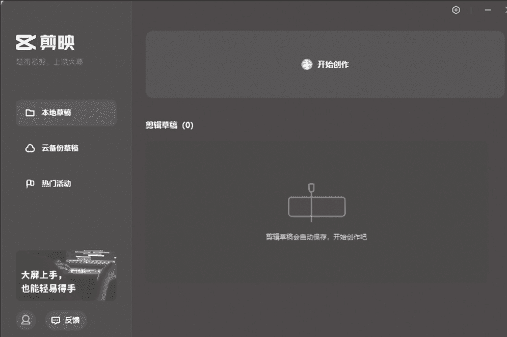
图6-1 剪映界面（PC版）

#### （1）下载方式
打开浏览器，进入剪映官网 https://www.capcut.cn/ ，系统会根据电脑类型自动匹配版本，点击“立即下载”后按提示安装即可。

#### （2）面板介绍
音视频编辑界面划分为素材面板、播放器面板、时间线面板与功能面板四个区域，如图6-2所示。
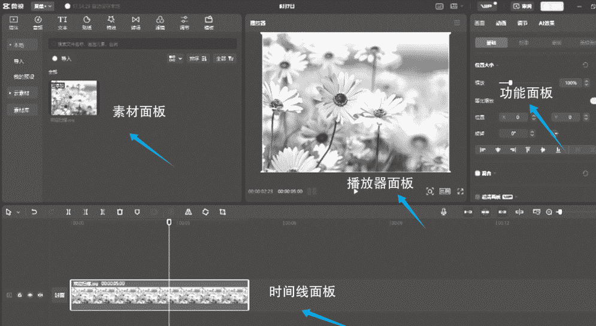
图6-2 剪映音视频编辑界面
- 素材面板用于存放本地素材及剪映线上海量素材。
- 播放器面板可预览本地素材或素材库内容。
- 时间线面板支持基础编辑操作，如导入素材、通过拖动白色裁剪框裁剪、调整素材位置与轨道等。
- 功能面板在选中素材后激活，可进行放大、缩小、移动、旋转等进阶操作。

#### （3）导出视频
编辑完成后点击右上角“导出”按钮即可输出成品。

#### （4）快捷键设置
剪映提供大量快捷键提升剪辑效率，点击编辑界面右上角的快捷键图标可查看详情，熟悉后用户也可自行设定习惯快捷键。

### 6.2.2 剪映剪辑视频的全流程
##### （1）启动与界面熟悉
首次打开剪映，其直观友好的界面会迅速抓住注意力。主界面清晰划分为预览窗口、时间线、素材库与工具栏。
##### （2）导入素材
点击“导入”按钮，将设备中的视频、图片、音频文件添加到素材库，为剪辑提供基础素材。

##### （3）建立工程导入素材
打开素材库选中要处理的视频片段，直接拖进时间轴就能排上，也可以用右键菜单点“添加到时间线”。工程就此建立，随后进入正式剪辑阶段。

##### （4）初剪与拼接
时间轴上可完成常规的剪切、删除、复制粘贴。工具栏里的“切割”能把一段画面拆成多段，删掉多余部分或重新调整顺序，实现基础的重排。

##### （5）加入转场衔接
让不同片段更顺滑可以在两段之间插入转场。剪映自带多款转场样式，拖到衔接位置即可完成过渡。

##### （6）声音精修
视频音轨同样可以深度处理，音量可上下调节，能叠加背景音乐或音效，也支持在软件内直接录制旁白。

##### （7）文字与贴纸点缀
为提升信息承载与观感，可增加字幕和贴纸。字幕工具可添加与修改文本，素材库里还有大量贴纸与图形元素供装饰。

##### （8）滤镜与调色
平台提供丰富的滤镜和调色面板，能改变整体氛围。既可套用现成滤镜，也能手动微调亮度、对比度、饱和度等，润色画面。

##### （9）预览导出成品
编辑完毕后按预览查看最终效果，确认无误后进入导出设置，选择分辨率、编码格式与画质，点击导出即可渲染成最终文件。

如图6-3所示，九步串联起剪映剪辑的完整链路。无论是家庭旅行回顾、朋友聚会记录，还是个人创意表达，都能轻松完成。

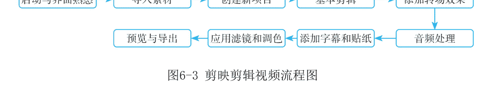

### 6.2.3 智能字幕快速上字
字幕对视频理解帮助很大，既补充信息，也让观看不受环境限制。剪映在自动上字能力上表现突出。

- 操作门槛低：导入视频后进入编辑页点进“字幕”，可手动键入，也能一键调用语音转写把口语自动变成时间轴字幕，效率明显提升。
- 转写准确：内置的语音识别模型成熟，能把对话和旁白准确定位到对应时段，减少手工录入。
- 样式可调：字体、字号、色彩等基础属性都能修改，还可加入底板、描边等特效，让字幕更突出且契合整体风格。
- 即时预览：添加过程中可实时查看效果，不满意随时改动，很快得到理想结果。
- 观看友好：加上字幕后，嘈杂或静音环境也能看懂内容，同时对听力受限或语言障碍用户更友好。

该功能让专业剪辑者与普通爱好者都能快速做出精致个性化的字幕。智能识别字幕如图6-4所示。

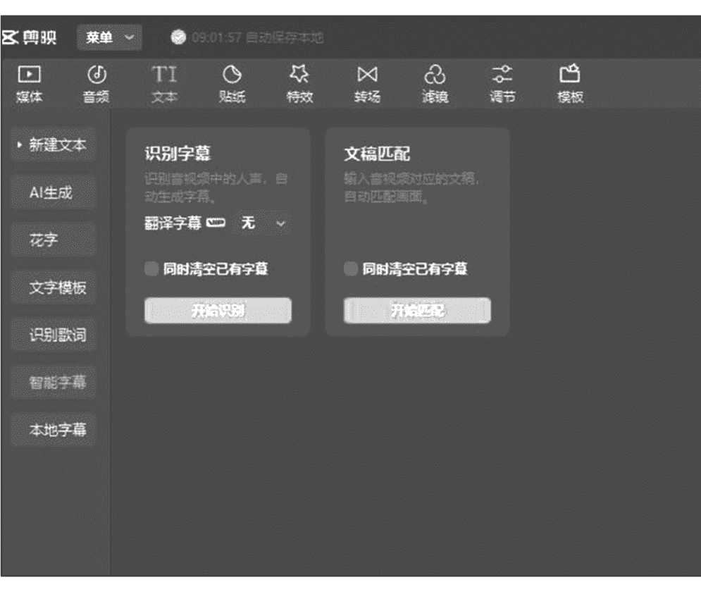

图6-4 智能识别字幕

### 6.2.4 一键抠像换背景
抠像能把人物或物体从原景分离并放入新场景。剪映的抠像工具让虚拟背景制作变得简单。

上传素材后圈选需要抠取的部分，系统会自动识别前景并分离。随后可从内置背景库挑选，或上传自有图片，将主体置入新背景即可得到带虚拟场景的视频。

抠像基于先进的图像识别与处理，保证边缘自然、主体完整，并提供多种模式与参数微调，适配不同需求。

除抠像外，剪映还支持裁剪、拼接、转场、滤镜等常规编辑，可对虚拟背景结果做进一步美化。总体而言，该功能为个人创意、家庭记录到专业影视提供了高效便捷的方案。视频虚拟背景如图6-5所示。

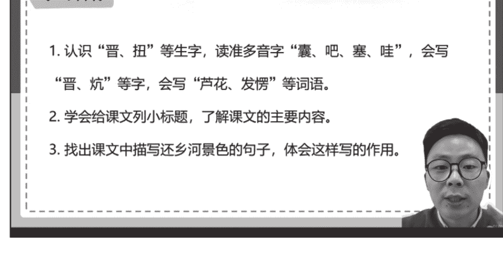

图6-5 视频虚拟背景

### 6.2.5 数字人赋能视频创作
#### 1. 剪映数字人总览
剪映数字人融合AI、语音合成、表情动作捕捉等技术，让用户快速搭建个性化数字形象。挑选或定制形象后输入文案、调节音色，再放到任意背景，数字人即可模仿真人动作配合音频讲话，为作品增色。视频中的AI数字人如图6-6所示。

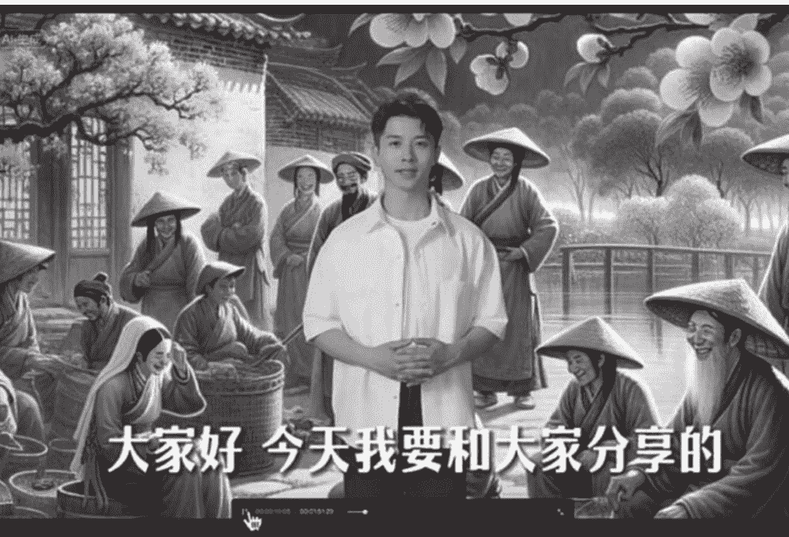

图6-6 AI数字人

#### 2. 剪映数字人制作流程
##### （1）载入素材
打开剪映专业版，导入待处理的视频。
##### （2）添加文案
点“文本”新建默认文本框，编辑数字人需要表达的内容。
##### （3）添加数字人
文案完成后点右上角“数字人”，在内置形象库中浏览选择，确认后点右下角“添加数字人”。
##### （4）微调表现
可调节位置、大小以融入画面，也能调整头部运动、语速、面部表情，让呈现更生动。
##### （5）导出成片
预览确认效果后，点击右上角“导出”输出成品。

#### 3. 教育视频中的数字人应用
##### （1）虚拟讲师或辅导
数字人可担任虚拟教师，提供个性化教学。外语学习中能模拟真实对话，帮助提升口语。
##### （2）教学资源整合
机构可批量生成教学短片，整合多源素材，按学科主题定制，满足多样需求。
##### （3）特效角色生成
制作教育动画或微片时，数字人能快速生成特效角色，降本提质。如讲述历史故事时扮演历史人物，增强吸引力。3D数字人如图6-7所示。


图6-7 3D数字人

##### （4）学习体验优化
通过调整形象、动作与声音，配合不同教学背景与场景设计，营造更生动有趣的课堂氛围，帮助理解知识。
##### （5）自适应学习
结合AI，数字人可依据学习进度与反馈动态调整。遇到难点时提供更细致讲解与示例，助力突破。

剪映数字人在教育场景潜力很大，能为教师提供更高效有趣的教学手段。

### 6.2.6 图文转片快速做导入
课堂导入影响学习兴趣。传统方式多为口述或图片展示，剪映的图文成片功能可迅速生成生动视频，提升课堂活力。图文成片如图6-8所示。

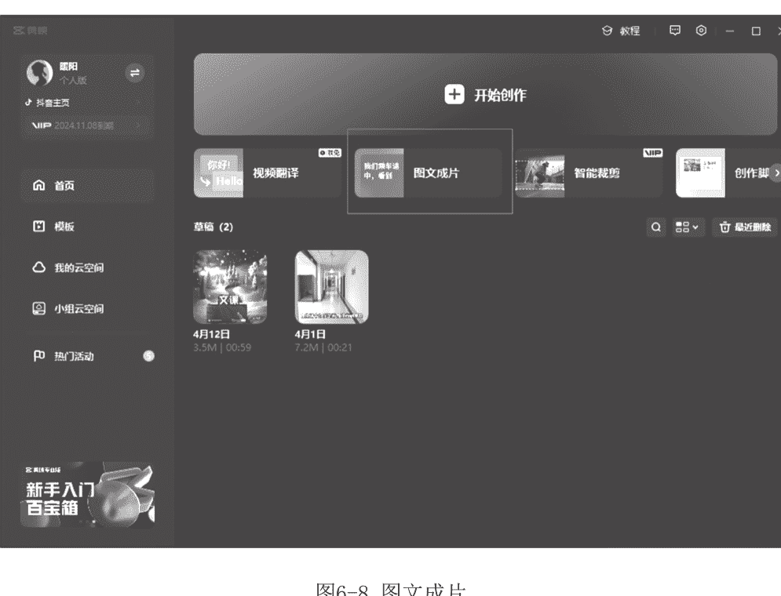

#### 1. 功能说明
输入一段文字，系统会自动匹配相关图片、加上字幕、旁白与音乐，合成完整视频。流程简化，无剪辑经验的教师也能做出专业感。

#### 2. 操作步骤
1）打开剪映并选择图文成片功能：启动后点击“开始创作”下的“图文成片”。
2）输入文字：选“自定义输入”模式，填入与导入相关的故事、趣味事实或提问，如图6-9所示。
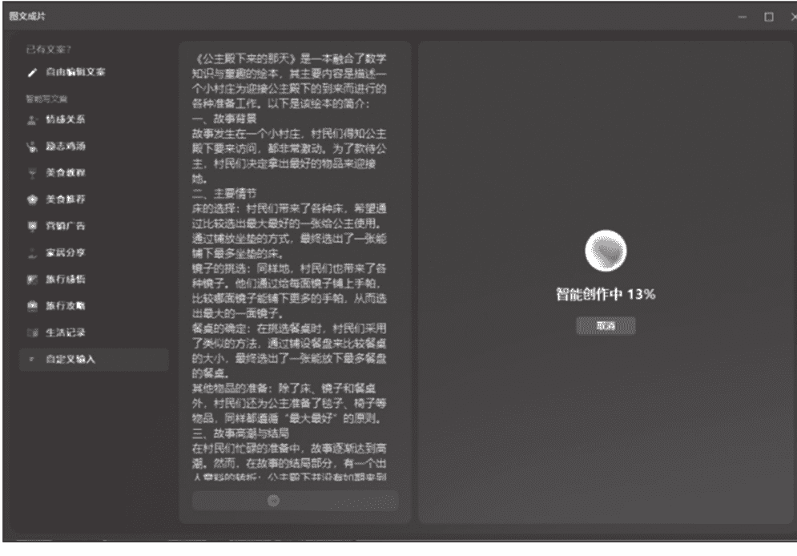

图6-9 输入文字
3）生成视频：点“生成视频”，系统依据文字自动匹配素材并合成预览。
4）编辑视频（可选）：预览不满意可点编辑，更换图片、修改字幕样式、调整音乐等。
5）导出视频：编辑完成后点右上角“导出”，选择分辨率与格式保存。

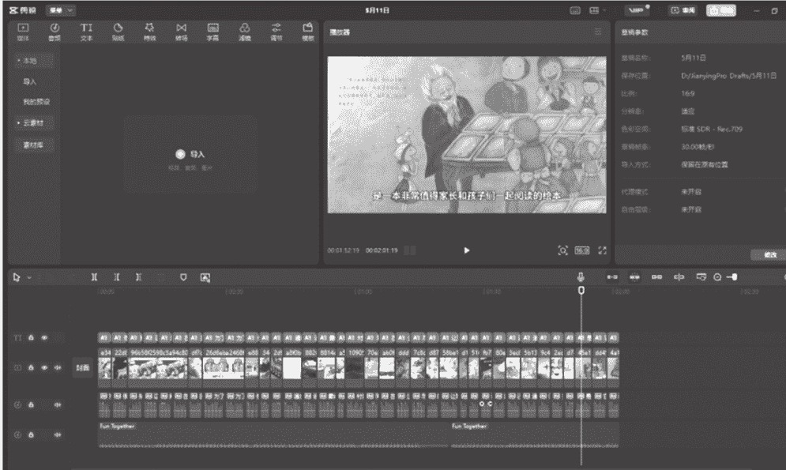

图6-10 生成预览视频

#### 3. 典型场景
- 故事导入：把与课相关的小故事制成视频，激发兴趣与好奇。
- 问题导入：制作含系列问题的视频，以提问引导思考，为新课铺垫。
- 知识回顾：在新课前快速生成上节要点回顾视频，巩固旧知识。

#### 4. 长处与限制
##### （1）长处
- 上手快：无经验者也能迅速操作。
- 内容丰富：自动配图并加入字幕旁白，信息更饱满。
- 省时：大幅压缩制作耗时，提高效率。
##### （2）限制
- 自动配图偶有偏差：匹配不一定完全贴合文字，需手动修正。
- 创意受限：基于模板生成，个性化不足，需教师补充独特元素提升吸引力。

# 第7章 教育智能体
本章聚焦AI Agent在教育中的应用与演进。先介绍智能体概念及在教育领域的变迁，再阐述其如何减轻教师负担、提升教学效率并提供个性化支持。随后以智能辅导、个性化推荐等案例展示实际效果，并展望情感智能、沉浸式教学等未来方向。学习后，教师与学生能更好地理解与运用AI Agent，推动教学创新。

本章主要知识点：
- 智能体和教育智能体。
- 教育智能体革命。
- 师生与智能体的课堂互动。
- 智能化教育生态系统。

## 7.1 从智能体到教育智能体
本节简要介绍智能体概念与作用，列举代表性教育智能体，并对未来进行展望。

### 7.1.1 智能体
智能体即AI Agent，中文亦称代理、智能体等。通俗说它是能自动完成任务的软件，可理解日常语言并按用户偏好提供个性化服务。可视作会感知环境、自主行动并通过学习不断提升性能的智能机器人，如图7-1所示。


图7-1 智能体的环境感知与“自我”感知

扣子智能体中心如图7-2所示，智谱清言智能体中心如图7-3所示。

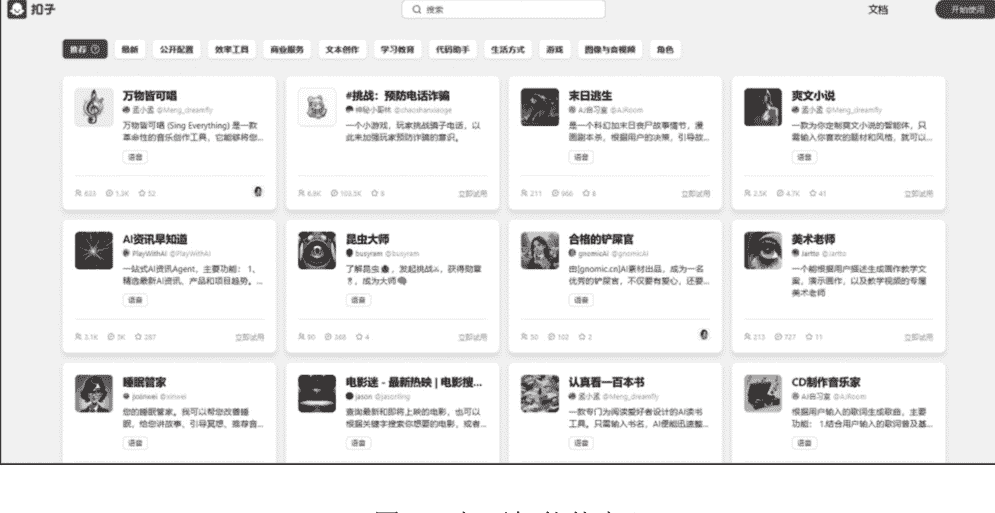

▲图7-2 扣子智能体中心

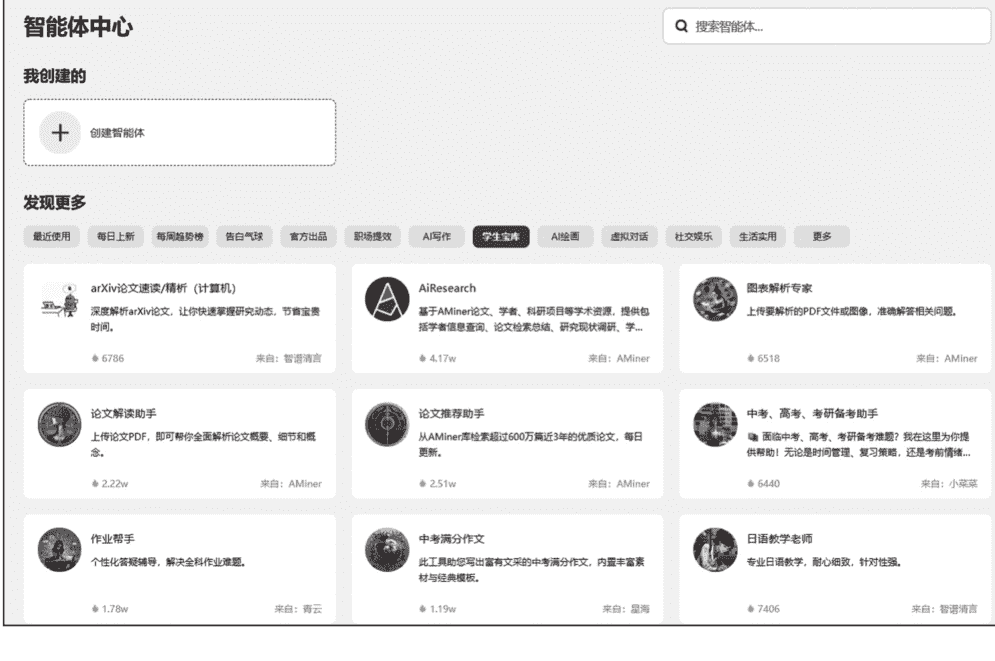

▲图7-3 智谱清言智能体中心

比尔·盖茨认为，智能体不仅会改变人机交互方式，还将重塑软件行业，带来自命令行到图形界面以来最大的计算变革。他预测交互将发生根本变化，智能体会理解口语指令并执行任务，无需在不同应用间切换。

通过自然语言与智能体交互，可在任务间进行直观个性化沟通，带来至少三方面价值：
- 将人从重复劳动中解放，降低压力并提升效率。
- 无需提供低级显式指令，智能体可自主分析规划解决问题。
- 解放双手后尝试解放大脑，在前沿科学等领域助力创新探索。

比尔·盖茨于2023年11月9日发文称，未来五年上网者都将拥有智能体，生活方式将彻底改变。

### 7.1.2 教育智能体
教育智能体的萌芽可追溯至上世纪八十年代的计算机辅助教学系统。九十年代机器学习兴起后，系统具备初步自适应能力。进入二十一世纪，大数据、云计算与深度学习的突破为其快速发展奠基，使其能处理海量数据并制定精准个性化方案。早期典型代表有：
- （1）智能辅导系统
如ALEKS，利用知识图谱与算法实时诊断学习弱点并规划路径。随着AIGC应用，系统可动态生成题集与解释，更贴合即时需求。
- （2）个性化学习推荐系统
如Knewton等平台借助机器学习结合AIGC，不仅分析学习行为，还能依反馈与最新资源智能生成推荐，提升内容多样性与针对性。
- （3）语言学习伙伴
如Duolingo聊天机器人，通过AIGC创造贴近真实交流的场景，提升趣味与实效，并依用户情绪调节对话策略。

### 7.1.3 教育智能体的发展前景
随着AIGC快速发展，教育智能体展现出巨大潜力。通过训练海量文本，可生成高质量教育内容，作用包括：
- 定制化教材与练习：按水平与兴趣自动生成个性化教材、习题与案例，提升效率。
- 交互式学习情境：模拟真实对话与场景，构建沉浸式环境，培养问题解决与批判思维。
- 创作辅助工具：在写作、项目策划等环节提供灵感、结构建议与初步内容生成，促进创造性思维。
- 多语言学习与翻译：生成地道外语材料并提供即时翻译，打破语言壁垒，促进国际教育交流。

未来趋势：
- 情感智能与心理支持：借助深度学习与情绪识别，感知学生状态并提供适时心理疏导，营造健康氛围。
- 全息与虚拟现实教学：结合AR/VR带来沉浸式体验，让抽象概念具象化。
- 终身学习生态构建：成为个人终身学习伙伴，依持续更新的知识库与个性化推荐支持职业发展与兴趣探索。

AIGC正引领教育智能体迈向新纪元，为全球学习者开启更智慧、个性化、高效的学习未来。

## 7.2 教育智能体革命：将智能体用于教育现场
我们已了解Agent含义。目前多家大模型平台汇集了用户创建的各类AI Agent。例如国外OpenAI的GPTs Store中有大量可视为轻量Agent的GPTs应用，国内平台也提供智能体创作服务。本节探索适用于日常教学的AI Agent。教育智能体应用场景的设想如图7-5所示。


### 7.2.1 教育GPTs
ChatGPT中的教育GPTs依托GPTs Store，是全球共创平台，教育工作者可按需创建并发布个性化GPTs供使用。教育GPTs是面向教育领域的智能对话系统，利用自然语言处理技术为师生提供个性化支持与互动。GPT界面如图7-6所示。

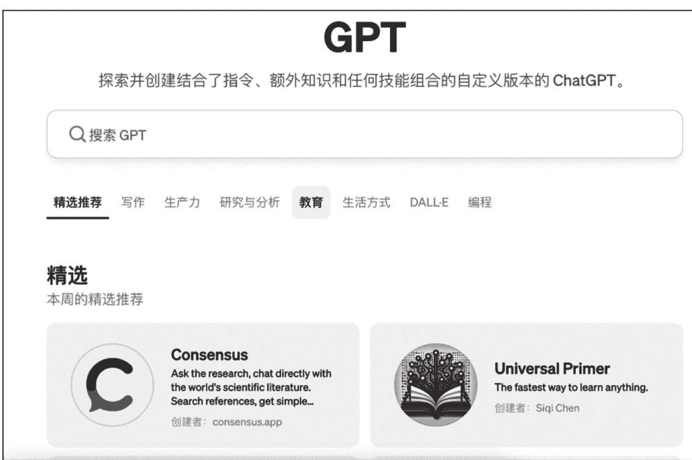

#### 1. 语言学习GPTs
“Language Teacher | Ms. Smith”支持20多种语言，包括西班牙语、法语、德语、英语、日语、汉语等，其语言选择界面如图7-7所示。它可作为私人语言导师，通过对话帮助用户有效学习语言，也能通过有趣话题提升词汇量并提供指导。用户在手机上也可通过语音与该GPTs对话。


#### 2. 文本解析型助手
ChatDOC 这类工具属于阅读提效型生成式助手，教师与研究者可把论文、教学方案、科研资料直接导入，由模型完成解读、拆解乃至二次创作。图7-8展示了它在处理教学设计时的使用效果。

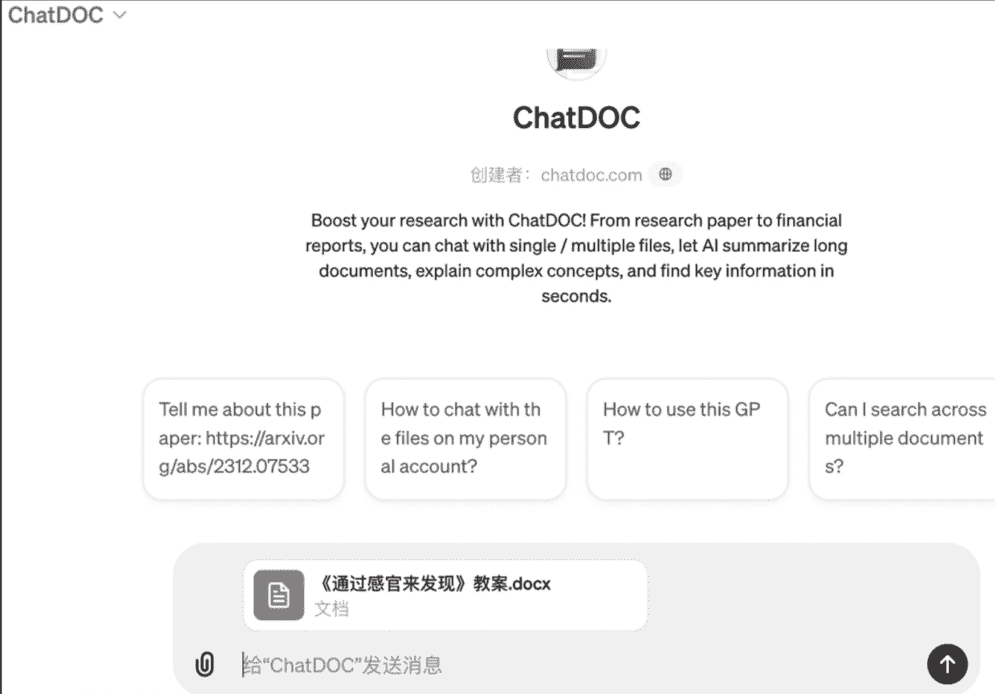

阅读结束后，系统会自动输出要点归纳，用户还能就原文追问，或在原基础上进行改写与拓展。此类助手在文献精读、科研攻关、观点提炼等环节可明显提升效率。以下汇总了适用于教育科研的代表性GPTs。

▼表7-1 适用于教育科研的GPTs

| 名称 | 功能 |

|---|---|

| Scholar AI | 从2亿多篇研究论文和书籍中搜索并分析文本、图片和表格，可以根据用户需求一键匹配参考文献 |

| Consensus | 查询研究成果，直接与全球科学文献对话。搜索参考文献，获取简单解释，撰写有学术论文支持的文章 |

| Scholar GPT | 通过超过2亿种资源和内置的批判性阅读技能增强研究，能够轻松访问Google Scholar、PubMed、JSTOR、Arxiv等 |

#### 3. 儿童绘本创作助手
儿童绘本生成器如图7-9，支持故事文本与插画一站式产出，兼具简易模式与专业模式。先由模型撰写故事，再据此绘制配图，借助自动化流程快速完成绘本制作。

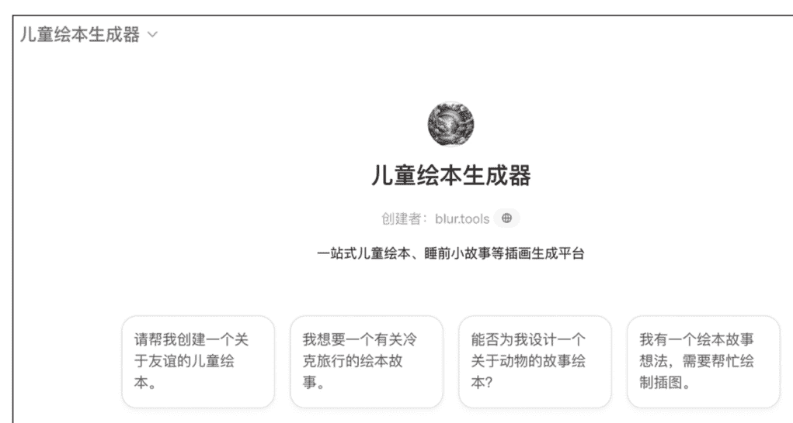

技术更迭迅速，教学创新也在不断前行。倡导教师积极尝试新工具，持续挖掘AI在各类教学场景中的价值。每一次探索都在累积经验，每一次突破都在推动教育变革。

### 7.2.2 国内主流教育智能体盘点
国内已有不少平台上线智能体模块，教师可在多平台体验教育类AI Agent，也能自行搭建专属应用。

#### 1. 各大平台智能体概览
下面一同查看智谱清言、豆包、通义大模型上的教育AI Agent应用，并学习如何打造个人专属智能体。国内常见大模型平台见表7-2。

表7-2 国内常见的大模型平台

| 大模型平台 | 官方网址 | 主要特点 |

| :--- | :--- | :--- |

| 智谱清言 | https://chatglm.cn/ | 清华大学团队研发，有 App 版本 |

| 豆包 | https://www.doubao.com/chat/ | 抖音团队研发，可以用语音和智能体对话 |

| 通义大模型 | https://tongyi.aliyun.com/ | 阿里团队研发，有通义 App，支持语音对话 |

在上述平台上，用户创建了大量教育智能体，如图7-10～图7-12所示。

可通过“学习”“教育”“教师”等关键词快速定位专属的教育智能体，进入后通常就能直接使用。平台一般会先说明该智能体的核心功能，方便用户迅速进入使用场景。

以“慧心班主任”AI Agent 为例，体验效果如图7-13所示。

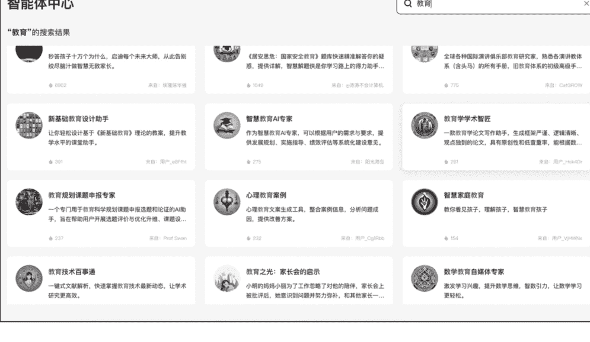

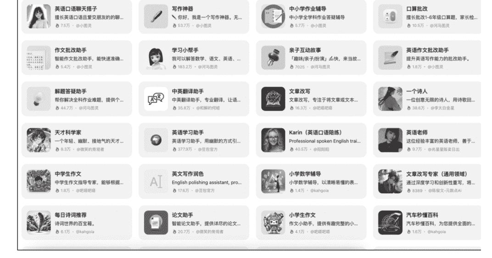

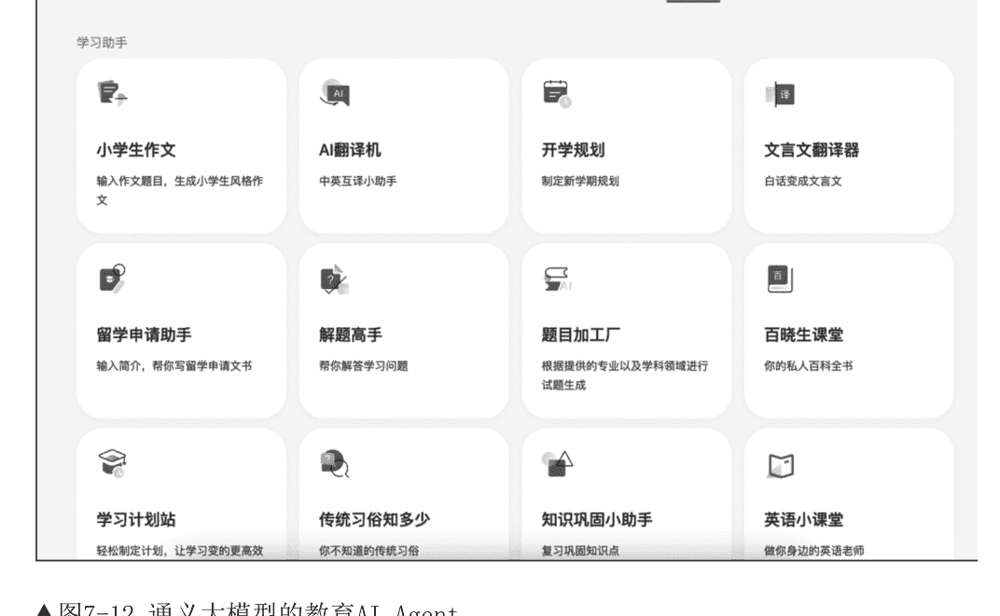

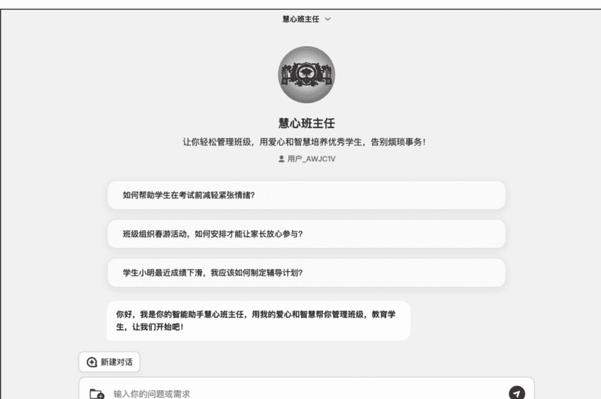

下面向“慧心班主任”提出一个问题：“如何帮助学生在考试前减轻紧张情绪？”如图7-14所示。

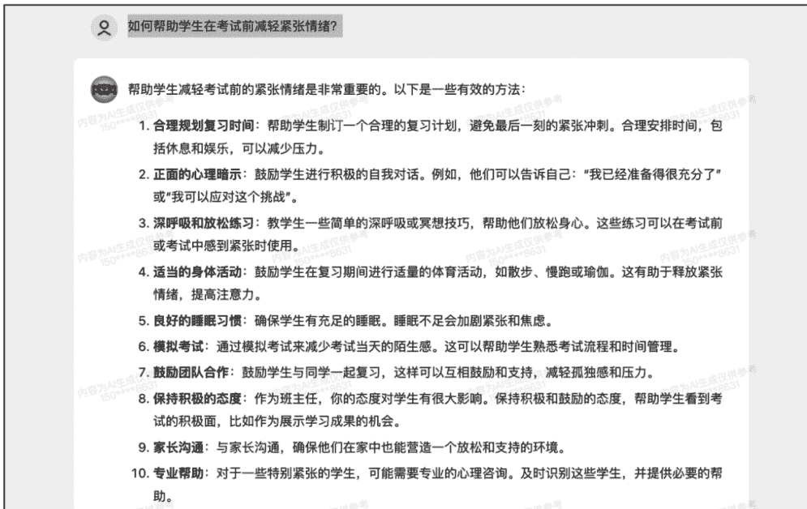

#### 2. 自建专属教育智能体
除平台现有应用外，还可自行定制专属教育智能体。

下面以豆包为例演示制作流程。

1）注册平台。首先打开豆包官网 https://www.doubao.com/chat/ ，完成账户注册。豆包平台界面如图7-15所示。

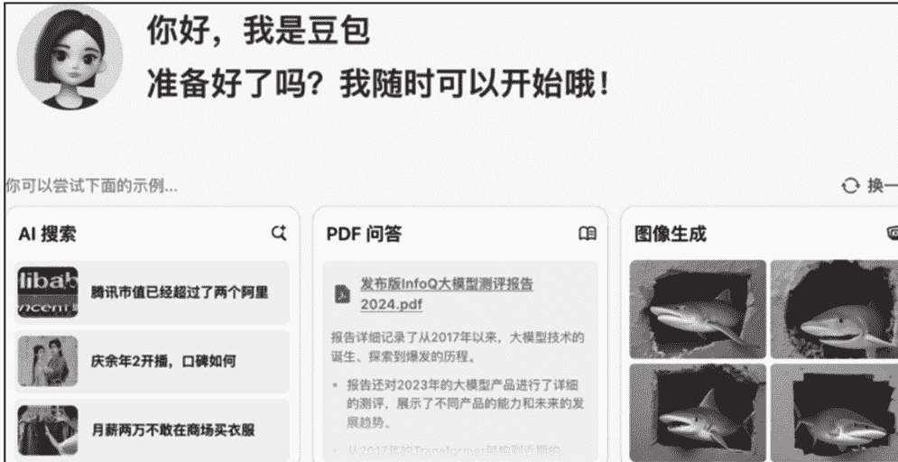

2）创建智能体。登录后选择“发现AI智能体”，在右上角点击“创建AI智能体”，如图7-16所示。


3）配置AI Agent 详细信息。例如制作一个“智慧校长”AI Agent，帮助校长处理日常事务，如撰写会议发言稿，并在教学、德育、校园安全、总务、学校信息化等方面具备丰富经验。具体配置如图7-17所示。


输入指令：

> 你是一名资深的中小学校长，对于学校管理有丰富的经验，如学校的教学事务、德育事务、总务事务、信息化发展应用事务等，非常善于公共校园演讲，对于鼓舞学生和教师有丰富的经验。

4）发布AI Agent。完成上述设置后即可发布并使用，如图7-18所示。


> 德育工作重点是什么呀？

作为校长，我认为德育工作的重点在于培养学生的品德和社会责任感。我们不仅要关注学生的学术成绩，更要注重他们的品德教育。

首先，我们要教导学生尊重他人，包括老师、同学和其他工作人员。尊重他人的意见和权利，学会倾听和理解别人的观点，是建立和谐校园的基础。

其次，我们要培养学生的社会责任感。学生应该明白自己是社会的一员，应该为社会做出贡献。我们可以通过组织志愿者活动、社区服务等方式，让学生亲身体验到帮助他人的快乐和意义。

最后，我们要注重培养学生的道德判断力。在当今复杂的社会环境中，学生需要具备正确的道德观念和判断能力，才能做出正确的选择。我们可以通过课堂教学、主题班会等方式，引导学生思考道德问题，培养他们的道德判断力。

总之，德育工作是学校教育的重要组成部分，我们要共同努力，培养出有品德、有社会责任感的新一代。

## 7.3 课堂实战：人机共创新模式
AI Agent 属于面向特定问题的AI应用，正逐步渗透到各类教育场景。通过真实案例可以看到，智能体如何参与课堂互动，助力学生自主学习与问题解决，如图7-19所示。本节详述交互方式与实践成效，为教师提供可借鉴思路，推动教学智能化升级。


### 7.3.1 人机互动有哪些形式
AI Agent 可集成到软件App或大模型网页中。师生可通过文字或语音与之交流。文字交互即打字提问，如图7-20所示。语音交互则借助“实时通话”进行交流，如图7-21所示。


### 7.3.2 课堂落地案例拆解
AI Agent 可依据教师需求与课程内容定制。因其既能产出文字，也能产出图像，教师可将其融入具体教学情境。

#### 1. 案例：英语课秒出圣诞插画
在“圣诞节”英语课上，教师可让学生用英文文字或语音描述圣诞元素，智能体就能据此快速绘制一张图。制作方式与前文“智慧校长”智能体相同，关键在指令撰写。下面给出参考指令，制作完成后可实现如图7-22所示的效果。

参考指令：

> 你是一个圣诞图生成器，只要给出圣诞节相关的英文单词，就能够绘制出关于本单词的图片出来。


#### 2. 案例：语文听写智能读词
语文课常出现新字新词，为巩固记忆常采用听写。此时可制作一个智能体，输入对应词组后即可朗读，供学生进行听写训练。具体步骤同前文“智慧校长”智能体，指令撰写需注意。下面给出参考指令，制作完成后的效果如图7-23所示。

参考指令：

> 你是一个课堂听写助手，我会给你一些语文或者英语的词语，然后你分别读出这些词语，每个词读两遍，等待5秒，再读下一个词。


#### 3. 案例：历史课扮上时间旅者
在历史课上，智能体可扮演“时间旅行者”角色，为学生讲解特定历史时期的事件与人物，回答提问并提供相关史料与图片。

学生可在课堂上就某一历史时期提问，智能体提供详细解答并展示历史文献与图片。制作步骤同7.2节“智慧校长”智能体，关键在于指令设计，下面给出参考指令。

参考指令：

> 你是一个历史事件研究者，只要给你一个历史事件的名称，你就能解释发生了什么，并能够用一张图描述这个事件。

“时间旅行者”智能体的实现效果如图7-24所示。


课堂实证表明，该智能体有助于提升历史学习的趣味性与互动性，提高学生知识水平与理解能力。

## 7.4 未来课堂：迈向智能教育生态
教育智能体正逐步融入教学各环节，成为传统模式革新的驱动力。借助其能力，教师能更高效地管理课堂，学生可获得更丰富、更个性化的学习资源。智能体的价值不仅限于办公辅助，更在于与课堂深度融合，形成多样化应用。教师可按需定制个性化教育应用，智能体正在悄然重塑教与学的样貌，如图7-25所示。


展望未来，我们期待建成全面引入AI Agent的智能化教育生态，实现教育的高效、公平与个性化。此类系统既能提升整体教学质量，又能培养学生的创新思维与适应未来社会所需的综合素养。

# 第8章 AI教室：九大场景破解教学痛点
前7章围绕AI技术及其在教育领域的应用展开，涵盖数字化如何重塑教学模式、AI与教师职业发展的关系，以及生成式AI在教育中的实践潜力。这些内容既揭示了AI的广泛潜力，也展示了如何通过工具与平台提升教学效率、促进个性化学习、丰富教学资源并激发学习兴趣。在此基础上，本章聚焦AI在不同学科教学中的关键作用，从语文到数学、英语、科学、艺术等，案例充分展现AI的多样性与实用性。通过具体教学案例，为教师提供灵感与策略，帮助其利用AI优化课堂、激发兴趣、提高效率并促进学生全面发展。本章既涵盖实际应用案例，也探讨跨学科项目与AI的结合，为未来教育发展提供新视角。

本章核心是AI在多学科教学中的创新应用：深入探讨AI如何在语文、数学、英语、科学、艺术等学科中丰富教学内容与方法，展现AI的多样性与实用性，如图8-1所示。


图8-1 多学科AI应用

## 8.1 语文课：AI助你读懂古诗意境
本节探讨如何利用AI技术增强学生对古诗文意境的理解与欣赏，介绍AI如何通过文本分析、图像生成等技术帮助学生深入探索古诗文的隐含意义与美学价值。如图8-2所示，用AI生成柳宗元《江雪》的场景图。


千山鸟飞绝

万径人踪灭


孤舟蓑笠翁

独钓寒江雪

图8-2 AI生成《江雪》的场景图

### 1. 让AI画诗意
图8-2即让AI根据古诗意境绘制出逐句对应的画面，对低年级学生理解古诗帮助很大。操作思路是先让AI理解古诗，再据此进行绘画。

下面以文言文课文《桃花源记》为例讲解制作过程。

第一步：工具准备。首先需要大语言模型，如当下流行的ChatGPT或国内的通义千问，用于撰写AI绘画的提示词指令。然后需要AI绘画工具，如DALL·E3、Midjourney，或国内的通义万相、文心一格等，用于根据提示词生成图片。

第二步：根据主题写指令。对于知名古诗文文言文，AI大模型通常已学习过。若想绘制生僻文本，可先将原文上传让AI理解。接下来用直接提问方式对话。

提问指令1：

你知道陶渊明的《桃花源记》吗？能简要介绍这篇文章吗？

ChatGPT：

《桃花源记》是中国东晋时期著名诗人陶渊明创作的一篇散文。文章描绘了一个理想的世外桃源，讲述了一个渔夫偶然发现的与世隔绝、和平安宁的村庄。

主要内容如下：

一位渔夫在河中捕鱼，顺流而下，进入了一条狭窄的溪流，发现了一片桃花林。林尽水源，发现了一个洞口，进去后发现一个美丽的村庄，村民们过着与外界隔绝的和平生活。他们热情接待了渔夫，告诉渔夫他们的祖先为了逃避战乱而来到这里定居。渔夫离开村庄后，向他人讲述了这一奇遇，但再也找不到进入桃花源的路了。

《桃花源记》表达了陶渊明对理想社会的向往，反映了人们对和平、安宁生活的渴望，以及对现实社会的失望。文章语言优美，意境深远，成为中国文学史上的经典之作。

此时可见AI已掌握该文。继续提问，让它列出文章按时间线的主要场景。若回答不理想，可调整指令再问。

提问指令2：

请你帮我总结一下，根据时间线来说，这篇文章主要有哪些场景？请你详细分析，以方便我后期绘图。

ChatGPT：

《桃花源记》按时间线划分，可以分为以下几个主要场景：

-   渔夫发现桃花林：

场景描述：一位渔夫在河中捕鱼，沿着溪流划船，突然发现两岸布满了桃花，花香扑鼻，花瓣纷飞。

绘图要素：渔夫在小船上，两岸桃花盛开，花瓣飘落在水面上，溪流清澈见底。

-   进入狭窄的山洞：

场景描述：渔夫继续前行，发现溪水尽头有一个狭窄的山洞，洞口仅容一人通过。

绘图要素：狭窄的洞口，渔夫靠近洞口查看，洞内一片昏暗，洞口周围有藤蔓植物。

-   发现桃花源：

场景描述：渔夫穿过山洞，眼前豁然开朗，出现了一片开阔的田野，村庄坐落其中，屋舍俨然，鸡犬相闻。

绘图要素：明亮的田野，整齐的房屋，村民在田间劳作，鸡犬在村庄中闲逛，远处青山环绕。

-   村民热情接待渔夫：

场景描述：村民发现渔夫，感到惊讶且好奇，热情地招待他，并向他讲述村庄的历史。

绘图要素：村民围绕渔夫，带他参观村庄，村民脸上带着友善的笑容，背景是宁静的村庄景象。

-   渔夫离开桃花源：

场景描述：渔夫在村庄中逗留数日，决定离开，村民为他指引出村的路径，叮嘱他不要外泄。

绘图要素：渔夫告别村民，依依不舍地离开村庄，穿过山洞回到外界，洞口的光线逐渐明亮。

-   渔夫返回现实世界：

场景描述：渔夫返回家乡后，向他人讲述自己的奇遇，但再也找不到通往桃花源的道路。

绘图要素：渔夫回到家乡，与家人和朋友分享他的经历，但表情略带失落，背景是普通的乡村景象。

AI共给出6个场景，接下来据其提供的场景与绘图描述，让AI绘制对应图片。

提问指令3：

请你根据上述的绘图描述绘制图片。

展示其中部分ChatGPT绘图的效果，如图8-3所示。


渔夫误入桃花林

渔夫发现桃花源

AI让经典可视化：语文课堂的新打开方式


桃花源中人们的生活场景

渔夫离开桃花源

图8-3 AI绘制《桃花源记》的场景

用AI绘画手段，艰深的古诗文可以被转成具象画面，把过去全靠脑补的情节直接呈现出来，理解的门槛随之降低。

### 2. AI绘制课本内容

语文课堂上，人物形象往往只能在学生脑中自行搭建，不同读者描绘出的画面各不相同。借助生成式绘画，学习者能够把对课文人物的认识外化为图像，比如《木兰诗》中的花木兰、《孔乙己》中的孔乙己、《背影》中的父亲。课文中出现的自然景致也能被具象呈现，比如郁达夫《故都的秋》里的旧都风貌、陶渊明《桃花源记》里的理想之乡、苏轼《赤壁赋》里的江上月色，只需给出相应指令就能生成场景，让学习更立体，文本共鸣更强。

提示词示例1：

木兰穿着传统的战袍，佩戴着盔甲，表情坚毅。她骑着一匹骏马，手持长枪，在战场上英勇奋战的瞬间。背景是广阔的沙场，可以看到远处战争的烽火和战友们的身影。

上述提示词的生成效果如图8-4所示。


图8-4 AI绘制木兰形象

提示词示例2：

孔乙己作为一个穿着破旧长衫的清贫书生，形象瘦弱、面容憔悴，但神态带有一丝滑稽。他站在镇上的酒店内，手持一碗黄酒，眼神略显迷茫和哀伤，身旁是他经常光顾的酒店环境，可以看到简陋的桌椅和其他顾客的侧影。

上述提示词的生成效果如图8-5所示。


图8-5 AI绘制孔乙己形象

提示词示例3：

描绘秋天的北平城景，展现城墙外宽阔的金黄色菊花田，与城墙上翠绿的古藤相映成趣。远处可见模糊的古塔和低矮的屋顶，天空呈现深秋的湛蓝，偶尔飘过几片飘零的树叶。整个画面应呈现一种淡淡的忧郁与怀旧情绪，体现出作者对故都的深情回忆与秋日特有的萧瑟感。此画面不仅要展示自然景观的美，还要传达出一种时间流逝、物是人非的感慨。

上述提示词的生成效果如图8-6所示。


图8-6 AI绘制故都的秋

提示词示例4：

清朗的月夜下，长江水面波光粼粼，倒映着皎洁的月光。江面小船轻摇，苏轼与友人在水面抚琴对饮，背景是迷蒙的赤壁峭壁，隐约可见岩石上的古老题刻，周围环绕着薄雾，营造了神秘和幽静的气氛。整个场景融合了文人墨客和自然的宁静美。

上述提示词的生成效果如图8-7所示。


图8-7 AI绘制赤壁赋夜景

## 8.2 数学天才：个性化出题与解析

本部分聚焦AI在数学教学中的革新性作用如图8-8所示，重点说明分层命题与智能解析如何助力学生成长。依托大模型，可以展现AI在捕捉学习需求、定制内容、提供即时针对性反馈方面的能力。探讨其如何打破传统教学局限，构建真正的个性化学习路径，提升解题素养，让每位学生都能发挥最大潜能。


图8-8 AI在数学教学中的应用

### 1. 当前数学教学面临的困境

从教师端看，主要难题是学情差异大、大班教学难以准备分层材料，易陷入一刀切。学情诊断与个性化反馈也因精力有限难以兼顾。

从学生端看，缺乏匹配的支持会带来两极体验：学有余力的学生因题目缺乏挑战而倦怠，基础薄弱的学生因跟不上进度而挫败。没有按个人节奏与兴趣设计的路径，会削弱学习动机与成效。

### 2. ChatGPT协助教师备课

针对上述痛点，大模型可为数学个性化学习提供多重支持。

（1）个性化出题

基于答题记录与学习进度，ChatGPT能够依据学生所处阶段与能力生成匹配题目，既避免过于简单导致缺乏挑战，也不至于过难引发挫败。不同难度梯度的题目如图8-9～图8-12所示。

提示词：

请根据数学知识点“一元一次方程”，列出不同难度梯度的题目，以方便班级内不同水平的学生练习。

ChatGPT的回答：

我会根据一元一次方程的难度梯度来设计题目，从基础到进阶，适合不同水平的学生练习。

#### 基础题（适合入门学生）

-   1. 解方程：$2x + 5 = 13$

-   2. 解方程：$3x - 4 = 8$

-   3. 解方程：$x + 7 = 12$

-   4. 解方程：$4x = 16$

-   5. 解方程：$\frac{x}{2} = 6$

▲图8-9 ChatGPT出基础题

#### 中等题（适合有一定基础的学生）

-   1. 解方程：$5x - 3 = 2x + 9$

-   2. 解方程：$2(x + 4) = 3x - 1$

-   3. 解方程：$4(x - 2) = 2(x + 6)$

-   4. 解方程：$7x + 3 = 4x + 15$

-   5. 解方程：$3(x - 1) + 2 = 2(x + 3) - 1$

▲图8-10 ChatGPT出中等题

#### 进阶题（适合高水平学生）

-   1. 解方程：$2(x - 3) + 4 = 3(x + 1) - 2x$

-   2. 解方程：$4(x + 5) - 3(2x - 1) = 2(3x + 2) - x$

-   3. 解方程：$\frac{2x - 3}{4} + \frac{x + 1}{3} = 2$

-   4. 解方程：$\frac{3x - 4}{5} - \frac{x + 2}{3} = 1$

-   5. 解方程：$6 - \frac{2x}{3} = 4x + \frac{5}{2}$

▲图8-11 ChatGPT出进阶题

#### 挑战题（适合拔高训练）

-   1. 解方程：$2x + 3(4 - x) = 5(x - 2) + 7$

-   2. 解方程：$\frac{3x - 1}{2} + \frac{5x + 3}{4} = \frac{7x - 2}{3}$

-   3. 解方程：$4(x - 3) - 2(2x + 1) = x - 6 + 3(x - 2)$

-   4. 解方程：$3x - \frac{4(x + 2)}{5} + 2 = \frac{7x - 3}{4}$

-   5. 解方程：$\frac{x}{2} - \frac{x - 1}{3} = \frac{2x + 3}{4} - 1$

▲图8-12 ChatGPT出挑战题

希望这些题目能够帮助你的学生根据自己的水平进行练习。有什么需要进一步调整或增加的，请告诉我！

（2）动态解析

遇到错误时，ChatGPT不仅给出正确答案，还能结合题型与具体错因生成针对性的解题步骤与剖析，帮助学生厘清错误并掌握正确方法。如图8-13所示，可汗学院创始人与儿子体验ChatGPT-4o解数学题。

（3）学习资源推荐

基于学情，AI还能推送配套资源，如视频讲解、在线课程或延伸阅读，以支持深度学习。以下以秘塔AI为例，秘塔AI可提供大量在线资源，也能辅助教师备课。

指令：

推荐6年级学生学习数学的课程资源。


图8-13 可汗学院创始人和儿子体验ChatGPT-4o解数学题（来源于网络）

秘塔AI整合全网相关资源并生成思维导图，如图8-14所示。


图8-14 6年级数学学习资源思维导图

秘塔AI不仅梳理了思维导图，借助全网检索能力，它还能迅速找到网络上的学习资源供师生使用，如图8-15所示。


图8-15 全面的网络学习资源

## 8.3 英语绘本：AI生成双语儿童故事

本节探讨借助AIGC创作双语儿童绘本，提升语言学习体验与文学鉴赏，如图8-16所示。重点介绍AI文本生成与图像生成协同打造兼具教育价值与审美性的双语故事。


图8-16 儿童绘本阅读

（1）确定儿童绘本故事主题

制作双语绘本前需先定主题，教师可依据学生年龄选择合适的阅读方向，本书以小学低年级为例，选取“勇气”为主题。

（2）AI问答生成儿童故事

确定主题后，可调用AI问答生成双语故事，本例使用国内大模型Kimi。故事长度也按年龄段设定。下面为指令与生成示例。

指令：

你是一名安徒生级别的儿童故事大师，请生成一个关于“勇气”的儿童故事，字数在300字以内，要求趣味性强，适合儿童阅读，并且是双语的（中文和英文）。

Kimi：

在一个遥远的森林里，有一只小兔子名叫勇勇。勇勇不同于其他兔子，它有着一颗渴望冒险的心。

One day in a far away forest, there was a little rabbit named Yongyong. Unlike other rabbits, Yongyong had a heart that yearned for adventure.

勇勇听说森林深处有一片神秘的蓝莓丛，那里的蓝莓能让人跳得更高、跑得更快。但是，那里也住着一只大灰狼。小兔子们都不敢去。

Yongyong heard that deep in the forest, there was a mysterious patch of blueberry bushes. The berries there could make one jump higher and run faster. However, a big gray wolf lived there too. The little rabbits dared not go.

一天，勇勇决定去探险。它戴上了一顶小红帽，以防万一。它小心翼翼地穿过树林，来到了蓝莓丛边。

One day, Yongyong decided to go on an adventure. It put on a little red cap, just in case. It carefully made its way through the woods and arrived at the edge of the blueberry patch.

勇勇发现大灰狼并没有那么可怕，它只是寂寞，想要一个朋友。勇勇和大灰狼成了朋友，一起分享了美味的蓝莓。从此，森林里的小动物们都知道了勇勇的勇敢故事。

Yongyong found that the big gray wolf wasn't scary at all; it was just lonely, wanting a friend. Yongyong and the wolf became friends and shared the delicious blueberries together. From then on, all the little animals in the forest knew the brave story of Yongyong.

这个故事告诉我们，勇气不仅仅是面对危险，更是敢于理解和接纳不同的事物。勇勇用它的勇气和善良，赢得了友谊和尊重。

This story teaches us that courage is not just about facing danger, but also daring to understand and accept different things. Yongyong used its courage and kindness to win friendship and respect.

（3）绘制故事场景图

获得故事内容后，可让AI绘制对应场景图，本节使用DALL·E3。

指令1：

请绘制这个场景图，在一个遥远的森林里，有一只小兔子名叫勇勇。勇勇不同于其他兔子，它有着一颗渴望冒险的心。

DALL·E3绘制的图片如图8-17所示。


图8-17 绘本图片1

接下来的图片根据上述方式绘制即可。

指令2：

绘制这个场景，勇勇听说森林深处有一片神秘的蓝莓丛，那里的蓝莓能让人跳得更高、跑得更快。但是，那里也住着一只大灰狼。小兔子们都不敢去。

DALL·E3绘制的图片如图8-18所示。


图8-18 绘本图片2

## 8.4 小小科学家：AI点亮科学的奇妙之旅

本节探讨AI如何激发儿童科学兴趣与探索欲，如图8-19所示。介绍科学AI Agent、VR虚拟现实等在科学教育中的作用。


图8-19 科学虚拟现实

### 8.4.1 制作一个科学AI Agent

科学课涉及光学、力学等多领域，学生提问各异。教师可制作细分知识领域的AI Agent，实现人机共育。科学AI Agent可：

- 回答科学问题：理解并解答学生关于科学学科的具体疑问，提供准确解释与概念解析。
- 生成教学内容：依据不同科学知识生成教学指导、实验步骤说明、概念讲解等材料。
- 互动学习：根据学生提问与反馈动态调整内容深度与难度，提供个性化体验。
- 持续学习和更新：随知识更新与互动数据积累，不断优化问答与内容生成。

下面以制作太阳系AI Agent为例，帮助学生学习太阳系行星知识。操作步骤如下。

#### (1) 注册智谱清言大模型平台账号

智谱清言 https://chatglm.cn/ 由北京智谱华章推出，用户用手机号注册登录即可体验。界面如图8-20所示。


图8-20 智谱清言界面

#### (2) 创建太阳系AI智能体

登录后点击左上角“创建智能体”，按提示填写智能体名称、简介、配置信息、开场白、推荐问题、模型能力调用、知识库文件。配置信息相当于提示词指令，需填写具体。太阳系AI智能体配置信息如图8-21所示。


图8-21 太阳系AI智能体配置信息

#### (3) 调试智能体

主要测试智能体回答是否符合学生视角要求，未达预期可继续修改配置信息。调试智能体如图8-22所示。


图8-22 调试智能体

#### (4) 发布智能体

调试完成后点击“发布智能体”按钮即可完成制作。

### 8.4.2 VR/AR平台导览

VR在科学课堂带来沉浸式体验，使抽象概念直观易懂。通过模拟真实科学环境与现象，VR让难以用传统方式呈现的内容变得可探索。

#### (1) 生物学

生物课上，学生可通过VR了解青蛙身体主要组成，真实实验难以实现，而App即可呈现。用Edmentum AR Biology，在应用商店搜索下载即可使用，如图8-23所示。

#### (2) 化学

化学教学中，VR可模拟物质实验反应，学生可在虚拟平台“操作”化学物质，观察混合反应过程，认识生活中少见物质的外观与变化，理解化学方程式的实际意义。如图8-24所示，使用VR模拟物质间化学反应。


▲图8-23 Edmentum AR Biology


▲图8-24 VR演示

#### (3) VR三维可交互课件设计

过去授课多依赖PPT，虽能嵌入音视频与简单互动，却始终局限于平面。VR、AR及元宇宙等新技术的兴起，推动可立体呈现、可自由拖拽、可全景浏览的三维教具逐步走进公开课。Nibiru Creator借助零编码、可复用模板、智能数据洞察与可视化逻辑编排，为教学赋能，让教师以更低成本更快速度完成三维互动素材制作，形成沉浸式数字讲义。相关示例可见图8-25。

#### (4) AR教学应用场景
AR正在悄然重塑课堂形态。将虚拟信息叠加到真实世界，学习者获得更直观的感知体验，也让过程更具互动趣味。教学中典型应用效果如图8-26所示。


▲图8-25 三维课件示例


▲图8-26 AR教育应用场景

## 8.5 创意跃升：智能作画激活艺术课堂
本部分聚焦人工智能绘画进课堂的路径，梳理技术落地方式，说明其如何点燃学生的创造欲与艺术表达，并盘点常用创作平台，为学习者提供全新表达渠道。场景构想如图8-27所示。


图8-27 AI绘画场景设想

### 8.5.1 智能作画助力童书绘本制作
在童书制作中，智能绘画兼具效率与个性化，能明显提升作品表现与教学价值。教师可依据文字自动生成与情节契合的插图，无论角色、动物还是环境，都能按语境与情感产出鲜活且风格多样的画面，且图文保持高度一致，有助于孩子更好理解故事。

案例故事：
远山林间藏着一处被月光常年洗礼的秘境，栖息着形形色色的动物，其中有胆怯的小兔阿白和开朗的小鹿丽丽。性情迥异却在一次偶然的碰面后结缘。某夜，两人在月光秘境里发现一只卡在树洞里的雏鸟。面对困局，阿白与丽丽携手，以智慧与勇气合力营救。它们搜集材料，拼凑出简易救援装置，攻克重重障碍。最终雏鸟脱困，两人也体会到协作的意义及接纳差异的价值。从此形影不离，每晚在月光下嬉戏，佳话在林间流传。故事温暖动人，也传递出以理解与合作维系友谊的道理。

将情节拆解为关键分镜，再用智能作画工具逐一生成配图。

#### (1) 首个分镜：静谧林海
提示词：
茂密植被与各类动物共存的林区远景，月光自枝叶间倾泻，营造神秘安宁气息。
场景绘制效果如图8-28所示。


图8-28 AI绘制森林场景

#### (2) 第二个分镜：主角初遇
提示词：
阿白与丽丽于月光秘境初次相见，突出阿白的腼腆与丽丽的好奇友善。
场景绘制效果如图8-29所示。

#### (3) 第三个分镜：发现困鸟
提示词：
两主角在树洞边察觉雏鸟被困，鸟儿神情焦急，二者流露关切。
场景绘制效果如图8-30所示。


▲图8-29 AI绘制阿白和丽丽相遇的场景


▲图8-30 AI绘制发现被困小鸟的场景

#### (4) 第四个分镜：协作造具
提示词：
呈现二人协作分工，阿白搜集材料，丽丽协助搭建简易救援装置。
场景绘制效果如图8-31所示。


图8-31 AI绘制合作搭建工具的场景

#### (5) 第五个分镜：获救庆祝
提示词：
雏鸟脱困后三者于月光下庆祝，氛围轻松愉悦。
场景绘制效果如图8-32所示。


图8-32 AI绘制脱险庆祝的场景

#### (6) 第六个分镜：友谊盛会
提示词：
结尾二人于月光秘境嬉戏，周边动物纷纷加入，共襄友谊盛会。
场景绘制效果如图8-33所示。


图8-33 AI绘制友谊庆祝的场景

### 8.5.2 智能作画焕新美术教学
#### 1. 智能作画进入美术课的价值
把智能绘画带入美术课堂可谓水到渠成，能催生全新教法与学习体验，让师生用不一样的视角探索艺术，提升互动并激发创造力。具体体现如下。

##### (1) 启发创意
创意是艺术核心，智能工具可为师生提供灵感触发点，学习者能迅速尝试多种画风。

##### (2) 技术学习与应用
美术课上学生既能练习传统技法，也能掌握智能创作工具的使用，包括优化指令生成图像、调节参数获取理想效果等。

##### (3) 批判性思维和分析
通过鉴赏AI艺术作品，学生可锻炼批判思维，对比人类创作与机器创作，评价元素构成，并思考智能绘画在艺术创作中的作用与影响。

#### 2. 绘画案例
##### (1) 同一主题多风格输出
以中国鼓楼为同一母题生成多种画风，效果见图8-34所示。


图8-34 AI绘制不同风格的图片

##### (2) 基于儿童涂鸦生成精美作品
在幼儿教育中，智能绘画可帮助教师把孩子天马行空的涂鸦转化为精致画作。本案例使用阿里旗下的AI作画工具“通义万相”。

1）访问通义万相官网 https://tongyi.aliyun.com/wanxiang/ 并完成注册登录。
2）进入应用广场，点开“涂鸦作画”功能，界面如图8-35所示。


图8-35 通义万相的“涂鸦作画”应用

3）可用鼠标或手指涂鸦，也可上传纸质手绘稿触发生成，效果如图8-36所示。


图8-36 AI生成涂鸦作画内容（通过涂鸦）

4）先涂鸦再补充文字描述并挑选风格，亦可生成图像，见图8-37所示。


图8-37 涂鸦作画（通过文字描述）

## 8.6 音乐新篇：AI作曲助力教学
人工智能在教育中的渗透已覆盖多领域。Suno不仅能协助创作，还能深化学习体验、激发创造力并帮助学生理解音乐理论，为教育者与学习者提供全新创作路径。人人皆可作曲的时代到来，如图8-38所示。


图8-38 AI与音乐

AI作曲的应用远不止增加趣味性，更可作为强有力的教学工具实现跨学科融合。本节将探讨其在语言学习、古诗文教学等场景的应用。

### 8.6.1 用AI歌曲点燃语言学习
在全球化教育背景下，语言学习至关重要。以英语为例，在中文母语环境中学习存在一定难度。借助Suno等AI工具，教师可将英语短文转化为歌曲，帮助学生记忆与理解。下面以一段英文短文为例演示生成流程。

1）进入Suno官网 https://suno.com/ 注册并登录，界面如图8-39所示。
2）将英语短文粘贴到“歌词”框，选择合适风格，点击“创造”，如图8-40所示。

英语短文：
Courage is not the absence of fear, but the triumph over it. It’s the brave decision to stand up for what is right, even when it’s difficult. Courage means stepping out of your comfort zone to face challenges head-on. It allows us to grow, taking risks to pursue our dreams and confront new experiences. Whether it’s speaking out against injustice or trying something new, courage is a vital part of personal growth and success. True courage involves making decisions that align with one’s values, regardless of the potential risks involved.


▲图8-39 Suno界面


▲图8-40 Suno生成音乐

3）等待音乐生成完成。
扫描二维码即可体验AI歌曲效果。


### 8.6.2 AI为古诗文配乐
AI作曲为古诗文、文言文学习提供了新方式。将传统文化与现代技术结合，能打造更具吸引力与互动性的学习环境。通过AI将古诗文转为歌曲，学生可在音乐中体会韵律与情感，让古老文字焕发生机。例如将曹操《短歌行》配乐，学生能更直观感受诗意。音乐还能提升记忆效果，且可融入琵琶、古筝等传统乐器音色，增强文化认同与传承。

生成方法与 8.6.1 节相同，只需把古诗文输入歌词框并选择合适的音乐类型即可。曹操《短歌行》的音乐案例，可以通过扫描二维码体验。


## 8.7 历史课堂：AI让过去复活
本节探索AI在历史学科的革新应用，比如让AI Agent扮演历史人物，增强互动性与学习体验，如图8-41所示。

AI不仅能复原历史人物的形象，还能模拟其语言与语气，让人物“复活”与师生对话。教师也能让历史人物画像“开口说话”，提升课堂趣味。


图8-41 AI在历史学科中的应用

### 8.7.1 AI Agent扮演历史人物
多数AI大模型平台提供历史人物AI Agent，让学生与历史人物交流。通义星尘中就有刘备、王阳明、爱因斯坦等角色，如图8-42所示。官网为 https://xingchen.aliyun.com/xingchen/roles，打开即可体验对话。


随后可与爱因斯坦、刘备的AI角色对话，对话内容如图8-43、图8-44所示。

若未找到合适角色，平台支持自定义。操作方式如下：
1）在通义星尘界面点击“创建角色”按钮，如图8-45所示。
2）填写角色相关信息，如图8-46所示。

### 8.7.2 让历史名人画像开口说话
各学科名人都可借助数字人技术“复活”，在课堂与学生互动，既增加趣味也深化理解。例如物理课对话爱因斯坦，语文课对话李白，历史课对话古代帝王。本节介绍具体操作。

让名人画像说话的核心是数字人功能，腾讯智影、万兴播爆、美册App、DID等均支持。以腾讯智影为例：

1）选择一张历史名人图片。选择照片的时候，尽量选择五官清晰、表情舒缓的正面人脸照片，如图8-47所示。


图8-47 爱因斯坦照片（来源于网络）

2）登录腾讯智影平台：https://zenvideo.qq.com/。
3）进入腾讯智影，选择“数字人播报”模块，如图8-48所示。


图8-48 腾讯智影界面

4）输入历史人物的说话内容，并选择合适的音色，之后单击“合成视频”即可，如图8-49所示。现在，我们就能看到历史人物图片“开口说话”了。


图8-49 腾讯智影的数字人说话

## 8.8 编程教学：AI赋能代码学习
传统编程教学依赖静态教材与统一计划，缺乏个性化与时效性，学生学习复杂概念时挑战较大。引入AI大模型后，教学变为动态、互动且高度个性化的过程，如图8-50所示。


图8-50 大模型辅助编程教学

AI可实时生成教学内容与代码示例，根据反馈调整策略，提供个性化练习与即时问题解决方案，提升效率、质量与学习动力。

### 8.8.1 AI如何改变编程教学
大模型出现前，编程门槛较高，主要原因有：
- 编程要求强逻辑思维与对算法、数据结构等概念的深入理解，初学者学习曲线陡峭。
- 调试与优化代码需要丰富经验与技术洞察力。
- 技术快速迭代要求持续学习新语言与工具。

因此，熟练程序员更受青睐。但大模型出现后，基础编程工作可被协助完成。例如GPT-4演示中，用户只需绘制网站框架，大模型即可快速生成网站，效率远超人工，这将推动高校编程专业变革。图8-51展示阿里的通义灵码智能助手 https://tongyi.aliyun.com/lingma/，可辅助编程。


图8-51 通义灵码

大模型在编程方面可执行以下任务。
- 代码生成：大模型可以根据用户的指令描述自动生成代码，还可以指定编程语言。
- 代码补全和修复：大模型能够提供代码补全建议，帮助开发者快速完成编码任务。此外，它还能识别代码中的错误或缺陷，并提供修复建议，这极大地提高了开发效率和代码质量。
- 代码解释和文档编写：大模型能够解释复杂的代码逻辑，并生成相应的文档或注释。这对于增强代码的可读性和可维护性非常有帮助，尤其是在处理遗留代码或开发大型项目时。

### 8.8.2 AI辅助编程教学案例演示
基于大模型的编程能力，在编程教学过程中，大模型可以帮助教师备课、帮助学生修改程序错误、模拟个性化编程练习等。

下面以学习Python的多分支语句为例，我们使用大模型进行编程课程的备课工作。

指令1：

让AI替你找灵感：编程案例与跨学科教学的升级打法

作为一名初中编程老师，正在备课 Python 多分支语句，想让 AI 帮忙想一个学生能共鸣的实战情境。

AI 最先抛出的方案叫《校园活动选择助手》。设定是学校同时开设体育、艺术、科学、文学几类活动，程序会根据学生填写的兴趣偏好，用多分支语句给出对应的活动推荐。代码示例见图8-52。

这个案例贴近校园生活，但对中学生的心理和现阶段学情挖掘还不够细。换个更具体的指令，效果就明显不同了。

指令升级后：
你是一名初中编程教师，要讲 Python 多分支语句，学生已学过 random 库，而且对冒险类游戏很感兴趣，请设计一个合适的情境案例。

```python
##### 获取学生的兴趣
interest = input("请输入你的兴趣（体育、艺术、科学、文学）：")

##### 多分支语句判断并输出推荐
if interest == "体育":
    print("你可以参加校园足球赛或篮球赛。")
elif interest == "艺术":
    print("你可以参加绘画或音乐工作坊。")
elif interest == "科学":
    print("你可以参加科学实验竞赛或天文观察会。")
elif interest == "文学":
    print("你可以参加诗歌创作或阅读俱乐部。")
else:
    print("未找到匹配的兴趣，请重新输入！")
```

图8-52 大模型生成的代码

这一次 AI 给出了《魔法森林探险》。故事里玩家化身探险者，在神秘森林里寻找宝藏，路上有多条岔路，每条路的风险与回报都不同。程序要让玩家在不同情境下做选择，用 random 库制造事件的不确定性，用多分支语句处理玩家的决策逻辑。优化后的代码见图8-53。

从这两轮对比能看出，指令越具体、越贴合学生真实认知，AI 生成的案例就越好用、越有意思。不仅能帮老师快速丰富课堂内容，日常里遇到要修 bug、要优化程序、要出个性化练习时，AI 同样能给出有针对性的支持。

```python
import random

##### 游戏开始
print("欢迎来到魔法森林！每条路都有不同的冒险等着你。")

##### 随机生成遇到的场景
event = random.choice(['巨龙', '沼泽', '老巫婆', '宝箱'])

##### 玩家做出选择
choice = input(f"你前方出现了{event}，你会怎么做？（战斗/逃跑/交谈/打开）：")

##### 多分支语句处理玩家的决策
if event == '巨龙':
    if choice == '战斗':
        print("你勇敢地战斗，巨龙被你击败了！")
    elif choice == '逃跑':
        print("你成功逃脱，继续你的冒险。")
    else:
        print("巨龙发怒了，将你一口吞掉。游戏结束！")

elif event == '沼泽':
    if choice == '逃跑':
        print("你没有逃脱成功，陷入了沼泽。")
    else:
        print("你小心翼翼地通过了沼泽。")

elif event == '老巫婆':
    if choice == '交谈':
        print("巫婆给了你一张地图，帮助你找到宝藏。")
    else:
        print("巫婆对你的无礼感到愤怒，变成了乌鸦飞走了。")

elif event == '宝箱':
    if choice == '打开':
        print("宝箱里满是金币和宝石，你发财了！")
    else:
        print("宝箱是魔法陷阱，你失去了前进的机会。")

##### 结束语
print("感谢你参与魔法森林的冒险！")
```

图8-53 大模型优化后的代码

8.9 AI驱动的跨学科教学新可能

本节聊聊 AI 如何打破学科边界，催生新的教学体验。我们会聚焦 AI 跨学科融合如何促进知识整合与创新，并点燃学生的创造力。


### 8.9.1 用AI快速搭建跨学科教学方案

先看 AI 如何辅助教师设计融合语文、音乐、美术等学科的综合项目。它能拆解各科教学目标与内容，生成整合性强的方案与素材，帮助学生多角度理解复杂概念。

下面以语文与英语融合为例。

提示词：
你是一名语文老师，要写一份跨学科主题教学案例，主题是四季，覆盖语文和英语两科，请给出一份简要教学设计。

AI 生成的方案如下：

教学设计案例
《四季》——语文英语跨学科教学

教学目标
提高学生描述季节变化的能力，能用中英文表达各季特征。
通过诗歌故事认识季节变化对人类活动的影响。
增强跨文化理解，通过对比中英文材料中对季节的描写，掌握跨文化交流技巧。

教学内容
语文部分：研读中国古典诗词中写四季的作品，如《春晓》《夏日绝句》《秋夕》《冬夜读书示子聿》。
英语部分：研读英语诗歌文学中对四季的描绘，如莎士比亚《仲夏夜之梦》里的夏夜，或罗伯特·弗罗斯特《雪夜林中小憩》中的冬景。

教学活动
活动一：四季词汇与表达学习
语文课上，教师引导学生诵读古诗，解析季节意象与用词。
英语课上，学生学习朗读英文诗，关注与四季相关的表达并做对比。

活动二：四季画册制作
学生用双语制作四季画册，每季配一首中文诗、一首英文诗，并附上自制绘画或拍摄的季节照片。
制作过程中，用双语写下各季特点与个人感受。

活动三：跨文化四季论坛
举办“四季跨文化交流论坛”，学生展示画册并用中英文介绍四季对生活的意义。
展开讨论中西方文化里四季的不同象征与生活方式差异。

评估方式
观察学生诗歌朗诵与论坛讨论的表现，评估语言运用与跨文化沟通能力。
通过四季画册评估学生对主题的理解深度与创意表达。

教学反思
活动后收集学生反馈，了解受欢迎的环节与待改进点。
反思跨学科教学的有效性，思考如何进一步整合语文英语资源，提升教学效果。

有了 AI 帮助，初稿很快成型。若想更细致丰富，只需在第4章提到的优化思路上继续打磨即可。

### 8.9.2 AI绘画：让多学科课堂更生动

在当下课堂里，AI 绘画正成为多学科融合的创新利器。它既能激发创造力，也能提升综合素养。美术课上可用来辨识不同风格与技法；语文课上可通过提示词生成课文人物的形象，让学生更直观把握人物特征；科学课上可把抽象概念可视化，便于理解。

把 AI 绘画融入不同学科，能显著提升互动性和趣味性，同时培养跨学科思维与创新能力。

以历史与美术融合为例。

案例背景：
学习文艺复兴时期欧洲历史时，教师可借助 AI 绘画重现当时的历史场景与名作。学生能直观看到建筑风格、服饰样式与重要事件。

比如让 AI 生成文艺复兴城市景观，学生更易感受那个时代的文化氛围；再让学生用 AI 模仿达·芬奇、米开朗琪罗等大师的画风，进一步理解作品的历史背景与艺术手法。

教师提示词：
创建一个细腻生动的文艺复兴时期城市景观。场景包含鹅卵石街道、带拱形窗与阳台的精美石制建筑，以及热闹的市场广场，广场上有人贩小商和身着当时服饰的市民。加入马车、街头艺人、华丽喷泉等元素。背景要有如大教堂般的历史地标，高耸尖塔与圆顶，并以连绵山丘或河流作衬。

AI 生成效果见图8-55。


图8-55 AI生成欧洲文艺复兴时期的场景

学生提示词：
生成一幅文艺复兴时期的艺术画作，风格为达·芬奇风格。

AI 生成效果见图8-56。


图8-56 AI生成的达·芬奇风格画作

融合教学的成效主要体现在：
对历史事件的理解明显加深，形成更持久的记忆；
学生对艺术作品的鉴赏力与审美素养得到有效提升；
对历史与美术学科的兴趣被充分点燃。