# AI同行：生成式智能赋能教学实践

## 写在前面

当前 AI 正以可见的速度渗透到各行各业，对课堂的改变尤为直观。作为长期关注教学实践的观察者，我们希望把智能技术在教育里的价值与可能性传递出去。AI 不仅打开了教与学的全新空间，也在悄然重塑认知方式和教学思维。本书的意图是帮助教研人员、学习者与技术爱好者更深入地理解智能技术在教育场景的落地路径，一起把握这轮技术浪潮的方向。

## 全书架构

整书划分为两大模块：

- 观念与走向：先从数字化演进对教育形态的冲击谈起，解析 AI 浪潮对知识观与学习观提出的新的要求；随后讨论智能时代人才应具备的关键素养，比如批判性思考、创造性解题、数字素养、人机协同、自主学习与持续学习；同时展望教师专业成长的新轨迹，为从业者提供前瞻性的思考参考。
- 技术与落地：系统呈现 AI 在教育里的典型使用场景与操作方式。从生成式智能的基础概念出发，到智能素材生成、文件处理、图像绘制、思维导图制作、科研辅助等诸多实践，覆盖大量可用的生成内容工具。再介绍 AI 在音视频处理、智能体等领域的创新用法，帮助读者掌握真实可用的方法。

## 建议的阅读顺序

本书追求易懂好用，读者可以根据兴趣自由选择章节。关注教育宏观趋势的读者，可优先阅读观念与走向部分；需要具体操作指引的读者，可直接进入技术与落地部分。每章都配有真实案例与分步说明，实用性强，便于在实操中快速掌握方法。

## 适用人群

本书定位为 AI 教育工具类读物，适合教育从业者与学生家长阅读。

- 教育工作者：有助于理解 AI 在教学中的前景，提升教学创新能力。
- 学生与家长：提供 AI 学习工具与使用方法，培养数字素养。
- 技术爱好者：了解 AI 在教育中的案例实践，拓展技术应用视野。

## 核心价值

- 前瞻且可操作：紧贴 AI 教育发展动态，精选最新案例与操作指南。
- 跨学科覆盖：涉及语文、数学、外语、科学、艺术设计、音乐、历史、编程等多个学科，培育跨学科应用思维。
- 案例丰富：通过真实案例展示 AI 在教育中的落地效果，直观理解技术价值。
- 指导详实：提供详细步骤与说明，便于迅速上手并应用于实际教学。

本书既能为读者提供前沿知识与实用工具，也可成为探索生成式内容世界的伙伴，助力师生在数字时代获得更多成长。

刘晓猛

2024年9月

# Part 1

## 第一部分

## 观念与走向

本部分先概述数字化技术演进对教与学形态的影响，特别强调 AI 大发展背景下对“知”与“识”的新诉求；随后解析智能时代人才的核心能力，包括批判性思维、创造性解决问题能力、数字素养、人机协作、自主学习与终身学习，并探讨智能时代教师的职业定位与发展路径。

# Chapter 1

## 第1章

## 数字化语境下的教育演进

在数字时代，以 AI 应用为代表的新型数字化技术，正逐步融入学校教育教学各环节，对教育认知、教学组织方式、教育主体角色、学习方式与教学评价产生影响。

本章从以下维度展开：

- 数字化技术演进概览。
- AI 技术对教与学的影响。
- AI 时代的“知”与“识”。

### 1.1 数字化技术的演进概览

本节简要介绍数字化技术发展脉络，以及 AI 与 AIGC 的概念与演进。

#### 1.1.1 数字化技术的发展

数字化技术是指将模拟信号转化为数字信号，并以二进制编码进行表示、处理、存储与传输的技术。该过程提升了信息处理效率，也大幅增强了信息可靠性与安全性。计算机技术与信息技术是其核心，共同构成现代社会的数字化基础。

数字化技术历经波澜壮阔的发展，深刻改写人类社会。计算机的诞生是起点，20世纪中期伴随电子技术飞速进步，第一代电子计算机出现，虽体量庞大、运算有限，却为后续信息化革命奠基。随后互联网联通世界，20世纪90年代互联网普及使信息传递空前迅速，搜索引擎、电子邮件、社交媒体等代表性应用丰富了日常生活，推动全球化进程。

进入21世纪，移动通信与 AI 成为新前沿，已渗透社会各层面。个人消费层面，智能手机、电子商务、社交媒体已成为生活必需。深度学习、自然语言处理、机器学习等技术突破，使 AI 在语音识别、图像识别、智能推荐等领域展现强劲能力。智能家居、自动驾驶等应用的出现预示 AI 将成为未来社会关键驱动力。企业与政府层面，数字化转型成为提升效率与竞争力的主要路径。教育领域同样关键，从在线教育平台兴起，到智慧校园建设，再到 AI 与 AIGC 在教育中的广泛应用，数字化技术正深刻改写教育面貌。

展望未来，数字化技术将持续深化，AI 与虚拟现实、增强现实、云计算、大数据、物联网等新兴技术相互融合，共同推动社会数字化转型，为人类创造更美好的未来。

#### 1.1.2 AI 与 AIGC 的概念及演进历程

AI 是计算机科学的重要分支，也是数字化发展的最新阶段，旨在研究、开发模拟、延伸与扩展人类智能的理论、方法、技术及应用系统，融合数学、计算机科学、心理学等多学科知识。

AI 不仅是模仿人类行为或思维，更是通过算法与数据分析解决问题、优化流程与辅助决策的科学，其核心在于赋予机器感知、理解、推理、学习与决策等能力，实现人机交互，提升智能化水平。

##### 1. AI 的发展历程

伴随计算机技术飞速发展、算法不断优化、算力大幅提升，AI 逐步从理论走向实践，并在多领域取得显著成果。如今 AI 已广泛应用于语音识别、图像识别、自然语言处理、机器翻译等，成为推动社会进步的重要力量。

AI 发展可追溯至20世纪50年代，“图灵测试”是重要里程碑，为 AI 理论奠定基础。当时科学家开始探索计算机能否像人一样思考与解决问题。AI 发展历程如图1-1所示。

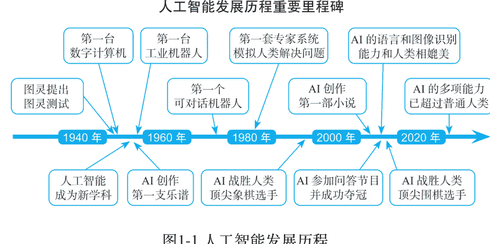
**(1) 知识表示与推理**

20世纪60至70年代，专家系统成为研究热点，这类系统通过存储大量专业知识与经验来模拟专家决策。IBM 的 Watson 医疗助手是典型案例，该系统学习大量医疗文献与病例数据，可辅助医生进行疾病诊断与治疗方案制定。实践中 Watson 已成功辅助诊断多种复杂疾病，并提供个性化治疗建议。

**(2) 机器学习**

20世纪80至90年代，随着统计学习与神经网络兴起，机器学习逐渐成为 AI 主流技术，使机器能从数据中自动学习并改进性能。典型场景包括“图像识别与分类”“自然语言处理”。相关案例体现了机器学习在各领域的潜力，例如：苹果 Siri 与亚马逊 Alexa 是自然语言处理的典型应用，能理解并回答用户问题，执行设置闹钟、查询天气、播放音乐等任务；Netflix 通过分析观影历史与偏好为用户提供个性化推荐，亚马逊亦利用机器学习算法提供个性化商品推荐；Knewton 等教育科技公司使用机器学习个性化设计学习路径，通过分析学习数据与表现，提供定制化资源与反馈。

**(3) 深度学习革命**

21世纪10年代至今，算力提升与深度神经网络与大规模数据集结合，使 AI 在图像识别、语音识别、自然语言处理、自动驾驶等领域取得突破。特斯拉 Autopilot 与谷歌 Waymo 代表自动驾驶技术，利用机器学习算法识别道路标记、障碍物及其他车辆，实现自动驾驶。科大讯飞语音识别系统采用深度学习技术，可高效将语音转为文字，支持多语言与方言识别，广泛应用于智能家居、车载系统等。谷歌 DeepMind 开发的 AlphaFold 利用机器学习算法预测蛋白质结构。此外，多研究团队利用机器学习进行疾病诊断与预后预测，如通过医学影像检测肿瘤或其他异常。DeepMind 开发的 AlphaGo 与 AlphaStar 分别通过深度学习训练，在围棋与《星际争霸》等游戏中达到人类顶尖水平。图1-2展示了 AI 的能力跃迁。

###### AI 多项能力已超过普通人类
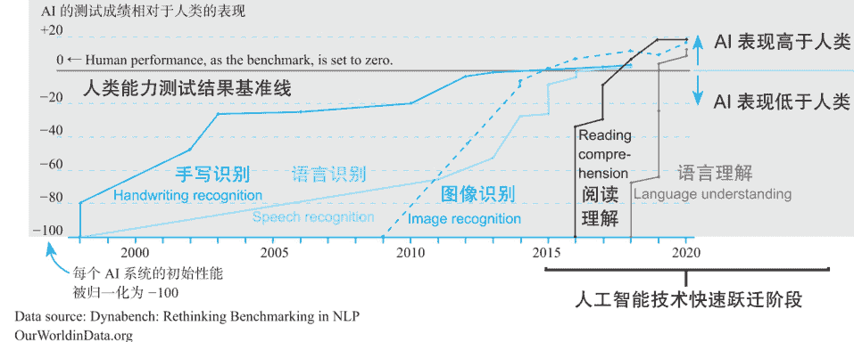
###### 图1-2 AI 的能力跃迁

##### 2. AIGC 的发展与教育应用展望

人工智能生成内容即 AIGC，是 AI 的重要分支与应用方向，代表 AI 在内容生成方面的能力，尤其通过生成算法、预训练模型与多模态技术自动生成文本、图像、音频、视频等多种内容。

早期 AIGC 集中于简单文本生成，如基于模板的新闻报道或天气预报。深度学习兴起为 AIGC 发展奠基，深度学习可自动从大量数据中提取特征，GAN、CLIP、Transformer 等技术出现与融合，为 AIGC 提供强大支撑，使机器更准确理解与生成内容。

随着深度学习、大数据、云计算与边缘计算快速发展，以及预训练模型与多模态技术突破，AI 开始生成更复杂、更自然的文本、图像、音频与视频内容。尤其是以 GPT 系列为代表的大规模语言模型出现，使 AIGC 在内容生成方面取得显著进展，展现出强大生成能力。

AIGC 的出现标志着 AI 应用从数据分析型向内容创造型转变，大幅拓展应用范围。例如：在内容创作领域，ChatGPT、文心一言、讯飞星火等大模型广泛用于创意写作，如自动生成文章、新闻报道、诗歌等文本；图像处理领域，Midjourney、DALL·E 等模型可根据文字描述生成对应图像，用于广告设计、艺术创作、插画自动生成等；视频处理领域，OpenAI 发布 Sora 可生成长达1分钟的视频，角色表情逼真，支持多角度镜头切换与流畅分镜，展现真实光影、运动与镜头移动效果，在游戏、电影预告片制作、虚拟角色制作等领域展现巨大潜力。

总体而言，AIGC 是 AI 在内容生成方面的重要发展方向。随着技术进步与场景拓展，它大幅提升内容生产效率，已成为数字时代重要组成部分，必将改变内容创作与传播方式，而这种变革势必影响教育领域。如图1-3所示，AI 可提供精准与个性化的学习支持。

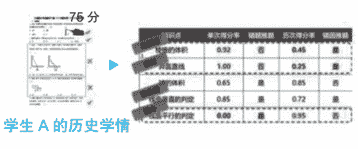

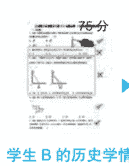

###### 图1-3 AI 提供精准与个性化的学习支持

在教育领域，AI 与 AIGC 为个性化教育提供可能。通过分析学生的学习数据，教师可更精准了解每个学生的学习需求与进度，AI 可提供定制化学习资源与路径、实时学习支持与反馈，从而实现个性化教学辅导，使学习更高效便捷，实现因材施教。AIGC 技术可创建虚拟教师与学习环境，为学生提供更丰富、互动性更强的学习体验。AI 与 AIGC 技术可更高效生成与优化教育资源，如教案、课件、教学视频、虚拟情境等，大幅减轻教师负担，实现教育资源共享与高效利用。

随着 AI 与 AIGC 技术不断发展，数字化技术将与教育深度融合，为教育事业注入新活力，有望带来革命性变化与提升。

### 1.2 AI 技术对教育教学的影响

教育数字化的历程始于数据化，发力于网络化，加速于智能化。

经济合作与发展组织教育研究与创新中心副主任斯蒂芬·文森特-朗科瑞在《2023年数字教育展望：迈向高效数字教育生态系统》报告中指出，线下学习向远程学习的转变不等同于教育数字化转型。真正的转型意味着对某些教育过程进行根本性变革，即不仅将技术作为工具，还将其作为重塑教学方法、学习过程与整个教育生态系统的方式，使教育更有效。目前数字技术融入教育往往是对传统方法的复制，而非革新。

教育部部长怀进鹏在2024年十四届全国人大二次会议答记者问时表示，对教育系统而言，AI 是把“金钥匙”，它不仅影响未来教育，也影响教育的未来，既有机遇也有挑战，要想更好把握机遇、应对挑战，就必须积极拥抱科技与产业变革，主动拥抱智能时代。

本节对比智能时代前后教师角色、课程设置、个性化教育与学习、教育评价等方面，探讨 AI 技术对教与学的影响。

#### 1.2.1 智能时代的教师角色

以 ChatGPT、Gemini、文心一言、讯飞星火为代表的 AI 大模型迅猛发展，凭借强大的自然语言处理能力，它们可完成问题解答、内容创作、代码生成等复杂任务，对人类知识获取方式、信息生成方式产生深刻影响。

智能时代前，教师主要扮演知识传授者角色，负责讲解教材内容、解答疑问，并通过作业与考试评估学习成果。教师是课堂主导者，学生多处于被动接收状态。智能时代教师与智能教学平台的交互如图1-4所示。


##### 图1-4 智能时代教师与智能教学平台的交互

随着 AI 技术在教育中的应用，教师角色势必发生显著变化——从单纯的知识传授者，逐渐转变为学生学习过程中的引导者、促进者与合作者。

- 引导者：在智能时代，教师可利用智能教学平台与教学资源，引导学生主动探索知识、发现问题并解决问题。教师不再直接告知答案，而是教会学生如何寻找答案，培养自主学习能力与批判性思维。
- 促进者：AI 技术为学生提供丰富学习资源与个性化学习路径，教师可根据学生学习情况与需求，推荐合适的资源与活动，促进学生全面发展。
- 合作者：在智能时代，教师与学生的关系更平等、开放，教师可与学生共同参与项目式学习、探究性学习等活动，共同研究问题、分享成果。这种合作式学习有助于培养团队协作能力与创新能力。

#### 1.2.2 智能时代的课程设置

智能时代前的课程设置相对固定单一，学校按既定课程体系与教学大纲安排教学，课程内容以单一学科知识为主，缺乏跨学科融合与实践。

STEM 教育是一种跨学科教育方法，将科学、技术、工程与数学四个领域知识整合，鼓励学生在这些领域探索创新。其目标是培养批判性思维、问题解决能力、创造力与团队合作精神，以适应快速变化的全球经济与技术环境。

如图1-5所示，智能时代课程将更加数字化。随着 AI 技术应用，STEM 教育、工程教育、编程教育等方法将更易实施，课程设置逐渐呈现跨学科融合、实践性与创新性特点。

- 跨学科融合：智能时代课程更注重不同学科间的融合与交叉。学校通过开设综合性课程、推动项目式学习等方式整合知识与技能，培养综合素养。
- 实践性：智能时代课程更注重实践能力与问题解决能力的培养。学校通过增加实验课程、实践项目等方式，让学生在实践中学习掌握知识，提高动手能力。
- 创新性：智能时代课程更注重培养创新意识与创新能力。学校通过开设创新课程、开展创业实践活动等方式激发创新思维与创业精神，增强创新能力与竞争力。


##### 图1-5 智能时代的课程更加数字化

#### 1.2.3 智能时代的个性化教育与学习

智能时代前的个性化教育主要依赖教师经验判断。教师根据学生表现与需求进行个别辅导或分层教学，但受限于时间精力等因素，难以实现真正个性化教育。

随着 AI 技术在教育中的应用，个性化教育得到更好实现与发展。AI 可分析学生学习数据与行为模式，精准了解每个学生的学习需求与风格，从而提供个性化学习资源与路径。这种个性化学习方式能激发学习兴趣与动力，提高学习效果，且是以往数字技术手段难以达到的。基于学习数据与行为模式分析的智能时代课程如图1-6所示。

图1-6 基于学习数据和行为模式分析的智能时代课程

AI 在个性化教育与学习方面的应用包括但不限于：

- 自适应学习平台：基于 AI 技术的个性化学习工具。可根据学生学习进度与能力水平推荐合适资源与练习题目。通过持续学习与数据反馈，自适应学习平台可不断调整内容与难度，满足个性化需求，使学生更有针对性地解决学习问题，提高效率。例如，现有教育科技公司的智能阅卷系统可根据作业评测结果给出个性化且针对性的指导意见，如图1-7所示。
- 智能辅导系统：基于 AI 技术的个性化辅导工具。可针对学生学习问题与难点提供及时辅导与反馈。与传统辅导相比，智能辅导系统能更精准定位学习问题，并提供针对性辅导材料与练习题目，帮助学生更有效解决问题，提高学习成绩。

图1-7 基于 AI 技术的智能阅卷系统

#### 1.2.4 智能时代的教育评价

在人工智能尚未进入课堂的年代，评价体系几乎被考试分数一家独大。学校依靠定期测验和期末考试来判定学习成效和教学质量，这样的手段简单直接，却也局限单一，很难捕捉到学习者的真实状态和成长潜力。

随着AI技术在教育场景落地，评价逻辑正在从结果导向转向过程与多元并重，如图1-8所示。

图1-8 AI时代的评价更加过程化、多元化

- 过程化评价：借助学习分析等能力，AI可以对学习轨迹和日常表现进行持续记录与即时反馈。这种方式更贴近真实学习图景，为教师提供可操作的教学改进依据。
- 多元化评价：评价对象不再止于分数。作品呈现、项目答辩、小组协作等多种形式被纳入进来，用以衡量综合能力。这种立体化的评价更能反映综合素养，也为个性化成长提供空间。

AI的深度渗透必将重塑教学形态，带来机遇也带来挑战。面向未来，需要持续探索和迭代，以数字化技术尤其是AI的优势，为学习者提供更高质量、更具个性的教育支持。

### 1.3 AI重塑知与识

在AI急速演进的背景下，对“知”与“识”的理解也在发生根本性变化。传统知识观正被技术浪潮重新定义。

#### 1.3.1 技术如何改写知识与知识观

AI出现前，知识被视作人类通过学习实践积累的经验总结，以书籍、文献、口传等形式传承。知识观建立在个体记忆与长期沉淀之上，教育以传授前人经验为主，强调记忆、理解、应用，创新则依赖学者研究与实践探索。

进入AI时代，传统的“知”“识”已难以完整涵盖新知识体系。AI不仅提升了获取与创新的效率，也促使人们重新审视知识的本质与价值。AI正改变学习者的“知”与“识”，如图1-9所示。

图1-9 AI改变学习者的“知”与“识”

##### (1) AI时代的“知”
“知”不再只是人类的经验积累，而是融合大数据、算法与机器学习的智能化认知过程。它集合人类的智慧与机器的推理学习能力，形成更高效精准的知识获取路径。借助信息技术对海量数据的挖掘、整合与提炼，还能产生深度洞察与精准预测，从而指导决策，推动社会经济文化发展。

##### (2) AI时代的“识”
与“知”相对，“识”也获得新内涵。传统上侧重个体主观理解，AI时代则体现为共享知识、协同创新与智能交互产生的群体智慧。在智能化网络中，个体与机器、个体与个体通过协作共创形成集体创新力，突破个体局限，汇聚群体势能。

##### (3) AI时代“知”与“识”的关系
二者相互依存、彼此促进。“知”为“识”提供基础支撑，智能化认知帮助高效处理知识；“识”反过来深化“知”，群体智慧推动新发现与新价值，形成持续进化闭环。

##### (4) AI时代知识的特征和知识观
伴随机器学习、深度学习突破，知识呈现新特征。

- 知识获取更便捷：搜索引擎、智能推荐与自然语言处理的进步，让信息检索与人机交流更顺畅高效。
- 知识结构被重塑：知识不再是线性层级，而呈网状互联。链接分析与语义网络揭示复杂关联，形成更全面的理解。
- 知识创新加速：算法能在大数据中发现规律，为科研提供新思路；自动化工具降低创新门槛，更多人参与创造。

在此影响下，知识观也在转变。知识被看作动态互联的过程而非静态实体，价值不仅在于正确与实用，更在于激发思考与引领创新的能力。随着AI在商业、教育、医疗等领域扩散，人们对知识、能力与智慧关系的认识也在深化，进而重塑价值体系。

#### 1.3.2 知识观变革的价值与挑战
知识观的演进对社会经济文化产生深远影响。它改变知识获取、处理与应用方式，提升生产与传播效率；促进跨领域融合与创新，催生新产业新业态；深刻影响思维方式、价值观念与生活方式，推动文明进步。

同时，变革也伴随挑战。

其一，知识增长与更新加速，如何筛选、整合与有效应用成为关键，信息过载下需要更智能的管理方法。

其二，AI应用对教育提出新要求。传统教学内容与方式需同步革新，以适应人才培养新需求，涉及理念更新、方法改进与资源优化，如图1-10所示，AI时代的教育理念、教育方法需要同步革新。

其三，当机器智能在部分领域超越人类，需要重新界定人与机器在创新与社会发展中的角色，涉及伦理、法律与社会责任等议题。

总体看，AI对“知”“识”产生深远影响，改变获取整合应用的效率与方式，也促使我们重新思考知识本质与价值。在推动应用的同时，需积极应对变革带来的问题，借助AI助力创造更丰富、更具创造力的知识世界。

# Chapter 2
## 第2章
## AI与教师
随着AI重塑教学形态，“知”与“识”发生迁移，社会对人才的要求随之抬升。必须重新审视教育体系，着力培养关键能力，以匹配未来需求。

理论结合实践、多元化教学模式能够培育真正适配AI时代的高素质人才，这需要教育者努力，也需要全社会参与。

本章主要涉及的内容：
- AI时代的人才培养要素。
- AI时代教师的职业要求。
- AI时代教师的发展路径。

### 2.1 AI时代人才培养的关键要素
人工智能的迅猛发展不仅改变生活方式，也重塑了教育目标与核心能力。

#### 2.1.1 学生核心素养在AI时代的新内涵
AI时代所需素养远超传统知识掌握。创新、批判思维、团队协作等能力变得关键，帮助学生适应多变环境与技术迭代。

首先，数字素养成为基础。在信息爆炸中筛选整合有效数据是核心技能，学生需熟练使用技术工具搜索、评估并应用数字化手段提升效率，如图2-1所示，AI时代学生的数字素养需不断提升。

图2-1 AI时代学生的数字素养

其次，创新思维与问题解决能力日益重要。面对复杂问题，AI虽强却仍需人类创造性思维提供新解，学生需具备独立思考与跨界融合能力。

再次，人机协作能力需大幅提升。跨学科合作常态化，学生要在团队中发挥专长、有效沟通，同时厘清人与机器的能力边界，善于协作。

最后，道德素养与社会责任感不可忽视。使用AI时应树立正确观念，明确使用边界，防止滥用与伦理冲突。

理论与实践结合尤为重要。学校需提供多元学习场景，让学生在做中学。例如项目式学习可在实操中培养解决问题能力，加深理解。

作为教育者，应调整策略，强化信息素养、创新思维、协作与道德素养的培养，为全面发展奠基。

#### 2.1.2 批判性思维与创造性解决问题的能力
在信息泛滥的今天，人才培养必须聚焦批判性思维与创造性解决问题。

批判性思维是指深入分析、评估、推理与判断信息和观点。在真伪难辨的环境中，培养理性分析与反思能力至关重要。

创造性解决问题同样关键。许多复杂问题仍需人类创新。学生需具备想象力与创新精神，能多角度思考，灵活运用知识提出新方案。

教学实践中，可设计挑战性问题激发思维，鼓励多层次探讨。创新项目、科研实验等实践活动能锻炼两种能力。

总之，这两项能力是AI时代的核心素养，需通过理论实践结合探索新教学法。

#### 2.1.3 数字素养：信息筛选、评估与利用
数字素养已成为必备关键能力，不仅是操作技能，更是筛选、评估与高效利用数字信息的能力。

在信息海洋中快速定位价值信息，需要搜索技巧与敏锐判断。评估真实性、可靠性与时效性是核心环节，尤其在虚假信息盛行的网络环境中。

将数字信息转化为实践智慧亦是重要体现，要求理解信息并结合实际问题提出创新解法。

提升数字素养需教育体系调整课程，增加信息技术与素养培训，鼓励项目式学习。企业与社会也应提供实践机会。

在课堂上，可通过信息技术课程教授AI大模型、搜索引擎、数据库使用与信息评估，并开展信息分析、数据挖掘等实践，提升处理能力。

数字素养是AI时代人才培养基石，教育与实践结合才能培养高素养人才。

#### 2.1.4 人机协作：沟通、团队合作以及与机器互动
AI时代，人机协作成为新常态。学生需学会与智能机器有效沟通，理解其逻辑，在团队中协同完成任务。

有效沟通是基石。要掌握与机器对话技巧，理解反馈。教育中应强化表达与倾听，并引入真实人机对话场景练习。

团队合作不可或缺。学生需学会在团队中与机器协同，发挥各自优势。可通过小组项目、角色扮演培养协作精神。

与机器互动能力同样重要。需了解工作原理，掌握交互方法。编程教育、机器人操作等课程可帮助建立良好互动。

AI时代人机协作的新场景如图2-2所示。

图2-2 AI时代人机协作的新场景

为此，学校可引入机器人教学、编程课程，教师设计团队项目提升协作与沟通。教育体系需不断创新，提供更多协作机会。

#### 2.1.5 自主学习与终身学习的重要性
技术日新月异，自主学习与终身学习能力愈发关键。知识更新加速，持续学习是避免被淘汰的根本。

自主学习不仅是获取知识，更是对未知探索与自我挑战。AI时代意味着主动寻找资源、独立分析问题、寻求解法，有助职业发展与社会适应。

终身学习是一种贯穿生命的态度。唯有持续学习，才能跟上技术步伐，保持竞争力。

翻转课堂是一种新模式。课前通过视频、阅读、在线任务自主学习，课堂用于讨论、解题与项目合作。

培养自主与终身学习能力需改变传统模式，鼓励主动参与。翻转课堂、在线学习让学生按节奏兴趣学习，培养主动性。教师提供资源与指导，学校开设职业规划课程激发学习动力。

自主学习与终身学习是AI时代必备能力，唯有具备才能走得更远。

#### 2.1.6 厘清技术使用的责任与界限
技术深度嵌入社会，道德伦理问题凸显。学生需明确技术使用的伦理边界，承担社会责任，尊重隐私、合理使用、防范风险。

AI是双刃剑，培养道德伦理意识至关重要。要帮助新一代理解技术不应侵犯隐私、伤害他人或违背公序良俗。

实践中可引导思考：如何平衡创新与道德责任？如何确保公正、避免偏见歧视？

通过案例分析、角色扮演让学生在模拟中体验伦理问题，学校可开设科技伦理课程树立正确价值观。

道德与伦理考量是AI时代不可或缺的能力，需培养高道德自觉与责任感的人才。

### 2.2 AI时代教师的职业要求与发展路径
AI飞速发展，教育正经历前所未有的变革。教师角色、职责与职业发展路径随之调整。

#### 2.2.1 教师的职业要求
面对AI冲击，教师既迎挑战也获机遇。一方面部分教学内容可被机器替代，需学习掌握新工具以辅助教学；另一方面专业素养要求提高，需不断更新知识技能。

AI深刻改变教育。教学上可提供个性化学习路径与定制资源，实现因材施教，并辅助课堂管理。科研上提供强大数据分析工具，帮助优化教学策略。

但快速发展也带来负面影响。简单重复任务被自动化取代，工作内容变化甚至面临转型压力。AI数据分析影响教学决策，教师可能过度依赖建议而忽视经验判断。此外，AI难以替代教师在道德、情感、创造力培养中的作用，过度依赖会削弱师生真实沟通。

因此，教师需认识到AI带来新要求，在保持专业性与个性的同时积极适应变革。

AI时代下的教师如图2-3所示。


图2-3 教师角色在智能时代的再定义

进入智能化阶段，教师的工作边界已远超单一的知识传授。扎实的学科功底与课堂教学本领仍然是根基，更要叠加契合新环境的核心理念，才能回应教育的新诉求。

第一要素是数智素养。教师需要对智能技术的基本原理有初步认知，能够熟练调用各类数字平台来辅助教学活动。

第二要素是创新驱动力。在关注学习者全面成长的同时，教师自身也须保持创新意识与思维习惯，持续探索更高效的教学路径和方法论，从而提升课堂品质。

第三要素是协作配合。在智能环境下，教师要和同事、技术支持人员、家长等多方保持顺畅沟通与联动，共同推动学习者成长。

#### 2.2.2 教师的发展路径

补齐上述能力可以从以下方向着手：

1. 持续进修。通过积极参与专业研修与研讨活动，阅读前沿书籍与文献，稳步提升学科素养与技术水平。
2. 保持敏觉。始终跟踪教育领域的最新动向与趋势，及时吸收新的教学理念与方法。
3. 大胆实践。以自身课堂为试验场，尝试将智能技术引入教学，探索定制化、具创新性的教学模式。
4. 协同共研。加强和同行的交流合作，共同研讨教学创新的路径，积极参与学术分享，输出自己的实践经验。

面对智能技术带来的挑战与机遇，教师需要不断刷新知识与技能储备；教育主管部门与学校也应加大培训与支持力度，助力教学人员适应变革。同时，还需深入研究智能技术与教学融合的方法论，为未来教育提供参考。

总体来看，智能时代下教师的定位已发生深刻变化。具备技术能力、创新能力与协作能力，已成为新时代的基本要求。应积极拥抱智能带来的机遇，探索教学模式与方法论的创新，才能培养出创新精神强、实践能力足的新一代人才，为社会发展注入动能。

# Part 2
## 第二部分
## 技术落地与应用场景

本板块将系统梳理智能技术在教育领域的实际应用形态与典型工具。从生成式模型的教育魅力，到和智能体交互的技巧与案例；从智能教学素材的自动生成，到文档处理、图像绘制、思维导图、科研辅助等场景，再到音视频处理、虚拟课堂、智能体的创新实践，全方位呈现当前智能技术在教育中的广泛渗透与巨大潜能。

# Chapter 3
## 第3章
## 智能魔盒：教育转型的双面刃

智能技术高速迭代，我们正处在一波无声却深远的浪潮之中，它渗透进生活的每个角落。在教育领域，这股力量像一座开启的魔盒，既释放出前所未有的机遇，也伴随挑战与重塑。本章聚焦智能技术在教育里的双刃效应，尤其是对教师群体的深远影响，并强调只有透彻理解并合理运用，才能最大化正面价值，把握教育未来走向。

本章核心要点：

- 生成式模型的概念、演进脉络及其对教育的利弊。
- 智能技术在教育场景中的具体应用。

### 3.1 席卷而来的智能浪潮

智能浪潮已然到来，无人能够置身其外。对普通人而言，最务实的做法是善加利用，乘势前行。本轮浪潮里最具代表性的技术就是生成式模型。厘清它的定义、发展历程以及ChatGPT的爆发案例，有助于更清晰地认识这项技术的潜能与影响。

#### 3.1.1 生成式模型概述

生成式模型是智能领域的重要突破，指能够原创或生成全新内容的人工智能系统。与传统以分析为主的系统不同，它不仅能理解与分析数据，还能基于学习到的规律创造出全新的文本、图像、音乐等内容，正因此成为当前研究与应用的前沿。

##### 1. 生成式模型的发展历史

坊间普遍认为生成式模型的雏形可追溯至1932年，法国工程师Georges Artsrouni打造了一台被他命名为“机械大脑”的装置，后被巴黎工艺美术博物馆收藏，该装置可视为纸带驱动的自动双语词典。“机械大脑”照片如图3-1所示。


FIG. 1. — Deuxième machine

图3-1 “机械大脑”照片

当代生成式模型的根基建立在深度学习与神经网络之上，其现代起点常被认为是2014年，Ian J. Goodfellow及其团队首次提出生成对抗网络GAN。之后伴随深度学习进步，生成式模型在艺术创作、音乐制作、游戏开发、药物研发等多个领域取得明显进展。

GAN由生成器与判别器两部分构成。生成器的任务是产出尽可能逼近真实数据的伪数据，判别器的任务是区分生成数据与真实数据。通过对抗训练，生成器不断提升产出质量。时至今日，主流的人工智能换脸技术，尤其是高逼真图像生成，多基于GAN。如图3-2所示，这是一种典型的GAN结构示意图，用于生成手写字。

随后涌现出多种生成式模型架构。以OpenAI的ChatGPT为例，它主要依赖于Transformer架构，该架构由谷歌于2017年公布，擅长处理序列化数据，如文本，非常适合理解与生成自然语言。

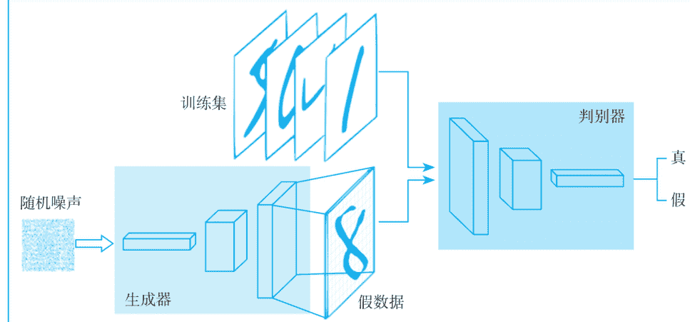

###### 图3-2 一种典型的GAN结构

GPT与ChatGPT聚焦于文本的理解与生成。它们通过海量文本预训练，学会语言模式、语法结构与知识信息，从而输出连贯、相关且多样化的文本回复。这使得ChatGPT在聊天机器人、文本生成、内容创作辅助等多场景中表现突出。由Transformer衍生出的智能技术谱系图如图3-3所示。

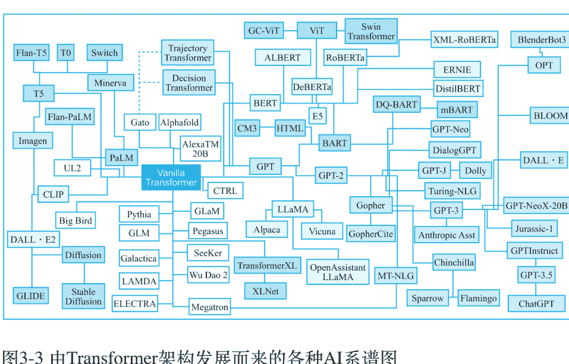

###### 图3-3 由Transformer架构发展而来的各种AI系谱图

##### 2. ChatGPT的快速发展

ChatGPT由OpenAI开发，是生成式模型的标志性产品。它基于大规模语言模型如GPT-3和GPT-4，能够理解并生成人类语言，提供流畅且逻辑自洽的对话体验。其诞生标志着生成式模型在自然语言理解与生成方面的重大跨越。

基于Transformer架构的智能技术神经网络参数量如图3-4所示，它反映了GPT参数的演进，也可视作模型能力的提升。

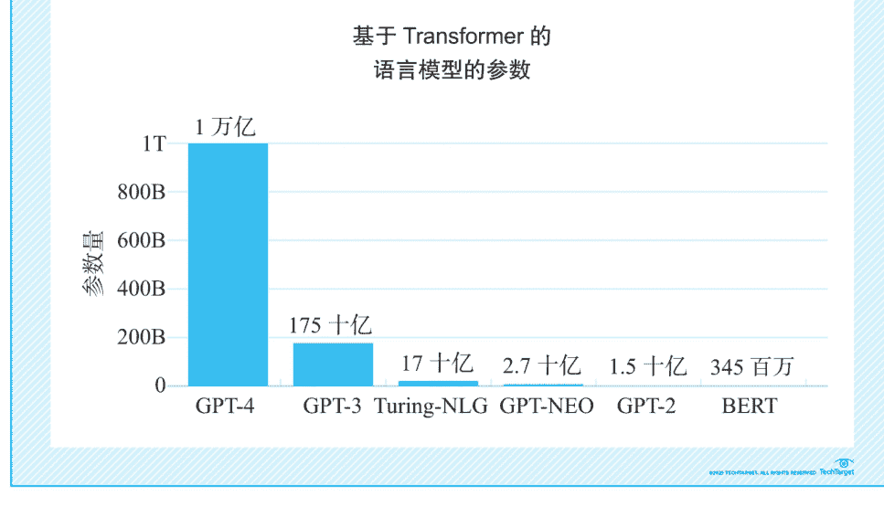

图3-4 基于Transformer架构的AI的神经网络参数量比较

通常参数越多模型越智能。短短三年多时间，模型参数量从15亿增长至万亿级别。ChatGPT的发展轨迹体现了生成式模型的迅猛进步。早期版本侧重基础文本生成，后续迭代后，最新版本已能进行复杂逻辑推理、情绪分析、编程、诗歌创作等。此外，它还能理解并适应不同对话场景，基于上下文生成连贯回复。

ChatGPT的快速崛起得益于：

- 海量数据训练：依托互联网上覆盖广泛主题的文本数据，使其能理解并生成多样化内容。
- 算法优化：持续优化模型结构与训练方法，提升学习效率与生成质量，使其更精准理解用户意图并给出自然回复。
- 多元应用场景：设计上可适配教育、医疗、娱乐、客服等多种场景，应用范围不断拓宽。
- 人机交互体验：提供基于自然语言的全新交互方式，显著提升使用体验。

生成式模型的潜力巨大，尤其在提升效率、激发创新、提供定制化服务等方面。ChatGPT的成功不仅展示了生成式模型的强大能力，也为未来技术走向提供了重要参考。

#### 3.1.2 生成式模型对教育的影响

生成式模型对教育产生深远影响，既带来创新机遇，也引发争议与挑战。

# #### 1. 正面影响

- （1）定制化学习
对学习者而言，生成式模型可依据学习速度、知识水平与兴趣，定制个性化学习路径与材料，提升学习效率，尤其在复杂抽象主题上帮助更大。

- （2）教学资源提效
教师可借助生成式模型生成教学内容、练习题与教案，大幅节省备课时间。模型还能提供即时反馈，帮助教师监控学习进度，更有效地指导学习者。

- (3) 学习时空拓展
生成式模型让学习不再局限于传统课堂。学习者可通过聊天机器人等交互工具随时随地学习，突破时间空间限制，使教育更灵活。如图3-5所示，香港浸会大学于2023年7月13日在校内系统公布了有关生成式AI工具的使用指引。香港浸会大学也是较早积极拥抱生成式AI工具的大学。从2023年开始，新加坡大学也允许学生使用AI工具完成作业，以提升教学效果与鼓励学生接纳新技术。越来越多的大学甚至中小学，都在积极探索使用AI拓展学习资源。

- (4) 创新思维培育
通过和智能工具互动，学习者不仅能学习已有知识，还能激发创新思维，学会利用工具解决问题，对培养智能时代所需人才至关重要。

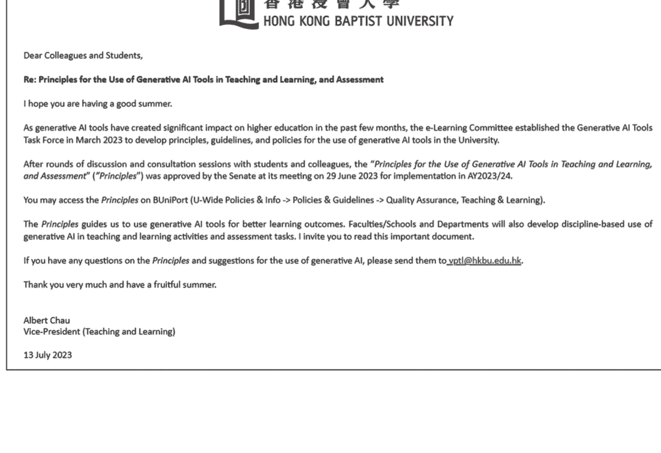

图3-5 香港浸会大学在校内系统公布有关生成式AI工具的使用指引

##### 2. 负面影响

- (1) 学术不诚实与抄袭
生成式模型的文本生成能力可能助长学术不诚实与抄袭。学习者可能依赖模型完成作业与项目，而非自主研究思考，损害学习过程与学术诚信。

- (2) 教育资源不均衡
尽管生成式模型有潜力提升教育质量，但其普及可能加剧资源不平等。能负担该技术的学校与学习者可能获益更多，资源薄弱者则可能落后。

- (3) 技能与知识深度受损
过度依赖智能工具可能削弱学习者在写作、批判性思维等基础技能方面的能力。若习惯直接接受模型答案而不加思考，可能丧失问题解决与创造性思维。

- (4) 偏见与歧视风险
智能算法由人设计，可能携带人类偏见。若训练数据存在偏见，算法将不可避免地复现。早在2022年12月，清华大学交叉信息研究院助理教授于洋就带领团队做了一个人工智能模型性别歧视水平评估项目，测试的人工智能模型包括GPT-2（ChatGPT的前身）。测试结果发现，GPT-2有70.59%的概率将教师预测为男性，将医生预测为男性的概率则是64.03%。2024年初大火的Meta图像生成器也出现这样的问题，当输入“Asian man with Caucasian friend”（亚洲男性和白人朋友）或“Asian woman and white friend”（亚洲女性和白人朋友）时，生成的大多数图像仍是两个亚洲人形象，如图3-6所示。

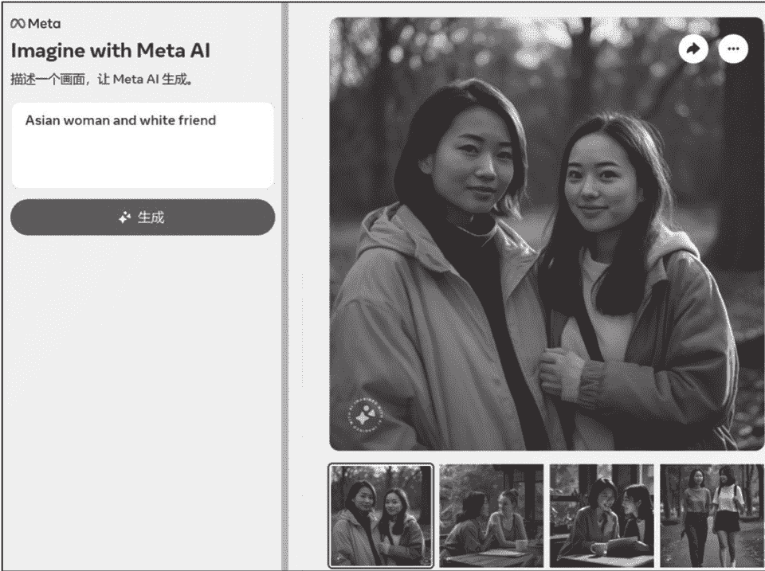

图3-6 Meta图像生成器生成的“亚洲女性和白人朋友”的图片（图片来源：机器之心）

### 3.2 教师的新伙伴：智能技术在教育中的魔力

智能技术在教育中的应用已非未来预言，而是当下现实。无论是新生的生成式模型，还是持续演进的分析式智能，都在迅速融入日常生活。智能技术正逐步成为教育工作者、学习者与家长的新伙伴，以独特方式重塑教育面貌。以下探索智能技术在教育中的各类应用，展示其作为改革与创新的强大推手。

# ### 3.2.1 智能技术对教师的支持

1. 生成教案与课程内容
智能技术可自动化生成教案与课程材料，包括课文、习题与参考资料。借助自然语言处理与机器学习，智能技术能依据教师需求与学习者水平定制化产出教学材料，节省备课时间，让教师聚焦教学方法创新与学习者互动。

2. 生成评语
通过分析作业、测验成绩与行为表现，智能技术可生成定制化评语与反馈。这不仅提升评价效率，还能给出更细致具体的建议，帮助学习者了解优势与改进点。

3. 辅助科研
利用生成式模型生成代码、辅助数据分析与模式识别，为普通教师开展科研提供巨大助力。模型可生成数据分析代码并教授使用，帮助不擅长编程的教师发现研究趋势，加速科研进程并提升深度。

4. 生成PPT和图像
智能技术不仅能生成文本，还能创建视觉素材，如PPT与课程相关图像。根据教师指令自动生成高质量视觉辅助材料，使课堂更生动，提升学习兴趣与效率。

# ### 3.2.2 智能技术对学习者的支持

1. 定制化学习路径
智能技术可依据学习进度、能力与偏好，提供定制化学习路径与资源。让学习者在自身节奏下学习，弥补知识缺口，提升理解与应用能力。

2. 即时反馈与辅导
智能辅导系统能提供即时反馈，解答学习过程中的疑问。及时纠错机制对保持学习动力至关重要。如图3-7所示，智能技术在中学理化生实验教学中的应用，极大地降低了教师的工作强度，而且可以做到实时纠正错误、考完立即评分，提高教学效果。

3. 提升语言学习效率
对学习外语的学习者，智能驱动的语言学习应用可提供发音指导、语法练习与实时对话，帮助更快掌握语言技能，提升学习效率。

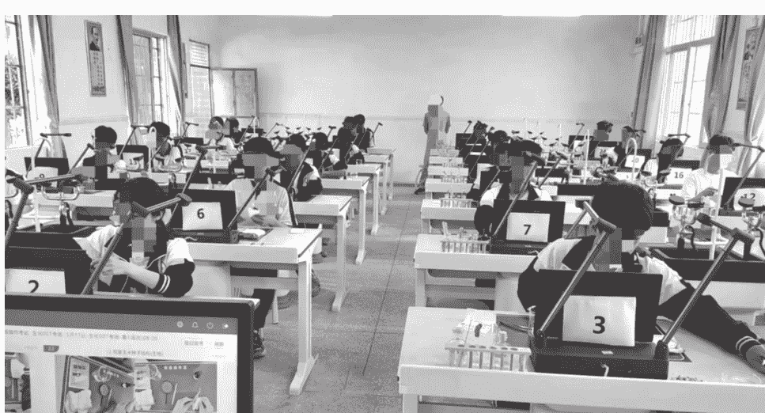

图3-7 AI在中学理化生实验教学中的应用

#### 3.2.3 智能技术对家长的支持

##### 1. 监控学习进度
智能系统可帮助家长监控学习者的学习进度与表现，通过数据分析提供学习状况报告。家长能及时了解情况，和教师协同更好地支持教育。例如不少学校引入的自动改作业系统，投入试卷后，教师、家长可以迅速得到学习者的作业情况、知识点掌握情况等数据，家长无须持续监督学习者写作业，也能知道学习者写作业时是否用心、上课时是否认真听讲。

##### 2. 家庭教育资源配置
智能技术还能向家长提供教育资源与建议，帮助他们在家庭教育中更有效地支持学习者，包括有效沟通、激发学习兴趣、处理学习问题等指导。生成式模型在训练中接触大量家庭教育相关文本，积累了不少相关“知识”，家长遇到问题时向智能技术咨询不失为省时省力的方式。

比如我们向ChatGPT提问：

> 你是一名家庭教育专家，请你对我的困境给出建议：自从我的小儿子出生后，我的大儿子在学校经常调皮捣蛋遭到老师投诉，请问我该如何让大儿子在学校听话一点？做得好给你10美元小费。

ChatGPT的回答：

您好，感谢您的信任。您目前的困境在有新生儿的家庭中非常常见。大儿子可能因为小儿子的出生感到被冷落，或者对家庭角色的变化感到不安，这可能导致他在学校的行为问题。

以下是一些建议，希望能对您有所帮助：

- 给予大儿子更多的关注和陪伴：每天抽出专门的时间与大儿子相处，参与他喜欢的活动，让他感受到您的关爱没有减少。

- 鼓励情感表达：引导他表达自己的感受，倾听他的心声，了解他内心的想法，帮助他处理负面情绪。

- 积极强化正面行为：当他表现良好时，及时给予表扬和鼓励，强化他的自信心和正面行为。

- 让他参与照顾弟弟：适当让他参与照顾小儿子的简单任务，使他感受到自己在家庭中的重要性和责任。

- 建立清晰的规则和一致的管教方式：让他明确知道哪些行为是不可接受的，并在管教时保持一致性，避免过度惩罚。

- 与老师保持沟通：与学校老师定期交流，了解他在学校的具体表现，共同制定帮助他的策略。

- 关注他的社交关系：鼓励他与同龄朋友交往，培养良好的社交技能，减少在学校的行为问题。

- 寻求专业帮助：如果情况没有改善，考虑咨询儿童心理专家，获取专业指导。

每个孩子都是独特的，耐心和持续的关注是关键。希望这些建议能够帮助您和您的大儿子渡过这个过渡期。

这个回答可以说是非常专业的，生成式模型成功识别到这是一种常见现象，而在笔者的教育生涯中，这种现象确实常见，解决方案也确实更加关注年长的孩子，让年长的孩子照顾幼小的孩子，让年长的孩子感受到家庭责任。

# # Chapter 4
## 第4章
## 与智能高效对话的技巧

在智能浪潮中，大模型正以润物无声的方式迅速融入我们的生活，像一位隐形助理常驻身边。很多人虽感知到智能的存在，却常感到难以有效沟通，未能最大化其价值。本章探讨和智能交互的艺术，尤其聚焦大规模语言模型如ChatGPT的互动。首先定义大模型，解释其在现代技术生态中的作用；随后深入讨论和这些高级系统的有效沟通技巧，包括提问方式、复杂概念阐释以及如何从回答中获取最大价值。

本章主要涉及的知识点：

- 通用大模型与垂直小模型概述。
- 和大模型交流的方法以及案例。

# ## 4.1 智能“大脑”：探索AI模型的力量

人工智能大模型在2023年这个普通却神奇的年份里反复冲击认知，似乎一提人工智能模型就只有大模型。那么大模型究竟是什么？它有什么能力？是否还存在小模型？这些问题将在下面展开介绍。

# ### 4.1.1 通用大模型与垂直小模型

大模型太贵？小模型可能更香

说到大模型，答案很多。抛开底层技术，只看能力层面，超大模型的最大特质是泛化，几乎什么活儿都能接。架构更复杂、可承载的信息量更高，在语义理解、自然语言处理、图像识别这些方向表现突出，ChatGPT、文心一言就属于这一类。

看OpenAI的演进路线，GPT-1只有1.17亿参数，GPT-2拉到15亿，GPT-3直接冲到1750亿。参数的指数级膨胀，让模型从单点工具变成多用途平台。

小模型走的则是专精路线。只负责单一明确的任务，推理效率和响应延迟更有优势，自动做PPT、画思维导图这类轻量场景就是典型代表。

可以把模型类比成厨师。小模型像刚入行的学徒，只会面粉加糖的基础搭配。大模型像老主厨，能同时调配面粉、糖、奶油、牛奶、发酵粉、可可粉等多种原料，并且精确控制烘焙时间和温度。处理变量越多，复现复杂风味的精度越高。随着可调参数增多，“大厨”不仅能完美复刻经典菜，还能创造新品类，推动烹饪进入新阶段。

模型选型最终看场景契合度。有时问题不是大模型用不起，而是小模型性价比更高。文本生成、文本分类这类对语义理解要求高的复杂任务，大模型领先明显；命名实体识别之类的轻量理解任务，小模型更快、成本更低。

2023年Ignite大会上，微软董事长兼CEO纳德拉在发布Azure MaaS服务后明确表示微软更偏爱SLM小模型。未来随着演进，日常大量问题可能直接在手机端的小模型上解决。


图4-1 微软发布会

#### 4.1.2 教育场景中大小模型的碰撞

用一组可对照的实验说明差异。选取Mistral AI的Mistral-7B和Mixtral-8x7B，在HuggingChat上测试。B代表参数规模，可理解为模型大脑里的神经元数量，7B约70亿，8x7B约560亿。对比GPT-3的1750亿仍有差距，更别提传闻参数超过1.5万亿的GPT-4，OpenAI始终未公开真实规模。2021年1月谷歌发布的Switch Transformer已把参数推到1.6万亿。

统一指令：以“教师人工智能”起头，写一首六行、每行七字的中文藏头诗。

Mistral-7B给出的结果基本跑偏，还输出繁体且标点错误，可能因压缩参数而削弱了简体中文能力。Mixtral-8x7B同样未能达标，完成度也不高。

难度降低后差异变小，小模型的计算节省优势更明显。以“我爱中国”译成英文为例，Mistral-7B给出简短翻译并附一两个正式表达。Mixtral-8x7B则给出冗长的解释，围绕文化、历史、情感展开，篇幅远超需求。

教育实践中，大模型经过微调或提示学习可获得专业能力，能承担拍照解题、虚拟口语陪练等多种互动任务。小模型则可基于教育领域数据专项训练，在特定教学任务上表现更稳，降低偏见和错误风险，特别适合算力受限环境。

技术成本下降后，大模型与小模型很可能在教育里长期共存，各取所长。

### 4.2 聪明的对话：与大模型交流的秘籍

ChatGPT能覆盖很多场景，但输出不总是准确，会出现错误或过时信息。只想要答案直接输入即可；想要高质量、更精确的答案，就要学提问技巧，也就是提示工程，通过设计提示词提升表现。

本节梳理提问技巧和对话优化方法，帮助读者更高效使用ChatGPT等大语言模型。

#### 4.2.1 大模型交流的常用规则

以ChatGPT为例，它擅长客观事实类问题，比如“牛顿第三定律是什么”。涉及主观评价的问题，比如“谁是世界第一足球运动员”，模型容易胡说。

下面以CRISPE框架为基础介绍通用技巧。

##### 1. CRISPE框架

写提示词的方法很多，经过长期实践，Matt Nigh的CRISPE框架完整性较高，适合作为模板。说明见表4-1。

表4-1 CRISPE框架解释表

| 缩写 | 英文 | 含义 |
| :--- | :--- | :--- |
| CR | Capacity and Role | 期望模型扮演的身份和具备的能力 |
| I | Insight | 任务所需的背景信息与上下文 |
| S | Statement | 需要模型完成的明确任务描述 |
| P | Personality | 输出的语气、格式和风格偏好 |
| E | Experiment | 让模型提供多个备选答案或多次尝试 |

写提示词不必涵盖全部五要素，可按需取舍，也不必严格按顺序。经验建议至少包含身份、背景和指令。示例见表4-2。

表4-2 使用CRISPE框架的样例

| 步骤 | 例子 |
| :--- | :--- |
| Capacity and Role | 你是一名中国初中信息科技教师，善于用幽默生动、贴近生活的案例解释复杂概念 |
| Insight | 需要设计一节课，介绍当前主流人工智能技术及应用，比如人脸识别在游戏防沉迷和手机解锁中的使用 |
| Statement | 请输出一份面向初中生的AI科普课程教案 |
| Personality | 语言要贴合初中生生活，生动有趣，易懂 |
| Experiment | 请提供两个不同版本的教案，质量好可获10美元奖励 |

把要素合并成完整提示后，生成结果在结构、趣味性和可操作性上远胜基础提问。

CRISPE式提示：
你现在是一名中国初中信息科技教师，擅长以幽默生动、贴近生活的例子讲解复杂的概念。现在需要你设计一节课讲解当今世界主流的几种人工智能技术，以及它们的应用领域，比如人脸识别技术会用在游戏防沉迷系统和手机解锁中。请你给我一节人工智能科普课程的教案。请注意课程的受众群体是初中生，课程要设计得贴近初中生的生活，生动有趣。请给我写一篇教案，做得好给你10美元小费。

对比的直接提问是：请你给我一节人工智能科普课程的教案，目标群体是初中生。

直接提问的回答通常框架化，目标、教学内容、活动点到为止，缺乏情境和细节。

##### 2. 少样本提示

少样本提示即给模型几个示例让它依样生成，是提示工程中最常用的技巧之一。

以写藏头诗为例，加入示例后效果明显变好。

加入示例的提问：
你现在是一个中国诗人,擅长写藏头诗。
藏头诗的严格定义如下:每一句的第一个字连起来严格等于作者想要隐藏表达的主题。下面是一些例子:
(1) 主题:春暖花开
藏头诗如下:
春暖花开
(2) 主题:平湖秋月
藏头诗如下:
平湖一色万顷秋,
湖光渺渺水长流。
秋月圆圆世间少,
月好四时最宜秋。
根据以上例子,请写出一首6行、每行7个字的藏头诗,主题是教师人工智能。请给我写两个例子,做得好给你10美元小费。

ChatGPT能基本遵守行数字数约束并保持主题一致。直接提问则容易格式混乱、主题偏离。

##### 3. 给小费

在提示末尾假装给小费并非无厘头。据X用户“thebes”的实验，提示“做得好给你小费”会让模型更卖力，主要体现在回答更详尽、分析更具体。中国科学院软件研究所、北京大学心理学院、微软研究院的研究也指出大语言模型可被情感刺激增强，该成果发表于论文 Large Language Models Understand and Can Be Enhanced by Emotional Stimuli。

实践中10美元、上万美元、100万美元等不同数额的提示均可带来一定质量改善。

##### 4. 思维链

处理逻辑性强的复杂问题时，可在结尾加上“让我们一步一步解决这个问题，以确保我们有正确的答案”。模型据此展开逐步推理，准确率显著提高。

该技巧源自Kojima等人2022年发表的论文 Large Language Models are Zero-Shot Reasoners https://arxiv.org/abs/2205.11916 ，论文显示加入“Let's think step by step”后模型由错转对。

该方法也适用于生成长文章、剧本等连贯内容，但需注意中间推理一旦出错，错误会沿链条累积，最终输出偏离预期。

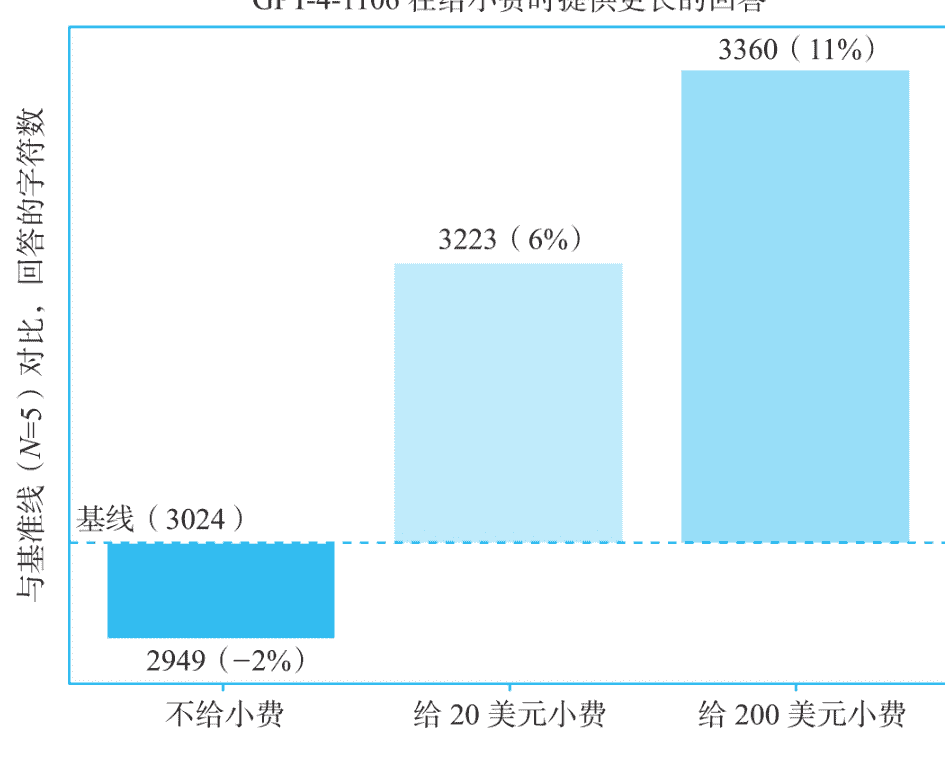

图4-2 X用户“thebes”的实验结果对比

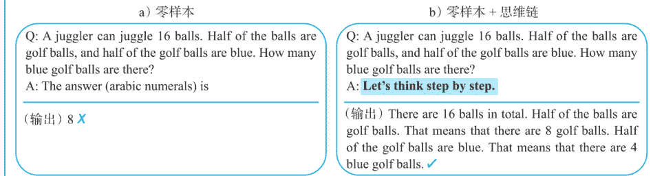

图4-3 实验对比结果

# 提示词实战进阶：从推理到教学落地

现在用 GPT-4 回答图4-3 中的实验题，往往不再需要刻意加入思维链提示也能得到正确结果。只有在对输出的可信度产生怀疑时，主动要求模型把思考过程摊开来展示，才能把中间步骤显性化，便于核查。

需要注意的是，思维链并非通用解法。Wei 等人在 2022 年发表的《Chain-of-Thought Prompting Elicits Reasoning in Large Language Models》 https://arxiv.org/pdf/2201.11903.pdf 明确指出，该技巧只有在参数规模达到 100B 及以上的大型系统上才显现效果，像 ChatGPT 这类主流大模型才适用。若模型体量偏小，该方法基本无效。

##### 5. 自我一致性

谷歌研究院 Xuezhi Wang 等人在 2022 年的研究表明，单条推理路径的优化仍存在出错风险。为此他们提出自我一致性 Self-Consistency 的思路：让模型多次生成答案或提供多条可能解法，最终采纳出现频次最高的作为结论。论文中对该回答方式的示意见图4-4。

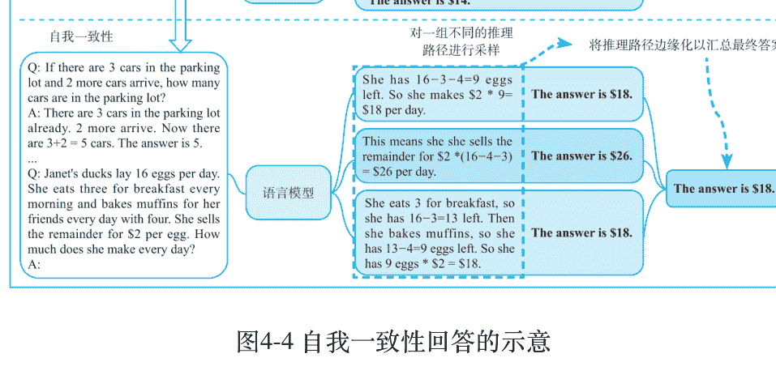
图4-4 自我一致性回答的示意

#### 4.2.2 简化的AI交流公式：RES公式

前文已说明，要获得可靠输出，提示词设计是关键。CRISPE 框架通用性强，可适配多数大语言模型。基于长期高频使用的经验，笔者将常用要素提炼为更简便的沟通公式，命名为 RES 公式：

角色 Role - 例子 Example - 指令 Statement

它能覆盖除复杂逻辑推理之外的大部分日常对话需求。遇到更专业的场景，CRISPE 仍是首选。RES 的使用样例见表4-3。

表4-3 RES公式样例

| Role (角色) | 你是一名人工智能研究专家，清晰了解人工智能的发展历史 |
| :--- | :--- |
| Example (例子) | 2011 年，IBM 的 Watson 问答机器人参与 Jeopardy 回答测验比赛最终赢得了冠军<br>2012 年，Hinton 和他的学生 Alex Krizhevsky 设计的 AlexNet 神经网络模型在 ImageNet 竞赛中大获全胜 |
| Statement (指令) | 请你列出 2011 年至今人工智能发展的重大事件，确保年份准确，事件可以在谷歌上查找到，格式要和这个例子一样 |

把表4-3的内容合并后输入 ChatGPT。

ChatGPT 的输出大致为：

我将为你梳理一份 2011 年至 2023 年人工智能领域的重大发展历程清单。这份清单会尽可能地涵盖每年的标志性事件，包括重要的研究成果、技术突破，以及产业里程碑。

2011年，IBM Watson 问答机器人参与 Jeopardy 回答测验比赛最终赢得了冠军。这标志着人工智能在理解自然语言和处理复杂问题方面的重大进展。

2012年，Geoffrey Hinton 和他的学生 Alex Krizhevsky 设计的 AlexNet 神经网络模型在 ImageNet 竞赛中大获全胜。AlexNet 的成功促进了深度学习在计算机视觉领域的广泛应用。

2013年，BERT 模型由谷歌的研究人员开发，这一模型在自然语言处理领域取得了显著成果……

2014年，Ian Goodfellow 及其同事提出了生成对抗网络 GAN……

2015年，谷歌 DeepMind 的 AlphaGo 击败欧洲围棋冠军 Fan Hui……

2016年，OpenAI 成立……

2017年，AlphaGo Zero 被公布……

2018年，BERT 模型发布……

2019年，OpenAI 发布了 GPT-2 模型……

2020年，GPT-3 模型推出……

2021年，DeepMind 的 AlphaFold2 在生物学领域取得突破……

2022年，人工智能在创作艺术和音乐方面取得显著进展，诸如 DALL·E 2 和 MusicLM 等模型能够生成高质量的图像和歌曲……

2023年，OpenAI 发布了 ChatGPT……

这份列表尽量保持准确和全面，但人工智能领域的发展极为迅速，每年都有许多值得关注的进展。

很明显答案并非完全正确，BERT 并不是 2013 年提出的，需要再去人工核对一下。不过对比直接提问，RES 公式带来的结果明显更干净、格式更统一。

直接提问的版本是：

请你列出 2011 年至今人工智能发展的重大事件。

ChatGPT 回复：

人工智能领域变化很快，自 2011 年以来经历了多个突破。下面是部分重要事件概述：

2011年
IBM 的沃森赢得《危险边缘》：IBM 的沃森超级计算机在电视智力游戏节目《危险边缘》中击败人类冠军……

2012年
深度学习的兴起：Alex Krizhevsky、Ilya Sutskever 和 Geoffrey Hinton 提出了 AlexNet……

2014年
谷歌收购 DeepMind……

2015年
AlphaGo 击败李世石……

2017年
AlphaGo Zero……

2018年
自动驾驶汽车试点运行……

2019年
GPT-2 发布……

2020年
GPT-3 发布……

2021年
AI 在生物医药领域的应用……

2022年及以后
人工智能伦理和监管讨论加深……

这个列表仅涵盖部分重大事件，人工智能领域发展迅速，每年都会有新技术、应用和里程碑。

对比来看，除了 2023 年的事件没覆盖且废话偏多外，其他部分尚可接受。这也侧面印证了 2022 年 9 月 OpenAI CEO 山姆·奥特曼接受采访时说的“5 年内我们很可能就不再需要提示词工程。”如图4-5所示。截至 2024 年 3 月，提示词工程依然是与模型高效沟通的有效手段。


图4-5 山姆·奥特曼接受采访时的原文

#### 4.2.3 案例解读：AI辅助教学设计全流程

人工智能在教学场景中的价值远不止评价，它还能全程助力教师做教学设计。有了初步想法后，用 ChatGPT 进行深度推敲，想法会逐步完善直至形成完整方案。下面以笔者扮演初中信息科技教师，借助模型设计一单元大课程为例。

##### (1) 明确教学目标

目的是把模糊的设想具体化。

教师向模型说明自己是初中信息技术老师，需要为八年级设计三节围绕“机器学习结合 micro:bit 设计驱鸟器 demo”的大单元，列出问题提出、设备组合、数据收集与标注、模型训练、图形化编程控制等初步构想，并要求结合市级人工智能课程纲要梳理教学目标，同时给出一个可参照的名师课程案例。

ChatGPT 的回答概括为：

1. 帮助学生认识人工智能的价值，理解其在现代农业中的意义。
2. 提升用人工智能解决实际问题的能力，通过驱鸟器项目体验图像识别流程。
3. 强化人工智能的应用与探究能力，培养数据收集、标注、训练与硬件实现的综合素养。
4. 培育团队协作与交流能力。
5. 培养人工智能伦理意识与社会责任感，如对鸟类生态的考量。

综合来看，课程既能覆盖技术知识，也能引导学生思考技术价值与伦理规范。

##### (2) 划分教学内容

目的是把整体想法拆成可执行的课时。

教师要求将课程细化为三节课，采用问题或任务驱动，并参考编码课程的三个任务模式。

ChatGPT 的回答给出：

第一节课聚焦人工智能在农业中的应用，核心问题是如何用技术解决草莓被鸟破坏的问题。安排头脑风暴、案例学习、问题分析。

第二节课聚焦数据收集计划设计，要求学生认识训练数据与标注，实践拍摄照片并标注，小组分享计划与困难。

第三节课聚焦智能驱鸟器实现，介绍图形化编程平台的模型训练流程，动手训练并让 micro:bit 在预测后发出声响，最后成果展示与反思。

总结强调通过真实问题驱动学习，提升问题解决、协作与创新思维。

##### (3) 细化每节课的内容

目的是做重难点分析，结合实际优化教案。

教师提问1：

你是一名初中专业信息科技教师，请你结合信息技术教学的核心素养：计算思维、信息社会责任、数字化学习与创新、信息意识，确定如下课程的教学目标，并优化教学内容。

第一节课：探索人工智能在农业中的应用。核心问题：“如何通过技术解决农场草莓被鸟类破坏的问题？”教学内容安排大致如下：教师提出“如何通过技术解决农场草莓被鸟类破坏的问题？”，并找演员拍视频。学生讨论并根据任务单中已有的资源询问 ChatGPT 解决方案，再修改。教师引导形成解决方案的整体思路。然后教师播放使用 AI 驱鸟器的演示视频，并带领学生了解农业领域的其他 AI 应用。

ChatGPT 的回答1：

教学目标围绕计算思维、信息社会责任、数字化学习与创新、信息意识展开，教学内容分为问题提出与初步探讨、资源调研与解决方案探索、方案设计与优化、AI 应用案例学习、总结与反思五个环节，强调通过问题驱动综合培养核心素养。

教师提问2：

## 初中信息科技：抓住重点难点的视角

换一个立场来想，如果你就是初中信息科技的任课老师，会怎样提炼这节课的核心与难点？表述要具体可操作，避免泛泛而谈，比如培养学生能够借助网络资源与生成式工具特别是ChatGPT去搜集资料、拆解问题并形成解决思路的能力。重点和难点不必相同。

ChatGPT 的第二版梳理如下：

###### 教学重点：掌握借助智能技术解决真实问题的完整路径
此重点落在把智能技术迁移到现实情境。以农业场景中“草莓被鸟啄食”这一具体问题为例，要求学生不仅会使用ChatGPT等智能助手进行信息搜集与问题分析，还要能够在分析基础上设计出可落地的解决办法。

###### 教学难点：提高信息筛选与评估的能力
网络信息充斥，如何在海量内容中快速辨别来源可信度、挑选出对任务真正有帮助的准确信息，是一个突出障碍。这既关乎检索技能，也涉及批判性思维与信息素养，对初中阶段的学生来说经验薄弱，比较吃力。

###### 围绕重点的教学策略：
- 案例拆解：选择农业领域智能化应用的成功案例，引导学生观察技术如何落地解决实际问题。
- 模拟实践：设计情境任务，让学生运用智能助手处理数据，在实操中体会应用方法。
- 创新思维启发：通过头脑风暴与创意工作坊，鼓励提出多元方案，培养创新意识。

###### 突破难点的教学建议：
- 信息素养启蒙：介绍评估网络信息可靠性的基本原则。
- 批判性思维训练：组织不同来源信息的对比讨论，提升辨别力。
- 实操演练：在教师指导下，让学生亲手检索、筛选并判断信息准确度。

上述做法既能帮助跨越信息甄别的瓶颈，也能达成用智能技术解决实际问题的教学目标，同时同步提升评估水平。

##### (4) 用智能系统快速配图
本环节目的：依据教学内容，让智能系统迅速生成配图。

教师提问：
请生成一张照片质感画面，主体是一只棕褐色小鸟正在郁郁葱葱的草莓田中啄食草莓。鸟的腿部结构需符合真实解剖，整体画面明亮生动，以自然光营造统一色调。绿叶繁茂、草莓鲜红，细节逼真。小鸟体型娇小神态灵动，腿部完整自然，与环境融为一体，画面充满构图，无边框，比例16:9。

按照上述描述，ChatGPT 产出的草莓与小鸟图像如图4-6所示。

若在该图像上叠加中文“保卫草莓”，效果如图4-7。可见ChatGPT在中文渲染上的表现欠佳。若追求专业美观的中文艺术字，建议改用Stable Diffusion。

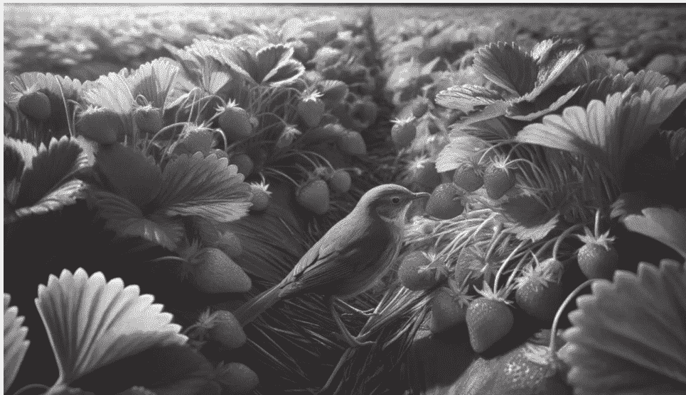

▲图4-6 ChatGPT生成的草莓和小鸟的图片

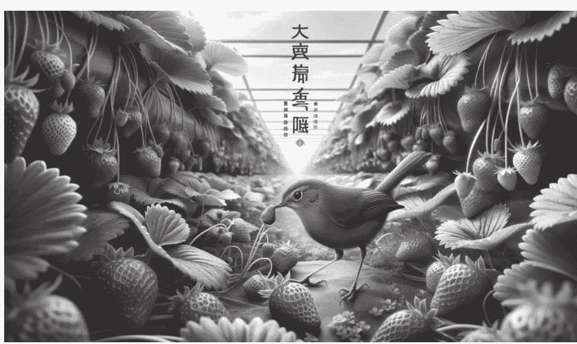

▲图4-7 添加中文字“保卫草莓”

# Chapter 5

## 第5章

## 教师工作助手：用AI提升办公效率

智能助手在教育领域的价值日益凸显，尤其对教师日常工作而言，自动化与智能化能够大幅提升备课、资源准备与科研的效率与质量。借助智能手段，教师可把更多精力留给教学创新与学生互动，整体教育效能也随之优化。

本章将展开讨论智能技术如何助力教师提效。涉及的知识点包括：

- 依靠智能技术自动生成高质量教学幻灯片。
- 用智能工具与教学文档进行对话式互动。
- 探索教育内容视觉化表达的智能路径。
- 借助智能助手优化研究流程与文献管理。

### 5.1 幻灯片智能快速制作

本节聚焦智能技术如何重塑教学课件制作流程，介绍借助ChatGPT、Mindshow、MotionGo、Gamma App与Tome等工具，实现快速、高效、个性化的内容呈现，从而减轻备课负担，让课堂更生动。

#### 5.1.1 智能自动制作演示文稿
演示文稿是课堂呈现的核心载体。传统方式下，从整理素材到版式设计，往往需要近一小时，效率偏低。自2023年起，随着智能技术普及，办公制作进入智能驱动的新阶段。

如图5-1所示，相关技术可自动归纳内容、规划布局并植入视觉元素，让成片既专业又吸睛。教师因此能把时间投入到内容深化与互动。


当前主流的演示文稿制作智能工具汇总见表5-1。

##### 表5-1 主流演示文稿制作工具汇总

| 工具名称 | 功能说明 |
| :--- | :--- |
| AiPPT | AiPPT 为智能化在线演示文稿制作平台，操作简便，只需输入主题即可快速得到高质量文件。支持在线编辑与文档导入，内置十万余套定制模板和素材，帮助用户高效产出专业演示 |
| Gamma App | Gamma 是一个在线制作演示文稿的网页工具，用户能以最少的设计工作创建并展示内容。在智能支持下，Gamma 允许用户仅通过输入文本和想法提示，点一下便可得到设计美观且具吸引力的演示。支持嵌入各类多媒体格式，包括 GIF、视频、网站和图表，使观众更容易理解复杂概念 |
| Tome | Tome 是一个利用智能生成引人注目的演示文稿的网站，通过借助 OpenAI 的 GPT 和 DALL·E 2 的 AIGC 技术，该网站将文本和图像无缝结合，创造出动态的视觉故事 |
| ChatPPT/MotionGo | 该工具不仅可以通过聊天方式快速制作演示文稿，还可以根据上传的文档制作文稿，并且文稿具有动画效果。完成后还能够通过自然语言指令进行局部修改 |
| ChatGPT+Mindshow | 使用 ChatGPT 的文本生成能力制作演示文稿内容，然后把生成内容以 markdown 格式输出，再使用 Mindshow 来定制化制作演示文稿 |

#### 5.1.2 AiPPT 让设计更省心
在智能加持下，制作演示文稿不再高门槛，仅需问答式指令，按四步即可得到设计感强、内容完整的成果。是否准备好生成第一份教学演示文稿？

1) 在浏览器输入 https://www.aippt.cn/，注册登录，微信扫码即可。AiPPT 主界面如图5-2。

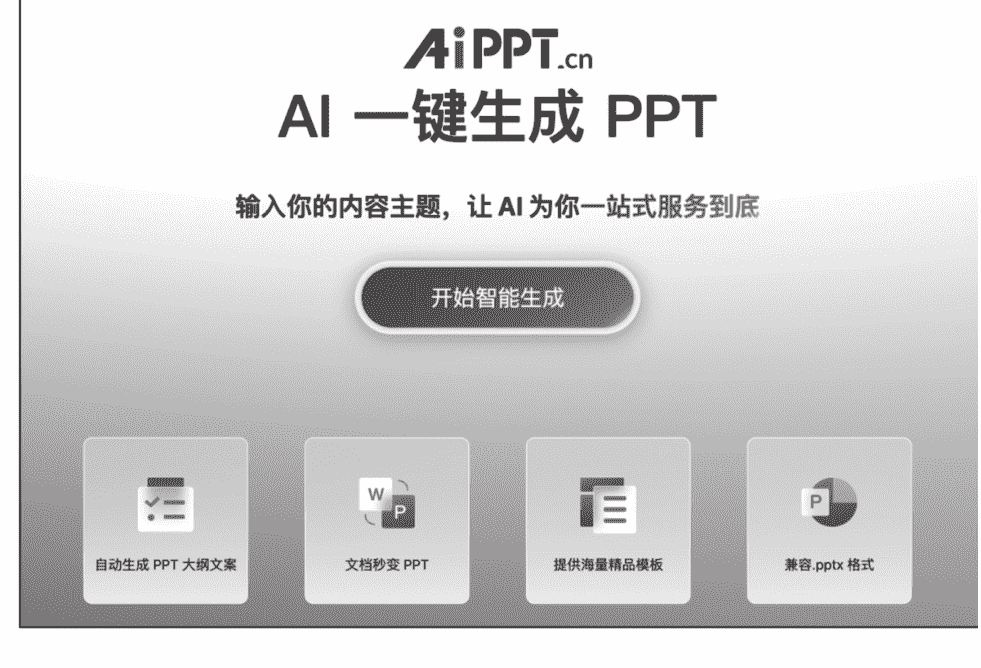

图5-2 AiPPT界面

2）点“开始智能生成”，提供两种入场方式，如图5-3。
- 用一条指令直接生成，即智能生成。
- 导入本地大纲生成。

3）输入指令生成大纲。例如：生成一份中学语文课《桃花源记》的课件大纲。生成结果如图5-4。

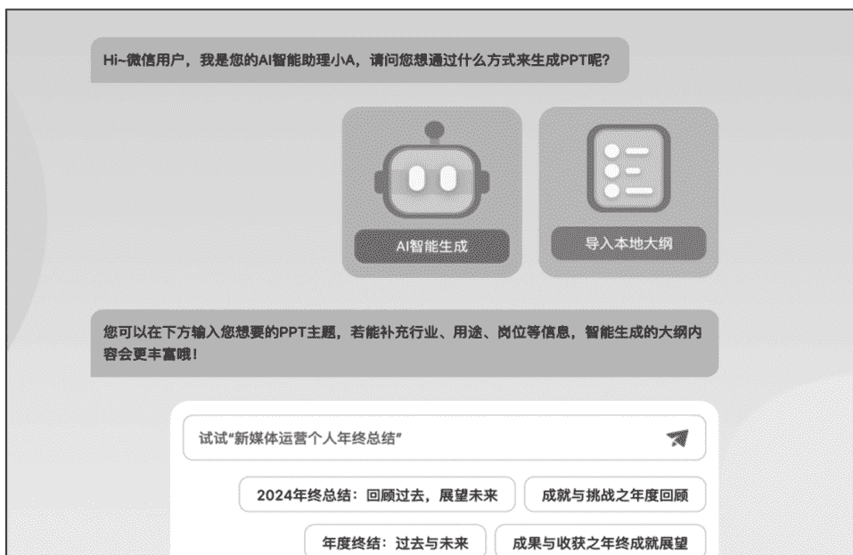

▲图5-3 两种生成方式

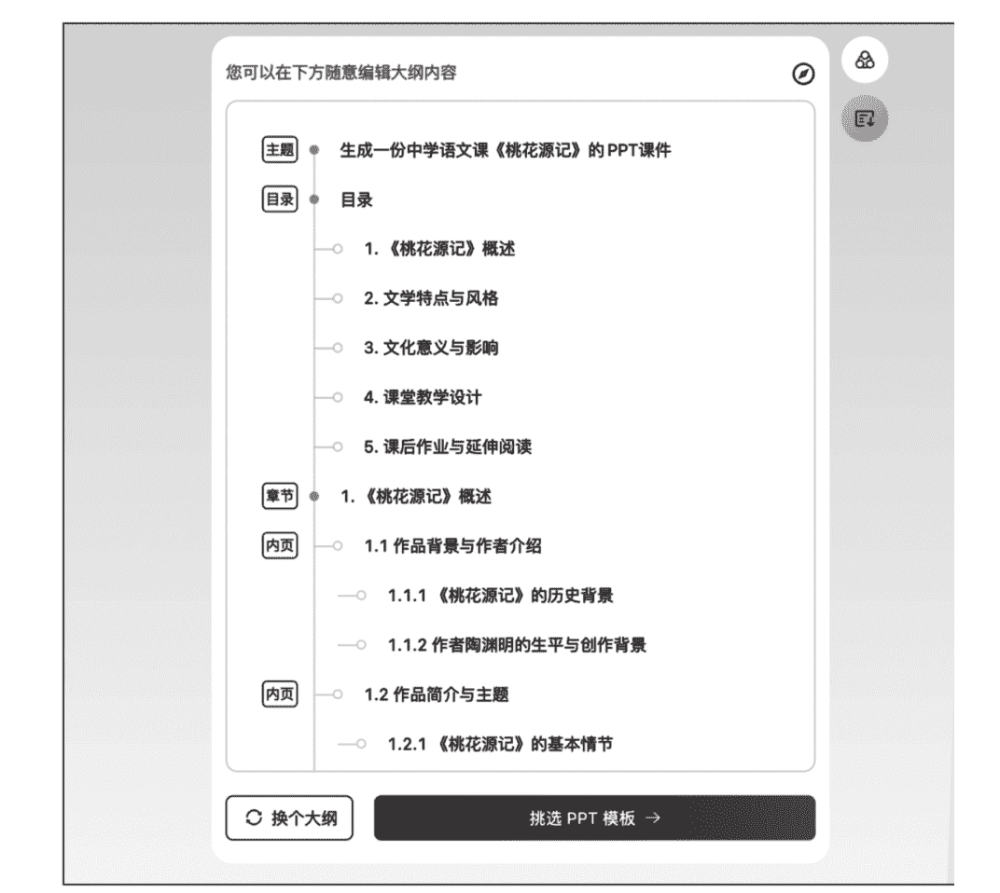

▲图5-4 AI生成一份PPT大纲

4) 依据课文挑选中国风模板，如图5-5。选定后点右上角“生成PPT”，系统会按主题产出图文并茂的课件；如需调整，可点“编辑”修改文字与图片。完成后直接下载。效果预览如图5-6。

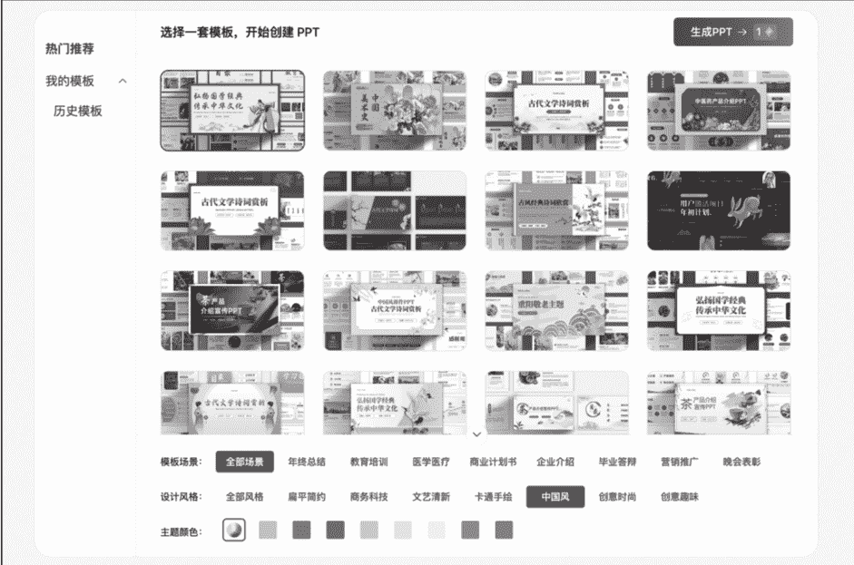

▲图5-5 选择模板

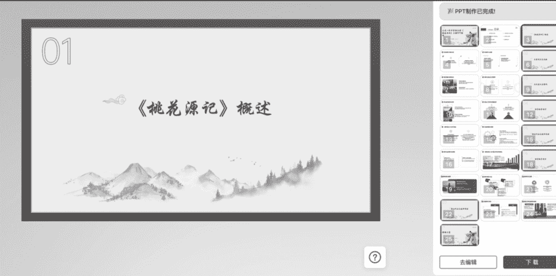

▲图5-6 AI生成PPT的效果预览

整体来看，智能产出的演示文稿未必完全契合课堂需求，但基础内容与排版已完成，效率提升明显。

#### 5.1.3 用 MotionGo 做动画演示文稿
ChatPPT/MotionGo 代表了演示文稿创作的革新方向，是一款深度融合智能技术的 Office 插件。内嵌于 Office 套件，保证兼容与流畅，用户无需切换应用即可从构思到成片一键完成。借助自然语言处理理解需求，自动梳理逻辑与视觉呈现，大幅减少手动排版时间，让人专注创意。

按以下六步尝试生成一份内容扎实、设计感强的课件。

1) 在浏览器输入 https://motion.yoo-ai.com/，下载安装包，具体方法见官网教程。官网首页如图5-7。


图5-7 MotionGo官网界面

2）安装后打开 ChatPPT，选择上方 MotionGo，登录账户可用微信扫码。主界面如图5-8。

3）打开智能对话窗口，发送指令“生成中学语文课《范进中举》的教学课件”。随后按提示依次选定主题、风格、插图生成模式、丰富度并确认目录。具体如图5-9～图5-11。

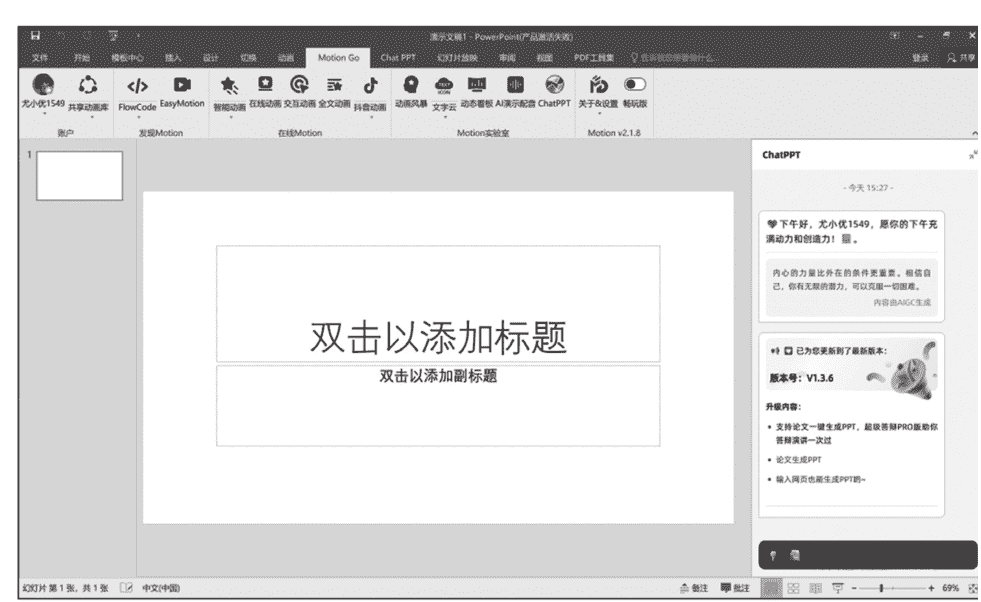

▲图5-8 打开ChatPPT后的界面

##### ChatPPT

- 论文生成PPT

- 输入网页也能生成PPT哟~

生成中学语文课《范进中举》的教学课件

为你生成了3个主题，请选择或修改

标题1

《范进中举》深度解析：

揭示社会现象

标题2

从《范进中举》看古代科

举制度

标题3

中学语文课：《范进中

举》人物性格分析

AI重新生成

确认

AIGC生成内容无法确保真实准确，仅供参考。

▲图5-9 选择主题

##### ChatPPT

WOW~ 请选择AI生成的主题风格


AI重新生成

使用

确认-所选AI主题设计

##### 请选择图片/图标等的生成模式

* 在进行PPT设计创作中，涉及到的图文页面创作将会进行AI实时绘制，可以更高效满足你的体验。

快速模式 · AI预设图库

AI正在等待你的选择...

▲图5-10 选择主题风格与插图的生成模式

##### ChatPPT

请选择你想要的PPT内容丰富度

* 丰富度的选择，关系到创作内容的速度以及内容的复杂度。

- 普通

- 中等

- 复杂

已选择内容生成丰富度：中等

##### 请确认为你生成的PPT目录

###### 章节1

- 《范进中举》背景概述

  - 小说背景介绍

  - 《范进中举》的文学地位

###### 章节2

- 范进中举的动态分析

  - 人物性格塑造

  - 中举心理解读

###### 章节3

- 社会现象启示

  - 社会地位观念

AI正在等待你的选择...

##### ▲图5-11 选择内容丰富度与确认PPT的目录

4) 可按需生成演讲备注，并依讲课习惯修改。如图5-12。

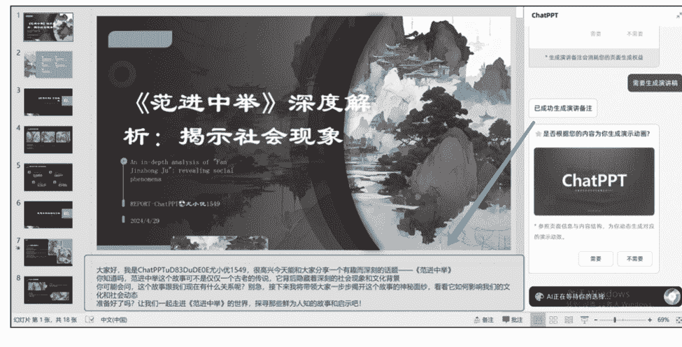

##### 图5-12 生成演讲备注

5) 按提示选择智能动画，系统会依据页面信息与结构生成演示动效。如图5-13。

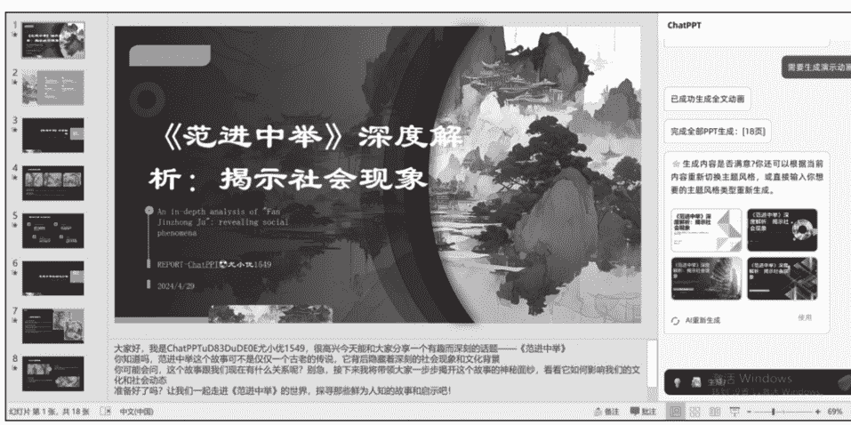

图5-13 生成演示动效

6) 手动微调，确认无误后保存。

该插件可无缝融入工作流，从构思到成品流畅高效，能精准捕捉意图、自动优化布局设计，节省美化时间，让用户聚焦内容打磨。自定义选项丰富，在保持个性表达的同时享受智能带来的高质高效体验。

#### 5.1.4 Gamma 与 Tome 实现设计自动化
借助 Gamma App 与 Tome，演示文稿设计不再困难，两者都能让制作既简单又高效，兼顾美感与内容充实度。风格各异，可按喜好挑选。

##### 1. Gamma App 智能生成演示文稿
Gamma App 风格选择多，操作如下。

1) 输入 https://www.gamma.app/，注册登录，邮箱即可。主界面如图5-14。

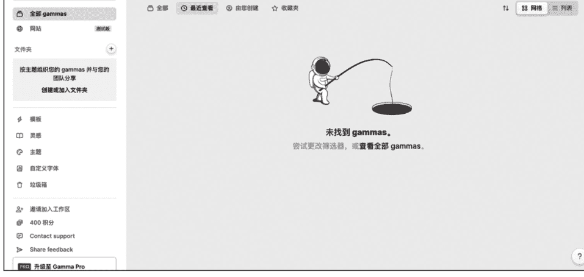

图5-14 Gamma App界面

2) 点“新建AI”，提供三种方式，如图5-15。
- 生成：指令直接生成。
- 粘贴文本：导入大纲。
- 导入文件：优化现有文档。

3) 选择“演示文稿”。智能生成界面如图5-16。

4) 在文本框输入“请生成中学语文课《醉翁亭记》的PPT”，确认后获得大纲，点“继续”。大纲如图5-17。

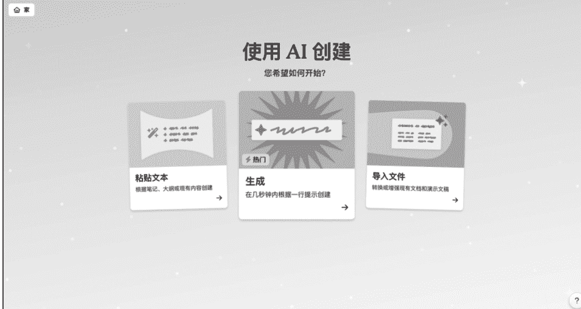

▲图5-15 3种生成方式

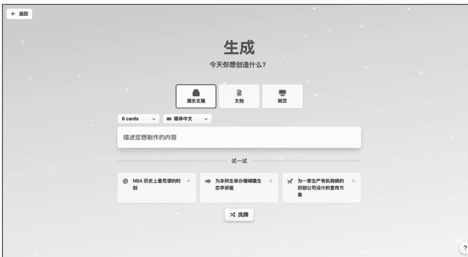

▲图5-16 智能生成PPT的界面

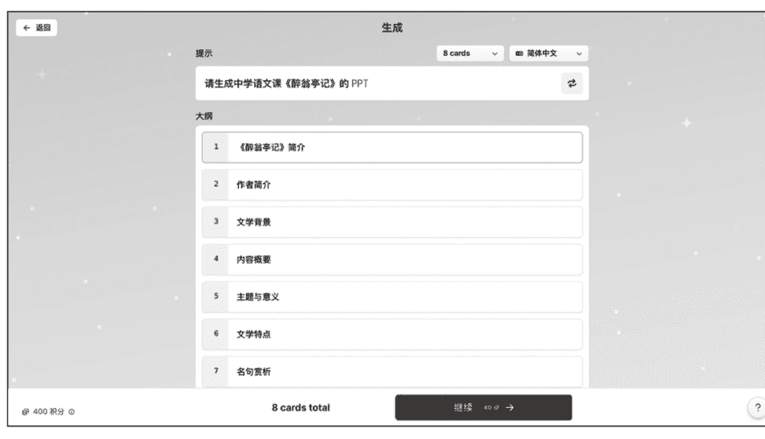

▲图5-17 AI生成课件的大纲

5) 选定主题后点“生成”，如图5-18。此时可直接编辑文字、图片与排版。效果如图5-19。

6) 编辑完毕点右上角“...”选择“导出”，如图5-20。

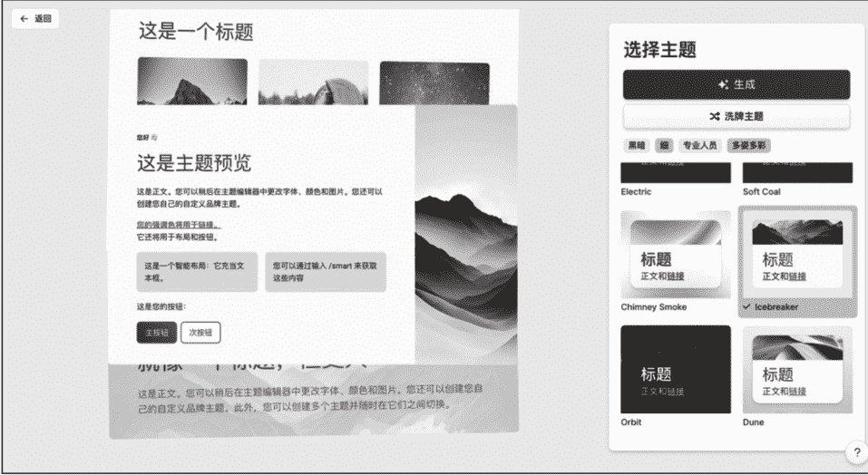

▲图5-18 选择PPT的主题

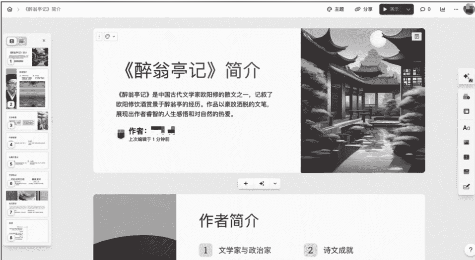

▲图5-19 Gamma App生成PPT的效果

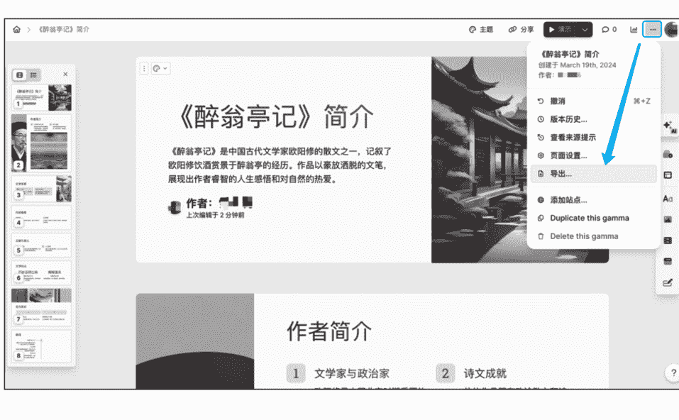

▲图5-20 导出课件

##### 2. Tome 智能生成演示文稿
与 Gamma 相比，Tome 的风格更简洁。

1) 输入 https://www.tome.app/，注册登录。首页如图5-21。

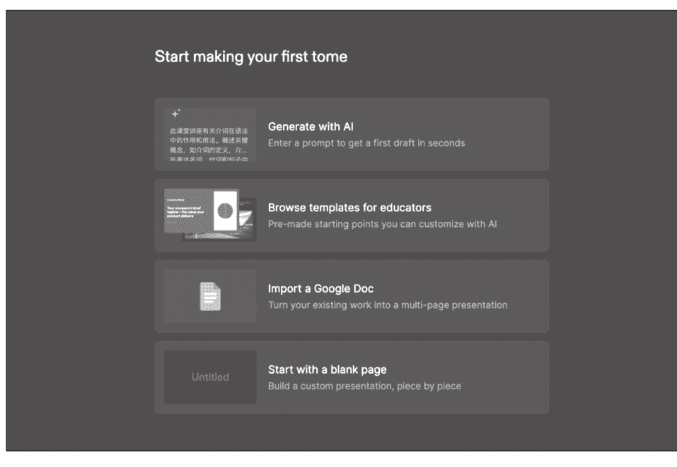

图5-21 Tome界面

2）选择“Generate with AI”，输入指令得到大纲。如图5-22，介绍中学语文课《醉翁亭记》，点“Generate presentation”生成。

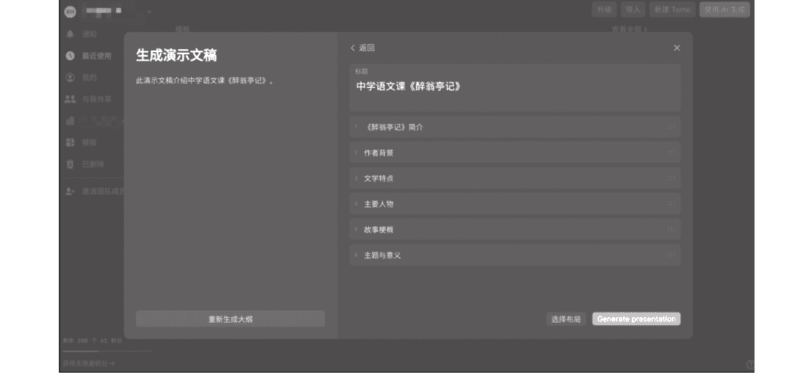

图5-22 Tome生成一份PPT大纲

3) 页面可直接编辑内容。效果如图5-23。

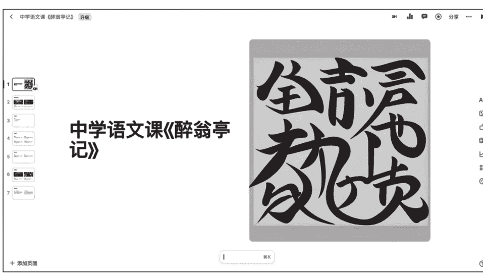

###### 图5-23 Tome生成PPT

4）编辑完成后点右上角“...”选择“导出为PDF”。如图5-24。

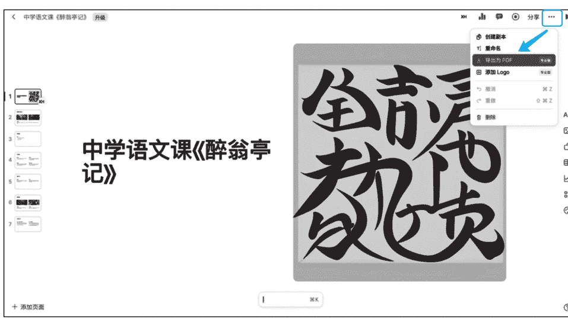

###### 图5-24 Tome导出PDF文档

不同平台各有侧重，有的重内容深度，有的重视觉美感，有的提供定制化服务，可根据需求灵活选用。

借助智能工具，我们能快速获得内容完整、排版齐备的演示文稿，并通过不同平台的风格差异打造特色课件，提升效率的同时为教学注入创新与个性。在选型时应结合自身需求，发挥各平台优势。

### 5.2 与各类文档展开对话

教育正处在持续变革的进程中，人工智能以惊人的速度改变着人与资料之间的互动方式。以下内容将围绕如何借助智能工具实现与各类文档的“对话”，并以ChatExcel、ChatPDF、云一朵为代表，说明这些应用在教学与学习场景中的具体价值。

#### 5.2.1 ChatExcel：用自然语言操控表格
对不少教师和研究者而言，手工处理Excel数据既费时又容易出错。ChatExcel借助自然语言处理，让用户无需掌握复杂函数就能通过对话完成查询、编辑和分析，显著降低使用门槛并提升效率。

与表格对话的操作流程如下。

1) 在浏览器地址栏输入 https://chatexcel.com/ ，点击“现在开始”即可进入主界面，ChatExcel 界面如图5-25所示。

2) 在顶部选择“上传文件”，把待处理的表格导入网站，上传后的操作界面如图5-26所示。

3) 在指令框输入“2022年比2021年增长百分比作为最后一列”，点击“执行”后，系统按要求自动生成新列。文字指令驱动生成的效果如图5-27所示。

指令可以灵活变化，例如“在所有省份名称前加上‘中国-’”“把最后一列数据保留两位小数”“删除第二列”等，均可通过简单描述完成编辑。借助这种对话式操作，表格处理变得快速智能，日常办公与数据分析效率大幅提升，ChatExcel成为可靠的数据助手。

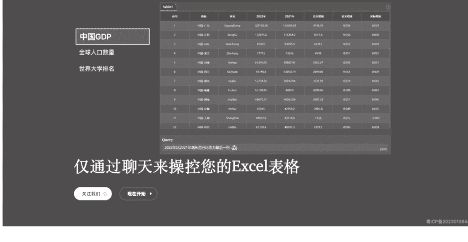

▲图5-25 ChatExcel界面

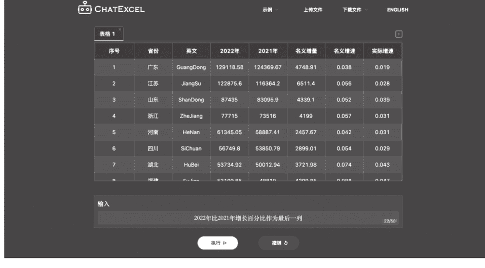

##### ▲图5-26 表格处理操作界面


##### ▲图5-27 用文字指令生成新数据

#### 5.2.2 ChatPDF：实现智能化PDF交互
在教学中，PDF仍是知识传递的重要载体。传统阅读器交互性弱，使用体验有限。ChatPDF基于AI构建的智能阅读器，能够抽取关键信息并以对话形式实时回应提问、解释内容，为教师提供教学支持，为学生创造更高效有趣的学习方式。

1) 在地址栏输入 https://www.chatpdf.com/ ，完成邮箱注册登录，进入主界面如图5-28所示。


图5-28 ChatPDF界面

2) 将目标PDF拖拽到“Drop PDF here”区域，系统开始解析文档，解析完成界面如图5-29所示。

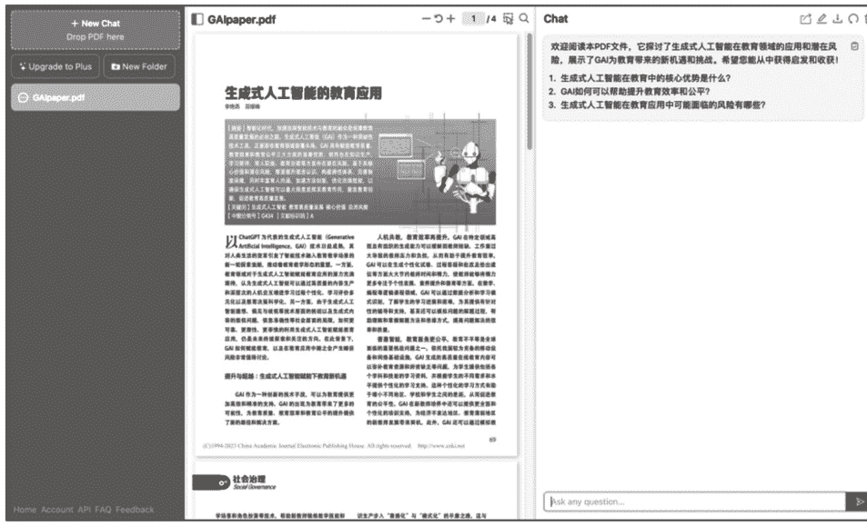

图5-29 阅读文档完成

3）文档解析完成后，页面会给出若干参考问题。用户可在此基础上追问，或直接提出自己的疑问，如图5-30和图5-31所示。

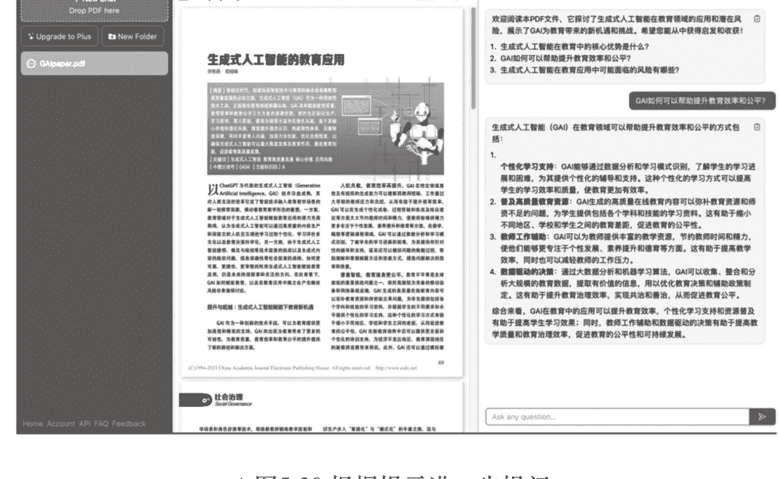

▲图5-30 根据提示进一步提问

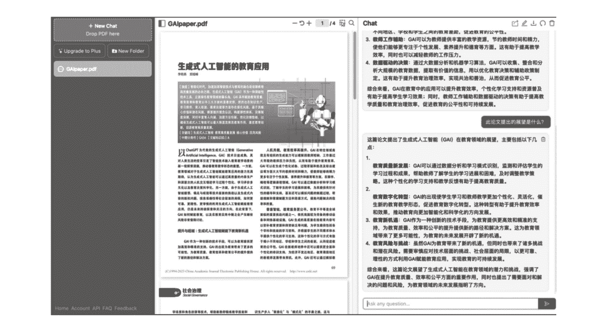

▲图5-31 根据自己的疑问提问

这种面向教育场景的智能阅读工具让枯燥的论文和教材变得易于理解。借助AI解析能力，ChatPDF可以深入解读全文，并在用户针对局部内容提问时提供精准解答，明显提高阅读效率。

#### 5.2.3 云一朵：让教育视频可对话
在线教育兴起后，视频成为核心资源，但传统播放缺乏互动与个性化。云一朵通过AI分析视频内容，结合实时反馈提供个性化指引，并支持语音或文字与视频进行对话式交互，使学习更深入也更生动。

1) 在浏览器输入 https://pan.baidu.com/ ，登录个人百度网盘。

2) 打开网盘中的视频，点击右上角图标启动云一朵AI工具。如图5-32所示，图标位于界面右上角。

3) 云一朵生成视频智能摘要后，可在对话框中就视频内容进行问答。智能总结界面如图5-33所示。例如提问“生成式人工智能如何应用在课堂上？”，系统会结合视频内容作答并标注对应进度，如图5-34所示。

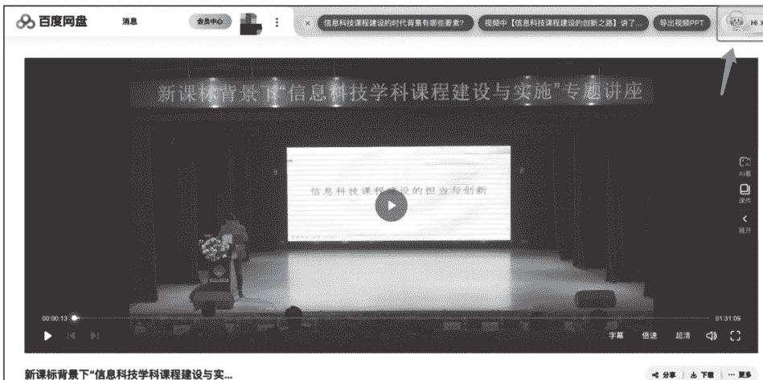

▲图5-32 云一朵的图标位置

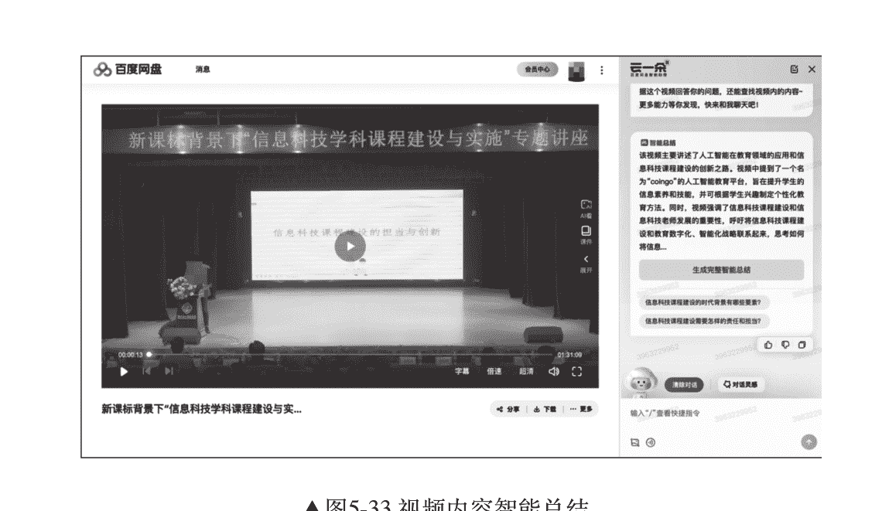

▲图5-33 视频内容智能总结

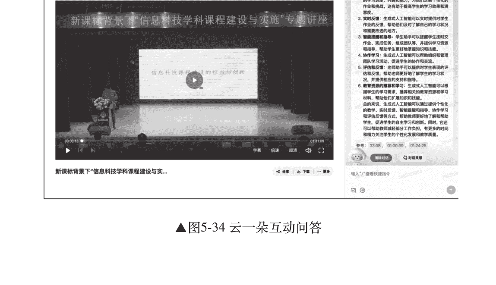

▲图5-34 云一朵互动问答

总体来看，AI正在重塑人与文档的交互模式，为教育带来变革性机遇。从ChatExcel到ChatPDF再到云一朵，这些工具简化了流程、提升了效率，让教学更智能、更个性、更有趣。未来AI在教育中的作用值得期待。

### 5.3 绘画与生成思维导图
对一线教师而言，数字艺术与智能工具的融合拓展了教学边界。本部分将介绍AI在绘画教学和思维导图教学中的应用，帮助教师探索新的教学可能。AI绘画打破了材料、技能和时间的限制，为学生提供全新创作体验；AI生成的思维导图则比手绘更高效、易于修改，有助于理解与记忆。

#### 5.3.1 AI绘画工具导览
国内AI绘画大模型发展迅速，依托深度学习和海量图像数据，能够模拟多种风格甚至创造新艺术效果。主流工具汇总如下。

表5-2 国内AI绘画工具合集

| AI 绘画工具 | 功能说明 |
| :--- | :--- |
| 悠船 | 悠船是 Midjourney 中国版，图片质量较高。用户输入文字描述即可生成个性化作品，支持多种风格与参数调节，兼顾新手与进阶需求。其算法能把握文字意境，社区功能促进交流与分享，形成创意生态 |
| 文心一格 | 该平台提供AI艺术与创意辅助，输入文本描述并选择方向、风格、尺寸后自动生成画作。风格选择丰富，适合不同水平创作者使用 |
| 通义万相 | 支持水彩、油画、国画等多种风格，提供图生图、涂鸦创作、风格迁移及虚拟模特展示商品等功能。用户可复用他人创意并在此基础上改动与创新 |
| Vega AI | 提供文生图与图生图两类功能。文生图通过文字指令生成图像，图生图允许上传图片并涂抹局部后输入替换内容。还支持放大、优化、二次编辑等操作 |
| 奇域 AI | 专注中式审美的创作平台，提供水墨、刺绣等国风风格，支持PC与移动端。设有交流社区，便于灵感分享与作品展示 |
| Dreamina | 将文字快速转化为图像，具备文字绘图、扩图、局部重绘等能力。生成速度快、色彩丰富、风格多样，支持关键词定制和模板调用，图像编辑功能提升创作灵活性 |

各平台基于大模型提供高效便捷的绘画体验，教师可根据需求选择合适的工具。

#### 5.3.2 案例：把古诗画出来
语文教学中古诗学习常受限于文字解读，难以体会意境。借助AI绘画，可将诗句转化为视觉画面，提升兴趣与审美。本案例以通义万相演示。

- 1) 打开 https://tongyi.aliyun.com/wanxiang/ ，注册并登录。

- 2) 选择“创意作画”进入绘画界面，通义万相界面如图5-35所示。

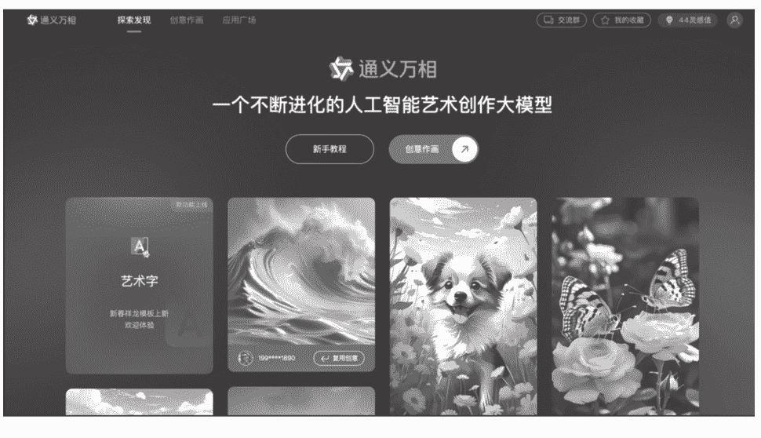

图5-35 通义万相界面

- 3) 在“文本生成图像”区输入指令“朝辞白帝彩云间，超细节，高清，水墨画”，可自行选择风格与尺寸，也可上传参考图。

- 4) 点击“生成创意画作”即可获得作品。如图5-36所示为AI生成的创意画作，不满意可点“再次生成”。用相同流程为每句诗生成对应意境图，示例见图5-37～图5-40。

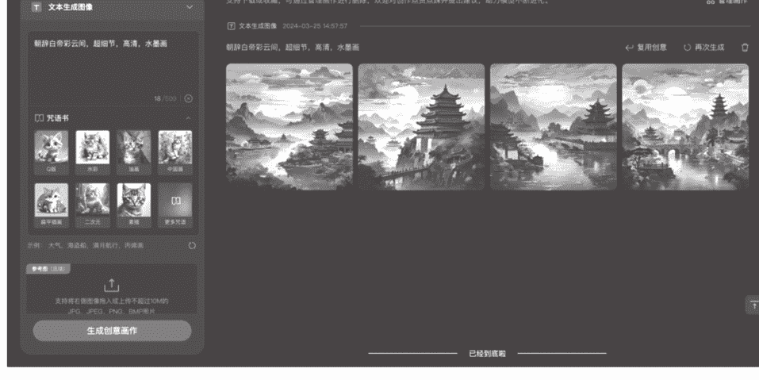

AI绘画在教学中的应用价值很大。几步操作即可让学生看到文字到画面的转化，为古诗教学注入活力。结合不同学科特点，教师可利用AI绘画以全新视觉呈现知识，激发兴趣、培养创造力与综合素养。


▲图5-36 AI根据指令生成创意画作


▲图5-37 朝辞白帝彩云间


▲图5-38 千里江陵一日还


▲图5-39 两岸猿声啼不住


▲图5-40 轻舟已过万重山

#### 5.3.3 AI生成思维导图工具导览
传统思维导图制作耗时且难修改，限制了其教学灵活性。AI工具可根据指令智能生成清晰美观的导图，大幅提升效率。

##### 表5-3 AI生成思维导图工具合集

| AI 生成思维导图工具 | 功能说明 |
| :--- | :--- |
| 亿图脑图 | 按指令快速生成目标图表，支持连续对话优化结果。提供AI一键分析，支持文本润色、总结及图表异常识别、预测等功能 |
| ChatMind | 在对话框输入想法后自动创建并更新思维导图，支持指令修改、删除节点与关系，提供多种风格与主题模板 |
| ChatGPT+TreeMind 树图 | ChatGPT可自动生成思维导图文本，用户输入核心概念后导出至 TreeMind 等支持Mermaid的工具转化为可视化导图，简化整理流程 |
| 小画桌 | 专注思维导图与流程图生成，输入简单即可得到高质量结果，侧重实时协作与在线授课场景 |

四款工具各有特色，可依据教学场景选用，让思维导图制作更便捷。

#### 5.3.4 案例：AI思维导图的教育应用
AI生成思维导图融合高效计算与直观展示，能迅速整理信息并生成结构清晰的导图，并可根据反馈实时调整。例如在历史教学中，可帮助学生把握事件脉络与关联。

以TreeMind树图为例，操作如下。

1) 访问 https://shutu.cn/ ，注册登录。TreeMind树图界面如图5-41所示。


图5-41 TreeMind树图界面

2) 在文本框输入“解析辛亥革命的背景、原因、过程、结果及影响”，选择“智能生成”，系统自动生成导图如图5-42所示。

3) 可直接修改文字，并在右侧调整样式、骨架、配色与画布，如图5-43所示。

AI思维导图提升了教学效率，有助于学生理解复杂知识。但需注意，工具提供的是辅助，真正的学习仍需学生独立思考，避免过度依赖。

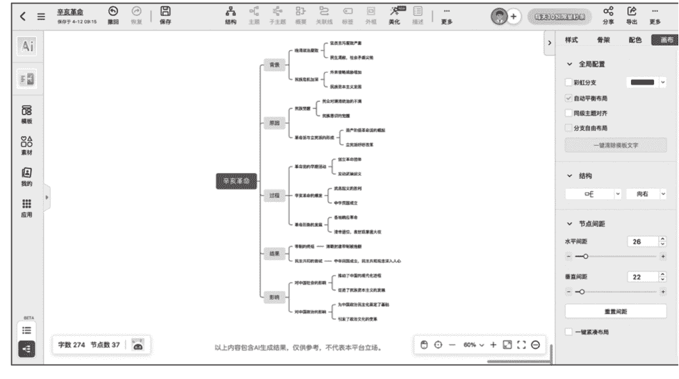

▲图5-42 TreeMind树图智能生成思维导图

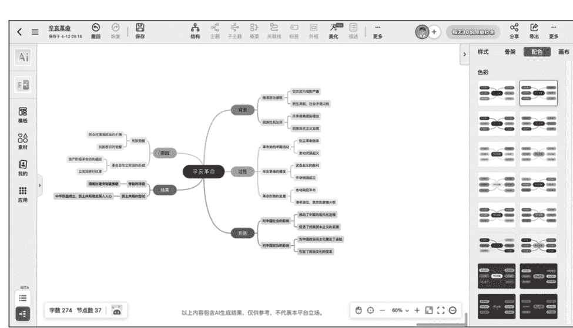

▲图5-43 修改思维导图

### 5.4 赋能教师科研论文
教育科研是教师专业发展的重要环节，传统方法耗时费力。AI通过智能分析、数据挖掘和自然语言处理，简化文献检索、综述撰写和论文写作流程。本节将说明AI在科研各环节的赋能作用。

#### 5.4.1 AI整理文献要点
在课题研究中，教师常被大量文献阅读困扰。AI文献阅读工具可作为私人助手，从海量资料中筛选相关文献、精读并自动生成摘要，帮助快速把握核心要点。Kimi等工具基于自然语言处理和机器学习，能按需提取信息并生成摘要，还支持针对文献进行提问并给出智能回答，帮助发现新的教学思路与科研灵感。只需简单几步，即可让Kimi发挥智能文献阅读功能。

Kimi文献速览实操三步

1) 前往 Kimi 官方页面 https://kimi.moonshot.cn/，在顶部找到登录入口，可用微信扫码进入或用手机号新建账号。网页版主界面参考如图5-44，手机端也可自行体验。

2) 把待读的论文文件直接拖进页面，或把论文链接粘到输入区等待解析。上传示意见图5-45，整理后的呈现见图5-46。

3) 在对话区输入阅读过程中的疑问，如图5-47所示。例如提问：该研究在教育场景里的具体应用有哪些？

过去教师往往要花费大量时间手动筛选、通读并归纳资料。如今借助 Kimi 这类智能阅读助手，繁琐流程被快速且准确地打通，教师能把更多精力放在教学与科研创新上。借助自动化解析和要点抽取，这类工具明显减轻了阅读负担，提升了工作效率。

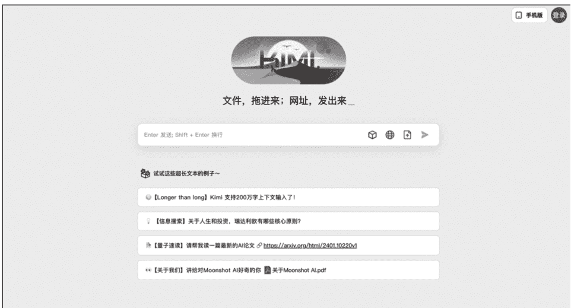

▲图5-44 Kimi网站界面

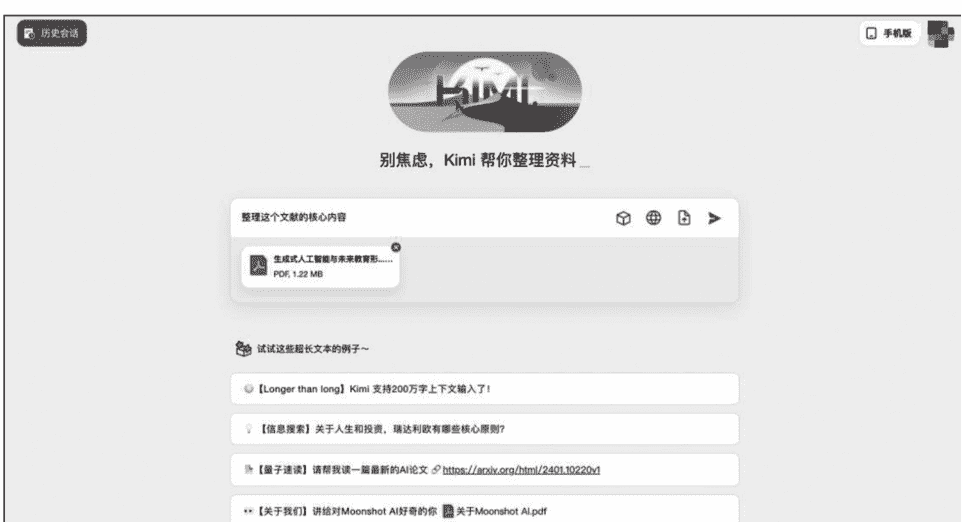

##### ▲图5-45 上传文献

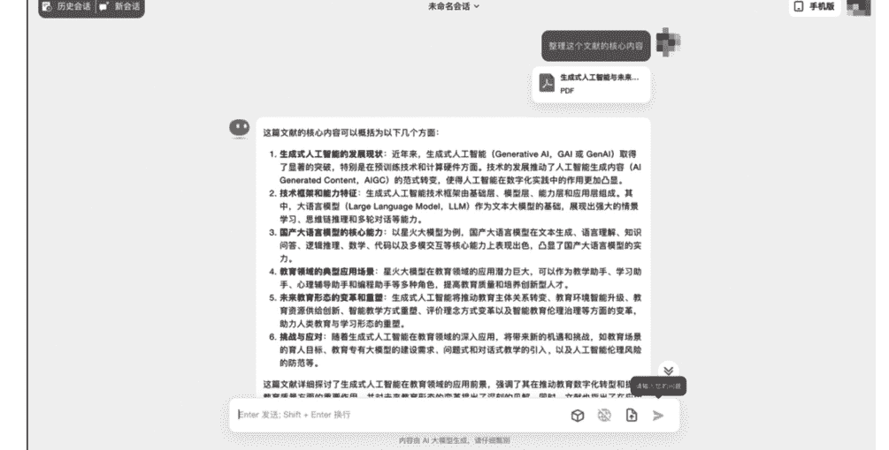

##### ▲图5-46 Kimi整理文献的结果

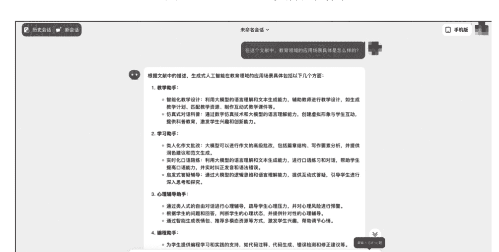

##### ▲图5-47 针对文献进行提问

#### 5.4.2 用智能体提速综述撰写

写论文或做深度研究时，文献回顾是必经环节。手工整理分析海量资料不仅费时也易出错。随着智能技术普及，越来越多研究者开始借助智能体辅助完成综述。智能体可作自动化分析与归纳，帮助教师高效完成回顾，不仅能提炼核心观点与论据，还可自动产出结构清晰、逻辑严密的报告，大幅提升质量与效率。

表5-4列出几类可助力教师完成文献回顾的在线平台。

##### 表5-4 AI辅助工具合集

| AI 辅助工具 | 功能说明 |
| :--- | :--- |
| Kimi | 输入研究主题后可获得智能推荐的文献清单，可浏览筛选并深入研读，迅速提取要点，最后借助智能整合功能将多篇资料合并，形成条理清楚的文献综述 |
| 文心一言+知网AI智能写作平台 | 先用文心一言拟定提纲，再于知网智能写作平台检索筛选相关内容，融合两端资源快速撰写出涵盖研究现状、观点与未来方向的综述，最后校对修改以保证准确规范 |
| AIPaperPass | 除可生成完整论文框架外，还能按需自动产出文献综述内容，同时提供语法纠错与排版功能 |
| 文途 AI 论文 | 该在线工具允许用户输入标题、关键词等要素，一键生成文献综述的初稿或框架 |
| 掌桥科研 | 平台拥有庞大文献资源，提供一键跨库检索与本地获取服务，用户可快速定位所需文献并利用智能技术生成对应综述 |

以 Kimi 为例，假设你是一位小学数学课程教师，正在开展一项基于核心素养的小学数学校本课程设计与实践课题，按下面流程即可轻松完成论文的文献回顾部分。

1. 打开 Kimi 页面，点击右上角登录入口。
2. 发送指令“你是一名小学数学老师，正在进行基于核心素养的小学数学校本课程设计与实践研究，请推荐相关文献。”系统会给出推荐。如图5-48所示，Kimi给出文献推荐。


3. 根据文献简介挑选需要深入的篇目进行提问，例如指令“整理第7篇文献《核心素养下小学‘趣味数学’校本课程开发与实践》的核心内容”。如图5-49所示，可获取指定文献的核心要点。


也可直接打开文献列表中某篇的来源链接自行阅读。如图5-50所示，打开推荐文献的链接。


4. 在阅读充分后，输入指令获取综述大纲。

**指令示例：**

现在需要撰写一篇展示本课题成果的论文，请依据以上推荐文献列出文献综述部分的大纲。

若生成结果不理想，可给出修改方向让 Kimi 重新生成。如图5-51所示，Kimi输出文献综述大纲。


5. 大纲确定后，输入指令“请依据以上大纲，参考前述相关文献内容，撰写文献综述的引言部分”，即可获得内容。建议分段生成以控制篇幅。如图5-52所示，Kimi生成文献综述内容。


若对内容不满意，可按思路要求让智能体重写，例如：“请修改引言，要体现《义务教育课程方案和课程标准（2022年版）》的相关表述。”如图5-53所示，Kimi对综述进行修改。


需要提醒的是，尽管智能工具能大幅提升综述生成效率，技术仍存在局限，输出仍需结合专业知识审慎核查修改，确保质量与准确性。同时使用工具时要注意个人信息与学术成果安全，遵守学术规范与诚信原则。

#### 5.4.3 智能贯通论文写作全流程

论文写作是教育科研的精华体现，对不少教师而言颇具挑战。科技发展为这一传统环节注入新动力，从选题构思到终稿润色，智能体都能提供支持。

依托智能算法与大数据，智能体不仅能挖掘易被忽视的研究点与创新机会，还能结合作者习惯与领域特征给出个性化写作建议。借助智能体，论文框架更合理，内容更精准，连语法拼写问题也能及时捕捉修正。论文写作由此变得更轻松高效，质量也更有保障。

表5-5列举了 6 个具备论文写作辅助功能的智能平台。

##### 表5-5 AI辅助论文写作平台合集

| AI 写作平台 | 功能说明 |
| :--- | :--- |
| ChatGPT | 凭借强大的自然语言处理能力，能理解用户意图，提供段落构思、观点阐述、逻辑梳理等支持，可解答专业问题、引用文献并协助修正语法、提升表达清晰度，加快写作进程 |
| 文心一言 | 具备语义理解与创新生成能力，擅长提炼核心概念、搭建理论框架，并以生动语言撰写论述，可按需调整文风，兼顾学术规范与可读性 |
| 通义千问 | 融合知识图谱与深度学习，可精准识别论文写作需求如主题拓展、文献检索、数据解析，自动生成连贯文本片段，辅助构建严谨论证并通过实时反馈优化内容 |
| Kimi | 专为学术写作打造，提供从选题咨询、文献调研到大纲规划、章节起草的一站式服务，智能助手可深度对话引导挖掘新视角、构建论据，并以智能校对确保符合规范 |
| Paperpal | 专注论文智能辅助，利用智能算法快速梳理研究背景、归纳文献观点、自动生成参考文献列表，并可自适应提出结构建议与改进意见，内置查重与语言润色功能 |
| 笔灵 AI 写作 | 整合智能构思、素材推荐、自动摘要与全文生成等功能，用户输入关键词或提纲即可快速生成初稿，后续可按反馈进行深度定制与精细化修改，减轻写作负担 |

继续以 Kimi 为例，介绍其在教育论文写作各环节的辅助作用。假设你是一位小学数学教师，正在进行小学数学教学模式改革课题研究，撰写论文时可借助 Kimi 完成以下任务。

##### 1. 文献检索与阅读

- 快速抓取并筛选小学数学教育等领域的最新成果，生成摘要，帮助迅速把握学术动态。
- 对海量文献进行深度理解，提取关键观点与数据，为论文提供研究基础。

**指令示例：**

请查找近五年关于小学数学教学模式改革的相关文献并提炼主要观点。

生成结果如图5-54所示。


##### 2. 研究设计与论文架构

协助构建包含引言、文献综述、研究方法、数据分析、结果讨论、结论与建议等部分的论文框架。

结合教学实践与研究目标给出针对性的研究设计方案与整体布局建议。

**指令示例：**

请为主题“小学数学探究式教学法的应用与效果分析”生成论文大纲。

若已有明确主题，可对指令进行细化。

生成结果如图5-55所示。


##### 3. 内容生成与编辑

在提供基本思路与要点后，Kimi 可生成初稿，包括理论阐述、案例分析、教学策略等。

对已完成的初稿进行智能校对，检查语法、拼写、语句通顺与逻辑一致性。

**指令示例：**

请撰写文献综述第一段，突出探究式教学的重要性。

生成结果如图5-56所示。


##### 4. 数据处理与可视化

涉及实证研究时，可帮助整理分析收集数据并生成图表，使教学数据更直观。

**指令示例：**

我已收集学生数学成绩，请分析使用探究式教学前后成绩变化趋势并以图表呈现。

注意给出指令前需先让 Kimi 阅读数据。

##### 5. 引用管理与格式规范

自动管理参考文献，按指定格式如 APA、MLA 生成引用与参考文献列表，确保格式合规。

**指令示例：**

请按 APA 格式调整本文的引用与参考文献列表。

建议先上传附件并发送“请阅读本论文的参考文献”，让 Kimi 先阅读列表。

##### 6. 反馈与修订

提供交互式写作指导，可随时讨论并针对各部分获取修改意见与深化建议。

**指令示例：**

请阅读本文内容并给出优化建议。

#### 5.4.4 智能论文写作工具实操

在智能赋能教育的进程中，Kimi 以持续问答功能率先展现了论文撰写的新体验。如今众多平台推出集成式写作工具，融合智能生成、逻辑优化与文献自动化整合，大幅减少繁琐步骤并提升学术深度。以下以 Kimi 辅助写作工具为例说明使用方法。

1. 打开 Kimi 网页 https://kimi.moonshot.cn/，登录账号。
2. 点击界面左侧“Kimi+”图标，进入定制化智能工具界面，如图5-57所示。


3. 在工具界面找到“辅助写作”类别，选择“论文写作助手”体验，如图5-58、图5-59所示。


4. 在助手界面按提示使用。输入“我想要写一篇文章”即可得到智能体的提问引导，如图5-60所示。


5. 按提示输入论文撰写要求，发送后可获得智能体生成的撰写建议与草稿，如图5-61～图5-63所示。


6. 阅读生成内容后，可根据想法继续发送指令获取更符合要求的结果。如图5-64所示，发送指令“请根据我的要求，推荐几个合适的论文标题。”


7. 若标题中有合适者，可发送“我选择第八个标题，请据此修改论文的撰写建议与内容。”若标题不符可继续修改，直至可用，如图5-65所示。同理，对某一部分不满意仍可按需发送修改指令。


尽管智能体提供诸多便利，教师仍需发挥主观能动性，尊重学术规范，展现学术素养与判断力。智能体可作为辅助手段，高效整合资源、提供大纲建议与初稿，但需结合专业知识审慎甄别并进行个性化创新。在使用语法校对、数据分析等功能时，也要坚持严谨态度，核实每项结论，确保原创性与真实性。

# Chapter 6

## 第6章

## AI玩转教育音视频

智能技术正以前所未有的速度改变教学方式。从智能语音合成到自动化音乐创作，智能音频应用为教学注入活力；智能视频应用则大幅简化微课制作流程，让课堂内容更生动有吸引力。

本章将共探智能音视频工具的世界，了解其如何助力教师轻松制作高质量音视频教学内容，并为课堂增添趣味与互动。让我们领略智能技术引领的教育革新，开启智能化教学新时代。

本章主要涉及的知识点：

- AI音频应用。
- AI视频应用。

### 6.1 AI音频应用

智能音频工具在微课制作、配音、创作等环节作用显著，可智能合成语音快速为微课配音，提供多样音色丰富创作内容，并能智能识别文本情感使配音更自然生动，从而极大提升工作效率与创作质量。

#### 6.1.1 AI音频工具导览

智能音频工具是一类借助智能技术处理生成音频的工具，可执行音频编辑、语音合成、音乐创作等任务。

表6-1列出了部分常见智能音频工具及其功能。

##### 表6-1 AI音频工具导览

| 工具名称 | 功能说明 |
| :--- | :--- |
| 微软 Azure 语音服务 | 提供基于云的语音识别与合成功能，支持多种语言与方言，可集成到各类应用实现智能语音交互 |
| 剪映 | 抖音官方视频剪辑工具，内置智能配音功能，可将文字转为语音并支持多种音色语调，方便为视频快速配音 |
| 必剪 | 功能强大的视频剪辑软件，支持语音合成，可将文字转为语音为视频添加解说或旁白 |
| 魔音工坊 | 专业音频编辑软件，提供文字转语音、语音合成、音频剪辑等功能，支持多种语言方言，适用于广播电视广告等制作 |
| 讯飞听见 | 科大讯飞推出的语音转文字及多语种翻译软件，同时提供语音合成功能，可将文字转为自然流畅语音输出 |

#### 6.1.2 AI歌曲生成，助力音乐教师教研

在音乐教学中，智能生成歌曲成为新兴教学工具，为音乐教师提供更高效便捷的教研方式。

智能生成歌曲即利用智能技术通过算法与数据分析自动生成歌曲，在音乐教学中可发挥重要作用。以下案例展示智能生成歌曲如何助力教学。

##### 案例一：风格探索与模仿

AI音乐生成在课堂里的三种真实用法

在某高中音乐欣赏课上，教师想让学生亲身感受到各类流派的声色差异。过去要凑齐不同风格的演示曲目，需要耗费大量课前搜集时间。这次他启用智能作曲系统，极短时间内批量产出了爵士、摇滚、古典、流行等风格的试听小样。课堂中学生先做对比试听，随后尝试跟唱与二次创作，对各类风格的核心特质形成了直观印象。

##### 案例二：个性化教学辅导
某小学音乐教师发现班级里学生节奏把握能力参差不齐。为了帮助大家更稳地掌控拍感，她借助智能音乐制作平台，为每个孩子生成专属练习曲。这些练习以孩子熟悉的旋律为基础，并在节奏薄弱处做了针对性调整。反复操练后，学生的节奏感知与表现水平都有了明显提升。

##### 案例三：创作激发与评估
大学音乐创作课上，教师布置了一项带有明确情感指向的创作作业。为点燃灵感，他向智能系统输入“欢快”“悲伤”“思念”等情绪标签，生成对应示范片段供参考。学生听完样例后获得启发，完成个人作品；教师随后借助智能分析对作业进行量化评判，并给出具体改进建议。

从以上实践可以看出，智能音乐在教学中的价值主要体现在三方面。
- 效率提升：教师能快速批量产出所需曲目，省去搜寻筛选环节，把更多精力放在教学设计上。
- 精准适配：作品可依据教学目标与学生差异进行定制，实现更细化的个性化支持。
- 形式创新：引入新技术手段，激发教师创新思维，提升教学质量与体验。

即便前景可观，目前仍存在技术成熟度、版权归属以及教师接受度等现实挑战。随着技术迭代与教育理念更新，智能音乐有望在音乐教研中承担更重要角色，培养兼具创新意识与实践能力的音乐人才。教育界也需持续探索智能技术与音乐教育的融合路径，推动学科发展。

#### 6.1.3 案例：AI跨学科打造“历史之声”

##### 1. 案例背景
历史教学中，学生往往难以代入情境体会时代氛围。为增强直观性与趣味性，本案例将智能音乐生成技术与历史教学结合，让学生借由声音“回到”历史现场，更深刻理解相关事件。

##### 2. 教学目标
借助智能生成的音乐，帮助学生感知特定历史时期的文化气质，提升学习兴趣；同时培养创新思维与跨学科学习能力。

##### 3. 教学内容与步骤

###### (1) 导入
- 教师先播放一段模仿古风的智能制作音轨，提问：“你觉得这段音乐可能对应哪个历史阶段？”
- 学生讨论猜测后，教师公布答案并简要说明智能系统如何模拟古代风格。

###### (2) 历史知识讲解
- 教师选取唐朝等具体时期，介绍其时代背景、文化艺术特征等。
- 展示该时期的乐器、乐谱和相关历史故事。

###### (3) AI音乐生成实践
- 教师示范智能作曲工具的使用方法与风格设定。
- 学生分组，选择汉、唐、宋等不同时期，利用智能技术生成符合时代风格的音乐。

###### (4) 历史情景剧
- 各组围绕所选时期编写简短情景剧脚本。
- 以生成的智能音乐为背景音，完成情景剧表演。

###### (5) 分享与交流
- 各组汇报创作过程的体会、难点与乐趣。
- 师生共同点评，探讨音乐对历史代入感的增强作用。

###### (6) 课堂总结
教师总结本课要点，强调音乐在历史文化传承中的作用。

###### (7) 布置作业
要求学生课后用智能系统制作家乡或感兴趣历史时期的音乐，并撰写文化感悟。

##### 4. 教学评价
依据学生参与度、情景剧表现、智能音乐的选取与创作质量等维度综合评价。

##### 5. 教学资源与建议
- 课前准备智能音乐制作工具与历史资料。
- 可邀请音乐专业人士协助指导，确保产出音乐的历史风格贴合度。
- 教学中要引导学生认识历史文化的复杂性，避免刻板印象。

##### 6. 教学意义
该模式让学生更形象地感受历史氛围，通过创作与表演锻炼跨学科能力与创新思维，同时提升历史学习的兴趣与热情。

### 6.2 AI视频应用
智能视频剪辑工具能够自动处理素材，如智能剪辑与特效生成，大幅降低教师视频制作的时间成本，使其更专注于教学内容本身，提升整体教学效率。

#### 6.2.1 AI视频编辑工具导览
智能视频剪辑工具让繁琐的后期变得简便。它能自动解析视频内容，智能匹配配乐与转场，保持节奏与情感的连贯性；同时可依据用户偏好推荐素材与风格，助力制作个性化视频。无论是社媒分享、企业宣传还是个人创作，都是得力的创意助手。AI视频编辑工具导览见表6-2。

**表6-2 AI视频编辑工具导览**

| 工具名称 | 主要特点与功能 | 用户群体 |
| :--- | :--- | :--- |
| Magisto | 提供自动解析与智能拼接能力，内置海量素材、模板、音乐，可压缩剪辑耗时，适合新手快速成片 | 面向追求效率、希望在短时间内产出精良短片的入门者及内容创作者 |
| 爱剪辑 | 一体化编辑平台，涵盖导入、剪辑、特效、配乐与导出，支持智能自动配字幕，可识别多语种与方言，具备调色、去水印、横竖转换等能力 | 适合有字幕需求，或希望将手机拍摄素材制作为精致短片的用户 |
| Adobe Premiere Rush | 专业级剪辑工具，提供完整剪辑套件与高级特效，与Adobe生态高度兼容，支持多种格式素材 | 适合对成片质量要求较高的专业用户，特别是需要高级剪辑与特效的创作者 |
| 犀牛剪辑 | 专业的智能批量剪辑软件，界面简洁易用，适合新手，采用高级去重算法，支持批量生成短视频 | 适合有批量剪辑需求的团队和 MCN 机构，特别是探店、带货等高产出场景 |
| 剪映 | 抖音官方出品，支持手机端和 PC 端，拥有强大的 AI 剪辑功能，如一键成片、图文成片、营销成片等，适合电商广告制作 | 适合各类视频创作者，特别是需要快速生成营销广告的电商从业者 |
| 一帧秒创 | 一站式智能 AI 内容创作平台，提供文字续写、文字转语音、文生图、图文转视频等服务，拥有秒创数字人、秒创 AI 帮写等创新产品 | 适合需要高效制作创意视频的创作者，支持多种内容形式的转换和创作 |
| 快剪辑 | 拥有强大的云端剪辑能力，支持在线去水印、录屏、录音等功能，智能工具箱包含多种 AI 工具，如文本剪视频、AI 数字人、智能去字幕等 | 适用于电商营销、内容营销、短视频创作等场景，为有视频剪辑需求的中小机构或个人提供一站式服务 |

下面以剪映为例，具体介绍 AI 视频剪辑工具的功能。

剪映是一款覆盖多层次用户的视频编辑产品，界面简洁，工具丰富，可轻松完成剪辑与美化，如添加滤镜、音效、字幕与转场等，显著提升制作效率。 PC 版界面见图6-1所示。


图6-1 剪映界面（PC版）

##### (1) 下载方式
打开浏览器前往剪映官网 https://www.capcut.cn/ ，系统会根据设备类型自动匹配对应版本，点击立即下载后按提示完成安装即可。

##### (2) 面板介绍
音视频编辑界面由素材面板、播放器面板、时间线面板及功能面板四个区域组成，如图6-2所示。


图6-2 剪映音视频编辑界面

- 素材区负责放置本地文件与平台提供的线上资源，图中已载入一段素材。
- 播放区可预览本地素材或素材库中的内容。
- 时间轴区支持导入、裁切、拖拽调整位置与轨道。
- 功能区在选中素材后启用，可进行缩放、平移、旋转等进阶操作。

##### (3) 导出视频
编辑完成后单击右上角的导出按钮即可输出成品。

##### (4) 快捷键设置
剪映内置大量快捷键以提升效率，可在编辑界面右上角查看详情，也可按个人习惯自定义键位。

#### 6.2.2 剪映剪辑视频的全流程

##### (1) 启动与界面熟悉
首次打开剪映，主界面包含预览窗、时间线、素材库与工具栏，布局清晰易上手。

##### (2) 导入素材
点击导入按钮，将设备中的视频、图片和音频文件载入素材库，作为剪辑基础。

##### (3) 创建新项目
在素材库中选择想要剪辑的视频素材，然后拖放到时间线，或右键选择添加到时间线。此时即可开始新项目。

##### (4) 基本剪辑
在时间线上可对视频进行切割、删除、复制和粘贴，使用工具栏中的切割工具将视频分割成多个片段，然后删除不需要的片段或调整片段顺序。

##### (5) 添加转场效果
为使不同片段过渡更自然流畅，可在片段之间添加转场效果。剪映提供多种转场，用户只需将其拖放到时间线相应位置即可。

##### (6) 音频处理
在剪映中可对视频音频进行处理，不仅能调节音量、添加背景音乐或音效，还能为视频录制旁白。

##### (7) 添加字幕和贴纸
为增强信息量和观赏性，可在视频中添加字幕和贴纸。使用剪映的字幕工具可轻松添加和编辑字幕，同时可从素材库选择各种贴纸和图形元素装饰视频。

##### (8) 应用滤镜和调色
剪映提供丰富的滤镜和调色工具，可改变视频整体色调和风格。可尝试不同滤镜效果，或使用调色工具微调亮度、对比度和饱和度等参数。

##### (9) 预览与导出
完成所有剪辑操作后，可点击预览按钮查看最终效果。若满意，可选择导出视频，在导出设置中选择分辨率、格式和质量等参数，最后点击导出按钮，等待渲染成最终文件。

如图6-3所示，通过九个步骤即可掌握剪映剪辑全流程。无论是家庭旅行纪念、朋友聚会记录还是个人创意表达，剪映都能轻松实现。


#### 6.2.3 AI快速添加视频字幕
在视频制作中，字幕的重要性不言而喻。它们不仅为观众提供额外信息，还能确保内容在各种环境下被清晰理解。而剪映作为一款功能强大的视频编辑软件，其快速添加字幕的功能尤为出色。

- **操作简便**: 打开剪映后，可轻松导入待编辑视频。在编辑界面找到字幕功能选项，点击进入。可选择手动输入，也可选择自动识别视频中的语音并转为字幕，为快速添加字幕提供便利。
- **精准识别**: 剪映的语音识别技术成熟，能准确将视频中的对话或旁白转为文字，并自动添加到相应时间轴，节省手动输入时间，提升工作效率。
- **个性化设置**: 在剪映中不仅可调整字幕的字体、大小、颜色等基本属性，还可为字幕添加背景、阴影等特效，使其更醒目美观，风格统一。
- **实时预览与调整**: 添加字幕过程中可实时预览效果，并按需调整，实现最短时间内得到满意结果。
- **提升观看体验**: 为视频添加字幕不仅让观众在任何环境下轻松理解内容，还为听力受损或语言障碍观众提供更好体验。

剪映的快速添加字幕功能为视频制作带来极大便利和效率提升。无论是专业编辑者还是普通爱好者，都能通过该功能轻松为视频添加精美、个性化的字幕。智能识别字幕如图6-4所示。


图6-4 智能识别字幕

#### 6.2.4 AI抠像生成虚拟背景
在视频制作中，抠像技术是常用特效处理手段，可将人物或物体从原始背景中分离，并放置到新背景中。而剪映作为功能强大的视频编辑软件，其抠像功能为用户提供轻松生成虚拟背景的可能。

使用剪映的抠像功能，只需上传视频素材并选择需要抠像的部分。软件会自动识别并分离出前景元素，如人物或物体。随后可从剪映提供的丰富背景库中选择喜欢的虚拟背景，或上传自己的背景图片，将抠像后的前景放置到新背景中，即可生成带有虚拟背景的视频。

剪映的抠像功能采用先进的图像识别与处理技术，以确保抠像准确性和边缘平滑度。同时提供多种抠像模式和参数调整选项，以满足不同场景需求。

除抠像功能外，剪映还提供丰富的视频编辑工具和特效，如切割、拼接、转场、滤镜等。可结合这些功能对生成的虚拟背景视频进行进一步编辑和美化，以达到更好视觉效果。

总之，剪映的抠像功能为用户提供简单高效的方式生成虚拟背景视频。无论是制作个人创意视频、家庭旅行纪念还是专业影视，这一功能都能为作品增添更多趣味和创意。视频虚拟背景如图6-5所示。


图6-5 视频虚拟背景

#### 6.2.5 AI数字人为视频增色

##### 1. 剪映数字人
剪映的数字人工具是一项颇具创新的功能，它利用先进的技术，如 AI、语音识别与合成、表情与动作捕捉等，为用户提供创造个性化数字人形象的平台。用户可通过简单操作，选择或定制一个数字人，为其添加文案、调整音色，并将其放置到各种背景中。该数字人不仅可模仿真实人类的动作和表情，还能配合音频进行讲话，为视频作品增添独特魅力。视频中的 AI 数字人如图6-6所示。


图6-6 AI数字人

##### 2. 剪映数字人制作步骤
- (1) 导入视频
首先打开剪映专业版，然后导入想要编辑的视频文件。
- (2) 添加文本
在剪映专业版中，点击文本按钮添加默认文本，编辑好数字人需要表达的内容。
- (3) 添加数字人
编辑好文本后，点击右上角的数字人选项。在出现的数字人选择界面中，可浏览并选择剪映提供的内置数字人形象。选择合适形象后，点击右下角的添加数字人按钮。
- (4) 调整数字人
添加数字人后，可根据需要调整其位置和大小，以确保融入视频场景。也可调整动作，如头部运动、速度和面部表情，以增强生动性。
- (5) 导出视频
完成所有编辑后，可预览视频，确保数字人效果符合预期。若满意，可点击右上角的导出按钮导出视频。

##### 3. AI数字人在教育视频中的应用
- (1) 虚拟教师或辅导者
数字人可作为虚拟教师或辅导者出现在教育视频中，为学生提供个性化教学服务。例如在语言学习中，数字人可模拟真实对话场景，帮助学生提高口语能力。
- (2) 教学资源整合
教育机构可利用数字人工具制作大量教学视频，整合各种教学资源，提高学生学习效果。这些视频可根据不同学科和主题定制，满足学生多样化需求。
- (3) 特效角色制作
在制作教育动画或短片时，数字人工具可帮助教育者快速创建特效角色，降低制作成本，提升作品质量。例如讲述历史故事时，数字人可扮演历史人物，通过生动表演吸引学生注意力。3D数字人如图6-7所示。


图6-7 3D数字人

- (4) 学习体验优化
通过调整数字人外观、动作和声音，教育者可为学生创造更生动、有趣的学习环境。配合不同教学背景和场景设计，数字人还能帮助学生更好地理解和掌握知识。
- (5) 自适应学习
结合 AI 技术，数字人可根据学生学习进度和反馈进行自适应调整。例如当学生在某个知识点遇到困难时，数字人可提供更详细的解释和示例，帮助学生克服困难。

剪映的数字人工具在教育领域具有广泛应用潜力，有望为教育者提供更高效、有趣的教学手段，提升学生学习效果。

#### 6.2.6 图文成片：快速生成课堂先导片
课堂导入环节是每一堂课的开始，其好坏直接影响学生学习兴趣和效果。传统课堂导入可能只是简单语言描述或展示几张图片，但使用剪映的图文成片功能，教师可快速生成生动有趣的视频，为课堂增添更多活力。图文成片如图6-8所示。


图6-8 图文成片

##### 1. 功能介绍

剪映图文成片：用文字就能快速产出课堂视频

剪映内置的图文成片模块把“写文案—出成片”这条路径做得很短。用户提供一段文字，系统会自动检索相关配图、叠加字幕、合成旁白并加入背景音乐，输出一条可直接使用的完整视频。复杂剪辑被后台化，没有剪辑背景的教师也能轻松做出有质感的教学视频。

##### 2. 操作步骤

- 1) 进入图文成片入口：启动剪映应用，在“开始创作”下方点选“图文成片”。
- 2) 撰写文案：切换到“自定义输入”模式，填入与课堂导入相关的描述，例如一个吸引注意的小故事、与课程关联的有趣事实或引导性提问等，如图6-9所示。


图6-9 输入文字

- 3）一键生成：点击“生成视频”，剪映会依据输入内容自动匹配画面、生成字幕和配音，得到一段预览片，如图6-10所示。
- 4）精修视频（可选）：对预览效果不满意时，可点“编辑”进行二次处理，替换画面、调整字幕样式、更换音乐等。
- 5）导出保存：确认后点右上角“导出”，选择合适的分辨率和格式保存到本地。


图6-10 生成预览视频

##### 3. 应用场景

- **故事导入**：将与教学主题关联的微型故事制成短片，作为课堂开场，迅速点燃兴趣和好奇。
- **问题导入**：制作包含连续提问的视频，用追问牵引思考，为新知识的展开做准备。
- **知识点回顾**：在复习或新课伊始，快速生成包含上节要点的内容，帮助学生唤醒记忆并巩固旧知。

##### 4. 优势与局限性

###### (1) 优势

- **上手门槛低**：即便没有剪辑经验的教师也能迅速掌握。
- **视听更丰富**：自动配图、自动生成字幕和配音，让内容呈现更饱满。
- **耗时大幅降低**：制作周期被压缩，教学准备效率提升。

###### (2) 局限性

- **自动选图偶有偏差**：系统匹配的图片或与文义不完全吻合，需要人工甄别并替换。
- **创意空间受限**：依赖模板和自动化流程，个性化表达不足，需教师加入个人化设计来提升吸引力。

## 第7章

## 教育智能体

本章围绕 AI Agent 在教育领域的落地与演进展开。先介绍智能体的基本概念和教育场景中的发展轨迹，说明其如何分担教师工作、提高教学效率并为学习者提供个性化支持。随后以智能辅导、个性化推荐等真实案例展示成效，并展望情感感知、沉浸式虚拟现实等未来方向。学习完本章，教师和学生能更清晰地理解和使用 AI Agent，推动教学创新，提升学习体验。

本章主要涉及的知识点：

- 智能体和教育智能体。
- 教育智能体革命。
- 师生与智能体的课堂互动。
- 智能化教育生态系统。

### 7.1 从智能体到教育智能体

本节简要说明智能体的定义和价值，列举典型教育智能体，并对未来走向做出前瞻。

#### 7.1.1 智能体

智能体英文为 AI Agent，中文也译作代理或智能体。通俗来讲，它是一种可自主完成任务的软件，能理解自然语言并按用户偏好提供个性化服务。把它想象成一个能感知环境、自主决策并通过学习不断进化的数字助手，如图7-1所示。


图7-1 智能体的环境感知与“自我”感知

扣子智能体中心如图7-2所示，智谱清言智能体中心如图7-3所示。


▲图7-2 扣子智能体中心


▲图7-3 智谱清言智能体中心

比尔·盖茨认为，智能体将重塑人与计算机的交互方式，也会冲击软件行业，带来自命令行到图形界面以来最大的计算变革。他预测未来交互会更口语化，智能体能理解口头指令并执行复杂任务，用户不必在不同 App 间频繁切换。

通过自然语言与智能体交流，可实现直观、个性化的跨任务交互，主要带来：

- 把重复性日常工作从人手中解放，降低压力并提升完成效率。
- 用户无需给出低层次显式指令，智能体会自行分析、规划并解决问题。
- 在解放双手后，智能体可辅助大脑拓展创新，例如在前沿科学领域支持探索性工作。

智能体对生产生活的影响愈发关键。比尔·盖茨在2023年11月9日的博文中指出，未来五年上网者都将拥有自己的智能体，生活方式将被彻底改写。人与智能体交互的设想如图7-4所示。


#### 7.1.2 教育智能体

教育智能体的雏形可追溯到20世纪80年代的计算机辅助教学系统，开启了技术辅助教育的尝试。90年代机器学习兴起后，系统具备初步自适应能力，能根据学情调整策略。进入21世纪，大数据、云计算与深度学习的突破，为教育智能体处理海量数据、制定精准个性化方案奠定基础。早期典型形态有：

1. 智能辅导系统
以 ALEKS 为代表，借助知识图谱和算法实时诊断学习薄弱点，规划个性化路径。结合 AIGC 后，能动态生成练习集和讲解材料，更贴合即时需求。

2. 个性化学习推荐系统
如 Knewton 等平台利用机器学习与 AIGC，分析学习行为并结合反馈和最新资源，智能生成并推送适配内容，提升多样性和针对性。

3. 语言学习伙伴
如 Duolingo 的聊天机器人，依托 AIGC 营造接近真实交流的场景，提升趣味性和实效性，并能根据用户情绪与反应调节对话策略，增强情感体验。

#### 7.1.3 教育智能体的发展前景

随着 AIGC 快速发展，教育智能体展现出强劲潜力。经互联网海量文本训练后，它们能产出高质量教育内容，主要作用包括：

- 定制化教材与练习：依学习水平和兴趣自动生成个性化教材、习题和案例，提升效率。
- 交互式学习情境：模拟真实对话，打造沉浸式环境，让学生在情境中应用知识、锻炼解决问题能力。
- 创作辅助工具：在写作、项目策划等环节提供灵感、结构建议和初稿生成，促进创造性思维。
- 多语言学习与翻译：生成地道外语材料并提供即时翻译，打破语言壁垒，促进国际交流。

未来发展将更智能、人性化，呈现以下趋势：

- 情感智能与心理支持：借助深度学习和情绪识别，感知学生情绪状态，及时提供心理疏导，营造健康学习氛围。
- 全息与虚拟现实教育：结合 AR/VR，带来沉浸式体验，让抽象概念具象化。
- 终身学习生态构建：成为个人终身学习伙伴，依靠持续更新的知识库和个性化推荐，支持职业发展和兴趣探索。

AIGC 正把教育智能体推向更广阔可能，为全球学习者带来更智慧、更个性、更高效的学习未来。我们既是见证者，也是塑造者。

### 7.2 教育智能体革命：将智能体用于教育现场

我们已了解 Agent 的含义，即教育智能体。目前主流大模型平台聚集了大量用户自创的各类 AI Agent。例如国外 OpenAI 的 GPTs Store 有众多可视为轻量级 Agent 的 GPTs；国内也有多个智能体创作服务。本节聚焦适用于日常教学的教育 AI Agent。教育智能体应用场景的设想如图7-5所示。


图7-5 教育智能体应用场景的设想

#### 7.2.1 教育GPTs

ChatGPT 中的教育 GPTs 基于 GPTs Store，教育工作者可在此创建并发布个性化 GPTs，供他人使用。教育 GPTs 是面向教学场景的智能对话系统，利用自然语言处理技术为师生提供个性化支持。GPT 界面如图7-6所示。

##### 1. 语言学习GPTs
“Language Teacher | Ms. Smith”支持20多种语言，包括西语、法语、德语、英语、日语、汉语等，其语言选择界面如图7-7所示。它可充当私人语言导师，通过对话提升语言能力，也可通过有趣话题扩充词汇并提供指导，手机端支持语音对话。

##### 2. 文档分析GPTs
ChatDOC 是一款阅读辅助型 GPTs，可上传论文、教学设计、科研资料，让 AI 协助解读、分析或衍生新内容。ChatDOC 阅读教学设计的界面如图7-8所示。

阅读完成后，AI 可进行内容摘要，用户还能就文档提问或基于原文做二次修改。GPTs 在科研、文献阅读、观点提炼等方面能显著提效，表7-1 为教育科研常用 GPTs 推荐。


▲图7-6 GPT界面


▲图7-7 “Language Teacher|Ms. Smith”语言选择界面


▲图7-8 ChatDOC阅读教学设计

▼表7-1 适用于教育科研的GPTs

| 名称 | 功能 |
| :--- | :--- |
| Scholar AI | 从2亿多篇研究论文和书籍中搜索并分析文本、图片和表格，可以根据用户需求一键匹配参考文献 |
| Consensus | 查询研究成果，直接与全球科学文献对话。搜索参考文献，获取简单解释，撰写有学术论文支持的文章 |
| Scholar GPT | 通过超过2亿种资源和内置的批判性阅读技能增强研究，能够轻松访问Google Scholar、PubMed、JSTOR、Arxiv等 |

##### 3. 儿童绘本GPTs
儿童绘本生成器如图7-9所示，可一站式产出故事文本和插图，提供简易模式和专业模式两种选择，先生成内容再生成配图，快速完成绘本制作。

技术迭代迅速，教育创新也在持续。我们鼓励教师积极尝试新工具，探索 AI 在不同教学场景的价值。每一次尝试都是经验积累，每一次创新都是对教育变革的推动。


图7-9 儿童绘本生成器

#### 7.2.2 常用的国内教育智能体

国内多家平台已上线智能体模块，教师可在不同平台探索教育 AI Agent 的应用，也可自行制作专属的教育智能体。

##### 1. 探索各大平台的教育智能体
下面一起看看智谱清言、豆包、通义大模型上的教育 AI Agent 应用，并学习如何制作专属智能体。国内常见大模型平台见表7-2。

表7-2 国内常见的大模型平台

| 大模型平台 | 官方网址 | 主要特点 |
|---|---|---|
| 智谱清言 | https://chatglm.cn/ | 清华大学团队研发，有 App 版本 |
| 豆包 | https://www.doubao.com/chat/ | 抖音团队研发，可以用语音和智能体对话 |
| 通义大模型 | https://tongyi.aliyun.com/ | 阿里团队研发，有通义 App，支持语音对话 |

在上述平台上，用户创建了大量教育 AI Agent，如图7-10～图7-12所示。

通过关键词如“学习”“教育”“教师”可快速定位合适的教育智能体，进入后通常可直接使用，平台也会给出功能简介帮助快速上手。

以“慧心班主任”AI Agent 为例，展示使用效果如图7-13所示。


▲图7-10 智谱清言的教育AI Agent


▲图7-11 豆包的教育AI Agent


▲图7-12 通义大模型的教育AI Agent


▲图7-13 “慧心班主任”AI Agent

向“慧心班主任”提问“如何帮助学生在考试前减轻紧张情绪？”的交互效果如图7-14所示。


图7-14“慧心班主任”AI智能应用回答

##### 2. 自定义教育智能体
除了使用现成应用，也可自行定制教育智能体。

以豆包为例，制作专属 AI Agent 的流程如下：

1) 注册平台。首先打开豆包官网 https://www.doubao.com/chat/ ，完成账户注册。豆包平台界面如图7-15所示。


图7-15 豆包平台界面

2) 创建智能体。登录后选择「发现AI智能体」，在右上角点击「创建AI智能体」，如图7-16所示。


图7-16 创建AI Agent

3) 配置详情。例如制作一个“智慧校长”智能体，辅助校长处理日常事务，如撰写发言稿，并在教学、德育、安全、总务、信息化等方面具备经验。具体配置如图7-17所示。


图7-17 配置AI Agent

输入指令：
你是一名资深的中小学校长，对于学校管理有丰富的经验，如学校的教学事务、德育事务、总务事务、信息化发展应用事务等，非常善于公共校园演讲，对于鼓舞学生和教师有丰富的经验。

4) 发布使用。完成配置后即可发布并使用该 AI Agent，如图7-18所示。


图7-18 “智慧校长”AI Agent

### 7.3 创新性实践：师生与智能体的课堂互动

AI Agent 是一类可解决特定问题的 AI 应用，正越来越多地融入教育场景。通过案例可看到它如何在课堂上与教师和学生互动，支持自主学习与问题解决，如图7-19所示。本节介绍互动方式、应用方法及实际效果，为教师提供启发。


图7-19 AI Agent与学生互动

#### 7.3.1 教育智能体与师生互动的方式

AI Agent 可集成到 App 或大模型平台网页中，支持师生以文字或语音进行交互。文字互动即通过打字提问，如图7-20所示。语音互动即通过“实时通话”进行交流，如图7-21所示。


▲图7-20 AI Agent文字互动


▲图7-21 AI Agent语音互动

#### 7.3.2 教育智能体在课堂上的应用

AI Agent 可按教师需求和课程内容定制。它不仅能生成文字，还能生成图片，因此教师可结合教学设计，将智能体嵌入具体课堂情境中。

##### 1. 英语课上用英文描述即时出图
围绕圣诞节主题的英语课，教师可以请学生用英语对节日相关元素进行描述，描述形式可以是文字，也可以是语音。学生发出描述后，智能体就能据此迅速产出一张对应画面。整体搭建思路与前文的“智慧校长”智能体一致，核心在指令的撰写。下面给出参考指令，制作完成后呈现效果可对照图7-22。

参考指令:

你是一个圣诞图生成器,只要给出圣诞节相关的英文单词,就能够绘制出关于本单词的图片出来。


图7-22 AI Agent生成图片

##### 2. 语文听写场景的智能朗读助手
语文教学中新字新词频繁出现，听写是常用的巩固手段。可以做一个智能体，只需把目标字词输入，系统就能进行朗读，为学生提供听写练习。制作流程与“智慧校长”智能体相同，关键也在指令撰写。下面提供参考描述，完成后的效果如图7-23。

参考指令：

你是一个课堂听写助手，我会给你一些语文或者英语的词语，然后你分别读出这些词语，每个词读两遍，等待5秒，再读下一个词。

图7-23 AI Agent辅助听写

##### 3. 历史课堂里的数字时间旅行者
在历史课上，智能体可以扮演“时间旅行者”的角色，为学生讲解特定时期的事件与人物，回应提问，并提供相关史料与图像。

学生可在课堂提出关于某一历史时期的疑问，由智能体给出详尽解答并展示相应文献与图像。具体做法与7.2节的“智慧校长”智能体相同，同样要重视指令编写，下面给出参考指令。

参考指令：

> 你是一个历史事件研究者，只要给你一个历史事件的名称，你就能解释发生了什么，并能够用一张图描述这个事件。

“时间旅行者”智能体的运行效果如图7-24所示。

###### 时间旅行者

@150****8631

下拉查看历史回忆

昨天 15:41

给我看一张文艺复兴时期的绘画

这张图像展现了文艺复兴时期的绘画风格，你可以看到其中包含了典型的透视法和明暗对比法，这些都是该时期艺术的标志性特征。


由通义AI生成

有问题尽管问我

图7-24 “时间旅行者”AI Agent

课堂实践表明，该智能体能提升历史学习的趣味与互动度，增强学生对史实的知识储备与理解力。

### 7.4 未来课堂：智能教育生态的构建
教育智能体作为教学领域的创新工具，正逐渐渗透到教学各环节，推动传统模式转型。在其功能加持下，教师可更高效地进行课堂管理，学生能获得更丰富多元的学习资源与个性化体验。智能体的价值不仅限于辅助办公，它与课堂的深度融合呈现多样化。教师能按自身需求定制专属的教育AI应用，教育智能体正悄然改变教与学的面貌，如图7-25所示。


图7-25 教育智能体赋能教师

展望未来，我们期待建成一个全面集成AI Agent的智能化教育生态，实现教育的高效、公平与个性化。此类系统不仅能提升整体教育质量，也能有效培养学生的创新思维与适应未来社会所需的综合素养。

# Chapter 8

## 第8章

## AI入课堂：九大场景破解教学难题
前7章梳理了人工智能技术及其在教育中的应用，从数字化重塑教学模式，到AI与教师职业发展的关系，再到生成式AI在教育中的实践与潜力。这些内容既揭示了技术的广阔潜力，也展示了如何借助工具与平台提升教学效率、促进个性化学习、丰富教学资源、激发学习兴趣。在此基础上，本章聚焦AI在不同学科教学中的关键作用，从语文到数学、英语、科学、艺术等，案例充分体现了技术在教育中的多样性与实用性。通过具体教学案例，本章旨在为教师提供灵感与策略，帮助他们借助技术优化课堂教学、激发兴趣、提升效率并促进学生全面发展。本章既涵盖实际应用案例，也探讨跨学科项目与AI的结合，为未来教育发展提供新视角。

本章核心知识点是AI在多学科教学中的创新应用，深入探讨技术如何在语文、数学、英语、科学、艺术等学科中丰富教学内容与方法，展现技术的多样性与实用性，如图8-1所示。


图8-1 多学科AI应用

### 8.1 语文课堂：用AI品读古诗意境
本节探讨如何借助AI技术提升学生对古诗文意境的理解与欣赏，介绍技术如何通过文本解析、图像生成等手段帮助学生深入挖掘古诗文的隐含意义与美学价值。如图8-2所示，利用AI生成柳宗元《江雪》的场景图。


图8-2 AI生成《江雪》的场景图

#### 1. 让模型为古诗作画
图8-2即是让AI依据古诗意境为每一句绘制对应画面，对低年级学生理解古诗很有帮助。操作逻辑是先让模型理解诗歌，再据此进行绘画。

以下以文言文课文《桃花源记》为例说明制作过程。

第一步：准备工具。首先需要大语言模型，如目前流行的ChatGPT或国内的通义千问，用来撰写AI绘画的提示词指令。其次需要AI绘画工具，如DALL·E3、Midjourney，或国内的通义万相、文心一格等，用于根据提示词生成图像。

第二步：围绕主题撰写指令。对于较为知名的古诗文，大模型一般已学习过。若想绘制冷门作品，可先把原文上传让其理解。接下来采用直接对话的方式。

提问指令1：

你知道陶渊明的《桃花源记》吗？能简要介绍一下这篇文章吗？

ChatGPT：

> 《桃花源记》是中国东晋时期诗人陶渊明创作的散文。文章描绘了一个理想的世外桃源，讲述渔夫偶然发现的与世隔绝、安宁的村庄。

主要内容如下：

一位渔夫在河中捕鱼，顺流而下，进入一条狭窄溪流，发现两岸桃花林。林尽水源处有一个洞口，进去后发现美丽村庄，村民过着与外界隔绝的和平生活。他们热情接待渔夫，说明祖先为避战乱在此定居。渔夫离去后向人讲述奇遇，却再也找不到入口。

《桃花源记》表达了陶渊明对理想社会的向往，反映了人们对和平安宁的渴望与对现实的失望。语言优美、意境深远，是中国文学经典。

此时可见模型已掌握文章内容。继续追问，让它列出文章描绘的情景。若回答不理想，可调整指令再问。

提问指令2：

请你帮我按时间线总结一下，文章主要有哪些场景？请详细分析，便于我后续绘图。

ChatGPT：

《桃花源记》按时间线可分为以下主要场景：

- 渔夫发现桃花林：

场景描述：渔夫在河中捕鱼，沿溪划船，忽然发现两岸布满桃花，花香扑鼻，花瓣飘落。

绘图要素：渔夫在小船上，两岸桃花盛开，花瓣落在水面，溪水清澈。

- 进入狭窄山洞：

场景描述：渔夫继续前行，发现溪水尽头有一狭窄山洞，洞口仅容一人通过。

绘图要素：狭窄洞口，渔夫靠近查看，洞内昏暗，洞口周围有藤蔓。

- 发现桃花源：

场景描述：穿过山洞后豁然开朗，出现开阔田野与村庄，屋舍整齐，鸡犬相闻。

绘图要素：明亮田野，整齐房屋，村民劳作，鸡犬闲逛，远处青山环绕。

- 村民热情接待渔夫：

场景描述：村民见渔夫惊讶好奇，热情招待并讲述村庄历史。

绘图要素：村民围住渔夫，带他参观，脸上带着友善笑容，背景宁静村庄。

- 渔夫离开桃花源：

场景描述：渔夫逗留数日后决定离去，村民指路并叮嘱保密。

绘图要素：渔夫与村民告别，依依不舍穿过山洞返回外界，光线渐亮。

- 渔夫返回现实世界：

场景描述：渔夫回家后向人讲述经历，却再也寻不到入口。

绘图要素：渔夫在家乡与家人朋友分享经历，表情略带失落，背景普通乡村。

模型共给出6个场景，接下来依据其提供的场景与绘图描述，让模型绘制对应图片。

提问指令3：

请你根据上述绘图描述绘制图片。

其中部分ChatGPT绘图效果如图8-3所示。


渔夫误入桃花林


渔夫发现桃花源


桃花源中人们的生活场景


渔夫离开桃花源

图8-3 AI绘制《桃花源记》的场景

借助AI绘画，原本晦涩的古诗文变得易于理解，能为学生呈现具体场景。

#### 2. 将课本人物与景物可视化
语文课上，许多课文人物形象只能靠学生阅读想象。正如“一千个读者有一千个哈姆雷特”，每个人心中的形象各不相同。如今借助AI绘画，学生可将自己对课文人物的理解转化为具体图像，例如《木兰诗》中的花木兰、《孔乙己》中的孔乙己、《背影》中的父亲等。此外，课文中描绘的自然景观也可通过AI可视化，如郁达夫《故都的秋》中的故都、陶渊明《桃花源记》中的理想乡、苏轼《赤壁赋》中的月夜江景等，均可通过输入指令绘制，丰富学习体验并加深理解。

提示词示例1：

木兰身着传统战袍，佩戴盔甲，表情坚毅。她骑着骏马，手持长枪，在战场奋战的瞬间。背景为广阔沙场，远处可见烽火与战友身影。

上述提示词生成效果如图8-4所示。


图8-4 AI绘制木兰形象

提示词示例2：

孔乙己着破旧长衫，清贫书生形象瘦弱面容憔悴，神态略带滑稽。他立于镇上酒店，手持一碗黄酒，眼神迷茫哀伤，身旁是简陋桌椅与其他顾客侧影。

上述提示词生成效果如图8-5所示。


图8-5 AI绘制孔乙己形象

提示词示例3：

描绘秋日北平城景，城墙外宽阔金黄菊花田与城墙上翠绿古藤相映。远处模糊古塔与低矮屋顶，天空湛蓝，偶有落叶飘过。画面应呈现淡淡忧郁与怀旧情绪，体现作者对故都的深情回忆与秋日萧瑟感，同时传达时间流逝、物是人非的感慨。

上述提示词生成效果如图8-6所示。


图8-6 AI绘制故都的秋

提示词示例4：

清朗月夜下，长江波光粼粼倒映月光。小船轻摇，苏轼与友人抚琴对饮，背景为迷蒙赤壁峭壁，隐约可见岩石古刻，薄雾缭绕营造神秘幽静氛围。整体融合文人墨客与自然宁静美。

上述提示词生成效果如图8-7所示。


图8-7 AI绘制赤壁赋夜景

### 8.2 数学课堂：个性化出题与讲解
本节深入探讨AI在数学教学中的变革性应用，如图8-8所示，将介绍技术如何通过个性化出题机制与智能解析，支持学生在数学学习中的成长。结合大模型技术，本节旨在展示技术在理解学生需求、定制学习内容、提供有针对性即时反馈方面的能力。探索如何借助技术突破传统教学限制，实现真正的个性化学习路径，并提高学生的数学能力与解题技巧，让每个学生都能发挥最大潜能。


图8-8 AI在数学教学中的应用

#### 1. 现有数学教学的痛点
从教师角度看，主要挑战包括学生能力差异与大班制下难以准备个性化教学资源，导致教学多呈“一刀切”。教师在评估学习进展与提供针对性反馈方面也受精力限制，难以做到对每个学生个性化回应。

从学生角度看，能力差异与缺乏个性化资源意味着难以获得最适合的支持。高水平学生可能因缺乏挑战而枯燥，低水平学生可能因跟不上而挫败。缺乏个性化路径与资源影响学习节奏与兴趣，降低学习动力与效果。

#### 2. 大模型助力备课实践
针对上述问题，大模型可协助教师实现数学学习的个性化，具体体现在以下方面。

(1) 个性化出题

基于学生答题历史与学习进度，ChatGPT可生成符合当前阶段与能力水平的数学题目，确保难度适中，既不单调也不致挫败。ChatGPT提供不同难度梯度题目如图8-9至图8-12所示。

提示词：

请根据数学知识点“一元一次方程”，列出不同难度梯度的题目，便于班级内不同水平学生练习。

ChatGPT的回答：

我会按一元一次方程的难度梯度设计题目，从基础到进阶，适合不同水平学生练习。

基础题（适合入门学生）

- 1. 解方程：$2x + 5 = 13$

- 2. 解方程：$3x - 4 = 8$

- 3. 解方程：$x + 7 = 12$

- 4. 解方程：$4x = 16$

- 5. 解方程：$\frac{x}{2} = 6$


中等题（适合有一定基础的学生）

- 1. 解方程：$5x - 3 = 2x + 9$

- 2. 解方程：$2(x + 4) = 3x - 1$

- 3. 解方程：$4(x - 2) = 2(x + 6)$

- 4. 解方程：$7x + 3 = 4x + 15$

- 5. 解方程：$3(x - 1) + 2 = 2(x + 3) - 1$


进阶题（适合高水平学生）

- 1. 解方程：$2(x-3)+4=3(x+1)-2x$

- 2. 解方程：$4(x+5)-3(2x-1)=2(3x+2)-x$

- 3. 解方程：$\frac{2x-3}{4}+\frac{x+1}{3}=2$

- 4. 解方程：$\frac{3x-4}{5}-\frac{x+2}{3}=1$

- 5. 解方程：$6-\frac{2x}{3}=4x+\frac{5}{2}$

▲图8-11 ChatGPT出进阶题

挑战题（适合拔高训练）

- 1. 解方程：$2x+3(4-x)=5(x-2)+7$

- 2. 解方程：$\frac{3x-1}{2}+\frac{5x+3}{4}=\frac{7x-2}{3}$

- 3. 解方程：$4(x-3)-2(2x+1)=x-6+3(x-2)$

- 4. 解方程：$3x-\frac{4(x+2)}{5}+2=\frac{7x-3}{4}$

- 5. 解方程：$\frac{x}{2}-\frac{x-1}{3}=\frac{2x+3}{4}-1$

▲图8-12 ChatGPT出挑战题

希望这些题目能帮助学生按水平练习。有什么需要调整或增加的，请告知！

(2) 动态解析

学生答题错误时，ChatGPT不仅给出正确答案，还能依据题型与具体错误生成针对性解题步骤与解析，帮助学生理解错误原因并掌握正确方法。如图8-13所示，可汗学院创始人与其儿子体验ChatGPT-4o解数学题。

(3) 学习资源推荐

基于学生学习情况，AI还能推荐相关学习资源，如视频讲解、在线课程或进阶阅读材料，支持深入学习。下面展示用AI搜索辅助学习，所用工具为秘塔AI，可提供大量在线资源并辅助教师备课。

指令：

推荐6年级学生学习数学的课程资源。


图8-13 可汗学院创始人和儿子体验ChatGPT-4o解数学题（来源于网络）

秘塔AI整合全网相关资源并生成思维导图，如图8-14所示。


图8-14 6年级数学学习资源思维导图

秘塔AI不仅梳理了思维导图，还凭借全网搜索能力快速找到网络上的相关学习资源供师生使用，如图8-15所示。


图8-15 全面的网络学习资源

### 8.3 双语绘本共创：让AI讲好童话
这里想说的，是怎么用AIGC来和孩子一起做双语绘本，让语言学习更有意思、文学感知更丰富，参考如图8-16所示。重点落在文本生成与图画生成如何配合，做出既有教学价值又有审美趣味的双语故事。


图8-16 儿童绘本阅读

(1) 先挑定一个合适的主题
动手做绘本前，主题要先想好。老师可以根据孩子的年段来选阅读入口，本书以小学低年级为对象，举“勇气”来示范。

(2) 让AI对话来写双语文本
主题定下来后，就能用对话式大模型来产出双语内容，本例调用国内模型Kimi，篇幅也按年级来把握。下面的提示和返回结果可供参考。

#### 指令：
你是一名安徒生级别的儿童故事大师，请生成一个关于“勇气”的儿童故事，字数在300字以内，要求趣味性强，适合儿童阅读，并且是双语的（中文和英文）。

#### Kimi：
在遥远的林子里，住着一只叫勇勇的小兔子。和其他兔子不同，勇勇心里总藏着对未知的向往。

One day in a faraway forest,
a little rabbit named Yongyong lived there. Unlike the other rabbits,
Yongyong’s heart was always yearning for adventure.

勇勇听说林子深处有一片神秘的蓝莓林，那里的果子能让人跳得更高、跑得更快。可那里也住着一只大灰狼，别的兔子都不敢靠近。

Yongyong had heard that deep in the woods
there was a mysterious blueberry patch. The berries could make you jump higher and run faster. Still,
a big gray wolf lived there too. The other little rabbits were too afraid to go.

某天，勇勇决定去探险。它戴上一顶小红帽以防万一，小心穿过树丛来到蓝莓林边。

One day,
Yongyong decided to set out. It put on a small red cap,
just in case. It tiptoed through the woods and reached the edge of the blueberry patch.

勇勇发现大灰狼其实并不吓人，它只是孤单，想找个朋友。于是勇勇和灰狼成了朋友，一起分享了甜美的蓝莓。从此，森林里的动物们都在传颂勇勇的勇敢。

Yongyong found the big gray wolf wasn’t scary at all; it was just lonely and wanted a friend. Yongyong and the wolf became friends and shared the tasty blueberries. From then on, all the forest animals knew Yongyong’s brave tale.

故事传递的点是：勇气不仅是直面危险，更是敢于理解与接纳不同。勇勇凭借勇气与善良赢得了友谊与尊重。

This story tells us that courage is not only about facing danger, but also about daring to understand and accept differences. Yongyong won friendship and respect with courage and kindness.

(3) 为情节配上场景图
有了文字后，就能让模型按情节画出对应的画面，这属于AI绘图范畴。本节演示选用DALL·E3。

指令1:
请绘制这个场景图，在一个遥远的森林里，有一只小兔子名叫勇勇。勇勇不同于其他兔子，它有着一颗渴望冒险的心。

DALL·E3绘制的图片如图8-17所示。


图8-17 绘本图片1

后面几幅图沿用相同做法即可。

指令2：
绘制这个场景，勇勇听说森林深处有一片神秘的蓝莓丛，那里的蓝莓能让人跳得更高、跑得更快。但是，那里也住着一只大灰狼。小兔子们都不敢去。

DALL·E3绘制的图片如图8-18所示。


图8-18 绘本图片2

### 8.4 小小科学家：用AI点燃探索热情
这一部分讨论怎样借助AI去点燃孩子对科学的好奇和动手欲，参考如图8-19所示。核心是说明AI如何成为科学教学的得力助手，比如专属科学Agent、VR沉浸式体验等。


图8-19 科学虚拟现实

#### 8.4.1 搭一个科学专属Agent
科学涉及光学、力学等多个分支，课堂提问千差万别。老师可以针对细分知识点定制一个Agent，实现人机配合教学。该类Agent能做到：

- 科学问答：读懂学生提问并给出清晰解释与概念拆解。
- 教材类内容产出：按知识点生成教学指引、实验步骤、概念讲解等材料。
- 互动式学习：依据提问和反馈动态调节难度，给出个性化体验。
- 自我迭代：随知识更新与交互数据积累持续优化，保持准确与时效。

下面以太阳系Agent为例演示流程。

(1) 注册智谱清言平台账号
智谱清言 https://chatglm.cn/ 是北京智谱华章推出的生成式助手，用手机号登录即可使用。界面如图8-20所示。


图8-20 智谱清言界面

(2) 新建太阳系智能体
登录后点左上角“创建智能体”，按向导填写名称、简介、配置信息、开场白、推荐问题、模型能力调用、知识库文件。配置信息相当于系统提示词，要写得具体。太阳系Agent的配置如图8-21所示。


图8-21 太阳系AI智能体配置信息

(3) 调试智能体
主要看回答是否符合儿童视角，若不达标就回头修改配置信息，直到满意。调试画面如图8-22所示。


图8-22 调试智能体

(4) 发布智能体
调试 OK 后点“发布智能体”按钮，即可完成搭建。

#### 8.4.2 VR/AR导览实操
VR让科学课堂有了沉浸感，抽象概念变得直观。模拟真实实验场景，能让学生更深地摸到科学本质，尤其是传统手段难以呈现的部分。

(1) 生物学
生物课上，可用VR观察青蛙内部结构，这在真实实验中很难做到。App Edmentum AR Biology 在应用商店可下载，如图8-23所示。

(2) 化学
化学教学中，VR能模拟物质反应，学生可在虚拟环境里“操作”试剂，观察混合时的变化，认识平时少见物质的外观，理解方程式的实际含义。如图8-24所示，展示虚拟化学反应。


▲图8-23 Edmentum AR Biology


▲图8-24 VR演示

(3) 三维可交互课件制作
传统课件多是PPT，虽然能插媒体却是平面。随VR、AR、元宇宙发展，可拖拽、360°观察的三维课件逐渐流行。Nibiru Creator 提供无代码、模板库、智能分析与逻辑编程等功能，帮助老师低成本做出交互式三维课件。示例如图8-25所示。

(4) AR教学场景
增强现实把数字信息叠加到真实世界，给学生全新感官体验。课堂上借助AR应用，能增强感知与理解，让学习更直观互动。场景如图8-26所示。


▲图8-25 三维课件示例


▲图8-26 AR教育应用场景

### 8.5 艺术大师：AI绘图点燃课堂创意
本节聊AI绘图如何进入美术课堂，介绍主要应用，说明它怎样激发创造力与艺术表达，并列举可用的绘图平台。设想图如图8-27所示。


图8-27 AI绘画场景设想

#### 8.5.1 用AI画儿童绘本
在儿童绘本制作中，AI绘图既快又能个性化，大幅提升表现力和教育意义。老师可按文本自动生成匹配画面，无论角色、动物或背景，AI都能依据语境和情绪给出生动风格，保证图文呼应，帮助孩子更好理解情节。

案例故事：
遥远森林里有一片被月光笼罩的神奇之地，住着害羞的小兔阿白和活泼的小鹿丽丽。性格不同却因一次偶遇结缘。一晚它们在月光之地发现小鸟被困树洞。阿白与丽丽决定合作，用智慧与勇气解救小鸟，途中寻找材料制作简易机械装置，克服诸多难题。最终救出小鸟，也体会到合作力量与接纳差异的重要性。冒险后二人成为密友，每晚在月光下嬉戏，友谊传为佳话。

拆解场景后用AI绘图软件出图。

(1) 第一个场景：美丽的森林
提示词：
一个充满多种植物和动物的森林全景，月光从树梢洒下，营造出神秘而安静的氛围。
效果如图8-28所示。


图8-28 AI绘制森林场景

(2) 第二个场景：主人公初遇
提示词：
阿白和丽丽在月光之地相遇的场景，体现性格差异，阿白略显羞涩，丽丽好奇友好。
效果如图8-29所示。

(3) 第三个场景：发现小鸟被困
提示词：
两个角色在树洞旁，发现小鸟被困的情境，小鸟焦急，阿白和丽丽关切。
效果如图8-30所示。


(4) 第四个场景：合作制作救援工具
提示词：
展示协作过程，例如阿白找材料，丽丽搭建简易救援工具。
效果如图8-31所示。


图8-31 AI绘制合作搭建工具的场景

(5) 第五个场景：成功救出并庆祝
提示词：
小鸟被救出后，三者在月光下欢庆，氛围轻松愉快。
效果如图8-32所示。


图8-32 AI绘制脱险庆祝的场景

(6) 第六个场景：结局友谊庆祝
提示词：
阿白和丽丽在月光之地快乐玩耍，周围动物加入，共同庆祝新友谊。
效果如图8-33所示。


图8-33 AI绘制友谊庆祝的场景

#### 8.5.2 AI绘图在美术课上的价值

##### 1. 融入美术课的意义
AI绘图给美术课堂带来新教法与新学法，增强互动，提升创造力。主要体现：

(1) 激发灵感
艺术离不开创意，AI能帮助师生快速看到不同风格的呈现。
(2) 技术学习
学生除了练传统技法，还能学会用AI工具作画，包括优化提示词、调节参数等。
(3) 批判性思考
通过对比人类的作品与AI作品，培养分析与评价能力，探讨技术在艺术创作中的角色。

##### 2. 实践案例

- (1) 同一主题多风格绘制
以中国鼓楼为例，输出不同风格效果如图8-34所示。


图8-34 AI绘制不同风格的图片

- (2) 基于儿童涂鸦的精修
对低龄儿童，AI可把天马行空的涂鸦变成精美画作。本例使用阿里巴巴“通义万相”。

1) 打开官网 https://tongyi.aliyun.com/wanxiang/ 注册登录。
2) 进入“应用广场”中的“涂鸦作画”应用，如图8-35所示。


图8-35 通义万相的“涂鸦作画”应用

3) 用鼠标涂鸦或上传纸上作品生成图片，如图8-36所示。


图8-36 AI生成涂鸦作画内容（通过涂鸦）

4) 先涂鸦再输入文字描述并选风格，也可生成图片，如图8-37所示。


图8-37 涂鸦作画（通过文字描述）

### 8.6 音乐家：AI作曲在教育里的新玩法
AI正渗入教育各领域。音乐生成工具Suno不仅能助创作，还能让学习体验更丰富、激发创造力、加深对音乐理论的理解。提供全新探索路径，人人都能玩音乐。如图8-38所示。


图8-38 AI与音乐

AI作曲不仅让音乐课更有趣，更是跨学科融合的好帮手。本节将一起看它在多学科的应用，比如用AI把英文短文变成歌曲，或把古诗文言文谱成曲等。

#### 8.6.1 用AI音乐助力语言学习
在全球化背景下，语言学习是核心。英语从基础教育就开始，但在中文环境里不少学生觉得困难。用AI音乐如Suno，能带来全新体验。例如把英语短文转为可唱的旋律，便于记忆。下面将具体说明如何结合音乐与语言，提升技能与文化理解。

下面以一篇英文短文为例，说明如何用 AI 工具制作一段音乐。

1) 打开 Suno 网站 https://suno.com/ 进行账号注册并登录。这个工具能够把文字转化为歌曲，页面示意见图8-39。

2) 将下方这段英文内容粘贴进歌词编辑区，选择合适的音乐风格后点击生成，操作示意见图8-40。

英语短文：

Courage is not the absence of fear,

but the triumph over it. It's the brave decision to stand up for what is right,

even when it's difficult. Courage means stepping out of your comfort zone to face challenges head-on. It allows us to grow,

taking risks to pursue our dreams and confront new experiences.

Whether it's speaking out against injustice or trying something new,

courage is a vital part of personal growth and success. True courage involves making decisions that align with one's values,

regardless of the potential risks involved.


▲图8-39 Suno界面


▲图8-40 Suno生成音乐

3) 耐心等待合成完成即可导出。

可通过下方二维码体验本例的听觉效果。


#### 8.6.2 古诗文也能被 AI 唱出来

将传统文本输入音乐生成系统，可以为古诗文教学提供新思路。把古典文化与现代技术结合，能让课堂更具吸引力和互动感。

借助 AI 生成的配乐，教师可把古诗词改编为歌曲，让学生在节奏韵律中体会意境，使久远的文字变得生动。比如将曹操的《短歌行》谱成曲目，学生在聆听中更容易把握情感。音乐也有助于记忆，旋律承载的语句更容易留下。加入琵琶、古筝等民族乐器音色，既增加趣味，也强化对中华传统文化的认同与欣赏。整体能激发创造热情，提升参与度与学习动力，有益古典文学的传承。

制作流程与 8.6.1 节基本一致，只需把古诗或文言段落填入歌词框并挑选曲风即可。曹操《短歌行》的音乐范例，可扫码试听。


### 8.7 历史课堂的新玩法：AI 入场

这一部分聚焦 AI 在历史教学中的创新应用，例如借助 AI Agent 扮演历史人物来增强互动、优化学习体验，如图8-41所示。

系统不仅能复原人物的外貌，还能模仿其语言习惯与语气，让人物在课堂上“活过来”并与师生直接交流。也可让历史人物的照片开口说话，提升课堂趣味。


图8-41 AI在历史学科中的应用

#### 8.7.1 让 AI 扮演历史人物

许多大模型平台都推出了官方 Agent，其中不乏历史人物角色，可让系统化身相关人物与学习者对话。

通义星尘收录了大量历史人物 Agent，如刘备、王阳明、爱因斯坦等，如图8-42所示。打开通义星尘即可直接体验对话，官网为 https://xingchen.aliyun.com/xingchen/roles。


图8-42 通义星尘的AI人物

随后可分别与爱因斯坦和刘备的 Agent 对话，截图见图8-43、图8-44。

若在通义星尘里找不到合适的历史角色，平台也支持自定义创建，具体步骤如下。

1. 在通义星尘界面点击“创建角色”按钮，如图8-45所示。

2. 按照提示填写角色相关信息，如图8-46所示。


▲图8-43 与爱因斯坦的AI人物对话


▲图8-44 与刘备的AI人物对话


▲图8-45 通义星尘“创建角色”


▲图8-46 填写角色相关信息

- 人设：可设定名称、头像、详细介绍、聊天开场白等，按输入框提示填写。
- 记忆：系统在对话中的上下文记忆能力，例如记忆 100 轮对话。
- 知识：可上传人物相关资料，让系统更贴合原貌。
- 技能：可设定角色能力，如生成图片。
- 模型：按官方提供的选项选择。
- 发布：配置完成后点击“发布”即可上线。

#### 8.7.2 历史名人照片会说话

各学科都有代表性人物，借助数字人技术，这些历史名人可以化身虚拟形象在课堂上与学生互动。交互更有趣，也能加深对学科内容的理解。例如物理课对话爱因斯坦，语文课对话李白，历史课对话古代帝王。本节演示操作流程。

让历史名人照片发声，核心是数字人功能。腾讯智影、万兴播爆、美册 App、DID 等均支持。以腾讯智影为例演示。

1. 挑选一张历史名人照片。建议选择五官清晰、表情自然的正面人脸照，如图8-47所示。


图8-47 爱因斯坦照片（来源于网络）

2. 登录腾讯智影平台: https://zenvideo.qq.com/。

3. 进入平台后选择“数字人播报”模块，如图8-48所示。


图8-48 腾讯智影界面

4. 输入人物台词，选择合适的音色，点击“合成视频”即可，如图8-49所示。此时照片便能开口说话了。


图8-49 腾讯智影的数字人说话

### 8.8 编程教学走向个性化：AI 助力

过去的编程教学多依赖纸质教材和固定教学计划，资源更新慢、缺乏个性化，导致学习者学复杂概念时困难。引入大模型后，编程教学变得动态、互动且高度定制化，如图8-50所示。

系统能实时生成教学内容和代码示例，根据反馈调整策略，提供个性化练习和即时问题解答。这不但提升效率和质量，也增强学习动机和理解深度，极大丰富学习体验。本节探讨文心一言、Kimi、通义灵码等大模型对编程教学的影响。


图8-50 大模型辅助编程教学

#### 8.8.1 大模型怎样改变编程教学

大模型出现前，编程门槛较高，主要原因有三。

- 编程要求逻辑思维强，还要理解算法、数据结构等复杂概念。初学者常遇到陡峭的学习曲线，需要大量练习和纠错。
- 调试和优化代码是关键难点，需要经验和技术洞察力才能定位修复错误。
- 技术快速迭代，开发者需持续学习新语言和工具。

因此，编程高手更受互联网公司青睐。

大模型出现后，基础编程工作可由模型辅助。GPT-4 的演示中，用户只需画出网站框架上传，模型就能迅速生成完整网站，效率远超人工，这势必推动高校编程专业的变革。图8-51 为阿里的通义灵码智能助手 https://tongyi.aliyun.com/lingma/，可辅助程序员编码。


图8-51 通义灵码

大模型在编程中可承担以下任务。

- 代码生成：根据自然语言指令自动生成代码，可指定语言。
- 代码补全和修复：提供补全建议，识别错误并给出修复方案，大幅提升效率和质量。
- 代码解释和文档编写：解释复杂逻辑，生成注释和文档，提升可读性和可维护性，尤其在处理老代码或大型项目时很有帮助。

#### 8.8.2 编程课堂的智能实战案例

基于大模型的编程能力，教师备课、学习者 debug、个性化练习都能得到支持。

以下以 Python 多分支语句教学为例，演示 AI 备课。

指令1:

> 你是一名初中编程教师，现在要教学生学习Python中的多分支语句，请你给出合适的情景案例，方便教学使用。

大模型的回答:

情景案例：校园活动选择助手

背景说明:

假设学校举办了多项活动，包括体育、艺术、科学和文学活动。学生可以根据自己的兴趣选择参加其中的一项。我们将创建一个程序，帮助学生根据他们的兴趣选择合适的活动。

程序目的：

开发一个Python程序，使用多分支语句来判断学生的兴趣，并推荐相应的活动。

大模型生成的代码如图8-52所示。

可见模型给出了贴近生活的案例，但对学习者心理和学情分析不足，可进一步优化指令。

指令2：

你是一名初中编程教师，现在要教学生学习Python中的多分支语句，学生已经学习了random库，对冒险游戏比较感兴趣，请你给出合适的情景案例，方便教学使用。

```python
##### 获取学生的兴趣
interest = input("请输入你的兴趣（体育、艺术、科学、文学）：")

##### 多分支语句判断并输出推荐
if interest == "体育":
    print("你可以参加校园足球赛或篮球赛。")
elif interest == "艺术":
    print("你可以参加绘画或音乐工作坊。")
elif interest == "科学":
    print("你可以参加科学实验竞赛或天文观察会。")
elif interest == "文学":
    print("你可以参加诗歌创作或阅读俱乐部。")
else:
    print("未找到匹配的兴趣，请重新输入！")
```
图8-52 大模型生成的代码

大模型的回答：

情景案例：魔法森林探险

游戏背景：

在一个充满神秘和未知的魔法森林中，玩家将扮演一名勇敢的探险家，寻找传说中的神秘宝藏。森林中有多条路径，每条路径都有不同的风险和奖励。

程序目的：

开发一个Python程序，让玩家在遇到不同的情景时做出选择，使用random库来增加事件的随机性，使用多分支语句处理玩家的决策。

大模型优化后的代码如图8-53所示。

从案例可见，指令越具体，系统生成的内容越贴合且有趣，便于教师优化课堂。若学习者需修复 bug、优化程序或生成个性化练习，系统同样可以提供支持。

```python
import random

##### 游戏开始
print("欢迎来到魔法森林！每条路都有不同的冒险等着你。")

##### 随机生成遇到的场景
event = random.choice(['巨龙', '沼泽', '老巫婆', '宝箱'])

##### 玩家做出选择
choice = input(f"你前方出现了{event}，你会怎么做？（战斗/逃跑/交谈/打开）：")

##### 多分支语句处理玩家的决策
if event == '巨龙':
    if choice == '战斗':
        print("你勇敢地战斗，巨龙被你击败了！")
    elif choice == '逃跑':
        print("你成功逃脱，继续你的冒险。")
    else:
        print("巨龙发怒了，将你一口吞掉。游戏结束！")

elif event == '沼泽':
    if choice == '逃跑':
        print("你没有逃脱成功，陷入了沼泽。")
    else:
        print("你小心翼翼地通过了沼泽。")

elif event == '老巫婆':
    if choice == '交谈':
        print("巫婆给了你一张地图，帮助你找到宝藏。")
    else:
        print("巫婆对你的无礼感到愤怒，变成了乌鸦飞走了。")

elif event == '宝箱':
    if choice == '打开':
        print("宝箱里满是金币和宝石，你发财了！")
    else:
        print("宝箱是魔法陷阱，你失去了前进的机会。")

##### 结束语
print("感谢你参与魔法森林的冒险！")
```
图8-53 大模型优化后的代码

### 8.9 跨学科教学的 AI 火花

本节探讨系统如何打破学科边界，创造全新教学体验，如图8-54所示。聚焦系统跨越学科促进知识融合与创新，以及如何激发创造力。


图8-54 AI在跨学科教学中的应用

#### 8.9.1 AI 助力跨学科课程设计

先看系统如何帮助教师设计跨学科课程，如语文、音乐、艺术结合的项目。系统能分析各学科目标与内容，生成综合教学方案与材料，帮助学习者多角度理解复杂概念。

下面以语文和英语融合为例。

提示词：

你是一个语文教师，现在要写一份跨学科主题的教学案例，主题是四季，横跨英语和语文两门学科，请你写一份简单的教学设计。

大模型的回答：

##### 教学设计案例

《四季》——语文与英语跨学科教学

##### 教学目标

- 增强学习者对四季变化的描述能力，能用中文和英文表达各季节的特点。
- 通过诗歌和故事理解四季变化对人类活动的影响。
- 提升学习者的跨文化理解能力，通过比较中英文材料中的季节描述，掌握跨文化交流的技巧。

##### 教学内容

- 语文部分：学习中国古典诗词中关于四季的表述，如《春晓》《夏日绝句》《秋夕》和《冬夜读书示子聿》。
- 英语部分：学习英语诗歌和文学中对四季的描述，如Shakespeare的《仲夏夜之梦》中的夏天描写，或Robert Frost的《Stopping by Woods on a Snowy Evening》中的冬季景象。

##### 教学活动

活动一：四季词汇和表达学习

- 语文课：教师引导学习者阅读并朗诵有关四季的中国古诗，分析诗中的季节意象和用词。
- 英语课：学习者学习和朗读英文诗歌，关注和比较与四季相关的英文表达和诗意。

活动二：四季画册制作

- 学习者用中英文制作关于四季的画册，每个季节配上一首中文诗和一首英文诗，旁边附上自己的绘画作品或拍摄的相关季节风景照。
- 画册制作过程中，学习者需用双语写下每个季节的特征和自己的感受。

活动三：跨文化四季论坛

- 组织一次“四季跨文化交流论坛”，让学习者展示自己的四季画册，并用中英文介绍四季对自己生活的影响。
- 讨论中西方文化中四季的不同象征意义和生活方式的差异。

##### 评估方法

- 观察学习者在诗歌朗读和论坛讨论中的表现，评估他们的语言使用和跨文化交流能力。
- 通过学习者制作的四季画册来评估他们对四季主题的理解和创意表达能力。

##### 教学反思

- 在活动结束后，教师应收集学习者反馈，了解哪些活动最受欢迎，哪些需要改进。
- 教师也应反思跨学科教学方法的有效性，考虑如何进一步整合语文和英语教学资源，提高教学效果。

在系统帮助下，一份简要的跨学科教学设计就完成了。方案尚简，可继续优化指令，让生成内容更细致丰富，具体优化方法见第 4 章，此处不再赘述。

#### 8.9.2 绘画串联多学科课堂

在现代教育中，AI 绘画正成为多学科教学的创新工具。AI 绘画不但激发创造力，还能通过跨学科融合提升综合素质。美术课上可帮助理解不同艺术风格与技法；语文课上可用提示词生成课文中人物形象，让学习者更直观把握人物特征；科学课上可呈现复杂概念，降低理解难度。

把 AI 绘画融入多学科教学，不但提升课堂互动与趣味，也促进跨学科思维与创新能力的发展。

文艺复兴课堂：一键复原历史现场

下面以历史与美术跨学科教学做一个实操示范。

案例背景
讲到欧洲文艺复兴时期，教师就可以调用AI绘画把当时的历史场景和经典作品视觉化。借助生成的图像，学生能直接看到那个时代的建筑形态、服饰特征以及相关的历史情境。
例如，教师可以让AI绘制一幅文艺复兴时期的城市全景，帮助学生更直观地感受当时的文化氛围。学生也可以用AI模拟达·芬奇、米开朗琪罗等大师的创作方式，从而更深入地理解作品背后的历史语境和艺术手法。

教师使用的提示词
创建一个细腻生动的文艺复兴城市景观。画面需包含鹅卵石街道、带有拱形窗户和阳台的精致石质建筑，以及热闹的市场广场，广场上有小贩和身着时代服饰的市民。加入马车、街头表演者、华丽喷泉等细节。远景要有大教堂这类历史地标，呈现高耸的尖塔和圆顶，并以连绵的山丘或河流作背景衬托。

这条指令在AI绘画工具中的呈现效果见图8-55。


图8-55 AI生成欧洲文艺复兴时期的场景

学生使用的提示词
生成一幅文艺复兴时期的艺术画作，整体风格参照达·芬奇。

这条指令在AI绘画工具中的呈现效果见图8-56。


图8-56 AI生成的达·芬奇风格画作

融合式教学带来的成效主要体现在三方面：

- 学生对历史事件的认知更为深入，记忆也更持久。
- 对艺术作品的鉴赏能力与审美素养得到明显提升。
- 对历史和美术两门学科的兴趣被充分点燃。