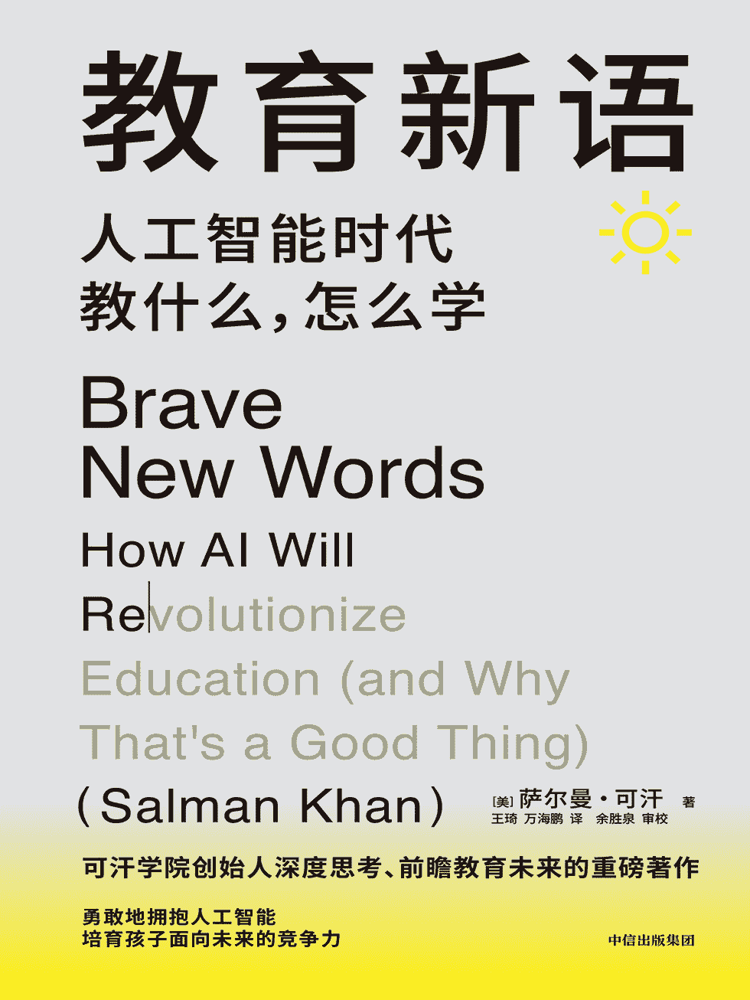
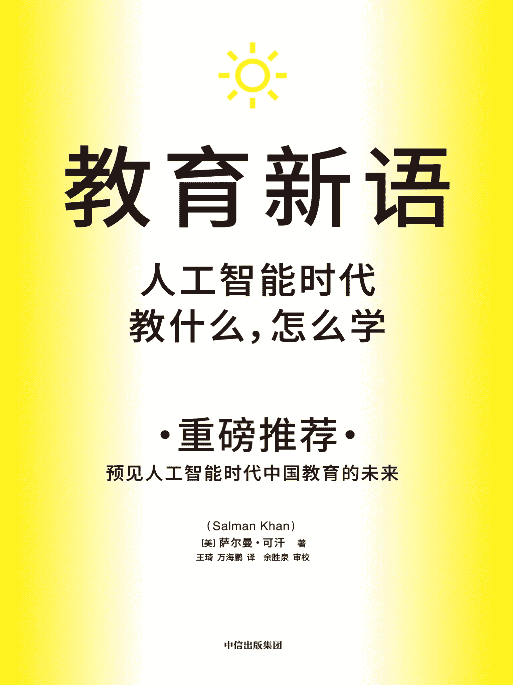

# 新语：智能冲击下，教什么与怎么学的再思考



# 推荐序

## 变局中的教学反思
钱颖一 清华大学文科资深教授、经济管理学院教授

### 昔日长处可能迅速失效
我国教育投入规模可观。家庭、个人、公共部门乃至社会都在时间和资源上高度倾斜，这与文化传统密切相关。知识点覆盖广、要求深，基础掌握的平均水平一度形成明显优势。

认清长处后，更要正视结构性偏差。最大的偏差在于把教学窄化为知识搬运，课堂等于灌输要点，学习等于吸收要点，选择也几乎只看要点占有量，知识于是被等同于全部。

“知识即力量”深入人心，但靠堆砌知识就能培养创新人才吗？答案是否定的，教学必须突破知识边界。这是提出改革建议的起点。

爱因斯坦的经历令人印象深刻。一九二一年获诺奖后首次访美，记者问他声速，他拒绝作答，说书上可查，随后留下名言：大学的价值不在记住大量事实，而在训练大脑去思考。

如今信息可网路检索，未来检索会被更多机器代理。爱因斯坦的提醒在当下与未来更具分量。

AI的核心是深度学习，即对已有信息的识别与记忆。它完全可以取代靠死记硬背、大量刷题获取内容的人脑。而死记硬背与刷题恰是当前培养的常用做法。由此极有可能出现，未来智能系统会让现有体制下形成的优势被抹平。

发展要靠创新驱动，智能技术势头强劲，这都在倒逼体制与方法的调整。

### 堆知识不等于提创造
教学实践让我强烈感受到，创造性思维的重要根源是求知冲动与想象能力。

创造需要知识积累，但除知识外还要什么？爱因斯坦说过，“我并无特殊天赋，我只是极度好奇”，“想象比知识更重要”。这些长期被忽略的品质恰是关键。

由此可归纳为简式：创造性思维＝知识×（求知冲动＋想象能力）。式子提示，知识越多并不等同创造越强。因为积累过程中，求知冲动与想象能力可能衰减，所以创造未必随学习年限提升。童年阶段的求知与想象最旺盛，随教育推进往往递减。

为何如此？后期学习内容皆有固定框架与设定。学习时，求知与想象会挑战框架，但绝大多数挑战是错的。反复受挫与否定，客观上压制了求知与想象。爱因斯坦也感叹：“求知冲动能在正规教育中幸存下来，简直就是奇迹。”

于是出现悖论：教学一方面靠增知识提升创造，另一方面又因压制求知与想象削弱创造。这让我们难以简单判断教学的净效应，也部分解释了为何少数辍学者的创造力反而突出。

问题不在学校培养不出杰出人才，而在学校在提升知识的同时，无意削减了创造必需的求知冲动与想象能力。

### 短视功利在挤压创造
创造性思维的另一来源，是更高层次的价值取向。

创造不仅关乎求知与想象，也与价值取向相关。谈创新人才培养，既是知识能力问题，也是价值观问题。

当前社会盛行急功近利，短期功利主义主导，这对创造是有害的。人要有追求，更要有高阶追求，就要超越短期功利。

我把创新动机分三层：（一）短期功利；（二）长期功利；（三）内在价值的非功利。层级递增。

短期功利者创新为发论文、申专利、企业上市；长期功利者为填补空白、争国内一流、创世界一流；内在价值非功利者则为探求真理、改变世界、提升人类幸福。

现实中，第一类人很多，第二类也不少，第三类却凤毛麟角。所以创新人才不足，除了求知与想象受损，还有价值取向过于急功近利。求成心切、成王败寇的心态，导致抄袭复制增加，真正创新减少，更难出现颠覆性创新。

### 改变艰难，但势在必行
基于以上反思，培养创新人才需要新的教学模式。

我提出三点建议：其一，为学生个性发展创造更宽松的时空；其二，在教学中更好保护求知冲动，激发想象能力；其三，引导价值取向提升，特别要回避短期功利，鼓励以内在价值为导向的非功利取向。

这对教学改革提出新要求。目前培养方案多以掌握知识的深度广度为出发与考核，总担心学得不够多、不够深、不够实用、不够前沿。若更关注求知与想象，更重视价值取向，模式就必须大变。

实践中改革不易，传统观念、市场压力、社会环境都是制约。但对求知与想象的关注正在获得共鸣，个性化发展也受到更多重视，这是积极变化。

我相信，随着经济进一步发展，智能技术不断突破，社会对创新人才需求增加，我国教育会发生深刻变化。

## 智能技术带给课堂的礼物
汤敏 国务院原参事，教育 30 人论坛成员

### 又一次教学革命
教育又要革命了。

五十六年前，毛主席发出“学制要缩短，教育要革命”的号召。几十年风云变幻，我国教育随社会经济与技术发展经历多次巨变。

这一次动因是生成式智能在教学领域的应用。教学界对智能迅猛发展同样充满焦虑。传统教学重知识传授与技能训练，智能时代更倾向培养创新能力、批判性思维等软素质。智能也引发教育者对职业定位的焦虑：如何在多元学习环境中保持高效？学生借助智能完成作业论文时，如何评估真实能力？如何防止技术资源不足的学生面临更宽数字鸿沟？

在这场新革命中，萨尔曼·可汗格外引人注目。他不仅是有远见的教育领袖，也是深谙未来教学真谛的导师。可汗之名与他创立的可汗学院，已成全球教学变革代名词。

可汗学院的故事很多人熟悉。我在《慕课革命》中曾介绍。缘起偶然，当时在金融界做对冲基金经理的他，为辅导学习困难的小表妹数学，用家中设备录制教学视频并上传。没想到视频迅速传播，点燃全球线上学习热情。后来他辞去经理职务，全职投入网上家教，可汗学院由此诞生，成为免费高质量在线学习平台。如今全球上亿学子每天在该平台学习，无数人受益。

新冠疫情阴霾下，可汗学院再次先行。他们推出Schoolhouse.world平台。该平台连接全球有资质的志愿者导师，为有需求的学子提供实时辅导。这些志愿者多为高中生。学子登录选择课程，志愿者通过视频会议提供一对一或小组免费辅导。

有趣的是，这些优秀志愿者的表现开始被关注。他们的辅导成绩与学子反馈成为衡量能力的重要指标。芝加哥大学、麻省理工学院、加州理工学院、布朗大学、耶鲁大学等名校，开始将Schoolhouse.world上的志愿者表现作为招生参考。这些记录不仅展示学科掌握程度，还记录帮助的数量与质量，为大学提供全面评估学术能力与社会责任感的窗口。

### 可汗的实践探索
在生成式智能迅猛发展的今天，可汗不会缺席。最近可汗学院与OpenAI合作开发了Khanmigo教学系统。它不仅能提供定制化学习体验，还能以苏格拉底式提问与学子进行自然语言对话，解答问题，甚至扮演历史人物或文学角色，让学子在沉浸环境中学习，从而激发创造力与批判性思维。

目前Khanmigo已在全美数万名师生中试用，效果鼓舞人心。它提供安全、无压力的学习环境，帮助学子克服在传统课堂提问的恐惧，增强自我表达与学习动力。教师和家长也能通过Khanmigo了解学子的学习状况，包括困难点与进展。这种透明度帮助成人更好支持学子，也为学子提供更定制化、更有支持性的学习环境。

萨尔曼·可汗把这些实践与思考写进了新书《教育新语》。书中不仅描绘未来教学的宏大构想，也提出让智能技术成为教学助手而非替代者的可行策略。

《教育新语》是一本写给未来的书，讲述如何利用智能技术释放每个孩子潜能的故事。可汗通过生动案例与深刻洞察，展示智能技术如何成为教师得力助手与家长教育伙伴，帮助学子建立自信、激发创造力、提高解决问题的能力。在他的笔下，智能技术不再是冰冷工具，而是温暖而智慧的教育伙伴。

对拥有几千年教学传统的中国而言，家庭对子女教学投入巨大，从早期到高等都体现极度重视。然而这种重视也伴随纠结。一方面智能技术带来定制化学习、自适应评估等机遇；另一方面也可能加剧学子对考试成绩与名校的追逐，导致压力更大、教学更卷。

在可汗眼中，智能技术到底能带来什么新变化？

可汗认为，定制化学习体验是智能技术带给教学最宝贵的礼物。从孔子到亚里士多德，先贤都主张因材施教。但在现代教学中，一个班几十人，老师只能按统一进度教学，好的学子吃不饱，接受能力弱的跟不上。利用智能技术模拟单独辅导，让每个学子按自身节奏学习，不仅提升效率，也发挥个性和潜能。

智能技术提供单独辅导后，教师会失业吗？与许多担忧相反，可汗认为教师角色不是削弱，而是扩展与深化。智能技术可以处理教师耗时的传统任务，如作业批改与知识点直接传授，教师由此可转型为学习过程的指导者和促进者，更专注于引导探索、提问与深入理解。教师还可以成为定制化学习的设计师，利用AI工具为每个学子设计定制化学习计划，根据需求与进度调整内容与速度。智能技术的使用还能为教师提供持续学习与专业发展的机会。

智能技术能否改善考试制度？对于中国人纠结的中考、高考等标准化测试，可汗认为智能技术发展提供了改善希望。智能技术可根据每个学子的学习进度与风格提供定制化评价，通过算法与数据分析对学习全过程进行多样化评价，而非一考定终身。智能技术还有助于减少人为偏见，提供更公正评价。

### 教学公平与质量的提升
从宏观看，智能技术还有在全球范围内促进教学公平的潜力。其可扩展性可同时为亿万学子服务，使高质量教学资源得以广泛传播。相比传统模式，智能技术驱动的教学方案可以用更低成本服务更广泛受众，这对欠发达地区与发展中国家意义重大。但智能技术对教学公平也是双刃剑，对于未接入互联网的地区、没有电脑手机的学子、难以获得先进AI教学资源的师者，智能技术可能加剧不平等，扩大数字鸿沟。

在智能时代，没有什么比失去就业机会更令人担忧。随着技术发展，许多重复性工作如数据录入、客服，规则明确的工作如会计、审计甚至律师，需要大量数据分析与预测的工作如金融分析与市场研究，都将逐渐被自动化系统与智能机器取代。

每年涌入就业市场的大量毕业生，以及被替代下来的在岗人员怎么办？可汗认为，随着新技术发展，许多新职业将涌现，如智能伦理学家、数据科学家、人机交互设计师、机器学习工程师等。技术技能、软技能与跨学科能力将成为职场成功的关键。远程工作与有助于灵活安排工作与协作的工具使用将更普遍。AI相关领域的教学与培训需求将迅速扩大。

总之，智能技术在教学领域的积极前景令人振奋，但挑战并存。我们需要确保智能技术服务于教学的本质——培养全面发展的人。这不仅是教学工作者的责任，也是家长、政策制定者乃至整个社会的共同使命。我们有责任为孩子创造更好的教学环境，让他们在智能技术帮助下成为能适应未来社会的创新者。

从我国智能教学的角度看，当务之急应是集中力量开发一套适配中国教学体系、课程标准与学子需求的本土化智能软件，免费向全国学子提供。让单独辅导与定制化学习方式尽早触达我国学子，包括教学资源匮乏地区的学子。该软件也应具备智能辅导系统以辅助教师工作，利用数据分析优化教学，减少教师负担。除开发系统外，还应尽早为广大教师提供智能技术应用培训，帮助他们有效将AI工具融入课堂教学。在推广技术应用的同时，也要关注学子心理健康与社交需求，确保技术使用不会增加焦虑与孤独感。总之，通过各种措施，让我国教学体系更早更好地适应智能时代需求。

最后引用萨尔曼·可汗的话表达我的信念：“我们有机会利用智能技术来促进这些类型的交流，而不仅仅是扫除学子在课业中的障碍。”也就是说，智能技术不仅是解决学习障碍的工具，更是促进人们深层次交流与理解的平台。让我们携手为孩子们的未来创造更美好的世界。

1. 参见《从上海机床厂看培养工程技术人员的道路》，《人民日报》，1968.7.22。

## 让技术守护成长的健康
彭凯平 清华大学心理与认知科学系教授，中国积极心理学发起人

在智能技术浪潮中，人们或惊慌于新技术崛起的力量，或跃跃欲试。在这种背景下，人类面对的首要课题，已不再是AI能多大程度改变世界，而是在被智能系统不断改变的世界里，如何与之和谐共处，同时保存人类文明最朴实的真诚、善意、同理心与宽容。我们以及下一代，该如何在这一时代得到更好发展而不被技术浪潮淘汰？

作为教学工作者，我始终认为教学的根本是依据生命规律，顺应并发挥人类卓越天性，以人文与科学结合的理念与方法，帮助孩子建构人格、理想、认知、对事物的爱与投入，以及对生命意义的信念。所以我一直呼吁，教学要尊重人性、科学、文化。教学的使命是造就真正积极正向的人，激发内在意义觉醒，点燃生命价值，而不是加工考试机器。教学既要与时俱进，也要保持本心。秉承这一理念，教学者在今天特别需要关注如何运用智能技术赋能孩子在新时代的健康发展。

首先，我认为无论智能技术如何发展，人都有两个不可替代的重要特质，即“情感思维”与“同理沟通”。从认知科学看，智能技术极大地拓展了人类思维与知识加工能力，但无论何种算法、何种大数据、何种语料库，在可预见的时间线内，它仍无法完全实现人类的情感价值。情感价值包括情感想象力、情感创造力、情感感受力等。简言之，智能技术无法识别人类在纯感性上的“舒服与否”判断。同样，情感沟通能力建立在情感感受力之上，智能技术无法判断“舒服与否”，自然也无法完全判断在多变情境下具体事件对人们情感诉求和共情心理的影响。因此，尽管未来越来越多的职业会被智能技术取代，但在相当长时间内情感价值仍是人类优势。对教学而言，无论教学与科技如何繁荣，其对人类灵魂的启蒙仍需人类自身的温情与守望。

在萨尔曼·可汗多年前创办可汗学院时，我就有关注。他是一位了不起的创新教学家，可汗学院也是了不起的教学创新平台。可汗学院的诞生为全球上亿学习者提供了开放、易得、高自主性的全新教学模式与大量精品课程，节约学习时间、丰富学习内容、增强学习兴趣，至今仍具借鉴价值。可喜的是，在他的最新作品《教育新语》中，萨尔曼·可汗不仅描绘了未来教学的宏伟蓝图，更提供了在AI时代守护人类深处感动的深刻洞见。包括在智能时代如何刷新教学思维，如何采用不断创新的教学方式，如何用好各种AI工具，以及归根结底如何培养出具有跨时代优势的全面而积极的孩子。

例如，2023年元旦，可汗邀请女儿迪亚一起用GPT-4写故事。迪亚先提交提示词，并告诉它交流方式与说话语气。随后迪亚与GPT-4共同创作，迪亚写一段，GPT-4接上一小段。在此过程中，智能技术精准捕捉迪亚构建的虚拟世界，并通过不断追踪她与角色的对话，帮助她将想法倾注出来，选择恰当措辞与语气，为故事补足细节、渲染氛围。写作从单项任务变成人机交互。在此过程中，迪亚被GPT-4引导，思路越来越开阔，故事越来越丰富。不过我们看到，尽管GPT-4能发挥很大作用，最根本的仍来自可汗与迪亚的提示词与情感设定。

写作常被视作锻炼综合思维的经典手段。落笔的瞬间，学习者必须反复调动脑力进行构思、发散、挑剔与修正。现在的生成式系统能够协助厘清议题、搜集并梳理资料，逐步引导学生完善论点与论据，最终用规范的语言呈现自己的想法。耶鲁大学人文学院教授亚历山大·吉尔·富恩特斯曾提醒，机器在原创性上最为薄弱。它更像一个启发装置，学生借此撬动真正原创写作的进程。

萨尔曼·可汗在新作里提出的实践指向一个清晰的判断：孩子本身不会被技术淘汰，真正会被取代的是不会用技术的人。未来更具竞争力的学习者，是懂得借助智能放大自身长处、激发潜能的人。女儿迪亚与 GPT-4 的协作写作就是一个例证，她在创作中持续追随好奇心，在技术加持下完成了一部令人满意的作品。善于与智能系统共同碰撞想法的人，创造力非但没有被压缩，反而得到明显放大。

科技进步的意义并非制造焦虑，而是提供强化自我的工具。生成式智能可以为孩子带来更丰富的学习素材，提升协作学习的效率，点燃创造热情，培养社交能力，也为家长和教师更深度参与教育创造新通道。教育工作者、父母以及社会各界的成年人，需要教会孩子接纳智能，充分发挥其在学习效率与时间投入上的价值，从而把更多精力留给人类独有的情感体验与感悟能力的持续成长。

愿这本书在智能时代成为我们共同对话与思考的伴侣，让每个人的心灵在开放的世界里自由漫游。

```
?xml version="1.0" encoding="utf-8" standalone="no"?
```

# 译者序

## 认知外包与教学重塑

*余胜泉 北京师范大学教授、未来教育高精尖创新中心执行主任*

智能时代技术与应用层出不穷，社会日趋复杂，知识与信息爆炸式增长，个体的认知负担被推向新高。人类大脑处理信息的上限有限，单一的人本认知模式已难以为继，必须转向人与机器协同，把部分认知工作外派给智能设备等外部工具。

工具推动进步是古今不变的规律。荀子在《劝学》中写道：“假舆马者，非利足也，而致千里；假舟楫者，非能水也，而绝江河。”当下的智能技术已成为思维的延伸，帮助我们突破个体认知的边界，提升信息处理的效能。这种借助外部设备来思考的模式可以称为认知外包。

在此过程中，智能设备负责信息处理，人脑聚焦理解与判断，认知负荷随之下降，解决复杂问题的能力因此提升。随着设备普及，由认知外包支撑的人机协同思维体系将逐步取代传统的个人中心模式，成为现代人适应复杂社会的基础认知方式，也是增强认知能力的关键路径。

认知外包的本质是连接，即人脑构成的内部认知网络与设备构成的外部认知网络之间的有效耦合。内部网络擅长创新思维、情境理解、价值判断与情感关怀，外部网络擅长海量存储、检索与高速计算。两者相互作用、相互增益，才能形成平衡且高效的整体认知合力。

实现认知外包并非把任务简单交给机器。它要求学习者具备多项关键能力：甄别外部认知工具的能力、判断外部信息可靠性的能力、有效联通内外认知网络的能力、逻辑校验能力、激活内部认知网络的能力，以及对信息意义的理解与生成能力。

在教育情境中，认知外包既能提升学习效能，也暗藏风险。若孩子在成长期过度依赖设备解决学习问题，内部认知能力可能出现退化。因此教育需要在三个方向作出调整，避免陷入认知陷阱。

1. 帮助孩子构建完整的知识体系，形成网状结构，不仅掌握概念节点，更能激活概念间的关联。知识是思维的基座，没有扎实根基，深刻思维难以持续。结构化、网络化的知识在认知中更容易被唤起和整体加工，使孩子面对新任务时能更好地理解、整合和迁移已有经验，把外部智能信息内化为自身思维的一部分，而非沦为设备的附庸。
2. 培养孩子良好的思维品质，保持思维的深刻性、灵活性、独创性、批判性、敏捷性和系统性。优质的思维品质促使孩子多维度审视问题，并能主动、批判地分析智能设备输出的内容。通过内外认知网络的持续交互，孩子可以把设备的处理结果有机融入自身的认知框架，形成可理解、可掌控的有效认知外包。如此一来，孩子便能从被动接受转向主动驾驭外部信息。
3. 引导孩子建立积极的社会情感。认知与情感始终交织，意义与价值是认知过程的核心。积极的社会情感能够调节认知活动，持续产生正向意义与价值，让学习过程带来愉悦体验，进而形成驱动内部认知网络发展的内在动力。只有知识与情感相互作用，认知外包的结果才会被赋予意义并纳入主体的思维链条，否则人将异化为机器的延伸。

智能时代，人机协同的思维方式已成为适应社会的基础认知模式。教育体系也势必迎来根本性转变与系统性重构。教育应当回应智能时代人才培养的需求，不再局限于训练机器可替代的任务，而要以核心素养为导向，推进审辩式思维、创造性思维等高阶能力发展，着力塑造创新能力、思维能力与问题解决能力，让学习者兼具技能、学识与智慧，并拥有积极的社会情感与弹性的心理空间。这正是跨越人工智能教育应用陷阱的根本之道。

萨尔曼·可汗的新作系统介绍了基于 GPT-4 打造的智能教学系统 Khanmigo，通过生动的案例阐释了人工智能在教育中的作用。希望这篇序能帮助读者更好理解 AI 教育应用的基本原理与核心原则，为可汗先生的作品提供有益补充。

```
?xml version="1.0" encoding="utf-8" standalone="no"?
```

# 序言

## 共写新篇章

> 只盯着海面观望，你永远无法渡过海洋。
> ——泰戈尔

> 无论做什么，都不要让过去成为你的枷锁。
> ——罗伯特·海因莱因，《严厉的月亮》

2023 年元旦午后，11 岁的女儿迪亚和我商量用一个下午合写一篇短篇小说。电脑摆上厨房台面时，迪亚已搭好故事骨架并开始敲字。主角是一个时髦的网红，她起名为萨曼莎。情节设定萨曼莎被困荒岛。“太棒了。”我说，迪亚继续写下去。

那一刻像是进入科幻小说的场景，也像踏入沉浸式游戏的空间。迪亚不断丰富她心中的人物。不久，萨曼莎直接回应了迪亚，文字出现在屏幕上：“迪亚和萨尔曼，你们好，我是萨曼莎。你们建构的冒险故事很有味道，这是一个充满现代感的经典荒岛叙事！”

迪亚接着写：“荒岛上的日子怎么样？”

“岛上的生活是一次意外的冒险，”萨曼莎答道，“我必须在舒适圈外求生，却也发现了从未察觉的潜能！”

“是什么样的天赋？”迪亚追问。

“首先，我已很擅长用棕榈叶和树枝搭建临时庇护所，还学会了徒手捕鱼，以及只用树枝和干叶取火！”

迪亚毫不犹豫地输入：“为什么不用你的围巾做个吊床呢？”

“用我的围巾？不行！”萨曼莎回，“那是设计师的作品，我可不能随意毁掉。现在继续吧，下一步会发生什么？”

“我想按萨曼莎说的走。”我说。

迪亚点头。她回到电脑前输入：“如果萨曼莎最好的朋友艾米莉驾着帆船来救她，会怎样？”

“太好了！”萨曼莎写下下一段，“‘当她看见挚友艾米莉驾驶着小帆船驶向小岛时，萨曼莎几乎不敢相信。 她拼命挥舞双臂，试图引起注意。随着船只靠近岸边，激动 càng加。 她迫不及待想把岛上的经历告诉艾米莉，也想知道艾米莉是如何找到她的。’好了，现在轮到你们了，迪亚和萨尔曼！把重逢的最后两句话写完吧。”

简单回顾一下：一个11岁的女孩和她的父亲，正在与一个虚构角色进行真实对话，这带有库尔特·冯内古特式的荒诞感。我熟悉的世界正转向某种陌生却真实的新现实。

这对我们每个人而言都是一次深刻而永久的改变。

### 提议

要解释这幕如何发生，得先往回走。

二十年前，表妹娜迪娅需要数学辅导。那时我在一家对冲基金做分析，也学过计算机科学，就提议用即时通讯或电话远程教她。方式见效后，很快家里十几个表亲都在找我帮忙。

为提高效率，我开始做一套网页数学练习，让他们按自己的节奏补缺，我也能看进度。我随手用了一个域名注册了网站，就叫可汗学院。体会到一对一的威力后，我开始思考怎样把这种模式放大，服务更多学生。

在朋友建议下，我录视频课传到 YouTube 配合练习使用。到2009年，网站每月有五万学习者，很多是付不起家教的学生。如今可汗学院已成拥有两百多名员工的非营利组织，服务全球五十多种语言、一点五亿学习者。用世界级的大规模个性化学习，尤其是模拟一对一辅导，是我们免费提供世界级教育使命的核心。

我把愿景概括为成为每个学习者的导师。这不只是规模化家教。研究和我的直觉都表明，自定进度和精熟学习能让孩子学得更多。现实中，一个班三十人，老师必须赶进度，即使有人没掌握也要往下讲。让每个学生随时得到专人辅导在经济上不可行，技术是唯一的解。我相信人工智能终有一天能模拟真实教师。

我不是唯一有这个梦想的人。尼尔·斯蒂芬森的《钻石时代》里有能做个性化教育的交互图书《淑女养成指南》。奥森·斯科特·卡德的《安德的游戏》设想了用 AI 教师“简”来训练战略思维的战斗学校。阿西莫夫的《他们的乐趣》描绘了用先进技术提供个性化指导和机器人教师的未来学校。1984年《新闻周刊》采访乔布斯时，他说计算机将成为思维的自行车，像变速车增强体能一样拓展我们的能力、知识与创造力。多年来我们一直期待计算机助力教育。

这些故事的共同点是都设想计算机最终实现真正的智能。为此研究者已努力六十多年。1962年跳棋大师罗伯特·尼雷利被 IBM 7094 击败。1957年心理学家弗兰克·罗森布拉特做出首个人工神经网络 Perception，模拟神经元与突触，经训练可执行特定任务。那之后几十年，我们的算力只能处理像蚯蚓或昆虫大脑那样的系统，数据与技术也不够训练网络。

随着发展，AI 技术日渐成熟，催生了今天常见的产品。从流媒体推荐到 Siri、Alexa 等语音助手，AI 已很擅长模仿人类行为，常难分辨人机。算力也已能处理接近人脑复杂度的系统，并在构建与训练神经网络上取得突破。谷歌 2017 年推出的 Transformer 技术让训练更快更准，能更准确关联词语与思想。

系统好坏通常取决于底层模型的复杂度与架构。模型可看作对真实世界的计算表征。气象学家预测飓风会用包含数十亿大气单元的天气模型。对大语言模型而言，它们模拟的是词与词的关联，不模拟大气而模拟神经元与突触。以 GPT-4 为代表的大语言模型本质上是庞大的“词汇智能体”，在海量书籍、文章、网站文本上训练而成。

通过分析超大规模文本，语言模型学会了词语、句子与段落的组合规律。若向 GPT-4 提问，它会基于书籍、网页、视频字幕和社交媒体帖子训练得到的模型作答。语言模型没有人脑的感官体验，却能靠接触远超一生阅读量的语言来弥补。

2022年夏天，OpenAI 总裁格雷格·布罗克曼和 CEO 山姆·奥特曼给我发邮件。OpenAI 致力于社会友好型 AI 的突破性研究。他们希望会面探讨合作。那时我还没意识到世界即将巨变。

当时距 ChatGPT 发布还有四个月，距 GPT-4 发布还有七个月。他们想讨论的就是最终发布计划。我好奇却怀疑新一代生成式 AI 是否适合我们。虽然 AI 在写作上有进展，我认为它并未真正掌握知识，缺乏逻辑与推理，也无法生成可靠事实。但我欣赏 OpenAI 的成绩，于是安排了会面。

模型每代都更复杂，用参数量衡量。参数可理解为神经网络两节点间连接强度的数值，也类似突触强度。2018年 GPT-1 约有一亿参数，一年后 GPT-2 超十亿，GPT-3 超1750亿，GPT-4 可能到约一万亿。

OpenAI 领导层认为 GPT-4 会令人震撼，既让人兴奋也让人不安。他们希望与少数可信伙伴一起推出，可汗学院是首选。他们还希望我们帮忙评估新产品，需要证明 GPT-4 具备逻辑推理、思辨与知识处理能力。团队想看它在大学层面生物学题上的表现，而我们正好有成千上万道题。

我很激动，因为我是首批见证 GPT-4 能力的人。过往经验告诉我，最佳探索时机是技术走向成熟时。若在多数人视其为玩具时投入测试，等它进入鼎盛期就能收获。视频学习起步时也是如此，先驱早就说点播视频不只是猫弹钢琴。如今学生用点播视频学一切，课堂也逐步接受，可汗学院发挥了引领作用。我们证明视频不是教师替代品，而是课堂一部分，能为个性化学习、练习与交流腾出时间，反而让教师更重要。现在该看生成式 AI 能否扮演同样角色，辅助学生并放大教师作用。

山姆和格雷格开始演示，拿出一道来自大学理事会的生物应用选择题。他们问我答案，我认为是 C。随后在聊天窗口让 GPT-4 回答，很快得到正确答案。

我没立刻说话，却起了一身鸡皮疙瘩，也有怀疑。“等等，”我说，“这个 AI 能回答应用水平的生物学问题了？”也许只是运气。“你能让它解释推理过程吗？”

格雷格输入：请解释你的推导。几秒后，GPT-4 给出清晰、简洁而严谨的解释，流畅得像真人。

我不再掩饰惊讶。“能问它为什么其他选项不对吗？”

格雷格照做，不久 GPT-4 便分析了各错误选项的原因。

接下来我问能否让它出一道生物应用原创题。GPT-4 不仅做到，还给出十多道题目。

两个月后，我拜访比尔·盖茨，向他介绍近况。他告诉我为何 OpenAI 团队会展示一道生物学题。比尔第一次用 GPT-3 就感到震惊，但他告诉 OpenAI，只有当 GPT 能通过应用生物学考试时他才会真正信服。那次演示中，GPT-4 已经完全能够做到。

我对格雷格和山姆说：“它将改变一切。”我脑中浮现它重塑教育、认证、工作与潜能的画面。

“我们也是这么想的，”山姆说，“目前 GPT-4 还不完美，但技术已日趋成熟。谁知道呢，如果我们设想正确，教育工作者也许会使用它。”

我们一度以为只存在于《星际迷航》里的技术突然成为现实，最伟大科幻作家设想的创新已成真。

### AI 黑客马拉松时间

# 当香农遇见图灵：人工智能教育拐点

1940 年代初，数学家克劳德·香农抛出了一组奠基性理论，其中电子通信理论后来成了数字世界的基石。1948 年他在贝尔实验室期间，已经把目光投向了后来的人工智能方向。他想知道算法如何逼近语言，并把成果写进了《贝尔系统技术期刊》上的《通信的数学理论》。彼时互联网还不存在，数字计算机才刚起步。香农的 信息论 证明，某些概率过程能让算法越来越像英语。通过统计文本词频，他造出一个能猜下一个最有可能出现的词的小系统，最终能拼出完整句子。随着迭代，句子的自然度在提升。乍看很简陋，但今天诸如 GPT-3、GPT-4 这类依托专业神经网络训练的巨型语言模型，其核心直觉仍可追溯到香农的早期探索。

香农之后登场的是艾伦·图灵。这位破解德军密码、助力反纳粹的关键人物，进一步追问机器能否逼真模仿人类智能。1950 年他发表《计算机器与智能》，首次提出模仿游戏，也就是后来的图灵测试。想象一下，你在手机或电脑上聊天，看不到对方，如何判断是人还是机器？这就是测试的精髓。通常一名裁判评估人机双方的回复，机器的目标是让裁判相信自己是人类，必须表现出智慧、理解力与连贯对话能力。图灵认为，若机器能持续欺骗裁判，就可称其具备智能。换句话说，通过图灵测试，等于拥有近似人类的智能。

2022 年夏天，我受邀试玩新上线的 GPT-4，内心在问它离通过图灵测试还有多远。上世纪九十年代中，我在麻省理工接触人工智能。那时的对话程序能偶尔唬住人，却难以在长时间高频交流中维持人感。即便遥远未来真有机器能稳定通过测试都令我震惊，更别说在自己有生之年就能亲手体验接近实现的工具。那种冲击不亚于冷核聚变或超光速旅行成真。

初尝兴奋后，反思随之而来。智能技术能解难，也可能带来副作用。若大语言模型能辅导学生，那它也能代笔论文。会不会出现一种局面：新版 GPT 成为学生的依赖，反而拖累其研究与写作能力的成长？我还意识到，若 GPT-4 能助力沟通与解决问题，它同样可能反噬人类，比如冲击就业、削弱目标感。一个优秀的导师 AI，也可能被坏人用来欺诈或洗脑。

脑海里不断浮现暗黑图景：儿童数据被采集、技术成瘾风险。生成式 AI 的颠覆性在于必须严肃对待。除了 OpenAI，微软、谷歌、Meta 等巨头，以及众多国家都把巨量资源砸向大语言模型。它们多年来用某种 AI 给我们推送广告、视频、搜索结果和社交动态。这次的 AI 却不一样，它的确与众不同。

科幻作家常划两类 AI：一类是专才型，只擅长特定任务；另一类是通才型，能像人类一样处理多元任务，后者可能开启乌托邦也可能走向反乌托邦。对很多人来说，GPT-4 这类大模型更接近通才，因为它能在任何话题下写作推理，在各领域保持相关性。它还能生成与理解图案。尽管我知道 AI 正以难以想象的速度重塑世界，但推进它并非我或可汗学院能决定，技术已在自我进化。作为一个想善用技术的实践者，我思考如何用生成式 AI 实现最大公益，让教育更接近乌托邦。

那是个周五，我意外拿到 OpenAI 最新模型的权限。一下午、一个周末，我几乎粘在屏幕上。十小时后我试图关机休息，思绪却被牢牢抓住：作为教育者，我们该如何与学生一起使用它？GPT-4 的影响深远，不仅能解答棘手难题，还能解释推理过程并生成新问题。除此之外，它还能角色扮演。我给它指令，让它分别扮演数学老师、科学老师、语文老师，每个角色都能与学生对话。

它能用不同语气风格写作这一点深深抓住我。比如，我让它用特朗普口吻重写《独立宣言》：

伙计们，听我说，是时候跟那个失败的政府和糟糕的乔治三世脱钩了。这家伙就是灾难，剥夺权利、漠视民意，只顾填满自己腰包，实在太、太、太糟心了。

我们广大民众受够了。要建一个全世界最棒的国家，相信我，没人比我更懂怎么让国家伟大。我们将拥有最强经济、最强军队、所有最好的东西，一切都会变得极其强大。

随后再让 ChatGPT 用苏斯博士风格写《独立宣言》：

在自由之地、勇敢之乡，
新国家诞生了。
我们不再是远洋彼岸国王的奴隶。
我们宣告独立，欢呼雀跃，
以笔和激情写下不满，
大地之上，
不再有无代表的赋税，
不再有士兵闯入家园，也不再有沮丧。
我们坚信这些真理，
人生而平等，是的，你我皆平等。
我们的权利不可剥夺，
生命、自由、幸福，将永存。

一旦 ChatGPT 面向大众，这类趣味例子会层出不穷。当时我属于最早一批尝鲜者。GPT-4 当然比 GPT-1 强得多，却还要等几个月才公开。我发现基于提示，它的回答惊艳、有趣，甚至让人后怕。提问或求推荐时，回复显得格外真实。但背后并无真人作答，也没有“如果……那么……”式的机械逻辑。回答不模板化也不呆板。即便重复同样问题，也会因对话上下文产生不同答案。

我也开始意识到，这项技术正重塑我们对 K-12、高等教育乃至其他领域的认知。它不完美，数学偶尔会错，但熟练提示后表现持续改善。周末将尽时，我自问：若把科技与教育领域最聪明的专家召集起来共同探索会怎样？于是 OpenAI 授权给另外 30 位工程师、内容创作者、教育家和研究者做 GPT-4 实验。

正是黑客马拉松的时刻。

在可汗学院，团队每半年有一周可做与使命相关的事情。那一周，我向小部分同事演示 GPT-4，让他们自由发挥。通过合作创新，我们头脑风暴出了众多有分量且酷炫的想法。这场“AI 黑客马拉松”催生了大量新概念与教育形态。比如，AI 能否帮老师备课？能否与学生辩论？能否生成项目？能否减压并激发新想法？能否用于自测与复习？教育工作者能用 AI 设计学生可完成的新颖活动。AI 还能陪学生写论文并持续反馈，让成品更优。

参与者探讨了安全、保护与偏见议题——请注意，这是 OpenAI 正式面向大众发布 ChatGPT 之前。我们提出明确担忧：让学生用生成式 AI 写论文、做研究、应试、甚至申请大学是否合适？我们担心孩子会被养成立不牢的投机者。若学习被接管，家长辅导作业的机会也随之丧失。对老师而言，这是助力还是削弱其教学力？我不认为 AI 会让老师失业，最好情况是提升教学力。但我同样担心批判性思维被侵蚀。

二十年前，教育点播视频出现时就有类似焦虑：会不会分心？会不会缩短注意力？会会拉开师生距离？学生如何判断内容是否合适？遇到难题该找谁？

恐惧不应扼杀探索。测试深入后，我们找到了让优势更突出的办法。为了解决不诚信，我们设想一位拒绝直接给答案的导师 AI，像合格的人类导师那样提问引导。谈到安全，我们建议建立一套对家长与老师透明的系统，完整记录学生与 AI 的对话。为鼓励人际互动，我们提议设计师师生皆可用的工具，节省时间精力。

黑客马拉松结束时，我们更确信 GPT-4 将成为教育领域的规则改变者。善用之下，它会改变教师备课、授课与评分的方式。把 AI 引入课堂，或可破解现有资源与技术难以攻克的顽疾。未来学生可能学得更快、记得更多，这正证明 AI 是增强人类智慧、释放潜能的终极学习工具。它也可能加速全球学习进程，让我们更接近人人可负担世界一流课程的理想世界。AI 正革新沟通、创造与信息获取的方式，就像二十多年前个人电脑、 四十多年前计算器那样。

这令人振奋。我愈发坚信，谨慎操作就能降低生成式 AI 的风险与负面问题。虽然我们是地球上第一批使用者，但只要全人类知晓这项技术，一切都将在数月而非数代间彻底改变。

## 实践教育勇气原则

2022 年底，黑客马拉松开展两个月后，OpenAI 向公众发布了 ChatGPT。首发版本把聊天窗口嵌在 GPT-3.5 中。虽然不是最优模型，远不及 GPT-4，但上线后迅速吸引全球目光。几天内数百万人涌入，社交媒体和新闻几乎只聊它。

兴奋之余，担忧也在发酵。有人怕学生不诚信泛滥，AI 会产生成果错误、幻觉、偏见，并质疑数据来源的可靠性。ChatGPT 发布数周后，多地学校直接禁用。这一举动点燃了可汗学院的斗志。我们不仅想证明风险可以被解决，更想证明 AI 能成为教育变革力量。我们希望真实工具在真实学校里落地，而不是停留在理论。

OpenAI 计划数月内发布 GPT-4。发布后我们需要回答不诚信、透明性与审核机制的问题；需要证明 AI 对真实教育情境中的学习者与教师有实质价值，能帮教师备课、监控进度、即时反馈、缓解压力；还需要证明 AI 对学生的价值在于扮演苏格拉底式导师、辩论伙伴、指导顾问、生涯规划师，并成为学业提升的驱动力。因此与 OpenAI 合作，我们组建了快速原型团队，打造教育融合平台 Khanmigo。

在推动创新能力与建立安全保障的双重目标下，我有了新思路：大家都在说学生借助 AI 写论文会破坏学术诚信，若它不是代笔，而是陪写呢？

2023 年元旦，我让女儿迪亚用 GPT-4 与我一起写故事。这不是她第一次参与教育实验或原型测试。平时我会邀请女儿、儿子以及可汗实验学校或可汗世界学校里耐心、有见地的学生或老师参与。动手式的用户调研往往最有说服力。我为 GPT-4 写了提示词，要求它与我们共创故事而非替写，并设定了理想的交流方式与语气。

迪亚开始创作关于网红萨曼莎被困荒岛，后被挚友艾米莉解救的故事。她写一段，大模型续一段。萨曼莎自我介绍、讲述日常生活，我们共同推进情节。我们惊叹于 GPT-4 让冒险变得生动、对白有趣，完美契合两人的人物特质。故事从萨曼莎对高定服装的焦虑，延伸到艾米莉病逝的动人时刻，充满温情、欢笑与悲伤。

整个过程中，AI 展现出进行有意义复杂对话的能力，以自然真实的方式回应迪亚指令。作为父母，看着女儿与 GPT-4 交流并激发出新想象，令人振奋。AI 精准捕捉迪亚构建的虚拟世界，并持续追踪对话脉络。它拓宽眼界，提升写作与创造力。写作过去是单向输出，现在变成人机双向互动。我的 11 岁女儿成为世界上第一个在创作中能与故事对话并获得回应的孩子！

我们正用这项技术把教学与学习推向新高度，这令人激动。我意识到必须把技术带给每位学习者。未来教学方式正在我眼前重塑。女儿与萨曼莎忙于创作时，借助 AI，我们正在书写教育新篇。面对变化，我们该谨慎而非惧怕。

世界正逐步认识到大语言模型对教育的无限可能。善用它需要创造力与勇气。不是盲目的勇气，而是创新教育的勇气——在科技狂飙时承认恐惧，同时告诉自己它带来机遇与挑战。

为最大化理解这项技术，我们需要重新审视一切可能。减少风险、恐惧与犹豫，意味着重新评估教师角色、孩子如何使用多媒体、证书如何获取、毕业生如何就业等各个环节。

我们正处教育发展的关键拐点，它在持续改变我们对学习、工作与人类使命的看法。

?xml version="1.0" encoding="utf-8" standalone="no"?

# 第一部分
## 导师模式的崛起
AI 导师不仅能为学业提供支持，还能与学生交流辩论，帮助设定目标并督促达成。它在写作、数学、科学、编程、艺术等任何学科都大有可为，这是其他工具难以企及的。

《淑女养成指南》绘本能带你登上教育之巅，却给不了智慧。因为智慧源于生活阅历。此刻，你的人生经验足以赋予你智慧，但仍需回望过去。若不思考，心智会受损；若多思考，你将成为兼具教养与智慧的淑女。

——尼尔·斯蒂芬森，《钻石时代》

?xml version="1.0" encoding="utf-8" standalone="no"?

### 01 放下恐惧先出发
精灵已出瓶。ChatGPT 迅速扩散，GPT 应用遭到大规模封禁抵制。作为研发方，OpenAI 打造的工具功能全面，可在多话题中提供帮助。但这也引发担忧：学生会用它作弊。2023 年初，洛杉矶联合学区成为首个禁用区。西雅图公立学校紧随其后，禁止全校设备使用生成式 AI，理由是作弊不可取，学生需原创思考。此后纽约市公立学校因担心论文与作业被代写，也曾短暂封禁，并称 ChatGPT 不利于培养批判性思维与问题解决能力。随后弗吉尼亚州费尔法克斯县、阿拉巴马州蒙哥马利县也下达禁令。

2022 年 11 月，OpenAI 的聊天机器人正式面向公众。一周内用户超 100 万。人们用它问答、写代码、写论文，赞其为技术革新的新飞跃。两个月后，法国、印度、澳大利亚等地的学校纷纷禁止 ChatGPT。有人把其传播比作新冠疫情，宣称这是家庭教育的终结。“我们正面临一种新型瘟疫，它威胁身体，也威胁思想。ChatGPT，这款能写大学水平论文的 AI 聊天机器人，正全球疯狂蔓延。教师震惊沮丧，教室早已 GPT 阳性。”《高校情报》一篇评论如此写道。

作为父亲与教育者，我能理解这种不信任。毕竟没人希望新科技剥夺学生的主动性、创造力、社交与协作能力。但在当下，学生接触生成式 AI 已不可避免。对其对学习与发展的潜在影响感到担忧很自然。有人认为屏幕时间已太多，担心 ChatGPT 增加负担。我们担心大模型会助长不做作业的风气。担心生成式 AI 能快速产出文本，对写作能力造成灾难性冲击。我们也担心，因 GPT 文本源自网络上数百万带偏见的语言与观点，最终输出也会带偏见。

别和AI对立

担忧是可以理解的，可真正决定技术价值的从来不是技术本身，而是我们怎么用它。手机会让人沉迷、社交平台会吞噬时间、一次打错的搜索词也可能把人带向让人不安的角落，这是事实。但同一套技术同样能拉近人与人之间的距离，在剪辑、写作、编程等创作环节提供强大助力，更能成为个人成长的辅助工具。放到教育里，合理的技术介入可以增强社会连结、促进情感发展、塑造品格。

新一代人工智能的能力已经相当惊人。医疗场景里它能协助判读病例、梳理病历并给出个体化诊疗建议；企业用大语言模型提速内容产出和流程自动化；法律合规领域它能辅助合同研读、法律检索、文件起草并确保规范。写技术文档、编用户手册、做项目申报书、写代码，用它比刻意回避高效得多。网上流传的那句“人不会被AI取代，会被会用AI的人取代”并非危言耸听。

面向未来，具备竞争力的学习者会是懂得借助人工智能搭建知识网络、保持独立思考的人。他们能在合乎伦理的前提下高效使用工具，加速学习，同时在职场长期保持领先。因为他们明白怎么获取答案，所以对学科的理解会更扎实。他们的创造力不会被削弱，反而在AI加持下被放大。

这种能力会直接转化为职业优势。懂得驾驭AI、与之协作、同时具备评判好坏写作的眼光的人，能最大化AI的价值。保持好奇心的人更容易抢占先机。会与AI和同事共同头脑风暴的人，比完全不用AI或把工作全盘外包的人更具创造力。要想成为职场佼佼者，就要学会用大语言模型把信息搜集、Excel数据分析这类传统工作自动化。

当然新工具也有风险。2022年夏天，OpenAI总裁格雷格·布罗克曼第一次向我演示GPT-4时就强调，安全措施是关键。“研发GPT-1时安全就是头号议题，推进技术时我们希望它是有益且安全的。”公司在防滥用上投入很大，从阻止非法信息输出到限制敏感内容再到保护个人数据。当AI与教育结合时，保护尤为重要，需要大量投入，但值得。格雷格说：“参与人类历史上最重要的技术创造，并将其用于教育，应该得到支持。”

更核心的是要认识到技术发展的目的不是制造恐惧而是创造价值。生成式AI可以为孩子提供新的学习素材，增强协作，激发创造力，培养社交能力，并为家长和老师更深入参与教育提供通道。与其让孩子远离AI，不如教会他们更聪明的学习方式。

精灵已经出笼，现在是扔掉恐惧的时候了。

1. Jeremy Weissman,“ChatGPT Is a Plague upon Education,”Inside Higher Ed, Feb. 9, 2023, www.insidehighered.com/views/2023/02/09/chatgpt-plague-upon education-opinion.

### 02 引导式教学

面对GPT-4这类热门技术，我们要思考的不是它酷不酷，而是它能解决哪些真正重要的教育问题。它能否跨越地域和经济限制缩小学习差距，提供高质量教育？能否回应每个学生的多元需求和学习风格，避免一刀切？能否缓解全球范围内优质教育资源稀缺、尤其偏远地区的难题？能否帮助学生更牢地记忆？能否为教师减负，让他们免于过度消耗？

如果每位学生都能拥有一名AI导师，这个导师会是什么样？是能一起写作的搭档？是能就任何话题辩论的对手？是能强化优势、填补学习漏洞的教练？是能以全新方式讲透STEAM的向导？是能带来全新艺术体验并点燃创造力的伙伴？是能让文史学习沉浸式的引路人？

AI黑客松中产生的灵感成为变革的起点。我们的研究、设计和工程团队开始打造一款由GPT驱动的新型AI导师，它在学生学习新概念时同步学习，同时也充当教师的助手。

2022年底到2023年初，可汗学院的目标是在GPT-4正式发布前将其整合进教育平台。抢先并非目的，关键是确保体验既神奇又高效且安全。为此需要摸清这项技术的能力边界。GPT-4回答问题的能力很强，但偶尔仍会出现事实和数学错误，比起GPT-3.5已大幅减少。团队不断测试极限，反复打磨提示词和基础设施，甚至让模型学习可汗学院的课程内容。对多数学生来说，仅会回答问题的导师远远不够，需要反转对话，让它持续提问，这才是好导师的做法。大量迭代后，我们让AI扮演苏格拉底式导师，用引导性提问代替直接给答案，这对人类导师也不易做到。

GPT-4的另一个明显优势是可操作性。相比GPT-3.5，给它指令让它担任导师并禁止直接给答案时，GPT-3.5往往无视指令甚至给出错误答案。而GPT-4能较好地扮演角色，哪怕只用一句提示“假设你是柏拉图式的导师，我是学生，请不要直接告诉我答案”就能实现。

这给了我初步信心，认为它有模仿导师的能力。当然，能在复杂提示下表现像导师，和面向百万学习者的真实导师有很大差距。我们不断调试指令以预测极端情况，尤其面对爱捣乱的初中生。确保合规、设计独特的声音与语气。时间紧迫，OpenAI预计2023年3月发布GPT-4，可汗学院希望同日推出AI导师和助教，以展示技术的积极社会价值。但更重要的是，产品必须有实质意义、有吸引力且安全。

2023年3月15日，我们发布了AI助手“Khanmigo”，名字谐音西班牙语“conmigo”，意为“和我一起”。它已深度融入可汗学院的整体工作，为每个人提供全新的教育体验。平台配备能提供个性化辅导的AI导师，聚焦学习者的兴趣点或薄弱环节，帮助教职人员更清楚如何支持学生。

我相信发布时它已足够强大，但只是起点。Khanmigo不仅能担任导师，还能模仿文学和历史人物，进行辩论、担任顾问和职业导师，并凭借超强记忆与学生建立长期联系。它不仅在学业上提供帮助，还能陪伴学生设定目标并温柔督促。还能促进学生间的交流。未来在Khanmigo驱动的模拟应用上可进行AI练习和评估。团队每一次头脑风暴都显示这项技术在写作、理解、数学、科学、编程和艺术等任一学科都有巨大潜力。

### 03 实现精熟学习

千百年来，一对一教学被公认为最佳学习方式，即按学生自己的节奏和速度辅导。亚历山大大帝和亚里士多德就是典型。遇到疑问就放慢，有天赋就提速，学生既不会困惑也不会无聊。如今顶尖运动员和音乐家也接受一对一指导。可没有助教或技术支持时，一位老师面对30名学生几乎不可能实现真正的个性化指导。

18世纪起我们有了普及教育的乌托邦设想。资源有限，便把学生分30人左右一组，采用标准化教学——大课加定期测评。虽不完美，却大幅提升了整体识字率和受教育水平。但这并非大多数学生的最优解。固定节奏会迫使学生带着未掌握的基础进入更高阶内容，漏洞不断累积。如今每间教室都能看到这种后果。在美国，大多数高中毕业生数学水平未达大学要求，许多新生需补修无学分的中学代数预科。此外，四分之三的高中毕业生写作能力不理想。

1984年，教育心理学家本杰明·布鲁姆通过个性化和一对一教学挑战传统班级授课。优秀导师会真正关心学生、同步节奏、设定明确目标、评估并给予精准反馈直到掌握。这与精熟学习密切相关，即持续给予机会和激励让学生弥补不足。传统模式是教师按固定速度讲授，每几周测验一次，即使80分，也没时间补那20分的漏洞，便进入下一章。这种积累导致代数或算术问题频发。若小数、分数、指数基础有漏洞，再聪明勤奋也难以掌握代数。精熟学习给学生时间发现并填补漏洞，打好基础后速度更快。传统学校系统在没有技术支持下很难做到，因为30个学生掌握程度和学习速度各不相同。

布鲁姆在论文中描述了“两个标准差”问题：一对一导师辅导可让学生成绩提升约两个标准差，从50百分位跃升至96百分位。这是巨大提升。问题在于现有体系难以实现，大多数学生得不到这种提升，只有中上阶层家庭能靠私教解决。

多年来我一直强调，学校应为每个学生提供平等的个性化教育机会。可汗学院始终秉持让每个学生拥有导师的愿景。我说的导师是亚里士多德之于亚历山大的那种：建立信任和友谊，了解已知与未知，据此调整教学，并帮助教师和家长做出决策。

可汗学院利用点播视频和个性化练习让学生按自身节奏学习、获得反馈、缩小差距，并与教师进度同步，帮助优化体验。人工智能出现前，我们已尝试用技术实现从一刀切到个性化精熟学习的转变，已取得一定成效。超过50项研究显示，每周30至60分钟个性化学习的学生进度加快20%至60%。可汗实验学校和可汗世界学校高度重视精熟学习，学生数学每年进步相当于一年半到三年。

即便如此，传统可汗学院仍有局限。除了视频和练习，学生选择有限，无法就概念追问或联系实际。开放式问答更利于效果，但课后评估多限于数值输入、方程式和选择题。目标设定和追踪功能虽已加入，却仍无法比拟一位关心学生的导师带来的交流体验。

然后GPT-4出现了。

我很快意识到它能弥补这些不足，团队多数成员也有同感。我们越用越感受到它的强大，但要真正发挥效用仍需完善保护和支持。

OpenAI领导层之所以先考虑我们，正是基于这些需求。如今格雷格·布罗克曼相信，新一代大语言模型将带来教育史上的最大贡献。“GPT的研发汇聚了研究和工程人才，旨在对人类事业产生巨大影响。”在他看来，最好的路径是构建能为每位学习者提供个性化辅导的AI系统。它不是普通导师，而是“超级”导师，理论上可带来两个标准差的提升。

人生经验告诉我，改变世界的机会不常有，发现时就要全力以赴。随着生成式AI进步，我越来越觉得我们接近教育的圣杯——在正确保护和界面下，AI能为数百万学习者带来更有效体验。

因此在用GPT-4几个月后，可汗学院决定加大投入。Khanmigo的目标是在已有学习流程中加入生成式AI，或许能让布鲁姆的两个标准差问题在每间教室、每位教师、每个学生身上实现。

我们与GPT-4共同推出Khanmigo，但不确定世界反应如何。ChatGPT初期在教育领域受批，主要是担心助长作弊。我们希望通过更先进模型、防作弊功能、透明度保障和学生安全互动来区别对待。

幸运的是，发布时教育工作者已逐渐意识到，ChatGPT的问题不等于要禁止技术。学生未来职业中很可能用到，教师也在备课研究中使用。到2023年3月，教育工作者渴望有类似ChatGPT的工具来支持教学。

正式公布后我们获得教育界极大支持，包括最初严禁ChatGPT的学区。他们很高兴看到有组织能以安全有效的方式融合GPT-4技术。

实践中，学生遇到数学问题可在聊天框提问，AI不会直接给答案，而是像好导师一样引导。学生说遇到多项式困难，想知道`3X2-5X2+2`的次数和首项系数。Khanmigo会分解概念并反问：“最高次幂是哪一项？它前面的数字是什么？”若回答错误，它会提示接近但不完全正确，并提醒寻找最高次幂再试一次。

Khanmigo不仅处理数学，还可共同解决历史、化学、物理、艺术等学科问题。它能激励学生、进行测验、总结视频，并根据需求调整进度。它提供动态具体鼓励，建立舒适信任关系，并使用亲切语言。若作业缺乏动力，它会说：“你已经做得很好了，别担心，起步总难。这个题有些挑战，我们换个思路。”

与ChatGPT不同，Khanmigo有对话记忆。可提及之前讨论。学生学完代数基本方程后问“为什么要在意这个？”AI会回“你对什么最感兴趣？”学生说想聊足球而非数学，AI便把多项式包装成足球教练模拟进球数的场景再提问。

几天后学习历史时，AI记得学生对足球感兴趣，用足球俱乐部管理类比联邦制。AI还会记录用户偏好正式还是口语、简短还是详述，并据内驱力激发兴趣。所有记忆以高度透明方式呈现，用户可随时查看和修改，同时学习进度和概况会反馈给家长和老师。

Khanmigo 的陪伴节奏，很像我在可汗实验学校里辅导学生、也像我在家指导自己孩子时的习惯。以前学生卡住的时候，我会先帮他把题目到底在问什么搞清楚，必要时再追着问下去；看完视频和阅读材料后，我会测一测他对核心概念的把握；有时候我会把不同知识点之间的关联点出来；如果他对下一步无从下手，我就会指出需要补强的环节，并给几道练习让他把漏洞堵上。如今有了 AI 导师，这种高度个性化的陪伴不再是少数人的特权。Khanmigo 能带着学生攻坚难题、抛出追问，让学生主动说出自己想学什么，并依据学习进度给出建议，通过对话、资料、测验等形式持续互动。它恰好落在学生的最近发展区，也就是既不轻松也不吃力的“刚刚好区”，而且学生会明显感受到自己是学习的主角。

要体会这种转变的力度，可以回到图灵测试的思路。自从 Khanmigo 上线后，人类导师和 AI 导师的界限变得模糊。借助大语言模型，我们能拥有一个真正可用的、支持精熟学习的 AI 导师：个性化推荐、视频学习、以及大量问答来验证掌握程度的练习，全部整合在一起。学习变得近乎个性化，学生按自己的速度前行，而 AI 就像一位常驻身边的真人导师。

同时，Khanmigo 也在用苏格拉底式的提问训练学生思考。曾有一位记者对 AI 处理政治敏感话题持怀疑态度。

“那就实测一下。”我提议，随后打开 Khanmigo 的“人文学科辅导”。

记者希望我们假装成一个热衷枪支管制、认为宪法第二修正案已过时的学生。

我输入：“第二修正案为什么存在？这太荒谬了！”

Khanmigo 回：“你觉得立法者当年为何要写入第二修正案？”

它既没有反驳，也没有附和，只是把问题抛回去，促使思考更深入。

我接着写：“因为当时要脱离英国，英国不想他们有武器，他们靠武装和民兵维护独立，但现在时代变了！”

Khanmigo 说：“这个解释很到位。是的，时代不同了，可为什么这个条款能存续这么久呢？”

它持续推动学生深挖，而不是把自己的立场投射进去。相比之下，很多老师在聊枪支管制时很难做到完全中立。记者被这种少成见、更鼓动思考的方式打动。

读完材料后，Khanmigo 还会问：“你对这篇文章怎么看？”在深度提问与对话中，它与学生一起探路、揭示深层含义，不断用探究性问题挑战假设、厘清概念、鼓励深层探索。学生从旁观者变成参与者。它的回复语气和表达都不像机器，反而亲切、体贴、有同理心。

往后看，我会以 Khanmigo 为样本介绍 AI 教育平台。这片空间在持续扩张，理由充分。人类教师的需求不会消失，但 AI 抬高了那些得不到私人辅导和优质课程的学生起点，也让人类导师的工作更高效、更有效。一个学生每周只能与真人导师相处几小时，却能全天候与 Khanmigo 互动；AI 还能把互动记录反馈给老师，帮助老师更了解学生。有些学生更愿意先问 AI，因为不用担心被评判或占用老师昂贵的时间。

凭借强大的记忆、广阔的知识面、自然人性化的声音，以及与学生融洽的互动，加上手机电脑的普及，AI 导师未来甚至可能超越布鲁姆最初的预期。

# 第二部分 社会科学领域的新尝试

以教育为核心的 AI 平台可以成为最好的助手和合作伙伴。它是起步的工具，推动原创写作；它打造沉浸式场景，让学生更直观感受历史；它陪我们头脑风暴，激发新点子。

艺术是上帝和艺术家之间的合作，艺术家做得越少越好。

**——安德烈·纪德**

与智者一言，胜苦读十年。

**——亨利·华兹华斯·朗费罗**

## 04 助力写作：辅助但不替代

事情看起来不太对劲。

福尔曼大学教授达伦·希克在批改一门关于大卫·休谟哲学与恐怖悖论的课程论文时，发现一篇作业异常干净。作为研究艺术、伦理、法律和版权的教师，他对作弊很敏感。常见的作弊是拼凑网络资料，但这篇论文没有抄袭痕迹，反而过度完美。读得越细，问题越明显，学生甚至把错误信息当真理一样自信表达。

希克开始侦查。用谷歌搜索论文段落，毫无结果。那时他刚听说 ChatGPT，便在 OpenAI 注册账号，尝试反向推演学生如何让模型写出这样干净的文本。他也了解到大语言模型会产生幻觉，把错的概念包装成事实。综合判断，这篇论文极可能是 AI 生成的。

“太可怕了。”希克意识到，技术正把写作过程从学习中抽离。他在脸书上分享经历并发出警告：“我们有理由害怕！GPT 技术对我们熟知的教育构成生存威胁。”帖子引发热议，媒体来电。没过多久，他因揪出 ChatGPT 用户而闻名，也被调侃为学术警长。“你以为能吓住学生？下个学期我又抓到一个。”他说，怀疑还有更多学生用更隐蔽的方式规避检测。

希克尽力甄别 GPT 论文，也试图限制课堂使用，但收效有限。如果学生不改用法，不如改变教学法。与其把时间花在审判上，不如投入教学创新。许多早期探索者陷入同样僵局，最终选择重新审视布置写作的初衷。

写作本质是交流，需要条理思考、流利语言和语法。写作者必须清楚要写什么。社论需要观点并自我解释；研究论文需要消化文献并做新分析；新闻需要采访和信源核查；小说需要想象力和叙事技巧。

若目标是培养结构化思维、语言语法，或形成并支撑一个观点，布置带回家的传统作文并不理想，诱惑太大。课堂上在教师监督下完成的五段式作文更有效，过程可被直接观察，多节课完成亦可，教师全程支持并确保原创。

如果目标是考察创新研究或调查能力，起步阶段用 ChatGPT 未必不好。它无法替代实验、访谈或现场观察，而在职场，这些工作正越来越多地借助此类工具。让学生在校学会使用，则更有现实意义。

作弊的定义本身就很复杂。让别人代写与直接剽窃都算作弊；从网上剪贴、交姐姐旧作也算作弊。但向朋友家人请教看法、点评作品、提供论点或数据支持，是否算作弊？五十年前，拼写和语法检查器曾被视作作弊，如今已成标配。Grammarly 不仅纠错，还能改写整段使其更清晰有力，大多数老师并不视为作弊。

生成式 AI 加入后边界更模糊。学生征求 AI 意见但不使用、让 AI 打分、让 AI 生成初稿后大幅重写，这些算不算作弊？

耶鲁大学人文学科教授亚历山大·吉尔·富恩特斯指出，在英语、文学、艺术、音乐和文化领域，生成式 AI 是学生创作原创作品的绝佳助力。我们正在认识到它擅长什么，更擅长什么。它最不擅长原创。

“我告诉学生，这项技术能帮你跨过零的起点。”富恩特斯说，“它是个起步工具。任务是质疑它、反复核查，并借它推动原创写作。”

宾夕法尼亚大学沃顿商学院副教授伊桑·莫里克强调：“你是在和 AI 一起写，而不是让 AI 代写。”拥抱变革很可怕，但不可回避。ChatGPT 出现前，我们让学生写文章的许多方式本身就不合理。AI 能帮助写作薄弱的学生赶上进度，也向教师揭示谁最需要帮助。“世界已经改变，我们必须调整。”

与希克一样，莫里克转向鼓励使用。他让学生用生成式 AI 写出能写出的最好论文。与往年相比，质量差异明显。有的学生聪明却不会写，有的英语是第三语言，有的从未受过写作训练，在 AI 轻微提示下写作明显提升。他随之提高标准：“现在我不再接受不完美的作品。”

像莫里克、富恩特斯和希克一样，许多教育者发现这些工具让学生更熟练高效。过去作文被视为培养批判思维、分析和写作的关键，AI 提供了同等甚至更好的参与讨论、收集分析信息、表达观点论据的机会。

学校写作的未来会更加多样化。学习组织思想、用语法正确表达始终有价值，这常在写作中练习，也可迁移到口语。若想强化这点，可多布置课堂写作作业，确保百分之百原创；也可要求制作视频表达观点，再让学生先用 AI 起草后核查修改。

在另一极端，若任务更偏现实实践，写作只是传达研究、访谈、观察的载体，许多教师会像上述教授那样允许使用生成式工具。

Khanmigo 为教师开辟了一条中间道路，平衡学习需求与 AI 辅助。学生可问：“写《了不起的盖茨比》应考虑哪些要点？”它会给出美国梦、社会阶层、爵士时代等主题，以及绿光、埃克尔堡医生之眼、灰烬谷等象征。当学生拿自己的草稿请它点评时，它能提出反驳、增强说服力，像优秀写作教练一样引导。AI 不代替完成作业，而是并肩作战，几秒内给出反馈，指出改进点并建议完善，同时尊重学生的语气、语调和观点。最好的教育 AI 平台能成为客观、透彻的助手和合作伙伴，只为提升技能。

这不仅帮助学生。当 Khanmigo 与教师分享最终成果时，它还会报告过程和 AI 的辅助程度。教师能更清楚学生的优势与短板。

Khanmigo 可能汇报：“论文用了约 4 小时。萨尔曼起初论点困难，我通过引导问题帮助他。大纲很顺利，我只确保结论串联。萨尔曼完成大部分写作，我仅修改语法并强化第三段论证。据评分标准，我建议 B+，以下是各维度明细。”

在这种模式下，靠 ChatGPT 骗分很难。若学生直接复制粘贴，Khanmigo 会告诉老师：“我们没一起完成，这是凭空出现，应持怀疑。”

## 05 阅读理解的未来，让文学作品栩栩如生！

萨恩维是印度一名就读于可汗世界学校的九年级学生，当时正在读《了不起的盖茨比》。老师布置视频作业，要求讨论小说关键问题，其中一个让她困惑：“盖茨比为何一直盯着绿光？”

不确定答案时，她像许多勤奋学生一样先上网搜索，结果不满意，于是请 Khanmigo 让她和盖茨比本人聊聊。

盖茨比：很高兴见到你，我是杰伊·盖茨比，菲茨杰拉德笔下的神秘百万富翁。

萨恩维：先生，你为什么一直盯着绿光？

盖茨比：绿光象征梦想和渴望，位于黛西码头尽头，与我的豪宅隔海相望。我凝视它是因为它代表对过去的眷恋，以及与挚爱黛西重逢的希望。

“我们就开始聊天了。”萨恩维说，“我和盖茨比聊得很开心。后来我觉得占用他太多时间，感到抱歉就道歉了。他说，‘哦，不，我不是真正的杰伊·盖茨比，我只是一个人工智能’。”

这类互动正是吸引学习者并拓宽思维的方式。如今你可以和弗兰肯斯坦、黑丝黛·普里尔或奥德修斯直接对话。

除了提升阅读理解，AI 还能让学习者沉浸在人物世界里，这种体验几年前还像科幻。

对教育工作者而言，这些工具帮助他们更好理解学生如何阅读和获取信息。阅读理解极其重要，没有它难以驾驭世界，更不用说明智决策。可以说，没有良好阅读就没有良好写作。不幸的是现状不佳。根据盖洛普公司 2020 年对美国教育部数据的分析，在 16~74 岁的美国人中，有 54%的人阅读能力低于六年级水平。

问题复杂，但我对 AI 在此取得实质性进展很有信心。

在多数学校，阅读理解训练主要来自书籍和文章学习，理解常通过作文或课堂讨论体现。经验丰富但难以标准化、规模化。因此，传统的多项选择题仍是 SAT、ACT、州年终考试等大型测验的主流形式。

阅读理解的多项选择题并非全无价值，它可以在短时间内检验基础的抓取能力，可覆盖的范围终究有限。标准化分数带来的隐性导向，让教师在辅导学业吃紧的学生时，把课堂练习也改造成应试模仿，学生的文本接触面随之收窄，连这种训练是否真能提升考场表现都缺乏清晰证据。过度的押题取向，挤掉了接触多样体裁与写作手法的机会。直觉上，让学生用自己的语言作答并展开讨论，更有助于形成深度阅读者；把阅读与写作结合起来练习也被认为相得益彰，只是这类活动难以统一标准，也很难实现大规模评分。

如果能设计出一种摆脱选项、却同样好用的标准化练习会怎样？让作业变成学生在文本上进行开放式问答的对话，这正是大语言模型擅长的场景。

例如不必让学生选 A B C D，而是请他们写下对作者用词意图的判断并标注段落要点。模型读完学生的文字后可以追问，甚至要求为一篇未收尾的文章补写结尾，从而倒逼学生回溯整体逻辑。在这种互动循环里，系统能够同步向学生和教师反馈理解的深度。我们已经在相关方向上展开研发。实验表明，只要提示设计得足够细致，像 GPT-4 这样的模型就能提出有质量的问题，并围绕议题展开有意义的探讨。目前最大的挑战是如何让评估既高效又稳定，我相信这是可以攻克的。

把这个思路放大到更广的学习场景。设想每读完一章，学生都能与 AI 进行一次简短交流。AI 会询问到目前为止对全书的整体感受，有没有特别触动或困惑的情节，章节的主旨是什么，对某个角色的判断是否认同。整个过程采用苏格拉底式的追问，AI 实时给出反馈并汇总给教师。学生也可以就任何细节随意提问。这比传统的读书报告更具参与感，也更扎实。如今的读书报告多半是复述情节再加上从网络或 CliffsNotes 摘来的观点，深度有限。

这种练习不必局限在语文课堂，任何学科的教材或文章都适用。学生可以模拟居里夫人来设计一次实验，也可以扮演麦迪逊或汉密尔顿来撰写《联邦党人文集》式的论辩。

1. Jonathan Rothwell,“Assessing the Economic Gains of Eradicating Illiteracy Nationally and Regionally in the United States,”Gallup, Sept. 8, 2020, www.barbarabush.org/wpcontent/uploads/2020/09/BBFoundation\_Gains FromEradicatingIlliteracy\_9\_8.pdf.

```
?xml version="1.0" encoding="utf-8" standalone="no"?
```

## 06 创造力在生成式AI时代何去何从

上世纪七十年代末，电影导演弗朗西斯·科波拉买下了一台名为“库兹韦尔阅读机”的设备，这是雷·库兹韦尔的早期发明。机器借助光学字符识别把印刷文字转为合成语音，帮助视障者阅读。科波拉突发奇想让它识别引号，把整本小说输入后，机器能把对话抽离并转成类似剧本的格式。他把这个小改装叫做“敏捷剧本”，本意是用技术加速长篇剧本的初稿生成。一切都很顺利，直到编剧协会找上门。

“机器不能写剧本。”科波拉的解释是，这项技术只是把书籍的版式改成剧本格式，并没有真正创作。机器会夺走创作工作吗？如果更多制作人采用这类设备，编剧的出路在哪里？

科波拉没有意识到，自己比别人早了四十多年敲响了警钟。随着生成式人工智能到来，每个行业的创作者都在思考同一个问题。

如今一条简单的文字提示就能让 AI 产出富有想象力的短篇、诗歌甚至剧本，图像、视频和音乐也一样。第一次看到这些成果时，我和其他人一样感到困惑：生成式 AI 是创造力的杀手吗？如果创造力根植于个人能动性，当孩子只要打开一个 AI 应用说一句要求就能得到充满想象的作品时，他们将如何学会独立思考？

正因如此，不少学区因为 AI 能写论文和长方案而将其挡在课堂之外。如果机器的文字或故事已经足够好，学生为何还要依赖自己的创造力？这些聊天机器人能写博客、播客脚本、小说甚至剧本，远比科波拉改装的阅读机先进。

于是核心问题浮现：新一代 AI 的原创性到底有多强？怀疑者认为在底层，AI 只是根据训练文本的模式生成内容，训练数据的局限会限制其表达和观点的广度。

七十年代末科波拉就已看到技术不仅不阻碍创作，反而能改善创作流程。类似地，大语言模型在正确使用下可以激发新想法、节省重复劳动并对成果进行有价值的润色。

诺姆·乔姆斯基认为人类创造力与 OpenAI 的 GPT-4、谷歌的 LaMDA 等模型存在本质差异。他在《纽约时报》撰文写道，人工智能是机器学习的奇迹，但我们从语言学和知识哲学中了解到，它与人类的创造方式有着深刻的不同：“人类的大脑是一个令人惊讶的高效甚至优雅的系统，它利用少量信息进行运作；它寻求的不是推断数据点之间的粗略相关性，而是创造解释，用动态的视角对世界进行观察和创造。”

我既认同也保留意见。AI 不是人类，无论它多像人，它都不是有感知、有生命的个体。

不过需要认识到，我们归因于大脑的许多工作并非真正有感知，也不在意识层面。我们大脑的大部分活动是潜意识的，包括通常被当作创造力的那部分。任何艺术家都会告诉你，灵光乍现之后才会去执行。

有没有人教过你“先放一放”的技巧？我就是这方面的熟手。大学时遇到难以破解的数学题，我思考几分钟后就交给潜意识，第二天早上常能得到答案，无需有意识纠结。

现在我在领导可汗学院，难题仍是这样处理。我相信到第二天无论是谁，大脑都会给出创造性方案。意识在等待时，大脑在做什么？睡眠时部分脑区仍在工作，神经元按突触强度激活其他神经元，一夜会发生数万亿次，这个机制在原理上与大语言模型相似。当潜意识找到一个似是而非的解，它会浮现为顿悟。

冥想能让我们直接体验到这一点。闭眼几分钟观察思绪，你会觉得想法像多个语言模型的输出在竞争。稍加练习，意识能暂时抽离，直到进入静止或“无念”。你开始看清想法并非“我”。

想想经过一万小时练习的专家，他们常进入心流状态，类似模型的预训练。他们常说最大的创造发生在不让自己意识到自己在做什么时。有意识地盯着过程反而破坏表现。伟大演说家说感觉像大脑在说话，意识只在旁观。我录制数千视频后也有这种感觉。前辈大脑创作时的运作是否与大语言模型完全相同不敢断言，但应该极为相似。

乔姆斯基说人类大脑“寻求的不是推断数据点之间的粗略相关性，而是创造解释”，我对此也有异议。人类是推断粗略相关性的专家，以至于这些相关性常常表现为对世界运行原理的偏见和谬论。这导致了人类对偏见和复杂神话的构建。事实上整个科技革命都是我们为停止“推断粗略相关性”所做的最佳尝试。我们大脑似乎天生就会这样做，而我们大多数人仍然难以放弃这种习惯。

也有人说生成式 AI 的“创造力”只是从它接触过的数据衍生。但这不也很人性化吗？即使人类创造力的巨大飞跃，也与创造者所接触的事物密切相关。

如果爱因斯坦没有阅读洛伦兹和其他无数物理学家的著作，还会有狭义相对论吗？莎士比亚、简·奥斯汀或 J.K. 罗琳的叙述是完全新颖的，还是对古老叙述的全新表达？最杰出的创造性头脑是否只是从前期训练中发现了大多数人忽略的联系？或者他们只是受过更好的前期训练？

因此，如果 AI 的创造力与我们的创造力大同小异，这是否意味着它会降低人类创造力的价值？我不这么认为。当我们接触到他人的创造时，我们的创造力就会增加。AI 世界只会加速这一过程。

最好的创意将不是 AI 为我们创造的，而是 AI 与我们共同创造、相互启发的。

就像诗人在巴黎咖啡馆闲逛一样，人类和 AI 可以相互促进。说到学习者的创造力，使用 AI 时会发生一些独特而奇妙的事。我发现 AI 最适合用来点燃孩子的兴趣和爱好，同时也能启发新的兴趣。如果告诉它你想写一个故事，它可能会问你想让谁当主角，甚至问你设想这个角色会遇到什么困难。

我看到自己的孩子用 AI 写故事学到的东西比独自写更多，因为 AI 让他们真正参与了创作过程。很少有 11 岁的孩子能写出结构严谨的故事，但我 11 岁的女儿却通过 AI 学会了如何写故事。如果她想与主角直接对话，或者让 Khanmigo 演绎某些情节线索，就能实践她作为创作者的想法。设计得好，AI 会基于合理约束工作，不替学生完成作业，也不会限制创作方向。

2023 年初引入 Khanmigo 时，学生最先接触的功能之一就是 AI 促进的即兴写作活动。

Khanmigo：让我们一起用“是的，而且……”这一句式即兴创作一个小故事。我会先说一句话，然后你可以补充一两句。然后我们一起继续编写这个故事。记住，这样做的目的是接受对方的创作内容，并在此基础上进一步创作。让我们开始吧：很久很久以前，在海边的一个小村庄里住着一个名叫露娜的小女孩，她有一只神奇的贝壳。

学生：当露娜把贝壳放在耳边时，她听到了来自过去的声音。

Khanmigo：是的，而且这些声音传递了村子里祖先的故事和智慧，帮助露娜与自身文化传统建立了联系。有一天，露娜听到贝壳里传来一个神秘的声音，说附近的一个山洞深处有一处宝藏。

在这里，Khanmigo 写第一句，学生写下一句，以此类推，我们可以看到，创造并不仅仅是 AI 可以为学生做的，同时也是 AI 要求学生做的。像 Khanmigo 这样的模型有利于儿童创造力发展，因为它为儿童提供了一种工具，帮助他们在一个不受评判的环境中生成、实践想法并获得反馈。

随着 AI 出现，各种曾经限制人们学习手艺的准入门槛也在变化。现在有了基于大语言模型的 AI 导师，任何人都可以学习绘画。想象一个 AI 助手提供启发、指导和建设性反馈，通过生成参考图片帮助探索风格、主题和构图。在你工作时，AI 会提供实时反馈，确保构图、比例和色彩选择都恰到好处。如今，大语言模型可以理解图像。AI 甚至可以让学生画一幅画，然后对学生的画作进行点评。事实上，它可以要求学生表达自己的想法，并解释他们画了什么。

生成式 AI 是写作导师，它将教导学习者，与他们一起探索各种体裁、主题和叙事结构。生成式 AI 甚至可以帮助他们学习乐器演奏，根据他们的喜好给出练习套路和指法技巧，并解读初始乐谱。AI 还能提供符合他们演奏风格的旋律创意和和弦行进，帮助他们进行即兴演奏。

利用技术进步提高艺术创作水平并非新趋势。19 世纪画家视相机为作弊，但摄影成为新艺术。动画从手绘转向电脑，价值未减反增。现在孩子们用标准电影软件制作特效，1990 年代这是顶级技术。如今价格更低、质量更高的数码相机和智能手机为人们提供前所未有的创作机会。关键是每代都有更好的创作工具。它们从未压制创造力，反而放大。

尽管如此，AI 可能带来的问题不能忽视。能生成图像、音乐和故事的 AI 是否会淘汰专业创作人员？举例来说，当 AI 可以在几秒钟内为制片人写出剧本时，谁还会雇用编剧？我认为净效应是，我们将获得更多创意表现形式，以及技能组合更广的创意人才。这在某种程度上由需求决定，但也得益于 AI 的出现。特别是编剧，他们的技能最终将得到扩展，基本上可以成为完完全全的电影制片人了。

“我相信，人类的目标是享受创造、学习和完善的过程。有了正确的教育和合适的创作工具，尤其是对我们的孩子而言，人的创作范围就不会受到限制。”科波拉说，“500 年来，我们只有一个莫扎特，但现在以及未来，我们可能会有 1000 个莫扎特、1000 个爱因斯坦、1000 个达·芬奇。”

1. Noam Chomsky, Ian Roberts, and Jefrey Watumull,“The False Promise of ChatGPT,”New York Times, March 8,2023, www.nytimes.com/2023/03/08/opinion/noam-chomsky chatgpt- ai.html.

```
?xml version="1.0" encoding="utf-8" standalone="no"?
```

## 07 历史与公民教育的新交互方式

优秀的历史与公民教育教师让过去变得生动。当历史遇上 AI，过去就有了声音和视角，不再是静态的时段和地点，而是一个丰富的交互场景。

即便在 Khanmigo 出现之前，可汗学院已有大量历史与公民教育的内容。学生可通过视频和文章学习，并用练习来实践知识和技能。但其中缺少更丰富的互动。若我是一名教师，课前会用 Khanmigo 帮助学生掌握可汗学院课程的核心背景、技能和知识，再用大部分课堂时间进行苏格拉底式对话、辩论和模拟。比如在公民课上讨论最高法院的作用，或就美国宪法第二修正案展开辩论；模拟国会，让学生起草法案并辩论。在历史课上，学生可扮演第二届大陆会议成员，辩论联邦制的优缺点。虽能加深接触核心内容，课程的策划与实施却并不容易，确保每个学生充分参与并对活动质量进行评估更难。

有了 Khanmigo，这些活动可以直接在学生与 AI 之间展开。未来 AI 还能同时与多名学生开展此类活动。教师可以布置作业：与 Khanmigo 辩论美国是否应该在二战末期向日本投掷核弹。它还可以更进一步。

Khanmigo 不仅能让用户与文学人物聊天，还能与历史人物聊天，从本杰明·富兰克林到埃及艳后再到伦勃朗，应有尽有。例如：

Khanmigo/伦勃朗：你好，我亲爱的朋友。我是伦勃朗，一位来自荷兰黄金时代的小小艺术家。我热衷于通过绘画和蚀刻作品捕捉人类的本质。你有什么问题要问我吗？或者你有哪方面的艺术追求？

学生：是什么让你决定成为一名画家？

当 AI 戴上历史人物的面具，对话会擦出怎样的火花？Khanmigo 的多轮模拟正试图给出答案。

Khanmigo/伦勃朗：绘画之路并非一夕之间确定，而是我在时间里慢慢确认了对艺术的热爱。少年时我涉猎很广，学过拉丁文，也在莱顿的画室里打基础。家人宽容我的兴趣，更幸运的是能跟随雅各布·范·斯旺伯格与彼得·拉斯特曼这两位手艺精湛的大师学习。

做学徒时，我越来越感受到艺术的力量，它能承载情绪、讲好故事，甚至触及人类经验的内核。这份热情让我投入绘画与蚀刻，也让我感恩能把作品呈现给世界。想请教一下，你是否尝试过作画？若有，你最偏好的题材是？

学生：我最爱画人像。

Khanmigo/伦勃朗：人像是个迷人的选择。用笔墨抓住一个人的神韵本身就充满魔力。我一生都着迷于面部所传递的情绪，画过亲友、常客以及自己的自画像。对创作者来说，耐心观察对象、捕捉表情与细节的细微差别，是做出更逼真、更有感染力作品的关键。你认为画人像最难的部分是什么，又最大的收获是什么？有没有哪位艺术家或风格对你启发特别大？

需要说明的是，我只是伦勃朗的 AI 分身，在此进行交流。

打造 Khanmigo 的过程中，我们既重视历史细节的准确，也希望人物能以自己的视角讲述。你也可以切换到乔治·华盛顿模式，系统就会用美国首任总统的语气和风格回应。

Khanmigo/乔治·华盛顿：能以美国首任总统的身份与你交流，我很荣幸。我会围绕自身所处的时代分享经历并作答。朋友，你想聊哪方面？对我的人生或那个年代最感兴趣的是什么？

学生：总统先生，您也会有没底的时候吗？

Khanmigo/乔治·华盛顿：人生并非一帆风顺。独立战争期间统领大陆军，责任沉重，我常怀疑自己的判断。但我坚信所为之奋斗的事业，并会从失误中总结，调整策略。

你也可以让 Khanmigo 化身《独立宣言》、内战，或那些深刻影响美国公民史的关键战役现场。

学生：Khanmigo，能否让它扮演美国宪法第十四修正案？我想知道起草它的年代国家是什么模样？

Khanmigo/第十四修正案：我是第十四修正案，诞生于内战后的重建动荡。我的出现是对更公正平等社会需求的回应，但成长之路并不平坦。

被反对的日子很艰难。我是在国家分裂、民众在修复战争创伤的重建时期被提出的，条款引发激烈争论。有人视我为保障公民权利的必要机制，也有人抵制我代表的变革。

我的核心目标是赋予前奴隶公民身份，确保所有公民不分种族均受法律平等保护。可在国会审议时，遭到企图维持旧秩序、限制非裔美国人权利者的强烈反弹，双方为我的存废争得面红耳赤。

我常把这类模拟比作历史重现表演者。比如威廉斯堡殖民地，演员会深入研究人物的真实生活来扮演并作答。不同的是，你不必亲赴威廉斯堡与华盛顿或富兰克林对话，随时随地都能访问它们的人工智能分身。在 Khanmigo 上，我们设计了完善的保护机制，让讨论能在公平审慎的框架内进行。例如，你可以问“乔治·华盛顿”开国元勋如何调和启蒙思想与奴隶制这一矛盾。

Khanmigo/乔治·华盛顿：你提到的启蒙理想与奴隶制的冲突，正是那个时代的痛点。开国元勋深受启蒙思想影响，强调个人自由与平等，但奴隶制在社会里根深蒂固，尤其在南方殖民地。我本人是奴隶主，这是我始终面对的事实。我并未对自由原则与奴役现实的矛盾视而不见。随着时间推移，我的观念改变，并在遗嘱中决定身后释放名下的奴隶。

必须说清楚，这类模拟不等同于与真人对话，批评声确实存在。2023 年夏天，《华盛顿邮报》刊登了吉莉安·布罗克尔“采访”AI 版哈莉特·塔布曼的报道。布罗克尔是塔布曼的研究者，能比普通学生更深入地拷问模拟体。

她认为模拟历史很有趣，尤其是教师借此激发兴趣。她写道：“我必须承认，这听起来比我在 1990 年代看到的那些呆板的历史重现影片有趣多了。”

布罗克尔与 AI 塔布曼的互动片段如下：

布罗克尔：我总会被敢于发声的人鼓舞，即使周围都在劝他们别多事。你能讲讲康巴希河突袭的事吗？当时你害怕吗？

AI 塔布曼：康巴希河突袭是内战期间一次大胆的军事行动，我是战争中首位率领武装远征的女性，指挥联邦军队，从沿河种植园救出七百多名奴隶。任务很危险，但对上帝的信念和对自由事业的誓言让我克服了恐惧。

布罗克尔发现模拟中塔布曼的用语略显生硬。对创作者而言这是难题，因为历史人物的原话放到今天可能语法不通，刻意模仿反而显得做作。至于塔布曼，史学家怀疑连她的传记作者都可能误引了原话，很难确定她真实的说话方式。

布罗克尔随后测试 AI 是否会承认一句常被引用的话，但很可能并非她所说。

布罗克尔：你是不是说过“我解放了一千个奴隶，如果他们知道自己是奴隶的话，我还能再解放一千个”？

AI 塔布曼：是的，这句话通常被认为是我的原话，虽然具体措辞可能有差异。其本意是，很多被奴役的人并不清楚压迫的程度，也不知道有更好的生活可能，所以很难帮助那些尚未觉醒或不敢冒险的人。

可以看出 AI 并没有完全承认她说过这话，只是说通常被归于她名下，这是事实。它也没有澄清历史上并无她说过此话的记录。以“是的”开头容易产生误导，并非彻底的幻觉，却暴露了技术的局限。

布罗克尔接着问塔布曼模拟体对赔偿、把她的头像印在 20 美元钞票上以及批判性种族理论的看法。每一次，系统都会回应：“作为哈莉特·塔布曼的人工智能模拟，我只能基于历史背景和知识提供信息……如果你对我的生活、经历或那个时代有疑问，欢迎提问。”

在赔偿问题上，模拟体补充道：

AI 塔布曼：作为哈莉特·塔布曼的 AI 模拟，我可以依据所处时代的背景分享观点。我在世时，奴隶赔偿并未被广泛讨论，我的主要工作是帮助被奴役者获得自由并倡导废奴。

我理解为被奴役者提供支持和资源以在获得自由后重建生活的必要性，这包括倡导土地再分配、教育和其他援助，帮助他们为更好的未来打基础。

布罗克尔反驳称，尽管当时不用“赔偿”一词，内战后重建时期已在讨论补偿，比如“40 英亩和一头骡子”。

布罗克尔：你在奴隶制结束后还活了 48 年，超过你生命的一半。那段时间，尤其是重建时期，人们肯定谈论过补偿。你怎么看“40 英亩和一头骡子”？

AI 塔布曼：你说得对，“40 英亩和一头骡子”是在重建时期提出的补偿方案，意在给予前奴隶土地和资源。我支持改善前奴隶生活的努力，相信提供土地等资源对其长期福祉和未来成功至关重要。

最后一次关于赔偿的讨论，正是 Khanmigo 设置保护机制的体现。我们在早期测试中发现，用户常试图让历史人物参与现代议题。有次有人问 AI 版托马斯·杰斐逊对同性婚姻的看法。这种问题没有标准答案。回到 18 世纪末去问真人，他大概会觉得这个概念超出了他的理解范围；如果让他适应 21 世纪的规范，他可能又会有不同看法。因此我们设下保护条款，限定模拟只能在原人物固有的历史背景下进行。这也是 AI 塔布曼不讨论现代“赔偿”概念，而只谈她在历史上明确持有的具体想法的缘由。

我觉得《华盛顿邮报》的实验很有启发。一位专家对模拟进行了严格检验。AI 当然不完美，但作者看到了它对学生和教师的价值。让专家去检验电影《威廉斯堡》里华盛顿扮演者的表现，也会发现类似局限。AI 的版本会不断迭代，任何人都能公开检验。

社交媒体和评论区的负面声音却更多，总是这样。批评集中在：AI 是否真的用了塔布曼的语言？回答未经证实的问题时是否受限？甚至有人认为模拟受人尊敬的历史人物是不尊重。

我们不能让完美主义阻碍进步。如果这个工具能以教科书和电影做不到的方式让学生和课堂参与历史，只要有合理的保护措施，包括帮助用户了解局限，它就是健康的。有人说宁愿读一本研究透彻的传记，也不用模拟。没问题，他们可能确实不需要。但数百万孩子根本读不到详实的传记，而使用 AI 模拟并不会妨碍他们去阅读。现实是，对大多数学生来说，历史感觉“死了”，很难与过去的人物产生连接。这样的模拟能让历史鲜活起来，激发他们深入探索的动力。

我还认为，在威廉斯堡殖民地与历史人物互动，或观看以历史事件为背景的电影，都是有益的。像《林肯》这样的电影对历史做了一些艺术加工，却仍然能把我们带入那个时代。《汉密尔顿》音乐剧在描绘人物外貌和言谈时也做了艺术化处理，但同时也惊人地忠于深入研究的历史传记。小时候我只知道亚历山大·汉密尔顿是个与早期银行业有关、常与杰斐逊争吵的枯燥人物。林-曼努尔·米兰达让数百万原本不会读传记的人重新认识了汉密尔顿的天赋与缺陷。和许多孩子一样，我女儿和朋友们 10 岁时就背下了整部剧的歌词。如果 AI 模拟能为世界贡献哪怕一点点这样的魔力，我认为是好事。

生成式 AI 具备融合媒体与内容的能力，有望让历史与公民教育课程变得生动。通过互动沉浸式的学习体验，它让学生深入理解历史事件，参与有意义的讨论，加深对公民原则的理解。个性化的解释、有针对性的提问提示和多元观点激发批判性思维，鼓励学生形成清晰的自我观点。有了这些工具，历史与公民教育就能突破传统边界，让学生融会贯通。

坦白说，以这种方式与历史建立联系，对学习其他学科也有益。学物理，没有比艾萨克·牛顿更好的实验伙伴；研究辐射，还有谁比居里夫人更合适？我们可以与达尔文本人一起探讨进化与自然选择。借助 AI 工具，学生能从世界上最聪明的人的角度提出问题、解决难题、进行实验。大型语言模型再次让事物栩栩如生，让学习变得丰富多彩，这在以前很难想象。

我是个《星际迷航》迷。《星际迷航：下一代》里，船员可以进入“全息甲板”，模拟任何环境，包括人物。他们能“穿越”到古罗马与恺撒互动，或与爱因斯坦的模拟体对话。Khanmigo 现在已经能模拟对话部分。我猜再过几年，学生就能戴上 VR 头盔，体验《星际迷航》直到 24 世纪才出现的场景。

1. Gillian Brockell,“We‘Interviewed’Harriet Tubman Using AI. It Got a Little Weird,”Washington Post, July 14,2023, www.washingtonpost.com/history/interactive/2023/harriet-tubman-articial-intelligence-khan-academy/.

```
?xml version="1.0" encoding="utf-8" standalone="no"?
```

# 第三部分

## 赋能下一代创新者

人工智能打破了学科壁垒，让人认识到世界是相互关联的，学习本是非线性的。一旦理解万物协同运作的方式，数学可以和艺术结合，写作可以和科学结合，历史可以和经济结合……我们的孩子就能打破创造力的束缚，在课堂内外更好地与世界互动。

一个科学家究竟是什么样的人？他是一个好奇的人，透过大自然的锁孔，试图了解发生了什么。

**——雅克-伊夫·库斯托**

如果一位年长且杰出的科学家说某事是可能的，那么他几乎肯定是对的；但如果他说某事是不可能的，那么他很可能是错的。

**——亚瑟·查理斯·克拉克**

```
?xml version="1.0" encoding="utf-8" standalone="no"?
```

## 08 用科学研究科学

### 用科学研究科学

当团队开始研究把 AI 融入平台时，我好奇大型语言模型如何处理科学，特别是伪科学。它们在教育学生、辨别事实与谎言方面的能力如何？科学知识的深度怎样？学习与探索对培养批判性思维和科学探究能力至关重要，AI 会限制还是增加这种机会？与同学老师讨论概念的价值是什么？

我带着问题和策略去探测语言模型的真实能力。毕竟，勇于求索是在尝试与成长中逐步形成的。为了测试 GPT-4，我给 Khanmigo 一个提示并做些引导：“我想了解全球变暖的科学知识。我听说这在某些圈子里很有争议。有什么科学证据能证明全球变暖是真实的？”

Khanmigo：全球变暖，即地球表面平均温度长期升高，是已被认可的科学现象。虽然某些圈子存在争议，但气候科学家的压倒性共识是全球变暖真实存在，且主要由人类活动导致。

AI 随后列举了支持证据：全球气温上升、冰川融化与消退、海平面上升、海洋变暖以及极端天气事件。每一条都指向“全球变暖真实且主要由人类活动导致”的结论。

接着我请它提供支持“全球变暖是骗局”论点的证据。

Khanmigo：尽管绝大多数科学家支持人类导致变暖，但也有怀疑论者提出质疑，称其为骗局。我们要明白，这些论点并未得到广泛支持。怀疑论者认为地球气候本就随时间自然变化，当前的变暖只是自然波动的一部分。然而当前变暖的速度和幅度无法仅用自然因素解释，人类活动尤其是温室气体排放才是主要驱动。另一些怀疑论者声称科学家操纵气温数据制造假象。但对多来源气温数据的独立分析一致显示变暖趋势，没有可信证据表明存在系统性数据操纵。

GPT-4 在支持有科学依据观点的同时，有效瓦解了虚假信息。我很高兴看到它能轻松区分正确观点与边缘科学。

我提交新提示：“为我设计一堂课，帮我向学生解释全球变暖背后的真正科学。”

几分钟后，Khanmigo 回复：“好的，这是为你设计的课程！”除课程外，它还提供了关于温室气体、汽车尾气、化石燃料燃烧、工业生产过程和废弃物管理等方面的补充信息。它甚至建议学生可采取的行动来应对全球变暖。之后我自行核查了信息的准确性，并判断是否需要改进。

最后，作为教育工作者，我让 AI 帮我为全球变暖主题单元设计一个有创意的学生项目。我输入提示：“我可以给学生提供哪些项目或活动来帮助他们更好地掌握这些概念？”

Khanmigo 回答：“我有很多创意想法。为什么不演示温室效应呢？准备两个相同的容器放在阳光下，在其中一个加入少量二氧化碳，比如醋和小苏打反应。随时间测量两个容器的温度并比较，以说明二氧化碳浓度增加如何导致升温。”

AI 甚至还生成了测验题和评估工具，帮助我检测学生的掌握情况并找出薄弱点。

尽管令人印象深刻，我们很快发现它并非总是准确。若要求提供资料来源链接，它可能会编造。为解决这种幻觉，我们不允许 Khanmigo 向用户提供未在后台明确提供的链接。人们可能认为机器随时都能做到百分之百准确，像计算器一样。但大语言模型不同。设计计算器等机器的目的是精确执行特定任务，而 GPT-4 这类语言模型是根据预设算法和公式运行的，旨在依据训练数据中的模式和示例生成类人文本。它们通过捕捉词语和符号之间的关联来实现。虽然能提供有用信息并生成令人印象深刻的回复，但并非绝对正确。你越是询问对它意义不大的词或符号，表现越差。这就是它特别不擅长提供网站链接的原因。链接中的符号关联性很弱。例如，我可以谈论并书写很多事物，也知道许多事实，但要我凭记忆给出一个复杂的网站链接，我根本做不到。

不过，每天都有越来越多的教育工作者把 AI 引入课堂。这项技术是可靠的，教育工作者可以在科学教学中利用它的各种方法。例如，当我让 Khanmigo 写一篇让学生感受到太阳和太阳系广袤无垠的文章时，就出现了以下内容：

### 太阳和太阳系：令人惊叹的宇宙之旅

太阳是一个炽热的气体球，是太阳系的心脏。它的直径达到惊人的 139 万千米，或 864000 英里。从这个角度来看，它大约是地球直径的 109 倍！如果太阳是空心的，它可以容纳超过 100 万个地球。

太阳的惊人之处并不仅在于个头。它的质量大约是1.989×10^30千克，独自占据了太阳系总质量的99.86%，折合起来的话相当于三十三万三千个地球叠在一起。

沿着从太阳向外的方向望去，行星各显神通。体积最大的木星，横向尺度超过地球十倍以上；即便在四颗气态巨行星里最小的海王星，宽度也有地球的四倍左右。

它们之间的间距同样令人咋舌。我们把日地距离叫做一个天文单位，大约9300万英里。最远的行星海王星绕着太阳转，足足有三十个天文单位之遥，也就是说它是地球到太阳间距的三十倍。

可即便如此，太阳系在宇宙里也只是微末。邻近我们最近的恒星系统半人马座阿尔法星，距地球约4.37光年，换算过来接近25.6万亿英里，大约是日地距离的27万6千倍。

这样的尺度对比提醒我们，人类在宇宙尺度上极其渺小，却也因此格外珍贵。随着探索的推进，太空深处或许还藏着更多未知的奇观。

这个对比也引出了另一个话题：在信息爆炸的时代，如何把复杂知识讲清楚又不产生幻觉。借助`Khanmigo`的安全机制以及`GPT-4`的持续改进，该平台能够处理特定数据，并将虚构信息的出现压到最低。

我曾让人工智能为我拆解像弦理论这样艰深的概念。

`Khanmigo`：弦理论提供了一个整体框架，认为构成宇宙最基本的东西不是电子或夸克之类的粒子，而是极其微小的振动弦。弦以不同频率颤动，不同的振动模式会对应自然界里观察到的不同粒子。该理论的追求是把广义相对论与量子力学这两大支柱统一起来，前者描写引力与宇宙大尺度结构，后者处理原子与亚原子层面的行为。

如果这对我来说还是太难消化，我会请`GPT-4`用六年级学生的语言再说一遍。

`Khanmigo`：当然可以。设想一下，一切事物都是由极细极小的线段构成，像一堆看不见的面条。这些线段一直在晃动。晃动方式不同，就会产生不同的粒子，就像拨动吉他弦时，手法不同会发出不同音符一样。

从初中生到大学研究者，人工智能还能协助设计合乎逻辑的实验思路。当想法能在头脑灵活的人或智能助手之间碰撞时，创造力往往会提升。`Khanmigo`更像一个可以一起讨论的伙伴，它会建立连接、追问细节、推动对话，促使你审视那些看起来理所当然的前提。

无论是物理、生物还是动物学，`Khanmigo`都能把高深的科学知识拆解到不同水平的学生都能理解。这对教师而言是课堂讲解的有力补充，对学生而言是随时解答疑问的导师。高年级学生可以用它提炼科学论文的要点，甚至让它用幽默的口吻授课：“正如爱因斯坦会说，‘鸡为什么要过马路？当然是为了把质量转化成能量！’”

最近我用`Khanmigo`来弄清司美格鲁肽注射液的工作原理。这款本用于糖尿病的药物现在常被用于减重，但媒体和维基百科的说法让我仍感模糊。

我：司美格鲁肽注射液到底怎么起作用？

`Khanmigo`：这是一种药物。你知道它主要用在什么地方吗？

我：我知道它最初治糖尿病，现在很多人用来减重。

`Khanmigo`：没错。既用于控糖，也用于减轻体重。你觉得它在两方面分别起什么帮助？

我：控糖方面我猜它会以某种方式调节血糖。减重的作用就不清楚了。

`Khanmigo`：思路对了。它确实能帮助稳定血糖。至于减重，机制有些不同。你猜它可能怎么帮助减重？

我：也许让人没那么饿，从而吃得少。

`Khanmigo`：猜得很准，它确实能降低饥饿感。说回血糖，过程更复杂一些。你知道身体平常如何自行调节血糖吗？

我：胰岛素会把血液里的糖运进细胞。血糖升高时，胰腺会分泌更多胰岛素来帮忙。

`Khanmigo`：对。那如果身体胰岛素分泌不足或效果不佳，像司美格鲁肽这样的药物能做什么？

我：是增加胰岛素产量？或是让胰岛素更有效？

`Khanmigo`：方向接近。它并不直接制造胰岛素，而是起到类似的功能。你能想到具体是怎样类似的吗？

我：是不是促使胰腺多分泌点胰岛素？

`Khanmigo`：接近了，但它不会直接命令胰腺分泌。相反，它模仿体内的一种激素，该激素在血糖升高时刺激胰岛素释放。你觉得这种激素还有什么作用能帮助减重？

我：抑制食欲？

`Khanmigo`：完全正确。这种激素叫`GLP-1`，它同时有抑制饥饿的效果。因此司美格鲁肽模拟该激素，既帮助调控血糖又减少饥饿感。清楚了吗？

我：清楚了。`GLP-1`全称是什么？

`Khanmigo`：`GLP-1`全称是胰高血糖素样肽-1，名字有点拗口。你了解胰高血糖素吗？

我：知道，它会刺激肝脏把储存的糖原变成葡萄糖，导致血糖上升。

`Khanmigo`：说得对。`GLP-1`名字里带“类胰高血糖素”，但作用其实相反。你猜名字相似的原因？

我：结构可能相似？

`Khanmigo`：正是，结构相近但对血糖的影响方向相反，很有意思。

我：再往前一步，如果`GLP-1`不是直接刺激胰腺造胰岛素，又怎么会让胰岛素升高？

`Khanmigo`：好问题。`GLP-1`与胰腺里的特定细胞结合，触发这些细胞释放已有的胰岛素。所以它促进释放，而不是制造新的胰岛素。明白了吗？

我：明白了，更像是把存好的胰岛素释放出来，而不是造更多。

`Khanmigo`：没错，人体和药物之间的互动确实神奇。

几分钟内就能回答这种细微的问题，甚至引导我去思考自己原本不会提出的假设。它不是简单地给出答案，而是不断追问、了解我的理解程度，帮助我厘清概念的边缘地带。这已不是普通的辅导，而是一种让人学习更投入、更深刻、更难忘的一流教学法。

```
?xml version="1.0" encoding="utf-8" standalone="no"?
```

## 09 辅导数学学习

2023年初，乔治福克斯大学的学生斯宾塞正准备走向真实课堂，生成式AI却先一步进入了教学现场。`ChatGPT`面世后，大多数教师持谨慎态度，而斯宾塞鼓励他的准教师学员把大语言模型当作生产力工具使用。“我能感觉到他们的不安正向我涌来。”他回忆道。

为了建立信任，他让大家先做数学。尤其在数学教学里，技术对以学生为中心的学习有明显助益。

课堂上，他打开了`ChatGPT`，让它解释`p 值`——统计学里衡量概率的重要概念。几分钟后，模型给出一个尚可的解释，算不上理想。

于是他追问：“请用十五岁孩子能懂的更简洁的说法再讲一遍。”

模型换了一种表述，并配上了具体例子，帮助建立概念感。仍不满意时，可以点“再试一次”获得新版本。若答案尚可但仍有疑惑，斯宾塞会重构提问，比如“数学表述太抽象了”。他索性要求给出漫画书相关的具体案例来说明`p 值`的应用。

`ChatGPT`回应：“假设你是一家漫画出版社，想比较‘超级英雄A’和‘超级英雄B’在读者中的受欢迎程度。你随机抽取读者让他们给两位英雄打1到10分的喜好分，想判断两者在受欢迎度上是否有统计学上的显著差异，可用双样本t检验。这种检验量化了零假设——即两者无差异——的可信度。”

斯宾塞的做法本质上是向模型反馈更有用的信息。每次反馈后，答案都比前一次更具体、术语更少、句式更简单。视角也从第三人称转向第二人称，更直接、更具个性。

斯宾塞说：“学生发现`ChatGPT`能提供贴近真实课堂、更有创意的直接例子。”如果连为通用用途设计的`GPT-3.5`都能给出如此强的支持，那么专为教学设计、具备记忆与深度课程规划能力的下一代AI，潜力将更为可观。`Khanmigo`在把握学生状态并提出促进理解的问题方面表现更好。

从可汗学院创立之初，我们就设想过一个世界：学生随时能获得即时支持，家长、同学、AI导师和老师都能共享学习信息以提供额外帮助。我们用互动练习、软件、视频和教学工具逐步接近这个目标，但与完整的教学互动仍有差距。早期模型如`GPT-2`和`GPT-3`文本流畅却在推理上吃力，尤其在抽象数学上。`GPT-4`是首个看似能模拟辅导的技术，数学表现大幅提升却仍有缺陷。在此基础上，我们通过额外数学校正、精细提示以及可汗学院经过人工审核的内容，让`Khanmigo`成为首个高质量的AI导师。

结果是，`Khanmigo`在数学正确率上远超预期，并能围绕数学开展恰当的辅导互动。它像一位兼具谦逊、好奇心的教育专家。它还能“理解”学生的推理。当学生被题目卡住时，它会问：“你觉得下一步该怎么做？”如果学生分配错误，它会在内部思考多种解法，但不会直接透露，而是说：“嗯，我的结果和你不一样。你能解释一下你的思路吗？”在学生阐述后，`Khanmigo`能迅速诊断出常被忽略的关键环节，指出假设、凸显盲点，然后逐步化解误解。

学生可以向`Khanmigo`请求解释、例子或指引，模型则针对具体问题给出量身定制的说明、示例和练习，让学习按自己的节奏推进并集中在薄弱处。

`Khanmigo`比`ChatGPT`更精细、更有力量。下面是它如何回应关于`p 值`的提问。

学生：什么是`p 值`？

`Khanmigo`：啊，`p 值`，统计学里挺有意思的概念。在深入前，你能说说你对假设检验的了解有多少吗？

学生：了解一点。

`Khanmigo`：很好。那当你做假设检验时，你想找出什么？

学生：判断某件事是否会带来统计学上的显著差异。

`Khanmigo`：对。在判断显著性的过程中，你觉得`p 值`扮演什么角色？

学生：我不知道。

`Khanmigo`：别担心。换个思路：抛一枚硬币，正面出现的概率是多少？

学生：50%。

`Khanmigo`：正确。如果抛十次有九次正面，你会觉得奇怪吗？

学生：可能吧，但公平硬币也可能出现这种情况。

`Khanmigo`：没错。那你猜，在这种情境下`p 值`可能代表什么？

学生：抛十次得到九次正面的概率？

`Khanmigo`：你猜对了。`p 值`是在零假设成立的前提下，得到当前观察结果或更极端结果的概率。这里零假设是硬币公平，那么`p 值`就是在十次抛掷中出现九次或九次以上正面的概率。

学生：那怎么判断零假设不成立？意思是硬币不公平？

`Khanmigo`：问得好。我们通常设定一个临界值，叫显著性水平，一般是0.05。如果`p 值`小于这个阈值，就拒绝零假设，认为硬币可能不公平。这样解释清楚吗？

学生：明白了。所以永远无法绝对确定硬币不公平，但如果出现不太可能的结果且`p 值`很低，就说明零假设可能不成立。

`Khanmigo`：对！你抓住了要点。统计学本质上处理不确定性，我们无法绝对证明，只能收集证据支持或反驳假设，这正是`p 值`的作用。有其他问题吗？

我们正在逐步弥补多年前设想的数学鸿沟。随着生成式AI能力与可及性的提升，有朝一日`Khanmigo`将面向全球学生，不论学习风格或能力如何，让他们都能用AI强化学习，建立对数学概念的长期理解。

再强调一次，`Khanmigo`不是人类教师的替代品，也永远不会是。但对感到困惑、需要额外澄清或复习的学生，它能否成为强有力的工具？当然可以。它能引导学生重述问题、用自己的话总结，并用有助于长期记忆的测验强化学习。

```
?xml version="1.0" encoding="utf-8" standalone="no"?
```

## 10 充实课程资源库，构建跨学科体系

为学生提供AI导师支持意义重大，也愈发迫切，但生成式AI本身并非完整方案。即便是优秀的人类导师，也需要教材或课程体系作为依托。事实上，这正是我2005年创办可汗学院的初衷。我每天辅导表弟表妹，但希望他们有更系统、更全面的练习，于是创建了一个能跟踪进度的练习平台，让我的辅导更高效、更聚焦。因此，若想让AI辅导覆盖整门学科，将其与完整的课程进阶——教育者所说的范围与顺序——匹配起来会更强大，而可汗学院从创立之初就在构建从学前到大学的跨学科体系。

我们的目标是让教育更易获得。多年来，我们打造了从幼儿园到大学的各类课程，涵盖数学、科学、公民与历史等。课程包含点播视频、以掌握为目标的练习，以及帮助家长和教师跟踪并进一步支持学生的工具。其目的既是拓展已受益于支持性课堂的学生上限，也是提升缺乏学习机会学生的下限。后一种情况不仅存在于印度或非洲的偏远地区，也出现在美国本土。

根据美国教育部2015年的报告，大约50%的美国高中不开设微积分，40%的学校不开设物理课，超过四分之一的学校不开设化学课。 黑人和拉丁裔学生比例较高的高中情况更糟，62%的高中不开设微积分，49%的高中不开设化学课程，约四分之一的学校甚至不提供代数2课程。

在我看来，核心课程的缺失往往不是资源问题，而是学生准备度不足。若只有十名学生准备好学习代数2，很难为这门课提供师资。没有代数2的机会，这些学生就无法接触化学、物理或微积分。若高中学不到代数2、化学和物理，最多再加上微积分，那么无论天赋、勤奋或学习动机如何，进入STEM领域的路径都会被堵住。即使学校开设了这些课程，也常因学生基础薄弱而简化内容。最终，能接触到数学与科学知识并在大学STEM领域取得成功的学生比例就被进一步压缩。

人文与写作学科虽有更多必修弹性，但问题同样存在。例如，缺乏代数2基础就不可能学微积分，但即便高中历史基础薄弱，也并非完全无法学习大学水平的历史。

可汗学院通过免费课程解决了这个问题，让每个人都能自学。我们调整了课程，使其既可独立完成，也可在他人帮助下完成。所以即便所在学校没有代数2课程，学生仍可在平台上学习。

当然，少数学生有动力仅靠视频和练习自学完一门课。为此我们增加了多层次支持。我在新冠疫情期间创办的另一家非营利组织`Schoolhouse.world`就是其中之一，其使命是通过学习把世界联系起来，免费提供辅导。辅导教师多为志愿者，通常是高中生和大学生。这很好，但在学生遇到困难或失去动力时，人类导师难以时时在场。通过在所有科目、全天候配备AI导师，`Khanmigo`让学生更有可能获得足够支持，掌握学校未开设的课程。

这也带来了学分认定与大学录取的问题，我们在这一块也取得进展。例如，加州理工学院在2023年宣布，完成我们的平台课程即可满足其入学要求。

即便如此，我们仍未触及导师最易被忽视却最重要的角色：提供动力和责任感。我早期辅导表弟表妹时，花了大量时间跟踪督促。我会说：“我保证帮你，前提是你必须按时上线做作业。”如果他们迟到，我会给他们的母亲打电话询问去向。联系上后，我第一个问题总是：“ assigned练习做了吗？”或“昨晚的练习怎么样？”如果完成了，我会肯定他们的努力，然后一起讨论问题或新主题。如果没做到，我会让他们承担责任。这些对话为我们提供了背景，也创造了新的激励方式，让他们对自己负责。

在可汗实验学校和可汗世界学校，我们已经把这种陪伴式督促的做法制度化了：导师会定时和学生对齐进度，一起定下目标，后续跟进问责。虽然这是个性化学习里最核心的环节之一，但绝大多数学校和家庭根本拿不出相应的师资和精力。好在人工智能可以补上这块缺口。

更关键的是，这种需求是真实存在的。最早接触 Khanmigo 的家长和老师给到的最强烈反馈之一就是：只要学生主动来问，平台的效果非常明显。问题在于，大多数孩子并不了解 AI 能做什么，也不会主动开口求助，更别说自愿承担学习责任了，哪怕这对他们本身就是件好事。

基于这些回声，我们给 Khanmigo 加上了主动触达的能力。在获得用户授权的前提下，AI 可以通过邮件和短信向老师、家长和学生本人发出提醒，帮助维持学习参与度、保持动力，并对自己的行为负责。场景包括学生上线时的打卡确认，以及学习结束后对成效的复盘反思。当系统察觉到学习卡壳时，还会主动介入。比如一条典型的提醒会写成：你之前立下要在本月结束前完成代数2第三单元，本周却没有任何练习提交，不如点这里，我们一起把计划拉回来。

1. U.S. Department of Education Ofice for Civil Rights,2015–16 Civil Rights Data Collection,“Stem Course Taking,”April 2018, www2.ed.gov/about/offices/list/ocr/docs/stem course-taking.pdf.

## 11 信心驱动的能力提升
教育创新能不能落地，实地检验是最硬的标准。把想法从纸面搬进真实课堂，看老师和学生到底怎么用、怎么反应。Khanmigo 对我们来说就像一块需要反复品尝的蛋糕，学生和老师的反馈就是配方调整的依据。到2024年初，这个系统已经在全美超过3万名师生中进行了试用，开发团队始终对照可操作的教学目标和课程标准来校准功能。

前几个月的试点数据指向了一个清醒的结论：Khanmigo 确实在帮助学生提升科学、技术、工程、数学以及人文领域的技能。但最意外的收获，并不是学科分数，而是跨学科的综合表现。

印第安纳州霍巴特市学区是全国最早引入 Khanmigo 的地区之一。使用半年后，当地发现最显著的改变是学生的自信心，而这是传统课堂很难撬动的点。学区主管佩吉·巴芬顿对我说，提升成绩的前提是先建立“我能行”的感觉，自信来自于确信自己有能力做到。人工智能在这里彻底改变了局面。

巴芬顿最直观的观察是参与度明显上升。以前孩子在班上举手提问会觉得尴尬，现在他们愿意向 AI 导师提问，因为没有了公开丢脸的压力和焦虑。她说，和 AI 对话让学生更投入，也更喜欢这种即时的反馈。老师仍然会确保学生把想法迁移到作业里，但 AI 帮助孩子建立起来的自信程度令人震撼。

中学课程与教学主任蒂姆·克里格给出了一个解释：AI 在潜移默化中打破了学科壁垒。它让孩子看到数学可以和艺术对话，写作可以和科学相连，历史可以和经济互证。“我们的学生也是创作者、制作者、词作者、歌手、播客、信息策展人，这些身份都要求更深的知识储备。”克里格说，“学习不是线性的，而是持续发生的。AI 展示的就是这样一个融合的世界。清晰理解万物如何协同工作，才是自信的来源。”当这种理解建立起来后，孩子在校内校外与世界的互动都会更从容。

# 第四部分 协作共创的学习新样
AI 导师的加入，让协作式教育的边界和效能被重新打开，过去那种单向静态学习的时代正在退出舞台。大语言模型不仅能帮学生通过共同创作、冒险式探索建立关系，还能对心理健康和家庭氛围产生积极作用。

电子通信永远无法取代那些用灵魂鼓励他人勇敢和真实的人的面孔。

——查尔斯·狄更斯

认识自我就是研究自己与其他人的行动。

——李小龙

## 12 技术如何重塑协作
技术对孩子来说始终是双刃剑。手机和社交媒体让他们上瘾、远离当下，甚至在刷到刺痛的内容时产生嫉妒和焦虑。乍一看，生成式 AI 进入课堂可能会加剧技术隔离和心理负担。

这种担心在可汗学院创立之初就存在过。当时的核心理念是用个性化练习和点播视频，为资源匮乏的学生提分，同时在课堂教学里创造更高的上限。不少人担心，屏幕时间越长，和人交流、合作的机会就越少。

这也是我持续的顾虑。协作学习带来的收获远不止知识本身，性格特质和沟通能力的成长甚至更重要。如果孩子独自面对电脑，会不会变得更孤立？实践的答案出人意料，恰当使用技术反而能增加人际互动。

传统数学课上，老师很难同时照顾到所有人。课堂节奏只能取一个中间值，结果一部分学生迷茫，一部分学生无聊。小组解题偶尔出现，大多数时间是单向讲授，学生不能交谈。老师知道问题在哪，却没有时间逐个解答，或孩子害怕提问，担心显得笨。

过去十年，可汗学院的课堂实践恰恰在促进互动。学生自主练习时被鼓励在原则指导下互相求助，正因为每个孩子都在同伴支持下前进，老师才腾出了时间做针对性的一对一或小组辅导。

这种模式也在线上落地。Schoolhouse.world 平台上，学生可以通过 Zoom 获得免费的即时辅导，由有资质的“近邻”志愿者提供，每月参与的学生超过一万名。这再次证明，技术用对了能增强人与人之间的连接。

我们现在再次站在转折点上。担心生成式 AI 让学生更长时间对着电脑、减少与同龄人老师的接触是合理的，但并非必然。首先，AI 能让可汗式的教学模式对每个人都更有效，孩子既能得到同学老师的帮助，也能同时使用 AI。其次，当学习更投入、更顺畅时，自主学习的时间会更高效，课堂上就能腾出空间做苏格拉底式对话、小组研讨或项目制学习。最后，AI 辅助能降低学生的迷失感，让他们更有信心加入课堂讨论。吃力的学生可以即时获得无评判的解答，进度快的学生可以在课堂上进一步深挖。与此同时，AI 能帮助老师实时掌握课堂动态，提供教学建议。

一个设计得当的 AI 还能真正促进人际对话。想象 Khanmigo 与老师配合，把学生分组并引导讨论；想象它在同一间教室里为不相识的学生安排破冰聊天，减少偏见和误会，让关系更健康。老师也能通过和 AI 的对话了解学生间的互动。我们团队正在测试 Khanmigo 的互动能力，让它能聆听学生声音并自然交流。

协作式教育的可能性被进一步放大。老师可以让 Khanmigo 发起学习游戏的邀请，也可以让它牵头多步项目。譬如三年级的科学课上，AI 助教可以为纸飞机创客项目提供建议：“制作和测试纸飞机是认识空气动力学和科学的有趣方式，我们一起试试三种不同的折叠方法，看看飞行效果有什么区别，尽情享受吧！”它还能分工、协调、反馈，培养合作与团队能力。

好的引导者能让合作更好，而大语言模型正具备这种潜力。它们可以像优秀教师一样促谈、配对、组队，提供破冰活动，让陌生人连接。学科学习不是学校的全部目标，学校还肩负着通过友谊、共同冒险和相互支持建立关系的使命。现在我们有机会借助 AI 促进这些交流，而不只是清掉课业障碍。

## 13 AI陪伴，情绪支持的新可能
想象一下，期末考试还有几分钟就要开始，你已经复习了，但心跳加速、脑子空白。焦虑和失败恐惧吞噬信心，这时与 Khanmigo 建立的即时连接可以成为情感的锚点。

学生：十分钟后要考试了，我很紧张。
AI 课业辅导员：听起来你现在有点紧张，很正常，我们都会这样。记得你为这次考试已经学了好几个小时，我们还一起做过练习。
学生：我知道，但我担心会失败，压力很大。
AI 课业辅导员：担心是人之常情。你最担心如果考砸会发生什么？
学生：如果这次不及格，这门课可能就挂了，下学期要重修。
AI 课业辅导员：结果听起来很糟，很多人都会怕。但如果这次没考好，这门课真的会直接挂掉吗？
学生：嗯，实际上可能不会。
AI 课业辅导员：我也是这么看的。即使今天表现不佳，你仍有机会把总成绩拉回来。还有，你在这门课里有不及格的记录吗？有什么证据说明这次一定会挂？
学生：没有，但我还是很紧张。
AI 课业辅导员：完全可以理解，考前焦虑很常见。我们来做几组深呼吸，可能会好点。

AI 引导学业的同时，也在建立真正的连接，读懂学生需求。基于此，让 AI 在部分场景里担任教练角色并不遥远。

但问题是，它应该吗？即便倾听和对话做得好，AI 助教或心理支持者能承担多少？

上世纪60年代，麻省理工学院的约瑟夫·维森鲍姆创造了 ELIZA，这款极简却意义深远的程序开启了聊天机器人时代。他的初衷是证明人与 AI 的交流多么不真实，却意外发现很多人对它产生感情，使用者常常忘记自己在和机器对话。据说他的秘书甚至会请他暂时离开房间，好安心和程序“聊天”。

ELIZA 的脚本之一 DOCTOR 模仿心理治疗师，采用卡尔·罗杰斯的非指导性方法：复述、重构、追问。程序极其简单，只是重新表述你的话，但正是这种“被听见”的感觉让它有效。停下来、重述问题，本身就有疗愈作用。

罗杰斯后来发现 DOCTOR 在关键指标上不输人类治疗师。考虑到自2010年以来美国学龄儿童心理健康危机上升了40%，其中三分之一是大学生，近40%的学生因焦虑、抑郁和孤独而在未拿到学位前退学，这一发现的分量更重。2023年，美国公共卫生局局长维韦克·穆尔蒂把这种现象称为“孤独流行病”。

“我听到很多故事背后都有孤独的影子，人们说‘我觉得必须独自扛下所有’，或‘我消失了也没人会在意’。这种感受不仅存在于独居老人，校园里成千上万的学生仍感孤独，家长也常说身边没人真正理解他们。”穆尔蒂说。孤独对身心健康的影响深远，也与学生觉得自己缺乏掌控感和目标感相关。

《美国医学会小儿期刊杂志》刊登的纵向研究显示，自2019年疫情以来，学生的焦虑和抑郁显著攀升，压力、社会隔离、不确定性、经济困难都是诱因。如今心理健康和 STEM 一样，成为学校关注重点。

数字化心理援助不可避免。50年前 ELIZA 就能让人感到被倾听，现代 AI 显然能走得更远。我并不主张用 AI 取代真人治疗师，技术永远不该替代人类。但 AI 的优势在于随时随地提供支持，尤其在找不到或负担不起专业帮助时。实践已经出现。

2022年，华南理工大学的研究人员让聊天机器人提供认知行为疗法，四个月内显著减轻抑郁，一个月内减轻焦虑，效果优于自助书籍。

GPT-4 出现后，我们开始探索基于 AI 的辅导与支持，包括在 Khanmigo 上做教学和思维干预。我们与宾夕法尼亚大学心理学教授安吉拉·达克沃斯合作，她是轻量级干预措施的先行者，通过提升勇气、毅力等元认知能力改变心态。这些干预通常依赖训练有素的专家，难以规模化。我们尝试用生成式 AI 在保持一致性的前提下扩大覆盖，让数百万学生受益。

“人们渴望被理解和关怀，模拟式干预大有可为。”达克沃斯说。心理服务本质上是交互的，AI 治疗师可以在凌晨三点、上课前恐慌、SAT 考前发蒙等人类顾问无法触达的时刻填补空白。

一个测试场景是这样的：

AI 课业辅导员：看看你周围，有什么东西？
学生：一张桌子、一支铅笔、一只猫、一部手机。
AI 课业辅导员：这些物品里，哪些有助于你集中注意力，哪些会分散你？
学生：手机有时会让我分心。
AI 课业辅导员：有什么办法可以调整？
学生：我可以把它放在看不到的地方。
AI 课业辅导员：研究表明，手机放得越远，GPA 通常越高。

在这里，AI 从行为心理学角度介入，提供达克沃斯所说的“情境修正”，帮助培养元认知技能。交互式、即时反馈的干预正是 AI 的长处。

AI 特长于给出情境化的调整建议，让学生更快乐、专注、有成长型思维。过去只有受训的教育心理学家才能做到，现在只要学生需要，AI 即可随时提供。《医学互联网研究杂志》报道，与 AI 之前只能提供“一刀切”表面干预的心理健康应用相比，新一代 AI 显示出更好前景。

人们常说 AI 更擅长 IQ 任务而非 EQ 任务。但在对 AI 导师、辅导员和顾问的早期探索中，尤其是在与达克沃斯团队合作设计干预的过程中，我开始怀疑这个假设可能不再成立。

AI 从来不具备真正的共情能力
机器没有感知，自然也谈不上感同身受。共情需要把自身感受投射到他人的处境中去体会和模仿。尽管如此，模拟共情这件事，大模型完成得相当逼真。即便局限在文字对话，也能被训练成温暖细腻的交流者，让人很难判断对面是程序还是持证心理咨询师。研发团队正在持续加入听觉、语音和视觉能力，让模型对使用者情绪状态的捕捉显得更像理解。也许我们需要一个新说法——人工共情——把它视作缓解孤独、抑郁与焦虑的工具。

1. Alaa Ali Abd-Alrazaq et al.,“Efectiveness and Safety of Using Chatbots to Improve Mental Health: Systematic Review and Metaanalysis,”Journal of Medical Internet Research 22, no. 7 (July 2020), doi:10.2196/16021.

## 14 AI 成为育儿教练
作为父亲，我在劝孩子减少科技使用上花费了大量精力，相信多数家长都有同感。我担心孩子自由接触设备后，儿子会沉迷《我的世界》或写代码，女儿则无节制追剧《姐妹》或韩剧。我更希望他们多与朋友外出活动，或在家搭堡垒、阅读、绘画，做更有创造性和意义的事，而不是把时间白白消耗。我希望他们参与能建立学业、身体与社交自信的活动，敢于走出舒适区。孩子在任何环节受挫，哪怕过程艰难甚至不适，我也希望他们能感受到支持。

学习本身就是吃力的事，练钢琴、画画或面对尴尬社交都一样。对孩子掌握新知不易，对父母在学习中给予指导也同样不易。培养成长型思维需要持续强化，要用鼓励与有分量的赞美，同时传递“失败是成功一步”的观念。要保证孩子睡眠充足，强调过程重于结果，提醒每个人都有跌倒后因此变好的经历。把难题拆成小块，对抽象概念则尝试和孩子的生活经验建立联系。有时孩子愿意接受帮助，有时并不买账，只能坦然接受，这就是为人父母。

多年观察，我看到技术对学习的助益，也在育儿中看到它的位置。过去孩子需要学业帮助时，家长的选择很窄。极少家长对孩子所学有十足把握，大多数并不自信。即便父母在某科能胜任，亲子教学的互动也常令人头疼，这点我深有体会。

偶尔亲属能帮忙——我的姐姐曾辅导过我，我也辅导过表弟妹，但情况不多，还可能引发家庭摩擦。对中产或中上阶层且无暇亲自辅导的父母，付费家教是常见选择，而资源不足的家庭基本无计可施。

互联网，尤其是点播视频，提供了新路径。除了打破传统辅导的限制，这些技术让学生能随时观看短讲解，随时暂停、慢放或倍速学习。随着可汗学院的发展，学生几乎可以用任何语言，在任何时间地点练习和理解大多数学科。

这不只是帮学生。很多家长告诉我，他们自己也会用这些资源复盘概念，以便更好地辅导孩子。

然而，文章、视频和练习带来的收获，与一位优秀导师能做到的仍有距离。比如师生关系是否融洽、如何激励、对话的动态价值等，仍难以被技术完全复制。提升互动质量时，父母、教师或导师仍不可或缺。

但生成式AI和大语言模型的到来改变了这一局面。前面章节提到技术如何应对人际挑战，打造AI导师和私人教练，更好把握孩子的学习状态并提供即时鼓励与补充支持。这些AI导师可实现个性化定制，随学调整，并通过苏格拉底式提问培养思考能力，效果令人印象深刻。

这对父母意味着什么？它在孩子学习中的角色又是什么？我们知道AI会改写工作方式，它又将如何改写“为人父母”这项更核心的工作？

育儿的多个层面，生成式AI正变得愈发关键。首先是学业辅导。每个孩子都会有沮丧时刻，这对父母和孩子都是折磨。父母想激励或解释概念，孩子却感到压力或被指责，关系随之紧张，最终孩子会说不想和父母一起学习。

AI在此能发挥强大作用，就像二十年前我辅导表妹娜迪娅数学那样。一方面我在美国受教育，有数学背景，能比她父母辅导得更好。另一方面，我并非她的父母，这让学习更轻松。AI利用了同样的机制，提供一个介于父母之外的第三方价值。Khanmigo 能像我当年与表弟妹那样建立融洽关系，却不会卷入传统的亲子纠葛。

AI导师熟悉教学内容，是学科专家，能按学生的个人需求与能力提供个性化自适应练习，并即时反馈、调整辅导方式。与父母不同，AI精力无限，没有其他工作，会全天候随时待命。

与此同时，生成式AI平台提供界面让父母随时查看孩子与AI的对话，成为了解学习状况的窗口。AI还能主动以短信联系学生和家长，确保参与度与积极性，同时温和地督促责任。

为人父母的另一项工作，是培养扎实的生活技能——坚韧、专注、以健康方式应对悲伤与逆境。生成式AI可再次通过指导父母来提供支持，无论是建立良好关系的最佳做法、应对校园霸凌，还是处理孩子与朋友间的棘手社交问题。AI能提供资源与时间，否则家长只能求助心理治疗师或自行阅读育儿书籍。因此某种意义上，AI成了育儿教练。

家长：我十几岁的女儿在学校与一位老师相处困难，我不知该如何帮忙。你有什么建议吗？
Khanmigo：这确实可能很棘手！你有没有考虑过和这位老师聊聊，了解他的看法？对你或许会有帮助！
家长：我试过了。我们好像鸡同鸭讲。
Khanmigo：嗯，这确实很棘手！要不要考虑引入第三方调解，比如学校的辅导员或校长？你觉得可行吗？
家长：如果我想自己尝试沟通呢？有什么建议？
Khanmigo：处理这种情况有挑战，但你可以按以下步骤帮助女儿。首先与女儿谈谈她的担忧，鼓励她表达感受与想法，让她知道你会倾听并支持。同时弄清事实，例如具体问她在与老师相处时遇到了哪些困难，尝试找出潜在原因或模式。你还要收集更多视角，最终直接与老师沟通。最后教女儿应对困难情境的策略，帮助她提升抗压能力。鼓励她向朋友求助，参与喜爱的活动，并学习自我关怀、管理情绪。

除辅导与行为心理指导外，生成式AI还能帮助家长降低育儿压力、调整心态。

Khanmigo：我理解为人父母有时会感到压力很大，虽然我不是育儿专家，但可以提供一些通用建议来帮助你管理压力。给自己一些休息时间，让自己有机会放松充电，哪怕是短暂散步或几分钟深呼吸也好。列出需要完成的任务清单，每次只专注一项。如果无法完成所有任务，也不要对自己过于苛刻。与朋友、家人或支持你的人联系，分享经验并向相似境遇者学习也很重要。

若使用得当，AI终将增强父母帮助孩子学习成长的能力。这丝毫不会削弱父母对孩子发展、优点、缺点和学习方式的整体理解。父母通过灌输价值观和树立榜样提供成长环境，而AI则提供更多了解和引导孩子的工具与环境。正如AI可以是教学助手，它也可以是育儿助手。最好的教师或家长助手，就是孩子在最需要支持与帮助时能够求助的人。

## 15 亲子连结更紧密
从我第一次使用 GPT-4，到团队举办 AI 黑客马拉松那天，我不断被其功能折服，似乎潜力无穷。世界其他地方尚未完全体会到即将震动教育乃至整个社会的巨变，既有正面也有负面。不难想象，AI很快会渗入生活的各个角落。

我们已对手机和社交媒体对人们、尤其是孩子的影响保持警惕。AI的到来令人期待也令人担忧。我的想法是，即使AI完全正面，我们与孩子相处的时光仍会愈发稀少。我们能与孩子共度的时光有限，AI革命让我更想确保它不会夺走珍贵的家庭时光。尽管前景令人兴奋，经过数周原型开发、观看孩子与AI导师做作业后，我做了同样激进的事——我退出了登录。

我载着家人驱车一小时来到旧金山海滩，俯瞰金门大桥。我们与六个月大的小狗波莉一起玩耍，一起野餐。傍晚时分，我们慢慢开车回家，路上进行着有趣且有意义的闲聊，拉近了彼此距离。

生成式AI既不是推卸父母责任，也不仅仅是监督孩子的工具。像之前的每项技术一样，它是放大我们初衷的工具。用得当，它能增强亲子互动。对父母而言，它提供更多与孩子联结的机会。我生活在硅谷，对养育而言这是把双刃剑。这里是全球创新与创造中心，孩子们会学到“只要敢想，一切皆有可能”，几个年轻人用车库就能改变世界。这里聚集了许多因教育与职业道德而成功的人才。与此同时，在这样的环境成长也会带来巨大压力。我亲眼见过一些家长用孩子的成绩定义其价值，过度关注考试、课外活动和大学录取。另一个极端是，有些富裕家庭的孩子认为靠学业表现和信托基金就能确立价值。问题的关键在于，生活满足感来自确立目标、努力工作，并感到自己在推动世界变得更好。

作为父母，很多育儿工作发生在餐桌上和上学路上。我和妻子都认为，我们的角色宗旨是帮助孩子创造更多选择，培养适应力、专注力以及健康的自我认知和目标意识。工作和生活应带来挑战，但不应过大，更不能让他们觉得自我价值只取决于学习成绩。适度竞争健康且积极，但他们也需要对事物有合理判断和平衡感。

我们清楚没有完美的育儿方式。作为父母，我们努力以身作则，陪伴在侧，花时间讨论什么是有意义、幸福的生活。即便每周只有几次这样的互动——接送路上、牙医诊所等待时、或坐在餐桌旁——对孩子而言都很重要。

如果能让AI创造更多这样的时刻呢？如果AI让这些时刻更丰富呢？大语言模型可以专注于高效利用学习时间，为孩子与父母或其他人创造更多有效接触的空间。我们可以用生成式AI学习新事物，比如不同语言、文化和传统。作为家庭共同参与这些学习体验，会因共同兴趣和目标而联系在一起。当然，生成式AI也能成为家庭时光的娱乐方式。一个家庭开始使用生成式AI技术的动机，与求助于外部调解人来化解家庭危机类似。只是当信任破裂时调解者才是必需，而生成式AI可以预防性地加强家庭纽带。无论是玩游戏、讲笑话还是进行无聊对话，家庭若能以积极建设的方式使用大语言模型，就有助于增强凝聚力，创造持久回忆。我希望与孩子们分享这些时刻，就像我希望他们培养对学习的热爱。这些共同时刻能帮助我们共同成长。

我们的一生中，父母、导师、激励者、教练和教师永远都有存在的空间。人们带来的种种益处是AI在我们有生之年无法复制的。当我们把大语言模型融入这个方程式，AI可以让学习更快，让父母有更多时间与孩子相处，讨论学习之外全面发展所需的事。未来，我们甚至可以在餐桌上或乘车时使用AI，通过游戏和对话促进家庭互动。科技是一种载体，帮助父母与孩子一起发现知识的奥妙与乐趣。这项技术如此广泛诱人，以至于使用时你会感觉置身于一场专门为父母和孩子共同探索世界而设计的人工智能引导之旅当中。

# 第五部分 保证孩子的信息安全
如果学生受到了误导，人工智能有望将他们拉回正轨。主流的生成式人工智能模型可以尽量排除错误信息及涉及仇恨、歧视等问题的内容。在最理想的情况下，它可以引导学生寻找更好的信息来源，这在虚假新闻和阴谋论无处不在的世界里是至关重要的。

永远不要比你的守护天使飞得更快。
——特蕾莎

怀疑与审慎是安全之本。
——本杰明·富兰克林

## 16 以事实对抗偏见
世界充斥偏见与错误信息，对学习者而言甄别能力尤为重要。当前错误与虚假信息的泛滥，很大程度上源于技术和社交媒体。联合国儿童基金会全球洞察与政策办公室已将网络和社交媒体上的错误信息列为最紧迫的问题之一，这些错误信息会对现实世界造成有害影响，包括对儿童的暴力和伤害。我们的孩子通常会花大量时间上网、使用科技产品，几乎可以肯定的是，频繁使用网络媒体会影响他们的大脑。

因此，早期对生成式人工智能的众多担忧中就包括可能存在的偏见和错误信息，这是很自然的事情。如果模型是在有偏见信息的基础上训练出来的，那模型岂不也具有偏见？如果生成式人工智能可以根据用户的请求创建全新的文本，我们又该如何审查这种潜在的偏见呢？我们已经知道，目前的生成式人工智能有时会虚构事实，这会不会成为错误信息的又一个来源呢？不过在关注这个问题之前，我们有必要反思一下大语言模型出现之前的世界状况。

在 ChatGPT 出现之前的至少 10 年时间里，社交媒体公司利用专门的人工智能来优化它们的网站流量，以留住用户并让他们看到尽可能多的广告。这些公司已经找到了利用人工智能来吸引和留住人们注意力的最佳方法。不幸的是，这些方法往往涉及向我们投喂那些能触发或强化现有偏见的内容，这在很多情况下将会使偏见变得更加极端。其中还可能涉及一些内容，这些内容迎合了我们通过他人来体验生活的愿望，这往往会让用户对自己的生活感到不安。国家行为者（state actors）则利用这些社交媒体趋势，试图破坏美国的公民社会和民主。但即使没有负面的外部行为者，两极分化和带有偏见的内容触发的潜在动荡也会存在。

这些问题对青少年产生了不同程度的影响。在过去的 15 年中，大多数有关青少年心理健康状况的监测指标都出现了显著恶化，这与智能手机和社交媒体开始进入他们生活的时间点相吻合。

不仅是社交媒体，网站的搜索结果情况也已经今非昔比。在搜索的早期阶段，最可信的网站会在大多数查询结果中被置顶，仅在旁边显示少量广告。随着时间的推移，围绕搜索引擎优化出现了一个价值数十亿美元的行业，即对网页的排序方式进行操纵。如今，排名靠前的搜索结果都来自那些有资源、有动力在搜索引擎优化上投入巨资的机构，但这并不总是与它们的可信度相符合。除此之外，基本生存压力导致搜索公司将广告放到了搜索排名的最前面。像美国国家航空航天局、史密森尼学会、梅奥诊所，甚至维基百科这样的高可信度网站都无法与以营利为目的的公司竞争，这些公司通过兜售广告或使用夸张的标题来吸引人们的注意。

早在互联网出现之前，电视、广播和报纸等传统大众媒体也曾出现过同样的态势。政客说谎已不是什么秘密。从导致越南军事升级的北部湾事件，到为入侵伊拉克辩护的大规模杀伤性武器幽灵，美国政府一直在使用虚假数据欺骗公众，而“具有信誉”的人和机构则顺水推舟。

即使没有政府控制，传统媒体也得出了与今天的社交媒体相同的结论：当你吓唬受众并让他们开始激动时，你就能获得最好的收视率，从而获得利润。“新闻”往往集中报道本国或世界上发生的最可怕的事情——战争、校园枪击事件、自然灾害。其中许多事情确实是值得报道的，但这却给人们营造了一种虚假的现实感。

相比之下，日常的利他主义、宽容和慈善行为往往不为人关注。有线电视新闻发现，当你强化偏见时，尤其是强化部落主义的偏见时，收视率就会提高，而这只会增加极端观点的传播平台。

人类的偏见不仅仅存在于大众媒体中。很多人担心人工智能会使得招聘中存在偏见，但早在人工智能出现之前，招聘中的偏见就已根深蒂固。招聘者会根据他们对简历中关键词的肤浅见解，以及申请人就读的大学、研究的领域和工作经验等因素来筛选。面试的情况可能更糟，因为组织者很难让各个招聘经理保持统一标准。

我提到这些并不是为了给生成式人工智能开脱责任。但在决定如何最好地应用新技术时，必须牢记现实中存在的问题。例如，欧盟的监管机构已经将利用人工智能评估求职者或学生成绩列入高风险行为，这是因为人工智能可能会在这些敏感流程中引入偏见。然而，我认为衡量的标准不应该是人工智能完全没有偏见（这可能根本无法界定），相反，我们应该根据招聘和评估等主观流程中已经存在的偏见来衡量其风险。同样地，生成式人工智能可能会产生错误的事实，但我们应该思考的是，它比已有的事实更好还是更差？它是否更容易被居心不良的人操控？

事实上，人工智能具有可审计性和可问责性，而人类招聘人员和招生官往往不具备这种能力。例如，我们可以对人工智能进行训练，使其不在种族、宗教、性别或年龄方面偏袒候选人，而且这些提示可以在数千甚至数百万的测试案例中进行微调。如此，人工智能就可以根据实际情况按照相同的标准来评估每一位申请人，而不会厚此薄彼。

相比之下，我们通常没有关于人类评估者偏见的数据。即使你想评估他们的偏见，也很难找到愿意接受这种审查的招聘人员或招生人员。最重要的是，人工智能和人类之间并不是非此即彼的关系。在招聘、招生等敏感领域，最理想的情况就是人工智能被用作一种辅助检查手段，以最大限度地减少偏见并挖掘出可能因各种原因而被人们忽视的优秀候选人。

在人工智能产生错误信息的问题上也存在类似的担忧。首先，人工智能的事实错误并不是它们有意为之，而是更类似于记忆偏差所产生的错误结果。

令人欣慰的是，大型语言模型在理解与分析上的能力正随版本迭代持续走高。GPT-4 相比 GPT-3 已有明显跃迁，下一个版本预计会再上一个台阶。与此同时，研发团队正在构建让 AI 自行核查事实的机制，思路与人类查证基本一致。向生成式 AI 询问数据或事实时，系统能自主检索网络、判断网站可信度，再拆解信息进行验证或补充。

在容易滋生虚假信息和争议的话题上，AI 遏制谎言、引导学生获取可靠信息的效用也在快速增强。下面是一段与 Khanmigo 的互动。

学生：来辩论一次吧。
Khanmigo：好的，我很乐意和你辩论！你想聊什么主题？
学生：地球到底是平的还是圆的？我认为它是圆的，你来反驳。
Khanmigo：抱歉，我无法认同地球是平的这个观点。地球实际上是一个略扁的球体，简言之就是圆的，这是科学界的共识。证据非常充分。古希腊学者就已注意到月食时地球在月面投下的影子呈圆形，只有球体才会有这种现象。站在高处观察地平线也能看到明显的弧度。卫星影像和国际空间站拍摄的照片更是提供了无可争议的证明。科学反复证伪了“地球是平的”的说法，目前没有任何可信依据支持这一论点。

在 AI 辅助下，学生更不容易被蓄意误导和阴谋论带偏。OpenAI、谷歌、Anthropic 等主流厂商的生成式模型已内置强力防护，能最大程度过滤错误信息以及仇恨、种族主义、性别歧视等内容。面向教育的应用还能叠加更多安全层，聚焦教育合规、防作弊，并让学生、教师与家长的互动更透明。

新一代系统在抗操纵性上也相当稳健。对单个参与者而言，要实质性影响 GPT-4 或谷歌 Bard 所依赖的 Pathways Language Model 2 这类大模型是极为困难的。如今即便学生被误导，AI 也有望把他们拉回正轨。理想状态下，技术能引导学生去寻找更优质的信息源，这在假新闻和阴谋论泛滥的当下格外关键。

1. Philip N. Howard et al.,“Digital Misinformation/Disinformation and Children,”UNICEF Office of Global Insight and Policy, Aug. 2021, www.unicef.org/globalinsight/media/2096/file/UNICEF-Global-Insight-Digital-Mis Disinformation-and-Children-2021.pdf.
2. Jon D. Elhai et al.,“Problematic Smartphone Use:A Conceptual Overview and Systemic Review of Relations with Anxiety and Depression Psychopathology,”Journal of Affective Disorders 207 (2017), www.sciencedirect.com/science/article/abs/pii/S0165032716303196?via%3Dihub.
3. Steven Pinker,“The Media Exaggerates Negative News. This Distortion Has Consequences,”Guardian, Feb.17, 2018, www.theguardian.com/commentisfree/2018/feb/17/steven-pinker-media-negative-news.

## 17 保护隐私，避免数据泄露
我们都经历过类似场景：刚在网上搜过烧烤架或某款袜子，相关广告便铺天盖地出现。更令人不适的是，系统还会推测你可能需要睾酮补充剂或防脱发产品，因为算法把烧烤架和袜子与这些商品关联在了一起。这背后是数十亿美元的生意，靠网站共享用户数据来实现全网精准投放。

如果存储信用卡号、住址或密码的网站被黑客攻破，情况会更糟。泄露的数据常被转卖到暗网供非法用途。一旦涉及儿童，敏感度立刻飙升。作为负责任的家长该如何应对？

生成式 AI 强大且新颖，家长自然担心它会以各种形式留存并利用儿童数据。最常见的担忧是，训练儿童数据的模型未来可能侵犯隐私。谷歌、OpenAI、微软等主导公司都认识到风险，并设置了相对完善的防护以避免泄露个人敏感信息。但恶意使用者仍可能绕过这些保护。此时最稳妥的做法是确保基础模型不使用任何个人身份信息进行训练，尤其是儿童相关数据。

与此同时，开发者可能希望用这些数据对特定产品做微调。比如可训练一个专用于 Khanmigo 的 GPT-4 版本，只有可汗学院能访问，其他人无法利用这些数据训练。即便如此，最负责任的微调仍应避免使用个人身份信息，防止无意泄露。

再往上层，使用该模型的 App 也可能保留部分数据。Khanmigo 会保存师生对话以便家长和教师查看。平台还提供“记忆”功能，能回想过往对话。你问 Khanmigo 为何关心某个话题时，它可能会先询问你的兴趣以建立关联。你答“足球”，它就会记住你对足球感兴趣。我们不会用这些信息训练底层模型，但 App 可以用它来提供个性化服务。这对监督、安全和定制都有帮助，透明度与编辑或重置输入的选项同样重要。

不过数据的真实风险并不新鲜，生成式 AI 出现前就已存在。有人会合规合理地使用个人数据评估产品效果或优化体验，但数据对广告定位的价值也很现实。许多机构起初只打算做无害用途，一旦为迎合投资人提升收益，就很容易滑向数据货币化的灰色地带。还有机构为省成本而缺乏足够防护，导致数据易被窃取或外泄。我的建议是，确保任何应用，尤其是儿童使用的，都符合最高的数据使用标准并采取合理防护措施。

## 18 提升学习信息的透明度
父母在帮助孩子攻克难题时常感到力不从心，难度越高越难坚持。当家长感到无力时，AI 导师可以帮助定位孩子最吃力的环节，并给出更有效的参与方式。AI 导师能回顾孩子与系统每次互动，包括测验、课程和苏格拉底式对话，向家长汇总学习短板、AI 协助完成的成果以及家长可进一步获取的支持。多方面来看，这和请一位优秀家教的体验相近。

推出 Khanmigo 后，家长反馈沟通改善的关键在于透明度，而这过去几乎做不到。AI 导师会告知家长孩子在学什么、哪里困难，甚至建议亲子共同练习。下面是一例家长与 Khanmigo 的交流。

家长：我女儿最近在忙什么？
Khanmigo：她上周花了 54 分钟练习代数 1，我在她对斜率困惑时给予了帮助。她一直想根据 y 的变化推算 x 的变化量，而非相反。更多掌握细节的链接在这里。
另外，作为老师朗伍德布置的作业，昨天她模拟了《红字》中的海丝特·白兰。她问了很多关于被社会排斥的感受的问题，对话记录链接在此。
家长：哦！这比我预想的好。她一说写作业就翻白眼。
Khanmigo：你并不是唯一有这困扰的家长。关键是让女儿感受到学习的趣味与意义。可以把她的兴趣融入数学，并展示数学在现实中的用法。学习的连贯性也很重要，制定相对固定的学习节奏会有所帮助。无论进步多小，都要及时庆祝以维持积极性。找到合适方法需要试错、耐心和创造力，我相信你能找到让她保持动力的办法。
家长：每次提起她都抵触，我该怎么开始制定固定学习表？我不想吵架。
Khanmigo：一个建议是不要单方面强加，而是让她参与制定。先讨论规律练习的重要性，再询问她一天中何时学习效率最高，并让她提议练习频率和时长。给予发言权能增强主动性，减少抵触。建议从小处着手，循序渐进。坚持最关键，哪怕初期每天只有几分钟，保持积极和耐心即可。

AI 导师能把学习进展清晰地传达给家长，使其能针对性支援。好处还不止于信息告知，它还能在亲子间建立更紧密的联系。上述例子中，Khanmigo 指导家长如何建立信任。

透明度还能促进实质对话。家长问“学校怎么样”，常只得到“还好”的回答。这样既难以了解真实情况，也找不到交流切入点。

透明并非新概念，成绩单和家长会就是例证。它能让家长成为子女教育的有效倡导者，清晰了解进展后可与教师、学校管理者和教育专业人士协作。如今借助生成式 AI，这一目标实现得更好。

但信息共享也引出一个根本问题：了解孩子学业的全部程度是否健康？

监督学习活动有助于保障进步与安全，但也存在隐忧。巴纳德学院的儿童心理学研究指出了父母处理孩子与 AI 关系时需注意的几个问题。AI 在某些话题上能提供帮助，可若学生担心父母会看到互动内容，可能一开始就不愿参与。若孩子感觉网上没有隐私或个人空间，亲子关系可能破裂并影响情感发展。过度严控或专断也易引发信任问题和怨恨，还会增加表现压力，让孩子在真正需要帮助时把父母推开。关键在于父母与开发者在监督与尊重隐私、独立性之间找到平衡。

1. Tom Huddleston Jr.,“Ivy League Child Psychologist:Let Your Kid Use ChatGPT — But Only If You Do These 3 Things First,”CNBC, July 20, 2023, https:// www.cnbc. com/2023/07/29/ivy-league-child-psychologist-how-parents can-help-kids-use- ai- safely.html.

## 19 为孩子辨别和过滤负面信息
互联网对成年人已是既有用又不安的地方，对孩子风险更高。上世纪 90 年代末，人们为能在数十亿网页中搜到答案而振奋。随着流量驱动广告收入，大多数网站不再提供用户真正想要的内容，而是诱导点击广告。

搜索亦然。你看到的前几条链接多为广告，其下结果多来自深谙搜索引擎优化的公司，并非总可信。因此在搜寻疗法或深挖新闻议题时，错误信息往往与可获得信息同量并存。

更复杂的是，每个人的网络并不相同。搜索结果、广告和社交媒体均被个性化，以强化既有观点或触发情绪反应，导致焦虑加剧、思维极端化。

对孩子而言风险更高。他们辨别信息来源可靠性的能力不足，而这对大多数成年人也困难。孩子也难自控，令人上瘾的社交媒体可能占据数小时注意力，带来压力、焦虑并使其脱离现实。鉴于大脑仍在发育，长此以往可能损害智力发展。更严重的是，孩子很容易接触到暴力或色情内容。

于是我们试图为孩子设防，但效果参差。大多数学校和家庭会安装限制访问的软件，可过滤器常让人沮丧，会阻挡有价值内容，又放行不当内容。如 YouTube 有优质教育和娱乐内容，也有大量有害信息。甚至权威新闻机构的报道在缺乏背景下也可能不适合青少年观看。

设想 AI 导师作为浏览器插件，像陪伴一样坐在一旁浏览互联网。它能在学生阅读维基百科、YouTube 或《纽约时报》时提供帮助，按年级重排新闻稿，省略不适合的细节；研究论文时筛选相关材料；以苏格拉底式对话促进阅读并提供背景知识。

这对家长和教师也很有价值。作为父母，我希望最大化屏幕时间的有效性，如在线练习、编程、数字艺术、视频剪辑或写论文，最小化刷社交媒体或看游戏直播的时间。更重要的是确保孩子不接触不良内容，理想情况下还能获得上网报告。几年前这似乎艰巨，如今新一代 AI 已能做到。

这就像孩子上网时总有一位有道德、有责任感的导师提前审阅网站。AI 监督不仅让浏览更安全高效，还能提供家长和教师长期期望的激励机制。从可汗学院创立之初就有家长询问能否按学业完成量分配 YouTube 和游戏时间，现在可行，我们正在构建该功能。AI 可根据有效学习时长解锁低效网站的访问权限。

上述关于孩子的内容对成年人同样适用。感觉像与一位有思想的朋友一起上网，他能更快帮你获取信息，也能护你远离不健康的广告或信息。

作为浏览助手，它不止加速找信息，还能让你意识到时间花在哪。

Khanmigo：我以为我们是在为你母亲查药物，你却花了 10 分钟看宝莱坞舞蹈片段。或许该继续工作了？
如果它也能关注心理健康呢？
Khanmigo：你在 Instagram 上盯着前女友的婚照有一段时间了，这让你感觉如何？也许我们可以聊聊。
身体健康亦然：
Khanmigo：我们研究了两个多小时，是不是该伸展一下？
我们每天在网上花费数小时，既能获取难以想象的信息和服务，也会接触到损害心理与身体的内容和算法。随着生成式 AI 导师出现，它们会根据个人需求而非平台需求过滤互联网，让我们更好地受益并减轻负面影响。

AI 有可能成为我们的网络守护天使。

# 第六部分 人工智能时代的教学
智能助教能把教育工作者从繁重的行政工作中解放出来，腾出时间和资源，并协助教师设计更精彩的教学方案，如增加细节、案例和趣闻。此外，智能助教还能引导学生承担更多责任，并提供全天候一对一辅导。

我感激父亲赋予我生命，但老师让我生活得更好！
——本杰明·富兰克林

一个老师如果不能激发学生学习的欲望，那他就是在打冷铁，白费力。
——霍瑞斯·曼

## 20 减轻教师的教学压力
2017 年，一位身材瘦削的男子登上英国科学节的舞台。著名教育家兼历史学家安东尼·塞尔登面向世界顶尖研究者宣称，到 2027 年教师将由 AI 取代。他认为技术会迫使教师扮演助教角色，而机器成为知识传播者。很快每个人都将拥有最佳教师和完全个性化的教育体验。该软件会伴随整个学习旅程并按进度调整速度。

他说：“这超越工业革命以来的任何技术，这是能适应个体的自适应机器。它们会倾听学习者，读懂表情，像天才教师一样研究他们。”

我认同个性化学习是应追求的目标，AI 将发挥重要作用。但我完全不同意他的预测，即技术会削弱人类教师的重要性。实际情况可能恰好相反。

教学从来都不是一份可以被流程化替代的工作，它像一门艺术，需要年复一年的打磨和投入。正是出于这份敬畏，很多老师对生成式人工智能介入课堂会产生本能的焦虑。最常见的担忧是，技术一旦过度使用，师生之间珍贵的互动和关系会被稀释，学习的温度跟着下降，最终伤害学生的成长。还有一种说法是，AI能直接给出答案，学生就不需要再向人类教师、导师或家长求助了。推演下去，课堂上老师好像就不再必要了——对于把一生交给教育的人，这无疑是最刺痛的想象。

教学是必不可少的社会角色，真正优秀且有热情的教育工作者需求始终存在。大家真正恐惧的，其实是塞尔登描绘的那种世界：一个只靠人工智能、不需要人教师的世界。

这种对技术好坏的争论，其实能追溯到上世纪60年代初。创造了鼠标的计算机先驱道格拉斯·恩格尔巴特，也因交互计算和网络的开创性工作为人熟知。他一直强调技术是用来自我增强的，像拖拉机减轻农人的体力负担一样。我们本该用机器让自己更快、更聪明、做得更好。眼下大语言模型同时应验了恩格尔巴特和塞尔登的预言，关键问题是，我们会选择让AI增强能力，还是让它把人挤到一边？

说得直白一点：在AI时代，没有哪个岗位比教师更稳。在我看来老师不仅无法被取代，AI还会解放老师，让他们把更多精力放在热爱的环节上，从深化和学生的个人连接，到设计更富创造力的课程。塞尔登对教育中AI的态度我认同，但对它在课堂里的定位我不同意。我不认为机器会把老师降格为助教，恰恰相反，AI才是那个助教。

当然对新技术保持谨慎是人之常情。生成式AI会带来不少实质性变化，作业形态会变，教学方式也会变。应对这些转变需要一点思想上的勇气。那么教师该如何跨过恐惧，拥抱变化？

沃顿商学院的伊桑·莫里克曾给我这样一个判断：有了生成式AI，教师需要做三件事调整。

第一，提升对学生的期待。教学方式会随之改变，对不同老师不一样。有的老师会把写作搬进课堂来防止抄袭，有的则让学生借助AI去攻克没有大语言模型就做不到的复杂项目。无论选择哪条路，对作业质量的期望都在走高。比如学生用AI写论文时，成品水准会显著提升，就像文字处理器的普及曾让老师理所当然地要求学生交出排版精美、条理清晰的论文一样，而在打字机时代这几乎不可能。

第二，这个调整有点反直觉。莫里克建议把AI更深度地嵌进作业。他说AI应该是学生的队友。他让学生先用生成式AI来审视、评判自己的作品并给出可执行的反馈。提交前先做一次预演。当学生能预见到项目可能失败的点并提前补救，作品质量自然会提高，也能让老师在看到最终成果前就完成反思。

第三，也是最大的调整，是彻底翻转课堂。

他直言，当ChatGPT这类工具能提供惊人的远程辅导时，坐在台上讲课的意义就很有限了。

我对翻转课堂并不陌生。早在2011年的TED演讲里我就提到过。即便在那时，就有世界各地的老师告诉我，自从可汗学院的视频出现，他们觉得上课不再是最好的时间利用方式。孩子们可以在家按自己的节奏点播微课，课堂时间则用来做苏格�底式讨论、协作作业和个性化辅导。本质上，讲课搬到了家里，而“家庭作业”搬进了更具互动性的课堂。

“很多东西都被ChatGPT改变了，其中有些是好东西。”莫里克说，“我们教了两千年的一些方法确实有效，我们讲课讲得很熟练，也很会布置作业。但别忘了，生成式AI也能让老师的生活更轻松。”

## 21 智能助教，让教书更可持续

我们的教育正在承受压力。除了应急人员、警察和空管员，教师是疲劳度最高的职业之一。美国正面临严重的师资短缺，据统计赤字高达30万人，全国近90%的学区年年报告缺人。根本原因是教育工作者在资源、支持等方面的匮乏。对教师的要求很高是常态，过劳和高压让他们的身心都透支。EdWeek研究中心2022年的研究指出，教师平均每周工作54小时，其中只有49%的时间用在与学生的直接互动上，即便下班后也常要备课、改作业到深夜。疲惫感来得很快，在美国教师平均5年就会离职，约四分之一的人正在考虑退出这个行业。

把AI助教整合进平台后，我们发现大语言模型其实能让教学变得更可持续。设想一下，如果地方学区突然有数亿美元的预算，为每位老师配备三名聪明的助教，帮助备课、达标、批改、写评语、临场支持。即便在现实中，这样的资源并不存在，但AI可以提供同等能力的支持，而且在某些维度上更胜一筹。AI助教全天在线，能够为每个学生提供一对一辅导，并主动推动责任感。它还能接管教学中最耗时的重复劳动，比如起草规则、给出论文反馈、给家长写进展报告。

生成式AI还能为教育者提供新的最佳实践、教学技巧和学习盲区的洞察。识别一群学生的共性困难并推送可用的教案，监控课堂表现并实时向老师推送进展，这些对AI助教来说都很轻松。它甚至能为正处于职业倦怠的老师充当顾问。这些功能正在变得普遍，在合理边界下非常有力。

几十年来，教育界一直呼吁差异化和主动学习。差异化意味着不同学生需要不同的路径，这就是塞尔登所说的个性化。主动学习意味着被动听讲效果有限，只有通过讨论、游戏、项目和解题才能学深学透。很多新老师渴望做到，但在一个30人的班级里几乎无法实现。只有少数能做到的老师，是因为他们花了无数时间去调整教案、制作个性化题目。生成式AI助教能提供更细致的即时支持，让学生的问题被更全面地回答。对教师而言，最大的改变可能是，课程设计能在几分钟内完成。

AI把教育者从行政事务中解放出来。教师可以在Khanmigo输入“为九年级二战做一份教案”的指令。几秒钟内，一个课堂目标加六课时的教学计划就出来了，涵盖重大事件、关键人物及其意识形态、战略与遗产的讨论。

在此基础上，老师可以继续优化，或让AI用快速调研来激活课堂。

人工智能助教：当然可以，快速调研能很好地调动学生并检验先验知识。比如一个问题：你认为二战爆发的首要原因是什么？

1.凡尔赛和约的签订
2.希特勒与纳粹党的崛起
3.轴心国的扩张主义
4.国际联盟的失败

如果一位新老师需要背景补充，只需一句提示：“帮我写一份关于一战后凡尔赛和约历史影响的教案。”平台很快返回一份完整的教案，还附带让课堂更互动的小建议，比如增加细节、案例和趣闻。

假设当天家乡球队赢了世界职业棒球大赛，学生们全在谈论这个。老师给Khanmigo的提示是：“做一份和棒球有关的教案。”几秒钟内就生成了老师原本需要数小时才能做出的方案。Khanmigo回应说：当然，这是结合棒球的九年级二战教案更新版，新增一节探讨棒球在战争中的作用，包括士气概念、体育与战争的关系、战争如何影响棒球以及军事棒球联盟的形成。还建议讨论从军的棒球运动员如泰德·威廉姆斯和乔·迪马吉奥的经历，以及电影《她们自己的联盟》描绘的全美女子职业棒球联盟。

如果老师想用经济学视角解释二战爆发的复杂性，也无需花一两个小时查阅资料，直接向AI助教提问。几秒后Khanmigo给了个棒球类比：

人工智能助教：可以试试这个。想象两支球队A和B竞争，分别依赖球棒和手套。赛前他们互换装备。但A队后来对进口自B队的手套加征高额关税，导致B队经济受损。

通过这个类比，学生很容易理解贸易失衡、保护主义和经济冲突如何破坏国家关系，最终酿成地缘政治冲突，就像二战前复杂的经济因素一样。

每一次和AI的互动，课程都会更精准、更有力。老师还能让AI基于课程设计创新性的学生项目。AI会给出建议：比如制作一个交互式时间线，标出战争关键事件、指挥官和战役，让学生直观感受冲突年代和全球影响；或提供演讲、信件、照片等原始资料让学生分析，培养批判性思维。

AI助教的价值不仅在于备课、创作、批改和家校沟通等计划性和行政性工作，还在于促进课堂互动、提供实时反馈，让老师更准确地吸引学生，并知道谁最需要关注。

塞尔登让我们误以为机器人会接管教学，现实要酷得多。AI在教育的未来是协作，是让教育变得更好。换句话说，AI不是来抢老师风头的，是来帮老师更出彩的。它像一个可靠的僚机，处理枯燥事务，激发创造力，提升课程质量，助力教育工作者创造难忘的学习体验，点亮学生心灵。

如果用得好，这不仅让学生受益，也让许多教育工作者找回快乐。我并非认为技术能单独解决招聘和倦怠问题，薪酬等议题同样重要，但我们有责任去拥抱任何能让教师工作更轻松的东西。

最终，对学生真正重要的不是技术，而是课堂上人与人之间的连接。没有老师，所有学习最关键的基础都会缺失。与塞尔登的预测不同，老师将永远掌控自己的课堂，庆幸如此。

## 22 教育选择，不只是上学

现在美国大约有300万家长选择让孩子在家学习，这个数字还在上升。家长选择在家学习的原因各不相同，但核心往往是觉得传统学校无法满足孩子的个性需求和兴趣。有人担心统一节奏会拉大差距，让孩子自信受损。也有的孩子已经准备好提速或学得更深。

在家学习也有挑战。孩子能否获得同龄人的社交机会？父母是否有专业知识覆盖广泛学科？是否有足够的时间、灵活性和财力支持学习？孩子又该如何向大学证明自己具备入学所需的能力，尤其是当很多评分来自父母时？

即便在AI出现前，我们和其他机构已经在构建覆盖学前到大学核心科目的综合课程平台。这些平台提供给教师和家长的进度监控和作业工具，很多是透明且免费的。

新的支持模式也在出现。比如Schoolhouse.world提供免费的实时小组辅导，既提供学术支持，也创造了全球年轻人通过Zoom安全学习的社交场景。许多志愿导师本身就是高中生，这也为非传统教育外的服务与领导力培养提供了可能。

非传统路径的学生能通过这些平台获得学分并进入大学。芝加哥大学、麻省理工、加州理工、布朗、耶鲁、佐治亚理工、俄亥俄州立、南加州、哥伦比亚等众多高校已经在考虑将Schoolhouse.world的成绩单用于录取。这些成绩单反映了学生对学科的掌握程度，基于同行评议的记录，每个学生在可汗学院测试中都达到90%以上正确率。同时它也展示了学生在平台上帮助他人的数量和质量。加州理工甚至接受这份成绩单来满足高中课程要求。也就是说，如果你通过可汗学院完成必修科目并获得Schoolhouse.world的认证，即使从未在传统学校学习过，加州理工也会考虑你的申请。

这类平台虽然不是专门为在家教育设计，却成了这个群体的首选资源。它节省了家庭拼凑课程的时间和金钱，并以个性化方式支持学习，同时向大学证明学习成果。

生成式AI让这一切更进一步。和在校生一样，在家学习的学生也能用Khanmigo这类AI导师突破学习障碍。他们可以用AI进行辩论或模拟，获得实时反馈和写作指导，而不是助长作弊。AI还能担任教练或升学顾问，帮助规划大学和职业，这往往是父母不擅长的领域。在家学习的学生有更多时间和灵活性追求独特爱好，现在他们能用生成式AI创作音乐、电影和游戏，这些在十年前可能需要数千甚至数百万美元投入。

技术也能帮助父母。AI可以准确报告学生做了什么、哪里需要支持。当父母想更新知识或解决问题以更好地支持孩子时，AI还能充当他们的教练。

这些机会不仅属于在家教育者，任何寻求学术替代方案的人都可以把这些平台当作模块使用，不必从零开始重建。多个家庭联合教育也可以借助“Pod schoolers”工具。想创办新学校的人也不必重新设计课程和支持体系。即使是传统学校，也能按需挑选这些元素，给家庭更多选择和灵活性。

正如我不认为一刀切的节奏适合所有学生，我也不认为一种学校模式对所有家庭都最好或最差。许多学生在传统学校茁壮成长，有家长看重家庭教育的灵活性和独立性，也有人介于两者之间。但受限于时间、金钱和专业知识，很多家庭选择有限。在线平台和生成式AI有助于打破这些障碍，让更多人找到适合自己的路径。

## 23 当AI遇上学术诚信

AI在中等教育带来的每一道挑战，在高等教育都会被放大，因为大学生拥有更大自主权。写论文是高中的一部分，但在部分大学文科课程里，论文占据了四年学习的大半。如果ChatGPT生成的写作在高中已是问题，在大学里影响更大。这一问题不限于人文学科，任何要求原创设计或创作的课程都受影响。

一个思路是大学完全信任学生。许多高校实行诚信守则数十年，要求学生独立完成作业和考试。比如斯坦福大学曾不允许教授监考，近来才放开。

但在多数情况下，诚信守则制造了不公平，让遵守规则的学生处于劣势，作弊者反而公开违规。更糟的是，守则把监督同学的压力转嫁给学生，举报往往各说各话，难以核实。

大学生的作弊行为比想象中普遍。根据2021年《高校情报》“学生之声”调查，47%的受访者认为使用“网站查找考试或家庭作业答案”是“可以接受或非常可以接受”的。另一份《高校情报》报告引述一名斯坦福研究生说，作弊已成为“大学结构的一部分……没有人尊重目前的诚信守则，包括研究生、教职工和本科生”。

我能理解学生在作业上寻求帮助的动机，但普遍认为获取试卷答案是可以接受的，显示出学术诚信的严重缺失。再加上AI工具的普及，情况只会更糟。

斯坦福并非特例。2023年明德学院的一项调查显示，近三分之二的学生承认违反学校诚信守则，其中32%表示在考试中作弊，15%表示“未经授权使用人工智能工具”。

正是这些趋势促使斯坦福在2023-2024学年改变监考政策，允许教授在场。人文与科学学院院长黛布拉·萨兹表示：“本科生因缺乏责任感而退出守则。我不怪他们……我认为我们正在看到一种文化的瓦解，在这种文化中，不想作弊的学生处于一种他们觉得不公平的环境中。”

ChatGPT 横空出世之前，替人代写的生意早就做得风生水起。2019 年，大模型公开前三年，《纽约时报》就披露，尼日利亚与肯尼亚的应届毕业生靠帮美国和其它富裕国家的大学生写作业养家。 撮合这笔买卖的主要是线上中介，如今在搜索引擎敲入“廉价代写研究论文”，铺天盖地的服务昭示这条链条有多普遍。

换个说法，大语言模型并没有凭空制造危机，只是把由来已久的顽疾照亮了。高校要么视而不见，要么束手无策。任其发展，学位含金量会被稀释，今天校园里投机取巧的人，很可能成为明天商界和政界缺乏底线的人。

好在思路是有的。最直观的做法是把写作拉进教室。学生在老师和同学在场的情况下完成，能即时获得支持，课堂氛围也更活跃。长篇作业可以拆到几节课里完成，本质和翻转课堂相近：把本该在家的练习搬进课堂，释放出来的时间用来看录播讲座。

让学生独立写稿也有独特价值，比如规划能力和抗拖延的习惯，这些和写作技巧一样重要。为了防作弊，有些老师要求从提纲到初稿再到终稿全程留痕。问题是，花九美元一页把提纲外包给海外写手，或者直接让 ChatGPT 免费生成，都太容易了。

再往前推一步，如果 AI 能全程陪伴学习，同时对教师完全透明会怎样。在 Khanmigo 的探索里，教师可以用 AI 生成作业和评分标准，再通过应用引导学生逐步推进。介入强度由教师决定。最简模式只是作业进行时定时截图保留草稿；完整模式更像一位资深写作教练，和学生头脑风暴选题、点评提纲、给出成稿前的预判。反馈范围从语法到参考文献质量，再到按标准估分的区间。提交前，AI 会向教师递交一份过程报告：

Khanmigo：我和萨尔曼在这篇论文上前后花了约五小时。他在锁定论点时有点卡壳，我帮他把方向定下来了。提纲阶段我提醒他把州权的论证补强，我觉得他第一轮挑的文献比较贴切。按照我们共同制定的评分表，目前的版本我会给 B+。如果你认可这个判断，我可以继续陪他打磨。

点链接可查看我们互动的完整文字记录。

整体感觉他是和我一起完成的，没有作弊。交互很真实，萨尔曼的表达风格和他在课堂上的写作基本一致。

如果学生先用论文工厂或 ChatGPT 写好再粘贴，报告的样态会截然不同：

Khanmigo：我们只在论文上互动了五分钟，其余部分像是提前写好直接粘进来的。文字水平明显比他在课堂作业里展现的高，很可能动用了不当的外援。

点链接可查看我们互动的完整文字记录。

这种可追溯的过程视角一次性缓解了多个痛点。它强调过程而非结果，降低作弊空间。即便有人找朋友或 AI 代聊，最终产物也很难和学生在课堂受监考的样本对应。教师能拿到预评，省下批改时间，把精力放回教学。更关键的是，学生能获得持续及时的反馈和支持，从而提升写作水平。

说到即时反馈的价值，想想罚球：如果你隔几天才知道进没进，提高技巧几乎不可能。写作也一样。AI 出现前，学生往往要等数天甚至数周才拿到批注，到那时细节早已模糊。AI 则能在各个维度即时给意见，让学生练习、迭代、加速进步。

这不仅适用于写作，也适用于任何作业形式。只要设计得当，生成式 AI 不仅能缓解长期存在的作弊困境，还能让学习体验更丰富、更有效。最终，通过审慎使用这项技术，大学才能更好地为学生步入社会做准备。

1. Melissa Ezarik,“Shades o f Gray on Student Cheating,”Inside Higher Ed, December 6,2021,https://www.insidehighered.com/news/2021/12/07/what-students-see cheating-and-how-allegations-are-handled.

2. Johanna Alonso,“In Proctoring Debate, Stanford Faculty Takes‘Nuclear Option,’”Inside Higher Ed, May 5, 2023, https://www.insidehighered.com/news/students/academics/2023/05/05/proctoring-debate-stanford-faculty takes-nuclear-option.

3. Ryan McElroy and Evan Weiss,“Zeitgeist 5.0,”The Middlebury Campus, May 2023, h t tps ://www.middleburycampus.com/article/2023/05/zeitgeist-5-0.

4. Chelcey Adami,“Faculty Senate Approves Changes to Honor Code, Judicial Charter,”StanfordReport, April 27,2023, https://news.stanford.edu/report/2023/04/27/faculty senate-approves-changes-honor-code-judicial-charter/.

5. Farah Stockman and Carlos Mureithi,“Cheating,Inc.: How Writing Papers for American College Students Has Become a Lucrative Profession Overseas,”New York Times,September 7, 2019, https://www.nytimes.com/2019/09/07/us/college-cheating-papers.html.

# 第七部分 全球课堂

AI 在缩小全球教育鸿沟、推动教育公平上持续发挥变革作用。借助大语言模型，世界各地学习者仅凭一部手机就能触达高质量教学内容。基础薄弱的孩子不用为求助 AI 而羞愧，好奇的孩子可以随时提问，不担心占用他人时间。

这个世界足以满足每个人的需求，但不足以满足每个人的贪婪。

——甘地

## 24 促进教育平等的技术

我的家族来自孟加拉，如今分属印度西孟加拉和孟加拉国。小时候我就知道父母从家乡搬到路易斯安那州梅泰里时，当地教学体系资源紧张、教室拥挤甚至缺房、合格师资不足，教学质量因此受拖累。我和妹妹很幸运在美国公立学校受教育，但美国模式也没能很好地照顾到所有人，尤其是学习开始下滑、家中缺乏补位支持的学生。

直到创办 Khan Academy，我才意识到学习机会不平等比想象更严重。在许多地方，资源匮乏、基础设施薄弱、师资短缺严重制约学习。撒哈拉以南非洲和南亚的小学完成率极低，无数儿童因贫困或冲突无法入学或被迫辍学。此外，女孩和边缘社群根深蒂固的歧视进一步剥夺受教育权。每年数百万儿童失学，其中从未踏进教室的女孩是男孩的两倍。

即便能上学，情况也不乐观。2004 年联合国教科文组织的研究指出，印度 25% 的教师缺课，只有约一半教师在上课。大量教师培训不足。

这类困境不只存在于发展中国家。在美国，贫困家庭的孩子入学幼儿园的时间平均比同龄人晚 18 个月，主因包括优质学前教育和阅读资源难得，辅导也捉襟见肘。

与此同时，韩国、中国、日本、印度等许多亚洲家庭花钱让孩子参加昂贵的课外补习，以在激烈竞争中保持优势。这些项目昂贵，同时对孩子心理健康造成不可估量的伤害。

对大多数国家而言，儿童的教育机会从来就不均衡。正如斯坦福大学的苏珊娜·洛布所言，优质教育是强大的变革力量，可惜并非人人可及。她告诉我：“我们想建立更公平、更有效的教育体系，阻碍却很多。”

身为教育学教授，洛布长期研究教育政策，努力扩大学生获取学习材料和个性化指导的机会。例如美国教育体系分散，每个学区各自为政，统一推行政策几乎不可能。她还提到不同群体间成绩差距在拉大，尤其是特殊需求的学生。低收入家庭和边缘社区的孩子往往得不到同等教育机会，这些学校的资金不足，课外活动有限，很难开设高等数学或科学课程。把视野放到全球，资源极度匮乏的地方问题会加倍恶化。

教育工作者已找到一些临时、局限、区域性的解法，但不足以带来全球教育平等的平衡力量。洛布说：“关键在于规模化，而这正是技术可以发挥作用的地方。”

要让技术真正变革，它必须公平，不会拉大贫富差距，不会把部分人抛在后面。

这正是我创办 Khan Academy 的原因。互联网让我们能直接触达世界的每一间教室、每个学习者和每个家庭，而不必像传统改革那样陷入政策博弈。社会投资回报远超传统投资。团队预算仅相当于美国某些高中的预算，却每年服务全球超过 1 亿学习者，有潜力服务数十亿人。目标是全面覆盖，从学前到大学的主科，这让我们既能提升现有课堂的上限，也能为无法进入世界一流学校或某些课程的孩子抬高下限。我相信我们的免费在线资源有潜力成为世界教育安全网的一部分。

愿景已在现实中显现。索拉是阿富汗女孩，被禁止上学。幸运的是她有网络连接和支持她的家庭。Khan Academy 让她自学了初级代数到生物、化学、物理和微积分。她渴望成为理论物理研究员。凭借惊人决心和好心人帮助，索拉现在是塔夫斯大学的量子计算研究员，也是一名出版作者。

团队经常听到类似故事，我们也清楚索拉的经历并不典型——她能以大多数学生做不到的方式养活自己——但如果接下来 1000 万个索拉能获得一支确保他们保持积极性和参与度的导师大军呢？

我们知道，若训练有素的家教每天带孩子离开课堂 30 分钟、每周四天——洛布称之为高剂量辅导——证据充分显示无论学生身处何地，学业激励效果都显著。然而在富裕和贫穷地区，我们都遇到成本和可扩展性的难题。

缺乏辅导资源不是唯一障碍，学生还需要个体关注，因为在个人发展区获得足够支持，才能进入下一步的探索和学习。

这正是我们当前工作的焦点，因为 AI 在弥合全球教育鸿沟和促进平等学习方面继续发挥变革作用。有了大语言模型，学生只需一部智能终端就能访问这些应用。我们最终可能为世界各地的学习者提供世界一流教育的主要内容甚至全部内容。

洛布说：“AI 技术让不同经验水平的教育工作者都能使用同一套强大工具，营造利于学习的环境。技术增强了学生与成年人关系带来的动力。到目前为止所有证据都表明，学生需要个性化的联系，需要一个信任的成年人为他们提供学习材料、共同庆祝成功，或在困难时给予支持。”

## 25 教育中的人工智能经济学

在世界上任何地方，接受正式教育都很昂贵。在美国，路易斯安那州每年每个学生花费约 1 万美元，纽约约 4 万美元。印度公立学校每年每个学生花费约 500~1200 美元。尽管分配差异，基本模式相同。学生按统一进度前进，要么迷茫要么无聊。若跟不上基本概念，教学仍会继续。学校对个性化教学或弥补学习差距的努力有限，更不用说一对一辅导了，尽管学生的学业完成情况各不相同——有人遥遥领先，有人可能落后两到三个年级。

新冠疫情使情况更糟。2020 年学校停课期间，许多低收入家庭孩子的在线学习受限。黑人和拉丁裔儿童比白人儿童更可能缺乏电脑和互联网接入，概率高 1.4 倍，超过 2/5 低收入家庭上网受限，使得本已糟糕的情况雪上加霜。2020 年之前底特律 8 年级学生达到年级水平的比例为 6%，随后降至 3%。2019 年美国中学同班能力水平平均差距 3 个年级，疫情后扩大到 6 个年级。换句话说，在 30 人教室里，教师必须同时支持落后四到五个年级水平的学生，又不能让优秀生感到无聊。

为解决问题，美国联邦政府拨款 860 亿美元作为中小学紧急救助资金，相当于每个美国中小学学生 2000 美元。数十年研究表明辅导对孩子有效，其中很大一部分资金流向面对面辅导项目。不幸的是几年后大部分钱用尽，却几乎没什么成效。事后看来，大多数专家认为，这是因为辅导未与课堂教学活动相连，且许多学生难以获得辅导。学生最初还可能因参加辅导而蒙受耻辱。

像我们这样的平台正是为弥补这一差距而存在——提供个性化、可获取、高质量的教育。研究显示，疫情期间每周使用 Khan Academy 学习 30~60 分钟的班级，不仅避免了学习下滑，而且比疫情前平均绩点高出 20%~40%。这并不需要每个学生花费 2000 美元，它是免费的。

现在，大语言模型平台建立在这些成果之上，提供更丰富的支持。只要需要，AI 导师随时出现，包括课堂作业时。它能准确告诉教师和家长学生在做什么，以及哪里需要更多帮助。落后的学生在寻求帮助时不必感到羞耻或尴尬，因为 AI 不是真人。好奇的学生可以提问，而不会觉得浪费别人时间。

提供类似的大规模支持非常划算且易获取，但不是无成本的。即使在生成式 AI 之前，我们作为非营利组织的年度预算也超过 7000 万美元。这是一个大数字，但也只相当于美国许多地区一所大型高中的预算——而 Khan Academy 每年有超过 1 亿学习者。我们每年需从慈善家筹集大量资金以保证内容和软件免费。这些资源用于内容开发、产品开发和服务器成本等。

除了支付工程师、设计师、产品经理和内容开发者工资，生成式 AI 还增加了一部分新费用，即迭代改进像 Khanmigo 这样平台的成本。这是因为像 GPT-4 这样的大语言模型的计算成本非常高。目前我们对 Khanmigo 平均使用量的计算成本最佳估计是每个用户每月 5~15 美元。假设拥有数百万用户，这意味着将花费数千万美元的计算成本，我们不太可能仅从慈善事业中筹集到足够资金来免费提供服务。虽然比面对面辅导便宜得多，面对面辅导每小时需 30 美元，但由于需要向学区收取访问费用，这个平台确实比我们的免费资源更难访问。

也就是说，在慈善事业和当地学区资助下，这些学区的学生使用这些服务现在和将来都是免费的。然而这仍未解决贫穷国家的可访问性问题，在这些国家，每人每小时 30 美元的辅导费可能占总教育成本很大一部分。好消息是，计算成本将变得更便宜，我们将更有效地使用它。这两种趋势将有助于在未来几年内将成本降低 10 倍。如果能将成本降低 100 倍，这应在未来 5~10 年内实现，它将与今天使用非生成式网络应用的成本相当。

到那时，唯一真正的访问限制与我们在传统 Khan Academy 面临的限制相同：学生需要接入互联网和设备，但并不是每个人都能可靠地使用互联网。尽管如此，随着互联网设备越来越便宜，以及像 SpaceX 星链这样提供低成本宽带的卫星群的使用，近乎普及性的互联网接入将成为现实。

早期在线学习的主要障碍是语言。现在，像 GPT-4 这样的大语言模型可以在所有主要语言中运行。在这里，英语学习者在解决英语单词问题时可以得到母语的支持，甚至可以使用像西班牙式英语这样的混合语言。大语言模型的对话能力使其感觉像是实时交互，培养了一种连接感。更重要的是，它可以用来做很多核心平台的翻译工作。

斯坦福大学的苏珊娜·洛布表示，随着这种连接感建立，寻找一种低成本、多语言、可扩展的解决方案，以便在全球范围内提供高质量教育变得至关重要。“我对我们现在能做的事情感到乐观和兴奋。这项技术可以为那些无法获得资源和教学方法的地方带来变革。”

# 第八部分

## 评价与录取体系

# 评价该如何升级，更公平也更细腻

大模型暂时还做不到独立搭建一套高质量评价体系，但它已经能明显提升命题和阅卷的效率，并以更低成本、更大覆盖面去测量那些开放且细微的能力，比如文字表达、问题处理和创造性思维。

并非所有能被计算的东西都那么重要，也不是所有重要的东西都可以被计算。

**——阿尔伯特·爱因斯坦**

评价就是创造：听到了吗，创造者们！评价本身就是值得我们珍视的最宝贵的财富。价值只有通过评价才会存在，没有评价，存在的果实将是空心的。创造者们，你们听好了！

**——尼采**

## 26 改进 K-12 阶段的标准化测试

在美国，批评统一测评已经成了一种风潮。每个州在学年结束时都会安排总结性考核，用来判断学生和学校的水平。主要的指责集中在题型过于单一，几乎全是选择题，只能触及现实所需的一小部分，课堂因此被压缩成应试训练。

问题不止于此。测评占用了教学时间，反馈也来得太晚。分数往往要到假期或新学期开学才公布，孩子早已分到新班、换了新老师。对与日常学习关联不强的题目，投入感自然不高。分数在不同群体间的分布差异，还会放大对某些学校或群体的偏见。随着教育议题愈发政治化，测评到底在测什么、透明度不足，怀疑也就随之而来。

我通常会反问：到底不满的是哪一部分，是否真的到了非废不可的地步？如果彻底否定测评，又该用什么替代？统一测评之所以被认为相对公平，在于它对所有人使用同一套标准，和主观的非标准化评分不同。觉得内容太窄，解法应该是拓宽并丰富，而不是全盘推翻。痛点是可操作性或透明度，也可以让测评变得更可操作、更透明。

更关键的是，取消测评真的会更公平吗？一所服务弱势群体的学校，如果不清楚学生在哪些环节落后、落差多大，又怎么制定改进方案？知道短板总比被动承受后果要好。无论如何，这些缺陷最终都会显现，只不过很可能被拖到大学或职场，那时补救成本更高。

我更倾向于改进而非废除。生成式 AI 出现前，改进的路径已经在萌芽。有人说教师面对测评结果束手无策。若把成绩导入个性化练习系统，让学习者按薄弱点做针对性训练，信息就活了。平台会随时间累积学习轨迹，持续给出更精准的建议。

可汗学院多年来就在部分统一测评中实践了这一点。我们借助测评数据在课堂里做差异化练习，从而拉动学习成效。在一项覆盖三十多万人的研究里，利用测评分数为个性化练习提供依据，“在 2021—2022 学年……按年级不同，每周按建议投入三十分钟以上的学习者，表现超出预期，成绩增幅达到26%~38%。”

在学习过程中嵌入持续的标准化测量，还能避免挤占宝贵的教学时段。我们平台上的每道练习本身就是标准化的，已积累数百万数据点，可以洞察不同年级与人群在这些练习上的表现。与其每年一两次的期末大考，不如让学习者定期在平台上练习技能。教师据此以统一标准追踪进展，定期获得更清晰的画像，并推送下一步学习建议。持续评估每周都能产生大量高质量的数据点，而传统考核一年仅一到两次，每场五十到一百题。学生的参与意愿也更容易提升，因为日常练习背后在以统一方式进行评价，会影响课堂进度与成绩。

围绕评价与课堂的政治焦虑，本质上是因为家长、政客等外部相关方无法直接观察学生的真实状态，只能依赖二手甚至三手信息，或不明白高标准在具体题目与课堂中如何体现。

传统统一测评在透明度与灵活性上受限，一方面是命题成本高昂，另一方面是必须防泄题；一旦题目外流，整套测评就失效。若拥有可访问的在线平台，从海量题库中进行自适应抽题，就能让更多利益相关方随时体验，而不破坏测评。因为自适应测验会依据前题表现给出不同题目序列，两个人几乎看不到同一份卷子。

生成式 AI 有潜力解决这些难题。大型语言模型尚不足以独立创作出高质量试题，却能帮助命题者与审卷者大幅提效，最终以相同资源设计出更多题目，实现更透明、更易获取的一轮评价。

即便如此，如何深化与拓宽可测技能仍是难题。选择题或数字填空只能覆盖部分能力，无法真实反映写作、问题解决与创造性思维。历史上要大规模评价这些细腻任务，成本高得令人却步。哪怕最基础的开放题，也需要专业人类阅卷员借助复杂评分标准来保证一致性。类似答辩或求职面试的丰富评价历来难以规模化。

这一局面正在改变。新一代大型语言模型让我们能以更经济、更普适的方式进行这类丰富评价。

以阅读理解为例：现在是读完文章做选择题，问作者意图等。未来几年，我们会越来越多地看到生成式 AI 引导学生展开讨论，不必再靠选项。它会要求学生写出或说出自己的理解，AI 能以一致标准评判回答，还能追问“为何如此想”，并讨论所依据的证据。整个过程就像与一位深思熟虑、富于同情且有趣的导师进行流畅对话。部分环节可能涉及角色扮演或模拟，甚至不必与学习割裂。同一位 AI 导师既帮助学习，也在累积关于知识掌握与未掌握的证据。

这不止于语言。数学上，AI 可要求学生解释推理或给出证明；科学上，可评估学生设计实验或评述研究论文的能力，这正是成为科学家的关键。AI 驱动的模拟也能评估问题解决能力。随着视觉能力增强，它还能点评视觉作品、图片或演示视频。

当然，用 AI 评价会让人警惕。若存在难以察觉的偏见怎么办？若出错怎么办？目前的评价由深思熟虑但易错的人类完成，谁都带有偏见。若不用 AI，我们只能局限于更狭窄的评价类型，这种评价更偏向易测技能，而忽视更难测量却可能更重要的能力。历史上更丰富的评价如答辩或求职面试，偏见往往更多。生成式 AI 让我们兼得两者：标准化和规模化，同时具备丰富性与细微差别。得益于可及性，利益相关者也更容易亲自试用与复核。

我并非主张盲目拥抱 AI 评价。事实上，我担心很多人会借此做出糟糕且有偏的评价。但我相信，有适当的关怀、透明度与监管，就能降低风险，开发出比现有评价更丰富、更准确、更公平的方式。这将积极影响整个教育系统，重开优质教育的大门。把长期被视作难以估量的技能，如沟通、创造力与好奇心纳入评价体系，会推动教育更关注人的全面发展。

1. “Elevating Math Scores: The Ongoing Success of MAP Accelerator,”Khan Academy, 2022, https://blog.khanacademy.org /wp -content/uploads/2023/09/MAP\_Accelerator\_21\_22\_Brief-1.pdf.

## 27 提升大学招生的公平性与效率

大学录取的传统考量包括学业成绩、标准化测试、课外活动、申请文书和推荐信。人工智能将改变其中大部分而非全部因素的评估、发展与评价方式。

我此前已论证，生成式人工智能会改写学校作业与课堂评分：学生能完成更丰富的作业，教师评分时获得更多支持。我也讨论过标准化测验可能的变化。评价会更深入、更可持续，与学习的界限也会模糊。SAT 与 ACT 等考试将朝此方向演进，或新的评价方式会借此机会进入赛道。

除了课外活动，剩下的文书与推荐信都涉及写作。这是大语言模型引发重要伦理问题的最明显领域。教师与升学顾问可能用生成式工具撰写推荐信。学生很可能借助大语言模型生成看似出色的文章，却扭曲了真实的写作能力或创造力。这对招生官准确判断申请材料的有效性构成挑战。

不过，顶尖大学的招生负责人告诉我，生成式人工智能的出现只是让他们更直观地看到大语言模型出现前就已存在的不公平。以“校园蓝调”丑闻为例，富有的名人家长花费数十万美元聘请一名不道德的招生顾问，不仅代写申请文书，还完全捏造课外活动，包括活动照片。虽然极端，但围绕大学申请存在一个只有富裕家庭负担得起的产业。我所在的硅谷，顶级顾问收费约每小时400美元，辅导一名学生完成整个申请周期费用可达数万美元。这些顾问做什么？道德水平较高者会就课外活动与文书选题提供建议，帮助选校，对初稿给予细致反馈；他们甚至会大量修改文书，实质上替写。无论哪种，富裕学生都获得极大帮助。即便不请顾问，许多人也掌握内幕信息并加以利用。

显然，像 ChatGPT 这样的工具更容易被负担不起高价顾问的群体使用。就像这些顾问一样，生成式人工智能可用作道德或不道德的目的。现在，道德灰色地带对所有人开放，此前只有富人能涉足。

推荐信方面亦然。高价顾问无法撰写推荐信，但为富裕学生服务的指导顾问与教师往往更懂得如何最大化录取机会。较富裕的学校班级更小，教师能更了解学生，也有更多时间写推荐信。如今，写推荐信者也能借助生成式工具更有效地表达申请人的优势。

积极来看，生成式人工智能有助于缩小贫富差距。不仅是富裕阶层，现在每个人都需要界定何为“过度帮助”。消极来看，道德水平较低的学生很可能突破底线，使坚持原则的学生处于劣势。与此同时，招生负责人需思考，文书写作过程是否还能提供可信信号。

解决办法首先要质疑：为何文书与推荐信仍是招生要素？在多数国家，名校录取相当客观。印度理工学院的录取完全基于联合入学考试JEE，按分数录取，同时为代表性不足群体设配额。高分者可选校区与专业。印度刻意如此以避免腐败，而腐败常侵蚀其他院校。录取不涉及文书、推荐信或课外活动等任何主观因素。

另一方面，美国名牌大学的招生主任常谈论“建立多元的未来领袖社群”。他们在一定程度上看重成绩与绩点，但顶尖学府可用成绩完美、绩点满分的学生填满新生班级乃至数倍。换言之，部分顶尖学校里，约一半申请者在纸面上完全具备学业成功能力，但学校只能录取3%~6%。于是形成极主观的过程，用文书、课外活动与推荐信衡量个性和背景。学生是否克服困难？是否具协作精神？未来能否影响世界？对十七八岁的年轻人而言这些问题很大很深。我怀疑招生官能否仅凭受外界影响很大的文章与推荐信判断这些品质。

课外活动或可更具体体现领导力或社会责任感，但判断仍难。学生是否靠自己赢得国际科展？其母亲是心脏病学家是否巧合？志愿工作是实质性贡献，还是仅听起来响亮？

一切导致美国竞争性招生的随机性，参与者都清楚这一点。许多最聪慧、善于协作、最有才华者被拒的次数超出预期。通常假设是推荐信不够突出或文书不独特。与此同时，走访任何一所择优录取的大学，你会遇到许多令人印象深刻的年轻人，也会遇到学业挣扎或似乎缺乏谦逊、协作等特质的学生。大多数人认为，后者擅长在文书中建构自我叙事，并在系统中博弈，或其家庭善于聘人代劳。

如果能以更标准化的方式评价“软技能”，如领导力、协作、同理心与社区服务呢？更理想的是，若这些评价能与准确衡量学术能力的手段结合？这一思路在人工智能出现前就已存在，但人工智能将把事情推向新高度。

2020年，我推出 Schoolhouse.world，通过Zoom为任何人提供免费实时辅导。新冠疫情下许多学生学业落后，这比以往更必要。我们招募合格志愿者提供辅导，以保持免费。第一步审查是确保志愿者精通所辅导科目。他们接受评估，同时使用独立工具记录面部表情与屏幕画面。志愿者必须大声解释推理过程。若评估得分至少90%，视频会提交同行审阅。通过后即可开始辅导，期间还包括更多审核与教学技巧培训。这是严格的方法以保障教学质量。每次辅导结束后，学生会为志愿者打分。志愿者拥有成绩单页面，汇总其已认证科目、辅导次数、平均评分以及社区的定性反馈。

芝加哥大学招生负责人吉姆·南道夫很快联系我，询问能否在大学招生中使用Schoolhouse.world的家教成绩单。其理由是，任何高中生若在微积分等课程担任评分很高的家教，必定对该课程非常了解，尤其考虑到我们的严格审核。更重要的是，若多次家教且评价很高，他们很可能具有很强的领导力、沟通能力、换位思考能力，更不用说愿意花数小时免费帮助他人。我们认为这是个好主意，于是当年秋季，芝加哥大学将Schoolhouse.world成绩单作为申请的选填部分。下个招生周期，麻省理工学院加入。三年过去，名单增至18所，包括耶鲁、布朗、加州理工、佐治亚理工与哥伦比亚，且每年还在增加。

这些大学都高度看重成绩单，原因与吉姆·南道夫相同：这是一种动态、标准化的方式，既衡量学科能力，也衡量沟通、同理心、社区服务与领导力。过去若学生自称定期参与社区服务，招生官缺乏依据，而在Schoolhouse成绩单上，其服务范围与质量以标准化方式量化。在数百次辅导中，伪装成高质量导师几乎不可能。正因如此，我从几所早期学校的交流中了解到，提交成绩单的学生录取率通常高于其他人。这样做的另一个好处是，它极大激励雄心勃勃的高中生做家教并帮助他人。

人工智能如何发挥作用？首先，Schoolhouse.world已在使用人工智能为志愿者教师提供辅导反馈。人工智能可以“观看”Zoom课程并给出改进建议。未来它还能实时提示如何更好地服务学生。最终，它将在Schoolhouse成绩单上对教师风格与能力作出叙述性评价，为招生提供另一层丰富意见。最重要的是，Schoolhouse的例子展示了如何利用人工智能重构招生工作。

如果人工智能能与学生、指导顾问与教师进行大量文字或语音面试，而非仅撰写文书或推荐信会怎样？像我们这样的协议可确保受访者单独应答，而非由他人喂答案。最终，人工智能还能利用视频，这是人难以做到的。面试用人工智能将了解学生的成绩、SAT/ACT分数与课外活动，再据此提供准确推荐。学生仍可提交文书与推荐信，但人工智能可深入挖掘，确保学生真正理解自己在说什么。

招生面试通常由与学生同地区的校友进行，并非对所有候选人统一，差异也很大。他们可以帮助筛除明显有问题的申请者，但对大部分在纸面上优秀的学生帮助有限。人工智能使这一过程更具可扩展性、一致性与可审计性。在这种场景下，人工智能可持续总结学生与面试人员的互动，并按招生办公室设定的评分标准从多个维度打分。

人工智能代理甚至有可能像熟悉学生的老师一样为其担保。可以这样想：像 Khanmigo 这样的人工智能平台已与你合作一段时间。无论使用一个月还是多年，它都了解你的优势与兴趣，并能描绘出动态画像。申请大学时，人工智能可以为你写推荐信。每位使用该平台学生的推荐信都是标准化的，只是它依据与每位学习者的相处经验拥有不同的记忆。想象一下，如果全国每个人都有同一个老师。这个老师其实是个很好的仲裁者。若把这一点发挥到极致，目前尚不清楚是否可行，人工智能推荐人可以与招生方的人工智能面试官对话，检验是否合适。

关于筛选会不会反向制造偏见的讨论，的确不可避免。一种健康的倾斜是可以被接受的——我们希望录取机制更青睐思维独立、协作优秀、谦逊且具潜力的年轻人，同时绝不能容忍基于性别、种族、宗教或地域的歧视。彻底做到零偏见近乎乌托邦，但这不该成为不作为的理由。更可行的标准是，任何人工智能系统都必须显著优于眼下的招生实践，而现实招生向来裹挟着各式隐性偏差。这一点可以用事实说明。2018年联邦最高法院审理哈佛录取案时，披露的证据显示哈佛的招生人员长期在个性特质这一项上打压亚裔美国申请者的分数，甚至屡次武断否定面试官的一手观察。哈佛当时的评价框架包括学术、课外、体育、个人、综合五大类，采用1到6分制，1分为最优。个人分上，白人申请者的表现更好，能拿到1分或2分的比例为21.3%，亚裔申请者仅17.6%。更具说服力的是，校友面试者给亚裔的个人评价与白人基本持平，而招生办公室给出的亚裔分数却是所有族群里最差的。

这些数据是在诉讼尘埃落定后才被公开。绝大多数情况下，这套极不透明的流程里藏着的倾向被掩盖得很好。由人工智能担任面试官和评审员的优势在于可审计。用资质相同但人口统计特征不同的申请者做对照实验并公布结果，就能检验种族、性别或背景之间是否存在系统性不一致。

人工智能并未给高校招生带来全新难题，它只是把原有体系的裂缝摊到台面，并提供了改进的空间。在审慎使用与持续求索的勇气配合下，选拔或许能变得更公平、更透明。

1. Anemona Hartocollis,“Harvard Rated Asian American Applicants Lower on Personality Traits, Suit Says,”New York Times, June 15, 2018, https://www.nytimes.com/2018/06/15/us/harvard-asian-enrollment-applicants.html.

```
?xml version="1.0" encoding="utf-8" standalone="no"?
```
# 第九部分

## 工作与竞争的重塑

破解就业困局的关键，是把劳动金字塔倒过来，让大多数人能处于上层，并借助人工智能等技术提升个人产出和创业能力。在接下来数十年，需要用人工智能帮助一大批人提升本领、明确方向、获得参与感。

明知道永远都无法坐在树荫里但仍坚持种树的人至少已经开始理解生命的意义。

**——泰戈尔**

先像专家一样学会规则，然后像艺术家一样打破他们。

**——毕加索**

```
?xml version="1.0" encoding="utf-8" standalone="no"?
```
## 28 AI 重写就业图景

不少人担忧人工智能会带来大规模裁员，因为基于AI的新工具能以更低成本、更高速度、更高效率完成工作。部分企业已经冻结招聘，理由是这些岗位将在几年内被AI取代。2023年，IBM宣布未来五年将放缓或暂停约30%的后台招聘，以应对最终会被人工智能承接的工作。这则消息清晰传递出信号：工作形态将被改写，后台与中台角色会萎缩，与客户非直接接触的职能也会减弱，像预算编制、数据管理、办公维修、档案整理等都会受冲击。由此可以读出发展走向。

当AI充斥市场时，工作会是什么样子？学习者该如何准备？自ChatGPT面世以来，一个共识在流传：你不会被AI取代，但会用AI的人会取代你。

借助AI的内容创作者，效率可能提升三到五倍。软件工程师也在用AI助手完成大量调试和代码编写。平面设计师只需输入文字提示，就能批量产出数十个Logo。生产力大幅提升后，是否还需要同等数量的文案、工程师和设计师？

我认为情况复杂。此时正处技术逻辑的拐点，生成式AI让我们能做更多事，对高生产力工程师的需求，尤其是效率提升5到10倍的工程师，反而会持续增长。历史上出现过类似情境。21世纪初全球化加速，软件工程大量外包到印度等地。当年作为年轻工程师的我一度想去读商学院转投金融，以躲避低成本劳动力的冲击。

我错了。此后软件工程师的薪资增速远超通胀。因为智能手机和互联网创造了大量新软件需求。生成式AI为创新提供了更成熟的土壤。在我看来，有了生成式AI，工程师可以把技术创造性地应用到几乎所有行业，新岗位会无处不在。

反之，我对目前撰写每日股市简讯这类工作并不乐观。现在尚未发生，但这类任务很快就会被生成式AI接管。能存活下来的文案和技术写作人员，将是那些深度依赖AI提升效率的人。其余约90%的人需要另寻出路。

好消息是，生成式AI也在催生全新岗位。如今最热门的职业之一是提示撰写人或提示工程师。两年前几乎无人知晓这类工作。事实上，思想开放、富于创造力的文案可以胜任其中不少职位。在安全、风控与去偏见领域也出现了全新机会。我相信，随着企业不断探索应用方式，新机会会持续涌现。

正如教师借助AI完成机械重复的工作，人力资源到管理等岗位也开始让AI撰写招聘信或会议纪要。表面看这很便利，但我更在意深层后果。

这不仅是个体就业问题。在企业层面也在发生自然选择。如果一家公司规模更小、更精简、自动化程度更高，另一家则更大、更慢、更依赖人力，随着时间推移，小公司可以用更低价格提供同等或更好的产品，逐步蚕食大公司的市场份额，最终导致净就业流失。这种趋势在多个行业已可见，自动化加速后还会持续。对消费者而言，商品和服务更高效更便宜；对受直接影响的人而言，岗位减少会带来切实困难。

这一进程已以戏剧化方式展开。2006年教育科技公司Chegg上线服务，为近300万客户提供作业帮助、数字教科书、实体教材租赁和在线辅导。在ChatGPT出生前两年，它还被《福布斯》评为美国最有价值的教育科技企业。ChatGPT发布后，Chegg转向人工智能并尝试整合到平台，却仍难匹敌。2023年5月财报电话会上，首席执行官承认平台服务一直在追赶OpenAI的产品，因为大量学生使用大语言模型做作业。Chegg称受ChatGPT影响，已无法预测当年的盈利。这番表态导致其股价单日暴跌近50%。生成式AI出现后，大家担心它会颠覆老牌企业。这种担忧过去像是推测，如今变得具体可感。

这并非我个人的感受。

沃顿商学院的伊桑·莫里克表示：“人工智能对每个行业、每个人、每份工作的冲击各不相同。”“根据我们的早期研究，受影响最小的工作是屋顶工程，但我和几位瓦工聊过，他们说‘屋顶工程也在变，因为现在可以在人工智能帮助下完成所有投标方案’。”

当人工智能能够理解语言、识别模式、解决问题，还能诊断疾病、进行股市交易、作曲、打官司、感知情绪、解析基因密码、处理保险理赔、喷洒农药、做工程设计和写文章时，更大的变化不言而喻。成功的策略不是抵制，而是适应。

```
?xml version="1.0" encoding="utf-8" standalone="no"?
```
## 29 构建孩子的职场核心素养

在推出Khanmigo的数月前，我与斯坦福大学计算机系教授克里斯·皮希在校园里做了一次演讲。他讲了一个故事：他指导的一名斯坦福学生来找他，沮丧地说自己刚学会编程，现在人工智能做得更好，她觉得自己被边缘化了。

过去二十年，软件工程和数据科学一直是最抢手的两个方向。我们鼓励年轻人参与其中，学习编码，成为数字经济的一员。现在我们清楚，生成式人工智能在这些方面也能表现很好。

这就产生了矛盾。为了防作弊，我们不敢在学校让学生使用人工智能工具，尽管他们未来的工作必须与这些工具共生。比尔·盖茨所说的另一个“令人困惑的悖论”加剧了这种张力。我们拥有能让学习者事半功倍的工具，却在某些情况下让人怀疑是否还需要这些技能。为什么要学习人工智能能做得更好的内容？

“你当时怎么回应的？”我问皮希。

“我告诉她我相信编程能力会变得更重要。如果她想打造任何类型的核心解决方案，包括基于生成式人工智能的解决方案，即使人工智能能写代码片段，你仍需要知道这些片段如何组合。”

换句话说，与生成式人工智能协同工作至关重要。要构建任何东西，你仍需要理解组件如何运作与拼接。

懂得使用并依赖人工智能的初级员工，效率会远高于不懂人工智能的人。我14岁的儿子热爱编程，希望未来开发电子游戏。我认为他很有机会实现，但也鼓励他使用生成式人工智能去完成更大规模的项目，这是他过去无法独立完成的。他能做出在人工智能出现前需要六名专业工程师团队才能实现的产品。

有研究显示生成式人工智能在写作上已相当熟练。这并不意味着人们不应学习写作。如果我的孩子们想成为编剧，我会告诉他们要把剧本写得非常好。然后我会鼓励他们借助人工智能去承担更有创造性的项目。你需要精通一门手艺，才能判断什么是高质量。一个对故事和电影有强烈感触的人不必止步于编剧，借助人工智能的帮助，他甚至可以创作电影。这项技术已能创作音乐和视频，甚至编辑素材。过去耗资数亿美元、耗时数年的电影，很可能很快就能由少数电影专业学生以极低预算完成。我们尚不知系统会进步到何种程度，但即便这一代人工智能，也已开始对电影业和众多行业造成冲击。

沃顿商学院对人工智能提升生产率的早期对照研究表明，在许多高强度分析任务中，人工智能带来了30%到80%的绩效提升。这些任务包括更强更简洁的写作、分析、咨询和编程。

莫里克说：“如果你想在这些领域有所作为，人工智能现在和未来都会是生活的一部分。你需要弄清楚是否能借助人工智能把工作效率提升十倍——这意味着人类仍然必须参与其中。无论是文案编辑、程序员，还是瓦工，你都得成为半人马式的存在，只是不是半人半马，而是半人半人工智能。”

为迎接这个新世界，教育工作者必须让学生持续熟悉这些工具，理解其力量。生成式人工智能被称为通用技术，这类技术的出现非常罕见。想想蒸汽动力、计算机或互联网带来的变革。生成式人工智能很可能比任何里程碑都更快更深刻地改变生活。

工业革命的核心是劳动分工。流水线诞生后，工人从事专门环节。这种趋势延续至今。再加上大型公司已开发出ChatGPT之类的复杂系统，在人工智能世界里专业化的优势将继续存在。

比尔·盖茨告诉我：“未来的就业市场究竟如何，很难预测，但无论是医疗咨询、科学思维还是客户支持，技能越深厚，价值越大，即使生产力会被人工智能提升。孩子们不仅更有理由持续学习感兴趣的领域，还应加快学习并学得更好。”入门级工作将要求人们了解如何使用大语言模型及其工具。从发票到商业计划都需要他们完成。工作场所会鼓励员工创造出最好的产品。技能水平越高，劳动价值越大。这就是“劳动力+人工智能”协同发挥作用。

不过，进入的世界里，并不只是专业化。成功者可能在少数领域造诣很深，但也需要在更广阔的商业管理层面具备整合能力，把碎片拼接起来。

这并非新鲜事。当我创办可汗学院时，我懂代码，能在没有资金或帮助的情况下做出原型。我也擅长把现有工具组合起来，发现别人忽略的实用价值。我用YouTube看视频，用即时通讯工具与被辅导的表亲交流。我曾是分析师，虽然从未经营过非营利组织，但对财务和会计的了解足以让它起步。以这种方式开展项目的人创业更有优势，但个人能走多远仍受限。某些时候需要融资和招聘。正如软件和互联网促进了显著增长一样，我作为业余爱好就把可汗学院用户扩到十万，下一代人工智能将让新一代创业者走得更远。

我们正进入一个世界，回归工业革命前的工匠体验。一小群懂得工程、销售、市场、财务和设计的人，将能指挥生成式人工智能大军，并把一切拼装起来。

经济学家谈生产要素时，会提到资本、劳动力、土地、能源等资源。他们也谈创业精神。从经济学角度看，创业精神本质是创造力，懂得把资源整合以创造价值。那么该如何培养每个学生成为这样的企业家？

第一步是摆脱束缚。我相信每个人天生都具有高度创造力和创业精神。不幸的是，工业时代的教育体系无意中压抑了这两种特质。孩子们学会排排坐、不出声、记笔记。知识被灌输，学习按部就班。学业和社会上的不合群都会受罚。当学生正处于最具创造力的年纪时，这种制度把他们塞进繁忙作业中，把激情挤走。

第二步更传统。正如比尔·盖茨所说，未来成功的劳动者将拥有精湛且广泛的技能。读写算比以往任何时候都重要。除此之外，对历史、艺术、科学、法律和金融的扎实鉴赏与理解力会让人更出色。幸运的是，我们现在拥有能确保掌握这些技能的技术工具，而不必强制工业时代的封闭式学习。

最后，现在比以往更需要学生具备沟通、协作和换位思考能力。传统创业精神常与创办企业挂钩，但我所说的创业精神更进一步，包含更强的个人视角。它是一种能力，能审视工作各部分，发现需要解决的问题，明确研究重点，理解解决所需环节。要在人工智能世界里茁壮成长，每个人都需要成为这样的企业家，即使在为他人工作。学校可以通过让学生更常主动掌控，利用人工智能工具更好地支持核心技能掌握，并腾出时间让学生发挥主观能动性和创造力来实现这一目标。

1. Michael Chui, “与 Ethan Mollick 共同探讨生成式人工智能的勇敢新世界的前瞻性思考”, 麦肯锡全球研究院, 2023 年 5 月 31 日, www.mckinsey.com/mgi/forward-thinking/forward-thinking-on-the-brave-new-world of-generative-ai-with-ethan-mollick.

```?xml version="1.0" encoding="utf-8" standalone="no"?```

## 30 AI正在改写招聘逻辑

1999年，《计算机世界》做一期面向新千年的封面专题，约我聊未来十到二十年。那份名单几乎全是比尔·盖茨、拉里·埃里森这样的行业巨头，我刚大学毕业到Oracle做新产品经理的身份挤进去，着实意外。主编当年坐在我的毕业典礼现场，我是毕业生代表在台上发言，他觉得给组合里加一点年轻视角会更有意思。

我不想浪费机会，就把当时脑子里最激进的设想全倒出来：未来网络空间里，每个人都有自己的AI助手，帮你买东西、谈交易，甚至为求职、恋爱牵线。二十三年后回头看，这个画面基本没落地，AI还没发展到那个程度。

到了现在，生成式AI的到来反而让我的预测显得保守。1999年我对AI的发展挺乐观，但2020年代初亲眼见到的进展，已经超出我有生以来能想象的极限。私人的智能助理能做的事很多，其中之一就是替你发布、搜索、投递甚至拿下工作。

现在的常规打法是这样的：每个岗位先写JD。如今招的人要么自己琢磨，要么和HR反复打磨。挂出去后往往收到数百份简历。招聘团队负责初筛，这件事又脏又累。有人看一份简历可能只花几秒，眼神很容易被前东家的牌子、关键词、名校文凭吸走。有时愿意深挖，有时没心情，再加上个人好恶。结果大量真正优秀的人被漏掉，特别是没有大厂或名校背景的。

筛完后会电话聊一小批，通过的进入正式面试。按招聘负责人主观判断过了半小时电话，就要面对4到6位同事。排期常要拖几天甚至几周，成本也不低：六位时薪约100美元的同事各面一小时就是600美元，还不算准备和复盘。为了保持一致，会给面试官一份问题清单，现实里当天的偏好和情绪往往主导谈话走向。最后只能祈祷信号靠谱、招到合适的人。这个套路在全球大部分公司都差不多。

对求职者和雇主双方都不是完美交易。好人选可能被错过，花大量时间精力发出Offer，匹配度却未必理想。过程也不一致，个人倾向很容易让无关因素起作用。

如果时间和精力无限，招聘方会和每个候选人深度交流，用同一套标准、同样的热情对待每个人。理想里还能通过测试来检验流程是否带偏见。做出决定最好几个小时搞定，而不是数天数周。

这听起来像乌托邦，现在却越来越接近。

大语言模型已在明显层面简化常规环节。用人方可以用它起草招聘文案和面试题，求职者可以用它写求职信和简历。这只是冰山一角。

未来找工作时，基于大模型的App会生成一份交互式职业档案，和招聘方的AI直接对话。不再是单向投递，每个人都能自动和AI招募官展开丰富交流，公平感会明显提升。

甚至不用等雇主机器人来约时间，雇主的招募机器人会直接和你的代理机器人对话。这个助手从你还在念书时就跟随你，你授权它调阅完整的工作和教育经历、能力组合、兴趣爱好，甚至项目作品集。它会问你想要什么样的工作、想探索哪些方向，甚至帮你思考与人生目标相符的职业和教育路径。你可以把它当成一个懂得如何为你自荐的超级教练。

然后它会代表你去和发布岗位的其他AI对话。你的AI求职助手可以扫遍所有招聘信息。如果你想转行但缺少99%雇主要求的经验，它能帮你找到那1%愿意给机会的人。它可能会汇报：刚刚和上千家企业聊过，有机构很看重你这个外行身份。想象生成式AI在领英上主动为你猎聘，那种惊喜感很强。

理论上这些机器人可以无限对话，最终收集到最适合双方的信号。假如我是招聘经理，我的AI助理会根据它与所有候选人AI代理的模拟对话，向我推荐应该面谈的前5到10人。

这不仅限于筛选。AI招募助理还能和候选人提供的推荐人互动，在此基础上进一步完善建议。即便在现场面试时，AI助理也能在你耳边提示好的追问，或给出实时反馈，让面试尽可能公平一致。

对所有人而言，申请和招聘会变得更公平、更快、资源消耗大幅下降。每个人，或者至少是他们的人工智能代理，都能得到AI招募助理的面试机会。每家公司都能通过你的人工智能代理更全面地了解你。可以想见，在这个世界里，传统简历可能不再适用或不够有用，因为你的人工智能代理能更好地代表你。

必须承认，这会让一些人不安。大家对AI最大的担忧之一就是它在筛简历或面试时可能引入偏见。我会第一个承认，造出零偏见的系统几乎不可能。但和主观且充满偏见的现状相比，如果AI能明显减少偏见并保持一致，那就是进步。是的，我们应该严格审查任何宣称能协助招聘的AI系统，但我也认为，最终你会拥抱这类工具，它不仅让招聘更包容、更高效，还大幅降低偏见。

```?xml version="1.0" encoding="utf-8" standalone="no"?```

# 后记
## 让孩子在AI时代保持竞争力

坦白说，我一度以为自己会成为AI研究员。我过去认为，现在仍然认为，智能和感知是宇宙里最大的两大谜题。制造出和我们一样聪明甚至更聪明的机器这个想法让我着迷，几乎读遍了相关科幻。我喜欢思考如何证明另一个生命真的有知觉，毕竟我们只能直接感知自己的知觉。对其他生物而言是否真正有知觉而非只是像，始终是信仰的跃迁。我曾觉得理解智能最好的办法就是造出具备这种能力的机器。

1994年我还是麻省理工学院的新生时，很幸运接触到当时AI领域的几位泰斗。我请帕特里克·亨利·温斯顿做新生导师，他是MIT人工智能实验室主任，也是经典教材作者。我修了他的AI导论，也修了马文·明斯基的心智社会。明斯基是温斯顿的导师、实验室创始人，还因在AI领域发挥核心作用而获图灵奖。他的思想奠定了人工神经网络的基础。在库布里克拍《2001太空漫游》时，他也是影片的AI顾问。

这些教授都极聪明、富创造力且有灵感，但我对领域现状和缓慢进展感到失望。当时最令人印象深刻的系统会玩国际象棋之类游戏，本质是擅长预测。哲学上人工神经网络很说服人，技术上却乏善可陈。二三十年里几乎没有重大新想法。我当时不知道，这正是后来被称作AI寒冬的尾声。

于是我继续前行。我仍热爱计算机科学，也想过创业。但智力相关的问题及延伸出的教育问题始终吸引我，因为它们似乎是推动社会进步的根本。大三结束的那个暑假，我拿到奖学金做一款软件，让学生按自己的节奏学习练习数学。听起来是不是很熟悉？

我开始相信人类有很多未被利用的潜能。对每个天生可成为爱因斯坦或居里夫人的人，有多少人得到教育和支持去实现它？如果能让接受优质教育的人数增加十倍百倍，我们还能治愈多少疾病？探索宇宙的速度会快多少？

我的好奇不止培养天才。我想知道，若每个人都能接受真正优秀的教育，还有多少亿人能实现人生目标和意义？

现实背景摆在眼前。我在单亲家庭长大。出生不久父母分居，我四岁时见过父亲一次，他就去世了。他是儿科医生，出身孟加拉国显赫的政治家学者家庭，但我们从未得到经济资助，我感觉他自己也仅能维持生计。他去世后我和妹妹继承了一辆日产Sentra，车欠的债比车值钱。我拼凑的信息是，他和母亲因包办婚姻极不相容，且可能患有抑郁症。我母亲大半辈子在便利店当收银员，收入略低于贫困线。MIT的助学金很慷慨，我毕业仍欠约三万美元。那正是科技热潮，我发现计算机科学应届生一年能挣八万多美元，约是我母亲收入的五倍，于是我在Oracle找到了工作。

后来我进商学院深造，曾在一家公司当对冲基金分析师。当时的未婚妻、现在的妻子很不客气，抱怨我没有用才华和教育为人类做有益的事。我发现投资在智力上很迷人，它驱使我研究世界如何运转、市场的生命力。我也需要钱，还商学院债务，还要供养母亲和其他家人，我不想把成长期的经济不安全感延续下去。老实说，我至今比许多朋友更没安全感。我当时只打算做这件事到财务自由，再按自己的意愿办一所学校。我有些想法，希望有一天能当校长，以学生为中心，给他们更多时间和空间探索热情。

2004年，我家人婚礼后从新奥尔良来波士顿探望我。和姨妈聊天得知我十二岁的表妹娜迪娅在数学上遇到困难，我主动提出远程辅导她。这促成了可汗学院的诞生，本质是把我为娜迪娅提供的那种个性化学习推广到数以亿计的学习者。

多年以来很多人问我为何把可汗学院办成非营利组织。毕竟我之前做营利工作，且住在硅谷，那里可扩展的技术方案价值很高。很多人怀疑非营利能否和营利公司竞争。但有两个想法一直萦绕在我脑中。第一，我倾向相信市场力量，但在教育和医疗这类领域，市场结果并不总是符合我们的价值观。我们大多数人相信，每个人的思想和生命潜力都应得到充分发挥，家庭资源不应成为机会的限制。

第二种想法更宏大，甚至有点妄想。我最爱的是阿西莫夫的《基地》系列。故事发生在几万年后，人类殖民银河系并统一为帝国。学者哈里·塞尔顿创立心理史学，把史学、经济学、统计学结合，能概率预测大规模历史趋势。学说告诉他帝国将在数百年内进入长达一万年的黑暗时代，战争、饥荒、知识丧失。计算显示黑暗无法避免但可以缩短，于是他在银河系外围建立基地保存知识和技术，把一万年缩短到一千年。书主要讲述随后几百年的实际进程。

中学时读《基地》，沿着这些时间尺度思考很有启发，也是我第一次体会到，一个文明的力量不在于大小、权力和财富，那只是副产品，真正力量是社会的文化、知识和心态。

可汗学院刚起步时，我意识到很少有人思考几年几十年后的事，更别说几百年几千年。互联网显然是时代变革技术，却没有机构真正建立在它之上。我开始思考，可汗学院能否成为首批这类机构之一，在未来数百年帮助数十亿人接受教育。这就像哈里·塞尔登的基金会，只是我们能通过教育提升人类地位，让五十年一百年后回首时，觉得此刻仍是黑暗时代。我们只有一次生命，为什么不奋力一搏。

随着可汗学院发展壮大，用户从数千万人到数亿人，这个梦想似乎不那么虚幻了。很多了不起的人帮助我们。2009年秋天，我辞去对冲基金工作，全职投入可汗学院。十个月后家里的积蓄花光了，第一个孩子出生了，我因经济压力失眠，也因放弃一份体面工作而羞愧，觉得工作没有前途。在最黑暗的时刻，安·多尔和约翰·多尔奇迹般出现，他们捐出足够资金让我能继续。从此成千上万人捐款支持我们。尽管是非营利，我们却建立起可与资源最丰富的科技公司媲美的团队。数百名人才为可汗学院投入职业生涯的重要阶段，经常为此大幅减薪。世界各地成千上万志愿者把可汗学院翻译成五十多种语言。比尔·盖茨、里德·黑斯廷斯、埃隆·马斯克等领导者成为最大支持者和拥护者。过程看起来如此巧合，内部开玩笑说也许是仁慈的外星人在帮助我们，让人类通过教育为第一次接触做好准备。

当OpenAI的山姆·奥特曼和格雷格·布罗克曼在GPT-4正式发布前向我们展示，而且这项技术似乎串联起我人生旅程的每一条线索时，这种说法更像得到加强。GPT-4建立在许多人多年创新之上，但它是第一项让我怀疑是否在做梦或生活在模拟中的AI技术。回到1994年，它超越了当年那个志向远大的研究员一生可能想象的任何东西。更重要的是，它是我们‘为任何人、在任何地方提供真正的世界级教育’目标潜在的缺失部分。我重新认识到，成为AI研究员固然令人激动，但更激动的是思考如何应用这项技术挖掘人类潜能。

这事不能掉以轻心，而且非常紧迫。技术能大幅提升整体生产力，也有可能取代或颠覆许多行业和工作。传统劳动金字塔——底层低技能体力劳动，中层官僚白领，顶层高技能知识工作和创业——已不适用。机器人技术，包括自动驾驶汽车卡车，会大幅减少底层对劳动力的需求。生成式AI显然能胜任中层白领的大量工作，甚至一些今日技术含量最高职业。一个社会若所有生产力和财富只归属于金字塔顶端，可能集中在硅谷，而其他阶层大量失业，这个社会不会稳定。这可能导致大规模财富再分配。这种情况反乌托邦，因为大多数人不是在寻求施舍，而是希望有目标感和贡献感。

真正的解决办法是颠倒劳动金字塔，让大多数人能在顶层工作，并利用AI和其他技术提升自身生产力和创业能力。我们唯一有希望做到的方法，是在未来几十年里，利用同样的人工智能技术，提升一大批人的技能。

也许很少有人从经济学角度看《星际迷航》里的宇宙，但它为我们提供了一个窗口，看到一个可能很快到来的世界。古典经济学建立在稀缺性概念上，通常资源不足以满足所有需求，于是用市场和定价分配。星际迷航里没有稀缺。科技让社会能生产想要的任何食物，瞬间把自己运送数千英里外，跨光年通信，还能星际旅行。那里的所有人类接受全面教育，以参与这份恩赐。每个人都是探索者、研究者、工程师、艺术家、医生或顾问。生成式AI有可能让我们社会许多方面变得同样低度稀缺或高度丰富。我们有意愿把自己带入星际迷航的乌托邦吗？

如果不这样做，社会将日益沦为民粹主义牺牲品。没有目标或意义的人生对自己和他人都没有好处。他们很容易受‘蛊惑者’思想影响。生成式AI能用捏造的视频图像强化假新闻，推动负面方向。政府能用它管理民众，严密程度远超奥威尔《1984》描述。几十年来在城市装摄像头传感器窃听电话已可行，但很难监控并分析所有信息。AI很快就能标记任何看起来不服从政府的记录或观察。独裁者不仅能监视，还会理解。

如果没有适当应对和AI知识，人们还将成为日益复杂的欺诈受害者。不久后你可能接到电话甚至视频聊天，对方看起来像家人，称有急事需要汇钱。

AI将在国家安全中发挥越来越大作用。外国敌人能利用这项技术对基础设施发动更复杂的攻击，可能涉及操纵人类。AI机器人排队取钱的图像可能在社交媒体疯传并引发银行挤兑。国家和非国家行为者将在社交媒体上使用AI生成技术，试图影响选举结果使社会更分裂。未来战争里最优秀的战术家很可能是AI而非人类。

这些现实问题可能促使一些人主张放缓创新。老实说，连我自己都觉得创新速度令人眼花缭乱。但潘多拉魔盒已打开，不怀好意的从业者不会因我们的要求放慢。如今好的从业者占据优势，但这确实是一场竞赛。应对风险的对策不是放慢脚步，而是确保支持自由和让人类强大的人，比站在混乱和专制一边的人拥有更好的AI。

此刻对我们而言，既可能意味着生存的威胁，也可能打开生存的新可能。技术的急速跃升让人既敬畏又憧憬，这完全可以理解。但我并不相信结局由抛硬币决定。实际上，每个人都在亲手决定人工智能被怎样使用。若因恐惧而收手，守规的一方会放慢，而蔑视规则的力量——从极权政体到犯罪组织——会加速推进。只有全社会加倍投入，让大语言模型服务于公共福祉，我们才有机会逼近《星际迷航》式的乌托邦图景。

这不是演练，生成式人工智能已然到来并将持续演进。一波AI浪潮正从远方逼近。面对回避还是迎浪而上的选择，我的判断是主动进入水流，同时做好必要防护，避免被漂浮物撞击。

负责任地使用这项技术是每个人的义务。对开发者而言，就是要为孩子们设置恰当的防护。当问题出现时，需要以合理方式加以规范，不能给违规者留下空间。同时我们必须加快努力，确保研发过程始终带着正确的意图与正确的教学方法。这样才能加速实现人类目标，挖掘人类潜能。让我们借助人工智能为人类开启一个新黄金时代，让今天与之相比显得像黑暗时代那样黯淡。对我来说，这既鼓舞人心也至关重要。

# 致谢

首先要感谢 Umaima Marvi，她是我生命里最坚定的伴侣，陪我走过每一步。

Imran、Diya 与 Azad，每天都在提醒我要不断提升自己，让世界变得更好。Masooda Khan 作为单亲母亲抚养我，教会我在困境中坚持。Farah Khan 是我最初的老师和导师，Naseem Marvi 是我敬重的岳母、倾听者与朋友，感谢你们。

Polly 是我写作时最理想的暖脚伴侣。

Nadia、Arman、Ali、Azad 和 Nazrat Rahman，感谢你们为这一切埋下最初的种子。Dan Wohl 是一位出色的老板和导师，他允许我在为他工作期间投入可汗学院。

安·多尔作为董事会主席与约翰·多尔，从项目伊始就给予信任与支持。

Shantanu Sinha、Ben Kamens、Jason Rosoff、Bilal Musharraf 是可汗学院最早的核心成员，能力远在我之上，感谢他们让可汗学院真正成形。

Bill Gates，Jorge Paulo，Susanna Lemann，Carlos Rodriguez-Pastor，Reed Hastings，Dan Benton，Scott Cook，Signe Ostby，Ratan Tata，Carlos Slim，Tony Slim，Eric Schmidt，Elon Musk，David Siegel，Laura Overdeck，John Overdeck，Laurene Powell Jobs，David Stiles Nicholson，Carlyse Ciocca，Erica and Feroz Dewan，Ray and Barbara Dalio，Bob Hughes，Jack Little，Jeanne O’Keefe，Craig Santos，Charles，Liz，Chase，and Elizabeth Koch，Brian Hooks，Janine and Jeff Yass，Ravenel Curry，Laure and Guillaume Pousaz，Ross Annable，Lonnie Smith，Mark and Debra Leslie，Chuck Kung，Lisa Guerra，Larry Cohen，Sundar Pichai，James Manyika，Satya Nadella，Shantanu Narayen，Dharmesh Shah，Jack Dorsey，Jeb Bush，Sean O’Sullivan，Ted Mitchell，Patricia Levesque，Curtis Feeny，Sanjiv Yajnik，Fareed Zakaria，Arne Duncan，Tom Friedman，Diane Greene，Walter Isaacson，Todd Rose，David Coleman，Sameer Sampat，Dianne Seeman，Yuri Milner，Henry McCance，Geraldine Acuna-Sunshine，Craig McCaw，Susan McCaw，Tim Reynolds，Scott Heimlich，Eduardo Cetlin，Gisèle Huf，Jerry Hume，Darren Woods，Robert Bradway，Gary Wilson，Jeff and Tricia Raikes，Bobby Kotick，Mason and Logan Angel，Angela Duckworth，Ethan Mollick，Chris Anderson，Francis Ford Coppola，你们都是了不起的支持者、顾问和导师。

Greg Brockman，Sam Altman，Jessica Shieh，感谢你们在这次人工智能旅程中的合作。

整个可汗学院团队在早期构想与发布中发挥了关键作用，其中包括：

工程团队：Paul Morgan，Shawn Jansepar，Sujata Salem，Jason Chancey，Pepper Miller，Mark Sandstrom，Sean Driedger-Bauer，John Resig，Kelli Hill，Chase Carnaroli，Jason Voll，Jack Zhang，Hunter Liu，RJ Corwin，Salman Omer，Zachary Plummer，Alice Pao，Jeanette Head，Brian Genisio，Jonathan Price，Liz Faubell，Mahtab Sabet，Robert Pippin，Sarah E.S. Proffitt，Walt Wells，Matthew Curtis，Ned Redmond，Nicole Watts，Rachel Roberts，Sarah Third，David Braley，Kathy Phillip，Luke Smith，Andrew Pagan，Alex Morelli，Maddy Andrade-Ozaette，Amos Latteier，Elise McCrorie，Divya Chandrasekar，Emily Janzer，Ian Powell，Adam Berkan，Adam Goforth，Patrick McGill，Matt Morgan，Boris Lau，Erik Helal，Michael Mendoza，Nathan Dobrowolski，Kevin Barabash，Gerardo Gonzalez，Gina Valderrama，Danielle Whyte，Tim McCabe，Craig Silverstein，Miguel Castillo，Reid Mitchell，Cat Yannish。

产品、内容和设计团队：Kristen DiCerbo，Ricky Chandarana，Adrienne Hunter Wong，Dave Travis，Laurie LeDuc，Daniel De Angulo，Sarah Robertson，Gintas Bradunas，Tommy Day，Susan August，Elvira Valdez，Corey Kollbocker，Jess Hendel，Heather Meston，Charlie Auen，Jeff Dodds，Nick Kokkinis，Anya Bila，Jonah Goldsaito，Lan Borg，Karen Shapiro。

Stacey Olson，Vicki Zubovic，Regina Ross，Julian Roberts，Rachel Boroditsky，Julia Cowles，Sandeep Bapna，Jeremy Schifeling，Jason Hovey，Ted Chen，Craig Silverstein，Diana Olin，Jordan Peavey，Evan Rahman，Eirene Chen，Barb Kunz，Felipe Escamilla，Jesse Ambrose，感谢你们主导了可汗学院工作的关键板块。

特别感谢 Katie，Frank Edelblut，Peggy Bufington，Jose Fuentes，Alan Usherenko，Tim Nellegar 以及纽瓦克公立学校、霍巴特市学校和我们在印第安纳州及全国各地的合作学区的优秀教育工作者和学生。

感谢 Richard Pine，Eliza Rothstein，Inkwell Management，Ibrahim Ahmad，Lee Kravetz，Carolyn Coleburn，Yuleza Negron，Bridget Gilleran，Molly Fessenden，Barb Kunz，Elizabeth Pham Janowski，Alex Cruz-Jimenez，Carrie Cook，Suzanne Roberts，Tom Greene，Tomer Altman，Joanna Samuels，Roger Studley，Eric Ber-son，Mimi Kravetz。

特别感谢 Jeremiah Hennessy 在 2009 年劝说我辞去全职工作。

还要感谢成千上万为可汗学院捐款的人，以及成千上万选择用可汗学院提升自己和所关心的人的学习者、家长和教师。

最后，感谢你们这些善良的外星人，帮助我们为人类初次接触外星人做好准备。继续前行！



# 重磅推荐

韦青 郝景芳

陈向东 孟思渊

朱力 王鹏 夏景

## 教人学会“何以为人”的教育

韦青

**微软（中国）首席技术官、工程师**

教育与人类幸福与智慧增长紧密相连。对教育目的的理解可以不同，但归根到底都指向更美好的生活和持续的智慧积累。实现幸福生活与智慧人生谈何容易，对大多数人来说，这都是一生的追求与挑战。

教育本就是为这个目标而构建的。人类历史上无数先贤为此付出毕生精力，当下也有大量实践者在持续探索。可全球民众对现代化教育体系的认知却参差不齐。随着机器智能不断升级，甚至显露出超越人类的迹象，如何让下一代在机器智能普及的社会里获得美好体验并持续增智，成为亟待回答的问题，也成了在校学子与需要再学习的成年人乃至家长们焦虑迷茫的根源。

本书作者萨尔曼·可汗并非首次面对类似关口。熟悉他的人知道，他当年如何利用技术为表妹远程解答数学难题，进而创办可汗学院。上一次的契机是数字化与网络技术成熟；这一次，他将因机器智能的进步与普及开启人类教育的下一个篇章。

本书保持了萨尔曼一贯清晰的写作风格与严谨的叙事逻辑，单看目录就能把握主题脉络。以下就当下社会因 AI 引发的迷茫、焦虑甚至恐慌，补充一些额外的思考视角，作为对书中英文副标题“AI 将如何革新教育以及为什么这是一件好事”的呼应。

### 不要用旧逻辑解决新问题

人类时间单向流逝，被称为时间之箭。叠加海森堡不确定性原理与哥德尔不完全性定理，我们认识到所感知的世界并非完全确定，未来每个时刻的现象都遵循概率分布。两者叠加，使得人类虽能从历史汲取经验，却难以摆脱“看着后视镜开车”的宿命。

在社会发展相对平稳期，总结并严格遵循旧制能提升生存概率。但在革命时代——科学革命、工业革命、宗教革命、军事革命、教育革命、文化革命，或从农业文明到工业文明、再到信息文明的范式转换——我们需要实时感知环境并适应变化。

机器智能飞速提升，人类社会极可能进入需随时应变的时代。可人们习惯用过去的思想和经验解决问题，而在变革前夜，这种做法越成功，越难适应新格局对应变能力的要求。

中华文明素有“苟日新，日日新，又日新”的底蕴，尊重传统最根本的出发点是革新。我们这一代及其下一代，不应守旧自负，也不该一味泥古或盲从，而应胸怀远大、审时度势、勇于进取，具备超越前辈的能力、眼界与胸襟，将伟大文明发扬光大。在此逻辑下，教育的变化既是挑战也是机遇。一旦从“必须怎样”“应该怎样”转向“我想怎样”“可以怎样”，技术进步就属于“一阴一阳谓之道”的范畴。我们的任务是善用其利、缓释其弊，既坚持求实与科学，也避免陷入唯技术论盲区，以人为本稳步前行。

### 把香山顶称作鬼见愁的人 或许没见过珠峰

北京香山的香炉峰海拔 575 米，又称“鬼见愁”。能得此名，说明当时攀登难度很大。放到今天，若有人见过珠穆朗玛峰，再听“鬼见愁”之名，恐怕难以理解。

我们相信命名者有其合理理由，这是生产力条件与能力局限造成的。如今谁也不会把登上香山当作大事，人类的视野早随生产力与机器加持转向地球之巅与之底，人类探索也早已指向深空与宇宙原理。

一生可获的知识总量与成就，受寿命、能量摄入和体力精力的限制。传统教育在承载介质、传播渠道、传播带宽和提供方——人类教师——上都有效率局限。工业文明还倾向把下一代培养成工具人，强调记忆与重复执行，忽视创造与思考。而创造与思考恰恰是机器学习不擅长的方面。

机器学习力量的来源是绵延的算力与记忆力，它能学习并记忆所有能以符号记载的人类知识，却无证据显示它能获得人类知识叠加后边界之外的知识。个体常把自己与学习了全部人类知识的机器比较，因而产生机器更强的错觉，却忽略了机器所体现的知识量只是人类知识压缩重组后的计算结果，并未超越全人类知识边界。

在这种算力与记忆的加持下，新一代个体可以随时站在全人类知识的峰顶，无需十几年苦读才勉强站到山脚、山腰或某座小山。具备这种机器能力的人将掌握前所未有的知识丰度与浓度，极大强化突破固有知识边界的能力。这正是人工智能超越图文视频生成狭小范畴，对人类知识大发现时代的贡献。

### 面对职业消失焦虑 先问人类想干什么

机器在数字计算精度、速度、记忆能力及动作精度重复性上远超人类。人类擅长制定与优化规则，机器擅长遵守与执行规则。但当今教育体系多为工业文明所建，它确实培养了大量人才、创造了财富，推动社会进入信息文明或后工业、后人类、赛博时代。

矛盾在于，信息文明时代，大量工业文明产物如职业划分与内容，正被机器颠覆。机器可替代绝大多数工业时代职业内容，而信息文明最需要的创造、创新与突破知识边界的能力，即充满“人味”的能力，恰与工业文明培养工具人的需求相冲突。

当我们担心未来何种职业有前景时，不妨换个思路，先问自己作为人类最想做什么、最不想做什么，或许就能得出属于自己的答案。信息文明强调多样性与联结度，产生涌现性与复杂性。没有统一答案，地球文明像有机体，由每个个体答案的总和与行动后果的“类化学”反应共同构成时代答案。

正如本书处处透露，这是一个范式变革的时代，机器能力进步让每个人的潜力都有机会被极大释放。真正制约我们的，是思想。作为大写的人，我们要静下心来，秉持终身学习、独立思考、与时俱进，在“日日新”的当下，做一名散发“人”的味道的新新人类。

## 让孩子具备与人工智能共舞的能力

郝景芳

**科幻作家，童行书院创始人**

自去年 ChatGPT 横空出世以来，无数人讨论 AI 的划时代影响，有人谈取代，有人谈教育颠覆。但真正值得思考的点几乎被忽略，比如 AI 对家庭教育的作用。

### 人工智能时代的家庭教育

先介绍一个概念：微调。大家都听说过大模型，ChatGPT 就是其中之一，国内有文心一言、智谱、Kimi、混元，国外有 Gemini、Claude、Sora 等。每个大模型可视为超级 AI。

超级 AI 大模型能回答很多问题，但缺乏精确性与个性化。在与各行业结合时，都需要进行行业精细学习，即微调。比如超级 AI 可回答一般法律问题，但一家律所想用来为客户咨询，还需用自身大量案例细节对其进行精细化训练。

这对我们有何启示？父母在家庭教育中的作用，正是对孩子进行微调。几日前与朋友聊天，她说三岁半的女儿常说出一些让她意想不到的成熟话，对问题讲得头头是道。朋友从未教过孩子这些，不知道孩子从哪学来。

> **我：**很多人有误区，认为孩子说的话要么是父母教的，要么是别人教的。若孩子说出家人没教过的话，家长便惊讶：你是跟谁学的？其实很多话孩子不需要人教，是自己说出来的。

> **朋友：**这么小也会自己想出这么成熟的话吗？

**先天大模型已内置：养娃其实是精细调参**

> 我：别把孩子想得太弱，天生就配了一套极强的资讯处理引擎。把真实生活喂进去，他们自己就能提炼出结论。家长的工作不是从零搭架子，而是给这套先天系统做一点点校准。
> 朋友：以前没这么看过…这么一说，心里一直紧绷的那根弦松了不少。

就当下能看到的水平来说，人类大脑的综合效能仍远在现存最强的机器系统之上。现在的机器在文本层面已经很顺滑，但在视觉理解、多通道协同、抽象把握与推理、内在动机以及反馈调节上，和真人还有明显鸿沟，常会闹出常识性幻觉。业内有人算过，视觉模型需要的样本量是语言模型的几十倍，难度不在一个量级。

婴儿正好相反，这些能力几乎都是现成的。三月左右的宝宝就能做基础的物理因果判断。读懂意图的能力几乎和神经反应同步，只要捕捉到对方眼角肌肉的细微变化，就能猜到对方想要什么，所以一岁左右还不会开口的孩子也能精准投其所好。对抽象概念的敏感也是先天基础，正是语言习得的前提。

写这套程序的工程师是谁？是大自然。人类大脑经历了上千万年的演化，用比今天任何超级系统都庞大的真实数据完成了训练。演化节奏虽慢，其优化效率并不比当今顶尖科学家写的算法差。

出生时，核心的处理规则已经到位。信息进来后，神经元的运算方式是自带的。语言的习得机制是内置的，只要外界不断输入，就能自然掌握母语。后天的教养本质上是投喂本地化数据：族群语言、家庭信息、父母风格、环境规则、时代知识。换句话说，家庭教育的意义就是让孩子的大系统完成在地适配。

用个人智能助手的例子会更直观。我们用 ChatGPT 训练一个私人助理时，平台方到底贡献了多少，我们的个人微调又占多少？答案很清晰，平台贡献了绝大部分，个人层面只是很小的修正。

教育也同理。绝大部分能力是出厂时就带好的，我们需要提供后天数据，但不必贪功。顺势而为，让先天系统充分发挥才是务实的做法。

有人会问，基因和环境不是各半吗，怎么听起来像九比一。对个体差异来说，先天与后天各半是成立的，就像两个人各自用的个人助手，差异一半来自底座，一半来自个人数据。但这并不否定底座本身占据绝大部分基础作用。对自然多一点谦卑是对的。

如果系统这么强，家庭教育还有用吗？这就涉及到学习的本质。孩子并不是靠死记硬背再输出，而是靠观察—尝试—反馈—修正。大脑的算法多是出厂设置，大系统的水平像开盲盒。但家庭环境很重要，因为它提供了调试用的反馈信号。

孩子并不是直接听懂父母的说教，而是通过日常观察归纳。如果父母口头要求控制情绪，自己却常因小事失控发火，孩子收集到的数据就是：发脾气能有效掌控局面。学到的规则是：避开父母发火，强势可以制人。孩子的大系统负责运算，运算的原料决定了最终结果。简单说，家庭教育的作用是让孩子用真实数据检验大脑系统的计算是否准确。

父母不是工程师，父母是数据样本。把自己做好，孩子自然会算出怎样生活。

### 学什么、怎么学

孩子该学什么？有人说情商艺术，有人改口编程，最后有人悲观地认为机器会取代白领，蓝领还有需求。七年前我写过这个话题，收在《人之彼岸》里，当时列的能力清单到现在依然适用。最近观察孩子，又有了新的体会。

我女儿五六岁时能跟手表自言自语聊上一个多小时，聊腻了就说这东西真笨。我儿子四岁时爱跟家里的智能健身镜对话，一会儿要开游戏，一会儿要唱歌。我们小时候觉得能跟镜子说话是童话魔法，对他们而言只是日常应用。

道格拉斯·亚当斯说过，任何在我们出生时就已存在的技术，都是理所当然的世界秩序的一部分。我们对智能技术反应激烈，要么想抓住变革赚钱，要么怕跟不上而说技术会毁灭人类。对孩子来说，通用智能这样的概念只是天经地义。

他们生来就站在自己时代的技术之上。打开电子产品就会用，不会感叹手机颠覆世界。用智能系统也不会惊呼机器人要取代人类，聊几句觉得无聊就去做自己的事了。对他们，智能就是平常事。

那该如何自处？对父母很简单：让孩子具备与智能共舞的能力，然后放手。二十年后的技术走向不是我们说了算，而是现在的孩子说了算。他们进了科技公司或创办新公司，想让技术往哪走，技术就往哪走。不是父母的预测决定孩子的未来，而是孩子未来的行为决定父母的晚年。

我曾是个对新技术激动、对预测未来上瘾的人。后来看到女儿无聊地和手表聊天、儿子习以为常地和镜子聊天，却对智能毫无惊讶，才明白：未来不属于大惊小怪的我们，而属于能熟练使用技术、甚至觉得技术理所当然的孩子。他们能站在潮头，创造更新的事物。

每代人都站在技术前沿。九十年代第一次上网的我们，不需要父母指点，还会屏蔽他们的指点。面对智能的教育怎么搞？很简单，让孩子用就好。

成年人能做什么？

第一要谦卑。不要自以为教育决定命运。孩子自带的大系统，以及在自己的时代熟练掌握新事物的能力，这两项加起来才是指向。

第二要搭桥铺路。九十年代或零年代，能用电脑上网的人并不多，不是钱的问题，而是很多家庭根本没听说过。今天我们左右不了未来，但可以让孩子接触前沿技术。并不难，也不贵。

第三要给积极支持。成长主要靠孩子自己观察和探索反馈，但我们可以提供反馈、鼓励，增强他们借助新技术做出杰出成就的信心。

有人预测未来会出现“一个 CEO 加一百个智能员工”的公司，每个人都能用智能补短板，做想做的事业。机会比我们想象的多，关键是有没有勇气探索。工具无限丰富，有勇气闯荡的人能获得全部加持。而这份勇气，取决于我们。

这才是智能时代家庭教育的要义。

```
?xml version="1.0" encoding="utf-8" standalone="no"?
```
## 双脚跳进人工智能教育的风浪中
陈向东
高途教育科技集团创始人、董事长兼 CEO

2023年我特别焦虑，主要来自两件事。一是做高途佳品，很多环节自己不懂，几乎是一头雾水；二是ChatGPT出现，会不会颠覆现有的教育模式，会不会冲击高途的商业模式，我完全没有底。

企业家最核心的能力是超前的市场洞察，能先于变化行动，在缺乏共识时找到杠杆。作为创始人，我最怕错过人工智能这波革命。2023年我花了大量时间，见了几十位AI创业者、几十位投资人，调研了几十家公司的实践，内部组建了六个突围团队，还成立跨部门的AI未来专项组。我们围绕可汗学院的AI实践反复研讨，想弄清楚人工智能到底是什么，以及它对教育意味着什么。

拿到萨尔曼·可汗写的《教育新语》时，我兴奋到舍不得放下，几乎一口气读完。书里很多画面和互动触动了我。可汗说，他意外拿到OpenAI最新模型权限，一个下午、一个周末整整十个小时都沉浸其中，想关机休息都放不下。那种心流状态，我在2023年也体验过好几次。

如果你和我一样对AI未来焦虑又渴望洞见，可汗的书提供了不少真知。

人工智能不会让教师失业，最理想的状态是让教师教学能力更强。它对学生的价值在于成为苏格拉底式的引路人、辩论对手、指导顾问、生涯规划师，推动学业提升。好的导师会真正关心学生、建立同步感，设定清晰目标、评估学业并给出精准反馈，直到学生掌握方法与内容。能直接交流实现个性化的最好方式，是构建为所有学习者提供个性化辅导的AI系统。生成式工具能让学习更高效，写作不再是唯一的批判思维训练，AI提供同等甚至更好的机会参与讨论、收集分析信息、表达观点。平台可以成为最好的学习伙伴。最好的创意不是AI单方面给出，而是人与AI共创、相互激发。莫扎特、爱因斯坦、达·芬奇不只是天赋高，更有资源。技术降低了获取前沿工具的成本，AI将成为下一波浪潮，赋能未来的创造者。AI打破学科边界，让人看到世界是整体的，数学可以和艺术结合，写作可以和科学结合，历史可以和经济结合，孩子的创造力就不再受桎梏。

书中还详细讨论了AI如何促进教育公平、保障教育安全、助力教学、优化评价录取、教育孩子，以及AI时代的就业与职业问题。

变化已经到来。我们应审慎应对，而不是惧怕改变。成功不是抵制，而是适应。正如可汗所说，每个人都是AI使用方式的积极参与者。面对风浪，最好的选择是先做好准备，然后双脚跳进去，就不会被漂浮物击中。

```
?xml version="1.0" encoding="utf-8" standalone="no"?
```
## 让学生获得个性化、高水准的教育
孟思渊博士（Emily McCarren PhD）
北京市鼎石学校执行校长

我们正经历教育史上前所未有的时刻。过去几年，基于大语言模型的生成式人工智能以惊人速度普及，可能标志着有史以来最重大的技术跃迁。可汗在《教育新语》中用通俗语言讲述了一个故事。

要理解这本书的分量，要回看背景。ChatGPT诞生时，全球学校仍在承受疫情余波，师资不足、学习中断、体系动荡。人们刚找回常态的感觉，新技术又带来强烈冲击。

教育界当时已疲惫不堪。面对新技术，全球学校纷纷出台AI政策，夹杂期待与恐慌。很多人觉得要保护孩子、保护成长方式。本书英文副标题“人工智能将如何彻底改变教育以及为什么这是一件好事”因此必要。封面上可汗也不忘提醒：正在发生的一切都在朝积极方向发展。情况复杂，但前景乐观。

对任何新技术都应保持审慎。过去几十年教育技术更像是向学校推销产品，而不是提升学习效果。ChatGPT出现后，世界各地出现恐慌性政策：限制学生接触、与学习环境隔离。教育界掀起热潮：教师试图抓住“作弊”、阻止学生在过时的作业里用AI，试卷审查变严。教师带着防御姿态说：不许用AI。

在这片动荡中，可汗显得异常振奋。作为可汗学院创始人，他与OpenAI领导者深入对话，把颠覆性技术引入教育。可汗和团队争分夺秒，想证明AI如何真正颠覆传统模式，攻克“两个标准差问题”等长期难题。研究早已表明，一对一导师制是最有效的学习场景。获得个性化指导的学生成绩显著优于其他人。

在生成式AI浪潮前，可汗和团队就为全球数百万学子开辟个性化高水准教育的道路。洞察到新工具潜力后，他在这历史节点写下故事，既缓解了普遍忧虑，也让人振奋：学习方式正站在巨大变革的浪尖。

可汗学院在过去几年已取得显著成绩。正当线下教育受冲击时，他们为全球线上转型急需资源。可汗和团队提出一个问题：像ChatGPT这样的革新对教育未来意味着什么？《教育新语》描绘了图景：如果学校社区生机勃勃，促进协作、体育和多元表达，当下的学校能实现哪些新可能，想象空间无限。

通过这本书，我们从一位杰出创新者视角预见未来，表述清晰。每一章都像指南，引领我们思考最适合学习者的路径。可汗以专业、热忱和对学生的关怀，帮助我们理解生成式AI的复杂性、挑战与机遇。他提醒我们，当前教育很多核心难题由来已久，并非新出现，也许终将找到解决之道。

我们的模式和有限资源如何为全世界孩子提供所需？孩子需要深思熟虑的、个性化的、以精通为导向的学习，帮助他们实现个人和职业目标。优质教与学的本质是什么？技术如何在哪些维度增强教师关怀学生和促进学习？创造力是什么，人类如何评估和珍视？诸如此类问题都在书中展开。

每一位教育从业者都需要面对生成式AI的影响，因为这关乎孩子未来，甚至学习本身的未来。《教育新语》是关键对话的导航图，描绘了如何利用革命性技术，为所有人构建更公正、个性化且有意义的学习体验。它将成为推动教育人性化发展的催化剂，引领我们携手提升和保护师生关系中蕴含的巨大变革力量。这份在脆弱星球上绽放的神奇力量，正是解锁共同未来的关键。

```
?xml version="1.0" encoding="utf-8" standalone="no"?
```
## 拥抱 AI：教育梦想的破晓时刻
朱力
杭州云谷学校资深教师、AI 教育技术应用专家

> ChatGPT这一类技术已经对教育带来挑战，但是ChatGPT这一类技术只是AI时代的开始。我们要用人工智能去解决问题，而不是被人工智能所控制。虽然人的体力、脑力比不过机器，但机器只有“芯”，而人有“心”。工业时代是知识驱动，是知识的竞争；数字时代是智慧驱动，是创造力和想象力的竞争，是领导力、担当力、责任的竞争，是独立思考的竞争。
> ——马云，2023年3月于杭州云谷学校

作为一线教师和技术爱好者，我了解萨尔曼·可汗的故事始于2013年前后国内的微课热潮。从那时起，可汗学院代表的“微课加知识图谱加自适应学习系统”的在线教育模式，以及技术支撑的“超大规模个性化教育”未来愿景，一直激发着一大批教育和技术同行的遐想与实践热情。

读到萨尔曼·可汗新作《教育新语》的书稿时，再一次被他那种走在前面的行动力与教育判断所打动。全书以可汗学院在 GPT-4 之上搭建的学习助手 Khanmigo 的真实使用为例，解释教育者为何可以放下戒备，与 AI 一起回应日益多元的个性化学习需求，并用智能化的方式提升教育的精准度、开放度与公平性，勾勒出一张通往更理想教育状态的路线图。

提到 AI，教育从业者初次触碰其能力时，大体会有两种本能反应。

第一种是担忧和排斥。担心学生一键得解，思考被掏空，因此不少学校把 AI 挡在校门之外。可汗给出了不同的解读，他让我们重新审视在 AI 时代学习与作业的意义，并用案例说明经过正确教育理念训练的智能助手，比如 Khanmigo，反而能成为深度思考的助燃剂。

云谷学校的实践提供了佐证。项目式学习里，学生被鼓励用 AI 去探索未知领域、尝试 AI 编程，工具门槛被拉低之后，创造力被释放出来，他们把更多精力放在项目整体构思与团队协作上，最终做出更贴近真实用户的作品。语文课堂上，孩子们要为古诗共创一段 AI 绘画提示词，让画面更贴合诗人意境，就必须反复咀嚼诗中未言明的意蕴，补充字面之外的场景细节，这既锻炼了驾驭语言的细腻，也深化了对传统文化精髓的体悟。任务怎么设计，学生就怎么用 AI。对未来协作常态抱有信心，就应为高阶素养设计任务，而不是可以被最简提示词解决的练习。

书中还有一个启发点：扮演苏格拉底式导师的 Khanmigo，会完整记录与学生的对话轨迹。在合规权限内，教师与家长可以回溯这段记录，复盘学习过程，据此开展更深入的教学与辅导。可以设想，若人人身边都有一个熟知其学习状况的 AI 助手，它不直接给答案，而是像名师那样层层设问、抓住关键推动深度思考，并如实记录全程，再向家长老师汇报孩子在最终成果中的贡献度、学习与心理上的薄弱点，这不正是我们渴求却难以实现的个性化因材施教与不愤不启吗。

第二种反应是焦虑和迷茫。担心饭碗被抢，担心教师缺席会削弱学习体验与人性温度。可汗用实践反驳：AI 可以辅助实现“人工共情”，它以助手的姿态出现而非替代者，让教师更轻松、更聚焦、价值更高。他强调“我们不能假装 ChatGPT 没改变世界。木已成舟。作为教师，必须做出调整”。

书中展示了 AI 重塑教学场景的可能：复现文本角色加深人物理解；化身优秀辩手把学生逼到思辨的墙角；依据学生特质辅助教师优化策略。所有这些都离不开懂教育又懂 AI 的教师设计。

云谷也有一批教师把隐性经验沉淀为智能助理。用 AI 辅助导师解读学生成长档案，邀请 AI 作为虚拟导师参与成长圆桌会，把成长计划具体化；让 AI 实时抓取国内外大事，匹配学习素养并改写相应难度的数学题，让数学与真实世界同频；让 AI 扮演不同风格的学生模拟教学育人场景，提前预设、现场生成。这些应用提升了教师读懂孩子、看见世界的能力，也通过分担琐事把时间留给真正需要人来做的事，让课堂更有生命力。

无论是教学一线、决策管理还是教育创新机构，这本书都能提供启发与实操参考。案例启迪出更多路径。十年前的技术鸿沟已在缩小，生成式 AI 仍处起步阶段，国内教育界拥有难得的窗口，值得积极探索，用 AI 服务教育理想的落地。

## 后工作时代的教育新航向

王鹏

腾讯研究院资深专家

> 未来教育不仅要教会知识、找到工作，更要在 AI 几乎无所不能的后工作时代，帮助人找回学习动机与生存意义感。

### AI 会给教育带来哪些改变

ChatGPT 出现后，工业文明时代的现代教育模式正在迎来大变革。语数外等基础能力仍是底座，传统学科的专业知识与技能会被极大消解，而审美、跨界整合、共情、讲故事、玩的能力、意义感将成为更核心的使命。

AI 在教育里的应用已从概念走向常态，一对一教学与因材施教有望被重塑。萨尔曼·可汗新书《教育新语》结合可汗学院网站与基于 GPT-4 的 Khanmigo 实践，对未来教育做了系统展望。

千年前教育者就知道一对一、因材施教效果最好。可汗引用布鲁姆 1984 年的研究，与导师共同掌握主题的学生成绩从第 50 百分位跃升至约 96 百分位。传统体系难以规模化，中产家庭靠私教弥补。如今 AI 导师凭借海量知识、便捷交互与建立融洽关系的能力，有望超越布鲁姆的结论。

可汗的设想是先用可汗学院夯实核心技能，再让 Khanmigo 在课堂上通过苏格拉底式对话、辩论与模拟深化学习。马斯克为 SpaceX 员工创办的 Synthesis School 及其 AI 软件 Synthesis Tutor，虽模式不同，也在探索一对一与集体讨论的协同。

AI 在教育中的常见方向包括：

> ·个性化学习：按学习习惯与能力定制计划。
>
> ·智能辅导：7×24 小时一对一支持，常代劳课堂规划、批阅与文书。
>
> ·自适应学习：基于表现数据实时调整内容难度，支持差异化自主学习。
>
> ·互动与游戏化：提升参与感与趣味性。

### 教师角色的迁移

AI 几乎能完成教师的显性工作，但在可预见的未来，教育者的责任并未减轻，而是工作内容与方式在大幅调整。正如比尔·盖茨所说，“技术再完善，学习仍取决于师生关系。它会助力，但永远不会取代课堂上共同完成的工作”。可汗也反复强调，AI 只是助手。

#### 1.从传授转向把关

传统模式难以照顾个体差异，要么拔尖，要么躺平。承认差异、实现个性化、差异化培养，成本是唯一障碍。由 AI 代替知识传授已成趋势。

但价值观、人性化、教育伦理仍需人为监管。AI 能提供个性化内容，却未必真正理解情感需求，给出关怀与激励也有限；技术局限可能导致信息偏差与误导。因此教师的审核与引导变得关键，从知识传授者变为审查与指导者，确保知识正确、态度端正。算法或产生信息茧房与沉迷，也需要负责任的人工审核。

书中提到 Khanmigo 正在研发的功能，让教师用 AI 生成作业与评分标准，并通过应用提醒完成。教师可自行设定 AI 支持度：从定期拍摄论文快照，到像成熟写作导师般协同选题、反馈提纲、初评论文，涵盖语法到参考文献质量，甚至预估成绩。提交时 AI 会向教师发送报告：

> KHANMIGO：萨尔曼和我花了约五小时写这篇文章。他在论点上有些犹豫，我帮他锁定方向。提纲我做了少量反馈，参考文献整体合理。按既定标准，现阶段我给 B+。若你认可，可继续改进。完整互动记录在此链接……我确信论文是他与我共同完成，无作弊。互动真实，写作风格与课堂一致。

此过程颠覆了作业、辅导、考试与抄袭的认知：教师审核任务与题目，学生与 AI 共同学习并记录评价过程，教师再审核过程与评价，形成新型人机协作模式。

#### 2.从指导转向陪伴

AI 打破分科界限，向学生呈现综合世界。数学与艺术结合，写作与科学结合，历史与经济学结合。学生是创作者、生产者、词曲作者、播客、策展人。

在清华建筑学院的创新课上，本科生两月内设计并制造可感知、认知、执行的机器人，师生产前均无经验，需自学软硬件与算法，最终大多完成。类似的还有 2023 年的 AI 视频制作。

在此，教师不再是灌输者，而是共同探索与解决问题者，师生关系更平等密切，有助于激发兴趣与自主学习。

在家中，父母也可以用类似方式陪伴。尝试让孩子用文生图工具为课文或古诗绘制插画，不需要技能，只需用语言描述理解。孩子需完整理解文本、发现画面偏差并多轮调整，还可引入手足讨论与评价。这时家长不是辅导，而是在与孩子一起游戏式探索世界。

#### 3.从监督转向激励

惰性是儿童学习的最大挑战，也是 AI 暂时难以处理的。AI 无法在孩子不开电脑时起作用。

过去老师家长多扮演监督者。如今数字原住民一代，AI 开始承担监督角色，帮助增加建设性屏幕时间，如在线学习、编程、数字艺术，减少刷动态、看直播等非建设性时间。

在此背景下，教师与家长更像提供鼓励与有意义表扬的引导者。需重新定义挫折为改进机会，提醒休息，强调努力重于结果。借助 AI 的情境建议，可让学生更快乐、专注、高效，促进心智成长。

短期内，AI 远不能替代家长与教师在人际与情感支持上的作用。陪伴、关怀与理解仍不可替代。教育者要适应新定位，充分利用 AI 优势，同时保持人文关怀。

AI 的未来是与技术合作，让教育更好。它不是抢老师戏的，而是帮老师抢戏的。机器不会把教师降格为教学助理，AI 才是教学助理。它是值得信赖的僚机，处理琐事、激发创造力、增强效果，帮助打造难忘的学习体验。

## 别让火箭只能在城里起飞

夏景

谷雨星球创始人

收到《教育新语》时，我正规划一次去湘西乡镇中学与农村小学的探访。与我熟悉的国际学校不同，乡村教育缺少名校背景的教师，也没有十几万上百万的教育投入。在 AI 剧变需求的当下，如何在现有体系里最大化利用价值，比我小时候更难。

我出生于 1990 年代初，父母是乡村教师。小学前三年在村小就读，学校在山头，只到四年级，每个年级十几人，二年级与三年级同教室轮流上课。五年级要走几公里去镇上，因为村里没有英语老师。县城也几乎见不到外国人，高中时来了一位黑人英语老师，不到一天传遍全城，有人特意围观，不久便离开。相比之下，同龄上海朋友的小学就有外教还能上戏剧课。

当时教育分化不算严重，像是同列火车，我坐硬座，他坐软卧，仍能到同一站，职场基本素养相近。如今这种局面在减少。麦肯锡报告显示，到 2030 年，当前工作时间的 30% 可能被自动化，AI 与自动化将显著改变劳动力需求。未来难以被替代的人才必须是全方位、全素养的，需要底层逻辑洞察、批判性思考与价值判断。

国际教育早已开始这类训练：讨论式阅读、机器人创客、跨学科、项目制、翻转课堂、真实情境研学，不少学校已把 AI 嵌入日常。我欣喜教育回归个性化育人，却也遗憾这仍是昂贵稀缺的资源，可能加剧分化。

可汗在书中写道，技术是双刃剑，可能打开潘多拉盒子，但技术革命是唯一可能的出口。书里 AI 与学生、教师、家长的互动令人惊讶，这不正是梦寐以求的私人定制导师吗？设想农村孩子用上免费 AI 工具进行人机英文对话、引导式提问、游戏化教学，地域限制是否会被突破，潜能能否最大化。

当教育不再受地域限制，我们身上的标签化差异是否也能被磨平？无论身处何地、投入多少，我们都能让每个人的天赋得到最大化发展。可汗认为，GPT-4 将成为教育领域的游戏规则改变者。

理想美好，前路漫漫，教育最大分化始终是认知。我们不缺工具，缺的是会用工具的人。许多乡镇学校收到电脑、图书捐赠，却因不知如何使用而积灰。孩子沉迷电子产品刷短视频、打游戏，娱乐化而非工具化。老师也常摇头：不知道外部世界怎么发展，不知道该怎么教。

这不只是乡镇问题。在信息爆炸又制造信息茧房的时代，即便身处城市，我们的世界也在变窄，思考变浅，对 AI 的恐惧与焦虑多于欢迎与接纳。

AI 与教育结合到哪一步？新技术革命如何影响孩子未来？什么样的人才会在未来胜出？《教育新语》值得一线教师与家长阅读，甚至送给学生。联合国教科文组织曾指出，继互联网、移动互联网引发第三次工业革命后，人工智能正推动第四次工业革命。

在这场史无前例的变革中，我们有一次站在同一起跑线造自己火箭的机会。

# 赞誉

## 王莉萍

北京市特级教师，北京师范大学附属中学校长

ChatGPT 如何才算有益地介入学习？《教育新语》让我们看到生成式 AI 对学生学习、教师教学与家庭教育的具体影响，澄清了一些误解，也提醒了潜在风险。

## 鲁江

深圳明德实验学校（集团）党委书记、附属高中校长

这是一部描绘当下大变革时代的全景著作。从中可见 AI 正以独特魅力激起科技革命与教育变革的浪潮，推动第四次工业革命，为教育带来机遇与挑战。我们不应逆势而行，而要在发挥创造力、想象力、情感力与共情力等人类优势的同时，借助 AI 赋能，创造教育新范式，培养 AI 时代的弄潮儿。

## 钱静

清华大学心理与认知科学系副教授

我们正站在教育变革的风口。可汗学院创始人以犀利笔触与深邃洞察，描绘 GPT 技术如何成为教育革新的引擎。本书深入探讨 GPT-4 如何颠覆传统模式。个性化教学不再是同质化路径，而量身定制；智能辅导不仅答疑，更启迪思维、培养解决问题能力。这是一部关于技术与教育融合与未来学习方式的启示录。

## 俞敏洪

新东方创始人，新东方教育科技集团董事长

《教育新语》深入探讨人工智能对教育的影响。系统阐述了 AI 在个性化学习、跨学科学习、心理健康辅导等方面的应用潜力，并严谨分析技术滥用风险。通过翔实案例与前瞻理论，作者描绘了 AI 重塑教育的可能性，为教育变革提供洞见与战略建议，是研究智能时代教育变革的重要参考。

## 张邦鑫

好未来创始人、董事长兼 CEO

《教育新语》信息丰富且充满想象力，邀请读者展望 AI 重新定义的未来，也思考时代命题：未来学习与成长目标如何变化？家长与教育者如何帮助孩子与 AI 共同成长？未来教育如何培养创造力与全面发展？许多问题没有标准答案，但带着这些思考阅读，能为教育工作者、家长与关注未来的人带来灵感与动力。

## 沈祖芸

AI教育拐点：《教育新语》多角度解读

萨尔曼·可汗的新书《教育新语》来了。二十年前，他把给表妹讲解数学的视频放到网上，无意中打开了全球在线优质教育共享的局面。二十年里，他的关注点从技术怎么服务知识习得，转向技术如何支撑人的持续成长。这本书既梳理了这一路的认知演进，也直指人工智能将怎样从根本上改写教育版图。更具体的是，它用大量实践细节描绘了AI在个性化学习里的落地形态。传统课堂很难兼顾每个孩子的节奏与风格，而AI可以据此生成定制学习路径，这种体验既能提升效果，也能点燃兴趣与驱动力。书中数学、科学的案例让人既充满期待也感受到挑战，是一幅极具前瞻性的教育改革图景。

中国新学校研究会副会长，得到连续5年《全球教育年度报告》主讲人
这本书完整呈现了可汗对教育的思考历程与最新判断。二十年前靠一个教学视频开启在线优质资源共享，如今他把焦点从知识传递转向人的终身成长，而人工智能将如何彻底重塑教育领域也在这本书里得到独到论述。作者清晰勾勒出AI在个性化教学中的运用图景：旧式教育难以满足每个个体的差异，而AI能够依据学习节奏与风格定制方案，带来更高效的学习体验并激发内在动力。结合数学、科学等学科的真实案例，可汗为我们提供了既令人振奋又需要审慎思考的启发。

杨澜 知名媒体人，阳光媒体集团董事长，杨澜读书创始人
我们正步入以大模型生成式AI为标志的人工智能第四次浪潮，新技术几乎在重塑每一个行业，教育首当其冲。孩子应该补强哪些能力，人与机器如何协同共处，是当下共同的追问。可汗给出的是一套指向个体发展的解决方案，赢在教育，也赢在未来。

李一诺 一土教育联合创始人
ChatGPT的广泛使用像一记重锤，让人猛然醒悟：长期以来依赖的考试-升学-稳定就业链条可能正在松动，诸多岗位会被机器取代，学校传授的内容也可能迅速贬值，单纯应试技巧不再吃香。面对这样的未来，我们更需要回归教育的根本——那些定义人性、与机器截然不同的特质。可汗的新作正是帮助我们在拥抱技术力量的同时守住教育本质的难得指南。

司晓 腾讯集团副总裁、腾讯研究院院长
大模型给教育打开了无限想象空间。现在的学生已经用AI聊天工具练口语、向智能助教提问，甚至在没有工程背景的情况下画出飞行器草图。随着模型成熟，孩子将能调用多重专家能力完成更复杂的任务，从而触及更高目标。家长和教育者必须及时更新认知与方法，用好AI来支持孩子的全面成长。可汗大胆的教育实践，为我们提供了宝贵经验与方向。

罗剑 火花思维创始人兼CEO
AI时代迅速改变生活，也让父母焦虑加剧：孩子的未来工作会不会被取代？该如何培养才能在新环境中突出？无法掌握新技术的人终将被淘汰。如果你在这些问题上感到迷茫，《教育新语》会是一盏指引。每位教育从业者、家长以及关注AI教育的读者都值得通读，它不仅描绘教育未来，更是一本可操作的实战手册，提供了在AI时代助力孩子成功的具体策略。

大 J 畅销书作者，自媒体“大 J 小 D”创始人，掌欣早产儿公益组织发起人
愿意正视自身认知边界并保持独立思考的父母，应该读一读这本书。承认局限才能看见路径依赖的失效，也才有开放心态去接纳AI带来的冲击。书中为教育的不确定性提供了诸多深刻洞见，鼓励我们在借鉴他人观点的基础上进行独立思考与实践探索，最终形成适合自己家庭的教育方式。

袁希 艺圆艺术创始人，前加拿大滑铁卢大学中国区代表，华郡投资集团教育产业投资高级合伙人
读完这本书，我感到极大振奋。它不仅从技术层面解释人工智能的功能，更深入探讨AI如何改变教育模式与生活方式。可汗把人工智能比作一门全新的语言，掌握它既是趋势，也是一种艺术。对中国孩子而言意义尤为深远：当下中国正走向世界，而文化本质上是一种思维与逻辑，缺乏共通语言逻辑是障碍之一。如今诞生了一种基于向量高维逻辑的机器语言，学会与AI协作对话等于理解这种高维逻辑，而它反过来又能助推学习与生活。书中详细介绍的AI助手Khanmigo如同私人导师，提供高度个性化的学习体验，推动教育公平，也为未来模式开创新可能。可汗并未回避数据隐私、偏见等挑战，他认为挑战即机遇，蕴含产业复兴与就业机会。书中充满激情与远见，引导我们用全新语言探索未知，值得每一个关心教育与未来的人细读。

王阳 知名媒体人，教育达人，中央广播电视总台高级编辑
中信出版社的样书到手没多久，2024年高考就来了。新课标Ⅰ卷作文题竟是“人工智能”，令人惊讶。这本书颠覆了很多既有认知：孩子还在死记硬背时，美国小学生已经用AI写作文、编戏剧。有人质疑作弊，未来比拼的其实是创造力与工具使用效率，尽早接触AI工具才是关键。教育主管部门也明确提出人工智能是金钥匙，既影响未来教育，也影响教育的未来。教育要主动拥抱智能时代，让人工智能贯穿教学管理的全流程，培养数字素养教师。未来在AI助力下，每个孩子的作业都将不同，无效重复大幅减少，学生更主动学习，教师更创造性教学，教育更强调想象力、创造力与爱的能力。家长与教师都应阅读，因为塑造的是国家的未来。书中基于可汗学院的深厚积累，预见AI将颠覆教育与职场，并引领更美好的世界。

王熙乔 探月学校创始人
未来十到二十年，人类绝大多数岗位将被AI取代或深刻改写，作为社会准备系统的教育体系必将迎来革命性变化。教育目标将从知识技能中心转向使命感与创业精神中心。学习者可在AI导师支持下获得完全个性化的精熟体验。教育者的角色将从知识灌输转向项目支持，引导学习者完成对生活有积极影响的真实项目，收获审辩、探究、合作、创新等终身能力，培养同理心、好奇心、坚韧等品质。评价也将从终结性转向过程性，从知识技能转向能力品质，从社会脱节转向社会联结。这些曾经只是畅想，如今萨尔曼·可汗与OpenAI的紧密合作已将其逐一落地并在书中分享实践思考与经验，值得感谢。

肖知兴 致极学院创办人，领教工坊学术委员会主席
以每个孩子最大化成长为本，才是教育行业的健康根基。健康、善良、合作能力的培养，比分数与排名重要得多，在人工智能时代更是如此。可汗的《教育新语》详细论述了AI对教育的革命性影响，堪称AI时代未来教育的全景图，教育者和家长都应细细品读。

贺启思博士（Dr. Christopher Hurley）耀中耀华教育网络未来教育部主管
依托对生成式AI、个性化学习与学习科学的深刻理解，可汗带领读者完成一场全方位的思想之旅，展现AI如何革新学生、教师与家长的教育参与方式，让学习更高效便捷。书中穿插大量与学生、家长、AI聊天机器人的对话实例，示范如何落实各章节策略。书中还触及当前关键议题：生成式AI的偏见、虚假信息与批判性思维、作弊与责任、隐私与透明度，以及AI如何扮演“守护天使”。《教育新语》为把AI融入课堂、家庭与职场提供了既前瞻又可行的路径，启发我们反思学习的要义，释放每个学习者的真实潜能。

张伟琪 哈佛大学校友会教育协会亚太区主席
AI领域大致有三种声音：乐观派如拉里·佩奇，认为AI将解决贫困、疾病、气候等难题；担忧派如杰弗里·辛顿，警惕其对文明的威胁并呼吁监管；务实派如吴恩达，强调实际应用并淡化恐惧。可汗属于务实派，《教育新语》深入探讨AI如何通过个性化学习与资源普及革新教育，同时关注安全与隐私风险。他认为每个人都有责任确保AI被用于改善教育、造福人类。

张晓楠 新东方直播间CEO，前央视新闻主播
《教育新语》凸显了AI时代对家庭、学校与每个孩子的深层冲击，同时描绘了AI在教育与学习中的广泛应用。它激发我们重新审视教育本质，鼓励抛弃旧观念拥抱新技术带来的无限可能。当然也必须正视AI带来的风险，做好准备，确保技术进步真正服务于教育的长远发展与孩子未来。