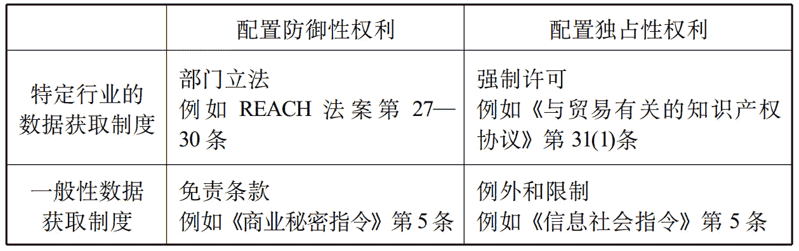
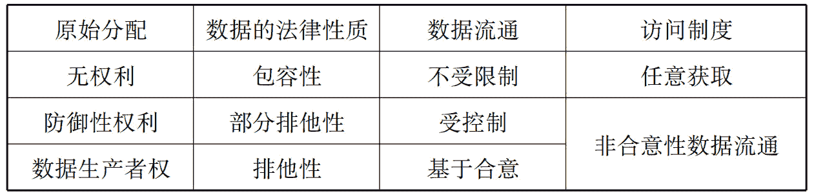
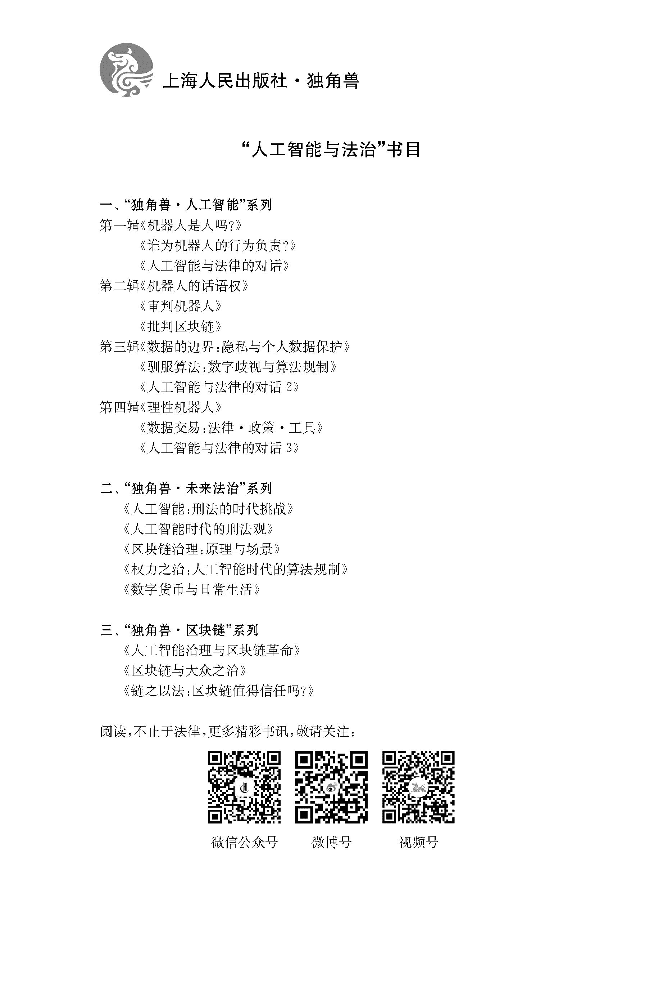

# 数字经济中的数据交易

### 主编序

本辑丛书已是“独角兽法学精品·人工智能”的第四辑。从 2018 年第一辑丛书出版至今四年以来，学界对于人工智能与相关法律的研究进入更深层次与更广维度，已拓展到具体制度、基本理论乃至法哲学、伦理学以及哲学等层面的探讨。从学界最初对人工智能的法学研究是否存在“泡沫”的争议，到如今“赛博朋克”的社会憧憬、人工智能的智能裁判、无人驾驶汽车的现实侵权、智能合约的广泛应用，人工智能可谓已嵌入人类生活的方方面面，正逐步从底部改变社会治理与运转的基本方式。

但人工智能的法学研究，在某种程度上显著落后于实践的飞速发展。上海交通大学凯原法学院数据法律研究中心正是以国家社科基金重大项目“大数据时代个人数据保护与数据权利体系研究”为依托，致力于数据、个人信息以及人工智能的学术研究，并努力构筑理论与立法、司法实践以及企业实践的桥梁。“独角兽法学精品·人工智能”第四辑就是在这种时代背景下，选译域外相关最新研究成果，从不同的思维层次与不同的现实站位出发，力图为国内人工智能法学研究以及相关实践应用拓宽思路，提供借鉴，逐步形成国内、国外人工智能的法学研究相互呼应、并驾齐驱，法学理论与企业实践、立法及司法事前紧密配合、有益互补的发展格局。

#### 一、本辑译丛的主要内容

本辑丛书精选了三部著作，分别是瑞恩·艾伯特撰写的《理性机器人：人工智能未来法治图景》（张金平、周睿隽译）、塞巴斯蒂安·洛塞等人主编的《数据交易：法律·政策·工具》（曹博译）和弥永真生、宍户常寿所编的《人工智能与法律的对话 3》（郭美蓉、李鲜花、郑超等译）。

在《理性机器人：人工智能未来法治图景》一书中，瑞恩·艾伯特基于其医学、法学等领域积累下的丰富跨学科知识，从人与人工智能两个维度，深入观察剖析了现行部门法区分对待两者的问题与可能性，包括法律乃至社会整体如何去适应机器等争议性的话题，以期解除人工智能可能带来的束缚，最为充分地拓展技术为人类服务的潜在空间。本书也对法律如何改变技术世界以及塑造未来世界的模样进行了大量论证。通过论证对人工智能的利用征税、对人工智能致害采用基于“理性机器人”的过错责任、对“理性机器人”发明创造提供专利保护、对人工智能犯罪采用责任人追究机制，以充分释放人工智能基于人类利益优先的发展潜能。法律不应再是笼统地探讨是否应赋予人工智能以法人人格或其他单一路径的解决办法，而是需要一场解决所有领域问题的有关人工智能技术的法律全面变革。基于拓展人工智能技术使用范围的立场，瑞恩·艾伯特提出了人工智能法律中立原则，通过建立人工智能的行为规则和标准，实现人工智能福利的同时，实现风险可控，切实保证人类的权利与地位。

数字领域已成为全球竞争的核心，体量和频次明显膨胀的数字化应用正在从根本上重塑我们的经济与社会，这其中，作为底层基础的数据交易是法律必须予以明确规制的关键内容。塞巴斯蒂安·洛塞、莱纳·舒尔茨、德克·施陶登迈尔等学者主编的《数据交易：法律·政策·工具》一书，是第三届明斯特欧盟法与数字经济研讨会的论文集。旨在讨论欧盟法律如何应对数字经济的需求与挑战，梳理了欧盟有关数据交易法律问题的前沿动态，探讨了通过知识产权、财产权、强制许可、合同等概念与工具应对数据交易难题的可能性与正当性，提供了法律、经济、政策、产业等不同视角的观察。该书还集中探讨了争议较大的法律解决方法，一是数据的独占权，特别是数据“所有权”的因应归属；二是进一步论证探索发展合同法的可能，包括合同法的默示规则、不公平的 B2B 交易格式条款和条件的控制，以及强制许可等，也同时研评了包括《数据库指令》《通用数据保护条例》《打造欧洲数据经济》报告在内的诸多欧盟立法与政策，力图为欧洲经济发展提供一个把握潜在机遇的数字交易框架。

《人工智能与法律的对话 3》由弥永真生等学者所编，在法理论层面讨论了人工智能给人类和社会存在方式带来的根本改变及其引起的法理层面的本质性追问。在分析了各国现有产业政策和法律规制导向的背景下，分析了将行、民、刑规制组合在一起调整人工智能法律问题的愿景，客观、冷静地讨论了是否应将某些法律制度扩展到人工智能的应用，同时具体深入分析了人工智能作为法律保护客体的可能，深入审视了人工智能对法律、伦理规则的本质性改变与影响。

#### 二、本辑译丛相关内容的简要评价

本辑译丛选取的三本著作立意深远、论证宏大。

《理性机器人：人工智能未来法治图景》的作者敏锐地观察到人工智能在操纵股市、遥控选举、网络犯罪中充当的反面作用，提出了对人工智能终将毁灭人类的远景担忧及其带来的技术性失业、歧视和安全等现实困境。在如何更恰当地规范人工智能问题上，瑞恩·艾伯特认为人类还远未形成共识——国家可在多大范围内用人工智能展开监控？在人工智能进行贷款、刑事审判等决策的哪个阶段，个人对自动决策算法应当享有获得解释权？现有的法律是专门为人类所设计的，而人工智能使得人工智能体也可以像人类一样行动。但人工智能无缝衔接地适用现有法律是不切实际的幻想，法律适用若没有体系性的调整，便无法适应人工智能实践的现实发展。目前，人工智能已经受到隐私、安全、公平竞争等领域的法律监管，但这些领域的法律显然落后于实践需求。基于此，《理性机器人：人工智能未来法治图景》一书中提出旨在提升人类福祉的新法律原则——人工智能法律中立原则，主张法律不应歧视人工智能。但人工智能所需要的，不是更多或者更少的法律，而是正确的法律。如何将人类或者绝大多数人类认为正确的法律或价值观嵌入人工智能的算法或生活实践，是尚待法哲学及部门法予以正面回答的关键问题。

《数据交易：法律·政策·工具》详述和分析了基于欧盟利益的关于数据交易的关键性法律问题，讨论是否需要在现有的欧共体法律外建立关于数据获取和转让的前瞻性框架，以及如何设计这一框架。数据是非竞争性资源，任一市场参与者均有使用数据并不限制其他参与者使用数据的地位。但该书明确提出数据也是一种独占性资源，可对数据施加限制从而排除对数据的自动获取。本书就数据的独占权、强制许可和合同概念做了较为深入的扩展分析，也提出了解决数据问题各种路径的优缺点。对独占性的数据权利能否形成稳定保护的对象等实践问题，实际上现有法律并无成熟的规则体系与之匹配，但为了促进数字经济中的数据交易以帮助欧盟抢占数据领域的全球优势，法律应当对数据治理制度进行具体化调整，但这必然会增加法律的复杂性。特别是该书警示了针对数据独占权、合同扩展适用等内容仓促立法的危害。在此逻辑下，现有的法律制度能否以及如何适用于互联网络空间的数据，同样需要更加深入的探索论证与框架建构。

迄今为止，法律是以权利能力、行为能力、意思表示、责任承担等为基础的概念体系为前提，《人工智能与法律的对话 3》一书从法律的视角考察和审视人工智能对社会存在基本面的改变，在人工智能体具备尊严基础和一定的行为能力之后，是否可以为民事法律行为（如签订合同）？能否将代理、法人等拟制制度扩展应用于人工智能体？在法律执行上，涉及自动驾驶汽车与机器人手术的法律责任问题，该书作者创设性地提出修正债权法中的定型化格式条款规定以及人工智能体作为法律客体予以保护的条件，并对涉及数据保护的隐私问题与人工智能武器化发展的现实担忧提出了治理路径。问题是，该路径是否可行？

人工智能恐怕是迄今为止人类创造的最具颠覆性和创造性的技术，但它并不能保证提升人类的福祉。如何监督人工智能朝着有益于人类整体利益的方向发展，是制定有关人工智能合适法律与政策时的核心考虑。人工智能法律中立原则不应当成为驱动每一个法律决策的动力，也不能以牺牲诸如透明度和问责等原则为代价。在数据保护方面，相关法律还是应致力于在实现数据的自由流动以实现社会治理与经济利益的最大化与保护数据持有者（个人信息主体）的切身利益之间寻求平衡之道。在相关法律应关切促进技术发展的方向上，需要让创造技术条件和投入资源收集数据的市场参与者获得公平的投资回报，只不过要以技术向善、行为合法为底线与前提；毕竟包括数据利用的人工智能技术在内，促进创新而非扼杀创新，才是法律调整的最终目标。

在探究人工智能发展趋势的同时，法学不仅要深入思考人工智能将会带来的诸多问题，更需要关注在技术迭代发展的基础上如何回应并适应当下已经发生的现实问题。

#### 三、本辑译丛引发的相关法律思考

三本著作可以说关涉数据与人工智能法律问题的方方面面。但其中一个共性的理论基础问题是，无论讨论数据还是人工智能，都必须置入网络空间或者数字社会，而网络空间或数字社会从生成至今均由工程和科学技术建构。可以说，在关涉数据与人工智能的法律领域，法律与工程及科学技术在此空间维度天然地结合在一起——法律工程学从此得以产生。此处的法律工程，并非传统意义上从工程学的视角来思考法律，把法律作为一个系统工程予以考虑。而是在当下的数字社会中，研究法律必然要借助工程与科学技术，大数据、算法、智能合约、区块链乃至整个赛博空间本身，都是工程技术与科学原理运用的结果。厘清其中所涉及的任何法律问题，亦都离不开工程与科学技术的配合。反之亦是如此，对数字社会或赛博空间任何方面的技术（含算法等）管制与治理，也都离不开法律制度的支持。

互联网络的出现，催生了数字社会的存在与发展。在法律领域之所以需要法律工程学，且在可预见的未来其地位和作用会愈发重要，恰恰是因为数字社会存在的本身便是建立在技术之上，即计算机、数学、物理、材料以及机械工程等多学科知识的综合运用。数字社会中的法律，从实体法上的权利客体、交易模式乃至程序法上的裁判形式及救济手段等方面，均将并已经发生重大变化。其本质上，均是基于与工程等跨学科技术相互支撑作用而引起的变化。数字社会中的法律问题，只有借助技术支撑的网络思维模式，才能在新的技术背景下予以更好理解。

如《理性机器人：人工智能未来法治图景》一书提出，算法歧视的问题在 2016 年进入公众视野，美国刑事裁判算法“矫正罪犯替代惩罚画像管理”（COMPAS）可以对犯罪嫌疑人进行风险评估，协助法官作出保释裁定。但该算法常常将不是重犯的黑人犯罪嫌疑人标示为高危险，而将重犯的白人犯罪嫌疑人标为低危险。可以说，歧视在人工智能和人类决策中都不可避免的存在，差别在于算法歧视是人工智能基于歧视性训练数据而习得的。如果人类法官过去长期对被告人作出歧视性裁判，那么未来人工智能也会这么做。人类已进入数字社会，数字社会的治理已经逐步被代码与算法渗透，任何个体均有可能被数据化，法治呈现出被技术统治替代的隐忧——“代码即法律”。人们已经生活于且越来越深陷于二维社会形态之中，即数字社会与传统的线下社会。在数字社会中，人们对于新科技掌控社会发展的担忧越来越多，“大数据杀熟”等负面行为已经屡见不鲜，依靠“对抗生成网络”等深度学习技术模型的算法已经实现接近无痕的“换脸”技术并引发社会整体层面焦虑。在数字空间中当下的关键问题或在于，法律与工程技术应该如何结合才能更为有效地规制其中的新兴法律问题，在此意义上将法学与工程、科学技术结合在一起的工程法学便为现实所需。

依据《数据交易：法律·政策·工具》一书中的相关观点，代码的架构体系相较法律规范更为完善，通过代码在网络中赋权，并不需要法律拟制的共识与国家强制力的保障。鉴于代码的强大优势，实务界试图将法律编程，以使计算机直接运行法律。但是，不懂自然语言、不懂价值判断的代码，如何按照法律的要求生成立法者需要的结果？新科技生态的发展过程中，又如何体现法律的独特价值？上述问题，也需要在法学与工程学的交叉研究中寻找答案，以适应数字时代的快速变化。任何工程都是复杂的综合实践过程，具有巨大的包容性和与时俱进的创新性。工程思维是造物导向的思维，其所追求的价值目标具有综合性，往往是知识价值与经济价值、社会价值、环境价值、人文价值的融合。法学与工程学显然不属于同一学科维度，但工程问题求解意味着从给定的初始条件和约束条件下，给出能够从初始状态经过系列中间状态而达到目标状态的操作程序，法律工程存在的意义即为法律规范借助技术的设定与执行，以解决网络空间中存在的法律实践问题。

根据《人工智能与法律的对话 3》的论证，事实上工程与法律早已在实践中结合。在互联网发展起步之时，数字版权管理系统（Digital Rights Management System，DRMS）就已实现运用附加代码与程序完成数字作品的加密，通过工程方法限制侵犯知识产权的可能并在实践中取得较好效果。从构成要件与运行机理深入分析，法律知识与流程具有工程学意义上的线性链特征，使得法律应用得以通过大数据收集海量案例，提炼析取出具体表达规则，结合场景自动计算形成具有一定权威性的结论，实现分类分层分级的快速裁判应用。

以程序化广告为例，现在盛行的包括微信朋友圈广告、网剧植入广告等精准投放型广告，已经可以根据使用人的浏览记录与习惯记录形成“数据画像”，进而实现针对性的定向投放。在巨大商业利益背后，是绝大多数客户的隐私权受到终端设备软件过度索权的威胁。普通用户即使有意愿通过传统法律手段维护自身隐私权利，单个个体也绝无穿透此类技术的能力。通过工程学的广泛技术运用并借助计算机算力，实现法律应用的高频次、深度化、自动化，从而符合网络时代对于权利义务实现的内在需求与现实张力。

法律工程思维是法学和工程技术的内在交融，在两个宏大学科的有机交叉中，工程技术是手段，法律孜孜追求并努力实现的正义价值仍是法律工程建构的基本理念与核心价值。法律工程思维的目标是利用工程学思维，研究解决具体问题的法律机制与路径，并通过各种子模式的综合集成以实现系统工程的目的，法律工程思维在本质上也是解决实践问题的法律适用方法与程序。这亦跟法律（权利）的本质相契合，因为法律在本质上也是一种程序，即决定权利产生与适用的程序，只不过法律工程思维在程序中添加了工程与科学技术的要素。在新科技生态下，法律工程思维以实用化和技术化为导向，将调动和适用各种工程思维方式对跨学科、多维度的技术与知识进行运筹和集成，并转化为可以实践操作的流程、模式和机制，实现解决实际问题的法律目的。

法律工程思维的核心要义是借用工程学方法与手段实现公平正义。从价值取向的角度分析，法律工程已经可以通过设计价值函数，实现法律的价值导向。以证据判断等逻辑推理的工程化推导过程为例，司法证明的核心机制是证据推理，通过法律工程将科学的判断方法运用至完整的证据链判断之中，并借助人工智能的技术手段筛查出重点存疑证据，以实现减少冤假错案发生的最大可能。法律工程作为法学适用技术的一种，显性的特征是工程思维模式。工程思维是路径化解决问题的思维，例如网络思维、产品思维、逆向工程思维、系统工程思维等。工程思维模式可以有效地指导法律工程方法体系的建构，而法律工程思维是对法律适用过程的思维形态呈现。通过法律工程思维集合法律适用要素，将法律与社会现实通过算法路径和模型工具紧密连接起来，以实现对相关问题的快速准确调整。

法律的制定与应用充满了辩证法，在互联网络社会或者说数字社会到来后，诸多法律制度，包括法律适用方法及法律论证方法，甚至法律思维方法，都需要增加新的视角，至少要密切关注数字社会或互联网络社会中的技术因素。数字社会中关涉法律的任何活动以及任何法律争议的解决，皆需要相应工程技术的配合，惟此才能真正把握新科技生态下法律的本质以及未来法治的发展。

本辑引介的图书，在不同维度上论证了法律自身不但有追求公平正义的永恒价值取向，而且更有实现该价值取向的多元且复杂的具体制度设计。在当代中国科技创新发展、国家治理体系和治理能力现代化发展的需求基础上，借鉴域外的相关先进经验并结合中国数字化领先发展的现实，把法律思维与工程思维相结合，把法律规范与工程技术相结合，可以更好地实现法律具体制度设计、法律实践应用以及法律价值目标的统一。

**彭诚信**

**上海交通大学特聘教授**

**上海交通大学人工智能治理与法律研究中心副主任**

**凯原法学院数据法律研究中心主任**

2021 年 7 月 17 日

### 序

数字化正在从根本上重塑我们的经济与社会。商业流程的数据化导致数据的速度与体量显著提升，成为充盈数据经济躯体的血液。当下和未来的商业模式能否推动创新、创造经济增长，取决于其是否有能力使用数据。“数字经济中的数据交易”业已成为欧盟数字市场发展的核心环节之一。

鉴于明斯特欧盟法与数字经济研讨会（Münster Colloquia on EU Law and the Digital Economy）旨在讨论欧盟法律如何应对数字经济的需求与挑战，于 2017 年 5 月 4 日至 5 月 5 日举行的第三届研讨会聚焦于“数字经济中数据交易的法律概念与工具”。本次研讨会分析了与数据交易相关的法律概念及工具的学术争议、实践价值乃至政治议题，着重讨论了数据交易的起点和挑战、独占性权利、强制许可及合同概念。

本书是第三届明斯特研讨会的论文集。非常感谢乔里特·莫特（Jorrit Mauter）和乔纳森·沃森（Jonathon Watson）在组织本次会议和编写本卷论文集的过程中提供的鼎力支持与帮助。

**塞巴斯蒂安·洛塞**

**莱纳·舒尔茨**

**德克·施陶登迈尔**

2017 年 9 月

## 引言

### 第一章　数字经济中的数据交易：法律概念与工具

**塞巴斯蒂安·洛塞、莱纳·舒尔茨、德克·施陶登迈尔**^((1))

#### 一、引言

数字化是 21 世纪的开创性趋势之一，它正在从根本上重塑我们的经济与社会。需要特别注意的是，本书所谓的“数字经济”并不是某种独立的经济形式或整体经济形态中的某一具体领域，而是指由数字化引发并最终导致经济形态的数字化状态。

在这一转型过程中，虽然捍卫社会、政治体制及市场结构的基本价值至关重要，但提供一个能够使欧洲经济发展在这一进程中把握潜在机遇的框架同样迫在眉睫。欧盟委员会直面这一现实需求并确立了“数字单一市场战略”，¹将其列为十大优先级议题之一。²作为“数字单一市场战略”的研究成果之一，欧盟委员会于 2017 年 1 月发布了《打造欧洲数据经济》（Building a European Data Economy）的报告，³报告内容包括但不限于数据的获取与传输。

由于明斯特欧盟法律与数字经济研讨会旨在讨论欧盟法如何应对数字经济的需求与挑战，关注数据获取与传输的相关问题也顺理成章。由此，2016 年 10 月举行的第一届研讨会探讨了数字革命给合同法带来的挑战，第二届研讨会聚焦提供数字内容的合同问题，而 2017 年 5 月举行的第三届研讨会主题为“数字经济中的数据交易：法律概念和工具”。本次研讨会探讨和分析了在促进和推动数字经济的数据交易中可能具有适用性与必要性的法律概念与工具，这已触及数字化给欧洲私法带来挑战的核心议题。

本书汇集了第三届明斯特研讨会的论文，基于研讨会的总体目标，它们对不同的法律概念和工具进行了更细致的分析，以期在欧洲层面推进应对数据交易挑战若干路径的研究工作。

#### 二、起点与挑战

经济和社会的数字化，特别是物联网（IoT）及商务流程数据化的推广，数据的速度和体量都在不断提升。一些实例⁴有助于理解“大数据”的含义：谷歌在一天内处理的数据超过 24 拍字节（petabytes），⁵这相当于美国国会图书馆所有印刷材料的数千倍。2013 年全球存储的信息量约为 1 200 艾字节（exabytes），⁶如果将这些信息保存在光盘上，将汇集成五座直抵月球的光盘高塔。

数据是流淌在数字经济躯体内的血液。许多现有的商业模式，以及那些将引领创新并创造经济增长的未来商业模式，都取决于能否使用数据。例如，“预测性维护”（predictive maintenance）或“精密耕种”（precision farming）等商业概念只有在获取数据的基础上才能实现。

数据是一种非竞争性资源，这意味着一个市场参与者使用数据并不限制其他市场参与者使用同样的数据。然而，数据也是一种独占性资源，通常可以对数据施加限制从而排除对数据的自动获取。事实上，欧盟委员会在《打造欧洲数据经济》中指出，⁷由于收集或持有数据的企业主要在内部使用而不与其他市场参与者分享数据，数据交易较为有限。在自愿数据共享的场景中可能存在的风险是数据持有者具有更强的议价能力，从而给要求获取数据的其他主体施加高额交易成本，甚至令人望而却步。⁸

因此，欧盟委员会发起了与成员国和利益攸关方的对话，讨论是否需要在现有的欧共体法律（acquis communautaire）⁹之外建立关于数据获取和转让的前瞻性框架，以及如何设计这一框架。前述做法建立在几个目标之上：¹⁰从根本上说，它致力于实现让数据在经济运营者之间尽可能自由流动的经济政策目标；同时也考虑到了数据持有者的利益，亦即要让那些创造技术条件和投入资源收集数据的市场参与者获得公平的投资回报。毕竟，促进创新而非扼杀创新才是最终目标。此外，欧盟委员会也认识到，如果不得不与竞争对手分享其商业秘密，企业就不会有动力投资数据经济并付诸行动。最后，议价能力不平等的情况也被纳入考量。为了解决可能出现的问题，《打造欧洲数据经济》提出了一些方法供讨论。¹¹第三届明斯特研讨会只探讨了其中争议较大、更具法律挑战的方法：一是独占性权利，特别是数据“所有权”问题；二是进一步发展合同法（包括合同法的默示规则、不公平的 B2B 交易格式条款和条件的控制，以及强制许可）。

#### 三、独占权

围绕数据独占性权利的一个核心问题是，一项至少间接涉及数据交易（作为数据载体的财产或信息之上的知识产权）的数据“准所有权”（quasi-proprietary right）是否应该与现有的独占性权利并存。¹²数据“所有权”的路径可以追溯到法理层面一个颇有争议的讨论。¹³该路径的基本理念是赋予非个人数据或匿名化数据一种权利，并推断该权利会使数据生产者有动力通过专门平台交易数据（与其他商品别无二致）。关于数据“所有权”的一些重要问题，例如该权利是使用数据的独占性权利抑或仅为对抗第三方滥用数据的防御性权利、权利归属如何确定、是否应预见到一些例外情形，仍有待进一步讨论。

关于数据准财产权的特点仍有不少问题悬而未决。¹⁴第一个问题涉及创设该权利的一般标准以及数据上的排他性权利是否能够满足该标准。事实上，在民法传统中，“支配权”（dominium）一词不仅适用于对有体物的控制。将财产概念局限于有体物时（如 19 世纪的德国），就需要一个更宽泛的术语；“独占性权利”或在其他法域中更为常见的“绝对权”概念填补了这一空白。通过使用“财产”作为基础，这些标志性独占权的典型特征是，将某一对象的控制权“独占性地”（exclusively）赋予某人，使其获得全面的法律保护并得以对抗任何人。因此，足以对抗所有人的法律保护和基本的不可分割性是独占性权利的共同特征（该特征基于有体物的财产属性，但以特定的“可公示性”标准实现扩张，例如对可让与性的认可）。然而，近年来涉及知识财产和信息的权利演进可能会带来疑问：在独占权与侵权责任法中相对权之间泾渭分明的传统界限是否还能存续？

在此背景下，“独占权”的概念提出了一些与数据权有关的问题和关切。首先需要解释如何界定权利对象。¹⁵“数据”的概念可以非常简单地理解为“信息”，但在触及信息类型及其目的时，问题就变得复杂，¹⁶特别是在它们涉及数据特定权利在知识产权范畴内的作用时。例如，《通用数据保护条例》（GDPR）¹⁷提到了“个人数据”“生物识别数据”“基因数据”“有关健康的数据”以及“敏感个人数据”。是否有必要保护尚未受到知识产权充分保护的数据生产者或数据获取者（特别是关于构成数据内容的信息）仍存在争议。¹⁸

与此同时，围绕着具体数据权的对象及权利人的关切也很多。作为独占权的对象，部分法学领域基于“信息”及其他权利（如版权）的视角或创设“信息法”（information law）概念来审视数据。其他法学领域将数据和数据集视为特定的独占权对象。它们区分数据本身的权利与承载数据的有体物和形成数据内容的信息之上形成的财产权。从这一角度出发，创建数据或数据集塑造了将这些权利赋予某一特定主体的起点。¹⁹

然而，即使采用这种方法，也存在一个显著的实践性问题：数据可以根据需要频繁地复制，因此，无限量的人都可以使用和传输数据。这种可能性的存在，并没有使原来的“数据所有者”（data owner）失去复制、使用和传输数据的能力。这与传统的动产财产权存在根本区别，使人们对数据权是否可以被视为准独占权产生了很大的疑问。²⁰

因此，“所有权”路径在欧盟委员会组织的公众咨询和结构性²¹对话中得到的支持最少²²也就并不稀奇了。因此，在数字单一市场战略的中期审查通信中，甚至没有再提到这一路径，而在《打造欧洲数据经济》报告的后续工作中则有所提及。²³这不难理解，因为除了其他问题之外，这种方法是否能实现便利数据获取的基本目标也令人怀疑。对于数据持有者是否会在可接受的情形下允许其他主体获取数据，这一路径并未提供任何确切答案。最重要的是，所有权路径的实际结果似乎很可能与当前的情况区别不大，即在数据价值链中具有最大议价能力的主体最终将获得对数据的控制权。因此，在没有为实现总体经济目标增加相应价值的前提下，以数据所有权的方式对市场进行强烈干预的正当性值得怀疑。

从公布的反馈情况来看，目前最严重的问题存在于汽车领域：²⁴车主无法获得车载数据，而是由汽车生产商保留，他们声称需要这些数据开发预测性维护或其他商业模式。可以想见的是，以预测性维护或其他尚未出现的商业模式为说辞，类似问题未来也会出现在其他市场领域之中。

#### 四、合同的概念

本书提出了对必要性和法律设计的关切，²⁵对欧盟委员会公共咨询的保留答复都表明，制定一项具体的准数据所有权并不能取得成功（至少对目前的欧洲而言）。有鉴于此，必须更加重视试图平衡数据交易各方利益的合同法概念与工具。²⁶

合同法领域的注意力必须基于合同自由的语境重点投向已经出现或将要使用的相关工具。在很大程度上，它们是市场竞争者通过合同自由的原则塑造其法律关系能力的外在体现。但是，同样不容忽视的是，合同自由也是防止一方不当损害另一方（或第三方）的手段和工具。鉴此，相关的讨论不仅包括当事人如何设计其合同条款的建议与模式，亦应涵盖旨在保护缔约双方实现合同自由的规则。

在这方面，应考虑到默示规则与控制格式条款的可能联系。²⁷合同法中的默示规则连同对 B2B 交易不公平格式条款和条件的控制能够处理涉及数据传输的具体问题。目前只有竞争法提供了一个非常广泛的框架，以防止数据持有人和希望获取数据的主体之间的关系被滥用。然而，竞争法介入的门槛和条件一般要求滥用市场支配地位这一较高标准，很难得到满足。因此，这种做法建议制定默认的合同法规则，阐明立法者如何在建立了合同关系的数据持有者与其他寻求获取数据的合同主体之间实现权利义务的平衡。

由于这些规则是默示规则，B2B 交易的双方当事人可以修改甚至完全放弃这些规则以实现合同自由。然而，如果当事人修改甚至完全放弃这些默示规则，对 B2B 交易不公平格式条款与条件进行控制的规则将对之施加限制。对不公平格式条款与条件的控制同样要以一般条款为基础。但是，一般条款的标准不能与《消费者合同中的不公平条款指令》²⁸指向 B2C 交易的标准相同，因为这里涉及的制度主要针对 B2B 交易中的合同。因此，被适用的控制毋宁说是使用《迟延支付指令》（Late Payments Directive）²⁹以及《欧洲共同买卖法》（Common European Sales Law）提案³⁰中的现存模式，亦即严重偏离良好商业惯例的规则。³¹为了使这一通用条款更为具体，可以将默示合同规则作为基准。

就大多数并不存在这一制度的欧盟成员国而言，对 B2B 交易不公平格式条款与条件的控制显然是一个不熟悉的概念，只有少数欧盟成员国已经有这样的规定（但有时也会遭到商业利益相关者的批评）和相应的判例法经验。这一路径可以与根据默示规则制定示范合同条款相结合，其优势在于可以将立法者在合同关系中对权利义务配置平衡的考量要素转化成起草合同的实践指引。基于最佳行业实践制定示范合同条款的方法可以视作一种行业自律。但是，这种示范合同条款是否有可能被具有较强议价能力的数据持有者采纳也不无疑问，特别是在缺乏经济激励的前提下。³²

数据交易各方之间的合同关系还有一个重要的内容：许可使用，这往往是确定一方当事人能否实现合同目的的决定性因素。这就产生了一个问题，即示范许可或关于许可使用和内容的非强制性规则是否以及在多大程度上是必要和充分的。³³此外，还必须考虑是否以及在多大程度上需要强制许可，以弥补合同法路径可能存在的缺陷。特别是，只有强制许可才有可能充分制衡基于实际控制的数据使用独占性。同样，在基于数据“所有权”的制度中，强制许可也可以发挥重要作用。正如单纯的事实控制一样，在这种制度中，它们可以弥补权利的独占性所带来的缺陷。无论如何，强制许可的方法概括了欧盟法中几个特定部门的先例，³⁴而这些先例在范围和许可条件上是不同的。这种方法最重要的问题之一自然是为获取数据应支付多少费用？基于 FRAND（公平、合理和无歧视）条款，这种难题是可以预见的。

#### 五、结论

第三届明斯特学术研讨会分为三个板块，分别是独占权、强制许可和合同概念，这些解决数据问题的具有挑战性的路径虽存在各自的优点和缺点，但值得考虑。从发言和讨论中可以清楚地看到：大多数与会者认为并非所有方法都同样合适，特别是针对构建新的数据独占权，研讨会在很大程度上反映了欧盟委员会公众咨询和结构性对话中的态度。引起关注的问题不仅在于这一新型权利将对已经存在的绝对权产生何种影响，数据并未形成稳定保护对象等实际问题更加令人关切。最重要的反对意见指出，问题的根源在于新的财产权在多大程度上与其意欲实现的目标相匹配。虽然这种权利确实适合于保障数据持有人的利益，但并不会激励人们进行数据交易，也不会激励数据的流通。当然，这一缺陷可能通过强制获取数据的权利（如强制许可）来弥补。总之，新的数据“所有权”将在很大程度上局限于维护数据持有人利益，其面临的种种困难使得所有权路径遭受广泛质疑。

因此，讨论更多集中于其他法律概念和工具上，普遍认为它们更适合于促进数字经济中的数据交易。就强制许可而言，广为称颂的优点是其灵活性。与一般的财产权结合具体使用权的路径不同，如果聚焦于强制许可，便能从一开始就直面问题的解决方式。不少与会者提出，为了满足不同经济部门的不同需求，对数据治理制度进行具体化调整是适当的。有人认为，这种针对具体部门的监管至少比一般性规则更为适当。尤其是关于定价的一般规则难以实现的前提下更是如此。然而，值得注意的是，针对具体部门的监管也会带来不利因素，原因在于不同规则的一致性难以保障，必然会增加法律的复杂性。此外，一旦涉及个人数据，强制许可似乎极不适当。

相比之下，合同法的工具，即以默示规则辅之以对 B2B 交易中不公平格式条款与条件的控制被普遍认为是实现上述目标的适当手段。该路径被认为能够弥补将大多数问题交由竞争法处理的现实所引发的值得商榷的缺陷。然而，在审查数据交易时，市场支配地位以及滥用市场支配地位都很难证明。此外，现有竞争法的先决条件似乎在任何情况下都不足以确保数据的充分自由流动，默示合同规则和对不公平格式条款的控制可以适应数字经济的具体挑战。然而，正如有人指出的那样，即使是强制性规则也不能起到鼓励签订合同的作用，因此，在根本没有合同方或在 B2C 关系中订立合同且获取数据的利益与另一家企业密切联系的情况下，并不能据此确保数据的获取。

总之，本书所收录的论文以及在本次研讨会展开的讨论均说明了该主题的复杂性。这就要求更为细致的研究，不仅需要分析数字经济以及可能的市场失灵所带来的需求和挑战，同时也要仔细评估适合于应对这些需求与挑战的法律概念与工具。鉴此，综合本次研讨会形成的共识，强制许可与合同法路径值得进一步讨论。

#### 注释

1. 欧盟委员会，《欧洲数字单一市场战略》，COM（2015）192 final.

2. 容克，《欧洲新启动：我的就业、增长、公平与民主变革议程》（2014 年 7 月 15 日），可在线获取于 `〈ec.europa.eu/priorities/docs/pg_en.pdf〉`.

3. 欧盟委员会，《打造欧洲数据经济》 COM（2017）9 final. 另见附件《关于数据自由流动和欧洲数据经济新问题的内部职员工作文件》 SWD（2017）2 final.

4. 这些实例来自迈尔·舍恩伯格（Mayer-Schonberger）与库克（Cukier）合著的《大数据》（Big Data）一书。

5. 1 拍字节（petabyte）是 10 的 15 次方（1 000 000 000 000 000）字节，而 1 字节是一个字符。

6. 1 艾字节是 10 的 18 次方（1 000 000 000 000 000 000）字节。

7. 前注 3，《打造欧洲数据经济》（Building a European Data Economy）。欧盟委员会组织的公众咨询和结构性对话的反馈意见证实了这一点。进一步的信息与文件载于 `〈ec.europa.eu/digital-single-market/en/news/summary-report-public-consultation-building-european-data-economy〉`（以下简称‘公众咨询’）访问于 2017 年 8 月 27 日。

8. 欧盟委员会组织的公众咨询和结构性对话的反馈意见证实了这一点，参见前注 7。

9. 相关讨论可参见本书中莱斯特纳（Leistner）、阿尔平（Alpin）、瑞达（Rada）及威廉斯（Willems）的论文。

10. 前注 3，《打造欧洲数据经济》（Building a European Data Economy）。

11. 前注 3，《打造欧洲数据经济》（Building a European Data Economy）以及该报告的附件《关于数据自由流动和欧洲数据经济新问题的内部职员工作文件》。

12. 有关独占性权利的议题可参见本书中休根霍尔茨（Hugenholtz）、齐默（Zimmer）以及科贝尔（Kerber）的论文。

13. 参见前注 3，《关于数据自由流动和欧洲数据经济新问题的内部职员工作文件》的参考文献。

14. 参见例如 Lynsky，《欧盟数据保护法基础》（OUP 2015）第 229 页及以下；Zech，《作为保护客体的信息》（Mohr Siebeck 2012）第 219 页。

15. 例如 马克斯·普朗克创新与竞争研究所，《数据所有权与数据获取——关于当前欧洲辩论的立场声明（2016 年 8 月 16 日）》，可在线获取于 `〈www.ip.mpg.de/en/link/positionpa per-data-2016-08-16.html〉`，访问于 2017 年 8 月 27 日：Thouvenin/Weber/Fruh，《数据所有权：现状梳理与问题梳理》（即将出版）。然而参见，Fezer，《数据所有权》（2017）MMR 3；Hoeren，《数据所有权——尝试在民法中适用刑法典第 303a 条》（2013）MMR 486；Hoeren，《大数据与数据所有权：欧洲近期发展》（2014）EIPR 751。

16. 关于个人数据的难题可参见本书中温德霍斯特（Wendehorst）的论文。

17. 欧洲议会和理事会 2016 年 4 月 27 日关于自然人在个人数据处理方面的保护及此类数据自由流动的（EU）2016/679 号条例，并废除 95/46/EC 指令（通用数据保护条例）\[2016\] OJ L119/1.

18. 可参见本书中阿尔平（Alpin）、休根霍尔茨（Hugenholtz）以及科贝尔（Kerber）的论文。

19. Welp，《数据变更（§303a StGB）——第 2 部分》（1988）IUR 434，448.

20. 可参见本书中齐默（Zimmer）与德雷克斯尔（Drexl）的相关论文。

21. 见前注 7 的“公众咨询”（Public Consultation）。

22. 例如参见 Business Europe、BDI、波兰的回复，见`ec.europa.eu/digital-single-market/en/news/position-papers-received-framework-public-consultation-building-european-data-economy`，访问于 2017 年 8 月 27 日。

23. 欧盟委员会，《数字单一市场战略实施中期审查——面向所有人的互联数字单一市场》COM（2017）228 final，第 11 页。

24. 见前注 7 的“公众咨询”（Public Consultation）。

25. 参见本书中阿尔平（Alpin）、休根霍尔茨（Hugenholtz）、齐默（Zimmer）、科贝尔（Kerber）、韦伯（Weber）以及德雷克斯尔（Drexl）的相关论文。

26. 关于合同法可能作出的贡献，见本书中德雷克斯尔、格拉夫·冯·韦斯特法伦（Graf von Westphalen）、亚纳尔（Janal）、多尔赞（Dolžan）和威廉斯（Willems）的论文。

27. 参见本书中格拉夫·冯·韦斯特法伦（Graf von Westphalen）、多尔赞（Dolžan）的论文。

28. 理事会 1993 年 4 月 5 日关于消费者合同中不公平条款的 93/13/EEC 号指令\[1993\] OJ L95/29.

29. 欧洲议会和理事会 2011 年 2 月 16 日关于打击商业交易中延迟付款的 2011/7/EU 号指令\[2011\] OJ L48/1，取代了此前欧洲议会和理事会 2000 年 6 月 29 日的 2000/35/EC 号指令\[2000\] OJ L200/35.

30. 欧盟委员会，《关于共同欧洲销售法的欧洲议会和理事会条例提案》COM（2011）635 final.

31. 例如参见 CESL 第 86 条第 1 款第 b 项。

32. 前注 7 的欧盟委员会组织的公众咨询和结构性对话的反馈意见也指明了这一方向。

33. 参见莱斯特纳（Leist 纳）、韦伯（Weber）、梅扎诺特（Mezzanotte）以及格鲁茨马赫（Grützmacher）的论文。

34. 参见前注 3，《关于数据自由流动和欧洲数据经济新问题的内部职员工作文件》的参考文献。

***

(1) 该文仅表达作者个人观点，对欧盟委员会没有任何约束力。

塞巴斯蒂安·洛塞（Sebastian Lohsse）系明斯特大学教授，研究罗马法、比较法制史、民法和欧洲私法；莱纳·舒尔茨（Reiner Schulze）系明斯特大学教授，研究德国法和欧洲私法；德克·施陶登迈尔（Dirk Staudenmayer）系欧盟委员会司法与消费者总司部门主任、明斯特大学名誉教授。

#### 起点与挑战

### 第二章

#### 大数据与《数据库指令》：现行法与改革潜力

马蒂亚斯·莱斯特纳^((1))

##### 一、引言：大数据场景下数据库特殊权利的范围及影响

###### （一）欧盟法中特殊数据库保护的一般范围和条件

近期关于《数据库指令》¹中数据库制作者特殊权利对欧洲数据经济的功能与相关性讨论的特点是假设在大多数大数据场景中，“大量投资”这一关键条件无法得到满足。²这一假设基于欧洲法院在“英国赛马”（British Horseracing）案³和设备营销（Fixtures Marketing）案⁴中的基本认知：只有对获取数据库内容的投资（即“寻找”现有的独立材料）才与实质性门槛相关，而对材料的“创造”进行投资则与此无关。依据这一规则，许多学者认为，在典型的大数据场景中，对传感器或机器生成的各种数据的“生产者”进行的投资将被排除在数据库特殊权利之外，因为在大多数实际情况下，这种投资必然会被视为对“创造”数据进行的投资。⁵

必须承认，如何在获取数据的投资和创造数据的投资之间划出一条细小的红线，仍然存在争议，⁶但那种认为所有传感器或其他机器生成的数据通常不在数据库特殊权利范围内的一刀切式结论显然值得商榷。自英国赛马案以来，认为该判决应被理解为对严格意义上的无关数据创造（即唯一来源数据：通常是在另一主要活动的场景下由生产者创造）和通过收集且通过传感器、称重⁷等测量方式获得独立存在的相关数据之间存在着功能性、竞争性区别的观点，已被德国判例法所接受。因此，德国联邦法院（Bundesgerichtshof，BGH）⁸以及欧洲法院⁹都在不同情况下认为，投资建立测量、获取或记录基础设施，以获取某些先前存在的使用、销售或地理数据，对于评估《数据库指令》第 7（1）条规定的实质性门槛具有相关性。此外，对原始数据的方法性或系统性结构的密集投资，也可能包含在数据库内容展示的投资项下。虽然在欧洲范围内，对于真正的附带利益，法律上仍然存在不确定性，¹⁰但根据这些案例，传感器或其他机器生成的数据，只要在测量或以其他方式获得、核实和展示数据方面的投资是巨大的，就应该被数据库特殊权利所涵盖。最终，这将取决于欧洲法院在未来可能作出的判决中澄清英国赛马案确立规则的涵盖范围及其与前述案件中采纳的附带利益原则之间的关系，毕竟在英国赛马案的判决中附带利益原则被明确拒绝。¹¹

此外，现有文献¹²和判例法¹³大多对实质性标准作出了相当宽泛的解释，基本上将该标准具体化为一种最低限度的排除规则。事实上，法律的确定性和有效协调性都支持对该标准进行扩张解释。近期的研究更倾向于认为，对于该标准的解释应基于更严格、更具体化和个案为准的“市场失灵”法进行，这种方法提出如果没有特殊保护，在特定情况下是否会进行投资的问题。¹⁴显然，个案化的“市场失灵”法同时也明确地接受了附带利益原则，在大多数附带利益案中，数据库是作为另一个主要经济活动的附属品而创建的，没有数据库保护也就不符合市场失灵的标准。¹⁵对于典型的机器生成数据，这确实会降低其在未来获得特殊保护的相关性。然而，虽然这些方法在理论上有一定的优点，但它们是否可以在日常的法院实践中真正应用则不无疑问。换言之，虽然这些方法在理论上看起来很实用，但实际上它们将使数据库保护领域的法律确定性受到进一步威胁。因此，法院尚未接受这些概念，相反，目前的特点是判例法中对数据库的保护采纳相当低的实质性门槛。

###### （二）独占权的广义结构

此外，欧洲法院的判例法对《数据库指令》第 7（2）条规定的独占权（即提取和再利用）进行了扩大解释。事实上，独占权将涵盖间接提取甚至汇编实质性变化的提取、在性质上所有不同的增值数据库。¹⁶与此同时，典型的元数据库或元搜索网站行为，即从多种不同来源自动收集和汇编数据，有可能侵犯数据库特殊权利。¹⁷

与这种相当宽泛的独占性权利相比，限制受保护的对象，即限制使用数据库的实质性部分，或限制系统地、反复地提取构成数据库的实质性部分，¹⁸并不是保护竞争自由和在典型的大数据场景中防止利用其潜力的有效手段。因为这些用途大多是汇编和处理不同来源的大量数据集（而且最好是完整的数据集），因此需要完整的数据，而不仅仅是数据库的非实质性部分，以便从以前未经处理的基础数据集中产生合理的结果。因此，将受保护的主题事项限于数据库的实质性部分并不能解决在这些情况下可能出现的数据获取问题。¹⁹

当然，从另一种更偏重反不正当竞争法的解读来看，对实质性部分的限制可能仍然有助于灵活地考虑数据获取问题。在这种解读中，只有在个案中的具体使用会严重危害原数据库制作者的特定市场机会，从而减少必要激励时，才会满足对实质性部分的使用条件。²⁰然而，必须再次强调的是，法院还没有对实质标准采取这种现代的“更经济”的解释。相反，与保护条件方面的情况类似，该标准是以一种更传统的、以知识产权为导向的方式来解释的，因此，它尚未充分发挥其灵活考量功能性竞争因素的潜力。

###### （三）底线：一个规制欧洲数据经济必要性的新视角

对大数据（特别是机器生成数据）而言，相关法律现状具有重要影响，这与目前研究文献中的主流观点有很大不同。

首先，在传感器、机器或其他设备或基础设施获取和传输使用数据的大多数场景中，如果满足对测量基础设施、数据的获取、展示或验证进行大量投资的实质性条件，并且这些数据独立存在、可以独立观察（因此不是“编造”的），就有可能受到特殊保护。由于这个门槛（至少在目前的实践中）被设定得相当低，在大多数大数据场景中，特殊保护将根据《数据库指令》第 7（1）条被触发。其次，大多数现实的大数据使用场景需要众多来源的完整数据集，将直接或间接地使用完整数据库，因此侵犯了数据库制造者根据《数据库指令》第 7（2）条或至少是第 7（5）条享有的独占权。再次，由于具有不可否认的潜力，数据库特殊权利足以对欧洲数据经济的基础设施产生显著影响。最后，该情形之所以尚未引发广泛讨论，可能是由于在实践中（特别是在相关的合同框架中），数据库特殊权利仍然经常被忽视，以至于作为一种事前工具，它对欧洲数据经济的法律基础设施的设计影响相对较小。相反，大多数情况下，它似乎只是在个别场景中作为一种事后法律工具使用，以便对顺利运作的合同或非合同状态进行否定性评价。

事实上，正确认识这种法律状况，从根本上改变了对规制欧洲数据经济的讨论。这是因为，虽然许多研究者和欧盟委员会有时倾向于认为在大多数情况下，相关知识产权制度不会有明确、有效的管理。²¹但必须承认，在许多情况下，《数据库指令》下的特殊保护制度是适用的，尽管迄今为止的实践并不总是意识到这一不可否认的事实。最终，大数据案件的适用范围将取决于欧洲法院的判例法，而欧洲法院在过去的许多案件中已经通过对现有欧盟法律文本进行的扩大解释，清楚地表明了其对信息社会和数据经济产生重大影响的基本意愿。显然，这就转变了讨论大数据领域是否需要进一步监管的视角。在提出是否需要进一步规制以及如何进一步规制、数据所有权或其他独占性使用权是否能够妥善应对数据经济的实际挑战等问题之前，应该明确如下问题：数据库特殊权利（以及诸如新的《商业秘密指令》²²规定的商业秘密等其他知识产权工具）已经发挥了哪些作用，这些工具应该发挥哪些作用，以及需要进行哪些调整以使这些权利在构建数据经济中扮演功能性角色。

总结并概述由此产生的研究计划：一般来说，在许多大数据使用场景中，特殊权利将为数据库制作者提供相关的独占性保护，因此必须在各自的使用合同中适当考虑到这一点，以便在典型的大数据网络情况下以必要的法律控制和确定性简化数据的使用。然而，除了合同设计方面明显的交易成本问题外，在特殊保护领域，这种使用合同还面临着另一个问题：往往很难确定相关权利人，即数据库制造者。²³在某些情况下获取数据的潜在需要引起了高昂的信息和交易成本问题，显著加剧了当前公认的数据获取困难，这些问题源于对数据源的实际控制。²⁴此外，即使能够确定适当的数据库制造者并限制对数据源的控制，但在实际操作中往往很难设计出全面的使用合同，因为很多时候复杂的网络基础设施涉及不同的数据输入和消费主体。这提出了进一步制定非强制性合同文本的潜在需求，也可能提出某些关于最低限度合法使用权的强制性核心条款；事实上，《数据库指令》甚至提供了最低限度的核心文本（但遗憾的是几乎没有进一步指引）。此外，关于数据库制作者权利例外情形的界定非常狭隘，甚至比一般的版权法例外情况更不适合未来的发展；应该对它们进行全面修订。最后，权利的保护期也应进行审视，互惠条款可能会在国际环境中引起问题，在评估和修订《数据库指令》时，必须解决某些额外的技术性法律问题，特别是关于知识产权重叠、不正当竞争法和其他法律措施的问题。

##### 二、数据库特殊权利的潜力与问题——改革方案

###### （一）特殊权利的所有权

根据《数据库指令》第 7（1）条的规定，数据库制作者享有特殊的保护。指令正文并未对数据库制作者这一术语提供进一步解释。指令的鉴于条款第 41 条将数据库制作者界定为“主动承担投资风险的主体”，并明确将次级主体排除在外。虽然这与权利保护的对象（即对数据库的投资）相匹配，但如此宽泛的定义在实践中产生了严重问题。²⁵原因是在许多情况下，特别是在较大的合作网络结构中（这在大数据场景中具有典型性）甚至开放的创新网络中，很难确定哪一主体主动承担投资风险。通常情况下，这类网络的所有或大多数参与者都会分别投资于自己的具体贡献（如财力、技术基础设施、时间和精力等），当然也要承担投资风险。因此，很多时候，许多参与者都有可能成为鉴于条款第 41 条界定的数据库制作者，他们将对数据库拥有共同所有权（在实践中参与者甚至时常没有意识到这一事实）。针对这种情况，当前法律上的不确定性问题非常突出。显然，在第三方需要获取由此产生的数据集以设计、生产或销售新产品或服务的情况下，这种不确定性造成了相当大的信息和其他交易成本。²⁶

###### （一）合同网络与权利配置的可行性分析

解决这一问题的可能路径之一是各自的合同网（contract network），原则上，它有可能将产权有效地转让给对投资工作最重要的人，并为有关各方提供对数据集的某些使用而量身定做的使用许可。事实上，只要网络中的所有各方都能就为网络中不同的参与者量身定做的权利和责任制度达成一致，甚至可能不需要“集中”分配。灵活的合同解决方案在适用性方面可能不限于特殊保护领域，因为投资保护权并非版权，而是与工业产权接近，可以整体转让（《数据库指令》第 7（3）条）。由此，基于合同的解决方案原则上在该领域确实更可取。通常情况下，当事人最了解如何分配经济权利和义务。相比之下，如果试图对数据库制作者进行更具体的定义，立法者显然会面临一个信息问题，因为采用一种全面的方法来识别“有效”的权利人并为其赋予最初的特殊权利似乎很难实现（如果这并非绝无可能的话）。但显然，在某些情况下，这种合同的签订面临着不同的交易成本障碍和潜在的信息不对称。因此，为了使基于合同的解决方案可行，可能需要更多的法律指导原则，下文将进行讨论。

然而，目前必须接受的是，数据库制造者的模糊定义在最坏的情况下可能会导致在网络环境中对数据库特殊权利的共同所有广泛分裂。显然，从交易成本的角度来看，这是效率最低的解决办法，甚至可能导致（或据笔者个人所知，实际上已经导致）真正的拖延问题。《数据库指令》鉴于条款第 41 条中的现有定义只提供了一个（相当薄弱的）指导原则，以在多方涉及投资的情况下进一步集中所有权：这就是前文提出的“谁主动”投资的问题。²⁷关于“主动性”标准，人们可能会认为，最初安装某些测量设备、机器传感器的人是主动行动的主体，但在某些情况下机器或设备的操作者确实也可能投资于数据的获取（甚至可能是有意而为，特别是当他们是商业客户时），但他们通常并未体现出主动性。因此，在典型的机器生成数据的情况下，数据库制造者将是安装测量设备、传感器和系统（即整个数据获取、传输和汇编基础设施）的制造商。事实上，从交易成本的角度来看，这个方案毫无疑问可以通过各自对鉴于条款第 41 条进行解释的方式在现行法框架内实现。

然而，将数据库特殊权利赋予通常对数据进行事实上控制的制造商，在制造商不同意数据获取行为或对其特殊权利进行许可的情况下，就会加剧潜在的数据获取和利用问题。因此，虽然从交易成本的角度来看，这个解决方案足够合理且确实应该成为适当和可行的解释（甚至可能是立法规范）鉴于条款第 41 条的基础，但与此同时，这种解决方案会增加对保障合法用户获取数据以设计、生产或销售更多的产品或服务的法律工具的需求。

此外，在许多情况下，具有不同投资利益的当事方主动提供投入且其投资利益也会受到影响，这些主体同时在更大的信息网络框架下提取数据，“主动性”标准并没有提供真正的帮助，而且数据池所有权分裂的结果也难以避免。此时，有效合同解决方案的重要性就显得尤为突出且迫在眉睫，因为适当的所有权“集中”不具备正当性或事实上不可能实现。

由此，在这种合作（可能是开放的）数据网络中，独占性邻接权的概念本身就有其局限性。正如开放来源和开放内容倡议的例子所显示的那样，合同可以有所帮助，但可能需要更多的法律支持。为了克服效率低下（特殊权利在这种情况下显然会造成效率低下）的问题，一个更激进的替代方案是考虑将该权利设计为一种需要登记的、统一的欧盟工业产权。²⁸一个独立的登记册（可由欧盟知识产权局管理）应向利益相关方提供关于现存独占权及其归属的信息，从而大大减少市场的信息成本。此外，登记的条件与费用（最好还有延期费）随着时间的推移而大幅增加，这将保证只有那些确实需要此种保护以收回其投资的企业获得并延展这一独占权。此外，这也将有助于减少特殊权利，使其适用于那些（可能在相当有限和特定领域内）为了防止数据库市场中投资不足而需要激励措施（以及合理的保护条款）的情形。显然，需要进一步的研究来检验和鉴别这一方案在未来立法发展中的可能性，其原因在于继续维持现状甚至取消整个数据库特殊权利都是现实可行的选择。此外，值得注意的是，已登记的单一保护权存在相当大的风险，因为新的登记保护本身就会为寻租、策略式登记提供新的激励机制，从而导致与数据经济相关的知识产权格局更加复杂。但是，将数据库特殊权利转化为统一登记的欧盟工业产权的大胆做法需要在未来的研究中进一步探究其可行性、潜力及危害。

###### （二）数据库合同与合同条款

从实践的视角出发，当考虑到大数据网络下的数据交换时，很多企业，特别是中小型企业，都面临着在第三方合法使用其数据时，以必要的法律确定性拟定许可合同中有关许可条件和使用范围方面的问题。事实上，在商业环境中迫切需要制定各自的标准合同和最佳做法。此外，一套非强制性的合同法条款在这些 B2B 交易中作为一个可靠的安全网，可以帮助解决各方当事人没有关注的情形和问题。至少这种法律框架和根据合同的既定标准提供事实援助可能有助于降低交易成本，更重要的是可能会减少数据交易领域的寒蝉效应。寒蝉效应是由当前缺乏合法使用数据的可靠标准（关于个人数据保护的具体规则和其他问题不在本文分析的主题之内）造成的。在这种背景下，为多样化大数据环境下数据的输入、提取和使用制定非强制性的最佳做法，并制定非强制性的合同法文本，似乎是助推欧洲数据经济的一条可能出路。²⁹

《数据库指令》在这方面提供的指导很少——指令中没有包含非强制性的合同条款。但是，在任何此类自我监管或立法工作中，都应彻底考虑特殊保护，任何权利配置和许可制度的制定都应认真考虑到现有的或可能出现的特殊权利。

关于对数据的实际控制和可能重叠的额外特殊保护，还可以考虑在不对称的情况下，是否应通过关于控制不公平合同条款的强制性规则来支持对数据集的合法使用。同样，《数据库指令》并不包含这方面的一套完整规则。

然而，与《计算机程序指令》³⁰类似，《数据库指令》中也有关于合法数据库用户的强制性最低权利的规定，该权利不能被合同排除（《数据库指令》第 8（1）条、第 15 条）。事实上，这种一般性的监管技术，即规定合法用户的某些强制性最低权利的条款，有可能大大简化互联网中知识产权的功能。这是因为这些最低限度的权利与合法用户如影随形，合法用户可能会采取某些有效使用数据库所必需的最低限度行为。

事实上，《计算机程序指令》第 5（1）条的类似规定使得欧洲法院在其二手软件案（Used Soft）判决中认定计算机程序的在线销售和流通将导致线上权利用尽（online exhaustion）。³¹在这种情况下，计算机程序的购买者以及在一定条件下的任何二手买家，通过合法用户强制性最低权利的规定来支持他的必要使用行为。虽然《信息社会指令》³²在一般的版权法中没有类似规定，但在数据库这一特定领域，《数据库指令》第 6（1）条、第 8（1）条和第 15 条对数据库版权和数据库特殊权利作了类似规定。因此，原则上，虽然一般版权领域的在线用尽解释难度较大（事实上，是否以及在何种条件下应该这样做值得怀疑，需要进一步研究），但就数据库而言，对于根据销售合同为永久使用而分发的数据库，至少应该考虑在线用尽的原则；然后可以根据《数据库指令》第 6（1）条、第 8（1）条和第 15 条解释合法用户的必要使用权。不过，目前似乎没有必要采取立法行动。鉴于欧洲法院在这一领域普遍采取积极的态度，这与有效应用基本自由对知识产权保护的补充作用是一致的，因此，将数据库领域在线用尽原则可能进一步扩展的问题留给欧洲法院的判例法，似乎是一个可行和明智的选择。

然而，除了这个具体问题之外，更值得考虑的是，合法用户最低权利的规定是否有可能成为在使用数据方面有合法利益的第三方更普遍的获取权的核心要义。³³然而，目前这种潜力还没有实现，因为根据《数据库指令》第 8（1）条，合法用户的权利仅限于提取和再利用数据库中非实质性的部分。此外，根据欧洲法院对瑞安航空案（Ryanair）的判决，关于合法用户最低权利的规定甚至不适用于《数据库指令》范围之外的数据库，也就是说，自相矛盾的是，它们根本不适用于不受版权或特殊权利保护的数据库。³⁴事实上，这些关键的限定条件显然不符合典型的大数据环境下合法用户的实际需求，他们在大多数情况下需要完整的数据集，以便开发某些增值的新产品或服务，他们不仅需要保护自己的权利不被独占性的知识产权保护制度所侵害，而且需要保护自己的权利不被可能的（技术或其他）事实上的数据库控制。

因此，似乎值得考虑的是，首先将《数据库指令》第 8（1）条的适用范围扩大到对完整数据库的合法使用。如果认为这种扩展是正当的，那么监管技术，即为合法用户规定某些强制性的最低权利，从而与数据库合法用户的资格绑定，似乎确实是平衡权利人的利益和某些使用需求的一种实用方法，有利于发展新的数据市场。其次，要使这种方式行之有效，还必须进一步考虑哪些人能够被视为合法用户。毫无疑问，目前数据库的购买者或任何其他被许可人都有资格作为合法用户。将来，必须考虑其他人员（例如，获准使用数据并对数据有实际控制权的人，可能是对获取或嵌入相关数据的装置或传输和交换数据的装置有合法控制权的人等）是否应被视为欧盟法律相关条款意义上的合法用户。至少在考虑该领域不可放弃的数据获取权的模式时，应牢记这些规定，因为它们似乎是未来可能针对合法用户的强制性数据获取权的一个名副其实的监管模式。³⁵因此，如果进一步的研究表明，这种数据获取权被认为对某些领域数据经济的运作必不可少，《计算机程序指令》和《数据库指令》中合法用户的权利确实应作为可能的模式加以考虑，在现有的欧共体法律范围内对这些权利进行规范与整合。当然，合法用户的这种最低限度使用权必须适用于一般的数据集，即它们更应该适用于不受版权或特殊权利保护的单纯数据池——从而纠正欧洲法院在瑞安航空案中对这一数据获取权施加的不当限制。

最后，必须指出的是，虽然欧洲法院在英国赛马案³⁶中含糊其辞地暗示公众有查阅公开数据库的权利且这一权利是不可撤销的，但并未真正解决数据经济中新的使用形式引发的数据库查阅问题。除了欧洲法院的这一意见难以解释³⁷且该案在欧洲法院的判例法中一直是一个孤例外，单纯的查阅公开数据库的权利显然不能涵盖大数据分析对完整数据集的使用，因此不适用于具备功能性和动态性特点的数据经济中的数据获取问题。

###### （三）获取问题：数据库特殊权利的狭隘限制和例外情况

###### 1. 强制许可

如上所述，³⁸特殊权利对使用数据库实质部分的限制，不能有效满足获取全面的机器生成的使用数据或其他数据的可能需求，在某些情况下，第三方可能有必要获取这些数据，以便开发、生产、销售或分销基于大数据分析的增值产品或服务。马克斯—普朗克创新和竞争研究所针对该问题在未来实施监管可能性需求的新近分析中强调，未来解决数据实际控制问题的一个可能办法是为在使用数据方面有合法利益的各方提供特定领域的、不可撤销的获取权。³⁹

关于这一观点，本文无法进行全面的考虑和评估，必须指出的是，这种数据获取权必须涵盖独占权制度下的必要使用权以及任何其他相关的独占性知识产权。处理该问题的一个可能的方法是考虑扩大关于数据库合法用户权利的规定。另外，在需要超越合法用户核心权利的（完全）获取权的情况下，为了加强竞争，也可以考虑将强制许可作为允许使用数据库的一种手段。值得注意的是，早期的《数据库指令提案》⁴⁰确实明确包含了关于强制许可的规定。该提案第 8 条规定，在“公平和无歧视”的条件下，对单一来源的数据库以及由公共机构汇编的可公开获得的数据库进行强制许可。此外，预设了仲裁机制并明确处理强制许可与其他法律（如个人数据保护法、隐私法、安全或保密法）的关系，指出强制许可的权利不应与在先权利及义务相冲突。这清楚地表明，欧盟委员会在 1992 年就已经意识到了新权利在保留二级市场方面具有的杠杆潜力和其他危险，并原则性地提出了解决这些问题的适当方法。但在进一步的立法过程中，强制许可被废除，仅有对数据库实质性部分的使用限制被保留下来，这意味着数据经济中的数据实际获取仍然面临制度失灵问题。

笔者认为，首先，欧盟委员会早已发现在获取合法或事实上唯一来源数据方面的某些问题；其次，彼时也已经认识到新的数据库特殊权利有可能加剧这些问题；再次，在意识到问题的同时也已提出了适当的解决办法，例如对唯一来源数据库和公共机构数据库规定了具体的强制许可制度。事实上，未来针对特定领域的、不可撤销的使用权可以说部分效仿了欧盟委员会早期的设想。诚然，如果特殊权利背后的立法激励比率是有效的，⁴¹那么，超出合法用户最低使用权的数据获取只能通过付费来实现，⁴²在这种情况下，应该有一个实质性的规定，即由此产生的许可费应该是公平、合理和无歧视的，⁴³而且，理想的情况是应该建立一个仲裁机制，从程序上支持此类强制许可条款与条件的磋商。

此外，强制许可条款应考虑到其他法律在隐私、个人数据保护和保密性方面的关系，并且必须精简这些方面的额外授权需求。同样，1992 年提案中的旧条款已经认识到这一问题并试图加以解决，而当下对隐私与个人数据保护及其他法律工具更具差异化的规定似乎是必须的。⁴⁴

例如，新的《商业秘密指令》也缺乏针对问题的、平衡的获取制度，未来还必须考虑商业秘密保护方面可能的强制许可范围和关系问题。⁴⁵另一个在过去二十年里才出现的新问题是数据互用性和数据可携带性问题。在这方面，《通用数据保护条例》（GDPR）⁴⁶第 20 条设定的特定领域的个人数据可携带性条款可能是一个关于数据可携带性的更具一般性条款性质的范式，并能够对新的强制许可条款进行补充。

是否需要进一步的条件或资格，应该是未来研究的一个问题。这可能涉及一些问题，如在某些情况下为 FRAND 条款的具体化提供额外的指导和程序上的支持（如可能的特定信息权和其他程序规则），可能需要对被许可人授予的交叉许可作出强制性规定，对公共机构数据库的特定领域条款以及基于强制许可和数据可携带性的不可撤销的最低限度数据使用权的进一步界定。鉴于目前数据市场的主要问题之一是缺乏关于数据来源和质量的信息，我们还可以考虑可能的强制许可是否必须由提供给定数据集的来源、质量及方法等信息的规定进行补充。同时，任何这样的规定都必须牢记，不应通过具体的强制许可制度来削弱向市场参与者普遍提供这种关于来源、方法和质量的元数据的必要激励措施，因为这种特定领域的解决方案甚至可能会加剧目前在数据质量方面的普遍问题，并需要激励措施来公布数据集的来源、方法和质量的额外信息。⁴⁷

###### 2. 数据库特殊权利的例外情况

对数据库特殊权利的例外情况（《数据库指令》第 9 条）设计得过于狭隘（特别是与更宽泛的版权例外情况的一般条款相比）而饱受诟病。⁴⁸事实上，在数据经济的挑战下，这种批评变得更加切中要害。

首先，立法过程似乎忽略了一个问题，即数据库特殊权利由于其自主性，将不受国家法律对受版权保护的作品所规定的某些传统限制的制约。这特别导致了公共机构建立的数据库方面的一个重大问题，这些数据库甚至在公共机构的官方作品在某些条件下通常免于版权保护的国家中也被纳入了专属的特殊保护范畴。这个问题应该通过类比公共机构官方数据库的版权例外来解决。⁴⁹然而，欧洲法院从未就该问题作出明确决定，因此在欧盟法律层面仍具有不确定性。⁵⁰

其次，这个引人注目的例子指向了一个更普遍的问题。事实上，对特殊权利的狭义例外至少应该与《信息社会指令》中版权法的例外情形实现一致并保持动态联系。⁵¹因此，使成员国能够并有义务比照适用于受版权保护的作品的豁免和限制，并将其扩展到对非原创数据库的特殊保护，也是相当有实际意义的。这项义务的措辞应在这两个领域之间建立一种动态联系，即在适当的条款和情况下，新版权立法中规定的限制也将自动适用于数据库特殊权利。提案中关于文本、数据挖掘以及数字教学活动的版权例外就是这样的例证：事实上，拟议的《版权指令》⁵²第 3 条和第 4 条明确将新增的例外情形扩展适用于数据库制作者的特殊权利。然而，这个问题具有普遍性，在修订《数据库指令》时，应该以普遍的方式来解决，只需强制性地实现特殊权利的例外情况与版权法的一般例外情况保持一致。

此外，必须澄清的是，例外情况下的允许使用也包括对完整数据库的使用行为。《数据库指令》第 9 条的措辞似乎表明，即使是被豁免的行为，也将被限制在对数据库实质部分的使用。然而，将被豁免的使用限制在只使用数据库的实质部分，很难满足大数据活动背景下的数据获取需求。与此同时，应该取消对“数据库合法用户”例外情况适用范围的限制。这种限制与一般版权法的例外制度不一致，后者不包含额外的合法性测试，因为对使用是否合法的考虑已经包含在例外范围的定义中。因此，增加一个合法使用的条件在体系上是不一致的并不必要地危及例外规则的实际效用。最后，将例外情况严格限制在非商业用途上的做法在未来肯定要受到审查。然而，这已经引出欧盟法中版权例外情形（也涉及新提案中的文本和数据挖掘例外）的更普遍考量在当前情况下还无法全面处理这些问题。

This sufficiently demonstrates that, in a broader context, as a matter of course, consideration should also be given in the future to transforming certain optional exceptions and limitations in the InfoSoc Directive into mandatory ones. Although the Court of Justice of the European Union (CJEU) has played an active role and has emphasized the need for the consistent application of optional copyright exceptions in Member States,⁵³ the exceptions to copyright and related rights can only be truly effectively harmonized where Member States are compelled to implement them. It warrants further analysis whether Art. 6(4) of the InfoSoc Directive, which also applies to the sui generis database right, provides for the possibility of safeguarding permitted uses where rightholders use technological measures to restrict acts permitted by the Directive. In this regard, further research should determine the additional need to revise copyright law concerning the enforceability of certain fundamental copyright exceptions related to de facto exclusivity (e.g., based on the establishment of effective TPMs⁵⁴). In this respect, it is necessary to consider establishing non-waivable, irrevocable, sector-specific user rights at the EU level in the future.⁵⁵

Another future research challenge is to further develop and clarify the role of fundamental rights, particularly that of the EU Charter of Fundamental Rights, in the area of copyright exceptions, which may provide further illustration for the revision of exclusive rights and exceptions to general copyright law (as well as exceptions in the Trade Secrets Directive). The CJEU's case law in this area is not entirely satisfactory: on the one hand, the Court increasingly considers the balancing of fundamental rights; on the other hand, in some cases, the fundamental approach still seems somewhat lagging and lacking in rigor, thereby failing to achieve the goal of methodologically "importing" fundamental rights in a normative manner so that they unfold concrete effect in private law disputes.⁵⁶

##### (IV) Term of Protection

Research indicates that, compared to the typical exploitation period in the field of dynamic electronic databases, the term of protection of the sui generis database right of fifteen years (extendable upon any substantial update, potentially leading to perpetual protection⁵⁷) is clearly too long.⁵⁸ Therefore, when revising the Database Directive, the term of protection should be strictly assessed and aligned with the actual economic needs of this sector, which should lead to a significant reduction in the term of protection. Regarding the scope of protection of continuously updated databases and the pressing issue of their perpetual protection, the author has proposed a differentiated solution based on a correct interpretation of current law, namely defining the updated database by the "substantial part," thereby limiting and reducing the scope of protection for continuously updated databases.⁵⁹

Another option might lie in considering whether the sui generis database right should be transformed into an appropriate registered industrial property right.⁶⁰ In this case, registration fees should increase significantly over time, making the cost of extending exclusive protection to the maximum term increasingly high; consequently, only those rightholders seeking to recoup investments in databases of exceptionally high economic value would seek such protection.

##### (V) Reciprocity in the International Context

In international big data business models, a major defect of the existing sui generis database right stems from the so-called reciprocity clause (Art. 11(3) of the Database Directive). Under the reciprocity clause, whether special protection is granted to third-country database makers or rightholders depends on bilateral agreements concluded by the EU Council; such agreements can only be concluded if the condition is met that "the third country provides similar protection for databases produced by nationals or residents of the EU" (Recital 56 of the Database Directive).

Initially, this reciprocity condition aimed to exert political pressure on third countries to make the sui generis right model for database protection a global paradigm. However, this plan has largely failed. Particularly in the US, after several failed legislative attempts, the latest legislative agenda increasingly favors a more flexible, unfair competition-oriented protection regime, without establishing a sui generis protection regime similar to the EU's.

In order to effectively perform an incentive function and provide structural support for the formation of data usage contracts based on data access mechanisms in the international environment, the reciprocity clause should be abolished, and third-country nationals should be granted protection equal to that of EU nationals and residents. Naturally, nevertheless, if the sui generis database right can be maintained and substantially modified in the future to sufficiently meet the regulatory needs of the European data economy, a renewed commitment to working towards a possible international protection agreement should be made.

##### (VI) The Problem of Overlapping Protection

Finally, some technically more complex, doctrinal legal issues must be discussed, which have already caused problems in the practice of the sui generis database right and may cause even more in the future. This mainly concerns the issue of overlapping protection regimes and the relationship with other areas of law.

First is the issue of "internal" overlapping protection within intellectual property law. Under the Database Directive, copyright protection for the original structure of a database (selection and arrangement of contents) overlaps with the investment-protecting sui generis right. In fact, compared to the sui generis database right, database copyright may play a more prominent role in shaping the structure of the data economy than currently anticipated. This is because copyright may apply to the original structure, or even certain metadata, which effectively organize pre-existing data pools in specific situations. However, the relevance of harmonized EU copyright in this respect remains rather unclear. This is because the CJEU recently tends to require actual creative freedom as a prerequisite for copyright protection, while the mere expression of skill and labor in a field is insufficient.⁶¹ Against this background, it is not entirely clear what role copyright law can play in protecting metadata and other structural elements of databases, but it will in any case protect certain structures in this field if the conditions for sufficient room for personal creation are met. However, the resulting general copyright protection for certain database structures lacks specific provisions on reverse engineering and other safeguards for free competition and data interoperability, such as those embodied in the Computer Programs Directive (Art. 6) for the copyright protection of computer programs. This can indeed lead to interoperability problems and become an obstacle to opening up new markets for value-added database use (i.e., third parties requesting the use of a specific data selection or elements). The problem is even more acute where third parties modify a specific original structure for a new use, because even if explicit exceptions exist for the contained elements, the exclusive right of adaptation of the database structure may be infringed (such a right exists in many Member States, but is not explicit in EU copyright law⁶²). Therefore, by analogy with the relevant provisions in the Computer Programs Directive, safeguards for reverse engineering and data interoperability should at least be considered as supplements to both database copyright and the sui generis database right. This is also in line with the approach of the recent Trade Secrets Directive, which explicitly defines reverse engineering and lists it as a permitted act (Art. 3(1)(b) of the Trade Secrets Directive). If these subtle modifications are made, database copyright can indeed play a beneficial role in data markets, because, ideally, if such metadata is protected by copyright, it can at least support the disclosure of certain metadata on the source, quality, and methodology of already published datasets.

Second is the issue of "external" overlapping protection outside intellectual property law. Alternative protection mechanisms create typical overlapping protection effects, such as unfair competition law in many Member States (the influential French "free-riding" theory or the provisions of Sec. 4(3) of the German Act against Unfair Competition), which threaten the limitations and exceptions to the sui generis database right. In fact, this "overlapping" protection⁶³ should be pre-emptively regulated, because the application of other laws makes no sense in protecting investments against unfair imitation, since intellectual property rights themselves protect a broadly defined form of investment.⁶⁴

Currently, under Art. 13 of the Database Directive, unfair competition clauses may be applied without prejudice to the other provisions of the Directive providing protection. The statement that the application of unfair competition clauses is not excluded is not improper per se, but it may be misinterpreted to mean that national laws are free to provide additional protection for data compilations even where the basic requirements for sui generis database right protection are not met. For example, where investment in a database compilation is insignificant, or where the extraction or re-utilization of data does not constitute an infringement under Art. 7(2) of the Database Directive, sui generis protection is simply not available. However, granting such an additional, flexible, unpredictable "safety net" protection in unfair competition case law clearly conflicts with the objectives of the Directive, considering that its purpose is not only to ensure a minimum level of protection but also to achieve a workable degree of harmonization of Member States' laws in this area and to guarantee that the use of compiled data remains free where the requirements of Art. 7 are not met.⁶⁵ Clearly, for the widely discussed issue of data access in existing and future European data economy infrastructures, the problems caused by unfair competition clauses urgently need to be resolved.

Therefore, it is very important to establish the priority of the database right over other laws protecting investments, absent other factors. Consequently, additional protection under unfair competition law for the copying of databases should only be considered where the unfair competition action is based on genuine additional factors (such as genuine counterfeiting or bad faith misappropriation of data through breach of confidence), and these factors have not already been encompassed by the EU legislator in the specific provisions of the Directive and its balance of interests. In short, while the act of re-utilization or extraction of data should not receive additional protection from unfair competition law, the risk of confusion of data sources or other factors may still trigger unfair competition protection.⁶⁶ Regarding the latter, the unfair competition law paths against counterfeiting, consumer confusion, and misrepresentation of data retain their value, as this is reflected not only in the protection of individual users but can also institutionally serve as a baseline safeguarding the authenticity and reliability of datasets on the market. In summary, a corresponding amendment to the Directive should incorporate explicit wording reflecting the solution of the priority of the sui generis right, thereby regulating the overlapping protection issue between this Directive and Member States' unfair competition laws.

Regarding personal data, privacy protection, and other legal areas, questions may arise concerning their exact relationship with the sui generis database right and its limitations. The relationship of these legal areas with the Database Directive should adhere to the principle of subsidiarity. This means that as long as the interests involved have been comprehensively balanced by the EU legislator within the framework of the Database Directive, the application of other areas of law must not contradict or conflict with the protection conditions, scope, and limitations stipulated in the Database Directive. Naturally, legislation protecting other rights and interests should not be affected by this Directive. A necessary conclusion, therefore, is that individuals must retain the right to protect their personal data—although in the near future, how to coordinate the intellectual property protection and access regime for machine-generated data with the personal data protection regime will undoubtedly attract more attention.⁶⁷

However, personal rights and interests cannot justify the existence of a genuine "data ownership" outside data and privacy protection laws, because for the "incidental" other data generated by them, no possibility has been found to effectively remedy market failure through additional intellectual property protection.⁶⁸ On the contrary, in this respect, the existing sui generis right should be seen as a targeted, conclusive path that should be modified and perfected before considering any additional protection mechanisms.

##### III. Conclusion

Since the implementation of the Database Directive in EU Member States, database copyright, and particularly the sui generis database right, have been applied to a variety of big data usage scenarios. It is conceivable that the CJEU and Member State courts will apply the sui generis database right to machine-generated data. In the author's view, this fact has not yet received sufficient attention in academic and policy discussions on the future regulation of the European data economy.

The significant role of the sui generis database right (and other legal instruments, such as the protection offered by database copyright and the new Trade Secrets Directive) brings opportunities, challenges, and dangers to current and future European and global data markets. It is undeniable that the design of the sui generis right offers a targeted and proportionate opportunity for the existing European intellectual property system to adapt to the challenges of the data economy. Since, to date, no identifiable market failure risk in data markets can be effectively remedied by a "data ownership" or similar exclusive rights path,⁶⁹ rather than further evaluating such new rights instruments, attention should be directed towards revising EU law on general copyright, database copyright, the sui generis database right, and trade secrets, in order to improve their functioning to build current and future data markets.

Regarding the sui generis database right and other related issues, there is a clear need for necessary revisions and further initiatives, including the provision of model contracts and best practices for data transactions at the European level, non-mandatory contract law rules as a safety net to reduce transaction costs, and mandatory regulation of unfair contract terms. Furthermore, the provisions in the Database Directive on the rights of the "lawful user" of a database (and those in the Computer Programs Directive on computer programs) could potentially be expanded: if such a purpose-limited data access right is deemed justified in certain sectors, it may be possible in the future to form the core of an irrevocable data access right in specific sectors, working in synergy with the provisions on the lawful user's rights. Moreover, from a more general perspective, carefully designed compulsory licenses are worth attempting for uses that promote competition but conflict with the exclusive rights of database makers. In fact, the European Commission's first proposal for the Database Directive even contained the basis for a more comprehensive compulsory licensing regime, which should equally be an object of further research. Furthermore, it is beyond doubt that the exceptions to the sui generis database right must be modified, at least to align them with the exception scenarios for general copyright in EU law. Other necessary adjustments include the fact that the fifteen-year term of the sui generis database right seems too long, and its relationship with other legal instruments should be more clearly defined—this includes not only the overlapping protection issues between the sui generis right and Member States' unfair competition laws and the Trade Secrets Directive, but also the relationship between the sui generis right and privacy and personal data protection. Therefore, issues such as data portability and interoperability, which have already been resolved in some more specific protection regimes, should also be considered when revising the Directive. In summary: all the aforementioned issues should be taken into account when evaluating and revising the Database Directive. This paper also attempts to propose targeted solutions for these issues and other technical issues awaiting clarification.

Such a "technical" revision of the Database Directive, while profound and highly detailed, may have a more fundamental alternative: transforming the sui generis database right into a registered industrial property right with a shorter term, where registration and renewal fees increase significantly over time until the maximum term is reached. However, it is still unclear whether the possibilities involved in this change (i.e., the opportunity to narrow the scope of the sui generis right to those cases essentially requiring the correction of market failure and the reduction of the undeniable information problems in existing database markets) truly outweigh the undeniable risks of such a fundamental change (i.e., additional rent-seeking and public choice effects, which may ultimately even increase the inefficiencies caused by the existing sui generis right and lead to additional transaction and administrative costs). Therefore, this option deserves further research, but at the same time, it is obviously inadvisable to assert its utility before this option has been further considered in policy.

The inefficiency problems of the sui generis database right mentioned above persist at least in its current legal form. Furthermore, potential hold-up dangers, particularly in cases of multiple co-ownership, the dangers of cancellation of redemption rights and other leveraging in secondary markets, increased administrative and transaction costs, and many other issues—although sometimes possibly exaggerated (particularly, the CJEU's case law in the British Horseracing case⁷⁰ has at least resolved some of the most pressing issues in single-source data situations)—cannot be denied. Therefore, a thorough analysis of the implementation and application status of the Database Directive should naturally balance these inefficiencies against the relatively limited cases and situations where the sui generis database right indeed helps correct sector-specific market failures, with the protection of geographic data against competitors' systems and systematic extraction being a case in point.⁷¹ Based on the results of this assessment, we can also consider completely abolishing the sui generis database right protection regime. The author has always been reluctant to propose this most radical solution⁷² and remains hesitant. The entire paper essentially attempts to propose the necessary changes to make the sui generis database right ultimately succeed in the context of the European data economy. However, if these changes are not considered and made, the current sui generis database right architecture will have no place in the next legislative evaluation for providing an effective legal framework for the European data economy.⁷³

##### Notes

1. Directive (EC) 1996/9 of 11 March 1996 on the legal protection of databases [1996] OJ L77/20 (Database Directive).

2. By comparison, regarding the general scope of the Database Directive, i.e., the definition of a database as a collection of independent materials arranged in a systematic or methodical way and individually accessible, most scholars consider this definition to be very broad, with almost any large data collection meeting this criterion. See Ehmann, 'Big Data auf unsicherer Grundlage—was ist wesentlich beim Investitionsschutz fur Datenbanken?' (2014) K&R 394, 396; Zech, Industrie 4.0 'Rechtsrahmen für eine Datenwirtschaft im digitalen Binnenmarkt' (2015) GRUR 1151, 1157; Wiebe, 'Schutz von Maschinendaten durch das sui-generis-Schutzrecht für Datenbanken' (2017) GRUR 338, 339 et seq. Indeed, this is correct as the originally wide definition of database (see Leistner, 'The protection of databases' in Derclaye (ed.), *Research Handbook on the Future of EU Copyright* (Edward Elgar 2009) 429) has been even further extended (in respect of the crucial condition of independence of the elements) by recent CJEU case law, such as in Case C-490/14 *Verlag Esterbauer* EU:C:2015:735.

3. Case C-203/02 *British Horseracing* EU:C:2004:695, paras 30-2.

4. Case C-444/02 *Fixtures Marketing v Organismos prognostikon* EU:C:2004:697, paras 40-53; Case C-46/02 *Fixtures Marketing v Oy Veikkaus AB* EU:C:2004:694, paras 34-79; Case C-338/02 *Fixtures Marketing v Svenska Spel AB* EU:C:2004:696, paras 24-37.

5. See note 2 above, Zech, p. 1157 et seq.; similarly the European Commission 'Staff Working Document on the free flow of data and emerging issues of the European data economy' SWD(2017) 2 final, 20.

6. See note 2 above, Ehmann, p. 396.

7. 参见前注 2，Leistner，《The protection of databases》，第 438 页；类似观点但更倾向于欧洲法院在英国赛马案中没有真正遵循的附带原则可参见前注 2，Ehmann 文，第 397 页及以下。

8. BGH in（2005）GRUR 857（HIT BILANZ）；另见 BGH in（2010）GRUR 1004（Autobahnmaut）：该案之所以引人注目，是因为它实际上涉及一种附带情况，因为德国公路使用情况的汇编和数据保护基本上是为了运作公路收费系统，并非为了建立一个可供商业利用的数据库。不过，德国联邦法院认为，为获取数据所做的投资是相关的，并确认了对由此产生的数据库的特殊保护。参见埃曼（Ehmann）对该判决的批判，前注 2 Ehmann 文，第 398 页。

9. 前注 2，Verlag Esterbauer。

10. 特别是，这涉及机器“生产”、存储和传输实时操作数据的情况，而这些数据对机器的运行至关重要。在这种情况下，如果机器的操作与数据的测量、存储和传输是分不开的，而且这些数据除了机器的操作之外，没有任何其他方式可以获得，那么这些数据是由机器的操作“创造”的，其实并不牵强。事实上，这种情况处于英国赛马案确立的规则和附带利益规则（欧洲法院基本上拒绝了后者）之间的细小红线上。因此，面对此类案件，在欧洲法院于未来的判决中进一步澄清数据库特殊权利的范围之前，法律的不确定性将长期存在。

11. 前注 3 英国赛马案，第 35 段；参见 Leistner，‘Anmerkung zu EuGH’，Urteil v．9.1.2004-Rs．C-203/02（British Horseracing）（2005）JZ 408，409。

12. Derclaye，‘数据库特有权：何为实质性投资？一个尝试性定义’（2005）IIC 2，20 及以下；Leistner，‘数据库制作人的法律保护——从德国视角看的初步经验’（2002）IIC 439，448 及以下；前注 2，Leistner，《The protection of databases》，第 430 页。

13. 见例如 BGH in（2011）GRUR 724，第 18 段（Zweite Zahnarztmeinung II）；OLG Köln in（2007）MMR 443，444（DWD-Wetterdaten）；AG Rostock in（2001）MMR 631，632（Linksammlung als Datenbank）；倾向于对标准进行更严格解释：LG Koln in（2000）ZUM-RD 304，306（Kidnet.de）。

14. 前注 2，Ehmann 文，第 398 页；《数据库的竞争自由与投资保护》（C.H．Beck 2011）第 114 页及以下；早前主张更严格标准者如 Westkamp，‘在不正当竞争与知识产权概念之间：依据美国和欧洲方法论保护投资的数据库保护’（2003）IIC 772，780 及以下。

15. 前注 2，Ehmann 文，第 400 页。

16. C-304/07 号案件 Directmedia Publishing EU：C：2008：552，第 29 段及以下。

17. C-202/12 号案件 Innoweb EU：C：2013：850，第 37 段及以下。

18. 见前注 3 英国赛马案，第 87 段及以下。

19. 见后文第二（三）部分。

20. 前注 2，Ehmann 文，第 400 页及以下。

21. 欧盟委员会，《构建欧洲数据经济》 COM（2017）9 final，第 11 页及以下（以下简称“数据经济通讯”）。

22. 2016 年 6 月 8 日第（EU）2016/943 号指令，关于保护未公开的专有技术和商业信息（商业秘密）免遭非法获取、使用和披露 [2016] OJ L157/1（《商业秘密指令》）。

23. 在未来实施《商业秘密指令》的过程中，其实也会出现类似问题。参见 Aplin，《对拟议欧盟商业秘密指令的批判性评价》（2014）King's College London Law School Research Paper No.2014-25 1，15.`〈ssrn.com/abstract=2467946〉`accessed 19．June 2017.

24. 参见马克斯·普朗克创新与竞争研究所，《关于欧盟委员会“构建欧洲数据经济公开咨询”的立场声明》（2017）Max Planck Institute for Innovation & Competition Research Paper No.17-08 1 及以下.`〈ssrn.com/abstract=2959924〉`accessed 19 June 2017；前注 21，《数据经济通讯》，第 9 页及以下。

25. 在未来实施《商业秘密指令》时，同样会出现类似问题。参见前注 23，Aplin 文，第 15 页；Hauck，《民事诉讼中的秘密保护——新欧盟指令给德国法带来了什么？》（2016）NjW 2218，2221；《马克斯·普朗克创新与竞争研究所 2014 年 5 月 12 日关于欧盟委员会 2013 年 11 月 28 日保护秘密专有技术和商业信息（商业秘密）免遭非法获取、使用和披露指令提案的意见，COM（2013）813 final》（2014）GRUR Int．554，555；Surblyte，《数据驱动经济与人工智能：新兴竞争法问题？》（2017）WuW 120，125—126.

26. 参见 Gorbatyuk/van Overwalle/van Zimmeren，《耦合开放创新过程中的知识产权归属》（2016）IIC 262，290，关于开放创新网络中专有技术的可比较问题。

27. 早见 Leistner，《德国法与欧洲法中的数据库法律保护：关于 96/9/EC 指令及其在德国版权法中实施的研究》（C.H. Beck 2000）第 170 页。

28. 见维基媒体德国分会将特有权转化为登记权的提议`〈meta.wikimedia.org/wiki/Wikimedia\_Deutschland/Jahr esplanung\_2017/Partizipationsphase/Schwerpunkt\_4/Abstimmung〉`accessed 19 June 2017；早前采取更一般方法者 Zech，《作为保护客体的信息》（Mohr Siebeck 2012）第 437—440 页，附进一步参考文献：策克探讨了为数字信息引入登记权，得出结论认为引入此类权利需要进一步研究。

29. 参见前注 21，《数据经济通讯》，第 13 页及以下：除其他可能性外，欧盟委员会打算讨论“默示合同规则”和“指南”的可能性，以解决获取机器生成的数据的问题。

30. 2009 年 4 月 23 日第（EC）2009/24 号指令，关于计算机程序的法律保护 [2009] OJ L111/16（《计算机程序指令》）。

31. C-128/11 号案件 UsedSoft EU：C：2012：407，第 80 段及以下。

32. 2001 年 5 月 22 日第（EC）2001/29 号指令，关于在信息社会中协调版权及相关权的某些方面 [2001] OJ L167/10（《信息社会指令》）。

33. 关于需要确保数据获取的相关讨论，可参见 Drexl 等，《数据的排他权与获取权：马克斯·普朗克创新与竞争研究所 2016 年 8 月 16 日关于当前欧洲辩论的立场文件》（2016）GRUR Int．914，917。

34. C-30/14 号案件 Ryanair EU：C：2015：10，第 36 段及以下。

35. 关于进一步研究的可能需求与缺陷参见前注 33，Drexl 等，第 917 页。

36. 见前注 3 英国赛马案，第 54 段及以下。

37. Hoeren，《对欧盟法院判决的评注，2004 年 1 月 9 日判决，C-203/02 号案件 British Horseracing》（2005）MMR 29，35；前注 11，Leistner，《对欧盟法院判决的评注，2004 年 1 月 9 日判决，C-203/02 号案件（British Horseracing）》410。

38. 参见上文第一（二）部分。

39. 前注 24，关于构建欧洲数据经济公开咨询的立场声明，第 11 页及以下。

40. 欧盟委员会，《关于数据库法律保护的理事会指令提案》 COM（1992）24 final.

41. 然而，在这方面，可能需要进一步研究以确定特殊权利是否以及在哪些具体领域确实是必要的和有效的，以纠正可识别的市场失灵。

42. 这是因为，可能的替代方案，即免费的数据获取权，可能会导致在实际控制数据的情况下对许可成本进行“定价”，从而对那些不需要数据的人而不是对有需求的第三方主体进行有效“征税”；在并未实际控制数据的情况下，免费使用权有可能破坏数据库特殊权利的激励比率。如果这种激励比率在原则上受到怀疑，那么唯一一致的解决方案就是完全废除数据库特殊权利。然而，如果这种激励比率继续被接受，那么在数据经济中满足一般数据获取利益的唯一一致的解决方案就是强制许可，尽管在笔者看来，强制许可在有效性、行政成本和 FRAND 条款具体化的不确定性等方面仍然存在一些缺陷。然而，由于这一工具在许多领域（如标准必要专利）已经或将要产生现实需求，因此无论如何都应该进一步发展和细化强制许可制度，这是数据库特殊权利在未来进行革新的适当途径和实际任务。

43. 参见前注 24，关于构建欧洲数据经济公开咨询的立场声明，第 11 页。

## 参考文献与注释 (44-73)

44. 参见 Becker，‘Schutzrechte an Maschinendaten und die Schnittstelle zum Personendatenschutz’载于 Büscher 等（编），《Marktkommunikation zwischen geistigem Eigentum und Verbraucherschutz：Festschrift für Karl-Heinz Fezer zum 70．Geburtstag》（C.H．Beck 2016）第 828 页以下；Drexl，‘Designing Competitive Markets for Industrial Data—Between Propertisation and Access’ Max Planck Institute for Innovation & Competition Research Paper No.16-13 第 18 页以下；Fezer，‘Theorie des immaterialguterrechtlichen Eigentums an verhaltensgenerierten Personendaten der Nutzer als Datenproduzenten’（2017）MMR 第 3 页，第 3 页以下；Ensthaler，‘Industrie 4.0 und die Berechtigung an Daten’（2016）NJW 3473，3473。

45. 在这方面，我们必须谨记，在许多情况下，对某些数据进行保密可能是一种合法的利益，事实上这甚至是在为功能性竞争过程服务。因此，仅仅废除所有可能的法律或事实上的信息流通障碍的目标不具有现实性。而且在任何一个案例中（特别是在商业秘密方面），也需要有正当的理由。因此，《数据库指令》提案中的旧的强制许可条款只适用于公开的数据库。然而，在当前某些机器生成的数据确实在机器或设备的生产者实际控制之下，这种限定可能过于狭窄，原因是其他主体可能享有获取这些数据的合法利益。另见前注 33，Drexl 等，第 915 页以下。

46. 2016 年 4 月 27 日第 2016/679 号（EU）条例，关于自然人在个人数据处理方面的保护及此类数据的自由流动，并废除第 95/46/EC 号指令（通用数据保护条例）\[2016\] OJ L119/1（通用数据保护条例）。

47. 关于一般问题，参见 Mattioli，‘The Data-Pooling Problem’（2017）BTJL（待刊）〈ssrn.com/abstract=2671939〉查阅于 2017 年 6 月 19 日。

48. Kur 等，‘First Evaluation of Directive 96/9/EC on the Legal Protection of Databases—Comment by the Max Planck Institute for Intellectual Property, Competition and Tax Law, Munich’（2006）IIC 551，第 556 页以下。

49. 参见 Leistner，‘Anmerkung zu BGH，Beschluß vom 28.9.2006，I ZR 261/03—Sachsischer Ausschreibungsdienst’（2007）GPR 190，第 193 页以下；关于德国版权法中“官方”作品例外规定能否通过类推适用延伸的争论现状概览：Vogel in Loewenheim/Leistner/Ohly（编），《Urheberrecht：Kommentar》（第 5 版，C.H．Beck 2017）§87b UrhG 第 67 段以下。

50. 参见 Eickemeier，‘Anmerkung zu EuGH（第四庭），Urteil vom 2009 年 3 月 5 日—C-545/07 Apis-Hristovich EOOD/Lakorda AD，Apis/Lakorda’（2009）GRUR 572，579。

51. 前注 48，Kur 等，第 556 页以下。

52. 欧盟委员会，‘Proposal for a Directive of the European Parliament and of the Council on copyright in the Digital Single Market’ COM（2016）593 final，第 24 页。

53. 参见 Leistner，‘Die deutsche Privatkopieausnahme nach den ACI Adam- und Copydan Bandkopi-Urteilen des EuGH’（2015）GRUR Int. 681，第 681 页以下；另见 Stieper，‘Harmonisierung der Urheberrechtsschranken durch den EuGH?’（2012）ZGE 443。

54. 前注 48，Kur 等，第 557 页以下。

55. 前注 24，Position Statement on Public consultation on Building the European Data Economy，第 11 页以下。

56. 参见 Leistner/Roder，‘Die Rechtsprechung des EuGH zum Unionsurheberrecht aus methodischer Sicht—zugleich ein Beitrag zur Fortentwicklung des europaischen Privatrechts im Mehrebenensystem’（2016）ZfPW 129，第 147 页以下；Oliver/Stothers，‘Intellectual property under the charter: Are the court's scales properly calibrated?’（2017）CML Rev 517。

57. 参见莱斯特纳对该问题进行的全面研究，前注 12，Leistner，‘Legal Protection for the Database Maker’，第 458 页以下。

58. 参见例如早期 Grutzmacher，《Urheber-，Leistungs- und Sui-generis-Schutz von Datenbanken》（Nomos 1999）第 290 页，另参考文献。

59. 参见前注 57。

60. 关于这一理念的初步设想，参见前文二（一）部分。

61. 案例 C-604/10 Football Dataco EU:C:2012:115，第 40 段以下：关于《数据库指令》下的版权保护；Leistner，‘Copyright at the interface between EU law and national law: definition of ‘work’ and ‘right of communication to the public’（2015）JIPLP 626，627。

62. 同上注，第 630 页；Rosati，‘Copyright in the EU: in search of (in)flexibilities’（2014）GRUR Int. 419，427—428。

63. 参见 Derclaye/Leistner 关于从根本上解决保护路径重叠问题的论述，Derclaye/Leistner，《Intellectual Property Overlaps: A European Perspective》（Hart 2011）。

64. 进一步的讨论可参见前注 48，Kur 等，第 557 页以下；类似的讨论也可参见 Derclaye，‘Intellectual Property Rights on Information and Market Power—Comparing European and American Protection of Databases’（2007）IIC 275，297。

65. 前注 48，Kur 等，第 557 页以下；前注 27，Leistner 文，第 343 页以下。

66. 前注 48，Kur 等，第 557 页以下；前注 27，Leistner 文，第 344 页以下。

67. 参见前注 44，Becker 文，第 828 页以下。

68. 前注 44，Fezer 文，第 3 页以下；部分相反观点见 Hoeren，‘Dateneigentum—Versuch einer Anwendung von §303a StGB im Zivilrecht’（2013）MMR 486，第 486 页以下。

69. 前注 33，Drexl 等，第 915 页以下；Kerber，‘A New (Intellectual) Property Right or Non-Personal Data? An Economic Analysis’（2016）GRUR Int. 989，第 932 页以下；Dewenter/Lüth，‘Big Data: Eine ökonomische Perspektive’载于 Korber/Immenga（编），《Daten und Wettbewerb in der digitalen Okonomie: Referate der 5. Göttinger Kartellrechtsgespräche vom 22. Januar 2016》（Nomos 2017）第 12 页以下。

70. Leistner，‘“Last exit” withdrawal?’（2007）K&R 457，465。

71. 案例 C-490/14 Verlag Esterbauer EU:C:2015:735；Leistner，‘Was lange währt ...: EuGH entscheidet zur Schutzfähigkeit geografischer Karten als Datenbanken’（2016）GRUR 42，44。

72. Leistner，‘Urheberrecht in der digitalen Welt’（2014）JZ 846，849；Ohly，《Verhandlungen des 70. Deutschen Juristentages Hannover 2014 Bd. I: Gutachten Teil F: Urheberrecht in der digitalen Welt: Brauchen wir neue Regelungen zum Urheberrecht und dessen Durchsetzung?》（C.H. Beck 2014）F 38—F 39。

73. 前注 21，委员会打算于 2017 年启动对《数据库指令》的评估；前注 21，《数据经济通讯》，第 12 页。

---

### 致谢

(1) 非常感谢约瑟夫·德雷克斯尔（Josef Drexl）、雷托·海蒂（Reto Hilty）和沃尔夫冈·科贝尔（Wolfgang Kerber）就本文所讨论的问题不断地交换意见，并感谢我的研究助理托马斯·萨格斯泰特（Thomas Sagstetter）为本文的基础研究和最终版本的撰写提供的宝贵帮助。

作者系慕尼黑大学教授，研究民法、知识产权法和信息法。

### 第三章 数字经济中的数据交易：商业秘密的视角

**塔妮娅·阿普林**^((1))

#### 一、引言

本文认为，与《商业秘密指令》¹相协调的商业秘密保护可以在“大数据”经济中发挥作用。这意味着与现有法律工具（例如数据库特殊权利²）相结合的商业秘密保护，消除了引入数据生产者权的需要。

本文首先简要介绍欧盟委员会关于欧盟数据经济的目标；其次对《商业秘密指令》进行概括；继而详细探究该指令如何在“大数据”经济中得到利用，并指出它是具有实践价值（尽管是部分有用）的法律工具。该指令的不确定性或适用中的难题主要在于一般性说明尚不明确，数据生产者权的语境下同样有可能产生类似问题。

#### 二、打造欧洲数据经济

欧盟委员会最近对支持数据经济发展表现出浓厚兴趣，并在“数字单一市场战略”³中得到充分体现，它指出“大数据”和“物联网”在促进经济增长和创新方面的潜力，但同时也发现了技术和立法方面的问题与障碍。⁴2017 年 1 月 10 日，欧盟委员会发布《打造欧洲数据经济》⁵的报告以及随附的《内部授权职员工作文件》（以下简称《工作文件》），⁶阐明了欧盟数据经济委员会的目标，实现这些目标的现实障碍以及可能的解决方案。

从广义上讲，委员会希望消除对数据自由流动的不合理限制，并确保数据市场中的公共机构和私主体“能够获取大量的多样化数据集”。⁷委员会建议成员国遵循以下原则：欧盟内部数据的自由流动。它同时认为不论本质上是个人还是非个人，很多数据都由机器生成。⁸委员会提案的重点是非个人的机器生成数据，原因是《通用数据保护条例》⁹将成为适用于个人数据的法律框架。¹⁰委员会强调了以下目标：（1）改善对机器生成匿名数据的获取；（2）促进和鼓励共享此类数据；（3）保护投资和资产；（4）避免泄露机密数据；以及（5）影响最小化；¹¹此外，在《工作文件》中探讨了实现这些目标的可能方法。与本文主题特别相关的是基于商业秘密、版权和数据库特殊权利的现有立法指南的建议，以及更具争议性的有关数据生产者权的建议。

The "Working Document" considers that a new data producer's right could be defined as a property right (right *in rem*), granting the owner the exclusive right to use and authorize the use of data.¹² Alternatively, it could be constructed as a defense right following the approach of the Trade Secrets Directive—i.e., a right to seek remedies against certain unauthorized uses of data. If it is a property right, ownership would be determined by the investor responsible for creating the data, and co-ownership could be established. If the defense right path is chosen, the de facto holder lawfully in possession of the data would be entitled to remedies. Exceptions to any data producer's right must be acknowledged; the Commission suggests exceptions primarily covering four scenarios: first, manufacturers of machinery or devices needing to use data to improve product design; second, cases where access to certain data is necessary for reasons of public interest; third, public authorities may have a legitimate interest in accessing data; fourth, creating exceptions to allow scientists conducting publicly funded research to access and use privately held protected data. The Commission also proposes that, where anti-competitive behavior may arise, non-personal, commercially held data should be disclosed to a certain extent, potentially achieved by establishing a licensing obligation.¹³

#### III. Overview of the EU Trade Secrets Directive

The Trade Secrets Directive aims to address legal divergences among Member States regarding the protection of trade secrets. Specific changes include the legal mechanisms for protecting trade secrets, the definition of trade secrets, whether trade secrets are categorized as intellectual property rights, available remedies, and procedural mechanisms available to protect confidentiality during litigation. Consequently, the Directive harmonizes the protection of trade secrets in both substantive and procedural law.¹⁴ According to Recitals 1–4 and 8 of the Directive, the positive significance of harmonizing EU legislation includes incentivizing innovation, cross-border innovation and knowledge sharing, and enhancing the EU's commercial competitiveness. In terms of protecting investment and encouraging knowledge or data sharing, these theories align with those articulated by the Commission regarding the "data economy."

The following summarizes the Directive's efforts and effectiveness in harmonizing substantive law. Article 2 defines a trade secret as secret information—meaning the information is secret, has commercial value, and has been subject to reasonable steps to protect its secrecy. Considering it reflects the requirements of Article 39 of the TRIPS Agreement, this is a relatively uncontroversial definition. Misappropriation of trade secrets refers to the unlawful acquisition, use, or disclosure of trade secrets and infringing goods. Without the consent of the trade secret holder,¹⁵ the acquisition, misappropriation, or copying of any material containing the trade secret, or acquisition by any other conduct contrary to honest commercial practices, constitutes unlawful acquisition.¹⁶ Unlawful use or disclosure of trade secrets refers, on the one hand, to the acquisition, use, or disclosure of a trade secret without the consent of the trade secret holder; on the other hand, it refers to the acquisition and use of a trade secret in breach of a contractual or other duty not to disclose or to limit the use of the trade secret.¹⁷ If a third party knew or should have known that the trade secret was obtained directly or indirectly from another person who unlawfully used or disclosed it, their acquisition, use, and disclosure are also defined as unlawful acts.¹⁸ Article 4(5) prohibits the trading of infringing goods, which, under Article 2(4), are goods whose "design, characteristics, functioning, manufacturing process, or marketing significantly benefit from the trade secret unlawfully acquired, used, or disclosed."

However, Article 3 stipulates that the acquisition of trade secrets is lawful in certain circumstances, particularly independent discovery or creation and reverse engineering. Furthermore, Article 5 on "exceptions" provides that in certain cases—for example, based on freedom of expression or to reveal misconduct, wrongdoing, or illegal activities in the general public interest—the trade secret holder is not entitled to legal remedies for the acquisition, use, or disclosure of trade secrets. These provisions are seen as particularly important protections for whistleblowers and journalists.¹⁹

The Directive's procedural provisions are mainly embodied in Article 9, which aims to resolve a paradox: a trade secret can be protected if it is secret and valuable, yet court proceedings are inevitably open and public. Therefore, a trade secret holder attempting to litigate would inevitably destroy the secrecy of the trade secret by disclosing it in court proceedings. Thus, Article 9 obliges Member States to ensure confidentiality is maintained in court proceedings, while paying full regard to transparency and public justice. Article 8 sets a six-year limitation period for bringing actions, though Member States may determine the starting point themselves. Finally, Articles 6–7 and 10–15 prescribe the remedies that must be available where misappropriation is established. These measures involve provisional and final measures, damages, and publication of judicial decisions. An important feature is that courts must assess the proportionality of the remedies granted.

The above obligations to protect trade secrets are minimum standards; therefore, Member States may provide broader protection provided certain substantive and procedural safeguards are met.²⁰ While these minimum standards resonate with unfair competition law, they are drafted neutrally enough to give Member States some flexibility in choosing the civil law mechanisms to implement the obligations.

Crucially, the Trade Secrets Directive excludes the creation of a property right. This is reflected in Recital 10: "In order to foster innovation and competition, this Directive should not create any exclusive right in respect of know-how or information protected as a trade secret." Moreover, Recital 1 describes trade secrets as a "complement or alternative to intellectual property rights," not an independent IP right itself. Therefore, the EU Enforcement Directive does not apply to trade secrets; Recital 28 states that, where its scope overlaps with the Enforcement Directive, the Trade Secrets Directive is *lex specialis*.²¹ The policy choice to avoid a propertarian approach to trade secret protection is a useful path; aside from other concerns regarding the proposed data producer's right, consideration should be given to whether a propertarian approach would be appropriate if such a right were to be pursued.

#### IV. Relevance of the Trade Secrets Directive to the Data Economy

This section explores the Directive's relevance to the data economy by examining the breadth of the trade secret concept, the category of trade secret holders, and the scope of protection.

##### (1) Definition of Trade Secrets

Article 2(1) defines a "trade secret" as information meeting the following three conditions:

1.  The information is secret, in the sense that it is not, as a body or in the precise configuration and assembly of its components, generally known among or readily accessible to persons within the circles that normally deal with the kind of information in question, nor does it constitute public knowledge, skills, or experience acquired by ordinary workers in the course of their work;
2.  It has commercial value because it is secret;
3.  It has been subject to reasonable steps under the circumstances, by the person lawfully in control of the information, to keep it secret.

The above provisions broadly define what may constitute a trade secret. Recital 14 emphasizes the importance of creating a "homogeneous definition of trade secrets without restricting the subject matter eligible for protection against misappropriation." The definition is therefore sufficiently broad to cover requests for protection of commercially valuable private information.²² In the context of the (big) data economy, the question is whether individual data (such as personal data), datasets (whether raw or processed), or data analytics techniques fall within this definition.

Regarding whether personal data constitutes a trade secret, the Commission expresses doubt: personal data generated by interconnected machines and devices lacks commercial value and is therefore insufficient to constitute a "trade secret."²³ According to Recital 14, commercial value should be understood to include actual or potential commercial value. Furthermore, this recital links the commercial value of know-how or information to the prejudice caused to the trade secret holder by unlawful acquisition, use, or disclosure (e.g., undermining "scientific and technical potential, commercial or financial interests, strategic position, or competitive ability"). This is actually a broad concept of commercial value, as it encompasses potential value and adopts a harm-based approach to defining value, where prejudice is easily established without a quantifiable threshold.²⁴ Therefore, while Recital 8 excludes "trivial information," raw data may possess commercial value, albeit low.²⁵ Although the concept of commercial value is overly broad, protecting personal data as trade secrets is not within the Directive's objectives. Reasons include: first, Article 2(1)(a) refers to the secrecy of information existing "as a body or in the precise configuration and assembly of its components," indicating the object of protection is not individual data points. Second, personal data protection is inconsistent with the Directive's rationale, as it is difficult to envision individual personal data serving as a basis for innovation, knowledge generation, or sharing.

However, data or datasets can relatively easily satisfy the broad definition of commercial value. The Commission acknowledges the existence of non-personal data markets related to data in fields such as financial or commodity markets, credit scoring, weather, and automotive mobility.²⁶ Geolocation data is also highly valuable and can be utilized in various ways.²⁷ Where specific markets for such diverse data exist, it should be directly evident that unlawful acquisition, use, or disclosure of datasets would undermine the trade secret holder's business or commercial interests or damage their competitiveness. Even where data markets do not yet exist, potential commercial value may be established.

The other two requirements for data or datasets to obtain trade secret protection are secrecy and the taking of reasonable steps to maintain secrecy. Whether data meets the secrecy requirement depends on whether it is viewed as open-source or closed-source, and to some extent on its type. For datasets in the open data movement, they obviously cannot be considered secret.²⁸ However, other datasets may not be publicly accessible; in such cases, the question is whether the data is not "generally known among or readily accessible to persons within the circles that normally deal with the kind of information in question" or "public knowledge, skills, or experience acquired by ordinary workers in the course of their work." This is difficult to predict, as it largely depends on the type of dataset involved, and in the big data economy, volume, variety, and velocity are typical characteristics of data.²⁹ Consequently, the requirement to have taken reasonable steps to maintain secrecy has an inherent degree of vagueness—whether it should be subjectively assessed based on the specific trade secret holder's circumstances or objectively judged based on standard protective measures adopted in the specific industry.³⁰ Even so, we might expect certain practices to satisfy the "reasonable steps" requirement, such as restrictions on data access levels, use of technical protection measures, and prudent internal data handling.

An implicit issue in the definition of trade secrets is the need to identify the information. Indeed, identifying the trade secret is an implicit requirement when assessing unauthorized use and ensuring remedies (e.g., injunctive relief) have a sufficiently certain scope.³¹ However, in "big data" and "Internet of Things" societies, the volume of collected and analyzed data exhibits characteristics of large volume, variety, and high velocity; in some cases, delineating the boundaries of a dataset may be challenging.

Next are data analytics techniques, usually implemented via software, so they seemingly meet the definition of "trade secrets" without issue.³² However, it is worth noting that some data analytics techniques are open source, such as the Apache Hadoop or Apache Spark systems; in these cases, the secrecy requirement and the steps to maintain secrecy cannot be met.

In summary, it is argued that the definition of trade secrets is flexible enough to encompass datasets and data analytics techniques, but essentially does not extend to personal data.³³ However, for datasets and data analytics techniques, whether the secrecy requirement and reasonable secrecy steps are met will depend on the specific circumstances. Despite this uncertainty, it can be said that the protection method prescribed by the Trade Secrets Directive raises fewer problems than the proposed data producer's right. First, the Commission barely mentions how to delineate the concept of "data" as the object of protection, except to state that the right should target the syntactic level (i.e., data or code), not the semantic level (i.e., ideas or compilations of information).³⁴ This is Professor Zech's view, who suggests the object of the right should be "machine-readable compilations of information, defined solely by their representative characters (bits), irrespective of their content (data delineated at the syntactic level)."³⁵ He further suggests there might be a threshold for data created "by automated measurement processes, intellectual activity, or mere computing power," and that intellectual creation could be excluded.³⁶ However, this seemingly simple definition may create great uncertainty. Would it extend to personal data, datasets, and data analytics techniques?³⁷ Moreover, as Professor Kerber points out, "since data is a compilation of information, it is difficult to draw a clear line between the separate protection of the compilation (syntactic level) and the content of the information itself (semantic level)."³⁸ For example, in data analytics, the focus is on searching for links, patterns, or "new meanings" in information at the semantic level by searching at the syntactic level.³⁹ Therefore, distinguishing between syntax and semantics seems artificial. Conversely, this could lead to a *de facto* exclusive right over information at the semantic level, and issues of overlap and conflict with existing IP rights.⁴⁰

##### (2) Trade Secret Holders

Under Article 2(2) of the Trade Secrets Directive, a trade secret holder is "any natural or legal person lawfully controlling a trade secret." This definition contains inherent uncertainties; it is currently unclear whether "persons lawfully controlling a trade secret" extends to licensees, joint venture participants, persons commissioned to create information, reverse engineers, or other persons to whom the trade secret has been disclosed with consent.⁴¹ In the data economy context, other uncertainties arise. For example, taking a dataset generated by sensors embedded in a device or machine: who "lawfully" controls the data in this case? The manufacturer of the device or machine containing the sensor? The owner? Or the user of the device or machine? These questions indeed mirror similar uncertainties arising under the Commission's proposed data right.⁴² For data analytics techniques, identifying the creator of the software may be more direct, but here the general uncertainties apply—e.g., whether a licensee is a trade secret holder or a person lawfully reverse engineering the data analytics software. The lack of clarity in Article 2(2) is not a reason to avoid trade secret protection, but highlights a broader point: this unified concept needs clarification at the EU level.

##### (3) Scope of Protection

Article 4 of the Trade Secrets Directive requires Member States to ensure trade secret holders can seek remedies against unlawful acquisition, use, or disclosure. Equally important, certain acts are deemed lawful (Article 3), and there are "exceptions" (Article 5). Critics argue trade secret protection is unsuited to the data economy because it merely constitutes a "further legal reinforcement of factual exclusivity."⁴³ In other words, it applies only to acts of misappropriation and does not create an exclusive right over the trade secret itself. Although no property right is created, the protection afforded by the Directive remains quite robust; trade secret holders can utilize various enforcement mechanisms. In some cases, third parties may be involved, and in relation to infringing goods, protection may even be excessive (broader than patent law), as the definition of infringing goods does not require establishing a factual link between the goods and the unauthorized use of the trade secret.⁴⁴ The protection provided by the Directive, while limited, remains highly significant; Professor Drexl terms it "better suited to serve the purposes of the data economy, because it focuses on the specific manner in which third parties acquire data, rather than providing protection against the use of data."⁴⁵

Importantly, the Trade Secrets Directive specifies lawful acquisition, use, or disclosure, extending to independent discovery or creation and reverse engineering. However, in Professor Zech's view, this means protection for data is incomplete, especially considering data can be independently re-stored.⁴⁶ But legitimizing such acts is a crucial means of maintaining competition and enhancing innovation.⁴⁷ Indeed, we see this policy objective supported by various IP exceptions, such as reverse engineering exceptions in integrated circuits⁴⁸ and copyright-protected software,⁴⁹ and private use⁵⁰ and experimental use⁵¹ exceptions in patent law, which facilitate reverse engineering to some extent.⁵² The "exceptions" listed in Article 5 are not mandatory exceptions but rather exceptions to the availability of remedies in specific circumstances. The listed situations may have varying relevance to the data economy (freedom of expression, disclosure of wrongdoing in the public interest, disclosure by workers to their representatives); however, one might rely on Article 5(4) to understand the whole provision: "The purpose of this paragraph is to safeguard legitimate interests recognized by Union or Member State law."

#### V. Conclusion

Although not perfectly suited to the data economy, we should not overlook the value of trade secret protection for datasets and data analytics techniques. Indeed, if the Commission's proposed data producer's right is based on liability (damages) or a so-called "defensive" basis, it would not add to the protection already provided by the Trade Secrets Directive. Of course, we should not rush to seek legislative intervention establishing an exclusive data right. As critics point out, the economic rationale for this right is unconvincing: there is simply no need to incentivize the production or collection of data, especially machine-generated data, nor is there a need for exclusive incentives to commercialize such data or ensure access permissions.⁵³ Moreover, copyright (in software) or trade secret protection may already provide incentives for creating data analytics techniques. Legislative introduction of an exclusive data right risks triggering serious competition problems, which could be highly detrimental to the development of the data economy.⁵⁴ Meanwhile, before exploring business models and other methods to ensure data access,⁵⁵ trade secret protection, alongside other existing legal tools (sui generis database rights, contract, and competition law), provides a solid foundation for data protection in the data economy.⁵⁶

#### Notes

1. Directive (EU) 2016/943 of the European Parliament and of the Council of 8 June 2016 on the protection of undisclosed know-how and business information (trade secrets) against their unlawful acquisition, use and disclosure [2016] OJ L157/1. The Directive was adopted on 8 June 2016 and entered into force on 5 July 2016.

2. 莱斯特纳（Leistner）在本书中撰文讨论了数据库特殊权利的特别价值。可比照德雷克斯尔（Drexl）的观点：Designing Competitive Markets For Industrial Data—Between Propertisation and Access，MPI for Innovation and Competition Research Paper No.16-13，available at〈`ssrn.com/abstract=2862975`〉，他在该文第 22 页指出，这种保护是不适当的。

3. 参见欧盟委员会，‘A Digital Single Market Strategy for Europe’ COM（2015）192 final（以下简称‘DSM Communication’）。

4. 同上注，第 14—15 页。

5. 欧盟委员会，‘Building a Data Economy’ COM（2017）9 final（以下简称‘Data Economy Communication’）。

6. 欧盟委员会，‘Staff Working Document on the free flow of data and emerging issues of the European data economy’ SWD（2017）2 final（以下简称‘Data Economy SWD’）。

7. 前注 5，Data Economy Communication，第 4 页。

8. 同上注，第 7 页、第 9 页。

9. 欧洲议会和理事会 2016 年 4 月 27 日关于自然人在个人数据处理方面的保护以及此类数据自由流动的（EU）2016/679 号法规，并废除 95/46/EC 号指令（通用数据保护条例）\[2016\] OJ L119/1。

10. 前注 5，Data Economy Communication，第 9 页。

11. 同上注，第 11—12 页。

12. 泽奇（Zech）教授支持欧盟范围内的数据生产者权，参见 Zech，‘A legal framework for a data economy in the European Digital Single Market：rights to use data’（2016）JIPLP 460 and Zech，‘Information as Property’（2015）JIPITEC 192，197。根据泽奇（Zech）教授在第 34 段的论述，数据生产者权的正当性基础“并非鼓励产生数据或创造数据市场……而是确保公平分配分析数据所产生的利益”。反对该权利并认为理由在于引入该权利缺乏经济基础的观点可参见：Kerber，‘A New（Intellectual）Property Right for Non-Personal Data? An Economic Analysis’（2016）GRUR Int 989，available at〈`ssrn.com/abstract=2858171`〉。在美国，马蒂奥利（Mattioli）《公开大数据》（刊载于《明尼苏达大学法律评论》第 535 卷）一文建议使用新的“数据权”。马氏提出这项权利的理由是鼓励大数据生产者披露他们如何收集、组织和转换数据。大数据的出处和血统被认为对于如何有效利用它至关重要。

13. 前注 6，Data Economy SWD，第 33 页以下。

14. 另见 Aplin，‘对拟议欧盟商业秘密指令的批判性评价’（2014）IPQ 25。

15. 根据《商业秘密指令》第 2（2）条，商业秘密持有人系“合法控制商业秘密的任何自然人或法人”。

16. 《商业秘密指令》第 4（2）条。

17. 《商业秘密指令》第 4（3）条。

18. 《商业秘密指令》第 4（4）条。

19. Lapousterle/Geiger/Olszak/Desaunettes，‘欧盟商业秘密保护何在？对指令提案的评论’（2016）EIPR 255，258。

20. 《商业秘密指令》第 1（1）条。

21. 2004/48/EC 号指令，关于知识产权的执行\[2005\] OJ L157/45。

22. 前注 14，Aplin 文，第 262—263 页。

23. 前注 6，Data Economy SWD，第 20 页。有关数据市场的其他示例，参见第 25 页及以后。

24. 同样有观点认为尽管可能不如美国商业秘密法所规定的那么宽泛，但《商业秘密指令》对商业价值的界定仍非常宽泛。参见 Wennakoski，‘Trade secrets under review：a comparative analysis of the protection of trade secrets in the EU and in the US’（2016）EIPR 154，156—157。

25. 前注 12，Zech，‘Rights to use data’，第 465 页。

26. 前注 6，Data Economy SWD，第 13 页。

27. Mayer-Schönberger/Cukier，《大数据：一场将改变我们生活、工作和思维方式的革命》（John Murray 2013）第 89—91 页。

28. Siegel，《预测分析：预测谁会点击、购买、撒谎或死亡的力量》（Wiley 2013）第 75—76 页，参考列于〈`www.kdnuggets.com/datasets/index.html`〉上的开放数据集。

29. 总统行政办公室，《大数据：把握机遇，维护价值观》（2014 年 5 月）第 4—5 页。

30. 前注 14，Aplin 文，第 262 页。

31. 英国法官强调了识别机密信息的重要性。参见 Ocular Sciences v AVCL\[1997\] RPC 289（Laddie J，359—360）。

32. 前注 12，Mattioli 文，第 552—553 页。

33. 前注 2，Drexl 文，第 23 页，其观点更加悲观。

34. 前注 6，Data Economy SWD，第 33 页以下。另请参见前注 12，Zech，‘Rights to use data’，第 469 页。

35. 同上注，Zech 文。

36. 同上注。

37. 前注 2，Drexl 文，第 39 页。

38. 前注 12，Keber 文，第 18 页。

39. 前注 2，Drexl 文，第 16 页。

40. 同上注，第 39 页。

41. 前注 14，Aplin 文，第 264 页。

42. 前注 2，Drexl 文指出，在一个价值网络中，有若干人对数据的产生有贡献，如果他们都被赋予所有权，将会产生问题。

43. 前注 6，Zech，Information as Property，第 196 页（第 26 段）。

44. 前注 14，Aplin 文，第 268—269 页。

45. 前注 2，Drexl 文，第 24 页。

46. 前注 6，Zech，Information as Property，第 196 页（第 26 段）。

47. Aplin，《反向工程与商业秘密》（2013）Current Legal Problems 1，4—6。

48. 《关于集成电路知识产权保护的 WIPO 条约》第 6 条第（2）款和（b）款，1989 年 5 月 26 日；《1984 年半导体芯片保护法》第 906 条（a），17 USC 901；《关于半导体产品拓扑结构法律保护的理事会指令》（87/54/EEC）第 5 条第（3）款和（4）款\[1987\] OJL24/26。

49. 参见《2009/24/EC 号指令》第 5 条第（3）款和第 6 条，该指令为欧洲议会和理事会 2009 年 4 月 23 日关于计算机程序法律保护的指令\[2009\] OJ L111/16（软件指令），实施为 CDPA 第 50BA 和 50B 条。另见 Sega Enterprises Ltd v Accolade Inc 977 F．2d 1510（9th Cir 1992）和 Sony Computer Entertainment Inc v Connectix Corporation 203 F 3d 596（US Ct Appeals，9th Cir 2000）所适用的《1976 年美国版权法》中的“合理使用”例外（在索尼案中，法院认定被告为了反向工程目的而对软件进行媒介复制是使其软件能够与 Playstation 的游戏一起使用所必需的合理使用）。可对比 Atari Games Corp v Nintendo of America 975 F 2d 832（Fed Cir 1992）（在该案中，被告提出的合理使用抗辩未被采纳，因为最终产品中复制了该程序，并且他们曾使用未经授权的副本进行反向工程）。

50. 私下进行的、完全出于非商业目的的行为。参见《1977 年专利法》（PA 77）第 60 条（5）（a）款和 SKF v Evans\[1989\] FSR 513。这种例外将使“好奇的”反向工程师受益。

51. 针对本发明主题的实验性行为，参见《1977 年专利法》第 60 条（5）（b）款。这可以帮助创新的反向工程师，因为实验性用途可能具有商业目的，参见 Monsanto Co v Stauffer Chemical Co\[1985\] RPC 515（CA）。

52. Samuelson/Scotchmer，《反向工程的法律与经济学》（2002）Yale LJ 1575，1584—1585，1603—1604，1613—1625。

53. 前注 2，Drexl 文，第 30 页以后；前注 12，Kerber 文。

54. 前注 2，Drexl 文，第 9 页。

55. 有关可能的替代方案，参见马克斯·普朗克创新与竞争研究所，《马克斯·普朗克创新与竞争研究所关于欧盟委员会“构建欧洲数据经济公众咨询”的立场声明》（2017 年 4 月 26 日）Research Paper No.17-08，available at：〈`papers.ssrn.com/sol3/papers.cfm?abstract_id=2959924`〉。

56. 另见前注 2，Drexl 文，第 66—69 页。

---

(1) 作者系伦敦国王学院教授，研究知识产权法。

## 独占权

### 第四章

### 知识产权法体系下的数据财产权：契合还是错置？

P.伯恩特·胡根霍尔兹

##### 一、引言

#### Legal Dilemmas and Analysis of Data Property Rights

##### I. Introduction

With the continuous growth of the "data-driven economy,"¹ calls for the introduction of new data property rights are growing louder. In response to the needs of the automotive industry,² driven by some German lawyers and scholars,³ the European Commission, in its 2017 report on "Building a European Data Economy," preliminarily proposed the idea of creating an EU-wide *erga omnes* "`data producer's right`" to protect industrial data.⁴ Commissioner Günther Oettinger, a supporter of "`Dateneigentum`" (data ownership), previously led the Directorate-General for Communications Networks, Content and Technology (DG CONNECT) before 2016. An op-ed published by Oettinger in the *Frankfurter Allgemeine Zeitung* revealed the views and powerful backing behind this revolutionary legal concept. Oettinger argued that data is the "**gold of the future**," particularly in the automotive sector, where modern sensor-equipped vehicles automatically generate and collect vast amounts of data, including traffic and road conditions, engine performance, etc.⁵ These machine-generated sensor data hold immense value, for example, in the development of autonomous vehicles. However, Oettinger also pointed out that it is currently unclear who owns this data: the car manufacturer, the vehicle owner, or the sensor device producer? Or does it belong to no one? Oettinger believed that legal norms establishing data ownership need to be determined at the EU level.⁶

Clearly, the impetus for calls to protect industrial data lies in the fear that valuable European assets might be misappropriated by large US companies—a concern common in other recent policy initiatives. Previously, the shadow cast by Google's "misappropriation" of European news led the EU (following similar rules in Germany and Spain) to negotiate a proposal for a neighboring right for press publishers.⁷ The EU's creation of the *sui generis* right for database makers in 1996 was similarly motivated by European apprehension regarding the dominance of the US database industry.⁸

Although the overall concept and economic rationale of the "data producer's right" envisioned by the European Commission are rather sketchy, this right might elevate the EU's protection of industrial data to a higher level compared to the database right (which remains heavily criticized and controversial). The *sui generis* database right protects data on a dual condition: first, that the data is arranged in a "database," and second, that the database is the product of "substantial investment," whereas the data producer's right would directly protect machine-generated data without any substantial preconditions.

This article argues that the establishment of such a comprehensive data property right would severely damage the existing European intellectual property (IP) law system, conflict with fundamental freedoms enshrined in the *European Convention on Human Rights* (ECHR) and the *EU Charter of Fundamental Rights*, distort competition and freedom of services within the EU, restrict academic freedom, and broadly undermine the prospects of big data in the European economy and society. In short, this approach is highly undesirable.

This article first briefly examines the background and rationale of the proposed data producer's right: Why is there a demand for property rights for industrial data? What are the subject matter and scope of the right? It then turns to the existing IP regime to investigate the extent to which these regimes can apply to data and speculates on how a data property right in the data sphere would affect these regimes. Subsequently, it analyzes the data property right in detail from the broader perspective of fundamental rights and freedoms, before summarizing the article's findings.

The creation of a data property right would undoubtedly impact other areas, particularly informational privacy (personal data protection), but the focus of this article is on IP law. Therefore, we will not examine whether data protection law already encompasses a property right in personal data.⁹ Nor should we question whether the concept of private property in civil law can be extended (or has already been extended) to (recorded) industrial data, thereby providing alternative protection for data sets.¹⁰ We should also avoid discussing other legal rules that might support "data property rights,"¹¹ such as criminal law¹² or trade secret law¹³, and we will not discuss the "transaction" of personal data for services relevant to contract and consumer law, as these issues are rendered moot by the proposed `EU Digital Content Directive`.¹⁴

Finally, we must offer some general caveats. Although the European Commission has now raised the issue of "data ownership," which deserves serious discussion, the policy arguments supporting the introduction of such a right are not well-developed, and its contours are vague. Consequently, critiquing the data property right amounts to aiming at a moving target.

##### II. What is the Rationale for Data Property?

The arguments put forward by proponents of a "data property" right can be summarized as follows. First, industrial data possesses enormous economic value. For instance, according to European Commission estimates, "**the total value of the EU data economy reached €257 billion in 2014, representing 1.85% of EU GDP, growing to €272 billion in 2015, representing 1.87% of EU GDP (a year-on-year increase of 5.6%). This estimate predicts that, if policies and legal frameworks for the data economy are formulated and implemented in a timely manner, its value will grow to €643 billion by 2020, representing 3.17% of total EU GDP**."¹⁵ Research findings from the OECD and the European Commission provide similarly staggering figures.¹⁶

The rapid growth in the value of machine-generated data can be attributed to multiple factors: the rise of "**smart manufacturing**," where vast amounts of data are exchanged in real-time between machines and robots; the economic potential of big data "**mining**" (i.e., extracting information through complex large-scale data analysis);¹⁷ in the Internet of Things era, machines can communicate and exchange data semi-autonomously with other machines, such as "**smart**" electricity meters capable of independently sending consumption data to energy companies, or refrigerators that automatically order milk and coffee from online supermarkets without human intervention. In Oettinger's op-ed, many examples stem from the automotive industry, where data has become not only a necessary input for car manufacturing and navigation systems but also an important output.¹⁸ The competitive panic that Google's autonomous vehicles might surpass the European automotive industry has never dissipated.

Having argued that data possesses enormous and growing value, proponents further point out that current legal regimes—such as traditional property ownership based on civil law and existing IP regimes—cannot protect or adequately protect this data. Admittedly, non-property regimes like contractual protection and trade secret protection sometimes work, as do technical protection measures that create *de facto* ownership positions. However, these regimes do not create universally applicable rights; valuable data remains at risk of misappropriation, and markets for the primary use and trading (licensing) of raw data cannot be developed.¹⁹ Therefore, a new type of property right capable of protecting industrial data is urgently needed. The European Commission preliminarily suggested in its report, as one of six policy options for "Building a European Data Economy," that "**this option aims to clarify the legal situation, give data producers more choices, enable users to use their data, and thereby help unlock the potential of machine-generated data**."²⁰

Surprisingly, within these radical views, the economic rationale for data property rights is scarcely mentioned. According to the standard paradigm of economic analysis, the justification for creating such a new IP right manifests mainly in two aspects: (1) incentivizing data production through economic incentives to address public interest issues; (2) promoting the use and trading of data. Regarding the first argument, renowned German economist Professor Kerber argues that "**there is no evidence that incentives for producing and analyzing data are generally insufficient in the digital economy**."²¹ In fact, large volumes of machine data are usually generated (almost) automatically as by-products of industrial production or services; it is unclear how a data property right, as a legal incentive, could play an enhancing role.²²

As for the second argument, Professor Kerber states: "**Although the possibility of market failure in data trading and licensing markets cannot be ruled out, and from a practical perspective, data markets are still developing and require more regulation, so far data producers and holders seem to have sufficient potential for data commercialization.** The main potential market failure problem is that a monopsonist might resell data, but this seems solvable through contractual and technical restrictions, or through sales strategies for related data services."²³ Professor Kerber concludes: "**There are no convincing economic arguments for the introduction of this new IP right.**"²⁴ A more detailed recent study by the European Commission's Joint Research Centre expresses somewhat less skepticism.²⁵ This study indicates that legal uncertainty regarding data ownership may negatively affect the efficiency of data markets. However, this study equally concludes that there are currently no strong economic arguments to support the proposal for regulatory intervention.

However, this article will not conduct a further economic analysis of this possible data property right but will focus on its impact on the existing IP regime. To this end, we first need a preliminary understanding of what this right might entail. Based on the Annex "`Staff Working Paper`"²⁶ of the European Commission report, and drawing primarily on Professor Zech's research,²⁷ we speculate that the characteristics of the data producer's right are roughly as follows: It is an *erga omnes* right concerning "**non-personal or ownerless machine-generated data**," including the "**exclusive right to use the data and authorize its use. This includes a range of rights enforceable against any third party outside contractual relationships, thereby preventing unauthorized third parties from further using the data, as well as the right to claim damages for the unauthorized acquisition and use of data**."²⁸

The European Commission has not yet finalized the issue of original ownership; Professor Zech believes the right should initially vest in the "**user who bears the economic responsibility for the device generating the data (the data producer)**."²⁹ As the Commission acknowledges, since the owners, users, and investors of the data-generating machines often differ, the allocation of rights in practice could pose a major challenge.³⁰

Given its stated purpose, this right should be transferable.³¹ Regarding the term of protection, the Commission made no stipulation, but Professor Zech believes "**short-term protection seems appropriate, because the use of data through analysis is relatively quick**."³² The Commission excludes personal data from the scope of the new right, "**because the protection of the latter is a fundamental right concerning personal data, under which natural persons should have the right to control their own personal data**."³³ Otherwise, the Commission's proposal appears to cover all machine-generated data.

Regarding the specific subject matter of the right, Professor Zech proposes: "**The subject matter can be defined as machine-readable encoded information, defined solely by its representative characters (bits), irrespective of its content (distinguishing data syntactically).**"³⁴ This mode of definition is reflected in the intended scope of the right. "**The scope of protection specifically refers to the use of data through statistical analysis, but does not include the re-generation of the same data through independent measurement.**"³⁵ The Commission seems to affirm this definition, perhaps considering that this limitation can prevent undue information monopolies.³⁶ This article will examine the distinction between syntactic and semantic data in the next section.

In summary, whether in terms of its intended subject matter (data, intangibles) or its scope of protection (third-party copying and use of data), the proposed data producer's right would likely constitute an intellectual property right.

##### III. Data in the Intellectual Property System

Before further analyzing the proposed data right and its potential impact on the IP system, we must first examine how the EU's current legal regime regulates machine-generated data. This section focuses on relevant IP legislation, without discussing other potentially relevant legal mechanisms such as tangible property rights, contracts, and trade secrets. While the focus of this section will be on the two IP regimes most closely related to the protection of data frameworks—copyright law and the *sui generis* database right—we will also briefly introduce the neighboring rights regime.

###### (I) Copyright in Data

Does data enjoy copyright protection? The textbook answer is negative. US Supreme Court Justice Warren Brandeis (sic, likely referring to Louis Brandeis) stated in his dissent in the *INS* case: "**The law should reflect that the noblest achievements of humanity—knowledge, ascertained truths, conceptions, and ideas—after voluntary communication to others, become free as the air to common use.**"³⁷ This axiom reflects the so-called **`idea/expression dichotomy`**, which European copyright scholars prefer to formulate as the dichotomy between protected form and unprotected content. This rule has been widely enshrined in the `US Copyright Act` (Section 102(b)), the `TRIPS Agreement` (Article 9(2)), and the `WIPO Copyright Treaty` (Article 2). In the EU legal order, we find a similar rule in the `Software Directive`³⁸, although it applies only to computer software. Although these provisions do not explicitly mention "data," it is generally accepted that data *per se* is not a subject of copyright protection, whether based on the "**idea/expression dichotomy**" or directly applying the requirements for copyright protection—i.e., the existence of an author and originality—this is undisputed.³⁹

Although data itself is therefore not protected by copyright, the copyright issue regarding data compilations is more complex. The `Berne Convention` protects "**compilations of literary or artistic works such as encyclopaedias and anthologies**" (Article 2(5)), but does not mention data collections, and explicitly denies copyright in "**daily news or miscellaneous facts having the character of mere items of press information**" (Article 2(8)). The `TRIPS Agreement` (Article 10(2)) more broadly protects "**compilations of data or other material, whether in machine readable or other form, which by reason of the selection or arrangement of their contents constitute intellectual creations**." The `WIPO Copyright Treaty` (Article 5) contains a similar provision. Based on these modern treaties, the `Database Directive`⁴⁰ instructs Member States to provide copyright protection for "**databases which, by reason of the selection or arrangement of their contents, constitute the author's own intellectual creation**" (Article 3(1)).

In the *Football Dataco and others* case (football league fixture lists), the Court clarified the standard of "**author's own intellectual creation**" (i.e., originality), meaning that the selection or arrangement of data must be the result of creative activity. Relying on the second sentence of Article 3(1) ("**no other criteria shall be applied to determine the eligibility for protection**"), the Court held that the mere investment of significant skill and labor cannot establish originality. In other words, the Directive's originality standard excludes any (so-called) copyright protection for databases based solely on investment or other factors.⁴¹ The Court's judgment not only ended the UK's long-standing practice of copyright protection for data compilations based on the "**skill and labor**" (investment) standard but also ended similar rules in other Member States. For instance, the Dutch "**protection of non-original works**" (`geschriftenbescherming`), which existed as a standard for protecting non-original works and compilations in the Netherlands for over a century, was formally abolished in 2014 following the *Football Dataco* case.⁴²

The *Football Dataco* case also excluded copyright protection for data compilations generated by machines without any human intervention. This aligns with the general rule that the author of a copyright work must be a human. However, it is noteworthy that the UK `Copyright, Designs and Patents Act 1988` extended copyright protection to computer-generated works: "**In the case of a literary, dramatic, musical or artistic work which is computer-generated, the author shall be taken to be the person by whom the arrangements necessary for the creation of the work are undertaken**" (Section 9(3)).⁴³ Whether this rule can coexist with the *Football Dataco* rule remains to be seen. The CJEU held that "**where the creation of a database is dictated by technical considerations, rules or constraints which leave no room for creative freedom**, it lacks originality."⁴⁴

Both the `TRIPS Agreement` and the `WIPO Copyright Treaty` emphasize that copyright in compilations of data "**shall not extend to the data or material itself**." Similarly, the `Database Directive` (Article 3(2)) reminds that copyright in the database "**shall not extend to its contents**," thereby excluding copyright protection for the data compiled within the database. The scope of database copyright protection is limited to the original structure of the database (selection or arrangement) (Database Directive, Recital 5). The extraction of (parts of) the contents of a database does not infringe the database copyright, provided there is no appropriation of the database's selection or arrangement.⁴⁵

###### (II) The *Sui Generis* Database Right

Article 7(1) of the `Database Directive`, as part of the copyright regime, requires Member States to protect databases where there has been qualitatively and/or quantitatively a substantial investment. This *sui generis* database right (`sui generis right`) has made the Directive a subject of mixed reception internationally. This "substantial investment" (`substantial investment`) must be in "**the obtaining, verification or presentation of the contents**" of the database (Article 7(1)). "Obtaining" refers to the act of collecting data, works, or other materials for the database. "Verification" refers to the acts of checking, correcting, and updating existing data in the database. "Presentation" refers to acts such as digitizing (scanning) analog materials or creating compilations. A judgment of the German Federal Court of Justice (`Bundesgerichtshof`, BGH) indicates that the "substantial investment" standard is not difficult to meet. Any investment in a database that "**is not entirely insignificant under objective standards [...] and cannot be simply accomplished by just anyone**" satisfies the condition.⁴⁶ The CJEU has not yet opined on this minimum standard.

In four landmark cases concerning betting companies' unauthorized use of sports fixture schedules ("**regular sporting events**"), the CJEU held that the database right does not protect investment in the *creation* of the data or other contents of the database. The Court ruled that "**investment in the obtaining of (database) contents**" refers to resources used to seek out existing materials and collect them into a database, but **not** resources used for the creation of the database materials.⁴⁷ The main reason for this distinction is explicitly stated in the judgment: the economic rationale of the `Database Directive` is to promote and reward investment in the *making* of databases, not investment in the *creation* of new data. In the Court's words, "**the purpose of the *sui generis* right provided for by the Database Directive is to promote the establishment of storage and processing systems for existing information, not the creation of materials capable of being collected in a database in the future**."⁴⁸

因此，这里的“投入”不包括“创造”数据的投入。然而，欧洲法院对于数据“创造”和“获取”之间在认识上的区别并不明显。⁴⁹虽然法院排除了诸如赛马赛程和足球赛程等“创造”数据的特殊保护，但英格兰和威尔士上诉法院在随后的判决中认为，观察到的事实不是“创造”出来的数据，例如足球的进球得分。⁵⁰但是在纯粹人为创造的数据和“观察”到的数据之间，机器生成的数据应当置于何处？答案取决于机器处理的数据类型。例如，雷达系统或观测卫星产生的传感器数据更符合“观测”数据的条件，因此，在适用数据库权利时相关的投入可以纳入考量。相反，计算机生成的航班时刻表数据完全属于欧洲法院排除的“创造”数据的范畴。

鉴于这一特殊权利类似于数据集合的财产权，且因可能造成不良的信息垄断而受到了合理批评，⁵¹该指令的序言强调，此特殊权利“绝不构成版权保护对单纯事实或数据的延伸”（鉴于条款第 45 条），以及“不应导致作品、数据或资料本身新权利的产生”（鉴于条款第 46 条）。

实际上，该数据库权利存在几项法定限制，以防止该权利的保护范围扩展到数据库中的数据。特殊权利保护数据库制作者不受他人就其数据库内容的整体或实质部分进行“提取”和“反复利用”的侵害（第 7 条）。换言之，未经授权获取非实质性数据的行为是被允许的。此外，正如欧洲法院在英国赛马案中所明确的，⁵²特殊权利保护仅限于对实质性投入产生的数据（内容）的盗用行为。换言之，该数据库权利允许获取非实质性投入产生的（可能有价值的）数据。

另一个限制因素在于“数据库”的定义。《数据库指令》第 1（2）条将其定义为“经系统或有序的安排，并可通过电子或其他方式单独获取的独立的作品、数据或其他资料的集合”。虽然《解释性备忘录》将数据库的内容笼统地描述为最广义上的“信息”，⁵³但汇编的数据或资料必须是“独立的”，也就是说，“各资料相互分离，其信息性、文学性、艺术性、音乐性或其他价值互不影响”。⁵⁴因此，单独的视听作品、电影作品、文学作品、音乐作品或录音制品不符合数据库的条件，即便它可以被视为数据的表现形式（鉴于条款第 17 条）。这反映出欧洲立法机构的明确意图，即避免数据库特殊权利与现有版权和邻接权之间的广泛重叠。⁵⁵

最后，根据《数据库指令》第 1（2）条，数据库的各个元素必须“经系统或有序的安排”。这完全排除了版权或数据库权利对机器生成的原始数据（集合）的保护。

###### （三）录音制品保护

除了版权和数据库权利外，录音制品的权利（欧盟认可的四种邻接权之一）也有必要进行简单回应。《欧盟出租权指令》⁵⁶和《信息社会版权指令》⁵⁷（`Directive2001/29/EC`）统一了录音制作者权的规定。这些《指令》保留了 1996 年《世界知识产权组织表演和录音制品条约》（WPPT）对“录音制品”的定义。根据 WPPT（第 2 条），“录音制品”系“除以电影作品或其他音像作品所含的录制形式之外，对表演的声音、或其他声音、或声音表现物所进行的录制”。通过包含“其他声音”和“声音表现物”，这一定义显然包含了存储（“录制”）在数字媒介上的原始音频数据。

欧盟法律尚未确定，录音制品权利的实质内容和范围的最低标准是否存在。在 2008 年 Metall auf Metall 案的判决中，德国联邦法院将邻接权保护的范围扩展到录音录制的每一个音符，因为录音制作人的投入反映在录音作品的每一部分中（甚至是很小的一部分）。⁵⁸这表明该权利的适用没有门槛（没有最低投入）。然而，德国联邦宪法法院（Bundesverfassungsgericht，BVerfG）在一项后续判决中认为，德国联邦法院所称的没有保护界限的录音制品权利可能与德国宪法所保障的“艺术自由”相冲突（《德国基本法》第 5 条）。最近，德国联邦法院已经向欧盟法院征求关于录音制品权利范围和限制的指导意见。⁵⁹

###### （四）评价：数据财产权对知识产权法体系的影响

如本部分所述，版权和数据库权利并不延伸至数据本身。这两种制度有条件地保护因创造性选择和编排（版权）或实质性投资（数据库权利）而产生的数据汇编，但都不保护机器生成的原始数据。就版权而言，这源于一个原则，即只有人类的创作行为才受到保护。就数据库权利而言，这源于特殊权利的明确界限：只有编排于“数据库”中的数据才能获得保护。此外，特殊权利的实质性投入条件有一个（公认的相当低的）最低门槛。如果记录传感器数据的机器运作不需要实质性投入（例如，低成本的数字化气象站或自行车码表），则产生的数据库不受保护。法院在“体育赛事时间表”案的判决中，对机器生成数据的特殊保护增加了额外的障碍，即将“创造”的数据排除在保护范围之外，从而排除了机器生成的合成数据。

总而言之，如委员会在报告中所设想的，对机器生成的原始工业数据设立一项权利，将远远超出欧洲目前主要在数据和信息、版权和数据库权利领域存在的知识产权制度。

###### 1. 破坏性的权利重叠

这对现有的知识产权法有何影响？首先，为机器生成的数据创设的一项新的权利，在数字化机器生产的产品领域中会与版权和特殊权利产生广泛的破坏性重叠。例如，使用数码摄影机拍摄的电影不仅可以被视为受版权保护的作品，也可以视为受“数据生产者权利”保护的机器生成（传感器）数据。同样地，金融数据库中的股票市场数据集合将同时受到特殊权利和“数据生产者权利”的保护，因为该数据是由电子证券交易系统自动记录的。

欧盟的立法机构意图防止数据库权利与版权和邻接权领域重叠，而“数据生产者权利”却会导致广泛的重叠。因此，这项新型权利可能会导致多个所有权竞争性地对同一权利内容提出主张。继续用我们的第一个例子，即便电影的创作者（如导演、编剧和电影的其他创作者）可以主张电影作品的版权，但令电影制作者感到诧异的是相机的所有者或使用者也可以主张摄影数据（即电影的数字化表现）的“数据产权”。在数码照片或电子书方面也可能有类似的例子。在第二个例子中，数据库制作者可能会面临证券交易所或交易所的计算机服务公司对“数据产权”的主张。

这种广泛的重叠导致的另一后果在于，版权、邻接权或数据库权利的法定限制和例外被数据生产者权利所“逾越”。例如，目前欧盟的版权和数据库权利都允许用户出于非商业的研究目的复制或提取数据库中的数据。除非“数据生产者权利”复制所有现有的相关例外，否则它将削弱这些基本的用户自由。

数据挖掘尤其如此。奇怪的是，虽然欧盟委员会关于《打造欧洲数据经济》的报告正在考虑设立机器生成数据的专有权，但在《数字单一市场指令》的提案中，在版权和数据库权利制度下设立非商业性研究组织对文本和数据挖掘的强制性例外作为提案的热点问题之一，目前引起了欧洲议会的激烈讨论。⁶⁰

根据泽奇教授的建议，欧盟委员会在其《职员工作报告》中试图通过区分语法数据和语义数据来缓解广泛重叠的问题。拟议的“数据生产者权利”的构想是“只保护信息的语法层面，而不保护语义层面”。⁶¹这里可能的含义是，原始数据将仅在其数字化表现层面（机器可读的位和字节，数字化文件中的“1 和 0”）受到保护，而不保护这些数据所传递的信息内容。因此，欧盟委员会希望，新型权利的范围不会延伸到思想和信息，不会成为“超级知识产权”。⁶²

但这样的区分真的能够避免该新型权利与现有知识产权的广泛重叠吗？笔者不这么认为。问题在于，数字数据通常能够按照标准化规则和协议进行编码和解释。换句话说，（语法）数据层面和（语义）内容层面之间通常会有一对一的关系。回到数字电影制作的例子，电影的数字文件（语法数据）的任何副本必然会导致对受版权保护作品（语义层面）的复制行为。因此，任何对数字化版权作品的数字复制（或流媒体传输）行为都会侵害这项新型数据权利。出于同样的原因，即使该新型权利的范围仅限于语法层面，也将与数据库权利广泛重叠。上述录音制品权利说明了这一点。即使拟议的“数据生产者权利”的客体仅限于录制的信号（即语法层面的音频数据），其权利范围也会扩展到语义领域。复刻音乐表演的 CD 唱片必然会复制其中的音乐作品和表演。

为防止数据权利成为一种总括性的“超级知识产权”，唯一的办法是直接排除所有（可能）成为传统知识产权制度保护客体的数据：不仅包括版权、数据库权利和邻接权，还包括外观设计权，甚至专利权。但是，由于种种原因，即使是不重叠的数据权利也会对知识产权制度造成严重的侵害。首先，这项权利会破坏知识产权所引导的经济激励。例如，特殊权利的主要理念是促进和奖励利用现有数据和其他资料建立数据库的投入行为。如果在机器生成数据领域并行存在一个约束力较小、没有门槛的权利，那么这种激励显然会被削弱。其次，更重要的是，该权利违背了知识产权的一般原则（无论是基于功利主义还是自然法理论），即知识产权的保护应当仅限于创造、创新或其他有价值的投入。赋予机器生成的所有数据以数据权利除了在某些情况下可能会保护具有巨大经济价值的资产，没有任何其他价值。这尤其会在政治层面产生影响。随着知识产权法受到越来越多的抨击，欧盟和成员国的立法机构无论是捍卫现有制度还是引入新的权利，都需要强有力且令人信服的论据。在这种动荡的政治环境下，提议一个目的仅限于（更好地）保护汽车（或其他）行业经济资产的数据生产者权利，肯定会适得其反。这一提议不仅可能在立法过程中失败，还将（重新）引发对知识产权法正当性的广泛讨论。

###### 2. 缺乏法律确定性

另一个更常见的反对数据产权的理由是，数据产权本身缺乏法律确定性。尽管数据权利还没有完全概念化，但很难想象其权利客体、范围和归属足够确定，并被纳入知识产权的行列。就客体而言，如果权利被赋予机器运作过程产生的数据，它会保护哪些数据？是机器在一定时间范围内（如一小时、一分钟或一秒钟）产生的所有数据？或者是由有限的机器运作过程产生的所有数据（如地球监测卫星收集的所有数据）？

诚然，数据库特殊权利也有类似的问题。由于数据库中的数据会不断更新，那么构成受保护的数据库的内容就会存在疑问。但是，在数据库法中，“数据库”定义本身和实质性投入的要求至少在某种程度上确定了权利客体和权利范围。然而，数据生产者权利却完全没有这种稳定性。问题在于，工业数据的生成大多是实时的。大数据的“速度”（即动态性）使得很难（即使不是不可能）确定一个稳定的保护对象。⁶³因此，权利客体很不稳定。如果该权利要成为一项对世的完备的知识产权，就应该能够以充分的法律确定性确定其客体，并由此确定其保护范围。

一个相关的问题是如何分配权利归属。由于该权利是由机器操作产生的，因此，与版权不同，其与自然人之间不存在归属的因果关系。正如泽奇教授和欧盟委员会所建议的，该权利可能归属于生成数据的机器的所有者或使用者。然而，这并不是一个可靠的规则。经合组织在其关于“大数据”的开创性研究中指出，在数据生成和处理的过程中，无论是上游还是下游产业，都可能会有多个参与者或利益相关者声称享有数据的所有权。⁶⁴

综上所述，拟议的“数据生产者权利”极有可能严重影响甚至扭曲现有的版权、数据库权利及其背后的激励机制。此外，如果没有明确和可预测的规则来界定其客体、范围和归属，将导致严重的法律不确定性。这一结论本身就证明，欧盟立法机构有理由实行严格的限制，即使不考虑这项新型权利可能对信息社会兴起的基石之一——信息自由流通产生的不利影响。

##### 四、数据财产权和信息自由流通

将数据本身排除在现有知识产权制度的范围之外不仅仅是本体论的问题。尽管老派作者权的学者可能会认为数据不是版权作品，因为数据不是“创造的”，但这充其量只是对这种排除的部分解释。⁶⁵更准确地说，知识产权法对数据保护的排除也暗示或明确反映了不保护数据的信息政策。反过来，这些政策又受到各种公共利益的价值和关切的影响。其中，首先是言论和信息自由，其作为基本自由规定在《欧洲人权公约》（第 10 条）和《欧盟宪章》（第 11 条）中。

正如《欧洲人权公约》的判例法和学说所示，这一基本自由应作广义解释。《欧洲人权公约》第 10 条的措辞与媒介无关，因此适用于新旧媒介时应作相同解释。“信息”（法语 informations）一词至少包括事实、新闻、知识和科学信息的交流。毫无疑问，它还包括语法数据；第 10 条的范围不仅限于（语义上的）言论，还扩展到用于交流的方式。该条款对商业言论的保护程度一直是一个有争议的问题。然而，欧洲人权法院明确表示，商业性质的信息确实受到保护，尽管其保护程度要低于政治言论。⁶⁶

《欧洲人权公约》第 10 条禁止成员国对信息的自由流通施加限制，除非这种限制是“法律规定的和民主社会保护他人权利所必需的”。从这个角度来看，数据和信息必须自由流通，不被财产权或其他成员国制定的限制所约束，除非能够确定一种迫切的社会保护需要（“民主社会所必需的”）。换言之，言论和信息自由使数据的知识产权成为违反自由权利的例外。⁶⁷

这使我们又回到社会效益的问题上来。欧盟立法机构要负责证明，在社会层面和经济层面上，机器生成数据的财产权是对欧洲公民和公司自由获取和反复利用机器生成数据的自由的正当（“必要”）干预。鉴于政治性文献中对“大数据”⁶⁸和大数据挖掘作为进步和繁荣的驱动力的大量赞誉，同时又缺乏令人信服的证据来支持机器生成数据的财产权，这一证明责任将难以达成。

更重要的是，言论和信息自由会与限制科学家获取数据的任何新型知识产权强烈冲突，因为欧盟立法机构明确希望非商业性研究机构在“文本和数据挖掘”方面可以保留这一自由。可以注意到，这种自由在《欧盟宪章》第 13 条中也可以找到依据（“艺术和科学研究不应受限制，学术自由应被尊重”）。数据权利与言论和信息自由明显冲突的另一个领域是新闻业，其中，数据挖掘已成为调查性报道的重要工具。⁶⁹

知识产权法排除数据本身保护的第二个政策性考量是竞争自由（在《欧盟宪章》第 16 条被称为“营业自由”）。这种经济自由历来会对知识产权加以限制，同时也是思想/表达二分法的基本原理之一。有关“大数据”经济潜力的文献表明，机器生成的数据既是创新性制造过程和增值服务中的投入，也是产出，因此就是经济增长的主要驱动力。这就要求采取促进数据获取和数据挖掘的措施，而不是通过针对数据创设财产权来实现数据的商品化。除非有广泛的例外情形和安全阀，否则在数据中引入新的财产权可能会造成不良的数据垄断，无法在这一发展迅速的欧洲“数据市场”中促进竞争，反而会起到阻碍作用。⁷⁰在全球范围内，在欧盟设立数据产权也很可能导致反竞争的市场扭曲，因为在这种情况下，欧洲数据用户必须获得许可才能使用的数据，而在美国的竞争对手则可以免费获得。

最后，一项新型数据权利也将对服务自由（欧盟内部市场的四大自由之一）造成新的障碍。在关于《打造欧洲数据经济》的报告中，欧盟委员会将这种自由与设立自由认定为“欧盟内部数据自由流通原则”。⁷¹很难想象机器生成数据的新型财产权如何与这种自由相一致。

##### 五、结论

本文提出了反对设立数据产权的理由。如我们所见，反对这一提议的理由非常充分。机器生成数据的“数据生产者权利”会凌驾于现有的知识产权制度之上。这将违反知识产权制度的基本准则之一，即数据本身“可以像空气一样被自由地共同使用”，只有创造性、创新性或其他有价值的投入才受到保护。该权利会损害知识产权的激励机制，因为它会创造一个自动保护所有借助机器生成数据的基本权利。这一并行权利极有可能与其他知识产权制度广泛重叠，从而对现有权利（如版权和数据库权利）的使用造成不合理的障碍，这些制度所保障的用户自由也会因此受损。由于实时数据生成的“速度”特性，其权利客体、保护范围和归属很难甚至不可能被界定，因此该权利也会导致严重的法律不确定性。更普遍地说，机器生成数据的财产权将违反言论和信息自由，并对竞争自由、服务自由和“数据自由流通”构成新的障碍。

对于经济、科学，乃至整个社会而言，大数据的巨大前景在于这些资源可以被自由地开发利用。设立“数据权利”来防止未经授权的大数据访问恰好与此相矛盾。事实上，很难理解拟议的新权利将如何与欧洲立法机构在当前欧盟版权改革方案中提议的文本和数据挖掘相一致。

如果正如欧盟委员会认知的那样，“大数据、云服务和物联网是欧盟的核心竞争力”，⁷²人们本应该期待新型数据生产者权利的支持者提出有力和令人信服的论点，来支持这一革命性的提议。但是，到目前为止，关于赋予机器生成数据财产权利的论证尚未完成。正如德雷克斯尔（Drexl）教授等所言，现有的商业秘密保护、合同和技术保护措施等法律工具为数据生产者提供了充分的手段，来确保法律上或事实上的排他性。⁷³如果欧盟委员会采取干预措施，应把重点放在促进对大数据的获取上，而不是浪费时间和精力来创设一项数据生产者权利。⁷⁴

幸运的是，设立“数据生产者权”只是欧盟委员会在其“欧洲数据经济”倡议中正在考虑的政策方案之一。正如本文所示，无数理由表明欧盟委员会不应该采取这一方案。即便没有其他原因，欧洲在数据库特殊权利方面的经验也应该提供了采取极度审慎态度的理由。2005 年，即在欧盟范围内设立数据库特殊权利不到十年的时间里，欧盟委员会公布了对《数据库指令》的第一次审查，这是一次非常显著的自我批评式评估。委员会认为，特殊权利对数据库制作的经济影响尚未得到证实。新制度是为了刺激欧洲数据库的制作而设立的，但没有证据证明会对数据库的制作产生影响。⁷⁵欧盟委员会的报告还指出，该特殊权利并没有帮助欧洲在数据库产业减小其与美国之间的生产力差距。⁷⁶它还指出了该特殊权利的其他一些缺陷，例如其权利边界不清晰，且与数据财产权类似，可能会对创新和经济增长产生负面影响。该报告将欧盟的法律状况与美国的法律状况进行对比，因为自具有里程碑意义的美国联邦最高法院 Feist 案⁷⁷判决以来，美国不再基于“额头出汗原则”对数据库进行法律保护。然而，正如委员会讽刺得那样，“美国的数据库产量有显著增长，而在欧盟，设立‘特殊’保护似乎产生了相反的效果”。⁷⁸

2005 年评估报告最后提出了四种可能的改进方案：

（1）废止整个指令；
（2）撤销特殊权利；
（3）对特殊权利进行修订，以明晰其范围；以及
（4）保持现状。

尽管最终结论较为严苛，但数据库特殊权利尚未被修改或废止。问题在于，从政治和立法上来说，删除（部分）指令比实质内容的统一化更加复杂。撤销数据库权利将需要一项新的指令，来废除现有指令的主要部分，同时还要荒谬地指示成员国废止数据库特殊权利保护。不出所料，到目前为止，委员会评估中被实现的唯一措施是第 4 条：“什么也不做。”⁷⁹

我们不应该忘记欧盟数据库实验⁸⁰的经验教训。⁸¹设立新型的知识产权绝不应该是一时冲动。只有在进行了彻底的经济上的、证据充分的研究，证明有确实需求并预测其对整个信息市场和社会的后果之后，一项新的权利才应加以考虑。假设支持这项权利的理由确实令人信服，那么接下来就应该对新权利的轮廓和范围及其对现有知识产权制度的影响进行系统性的法律分析。欧盟的双层架构不允许在欧盟范围内进行法律实验。与数据库权利一样，“数据生产者权利”也将成为欧盟知识产权体系中最不受欢迎的客人。

##### 注释

1. OECD，《数据驱动创新：大数据促进增长与福祉》（2015）。

2. Schulzki-Haddouti，《汽车里的数据归谁？》VDI Nachrichten，2016 年 4 月 15 日，见 `www.vdi-nachrichten.com/Technik-Gesellschaft/Wem-gehoeren-Daten-im-Auto`，访问于 2017 年 8 月 23 日。然而德国工业联合会 BDI（Bundesverband der deutschen Industrie）并不支持数据产权这一概念。见 BDI，《工业 4.0——数字化的法律挑战：为政治讨论做出的贡献》（2015 年 11 月）见 `bdi.eu/media/presse/publikationen/information-und-telekommunikation/201511_Industrie-40_Rechtliche-Herausforderungen-der-Digitalisierung.pdf`，访问于 2017 年 8 月 23 日。另见 heise online，《BDI 反对数字数据新所有权》见 `www.heise.de/newsticker/meldung/BDI-spricht-sich-gegen-neues-Eigentumsrecht-an-digitalen-Daten-aus-3697626.html`，访问于 2017 年 8 月 23 日。

3. 参见，除其他外，De Franceschi/Lehmann，《作为可交易商品的数据及其保护新措施》（2015）Italian Law Journal 72；Hoeren，《大数据与数据所有权：欧洲最新发展》（2014）European Intellectual Property Review 751；Zech，《欧洲数字单一市场数据经济的法律框架：数据使用权》（2016）Journal of Intellectual Property Law & Practice 460。

4. 欧盟委员会，《构建欧洲数据经济》COM(2017)9 final，第 13 页（以下简称“数据经济通信”）。特别参见：欧盟委员会，《关于数据自由流动和欧洲数据经济新兴问题的工作人员文件》SWD(2017)2 final，第 33—38 页（以下简称“数据经济 SWD”）。

5. 德国汽车协会（ADAC）进行了测试，显示现代汽车产生、处理、存储并转发大量机器生成数据；见 `www.adac.de/infotestrat/technik-und-zubehoer/fahrerassistenzsysteme/daten_im_auto/default.aspx`，访问于 2017 年 8 月 23 日。

6. Oettinger，《数据归谁？》Frankfurter Allgemeine Zeitung，2016 年 10 月 14 日。

7. 欧盟委员会，《关于欧洲议会和理事会数字单一市场版权指令的提案》COM(2016)593 final（以下简称“DSM 指令”），第 11 条（涉及数字使用的新闻出版物保护）。

8. Hugenholtz，《完全不同的东西：欧洲的数据库特殊权利》载 Frankel/Gervais（编），《互联网与新形式知识产权的新兴重要性》（Wolters Kluwer 2016），第 205—222 页。

9. 参见 Purtova，《个人数据中的财产权：欧洲视角》（Wolters Kluwer 2012），Dommering 评论，（2012）Maandblad voor Vermogensrecht 22。

10. 参见 Zech，《作为经济资源的数据——关于数据生产者权利的思考》（2015）CR 137。

11. 请参阅潜在法律规则的全面概述 Dorner，《大数据与数据所有权》（2014）CR 617；Osborne Clarke LLP，《数据所有权与获取法律研究，为欧盟委员会 DG Communications Networks, Content & Technology 准备的研究》（2016），在线见 `bookshop.europa.eu/en/legal-study-on-ownership-and-access-todata-pbKK0416811/`，访问于 2017 年 8 月 23 日。

12. Hoeren，《数据所有权：在民法中适用刑法典第 303a 条的尝试》（2013）MMR 486。

13. 参见 Drexl，《设计工业数据竞争市场——在财产化与获取之间》，马克斯·普朗克创新与竞争研究所研究报告 No.16-13（2016），第 22—24 页。

14. 欧盟委员会，《关于欧洲议会和理事会关于数字内容供应合同某些方面的指令提案》COM(2015)634 final；参见 Metzger，《数据换服务：双务合同》（2016）216 Archiv fur die civilistische Praxis 817. 关于该提案总体情况参见 Schulze/Staudenmayer/Lohsse，《数字内容供应合同：监管挑战与空白》（Nomos 2017）。

15. 前注 4，数据经济通信，第 2 页。

16. 前注 1，OECD；欧盟委员会，《迈向繁荣的数据驱动经济》COM(2014)442 final，第 2 页。

17. 此外，大数据分析可能带来许多社会效益；见联邦贸易委员会，《大数据：包容还是排斥的工具？理解相关问题》（2016）第 5—8 页，在线见 `www.ftc.gov/system/files/documents/reports/big-data-tool-inclusion-or-exclusion-understanding-issues/160106big-data-rpt.pdf`，访问于 2017 年 8 月 23 日。

18. 参见 Wiebe，《工业数据保护——数字经济的新财产权？》（2016）GRUR Int. 878。

19. Zech，《作为可交易商品的信息》载 De Franceschi（编），《欧洲合同法与数字单一市场》（Intersentia 2016）第 51 页；另见前注 11，Dorner 文。

20. 前注 4，数据经济通信，第 13 页。

21. Kerber，《非个人数据的新（知识产权）权利？经济分析》（2016）GRUR Int. 989，第 997 页。

22. 参见 Hugenholtz，《数据库指令下的节目表、事件数据和电话用户名录：荷兰及欧洲其他地区的“衍生品”原则》，福特汉姆大学法学院第十一届国际知识产权法与政策年会论文，纽约，2003 年 4 月 14—25 日，在线见 `www.ivir.nl/publicaties/download/spinofffordham.pdf`，访问于 2017 年 8 月 23 日。

23. 前注 21，Kerber 文，第 998 页；另见前注 13，Drexl 文。

24. 前注 21，Kerber 文，第 989 页；另见前注 11，Dorner 文，第 625 页；前注 13，Drexl 文，第 30 页以下，第 66 页。

25. 欧盟委员会，联合研究中心（Duch-Brown/Martins/Mueller-Langer），《数字数据所有权、获取与交易的经济学》JRC 数字经济工作文件 2017-01。

26. 前注 4，数据经济 SWD。

27. 前注 19，Zech 文，第 74—76 页。

28. 前注 4，数据经济 SWD，第 33 页。

29. 前注 19，Zech 文，第 75 页。

30. 前注 4，数据经济 SWD，第 35 页。

31. 前注 19，Zech 文，第 76 页。

32. 同上注。

33. 前注 4，数据经济 SWD，第 33 页。值得注意的是在实践中进行这一区分并不容易。例如，汽车生成的许多机器数据都与个人有关，因此可以称为“个人数据”；见前注 5，ADAC 研究。

34. 前注 19，Zech 文，第 74 页。

### 参考文献（续）

35. 同上注，第 75 页。

36. 前注 4，Data Economy SWD，第 34 页。

37. 布兰代斯大法官，异议意见，国际新闻社诉美联社案，248 U.S. 215（1918）。

38. 欧洲议会和理事会 2009 年 4 月 23 日关于计算机程序法律保护的 2009/24/EC 号指令[2009] OJ L111/16。

39. Hugenholtz，《信息著作权》（Kluwer 1989）。

40. 欧洲议会和理事会 1996 年 3 月 11 日关于数据库法律保护的 96/9/EC 号指令[1996] OJ L77/20。

41. 并案 C-403/08 和 C-429/08，英超联赛有限公司等案 EU:C:2011:631。

42. 见 Hugenholtz，《文学、科学与艺术作品》，载 Hugenholtz/Quaedvlieg/Visser（编），《荷兰著作权法百年：1912—2012 年版权法》（DeLex 2012）第 54 页。另见 Hugenholtz，《再见，文献保护！》Kluwer 版权博客，2013 年 3 月 6 日，见〈kluwercopyrightblog.com/2013/03/06/goodbye-geschriftenbescherming〉，访问于 2017 年 8 月 23 日。

43. 《1988 年英国版权、设计和专利法》（c. 48），第 1 章，第 9 条第 3 款；见 Perry/Margoni，《从音乐轨道到谷歌地图：谁拥有计算机生成作品？》（2010）计算机法律与安全评论 621。

44. 前注 19，英超联赛有限公司等案。

45. 报纸许可机构等诉 Meltwater 及 PRCA 案 [2010] EWHC 3099。

46. 德国联邦最高法院 (BGH) (2011) MMR 676。

47. C-46/02 案，Fixtures Marketing 诉 Oy Veikkaus Ab 案 EU:C:2004:694；C-203/02 案，英国赛马局等案 EU:C:2004:695；C-338/02 案，Fixtures Marketing 诉 Svenska Spel AB 案 EU:C:2004:696；C-444/02 案，Fixtures Marketing 诉 Organismos prognostikon agonon podosfairou AE (OPAP) 案 EU:C:2004:697。

48. 同上注，英国赛马案，第 31 段。

49. Davison/Hugenholtz，《足球赛程、赛马及衍生品：欧盟法院驯服了数据库权》（2005）欧洲知识产权评论 113。

50. Football Dataco 等诉 Stan James Plc 等案及 Sportradar GmbH 等案 [2013] EWCA Civ 27。

51. 见 Reichman，《全球经济中的数据库保护》（2002）国际经济法评论 455。

52. 前注 47，英国赛马案。

53. 欧盟委员会《关于数据库法律保护的理事会指令提案》 COM(92) 24 final，第 19 页。

54. 前注 47，Fixtures Marketing 案 EU:C:2004:697。

55. 另一方面，欧洲法院认为地形图中的地理数据具有足够的“独立性”，足以使地图成为受保护的“数据库”。法院认为，“第三方从地形图中提取的用于生产和销售另一幅地图的地理信息，在提取后仍保留了足够的信息价值，可归类为该条款所指的‘数据库’的‘独立资料’。” C-490/14 案，Verlag Esterbauer 案 EU:C:2015:735。

56. 欧洲议会和理事会 2006 年 12 月 12 日关于出租权和借阅权以及知识产权领域与版权有关的某些权利的 2006/115/EC 号指令[2006] OJ L376/28。

57. 欧洲议会和理事会 2001 年 5 月 22 日关于信息社会中版权及相关权利某些方面协调的 2001/29/EC 号指令[2001] OJ L167/10。

58. 德国联邦最高法院 (BGH) (2009) GRUR 403；德国联邦宪法法院 (BVerfG) (2016) NJW 2247。

59. 德国联邦最高法院 (BGH) (2017) K&R 576。

60. 前注 7，COM(2016) 593 final。《数字单一市场指令》草案第 3 条第 1 款规定：“成员国应当在立法中明确关于信息社会协调版权及相关权利某些方面的指令第 2 条、数据库指令第 5(a)条和第 7(1)条和本指令第 11(1)条所规定权利存在例外情形，即允许研究机构基于其科学研究目的为开展文本与数据挖掘工作对作品等可合法使用的内容进行复制或提取。”

61. 前注 19，Zech 文，第 74 页；前注 4，Data Economy SWD，第 43 页。

62. 前注 4，Data Economy SWD，第 34 页。

63. 前注 13，Zech 文，第 15 页。

64. 参见前注 1，OECD 文，第 195—196 页；前注 13，Drexl 文，第 6 页、第 39 页。

65. 参见前注 19，Hugenholtz 文。

66. 见例如 Hertel 诉瑞士案，申请号 25181/94 (欧洲人权法院，1998 年 8 月 25 日)。

67. 见（关于版权）Ashby Donald 等诉法国案，申请号 36769/08 (欧洲人权法院，2013 年 1 月 10 日)。

68. 见 Dammann 诉瑞士案，申请号 77551/01 (欧洲人权法院，2006 年 4 月 25 日)。法院认为：“收集信息是新闻工作中必不可少的准备步骤，也是新闻自由固有的、受保护的内容。”令人惊讶的是，在《数字单一市场指令》提议的“文本和数据挖掘”例外中，出于新闻目的的数据挖掘似乎被忽略了。

69. 马克斯·普朗克创新与竞争研究所，《数据所有权与数据获取》，马克斯·普朗克创新与竞争研究所立场文件 (2016) 马克斯·普朗克创新与竞争研究所研究文件 No.16-10，第 2 页。

70. 前注 4，Data Economy Communication，第 7 页。

71. 前注 68，COM(2015) 192 final，第 14 页。

72. 前注 13，Drexl 文，第 66 页。

73. 参见前注 13，Drexl 文，第 41 页以下；前注 66，Max Planck Institute Position Statement；另见前注 4，Data Economy SWD，第 36 页以下。

74. 欧盟委员会（内部市场和服务总司），《工作文件：对关于数据库法律保护的 96/9/EC 号指令的首次评估》（2005 年 12 月 12 日）第 5 页。

75. 同上注，第 22—23 页。

76. Feist 出版公司诉农村电话服务公司案，499 U.S. 340 (1991)。

77. 前注 75，DG Internal Market and Services，第 24 页。

78. 注：欧盟委员会于 2017 年 5 月 24 日就可能对数据库指令进行修订发起了公开咨询，见〈ec.europa.eu/digital-single-market/en/news/commission-launches-public-consultation-database-directive〉，访问于 2017 年 8 月 23 日。

79. Maurer/Hugenholtz/Onsrud，《欧洲的数据库实验》（2001）Science 789。

80. 在这方面见本卷中 Reda 的贡献。

***

(1) 本文基于刊登在 Kritika. Essays on Intellectual Property，Vol. III 的一篇文章形成。

作者系阿姆斯特丹大学信息法教授。

### 第五节 关于数据的财产权？

**丹尼尔·齐默**[¹]

#### 一、概述

梅赛德斯新款 E 级轿车的驾驶员将享受到许多便利：该车配备了摄像头和雷达系统，使其能够根据相应的速度限制调整车速，并与前车保持预先设定的距离。路上的突然障碍物会触发紧急刹车或协助驾驶员小心躲避障碍物。当汽车内置的雨水传感器发出降水信号时，挡风玻璃上的雨刷会自动启动。¹

这些操作都会生成数据，其中大部分数据通过加密链接发送给汽车制造商。加密是为了保护驾驶人信息不被泄露，例如，敏感的位置数据不被泄露给第三方。但这也符合制造商的利益，因为如果只有汽车制造商能够获取客户的数据，那么只有它才能将这些数据用于生产经营目的。

制造商与导航服务提供商 TomTom 合作，利用汽车移动的数据为驾驶员提供尽可能准确的路线建议，并在交通堵塞时发出警告。此外，戴姆勒公司希望利用其客户未来驾驶习惯的数据，允许其内部汽车保险公司在个人基础上计算保险费：那些小心驾驶的人付的钱比其他被保险人更少。²此外，汽车制造商可以从汽车的维修状态信息中获利：当汽车需要保养时，制造商的内部车行可以向车主发送维修报价。来自整个车群的雨量传感器数据的分析在未来可能比最好的常规气象服务提供更准确的天气预报。

不少市场主体都对所谓的用户数据感兴趣：除了汽车制造商的保险公司之外，其他保险公司也可能希望向驾驶人提供个性化报价。只要制造商将收集到的数据保密，这种竞争性的报价是不可能的——除非第二家保险公司能够说服潜在客户在汽车上安装第二个数据传输器，或者通过驾驶人的智能手机发送永久性的移动数据流。此外，不受某个制造商约束的独立车行可能对获取汽车传输的数据有兴趣，以便提供自己的维修服务。

对于公司来说，控制收集到的数据变得越来越困难，因为这些数据通常是无线传输的，比如我们在前文第一个例子中提到的汽车数据。在“工业 4.0”的发展过程中，越来越多的不同公司制造的技术仪器相互之间开始进行数字化通信。数据不是在收集数据的公司住所中保存，而是存储在“云端”。此外，许多公司引进外部服务提供商来处理他们的数据。由于第三方获取数据的可能性越来越大，业内人士开始呼吁对数据创设“财产权”。

#### 二、讨论

最近几个月，专家们同行业协会及学术界在布鲁塞尔和柏林举行会议，就数据方面建立产权的利弊交换了意见。这种讨论不仅是为了找到最适当的方法以解决具有挑战性的法律困境。它还涉及有形的经济利益：由于数据在工业、贸易和服务业的潜在商业用途，许多评论员将其视为 21 世纪最重要的商品。³

[¹]: (1) 本文基于刊登在 Kritika. Essays on Intellectual Property，Vol. III 的一篇文章形成。作者系阿姆斯特丹大学信息法教授。

EU Commissioner Günther Oettinger recently proposed a "Data Civil Code".⁴ Given that the Civil Code sets clear rules for property, possession, and usufruct rights over movable and immovable property, Oettinger argues that we now need a Civil Code for the digital age to comprehensively regulate the issues arising around data rights, which must be implemented at the EU level.

In currently applicable law, there are no specific "property right" rules for data. However, those who collect data are not without protection. For contractual partners, companies can protect their interests through agreements: in the first instance mentioned above, Daimler can stipulate in its contract with TomTom for which purposes the navigation service may use transmitted vehicle movement data and for which it may not.

Regarding third parties, the legal position of data collectors differs based on various legal provisions. In Germany, criminal law prohibits industrial espionage involving data specially protected against unauthorized access.⁵ The Unfair Competition Act (UWG) prohibits obtaining third-party business or trade secrets by technical means.⁶ These rules enable the prosecution of those who obtain user data by "intruding" into company encryption systems. Both legal provisions reinforce the factual protection companies seek to achieve through technical means—such as encrypting collected user data—by threatening punishment.

Encrypted data is not the only protected object: The German Federal Court of Justice (Bundesgerichtshof, BGH) prohibited a publishing company from using certain data on the success of songs (sales figures and radio play rates) collected and published weekly by another company to create its own charts. The BGH issued the injunction based on provisions protecting investment in databases.⁷ The Database Directive⁸ underlying these regulations aims to incentivize the creation of mechanisms for storing and processing existing information.⁹ However, legal experts generally agree that the initial act of collecting and storing data does not fall within the scope of database protection.¹⁰

If car manufacturer Daimler imposes no special obligations on its partner TomTom regarding the processing of transmitted vehicle movement data, it cannot object to further use of such data, e.g., in creating meta-analyses of traffic flows. Likewise, if the contract between the two companies lacks such a clause, Daimler cannot take action against TomTom selling the data to others. Thus, data may end up in the hands of companies unrelated to the original collection.

The same applies when a trading company like Amazon stores its customers' purchase history data. If information about previous purchases is used to provide tailored recommendations for future purchases, this information can be very valuable.¹¹ However, the mere act of storing data is not now, and has never been, subject to specific protective legal adjustments.

If a new data property right were created, the "owner" could prohibit others from using their data. In the TomTom example of sharing data with third parties mentioned above, Daimler could prohibit these companies from using the relevant data. Some scholars argue for the legitimacy of data property rights by analogy to tangible property.¹² However, this analogy is unconvincing. The legal system grants property rights in tangible objects (including land) because rivalrous use of tangible objects is usually impossible: if someone eats the cake, others cannot enjoy it. If someone harvests a field cultivated by another, the investor in sowing loses the yield. To avoid such conflicts, the law establishes exclusive use rights in the form of property.¹³

In contrast, data is merely information in machine-readable form. Generally, the law does not grant exclusive property rights in information, and for good reason: the property conflicts arising with tangible objects do not occur with information. Data can be copied with a mouse click and used by multiple people without conflict.¹⁴ If A processes information, it does not prevent B, C, and D from simultaneously using the same information. A does not need a property right to prevent B, C, and D from using the information to retain the possibility of using it themselves. For goods of this informational nature, which many can consume simultaneously without additional cost, economists speak of non-rivalrous consumption.¹⁵

Some legal scholars base their call for data property rights on an analogy to copyright. However, on closer inspection, this comparison is not very convincing either: authors are protected because of their creative act.¹⁶ The collection of user data by companies like Daimler or Amazon cannot be equated with a creative act.¹⁷

If someone has an exclusive right to use a specific piece of information, they can prohibit anyone from using it. Such a right would unnecessarily exclude others from use, potentially reducing social welfare.¹⁸ Unconditional recognition of exclusive use rights to some or all data could lead to a "monopoly" over customer relationships. This is the core of the debate: a new property right would create an exclusive right with absolute effect—binding everyone—which would restrict competition between companies.¹⁹

The evolution of modern data protection law primarily manifests in the protection of personal data, providing a reference for solving the problems discussed here. However, so far, data protection law has been regarded merely as a defensive law: individuals can remain unaffected by the collection, processing, or use of their personal data without permission, and can demand to be informed which personal data concerning them have been stored. Requests going beyond this (e.g., demanding access to collected data) cannot be realized.²⁰ The driver of a Mercedes cannot demand the manufacturer send him a file containing the collected data on his car's driving, acceleration, and braking.

The general lack of a "portability" right for personal data collected by other companies allows companies to monopolize customer relationships: if only one company can offer tailored services to the customer, it has the customer. This means no competition emerges, consumers pay higher prices than necessary, and social welfare diminishes. Conversely, if a personal data portability right is created (as a result of further development of data protection law based on the individual), consumers will be able to trigger competition.

In May 2018, the General Data Protection Regulation (GDPR)²¹ introduced the right to data portability. Individuals will have the right to receive their personal data in a structured, commonly used, and machine-readable format.²² Where technically feasible, individuals can also have their personal data transmitted directly to another company. The right to data portability promotes competition beneficial to consumer interests. The extent of its positive impact on competition will depend on the specific design of the portability concept and its practical application—the devil is often in the details.²³

#### III. Conclusion

The conclusion of this article is mixed: on the one hand, regarding the authorized commercial use of data, more clarity and legal certainty are needed. Those who have collected user data can actually protect it to a large extent from unauthorized use. Encryption and cooperation agreements provide the basis for this.²⁴ But instability remains in details: for example, how far does the effect of so-called database protection extend? Legal uncertainty is sand in the machinery of economic life. Internationally inconsistent provisions make domestic economic activity prohibitively expensive. This is why we should support the European Commission's initiative to create uniform and clear EU rules on data use. This concretization of the law on commercial data use would be a reasonable supplement to the provisions of the GDPR. The GDPR, applicable from 2018, aims to protect personality rights.

However, we must warn against the dangers of hasty legislation. The assumption of a data property right could create new obstacles to competition. In contrast, the current legal situation, although vague in some respects and in need of further improvement, is overall quite balanced.

#### Notes

1. This example, and most of this article, are based on an article by the author in a newspaper. 'Fragwürdiges Eigentum an Daten' Frankfurter Allgemeine Zeitung (18 November 2016) 16.

2. See also German Monopolies Commission, 'Special Report No.68 Competition Policy: The challenge of digital markets' (2015) para 71.

3. See Weber, 'Information at the crossroads of competition and data protection law' (2014) ZWeR 169, 171; ibid, German Monopolies Commission, recital 65; Körber, 'Konzeptionelle Erfassung digitaler Plattformen und adaquate Regulierungsstrategien' (2017) ZUM 93, 95 et seq.

4. Oettinger, 'Wem gehoren die Daten?' Frankfurter Allgemeine Zeitung (14th October 2016) 19.

5. §202a StGB.

6. §17 UWG.

7. BGH in (2005) MMR 754; see also for a detailed analysis of property rights of database providers Zech, '“Industrie 4.0”—Rechtsrahmen fur eine Datenwirtschaft im digitalen Binnenmarkt' (2015) GRUR 1151, 1156 et seq.

8. Directive 96/9/EC of the European Parliament and of the Council of 11 March 1996 on the legal protection of databases [1996] OJ L77/20.

9. See Recital 39 et seq., as well as Arts 3 and 7 of the Database Directive.

10. Ensthaler, 'Industrie 4.0 und die Berechtigung an Daten' (2016) NJW 3473, 3474—3475; Leistner, 'Urteilsanmerkung zu EuGH BHB v William Hill' (2005) JZ 408, 409; v. Gerlach, in Killian/Heussen (eds), Computerrechts Handbuch (33rd edn, C.H. Beck 2017) sec. 1, part 5, copyright, at A. II. para 44; Zech, 'Daten als Wirtschaftsgut—Überlegungen zu einem ‘Recht des Datenerzeugers’ (2015) CR 137, 143; Zieger/Smirra, 'Fallstricke bei Big Data Anwendungen' (2013) MMR 418, 419—420. See also Ehmann, 'Big Data aufunsicherer Grundlage—was ist “wesentlich” beim Investitionsschutz fur Datenbanken?' (2014) K&R 394, 397.

11. See Holzweber, 'Daten als Machtfaktor in der Fusionskontrolle' (2016) NZKart 104, 106.

12. Grosskopf, 'Rechte an privat erhobenen Geo- und Telemetriedaten' (2011) IPRB 259 et seq.; Hoeren, 'Dateneigentum—Versuch einer Anwendung von§303a StGB im Zivilrecht' (2013) MMR 486 et seq. See also Dorner, 'Big Data und “Dateneigentum”，Grundfragen des modernen Daten- und Informationshandels' (2014) CR 617, 619 et seq; Ensthaler (n 10) 3475 et seq.

13. Zech, Information als Schutzgegenstand (Mohr Siebeck 2012) 276 et seq. See also Ellger, Bereicherung durch Eingriff (Mohr Siebeck 2012) 515; supra note 10, Zech, pp. 140—141.

14. Supra note 10, Zech, p. 139.

15. Schepp/Wambach, 'On Big Data and Its Relevance for Market Power Assessment' (2016) JECL&P 120, 121.

16. See §2 (2) UrhG.

17. See Haberstumpf, 'Der Schutz elektronischer Datenbanken nach dem Urheberrechtsgesetz' (2003) GRUR 14, 22; Wiebe, 'Schutz von Maschinendaten durch das sui-generis-Schutzrecht fur Datenbanken' (2017) GRUR 338; supra note 10, Zech, pp. 138, 141.

18. Supra note 2, German Monopolies Commission, para 106; supra note 15, Schepp/Wambach, p. 121.

19. Drexl et al., 'Ausschließlichkeits- und Zugangsrechte an Daten—Positionspapier des Max-Planck-Instituts fur Innovation und Wettbewerb vom 16.8. 2016 zur aktuellen europäischen Debatte' (2016) GRUR Int. 914, 915.

20. BGH in (2009) NJW 2888, 2891; see also supra note 7, Zech, p. 1154.

21. Regulation (EU) 2016/679 of the European Parliament and of the Council of 27 April 2016 on the protection of natural persons with regard to the processing of personal data and on the free movement of such data [2016] OJ L119/1.

22. See Art. 20 GDPR.

23. Supra note 2, German Monopolies Commission, paras 105—106. For a more detailed analysis of specific issues see Julicher/Rottgen/v. Schonfeld, 'Das Recht auf Datenubertragbarkeit—Ein datenschutzrechtliches Novum' (2016) ZD 358; supra note 3, Weber, pp. 178—179.

24. Supra note 19, Drexl et al., p. 915.

***

(1) The author is a Professor of Commercial and Economic Law at the University of Bonn.

### Chapter 6 Data Rights: An Economic Perspective on "Building a European Data Economy"

Wolfgang Körber^((1))

#### I. Introduction

In January 2017, the European Commission published the report "Building a European Data Economy"¹ and the accompanying Staff Working Document (hereinafter referred to as the "Data Economy SWD").² This is part of a policy approach dedicated to addressing how the legal and regulatory framework³ of the EU market should respond to the challenges of the new digital economy, in which data is regarded as a key resource for innovation and welfare. Although the report addresses issues such as the free movement of data within the EU, liability, data portability, data interoperability, and data standards, the main issue is "data access and transfer," as the Commission considers that most data generated in the digital economy is not sufficiently shared and used. The report does not focus on personal data protected by European data protection law, but rather on non-personal machine-generated data (particularly raw data, e.g., data generated by sensors), which will play an increasingly important role in smart manufacturing and the Internet of Things. Since property rights generally cannot protect such data, this directly triggers academic discussion on the concept of creating a new *sui generis* intellectual property right over (non-personal) machine-generated (industrial) data.⁴ Since most data is only used internally by companies and not shared or recombined with others, the report makes a number of targeted policy recommendations, including the introduction of an exclusive "data producer's right" and a compulsory access right to data held by private entities.⁵ It can be said that the European Commission is leading the cutting-edge discussion on "data rights."

This article aims to analyze the core issues, justifications, and policy recommendations in the report from an economic perspective.⁶ This article focuses on the definition of new data rights, particularly whether the data producer's right should be an exclusive property right while also paying attention to the data access right. To some extent, the views in this article were already formed in a paper published before the report,⁷ in which the author analyzed from an economic perspective whether it is necessary to create a new intellectual property right for non-personal data in the digital economy. In that paper, the author concluded that, based on current theoretical and empirical knowledge, there is no need to introduce a new intellectual property right for non-personal data, and such a new exclusive right could even have serious negative effects on legal certainty, competition, and innovation in the digital economy. However, the more general issue of "data rights" is very complex and has not been sufficiently explained to date. This article intends to analyze from an economic perspective in two ways: (1) analyze and evaluate the reasons for the data economy issues in the report and the Commission's policy recommendations; (2) attempt to clarify and extend the discussion on data ownership, data rights, and data governance, and provide guidance for necessary research directions. The policy issues raised by the European Commission are economic policy issues, meaning that the question of whether data needs new property or data access rights must be approached from the perspective of: the existence of market failures and what legal rules and rights can help correct these market failures and promote market development. From a legal perspective, this is a pragmatic approach, using economics as an analytical tool to better understand the impact of various laws and rights concerning data on competition, innovation, and welfare.

The structure of this article is as follows: Section 2 briefly introduces the main arguments, objectives, and policy recommendations regarding data access in the report (including an explanation of the proposed "data producer's right"). Section 3 focuses on the arguments regarding the fundamental economic characteristics of data (non-rivalry and excludability) and explores the reasons for the lack of incentives for data generation. Section 4 will discuss potential market failures in data trading and the corresponding policy recommendations in the report. Due to "inequality of bargaining power," the European Commission is deeply concerned about contractual arrangements for data; therefore, Section 5 will attempt to clarify this issue and discuss whether the data producer's right can help solve these problems. Section 6 addresses the data access problem by introducing a right of access to privately held data, particularly in situations involving multiple stakeholders, where the data access right may play an important role in broader data governance solutions. Section 7 concludes: the data producer's right should not be generalized, but a qualified data access right may be an important component of data governance solutions in specific sectors, which still require more specific research.

#### 2. Data Access Rights and Data Producer's Rights in the Report: An Overview

Since most holders of machine-generated data do not allow access to their data but only use it themselves (internally), this leads to the European Commission's primary concern: the vision of a thriving data economy cannot be fully realized. Empirical evidence shows that instances of data sharing and reuse are not common, and data markets are only emerging slowly and are not widely used.⁸ In other economic contexts, allowing further access to this data for reuse would bring greater benefits and promote innovation in the digital economy. Therefore, the main objective of the report is to increase access to and sharing of machine-generated data.⁹ However, the European Commission also identified a problem: manufacturers of devices purchased by users typically actually control the data generated by the device and prevent users from authorizing third parties to use the data.¹⁰ Therefore, the future EU data access framework¹¹ should achieve broader objectives. The report lists five objectives, which from an economic perspective can be reduced to three distinct main objectives:¹²

1.  Facilitate access to and sharing of machine-generated data;
2.  Protect investments, assets, and confidential data, and ensure a fair return on investments that promote innovation;
3.  Ensure fair sharing of benefits among data holders, processors, and application providers in the value chain, and address the problem of unequal bargaining power between companies and private entities (particularly SMEs and start-ups), such as "lock-in effects."

The first objective concerns the economic benefits of non-rivalrous data reuse; the second concerns indirect incentives for data and innovation investment; the third seems to focus on the fair distribution of data benefits, especially in B2B and B2C contexts, on how to solve the problem of unequal market bargaining power.

Based on these issues and objectives, the report discusses many specific policy options. A careful analysis of the six proposed measures yields three main groups of strategies:¹³

(1) The first group can be interpreted as measures to promote data sharing and trading through contracts (guidelines on how to handle data control in contracts, technical solutions to facilitate reliable identification and exchange of data, and default rules that can serve as benchmarks for data-related contracts).¹⁴ However, they not only intend to reduce transaction costs but also hope to address issues of negotiation fairness and inequality of bargaining positions (e.g., through unfairness control in B2B contractual relationships).¹⁵

(2) The second group of measures aims to solve the data access problem by introducing a compulsory access right to privately held machine-generated data. This data access right includes actions by public authorities for "public interest" and scientific purposes, but the report also recommends a right for private entities (e.g., based on FRAND terms) to compulsorily access privately held data, effectively a "compulsory licensing"¹⁶ solution.¹⁷

(3) The third group of measures is the introduction of a new "data producer's right." This exclusive right grants the owner or long-term user of the (data-producing) device the exclusive right to use the corresponding data and authorize others to use it. The main purpose of this right is to clarify the legal status, provide data producers with more options for utilizing their data, and help resolve the lock-in effect problem with machine-generated data.¹⁸

Therefore, the measures adopted in the report are dedicated to increasing accessible data: on the one hand, by reducing the costs of data trading and licensing (laws facilitating data access); on the other hand, by setting mandatory regulations on data access rights and introducing new exclusive rights for machine-generated data.

Because the European Commission is fully aware of the potential long-term implications of the "data producer's right," the *Data Economy SWD* discusses this issue comprehensively.¹⁹ This right covers non-personal or anonymized machine-generated data; however, this information should only be protected at the syntactic level (data as "signs"), not at the semantic level (the meaning of the data), i.e., data should only be protected as a compilation. It must be emphasized that it should not be regarded as a "super intellectual property right."²⁰ A tricky question is to whom this new data producer's right should be granted. The European Commission proposes several criteria, particularly emphasizing the entity that invests funds in data creation, while also mentioning the device manufacturer and the economic operator. Surprisingly, the report explicitly identifies the owner or long-term user of the device as the data producer to whom the exclusive right should be granted.²¹ However, there should also be exceptions, particularly that "manufacturers or public authorities should provide non-exclusive access to data."²² Interestingly, the *Data Economy SWD* explicitly discusses whether the data producer's right should be an absolute right (similar to a property right) or merely a purely defensive right to protect the data holder's de facto "possession," for example, similar to the protection of trade secrets/know-how against illegal misappropriation of data. The report does not mention this option, but it is similar to the choice advocated by many legal scholars not to introduce an exclusive property right but to rely on and potentially improve the current legal situation; this choice essentially already provides data holders with some (defensive) rights (mainly through trade secret protection).²³²⁴

#### 3. Economic Characteristics of Data: Non-Rivalry, Excludability, and the (Puzzle of) Lack of Incentives

What are the fundamental economic arguments about data and the data economy, explicit or implicit, in the report? A key issue concerns the economic characteristics of data. The use of data is non-rivalrous, and therefore it should be used as much as possible; this is one of the core assumptions in the report. This assumption is based on the economic view that allowing the widest possible access to data benefits innovation in products and services (data-driven innovation).²⁵ From this perspective, considering the reality that much data collected by companies is not used or only used internally and not made available to other companies, raises the issue of potential market failure. Therefore, the European Commission's focus on data access, sharing, and transfer is undoubtedly pertinent. However, before solving these problems, we must first examine the production of this data.

The fact that data can be regarded as a non-rivalrous intangible good leads to the question in academic discussions of whether data should be protected in a manner similar to intellectual property.²⁶ This is because the non-rivalrous nature of data does not support an analogy to physical attributes, while rivalry in use provides the main justification for granting exclusive rights to tangible property. However, the main justification for providing exclusive intellectual property protection for innovations and original works has always been the need to solve the incentive problem for producing these intangible goods, because imitation through knowledge spillovers (or direct copying) would mean that the effort of innovation or creative works would not be adequately rewarded, thus requiring incentives. From an economic perspective, this is one of the surprising aspects of the discussion on data property rights: no one claims there is an incentive problem, i.e., insufficient incentives to produce data due to too-rapid imitation or copying. Interestingly, empirically, there does not appear to be a serious data copying problem similar to the well-known issues with IP-protected digital goods. Although the *Data Economy SWD* briefly mentions investment in data,²⁷ it never addresses whether the data economy suffers from insufficient incentives affecting data production, which would then require data property rights to solve this incentive problem. The European Commission seems to implicitly assume—consistent with academic discussions on data ownership—that there is no market failure in the incentive mechanism for data production; the problem lies mainly in the access to and sharing of existing data. However, if there is indeed no incentive problem for data production, then for non-rivalrous intangible goods, the economic rationale supporting exclusive intellectual property rights fails, and the arguments supporting the "data producer" cannot stand.²⁸

The author agrees with a general view that the empirical evidence of exponentially growing data production, which can be expected to continue or even accelerate in the future (especially through IoT sensor data),²⁹ does not support serious concerns that the data economy suffers from a general lack of incentives for data production. However, to correctly understand the data economy and the effects of the proposed policy measures, it is necessary to clarify why this incentive problem seems not to exist: data will be produced if the data producer's benefits exceed costs. One possible explanation is that the cost of producing data is zero or very low. If data is a by-product of other production processes, this explanation may hold true. If data production has significant economies of scale and scope, then at least the marginal cost of producing additional data may approach zero. However, in most cases, data collection involves significant fixed costs, such as producing and installing sensors, or providing "free" services in exchange for the possibility of collecting data from users. In recent discussions, it has also been emphasized that "curating" data can incur substantial costs, i.e., the costs of ensuring data quality, recording data provenance, and converting it into formats that allow the data to be used (interoperability).³⁰ Regarding personal data, consent must be obtained and properly stored, and effective anonymization of personal data also incurs costs. Therefore, one cannot assume that the cost of producing datasets is usually zero or very small. On the contrary, we can expect data production costs to vary greatly, depending on the type of data and the economic and technological environment in which they reside. These costs of data production can also be applied to the discussion on the protection of data investments.³¹

If data production is not costless, then the lack of a general incentive problem implies that data producers can derive sufficient benefits from this data to cover costs, i.e., by using the data themselves or allowing others to use, trade, and license the data through data sharing. An important prerequisite for ensuring revenue possibilities is the second economic characteristic of data: data holders are usually able to exclude others from using their data (excludability), particularly through data secrecy (e.g., encryption). Empirically, data secrecy does not seem to be a problem if data is stored and used internally.³² Data holders can commercialize their data, for example, by using it to innovate or improve their own products, or to sell other services to their customers (e.g., predictive maintenance and data analytics). Another important option is that generated data is only used internally to develop and provide data-based services to other companies (e.g., targeted advertising). Therefore, the fact that data is not directly provided to other companies does not allow the conclusion that the information in this data is not provided to other companies in the data economy. Through Google and Facebook's targeted advertising services, many advertisers can use the information in these companies' vast datasets without directly accessing the data. Therefore, we should also be cautious: if these companies hold data themselves and have not established direct access to it, one cannot directly conclude that the corresponding data use is sufficient.

Another way to reap benefits from produced data is to sell or license it directly to other companies for use, linking the incentive problem of data production to the problem of data trading. If there is serious market failure in data markets, then revenues from selling or licensing data that are too low may lead to insufficient incentives for data production, resulting in underproduction of data. One potential market failure in selling or granting data access rights (licensing) is that the buyer (or licensee) should not resell the data to others. This raises the question again: can the excludability of data be guaranteed? That is, if a data holder grants access to data to other companies through data trading, it can control the use of the data. Both technical and contractual restrictions can be used to solve this problem (provided these restrictions are effective), allowing data holders to ensure their actual control over data, even when allowing other companies direct access to it. In the discussion in Section 4, we will find that so far there is no empirical evidence that technical and contractual restrictions cannot sufficiently effectively ensure de facto control in data trading (and thus excludability). All this is supported by the fact that we have not found a serious data copying problem.

What conclusion does this analysis yield? Although data production costs exist, there is no general incentive problem; de facto data "ownership" (through "de facto excludability") seems to enable firms to derive sufficient benefits from their data, which rules out the necessity of protection through exclusive property rights. However, this result also implies that—due to the costs of data production—this de facto control over privately held data is necessary to maintain incentives for data production. This is an important implication for evaluating policy recommendations on compulsory access to this data.

However, a deeper analysis of data economics will show that in different economic and technological environments, the cost and benefit conditions of data production can vary greatly. Moreover, there may be significant positive and negative externalities in the costs and benefits of data production, which on the one hand creates a divergence between private and social costs of data production, and on the other hand a divergence between private benefits and social value of data. Depending on these circumstances, incentives for data production may be excessive or insufficient. Therefore, while we empirically believe there is no general underproduction of data due to insufficient incentives, this does not mean incentives are always optimal, nor does it mean there are not various types of data for which incentives are either insufficient or excessive, affecting the production of certain types of data accordingly. Therefore, we cannot rule out market failure due to incentive problems in data production either.³³ Neither the report nor the *Data Economy SWD* raises the question: for certain types of data, is there an incentive problem for data production? Would this become a problem affecting the prosperity of the data economy? Addressing this question clearly requires more in-depth research.

#### 4. Market Failure in Data Trading? An Open Question

In academic discussions, the most important argument for introducing exclusive property rights for machine-generated non-personal data is to enhance their tradability in the market. From the discussion on traditional intellectual property, we know that patents and copyrights can help reduce the transaction costs of selling and licensing innovations and original works. Therefore, this transaction cost argument could also provide a rationale for the "data producer's right."³⁴ To answer this question, we must analyze from an economic perspective whether the trading and licensing markets for data suffer from market failures that hinder market efficiency. Empirically, although these markets are expanding rapidly, they remain underdeveloped and fragmented, which warrants further attention. From this perspective, the *Data Economy SWD* first conducting a survey on the awareness of data and data market sharing is undoubtedly appropriate. However, the problem is that although some initial empirical studies on data trading and data markets provide some insights into data trading issues, to date we do not have a comprehensive analysis of trading problems in data markets. Therefore, in the *Data Economy SWD*, only the current state of data markets and the extent of data sharing and trading are described, without analyzing the real trading problems and market failure problems in data markets, which is not surprising.³⁵ However, such analysis is necessary for formulating policy measures that can make data markets more effective.

## Data Markets, Trading Problems, and Governance Solutions: An In-Depth Analysis

How much do we know about the problems of data markets? First, data trading can take very different forms, for example, through data brokers, data markets, and with many different business models and contractual arrangements. In the theoretical study on data markets by Koutroumpis et al., data trading is divided into four categories: "one-to-one" (bilateral trading), "one-to-many" (dispersed markets), "many-to-one" (data collection, e.g., data from "free" services provided to a single buyer), and "many-to-many" (multi-sided markets).³⁶ The gains from data trading are growing rapidly, but neither in the US nor in the EU are there fully developed (multi-sided) data markets for buyers and sellers to trade directly.³⁷ This is consistent with the view of Koutroumpis et al. that "many-to-many" markets in particular seem to have significant trading problems.³⁸ So far, the few empirical studies on the EU do not support the argument that legal issues of data ownership or data exclusivity are the main problems of data markets. The problems mentioned in these studies are: insufficient demand for data (stemming from insufficient awareness of data value), interoperability issues and lack of standards, data pricing problems, lack of open platforms for data sharing, and insufficient numbers of skilled data workers.³⁹ Issues of data quality and data provenance have also emerged in recent discussions. The value of data to buyers still depends to a large extent on the quality and provenance of the data. This includes explicit information on data type, its correctness and completeness, whether it was legally collected (compliant with privacy laws or appropriately anonymized), and the context and manner of its generation (i.e., what method was used).⁴⁰ If information on these aspects is not disclosed (or cannot be verified), data markets may suffer from typical market failure problems due to information asymmetry (such as adverse selection). Whether the reputation of sellers or data markets (if they offer data verification services) can solve these problems remains an open question.

Although a mosaic picture of empirical and theoretical insights on data trading is slowly emerging, a comprehensive analysis of market failure problems is still lacking.⁴¹ The decisive question for whether we need exclusive data producer rights is whether these sellers or data markets can ensure (e.g., through monitoring or data traceability) that buyers do not violate their data licensing contracts by leaking goods or services to third parties. If this turns out to be a serious problem that cannot be solved through technical restrictions and data traceability, then exclusive property rights enabling lawsuits against such third parties might again become an interesting policy option. However, it is currently unclear how the "data producer right" suggested in the report would help solve other trading problems (e.g., data quality issues).⁴²

However, all these problems require more theoretical and empirical research. This also makes it difficult to assess the other policy recommendations in the report concerning the promotion of data trading. Facilitating measures are not problematic per se and may even help, for example, guidance on how to handle control of non-personal data in contracts or the creation of new default contract rules, as both offer opportunities to reduce transaction costs. However, without a clear analysis of trading problems, how such guidance and default rules should be designed, and whether the Commission or legislator can really provide more optimal solutions than those gradually achieved in the market by companies and lawyers (as transaction cost engineers) developing standard contracts for data, remains an open question. The brief explanation in the report suggests that guidance and default rules seem to be aimed more at solving fairness issues than genuinely addressing transaction costs.⁴³ An even more interesting contribution to the whole discussion is the recommendation to promote the development of technical solutions for reliable identification and data exchange. A huge (but insufficiently discussed) problem of the digital economy is the verifiability of data contract compliance. How can a company selling data by granting access rights to it detect whether the acquiring buyer uses the data only in the contractually agreed manner, especially not granting access to other companies? If compliance with contracts cannot be detected and verified, data trading lacks the necessary trust. Therefore, technical solutions for "traceability and clear identification of data provenance"⁴⁴ (e.g., through "watermarking") may be a very important prerequisite for functioning markets for data trading and sharing.⁴⁵ This also relates to interoperability and standardization issues (which can necessarily promote data trading) and the discussion on `APIs`.⁴⁶ Overall, these policy options may help solve trading problems and reduce transaction costs, but clear policy recommendations can only be given after a careful analysis of the real trading problems, which may also differ greatly for different types of data, and in this process, entirely new policy options may emerge and become relevant.

#### Five: On the Distribution and Fairness of Data?

An important issue repeatedly mentioned in the report is that market solutions may be subject to "unequal bargaining power" on the one hand between companies, and on the other hand between private individuals or other companies (especially SMEs).⁴⁷ The European Commission emphasizes that solutions to promote the sharing of machine-generated data should take into account possible differences in bargaining power between market participants and ensure a "fair sharing of benefits between data holders, processors, and application providers in the value chain".⁴⁸ Regarding policy solutions, the introduction of legal control of unfair terms in `B2B` contractual relationships is proposed, combined with default contract rules, which can also serve as a benchmark for fair solutions in data-related contracts. Although it is possible to link this issue to the goal of increasing data sharing and trading, in the report, it seems to be treated as a separate issue. This is obviously related to similar views in academic literature that private parties and SMEs may not be able to obtain a fair share (or return) of the benefits from data through contractual arrangements on the market.⁴⁹ Furthermore, it touches on a more general question of who should benefit from the data collected/generated in the respective situations.

The problem is that neither the report nor the *Data Economy SWD* manages to provide a clear analysis of this "unequal bargaining power" situation.⁵⁰ For an article, this is a complex topic. However, distinguishing three distinct groups of problems may help systematize the discussion. The first group includes situations where one party is weaker than the other due to clearly identifiable market failure problems. In some cases, the respective company possesses market power as defined by competition law. Then, due to a lack of competition, a situation of "unequal bargaining power" arises. In these cases, the company with market power may have the ability to conclude contracts on data with private individuals or other companies (especially SMEs) that lead to "unfair" outcomes regarding actual control or redistribution of data.⁵¹ Other reasons for the relative weakness of one party in bargaining are information asymmetries and behavioral biases (especially vis-à-vis private individuals). This may lead to more general market failures due to information and behavioral problems, which are usually addressed by consumer protection law (and for personal data, also by data protection law). For such cases, there are established legal rules to address these problems (competition law, consumer protection law, data protection law, etc.).

These legal rules may not be seen as solving all problems. For example, the threshold for establishing market dominance under Article 102 TFEU is high. Therefore, policymakers may also look for legal rules that can address weaker forms of market power. Under German competition law, Section 20 GWB (Act against Restraints of Competition) also allows control of market power in bilateral relationships between companies. The European Commission and many legal scholars consider applying the unfairness control of the *Unfair Contract Terms Directive*⁵² to `B2B` contracts to provide remedies for "unfair" outcomes in contractual arrangements involving data.⁵³ However, we should be skeptical about the extent to which this solution can work. Its main problem is the lack of clear criteria for application, which may lead to legal uncertainty and the danger of excessive market intervention, and may create a false optimism that these policy options (especially extending unfairness control to `B2B` contracts) can solve existing problems. Beyond the recommendations, there seems to be a broader consensus that introducing exclusive property rights to data (as a "data producer right") cannot solve the "unequal bargaining power" problem by overcoming these market failures, because these rights can easily be contracted out in situations where one party has market power or information asymmetries (or behavioral biases) exist.⁵⁴ Therefore, this group of "unequal bargaining power" problems should first be addressed through the regular policy solutions targeting these market failures, i.e., competition law, consumer protection law, and data protection law.

The second category of problems concerns situations where specific data is simultaneously produced or used by several usually clearly definable stakeholders, i.e., multi-stakeholder problems. This typically occurs in areas such as smart manufacturing, smart agriculture, smart energy, smart health, and smart cars.⁵⁵ Here, the parties usually jointly contribute to the production of data or need the same data to improve their products (and services) and innovate. The decisive point is that in such multi-stakeholder situations, "ownership" solutions (where only one party can uniquely control the data) may not work as intended. Importantly, it makes no essential difference whether such exclusive ownership by one party is based on the private party's "factual exclusivity" of holding data or on explicit exclusive property rights (such as a data producer right). In a complex multi-stakeholder situation, the problem with granting one private party a monopoly status over specific data, whether de facto or de jure, is that this monopoly control gives it strong bargaining power vis-à-vis other stakeholders. Such a position can be used to demand high license fees or other benefits from other stakeholders, which are "unfair" (such as data hold-up). We will discuss this issue in more depth in the next section in connection with data access rights and the formation of more complex data governance solutions. But an important conclusion can already be drawn here: granting one party an exclusive data producer right instead of insisting on the data holder's current factual exclusivity does not solve this problem.

However, a third group of problems may arise, which can only be touched upon here. This is a more fundamental problem independent of the first two, namely who should benefit from the use of data in the digital economy from a distributional perspective; the structure of data rights may influence the distribution of huge potential benefits. In the discussion on data ownership, this may also be linked to "unfair" expected market outcomes regarding who gets the data (benefits). Whether and under what conditions granting property-like status to data affects the distribution of data benefits must be analyzed in depth from an economic perspective. This is also important for personal data, because EU data protection law grants individuals rights to personal data that are to some extent similar to exclusive rights.

#### Six: Data Access Problems and Data Access Rights

The report rightly points out in its analysis that a problem may exist where private holding of data prevents sufficient access to and further use of data. Promoting data trading and licensing is one possible solution. Another group of solutions includes direct measures, such as introducing mandatory data access solutions (or promoting open data schemes) to enable other parties to access data. For a more in-depth analysis, distinguishing two different groups of situations may help answer why the exclusive "factual control" of data is problematic:

1.  The former is based on the general argument that if the use of non-rivalrous data is insufficient, it is inefficient, especially in completely different economic environments (big data and cross-sector business models). In this case, promoting trading (and licensing) and general mandatory data access schemes may also be viable policy options, for example, compulsory licensing of data use in the public interest (public authorities, public statistics, scientific research).
2.  The latter group of situations involves multi-stakeholder scenarios, where either multiple parties jointly contribute to data production, or several parties have a strong economic interest in accessing the same data. It has already been argued above that unique ownership of data rights (whether through factual control or explicit property rights) may not be the optimal "data rights" solution, because this "unique owner" may use this monopoly position to marginalize other stakeholders.⁵⁶ This not only leads to the aforementioned fairness problems due to unequal bargaining power but also leads to high transaction costs (conflicts among various stakeholders), thereby inhibiting investments in cooperation based on value chains and value networks between companies. This simultaneously implies negative effects on economic efficiency and innovation in the digital economy.

Regarding multi-stakeholder situations, let us briefly examine two examples. In smart agriculture, sensor data from agricultural machinery is very important for both farmers and machinery manufacturers (and possibly other specialized service providers). For farmers, access to sensor data from all machines of different manufacturers is valuable for improving their agricultural production levels; for manufacturers, access to data generated by all machines they produce is also highly beneficial for product improvement.⁵⁷ Multi-stakeholder situations in other cases can be much more complex. For smart cars, stakeholders have a strong interest in the vast amounts of different types of data they generate. Stakeholders include the car owner, the car driver (and other passengers), the car manufacturer, car parts suppliers, insurance companies, independent repair services and parts manufacturers, public authorities (traffic enforcement and road maintenance), and various companies willing to provide services to car passengers (e.g., media content, etc.). In addition, (as in many future IoT applications) much of this data also contains personal data, to which individuals have corresponding rights under data protection law.⁵⁸ Whether from a legal perspective or from the actual situation, establishing a unique exclusive property right to all this data is probably not the optimal solution. It is therefore not surprising that discussions on more complex solutions regarding who should have what rights to this data arise, especially in complex situations like smart cars. Of course, similar problems arise in the areas of smart home devices (e.g., data on energy efficiency) or health data.

One important solution to such multi-stakeholder problems is to grant specific stakeholders (non-exclusive) data access rights. The report also suggests combining data producer interests with certain non-exclusive data access rights (as limitations) to solve the problems arising when one party is granted an exclusive data producer right.⁵⁹ However, the decisive point is that for such solutions, we do not need an exclusive data producer right. In a multi-stakeholder context, specific stakeholders' data access rights can also be defined directly, which can be made mandatory against the factual owners of certain data. This is the case, for example, with the access of independent repair services to relevant repair and maintenance information.⁶⁰ This is also the solution proposed by the Max Planck Institute for Innovation and Competition as an alternative to introducing a data producer right.⁶¹ The report argues that the solution to such problems lies not in a data producer right, but in the appropriate definition of specific stakeholders' data access rights.⁶² However, from an economic perspective, the technical and economic conditions of different multi-stakeholder constellations in health data, agricultural data, smart home data, energy data, etc., differ significantly, partly due to the involvement of personal data. Therefore, whether specific data access rights for certain stakeholders can work requires in-depth legal and economic analysis of these different situations. Consequently, the optimal governance solutions for such multi-stakeholder constellations may be very complex and require sector-specific differentiation.

However, we should also exercise caution and restraint before proposing the legal introduction of specific mandatory data access rights in these multi-stakeholder situations. From an economic perspective, companies in competitive markets have an incentive to offer data governance solutions that solve these problems to customers and business partners, for example, by proactively granting data access rights to the most important stakeholders. It must therefore also be shown why we cannot expect market competition to lead to appropriate solutions. Before intervening in the market by granting specific data access rights, we must also look for market failure problems in these multi-stakeholder situations. In this respect, the farmer/machine manufacturer example may differ significantly from the smart car example, because the complexity of the latter may be much greater than the former. It can be assumed that as the number and types of stakeholders and the complexity of motives for using data increase, the likelihood of market failure in multi-stakeholder situations (due to high transaction costs) may increase. However, this is precisely the subject of future research.

Ultimately, the issue of data access rights also returns to our discussion on incentives for data production in Part Three. If we accept the conclusion of Part Three, i.e., that the lack of a general incentive problem depends on the possibilities of using and commercializing data (and not on the inevitable result of costless data production), all solutions focused on granting private data access rights must balance interests; if data access rights are granted, they may create new incentive problems, which relates to the usual solutions allowing access to certain data (e.g., through public statistics or regular mandatory access schemes) and specific multi-stakeholder data governance solutions. Thus, when discussing data access rights as a solution, the (widely ignored) issue of incentives for data production reappears. This does not mean that if data holders must allow others to access data, setting fair compensation for the data they control is always very important. For traditional IP rights, both economists and lawyers agree that innovators should obtain sufficient returns from their innovations to provide incentives for innovation, but not excessive incentives. The same logic applies to data production: if data production costs are very low or even zero, then access to data even without compensation or with low compensation may not be a problem. However, if we consider that certain types of data production are very costly, then granting mandatory access rights to such data (or requiring high compensation) should be treated with more caution.⁶³

#### Seven: Typified Data Governance Solutions, Not Generalized Data Property Rights and Data Access Rights

Through the report *Building a European Data Economy*, the European Commission has initiated a very important discussion on the necessity of legislation and the formation of a corresponding regulatory framework for the vast amounts of machine-generated non-personal data (and anonymized personal data) produced in smart manufacturing (`Industry 4.0`), smart cars, and other "`Internet of Things`" devices. In particular, the "data ownership" issue is an extremely complex problem that has led to many confusing controversies. Precisely because of several characteristics of data (data as compiled information, non-rivalry in use, exclusivity of the lack of a general incentive problem, and data as input for big data and innovation), data becomes a very complex economic good that does not fit traditional economic and legal categories. Data trading and sharing on the market also seem to be a complex problem whose essence we have not yet fully understood. From this perspective, the report attempts to explore the potential problems of the data economy and what kind of policy solutions might work, even achieving unexpected effects. By focusing primarily on data access and data sharing, the European Commission has certainly chosen a perspective very suitable for the basic functional logic of the digital economy. However, the main problem is that our theoretical and empirical research on the important characteristics and problems of the data economy is still in its infancy. We should therefore be very cautious in drawing conclusions on: whether market failures exist and what types of market failures exist, and which policy measures might be suitable to solve these problems. Overall, we do not even know to what extent problems exist, or whether the digital economy market is functioning well under the current legal and regulatory framework for non-personal data. It is noteworthy that there is no similar policy discussion in the US yet.

The most controversial recommendation in the report is the introduction of an exclusive "data producer's right." Given the current state of knowledge, this proposal cannot be justified from an economic perspective. Since data is both a non-rival good and an excludable good (there is no serious copying problem), no exclusive property right is needed to ensure incentives for data production. So far, there is also no evidence that transaction problems in data markets are caused by a lack of property rights. Furthermore, a data producer's right can neither solve the problem of "inequality of bargaining power" in contractual negotiations concerning data, nor solve the problem of data access in multi-stakeholder situations. Moreover, if one considers that the introduction of an exclusive data producer's right in the digital economy would entail many costs and dangers for legal certainty, the promotion of competition, and innovation, such a right should not be introduced.⁶⁴ This does not preclude further research; for specific types of data, for example, where we have conclusive evidence of an insoluble copying problem, and thus an incentive problem, such an exclusive property right could be part of an appropriate policy solution. Regarding the proposal for a right of access to privately held data, the non-rivalry of data and the extreme importance of data access for the digital economy seem, from an economic perspective, to favor the establishment of a data access right. Although in certain cases involving public interest and scientific research, a data access right solution is relatively unproblematic, a general provision for mandatory access to privately held data by other private entities should be treated with great caution, even if it may appear to have positive effects on competition and innovation at first glance. It is necessary to analyze very carefully which data and under which circumstances such an obligation might be appropriate, particularly from the perspective of incentivizing the production of such data.

This may be different in specific sectors or in cases where several or many stakeholders have complex relationships regarding personal and non-personal data. Many of the examples currently discussed (smart cars, smart energy, smart homes, smart agriculture, and smart manufacturing) fall into this category. Here, it can be assumed that we need complex legal rules and rights specifically tailored to data. Such a "data governance regime" can be seen as a complete set of legal rules and rights concerning the collection/production, processing, storage, use/analysis, protection, access, and trading/sharing of data in a specific sector. Since the interests and costs of stakeholders as well as economic and technical conditions (and certain normative issues related to privacy) differ significantly across sectors, the optimal data governance solutions will also differ greatly from an economic perspective. However, economists also expect that in many sectors, markets can spontaneously find suitable data governance solutions and resolve them through contracts with various stakeholders. However, in complex cases (such as smart cars) or where other serious market failures exist, it may still be necessary to establish appropriate data governance regimes through regulatory or legislative measures. From this perspective, economic arguments can support a view already widely circulated in legal discussions. The next step should focus on analyzing specific data problems in specific sectors and developing appropriate data governance solutions for the respective problems.⁶⁵ If we gain sufficient knowledge and experience in the sector-specific analysis of data governance problems, it may be possible to develop more general solutions. Such a strategy would necessarily be in line with the basic philosophy and objectives of *Building a European Data Economy*.

#### Notes

1. European Commission, *Building a European Data Economy* COM(2017) 9 final (hereinafter 'Data Economy Communication').

2. European Commission, *Staff Working Document to the Communication "Building a European Data Economy"* SWD(2017) 2 final (hereinafter 'Data Economy SWD').

3. See the Communications from the European Commission, *Towards a thriving data-driven economy* COM(2014) 442 final and *A Digital Single Market Strategy for Europe* COM(2015) 192 final.

4. For relevant discussion see: Dorner, *Big Data und "Dateneigentum", Grundfragen des modernen Daten- und Informationshandels* (2014) CR 617; Drexl, *Designing competitive markets for industrial data: Between propertisation and access* (2016) Max Planck Institute for Innovation and Competition Research Paper No. 16-13; Kerber, *A new (intellectual) property right for non-personal data? An economic analysis* (2016) GRURInt 989; Wiebe, *Protection of industrial data—a new property right for the digital economy?* (2016) GRURInt 877; Zech, *Information als Schutzgegenstand* (Mohr Siebeck 2012) 412-440; Zech, *Daten als Wirtschaftsgut—Überlegungen zu einem "Recht des Datenerzeugers"* (2015) CR 137; Zech, *Data as a tradeable commodity* in De Franceschi (ed.), *European Contract Law and the Digital Single Market* (Intersentia 2016) 51; Zech, *A Legal Framework for a Data Economy in the European Digital Single Market: Rights to Use Data* (2016) JIPLP 460-470.

5. The public consultation on this report ended on April 26, 2017. As of the date of completion of this paper, the results of the public consultation have not yet been published.

6. For an assessment of the report from a legal perspective, see Drexl, *Neue Regeln für die Europäische Datenwirtschaft? Ein Plädoyer für einen wettbewerbspolitischen Ansatz* (2017) NZKart 339 (Part 1) and 415 (Part 2); Wiebe, *Von Datenrechten zu Datenzugang—Ein rechtlicher Rahmen für die europäische Datenwirtschaft* (2017) CR 87; Zech, *Building a European data economy—The proposal of the European Commission for a data producer's right* (2017) ZGE (forthcoming); moreover, many documents forming part of the report's consultation procedure can be found on the internet.

7. Supra note 4, Kerber. Other important literature from an economic perspective: OECD, *Data-driven innovation: Big data for growth and well-being* (OECD Publishing 2015) available at 〈www.oecd.org/sti/data-driven-innovation-9789264229358-en.htm〉 last accessed 25 August 2017; OECD, *Maximizing the economic value of data: Understanding the benefits and challenges of enhanced data access* DSTI/CDEP(2016)4; Duch-Brown/Martens/Mueller-Langer, *The economics of owner, access and trade in digital data* (2017) JRC Digital Economy Working Paper 2017-01.

8. Supra note 1, Data Economy Communication, p. 8; for more details see supra note 2, Data Economy SWD, pp. 12-19.

9. Supra note 1, Data Economy Communication, p. 8. The report addresses this issue on p. 9 at two levels: non-personal data and anonymized personal data.

10. Ibid., p. 10.

11. Ibid., p. 11.

12. Ibid., pp. 11-12.

13. Ibid., pp. 12-13.

14. On the subject of the concept of contract, see the contributions by Drexl, Janal, Graf von Westphalen, and Dolžan in this volume.

15. Supra note 1, Data Economy Communication, p. 12.

16. On the subject of compulsory licensing, see the contributions by Grützmacher, Mezzanotte, and Weber in this volume.

17. Supra note 1, Data Economy Communication, pp. 12-13.

18. Supra note 1, Data Economy Communication, p. 13.

19. Supra note 2, Data Economy SWD, pp. 33-36.

20. Ibid., pp. 3-4; for the important distinction between the syntactic and semantic levels of information, see supra note 4, Zech, pp. 462-463.

21. Supra note 1, Data Economy Communication, p. 13; from an economic perspective, it is unclear who invests in these data. If a manufacturer can offer a lower price in competition because he can use the device's data, then it is the manufacturer who invested in the data, not the purchaser/user of the device. For a discussion of the conundrum of who should get the data producer's right, see supra note 4, Zech, *Daten als Wirtschaftsgut*, pp. 142-144; supra note 3, Wiebe, p. 883; Bundesministerium für Verkehr und digitale Infrastruktur, *"Eigentumsordnung für Mobilitätsdaten?" Eine Studie aus technischer, ökonomischer und rechtlicher Perspektive* (2017). In the *Data Economy SWD*, the discussion on this issue is more open. In particular, in many cases, granting the right to a specific company or individual may be entirely inappropriate. See the *Data Economy SWD* citation of the relevant OECD report, supra note 7, OECD, *Maximising the economic and social value of data*, p. 25.

22. Supra note 1, Data Economy Communication, p. 13.

23. See supra note 4, Dorner, p. 617; supra note 4, Drexl, pp. 17-26.

24. However, the concept of a bundle of purely defensive rights to protect the factual "possession" of data differs from the understanding in the *Data Economy SWD*. The civil law remedies suggested here focus on the possibility of suing for unauthorized use by others, which is close to the idea of protecting "exclusivity." Conversely, providing a bundle of defensive rights to the factual data holder can be understood more broadly as a bundle of rights aimed at preventing destruction, damage, obstruction of access to data, and certain forms of misappropriation. See supra note 4, Kerber, p. 998.

25. See supra note 7, OECD, *Data-driven innovation*; supra note 7, OECD, *Maximizing the economic value of data*, p. 9, where data is regarded as the "(general) infrastructure" of big data and the digital economy.

26. See supra note 7, Zech, *Daten als Wirtschaftsgut*, p. 137; supra note 4, Wiebe, p. 877.

27. Investment in data collection can only be found in supra note 2, Data Economy SWD, p. 22 (related to the lack of legal protection for such investment) and p. 35 (as a criterion for allocating the data producer's right).

28. For a more in-depth discussion, see supra note 4, Kerber, p. 993.

29. See supra note 7, OECD, *Data-driven innovation*, pp. 133-143.

30. For these costs, see supra text pp. 191-198 and supra note 7, OECD, *Maximizing the economic value of data*, p. 21.

31. If there are no data costs, then there would be no investment in data that must be protected.

32. However, "hacking" and cybersecurity problems certainly exist.

33. Therefore, for certain types of data, it is also possible to justify exclusive property rights using incentive theory (e.g., where a serious copying problem exists for a certain type of data). For a further discussion of the possibility of market failures involving data (such as fragmentation of data ownership), see supra note 7, Duch-Brown/Martens/Mueller-Langer, pp. 29-32.

34. See supra note 4, Zech, *Data as a tradeable commodity*, p. 77.

35. Supra note 2, Data Economy SWD, pp. 12-19.

36. See Koutroumpis/Leiponen/Thomas, *The (unfulfilled) potential of data market places* (mimeo, 15 May 2017) 19; they also provide a literature review of the latest research findings.

37. See OECD, *Data-Driven Innovation*, 2015, 44; supra note, Koutroumpis/Leiponen/Thomas, p. 3.

38. For relevant analysis see supra note, Koutroumpis/Leiponen/Thomas.

39. See Carnelley et al., *Europe's Data Market Places. Current Status and Future Perspectives (European Data Market SMART 2013/0063 D 3.9)* (2016) 26-27; Cattaneo et al., *D8 Second Interim Report (European Data Market SMART 2013/0063)* (2016) 52-58; OECD, *Data driven Innovation*, 2015, 95-97.

40. Supra note 34, Koutroumpis/Leiponen/Thomas, pp. 11-18; based on interviews with data scientists and other experts, Mattioli even considers these data quality and provenance problems to be very serious; he suggests granting data rights similar to intellectual property rights to incentivize the disclosure of all relevant information about data sources and quality. See Mattioli, *Disclosing Big Data* (2014) Minnesota Law Review 535.

41. See also supra note 7, Duch-Brown/Martens/Mueller-Langer, pp. 36-41.

42. 在这方面，报告和《数据经济 SWD》均未提供明确的理由。唯一明确的论点是，这种权利可以通过澄清法律状况来减少法律不确定性。但是，关于这种数据生产者权的具体要求和分配的争议性讨论（参见前注 4，Wiebe 文，第 883 页）使人们不清楚，引入这种权利是否会真正减少法律上的不确定性并降低交易成本。关于这一权利在阻碍创新方面危险性的讨论，参见前注 4，Kerber 文。

43. 前注 1，《数据经济通讯》，第 12 页。

44. 同上注，第 12 页。

45. 对于采用“分布式账本技术”的分散式多边数据市场场所的新概念以及“区块链技术”潜在作用的讨论请参见前注 34，Koutroumpis / Leiponen / Thomas 文，第 31—42 页。

46. 前注 1，《数据经济通讯》，第 16 页。

47. 同上注，第 12 页。

48. 同上注，第 11 页。

49. 参见前注 4，Zech，‘Daten als Wirtschaftsgut’，第 145 页。

50. 实际上，在《数据经济 SWD》中有关数据获取和传输的部分中根本没有分析“议价能力不平等”的问题。

51. 根据《欧盟运行条约》第 102 条的规定，这可能构成剥削性滥用。

52. 1993 年 4 月 5 日理事会指令 93/13/EEC，关于消费者合同不公平条款[1993] OJ L95/29。

53. 前注 1，《数据经济通讯》，第 12 页。另见本书中 Dolzan 和 Graf von Westphalen 的论文。

54. 参见前注 6，Drexl 文，第 342 页；前注 4，Kerber 文，第 996 页。这一重要见解也可以在《数据经济 SWD》中找到，参见前注 2，《数据经济 SWD》，第 36 页。

55. 这些是通常讨论的“物联网”示例；参见前注 2，《数据经济 SWD》，第 25—28 页。

56. 这种架空问题在理论上可以直接与威廉姆森（Williamson）的治理方法中众所周知的在有特定交易投资被“架空”情况下的“机会主义行为”问题联系起来。参见 Williamson，《交易成本经济学：合同关系的治理》（1979）《法律与经济学杂志》第 233 页。

57. 有关智能农业的讨论，参见前注 2，《数据经济 SWD》，第 28 页。

58. 有关智能汽车的讨论，参见 Hornung/Goeble，《网联汽车中的“数据所有权”》（2015）CR 265—273；C-ITS 平台，《最终报告》（2016 年 1 月）。

59. 前注 1，《数据经济通讯》，第 13 页。

60. 第 715/2007 号法规第 6 条和第 7 条，2007 年 6 月 20 日欧洲议会和理事会第 715/2007 号法规，关于机动车型式批准中轻型客货车排放（欧洲 5 号和 6 号标准）及车辆维修保养信息获取[2007] OJ L171/1。

61. 见马克斯·普朗克创新与竞争研究所，马克斯·普朗克创新与竞争研究所 2017 年 4 月 26 日关于欧盟委员会“构建欧洲数据经济”公开咨询的立场声明，可在 `www.ip.mpg.de/fileadmin/ipmpg/content/stellungnahmen/MPI_Statement_Public_consultation_on_Building_the_EU_Data_Eco_28042017.pdf` 在线获取。进一步的论证可参见前注 6，Drexl 文，第 342 页；关于数据非排他性（财产）权的更深入讨论，以及这些数据获取权的可交易性问题，请参见前注 6，Zech 文。

62. 在几个公司为生产数据作出贡献的情况下，也可以使用治理方案，其中一个公司拥有事实上的控制权，其余公司拥有对这些数据的获取权，而不是数据的共有或集体产权形式。

63. 从经济学角度对提供更多获取权的积极效果和保护数据生产激励的必要性之间进行权衡的讨论，可参见前注 7，Duch-Brown/Martens / Mueller-Langer 文，第 25—27 页。

64. 本文未讨论数据生产者权的问题、风险和成本。参见前注 4，Kerber 文，第 996 页；尤其重要的是对法律确定性和公共领域安全性的威胁，参见前注 4，Wiebe 文，第 883 页。

65. 参见前注 6，Drexl 文，第 419 页。

---

(1) 作者系马尔堡大学经济学教授。

## 强制许可

### 第七章

通过强制许可改善数据经济？

罗夫·韦伯^((1))

#### 一、概述

##### （一）强制许可：术语和概念

“强制许可”一词由法律现象“许可”和定语“强制性的”构成。到目前为止，许可主要适用于知识产权法领域。通常被区分为两种主要形式：¹

合意许可：权利（通常是独占权）人可能将使用权许可给第三人，从而促进和优化权利的商业化。在现实生活中，许多许可协议存在于专利权人或版权人与在不同地理区域和商业部门推销被许可权利的个人或企业之间。

附条件许可：法学理论上区分了“法定许可”（即法律条文中直接规定的许可）和“强制许可”（即法院或监管机构根据一般法律规则对某些权利人施加的义务）。即使相关术语存在一些模糊地带，在下文中也将适用这一基本分类。

法定许可和强制许可之间很难划出清晰界限，因为义务最终包含在法律规则之中，但需要由行政机关根据具体情况设计和细化义务的范畴。

##### （二）强制许可的经济学基础

传统上，强制许可被认为是防止竞争扭曲的对策。知识产权法通常将独占性权利授予权利持有人；这种垄断地位原则上与自由市场机制相违背，因为在反垄断法适用的情况下，独占性权利人可能会通过收取过高价格或对某些市场参与者附加歧视性条件的行为滥用其市场支配地位。因此，附条件许可是一种通过打破独占性权利持有人利用垄断地位，矫正不公平市场竞争秩序的措施，即附条件许可对不理想的市场结构提供补救。²

鉴于强制许可具有促进竞争的功能，其适用范围不应超出竞争考量所要求的范围。因此，许可只能使“受益人”（即被许可人）以竞争者的身份利用该权力，而不给予其任何额外的优待。

##### （三）法律规范中的强制许可

如前所述，强制许可主要出现在知识产权领域中。最早的法律规范可追溯到 1883 年《保护工业产权巴黎公约》，其第 5 条规定了一种含糊其词的强制许可，其适用条件是专利权人不使用其独占性权利（即未对专利进行商业化）。这一原则在《与贸易有关的知识产权协议》第 31 条中得到了扩展和进一步完善。《与贸易有关的知识产权协议》是世界贸易组织（WTO）三大支柱之一，于 1995 年 1 月 1 日生效。2005 年 12 月对《与贸易有关的知识产权协议》第 31 条进行了修订，标题为“未经权利人授权的其他使用”。该条款非常详细，并根据个体特征设置了一系列要求；潜在使用者必须在以合理的商业条件获得权利人的授权方面做出努力；使用的范围和使用持续时间应限于授权的目的；考虑到“授权”（强制许可）的经济价值，该使用应是非排他性以及不可转让的，权利持有人应获得合理的报酬。³

《与贸易有关的知识产权协议》第 31 条的详细规定促使大多数国家的立法者调整其本国专利法。强制许可通常在特定情况下被纳入法律规定。⁴例如（1）依赖性许可；（2）由于缺乏权利执行而获得许可；（3）基于公共利益的许可；（4）半导体领域的许可。

根据所适用的法律规定，法院普遍承认强制许可的概念。但是，许可的受益人通常要满足某些条件，不存在“空白”强制许可之类的东西。因此，从法律规范的角度来看，强制许可没有获得重要的实践价值。

#### 二、场景：强制许可的法律环境

##### （一）需要协调性的法律框架

欧盟委员会关于《打造欧洲数据经济》⁵的报告提出了许多繁荣数据经济的建议。由于一些显而易见的原因，讨论的不同方案不适合统一执行。此外，部分方案可以具有替代功能，并且存在相互依存关系：如果引入较为宽泛的数据所有权，则强制许可可能会发挥与知识产权法中相似的作用。如果对数据的实际控制占了上风，则强制许可可能成为某些数据获取权的法律依据。

因此，强制许可制度依赖于其他法律工具是否在数据“控制者”掌控下。由于报告发布后有关“数据所有权”的讨论结果目前看来非常开放，尚不能合理地得出一个确切的强制许可制度设计。但是很明显，只有一个协调性的法律体系才能为数据经济的繁荣作出贡献。

##### （二）数据的所有和控制

数据是无形财产，几乎在所有国家，传统法律所规定的所有权和占有都是以有形财产为基础，知识产权是一个重要的例外。大约 150 年前，人们就认为在法律上增加一个所有权类别以便保护个人和企业的智力活动是合理的。这种保护始于专利法，随后是版权法，在过去的几十年中，无形财产的保护范围一直在扩大。一个相对较新的例子是对投资进行保护的数据库所有者的独占权，欧盟在 1996 年的数据库指令创设了这一权利。⁶

近年来越来越多的机器生成数据在没有人工直接干预的情况下，通过计算机加工、应用程序或服务，或通过传感器处理从设备、软件或计算机接收的信息被创建，这些信息既有虚拟的也有真实的。因为缺乏治理贡献或足够高的原创性，知识产权法（专利或版权）不能对此类数据提供充分保护。⁷

因此，鉴于数据在个人和商业生活中的重要性日益提高，“数据所有权”的研究主题在最近几年受到了广泛关注。一些学者提议创建一种新型所有权，⁸但是到目前为止，该提议获得的支持有限。通常情况下，应当对诸如数据获取权或数据可携带权等特殊问题进行规范，并且似乎没有必要建立一个全新的法律机制。

鉴于法律上的“所有权”概念薄弱，对数据的事实控制变得越来越重要。⁹这种对数据的实际控制可能是由于引入了技术保护机制而引起的，通常只有有权限的主体才能获取数据或相关信息。另一种方法是建立大数据库专有的数据孤岛（特别是通过运用大数据分析的方法）。此外，实际控制可以通过市场支配地位和格式合同相结合的方式实现，从而使较为弱势的市场参与者失去合理的议价能力。此种情况下，由于特定信息的广泛适用性，数据或数据库的实际控制者可能因此具有竞争优势。

##### （三）具体的保护制度

###### 1. 商业秘密保护

新的《商业秘密指令》¹⁰最终可以作为可能的数据“所有权”的规范依据。该指令包含“关于禁止非法获取、使用和披露商业秘密”的规则。从法律上讲，问题在于与数据相关的事实上的排他性控制是否属于指令规定的范畴。

商业秘密的定义相当广泛：数据不仅具有秘密性，因为其具有秘密性还使得数据本身代表了一定的商业价值。通常情况下，生成的数据不是绝对的“秘密”。除此以外，有关信息还可能由于其具有秘密性反而没有价值。此外，该指令并不是专门为规范数据驱动型经济而设计的。¹¹

但是，数据集或数据组合可以满足《商业秘密指令》的要求。即使是可以公开获得特定信息，数据汇编整体上也可以视为商业秘密。因此，数据集或数据组合的“所有者”最终可能依赖于该指令获得保护。

###### 2. 数据库保护

《数据库指令》的基础理论是：由于数据库的创建通常涉及大量投资，因此特定的保护将是适当的。¹²

欧盟的做法仍然是一个单一的概念，尚未被其他国家采纳。在对数据库指令的首次评估中，欧盟委员会得出的结论是，特殊保护已接近将数据作为财产进行保护，但是该权利带来的经济影响尚未得到证实。¹³尽管如此，欧盟委员会仍决定以给定的方式保留该指令；¹⁴目前，新的数字经济环境和持续的数据生产者权的讨论激励了欧盟委员会提出对数据库指令的修订法案。

##### （四）排除个人数据的可能性

涉及数据获取、共享和传输的关键问题经常被忽略，它关系到个人数据与非个人数据之间的区别。鉴于数据来源的多样性、数据类型和处理方式的不同以及数据去匿名化或重新识别的技术可能性，很难在个人数据和非个人数据之间画出明确的界线。¹⁵在汽车数据方面可以看到一个很好的例子：许多数据是非个人的（例如燃料消耗），但通常也涉及个人信息。

对于个人数据，可以根据给定的透明性框架和适用的数据保护法律中包含的对个人数据的获取规则，评估数据收集和处理的状态。在欧盟内部，通过《通用数据保护条例》¹⁶已实现一定程度的协调。¹⁷但是，在《通用数据保护条例》适用的区域之外，并无一致性法律规则。个人被告知数据如何处理和存储的权利取决于国家法律规定。然而，由于可以事先对法律规定进行评估，法律不确定性问题并没有那么迫切。

对于非个人数据或通过大数据分析从非个人数据衍生出的数据集，法律较少有明确规定。这并非不重要，因为这种类型的数据往往具有更高的价值。数据的“控制者”作为其“原始”生成者可能会对保持数据秘密性并在其独有的数据孤岛中进行数据分析感兴趣。¹⁸因此，需要对原始数据（即自记录以来未经过处理或更改的数据）获取和转移问题进行更多实证研究，因为机器生成数据是繁荣数字经济必不可少的条件。

以大数据分析为主要表现形式的科技发展，使得个人数据和非个人数据之间的界限越来越模糊。去匿名化和重新识别技术有助于将机器生成的数据转换为个人数据。¹⁹这一实际情况可能不会成为应放弃对个人数据和非个人数据的不同处理的解释，但是，不同的规则应在一个系统性的法律框架中协调一致。

#### 三、强制许可的理由

##### （一）新的数字经济规则原理

即使信息是无所不在的和非竞争性的，但是特定数据“控制者”可以决定有权限获取数据的主体及数据获取的范围。“控制”并不一定意味着具有“所有权”，更多是对事实状态的一种反映。如果获取数据的请求被拒绝，数据潜在的内在价值就无法实现。通常，数据控制者的排他性地位也会影响相关市场。

在网络世界中，数据的共享和传输至关重要。如果数据有价值，数据的获取有助于数据在利益相关者之间流通，数据的共享和传输是数字经济的关键组成部分。²⁰

因此，在 2017 年 1 月 10 日发布的报告中，欧盟委员会提出的以下目标对构建数字单一市场非常重要：²¹

——提升对机器生成匿名数据的获取；

——促进和激励这些数据的共享；

——保护投资和资产；

——避免泄露机密数据；

——使锁定效应最小化。

Without further legal intervention, these objectives may not be achievable. However, according to a widely accepted economic concept, government intervention should only play a role in cases of market failure. Recent studies suggest that market failure does not typically occur in the data economy.²² This assessment must be weighed in the discussion on whether to introduce new legal instruments.

Compulsory licensing can build a bridge between the exclusive rights granted by normative provisions and the principles of antitrust law. As mentioned above, compulsory licensing attempts to correct monopoly situations that conflict with the principles of a competitive environment. However, given this function, compulsorily imposed licenses should not extend the scope of antitrust law interests. Therefore, the licensor's positive support obligations (e.g., delivery of know-how) are justified only in special circumstances.

#### (II) Starting from Data Access

Data sharing and data transfer presuppose data access. In practice, data generators and controllers can decide on access rights to various datasets stored in structured storage. Only when data is accessed can transactions such as information sharing and information transfer take place. Since accessed data can be reused, the European Commission considers access to private and controlled data as key to a thriving data economy. Therefore, based on this sufficient rationale, the right to data access is viewed as a substitute for the data producer's right.²³

If data access is refused, the issue of a compulsory licensing regime becomes the subject of discussion. As things stand, the concept of compulsory licensing is somewhat imprecise, because in reality there is no concept of compulsory licensing, but rather rules are proposed for granting certain data usage rights. This conclusion ignores the fact that the value of data itself is very small, while data access adds value to the data.

The European Commission believes that granting data access rights can produce welfare-enhancing effects without harming the economic interests of market participants investing in data collection.²⁴ Data sharing is a concept describing non-discriminatory access to certain data. This approach is neither intended to implement "open data" nor to grant data access rights without remuneration.²⁵

A compulsory licensing regime must be limited to non-personal or anonymized business data, because access to personal data is already restricted by data protection law. Furthermore, it should be considered that data generation incurs certain costs, and data may have value; consequently, regulated access must ultimately be limited to specific categories of data. Additionally, even if data is non-rivalrous and reusable, potential loss of data quality must be guarded against; the concept of "data of public interest" has been introduced into French legislation on open data.²⁶

The European Commission's proposal remains relatively vague, but its accompanying *Staff Working Document* mentions that some areas have already implemented compulsory licensing regimes, for example, the EU Directive on *unrestricted and standardized access to vehicle repair and maintenance information*, the *Payment Services Directive* (PSD II), the *Regulation on Registration*, and the *Evaluation and Authorization of Chemicals* (REACH).²⁷

The European Commission is also aware of the need to anticipate licensing conditions, referencing other EU legal norms and some rules in Member State legislation.²⁸

#### (III) Compulsory Licensing in the Context of Data Sharing

So far, the discussion on data sharing has not been as intense as that on data transfer. The reason may be that the relevant facts and legal issues appear more complex. Transfer is an intuitive change of a good or service from one subject to another; its legal basis can be sale, lease, loan, etc. In contrast, sharing requires a form of cooperation, ultimately leading to thorny legal issues related to network structures.

A compulsory licensing regime enabling access to raw data may facilitate subsequent data sharing, because data availability—i.e., knowledge and information—is a prerequisite for sharing. However, the introduction of an intervention regime via compulsory licensing must take into account existing arrangements that allow data sharing, as well as other incentives encouraging companies to share data (e.g., on specific data platforms, pro-competitive data sharing among market participants). Such alternative arrangements can exist in data payment, cooperation concepts, and consensual solutions regarding specific reproduction rights.

##### 1. Data Payment by Mutual Consent

If data represents economic value, it can also be viewed as a means of payment. In this case, data can serve as a supplementary consideration in place of money.

In the EU, the *Draft Directive on Digital Content*²⁹ attempted to reflect this approach for the first time. The acquirer of digital content can provide personal data available for use instead of money (personal data or other data other than money, Art. 3(1)).³⁰

In the event of contract termination, the seller must return the data to the customer in a commonly used format within a reasonable period, without charging the customer a corresponding service fee. The problem lies in the fact that the proposed wording differs from the corresponding provisions in the *General Data Protection Regulation*.³¹

Currently, the method of data payment by mutual consent exists only in consumer contracts within the *Draft Directive on Digital Content*. However, extending this concept to B2B business seems feasible. Data as the subject matter of B2B contracts is a reality, but the legal framework has not yet been established (particularly regarding data recovery). Specific provisions could increase legal certainty.

##### 2. Cooperation Concepts

In the context of big data analytics, the idea of cooperation concepts has been particularly developed.³² A practical example is the healthcare sector. If individuals transmit personal data to a central health database, the benefit may lie in the possibility of retrieving information from that database for their own use.³³

Regarding big data analytics, discussions on wealth maximization also involve the insurance industry. It is claimed that both insurers and policyholders can benefit from the large databases generated by big data analytics.³⁴

Cooperation concepts are often referred to as wealth-sharing strategies: the premise of such concepts is that the data controller grants the individual the right to access their data in a usable format; likewise, individuals should be allowed to use applications enabling them to analyze their personal data and draw useful conclusions.³⁵ If an agreement is not reached, the legislator may have the option to stipulate the parties' obligations by law.

##### 3. Reproduction Right

In Switzerland, a member of parliament proposed inviting the Federal Council to evaluate the desirability of introducing a reproduction right. For example, the right to reproduce personal data for reuse. Individuals should be granted a specific right enabling them to commercially exploit their personal data. The economic rationale lies in the potential value an individual can realize when reusing certain data.³⁶

The Federal Council's initial reaction was negative.³⁷ In this situation, it remains doubtful whether parliament will be more open; therefore, a right such as the reproduction right will likely not be enshrined in Swiss law.

## (IV) Compulsory Licensing in the Data Transfer Environment

Similar to data sharing, data transfer also relies on data accessibility or knowledge of relevant information. Whether data can be transferred depends on the relevant person's/entity's assessment of the data content to be transferred. In this context, the following legal concepts can be considered.

##### 1. Intellectual Property Rights

Intellectual property law establishes de facto ownership, holding an exclusive position in rights protection. Commercialization of rights can be achieved through contracts (consensual licensing) and, in certain special cases, through compulsory licensing. In recent years, intellectual property law has become the primary field for implementing compulsory licensing.³⁸

##### 2. Producer Rights

The right to use and authorize others to use non-personal data can be realized by establishing a special data producer right (i.e., the owner or long-term holder of the data). This right would reflect a new category of ownership, because the data producer has the right to use the data and helps unlock machine-generated data.

The European Commission proposed a data producer right in its report: its scope is broader than traditional rights protecting know-how and does not correspond to the concept of investment protection as described in the Database Directive. However, it has more limitations compared to full ownership.³⁹

##### 3. Contractual Rights

The "owner" or controller of data may conclude contracts transferring the right to use data to a third party; usually, the rights granted are based on a consensual license agreement requiring the licensee to comply with certain conditions and requirements.

##### 4. Right to Data Portability

The term data portability refers to the right of individuals and businesses to transfer their data from one system to another. In practice, data portability can be realized if switching costs are low and there are no anti-competitive obstacles hindering data transfer. The right to data portability stems from the idea that individuals should maintain control over their data.⁴⁰

The data portability approach differs from the compulsory licensing system because the right to data portability does not demand access to managed data, but rather the data "owner" has the right to transfer their data from one service provider to another. Nevertheless, they share some similarities. Therefore, it seems necessary to discuss the right to data portability in more detail.

#### Four, Can Data Portability Serve as an Analogous Model?

For years, portability has been a topic discussed in antitrust law.⁴¹ Recently, data portability has also become a legal norm in data protection law.⁴²

##### (I) Antitrust Law

Traditionally, portability has been widely discussed as an antitrust issue because of its connection to lock-in effects of installed software. Another example involves the transfer of relevant information. In principle, there are various norms in antitrust law that can strengthen data portability, but practical obstacles cannot be ignored.

###### (1) Competition Law Applicable Only if Data Controller Holds Dominant Position (Art. 102 TFEU)

In the data sector, establishing the requirement of a dominant position raises significant problems.⁴³ If the market is not defined in a very narrow way, a dominant position is difficult to establish. Furthermore, the European Court of Justice's previous practice was to handle individual and specific infringement standards on a case-by-case basis (mainly in *Magill*, *IMS Health*, and *Microsoft*), i.e., information or data clearly identifiable and definable in court rulings.⁴⁴ In the case of machine-generated (big) data, portability involves data that is much larger in volume and unknown and unspecified in content.

###### (2) Antitrust Litigation Usually Time-Consuming and Laborious

Generally, as shown by many lawsuits against Microsoft and Google, a new technology has often already been developed before a competent court renders a judgment.

##### (II) Data Protection Law

To overcome the pressure of antitrust law, the *General Data Protection Regulation* now contains a specific provision introducing a right to data portability. Obviously, originally generated data is not excluded; the portability obligation also includes data collected by sensors (e.g., smart meters). After a long history, the final wording was determined as: the data controller must transmit personal data "in a structured, commonly used and machine-readable format" to a service provider designated by the data "owner". This transmission should occur without hindrance from the data controller and without any cost to the data "owner".

This provision has been severely criticized, particularly by industry circles.⁴⁵ If required to transfer data, service providers, besides bearing additional costs, consider government intervention inappropriate as it increases burdens without a clear assessment of its economic rationale.

##### (III) Cross-Border Portability of Online Content Services

In December 2015, the European Commission submitted a proposal for a Regulation on ensuring the cross-border portability of online content services in the internal market.⁴⁶ Similarly to personal data under Art. 20 GDPR, individuals should be able to move data to another place or use a specific service in another place. In fact, the main driver of this proposed regulation is the principle of equal treatment between the country of residence and the country of temporary stay. The rationale for the new rules can be seen in the 2011 Premier League copyright case, where the ECJ ruled that decoding devices lawfully distributed in one country can move freely within the EU.⁴⁷

The purpose of the Regulation is to grant consumers temporary access to certain data outside their licensed territory. Besides defining individual rights, the Regulation combines the contractual relationship between the user and the internet service provider, and between the internet service provider and the content provider (right holder). Through the newly adopted legal norms,⁴⁸ service providers will be able to offer more attractive services to consumers.⁴⁹

#### Five, Practical Implementation of Compulsory Licensing Regimes

##### (I) Horizontal vs. Vertical Approach

The European Commission proposed a horizontal regulatory approach, i.e., introducing a general rule allowing the implementation of a compulsory licensing regime.⁵⁰ Usually, a horizontally applicable licensing concept favors covering a wide range of factual situations and realizing the principle of equal treatment. Moreover, general rules can be formulated in a clear and understandable manner without having to contain too many detailed provisions. However, the question remains whether the complexity of the data economy is adequately reflected in a general rule.

The alternative is to construct sector-specific regulations. The automotive industry needs different rules, e.g., those involving the health or insurance industries. The disadvantage of sector-specific legislation lies in the multitude of rule types, and the design of specific norms is often less consistent. The European Commission pointed out that several sectoral laws in EU law contain concepts of compulsory licensing.⁵¹ However, only sector-specific regulations can easily reflect differences in markets, corporate structures, and consumer needs. Even if a general rule is introduced, concretization regarding the scope of application is inevitable.

Given the different characteristics of the data economy, a sector-specific normative approach seems more feasible regarding the concrete design of compulsory licensing regimes. Furthermore, this approach helps overcome constitutional concerns raised by compulsory licensing regimes regarding the "fundamental right to freedom of economic activity".⁵²

##### (II) Conditions for Compulsory Licensing

The European Commission explicitly stated in its report that compulsory licensing must combine the market environment with specific conditions. The *Staff Working Document* references several provisions, further narrowing the scope of implementation of compulsory licensing.⁵³

###### (1) Pricing Rules

If the data controller is obliged to open access to certain data, the licensee usually has to pay a certain fee, because data reflects value; however, quantifying the price of data is a difficult task, and there seems to be a general consensus that data itself has no intrinsic value, and the potential price of data depends on the usage scenario and data interaction environment.⁵⁴ In a recent report, the OECD argued that data prices do not follow basic market rules, tending more or less towards the intersection of supply and demand, because two factors seem to influence the value of data more directly: data accuracy and timeliness.⁵⁵ If this difficulty can be completely overcome, it would obviously prove that a sector-specific approach to rule-making is more reasonable, because the value of data is directly related to the expected reuse scenario.

###### (2) Compulsory Licensing Regime Must Define the Volume of Data Granted Access

According to the concept of a reasonable licensing regime, data can only be compulsorily licensed to third parties who cannot collect that data by other means; the level of detail provided depends on the relevant sector of the data economy.

###### (3) Compulsory Licensing Regime Must Define the Scope of Data Reuse

Since compulsory licensing is intended to correct market failure, particularly abuse of a dominant position, rules specifying the purposes for which the licensed data may be used seem reasonable, similar to the principles contained in Art. 10 of the PSI Directive⁵⁶ and its revised version.⁵⁷

###### (4) Licensing Conditions Must Clarify the Extent to Which Data Transfer Can Be Bundled

This is a well-known issue in antitrust law. If a rights holder uses bundled data tied to goods or services, and the corresponding tying behavior leads to competitors being excluded from market competition, then bundling sales and tied transactions become antitrust issues.⁵⁸

In antitrust law, the design of licensing conditions is a well-known issue. Discussions usually revolve around FRAND (Fair, Reasonable, and Non-Discriminatory) terms.⁵⁹ Compulsory licenses with FRAND terms in practice mainly apply to situations where patent holders implement specific strategies (e.g., patent ambush and patent hold-up); reality poses challenges to the actual implementation of FRAND terms and their reasonable design in court practice.⁶⁰ From an antitrust perspective, significant concern arises if a dominant company is abusing its dominant position, distorting market competition.⁶¹

Norms for licensing conditions in specific sectors still need to be developed. To harmonize the application of compulsory licensing regimes across different sectors, it is necessary to consider drafting model license agreements.

It must be remembered that, according to the normative concept, compulsory licensing concerns non-personal (machine-generated) data; however, it is not difficult to personalize these non-personal data, so the applicability of data protection law must be preserved.⁶²

##### (III) Enforcement Issues

Two decisions in 2016 demonstrated the high difficulty and time-consuming nature of actual antitrust enforcement:

###### (1) After a Three-Year Investigation, the European Commission Adopted a Decision in 2016

Accepting legally binding commitments from the International Swaps and Derivatives Association (ISDA) and the information service provider Markit to provide FRAND licenses for inputs for credit default swaps.⁶³ Consequently, all trading venues can benefit from fair, reasonable, and non-discriminatory licenses to data and intellectual property owned by ISDA and Markit. This decision may bring more choices and lower transaction costs for investors, and will increase market stability.

###### (2) After Two Years of Litigation, the EU Court Decided in the 2016 Morningstar Case

Regarding the global consolidated real-time data feed market, the European Commission's acceptance of commitments made by Thomson Reuters would allow reasonable access to data.⁶⁴ Morningstar's complaint was dismissed because market participants could appropriately use Reuters Instrument Codes (RICs). Naturally, the Court reiterated that the principle of proportionality must always be observed.

#### Six, Comprehensive Evaluation

Undoubtedly, the importance of data sharing and data transfer is increasing day by day. The development of the data economy in the context of the Digital Single Market requires a legal framework that promotes data exchange. Whether the introduction of a property rights approach is a forward-looking mechanism remains doubtful, because property rights may not be the best way to handle data.⁶⁵ A compulsory licensing regime may be a more appropriate regulatory approach, as it can ensure data access and facilitate data sharing and transfer; of course, more empirical studies seem necessary to justify the rationality of this new framework.

The discussion on property rights and compulsory licensing faces the important issue of data pricing: data itself has no intrinsic value; the potential price of data depends on usage and processing patterns (particularly in the case of big data analytics). Concerns related to property rights and pricing apply equally to compulsory licensing: general norms or obligations may not be sufficient to meet the reasonable needs of data sharing and data transfer regimes in practice.

Specific legal norms must be designed to set the compulsory licensing regime within a relatively narrow scope of application: at least out of consideration for the constitutional freedom of economic activity, this approach should not play the role of a primary instrument in the digital economy.

此外，将目前的讨论从谁拥有数据这一问题转移到什么类型的数据是合理的。⁶⁶产生、收集、交换和使用的数据类型应成为关于数据共享和数据转移等数据“控制”制度的关键。因此，即使法律制度的一致性是一个重要的监管目标，但不应忽视个人数据需要建立区别于机器生成的非个人数据的不同的法律处理方式。

#### 注释

1. 见 Hilty，《许可合同法》（Stämpfli 2001）第 197 页及以下。

2. Julian-Arnold，《国际强制许可：理论依据与现实》（1992—1993）IDEA 349。

3. 相关综述参见 Ford，《TRIPs 协议下的强制许可条款：平衡药品与专利》（2000）《美国大学国际法评论》941。

4. 前注 1，Hilty 文，第 203—236 页。

5. 欧盟委员会，《构建欧洲数据经济》 COM（2017）9 final（以下简称“数据经济通讯”）。

6. 1996 年 3 月 11 日欧洲议会和理事会《关于数据库法律保护的指令》（96/9/EC），\[1996\]OJ L77/20。

7. 相关综述参见 Thouvenin/Weber/Früh，《数据所有权：现状梳理与问题梳理》载 Dehmer/Emmert-Streib（编），《数据科学前沿》（CRC Press Boca Raton 2017）第 130—131 页。

8. 参见 Zech，《数据作为可交易商品》载 De Franceschi（编），《欧洲合同法与数字单一市场》（Intersentia 2016）第 74—78 页。但是，泽奇（Zech）作为数据所有权的早期推动者，在他的最新作品中似乎已偏离了这种方法。

9. De Franceschi/Lehmann，《数据作为可交易商品及其保护新措施》（2015）《意大利法律期刊》51，54。

10. 2016 年 6 月 8 日欧洲议会和理事会《关于保护未披露专有技术和商业信息（商业秘密）免受非法获取、使用和披露的指令》（（EU）2016/943），\[2016\] OJ L157/1。

11. 马克斯·普朗克创新与竞争研究所，《数据所有权与数据获取——关于当前欧洲辩论的立场声明（2016 年 8 月 16 日）》（2016）马克斯·普朗克创新与竞争研究所研究文件第 16—10 号，第 23—24 段。

12. 有关更多详细信息，请参见本书 Leistner 的论文。

13. 欧盟委员会内部市场与服务总司工作文件，《关于数据库法律保护指令 96/9/EC 的首次评估》（2005 年 12 月 12 日）第 24—25 页。

14. 同上注，第 27 页。

15. 见 Weber/Oertly，《大数据分析中通过去匿名化对数据保护的掏空》（2015）Weblaw Jusletter IT 2015 年 5 月 21 日，第 9 段及以下。

16. 2016 年 4 月 27 日欧洲议会和理事会《关于保护自然人处理个人数据和该等数据自由流动的指令》（（EU）2016/679），并废除《关于处理欧盟境内的一般数据指令》（95/46/EC），\[2016\]OJ L119/1。

17. 《通用数据保护条例》第 12 条规定了透明度要求，第 13—15 条包含关于信息和个人数据获取的规则。

18. 前注 5，另见数据经济通讯，第 9—10 页。

19. 前注 15，Weber/Oertly 文，第 9 页。

20. 前注 5，数据经济通讯，第 8 页。

21. 同上注，第 11—12 页。

22. 前注 7，Thouvenin/Weber/Früh 文，第 119—122 页。

23. 见马克斯·普朗克创新与竞争研究所，《关于欧盟委员会“构建欧洲数据经济公开咨询”的立场声明（2017 年 4 月 26 日）》，第 20—25 段。

24. 欧盟委员会，《关于“构建欧洲数据经济”通讯的工作人员工作文件》 SWD（2017）2 final，第 37 页（以下简称“数据经济工作文件”）。

25. 另见 Wiebe，《从数据权利到数据获取——欧洲数据经济的法律框架》（2017）CR 87，92。

26. 前注 24，数据经济工作文件，第 37 页。

27. 更详细的论述参见上注，第 38 页。

28. 更详细的论述参见上注，第 39 页。

29. 欧盟委员会，《关于数字内容供应合同若干方面的欧洲议会和理事会指令提案》 COM（2015）635 final。

30. Zoll，《数字内容供应指令提案中的个人数据作为对价》载 Schulze/Staudenmayer/Lohsse（编），《数字内容供应合同：监管挑战与空白》（Nomos 2017）第 179 页及以下。

31. Weber，《合同终止中的数据保护》载 Schulze/Staudenmayer/Lohsse（前注 30）第 195—196 页。

32. Weber，《大数据：数据保护法的炸弹？》（2013）Weblaw Jusletter IT 2013 年 12 月 11 日，第 31 段及以下。

33. 例如，MIDATA.coop 通过帮助公民建立和拥有 MIDATA 合作社，使公民能够安全地存储、管理和控制对其个人数据的访问：参见〈www.midata.coop/〉。

34. 见 Weber，《保险业中的大数据》（2016）Weblaw-Jusletter 2016 年 12 月 12 日，第 7 段及以下。

35. Rubinstein，《隐私的终结还是新的开始？》（2013）《国际数据隐私法》74，81。

36. Derder 提案 15.4045：《个人数据使用权。复制权？》可在〈www.parlament.ch/de/ratsbetrieb/suche-curiavista/ geschaeft?AffairId=20154045〉获取，访问日期 2017 年 8 月 24 日。

37. 瑞士联邦司法警察部，《关于联邦数据保护法全面修订草案及修改其他数据保护法令的说明性报告》（2016 年 12 月 21 日）第 38 页：〈www.bj.admin.ch/dam/data/bj/staat/gesetzgebung/datenschutzstaerkung/vnberd.pdf〉访问日期 2017 年 8 月 24 日。

38. 参见上文一（三）部分。

39. 前注 5，数据经济通讯，第 12 页；有关最近的重要评估，参见前注 23，《关于构建欧洲数据经济公开咨询的立场声明》，第 8—19 段。

40. 见 Weber，《数据可移植性与大数据分析：新的竞争政策挑战》（2016）Concorrenza e Mercato 59，66。

41. 垄断委员会，《竞争政策：数字市场的挑战》（Nomos 2015）第 201 页。

42. 一般性的讨论参见前注 40，Weber 文，第 59 页。

43. 见 Weber，《竞争法与数据保护法十字路口的信息》（2015）《竞争法杂志》169 页及以下。

44. 前注 11，《数据所有权与数据获取立场声明》，第 35 段。

45. 相关综述参见前注 40，Weber 文，第 69—70 页。

46. COM（2015）627 final。

47. 合并案件 C-403/08 和 C-429/08 英超联赛诉他人案 EU：C：2011：631。

48. 欧洲议会和理事会于 2017 年 6 月 14 日发布的（EU）2017/1128 条例，关于内部市场中在线内容服务的跨境可移植性法规\[2017\] OJ L168 / 1，于 2018 年 4 月 1 日生效。

49. 更详细的论述参见，Pfeifer，《欧盟委员会关于确保内部市场在线内容服务跨境可移植性的条例提案》，另见前注 9，De Franceschi 第 171—172 页。

50. 前注 5，数据经济通讯，第 12 页。

51. 参见上文三（二）部分的前注 27。

52. 更详细的论述参见前注 25，第 92 页。

53. 前注 24，数据经济工作文件，第 39 页。

54. IDC，《数据所有权与数据获取——关键新兴问题》（2016 年 1 月 29 日）第 30 页。

55. OECD，《数据驱动创新促进增长与福祉：最终报告》（巴黎 2015）。

56. 欧洲议会和理事会 2013 年 6 月 26 日第 2013/37/EU 号指令，该指令对关于重新使用公共部门信息的第 2003/98/EC 号指令进行了修订\[2013\] OJ L175/1。

57. 前注 24，数据经济工作文件，第 39 页。

58. Weber，《竞争法对决 FRAND——IT 市场中的条款》（2011）《世界竞争法与经济学评论》51，68—69。

59. 同上注，第 55—56 页。

60. 更详细的论述参见 Drexl “Designing Competitive Markets for Industrial Data in Europe—Between Propertisation and Access，Max Planck Institute for Innovation & Competition Research Paper No.16—13；Méniére/Thumm，‘Fair，Reasonable and Non-Discriminatory（`FRAND`）Licensing Terms’，Research Analysis of a Controversial Concept（2015）JRC Science and Policy Report 2015。

61. 前注 58，Weber 文，第 65—68 页。

62. 参见上文第二（四）部分。

63. European Commission，‘Press Release：Antitrust：Commission accepts commitments by ISDA and Markit on credit default swaps’（20 July 2016）.

64. Case T-76/14 Morningstar v Commission EU：T：2016：481.

65. 另请参见本书中 Drexl 的论文。

66. 另见前注 54，IDC 文，第 29 页。

---

(1)　作者系苏黎世大学荣誉教授，执业律师。

### 第八章

数据获取：同意与许可制度的功能

弗朗切斯科·梅扎诺特^((1))

#### 一、引言

“最大化数字经济的增长潜力”是“欧洲数字单一市场战略”的关键支柱之一。自 2015 年 5 月 6 日发布报告以来，欧盟委员会将这一目标建立在三个补充措施之上：打造数据经济、通过增强互通性和标准化提升竞争力、支持包容性的公民和企业可以从相互关联的多种语言的电子服务中受益的数字社会。¹

针对与数据驱动型经济所立足的数据相关的分配和交易问题的合规监管，是将所有这些政策选择联系在一起的关键部分。在 2017 年 1 月 10 日《打造欧洲数据经济》的报告中充分体现了这一考量，该报告基于对欧盟所规定的四项基本自由的保护，提出数据自由流动是建立运转良好的、有活力的市场的先决条件，有利于促进跨境数字服务的运营和不断发展。²在这种情况下，数据不仅应被视为构成物联网（`IoT`）支柱的复杂互联设备的产品（输出端），而且越来越被视为创新技术的关键组成（输入端），能够提升产品和改进流程，并支持公共机构和个人的决策（首先是企业和客户）。³

因此，增强大量和多样化数据集的可用性对于所传递信息的价值最大化显得至关重要，这不仅是为了公共利益和科学目的，而且也是为了促进市场参与者之间的竞争。与此同时，欧盟委员会也承认，⁴在工业 4.0 的商业实践中，数据生产者将数据保密会导致数据的“茧房分析”风险，这极大地限制了数据的潜能、优势、共享和再利用。⁵这些评价显示了获取数据是繁荣数据经济的一个关键因素，因此需要对获取数据进行仔细的政策评估。

从这些前提出发，《打造欧洲数据经济》⁶的《职员工作报告》重点列出了可能采取的立法措施的详细清单，旨在促进数据在公共机构、市场参与者和其他利益相关者之间流通。在这里，我们可以对这些监管解决方案进行初步调查，将它们分为非自愿数据转移的三个主要体系。

（1）为公共利益目的数据获取制度，即在满足公共利益要求的情况下，公共机构可以获取私人行为生成的数据。该制度模仿了成员国（例如法国⁷）最近推行的举措，预计将使公共部门机构能够利用商业上掌握的信息显著改善其决策，尤其是出于公共卫生政策、空间和城市规划、自然和技术风险管理以及能源供应或环境保护的原因。⁸

（2）基于报酬的数据获取制度，即在某些条件下，特定的第三方根据公平、合理和无歧视原则获得数据，但其具有对数据持有者支付一定费用的义务。该制度与市场背景下基于标准制定组织和相关必要专利而制定的标准相似（`FRAND`许可）。⁹

（3）强制转移系统或对“数据生产者权”施加的例外与限制的数据获取制度，该制度根据学术建议起草，¹⁰作为一种物权化权利，可对应独立于合同关系的任何一方，从而能够防止无权使用该数据的第三方进一步使用该数据，¹¹包括就未经授权获取及使用数据行为要求赔偿损失的权利。该方案初步看有违直觉，但这种方法表明，在数据领域建立一种新的知识产权是合理的，可以将其视为一种有利于促进无形资源开发和交易的监管平台，从而加强数据的传输和市场参与者获取数据的机会。¹²

这一方案旨在审查非协商一致的数据获取机制，该机制可以有效支持数据自由流动的目标。分析的出发点是承认根据目前的法律，似乎没有依据来统一确认数据的专有权，这在逻辑上应该是本文第二部分论及的任何披露战略的起点。这为三种分配选择开辟了空间，每一种都需要不同的旨在促进数据流通的立法措施。本文第三部分探讨涉及机器生成数据的无限制获取制度的结果，作为一种政策选择将促进数据存储和传输工具与格式的标准化和互用性。第四部分重点关注与分配策略相关的数据获取措施，分配策略向数据持有者授予一定程度的独家控制权，并为构建一个灵活的、目的导向的数据获取体系提出建议。第五部分总结全文分析的结论。

#### 二、获取机制和初始分配策略

毫无疑问的是，任何与数据权利的二次流通有关的获取制度，在没有初步考虑其初始分配的情况之前，都无法对其进行适当分析，从而明晰谁首先有权（或应该有权）享有和处理它们，以及在什么条件下可以享有和处理数据。¹³

##### （一）工业数据在当前法律框架下的独占权？

从这个角度来看，个人数据和工业数据概念之间的区别虽然在数字经济商业模式中的边界模糊，但在理论和实践中仍然有一些相关性。简而言之：由物联网驱动的数据集也可能涉及个人信息（这引起了有效监管问题），¹⁴尽管如此，仍有必要区分不同类别的数据并建立法律规范性框架，将原始数据的控制权授予适当的法律主体。

一方面，根据《通用数据保护条例》在欧洲引入的统一规则，¹⁵个人数据有明确的信息保护客体，已识别或可识别的自然人免受非法外部干扰。根据《欧盟基本权利宪章》第 8（1）条规定的一般原则“每个人都有权保护与自己有关的个人数据”，¹⁶主观权利的原始权利人就明确了。¹⁷目前的争论不可能被全面分析，集中在不同的隐私法律功能的演变问题上，其经常被认为不仅仅是一种防御规则，同时也作为一种能够促进积极参与数据经济开发的规则。¹⁸的确，虽然不能与美国法律体系中演变出来的公开权相提并论，¹⁹《通用数据保护条例》似乎抛弃了严格的“不可剥夺性规则”的保护模式：它促进数据处理的形式独立于相关人员的许可。在功能上可与流通制度中的“责任规则”相提并论²⁰——而且似乎倾向于支持以市场为导向的根据数据主体同意²¹的基于“财产规则”的数据转让制度。²²

另一方面，安装在机器和电子装置上的计算机软件、应用程序和传感器能够收集性质不同的编码信息，这不仅是因为个人可能根本没有参与被监测的活动，还因为数据收集过程可能会将个人数据转化为匿名数据。²³在后一种情况下，将排除隐私保护法的适用，这就开启了建立对这些信息权利分配的规范制度的探索。

在这方面，尽管不可能在这里深化这个主题，但欧洲学者似乎都认可，当前法律中没有一个现有的知识产权制度本身倾向于授予对这些数据集的独占性权利。²⁴

即使从《数据库指令》的角度分析工业数据，²⁵这种考虑似乎也是正确的，并且乍一看可能是最合适和最直接的保护模式。众所周知，《数据库指令》定义了两种不同的制度：版权，专用于“数据库，由于其内容的选择或安排，构成作者自己的智力创造”；并表明“数据库的生成者在质量或数量上，在获取、验证或介绍内容方面的大量投资”，赋予其“防止提取或重新使用，定性或定量评估该数据库内容的全部或实质性部分的使用”的权利。

这两项权利的主要问题源于这样一个事实，正如《数据库指令》第 3（2）条所示，将数据库称为数据的集合，并且不授予对其内容的语义级别的控制。²⁶此外，版权保护模式下机器生成数据集²⁷的情况通常缺乏智力性投入，这种特殊的知识产权保护直接用于获取和呈现信息的大量投入。²⁸后者的要求十分重要：它不仅使人们对将数据库权利的范围扩展到那些仅仅是工业 4.0 中商业模式发展的副产品的数据集中产生了严重的怀疑，还因为它从根本上将个人和消费者排除在任何可能形式的保护之外。²⁹

如果将工业数据视为商业秘密保护的对象，可以做出类似的评论，不管这种防御技术与知识产权结构是否存在明显的区别（鉴于商业秘密保护虽然关注的是信息的语义层，但并没有授予其持有者任何专有权，而只是保护他免受某些非法盗用）。³⁰为了符合《商业秘密指令》的条件³¹从而获得保护，相应信息必须满足如下条件：

（1）一般不为通常处理这类数据的业内人士所知或容易取得；

（2）具有商业价值；

（3）采取在当时情况下看来合理的措施和步骤保密。

可以看到，这些条件中没有一种是完全符合工业数据的一般收集和管理方式的。具体而言：（1）在许多情况下，信息可以被不同的主体同时获取（例如智能汽车在可自由通行的道路上记录的数据）；³²（2）特别是基于非密集测量活动的数据，可能看起来只是“琐碎的信息”，因此被排除在商业秘密之外；³³（3）在工业 4.0 的网络环境中，对信息保密似乎越来越困难，特别是在考虑到让第三方对其进行分析利用确有必要的前提下。³⁴

总结：假设“目前的法律框架没有为数据提供任何形式的类似于知识产权的保护”。³⁵可以推断，对机器生成数据的排他性控制在技术上只能通过数据收集者自己的防御措施来实现，从而只能作为一种事实上的财产客体。

##### （二）数据控制权分配的折中法

尽管基于事实控制的解决方案似乎在当前的学术辩论中受到欢迎，与饱受批评的新型“数据生产者权”相比，³⁶作为一种更有效的方式来促进这些资源的合意开发。需要指出的是，对工业数据集事实属性的识别也是一种非中立的选择。

从这个角度来看，与《信息社会指令》³⁷中可检测到的数字版权管理规则的比较非常具有相关性。³⁸在后一种情况下，技术措施仅针对受版权保护的客体，未经知识产权人事先授权的使用行为也受到约束（《信息社会指令》第 6（3）条）；³⁹相反，在处理工业数据时，无条件执行数据控制人所设置的技术限制意味着承认数据的独占权，而这种独占权在系统中没有其他正式的法律根据。⁴⁰

正如学者所强调的那样，被保护的技术措施“与法律有不止一种潜在的关系”⁴¹：他们当然可以行使法律权利，但它们也可以取代、超越甚至建立对立法者尚未正式认可的无形财产的独占控制的新形式。⁴²倾向于默认一个“由技术实现的私人治理体系”——不是通过法律——规范被授权用户行为——或者可能更准确说法是可以执行的治理体系，这是对数字经济中发展起来的防御策略的重要认可。⁴³

在立法者没有作出明确的权利划分选择时，对信息的专有权利的确认，仅仅因为其在技术上受到了保护，似乎与知识产权制度的一般原则相冲突。⁴⁴《商业秘密指令》第 2 条中关于“商业秘密”定义的条件明确表明，数据控制人为保密所作的努力和投入（“合理方案”）本身并不是法律保护的相关理由（甚至不只是像授予商业秘密持有人那样的防御性质）。从这个意义上说，通过技术保护措施人为创造的财产，不能与通过合法行使公认的主观权利间接实现对无形财产排他性控制相混淆（例如，通过对主办体育赛事实体场地的所有权，实现体育赛事的视听利用）。⁴⁵

当提到有形资源（也作为获得所有权的一种方式）时，作为其物质稀缺的必然结果，事实控制（即“占有”）在规范上是相关的。⁴⁶相反，无形财产的非竞争性质通常被理解为知识产权的保护理由。⁴⁷这一原则赋予立法者对信息专有权分配过程的垄断性控制，同时限制私人自治在划定私人财产边界中可能发挥的作用。⁴⁸因此，在开发基于知识的资源方面，个人被赋予了恒定的自由，在强制性违约制度下的共享使用，只能受制于具体法律规范的有限的例外情况。⁴⁹

这些考虑将扩大欧盟委员会为支持数据自由流动倡议而提出的政策选择的范围。最近提出的所有数据获取机制都隐含地假定了某种程度上有利于数据收集者的排他性控制，或者有利于以防御性权利的形式保护（模仿商业秘密保护），⁵⁰或通过认可知识产权保护（新的“数据生产者权”）。⁵¹在此框架中，很明显，非合意的数据传输系统是迫使有利于第三方（例如：公共机构、研究机构、竞争对手、客户等）数据流通的唯一可用方案。⁵²一种更中立的方法揭示了（至少）第三种可能的解决方案，在什么情况下，对数据的不受限制的获取是信息资源公共领域性质的自然推论，不是任何合法或实际持有人可强制执行的权利对象。⁵³

本文的其余部分将专门分析可以从这些不同的权利分配选择中发展出来的替代性数据获取政策：（1）“不受限制的数据获取”（数据作为公共领域资源）；（2）“防御性权利”和“知识产权”（对数据的排他性控制）。

#### 三、方案 1：对数据没有权利——不受限制的数据获取制度

关于数据在数字经济中的作用，科研机构和学术辩论已经提出了一些论点，可以用来支持对机器生成数据集进行公共领域的监管。

首先考虑的是数据的公共利益性质：鉴于这些资源作为无形财产，允许非竞争性消费（每个主体都有可能使用一条信息，而不阻止对任何其他主体的潜在利用），似乎有理由得出这样的结论：作为一种政策选择，将数据商品化，通过法律规范对其开发权和处置权进行有效分配，缺乏基本的合理性。⁵⁴

在传统的知识产权方法中，激励范式通常克服了后一种论点：人为的信息垄断权具有市场模仿功能，⁵⁵有利于鼓励对创新的投资，否则创造者不可能将其发明商业化，对创新的投入会降低（参见阿罗（Arrow）对信息悖论的阐述⁵⁶），转而从易于复制的商品中获取利润。⁵⁷

然而，这些问题似乎与工业数据并无关联。⁵⁸首要在于，实证研究显示，在工业 4.0 时代，汇编信息的生成与收集成本通常极低，仅是核心业务活动的附属产物。⁵⁹此外，数字经济市场参与者的竞争优势似乎并非仅源于海量数据的可获取性，关键在于数据处理能力，进而取决于能从汇编数据中挖掘价值的算法与数据分析软件。⁶⁰就此而言，垄断权若在大规模数据集上扩散，尤其是当排他性授予给无法实现其最大价值的个人或实体时，恐将导致低效结果，如“反公地悲剧”⁶¹所预测者。这可能引致生物医学研究及网络空间监管等领域已现的配置效率低下。⁶²

将数据定性为公共领域资源的政策选择，其直接必然结果是形成一种默认机制：无人可主张对所传输数据享有权利。这显然意谓着，在完全无排他性的情形下，数据获取制度的落实毋需政策制定者为强制性披露、许可义务、例外与限制等规定设定条件。同时，必须强调的是，数据的“不受限制获取”并不等同于完全无监管干预，反而可能有必要通过监管强化数据开发的（法理认可的）包容性。⁶³

基于此意，有必要区分两类情形：最典型者为公共领域商品实质上对社区全体成员可用；另一情形则为，尽管数据被形式上规定为非排他性资源，但相关数据事实上仅能由有限的实际控制人获取。

就前一假说而言，绝佳例证莫过于欧洲范围内关于“全景自由”（panoramafreiheit）的争议，即涉及有形财产有形部分的权利分配标准（如拍摄他人财物外观的法律制度⁶⁴）。倘若该物体——无论动产或不动产——被排除于公众视野之外，则可通过合法行使财产所有人权利，间接限制对其影像的获取。⁶⁵反之，欧洲法学界与学术界似乎达成共识：当商品对公众自由可见（如露天广场上的建筑物）时，所有人权利束不含对其影像的专有控制权，故任何旁观者均可利用此点，无需监管干预即可促进或便利获取。⁶⁶

通过对欧盟《关于不受限制且标准化地获取车辆维修与保养信息指令》的特定解读，⁶⁷可有效阐释相反情形下的欧洲统一车辆维修与保养信息法律制度。该指令旨在改善内部市场运作，特别是货物自由流动与汽车行业服务提供自由，⁶⁸作为分配选择的首要步骤，在车辆维修与保养信息领域（即制造商提供予其授权经销商及维修商用于诊断、服务、检查、定期监测、维修、重新编程或重新初始化所需的一切信息，含该等信息的所有后续修订与补充⁶⁹）引入不受限制的数据获取制度。

法规所设不受限制数据获取资格，与经过审慎审视的知识产权法原则相一致：该法规未涉及任何公认专有权类别涵盖的数据，甚至包括符合商业秘密保护资格的数据（通常供予官方经销商与修理工）。汽车制造商偶然拥有的此类数据事实上的可用性，并不改变其分配制度；反而，这向法律体系施加了一种监管干预，倾向于允许第三方合法访问并享有这些数据。

据此逻辑推演，汽车制造商提供非歧视性数据获取⁷⁰的义务，不应被解释为“许可义务”（依据“无人知晓不存在之物”规则）。欧盟委员会近期得出不同结论⁷¹：从该法律规定第 7 条措辞可推断“汽车制造商有权就获取汽车维修与保养信息收取费用”。该法律规定的其他语言版本显示，对该规则有更一致的理论解释，不应与“许可费”混淆。⁷²于此，数据的事实控制者被赋予监管职能，履行该职能使得信息实质上被授予所有受益第三方，作为补偿，仅旨在弥补私人主体因其“数据获取授权者或数据流动促进者”角色所承担的成本与费用。

综上所述，在将数据界定为公共领域的立法框架下，主要政策应为通过保护公共权利的救济措施，维护资源的包容性。⁷³尤以标准化与互操作性为“数据治理”⁷⁴的关键战略目标。立法建议旨在推动欧洲工业数据存储与传输工具及格式的统一化、规范化，以降低为履行监管职能而向信息控制者施加的成本，消除实施“无限制数据获取机制”（此处设想为数据的一种可能的初始分配选择）的技术障碍。⁷⁵

#### 四、方案二：数据的排他性控制——非自愿数据获取制度

从数据自由流动倡议的视角审视，防御性权利与知识产权解决方案似乎殊途同归，⁷⁶因两者均旨在将数据控制权分配予特定个体（分别为事实上的“所有人”或法定“所有人”），以保护数据免受非法外部干涉。这迫使任何寻求合法获取数据权利者必须与数据持有人进行自愿交易。若聚焦欧盟委员会的明确提议——即同时设立数据生产者权与防御性权利，以确立一系列标准财产救济规则——则结论显而易见，如“寻求禁令权，阻止无权使用数据的第三方继续使用”，及“排除利用盗用数据制造产品进入市场商业化的权利”。⁷⁷

因此，双方合意的数据转移制度是数据流通的常态方式，⁷⁸反之，促进数据共享与交换的政策目标，无论基于公共利益抑或增进市场竞争，均应建立在特定条件下强制非自愿获取数据的监管制度之上。

##### （一）非自愿数据获取制度的基本要素

与“结构性公共领域”方案相比，开放性显源于数据的法律地位（无任何相关私人权利支撑）。任何非双方合意的数据流通制度均须设定条件，将权利所有人的排他性权利转化为“法律上的对立面”，以使第三方对数据的利用合法化（理论上可称为权利、特权或豁免）。⁷⁹

近期相关分析指出了“一般性”制度（适用于不同市场部门）与“独立”“特定行业”制度之间的基本政策抉择。⁸⁰无论采用何种立法技术界定选定的免费使用范围，其功能上具同质性，均关联至促使数据资源非合意流通的目标，使得人们可初步确定所有不同形式的规范性数据获取制度所共有的基本要素。

首要条件在于通过限制权利人的法律地位，以进一步明确政策目标。⁸¹此要求可通过对支持数据获取的一般利益的抽象认知来满足：保障基本权利（如健康、言论与信息自由、教育等），支持特定社会、政治或文化目标；促进商业目标（如增强竞争、矫正市场失灵等）。或者，立法所推进的目标可能间接源自对规范干预受益者的分析（如公共机构、文化与研究机构、医疗中心、消费者等）。

第二个条件为界定利用制度的范围：可参照获取目的，或通过对访问权限（其功能在于界定数据提供的具体用途与应用）的详细定义，进行一般性确定。⁸²

另一要素涉及获取条件，须在免费或有偿数据传输制度间作根本抉择。此类选择主要取决于规范性制度所保护利益的性质：数据自由流动倡议能有力促进民主社会基本权利，亦可能仅为此目标的附带条件，而与市场目标关联更紧密（如向医疗中心或公共机构提供数据以促进科研，似有别于向原持有人竞争者提供数据以通过信息流通增强竞争）。⁸³

有偿使用情形下，费用水平可通过立法预设标准，或通过旨在明确数据持有者许可义务的具体条件谈判程序评定，该费用至少应涵盖为使转让得以进行而强加的成本。严格而言，这两种规范性选择并非替代关系，⁸⁴立法干预可从 FRAND 条款程序与概念中汲取富有成效的启示，正如标准制定组织实践及相关法律诉讼与理论辩论演进所显示。⁸⁵即便工业数据监管不直接涉及标准必要专利等知识产权问题，FRAND 条款亦可作为一种可能的解决工具模型，不仅有利于拟定合理公平的许可定价标准，⁸⁶更（主要是）正式确立纳入制度参与方的谈判程序步骤。⁸⁷

正如欧盟委员会近期所承认，鉴于许可方与潜在被许可方间诉讼量大，在具体服务层面，FRAND 条款的执行仍常具挑战性。⁸⁸尽管如此，推测将明确谈判职责界定为更广泛访问制度的一部分，可对此实质性改善。此情形下，履行强制性程序步骤为数据持有者法定义务，故可作为其许可义务的关键要素而强制执行。

##### （二）非自愿数据获取的制度结构

在为实现数据自由流动所提政策方案中，区分了非合意数据流通的一般模式与独立的数据获取机制。前者基于适用于机器生成数据集的综合原则与规则，不考虑环境与数据利用特性；后者具精确具体结构，旨在为特定市场部门监管提供量身定制的解决方案。

此处可运用数据获取制度的“假如没有”（but-for）要素进行功能分析，以显示数据保护战略对二次流通的替代结构持中立态度。更明确而言：防御权与独占性权利划分方案均允许政策制定者起草“一般性”或“特定行业”数据获取制度。此点可通过考察欧洲现行相关立法所规定的基本制度予以证实（见表 8-1）。

###### （1.1）关于防御权选择

《职员工作报告》⁸⁹阐释了促进特定行业数据获取制度详细规则的重要案例。其中，REACH 法规为最突出例证：为维护社会整体利益（旨在减少动物化学测试），在特定情形下强制私营公司允许第三方获取其研究数据，即使这些主体为潜在注册人，即先前测试注册者/开发者的竞争对手。⁹⁰

###### （1.2）防御性权利模型与通用数据获取制度

虽表面看不够直观，但保护数据持有者的防御性权利模型仍可与通用、全面的数据获取制度相结合。就此而言，《商业秘密指令》提供了相关注脚，该指令界定了遍及所有市场领域的数据获取范围，确保并促进言论自由、知情权、举报等，以及更普遍地任何被“欧盟或成员国法律认可的合法权益”。⁹¹

###### （2.1）关于排他性权利选项

详细获取模型最显著例证为“强制许可”模式。《与贸易有关的知识产权协议》所设国际知识产权原则，未为该概念提供具体选项，而是涉及功能上等效的未经权利人授权使用问题。⁹²此规范性制度对欧盟及其成员国均具约束力，虽未详尽列举可实施强制许可的情形，但规定了国家立法者在引入非合意性知识产权流通规则时必须设定的特定条件。首要要求为按个案情况考量授权：此强制获取制度倾向建立在个案单独考量基础上；⁹³故排除了支持一般性义务的立法干预的合法性——此情形下，某些类别受保护商品或技术及相关专有权将自动获得许可资格。⁹⁴

###### （2.2）知识产权例外与限制的全面规则

知识产权例外与限制的全面规则，为一般性数据获取机制提供完美注解，因这些例外与限制定义了受保护作品的合理使用范畴，将独占权降格为“功能性公共领域”制度，⁹⁵独立于任何特定市场部门或数据利用环境。《信息社会指令》第 5 条所列合理使用清单即为有效例证。此立法干预以明确目标——在全欧洲引入例外与限制的“水平”协调模式——超越了所谓“第一代指令”⁹⁶的核心“垂直”模式，后者仅聚焦特定行业（卫星广播⁹⁷、计算机程序⁹⁸等特殊作品、数据库⁹⁹）、特定权利（租赁权¹⁰⁰、转售权¹⁰¹）或特定保护方式（保护期限¹⁰²）。

**表 8-1　非双方同意的数据获取制度**

##### （三）建议：一个灵活、目的导向的通用数据获取机制

独立于原权利划分策略的一整套完整非合意数据流通模式的存在，构成欧盟委员会促进数据自由流动倡议的重要组成，其执行为数据获取制度设计开辟了多样化备选方案。

欧洲学者已强调数据获取制度设计中差异化规范的优势。¹⁰³特定行业立法将允许解决相关监管问题，因这些问题渐现于工业 4.0 不断更新的商业模式中，无需依赖预设例外，或基于公平使用条款（如美国版权法相应规则）或详尽限制清单（如《信息社会指令》做法）。¹⁰⁴事实上，这两选项似乎均非最佳解决方案¹⁰⁵：前者过于模糊（易生不确定性与诉讼）；后者有无限期推迟风险（待获得数字经济跨部门高度异质性的充分信息后）或过度僵化风险（因规范起草未深思熟虑而未预见到的，未来可能阻碍合法数据利用便利化）。¹⁰⁶

同时，不应低估构建一系列开放式、分部门独立干预措施所生成本，尤因两显著因素：一、欧盟立法过程繁复，带来沉重负担，需产生大量法律规范，须制定多部不同立法，每部均正式涵盖一完整部门法规架构。¹⁰⁷二、碎片化部门法规间的协调难以实现。

考量这些因素，笔者建议以对一般性数据获取机制与特定行业数据获取机制间必要的互鉴互补认知为起点。¹⁰⁸

特定行业数据获取（能关注数据利用在不同环境下的特殊性）的优势在于：在非排他性信息流通一般机制基础上，一方面能在数据持有者与一系列选定公共利益间达成“最佳平衡”，另一方面有助于促进基本权利实现与增强企业竞争力。¹⁰⁹类似立法模式的灵感源可見于 Wittem 集团“欧洲版权法典”提案。该立法项目按目的与差异对版权限制分类（故意采用开放式分类），¹¹⁰并在各分类中区分有偿许可与无偿许可。¹¹¹

虽基于一般性与抽象性规则，但法律规范具明显利益平衡导向，间接适用法可减少其不可避免的僵化及忽视适用环境差异的风险。¹¹²

法院近期推动的释法实践证实，在适用《信息社会指令》所列例外与限制时，受“维护不同类型权利人之间、以及权利人与受保护客体使用者之间利益平衡”目标启发。¹¹³较前判断有颠覆性变化，¹¹⁴近年法院屡强调，依知识产权制度权利确立基本原则，¹¹⁵例外与限制规则须依其客观正当理由解释。这意味着，正如欧洲法院明确指出：“为确定某特定案件中例外适用是否实现利益平衡，必须考虑案件所有情节”。¹¹⁶

因此，起草支持限制排他性控制的规范，应有利于保持拟议数据流通制度的灵活性，使其作为有效数据获取机制，能持续与技术发展及资源供给相关的不断变化的利益保持一致。¹¹⁷

#### 五、结论

数据获取制度的建立须考量实践情形，为评价比较数据流通或强制转移的法律制度，首要在于确定数据法定控制权的初始分配（见表 8-2）。

**表 8-2　权利配置和相关的数据获取制度**

Considering that data forms part of the public domain (non-exclusive rights), the legislative choice favors the implementation of an unrestricted data access regime, which may even be facilitated by imposing regulation on private parties occupying the position of data controllers.

If a certain degree of exclusive rights is granted in a manner favorable to the data holder (whether through a defensive right model or an intellectual property model), the data access strategy inevitably must be based on non-consensual data circulation mechanisms. Currently, there is a preference for an integrated model: a general, flexible, purpose-oriented data access regime, complemented by sector-specific legislative interventions to rectify the specific market failures of the digital economy detected in different environments.

#### Notes

1. `European Commission`, ‘A Digital Single Market Strategy for Europe’ `COM(2015) 192 final`.
2. `European Commission`, ‘Building a European Data Economy’ `COM(2017) 9 final` (hereinafter ‘Data Economy Communication’).
3. The cumulative nature of information resources was emphasized even before the discussion of industrial data: cf. Nonaka, ‘Dynamic Theory of Organizational Knowledge Creation’ (1994) Organization Science 14.
4. Supra note 2, `Data Economy Communication`, p. 8. Recently it has been pointed out that undifferentiated access to data may also have adverse effects on competitive markets: see `Max Planck Institute for Innovation and Competition`, ‘Position Statement of 26 April 2017 on the European Commission's Public Consultation on Building the European Data Economy’ (2017) `Max Planck Institute for Innovation & Competition Research Paper No. 17-08`, 4.
5. `Mattioli`, ‘Disclosing Big Data’ (2014) `Minn. Law Rev.` 535, 544-549.
6. `European Commission`, ‘Staff Working Document, on the free flow of data and emerging issues of the European data economy’ `SWD(2017) 2 final`, 11-30 (hereinafter ‘Data Economy SWD’).
7. `Art. 19` `Loi n. 2016-1321 du 7 octobre 2016 pour une République numérique`.
8. Supra note 6, `Data Economy SWD`, pp. 32-33.
9. Ibid., p. 36.
10. `Zech`, ‘Data as tradeable commodity’ in De Franceschi (ed.), `European Contract Law and the Digital Single Market` (Intersentia 2016) 51; `De Franceschi/Lehmann`, ‘Data as Tradable Commodity and New Measures for their Protection’ (2015) `Italian Law Journal` 51.
11. Supra note 6, `Data Economy SWD`, p. 36.
12. On the dissemination function of intellectual property law, `Lemley`, ‘The Surprising Virtues of Treating Trade Secrets as IP Rights’ (2008) `Stan. Law Rev.` 311, 332-333; `Strowel`, ‘Droit d'auteur et accès à l'information: de quelques malentendus et vrais problèmes à travers l'histoire et les développements récents’ (2000) `Cah. Prop. Intell.` 189; `Ginsburg`, ‘A Tale of Two Copyrights: Literary Property in Revolutionary France and America’ (1990) `Tulane Law Rev.` 991, 1005-1006.
13. The importance of the "initial allocation of rights", particularly when taking into account the relevant transaction costs, can be clearly explained by the economic analysis of law: `Coase`, ‘The Problem of Social Cost’ (1960) `Journ. Law Econ.` 1, 15; and for an application in the legal debate see `Peukert`, `Guterzuordnung als Rechtsprinzip` (Mohr Siebeck 2008) 116-117.
14. `Wendehorst`, ‘Editorial: Consumer and the Data Economy’ (2017) `EuCML` 1, 2; and for an integrated approach of privacy and competition law in data protection, see `Colangelo/Maggiolino`, ‘Data Protection in Attention Markets: Protecting Privacy Through Competition?’ (2017) `JECLAP` 363.
15. Regulation (EU) 2016/679 of the European Parliament and of the Council of 27 April 2016 on the protection of natural persons with regard to the processing of personal data and on the free movement of such data, and repealing Directive 95/46/EC (General Data Protection Regulation), `[2016] OJ L119/1`.
16. On the interplay between the fundamental right to data protection and the personal data regime established in the GDPR, see GDPR Recital 1 (“The protection of natural persons in relation to the processing of personal data is a fundamental right”) and GDPR Art. 1(2) (“This Regulation protects fundamental rights and freedoms of natural persons and in particular their right to the protection of personal data”); for a more in-depth analysis see `Lynskey`, `The Foundations of EU Data Protection Law` (OUP 2015) 89-112.
17. See recently `Rott`, ‘Data protection law as consumer law—How consumer organisations can contribute to the enforcement of data protection law’ (2017) `EuCML` 113, 114.
18. `Resta`, ‘The New Frontiers of Personality Rights and the Problem of Commodification: European and Comparative Perspectives’ (2009) `Tulane European & Civil Law Forum` 33; `von Lewinski`, `Die Matrix des Datenschutzes` (Mohr Siebeck 2014) 50.
19. For a comparative overview see `Lee et al.` (eds), `Intellectual property, unfair competition and publicity. Convergences and development` (Edward Elgar 2014).
20. See `Pormeister` ‘Informed consent to sensitive personal data processing for the performance of digital consumer contracts on the example of “23andMe”’ (2017) `EuCML` 17: `Granieri`, ‘Il trattamento di categorie particolari di dati personali nel Reg. UE 2016/679’ (2017) `Nuove Leggi Civili Commentate` 185; `Ottolia`, ‘Proprietà intellettuale e trattamento dei dati personali: riflessioni su privacy “per il sistema” e “nel sistema”’ (2010) `Ann. It. Dir. Autore` 278.
21. `Langhanke/Schmidt-Kessel`, ‘Consumer Data as Consideration’ (2015) `EuCML` 218; `Spindler`, ‘Contracts For the Supply of Digital Content—Scope of application and basic approach—Proposal of the Commission for a Directive on contracts for the supply of digital content’ (2016) `ERCL` 183, 191-194; and in more general terms, `Ubertazzi`, ‘Proprietà intellettuale e privacy’ (2014) `V Foro it.` 93.
22. Clearly drawing on the formalized functional approach: `Calabresi/Melamed`, ‘Property Rules, Liability Rules, and Inalienability: One View of the Cathedral’ (1972) `Harv. Law Rev.` 1089.
23. `Surblyte`, ‘Data Mobility at the Intersection of Data, Trade Secret Protection and the Mobility of Employees in the Digital Economy’ (2016) `GRUR Int.` 1121, 1122; critically on the possibility of full anonymization `Ohm`, ‘Broken Promises of Privacy: Responding to the Surprising Failure of Anonymization’ (2010) `UCLA Law Rev.` 1701, 1703.
24. Supra note 10, `Zech`, p. 62; `Wiebe`, ‘Protection of industrial data—a new property right for the digital economy’ (2016) `GRUR Int.` 877, 881.
25. Directive 96/9/EC of the European Parliament and of the Council of 11 March 1996 on the legal protection of databases `[1996] OJ L77/20`; `Hugenholtz`, ‘Implementing the European Database Directive’ (2000) `Int'l Intell. Prop. L. & Pol'y`, 70.
26. `Derclaye`, ‘The Database Directive’ in `Stamatoudi/Torremans` (eds), `EU Copyright Law. A Commentary` (Edward Elgar 2014) 309; `Kur/Dreier`, `European Intellectual Property Law` (Edward Elgar 2013) 267.
27. The Court of Justice of the European Union clarified that the originality standard applicable to databases is met when the author expresses his creative ability in an original manner by making free and creative choices in the selection or arrangement of the data contained therein. Therefore, “where the setting up of the database is dictated by technical considerations, rules or constraints which leave no room for creative freedom, that condition is not satisfied”, see Case `C-604/10` `Football Dataco and others EU:C:2012:115`, paras. 38-39.
28. `Drexl`, ‘Designing Competitive Markets for Industrial Data—Between Propertisation and Access’ (2016) `Max Planck Institute for Innovation and Competition Research Paper No. 16-13`, 19, commenting on European case law: `Case C-203/02` `British Horseracing Board and others EU:C:2004:695`, para. 31.
29. Supra note 10, `Zech`, p. 73.
30. Supra note 12, `Lemley`, p. 311.
31. Directive (EU) 2016/943 of the European Parliament and of the Council of 8 June 2016 on the protection of undisclosed know-how and business information (trade secrets) against their unlawful acquisition, use and disclosure `[2016] OJ L157/1`.
32. Supra note 28, `Drexl`, p. 23.
33. Supra note 10, `Zech`, p. 63 commenting on Art. 14 of the Directive (“The definition of trade secrets does not extend to trivial information”), and criticizing the erroneous premise that trivial information has no commercial value.
34. `Zeno-Zencovich/Giannone Codiglione`, ‘Ten Legal Perspectives on the “Big Data Revolution”’ (2016) `Concorrenza e Mercato` 29, 36-40.
35. Supra note 24, `Wiebe`, p. 881; `Zeno-Zencovich`, ‘Liability for Data Loss’ in `Mak et al.` (eds), `Handbook on Data Science and Law` (Edward Elgar forthcoming 2018): “Ownership” of data is far from a settled issue.
36. `Kerber`, ‘A New (Intellectual) Property Right for Non-Personal Data? An Economic Analysis’ (2016) `GRUR Int.` 989; Supra note 28, `Drexl`, p. 29. “Factual exclusivity may force the parties to negotiate and may trigger transactions in a manner very similar to intellectual property rights.”
37. `Directive 2001/29/EC` of the European Parliament and of the Council of 22 May 2001 on the harmonisation of certain aspects of copyright and related rights in the information society `[2001] OJ L167/19`.
38. Supra note 36, `Kerber`, p. 994.

39. 前注 10，Zech 文，第 63 页。

40. 就这些顾虑而言，参见 Kalss/Rupp，《Europeana、Arrow 与孤儿作品：让欧洲文化遗产上线》，载 Stamatoudi/Torremans（前注 26）第 965—966 页；Samuelson，《数字公共领域测绘：威胁与机遇》（2003）66 Law & Cont. Prob's 147，152 页。

41. Samuelson，《DRM {与、或、对} 法律》（2003）Communications of the ACM 41，45 页。

42. Koelman，《公共领域的商品化：技术措施与生产性信息使用》，载 Guibault/Hugenholtz（编），《公共领域的未来》（Kluwer 2006）第 105 页；关于技术的作用，参见 Macmillan，《企业主导时代的公共利益与公共领域》，载 Andersen（编），《知识产权：创新、治理与制度环境》（Edward Elgar 2006）第 52—54 页。

43. Dreier，《知识产权中有多少“财产”？德国民法视角》，载 Howe/Griffiths（编），《知识产权法中的财产概念》（CUP 2013）第 126 页；Peukert，《财产归属与自由保护》，载 Hilty 等（编），《知识产权：执行的挑战》（Springer 2008）第 47 页。

44. Peukert，《作为法律原则的财产归属》（前注 13）第 789—790 页；Jänich，《知识产权——动产所有权的互补现象？》（Mohr Siebeck 2002）第 234 页；Zeno-Zencovich，《人格（人格权）》，载《私法学文摘·民法卷 XIII》（Utet 1996）第 441 页。

45. 本例参见前注 28，Drexl 文，第 29—30 页。关于类似的例子，见本文第三部分，指的是通过对暴露在该处所的房地所有人的豁免条款所管制的有形货物视觉的控制。

46. 关于占有概念和实际差异的比较概述，Emerich，《Possession》载 Graziadei/Smith（编）Comparative Property Law．Global Perspectives（Edward Elgar 2017）171190。

47. Ohly，《是否存在非物质财产权的封闭体系？》，载同编等，《Gerhard Schricker 70 岁寿庆论文集》（C.H. Beck 2005）第 105 页；Resta，《新非物质财产与排他权的封闭体系》，载同编，《排他权与新非物质财产》（UTET 2011）第 24—27 页；关于该原则的形式化表述，参见 Ahrens/McGuire，《知识产权示范法：德国法律改革建议》（Sellier 2013）第 2 段：“物权法定原则与模仿自由。创造性或同等成就的主体仅应在本法典规定的范围内受到保护。允许开发、模仿依据本法属于公共领域的成果。”

48. Heller，《私有财产的边界》（1999）Yale Law Journ. 1163 页。

49. 关于这个话题，在最近的分析中，Stevens，《Party Autonomy and Property Rights》载 Westrik/van der Weide（编），Party Autonomy in International Property Law（Sellier 2011）86—87；Hess/Ostrom，《Introduction：An Overview of the Knowledge Commons》载 Eadd（编），Understanding Knowledge as a Commons．from Theory to Practice（MIT Press 2007）3。

50. 前注 6，Data Economy SWD，第 35 页：“我们将考虑一套纯粹的防御性权利，这些权利可以保护合法拥有数据的事实数据持有者，使其免受他人对数据的非法使用。这将补充数据持有者目前为保护其数据和将此类数据传输给与他们没有合同关系的第三方而进行的技术努力。”

51. 同上注，第 33 页：“使用某些数据的专有权，包括许可使用的权利。”

52. Smith，《排他与治理：划定财产权的两种策略》（2002）Journ. Leg. Stud. 453 页；但另见 Mezzanotte，《DCFR 中的货物所有权保护：欧洲财产法核心中的“排他策略”？》（2013）ERPL 1009，1014 页。

53. Peukert，《公共领域》（Mohr Siebeck 2013）第 49—50 页。

54. Demsetz，《走向财产权理论》（1967）Am. Econ. Rev. 347 页；Barzel，《财产权经济分析》（第 2 版，CUP 1997）。

55. Boyle，《公共领域：思想公地的圈占》（YUP 2008）第 4 页。

56. Arrow，《发明的经济福利与资源配置》，载国家经济研究局，《发明活动的速度与方向：经济与社会因素》（Princeton UP 1962）第 609 页。

57. Landes/Posner，《知识产权法的经济结构》（HUP 2003）。

58. 即使在不断发展的数字经济领域之外，对激励原理进行批判性的重新评估似乎也是合理的，参见 Musso，《Grounds of Protection：How Far Does the Incentive Paradigm Carry?》载 Ohly（编），Common Principles of European Intellectual Property Law（Mohr Siebeck 2012）33。

59. Kerber（前注 36）第 993 页，引用 OECD，《数据驱动创新》（2015）第 185 页。在线获取：`www.oecd.org/sti/data-driven-innovation-9789264229358-en.htm/` 访问日期：2017 年 6 月 14 日；另早见 Ayres，《超级计算者：为什么数字思维是聪明的新方式》（Sperling & Kupfer 2008）第 60 页。

60. 前注 34，Zeno-Zencovich/Giannone Codiglione 文，第 32—33 页，这篇评论为未来的讨论打开了空间，文中讨论了是否需要为目前没有特别保护的数据处理中使用的算法建立特殊的法律保护，这对引入新的保护形式至关重要。另见前注 4，Max Planck Institute for Innovation and Competition，第 4—6 页。

61. Heller，《反公地悲剧：从马克思到市场的转型中的财产》（1998）Harv. Law Rev. 622 页。

62. Heller/Eisenberg，《专利能否阻碍创新？生物医学研究中的反公地》（1998）Science 698 页；另见 Rai/Eisenberg，《Bayh-Dole 法案改革与生物医学进步》（2003）Law & Cont. Prob's 289 页；在网络空间监管领域，参见 Natke，《版权可分性的坍塌：针对情境或媒介特定不可分性的提案》（2007）Mich. St. Law Rev. 483 页；Van Houweling，《新役权》（2008）Georgetown Law Journ. 885 页，脚注 9。

63. Dusollier，《The commons as a reverse intellectual property—from exclusivity to inclusivity》，另见前注 43，Howe/Griffith 文，第 254，261，277—281 页。将这些案件归类为“包容性权利的新法律概念”，具体指的是“在（知识产权）中，非排他性需要一些组织和执行方式的情况”。

64. 对这些主题的讨论包括 Lehment，Das Fotografieren von Kunstgegenstanden（V&R Unipress 2008）99—110；Resta，《Chi è proprietario delle piramidi? L'immagine dei beni tra property e commons》（2009）Politica del diritto567。

65. Wanckel，《走向“自己物品影像权”？》（2011）NJW 1779 页；Mayr，《物所有人对物品影像的权利》（2010）Ann. It. Dir. Autore 597，602 页。

66. 参见相关国家案例的比较调查：Flöter/Königs，《Verletzung des Rechts am grundstucksinternen Bild der eigenen Sache und Übertragbarkeit der dreifachen Schadensberechnung auf deliktische Schadensersatzanspruche aus Eigentumsverletzung》（2012）ZUM 383；Resta《Le fotografie delle catacombe e la proprietà intellettuale》（2012）Dir．inf．843；Dreier，《Germany：Creating New Property Rights on the Basis of General Legal Concepts- Without Limits?》（2011）JIPITEC 152，154；Geiger，《La remise en cause du droit à l'image des biens：une privatisation du domaine public enfin freinee?》（2005）Rev．Lam．Dr．Imm．6。

67. 2007 年 6 月 20 日欧洲议会和理事会《关于批准轻型乘用车和商用车辆（Euro 5 和 Euro 6）排放标准的汽车类型以及获取汽车维修和保养数据的规定》（EC）715/2007，\[2007\]OJ L171/1。

68. 《（EC）715/2007 号条例》第 8 号序言。

69. 《（EC）715/2007 号条例》第 3 条第 14 款。

70. 《（EC）715/2007 号条例》第 6 条第 1 款。

71. 前注 6，Data Economy SWD，第 37—39 页。

72. 可参考该规定的德文正式版本中提出的第 7 条标题“Gebühren fur den Zugang zu Reparaturund Wartungsinformation”；法语版本“Frais d'accès aux informations sur la reparation et l'entretien des véhicules”；意大利版本“Spese di accesso alle informazioni per la riparazione e la manutenzione dei veicoli”。

73. 前注 63，Dusollier 文，第 280 页。

74. Kerber，《数据治理：排他财产权与获取权》（2016）IIC 759，761—762 页。

#### 注释与参考文献

**[75.]** 前注 5，Mattioli 文，第 545—546 页；Madison，‘Commons at the Intersection of Peer Productions，Citizen Science，and Big Data：Galaxy Zoo’ in Frischmann et al.（eds），Governing Knowledge Commons（OUP 2014）209；前注 28，Drexl 文，第 68—69 页。

**[76.]** 前注 50，51。

**[77.]** 前注 6，Data Economy SWD，第 34 页。

**[78.]** 前注 12，cf Lemley，从商业秘密的传播功能中汲取灵感。

**[79.]** 参考该文关于概念的提出，Hohfeld，‘Some Fundamental Legal Conceptions as Applied in Judicial Reasoning’（1913）Yale Law Jour．16。

**[80.]** 前注 4，Max Planck Institute for Innovation and Competition 文，第 11 页。

**[81.]** 作为方法论参考，参见 Geiger/Schonherr ‘Defining the Scope of Protection of Copyright in the EU：The Need to Reconsider the Acquis regarding Limitations and Exceptions’ in Synodinou（ed.），Towards a European Copyright Code—Challenges and Perspectives（Kluwer 2012）133，159—160.

**[82.]** 前注 52，Smith 文，第 467—474 页。

**[83.]** 关于对数据获取制度采取区别对待的详细建议（特别是关于版权的例外和限制），参见 Geiger，‘The Future of Copyright in Europe：Striking a Fair Balance Between Protection and Access to Information’（2010）Int．Prop．QuArt．1，13；从更广泛的视角见 Ottolia，The Public Interest and Intellectual Property Models（Giappichelli2010）123—166。

**[84.]** 作为对这句话的阐释，见欧洲议会和理事会`Regulation (EC) No 1907/2006`，该法规于 2006 年 12 月 18 日颁布，涉及化学品的注册、评估、许可和限制（REACH），建立了欧洲化学品管理局，修订了`Directive 1999/45/EC`，并废除了`Regulation (EEC) No 793/93`、`Regulation (EC) No 1488/94`以及`Directive 76/769/EEC`、`91/155/EEC`、`93/67/EEC`、`93/105/EC`和`2000/21/EC`，`[2007] OJ L 304/1`。获取模式定义在 REACH 法案的`Art. 27`和`Art. 30`中，它以谈判程序为基础，促进通过动物试验获得的化学数据的流通，其目的是确保以公平、透明和非歧视的方式确定分摊数据的成本。促进谈判的实现，防止未能达成由欧洲化学品管理局通过的关于一般评估原则的规范性指导的补充协议（REACH `Art. 77(2)(g)`）。

**[85.]** Geradin，‘The Meaning of “Fair and Reasonable” in the Context of Third-Party Determination of FRAND Terms’（2014）Geo. Mason Law Rev. 919；Carlton/Shampine，‘An Economic Interpretation of FRAND’（2013）Journ. Competition Law & Econ. 531.

**[86.]** 分析目前欧洲框架内的有关规范（即欧盟委员会《关于欧洲联盟运作条约`Art. 101`适用于横向合作协定的指导方针》，`[2011] OJ C11/3`，第 289—291 段），与美国法学界提出的案例法解决方案相结合（特别是微软公司对摩托罗拉公司的授权评估标准`C.-10-1823` `[2013] WL2111217` (W.D. Wash. Apr. 25, 2013)）。

**[87.]** 详见欧盟法院最近制定的一系列程序步骤，`C-170/13` Huawei `EU:C:2015:477`：（i）第 63 段：“在被指控的侵权人表示愿意就 FRAND 条款达成许可协议之后，SEP 的所有者需要向被指控的侵权者提交一份根据 FRAND 条款获得许可的具体书面要约……特别指定特许权使用费的数额和计算该特许权使用费的方式。”（ii）第 65 段：“被指控的侵权人应该根据该领域公认的商业惯例和诚信原则，对该提议作出勤勉的回应，这一点必须建立在客观因素的基础上，这尤其意味着不存在拖延。”（iii）第 66 段：“如果被指控的侵权人不接受向其提出的要约，它必须立即以书面形式向相关 SEP 的所有者提交一份符合 FRAND 条款的具体还价协议。”（iv）第 67 段：“如果被指控的侵权人在达成许可协议之前使用了 SEP，那么该侵权人是否应该根据该领域公认的商业惯例，从其反要约被拒绝的那一点开始，提供适当的担保。”（v）第 68 段：“如果在被指控的侵权人提出反要约后，双方未能就 FRAND 条款的细节达成协议，则双方可以共同协议，要求由独立第三方立即决定特许权使用费的数额。”

**[88.]** 前注 6，Data Economy SWD，第 39 页。相关案例的调查，请参见 Frignani/Granieri，‘The Antitrust Framework For Technology Transfer Agreements And Patent Pools In The European Union’（2015）Italian Antistrust Rev．45，48—51；Jones，‘Standard-Essential Patents：FRAND Commitments，Injunctions and the Smartphone Wars’（2004）European Competition Journ．1。

**[89.]** 前注 6，Data Economy SWD，第 37—38 页。

**[90.]** 详细分析参见前注 28，Drexl 文，第 63—66 页。

**[91.]** `Directive (EU) 2016/943`，`Art. 5`；就此主题，评论该指令的初步提案，见 Falce，‘Trade Secrets—Looking for（Full）Harmonization in the Innovation Union’（2015）IIC 940，961.

**[92.]** 《与贸易有关的知识产权协议》`Art. 31`，参见 Gervais，The TRIPS Agreement. Drafting History and Analysis（3rd edn，Sweet & Maxwell 2008）384—395；Reichman，‘Universal Minimum Standard of Intellectual Property Protection under the TRIPS Component of the WTO Agreement’ in Correa/Yusuf（eds），Intellectual Property and International Trade. The TRIPS agreement（3rd edn，Kluwer 2016）37—39。

**[93.]** 《与贸易有关的知识产权协议》`Art. 31(1)`。

**[94.]** Correa，‘Patent Rights’ in Correa/Yusuf（n 92）297；Watal，‘Patents’ in Taubman et al.（eds），A Handbook on the WTO TRIPS Agreement（CUP 2011）112.

**[95.]** 参见这一定义，Dusollier ‘Scoping Study on Copyright and Related Rights and The Public Domain’（2011）WIPO Committee on Development and Intellectual Property 8—9，他强调“‘如果一个人将公共领域定义为没有排他性，那么例外情况可能会被认为是类似的，因为在例外情况下使用受版权保护的作品没有排他性’。因此，可以区分‘结构性公共领域’（即‘本身不受保护的元素，无论在何种情况下使用’）和‘功能性公共领域’（即‘只有在特定情况下才能够免费使用的资源’）”。这一观点参见 Samuelson，‘Digital Information，Digital Networks，and The Public Domain’（2003）Law & Cont．Prob's 148（关于公共领域的‘核心’及其‘相邻领域’）。

**[96.]** Bechtold，“`Directive 2001/29/EC`（Information Society Directive）in Dreier/Hugenholtz（eds），Concise European Copyright Law（Kluwer 2006）343，369；更广泛的综述见 Mezzanotte”，Le 《eccezioni e limitazioni》al diritto d'autore UE（2016）Ann. It. Dir. Autore 480，488—495.

**[97.]** 1993 年 9 月 27 日欧洲议会和理事会《关于协调适用于卫星广播和有线转播的版权和与版权有关的权利的指令》`Directive 93/83/EEC`，`[1993] OJ L248/15`。

**[98.]** 1991 年 5 月 14 日欧洲议会和理事会《关于计算机程序法律保护的指令》`Directive 91/250/EEC`，`[1991] OJ L122/42`。

**[99.]** `Directive 96/9/EC` (Database Directive).

**[100.]** 1992 年 11 月 19 日欧洲议会和理事会《关于租赁权和出借权以及知识产权领域与版权有关的某些权利的指令》`Directive 92/100/EEC`，`[1992] OJ L346/61`。

**[101.]** 2001 年 9 月 27 日欧洲议会和理事会《关于艺术原创作转售权的指令》`Directive 2001/84/EC`，`[2001] OJ L272/32`。

**[102.]** 1993 年 10 月 29 日欧洲议会和理事会《关于协调版权和某些相关权利的保护期的指令》`Directive 93/98/EEC`，`[1993] OJ L290/9`。

**[103.]** 相关一般性调研参见前注 34，Zeno-Zencovich/Giannone Codiglione 文，第 36—38 页。

**[104.]** 前注 28，Drexl 文，第 37，66—67 页。

**[105.]** 参见 Senftleben，‘The International Three-Step Test. A Model Provision for EC Fair Use Legislation’（2010）JIPITEC 67，69—70.

**[106.]** Hilty/Koklu，‘Limitations and Exceptions to Copyright in the Digital Age. Four Cornerstone for a Future-Proof Legal Framework in EU’ in Stamatoudi（ed.），New Developments in EU and International Copyright Law（Kluwer 2016）285.

**[107.]** 在这一问题上，从欧盟版权法灵活性的需要出发，参见 Hugenholtz，‘Flexible Copyright：Can EU Author's Right Accommodate Fair Use?’ in Stamatoudi（n 106）417—418。

**[108.]** 这与马克斯·普朗克研究所最近的研究结果一致，参见前注 4，Max Planck Institute for Innovation and Competition 文，第 10 页：“最适当的办法可能包括通过关于使用装有传感器的装置的受益人的通行权的一般立法，而不妨碍具体行业规范的适用。”文章中提出的建议与本立场声明的结论不同，建议按照时间顺序执行这两个系列的数据获取立法。

**[109.]** 根据欧洲法院判例法平衡了技术的理论基础和适用标准，最近见 Ottolia，‘L'interferenza permanente fra proprieta intellettuale e liberta di espressione nel diritto dell'Unione Europea：una proposta di bilanciamento’（2016）Ann．It．Dir．Autore 157。

**[110.]** Wittem Group，European Copyright Code，available in（2010）JIPITEC 123：见`Art. 5(2)-(4)`：“用于表达和信息自由的目的”“用于促进社会、政治和文化目标”“用于促进竞争的目的”“作者或权利人的合法权益，兼顾第三方的合法权益”。

**[111.]** 有关这些模式的规则的详细阐述，参见前注 81，Geiger/Schonherr 文，第 160—161 页；Thomas Dreier，‘The Wittem Project of a European Copyright Code’ in Geiger（ed），Constructing European Intellectual Property Achievements and New Perspectives（Edward Elgar 2013）292—313。

112. 学术辩论的结果有效地证明了这一点，关于“三步测试法”规则的解释参见《信息社会指令》第 5 条第 5 款。这种间接适用的方法使适用欧盟关于例外和限制的法律框架时可以采用更为灵活的方法，参见胡根霍尔茨/森夫特莱本，《欧洲的合理使用：寻找灵活性》（2012）信息法研究所研究论文；特别是盖格尔等，《关于版权法中三步测试法平衡解释的宣言》（2008）IIC 707；以及希尔蒂，《关于“三步测试法”。我们何去何从？》（2010）JIPITEC 83。

113. 《信息社会指令》第 36 号鉴于条款。

114. 相关论述可参见盖格尔，《欧盟法院的角色：在欧盟中协调、创造并有时破坏版权法》载斯塔马图迪（前注 106）第 443 页；贝格尔，《版权法的当前发展：欧盟法院指明方向》（2012）ZUM 353，358。

115. 克里斯托弗森，《人权与平衡：比例原则》载盖格尔（编），《人权与知识产权研究手册》（爱德华·埃尔加出版社 2015）第 19 页；奥利，《欧洲基本权利与知识产权》载同上/皮拉（编），《知识产权法的欧洲化：走向法律方法论》（牛津大学出版社 2014）第 153 页。

116. 明确地，C-201/13 Deckmyn 案 EU:C:2014:2132，第 26—28 段；但也参见 C-145/10 Painer 案 EU:C:2011:79 第 134—135 段；C-403/08 和 C-429/08 Football Association Premier League Ltd 合并案 EU:C:2011:631，第 162—164 段；参见前注 107，胡根霍尔茨，《灵活的版权：欧盟作者权能容纳合理使用吗？》，第 430 页；梅策格，《欧盟法院对当前版权法发展的影响》（2012）GRUR 118，123—124。

117. 值得一提的是，正如本文所做的分析所强调的那样，关于全面例外和限制的一般制度的建议并不完全与（饱受批评的）新型数据生产者权密不可分。

***

(1) 作者系罗马第三大学助理研究员，研究私法。

### 第九章 数据接口和数据格式是数据交换和可携带性的障碍：（法定）强制许可有无必要？

马尔特·格鲁茨马赫^((1))

¹

#### 一、背景

##### （一）技术背景

###### 1. 接口

接口“是一个共享边界，计算机系统的两个独立组件在该边界上交换信息”。²在此阶段值得注意的是，接口是共享的组件，因此组件需要集成在两个系统中，通过软件解决方案以交换信息。实际上，“交换可以在软件、计算机硬件、外围设备、人与它们的组合之间进行”。³换句话说，除了与人交流之外，接口始终将通过软件（或更具体而言：计算机程序）来实现，这也适用于硬件或设备。⁴可以启用接口从另一个软件组件或系统发送数据或从另一个软件组件或系统接收数据。换句话说，接口可以允许数据被读取或写入。一些接口允许双向通信，而其他接口在这方面受到限制。接口可能基于如下技术运行：

- 数据文件的交换；
- 对通用数据库的访问，或者；
- 集成在软件模块中的特定软件功能的基础[如远程功能调用（`RFC`）]。⁵

对数据经济而言，数据接口至关重要。⁶

###### 2. 计算机程序

为了以上述方式发送或接收数据，必须在计算机程序中实现相应的方法。对应的编码包括可以开始发送数据或使计算机程序能够接收数据的指令。由于接口在单独的组件之间共享，其目的是调整和同步各种方法以及数据交换。因此，数据对通过接口连接的两个组件都必须具备可读性。

###### 3. 数据格式

为了使通信保持一致并允许组件之间交换信息，必须就某种数据格式达成一致。从广义上讲，“在信息技术中（数据格式）……录制格式、文件格式、内容格式、（例如）音频格式（或）视频格式”⁷都属于数据格式的范畴。在这种分析模式中，数据格式应理解为定义“数据集”的数据文件。实际上，数据格式将由文件或计算机程序描述，文件或计算机程序将详细说明数据的类型以及定义数据集的各个数据格式。因此，软件开发人员需要清楚地标识他要使用的数据领域，以便通过数据接口交换数据，这是通过为交换定义数据集来完成的。数据分析师或软件工程师使用数据标准化方法；乍看之下，这实际上是一个工程过程，因此任何熟练的工程师都应该能够实现这种手动性或技术性活动。⁸然而，这样的任务至少为特定的个性发挥，甚至是创造性，留下了空间。⁹

##### （二）经济背景

实际上，出于以下经济原因，对于数据接口和数据格式是否受到保护，以及如果进行保护，是否会导致需要通过强制许可加以限制来解决数据交换障碍的问题非常重要。

1. 数据格式和接口对于数字化世界的主要架构至关重要，在面向服务的软件体系结构（`SOA`）中更是如此。重要的是，从技术上讲，通过共享数据格式进行的数据交换将具有网络效应。换句话说，旨在与现有软件系统交换数据和信息的第三方软件组件需要与适当的数据格式和接口保持一致，一旦建立了相应标准，其他软件产品将对其产生依赖性。
2. 解决是否应保护数据格式和接口的问题，意味着保护对软件开发和数据工程的投资，这在某些情况下可能相当重要。这与一般的观点是一致的，即在着手进行软件开发和数据工程的情况下，作为投资的回报，应该赋予其知识产权保护。此外，经由接口的数据交换可能是影响产品安全的功能技术数据，因此需要保护数据格式和接口，以使产品的制造商能够控制功能数据并提高产品安全性。
3. 针对复杂的数据格式和接口，提供保护将允许对数据的自由流动加以控制。它会（潜在地）支持供应商锁定，因为组件是共享的，单个组件可能不易交换。这种锁定效应至少取决于对数据接口与数据格式的保护程度，必须付出巨大的努力来开发兼容的程序和接口（如果可能的话）。对于软件连接中使用的数据格式，应注意的是，由于无法避免使用数据格式，因此对数据格式的保护会导致某种“垄断”。而且，如果在更换系统时丢失了数据，那么对数据的投资（甚至可能已经支付了高昂的费用）将加强这种效果。¹⁰最后，由于数据格式和接口可能具有的网络效应，对这些数据和接口的保护将对市场上的主导者提供便利。¹¹

##### （三）个案研究

实践中的案例确实证明了这些技术和经济背景的重要性：

###### 案例 1（移动网络）

基于互联网的服务公司 A 与连接的第三方服务站一起运行软件，这些第三方服务站使用接口与 A 交换数据，服务公司的软件已适应这种界面。当 A 开始将其服务转移到一个新的、独立的（集团所有的）软件系统中时，开发了原始软件的 B 公司要求在与服务站传输和交换数据所用的接口和数据格式方面得到版权保护。

###### 案例 2（工业 4.0）

尽管存在一个标准化的软件接口，但软件公司 A 还是在生产重型机械的 B 公司不知情的情况下对其软件（嵌入式系统）进行了反编译。由此，显而易见的是该机械公司的`SCADA`（监督控制和数据采集）软件可能会对第三方造成严重损害（包括人身伤害和财产损失）。

实际上，案例 1（移动网络）涉及软件用户利益，他们能够更改为新系统（数据可携带性），并根据相应的数据格式/接口（互用性）将第三方系统进一步连接到新系统，从而尝试打破供应商锁定。他有兴趣在自己的公司集团中使用统一系统，而不是使用与其他系统不同的旧系统（规模经济）。相比之下，软件供应商只能强调其在软件和数据工程方面的投资需要受到保护（投资回报）。

就案例 2 而言，软件用户当然可能再次辩称，他对数据的自由流通和互用性具有正当利益——至少在一定程度上，它已经得到了应有重视，通过在软件中实现的标准接口已经关照到这一点，使其享有在这种原则的基础上进行竞争的利益。但是，机械制造商除了对投资保护的利益之外，还可能有充分的理由认为，如果不保护功能数据的接口，则产品安全性将受到威胁。另外，制造商可能会失去对与嵌入软件的机器/系统有关的信息的控制权；因此，制造商不仅可以在界面上，而且可以在基础系统中，都基于商业秘密保护来进行争论。

#### 二、数据接口和数据格式的保护

毕竟，假设对数据接口和数据格式的保护可能会导致一定程度的竞争限制（由于供应商锁定和网络效应），那么问题就在于现有规范能够为数据接口与数据格式提供多大程度的保护。

##### （一）法律保护和事实保护

###### 1. 版权保护模式

###### （1）计算机程序（《计算机程序指令》）

如前所述，¹²数据接口在计算机程序中实现，属于计算机程序的一部分。根据《计算机程序指令》，计算机程序受版权保护。虽然计算机程序接口的基础思想不受保护，但这并不意味着运行接口的部分计算机程序无法获得保护。¹³事实上，计算机程序接口和应用于实现数据接口的相应程序代码正在日趋复杂化。在这种情况下，至少就¹⁴实现接口部分的计算机程序，将受到保护。¹⁵

因此，即使欧洲法院在 SAS Institute 案中强调了思想也不应该受到保护，¹⁶但实现数据接口所需的部分计算机程序仍然有可能受到保护。¹⁷此外，关于数据格式，欧洲法院在 SAS Institute 案判决中将数据格式作为计算机程序进行保护。¹⁸事实上，欧洲法院强调即使数据格式不作为计算机程序受到保护，它们也有可能被视为另一种作品类型获得版权保护。¹⁹

###### （2）数据库作品（《数据库指令》）

数据格式是否可能受到《数据库指令》的保护是一个悬而未决的问题。显然，数据格式可能会根据《数据库指令》第 3 条的规定作为数据库作品获得保护。²⁰然而对数据格式而言，尚未形成定论，有争议的是数据格式是否适合作为数据库作品获得保护。一些学者倾向于认为由于不能单独获取这些元素而无法获得数据库保护；²¹进一步的否决性观点主要依据 SAS Institute 案及其判决中表达的一般原则。²²但是，一方面欧洲法院在 Verlag Esterbauer 案判决中表明，克服要素不分离这一论点的障碍相当低，²³实际上，²⁴SAS Institute 案的判决仅与计算机程序有关。因而，在此基础上，数据接口的数据格式似乎能够作为数据库作品获得版权保护。实际上，法兰克福高等法院在 IMS Health 案的判决似乎表明，数据格式（在该案中为分段结构）可以作为数据库作品获得版权保护。²⁵另一方面，某些数据在本质上需要进行交换。换言之，它们的交换可能在事实和技术上都是必要的，这减少了创造性和独创性的空间。因此，至少较为简单的数据接口将不会作为数据库作品获得保护。然而，数据库作品获得保护的独创性标准本身并不高；《数据库指令》的宗旨就是允许对低创造性的作品提供保护。²⁶因此，如果有人强调数据接口的纯粹定义不是《数据库指令》第 1 条第 1 款意义上的数据集，那么作为数据库作品的保护模式就可能失败。

###### （3）其他版权作品（欧盟成员国版权法）

但是，欧洲法院在 SAS Institute 案中已经表明，数据格式可能会根据各个欧盟成员国的版权法受到其他类别作品的保护。²⁷就德国法而言，法兰克福²⁸地方法院裁定，原则上，由数据应用程序中导入使用的规则组成的`XML`文件可以作为文字作品得到保护。法院称作者使用哪种语言（甚至是计算机语言）表达自我都无关紧要；但是，打算用于一般目的（通用性）文件/记录除非远超平均水平，否则就没有足够的创造性。²⁹实际上，德国法院通常认为应对接口的版权保护采取限制性措施且应以缺乏独创性为由驳回该保护诉求。³⁰

但是，即使这种具有显著独创性的要求似乎至少与德国联邦法院³¹以前的判例法中基于一般目的普通作品的独创性要求是一致的（理由是不能垄断信息），这并不意味着每个法院都必须遵循这一规则，从而留下了解释的空间，该规则并不是在所有欧盟司法管辖区都适用。在其他司法管辖区（包括爱尔兰），法院可能会倾向于遵循英国判决的概念和原则，其中包括 University of London Press Ltd v. University Tutorial Press Ltd 案中提出的观点：“值得复制的东西表面上看也值得保护。”³²

###### （4）对版权保护模式的总结

因此，根据欧洲法院的判决，尽管英国上诉法院在 SAS Institute 案中似乎也不太愿意对数据格式赋予宽泛保护，³³即使法兰克福地方法院的判决似乎与德国法和美国法相一致（至少在后一种情况下，该法律似乎不太愿意通过版权法保护数据接口³⁴），毕竟，在欧洲法院可能根本没有其他判决的可能性。³⁵因此，至少在《数据库指令》和有关其他作品的欧盟成员国法律的基础上，数据格式和接口在原则上可能是受保护的。所以归根结底还要由法院决定的问题是，由于“操作方法”因《与贸易有关的知识产权协定》第 9 条第 2 款和《世界知识产权组织版权条约》第 2 条的规定而被排除在版权保护之外，这可能会导致在美国法³⁶中限制对数据格式和数据接口部分的保护。

###### 2. 商业秘密保护模式

###### （1）秘密性

Apart from copyright protection, data interfaces and data formats can also be protected as trade secrets, provided the relevant information possesses secrecy. In fact, this form of protection appears to be the primary mode of protection under US law.³⁷ Furthermore, the Frankfurt Regional Court held that XML files used for data exchange could potentially be protected under trade secret law.³⁸ However, the court denied protection based on trade secrets because it found the information to be clearly in the public domain, or at least readily accessible to third parties (given that it was known to countless customers).³⁹ Secrecy itself thus constitutes an obstacle to obtaining trade secret protection.

Moreover, once the EU Directive is transposed into national laws of Member States, a new issue arises for the Trade Secrets Directive: whether it will restrict the protection of trade secrets. Pursuant to Articles 2(1)(a) and 2(1)(c) of the Trade Secrets Directive, information regarding data interfaces must "be secret in the sense that it is not, as a body or in the precise configuration and assembly of its components, generally known among or readily accessible to persons within the circles that normally deal with the kind of information in question" and "the person lawfully in control of the information has taken reasonable steps to keep it secret." Such requirements may become an obstacle for widely used interfaces to obtain trade secret protection.

**(2) Excluded Subject Matter**

More importantly: pursuant to Article 3(1) of the Trade Secrets Directive, the following acts shall be lawful: "independent discovery or creation," "observation, study, disassembly or testing of a product or object that has been made available to the public," and "lawful possession of information without any legally valid obligation to limit the acquisition of the trade secret."

Furthermore, even though Article 4 of the Trade Secrets Directive stipulates that the acquisition, use, or disclosure of a trade secret is unlawful—specifically "any unauthorized acquisition, appropriation or copying of documents, objects, materials, substances or electronic files, lawfully controlled by the trade secret holder, containing the trade secret or from which the trade secret can be deduced"—this provision permits reverse engineering, thereby allowing interface information to be replicated to a certain extent.⁴⁰

###### 3. Patent Law Protection Mode

Patent law may also protect data interfaces.⁴¹ However, this would apply more to the technical level, i.e., the underlying technology, but not to the data fields and sets of data fields discussed in this analysis.⁴²

###### 4. Protection Mode under Unfair Competition Law, Civil Law, and Criminal Law (Tort Law)

Certain EU Member State laws based on tort law may protect data interfaces, for example, rules against slavish imitation⁴³ and regulations against password cracking.⁴⁴

##### (II) Protection by Technical Measures and Factual Protection

Besides legal protection, it should be noted that, in practice, technical or factual protection may prove more effective than copyright protection. This is because, if the information constituting the data interface is not obvious, competitors may find it difficult to produce interoperable software.⁴⁵

##### (III) Consequences of Protecting Data Interfaces and Data Formats: Obstacles to Free Flow of Data and Competition?

There is no doubt that, since the design of data interfaces and data formats requires certain investment, the economic theory of intellectual property indicates that investment should generally be protected.⁴⁶ Of course, the protection of investment should be limited to the extent necessary to promote innovation; the current question is whether and to what extent the protection of data interfaces harms the free flow of data and competition.

From a technical perspective, as stated previously,⁴⁷ regarding the implementation of data interfaces and their impact on data exchange and portability (distinguishing between different protection subjects), the following points must be noted:

Computer programs, i.e., program code, do not necessarily need to be copied to implement a data interface.⁴⁸ However, the situation has changed as programs become increasingly complex and functional data is also transmitted. Therefore, current law considers issues of interoperability, compatibility, and competition, meaning that the provisions of Articles 1(3) and 6 of the Software Directive are no longer fully adequate to some extent.⁴⁹

It may sometimes be necessary to copy the database model in order to implement the interface at the database level. This applies where the interface is implemented by using access to the database.⁵⁰

In any case, the data format must be copied to implement the interface and exchange all data through it. Moreover, data portability cannot be achieved without using the (same) data format. Therefore, to the extent that data formats are protected, this at least apparently impedes the free movement of data.

The conclusion drawn is that any protection of data interfaces, particularly data formats, appears to potentially harm the free flow of data, interoperability of software-based products, and data portability. After all, the European Commission had good reason to seek further exceptions to copyright protection in the legislative procedure underlying the Software Directive,⁵¹ but this ended in a political compromise due to excessive lobbying.⁵² Even this exception does not apply to the aforementioned works (if any), as will be elaborated below.

#### III. Is Compulsory Licensing Needed (Amending Existing Law)?

In light of the above, the question arises as to whether current law limits protection in a workable manner, or whether compulsory licensing or similar measures are needed. The answer is given in advance: if such limitations exist, the exceptions regarding potential copyright protection are also limited; the same applies to compulsory licensing based on existing law.

##### (I) Articles 1(2) and 6 of the Software Directive

Articles 1(2) and 6 of the Software Directive ensure that at least the underlying ideas and principles of interfaces cannot be protected as computer programs, but these exceptions are limited. This is because these exceptions target computer programs and are therefore unrelated to other works (e.g., databases) and (other) literary works (database formats can be protected as literary works).⁵³

Furthermore, if the software implementing the data interface is not protected as a computer program (at least not identically, but perhaps by analogy) due to lack of originality or at least lack of independence under Article 1 of the Software Directive, but only as a trade secret, the applicability of Article 6 of the Software Directive seems doubtful, particularly whether decompilation of the computer program is permitted. The reason is that, pursuant to Article 3(1)(b) of the Trade Secrets Directive, "observation, study, disassembly or testing of a product or object that has been made available to the public" and "lawful possession of information without any legally valid obligation to limit the acquisition of the trade secret" may be considered lawful. In fact, this seems to align with Article 4(3) of the Software Directive, which apparently only permits reverse engineering of a "black box" and does not permit decompilation.⁵⁴

Finally, in cases where computer program components are protected and copying is technically necessary, Articles 1(2) (and possibly 6) of the Software Directive are of no help regarding the protection of data interfaces if the interface is too complex to be programmed independently.⁵⁵

##### (II) Contract Law

It is widely debated whether contract law is sufficient to counterbalance such protection in the presence of intellectual property rights.⁵⁶ In short, contract law can work if there are sufficient incentives to license such rights. However, if the "owner" of the interface has no economic interest in sharing it with others, the contract law approach will fail.⁵⁷

It is doubtful whether the contract law path can provide adequate protection for data interfaces and data formats. In fact, the European Commission acknowledged this when drafting the Software Directive⁵⁸ based on the experience of the *IBM* case,⁵⁹ and even more so today. Practice shows (e.g., the *Microsoft* case⁶⁰) that if a software product is widely distributed on the market, or a customer has invested so heavily in software that they are locked in, the vendor's incentive to share interfaces and interface information decreases significantly. Potentially worse, the network effects of protected interfaces may be strategically used to restrict competition.⁶¹ It is obvious that when software is relatively new on the market, interfaces seem to be distributed free of charge (along with the software), while the software manufacturer will change the terms of use and payment conditions for interface licensing in future versions of the software. In other words, the interface can be used as a **Trojan horse**⁶², which may lead to vendor lock-in or network effects due to the necessity of sharing the interface.

Frankly, the contract law path is clearly insufficient to solve the above problems. Likewise, the European Commission acknowledges that in the data economy, data "ownership" may lead to users and businesses being locked into exclusive data-use architectures, and although "voluntary data sharing may emerge, the negotiation of such contracts may impose expensive transaction costs on the weaker party due to unequal bargaining power or the enormous cost of hiring legal experts."⁶³

##### (III) Data Protection Law

Data protection law provides certain limited measures against vendor lock-in. It derives from Article 20 of the General Data Protection Regulation (GDPR), i.e., the data subject's right to obtain their personal data. However, the right to data portability relates to personal data, points to a one-off static act, and therefore does not allow for the permanent data exchange required for interoperability. Finally, it relates to the data subject, whereas to promote competition, such a right of access should be granted to competitors. In other words, the data protection law approach is essentially not pro-competition but aims to enable individuals to control the use of their personal data, as per the right to informational self-determination (*Recht zur informationellen Selbstbestimmung*) enshrined in the German Constitution.⁶⁴

##### (IV) Competition Law

Therefore, the only viable general approach to limiting protection appears to be competition law. However, the standards of proof for market dominance and abuse of dominance are high, making the competition law approach also seem difficult to succeed and lacking in practicality. More importantly—due to the rapid growth of information technology and digital business—it will be insufficient to help competitors facing barriers and being driven out of the market (e.g., Netscape and Novell in the *Microsoft* case), as actions based on competition law are slow and take too long.

###### 1. Market Dominance

###### (1) De Facto Monopoly

First, the conclusion drawn from the *Magill* decision is that if information created by the right holder and protected by copyright is indispensable information, more precisely unique information, this may serve as an argument for market dominance. The reason is that such information cannot be recompiled or re-collected.⁶⁵

However, theoretically, data interfaces can be programmed independently based on decompilation and reverse engineering. At least from the perspective of computer program protection,⁶⁶ it is doubtful whether the aforementioned case law rule helps prove market dominance. Although it is quite possible that, according to this rule, the content occupying a dominant position in the aforementioned data formats⁶⁷ is presented, i.e., the corresponding data format is indispensable and unique, created specifically to implement the corresponding data interface.

###### (2) Indispensability Standard

Furthermore, according to the *Microsoft* case⁶⁸ and the case law on Standard Essential Patents (SEPs),⁶⁹ it may be possible to conclude that a right holder holds a dominant position based on its market share in a primary market or a (de facto) standard. However, this does not apply to situations where pure vendor lock-in excludes any bargaining power for a license, thereby preventing customers or third-party competitors from using or creating data interfaces at a fair market price.

###### (3) Vendor Lock-in

Thus, the final question is whether competition law would support the argument that a right holder holds a dominant position based solely on "pure" vendor lock-in. In fact, this argument may apply where a customer, after deciding to use a specific system,⁷⁰ becomes dependent on the manufacturer due to heavy investment. This also seems to apply to complex software,⁷¹ because users have invested in customizing such software, even more so when massive investments have been made in data across various systems. In this case, the lock-in effect is clearly independent of the use of any actual standard.⁷²

Unfortunately, EU law does not contain a provision similar to Section 20 of the German Act against Restraints of Competition (*Gesetz gegen Wettbewerbsbeschränkungen*, GWB). In fact, such a provision in German competition law could help in cases of lock-in effects, as it extends the provisions on abuse of dominance to certain companies that do not have a dominant position but at least possess relative or superior market power.⁷³

###### (4) Market Share

It is difficult to say that a software vendor or a potential right holder in data interfaces and data formats holds a dominant position solely due to the effects of vendor lock-in. In any case, it will be very difficult for a user to prove in court that a company holds a dominant position due to market share. This is a puzzle in itself, and even if not an impossible task in practice, proving this fact is extremely difficult.⁷⁴

###### 2. Abuse

Arguing that the right holder or software vendor is abusing its dominant position is a challenging issue.

###### (1) Restriction of Competition and Requirement for a "New" Product (According to *Magill* and *IMS Health*)

The European Court of Justice emphasized in *Magill* and *IMS Health* the requirement of a serious impact on the relevant market (secondary market), i.e., the restriction or elimination of competition. The ECJ further emphasized the requirement for a "new" product,⁷⁵ which seems to greatly limit the applicability of competition law to data interface issues.⁷⁶ In fact, the "new product" referred to in *Magill* and *IMS Health* means a product not existing in the market in that way,⁷⁷ whereas in the *Microsoft* case, the Court's requirement for a "new product" seems less strict.⁷⁸ According to the General Court's judgment, a product having new functionalities seems to already satisfy the new product requirement.⁷⁹ This naturally raises a question: why can a request for (compulsory) licensing be made when substantial new functionalities are introduced to the market, meaning why should there be no competition for existing functionalities? The EU needs to address this discrepancy. At least according to the General Court's decision, the new product concept requirement may not apply to situations solely concerning factually protected information (e.g., information without IP protection).⁸⁰

At this stage, it should be noted that there is a risk of interfaces and data formats being protected by intellectual property (especially copyright), and that even in a sense, data interfaces and data formats will not always be used to create the kind of "new product" seen in the *Microsoft* case. Therefore, neither *Magill* and *IMS Health* nor *Microsoft* will ensure that any obstacles to free data flow, interoperability, and data portability are adequately limited.

###### (2) Discriminatory Treatment under the Indispensability Standard (Based on SEP Case Law)

Furthermore, in cases concerning Standard Essential Patents (SEPs) (especially *Huawei*),⁸¹ it was found that other specific circumstances may also constitute abuse of a dominant position, specifically requiring: 1) the IP right (patent) is essential for a standard set by a standard-setting organization; 2) it must be used when manufacturing products complying with the standard; 3) no license is offered on FRAND terms.⁸² In this case, the refusal to grant an (individual) license constitutes abuse of a dominant position based on discrimination. The potential reason is that the "sole quid pro quo for obtaining SEP status is the irrevocable undertaking given by the patent holder to the relevant standard-setting organization, which is prepared to grant licenses on FRAND terms."⁸³

In fact, data interfaces and data formats may sometimes be indispensable, and parts of them may even have become part of a standard-setting organization's standard.⁸⁴ But this is usually not the case; sometimes proprietary interfaces are preferred over standardized ones. In fact, requests for licensing or access to data interfaces and data formats are usually based on the technical need to exchange data with software or systems used by the company (vendor lock-in in a normal vendor-customer relationship context) or to achieve interoperability with third-party data formats used by many people (software with network effects). This does not necessarily mean the data format has become a de facto standard, let alone part of a basic standard provided by a standard-setting organization. Usually, the right holder/seller abuses the dominant position created by vendor lock-in due to investment in the software (the user cannot easily switch). Moreover, network effects may lead to the emergence of a dominant market player over years, harming competition, which may (after more or less reduced competition) lead to a (limited) obligation to grant access or a license.⁸⁵ SEP case law may not solve the data interface problem, but it may at least help in certain specific situations.

###### (3) Even if Abuse is Established, Effect is Limited

Furthermore, from a competition law perspective, it should be noted that to establish a claim for abuse of dominance, the claimant will need years and (correspondingly) enormous financial resources to pursue the claim, which small companies competing with a dominant undertaking may not possess. Even if the competent authority actively intervenes and imposes heavy fines for abuse of dominance, in practice, competition law usually only addresses market damage that has already occurred until a final decision is made, and has limited effect on market impacts already destroyed.⁸⁶ This view can be verified in the *Microsoft* case, where even companies like Novell (formerly a leading network OS provider) and Netscape (technological leader in browser technology) could not escape⁸⁷ this fate.⁸⁸

In view of this, relying solely on competition law does not seem to be a perfect path.⁸⁹

##### (V) Sector-Specific Laws

In addition to the general principles mentioned above, there are some specific statutory laws on data access in certain sectors (especially in the automotive⁹⁰ and telecommunications⁹¹ sectors).

#### IV. Is Compulsory Licensing Needed (Creating New Law)?

在分析了现有法律之后，问题是如何解决既存缺陷。欧盟委员会在《打造欧洲数据经济》的⁹²报告中讨论了各种解决方案，本文也探讨了其他的解决路径。⁹³综观这些方法以及进一步设想，显然没有通途。

##### （一）制定推荐条款以促进转换服务

根据《打造欧洲数据经济》报告，制定推荐条款以促进转换服务值得考量。⁹⁴但应该指出的是，尽管这种方法有用，但对于数据交换和互通性问题的解决仍受限于其静态性：它仅涉及交换服务，而不涉及信息的永久交换。此外，从长远来看，它不能解决有关知识产权保护的问题，并且如上所述，⁹⁵人们严重怀疑采用合同方式是否奏效。最后，必须指出，特别领先的软件或 IT 公司经常来自美国、加拿大或亚洲。作为 B2B 交易的当事方，他们可以并且将要求在国外设立经营场所并适用非欧盟合同法。⁹⁶因此，引入强制性条款甚至可能对欧盟公司产生负面影响，与国际竞争者不同，欧盟公司可能无法规避此类法律。

##### （二）进一步发展数据可携带权

本文所述的另一种方法是进一步发展数据可携带权（类似于《通用数据保护条例》第 20 条）。⁹⁷实际上，这种方法可能适合于从一种服务到另一种服务的变更，因此足够应对这种情况下的数据所有权问题。但是，通过永久工作的数据接口支持永久性信息交换的方法似乎过于静态化。此外，以充分照顾到所有其他利益（例如商业秘密和产品安全）的方式来起草它是非常困难的。

##### （三）将《计算机程序指令》第 1（2）条和第 6 条作为示范或模板

此外，即使《计算机程序指令》第 1（2）条和第 6 条似乎不足以解决问题，这也仅与计算机程序的要求有关，并且仅将计算机程序接口下的思想排除在保护范围之外。但是，如果将其适用性扩展到其他作品和商业秘密，则此类规定可以作为解决该问题的法律依据。仅仅排除对思想的保护似乎太过局限，因此似乎有必要从版权保护中排除更广泛的例外情形，但问题在于这种做法是否符合国际版权条约的规定。⁹⁸此外，可能存在以下情况：反编译不具有现实性，或者至少在技术上太困难或者由于无法获取必要的相关接口信息而完全不具有可能性。⁹⁹

话虽如此，但《计算机程序指令》第 6（3）条提供了一种灵活的工具，该工具可以实现利益平衡（包括产品安全方面的利益），并且似乎符合国际公认的三步测试法。¹⁰⁰甚至其他问题（例如产品安全性）也能被纳入考量之中。¹⁰¹因此，应该认真考虑《计算机程序指令》第 1（2）条和第 6 条的出发点，甚至描绘在数据接口和数据格式的场景下限制相关作品的版权和其他保护形态的一个粗略蓝图，¹⁰²并且还要再次澄清数据接口规格不受保护。¹⁰³

##### （四）作为替代方案的强制（法定）许可？

从《数据库指令》第二稿第 11（2）条可以明显看出，强制（法定）许可也许是值得认真考虑的选择。¹⁰⁴

###### 1．强制许可的利弊

实际上，强制许可对保护数据本身可能是有意义的（体现于《数据库指令》第 7—8 条）。但是，在数据接口和数据格式的场景下，很难确定个别情况下的适当价格。尽管在任何情况下都将对内容数据进行许可，但是软件供应商倾向于保护其软件，要求收取高昂的费用，而不是为使用数据接口而支付适当费用。¹⁰⁵另外，因为许可费将考虑诸如数据量、交易额等要素，这些指标实际上都与各自数据接口的潜在价值没有实际关系。

在开发软件产品和待开发的数据接口并不是真正需要投资回报的情况下，最好根据《计算机程序指令》第 1（2）条和第 6 条的规定引入一种例外情形，而不是设定一种强制许可。实际上，数据接口的经济学分析似乎暗示了这种方法。一般而言，知识产权法和竞争法应具有实现社会福利最大化的相同目标；如果有可能并且从一般事实中可以清楚地判明知识产权的保护范围太广，最好限制知识产权的保护范围，而非采用竞争法的方法。¹⁰⁶正如施密特（Schmidt）和科贝尔（Kerber）所言：

> “在具有网络效应和标准……的市场中，下游公司获得这些技术标准是一个特别关键的问题，并且可能隐含了限制知识产权的解决方案从而促进下游市场创新的宗旨。如果这些创新的兼容性至关重要（例如在软件产业中的相关创新），对标准的知识产权保护对下游市场创新的影响就更为重要。”¹⁰⁷

如上所述，内容数据本身可能有所不同，但它并非本文讨论的主题。由于没有任何数据接口的计算机软件可能很难推向市场，因此无需激励数据接口的开发。换句话说，总是存在着对开发和销售带有数据接口程序的激励。这就意味着从经济的角度来看，数据接口的开发并不需要相应的回报。

然而，即便是这种限制版权保护的办法，在应对获取数据接口、数据格式和数据的技术方面仍然不足。在这种情况下，版权保护的例外并不能提供帮助，但是从 Microsoft 案中可以看出，¹⁰⁸提供获取权限的义务也具有必要性。¹⁰⁹此外，从国际版权条约的角度来看，这样的方法可能是有利的，因为与《计算机程序指令》第 1（2）条相类似的例外情况（甚至更宽泛的例外情形）可能无法满足相应的国际条约要求，但可能会增加通过《与贸易有关的知识产权协议》第 13 条和《世界知识产权组织版权条约》第 10 条规定的三步测试法的机会。话虽如此，应该指出的是，国际版权条约并不支持法定的强制许可，¹¹⁰而《与贸易有关的知识产权协议》明确允许对合同许可中的反竞争做法进行控制。¹¹¹因此，关于强制许可的任何规定（如果有的话）应以竞争法为导向。

然而，如前所述，根据《计算机程序指令》第 1（2）条对数据接口保护的限制似乎是有益的。并且至少与该指令第 6 条相一致的概念应通过三步测试法。¹¹²

###### 2．特定行业的强制许可

应避免针对特定行业的强制许可。¹¹³这种特定行业的强制许可也许能够用于测试强制许可的概念，但一旦确立则很难取消，并且在行业重叠（多重利益诉求）的情况下会引起问题。至少就数据接口而言，从长远来看，非常明确的结论是：保护数据接口可能对下游市场产生负面影响，¹¹⁴这种影响并不局限于特定行业，而是具有普遍性。

##### （五）促进标准

此外，作为补充或替代方案，已经并且应该讨论培育标准是不是一种可行的解决方案。实际上，尽管是否仅应使用标准化数据接口存在疑问，但这样做的好处是可以利用有关标准必要专利的判例法，进一步的问题在于适用的条款和条件。

无论如何，在类似标准必要专利原则的制度中培养标准，将会对竞争产生积极影响，因为成为各自标准化组织成员的市场参与者将被迫进行许可（如果标准必要专利¹¹⁵的竞争法原则因此而适用，那就更多了）。一个重大的缺点是，标准将落后于实际的或最新的技术水平，从而减少创新。然而，作为一种备用解决方案，此类标准将要求权利人始终保持创新，以免被官方标准所超越，这至少对促进竞争具有积极意义。

这种标准化绝不是增加竞争的唯一措施；标准化可以和对保护的限制并存。¹¹⁶实际上，欧盟委员会还讨论了各自部门特定的标准是否会有帮助。¹¹⁷

问题在于，某些情况下可能会出现某些特定标准适得其反的状态。而且，一旦将标准引入某个行业，就很难取消。但是，只要由标准化组织引入标准，这种方法似乎仍然具备灵活性，而任何实施标准的立法措施都使得以后几乎不可能取消这些标准。

#### 五、结论

对数据接口和数据格式的保护很可能会产生反竞争的效果。因此，应避免采取宽泛的保护。纯粹的竞争法路径不足以应对快速发展的技术市场（例如工业 4.0、物联网和智能汽车¹¹⁸市场）中的数据接口问题。

在对数据接口和数据格式进行技术或事实保护的情况下，特定的强制许可也许有意义，但应作为最后的选择予以考虑。应该考虑对数据接口和数据格式保护的进一步限制和其他例外情况（如果有的话），以保护互通性。

作为备用解决方案，应该激励标准的制定，但是要与授予许可和授予获取任何知识产权和有关标准数据接口和数据格式信息的义务相结合。事实上，在这方面（根据标准必要专利的原则），甚至竞争法也可能是令人满意的解决方案。

综上所述，在数字经济中，应该考虑如果竞争法仅要求“相对或较优的市场力量”来禁止基于这种力量的任何滥用行为，是否会是一种更有效和更完善的方法。

#### 注释

1. 例如：van Rooijen，《软件接口在版权法与竞争法之间：计算机程序互操作性的法律分析》（Wolters Kluwer 2010）；Weston 全面论述，《软件接口——陷入中间：法律与软件接口在监管与鼓励互操作性方面的关系》（2012）IIC 427。

2. 维基百科，“Interface（computing）”〈en.wikipedia.org/wiki/Interface_(computing)〉访问于 2017 年 6 月 30 日（重点添加）。

3. 同上注。

4. 这很重要，因为计算机程序受版权法保护。

5. 有关此类技术方面的更多详细信息，参见 Grützmacher，《数据接口合同与数据格式的使用》载 Conrad/Grutzmacher（编），《企业中的数据与数据库法》（Otto Schmidt 2014）第 597 页起。

6. 有四种不同的接口（API、GUI、数据接口和通信接口），请参见前注 1，van Rooijen 文，第 14 页起。

7. 维基百科，“Data format”〈en.wikipedia.org/wiki/Data_format〉访问于 2017 年 6 月 30 日。

8. Grützmacher，《数据库的版权、相关权利与独创性保护》（Nomos 1999）第 210 页起；前注 5，Hoppen，《数据建模与数据存储》载 Conrad/Grutzmacher，第 10 页起。

9. 参见上注，Grützmacher 文，第 30 页起；Hoppen 文，第 18 页起。

10. 前注 1，Weston 文，第 434—435 页（举例说明电子书阅读器的数据将被转移到另一个平台）。

11. 微软未发布用于客户/服务器和服务器/服务器的与 Sun 和 Novell 互连的接口信息，Sun 和 Novell 在 20 世纪 90 年代一直是工作组服务器操作系统的行业领先者，但其在相应市场上已不再活跃；见 Case COMP/C-3/37.792 Microsoft C（2004）900 final，第 194 段起，第 240—250 段；Case T-201/04 Microsoft EU：T：2007：289，第 103 段起；另见前注 1 van Rooijen 文第 8 页起以及第 22—49 页中对所举实例的深入分析。

12. 参见本文第一（一）2 部分的内容。

13. 参见 Grutzmacher 的相关评论，Grutzmacher in Wandtke/Bullinger（编），《版权法实务注释》（第 4 版，C.H. Beck 2014）第 31 段（含进一步参考文献）；请参阅 Blocher/Walter 对《计算机程序指令》第 2 条的评论，Blocher/Walter in Walter/v. Lewinski（编）《欧洲版权法，评注》（OUP 2010）第 5.1.33、5.1.38 段；另见 Bently/Lee 对《计算机程序指令》第 2 条的评论，Bently/Lee in Dreier/Hugenholtz（编）《简明欧洲版权法》（第 2 版，Kluwer Law International 2016）第 3 段。这似乎也是奥地利最高法院在“TerraCAD”案中的立场，（2006）GRUR Int. 775，777——“TerraCAD”。

14. 关于该问题，接口规范可能受到保护，参见前注 1，van Rooijen 文，第 73—81 页。实际上，这似乎已在 SAS Institute 案中得到确认，C-406/10 SAS Institute EU：C：2012：259，从某种意义上来说，至少不会对《计算机程序指令》意义上的计算机程序提供任何保护。其他未给予保护的案例可参见 *Société Nomai v. Societe Iomega Corporation* [1998] ECC 281；*Navitaire Inc. v. EasyJet Airline Company* [2004] EWHC 1725。

15. 参见前注 13，Grützmacher 文，§69a，第 31 段（含进一步参考文献）；Wiebe，《软件互操作性：从今日视角看计算机程序指令第 6 条》（2011）JIPITEC 89，第 19 段。

16. 前注 14，SAS Institute 案，第 32—33 段，第 40 段；SAS Institute Inc. v World Programming Ltd [2013] RPC 421，第 29 段起。

17. 其他意见见 Marly，《版权法软件保护的保护客体：兼评 EuGH，2012 年 5 月 2 日判决-C-406/10-SAS Institute》（2012）GRUR 773，779。

18. 同上注，第 39 段。

19. 同上注，第 45 段；前注 13，Bently/Lee 文，第 3 段第 2 条。

20. 前注 8，Grützmacher 文，第 210 页起。前注 8，Hoppen 文，第 18—19 页。

21. 莱斯特纳，《德国法与欧洲法中的数据库法律保护》（C.H. Beck 2000）第 58—59 页；莱斯特纳，《版权法》载维贝/洛伊波尔德（编），《电子数据库法》（C.F. Muller 2004）第 II 章，A，第 22 段。

22. 前注 5，梅策格，《数据模型、文件格式和接口的版权保护》载康拉德/格鲁茨马赫，第 245 页、第 250 页及以下。

23. 案件 C-490/14 Verlag Esterbauer EU：C：2015：735，第 17 段及以下。

24. 见上文（1）计算机程序（《计算机程序指令》）部分。

25. 法兰克福地方法院（2003）MMR 45—‘IMS Health’；另见法兰克福地方法院（2014）GRUR 991，992—‘Segmentstruktur’。

26. 前注 13，Hugenholtz 在 Dreier/Hugenholtz 文中对《数据库指令》第 3（1）条的评论：“原创性标准肯定高于英国对技能和劳动的要求，但可能低于某些欧洲大陆法院对个性或个人烙印的测试。”

27. 前注 14，SAS Institute 案，第 45 段。

28. 法兰克福地方法院（2013）CR 286，287。

29. 同上注，第 287—288 页。

30. 在这方面非常令人信服的观点参见 Karl，Der urheberrechtliche Schutzbereich von Computerprogrammen（C.H．Beck 2009）238。

31. 德国联邦最高法院（1993）GRUR 34，36—‘Bedienungsanweisung’；德国联邦最高法院（1986）GRUR 739，740—741—‘Anwaltsschriftsatz’；德国联邦最高法院（1987）GRUR 704，706—‘Warenzeichenlexika’；参见洛文海姆在施里克/洛文海姆（编）《版权法》（第 5 版，C.H. Beck 2017）中对第 2 条的评注，第 107 段。

32. *University of London Press Ltd v. University Tutorial Press Ltd*[1916] 2 Ch.601.

33. *SAS Institute Inc. v. World Programming Ltd*.[2013] EWCA Civ 1482，第 51—52 段。

34. 参见*Computer Associates International，Inc．v．Altai Inc.*，982 F.2d（2d Cir.1992）693，712。其中指出，将版权保护扩展到接口将“对版权学说的某些基本原理有不良影响”；*Sega Enterprises，Ltd．v．Accolade，Inc.*，977 F.2d（9th Cir.1992）1510；请参阅 Samuelson 的判例法摘要，‘Are Patents on Interfaces Impeding Interoperability?’（2008）Minn．L．Rev．1943，1955 及以下；此类判例法遵照了如下在先判决：*Whelan Assoc．v．Jaslow Dental Laboratory*，797 F.2d（3rd Cir．1986）1222，1239；*SAS Institute，Inc．v．S&H Computer Sys.，Inc.*，605 F．Supp.（M.D．Tenn．1985）816，832；*E.F．Johnson Co．v．Unison Corp.*，623 F．Supp.（D．Minn．1985）1485，1495；有关美国法律的进一步概述，参见前注 1，Weston 文，第 436 页及以下。

35. 欧盟委员会和 CFI 在 Microsoft 案中保留了讨论的余地，参见前注 11，Microsoft 案，第 190 段，第 1003—1004 段；前注 11，Microsoft（CFI），第 283 段及以下。另见前注 1，van Rooijen 文，第 57—61 页的分析（“应用于计算机程序的版权的思想/表达或其独创性要求似乎都不一定能够将接口规范与计算机的其余代码区分开……通过版权保护防止互操作性的可能性……因此仍然是未解决的”）。并且遵循《计算机程序指令》下的协调法（“不排除控制的可能性——特别是对更负责的接口规格”）。

36. 参见前注 1，Weston 文，第 437 页、441 页；参照*SAS Institute Inc．v．World Programming Ltd.*[2010] EWHC 1829（Ch.），第 205 段。

37. 前注 34，Samuelson 文，第 1961 页及以下。

38. 前注 28，LG Frankfurt 文，第 288 页。

39. 同上注；由于在本案中可能适用《德国反对限制竞争法》第 18 条，因此法院还表达了其担忧，即实际上各个 XML 文件是否只是模板，还是它们本身就是产品本身。

40. 参见前注 34，Samuelson 文，第 1961 页（他还提到可以通过在许可协议中加入反逆向工程条款来应对风险；在这方面参见《商业秘密指令》第 4（3）条）。

41. 参见前注 5，Grützmacher 文，第 605—606 页。

42. 相比之下，美国的专利实践似乎更为宽松，参见前注 34，Samuelson 文，第 1962 页及以下。

43. 然而，德国联邦法院刚刚驳回了一个关于《德国反对限制竞争法》第 4 条第 3、4 和 9 号的假冒案件。但本身并没有忽略这种可能性，参见 BGH in（2017）GRUR 79—‘Segmentstruktur’。

44. 参见《德国刑法典》第 202a 条及以下；《1990 年英国计算机滥用法》第 1 条。

45. 参见前注 11，Microsoft（委员会），第 292—301、683—687 段；另见 Johnson-Laird，《现实世界中的软件逆向工程》（1994）U．Dayton L．Rev．843，896。

46. 参见 Lehmann，《所有权、知识产权、工业产权：作为促进竞争的竞争限制的财产权》（1983）GRUR Int．356。

47. 见本文第一（一）部分。

48. 参见欧盟委员会，《计算机程序法律保护理事会指令提案》COM（88）816 final—SYN 183，《解释性备忘录》[1989] OJ C91/4，第 3.11 段。

49. 另见前注 15，Wiebe 文，第 92 页（不可能独立生成信息）。

50. 见本文第一部分。

51. 参见欧盟委员会，《需要立即采取行动的版权问题：版权与技术挑战绿皮书》COM（88）172 final，第 184 页：接口保护可能造成“不良垄断”；欧盟委员会，《计算机程序法律保护理事会指令提案》COM（88）816 final，第 13 页：“……为了生产互用系统，必须通过以下方式复制思想、规则或原则：系统之间指定了哪些接口，但不一定要重现实现它们的代码……如果由于某些形式的表达的必然性，在互操作程序之间的实现思想、规则或原则的代码中出现相似之处，则界面的约束使得在这种情况下没有不同的实现，通常不会侵犯版权，因为在这种情况下，通常认为思想和表达方式已经融合在一起。”

52. 参见 Platton，《计算机程序法律保护理事会指令：竞争利益的不满意平衡》（1992）7 Am. U.J.IntL & Pol'y 235，282—283，特别是第 315 脚注。

53. 参见上文第（一）1（2）部分和第（一）1（3）部分。

54. 前注 13，Blocher / Walter 文，《计算机程序指令》第 2 条，第 5.5.43 段；前注 13，Grützmacher 文，第 62 段；前注 13，参照 Bently / Lee 文，第 4 段第 5 条。

55. 参见上文第（一）1（1）部分。

56. 参见前注 1，Weston 文，第 430—431 页；Drexl，《工业数据竞争市场的设计——保护与获取之间》（2016）MPI Research Paper No.16-13 1，41，可在 SSRN 获取：〈www.ip.mpg.de/de/publikationen/zeitschriften/research-paper-series.htmla〉。

57. 同上注，Drexl 文，第 41 页。

58. 欧盟委员会，《需要立即采取行动的版权问题：版权与技术挑战绿皮书》COM（88）172 final，第 173 页及以下，第 184 页；另见前注 51，委员会，《计算机程序法律保护理事会指令提案》，第 3.9 段及以下。

59. 欧盟委员会，《IBM 作出的承诺》[1984] 10 《欧洲共同体公报》 96—97。

60. 在那种情况下，微软拒绝将其操作系统接口上的信息提供给竞争对手；前注 11，Microsoft（委员会），第 560—791 段及以下；前注 11，Microsoft（第一审法院），第 103 段及以下；另请参见 Schmidt/Kerber，《微软、拒绝许可知识产权及欧盟委员会的激励平衡测试》（2008 年 11 月 8 日），第 8 页及以下。可在 SSRN 获取：〈ssrn.com/abstract=1297939〉。

61. 参见根据欧盟委员会的评估，微软采取的战略，前注 11，委员会文，第 588—589 页，第 700 页，第 773—778 页；欧盟委员会处理的其他案例中同样有类似的讨论，参见 COMP/M.5669 *Cisco Systems Inc．and Tandberg ASA*.（2010 年 2 月 8 日）第 81 段。

62. 参见欧盟委员会描述的微软及其竞争对手在 Microsoft 案件中的行为。前注 11，委员会文，第 732—734 页。

63. 欧盟委员会，《构建欧洲数据经济》COM（2017）9 final，第 11 页。

64. 1BvR209/83，1BvR484/83，1BvR420/83，1BvR362/83，1BvR269/83，1BvR440/83—‘大众支付判决’（1983 年 12 月 15 日，德国联邦宪法法院）65 BVerfGE 1。

65. 合并案件 C-241/91 P 和 C-242/91 P *RTE v. Commission*（‘Magill’）EU：C：1995：98，第 47 段。

66. 参见本文第二（一）1 部分。

67. 参见本文第一 3、二（一）（2）和二（三）部分。

68. 前注 11，Microsoft（委员会），第 697、733—734、776—779 段；前注 11，Microsoft（第一审法院），第 387、392 段及以下。

69. 案件 C-170/13 *Huawei Technologies* EU：C：2015：477，第 43 段；德国联邦最高法院（2009）GRUR 694—‘Orange-Book-Standard’；关于判例法的综述，可参见 Hauck/Kamlah，《什么是“FRAND”？华为/中兴案后反垄断强制许可的实质性问题》（2016）GRUR Int. 420。

70. 参见德国联邦最高法院（2008）NJW-RR 1996—‘Soda-Club II’及德国联邦最高法院（2008）WRP 963—Erdgassondervertrag。

71. 瑞士竞争委员会（WEKO），《SAP 维护费涨价案》（2010）《竞争法与政策》第 55 段及以下。

72. 见本文第一（二）部分；另见前注 1，韦斯顿文，第 434—435 页。

73. 有关该法案的英文版本，请参见`www.gesetze-im-internet.de/englisch_gwb/englisch_gwb.html`。

74. LG 曼海姆案的原告未能证明 SAP 在 EPR 市场上具有支配地位，至少对于熟悉该市场的专家而言，这似乎是显而易见的。

75. 前注 65，马吉尔文，第 54 段；`Case C-481/01 P (R) IMS Health EU:C:2002:223`，第 48、52 段；进一步的分析可参见前注 5，格吕茨马赫，‘数据库保护的竞争法界限’ in 康拉德/格吕茨马赫，第 275 页以后。

76. 前注 1，范·罗伊恩文，第 122—149 页，尤其是第 132—133 页和第 139—147 页。

77. 同上注。

78. 前注 11，微软（CFI）案，第 643—644、647、653 段以后。

79. 前注 75，格吕茨马赫文，第 278 页；前注 60，施密特/克伯文，第 14 页，从经济角度欢迎这种扩展；前注 56，德雷克斯尔文，第 52 页。

80. 前注 11，微软（CFI）案，第 334 段；同上注，德雷克斯尔文，第 51 页。

81. 前注 69，华为技术案。

82. 同上注，第 44 段以后。

83. 前注 69，第 51 段。

84. 参见 委员会决定‘IV/31.458—X/Open Group’[1987] OJ L35/36；另见 委员会‘需要立即采取行动的版权问题：版权与技术挑战绿皮书’ COM(88)172 final，173—174，184。

85. 这是微软（CFI）案中的例子，参见前注 11，微软（CFI）案。

86. 前注 1，韦斯顿文，第 432 页：“第 102 条的运用……是不可取的，因为这是事后评价且容易出错。”

87. 事实上，这表明前注 1，韦斯顿文第 433 页的陈述是正确的：“然而，企业有可能赢得事实标准之争，不是凭借实力，而是借助一些战术上的反垄断行为，然后长期占据标准……竞争法的步伐意味着司法救济对于网景来说为时已晚。”

88. 但是，应该指出的是，至少在浏览器市场上，第一审法院的判断对目前其他各种浏览器软件制造商都占有很大的市场份额产生了影响。但是，尚不清楚这是判断的结果，或者仅是 PC 操作系统变得不那么重要而移动设备市场变得更加重要这一事实的结果。

89. 关于接口问题以及对数据的自由访问和流动的各种分析似乎都支持了这一点，参见前注 56，德雷克斯尔文，第 44 页以后；前注 60，施密特/克伯；前注 1，范·罗伊恩文，第 95 页以后；前注 1，韦斯顿文，第 443 页以后；马克斯·普朗克创新与竞争研究所‘马克斯·普朗克创新与竞争研究所 2017 年 4 月 26 日关于欧盟委员会建设欧洲数据经济公开咨询的立场声明’ 12 可在以下网址在线获取 `www.ip.mpg.de/fileadmin/ipmpg/content/stellungnahmen/MPI_Statement_Public_consultation_on_Building_the_EU_Data_Eco_28042017.pdf`。

90. 参见例如 第 715/2007 号条例第 6 条 `Regulation (EC) 715/2007` 2007 年 6 月 20 日欧洲议会和理事会关于轻型客货车排放（欧洲 5 号和欧洲 6 号标准）及车辆维修保养信息获取的机动车型式批准的条例 [2007] OJ L171/1；法兰克福高等州法院在(2017) GRUR-RR 231—‘向独立市场参与者提供汽车零部件数据的准入’中对准入的种类和范围有相当限制性的规定。

91. 德国电信法第 21 条第 3 款第 4 号实施 `Directive 2002/19/EC` 第 12 条第 1 款(e)项，即 2002 年 3 月 7 日欧洲议会和理事会关于电子通信网络及相关设施的接入和互联的指令（接入指令）[2002] OJ L108/7。

92. 前注 63，数据经济通讯，第 15 页以后。

93. 参见本文第三（二）部分和第三（五）部分。

94. 前注 63，数据经济通讯，第 16 页。

95. 参见本文第三（二）部分。

96. `Regulation (EC) No 593/2008` 2008 年 6 月 17 日欧洲议会和理事会关于合同债务法律适用的条例（罗马一条例）[2008] OJ L177/6。

97. 前注 63，数据经济通讯，第 16—17 页。

98. 应当指出的是，有人称即使《计算机程序指令》中的例外情况也将与《伯尔尼公约》规定的义务相抵触，参见前注 52，普拉顿文，第 282 页。然而需要注意的是，实际上《伯尔尼公约》并不要求保护计算机程序（其他观点参见科雷亚‘与贸易有关的知识产权协议：版权及相关权利’ (1994) IIC 543, 545)，但是保护计算机程序的义务未在《伯尔尼公约》中提及，因此来自《世界知识产权组织版权条约》第 4 条和《与贸易有关的知识产权协议》第 10 条。也有人争辩说，接口可能是《与贸易有关的知识产权协议》第 10(2)条意义上的计算机程序参见 富勒/兰格洛 in 布谢/施托尔/维贝 (eds), 与贸易有关的知识产权协议，知识产权国际法与欧洲法 (第 2 版, 海曼 2013) 第 10 条 与贸易有关的知识产权协议, 第 106 段。因此，问题在于《与贸易有关的知识产权协议》第 13 条规定的三步检验法是否允许更广泛的例外情形。

99. 前注 11，微软（委员会），第 292—301、683—687 段的案例；另请参阅前注 45，约翰逊-莱尔德文，第 896 页：反向工程（包括反编译）不会“暴露程序的内部秘密”。程序的内部秘密（真正的皇冠上的珠宝）体现在更高级别的抽象材料中，例如源代码注释和规范。这种材料永远都无法幸免于转换为目标代码的过程。前注 1，韦斯顿文，第 429 页。

100. 莱曼，‘TRIPS/WTO 与计算机程序国际保护’ (1996) CR 2, 4。

101. 前注 13，格吕茨马赫文，第 25 段。

102. 值得一提的是，即使有这种例外情况，禁止将通过反编译获得的接口信息传播给第三方也可能是一个弱点，请参阅前注 1，韦斯顿文，第 449 页。

103. 前注 1，范·罗伊恩文，第 204 页及以后，第 223 页（“总之，从受版权保护的主题中明确排除接口规范可能会消除当前有关竞争对手自由使用及互操作性目的的不确定性”）；关于更广泛的逆向工程例外情形，参见上注，第 223—233 页。

104. 参见 数据库指令草案关于独特权利的第 11 条第 2 款 (COM(93)464 final, 1)。有关修改版本的建议，请参阅前注 8，格吕茨马赫文，第 382 页；进一步参见 维特姆小组‘欧洲版权法典’ (2010) JIPITEC 123, 126 第 5.4 条; 刘‘一般竞争导向强制许可制度的必要性与正当性’ (2012) IIC 679, 693。

105. 这在 `SAP UK Ltd. v. Diageo Great Britain Ltd` 案中非常明显，SAP 公司仅为连接 Salesforce 的 CRM 系统就基于其许可计划要求 GPB 公司支付 54 万美元。在微软案中，微软甚至因其要求过高的费用/酬金率而被罚款。`T-167/08 Microsoft Corp. v. Commission EU:T:2012:323` 第 133—134 段及以后，特别是第 142 段。

106. 前注 60，施密特/克伯文，第 19—20 页、第 22—23 页（以及第 29—31 页）；另请参见前注 1，范·罗伊恩文，第 96—118 页（尤其是第 106—107、117 页）和第 147 页。

107. 同上注，施密特/克伯文，第 29—30 页。

108. 前注 11，微软（委员会），第 292—301、683—687 段；前注 99 中的其他参考文献。

109. 不同观点（不愿引入关于强制公开接口规范的规定）参见前注 1，范·罗伊恩文，第 233—238 页。

110. 前注 104，刘文，第 684—685 页。

111. 另请参阅《与贸易有关的知识产权协议》第 8(2)、31(k)条和第 40 条。有关此主题的深入分析，请参阅阮‘与贸易有关的知识产权协议中的竞争规则——第一审法院微软诉委员会案判决及其对发展中国家的启示’ (2008) IIC 558。

112. 前注 100，莱曼文，第 4 页。

113. 类似观点参见前注 89，MPI 文，第 10—11 页。

114. 前注 60，施密特/克伯文，第 29—30 页。

115. 见本文第三（四）1（2）部分和第三（四）2（2）部分。

116. 见本文第三（一）部分。

117. 前注 63，数据经济通讯，第 17 页。

118. 参见 ‘联网汽车：轮子上的智能手机’，《经济学人》技术季刊 (2014 年 9 月 6 日) 第 14 页起。

---

(1) 作者系德国 CMS 德和信律师事务所信息法方面的执业律师及合伙人。

## 合同的概念

### 第十章

关于未来的欧盟数字经济法律框架：基于竞争视角对“所有权和获取权”辩论的回应

约瑟夫·德雷克斯尔^((1))

#### 一、引言

数字经济的商业模式不再局限于电子商务、搜索引擎和社交平台。嵌入在机器、车辆、家用设备和其他许多产品中的传感器以预见性维护、更高的安全性和舒适性以及节省成本的形式为客户提供了新的优势。此外，通过数据分析，传感器生成的数据可以帮助产生第三方（国家、其他经营者和客户）感兴趣的其他知识。总之，收集和处理此类数据有可能给几乎所有的经济部门带来根本性转变。下一步的数字化不仅会影响产品的制造方式以及未来车辆的运行方式，也会给个人和社会的福祉带来重大进步。

毋庸置疑，纯粹的国内法路径是不足以为这种新的数据经济建立法律框架的。¹通过网络，可以在任何地方实时存储、处理和利用数据。尤其是在欧洲，自动驾驶必须实现跨国界驾驶。令人欣慰的是，欧盟委员会已主动探索了为数据经济创建欧盟法律框架的可能方法。

欧盟委员会于 2015 年 5 月首次宣布了其“数据自由流动”计划，这是其关于“数字单一市场”相关报告的一部分。²为了使欧盟能够“保持竞争力，维持强大的工业基础并实现向智能工业和服务业经济的转型”。³欧盟委员会表示将会尽力解决“正在出现的数据所有权和数据获取问题”。⁴

#### Data Ownership, Data Producer Rights, and Data Access Rights: An Analysis from the Perspective of EU Competition Law

This statement triggered academic discussions and public debate on data ownership in the EU, particularly in Germany. As early as 2011, the German government, industry, and research structures had established the "Industrie 4.0" platform as a joint initiative to meet the challenges of the fourth industrial revolution, including the integration of information and telecommunications technologies into manufacturing processes.⁵ The reasons why the debate focused so intensely on data ownership rather than data access rights are mainly threefold: First, as part of the rapidly growing public interest, besides describing data as the most valuable resource and the "oil of the 21st century,"⁶ the media began to ask "who should own the data?" Because an increasing number of people purchase and use smart products, this question has attracted broad public attention, with all citizens as "data producers" qualifying as potential data owners. Second, German scholars have conducted significant research on the possible design of data ownership.⁷ Third, EU Commissioner Oettinger, who was responsible for the free flow of data initiative until the end of 2016, made public statements in German, leaving the impression that the European Commission would seriously consider legislating on data ownership.⁸ However, at the same time, a growing number of scholars warned against introducing new property rights in data.⁹ These scholars expressed skepticism about the economic rationale of such a right and its potential negative impact on the data economy. Most strikingly, German industry quickly questioned the need for introducing such a right.¹⁰

Faced with the discussion triggered after the publication of the relevant report in 2015, the European Commission still raised the issue of data ownership in its report on January 10, 2017.¹¹ However, the Commission adopted a rather surprising approach. While the nature of property as an exclusive right is usually considered to increase barriers to data access, the Commission now discussed acknowledging a potential "data producer right" as a means to *increase* data access,¹² thereby transforming the 2015 "ownership and access" debate into an issue of "ownership for data access."

The Commission's view rests on two premises: first, that the free flow of data is always good; second, that it is necessary to unlock data for the benefit of smart product users. This article will analyze these premises, as well as the Commission's considerations on the data producer right, using a more principled, competition-oriented approach.¹³ The premise of this approach is that in a market economy, competition and transactions generally lead to the most efficient utilization of resources. Therefore, from an economic perspective, interventions, including the adoption of new intellectual property rights, are only authorized and justified when they help correct an identifiable market failure. In this regard, the European Commission's assumption that there is a need to unlock data in certain situations is correct. However, this article argues against proposing the data producer right as a new intellectual property right with a property law nature, and suggests considering more targeted, and even more effective, data access rights instead.¹⁴ It should also be noted that the free flow of data is not always efficient. Therefore, this article first examines the current competitive situation and the resulting competition problems. It then discusses possible solutions to these problems, including the data producer right and the data access right as an alternative. Finally, it analyzes situations where excessive data flow causes competition problems.

#### II. Current Competitive Situation and Possible Competition Problems

Generally, intellectual property rights are expected to provide incentives for innovation. However, there seems to be no need for additional incentives to generate data. This also applies to data collected by sensors in smart products. Currently, companies invest heavily in developing smart products with embedded sensors because they view the transformation of manufacturing and the Internet of Things as a disruptive innovation that forces companies unable to adapt out of the market.

However, in this competitive environment, manufacturers still need to convince customers to buy their smart products. In this regard, a distinction must be made between industrial customers and end-users.

For industrial customers, the fourth industrial revolution is a significant step in process and product innovation. On the one hand, sensors embedded in smart machines enable predictive maintenance, thereby helping producers using these machines in their factories avoid production stoppages. Thus, smart machines reduce production costs (process innovation). At the same time, machine sensors are designed to identify and even avoid defects in manufactured products, thereby improving product quality (product innovation). Consequently, the use of smart machines in factories helps manufacturers compete better in downstream product markets.

Of course, there is a concern that suppliers of sensor-embedded machines might spy on industrial customers' trade secrets. However, if the machine supplier is not a competitor in the downstream product market, that supplier has no particular self-interest in misappropriating the customer's trade secrets. Conversely, customer trust in the supplier and the supplier's respect for the customer's trade secrets should become an important competitive parameter for the sale of smart machines. Simultaneously, a stable and effective trade secret protection framework is key to the functioning of the new data economy.¹⁵

Regarding end-user acceptance of smart products, the situation is more difficult. They need the product to have higher utility, for example, safety (autonomous driving), comfort, and cost savings (smart home).

Furthermore, end-users may worry about the collection of sensitive personal data, including health data collected by wearables monitoring bodily functions during medication, and data collected by cars or home appliances. Therefore, to persuade consumers to buy products, suppliers of smart consumer products should guarantee a high level of data protection, unlike search engine or social platform operators who offer "free services" to obtain large amounts of consumer data. Thus, a stable and effective legal framework for data protection is needed to build end-consumer trust in the data economy. Likewise, the legislature should consider the potential negative impact of new legal obligations to collect data on consumers' willingness to purchase smart products.¹⁶

In summary, data ownership does not seem necessary to incentivize bringing smart products to market. However, there may be other reasons, such as the need to enable downstream markets for the utilization of sensor-generated data. A data licensing market only emerges when third parties can be excluded from accessing and using that data. However, such exclusivity does not necessarily depend on conceiving data ownership as a property right. Manufacturers of smart products already exercise factual control over the data generated by such products and can protect their datasets from unauthorized access through technical protection measures.¹⁷ This situation places the manufacturer, as the factual data holder, in a position very similar to that of a data exclusive right holder for the purpose of data transactions. According to the European Commission, if existing data silos cannot be sufficiently utilized,¹⁸ the reason for this phenomenon is likely not a lack of legal protection, but rather that parties find it difficult to assess the utility and value of datasets, making it impossible to determine the appropriate price to pay for access¹⁹ and the emergence of technical barriers (e.g., lack of data format interoperability).²⁰ This does not exclude the need for additional protection, particularly liability rules for infringing circumvention acts.²¹

If factual control over machine-generated sensor data is sufficient to conclude contracts on data utilization, then before discussing whether additional data property rights are needed, the law should first assess the functioning of contract law. From a competition policy perspective, the question here is whether the relevant product markets will function, or conversely, whether they are likely to be affected by anti-competitive behavior.

The analysis of the functioning of relevant product markets should again start with the agreements reached between smart product manufacturers and purchasers of such products. In fact, contracts for the sale of smart products differ significantly from those for traditional products. The digitization of products fundamentally changes the landscape of industrial business models. While a transaction for the sale of a car aims to provide the purchaser with ownership and property in the car, perhaps with some additional warranties protecting the purchaser from defects, in the case of autonomous and driverless driving, a car transaction will no longer, or not only, rely on a pure sales contract, but will include manufacturer services for predictive maintenance and safety-related services,²² or one could say, a comprehensive service obligation for the operation of the car. Similarly, a manufacturer can sell a smart home device as part of a more global software-based home management system that connects different household devices via a computer. Whenever the washing machine or refrigerator needs refilling, the computer can even order other products, such as detergent and food, from suppliers cooperating with the device manufacturer. Electricity, energy, or water providers will begin to offer their products as components of data-based facility management systems, and pharmaceutical companies will monitor patients' bodily functions via smart wearables, thereby transforming into providers of more comprehensive healthcare services during medication. This indicates that, as an expression of data-driven business models related to smart products, simple sales contracts for goods will be replaced by "system contracts" bundling numerous goods and services, potentially locking customers into the providers of such systems.

Therefore, new business models related to smart products have the potential to exclude competitors from the market. From the perspective of classic competition law assessment, the first question concerns the relevant product. Should competition law regard the "system" with all its elements as the relevant product itself, or should it separate the different elements in the sense of distinct products? In the latter case, such an offer of a digital system dependent on smart products can be viewed as potential anti-competitive tying.

Of course, as always, competition law must apply to the specific facts of the individual case. A home delivery service related to a refrigerator will be regarded as a separate product because such services are also offered independently of smart home devices. Similarly, if a sales contract for a smart product with predictive maintenance services is offered, exclusive effects may arise if independent repairers cannot access the data collected by sensors embedded in the product.²³ In these cases, anti-competitive concerns involve both the exclusionary effect on competitors and customer lock-in, because customers are unlikely to buy from competitors after making substantial investments.

However, potential anti-competitive effects are not only related to competition in the smart product market and the repair of such products. The business models of smart product manufacturers may also exclude independent data analysis service providers from the market. If electricity, energy, and water suppliers link facility management services to such supply, independent providers of digital facility management services will find it difficult to enter the market. In particular, many customers usually prefer to purchase various smart products from different manufacturers. They have different needs but still wish to digitally connect these devices and manage them holistically internally, or entrust them to independent data service providers. For example, a factory operator purchases smart machines from different manufacturers; a farmer uses agricultural machinery of different brands; a homeowner wants all the benefits of a smart home but still values a smart home in the broader sense. Finally, patients need medication for multiple diseases and are monitored by their trusted doctor or hospital. Clearly, for the patient's benefit, that doctor needs access to data collected by any pharmaceutical company controlling the patient's physical health.

Indeed, when discussing the potential data producer right to "unlock data," the interests of purchasers or users of smart products must be considered,²⁴ to which the European Commission has already paid attention.

#### III. How to Unlock Data: Why Data Access Rights Should Take Precedence Over Data Producer Rights

To address these competition problems, different solutions can be discussed, some of which are also within the European Commission's consideration.

##### (1) Limitations of the Contract Law Path

The first approach is to assist purchasers of smart products through rules controlling standard contract terms. The European Commission has also considered this possibility,²⁵ advocating for the amendment of the Unfair Contract Terms Directive.²⁶ Purchasers of smart products (especially machines) are usually industrial users; however, the scope of application of this Directive must be extended from B2C transactions to B2B transactions.

However, this is still insufficient to solve the problem. The functioning of the Directive also requires default contract rules that can serve as benchmarks for fairness standards, but such rules are not yet well developed. In particular,²⁷ the European Commission, in its proposal for a Digital Content Directive, maintained the classic approach of EU law in contract law by establishing mandatory contract rules for consumer contracts. Therefore, the scope of this Directive needs to be expanded, perhaps by adding another rule according to which the rules of this Directive can also apply as non-mandatory rules.

Furthermore, the scope of application of the Digital Content Directive proposal remains unclear for contracts concerning the delivery and sale of goods²⁸ and services related to those goods. Finally, one must doubt whether the rules proposed by the European Commission can adequately protect purchasers of smart products. The Digital Content Directive proposal only grants consumers a right to data portability upon termination of the contract,²⁹ whereas, given the competition problems outlined above, purchasers particularly need access to data products *during* the use of the smart product.

Even if the Digital Content Directive were to be further developed in this regard, the general approach of relying on standard contract term control has other disadvantages. Although the law on unfair contract terms attempts to correct unequal bargaining power and is very flexible in this respect,³⁰ it only protects the *direct* purchasers of smart products. Therefore, the contract law path faces the following obstacles: users often do not purchase smart products directly from the manufacturer, but from retailers, or even from persons reselling the smart product as a used product. Moreover, in some cases, smart products collect data from persons who are not even linked to the original manufacturer by a contractual chain, but who still have a legitimate interest in accessing the data collected by the smart product. An example of this situation is a farmer using land data generated by a machine operated by an independent agricultural service provider.

This raises the question: how can the person whose data is collected and the person who has a legitimate interest in unlocking the data be entitled to access that data for themselves or for third-party data analysis service providers, vis-à-vis the manufacturer. This seems to be the case the Commission is considering with the data producer right.

##### (2) Why the Data Producer Right Cannot Promote Data Access

Apart from the fact that the term "data producer" seems to be misunderstood (after all, data is "produced" according to a business model and a smart product, both implemented and developed by the manufacturer), the data producer right as a property right, on the one hand, is insufficient to remedy the fundamental problem of unequal bargaining power distribution, and on the other hand, by providing the data producer with the right to prevent the producer from trading, enables third parties to access their datasets.

Regarding the first problem, the Commission overlooks the fact that the data producer as a property right holder will always be able to designate data rights in this way, or grant an exclusive license to the smart product manufacturer for free. Therefore, in situations where the manufacturer has high bargaining power, the data producer right will fail to achieve the European Commission's intended goal in creating this right.³¹

Regarding the second problem, the Commission overlooks the fact that manufacturers do not possess strong market power in all cases. For example, in the case of a powerful industrial purchaser of smart products, this purchaser would likely rely on its data producer right to restrict the supplier's ability to commercialize its dataset and restrict third-party access to these datasets. In this case, it should be noted that, due to the wide divergence in uses of this dataset, the data generated by all smart products sold to consumers and aggregated by the manufacturer must be considered a distinct product from a competition law perspective, which cannot be replaced by datasets controlled by individual purchasers of smart products. Therefore, the EU legislature should particularly avoid creating barriers to these datasets, which usually involve specific public interests.

In any case, the introduction of a data producer right would create complex rights clearance problems. Whenever data is accessed, one would find that the holders of the data contained in the dataset are not the data producers. For example, if the legislature acknowledges the data producer right of the car holder regarding data generated by car sensors, a third party seeking to access the larger, more valuable dataset enjoyed by the car manufacturer would risk infringing such rights. This indicates that the introduction of such a right could easily become a serious obstacle to establishing an autonomous driving functional system, which largely relies on data sharing between many manufacturers and many other data providers.

##### (3) In Favor of an Irrevocable Data Access Right

An alternative to the data producer right that can actually promote data access is the recognition of an irrevocable (non-waivable) data access right.³²

The advantages of such a right include: First, data access rights are more targeted because they can respond to potential market failure. Compared to the data producer right constructed in the form of a property right, it does not create any barriers to the commercialization of data in downstream data markets. For example, a data access right can entitle a farmer to connect data collected by different agricultural machines of different brands to operate their farm, without in any way restricting the ability of these machine manufacturers to aggregate and commercialize data from all machines. Data access rights would particularly increase access to data held by public authorities (e.g., data access for environmental protection). In fact, the legislature faces merely a data access problem; therefore, it has no reason to go beyond access rights by adopting a new property right, which would create additional exclusionary effects on the market without any additional benefit.³³

Second, the irrevocability of this use right would guarantee that this right cannot be set aside by contractual agreement between the farmer and the machine manufacturer.

Third, data access rights can and should be granted to persons with a legitimate interest in data access. As a statutory non-contractual right, it does not necessarily have to belong to the direct purchaser of the product, nor does it necessarily belong to the user of the product. The question is who is directly affected by the data collection and needs access to that data; if the data is collected by a machine owned by an independent agricultural service provider, that subject may also be the farmer.³⁴ This special interest limitation restricts the scope of the data access right; it should be limited to purposes of operating a farm or household use, rather than for the purpose of commercializing data to third parties. However, the data access right should not depend on whether the person entitled to access the data conducts data analysis internally or outsources it to an independent data analysis agency. Therefore, the data access right should include the right to demand that the manufacturer grant direct access rights to third parties to provide such services.³⁵

Fourth, data access rights can be regulated in a positive manner, i.e., by setting specific requirements for granting such rights. From the perspective of legislative technique, this is a clear advantage. In discussing the data producer right, the European Commission realized that this right might go too far, and therefore pointed out that the granting of this right needs specific exceptions and limitations.³⁶ However, this is not an easy task, because the legislature must foresee all different situations, and a propertized right is obviously not conducive to such foresight. In contrast, data access rights can avoid the problem of over-protection.³⁷

Fifth, the recognition of access rights is also consistent with competition law principles. It responds to the strong incentive of manufacturers to refuse to grant data access rights for the purpose of excluding competitors from the market. Of course, in any case, competition law enforcement can serve as an alternative. However, given the need to prove market dominance in each case, private enforcement of competition law usually faces a heavy burden of proof, a problem that becomes more prominent with a large number of cases.³⁸ Conversely, if the manufacturer is not interested in locking up market competition, the data access right causes no harm, because under the competitive pressure of the smart product market, the manufacturer would be willing to grant data access rights anyway, possibly even free of charge.

However, the question remains whether the European legislature should enact a generally applicable data access right or adopt a sector-specific approach. Although there is an urgent need to design a generally applicable legal framework for the data economy, it is better to recommend that the European Commission adopt a sector-specific approach. The reason is that the various sectors are so diverse that data access rights need to be tailored to the needs and specificities of these sectors; the following aspects may need improvement:³⁹

##### 第一、授予数据获取权的替代选择

到目前为止，授予数据获取权本身并非没有其他替代选择。确实，欧盟立法机关已经采用了建立在不同模型基础上的数据获取机制，以支持独立的汽车维护和维修服务提供商。40 在这一领域，这种方案可能更有效，并且可以减轻消费者负担，且有利于监管部门获取制造商持有数据的方法。41

##### 第二、数据获取的收费标准

关于是否应免费获取数据的问题，如果答案是否定的，则收费标准应如何确定，这一问题无法针对所有部门来决定。根据机动车行业的现行法规，独立服务提供商只能要求支付合理且相称的费用才能获取数据。相反，对于制药公司在用药过程中向其收集数据的病人是否应该承担任何支付义务，可能会有完全不同的决定。42

##### 第三、报酬与数据格式

关于报酬的问题，这与制造商有责任提供获取的数字格式密切相关。可得数据通常的格式在不同行业之间可能会有所不同。43 一些行业可能使用标准化格式，而其他行业则没有。施加给制造商授予数据获取权的义务很容易造成额外费用，从而证明基于成本的收费是合理的。在收费看起来合理的行业中，立法机关还必须提供一个制度框架，以`FRAND`（公平、合理和无歧视）条款为基础协商此类费用。44

尽管需要针对具体部门的解决方案，但欧盟委员会也应致力于在不同部门之间制定连贯的路径。在这种情况下，可以将特定部门的数据获取权限视为《通用数据保护条例》第 20 条规定的数据可携带权 45 的具体化权利内容。实际上，与通过智能设备收集个人数据有关的某些情况可能已被本条所涵盖（例如记录某人身体功能的智能穿戴设备）。在这种情况下，46《通用数据保护条例》规定的数据可携带权的适用，取决于患者是否已将数据“提供”给制药公司。《通用数据保护条例》第 20 条可以作为制定特定行业数据获取制度的指南，该制度也涉及非个人数据。47

### 四、过度获取数据的情形

从经济学的角度出发，甚至从竞争政策的角度出发，都不能假设应该始终促进数据获取。其原因有二：一方面过多的数据流可能导致经济效率低下；另一方面过多的数据流也会产生反竞争结果。

关于第一个论点，在物联网时代，没有数据短缺的问题，而是数据传输和存储所需的资源短缺。完善的数据经济将需要迅速增加存储数据的容量，但是相应地也会增加能耗。为了保护环境，避免存储不必要的数据，专注于存储高质量数据将是关键。特别是，即使在采用`5G`手机技术的时代，传输容量也很可能不足以允许传输汽车不断产生的所有数据。因此，在将来仅生成、传输和存储相关数据会很重要。哪些数据需要优先排序，将首先根据智能产品的功能来确定。制造商将更倾向于生成、存储和传输对智能产品的使用和维护必不可少的数据。48 资源紧张也将影响后续数据市场的兴起。仅与自动驾驶和自动驾驶操作的实时信息相关的数据，例如，给定时间点特定道路上的交通密度的数据，不必永久存储。随着时间的流逝而收集到的这些数据将成为历史数据，这也有利于通过促进基础设施规划实现公共利益。对汽车制造商和立法机构而言，这将是并且应该仅是次要的考虑。更重要的是，在仅出于其他公共利益的目的而进行数据传输的情况下，例如，汽车收集的有关城市不同地区空气污染的数据，如果可能会对自动驾驶的安全性产生负面影响，国家应避免制定在网络上传输此类数据的法律义务。

然而，关于第二个问题，即使在竞争对手之间共享数据，通常也符合公司和国家的利益。例如，在自动驾驶的情况下，需要数据共享以实现某些用途，其中也包含公共利益（安全）。汽车制造商自己对通过合作连接所有汽车并在同一数据共享平台上交换数据也会感兴趣。汽车制造商期盼着这些平台开放运行，所有汽车制造商都将被接纳进开放平台。基于直接网络效应的安全性将随着每一个向该平台提供数据的汽车的数量增加而提升。`HERE`正在以一种这样的平台形式出现，它是由`Daimler`、`BMW`和`Audi`成立的合资公司，其基础是`Nokia`开发的数字导航地图。收购`HERE`的目的是将其开发成云地图平台，将其作为自动驾驶交换实时数据的关键技术组件。当德国竞争管理机构联邦卡特尔办公室（`Bundeskartellamt`）审查并最终批准了`Nokia`在 2015 年对`HERE`的并购，它着重关注了`HERE`是否会将其他汽车制造商排除在外的问题。49 根据最新信息，`HERE`系统现已集成到其他汽车制造商的汽车中（例如`Ford`）。但是，50`HERE`不仅限于纯自动驾驶应用，作为其子应用程序，`HERE City Lens`提供了有关汽车周围环境的其他信息（例如商店和餐馆）。同时，`HERE`地图服务已授权给智能手机制造商。这表明此类平台将广泛连接，甚至超越汽车领域。

确实，竞争法的执行者和监管者应该关注的问题是这是否总是有利于竞争。例如，在互联驾驶的世界中，驾驶员当然也会想获得有关可用停车位及其价格的信息。同样，保护环境的公共利益强烈主张将停车场经营者和汽车修理厂联系起来，尤其是在大城市的市中心，以防止汽车为了寻找停车位而长时间通行。如果将此类数据的使用留给市场，则可以预期所有此类数据的提供者（停车场和车库的运营商）也将希望获取某些系统中的数据，如`HERE`这样的系统数据。这很可能包括在给定时间点内前往市中心的汽车数量，以及停车位的可用性和所有竞争对手的价格。因此，允许接入该系统将极大地提高市场透明度，对市场中的双方而言都是如此。但是，停车场和车库的运营商使用基于人工智能的计算机程序，可以进行自动定价，从而对竞争产生不利影响。数据分析通过采纳特殊的“算法协调”形式改变了市场竞争，这使得适用于传统寡头定价的竞争法规则无法直接调整这种行为。51 这表明立法机关不仅应努力促进对数据的获取，还应考虑到过度的数据获取对竞争可能产生的潜在不利影响。

#### 五、结论

在《打造欧洲数据经济》报告中，欧盟委员会为进一步讨论数字经济的未来法律制度奠定了基础。值得称赞的是，虽然未做出任何明确的决定，但欧盟委员会对数据所有权问题采取了纯粹的功能性方法，因为它只承认数据所有权是加强数据获取的一种手段。因此，欧盟委员会将重点放在特定人群上，即嵌入传感器的智能产品的购买者和用户。尽管这些主体可能经常会受到较低议价能力的影响，并且智能产品的制造商通常会拒绝授予对其从购买者和用户那里收集到数据的获取权，但欧盟委员会想要明确数据提供者的想法并不能矫正这种市场失灵现象。这种权利不仅不能为所谓的“数据生产者”提供保护，因为该主体仍然可以将其权利免费转让或许可给制造商，它还可能会阻止第三方（包括国家）获取制造商的较大数据集。

作为替代方案，欧盟委员会被建议就更具针对性的不可撤销的数据获取权开展工作。通过采用针对特定行业的方法，可以将此类权利整合到数据获取制度中，在《通用数据保护条例》第 20 条中汲取灵感并进一步发展数据的可携带权。

除数据所有权问题外，欧盟委员会还应考虑到加强数据获取本身并不是目标，数据获取权也可能走得太远。资源约束要求使用更精细的数据治理机制来存储和传达物联网世界中最具相关性的数据。同样，欧盟委员会也应更多地考虑到有关虚拟竞争新挑战的新辩论。虽然互联网数字经济的运作绝对需要（甚至是）在竞争对手之间的数据共享（例如实现自动驾驶），但数据共享还将提高市场的透明度，并允许企业通过新型算法合谋减少竞争。

#### 注释

1. 经合组织（`OECD`）的研究特别强调了社会福祉最大化。`OECD`、『Data-Driven Innovation：Big Data for Growth and Well-Being』（2015），available online under `www.oecd.org/sti/data-driven-innovation-9789264229358-en.htm` accessed 20 June 2017. [¹]
2. `European Commission`、『A Digital Single Market Strategy for Europe』 `COM（2015）192 final`。 [²]
3. 同上注，第 13 页。 [³]
4. 前注 2，第 15 页。 [⁴]
5. 在 2011 年汉诺威贸易博览会上正式宣布该平台的成立。`Kagermann/Lukas/Wahlster`、『Industrie 4.0：Mit dem Internet der Dinge auf dem Weg zur 4．Industriellen Revolution』 `VDI-Nachrichten`（1 April 2011）accessible online under `www.wolfgang-wahlster.de/wordpress/wp-content/uploads/Industrie_4_0_Mit_dem_Internet_der_Dinge_auf_dem_Weg_zur_vierten_industriellen_Revolution_2.pdf` accessed 20 June 2017. [⁵]
6. 讨论也使它进入了英语出版社。请参阅最近的《经济学人》（`The Economist`）的封面文章，The world's most valuable resource—Data and the new rules of competition（6—12 May 2017）。该数字的封面显示了带有`Amazon`、`Uber`、`Microsoft`、`Google`、`Facebook`和`Tesla`名称的数字石油平台。 [⁶]
7. 特别参见泽奇有关数据所有权适用性的论文。`Zech`、『Information als Schutzgegenstand』（`Mohr Siebeck` 2016）；另见 `Zech`、『Daten als Wirtschaftsgut—Uberlegungen zu einem “Recht des Datenerzeugers”』（2015）`CR 317`；`Zech`、『A legal framework for a data economy in the European Digital Single Market，rights to use data』（2016）`Journal of Intellectual Property Law & Practice 460`。然而，最近提出采用不同设计的数据所有权的提倡者参见 `Ensthaler`、『Industrie 4.0 und die Berechtigung an Daten』（2016）`NJW 3473`；`Fezer`、『Dateneigentum』（2017）`MMR 3`；`Wandtke`、『Ökonomischer Wert von persönlichen Daten』（2017）`MMR 6`。 [⁷]
8. 只能通过以下网址在线访问奥地利报纸，`Der Standard`、『Oettinger：Versicherungen brauchen mehr digitale Produkte』（25 November 2015）accessible online under `derstandard.at/2000026414259/Oettinger-Versicherungen-brauchen-mehrdigitale-Produkte` accessed 20 June 2017（欧盟委员会委员在德国保险人协会年会上的演讲，保险公司受邀参加了有关识别数据所有者的讨论）。 [⁸]
9. `the Max Planck Institute for Innovation and Competition`、『Data Ownership and Access to Data—Position Statement of 16 August 2016 on the Current European Debate』，accessible online under `www.ip.mpg.de/en/link/positionpaper-data-2016-08-16.html` accessed 20 June 2017；see also `Drexl`、『Designing Competitive Markets for Industrial Data in Europe—Between Propertisation and Access』，`Max Planck Institute for Innovation and Competition Research Paper No.13—16`，30—38，accessible online under `papers.ssrn.com/sol3/papers.cfm?abstract_id=2862975` accessed 20 June 2017；`Thouvenin/Weber/Fruh`、『Data Ownership：Taking Stock and Mapping the Issues』（forthcoming）；`Wiebe`、『Protection of industrial data—A new property right for the digital economy?』（2016）`GRUR Int 877`。基于经济学视角的分析请参见`Kerber`、『A New Intellectual Property Right for Non-Personal Data：An Economic Analysis』（2016）`GRUR Int 989`。 [⁹]
10. 请参见由`Noerr LPP`律师事务所代表德国工业协会编写的报告：`Żdanowiecki`、『Recht an Daten』 in `Bräutigam/Klindt`（eds）`Digitalisierte Wirtschaft/Industrie 4.0`（November 2015）19—29，available online under `bdi.eu/media/themenfelder/digitalisierung/downloads/20151117_Digitalisierte_Wirtschaft_Industrie_40_Gutachten_der_Noerr_LLP.pdf` accessed 20 June 2017. [¹⁰]
11. `European Commission`、『Building a European Data Economy』 `COM（2017）2 final`，13（hereinafter ‘Data Economy Communication’）。另请参见 `Commission` 『Staff Working Document on the free flow of data and emerging issues of the European data economy』 `SWD（2017）2 final`，33—36（hereinafter ‘Data Economy SWD’）。 [¹¹]
12. 《打造欧洲数据经济》第 3.5 部分处理“未来欧盟数据获取权框架”时确实考量了数据生产者权。前注 11，`Data Economy Communication`，第 11—13 页。 [¹²]
13. 同上注，第 13 页。 [¹³]
14. 总之，本章在此基础上做进一步解释。`The ‘Position Statement of Max Planck Institute for Innovation and Competition of 26 April 2017 on the European Commission's Public Consultation on Building the European Data Economy’` accessible online under `www.ip.mpg.de/fileadmin/ipmpg/content/stellungnahmen/MPI_Statement_Public_consultation_on_Building_the_EU_Data_Eco_28042017.pdf` accessed 20 June 2017. [¹⁴]
15. 问题在于，欧洲议会和理事会于 2016 年 6 月 8 日颁布了关于保护未公开的专有技术和商业信息（商业秘密）以防止其非法获取、使用和披露的新指令（（`EU`）2016/943，`[2016] OJ L157/1`）。指令的制定并未充分考虑到机器生成的数据是否构成商业秘密，以及在何种情况下构成商业秘密。在此，请参见本书中阿普林（`Aplin`）的论文。 [¹⁵]

[¹]: #chapter5.xhtml#wzyy_01_0635
[²]: #chapter5.xhtml#wzyy_01_0636
[³]: #chapter5.xhtml#wzyy_01_0637
[⁴]: #chapter5.xhtml#wzyy_01_0638
[⁵]: #chapter5.xhtml#wzyy_01_0639
[⁶]: #chapter5.xhtml#wzyy_01_0640
[⁷]: #chapter5.xhtml#wzyy_01_0641
[⁸]: #chapter5.xhtml#wzyy_01_0642
[⁹]: #chapter5.xhtml#wzyy_01_0643
[¹⁰]: #chapter5.xhtml#wzyy_01_0644
[¹¹]: #chapter5.xhtml#wzyy_01_0645
[¹²]: #chapter5.xhtml#wzyy_01_0646
[¹³]: #chapter5.xhtml#wzyy_01_0647
[¹⁴]: #chapter5.xhtml#wzyy_01_0648
[¹⁵]: #chapter5.xhtml#wzyy_01_0649

### 第十章 尾注

16. 德国交通法规最新修订版可能会产生这种影响，根据该法规，在自动驾驶的框架内，汽车计算机必须监视并记录驾驶员的延迟，或对驾驶员因事故失败时进行干预。引入这项义务是为了证明驾驶员对自动驾驶故障引起的事故承担责任。参见《关于修改道路交通法以适应自动驾驶的法律草案》（关于自动驾驶的道路交通法修订草案），联邦议院文件 18/11300 号，2017 年 2 月 20 日；该修订由德国联邦议院于 2017 年 3 月 30 日通过。该修订最近被德国铁路公司用来宣传“无责任自动驾驶”服务。

17. 在《打造欧洲数据经济》报告中，欧盟委员会甚至使用了“事实上的所有者”一词。然而，该术语具有极大的误导性，尽管实际的数据持有者很可能会在其合同中主张“所有权”。根本区别在于，是否仅存在事实控制权（类似于拥有有形物品），还是基于立法的专有权而享有物权属性的权利，该立法将允许即使在下游数据市场中也禁止任何第三方未经授权的使用。欧盟委员会很清楚这种区别，因此将“所有者”一词加注引号，似乎暗指该词是对实践使用情形的描述，而非在法律定性意义上的使用。

18. 前注 11，Data Economy Communication，第 8 页。

19. 另见前注 11，Data Economy Communication，第 10 页。

20. 关于格式的互用性问题，请参见前注 11，Data Economy Communication，第 16 页。

21. 关于向事实数据持有人施加数据盗用责任的可能性，请参见前注 1，Data Economy SWD，第 33—34 页。在欧盟版权法的框架内已经制定了对规避技术保护措施的规制。参见 2001 年 5 月 22 日欧洲议会和理事会第 2001/29/EC 号指令第 6 条和第 7 条，关于信息社会中版权及相关权利某些方面的协调[2001] OJ L167/10。

22. 出于安全原因，欧盟立法机构已经在发生事故时强制自动执行 eCall 服务。参见 2015 年 4 月 29 日欧洲议会和理事会第 2015/758 号法规，关于基于 112 服务的车载 eCall 系统部署的型式认证要求并修订指令 2007/46/EC[2015] OJ L123/77。

23. 请注意，针对汽车的车载数据，该特定领域的法规为独立维修人员提供了此类数据获取权限。参见 2007 年 6 月 20 日欧洲议会和理事会第 715/2007 号法规第 6、7 条，关于轻型客货车排放的机动车型式认证（Euro 5 和 Euro 6）及车辆维修保养信息获取[2007] OJ L171/1，以及 2008 年 7 月 18 日欧洲议会和理事会第 692/2008 号法规第 13 条，实施和修订第 715/2007 号法规[2008] OJ L199/1。

24. 前注 11，Data Economy Communication，第 13 页。

25. 有关合同法的解决方案，请参见前注 11，Data Economy Communication，第 12 页；前注 11，Data Economy SWD，第 31—32 页。

26. 1993 年 4 月 5 日理事会第 93/13/EEC 号指令，关于消费者合同中的不公平条款[1993] OJ 95/29。

27. 欧盟委员会，《关于数字内容供应合同某些方面的欧洲议会和理事会指令提案》COM(2015) 634 final，2015 年 12 月 9 日。特别参见 Schulze/Staudenmayer/Lohsse(编)，《数字内容供应合同：监管挑战与空白》（Nomos 2017）。

28. 《数字内容指令》提案第 2（1）条中的数字内容定义非常广泛。然而，它仅限于涉及以下方面的服务：（1）以数字形式提供给消费者的数据，例如视频、音频、应用、数字游戏及其他软件；（2）数据创建、处理或存储的服务以数字形式进行，这些数据由消费者提供，并且（3）与其他服务用户提供的数字形式的数据共享以及任何其他交互作用的服务。因此，该指令提案并不包括有形产品甚至是智能产品的销售。这就提出了一个问题（特别是在（2）或（3）的意义上）如何处理包括服务在内的智能产品销售合同。指令提案鉴于条款第 11 条规定：“本指令不应适用于嵌入商品中的数字内容，使其作为商品的组成部分运行，且其功能从属于商品的主要功能。”这似乎表明该指令的应用取决于数字内容的特定性质，并且仅在该指令涵盖数字内容的范围内才适用。对于智能汽车，需要做出相当复杂的区分。至于实现自动驾驶或自主驾驶的数据服务，根据鉴于条款第 11 条，该指令似乎并不适用。但是，实现预测性维护的数据服务又如何呢？它们是否仍然“从属于汽车的主要功能”？因为需要这种服务来防止无法预料的故障，或者当维修人员在汽车不使用时而获取这些数据，这些服务是否可以被区分开来？

29. 《欧洲议会和理事会关于数字内容供应合同某些方面的指令提案》第 13（2）（c）条和第 16（4）（b）条。有关此提案的数据获取规则，参见 Janal，《数据可移植性——两个概念的故事》（2017）8 JIPITEC 59。

30. 请注意，这些规则也可以适用于如下情形：制造商购买智能产品时通过合同条款向智能设备的提供者主张完全的数据控制，禁止后者在下游的数据市场上将其数据集商业化。

31. 另请参见前注 9，Kerber 文，第 996 页。

32. 参见前注 14，马克斯·普朗克创新与竞争研究所立场文件，第 20—22 段。

33. 同上注，第 20 段。

34. 同上注，第 21 段。

35. 同上注，第 21 段。

36. 前注 11，Data Economy Communication，第 13 页。

37. 前注 14，马克斯·普朗克创新与竞争研究所立场文件，第 22 段。

38. 关于竞争法的局限性，请参见前注 9，Drexl 文，第 44—53 页。

39. 另请参见前注 14，马克斯·普朗克创新与竞争研究所立场文件，第 23—24 段。

40. 参见（EC）715/2007 号法规第 6 和 7 条以及（EC）692/2008 号法规第 13 条。

41. 另见前注 14，马克斯·普朗克创新与竞争研究所立场文件，第 23 段（表明在不损害此类特定行业法规的前提下，仍可设计通用数据获取权）。

42. 同上注，第 24 段。

43. 同上注，第 24 段（还注意到此类成本不一定主张允许基于成本的收费，因为制造商也可以通过以更高的价格出售其智能产品来预测此类成本，然后再将其转嫁到销售链条中要求获取数据的主体）。

44. 同上注，第 24 段。

45. 2016 年 4 月 27 日欧洲议会和理事会第 2016/679 号法规，关于自然人在个人数据处理方面的保护及此类数据的自由流动，并废除第 95/46/EC 号指令（通用数据保护条例）[2016] OJ L119/1。

46. 如果作为“提供”一词的要求，要求有关人员行为的积极因素，这确实是有问题的。但是，如果某人决定佩戴具有身体机能的智能产品，则其行为是有意识的，这足以适用《通用数据保护条例》第 20 条。相同观点参见前注 29，Janal 文，第 29 段。另见前注 9，马克斯·普朗克创新与竞争研究所立场文件，第 25 段。

47. 前注 14，马克斯·普朗克创新与竞争研究所立场文件，第 25 段。

48. 当前，用于传感器生成数据的传输技术新兴市场正在兴起，这些数据体量，具有能源效率。例如智能电表的运行就需要这样操作，这些电表通常安装在相当难以进入的地方，而且电池需要持续多年。关于不同物联网用途对电信技术的技术和经济要求，以及目前这些技术的可用性，可参见咨询公司 Northstream 的报告《物联网连接技术》（2016 年 10 月），可在线获取：`northstream.se/northstreamwp/wp-content/uploads/2017/01/NorthstreamWhite-Paper-Connectivity-Technologies-for-IoT.pdf`，访问日期 2017 年 6 月 20 日。

49. 德国联邦卡特尔局，《宝马、戴姆勒和奥迪可收购诺基亚 HERE 地图服务》，2015 年 10 月 6 日新闻稿，可在线获取：`www.bundeskartellamt.de/SharedDocs/Meldung/EN/Pressemitteilungen/2015/06_10_2015_HERE.html；jsessionid=ECF2FDAA8BA2BCEA38F5B8A495252D6F.1_cid371?nn=3591568`，访问日期 2017 年 6 月 20 日。

50. 维基百科，《HERE（公司）》，可在线获取：`en.wikipedia.org/wiki/Here_（company）#Here_Auto`，访问日期 2017 年 6 月 20 日。

51. 关于这个新鲜话题的讨论请参见 Ezrachi/Stucke，《虚拟竞争——算法驱动经济的承诺与危险》（哈佛大学出版社 2016）。

---

#### 脚注

(1) 作者系马克斯-普朗克创新与竞争研究所所长。

### 第十一章 基于大数据的合同：传统合同概念的终结？

弗雷德里希·冯·威斯特法伦[¹]

#### 一、引言

本文将解决立法者和法律专业人士面临的一个真正挑战：针对不断扩张的数据交易，B2B 交易中许可合同的一般条款是否应当适用默示规则的问题。由于是一个全新的挑战（迄今为止几乎没有人思考过该问题），一些学者甚至会将这个有关数据交易的复杂法律问题简单地视为破坏性新技术的组成部分，并将其搁置一边，且据此认为它本身就属于“现有法律的一种缺失”，[²]然后就此停止研究。然而，正如本文的标题所示，传统的合同概念可能已经走到尽头。但是，无论其真正的含义应如何把握，本文都将直面这一挑战。

因此，要得出答案意味着必须提出一些想法，以便为 B2B 交易中数据交易领域[³]的一般合同条款不公平性的判断提出一些平衡性、公平性默示规则。如果设立了此类一般规则，则必须要解决如下问题：在 B2C 交易中，已经由《不公平条款指令》[⁴]设立的内容是否可以（至少在某种程度上）被视为 B2B 交易中类似规则的基础，或者说其是否应该进行修改以更好地满足许可合同在数据交易中的需求。

#### 二、对 B2B 许可协议中默示规则与合同条款的思考

##### （一）简要回顾欧洲现行的许可合同文本

###### 1. 反垄断+豁免

显而易见的是，“自愿数据交易”[⁵]领域快速发展，B2B 交易中许可方和被许可方之间就数据使用达成的许可合同是其中的必要组成部分。目前，已有一系列欧盟法规对此类合同进行规制。第一个默示规则与定价方案有关，这是在所有形式的许可合同中都很常见的条款。

然而，必须提到两项由这些条款所引起的反垄断问题相关的法规，即关于不适用《欧盟运行条约》第 101（1）条的“某类特定的合同和一致行动”的欧盟 19/65/EEC 条例[⁶]和与之类似的欧盟 2821/1971/EEC 条例。[⁷]这两项集体豁免规则主要涉及的是《欧盟运行条约》第 101（3）条[⁸]的例外规则。而这一条款的适用条件是：特定类别的合同（例如许可合同或一致行动）“可能影响成员国之间的贸易，且其目的或效果是阻止、限制或扭曲共同市场内的竞争”。[⁹]但是，如果许可合同的当事方已经同意，则将假定合同具有效力，例如“直接或间接地限定采购价格、销售价格或者其他贸易条件”。

[¹]: 作者系马克斯-普朗克创新与竞争研究所所长。
[²]: chapter5_1.xhtml#wz_01_0686
[³]: chapter5_1.xhtml#wz_01_0687
[⁴]: chapter5_1.xhtml#wz_01_0688
[⁵]: chapter5_1.xhtml#wz_01_0689
[⁶]: chapter5_1.xhtml#wz_01_0690
[⁷]: chapter5_1.xhtml#wz_01_0691
[⁸]: chapter5_1.xhtml#wz_01_0692
[⁹]: chapter5_1.xhtml#wz_01_0693

##### （一）竞争法视角下的数据许可合同豁免规则

然而，欧盟委员会可以根据《欧盟运行条约》第 101（3）条⁹的规定宣布，如果此类合同或协同行为有助于“**改进商品的生产、分销或者有助于促进技术进步和经济发展**”，则此类限制不违反第 1 款的规定。但是，这基于消费者能够从中充分获益¹⁰并且相关市场中的竞争并未被排除的先决条件。然后，可以根据一般或类似的¹¹并且涉及当事方的各自相似利益¹²的案例，在法律上予以豁免。

####### 2. 类别豁免——772/2004 号条例和 330/2010 号条例

此外，值得一提的是，基于“**自愿数据交易**”¹³方案的许可合同都可能涉及另外两项与块状豁免（block exemptions）关系更为密切的条例——与纵向合同相关的第 330/2010 号条例¹⁴以及与技术转让有关的第 772/2004 号条例¹⁵，这两项条例很有可能会被应用于数据许可合同之中。但是，只有当双方的市场份额超过相关市场的 30%或 20%¹⁶时，这两项条例才能适用。

长期以来，数据交换一直是特许经营合同中非常普遍的内容。一方面，特许经营者坚持认为，他拥有可转让给被许可人的宝贵专业知识和技能：即了解如何最好地经营以及如何优化被转让的特许经营业务。另一方面，分销合同越来越多地反映了与维护和授权问题（包括召回行动）有关的永久数据交换的必要性。¹⁷此类数据交易的主要目的是增强传统的客户服务并提供“**新服务**”。¹⁸第 330/2010 号条例的内容包含以上两种类型的合同。

查阅现有的默示合同规则，第 330/2010 号条例¹⁹给出了答案。条例第 4 条列举了一系列条款（所谓的**黑色条款**或“**硬核限制**”²⁰），这些条款将使制造商和分销商丧失从该条例中的获利。这种限制是对分销商不利²¹的价格垄断，或是对分销商所谓的“**被动销售**”行为²²的排除。

第 772/2004 号条例在本文的主题框架内具有特殊意义，因为它与专利许可和专有技术合同（包括软件许可²³）相关。该条例的第 4 条列举了“黑色条款”，例如限制定价、限制所许可产品的生产或限制被许可人的销售行为。

但是，欧盟委员会在有关《打造欧洲数据经济》报告的《职员工作报告》²⁴中提出了将在许可之后面临的复杂数据条款问题，要想解决这些问题依据现有的规则显然不能提供充足保护。因此，笔者提出以下步骤，以便根据公平原则最终解决这些问题：首先，从一般合同默示规则的适用性出发，其次，探讨如何整合不公平条款指令规则，最后，对于解决欧盟委员会在《职员工作报告》中提出的复杂数据条款问题给出一些建议。

##### （二）（B2B 交易中）许可合同中一般默示规则的原则

###### 1．默示规则的必要性

数据交易“**挑战现有法律规定**”²⁵显示出法律规则在该领域的缺乏。例如在个人数据或是“**自动签约**”²⁶问题中，缺乏对被“**保密**”的数据、数据财产权，以及将数据作为专有权许可等特定规则的可靠定义。有人认为，在缺少基本法律规则的情况下，讨论数据交易中是否需要适用一般合同条款的默示规则为时尚早，但笔者对此持反对意见。本文的观点是：这恰恰是欧洲层面需要此类默示规则的原因。

由于缺乏可靠的基本法律规则，当事方将会依据默示规则来确定哪些条款因不具有公平性而在 B2B 数据交易中被认定为无效。《欧盟运行条约》第 114（1）条的总体原则中很可能蕴含着这一认定方式的法律依据，因为此种默示规则显然能够培养公平的内部市场数据交易氛围，并且有利于促进市场扩张。毋庸置疑，因为成员国无法在其国内法律体系框架下创建此种在国内和国际都具有约束力的规则，因此在数据交易合同中以 B2C 交易定义此种默示规则并不会破坏《欧盟运行条约》第 5 条规定的辅助性原则。

###### 2．《迟延付款指令》第 7 条

话虽如此，但主要问题在于是否可以将《迟延付款指令》第 7 条²⁷作为准则，对 B2B 交易许可合同中不公平的复杂数据条款和其他条款进行裁判。对此应当进行检验，具体规则如下：

在确定合同条款是否严重不公平时，应考虑该案的所有情况，包括是否存在任何违背商业惯例、诚实信用和公平交易的行为，以及债务人是否享有免于支付因延迟付款而应承担的法定利息的客观理由等。

应当谨记，这种针对不公平条款进行的检验既涉及特殊条款，也涉及一般条款。

###### 3．《欧洲共同买卖法》第 86 条

不过，值得一提的是，《欧洲共同买卖法》（CESL）²⁸提案的起草人对于其第 86（1）（b）条的规定使用了近乎一致的字眼。检验交易者之间一般合同条款是否不公平的标准是：“该术语的性质是否严重违反了**良好的商业惯例**，有悖于诚实和公平交易。”²⁹

###### 4．不公平检验的利弊

要想恰当地评判不公平性标准能否适用于复杂的数据条款，须严格审视其优缺点。由于格式合同的一方当事人无法影响合同条款的内容，不能充分保护自己的利益，需要在保护该当事人的利益和合同自由原则之间寻求平衡。由于此处涉及的许可合同的默示规则仅与一般条款的适用有关，因此第一个问题涉及合同一般条款的定义，由此也确定了对特殊条款的法律要求。

###### (1) 《欧洲共同买卖法》中的相关定义

在这一点上无需赘述，可以直接引用《欧洲共同买卖法》第 2（d）条中的“**合同的一般条件**”和“**合同特殊条件（单独协商合同）**”这两个术语的定义：

“**标准合同条款**是指为涉及不同当事方的多笔交易未按照《欧洲共同买卖法》第 7 条的含义进行**单独协商**，而是预先拟定的合同条款。”

另外，《欧洲共同买卖法》第 7（1）条对“**单独协商的合同条款**”界定如下：“如果一个合同条款是由一方提供且另一方不能影响其内容的，该条款就不属于单独协商条款。”³⁰

这些定义非常接近《德国民法典》（BGB）³¹第 305（1）条第 1 句³²和第 3 句³³的规定。然而，值得一提的是，许多法律工作者都对发展成型的判例法表示了强烈反对。他们认为，B2B 交易中对单独协商合同条款所施加的限制违背了合同自由原则。³⁴但法院并未表示会改变先例所确定的界限，这意味着将通过合同特别条款来改变或者调整合同的一般规则，以此维护另一方的利益。³⁵

因此，可将《欧洲共同买卖法》的规则作为起点来限定单独协商的合同条款，然后进一步探讨这一突出问题：针对数据交易中许可合同的复杂数据条款，《欧洲共同买卖法》第 86 条或《迟延付款指令》第 7 条能否作为判断该条款不公平的标准。

###### (2) 对欧洲法院判决的简要回顾

对不公平性的检验标准是：相关条款是否“**严重偏离**”于“**良好商业惯例**”、是否“**有悖于诚实信用和公平交易规则**”。³⁶

首先，有必要简要审视欧洲法院基于《不公平条款指令》第 3（1）条的规定对合同不公平性问题所作的判决。这些判决旨在回答这一问题：合同条款是否“**导致当事人的权利义务严重失衡，损害了当事人利益**”。欧洲法院在 Invitel 案中指出，应按照成员国的国内法所规定的合同规则，³⁷依据各自的合同条款和其他条款，由成员国法院来裁定合同是否存在“**重大失衡**”。欧洲法院在 VB Penzugy 一案³⁸中也采用了类似的推理。由此可得，判断合同条款是否导致“**双方利益重大失衡**”且“**有悖于诚实信用和公平交易原则**”，³⁹应当以成员国法律为基准。

###### (3) 初步障碍：无适当的法律规则

当前，并无法律规则能够涵盖合同一般条款中数据交易的默示规则。在一些主要领域均缺乏基本法律规则的规制，缺乏基本法律规则的“**合法性**”。正如泽奇（Zech）所说：“对数据合同的管理规则还处于起步阶段。”⁴⁰这也与特威格·弗莱斯纳（Twigg-Flesner）⁴¹所提出的数据交易“**破坏现有法律**”的说法相呼应。

此处并不讨论数据交易对现有法律的破坏情形，而是关注以下问题：谁是交易数据的权利人？⁴²依据《德国民法典》第 90 条的规定，数据是否属于财产权的客体之一？⁴³这种权利是独占性使用权吗？⁴⁴数据权利应归属于谁？⁴⁵例如，由车主生成的数据到底是属于汽车制造商还是汽车所有者？⁴⁶在虚拟世界（即云计算）中，生成数据的系统控制对于财产权的定义至关重要，但却很难确定其归属。⁴⁷最后，《德国民法典》第 903 条的规定是否可以类推适用于数据？要想解决与数据有关的财产权法律问题，其本质究竟是什么？⁴⁸

此外，针对那些由制造商/供应商或个人产生的能够体现消费者的多种行为活动的数据，其交易合同是否适用不同的法律规则？有关此类数据可传输性的确切法律规则是什么？谁有权以任何利益形式处理从第三方收到的所有数据？

当前，最大的困难在于如何在欧洲现有的法律框架内制定新的法律规则，使上述问题以及更多在现有制度下无法回答的问题得以解决。但是为了评估合同条款（甚至更复杂的数据条款）是否严重违背“**良好的商业惯例**”、是否违反了《欧洲共同买卖法》第 64 条或《迟延付款指令》第 5 条所规定的诚实信用和公平交易原则，就必须设定相关的法律规则。

###### (4) 深层障碍：数据交易合同中的“良好商业惯例”缺乏可靠的事实依据

问题在于：单纯地以“**良好商业惯例**”来判定数据交易合同（例如许可合同）中合同条款的不公平性是否有合适的依据。目前至少有两方面的观点对此表示了高度怀疑。

虽然评估付款期限（在很长的一段时间内适当履行付款义务）是否违反了特定行业的“**良好商业惯例**”并不是一个法律或事实问题，但是，对该问题的回答可以基于这样的事实证据：即如果特定的付款期限超出平均时间跨度，则可以并且应该认定该合同期限不符合“**良好商业惯例**”。根据这种事实分析，除非债务人能够为迟延付款提供充分的客观理由，否则很可能会认定其违背了诚实信用和公平交易原则。

尽管存在复杂的数据条款（有待详细介绍），但是实际上并没有可靠的事实数据供法院判定该合同条款是否确实违反了“**良好商业惯例**”。如果有的话，那么这种数据基础应该代替商业惯例成为基准，而不是来自硅谷的大数据公司所提供的数据交易“**原则**”。

除此之外，目前并无可靠证据表明，跨境交易的当事方在起草许可合同中复杂的数据条款时，已经建立了可靠的“**良好商业惯例**”标准和公平合理的平衡标准。甚至，由于迄今为止尚无可靠的判例法证明此类条款（有待详细讨论）对双方的公平性，所以相应的调查结果也颇为令人怀疑。

四十多年来，《德国民法典》第 310（1）条⁴⁹的规定面临着同样的困难。根据该条，《德国民法典》第 307 条⁵⁰规定的不公平性判定也应考虑到商业惯例。但是，此处存在一个逻辑悖论：如果存在商业惯例，例如“**通常**”允许双方在合同中设立苛刻的免责条款，但是在其违背《德国民法典》第 307 条的法定判断标准时，德国联邦法院（Bundesgerichtshof，BGH）又会以此判定这种“**商业惯例**”不具有公平性和约束力。

因此，鉴于缺乏足够的事实依据，可以得出这样的结论：“**良好商业惯例**”原则不能用以判定许可合同中复杂的数据条款是否违反了公平原则，违反标准的协议必须被视为不公平。

###### (5) 根本障碍：诚信和公平交易的法律不确定性

由于《欧洲共同买卖法》第 2（b）条基于《共同参考框架草案》所证实的调查结果，因此可以直接适用该项对于“**诚实信用和公平交易**”⁵¹的定义：以诚实、开放以及为交易或关系另一方利益考虑为特征的行为标准。可见，这一概念的主要目标是平衡交易双方的利益。对此需要特别考虑：起草合同一般条款的一方当事人是否已充分考虑了交易另一方的利益。而法院所给出的最终判定结果无法预测，这反而打开了法律不确定性的潘多拉魔盒。

不过，这并不是最终的答案，针对德国法一般合同条款问题的探讨，有助于提供一些思路。德国法院最初是依据《德国民法典》第 242 条⁵²的诚实信用和公平交易原则对一般合同条款的不公平性进行裁判。但是德国联邦法院很快就开始根据法律规则背后的正义原则对条款的不公平性进行判定。⁵³因此，由于这些法律规则为另一方提供的保护对于合同自由原则⁵⁴的平衡来说至关重要，所以一般条款的起草方可能不会违反诚信和公平原则。

这种方式意味着一般条款的起草方应适当考虑另一方的合法利益，除非其已经允许另一方根据其特定利益修改或调整合同内容。⁵⁵这种规定于一般条款不公平性的判定方式随后被写入《德国民法典》第 307（1）条之中。

长期以来，德国联邦法院一直认为，依据《德国民法典》第 307（12）条的规定，如果一般条款的起草人无视另一方的合法利益，在合同中规定了应当由另一方决定的内容，那么该合同条款就属于不公平地违反诚实信用和公平交易原则。除非这种不利条件得到适当补偿。⁵⁶

###### (6) 赞成将《欧洲共同买卖法》第 86 条作为一般默示规则的原因

###### a．现行欧盟法并无其他适当的判定基准

综上所述，交易者之间的许可合同中可以且应当建立对复杂数据条款不公平性的判定标准。但是，一旦将这一情况作为最终结论甚至认为其具有政治正确的性质，那么就无需再认定欧盟法律体系内的数据合同中的此类条款到底是公平还是严重不公平。这一结果令人无法接受，因为它将直接表明欧盟法不能或不愿意应对这些新挑战。

由于目前并无其他合适的基准来认定不公平的合同条款无效，因此有必要适用《欧洲共同买卖法》第 86 条的认定方法。在缺乏可依据的法律规则的情况下，根据这一条来认定也不失为一种恰当的方式。

此提议还表明，《欧洲共同买卖法》第 2（2）条对于诚实信用和公平交易原则的定义也应纳入新规定中，以便为更好地在法律上适用诚实信用和公平交易原则提供一些思路。

###### b．合并《欧洲共同买卖法》第 7 条和第 2（4）条

但是，如果不同时执行《欧洲共同买卖法》第 86 条的规定，第 7 条规定的独立协商合同条款的概念就不能发挥作用。该规则对于区分《欧洲共同买卖法》第 86 条规制的合同一般条款和不受此类不公平性认定的合同条款至关重要。但是，这种方法也包括如下建议：对第 2（4）条关于“**一般合同条款**”的定义应该在新的欧盟法框架下被采纳。

###### c．常规因素

在对交易者之间许可合同的复杂数据条款的默示规则进行定义时，最后一句话似乎恰如其分。《欧洲共同买卖法》第 86 条所确立的默示规则的概念不应仅仅成为法院判定案件的工具。相反，它旨在传达良好商业惯例的概念，亦即数据交易合同中的诚信和公平交易的一般概念。因此，它将最终迫使这种合同一般条款的起草方对另一方的利益进行适当考虑。合同一般条款的定义也赞成此种通用方法，认为一般合同条款的存在是基于起草人在“**多次交易**”（《欧洲共同买卖法》第 2（4）条）中均使用了类似条款。

在解决不公平性问题时，必须指出，对另一方的保护不能也不应取决于对双方议价能力是否平衡的事实判定，其原因在于：

首先，法院很难判定缔结合同时双方的议价能力是否失衡的关键参数。是各自的销售量？是各自所掌握的数据知识的“**价值**”？是人力？还是双方对于合同协商的法律思维能力？以上这些问题并无明确答案，也没有确凿证据证明是否应当对不公平的合同条款提供保护。

其次，决定性原因在于“**合同一般条款**”的定义。仅当相应的条款在“**多次交易**”中被证明合理时，才能确认该判定。因此，法院在对数据交易合同中合同条款的不公平性或有效性进行判定时，必须忽略双方议价能力的不平衡。

再次，这种方法可能会损害中小型企业，因为与大型的大数据公司相比，这些公司显然应受到更高程度的保护，以免其受到不公平合同条款的侵害。但是，必须考虑到有时数据处理的核心创新技术是由中小企业开发的，甚至是一些初创公司。从这个角度来看，相关的中小型企业可以掌握主导权，从而对合同内容进行讨价还价。

Overall, despite the aforementioned drawbacks, the reasonable approach is to base the determination of unfairness on Article 86 of the Common European Sales Law (CESL), so that both parties can benefit from general contract terms regardless of their bargaining power.

However, in order to assess the unfairness of complex data clauses more accurately, if European law still fails to provide clear default rules, they may still be treated as exceptions to the general rules: because the dominant party drafting the general terms may abuse its contractual freedom to the detriment of the other party, it is necessary to assess whether the bargaining powers of the parties are balanced.

##### 5. Summary

Before further exploring and identifying significant differences between default rules and the Unfair Contract Terms Directive, the use of established regulations is feasible: general terms in contracts related to data transactions (especially license agreements) should be governed by the unfairness assessment rules of Article 86 CESL. This also implies that the definition of "general contract terms" in Article 2(4) CESL should be merged with the definition of the principle of "good faith and fair dealing" in Article 2(2) CESL.

However, the default rule of Article 86 CESL cannot apply to the individually negotiated terms mentioned in Article 7 CESL.

#### III. Freedom of Contract in Data Transaction Contracts Based on Article 86 CESL—What Impact Does the Unfair Contract Terms Directive Have?

##### (1) The Annex to the Unfair Contract Terms Directive Provides Credible Examples for Unfairness Assessment

If the provisions of Article 86 CESL are used as the standard for determining whether unfairness exists in the general terms of the licensing contract between the trading parties, it is difficult to say that the general principles would seriously damage the principle of freedom of contract. At least from the perspective of EU law, the principles of good faith and fair dealing do not represent absolute fairness and reasonable consideration of the other party's interests; they should be observed appropriately. Therefore, examining the situations listed in Article 3(3) of the Annex to the Unfair Contract Terms Directive reveals that these clauses are examples of unfair terms in consumer contracts, to facilitate the determination of whether they can be applied within the framework of Article 86 CESL.

In the context of this article's topic, the above argument raises the question of whether there are compelling reasons to apply these clauses by analogy, because they indeed reflect the principles of good faith and fair dealing stipulated in Article 2(2) CESL. However, since the Unfair Contract Terms Directive applies only to consumer transactions, it cannot be extended beyond commercial contracts, so this assertion cannot stand.

However, if one examines the various items listed in the Annex more closely, one will find that these rules contain the general principles of good faith and fair dealing, because this list indicates that unfair terms fall within the scope of the unfairness rules (Article 3(1) of the Directive). Furthermore, it can be said that there is almost no practical difference between the unfairness assessment standard in this Article and Article 86 CESL. It does not matter whether unfairness is assessed based on the fact that "the contract causes a significant imbalance in the parties' rights and obligations" or based on the unfairness rule of Article 86 CESL to determine whether a general term "deviates significantly from good commercial practice" and contradicts "good faith and fair dealing."

If one accepts this difference, the question arises: according to the provisions of Article 86 CESL, can the general contract terms listed in the Annex to the Unfair Contract Terms Directive be deemed unfair? Answering this question only requires viewing the general contract terms listed in that list as examples of unfairness, deeming them to violate the principle of "good faith and fair dealing," causing a "significant imbalance in the parties' rights and obligations" (Article 3(1) of the Directive).

##### (2) Some Reliable Examples of the Appropriateness of Default Rules

###### 1. Disclaimer for Complete Non-Performance—Item 1(2)

Item 1(2) of the Annex to the Unfair Contract Terms Directive stipulates that where the debtor has breached the contract and failed to perform its obligations, if the debtor can be exempted from all legal or contractual obligations, the exemption clause should be deemed unfair. The reason is that such disclaimer clauses do not comply with "good commercial practice" and the "principles of good faith and fair dealing." This means that the debtor would still be entitled to full payment under the contract even when constituting a fundamental breach by failing to perform contractual obligations. Consequently, the contractual balance based on equivalent exchange would be broken, benefiting only the breaching party.

Therefore, it is necessary to return to the provisions of CESL and use the provisions of Article 65 CESL to regulate exemption clauses, so as to deem them illegal.

The question of whether all provisions of Article 87 CESL⁵⁷ can assist the creditor in deeming the debtor's exemption clause unfair according to Article 86 CESL exceeds the scope of this article and will not be elaborated here.

###### 2. Excessive Penalties or Liquidated Damages—Item 1(4)

Annex Item 1(4) addresses the issue where, in the event of a breach by one party causing damage, the compensation and liquidated damages claimed by the other party based on general contract terms are excessively high, leading to unfairness.⁵⁸ Since this rule only applies to B2C transactions, a question arises: if the licensee breaches the contract, can one find reliable and convincing arguments to propose rules similar to those for B2B license contracts.

Since there is no need to judge whether a liquidated damages clause can be regarded as a penalty clause,⁵⁹ only excessive liquidated damages clauses will be discussed here. For this purpose, prior to the enactment of the German Act on General Terms and Conditions (AGB-Gesetz), the German Federal Court of Justice (BGH) held that the party paying the liquidated damages must be able to prove that the actual loss is significantly lower than the amount stipulated in the liquidated damages clause for the clause to be potentially deemed unfair.⁶⁰ The Federal Labor Court (BAG) held that there is no "serious disproportion" between the damages clause and the profit margin of the relevant industry.⁶¹

Both views can be integrated into default rules to limit the injured party from benefiting by claiming excessive liquidated damages, while the breaching party no longer needs to prove that the actual loss is significantly lower than the amount stipulated in the clause. In this regard, re-examining the wording used in Article 86 CESL may be helpful: if the amount stipulated in the liquidated damages clause is "significantly" higher than the legitimate actual damages, then the liquidated damages clause is unfair. In this case, excessive liquidated damages should be regarded as unjust enrichment.

Similarly, it is completely unfair to prevent a party from breaching the contract because the actual loss caused thereby is significantly lower than the damages amount stipulated in the liquidated damages clause.

If a party accepts such unfairness in a liquidated damages clause, a question must be answered: why is the breaching party allowed to acknowledge that it has signed the license agreement and "voluntarily" accepted the general terms of the contract.

However, in this issue, Article 7 CESL will play a role. According to Article 7 CESL, agreeing to sign a contract containing general terms does not imply acceptance of specific terms. This rule requires the other party to also be able to participate in formulating the liquidated damages clause. If the relevant clause has not been changed or modified during contract negotiations, this is sufficient to prove that the party required to pay the liquidated damages was unable to participate in formulating the content of that clause. Therefore, the clause will be assessed for unfairness according to Article 86 CESL.

###### 3. Unilateral Modification of General Contract Terms or Contract Content

In data transaction contracts, common practice grants the party providing or licensing the data the right to unilaterally change or modify general terms or contract content. However, according to Items 1(10) and 1(11) of the Annex to the Unfair Contract Terms Directive, such unilateral modification behavior is deemed unfair. However, because both provisions allow changes to general terms and the subject matter of the transaction, they are only deemed unfair when such unilateral modification lacks "valid reasons."

The provisions of Items 1(10) and 1(11)⁶² both allow unilateral modification of the contract, which violates the basic contractual rule that parties must reach a consensus to a certain extent. This raises the question: if similar clauses are used in B2B transactions, must they be regarded as "seriously" unfair?

Answering this question first requires clarifying whether the relevant clauses attach other conditions to the unilateral modification or adjustment of contract content. If the relevant clauses attach no other conditions, meaning the drafter of the general terms can "fully" decide on additional conditions or modification content, this clearly violates the "good commercial practice" and the principles of good faith and fair dealing stipulated in Article 86 CESL. The principle of *pacta sunt servanda* cannot be unilaterally broken, otherwise it is unfair to the injured party, unless that party has received appropriate compensation.

It is worth noting that the German Federal Court of Justice has already set a high standard for unilateral contract modification based on Section 307(1) Sentence 1 of the German Civil Code (BGB), requiring "material reasons" permitting unilateral modification to be clearly listed in the contract before the drafter of the general terms can exercise a unilateral termination right.⁶³ However, when exercising such a unilateral right, the legitimate interests of the other party must be taken into account, granting them fair compensation.⁶⁴

Therefore, based on the principle of *pacta sunt servanda* meeting the requirements of Article 86 CESL, default rules can be established.

###### 4. Summary

Examining the clauses listed in the Annex to the Unfair Contract Terms Directive reveals (without delving into all details) indications of some unfair contract terms, for example, unfair exemption clauses in the event of fundamental breach under Article 87 CESL, or unfair exemption clauses in cases of excessive damage arising from liquidated damages clauses. Similarly, there are those clauses granting one party the right to change or modify contract terms or the subject matter without setting any restrictive conditions and without granting the injured party a right to compensation.

These default rules can and should be transferred to the default rule framework in B2B transactions, because they are all representative clauses that are extremely unfair to the other party by violating the principles of good faith and fair dealing stipulated in Article 86 CESL.

#### IV. Final Findings

Undoubtedly, in attempting to construct default rules for license agreements in the rapidly growing field of data transactions, one should not be limited to the unfair terms listed in the Annex to the Unfair Contract Terms Directive a few years ago, but must go beyond these limitations and first consult the inherently unfair terms listed in Article 84 CESL, and judge whether their substance can and should be transferred to this new data transaction default rule framework. This article will finally discuss those clauses proposed by the Commission as fair or unfair because they frequently appear in data license agreements.

##### (1) The "Blacklist" Listed in Article 84 CESL

###### 1. Disclaimer in Cases of Gross Negligence or Intentional Act/Omission—Article 84(2) CESL

Article 84(2) CESL stipulates: "In B2C transactions, if the seller causes property damage or personal injury to the consumer through 'intent or gross negligence,' and a contractual term excludes or limits the seller's liability for damages, then that term shall be deemed unfair."

According to the provisions of Article 86 CESL, it is impossible for a party to intentionally cause damage or injury to the other party without bearing liability, and this cannot comply with "good commercial practice" or the principles of good faith and fair dealing. There is absolutely no credible justification to deny the unfairness of such a disclaimer.

Similarly, if there is evidence that a party's conduct constitutes gross negligence but bears no liability according to the clause, such clauses should also be deemed unfair.

However, the question is: if an employee intentionally or through gross negligence causes such damage or injury, for example, by committing a tortious act, should the result be the same? If the party exempted from liability can demonstrate that it has taken appropriate measures to prevent such conduct, the conclusion may differ. Therefore, what may be disputed and requires further discussion is: how to effectively formulate rules and ensure compliance. For the injured party's damage, being innocently deprived of the right to redress against the wrongdoer is unfair.

###### 2. Unilateral Obligation to Perform the Contract

Article 84(7) CESL deems that in B2C transactions, where "the consumer is bound by the contract, but the seller is not bound by a corresponding obligation," the relevant contractual term shall be deemed unfair.

However, there does not seem to be sufficient reason to explain that such clauses violate the principle of equivalent exchange in transaction contracts. Therefore, undoubtedly, in B2B license agreements, such clauses would not violate the basic principles of transaction contracts, nor can they be considered fair under the provisions of Article 86 CESL.

Some views hold that such clauses are quite rare in B2B license agreements and therefore need not be included in the default rules of Article 86 CESL. This view lacks foresight. The principle listed in Article 84(7) CESL represents a general practice, containing (to a certain extent) the right to retain performance without valid reason, and (to a lesser extent) the right to set-off against payment obligations.

##### (2) Clauses Listed by the European Commission

Regarding data transactions, the European Commission has listed a series of general terms from international contracts related to data transactions or licensing. Among them, the clauses proposed by the British law firm Osborne Clarke involve the following aspects:

1. The possibility of one party reusing data or transmitting it to third parties;
2. "Data ownership" of the party generating or processing the data;
3. Allocation of intellectual property rights generated by technical devices;
4. The extent to which parties authorized to access data are allowed to commercialize the data.⁶⁵

It is argued that only by knowing the full content of the relevant contract are there sufficient grounds to judge whether such clauses (or individual clauses) violate the principles stipulated in Article 86 CESL. Furthermore, unless there are some reliable basic rules regarding the (objective) rights related to data "ownership," intellectual property rights, and the processing and "commercialization" of derived data (apart from contractual licenses), it is impossible to judge the fairness or unfairness of such general contract terms. However, all the above arguments are vague; unless the legislator makes a judgment, it is difficult for courts to decide whether a certain clause in a contract should be deemed unfair.

##### (3) Summary

Although we have found that many general default rules for determining the fairness of general contract terms can be applied to data transaction contracts between traders, one important factor remains unanswered: in the rapidly growing field of data transactions, the fairness of core clauses of license agreements (data ownership, exclusive rights, commercialization rights, etc.) still cannot be judged solely based on the provisions of Article 86 CESL. It can be said that this is a typical representative of what Twigg-Flesner calls "breaking existing legal provisions."⁶⁶

However, there is an exception. Regarding confidentiality clauses, the definition of "trade secrets" in Article 2(1) of the Trade Secrets Directive⁶⁷ could be regarded as the basic statute governing the fairness assessment standard for general contract terms. It is defined as follows:

A "trade secret" means information which meets all of the following conditions:

1. The information is secret, in the sense that it is not, as a body or in the precise configuration and assembly of its components, generally known among or readily accessible to persons within the circles that normally deal with the kind of information in question;
2. It has commercial value because it is secret;
3. It has been subject to reasonable steps under the circumstances, by the person lawfully in control of the information, to keep it secret.

If a contractual clause requires a party to keep confidential information exceeding the scope of the above characteristics, then undoubtedly, such confidentiality obligation exceeds the inherent legal limits, violates good commercial practice and the principles of good faith and fair dealing (Article 86 CESL), and should be deemed unfair.⁶⁸

#### V. Final Remarks

Finally, the question must be answered as to how exactly the European Commission should implement default rules applicable to general terms in data transaction contracts.⁶⁹ This article advocates the adoption of standard form contract rules, provided that the core clauses of data transactions are addressed first. Although this may take some time, for those big data license agreements drafted by Americans to serve their own interests, it is better for the European Commission to formulate some reliable standard form contract rules as a basic reference than to have nothing at all.

Although the results of the formulation may not be entirely satisfactory, it must be recognized that emerging and rapidly developing data technologies will bring disruptive consequences, but they should also be subject to legal regulation. Based on the so-called principle of freedom of contract, before general terms in data license agreements become undisputed, we should strive to pave the way for such issues, i.e., strive to respond to how to better handle the unfairness of complex data clauses in the yet undeveloped data field.

#### Notes

1. See Twigg-Flesner, 'Disruptive Technology+Disrupted Law? How the Digital Revolution Affects (Contract) Law' in De Franceschi (ed.), European Contract Law and the Digital Single Market (Intersentia 2016) 21, 31 et seq.

2. In this context, the issues involved will revolve around the European Commission Staff Working Document on the free flow of data and emerging issues of the European data economy, SWD (2017) 2 final, 31 et seq., accompanying the Communication 'Building a European Data Economy' COM (2017) 9 final.

3. Council Directive 93/13/EEC of 5 April 1993 on unfair terms in consumer contracts [1993] OJ L 95/29.

4. Supra note 2, p. 12.

5. 1965 OJ 36/533.

6. Regulation (EEC) No. 2821/71 of the Council of 20 December 1971 on application of Article 85(3) of the Treaty to categories of agreements, decisions and concerted practices [1971] OJ L285/46.

7. Case C-56/65 LTMEU:C:1966:38.

8. Case C-73/4 Papiers Peinte EU:C:1975:160.

9. See also the comments to Art. 101 by Wei B in Calliess/Ruffert (eds), EUV/AEUV (5th edn, C.H. Beck) paras 156 et seq.

10. Ibid., pp. 162–163.

11. See the comment to Art. 101(3) TFEU by Ellger in Immenga/Mestmacker (eds), EU-Wettbewerbsrecht (5 edn, C.H. Beck 2012) para 324.12.

12. Ibid., para 18 et seq.

13. Supra note 2, p. 12.

### 参考文献

14. 2010 年 4 月 20 日第 330/2010 号委员会条例（EU），关于将《欧洲联盟运行条约》第 101 条第 3 款适用于垂直协议和协调行为的类别 [2010] OJ L102/1。

15. 2004 年 4 月 27 日第 772/2004 号委员会条例（EC），关于将条约第 81 条第 3 款适用于技术转让协议类别 [2004] OJ L123/11。

16. 参照第 772/2004 号条例第 3(1)条和第 3(2)条，除非双方为非竞争者，否则 30%的市场份额规则将会生效（第 3 条）。

17. 前注 2，第 15 页。

18. 同上注。

19. 前注 2，第 31 页。

20. 参见 Metzlaff 在 Flohr/Wauschkuhn 编《分销法》（C.H. Beck 2014）中对第 330/2010 号条例第 4 条的评注，第 121 段起。

21. 同上注，第 4(1)条，第 135 段起。

22. 前注 20，第 4(1)条，第 158 段。

23. Bauer 见 Liebscher/Flohr/Petsche 编《欧盟集团豁免条例手册》（第 2 版，C.H. Beck 2012）第 12 节，第 21 段起；Brandi-Dohrn，“许可协议”见 Rohricht/Graf von Westphalen/Haas 编《HGB》（第 4 版，Otto Schmidt 2014）第 28 段起。

24. 前注 2，第 16 页。

25. 前注 1，Twigg-Flesner 文。

26. 前注 1，Twigg-Flesner 文，第 21 页、第 38 页。

27. 欧洲议会和理事会 2011 年 2 月 16 日关于打击商业交易中逾期付款的指令 2011/7/EU [2011] OJ L48/1。

28. 欧盟委员会，《关于共同欧洲销售法的欧洲议会和理事会条例提案》 COM(2011)635 final。

29. 参见 Schmidt-Kessel 编《共同欧洲买卖法草案》（Sellier 2014）中 Möslein 的评论，第 480 页起；关于其与德国法的重要相似之处参见 Graf von Westphalen，“AGB 法改革努力与欧洲买卖法”（2012）NJOZ 441，第 445 页起。

30. 同上注，Schmidt-Kessel 书中 Müller-Graff 文，第 161 页起。

31. BGH 判例 (2014) NJW-RR 1133—“预先拟定”；BGH 判例 (2002) NJW-RR 13—“多项交易”。

32. BGH 判例 (2013) NJW 856, 858；BGH 判例 (2000) NJW 1110, 1111—“个别协商”。

33. 关于《欧洲共同买卖法》中这一条与《德国民法典》第 305 条的比较，详见 Graf von Westphalen，“AGB 法改革努力与欧洲买卖法”（2012）NJW 893。

34. 参见 Maier-Reimer，“企业法律交易中的 AGB 法 BGH 拧紧螺丝”（2017）NJW 1；以及 Berger，“仲裁与 AGB 法”见 Schulte-Nolke/Genzow/Grunewald 编《合同自由与消费者保护之间——Graf von Westphalen 庆祝文集》（Otto Schmidt 2010）第 10 页起；Pfeiffer，“逃往瑞士法？选择瑞士法的 AGB 法后果”同上第 555 页起。关于仲裁裁决的讨论以及对仲裁案件的调查参见 Leuschner/Meyer，“§§305 ff. BGB 在仲裁程序中的意义：通过询问仲裁专家进行的实证调查结果”（2016）SchiedsVZ 156；Müller，“为不那么僵化的 AGB 控制辩护”（2016）NZM 185；关于责任限制参见 Leuschner，“AGB 法的控制严格性”（2016）NJW 1222。

35. BGH 判例 (2016) NZBau 213—“自提或付款 II”。

36. 对不同法律制度的简要回顾和分析见 Hellwege/Miller，“标准合同条款控制”见 Dannemann/Vogenauer 编《语境中的共同欧洲法》（OUP 2013）第 428 页起。

37. 案件 C-472/10 Invitel EU:C:2012:242，第 30 段。

38. 案件 C-137/08 VB Penzugyi EU:C:2010:659，第 44 段。

39. 详见 Wolf/Lindacher/Pfeiffer 编《AGB 法》（第 6 版，C.H. Beck 2013）中 Pfeiffer 对第 3 条的评注，第 49 段起。

40. 前注 1，Zech，“作为可交易商品的数据”见 De Franceschi 编，第 79 页。

41. 前注 1，Twigg-Flesner 文。

42. Bohm，“云计算合同的挑战：合同类型学归属、责任与数据所有权”（2016）ZEuP 358，第 381 页起；Fezer，“数据所有权”（2017）MMR 3；Grutzmacher，“数据所有权：一块补丁摞一块补丁”（2016）CR 485；Wiebe，“工业数据保护：数字经济的新财产权？”（2016）GRUR Int 877，第 881 页起；参见前注 40，Zech，基于 OECD 研究持怀疑态度，第 78 页。

43. 参见 Wemmer/Bodensiek，“虚拟贸易：金钱与游戏”（2004）K&R 432, 436。

44. Zech，“工业 4.0——数字单一市场中数据经济的法律框架”（2015）GRUR 1151，第 1153—1154 页。

45. 前注 42，Wiebe 文，第 883 页。

46. Hoeren，“数据所有权——尝试将刑法典第 303a 条应用于民法”（2013）MMR 486。

47. 前注 42，Wiebe 文，第 883 页。

48. 前注 46，Hoeren 文，第 490 页。

49. 详见 Ulmer/Brandner/Hensen 编《AGB 法》（第 12 版，Otto Schmidt 2014）中 Ulmer/Schäfer 对第 310 条的评注，第 25 段起。

50. BGH 判例 (2012) NJW 54—“违反透明度规则”。

51. von Bar/Clive/Schulte-Nolke 编《欧洲私法原则、定义和模范规则——共同参考框架草案》（DCFR）（Sellier 2009）。

52. 里程碑式的判决是 BGH 判例 (1957) NJW 17, 19。

53. BGH 判例 (1975) NJW 163, 165。

54. BGH 判例 (1969) NJW 230, 232。

55. BGH 判例 (1964) NJW 1123。

56. BGH 判例 (2009) NJW 1064, 1065；BGH 判例 (2009) NJW 1334, 1337；BGH 判例 (2010) NJW 57, 58；进一步讨论参见前注 49，Ulmer/Brandner/Hensen 书中 Fuchs 对第 307 条的评注，第 93 段起。

57. 《欧洲共同买卖法》第 87(2)条规定：一方当事人不履行义务是根本性的，如果：（1）它在很大程度上剥夺了另一方当事人根据合同有权期待的东西，除非在缔结合同时，不履行义务的一方当事人没有预见到也不可能预见到这种结果；或者（2）它的性质使得不履行义务的一方当事人在未来是否能履行合同不确定。

58. 详见前注 39，Pfeiffer 文以及《不公平条款指令》附件第 45 段起。

59. Beale 最近阐述了英国法下的这种差异，《英国合同法》（2017）IWRZ 68；相关德国法参见 Thusing，“违约金条款”见 Graf von Westphalen/Thusing 编《AGB 条款汇编》（第 39 版，C.H. Beck 2017）第 2 段起。

60. BGH 判例 (1976) WM 210；BGH 判例 (1977) NJW 381, 382。

61. BAG 判例 (1967) NJW 751。

62. 详见前注 37，Pfeiffer 文，以及《不公平条款指令》附件第 60 段起。

63. BGH 判例 (1994) NJW 1060, 1063—“大发”。

64. BGH 判例 (2000) NJW 515, 518—“川崎”。

65. 前注 2，第 16 页。

66. 前注 1，Twigg-Flesner 文。

67. 指令 2016/943 关于保护未公开的专有技术和商业信息（商业秘密）免遭非法获取、使用和披露 [2016] OJ L157/1。

68. 根据《德国民法典》第 307(1)条可以得出同样的结论，参见前注 60，Graf von Westphalen，“采购条件”见 Graf von Westphalen/Thusing，第 80 段。

69. 前注 2，第 30 页以下。

---

(1) 作者系律师，并担任比勒菲尔德大学名誉教授。

### 第十二章 谋求协议：数据获取和合同概念

露丝·贾纳尔^((1))

#### 一、引言

数据时代和依赖数据的数字经济模式对传统的合同概念提出了挑战。关于这一点克里斯蒂亚纳·温德霍斯特（Christiane Wendehorst）和弗雷德里希·冯·威斯特法伦（Friedrich Graf von Westphalen）已经进行了绝妙的说明，他们认为：

“随技术可能性呈指数级增长，合同关系的性质已发生显著变化。倘若一人在其客厅安装智能电视，这不仅意味着其与销售方订立买卖合同，还意味着其与产品制造商、软件开发商、应用程序及云服务提供商等建立起多种持续性合同关系。然而，仅有极少数消费者在订立这些合同时系出于有意为之。¹”

事实上，众多通过互联网提供的服务外观上呈无偿特征，实则往往伴随双边或多边的数据交换，这致使原本界定清晰的合同概念变得相当模糊。本文重点探讨两个问题：在何种情形下，数据的授权获取与合同的存在相关联？合同法是否有助于解决数据授权获取引发的法律问题？

#### 二、数据获取

数据交换对数字经济及物联网至关重要，数据可按不同方向流通：

1. 用户提供数据。这既包括有意识的数据提供（如用户填写表单、上传内容），亦包括无意识的数据提供（如使用设备时产生的数据收集）。
2. 内容提供者提供数字内容（如提供在线服务、文件下载及为设备提供软件更新服务）。
3. 数据可如 P2P 文件共享般经网络流通。

合同并不必然影响事实上的数据流通。诚然，部分当事人仅愿在双方达成合同意义上的合意时共享数据内容，但另一些当事人并无此顾虑。涉及从用户设备收集数据时，合同的存在通常不影响设备生产者对使用者的数据收集。以智能汽车为例，最新研究表明，智能汽车向汽车制造商传输大量数据，其中包括建立驾驶员画像及偏好的数据。²汽车生产商与车主间存在的合同³并未对数据收集与传输产生实质性影响。

但用户一旦注册账户，其可能被收集数据的质量与范围将呈决定性差异：若用户通过账户登录，其更易被识别（服务商可通过用户名、电子邮箱或电话号码识别用户，而非通过设备号、IP 地址或 Cookie 等手段），来自不同设备和服务的用户数据也更易被合并处理。

#### 三、合同的概念

##### （一）意图产生法律效力的协议

那么，数据获取与合同存在在何种情形下是统一的？尽管合同概念在各成员国法律体系中有所差异，但亦具共同点。《共同参考框架草案》（DCFR）及《欧洲共同买卖法》（CESL）提案相关条文均确立了三大基本要素：双方当事人的合意、可确定的内容以及创设法律效果的意思。这三要素均应依客观解释标准判断，即理性的意思表示接受者从对方语言行为中获得的理解。⁴在普通法系国家，合同的可强制执行性尚需“对价”这一额外构成要件。

创设法律效果的意思常用于区分合同与纯粹社会协议。在有偿货物或服务交易中，该意思极易判断。依传统理论，合同与纯粹社会协议的细微差别仅在当事人无任何商业意图时需加以判断，如“搭便车”、博彩或友人間相互提供咨询意见。⁵除广告这一例外情形外，商业当事人起初未与用户达成合意，一般情况下商业当事人在订立协议时即被推定为具有创设法律效果的意思。⁶

数据时代对当事人是否具有创设法律效果的意思这一观点提出挑战。在数据时代的多边市场中，客户通常不向服务提供企业支付经济报酬。双方通常既不讨论亦不思考其关系是否应具有约束力。而站在理性人角度，创设法律效果的意思需由客观标准确定。⁷在找到该客观标准困难重重前，有必要就缺乏经济对价这一点进行阐述。

##### （二）缺乏经济对价

传统上，企业鲜在无经济对价情况下提供服务。发展至数据时代，向未支付直接经济对价的客户提供服务已成常规模式而非例外。在此交易情境下，自服务接受者处收集的个人数据为内容服务提供经济支撑。这也引发关于披露（个人）数据能否被视为一种对价的争论日益增多。⁸

在大陆法系国家，因合同效力不取决于承诺的对价（虽对价将影响合同分类及权利义务），此类讨论意义不大. 但须承认，赠与有其形式要件（完全履行通常可补正形式瑕疵）。⁹但这些形式要件规定是否适用于数据内容的“赠与”仍存疑。赠与形式要件通常被视为对赠与人转移资产却无回报风险的警示。¹⁰然而，基于数据的非竞争性质，数据内容“赠与人”不损失资产，故无需特别警示。无论如何，数据内容一经交付，潜在形式瑕疵即获补正。¹¹

在普通法国家，虽合同法律上可强制执行需“对价”构成要件，但对价无需公平对价。即只要双方提供某些有价值之物即足。若巧克力包装纸在非数据经济时代均可被视为有价值物品，¹²则在数据经济下收集数据方仅需支付类似对价即足。¹³

总之，经济对价要件的缺失不影响合同的效力或可强制执行性。

##### （三）例证

无偿合同存在的事实不意味每一无经济对价的数据内容提供均构成合同履行。审视如下例证：

###### 1. 未经注册而提供的数字内容

在无需用户注册即可浏览的情形下，广告为互联网数据内容提供经济支撑。众多搜索引擎、在线期刊、音视频平台等均以此模式运作。部分学者认为，向公众提供可获取的数字内容构成合同要约，而内容接受构成承诺。¹⁴笔者不赞同此观：¹⁵一方面，内容提供者通常无受提供内容行为约束之意思；另一方面，用户并未因此期待获得对抗内容提供者的权利。无人认为看电视或收听广播会导致用户与频道形成合同——为何谈及互联网服务时却有所不同？

不过，笔者承认合同界限的模糊性：有观点认为，当内容提供者明确提供下载服务，用户决定下载文件（从而增加其资产）时，双方就数据内容赠与达成隐性合意。提供下载服务与将商品作为促销赠品相似——仅需再次强调，因数据内容通过复制流转而非传统物的转让，此比较存有不足。

###### 2. 注册账户

用户在数据内容提供者处注册账户时一般订立合同。¹⁶通常注册过程中，提供者要求用户接受其条款条件，这清楚表明该合意的法律性质。即使协议无接受格式条款要求，当事人合理预期至少应含：提供者须保存账户内容以便用户日后获取。

但事态并非表面那般简单，尤其是提供者基于与第三方合同提供服务时，用户注册行为可能与创设法律效果意思无关。假设数据库所有者与一大学订立使用合同，所有者可能允许该校成员注册账户以保存特定文件及创建个人检索库。成员可能更视账户注册为数据库服务特点，而非其与数据库间产生法律效果意思之证明。同理亦见于：客户购买设备，其特定功能仅注册账户后方可使用。回到智能汽车例，其允许驾驶员存储个人驾驶偏好数据（座椅镜面位置、语言多媒体设置等）。这些数据可通过 USB 或在线账户转移至另一车辆。驾驶员更可能认为两种方式均为汽车数据可流通性体现，我们无充分理由认定第一种方式（USB）无创设法律效果意思，第二种方式（注册账户）却有该意思。最后，许多公司提供组合式服务，部分无需注册，部分需注册（如谷歌搜索/谷歌邮箱、亚马逊书评/亚马逊会员）。用户一旦注册账户，是否意味其接受的所有服务均受合同调整？抑或仅需注册的服务才应视为受合同调整？

###### 3. 点击同意

另一观点认为创设法律效果意思体现于点击同意，即当特定硬软件服务首次安装进操作系统时，用户在协议（特别是最终用户许可协议）中点击“我同意”，即形成创设法律效果的合意。¹⁷但此情形下用户已购买设备或软件，拒绝点击将导致购买标的无法使用，而退货繁琐，故客户同意难谓其自由意志结果。¹⁸

即便假设合同可此方式形成，代理权认定仍存困难。尤对于需复杂安装的硬件，消费者常寻求家人、朋友或销售者协助以投入使用，但该请求通常不含授予协助者订约权。故若协助者点击“我同意”，设备所有者与服务提供者间是否形成合同关系存疑。

###### 4. 更新并非从软件制造商处初始获得的软件

现代硬件设备通常预装配套软件。用户获取设备后亦可能从非软件生产商的分销商处获得软件。这两种情况下，用户与软件制造商间均无合同。¹⁹但用户可决定是否接受制造商提供的定期更新升级服务。此决定是否伴随创设法律效果意思？²⁰大多数客户同样视软件更新为所购设备特点。默认设置下更新甚至自动生成，而非基于用户个人决定。且许多更新含避免恶意攻击所需安全补丁，用户对是否更新或无过多选择余地。

此外，若将首次更新等同于创设法律效果意思表示，将产生怪异结果：软件生产商与用户间直至首次软件更新时才成立合同。

#### 四、初步结论

数据时代，当事人间订立合同的情形难以识别。注册账户看似合同形成最清晰标志。然如前文所述，²¹即使此类注册亦不必总与当事人法律意思一致。为法律适用明确性，可设想特定标识性要求，如通过触发标记按钮表明合同形成。此模式引入《消费者权利指令》第 8 条第 2 款，²²以告知消费者其有义务向供应商支付价款。至少理论上类似标识可用于提醒用户：从数字内容提供者角度考察，一份合同正在缔结。²³笔者对该理论能否行之有效持怀疑态度。另一提议则完全取消法律上对合意要求，转采事实契约理论。该概念曾在德国法中用于表述无创设法律效果意思而纯由行为缔结的契约，后因更有力理由被弃用。²⁴

进一步探讨这些想法前，有必要探究合同存在是否真的重要，即合同法能否充分解决数据获取产生的法律问题。

#### 五、合同法是否能够解决因数据获取而引发的问题？

前文笔者说明了即使在用户允许数据内容提供者获取数据（或至少容忍该行为）的情形下，双方间是否存在合同仍非简单问题。接下来考察是否需借助合同法解决数据获取问题，将就数据处理与归属、双方权利义务及保密性问题作答。

##### （一）个人数据的处理

依欧盟于 2018 年 5 月 25 日生效的《通用数据保护条例》，²⁵仅符合该条例第 6 条第 1 款情形时，个人数据处理始合法。个人数据指与已识别或可识别自然人相关的任何信息。²⁶个人数据可识别性意指：综合考量识别时间、成本、人力等要素后，数据主体能被合法合理地识别。²⁷若获取数据符合个人数据特征，合同的存在或形成可能影响数据处理合法性：依条例第 6 条第 1 款(b)项，若数据处理为履行数据主体参与的合同所必需，或为应数据主体订约前请求而进行，则该处理合法。

然此法律依据对数据处理的重要性不应夸大。第一，若双方合意未达合同标准，依条例第 6 条第 1 款(a)项，数据控制者可基于数据主体同意进行处理。第二，即使双方未达成合意，数据处理亦可依条例第 6 条第 1 款其他理由获合法性基础。回到智能汽车例：对汽车产生诸多数据的处理系为履行法定义务，如履行排放控制规则²⁸及 2018 年 4 月生效的《电子呼叫条例》²⁹规定的向紧急服务平台发送信息要求。此时数据处理系履行法定义务所必需，属条例第 6 条第 1 款(c)项规定的合法事由。此外，部分系统通过监控司机行为生理状态探测睡意以防事故。依条例第 6 条第 1 款(d)项，处理此类数据合法，因该处理为保护数据主体或他人核心利益所必需。

最重要的是，条例第 6 条第 1 款(f)项规定，处理为控制者或第三方追求的正当利益所必需则合法，但不包括为实现数据主体优先利益或基本权利自由而需个人数据保护的情形。条例鉴于第 47、48 条指出防欺诈、直复营销及企业集团内部行政管理目的为控制者可能追求的合法利益。³⁰依此，将产品合规性及产品开发视为数据控制者合法利益，并以此为数据处理合法依据并不牵强。进而，数据处理为合法诉求的成立、行使或抗辩所必需亦合法。³¹故制造商可存储故障代码诊断数据，以抗辩错误的瑕疵损害赔偿请求。³²条例第 6 条第 1 款(f)项就控制者或第三方合法利益提出利益平衡要求。

须注意，任何数据进一步处理不应与最初收集目的不一致。³³依条例鉴于第 50 条，任何新处理目的无需建立自身合法性基础——虽此解释受部分谈判人员质疑。³⁴在确定进一步处理是否与收集目的不一致时，需考量各处理目的间联系、收集目的、数据敏感程度及是否采取加密或匿名化等合理保密措施。³⁵

本文未讨论条例第 6 条第 1 款(f)项如何实现控制者与主体间利益平衡。笔者观点：合同存在不影响个人数据合法处理，因有充足其他理由为处理提供合法性基础。

##### （二）数据的归属

“数据是 21 世纪的石油”此说可谓恰如其分。³⁶虽此类比存局限，³⁷但数据无疑具经济价值，合同法或可在数据权属配置上发挥作用。缺乏法律默认规则下，将数据权属与获取留给当事人自主磋商存问题。因服务提供者或设备生产商与产生数据用户地位存在结构性不平衡（前者可凭强大市场地位重复使用一般条款）。

特斯拉 Model S 用户手册即为发人深省之例，其规定特斯拉可将客户产生数据用于一系列目的，含“提供特斯拉远程信息服务；故障排查；评估车辆质量、功能性能；为特斯拉及其合作伙伴改进设计车辆系统进行分析研究；及法律另有规定目的”。³⁸特斯拉还主张，不向车主披露记录数据，除非涉非保修期内维修，此时仅披露维修相关数据。³⁹基于此例，笔者高度怀疑能否总通过合同磋商实现合理数据权属分配。

##### （三）当事人的权利和义务

###### 1. 使用受保护内容的权利

Another reason for seeking contractual protection of user rights is the protection of intellectual property rights, particularly copyright and related rights. Clearly, a clear contractual intent provides legal certainty regarding the scope of data use. However, in the absence of contractual intent, users may still use data content. For instance, a user's public posting of data content online may constitute the right holder's implied consent to the use of such content.⁴⁰ Furthermore, the legitimacy of the right to use data content may also derive from exceptions and limitations to copyright control. It should be noted that, pursuant to Article 5(1) of the *Computer Programs Directive*,⁴¹ a lawful acquirer of a program is entitled to use the program in accordance with its intended purpose. Therefore, purchasers of devices with embedded software may use that software without concluding a contract with the software developer. This means that the right of use is limited by "specific contractual terms"⁴² and acts controlled by the copyright holder (reproduction or adaptation of the computer program and any form of distribution to the public). Consequently, even where the user has not waived core rights, software producers have some leeway to restrict the use of the software, which is particularly common in legitimate data reproduction and error correction.⁴³ Software producers do not limit their restriction rights to this alone. For example, car manufacturer Tesla attempted to restrict customers' commercial use of Tesla's Full Self-Driving capability: "Please note that users may use Tesla's Full Self-Driving capability for self-driving or to provide ridesharing for family and friends, but paid services may only be offered via the Tesla Network."⁴⁴

###### 2. Claims for Damages for "Defective" Content

Contract law plays a decisive role in determining the rights and obligations of the parties. Generally, if a contract has been concluded, the data content must conform to certain qualities reasonably expected by the recipient of the data content.⁴⁵ Given the different target markets and product definitions of various products or services, determining their reasonably expected qualities is not an easy task.⁴⁶ Of course, there is reason to expect that data content or services will function as promised (e.g., data stored on the provider's server can be retrieved), and security vulnerabilities should be classified as defects in the data content.⁴⁷ However, considering that in gratuitous contracts (donation, loan for use, gratuitous deposit, gratuitous mandate) and their contract law rules, the standard of liability is appropriately reduced because one party has no obligation to pay consideration.⁴⁸ The European Commission emphasized this point in its proposal for a Directive on the supply of digital content and noted that in certain circumstances data exchange can be considered consideration.⁴⁹

In practice, the only significant contractual remedy is the right of the other party to claim damages in the event of non-performance or improper performance by one party. This is because requiring a contractual party to perform a promise made without economic consideration is overly burdensome.⁵⁰ If data content or services fail to meet user expectations, the user simply chooses to transact with another data provider. In this situation, a remedy through price reduction is obviously ineffective. For example, where a customer's data can no longer be retrieved from a cloud hosting provider; where a service error during an auction leads to an unduly low auction price; or where a software security vulnerability causes damage to the user's data environment—in such cases, granting the recipient of defective data content or services a right to claim damages is clearly more effective. Data content or service providers attempt to eliminate this risk by inserting limitation of liability clauses in their standard terms. The next question to be resolved is whether these limitation clauses are unfair and void.⁵¹

If there is no contractual consensus between the parties, data product or service providers may be liable under tort law to compensate users for damage suffered due to defects in data content. Given the provider's commercial purpose and the potential risks posed by the product or service to consumer interests, the mere fact that data content is provided without consideration cannot negate or mitigate its duty of care. Nevertheless, defining the scope of such a duty of care is not easy.⁵² For example, under German law, data content provided by a provider must meet the user's reasonable expectations of data security; this duty of care stems from producer liability. However, in certain cases, a software producer may fulfill its duty of care merely by issuing a warning not to use the data content (rather than providing an update).⁵³

Moreover, there are differing views among the legal orders of various Member States as to whether negligent acts or omissions give rise to liability for pure economic loss or whether non-material damage caused by tort falls within the scope of damages. As long as the damage is direct, certain, and prescribed by law, it should be compensated, but this is not the case under German tort law and English tort law. Under German law, the loss of data stored on a user's personal computer can only be considered an infringement of property rights when the data service provider has an obligation to monitor the user's data content and warn of its potential dangers.⁵⁴ However, German tort law lacks provisions for bringing an action for pure economic loss caused by negligent acts or omissions. Under English law, compensation for pure economic loss resulting from negligent tort can only be obtained where there is a special relationship between the claimant and the defendant whereby the defendant owes a duty, or where the claimant reasonably relied on the defendant's professional skill, resulting in damage.⁵⁵ This rule applies primarily to negligence; whether it can be extended to the context of data content is debatable (although we believe there is a special close relationship between software producers who regularly update their software and users of devices on which that software is installed). Finally, the EU *Product Liability Directive*⁵⁶ only addresses damages for death, personal injury, and property damage—but for data access, the primary issue remains whether data content can be subject to the provisions of the Product Liability Directive.⁵⁷

Therefore, the existence of a contract may play an important role in damages, while the scope of liability of data content or service providers largely depends on the qualification of the data content (functioning, updates, etc.). Furthermore, in situations where the customer provides no economic consideration, the law may correspondingly impose a lighter liability on the provider.

##### (IV) Confidentiality

Finally, if data product or service providers are able to access personal data or other economically valuable data generated by users, confidentiality becomes a significant issue. Clearly, if a contract has been explicitly formed, confidentiality clauses can be stipulated therein. Even if the contract does not explicitly provide for confidentiality clauses, the law can supplement them through mandatory rules.⁵⁸ If no contractual relationship has been formed between the parties, recourse must be had to tort law.

Although tort law generally falls within the autonomous jurisdiction of Member States, there are two fundamental rules regarding confidentiality. Pursuant to Article 82 of the *General Data Protection Regulation* (GDPR), any person who has suffered damage⁵⁹ (material or non-material) as a result of an infringement of the Regulation has the right to receive compensation from the controller (or processor). This provision establishes a rule of presumed fault under fault-based liability. This means that the controller or processor bears the burden of proving that they are in no way responsible for the event giving rise to the damage.⁶⁰

Non-personal data with economic value is governed by the *Trade Secrets Directive*⁶¹ (effective June 9, 2018). Under Article 4 of the Directive, Member States must take appropriate measures to protect trade secrets against unlawful acquisition, use, and disclosure. Information meeting the following conditions is considered a trade secret:

1.  The information is secret, in the sense that it is not, as a body or in the precise configuration and assembly of its components, generally known among or readily accessible to persons within the circles that normally deal with the kind of information in question;
2.  It has commercial value because it is secret;
3.  It has been subject to reasonable steps under the circumstances, by the person lawfully in control of the information, to keep it secret.⁶²

However, issues remain to be resolved in this data access relationship: first, if a party has no contractual relationship with the trade secret holder but can access this data, can the data still be considered a trade secret? For example, if a car manufacturer can obtain global positioning system data from cars owned by a car rental or transport company, can this data (from which customers and operational capacity can be inferred) still be considered a trade secret? The author believes that as long as the trade secret holder does not change the mode of data access and takes reasonable measures to protect its acquisition and use in all other respects, it can be considered a trade secret.

If the information qualifies as a trade secret, it is protected against unlawful acquisition, use, or disclosure in any manner, and against disclosure in breach of a confidentiality agreement or any other duty of confidentiality.⁶³ The author believes that even if the acquisition of information by a software or hardware producer is considered lawful (to comply with the product's purpose) and there is no confidentiality clause in the contract, at least one party has an obligation not to disclose the trade secret, because the fact that the trade secret holder granted data access to the other party creates a close relationship between them.

In addition to the aforementioned EU provisions, secret information is also protected by the tort laws of Member States, such as Section 823 of the *German Civil Code (BGB)* and related legislation governing interference with established and ongoing business operations, misuse of personal data, and breach of trust.

However, these interpretations do not mean that every single piece of private information of a user of a service or device is protected by tort law. Compared to resorting to tort law, confidentiality clauses in a contract are certainly more effective, even if these clauses are implied.

#### VI. Conclusion

In this article, the author proposes that under traditional contract law principles, data access is not necessarily associated with the existence of a contract. Because it is often difficult to determine whether there is a consensus between the parties to create specific legal effects. Given that parties often do not consider whether their relationship produces binding effects, it is necessary to resort to objective standards. However, as discussed in Part III, determining objective standards is far from easy. In the author's view, in many of the situations listed in Part III, there is a lack of consensus to create legal effects. Nevertheless, the user of a device or the recipient of a service should accept or at least tolerate the provider or producer accessing data generated during use. This phenomenon has led to an academic trend of expanding the concept of contract by presuming implied consent and lowering the requirements for the intent to create legal relations.

However, such conceptual expansion is only meaningful if contract law actually addresses the problems arising from this relationship defined as a "contract" by consensus. In Part IV, the author argues that contract law does indeed solve some problems arising from data access, particularly regarding update obligations and confidentiality obligations. Nevertheless, the denial of contract law's default rules must rely on imprecise reasonableness standards in many respects, while in other cases (such as who gets the opportunity to access data) they are completely useless.

Having clarified this, the author believes that searching for a dividing line between contract and pure social agreement in this context does not aid the application of law in this situation. Instead of extending the traditional concept of contract or attempting to determine this elusive boundary between the two, it is better to seek a new concept: a factual relationship defined by tolerated data access. Such data access may be granted based on the user's autonomous decision, or the user of the device or service may have waived existing access rights. In either case, this tolerated data access creates a certain close relationship between the parties, giving rise to special duties of care. When we consider creating new rules for the data age, we should not limit ourselves to contract law. On the contrary, we should accept the existence of a special relationship arising from tolerated data access, rather than having to establish the existence of a contract. Rules for the data age need to emphasize this factual relationship.

#### Notes

1. Wendehorst/Graf von Westphalen, 'Das Verhaltnis zwischen Datenschutz-Grundverordnung und AGB-Recht' (2016) NJW 3745, 3746.

2. See Dirscherl, 'Datenkrake Auto dient als Beweismittel gegen den Fahrer' (31 May 2016) 〈www.pcwelt.de/news/Datenkrake_Auto_dient_als_Beweismittel_gegen_den_Fahrer-Datenunsicherheit_auf_vier_Raedern-8804783.html〉; Markey, 'Tracking & Hacking: Security & Privacy Gaps Put American Drivers at Risk' (6 February 2016), 〈www.markey.senate.gov/imo/media/doc/2015-02-06_MarkeyReportTracking_Hacking_CarSecurity%202.pdf〉.

3. Car manufacturers are usually not the sellers of cars (the famous exception is Tesla). In some cases, the car holder may conclude an additional contract due to continuous services provided by the car manufacturer (e.g., BMW's ConnectedDrive services).

4. For more details see Whittaker/Riesenhuber, 'Conceptions of Contract' in Dannemann/Vogenauer (eds), *The Common European Sales Law in Context* (OUP 2013) 144 et seq.

5. See BGH in (1974) NJW 1705, 1706; BGH in (2015) NJW 2880 et seq.; *Simpkins v Pays* [1955] 1 WLR 975; *Burgess & Anor v Lejonvarn* [2016] EWHC 40 (TCC).

6. *Esso Petroleum Ltd v Commissioners of Customs and Excise* [1976] UKHL 4; BGHZ 100, 117, 118–119; BGH in (1990) NJW 513, 514.

7. See for the offline-world Medicus/Petersen, *Allgemeiner Teil des BGB* (11th edn, C.F. Muller 2016) paras 191 et seq.

8. See, inter alia, Art. 3(1) of the 'Proposal for a Directive of the European Parliament and of the Council on certain aspects concerning contracts for the supply of digital content' COM(2015) 634 final; Langhanke/Schmidt-Kessel, 'Consumer Data as Consideration' (2015) EuCML 218; Metzger, 'Dienst gegen Daten: Ein synallagmatischer Vertrag' (2016) 216 AcP 817; Metzger, 'Data as Counter Performance: What Rights and Duties do Parties have?' (2017) 8 JIPITEC 2; De Franceschi, 'Digitale Inhalte gegen personenbezogene Daten: Unentgeltlichkeit oder Gegenleistung?' in Schmidt-Kessel/Kramme (eds), *Geschäftsmodelle in der digitalen Welt* (Jenaer Wissenschaftliche Verlagsgesellschaft 2017) 120 et seq. A more sceptical view is held by the European Data Protection Supervisor, 'Opinion 4/2017 on the Proposal for a Directive on certain aspects concerning contracts for the supply of digital content' (14 March 2017), 〈edps.europa.eu〉 para 11 et seq.

9. See §518 BGB, Art. 931 Code civil, Art. 782 Codice Civile. Following Art. IV.H.-2:102(b) DCFR. Commercial donations are not subject to this formal requirement.

10. Supra note 8, Maissen, 'Service, Kauf oder Nutzungsberechtigung—Vertragstypen bei digitalen Inhalten' in Schmidt-Kessel/Kramme, p. 105.

11. For more details on Member State legal orders see Zweigert/Kötz, *Einführung in die Rechtsvergleichung* (2nd edn, Mohr Siebeck 1996) 383.

12. *Chappell & Co Ltd v Nestle Co Ltd* [1959] UKHL 1.

13. Singh, 'Protecting Personal Data as a Property Right' (2016) ILI Law Review 138 〈www.ili.ac.in/pdf/p9_atul.pdf〉; Albrecht, 'Qualität bei Verträgen über die Bereitstellung digitaler Inhalte—England, Deutschland und der Vorschlag der EU-Kommission für eine Digitale-Inhalte-Richtlinie', in supra note 8, Schmidt-Kessel/Kramme book, p. 264. However, it should be noted that the UK *Consumer Rights Act 2015* rules on digital content only apply where the consumer pays with money (or a specified equivalent), s 33(2) CRA 2015 (see also Explanatory Notes to the *Consumer Rights Act 2015*, para 174).

14. 前注 8，Metzger，‘Dienst gegen Daten’，第 839 页；前注 1，Wendehorst/Graf von Westphalen 文，第 3746 页（合同或至少是准合同）。

15. 见 BGH（2008）GRUR 245，247：特定使用者的默示同意可能包含了数据内容的自由获取这一内容；但德国联邦最高法院（BGH）并没有假定该许可合同的存在。

16. *Spreadex Ltd v. Cochrane*\[2012\] EWHC 1290：Donaldson QC 认为交易平台和顾客之间的账户使用并不具有像在线平台条款合同那样足够的合意。

17. 例如，一个搭载安卓操作系统的智能手机在运行的时候会提出下列注意事项：“同意谷歌将更新信息发送到你的设备并且自动安装。我们遵从隐私条款和进一步的情景应用。”

18. Ernst，‘Softwareverträge’ in Ulmer/Brandner/Hensen（eds），AGB-Recht（12th edn，C.H. Beck 2016）paras 7 et seq.；Wiesemann/Kast，‘Vertrieb von Software und Hardware’ in Auer-Reinssdorff/Conrad（eds），Handbuch IT- und Datenschutzrecht，（2nd edn C.H. Beck 2016）para 136；Riehm，‘Updates，Patches & Co—Schutz nachwirkender Qualitätserwartungen’，载前注 8，Schmidt-Kessel/Kramme 书，第 208 页以后。

19. 同上注，Riehm 文，第 207 页。

20. 见前注 1，Wendehorst/Graf v. Westphalen，第 3746 页；前注 7，Riehm 文，第 220 页。里姆（Riehm）认为软件提供者的合同义务是有限的。

21. 见本文第三（三）2 部分。

22. 2011 年 10 月 25 日欧洲议会和理事会关于消费者权利的指令 2011/83/EU [2011] OJ L304/64。

23. 前注 8，De Franceschi 文，第 128 页以后。他认为《消费者权利指令》第 8（2）条应当扩张解释到数据形式的对价，笔者对此怀疑态度，原因见前注 8，Metzger ‘Dienst gegen Daten’，第 846 页。

24. 相关综述见前注 7，Medicus/Petersen 文，第 245 段以后及相关参考文献。

25. 2016 年 4 月 27 日欧洲议会和理事会关于自然人在个人数据处理方面的保护及此类数据自由流动的条例（EU）2016/679，并废除指令 95/46/EC（通用数据保护条例）[2016] OJ L119/1。

26. GDPR 第 4（1）条。

27. C-582/14 Breyer 案 EU：C：2016：779。

28. 2007 年 6 月 20 日关于轻型客货车排放的机动车型式批准的第 715/2007 号条例（EC）第 5 条第 3 款（Euro 5 和 Euro 6）以及关于车辆维修保养信息获取的规定 [2007] OJ L171/1，以及 2008 年 7 月 18 日实施和修订第 715/2007 号条例（EC）的第 692/2008 号条例（EC）第 4 条 [2008] OJ L199/1。

29. 2015 年 4 月 29 日关于基于 112 服务的车载紧急呼叫系统部署的型式批准要求的第 2015/758 号条例（EU）并修订指令 2007/46/EC [2015] OJ L123/77。

30. 对这些对价的广泛性进行的批判性审视可参见前注 1，Wendehorst/Graf von Westphalen 文，第 3746 页。

31. 这可以从《通用数据保护条例》第 9（2）（f）条得出，它允许为合法诉讼的成立、行使或辩护或司法权的行使而进行必要数据处理。

32. 德国汽车俱乐部 ADAC 报告了一起案件，一辆宝马敞篷车的买方要求卖方修理一辆有缺陷的敞篷车。根据制造商检索到的故障诊断代码，卖方声称车主以加速的速度关闭了敞篷车顶，从而造成了缺陷，因此拒绝修理。参见前注 2，Dirscherl 文。

33. 《通用数据保护条例》第 5（1）（b）条。根据《电子呼叫条例》（eCall-Regulation）第 6（2）条的规定，应急系统的数据处理不能被用于除紧急情况以外的其他目的，这也在鉴于条款第 25 条被强调。然而，这似乎不适用于 TPS（第三方服务支持）应急呼叫系统，因为该系统的安装系出于自愿。

34. Schantz，‘Die Datenschutz-Grundverordnung—Beginn einer neuen Zeitrechnung im Datenschutzrecht’（2016）NJW 1841，1844；Albrecht，‘Das neue EU-Datenschutzrecht-Von der Richtlinie zur Verordnung’（2016）CR 88，92。

35. 《通用数据保护条例》第 6（4）条。该条排除了基于同意的处理情况。在这种情况下，数据控制者必须要求一个保护新的处理目的的同意声明。

36. 这个短语可以追溯到 Clive Humby 2006 年的一句话，参见 Palmer，‘Data is the New Oil’（3 November 2006）`ana.blogs.com/mae stros/2006/11/data_is_the_new.html`。

37. 特别是，数据是非竞争性的，参见 Zech，Information als Schutzgegenstand（Mohr 2012）117 et seq.。

38. `www.tesla.com/sites/default/files/model_s_owners_manual_north_america_en_us.pdf` 177.39 ibid.

39. 同上注。

40. BGH in（2008）GRUR 245，247；BGH in（2010）GRUR 628，632；Ohly，‘Zwölf Thesen zur Einwilligung im Internet’（2012）GRUR 983。

41. 2009 年 4 月 23 日欧洲议会和理事会关于计算机程序法律保护的指令 2009/24/EC [2009] OJ L111/16。

42. 《计算机程序指令》第 5（1）条。

43. 《计算机程序指令》鉴于条款第 13 条。

44. `www.tesla.com/autopilot`。

45. 关于通过支付价格获得的数据内容的规定（s 34（1）CRA 2015）；关于数据内容指令的提案第 6（1）条；Art. IV.H.-3：102（1）DCFR for donations。

46. 关于有经济对价的合同，见前注 17，Riehm 文，第 209 页以后；前注 13，Albrecht 文，第 244 页以后；前注 8，Metzger ‘Dienst gegen Daten’，第 847 页。

47. 前注 17，Riehm 文，第 211 页。关于无偿更新，参见上注，第 217 页以后。

48. 见 DCFR IV.H.-3：102（1）（a）关于捐赠的规定：考虑到合同的无偿性质。《德国民法典》第 521 条、第 599 条及第 609 条对捐赠、借款和无偿保管的义务人设立了较低责任标准。s 34（1）CRA 2015（数据内容的质量瑕疵）并不适用于消费者不支付对价的情形，见 s 33（1）and（2）CRA 2015。

49. 《数据内容指令》第 3（1）条和第 3（4）条。

50. 关于没有经济对价的合同的论述，见前注 17，Riehm 文，第 210 页。

51. 见 1993 年 4 月 5 日理事会指令 93/13/EEC 第 3 条第 3 款附件第 1 条第(b)项，关于消费者合同不公平条款 [1993] OJ L 95/29。

52. 见欧洲议会于 2017 年 7 月 4 日发布的《延长产品使用期：有利于消费者和公司》这一决议（2016/2272（INI）），其中点明了针对过时软件对消费者提供的保护。

53. 前注 17，Riehm 文，第 218 页以后。有趣的是，在 Windows 操作系统的老版本遭受网络攻击之后，印度正要求微软对升级到最新的 Windows 10 操作系统提供一个大幅度的折扣——据报道微软已经大致同意了该项要求。Rocha，‘Exclusive：India presses Microsoft for Windows discount in wake of cyber attacks’（30 June 2017），`www.reuters.com/article/us-india-microsoftcyber-idUSKBN19L21Q`。

54. 更多细节见前注 17，Riehm 文，第 218 页以后。

55. *Hedley Byrne & Co Ltd v Heller & Partners Ltd*\[1964\] AC 465。

56. 1985 年 7 月 25 日理事会指令 85/374/EEC，关于成员国有关缺陷产品责任的法律、法规和行政规定的协调 [1985] OJ L210/29。

57. 该指令仅适用于“动产”造成的损害，见第 1 条和第 2 条。更多细节见 Wagner，4produkthaftungesetz’ in Sacker/Rixecker/Oetker/Limperg（eds），Munchener Kommentar zum BGB（7th edn. C.H. Beck 2016）2 ProdHaftG pars 15 et seq.。欧盟委员会最近就该指令，特别是其是否足以应对新技术发展带来的挑战发起了一次公开讨论 `ec.europa.eu/growth/tools-databases/newsroom/cf/itemdetail.cfm?item_id=9048`。

58. *Jacqueline Gold & Anne Summers v Allison Cox & Leanne Bingham*\[2012\] EWHC 272（Q.B.）；前注 55，Bachmann，‘§241’ in Säcker/Rixecker/Oetker/Limperg，第 96 段。

59. 鉴于条款第 146 条阐明：“损害的概念应当根据法院的判例法作广义解释，以充分实现《通用数据保护条例》的目标。”

60. GDPR 第 82（3）条。

61. 2016 年 6 月 8 日欧洲议会和理事会关于保护未公开的专有技术和商业信息（商业秘密）防止其非法获取、使用和披露的指令（EU）2016/943 [2016] OJ L157/1。

62. 《商业秘密指令》第 2（1）条。

63. 《商业秘密指令》第 4（2）条和第 4（3）条。

***

(1) 作者系柏林自由大学教授，研究民法、知识产权法、信息法、国际私法以及比较法。

## 专题讨论

### 第十三章

#### 从错误中学习：欧盟委员会对数据库特殊权利和数据生产者权正当性论证的相似性

朱莉娅·雷达^((1))

##### 一、引言

在 2017 年 1 月发布的题为《打造欧洲数据经济》¹的报告中，欧盟委员会考虑引入“数据生产者权”，并将其作为解决数据获取问题的六个政策选项之一。这种潜在的新型权利，在欧盟委员会附带的公众咨询²中被描述为“一种特殊的知识产权”，已经成为很多学术讨论的主题。³本文的目的既不是要回顾这些讨论，也不是要对新的特殊知识产权的潜在影响进行经验性评估。本文旨在对欧盟委员会在考虑此类政策干预时提出的论点进行比较研究，以揭示其在既往创设此类权利的分析中存在的缺陷，从而对引入新的独占性权利提供借鉴。

In European intellectual property law, *sui generis* intellectual property rights are not a common phenomenon. A comparable example is the *sui generis* database right introduced by the 1996 Database Directive.⁴ This article examines the rationale for the creation of the *sui generis* database right and the European Commission's first evaluation of its practical effects,⁵ summarizes its similarities with the currently proposed data producer right, and points out flaws in its justification.

#### II. The Purposes of *Sui Generis* Intellectual Property Rights

The starting point of this article is to examine the purposes for which the European Commission introduced the *sui generis* database right, as mentioned in the evaluation report published in 2005. They are harmonization, promotion of investment, enhancement of data access, and strengthening of competitiveness, with particular emphasis on comparison with the United States when setting these objectives. All of these purposes can be found to some extent in the arguments supporting a new data producer right; in some cases, the wording used to justify the data producer right is strikingly similar to the objectives for creating the *sui generis* database right. These four objectives will be elaborated in detail below.

##### (i) Harmonization

The harmonization objective is closely linked to the objective of promoting investment. The evaluation report states that the Database Directive is, first and foremost, an exercise in harmonization. Since investment in database production requires a "level playing field,"⁶ action at the EU level was deemed necessary; therefore, one of the Directive's intended aims was to "eliminate differences in protection in Member States which hinder the functioning of the internal market."⁷ The justification for introducing this new *sui generis* right was the need for harmonization; according to the Commission, "differences in the criterion of 'originality' required for copyright protection of databases hinder the free movement of 'database products' within the Community."⁸ Common law countries protected databases under a lower "sweat of the brow" copyright standard, while other non-common law countries did not adopt this standard. Instead of harmonizing the copyright originality standard across the EU, thereby increasing the consistency of EU copyright law, the Commission decided to focus solely on the harmonization of database protection and, alongside copyright protection for databases, provided for a *sui generis* database right. The Commission considered that harmonization had to take place at the highest existing level of protection within the EU, requiring the establishment in all Member States of a protection standard for databases equivalent to the "sweat of the brow" principle applied mainly in the UK and Ireland. Under the Database Directive, databases protected by copyright require an element of intellectual creation, whereas the *sui generis* right has no originality requirement. By creating a *sui generis* intellectual property right distinct from copyright, the Commission circumvented the problem of getting Member States to agree on an originality standard under copyright law, while simultaneously expanding the overall scope of intellectual property protection beyond the IP framework accepted by the vast majority of EU Member States to date.

In the "Building a European Data Economy" communication, the Commission put forward reasons for establishing a *sui generis* data producer right, stating that raw data is currently not protected by EU law (except for the protection of the *sui generis* database right and trade secrets), but it vaguely mentions that Member States might decide to introduce such protection at the national level in the future. The Commission considered that "an uncoordinated approach risks fragmentation and would be detrimental to the development of the EU data economy and the functioning of cross-border data services and technologies in the internal market."⁹ In other words, it is not actual differences in Member State laws that drive the consideration of harmonization to maintain a level playing field; even the mere theoretical possibility that "Member States... may decide to regulate the matter autonomously"¹⁰ is considered sufficient reason to extend the scope of intellectual property rights beyond the standards currently established by any Member State. Similarly, the alternative approach of prohibiting Member States from introducing more far-reaching IP protection, thereby hindering the functioning of the internal market, was not discussed; instead, a novel *sui generis* protection for raw data was considered, because "modern, consistent rules are needed across the EU to allow data to flow freely from one Member State to another."¹¹

A common objective of the *sui generis* database right and the data producer right is that their introduction is considered necessary to eliminate (potential or actual) differences in the scope of IP protection across the EU, thereby improving the functioning of the EU internal market. Undoubtedly, the application of the same rules by all Member States benefits the internal market. However, the degree of IP protection itself may also have an impact, because a higher level of protection does not necessarily lead to more trade and investment.

##### (ii) Promotion of Investment

Encouraging and protecting investment in the creation of databases, and in the data itself, is a prominent objective of both the *sui generis* database right and the data producer right. The evaluation report states that "effective and uniform protection of non-original databases in all Member States" in the form of a *sui generis* right was considered an appropriate tool to achieve the objective of "attracting more investment in the creation of databases."¹² Furthermore, besides encouraging future investment, the Commission considered it "necessary to protect investment in the creation of databases against 'free-riding' by those who seek to appropriate the financial and professional investment."¹³

The same logic can be found in the "Building a European Data Economy" communication, which considers the data producer right as one of the policy options to "ensure a fair return on investment for (market players), thereby promoting innovation."¹⁴ "Protecting investment and assets" is itself considered a policy objective, on par with other public policy objectives such as improving data access and promoting data sharing.¹⁵ Following the introduction of a new intellectual property right, there is no explanation of what market mechanisms would lead to the expected increase in investment; it assumes that broader IP protection brings more investment, without empirical verification of this claim.

##### (iii) Enhancement of Data Access

An important factor related to the intended objectives of the *sui generis* database right and the data producer right is the expectation that this new right would increase, rather than decrease, public access to protected data. This expectation is counter-intuitive, as, by definition of the respective rights, exclusive rights restrict the circle of beneficiaries who may use protected data without explicit permission.

Despite this apparent contradiction, the Commission determined that the introduction of the *sui generis* database right would contribute to the development of the European "information market,"¹⁶ which would promote the re-use of databases more effectively than simply not protecting databases with proprietary rights. Therefore, the intended objective of the *sui generis* database right regarding data access is to "safeguard the legitimate interests of lawful users of databases,"¹⁷ without considering whether not dividing users into lawful and unlawful would better serve user interests.

Similarly, "Building a European Data Economy" proposes a new data producer right as a policy that will "improve access to anonymous machine-generated data,"¹⁸ rather than restricting data access as exclusive rights would predict, and "promote and incentivize the sharing of such data."¹⁹ Like the objectives of the *sui generis* database right, user interests are seen as a reason *for* rather than *against* legislative intervention: "account should be taken of the inequality of bargaining power between companies and individuals," "lock-in effects should be avoided."²⁰ In situations of unequal bargaining power, "market-based solutions alone may be insufficient to ensure fair and innovation-friendly outcomes, unable to facilitate convenient access to data for new market entrants and avoid lock-in effects."²¹ In other words, legislative intervention is considered necessary to prevent lock-in effects. The creation of a new exclusive right is explicitly regarded as the appropriate legal instrument to achieve this goal.

##### (iv) Enhancing Competitiveness

Finally, a very explicit justification basis for the *sui generis* database right in the evaluation report is also reflected more generally in the "Building a European Data Economy" communication: the purpose of establishing the *sui generis* database right was to "enhance the global competitiveness of the European database industry by closing the gap with the US."²² "Building a European Data Economy" does not explicitly link this objective to the data producer right, but it does state that "compared to the US, the European digital economy has been slow in embracing the data revolution."²³ The Database Directive's intended objective was to "increase European database production compared to the US,"²⁴ the advantage of this formulation being that it is relatively easy to conduct an empirical ex post evaluation.

#### III. Lessons from the First Evaluation of the *Sui Generis* Database Right

The evaluation report completed by the European Commission in 2005, approximately ten years after the Database Directive entered into force, provides a good basis for studying whether the *sui generis* database right was successful in achieving its stated objectives. This is not because it is the most recent or comprehensive analysis of the *sui generis* right in practice, but because it is an evaluation conducted by the institution that proposed the right, which would generally view existing evidence from a more positive perspective. Yet, the evaluation report paints a picture of a completely failed legislative intervention.

Starting from the most objective criterion—increase in database production compared to the US—the evaluation report found that, in fact, the absolute value of database production declined after 2001,²⁵ by which time the vast majority of EU Member States had implemented the 1996 Database Directive into national law.²⁶ The gap between the US and EU shares in global database production actually widened significantly between 2001 and 2004, whereas between 1996 and 2001, this gap had initially narrowed (when many Member States had not yet transposed the Database Directive into national law).²⁷ The report noted that "US database production grew substantially, while in the EU, the introduction of *sui generis* protection appears to have had the opposite effect," concluding that "the assumption that more IP protection for 'non-original' databases means more innovation and growth does not seem to hold."²⁸ Notably, this conclusion seems to have been completely forgotten by the Commission, so much so that the 2017 "Building a European Data Economy" communication makes no mention of it, but instead once again puts forward the exact same dubious assumption about the relationship between additional IP rights and innovation.

Clearly, the evaluation report's conclusions regarding the *sui generis* database right's promotion of innovation and competitiveness are quite negative; the situation is equally bleak regarding the objective of improving data access. Compared to copyright protection for databases, database users expressed greater concern about the protection of the *sui generis* database right, considering that it "led to overprotection,"²⁹ with exceptions being too narrow. It was even reported that "certain libraries claim that the *sui generis* database right has already led to the concentration of major database producers (e.g., electronic journals) and the monopolization of information,"³⁰ a finding that should alert proponents of new *sui generis* IP rights, because, according to the Commission, the data producer right aims to avoid the emergence of "lock-in effects."³¹

Regarding the harmonization objective, the policy recommendations in the evaluation report reveal a rather ironic aspect. After concluding that the *sui generis* database right is "difficult to understand,"³² leads to extensive litigation, "comes close to protecting data as property,"³³ and that "the economic impact of the *sui generis* right has not been proven," one would expect a recommendation to repeal the *sui generis* right to follow naturally from these negative results concerning the Directive's core objective. However, the evaluation report reached a different conclusion.

When comparing the expected costs and benefits of repealing the entire Directive, repealing or amending the *sui generis* right, or simply maintaining the status quo, the report concluded that the costs generated by any measure to address the obvious defects of the *sui generis* right would likely outweigh the benefits, "even if a piece of legislation has not been proven to have a positive impact on the development of a specific sector, repealing it is not necessarily the best choice."³⁴ Although the report does not state this explicitly, it is worth noting that repealing the Directive or the provisions introducing the *sui generis* right would not bring any direct improvement in any case, because removing the obligation for Member States to protect non-original databases via the *sui generis* right would not automatically produce the opposite effect; actually removing the *sui generis* database right from the national laws of EU countries would require a prohibition of such laws at the EU level.

#### IV. Conclusion

What lessons can be drawn from the experience of the *sui generis* database right for the current debate on a possible data producer right?

First, the expected benefits in terms of promoting innovation, facilitating data access, and enhancing competitiveness need to be assessed more rigorously, because these assumptions were not realized after the creation of the *sui generis* database right, and one could even say they backfired.

Second, when adopting the argument of enhanced harmonization, it must be noted that while a more uniform legal framework produces positive effects, it also increases the difficulty of correcting past legislative errors. Once a *sui generis* right is established by an EU Directive, even if that right completely fails to achieve its objectives, repealing it is by no means easy. Therefore, the Commission should avoid creating new *sui generis* rights unless there are compelling economic and social reasons to justify their expected benefits, such justification ideally being supported by empirical evidence at the Member State level. The data producer right is a completely new concept not only in the EU but worldwide; the current legislative basis clearly does not meet the aforementioned criteria.

Finally, the Commission should conduct a thorough review of legislative experience^((2)) to ensure that when considering new legislative interventions, the experience of similar past legislative initiatives is thoroughly analyzed. If this requirement is correctly applied to the data producer right, it would inevitably require taking the Database Directive's evaluation report into account, thereby prompting reflection on the question: considering the importance of the principles of access to knowledge and freedom of expression, is breaking the convention of keeping raw data free from exclusive rights a good idea.

#### Notes

1. European Commission, 'Building a European Data Economy' COM(2017) 9 final.

2. Consultation on building the European data economy: 〈ec.europa.eu/digital-single-market/en/news/public-consultation-building-european-data-economy〉 accessed 28 June 2017.

3. For relevant examples, see Max Planck Institute for Innovation and Competition, 'Data Ownership and Access to Data—Position Statement of 16 August 2016 on the Current European Debate'. Available under 〈www.ip.mpg.de/en/link/position-paper-data-2016-08-16.html〉 accessed 30 June 2017.

4. Directive 96/9/EC of the European Parliament and of the Council of 11 March 1996 on the legal protection of databases [1996] OJ L77/20.

5. DG Internal Market and Services Working Paper. First evaluation of Directive 96/9/EC on the legal protection of databases. 12 December 2005. Available under 〈ec.europa.eu/internal_market/copyright/docs/databases/evaluation_report_en.pdf〉 accessed 28 June 2017.

6. *Ibid.*, Figure 1—General, specific and operational objectives of Directive 96/9/EC, p. 7.

7. *Ibid.*

8. *Ibid.*, p. 3.

9. Supra note 1, p. 11.

10. *Ibid.*

11. Supra note 1, p. 3.

12. Supra note 5, Figure 1.

13. Supra note 5, p. 9, corresponding quote emphasized in original.

14. Supra note 1, p. 11.

15. *Ibid.*

16. Supra note 5, Figure 1.

17. *Ibid.*

18. Supra note 1, p. 11.

19. *Ibid.*

20. Supra note 1, p. 12.

21. Supra note 1, p. 10.

22. Supra note 5, p. 10.

23. Supra note 1, p. 3.

24. Supra note 5, Figure 1.

25. *Ibid.*, Figure 5—Trend of the database sector in 'West Europe' (1992–2004), p. 19.

26. *Ibid.*, p. 11.

27. *Ibid.*, Figure 7—Database production in North America and West Europe (1992–2004), p. 23.

28. *Ibid.*, p. 24.

29. Supra note 27, p. 21.

30. *Ibid.*

31. Supra note 1, p. 10.

32. Supra note 5, p. 10.

### 第十四章

数据交易：一个政策的视角

朱迪塔·多尔赞^((1))

#### 一、引言

数字数据，或更确切地说，大数据对决策过程非常重要。¹通过处理和分析“大数据”，²企业可以了解商业流程、客户、人力资本和技术，这些知识可以为其在数字经济中提供竞争优势。³尤其是零售业、制造业和专业服务业，有可能从大数据的使用中获得更大收益。⁴例如，制造商可以利用从当前产品的使用中获得的数据来改进下一代产品的开发，利用从嵌入产品的传感器中获得的数据提供主动维护等售后服务。⁵此外，新的基于大数据的服务已经被开发出来，领英（LinkedIn）和谷歌就是范例，它们利用大数据来开发相关服务和功能。⁶

为了提高在工业 4.0 时代的竞争力和经营业绩，企业必须致力于基于知识的创新，获取信息和通过分析数据创造有价值的信息是创新的前提。⁷需要强调的是，“大数据”不仅指向收集数据中的知识并将其转化为竞争优势，它有三个特点：数据体量庞大、数据创建速度极快（几乎实时更新），⁸数据来源多样性（社交网络上的信息、更新、图片，传感器的读数，以及手机的 GPS 信号都可以作为数据来源）。⁹

企业如果不能从大数据中获得洞察力并作出经过计算的决策，很可能会被竞争对手超越。¹⁰根据麻省理工学院数字商业中心的一项调查，在相关领域最成功的公司平均比其竞争对手的生产力高 5%，利润高 6%。¹¹

在试图把握大数据的全部潜力时，数据的获取是必须考虑的问题之一。¹²由于结合多种来源的数据对大数据的价值创造至关重要，应建立促进数据共享的激励机制。因此，在没有建立数据市场的情况下，或者在数据共享和交易存在市场失灵的情形时，应该确定是否有必要采取法律行动，以及哪种方法是最优选择。¹³下文将简要介绍欧洲数据经济战略的发展和斯洛文尼亚的数据经济国家战略，随后对数字数据交易的法律概念进行分析。

#### 二、欧洲的数据经济战略

在发布关于《迈向繁荣的数据驱动型经济》的报告¹⁴之后，欧盟委员会开始通过制定数据经济战略来解决数据驱动经济中出现的问题。基于 2013 年欧洲理事会的结论和磋商，欧盟委员会在其报告中聚焦数字数据，断言数据是未来知识经济和社会的中心。它提出了一个行动计划，旨在建立一个数字单一市场，不同类型的市场参与者（制造商、研究人员、基础设施供应商）可以实现互动，从而创造更多商业机会，增加所有市场参与者（尤其是中小企业）的知识和资本。¹⁵在引入数据驱动经济的未来行动计划中，部分涉及监管问题，特别是数据的所有权及转让问题。为此，欧盟委员会宣布启动咨询和专家小组，以确定是否有必要就数据所有权问题提供指导。¹⁶

2015 年，欧盟委员会在“欧洲数字单一市场战略”¹⁷中确定大数据、云服务和物联网对欧盟的竞争力至关重要。它指出欧盟在数据交易方面缺乏明确法律规定，阻碍了数据的跨境使用和技术的创新应用。欧盟委员会宣布，它将解决在 B2B 和 B2C 交易中新出现的数据所有权、数据互通性、数据兼容性以及数据获取问题，以及有关机器生成数据和机器间数据的相关问题。¹⁸

2017 年，欧盟委员会通过的政策性文件《打造欧洲数据经济》¹⁹发起了欧洲数据经济倡议，其中特别提到了获取和转让机器生成非个人数据的相关法律问题，这对在欧盟发展数据经济至关重要。在欧盟委员会看来，当前对数据的获取并不充分，因为在大多数情况下，公司自己使用数据或雇用分包商，分包商不能再次使用数据。因此，关于整体市场情况的结论指出，目前还未形成广泛的数据交易。²⁰欧盟委员会分析了欧盟现行的法律框架和一些成员国的立法现状，指出目前在任何层面上都没有全面的法律框架来规范机器生成数据的经济利用和可交易性，而是留给市场（合同法）。这种现实情况可能产生如下问题：首先，对数据有实际控制权的制造商可以阻止机器用户或第三方的使用；其次，价值链上的市场参与者拥有实际控制权，因为他们有优越的谈判能力，这可能导致用户和企业的锁定情况；最后，专业知识的成本和不平等的交易地位，磋商独占性数据的许可协议可能会给弱势方带来高昂的交易成本。²¹

为了改善对机器生成数据的获取，促进和激励对这些数据的共享、保护投资和资产、避免泄露机密数据，并最大限度地减少锁定效应，欧盟委员会提出了以下解决方案：指导激励企业分享数据、促进可靠的识别和交换数据的技术解决方案的发展、引入默示合同规则，基于公共利益和特定目标的数据获取权、数据生产者权和无偿获取数据。²²

#### 三、斯洛文尼亚的数字战略

斯洛文尼亚在其国家数字战略“数字斯洛文尼亚 2020”²³中，设定了在 2020 年之前促进信息社会发展的五个优先领域：宽带和其他电子通信基础设施、创新的数据驱动服务、数字创业、网络安全和包容性信息社会，同时技术领域对大数据也非常关注。²⁴斯洛文尼亚认识到使用大数据对于新产品和新服务的推广、改变现有商业模式和创造新商业模式、提高效率和实现经济效益的重要性。通过分析和处理大数据，在斯洛文尼亚经济体量中至关重要的中小企业可以获得新的商业机会。此外，通过向所有相关方开放公共数据，公共管理部门能够开发新的创新服务，帮助和改善公共管理。²⁵为了实现这些目标，斯洛文尼亚计划开发自主使能技术（enabling technologies）^((2))、数字基础设施和知识。它还计划通过调整法律框架和发展政策，为发展数据驱动型经济（互通性、数据保护、消费者保护、网络安全、知识产权、监管稳定性和建立消费者对数据技术的信任）建立一个刺激性环境。²⁶斯洛文尼亚还将在公共部门和经济领域以平衡的方式鼓励数据驱动的创新、开放标准和个人数据保护。²⁷这些措施的重点尤其体现于公共数据（设计开放的学习环境、国家计算机云的发展、为开放研究和公共数据发展数字基础设施）。²⁸

该战略的两个目标是提高经济的竞争力并为数字交易创造更好的条件，²⁹同时强调数字化的重要性，因为它能够创造新的商业模式、产品和服务。数字化被认为是提升竞争力、实现数字增长和培育创新数字工作的前提条件。因此，该战略同时提出了一些设想（即支持电子服务、移动应用和信息通信技术解决方案的 RDI-项目）。³⁰

该战略提供的具体措施指向公共机构，³¹但在私主体层面没有关于更好地获取数字数据的具体措施。

#### 四、法律概念

##### （一）概述

在其《打造欧洲数据经济》的报告中，欧盟委员会表示，使用现有的一般合同法和竞争法可能足以获得数字数据。此外，还可以设想涵盖某些部门的自愿或框架协议。然而，当市场参与者之间缺乏平等的谈判能力时，前述法律工具则无法发挥效果，因为它不能确保公平和有利于创新的结果，也不能为新的市场参与者提供便利或避免锁定效应。³²作为解决这一问题的立法措施之一，欧盟委员会建议引入数据许可的默示合同规则，在各方未就具体要点达成一致时生效。这些措施可以通过扩大《不公平条款指令》³³的范围，对商业合同中的格式条款进行司法控制来加以补充，将默示合同规则作为特定领域施加控制的基准。³⁴

首先，必须强调的是，在引入任何新的立法措施之前，应该确定立法的必要性。欧盟委员会应提供市场失灵的确切类型和市场参与者谈判地位不平衡的具体证据。对机器生成数据市场的过早干预会造成法律上的不确定性并阻碍创新。³⁵欧盟委员会进行的调查结果显示，企业通常不会与第三方分享数据。只有 4%的被调查公司与其他企业进行数据交易。³⁶另外，欧盟委员会自己也承认，数据市场只是缓慢地出现和发展，很难评估欧洲的数据共享状况。³⁷公司处理数据的问题是缺乏工具和技术来量化其数据的经济价值。³⁸因此，如果需要采取任何立法或非立法措施，现在作出决定可能为时过早。此外，大多数欧盟成员国还没有对其国家层面的情况进行彻底分析。³⁹这就是为什么更难决定是否有必要在欧盟层面采取任何措施。

其次，如果研究结果表明有必要立法，那么在制定新的法律概念之前，应该在现有的法律概念中寻找解决方案。只有当这种做法不具有现实性时，才可以提出新的概念。

与其他大多数成员国一样，在斯洛文尼亚，关于数据获取问题的理论探讨也处于起步阶段，并且尚未制定关于获取企业持有的机器生成数据问题的政策。

##### （二）数据类型

在《打造欧洲数据经济》的报告中，欧盟委员会认为数据流和数据集通常包含个人和非个人数据。因此，任何政策措施都必须考虑到这一经济现实和关于保护个人数据的法律框架，同时尊重个人的基本权利。⁴⁰就此而言，必须强调的是，由于《通用数据保护条例》⁴¹对个人数据的定义非常广泛，在许多情况下，很难在个人数据和非个人数据之间划清界限。因此，人们认为欧盟委员会只处理非个人数据的获取问题，而将个人数据问题搁置一旁，特别是考虑到大数据交易制度可能违反《通用数据保护条例》的原则，欧盟委员会应更仔细地研究这两种制度之间的相互作用。⁴²

##### （三）控制合同条款

该部分试图解决斯洛文尼亚关于商业合同中格式条款司法控制的现状，并研究在欧盟层面将不公平条款的司法控制也扩展到 B2B 交易合同的必要性和可行性，欧盟委员会对此也提出了类似的建议。

由于在消费者合同中，企业一方的议价能力较强，消费者一般既不能影响合同内容，也没有任何选择余地。因此，合同的内容和条件通常由企业提供的格式条款规定。在这种情况下，预先制定的合同条款构成了对经济权力的单方面使用，且没有体现合同的公平性。这也是对消费者合同引入格式条款司法控制的原因之一。⁴³相比之下，合同自由仍然是商业（即 B2B 交易）合同中普遍存在的一般原则，但不是绝对原则。⁴⁴

问题是，对弱势方需要特别保护的某些案件和情况的规定，是否也应适用于消费者范围以外的情况或不加任何限制。⁴⁵支持扩大特别保护范围的一个理由是，有利于弱势一方的特别保护性立法已经以这样的方式进行扩展，并发挥了实际效用，以至于它不再是合同自由一般规则的一个例外。保护当事人（消费者作为较弱势一方）原则不仅通过合同法的一般条款（诚信、善意）发挥间接的横向效应，而且基本权利也是在成员国和欧盟层面解释现有合同规则和制定新合同规则的工具。⁴⁶一些学者建议，当事人保护原则（“尊重和公平原则”）应与合同自由原则等同视之。然而，这两个原则之间至少还存在着部分冲突，对冲突关系的澄清被认为是未来欧盟成员国以及欧洲合同法的关键问题。⁴⁷

这就进一步提出了需要保护的“弱势方”涵盖范围的具体问题。保护的范围有多大，才能一方面保证共同市场的正常运作，另一方面塑造社会生活的基本面貌并实现“尊重和公平”？⁴⁸在一般的不公平条款或预先制定的合同条款方面，处分性法律已经发展出间接的强制性效果：当事人的权利差异越大，合同义务可处分模式（“相对适用性强度”）⁴⁹的程度越小。这就是为什么有些人赞成将保护弱势方的强制性条款纳入成员国和欧盟层面的一般合同法之中。⁵⁰

另外，当事人自主权也是欧盟基本权利之一。通过对合同自由的实质性理解（包括需要采取积极行动平衡合同当事人利益），合同自由原则和对弱者的保护（公平与合作原则）不再被认为是冲突的。公平与合作被看作是合同法的指导原则，而非当事人自主权的例外。由于许多欧盟成员国的司法机构已经承认了合同规范或人权的间接横向影响，根据《欧盟条约》第 6 条和欧洲法院的既定判例，由《欧洲人权公约》和欧盟成员国共同传统所保障的权利属于欧盟的共同基本权利和原则。⁵¹

早在 1994 年，斯洛文尼亚宪法法院就巧妙地确立了对合同自由的实质性理解，并对合同条款进行实质性审查。基于保护人格权⁵²原则和自由经营原则，⁵³法院认为，对于明显违反合同法基本原则（如诚信、公平、平等履行和禁止滥用权利）的合同，必须由民事法院审查其有效性，无论其是否可以被定性为高利贷。⁵⁴

从上述案例中可以发现，在对合同条款的不公平性进行裁决时，法院应该平衡合同双方的权益。因此，对商业合同条款的司法控制并非合同自由原则的限制和违反。⁵⁵

除了保护弱势方及不平等的议价能力⁵⁶的论点外，在商业合同中引入司法干预还有其他理由：分配正义、市场失灵的存在、父爱主义。⁵⁷对 B2B 交易合同中的格式条款进行司法干预的目的，不仅是为了保护个别合同当事人，还是为了能够为许多特定类型的企业制定标准化合同，提高市场效率。通过允许对未经谈判的条款进行司法干预，国家促进了大规模交易合同的发展，从而使当事人能够接受未经审视与磋商的格式条款。⁵⁸

关于商业合同中格式条款的司法控制，各成员国有许多不同做法。⁵⁹

对嵌入商业合同的不公平一般条款和条件，斯洛文尼亚的法律文献目前没有提供任何关于规范与判例的深入分析。大多数关于控制合同条款的法院判决涉及消费者合同。⁶⁰由于前社会主义经济的原因，合同法在斯洛文尼亚仍不发达。特别是理论上作为合同法核心概念的诚信和良好商业惯例概念在法院的判例中没有得到高度发展，这与其他一些欧盟成员国（特别是德国）有所不同。

---

33. 前注 5，第 24 页。考虑到引入“数据生产者权”的目的是将原始数据作为财产进行保护，这是对特殊知识产权后果的一种特别讽刺的批评，正如报告指出的那样，这种努力将违背长期以来确立的版权法原则。

34. 同上注，第 27 页。

(1) 作者系欧洲议会议员。

(2) 译者注：作者在原文中使用“机构记忆”（institutional memory）一词表达类似观点。

斯洛文尼亚没有将《不公平条款指令》的范围扩大到商业合同。⁶¹然而，合同法规定了通过一般条款对 B2B 和 B2C 交易的一般合同条款进行司法审查的制度。根据《斯洛文尼亚义务法典》⁶²第 121（1）条的规定，任何违反合同实际目的或良好商业惯例的一般条款和条件⁶³都是无效的，良好商业惯例包括商业道德和诚信原则。合同无效的第二种情形针对缔约原因，⁶⁴除了适用于所有合同条款的其他无效理由外，⁶⁵这两项是额外的合同无效理由。⁶⁶法院应通过自己的动议（依职权）处理无效问题，任何利害关系方都可提出无效诉求。⁶⁷

《斯洛文尼亚义务法典》第 121（1）条的目的是为了防止提供条款的一方只享有权利，而面对格式条款的一方则只承担义务。该规则鼓励当事人使用格式条款，以便详细规定合同关系，从而防止日后的合同纠纷。⁶⁸因此，这一论证支持市场效率原理。

一般条款和条件的概念囊括了包含在标准格式合同中的条款和条件。决定性的因素是，这些条款和条件是由缔约一方事先规定的，用于同类法律关系中的若干用途，缔约人要么接受，要么走开（即不可协商）。⁶⁹一般条款和条件不公平性的原因在于它不仅违反了良好商业惯例，还在于某个未经磋商的条款通常由经济上更强大的另一方强加，这表明另一方可能利用这种情况来实现其利益（构成权利滥用）。因此，根据合同法中的公平概念，法院不能仅仅因为合同当事人客观上的不平等地位而使合同无效，还必须考虑到当事人签订合同时的意思表示是否自由。⁷⁰

一般条款和条件是对同一合同中缔约各方之间特别协议的补充，通常具有同等约束力。法律要求以惯常方式公布一般条款和条件，它们只对签订合同时知道或应该知道一般条款与条件的缔约方有约束力。⁷¹

《斯洛文尼亚义务法典》第 121（2）条保护被动接受格式条款的一方，授权法院根据其诉讼请求拒绝适用不公平或过于苛刻的一般条款和条件的规定，例如该条款取消了另一方的反对权或上诉权，或使其失去合同权利或期限利益。⁷²

与其他一些成员国的法院不同，⁷³斯洛文尼亚法院已经有了控制商业交易中不公平合同条款的法律基础。从国家法的视角考察，我们可以得出一个初步结论，即没有理由不在欧盟层面上引入这样的控制，它可以提供一个更具确定性和可预见性的法律制度（特别是对跨境交易）。⁷⁴

关于商业合同中的不公平条款进行司法控制的范围，有两种可能的测试方法：要么对 B2B 交易和 B2C 交易的合同条款采用同一标准的司法控制，要么测试 B2B 交易的合同条款受到的司法控制是否不如适用于 B2C 交易的司法控制严格。

拟议的《欧洲共同买卖法》第 86 条可以作为可能的模式。⁷⁵根据该条款，如果 B2B 交易合同中的条款构成了非单独协商的条款，并且其性质严重偏离良好的商业行为，违背了诚信和公平的原则，则该条款是不公平的。根据《欧洲共同买卖法》第 86（2）条，法院在确定合同条款的不公平性时，必须考虑如下因素：合同标的物的性质、签订合同时的普遍情况、合同所依赖的其他合同的条款。

该条款为 B2B 交易合同引入了一个更加谨慎的测试方法。它没有使用《不公平条款指令》第 3（1）条的措辞（损害消费者利益的重大不平衡标准），而是采用了 2000 年《迟延付款指令》⁷⁶中的标准。⁷⁷此外，与 B2C 交易合同不同的是，《欧洲共同买卖法》的相应条款没有规定透明度义务，⁷⁸也没有灰色和黑色不公平合同条款的清单。⁷⁹这一解决方案被批评为过于不确定，成为制造成本昂贵纠纷的温床。此外，“严重偏离良好商业惯例”的说法可能会在没有既定商业惯例的情况下抑制创新。⁸⁰一些学者也质疑这种严格的方法对一般情形⁸¹或中小企业⁸²是否适当。B2B 交易合同中的不公平条款控制的理由是保护个别当事人（议价能力不平等/缔结合同时信息不对称）或保护市场公平（对市场失灵的司法纠正以实现公平的合同条款）。因此，对消费者和商业合同中的不公平条款进行司法控制的区分依据不足，因为这些理由在两种情况下都适用。⁸³

总的来说，对商业合同引入特殊的不公平测试似乎是一个可取的解决方案。只有在必要和适合保护更高层级的合法（公共）利益的情况下，才可以接受对（商业）合同的司法干预。司法控制中的公平概念能够使当事人的不同利益保持灵活性和更周全的考量。⁸⁴因此，司法控制的一个合适的方法是引入一般条款，并辅以个案审查的标准清单。⁸⁵个案审查的因素包括：当事人的地位和议价能力、合同单独谈判的事实、合同的整体性、⁸⁶行业内特定的商业惯例和做法、⁸⁷合同条款的来源、当事人因谈判和市场营销而产生的合理预期、豁免和惩罚条款。⁸⁸

然而，问题是将公平性控制扩展到 B2B 交易合同是否可行。欧盟委员会旨在进一步协调欧洲合同法的几次尝试都宣告失败。⁸⁹由于扩大商业合同中不公平条款司法控制的问题非常有争议且具有高度政治性色彩，这样的建议能否成功非常值得怀疑。

欧盟委员会还建议将不公平条款控制与数据许可的默示合同规则相结合，从而作为司法控制的基准。⁹⁰默示规则表明立法者知晓什么是符合典型合同方的最佳利益。⁹¹欧盟委员会对默示规则的具体形式没有给出任何指导。鉴于数据合同中涉及许多不同的当事方，数据类型非常多样化，其使用和性质也各不相同，因此很难将所有情形纳入一个统一的解决方案中。此外，这样的监管方案也会限制合同谈判的灵活性。⁹²一个更好的解决方案是提供由特定行业的利益相关者设计的推荐标准合同条款。欧盟委员会自行列举了一些可能的领域，例如车内数据和智能农业中产生或创造的数据。⁹³

#### 五、结论

一个公认的事实是，数据是数字经济的燃料。因此，企业应该能够接受这种新商品所提供的在市场上取得竞争优势的可能性。数字经济的一个先决条件是，所有行业的公司都能酌情获得能够负担的数据，从而在竞争激烈的市场中开发新的服务产品，这同样会给消费者（包括私人和企业）带来福祉。⁹⁴

笔者认为，在确定应于多大程度上发展规范 B2B 交易场景下的数据获取法律概念之前，应该仔细分析工业环境中数据使用的全部潜力、需求和具体要求，这是探讨后续问题的起点，欧盟委员会应将这个问题列入政治议程。这将有助于在欧盟成员国，特别是那些到现在为止还没有深入处理这个问题的国家在学术和政治层面展开讨论。

在数据经济领域引入监管措施的前提是存在市场失灵，即阻碍数字数据交易和交换的市场障碍。尽管在公开调查中，67%的受访者认为应该促进和激励更广泛的数据共享，但 53%的受访者已经从其他企业顺利地获得了数据，当然这种获取局限于同一行业或分包商。⁹⁵此外，大多数受访者反对任何形式的监管干预（建立所有权类型的权利或强制许可义务）。然而，他们赞成不具约束力的指导和分享最佳实践。

这些调查结果表明，反对通过引入新的独占性权利来进行任何一般性的监管干预，应让企业有权决定允许谁以及在满足何种条件下获取其数据。然而，当不同的市场参与者的议价能力不平等时，合同解决方案可以通过将司法控制扩展到商业合同来进行修正，当然前提是要采取更加谨慎的方法，且将这一解决方案限定于特定领域。

#### 注释

1. 关于信息价值的现代理论，可参见 Brynjolfsson/Hitt/Heekyung，‘Strength in Numbers：How Does Data-Driven Decisionmaking Affect Firm Performance?’（April 2011）5—6 available online under：〈dx.doi.org/10.2139/ssrn.1819486〉accessed 22 July 2017。¹
2. 大数据一词指的是数据集的大小超出了典型的数据库软件工具捕捉、存储、管理和分析的能力，大数据也可以因场景而异。有关大数据更全面的介绍，可参见 Manyika et al．‘Big Data：The next frontier for innovation，competition and productivity’ McKinsey Global Institute（May 2011）available online under www.mckinsey.com/business-functions/digital-mckinsey/our-insights/big-data-the-next-frontier-for-innovation accessed 24 July 2017。²
3. 更具体的讨论参见 Everelles/Fukava/Swayne，‘Big Data Consumer analytics and the transformation of marketing’（2016）2 Journal of Business Research 897—904。³
4. 参见 Waller/Fawcett，‘Data Science，Predictive Analytics，and Big Data：A Revolution that Will Transform Supply Chain Design and Management，’（2013）Journal of Business Logistics，2。另见前注 2，Manyika et al.，第 9 页，第 100—101 页。⁴
5. 前注 2，Manyika 文。⁵
6. Davenport/Dyche，‘Big Data in Big Companies’，International Institute for Analytics（May 2013）6 available online under：〈docs.media.bitpipe.com/io_10x/io_102267/item_725049/Big-Data-in-Big-Companies.pdf〉accessed 10 July 2017。⁶
7. Kopanakis/Vassakis/Mastorakis，‘Big data in Data driven Innovation：The Impact in Enterprises’ Performance’（11th MIBES Conference-Heraklion，Crete，Greece June 2016）257—258 available online under：〈mibes.teilar.gr/proceedings/2016/Kopanakis-Vassakis-Mastorakis.pdf〉accessed 30 April 2017。⁷
8. 例如：来自移动电话的位置数据有助于确定在某个时间有多少人在同一购物中心。参见 McAfee/Brynjolfsson，‘Big Data：The Management Revolution’（2012）Harvard Business Review available online under：〈hbr.org/2012/10/big-data-themanagement-revolution〉accessed 22 July 2017。⁸
9. 同上注，另见前注 6，Davenport/Dyche 文，第 2 页。⁹
10. Samuels，‘Data is worth its weight in gold for marketers’（October 2016）available online under：〈www.raconteur.net/technology/data-is-worth-its-weight-ingold-for-marketers〉accessed 1 May 2017。¹⁰
11. 见前注 8 McAfee/Brynjolfsson 文所引事例，另见前注 1，Brynjolfsson/Hitt/Heekyung 文，第 5 页。¹¹
12. 见前注 2，Manyika 文，第 108 页。¹²
13. 同上注，第 118 页。¹³
14. COM（2014）442 final。¹⁴
15. 同上注，第 5 页。¹⁵
16. 同上注，第 12 页。¹⁶
17. 欧盟委员会，《面向欧洲的数字单一市场战略》 COM（2015）192 final。¹⁷
18. 同上注，第 14 页。¹⁸
19. 欧盟委员会，《构建欧洲数据经济》 COM（2017）9 final。¹⁹
20. 同上注，第 10 页。²⁰
21. 前注 19，第 11 页。²¹
22. 前注 19，第 11—13 页。²²
23. 斯洛文尼亚共和国，《数字斯洛文尼亚 2020——信息社会发展战略至 2020 年，通过在社会各领域密集且创新地使用 ICT 和互联网实现斯洛文尼亚数字化》 available online under：www.mju.gov.si/fileadmin/mju.gov.si/pageuploads/DID/informacijska_druzba/pdf/DSI_2020_3-2016_pic1.pdf accessed 24 July 2017。²³
24. 同上注，第 24 页。²⁴
25. 前注 23，第 28 页。²⁵
26. 前注 23，第 9 页。²⁶
27. 前注 23，第 30 页。²⁷
28. 前注 23，第 29 页。²⁸
29. 前注 23，第 30 页。²⁹
30. 前注 23，第 33 页。³⁰
31. 前注 23，第 31 页。³¹

32. 前注 19，第 10 页。

33. 1993 年 4 月 5 日关于消费者合同不公平条款的理事会指令 93/13/EEC [1993] OJ L95/29 (不公平条款指令)。

34. 欧盟委员会，《关于欧洲数据经济新兴问题中数据自由流动的工作人员工作文件》 SWD (2017) 2 final。

35. Digital Europe 关于《构建欧洲数据经济》通讯的初步观点 (2017 年 2 月) 可在线获取：`www.digitaleurope.org/Press-Room/Policy-Information` 访问日期：2017 年 4 月 28 日。

36. 前注 34，第 16 页。

37. 同上注，第 14 页。

38. 前注 19，第 10 页。

39. 前注 34，第 22 页。

40. 前注 19，第 9 页。

41. 欧洲议会和理事会 2016 年 4 月 27 日关于自然人在个人数据处理方面的保护及此类数据自由流动的条例(EU) 2016/679，并废除指令 95/46/EC (通用数据保护条例) [2016] OJ L119/1。

42. 另见 德国知识产权保护协会(GRUR)关于《构建欧洲数据经济》通讯的专家意见 (2017 年 4 月)，可在线获取：`www.grur.org/uploads/tx_gstatement/2017-04-03-GRUR-Expert-Opinion_Building_a_European_Data_Economy.pdf` 访问日期：2017 年 4 月 28 日。

43. Micklitz，《消费者合同中的不公平条款》载 Reich 等《欧洲消费者法》(第 2 版, Intersentia 2014)，第 128 页；Schwenzer/Whitebread，《国际 B2B 合同——自由无拘无束？》 (2015) Penn St. J.L. & INT'L AFF 33，第 43 页，可在线获取：`elibarary.law.psu.edu/jlia/vol4/iss1/4` 访问日期：2017 年 4 月 27 日。

44. 前注 43，Schwenzer/Whitebread 文。另见 Weingerl，《基本权利在斯洛文尼亚私法中的影响》载 Trstenjak/Weingerl (编)，《人权和基本权利在私法中的影响》(Springer 2016) 第 544—545 页。

45. Lurger/Augenhofer，《奥地利和欧洲消费者保护法》(Springer 2008) 第 22 页。

46. Lurger，《合同自由、社会正义与市场理性之间的未来欧洲合同法》 (2005) ERCL 442，第 448 页。

47. 同上注，第 452—453 页。

48. 前注 46，第 449 页。

49. 前注 46，第 451 页。

50. 前注 46，第 455 页。

51. Colombi Ciacchi，《缔约自主作为欧盟基本权利》 (2010) ERCL 303，第 318 页。

52. 《斯洛文尼亚共和国宪法》第 35 条。官方公报, nr. 33/91—1, 42/97—UZS6&66/00—UZ80, 24/03—UZ3a, 47, 6&69/04—UZ14, 69/04—UZ43, 69/04—UZ50, 68/06—UZ121, 140, 143, 47/13—UZ148, 47/13—UZ90, 97, 99 in 75/16—UZ70a.

53. 《斯洛文尼亚共和国宪法》第 74 条。

54. 宪法法院判决, No. U-I-202/93-17, 1994 年 10 月 6 日，可在线获取：`odlocitve.us-rs.si/documents/a9/f2/u-i-202-932.pdf` 访问日期：2017 年 7 月 25 日。另见斯洛文尼亚最高法院判决 Nr. II 409/2004, 2005 年 4 月 7 日，根据该判决，严重违反对等履行原则也可依据《义务法典》第 86 条(无效合同)予以制裁，而不论合同中是否存在高利贷。另见前注 51，Colombi Ciacchi 文，第 310 页；前注 44，Weingerl 文，第 544—545 页。

55. Schulte-Nolke，《没有“柠檬”的市场：关于 B2B 合同司法不公平测试理由的探讨》 (2015) ERPL 195，第 203 页；前注 44，Weingerl 文，第 544—545 页。

56. 根据 Loos 的观点，对不平等议价能力的一般假设不能成为商业合同中不公平测试的论据。决定性因素应是使用由一方事先起草的条款，这使得该方能够通过这些条款限制另一方的合同自由。Loos，《共同欧洲销售法提案中的标准合同条款规则——对 Nils Jansen 的评论》 (2012) ZEuP 776，第 788 页。另见 von Bar/Clive/Schulte-Nolke (编)，《欧洲私法原则、定义和模范规则，共同参考框架草案(DCFR 大纲版)》(Sellier 2009) 第 II.-9 条评注 A：405 DCFR 第 641 页。

57. 参见 Hesselink，《企业间的不公平合同条款》 (2011) 阿姆斯特丹法学院法律研究论文 2011-11 号，欧洲合同法研究中心工作论文 2011-7 号，第 4 页，可在线获取：`ssrn.com/abstract=1871130` 访问日期：2017 年 7 月 24 日。

58. 前注 55，Schulte-Nölke 文，第 209—210 页。

59. 前注 56，von Bar/Clive/Schulte-Nölke 文，第 645 页。

60. 例如斯洛文尼亚高级法院判决 Nr. II Ips 324/2013, 2015 年 8 月 27 日。

61. 《不公平条款指令》已纳入《消费者保护法》(Zakon o varstvu potrošnikov)，官方公报 No. 98/04, 114/06—ZUE, 126/07, 86/09, 78/11, 38/14 in 19/15。

62. 斯洛文尼亚共和国官方公报, No. 83/2001 and 32/2004。

63. Kranjc, 载 Plavšak/Juhart (编)，《义务法典注释，总则，第 1 卷》(Obligacijski zakonik s komentarjem, splošni del) (GV zalozba 2003) 第 632 页。

64. 同上注，第 639 页。

65. 《斯洛文尼亚义务法典》第 86 条规定，如果被违反规则的目的未规定其他制裁，或者法律未对有关情况作出其他规定，则违反宪法、强制性法规或道德原则的合同无效。合同本身不因任何合同条款无效而无效，前提是如果没有该无效条款合同也能成立，且该条款不是合同的条件或缔约的决定性动机。

66. 前注 63，Kranjc 文，第 639 页。

67. 《斯洛文尼亚义务法典》第 93 条。

68. 前注 63，Kranjc 文，第 639 页。

69. 《斯洛文尼亚义务法典》第 120(1)—120(3)条。

70. Možina，《付款期限协议及付款延迟后果中的合同自由界限》 (2011) Podjetje in delo 6—7，第 4—5 页。

71. 《斯洛文尼亚义务法典》第 120(1)—120(3)条。

72. 《斯洛文尼亚义务法典》第 121(2)条；前注 63，Kranjc 文，第 640 页。

73. 关于哪些成员国没有商业合同司法审查制度的概述，见前注 56，von Bar/Clive/Schulte-Nölke 文，第 645 页。

74. 前注 43，Schwenzer/Whitebread 文，第 43 页。

75. 欧盟委员会，《关于共同欧洲销售法的欧洲议会和理事会条例提案》 COM (2011) 635 final。

76. 欧洲议会和理事会 2011 年 2 月 16 日关于打击商业交易中延迟付款的指令 2011/7/EU (重行) [2011] OJ L 48/1 (延迟付款指令)。

77. Loos/Samoy，《中小企业在欧洲合同法中的地位：导论》载 Loos/Samoy (编)，《中小企业在欧洲合同法中的地位》(Intersentia 2013) 第 7 页。

78. Klijnsma，《作为公平的合同法：关于中小企业在欧洲合同法中地位的罗尔斯视角》 第 129, 134—136 页，可在线获取：`pure.uva.nl/ws/files/2071567/142296_08.pdf` 访问日期：2017 年 7 月 24 日。

79. 同上注，第 134—136 页。

80. McMeel，《CESL 中的不公平合同条款规定》，欧洲议会法律事务委员会研究报告 (2012 年 5 月)，第 13 页，可在线获取：`www.europarl.europa.eu/study` 访问日期：2017 年 7 月 25 日。

81. 前注 57，Hesselink 文，第 7 页。另见前注 57，Loos 文，第 789 页。

82. 前注 78，Klijnsma 文，第 138 页。关于这种方法的问题以及在小公司和大公司之间划清界限的困难，见 Hondius，《消费者概念：欧盟与成员国》 (2006) Sydney Law Review 89，第 96 页。

83. 前注 57，Hesselink 文，第 7 页。

84. 前注 70，Možina 文，第 4 页。

85. 前注 43，Schwenzer/Whitebread 文，第 44—45 页。

86. 同上注。

### 第十五章 数据交易：一个产业的视角

海科·维瑟姆[¹]

#### 一、引言

本文重点探讨数据的所有权和获取权问题，更确切地说，是从制造商的角度出发对机器生成数据的相关问题进行研究。就汽车或其他消费品而言，虽然在工厂中产生了很多机器数据，但（非个人的）机器数据依然是一个理论性很强的概念。在工厂环境中，描绘来自泵、阀门等的机器数据比较容易，不需要将其与自然人联系起来，这些机器数据自然也属于非个人数据。相比之下，汽车当然是机器，但由于车主或驾驶人的介入，数据中总是带有个人因素。这使机器数据与个人数据难以分离，因此在使用汽车作为例子时必须相当谨慎。

#### 二、数据所有权的非必要性

业界普遍认为，没有必要为数据的所有权制定法律规则。首先，不存在事实上的不确定性，因为存在事实上的所有权：数据不是自由流动的，而是实际存储于某处。对这些数据的非法获取通常都被禁止——在德国甚至受到刑法的规制。其次，法律上的数据“所有权”在实践中由合同确定。因此，不存在法律上的不确定性，从产业的角度来看，没有必要在法律上定义数据的“所有者”或“生产者”。就合同规制数据所有的情况而言，由于供应链上存在各种数据生产者，情况实际上要复杂得多。因此，从财产权的角度来处理数据的法教义学问题非常复杂。

#### 三、通过合同获取数据

较之于数据的所有权，对数据的获取截然不同且更为复杂，由于可以向不同的主体赋予数据获取权，因此其并不具有独占性。在工业领域，对工厂数据的获取通常仅限于那些参与数据生成的主体，如机器部件的供应商、机器的制造商、机器所在工厂的所有者，以及基于维护目的需要获取机器的一两家公司。当然，这是一个简单的例子，仅涉及四五个不同主体且不涉及个人数据。对机器数据有兴趣的各方可以通过合同获取数据，该合同授予获取数据的权利，并概括了数据可能被使用的目的。这种方法很灵活，因为它可以根据特定的数据和各方的需求进行调整。同样，这是一种通常在实践中有效的方法，能够形成公平的解决方案。

#### 四、未出现有关数据获取的市场失灵

产业界对刺激数据交易、促进经济发展，以及通过允许获取数据或创造新的商业模式的政治利益持怀疑态度，因为目前并未出现市场失灵的情形。此外，当外部主体没有参与数据生成时，是否应该由立法者来确定其对数据享有合法的利益？从商业秘密的角度来看，应该由那些参与数据生成的人决定谁可以接触到数据。此外，没有任何规则禁止第三方对数据的简单询问。这个问题可以用一个非数字世界的例子来说明：如果我有一个新型蛋糕的配方，想形成商业规模，那就必须去面包店获得使用他们的设备许可。我不会简单地去找一家面包店，说我有一个想法，他们必须让我使用他们的机器。因此，为什么一方应该获得它对之没有任何贡献的数据？此外，如果有某种形式的“强制获取”权利，谁还会投资生成、收集和处理这些数据？即使这种权利并非免费，而是需要支付许可费。

目前，我们认为既不存在市场失灵，也没有必要进行立法干预。尽管如此，我们仍在关注事态的发展，因为产业的联系越来越紧密，数据越来越多，新的商业模式也可能出现。然而，对于工业部门的技术数据来说，立法介入新商业模式的必要性仍然有限，它只会影响少数公司或服务提供商。消费者数据当然是一个不同的问题，因为当人们了解了某一特定设备、机器、运输工具等的使用情况后，总能想到新的方法和事物来向消费者出售和推销。鉴此，当然有许多新的理念和新的市场参与者可能对数据感兴趣，但我们发现自己处于有关个人数据的法律制度和适用《通用数据保护条例》的背景之下。在这种情况下，从法律的角度来看，让新的市场主体获取个人数据非常困难，因为授予第三方数据获取权会有风险。例如，消费者撤回同意的权利并不能为此类数据的交易提供稳定基础。这可能有些令人沮丧，因为从商业角度来看，新的市场和新的想法是有趣的，但从法律角度来看却不无疑问。

#### 五、结论

最后，对于示范合同的问题也有必要予以回应。如前所述，各方之间的合同被用来配置数据获取权。这些合同在实践中是有效的。因此，我们讨论了示范合同或示范条款、最佳实践的发展演进问题。然而，目前的情形过于多样化以至于无法形成确定模式。此外还有不少有趣的变化，例如在“工业数据空间”中，参与生成数据的市场主体使用一个受保护的平台向其他市场主体提供数据。这种平台并不对所有市场主体开放，而是设定了特定的条款和条件，但它们允许在参与数据生成的公司之外分享相关信息，这种方法在未来值得进一步关注。虽然它是一个新的方法且其发展趋势有待观察，但它可能是解决产业中机器数据问题的一个方向。

***

[¹]: 作者系德国工业联合会法律、竞争和消费者政策部负责人。

### 第十六章 房间里的“大象”和“纸老虎”：如何调和数据保护和数据经济

克里斯蒂亚娜·温德霍斯特[²]

#### 一、引言

2017 年 1 月 10 日，欧盟委员会发布了一揽子有关数字单一市场战略的文件，其中包括《打造欧洲数据经济》的报告[¹]、《职员工作报告》[²]和公众咨询意见。一些新兴物联网和自动系统引发的责任问题似乎以某种相当奇怪的逻辑被纳入该体系[³]，除此以外，这些文件有两个侧重点：第一，设法解决数据本地化需求等障碍对欧盟数据自由流通产生的限制；第二，以暗示或明示方式假设欧盟数据经济的发展在某种程度上相对落后，不得不追赶其他大国以使欧盟有能力应对 21 世纪全球经济的挑战，并探讨多种促进欧洲数据经济发展的可能路径[⁴]。正是本着这种精神，欧盟委员会发布的文件提出了一系列措施。除了激励企业共享数据，促进开发有关可靠识别和数据交换的技术解决方案（如`APIs`）等非立法措施外，正在考虑的方案还包括引进新的财产权（数据生产者权）、其他类似于商业秘密保护法的投资保护方案、付费的数据强制获取（如`FRAND`许可）和出于公共利益或科研目的的数据获取权，以及合同法上的解决方案（包括数据合同的违约责任规则和对 B2B 交易中不公平合同条款的控制）[⁵]。

数年来，因为个人数据保护一直是欧盟和成员国立法工作的重点，对“数据”的解读众说纷纭。直到 2016 年，欧盟《通用数据保护条例》[⁶]才最终通过。它于 2018 年 5 月 25 日开始实施，并创设了一些影响深远的新规则，需要全球企业和其他参与者的遵守和执行。由于可能对违反《通用数据保护条例》的行为施以严厉惩罚（高达 2000 万欧元或全球年营业额 4%的罚款）以及对物质和非物质损失的损害赔偿，它备受瞩目并且对任何涉及处理个人数据的经济活动提出了更高的注意义务。有鉴于此，刚刚将《通用数据保护条例》确立为欧盟基础权利保护里程碑的欧盟委员会又发起了新的数据经济倡议难免有些吊诡，这两种保护方式要如何结合在一起？

#### 二、房间里的“大象”

##### （一）文字游戏

浏览欧盟委员会发布的上述文件，令人难以置信的是数据保护和数据经济间明显的紧张关系通过逃避问题的方式被解决。为做到这一点，必须反复重申任何形式的数据经济倡议都应当针对非个人数据或匿名数据，亦即它们不在《通用数据保护条例》和数据保护法的射程之内[⁷]。作为本书的基础，2017 年明斯特研讨会并没有特别关注“数据保护”问题，因此其贡献主要是将大众注意力引导至他处。由于一直使用“非个人”数据几乎没有吸引力，也不会引起太多关注，所以有一系列描述数据的不同术语，这些术语将成为欧洲数据经济的基础，例如：“机器数据”“机器生成数据”“工业数据”“计算机处理过程中产生的数据”，或者更令人疑惑的“物联网数据”及“传感器收集的数据”。仅在极少数情况下，机器数据能够在本质上区分为非个人属性还是个人属性，而且在数据经济中，两种类型的数据往往混合存在[⁸]。对此，人们会产生房间里有一头大象的感觉[³]。

##### （二）为什么数据经济必须依赖个人数据

###### 1. 《通用数据保护条例》中对“个人数据”的宽泛界定

毋庸讳言，诸如“传感器收集的数据”等术语总是或者至少通常是非个人数据，并不在《通用数据保护条例》的保护范围之内，无实际探讨价值。原因在于《通用数据保护条例》第 4 条第 1 款对“个人数据”的定义极为宽泛：它包括任何已识别或可识别的自然人相关的信息；一个可识别的自然人是一个能够被直接或间接识别的个体，特别是通过诸如姓名、身份号码、地址数据、网上标识或者自然人所特有的一项或多项的身体、生理、遗传、精神、经济、文化或社会身份来识别个人[⁹]。可以肯定的是，经过匿名化处理的数据，如果结合其他信息仍可识别相应自然人，则依然属于个人数据。要排除在《通用数据保护条例》的保护范围之外，数据必须实现完全的匿名化[¹⁰]。正如《通用数据保护条例》鉴于条款第 26 条所述，判断某自然人是否仍可被识别，或数据是否已匿名，应考虑到所有可能合理使用的手段（例如由控制者或其他自然人直接或间接识别该自然人）。

从该定义不难看出，实际上可能有助于数据经济发展的数据绝大部分都是个人数据[¹¹]。对于大量被引用的汽车数据（即智能汽车收集的数据）而言，这无疑是正确的，但有极少部分数据例外，如仅仅为了计算交通密度、警示潜在交通拥堵而处理的完全匿名的地理位置数据[¹²]。

###### 2. 匿名化 vs.分析价值

之所以说自然人使用的机器或设备所收集的大量数据实际上是个人数据，是因为如果完全将这些数据匿名化，它们潜在的分析价值将大为贬损甚至全部丧失。为了具有分析价值，必须允许数据被重新排列组合，并且即使在全新的背景下依然能够保留它们所携带的信息。重新考察汽车数据的例子，在某种程度上，了解特定时间点有多少人以何种速度在布鲁塞尔的道路上行驶会很有趣。但可能下一个需要借助数据解决的问题则完全不同：也许你想知道何人在听哪个广播节目，以及一些令人震惊的消息（如 2016 年布鲁塞尔恐怖袭击）对驾驶行为的影响。根据定义，如果对地理位置和行驶速度数据进行了匿名化处理，那么就再也无法将其与无线电数据或与驾驶员的制动习惯有关的数据重新组合，因为如果该行为仍然可能实施，例如借助可信第三方持有的密钥，则该数据并未被匿名化，而仅处于一种假名化（`pseudonymized`）状态，在本质上仍属个人数据。

###### 3. 个人数据与非个人数据的界限：动态目标

假设仍然有相当多的数据是非个人属性的（因为此时此刻几乎不可能追溯到特定自然人），这种情况可能很快就会改变：计算能力等科技发展非常迅速，在特定时间点我们认为完全匿名化的数据可能很快会成为个人数据，因为已有技术能够以可负担的成本公开数据主体的身份并重新组合数据[¹³]。有时甚至不需要新技术，仅由于可用数据的数量之大、种类之多，就会通过偶然的数据重组行为实现对数据主体身份的识别。根据《通用数据保护条例》鉴于条款第 26 条的规定，为确定是否存在可能用于识别特定自然人的合理手段，应当考虑到所有客观因素，如识别所需的成本与时间和数据处理时的现有技术及科技发展态势。综上，个人数据和非个人数据间没有固定的界限，该界限是动态发展的，某些数据今天被认为是非个人数据，明天也许就是个人数据。

###### 4. 在商业或工业背景下收集的数据

因为数据收集于 B2B 交易和独占性使用的工业机器，数据控制者甚至也不能“安枕无忧”。尽管《通用数据保护条例》的宗旨是保护欧洲公民的私人生活，而且“隐私”的概念似乎已经与“私人的”有所关联，但该法律并未对保护范围做出明确限制[¹⁴]。例如，卡车数据揭露了特定卡车司机驾驶行为的细节，即使该卡车归司机的雇佣者（个人或企业）所有，将这些数据视为个人数据似乎也并无不当[¹⁵]。更重要的是，与作为自然人的商人有关的数据必须视为个人数据[¹⁶]。例如，某医生在当地做手术，任何传感器收集到的、展示医生专业表现的数据均是个人数据，此外，就医的病人无论如何都是以私人身份行事，因此与他们相关的任何数据显然都具有个人属性。

最后，一些欧盟成员国（如奥地利、意大利和卢森堡），已经将数据保护扩大到法人实体[¹⁷]。尽管这种情况在《通用数据保护条例》实施后可能会有所改变[¹⁸]，但成员国理应享有维持或创设对法人实体的数据进行保护的自由（尽管这超出了《通用数据保护条例》指称的个人数据范围）[¹⁹]。

##### （三）围绕“大象”说话

总之，仅在非个人数据的基础上“打造欧洲数据经济”是不可能完成的任务。这种尝试无异于承认没有欧洲数据经济。对数据经济有益的大量数据要么明显是个人数据，要么现在被认为是匿名的，以后可能转化为个人数据的，或者至少处在中间地带（即其中可能包含一些个人数据）。因此，如果我们认真对待数据保护和数据经济问题，首先要做的是研究二者之间的关系，并找出协调的方法。

#### 三、《通用数据保护条例》中数据控制者之间的交易

根据《通用数据保护条例》第 1 条的规定，该法具有保护自然人基本权利和自由以及促进个人数据在联盟内自由流动的双重目标。前一目标可能与构建充满活力的欧洲数据经济相冲突，但后一目标似乎非常契合数据经济利益。然而，除了鉴于条款第 26 条等条文规定的数据控制者与处理者之间、共同控制者之间的特殊关系外，数据经济中不同企业之间的数据交易并不由《通用数据保护条例》直接规范。相反，数据控制者之间的交易仅在各种不同的规定中间接提及。这种情形同样适用于《数据保护指令》，但在欧盟或欧洲经济区[²⁰]之外的数据传输示范合同和《隐私盾协议》[²¹]中有所暗示，这些暗示在很大程度上对《通用数据保护条例》规定的情形也有效。

##### （一）正当性分离原则

***

[²]: 作者系斯洛文尼亚共和国司法部国际合作与国际法律援助局副局长。
[³]: 译者注：使能技术（`enabling technologies`）是指一项或一系列的、应用面广、具有多学科特性，为完成任务而实现目标的技术。

#### 参考文献（此处误放，应在章末）

[87.] 前注 56，Schulte-Nölke 文，第 214 页；前注 80，McMeel 文，第 14 页。

[88.] 前注 80，McMeel 文，第 14 页。

[89.] 《欧洲共同买卖法》（CESL）提案，以及新近的关于欧盟在线销售指令的提案[COM（2015）635 final]，由于成员国在欧盟理事会中对该提案的范围普遍持反对意见而被搁置。

[90.] 前注 56，Schulte-Nölke 文，第 214 页。

[91.] 前注 57，Hesselink 文，第 10 页。

[92.] 参见 CECED 在欧盟委员会公共咨询中的立场文件，它代表了欧洲的家用电器行业（直接成员也是斯洛文尼亚的 Gorenje 公司）。available online under：`www.ceced.eu/site-ceced/media-resources/Position-Papers/Archive/2017/Buildingthe-European-Data-Economy—CECED-Views-on-the-European-Commissions-Public-Consultation.html` accessed 27 July 2017.

[93.] The Summary report of the public consultation on Building a European Data Economy，4，accessible online under：`ec.europa.eu/digital-single-market/en/news/summary-report-public-consultation-building-european-data-economy` accessed 24 July 2017.

[94.] See also the Position Paper of Orgalime on the Communication ‘Towards a Thriving Data-Driven Economy’，27.2.2015，4，available online under：`www.orgalime.org/sites/default/files/position-papers/Orgalime position paper-European engineering the beating heart of a data-driven economy 2027-03-2015.pdf` accessed 28 Apri.

[95.] 同上注，参见《打造欧洲数据经济公众咨询总结报告》中的初步结果。

[(1)] 作者系斯洛文尼亚共和国司法部国际合作与国际法律援助局副局长。

[(2)] 译者注：使能技术（`enabling technologies`）是指一项或一系列的、应用面广、具有多学科特性，为完成任务而实现目标的技术。

《通用数据保护条例》的基本原则之一与数据控制者之间的交易有关，即正当性分离原则。这意味着任何数据交易都需要满足两个层面的法律基础：数据提供者和意图处理数据的数据接收者。

##### （一）正当性分离原则（重复）

###### 1. 数据提供者的正当依据

根据《通用数据保护条例》第 4（2）条的规定，“处理”是指任何针对个人数据进行的操作，包括通过传输而公开、散布或其他公开个人数据的方式。因此，在数据经济中，任何供应者向接收者公开数据的行为都是单独的处理步骤，均需要法律依据。

《通用数据保护条例》第 6 条对数据处理进行了规定，特别敏感的数据还需适用该法第 9 条中更严格的规定。与数据经济有关的法律依据主要有以下几项：（1）数据主体已经同意基于一项或多项包括数据经济目的在内的特定目的，对其个人数据进行处理；（2）处理对履行数据主体缔结的合同是必要的，且该处理同时满足单独的数据经济利益[²²]……；（6）在数据经济目的被视为“合法目的”[²³]的前提下，处理对控制者或者第三方所追求的合法利益是必要的。

过去，“合法利益”被广泛用于证明数据经济活动的合理性。第 29 条工作组推荐了一种实用方法，即允许主要基于一个理性人在某种情况下可以接受的情形（“合理期待”）进行实际假设（“经验法则”），并基于数据处理活动对数据主体产生的结果（“影响”），考虑任何适当的加强保护的措施（“谨慎和注意义务”）[²⁴]。这显然有可能破坏与同意和合同相关的更具体的规则。

但是，当数据控制者意图将数据用于收集个人数据之外的其他用途，而该目的仍与第 6（4）条规定的初始目的“相容”时，是否需要单独的法律依据存在争议：《通用数据保护条例》鉴于条款第 50 条清晰地指出不需要任何法律依据，但曾参与谈判的作者记录了不同的结论，并认为鉴于条款第 50 条未能反映最终作出的决定[²⁵]。该问题的答案与数据经济有极大关联，如果不需要单独的法律依据，而只需要进行相容性测试，即使数据控制者在交易中向接收者传输数据的过程未获得同意，对合同履行不必要，甚至没有“合法利益”或其他任何法律依据，仍可能被认为符合最初目的。

###### 2. 数据接收者的正当依据

无论以何种形式处理数据，数据接收者均需有独立的正当理由。接收者层面的法律依据无需与提供者一致。理论上讲，数据提供者对数据的公开可以被证明是合理的，如基于合同约定公开数据，然后再由接收者基于合法利益对数据做进一步处理。但最常见的是，接收者的数据公开行为和处理行为均因得到数据主体的全面同意而具有正当性[²⁶]。

依据《通用数据保护条例》，每个数据控制者均应确保对个人数据的处理行为具备有效的法律依据，因此，数据接收者有明确已获得数据主体对其可能设想的任何处理行为的同意等义务。这不影响数据提供者根据其与接收者之间的合同约定，需保证至少在数据传输时接收者被允许以特定方式处理数据，否则提供者可能会承担违约责任[²⁷]。

数据接收者等数据控制者在交易中，有义务定期检查对方是否有处理其控制的数据的合法依据，并且在发现其不再享有合法处理权限，必须对数据进行匿名化或删除时，无延误地采取行动。当数据接收者基于同意处理数据，而收到数据主体撤回同意的通知（《通用数据保护条例》第 7（3）条），或数据接收者处理行为合乎法律利益，而数据主体反对进一步处理（《通用数据保护条例》第 21 条）时，这一点尤为重要。

###### 3. 替代性机制：目的限制、通知和选择原则

上述分析似乎符合《通用数据保护条例》的明确规定，即数据提供者往往需要在传输数据时具备正当性，数据接收者则需具有合法的处理依据，但有关欧盟或欧洲经济区之外数据传输的欧盟委员会决议对此提出了异议。这些决议是在《数据库指令》的基础上起草的，该指令与《通用数据保护条例》的相关条文基本一致。用于数据控制者间交易的标准合同条款似乎允许数据进口者（如一家美国数据公司）在无单独法律依据的情况下，向其他第三方控制者（如其他的美国数据公司）传输数据[²⁸]，同时已代替《安全港协议》的《隐私盾协议》仅要求，对于任何后续数据传输，各组织必须遵守通知和选择原则。通知原则暗含的信息提供义务与《通用数据保护条例》第 14 条大致相同；选择原则是指数据主体必须有机会选择（决定退出）其个人信息是否对第三方公开，或用于与初始收集目的或后经个人授权的目的有重大不同的用途[²⁹]。在直接销售的背景下，后期也存在一种特殊的反对权[³⁰]。最后，包括兼容性测试在内的目的限制原则和反对权或多或少代替了正当性分离原则[³¹]。

无论是《隐私盾协议》，还是通过各项欧盟委员会决议引入的标准合同条款都不能减损《通用数据保护条例》对欧盟内部数据传输行为的效力，而《隐私盾协议》可能再一次被认为与欧盟基本法矛盾（如同《安全港协议》的命运一样）[³²]。但令人不安的是，数据经济中，就控制者间交易而言，似乎存在着类似并行的“数据保护灯”机制，或者更有甚者，与欧盟内部的控制者间交易相比，美国内部基于欧洲个人数据的控制者间交易享有特权。

##### （二）均等直接效应原则

###### 1. 数据控制者的平等地位

《通用数据保护条例》依赖于所谓的“均等直接效应原则”。这意味着，至少数据主体的大多数权利都针对已识别或可识别数据主体的数据的任何控制者，而不论该控制者是数据初始收集者，还是从收集数据的控制者处或其他任何人处获得数据，只要他是数据交易链中的一环即可。无论是通过处理使数据的价值显著增加，还是重组数据或将之置于新的背景下，只要这些操作没有导致数据的匿名化，《通用数据保护条例》规定的权利就不会消失。所以理论上说，数据主体甚至可以在数据被收集的许多年后，根据《通用数据保护条例》向控制者行使其权利，而该控制者可能仅是关于这些数据的交易链中的第 99 个环节，并已在收购中投资了数百万美元，进一步处理了相关数据集合。这与数据的性质以及是否存在任何合理的风险无关，因此数据的公开可能损害数据主体的利益。

部分权利仅针对交易链中的“初始”控制者。特别是《通用数据保护条例》第 20 条规定的“数据可携带权”，仅针对数据主体向其提供数据的控制者[³³]。此外，交易链中从数据主体处收集个人数据的“初始”数据控制者的信息义务不同于以其他方式获得数据控制权的控制者——前者遵循第 13 条或第 14 条的规定，但通常适用第 13 条，而后者往往遵循第 14 条的规定。

但是，即使是处于交易链第 99 个环节的控制者，仍可能有义务向数据主体提供信息，另外，在理论上数据主体有权从每一个交易链环节的控制者处共获得 99 次第 14 条规定的信息[³⁴]。在一定程度上，参与数据传输的控制者能够决定信息是由接收者还是由提供者提供。原则上，接收者必须主动提供信息，即不仅在被数据主体要求时，还必须在获取数据后不超过一个月的合理时间内，或者首次将其用于与数据主体通信或向其他接收者公开时向数据主体提供信息[³⁵]，但是信息义务并不适用于第 14（5）（a）条规定的数据主体已经获知信息的情形，例如该信息已由供应者提供。

###### 2. 数据主体是否知晓接收者的身份？

《通用数据保护条例》第 14 条规定的信息提供义务是实现均等直接效应原则的关键，数据主体应当知晓接收者的身份和详细联系方式，以便对其主张权利。但是，信息提供义务并不适用于第 14（5）（b）条规定的情形，即当此类信息的提供不具有现实性，或需要付出某种不成比例的代价时[³⁶]。在此背景下，数据提供者或接收者是否有义务确保供应者已向接收者告知数据主体的联系方式存在疑问。对此问题，尽管有观点持肯定态度[³⁷]，但告知联系方式的义务与数据最小化原则和《通用数据保护条例》第 11 条的潜在内涵相冲突，因为这意味着需传递的数据主体的个人数据将远多于处理数据所必需的个人数据。在不告知联系方式的情况下[³⁸]，信息是否根本无需提供或交易双方是否必须找到一种提供者代表接收者提供信息的解决方案，在本质上并不明晰。

当然，依据《通用数据保护条例》第 13（1）（e）条、第 14（1）（e）条以及第 15（1）（c）条的规定，数据提供者有义务基于数据获取请求向数据主体提供关于数据的接收者或接收者类型的信息。依据第 15（1）（g）条的规定，数据接收者有根据数据主体的请求，识别其接收数据来源的相应义务[³⁹]。

但是，“或类型”的表述是否意味着供应者能够自行决定公开接收者的身份或仅以一般方式描述接收者；他们是否必须公开身份，而仅在提供信息时身份尚不明确或接收者是身份不确定的一大批人的情形下（例如社交网络中公开数据的场景），可将义务限缩为描述类型，这些问题仍未明晰[⁴⁰]。一方面，仅关于接收者“类型”的信息，例如“其他旅游服务提供商”或“与我们有合同关系的企业”，对数据主体几乎是无用的。另一方面，第 13（1）（d）条对数据控制者相关记录义务的规定仅提及“接收者的类型”，因此，即使在接收者的身份易被记录的情形下，供应者仍无义务记录接收者的具体身份，则控制者可以自主决定是公开接收者的确切身份，还是仅描述接收者的类型。鉴于《通用数据保护条例》第 19 条第 2 句[⁴¹]的明显意图是使数据主体能够直接对数据接收者主张权利，可针对该内容作出不同的分析，但这同样并不清晰。

###### 3. 欧美《隐私盾协议》下的解决方案

欧美《隐私盾协议》[⁴²]采用的解决方案与《通用数据保护条例》非常相似，但存在细微差别。在个人首次被要求向有关控制者提供个人信息或在切实可行的范围内能够尽快提供时，任何控制者均应遵守告知原则，但任何情况下，在控制者将此类信息用于初始收集或处理目的外的其他目的或首次向第三方披露之前亦应履行告知义务。本质上，这意味着只要接收者仍然以符合初始目的的方式处理数据，并且不将其传递给第三方，数据接收者就无须向数据主体提供单独的信息。而提供者一般必须向数据主体告知“其向之披露个人信息的第三方的身份或类型”，即提供者可以自主决定是否仅告知接收者的类型。

对于履行信息提供义务可能导致过高成本的情形，《隐私盾协议》的内容并无例外。这可能意味着，因接收者欲出于新目的处理数据或者后续传输数据而有必要履行通知义务时，控制者间交易的各方主体应当以某种方式，确保通知原则能够得到遵守。在此情况下，供应商亦无法以未能保留接收者身份记录等理由免责。

##### （三）“交易链中的强制执行”原则

除使数据主体能够向交易链环节中的任意控制者直接主张权利的均等直接效应原则外，《通用数据保护条例》还规定了“交易链中的强制执行”原则。

###### 1. 供应者对接收者的警示义务

如果数据主体依据《通用数据保护条例》第 16 条至第 18 条要求更正、删除个人数据或限制处理行为，依据第 19 条，收到请求的控制者有义务将该要求转告于作为该个人数据公开受众的任意接收者处。但是，这并不适用于转告不能或成本过高的情形。在此背景下，第 30（1）（d）条仅要求控制者保留“接收者类型”记录的规定再次变得有意义，即控制者可能宣称无任何接收者具体联系方式的记录。但是，如果交易显然因其他原因被记录，如出于记账或税收目的，控制者可能无法逃避该义务。与之类似的是，第 17（2）条要求公开个人数据和被请求删除数据的控制者采取“合理措施”，即在此情形下尽最大努力通知其他正在处理数据的控制者[⁴³]。

若请求更正、删除或限制处理的信息到达数据接收者处，该接收者并无自动服从请求的义务。例如，由于缺乏法律依据，由最初收到删除请求的控制者处理数据不再是合理的，但数据接收者的处理可基于独立的法律依据被认为是合理的，这是极有可能的。

无论如何，基于《通用数据保护条例》第 6 条和第 9 条等规定的均等直接效应原则，数据接收者有义务定期核查是否仍有法律理由支持其处理受其控制的个人数据。同时，当接收者从来源处收到数据主体要求删除数据的通知时，其必须立即确认持有数据仍有合法依据，否则应当无延误地删除数据。

###### 2. 欧美《隐私盾协议》中的解决方案

依据欧美《隐私盾协议》[⁴⁴]，提供者必须与接收者签订合同，约定仅在数据主体同意的前提下，出于有限、特定的目的处理此类数据，且接收者需提供相同程度的保护，如其决定不再能履行此义务，应通知供应者。合同应约定，当该决定作出时，接收者应停止处理数据或采取其他合理且适当的措施进行补救。但是，若接收者因未以提供者的名义实施代理行为[⁴⁵]而违约，提供者应以何种程度承担责任并不明确。

##### （四）对欧洲数据经济的意义

对《通用数据保护条例》以及欧盟或欧洲经济区之外针对数据传输的现有和未来可能存在的制度分析，已证实该法最初并未考虑数据经济：不仅数据最小化原则与数据是 21 世纪最有价值的资源之一的观念相悖，该法的个别条款也并不足以满足控制者间数据传输的特定要求，例如与交易链中的正当理由、信息义务和责任有关的条文。

###### 1. 法律的不确定性

以上做法的结果并不一定是更高级别的数据保护。相反，直接后果是法律的不确定性、对“合法权益”或“不成比例的代价”等模糊概念和例外以及“接收者或其类型”或“在一个月内……或……或……”等含糊措辞的过度使用，甚至通过相容性测试的目的变更是否需要单独的法律依据也不明确。不确定性对数据经济中的企业和数据主体均产生负面影响。在某些方面，保护水平似乎令人惊讶地低，例如，供应者仅须保留接收者类型的记录，并可因可能的不成比例的代价而在收到删除、更正或限制处理请求时忽略接收者的通知。一种令人忧虑的观点指出，欧盟或欧洲经济区以外的数据传输机制更符合数据经济的要求，其采取了更清晰和现实的方法，并特别针对控制者间的交易制定。

###### 2. 保护投资的缺失

一般而言，将个人数据纳入数据经济的主要问题有二：一是需要单独的正当理由；二是多种情形均会导致非法处理行为和删除义务，如在基于同意进行数据处理的情形中撤回同意，或在基于合法权益处理数据的情形中数据主体提出反对，抑或是“合法利益”标准下任何导致利益失衡的进一步数据利用行为。此外，获得有效同意这一必要条件仍是争议点，且在持续变化，基于《通用数据保护条例》鉴于条款第 32 条、42 条、43 条及《通用数据保护条例》第 7（4）条的规定，企业很难预测该条件的最终走向。

对企业而言，结果具有极大的不确定性以致其难以作出明确的投资决策。例如，如果一家企业决定以一千万欧元的价格从智能汽车处“购买”特定的个人数据，它无法确定数据主体是否会撤回同意或理所当然地反对后续对数据的进一步处理。因此，数据的“买方”必须承担投资损失的风险，或与数据的“卖方”协商，约定如果“买方”不再有处理数据的合法原因，“卖方”负有（部分）偿还购买款项的义务。尽管仍有可能与数据交易的另一方协商此类条款，但在其他情形下，例如数据的“买方”因对处理数据的期待，在新员工和设备上投资了两千万欧元，则很难得到足够的安全保护。

这是欧洲数据经济和依据《通用数据保护条例》第 3（2）条、第 3（3）条规定，其行为落入《通用数据保护条例》适用地域范围的第三国企业面临的特殊问题。如果数据在欧洲收集，后传输至美国或欧盟以外的其他地区的控制者处，接收者的不确定性大大提高：在《隐私盾协议》和类似的制度安排下，后续传输仅需遵守通知和选择原则。这并不意味着不会有任何问题，但各方能够在进行交易时评估风险：只要数据主体在收到通知时不反对将数据传输给接收者，同时接收者仍在最初收集的目的范围内处理数据，则接收者是安全的。只有在直接销售的情形下，才会适用更严格的规则，且数据主体有权在以后的任意时间点提出反对。

#### 四、数据保护与数据经济

回到最初的问题，如何协调数据保护和数据经济两大目标，以及如何将个人数据纳入欧洲数据经济，到目前为止，似乎已经提出了四种不同的方法。

##### （一）“纸老虎理论”

方法之一是淡化《通用数据保护条例》的影响，或多或少将该法视为纸老虎，这可能会为名义上的数据主体创造最令人印象深刻的权利，当然也为控制者带来最令人生畏的行政要求，但这并不阻止数据经济中能够负担行政要求所需人力成本的企业追求任何其喜欢的商业模式。

“纸老虎理论”并非完全是牵强的。理论上，数据主体针对交易链中的第 99 个控制者享有的权利与其对第二个控制者享有的权利是相同的。如果数据主体碰巧发现了第 99 个控制者的身份，则数据主体可以根据《通用数据保护条例》，在任何时候向该控制者主张权利，如依据第 17 条的规定要求删除数据。然而，事实上一旦数据被第一位控制者转移，数据主体就几乎不可能向后续的任何控制者有效地主张权利，特别是在其不知道所有控制者身份的情况下，因为控制者遍布于很多偏僻的领域，且数据主体无法证明控制者实际上掌握了其个人数据，亦无法核查数据是否被真正删除：数据保护部门可能对控制者施加压力，要求及时对数据主体的请求作出反应，即要求不能保持沉默，但在一般情况下，他们基本不可能（或者说在比例原则的前提下很难）搜索到控制者的办公场所或请求虚拟访问该控制者拥有的所有数据集合。

However, if the competent authorities consider a case sufficiently valuable at a certain point in time and therefore decide to take strict measures, including searching office premises and any data storage spaces controlled by specific undertakings, they are able to impose strict sanctions and decide that a specific undertaking in the transaction chain bears responsibility. To a certain extent, with the help of intermediaries, through collective redress mechanisms, or even through private enforcement by competitors based on unfair commercial practices and competition law, the empowerment of data subjects can achieve similar effects.⁴⁶ This is why relying on the "paper tiger" theory would be very dangerous; without better investment protection, European undertakings will hesitate on the question of whether they should invest millions or even billions of euros to build data economy infrastructure.

##### (II) Standardization

If we cannot be sure whether the **General Data Protection Regulation (GDPR)** is a paper tiger—which is certainly not what we want—approved codes of conduct can alleviate the pressure on the data economy; these codes of conduct can even acquire general validity pursuant to Article 40(9) GDPR, or achieve the purpose of alleviating pressure through guidelines, recommendations, and best practices issued by the European Data Protection Board.

For example, to better determine the validity of consent, a standard format for data subjects' consent could be established. The EU **Consumer Rights Directive** introduced model withdrawal instructions for the convenience of traders.⁴⁷ Admittedly, because they must be filled out correctly, traders must precisely select the version and combination suitable for the specific situation; the use of these model instructions is not as simple as it appears. But overall, they seem to be well-received by both undertakings and consumers.

Even more important is the establishment of reliable standards regarding the definition of personal data and the degree of anonymization,⁴⁸ so that undertakings can know with certainty that if they meet the corresponding standards, they remain unregulated by the GDPR even if the emergence of new technologies or new data renders the data subject re-identifiable at some later point in time.

##### (III) Technical Solutions

Recently, academia has proposed a series of possible technical solutions regarding data protection and the data economy, including advanced encryption, the use of synthetic data, data "watermarking," and blockchain.⁴⁹ This seems to have enormous potential, but it is currently unclear how they would function outside relatively confined frameworks, such as medical data processed by a specific hospital or national health system. It is also unclear what goals this approach can ultimately achieve and to what extent it can solve the identified problems, not to mention the side effects of consuming computing power and energy on a global scale.

The following view currently seems unrealistic: the vast amounts of personal data collected almost every moment are encompassed in some all-encompassing blockchain solution, so that every single transaction associated with each data set is recorded irreversibly; we can track our data and demand deletion globally from anyone holding a piece of data, who can verify whether the processing was based on valid consent. Furthermore, from the perspective of the data economy, if every data subject can delete their relevant personal data fragments at the push of a button, this runs precisely counter to the purpose of investment protection; therefore, a level playing field must be created for global undertakings, ensuring that no copies of personal data exist outside the blockchain solution.

Ultimately, therefore, new technologies may assist data protection and the data economy, but there must be new mechanisms in which technology can be employed, and it must be ensured that technology does not replace the institutional architecture.

##### (IV) Data Trusteeship

One such mechanism could be the "data trusteeship" described by the author.⁵⁰ Data trustees are complex **Personal Information Management Systems (PIMS)**,⁵¹ sometimes also referred to as **Personal Data Spaces/Stores (PDS)**,⁵² authorized to exercise rights on behalf of the data subject based on standardized directions and preferences set by the data subject.

###### 1. Personal Information Management Systems

Recently, a European Commission report⁵³ listed three functions of Personal Information Management Systems:

**Control function**, i.e., allowing the data subject to define access to and use of data at a highly granular level regarding by whom, for what purpose, and what data is obtained, and enabling the data subject to withdraw consent or object to processing at any time. This can be realized through a dashboard provided via a web or app interface, facilitated by easy-to-manage, pre-set access and use options.

**Data market function**, i.e., allowing third-party data undertakings to obtain and use data according to preferences expressed in secure exchange protocols, to request and exchange personal information or introduce their algorithms into platform data. The right to data portability under Article 20 GDPR can greatly enhance this function, as data subjects can request controllers to transmit personal data to their PIMS, particularly if they receive a share of the PIMS revenue from third-party data undertakings.

**"Value-added services" function**, i.e., providing added value to data subjects in the form of data analysis and other services and applications provided by the PIMS to its customers (the data subjects), to incentivize the use of the PIMS. This includes "privacy bots," i.e., digital assistants capable of scanning the data privacy terms of internet services and standard contractual terms and comparing them with the user's pre-set requirements.

###### 2. Other Characteristics of Data Trusteeship

The data trusteeship model goes beyond the generally understood scope of PIMS, because the data trustee is a legal entity authorized by the data subject to exercise rights in the data subject's name. "Data rights" are, of course, the rights under the GDPR (and the forthcoming **ePrivacy Regulation**⁵⁴), but also intellectual property rights, such as copyright in user-generated content, and personality rights constrained by economic transactions to a certain extent. The authorization is partially exclusive, such as withdrawal of consent; and partially non-exclusive, such as in several serious corrective instances. Authorization will be granted based on conditions set by the data subject according to standardized, easy-to-manage options and preferences.

In addition, the data trustee negotiates and transacts with data undertakings and, according to the data subject's instructions, permits these data undertakings to access and use personal data on their behalf, usually free of charge. Provided the purpose limitation principle is fully respected, if the data trustee is able to waive the exercise of specific data rights at a specific stage, this would be highly attractive for the European data economy. Returning to the example mentioned above: if an undertaking needs to access personal data worth ten million euros from smart cars to develop a new product, and needs to ensure it can use this data for at least five years to amortize the twenty-million-euro investment in new staff and equipment, it would negotiate an agreement with the data trustee, whereby the trustee grants data access rights while waiving the right to withdraw consent for five years.

This is a method that brings a win-win situation for the parties involved through trade-offs. Admittedly, the data subject loses, to a greater or lesser extent, the possibility of changing their mind at any time and exercising their right to withdraw. In return, however, the data subject gains better control over their data, partly due to the control function of the PIMS itself ("single point of contact"), but more importantly because, assuming the PIMS is a professional and powerful company, it is in a better position compared to any individual data subject to negotiate good deals, ensure and effectively verify compliance with the purpose limitation principle. At the same time, this will bring huge benefits to the European data economy, providing European undertakings with the required certainty and level of investment protection, and freeing personal data from the "data silos" of some private undertakings, making it available for a multitude of innovative business models.

###### 3. Outstanding Issues

Some legislative initiatives are needed, which may be relatively minor. Under current law, it is arguably impossible for an individual to exclusively authorize a data trustee to exercise specific data rights on their behalf, let alone waive the right to withdraw consent and other similar rights for a specific period. These options must be created by new legislation at the EU level. At the same time, precautions must be taken to ensure that data trustees actually act in the interest of data subjects. Therefore, the EU legislator must address issues of acceptable ownership structures, certification, supervision, liability, and avoidance of conflicts of interest.⁵⁵ Overall, three different ownership structures can be considered: (1) a private for-profit company, fully independent of any other undertaking in the data economy and able to limit who can hold how many shares; (2) non-profit collective management organizations as found in copyright law; (3) a state body. Since there is little desire to establish yet another state supervisory authority, the first two options are likely preferable.

It remains unclear whether this model is economically viable; to give data trustees sufficient negotiating and monitoring power, this requires considerable network effects. In the past, ambitious attempts to build an ecosystem of a huge, highly inclusive PIMS have failed.⁵⁶ This requires sufficient awareness and incentives for both data subjects and the data economy. In particular, it is currently unclear how to incentivize the major data-collecting companies to participate in such schemes, such as Google, and how to prevent them from discriminating against individuals who opt for data trusteeship. Arguably, this still requires certain legislative measures, for example, under the forthcoming ePrivacy Regulation, providing data trusteeship would become an obligation in at least certain specific sectors.

#### V. Conclusion

"Building a European data economy" based solely on non-personal data is an impossible task; if the EU takes this seriously, it more or less means abandoning the idea of a "thriving European data economy": the vast amounts of data beneficial to the data economy are either obviously personal data, or are currently considered anonymous but may transform into personal data later, or are at least in an intermediate zone (i.e., they may contain some personal data).

The drafting of the GDPR initially did not consider the data economy: not only does the data minimization principle conflict with the notion that data is one of the most valuable resources of the 21st century, but individual provisions of the law are also insufficient to meet the specific needs of data transfers between controllers. However, there are two main problems with incorporating personal data into the data economy: first, the need for a separate legal basis; second, multiple situations lead to unlawful processing and deletion obligations, such as invalidity or withdrawal of consent in consent-based processing, or justified objection by the data subject in processing based on "legitimate interests," or any further data use under the "legitimate interests" standard that leads to an imbalance of interests. In fact, this creates enormous uncertainty for undertakings and prevents them from making clear investment decisions.

It is a worrying thought that data transfer mechanisms outside the EU might be better suited to the requirements of the data economy, as they adopt a clearer and more realistic approach and are specifically designed for transactions between controllers. Based on the EU-U.S. **Privacy Shield** and the existing Standard Contractual Clauses (SCCs) issued by the European Commission regarding the transfer of personal data to third countries, any subsequent transfer outside the EU only needs to comply with the notice and choice principles, allowing data recipients to assess the risks inherent in data transactions to a greater extent when trading. Ironically, data subjects might receive better protection if their data is collected directly by U.S. controllers rather than provided by EU controllers and then transferred to the U.S., further strengthening the U.S. data economy at the expense of the European data economy.

The approach of downplaying the impact of the GDPR and viewing it as a paper tiger is considered to pose no real obstacle to data undertakings as long as they can afford the personnel costs to meet administrative requirements ("paper tiger theory"), but this approach is wrong. Considering that government authorities may impose severe penalties for GDPR violations, and undertakings may face collective redress mechanisms and private enforcement under competition law, we neither want the GDPR to be used primarily as a placebo, nor do we believe it provides a solid foundation for European undertakings' investment decisions.

Therefore, if we are committed to promoting the European data economy, we must first address the elephant in the room and find solutions that reconcile the interests of data protection and the data economy. Among the possible solutions proposed, this article argues that data trusteeship appears to be the most promising solution and should be subject to more detailed research.

#### Notes

1. European Commission, 'Building a European Data Economy', COM(2017) 9 final.

2. European Commission, 'Staff Working Document on the free flow of data and emerging issues of the European data economy' SWD(2017) 2 final.

3. Note that the European Commission has also researched this, 'Staff Working Document Advancing the Internet of Things' SWD(2016) 110 final, and conducted parallel and partially overlapping consultations through the evaluation of the Product Liability Directive 85/374/EEC.

4. See European Commission, 'Towards a thriving data-driven economy' COM(2014) 442 final, p. 2 et seq. See also note 1 above, p. 3.

5. Supra note 2, p. 30 et seq.

6. Regulation (EU) 2016/679 of the European Parliament and of the Council of 27 April 2016 on the protection of natural persons with regard to the processing of personal data and on the free movement of such data, and repealing Directive 95/46/EC (General Data Protection Regulation) [2016] OJ L119/1.

7. Supra note 2, pp. 4, 11, 22, 33–34.

8. Supra note 1; see also Zech, 'Building a European data economy' (2017) IIC 501.

9. For the situation under Directive 95/46/EC see Article 29 Data Protection Working Party, 'Opinion 4/2007 on the concept of personal data' (2007) WP136; see also Case C-582/14 Breyer EU:C:2016:779 paras 46 et seq. According to this, dynamic IP addresses registered by an online media service provider when a person accesses a website constitute personal data, as the provider has the legal means to identify the data subject using additional data held by the internet service provider.

10. For the distinction between anonymization and pseudonymization see Article 29 Data Protection Working Party, 'Opinion 5/2014 on Anonymisation Techniques' (2014) WP216; the comments to Art. 4 by Ernst in Paal/Pauly (eds), Datenschutz-Grundverordnung (C.H. Beck 2017) 48 et seq.; Hofmann/Johannes, 'DSGVO Anleitung zur autonomen Auslegung des Personenbezugs' (2017) ZD 221, 222 et seq.

11. Langhanke/Schmidt-Kessel, 'Consumer Data as Consideration' (2015) EuCML 218 et seq. with further references.

12. See also Ludemann, 'Connected Cars' (2015) ZD 247, 249 et seq.; Sörup/Marquardt, 'Datenschutz bei Connected Cars' (2015) ZD 310; Weichert, 'Datenschutz im Auto' (2014) Straßenverkehrsrecht 241 et seq.

13. Supra note 10, Opinion 5/2014; Harting, 'Anonymität und Pseudonymität im Datenschutzrecht' (2013) NJW 2065, 2066; Berinato, 'There's no such thing as anonymous Data' (2015) Harvard Business Review <hbr.org/2015/02/theres-no-such-thing-as-anonymous-data> accessed 25 August 2017.

14. Case C-398/15 Manni EU:C:2017:197, para 34; Case C-615/13 P ClientEarth EU:C:2015:489, para 30, and further case law cited. Opinion 4/2007 (n 9) 6–7, 23–24. This should not be confused with the exception for processing carried out in purely personal or household activities under Art. 2(1)(c), see Case C-212/13 Rynes EU:C:2014:2428.

15. Case C-342/12 Worten EU:C:2013:355, para 19; Joined Cases C-465/00, C-138/01 and C-139/01 Österreichischer Rundfunk and Others EU:C:2003:294, para 64; Case C-524/06 Huber EU:C:2008:724, para 43; and Case C-553/07 Rijkeboer EU:C:2009:293, para 42; Supra note 9, Opinion 4/2007, p. 23; Opinion 2/2017 on data processing at work (2017) WP249.

16. Case C-398/15 Manni EU:C:2017:197, para 34; Supra note 9, Opinion 4/2007, p. 23.

17. `Opinion 4/2007`（`n 9`）24；Korff、《关于处理与法人相关的个人数据时保护法人权利和利益的研究》（`Study Contract ETD/97/B5-9500/78`）（1999）2；van der Sloot、《隐私和数据保护规则是否适用于法人及其是否应当适用？一个双层级制度的提案》（2015）`Computer Law & Security` 26—45。

18. 参见，例如，新的奥地利数据保护法（`Datenschutz-Anpassungsgesetz 2018`，`BGB1. Ⅰ No.120/2017`）。

19. 关于《数据保护指令》项下的情况，参见`第 14 条序言`和`C-101/01 号案件` Lindqvist `EU:C:2003:596`，`第 98 段`（`Directive 95/46/EC` 1995 年 10 月 24 日欧洲议会和理事会关于个人在个人数据处理方面的保护以及此类数据自由流动的指令 [1995] `OJ L281/31`）。鉴于欧盟立法确保数据在欧盟自由流通的最新趋势，欧盟法院是会与《`通用数据保护条例`》采取相同立场，还是根据《`欧盟运行条约`》认定法人亦侵犯自由，并因此违反`欧盟基本法`，目前尚不清楚。

20. 委员会决定 `2001/497/EC`，2001 年 6 月 15 日，依据 `Directive 95/46/EC` 关于向第三国传输个人数据的标准合同条款 [以文件号 `C(2001)1539` 通知] [2001] `OJ L181/19`；委员会决定 `2004/915/EC`，2004 年 12 月 27 日，修订 `Decision 2001/497/EC` 关于引入一套供向第三国传输个人数据的替代标准合同条款 [以文件号 `C(2004)5271` 通知] [2004] `OJ L385/74`；关于控制者-处理者协议见委员会决定 `2010/87/EU`，2010 年 2 月 5 日，依据欧洲议会和理事会 `Directive 95/46/EC` 关于向设在第三国的处理者传输个人数据的标准合同条款 [以文件 `C(2010)593` 通知] [2010] `OJ L39/5`。

21. 委员会实施决定 `(EU) 2016/1250`，2016 年 7 月 12 日，依据欧洲议会和理事会 `Directive 95/46/EC`，关于 `EU-U.S. Privacy Shield` 提供的保护的充分性 [以文件 `C(2016)4176` 通知] [2016] `OJ L207/1`。

22. Wendehorst/Graf von Westphalen、《`Datenschutz-Grundverordnung` 与 `AGB-Recht` 的关系》（2016）`NJW` 3745。合同提供的服务本质上是个性化的，需要全面的用户资料，同时“服务”本身服务于独立的商业利益，如产品“推荐”或预测性维护，这都是有可能的。

23. 鉴于条款第 47 条列举了为防止欺诈所必需的直销和个人数据处理手段。更深入的分析参见 `Article 29 Data Protection Working Party`、《关于 `Directive 95/46/EC` `第 7 条` 下控制者合法利益概念的 06/2014 号意见》（2014）`WP 217`，特别是第 26、31—33、59、68 页。

24. 同上注，第 33 页、第 56 页。

25. Albrecht、《新欧盟数据保护法——从指令到条例》（2016）`CR` 88, 92；Schantz、《`Datenschutz-Grundverordnung`——数据保护法新纪元的开始》（2017）`NJW` 1841, 1844。另见 `Article 29 Data Protection Working Party`、《关于目的限制的 03/2013 号意见》（2013）`WP203`，第 19、36—37 页。鉴于条款第 50 条未能反映谈判最终结果的观点看似是可信的，因为第 50 条同样提到了反对的权利，但《`通用数据保护条例`》`第 21 条`并未涉及`第 6(4)条`的内容。

26. 参见 `C-543/98 号案件` Deutsche Telekom `EU:C:2011:279`，`第 57-66 段`。

27. 参见 `Commission Decision 2004/915/EC` [以 `C(2004)5271` 通知] 引入的 `Set II` 标准合同条款的 `point I`：“数据出口商保证并承诺：a）根据适用于数据出口商的法律，已收集、处理和转移个人数据；b）已尽合理努力以确定数据进口商能够履行这些条款项下的法律义务……”

28. 参见 `Commission Decision 2004/915/EC` [以 `C(2004)5271` 通知] 引入的 `Set II` 标准合同条款的 `point II`。

29. 参见 `EU-US Privacy Shield Framework Principles` [`Commission Implementing Decision (EU) 2016/1250`，以文件 `C(2016)4176` 通知] 的 `Annex II`，`s II 1.-3.`。

30. `Annex II`，`s II. 12.`

31. `Annex II`，`s II. 5.`

32. 参见关于 `Safe Harbor regime` 的 `C-362/14 号案件` Schrems `EU:C:2015:650`。

33. `Article 29 Data Protection Working Party`、《关于数据可携权的指南》（2017）`WP242 rev.01`，第 9—10 页。

34. 这极少被明确规定，但可以从以下内容得出结论，例如：`C-201/14 号案件` Bara and Others `EU:C:2015:638`，`第 42-44 段`；`EU-US Privacy Shield Framework Principles` 的 `Annex II` `s II. 1.` 和 `3. a.` (`Commission Implementing Decision (EU) 2016/1250`，以文件 `C(2016)4176` 通知)；`Commission Decision 2004/915/EC` 的 `Annex A` `n. 3` (以文件号 `C(2004)5271` 通知)；另见 `C-473/12 号案件` IPI `EU:C:2013:715`，`第 23 段`；`C-553/07 号案件` Rijkeboer `EU:C:2009:293`，`第 48-52、68 段`；前注 33，《关于数据可携权的指南》，第 7 页；Tavanti、《根据 `Datenschutz-Grundverordnung` 为广告目的进行的数据处理（第 2 部分）》（2016）`RDV` 295, 299。

35. 是在任何情况下均适用一个月的最长期限，还是当接收者意图将数据用于与数据主体进行通信（如定向广告）或对其他人公开数据时，接收者可待此类通信或公开披露行为发生时再履行信息提供义务，这在本质上并不清楚。

36. 尽管《`通用数据保护条例`》在特定“特许”目的的上下文中提到了比例测试，但措辞范围更广，包括接收者不易于联系数据主体的情形。

37. `第 12(2)条`规定，任何控制者均应促进数据主体根据`第 15 条至 22 条`的规定行使权利，这可能意味着某种义务。相反，可以根据`第 11(1)条`得出类似结论：根据该条款，当控制者处理个人数据的目的不再要求识别数据主体时，控制者无义务仅出于遵守《`通用数据保护条例`》的目的，获取或维护有关数据主体的信息。这可以理解为只要数据主体处理个人数据的目的仍然要求识别数据主体，则接收者有义务获取每个数据主体的恰当的联系方式。

38. 注意在一系列情况下，无论如何它们都将出于其他原因而被转发，如接收者希望将之用于定向发送电子邮件广告。

39. 前注 10，Paal 在`Paal/Pauly`中对`Art. 15`的评论，第 32 页及以下；另见 Schmidt-Wudy 载 Wolf/Brink(编)《`BeckOK Datenschutzrecht'`》（2017）第 74 页。

40. 对此问题的不同观点参见例如，一方面 Paal 同上引文 `Art. 15` `m.n.26`，另一方面 Schmidt-Wudy 同上引文 `Art. 15`。

41. Brautigam/Schmidt-Wudy、《根据 `EU-Datenschutzgrundverordnung` `Art. 15` 规定的数据主体拟议知情权和获取权》（2015）`CR` 56, 60。

42. `Annex II` 的 `s I. 1. b.`。

43. 这主要包括可以通过自动方式采取的步骤，参见前注 10，Paal 载`Paal/Pauly`，`Art. 17` `m.n.36`；Gstrein、《对自己数据的全面处置权——“被遗忘权”及其具体实施》（2012）`ZD` 424, 425。

44. `Annex II` `s I. 3.`

45. 向作为代理人的一方传输数据所需承担的责任，参见`Annex II` `s 7. d.`

46. 然而，另见 `C-238/05 号案件` Asnef-Equifax `EU:C:2006:734` `第 63 段`。

47. `Directive 2011/83/EU` 的 `Annex I A`，该指令为 2011 年 10 月 25 日欧洲议会和理事会关于消费者权利的指令，修订 `Council Directive 93/13/EEC` 和欧洲议会和理事会 `Directive 1999/44/EC` 并废除 `Council Directive 85/577/EEC` 和欧洲议会和理事会 `Directive 97/7/EC`，[2011] `OJ L304/64`。

48. 参见，前注 10，`Opinion 5/2014`（`n 10`）。

49. Wiefling/Iacono/Sandbrink、《区块链在货币之外的应用》（2017）`DuD` 482, 483。

50. 注意，该术语在不同的语境中可能有完全不同的含义，例如微软等美国公司借助欧盟的“受托人”从欧洲公民处获取数据，或学者要求将向企业提供数据视为基于数据的委托。Wittes/Bennett、《大数据时代的数据滥用与消费者保护受托模式》，布鲁金斯学会治理研究 (2014) <`www.brookings.edu/wp-content/uploads/2016/06/Wittes-and-Bennett_Data buse.pdf`> 访问于 2017 年 8 月 25 日。

#### 脚注

51. 关于个人信息管理系统的概念，参见 e.g.，European Commission，“An emerging offer of 'personal information management services'—Current state of service offers and challenges”（2016）〈ec.europa.eu/digital-single-market/en/news/emerging-offer-personal-information-management-services-current-state-service-offersand〉accessed 25 August 2017；European Data Protection Supervisor，“EDPS Opinion 9/2014 on Personal Information Management Systems. Towards more user empowerment in managing and processing personal data”（2014）〈edps.europa.eu/sites/edp/files/publication/16-10-20_pims_opinion_en.pdf〉accessed 25 August 2017. See also Stiftung Datenschutz，“Neue Wege bei der Einwilligung im Datenschutz-technische, rechtliche und okonomische Herausforderungen”（2017），including Policy Paper “New ways of providing consent in data protection—technical, legal and economic challenges”，〈stiftungdatenschutz.org/index.php?id=132〉accessed 25 August 2017。

52. European Commission，“Towards a thriving data-driven economy” COM（2014）442 final，11；University of Cambridge Judge Business School，“Personal data stores”，study commissioned by the European Commission（2015）. Available online under：〈ec.europa.eu/digital-single-market/en/news/study-personal-data-stores-conducted-cambridge-university-judge-business-school〉accessed 25 August 2017.

53. 前注 51，European Commission，“personal information management services”，第 1 页。

54. European Commission，“Proposal of 10 January 2017 for a Regulation of the European Parliament and of the Council concerning the respect for private life and the protection of personal data in electronic communications and repealing Directive 2002/58/EC”（Regulation on Privacy and Electronic Communications）COM（2017）10 final.

55. 前注 51，EDPS Opinion 9/2014，第 30 页、第 43—47 页。

56. See European Commission，“personal information management services”（n 51）9，referring to the Respect Network，〈www.respectnetwork.com/〉accessed 25 July 2017.

#### 译者注释

(1) 作者系维也纳大学私法教授，欧洲法律研究中心主任。

(2) 译者注：房间里的大象（elephant in the room）是一个英文短语，常被用于形容一些非常显而易见的，可是却一直被忽视的问题。作者在此处使用这种隐喻，意在讽刺欧盟委员会刻意忽视个人数据与非个人数据难以区分的现实。

### 译后记

数字经济的发展依赖于对数据的收集、整合、分析与利用，市场竞争越来越呈现为数据的竞争，如何更好地促进数据的交易、流动与分享，甚至在很大程度上决定了未来国际竞争的格局。欧盟一直力图推动数字经济发展，相关立法与政策数量繁多，但较之于为人熟知的《通用数据保护条例》，欧盟对其他法律概念与工具在数据领域适用性的理论争议与制度实践通常并不显眼。事实上，欧盟内部围绕着促进数字经济发展这一核心议题，广泛讨论了传统法律概念与工具应用于数据交易的正当性、可能性以及潜在的缺陷，同时对创设新型的数据财产权也持一种相当开放的态度。第三届明斯特欧盟法与数字经济研讨会继续在探讨欧盟法律如何应对数字经济需求与挑战的主题下延伸，论文集收录的作品涉及数据库特殊权利、商业秘密、数据财产权、强制许可、合同等法律概念与工具应用于数据交易中的潜力和局限，不同作者提供了经济学、法学、政策等多重视角，全面检讨了欧盟近年来在数据领域的法律实践及其实际效果，并对欧盟委员会通过《打造欧洲数据经济》的报告而提出的诸多有关数据交易的制度设想进行了较为深入地回应。

对欧盟数据立法的关注大多集中于《通用数据保护条例》，其对个人数据的高标准保护令论者得出美国模式重视数据交易而欧盟模式重视个人数据保护的结论。但该论文集收录的作品却在很大程度上颠覆了这种认知，欧盟对促进数据交易和推进数字经济发展的关切与动力非常明确，在全球范围内创设独一无二的数据库特殊权利就是明证。阅读本书收录的论文，仍能切实体会到数据交易中潜藏的诸多理论问题难有定论，例如隐私、个人数据与企业数据之间的关系难以厘清，而现实中很多企业并不具备分享其持有数据的动力和意愿，在智能汽车等领域，制造商、销售商、用户甚至国家在数据收集、利用方面具有不同的利益取向，潜藏着不少法律层面的疑问和争议。通过阅读本书，读者能够对立足于数据交易的各个制度设想获得更加客观理性的认识，更加深入地理解欧盟立法背后的政策诉求与产业背景，对我国在个人信息保护、数据交易、数据安全等领域的立法实践和理论创新提供比较法的经验。

感谢彭诚信教授的鼓励、支持与帮助，使我有机会翻译本书，从而获得了宝贵的学习机会，能够继续深入研究数据法律问题。感谢上海人民出版社张晓玲编辑和夏红梅编辑对本书出版提供的诸多帮助和辛勤的审校工作。在翻译本书的过程中，我的学生沈芳、朱梦婷、施怡洁、帅琦、王一、田文燕、郭禹呈、程侃协助我进行了部分内容的文字校对和注释整理等工作，在此一并致谢。

**曹　博**

2021 年 7 月 16 日

《数字经济中的数据交易：法律概念与工具：明斯特欧盟法与数字经济研讨会 III》

版权所有 ©2017 Nomos Verlagsgesellschaft, 巴登-巴登

简体中文版 平装本

版权所有 © 2021 上海人民出版社

经与 Nomos Verlagsgesellschaft mbH & Co. KG 协议授权出版

保留所有权利

