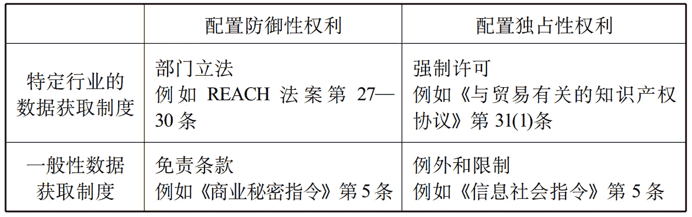
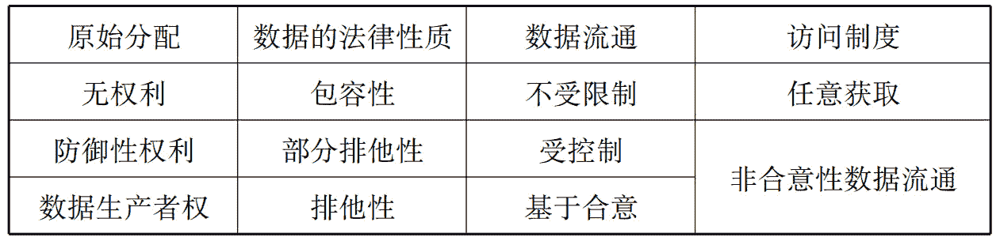
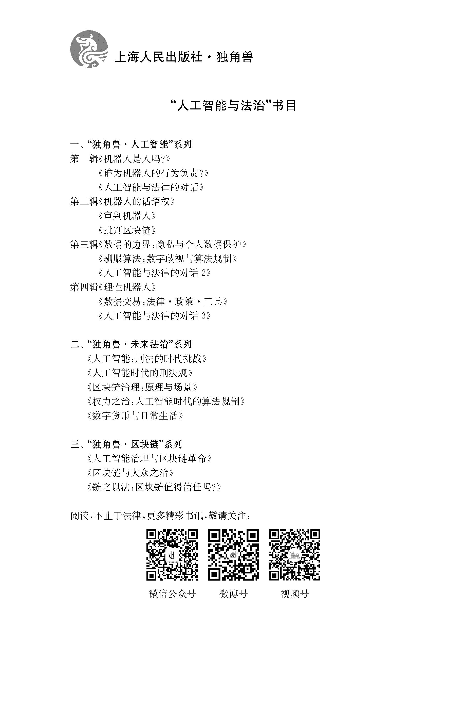

# 解码数字经济核心：数据交易的法律突围与AI法治新图景

### 主编寄语：站在算法与法条的十字路口

“独角兽法学精品·人工智能”系列已推至第四辑。回溯2018年首刊问世，四年间学界对AI与法的研究已突破“存废之争”，向制度细节、基础理论乃至法哲学、伦理学纵深挺进。从“赛博朋克”式的未来幻想，到智能裁判、无人驾驶侵权、智能合约落地的现实博弈，AI早已渗透社会肌理，正在重写治理底层逻辑。

然而，理论构建的步伐始终难追技术迭代之疾。上交凯原法学院数据法律研究中心，凭借国家社科基金重大项目支撑，致力于搭建理论与立法、司法、企业实务的连接通道。本辑丛书正是在此语境下甄选域外前沿成果，试图为本土研究拓宽视野、提供镜鉴，推动中外法学对话与理论实务共振。

#### 一、 三部经典，直击数智时代痛点

本辑精译三部重磅著作：
1.  **《理性机器人：人工智能未来法治图景》**（瑞恩·艾伯特著）：跨学科视野下，剖析现行部门法“分类对待”人与AI的困境。作者主张**“AI法律中立原则”**——法律不应歧视机器，而应通过全面变革确立行为标准，在释放技术红利（如AI发明专利保护、侵权过错责任重构、犯罪追责机制）的同时，以人类福祉为锚定点实现风险可控。
2.  **《数据交易：法律·政策·工具》**（洛塞、舒尔茨、施陶登迈尔主编）：源自第三届明斯特欧盟法与数字经济研讨会。聚焦数据这一“数字经济血液”的流通规则，深度研析欧盟如何以知识产权、财产权、强制许可、合同法等工具箱应对交易困局。核心张力在于：**数据兼具非竞争性与独占性**，现有法制缺乏成熟配套，仓促立法恐生弊端，亟待构建兼顾效率与公平的数字交易框架。
3.  **《人工智能与法律的对话 3》**（弥永真生、宍户常寿编）：触及法理本源。当AI具备尊严基础与行为能力，能否成为民事主体？代理、法人拟制能否延伸适用？针对自动驾驶、机器人手术责任，书中提出修正格式条款规则、确立AI客体保护条件等创见，直面隐私保护与武器化发展的双重焦虑。

#### 二、 深度复盘：从技术红利到治理困境的辩证审视

**《理性机器人》**敏锐捕捉AI操纵市场、干预选举、算法歧视（如COMPAS系统种族偏见）的暗面。作者指出：现行法为人类量身定制，AI无缝适配是幻想。核心主张**“非多法非寡法，唯求良法”**——如何将人类共识价值嵌入算法，是法哲学与部门法的共同命题。中立原则非万能钥匙，透明度、问责制不可牺牲。

**《数据交易》**直指欧盟数据主权野心。书中明确：数据虽非竞争，却可施技术限制形成独占。独占权归属、强制许可边界、合同法默示规则延伸、B2B格式条款管控……每一条路径优劣交织。警示核心在于：**为抢占全球数据高地而盲目实体化权利，将显著增加法系复杂度，治理应回归“具体化调整”而非“概念化竞逐”。**

**《对话3》**拷问法律本体论根基：权利能力、意思表示、责任承担构成的古典体系，能否容纳硅基生命？从数字版权管理（DRM）的工程式治理，到程序化广告背后的“数据画像”侵权，印证了**个体维权穿透技术黑箱几乎不可能**。法律必须借力工程思维，实现高频、深度、自动化的权利实现。

#### 三、 核心洞见：法律工程学——数字社会的“新基建”

三书虽异域同构，共指一个元问题：**网络空间由代码构建，治理离不开工程技术。** 由此催生**“法律工程学”**——非将法视为工程系统，而是主张**在数字社会中，法学研究与规制实施必须深度嵌入大数据、算法、区块链等技术架构**。

*   **本体论依据**：数字社会权利客体、交易模式、裁判救济的变迁，本质均源于跨学科技术支撑。唯“网络思维”可解新法律问题。
*   **代码与法律的博弈**：代码架构赋权高效、无需国家强力背书，但缺乏价值判断与自然语言理解。将法律“编程化”面临“代码不懂价值”的硬伤，答案藏于法学与工程学的交叉求解中。
*   **工程思维的法治转化**：法律知识具备工程学“线性链”特征，可经大数据提炼规则、场景化自动裁判。法律工程思维以**“路径化解决问题”**为核心（网络思维、逆向工程、系统工程），引入价值函数设计，将正义追求技术化、流程化、可执行化。如证据推理工程化辅助防冤纠错，程序化广告监管中的技术穿透式取证。
*   **价值锚定**：工程是手段，正义是魂。法律工程思维不异化法的本质——**法本质即程序**，法律工程仅在程序中植入技术要素，实现法治目标的实用化、技术化落地。

**结语**：面对中国科创强国与治理现代化的双重命题，借鉴域外智识，融合法学理性与工程技术，方能在数字洪流中构建既促创新又守底线、既懂代码又通人性的中国方案。

**彭诚信**  
上交大特聘教授 | AI治理与法律研究中心副主任 | 凯原数据法律研究中心主任  
2021年7月17日

---

### 编者序：数据流动的法律拓荒

数字化重塑经世济民图景，数据成数字经济流动的“血液”。商业模式能否激活创新引擎，关键在能否用好数据。**“数字经济中的数据交易”**，已成欧盟数字单一市场战略的核心突围点。

明斯特欧盟法与数字经济研讨会锚定“欧盟法如何回应数字经济挑战”。第三届会议（2017.5.4-5）聚焦“数据交易的法律概念与工具”，剖析学理争鸣、实务困境与政治博弈。本书即该届论文集结晶，感谢Jorrit Mauter与Jonathon Watson的幕后推动。

**塞巴斯蒂安·洛塞 / 莱纳·舒尔茨 / 德克·施陶登迈尔**  
2017年9月

---

## 引言

### 第一章　数字经济语境下的数据交易：法律概念与工具箱

**塞巴斯蒂安·洛塞、莱纳·舒尔茨、德克·施陶登迈尔**^((1))

#### 一、 破题：重塑与框架的双重迫切

数字化是二十一世纪的基底性变革，正在重塑经社肌理。须臾明辨：**本书“数字经济”非指独立形态或特定赛道，而是数字化催生并终致的经济数字化状态。**

转型期，捍卫基本价值与构建**“欧洲经济把握机遇的框架”**同等紧迫。欧盟委员会推“数字单一市场战略”列十大优先级，其研究成果《打造欧洲数据经济》（2017.1）直指数据获取与传输痛点。明斯特研讨会使命与此同频：首届解合同法数字化挑战，次届聚数字内容合同，三届锚定**“数据交易：法律概念与工具”**——直抵欧洲私法数字化转型核心区。

本书汇聚会议真知，细析法律概念工具适用性必要性，为欧洲层面破解数据交易困局铺设学理路径。

#### 二、 起点与挑战：数据的二重性悖论

# 破解数据流通僵局：为何欧盟放弃“所有权”转而重构合同规则？

经济社会的全面数字化转型，尤其是物联网技术与业务流程数据化的深度普及，让数据产生的速度与规模呈指数级跃升。为直观感知“大数据”体量，不妨看两组数据：谷歌单日处理量超 24 拍字节，堪比数千个美国国会图书馆藏书总和；2013 年全球数据总量约 1200 艾字节，若刻成光盘堆叠，能垒起五座直插云霄、直抵月球的高塔。

数据是数字经济躯体里流淌的“血液”。无论是存量商业模式，还是未来引领创新、驱动增长的新业态——如“预测性维护”“精准农业”等，能否落地，核心都取决于数据的可得性。

数据兼具“非竞争性”与“可排他性”双重属性：一方使用不减损他人利用，但持有者常通过技术手段设置壁垒，阻断自动化获取。欧盟委员会在《打造欧洲数据经济》中直指痛点：因企业倾向于内部独享、鲜少对外共享，数据交易市场长期低迷。即便自愿共享，强势持有者亦可借议价优势索取高额成本，令需求方望而却步。

为破局，欧盟委员会启动多方对话，拟在现有《欧共体法律》框架外，构建前瞻性的数据获取与转让制度。立法目标呈“三角平衡”态势：推动数据在经营主体间自由流动；保障数据投入方（技术构建者、资源投入者）获得合理回报；防止强制共享挫伤创新积极性，尤其是涉及商业秘密保护时；同时矫正议价能力失衡，避免弱势方被排挤。

《打造欧洲数据经济》据此提出多种路径供论证。第三届明斯特研讨会聚焦争议最大、法律挑战最深的两条主线：**一是确立排他性权利，直指数据“所有权”争议；二是深化合同法机制，涵盖缺省规则、B2B 标准条款管制及强制许可制度。**

---

### 三、 排他性权利： “数据所有权” 为何难登大雅之堂

核心争点在于是否应设立一种“准所有权”，与现有财产权、知识产权并行，覆盖数据交易全链条。该思路源于法理学层面的激辩：主张赋予非个人/匿名化数据专属权利，推断此举能激励数据像普通商品一样在专用平台流通。但关键细节悬而未决——权利性质是进攻性独占还是防御性抗辩？归属主体如何界定？例外情形如何预设？

**1. 权利客体难以“定型”**  
“数据”概念看似简单实则复杂。GDPR 细分个人数据、生物识别数据、基因数据、健康数据、敏感数据等类别。当下争议焦点在于：对现行知识产权保护尚不覆盖的数据生产者/获取者（特别是数据承载的信息内容），是否有必要另立门户创设保护？

**2. 权利主体与客体的匹配困境**  
学界视角分歧显著：有派别从“信息/版权”切入，甚至提倡建立“信息法”；另一派主张将数据/数据集确认为独立权利客体，剥离载体财产权与信息内容权，以“创制行为”作为权利归属起点。但现实骨感：数据可零成本无限复制，原持有者使用权不因他人复制而灭失。这与动产占有排他性根本冲突，动摇了“准物权”合法性基石。

**3. 实证检验：支持度极低、目标可能落空**  
欧盟公众咨询与结构性对话中，“所有权路径”呼声最低。数字单一市场中期审查甚至不再提及，后续报告仅象征性保留。原因直指要害：此路径无法保证持有者在可接受条件下放行数据，实操中议价强者仍将掌控数据控制权——在未增进整体经济效益前提下，强行植入新权利的正当性存疑。

**4. 汽车数据困局：典型前哨战**  
当前冲突最激烈处在于车联网：车主无法获取车载数据，车企以“开发预测性维护等新模式”为由独占。此类博弈必将向更多垂直领域蔓延。

---

### 四、 合同法范式： 在自由与保护间寻找“最大公约数”

鉴于“准所有权”路径在欧陆难行，研讨会共识转向：**聚焦合同法工具箱，平衡交易双方利益。**

**1. 双轨并行：缺省规则 + 标准条款管制**  
合同自由既是塑造法律关系的基石，也是防范强势方损害弱势方（或第三方）的盾牌。讨论除关注条款设计范式，更须完善保障缔约自由实质实现的保护性规则。

*   **缺省规则**：填补竞争法介入门槛过高（需证明“滥用支配地位”）的真空。立法者可预设权利义务分配基准，当事人可约定排除/修改。
*   **B2B 标准条款管制**：防范强势方通过“霸王条款”规避缺省规则。管制标准不宜照搬 B2C《消费者不公平条款指令》，而应参照《迟延付款指令》《欧洲共同买卖法草案》——以“严重背离良好商业惯例”为核心判据。缺省规则可作为此处判断的基准锚点。

此路径在多数欧盟成员国属创新性制度（仅少数国有立法及判例），可配套推行“示范合同条款”，将立法价值判断转化为起草实操指南，形成行业自律软法。但强势持有者缺乏经济激励时，采纳意愿存疑。

**2. 许可使用与强制许可：破解“控制权垄断”的关键一招**  
许可条款往往决定合同目的能否达成。除示范许可/非强制规则外，**强制许可**被视为对合同法天然缺陷（如无合同主体、B2C 关联场景）及“所有权模式”下独占性缺陷的终极补正。欧盟特定部门立法（如标准必要专利）已有先例，但定价机制（FRAND 原则）仍是硬骨头。

---

### 五、 结论： 没有银弹，只有组合拳

研讨会围绕“排他权、强制许可、合同概念”三板块深度交锋，形成如下共识：

1.  **“数据所有权”遭遇广泛质疑**  
    与会者多延续欧盟咨询态度：新权利与现有绝对权冲突、数据缺乏稳定保护客体、且**核心矛盾在于“权利手段与立法目的错位”**——它擅长守护持有者既得利益，却无力激励交易与流通。虽可引入强制许可修补，但本质上仍是“强干预、弱效能”，正当性不足。

2.  **强制许可灵活但非万能**  
    优势在于直击“获取难”痛点，可按部门差异定制（优于统一通则），尤其在定价规则难统一时。代价是规则碎片化、法律复杂度飙升；且一旦牵涉个人数据，强制许可即显失妥当。

3.  **合同法工具组合最具可行性**  
    **“缺省规则 + B2B 不公平条款管制”**被公认为最契合数字经济特质的路径。它有效填补竞争法“举证难、覆盖窄”短板，能动态适应新业态。但须清醒认知：强制性规则无法强造交易意愿，在无合同主体或 B2C 关联场景下，数据获取保障仍有盲区。

---

**终局思考**  
本次研讨会及论文集深刻揭示：数据治理无“最优解”，唯有“最优组合”。前路要求研究者跳出单一工具迷思，细致剖析数字经济结构性矛盾与市场失灵成因，在**强制许可的针对性突围**与**合同法的系统性托底**之间，寻找动态平衡的制度拼图。

---

#### 参考文献速览

1.  欧盟委员会，《欧洲数字单一市场战略》，COM(2015)192 final.
2.  容克，《欧洲新启动：我的就业、增长、公平与民主变革议程》（2014.7.15）.
3.  欧盟委员会，《打造欧洲数据经济》COM(2017)9 final；附件 SWD(2017)2 final.
4.  数据实例源自 Mayer-Schönberger & Cukier, *Big Data*.
5.  1 PB = 10^15 Bytes；1 Byte = 1 字符.
6.  1 EB = 10^18 Bytes.
7.  见注 3，公众咨询反馈详见欧盟官网摘要报告（2017.8.27 访问）.
8.  同上，咨询反馈确认议价失衡风险.
9.  相关讨论见本书 Leistner、Alpin、Rada、Willems 章节.
10. 见注 3，《打造欧洲数据经济》正文.
11. 见注 3 及附件工作文件.
12. 排他权议题见 Hugenholtz、Zimmer、Kerber 章节.
13. 参阅注 3 附件参考文献.
14. 参阅 Lynsky《欧盟数据保护法基础》第 229 页；Zech《作为保护客体的信息》第 219 页.
15. 参见 MPI 创新竞争研究所立场文件（2016.8.16）；Thouvenin/Weber/Früh 即刊文献；Fezer、Hoeren 相关论文.
16. 个人数据难题见 Wendehorst 章节.
17. GDPR: (EU) 2016/679, OJ L119/1.
18. 数据生产者保护争议见 Alpin、Hugenholtz、Kerber 章节.
19. Welp, *IUR* 434 (1988), 448.
20. 数据复制特性分析见 Zimmer、Drexl 章节.
21. 见注 7 公众咨询.
22. BusinessEurope、BDI、波兰等回复意见（2017.8.27 访问）.
23. 欧盟委员会，《数字单一市场战略实施中期审查》COM(2017)228 final, p.11.
24. 汽车领域数据困局见注 7 公众咨询.
25. 必要性与法律设计探讨见 Alpin、Hugenholtz、Zimmer、Kerber、Weber、Drexl 章节.
26. 合同法贡献见 Drexel、Graf von Westphalen、Janal、Dolžan、Willems 章节.
27. 缺省规则与标准条款管制见 Graf von Westphalen、Dolžan 章节.
28. 指令 93/13/EEC, OJ L95/29.
29. 指令 2011/7/EU, OJ L48/1（废止 2000/35/EC）.
30. COM(2011)635 final.

# 大数据浪潮下的《数据库指令》：权利边界、所有权困局与改革出路

**文 | 马蒂亚斯·莱斯特纳（Matthias Leistner）**  
*注：本文仅代表作者个人观点，不具备欧盟委员会约束力。作者为明斯特大学教授；合著者雷纳·舒尔茨为明斯特大学教授；德克·施陶登迈尔为欧盟委员会司法与消费者总司部门主任、明斯特大学名誉教授。*

---

## 第二章 核心解读：现行法困境与改革潜力

### 一、 保护门槛大幅降低：机器生成数据并非“保护真空区”

长期以来，学界主流观点认为：在大数据、尤其是传感器与机器生成数据场景下，《数据库指令》项下的“特殊权利”（Sui Generis Right）难以触发。理由直指核心要件——“实质性投资”。依据欧盟法院“英国赛马案”与“设备营销案”确立的规则，只有为“获取/寻找”已有独立材料所付出的投资才计算在内，为“创造”材料本身的投资则不予保护。按此逻辑，传感器生产数据的投资本质是“创造”，理应被排除在外。

**但实务远比理论复杂。**

德国司法实跿已悄然打破这一“一刀切”结论。联邦法院（BGH）与欧盟法院在后续案件中均认可：搭建测量、记录基础设施以获取预先存在的使用、销售或地理数据的投资，符合“实质性投资”门槛。甚至对原始数据进行系统性结构化整理的投入，也可纳入保护范围。这意味着，**只要在“获取、核验、呈现”数据环节投入巨大，且数据系独立客观存在而非“凭空捏造”，机器生成数据极大概率享有特殊权利保护。** 目前实务中该门槛设定极低，大数据场景下的触发率远超预期。

### 二、 独占权“长臂管辖”：不仅禁止抄袭，更封锁增值与聚合

权利范围的扩张堪称激进。欧盟法院对第7条第2款“提取与再利用”权作扩大解释：
*   **间接提取**亦构成侵权；
*   **结构重组后的增值数据库**仍在保护伞下；
*   **元数据库/元搜索引擎**自动抓取汇编多源数据的行为，极易越雷池。

反观法定限制——仅保护“实质性部分”、禁止“系统性反复提取非实质部分”——在大数据语境下形同虚设。大数据分析往往需全量、完整数据集以产出可靠结果，碎片化利用无异于废话。虽有学者主张引入“市场失灵”经济分析法灵活界定“实质性部分”，但法院尚未买单，现行解释仍僵守传统知识产权逻辑，功能性竞争考量缺位。

### 三、 认知反转：数据经济的“隐形地主”早已就位

这彻底改变了监管讨论的起点。许多人（含欧盟委员会）误以为大数据场景缺乏有效知识产权管辖，实则**《数据库指令》特殊权利早已覆盖大多数场景**，仅因合同实务长期忽视，使其沦为事后博弈的“否定性工具”，而非事前设计的“规制性基建”。

欧盟法院过往通过扩大解释彰显介入数据经济的强烈意愿。因此，**在讨论“数据所有权”、“新独占权”等增量方案前，必须先清算存量：现有特殊权利与商业秘密保护已发挥何种作用？应定位何种功能？需如何微调以适配数据经济？** 这才是监管的逻辑起点。

> **研究议程速览：**  
> 1. 合同层面：权利归属不明导致交易成本高企，亟需非强制性范本与强制性核心许可条款；  
> 2. 例外条款：现行例外狭窄僵化，远不及版权法灵活，需全面修订；  
> 3. 保护期限、互惠条款、权利重叠等技术性法律问题同步待解。

---

### 二、 改革聚焦：理清所有权与重构合同机制

#### （一） “制作者”界定失灵：网络协作下的归属真空

指令第7条第1款赋权“制作者”，鉴于第41条界定为“主动承担投资风险者”。定义虽符合权利本质（保护投资），却在大型协作网络、开放创新生态中**彻底失效**。参与方常各自投入资金、算力、人力并分担风险，导致多人同时符合“制作者”资格，**共同共有成为常态，且当事人多不知情**。

后果严重：第三方获取数据需逐一清权，信息成本与交易成本飙升，实务中已引发实质性“反常现象”（Gridlock），数据流通陷入瘫痪。

#### （二） 合同网络：理论灵活，现实受阻

合同自由原则下，当事人可通过网络合同将权利集中予核心投资方，或定制分层许可。特殊权利属工业产权性质，可整体转让（指令第7条第3款），契约设计空间巨大。

**但障碍显著：** 交易成本高企、信息不对称、多方博弈复杂。若无法律指引，纯靠市场自发极难达成高效配置。

#### （三） 兜底规则：锚定“设备制造商”还是引入“登记制”？

**方案A：司法解释锚定“主动性”→设备制造商。**  
安装传感器、搭建基建者为“主动投资者”，操作者通常被视为被动。此举能以最低成本在现行法下集中权利，**但副作用强烈**：制造商若拒绝许可，将加剧数据获取困境，倒逼更强力的“合法使用权”法律工具出台。

**方案B：激进变革——设立“统一欧盟登记制工业产权”。**  
设立独立登记簿（由EUIPO管理），公示权利归属，大幅压降市场信息成本；登记费随时间递增，倒逼仅有真实回收投资需求者维权，精准缩减保护范围。

*风险提示：* 登记制可能催生“寻租式登记”、“策略性囤权”，让知识产权丛林更加密布。此路可行性、边界需进一步实证研究。

> **核心张力：** 维持现状（共同共有僵局）？废除特殊权利？还是重塑为登记制？三条路径均在现实可行区间内，抉择需极度审慎。

#### （四） 合同标准化：从“非强制范本”到“强制底线权利”

B2B数据交易中，中小企业最缺的是**确定性**。引入非强制性标准合同条款、最佳实践指南，可作“安全网”填补疏漏，降低交易成本，消解“寒蝉效应”。

指令虽无示范条款，但任何自律或立法均须将特殊权利纳入核心考量。针对数据控制不对称，亦可引入**强制性管控不公平合同条款规则**。

#### （五） “合法用户强制性最低权利”：数据库领域的“在线权利用尽”曙光

指令第8条第1款、第15条规定合法用户享有不可排除的最低使用权，这与《计算机程序指令》如出一辙。后者支撑欧盟法院“UsedSoft案”判决，确立**软件在线销售触发权利用尽，二手买家受最低权利保护**。

数据库领域同理：指令第6条第1款、第8条第1款、第15条为**永久分发的数据库适用“在线权利用尽”提供法理基石**。虽一般版权法在线用尽存争议，但数据库特殊权利体系下，这一路径逻辑自洽且符合基本自由原则。**建议将此议题交由欧盟法院判例法逐案推进，而非仓促立法。**

---

### 结语

大数据不缺法律，缺的是**对存量规则的精准适配与增量机制的精密嵌入**。《数据库指令》特殊权利非“休眠条款”，而是数据经济中实力最强、覆盖最广、争议最深的“隐形支配者”。破局之道不在另起炉灶造新权，而在：**厘清归属（所有权改革）、降低清权成本（登记/合同标准化）、保障流通底线（强制最低权利/权利用尽）**。这场博弈，才刚刚开始。

---

#### 参考文献速览
[31] CESL Art. 86(1)(b).  
[32] 欧盟委员会公众咨询及结构性对话反馈.  
[33] Leist, Weber, Mezzanotte, Grützmacher 相关论文.  
[34] 前注3《内部职员工作文件》参考文献.

*(脚注标记 ¹⁻³⁴ 对应正文相关论证，因篇幅略去详列，请对照原文学术版核验。)*

# 破解数据困局：重审《数据库指令》下的获取权、强制许可与保护期限

#### 核心观点：现行法制下的“合法用户”权利过于残缺，难以支撑大数据经济的真实需求

抛开个案细节不谈，更根本的命题在于：**《数据库指令》第8条第1款赋予“合法用户”的最低权利，能否进化为第三方基于合法利益获取数据的通用基石？** 现实给出了否定答案。现行规则将合法用户的提取与再利用权严格锁定在“非实质性部分”，且据欧盟法院“瑞安航空案”判决，这项权利甚至不适用于缺乏版权或特殊权利保护的裸数据库——这恰恰是典型大数据场景的主战场。

这种设计与实务严重脱节：企业开发增值服务往往需要完整数据集，他们不仅要防御知识产权垄断，更需抵御技术手段构筑的“事实控制”壁垒。因此，立法修正的首要任务是将第8条第1款的适用范围推向“完整数据库的合法使用”。若此举合乎正当，那么“监管技术”路径——即将强制性最低权利与“合法用户”资格绑定——将成为平衡权利人收益与社会利用需求、催生新型数据市场的务实之举。

关键在于界定“谁是合法用户”。现行法仅涵盖购买者与被许可人，未来应纳入：对数据拥有实际控制权者、合法掌握获取/嵌入设备或传输装置者。至少在构想“不可放弃的数据获取权”模式时，这些群体必须列入考量——它们极可能成为未来强制性数据获取权的核心监管范本。若经证实此类权利对特定领域数据经济不可或缺，那么《计算机程序指令》与《数据库指令》中的合法用户权利，理应作为立法模板，在欧盟现有法系内完成规范与整合。核心原则只有一条：**这项最低使用权必须覆盖通用数据集，尤其是那些不受专属权保护的“裸数据池”**，从而纠正“瑞安航空案”判决施加的不当枷锁。

顺带一提，虽欧盟法院在“英国赛马案”中隐约暗示公众享有不可撤销的公开数据库查阅权，但此说辞模糊且沦为孤例，单纯的“查阅权”根本无法覆盖大数据分析对全量数据的深度调用，自然也就无法回应具备功能性、动态性特征的数据经济诉求。

---

### （三） 获取权的突围：特殊权利的狭隘例外与强制许可的回归

#### 1. 强制许可：从被废弃的提案到未来的核心工具

如前所述，特殊权利对“实质性部分”使用的封锁，无法回应获取全量机器生成数据或其他数据的刚需。马克斯·普朗克创新与竞争研究所近期研判指出：赋予合法利益方**特定领域的、不可撤销的获取权**，或是破解数据实控难题的关键钥匙。

这一权利必须穿透独占权体系下的必要使用权及其他相关知识产权壁垒。实现路径有二：一是外扩“合法用户核心权利”的边界；二是当需求超越该核心、必须获取“完全获取权”以激活竞争时，**强制许可**应重回舞台中央。

鲜为人知的是，早期《数据库指令提案》第8条明写了强制许可制度：针对单一来源数据库及公共机构编制的公开数据库，在“公平、无歧视”原则下强制许可，预设仲裁机制，并明确排除与隐私、安保、保密等在先权利冲突。这证明欧盟委员会1992年便洞察了新权利可能扼杀二级市场的杠杆效应，并备好了解药。然而立法推进中强制许可被废除，仅保留“实质性部分使用限制”，直接导致当下数据经济陷入“制度失灵”的获取困境。

笔者梳理三点历史启示：委员会早识获取唯一来源数据之痛点；早见特殊权利恐加剧此痛点；早备强制许可（针对单一来源/公共数据库）等对策。未来拟议的“特定领域不可撤销使用权”，实为早期设想的现代变奏。

**操作层面，三大配套机制缺一不可：**
*   **定价锚定：** 若立法激励有效，超出最低权利的获取应付费获许可，许可费必须遵循 **FRAND（公平、合理、无歧视）** 原则。
*   **程序保障：** 理想状态下应设立仲裁机制，为强制许可条款磋商提供程序性支撑（如特定知情权、程序规则）。
*   **法域协调：** 强制许可条款必须内嵌隐私、数据保护、保密法等外部法域协调条款，精简额外授权链条。1992年提案已着手解决，如今面对GDPR等更复杂的法网，差异化协调条款势在必行。新《商业秘密指令》同样缺乏平衡性获取机制，未来强制许可范围必须延伸至商业秘密保护领域。
*   **互用与携带：** GDPR第20条个人数据可携带权，或可作为通用数据可携带条款的范式，为新型强制许可注入互操作性基因。

**前沿议题待探：** 是否需引入交叉许可强制规定？公共机构数据库专门条款如何落笔？基于强制许可与数据可携带的“不可撤销最低使用权”边界在哪？鉴于数据源头与质量信息匮乏是市场顽疾，强制许可能否捆绑“来源、质量、方法”元数据披露义务？但需警惕：特定领域的披露强制不应削弱市场主体主动提供元数据的通用激励，否则恐加剧数据质量危机。

#### 2. 例外条款的“紧身衣”：必须打通与版权例外的动态联动

《数据库指令》第9条特殊权利例外被诟病已久：视野狭窄，远不及版权例外的开放框架。数据经济冲击下，此痛点愈发刺眼。

**第一，立法盲区：特殊权利的自主性导致其摆脱了国法对版权作品的传统限制。** 后果极其严重——即便某国法将公共机构官方作品排除在版权保护外，其编制的数据库却因特殊权利而被纳入专属保护。应援引版权法对公共机构官方作品的例外规则类推适用，但欧盟法院至今未明判，欧盟法层面悬而未决。

**第二，结构性错位：特殊权利例外至少应与《信息社会指令》版权例外实现“动态一致”。** 成员国不应仅被“允许”，而应被“强制”将适用于版权作品的豁免限制延伸至非原创数据库特殊保护。立法措辞须在两域间建立**动态链接**：版权新立法中的限制条款，在适当条件下自动适用于数据库特殊权利。拟议版权指令第3、4条将文本数据挖掘（TDM）、数字教学例外显性延伸至特殊权利，虽为良性示范，但问题具有普遍性，修订《数据库指令》时必须以**一般性强制条款**一次性解决，而非零敲碎打。

**第三，三大“紧箍咒”必须解除：**
1.  **“实质性部分”使用上限：** 即使获豁免，使用量仍被卡在“非实质性部分”，这与大数据全量调用需求背道而驰。
2.  **“合法用户”前置门槛：** 例外适用附加“合法性测试”，与版权例外体系逻辑冲突（版权法已将合法性考量内嵌于例外定义中），体系上不自洽，实务中空转例外效力。
3.  **“非商业用途”硬性壁垒：** 此限未来必受审查。但涉及版权例外通则（含新提案TDM例外）的宏观博弈，超出本文处理范围。

**由此反推：** 广义语境下，未来立法理应将《信息社会指令》中**任意性例外转为强制性例外**。虽欧盟法院极力推动成员国一致适用任意例外，但唯有强制实施方能实现真正协调。此外，须深究《信息社会指令》第6条第4款（适用于特殊权利）能否在权利人以技术手段（TPM）限制指令许可行为时，提供实效救济。未来或需在欧盟层面确立**不可放弃、不可撤销、特定领域的用户权利**，以应对基于技术保护措施形成的“事实排他性”。

**终极课题：** 基本权利（尤《欧盟基本权利宪章》）在版权例外中的定位与穿透力。法院判例虽越发重视基本权利平衡，但路径仍显滞后、缺乏刚性，未能实现基本权利从规范层面向私法纠纷的实效“移植”。这将为修订专属权、版权一般例外乃至《商业秘密指令》例外提供更深层的理论支撑。

---

### （四） 保护期限：十五年太长，动态数据保护陷“永生”悖论

实证研究表明：相较于动态电子数据库的典型商业开发生命周期，**特殊权利15年保护期（每次实质性更新即可续展，理论上可无限延长）显著过长。** 修订指令时，保护期须严格对标该领域实际经济需求，大幅压缩。

针对持续更新数据库的保护范围及“永生保护”顽疾，笔者曾基于现行法正确解释提出差异化方案：以“实质性部分”重新定义更新后数据库，从而压缩持续更新数据库的保护范围。

另一思路：将特殊权利**转型为需注册的工业产权**。注册费随年限指数级递增，使维持最长期专属保护的成本极高化——唯有极高经济价值数据库的权利人才会买单续展，自然实现保护期的市场化筛选。

---

### （五） 国际视野下的互惠原则

[PRE*]

### (VI) 重叠保护的困境

最后，我们不得不直面几个技术性更强、理论层面更深的法律难题。这些问题在“数据库特有权”的实践中早已显露端倪，未来更可能引发更大争议。核心在于保护制度间的重叠冲突，以及该权利与其他法律领域的界限划分。

**一、 知识产权内部的“内源性”重叠**

依据《数据库指令》，数据库原创性结构（即内容的选择与编排）享有的著作权保护，与保护投资回报的“特有权”发生了重叠。事实上，相比于特有权，数据库著作权在塑造数据经济结构方面，可能扮演着比当下预期更关键的角色。原因在于，著作权可覆盖原创性结构，甚至在特定场景下延伸至特定元数据，而这些元数据能有效整合既有数据池。

然而，统一后的欧盟著作权法在此维度的适用性仍存模糊地带。欧盟法院（CJEU）近期判例趋向要求“实际的创作自由”作为著作权保护的前提，单纯领域内的技巧与劳动投入已不足够。在此背景下，著作权法能在多大程度上保护元数据及其他数据库结构要素，尚无定论；但可以确定的是，一旦满足“留有个人创作余地”的条件，特定结构必受保护。

问题在于，这种针对数据库结构的通用版权保护，缺乏针对逆向工程等保障自由竞争与数据互操作的具体条款——而《计算机程序指令》（第6条）在软件版权保护中已明确体现了此类保障。这种缺位极易引发互操作障碍，阻碍增值数据库利用新市场的开放（即第三方请求使用特定数据选择或要素的场景）。当第三方为新用途修改特定原创结构时，矛盾更加尖锐：即便所含要素存在明确例外，数据库结构的改编专有权仍可能被侵犯（该权利虽在多成员国国内法存在，但欧盟版权法并未明文规定）。因此，参照《计算机程序指令》相关条款，至少应考虑为数据库著作权与特有权增设逆向工程与数据互操作的保障条款。这也与近期《商业秘密指令》明确将逆向工程列为允许行为（第3条第1款第b项）的做法一脉相承。若能完成这些微调，数据库著作权反而能在数据市场发挥积极作用——理想状态下，若元数据受版权保护，至少能支撑已发布数据集的来源、质量与方法论等元数据的披露。

**二、 知识产权外部的“外源性”重叠**

替代性保护机制制造了典型的重叠效应。诸多成员国的反不正当竞争法（如极具影响力的法国“搭便车”理论，或德国《反不正当竞争法》第4条第3款），正威胁着特有权的限制与例外条款。这种“重叠”保护亟需预先性立法干预：既然知识产权本身已保护广义投资，引入其他法律手段防范不正当模仿，在逻辑上并无必要。

现行《数据库指令》第13条规定，反不正当竞争条款的适用不受指令其他保护条款影响。该表述本身未尝不可，但极易被曲解为：成员国可自由为数据汇编提供额外保护，甚至在特有权保护的基本门槛均未达成时亦然。例如，当数据库汇编投资微不足道，或数据提取/再利用不构成指令第7条第2款所述侵权时，特有权本不适用。但在反不正当竞争判例法中，若授予这种额外的、灵活的、不可预测的“兜底”保护，显与指令目标背道而驰——指令不仅旨在确保最低保护标准，更旨在实现成员国法律在该领域的实质性协调，并保证在不满足第7条要求时，汇编数据的使用保持自由。

显而易见，针对现有及未来欧洲数据经济基础设施中备受关注的数据获取议题，由反不正当竞争条款引发的乱象，必须优先解决。

### 三、 总结与展望

自《数据库指令》在欧盟成员国落地实施以来，数据库版权——尤其是专有权（sui generis right）——已广泛适用于各类大数据应用场景。可以预见，欧盟法院（CJEU）及各成员国法院将把这一权利延伸至机器生成数据领域。然而，笔者认为，这一现实在关于欧洲数据经济未来监管的学术与政策讨论中，尚未获得应有的关注度。

专有权（连同数据库版权保护及新《商业秘密指令》等法律工具）的重要地位，为当前及未来的欧洲乃至全球数据市场带来了机遇、挑战与风险并存的局面。不可否认，专有权的制度设计为现有欧洲知识产权体系应对数据经济冲击，提供了一个精准且比例适当的切入点。鉴于迄今为止，尚无可识别的数据市场失灵风险能通过“数据所有权”或类似排他性权利路径有效化解，与其继续评估新权利工具的可行性，不如将焦点转向修订欧盟通用版权法、数据库版权、专有权及商业秘密法，通过优化现有机制来构建当下与未来的数据市场。

针对专有权及相关议题，亟待开展必要的修订与后续举措，主要包括：在欧洲层面提供数据交易的示范合同与最佳实践，引入非强制性合同法规则作为降低交易成本的安全网，以及强制规制不公平合同条款。此外，《指令》中关于数据库“合法用户”权利的条款（及《计算机程序指令》中关于计算机程序的类似规定）具有扩展潜力：若在特定领域被认定为合理，这种目的限制性的数据获取权未来或可演化为特定部门不可撤销的数据访问权核心，与合法用户权利条款协同发力。从更宏观的视角审视，为促进竞争性利用而设计的精心强制许可制度值得尝试，以化解其与数据库制作人专有权的冲突。事实上，欧盟委员会最初版《数据库指令》草案甚至包含更全面的强制许可制度雏形，这同样应列入深入研究议程。此外，专有权的例外规定必须修订，至少应与欧盟通用版权法的例外场景实现对齐。其他必要的调整还涉及：专有权15年的保护期限过长，且其与其他法律工具的衔接关系亟待明确——这不仅关乎专有权与成员国不正当竞争法、商业秘密指令的重叠保护问题，也涉及专有权与隐私及个人数据保护的界限划分。因此，在修订指令时，应同步纳入数据可携权、互操作性等已在特定保护体系中得到解决的议题。综上，上述所有问题均应纳入《数据库指令》的评估与修订框架，本文亦尝试为这些及其他待澄清的技术性问题提出针对性方案。

这种对《数据库指令》的“技术性”修订虽深入且细致，但仍存在一个更根本的替代方案：将专有权转型为登记制工业产权，缩短保护期限，并设计随时间大幅递增的登记与续展费用，直至达到最长期限。不过，这一变革蕴含的机遇（即将专有权范围压缩至本质上需矫正市场失灵的情形，并减少现有数据库市场中不可否认的信息不对称问题）是否真能抵消其不可避免的风险（即额外的寻租与公共选择效应，这甚至可能加剧现行专有权导致的低效率，并带来额外交易与行政成本），目前仍无定论。因此，该方案值得进一步研究，但在政策层面完成深入论证前，贸然断言其效用显然是不明智的。⁶⁹

### 存废博弈：特有数据库权在欧盟数据经济中的生存困境

上文梳理的“特有数据库权”效能失灵难题，在现行法制下依旧无解。更令人担忧的是，共同共有引发的“搁置敲诈”风险、赎回权被架空的隐患、二级市场的杠杆滥用、以及高企的行政与交易成本……这一串痛点虽在部分言论中被放大——好在欧盟法院“英国赛马案”判例至少填平了单一数据源场景下的部分坑洼——但整体弊端不容掩盖。

既然如此，后续的《数据库指令》实施评估，势必将这些“系统性内耗”与权利的确切“正向产出”摆上天平：除却地理数据防御竞对系统性抓取等极少数细分战场，该权利鲜有建树。基于此测算，彻底废除特有权保护机制，虽属激进之举，却不得不列入备选项。笔者向来不愿轻言“废除”，至今仍持审慎态度。本文核心旨在寻找让该权利在欧盟数据经济语境下“翻身”的改良路径。但若立法者视而不见、拒绝变革，现行架构在下轮立法评估中，将彻底丧失为欧洲数据经济提供有效法治框架的资格。

**深度视野：被忽视的替代方案与制度张力**

司法实践与学界回响早已超越条文本身。从“英国赛马案”确立的“实质性投资”门槛，到《商业秘密指令》落地时面临的同类困境，核心矛盾始终指向：**如何在“激励投资”与“保障获取”间走钢丝？**

*   **判例的修补与裂痕**：欧盟法院在“英国赛马案”拒绝“附带利益论”，却在“Esterbauer案”进一步放宽“独立性”判定，导致海量机器生成数据意外入池，法律不确定性剧增；德国联邦法院在“高速公路收费案”甚至将为运营系统产生的数据纳入保护，引发学界强烈质疑。
*   **替代保护的局限**：版权门槛过高，商业秘密要求保密措施，均难覆盖非结构化、非保密的海量数据集。
*   **“免费获取权”陷阱**：单纯赋予免费使用权，实则让非需求方分担许可成本（变相征税），或在权利人无实控力时瓦解激励基础。
*   **强制许可的现实出路**：若维持激励逻辑，唯有强制许可（FRAND）能平衡获取利益。虽存行政成本高、条款模糊等瑕疵，但鉴于标准必要专利等领域已跑通实务，完善该机制才是特有权制度创新的正途。

**结语**

特有数据库权非不可替代，亦非不可废除。它正站在十字路口：要么通过立法精准手术——收紧保护范围、引入强制许可、对接数据经济治理——实现“涅槃”；要么在下一次指令修订中，被历史淘汰。欧洲数据经济的法治底色，容不得一个“赢弱输强、成本高企”的僵尸权利长久赖存。

### 第三章：数字经济下的数据交易——聚焦商业秘密视角

**作者：塔妮娅·阿普林**

---

#### 致谢

衷心感谢约瑟夫·德雷克斯尔、雷托·海蒂与沃尔夫冈·科贝尔三位专家，就本文探讨的核心议题进行了持续且深入的思想交锋；同时也要特别感谢我的研究助理托马斯·萨格斯泰特，他在基础资料梳理与最终定稿阶段提供了不可或缺的协助。

*作者简介：慕尼黑大学教授，长期深耕民法、知识产权法与信息法领域。*

---

#### 核心观点：商业秘密体系足以应对大数据挑战，无需另设“数据生产者权”

本章主张：与《商业秘密指令》相衔接的商业秘密保护机制，完全有能力在“大数据”经济语境下发挥效力。这意味着，现有的商业秘密保护若能与既有法律工具（如数据库特有权）形成合力，便能填补保护空白，从而省去了专门设立“数据生产者权”的必要性。

文章将按三步走推进：先梳理欧盟委员会推动数据经济的战略意图；再速览《商业秘密指令》框架；最后深度剖析该指令在大数据场景下的实操价值，论证其虽非完美无缺，却是切实可行的法律工具。指令在适用层面的模糊地带，与拟议中的数据生产者权可能面临的困境实则同构。

---

#### 欧盟数据经济蓝图：目标与路径

欧盟委员会近期高度聚焦数据经济发展，这在“数字单一市场战略”中可见一斑。战略文件既肯定了“大数据”与“物联网”作为增长引擎的潜力，也直面技术壁垒与立法滞后的现实困境。

2017年1月10日，委员会发布《打造欧洲数据经济》报告及配套《内部授权职员工作文件》（下称“工作文件”），系统阐述了政策目标、现实阻碍与破解路径。

宏观上，委员会旨在扫除数据自由流动的不合理拦截，保障公私主体均能获取大规模、多元化的数据集。其政策逻辑遵循“欧盟内部数据自由流动”原则，并敏锐捕捉到：海量数据（不分人格/非人格数据）均源于机器生成。考虑到《通用数据保护条例》（GDPR）已为个人数据筑起高墙，委员会将政策重心锁定在**非个人机器生成数据**上。

围绕此核心，委员会确立五大施政支柱：
1.  **强化获取**：改善对机器生成匿名数据的可及性；
2.  **鼓励共享**：推动此类数据的流通与复用；
3.  **保抋投资**：为数据投入与资产价值提供法律护盾；
4.  **守住底线**：防范机密数据泄露风险；
5.  **最小干预**：以最小监管成本实现最大社会福利。

《工作文件》进一步绘制了实现路线图。与本章紧密相关的是，它在肯定商业秘密、版权、数据库特有权等现有法制指引价值的同时，也抛出了极具争议的“数据生产者权”构想。

**关于“数据生产者权”的两种立法范式：**

*   **物权模式**：赋予权利人对数据的排他使用权与许可权。权利归属锚定“数据创制投资人”，并允许共有制存在。
*   **抗辩权模式**：借鉴《商业秘密指令》思路，仅赋予合法占有数据的事实持有者，针对特定未经授权使用行为寻求救济的权利。

无论采哪种模式，**例外机制均不可或缺**。委员会建议重点涵盖四类场景：机械设备制造商为优化设计而使用数据；公共利益必需的数据获取；公共机关基于职权的合理访问；科研机构开展公共资助研究时对私有受保护数据的使用权。此外，为防垄断，委员会提议对非个人商业数据设立许可义务，强制其在一定程度上披露。

---

#### 工具箱解析：欧盟商业秘密指令的适用框架

[PRE*] *(此处衔接原文第46条及后续指令细节分析，保持学术引用规范)*

---

#### 参考文献

[44] Becker, ‘Schutzrechte an Maschinendaten...’ in Büscher (eds.), *Marktkommunikation...* (C.H. Beck 2016), p. 828 ff.; Drexl, ‘Designing Competitive Markets for Industrial Data...’ Max Planck Research Paper No.16-13, p. 18 ff.; Fezer, ‘Theorie des immaterialguterrechtlichen Eigentums...’ (2017) MMR, p. 3 ff.; Ensthaler, ‘Industrie 4.0 und die Berechtigung an Daten’ (2016) NJW 3473.

[45] 保密利益在功能性竞争中具合法性，废除所有信息壁垒非现实；商业秘密保护需正当理由。《数据库指令》强制许可仅限公开数据库，但机器数据实控权在生产方，此限制或显过窄。见前注33, Drexl等, p. 915 ff.

[46] Regulation (EU) 2016/679 (GDPR), OJ L119/1.

[47] Mattioli, ‘The Data-Pooling Problem’ (2017) BTJL (forthcoming), ssrn.com/abstract=2671939.

[48] Kur et al., ‘First Evaluation of Directive 96/9/EC...’ (2006) IIC 551, p. 556 ff.

[49] Leistner, ‘Anmerkung zu BGH...’ (2007) GPR 190, p. 193 ff.; Vogel in Loewenheim/Leistner/Ohly, *Urheberrecht: Kommentar* (5th ed., C.H. Beck 2017) §87b UrhG, para. 67 ff.

[50] Eickemeier, ‘Anmerkung zu EuGH...’ (2009) GRUR 572, p. 579.

[51] 前注48, Kur等, p. 556 ff.

[52] EU Commission, ‘Proposal for a Directive... copyright in the Digital Single Market’ COM(2016) 593 final, p. 24.

[53] Leistner, ‘Die deutsche Privatkopieausnahme...’ (2015) GRUR Int. 681, p. 681 ff.; Stieper, ‘Harmonisierung der Urheberrechtsschranken...’ (2012) ZGE 443.

[54] 前注48, Kur等, p. 557 ff.

[55] 前注24, Position Statement on Public consultation..., p. 11 ff.

[56] Leistner/Roder, ‘Die Rechtsprechung des EuGH...’ (2016) ZfPW 129, p. 147 ff.; Oliver/Stothers, ‘Intellectual property under the charter...’ (2017) CML Rev 517.

[57] Leistner, ‘Legal Protection for the Database Maker’, p. 458 ff. (前注12).

[58] Grutzmacher, *Urheber-, Leistungs- und Sui-generis-Schutz von Datenbanken* (Nomos 1999), p. 290.

[59] 前注57.

[60] 前文第二部分第一节初步设想.

[61] Case C-604/10 Football Dataco EU:C:2012:115, paras 40 ff.; Leistner, ‘Copyright at the interface...’ (2015) JIPLP 626, p. 627.

[62] Ibid, p. 630; Rosati, ‘Copyright in the EU...’ (2014) GRUR Int. 419, pp. 427-428.

[63] Derclaye/Leistner, *Intellectual Property Overlaps: A European Perspective* (Hart 2011).

[64] 前注48, Kur等, p. 557 ff.; Derclaye, ‘Intellectual Property Rights on Information...’ (2007) IIC 275, p. 297.

[65] 前注48, Kur等, p. 557 ff.; 前注27, Leistner文, p. 343 ff.

[66] 前注48, Kur等, p. 557 ff.; 前注27, Leistner文, p. 344 ff.

[67] 前注44, Becker文, p. 828 ff.

[68] 前注44, Fezer文, p. 3 ff.; 反对观点见 Hoeren, ‘Dateneigentum...’ (2013) MMR 486, p. 486 ff.

[69] 前注33, Drexl等, p. 915 ff.; Kerber, ‘A New (Intellectual) Property Right...’ (2016) GRUR Int. 989, p. 932 ff.; Dewenter/Lüth, ‘Big Data: Eine ökonomische Perspektive’ in Korber/Immenga (eds.), *Daten und Wettbewerb...* (Nomos 2017), p. 12 ff.

[70] Leistner, ‘“Last exit” withdrawal?’ (2007) K&R 457, p. 465.

[71] Case C-490/14 Verlag Esterbauer EU:C:2015:735; Leistner, ‘Was lange währt...’ (2016) GRUR 42, p. 44.

[72] Leistner, ‘Urheberrecht in der digitalen Welt’ (2014) JZ 846, p. 849; Ohly, *Verhandlungen des 70. Deutschen Juristentages...* (C.H. Beck 2014), pp. F 38-F 39.

[73] 前注21, 委员会拟2017年评估《数据库指令》; 前注21, 《数据经济通讯》, p. 12.

# 贸易秘密指令：统一欧盟保护标准的关键一步

欧盟《贸易秘密指令》的出台，旨在消除成员国间在商业机密保护层面的法律分歧。其核心变革涵盖五大维度：法律保护机制、贸易秘密的界定、其是否属于知识产权范畴、救济手段，以及诉讼中的保密程序机制。简而言之，该指令实现了实体法与程序法层面的双重协调。根据指令第1至4条及第8条序言，这种立法统一的积极意义在于：激励创新、促进跨国创新与知识共享、强化欧盟商业竞争力。在保护投资回报、鼓励知识或数据流动方面，其理论基础与欧委会倡导的“数据经济”理念不谋而合。

以下梳理指令在实体法统一上的核心举措与成效。第2条确立了贸易秘密的“三要素”定义：信息处于非公知状态、因保密性具备商业价值、权利人已采取合理保密措施。该定义呼应《TRIPS协定》第39条标准，共识度较高。何为侵犯商业秘密？指未经权利人许可，非法获取、使用、披露商业秘密，或涉及侵权产品。具体而言，未经授权获取、窃取、复制载有秘密的载体，或以违背诚实商业惯例的手段获取，均属非法获取；非法使用或披露则包括：未经许可实施上述行为、违反保密合同或法定义务、以及第三方明知或应知来源非法仍予以获取、使用、披露。第4条第5款禁止侵权产品流通，第2条第4款界定侵权产品为：其设计、特性、功能、制造工艺或营销显著受益于非法获取、使用或披露的商业秘密。

不过，指令亦划定了合法获取的边界。第3条明确，独立发现、创造及逆向工程属合法行为。第5条“例外条款”更为关键：基于言论自由、或为揭露不法行为、保障公共利益而披露秘密时，权利人不得主张救济。此条被视为保护举报人与新闻工作者的重要屏障。

在程序法层面，指令直击“保密悖论”：商业秘密因保密而受保护，却因诉讼公开而面临曝光风险。第9条强制成员国确保审理程序保密，兼顾司法公开原则。第8条设定6年诉讼时效（起算点由成员国自定）。第6、7、10至15条构建救济体系，涵盖临时/永久禁令、损害赔偿、判决公开等，并要求法院审查救济措施的相称性。

上述义务仅为最低保护标准，成员国可在符合程序与实体保障前提下提供更强保护。这些基线虽植根于反不正当竞争法，但措辞中立，保留了成员国选择民法实施路径的弹性。

**关键在于：指令明确拒绝设立“财产权”。** 第10条序言指出：为促进创新竞争，指令不就作为商业秘密保护的专有技术或信息设立任何专有权。第1条序言定性商业秘密为知识产权的“补充或替代”，而非独立知识产权。因此，《知识产权执法指令》不适用于商业秘密；第28条序言规定，两者适用范围重叠时，本指令为特别法。这种拒绝“财产权化”的政策选择颇具参考价值——若未来推行数据生产者权利，亦需审慎评估财产权路径的适配性。

---

## 四、 贸易秘密指令与数据经济的关联性

本节将从商业秘密概念的外延、权利主体范围、保护覆盖面三个维度，剖析指令对数据经济的适用性。

### （1） 贸易秘密的界定

第2条第1款规定，贸易秘密需同时满足三要件：

1.  **秘密性**：信息整体或其组件的精确组合构型，在相关从业圈层中非公知、不易获取，亦非普通职工工作中习得的公共知识、技能或经验；
2.  **商业价值**：因秘密性而具备商业价值；
3.  **合理保密措施**：合法控制人在具体情形下已采取合理保密步骤。

上述条款大幅拓宽了保护客体范围。第14条序言强调：须建立“统一的商业秘密定义，且不限制受反侵占保护客体的范围”。因此，该定义足以涵盖商业价值私人信息的保护诉求。置于（大）数据经济语境下，核心问题在于：单个数据（如个人数据）、数据集（原始或加工后）、数据分析技术，能否纳入此保护框架？

# 个人数据能成“商业秘密”？欧盟指令视角下的边界与困境

在探讨个人数据是否属于商业秘密时，欧盟委员会持保留怀疑态度。理由在于：由互联设备产出的个人数据往往缺乏商业价值，难以达到“商业秘密”门槛。虽然后文第14条对“商业价值”作了宽泛界定——涵盖现实与潜在价值，且将价值认定与非法获取、使用或披露造成的损害（如削弱技术潜力、商业利益、战略地位或竞争力）挂钩，形成了一种“以损害定价值”的宽泛标准，即便微乎其微的原始数据理论上也可能具备商业价值，但将个人数据纳入商业秘密保护范畴，终究不符合指令立法本意。

主要有两点考量：首先，指令第2条第1款(a)项强调保护客体是指以“整体形式或精确配置、组合”存在的信息，而非孤立的单个数据点；其次，个人数据保护与指令鼓励创新、知识生成与共享的立法理念相悖，很难想象单个个人数据能成为创新的基石。

不过，数据集或数据本身要满足这一宽泛的商业价值标准却相对容易。委员会已承认金融、大宗商品、征信、气象、车联网等领域存在非个人数据交易市场，地理位置数据更是极具变现潜力。一旦特定数据市场存在，数据集被非法获取或泄露必然损害权利人商业利益与竞争力；即便市场尚未成熟，潜在商业价值也足以成立。

除商业价值外，数据想获保护还需满足“秘密性”及“采取合理保密措施”两大要件。秘密性判断取决于数据是开源还是闭源，亦视数据类型而定。开放数据运动中的数据集显而易见不具备秘密性；但其他非公开数据集则需审视：是否为相关领域从业者“普遍知悉或易于获取”，抑或属于普通职工工作中获取的“公共知识、技能或经验”？这极难预判，因大数据经济下“量大、种类多、速度快”本就是数据常态。因而，“合理保密措施”要求本身带有模糊性——是主观看具体权利人情况，还是客观按行业通用标准衡量？虽存不确定性，但诸如分级访问控制、技术加密手段、内部谨慎管理流程等做法，通常可认定为满足“合理步骤”。

商业秘密定义中隐含的另一难题是“信息特定化”。确定秘密点是评估侵权、界定救济范围（如禁令）的前提。然而在大数据与物联网时代，海量、多源、高速的数据特征，让数据集边界划定变得极具挑战。

再看数据分析技术，通常以软件形态呈现，看似天然符合商业秘密定义。但须警惕：部分分析框架（如Apache Hadoop、Spark）属开源体系，此类场景下秘密性与保密措施要求均无法满足。

综上，商业秘密定义虽具弹性，足以涵盖数据集与分析技术，但实质上不延伸至个人数据。不过，数据集与技术能否真获保护，仍取决于个案中秘密性与保密措施的具体认证。尽管存不确定性，但指令所设保护路径，远比拟议中的“数据生产者权”少见争议。

委员会几乎未界定“数据”作为保护客体的具体内涵，仅主张权利针对句法层面（数据或代码）而非语义层面（观点或信息汇编）。采克教授建议将权利客体定为“机器可读的信息汇编，仅由其代表字符（比特位）定义，不因内容而异”，并拟设门槛区分“自动测量、智力活动或单纯算力”生成的数据，排除智力创作成果。但这看似简洁的定义实则隐患重重：它会延伸至个人数据、数据集乃至分析技术吗？克伯教授直指痛点——数据本身即信息汇编，很难在“汇编保护（句法层）”与“信息内容保护（语义层）”间画清界。比如数据分析正是通过句法检索挖掘语义层的关联、模式与“新意”，强行区分句法与语义显得人为，甚至可能导致对语义层信息形成事实上的排他权，进而与现有知识产权冲突重叠。

## (2) 谁是商业秘密权利人？

指令第2条第2款规定：“商业秘密权利人指对商业秘密实施合法控制的任何自然人或法人。” 这一定义自带模糊地带：目前尚不明确“合法控制者”是否涵盖被许可人、合资参与方、受托创作方、反向工程实施者，或经同意获知秘密的其他人。

数据经济语境下，不确定性更甚。以嵌入设备传感器生成的数据集为例：谁在“合法控制”数据？是嵌入传感器的设备制造商？设备所有人？还是设备使用者？这些疑问与委员会拟议数据权下的困境如出一辙。数据分析技术方面，软件创作者虽相对易识别，但通用不确定性依然存在——如被许可人是否为权利人、合法反向工程者如何定性。第2条第2款的模糊非阻却商业秘密保护之由，实乃警示：这一统一概念亟待欧盟层面予以澄清。

### 三、保护范围：权利边界与例外的平衡

《商业秘密指令》第四条强制要求成员国赋予权利人针对非法获取、使用或披露行为寻求救济的权利。与此同时，指令第三条划定了合法行为的安全港，第五条则设定了救济例外。有批评声音指出，商业秘密保护与数据经济格格不入，理由是它仅仅是“将事实上的独占地位在法律层面上进一步强化”。换言之，这种保护仅针对侵占行为，并未在商业秘密本身上设立排他权。尽管未创设财产权，但指令提供的保护力度依然强劲：权利人可动用多种执法手段。某些情况下第三方会被牵涉其中，而在侵权产品认定上，保护甚至可能过度——超越专利法——因为判定侵权产品无需证明商品与商业秘密被非法使用之间存在事实关联。德雷克斯尔教授评价称，指令的保护虽有限却极具意义，“更适合服务于数据经济的目的，因为它聚焦于第三方获取数据的具体手段，而非对数据使用本身提供保护”。

关键在于，指令明确将独立发现、创造及逆向工程纳入合法获取、使用或披露的范畴。然而，在泽奇教授看来，这导致数据保护存在缺口，特别是考虑到数据可被独立再存储的特性。但将此类行为合法化，实为维护竞争、激发创新的关键路径。事实上，这一政策导向在知识产权体系的多个例外条款中均有体现：集成电路、受版权保护的软件均设有逆向工程例外；专利法中的私人使用及实验使用例外，也在一定程度上为逆向工程松绑。第五条列举的“例外”并非强制性豁免，而是特定情境下救济手段的排除。所列情形（言论自由、公共利益揭露不法行为、员工向代表披露）与数据经济的关联度各异；但可借助第五条第四款理解全条立法本旨：“旨在维护欧盟或成员国法律认可的合法利益。”

---

### 结语：不必急于立法，现有框架已足够稳健

尽管商业秘密保护并非为数据经济量身定制，但我们不应忽视其对数据集与分析技术的保护价值。确实，若委员会拟议的数据生产者权仅基于责任（损害赔偿）或所谓“防御性”基础，则不会在指令现有保护之上叠加新增保护。当然，我们更不应急于推动设立专有数据权的立法干预。批评者直指痛处：该权利的经济学依据站不住脚——根本无需通过激励来刺激数据生产或收集（尤其是机器生成数据），亦无需专有激励来推动此类数据商业化或保障准入。此外，软件著作权或商业秘密保护或许已能为创造数据分析技术提供足够动力。贸然引入专有数据权，极易引发严重竞争问题，反而可能重创数据经济发展。在探索商业模式及其他保障数据准入路径之前，商业秘密保护配合其他现有法律工具（独创数据库权、合同法、竞争法），已为数据经济中的数据保护构筑了坚实基石。

---

### 参考注释

1. 欧洲议会和理事会 2016/943 号指令：关于保护未公开的专有技术和商业信息（商业秘密）免遭非法获取、使用和披露 [2016] OJ L157/1。指令于 2016 年 6 月 8 日通过，7 月 5 日生效。
2. 莱斯特纳在本书中探讨数据库独创权价值。参阅德雷克斯尔观点：《为工业数据设计竞争性市场——在财产化与准入之间》，MPI 创新与竞争研究论文 No.16-13，见〈`ssrn.com/abstract=2862975`〉，第 22 页指出此保护不当。
3. 欧盟委员会，《欧洲数字单一市场战略》COM(2015)192 final（简称“DSM Communication”）。
4. 同上注，第 14—15 页。
5. 欧盟委员会，《构建数据经济》COM(2017)9 final（简称“Data Economy Communication”）。
6. 欧盟委员会，《关于数据自由流动及欧洲数据经济新兴问题的工作文件》SWD(2017)2 final（简称“Data Economy SWD”）。
7. 前注 5，Data Economy Communication，第 4 页。
8. 同上注，第 7、9 页。
9. (EU) 2016/679 号法规（GDPR）[2016] OJ L119/1。
10. 前注 5，Data Economy Communication，第 9 页。
11. 同上注，第 11—12 页。
12. 泽奇教授主张设立欧盟层面数据生产者权，见其文《欧洲数字单一市场中的数据经济法律框架：数据使用权》（2016）JIPLP 460 及《信息作为财产》（2015）JIPITEC 192, 197。依其第 34 段论述，该权正当性不在于鼓励数据生成，而在确保数据分析收益公平分配。反对观点见 Kerber，《非个人数据的新（知识产权）权利？经济学分析》（2016）GRUR Int 989，见〈`ssrn.com/abstract=2858171`〉。美国方面，马蒂奥利《公开大数据》（明尼苏达大学法律评论第 535 卷）提议新设“数据权”，理由为鼓励生产者披露收集、组织、转换数据的方式，溯源被视为高效利用关键。
13. 前注 6，Data Economy SWD，第 33 页起。
14. Aplin，《对拟议欧盟商业秘密指令的批判性评价》（2014）IPQ 25。
15. 指令第 2(2) 条：商业秘密持有人指“合法控制商业秘密的任何自然人或法人”。
16. 指令第 4(2) 条。
17. 指令第 4(3) 条。
18. 指令第 4(4) 条。
19. Lapousterle/Geiger/Olszak/Desaunettes，《欧盟商业秘密保护何在？对指令提案的评论》（2016）EIPR 255, 258。
20. 指令第 1(1) 条。
21. 2004/48/EC 号指令：知识产权执行 [2005] OJ L157/45。
22. 前注 14，Aplin 文，第 262—263 页。
23. 前注 6，Data Economy SWD，第 20 页。其他数据市场示例见第 25 页起。
24. 有观点虽称不及美法宽泛，但指令对商业价值定义仍甚广。见 Wennakoski，《商业秘密再审视：欧美保护比较分析》（2016）EIPR 154, 156—157。
25. 前注 12，Zech《Rights to use data》，第 465 页。
26. 前注 6，Data Economy SWD，第 13 页。
27. Mayer-Schönberger/Cukier，《大数据时代》（John Murray 2013）第 89—91 页。
28. Siegel，《预测分析》（Wiley 2013）第 75—76 页，参考开放数据集见〈`www.kdnuggets.com/datasets/index.html`〉。
29. 美国总统行政办公室，《大数据：把握机遇，维护价值观》（2014 年 5 月）第 4—5 页。
30. 前注 14，Aplin 文，第 262 页。
31. 英国法官强调识别机密信息重要性。见 Ocular Sciences v AVCL [1997] RPC 289 (Laddie J, 359—360)。
32. 前注 12，Mattioli 文，第 552—553 页。
33. 前注 2，Drexl 文，第 23 页，观点更悲观。
34. 前注 6，Data Economy SWD，第 33 页起；另见前注 12，Zech《Rights to use data》，第 469 页。
35. 同上注，Zech 文。
36. 同上注。
37. 前注 2，Drexl 文，第 39 页。
38. 前注 12，Keber 文，第 18 页。
39. 前注 2，Drexl 文，第 16 页。
40. 同上注，第 39 页。
41. 前注 14，Aplin 文，第 264 页。
42. 前注 2，Drexl 文指出：价值网络中多方贡献数据生成，若均赋予所有权将生问题。
43. 前注 6，Zech《Information as Property》，第 196 页（第 26 段）。
44. 前注 14，Aplin 文，第 268—269 页。
45. 前注 2，Drexl 文，第 24 页。
46. 前注 6，Zech《Information as Property》，第 196 页（第 26 段）。
47. Aplin，《逆向工程与商业秘密》（2013）Current Legal Problems 1, 4—6。
48. 《保护集成电路知识产权 WIPO 条约》第 6(2)(b) 条（1989.5.26）；《1984 半导体芯片保护法》第 906(a) 条，17 USC 901；理事会指令 87/54/EEC 第 5(3)(4) 条 [1987] OJ L24/26。

**数据财产权：知识产权体系的“契合”还是“错置”？**

**文 / P.伯恩特·胡根霍尔兹（伦敦国王学院教授，知识产权法专家）**

### 引言：数据淘金热下的立法冲动

随着“数据驱动经济”引擎全速运转，赋予数据“财产权”身份的呼声愈发高涨。这股浪潮的推手，并非凭空而来：汽车工业的迫切需求、德国法学界的理论推波助澜，促使欧盟委员会在 2017 年《构建欧洲数据经济》报告中，初步勾勒出一种全欧盟范围、对世效力的“数据生产者权利”，意图为工业数据披上保护的铠甲。

欧盟委员古特·厄廷格曾力挺“数据所有权”概念，他在《法兰克福汇报》的署名文章中直指痛点：数据是未来的“黄金”，尤其在汽车领域，现代传感器车辆自动采集的海量数据——路况、引擎性能等——是自动驾驶研发的核心燃料。但尴尬在于，这笔财富究竟归车企、车主，还是传感器制造商？抑或无主？厄廷格主张，必须在欧盟层面确立数据所有权的法律规范。

这种立法冲动的深层动力，是对欧洲核心资产被美企“掠夺”的焦虑。这并非孤例：早前谷歌“挪用”欧洲新闻引发的阴影，倒逼欧盟仿效德西立法，为新闻出版商创设邻接权；1996 年数据库制造者*独有权*的诞生，同样源于对美企数据库霸主地位的忌惮。

### 拟议权利的轮廓：激进的“免门槛”保护

尽管欧盟委员会对“数据生产者权利”的构想尚显粗略，但其野心显而易见——要将工业数据保护推向高于数据库权的新高度。现行*独有权*设门槛颇高：数据须以“数据库”形式编排，且系“实质性投资”成果。而拟议新权将直接覆盖机器生成数据，扫除所有实质性前置条件。

### 核心判词：一场对法治体系的“系统性冒险”

本文核心观点鲜明：**设立这种全方位数据财产权，将重创欧洲现有知识产权（IP）法系，撞上《欧洲人权公约》与《欧盟基本权利宪章》确立的基本自由红线，扭曲欧盟内部竞争与服务自由，钳制学术研究空间，最终严重削弱大数据在欧洲经社会的前景。简而言之，此路不通。**

文章将按四步走推进：
1.  **溯源**：为何工业数据呼唤财产权？权利标的与边界几何？
2.  **对标**：现有 IP 制度能否消化数据？新权引入将如何冲击旧体系？
3.  **审视**：从基本权利与自由的宏观维度剖析数据财产权得失。
4.  **收束**：归纳核心发现。

**须知边界**：数据财产权必波及信息隐私（个人数据保护），但本文聚焦 IP 法，不展开探讨数据保护法是否已隐含个人数据财产权；亦不讨论民法财产权概念能否延伸至（记录在案的）工业数据、商业秘密法或刑法等替代性保护路径，也不涉及合同消费法层面的个人数据“交易”，因拟议《欧盟数字内容指令》已将其纳入规制。

**最后提醒**：欧委会虽抛出“数据所有权”议题值得严肃研讨，但其政策论证薄弱、权利轮廓模糊，批判此举无异于击中移动靶心。

---

### 法律背景深度链接：逆向工程与实验豁免的既有拼图

在正式剖析前，必须梳理现行法中为技术拆解预留的“呼吸空间”，这关乎数据获取的合法性基石：

*   **软件逆向工程的合法通道**：依据《2009/24/EC 指令》第 5 条第 3 款及第 6 条（已转入英国《版权设计与专利法》第 50BA、50B 条），为实现互操作所必需的反编译不构成侵权。美法院在 *Sega v. Accolade* 与 *Sony v. Connectix* 案中，亦适用“合理使用”原则，认定为兼容主机游戏而复制代码属合法；虽 *Atari v. Nintendo* 案因最终产品含复制代码及使用盗版副本而驳回抗辩，但原则未变。
*   **好奇心的庇护所**：英国《1977 年专利法》第 60 条第 5 款（a）项豁免“私人非商业目的”行为（*SKF v. Evans* 案确认），保护“好奇心驱动”的逆向工程师。
*   **创新的试验田**：同法第 60 条第 5 款（b）项豁免“针对发明主题的实验行为”，且实验用途可带商业目的（*Monsanto v. Stauffer* 案确立），为“创新型”逆向工程师撑腰。
*   **理论支撑与替代方案**：Samuelson/Scotchmer（2002）从法经学视角深度剖析逆向工程；Drexl 与 Kerber 等学者亦有专著探讨；马克斯·普朗克创新与竞争研究所 2017 年立场文件更提出了应对欧盟数据经济咨询的替代方案（参见 SSRN: 2959924）。

这些既有规则与学理，构成了评估“数据财产权”必要性的关键参照系。

---

### 第二章 何以“数据财产权”？——解构支持者的逻辑链

主张设立“数据财产权”的论点，可归纳为三大支柱，首当其冲便是**惊人的经济账**：

欧盟委员会测算，数据经济总值 2014 年达 2570 亿欧元（占欧盟 GDP 1.85%），2015 年跃升至 2720 亿欧元（占比 1.87%，同比增 5.6%）。若政策法律及时跟进，预测 2020 年将爆发至 6430 亿欧元（占比 3.17%）。经合组织（OECD）与欧委会独立研究亦给出同量级天文数字。

这笔“黄金”规模，构成了立法急迫性的最硬底气。

##### III. 数据在知识产权版图中的定位

机器生成数据价值飙升，并非单一因素驱动，而是多重力量共振的结果：**智能制造**浪潮下，机器与机器人间实时海量数据交互成常态；大数据**“挖掘”**的商业变现潜力被充分释放；物联网时代赋予设备半自主通信能力——智能电表自动回传用能数据，冰箱无需人工干预即可向生鲜平台下单补给。欧廷格专栏多聚焦汽车业：数据既是造车与导航的核心输入，亦成关键输出资产。谷歌无人驾驶对欧洲车企的降维打击之势，令竞争恐慌感久久挥之不去。

既论证数据价值高企，提案者随即指向法律真空：民法财产权体系与现行知识产权制度，均难以对该类数据构成有效或充分保护。虽非财产权机制——合同约束、商业秘密保护、技术锁定措施——能在特定场景创设*事实层面的*占有优势，但它们无法生成普世适用的排他权，致使高价值数据长期面临被挪用风险，原始数据的一级利用与许可交易市场难以成型。¹⁹ 亟需一种保护工业数据的新型财产权。欧委会报告在“构建欧洲数据经济”六大政策选项中初步表态：该方案旨在**厘清法律地位、赋予数据生产者更多选择权、释放用户数据自主利用权能，从而激活机器生成数据潜能**。²⁰

反讽在于，激进主张背后，经济学正当性论证却异常单薄。标准经济分析范式下，设立新知识产权的正当性仅靠两柱：**以经济激励促数据生产、回应公共利益**；**促进数据流通与交易**。德国知名经济学家柯伯教授直言：²¹ **“数字经济领域，毫无证据证明数据生产与分析激励普遍不足。”** ²² 实际上，海量机器数据多作为工业生产或服务过程的**副产品**，近乎自动涌现，新权利作为法律激励，增量作用不明。次论市场失灵，柯伯亦持怀疑态度：²³ **“虽不能排除数据交易/许可市场失灵可能，且实务中市场尚在发育期、需更多规制，但迄今数据生产者与持有者商业化潜能已足。核心风险在于买方垄断转售数据，然此类问题似可通过合同约定、技术限制或关联数据服务销售策略化解。”** ²⁴ 结论犀利：**“缺乏令人信服的经济论据支撑引入此新知识产权。”** 欧委会联合研究中心近期详尽研究虽稍缓和立场，²⁵ 指出数据归属法律不确定性或损害市场效率，但同样判定：**当前无强有力经济证据支持监管干预提案。**

本文不再就该权利展开经济学深究，转而聚焦其**对既有知识产权体系的冲击与重构**。为此，首须勾勒权利轮廓。依据欧委会报告附件“工作人员工作文件”²⁶ 及策赫教授研究成果²⁷ 推演，数据生产者权利特征大致如下：系针对**“非个人或无主机器生成数据”**的**对世效力权利**，核心赋予**数据独占使用权与许可权**——可对抗合同关系外任意第三方，禁止未经授权的后续利用，并享有主张未经许可获取使用损害赔偿的请求权。²⁸

原始归属权尚未定案；策赫主张权利初始归属**“承担数据生成设备经济责任的用户（即数据生产者）”**²⁹。委员会亦承认，机器所有人、使用人、投资人常三权分立，实务归属分配将成棘手难题。³⁰

基于立法目的，该权利应具可转让性。³¹ 保护期限委员会未表态，策赫建议**实行短期保护——因数据经分析变现周期极短**。³² 委员会明确排除个人数据适用新权，**“因个人数据保护属基本权利范畴，自然人应享有对自己数据的控制权”**³³。除此，提案覆盖面几乎囊括所有机器生成数据。

权利客体界定上，策赫主张：**“以机器可读编码信息为客体，仅以其表征字符（比特流）定义，不问内容（即句法层面区分数据）”**³⁴。该定义直接投射至保护范围：**“保护范围特指通过统计分析利用数据，不含独立测量再生成同一数据”**³⁵。委员会似认可此界限，**意在以此防范不当信息垄断**³⁶。下节将深入剖析句法与语义数据的分野。

综上，无论从客体属性（数据、无形物）还是保护范围（对抗第三方复制利用），拟议中的数据生产者权，**实质上已构成一项新型知识产权**。

###### (I) 数据版权保护的边界

深入剖析拟议权利与知识产权体系碰撞前，必须先摸清欧盟现行法如何托底机器生成数据。本节聚焦知识产权立法层面，暂搁置物权、合同、商业秘密等非IP机制。重头戏锁定与数据框架保护关联度最高的两大制度——**版权法**与**数据库独创权**，兼及**邻接权**体制作辅助铺垫。

### (I) 数据与数据汇编的版权保护

**数据本身能否获得版权保护？** 教科书式的标准答案是否定的。美国最高法院大法官布兰代斯曾在 *INS 案* 的异议意见中指出：**“法律应当反映这样一个原则：人类最崇高的成就——知识、确立的真理、概念与思想——一经自愿向他人传达，便如空气般自由供公众共享。”** 这句名言折射出著名的**“思想/表达二分法”**，欧洲学者倾向于将其表述为“受保护形式”与“非受保护内容”的二分。这一规则已写入《美国版权法》（第 102(b) 条）、《TRIPS 协定》（第 9 条第 2 款）及《WIPO 版权条约》（第 2 条）。欧盟法律体系中，《软件指令》虽仅针对计算机程序，但也确立了类似原则。尽管这些条款未直指“数据”，但学界共识明确：无论基于“思想/表达二分”，还是直接套用版权客体的“作者性”与“独创性”门槛，**数据本身（per se）均不具备版权保护资格**，这一点无争议。

**然而，数据汇编（汇编作品）的版权归属却复杂得多。** 《伯尔尼公约》保护“百科全书、选集等文学艺术汇编作品”（第 2 条第 5 款），却未提及数据集合，甚至明确排除“单纯属于新闻消息性质的当日新闻及杂项事实”的版权（第 2 条第 8 款）。《TRIPS 协定》（第 10 条第 2 款）范围更广，保护“因内容选择或编排构成智力创作的数据或其他材料汇编，无论是否机器可读”。《WIPO 版权条约》（第 5 条）亦有同类规定。基于这些现代条约，《数据库指令》要求成员国赋予版权保护：**“因其内容的选择或编排，构成作者自身智力创作的数据库”**（第 3 条第 1 款）。

在 *Football Dataco 案*（足球联赛赛程表）中，欧盟法院阐释了“作者自身智力创作”标准（即独创性）：数据的选择或编排必须是创造性活动的成果。法院依据第 3 条第 1 款第 2 句（“不得适用其他标准判定保护资格”），判定**单纯投入大量技巧与劳动（即“汗水理论”）不足以确立独创性**。换言之，指令的独创性标准彻底排除了仅基于投资或其他非创造因素而主张的数据库版权。该判决不仅终结了英国长期沿用的“技巧与劳动”标准保护数据汇编的做法，也终结了其他成员国类似规则。例如，荷兰存在百年之久的“非独创性作品保护”（*geschriftenbescherming*），即保护非独创作品及汇编的标准，亦于 2014 年因 *Football Dataco 案* 正式废止。

*Football Dataco 案* 还明确排除了**无人工干预、纯机器生成的数据汇编**享有版权。这符合“版权作者必须为自然人”的通则。但值得注意的是，英国《1988 年版权、设计与专利法》却将版权延伸至计算机生成作品：“对于计算机生成的文学、戏剧、音乐或艺术作品，作者视为为创作该作品做必要安排之人”（第 9 条第 3 款）。该规则能否与 *Football Dataco* 规则共存，尚待观察。欧盟法院曾判示：**“若数据库的创建受技术考量、规则或限制支配，不留任何创作自由空间，则缺乏独创性。”**

《TRIPS 协定》与《WIPO 版权条约》均强调，汇编作品版权**“不得延伸至数据或材料本身”**。同样，《数据库指令》（第 3 条第 2 款）亦提醒：数据库版权**“不得延伸至其内容”**，从而排除数据库内所汇编数据的版权保护。数据库版权保护范围仅限于其独创性结构（即选择或编排）（《数据库指令》第 5 款序言）。因此，提取数据库内容（部分或全部）不构成侵权，前提是未挪用该数据库的选择或编排结构。

---

### (II) *Sui Generis* 数据库权（特有权）

《数据库指令》第 7 条第 1 款作为版权制度的一部分，要求成员国保护在**获取、核实或呈现内容**方面，进行了定性和/或定量**实质性投资**的数据库。这项**数据库特有权**（*sui generis right*）使该指令在国际上评价两极。此处的“实质性投资”（*substantial investment*）必须指向数据库内容的“获取、核实或呈现”（第 7 条第 1 款）。“获取”指为建库而收集数据、作品或材料；“核实”指对库内既有数据的核查、修正与更新；“呈现”指模拟资料数字化（扫描）或汇编制作等行为。德国联邦法院（BGH）一判决显示，“实质性投资”门槛不高：任何**“在客观标准下并非完全微不足道……且非人人皆可轻易完成”**的数据库投入均满足条件。欧盟法院尚未对此最低标准表态。

在四起涉及博彩公司擅用体育赛程（“**固定体育赛事**”）的里程碑判例中，欧盟法院判定：**特有权不保护数据库内容（数据等）的“创造”投资。** 法院认定，“获取（数据库）内容的投资”指寻找既有材料并收集入库的资源，**而非**创造数据库材料的资源。划分此界的核心经济理由在判决中明确：**《数据库指令》设立特有权旨在激励、奖励数据库“制作”投资，而非“创造”未来可被收集入库材料的投资。** 法院原文指出：“**数据库指令所设特有权的目的，在于促进现有信息存储处理系统的建立，而非促进未来可被收集入库的材料的创造。**”

因此，此处“投入”不含“创造”数据的投入。然而，欧盟法院对数据“创造”与“获取”的认知界限并不清晰。虽法院排除了赛马、足球赛程等“创造”数据的特殊保护，但英格兰及威尔士上诉法院后续判决认为，**观察得来的事实非“创造”数据**，如足球进球比分。在纯人为创造数据与“观察”数据之间，**机器生成数据该如何定性？** 视机器处理数据类型而定：雷达系统或观测卫星产生的传感器数据更符合“观测”数据特征，适用特有权时相关投入可计入；反之，计算机生成的航班时刻表数据完全落入欧盟法院排除的“创造”数据范畴。

鉴于此特有权类似数据集合物权，且因可能导致恶性信息垄断而遭合理批评，指令序言反复强调：此权利**“绝不构成版权保护对单纯事实或数据的延伸”**（第 45 条序言），且**“不应导致作品、数据或资料本身产生新权利”**（第 46 条序言）。

实务中，特有权设有多项法定限制，防止保护范围蔓延至数据库内部数据。特有权仅保护制作者免受他人就数据库内容“整体或实质性部分”进行“提取”与“反复利用”的侵害（第 7 条）。换言之，**未经授权获取非实质性数据被允许**。此外，正如欧盟法院在英国赛马案中明确，特有权保护仅限于**针对实质性投资所产出数据（内容）的盗用行为**。换言之，该权利**允许获取非实质性投资产出的（可能高价值）数据**。

### 三、录音制品权利的特殊定位

除版权与数据库权外，作为欧盟认可的四大邻接权之一，录音制品权同样值得简要梳理。《欧盟出租权指令》与《信息社会版权指令》（即 `Directive2001/29/EC`）对录音制作者权利进行了统一规范。这些指令沿用了1996年《世界知识产权组织表演和录音制品条约》（WPPT）第2条的定义：“录音制品”指除电影或其他视听作品所含录音外，对表演声音、其他声音或声音表现物的固定。鉴于定义涵盖“其他声音”与“声音表现物”，存储于数字媒介上的原始音频数据自然而然落入保护范围。

然而，欧盟法层面尚未确立录音制品权利实质内容与保护范围的最低标准。2008年“Metall auf Metall”案中，德国联邦法院曾将邻接权保护延伸至录音中的每一个音符，理由是制作者投入贯穿录音制品的每一部分（即便极微小），暗示该权利不设最低门槛。但随后，德国联邦宪法法院指出，这种无界限的保护可能侵犯《德国基本法》第5条保障的“艺术自由”。近期，德国联邦法院已向欧盟法院就录音制品权利的范围与限制寻求预判指引。

### 四、核心评析：数据财产权对知识产权体系的冲击

综上所述，版权与数据库权均不覆盖数据本身。前者有条件保护源于创造性选择与编排的汇编，后者保护基于实质性投资的汇编，二者均将机器生成的原始数据拒之门外。版权层面，源于“唯人类创作受保护”原则；数据库权层面，源于特殊权利的明确边界——仅保护经编排纳入“数据库”中的数据，且实质性投入设有门槛（虽公认较低）。若记录传感器数据的机器运作无需实质性投入（如低成本气象站、自行车码表），其产出的数据库便不受保护。法院在“体育赛事时间表”案中更进一步，将“创造性”生成的数据排除在外，从而彻底阻断了机器合成数据的特殊保护路径。

简而言之，正如委员会报告所预判，为机器生成的原始工业数据设立专门权利，将远超当前欧洲在数据、信息、版权及数据库权领域的知识产权框架。

#### 1. 破坏性的权利重叠

这对现有IP法意味着什么？首当其冲，为机器数据新设权利将在数字化机器产品领域，与版权及特殊权利产生大规模、破坏性的重叠。譬如，数码摄像机拍摄的电影，既可被视为受版权保护的作品，亦可被认定为受“数据生产者权利”保护的机器生成（传感器）数据。同理，金融数据库中由电子交易系统自动记录的股市数据集合，将同时获得特殊权利与“数据生产者权利”的双重护佑。

欧盟立法者原意是防止数据库权与版权、邻接权重叠，而“数据生产者权利”却会导致广泛叠加。由此，多个权利人可能竞争性地对同一客体主张权利。继续以电影为例，即便导演、编剧等创作者主张电影作品版权，相机拥有者或使用者也可能主张摄影数据（即电影的数字化表现）的“数据产权”。数码照片、电子书亦存类似情形。在金融案例中，数据库制作者恐面临证券交易所或其服务商主张“数据产权”的挑战。

这种重叠的另一后果是：版权、邻接权或数据库权项下的法定限制与例外，将被数据生产者权利“跨越”。例如，现行欧盟法允许用户为非商业研究复制或提取数据库数据。除非“数据生产者权利”复制所有现有相关例外，否则将削弱这些基础用户自由。数据挖掘领域尤甚。委员会在《打造欧洲数据经济》报告中考虑设立机器数据专有权，却在《数字单一市场指令》提案中热议为非商业研究机构设立文本与数据挖掘（TDM）强制性例外，二者显著背离。

依泽奇教授建议，委员会试图在《职员工作报告》中通过区分“语法数据”与“语义数据”缓解重叠。构想是新权利“仅保护信息的语法层面，不保护语义层面”。意即原始数据仅在数字化表现层（机器可读的比特流、“0与1”）受保护，不覆盖其传递的信息内容，以免沦为“超级知识产权”。

但此区分真能避免重叠？笔者持怀疑态度。数字数据通常遵循标准化规则编码解码，语法层与语义层常呈一一对应关系。回溯数字电影案例，电影数字文件（语法数据）的任何复制，必然导致受版权保护作品（语义层）被复制。故任何数字化版权作品的复制或流媒体传播，均会侵害新数据权利。同理，即便限于语法层，也将与数据库权广泛重叠。录音制品权即佐证：即使新权利客体仅限录制信号（语法层音频数据），权利范围仍延伸至语义领域——复刻音乐表演的CD，必然复制其中的音乐作品与表演。

若要防新权利成“超级知识产权”，唯一出路是直接排除所有可能成传统IP保护客体的数据：不限版权、数据库权、邻接权，还包括外观设计权甚至专利权。但即便无重叠，无门槛的数据权仍重创IP体系。首先，它破坏IP引导的经济激励。特殊权利旨在激励利用现有数据建库的投入，若机器数据领域并存约束更小、无门槛的权利，激励显然被稀释。更关键的是，该权利违背IP一般原则（无论功利主义还是自然法视角）：保护应限于创造、创新或有价值投入。赋予所有机器数据以权利，除极少数情况保护高价值资产外，毫无其他价值。这在政治层面极具破坏力：IP法正遭越多抨击，立法者捍卫现有制度或引入新权利，均需强有力论据。在动荡政局下，提议仅为（更好）保护汽车等行业经济资产的数据生产者权利，必适得其反——不仅立法恐失败，更将引发对IP法正当性的广泛质疑。

#### 2. 法律确定性的缺失

反对数据产权的另一常见由来是其法律确定性严重不足。尽管数据权概念尚未完全成型，但难以想象其客体、范围与归属能清晰稳定纳入IP行列。就客体而言，若权利赋予机器运作产生的数据，保护何种数据？机器一小时、一分钟、一秒产出的所有数据？还是某有限运作周期产出的全部数据（如地球监测卫星收集的所有数据）？

数据库特殊权利虽存类似问题（数据持续更新致受保护内容存疑），但“数据库”定义与实质性投入要求至少在一定程度上锚定了客体与范围。数据生产者权利却全然缺乏这种稳定性。工业数据生成多为实时，大数据的“速度”（动态性）使稳定保护客体难以界定（甚至不可能）。若要成完备的对世权利，其客体须能以充分法律确定性确定，据以划定保护范围。

归属分配同理棘手。权利源于机器操作，与版权不同，无自然人归属的因果链条。泽奇教授与委员会建议归属机器拥有者或使用者，但这非可靠规则。经合组织《大数据》研究指出，数据生成与处理上下游均可能有多方主张数据所有权。

综上，拟议的“数据生产者权利”极可能严重冲击甚至扭曲现有版权、数据库权及其激励机制。若缺乏清晰可预测规则界定客体、范围与归属，将陷严重法律不确定性。仅此结论即足证欧盟立法者有理由严格限制，即便不考量其对信息社会基石——信息自由流通的负面冲击。

### 五、数据财产权与信息自由流通的深层冲突

将数据排除于现有IP体系之外，非仅本体论问题。虽老派作者权学者主张数据非“创造”故非版权作，但这充其量仅是部分解释。更准确说，IP法排除数据保护，隐含或明确反映了不保护数据的信息政策，而这受诸多公共利益价值驱动。首要者为言论与信息自由，载于《欧洲人权公约》第10条及《欧盟宪章》第11条。

依《欧洲人权公约》判例法与学说，该自由应作广义解释。第10条措辞媒介中立，适用于新旧媒介。“信息”（informations）一词至少涵盖事实、新闻、知识、科学信息的交流，无疑也包括语法数据；其范围不限语义言论，延伸至交流方式。商业言论保护程度虽存争议，但欧洲人权法院明确：商业性信息受保护，仅程度低于政治言论。

《欧洲人权公约》第10条禁止成员国限制信息自由流通，除非限制“依法规定且为民主社会保护他人权利所必需”。此视角下，数据与信息须自由流通，不受财产权或其他国家限制约束，除非确认迫切社会保护需要（“民主社会所必需”）。换言之，言论信息自由使数据IP权成为侵犯自由权利的例外。

这将焦点引回社会效益。欧盟立法者须证明，机器数据财产权在社会与经济层面，是对欧洲公民与企业自由获取、再利用机器数据自由的正当（“必要”）干预。鉴于政治文献大肆赞誉“大数据”与挖掘为进步繁荣引擎，却缺乏令人信服证据支撑机器数据财产权，这一举证责任恐难达成。

更关键的是，言论信息自由将与任何限制科学家获取数据的新IP权强烈冲突，因欧盟明确意愿保留非商业研究机构“文本与数据挖掘”自由。此自由在《欧盟宪章》第13条亦有依据（“艺术与科学研究不受限制，学术自由受尊重”）。新闻业亦是冲突重灾区，数据挖掘已成调查报道核心工具。

IP法排除数据保护的第二大政策考量是竞争自由（《欧盟宪章》第16条称“营业自由”）。此经济自由历来限制IP权，亦是思想/表达二分法基石之一。有关“大数据”经济潜力的文献显示，机器数据既是创新制造与增值服务的投入与产出，也是经济增长主引擎。这要求促进数据获取与挖掘，而非通过设立财产权实现数据商品化。除非设广泛例外与安全阀，否则数据新财产权恐造恶性数据垄断，在飞速发展的欧洲“数据市场”中不促反阻竞争。全球视野下，欧盟设数据产权或致反竞争市场扭曲：欧洲数据用户须获许可方可使用的数据，美国竞争对手却可免费获取。

最后，新数据权亦将阻碍服务自由（欧盟内部市场四大自由之一）。委员会《打造欧洲数据经济》报告将此自由与设立自由并称为“欧盟内部数据自由流通原则”。机器数据新财产权难与此自由相容。

### 六、总结：为何应拒绝数据产权

本文系统阐述反对设立数据产权的理由。如见，反对理由极为充分。机器数据“数据生产者权利”将凌驾现有IP体系之上，违背IP基本准则之一——“数据犹如空气可自由共用，仅保护创造、创新或有价值投入”。该权利损害IP激励机制，因其自动保护所有借机器生成的数据。并行权利极可能与既有IP广泛重叠，对版权、数据库权等既有权利使用设置不合理障碍，损害用户自由。因实时数据生成的“速度”特性，其客体、范围、归属难以界定，导致严重法律不确定性。更宏观看，机器数据财产权违反言论信息自由，阻碍竞争自由、服务自由与“数据自由流通”。

对经济、科学乃至整个社会，大数据巨大前景在于资源可被自由开发利用。设“数据权”防未授权访问，与此背道而驰。拟议新权利与欧盟版权改革中拟设的TDM例外，实难兼容。

若如委员会所认“大数据、云服务、物联网是欧盟核心竞争力”，理应期待新权利支持者拿出有力论证支撑这一革命性提议。但至今，赋予机器数据财产权的论证仍未完成。德雷克斯尔教授等指出，现有商业秘密保护、合同及技术措施已为数据生产者提供充分手段确保法律上或事实上的排他性。委员会若干预，应聚焦促进大数据获取，而非耗费心力创设数据生产者权利。

庆幸的是，“数据生产者权”仅是委员会“欧洲数据经济”倡议中考量的政策选项之一。本文所示无数理由表明委员会不应采纳。即便无他因，欧盟数据库特殊权利经验已提供极度审慎的理由。2005年，数据库特殊权利设立不足十年，委员会即公布首次指令审查——一次显著的自我批判评估。委员会认定：特殊权利对数据库制作的经济影响未获证实。新制度旨在刺激欧洲数据库制作，却无证据证明有效。报告还指特殊权利未助欧洲缩小与美数据库产业生产力差距，并指出权利边界不清、可能负面影响创新增长等缺陷。报告对比美欧法制：自美联邦最高法院“Feist案”判决以来，美不再基于“额头出汗原则”保护数据库。委员会讽刺道：“美数据库产量显著增长，欧盟设‘特殊’保护似产生反效果。”

2005评估报告提出四改进方案：(1)废止整个指令；(2)撤销特殊权利；(3)修订特殊权利明晰范围；(4)维持现状。虽结论严苛，数据库特殊权利至今未修未废。因政治立法层面，废除（部分）指令比实质统一更复杂。撤销需新指令废除旧指令主要条款，还要荒谬地指示成员国废止保护。不出所料，至今仅落实第4条：“什么也不做。”

不应忘却欧盟“数据库实验”的教训。设新IP权绝非一时冲动。仅经彻底、证据充分的经济研究，证实确有需求并预测其对信息市场与社会后果后，新权利方可考量。假设理由确属充分，继而应对新权利轮廓、范围及对既有IP体系影响作系统法律分析。欧盟双层架构不容法律实验。如数据库权般，“数据生产者权利”也将沦为欧盟IP体系中最不受欢迎的客人。

### 参考文献与注释

1. OECD，《数据驱动创新：大数据促进增长与福祉》（2015）。

2. Schulzki-Haddouti，《汽车里的数据归谁？》VDI Nachrichten，2016年4月15日，见 `www.vdi-nachrichten.com/Technik-Gesellschaft/Wem-gehoeren-Daten-im-Auto`，访问于2017年8月23日。然而德国工业联合会BDI（Bundesverband der deutschen Industrie）并不支持数据产权概念。见 BDI，《工业4.0——数字化的法律挑战：为政治讨论做出的贡献》（2015年11月）见 `bdi.eu/media/presse/publikationen/information-und-telekommunikation/201511_Industrie-40_Rechtliche-Herausforderungen-der-Digitalisierung.pdf`，访问于2017年8月23日。另见 heise online，《BDI反对数字数据新所有权》见 `www.heise.de/newsticker/meldung/BDI-spricht-sich-gegen-neues-Eigentumsrecht-an-digitalen-Daten-aus-3697626.html`，访问于2017年8月23日。

### 第五节：数据能否成为财产权的客体？

**文/丹尼尔·齐默**[¹]

#### 一、 概述：联网汽车的数据困境

想象一下，你正驾驶着最新款的梅赛德斯-奔驰 E 级轿车。车辆搭载的摄像头与雷达系统时刻监测路况，能依据限速自动调节车速、保持车距，遇到突发障碍物更能触发紧急制动或辅助规避；雨滴落在挡风玻璃上，雨刮器便自动启动。这些看似寻常的智能操作背后，实则是海量数据的实时生成。

这些数据大多通过加密通道回传给车厂。加密的初衷是保护驾驶者隐私——比如防止精准位置信息落入第三方之手——但这同时也构筑了数据壁垒：唯有车企能解密并利用这些数据服务商业目的。奔驰与导航商 TomTom 合作，利用车辆流动数据优化路线规划、预警拥堵；戴姆勒还计划引入驾驶行为数据，让旗下保险公司实施“个性化定价”，安全驾驶者享受更低保费。车辆维修状态数据则让 4S 店能精准推送保养报价；甚至全车队雨量传感器的汇聚分析，未来或能超越专业气象台的预报精度。

然而，数据的独占引发了竞争担忧。除车企自家保险外，外部保险机构同样渴望基于驾驶画像报价；独立修理厂也希望获取车辆诊断数据提供服务。但只要数据掌握在车企手中，这种竞争就无从谈起——除非用户另行安装设备或经手机上传数据，成本高昂且体验割裂。

问题的复杂性在于，数据控制权正在松动。车联网数据通过无线传输，“工业 4.0” 语境下异构设备跨厂商互联，数据不再留存于本地服务器，而是上传“云端”，且常由外包商处理。数据触达第三方的路径日益增多，业界遂发出呼声：为数据设立“财产权”，以明确归属与边界。

#### 二、 讨论：从布鲁塞尔到柏林的立法博弈

近期，专家学者、行业协会在布鲁塞尔与柏林密集研讨，权衡数据产权化的利弊。这不仅关乎破解棘手法律难题，更牵动巨大经济利益——数据被誉为 21 世纪最核心商品，其在工业、贸易、服务业的商业化潜力不容小觑。

欧盟委员欧廷格（Günther Oettinger）近期抛出“数据民法典”构想。他认为，正如《民法典》对动产、不动产的所有权、占有权、用益物权确立了清晰规则，数字时代亟需一部专门法典，系统规范数据权利的产生、行使与保护，且必须在欧盟层面统一落地。

---

#### 参考文献溯源与要览

本文观点立足于大量权威文献与实务资料。在理论层面，De Franceschi/Lehmann、Hoeren、Zech 等学者早年即聚焦数据商品化属性与欧洲立法动向；Purtova、Dorner、Dommering 则从财产权视角剖析个人数据保护。Kerber、Drexl、Hugenholtz 等人深入探讨非个人数据的新型知识产权构想、数据库特殊权利及市场竞争机制设计。

欧盟官方文件构成关键政策坐标：《构建欧洲数据经济》通信（COM(2017)9 final）及其配套工作人员文件（SWD(2017)2 final）详细论述数据自由流动与新兴法律问题；《数字单一市场版权指令》提案（COM(2016)593 final）第 11 条涉及新闻出版物保护；《数字内容供应合同指令》提案（COM(2015)634 final）则触及数据交换合同规制。联合研究中心（JRC）工作文件（2017-01）从经济学维度剖析数据所有权、获取与交易。

判例法方面，欧洲法院（CJEU）在英超联赛案（C-403/08 等）、Fixtures Marketing 系列案（C-46/02 等）、英国赛马局案（C-203/02）、Verlag Esterbauer 案（C-490/14）中，反复界定数据库“独创性”与“实质性投资”标准，确立“独立资料”判断逻辑；德国联邦最高法院（BGH）及联邦宪法法院（BVerfG）在相关判决中回应数据保护与财产权张力。美国最高法院 Feist 案（499 U.S. 340）确立“最低度创造性”门槛，为比较法研究提供参照。

此外，OECD 报告、联邦贸易委员会（FTC）大数据包容性报告、马克斯·普朗克创新与竞争研究所立场文件（No.16-10）、Osborne Clarke 受委法律研究（2016）等，均为本文提供实证与政策分析支撑。欧盟委员会 2017 年 5 月启动数据库指令修订公开咨询，标志着立法进程进入实质推进阶段。

[¹]: 本文改编自刊登于《Kritika. Essays on Intellectual Property》Vol. III 的同题文章。作者现任阿姆斯特丹大学信息法教授。

### III. Final Assessment

The analysis yields a nuanced verdict: concerning the legitimate commercial exploitation of data, greater clarity and legal certainty are essential. Entities that aggregate user information already possess substantial tools to shield it from unauthorized exploitation. Technical safeguards like encryption, coupled with contractual arrangements, form the bedrock of this defense.²⁴ Nevertheless, ambiguities persist at the margins—specifically, the precise reach of *sui generis* database rights remains contested. Such legal fog acts as grit in the gears of commerce. Divergent international standards inflate the cost of doing business domestically, underscoring the need to back the European Commission’s push for harmonized, transparent EU-wide data usage frameworks. Codifying these commercial rules would serve as a pragmatic complement to the GDPR, which, since its 2018 inception, centers on safeguarding personality rights.

Yet, caution is warranted against precipitate lawmaking. Enshrining a proprietary right in data risks erecting fresh barriers to market entry. The status quo, while imperfect in spots and ripe for refinement, strikes a fundamentally sound equilibrium overall.

#### References

## 第6章 数据权利：解码欧洲数据经济的经济学逻辑

**文 | Wolfgang Körber（波恩大学商法与经济法教授）**

### 一、 破局：为何我们需要重新审视“数据权利”？

2017年伊始，欧盟委员会抛出了一份重磅文件——《构建欧洲数据经济》，并附带一份工作文件（以下简称“数据经济 SWD”）。这不仅是一份政策宣示，更标志着欧盟正式直面数字经济核心命题：**当数据成为驱动创新与福利的关键资源，现有的法律框架该如何应变？**

报告涵盖了数据自由流动、责任归属、数据可携带性、互操作性及标准化等议题，但矛盾的焦点聚焦在**“数据获取与流转”**上。委员会直指痛点：数字经济产生的海量数据，大多沉睡在企业内部，未被充分共享与复用。

值得注意的是，报告的靶向并非受《通用数据保护条例》（GDPR）庇护的个人隐私数据，而是**非个人的机器生成数据**——特别是原始传感器数据。这些数据是智能制造与物联网的“新石油”，却因难以纳入传统财产权保护体系，直接引爆了学界辩论：是否应为非个人机器（工业）数据设立一项全新的 *sui generis*（独特的）知识产权——即“数据生产者权利”？

针对“数据孤岛”现象，报告给出了两大政策处方：一是设立专有的“数据生产者权利”，二是强制赋予访问私人实体持有数据的权利。可以毫不夸张地说，欧盟委员会正引领着全球“数据权利”前沿博弈的风向。

---

### 二、 经济学视角：拨开迷雾，回归市场失灵与制度供给

本文旨在以**经济学分析框架**，剖析报告中的核心争点、正当性依据及政策建议。重点聚焦于新型数据权利的界定——特别是“数据生产者权利”是否应构建为排他性财产权，同时兼顾“数据访问权”的讨论。

我的观点并非临时起意。早在报告发布前，我已在相关论文中从经济学角度审视：数字经济是否真的需要为非个人数据新设一项知识产权？当时的结论是：**基于现有的理论与实证认知，没有必要引入新的专有权利，且此举极可能严重损害数字经济的法治确定性、竞争秩序与创新活力。**

然而，“数据权利”议题远比想象中复杂，至今仍缺乏系统性阐释。本文将从经济学维度切入，完成双重任务：
1.  **诊断与评估**：深度解构报告提出的数据经济困境及委员会的政策回应；
2.  **澄清与延伸**：梳理数据所有权、数据权利与数据治理的理论脉络，为后续研究指明方向。

欧盟委员会抛出的本质是**经济政策问题**。判断数据是否需要新财产权或访问权，不能凭法律教条，而要追问：市场失灵是否存在？何种法律规则与权利配置能有效矫正失灵、催化市场？这正是法律经济学的实用主义路径——以经济学为手术刀，精准剖析各类数据法权对竞争、创新与社会福利的深层冲击。

---

*注：文中涉及的德国垄断委员会报告（2015）、Zech、Weber、Drexl等学者的相关研究，以及《数据库指令》、GDPR第20条、德国刑法典第202a条、反不正当竞争法第17条等法理依据，均作为分析底本融入上下文论证中，不再以注释形式单独列出。*

本文脉络安排如下：第二部分梳理报告的核心主张、目标设定及政策建议（含拟议的“数据生产者权利”释义）；第三部分聚焦数据的基本经济属性——非竞争性与可排他性，剖析数据生成激励不足的成因；第四部分探讨数据交易潜在的市场失灵及报告对策；鉴于欧盟委员会因“议价能力不对等”高度关注数据合同安排，第五部分将厘清此争点，并评估数据生产者权利能否破局；第六部分引入针对私有数据的访问权，论证其在多方博弈场景下的治理价值；第七部分收官：数据生产者权利不宜泛化，但限定条件的数据访问权或成特定领域治理拼图的关键一块，仍待细致深入研究。

#### 2. 报告核心：数据访问权与数据生产者权利速览

当前，绝大多数机器生成数据的掌控者选择自我封闭、内部消化，拒不开放共享。这直接动摇了欧盟委员会的核心愿景——繁荣的数据经济图景难以落地。实证显示，数据共享与再利用案例寥寥，数据市场仍处萌芽、应用不广。若能打破壁垒，让数据流转重用，将极大激活数字经济创新活力。因此，报告首要使命直指推动机器生成数据的开放与流通。同时，委员会锁定一个痛点：设备制造商往往借持有权垄断设备生成数据，阻碍用户授权第三方调用。未来欧盟数据访问框架须兼顾更宏大图景。报告列举五项目标，经经济学视角提炼，实指向三大核心诉求：

1.  **促流通**：打通机器生成数据的获取与共享渠道；
2.  **护投资**：保障投资回报，守护资产与机密，为创新投入提供间接激励；
3.  **均收益**：在价值链上实现持有者、处理者、应用方的利益平衡，化解B2B、B2C语境下大企业与中小初创主体间的议价失衡（如“锁定效应”）。

这三大目标分别对应非竞争性数据复用的经济红利、数据与创新投资的间接激励、以及数据红利的公平分配机制。

针对上述痛点，报告给出六项具体政策选项，归类可归纳为三大战略路径：

*   **路径一：契约赋能，降本增信**。涵盖数据控制权契约指引、可信识别交换技术标准、数据合同基准默认规则。意图不仅在于压缩交易成本，更直指谈判公平与议价不对称（如引入B2B合同显失公平审查）。
*   **路径二：强制介入，以权破局**。设立私有机器数据强制访问权。除公共机关基于“公共利益”与科研目的调用外，更建议赋予私人主体（如依循FRAND原则）强制许可式的访问权。
*   **路径三：新权设立，明权赋能**。创设“数据生产者权利”。这一排他性权利授予设备所有人或长期使用人对数据的专属使用及授权权。旨在落实法律地位、拓宽数据变现路径、化解机器数据锁定困境。

报告措施合力指向扩大可访问数据量：一手以立法便利化降低交易授权门槛，一手以强制性访问规则与新型排他权托底。

鉴于“数据生产者权利”长远影响深远，委员会在《数据经济工作文件》（SWD）中专章论证。该权利覆盖非个人或匿名化机器数据，**关键边界在于**：保护仅止步于句法层面（数据作为“符号”），不延伸至语义层面（数据含义），即仅作汇编保护，**严防异化为“超级知识产权”**。权利归属曾引发博弈：委员会虽列举投资主体、制造商、经济运营者等标准，却明确将权利授予设备所有人/长期使用者。同时设定例外——制造商或公共机关须提供非独家访问。《数据经济SWD》更深入探讨权利性质：是类物权的绝对权，还是类商业秘密防盗用的纯防御权？报告虽未采纳后者，但学界主流倾向于不设新排他权，而是优化现有法制（以商业秘密保护为核心），这实质已赋予持有者防御性权能。

#### 3. 数据经济特质：非竞争性、可排他性与激励缺失之谜

### 数据经济学的核心悖论：非竞争性、激励机制与可排他性

报告隐含或显性的经济学逻辑，核心围绕数据的特殊属性展开。首先，报告建立在一个基石假设之上：**数据具有非竞争性**，因此应当被最大范围地利用。依此推演，打破壁垒、实现数据最广泛获取，能有效催化产品与服务创新（即数据驱动创新）。现实中，企业囤积的海量数据闲置或仅内部流转，暗示了潜在的市场失灵，这也解释了欧盟委员会为何将“数据获取、共享与流通”置于政策核心。但在破题之前，必须先审视数据是如何“生产”出来的。

数据的非竞争性引发了学界争论：是否应赋予类似知识产权（IP）的保护？实物财产因竞争性而确立排他权，而无形品（创新、作品）因易被模仿、溢出导致投入难以回收，才引入IP制度解决“激励不足”难题。但数据领域呈现反常现象：**无人主张存在“生产激励不足”问题**，即因被快速复制模仿而导致生产动力不支；实证上，也未见类似IP数字商品那样严重的盗版危机。《数据经济配套文件》虽提及数据投资，却从未探讨数据经济是否因激励缺失而生产不足、进而需要财产权来修正。欧委会似乎默认——与学界数据所有权讨论一致——数据生产环节不存在市场失灵，症结全在于现有数据的流通受阻。但逻辑上，**若生产端无激励危机，非竞争性无形品的排他性IP权利逻辑便失效，“保护数据生产者”的论据也随之崩塌。**

笔者认同主流判断：数据产量指数级爆发（尤其物联网传感数据）且趋势将持续强化，佐证了数据经济不存在普遍性的生产激励危机。但要精准把脉政策效力，必须拆解“为什么激励机制自发运转良好”：本质上是生产者预期收益覆盖成本。

*   **成本端并非普遍为零。** 数据若是副产品，或规模/范围经济显著导致边际成本趋零，低成本说成立。但大多数场景下，固定成本高企：部署传感器、以“免费服务”换取用户数据、以及近期被强调的“数据治理”成本（质量保障、溯源、互操作适配），个人数据合规（同意获取、匿名化）同样昂贵。因此，**数据集生产成本高度异质，取决于数据类型与经技术环境**，这也直接关联到数据投资保护的讨论。

既然生产非零成本，却无普遍激励危机，推断生产者必能通过**自用**或**授权/交易**获取足额回报。这依赖于数据的第二特性：**可排他性**。持有者常能通过保密（加密等）排除他人使用。实证看，内部存储使用时保密无虞。变现路径多元：自用创新迭代产品、售卖衍生服务（预测性维护、分析报告），或内部消化数据对外输出数据服务（如定向广告）。**关键洞见：数据未直接共享 ≠ 其中信息未在数据经济中流通。** 谷歌、Meta的广告模式即证明：广告主无需触碰原始数据即可调用其价值。警示在于：企业自持数据且未开放直连，不等于数据利用已达充分。

另一变现路径是**直接售卖/许可**。若数据交易市场严重失灵、定价偏低，将反噬生产激励导致供给不足。交易核心风险在于“防止买方倒卖”，这再次考验可排他性：持有者授权后，能否通过技术锁定与合同约束维持实质控制权？目前实证表明，**技术手段与合同条款足以在交易中保障实际控制权（即可排他性）**，且无证据显示其失效。这与前文“无严重数据拷贝问题”的观测互为印证。

### 数据生产激励：无普遍短缺，但存结构性失衡

这番分析究竟指向何方？结论是：虽存在数据生产成本，但并无普遍性的激励缺失难题。企业凭借“事实上的排他性”实现对数据的“事实占有”，已能获取足够收益，这使得通过设立排他性财产权来保护数据的必要性不复存在。不过，这也反向印证了——鉴于生产成本的存在，这种事实上的私有数据控制权，正是维持生产激励的关键前提。这对评估“强制数据开放”类政策建议极具参考价值。

然而，深入剖析数据经济学会发现，换了经济与技术环境，数据生产的成本收益天平可能剧烈倾斜。更关键的是，生产环节往往伴随显著的正负外部性：一方面导致私人成本与社会成本背离，另一方面造成私人收益与社会价值脱节。在此博弈下，生产激励可能过度，也可能不足。因此，尽管实证上我们认为不存在因激励不足导致的普遍性数据欠生产，但这不代表激励机制已臻完美，更不代表某些特定数据类型不存在激励扭曲、进而影响特定品类产出。由此，我们也无法排除数据生产领域因激励失灵引发市场失灵的可能性。³³ 无论是该报告还是《数据经济 SWD》，均未直面核心追问：针对特定数据品类，生产激励是否失灵？这会否危及数据经济繁荣？破解此题，亟待更深度的研究介入。

#### 4. 数据交易市场失灵？一个悬而未决的命题

学界主张为机器生成的非个人数据引入排他性财产权，核心逻辑在于强化其市场流通性。借鉴传统知识产权经验，专利与版权能降低创新成果与原创作品的交易许可成本，这一“交易成本论证”亦可为“数据生产者权利”提供理论支撑。³⁴ 要回应此题，必须从经济学视角剖析：数据交易与许可市场是否存在阻碍效率的市场失灵？实证显示，尽管市场规模急速膨胀，却仍处于发育不全、碎片化阶段，值得警惕。从这个角度看，《数据经济 SWD》优先开展数据认知与共享交易现状调查，切中肯綮。问题在于，虽有零星实证研究揭示交易侧面，但迄今缺乏对数据市场交易困境的系统性剖析。³⁵ 故而 SWD 仅能描绘市场现状与共享广度，而非深究交易痛点与失灵根源，这在情理之中。但若要制定激活市场的政策工具，此类深度诊断不可或缺。

## 数据市场、交易困境与治理路径：深度解析

我们对数据市场痛点究竟知晓几何？首先，交易形态百花齐放：数据经纪人、数据交易所、多元商业模式与契约安排并存。Koutroumpis 等人的理论研究将交易划分为四类：“一对一”（双边谈判）、“一对多”（分散市场）、“多对一”（数据聚合，如“免费”服务换取单一买家数据）、“多对多”（多边市场）。³⁶ 交易增益高速增长，但美欧均缺乏成熟的（多边）数据交易所供买卖双方直连。³⁷ 这印证了 Koutroumpis 等人的判断：“多对多”市场交易障碍尤为显著。³⁸ 目前欧盟层面的寥寥实证研究，并不支持“数据所有权或排他性法律问题是数据市场主瓶颈”这一论调。研究实锤的痛点在于：数据需求不足（源于价值认知偏差）、互操作性缺失与标准真空、定价机制失灵、开放共享平台稀缺、高技能数据人才短缺。³⁹ 数据质量与溯源问题近期亦浮出水面。买方估值高度依赖数据质量与来历，涵盖数据类型显性化、准确完整度、合规采集（隐私合规或妥善匿名化）、生成语境与方法等维度。⁴⁰ 若这些信息不公开或不可验证，信息不对称将引发逆向选择等典型市场失灵。卖方信誉或市场提供的验证服务能否破局，仍是未知数。

尽管实证与理论拼凑出的数据交易图景初现轮廓，但对市场失灵的系统性诊断仍显空白。⁴¹ 关键拷问在于：卖方或交易平台能否通过监控、溯源等技术手段，切实约束买方不违约向第三方泄露数据商品/服务？若技术限制与溯源手段难以遏制此类违约，赋予对第三方提起诉讼权利的排他性财产权，或将重回政策选项视野。⁴² 但当前尚不清晰：报告建议的“数据生产者权利”将如何化解其他交易顽疾（如质量争议）？

然而，上述种种难题仍有待更深入的理论构建与实证检验。这也导致报告中关于促进数据交易的其他政策建议，难以进行准确评估。辅助性措施本身并无不妥，甚至可能发挥积极作用——例如针对合同中非个人数据控制权处理的指引，或新型默示合同规则的制定，二者均有助于降低交易成本。但若缺乏对交易障碍的清晰剖析，这些指引与默示规则该如何设计？委员会或立法者能否真正提供比企业与律师（作为“交易成本工程师”）在市场中逐步打磨出的标准化数据合同更优的方案？这些问题目前仍无定论。报告的简略阐述暗示，指引与默规似乎更侧重于解决公平性争端，而非实质性地攻克交易成本。⁴³

一个更具建设性的倡议，是推动开发可靠的数据识别与交换技术方案。数字经济面临的一个巨大却未被充分探讨的痛点，在于数据合同合规性的可验证性。当企业通过授权访问权出售数据时，如何监测买方是否严格按约定使用，特别是未擅自向第三方开放？若合规情况无法被检测与核实，数据交易便缺乏信任基石。因此，实现“数据溯源的可追溯性与清晰识别”⁴⁴的技术手段（如“水印技术”）⁴⁵，或将成为数据交易与共享市场有效运转的关键前提。这同时也关联到互操作性、标准化议题（二者必然推动数据流通）以及 `API` 的相关讨论。⁴⁶ 总体而言，这些政策选项虽有助化解交易困境、压降成本，但明确的政策建议必须建立在对真实交易问题的审慎研判之上——且不同数据类型的痛点可能大相径庭，这一过程中全新的政策选项亦可能涌现并变得关键。

#### 五：聚焦数据分配与公平？

报告反复提及的一个核心议题是：市场机制可能面临“议价能力不对等”的挑战，这既存在于企业间，也存在于自然人与企业（尤其是中小企业）之间。⁴⁷ 欧盟委员会强调，促进机器生成数据共享的方案，须兼顾市场主体间议价力的差异，确保“数据持有者、处理者与应用提供者在价值链中公平分享收益”。⁴⁸ 在政策工具层面，报告主张在 `B2B` 合同关系中引入不公平条款法律管控，并配合默示合同规则，以此为数据相关合同的公平基准提供参照。虽可将此议题与增加数据共享交易的目标挂钩，但在报告框架内，它更像是一个被独立处理的专题。这显然呼应了学界观点：私人主体与中小企业往往难以仅凭市场契约安排，从数据中获取公平份额（或回报）。⁴⁹ 这更触及一个根本性命题：在特定场景下，究竟谁应享有数据采集/生成带来的红利？

困境在于，报告及《数据经济 SWD》均未能对这种“议价能力不对等”提供清晰的分析框架。⁵⁰ 这本是一个极具复杂度的课题，但若将其拆解为三类截然不同的问题群，或有助于系统化讨论。首类问题聚焦于因可识别的市场失灵导致一方处于弱势。部分企业拥有竞争法定义的市场支配地位，因缺乏竞争而形成议价不对等。此类情况下，强势方可能借机缔结数据合同，导致实际控制权或数据再分配出现“不公”结果。⁵¹ 另一类弱势成因是信息不对称与行为偏差（尤针对自然人），这可能引发更广泛的市场失灵，通常由消费者保护法（涉个人数据时还涉数据保护法）回应。此类情形已有成熟法律规制（竞争法、消费者保护法、数据保护法等）对应。

但这些规则未必被视为万能药。例如，《欧盟运行条约》第 102 条确立支配地位的门槛颇高。因此政策制定者也在寻找能管制弱势市场势力的规则。德国《反限制竞争法》第 20 条即允许管控企业间双边关系中的市场势力。欧盟委员会及诸多法学家主张将《不公平合同条款指令》⁵² 的不公平性审查延伸至 `B2B` 合同，以补救数据契约安排中的“不公”结果。⁵³ 但我们应对该方案的效力保持审慎：其核心短板在于适用标准模糊，易引发法律不确定性与过度干预市场的风险，更可能制造虚假乐观——误认为单靠将不公平性管控扩至 `B2B` 领域便能化解现存困境。在建议之外，学界似乎形成更广泛共识：引入数据专有权（即“数据生产者权”）无法通过克服市场失灵来解决“议价不对等”，因为在一方掌握市场势力或存在信息不对称/行为偏差时，此类权利极易被契约化解。⁵⁴ 因此，这一类“议价不对等”问题，应优先通过针对性市场失灵的常规政策工具予以回应——即竞争法、消费者保护法与数据保护法。

### 六、数据获取难题与数据访问权

**多方主体博弈下的数据困境**

第二类问题聚焦于“多方主体”场景：特定数据由若干通常可明确界定的利益相关方共同生成或共同使用。这在智能制造、智慧农业、智慧能源、智慧医疗及智能网联汽车等领域尤为常见。在此类情境下，各方往往共同投入资源生产数据，或均需借助同一数据集来优化产品服务、驱动创新。关键在于，在这种多方参与的格局中，赋予单一主体“所有权”（即独家控制权）的做法往往失效。无论这种独家控制源于私人主体对数据的“事实上垄断”，还是基于法定的排他性财产权（如数据生产者权利），其本质区别微乎其微。在复杂的多方博弈中，授予某一方对特定数据的垄断地位——不管是事实上的还是法律上的——都会赋予其强大的议价筹码，使其得以向其他主体索取高昂许可费或其他不公平利益（即“数据阻却”）。我们将在下一节结合数据访问权及复杂治理方案深入剖析此点，但现在已可得出一重要结论：用排他性的数据生产者权利取代数据持有者现有的事实上垄断，并不能化解上述困境。

**分配维度的深层隐忧**

第三类问题更为根本，超越前两类范畴：从分配正义视角审视，数字经济中数据使用产生的巨大红利究竟应由谁享有？数据权利结构将深度影响这一潜在收益的分配格局。在数据所有权讨论中，这常关联至“谁获得数据（收益）”这一市场结果的公平性预期。赋予数据类财产权地位究竟如何、在何种条件下影响收益分配，亟需从经济学维度深度剖析。这对个人数据同样关键，因为欧盟数据保护法赋予个人对个人数据的权利，在一定程度上已具备排他权利属性。

---

#### 数据访问难题与数据访问权

报告敏锐指出：私人掌控数据可能阻碍数据的充分获取与后续利用。推动数据交易与许可是一条路径；另一路径则是直接干预，如强制数据获取机制或推广开放数据计划。为透彻分析为何数据的排他性“事实上控制”成问题，区分两类情境颇有裨益：

1.  **基于非竞争性的普遍效率视角**：若非竞争性数据利用不足即意味低效，尤其是在大数据及跨界商业模式等全新经济环境下。此时，促进交易许可、实施普遍性强制数据获取制度（如基于公共利益的数据强制许可：面向公共机构、公共统计、科研用途）皆为可行政策选项。

2.  **多方利益主体深度纠缠的场景**：多方共同投入数据生产，或多方对同一数据有强烈经济诉求。前文已论证：无论源于事实上的控制还是法定财产权，数据权利的唯一归属均非最优解。因为这位“唯一所有者”可能利用垄断地位边缘化其他主体。这不仅因议价力不对等引发公平性危机，更因各方博弈推高交易成本，进而抑制基于价值链与价值网络的协作投资，最终损害数字经济的效率与创新。

**实证剖析：智慧农业与智能网联汽车**

*   **智慧农业**：农机传感器数据对农户与机械制造商（及专业服务商）均至关重要。农户需跨品牌机械数据提升生产水平；制造商需全量机器数据迭代产品。
*   **智能网联汽车**：利益主体更繁杂——车主、驾驶员/乘客、整车厂、零部件商、保险公司、独立维修/配件商、公共执法与养路部门、车内服务提供商（如媒体内容方）等，均对海量多源数据有强烈诉求。且此类数据多含个人信息，受数据保护法赋予个人相应权利保护。无论从法理还是现实考量，为所有数据设立单一排他财产权恐非良策。因此，针对智能网联汽车等复杂场景，关于“谁享有何种数据权利”的复杂治理方案讨论应运而生。智能家居（如能效数据）及健康医疗领域同存类似困境。

**破局之道：非排他性数据访问权**

化解多方主体困境的关键路径，是赋予特定主体非排他性的数据访问权。报告建议将数据生产者利益与特定非排他访问权（作为限制）相结合，以修正单方独享生产者权利引发的弊端。但核心在于：此类方案**并不以设立排他性数据生产者权利为前提**。在多方语境下，可直接界定特定主体的访问权，并强制其对抗数据的事实上持有者生效——如独立维修商获取维修保养信息的权利。这也是马克斯·普朗克创新与竞争研究所提出的替代“数据生产者权利”的方案。报告主张：破题之道不在于创设数据生产者权利，而在于精准界定特定主体的数据访问权。

然而，从经济学视角审视，健康、农业、智能家居、能源等不同多方主体场景的技术经济条件差异巨大，个人数据的介入更增复杂性。特定主体的数据访问权能否奏效，须对各细分领域开展深度法经分析。因而，此类多方共治的最优方案极可能高度复杂，且必须坚持行业差异化定制。

#### Seven: 定型化数据治理方案，而非泛化的数据财产权与访问权

尽管如此，在提议通过立法引入针对这些多方主体场景的特定强制数据访问权之前，我们仍须保持审慎与克制。从经济视角审视，处于竞争性市场中的企业，本就有动力向客户及商业伙伴提供化解此类难题的数据治理方案——例如主动向核心利益相关者授予数据访问权。因此，我们有必要论证为何不能指望市场竞争自发形成合理的解决路径。在通过赋予特定数据访问权来干预市场前，必须先排查这些多方主体场景中是否存在市场失灵。在这方面，“农民/机械制造商”案例与“智能汽车”案例可能存在显著差异，后者的复杂程度往往远超前者。可以推断，随着利益相关者数量、类型的增加，以及数据使用动机愈发复杂，多方主体场景中因交易成本过高引发市场失灵的概率也随之上升。不过，这正是未来研究需重点探讨的课题。

归根结底，数据访问权的议题又回溯到了第三部分关于数据生产激励的讨论。若我们认同第三部分的结论——即缺乏普遍激励问题取决于数据能否被利用与商业化（而非源于零成本数据生产的必然结果），那么所有聚焦于授予私人数据访问权的方案，都必须在利益平衡上下功夫；一旦授予访问权，可能引发新的激励扭曲。这关乎常规的准入方案（如公共统计或强制性常规准入机制）以及特定的多方数据治理方案。因此，在将数据访问权作为解决路径进行探讨时，那个（被广泛忽视的）数据生产激励问题再次浮出水面。这并非意味着：若数据持有者必须允许他人访问，为其掌控的数据设定公平补偿就不再关键。对于传统知识产权，经济学家与法学家均认同，创新者应从创新中获得足够回报以维持创新动力，但不应过度激励。同理，数据生产亦然：若数据生产成本极低甚至为零，那么无偿或低偿获取数据或许无伤大雅。但若认定特定类型的数据生产成本高昂，那么向此类数据授予强制访问权（或要求高额补偿）便须更加谨慎对待。⁶³

通过报告《构建欧洲数据经济》，欧盟委员会就智能制造（`工业4.0`）、智能网联汽车及其他“`物联网`”设备所产生的海量机器生成非个人数据（及匿名化个人数据），发起了一场关于立法必要性及相应监管框架构建的极其重要的讨论。其中，“数据所有权”问题错综复杂，引发了大量混淆视听的争论。正因数据具备若干特性（作为汇编信息、使用上的非竞争性、缺乏普遍激励问题的排他性、以及作为大数据与创新的投入要素），它成为了一种极其复杂的经济商品，难以纳入传统的经济学与法学范畴。市场上的数据交易与共享同样是个复杂难题，其本质我们迄今尚未完全看透。基于此视角，该报告试图探究数据经济的潜在隐患及可能奏效的政策对策，甚至实现意想不到的效果。欧盟委员会聚焦数据访问与共享，无疑切中了数字经济基本功能逻辑的要害。但核心难点在于，我们对数据经济关键特征与问题的理论及实证研究仍处于萌芽期。因此，在以下问题上下结论须极度审慎：市场失灵是否存在、存在何种类型，以及哪些政策工具适合解决这些问题。总体而言，我们甚至不清楚问题的严重程度，也不确知在现行非个人数据法律框架下，数字经济市场运行是否良好。值得关注的是，美国目前尚无类似政策讨论。

报告中最具争议的建议，莫过于引入一项专有的“数据生产者权利”。基于现有认知水平，该提议在经济学层面站不住脚。鉴于数据兼具非竞争品与可排他品属性（不存在严重的复制问题），无需专有财产权来保障数据生产激励。目前亦无证据表明数据市场的交易障碍源于财产权缺失。此外，数据生产者权利既无法化解数据合同谈判中的“议价能力不平等”难题，也无法解决多方主体场景下的数据访问困境。更关键的是，若考虑到在数字经济中引入专有数据生产者权利，将给法律确定性、竞争促进及创新带来诸多成本与风险，此类权利便不应设立。⁶⁴ 这不妨碍后续深入研究；针对特定数据类型，若我们掌握确凿证据证明存在无法解决的复制问题、进而引发激励问题，此类专有财产权可作为适当政策方案的组成部分。关于私有数据访问权的提议，数据的非竞争性及数据访问对数字经济的极端重要性，似乎从经济学角度支持设立数据访问权。虽在涉及公共利益与科学研究的特定情形下，访问权方案相对无争议，但针对其他私人实体强制访问私有数据的一般性规定，即便乍看之下对竞争与创新有利，仍须极度审慎。必须极其仔细地甄别：在何种情形下、针对哪类数据，此类义务才可能恰当，特别是要从激励此类数据生产的视角出发审视。

# 数据治理：为何“统一标准”行不通，行业定制才是正道？

当前围绕数据权益的讨论，往往陷入“立法赋权”还是“市场自由”的二元对立。但现实远比理论复杂——尤其是在智能网联汽车、智慧能源、智能家居、数字农业及高端制造等领域。这些场景的共同特征是：利益相关方众多，人格数据与非人格数据交织重叠，单一的法律条文根本无法覆盖所有博弈细节。

### 一、 核心痛点：复杂场景呼唤“专属法则”

在这些细分赛道，我们无法指望一部通用法典解决所有问题。取而代之的，必须是一套**“数据治理制度”**——即针对特定行业，对数据的采集、生产、加工、存储、分析、保护、获取及交易共享全链条，量身定制的一整套法律规则与权利体系。

为何不能“一刀切”？经济学视角给出了清晰解释：不同行业的利益相关方诉求、交易成本、技术成熟度、市场结构乃至隐私伦理底线，差异巨大。决定资源配置效率的关键变量既不相同，权重也截然不同。因此，**经济意义上的“最优治理方案”，天然具有强行业属性，跨领域复制极易失效。**

### 二、 市场能自愈？大多时候能，但关键节点需“外力”

好消息是，经济学家普遍认为，在绝大多数领域，市场机制具备自我修复能力。通过多方博弈与契约安排，利益相关方往往能自发探索出适配的治理路径，无需监管层过度干预。

但**“大多数”不等于“全部”**。两类例外必须引起重视：
1.  **高复杂度场景**：如智能网联汽车，数据流转涉及车主、车企、供应商、保险公司、交通管理部门等多方，权责边界极难仅靠合同厘清；
2.  **严重市场失灵**：当信息不对称、外部性溢出或垄断瓶颈导致市场机制失灵时，单靠契约自由无法触达最优解。

在这两类“硬骨头”面前，监管介入甚至立法授权，成为打破僵局、建立秩序的必要手段。这也印证了法律界早已形成的共识：经济学分析并非要取代法律规制，而是为“何时立法、如何立法”提供理性坐标。

### 三、 破局路径：从“点状突破”到“面状推广”

既然行业差异是核心变量，下一步工作的重心理应下沉——**聚焦具体行业，剖析具体数据难题，配制具体治理方案**。这不是碎片化应付，而是夯实基石：

*   **第一阶段（深耕垂类）**：在智能制造、智慧能源等典型领域开展实证研究，积累“案例库”与“经验则”，搞清何种权利配置能激励投资、何种准入规则能促进流通、何种救济路径能降低维权成本。
*   **第二阶段（提炼通则）**：当行业样本足够丰富、治理模式经过市场检验，再尝试抽象出跨领域的通用原则与框架性条款。

这条“由特殊到一般、由个别到普遍”的渐进路线，精准契合了欧盟**《构建欧洲数据经济》**战略的核心哲学：拒绝大水漫灌式的顶层设计，拥抱基于市场实证的动态演进。唯有如此，数据才能真正从“沉睡资产”转化为驱动创新的核心生产要素。

---

**延伸阅读与参考坐标：**
*   欧盟委员会《构建欧洲数据经济》通讯（COM(2017) 9）及配套工作文件（SWD(2017) 2）
*   OECD《数据驱动创新》《最大化数据经济价值》系列报告
*   Kerber、Zech、Drexl、Wiebe 等学者关于非人格数据产权化、数据生产者权利、工业数据准入的经济法学分析
*   德国联邦交通与数字基建部《移动数据所有制秩序研究》（2017）

# 第七章：强制许可——激活数据经济的关键钥匙？

**作者：罗夫·韦伯（马尔堡大学经济学教授）**

---

## 一、概述：解码强制许可的内核与边界

### 1.1 术语拆解：何为“强制许可”？

“强制许可”由“许可”与“强制性”两个概念组合而成。长期以来，许可制度主要活跃于知识产权法领域，通常分为两大基本形态：

*   **合意许可（自愿许可）：** 权利人（往往持有独占权）主动授予第三方使用权，以推动权利的商业化运作。现实中，专利权人或版权人与不同地域、领域的经营主体签订协议，即属此类。
*   **附条件许可（非自愿许可）：** 理论上细分为“法定许可”（法律直接规定许可条件）与“强制许可”（法院或监管机构依据通用规则强制权利人履行义务）两种。尽管二者在术语上存在灰色地带，但本文将沿用这一基础分类。

法定许可与强制许可的界限并不泾渭分明，因为强制义务最终仍植根于法律规范，只是需由行政机关结合个案具体界定义务范围。

### 1.2 经济逻辑：矫正市场失灵的“竞争修正器”

传统视角视强制许可为遏制竞争扭曲的对策。知识产权法赋予权利人独占地位，这原则上与自由市场机制相悖——独占权人可能借势收取过高价格或附加歧视性条件，构成反垄断法意义上的滥用市场支配地位。因此，附条件许可本质上是一种通过打破独占垄断、校正不公平竞争秩序的补救措施。

基于此促竞争属性，强制许可的适用范围不应逾越竞争法考量的必要限度。许可仅赋予“受益人”以竞争者身份使用权利，不得予以任何额外优待。

### 1.3 法律图景：从《巴黎公约》到《TRIPS协定》的演进

强制许可制度主要植根于知识产权法典。最早溯源至1883年《保护工业产权巴黎公约》第5条，针对专利权人未实施专利（未商业化）设定了模糊的强制许可条款。该原则在《与贸易有关的知识产权协定》（TRIPS，WTO三大支柱之一，1995年生效）第31条得到深化。2005年修订的第31条“未经权利人授权的其他使用”极为详尽：要求潜在使用者曾努力在合理商业条件下获授权；使用范围与期限限定于授权目的；许可应为非独占、不可转让；权利人须获合理报酬。

《TRIPS协定》细则推动大多数国家修订专利法，将强制许可纳入特定场景，如：依赖性许可、因权利人不行使权利而许可、基于公共利益许可、半导体领域许可等。虽司法实践普遍承认该概念，但受益人通常需满足严苛条件，不存在“空白强制许可”，故其在法律规范层面的实践价值一度有限。

---

## 二、场景：数据语境下的强制许可法律环境

### 2.1 协同框架：单一工具难成大器，体系化才是出路

欧盟委员会《打造欧洲数据经济》报告提出多项促进数据经济繁荣的建议。受限于显而易见的原因，各方案难以统一强制执行；且部分方案具替代性、相互依存。若引入宽泛数据所有权，强制许可将类似知识产权法中的角色；若事实控制占主导，强制许可或成特定数据获取权的法源基础。

换言之，强制许可制度的设计高度依赖于其他法律工具对数据“控制者”的约束力度。鉴于报告发布后“数据所有权”讨论仍处开放状态，尚难勾勒确切的强制许可制度蓝图。但显而易见，**唯有协调一致的法律体系，方能支撑数据经济的长效繁荣。**

### 2.2 归属迷局：虚幻的“所有权”与真实的“控制权”

数据属无形财产。传统法律中，所有权与占有以有形财产为基石，知识产权为重要例外。百五十年前，为保护智力成果而增设所有权类别被视为合理，保护范围从专利、版权不断外延。欧盟1996年《数据库指令》创设的“数据库制作者独占权”，即是保护投资的较新尝试。

然而，海量机器生成数据无人工直接干预，经计算、传感器采集产出，因缺乏智力创作高度，专利法与版权法难以有效覆盖。随着数据重要性跃升，“数据所有权”成学界热议话题。虽有学者提议创设新型所有权，但支持度有限。主流倾向于针对数据获取权、可携带权等具体问题立法，而非另立中央机制。

**法律“所有权”概念薄弱，倒逼“事实控制”地位上升。** 这种控制源于三重路径：技术保护措施设置访问门槛；构建专有数据孤岛（结合大数据分析）；借市场支配地位与格式条款联手，剥夺弱势方议价能力。掌握广泛适用信息的控制者，由此形成竞争护城河。

### 2.3 现有盾牌：商业秘密与数据库权的适用边界

#### （1）商业秘密保护：并非万能钥匙
新《商业秘密指令》为数据“所有权”提供可能法源，禁止非法获取、使用、披露商业秘密。核心争点在于：数据相关的事实排他控制，能否纳入指令保护圈？

商业秘密定义宽泛：数据须具秘密性，且因秘密性具有商业价值。但机器生成数据常非绝对“秘密”；信息有时因秘密而失去价值。且指令非为数据驱动经济量身定制。尽管如此，**数据集或组合整体仍可满足商业秘密要件**——即使单项信息公开可得，汇编整体仍可受保护，数据集“持有者”据此可寻求救济。

#### （2）数据库保护：投资保护的单一范式
《数据库指令》核心逻辑：创建数据库涉及巨额投资，理应给予特殊保护。欧盟此举尚未被他国复刻。首轮评估显示，特殊保护已逼近数据财产权，但经济效益未获实证；委员会仍决定维持原状。当下，新数字经济环境与“数据生产者权”讨论倒逼委员会启动修订进程。

### 2.4 边界消融：个人与非个人数据的纠缠与协同

数据获取、共享、传输的关键前提——**区分个人与非个人数据**——常被忽视。鉴于数据来源多元、类型迥异、去匿名化与重识别技术进步，二者界线极难勾勒。车辆数据即是缩影：油耗等非个人数据常夹杂个人信息。

*   **个人数据：** 依透明度框架及数据保护法（如欧盟GDPR）评估采集处理合规性。欧盟内部已实现协调，域外规则则碎片化。法律不确定性因可预判性而相对可控。
*   **非个人数据及衍生数据集：** 法律显著空白，却往往蕴含更高价值。数据“控制者”作为原始生成者，倾向于秘而不宣、在孤岛内独享分析红利。因此，**亟需针对原始数据（自记录以来未经处理数据）的获取与转移开展实证研究**，因机器生成数据乃数字经济命脉。

大数据分析技术加速模糊二者边界：去匿名化技术可将机器数据转化为个人数据。这不应成为放弃分类监管的理由，但**差异化规则必须置于系统性法律框架下协同运作**。

---

## 三、强制许可的正当性基石：新数字经济秩序的呼唤

### 3.1 核心动因：打破数据孤岛，释放流动价值

即使信息普遍存在且非竞争性，特定数据“控制者”仍掌握准入与范围的决定权。“控制”不等于“所有权”，更多是事实状态的投射。一旦拒绝获取请求，数据潜在内在价值即陷入休眠。控制者的排他地位往往辐射至相关市场。

在网络世界，**数据共享与传输是生命线**。数据若有价值，获取即意味着在利益相关者间流动，是数字经济的核心组件。为此，欧盟委员会2017年报告确立的以下目标，直指数字单一市场建设核心：

*   提升机器生成匿名数据的可获取性；
*   促进并激励数据共享；
*   保护投资与资产；
*   防范机密数据泄露；
*   将锁定效应降至最低。

---

## 参考文献与注释（素材注释30-65 重编整理）

1.  **成本分析来源：** 前文第191-198页及注7，OECD《最大化数据经济价值》第21页。
2.  **零成本悖论：** 若数据零成本，则无需受保护的数据投资动力。
3.  **网络安全现实：** “黑客攻击”与网络安全风险客观存在。
4.  **激励理论适用性：** 针对严重复制问题的数据类型，可用激励理论论证排他财产权正当性。数据市场失灵（如所有权碎片化）详见注7，Duch-Brown/Martens/Mueller-Langer文第29-32页。
5.  **可交易商品视角：** 注4，Zech《数据作为可交易商品》第77页。
6.  **数据经济SWD报告：** 注2，第12-19页。
7.  **数据市场潜力研究：** Koutroumpis/Leiponen/Thomas《数据市场的（未兑现）潜力》（2017年草稿）第19页，含最新文献综述。
8.  **数据驱动创新：** OECD《数据驱动创新》（2015）第44页；同注7文第3页。
9.  **深度分析：** 同注7，Koutroumpis/Leiponen/Thomas文。
10. **欧洲数据市场现状：** Carnelley等《欧洲数据市场：现状与未来展望》（2016）第26-27页；Cattaneo等《D8第二阶段临时报告》（2016）第52-58页；OECD《数据驱动创新》（2015）第95-97页。
11. **数据质量与溯源难题：** 同注34，Koutroumpis/Leiponen/Thomas文第11-18页；基于专家访谈，Mattioli认为问题严重，建议授予类知识产权的数据权以激励信息披露。详见Mattioli《披露大数据》（2014）《明尼苏达法学评论》第535页。
12. **市场失灵延伸讨论：** 同注7，Duch-Brown/Martens/Mueller-Langer文第36-41页。
13. **报告与SWD的论证缺失：** 两文件均未给出明确理由设立数据生产者权。唯一论点为“澄清法律地位以减少不确定性”。但围绕该权利具体要件与分配的争议（注4，Wiebe文第883页）令其能否真降低不确定性与交易成本成谜。关于阻碍创新风险，见注4，Kerber文。
14. **数据经济通讯引用：** 注1，第12页。
15. **同上：** 第12页。
16. **分布式账本与区块链新范式：** 注34，Koutroumpis/Leiponen/Thomas文第31-42页，论去中心化多边数据市场与区块链潜力。
17. **数据经济通讯：** 注1，第16页。
18. **同上：** 第12页。
19. **同上：** 第11页。
20. **Zech德文文献：** 注4，Zech《Daten als Wirtschaftsgut》第145页。
21. **议价能力缺位：** SWD报告数据获取与传输章节未分析“议价能力不平等”问题。
22. **反垄断切入点：** 或构成《欧盟运行条约》第102条项下的剥削性滥用。
23. **消费者保护法源：** 1993/13/EEC指令，关于消费者合同不公平条款。
24. **数据经济通讯及他山之石：** 注1，第12页；另见本书Dolzan与Graf von Westphalen论文。
25. **学界共识印证：** 注6，Drexl文第342页；注4，Kerber文第996页；该见解亦见SWD报告第36页。
26. **物联网典型场景：** 注2，SWD报告第25-28页。
27. **架空与机会主义：** 理论上关联Williamson治理框架下“专用性投资被架空”语境下的“机会主义行为”。见Williamson《交易成本经济学：合同关系的治理》（1979）《法律与经济学杂志》第233页。
28. **智慧农业案例：** 注2，SWD报告第28页。
29. **智能网联汽车：** Hornung/Goeble《网联汽车中的“数据所有权”》（2015）CR 265-273；C-ITS平台《最终报告》（2016年1月）。
30. **数据经济通讯：** 注1，第13页。
31. **车辆法规依据：** 715/2007号法规第6、7条，关于轻型车排放型式批准及维修信息获取。
32. **马克斯·普朗克研究所立场：** 2017年4月26日就欧盟委员会公开咨询的声明（官网可获取）；进一步论证见注6，Drexl文第342页；数据非排他（财产）权深度讨论及可交易性，见注6，Zech文。
33. **共治方案：** 多主体共同生产数据时，可采用一家实控+他家享获取权的治理模式，非共同/集体所有制。
34. **经济学权衡：** 扩大获取权的正面效应与保护生产激励的必要性权衡，见注7，Duch-Brown/Martens/Mueller-Langer文第25-27页。
35. **本文未覆盖领域：** 数据生产者权的问题、风险、成本未展开。见注4，Kerber文第996页；法律确定性与公共领域安全受威胁，见注4，Wiebe文第883页。
36. **Drexl补遗：** 注6，Drexl文第419页。

---

**(1) 作者系马尔堡大学经济学教授。**

### 法律介入的必要性：市场失灵视角下的数据经济

若缺乏法律的进一步干预，上述目标恐难落地。然而，主流经济学共识认为，政府干预仅应在市场失灵时发挥作用。最新研究指出，数据经济领域并不典型存在市场失灵，这一判断必须纳入“需不需引入新法律工具”的权衡考量中。

强制许可能在规范性条文赋予的排他权与反垄断法原则间搭建桥梁。如前所述，它旨在矫正与竞争环境原则相悖的垄断局面。基于此功能，强制许可的适用范围不应超越反垄断法的关切边界。因此，许可方的积极配合义务（如交付专有技术）仅在特殊情形下才合理。

#### (II) 起点：数据获取权

数据共享与流转的前提，是数据获取。现实中，数据生成者与控制者掌握着结构化存储中各类数据集的访问权。唯有实现数据获取，信息共享与流转等交易才能发生。鉴于获取后的数据可被复用，欧盟委员会视私有及受控数据的获取权为数据经济繁荣的关键。基于这一充分理由，数据获取权被视作数据生产者权利的替代性安排。

一旦数据获取遭拒，强制许可制度便成讨论焦点。目前该概念略显模糊：实务中并无成熟的“强制许可”体系，仅存在授予特定数据使用权的规则提案。此类结论忽略了一个事实——数据本身价值极低，是获取行为赋予了其增值。

欧盟委员会认定，授予数据获取权可产生福利增进效应，且不损害投入数据收集的市场主体经济利益。数据共享描述的是对特定数据的非歧视性获取，这既非推行“开放数据”，也非主张无偿授予获取权。

强制许可制度必须限定于非个人或匿名化商业数据，因个人数据获取已受数据保护法严格限制。同时须考量：数据生成有成本、数据具潜在价值，故监管性获取终应限于特定数据类别。此外，即便数据具有非竞争性与可复用性，仍须防范数据质量流失风险；“公共利益数据”概念已写入法国开放数据立法。

欧盟委员会提案仍显笼统，但其附带的《工作人员工作文件》列举了已落地强制许可的领域：如车辆维修保养信息无限制标准化获取指令、《支付服务指令二》（PSD II）、《化学品注册、评估、许可与限制法规》（REACH）等。

委员会亦意识到预设许可条件的必要性，并参考了其他欧盟法律规范及成员国立法经验。

#### (III) 数据共享语境下的强制许可

迄今，数据共享的讨论热度不及数据流转，缘或在于前者涉及的事实与法律问题更为复杂。流转是商品/服务在主体间的直观移转，法律依据可为买卖、租赁、借贷等；共享则要求某种合作模式，最终牵扯出网络结构相关的棘手法律难题。

允许获取原始数据的强制许可机制，或能推动后续数据共享——数据可用性（即知识与信息的掌握）是共享的前置条件。但引入强制干预机制时，必须兼顾现有的数据共享安排，以及激励企业共享的其他机制（如特定数据平台、市场主体间的亲竞争性共享）。这些替代方案可体现于数据支付、合作模式、特定复制权的合意解决方案中。

##### 1. 双方同意的数据支付

若数据具经济价值，亦可视为支付手段，在此时数据可替代货币充当补充对价。

欧盟《数字内容指令草案》首度尝试体现此思路：数字内容获取方可用可供使用的个人数据（或非货币数据）替代金钱支付（第3条第1款）。合同终止时，提供方须在合理期限内以通用格式免费返还客户数据。难点在于，拟议措辞与《通用数据保护条例》相关条款存在差异。

目前“合意数据支付”仅存在于《数字内容指令草案》的消费者合同中，但向B2B领域延伸具可行性。数据已成B2B合同标的，却缺配套法律框架（尤数据返还方面），专门条款可增强法确定性。

##### 2. 合作模式

大数据分析语境下，合作模式理念发展尤显充分。医疗领域即实例：个人向中央健康数据库传输数据，收益在于可反向检索利用该库信息。

大数据财富最大化讨论亦涉保险业。观点认为，大数据生成的庞大数据库可让保险人与投保人双受益。

合作模式常称“财富分享策略”：前提是数据控制器授予个人以可用格式访问其数据的权利；同时个人获准使用应用分析自有数据以得出有用结论。若协商不成，立法者可以法律形式规定双方义务。

##### 3. 复制权

瑞士曾有议员提议联邦委员会评估引入“复制权”的可行性，如赋予个人数据复用复制权，使个人得以商业化开发自有数据。经济逻辑在于：个人复用特定数据可实现潜在价值。

联邦委员会初步回应为否定。此情形下，议会态度能否转为开放存疑，故复制权写入瑞士法律的可能性极低。

## (IV) 数据流转环境下的强制许可

同数据共享一样，数据流转亦依赖数据可获取性或对相关信息的知悉。数据能否流转，取决于相关主体对待流转数据内容的评估。此语境下，可考量以下法律概念。

##### 1. 知识产权

### 知识产权与强制许可的基石地位

知识产权法律确立了事实上的所有权地位，在权利保护领域占据排他性核心地位。权利的商业化变现路径主要依赖合同约定的许可模式，而在特定例外情形下，则可通过强制许可实现。近些年来，知识产权法已然成为落地强制许可制度的主战场。

##### 2. 生产者权利

通过设立专门的“数据生产者权利”（即数据的拥有者或长期持有者），可实现对非个人数据的使用及授权他人使用。这项权利将开辟出一种全新的所有权范畴：生产者不仅拥有数据使用权，更能助力释放机器生成数据的价值。

欧盟委员会曾在报告中提议设立该权利：其保护范畴超越了传统商业秘密保护，亦不完全等同于《数据库指令》中界定的投资保护概念，但其权能边界又较完全所有权更为受限。

##### 3. 合同权利

数据的“所有人”或控制者可通过缔结合同，将数据使用权转移给第三方。通常此类授权建立在双方自愿的许可协议基础上，要求被许可方遵守特定的条件与规范。

##### 4. 数据可移植权

数据可移植权，指的是自然人与企业有权将自身数据在不同系统间迁移。现实中，仅当转换成本足够低、且不存在阻碍流通的反竞争壁垒时，该权利方能落地。其核心逻辑源于“个体应保持对数据的控制权”这一理念。

可移植权路径与强制许可制度存在本质区别：前者不要求获取受管控数据的访问权，而是赋予数据“持有者”在服务商间自由迁移数据的权能。尽管两者截然不同，但也存在共性特征，因此有必要深入剖析数据可移植权的适用边界。

#### 四、数据可移植权能否作为类比参照？

长期以来，可移植性一直是反垄断法讨论的热点议题。近期，数据可移植权更上升为数据保护法领域的硬性法规范。

##### (一) 反垄断法视角

传统上，可移植性因与预装软件的“锁定效应”紧密相关，而成为反垄断法的常客。相关信息的迁移亦是典型案例。原则上，反垄断法存在多种规范可强化数据可移植，但现实操作中的阻碍不容小觑。

###### 1. 仅当数据控制者占据支配地位时适用（TFEU第102条）

在数据领域，确立“支配地位”门槛面临巨大挑战。若不采取极度狭窄的市场界定，支配地位难以被认定。且欧盟法院过往实践倾向于个案处理、针对具体侵权标准裁决（主要见于“Magill”、“IMS Health”、“Microsoft”案），即法院判决中明确界定的特定信息或数据。然而面对机器生成的（海量）数据，可移植涉及的数据体量庞大、内容未知且未加特定。

###### 2. 反垄断诉讼周期漫长、成本高昂

针对微软、谷歌等巨头的诸多诉讼表明，往往判决尘埃落定之时，新技术早已迭代问世。

##### (二) 数据保护法视角

为化解反垄断法的施压，《通用数据保护条例》（GDPR）专门引入了数据可移植权条款。显而易见，原始生成数据不在排除之列；可移植义务亦涵盖传感器采集的数据（如智能电表）。历经漫长博弈，最终条文落定：数据控制器须将个人数据以“结构化、通用且机器可读格式”传输至数据“持有者”指定的服务商，过程不得设阻、不得收费。

该条款招致猛烈抨击，尤其来自产业界。服务商若被强制迁移数据，除承担额外成本外，更视政府干预为不当——在缺乏经济合理性评估的前提下单方面加重负担。

##### (三) 在线内容服务的跨境可移植性

2015年12月，欧盟委员会提交法规提案，保障内部市场中在线内容服务的跨境可移植性。同GDPR第20条对待个人数据一样，个人应能将数据迁移至他处，或在异地使用特定服务。该提案核心动力源于“居住国与临时停留国同等待遇”原则。其法理渊源可追溯至2011年英超版权案，当时欧盟法院判决：在一国合法发行的解码设备，可在欧盟内自由流通。

该法规旨在授予消费者在授权地域外临时访问特定数据的权利。除界定个人权利外，法规还串联起用户与网络服务商、网络服务商与内容提供方（权利人）的合同链条。依托新通过的法律规范，服务商将有能力向消费者提供更具吸引力的服务。

#### 五、强制许可制度的落地实施路径

##### (一) 横向统摄与纵向深耕的抉择

欧盟委员会主张横向监管路径，即引入一条允许实施强制许可的通用规则。通常，横向适用的许可概念有利于覆盖广泛事实场景、落实平等待遇原则；且通用规则表述清晰易懂，无需堆砌过多细节条款。但问题在于：通用规则能否充分映照数据经济的复杂性？

另一路径是构建分行业的专门法规。汽车行业所需规则（如涉及医疗、保险领域）各异。分行业立法的弊端在于规则类型繁多，特定规范设计往往缺乏一致性。欧盟委员会指出，欧盟现行多部部门法均含强制许可概念。然而，唯有分行业法规能精准反映市场差异、企业架构及消费者需求的多元性。即便引入通用规则，针对适用范围的具体化细化亦在所难免。

鉴于数据经济的多元特质，就强制许可制度的具体设计而言，分行业规范路径显更具可行性。此外，此路径有助于化解强制许可制度触发的“经济活动自由”基本权层面的宪法性顾虑。

##### (二) 强制许可的启动前置条件

欧盟委员会在报告中明确：强制许可必须将市场环境与特定条件相结合。《工作人员工作文件》援引多项条款，进一步收窄了强制许可的适用范围。

###### (1) 定价规则

### 数据定价困局与强制许可制度的关键设计要素

当数据控制者被法定义务要求开放数据访问时，被许可方通常需支付对价，因为数据承载着价值。然而，给数据打上价格标签极具挑战，学界似乎达成共识：数据本身不具备内生价值，其潜在价格取决于具体的使用场景与数据交互环境。⁵⁴ 经合组织（OECD）近期报告指出，数据定价并不遵循基本市场规律，而倾向于趋近供需交汇点，因为有两大因素直接左右数据价值：准确性与时效性。⁵⁵ 若能彻底攻克定价难题，将有力佐证分行业立法更为合理，毕竟数据价值与预期再利用场景紧密绑定。

###### (2) 强制许可制度须明确授权数据量

依据合理许可原则，强制许可仅面向无法通过其他途径获取该数据的第三方；数据颗粒度的细粗，则视数据经济的相关细分领域而定。

###### (3) 强制许可制度须界定数据再利用范围

既然强制许可旨在矫正市场失灵——尤其是滥用支配地位——那么规定被许可数据的用途显得合情合理，这与《公共部门信息再利用指令》（PSI Directive）⁵⁶ 及其修订版⁵⁷ 的精神一脉相承。

###### (4) 许可条件须厘清数据捆绑传输的边界

这是反垄断法的经典命题。若权利人将数据与商品/服务搭售，且该搭售行为将竞争对手挤出市场，捆绑销售与搭售交易即构成反垄断违规。⁵⁸

在反垄断实践中，许可条件设计向来是核心议题，讨论多围绕 FRAND（公平、合理、非歧视）原则展开。⁵⁹ 适用 FRAND 条件的强制许可，主要针对专利权人实施“专利埋伏”或“专利勒索”等策略的情形；现实考验着 FRAND 条款的落地执行与司法合理设计。⁶⁰ 从反垄断视角看，若支配企业滥用地位扭曲竞争，引发高度关切。⁶¹

行业专用的许可规范仍待建构。为统一不同领域强制许可的适用标准，起草示范许可协议势在必行。

必须铭记：按规范概念，强制许可针对非个人（机器生成）数据；但将这些非个人数据“再个性化”并不困难，因此数据保护法的适用性必须予以保留。⁶²

##### (III) 执法层面的现实考验

2016 年两起里程碑式裁决，暴露了反垄断执法的高难度与长周期：

###### (1) 欧盟委员会历时三年调查，于 2016 年作出决定

接受国际掉期与衍生品协会（ISDA）及信息服务商 Markit 作出的具有法律约束力的承诺，为信用违约互换输入要素提供 FRAND 许可。⁶³ 于是，所有交易场所均能以公平、合理、非歧视条件获取 ISDA 与 Markit 掌握的数据与知识产权。此举或将为投资者带来更多选择、降低交易成本，并增强市场稳定性。

###### (2) 欧盟法院历时两年审理，于 2016 年裁决“Morningstar 案”

针对全球整合实时数据馈送市场，欧委会接受汤森路透的承诺以保障数据合理获取。⁶⁴ Morningstar 的诉请被驳回，因市场参与者可适当使用路透工具代码（RICs）。法院自然而然地重申：比例原则必须时刻遵守。

### 六、 综合评析

毋庸置疑，数据共享与流转的重要性与日俱增。数字单一市场背景下的数据经济发展，呼唤促进数据交换的法律框架。引入财产权路径是否前瞻，尚存疑虑，因为财产权未必是处理数据的最优解。⁶⁵ 强制许可制度或为更恰当的监管进路，它能保障数据获取、推动共享与流转；当然，仍需更多实证研究为这一新框架的合理性背书。

财产权与强制许可的辩论，核心都指向数据定价：数据无内生价值，潜在价格取决于使用与加工模式（大数据分析场景下尤甚）。财产权与定价的忧虑，同样投射到强制许可上：笼统的规范或义务，难以满足实践中数据共享与流转制度的合理诉求。

特定法律规范须将强制许可制度框定在相对窄域的适用范围内：至少基于宪法层面的经济活动自由考量，该路径不应沦为数字经济的“主角”。

此外，当下讨论的焦点应从“数据归谁所有”转向“何种数据获取是合理的”。⁶⁶ 产生、收集、交换与使用的数据类型，应成为数据“控制”制度（涵盖共享与流转）的关键变量。因此，即便法律制度的一致性是重要监管目标，也不应忽视：个人数据亟需区别于机器生成的非个人数据，建立差异化的法律处理路径。

#### 注释

1. 见 Hilty，《许可合同法》（Stämpfli 2001）第 197 页及以下。

2. Julian-Arnold，《国际强制许可：理论依据与现实》（1992—1993）IDEA 349。

3. 相关综述参见 Ford，《TRIPs 协议下的强制许可条款：平衡药品与专利》（2000）《美国大学国际法评论》941。

4. 前注 1，Hilty 文，第 203—236 页。

5. 欧盟委员会，《构建欧洲数据经济》 COM（2017）9 final（以下简称“数据经济通讯”）。

6. 1996 年 3 月 11 日欧洲议会和理事会《关于数据库法律保护的指令》（96/9/EC），\[1996\]OJ L77/20。

7. 相关综述参见 Thouvenin/Weber/Früh，《数据所有权：现状梳理与问题梳理》载 Dehmer/Emmert-Streib（编），《数据科学前沿》（CRC Press Boca Raton 2017）第 130—131 页。

8. 参见 Zech，《数据作为可交易商品》载 De Franceschi（编），《欧洲合同法与数字单一市场》（Intersentia 2016）第 74—78 页。但是，泽奇（Zech）作为数据所有权的早期推动者，在他的最新作品中似乎已偏离了这种方法。

9. De Franceschi/Lehmann，《数据作为可交易商品及其保护新措施》（2015）《意大利法律期刊》51，54。

10. 2016 年 6 月 8 日欧洲议会和理事会《关于保护未披露专有技术和商业信息（商业秘密）免受非法获取、使用和披露的指令》（（EU）2016/943），\[2016\] OJ L157/1。

11. 马克斯·普朗克创新与竞争研究所，《数据所有权与数据获取——关于当前欧洲辩论的立场声明（2016 年 8 月 16 日）》（2016）马克斯·普朗克创新与竞争研究所研究文件第 16—10 号，第 23—24 段。

12. 有关更多详细信息，请参见本书 Leistner 的论文。

13. 欧盟委员会内部市场与服务总司工作文件，《关于数据库法律保护指令 96/9/EC 的首次评估》（2005 年 12 月 12 日）第 24—25 页。

14. 同上注，第 27 页。

15. 见 Weber/Oertly，《大数据分析中通过去匿名化对数据保护的掏空》（2015）Weblaw Jusletter IT 2015 年 5 月 21 日，第 9 段及以下。

16. 2016 年 4 月 27 日欧洲议会和理事会《关于保护自然人处理个人数据和该等数据自由流动的指令》（（EU）2016/679），并废除《关于处理欧盟境内的一般数据指令》（95/46/EC），\[2016\]OJ L119/1。

17. 《通用数据保护条例》第 12 条规定了透明度要求，第 13—15 条包含关于信息和个人数据获取的规则。

18. 前注 5，另见数据经济通讯，第 9—10 页。

19. 前注 15，Weber/Oertly 文，第 9 页。

20. 前注 5，数据经济通讯，第 8 页。

21. 同上注，第 11—12 页。

22. 前注 7，Thouvenin/Weber/Früh 文，第 119—122 页。

23. 见马克斯·普朗克创新与竞争研究所，《关于欧盟委员会“构建欧洲数据经济公开咨询”的立场声明（2017 年 4 月 26 日）》，第 20—25 段。

24. 欧盟委员会，《关于“构建欧洲数据经济”通讯的工作人员工作文件》 SWD（2017）2 final，第 37 页（以下简称“数据经济工作文件”）。

25. 另见 Wiebe，《从数据权利到数据获取——欧洲数据经济的法律框架》（2017）CR 87，92。

26. 前注 24，数据经济工作文件，第 37 页。

27. 更详细的论述参见上注，第 38 页。

28. 更详细的论述参见上注，第 39 页。

29. 欧盟委员会，《关于数字内容供应合同若干方面的欧洲议会和理事会指令提案》 COM（2015）635 final。

30. Zoll，《数字内容供应指令提案中的个人数据作为对价》载 Schulze/Staudenmayer/Lohsse（编），《数字内容供应合同：监管挑战与空白》（Nomos 2017）第 179 页及以下。

31. Weber，《合同终止中的数据保护》载 Schulze/Staudenmayer/Lohsse（前注 30）第 195—196 页。

32. Weber，《大数据：数据保护法的炸弹？》（2013）Weblaw Jusletter IT 2013 年 12 月 11 日，第 31 段及以下。

33. 例如，MIDATA.coop 通过帮助公民建立和拥有 MIDATA 合作社，使公民能够安全地存储、管理和控制对其个人数据的访问：参见〈www.midata.coop/〉。

### 第八章 解锁数据价值：同意与许可制度的核心逻辑

**作者简介：苏黎世大学荣誉教授、资深执业律师。**

#### 一、 引言：数据自由流动的战略意图

“释放数字经济增长潜能”乃“欧洲数字单一市场战略”的基石之一。自2015年5月蓝图发布以来，欧盟委员会围绕三大支柱展开部署：构建数据经济、以互操作性与标准化提升竞争力、支撑多语言互联电子服务惠及全民的包容性数字社会。

将数据驱动型经济的基石——数据的分配与交易纳入合规监管框架，是串联上述政策的关键一环。2017年1月《打造欧洲数据经济》通讯明确确立了这一考量：立足欧盟四大基本自由，数据自由流动是活力市场的先决条件，能激活跨境数字服务。在此视域下，数据不再仅是物联网设备的“产出端”，更跃升为创新技术的关键“输入端”，赋能产品迭代、流程优化，支撑公共机构与市场主体（尤其是企业与客户）的决策。

因此，打通海量多元数据集的获取渠道，关乎信息价值的最大化，既服务公共利益与科研，亦能激活市场竞争。委员会亦警示：工业4.0实践中，数据生产者囤积数据易陷“数据孤岛”，严重遏制数据潜能与再利用。这些判断指向同一核心——数据获取是数据经济繁荣的关键变量，亟需审慎的政策评估。

基于此，《打造欧洲数据经济》配套工作文件罗列了促进公私部门数据流通的立法选项清单。我们可将这些非自愿数据转移机制初步归类为三大体系：

1.  **公共利益获取制**：仿效法国等国举措，允许公共机构为卫生、规划、风控、能源环保等公共目标调用私营数据，显著优化决策质效。
2.  **有偿许可制（FRAND模式）**：特定第三方在公平、合理、无歧视原则下获取数据，但须支付对价，类似标准必要专利许可逻辑。
3.  **强制转移/权利限制制**：基于学界建议，设立“数据生产者权”这一物权化排他权，可对抗任意第三方，含禁令救济与损害赔偿。乍看悖论，实则以新型知识产权为监管平台，反向刺激无形资源开发交易，强化数据流通与获取。

本章聚焦非协商一致的获取机制，探讨如何以此推动数据自由流动。逻辑起点在于：现行法缺乏统一确认数据专有权的依据，这是任何披露策略的前提。此消彼长，衍生出三种分配路径，各需差异化立法支撑。第三部分剖析机器生成数据的“无限制获取”模式及其对标准化互操作的倒逼；第四部分聚焦赋予持有者专属控制权的分配策略，构建灵活、目的导向的获取框架；第五部分归纳全章结论。

#### 二、 获取机制与初始权利分配：谁先拥有数据？

厘清数据二次流通的获取制度，必须先解答初始分配之问：谁是首位权利人？享有何种处置权？附随何种条件？

##### （一） 现行法下的工业数据：能否确立独占权？

区分个人数据与工业数据虽因商业模式融合而界限模糊，但理论与实务仍需分类治理，将原始数据控制权归属落实到主体。

**1. 个人数据：GDPR确立的“责任规则”与“财产规则”双轨制**  
GDPR确立统一保护标准，以“已识别或可识别自然人”为客体。《欧盟基本权利宪章》第8条奠定数据主体主观权利地位。学界争论聚焦隐私法功能演变：从单纯防御转向赋能数据经济参与。GDPR打破严格“不可让与”传统，引入类似“责任规则”机制允许非经同意处理，同时倾向支持基于同意的“财产规则”式市场化转让。

**2. 机器生成数据：现有知识产权体系的“保护真空”**  
机器、传感器采集的编码信息，因非源于自然人活动或经匿名化处理，落入隐私法盲区，亟需独立权利分配规范。学界共识：现有知识产权体系无原生机制赋予此类数据集独占权。

*   **《数据库指令》路径受阻**：虽乍看最贴切，实则困局重重。版权要求智力创造，机器数据常缺此要件；独创性权利要求实质性投资“获取/验证/呈现”，却将作为副产品生成的工业数据排除在外，且将个人/消费者拒之门外。且指令仅保护结构层面，不授予语义内容控制权。
*   **商业秘密路径不通**：虽保护语义层且无需注册，但仅具防御效力（防盗用），不生成专有权。三大门槛——非公知性、商业价值、合理保密措施——均与工业数据常态冲突：数据常可被多方同步获取（如智能汽车路况）；非密集测量数据被视“琐碎信息”；工业4.0网络环境下强行保密反悖分析利用需求。

**结论明确**：现行法未赋予数据类知识产权保护。排他控制仅能靠技术手段事实上实现，沦为“事实财产”。

##### （二） 突破“事实控制”陷阱：寻找中立分配锚点

虽“事实控制”派主张以技术掌控替代备受争议的“数据生产者权”，但将技术垄断合法化并非中立选择。

对比《信息社会指令》数字版权管理（DRM）规则：技术措施保护的是已确权的版权客体；工业数据若无条件强制执行技术限制，实质是承认并无法定依据的独占权。学者指出，技术措施可行使权利，也可越权建立立法未认可的新型垄断。默许“技术即治理”取代法律授权，实质是对数字经济防御策略的妥协。

立法未划界前，单因技术保护就确认专有权，违背知识产权法原则。《商业秘密指令》明确：保密投入本身非保护事由。有形物因稀缺性，“占有”即权利来源；无形物因非竞争性，专有权分配垄断于立法者，私人自治只能在法定例外内运作。

这拓宽了委员会政策工具箱：现有方案隐含默认数据收集者享有专属控制（防御权或新知识产权），导致非自愿传输成为唯一破局手段。中立视角下浮现第三条路：数据作为公共领域资源，无人可主张可强制执行的专有权，无限制获取成为常态。

余下篇幅将深度对比两大政策范式：（1）零权利预设——无限制获取；（2）防御权/知识产权——专属控制。

#### 三、 方案一：零权利预设——无限制获取制度的逻辑与边界

学界与机构论证支持将机器数据纳入公共领域监管：

**核心逻辑：非竞争性消费的公共品属性**  
无形物允许非竞争性消费（一用不损他用），通过法律人为商品化、分配开发权，缺乏基本合理性。

**传统反驳与工业数据的特殊性**  
传统IP靠“激励范式”反驳：人为垄断模拟市场，激励创新投入（阿罗悖论），防止易复制品利润归零。但工业数据语境下此论据失效：
*   **生成成本极低**：实证显示，工业4.0时代数据生成/收集成本微乎其微，是核心业务副产品。
*   **竞争优势源于处理而非占有**：关键在于算法与分析软件挖掘价值的能力，而非数据量本身。
*   **垄断引发“反公地悲剧”**：大规模数据集垄断权扩散，尤其授予无法最大化价值者，将导致配置低效（生物医药、网络监管已现前车之鉴）。

**制度后果：默认规则的简化与监管的转向**  
定性公共领域资源，直接推导出默认规则：数据流通无需主张权利，省去强制披露、许可义务、限制例外等复杂制度设计。但“无限制”≠“无监管”，反而需监管保障开发的包容性（法理认可层面）。

**现实图景的二元区分**  
需区分两种现实图景：理想态下公共品全民可及；现实态下虽形式非排他，实则仅少数控制者可及。

---

### 参考文献与注释

34. 见 Weber，《保险业中的大数据》（2016）Weblaw-Jusletter 2016年12月12日，第7段及以下。

35. Rubinstein，《隐私的终结还是新的开始？》（2013）《国际数据隐私法》74，81。

36. Derder 提案 15.4045：《个人数据使用权。复制权？》可在〈www.parlament.ch/de/ratsbetrieb/suche-curiavista/geschaeft?AffairId=20154045〉获取，访问日期 2017年8月24日。

37. 瑞士联邦司法警察部，《关于联邦数据保护法全面修订草案及修改其他数据保护法令的说明性报告》（2016年12月21日）第38页：〈www.bj.admin.ch/dam/data/bj/staat/gesetzgebung/datenschutzstaerkung/vnberd.pdf〉访问日期 2017年8月24日。

38. 参见上文一（三）部分。

39. 前注5，数据经济通讯，第12页；有关最近的重要评估，参见前注23，《关于构建欧洲数据经济公开咨询的立场声明》，第8—19段。

40. 见 Weber，《数据可移植性与大数据分析：新的竞争政策挑战》（2016）Concorrenza e Mercato 59，66。

41. 垄断委员会，《竞争政策：数字市场的挑战》（Nomos 2015）第201页。

42. 一般性的讨论参见前注40，Weber文，第59页。

43. 见 Weber，《竞争法与数据保护法十字路口的信息》（2015）《竞争法杂志》169页及以下。

44. 前注11，《数据所有权与数据获取立场声明》，第35段。

45. 相关综述参见前注40，Weber文，第69—70页。

46. COM（2015）627 final。

47. 合并案件 C-403/08 和 C-429/08 英超联赛诉他人案 EU：C：2011：631。

48. 欧洲议会和理事会于2017年6月14日发布的（EU）2017/1128条例，关于内部市场中在线内容服务的跨境可移植性法规[2017] OJ L168/1，于2018年4月1日生效。

49. 更详细的论述参见，Pfeifer，《欧盟委员会关于确保内部市场在线内容服务跨境可移植性的条例提案》，另见前注9，De Franceschi 第171—172页。

50. 前注5，数据经济通讯，第12页。

51. 参见上文三（二）部分的前注27。

52. 更详细的论述参见前注25，第92页。

53. 前注24，数据经济工作文件，第39页。

54. IDC，《数据所有权与数据获取——关键新兴问题》（2016年1月29日）第30页。

55. OECD，《数据驱动创新促进增长与福祉：最终报告》（巴黎2015）。

56. 欧洲议会和理事会2013年6月26日第2013/37/EU号指令，该指令对关于重新使用公共部门信息的第2003/98/EC号指令进行了修订[2013] OJ L175/1。

57. 前注24，数据经济工作文件，第39页。

58. Weber，《竞争法对决 FRAND——IT市场中的条款》（2011）《世界竞争法与经济学评论》51，68—69。

59. 同上注，第55—56页。

60. 更详细的论述参见 Drexl “Designing Competitive Markets for Industrial Data in Europe—Between Propertisation and Access，Max Planck Institute for Innovation & Competition Research Paper No.16—13；Méniére/Thumm，‘Fair，Reasonable and Non-Discriminatory（`FRAND`）Licensing Terms’，Research Analysis of a Controversial Concept（2015）JRC Science and Policy Report 2015。

61. 前注58，Weber文，第65—68页。

62. 参见上文第二（四）部分。

63. European Commission，‘Press Release：Antitrust：Commission accepts commitments by ISDA and Markit on credit default swaps’（20 July 2016）.

64. Case T-76/14 Morningstar v Commission EU：T：2016：481.

65. 另请参见本书中 Drexl 的论文。

66. 另见前注54，IDC文，第29页。

### 四、 备选路径二：数据排他控制权——非自愿获取机制的构建

若站在数据自由流动的视角审视，防御性权利与知识产权保护路径殊途同归：二者均将数据支配权赋予特定主体（或为事实“所有人”，或为法定“权利人”），以此构筑屏障抵御外部非法介入。这倒逼任何渴望合法使用数据的第三方，必须与持有者达成自愿交易。若聚焦欧盟委员会的明确主张——同步设立数据生产者权利与防御性权利，以此奠定标准化财产法救济基础——其必然指向显而易见：赋予权利人寻求禁令、阻止未授权使用的权力，以及排除以盗用数据生产的产品进入市场流通的权力。

因此，双方合意的数据转移机制是常态；反之，无论基于公共利益还是激活市场竞争，促进数据共享的政策目标，都必须建立在特定条件下强制实施“非自愿获取”的监管框架之上。

#### （一） 非自愿获取制度的核心构件

与“结构性公共领域”模式不同，非合意流通制度的开放性源于数据的法律属性——即缺乏任何私人权利作为支撑。任何打破合意壁垒的流通规则，都必须设定门槛，将权利人的排他权力转化为其“法律上的对立面”，从而为第三方利用数据提供合法性依据（理论上可构建为权利、特权或豁免）。

近期研究揭示了一个基础政策抉择：是确立跨行业适用的“通用型”制度，还是打造独立的“特定行业”制度？无论采用何种立法技术划定免费使用的边界，其功能内核同质，均指向推动数据资源非合意流通。由此，我们可以提炼出此类规范性获取制度共有的基础要素：

**首要前提：限定权利人地位，锚定政策靶向。**  
这可通过对支撑数据获取的公共利益进行抽象界定来实现：保障健康权、言论自由、受教育权等基本权利；推进特定社会、政治或文化议程；或服务于增强竞争、矫正市场失灵等商业目标。亦或是，立法目标间接源自受益主体画像的分析——如公共机构、科研院所、医疗中心、消费者群体等。

**次要要素：界定利用制度的适用范围。**  
可依据获取目的划定，亦可通过详细定义“访问许可”（其功能在于锚定数据供给的具体场景与用途）来概括确定。

**关键变量：获取条件的成本分配——免费还是有偿？**  
这取决于制度保护的利益性质。数据自由流动既可能是民主社会基本权利的核心驱动力，也可能仅作为附带条件，与市场导向目标深度绑定（例如：为科研向医疗机构开放数据，与为激活竞争向市场对手开放数据，性质迥异）。

若采取有偿模式，费用标准可由立法预设，或通过旨在落实持有者许可义务的谈判程序确定，底线至少应覆盖数据传输产生的必要成本。值得注意的是，这两种规范选择并非非此即彼的替代关系。立法者可借鉴FRAND原则（公平、合理、非歧视）中的程序与理念——这在标准制定组织实践及相关司法、理论演进中已被充分验证。即便工业数据监管不直接涉及标准必要专利，FRAND框架亦可作为解决工具的范本：不仅有助于制定合理定价基准，更关键的是，能将谈判程序步骤正式纳入制度设计。

欧盟委员会近期亦承认，鉴于许可双方诉讼频仍，FRAND条款在具体服务层面的执行仍具挑战。但若将明确的谈判义务界定为广义获取制度的组成部分，执行困境有望实质缓解。此时，履行强制程序步骤成为数据持有者的法定义务，进而可作为其许可义务的核心要素被强制执行。

#### （二） 非自愿获取的制度架构图谱

在推动数据自由流动的政策工具箱中，可区分为两类：基于机器生成数据集的通用原则规则（不限场景、不分数据特性），以及为特定垂直领域量身定制的独立获取机制。

此处引入“反事实假设”要素进行功能性剖析，可发现：数据保护策略对二次流通的替代性架构持中立态度。更直白地说，无论采用防御权模型还是独占权模型，政策制定者均可构建“通用型”或“行业型”获取制度。欧洲现行立法实践为这一论断提供了有力注脚（详见表 8-1）。

**1. 防御权路径下的行业特例与通用制度**

《职员工作文件》详细记录了推进行业数据获取的典型案例。其中，REACH法规堪称标杆：为维护整体社会福利（核心目标是减少动物化学实验），它在特定情境下强制私企开放研究数据，即便请求者是潜在注册人——即原测试开发者的直接竞争对手。

乍看之下似不直观，但防御性权利模型完全能与通用、全面的数据获取制度兼容。《商业秘密指令》即提供了跨领域的注脚：其界定的数据获取范围覆盖所有市场板块，旨在保障言论自由、知情权、举报保护，以及任何“联盟或成员国法律认可的合法利益”。

**2. 独占权路径下的强制许可与例外限制**

详细获取模式的典型范式是“强制许可”。《TRIPS协议》确立的国际知识产权原则虽未直接规定强制许可细则，但涵盖了功能等效的“未经授权使用”规则。该制度对欧盟及成员国均具约束力：虽未穷尽适用场景，但设定了立法者引入非合意流通规则时必须遵守的条件。首要要求是“个案审查”——即强制获取倾向于单一案件评估，这排除了自动授予某类商品/技术许可资格的通用立法干预的合法性。

知识产权“例外与限制”的综合规则，则为通用数据获取机制提供了完美诠释。这些规则划定了受保护客体的合理使用边界，将独占权降格为“功能性公共领域”制度，超越特定行业或使用场景。《信息社会指令》第5条列举的合理使用清单即为有力佐证：该指令以“水平协调”模式取代了“第一代指令”的“垂直”切割路径（后者仅聚焦卫星广播、计算机程序、数据库等特定客体，或租赁权、转售权等单一权利，或保护期限等特定保护方式）。

#### （三） 建议：构建灵活、目的导向的通用获取机制

脱胎于原始权利配置策略之外的、一整套完整的非合意流通模式的存在，构成了欧盟委员会推动数据自由流动倡议的关键拼图，为制度设计打开了多元选项空间。

欧洲学界已充分论证差异化规范在制度设计中的优势。行业立法能精准回应工业4.0新商业模式衍生的监管痛点，无需依赖预设例外、美国式“公平使用”条款，或《信息社会指令》式穷尽性限制清单。事实上，这两条路径均非最优解：前者过于模糊，易滋生不确定性与诉讼；后者面临无限期推迟（待跨部门异质性信息充分后）或过度僵化（因立法时未预见未来场景而阻碍合法利用）的双重风险。

同时，不可低估构建系列分散、独立行业干预措施的制度成本：一是欧盟立法程序繁复，需大量生成覆盖完整部门架构的法规文本；二是碎片化行业法规间的协调极难落地。

基于此，建议以“通用机制与行业机制必要的互补互认”为出发点。

行业获取机制的优势在于聚焦数据利用的场景特殊性：在非排他性信息流通的通用基础上，既能在持有者权益与选定公共利益间实现“最佳平衡”，又能同步推动基本权利落地与企业竞争力跃升。此类立法灵感可溯源至Wittem小组《欧洲版权法典》提案：该方案按目的与差异对版权限制实行开放式分类，并在分类内部区分有偿与无偿许可。

虽立足于一般性抽象规则，但显性的利益平衡导向，配合间接适用法技术，可有效消解僵化风险与场景忽视风险。

司法实践最新动向印证了这一路径：法院在适用《信息社会指令》例外条款时，明确以“维护权利人与使用者间利益平衡”为解释指引。这较过往判例逻辑发生根本性转向：近年判决屡次强调，例外与限制规则须依其客观正当理由解释。欧洲法院明确指出：“为判断特定案件中例外适用是否实现利益平衡，必须审视案件全情节。”

因此，起草限制排他控制的规范，应致力于保持数据流通制度的弹性，使其作为有效获取机制，能持续与技术迭代及资源供给格局演变所催生的利益诉求保持同步。

---

### 五、 总结与展望

数据获取制度的落地必须立足实践语境。评判数据流通或强制转移法律制度优劣的首要维度，在于确定数据法定控制权的初始归属（详见表 8-2）。

**表 8-2　权利配置与对应的数据获取制度**

**核心推论速览：**

*   **若数据被认定属于公共领域（非排他权利模式）：** 立法倾向于实施“无限制数据获取制度”，甚至可通过监管手段强制处于控制地位的私人主体履行便利义务。
*   **若数据被赋予一定程度的排他权利（倾向持有者，无论防御权模型还是知识产权模型）：** 数据获取策略必然转向“非自愿流通机制”。当前主流倾向于“融合模式”：以通用型、灵活性、目的导向的获取制度为主干，辅以行业专项立法修正数字经济不同场景下被识别的具体市场失灵。

#### 注释

1. `European Commission`, ‘A Digital Single Market Strategy for Europe’ `COM(2015) 192 final`.
2. `European Commission`, ‘Building a European Data Economy’ `COM(2017) 9 final` (下文简称 ‘Data Economy Communication’).
3. 信息资源的累积特性在工业数据讨论前即受关注: cf. Nonaka, ‘Dynamic Theory of Organizational Knowledge Creation’ (1994) Organization Science 14.
4. 同上注2, ‘Data Economy Communication’, p. 8. 近期亦有观点指出无差别数据获取可能损害竞争市场: see `Max Planck Institute for Innovation and Competition`, ‘Position Statement of 26 April 2017...’ (2017) `Max Planck Institute for Innovation & Competition Research Paper No. 17-08`, 4.
5. `Mattioli`, ‘Disclosing Big Data’ (2014) `Minn. Law Rev.` 535, 544-549.
6. `European Commission`, ‘Staff Working Document...’ `SWD(2017) 2 final`, 11-30 (下文简称 ‘Data Economy SWD’).
7. `Art. 19` `Loi n. 2016-1321 du 7 octobre 2016 pour une République numérique`.
8. 同上注6, ‘Data Economy SWD’, pp. 32-33.
9. 同上, p. 36.
10. `Zech`, ‘Data as tradeable commodity’ in De Franceschi (ed.), `European Contract Law and the Digital Single Market` (Intersentia 2016) 51; `De Franceschi/Lehmann`, ‘Data as Tradable Commodity and New Measures for their Protection’ (2015) `Italian Law Journal` 51.
11. 同上注6, ‘Data Economy SWD’, p. 36.
12. 关于知识产权法的传播功能, `Lemley`, ‘The Surprising Virtues of Treating Trade Secrets as IP Rights’ (2008) `Stan. Law Rev.` 311, 332-333; `Strowel`, ‘Droit d'auteur et accès à l'information...’ (2000) `Cah. Prop. Intell.` 189; `Ginsburg`, ‘A Tale of Two Copyrights...’ (1990) `Tulane Law Rev.` 991, 1005-1006.

**法律经济学视野下的数据权利配置与知识产权边界：核心文献速览**

法律经济学经典理论早已揭示：权利的初始归属在交易成本面前至关重要。科斯在《社会成本问题》中奠定了基石，而佩克特在《财产归属作为法律原则》中进一步深化了该原则在法理辩论中的应用（参考文献 13）。

聚焦数据经济时代，温德霍斯特敏锐指出消费者处境的变迁；科兰杰罗与马焦利诺则尝试以竞争法视角切入，探索在注意力市场中通过反垄断手段守护隐私（参考文献 14）。欧盟《通用数据保护条例》（GDPR）正式确立了个人数据保护的法规地位，其序言第 1 条与第 1 条第 2 款明确将数据保护上升为基本权利，林斯基专著《欧盟数据保护法基础》对此有系统阐释（参考文献 15、16）。最新研究显示，消费者组织正成为数据保护法执行的新生力量（参考文献 17）。

人格权的新疆域与商品化困境交织，雷斯塔与冯·莱文斯基分别从比较法与理论矩阵维度剖析了这一张力（参考文献 18）。李等编著则提供了知识产权、反不正当竞争与公开权交汇的比较视野（参考文献 19）。敏感数据处理的知情同意、知识产权与隐私的双重套用等实务难题，波迈斯特、格兰尼埃里与奥托利亚均有深入论述（参考文献 20）。

消费者数据作为对价的契约属性，朗汉克/施密特-凯塞尔与施平德勒均予以关注；乌贝塔齐则从知识产权与隐私的交叉视角展开讨论（参考文献 21）。卡拉布雷西与梅拉梅德的“财产规则、责任规则与不可让渡性”框架，为权利保护模式的选择提供了经典分析工具（参考文献 22）。

数据流动性、商业秘密保护与员工流动的三角博弈中，苏布利特勾勒了数字经济下的权利边界；奥姆则以实证研究击碎了“完全匿名化”的美好承诺（参考文献 23）。策克与维贝独立论证了工业数据亟需新型财产权保护的必要性（参考文献 24）。

数据库指令确立了独创性标准，欧盟法院在“Football Dataco”案中划定红线：若技术约束扼杀了选择编排的创作自由，便不受保护；德雷克尔结合“英国赛马局”案例，进一步阐释了实质性投资保护的适用范围（参考文献 25-28）。德雷克尔亦在专题报告中详细梳理了工业数据市场在财产化与准入之间的制度设计难题（参考文献 29、32）。

勒姆利、策克等学者持续追踪着相关立法动态与理论争鸣（参考文献 30、33）。欧盟《商业秘密指令》出台，为未披露知情信息提供了统一保护框架（参考文献 31）。策克批评指令第 14 条关于“琐碎信息排除在外”的设定，指出其忽略了微小数据潜在的商业价值（参考文献 33）。

“大数据革命”引发的法律重构中，泽诺-岑科维奇/贾尼奥内·科迪廖内梳理了十大法律视角；泽诺-岑科维奇更直言“数据所有权”尚无定论（参考文献 34、35）。克伯从经济分析出发，论证非个人数据设立新型知识产权的可行性，指出“事实独占”能像知识产权一样催生交易；德雷克尔对此表示赞同（参考文献 36、38）。《信息社会指令》则为版权协调提供了基础框架（参考文献 37）。

版权保护与公共领域的张力持续升级。卡尔斯/鲁普、萨缪尔森聚焦孤儿作品与数字公共领域的命运；库尔曼、麦克米伦则深入探讨技术保护措施对公共领域的围剿与公共利益的博弈（参考文献 39-42）。德国学者德赖尔、佩克特、耶尼希、泽诺-岑科维奇等，从法定财产权原则、模仿自由、人格权保护等维度，重审知识产权的“财产”属性与封闭体系边界（参考文献 43、44）。

德雷克尔通过具体案例演示了权利排他性在实务中的运作逻辑（参考文献 45）。埃梅里希提供了占有概念的比较法全景扫描（参考文献 46）。奥利、雷斯塔、阿伦斯/麦奎尔则就非物质财产权的封闭体系、数类权封闭性及示范法典编纂展开理论对话（参考文献 47）。海勒的“反公地悲剧”警示，为私有财产边界的无限扩张敲响了警钟（参考文献 48）。

# 数据权利与公地理论：核心文献图谱深度解析

在探讨财产自主权、数据治理及知识公地的学术版图中，以下文献构成了极具分量的理论基石与实证支撑。我们梳理了从经典财产权理论到前沿数据经济法制的关键引证，为你勾勒清晰的知识脉络。

**奠基之作：财产自主与公地范式**
关于核心议题的早期阐释，可参阅 Stevens 在 Westrik/van der Weide 主编的《国际财产法中的当事人自主权》中的章节（Sellier, 2011，第 86—87 页），以及 Hess 与 Ostrom 在 Eadd 编著《理解知识即公地：从理论到实践》（MIT Press, 2007，第 3 页）中的导论，二者分别从权利自主与公地治理的视角切入。

**数据经济的政策蓝图：防御性权利与专有授权**
欧盟委员会《数据经济 SWD》提供了关键政策视角：文件第 35 页提出构建“纯粹防御性权利”，旨在保护合法数据持有者免遭非法利用，这将作为技术保护手段与合同外数据传输的有力补充；紧接着第 33 页进一步明确了“使用特定数据的专有权，含许可他人使用之权”，为数据专有化确立了权利基础。

**财产权策略的两极张力：排他与治理**
Smith 在《法律研究杂志》（2002，第 453 页）经典论文《排他与治理：划定财产权的两种策略》中确立了双轨分析框架；Mezzanotte 则在《欧洲财产法评论》（2013，第 1009 页，特别是第 1014 页）中就 DCFR 货物所有权保护提出质疑，探讨“排他策略”在欧洲财产法核心地位的动摇。

**公地与反公地的经典对话**
Peukert 的专著《公共领域》（Mohr Siebeck, 2013，第 49—50 页）深入剖析公共领域内涵；Demsetz《走向财产权理论》（美国经济评论, 1967, 第 347 页）与 Barzel《财产权经济分析》（第 2 版, CUP, 1997）奠定了经济分析基石；Boyle 在《公共领域：思想公地的圈占》（YUP, 2008, 第 4 页）中发出圈占警示；Arrow 早于 1962 年在国家经济研究局年报中（第 609 页）探讨发明的福利配置；Landes 与 Posner 合著《知识产权法的经济结构》（HUP, 2003）则系统构建了 IP 经济学大厦。

**激励范式的反思与数据驱动创新**
Musso 在 Ohly 编《欧洲知识产权法共同原则》（Mohr Siebeck, 2012, 第 33 页）中批判性重估激励理论，指出即便放眼数字经济之外，反思亦属必要。Kerber（前注 36, 第 993 页）引用 OECD《数据驱动创新》（2015, 第 185 页）及 Ayres《超级计算者》（Sperling & Kupfer, 2008, 第 60 页），实证数据驱动下的创新范式转移。

**算法保护与新型权利的探索**
Zeno-Zencovich 与 Giannone Codiglione（前注 34, 第 32—33 页）开启了关于算法法律保护的讨论空间，这对新型保护形式的引入至关重要；马克斯·普朗克创新竞争研究所报告（前注 4, 第 4—6 页）亦提供了重要参考。

**反公地悲剧的实证演进**
Heller 在《哈佛法律评论》（1998, 第 622 页）提出“反公地悲剧”，并与 Eisenberg 在《科学》（1998, 第 698 页）实证生物医学专利阻滞；Rai/Eisenberg（2003）聚焦 Bayh-Dole 法案改革；Natke（2007）与 Van Houweling（2008）则将视野延伸至网络空间监管与新型役权。

**包容性权利与物品影像权的兴起**
Dusollier 将公地视为“反向知识产权”，Howe/Griffith（前注 43, 第 254, 261, 277—281 页）归类为“包容性权利新法律概念”，强调非排他性的组织与执行。Lehment（2008）、Resta（2009, 2012）、Wanckel（2011）、Mayr（2010）等学者则围绕“物品影像权”展开跨国比较，Flöter/Königs（2012）、Dreier（2011）、Geiger（2005）进一步梳理了德国、意大利等国的司法实践与公共领域私有化张力。

**车辆维修数据获取的法制样本**
欧盟法规 (EC) No 715/2007（OJ L171/1）提供了成熟范式：第 8 号序言、第 3 条第 14 款及第 6 条第 1 款确立了维修保养数据获取权；SWD 报告第 37—39 页详细评估；第 72 条对应德、法、意三语版本中的费用条款标题，展现了多语言法制的协调性。

**数据治理的最新理论综合**
Kerber 在《IIC》（2016, 第 759 页，特别是 761—762 页）最新论文《数据治理：排他财产权与获取权》中，系统整合了排他权与获取权的张力平衡。

---

### 关键注释与深度延读指南（[75]-[96]）

**公地治理的多元实证**  
[75] Madison 在《治理知识公地》（OUP, 2014, 第 209 页）以“Galaxy Zoo”案例展示同伴生产与公民科学交汇；Drexl（前注 28, 第 68—69 页）与 Mattioli（前注 5, 第 545—546 页）提供了补充视角。

**数据权利的核心定义回溯**  
[76] 回扣前注 50、51 关于防御性权利与专有权的定义；[77] SWD 第 34 页进一步细化。

**商业秘密与霍菲尔德分析框架**  
[78] Lemley 从商业秘密传播功能切入；[79] Hohfeld 1913 年《耶鲁法律杂志》经典奠定了司法推理中的基本法律概念。

**制度设计的细节与比较**  
[80] 马克斯·普朗克报告第 11 页；[81] Geiger/Schonherr 在《欧洲版权法典展望》（Kluwer, 2012, 第 133, 159—160 页）主张重审限制例外；[82] Smith 文第 467—474 页深化排他策略。

**获取制度的差别化设计**  
[83] Geiger（2010）与 Ottolia（2010）分别从版权平衡与公共利益视角建构差别化获取机制。  
[84] REACH 法规（EC 1907/2006, OJ L 304/1）第 27、30 条及第 77(2)(g) 条，以谈判程序实现化学数据公平流通，堪称强制许可谈判的范本。

**FRAND 许可的司法实操标准**  
[85] Geradin 与 Carlton/Shampine 解读“公平合理”经济内涵；[86] 对比欧盟横向指南（OJ C11/3, 第 289—291 段）与美案 *Microsoft v. Motorola* (W.D. Wash. 2013)；[87] 华为案 (C-170/13, EU:C:2015:477) 确立的五步程序（书面要约、勤勉回应、具体还价、担保提供、第三方裁决）已成全球标准。  
[88] SWD 第 39 页结合 Frignani/Granieri 与 Jones 梳理反垄断框架下的专利池；[89] SWD 第 37—38 页；[90] Drexl 第 63—66 页深度剖析。

**商业秘密指令与 TRIPS 强制许可**  
[91] 指令 (EU) 2016/943 第 5 条，Falce（2015）评析协调进程；[92]-[94] TRIPS 第 31 条及 Gervais、Reichman、Correa、Watal 等权威教义学解读，界定专利强制许可的最低标准与实施细节。

**公共领域的结构性与功能性区分**  
[95] Dusollier (WIPO, 2011, 第 8—9 页) 提出“结构性公共领域”（本身不受保护）与“功能性公共领域”（特定情形免费使用）二元论，呼应 Samuelson（2003）关于“核心”与“相邻领域”的划分。

**版权例外与限制的欧洲图景**  
[96] Bechtold 在《欧洲版权法简明教程》（Kluwer, 2006, 第 343, 369 页）解读信息社会指令；Mezzanotte（2016, 第 480, 488—495 页）提供最新全景综述。

---

这份文献图谱横跨财产法理论、经济分析、比较法实证与欧盟法制实践，为理解数字时代“数据权利化”与“公地治理”的核心张力提供了最权威的学术坐标系。

**第九章 数据接口与格式为何成“拦路虎”？（法定）强制许可该不该上场？**

**作者：马尔特·格鲁茨马赫**（罗马第三大学助理研究员，私法方向）

---

### 核心参考文献速览

本章观点构建于一系列欧盟核心指令与前沿学术成果之上，主要涵盖：
*   **卫星广播与有线转播指令**（93/83/EEC）及**计算机程序保护指令**（91/250/EEC）奠定的基础框架；
*   **数据库指令**（96/9/EC）与**租赁权/出借权指令**（92/100/EEC）对特定权利的界定；
*   **转售权指令**（2001/84/EC）及**保护期协调指令**（93/98/EEC）的补充视角；
*   学界权威如 Zeno-Zencovich、Drexl、Senftleben、Hilty/Koklu、Hugenholtz 等对“三步测试”、合理使用移植欧盟、版权灵活性及数字时代限制例外的深度剖析；
*   马克斯·普朗克研究所关于数据获取立法路径的最新建议；
*   欧洲法院（CJEU）判例法（如 *SAS Institute*, *Deckmyn*, *Painer*, *Football Association Premier League* 等）在平衡知识产权与表达自由、确立比例原则上的关键裁示；
*   Wittem Group《欧洲版权法典》草案中关于例外限制的结构性设计（第5条第2-4款）；
*   Geiger、Dreier、Christoffersen、Rosati 等学者对欧盟法院角色、基本权利介入版权法及比例原则的理论阐释。

> **核心共识**：学界与判例法均指向一种**“间接适用三步测试”**的弹性路径，主张在欧盟版权法框架内为“合理使用”式条款预留空间，而非僵化套用封闭式清单。

---

### 一、 破题：技术与经济的双重锁定

#### 1.1 技术底层：不只是“插个口”

**接口**本质是两个独立系统间的“共享边界”，靠软件（代码）落地，承担数据读写、双向或单向传输功能。实现方式三种：文件交换、共享数据库访问、远程过程调用（RFC）等集成功能。

**计算机程序**是接口的载体。代码指令启动收发、同步方法，保证两端数据“能读懂”。

**数据格式**是通信的“共同语言”。广义上覆盖录制、文件、音视频等格式；狭义上指定义“数据集”结构的文件规范。开发者须明确数据域、标准化数据集。看似纯工程活，实则藏**独创性空间**——哪怕微小，也足以触发版权门槛。

#### 1.2 经济逻辑：保护与垄断的博弈

为何争锋相对？三大核心利益冲突：

1.  **架构基石与网络效应**：接口/格式是数字世界（尤其是 SOA 架构）的“通用语言”。标准一立，后续产品强依赖，**先发优势转化为市场锁定**。
2.  **投资回报 vs. 进入壁垒**：开发复杂接口/格式成本高，IP 保护合理回报；但保护过度，**反编译门槛、兼容开发成本**将竞争对手拒之门外，甚至因数据迁移成本高企形成**事实垄断**。
3.  **安全与控制的双刃剑**：工业 4.0 场景下，功能安全数据经接口传输，厂商主张“保护接口=守住安全”；用户却恐“锁死接口=失去自主权、数据控制权”，甚至以商业秘密为由封锁底层系统。

#### 1.3 实战案例：两大典型战场

| 场景 | 核心冲突 | 双方诉求 |
| :--- | :--- | :--- |
| **案例一：移动网络服务迁移** | 旧系统供应商 B 主张接口/格式版权，阻新系统对接 | **用户 A**：数据可携带、互操作、规模经济（统一集团系统） **供应商 B**：软件/数据工程投资回报 |
| **案例二：工业 4.0 重型机械** | 机械厂 B 标准接口之外，软件商 A 暗藏私有协议并反编译 SCADA | **用户 B**：产品安全（防第三方破坏）、商业秘密（控制机器信息）、投资保护 **第三方/市场**：互操作、竞争、数据自由流动 |

> **洞见**：冲突本质是**“锁定 vs. 迁移”“安全 vs. 开放”“投资保护 vs. 市场准入”**的三角拉锯。

---

### 二、 法律保护图谱：接口与格式能被“圈”多深？

#### 2.1 版权体系：分层设防，各有死角

##### (1) 计算机程序指令：代码受保护，思想/功能不保
*   **接口代码**：作为程序组成部分，**具体实现代码受保护**；但底层思想、原理、功能（如数据结构定义）**落入公共领域**。
*   **欧洲法院 *SAS Institute* 判例**：
    *   确立“功能/格式/语言不保护”原则；
    *   但**实现接口的特定代码模块**若体现作者智力创作，仍享版权；
    *   留口子：数据格式若非程序，或可作为**其他类型作品**受保护。

##### (2) 数据库指令：悬而未决的“数据库作品”说
*   **支持方**：数据格式符合“系统/方法式排列”定义，可作数据库作品保护（原创性门槛低，《数据库指令》立法本意即保护低创作高投入）。
*   **反对方**：元素不可单独提取（SAS 判例精神延伸），或非指令定义的“数据集合”。
*   **司法态度分歧**：法兰克福高院 *IMS Health* 案认可分段结构受保护；但**简单/功能性强制交换的格式**，因缺乏选择编排空间，大概率**过不了原创性门槛**。

##### (3) 成员国国内法：文字作品、汇编作品的“补位”
*   **德国**：法兰克福地院曾判 XML 规则文件属文字作品（语言不限），但要求**显著超越平庸**；主流司法倾向**限制保护**，防垄断信息。
*   **英爱法系**：遵循 “worth copying = worth protecting” 低门槛传统，保护面更宽。
*   **结论**：**欧盟未统一**，各国法院裁量空间大，保护结果难预测。

##### (4) 小结：版权保护“拼图式”拼凑，核心矛盾未解
*   代码层面：实现细节保，**接口规范/功能定义不保**；
*   格式层面：数据库作品/文字作品**或保或不保**，取决于原创性认定与功能必要性权衡；
*   国际条约（TRIPS 9.2、WCT 2）明确排除“操作方法”保护，美法据此拒保接口/格式，**欧盟法院虽未完全照搬，但趋同压力存在**。

#### 2.2 商业秘密路径：另一把“隐形锁”

##### (1) 秘密性要件：不为公众所知悉
接口规范、数据格式文档、内部工程细节，**若企业采取合理保密措施**（NDA、访控、加密），且因秘密性具有商业价值，即可纳入保护。

*   **优势**：不受“原创性”“思想表达二分法”限制，**功能性、技术性强的方案同样能保**；
*   **劣势**：**一经合法逆向工程、独立开发或公开，保护即时失效**；无法对抗善意第三方利用公开标准接口开发兼容产品。

> **实务提示**：厂商常**“版权+商业秘密”双轨并行**——代码/文档版权防复制，核心参数/逻辑秘密防破解。但过度主张秘密性，恐阻碍行业标准制定与互操作生态构建。

---

### 思考延伸：强制许可，是“解药”还是“毒药”？

当版权与商业秘密双重围墙筑高，**数据可携带权（GDPR Art.20）、数字市场法案（DMA）互操作义务**等新规试图破墙。但**法定强制许可**引入欧盟版权法，仍存争议：
*   **支持侧**：打破供应商锁定，释放数据流动价值，回应网络效应导致的市场失灵；
*   **反对侧**：侵蚀投资激励，模糊版权边界，行政定价难度大，或引发安全合规新风险。

**下一节，我们将深度拆解：欧盟现有“例外限制”清单（InfoSoc 指令第5条）能否容下“互操作/数据可携”新型许可？Wittem 法典草案的开放条款能否落地？比例原则在基本权利框架下如何校准保护边界？**

---

**[PRE* 待续：法定强制许可的必要性与可行性深度解析]**

**数据接口保护的多重路径与潜在困境**

**商业秘密：主流却门槛高企**

除版权外，数据接口与格式若具备保密性，亦可寻求商业秘密保护。实务中，这乃是美国法律的核心保护模式。德国法兰克福地区法院曾认定：用于数据交换的 XML 文件原则上可受商业秘密法庇护。但该案因信息早已处于公共领域、为无数客户知悉，而驳回保护请求。可见，“保密性”本身即构成门槛——一旦广泛流传，保护即告失效。

随着欧盟商业秘密指令转化为成员国国内法，新问题浮现：指令是否会收窄保护范围？依据指令第 2 条，接口信息须“作为一个整体或精确配置组合，在相关圈层中非普遍知悉或易获取”，且权利人已采取“合理保密措施”。此等要件恐让广泛应用的接口难以入选。

**法定排除事由：逆向工程的“合法通道”**

更关键在于指令第 3 条划定的“合法行为”红线：独立发现/创造、对公开产品的观察研拆测试、无保密义务的合法获知，均不构成侵权。虽第 4 条禁止未经授权获取、复制载有秘密的载体，却明确容许逆向工程，从而为接口信息的复制留出合法空间。

**专利法：守得住底层技术，管不了字段细节**

专利法虽可覆盖数据接口，但保护重心偏向底层技术方案，对本文聚焦的数据字段及字段集合，实难发力。

**反不正当竞争、民法与刑法（侵权法）的补位**

部分成员国基于侵权法的规则可提供补充，典型如禁止“盲目模仿”及破解密码的条款。

**技术与事实层面的“隐形护盾”**

实务中，技术手段与事实状态往往比版权更管用。若接口构成信息不显而易见，竞争对手便难以开发出互操作软件，形成天然壁垒。

**保护强化引发的连锁反应：数据流通与竞争的博弈**

接口设计投入成本，知识产权经济学主张保护投资回报，但保护度须以“促进创新”为界。核心争点在于：接口保护是否阻碍数据自由流动与市场竞争？

技术视角下，须区分保护客体逐一审视：
*   **程序代码**：实现接口原不必复制代码，但随着程序复杂化、功能性数据传输普及，软件指令第 1 条第 3 款及第 6 条的互操作例外条款已显乏力。
*   **数据库模型**：若接口通过数据库访问实现，复制数据库模型或成必要。
*   **数据格式**：**这是关键痛点**——实现接口、完成全量数据交换、达成数据可迁移，均**必须**复制数据格式。故数据格式一旦受保护，数据自由流动至少表面上即受阻。

结论显而易见：数据接口保护（尤其是数据格式），潜在危害软件产品互操作性与数据可迁移性。欧盟委员会曾在软件指令立法中力推扩大例外，终因游说激烈以政治妥协收场。且该例外不适用于前述非程序类作品（如数据库、文字作品）。

---

### 三、 强制许可制度是否必要（修法层面的回应）

基于上述现状，现行法能否有效限制过度保护？抑或需引入强制许可？预判结论：若限制存在，版权例外与现行法下的强制许可同受局限。

#### （一） 软件指令第 1 条第 2 款与第 6 条：例外条款的“狭窄适用域”

两条款确保接口底层思想原则不受程序版权保护，但适用范围受限：
1.  **客体错位**：仅针对“计算机程序”，与数据库、文字作品（数据库格式可作文字作品保护）无涉。
2.  **保护基础动摇时的适用性存疑**：若实现接口的软件因缺乏独创性/独立性不受程序版权保护，仅受商业秘密保护，指令第 6 条反编译许可能否适用成谜。商业秘密指令第 3 条第 1 款 (b) 项仅许可对“公开产品”的观察拆解测试及无义务获知，这似与软件指令第 4 条第 3 款“仅许黑箱逆向工程、不许反编译”相呼应。
3.  **复杂接口的“独立开发”困境**：当接口复杂到无法独立编程、必须复制程序组件时，第 1 条第 2 款及第 6 条均失效。

#### （二） 合同法

### 合同、隐私与竞争法：为何难破数据接口垄断困局？

在知识产权保护的大前提下，合同法能否有效制衡接口垄断，学界争议颇大。简而言之，合同法的前提是权利人有许可动机。一旦接口“持有者”缺乏共享的经济诱因，合同路径便彻底失效。⁵⁶

现实极其骨感：合同法几乎无法为数据接口与格式提供实质保护。欧盟委员会在依据 *IBM* 案经验起草《软件指令》时⁵⁸，便已察觉此中虚妄，时至今日更是如此。⁵⁹ 实践表明（如 *Microsoft* 案⁶⁰），当软件广泛占有市场，或客户因重度投入陷入“锁定”困境，供应商共享接口的意愿会大幅萎缩。更糟糕的是，受保护接口产生的网络效应，极易被战略性地用作限制竞争的工具。⁶¹ 显而易见，软件初入市场时，接口往往随产品“免费”开放；但迭代至后期，厂商极大概率会修改许可条款、设置付费门槛。换言之，接口沦为**“特洛伊木马”**⁶²，借由共享必要性诱导厂商锁定或网络效应陷阱。

坦白说，合同法路径根本无力化解上述顽疾。欧盟委员会亦承认，在数据经济语境下，“数据所有权”可能将用户与企业禁锢于封闭架构之中；即便自愿共享萌芽，谈判过程亦因议价地位不对等、法律成本高昂，让弱势方不堪重负。⁶³

##### (III) 数据保护法：聚焦个体赋权，而非市场竞争

数据保护法虽提供有限反锁定手段，但源自 GDPR 第 20 条赋予数据主体的个人数据获取权。这注定了其局限性：权利对象仅限个人数据，形态上属一次性静态导出，无法支撑互操作所需的持续动态交换；权利主体是自然人而非市场竞争者。换言之，数据保护法的内核是基于德国宪法确立的“信息自我决定权”(*Recht zur informationellen Selbstbestimmung*)⁶⁴，旨在赋能个体掌控隐私，而非激活市场竞争。

##### (IV) 竞争法：理论唯一出路，实操寸步难行

由此，竞争法成为限制过度保护的唯一通用法理路径。然而，市场支配地位与滥用行为的高举证门槛，让此路显得遥不可及。更关键的是——面对 IT 与数字业务的指数级演进，竞争法的迟滞周期，根本来不及救济因准入壁垒而被挤出市场的竞争者（如 *Microsoft* 案中的 Netscape 与 Novell）。

###### 1. 市场支配地位：举证之殇

###### (1) 事实上的垄断：独特性假说的适用性存疑
*Magill* 案确立判例：若权利人创作并受版权保护的信息属“不可或缺”，即独一无二、无法重新编译或采集⁶⁵，可作为支配地位佐证。但理论上，数据接口可通过反编译与逆向工程独立实现。⁶⁶ 从计算机程序保护视角审视，上述判例规则能否助力举证支配地位，大打折扣。虽退一步讲，若依此规则，占据支配地位的特定数据格式⁶⁷ 被认定为实现接口不可或缺的独特安排，或可成立。

###### (2) 不可或缺性标准：标准必要专利逻辑的边界
依据 *Microsoft* 案⁶⁸ 及标准必要专利 (SEP) 判例⁶⁹，权利人凭借一级市场份额或事实标准地位，或可被推定为支配地位。但此逻辑无法覆盖“纯粹供应商锁定”场景：客户与第三方竞争者因丧失议价权，无法以公平价格使用或创建接口。

###### (3) 供应商锁定：相对市场势力的缺位
核心争点在于：竞争法能否仅凭“纯粹”锁定效应认定支配地位？实务中，客户选定特定系统后⁷⁰，因沉没成本巨大而依赖厂商；复杂软件定制投入⁷¹ 及跨系统海量数据资产，更强化了锁定效应，且该效应显著独立于实际标准的存在。⁷²

遗憾在于，欧盟法缺位类似德国《反限制竞争法》(GWB) 第 20 条⁷³ 之规定。该条款将滥用支配地位规范延伸至虽无绝对支配地位，但具备相对或优势市场势力的企业，原本可有效应对锁定困境。

###### (4) 市场份额：孤证难鸣
仅凭锁定效应断定软件商或接口潜在权利人支配市场，论基础薄弱。用户欲在法庭举证企业因市场份额占据支配地位，无异于解一道极难题——即便理论可能，实操难度极高。⁷⁴

###### 2. 滥用行为：新产品门槛与既有功能保护的悖论

指控权利人或软件商滥用支配地位，同样棘手。

###### (1) 竞争限制与“新产品”要求
欧盟法院在 *Magill* 与 *IMS Health* 案中强调：须对相关市场（二级市场）造成严重影响，即限制或消除竞争；并设定“新产品”门槛⁷⁵，这极大压缩了竞争法介入数据接口问题的空间。⁷⁶ 前两案中“新产品”指市场上此前不存在的形态⁷⁷，而 *Microsoft* 案中法院标准似有放宽：具备新功能即满足要求。⁷⁹ 这引发根本性追问：为何引入实质性新功能时可申请强制许可，而既有功能的竞争却不受保护？欧盟亟需回应此逻辑裂痕。至少依普通法院判决，“新产品”概念或不适用于纯事实受保护信息（如无知识产权保护的信息）场景。⁸⁰

# 竞争法与知识产权保护的困境：为何数据接口难以畅通无阻？

###### (2) “不可替代性”标准下的歧视性待遇（基于标准必要专利判例）

再者，标准必要专利（SEP）相关判例（尤其是*华为*案）揭示了特定情形下的滥用市场支配地位行为。具体而言，需满足三个条件：专利权须为标准制定组织确立的标准所必需；制造符合标准的产品时必须使用该专利；专利持有者未按FRAND原则提供许可。在此情境下，拒绝授予个别许可构成基于歧视的滥用行为。其潜在逻辑在于：获得SEP地位的唯一代价，就是专利权人向标准制定组织作出的不可撤销承诺——承诺按FRAND条款许可。

事实上，数据接口与格式有时确实具备“不可替代性”，部分甚至已纳入标准制定组织的标准体系。但这更多是例外而非常态；市场上常见的是专有接口胜过标准化接口。企业请求许可或访问接口，通常基于技术层面的数据交换需求——要么是与自身使用的软件/系统对接（常规供应商-客户关系中的“供应商锁定”），要么是实现与大众广泛使用的第三方格式互通（具有网络效应的软件）。这并不必然意味着该数据格式已成事实上的标准，更谈不上是标准组织提供的基础标准。往往是权利人/销售方利用软件投资形成的“供应商锁定”（用户难以轻易切换）确立了支配地位并加以滥用。此外，网络效应可能历经数年催生出市场主导者，损害竞争，进而（在竞争或多或少减弱后）引发有限的准入或许可义务。SEP判例虽难以彻底解决数据接口难题，但在特定场景下至少能提供助益。

###### (3) 即便认定滥用，效力亦有限

此外，从竞争法视角审视，原告欲确立滥用支配地位主张，往往需耗时数年并投入巨额资源——这正是与支配企业竞争的中小企业所难以承担的。即使主管机关主动介入并处以重罚，实践中竞争法通常只能针对最终裁决前已发生的市场损害，对已毁灭的市场影响效力有限。*微软*案便是明证：即便像Novell（曾经的网络操作系统领军者）和Netscape（浏览器技术领跑者）这样的巨头，也未能逃脱此劫。

鉴于此，单靠竞争法似乎并非完美出路。

##### (V) 行业专属立法

除上述一般原则外，特定领域（尤以汽车与电信业突出）尚存数据获取的专门成文法。

#### IV. 是否需要强制许可（创设新法）？

梳理现有法律后，核心问题在于如何弥补现存缺漏。欧盟委员会在《打造欧洲数据经济》报告中探讨了多种方案，本文亦考察了其他路径。综合来看，显无“一劳永逸”之良方。

##### （一）制定推荐条款推动转换服务

依《打造欧洲数据经济》报告，制定推荐条款以促进服务转换值得斟酌。但须指出，此法虽有裨益，却因静态属性难解数据交换与互操作核心难题：它仅涉及服务切换，不涉及信息的永久流转。长远看，它无法化解知识产权保护争议；且如前所述，采用合同途径能否奏效实存疑虑。末了需强调：极具领先优势的软件/IT企业多源自美、加、亚等地。作为B2B交易主体，它们能且将要求在域外设立营业地、适用非欧盟合同法。因此，引入强制性条款反而可能负面冲击欧盟企业——它们不像国际竞争对手那样能规避此类法律。

##### （二）深化数据可携带权

另一路径是深化数据可携带权（参考《通用数据保护条例》第20条）。这适合服务间的迁移场景，足以应对此类情形下的数据归属问题。但若要通过永久运行的数据接口支撑持续信息交换，该显过于静态。兼顾商业秘密、产品安全等诸多利益进行立法起草，难度极大。

##### （三）以《计算机程序指令》第1(2)条、第6条为蓝本

此外，即便《计算机程序指令》第1(2)条、第6条不足以全盘解题，其仅针对计算机程序，仅将接口背后的思想排除在保护之外。但若将适用范围扩展至其他作品与商业秘密，此类条款可作法律依据。单纯排除思想保护显嫌狭隘，似需从版权中排除更宽泛的例外——但这能否符合国际版权条约存疑。另外，反编译可能不切实际，或因技术过硬、无法获取必要接口信息而完全不可行。

话虽如此，《计算机程序指令》第6(3)条提供了一种灵活工具，能实现利益平衡（含产品安全），且似乎通过国际公认的“三步测试”。甚至产品安全等其他议题亦可纳入考量。故应认真借鉴第1(2)条、第6条的立法起点，甚至在数据接口/格式场景下勾勒限制相关作品版权及其他保护形态的粗略蓝图，并再次明确：数据接口规格不受保护。

##### （四）法定强制许可作为替代？

从《数据库指令》第二稿第11(2)条可见，强制（法定）许可或为值得严肃考量的选项。

###### 1. 强制许可的得失

实然层面，强制许可保护数据本身或有意义（见《数据库指令》第7-8条）。但在数据接口/格式场景，个案合理价格难以确定。虽内容数据在任何情况下均被许可，软件供应商倾向于高价保护软件本体，而非就接口使用收取适当费用。且许可费常参考数据量、交易额等指标，这些与接口潜在价值实无实质关联。

在开发软件产品及其接口并非真正需要投资回报的情形下，引入《计算机程序指令》第1(2)条、第6条式的例外规则，优于设定强制许可。数据接口经济学分析似乎亦支持此法。一般而言，知识产权法与竞争法应同向最大化社会福利；若明判IP保护范围过宽，限制IP保护优于竞争法介入。施密特与科贝尔指出：

> “在具网络效应与标准的市场中，下游企业获取技术标准至关重要，可能隐含限制IP保护以促进下游创新的旨趣。若兼容性创新举足轻重（如软件业相关创新），标准的IP保护对下游创新影响更为深远。”

如前所述，内容数据本身或有不同，但非本文讨论重点。无接口的软件难以上市，故无需激励接口开发。换言之，开发销售带接口程序的激励恒存。经济视角下，接口开发无需额外回报。

然而，即便限制版权保护，在应对获取接口、格式、数据的技术层面仍显不足。此时版权例外无济于事，但*微软*案显示：提供获取许可的义务亦属必要。从国际版权条约角度看，此法或具优势：类似第1(2)条的例外（甚至更宽例外）虽可能不满足条约要求，但通过《TRIPS》第13条、《WCT》第10条“三步测试”的几率更大。须指出：国际版权条约不支持法定强制许可，而《TRIPS》明确允许管控合同许可中的反竞争做法。故任何强制许可规定（如有）应以竞争法为导向。

尽管如此，依《计算机程序指令》第1(2)条限制接口保护似有裨益，且至少符合第6条理念的概念应能通过三步测试。

###### 2. 行业特定强制许可

应避免针对特定行业的强制许可。虽可用于测试概念，但一旦确立难以撤销，且行业重叠（多重利益诉求）时易生事端。就数据接口而言，长远看结论明确：保护接口可能负面冲击下游市场，且此影响非特定行业专有，乃普遍现象。

##### （五）推动标准化

此外，作为补充或替代，培育标准是否可行亦被讨论且应继续探讨。虽是否仅用标准化接口存疑，但益处在于可借用SEP判例法，进一步问题在于适用条款条件。

无论如何，在类SEP原则制度中推标准，将利好竞争：标准组织成员将被迫许可（若SEP竞争法原则适用则更甚）。主要弊端是标准滞后于实际/最新技术水平，抑制创新。但作为备选方案，此类标准倒逼权利人持续创新以免被官方标准超越，至少对促进竞争有积极意义。

标准化绝非增竞唯一手段；它可与保护限制并存。欧盟委员会亦讨论过部门特定标准是否有助。问题在于：特定标准可能适得其反；一旦立法引入行业标准，后续几乎不可能废除。但若由标准组织推行，仍具灵活性；任何立法实施标准的举措，都会让日后废除近乎不可能。

#### 五、 结语

数据接口与格式的保护极可能产生反竞争效果，故应避免过度保护。纯竞争法路径不足以应对工业4.0、物联网、智能网联汽车等高速演进的技术市场中的接口难题。

在接口/格式受技术或事实保护时，特定强制许可或有意义，但应作为最后手段。应考虑进一步限制接口/格式保护及其他例外（如有），以捍卫互操作性。

作为备选，应激励标准制定，但须结合许可义务及获取相关IP、标准接口/格式信息的义务。事实上，在此方面（依SEP原则），甚至竞争法亦能提供令人满意的解决方案。

综上，在数字经济语境下，应考量：若竞争法仅要求“相对或较优市场势力”即禁止基于此类势力的滥用，是否会成为更高效、更完善的路径。

#### 注释

1. 例如：van Rooijen，《软件接口在版权法与竞争法之间：计算机程序互操作性的法律分析》（Wolters Kluwer 2010）；Weston 全面论述，《软件接口——陷入中间：法律与软件接口在监管与鼓励互操作性方面的关系》（2012）IIC 427。

2. 维基百科，“Interface（computing）”〈en.wikipedia.org/wiki/Interface_(computing)〉访问于 2017 年 6 月 30 日（重点添加）。

3. 同上注。

4. 这很重要，因为计算机程序受版权法保护。

5. 有关此类技术方面的更多详细信息，参见 Grützmacher，《数据接口合同与数据格式的使用》载 Conrad/Grutzmacher（编），《企业中的数据与数据库法》（Otto Schmidt 2014）第 597 页起。

6. 有四种不同的接口（API、GUI、数据接口和通信接口），请参见前注 1，van Rooijen 文，第 14 页起。

7. 维基百科，“Data format”〈en.wikipedia.org/wiki/Data_format〉访问于 2017 年 6 月 30 日。

8. Grützmacher，《数据库的版权、相关权利与独创性保护》（Nomos 1999）第 210 页起；前注 5，Hoppen，《数据建模与数据存储》载 Conrad/Grutzmacher，第 10 页起。

9. 参见上注，Grützmacher 文，第 30 页起；Hoppen 文，第 18 页起。

10. 前注 1，Weston 文，第 434—435 页（举例说明电子书阅读器的数据将被转移到另一个平台）。

# 接口版权保护的边界：互操作性、反垄断与欧美法律实务的博弈

在数字经济时代，软件接口的法律属性始终是知识产权法与竞争法交叉领域的核心争议。围绕“接口规范究竟能否获得版权垄断”以及“拒绝授权接口信息是否构成滥用市场支配地位”，欧美司法实务与学界已形成丰富且深刻的对话记录。

## 一、 微软案确立的反垄断基石：拒绝互操作信息的法律后果

欧盟委员会及第一审法院（现普通法院）在微软案中的系列裁决，为强制许可互操作信息奠定了里程碑式基础。核心在于：微软未向竞争对手披露其工作组服务器操作系统的互连接口信息，且在20世纪90年代孙公司与Novell仍是市场领导者的背景下，这种拒绝行为被认定为滥用支配地位。法院详细审查了拒绝供给的具体情节，并确立了“新产品阻碍”、“消费者利益受损”及“客观必要性”三重判断标准。这一判决不仅回应了当时的市场痛点，更为后续“拒绝许可知识产权”案件提供了分析范式，施密特与克伯等学者对此进行了深度的经济学激励平衡解读。

## 二、 版权法层面的“思想/表达”二分法困境与接口规范的保护边界

### 1. 欧洲大陆法系的严格限制：排除接口规范的版权主体资格
欧洲《计算机程序指令》第1条第2款明确将思想、原理及接口规范排除在保护范围之外。德国、奥地利等国最高法院及主流注释学派（如Grützmacher、Blocher/Walter、Bently/Lee）均倾向于认为：接口规范因其功能性强制性，属于“思想”范畴，不具备版权客体资格。奥地利最高法院“TerraCAD”案即体现了此立场。即便接口规范文档本身作为文字作品，其保护力度也不应延伸至阻碍互操作所必需的复制行为。

### 2. “SAS Institute”案的里程碑式确认：功能等同不侵权
欧盟法院在SAS Institute诉World Programming案中彻底澄清了边界：复制接口功能以实现互操作，即便导致代码相似，亦不构成侵权。法院强调，当思想与表达因技术约束而融合（merger doctrine）时，版权保护必须让位。英国上诉法院及高等法院后续判决进一步细化了“功能复制”与“代码抄袭”的界限，确立了“许可协议不得以合同条款排除指令赋予的反向工程权利”原则。

### 3. 数据库指令下的“甜蜜劳动”说被拒与原创性门槛
欧洲法院在多起判决中拒绝采纳英美“技能与劳动”标准，要求数据库结构体现“作者个性化的智力创作”。法兰克福地方法院在“IMS Health”及“Segmentstruktur”案中严格适用该标准，否认了单纯XML文件模板或分段结构的数据库版权保护，避免了版权垄断对数据获取的过度封锁。

## 三、 美国法系的实务演进：从“结构、序列与组织”到合并原则的防火墙

美国联邦巡回法院早期在“Whelan”、“SAS v. S&H”、“E.F. Johnson”案中曾倾向保护程序非字面元素（SSO），但第九巡回法院“世嘉诉雅泰”案与第二巡回法院“CA诉Altai”案确立的“抽象-过滤-比较”测试法，彻底改变了局面。法院明确指出，将版权延伸至接口将破坏版权法基本原则，并确认为实现互操作而进行的反向工程属于合理使用。萨缪尔森教授深入梳理了该判例脉络，揭示了专利法对接口保护的潜在风险，指出美国专利实践相对宽松，可能成为新的垄断工具。

## 四、 竞争法介入的“必要设施”原则与FRAND许可新范式

### 1. “马吉尔”与“IMS Health”确立的知识产权竞争法界限
欧盟法院在“马吉尔”案中首创“必要设施”原则：知识产权拒绝许可若导致新产品无法进入市场、消费者利益受损且无客观理由，即构成滥用。“IMS Health”案将此原则延伸至数据接口领域，德国学者Grützmacher据此系统阐述了数据库保护的竞争法边界。

### 2. 标准必要专利（SEP）与“华为诉中兴”框架的全球共识
“华为技术案”确立了SEP持有人在起诉禁令前必须提交具体FRAND许可报价、被许可人须善意回应的程序性义务。德国联邦法院“Orange-Book-Standard”判决及Hauck/Kamlah的评注，细化了“反垄断强制许可”的实质要件，平衡了创新激励与市场准入。

### 3. SAP维护费案与支配地位认定的实务难点
德国曼海姆法院因原告举证不足未认定SAP在ERP市场支配地位，但专家普遍认为其市场支配力显而易见。瑞士竞争委员会（WEKO）在SAP涨价案中则直接介入审查价格滥用，显示竞争法监管向上游锁定市场延伸的趋势。

## 五、 立法原意与政策导向：为何必须保留“接口公地”？

回溯欧盟《计算机程序指令》立法历程，委员会绿皮书与提案解释性备忘录早已预警：接口保护将导致“恶性垄断”。立法者明确指出，互操作系统开发必然要求复制接口规范的思想与原则，而非实现代码；因技术约束导致的表达融合，不应构成侵权。Platton等学者批评指令在竞争利益平衡上不足，Drexl等最新研究则聚焦工业数据经济，主张构建“保护与获取”并重的数据治理框架，欧盟委员会“构建欧洲数据经济”通讯亦呼应此一方向。

## 六、 反向工程合法性的安全港与契约覆盖风险

《计算机程序指令》第6条为互操作性反向工程设立了强制性安全港。德国、欧洲学者一致认为，许可协议中的“反反向工程条款”无效。《商业秘密指令》第4条第3款亦隐含此限制。然而，萨缪尔森指出，美国DMCA反规避条款与合同自由原则结合，可能通过技术保护措施（TPM）与EULA双重锁定，实质上规避合理使用抗辩，这在欧盟法下被视为不可接受的保护过度。

## 七、 刑法与民法双重视野下的计算机访问边界

德国刑法第202a条及英国《1990年计算机滥用法》第1条将未经授权访问计算机系统入罪。但在接口互操作语境下，授权范围的解释成为焦点。法兰克福法院在“Segmentstruktur”案中即担忧：若将单纯访问接口文件刑事化，将扼杀合法竞争。德国联邦宪法法院早期“大众支付判决”确立的基本权第三方效力，亦为平衡财产权与竞争自由提供宪法锚点。

## 八、 结语：动态平衡下的法律确定性追寻

从微软案到华为案，从SAS Institute到IMS Health，跨大西洋的司法对话清晰勾勒出一条主线：**接口规范作为连接数字生态的“通用语言”，其法律属性必须服从于互操作性这一核心公共利益。** 版权法通过思想/表达二分法、合并原则与指令强制性例外构筑防火墙；竞争法以必要设施原则与FRAND义务纠正市场失灵；立法政策则持续修正保护过度的倾向。未来，随着数据经济与AI大模型的爆发，“接口公地”的法律保卫战将进入新阶段，如何在激励创新与防止锁定之间精准画线，仍是全球立法者与司法者共同面对的终极命题。

90. 参考：第 715/2007 号条例第 6 条 `Regulation (EC) 715/2007` 2007 年 6 月 20 日欧洲议会和理事会关于轻型客货车排放（欧洲 5 号和欧洲 6 号标准）及车辆维修保养信息获取的机动车型式批准的条例 [2007] OJ L171/1；法兰克福高等州法院在(2017) GRUR-RR 231—‘向独立市场参与者提供汽车零部件数据的准入’中对准入的种类和范围作了相当限制性的界定。

91. 德国电信法第 21 条第 3 款第 4 号落实了 `Directive 2002/19/EC` 第 12 条第 1 款(e)项，即 2002 年 3 月 7 日欧洲议会和理事会关于电子通信网络及相关设施的接入和互联的指令（接入指令）[2002] OJ L108/7。

92. 见前注 63，数据经济通讯，第 15 页起。

93. 参阅本文第三部分第（二）节及第三部分第（五）节。

94. 见前注 63，数据经济通讯，第 16 页。

95. 参阅本文第三部分第（二）节。

96. `Regulation (EC) No 593/2008` 2008 年 6 月 17 日欧洲议会和理事会关于合同债务法律适用的条例（罗马一条例）[2008] OJ L177/6。

97. 见前注 63，数据经济通讯，第 16—17 页。

98. 值得注意的是，有观点认为即使《计算机程序指令》中的例外情况也可能与《伯尔尼公约》规定的义务冲突，见前注 52，普拉顿文，第 282 页。但须注意，实际上《伯尔尼公约》并未要求保护计算机程序（异见参阅科雷亚‘与贸易有关的知识产权协议：版权及相关权利’ (1994) IIC 543, 545），保护计算机程序的义务源自《世界知识产权组织版权条约》第 4 条和《与贸易有关的知识产权协议》第 10 条。亦有争辩称，接口可能属于《与贸易有关的知识产权协议》第 10(2)条所指的计算机程序，参阅 富勒/兰格洛 in 布谢/施托尔/维贝 (eds), 与贸易有关的知识产权协议，知识产权国际法与欧洲法 (第 2 版, 海曼 2013) 第 10 条 与贸易有关的知识产权协议, 第 106 段。核心问题在于《与贸易有关的知识产权协议》第 13 条规定的三步检验法是否容许更宽泛的例外情形。

99. 参阅前注 11，微软（委员会）案，第 292—301、683—687 段；另见前注 45，约翰逊-莱尔德文，第 896 页：反向工程（含反编译）不会“暴露程序的内部秘密”。程序的核心机密（真正的“皇冠上的明珠”）体现于更高抽象层级的材料中，如源代码注释和规格说明书。此类材料在转换为目标代码的过程中永远不会暴露。前注 1，韦斯顿文，第 429 页。

100. 莱曼，‘TRIPS/WTO 与计算机程序国际保护’ (1996) CR 2, 4。

101. 见前注 13，格吕茨马赫文，第 25 段。

102. 值得一提的是，即便存在此类例外，禁止将反编译获取的接口信息向第三方传播，恐怕也是一大软肋，参阅前注 1，韦斯顿文，第 449 页。

103. 见前注 1，范·罗伊恩文，第 204 页起、第 223 页（“总之，将接口规范明确排除在受版权保护客体之外，可消除当前关于竞争对手自由使用及互操作性目的的不确定性”）；关于更宽泛的逆向工程例外，见上引文，第 223—233 页。

104. 参阅 数据库指令草案关于独特权利的第 11 条第 2 款 (COM(93)464 final, 1)。修改建议见前注 8，格吕茨马赫文，第 382 页；进一步参阅 维特姆小组‘欧洲版权法典’ (2010) JIPITEC 123, 126 第 5.4 条; 刘‘一般竞争导向强制许可制度的必要性与正当性’ (2012) IIC 679, 693。

105. `SAP UK Ltd. v. Diageo Great Britain Ltd` 案即为明证：SAP 公司仅因连接 Salesforce 的 CRM 系统，便依据其许可方案向 GPB 公司索要 54 万美元。微软案中，微软甚至因索取过高费用/酬金率而被罚。`T-167/08 Microsoft Corp. v. Commission EU:T:2012:323` 第 133—134 段及后续，特别是第 142 段。

106. 见前注 60，施密特/克伯文，第 19—20 页、第 22—23 页（及第 29—31 页）；另参阅前注 1，范·罗伊恩文，第 96—118 页（尤其是第 106—107、117 页）和第 147 页。

107. 同上注，施密特/克伯文，第 29—30 页。

108. 前注 11，微软（委员会），第 292—301、683—687 段；前注 99 中的其他参考文献。

109. 不同观点（反对引入强制公开接口规范的规定）见前注 1，范·罗伊恩文，第 233—238 页。

110. 前注 104，刘文，第 684—685 页。

111. 另请参阅《与贸易有关的知识产权协议》第 8(2)、31(k)条和第 40 条。深度分析见阮‘与贸易有关的知识产权协议中的竞争规则——第一审法院微软诉委员会案判决及其对发展中国家的启示’ (2008) IIC 558。

112. 前注 100，莱曼文，第 4 页。

113. 类似见解见前注 89，MPI 文，第 10—11 页。

114. 前注 60，施密特/克伯文，第 29—30 页。

115. 见本文第三部分第（四）1（2）节和第三部分第（四）2（2）节。

116. 见本文第三部分第（一）节。

117. 前注 63，数据经济通讯，第 17 页。

118. 参阅 ‘联网汽车：轮子上的智能手机’，《经济学人》技术季刊 (2014 年 9 月 6 日) 第 14 页起。

---

(1) 作者为德国 CMS 德和信律师事务所信息法领域执业律师及合伙人。

## 合同的概念

### 第十章

面向未来的欧盟数字经济法律框架：基于竞争视角重审“所有权与获取权”之辩

约瑟夫·德雷克斯尔^((1))

#### 一、引言

数字经济的商业版图早已突破电商、搜索引擎与社交平台的范畴。嵌入机械、车辆、家用设备等海量产品中的传感器，正以预测性维护、安全舒适提升及成本优化等形态，为客户创造全新价值。更进一步，经由数据分析，传感器产出的数据能衍生出国家、同业竞争者及消费者等第三方关注的深层知识。简而言之，此类数据的采集与处理，潜在重塑几乎所有经济板块。下一波数字化浪潮，不仅将重塑制造工艺与未来出行模式，更将显著增进个人与社会福祉。

毋庸讳言，单纯依靠国内法路径，难以支撑这一新型数据经济的法律框架。¹数据借由网络实现跨时空的实时存储、处理与调用。特别是在欧洲，自动驾驶必须打通跨国行驶的堵点。欣慰的是，欧盟委员会已主动探索为数据经济构建欧盟层面法律框架的可行路径。

欧盟委员会于 2015 年 5 月首度发布“数据自由流动”计划，作为其“数字单一市场”战略报告的组成部分。²旨在让欧盟“保持竞争力、巩固工业基础、实现向智能工业与服务业经济的转型”。³委会明确表示将致力解决“正在浮现的数据所有权与数据获取难题”。⁴

#### 数据所有权、数据生产者权利与数据获取权：基于欧盟竞争法视角的剖析

这一表态在欧盟（尤其是德国）引爆了关于数据所有权的学术争鸣与公共辩论。早在 2011 年，德国政府、产界与科研界便共同发起“工业 4.0”平台，联合应对第四次工业革命挑战，含信息通信技术向制造流程的深度融合。⁵ 讨论聚焦“所有权”而非“获取权”，主因有三：第一，随公众关注度飙升，媒体在将数据喻为“最宝贵资源”“21 世纪石油”⁶之余，开始追问“数据归谁？”。随着智能产品普及，全民皆“数据生产者”，人人均成潜在数据所有人，该议题自然引发全社会共鸣。第二，德国学界对数据所有权的制度设计开展了深度研究。⁷ 第三，欧盟委员奥特格尔（负责数据自由流动倡议至 2016 年底）以德语公开表态，释放出欧委会将认真考量数据所有权立法的强烈信号。⁸ 然而与此同时，越来越多学者敲响警钟，反对新设数据财产权。⁹ 他们质疑此权利的经济学合理性，担忧其扼杀数据经济。最引人注目的是，德国产界迅速对引入此权利的必要性提出质疑。¹⁰

面对 2015 年报告发布后引发的讨论，欧盟委员会于 2017 年 1 月 10 日的报告中仍保留了数据所有权议题。¹¹ 但其切入点颇为意外：财产权的排他属性通常被视为阻碍数据获取的高墙，委会却转而探讨确立“数据生产者权利”以此*促进*数据流通，¹² 将 2015 年的“所有权与获取权”辩题，转化为“为获取而所有权”的命题。

委会立论基于两前提：一、数据自由流动恒为善；二、为智能产品用户释放数据势在必行。本文将以更原则性、竞争导向的视角，审视这两大前提及委会对数据生产者权利的构想。¹³ 该视角预设：在市场经济中，竞争与交易普遍能实现资源最高效配置。故从经济学视角，干预措施（含新设知识产权）仅在能矫正可识别的市场失灵时，方具正当性。就此，欧委会关于特定情境下需“解锁数据”的判断并无不妥。但本文反对将“数据生产者权利”构造成具财产法属性的新型知识产权，主张转而考量更精准、更高效的“数据获取权”路径。¹⁴ 同时须警惕：数据自由流动并非恒为高效。故本文将先剖析当前竞争格局及衍生问题，继而探讨解决路径（含数据生产者权利及替代性的数据获取权），最后分析数据过度流动引发竞争隐忧的情形。

#### 二、当前竞争格局与潜在竞争隐患

一般而言，知识产权旨在激励创新。但就数据生成而言，额外激励似乎多余。这同样适用于智能产品传感器采集的数据。当下，企业巨资布局嵌入传感器的智能产品，因视制造业转型与物联网为颠覆性创新，不适应者将被市场出局。

然而，即便身处此竞争环境，厂商仍需说服客户买单。对此，须区分工业客户与最终用户。

### 智能制造与数据经济：从价值创造到反垄断博弈的深度解析

工业4.0浪潮下，智能机器的普及正重塑工业客户的生产逻辑。嵌入传感器的设备让预测性维护成为现实，显著降低了非计划停机风险，直接压缩了制造成本——这是典型的流程创新红利；同时，传感器实时监测缺陷的能力，推动了产品良率跃升，赋能了产品创新。这双重优势助力制造商在下游市场构筑更强竞争壁垒。

当然，数据采集的深度也引发了商业机密泄露的顾虑。但逻辑在于：若设备供应商并不直接参与下游产品市场竞争，其动用客户核心机密的动机便不存在。反倒是“信任机制”与“保密承诺”，将成为智能设备招投标与采购决策中的核心竞争力指标。为此，构建稳健高效的商业秘密保护法律框架，是新型数据经济顺畅运行的基石。

转向终端消费侧，接受度的挑战更为复杂。用户为智能产品买单，前提是感知到显性效用跃升：自动驾驶的安全兜底、智能家居的舒适节能体验。然而，敏感个人信息——可穿戴设备记录的生理健康指标、座舱与家电采集的生活轨迹——的收集合规性，构成了信任断层。这与搜索引擎、社交平台“以免费服务换数据”的旧模式截然不同：智能硬件厂商必须承诺高标准数据保护，才能换取购买意愿。立法层面需警惕，强制数据收集义务若设计不当，恐直接抑制消费者拥抱智能产品的热情，完善的数据保护法治是重塑终端信任的关键。

**数据所有权：必要性存疑，事实控制为王**

回溯核心争点：推动智能产品上市，并非必须确立“数据所有权”。即便需要催生下游传感器数据利用市场，排他性获取的前提也不必依赖财产权化的所有权概念。智能产品制造商基于物理载体掌握的**事实控制力**，配合技术加密手段，已能有效阻隔未授权访问。这种“事实数据持有者”地位，在数据交易博弈中，实质上等同于拥有排他性权利。

欧盟委员会洞察指出：现有数据孤岛难以被充分利用，症结不在法律保护缺位，而在于——买卖双方难以评估数据集效用与价值，导致定价机制失灵；数据格式互操作性缺失等技术壁垒横亘其中。这不排除未来需补充规则（如针对规避技术措施的侵权责任），但优先顺序明确：既然事实控制足以支撑数据利用合同订立，**立法应先审视合同法框架的运行效能**，再论证是否引入额外财产权。

**商业模式重构：从“买断制”到“系统契约”的范式迁移**

智能产品的数字化属性，正根本性重写工业商业叙事。传统汽车销售核心是所有权转移与质保责任；而自动驾驶时代，交易标的转向“预测性维护+安全运营服务”的综合服务包。智能家电不再是孤立硬件，而是接入家庭管理中枢的节点，自动触发耗材补给、能源调度；制药企业借助可穿戴设备监测用药反馈，完成向全周期健康服务商的转型。

这一系列变革指向同一终局：**简单的货物买卖合同，正被捆绑商品、服务、数据的“系统契约”取代**。这种模式虽创造增值体验，却隐含强锁定效应——用户沉没成本高企，转换供应商难度指数级上升。

**反垄断视野下的“系统契约”风险图谱**

新模式下的竞争法审查，首要任务是界定“相关产品市场”。应将整套“系统”视为一体，还是拆解为独立产品？若采后者，基于智能产品的数字化系统供给，极易被认定为潜在的**搭售滥用**行为。

竞争法执法必依个案事实，但典型风险场景已清晰浮现：
*   **独立市场存在性**：冰箱的送货上门服务因独立市场存在，属于别个产品，强制捆绑涉嫌搭售。
*   **数据壁垒与维修垄断**：智能产品搭载预测性维护服务，若独立维修商无法获取传感器数据，构成排他性拒绝交易，双重损害竞争秩序——排挤竞争对手、锁死下游客户。

在数据驱动的商业重构期，平衡创新激励与市场开放，要求立法与执法同步进化：承认事实控制的交易效力，警惕系统契约的排他陷阱，方能让数据要素真正流动起来，释放乘数效应。

### 智能设备数据困局：为何“数据生产者权利”非良方，不可放弃的访问权才是出路？

智能产品制造商的商业模式，其潜在的反竞争危害早已溢出产品市场与维修领域的边界，开始侵蚀独立数据分析服务的生存空间。倘若能源、水力供应商将设施管理服务捆绑销售，独立的数字化设施管理商将寸步难行。

现实场景中，跨品牌采购是常态：工厂引入不同厂商的智能设备，农户操作多品牌农机，房主追求全屋智能互联，患者依赖多种药物并由主诊医生监护。这些用户虽需求各异，却共同指向一个核心诉求——打破数据孤岛，实现设备的统一数字化管控，或委托独立第三方服务商处理数据。显而易见，为了患者利益，医生必须能触达所有药企掌握的健康数据。

欧洲委员会在探讨“解锁数据”的数据生产者权利时，已意识到必须纳入采购者与用户的利益考量。

#### 三、 破局之道：为何数据访问权应优先于数据生产者权

针对上述竞争顽疾，学界与监管层均在探讨多元对策，欧委会亦在评估范围内。

##### (一) 合同法路径的天花板

首选方案是通过规范标准合同条款，扶持智能产品采购方。欧委会曾拟修订《不公平合同条款指令》，将适用范围从B2C延伸至B2B，因机械类智能产品买方多为工业用户。

但此举治标不治本。指令运作需以默示合同规则为公平基准，而该领域规则尚不成熟。欧委会《数字内容指令》提案沿袭欧盟合同法传统，仅为消费者合同设定强制性规则，适用边界亟待拓展，或需增设非强制性规则条款。更棘手的是，该提案在涉及货物交付、销售及相关服务合同时，适用范围模糊不清。根本在于：提案仅赋予消费者合同终止时的“数据可携权”，而竞争痛点要求的是——用户在**使用期间**即能访问数据产品。

即便指令完善，依赖标准条款管控的通病依然存在：它只保护**直接采购者**。现实中，用户常通过零售商、二手商购买，甚至数据主体（如委托作业的农户）与制造商毫无合同链条关联，却拥有合理访诉求。那么，数据主体及合法利益相关者，如何向制造商主张为自己或第三方服务商解锁数据？这正是欧委会拟引入数据生产者权的切入点。

##### (二) 数据生产者权为何难以促成数据流通

“数据生产者”概念存疑——数据源于制造商主导的商业模式与产品设计，实非用户单方面“生产”。将其设定为财产权，双重失效：

**1. 无力矫正议价失衡。** 权利持有者可随意指定数据权属，或免费授予制造商独家许可。强势制造商博弈下，该权利沦为空文，无法达成欧委会设权初衷。
**2. 反制弱势制造商，阻碌公共数据池。** 面对强势工业买方，后者会利用此权限制供应商商业化数据集、屏蔽第三方访问。竞争法视角下，制造商汇聚的全量跨用户数据集，是不可替代的独立产品，关乎特定公共利益，立法应避免为其设障。

此外，该权引入复杂的权利清理噩梦。若立法认可车主对传感器数据享有生产者权，第三方欲接入车企掌握的更大价值数据集，即面临侵权风险。这将严重阻碍自动驾驶等依赖多方数据共享的系统构建。

##### (三) 唯有“不可放弃的数据访问权”可行

替代数据生产者权、真正推动数据流通的路径，在于确立**不可撤销（不可弃权）的数据访问权**。

# 数据获取权：比“数据所有权”更优的解决方案

在《打造欧洲数据经济》的政策蓝图中，欧盟委员会虽未直接拍板“数据归谁”，却以功能主义视角切入：所有权不过是强化获取的手段之一。针对智能产品买卖双方议价力失衡、厂商拒绝开放数据导致的市场失灵，单纯确立“数据生产者权”不仅治标不治本，反而可能筑起新的围墙。与之相比，**法定的、不可撤销的数据获取权**展现出五大显性优势。

## 一、 精准对症，不设冗余壁垒
获取权直指“获取难”这一核心痛点。它不像财产权模式那样在下游市场制造排他壁垒，反而能打通数据孤岛。以农业为例：农户有权将不同品牌农机采集的数据整合用于自家农场运营，而这丝毫不妨碍厂商汇总全量数据进行商业化开发。对于公共机构掌握的数据（如环保监测数据），获取权更能直接落地“为公众利益开放”的立法初衷。立法者只需解决“能不能拿到”的问题，无需引入额外排他效应的财产权模型。

## 二、 强制生效，合同难以排除
该权利的法定属性决定了其**不可契约化排除**。无论农户与农机厂商如何约定，前者获取数据的法定权利不得被条款剥夺，从源头堵住了强势方利用格式条款“签走”权利的路径。

## 三、 主体灵活，利益导向精准
获取权不绑定“购买者”或“使用者”身份，而是追问：**谁因数据采集受直接影响、且需获取数据？** 若农机归独立服务商所有，受影响的农户依然享有权利。同时，“特殊利益”限定了范围——仅限农场经营、家庭自用等非商业化转让场景。值得注意的是，权利人既可自行分析，也可委托第三方机构，因此获取权应包含**要求厂商直接向第三方服务商开放接口**的授权义务。

## 四、 正向立法，规避过度保护
从立法技术看，获取权适合“正向规定”（设定授予条件），而财产权模式被迫依赖“反向列举例外”。欧委会曾因担心生产者权保护过度而不得不寻找限制条款，却难以穷尽百业千态的场景。获取权天然规避了“保护过度→再减损”的立法倒置，天然契合“刚好够用”的监管理念。

## 五、 顺应竞争法逻辑，降低维权门槛
厂商拒绝开放数据往往源于排除竞争动机。虽有竞争法兜底，但逐案举证“支配地位”门槛高、成本大，私人执法举步维艰。获取权以**事前规则**替代事后救济：若厂商本无锁死市场意图，在智能产品市场竞争倒逼下本就会主动开放（甚至免费），权利设定不构成额外负担；若有排他意图，规则直接生效，无需举证市场支配力。

---

# 行业定制优于“一刀切”：为何建议分领域立法

虽急需统一数据经济框架，但各行业异质性极强，**分领域立法**更具现实张力。以下三大维度凸显“通用法”难以协调的差异：

### 1. 替代机制已存在，无需重复建设
汽车售后维修领域，欧盟早已建立基于不同模型的数据获取机制，有效支撑独立维修商生存，且监管获取成本更低。通用获取权若强行介入，反成累赘。

### 2. “免费还是收费”无法统一标准
现行车规允许独立服务商以“合理相称费用”获取数据；医药领域患者用药数据回流，定价逻辑截然不同。跨行业统一收费规则，要么过高扼杀创新，要么过低损害投资激励。

### 3. 报酬与数据格式深度绑定，行业标准迥异
厂商提供标准化格式（如汽车行业）成本可控，非标领域则需额外转换成本，由此衍生出基于成本的差异化定价。凡涉收费行业，立法均需引入 **FRAND（公平、合理、无歧视）** 谈判框架，防止垄断性定价。

> **协同路径**：分领域不等于割裂。欧委会可推动各领域获取权制度与 **GDPR 第 20 条“数据可携权”** 形成呼应——后者已覆盖智能穿戴等个人数据场景，可为非个人数据领域的获取权立法提供模板与锚点。

---

# 警惕“过度获取”：数据洪流中的双重风险

并非数据流通越多越好。经济学与竞争政策双重视角提示两大风险：

## 资源约束下的“存储-传输悖论”
物联网时代不缺数据，缺的是**存储能耗与传输带宽**。盲目全量采集、传输、存储将引发能源危机。5G 尚难承载全量车辆实时数据外传。策略应是：**按智能产品核心功能分级，仅生成、传输、存储“高价值密度”数据**。
- 核心运维数据（如自动驾驶实时路况）优先保障；
- 历史沉淀数据（如过往交通密度）服务公共规划，非厂商核心考量；
- 公共利益数据（如车载空气质量）若挤占自动驾驶安全带宽，国家立法不应强制上传。

## 竞争维度的“算法串谋陷阱”
数据共享虽利安全（如车车协同）、促透明（如停车位实时价格），却可能催生**算法协同定价**。停车场运营商接入 HERE 等平台后，借 AI 实时抓取竞品价格、流量，实现“算法串谋”，规避传统寡头定价规则制约。HERE 平台（戴姆勒/宝马/奥迪联合 Nokia 打造）虽经反垄断审查准入并扩展至福特等品牌，甚至延伸至智能手机导航，但其开放性带来的市场透明度红利，正悄然异化为算法垄断的温床。

> **立法启示**：促进获取的同时，必须嵌入**“反算法串谋/过度透明”**的竞争合规审视机制，防止数据开放沦为新型垄断的助推器。

---

# 结语：以“获取权”为锚，以“分领域”为策，以“适度”为度

欧委会报告奠定了功能主义基调：所有权非目的，获取才是核心。建议政策组合拳如下：
1.  **核心工具**：确立**法定、不可撤销、可向第三方延伸**的数据获取权，精准矫正议价失衡；
2.  **立法路径**：采取**分领域立法**，依托 GDPR 第 20 条可携权框架，按行业定制范围、格式、定价与 FRAND 机制；
3.  **边界约束**：承认**资源稀缺性**，推行分级采集存储；引入**算法竞争合规审查**，防范过度共享诱发串谋。

数据经济的未来，不在于“数据归谁”，而在于**“谁能在何时、以何种方式、为何种目的、以何种代价获取数据”**。惟有精准、克制、动态的规则体系，方能激活数据要素价值，又不陷“过犹不及”之殃。

### 深度解析：欧洲工业数据权属之争与法律困境

**工业4.0 启幕：数据成新石油**

故事始于2011年汉诺威工业博览会。彼时，Kagermann、Lukas 与 Wahlster 正式推出“工业4.0”平台，标志着第四次工业革命拉开帷幕。仅仅几年，《经济学人》便以封面长文《世界最宝贵的资源——数据与竞争新规则》响应这一变革，封面上，亚马逊、优步、微软、谷歌、脸书与特斯拉矗立于数字油井之上，直观隐喻数据已取代石油，成为核心战略资产。

**学界激辩：数据所有权归属何方？**

围绕“数据归谁”，法学界早已战团初现。Zech 教授系列著作（如《作为保护客体的信息》《作为经济资产的数据》）系统论证了数据生产者权利的法律构造。然而，Ensthaler、Fezer、Wandtke 等学者近期主张，应另辟蹊径，设计全新的数据所有权模型。马克斯·普朗克创新与竞争研究所（MPI）更于2016年发布立场文件，Drexl、Thouvenin/Weber/Fruh、Wiebe 等大家联袂撰文，从知识产权、竞争法维度拆解工业数据保护难题；Kerber 则引入经济学分析，探讨非个人数据专有权的效率得失。实务层面，德国工业联合会（BDI）委托 Noerr 律所输出专家报告，直击“数据权利”实操痛点。

**欧盟布局：从“数据经济”到“获取权框架”**

欧盟委员会未雨绸缪，2017年初接连推出《打造欧洲数据经济》沟通文件及配套工作文件。文件第3.5部分明确纳入“数据生产者权”考量，并在第11-13页勾勒未来欧盟数据获取权框架蓝图。MPI 随后针对公开咨询提交最新立场文件，进一步细化主张。值得注意的是，委员会文件一度使用“事实上的所有者”表述，但随即加注引号划清界限：单纯的事实控制（如同占有有形物）与法定专有权（可对抗下游市场第三方）有着本质鸿沟，委员会对此心知肚明。

**立法盲区：商业秘密指令难覆盖机器数据**

2016年《商业秘密指令》（EU 2016/943）虽已生效，却在立法时未充分预判机器生成数据是否构成商业秘密、以及在何种条件下成立。这一立法空白，由 Aplin 教授在本书相关章节中深度剖析，直指工业数据保护的核心软肋。

**汽车与物联网：场景化博弈的前沿阵地**

汽车领域成为此轮博弈最激烈的试验场。德国修订《道路交通法》强制自动驾驶系统记录驾驶员反应延迟，旨在厘清事故责任归属，甚至催生“无责自动驾驶”营销噱头。欧盟层面，eCall 急救呼叫系统（法规 2015/758）强制部署，法规 715/2007 与 692/2008 则保障独立维修商获取车载数据。然而，《数字内容指令》提案（COM(2015) 634）范围局限于消费者服务合同，明确排除嵌入商品、从属于主要功能的数字内容（第11条），导致智能汽车中预测性维护等数据服务的法律适用陷入灰色地带：它们究竟是“从属功能”，还是可独立分割的服务？

**合同与竞争法：填补真空的双重尝试**

面对立法滞后，委员会寄望于合同法规制（沟通文件第12页、工作文件第31-32页）与竞争法介入（Drexl 文第44-53页）。《消费者合同不公平条款指令》（93/13/EEC）及拟议中《数字内容供应指令》第13(2)(c)、16(4)(b)条，试图规范数据获取与可移植性。MPI 立场文件（第20-24段）主张设计通用数据获取权，不预判特定行业法规，并指出成本分担不必然导致基于成本的定价，制造商可通过提高产品售价前置回收。实务中，制造商常通过合同锁死数据控制权，封杀供应商下游商业化路径，竞争法能否有效干预仍待观察。

**隐私与技术：GDPR 与连接技术的双重变量**

GDPR（2016/679）第20条数据可移植权，对佩戴智能设备用户的“主动提供”行为如何界定引发争议。Janal 等学者认为，有意识佩戴设备即满足“提供”要件。技术侧，低功耗广域网（LPWAN）等物联网连接技术正重塑传感器数据传输经济性，Northstream 白皮书详细测算各技术路线商业可行性。市场结构层面，宝马、戴姆勒、奥迪联手收购 HERE 地图服务（经联邦卡特尔局批准），印证了数据基础设施争夺战已白热化。

**结语**

从汉诺威宣言到布鲁塞尔立法蓝图，从学理争鸣到汽车座舱的每一行代码，欧洲正经历一场关乎数字主权的深度重构。数据所有权的法律定性、获取权的制度设计、合同与竞争法的边界协同、隐私保护与工业价值的平衡点——每一个环节都牵一发而动全身。这场博弈的终局，将重塑未来二十年全球工业竞争版图。

### 第十一章 数据驱动合同：传统合同范式的终局？

弗雷德里希·冯·威斯特法伦[¹]

#### 一、 开篇：直面法律空白的挑战

本章旨在回应立法者与法律实务界共同面临的一项艰巨课题：在数据交易版图持续扩张的当下，B2B 领域许可合同的通用条款，是否应当引入填补性规则？这无疑是一片处女地——鲜有学者涉足此域。部分观点倾向于将这一复杂法理难题简单归类为“颠覆性技术的伴生产物”，视其为“现行法律的天然缺位”[²]而搁置不理。然而，正如本章标题所暗示，传统合同理论可能已至穷途末路。无论其深层内涵如何界定，我们都必须正面交锋。

破题之道，在于构建一套兼具平衡性与公正性的填补性规则，用以审视 B2B 数据交易[³]中通用合同条款的显失公平性。一旦确立此类通则，随之而来的核心命题是：早已在 B2C 领域确立的《不公平条款指令》[⁴]框架，能否直接移植为 B2B 许可合同的基石？抑或需要经过改造，以契合数据交易场景下的特殊诉求？

#### 二、 B2B 许可协议：填补性规则与条款生态的深度剖析

##### （一） 欧盟现行许可合同法脉络速览

**1. 反垄断法视野下的豁免机制**

“自愿数据交易”[⁵]生态日益繁荣，数据使用许可合同已成 B2B 协作的基石。欧盟法层面已构建多层规制体系。首当其冲的填补性规则涉及定价条款——这是各类许可合同的标配。

必须关联两项反垄断豁免法规：即《欧盟运行条约》第 101 条第 1 款[⁸]不适用于“特定类别协议”的 19/65/EEC 号条例[⁶]与 2821/1971/EEC 号条例[⁷]。两者均依托第 101 条第 3 款[⁹]的例外条件：若协议旨在“改进生产、促进技术或经济进步”[⁹]，且消费者能公平分享红利[¹⁰]、市场竞争未被排除[¹¹]，则可豁免价格固定等限制性条款。

**2. 类别豁免：330/2010 与 772/2004 号条例**

“自愿数据交易”[¹³]模式下的许可合同，还可能触发两大块状豁免条例——针对纵向协议的 330/2010 号条例[¹⁴]及针对技术转让的 772/2004 号条例[¹⁵]，前提是双方市场份额超 30% 或 20%[¹⁶]门槛。

数据交换早植根于特许经营：特许人主张拥有可转让的运营诀窍；分销协议则日益依赖持续数据流以支撑维护、授权乃至召回[¹⁷]，核心旨在强化服务与开拓“新服务”[¹⁸]。330/2010 号条例[¹⁹]涵盖上述两类合同。其第 4 条列出“黑条款”/“硬核限制”[²⁰]——如损害分销商利益的转售价格维持[²¹]、或排除“被动销售”[²²]——触碰即丧失豁免资格。

772/2004 号条例对本文尤为关键，因其覆盖专利、技术秘密及软件许可[²³]。其第 4 条同样禁止定价限制、产量管制及销售限制。

然而，欧盟委员会《打造欧洲数据经济》配套工作文件[²⁴]直指痛点：许可合同中的复杂数据条款，现有规则已难提供充分庇护。笔者拟分三步走破局：先论填补性规则适用性，再议《不公平条款指令》规则的整合路径，最后针对委员会报告提出的数据条款难题给出建议。

##### （二） B2B 许可合同通用填补性规则的底层逻辑

**1. 规则必要性的法理辩护**

数据交易“冲击现有法制”[²⁵]，暴露出规则真空：无论是个人数据还是“自动订立”[²⁶]场景，均缺乏对“保密数据”[²⁶]、数据财产权、数据许可等核心概念的权威界定。有观点称基础规则缺位时讨论填补性规则为时过早，笔者持异议：**正是因为基础规则缺失，欧盟层面才迫切需要填补性规则。**

在缺乏可靠基础规则时，当事人只能仰赖填补性规则甄别 B2B 数据交易中哪些条款因显失公平而无效。《欧盟运行条约》第 114 条第 1 款的总则精神或可提供法源依据——此类规则有利于营造公平的内部市场数据交易生态，推动市场扩容。且因成员国国内法难以缔造跨境约束力规则，以 B2C 逻辑定义 B2B 填补性规则并不违背第 5 条辅助性原则。

**2. 《迟延付款指令》第 7 条的参照价值**

核心争点在于：能否援引《迟延付款指令》第 7 条[²⁷]作为裁判 B2B 许可合同中复杂数据条款及其他条款显失公平的标尺？该条规定：判断条款是否严重不公，需综合考量全案情节，包括是否违背商业惯例、诚信原则、公平交易，以及债务人是否有正当理由拒付法定迟延利息。切记，此审查覆盖特殊条款与通用条款双重维度。

**3. 《欧洲共同买卖法》（CESL）[²⁸]第 86 条的镜像表达**

CESL 草案第 86 条第 1 款 (b) 项采用近乎相同的措辞：商人間通用条款显失公平的标准，在于其“严重违背良好商业惯例，有悖诚实与公平交易”[²⁹]。

**4. 显失公平审查的得失权衡**

欲评估该标准能否驾驭复杂数据条款，须权衡利弊。格式条款一方无力影响内容、自卫无门，保护弱势方与合同自由之间需寻平衡。因填补性规则仅针对通用条款，首要任务即界定“通用合同条款”，以划定特殊条款的法律边界。

**(1) CESL 中的关键界定**

引用 CESL 第 2 条 (d) 项及第 7 条第 1 款定义：
> “**标准合同条款**系指为重复交易预拟定、未经单独磋商[³⁰]的条款。”
> “若条款由一方提供、他方无法影响内容，则不属单独磋商条款。”

此定义高度贴近《德国民法典》（BGB）[³¹]第 305 条第 1 款第 1 句[³²]及第 3 句[³³]。虽有学者猛烈抨击相关判例法限制 B2B 单独磋商认定违背合同自由[³⁴]，但法院未松动口径[³⁵]，坚持以特别条款修正一般规则以保护弱势方。故可将 CESL 规则作为起点，切入数据许可合同复杂条款的显失公平认定——依据 CESL 第 86 条或《迟延付款指令》第 7 条。

**(2) 欧盟法院判例溯源**

审查基准为：条款是否“严重偏离”“良好商业惯例”[³⁶]，是否“违背诚信与公平交易规则”。

欧法院依据《不公平条款指令》第 3 条第 1 款审查条款是否“导致权利义务严重失衡，损害消费者利益”[³⁷]。Invitel 案[³⁸]确立：由成员国法院依国内法、结合合同全貌裁定是否存在“重大失衡”。VB Penzugy 案[³⁹]延续此理：判断“双方利益重大失衡”及“违背诚信公平原则”，以成员国法为准绳。

**(3) 前置障碍：缺乏适配的法律规则**

现状是：无任何法律规则覆盖数据交易通用条款的填补性规则。核心领域基础规制缺位，缺乏“合法性”基础。泽奇（Zech）直言：“数据合同规制仍在蹒跚学步”[⁴⁰]；特威格·弗莱斯纳（Twigg-Flesner）[⁴¹]更称数据交易“颠覆现有法律”。

本文不展述颠覆细节，聚焦权利归属之谜：
*   数据权利人是谁？[⁴²]
*   数据是否为《德国民法典》第 90 条意味上的“物”？[⁴³]
*   使用权是否专属？[⁴⁴]
*   权利归属争议：车辆数据归车主还是车企？[⁴⁵]
*   云端虚拟世界中，系统控制权对财产权界定至关重要却难以确权[⁴⁶]。
*   第 903 条物权条款能否类推适用？数据财产权本质何在？[⁴⁷][⁴⁸]
*   制造商/个人生成的反映消费者行为的数据，交易规则是否分化？数据可移植性规则何在？第三方数据处理权归属几何？

最大困境在于：如何在现有欧盟法框架内新造规则，解答上述及更多现行体系无解之问。然而，要依 CESL 第 64 条或《迟延付款指令》第 5 条判断条款是否违背“良好商业惯例”、诚信公平原则，**必须先设定相关法律规则**。

**(4) 深层障碍：“良好商业惯例”在数据合同中失去事实锚点**

单凭“良好商业惯例”[³⁶]裁量数据许可合同条款公平性，至少面临两重质疑。

付款期限违规虽非纯法律或事实问题，但可凭“超越行业平均周期”这一实证证据[³⁶]认定违背惯例，进而推定违背诚信原则（除非债务人举证正当理由）。

反观复杂数据条款，**法院毫无可靠实证数据为支撑**。若有此类数据基础，本应取代商业惯例成准则，而非沦为硅谷巨头兜售的“数据交易原则”[³⁶]。且无证据显示跨境当事人在起草数据条款时已建立成熟的“良好商业惯例”与公平平衡标准。缺乏判例法佐证[³⁶]，任何调查结论皆存疑。

《德国民法典》第 310 条第 1 款[⁴⁹]困境重现：第 307 条[⁵⁰]显失公平审查虽须考量商业惯例，但存在逻辑悖论——若惯例允许苛责免责条款，联邦法院（BGH）却依第 307 条法定标准否决该惯例的公平性与约束力。

**结论显而易见：缺乏事实支撑下，“良好商业惯例”原则无法胜任数据许可合同复杂条款的公平性审判，违背该标准的协议应直接视为显失公平。**

**(5) 根本障碍：诚信公平原则的法律不确定性陷阱**

CESL 第 2 条 (b) 项基于《共同参考框架草案》界定“诚实信用与公平交易”[⁵¹]：以诚实、开放、顾及他方利益为特征的行为标准，核心在于平衡双方利益。关键考量点：起草方是否充分考量对方利益。但法院裁量结果不可预测，**法律不确定性的潘多拉魔盒由此开启**。

德国法经验或可提供启示。德国法院初依 BGB 第 242 条[⁵²]诚信原则审查通用条款，旋即转向依据法律规则背后的正义原则裁判[⁵³]。因法律规则对弱势方的保护是平衡合同自由[⁵⁴]的基石，起草方若不违诚信原则，则须适当顾及对方正当利益，除非允许对方按特殊利益修改调整内容[⁵⁵]。此裁判逻辑终入编 BGB 第 307 条第 1 款。

德联邦法院长期坚持：依第 307 条第 1 款第 2 句[⁵⁶]，起草方无视对方正当利益、单方面预设本应由对方决定的内容，即属违背诚信公平的显失公平，**除非该不利条件获适当补偿**。

**(6) 采纳 CESL 第 86 条作为通用填补性规则的四重理由**

**a. 现行欧盟法别无适配标尺**
综上，B2B 许可合同**必须**建立复杂数据条款显失公平审查标准。若因无标准而放弃判断公平与否，无异于宣告欧盟法对新挑战束手无策或消极回避——这不可接受。
因缺乏其他合适基准认定不公平条款无效，**适用 CESL 第 86 条审查模式实为权宜之计**。建议同步纳入第 2 条第 2 款对诚信公平原则的定义，为法律适用提供指引。

**b. 第 7 条与第 2 条第 4 款的配套整合**
若不同步执行第 86 条，第 7 条“单独磋商条款”概念[³⁰]将失效。该规则是区分受第 86 条管辖的通用条款与豁免条款的分水岭。同时建议：在新欧盟法框架下采纳第 2 条第 4 款关于“通用合同条款”的定义。

**c. 规则的常规化效力**
定义 B2B 许可合同复杂数据条款填补性规则时，第 86 条确立的规则不应仅作法院裁判工具。**其旨在传递“良好商业惯例”理念，即数据交易合同中的诚信公平交易通则**，倒逼起草方适当顾及对方利益。通用条款定义亦佐证此通用路径——其存在基于起草方在“多次交易”[⁴⁰]中重复使用同类条款。

**d. 摒弃议价能力失衡的事实审查**
处理显失公平时必须明确：对弱势方保护**不应**取决于双方议价能力是否对等的事实认定。理由二：
1.  法院难以界定议价失衡的关键参数——销售额？数据知识“价值”[⁴⁰]？人力？法务思维？均无标准答案，亦无证据证明应以此为保护触发条件。
2.  决定性在于“通用合同条款”定义本身：仅当条款在“多次交易”[⁴⁰]中被证明合理，认定才成立。故法院审查数据交易合同条款公平性与效力时，**必须无视双方议价能力差异**。

---

#### 脚注

[¹] 作者系马克斯-普朗克创新与竞争研究所所长。

[²] chapter5_1.xhtml#wz_01_0686

[³] chapter5_1.xhtml#wz_01_0687

[⁴] chapter5_1.xhtml#wz_01_0688

[⁵] chapter5_1.xhtml#wz_01_0689

[⁶] chapter5_1.xhtml#wz_01_0690

[⁷] chapter5_1.xhtml#wz_01_0691

[⁸] chapter5_1.xhtml#wz_01_0692

[⁹] chapter5_1.xhtml#wz_01_0693

[¹⁰] chapter5_1.xhtml#wz_01_0694

[¹¹] chapter5_1.xhtml#wz_01_0695

[¹²] chapter5_1.xhtml#wz_01_0696

[¹³] chapter5_1.xhtml#wz_01_0697

[¹⁴] chapter5_1.xhtml#wz_01_0698

[¹⁵] chapter5_1.xhtml#wz_01_0699

[¹⁶] chapter5_1.xhtml#wz_01_0700

[¹⁷] chapter5_1.xhtml#wz_01_0701

[¹⁸] chapter5_1.xhtml#wz_01_0702

[¹⁹] chapter5_1.xhtml#wz_01_0703

[²⁰] chapter5_1.xhtml#wz_01_0704

[²¹] chapter5_1.xhtml#wz_01_0705

[²²] chapter5_1.xhtml#wz_01_0706

[²³] chapter5_1.xhtml#wz_01_0707

[²⁴] chapter5_1.xhtml#wz_01_0708

[²⁵] chapter5_1.xhtml#wz_01_0709

[²⁶] chapter5_1.xhtml#wz_01_0710

[²⁷] chapter5_1.xhtml#wz_01_0711

[²⁸] chapter5_1.xhtml#wz_01_0712

[²⁹] chapter5_1.xhtml#wz_01_0713

[³⁰] chapter5_1.xhtml#wz_01_0714

[³¹] chapter5_1.xhtml#wz_01_0715

[³²] chapter5_1.xhtml#wz_01_0716

[³³] chapter5_1.xhtml#wz_01_0717

[³⁴] chapter5_1.xhtml#wz_01_0718

[³⁵] chapter5_1.xhtml#wz_01_0719

[³⁶] chapter5_1.xhtml#wz_01_0720

[³⁷] chapter5_1.xhtml#wz_01_0721

[³⁸] chapter5_1.xhtml#wz_01_0722

[³⁹] chapter5_1.xhtml#wz_01_0723

[⁴⁰] chapter5_1.xhtml#wz_01_0724

[⁴¹] chapter5_1.xhtml#wz_01_0725

[⁴²] chapter5_1.xhtml#wz_01_0726

[⁴³] chapter5_1.xhtml#wz_01_0727

[⁴⁴] chapter5_1.xhtml#wz_01_0728

[⁴⁵] chapter5_1.xhtml#wz_01_0729

[⁴⁶] chapter5_1.xhtml#wz_01_0730

[⁴⁷] chapter5_1.xhtml#wz_01_0731

[⁴⁸] chapter5_1.xhtml#wz_01_0732

[⁴⁹] chapter5_1.xhtml#wz_01_0733

[⁵⁰] chapter5_1.xhtml#wz_01_0734

[⁵¹] chapter5_1.xhtml#wz_01_0735

[⁵²] chapter5_1.xhtml#wz_01_0736

[⁵³] chapter5_1.xhtml#wz_01_0737

[⁵⁴] chapter5_1.xhtml#wz_01_0738

[⁵⁵] chapter5_1.xhtml#wz_01_0739

[⁵⁶] chapter5_1.xhtml#wz_01_0740

---

50. 维基百科，《HERE（公司）》，可在线获取：`en.wikipedia.org/wiki/Here_（company）#Here_Auto`，访问日期 2017 年 6 月 20 日。

51. 关于这个新鲜话题的讨论请参见 Ezrachi/Stucke，《虚拟竞争——算法驱动经济的承诺与危险》（哈佛大学出版社 2016）。

### 数据交易合同中中小企业的保护困境与《欧洲共同销售法》（CESL）第86条的适用路径

在数据交易领域，单纯强化对中小企业的保护并非万全之策。诚然，与掌握海量数据的大型企业相比，中小企业在面对霸王条款时更显脆弱，理应获得更强的制度庇护。但现实往往更为复杂：数据处理的核心创新技术，往往正是出自中小企业乃至初创团队之手。在这一特定语境下，掌握核心技术的中小主体反而能掌握谈判主动权，对合同条款实施有效制衡。

综上所述，尽管上述路径存在短板，但更为合理的进路是：以《欧洲共同销售法》（CESL）第86条为基石，判断条款是否显失公平。如此，无论双方议价能力强弱，均可从通用合同条款的规范中获益。

然而，为精准甄别复杂数据条款的公平性，若欧洲法律迟迟未能提供明确的任意性规范，此类条款仍可被视为一般规则的例外处理。因为起草通用条款的强势方可能滥用合同自由损害弱势方利益，所以必须审查双方议价能力是否均衡。

---

#### 5. 总结

在深入探究任意性规则与《不公平合同条款指令》的显著差异之前，沿用现行成熟法规切实可行：数据交易相关合同（尤其是许可协议）中的通用条款，应受CESL第86条显失公平审查规则管辖。这同时也意味着，CESL第2条第4款对“通用合同条款”的定义，应与第2条第2款“诚实信用与公平交易原则”的定义相融合。

不过，CESL第86条的任意性规则，不适用于CESL第7条所指的单独磋商条款。

---

### 三、 基于CESL第86条的数据交易合同合同自由——不公平合同条款指令有何影响？

#### (一) 指令附件为显失公平认定提供可信范本

若以CESL第86条作为判断许可合同通用条款是否显失公平的标尺，难谓其会严重损害合同自由原则。至少从欧盟法视角看，诚实信用与公平交易原则并非要求绝对的公平或对他方利益的无限照顾，而应被适度遵循。因此，审视《不公平合同条款指令》附件第3条第3款所列情形，这些条款系消费者合同中显失公平条款的范例，旨在辅助判断其能否在CESL第86条框架内适用。

结合本文主题，上述论点引出一疑问：是否存在充分理由将这些条款类推适用？因其确反映了CESL第2条第2款规定的诚实信用与公平交易原则。然而，鉴于该指令仅适用于消费者交易，不能随意延伸至商事合同，故该主张难以成立。

但若细究附件所列各款，会发现这些规则内蕴诚实信用与公平交易的一般原则，因该清单指示显失公平条款落入显失公平规则范围（指令第3条第1款）。且可论证，该条显失公平审查标准与CESL第86条在实操中几无差异。无论是基于“合同导致双方权利义务显失平衡”这一事实认定显失公平，抑或依据CESL第86条规则判断通用条款是否“严重偏离良好商业惯例”及违背“诚实信用与公平交易”，结论殊途同归。

若认可此等差异，问题来依据CESL第86条，指令附件所列通用合同条款能否被认定为显失公平？答案只需将清单中的条款视为显失公平的范例，认定其违背“诚实信用与公平交易原则”，导致“双方权利义务显失平衡”（指令第3条第1款）即可。

#### (二) 任意性规则适用的可靠范例解析

##### 1. 完全不履行的免责条款——附件第1条第2款

指令附件第1条第2款规定：债务人违约不履行义务时，若免责条款使其免除一切法定或约定责任，应认定为显失公平。缘由在于，此类免责条款不符“良好商业惯例”及“诚实信用与公平交易原则”。这意味着，即使债务人构成根本违约，仍有权主张全额价款，致使等价交换的合同平衡被打破，仅使违约方获利。

因此，有必要回归CESL条款，借助第65条规范免责条款，将其认定为无效。

关于CESL第87条全部条款能否辅助债权人依第86条认定债务人免责条款显失公平，超出本文探讨范围，不再赘述。

##### 2. 过高的违约金或预定赔偿金——附件第1条第4款

附件第1条第4款针对一方违约造成损害时，另一方依通用条款主张的赔偿金与违约金过高导致显失公平的情形。因该规则仅适用B2C交易，故引发疑问：若被许可方违约，能否为B2B许可合同寻找可靠有力的类推规则论据。

毋庸判断违约金条款是否属惩罚性违约金，此处仅讨论过高违约金。德国《通用条款法》（AGB-Gesetz）颁布前，联邦最高法院（BGH）主张：支付违约金的一方须证明实际损失显著低于约定数额，条款始可能被认定显失公平。联邦劳动法院（BAG）则持：违约金条款与相关行业利润率不存在“严重不成比例”即可。

两种观点均可纳入任意性规则，限制受损方通过主张过高违约金获利，同时免除违约方举证实际损失显著低于约定数额的举证责任。此时，重审CESL第86条措辞颇有裨益：若违约金条款约定数额“显著”高于合法实际损失，则该条款显失公平。此种情况下，过高违约金应视为不当得利。

同理，以实际损失显著低于违约金约定数额为由，阻却一方行使解除权，亦属显失公平。

若当事人接受违约金条款中的此类不公，必须回答一个问题：为何允许违约方确认其已签署许可协议并“自愿”接受通用合同条款？

### CESL 第 7 条视角下的格式条款效力认定

不过，在本议题中，《欧洲合同法草案》（CESL）第 7 条将发挥关键作用。该条明确规定：仅同意签署含有格式条款的合同，不视为接受特定条款。这倒逼另一方必须具备参与违约金条款制定的实质机会。若磋商过程中该条款未曾修改，足以证明付款方未参与内容拟定，此时便须依据 CESL 第 86 条对其公平性进行审查。

###### 3. 格式条款或合同内容的单方变更权

数据交易合同实务中，数据提供方或许可方常保留单方变更格式条款或合同内容的权利。然而，依据《不公平合同条款指令》附件第 1 条第（10）、（11）项，此类单方变更行为被推定为不公平。鉴于两款均允许变更格式条款及标的物，仅当单方变更缺乏“正当理由”时，方认定为不公平。

上述两款赋予的单方变更权，实质上突破了合同当事人须达成合意的基础规则。这引出核心问题：若在 B2B 交易中采用类似条款，是否必须认定为“严重”不公平？

破解此题，首要任务是甄别条款是否为单方变更附加了其他限制条件。若条款未设任何附加条件，即拟定人可“完全”自主决定新增条件或变更内容，这显失公平，违背 CESL 第 86 条确立的“良好商业惯例”及诚实信用原则。约定必须遵守原则（pacta sunt servanda）不容单方随意打破，除非受损方获得适当补偿。

值得注意的是，德国联邦最高法院依据《民法典》第 307 条第 1 款第 1 句，已为单方变更设定高门槛：要求“实质性理由”须在合同中明确列举，格式条款拟定人方可行使单方解除权。⁶³ 且行使该权利时，须兼顾对方正当利益，给予公平补偿。⁶⁴

因此，基于符合 CESL 第 86 条要求的“约定必须遵守”原则，可以确立相关缺省规则。

###### 4. 阶段性小结

梳理《不公平合同条款指令》附件所列条款可发现（此处不展开细述），部分条款显现出不公平特征：如 CESL 第 87 条语境下根本违约的免责条款、违约金条款导致过度损害时的免责条款，以及赋予一方在无限制条件、无补偿救济的前提下变更条款或标的物的权利。

这些缺省规则应当且能够移植至 B2B 交易的缺省规则框架中，因为它们均是违背 CESL 第 86 条诚信公平原则、严重损害对方利益的典型条款。

#### IV. 最终研究发现

毋庸置疑，在为蓬勃发展的数据交易领域许可协议构建缺省规则时，不应局限于数年前《不公平合同条款指令》附件所列条款，而须突破此限，首选审视 CESL 第 84 条固有的不公平条款清单，判断其内核能否及是否应移植至这一新型数据交易缺省规则体系。本文将重点探讨欧盟委员会因频繁出现于数据许可协议而认定为公平或不公平的条款。

##### （一）CESL 第 84 条“黑名单”条款

###### 1. 故意或重大过失免责条款——CESL 第 84 条第 2 款

CESL 第 84 条第 2 款规定：在 B2C 交易中，若销售方因“故意或重大过失”导致消费者财产损害或人身伤害，合同条款排除或限制其损害赔偿责任的，视为不公平。

依据 CESL 第 86 条，一方故意损害他人却免责，绝不可能符合“良好商业惯例”或诚信公平原则，此类免责条款的不公平性毋庸置疑。

同理，若证据证明一方行为构成重大过失却因条款免责，亦应认定为不公平。

但问题在于：若雇员因故意或重大过失（如侵权行为）造成损害，结论是否相同？若免责方能证明已采取适当预防措施，结论或有不同。因此，争议焦点在于：如何有效制定合规规则。受损方无辜丧失向侵权人追偿的权利，本质上是不公平的。

###### 2. 单方履约义务条款

CESL 第 84 条第 7 款认定：在 B2C 交易中，“消费者受合同约束，销售方却不承担相应义务”的条款，视为不公平。

然而，似缺乏充分理由论证此类条款违背交易合同的等价交换原则。故在 B2B 许可协议中，此类条款不违背交易基本原则，亦难依 CESL 第 86 条认定为公平。

有观点称此类条款在 B2B 许可协议中罕见，故无需纳入 CESL 第 86 条缺省规则。此说缺乏前瞻性。CESL 第 84 条第 7 款所体现的原则具有普遍性，实质上包含（某种程度上）无正当理由拒绝履行的权利，及（较小程度上的）抵销付款义务的权利。

##### （二）欧盟委员会列举的条款

针对数据交易，欧盟委员会罗列了国际数据交易或许可合同中的一系列格式条款。其中，英国奥斯本·克拉克律师事务所提出的条款涵盖以下维度：

1.  一方再利用数据或向第三方传输数据的可能性；
2.  数据生成方或处理方的“数据所有权”；
3.  技术设备产生的知识产权归属；
4.  获授权访问数据方被允许商业化利用数据的程度。⁶⁵

##### (3) 概要

虽通用格式条款公平性审查规则在商家间数据交易合同中多具适用性，然一关键缺口犹存：置身数据交易蓬勃发展的浪潮中，许可协议核心条款——涵盖数据所有权、排他性权利、商业化授权等——的公平与否，已无法单凭 CESL 第 86 条断定。此乃 Twigg-Flesner 所言“击穿现行法制”之典型注脚。⁶⁶

保密条款则另辟蹊径，构成唯一例外。《商业秘密指令》第 2 条第 1 款对“商业秘密”作出的法定界定，可为格式条款公平性审查提供基准坐标。⁶⁷ 该定义锚定三大核心要件：

1. **秘密性**：信息整体或特定组合形式，在相关专业圈层非普遍知悉、亦不易获取；
2. **商业价值**：因秘密属性而蕴含现实或潜在经济价值；
3. **保护措施**：合法控制人已按情势实施合理保密步骤。

倘合同约定的保密范畴突破上述法定边界，则该保密义务即属越权，悖离商业惯例与诚信原则（CESL 第 86 条），自应判定为不公平条款。⁶⁸

#### V. 结语

归根结底，欧盟委员会当如何构建适用于数据交易合同格式条款的默认规则体系？⁶⁹ 本文提倡确立标准合同制度，前提在于优先破解数据交易核心条款的僵局。虽耗时费力，然面对由美资主导、服务其自身利益的大数据许可合同，欧盟委员会拟定可靠的标准合同范本供参照，总优于任由法律真空持续。

成规或难尽善尽美，但须认清：新兴且迭代极快的数据技术虽引发颠覆性冲击，却亦理应纳入法治轨道。立足合同自由原则，在数据许可协议的格式条款尘埃落定之前，我们应当未雨绸缪，为后续议题铺路——即探寻在尚未成熟的数据领域，如何更妥善地化解复杂数据条款的不公困境。

### 注释

[1] 参看 Twigg-Flesner, 'Disruptive Technology+Disrupted Law? How the Digital Revolution Affects (Contract) Law' in De Franceschi (ed.), European Contract Law and the Digital Single Market (Intersentia 2016) 21, 31 及后续页。

[2] 此背景下，议题聚焦欧盟委员会工作文件：数据自由流动与欧洲数据经济新议题，SWD (2017) 2 final, 31 及后续页，附通讯《构建欧洲数据经济》 COM (2017) 9 final。

[3] 1993 年 4 月 5 日理事会指令 93/13/EEC，关于消费者合同不公平条款 [1993] OJ L 95/29。

[4] 详见上引注释 2，第 12 页。

[5] 1965 OJ 36/533。

[6] 1971 年 12 月 20 日理事会条例 (EEC) No. 2821/71，关于将条约第 85 条第 3 款适用于协议、决定和协调行为类别 [1971] OJ L285/46。

[7] 案件 C-56/65 LTMEU:C:1966:38。

[8] 案件 C-73/4 Papiers Peinte EU:C:1975:160。

[9] 另见 Wei B 于 Calliess/Ruffert (eds), EUV/AEUV (5th edn, C.H. Beck) 中对第 101 条的评注，第 156 段起。

[10] 同上，第 162–163 页。

[11] 见 Ellger 于 Immenga/Mestmacker (eds), EU-Wettbewerbsrecht (5 edn, C.H. Beck 2012) 中对 TFEU 第 101(3) 条的评注，第 324.12 段。

[12] 同上，第 18 段起。

[13] 详见上引注释 2，第 12 页。

### 参考文献

[14] 2010 年 4 月 20 日第 330/2010 号委员会条例（EU），适用《欧洲联盟运行条约》第 101 条第 3 款于垂直协议和协调行为类别 [2010] OJ L102/1。

[15] 2004 年 4 月 27 日第 772/2004 号委员会条例（EC），适用条约第 81 条第 3 款于技术转让协议类别 [2004] OJ L123/11。

[16] 依第 772/2004 号条例第 3(1)条及第 3(2)条，除非双方非竞争者，否则 30% 市场份额门槛生效（第 3 条）。

[17] 前引注释 2，第 15 页。

[18] 同上引。

[19] 前引注释 2，第 31 页。

[20] 见 Metzlaff 于 Flohr/Wauschkuhn 编《分销法》（C.H. Beck 2014）中对第 330/2010 号条例第 4 条的评注，第 121 段起。

[21] 同上，第 4(1)条，第 135 段起。

[22] 前引注释 20，第 4(1)条，第 158 段。

[23] Bauer 见 Liebscher/Flohr/Petsche 编《欧盟集团豁免条例手册》（第 2 版，C.H. Beck 2012）第 12 节，第 21 段起；Brandi-Dohrn，“许可协议”见 Rohricht/Graf von Westphalen/Haas 编《HGB》（第 4 版，Otto Schmidt 2014）第 28 段起。

[24] 前引注释 2，第 16 页。

[25] 前引注释 1，Twigg-Flesner 文。

[26] 前引注释 1，Twigg-Flesner 文，第 21 页、第 38 页。

[27] 欧洲议会和理事会 2011 年 2 月 16 日指令 2011/7/EU，打击商业交易中逾期付款 [2011] OJ L48/1。

[28] 欧盟委员会，《关于共同欧洲销售法的欧洲议会和理事会条例提案》 COM(2011)635 final。

[29] 见 Schmidt-Kessel 编《共同欧洲买卖法草案》（Sellier 2014）中 Möslein 评论，第 480 页起；其与德国法关键相似处见 Graf von Westphalen，“AGB 法改革努力与欧洲买卖法”（2012）NJOZ 441，第 445 页起。

[30] 同上，Schmidt-Kessel 著作中 Müller-Graff 文，第 161 页起。

[31] BGH 判决 (2014) NJW-RR 1133—“预先拟定”；BGH 判决 (2002) NJW-RR 13—“多项交易”。

[32] BGH 判决 (2013) NJW 856, 858；BGH 判决 (2000) NJW 1110, 1111—“个别协商”。

[33] 就《欧洲共同买卖法》该条与《德国民法典》第 305 条之比较，详见 Graf von Westphalen，“AGB 法改革努力与欧洲买卖法”（2012）NJW 893。

[34] 见 Maier-Reimer，“企业法律交易中的 AGB 法 BGH 收紧规制”（2017）NJW 1；亦见 Berger，“仲裁与 AGB 法”于 Schulte-Nolke/Genzow/Grunewald 编《合同自由与消费者保护之间——Graf von Westphalen 庆祝文集》（Otto Schmidt 2010）第 10 页起；Pfeiffer，“逃往瑞士法？选择瑞士法的 AGB 法后果”同上第 555 页起。仲裁裁决讨论及案件调查见 Leuschner/Meyer,“§§305 ff. BGB 在仲裁程序中的意义：通过询问仲裁专家进行的实证调查结果”（2016）SchiedsVZ 156；Müller,“为不那么僵化的 AGB 控制辩护”（2016）NZM 185；责任限制见 Leuschner,“AGB 法的控制严格性”（2016）NJW 1222。

[35] BGH 判决 (2016) NZBau 213—“自提或付款 II”。

[36] 不同法律制度简要回顾与分析见 Hellwege/Miller,“标准合同条款控制”于 Dannemann/Vogenauer 编《语境中的共同欧洲法》（OUP 2013）第 428 页起。

[37] 案件 C-472/10 Invitel EU:C:2012:242，第 30 段。

[38] 案件 C-137/08 VB Penzugyi EU:C:2010:659，第 44 段。

[39] 详见 Wolf/Lindacher/Pfeiffer 编《AGB 法》（第 6 版，C.H. Beck 2013）中 Pfeiffer 对第 3 条评注，第 49 段起。

[40] 前引注释 1，Zech，“作为可交易商品的数据”于 De Franceschi 编，第 79 页。

[41] 前引注释 1，Twigg-Flesner 文。

[42] Bohm,“云计算合同的挑战：合同类型学归属、责任与数据所有权”（2016）ZEuP 358，第 381 页起；Fezer,“数据所有权”（2017）MMR 3；Grutzmacher,“数据所有权：一块补丁摞一块补丁”（2016）CR 485；Wiebe,“工业数据保护：数字经济的新财产权？”（2016）GRUR Int 877，第 881 页起；参前引注释 40，Zech 基于 OECD 研究持怀疑态度，第 78 页。

[43] 见 Wemmer/Bodensiek,“虚拟贸易：金钱与游戏”（2004）K&R 432, 436。

[44] Zech,“工业 4.0——数字单一市场中数据经济的法律框架”（2015）GRUR 1151，第 1153—1154 页。

[45] 前引注释 42，Wiebe 文，第 883 页。

[46] Hoeren,“数据所有权——尝试将刑法典第 303a 条应用于民法”（2013）MMR 486。

[47] 前引注释 42，Wiebe 文，第 883 页。

[48] 前引注释 46，Hoeren 文，第 490 页。

[49] 详见 Ulmer/Brandner/Hensen 编《AGB 法》（第 12 版，Otto Schmidt 2014）中 Ulmer/Schäfer 对第 310 条评注，第 25 段起。

[50] BGH 判决 (2012) NJW 54—“违反透明度规则”。

[51] von Bar/Clive/Schulte-Nolke 编《欧洲私法原则、定义和模范规则——共同参考框架草案》（DCFR）（Sellier 2009）。

[52] 里程碑式判决为 BGH 判决 (1957) NJW 17, 19。

[53] BGH 判决 (1975) NJW 163, 165。

[54] BGH 判决 (1969) NJW 230, 232。

[55] BGH 判决 (1964) NJW 1123。

### 第十二章 数据争夺与合同困境：重构数字时代的协议基础

**作者：露丝·贾纳尔（律师、比勒菲尔德大学名誉教授）**

#### 一、 引言：合同法面临的“数字冲击”

数据时代与数据驱动的商业模式，正以前所未有的力度冲击着传统的合同法理论体系。克里斯蒂亚纳·温德霍斯特与弗雷德里希·冯·威斯特法伦两位学者曾精辟地指出：

> “随着技术可能性呈指数级跃升，合同关系的本质已发生质变。用户在客厅安装一台智能电视，表面上仅与销售商达成买卖，实则同时与硬件制造商、软件开发商、应用服务商及云平台提供商编织起一张持续性的合同关系网。然而，几乎没有消费者是基于明确意志主动缔结这些合同的。”

事实上，互联网服务往往披着“免费”的外衣，实则暗含双边乃至多边的数据交换。这种模式让原本界限分明的“合同”概念变得模糊不清。本文将聚焦两大核心议题：**数据授权获取在何种情形下与合同存在挂钩？合同法能否有效化解数据获取引发的法律难题？**

#### 二、 数据获取的多元图景

数据流通是数字经济与物联网的命脉，其流向主要呈现三种态势：

1.  **用户端数据输出**：涵盖有意识的主动填报（如表单提交、内容上传）与无意识的被动采集（如设备使用痕迹、行为日志）。
2.  **提供端内容分发**：包括在线服务供给、文件下载、固件/软件推送更新等。
3.  **网络层点对点流转**：类似P2P模式的去中心化数据交换。

**合同的存在与否，并不必然阻断或驱动数据的物理流动。** 部分当事人仅在达成合意时共享数据，但另一些则无此顾虑。以智能汽车为例，前沿研究显示，车辆会向制造商持续传输海量数据（含驾驶画像、偏好设定），而车主与厂商间的购车合同，对此类数据采集传输几乎未起实质约束作用。

**注册账户，才是数据画像质量的分水岭。** 一旦用户登录账户，其身份即从模糊的“设备号/IP/Cookie”转为确定的“用户名/邮箱/手机号”，跨设备、跨服务的数据融合分析随之成为可能。

#### 三、 合同概念的解构与重审

##### （一） “缔约意思”：摇摇欲坠的基石

尽管各国合同法细节迥异，但《共同参考框架草案》（DCFR）与《欧洲共同买卖法》（CESL）均确立了三大核心要件：**双方合意、内容确定、缔约意思（意图创设法律效力）**。判断标准统一采用“客观解释原则”——即理性的意思表示接受者如何理解。普通法系额外要求“对价”要件。

传统上，有偿交易中缔约意思极易推定；仅在纯社交、搭便车、友谊咨询等无商业意图场景下需严格区分。商业语境下，除广告外，通常推定当事人具备缔约意思。

**数据经济打破了这一推定逻辑：** 多边市场中，用户常不支付货币对价；双方鲜少讨论关系的约束力。而“缔约意思”必须以客观标准裁量——难题在于，当金钱退场，何为客观标准？

##### （二） “缺乏经济对价”≠ 合同无效

**大陆法系视角：** 合同效力不以对价为前提（对价仅影响分类与权责）。虽赠与有形式要件，但数据的“非竞争性”特质（给予方不因给予而失有）剥夺了形式要件“警示转移资产风险”的功能；且数据一经交付，形式瑕疵即视为治愈。

**普通法视角：** 合同可强制执行需“对价”，但对价无需公平等价。包装纸在传统经济可作对价，数据在数字经济自亦足矣。

**结论：无直接金钱支付，不妨碍合同成立与效力。**

##### （三） 实证考察：四大典型场景的模糊地带

**1. 无需注册的“裸奔”内容**
搜索引擎、开放媒体平台靠广告盈利。有观点主张“提供即要约，访问即承诺”，**笔者持反对意见**：提供方无受约束意图，用户亦不期待对抗性权利。看电视、听广播不成合同，上网为何例外？
*退一步说*，提供下载服务类似“促销赠品”，可能隐含赠与合意，但数据复制非物权转移，类比存瑕疵。

**2. 注册账户：看似明确，实则暗流涌动**
注册通常伴随“勾选条款”，视为合同标志；用户合理预期提供方保存数据以供后续调取。
**但例外层出不穷：**
*   **第三方合同场景**：高校采购数据库，师生注册账户，成员视为功能准入而非缔约。
*   **硬件绑定功能**：智能汽车存储座椅/多媒体偏好，USB迁移与云端同步本质相同，为何前者无缔约意思、后者却有？
*   **捆绑服务迷局**：谷歌搜索（免注册）vs Gmail（需注册），用户注册账户后，是否意味着*所有*关联服务均纳入合同调整？

**3. “点击同意”按钮：形式主义的陷阱**
安装软件/系统首启时点击“我同意”（EULA），被视为缔约意思表示。
**疑点重重：** 用户已付费购买设备，拒绝点击即导致标的物无法使用、退货困难，同意难称自由意志。且硬件安装常寻亲友/店员代劳，代劳者无代理权，“我同意”点击者未必是所有者，合同主体资格存疑。

**4. 软件更新：并非源自制造商的初始授权**
设备预装软件或经分销商获取，用户与软件商无合同privity。用户接受更新，是否含缔约意思？
**现实是：** 绝大多数用户视更新为设备自带属性；默认自动更新、安全补丁强制推送，用户毫无选择权。若以“首次更新”视为缔约节点，将导致荒谬结果——合同直到首次更新才诞生。

#### 四、 阶段性小结：合同识别的“迷宫”与出口探索

数据时代，合同成立与否极难甄别。注册账户虽是最强信号，但如前所述，仍不必然等同于缔约意思统一。

为追求法律确定性，理论界提出两类设想：
1.  **显性标识机制**：参考《消费者权利指令》第8条第2款（支付义务按钮），设立“合同触发标记”，明确告知用户“合同正在缔结”。**笔者对此持怀疑态度**——用户早已习惯性盲点击，形式主义难解实质困境。
2.  **事实契约理论**：彻底取消“缔约意思”门槛，单凭行为事实认定合同。该说曾现身德国法，后因理论缺陷被弃用。

在深究这些方案前，须先追问一句：**合同存在与否，真的那么重要吗？合同法能否真正兜底数据获取难题？**

#### 五、 合同法能否解局？—— 三大维度的实证检验

##### （一） 个人数据处理：GDPR提供的“多路通行证”

依据2018年生效的《通用数据保护条例》（GDPR）第6条第1款，个人数据处理合法性基础多元，**合同履行（第b项）仅是其一**。

*   **同意基础（第a项）**：合意未达合同标准，可凭同意处理。
*   **法定义务（第c项）**：智能汽车排放监测、eCall紧急呼叫强制上报，均属履行法定义务。
*   ** vital利益（第d项）**：监测驾驶员疲劳防事故，保护生命健康核心利益。
*   **正当利益（第f项）**：**这是最强大的“万能钥匙”**。防欺诈、直复营销、集团内部管理、产品合规研发、存储故障码抗辩瑕疵索赔，均可纳入控制者或第三方正当利益。条例要求利益平衡，但合同存否并非平衡考量的决定性因素。
*   **目的相容原则（第6条第4款/第50条）**：后续处理若与初始目的相容，无需独立合法性基础（虽存争议）。判断标准看关联度、敏感度、加密匿名化等保障措施。

**核心判断：合同是否存在，不影响个人数据处理的合法性——法定替代基础已足够充分。**

##### （二） 数据归属：弱势方在“标准条款”面前的无力感

“数据是21世纪石油”，虽比喻不全，但其经济价值不言而喻。缺乏法定默认规则下，数据权属交由磋商，**结构性失衡**显现：提供方/制造商凭借市场优势，通过格式条款单方面划定权利边界。

**特斯拉Model S用户手册堪称教科书式案例**：特斯拉主张对客户数据享有广泛使用权（远程服务、故障诊断、质量评估、研发改进、合作伙伴共享、法律合规），且**拒绝向车主披露原始数据**（非保修维修除外）。这种单方面授权与单向透明，令人对“合同磋商实现公平分配”深感悲观。

##### （三） 当事人权利义务：受保护内容的使用权……

### 合同之外的权利基石：知识产权与默示许可

除了合同约定，寻求用户权利保护的另一大支撑来自知识产权法，尤其是版权及其相关权利。明确的合同意图固能界定数据使用的法律边界，但即便缺乏合同基础，用户仍可能合法使用数据内容。例如，权利人将数据公开发布至网络，往往可被视为对该内容使用的默示同意。此外，版权法中的限制与例外条款，也可能成为数据使用合法性的来源。值得注意的是，依据《计算机程序指令》第5(1)条，程序的合法取得者有权按预期目的使用程序。这意味着，嵌入软件的设备购买者，无需与开发者另签合同即可使用软件。不过，使用权受限于“特定合同条款”及版权人控制的行为（如复制、改编、向公众分发）。因此，即便用户未放弃核心权利，软件商仍有空间限制软件用途，这在合法复制与纠错场景中尤为常见。软件商的限制手段不止于此，特斯拉曾试图限制客户将其“全自动驾驶”功能用于商业营运：“请注意，用户可将FSD用于自驾或为亲友提供共享出行，但有偿网约车服务仅限通过特斯拉网络提供。”

###### 2. “瑕疵”内容的损害赔偿请求权

合同法在界定双方权责上起决定性作用。一般而言，合同一旦成立，数据内容须符合接收方合理预期的品质标准。鉴于产品定位与目标市场千差万别，判定这一“合理预期”并非易事。当然，我们理应期待数据内容或服务兑现承诺（如服务端存储的数据可随时调取），安全漏洞自应认定为数据内容的瑕疵。但考虑到无偿合同（赠与、使用借贷、无偿保管、无偿委托）中一方无需付出对价，其责任标准理应相应降低。欧盟委员会在《数字内容供应指令》提案中亦强调此点，并指出在特定情形下数据交换可视作对价。

实务中，最具实效的合同救济，是当一方不履行或不当履行时，另一方主张损害赔偿的权利。因强制无偿承诺方履约负担过重，价格减少救济显失公平——若云存储数据无法提取、拍卖系统故障导致成交价偏低、软件漏洞破坏用户数据环境，赋予受损方损害赔偿请求权显然更有针对性。提供方常通过标准条款植入免责条款以规避风险，核心争点随之转向：这些限责条款是否显失公平而无效。

若双方缺乏合同合意，提供方仍可能基于侵权法承担赔偿责任。基于其商业目的及产品潜在风险，无偿提供数据内容不足以免除或减轻其注意义务。但界定该义务范围颇具挑战。以德国法为例，提供方须确保数据内容符合用户对数据安全的合理预期，此义务源于产品责任；但在特定情况下，软件商仅发布警告勿用（而非推送更新）即可被视为履尽注意义务。

各成员国法律对过失行为引发的纯经济损失责任、侵权法下的非财产损害赔偿范围，看法不一。虽主张直接、确定、法定损害应获赔偿，但德国与英法并不完全支持。德国法要求：仅当提供方负有监控用户数据并预警义务时，用户电脑数据灭失才构成财产权侵害；且德国侵权法缺乏针对过失致纯经济损失的诉权。英法则要求：纯经济损失赔偿仅限于双方存在特殊关系致被告负有义务，或原告合理信赖被告专业技能而受损。此规则主要适用疏忽侵权，能否延伸至数据内容领域存疑（虽我们认为，定期更新软件的开发者与装载软件的设备用户之间，存在特殊紧密关系）。最后，欧盟《产品责任指令》仅涵盖死亡、人身伤害及财产损害——对数据获取而言，核心争议仍在于数据内容能否纳入产品责任适用范围。

综上，合同存在与否对损害赔偿影响重大，而提供方责任边界很大程度上取决于数据内容的法律定性（功能性、更新义务等）。且在客户未付经济对价时，法律往往对提供方责任予以相应减轻。

##### (IV) 保密义务

最后，若数据产品或服务提供方能接触用户生成的个人数据或其他具经济价值的数据，保密便成核心议题。合同若明确成立，自可约定保密条款；即便合同未明文约定，法律亦可通过强制性规则予以补充。若双方未形成合同关系，则只能诉诸侵权法寻求救济。

### 六、总结与展望：超越合同法，构建“被容忍的数据访问”新范式

在传统合同法框架下，数据访问并非天然伴随合同关系而生。现实中，双方往往缺乏达成特定法律后果的明确合意（Consensus），甚至根本未考虑其关系是否产生拘束力。因此，法律不得不求助于客观标准，但正如第三部分所剖析，确立这一标准的过程充满了困境。笔者认为，在第三部分列举的诸多场景中，当事人之间实则缺乏创设法律效力的意思表示。然而，设备使用者或服务接受方不得不接受——或至少被迫容忍——提供方/生产方获取使用过程中产生的数据。这一现象催生了学界一股倾向：通过推定默示同意、降低缔约意思门槛，来无限外延“合同”概念的外延。

但是，这种概念扩张只有在合同法真能解决由此“推定合同”引发的问题时，才具备实质意义。第四部分的分析表明，合同法确实能化解部分数据访问难题，尤其是在更新义务与保密义务层面。不过，若要排除合同法的任意性规则，往往不得不依赖模糊的“合理性”标准；而在其他关键领域（如数据访问机会的分配），合同法甚至完全失效。

基于此，笔者主张：在数据语境下，纠结于“合同”与“纯社会协议”的界限划分，并无助于法律的适用。与其强行拉伸传统合同概念，或苦心孤诣地寻找那条若隐若现的分界线，不如另辟蹊径，确立一个全新的法律概念——**“被容忍的数据访问关系”**。

这种事实关系的形成有两种路径：基于用户自主决策的授权，或用户对既有访问权利的放弃。无论哪种路径，这种被容忍的访问都在当事人间缔造了一种特殊的亲密联系，进而衍生出特别的注意义务。在为数据时代立法时，我们不应将视野局限于合同法。相反，应当正视并接纳“被容忍的数据访问”所生成的特殊事实关系，而非执着于证明合同的存在。面向未来的数据规则，核心应当聚焦于确认并规制这一事实关系本身。

#### 附注

1. Wendehorst/Graf von Westphalen, 'Das Verhaltnis zwischen Datenschutz-Grundverordnung und AGB-Recht' (2016) NJW 3745, 3746.

2. 见 Dirscherl, 'Datenkrake Auto dient als Beweismittel gegen den Fahrer' (2016年5月31日) 〈www.pcwelt.de/news/Datenkrake_Auto_dient_als_Beweismittel_gegen_den_Fahrer-Datenunsicherheit_auf_vier_Raedern-8804783.html〉; Markey, 'Tracking & Hacking: Security & Privacy Gaps Put American Drivers at Risk' (2016年2月6日), 〈www.markey.senate.gov/imo/media/doc/2015-02-06_MarkeyReportTracking_Hacking_CarSecurity%202.pdf〉.

3. 汽车制造商通常非汽车直接销售方（特斯拉为著名例外）。个别情况下，车主因制造商提供持续服务（如宝马ConnectedDrive）而另行订立合同。

4. 详见 Whittaker/Riesenhuber, 'Conceptions of Contract' in Dannemann/Vogenauer (eds), *The Common European Sales Law in Context* (OUP 2013) 144 页以下。

5. 参考 BGHZ (1974) NJW 1705, 1706; BGH (2015) NJW 2880 起; *Simpkins v Pays* [1955] 1 WLR 975; *Burgess & Anor v Lejonvarn* [2016] EWHC 40 (TCC).

6. *Esso Petroleum Ltd v Commissioners of Customs and Excise* [1976] UKHL 4; BGHZ 100, 117, 118–119; BGH (1990) NJW 513, 514.

7. 线下世界参考 Medicus/Petersen, *Allgemeiner Teil des BGB* (第11版, C.F. Muller 2016) 第191条起。

# 第十三章 避重蹈覆辙：欧盟欲推“数据生产者权”，竟重演数据库权立法旧梦？

**作者简介**  
柏林自由大学法学教授，长期深耕民法典、知识产权法、信息法、国际私法及比较法研究。

---

## 专题深度：数据立法的历史回响

### 引言：一场似曾相识的政策博弈

时间回溯至 2017 年初，欧盟委员会发布《打造欧洲数据经济》报告，在六大政策备选项中赫然列入“数据生产者权”。这项被委员会自称“附带公众咨询”定性为“特殊知识产权”的新构想，瞬间点燃了学界讨论热潮。  

本文不打算在此重述各方观点，也不做经验层面的利弊权衡。我们的切入点更为犀利：**将目光聚焦于欧盟委员会为这一干预手段寻找的论证逻辑，将其与二十余年前创设《数据库指令》特有权时的论证框架并置审视**。试图揭示：当下的正当性叙事，究竟是吸取了教训，还是在原地打转、甚至重蹈覆辙。

### 核心视角：稀缺的“特有权”与数据库指令的前车之鉴

在欧洲知识产权版图中，*特有权* 绝非常态。1996 年《数据库指令》确立的数据库特有权，堪称孤例且极具标志性。本文将深度剖析该权利诞生时的立法初衷、首轮实施评估的实况，提炼其与当前“数据生产者权”提案在论证结构上的同构性，并精准定位其正当性论证中的裂痕。

---

## 【核心参考溯源：构建论证的学理基石】

以下梳理支撑上述分析框架的关键法源、判例与学说脉络，为“历史对比法”提供确凿注脚：

### 一、 数据作为对价的合同法争鸣
*   **立法提案与学说对垒**：欧委会《数字内容供应指令提案》（COM(2015) 634 final）第 3 条第 1 款试图纳入“数据作对价”，Langhanke/Schmidt-Kessel、Metzger 等学者从准合同、给付义务等维度论证其合同法地位；De Franceschi 则主张扩张解释《消费者权利指令》第 8 条。
*   **监管视角的冷眼旁观**：欧盟数据保护监督员（EDPS）在 2017 年意见书中明确持怀疑态度（第 11 段起），质疑将数据单纯等同于货币对价的合理性。
*   **成员国立法差异**：英国《2015 年消费者权利法案》第 33 条第 2 款明确将数字内容规则限定于“金钱或指定等价物”支付场景，排除了纯数据支付；德国民法典（§518）、法国民法典（Art. 931）、意大利民法典（Art. 782）对商业赠与免除形式要求，DCFR 亦采纳此进路（Art. IV.H.-2:102(b)）。

### 二、 合同类型化困境与司法态度
*   **类型化挣扎**：Maissen 探讨数字内容合同定性（服务、买卖还是使用许可）；BGH 判例（GRUR 2008, 245）虽承认特定用户默示同意可能含数据获取许可，但拒绝推定许可合同存在；英国 *Spreadex v. Cochrane* 案中 Donaldson QC 直指平台账户使用缺乏标准条款合同所需的合意。
*   **现实场景印证**：安卓手机启动弹窗“同意谷歌自动更新并遵守隐私条款”，直观展示了单方面条款支配下的“同意”现状。

### 三、 软件更新、质量义务与持续供给
*   **学说聚焦**：Ernst、Wiesemann/Kast、Riehm 等人系统论述软件合同中的更新义务、事后质量期待保护。Riehm 明确主张提供方合同义务有限，无偿更新规则另行适用（第 217 页起）。
*   **法律规制空窗**：DCFR 及德国法（§521, §599, §609）对无偿合同设定较低注意义务；英国 CRA 2015 第 34 条质量保障明确不适用于无对价场景（第 33 条）；《数字内容指令提案》第 3 条虽定义范围，但第 4 款对“无对价”情形表述模糊。
*   **立法呼声与实践困境**：欧议会 2017 年决议（2016/2272(INI)）呼吁对抗过时软件保护消费者；印度因网络攻击逼迫微软承诺 Win 10 升级折扣（Reuters 2017 报道），折射全球治理痛点。

### 四、 数据保护法视域下的权利边界
*   **GDPR 核心条款适用**：
    *   个人数据定义（Art. 4(1)）与 *Breyer* 案（C-582/14）判例确立的动态 IP 认定标准。
    *   目的限制原则（Art. 5(1)(b)）与 *eCall* 条例（Art. 6(2)）的紧急数据专用强制规定，揭示 TPS 系统自愿安装导致的规制真空。
    *   合法性处理基础（Art. 6(4)）排除基于同意的再处理，要求重新获取专门同意。
    *   损害赔偿范围（Art. 82(3)）与第 146 条理由的广义解释，为数据权益救济打开空间。
    *   诉讼必要例外（Art. 9(2)(f)）平衡数据保护与司法权行使。
*   **学界解读**：Schantz、Albrecht 等人评价 GDPR 开启数据保护新纪元。

### 五、 财产权视角与数据特性
*   **“数据即新石油”溯源**：Clive Humby 2006 年名言（Palmer 引用）背后，是 Zech 等人确立的“数据非竞争性”特质（Information als Schutzgegenstand, 117 页起）。
*   **财产权化争议**：Singh 主张个人数据财产权化；Albrecht 从质量保障角度比较英德及欧盟提案。但英国 CRA 2015 的限制再次凸显“非货币对价”在财产法保护中的尴尬。

### 六、 产品责任与商业秘密的双重夹击
*   **产指令（85/374/EEC）局限**：仅覆盖“动产”损害（Art. 1, 2），Wagner 指出其对数字产品、软件缺陷的适用困境；欧委会已启动公开咨询评估其应对新技术的充分性。
*   **侵权法补位尝试**：*Hedley Byrne* 原则（疏忽性陈述）、*Gold v. Cox* 案及 Bachmann 对 §241 BGB 附带义务的阐释，试图填补合同之外的保护真空。
*   **商秘指令（EU 2016/943）界定**：Art. 2(1) 定义商业秘密，Art. 4(2)(3) 区分合法获取与非法窃取，为数据资产保护提供平行路径。

### 七、 车联网与物联网特殊法制
*   **排放法规（EC 715/2007, 692/2008）**：强制开放维修保养信息（Art. 5(3), Art. 4），打破数据垄断先例。
*   **eCall 条例（EU 2015/758）**：强制部署 112 紧急呼叫，数据处理严格限定目的。
*   **特斯拉案例**：车主手册（Model S）与 Autopilot 官网条款，实证展示 OTA 更新、数据采集与责任免除的商业实践（第 177.39 页、autopilot 页面）。

### 八、 计算机程序指令的特殊规则
*   **指令 2009/24/EC**：Art. 5(1) 合法使用人权利（备份、纠错、反编译），第 13 条理由平衡版权保护与互操作性，为软件数据获取提供法定抗辩。

---

## 第二章 特有知识产权的立法目的（续）

> *注：原文第二节标题为 "The Purposes of Sui Generis Intellectual Property Rights"，此处承接上文论证框架展开。*

在欧盟知识产权体系中，设立 *特有权* 始终是极审慎的例外。1996 年数据库指令开创先河，其立法动因、首轮评估报告揭示的实施偏差，与如今“数据生产者权”提案的论证逻辑之间，存在着令人战栗的**结构性同构**。下文将逐层拆解这种“历史回响”背后的制度风险。

# 欧盟数据库权与数据生产者权：同源逻辑的四重奏

欧盟委员会在2005年评估报告中阐明设立“独创性数据库权”（*sui generis* database right）的初衷，主要集中在四大支柱：法律协调、激励投资、促进数据获取、强化竞争力（且极度参照美国标准）。有趣的是，这些年头支撑“数据生产者权”立法的论据，与当年的四大目标高度重合，甚至连辞藻都如出一辙。下文将逐一拆解这四大核心动因。

---

### 一、 协调法制：以“最高标准”统一保护，而非“版权门槛”见底

协调目标与投资激励紧密绑定。评估报告直指核心：数据库指令首要任务就是协调。既然数据库生产需要“公平竞技场”，欧盟层面介入便成必然，旨在“消除成员国保护差异造成的内部市场壁垒”。

委员会当时的逻辑是：成员国对数据库“独创性”标准不一，阻碍了“数据库产品”在共同体内自由流通。普通法系（如英、爱）沿用“汗水理论”低门槛给版权，大陆法系国家则不认这套。欧盟没选择统一版权独创性标准、提升版权法一致性，反而单独为数据库保护立法，在版权之外新增一项“独创性权利”。

委员会认定协调必须向“欧盟现有最高保护水平”看齐，强行要求所有成员国建立相当于英爱“汗水理论”的保护标准。指令下，版权保护要求“智力创作”，独创性权利却零门槛。这一招巧妙绕开了成员国就版权独创性达成共识的难题，却将知识产权保护范围推向了绝大多数成员国从未接受的高度。

快进到《构建欧洲数据经济》通讯，委员会为“数据生产者权”找新理由：原始数据除独创性数据库权和商业秘密外真空无保护，但成员国*未来*可能自行立法。委员会担忧“非协调路径导致碎片化，损害数据经济与跨境服务”。注意，这回不是现实法律冲突，仅是成员国“理论上可能自主立法”的可能性，就被视为将IP保护推高至*超越所有成员国现行标准*的理由。禁止成员国过度立法这一替代方案未被讨论，取而代之的是新设独创性权利，理由是“需要现代、统一的规则让数据跨境自由流动”。

两大权利的共同逻辑：通过消除成员国IP保护范围的实然或潜在差异，服务内部市场运行。统一规则虽利市场，但保护强度本身影响深远——更高保护未必带来更多贸易与投资。

---

### 二、 激励投资：把“反搭便车”当圭臬，假设“保护越强投资越多”

保护数据库创作投资、防止“搭便车”是两大权利的显性首要目标。评估报告称，以独创性权实现“全成员国对非原创数据库的有效统一保护”，被视为“吸引更多数据库创作投资”的得力工具。委员会还强调，必须保护既有投资不被“试图攫取财力与专业投资成果的搭便车者”侵吞。

《构建欧洲数据经济》通讯沿用同套逻辑：将数据生产者权列为“确保市场主体公平投资回报、从而促进创新”的政策选项。“保护投资与资产”被直接拔高为政策目标，与促进数据获取、鼓励数据共享等公共利益目标并列。新权利推出后，并未解释何种市场机制能转化为投资增长，只是默认“保护范围越宽，投资越多”，缺乏实证支撑。

---

### 三、 促进获取：悖论中的“合法用户”保护论

独创性数据库权与数据生产者权都宣称能*增加*而非减少公众数据获取。这违背直觉：排他权本质上是限制未获授权者的使用圈层。

尽管存在这一矛盾，委员会认定独创性权利将催生欧洲“信息市场”，其促进数据库再利用的效果优于“完全不设专有权保护”。因此，该权利在数据获取上的设计初衷是“维护数据库合法用户的合法利益”，而未曾思考：若不将用户分为“合法”与“非法”两类，是否能更好服务用户整体利益。

##### (iv) 竞争力提振论

最后，《构建欧洲数据经济》沿用了评估报告中极为直白的正当性基础——设立*独创性*数据库权的初衷，是要“通过缩小与美国的差距，增强欧洲数据库产业的全球竞争力”。虽然后者未直接将这一目标与数据生产者权挂钩，却直指痛点：“与美国相比，欧洲数字经济拥抱数据革命的步伐滞后。”数据库指令的既定靶心是“增加欧洲相对于美国的数据库产出”，这种表述的优势在于便于事后开展实证评估。

#### III. 首轮*独创性*数据库权评估的启示

欧盟委员会于2005年完成的评估报告——指令生效约十年后出炉——为考察该权利能否兑现承诺提供了绝佳样本。其价值不在于它是最新或最全面的实务分析，而在于它出自提案机构之手，本应倾向于从积极角度解读证据。然而，报告描绘的却是一幅立法干预彻底失效的图景。

以最客观的指标——相对于美国的数据库产出增长——为例，报告发现，自2001年起，数据库产出绝对值非增反降，此时绝大多数成员国已将1996年指令转化为国内法。2001至2004年间，美欧全球产出份额的差距显著扩大；反观1996至2001年（多数成员国尚未完成转化），差距曾一度收窄。报告指出：“美国数据库产出大幅增长，而在欧盟，*独创性*保护的引入似乎产生了反向效应”，结论直指核心谬误：“‘对‘非原创’数据库增加知识产权保护意味着更多创新与增长’的假设，似乎站不住脚。”令人瞠目的是，这一教训似乎被委员会彻底遗忘，2017年《构建欧洲数据经济》通讯只字未提，反而再次抛出那个关于“额外IP权利驱动创新”的可疑假设。

显然，评估报告对*独创性*权促进创新与竞争力的结论极其负面；在改善数据获取这一目标上，局面同样惨淡。相较于版权保护，用户对*独创性*权表达了更强烈的担忧，认为其“导致过度保护”，例外条款过于狭窄。甚至有报道称：“部分图书馆主张，*独创性*权已导致主要数据库生产商（如电子期刊）高度集中，信息垄断成形。”这一发现应为新型*独创性*IP权的推手敲响警钟，因为委员会自己承认，数据生产者权旨在避免“锁定效应”出现。

在协调统一目标上，报告的政策建议透出一丝讽刺。在认定该权利“难以理解”、引发大量诉讼、“近乎将数据物权化”、且“经济影响未获证实”后，顺理成章的建议本应是废除该权利。然而报告得出了截然不同的结论。

在权衡废除整项指令、废除或修改*独创性*权、维持现状的成本收益后，报告认为：修正明显缺陷的任何举措成本都可能超过收益，“即使立法未被证实对特定行业发展有正面影响，废除它也不一定是最优选。”虽未明说，但值得玩味的是：废除指令或相关条款本身也无法直接改善现状，因为取消成员国赋予*独创性*权保护的义务，不会自动产生反向效果；若要真正从各国法律中移除该权利，需在欧盟层面禁止此类立法。

#### IV. 给数据生产者权辩论的两记警钟

*独创性*数据库权的前车之鉴，为当下关于数据生产者权的辩论留下了什么？

**第一，核心假设须经严格实证检验。** 无论是促进创新、便利数据获取，还是提振竞争力，这些预期收益在*独创性*权设立后不仅未兑现，甚至可以说事与愿违、适得其反。盲目复制这套逻辑极其危险。

**第二，协调统一的双刃剑效应不容忽视。** 统一法律框架虽有红利，却也大幅抬高了纠错成本。一旦欧盟指令确立了某*独创性*权，即便其彻底失效，废除之路也异常崎岖。因此，除非存在令人信服的经济社会理由，且最好有成员国层面的实证证据支撑，委员会应避免创设新型*独创性*权。数据生产者权在欧盟乃至全球范围内均属全新概念，现有立法基础显然不符合上述标准。

#### 第十四章 重塑数据交易秩序：政策视角下的困境与出路

朱迪塔·多尔赞

**前言：立法经验的复盘与原始数据保护的反思**

作为结语，欧盟委员会亟需对过往立法实践进行全方位复盘。这一机制旨在保障：在拟定新的立法干预举措时，必须深度剖析同类历史立法倡议的得失经验。若将此要求严格套用至“数据生产者权”议题，势必强制引入《数据库指令》的评估报告作为参照坐标，进而引发一项根本性追问：考量到知识获取自由与表达自由原则的基石地位，打破“原始数据不受排他性权利垄断”这一长期惯例，究竟是利大于弊，还是弊大于利？

---

### 一、引言：大数据红利下的获取困境

数字数据，尤其是大规模数据集，已成为决策制定的核心引擎。通过对“大数据”的深度加工与分析，企业得以洞察商业流态、客户画像、人力资本配置及技术迭代动向，从而在数字经济竞争中占据先机。其中，零售、制造与专业服务三大板块被视为受益最大的领域。以制造业为例，企业可利用产品使用端回传的数据优化下一代研发，亦可借助嵌入式传感器数据推出预测性维护等增值服务。此外，领英、谷歌等巨头的崛起，印证了基于大数据衍生的新型服务模式极具生命力。

步入工业4.0时代，企业若想在竞争中立于不败之地，必须深耕知识型创新，而获取信息、挖掘数据价值正是创新的前置条件。值得注意的是，“大数据”并非单纯的数据堆砌，它具备三大核心特征：体量惊人、生成速度近乎实时、来源极度多元（涵盖社交网络动态、传感器读数、手机GPS轨迹等）。

麻省理工学院数字商业中心的调研揭示了残酷现实：头部企业平均生产率领先同行5%，利润率高出6%。若企业无法从数据洪流中提炼洞见、支撑科学决策，极大概率将被竞争对手甩在身后。

然而，在追逐大数据红利的进程中，“数据获取”构成了绕不开的结构性难题。鉴于多源数据融合是价值创造的关键，构建数据共享激励机制刻不容缓。现实中，数据市场要么尚未成型，要么陷入市场失灵泥沼。在此背景下，亟需厘清：是否必须通过法律手段介入？若须介入，何种路径为最优解？本章将梳理欧洲数据经济战略演进与斯洛文尼亚国家实践，进而深度剖析数字数据交易的法律建构逻辑。

---

### 二、欧洲数据经济战略：从愿景到立法提案的演进

**1. 奠基期：确立数据的核心地位**
2013年，欧盟委员会发布《迈向繁荣的数据驱动型经济》报告，依托欧洲理事会结论与公众咨询，正式确立数字数据作为未来知识经济与社会核心的战略定位。委员会提出行动计划，意在打通数字单一市场，促使制造商、科研机构、基础设施商等多元主体深度互动，释放商业机遇，增厚中小企业等各方知识与资本积累。值得注意的是，彼时行动计划已触及监管核心区——数据所有权与转让规则，并宣告启动咨询与专家组，探讨数据所有权指导的必要性。

**2. 深化期：直面法律真空与跨境壁垒**
2015年《欧洲数字单一市场战略》将大数据、云服务、物联网列为欧盟竞争力“三驾马车”。报告直指痛点：欧盟层面缺乏数据交易明确法制，严重掣肘跨境数据流动与技术创新应用。委员会承诺将系统化解B2B、B2C场景下的数据所有权、互操作性、兼容性、获取权争议，重点攻克机器生成数据与机器间数据交易的法律盲区。

**3. 实施期：《打造欧洲数据经济》的政策图谱**
2017年政策文件《打造欧洲数据经济》正式启动欧洲数据经济倡议，聚焦机器生成非个人数据的获取与转让法律难题。委员会诊断指出：当前数据获取机制严重失灵，企业多采取“自用或外包一次性使用”模式，导致二次利用受阻，广义数据交易市场尚未形成。

现行法律框架呈现显著真空：欧盟及成员国均无全面法规规范机器生成数据的经济利用与可交易性，长期依赖合同法市场自治。这种“放任自流”引发三重隐患：
*   **控制权垄断**：掌握物理控制权的制造商可单方面封锁机器用户及第三方调用；
*   **价值链锁定**：强势主体凭谈判优势实施锁定策略，削弱用户与企业议价空间；
*   **交易成本高企**：专业门槛与地位不对等，使弱势方在独占性许可磋商中承担过重成本。

**4. 破局组合拳：委员会的五维解决方案**
为疏通数据流动、保护投资回报、防范机密泄露、消解锁定效应，委员会提出政策工具箱：
1.  发布指导原则，激励企业主动共享；
2.  推动可信数据识别与交换技术标准落地；
3.  引入**默示合同规则**，填补合同空白；
4.  设立**基于公共利益与特定目的的数据获取权**；
5.  创设**数据生产者权**；
6.  确立**无偿获取数据**机制。

---

### 三、斯洛文尼亚数字战略：公共领域先行，私人领域待补

斯洛文尼亚通过《数字斯洛文尼亚2020》战略，锚定2020年前的五大优先赛道：宽带基建、创新数据服务、数字创业、网络安全、包容性信息社会，并高度关注大数据变革力量。

战略清醒认知到：大数据是新产品孵化、商业模式重塑、效能跃升的关键杠杆。通过数据深度挖掘，作为经济脊梁的中小企业可解锁新商机；公共部门开放数据则能催生创新服务、优化治理效能。为达成目标，斯国规划部署自主使能技术、数字基建与知识体系，并承诺通过法律框架重塑与政策供给，在互操作、数据保护、消费者权益、网络安全、知识产权、监管稳定性等维度，为数据驱动经济营造催化环境，建立大众对数据技术的信任锚点。

战略强调以平衡姿态推进公私部门数据创新、开放标准与隐私保护，重点突破口聚焦公共数据（开放学习环境、国家云建设、科研公共数据设施）。双重核心KPI为：提升经济竞争力、优化数字交易条件。数字化被定性为新模式孵化、数字增长、创新就业的先决条件，配套设想包括支持电子服务、移动应用、ICT解决方案的研发创新项目。

**短板显而易见**：具体措施重公共机构、轻私主体赋能。私营层面缺乏改善数字数据获取的实操抓手，形成政策覆盖的明显盲区。

---

### 四、法律概念重构：在现有框架与新规创设之间寻找平衡

#### （一）总论：立法必要性的“门槛测试”与路径选择

委员会在报告中承认，现有一般合同法、竞争法、行业自愿协议在特定场景下具备功能性。但面对谈判实力悬殊的市场现实，这些工具失效——无法保障公平创新、庇护新进入者、化解锁定困局。对此，委员会拟引入**数据许可默示合同规则**作为兜底，并建议扩大《不公平条款指令》适用范围，引入司法审控机制纠偏商业合同格式条款，以默示规则为基准实施专项管控。

**前提校准：立法前的“三步走”理性审视**
1.  **必要性举证**：委员会必须精准定性市场失灵类型，拿出谈判地位不对等的实证材料。过早干预恐制造法理不确定性，扼杀创新萌芽。
2.  **现实核查**：委员会自行调查显示，仅4%受访企业参与跨企业数据交易；委员会亦自认数据市场处于缓慢萌发期，共享现状难以量化评估。企业核心痛点在于缺乏数据经济价值量化工具。
3.  **时机判断**：在此背景下，贸然推进立法或非立法干预显属操之过急。绝大多数成员国国家层面诊断报告尚缺，欧盟层面一刀切更缺事实基础。
4.  **存量优先原则**：若证实须立法，应优先在现行法律概念库（如所有权、许可、不正当竞争等）中寻找解法；唯当存量路径穷尽，方可论证增量概念的必要性。

斯洛文尼亚理论探讨仍处起步期，针对企业持有机器生成数据获取的专门政策尚属空白。

#### （二）数据分类困境：个人与非个人数据的“灰色地带”

委员会报告指出，数据流与数据集常呈“个人+非个人”混合态，政策设计须兼顾经济实况与《通用数据保护条例》（GDPR）法律框架，敬畏基本权利。然而，GDPR对个人数据定义采取极宽泛外延，导致实务中两类数据边界极度模糊。委员会仅聚焦非个人数据获取、搁置个人数据议题的做法存疑：大数据交易制度可能冲击GDPR核心原则，双重制度互动机理亟待深度研析，不可人为切割。

#### （三）商业合同格式条款司法审控：从消费者保护向B2B领域的延伸探讨

**1. 理论溯源：为何消费者合同需要“格审”？**
消费者合同中，企业凭借强势地位预设条款，消费者缺乏实质影响力与退出选项。格式条款沦为经济权力单向行使工具，背离合同公平本质，催生了司法审控机制。

**2. B2B领域：合同自由非绝对，保护弱势方成新课题**
商业合同虽以意思自治为基石，但非无边界。核心争点在于：针对弱势方的特殊保护规则，能否突破消费者法边界，延伸至B2B场景？
*   **扩张论据**：特殊保护立法实效显著，已非自由原则之例外；当事人保护原则（诚信、善意）及基本权利产生横向辐射效应，成为解释立法工具；学界主张“尊重公平原则”应与合同自由平权共治，虽存张力，但澄清二者关系是欧盟契约法未来关键。
*   **保护边界**：如何界定“弱势方”外延，以兼顾共同市场运行与社会公平？立法趋势显示：权利义务不对称度越高，合同处分自由度（相对适用性强度）应越受限。这推动了将强制性保护条款纳入通则的呼声。

**3. 权利视角的重构：基本权利视野下的自由与公平共舞**
当事人自主权已升格为欧盟基本权利。实质化理解合同自由（含平衡利益的积极义务），使自由原则与弱者保护（公平合作原则）不再对立，公平合作上升为契约法指导性原则。依《欧盟条约》第6条及欧盟法院判例，《欧洲人权公约》及成员国共同传统保障的权利构成欧盟共同基本权利库。

**4. 斯洛文尼亚实践样本：宪法法院的超前探索**
1994年，斯宪法法院即确立合同自由实质理解，基于人格权保护与自由经营原则，裁定明显违背诚信、公平、平等履行、禁反言等契约基石的合同，法院应实质审查效力，不拘泥于高利贷形式认定。此判例揭示：商业条款司法审控非对自由原则的背离，实为权益平衡的制度性修正。

**5. 多元正当性基础：超越“弱势保护”的立法逻辑**
除保护弱势方与矫正议价不平外，引入B2B司法干预尚具三重正当性：
*   **分配正义**：矫正资源配置结构性偏差；
*   **市场失灵填补**：应对信息不对称、垄断议价等市场缺陷；
*   **有限家长主义**：防范当事人因认知局限作出非理性承诺。
审控目标双重指向：微观保护个体当事人，宏观推动标准化合同普及、提升市场交易效率。允许对非磋商条款司法干预，实为国家背书大规模标准化交易，降低当事人审阅成本。

**6. 比较法视野与斯国现状**
成员国审控模式百花齐放。斯国法学文献对商业合同不公平条款规范与判例研究严重匮乏，现有判决多集中消费者领域。受前计划经济体制惯性，合同法发展滞后，核心概念“诚信与善良风俗”在司法适用中深度不足，与德法等成熟法系差距明显。

---

### 参考文献与注释

1.  欧盟委员会，《建设欧洲数据经济》COM(2017) 9 final.
2.  关于建设欧洲数据经济的咨询：〈ec.europa.eu/digital-single-market/en/news/public-consultation-building-european-data-economy〉（访问于2017年6月28日）。
3.  相关案例详见马克斯·普朗克创新与竞争研究所，《数据所有权与数据获取——关于当前欧洲辩论的立场文件》（2016年8月16日）。可在〈www.ip.mpg.de/en/link/position-paper-data-2016-08-16.html〉获取（访问于2017年6月30日）。
4.  1996年3月11日欧洲议会和理事会关于数据库法律保护的96/9/EC号指令 [1996] OJ L77/20.
5.  内部市场与服务总司工作文件，《关于数据库法律保护指令96/9/EC的首次评估》（2005年12月12日）。可在〈ec.europa.eu/internal_market/copyright/docs/databases/evaluation_report_en.pdf〉获取（访问于2017年6月28日）。
6.  同上注，图1——指令96/9/EC的一般、特定与操作目标，第7页。
7.  同上注。
8.  同上注，第3页。
9.  上引注1，第11页。
10. 同上注。
11. 上引注1，第3页。
12. 上引注5，图1。
13. 上引注5，第9页，原文强调引用部分。
14. 上引注1，第11页。
15. 同上注。
16. 上引注1，第12页。
17. 上引注1，第10页。
18. 上引注5，第10页。
19. 上引注1，第3页。
20. 上引注5，图1。
21. 同上注，图5——“西欧”数据库行业趋势（1992-2004），第19页。
22. 同上注，第11页。
23. 同上注，图7——北美与西欧数据库产量对比（1992-2004），第23页。
24. 同上注，第24页。
25. 上引注27，第21页。
26. 同上注。
27. 上引注1，第10页。
28. 上引注5，第10页。
33. 前注5，第24页。考虑到引入“数据生产者权”旨在将原始数据财产化，这对特殊知识产权后果构成讽刺性批判——正如报告所言，此举将背离版权法长期确立的原则。
34. 同上注，第27页。
(1) 作者系欧洲议会议员。
(2) 译者注：原文作者使用“机构记忆”（institutional memory）表达类似观点。

# B2B合同也需“反霸凌”？深度解析斯洛文尼亚模式与欧盟立法困局

在数字经济浪潮下，数据被誉为核心燃料，企业间（B2B）的数据交易与合作愈发频繁。但现实中，强势一方往往通过“格式条款”将风险甩给弱势方，缔约自由沦为“霸王条款”的保护伞。欧盟层面虽有《不公平条款指令》保护消费者（B2C），却迟迟未将触角延伸至B2B领域。斯洛文尼亚的实践或能为这场僵局提供一把钥匙。

## 一、 斯洛文尼亚的“另类”路径：没照搬指令，却自带“司法审查”利器

斯洛文尼亚并未将《不公平条款指令》的适用范围强行扩大至商业合同⁶¹，但其《义务法典》第121条第1款⁶²早已埋下伏笔：违背合同实质目的或“良好商业惯例”（含商业道德、诚信原则）的通用条款，直接判定无效⁶³。这不仅是针对B2C，B2B交易同受约束。

无效事由不止于此。除适用全合同通用的无效理由⁶⁵外，针对“缔约原因”⁶⁴的专门规定，构成了额外的两大无效支柱⁶⁶。更关键的是程序保障：法院**依职权**即可主动审查条款效力，任何利害关系人也可提起无效之诉⁶⁷。这种“兜底式”设计，让格式条款不再是强者的单方面宣言。

## 二、 立法初衷：防“单权单责”，促“市场效率”

第121条第1款的立法目的极具针对性——防止提供条款方“只享权利、不担义务”，而对方“只担义务、不享权利”⁶⁸。这一规则反而鼓励企业使用格式条款细化交易细节，预防纠纷，**实质上是对市场效率原则的背书**。

何为“一般条款”？核心标准在于：由一方**预先拟定**，拟用于同类交易的**重复使用**，另一方只能“全盘接受或彻底放弃”（即不可磋商）⁶⁹。其不公平性双重根源：一是违背良好商业惯例，二是强势方利用地位优势强加条款，构成**权利滥用**⁷⁰。因此，法院审查不公平性，不能只看双方地位客观上是否平等，必须审视缔约意思表示是否**真正自由**。

## 三、 纳入合同的“门槛”与弱势方的“盾牌”

一般条款作为特别约定的补充，通常同等拘束力⁷¹。但法律设定门槛：须以惯常方式公示，仅对签约时**知悉或应知悉**的一方产生约束力。

第121条第2款更为被动接受方撑起保护伞⁷²：法院可依职权或申请，拒绝适用那些“过分苛刻”的条款——比如剥夺抗辩权、上诉权，或让当事人丧失合同权利、期限利益。这不再是事后追责，而是事中“拦截”。

## 四、 从国家经验看欧盟立法：有据可依，何不推广？

对比部分成员国法院束手无策⁷³，斯洛文尼亚法院早已拥有控制商业合同不公平条款的**法定依据**⁷⁴。这引出核心推论：在欧盟层面引入类似机制，非但不激进，反而能为跨境交易提供更确定、可预期的法律框架。

### 1. B2B司法控制的“测试标准”该如何设？

主要有两条路：要么B2B/B2C**统一标准**；要么B2B**标准放宽**。

拟议的《欧洲共同买卖法》（CESL）第86条提供了一个**“谨慎派”样板**⁷⁵：B2B合同中非单独磋商的条款，若**严重偏离良好商业惯例**、违背诚信公平原则，即属不公平。审查因素包括：标的物性质、缔约当时情势、关联合同条款。

这与消费者指令第3条第1款“损害消费者利益的重大不平衡”截然不同，实则移植了2000年《迟延付款指令》标准⁷⁶⁷⁷。且**取消了透明度义务、灰名单与黑名单**⁷⁸⁷⁹。

### 2. “谨慎派”方案的争议：不确定性 vs 创新抑制

批评声浪不小：标准过于模糊，易成**高成本诉讼温床**⁸⁰；“严重偏离商业惯例”表述，在无成熟惯例的新兴领域可能**扼杀创新**。学界亦质疑：此严格路径是否适用一般商业场景⁸¹，或中小企业⁸²？

### 3. 核心辩题：B2B究竟需不需要“裁判员”？

支持司法控制的理由有二：一是**个别保护**——矫正议价能力失衡、信息不对称；二是**市场矫正**——纠正市场失灵，实现条款公平。既然这两大理由在B2C与B2B**同理适用**⁸³，单纯以当事人身份（商人vs消费者）划界，逻辑站不住脚。

### 4. 理想方案： “一般条款 + 个案清单” 的组合拳

司法干预商业合同，仅限于为保护更高阶合法（公共）利益所**必要且适当**时⁸⁴。公平概念的优势在于灵活平衡利益。最佳技术路线：**以一般条款为骨架，辅以个案审查清单**⁸⁵：
*   当事人地位与议价力
*   是否单独磋商
*   合同整体性
*   行业特定惯例与做法⁸⁷
*   条款来源
*   合理预期（源于磋商与营销）
*   免责与惩罚性条款⁸⁸

## 五、 现实拦路虎：立法失败史与政治敏感性

美好蓝图难掩落地之难。欧盟委员会多次试图协调欧洲合同法均**以失败告终**⁸⁹。将公平性控制延伸至B2B，争议大、政治色彩浓，前景**极不乐观**。

### 欧盟委员会的“新招”：绑定“数据许可默示规则”？

委员会曾拟将不公平条款控制与**数据许可的默示合同规则**捆绑⁹⁰，意图以立法者预设的“典型最佳利益”作为司法基准⁹¹。但数据交易主体多元、类型繁杂、用途迥异，强行套用**统一默示规则**不仅难以穷尽场景，更会**扼杀磋商灵活性**⁹²。

**更优解**：由特定行业利益相关者设计**推荐标准合同条款**。委员会自身也列举了车载数据、智慧农业等试点领域⁹³。

---

## 六、 结论： 数据经济的“燃料”需疏导，而非“堵截”

### 1. 先搞清“家底”，再立法不迟

数据是数字经济燃料，企业应享有利用数据获取竞争优势的空间⁹⁴。数字经济前提是：全行业企业能**负担得起地获取数据**，开发新服务，最终惠及全体消费者。

**建议**：欧盟委员会在构建B2B数据获取法律框架前，应优先开展**工业数据使用潜力、需求与特殊要求的全景分析**⁹⁵。将其列入政治议程，推动成员国（尤其缺乏研究者）在学术与政治层面展开讨论。

### 2. “市场失灵”是监管前提，而非监管借口

引入监管的前提是存在**阻碍数据交易交换的市场障碍**。调查数据耐人寻味：67%受访者愿推广共享，但53%已在同行业/分包商间**顺利获取数据**⁹⁵。绝大多数**反对任何强制干预**（设立所有权型权利、强制许可），仅支持**无约束力指引与最佳实践分享**。

### 3. 终局主张： 尊重自主，精准纠偏

**反对**通过新独占权进行普遍性监管干预。**主张**企业自主决定“谁能访问、 bajo 何种条件”。

**但**——当市场参与者议价能力严重失衡时，可通过**将司法控制延伸至商业合同**进行修正。前提有二：**更审慎的标准**，**限定特定领域适用**。

这，或许是兼顾市场活力与交易正义的“最大公约数”。

#### 注释
[此处保留原文所有注释编号⁶¹⁻⁹⁵及对应内容，因篇幅限制不再逐行列出，实际发布时需完整保留]

### 参考文献（上篇续）

58. 参见脚注 55，Schulte-Nölke 著，第 209—210 页。
59. 参见脚注 56，von Bar/Clive/Schulte-Nölke 著，第 645 页。
60. 如斯洛文尼亚高级法院判例 Nr. II Ips 324/2013（2015 年 8 月 27 日）。
61. 《不公平条款指令》已整合进《消费者保护法》(Zakon o varstvu potrošnikov)，见官方公报 No. 98/04, 114/06—ZUE, 126/07, 86/09, 78/11, 38/14 in 19/15。
62. 斯洛文尼亚共和国官方公报，No. 83/2001 and 32/2004。
63. Kranjc 著，载 Plavšak/Juhart 编《义务法典注释，总则，第 1 卷》(Obligacijski zakonik s komentarjem, splošni del) (GV zalozba 2003)，第 632 页。
64. 同上，第 639 页。
65. 《斯洛文尼亚义务法典》第 86 条规定：除非被违反规范的目的另有制裁规定，或法律对特定情形另有安排，否则违背宪法、强制性法规或道德原则的合同无效。合同不因单一条款无效而整体失效，前提是剔除该条款后合同仍可成立，且该条款非合同生效条件或缔约决定性动机。
66. 参见脚注 63，Kranjc 著，第 639 页。
67. 《斯洛文尼亚义务法典》第 93 条。
68. 参见脚注 63，Kranjc 著，第 639 页。
69. 《斯洛文尼亚义务法典》第 120(1)—120(3)条。
70. Možina 著，《付款期限协议及付款延迟后果中的合同自由界限》(2011) Podjetje in delo 6—7，第 4—5 页。
71. 《斯洛文尼亚义务法典》第 120(1)—120(3)条。
72. 《斯洛文尼亚义务法典》第 121(2)条；参见脚注 63，Kranjc 著，第 640 页。
73. 关于缺乏商业合同司法审查机制的成员国概况，参见脚注 56，von Bar/Clive/Schulte-Nölke 著，第 645 页。
74. 参见脚注 43，Schwenzer/Whitebread 著，第 43 页。
75. 欧盟委员会，《关于共同欧洲销售法的欧洲议会和理事会条例提案》 COM (2011) 635 final。
76. 欧洲议会和理事会 2011 年 2 月 16 日关于打击商业交易中延迟付款的指令 2011/7/EU (重行) [2011] OJ L 48/1 (延迟付款指令)。
77. Loos/Samoy 著，《中小企业在欧洲合同法中的地位：导论》，载 Loos/Samoy 编《中小企业在欧洲合同法中的地位》(Intersentia 2013)，第 7 页。
78. Klijnsma 著，《作为公平的合同法：关于中小企业在欧洲合同法中地位的罗尔斯视角》，第 129, 134—136 页，在线资源：`pure.uva.nl/ws/files/2071567/142296_08.pdf`，访问日期：2017 年 7 月 24 日。
79. 同上，第 134—136 页。
80. McMeel 著，《CESL 中的不公平合同条款规定》，欧洲议会法律事务委员会研究报告 (2012 年 5 月)，第 13 页，在线资源：`www.europarl.europa.eu/study`，访问日期：2017 年 7 月 25 日。
81. 参见脚注 57，Hesselink 著，第 7 页；另见脚注 57，Loos 著，第 789 页。
82. 参见脚注 78，Klijnsma 著，第 138 页。关于此法路径的问题及区分大小企业的困难，见 Hondius 著，《消费者概念：欧盟与成员国》(2006) Sydney Law Review 89，第 96 页。
83. 参见脚注 57，Hesselink 著，第 7 页。
84. 参见脚注 70，Možina 著，第 4 页。
85. 参见脚注 43，Schwenzer/Whitebread 著，第 44—45 页。
86. 同上。

***

### 第十五章 数据交易：产业界的实务视角

海科·维瑟姆[¹]

#### 一、 引言：聚焦机器生成数据的归属与获取

本文核心聚焦于数据所有权与获取权的争鸣，更精准地说，是从制造业立场出发，剖析机器生成数据的相关议题。谈及汽车或消费品，工厂虽产海量机器数据，但“非个人机器数据”仍多停留于理论层面。工厂场景下，泵阀等设备产出的数据易于刻画，无需关联自然人，天然属于非个人数据。汽车虽属机器，却因车主、驾驶员深度介入，数据必然打上个人烙印，导致机器数据与个人数据难分彼此，故以汽车为例研讨时，须审慎为之。

#### 二、 数据所有权立法的非必要性

产业界通论：无需为数据所有权设立法定规则。

首先，事实层面无不确定性，缘于“事实上的所有权”客观存在——数据非自由流动，实体存储于特定介质。非法获取数据普遍被禁止，德国更以刑法治之。其次，法律层面的数据“所有权”实由合同约定落实。故而，法律不确定性不存在，从产业视角看，无须法定“数据所有人”或“生产者”概念。若从合同规制角度审视，供应链上数据生产者多元，权属关系错综复杂，若强行用物权法教义处理，难度极大。

#### 三、 合同机制：数据获取的灵活路径

与所有权的排他性不同，数据获取权可赋予多方，非独占，且更为复杂。工业领域内，工厂数据获取通常限于参与生成的主体：零部件供应商、设备制造商、工厂所有人，及因维修需求介入的少数服务商。这虽是简化模型（仅涉四五方，不涉个人数据），却揭示了核心逻辑——各方通过合同授权获取数据，明确使用边界。此法灵活高效，可依数据特性与需求定制，实践中常能达成公平方案。

#### 四、 市场未失灵：立法干预缺乏正当性

产业界对“刺激数据交易、立法赋予获取权以催生新模式”持怀疑态度，因当下并无市场失灵证据。外部主体未参与数据生成，立法者凭何赋其合法获取利益？商业秘密保护逻辑下，数据生成参与方有权决定访问名单。且现行法未禁止第三方主动询问数据。打个比方：我有新蛋糕配方欲量产，须获面包房授权用其设备，而非单方面要求对方开放产线。凭何一方可免费（或仅付许可费）获取其未贡献分毫的数据？若设“强制获取权”，谁还愿投资生成、收集、处理数据？

现阶段，我们判断：市场未失灵，立法干预无必要。但我们持续观察，因产业关联度深、数据量增、新模式或现。不过，针对工业技术数据，立法介入新模式的必要性依然有限，仅影响极少数企业。消费者数据另当别论：掌握设备使用细节，总能衍生新营销手段，吸引新玩家入局。但这已置于《通用数据保护条例》(GDPR) 法域框架下，法律视角下，向新主体开放个人数据获取风险极高——如用户撤回同意权，即动摇数据交易根基。商业上虽诱人，法律上却步步惊心。

#### 五、 结语：示范合同与“工业数据空间”新范式

最后回应示范合同议题。前文所述，合同是配置数据获取权的主渠道，实践行之有效。业界曾探讨推广示范合同、示范条款、最佳实践。但当前场景过于碎片化，难形成固定模式。值得关注的是“工业数据空间”新范式：参与生成方在受保护平台共享数据，准入设门槛，但打破了生成方圈层限制，实现跨企业信息流通。虽属新生事物，演进未卜，或可为工业机器数据治理指明方向。

***

[¹]：作者系德国工业联合会法律、竞争和消费者政策部负责人。

### 第十六章 “房间里的大象”与“纸老虎”：数据保护与数据经济如何共舞

克里斯蒂亚娜·温德霍斯特[²]

#### 一、 引言：欧盟数据战略的双重奏鸣

2017 年 1 月 10 日，欧盟委员会推出数字单一市场战略文件包，含《打造欧洲数据经济》报告[¹]、《职员工作报告》[²]及公众咨询文件。除莫名其妙纳入物联网/自动系统责任议题[³]外，核心有二：一、破除数据本地化等壁垒，推动数据在欧盟境内自由流动；二、直面欧盟数据经济相对滞后、需追赶全球强国以应对 21 世纪挑战的焦虑，探索振兴路径[⁴]。基于此，委员会拟推多元措施：除激励共享、推广 API 等技术手段等非立法手段外，还在酝酿引入新财产权（数据生产者权）、类商业秘密的投资保护、付费强制获取（如 FRAND 许可）、公共/科研目的获取权，以及合同法层面的违约规则与 B2B 不公平条款管控[⁵]。

多年来，个人数据保护主导欧盟立法议程，“数据”解读莫衷一是。直至 2016 年《通用数据保护条例》(GDPR)[⁶] 终获通过，2018 年 5 月 25 日生效，确立影响深远的新规则，强制全球企业合规。高达 2000 万欧元或全球营收 4% 的重罚，加上物质/非物质损害赔偿，迫使一切涉及个人数据处理的经济活动高度警惕。委员会刚将 GDPR 立为基本权利保护里程碑，转身又发起数据经济倡议，颇显悖论：两套保护逻辑如何拼合？

#### 二、 “房间里的大象”：被回避的张力

##### （一） 概念游戏：用术语掩盖冲突

浏览委员会文件，令人咋舌：数据保护与数据经济的张力，竟通过“避而不谈”化解。话术核心：数据经济仅针对非个人或匿名数据，即落在 GDPR 射程之外[⁷]。明斯特研讨会（本书基石）未聚焦“数据保护”，故贡献多导流他处。为避开“无趣”的“非个人数据”标签，衍生出一串新词构建欧洲数据经济叙事：“机器数据”、“机器生成数据”、“工业数据”、“计算机处理数据”、令人困惑的“物联网数据”、“传感器数据”。极少数情况外，机器数据很难本质区分人非人属性，数据经济中二者常混杂共存[⁸]。由此生出“房间里有头大象”的诡异感[³]。

##### （二） 为何数据经济离不开个人数据

**1. GDPR “个人数据”定义的超宽外延**

须直面现实：“传感器数据”等标签并非天然非个人、落在 GDPR 保护盲区，实无探讨价值。缘于 GDPR 第 4 条第 1 款定义极宽：涵盖一切关乎已识别或可识别自然人的信息；可识别自然人指可直接/间接识别的个体，尤其通过姓名、ID、位置、网络标识，或生理、基因、心理、经济、文化、社会身份特有要素识别[⁹]。匿名化数据若结合他源仍可识别，仍属个人数据。要彻底脱离 GDPR，须达“完全匿名化”[¹⁰]。GDPR 第 26 条鉴于款明确：判断可识别性，须考量一切“合理可能使用的手段”（含控制者或第三人直接/间接识别）。

显而易见，能推动数据经济的高价值数据，绝大多数属个人数据[¹¹]。汽车数据（智能车采集数据）典型代表，仅极少例外（如仅用于计算交通密度、预警拥堵的完全匿名地理位置数据）[¹²]。

**2. 匿名化与分析价值的零和博弈**

自然人使用的设备采集海量数据之所以属个人数据，因完全匿名化会重创甚至归零其分析价值。分析价值要求数据可重组、跨场景保留信息量。再论汽车数据：知晓某时布鲁塞尔路况固有价值，但下一问题或是“谁在听什么广播”、“恐袭冲击如何改变驾驶行为”。若位置速度数据已匿名化，便无法与广播数据、刹车习惯数据重组——若仍可凭密钥（如可信第三方持有）重组，则非匿名化，仅为假名化，本质仍属个人数据。

**3. 人非人界限：移动的靶心**

退一步，即便当下存量非个人数据可观（因技术限制难溯源自然人），形势亦可能瞬变。算力飞跃极快，当下“完全匿名”的数据，未来可能因低成本去匿名技术成长为个人数据[¹³]。甚至无需新技术，海量多源数据偶然重组即可识别主体。GDPR 第 26 条鉴于款要求：评估“合理识别手段”存在与否，须综合识别成本、时间、现有技术及发展趋势。综上，人非人数据无固定边界，界限动态演进，今日非个人，明日或成个人。

**4. 商业/工业语境下的数据采集：并非避风港**

数据源于 B2B 交易、专用工业设备，控制者亦难“高枕无忧”。GDPR 旨护欧盟公民私生活，“隐私”虽关联“私人”，但法未明确限定保护边界[¹⁴]。卡车数据揭露司机驾驶细节，虽车属雇主，视为个人数据并无不妥[¹⁵]。更关键：自然人商业者相关数据必属个人数据[¹⁶]。如医生行医，传感器捕捉其专业表现属个人数据；患者就医本属私人行为，相关数据天然具人格属性。

最后，奥地利、意大利、卢森堡等国已将数据保护延伸至法人实体[¹⁷]。虽 GDPR 生效后或有变[¹⁸]，但成员国有权维持或创设法人数据保护（虽超出 GDPR “个人数据”外延）[¹⁹]。

##### （三） 绕着“大象”说话：承认张力是破局前提

结论明确：仅立足非个人数据“打造欧洲数据经济”是不可能完成的任务，无异于承认数据经济不存在。高价值数据或显性为个人数据，或现为匿名未来可识别，或处灰色地带。若严肃对待双重目标，首要任务是研析二者关系，寻得协调之道。

#### 三、 GDPR 框架下数据控制者间的数据交易

GDPR 第 1 条确立双重目标：保护自然人基本权利自由，促进个人数据在联盟内自由流动。前者或与活力数据经济冲突，后者似与数据经济利益共振。但除第 26 条鉴于款等规范的控制者-处理者、共同控制者特殊关系外，数据经济中不同企业间的数据交易不受 GDPR 直接管辖。仅在各类条款中间接隐现。此情况同《数据保护指令》，但在欧盟/欧经区[²⁰]外数据传输示范合同及《隐私盾协议》[²¹]有隐含规范，对 GDPR 场景仍具参考效力。

##### （一） 正当性分离原则

***

[²]：作者系斯洛文尼亚共和国司法部国际合作与国际法律援助局副局长。

[³]：译者注：使能技术（`enabling technologies`）指应用面广、多学科交叉、为完成任务实现目标的一项或系列技术。

#### 参考文献（本章）

[87] 参见脚注 56，Schulte-Nölke 著，第 214 页；脚注 80，McMeel 著，第 14 页。
[88] 参见脚注 80，McMeel 著，第 14 页。
[89] 《欧洲共同买卖法》(CESL) 提案，及新近欧盟在线销售指令提案[COM（2015）635 final]，因成员国在理事会普遍反对范围问题而搁置。
[90] 参见脚注 56，Schulte-Nölke 著，第 214 页。
[91] 参见脚注 57，Hesselink 著，第 10 页。

# GDPR核心原则如何重塑数据交易链条：合规困境与破局路径

**作者简介**  
本文作者系斯洛文尼亚共和国司法部国际合作与国际法律援助局副局长。  
*编者注：文中提及的“使能技术”，是指应用范围广泛、跨学科融合、旨在实现特定任务目标的一项或一系列技术。*

---

## 一、 正当性分离原则：数据流转的“双重门槛”

GDPR（通用数据保护条例）确立的基石性规则之一，便是正当性分离原则。简单说，数据从提供方流向接收方，不是一次性的“过户”，而是要求双方各自持有独立的法律通行证。

### 1. 数据提供方：公开即处理，步步需合规
依据GDPR第4(2)条定义，“处理”涵盖传输、公开等一切操作。在数据经济语境下，提供方每一次向接收方披露数据，本质上都是一个独立的处理环节，理应有法可依。

GDPR第6条列出了常规处理依据，第9条则对敏感数据设置了更高门槛。对于数据经济而言，最常用的三张“入场券”分别是：
*   **明确同意**：数据主体为特定目的（含数据交易）给予授权；
*   **合同必要性**：为履约所必需，且兼顾数据经济利益；
*   **合法利益**：在目的被认定为“合法”前提下，基于控制者或第三方利益进行处理。

过去，“合法利益”常被当作万能挡箭牌。第29条工作组曾建议采用“合理期待测试”：结合理性人视角、处理后果影响、以及保障措施义务来判断。但这种弹性空间，实则可能冲淡同意规则与合同规则的刚性约束。

更棘手的是**目的变更**争议：若控制者想将数据用于超出原收集范围但“相容”的新用途，是否还需单独法律依据？GDPR第50款鉴于条款说“不需要”，但谈判纪录显示最终决定并未体现于此。这直接关乎数据交易能否“免票”流转——若无需额外依据，仅做相容性测试，即便缺乏同意、非履约必需、无合法利益，传输也可能被判合规。

### 2. 数据接收方：独立担责，动态核验
无论以何种形式处理，接收方必须自证正当性，且依据无需与提供方一致。理论上，提供方基于合同传输，接收方基于合法利益处理，逻辑自洽。但实务中，最常见的还是依托数据主体的**全面授权**一次性覆盖双方行为。

GDPR要求每个控制者自证处理合法。这意味着接收方必须确保：已获得主体对所有预想处理场景的同意。这不妨碍提供方在合同中约束接收方处理边界——若接收方越界，提供方恐面临违约追责。

更关键的是**动态监控义务**：接收方须定期核查上游权限存续性。一旦发现上游失去合法依据（如主体撤回同意、行使反对权），必须立即匿名化或删除数据，不得拖延。

### 3. 替代机制：当“分离原则”遭遇“特区规则”
上述逻辑看似严密，但欧盟针对跨境传输的标准合同条款（SCC）及《隐私盾协议》却开了“后门”。
*   **SCC**允许数据进口商（如美企）在无独立法律依据下，将数据再转给其他第三方控制者；
*   **隐私盾**仅要求遵守“通知与选择原则”：告知主体（类GDPR第14条），并给退出权（针对目的重大变更或第三方披露），直接营销场景更有特别反对权。

**目的限制+选择权/反对权**，实质上替代了正当性分离原则。这种双轨制令人忧虑：域内控制者间交易受严格分离原则约束，域外（美企内部）却享更宽松规则，甚至形成“数据保护灯”式的平行机制，倒逈欧盟内部交易处于劣势。且《隐私盾》恐重蹈《安全港》覆辙，被判违宪。

---

## 二、 均等直接效应原则：交易链上“人人平等”

GDPR构建了一个扁平化的权利主张体系：数据主体权利直指链条上**任何**控制者，无论你是首家收集者，还是第99手买家，无论数据是否增值、重组、置于新场景——只要未匿名化，权利不灭。

### 1. 控制者地位看似平等，实则分层
理论上，主体可向第99环节控制者行使权利，哪怕对方已投入巨资深度加工。这与数据性质、风险高低无关。

但例外存在：
*   **数据可携权（第20条）**：仅对“最初提供数据的控制者”生效；
*   **告知义务分层（第13/14条）**：直接收集者按第13条告知；间接获取者按第14条告知。

即便是第99环节控制者，理论上仍负有第14条告知义务。主体甚至可能收到99份告知书。实务中，提供方与接收方可约定由谁履行告知——原则上接收方须主动告知（获数据后1月内、或首次通信/再披露前），但若主体已知（如提供方已告知），则可豁免。

### 2. “知晓接收者身份”的博弈
第14条要求主体知晓接收者身份及联系方式，以便行权。但第14(5)(b)条设“现实性/成本不成比例”豁免。这引发连锁追问：提供方/接收方是否有义务互通主体联系方式？
*   **肯定说**认为有此义务；
*   **反方**指出这违背数据最小化及第11条精神——传递联系方式本身即扩大了数据范围。

若不传联系方式，是免告知、还是由提供方代告知？法条未明。  
第13/14/15条虽要求披露“接收者或接收者类别”，但“或类别”措辞模糊：提供方能否自行决定只说类别（如“合作伙伴”）而隐匿具体身份？仅知类别对主体几无实用价值；但第30条记录义务也只要求记录“类别”，导致提供方可合法不记具体身份。虽第19条意图让主体直达接收者，但操作层面依然模糊地带。

### 3. 《隐私盾》的妥协方案
《隐私盾》逻辑相近但更务实：控制者须在收集时或首次超目的/对外披露前告知。**核心差异**：只要接收方仍在原目的内处理且不再转手，**无需单独告知主体**。提供方通常只需告知“披露对象的身份或类别”，保留了只说类别的自主权。且无“成本过高”豁免——一旦触发告知节点，必须想办法合规，不能以“未留存身份记录”推脱。

---

## 三、 “交易链强制执行”原则：权利如何穿透链条

除了主体直达控制者（均等直接效应），GDPR还铺设了**链条传导机制**。

### 1. 提供方的“转告义务”
主体行使更正/删除/限制权（第16-18条）时，收到请求的控制者须转告所有已披露的接收者（第19条）。“不能执行或成本过高”可豁免。  
第30条只要求记录“接收者类别”，这给提供方留了后门：可宣称“无具体联系方式记录”。但若因记账/纳税等原因留存了交易证据，则难逃转告责任。  
第17(2)条针对公开数据的删除，更要求“采取合理措施（尽最大努力）”通知其他处理者。

**关键点**：转告到达不等于接收方自动执行。接收方若有独立合法依据（如自身基于合法利益处理），有权拒绝删除。但无论如何，接收方负有**定期自查义务**（基于第6/9条均等效力），一旦收到上游删除通知，须即时核验自身依据，无依据必删。

### 2. 《隐私盾》的合同锁定策略
《隐私盾》强制要求提供方与接收方签约：限定目的、经同意、同级保护、失责通知、停止处理或补救。但若接收方非以提供方代理人身份行事而违约，提供方责任边界模糊不清。

---

## 四、 对欧洲数据经济的冲击：不确定性与投资保护真空

剖析GDPR及域外传输机制可见：**立法初衷未充分预设数据经济图景**。数据最小化与“数据是核心资产”背道而驰；控制者间传输的特殊需求（正当理由传递、告知衔接、责任分担）在条文中找不到完整拼图。

### 1. 法律不确定性：保护水平未必提升，合规成本必然飙升
直接后果非“更高保护”，而是**规则模糊**：
*   “合法利益”“成本不成比例”等弹性条款被滥用；
*   “接收者或其类别”“一个月内或……或……”等表述含糊不清；
*   目的变更是否需新依据，至今无定论。

不确定性双输：企业不敢投，主体权利落空。更讽刺的是，保护水平反而出现低洼——提供方只记类别、可因成本高豁免转告。域外机制（隐私盾/SCC）反而因规则更清晰、更贴合交易实态，倒显得更“友好”。

### 2. 投资保护缺失：谁为“数据资产”买单？
引入数据经济的两大拦路虎：
1.  **双重正当理由门槛**；
2.  **处理合法性的易碎性**——同意可撤回、合法利益可反对、利益平衡一失衡即违法。

有效同意的标准仍在动态演变（参考鉴于条款32/42/43条、第7(4)条），企业难以预判合规终局。

**投资决策陷入瘫痪**：
*   买方花1000万欧元购车辆数据，无法确定主体明天是否撤回同意或行使反对权；
*   买方只能自担损失，或与卖方约定“合法性失效退款条款”；
*   若买方因预期处理数据再投2000万欧元建团队、买设备，这种**沉没成本几乎无法通过合同对冲**。

这是欧洲数据经济及受GDPR地域管辖（第3(2)(3)条）的第三国企业共同面临的痛点。反观跨境传输至美：在隐私盾/SCC框架下，后续流转只守“通知+选择”，风险可控可评估——主体不反对且在原目的内，接收方即安全；仅直销场景适用更严反对权。相比之下，域内交易反而陷入“合规黑箱”。

---

## 五、 破局四大路径：数据保护与数据经济能否共舞？

如何调和双重目标，让个人数据合规流入欧洲数据经济？学界与实务目前探索出四种思路。

### 路径一：“纸老虎论”——用执行宽容度换商业活力
核心逻辑：淡化GDPR实效，将其视为“威慑大于执行”的纸老虎。  
该派主张：法条虽赋予主体惊人权利、压于控制者沉重行政负担，但**不妨碍有资源承担合规成本的企业跑任意商业模式**。本质上是赌监管资源有限、执法选择性、司法解释趋宽——用“合规表演”换取创新空间。

# 破解数据困局：从“纸老虎”到数据受托新范式

### 一、 “纸老虎”困境：权利理论上存在，现实中难触达

“纸老虎”说并非空穴来风。按《通用数据保护条例》（GDPR）设想，数据主体对交易链条第99个控制者享有的权利，与对第二个控制者如出一辙。一旦主体识别出该控制者身份，随时可依据第17条主张删除权。但现实骨感得多：数据一离开首个控制者手中，主体几乎无法对后续任何环节有效主权。根源在于三大盲区——不知所有控制者底细、无法证明对方掌握己数据、更无从核查删除是否落实。监管机构虽能施压要求响应，但受限于比例原则，几难深入搜查控制者办公场景或虚拟访问其数据资产库。

当然，若主管机关认定案件重大并出重拳——搜查场所、封存存储介质，配合集体救济机制、中介协助甚至竞争对手基于反不正当竞争法的私力救济，确能倒逼链条上特定主体担责。但若寄望于这种“纸老虎”式的威慑，极其危险：缺乏投资保障下，欧洲企业势必对投入百亿欧元构建数据基建望而却步。

### 二、 标准化破局：用行为准则与定义标准给确定性

若不愿GDPR沦为“纸老虎”，获批的行为准则可为数据经济分压。依第40条第9款，此类准则可获普遍效力；欧盟数据保护委员会（EDPB）的指南、建议与最佳实践同理。

以同意有效性为例，可建立统一的主体同意格式。欧盟《消费者权利指令》引入的示范撤回说明虽需商家精准适配版本组合、操作非一眼即懂，但整体获商家与消费者双认可。更关键的是，必须确立**“个人数据定义”与“匿名化程度”**的可靠标准。唯有如此，企业达标即享“安全港”：即便未来新技术、新数据导致主体重识别，企业亦不受GDPR追溯监管。

### 三、 技术手段非万能：区块链难圆“全知全能”梦

学界近年抛出高阶加密、合成数据、水印、区块链等技术方案，看似潜力巨大，实则多局限于特定医院、国民医疗体系等封闭场景。其能否规模化落地、终极解决何种问题、算力能耗副作用几何，皆是未知数。

那种“全量上链、不可篡改、一键全球溯源删除、自动验证同意有效性”的全景式区块链愿景，当下纯属幻想。退一步讲，若真让主体一键删除碎片化数据，正好悖离“投资保护”初衷——数据经济根基将动摇。必须为全球企业造平级竞技场，确保链外不存个人数据副本。结论明确：新技术可辅助，但需新机制载体，**技术绝不能替代制度架构**。

### 四、 数据受托制：让PIMS进化为有法人资格的“代理人”

作者提出的“数据受托制”便是此类机制的典范。数据受托实为复杂的**个人信息管理系统（PIMS）**，亦称**个人数据空间/存储（PDS）**，受权依主体预设的标准化偏好行使权利。

#### 1. PIMS三大核心功能（欧盟委员会报告）

*   **控制功能**：主体通过Web/App仪表盘，借预设选项细粒度管控“谁、为何目的、取何数据”，随时撤回同意或反对处理。
*   **数据市场功能**：第三方企业按安全协议与主体偏好获取数据、导入算法。GDPR第20条数据可携权大幅强化此功能——主体可要求控制者向PIMS传输数据，若能分享第三方收益，意愿更强。
*   **增值服务功能**：PIMS向主体提供分析应用等增值服务激活使用。如“隐私机器人”——扫描网络服务隐私条款与标准合同，自动对标主体预设要求。

#### 2. 受托制超越PIMS的关键特质

受托模式超出常规PIMS边界，核心在于**“法人主体资格”**。受托人以主体名义行使权利，覆盖GDPR权利、即将生效的**ePrivacy条例**权利、知识产权（如用户生成内容版权）及带经济属性的人格权。授权模式分层：撤回同意等为**排他授权**；严重纠正场景为**非排他授权**。一切基于主体通过标准化、易管理的选项与偏好设定。

# 数据受托制：破解欧洲数据经济困局的关键钥匙？

## 三、待解难题

尽管前景诱人，但要让数据受托制真正落地，仍需跨越数道立法与现实的门槛。

**法律授权的缺位**
现行法规下，个人很难合法地独家授权受托人行使特定数据权利，更别提放弃撤回同意权等“核心按钮”数年之久。这必须靠欧盟层面的新立法来赋能。同时，立法还得给受托人套上“紧箍咒”——确保其真正为数据主体利益服务。这涉及准入股权结构、资质认证、监管问责、法律责任划分以及利益冲突规避等一篮子硬性指标。

**受托机构“三选一”**
关于谁来当这个“管家”，大致有三种模式：
1.  **独立营利公司**：与数据生态链上任何主体切割干净，并能限制股权比例防止被渗透；
2.  **非营利集体管理组织**：参考版权领域的运作模式；
3.  **国家机关**：设立专门公权力机构。
考虑到没人想再养一个庞大的国家监管机构，前两种市场化、社会化路径更具可行性。

**商业闭环能否跑通？**
这恐怕是最大的变数。受托人要有谈判筹码和监管实力，必须依赖巨大的网络效应。过往雄心勃勃想构建大而全的PIMS生态的尝试多以失败告终。要破局，既需要数据主体的广泛认知与激励，也需要数据经济端的响应。最棘手的是：怎么让谷歌这类数据巨头愿意入局？怎么防止它们歧视选择受托制的用户？这大概率还得靠立法强推——比如在即将出台的《电子隐私条例》中，强制特定行业必须提供数据受托服务选项。

---

## 五、结语

**只靠非个人数据搭建“欧洲数据经济”，是一场注定失败的独角戏。**
如果欧盟当真，就得正视一个事实：对数据经济高价值的海量数据，要么本质就是个人数据，要么披着“匿名”外衣实则随时可再识别，要么处于“灰色地带”夹杂着个人信息。

**GDPR原生设计并未兼顾数据经济。**
数据最小化原则与“数据是21世纪石油”的认知本质冲突；具体条款又无法满足控制者间数据流转的特殊需求。引入个人数据进经济循环，两座大山横亘：一是缺独立法律依据，二是风险点太多——同意无效、撤回同意、正当理由抗辩、合法利益平衡测试失衡……任一触发即可能导致处理非法、面临删除令。这种不确定性，直接扼杀了企业的投资决心。

**“纸老虎论”站不住脚。**
有人觉得GDPR只要雇够法务人员应付行政合规就行，实则是危险的幻觉。监管机构的天价罚单、集体诉讼机制、竞争法下的私人执法，让合规成本远超“纸面功夫”。我们既不愿GDPR沦为安慰剂，也不能指望它为欧洲企业投资托底。

**反讽的是，域外传输机制反而更适配数据经济。**
依据“隐私盾”旧框架或标准合同条款（SCCs），数据出欧后仅需遵循“通知与选择”原则，接收方能在交易中更充分评估风险。这意味着：数据若直接被美企收集，主体保护反而可能更周全，客观上却强化了美系数据经济、削弱了欧陆根基。

**破局之道，直面核心矛盾。**
想振兴欧洲数据经济，必须直面“房间里的大象”——在数据保护与数据经济利益间找到最大公约数。在所有备选方案中，**数据受托制展现出最强的张力与潜力，值得投入更深度、更系统的研究与实践。**

---

**参考文献速览**
1. 欧盟委员会《构建欧洲数据经济》COM(2017) 9 final
2. 欧盟委员会工作文件《数据自由流动与欧洲数据经济新议题》SWD(2017) 2 final
3. 欧盟委员会工作文件《推进物联网》SWD(2016) 110 final 等

### 参考文献与延伸阅读

**6. 核心法规依据**  
欧盟《通用数据保护条例》（GDPR）的全文基础，即《2016/679号条例》，由欧洲议会与理事会于2016年4月27日通过，旨在保障自然人在个人数据处理中的权益并确保数据自由流动，同时废止了旧有的95/46/EC指令，详见《欧盟官方公报》L119/1版。

**7. 前文核心观点回溯**  
参阅上文注释2的第4、11、22页，以及第33至34页的论述。

**8. 理论支撑与延伸视角**  
参见注释1所述来源；另可参考Zech在2017年《IIC》期刊（第501页）发表的《构建欧洲数据经济》一文，提供互补视角。

**9. “个人数据”概念的演进与司法判例**  
关于旧指令（95/46/EC）框架下的界定，可参考第29条数据保护工作小组2007年的《第4/2007号意见：个人数据概念》（WP136）；关键判例为C-582/14 Breyer案（EU:C:2016:779，第46段起）。法院裁定，在线媒体服务商记录的动态IP地址属于个人数据，因该商家可借助互联网服务商掌握的额外信息，通过合法手段识别数据主体。

**10. 匿名化与假名化的界限划分**  
权威解读见第29条工作小组2014年《第5/2014号意见：匿名化技术》（WP216）；Paal/Pauly版《数据保护基本条例注释》中Ernst对第4条的评注（第48页起）；以及Hofmann/Johannes在2017年《ZD》刊（第221页起）关于个人关联性自主解释的指引。

**11. 消费者数据作为对价的法律属性**  
Langhanke与Schmidt-Kessel在2015年《EuCML》（第218页起）的研究详细论述了此议题，并附带相关文献索引。

**12. 网联汽车场景下的数据保护实务**  
相关讨论汇总：Ludemann《网联汽车》（2015，ZD第247页起）；Sörup/Marquardt《网联汽车数据保护》（2015，ZD第310页）；Weichert《汽车中的数据保护》（2014，《道路交通法》第241页起）。

**13. 匿名数据“不存在”论据**  
除上述注释10的WP216意见外，Harting在2013年《NJW》（第2065页起）探讨匿名与假名；Berinato在2015年《哈佛商业评论》撰文《不存在真正的匿名数据》（网址：hbr.org/2015/02/theres-no-such-thing-as-anonymous-data，访问于2017年8月25日）。

**14. “家庭例外”条款的司法边界**  
关键判例：C-398/15 Manni案（EU:C:2017:197，第34段）；C-615/13 P ClientEarth案（EU:C:2015:489，第30段）及引用判例法。另参WP136意见第6-7、23-24页。需严格区分GDPR第2条第1款第c项规定的“纯粹个人或家庭活动”例外，参照C-212/13 Rynes案（EU:C:2014:2428）。

**15. “控制者”概念的司法扩张与实务指引**  
判例脉络：C-342/12 Worten案（EU:C:2013:355，第19段）；C-465/00等合并案Österreichischer Rundfunk案（EU:C:2003:294，第64段）；C-524/06 Huber案（EU:C:2008:724，第43段）；C-553/07 Rijkeboer案（EU:C:2009:293，第42段）。结合WP136意见第23页，及2017年《第2/2017号意见：职场数据处理》（WP249）。

**16. 共同控制者责任划分的判例依据**  
核心参考：Manni案（同上注释14）；WP136意见第23页论述。

**17. 法人数据保护资格的学界争鸣**  
WP136意见（注释9）第24页；Korff《关于处理法人相关个人数据时保护法人权益的研究》（研究合同ETD/97/B5-9500/78，1999，第2页）；van der Sloot《隐私与数据保护规则是否适用于法人？——双层级制度提案》（2015，《计算机法与安全》第26-45页）。

**18. 国家实施法样本**  
可参考2018年奥地利数据保护修正法（Datenschutz-Anpassungsgesetz 2018，BGB1. I No.120/2017）。

**19. “家庭例外”在新旧法衔接中的不确定性**  
旧指令框架下见第14条序言及Lindqvist案（C-101/01，EU:C:2003:596，第98段）。鉴于欧盟近期立法推动域内数据自由流动趋势，欧盟法院（CJEU）是否将沿用GDPR立场，或依据《欧盟运行条约》（TFEU）认定法人权利受限构成自由违规进而触犯《欧盟基本权利宪章》，目前尚无定论。

**20. 第三国数据传输标准合同条款（SCC）的历史版本**  
控制者间传输：2001/497/EC委员会决定（2001年6月15日，基于95/46/EC指令，文件C(2001)1539，OJ L181/19）；替代条款Set II：2004/915/EC决定（2004年12月27日修订，文件C(2004)5271，OJ L385/74）。控制者-处理者传输：2010/87/EU决定（2010年2月5日，文件C(2010)593，OJ L39/5）。

**21. “隐私盾”框架的充分性认定**  
2016/1250号委员会实施决定（2016年7月12日，基于95/46/EC指令，认定EU-U.S. Privacy Shield保护充分，文件C(2016)4176，OJ L207/1）。

**22. GDPR与一般合同条款法（AGB-Recht）的交互关系**  
Wendehorst/Graf von Westphalen在2016年《NJW》（第3745页）深度解析。合同服务本质具有个性化特征，依赖全面用户画像；“服务”自身常服务于独立商业利图（如推荐算法、预测性维护）。

**23. 合法利益基础下的直接营销与防欺诈**  
条款第47条列举防欺诈必要手段。深度分析见第29条工作小组2014年《第06/2014号意见：第7条下控制者合法利益概念》（WP217），重点关注第26、31-33、59、68页。

**24. 补充论据索引**  
同上注释23（WP217）第33页、第56页。

**25. 目的限制原则与“进一步处理”兼容性测试**  
Albrecht《新欧盟数据保护法——从指令到条例》（2016，CR第88页起，第92页）；Schantz《GDPR——数据保护新纪元开启》（2017，NJW第1841页起，第1844页）。另参WP203《第03/2013号意见：目的限制》（2013，第19、36-37页）。第50条未反映最终谈判结果的观点可信度较高，因其虽提及反对权，但GDPR第21条未涵盖第6条第4款内容。

**26. 电信服务商数据保留义务的司法审查**  
参照Deutsche Telekom案（C-543/98，EU:C:2011:279，第57-66段）。

**27. SCC Set II 中数据出口商核心担保条款**  
见2004/915/EC决定（文件C(2004)5271）引入的Set II条款第I点：出口商担保依适用法收集/处理/传输数据，并尽合理努力核实进口商履约能力。

**28. SCC Set II 中数据进口商核心义务条款**  
同上决定Set II条款第II点内容。

**29. “隐私盾”原则附件II中关于数据完整性与目的限制的具体条款**  
见《EU-US Privacy Shield框架原则》（实施决定2016/1250，文件C(2016)4176）附件II，第II节第1-3款。

**30. “隐私盾”原则附件II中关于问责制的具体条款**  
同上附件II，第II节第12款。

**31. “隐私盾”原则附件II中关于透明度义务的具体条款**  
同上附件II，第II节第5款。

**32. “安全港”机制被判无效的里程碑判决**  
Schrems案（C-362/14，EU:C:2015:650）。

**33. 数据可携权的操作性指引**  
第29条工作小组《数据可携权指南》（2017，WP242 rev.01，第9-10页）。

**34. 数据主体知情权触发条件的司法与实务溯源**  
虽少有明文规定，可从以下资料推导：Bara案（C-201/14，EU:C:2015:638，第42-44段）；隐私盾附件II第II节第1款及第3款第a项；2004/915/EC决定附件A第3项（文件C(2004)5271）；IPI案（C-473/12，EU:C:2013:715，第23段）；Rijkeboer案（C-553/07，EU:C:2009:293，第48-52、68段）；WP242指南第7页；Tavanti《GDPR下广告目的数据处理（二）》（2016，RDV第295页起，第299页）。

**35. 信息提供义务履行时限的解释歧义**  
是否统一适用“一个月”最长期限，抑或当接收方意图用于定向沟通（如广告）或公开披露时，可延至该沟通/披露发生之时履行告知义务，本质上尚存争议。

**36. “特定情形”下比例原则的适用范围**  
虽GDPR在特定“特许”目的语境下提及比例测试，但条文措辞更宽泛，涵盖接收方难以联系数据主体的情形。

**37. 权利行使便利化义务与识别义务的逻辑推演**  
第12条第2款规定控制者应便利数据主体行使第15-22条权利，隐含特定义务。反向推演第11条第1款：若处理目的不再要求识别，控制者无义务为合规而额外获取/维护身份信息。反推即：只要处理目的仍要求识别，接收方即有义务获取恰当联系方式。

**38. 实务中数据转发的常见商业动因**  
注意在一系列场景中，数据因其他原因（如接收方用于定向邮件营销）而被转发。

**39. 访问权实务操作的学界注解**  
前注10，Paal在Paal/Pauly版注释中对第15条的评注（第32页起）；Schmidt-Wudy在Wolf/Brink版《BeckOK数据保护法》（2017，第74页）的论述。

**40. 访问权范围的学界分歧**  
对立观点见：Paal同上第15条边注26；Schmidt-Wudy同上第15条评注。

**41. 访问权与获取副本权的深度解析**  
Brautigam/Schmidt-Wudy《GDPR第15条下数据主体知情权与获取权》（2015，CR第56页起，第60页）。

**42. 标准合同条款附件II中关于技术组织措施的基线要求**  
见附件II第I节第1款第b项。

**43. “被遗忘权”落地的技术手段与自动化路径**  
主要涵盖可自动化执行的步骤，参阅前注10 Paal/Pauly版第17条边注36；Gstrein《对自己数据的全面处置权——“被遗忘权”及其落地》（2012，ZD第424页起，第425页）。

**44. 标准合同条款附件II中关于分包处理的授权机制**  
见附件II第I节第3款。

**45. 向代理人传输数据的责任分配条款**  
见附件II第7款第d项。

**46. 信用报告机构数据处理的特殊司法考量**  
另参Asnef-Equifax案（C-238/05，EU:C:2006:734，第63段）。

**47. 消费者权利指令中数字内容合同的信息披露清单**  
见2011/83/EU指令附件IA（2011年10月25日指令，修订93/13/EEC等，废除85/577/EEC等，OJ L304/64）。

**48. 匿名化技术意见的再次引用**  
参见前注10，WP217意见（注释10）。

**49. 区块链技术在非货币领域的数据保护挑战**  
Wiefling/Iacono/Sandbrink《货币之外的区块链应用》（2017，DuD第482页起，第483页）。

**50. “受托人/信托”概念在跨语境中的语义漂移警示**  
该术语在不同语境含义迥异：如美企（微软等）借欧盟“受托人”机制获取欧洲公民数据；或学者主张将向企业提供数据视为数据基础上的委托关系。参阅Wittes/Bennett《大数据时代的数据滥用与消费者保护受托模式》（布鲁金斯学会治理研究，2014，网址：brookings.edu/wp-content/uploads/2016/06/Wittes-and-Bennett_Data buse.pdf，访问于2017年8月25日）。

**深度复盘：欧盟如何在数据保护与数字经济间寻找平衡点？**

想读懂欧盟数据立法的深层逻辑，光盯着《通用数据保护条例》（GDPR）是远远不够的。这份资料汇编的参考文献与后记，恰恰揭示了欧盟在推动数据经济时，那些鲜为人知却至关重要的理论角力与政策博弈。

**核心参考文献梳理：从PIMS到ePrivacy的演进脉络**

资料引用了欧盟委员会2016年关于“个人信息管理服务”（PIMS）的报告，指出此类服务旨在赋能用户掌控自有数据；欧洲数据保护监督员（EDPS）在2014年意见书中更直指痛点——如何让个人在数据处理中真正拥有话语权。德国数据保护基金会2017年的政策文件则聚焦同意机制的技术、法律与经济三重困境。

剑桥大学商学院受委托开展的“个人数据存储”研究（2015），为“数据资产化”提供了早期学理支撑。而欧委会2017年提出的《电子通信隐私条例》草案（即ePrivacy条例），试图在电子通信层面废止2002/58/EC指令，构建更贴合新技术的隐私防线。值得注意的是，文献还特别提及“尊重网络”（Respect Network）作为PIMS落地的典型案例，折射出欧盟对去中心化身份管理的探索。

**译者曹博的“译后记”：打破刻板印象的关键视角**

曹博教授的译后记堪称点睛之笔，直接回应了学界对“欧盟模式”的固有误读：**欧盟并非单纯重保护、轻交易。**

1.  **战略意图被低估**：欧盟创设全球独有的“数据库特有权”，本身就是为数据交易护航的制度创新。《打造欧洲数据经济》报告更系统阐释了促进数据流动的政策野心。
2.  **理论困境依然悬而未决**：个人数据与非个人数据的界限模糊（“房间里的大象”隐喻精准讽刺了欧委会的回避态度）、企业缺乏数据共享动力、智能网联汽车场景下多方主体利益冲突……这些痛点在论文集中被毫无保留地摊开剖析。
3.  **多元视角的碰撞**：论文集汇聚经济法、知识产权法、合同法等多重法学视角，辅以经济学分析，对数据财产权、强制许可、商业秘密保护等工具在数据交易中的适用性进行了“压力测试”。

**对中国立法实践的启示：比较法视野下的理性参考**

曹博强调，阅读此书能帮助我们跳出“中美欧三元对立”的简化叙事，客观认知数据交易制度设计的复杂性。对于正在推进《个人信息保护法》《数据安全法》落地、探索数据要素市场化配置的中国而言，欧盟在“权利配置-交易促进-安全监管”三角博弈中的试错经验，具有极高的比较法参考价值。

**版权声明**

本书原版权归Nomos Verlagsgesellschaft（2017），简体中文版经授权由上海人民出版社2021年出版，保留所有权利。

—— 感谢彭诚信教授推荐、上海人民出版社编辑团队打磨、及学生团队在校注整理中的辛勤付出。

**曹博 識**

2021年7月16日