# 文心一言零基础实战指南

# 内容速览

本书定位为文心一言的入门与进阶手册，系统梳理了 PC 端及移动 App 的功能架构与操作方式，力求以通俗易懂的表达和图示化呈现帮助读者快速掌握使用要领。

全书共八章。开篇简述人工智能演进脉络与文心一言的技术来源；随后详解基础界面与核心功能，并结合学习、工作、生活娱乐等场景给出真实案例；中期聚焦插件机制与 App 操作技巧；末章延伸介绍百度生态内的文心一格、百度智能云·一念等相关产品。本书依据文心一言 V2.4.0 编写，因版本迭代较快，实际界面与本书或有差异，但不影响整体学习思路，请读者留意。

本书适合对文心一言感兴趣的新手与进阶用户，也适合关注生成式 AI 的读者，以及有提效需求的办公人群。

# 前言

近年大语言模型的应用浪潮席卷全球。以文心一言为例，已渗透到教育科研、企业管理、绘画创作、新媒体制作、日常办公、求职准备等多个领域，显著改变学习与工作方式，也在重塑人机交互形态。

本书通过剖析文心一言的技术特性和典型应用场景，探讨如何在日常与工作中有效调用其能力，帮助读者提升使用熟练度，进而改善学习效率、工作产出和生活质量。

**本书亮点**

内容覆盖十余个行业方向，收录百余个实操案例，从入门到熟练全流程覆盖。全书采用案例驱动模式，弱化纯理论，强化使用说明，帮助读者深入理解功能逻辑。语言简洁、配图清晰，便于快速上手。

同时包含 App 相关介绍，以及百度旗下文心一格、百度智能云·一念的使用方法与技巧，让读者更全面地感受生成式 AI 的应用潜力。

随书附赠提示词示例合集与文心一格图鉴。提示词合集提供 149 条问法技巧，图鉴涵盖 10 个专题的深度解析，助力更快掌握提问与绘图技巧。

**学习建议**

建议按章节顺序循序渐进阅读。每章均经过结构化设计，便于逐步构建认知。如有需要，可在阅读时同步操作，加深理解与实践能力。

说明：本书主要介绍功能与方法，问答模块的示例回复由文心大模型生成，为保证可读性部分内容经精简或润色。模型输出难免存在偏差，使用时请自行甄别。

# 服务与支持

本书由“数艺设”出品，后续服务由“数艺设”社区平台 www.shuyishe.com 提供。

**配套资料**

文心一言提示词示例
文心一格图鉴

**资源获取请扫码**

提示：微信扫描二维码关注公众号后，输入本书最后 5 位数字，获取资源帮助。

“数艺设”社区平台，专注为艺术设计从业者提供专业教育产品。

**联系方式**

邮箱 szys@ptpress.com.cn。反馈问题或建议请在邮件标题注明书名及 ISBN。涉及出版、课程录制、技术审校或批量采购需求，也可通过邮件沟通。

**关于“数艺设”**

人民邮电出版社旗下品牌“数艺设”，深耕专业艺术设计图书出版，为从业者提供图书、电子书、课程等产品。出版方向涵盖平面、三维、影视、摄影后期、字体与品牌设计、色彩设计、UI/电商/新媒体/游戏/交互/原型设计、手绘等。更多服务见 www.shuyishe.com。

# 01
# 文心一言为何更懂中文

文心一言在中文处理上表现突出，得益于海量中文语料的训练，以及百度飞桨 PaddlePaddle 深度学习框架和文心知识增强大模型 ERNIE 系列的技术积累。

在中文语义、语法与上下文理解方面，该模型具备较高准确率，可完成自然语言生成、文本分类、情感分析、文本匹配等任务。并支持多种中文方言与少数民族语言，更好适配不同地域与文化背景的用户。

与同类模型相比，其在中文生态的适应性更强，根植于中国语境，对本土文化与社会环境理解更到位，能够更灵活地处理各类文本风格。

## 1.1 人工智能七十年简史

人工智能可追溯至 1950 年，被誉为计算机之父的艾伦·图灵发表《Computing Machinery and Intelligence》，提出“机器能思考吗”，并设计“模仿游戏”，即后来的图灵测试。如图 1-1 所示，若人类评审无法区分对话对象为人类或机器，则机器通过测试。

图 1-1

1956 年达特茅斯会议上，约翰·麦卡锡提出“人工智能”一词，标志研究正式起步。1957 年早期神经网络 Perceptron Mark I 诞生，展示机器学习模拟人类智能的潜力。

如今 AI 已从单纯模仿走向复杂创作，涵盖写作、作曲、绘画、视频制作等。技术进步大幅提升创作效率，也带来更多创新可能。

发展大致可分三阶段。

第一阶段概念萌发期，约 1950 年代至 1990 年代中期。生成式 AI 概念萌芽，受限于技术，仅做小范围实验。如莱杰伦·希勒与伦纳德·艾萨克森用程序控制变量生成音符，完成首支计算机创作音乐《伊利亚克组曲》，如图 1-2 所示，被视作数字音乐与 AI 音乐先驱。

第二阶段缓慢发展期，约 1990 年代中期至 2015 年。AIGC 进展平缓，虽有里程碑如 1997 年 IBM 深蓝击败国际象棋世界冠军卡斯帕罗夫，但整体速度平稳。

第三阶段快速扩张期，2015 年至今。深度学习与神经网络成熟，AIGC 迅速落地。代表性产品包括 OpenAI ChatGPT、百度文心一言、Meta LLAMA、阿里通义千问等。

算法演进与算力提升相互推动，未来 AI 将在更多领域创造价值。

图 1-2

## 1.2 文心一言的技术脉络

研发可追溯至 2018 年百度启动的 ERNIE 预训练项目，目标是构建能理解与运用人类语言、具备常识与推理能力的 NLP 模型。

在此基础上推出 ERNIE-Mobile 与 ERNIE-Nano 等轻量化版本，适配移动端与嵌入式设备，在自然语言处理领域取得进展。

2020 年起百度正式推进文心一言研发，重点提升生成能力与对话交互的自然度。围绕模型架构、训练流程、数据采集与优化展开多项创新。

架构上采用多任务学习，将文本分类、命名实体识别、情感分析等任务整合训练，提升泛化与鲁棒性。

训练上使用预训练加微调策略，先在大规模无监督文本上学习语法语义，再在特定任务标注数据上精调，满足多样需求。

数据层面采用数据增强、过滤、模型蒸馏等手段提升准确与稳定，并建设专项数据中心与算力集群支撑训练与推理。

经多年研发与测试，文心一言于 2023 年 3 月正式上线，迅速在搜索、智能客服、智能音箱、资讯推荐等场景落地。

## 1.3 产品发布纪要

2023 年 3 月 16 日，百度正式发布语言大模型与生成式 AI 产品文心一言，如图 1-3 所示。CEO 李彦宏指出，生成式 AI 是新技术范式，蕴含巨大机遇。

图 1-3

演示显示其在文学创作、商业文案、数理推算、多模态生成等领域具备较强能力。文学创作、总结分析、检索增强等功能受益于百度成熟的搜索与知识图谱体系，提升了回答可信度。

在起名、新闻稿撰写、标语生成等延展场景表现突出。模型训练数据包括万亿级网页、数十亿搜索数据与图片、百亿级语音日均调用、海量事实知识图谱，形成中文处理的独特优势。

大模型在数据规模与参数量达到阈值后会出现智能涌现，展现知识与推理能力。百度搜索中问答与生成类需求占比高，也强化了文心一言在问答与创意生成方面的表现。

同时具备较强推理能力，可将复杂问题拆解为子问题逐项求解。总体而言，文心一言是多能力融合的 AI 系统，应用场景广泛。

## 1.4 模型自述示例

以下是文心一言的自我介绍示例。

**Q**

请详细介绍一下你自己。

### A

大家好，我是文心一言，由百度开发的 AI 语言模型。我能进行对话互动、解答问题、辅助创作，高效帮助用户获取信息、知识与灵感。

在长期学习与训练中，我掌握了自然语言处理与深度学习等核心技术。擅长理解与生成中文文本，能给出逻辑清晰、语义准确的回答与方案，也能基于用户素材提供创意、结构与内容层面的写作支持，助力完成各类文本创作。

除内部训练优化外，我参与过多个实际项目，如 2022 年北京冬奥会报道、百度搜索热点人物介绍、百度百科知识图谱建设等，积累了丰富经验，并持续推动 AI 技术在各领域的应用，为社会带来便利。

我秉持以人为本原则，注重技术发展与人类价值观的结合。未来将持续学习进化，扩大服务范围，提供更智能高效的语言交互体验。感谢关注与支持。

## 1.5 基础术语

为便于入门，下面对常用概念做简要解释。

**1. 生成式人工智能 AIGC**

根据用户需求自动生成内容的技术范畴，输出可包括文本、图像、视频、音频等。文心一言即可按需生成文章、代码、邮件、图片等。

**2. 自然语言处理 NLP**

研究人与计算机用自然语言有效沟通的理论与方法，是人工智能与计算机科学的重要分支。

**3. 机器学习 ML**

计算机通过数据、事实与经验自动分析综合获取知识的过程，是 AI 的核心基础。

**4. 深度神经网络 DNN**

通过多层神经网络结构与反向传播训练，拟合复杂非线性关系，提升预测精度，实现类人脑运作，推动 AI 性能跃升。

**5. 多模态 Multimodal**

融合文本、图像、声音、视频等多种信息模态表达与理解，提升交互效率与感知能力，在语音识别、视觉理解等领域广泛应用。

**6. TensorFlow**

Google 开源的神经网络构建与训练框架，提供丰富工具与 API，文心一言基于其实现高效可扩展计算。

**7. 反向传播算法**

通过计算误差梯度更新权重与偏置，逐步优化模型输出，文心一言的核心训练机制之一。

**8. 文心大模型**

百度基于深度学习开发的知识增强大模型，文心一言是其生成式对话产品的应用形态。

## 本章小结

本章介绍了文心一言的基础认知，包括研发背景、应用场景与专业术语。掌握这些内容有助于建立整体认识，为后续深入使用奠定基础。

# 02
# 文心一言速成上手指南

本章聚焦注册登录、基础界面与核心操作，以及如何给出有效反馈，帮助读者快速建立使用习惯，获得更顺畅的对话体验。

## 2.1 注册与登录流程

进入文心一言体验区前需完成账号创建与登录，具体步骤如下。

在浏览器搜索“文心一言”，进入官网后点击“开始体验”，再在弹出框右下角选择“立即注册”。已有百度账号的用户可使用百度 App 扫码登录，如图 2-1 所示。

图 2-1

在注册页填写用户名、手机号、密码、验证码，并阅读并同意服务协议与隐私政策，如图 2-2 所示。

注册完成后打开官网进入登录页，可通过手机号/用户名/邮箱加密码登录，或选择短信验证码登录，输入手机号获取验证码后即可开始使用，如图 2-3 所示。

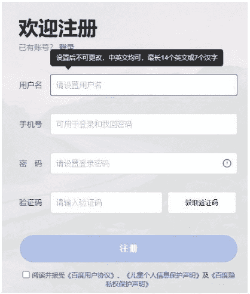

▲图 2-2

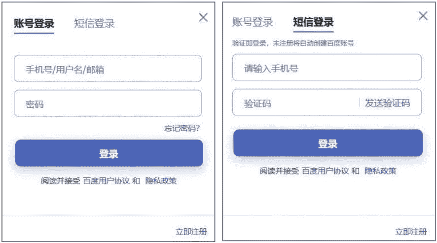

▲图 2-3

## 2.2 主界面与功能分区

登录后主页面简洁明了，主要分为四区：历史对话记录、对话框、输入区及其他功能区，包括一言百宝箱、App入口、功能反馈与个人中心，如图 2-4 所示。

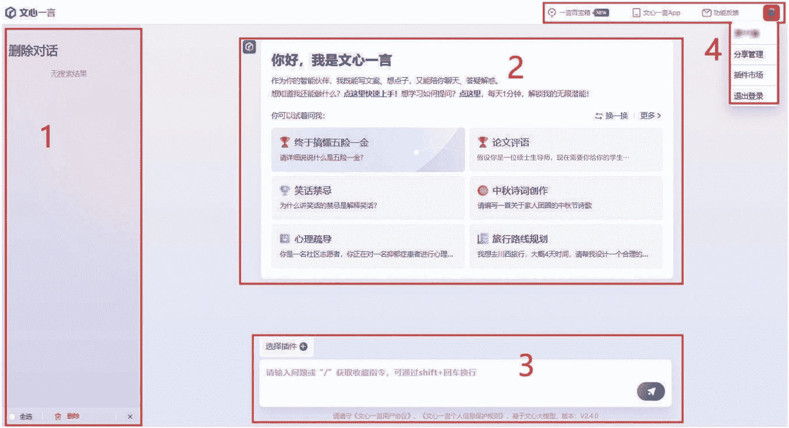

图 2-4

各区域说明如下。

**1. 历史对话记录**

系统会保存与用户的过往对话，便于回顾与快速调用历史内容，提升连续对话效率。

历史对话记录本质上是个可选的辅助功能，用不用、用多久，最终由用户自己决定。

**2. 对话框**
对话框是文心一言与用户沟通的核心界面，主要用来更及时地响应操作，并推送有用的信息和可选动作。

**3. 输入框**
输入框是驱动文心一言的关键通道，用户在其中输入的文字会触发模型生成对应的反馈与建议，从而让决策更准。

**4. 其他区域**

**一言百宝箱：**文心一言的特色工具集，能为用户提供丰富多样的功能与服务。

**文心一言 App：**点击该按钮会弹出二维码，扫码下载后即可在手机端使用文心一言处理问题。

**功能反馈：**用于在遇到使用障碍时及时上报并寻求解决，确保产品稳定运行。

**个人中心：**涵盖分享管理与插件市场。分享管理可统一处理各类场景的分享内容；插件市场汇聚众多插件，支持搜索、下载、安装、更新与评价，并提供按功能、版本、下载量等维度的分类筛选，方便快速定位所需插件。

## **2.3 必须掌握的文心一言的基本操作和使用技巧**

本节归纳文心一言的常用操作与实用窍门。所有指令都通过输入框发出，需求描述越清晰，模型返回的答案越精准。

**1. 提示词通用技巧**

避免开放式提问：提示要具体明确，不要用模糊不清的表达。
适度补充细节：依据场景和任务在提示中增加关键信息，为模型提供清晰指引。
下达明确指令：要求越具体，任务完成越快越准。
注意多语言适配：跨语言提问时需考虑语义差异与翻译问题。
规避过于复杂的提问：复杂问题容易导致指令不清或逻辑冲突。

**2. 历史对话记忆**
不同于传统聊天机器人，文心一言具备上下文记忆，会参考前面对话并在交流中持续学习。借助这一特性，用户能构建更复杂的会话并定制更多使用场景。

**3. 提示词工程**
若想获得高质量输出，提示词的设计至关重要。因为大模型的运行方式与传统计算机不同。

传统程序是按指令执行，不需要“提醒”。而文心一言会学习文本的语法、语义和上下文，进而生成自然连贯的对话。例如输入“今天风和日丽，请补充下面这句话：今天天气真 _____。”模型会根据语境给出“舒适”“晴朗”等补全。

由此可见，提示词直接影响生成效果。真正熟练使用文心一言，需要掌握进阶的提示词工程。

目前通用的完整提示结构为“扮演角色+具体任务+完成步骤+约束条件+目标+输出形式”。例如：“请你扮演健身私教，指导新手一天的训练与饮食，运用专业知识说明健身避伤要点，最后以列表形式给出专属的健身与健康饮食计划。”

扮演角色：可设为作家、高级程序员、老师、评论员、诗人等，帮助模型快速定位领域。
具体任务：用简洁清晰的语言说明要做什么。
完成任务的步骤：在任务较复杂时，明确期望的执行流程。
约束条件：如保持原文意思、勿做额外解释、要求简洁等限制性要求。
目标：明确希望达成的结果。
输出形式：文字、图片、列表等呈现方式。

下面通过对话示例，直观感受如何更好地使用文心一言。

**Q**

作为一个不熟悉你的新人，跟你交流需要注意哪些方面？需要知道的10条建议是什么？

**A**

作为新手，与我交流时建议注意以下10点。

**1** 先了解我的背景与特点：熟悉我的定位和文化内涵，有助于更好地理解和使用功能。
**2** 把问题或需求说清楚：描述越明确，我越能把握意图并给出准确答复。
**3** 用简洁易懂的语言沟通：避免过于复杂或专业的术语，提升沟通效率。
**4** 保护隐私与敏感信息：不要涉及手机号、身份证号等个人信息。
**5** 保持尊重与友好：礼貌耐心，感谢帮助，交流氛围更舒服。
**6** 不发布违法不良内容：禁止广告、垃圾信息、恶意软件等违规内容。
**7** 不侵犯他人权益：尊重知识产权与隐私权，不转载他人原创内容。
**8** 避免重复发布：重复内容浪费资源，易被视作垃圾信息。
**9** 遵守法律法规与平台规则：使用过程中严格遵守相关规定。
**10** 不发布广告或推销内容：此类内容违反规定。

希望这些建议能让你用得更顺手，体验更愉快。

**Q**

我想知道，如何向你提问才能获得高质量的回答？

**A**

想获得高质量回答，可遵循以下建议。

**1** 明确具体地描述问题：补充背景、已尝试的方法以及期望的帮助类型，让我更易理解。
**2** 提供充分的上下文：涉及特定情境时，信息越完整，回答越贴合。
**3** 保持尊重友好：感谢我的帮助，提问时耐心沟通。
**4** 耐心等待回复：思考和查证需要时间，不要频繁催促。
**5** 及时给予反馈：满意可表达感谢，有疑问可礼貌追问，方便进一步澄清。
**6** 使用通俗语言：避免过度专业或复杂的表达，便于理解。
**7** 不涉及隐私或敏感信息：保护个人安全与隐私。
**8** 不发布违法不良内容：严禁广告、垃圾信息、恶意软件等。
**9** 不要过度依赖答案：我的回答仅供参考，最终决策需结合实际情况判断。
**10** 保持开放积极心态：持续学习，有助于获得更多知识与认知提升。

掌握这些技巧有助于提问更有效。

**Q**

请举例说明哪些是高质量的提问，哪些又是低质量的提问。

**A**

高质量提问示例：

**1** 对于新手投资者，你有什么入门建议？
**2** 我打算买新车，有哪些决策参考或提示？
**3** 能否帮我理解某个特定技术问题的解决思路？
**4** 我在求职，想制作一份出色的简历，有什么策略？
**5** 我想学一门新技能，有什么推荐？

低质量提问示例：

**1** 我电脑出问题了，能帮我修吗？
**2** 我想减肥，有没有快速有效的方法？
**3** 我该怎么做才能在这个领域成功？
**4** 我很迷茫，不知道该干嘛，你说我该怎么做？
**5** 能帮我解决这个问题吗？

低质量提问通常缺乏背景、细节不足、请求模糊。高质量提问更具体、明确，能让回答者快速理解并给出有效帮助。

**Q**

我发现，有时候你在回答问题的时候会犯事实性的错误，那我们这些非专业的人如何判断你回答的对错呢？

**A**

非常抱歉，偶尔会出现事实性错误或疏漏。作为语言模型，我会尽力准确回答，但在训练数据和算法限制下不可能完全无误。

如果你发现问题，可以从以下角度评估：

**1** 逻辑与事实是否自洽：可对照参考资料和权威来源核查。
**2** 证据是否充分：回答应基于可靠事实，若缺乏依据需进一步核实。
**3** 是否相关：回答应贴合问题语境，若偏离或未解疑虑，建议查阅其他资料或咨询专业人士。

判断对错需综合逻辑、事实与证据，有疑问时欢迎指出，我会努力改进。

**Q**

请你提炼出刚才我们对话的精要，总结给那些没时间看完我们对话的人看，并让他们对你产生好奇。

**A**

对话精要如下。

提问者关心如何向AI提问才能得到高质量回答。建议明确具体描述问题，补充背景与期望，提供充足上下文，尊重友好、耐心等待并及时反馈，同时避免隐私泄露、违法不良内容，保持开放心态。判断回答对错需综合逻辑、事实与证据，并可借助外部资料核实。

希望这份概括能帮助没时间看完整对话的人快速把握重点。

## **2.4 提供有价值的反馈，让文心一言更智能**

每个回答右下方都有点赞与点踩图标。觉得回答符合甚至超出预期，就点赞；觉得无厘头或无关，就点踩。这些反馈数据会用于模型训练，从而持续优化回答质量。

图 2-5

若使用过程中出现问题，可点击主页右上角的“功能反馈”按钮进行上报；如有改进建议，也可及时反馈给官方。

▲图 2-6

▲图 2-7 （注：图中水印为文心一言 2.4.0 版本自带）

若对提问不满意，可将鼠标移到问题右侧，点击铅笔图标进行修改。

▲图 2-8

▲图 2-9

## **2.5 百度智能云千帆大模型平台：训练自己的大模型**

在特定场景下，企业和个人若想拥有专属大模型，可尝试百度智能云千帆大模型平台。该平台提供多类现成模型并支持微调，大幅降低自建门槛。模型覆盖自然语言处理、计算机视觉、语音识别等领域，同时提供预置Prompt模板，帮助用户快速落地。

### **2.5.1 训练大模型的步骤**

**1. 数据收集与准备：**确定问题类型并获取数据源，如电商平台、社交媒体、政府数据库等；对数据清洗、去噪、补全缺失值、统一格式。
**2. 数据集划分：**分为训练集、验证集、测试集。训练集用于训练，验证集用于调参防过拟合，测试集用于评估性能。
**3. 模型选择与设计：**根据问题类型与数据特征选型。分类可用决策树、SVM、神经网络；回归可用线性回归、岭回归、Lasso等。
**4. 模型训练：**用训练集迭代优化参数，提升准确性与泛化能力。
**5. 模型评估：**用测试集评估，常用指标有准确率、召回率、精确率、F1值等。
**6. 超参数调整：**调整学习率、正则化系数等不可学习参数，寻找最优组合。
**7. 模型部署：**保存为可执行格式，如TensorFlow SavedModel，再部署到移动端、服务器或云端实现实时推理。

千帆平台在训练、优化、部署及安全隐私方面提供一体化支持。

### **2.5.2 利用百度智能云千帆大模型平台训练大模型的步骤**

（1）注册账号并开通训练服务，在线选择合适的模型开始训练。

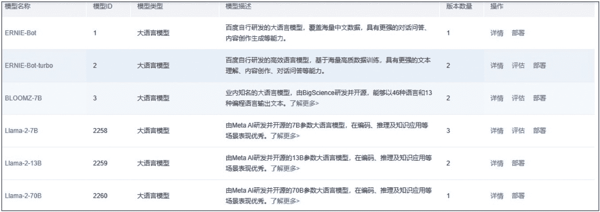

图 2-10

（2）准备训练数据，可来自公有或私有资源，并进行清洗、去重等预处理。

图 2-11

（3）选择模型架构，可选用平台提供的成熟模型，也可自定义。

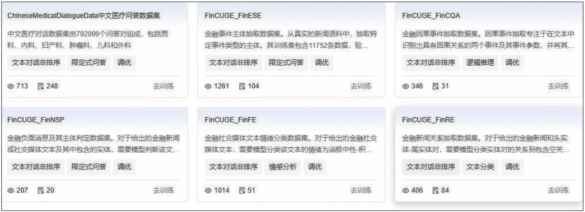

▲图 2-12

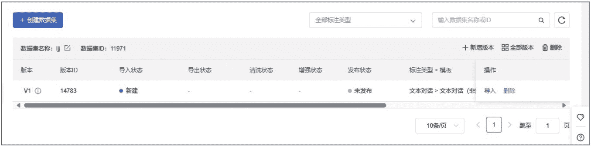

▲图 2-13

（4）开始训练，可调整学习率、批量大小、训练轮数等参数提升效果。

图 2-14

（5）训练后使用测试集评估性能，了解不同场景表现以便优化。

图 2-15

（6）完成调优后部署到实际应用，通过API调用实现落地。

训练专属模型前需具备一定的机器学习、深度学习与编程基础，并准备充足的算力与耐心。

### **2.5.3 大模型个性化训练实际案例**

**1. 在线教育平台的数学专业导师**
平台希望模型扮演数学导师，提供作业指导与答疑。可收集教材、题库、解题步骤与专业术语进行训练，使其具备专业知识与解题能力，实现自然交流与学习辅导。

**2. 餐厅在线点餐服务助手**
餐厅希望模型充当前台助手，介绍菜品并完成点餐。可对菜单数据与常见点餐问题进行微调，打造定制化点餐体验。

**3. 银行自动化在线客服机器人**
银行希望实现客服自动化，解答疑问并引导业务。可对业务知识库、常见问题、投诉案例进行微调，使其准确答复、解释政策、指导在线操作，并提供个性化金融建议。

## **本章小结**

本单元先帮你建立对文心一言的基础认知，覆盖账号注册登录、主页构成与核心功能拆解，以及常用的操作诀窍；同时演示如何训练专属大模型。学完后，你能更从容地理解和驾驭文心一言。

## 拓展训练

**1** 借助文心一言撰写一篇关于人工智能技术的文章。
**2** 请文心一言为你拟定一份个性化的健身方案。

# 03

# 文心一言学习应用实战

文心一言是一款具备连贯记忆特性的创新模型，它会保留历史会话并据此延续后续生成，这一点让它在学习场景中格外好用。本部分以真实案例说明如何借助它开展学习。

## 3.1 随身学习助手

在学习上，文心一言知识面广、自然语言理解强、操作门槛低，很像一位贴身辅导员，能帮助你更快掌握新知识。下面介绍几个典型用法。

### 3.1.1 文献速读与分析

文献是承载知识的载体，这里特指围绕某个学科或主题的研究报告、学术论文等。文心一言可以配合你检索、拆解、提炼文献。

它在文献阅读环节主要提供以下支持。

**文献概览：** 整理文献的核心内容与要点，帮助你快速把握该领域的研究现状与前沿趋势。
**内容拆解：** 对实验方法、数据处理、结论等细节进行解读，助你吃透原文并做深入追问。
**归纳精炼：** 将原文浓缩为要点，以摘要或综述形式呈现，便于抓住重点。
**延伸研讨：** 在总结基础上展开讨论，启发思考并提供多角度解读、背景资料与相关知识。

可参考的操作流程与示例。
（1）点开输入框左上方的“插件”按钮，选择“览卷文档”（如图 3-1 所示）。
（2）点击左上角的箭头图标（如图 3-2 所示）。

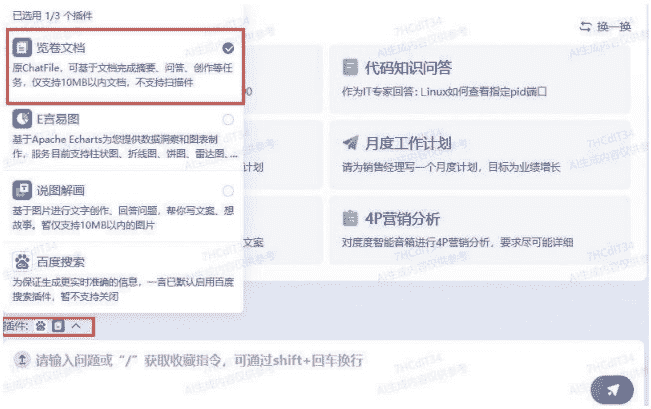

▲图 3-1

▲图 3-2

点“点击”按钮上传文件，或把文件直接拖入上传区（如图 3-3 所示）。

图 3-3

（3）上传完成后，文心一言会自动解析文献并给出要点，示例如下。

**Q**
多彩的云南民族织锦.pdf

**A**
以下是该文档的关键内容。

文章指出云南民族织锦兼具古老与多彩两大特征。当地至今仍在使用两三千年前的纺织工具与技艺，反映出悠久历史与鲜活生命力，西汉青铜器出土也佐证了这一点。古老性既体现在器具上，也体现在纺织动作与全流程上。常用器具主要是竹木制作的踞织机与木织机，工艺相对简陋，由背皮、打纬刀、竹件等组成。打纬刀使用寿命很长，有的能用到十几年甚至数十年，被岁月打磨成古老工艺品。织锦大致分通经通纬与通经断纬两类，也有通经编纬的做法。总体看，云南民族织锦是古老而绚烂的文化遗产，既见证人类纺织史，也代表云南少数民族文化的精华。

可这样追问：
**1** 云南民族织锦的古老特质表现在哪些方面？
**2** 当地使用的纺织工艺具体有哪些类别？
**3** 这项织锦对人类纺织历史有何价值？

（4）想进一步深挖，也可以继续提问，例如：

**Q**
现在很多非遗手艺都在消失，你觉得有哪些比较好的应对办法？

**A**
针对非遗手艺逐渐式微的问题，可以从以下方向着手。
**1** 强化宣传与保护。政府与社会组织应加大价值宣传，让更多人认识其意义；同时做好注册、版权等保护措施。
**2** 建立传承机制。鼓励年轻人学习传统技艺，开展非遗培训，激发兴趣并提升技能。
**3** 创新与发展。在保留传统特色的前提下探索新用途与市场，让非遗焕发新活力。
**4** 加强国际交流。与全球传承人交流经验，共同推动保护与发展。
总之，需要全社会共同参与，政府、机构、企业和个人都应发挥作用。

**Q**
云南民族织锦使用的纺织技艺有哪些种类？

**A**
云南民族织锦的纺织技艺大致分踞织机即俗称腰织机和木织机两大类。

各民族的踞织机整体结构相近，都由背皮、打纬刀、卷经轴、综杆、分经杆等组成，细节各有差异。比如景颇族的踞织机为六综，能织出更复杂的纹样。打纬刀制作也各异，有的民族用牛肋骨削制并刻上花纹。

纺纱多为坐姿操作，有的大腿上搓纺，有的是把纺锤放在瓷碗里用指尖搓，还有大量使用纺车。纺车类型多样，从简陋粗放到精致复杂都有。

纺织原料也很丰富，包括棉、麻、毛等常见材料，也有葛藤、火草等本土野生植物。麻几乎所有民族都种植，主要取其秆纤维，拉力强、结实，常作经线。火草是多年生植物，以前纤维被用作火绒而得名。每逢六七月采鲜叶，折断叶尖露出背面纤维，顺着叶脉撕搓成线，片片相接后制成纬线。因其拉力弱、韧性差，通常只作纬线使用。

### 3.1.2 阅读助手

文心一言能提供书籍的要点与背景知识，帮助你更好理解内容，还能按兴趣推荐书单，拓宽阅读视野。

**1. 功能概览**

**（1）阅读辅助：** 提供书籍摘要、主要内容、主要人物等信息，并对难懂句子进行解释。
**（2）书籍推荐：** 根据阅读兴趣与对话历史推荐合适的读物。
**（3）阅读建议：** 给出如何选书、怎样提升阅读效率等实用建议。
**（4）知识问答：** 阅读过程中遇到疑问时即时解答，帮助理解情节或观点。
**（5）阅读笔记：** 记录阅读中的感悟、思考与问题，方便后续回顾整理。

**2. 提问参考**

有哪些励志成长类的书籍推荐？
《明朝那些事儿》系列的作者是谁？
可以推荐几本科幻冒险小说吗？
我在学英语，有什么好的英语学习书推荐？
推荐几部经典文学作品提升阅读兴趣。
想看历史类书籍，有什么推荐？
想了解人类心理学和行为学，有什么书可选？
我喜欢推理小说，像《福尔摩斯探案全集》《完美嫌犯》这类，有类似推荐吗？
适合 3~6 岁孩子阅读的书，能列 5 本吗？
我对经济、政治等领域感兴趣，有什么好书推荐？

**3. 演示案例**

文心一言能在短时间内提炼一本书的核心思想，下面是示例。

**Q**
我是一个读书博主，刚读完《悲剧的诞生》，感触很深，想在短视频平台分享，请帮我写一篇约 1000 字的读书笔记，要包含书介、个人启发、推荐理由。

**A**
《悲剧的诞生》：启程与探索

在浩瀚书海中，每本书都有独特魅力。今天想和大家分享尼采的代表作《悲剧的诞生》。这本书追溯希腊悲剧的起源与意义，深刻触动了我。

该书首版于 1872 年，从古希腊悲剧切入展开艺术与美学思考。尼采要回答的问题是，为什么悲剧在古希腊如此流行？他提出悲剧是对生命、苦难、毁灭的肯定，是酒神精神的体现……

文心一言生成这篇笔记仅用了约 10 秒，相当于每秒约百字的输出速度，且完全按需求定制，稍作润色即可发布。这预示着它将在学习支持方面发挥关键作用。

文心一言已自动给出标题，若觉得不够抓人，也可以让它换一个更有吸引力的版本。

**Q**
请为这篇读书笔记拟一个更吸睛的短视频标题，要符合爆款风格，给我五个备选。

**A**
**1** 【深度解读】《悲剧的诞生》：尼采谈生命与艺术的思考
**2** 【揭秘经典】《悲剧的诞生》：悲剧艺术背后的奇妙逻辑
**3** 【震撼推荐】《悲剧的诞生》：洞察生命意义的必读作品
**4** 【好书分享】《悲剧的诞生》：重新认识生命与艺术的经典
**5** 【经典剖析】《悲剧的诞生》：尼采哲学思想的精致呈现

### 3.1.3 英语单词学习

文心一言不仅擅长中文，也能帮助学习其他语言，下面以英语单词为例。

**1. 使用技巧**

（1）查单词释义并展示音标与例句，例如“What is the meaning of 'expand'?”“What is the pronunciation of 'definition'?”“Can you give me an example sentence with the word 'word'?”
（2）练拼写，例如“How do you spell 'word'?”
（3）进行英语对话练习，它会回答问题并纠正语法与拼写错误，你也可以指定单词让它给出释义、发音与用法。
（4）根据指定单词生成例句，例如“Can you give me an example sentence with the word 'word'?”

常见提问方式：
What is the definition of "perplexed"?
How do you pronounce "mischievous"?
Can you give me an example sentence with the word "gargantuan"?
How do you spell "onomatopoeia"?
Can you give me a sentence using the word "insidious"?
What is the meaning of the phrase "to make amends"?
Can you provide a synonym for the word "meticulous"?
What is the opposite of the word "generous"?

**2. 演示案例**

做单词测试时，可先让文心一言扮演英语老师，告知你的词汇量，让它按编号逐个出题。你答“Y”表示认识，它继续出题；答“N”则它会给出词性、正确释义、发音与三个例句。

**Q**
You are now assuming the role of my English teacher.I have a vocabulary of approximately 20,000 words,and I am eager to be tested on new ones. During each session,please provide me with a single word accompanied by a sequence number. If I reply with a "Y",then you may present me with another new word. However,if my response is "N",please provide me with the word's category, pronunciation, definition,and three example sentences.Let's begin!

**A**
Sure, let's start with the first word. Here's the first word: "vicissitude".

**Q**
N

**A**
Sure, "vicissitude" is a noun that means a significant change or series of changes.

Here's its category, pronunciation, definition, and example sentences.

Category: Noun
Pronunciation: /vɪ'sɪsɪtu d/
Definition: a significant change or series of changes
Example Sentences:
**1** The company went through many vicissitudes in the past few years.
**2** His career has undergone many vicissitudes since he graduated.
**3** The vicissitudes of life taught me to appreciate the good times.

**Q**
Easier one, please！

**A**
Sure, here's an easier word:"happenings."

**Q**
N

**A**
Sure, "momentous" is an adjective that means extremely important or significant.

Here's its category, pronunciation, definition, and example sentences.

Category: Adjective
Pronunciation: /moʊ'mentəs/
Definition: extremely important or significant
Example Sentences:
**1** The momentous decision changed the course of history.
**2** The outcome of the election was momentous for the future of the country.
**3** The momentous news was announced at the end of the conference.

你可以要求它出更简单或更难的词，也可以让它用学过的生词编个小故事加深记忆。

### 3.1.4 思维导图绘制

思维导图是用图形化方式组织概念与信息的工具，由节点与连线构成，体现概念间的关系与层级。

文心一言会按需求生成一段 Markdown 代码，你复制到在线编辑器就能得到一张导图。

**Q**
请以“三国演义人物关系”为主题，制作一张思维导图，要包含主要人物和次要人物，推荐一种适合的语言和一个在线思维导图工具。

**A**
首先可以用 Markdown 语言来搭建结构，通过缩进和符号创建列表与层级。

以下是以“三国演义人物关系”为主题的 Markdown 形式的思维导图代码。
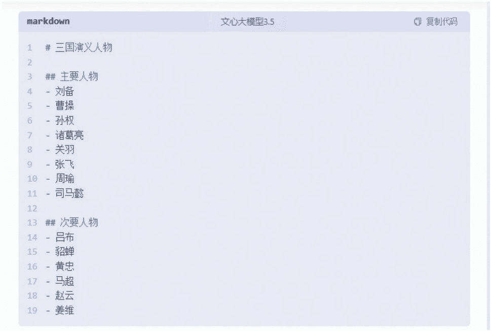

其次，可以使用在线 Markdown 编辑器，比如 StackEdit 或者 Dillinger，将代码转化为可视化导图，这些工具通常支持预览与导出。

最后，若想分享，可导出为图片或 PDF 格式，多数导图工具都在菜单里提供导出选项。

以上就是制作一张以“三国演义人物关系”为主题的思维导图的简要流程，复杂一点的内容可以继续完善 Markdown，或选用功能更强的导图工具。

先把前面提到的代码片段放到像 StackEdit 这样的 MarkDown 工具里，整理好后导出为 MarkDown 文档。

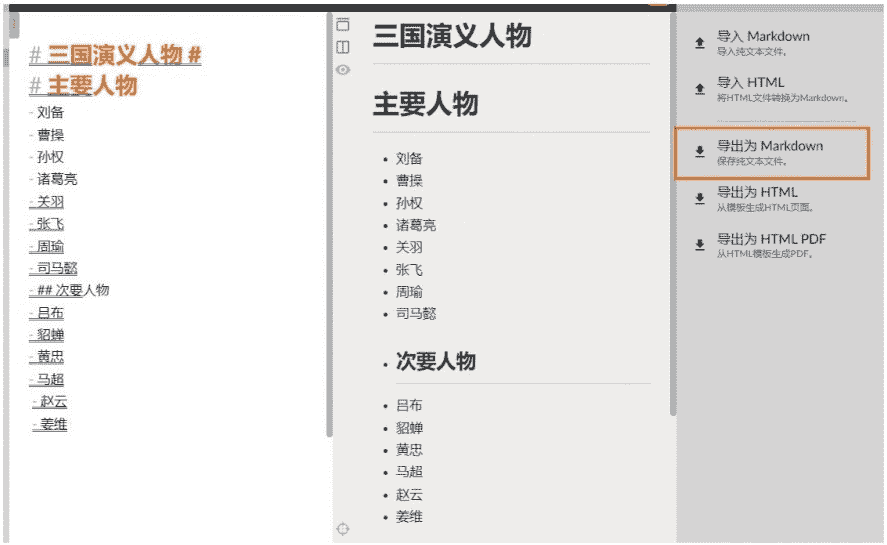

随后就能借助 Xmind 把文档转化为思维导图。打开 Xmind 后，点左上角的「文件」菜单，选择导入功能，把刚才的 MarkDown 文件选进来即可完成载入。

载入成功后，思路梳理和复盘效率会明显提升。

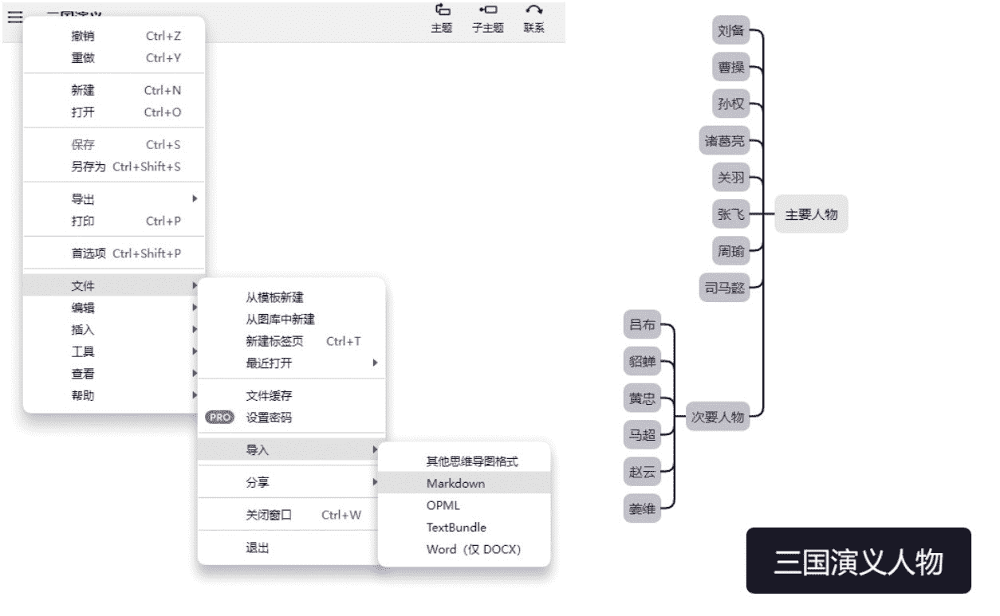

### **3.1.5 用 AI 快速生成实习报告**
不少学生整理实习经历时容易卡壳，下面以数据分析实习为例展示文心一言如何帮忙搭框架。

示例提问：
请演示如何用文心一言为一名在校生生成数据分析岗位的实习报告雏形。

示例回答：
### 实习报告
岗位：数据分析
单位：某互联网企业
时间：2023 年 3 月起

**1. 岗位概览**
该岗位核心是围绕数据采集、清洗、建模与解读展开。实习期间主要使用表格工具与 SQL 处理业务数据，并撰写分析文档为管理层提供参考。

**2. 主要职责**
1 负责数据的采集与清洗，保证完整准确；
2 挖掘数据规律，归纳趋势并分析成因；
3 按结果输出分析报告，支撑决策；
4 参与模型构建与优化，提升效率与精度。

**3. 成果回顾**
数据处理与分析方面，通过 SQL 提取库中数据，用表格工具进行整理，发现周末购买频次低于工作日但转化率更高，推测系周末用户有更多比较时间。

报告撰写方面，输出多份分析材料，其中一份用户流失分析指出关键原因并提出对策，公司采纳后流失率有所下降。

**4. 收获体会**
实习让数据价值更直观，有助于理解用户行为与市场动向，同时要求从业者具备扎实技能与严谨态度。未来会持续学习新工具与方法，提升问题解决能力。

### **3.1.6 AI 一键搭建论文提纲**
写论文起步难，先让模型给出框架，思路会立刻清晰。

示例提问：
请为研究主题“人工智能与医疗”、采用定量方法生成一份论文提纲，需涵盖研究问题、文献综述、方法、数据分析与结果呈现、结论讨论，并保持逻辑分明。

示例回答：
### 论文提纲
**一、引言**
1 研究背景与意义
2 研究问题与目标

**二、文献回顾**
1 AI 在医疗领域的已有应用
2 优势与局限的探讨
3 未来发展趋势展望

**三、研究方法**
1 设计思路
2 样本与数据获取
3 分析技术
4 信度效度说明

**四、数据分析与结果展示**
1 分析过程
2 主要结果
3 解读与讨论

**五、结论与讨论**
1 核心结论
2 学术贡献
3 研究不足
4 对后续研究的建议

**六、参考文献**
写作时需遵循学术规范。大纲仅作初步指引，具体内容要按实际研究调整。

### **3.1.7 课程预习助手**
文心一言可以提前梳理课程重点，帮助预习。

示例提问：
请列出大学《初级会计》课程中“权责发生制”需要预习的要点。

示例回答：
要点概览：
1 权责发生制以经济业务实际发生为准确认收入费用，不看款项是否收付。
2 属于当期事项，无论款项是否已收付都计入当期；不属于当期，即使款项已收付也不计入。

预习功能能让学习者提前熟悉概念，系统会提供配套资料加深理解。

### **3.1.8 英汉互译服务**
支持中英文互译。

示例提问：
把下面英文译成中文。

示例回答：
人生太短，别把时间耗在会削弱你快乐的人身上。若有人在意你，会主动给你位置。你不必为一个名额争抢。别一再迎合持续忽视你价值的人。真正朋友是在你低谷而非高峰时陪伴你的人。

示例提问：
判断下面翻译是否正确，给出修改建议。

示例回答：
不规范。正确写法是 “No fear in my heart”。hreat 并不是单词，是 heart 的拼写错误。该句意为“我心无惧”，表达简洁，符合英语习惯，写作时需注意拼写准确。

### **3.1.9 教师视角复习要点生成**
可让模型扮演教师角色梳理复习内容。

示例提问：
假设你是老师，请为《初级会计学》中“权责发生制”章节整理复习要点。

示例回答：
要点如下：
1 定义：按权利义务发生时点确认收入费用，与收付款无关。
2 原则：确认时以权利义务是否实际发生为依据，不考虑款项收付状态。

### **3.1.10 个性化学习计划制定**
根据目标和水平推荐材料与方法，并动态调整。

示例提问：
为零基础学员制定一份 Python 速成方案。

示例回答：
欢迎开启 Python 速成。目标是通过十周掌握基础语法、数据类型、控制结构、函数等，并能解决实际问题。

学习目标：
1 熟练基础语法与常用数据类型；
2 掌握条件、循环、异常处理；
3 理解函数、模块、包的用法；
4 能用 Python 做数据分析、爬虫等实践。

时间安排：约 10 周，每周 20-30 小时。
路径示例：第 1 周基础语法与数据类型；第 2 周控制结构；第 9 周项目实战；第 10 周总结与提升。
方法建议：理论结合练习、小组讨论、线上交流、坚持每日学习并注重实操。

## **3.2 创意写作助手**

### **3.2.1 诗词创作**
可按诗体、韵律、主题生成诗词并提供修改建议。

示例提问：
创作一首赞美江南春色的散文诗，要求辞藻华美意境真实。

示例回答：
标题：江南春意
春来江南如诗缓绽，嫩绿铺枝，花瓣次第开。柳丝拂过小径似轻抚。晨光初照江面悠长，渔歌晚起，柳絮随风。燕影掠过霞光，画面如梦。

### **3.2.2 文本续写**
基于语言模型对给定文本进行延展。

示例提问：
以“一觉醒来之后，我发现”为开头续写科幻故事，要求情节曲折。

示例回答：
一觉醒来之后，我发现自己身处由彩色线条与几何体构成的陌生宇宙。感官被重塑，能触摸光、听见色彩。意识中响起声音：“欢迎来到他者宇宙，你是首个觉醒者。”面前出现由流动几何构成的生命体，自称他者族代表，称已发展出超越人类的交流方式，正研究人类文明。

### **3.2.3 视频脚本制作**
帮助规划主题、结构、镜头与场景。

示例提问：
作为美食博主，请写一份排骨饭视频脚本，要求画面吸睛过程专业。

示例回答：
标题：梦幻排骨饭
场景1：特写排骨与大米，轻快背景音乐。旁白：欢迎来到美食频道，今天做排骨饭。
场景2：展示排骨挑选清洗。旁白：选新鲜排骨，冷水浸泡去血水。
场景3：热锅煎排骨至金黄，加姜蒜料酒。旁白：热锅冷油，两面煎香。
场景4：高压锅炖煮，加水酱油冰糖，20 分钟。旁白：火候时间是关键。

### **3.2.4 文本改写功能**
在不改变原意下用不同表达。

示例提问：
改写下面段落，要求连贯华丽。

示例回答：
落日隐去，天边仍燃橘红晚霞。大海被染红，比天空更壮阔。海面涌动，浪尖映霞红亮如火，闪烁后消散，后浪接踵推进岸边。

示例提问：
再改写一段雨景描写。

示例回答：
雨似银灰湿丝，织成轻网罩住整个秋天。天色阴沉如古宅屋顶。灰白云层如剥落粉末。一切沉闷。园中石榴、桑树、葡萄藤见证过盛夏，如今如遗迹般瑟缩回忆往昔。草色转黄褐，花朵难见。墙外洋水仙低头含泪叹薄命。唯墙角桂花缀着金黄嫩蕊，藏于翠叶间透出新生希望。

### **3.2.5 文本扩写**
对现有文本进行详细阐述，补充细节但不改变主题。

示例说明：
续写与扩写都扩展文本。续写延续情节形成完整故事；扩写则在原意上增加细节、例证与解释，帮助读者更透彻理解。

一次扩写，从模糊视线到星际舱站

### **A**
周六的早晨，小明从睡梦中醒来，发现自己置身于一个从未见过的地方。视线所及尽是朦胧不清的景物，像是被一层雾纱遮住，让他一时分不清是现实还是梦境。起初的惊慌很快被一种说不出的好奇取代，他隐约觉得自己正踏上一次不可思议的旅程。

几乎眨眼的功夫，周围的环境彻底改写。小明站在一座通体泛着银光的轨道站内部，舱壁以银色金属为主，配合透明观景窗与各种先进仪器。透过舷窗向外望去，漆黑的深空铺陈开来，远方的星群如海一般绵延，整个人仿佛漂浮在宇宙中央。

他开始在站内探查。舱段里有停靠的飞行器、科研舱室以及生态维持区。科研舱室里摆满了关于太空探索的资料与精密仪器，让他对这座站点的作用有了初步的认识。生态维持区中生长着多种奇异的植物与动物，这些生命似乎能适应失重与真空条件。

行走间，小明注意到不少异常。墙面上刻着难以解读的标记与信息，让他感到困惑。走廊里不时有身着银色舱内服、神情淡漠的工作人员来回穿梭。小明心里既不安又充满探究欲，想要弄清真相。

这段星际经历充满紧张与刺激。他一点点揭开宇宙背后的秘密，也在过程中认识到自己的机智与勇气。最终，他逐一化解了站内遇到的难题，安然返回地面。

### **3.2.6 剧本创作**
剧本创作模块主要为用户提供故事与剧本的起步支持。用户可以提交灵感或背景设定，系统会据此生成一个初稿框架。这只是起点，后续可依个人喜好自行润色完善。若借助现成模板创作，成稿会更加规范丰富。

**Q**
请写一个剧本，主题是大学生在克服自身障碍后夺得演讲比赛冠军。

### **A**
剧本标题：演讲之梦

场景 1：高校校园，清晨
画面定格在主人公林晓的脸上，他神情紧张，似乎在做抉择。
心里自问：我很想参加演讲赛，可一紧张就会口吃，这样还能面对观众吗？
好友李明走过来安慰。
李明：晓，你一直很有想法，不敢迈出一步就永远没有机会。
林晓眼中闪过坚定。
林晓：谢谢你李明，我会直面自己的恐惧。
随后镜头来到讲台前，林晓深吸一口气准备开讲。

场景 2：演讲赛现场，气氛热烈
主持人宣布比赛开始，各位选手依次登台。林晓手握讲稿，略显不安。
评委打分，观众鼓掌。随着进程推进，他的表达愈发流畅，内容感人至深，全场为之动容。
演讲结束，掌声雷动，林晓微笑着下台，明白自己已尽力。

场景 3：颁奖时刻
主持人上台公布名次，林晓心跳加速。
主持人：本届演讲大赛的冠军是……林晓！
听到名字，林晓惊喜万分，走上台接过奖杯，全场响起掌声。
心里自问：我做到了，赢得了冠军，也战胜了恐惧。
镜头停留在林晓举起奖杯的瞬间，笑容绽放。
……

### **3.2.7 标题生成**
标题生成功能能够根据输入文本提炼要点，输出简洁醒目、具有吸引力的标题。

**Q**
请以媒体编辑的身份，为重阳节全民登山活动的新闻报道拟一个吸睛标题。

## **A**
重阳登高热潮：全民共上山，共传敬老新风。

## **3.3 绘画达人**
绘画达人可依据文字描述或简易草图生成精美图像，核心依赖深度学习与海量训练数据。
应用场景广泛，既能满足个性化艺术创作，也能用于品牌标志、海报设计等；在文学影视领域还能制作插画。在没有绘画基础的情况下也能创作出理想作品，平台还提供模板素材辅助。

**Q**
请绘制一幅图像：写实风格的动漫少女，唯美柔和，二次元厚涂，细节精致高清。

### **A**

**Q**
请生成一幅图：琉璃摆件搭配多彩鲜花，细节丰富，采用静物摄影光效与轮廓光。

### **A**

**Q**
请创作一幅作品：小兔全身，细节精致毛发清晰，国潮武侠风格，可爱萌趣，3D渲染居中，超高清电影级特效与光线追踪。

### **A**

**Q**
请绘制一幅：真人女孩全身构图，容颜完美，甜美可爱，身材苗条，高清白皙肌肤，黑长直发，微笑。

### **A**
图像已完成，欢迎提出反馈建议以便持续改进。

**Q**
请生成一幅水墨画：万里长城，朦胧层次分明，气势宏大，国风主题，国富民强印章，全屏呈现。

### **A**

## **3.4 教育培训**
随着人工智能发展，文心一言在教育培训领域的应用愈发广泛，从绘本制作到学习辅导均可提供支持。本节介绍典型用途。

### **3.4.1 课程设计**
课程设计是指有目的、有组织地制定教学计划、大纲与教材的系统化工作。

**Q**
请为小学三年级学生设计初级英语课程大纲。

### **A**
课程名称：三年级初级英语

课程目标：通过学习掌握基础语音语法与词汇，能进行简单对话读写，培养兴趣与自信心。

课程大纲
第一部分——语音与语法
**1** 学习语音基础：元音辅音音标，正确发音方法。
**2** 学习语法基础：名词动词形容词副词等，掌握基本句型与时态。
第二部分——词汇
**1** 日常常用词：数字颜色形状动物水果等。
**2** 基础交际用语：问候自我介绍感谢道歉等。
第三部分——阅读与写作
**1** 简短对话与小短文练习听说读写。
**2** 标点与书写规范，正确书写句子短文。
第四部分——文化知识
**1** 了解英语国家文化背景与风俗，中西方差异。
**2** 接触英语歌曲电影，培养跨文化意识与实践能力。
教学方法
**1** 多媒体教学，图片视频辅助理解记忆。
**2** 情境对话交流，真实语境中运用。
**3** 游戏竞赛激发兴趣积极性。
**4** 分层教学兼顾个体差异。
评估方式
**1** 课堂表现作业测验及时了解学情并调整策略。
**2** 每阶段结束进行综合测评检验掌握程度。

### **3.4.2 中文作业批改**
中文作业批改是对文本的语法拼写文采进行评价修正，通过自然语言处理发现问题并给出改进建议，提升写作水平。

**Q**
请作为阅卷老师批改下面作文，指出段落结构修辞手法等可优化点并给出建议。作文内容为：“我最喜欢的动物是猫。猫有很强的狩猎本能。即使在家里，它们也会经常玩狩猎游戏，追逐任何可以移动的东西。看到猫追逐老鼠或者玩具时，我觉得它们非常有趣。猫也非常善于自我保护。感到害怕时，它们会立即找到一个安全的地方藏起来。即使是在陌生的环境中，它们也可以很快地适应。总的来说，猫是非常有趣和机智的动物，也是我最喜欢的动物之一。我希望有一天能拥有一只自己的猫，和它一起度过美好的时光。”

# **A**
本文描写猫，思路清晰但可提升。

**1** 开头：可设置引人情境，增强吸引力。
**2** 段落结构：建议总分总，每段加概括主题句。
**3** 内容充实：增加具体细节事例。
**4** 修辞运用：适当使用比喻拟人提升感染力。

优化示例：
在众多生灵中，我最钟爱猫。优雅步态与神秘气质令人着迷。
先说狩猎本能，猫堪称天然猎手。即便在家中也爱上演追逐游戏，任何会动的物体都可能成目标。我曾见一只猫全神贯注追老鼠或玩具，画面滑稽又有趣。
再说自保能力，猫极擅自保。受惊时立刻寻找隐蔽处藏身。即便身处陌生环境，也能迅速适应令人惊叹。
总之猫机敏有趣举止优雅，我情有独钟。期待未来能拥有一只自己的猫共度闲适时光。

### **3.4.3 教学实例生成**
教学实例生成是依据教学内容与目标，结合实际需求创作出具有针对性与创新性的案例，帮助学生体会知识实际价值。

**Q**
我将在物理课上讲牛顿第二定律，请提供至少三个实例及见解帮助学生理解。

# **A**
牛顿第二定律描述力质量与加速度关系。以下三个例子可助理解。

**1. 火箭发射**
点火后燃料燃烧产生推力作用于火箭，使其获得向上的加速度。公式 *F*=*ma* 中推力等于质量与加速度乘积。火箭质量相对稳定而推力远大于重力，故向上加速。
见解：直观展示力质量加速度实际关联。

**2. 荡秋千**
……

**3. 滑雪**
……

通过真实情境，学生能更好把握定律原理并应用于生活。教师可据此深化物理规律理解。

### **3.4.4 辅助育儿**
孩子入睡困难时可让系统编一个睡前故事。

**Q**
以兔子森林大灰狼公牛为素材，编一个有教育意义的睡前故事，讲给4岁孩子听，约500字。

# **A**
森林里住着一只可爱的小兔子萝卜，它喜欢在草地上跳跃。某日萝卜在开阔草地玩耍时，突然出现一只大灰狼想要捕食它。萝卜吓得躲进树丛，大灰狼没找到便离开了。
萝卜刚松口气，一头强壮的公牛出现在另一边，让它再次感到不安。它不知道该怎么办。
……

新手父母遇到育儿难题时也可向系统提问。

**Q**
冲奶粉的正确步骤是什么？

## **A**
标准冲调流程如下。
**1** 清洁：先用肥皂洗手20秒，流动水冲净擦干，同时保证器具清洁。
**2** 备水：干净水烧开后冷却至40～50℃，水温过高会破坏营养，过低影响溶解。
**3** 取粉：按需取适量奶粉，用专用奶勺平勺取用，避免浓度不均。
**4** 冲调：先倒入规定量温水，再加入对应奶粉，用清洁工具刮平每勺。
**5** 摇匀：盖好奶嘴瓶盖，轻轻摇晃使水粉充分融合。
**6** 测温：喂前滴少量奶于手背，温度适宜再喂，避免烫伤或过凉影响消化。

### **3.4.5 数学问题解答**
文心一言不仅擅长文本生成，数理逻辑能力也在提升，可担任数学助教讲解各类习题。

**Q**
一个等差数列共*n*项，其和为90，前十项和为25，后十项和为75，则项数*n*为（ ）。请写出解题过程。
A.14 B.16 C.18 D.20

### **A**
设等差数列首项为 *a*₁，末项为 *a*ₙ。
总和 *S*ₙ = *n*/2 ×(*a*₁+*a*ₙ)=90
前十项和 *S*₁₀ = 10/2 ×(*a*₁+*a*₁₀)=25
后十项和 =10/2 ×(*a*ₙ₋₉+*a*ₙ)=75
联立求解可得 *n*=18
因此该数列共有18项。

### **3.4.6 升学择业顾问**
升学择业顾问可结合学科背景与行业经验为学生提供选校与职业规划建议。

**Q**
请结合全面的院校知识，对南京航空航天大学与西安电子科技大学做综合比较分析。

## **A**
南京航空航天大学与西安电子科技大学均为知名高校，各有优势。
学校沿革：南航创办于1952年，是我国较早的航空类高校，以工为主理工结合；西电成立于1931年，直属教育部，为全国重点大学。
学科优势：南航在航空航天民航力学机械工程等领域实力突出；西电以信息与通信工程电子科学与技术见长，通信电子信息计算机等学科国内领先。
就业前景：两校毕业生均受市场欢迎，就业面广。
发展前景：两校均为国家双一流建设高校，随着国家对新技术的投入，发展潜力巨大。
总体而言兴趣导向选择。若偏爱航空航天方向，南航更合适；若倾向信息电子方向，西电更匹配。

### **3.4.7 幼儿教学活动**
幼儿教学覆盖健康语言数学科学艺术社交等领域，旨在建立基础认知与技能。

**Q**
作为幼儿园老师，请设计一些课外活动提高小朋友动手能力并激发创造力。

### **A**
作为幼儿园教师，可通过以下活动提升动手与创造力。
手工制作：引导幼儿使用多种材料与工具制作小玩具装饰品或礼物。
种植养殖：组织幼儿种植花草蔬菜或饲养小动物，观察生长过程。

绘画与创意启蒙：可以引导孩子体验多种绘画方式，比如随意涂鸦、色彩搭配练习。也可鼓励他们对身边物件做创意再设计，例如自主规划房间布局、动手制作手工艺品等。

探索与发现：为孩子安排多样化的探索任务，比如记录自然界的细微变化、动手探究基础科学现象等。

拼搭与建构：提供积木、拼图等可组合材料，让孩子发挥想象，自主搭建属于自己的小天地。

上述课外活动能够帮助提升孩子的动手操作与创造思维，同时对认知、情感、社交等方面产生促进作用。组织时要鼓励主动参与，并把安全与卫生放在首位。

## **本章回顾**
本章主要展示了文心一言在学习场景中的典型用法，比如阅读文献、记忆英语单词、绘制思维导图等，并通过案例让读者对使用方式有更深入的认识。

## **延伸练习**
**1** 请借助文心一言完成一篇主题为“学会感恩”的演讲稿，字数不少于1500字，内容充实，可读性强。
**2** 请借助文心一言起草一份租期三年 的房屋租赁合同。

# **04**
# **文心一言在职场的实战用法**

在节奏加快的办公环境中，提效已成为共同追求。文心一言能够帮助用户应对日常工作中遇到的各类挑战，提升效率与成果质量。

## **4.1 职场提效助手**
在职场中，企业与个人都可以用文心一言来撰写邮件、生成日报、调研报告等，只需提供关键词和需求描述，即可获得针对性内容。

### **4.1.1 邮件撰写与处理**
邮件是常见的沟通载体，可用于工作、学习、社交等多种情境，有助于快速传递信息、分享资料、解决问题和建立联系。向文心一言提供邮件要点、撰写要求和身份信息，即可生成专业邮件；也可以把已有邮件交给它进行要点提炼。

**Q**
假设你担任销售经理，需要给重要客户发送一封关于专属年中促销活动的邮件，内容要涵盖活动安排，语言简洁且有吸引力。

### **A**
（客户姓名）您好：

代表（公司名称）向您问好。

特此邀请您参加我们即将举办的专属大客户年中促销活动。这是为尊贵的大客户量身打造的回馈盛会，用以感谢您长期以来的支持与信任。

活动拟于（活动日期）在（活动地点）举行。我们已规划了丰富环节，包含（活动内容），并准备了多重神秘礼品。此外还邀请了业内权威讲师解读行业趋势与新品资讯，同时准备了精致餐饮，让您在轻松氛围中度过愉快时光。

为确保顺利进行，烦请于（反馈截止日期）前回复本邮件，确认是否出席及是否有特殊饮食需求。如有疑问或需要更多信息，欢迎随时联系。

期待您的参与，感谢一直以来的信任。

**Q**
你目前担任会务行政，请撰写一封邀请VIP客户出席高端新品发布会的邮件。需列出日程安排，表达风格要符合VIP对象，礼貌含蓄并体现敬意。

### **A**
（VIP客户姓名）您好：

代表（公司名称）诚挚邀请您出席即将举办的高端客户专享新品发布会。本次活动专为尊贵VIP客户定制，旨在展示最新产品并表达谢意。

活动安排如下：

活动日期：……
活动时间：……
活动地点：……

活动精彩环节：

**1** 新品展示：呈现最新系列产品并讲解核心优势与功能。
**2** 互动体验：在专业指导下亲身体验新品操作。
**3** 专题讲座：专家团队分享行业动态与市场趋势。
**4** 鸡尾酒会：提供轻松社交环境及饮品小食。

真诚期待您出席，与团队及各界VIP共同见证。烦请于（回复截止日期）前回复确认出席情况及特殊饮食要求。如有任何问题，欢迎随时联系。

再次感谢支持，期待现场相见！

**Q**
请帮我对一封电子邮件进行总结，总结需包含四个部分：（重要性）判断事项是否重要，结果为重要/不重要；（紧急性）判断是否紧急，结果为紧急/不紧急；（核心内容）用简短语言概括邮件主旨；（需回复内容）列出需要我回复或确认的事项。随后请对下面邮件进行总结。

全体员工：

为改善身心健康、提升工作效率，公司特安排一次瑜伽兴趣培训，现通知如下。

日期时间：8月15日（周六）上午9:00-11:00。
地点：公司三楼活动室，可容纳30人。
培训内容：专业教练授基础瑜伽技能与健康知识。

瑜伽为低强度有氧运动，适合各年龄层，可通过体式练习与呼吸练习改善柔韧与平衡，促进身体系统运行，有助减压提神。

重点内容：
（1）瑜伽哲学及健康效益介绍；
（2）冥想与呼吸技巧练习；
（3）10余个基础体式示范与练习；
（4）练习安全注意事项；
（5）适宜服装与个人用品；
（6）培训后延续练习方法。

流程：
9:00-9:30 基本概念介绍；
9:30-10:10 冥想、呼吸及基础体式练习；
10:10-10:30 休息10分钟；
10:30-11:00 进阶体式练习及问答。

有意参加者请于8月10日前邮件或电话告知。若有问题或建议，欢迎联系。

### **A**
邮件摘要已以表格形式呈现，清晰展示了重要性、紧急性、核心内容及需回复事项，便于快速查阅。

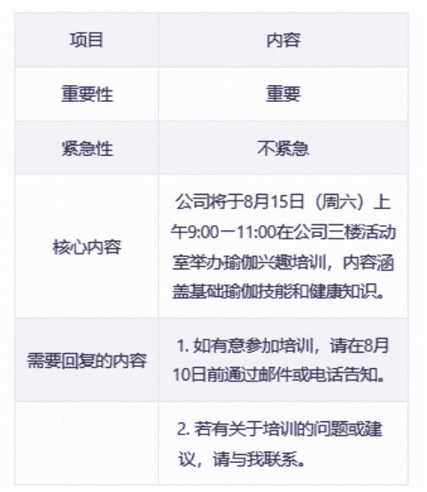

### **4.1.2 工作计划生成**
用户输入需求后，文心一言借助自然语言处理与机器学习，可快速解析需求并自动生成可参考的工作计划，帮助用户更高效地制定合理安排。

**Q**
能否为资深软件测试工程师制定第三季度工作计划，目标是完成测试用例管理后台并完成至少三个通用核心业务自动化测试脚本。计划需包含工作目标、工作任务、所需资源、风险预测、跟进与评估。

## **A**
第三季度软件测试工程师工作计划

**一、工作目标**
本季度完成测试用例管理后台研发上线，并完成三个通用核心业务自动化测试脚本。
后台需具备用例创建、编辑、删除、执行、报告等完整功能。
脚本需覆盖功能、性能、兼容性等，提升自动化水平。

**二、工作任务与时间表**
测试用例管理后台开发上线
截止：Q3-M-31
主要任务：数据库设计、界面设计、后端开发调试、前端开发调试、上线部署。

**三、所需资源**
人力、硬件、软件及外部支持。

**四、风险预测**
技术难点：可能需学习新技术或求助同事。
延期风险：不可预见问题可能导致延期。
需求变更：需灵活调整计划。

**五、跟进与评估**
每两周召开进度会，评估并调整。
季度末总结经验，持续改进。

**Q**
请为销售经理制定月度计划，目标提升业绩。

### **A**
销售经理月度计划

**一、引言**
销售经理需带领团队达成目标并保障客户满意。本月聚焦市场份额扩大、客户满意度提升、销售流程优化及团队培养。

**二、工作计划**
制定销售策略（×月×日至×月×日）
分析市场需求、行业趋势及竞争情况
制定推广、定价及销售目标方案

拓展市场与渠道（×月×日至×月×日）
拓展客户群，挖掘潜在客户
与市场部协作策划执行活动

优化销售流程（×月×日至×月×日）
完善销售漏斗，提升线索转化
优化客户服务流程，提升满意度

培训与团队建设（×月×日至×月×日）
开展销售技巧培训
加强协作沟通，完善数据统计分析

**三、资源安排**
人员：销售经理、代表及客服
时间：合理分配各阶段工期
资金：申请市场推广预算
物资：产品手册、话术等

**四、风险管理**
市场变化：跟踪竞争动态及时调整策略
客户需求变化：定期收集反馈优化产品服务
人员流失：完善留任政策
预算超支：严格执行并及时汇报调整
产品问题：协同生产研发快速解决
法律风险：遵守法规保护商业机密
数据安全：保障数据准确与安全
合规性：严格遵循公司合规政策
内部沟通：加强协作及时汇报
培训效果：制定分层培训并鼓励学习分享

### **4.1.3 职场话术生成**
该功能可根据场景和目的自动生成符合职场规范的表达，帮助提升职业素养与沟通效率。如寒暄、开场、结束、感谢、邀约回复等，均可按行业定制模板。

**Q**
请以严肃语气向直属领导汇报公司新引进的环境污染处理系统，需结合受众特征组织语言。

# **A**
领导您好：

致信汇报公司新引进的环境污染处理系统。该系统将为长期存在的环境污染问题提供全新解决方案。

系统采用高效过滤器、生物传感器等先进技术，可将污染物转化为无害物质。自动化程度高，可减少人工与成本，提升处理效率。引入后将显著改善公司环境形象，契合公司环保承诺。

恳请安排时间了解系统并考虑实施，以实现更环保高效的运营。感谢阅读。

**Q**
请撰写公司聚会上老板激励员工的一段讲话。

### **A**
各位同事，晚上好！

感谢大家参加年度聚会。大家为工作与家庭、为共同目标付出了辛勤汗水，正是你们的付出成就了公司。

今晚请放松享受美好时光。同时也想说，我们的工作与未来需要持续付出与努力。

公司使命是为客户提供优质产品服务，为社会创造更大价值。每个人都是关键，需要携手进步，共创梦想。

路还很长，目标更大。未来一年需保持热情专注，提升效率质量，持续创新发展。只有如此，才能在激烈竞争中立足，实现理想。我相信大家都有无限潜能，只要坚定信心、坚持不懈，必能创造更美好的未来。

再次感谢过去一年的努力，让我们携手再创辉煌！谢谢！

### **4.1.4 日报生成**
该功能帮助用户梳理当天工作成果并规划次日任务。可记录任务完成情况、进展、问题及解决方案，并关联文件链接。

**Q**
根据我的产出生成日报，需突出成果并制定明日计划。主要产出：拜访3位高潜客户，其中1位签约价值10万元意向合同。

# **A**
工作日报——2023年4月25日

工作总结
今日完成：
拜访3位高潜力客户，了解需求及产品反馈。
与其中一位签署10万元意向合同。

交流中获取了客户需求、反馈及市场趋势等宝贵信息，有助于调整销售策略。
同时注意到客户对售后服务需求更强，需进一步完善。

明日计划
整理客户反馈，分析市场与竞争态势。
保持客户联系，挖掘进一步需求。
协同售后团队优化服务流程，提升满意度。

优先级：
高：完善售后流程
中：分析市场需求
低：跟进意向客户

注：计划以实际情况灵活调整。

### **4.1.5 公司规章制度制定**
根据公司实际与业务需求，建立符合法规、适配发展的管理制度，涵盖员工、行政、财务、采购、销售等，确保规范运作。

文心一言可协助规划制度框架、提供条款建议、进行修订完善，并在实施中发现问题及时优化。

**Q**
为一家互联网公司制定差旅费用管理规则。

# **A**
差旅费用管理规则

第一章 目的与适用范围
规范差旅行为，节约费用，保障员工出差支持。本规则适用于全体员工及合作伙伴。

第二章 差旅方式选择
认可飞机、火车、汽车、步行等。选择应遵循经济高效安全原则，特殊方式需提前报批。

第三章 住宿管理
按公司标准选择住宿，须通过指定平台预订。入住应遵守场所规定，保持整洁爱护设施。

第四章 交通管理
应使用公司规定交通工具。私家车需报备审批。公共交通须遵守规则注意安全。

第五章 费用结算与报销
按标准结算。一般出差结束后7个工作日内提交单据报销。特殊情况需提前申请延期。

第六章 其他规定
须遵守保密规定，不得泄露机密。纠纷按公司流程处理。遵守国家法律法规，注意个人与公司形象。

以上为主体内容，未尽事宜及时请示主管配合执行。

### **4.1.6 办公软件专家**
文心一言具备办公软件专业知识，可提供咨询与技术支持。

**Q**
作为办公软件专家，请解答Excel如何去除重复数据，并尽量举例说明。我的问题是Excel中如何去除重复数据？

# **A**
在Excel中去除重复数据可按以下步骤操作。

打开Excel并载入数据表格。

Excel 单列去重操作

先点选需要清理重复的列。
切换到 数据 选项卡，打开 删除重复项。
在弹出的设置框里确认作用范围后，点击 确定 执行。
完成后，该列内部重复的单元格会被清除。提示：此做法只针对被选中的单一列，不会把其它列一起参与比对判断。

举例说明：

原始表格如下。

执行后表格变为：

可以看出，“小明”这一重复行被去掉了。

**Q**
Word 文档里的分页符怎么去掉？

# **A**
在 Word 中清除分页符可按下面步骤操作：

**1** 打开待处理的 Word 文档。
**2** 按 Ctrl+H 调出 查找和替换 面板，切到 替换 标签。
**3** 在 查找内容 框中填写 “^m”，m 为英文小写，对应分页符。
**4** 替换为 框保持空白，表示替换为空即删除。
**5** 点击 全部替换，文档里的分页符会一次性被移除。

另外可手动删除。将光标移到分页符前，按 Delete 键即可。分页符通常不可见，操作前需确认光标位置准确。

注意：删分页符可能影响排版与段落衔接，不确定的话先备份再修改。

### 4.1.7 生成调研报告
生成调研报告是对特定主题开展调查研究并把结果、结论与建议形成书面材料的过程，是传递研究发现并为决策提供依据的重要方式。

**Q**
你是一名新消费领域的专家，请设计一份面向新消费行业的调研方案，要求目的清晰、方案合理、问卷可靠。

### **A**
新消费行业调研方案

**一、界定调研目的**
本次调研旨在洞察新消费赛道的发展动向、消费者行为变化及品牌竞争格局，为企业制定竞争策略与发展规划提供参考，也为投资方提供决策支持。

**二、调研方案设计**
研究方式：定量与定性结合，综合宏观数据、行业报告和专家访谈深入分析。
样本构成：覆盖不同区域、年龄层和收入层级的新消费人群，保证代表性。
时间规划：整体约 3 个月，包含准备、数据采集整理、分析与报告撰写。
关键变量：主要关注消费行为、消费习惯、购买意愿、品牌认知等维度。

**三、问卷制作**
结构：分为基本信息、消费行为与态度三大块，约 150 题。
题型：单选、多选、开放填空混合使用，提升灵活性。
选项：采用李克特量表，便于后续比较分析。

**四、调研执行**
渠道：线上线下结合，如电商平台、社交媒体、问卷链接等广泛邀约。
协作：与高校合作动员学生参与，提高回收效率。
数据处理：对原始数据清洗、整理并做初步分析，为深度挖掘做准备。

**五、报告撰写**
文字部分：用简洁清晰的语言描述行业现状、趋势与行为变化。
数据呈现：用图表展示核心指标，直观呈现发现。
结论建议：在结果基础上给出针对性结论与策略建议，助力企业决策。
撰写逻辑：按研究背景、方法、分析、结论与建议展开，保持条理。

以上方案期望为新消费行业的从业者与投资人提供可靠信息，助力发展与决策。

### 4.1.8 生成 PPT 大纲
文心一言的 PPT 大纲功能能依据主题与需求自动输出提纲、简介、要点分析、重点内容与建议，并非直接生成完整文件，而是提供结构化框架供用户填充细节。

**Q**
现在你需要制作一份 PPT，并依据我给出的主题准备内容。最终需给出“目录”和“内容”两部分。主题是人工智能在医疗行业的应用。

# **A**
目录

**1** 人工智能在医疗行业的应用概述

**2** 人工智能在医疗影像诊断中的应用

**3** 人工智能在疾病预测和预防中的应用

**4** 人工智能在药物研发中的应用

**5** 人工智能在医疗行业中的挑战与机遇

## 内容

**1** 人工智能在医疗行业的应用概述
·AI 技术发展脉络及在医疗领域的落地现状
·AI 对医疗行业的价值与必要性
·未来走势与展望

**2** 人工智能在医疗影像诊断中的应用
·影像诊断现存的痛点与难点
·AI 在影像判读中的技术路径
·典型案例及效果

**3** 人工智能在疾病预测和预防中的应用
·基于大数据的疾病预测模型构建
·AI 在慢病预防中的实践与案例
·在传染病防控中的潜力与限制

**4** 人工智能在药物研发中的应用
·传统研发流程与瓶颈
·AI 在研发环节的主要场景
·辅助研发案例展示与效果

**5** 人工智能在医疗行业中的挑战与机遇
·落地面临的难题及应对思路
·AI 带来的机会点
·医疗与 AI 融合的长远走向

### 4.1.9 AI 调色板
AI 调色板可帮助用户管理与使用色彩，提供搭配建议。用户可输入指定颜色或从图片提取色值，系统依据色相、饱和度、明度等参数推荐协调色。亦可实现色彩迁移，上传图片后自动解析主色并生成参考板。

**Q**
我希望你充当一个调色板，请依据我的需求给出对应十六进制颜色值。需求是生成偏暗的绿色。

### **A**
偏暗绿色的参考色值：

·#40a040：深绿基调
·#5f8040：中深绿调
·#808040：偏暗黄绿

以上色值保持绿色主调且整体偏深。

**Q**
我希望你充当一个 AI 调色板，分析下面这张图的色彩，并生成一个参考调色板。

# **A**
依据提供的图片信息，整理如下配色参考。

色彩解读：整体以白色为底，主体为花瓶与花朵。花瓶为深蓝色，花朵呈现红、黄、橙、紫等多色，在白色背景映衬下更显鲜艳。

调色板建议：

·花瓶：深蓝
·红色花朵：红 + 白
·黄色花朵：黄 + 白
·橙色花朵：橙 + 白
·紫色花朵：紫 + 白
·背景：白

仅作参考，可按实际需求与个人喜好微调。

### 4.1.10 写述职报告
述职报告是向领导汇报一段时期工作表现与成果的文书，用于总结回顾、发现不足、展示业绩并规划下一步目标。

**Q**
你是一位高级产品经理，请编写一份述职报告，体现 NPS 提升相关工作内容，要求全面、简洁、客观、真实、专业。

### **A**
领导您好！我是高级产品经理，自加入公司以来持续聚焦用户体验与客户满意度。下面重点汇报提升净推荐值方面的实践。

我理解 NPS 是衡量客户是否愿意推荐产品或服务的指标，反映满意度与忠诚度，提升 NPS 是推动业务增长的关键。

采取的举措如下。

**1** 深入了解客户需求
通过问卷与在线访谈与多位客户交流，收集功能、体验、服务的反馈，归纳核心诉求与期望。

**2** 产品优化
结合反馈与开发团队协作，新增急需功能，优化界面设计，提升系统稳定性和响应速度，并推出部分个性化定制服务，有效提升满意度与忠诚度。

**3** 建立完善的客户服务体系
构建电话、邮件、在线客服等多渠道服务体系，并加强服务团队培训与管理，提升服务时效与专业度。

**4** 邀请客户参与改进
邀请忠实用户参与新产品与新功能的测试评估，收集宝贵建议并快速迭代。

在上述举措推动下，公司 NPS 出现明显提升。

### 4.1.11 生成柱状图和折线图
柱状图适用于分类数据的对比，通过柱体高度直观体现各类别数值大小及差距。
折线图适用于连续变化趋势的展示，将数据点连成曲线，便于观察随时间或其他连续变量的变化规律。

**Q**
请用柱状图展示 2023 年 GDP 排名前五的中国城市。

# **A**
以下图表展示了 2023 年 GDP 排名前五的中国城市。

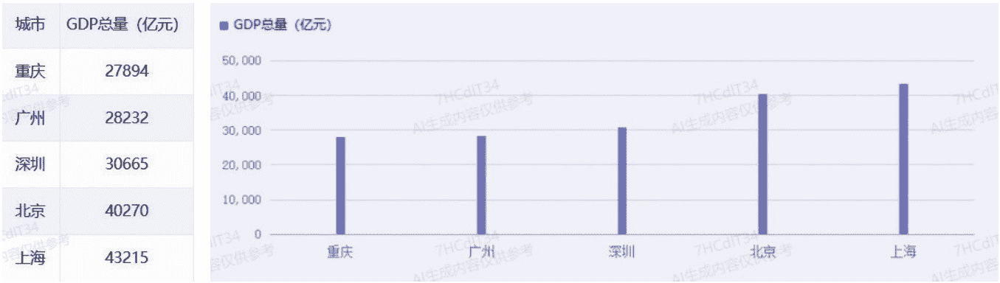

**Q**
请用折线图展示世界人口增长趋势。

### **A**
以下图表展示了世界人口增长趋势。

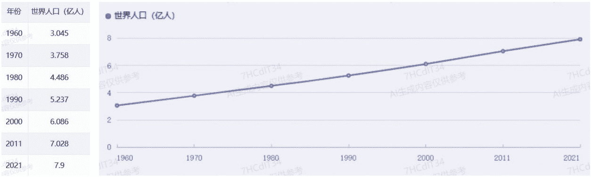

## 4.2 智能生成营销方案
文心一言具备强大的自然语言处理能力，可帮助企业和个人实现营销自动化，提升效果与体验。下面是相关应用案例。

### 4.2.1 小红书营销方案
小红书营销方案旨在提升品牌曝光与产品销售。制定时需明确受众、选择内容形式、制定推广策略并合理控制预算。

**（1）确定目标受众：**了解年龄、性别、兴趣、消费能力等特征，以便精准投放。
**（2）选择内容形式：**笔记类内容受用户欢迎，建议采用教程、心得、测评等实用形式。
**（3）制订推广策略：**
标签营销：结合热门标签提升曝光。
KOL 合作：借助影响力达人背书。
社群运营：建立品牌相关社群增强黏性。
**（4）合理安排预算：**依据实际情况划分预算并制定投放计划。

**Q**
以“红宝石咖啡馆，纵享每一口丝滑！”为标题写一篇小红书文案。正文需包含浓香拿铁、坚果酸奶碗、哥斯达黎加手冲咖啡等产品的简介。每段用表情隔开，需包含店名、地址、产品推荐和环境介绍，至少插入 5 个表情。

### **A** 

 红宝石咖啡馆，纵享每一口丝滑！ 

 浓香拿铁 

慵懒午后在红宝石咖啡馆尝一口浓香拿铁，咖啡的醇厚与奶香轻柔交织，口感细腻层次丰富，让繁忙之余多一份小确幸。

 

 坚果酸奶碗

一碗酸甜适中的坚果酸奶碗选用优质酸奶与新鲜坚果，搭配自制果酱，回味悠长，仿佛回到童年的清甜时光。

 

哥斯达黎加手冲

哥斯达黎加手冲呈现出豆子的醇厚与迷人香气，口感浓郁层次分明，在红宝石咖啡馆可细细品味这场味觉盛宴。

  

红宝石咖啡馆

 地址：市中心商业区 88 号

店面位于市中心商业区核心地段，交通便利，环境雅致。柔和灯光、舒适沙发与贴心服务，让人倍感宾至如归。#红宝石咖啡馆 #浓香拿铁 #坚果酸奶碗 #哥斯达黎加手冲 #品味生活 #品味幸福

### 4.2.2 短视频带货脚本
短视频带货脚本是拍摄和推广商品前的文字蓝本，包含对话、场景、动作指导和商品展示要点，有助提升观看兴趣与转化。

常见流程：
**（1）明确推广目的：**如提升知名度、销量或关注度，指导后续策略。
**（2）写剧本：**突出商品卖点、使用方式，吸引目标人群。
**（3）拍摄素材：**注意画面稳定、光线与角度。
**（4）剪辑加工：**剪掉冗余，加入音乐、字幕和特效。
**（5）添加购买信息：**植入链接与购买指引，便于转化。
**（6）发布推广：**投放至短视频平台和社交渠道扩大触达。

**Q**
现在你是一位带货博主，依据我给出的商品信息撰写一段直播带货口播文案。需突出商品亮点，激发购买欲。商品信息如下：

商品名称：度度保温杯。
商品亮点：容量大、保温性能好、便携性强。

# **A**
各位观众朋友大家好！今天给大家推荐一款超实用的好物——度度保温杯，集大容量、强保温与高便携于一体。

先说容量，这款杯子有 500ml，通勤或旅行都不怕水不够喝。

再看保温，采用先进真空隔热技术，可维持 48 小时以上恒温，随时喝到合适温度的饮品，冬季也能暖手暖心。

便携性也很突出，杯身轻巧好携带，食品级不锈钢材质安全耐用。

总的来说，度度保温杯自用送人都很合适。直播间现在有专属优惠，喜欢的小伙伴快点下方链接下单吧，别错过！

### 4.2.3 电销/面销话术
电销/面销话术是在电话或面对面销售中引导客户购买的沟通技巧，有助了解需求、化解疑虑、促成成交。

常用技巧：
**（1）建立良好的客户关系：**在沟通中保持热情、礼貌和亲和，用询问需求和疑虑的方式收集客户基本信息，以便更精准地推荐产品或服务。

**（2）强调卖点**：销售时必须把产品的特质与优势凸显出来，才能抓住消费者的注意力。比如推销化妆品，就要重点介绍其独有成分以及带来的实际效果；推销食品，则要突出它的营养构成和口感体验。

**（3）打消顾虑**：成交过程中，客户难免对商品或服务产生疑问。销售人员要用清晰简练的语言逐一解答。如果客户在意价格，就要说明产品的性价比优势；如果担心品质，就要提供质量承诺并说明使用年限。

**（4）促成购买**：销售环节中需要借助多种技巧引导客户下单。可通过促销活动、折扣优惠、赠品等方式制造购买冲动，也能通过详述产品特性与长处来争取认可，还能通过探询需求和疑虑帮助客户做出决策。

Q
请为青岛海景房的电销人员设计一套话术，要求突出单价低、物业服务优质、海景优美的三大卖点，同时列出电话销售中客户常问的问题及对应答法。

A
您好，感谢致电青岛海景房销售中心，很高兴为您介绍这套高性价比的海景房源。

项目坐落在青岛知名海滨板块，景致绝佳，气候温润。漫步沙滩，可眺望开阔海景，沐海风，尽享自然馈赠。物业团队服务专业到位，提供全流程居住支持，让生活体验更为舒适。当前房源稀缺，单价处于低位，入手时机难得。接下来为您梳理几类常见咨询。

问：具体位置在哪？
答：房源位于青岛市核心海滨度假区，面朝优质沙岸与静谧海湾，距市中心车程很短，既能度假又能兼顾都市便利。

问：物业服务包含哪些？
答：我们的物业团队服务细致热情，提供日常保洁与设施维护，并协助处理各类居住问题。服务体系覆盖24小时安保监控与前台接待，保障居住安全安心。

问：户内配置如何？
答：住宅配备齐全的家具、厨具及卫浴设施，并已开通高速网络与卫星电视，让您在欣赏美景的同时保持与外界顺畅连接。

问：如何查看更多图文资料？
答：您可致电销售中心获取样册影像，或登录官方网站与社交平台浏览更多内容。我们还诚挚邀请您到现场实地考察。

如有兴趣，欢迎随时预约看房，祝您周末愉快！

注：以上话术仅作参考，具体内容请结合实际情况灵活调整。

### 4.2.4 微商朋友圈文案
微商朋友圈文案通过微信朋友圈向潜在客户呈现商品或服务的优势与价值，以激发购买兴趣。撰写时宜采用生动形象的描述与情感化表达，调动购买欲望。

优秀的朋友圈文案通常具备以下特征。

**（1）抓眼球：**以一个引人入胜的画面或一个有趣的现象开场，引起兴趣与好奇。
**（2）点需求：**描绘客户的真实需求，凸显商品特点与优势，促使其产生购买意向。
**（3）建信任：**展示品质、功效与价值，降低决策阻力。
**（4）促行动：**给出明确的引导或号召，推动客户下单或了解更多。

撰写技巧。

**（1）明确目标人群：**了解受众的需求偏好与消费心理，以便精准呈现卖点。
**（2）情感化表达：**用富有温度的语言让客户感受到产品的价值。
**（3）文字精炼具体：**用简练明确的描述呈现特点与优势，便于快速理解。
**（4）引导行动：**通过明确的号召促使客户购买或进一步咨询。

Q
现在你是一名微商，请依据以下商品信息撰写一条微信朋友圈文案。商品名称：度度保温杯。亮点：容量大、保温好、便携强。要求用优美辞藻构建一个吸引人的场景，文案尽量简短。

A
冬日寒风乍起，你是否想随时喝到一口热饮？度度保温杯，让温暖无处不在。

这款杯体容量可达500毫升，满足一整天的饮水需求。严寒中依旧能长时间锁住温度，每一口都是暖意。机身轻盈小巧，轻松装进背包或手袋，无论在办公桌前、户外漫步还是旅途中，都能随时取用。

还在挑剔保温杯？度度保温杯值得你拥有。点击下方链接下单，让这个冬天多一份温暖。

### 4.2.5 广告片文案
广告片借助文字、画面、声音多重手段，向目标受众展示产品特点与价值，从而吸引关注、激发购买欲并引导行动。广告片文案承担传达意图、主张与承诺的作用。

常见写作技巧。

**（1）制造吸引力：**以引人入胜的画面或新鲜事实切入，引发注意与好奇，例如智能扫地机器人广告开篇的设想。
**（2）突出特点：**强调产品独特优势，让受众感知价值，例如自主规划清扫路径、智能识别地面等。
**（3）建立信任：**借助品牌信誉、质量保障等要素增强信任感，例如先进人工智能技术、定时定点完成清扫等表述。
**（4）引导行动：**给出清晰的行动号召，例如在官网下单购买。

Q
请为一款智能扫地机器人设计广告片营销文案，要求体现智能操控与省时省力的特色。

A
想象一下，地面洁净如镜，而你正悠闲自在。这一切由我们的智能扫地机器人完成，它是居家生活的得力助手，让生活更轻松省心。

产品搭载领先的人工智能，可自主规划清扫路线、智能识别地面材质。无论是木地板、瓷砖还是短毛地毯，都能应对自如。智能控制系统可自动规避障碍，避免卡顿，让清洁过程更安心。

机器人还具备自动回充功能，电量低于20%时自行返回充电座充电，充满后继续清扫。

使用它，您无需再耗费大量时间手工打扫。在忙碌的工作与生活中，只需设定定时任务，机器人便会按点完成清洁，让家始终整洁如新。

体验全新的智能居家方式吧！即日起在官网下单，即可开启省心、轻松的家居生活，让智能扫地机器人成为家庭新成员，共同开启美好生活。

### 4.2.6 鸡汤文案
鸡汤文案偏重情感与激励，常用于商品推广，激发购买冲动。

常见特点。

**（1）情感化描述：**用温暖的语言描绘产品，例如度度保温杯文案中“温暖的小太阳照亮工作时光”“像一位贴心朋友”等。
**（2）强调实用价值：**突出实用性与价值，例如容量大、便携强、保温性能等。
**（3）激励性表达：**调动情感，例如“你还在等什么呢？”

Q
请用鸡汤风格为度度保温杯撰写一段生动的文案。

A
在快节奏的时代，我们追求既时尚又实用的生活方式。今天请允许我介绍一款内外兼修的良品——度度保温杯。

寒冬清晨，你踏入办公室，打开抽屉，一抹温暖如“小太阳”点亮整日节奏。那是你随身的度度保温杯，像位贴心伙伴，用温度与关怀陪你走过每段时光。

无论是奋战在职场的白领，还是热爱探索的户外爱好者，这款容量充裕、携带便捷的杯具都能满足你的需求。它宛如随身的微型暖炉，无论身在何处，都能为你奉上一口热饮。

只要一个链接一次点击，这份温暖便能拥有。那你还在犹豫什么？让我们一起拥抱温暖，迎接冬日阳光吧！

## 4.3 商业投资分析
商业投资分析是对投资项目进行系统评估，以判断可行性、风险与回报，需要结合市场、技术、财务等多维度研究。

借助智能工具进行商业投资分析，可以全面掌握信息并获得更合理的投资建议。

### 4.3.1 PEST 分析
PEST分析用于评估宏观环境，P为政治、E为经济、S为社会、T为技术。

借助PEST工具可以评估企业或项目面临的政治、经济、社会、技术环境，帮助决策制定策略。

Q
你是咨询顾问，请对小草智能音箱进行PEST分析，要求从政治、经济、社会、技术四维度展开，并尽可能结合数据或文献。

A
作为咨询顾问，对小草智能音箱进行四维度研判如下。

政治维度
智能音箱行业受政策法规与政府态度影响显著。近年来中国政府高度支持人工智能发展，出台多项规划鼓励创新研发。针对智能家居的系列政策也推动了智能音箱市场扩容。

经济维度
经济增长与居民收入提升带动智能家居快速发展，智能音箱作为核心品类规模持续扩大。小草智能音箱虽占有一定份额，仍需与阿里巴巴、腾讯、小米等巨头竞争。

社会维度
市场需求受使用场景、体验与品牌力影响。家居娱乐是主要场景，用户对音质、响应速度、语音识别精准度要求较高。

技术维度
技术进步推动语音识别与语义理解能力提升，交互更自然。功能也在拓展，如智能家居联动、音视频通话、语音翻译等。

建议：1 强化技术与功能创新，提升竞争力；2 增强品牌影响力与口碑；3 实施精准营销，提升用户体验；4 关注政策变化，及时调整经营策略与商业模式。

### 4.3.2 投资分析
投资分析为投资者提供项目与标的的深入评估，帮助判断潜在风险与回报、竞争地位与发展潜力。

主要包括：项目分析、目标公司分析、行业分析、风险评估、投资建议与策略分析。

Q
你是一位资深投资人，请对××××公司进行分析并形成投资分析报告，要求包含财务状况、行业状况、公司估值分析。财务部分需从资产质量、成长性、收益性切入，并结合权威数据，确保内容详实有层次。

A
投资分析报告：对××××公司的综合评估

**一、公司概览**
××××公司在全球市场占据重要地位，依托持续研发投入与市场拓展实现稳健增长。

**二、财务状况分析**
1. 资产质量
根据最新财报，公司总资产达【具体金额】，流动资产占比【具体比例】，非流动资产占比【具体比例】，流动性较强，有利于运营扩张。应收账款与存货管理高效，资金流转顺畅。
2. 成长性
近年收入稳步提升，总资产与净利润均呈现增长态势，年均复合增长率达【具体增长率】，显示业务持续扩张。
3. 收益性
最新财报显示毛利率与净利率分别为【具体毛利率】与【净利率】，均高于行业均值，体现运营与管理效率优势。

**三、行业状况分析**
公司所处行业处于高速发展期，潜力巨大。据权威机构预测，未来五年市场规模将以【具体增长率】速度增长。

**四、公司估值分析**
采用现金流折现法测算，企业价值约为【具体企业价值】。在保持现有增速下，预计能为投资者带来可观回报。

总体来看，公司在行业内具备明显优势与增长潜力，发展前景积极。投资决策仍需综合其他相关因素。

### 4.3.3 SWOT 分析
SWOT分析通过梳理内部优势劣势与外部机会威胁，形成矩阵分析，为战略制定提供依据。

Q
请对减脂餐进行SWOT分析，要求结合数据且全面。

A
减脂餐的SWOT分析

减脂餐是为帮助减重或降低体内脂肪而设计的饮食方案。

**优势**
1 效果可见：由营养师按科学原则设计，能明确热量与营养，提供有效减脂支持。
2 热量可控：整体热量低于普通饮食，有助控制日摄入。
3 营养均衡：包含蛋白质、脂肪、碳水、维生素与矿物质，确保减脂期营养供给。

**劣势**
1 口感不足：低热量配方导致风味可能偏弱。
2 坚持难：见效需较长时间，部分人群易中途放弃。
3 营养失衡风险：部分产品偏重单一成分，长期使用或导致营养不均。

**机会**
1 健康意识提升：消费者对饮食与健康关注度上升。
2 需求旺盛：肥胖人群增多，减脂餐市场需求扩大。
3 技术进步：营养学与食品加工改善口感、多样性与营养保持。

**威胁**
1 食品安全隐患：存在添加违禁成分或卫生不达标风险。
2 体重反弹：停用后易出现反弹。
3 竞争激烈：品牌众多，价格战可能影响品质。

总体而言，减脂餐具备明显优势与市场机会，但亦需关注劣势与威胁。消费者应选择正规品牌，按专业建议使用，注意安全与长期效果。

### 4.3.4 4P 营销分析
4P营销分析包括产品、价格、促销、渠道四个要素。

Q
请对度度智能音箱进行4P营销分析，要求尽可能详细。

A
对度度智能音箱进行4P营销分析。

**一、产品**
度度智能音箱作为智能家居设备，其特征体现在以下方面。

**1** 音质表现：音质是核心购买因素。产品提供高保真音效，声音清晰稳定，满足音乐、播客等需求。
**2** 智能化功能：具备语音助手、智能家居控制、音视频通话等功能，通过语音指令完成操作，提升便利性。
**3** 设计风格：外观简约大方，适配各类家居环境，采用优质材质，触感舒适，提升使用体验。

**4** 增值服务
度度智能音箱在核心功能之上，还叠加了多种延伸服务，像在线电台收听、即时新闻推送、气象播报等，让使用者在日常使用中既能更省心也能更有趣。

**二、价格**
度度智能音箱的售价定在199元，和市面上同类产品相比性价比比较突出。消费者在决策时往往会权衡性能、做工和价格等多个维度。凭借扎实的音质表现、稳定的功能体验以及丰富的附加服务，度度智能音箱给用户带来了物超所值的感受。

### 4.3.5 波士顿7S框架解析
波士顿7S模型由麦肯锡提出，是一种用来诊断组织健康的分析工具，企业在成长过程中需要同时兼顾结构、制度、文化氛围、人员、能力、战略和核心价值观等七大要素。

**Q**
请运用波士顿7S模型对度度保温杯做一次系统全面的分析，要求论述完整、内容详实。

**A**
波士顿7S分析：度度保温杯

**一、战略**
度度保温杯的市场定位是打造高品质、绿色、智能化的保温杯领军品牌，致力于依托技术创新和差异化设计为用户提供更优质的饮用体验。具体战略方向包括：

**1** 品质为先：严控原材料甄选与生产工艺，确保产品经久耐用、价值持久。
**2** 绿色理念：选用环保材质并应用节能技术，降低对环境的影响。
**3** 智能化布局：将温度显示、智能保温等智能元素融入产品，以匹配当代用户需求。
**4** 研发驱动：持续探索新材料应用，不断提升产品性能与品质。
**5** 渠道扩张：构建线上线下联动的分销体系，推动品牌走向境内外市场。

**二、组织结构**
为适应市场变化并提升执行效率，度度保温杯的内部分工如下：

**1** 研发部：负责新品规划、设计开发以及材料工艺的优化研究。
**2** 生产部：承担制造任务与质量管控，追求高质量与高效率并重。
**3** 销售部：负责市场开拓、渠道维护及客户服务工作。
**4** 运营部：统筹供应链管理与企业资源规划，保证整体运转顺畅。
**5** 品牌部：主导品牌形象塑造与市场传播，提升品牌影响力。

**三、管理制度**
度度保温杯高度重视制度建设，确保运营规范、可持续：

**1** 质量管控制度：通过严格的质量检查流程保证产品稳定可靠。
**2** 安全生产制度：制定安全操作规范与规程，保障员工与企业安全。
**3** 知识产权保护制度：以专利、商标等方式维护创新成果。
**4** 环境保护制度：推行环保举措与节能政策，减少负面环境影响。
**5** 员工培养制度：提供培训与成长机会，提升团队综合能力。

……

### 4.3.6 产业顾问
产业顾问是指为企业在运营、扩张等阶段提供战略制定、管理优化等专业咨询的专家型人才。

这类顾问通常具备深厚的行业积累，对所在领域市场格局、竞争态势、技术走向有清晰认知，同时拥有较强的沟通协调、分析判断与问题解决能力，帮助企业化解发展中的各类难题。

作为大模型，文心一言能够围绕数字化转型、市场营销、人力管理、财务管理等议题提供咨询支持。尽管并非真人顾问，它仍可通过海量数据、案例与专业知识的综合分析，给出可信的建议与解决方案，助力企业长期发展。

**Q**
请扮演咨询公司的专业顾问，先列出权威机构数据与报告，再结合专业视角解答我关于产业发展的问题。问题是元宇宙项目的盈利模式有哪些？

**A**
**一、权威数据与报告**
国际数据公司IDC预计，到2025年全球元宇宙市场规模将达327亿美元，2020至2025年间年均复合增速约39.4%。
市场研究机构Gartner预测，到2027年全球超四分之一人口将进入元宇宙；到2031年元宇宙或创造3.3万亿美元商业价值。

**二、元宇宙项目盈利路径**
元宇宙项目的变现方式多元，主要包括：
AR/VR硬件销售：AR/VR设备是进入元宇宙的入口，设备出货与销售是重要收入来源，随着成本下降销量有望提升。
游戏与娱乐：沉浸式游戏、娱乐内容提供差异化体验，制作与发行成本相对可控，互动性强。
广告变现：虚拟现实广告、增强现实广告与数字广告并存，品牌方可在虚拟空间投放形象进行营销。
数字资产交易：虚拟货币、虚拟商品、虚拟地产等资产可在线交易，为平台带来手续费与增值收益。
知识产权运营：元宇宙环境下知识产权的登记、授权与保护机制更完善，可形成新的收益点。
社交与会议：沉浸式社交、线上会议场景可收费，提升用户粘性并产生商务价值。
在线教育：借助虚拟现实技术提供更直观生动的教学内容，提升教育服务溢价。

总体来看，元宇宙盈利模式仍在探索中，未来可能出现更多创新形态。

## 4.4 智能取名助手
借助文心一言进行产品命名可节省时间并激发灵感。建议注意以下要点：
**1** 明确产品特性。先厘清功能、用途、目标人群与卖点，便于生成贴合的名称。
**2** 提供关键词。输入与产品相关的词，生成更精准的结果。
**3** 简洁易记。名称最好短小精悍，发音顺口便于记忆。
**4** 保持独特性。避免与已有品牌重名造成混淆。
**5** 兼顾创意。可尝试组合不同词汇或概念形成新颖表达。
**6** 规避负面联想。留意语义不当或易产生误解的词汇。
**7** 多次迭代。反复生成挑选最符合定位的名称。

**Q**
我正在做一款智能手环，主打健康监测与运动数据追踪，希望名称能体现智能、健康与运动特性，同时易读好记、吸睛。请提供创意建议。

**A**
基于您的需求，推荐以下命名方向：
**1** 智康环踪：融合智能、健康、追踪，直观体现核心功能。
**2** 康动智圈：康动寓意健康运动，智圈暗示智能环绕，整体感强。
**3** 悦动智护：悦动传递愉悦运动感受，智护突出智能健康守护。
**4** 智行康伴：智行体现智能陪伴，康伴强调健康伙伴定位。
**5** 健智环影：健智结合健康与智能，环影比喻手环如影随形记录数据。

## 4.5 招聘求职文案一键生成
当前就业竞争激烈，文心一言凭借优秀的语言理解与生成能力，可为求职者与企业提供支持。求职者可借助它撰写简历、自我介绍模板与面试技巧；企业则可借助它制定招聘方案、设计面试题并通过简历与表现分析实现智能人才匹配。

### 4.5.1 招聘公告生成
文心一言能解析企业的岗位需求、职责描述、工作地点、薪资等信息，并据此自动生成招聘公告，提升发布效率，节省人力成本。

**Q**
请根据以下信息撰写招聘公告：行业电商，岗位资深跨境电商运营，目标负责公司英国市场拓展。公告需包含岗位职责与岗位要求。

**A**
招聘公告：资深跨境电商运营
公司简介：我司深耕电商领域，致力于为全球用户提供优质商品与服务，目前重点布局英国市场，急需经验丰富的跨境运营人才加入。
**一、岗位职责**
负责英国市场拓展与跨境运营策略的制定与执行；
主导英国站营销活动，提升品牌曝光与用户留存；
对接供应商与物流合作伙伴，优化供应链与履约体系；
分析市场趋势与用户行为，动态调整产品与营销策略提升业绩；
带领团队，提升整体运营水平。
**二、岗位要求**
本科及以上学历，电商、市场营销等相关专业优先；
3年以上跨境电商运营经验，了解英国市场与用户习惯者优先；
具备战略规划、运营分析与团队管理能力；
英语听说读写流利，可与海外同事与客户顺畅沟通；
熟悉跨境电商全流程，包括采购、仓储、物流、推广；
市场敏感度高，具备创新思维与快速响应能力。
我们提供有竞争力的薪酬福利与清晰的职业成长路径，欢迎投递简历。

### 4.5.2 面试问题生成
生成面试题可帮助候选人提前准备。建议：
**1** 明确岗位与行业，确保问题针对性。
**2** 生成通用题，如自我介绍、岗位动机、过往成就等。
**3** 生成岗位相关题，按具体职能定制。
**4** 生成行为题，考察冲突处理、进度延误应对、关键贡献经历等。
**5** 自定义题，根据简历经历追问项目挑战与个人贡献。
**6** 生成开放题，考察思维方式与沟通能力，如行业趋势判断、改进建议等。

### 4.5.3 自我介绍生成
文心一言可根据教育背景、职业经历、技能特长等信息，自动生成结构清晰、表达规范的自我介绍。

**Q**
请为产品经理岗位面试设计约1分钟自我介绍，需突出亮点、体现专业性。信息：北师大工商管理硕士；曾任互联网大厂高级产品经理5年，主导0到1设计本地生活App；擅长数据分析，会Python、SQL、Visio、Axure。

**A**
面试官您好，我是北师大工商管理硕士的张华。过去五年在互联网大厂担任高级产品经理，深耕本地生活赛道，曾从零搭建并上线一款本地生活App，贯穿需求挖掘、方案设计、研发落地与运营迭代全流程。
我的优势在于数据驱动的产品优化能力，掌握Python与SQL进行数据分析，能快速定位改进点；同时熟练使用Visio与Axure完成原型设计，与设计与技术团队高效协作。
工作上我注重跨部门协作与快速学习适应，乐于在变化中持续精进。感谢您给我此次机会，我相信我的经验能为贵司创造价值。

### 4.5.4 模拟面试官
模拟面试官功能可帮助求职者熟悉流程。用户输入岗位与公司信息后，模型会进行提问并反馈要求。

**Q**
我应聘前端开发工程师，请模拟面试官提问并告知岗位要求与职责。

**A**
好的，下面是针对前端开发工程师的常见提问：
**1** 请简单介绍教育背景与工作经历。
**2** 前端开发需掌握哪些基础技能？你自评如何？
**3** 请介绍一个你主导的前端项目，包括背景、技术栈与成果。
**4** 如何在保证体验的前提下做性能优化？
**5** 前后端接口对接你如何处理？使用过哪些测试工具？
岗位要求：本科及以上学历，计算机相关专业优先；2年以上前端开发经验；熟练HTML5、CSS3、JavaScript；熟悉React、Vue等主流框架；熟练Git；沟通协作良好，有持续学习意识。
岗位职责：负责网站与Web应用前端开发与交互优化；配合后端完成数据交互；进行代码与页面性能优化；参与技术选型与工程化建设；完成其他前端相关任务。

### 4.5.5 求职信撰写
求职信需结合个人经历、技能与兴趣，突出优势与岗位匹配度。

**Q**
请为一名即将毕业的会计学专业大学生撰写求职信，需包含教育背景、擅长技能、求职岗位与自我评价。

**A**
尊敬的招聘负责人：
您好！我是即将毕业的会计学专业学生，诚挚申请贵司会计岗位。
大学期间就读于知名财经院校会计学专业，系统学习财务分析、管理、审计与税务，熟练使用Office办公软件，具备良好团队协作能力。
我关注行业动态，保持持续学习，参与实习与社团活动锻炼了实操能力。
我对贵司会计岗位充满兴趣，相信专业基础与实践能力可为公司贡献价值，并愿意在工作中不断成长。
自我评价上，我具备扎实专业功底与实践经历，沟通表达清晰，充满热情与进取心。
感谢您审阅，期待面试机会进一步交流。
此致
敬礼
申请人

### 4.5.6 简历优化建议
根据目标岗位要求调整简历，可提升匹配度。

**Q**
岗位要求：本科及以上学历，广告、文学、影视设计相关专业；2年以上影视公司相关经验，有成功文案创意案例；文笔流畅，逻辑与归纳能力强；创意设计基础扎实，有审美。
我的简历：教育背景某传媒大学工商管理本科；亮点：校级一等奖学金、三好学生、广告创意比赛团队核心获二等奖、英语六级、志愿服务50小时；工作经历金文案公司文案编辑3个月。
请提出修改建议。

**A**
建议突出与岗位强相关的经历，弱化边缘信息：
教育背景可补充传媒相关课程或辅修，说明培养创意思维的基础。
亮点部分保留广告创意比赛获奖经历，突出文案策划与团队协作成果；奖学金与志愿服务可精简。
工作经历需详细描述3个月内完成的项目与产出，如撰写的文案类型、传播效果、创意亮点等，弥补时长不足。
增加创意设计能力说明，如熟悉的工具、审美训练经历。
强化语言表达与逻辑整理能力案例，如英语六级可关联翻译或双语文案能力。
整体结构围绕文案创意、项目案例、专业素养展开，提升与岗位要求的契合度。

影视文案岗简历优化精要

岗位核心工作
1. 参与影视相关项目的文案工作，承担创意稿件的撰写与归纳；
2. 联合团队推进多个重点项目的文案策划与制作，保证交付节奏；
3. 通过与客户的沟通对话精准把握需求，锻炼沟通、协调与问题解决能力；
4. 统筹组员分工与协作，提升团队执行效率。

个人核心优势
1. 文字功底和口语表达俱佳，能快速理解客户指向并给出可执行方案；
2. 熟练使用 Photoshop、Illustrator 等广告创意类软件，可独立完成基础设计；
3. 敬业度高，合作意愿强，责任心突出，执行层面细致；
4. 反应快，责任感强，能迅速适应新环境；
5. 审美素养良好，艺术水平较高，可为文案及视觉设计提供创意灵感。

简历优化思路
结合岗位诉求与现有简历，提出以下强化建议，突出匹配度。

教育经历
院校：某传媒大学。
专业方向：工商管理。
学位：本科。
亮点记录：
1. 获校级最高等奖学金，多次获评优秀学生；
2. 参加学院广告创意赛，担任核心成员带领团队获二等奖；
3. 通过英语六级，具备较好的英文读写能力；
4. 参与校级志愿服务，累计时长约 50 小时。

工作履历
单位：金文案公司。
职位：文案编辑。
周期：3 个月。
主要表现：
1. 参与多项影视项目的创意文案撰写与整理，获领导与同事认可；
2. 深度参与公司重点项目的决策讨论，为落地提供策划支持；
3. 与客户保持顺畅沟通，准确捕捉需求并转化为创意方案；
4. 承担团队内部分工与协同管理，保证项目准时交付并提升凝聚力。

技能概览
1. 文案与沟通能力扎实，善于把创意转化为流畅表达；
2. 熟练掌握 Photoshop、Illustrator 等设计工具，可独立产出高质量基础设计；
3. 敬业且乐于合作，责任心强，工作细心；
4. 思维敏捷，责任感强，融入新环境快；
5. 审美能力好，艺术修养较高，能为文案与广告设计提供灵感。

优化后的材料聚焦岗位关键点，凸显专业背景、实操经验、创意撰写能力以及团队组织协调优势，有助于求职中更好呈现专业价值。

## **4.6 编程智能助力**
编程智能辅助可提升代码编写与维护效率，覆盖自动补全、语法校验、建议输出、异常检测与性能改进等环节。

文心一言还可依托数据分析与自然语言处理技术，帮助用户更深入理解数据并应用于编程，提升整体体验。

### **4.6.1 代码问答互动**
代码知识问答为交互式问答场景，用于解答关于代码实现、语法等提问。

**Q**
你是一位 IT 专家，请回答：在 Linux 系统中如何查看指定 PID 端口？

**A**
在 Linux 下可通过 netstat 或 ss 查询指定进程占用端口。

netstat 的调用示例：

执行后会列出监听中的 TCP 与 UDP 端口并显示对应 PID，配合 grep 可筛选出目标 PID 的行。

ss 的调用示例：

ss 与 netstat 功能相近，同样展示监听端口及 PID，使用 grep 过滤指定 PID。

上述命令多需 root 或 sudo 权限方可执行。

### **4.6.2 程序解析**
代码理解功能可解析语法结构、变量、函数、类、模块及关系，并分析控制流与数据流，帮助把握执行逻辑。

**Q**
你是资深开发工程师，请逐行分析我的代码并给出理解。我给出的代码是：
SELECT dt,imei
FROM
（SELECT a.dt,a.imei,FIRST_VALUE（a.timestamp） OVER（PARTITION BY
a.imei,a.dt ORDER BY TIMESTAMP ASC） first_time,a.timestamp,actiontype
FROM hdp_kg_zf_splist.ods_dd_tb_app_action a
WHERE a.dt between '${date1}' and '${date2}' AND from_unixtime（cast（TIMESTAMP/1000 AS int）,'yyyyMMdd'）=a.dt

**A**
该语句用于从指定表抽取数据。逐行说明如下。

1 SELECT dt,imei：表明结果需包含 dt 与 imei 两列。
2 FROM：开始声明数据源。
3 （SELECT a.dt,a.imei,FIRST_VALUE（a.timestamp） OVER（PARTITION BY a.imei,a.dt ORDER BY TIMESTAMP ASC） first_time,a.timestamp,actiontype：子查询从 hdp_kg_zf_splist.ods_dd_tb_app_action 表选取列并使用窗口函数排序。
4 FROM hdp_kg_zf_splist.ods_dd_tb_app_action a：指定来源表并别名为 a。
5 WHERE a.dt between '${date1}' and '${date2}' AND from_unixtime（cast（TIMESTAMP/1000 AS int）,'yyyyMMdd'）=a.dt：限定日期区间且经转换后的 TIMESTAMP 等于 dt。

整体意图是在给定日期范围内，按 imei 与 dt 分组，取每个分组 timestamp 的最小值作为 first_time，最终返回 dt 与 imei。

注意 ${date1}、${date2} 需在执行前替换。from_unixtime（cast（TIMESTAMP/1000 AS int）,'yyyyMMdd'）=a.dt 这部分可能存在细节差异，因 from_unixtime 预期秒级时间戳，而 TIMESTAMP 看似毫秒，需除 1000，具体表现取决于数据格式与函数实现。

### **4.6.3 测试用例生成**
测试用例生成可快速产出用例，提升效率与稳定度。可依据输入输出自动生成场景，识别边界与异常，并基于逻辑与算法生成复杂路径覆盖。

借助该能力可减少手工成本，提升覆盖率与准确性，保证代码质量与可靠性。

**Q**
我希望你担任互联网大厂资深测试工程师，根据我给出的 PRD 中的 story 撰写测试用例。你的测试范围需要包含测试新的功能代码是否覆盖所有产品需求，并测试新功能的稳定性与兼容性。

下面是我给出的 story：
1 作为系统，分厂商更改线上 Push 发送 channel 及 msgtype 以实现锁屏展示。
2 若用户无 Push 权限，系统则在用户完成投递行为并退出详情页时弹出顶部通知气泡引导其打开 Push 权限。

**A**
针对两条需求的测试方案如下。

（1）按厂商变更线上 Push 发送 channel 及 msgtype 实现锁屏展示。
功能：
1 常规验证：在各厂商配置下 Push 均可正常送达。
2 异常验证：变更发送配置时系统能否正确处理并返回错误提示。
稳定：
1 重复压力：持续发送大量重复 Push，观察性能是否受影响。
2 并发压力：向大量用户并发推送，检验稳定性与响应。
兼容：
1 多设备：手机、平板、电脑等终端表现。
2 多系统：Android、iOS、Windows 等系统表现。

（2）用户无 Push 权限时，完成投递并退出详情页后弹出顶部气泡引导开启权限。
功能：
1 常规验证：无权限场景下完成投递并退出时弹出引导气泡并提示开启。
2 异常验证：引导流程中出现异常时系统能否妥善处理并反馈。
稳定：
1 长期运行：长时间测试观察内存泄漏或性能衰减。
2 高负载用户：大量用户并发下功能是否稳定。
兼容：
1 多设备：不同屏幕尺寸下气泡展示与体验。
2 多网络：不同网络环境与速率下引导流程稳定性。

### **4.6.4 代码性能改进**
代码性能优化可发现瓶颈与冗余操作，并给出改进建议，如减少循环次数、避免重复计算、选用高效数据结构等。也可自动重构，采用并行计算、降低内存分配等手段提升效率。

自动优化可提高执行速度与资源利用率，改善体验与可靠性。

**Q**
现在你是一名 SQL 专家，请理解我的代码并给出对应的优化建议及示例。
下面是我给出的代码：
SELECT dt,imei
FROM
（SELECT a.dt,a.imei,FIRST_VALUE（a.timestamp） OVER（PARTITION BY a.imei,a.dt ORDER BY TIMESTAMP ASC） first_time,a.timestamp,actiontype
FROM hdp_kg_zf_splist.ods_dd_tb_app_action a
WHERE a.dt between '${date1}' and '${date2}' AND from_unixtime（cast（TIMESTAMP/1000 AS int）,'yyyyMMdd'）=a.dt

**A**
查询目标是在指定日期范围内找到每个 IMEI 与日期的首次行为。

当前问题：FROM 子句未闭合可能导致语法错误；${date1} 与 ${date2} 未定义。

优化建议：确保相关字段已建立索引以加速检索；将查询拆解为多步便于分别优化。

示例优化：
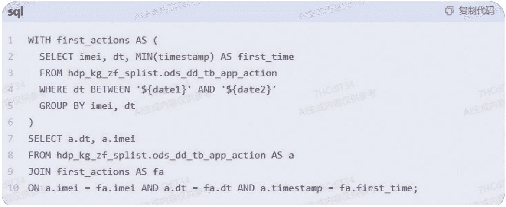
示例先以 CTE first_actions 提取每个 IMEI 与日期的首次行为时间戳，再从原表匹配对应行。写法避免全表排序，提升执行效率。

### **4.6.5 代码调试**
代码 Debug 功能可自动定位语法、运行与逻辑错误，提供错误信息与修复建议，并能自动修正常见问题如拼写、缺失括号、变量名错误等。

自动定位可减少调试成本，提升质量与稳定。

**Q**
仔细阅读下面的 Python 代码，判断是否会运行报错。如果会报错，请说明原因，并输出解决方法；如果不会报错，请回答“无错误”。
你需要处理的代码如下：
    s  = 1
  def test（）:
    s += 1
  print（s）
    test（）

**A**
会报错。
原因：函数内部直接修改全局变量 s，触发 UnboundLocalError。
解决方法：使用 global 声明 s 为全局变量。
修改后代码：
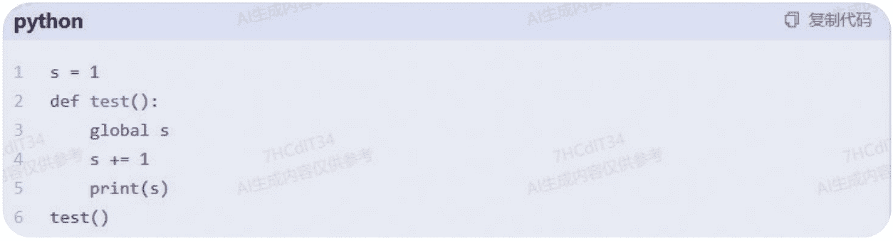
输出结果：2

**Q**
仔细阅读下面的 Python 代码，判断是否会运行报错。如果会报错，请说明原因，并输出解决方法；如果不会报错，请回答“无错误”。
你需要处理的代码如下：
package test;
public class skipseven {
public static void main（String args） {
for（int i=1;i<=100;i++）{
if（i%7==0||i%10==7||i/10%10==7）{
System.out.println（i）;
}
}
}
}

**A**
代码逻辑上可运行，能在 1 到 100 范围内输出满足以下任一条件的数字：能被 7 整除、个位为 7、十位为 7。

若实际运行异常，常见原因包括 Java 环境未正确配置、IDE 项目设置不当或不同上下文下的逻辑差异。编译错误通常会指出具体位置，需据提示排查。

### **4.6.6 代码生成**
代码生成功能可根据指令或需求自动生成程序代码、脚本或配置文件，提升开发效率并降低手工错误风险。

流程包括：输入需求、解析生成、输出供调整、按需测试调试。

需注意生成代码的质量与可靠性受算法、模板及输入清晰度影响，使用时应审慎检查与测试。

**Q**
使用 Python 语言编写文本相似度分析的代码。

**A**
以下为基于余弦相似度的简易示例。
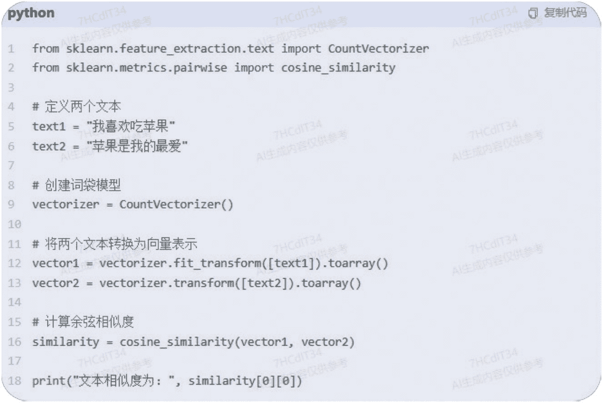
代码先用 CountVectorizer 构建词袋模型将两段文本转为向量，再用 cosine_similarity 计算余弦相似度并输出结果。

**Q**
请用 Python 语言编写一个猜字游戏，在这个游戏中，你必须一个字母一个字母地猜出秘密单词。如果猜错了一个字母，你将丢掉一条命。正如游戏名那样，你需要仔细选择字母，因为你的生命数量非常有限。
## **A**

下面给出一个简易的猜字母小游戏的 Python 示例。程序会从预设词库中随机抽取一个作为答案，单词最长不超过五个字母。玩家总共拥有五次生命值来尝试猜字母。实现代码如下：

import random

# 预定义的单词列表

words = "apple", "banana", "cherry", "date", "elderberry", "fig", "grape","honeydew", "iceberg", "jackfruit"

# 随机选择一个单词

secret_word = random.choice（words）

guessed_letters =

lives = 5

print（"Welcome to the Hangman game!"）

print（"The secret word is ", len（secret_word）, " letters long."）

 while lives > 0:

print（"You have ", lives, " lives left."）

guess = input（"Guess a letter: "）

 if len（guess） != 1:

 print（"Please enter only one letter."）

elif guess in guessed_letters:

print（"You already guessed the letter ", guess）

 elif guess not in secret_word:

 print（"Sorry, the letter ", guess, " is not in the secret word."）

 lives -= 1

 else:

print（"Congratulations, the letter ", guess, " is in the secret word!"） guessed_letters. append（guess）

if lives == 0:

print（"Sorry, you lost. The secret word was ", secret_word）

elif len（guessed_letters） == len（secret_word）:

print（"Congratulations, you won! The secret word was ", secret_word）

游戏流程是：玩家每次输入一个字母，系统会判断该字母是否在答案中。若在，则将字母记录到已猜列表；若不在，则扣除一次生命。生命耗尽即失败，成功猜出全部字母即获胜。

## 本章回顾
本节梳理了文心一言在职场中的常见用法，例如撰写营销策划、为产品命名、助力招聘求职以及辅助编程等。学完后，读者能对文心一言的功能边界形成更清晰的认识，并在实际工作中更熟练地使用。

## 进阶练习
1 请借助文心一言撰写本月工作汇报，内容需涵盖日常工作要点和收获，篇幅约一千字。
2 请借助文心一言完成一款 AI 聊天应用的命名方案，要求条理清晰、可操作且逻辑通顺。

# 05 文心一言在生活娱乐中的应用
随着技术演进，文心一言这类自然语言模型正逐步渗入日常娱乐。无论是出行前获取资讯、游戏时增强互动感，还是日常休闲放松，模型都能发挥作用。本章聚焦文心一言在生活娱乐层面的具体用法。

## 5.1 角色对话模拟
文心一言可模拟人物交流，用以还原现实人际互动，帮助用户提升语言理解。
在解读历史事件时，可让两位人物展开对话，一方知之甚少，一方较为熟悉，通过问答深入阐释并提升趣味。
在辩论场景中，模型可扮演正反两方专家，各自从不同角度论证观点，提供更立体的理解。

### 5.1.1 与孔子谈论内卷
观察文心一言如何扮演孔子与现代人交流。
**Q**
假如你化身孔子，穿越到当下，看到大量年轻人陷入内卷，你会作何回应？
**A**
若我孔子真能穿越，见青年们在内卷中挣扎，必感痛心，同时也明白此现象与社会发展相关。我虽推崇仁义礼智信，也深知世事多变。对内卷，我认为不能只谈学习之乐‘学而时习之，不亦说乎’与‘己所不欲，勿施于人’。我主张中庸、克己复礼，面对内卷虽难根除，却可劝年轻人探寻自身道路，实现价值。我会告诉他们，人生不仅有竞争，还有仁爱礼让、宁静和谐。要自律知足，保持中庸真诚。如此即便不能完全阻止，也能为他们开辟别样路径。我看到年轻人的热情与执着，相信他们终能找到方向。

### 5.1.2 鲁迅看网络流行语
鲁迅若身处当代，看到网友使用 YYDS 等生僻网络用语，会怎样评价？
**Q**
你是鲁迅，见到网友在网上使用各种拗口的网络用语，比如 YYDS 等，你会怎么评价？请按鲁迅的语言习惯回复。
**A**
若我鲁迅见此，或有迷惑亦有忧虑。这些用语晦涩如暗语，与常人隔阂。然而时代更迭，思想亦在进步，或许这正是语言追求的体现，如当年白话文运动。我或会哑然，这或许是年轻人对生活压力的宣泄、对复杂社会的戏谑，用以表达情绪分享生活。亦如《狂人日记》中的‘吃人’描绘，如今这些用语亦可映照时代。我亦会欣喜，这或体现年轻人对生活的态度与对未来的期许，如同我当年以笔墨记录生活，是对生活的热爱。总体而言，我心中矛盾，既忧交流受阻，又喜其为时代表达。我们应尊重理解，同时坚守自身立场。

## 5.2 快速生成各类歌词
文心一言可辅助创作歌词。用户输入风格与要求后，模型会分析并给出韵脚、音节节奏、情感表达等建议，提升作品质量。
**Q**
请模仿说唱歌手的风格，写一首中文歌，要求歌词通畅、押韵，且具有一定的意义。
**A**
节奏：整体为 2/4 拍，演唱时可略提速以突出嘻哈感。
押韵：采用纯押韵，句末押同一韵母，便于记忆旋律。
主题：表达面对困难坚持不懈、勇往直前的积极态度。
副歌：置于 2/4 拍第 3、4 小节，用简洁词汇突出主题情感。
韵律：押韵与半押韵结合，除句尾外其余位置可灵活处理，增强流畅度。
语言：中文创作，需遵循中文表达习惯。
Verse 1:
生活像一场征战
我们在搏斗中寻找价值
别让眼前的难关击倒
要相信自己的力量
Chorus:
坚持不懈，勇往直前
这就是我们的选择
不放弃，不退缩
努力终会换来成功
……可见模型生成的说唱歌词基本满足需求，但艺术水准仍有提升空间，假以时日或可大幅提高。

## 5.3 美食信息中心
该模块为用户提供美食相关信息，可查询周边美食、攻略及菜谱。
### 5.3.1 按地名推送本地美食
输入地名后，模型从数据库检索当地特色、热门、经典菜品并排序展示，帮助用户了解饮食文化与餐厅选择。
**Q**
请告诉我游客在北京必吃的十大美食。
**A**
1 北京烤鸭：名扬中外，外脆里嫩，肥而不腻。
2 老北京铜锅涮肉：铜锅涮羊肉，配独家蘸料，鲜嫩可口。
3 爆肚：牛肚切片配调料，爽脆鲜嫩。
4 面茶：小米面熬制，香浓暖胃。
5 炒肝：以猪肝大肠为主，香浓醇厚。
6 驴打滚：糯米粉配黄豆面，香甜软糯。
7 卤煮火烧：火烧配猪肠肺，味道鲜美。
8 豆汁配焦圈：豆汁独特，焦圈似油条，搭配别有风味。
9 京酱肉丝：肉丝焦黄酥脆，佐京酱葱黄瓜，清爽鲜美。
10 炸酱面：面条配炸酱黄瓜豆芽，香气扑鼻。
这些菜品各具特色，能帮助游客更深入体验北京饮食文化。
### 5.3.2 查询美食历史
可帮助用户了解菜品背景与文化。
**Q**
请介绍一下麻婆豆腐的背景知识及来源。
**A**
麻婆豆腐始于清同治元年1862年，成都万福桥陈家创制。虽已有百余年历史，至今仍长盛不衰。相关文献《锦城竹枝词》《芙蓉话旧录》均有记载，清末已列为成都名吃。主料为豆腐、肉末、辣椒、花椒，特点麻辣。先炒肉末再下辣与花椒，最后焖豆腐入味，出锅撒葱花香菜。麻婆豆腐源于民间，后随川菜传播成为代表，现为四川汉族传统名菜及国家地理标志产品。
### 5.3.3 常见食谱库
汇集专业厨师与爱好者分享的各类菜系食谱。
**Q**
请详细介绍一下麻婆豆腐该怎么做才好吃。
**A**
1 豆腐冲洗切块。
2 沸水焯烫后过凉水沥干，去豆腥并更紧实。
3 锅中油下花椒小火炸香，擀成粉备用。
4 小葱姜末香菜备好。
5 热油爆香姜葱末。
6 下剁椒与郫县豆瓣炒出红油。
7 加一碗开水烧开，下生抽、白糖。
8 下豆腐焖五分钟，轻摇锅防粘。
9 加入花椒粉、胡椒、盐调味。
10 用水淀粉少量多次勾薄芡。
11 滴几滴芝麻香油。
12 出锅撒香菜增香。
可依口味调整辣度与花椒量，注意火候与快速调味，保持豆腐完整嫩滑。
### 5.3.4 个性化定制菜谱
根据口味、偏好与营养需求生成专属菜单。
**Q**
我想让你充当我的私人厨师。我会告诉你我的个人口味，你需要为我推荐菜谱。我的需求是“我喜欢吃肉，但是怕胖，尽量兼顾我的口味，帮我生成两天午餐的菜单，要求是中餐”。
**A**
第一天
主菜：清蒸鲈鱼配西蓝花胡萝卜，低脂高蛋白。
配菜：地瓜叶炒豆芽，清爽低热量。
主食：糙米饭，富含膳食纤维。
汤：番茄蛋汤，营养清爽。
第二天
主菜：照烧鸡胸肉，低脂高蛋白。
配菜：蒜蓉生菜，解腻。
主食：蒸红薯，低热量。
汤：黄豆猪蹄汤，补胶原。
如冰箱只剩白菜、粉丝、两鸡蛋，可做白菜炖粉丝：白菜切块，粉丝泡软，鸡蛋划散，炒白菜后下粉丝加水调盐生抽鸡精煮软，最后拌入鸡蛋碎。
**Q**
今天有两个朋友来家里做客，一个不爱吃肉，一个不爱吃鱼，请你帮我生成一份合适的菜单。
**A**
前菜：鸡胸肉沙拉与素食春卷。
主菜：蒸虾仁配蔬菜，鸡肉蔬菜煲。
配菜：番茄西蓝花炒饭，蒜蓉西葫芦。
甜品：香蕉燕麦蛋糕，草莓酸奶杯。

该餐单以植物食材为主轴，彻底剔除了鱼肉类，采用多样风味进行搭配，对以素食为原则的用餐者而言具备良好的适配性。制作环节着重于营养的均衡组合。

### **5.3.5 美食点评**
该功能为用户提供餐飲评价参考。用户若输入类似“这家店的菜品很可口，招牌菜值得推荐”或“餐厅环境出色，服务人员态度良好”等描述，系统会抽取文本中的美食信息，并以既定的模型对商家进行综合评估。

**Q**
请以美食家的视角，对曾就餐过的一家川菜馆做一个全面、专业的评价。

# **A**
作为资深食客，我最近体验了一家川菜馆，现将感受梳理如下。先从店内环境说起，进门后整洁明亮，气味清新，带来舒适的就餐体验。整体装潢带有川西地域特色，座位动线规划合理，落座便捷，服务人员走动也十分顺畅。

菜单覆盖面广，收录了川菜多道经典。实测了麻婆豆腐、宫保鸡丁、水煮鱼三味，每道皆体现出川菜的鲜明个性，滋味浓郁、口感层次分明。麻婆豆腐印象最深，豆腐滑嫩入味，香辣浓厚而不燥，回味悠长。

食材品质可靠，均选用新鲜卫生的原料。烹饪手法成熟，既保留了食材本味，又提升了整体风味。服务团队热情且专业，响应迅速，对菜品与门店情况颇为熟悉，能够耐心解答疑点，并能按个人偏好提供定制化服务，让人感受周到。

价格层面略高于同类店面，但结合菜品水准、服务质量与环境条件，整体性价比仍属合理。

综合来看，该馆在环境、菜品、食材、厨艺与服务等维度表现稳定，同时带有浓郁的川西韵味，值得推荐。

### **5.3.6 健康饮食计划**
文心一言可依据个人基础信息与目标，制定个性化的健康膳食方案。方案中一般包含每日热量、蛋白质、脂肪、碳水、膳食纤维、维生素及矿物质的摄入目标，并给出具体建议，如控制分量、偏好低脂低糖食品、适量摄入蔬果等。

**Q**
为减脂人群制定一份包含三餐且营养均衡的健康饮食方案。

### **A**
均衡饮食是减重的关键，有利于体重管理与身体状态维持。以下示例强调每餐分量与热量的把控。

早餐：
·水煮蛋两枚，低脂牛奶200毫升，全麦面包两片，配少量番茄酱与低脂沙拉酱；
·一枚橙子，补充维生素C。

午餐：
·烤鸡胸肉约100克，搭配烤制蔬菜如花椰菜、洋葱、红椒等，另加一碗糙米饭；
·饭后可加一小杯低糖酸奶或一份水果。

晚餐：
·水煮鱼约150克，配蒸制蔬菜如胡萝卜、豆角、西蓝花等，另加一碗糙米饭；
·少量坚果如杏仁、核桃，提升饱腹感。

整体营养要点：
·日总热量建议维持在1500至1800千卡，可按体质与运动量微调；
·蛋白质供能占比建议20%至30%，摄入量约50至70克，来源以禽蛋为主；
·碳水摄入需适度，减少精制糖与白面包，优先粗粮如糙米、全麦；
·蔬果要充足，每日蔬菜不少于500克，水果不少于200克；
·控制盐分，避免高盐加工品；
·多饮水，每日至少两升。

总结而言，减脂的核心在于控制总热量、提升蛋白比例、节制碳水并增加蔬果摄入，同时避免高热高脂高糖食物与暴饮暴食，配合适度运动效果更佳。

## **5.4 私人定制旅游攻略**
个性化旅游攻略是文心一言提供的定制服务。

用户需先提供目的地、出行时间、预算范围、个人偏好等信息，作为行程制定的依据。

随后系统会据此规划完整方案，涵盖住宿预订、机票购买、景点游览、餐饮安排及交通衔接等内容。

### **5.4.1 旅游规划**
旅游规划是对目的地进行的系统细化，包含资源评估、路线设计与服务安排。

**Q**
预算五千元，请安排一次云南七天行程。

## **A**
结合预算与时间，为您梳理了一份云南七日行程，控制在五千元左右。

第一天：抵达昆明。
·入住后休整调整。
·时间充裕可逛市区，品尝当地风味，感受城市氛围。

第二天：昆明市区游览。
·上午：游览石林地貌，欣赏奇特景观并了解地质成因。
·下午：前往翠湖公园，沿湖漫步体味城市文化气息。
·晚上：品尝云南小吃，逛夜市。

第三天：前往大理。
·上午：乘长途车或火车前往大理，约四至五小时，入住。
·下午：游览大理古城，感受白族建筑与文化，品尝当地美食。
·晚上：在古城漫步，体验夜晚宁静。

……
第七天：昆明返程。
·按航班或车次时间提前离店前往机场或车站，结束旅程。

费用估算：
·交通约1300元，含往返昆明及大理、丽江、香格里拉的火车或大巴；
·住宿约1350元，按各城经济型酒店计；
·餐饮约600元，含各城特色小吃与正餐；
·门票约850元，含石林、世博园、丽江古城、普达措国家公园等；
·其他约600元，用于购物等。

合计约4700元，留有余地应对临时开支。祝旅途愉快！

### **5.4.2 目的地推荐**
系统可对不同目的地进行分析，为匹配需求的游客推荐合适去处。

**Q**
我现在在长沙，有一周时间，预算五千元，去青岛还是沈阳更合适？

# **A**
基于时间和预算，建议优先考虑青岛。青岛为滨海城市，自然景观与历史文化兼备，美食与购物资源丰富。理由如下。

**1** 交通便利：长沙至青岛航班价格友好，也有直达列车，可欣赏沿途风光。
**2** 自然秀美：依山傍海的城市格局，具有典型的海滨风貌。
**3** 文化厚重：德日风格建筑与历史遗迹众多，如老城区、德国总督府旧址、八大关等。
**4** 美食多样：海鲜为代表，青岛啤酒及各色小吃闻名。
**5** 购物充足：台东夜市、李村步行街等商业街区集中，便于选购纪念品。

沈阳虽有历史文化与景点，但距离更远。综合来看，青岛更符合一周五千元的预算。

### **5.4.3 徒步路线规划**
可依据海拔、距离等参数为用户规划合适的徒步线路。

**Q**
请推荐五条秦岭重装徒步线路，并以表格列出线路、距离、爬升。

### **A**
以下图表展示了 5 条秦岭重装徒步路线：

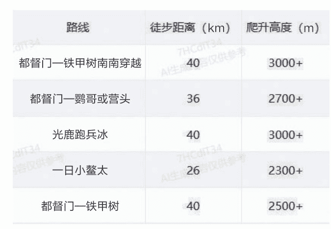

### **5.4.4 旅行住宿推荐**
住宿推荐会根据目的地匹配酒店、客栈、民宿等多种类型。

提供目的地、预算、入住时间等关键信息后，系统可筛选房源并给出周边配套与服务信息，助力决策。

**Q**
计划去重庆四天三晚，住宿选在哪个区域更方便？

### **A**
在重庆停留四天三晚，建议以观音桥商圈、南坪商圈、沙坪坝商圈为核心。示例如下。

·住宿1：重庆市江北区建北三支路，植物主题套房，预订价约288元。
·住宿2：重庆市南岸区南滨路，温馨江景房，预订价约238元。
·住宿3：重庆市南岸区江南大道，360度全景江景房，预订价约248元。

以上房源特色鲜明，交通便利，周边餐饮娱乐配套完善，可满足不同预算。最终选择仍请结合个人喜好与实际需求。

### **5.4.5 地理知识问答**
该功能主要解答地理相关提问。

**Q**
现在你是一个熟悉中国地理及城市信息的知识库，请你结合相关专业知识，对我给出的问题进行详细解答。我给出的问题：你知道龙里县三岔河水库吗？

## **A**
了解。该水库位于贵州省黔南布依族苗族自治州龙里县湾滩河镇桂花村，距县城约40公里。属中型水库，主要承担向龙里县中心城区供水任务，设计供水量为927万立方米。

工程已纳入《水利改革发展“十三五”规划》及《贵州省“十三五”水利发展规划》，并获2023年省级前期工作专项资金300万元，用于决策评估、初步设计及施工图设计等前期经费。

枢纽工程包括挡水、泄水、取水兼放空建筑物及提水泵站和管道输水工程。输水系统含一、二级提水泵站及管线，终点接入龙里县龙溪水厂。

如需更详尽资料，建议查阅最新官方文件或咨询专业人士。

您也可以这样提问：
（1）你知道地球为什么是球体的吗？
（2）你知道世界上最长的河流是哪一条吗？
（3）你知道地球的四大洋是什么吗？
（4）你知道板块构造学说是什么吗？
（5）你知道亚洲和欧洲的分界线是什么吗？

### **5.4.6 景点典故都知晓**
该功能针对旅游景点及其典故进行解答。

**Q**
你是一名资深导游，请为我介绍寒山寺背后的故事。

# **A**
寒山寺位于江苏省苏州市，是江南一座历史悠久的佛教寺院，流传着不少引人入胜的故事。

**1** 起源可追溯至南朝梁代。史载僧人寒山在此苦修，故名。然而确切始建年代仍存争议。
**2** 钟声为其一大特色。相传农历初一、十五夜晚钟声传遍全城。苏州大饥荒时，人们相信钟声可得佛祖庇佑，故灾难时敲钟以安抚人心。
**3** 唐代诗人张继关联其名。开元年间，张继夜泊枫桥，写下《枫桥夜泊》“姑苏城外寒山寺，夜半钟声到客船”，令寒山寺名扬天下。
**4** 历史变迁多次，清同治年间战乱中寺院严重损毁，后经重建修缮恢复原貌。
**5** 文物丰富。大雄宝殿内两根楠木雕花大梁工艺精湛，被誉为“江南第一梁”。碑刻、壁画、佛像等文化遗存价值很高。

以上为寒山寺部分典故，希望有助于您更深入了解其历史文化。

### **5.4.7 游记生成**
到景点怎么能不发朋友圈？不会写文案？交给文心一言。

**Q**
我刚到凤凰古城，拍了几张照片，打算发微信朋友圈，请帮我写一小段微信朋友圈文案。

### **A**
好的，以下是一段适配文案。

初踏凤凰古城，恍若穿越千年。漫步街巷，每一砖一瓦都在诉说历史。用镜头捕捉这份独特之美，期待与朋友们分享古城韵味。#凤凰古城# #历史韵味# #古城的魅力#

文案风格也可转换。

**Q**
我想要将以上文案转换成小红书文案。

### **A**
凤凰古城，让人心动的江南水乡！ 

刚踏入凤凰古城，仿佛被这座美丽小城拥抱。街巷漫步，像回到历史的江南。

沱江两岸古建筑鳞次栉比，每一幢都藏着故事。与自然和谐共生，宁静又舒适。 

这里古今交融得恰到好处。希望你们也能来感受这座迷人的凤凰古城！#古风摄影# #江南水乡# #旅游#

生成的笔记更添表情与标签，阅读感更强。

## **5.5 日常生活小帮手**
本节介绍文心一言在生活场景中的有趣应用。

### **5.5.1 私人健身教练**
健身有益健康，但很多人缺乏动力或训练计划。文心一言可依据身体状况、目标与喜好制定个性化方案，并提供知识与技巧支持，帮助坚持训练。

让我们看看健身建议。

**Q**
我想让我的上肢肌肉线条更美观，请问有什么方法？

### **A**
要塑造更美观的上肢线条，可采取综合训练法。

**1** 规律锻炼：每周3至4次全身训练，重复目标肌群，逐步提升强度与重量，重点刺激上肢。
**2** 合理饮食：肌肉生长与修复需高质量蛋白，如鸡肉、鱼类、牛奶，搭配足量碳水与脂肪。
**3** 足够休息：肌肉在恢复期生长，需合理安排间歇。
**4** 心肺训练：跑步、游泳等提升代谢，促进脂肪消耗，线条更清晰。
**5** 正确姿势：规范动作降低受伤风险，也更有效刺激肌肉。
**6** 渐进负重：逐步增加负荷以提升力量与体积。

具体动作示例：
**1** 举手臂：单臂上举后向后弯曲，直至可触及对侧肩胛骨。
**2** 屈肘举杠铃：坐姿挺背，手臂伸直斜举杠铃，再缓慢屈肘至脑后保持10秒后还原，锻炼肱三头肌。
**3** 双臂转圈：直立双脚开肩宽，双臂伸直向前转圈30次再向后转圈30次，有助消除手臂多余脂肪。
**4** 双手交叉：站立肩宽，双手前伸掌心向前，上下交叉。

坚持方能见效，祝训练愉快！

健身器械推荐也可咨询。

**Q**
我想在家进行有氧训练，我是买跑步机好还是买划船机好？

## **A**
两者皆为不错的有氧选择，具体取决于个人需求。

**1** 膝盖冲击：跑步机冲击较大，对膝盖负担高；划船机更温和，适合体重较大或膝盖有旧伤者。
**2** 锻炼效率：跑步机主攻下肢兼顾心肺；划船机可调动80%以上肌肉，全身协同，效率更高。
**3** 占地空间：跑步机体积大；划船机相对紧凑，更适合家庭使用。
**4** 耗能：跑步机需通电；划船机无需电源，更节能环保。
**5** 上手难度：划船机需掌握正确动作；跑步机操作简单，易上手。

若追求全身锻炼且膝盖敏感，可选划船机；若只想锻炼下肢且追求简便，跑步机更合适。

### **5.5.2 售后服务专家**
无论是产品使用问题还是售后服务，都可向文心一言咨询，提供详细解决方案与示例，帮助更好使用家电。

**Q**
现在你是一名家居家电产品支持专家，你会对我给出的问题提供详细的解答或解决方案。在解答过程中，你需要提供一些示例来帮助我理解。我的问题是水暖毯容易出现什么问题？

### **A**

水暖毯在冬季家居取暖里很常见，夜里盖着能带来暖意，还能保持一定的湿度。但作为一种电器，它同样会出小毛病。下面归纳了几种常见异常及对应的处理思路。

**1** 水暖毯不热
· 可能原因：电源接口没插牢、插头接触不良，或是温控器、毯体内部线路老化损坏等。
· 处理办法：先确认插头是否完全通电、接触稳固。若供电正常仍无反应，多半是温控器或毯体出现故障，建议联系品牌售后或专业维修人员检修、更换。

**2** 水暖毯温度不均匀
· 可能原因：毯内水路循环受阻，或加热元件出现故障。
· 处理办法：先检查毯体是否出现堵塞、漏水情况，有则需清洗或修补。若水路通畅但仍局部不热，则加热器可能损坏，需由厂家或专业人员维修更换。

**3** 水暖毯噪声过大
· 可能原因：水泵或风扇运转异常，或毯内残留空气未排净。
· 处理办法：先观察水泵和风扇是否正常运转，异常则清洗或更换。若运转正常，可尝试抬高毯体一角或轻[content]
水暖毯在家居取暖里很常见，夜里盖着能带来暖意和适度湿度。但它毕竟是电器，也会闹点小毛病。下面整理了几类高频问题及对应处理办法。

**1** 水暖毯不热
· 可能原因：电源接口未接稳、插头接触松动，或温控器、毯体内部元件损耗。
· 处理办法：先确认插头是否牢固通电。若供电正常仍不发热，多半是温控器或毯体损坏，建议联系品牌售后或专业维修点检修更换。

**2** 水暖毯温度不均匀
· 可能原因：毯内水路循环受阻，或加热元件出现故障。
· 处理办法：先检查毯体是否堵塞或漏水，有则需清洗修补。若水路通畅仍局部不热，则加热器可能损坏，需由厂家或专业人员维修更换。

**3** 水暖毯噪声过大
· 可能原因：水泵或风扇运转异常，或毯内残留空气未排净。
· 处理办法：先观察水泵和风扇是否正常运转，异常则清洗或更换。若运转正常，可尝试抬高毯体一角或轻折叠毯体，帮助排出内部气泡，降低噪音。

**4** 水暖毯无法调整温度
· 可能原因：温控器故障或损坏。
· 处理办法：先确认温控器是否正常工作，失灵则需更换或修理。若温控器正常，多为操作不当，可对照说明书重新设置。

以上是水暖毯常见异常及解决思路。若仍无法处理，建议直接联系厂家或专业维修人员。

### **5.5.3 穿搭灵感来源**
服装搭配时的创意火花就是穿搭灵感。向文心一言提问时，它能给出合身又时髦的搭配建议。

**Q**
请推荐三套黑白色系适合通勤的女士衣着搭配。

**A**
黑白搭配经典百搭，很适合职场通勤。推荐三组组合供参考。

第一组：黑色西装外套配白色衬衫。西装线条利落，百搭好穿，白色衬衫增加清爽度，让整体不显沉闷，既有专业感也显品味。

第二组：简约黑色连衣裙配白色高跟鞋。连衣裙自带优雅成熟气质，白色鞋子提亮整体，视觉上更显纤细，舒适又得体。

第三组：黑色阔腿裤配白色上衣。阔腿裤修饰腿型，搭配白色上衣清爽明亮，化解沉重感，兼顾正式与时尚。

总的来说，这三套黑白通勤搭配都能兼顾职业形象与个人风格，具体选择可结合身形与喜好。

**Q**
从现在开始你是我的个人造型师。我会告诉你我的体形和需求，你来为我推荐合适的服装。我的体形和需求：我目前有些胖，肚子比较大，眼下我有一个正式活动要参加，希望你给我推荐一种适合我的西装风格。

**A**
感谢信任，针对你的身形和活动场合，给出以下建议。

**1** 宽松剪裁西装：版型稍宽松可包容腹部，穿着舒适，忌过松导致轮廓不清。
**2** 有弹力的西装：面料自带弹力，能跟随身形变化，活动自如又不失正式。
**3** 双排扣西装：门襟更宽，可自然遮住腹部，同时带来稳重正式的视觉。
**4** 深色西装：深蓝或黑色有收缩视觉效果，能让身形显得更挺拔。

搭配提示
**1** 衬衫：与西装同色系保持和谐，想提升细节可选有领带的款式。
**2** 领带领结：正式西装可点缀领带或领结，款式宜简洁，避免花哨。
**3** 鞋子：皮质或漆皮皮鞋更显正式，避免运动休闲款破坏整体感。
**4** 袜子：选择长筒或船袜，避免露脚踝，保持下半身整洁。

遮腹小技巧
**1** 活动前注意饮食与适度锻炼，减少腹部脂肪。
**2** 穿衣前轻吸气收腹，让西装贴合身线。
**3** 久坐后站起时及时整理腰部位置，保持版型。

希望这些建议能助你自信亮相，有其他需求随时沟通。

### **5.5.4 日常医护知识**
文心一言能解答各类健康问题，涵盖以下方向。

**（1）基本健康咨询。** 可回答饮食、营养、运动、体重管理等基础问题。
**（2）疾病预防与治疗。** 能介绍哮喘、高血压、糖尿病等常见病的预防与治疗要点，并提供医疗用品与用药方面的参考。
**（3）心理健康咨询。** 可讨论焦虑、抑郁、压力应对等话题，给出缓解技巧与建议。
**（4）寻求帮助。** 为需要专业指导的人提供就医指引，如机构选择、专家咨询等。

**Q**
你是一名医生。我今天早上醒来，突然眼睛疼，而且反胃，眼珠周边有一些血色的小斑点，这是为什么？

**A**
你描述的组合症状可能由多种情况引起，例如偏头痛伴眼部表现，或结膜下血管破裂。

偏头痛有时会出现头痛、恶心呕吐、视觉异常如斑点或光晕，部分人会感觉颅内或眼部血管收缩有关。

眼周出现血色小点，多与结膜下小血管破裂有关，可能因血压偏高、揉眼过度、用眼疲劳或局部刺激引起。

建议尽快到医院眼科或神经内科检查，明确原因后再接受针对性治疗。

**Q**
你现在是一名心理咨询师。目前，公司裁员使我的内心焦躁不安，有什么办法能让我缓解这种情绪？

**A**
裁员确实会带来不安，这是人之常情。下面提供一些可操作的缓解方式。

**1** 接纳情绪：承认焦虑是正常的，不要压抑或否定自己，先理解情绪。
**2** 寻求支持：向亲友倾诉，或必要时预约专业心理咨询师。
**3** 关注身心健康：规律饮食、适度运动、保证睡眠，有助于降低紧张感。
**4** 制定行动方案：思考下一步，比如求职准备或技能提升，具体计划能增强掌控感。
**5** 自我关怀：冥想、阅读、散步等放松活动可缓解心理压力。
**6** 法律咨询：若担心权益受损，可咨询劳动法律专业人士。
**7** 保持积极视角：把变化看作调整职业方向的机会。

你并不孤单，度过这段时期后会有新的发展可能，保持信念并逐步行动。

### **5.5.5 人物百科科普**
人物百科功能提供公众人物、历史人物、行业人物的基础信息、社会关系、生平、荣誉等查询服务，用户可全面了解感兴趣对象。

**Q**
请简单描述一下李白的生平。

**A**
李白，字太白，号青莲居士，生于701年，卒于762年。出生于四川江油青莲镇，祖籍陇西成纪。

他是唐代浪漫主义诗人代表，与杜甫并称“李杜”，诗风豪放清新，常被后世尊为“诗仙”。

725年起开始漫游各地，游历蜀中、安陆、齐鲁等地，结交名士，创作大量名篇。

742年入长安，担任翰林供奉，因性格洒脱不拘小节，744年离开朝廷。

此后曾参与永王李璘幕府，因政治动荡被流放夜郎，途中遇赦。晚年漂泊江南，762年于当涂逝世于友人李阳冰处。

### **5.5.6 IT 专家**
作为IT专家，文心一言可解答各类计算机问题，并用通俗语言给出解决方案，避免过多技术原理。

**Q**
我希望你担任 IT 专家，你将对我提出的计算机相关问题提供解决方案。你需要尽量避免过多的技术细节。注意使用简单易懂的语言来描述解决方案，而非进一步阐述问题对应的原理。接下来是我的问题：当我的电脑出现蓝屏错误时该如何解决？

**A**
蓝屏错误俗称蓝屏死机，通常由硬件或系统问题触发，可按以下顺序排查。

**1** 检查硬件：确认内存条、硬盘等是否松动或损坏，必要时更换测试。
**2** 更新驱动：尤其是显卡驱动，过期或不匹配常导致蓝屏，可前往官网更新。
**3** 查杀病毒：运行安全软件全盘扫描，清除恶意程序。
**4** 检查系统文件：使用系统自带修复工具检测并修复损坏的文件。
**5** 恢复或重装系统：若以上方法无效，可考虑系统还原或重装，操作前务必备份重要资料。

若仍无法解决，建议联系专业技术人员进一步诊断。

## **5.6 专业评论生成**
文心一言可根据用户给出的主题，利用已有资料生成新的评论，帮助提升创作效率。

### **5.6.1 专业影评**
AI可从专业角度对电影背景、制作、剧情、表演等进行分析，帮助观众理解作品。

**Q**
假如你是电影评论家，请你根据电影《忠犬八公的故事》写一篇影评。你可以从情节和主题、基调、演技和角色、配乐、特效和剪辑、节奏等方面进行评论，强调电影给你的感觉和共鸣点。

**A**
《忠犬八公的故事》讲述秋田犬八公与主人上野英三郎间深厚的羁绊，核心在人宠情感与忠诚的力量。

基调温暖感人，全片以温柔的叙事展开。

表演方面，演员仲代达矢细腻自然，八公的镜头语言通过眼神和肢体传达强烈情感，令人动容。

配乐恰到好处，旋律催泪，烘托出离别与等待的氛围。

特效与剪辑精致，动物镜头流畅，过渡自然，等待主人的段落剪辑节奏把握得好，突出孤寂与坚持。

整体节奏紧凑，情感递进顺畅，能唤起对陪伴的思考，观后会让人想起自己的宠物，余韵悠长。

### **5.6.2 无剧透影评**
无剧透影评在不透露具体情节的前提下，点评背景、表演、导演手法等，适合想了解却不愿被剧透的观众。

**Q**
为电影《消失的她》写一则无剧透影评。

**A**
《消失的她》以失踪为线索，营造出紧张悬疑的氛围。

情节设计层层递进，线索巧妙，观影过程中疑问不断，保持好奇心。

主题探讨爱、恐惧、孤独与责任，人性在极端情境下的挣扎被刻画得深刻。

画面艺术感强，转场流畅，配乐与音效营造神秘紧张感，增强沉浸感。

对话精练，角色塑造清晰，整体节奏紧凑。虽偶有节奏拖沓之感，但瑕不掩瑜，是一部值得细品的作品。

### **5.6.3 商品评价**
帮助用户分享购买体验，助力他人决策。

**Q**
请为一款保温杯写一条 5 星好评，要求体现保温性能好、外观好看的特点。注意需要强调自身使用感受，内容需超过 50 字。

**A**
这款保温杯入手后很惊喜。外观简约大方，放在办公桌或出差随身都好看。最满意的是保温效果，早上装热水，下午喝时依然温热，冬天尤其实用。手感舒服，颜值与实用兼备，自用或送人都很合适。

### **5.6.4 心理专家评论**
该功能帮助用户理解心理困惑，或了解专家对特定议题的看法。

**Q**
你是一名心理专家，请评论年轻人热衷穿衣打扮这件事。

**A**
年轻人关注穿搭既是心理需求也是社会现象。

从心理看，通过潮流服饰构建理想自我形象，满足自尊与自信，并以此表达个性与价值观；服饰也成为社交名片，帮助建立圈子。

但过度追逐外表可能忽视内在成长，出现“外在光鲜、内在空洞”，攀比与消费压力也会增加心理负担。

应引导树立健康审美，平衡外在与内在：多读书、旅行、参与实践，丰富内心，提升素养。真正的价值来自品格与能力，而非单一的外表。

## **本章小结**
本章介绍了文心一言在生活娱乐方面的应用，如人设互动、美食、旅游攻略定制、专业评论生成等，掌握后能更高效地使用AI提升生活乐趣。

## **拓展训练**
**1** 请使用文心一言生成一个美食食谱。
**2** 请使用文心一言进行模拟人物对话。

# **06**
# **文心一言的插件**
文心一言的插件是扩展功能的独立模块，可提供自定义指令、输出格式、数据源等更多体验。平台提供丰富生态，开发者可自主开发并发布到插件市场供他人使用。

## **6.1 插件是什么**

文心一言插件：能力扩展与自建指南

把文心一言视作具备强推理的中央引擎，插件就是让引擎接入外部世界并完成落地操作的接口阵列。有了插件，一边可以让生成能力对接实时数据与专业服务，另一边让外部应用借力大模型的理解力，实现过去难以单兵完成的任务。

### **6.1.1 插件的基本类型**

目前可用的插件大致可归为三类功能方向。

**1. 信息增强类插件**
这类扩展负责补齐信息差，把最新、最专业的外部资讯带入对话。以接入百度搜索为例，就能即时抓取全网实时动态；垂直检索类则可覆盖找房、选车、查法条等专业场景。

**2. 交互增强类插件**
此类扩展提升多模态交互水平。既能解析文字、图片、语音等多种输入，也能产出思维导图、视频等多模态结果。支持用户上传文档并基于原文问答的插件就是典型。

**3. 服务增强类插件**
这类扩展让模型自动完成常见操作，如订机票、发邮件、排日程、生成问卷等。也可依托大模型理解力优化现有服务，例如结合简历和岗位信息自动生成面试题，再配合 ASR/TTS 打造沉浸式模拟面试。

ASR 的英文全称 Automatic Speech Recognition，即自动语音识别，用来把人声转成文字。TTS 的英文全称 Text To Speech，即文本转语音，也称语音合成，与 ASR 方向相反，用来把文字合成为自然流畅的语音。

### **6.1.2 插件的工作原理**

先厘清几个基础概念。

**（1）Manifest:** Manifest 是一种描述性配置文件，在 Android 体系中常见为 AndroidManifest.xml。它向系统声明应用的基础信息，缺少这些信息系统无法启动应用代码。

**（2）Query：** 在计算机科学尤其是数据库领域，Query 指对数据源提出的请求，用来检索、更新或删除数据。SQL 查询语句是典型例子。

**（3）API:** API 是一组预先定义好的函数接口，供程序调用而无需掌握内部实现。它是不同软件组件衔接的约定，通过 API 可实现数据交换与功能调用，让各系统互联互通。

**（4）JSON:** JSON 是一种轻量级的数据交换格式，基于 ECMAScript 子集，采用语言无关的文本格式存储数据。可读性强且机器解析效率高，在 Web、移动开发和 API 设计中被广泛使用。

插件运行总体分为三步。

**（1）插件注册。** 开发者把插件的 Manifest 文件提交到文心一言插件库，通过校验后模型即可调用该插件处理用户 Query。

**（2）插件触发。** 解析调度模块生成调用指令，通过 API 调用插件服务。插件处理完毕后，文心一言汇总结果并以 JSON 形式返回。

**（3）插件解析。** 触发调度模块识别用户 Query，根据 Manifest 中插件 API 的自然语言描述挑选合适的插件并生成调用参数。

例如，用户选定天气插件并提问“今天北京天气怎么样？”，模型会先识别意图并调用天气插件，抽取时间“今天”和地点“北京”，以 JSON 结构填入开发者提供的天气 API，拿到返回结果润色后生成自然回答。

### **6.1.3 开发属于自己的插件**

自建插件需完成两个阶段。

**1. 申请开发者权限**
在文心一言首页右上角打开“插件市场”选项（如图 6-1 所示）。

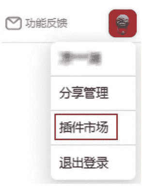

图 6-1

进入插件市场后点击“开发权限申请”按钮（如图 6-2 所示），按提示填写信息完成申请。

图 6-2

**2. 从 0 到 1 开发插件**
获取权限后，核心流程如下。

（1）构思插件的 Manifest 文件 ai-plugin.json，必选
（2）定义插件服务描述文件 openapi.yaml，必选
（3）编写示例描述文件 example.yaml，可选但强烈建议
（4）启动插件服务并与描述文件对齐，必选
（5）上传配置文件并调试，必选
（6）发布到插件市场，可选

以本地调试为例，目录结构如下：

yiyan_plugin_demo/   #插件 demo 根目录
|—.well-known
    |— ai-plugin.json   #插件主描述文件
    |— openapi.yaml    #插件 API 服务标准描述
|— logo.png          #插件图标
|— demo_server.py    #本地注册服务
|— requirements.txt  #依赖库，Python 3.7 以上
|— readme.md         #说明文档

注意：macOS 等系统会隐藏以“.”开头的文件夹，.well-known 可能不可见，可通过终端查看修改。

（1）修改 .well-known 下的 ai-plugin.json
"name_for_human": "单词本 382",  ==> 可改为 "单词本 _zhangsan" 或 "单词本 _1024"，平台内全局唯一，后缀建议长且随机以免重名
"name_for_model": "wordbook_382", ==> 可改为 "wordbook_zhangsan" 或 "wordbook_1024"，建议使用有语义的英文字符串

（2）启动本地注册服务
pip install -r requirements.txt
python demo_server.py

（3）上传插件配置
在文心一言首页点击“开发我的插件”选项（如图 6-3 所示），提交插件信息（如图 6-4 所示）。

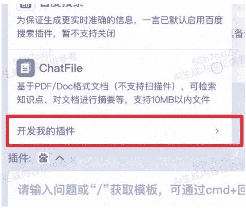

▲图 6-3

▲图 6-4

提交后若提示成功则说明添加完成，失败可通过终端排查。

（4）若填写的是公网 IP，成功后即可在插件列表中选择使用（如图 6-6 所示）。

▲图 6-5

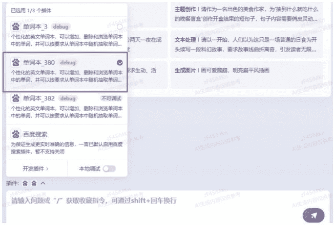

▲图 6-6

若填写的是本地 IP，选择插件时会弹出本地调试提醒，点击“确认”即可（如图 6-7 所示）。

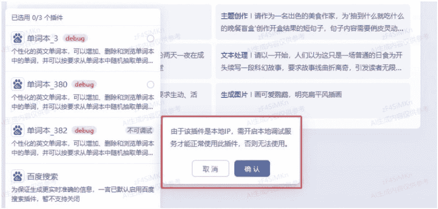

图 6-7

至此即可调试使用自己的插件（如图 6-8 所示）。

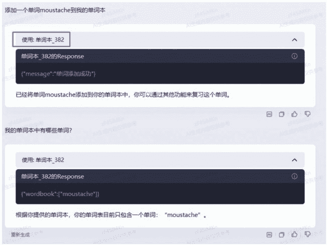

图 6-8

## **6.2 览卷文档**

览卷文档插件英文名 ChatFile，是文心一言的重要插件。核心能力是基于文档完成摘要、问答和二次创作。

插件能自动解析文档内容，按需生成摘要，帮助用户快速把握要点；也能在文档内检索相关信息回答用户提问，避免人工翻找；同时支持基于原文进行创作，如生成新文章、故事或报告，提升理解和产出效率。

使用方式是点击“选择插件”→“览卷文档”→上传文档即可（如图 6-9 所示）。

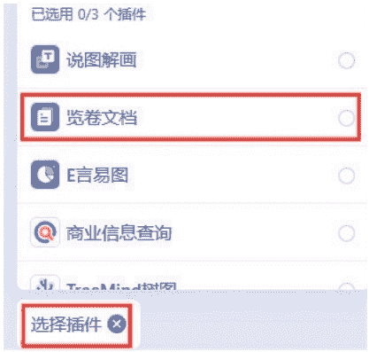

图 6-9

**Q**

### **A**

**2023 年语言与智能技术竞赛正式启动，由 CCF 与 CIPS 联合主办，百度等单位承办。大赛设“大语言模型能力评估”和“视频语义理解”两大赛道，其中“视频语义理解”面向专业 AI 开发者，需要融合多模信息，结合知识图谱进行计算与推理，为视频生成多维度语义标签。**

上传后模型会自动提炼摘要，也可继续追问。

**Q**
语言与智能技术竞赛都包含哪些赛道？

### **A**
语言与智能技术竞赛包含以下赛道。

**1** 大语言模型能力评估赛道：重点考察参赛者对大语言模型的理解与应用能力，涵盖原理、技术、应用等相关知识与技能。
**2** 视频语义理解赛道：面向专业 AI 开发者，需融合多模信息，结合知识图谱进行计算推理，为视频生成多维度语义标签。

以上为主要赛道，具体以官方最新消息为准。

**Q**
大语言模型能力评估赛道重点考查什么？

### **A**
该赛道重点考查参赛者对大语言模型的理解与应用能力，涉及模型原理、常用技术及实际应用。在此赛道中需掌握基础原理和技术，并能灵活解决实际问题，同时具备创新思维和实践能力，提出有创意的解决方案。

## **6.3 E 言易图**

E 言易图插件基于 Apache ECharts 提供数据洞察与图表制作能力。支持柱状图、折线图、饼图、雷达图、散点图、漏斗图和思维导图树图等多种类型。

用户可把原始数据转成直观图表，插件提供丰富的样式和配色可自定义。还支持缩放、平移、数据点提示等交互，以及 CSV、JSON 等多种数据格式输入。可调用方式参考 6.2 节。

**Q**
请根据表格内容，按照下面要求生成散点图。招生情况：以年份和录取率为坐标轴，散点代表每年的录取率。假设数据对象：包含热门学校和普通学校的散点，以及包含本科和研究生阶段的散点。（提示：表格需要点击上传按钮上传。）

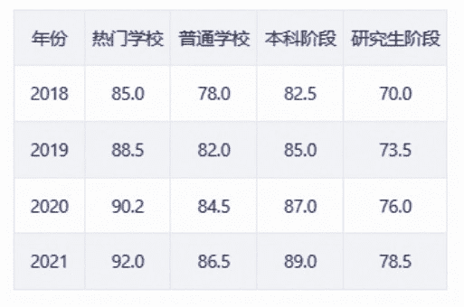

# **A**
我是由百度研发的人工智能模型，通过学习大量公开文本信息形成能力。所提供的信息可能存在偏差，仅供参考，不应作为专业建议。

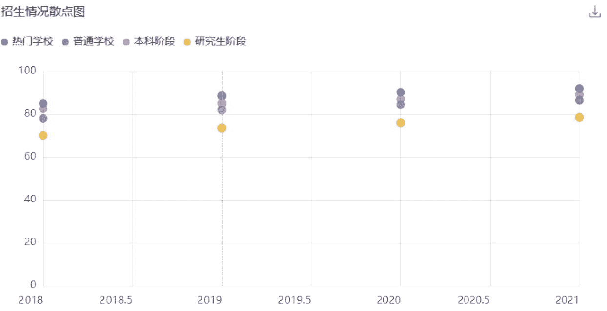

## **6.4 说图解画**

说图解画插件基于百度大脑的语言理解与图像处理技术构建的图文转换与图像识别工具，能快速将图像转为文字。

**（1）文字转图像：** 输入文字描述后自动生成精美图片，支持多种风格与主题选择。
**（2）图像转文字：** 将图片内容转为文字描述，支持中文、英文、日文、韩文等多语言。
**（3）图像识别：** 识别物体、人脸、场景等信息并给出详细说明。

调用方法参考 6.2 节。

**Q**
请对下面的图片进行解读，并生成文字描述。

# **A**
根据您提供的图片信息，以下是我为您生成的文字描述。

他在这条荒凉的公路上已行走许久，道路仿佛没有终点。他并不清楚目的地，只想远离人群与城市喧嚣，享受孤独与安宁。

抬头望向天际，夕阳余晖洒满大地，天空染成绯红。他感到一股暖意从心底升起，仿佛所有的烦闷与忧虑都被这美景驱散。

路上只有他一人，仿佛与景色融为一体，像是宇宙的一部分，能与天地万物对话。

他独自前行，似在寻找答案，也似在享受这份寂静。内心变得愈发平静坚定，仿佛前方正等待着某种解答。

他继续向前，体会这份孤寂与宁静，享受属于自己与自然的瞬间。

**Q**
请根据图片中的花朵和背景，创作一篇描写自然美景的短文，字数不少于 300 字。

### **A**
清晨的光线柔和，一枝黄花安静绽放，像一位优雅的舞者，在绿色的舞台上独自起舞。那明亮的黄色如同初阳，照亮周围，给人带来温暖与希望。

花朵轻轻摇摆，仿佛在与风低语。每一片花瓣细腻如画，暗红的花心点缀其中，增添几分神秘与妩媚。花团簇拥，散发淡香，引来蝴蝶与蜜蜂欢快飞舞。

细长的枝条如守护者般托举着花朵，从左下向右上延伸，形成自然的弧线，引领视线进入模糊的绿色背景。那是一片茂密的丛林，生机盎然，诉说着大自然的奇妙魅力。

在这宁静美丽的画面里，能感受到大自然的呼吸与心跳。温暖而宁静的氛围让人心旷神怡，仿佛置身梦幻世界。这便是自然的魅力，用无声的语言讲述生命的奇迹与美好。

## **6.5 商业信息查询**

商业信息查询插件整合公开商业数据源，帮助用户快速准确获取企业信息，支持背景、经营状况、法律风险等多维度查询。

**（1）企业背景信息查询：** 输入企业名称或注册号查询工商信息，如注册资本、股东结构、经营范围等。
**（2）企业经营状况查询：** 查询财务状况、营收情况等，评估经济实力与市场表现。
**（3）企业法律风险查询：** 查询诉讼、行政处罚等信息，评估合规风险。

使用步骤：
步骤一：在应用中选择插件，输入待查企业信息。
步骤二：选择查询类型，如背景、经营、法律风险。
步骤三：获取结果并分析评估，为决策提供依据。

**Q**
请详细介绍一下百度在线网络技术（北京）有限公司。

### **A**
百度在线网络技术（北京）有限公司成立于 2000 年 1 月 18 日，属于互联网信息服务企业。经营范围涵盖软件开发与技术服务、技术咨询与培训、计算机网络工程、进出口业务、广告设计制作、医疗器械销售等。该公司参保人数为 7266 人，纳税信用等级为 A 级。

**Q**
百度在线网络技术（北京）有限公司的注册资本是多少？

# **A**
百度在线网络技术（北京）有限公司的注册资本为 4520 万美元。

## **6.6 TreeMind 树图**

TreeMind 树图是基于人工智能的思维导图生成插件，可快速梳理思路、整理知识，提升效率。支持多种结构、丰富模板、多种格式导出、云存储多端同步及自动生成等功能。

**Q**
请以鱼骨图的形式，展示工作计划的关键要素。

# **A**
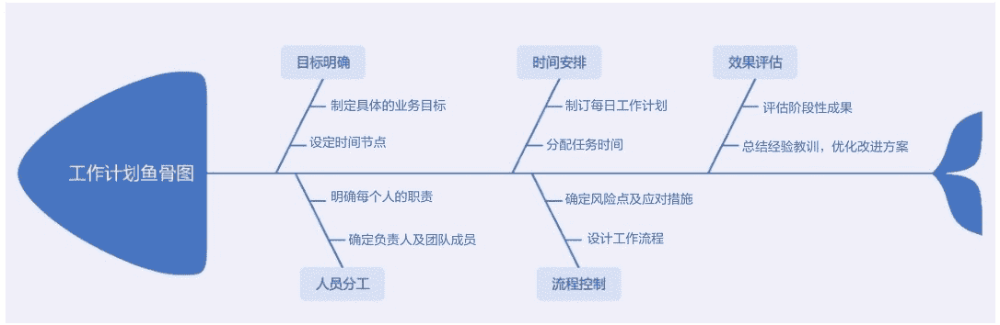
如果觉得这个思维导图还不够完美，或者你的想法需要更自由地表达，单击“编辑”按钮，你便可以对思维导图进行变形、变色、变内容操作，甚至可以为思维导图添加新的元素。

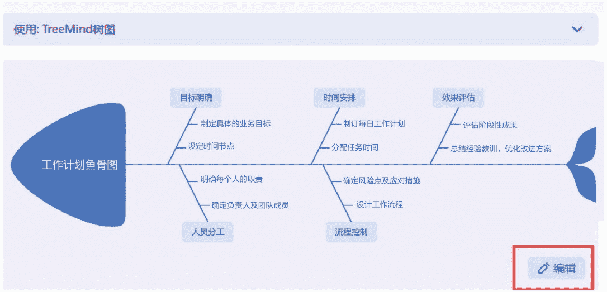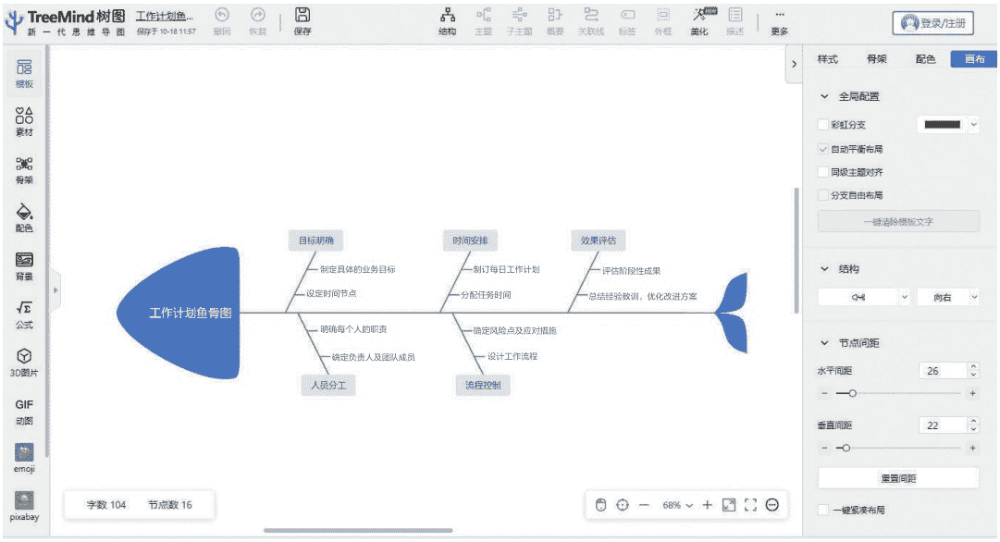

**Q**
请用树状图展示克里斯托弗·诺兰的电影。

# **A**
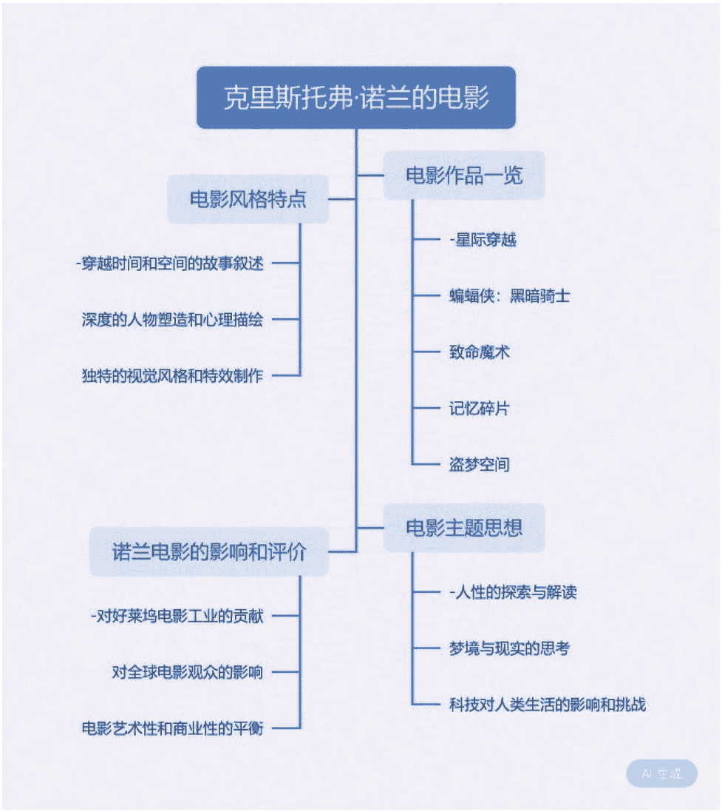

## **本章小结**

本章围绕文心一言插件展开，介绍了插件分类、使用方法与开发思路，包括基本类型、工作原理及自建插件流程。掌握这些内容，有助于更高效地利用插件能力。

## **拓展训练**

**1** 请使用文心一言的览卷文档插件完成文档摘要、问答、二次创作等任务。

**2** 请使用 TreeMind 树图生成一张组织架构图。

# **07**

# 手机版文心一言全攻略

文心一言的 App 与 PC 版同步推出，针对移动场景做了专门优化，操作更顺手，创作更轻便。举例来说，App 的 AI 绘画支持手指直接作画，用户可以在屏幕上用手指涂抹创作；PC 端则偏重专业功能，像绘画作品的高阶编辑、文案的批量生成等，更适合需要深度创作的用户。

## **7.1 如何下载及使用 App**

（1）安装方式有两种：直接在手机自带的应用商店检索“文心一言”或“ERNIE Bot”获取安装包，也可以打开文心一言 PC 端右上角的“文心一言 App”按钮扫码下载。

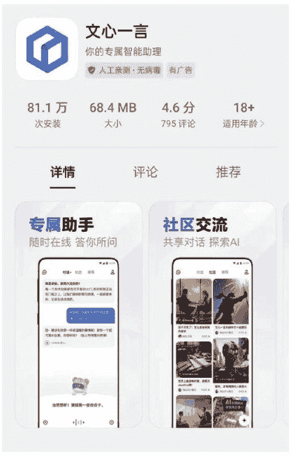

▲图 7-1

▲图 7-2

（2）安装完成后打开 App，用百度账号完成注册，若已有账号则直接登录。

（3）登录后主界面比 PC 端更简洁，适配移动端的使用习惯，点击下方输入框就能直接提问。

（4）点击或左滑主界面左上角的“AI”按钮，可进入历史对话记录，历史记录涵盖 App 与 PC 端的全部对话。

▲图 7-3

▲图 7-4

▲图 7-5

## **7.2 语音输入，让你的学习更高效**

语音输入是 App 的核心亮点之一。点击输入框右侧的麦克风按钮，对着手机说出内容，系统会迅速准确地将其转为文字，对打字速度慢的用户十分友好。

▲图 7-6

▲图 7-7

## **7.3 图片上传自动解析**

图片上传与 PC 端的说图解画功能原理相近，都是上传图片让文心一言解析。但 App 在上传图片的同时还能附带提出具体需求，相比 PC 端上传后直接自动解析，流程更人性化也更方便。

看到喜欢的景物或事物时，还能直接调用拍照功能，将照片交给模型进行即时解析。

▲图 7-8

▲图 7-9

下面看一个图片解析的应用示例。

**Q**

请根据图片信息，描述这家便利店的特点及其对周边环境的影响。

# **A**

基于您提供的图片，这家便利店呈现出以下特征。

**1** 店铺坐落在夜色中的城市街区，周边建筑与道路依稀可见。夜晚时便利店投射出独特的光线，为街道带来安宁感。

**2** 店内灯光柔和温暖，营造出舒适氛围。招牌醒目，字体清晰，色彩鲜明，易于辨识。

**3** 商品品类丰富，涵盖饮料、食品等，顾客能快速找到所需，满足多样化购物需求。

**4** 位置优越，临街并靠人行道，交通便利。行人或骑行者在此能便捷购物，避免前往大型超市排队的麻烦。

对周边环境的影响主要体现在三方面。

**1** 满足居民日常及夜间应急购物需求，提升生活便利度与品质。

**2** 带动区域商业活跃度，吸引人流，促进本地经济繁荣。

**3** 店铺灯光使夜间街道更明亮，提升通行安全性，为周边居民和路人提供保障。

## **7.4 分享和交流：App 社区**

App 社区是文心一言的交流空间，用户可在其中发布观点、作品、经验与心得，并与他人互动讨论。通过社区能更深入了解 App 功能，同时拓展人脉，共同探讨话题。

### **7.4.1 将 AI 对话作品分享到社区**

分享对话作品的流程如下。

（1）进入社区后点右下角加号按钮开始分享。

（2）选择要发布的历史对话并勾选需要分享的内容。

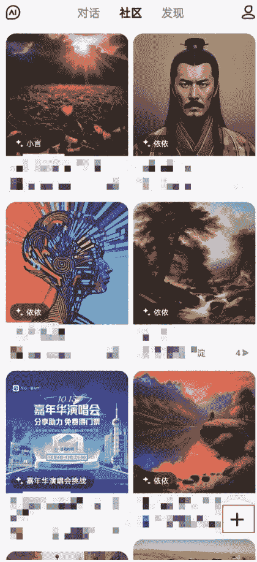

▲图 7-10

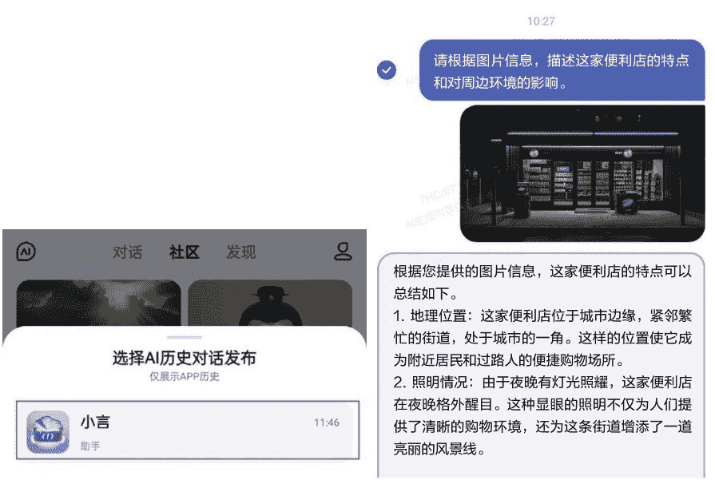

▲图 7-11

（3）填写标题与正文，点击“立即生成”自动生成 AI 封面，再点“发布”即可。

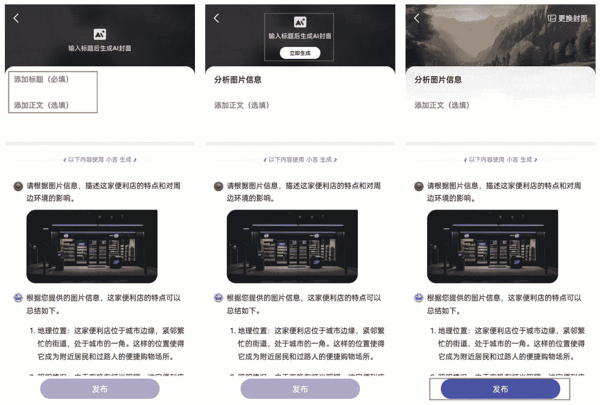

图 7-12

若封面与内容不符，可点右上角“更换封面”重新输入关键词生成，或用手机相册图片替换。

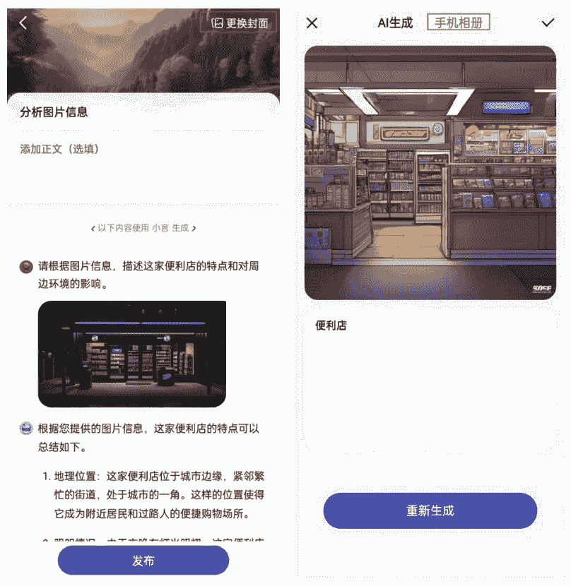

图 7-13

（4）发布后作品会出现在个人主页，审核通过后会推送到社区，分享流程结束。

另一种方式是长按目标对话点“分享”，在弹框中选择“分享到社区”，随后重复步骤（3）（4）即可完成。

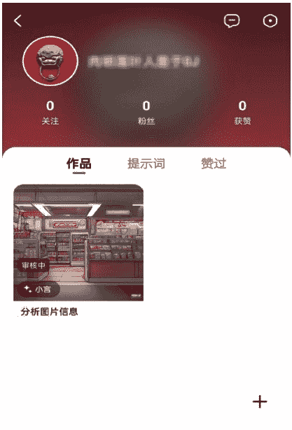

▲图 7-14

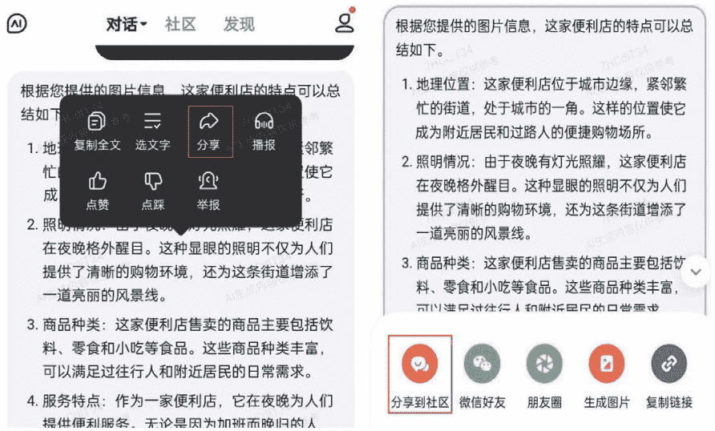

▲图 7-15

### **7.4.2 生成图片分享**

在 PC 端分享有趣对话只能截屏或复制文字，截屏需多次操作，复制则枯燥。App 提供生成图片分享功能，可将整段对话保存为一张图片，既完整又便于传播。

操作很简单，长按对话记录点“分享”，再点“生成图片”即可。

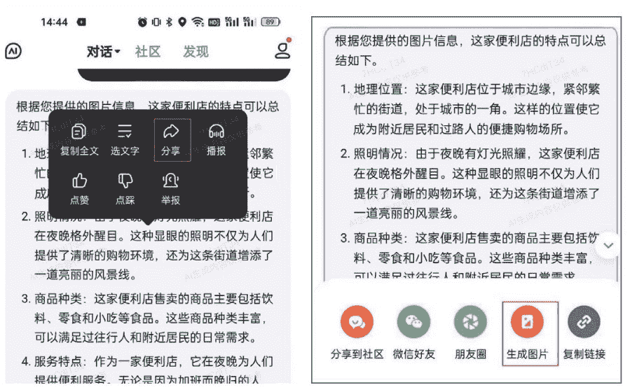

图 7-16

生成后可直接转发给微信好友、发朋友圈或保存到相册。

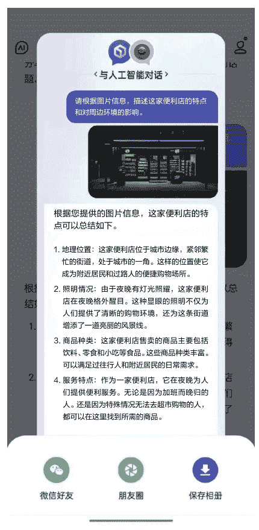

▲图 7-17

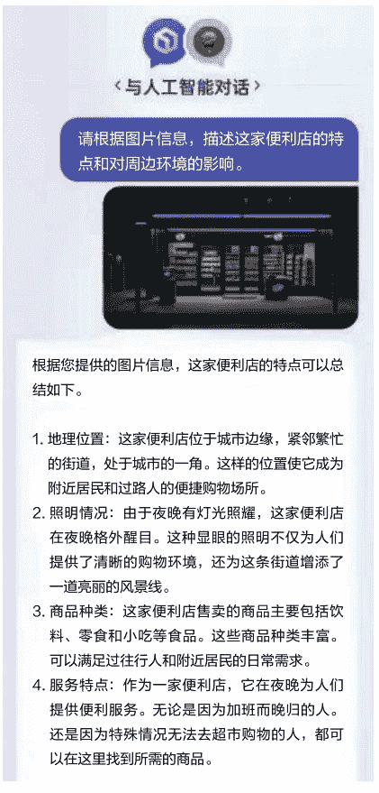

▲图 7-18

## **7.5 发现：各式模板工具琳琅满目**

“发现”模块汇聚了一系列功能与模板，帮助用户更高效地探索 App。

**1. 技能提升技巧：**提供写作、阅读、沟通等提升方法，助力挖掘潜力。
**2. 实用工具：**包括语音输入、翻译、词典等，提升任务完成效率。
**3. 娱乐休闲：**收录笑话、音乐、视频等内容，帮助放松减压。

### **7.5.1 热门模块**

热门模块依据访问与使用数据统计，反映用户兴趣。

**1. 看图写诗小助手**
上传图片后，App 可依据图片内容作诗，只需指定诗体即可。

图 7-19

**2. Excel 公式生成**
可根据输入数据与需求自动生成 Excel 公式，减少手动编写，提升工作效率。注意生成公式仅供参考，使用时需自行核验正确性与适用性。

例如请求求平均值，App 会给出操作步骤与注意事项。

图 7-20

**3. 论文参考**
输入研究主题或关键词，App 会检索相关文献并提供参考文献列表，方便选引用。

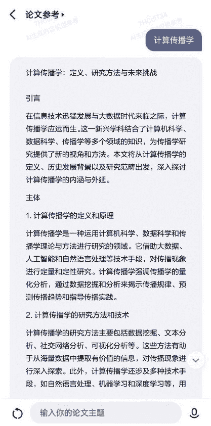

图 7-21

### **7.5.2 角色代入模板**

角色代入模板让用户模拟特定身份或场景，提升沟通、情感体验、自我认知与人际理解，并提供预设模板便于快速使用。

**（1）提高沟通交流能力：**模拟不同社交场景，增强应对能力。
**（2）增强情感体验：**身临其境感受不同情境。
**（3）促进自我认知发展：**通过扮演了解自身性格与行为。
**（4）增进人际关系：**理解他人需求，减少误解冲突。
**（5）便捷易用：**提供现成角色与场景。

常见示例。

**1. 英语口语老师**
模拟外教进行口语教学与纠错，从简单对话逐步提升难度，支持语音练习，提供个性化学习体验。

图 7-22

**2. 心理咨询师**
协助处理家庭、择业、求学、社交适应等心理问题，是较为受欢迎的模板之一。

图 7-23

**3. 笑话大王**
在烦躁时可体验该模板，听笑话或探讨人生哲理。

图 7-24

### **7.5.3 职场模板**

职场模板帮助快速生成规范化文件，节省时间，提升信息传达效率。

**1. PPT 大纲生成**
输入主题即可获得一份 PPT 大纲。

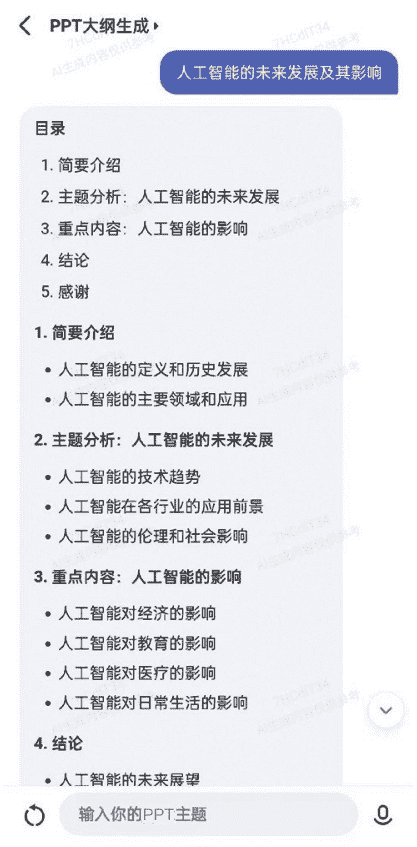

▲图 7-25

**2. KPI 生成器**
依据业务需求与团队目标自动生成关键绩效指标，并提供可视化看板，便于理解与追踪进度。

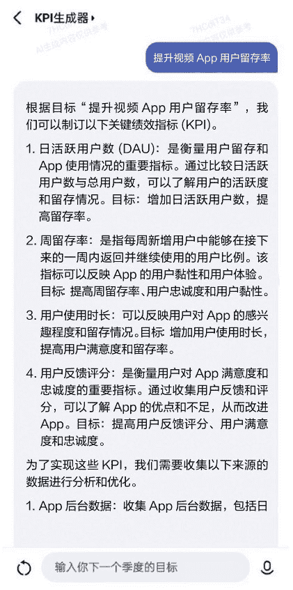

▲图 7-26

**3. 调研问卷**
用于收集定量与定性数据，可用于市场研究、满意度调查等。设计时需注意问题清晰、中立与样本代表性，数据分析后可为策略提供依据。

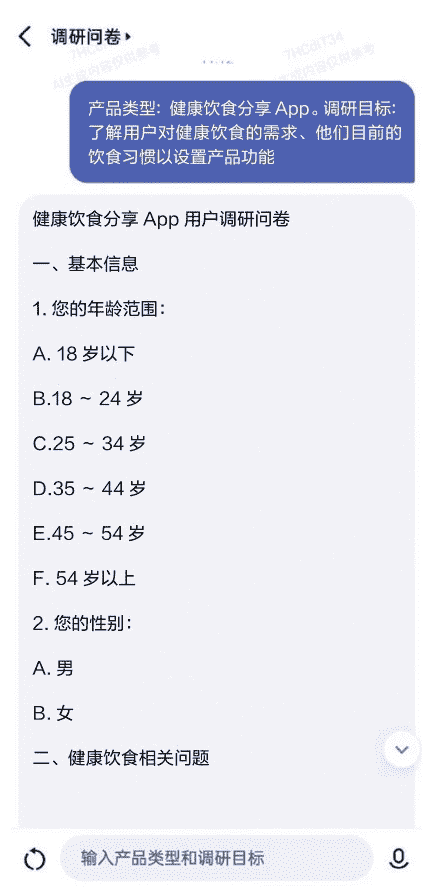

图 7-27

### **7.5.4 学习模板**

学习模板帮助匹配资源、提供评估与练习，调整学习计划。

**1. 英语词汇学习**
扩大词汇量，提升阅读写作，提供记忆方法与练习测试。

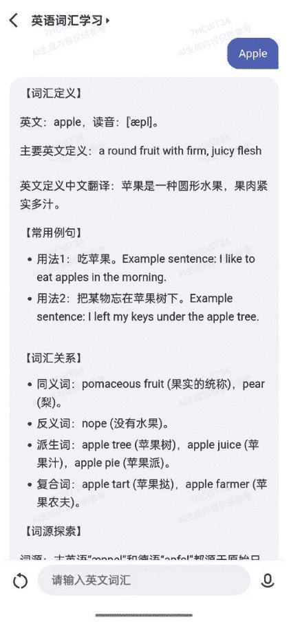

图 7-28

**2. 考试复习助手**
依据考试大纲梳理重点，提供知识归纳与模拟试题，帮助检测薄弱环节并调整计划。

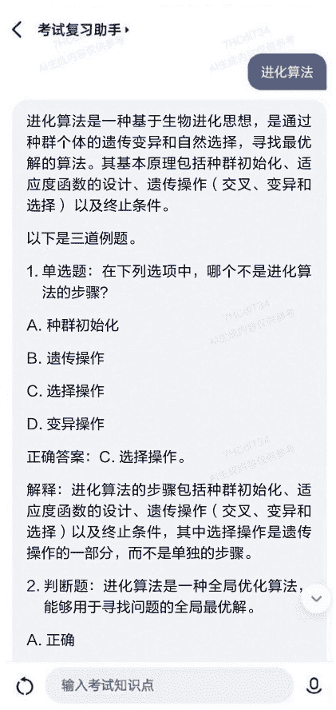

图 7-29

### **7.5.5 AI 绘画模板**

**1. 真实风格绘画**
输入关键词生成写实风格绘画作品。

图 7-30

**2. 自由画板**
用户按意愿指定风格与内容，App 尽力实现创意绘画。

图 7-31

### **7.5.6 创作模板**

提供写作指导、素材、练习反馈与交流平台。

**1. 故事创作**
输入关键词即可生成富有创意、引人入胜的故事。

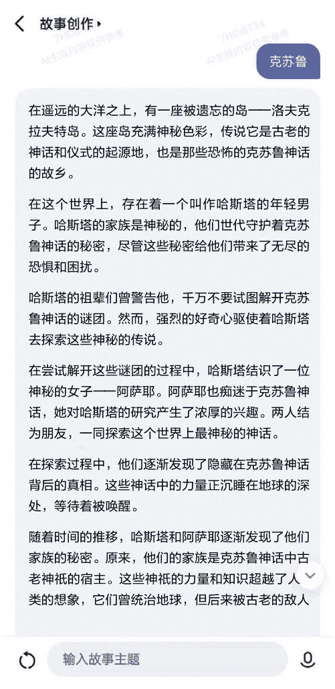

▲图 7-32

**2. 教育剧本创作**
基于成语故事生成趣味短剧，辅助创意教学并促进思考。

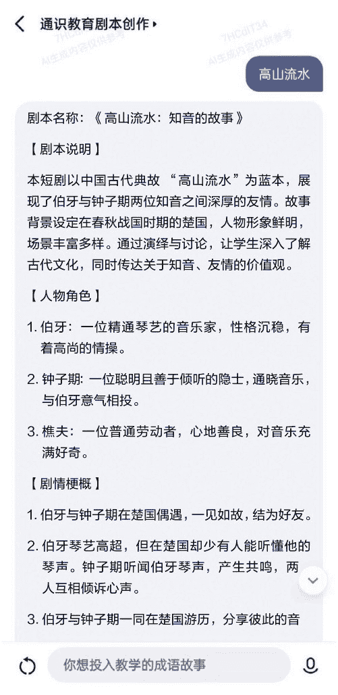

▲图 7-33

### **7.5.7 生活模板**

文心一言 App 的生活模板是日常小助手。

**1. 居家常识**

厨房油渍怎么清、衣物如何收纳拿不定主意时，可以试着向文心一言 App 请教，它往往能给出令人满意的解决思路（如图 7-34 所示）。

**2. 烹饪搭档**

借助文心一言 App 来进行食材搭配，能让家里现有的食材发挥出最佳营养效果（如图 7-35 所示）。

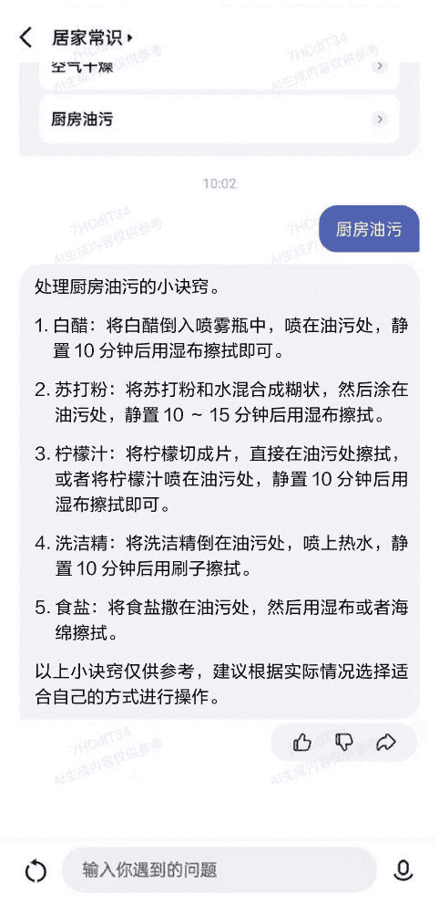

▲图 7-34

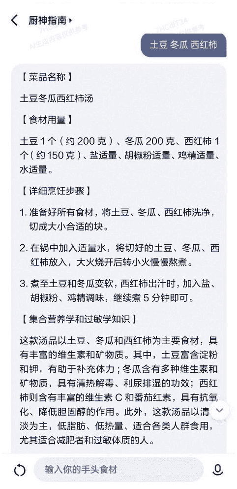

▲图 7-35

### **7.5.8 休闲娱乐场景**

娱乐休闲在日常生活中占据重要位置。伴随技术进步，像文心一言 App 这样先进的语言模型，正逐步渗透到休闲娱乐的多个环节。

**1. 破套路妙答**

无论工作场景还是生活琐事，经常被别人一句带跑偏时，可以让文心一言 App 帮忙给出反套路回复，它会从新颖视角切入问题（如图 7-36 所示）。

图 7-36

**2. 诗词对对碰**

若你对自己的诗词功底颇有信心，不妨与文心一言 App 来一局对子，抛出上联，它便能迅速给出下联（如图 7-37 所示）。

图 7-37

### **7.5.9 情感支持模板**

文心一言 App 的情感模块能够依据用户的情绪需求和具体困扰，提供陪伴与安抚，帮助用户更从容面对情绪波动与打击，舒缓心理负担。同时，它还能结合用户的情绪状态和行为表现，给出针对性的情感建议，让用户更清晰地认识自身情绪，找到合适的解决路径。

**1. 情绪加油站**

现代生活节奏快，情绪如同需要定期加油保养的车辆，才能在路上稳健前行。只需把当下心情输入进去，文心一言 App 就能据此推送契合的文案、书单和影片推荐（如图 7-38 所示）。

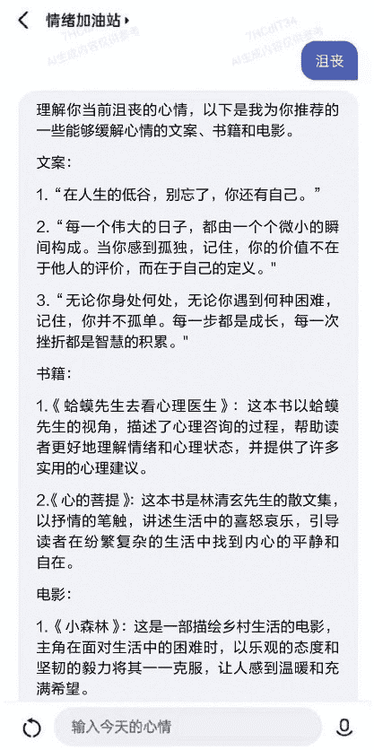

图 7-38

**2. 高情商回复**

人际互动里，高情商者善于捕捉对方的情感诉求并给出恰当回应，从而维系良好关系。把遇到的具体场景输入，文心一言 App 就能给出得体的高情商回话建议（如图 7-39 所示）。

图 7-39

## **7.6 基础设置详解**

科技发展到今天，手机 App 已成为生活刚需。文心一言 App 作为智能助手，其基础配置直接影响使用感受与信息安全。以下内容将系统介绍文心一言 App 的基础设置项及其作用，助你更顺畅地使用与管理。

### **7.6.1 账号管理**

文心一言 App 的账号管理涵盖申诉、冻结、注销等功能。规范注册账号后，用户可获得更完整个性化的服务。为了守护账号安全，应用还提供密码防护、短信校验等多种措施。熟悉并正确使用这些功能，能提升使用体验与安全感。

**1. 账号申诉**

登录异常、手机停用、需修改实名或遗忘密码时，可启动账号申诉。申诉流程大致如下。

（1）填写要申诉的账号。
（2）填写当前可用的联系手机号，申诉结果将以短信形式发送至该号码。
（3）填写账号绑定信息及注册信息。
（4）提交申诉后，系统通常在24小时内通过短信告知处理结果。

**2. 账号冻结**

手机丢失或账号存在风险时，可启用账号冻结。但冻结期间将无法登录使用，权衡利弊后再操作为宜。冻结前建议先备份重要资料，以免丢失。

冻结操作一般按以下步骤进行。
（1）输入欲冻结的账号。
（2）按提示输入手机验证码或其他身份验证方式。
（3）点击“确认冻结”，完成锁定。

**3. 账号注销**

账号注销即永久停止使用该账号。注销后所有数据将被清空，相关登记失效。简单说就是无法再登录且信息全清，若需再次使用需重新注册，届时账号处于空状态。

一个百度账号可登录多款产品。用户可仅清除文心一言 App 的使用痕迹，也可选择永久注销百度账号，一旦注销所有产品数据将无法恢复。

清除文心一言 App 服务痕迹可按以下说明操作。
（1）历史对话记录

单条历史对话删除：进入历史对话列表，长按目标对话后点“删除”，即可移除该条记录（如图 7-40 所示）。

图 7-40

（2）社区内容

社区内容删除：进入个人主页，打开对应内容详情页，点击右上角操作按钮后选择“删除”，即可移除该内容（如图 7-41 所示）。

图 7-41

用户亦可永久注销百度账号，注销后该账号在百度系产品中均不可登录，所有数据无法找回。

具体步骤如下。
（1）进入账号注销页面，选择注销百度账号。
（2）阅读并确认注销说明与注意事项（如图 7-42 所示）。
（3）点击“已了解风险，确定继续”完成注销流程。

图 7-42

### **7.6.2 语音助手设置**

文心一言 App 的语音助手设置涵盖助手选择、性格调节、语速调节等。通过合理配置，应用能更精准理解语音指令并提供高效智能服务。

下面详细介绍语音助手设置的具体操作。
（1）点按主界面“对话”按钮，进入语音助手设置页（如图 7-43 所示）。

图 7-43

（2）选择语音助手角色。提供 AI 男孩与 AI 女孩两种，性别不同音色也随之变化（如图 7-44 所示）。
（3）设置性格风格。AI 女孩可选二次元萌妹、傲娇大小姐、脑洞少女等；AI 男孩可选幽默风趣、温柔暖男、中二少年等（如图 7-45 所示）。
（4）调节语速。提供慢速、标准、较快、快速四档，按需选择。

▲图 7-44

▲图 7-45

### **7.6.3 字号大小调节**

文心一言 App 支持字号调节，方便用户在不同阅读场景下获得最佳体验。适当调整字体大小可提升清晰度与可读性，减少视觉疲劳。

下面说明字号调节的具体方法。
（1）进入个人主页，点击右上角“设置”，在设置列表中找到“字号大小”（如图 7-46 所示）。
（2）进入字号调节页，拖动底部滑块即可调整字体大小（如图 7-47 所示）。上方实时预览区域可帮助用户根据喜好微调。

▲图 7-46

▲图 7-47

### **7.6.4 帮助和反馈**

文心一言 App 内置帮助与反馈入口，方便用户上报使用中遇到的问题。反馈提交后，工作人员会进行处理，有助于提升满意度。

具体反馈流程如下。
（1）打开设置页，找到并点击“帮助/反馈”，进入意见反馈页面（如图 7-48 所示）。

图 7-48

（2）先查看首页是否已有解答，若无则点击下方“反馈建议”按钮（如图 7-49 所示）。
（3）选择反馈类型，描述问题并上传截图，留下联系方式后提交（如图 7-50 所示）。

▲图 7-49

▲图 7-50

### **7.6.5 修改昵称和头像**

更换昵称与头像有助于彰显个人风格，提升关注度，进而促进互动交流。

具体操作如下。
（1）打开设置页，点击“账号管理”，进入账号管理界面（如图 7-51 所示）。

图 7-51

（2）修改头像：点击右上角头像框进入编辑页，可直接拍摄或从相册选取图片作为新头像（如图 7-52 所示）。
（3）修改用户名：点击“用户名”进入修改页即可调整。需注意用户名是百度账号唯一标识，普通用户每年仅可修改一次，请谨慎操作（如图 7-53 所示）。

▲图 7-52

▲图 7-53

## **本章要点**

本章围绕文心一言 App 的基础知识与实用案例展开，涵盖下载安装、使用方法、语音输入、图片上传自动识别等内容。掌握本章要点即可更好地理解与熟练运用文心一言 App。

## **拓展训练**

**1** 用文心一言 App 完成一次对话练习，并将结果分享至社区。
**2** 利用文心一言 App 的语音输入功能进行一次完整交流。

# **08**

# **百度旗下其他 AI 产品**

百度在国内 AI 赛道中始终领先，打造了多款值得信赖的 AI 产品。除了广为人知的百度搜索外，旗下还有众多 AI 应用，各自在不同领域发挥作用，推动技术进步与落地。

## **8.1 文心一格**

文心一格是基于文心大模型的文本生成图像系统商业化成果。2022 年，百度正式推出 AI 艺术与创意辅助平台文心一格，该产品依托飞桨与文心大模型打造，是一款 AI 绘图工具。

### **8.1.1 文心一格入门指引**

借助飞桨与文心大模型的技术加持，文心一格为艺术创作打开无限可能。用户仅需输入文字描述，即可快速生成多风格精美图像。

它既能为画师、设计师等视觉创作者提供灵感支持，也能为媒体从业者、作者等文字创作者提供高质量配图，更让零绘画基础的用户也能尽情创作。以下为文心一格的实操场景。

**1. 快速玩转创意工作台**

（1）认识输入框。登录文心一格官网，点击“画笔”或“立即创作”进入创作工作台（如图 8-1 所示）。

图 8-1

在输入框内描述绘画创意，采用规范的 Prompt 语句通常能得到更理想的效果（如图 8-2 所示）。Prompt 即用户向模型提出的描述性指令。

图 8-2

（2）调整绘图参数。常用参数包括风格、画布比例、生成数量。
风格：在推荐模式下提供多种风格可选，建议新手优先使用“智能推荐”，该模式由 AI 综合计算优化，效果稳定（如图 8-3 所示）。
画布比例：根据需求选择画作尺寸。
生成数量：可设定同时生成的作品数，最高 9 张（如图 8-4 所示）。

▲图 8-3

▲图 8-4

（3）作品管理。滚动鼠标滚轮可浏览历史生成记录，也可点击右上角“创作管理”查看历史作品（如图 8-5 所示）。

图 8-5

点击任意作品可放大查看，右侧工具栏支持下载、分享、公开等操作。完成作品后可进行评分，每一次评分都有助于模型优化生成质量（如图 8-6 所示）。

图 8-6

**2. 自定义 AI 作图**

（1）输入创作灵感。点击主页“自定义”按钮进入创作页，输入绘画描述并选择 AI 画师。不同画师擅长不同风格，目前支持创艺、二次元、具象三种（如图 8-7 所示）。

图 8-7

（2）自定义图生图。上传参考图片，系统将据此生成新作。影响权重越高，参考图对结果的制约越强（如图 8-8 所示）。

图 8-8

### **8.1.2 进阶指南：Prompt 写作**

使用文心一格生成图像时，需要提供特定格式的文本描述，即 Prompt。

**1. Prompt 基础公式**

掌握 Prompt 并不复杂，遵循以下公式即可。
Prompt = 画面主题 + 细节词 + 风格修饰词。

例如，生成短发二次元可爱女生头像（如图 8-9 所示）。

图 8-9

对应的 Prompt 可分解为主题、细节、风格三部分。

**2. Prompt 优化技巧**

熟悉基础公式后，可通过更具体的描述提升作品质感。清晰表达是高效创作的关键。若仅提示“月光下的美丽少女”，模型难以把握人物形象，此时需补充细节。

例如补充人物形象细节：国风华服、动漫少女、面容精致、微笑、牡丹花头饰等；补充场景细节：月夜、柔美月光、祥云、花瓣飘落、星空背景等；补充质感词汇：多彩炫光、镭射光、浪漫色调、几何构成、丰富细节、绝美壁纸、唯美二次元等。细节越具体，生成结果越贴合预期（如图 8-10 所示）。

优化后的公式可为：Prompt = 基础词 + 人物形象描述 + 场景/道具/配饰细节 + 画面质感增强词。

图 8-10

以下是常用 Prompt 词汇参考。
图像类型：古风、二次元、写实照片、油画、水彩画、油墨画、水墨画、黑白雕版画、雕塑、3D 模型、手绘草图、炭笔画、极简线条画、浮世绘、电影质感、机械感。
构图：中心构图、水平线构图、辐射纵深、渐次韵律、三分构图、框架构图、引导线构图、视点构图、散点构图、超广角、黄金分割、错视构图、抽象构图。
艺术流派：现实主义、印象派、野兽派、新艺术、表现主义、立体主义、抽象主义、超现实主义、行动画派、波普艺术、极简主义。
插画风格：扁平、渐变、矢量插画、2.5D、涂鸦白描、森系、治愈系、水彩、暗黑、绘本、噪点肌理、MBE、轻拟物、等距视角。
个性风格：赛博朋克、概念艺术、蒸汽波、Low Poly、像素、极光、宫崎骏、吉卜力、嬉皮士、幻象之城、苔藓、新浪潮。
人像增强：精致面容、五官精致、毛发细节、少年感、蓝眼睛、超细腻、比例准确、妆容华丽、厚涂、虹膜增强。
摄影效果：舞台灯光、环境光照、锐化、体积光、电影感、氛围光、丁达尔效应、暗调、动态模糊、长曝光、颗粒感、浅景深、微距、逆光、抽象微距、仰拍、软焦点。
图像细节：纹理清晰、层次丰富、物理细节、高反差、光圈虚化、轮廓光、立体感、空间感、锐度、色阶、低饱和、CG 渲染、局部特写。

**3. 应用案例**

动物类（如图 8-11 所示）：Prompt = 主体 + 形态细节 + 场景氛围 + 质感增强词。

▲图 8-11

植物类（如图 8-12 所示）：Prompt = 主体 + 形态细节 + 风格修饰词。

▲图 8-12

场景类（如图 8-13 所示）：Prompt = 主体 + 修饰词 + 风格词 + 质感增强词。

图 8-13

家装设计类（如图 8-14 所示）：Prompt = 主题词 + 风格词 + 修饰词 + 质感增强词。

图 8-14

### **8.1.3 AI 编辑**

文心一格的 AI 编辑功能可实现瑕疵修复、一键换主体、风格与主体叠加融合等操作，满足设计、创意内容与新媒体配图的多种需求。即便不会 Photoshop，也能轻松完成改图。点击首页“AI 编辑”按钮或进入工作台即可开始。

**1. 涂抹消除**

当你对文心一格刚生成的作品整体还算满意，却觉得某些局部不够理想时，直接把不喜欢的地方涂掉即可，系统会自动把被涂抹的范围清除并重新绘制（如图 8-15 所示）。

图 8-15

**2. 涂抹编辑**

把想要改动的部位涂上颜色，模型就会依据这个指令对涂抹区进行重画。这一能力既能修复破损画面，也能实现局部改写（如图 8-16 所示）。

图 8-16

**3. 图片叠加**

把两张素材合在一起叠加产出的新图（如图 8-17 所示），会同时保留两张原图的视觉特点（如图 8-18 所示）。

▲图 8-17

▲图 8-18

### **8.1.4 文心一格实验室**

文心一格实验室是文心一格里专门做实验性创作的在线模块，目标是给用户更个性、更智能的绘画体验。依托 AI 技术，它能迅速产出多种风格、尺寸和构图的作品，也支持按需定制。板块内还配备了多类绘画工具和可调参数，让创作过程和最终效果更易掌控。现阶段共开放了三项体验功能。

**1. 人物动作识别再创作**

上传一张参考照片，系统会先解析出人物姿态，再融合你输入的关键词，生成姿势相近的新作（如图 8-19 所示）。

图 8-19

**2. 线稿识别再创作**

把线稿图传上来，填入想要呈现的描述词，点击“立即生成”就能得到结果（如图 8-20 所示）。

图 8-20

**3. 自定义模型**

自定义模型功能让用户自带素材来训练专属模型，从而产出更贴合个人审美的绘画。借助这一方式，创作的灵活度与自由度都得到提升；同时也能扩展基础模型的表现边界，为艺术表达打开更多可能。

（1）操作流程

具体步骤可参考图 8-21 所示：首先上传训练图集并挑选模型类型、调节参数；随后依据训练时设定的 Prompt 预览效果；确认满意后即可上线属于自己的 AI 绘画模型。

图 8-21

（2）实操案例

以下以二次元角色为例做演示。

上传训练图片集：所选二次元人物须为同一角色，图像清晰，数量不少于5张。最好为该角色起一个专属的名字作为标记词（如图 8-22 所示）。

图 8-22

调节迭代次数与学习率档位，并配置 5 到 10 条用于验证的 Prompt。提示词里要包含前面设定的标记词，突出该角色出现在画面。训练时长通常在 30 至 120 分钟，完成后可查看样图判断模型是否达标（如图 8-23 所示）。

图 8-23

温馨提示：模型发布成功后，有效期为 7 天，期间可正常调用；到期后 3 个月内仍可重新发布，超过 3 个月未使用则模型将被清除。

## **8.2 百度智能云·一念**

百度智能云·一念，简称一念，是基于文心大模型搭建的多模态内容创作平台，涵盖文本、图像、视频等多种形式，致力于帮助企业更快更高效地获取灵感与营销素材。它能提供海量的创作资源，快速产出高质量的图文视频内容，也可按需定制，适配不同场景的营销需求。一念的推出为企业带来更智能高效的创作方案，有助于提升营销效果与内容产出速度。

### **8.2.1 内容简介**

**1. 优势**

（1）集成领先的多模态创作技术

一念融合了前沿的 AI、大模型、云计算及音视频处理能力，为创作者和机构提供全套 AI 工具加持。算法驱动下，优质内容产出更轻松。平台不仅覆盖高频创作需求，还能处理制作细节，达成全场景、精细化、智能化、高效化的生产目标。

（2）提供一站式内容智能创作工具

平台汇聚大量优秀案例，打造专业安全高效的一站式智能创作服务。视频端提供图文转视频、虚拟主播、图表动效、在线剪辑等十余项能力；写作端涵盖热点写作、模板写作，并内置纠错、标题推荐、智能摘要、文本打标签等辅助，助力零基础用户完成图文视频创作。

（3）效果稳定性强

依托海量训练数据，一念在多变复杂场景下仍保持稳定输出，适配性更强。

**2. 核心产品**

（1）AI 文案

一念成文，点燃创意：可按需批量生成个性化营销文案，适配小红书、抖音、B站等平台风格，显著提高产品推广、活动策划和种草内容等工作的效率，帮助作品在各平台脱颖而出（如图 8-24 所示）。

图 8-24

（2）AI 作画

一念成画，把想法可视化：无需绘画基础，输入简短描述即可生成高品质图像，支持 30 余种创意风格，简化设计流程，轻松产出独具特色的海报，颠覆传统作图方式（如图 8-25 所示）。

图 8-25

（3）AI 成片

一念成片，讲好视觉故事：只需输入文本即可一键生成视频，平台提供版权素材、创意素材与视频模板，让画面更有想象空间。生成的视频还能二次编辑，确保成品尽善尽美，无需专业剪辑也能快速做出独一无二的创意短片（如图 8-26 所示）。

图 8-26

（4）数字人视频

一念成形，虚拟出镜：提供 40 余种数字人形象可选，输入文案即可一键生成播报视频。人像逼真灵动，可替代真人拍摄，为内容增添表现力，同时节省拍摄成本与时间，保证高品质输出，让数字人成为新传播载体（如图 8-27 所示）。

图 8-27

（5）AI 创作助手

一念巧思，灵感落地专家：打通文本、图像、视频的创作壁垒，让灵感即取即用，引领企业以新方式进行内容生产。平台内置 200 多种主题与 20 多种辅助工具，持续激发灵感，让创作更简便高效。

**3. 应用场景**

（1）金融营销

依托百度领先 AI，为金融行业提供资讯分析、智能写作、视频生成等能力，实现高效灵活的内容生产与千人千面的分发，助推业务增长。

金融舆情分析：借助事件分析功能汇聚金融热点、监测舆情，并自动生成分析报告。

金融内容创作：利用 AI 成片、数字人、图表动画等工具，将内容以视频形式呈现，适用于股市复盘、产品介绍、行情资讯等场景；智能写作可基于金融数据自动撰写报告、基金快讯等文章。

智慧营销：依托 AI 成片、智能云剪、数字人视频等功能，实现营销视频的批量智能化生产。

（2）汽车营销

可按受众需求一键生成爆款文案与海报。借助 AI 仿写，一篇文章即可批量产出大量个性化推广文案，满足多元化投放需求，让车企内容形式更丰富、物料产出更高效。

汽车热点营销：结合时事与节假日热点打造个性广告与宣传话术，激发购车意愿，最大化销售效益，为品牌注入创意活力，适配不断变化的市场。

汽车营销海报：用 AI 作画与 AI 海报功能，基于产品图自动生成宣传海报，搭配定制文案，呈现个性化广告画面，传递品牌价值，提升传播力与客户吸引力。

内容创作：提供 AI 文案与 AI 视频等工具，覆盖车型介绍、线上活动、交付服务、品牌体验等场景，提高创作效率，便于传达品牌信息、吸引潜在客户、优化服务体验、塑造专业形象。

（3）媒体创作

依托领先的 NLP 与知识图谱技术，赋能媒体从策划、采编、审核到发布的全流程，促进传统媒体与新媒体在选题、生产、传播上的深度融合。

选题策划：利用事件分析聚合网络热点与资讯，提升资讯收集与选题效率。

自动创作：借助 AI 成片与图表动画，将图文或数据快速转为视频报道；智能写作可批量生成结构化新闻稿，如天气预报、体育快讯等，释放一线记者生产力。

辅助分发：通过文章标签实现精准分类，提升稿件分发效率与质量。

### **8.2.2 快速入门**

在进入本节操作前，请先确认以下准备工作已完成。

（1）注册百度智能云账号：若已经注册百度智能云账号，可忽略此步骤；若未注册百度智能云账号，请先注册。

（2）完成实名认证：若已经在百度智能云完成实名认证，可忽略此步骤；若未完成实名认证，请参见实名认证文档完成认证。完成个人实名认证或企业实名认证后，均可购买相关服务。

**1. 页面介绍**

（1）创作中心

创作中心由工作台、创意中心、智能工具与个人中心四块组成。工作台整合了 AI 创作助手、热门工具、素材库等；创意中心收纳文案与视频模板等资产；智能工具涵盖图文视频创作功能；个人中心保存草稿、素材与作品（如图 8-28 所示）。

（2）AI 创作助手

新手用户可在输入框输入“/”或点击输入框，弹出下拉菜单快速调取图文视频创作模板，获取灵感（如图 8-29 所示）。

图 8-28

（3）热门工具

工作台内有多款创作工具，文本、图像、视频需求均可直接点卡片进入创作（如图 8-30 所示）。

▲图 8-29

▲图 8-30

（4）各式模板

工作台底部提供丰富的视频、文案、绘图模板，可直接选用开展创作（如图 8-31 所示）。

图 8-31

（5）个人中心

个人中心主要提供用量统计与订单管理（如图 8-32 所示）。入口在右上角头像，悬停即可展开下拉菜单。

图 8-32

**2. 操作流程**

下面以工作台的 AI 成片为例，演示从创建到出片的全流程。

（1）明确需求，确定功能。

假设用户手头有一篇图文稿，想做成视频。依托工作台卡片介绍，选择 AI 成片功能（如图 8-33 所示）。

图 8-33

（2）进入功能使用页面

进入功能页，按提示逐步填写信息。可通过文本、链接或上传 Word 文档导入图文素材，并依次设定时长、布局、清晰度、配音、背景音乐等参数（如图 8-34 所示）。

图 8-34

（3）生成作品

提交素材后即可开始生成，处理需要一定时间，可在顶部右侧任务中心查看进度（如图 8-35 所示）。

图 8-35

（4）下载作品

作品完成后可在“我的作品”中预览或下载（如图 8-36 所示）。

图 8-36

### **8.2.3 功能介绍**

**1. 智能写作**

一念提供 AI 文案与热点写作等能力，并融合纠错、敏感词审核、标题推荐、智能摘要、文章检测等辅助工具，助力多场景快速创作。下面重点介绍 AI 文案与热点写作。

（1）AI 文案

步骤一：进入工作台，点击 AI 文案卡片。

步骤二：进入页面后，若需基于描述生成文案，可在右侧 AI 助手输入框发送需求，系统即生成对应内容（如图 8-37 所示）。输入“/”可打开场景选择栏。

图 8-37

步骤三：在编辑区选中文字后，会出现“润色”“扩写”“生成评论”等选项，点击即可对选中内容进行相应处理（如图 8-38 所示）。

图 8-38

步骤四：生成结果以弹窗展示，提供“替换”“下方插入”“重新生成”“放弃”四种操作（如图 8-39 所示）。

图 8-39

步骤五：编辑完成后可下载或保存。点击“下载”会导出为 Word 本地文档，点击“保存”则存入“我的作品”（如图 8-40 所示）。

图 8-40

（2）热点写作

热点写作提供全网 14 大行业分类与省市县级地域数据，以热度趋势、关联词等角度为创作者提供思路，显著提升效率。

步骤一：点开左侧智能工具的“热点”，输入主题关键词（如图 8-41 所示）。

图 8-41

步骤二：挑选符合需求的热点，进入预览页后可点“阅读全文”打开原文，参考内容辅助写作（如图 8-42 所示）。

图 8-42

**2. 视频创作**

下面详细说明智能云剪与图表动画的使用流程。

（1）智能云剪

智能云剪是一款高效的云端剪辑工具，支持逐帧与轨道式编辑。用户上传素材后，可将其拖入轨道进行剪辑拼接，生成完整视频。所有素材与成品均在线访问，无需插件，且支持实时预览。

操作流程如下：

步骤一：点击左侧智能工具的“智能云剪”，并选择输出尺寸（如图 8-43 所示）。

步骤二：添加素材。左侧菜单提供 7 类素材可配置，包括可上传的视频或图片（如图 8-44 所示）。

▲图 8-43

▲图 8-44

步骤三：配置各类型素材。

数字人素材：可在左侧插入 2D 或 3D 数字人进行旁白播报（如图 8-45 所示）。

动画素材：可选用合适的动画模板（如图 8-46 所示）。

▲图 8-45

▲图 8-46

字幕素材：可输入字幕内容，并在轨道上调节播放时段；右侧工具栏支持调整字号、颜色、不透明度等（如图 8-47 所示）。

文本素材：可输入文字并在轨道上调节时长；左侧可选样式，右侧可调内容、字号、颜色、不透明度等（如图 8-48 所示）。

▲图 8-47

▲图 8-48

配音素材：输入配音文案后可选择音色，并调节语速、音量、音调（如图 8-49 所示）。

音乐素材：支持在线选曲及本地上传（如图 8-50 所示）。

▲图 8-49

▲图 8-50

步骤四：制作完成后可选择导出或保存草稿。点击“生成视频”，设置格式、分辨率、码率与编码后确认，等待任务完成（如图 8-51 所示）。点击“保存草稿”则存入云空间，可在首页侧栏“我的草稿”中查看。

图 8-51

（2）图表动画

图表动画用于将数据转为动态视频。用户挑选平台模板，替换数据后即可生成动效图表。

步骤一：选模板。明确数据需求后，按图表类型挑选合适模板（如图 8-52 所示）。

图 8-52

步骤二：数据配置。

## 一念可视化与AI绘图操作导览

进入数据可视化编辑入口后，第一步是完成资料设定（见图 8-53）。平台提供的各款版型均自带示例资料，若要换成自有资料，只需触发“替换资料”控件即可。

图 8-53

步骤三：文案设定。

完成资料设定后，进入文本配置环节。可编辑的文字要素涵盖图表主标题、坐标轴单位说明、图表附注等。文本确认完毕后，还能顺带调整环境音轨、底色以及影片长度（见图 8-54）。

图 8-54

步骤四：渲染输出。

全部参数确认后即可提交生成。影片处理需要一定耗时，期间可在页面顶部右侧的进度面板查看运行状态。

步骤五：导出成品。

处理完成后，用户可在作品库中对生成的影片进行导出或保存。

**3. 图像生成**

一念平台视觉生成模块依托百度自研AI能力，支持以文字提示或风格主题挑选的方式产出符合预期的视觉素材。凭借在深度神经网络与视觉计算方面的积累，可按需快速输出高质量画面，为设计从业者、创作者等提供更高效的工具，也能适配企业的推广宣传需求，加速素材产出并提升创意水准。

（1）文字转图像

步骤一：在工作区选择AI绘画卡片进入操作页。

步骤二：填写提示指令。可自行撰写创意描述，也可点击示例画面中的“生成类似”控件自动填充优质提示指令（如图 8-55 所示）。

图 8-55

步骤三：风格设定。

选择“自动推荐”，系统会依据提示指令自动匹配较为合适的视觉风格。若想探索更多选项，可点开“全部风格列表”查看并挑选，或在描述输入区直接写入自定义风格（如图 8-56 所示）。

图 8-56

步骤四：画布规格与清晰度。

绘画功能目前提供三类画布规格，每类下又分为三档清晰度。先在左侧确定规格，再在右侧下拉菜单中选择所需分辨率（如图 8-57 所示）。

图 8-57

步骤五：设定生成张数。支持一次性生成1至8张画面，点击“立即生成”后约7至15秒即可出图，完成后可通过画面右下方的操作区对结果进行管理（如图 8-58 所示）。

图 8-58

（2）图像参考生成

图像参考生成的整体流程与文字转图像相近，差别在于需要先提供基准图像，系统据此保留原图的风格与主体特征进行再创作，见图 8-59。

图 8-59

素材可从个人资源库调取或本地导入（如图 8-60 所示）。

图 8-60

相似度调节。滑块数值越高，新图与基准画面的接近程度越强，反之则变化越大（如图 8-61 所示）。

图 8-61

最后设定画布规格和输出张数，点击“立即生成”即可得到结果，见图 8-62。

图 8-62

## 本章回顾
本节聚焦百度生态的两款AI创作工具——文心一格与百度智能云·一念，涵盖文心一格的操作要点与提示指令写法，以及一念在智能写作、视频制作等方面的能力。掌握这些内容，有助于读者更从容地挑选并使用合适的AI创作方案。

## 实践练习
**1** 用文心一格尝试创作一幅山水作品。
**2** 借助百度智能云·一念完成从文本到视频的转换。

**手机扫码关注后，输入校验码：32777，即可获取资源帮助**

*文中代码字体版权说明 ^(¹)

* * *

1.  1.  Copyright Copyright 2010, 2012 Adobe Systems Incorporated (http://www.adobe.com/), with Reserved Font Name ‘Source’. License This Font Software is licensed under the SIL Open Font License, Version 1.1. This license is copied below, and is also available with a FAQ at: http://scripts.sil.org/OFL SIL OPEN FONT LICENSE Version 1.1 - 26 February 2007 PREAMBLE The goals of the Open Font License (OFL) are to stimulate worldwide development of collaborative font projects, to support the font creation efforts of academic and linguistic communities, and to provide a free and open framework in which fonts may be shared and improved in partnership with others. The OFL allows the licensed fonts to be used, studied, modified and redistributed freely as long as they are not sold by themselves. The fonts, including any derivative works, can be bundled, embedded, redistributed and/or sold with any software provided that any reserved names are not used by derivative works. The fonts and derivatives, however, cannot be released under any other type of license. The requirement for fonts to remain under this license does not apply to any document created using the fonts or their derivatives. DEFINITIONS "Font Software" refers to the set of files released by the Copyright Holder(s) under this license and clearly marked as such. This may include source files, build scripts and documentation. "Reserved Font Name" refers to any names specified as such after the copyright statement(s). "Original Version" refers to the collection of Font Software components as distributed by the Copyright Holder(s). "Modified Version" refers to any derivative made by adding to, deleting, or substituting — in part or in whole — any of the components of the Original Version, by changing formats or by porting the Font Software to a new environment. "Author" refers to any designer, engineer, programmer, technical writer or other person who contributed to the Font Software. PERMISSION & CONDITIONS Permission is hereby granted, free of charge, to any person obtaining a copy of the Font Software, to use, study, copy, merge, embed, modify, redistribute, and sell modified and unmodified copies of the Font Software, subject to the following conditions: 1) Neither the Font Software nor any of its individual components, in Original or Modified Versions, may be sold by itself. 2) Original or Modified Versions of the Font Software may be bundled, redistributed and/or sold with any software, provided that each copy contains the above copyright notice and this license. These can be included either as stand-alone text files, human-readable headers or in the appropriate machine-readable metadata fields within text or binary files as long as those fields can be easily viewed by the user. 3) No Modified Version of the Font Software may use the Reserved Font Name(s) unless explicit written permission is granted by the corresponding Copyright Holder. This restriction only applies to the primary font name as presented to the users. 4) The name(s) of the Copyright Holder(s) or the Author(s) of the Font Software shall not be used to promote, endorse or advertise any Modified Version, except to acknowledge the contribution(s) of the Copyright Holder(s) and the Author(s) or with their explicit written permission. 5) The Font Software, modified or unmodified, in part or in whole, must be distributed entirely under this license, and must not be distributed under any other license. The requirement for fonts to remain under this license does not apply to any document created using the Font Software. TERMINATION This license becomes null and void if any of the above conditions are not met. DISCLAIMER THE FONT SOFTWARE IS PROVIDED "AS IS", WITHOUT WARRANTY OF ANY KIND, EXPRESS OR IMPLIED, INCLUDING BUT NOT LIMITED TO ANY WARRANTIES OF MERCHANTABILITY, FITNESS FOR A PARTICULAR PURPOSE AND NONINFRINGEMENT OF COPYRIGHT, PATENT, TRADEMARK, OR OTHER RIGHT. IN NO EVENT SHALL THE COPYRIGHT HOLDER BE LIABLE FOR ANY CLAIM, DAMAGES OR OTHER LIABILITY, INCLUDING ANY GENERAL, SPECIAL, INDIRECT, INCIDENTAL, OR CONSEQUENTIAL DAMAGES, WHETHER IN AN ACTION OF CONTRACT, TORT OR OTHERWISE, ARISING FROM, OUT OF THE USE OR INABILITY TO USE THE FONT SOFTWARE OR FROM OTHER DEALINGS IN THE FONT SOFTWARE.↩︎