# 文心一言通关手册：从入门到全场景应用

## 作品导读
百度基于大语言模型推出的生成式AI产品文心一言，本书围绕其在各式应用场景下的操作方式进行系统梳理，兼顾覆盖面与可操作性，提供一份可直接上手的实践指南。

全书共八章，依次覆盖基础认知、创意写作、绘画入门、数据处理、营销文案、职场工具箱、招聘求职、教学与学习、代码辅助、生活咨询、插件生态、移动端使用以及文心一格等模块的核心要点与使用技巧。

此书既适合对该模型感兴趣的新手，也适合希望借助生成式AI提升工作效能、学习成果与生活品质的读者参考。

## 姜旬恂
学历：硕士
研究方向：数字媒体艺术
现任吉林师范大学新闻与传播学院副教授
兼任吉林省美学学会常务理事、吉林省传媒学会理事、韩国游戏技术学会理事
具备互联网+行业实践，拥有双创导师、移动端交互设计、用户体验设计等资质

### 研究方向
数字产品服务设计、视觉交互设计

### 主要成果
主持吉林省社科课题1项、吉林省教育厅教研课题2项；参与国家艺术基金课题1项、吉林省社科课题1项、省级科研基金课题2项、吉林省教育厅十一五社科课题1项；发表SCI论文3篇、CSSCI论文2篇、核心期刊论文1篇、作品1项、EI论文2篇、省级论文8篇；出版教材1部、专著3部；近五年指导学生团队孵化大学生创新创业项目20余项；2017-2021年度“互联网+”大学生创新创业大赛指导团队获金奖1项、银奖2项、铜奖2项

## 乔通宇
学历：硕士
北京煜华年互动传媒有限公司CEO
奇遇瞬间发起人
创造者私董会创始人
创造者IPAI进化课程主讲导师

##### 工作履历
2006-2008：北京水晶石数字科技有限公司
2009迄今：北京煜华年互动传媒有限公司

### 业务范围
品牌战略、产品开发与IP设计、品牌IP内容营销、AIGC进化探索

## 前言
近年生成式人工智能在自然语言处理赛道持续加速。基于此趋势，百度新一代知识增强大语言模型文心一言应运而生。2023年3月开启公测，两个月内用户规模突破7000万，标志着AI落地进入新阶段。该模型在智能客服、情感分析、机器翻译等领域已显现出明显能力，但普通用户如何真正掌握使用方法仍存在门槛。本书由此成形，意在帮助读者认识、学会并深度运用该系统。

### 本书亮点
全书围绕十余类使用场景展开，通过135个实操案例推动读者从AI新手成长为熟练使用者。全书以案例驱动，从基础概念切入，避开艰深理论，提供通俗详尽的操作说明。无论是寻找写作灵感、提升办公效率，还是解决日常小困扰，该模型都能提供有效支持。

除主模型外，书中还专章讲解文心一言App与百度旗下的文心一格的使用技巧，让读者全面感受生成式AI带来的便利。

### 主要内容
共八章。
第1章主要介绍文心一言的发展脉络与基础操作规范。
第2章至第6章集中展示模型在办公、学习、绘画等领域的典型案例，涵盖数据分析、文本创作、教学示范等。
第7章说明如何借助文心一言的三个插件完成文本摘要、图像分析与图片解析等任务。
第8章介绍文心一言App与文心一格的核心功能与使用方法。

随书附赠文心一言提示词实例，帮助读者快速掌握两大工具的使用要点，实现从入门到精通的跨越。

### 适用对象
- 希望提升办公效率的在职人员
- 对文心一言感兴趣的初学者与爱好者
- 希望提高学习效率的学生
- 关注人工智能发展的群体

### 学习建议
建议结合自身需求挑选章节精读。AI技术迭代迅速，本书内容会随时间更新，建议在实践中保持开放灵活的态度，结合最新资源持续学习。

### 本书作者
本书由吉林师范大学新闻与传播学院姜旬恂与北京煜华年互动传媒有限公司乔通宇共同编写。编写过程中力求科学严谨，难免有疏漏，如遇技术问题请扫码联系技术支持。

技术支持
作者
2024.4

## 第1章

## 认识文心一言：中文大模型的代表

大语言模型的普及重塑了人工智能、自然语言处理、计算机视觉等多个领域。文心一言在中文环境下表现突出，应用范围广泛。对中文语义、语法及上下文的理解较为完整，能满足中文用户的需求。基于百度研发背景，模型能够处理多种输入形式及方言，输出更贴合中国文化、风俗与社会语境。

### 1.1 文心一言的诞生：深度学习的内在逻辑

深度学习是利用深度神经网络进行模型训练的人工智能分支。本节将阐释语言模型的定义、其在自然语言处理任务中的优势、发展历程，以及文心一言对工作生活的影响。

#### 1.1.1 什么是语言模型
文心一言的技术底座是LLM大语言模型的应用。

##### 1. 大语言模型的定义
大语言模型是指利用海量参数与训练语料进行深度学习，能够模仿人类文本生成方式的模型。简言之，它是一个理解并生成自然语言的AI系统。神经网络通过学习大规模语料，自动提炼文本特征与规律，从而实现理解与生成。

##### 2. 大语言模型的历史
早期语言模型以神经网络为基础，如RNN、N-gram等。随着算力与数据资源的提升，模型在NLP领域不断进化。基于循环神经网络RNN及长短期记忆网络LSTM，出现了更深层的语言模型。
Transformer架构的出现弥补了传统RNN的局限，基于注意力机制的序列到序列模型在序列处理与NLP任务中表现优异。
GPT生成式预训练模型的推出标志着大语言模型初露锋芒，并在多项NLP任务中取得佳绩。后续GPT二代在文本生成能力上进一步提升。
同时，BERT双向编码器表示模型推动预训练发展，采用双向预训练显著增强上下文理解能力。上述进展共同推动了大语言模型在NLP领域的广泛应用。

表1-1展示了大语言模型发展历程。

表1-1

| 时间段 | 模型类型 | 时间段 | 模型类型 |
| :--- | :--- | :--- | :--- |
| 20世纪初 | 基于n-gram的语言模型 | 21世纪初 | 基于神经网络的语言模型 |
| 2000年 | 递归神经网络语言模型 | 2010年 | 长短时记忆网络语言模型 |
| 2010年 | 门控循环单元语言模型 | 2020年 | 大规模预训练语言模型 |

##### 3. 大语言模型的训练方式
训练通常分为两个阶段：预训练与微调。
预训练：模型在海量未标注文本，如书籍、文章、网页上学习，目标是捕获语料库中的底层模式、结构与语义知识。
微调：在预训练后，使用特定任务的有标注数据对模型参数进行调整，以提升在文本生成、机器翻译、情感分析等目标任务上的表现。微调使模型更具针对性与可解释性，便于调试与行为分析。

#### 1.1.2 文心一言是什么
文心一言ERNIE Bot是百度发布的新一代知识增强大语言模型，也是文心大模型家族的最新成员。作为国内首个面向公众的生成式对话产品，它是百度深耕AI多年成果的体现。模型拥有丰富的语言资源，可进行对话互动、创作辅助、问答，帮助用户快速获取信息、知识与灵感。
文心一言基于飞桨深度学习平台与文心知识增强大模型构建，能够在海量数据与知识中持续学习，提升语言处理与知识储备。2023年8月31日全面开放后，已在文学创作、智能家居、金融、教育、医疗健康等领域得到应用。

#### 1.1.3 文心一言背后的故事与历程
依托飞桨与文心大模型技术研发，文心一言可实现对话、问答、创作辅助，并基于ERNIE模型提供多语言翻译，助力跨语言沟通。
名称“文心一言”源于中国传统文化“一心”之意，强调专注与一致。设计上以用户需求为核心，提供准确高效的服务，注重互动与个性化体验。
该产品既体现了百度在AI技术的创新突破，也融入了传统文化理念，旨在让科技更贴近生活。
百度自2010年起深耕自然语言处理、机器翻译与深度学习，逐步形成完整AI技术体系。2017年发布开源深度学习平台飞桨，为开发者提供工具资源。2019年推出ERNIE与ERNIE2.0，具备自然语言处理、语音识别、图像识别等能力。2023年8月31日文心一言面向公众开放，标志着百度在AI领域的重要进展。

#### 1.1.4 文心一言的影响和应用范围
随着技术成熟，文心一言成为数字化时代的重要推动力。大语言模型的发展大幅提升了文本与自然语言相关任务的处理效率。
应用场景涵盖自然语言生成、图像生成、数据分析、对话系统、文本分类、代码编写、机器翻译等。在教育、医疗、文学、金融等领域帮助用户快速获取信息；在企业场景中可加速自动化、降低成本、提升效率与质量。
作为中国首个大语言模型之一，文心一言在多个领域展现出强大潜力，标志着AI发展迈出关键一步。

### 1.2 文心一言快速入门：跨越新手村
本节为首次使用者提供完整入门指引，帮助掌握注册登录流程与界面功能。

#### 1.2.1 注册与登录
01 在浏览器搜索“文心一言”，进入官网，点击“登录”。
02 点击右下角“立即注册”创建账号。
03 填写用户名、手机号、密码、验证码，勾选阅读并接受协议后点击“注册”。
04 注册完成后返回登录页，输入用户名/邮箱/手机号与密码登录，也可选择短信验证码登录。

#### 1.2.2 页面与功能介绍
文心一言借助自然语言处理与机器学习理解用户输入，实现智能交互。用户通过简短对话即可获取信息，操作便捷，同时用户反馈有助于模型优化。
主要界面要素：
- 顶部标题栏：点击Logo返回官网，可进入一言百宝箱、下载App或提交功能反馈
- 模型选项卡：提供不同版本文心大模型，4.0版在规模、数据、技术、任务类型、预训练、跨模态与安全性等方面全面升级
- 对话列表：新建、删除或保存历史对话
- 一言百宝箱：聚合大量Prompt，快速获取灵感
- 插件选择键：点击+选择插件，可进入插件商城安装卸载
- 文本输入框：输入问题与模型对话

核心功能包括：
- 聊天对话：自然语言交流，回答问题、提供建议，适用于写作辅助、AI绘图、解题等
- 文本摘要：输入长文快速生成要点摘要
- 语音识别：将语音转文字并处理
- 机器翻译：实现多语言互译
- 问答检索：自动搜索相关答案并回复

#### 1.2.3 一言百宝箱
百宝箱分为精选、场景、职业、我的收藏、搜索指令五大模块。精选展示今日热门、大家都在问、提效max、AI画图、最近更新；场景提供多主题指令；职业模块按职业类型生成定制内容；我的收藏便于复用常用指令；搜索模块支持关键词快速定位所需提示词，使用简洁高效。

### 1.3 人机共舞：如何更好地使用文心一言
本节从基础原则到进阶技巧，指导用户充分挖掘文心一言潜力，实现高效精准交互。

#### 1.3.1 量化要求
量化是将抽象需求转化为具体可测指标的过程，文心一言可辅助制定与管理这类要求，需注意：
- 准确度：可设定内容规范，例如“撰写3分钟广告脚本，确保信息准确且符合品牌调性”
- 多样性：设定差异化要求，例如“为国庆三天两晚行程撰写攻略，包含景点与餐厅，500字内，体验丰富多样”
- 速度：设定时限，例如“30秒内写一段描写西湖的散文诗”
- 语言处理能力：使用简洁明确的表达，避免复杂语法，以便模型更好发挥
- 多轮对话：通过多轮交流补充信息，帮助模型更全面理解需求

## 案例实战
: 描写女子初中篮球比赛。
: 篮球场上女子初中篮球赛正酣。双方身着亮色球衣，动作敏捷，展现出女性特有的灵动与力量。
哨声响起，比赛开始。球在手中快速传递，拍球声此起彼伏，场面紧张激烈。队员腾空投篮，身姿矫健，篮球划出优美弧线。防守、进攻、抢篮板各显身手，汗水浸湿球衣，眼神却坚定不移，全力追逐胜利。观众掌声雷动，每一次得分都引发欢呼。比赛不仅体现技艺，更彰显坚韧与勇气。

: 描写女子初中篮球比赛，要求文笔生动突出女性力量，字数不超过500字。
: 阳光洒在球场，女子初中篮球赛激烈进行。队员如猎豹般矫健，眼神坚定，是青春与力量的象征。
比赛伊始，篮球在她们手中流转，传递着信念。每个动作兼具柔韧与坚毅。抢球时身轻如燕，跃起划出优雅弧线；冲刺时步伐沉稳，气势不可阻挡。

赛场之上，她们呈现出别样的女性魅力。除了身体素质过硬外，技术精湛、洞察敏锐同样突出。她们善于捕捉对手的防守空档，适时发动突破；投篮果断精准，每一次得分都代表着自我超越。

汗水洒落木地板，见证了拼搏与奋斗。目光坚定炽热，饱含对胜利的渴望。她们在场上相互鼓劲，抱成一团共克难题，以勇气与坚韧书写女性力量的绚烂篇章。

这场比赛的意义远超篮球本身，更像是对女性力量的致敬。女子初中篮球队员用汗水和坚持证明，女性完全能在球场上释放惊人的力量与风采。她们是希望的象征，也是女性力量的代表。

#### 1.3.2 清晰指令

要让文心一言准确理解意图并执行，是使用它的基本功。交互时指令是否清晰，直接决定结果的好坏。下面汇总一些提升指令表达效果的实用方法。

- 采用简洁表达：尽量用通俗易懂的语句描述需求，避免过度专业或含糊其辞，确保模型容易读懂。例如，“请写一篇关于文心一言的文章，不超过500字。”这样指令具体明确，利于得到准确回应。
- 指令保持规范：指令中不要出现错别字、语序混乱或标点错误，这些问题会干扰模型理解。
- 提供完整信息：指令缺失信息会导致理解偏差，需要反复补充或纠正。完整指令通常包含操作要求、背景说明、具体内容和输出格式四个部分。

## 案例实战

：国庆假期我想去北京旅游，给我写一份详细的三天两晚，包含吃喝玩乐的旅游攻略。

：好的，为你整理了一份三天两晚的北京吃喝玩乐攻略。

第一天：古都韵味
上午：天安门广场与故宫
天安门广场：早起观看升旗仪式，随后参观人民英雄纪念碑与毛主席纪念堂一带。
故宫：从广场步行入宫，游览中国规模最大的古代宫殿群，感受明清历史文化。
中午：王府井小吃街
品尝北京特色小吃，如炸酱面、豆汁、烤鸭等。
下午：南锣鼓巷与后海
南锣鼓巷：逛老北京风情胡同，探访特色小店，体验传统手工。
后海：欣赏湖景与古建，可体验划船等水上活动。
晚上：簋街夜市
品尝各式北京美食，感受夜市氛围。

第二天：自然与历史交融
上午：八达岭长城与明十三陵
长城：乘车前往八达岭，攀登长城，领略古代防御工程的雄伟。
明十三陵：参观明代皇家陵寝群，了解相关历史。
中午：长城脚下农家乐
吃农家菜，体会乡村生活。
下午：颐和园
游览皇家园林，欣赏精致建筑与园林景致。
晚上：三里屯酒吧街
体验北京夜生活，品尝饮品与小吃。

第三天：现代与艺术碰撞
上午：798艺术区与奥林匹克公园
798艺术区：参观画廊与展览，感受当代艺术气息。
奥林匹克公园：看鸟巢、水立方等奥运场馆，感受现代建筑魅力。
中午：五道口美食街
品尝多元国际美食。
下午：圆明园与北京大学
圆明园：游览遗址公园，了解清代皇家园林历史。
北京大学：参观名校，感受校园学术氛围。
晚上：国家大剧院与长安街夜景
国家大剧院：观看音乐会或戏剧。
长安街夜景：漫步欣赏夜景灯光。

#### 1.3.3 提前终止与重新生成

使用文心一言这类对话系统时，学会中断生成和重新生成能显著提升效率。本节介绍不同场景下的灵活运用方法。

发送指令后若需停止生成，可点对话框左下角的“停止生成”链接，如图1-6所示。该操作可在内容跑偏或不符合预期时及时中断，避免浪费时间。

若想对同一指令重新生成结果，可点左下角的“重新生成”链接，如图1-7所示。当系统误解意图或输出有误时，重新生成常能得到更贴合需求的答案，如图1-8所示。

使用时应结合具体情境选择，熟悉各项功能能提升使用满意度。


▲图1-7


▲图1-8

#### 1.3.4 保持对话连贯性

如何在使用文心一言时维持连贯对话，是高效交流的关键。以下内容围绕上下文理解、话题一致性、衔接手段展开，帮助构建逻辑清晰的对话。

- 理解对话上下文至关重要，主要体现在：
- 能保证输入与先前内容一致，避免断裂跳跃，使对话更流畅。
- 上下文包含用户意图、需求和背景，理解后模型能更精准把握并给出贴切回应。
- 有助于引入相关话题和细节，丰富对话内容，促进深度互动。

为保持连贯可采取以下策略：明确主题和目的，用易懂词汇，及时回应，保持问答连贯；避免中途跳题或引入无关信息；适当停顿有助于组织语言；可简要回顾前文，如“关于刚才提到的那家餐厅，地址在哪？”帮助模型抓住核心；保持耐心，多轮提问也有助于获得更好答案。

在话题一致性上，应围绕中心主题展开，转换话题时做好过渡衔接。在衔接手段上，可使用“另外”“而且”“然而”等连接词，使对话更自然流畅。

总之，理解上下文、维持主题、善用衔接，能提升交流效率和体验。

## 案例实战

: 我喜欢看小说，有哪些作家值得推荐吗？

: 如果你爱看小说，可以参考以下当代中国作家：

1. 莫言：2012年获诺贝尔文学奖，成为首位获奖的中国籍作家。作品风格独特，深刻反映现实与人性。
2. 阿来：作品多以藏族文化为背景，民族特色浓郁，社会意义深远。小说《尘埃落定》获茅盾文学奖。
3. 余华：笔触简洁犀利，直面社会现实与人物命运。代表作《活着》《许三观卖血记》等广受喜爱。

: 你刚刚提到的余华，他还有什么其他作品吗？

: 余华作品类型丰富，涵盖长篇、中篇、短篇和随笔，风格鲜明，深刻刻画现实与人性。代表作包括：
1. 长篇小说《活着》：讲述福贵一生，经历家庭破碎、社会变迁与个人苦难，最终对生命意义的体悟。
2. 中篇小说《许三观卖血记》：描写平凡人物许三观靠卖血维生，经历起伏，最终以特殊方式终结一生。
3. 短篇小说《十八岁出门远行》：讲述18岁少年离开家乡闯荡，充满挫折困惑也充满希望。
4. 随笔《活着不是为了写作》：探讨写作意义、作家社会责任等议题。

#### 1.3.5 纠正回答进行多轮对话

纠正回答时，建议明确表达观点，指出需要修改的具体内容，并可提供正确信息。如发现回答有误或不完整，可通过引导式对话纠正，确保每轮回应都与上下文相关，帮助模型更好理解意图并准确作答。

## 案例实战

：请作为本地人为我推荐长沙特产，要求价格适中，易于携带。

：作为长沙本地人，为你推荐几款价钱合适、方便携带的特产。

糖油粑粑：传统小吃，糯米粉加糖油炸，酥脆甜而不腻，价格亲民，适合做伴手礼。
长沙臭豆腐：外焦里嫩，辣香独特，选真空包装便于携带，风味保留。
湖南酱板鸭：本地水鸭经腌制风干烤制，色泽红润，酱香浓郁，真空包装方便赠送。
姊妹团子：糯米点心，外形精致口感好，包装装好适合带走。
铜官陶器：历史悠久的工艺品，可选小件做纪念或礼物。
白沙液：长沙名酒，兼香型大曲，适合爱酒人士带回。
沩山毛尖：湖南名茶之一，适合自饮或送礼。
以上可在大型超市、特产店或网上购买。

：可以推荐一下长沙周边地方的特产吗？

：长沙周边也备有多款特色产品：
湘绣：中国四大名绣之一，湘楚文化特色浓郁，湘绣之乡沙坪产地知名。
金井毛尖：红茶系，甘甜回味悠长，适合日常饮用或送长辈。
棕编：以棕叶编织成动物造型或工艺品，生动耐看，也可做儿童玩具。
石雕：浏阳石雕可制砚台、花瓶等装饰品，适合做礼物。
君山银针：中国十大名茶之一，产自岳阳洞庭湖君山，形如银针。
此外还有攸县豆腐、醴陵陶瓷、湘潭灯芯糕、邵阳茶油等，均具历史文化底蕴，值得品尝或馈赠。

#### 1.3.6 使用文心一言插件

插件是在大模型原有能力基础上扩展边界的工具。为灵活安全地扩展功能，文心一言提供6个官方插件，可同时启用3个。输入框左上方为插件入口，面板展示6个插件，表1-2列出名称及核心功能，便于按需选择。

表1-2

| 功能类型 | 插件名称 | 主要功能 |
| :--- | :--- | :--- |
| 写作辅助 | 识图解画 | 基于图片进行文字创作与问答 |
| | 览卷文档 | 基于上传文档实现摘要、问答、创作，可针对文档内容提问 |
| 数据分析 | E言易图 | 基于Apache Echarts提供数据洞察与图表制作，支持柱状图、折线图、饼图、雷达图、散点图、漏斗图、思维导图等 |
| | TreeMind树图 | 智能思维导图工具，提供多种模板，支持脑图、逻辑图、树形图、鱼骨图、组织架构图、时间轴等 |
| 搜索增强 | 商业信息查询 | 企业工商、上市信息检索，老板任职投资查询等 |
| | 百度搜索 | 提升生成信息的时效性和准确性 |

## 第2章 文心一言：助你激发创造力

本章从写作与绘画两方面阐述文心一言的功能，并指出创作使用时的注意事项。我们将了解其基于深度学习的强大语言生成能力，以及丰富的创作资源和工具，帮助用户更好地发挥潜力。

### 2.1 创意写作：灵感来源新思路

本节探讨利用文心一言激发创意写作灵感的多元方法。从剧本、诗词、视频脚本到公众号推文，以及情感表达与标题编辑等，结合实例展示其实用价值，为创作者提供新视角。

#### 2.1.1 剧本创作

影视蓬勃发展带动剧本创作需求。文心一言可提供人物关系、场景、情节等关键要素，助力完成理想剧本。

使用方法如下：
- 明确主题、情节走向。用简洁语言描述主题和走向，例如，“请讲一个浪漫爱情故事，结尾两人幸福生活”。
- 对主题不确定时，可提供关键词让模型推荐方向，如创作类型或情感基调。
- 初稿生成后通读修改，确保连贯逻辑。
- 创作中可随时请模型提供不同场景与对话，获取灵感建议。
- 所有场景完成后再次通读润色，确保表达清晰符合意图。

按此流程即可高效产出高质量剧本。

## 案例实战

：写一个充满悬念的故事，结局是超人拯救城市，走向光明。

：在一个平静的夜晚，城市上空忽然陷入黑暗，市民陷入恐慌。此时一道神秘光影在街头穿梭，似乎在寻找目标。

城市里有一位被称作“超人”的英雄，拥有强大力量，始终守护和平。黑暗降临时，他决定查明真相。他追踪光源来到一座废弃工厂，发现惊人秘密：光影实为外星恶势力，企图用能量武器控制全城。

超人决心阻止阴谋，与外星势力展开激烈对抗，展现超凡能力将对方逼入绝境。最终他摧毁能量武器，解救被控制的市民，光明重返。

市民欢呼，纷纷上街送花致谢。超人微笑接受，心中喜悦满足。此后他继续守护城市，成为人们心中的英雄。这个悬疑故事也在城中广为流传。

**提示：** 编写剧本时要求应具体明确，细节越多模型理解越准，生成内容越贴合。通读检查与编辑不可少，可保证语法、逻辑和表达更流畅。大胆提问和尝试不同指令，常会得到意外灵感。文心一言是强大工具，但最终成果仍依赖创作者的主观能动性，形成良好互动。

#### 2.1.2 诗词创作

文心一言创作诗词与人类不同，缺乏情感体验，主要依赖算法推导结构。其作品常显匠气，难以完全达到审美高度，但仍可为创作者提供帮助。

注意事项：
- 确定主题与情感：先明确要表达的主题，如爱情、友情、自然等。例如，“请帮我写一首表达亲情深厚的诗”。
- 构思诗句：先定一句展开，借助模型完成整首。
- 运用修辞：可在指令中建议使用比喻、拟人、排比、对偶等增强表现力。
- 推敲字词：不断斟酌用词，选出最贴合情感意境的词汇。
- 反复修改：初稿完成后多次调整结构、韵律、平仄，直至满意。

善用模型优点并遵循上述要点，可成为诗词创作的有力助手。

**提示：** 文心一言能拓宽思路，提供创作素材，基于此可进一步创作。但初稿仍需自己审阅修改，以达到最佳表达。

## 案例实战

请写一篇描述西湖美景的诗词。

**西湖美景**

湖面波光柳影长，碧天倒映日光藏。春园百卉如锦绣，清风拂面润心凉。
远山黛色云轻绕，近水温柔草自香。湖畔漫步心澄寂，雅致清幽乐未央。

#### 2.1.3 视频脚本创作

# 用文心一言让视频脚本更快落地

要让影像作品留下记忆，脚本必须先经得起推敲。无论是独立创作者、品牌内容团队还是影视项目组，一份结构清晰的脚本都是拍摄与后期能否顺畅的基石。文心一言在这个环节能充当高效的搭档。把脚本打磨扎实的要点大致是：

-  先把项目的核心诉求锁定。是做知识传递、产品呈现，还是以叙事带动情绪。目标越清晰，模型给出的方向越贴合。
-  对观看人群做精细画像。把握他们的语言习惯、偏爱的表演方式和内容口味，才能让生成的语气、情节和呈现手法更对味。
-  用开放式提问打开思路。指令越宽泛，返回的方案越丰富，例如让它“给出几组服装广告的创意切入点”。
-  吸收模型的用词建议但保持主导权。既可借鉴其表达，也能按自己的风格再加工。
-  初稿完成后统一排版并仔细校对，修正错字漏字，再补充配乐倾向、转场手法等分镜信息，让脚本具备落地性。
-  确认无误后移交给制作组，后续拍摄与剪辑才有依据。

按此思路使用辅助工具，产出的脚本既有骨架又有吸引力。

## 案例实战

需求：拍摄一部以明朝为背景的古装短片，需要明确时段、场景、画面内容、运镜方式、景别划分以及服化道准备。

**标题：《明朝风华》**
类型：历史古装
时长：约10分钟

##### 一、开头
清晨第一缕光洒在宫前广场，薄雾里宫阙若隐若现，朝霞染红地面。镜头由远及近推进，逐步展现广场的恢弘气势。画面从大远景过渡到中景。服饰道具需选用明代宫殿建筑、服饰等。

##### 二、剧情展开
白昼时分，画面切换至宫中朝会、街市喧闹、茶馆雅集等场景，拼贴出明代社会生活切片。运镜采用平移、摇动、跟随等手法，多角度捕捉人物与环境。景别在远景、中景、近景、特写间交替。服化道需完整还原明代服饰、妆容、道具质感。

##### 三、主角登场
黄昏时分，主角漫步于宫苑花园，神情凝重思索朝政。镜头跟随其移动并适度推近，突出情绪变化。景别从中景过渡到近景。主角着官服搭配相应发饰。

##### 四、剧情高潮
夜幕降临，书房内灯火通明主角批阅政务，前线战场则展开激战。旋转镜头与推进镜头交替使用，营造紧张氛围。景别以近景到特写为主。书房需配备文房四宝，战场需准备兵器等。

##### 五、结尾
次日清晨，宫前广场再现，主角登高远眺，感慨国泰民安。镜头由近及远拉开，呈现全景。景别从近景扩展到大远景。服饰道具保持明代风格，布景与摄影器材需呼应历史氛围。

**提示：** 脚本创作需兼顾场景、运镜、画面、景别、文案、时长、音乐七要素，配合得当才能为拍摄与剪辑提供清晰指引。

#### 2.1.4 演讲稿创作

文心一言在演讲稿环节作用明显，既能直接输出成稿，也能先提供框架供后续细化。通用流程为四步。

1. 明确演讲主题：先锁定核心议题，后续内容才有依托。
2. 搜集相关素材：围绕议题广泛收集信息与数据，为模型提供参考。
3. 输入信息并生成初稿：将主题与资料交给文心一言，通过提问引导其梳理思路并产出文本，再按需调整。
4. 编辑完善：删减冗余，补充细节，提升整体质感。

按此路径可高效完成演讲稿。

## 案例实战

请生成一篇人工智能发展史的演讲稿。

各位朋友大家好！

今天想和大家聊聊人工智能的发展历程。人工智能已成为科技领域的热点，深刻改变生活，未来空间依然广阔。

##### 一、起点：人工智能的起源和早期发展
人工智能可追溯至上世纪五十年代。计算机科学家艾伦·麦席森·图灵提出图灵测试，用以判断机器是否具备类人思维，这一设想奠定了发展基础。

六十年代随着算力提升，迎来首次高潮。代表成果包括感知器、专家系统和基于规则的推理系统。

##### 二、发展：人工智能的快速发展和应用拓展
进入21世纪后，在大数据与算力的共同推动下，人工智能加速演进。深度学习、自然语言处理、计算机视觉等技术逐步成熟，为各领域应用提供支撑。

医疗、金融、交通、安防等行业均已落地。例如医疗影像分析可辅助诊断，金融领域可用于风险评估与投资决策，交通领域可优化流量，安防领域可用于人脸识别与行为分析。

##### 三、未来：人工智能的挑战和前景
尽管进展显著，仍面临诸多挑战，如数据隐私保护、公平透明保障、技术变革带来的就业压力等，需要政府、企业与学界协同应对。

前景同样广阔。未来人工智能有望成为像电力一样的基础设施，服务各行各业。如制造业通过智能优化提升效率，教育通过个性化教学提升质量，城市规划通过智能交通管理提升居民生活品质。

##### 四、结语
回顾发展脉络，这是一个充满挑战与机遇的领域。随着技术成熟与应用扩展，人工智能将对生活产生更深远影响。期待它带来更多惊喜！谢谢大家！

#### 2.1.5 歌词创作

遇到创作瓶颈时，文心一言可提供新的视角。创作歌词时需注意：

- 每首作品应有明确主题与情绪，模型会围绕该核心展开。
- 强调使用简洁明了的语言，避免生僻词堆砌，便于理解与传唱。
- 初稿完成后通读，对意象与节奏进行必要调整。
- 版权问题必须重视，不得挪用他人作品，也要避免侵权风险。
- 可进行多轮对话，逐步明确方向，让模型更贴合创作意图。

## 案例实战

写一首关于人生感悟的歌词，使用简洁明了的语言。

**Verse 1:** 年轮转动日子走，人生起伏像潮汐。高处有风低处有泥，走过风雨才明白坚定。

**Chorus:** 珍惜当下不停歇，追梦路上不退缩。感恩每一程经历，向前走让未来更灿烂。

**Verse 2:** 学会宽容放过自己，放下旧事才能前行。真诚待身边的人，信任让关系更长久。

**Chorus:** 珍惜当下不停歇，追梦路上不退缩。感恩每一程经历，向前走让未来更灿烂。

**Bridge:** 不怕跌倒不怕暗，勇敢迈步看见光。相信自己相信明天，坚持就能把愿望点亮。

**Chorus:** 珍惜当下不停歇，追梦路上不退缩。感恩每一程经历，向前走让未来更灿烂。

**提示**：文心一言不仅能生成质量不错的歌词，也能帮助理清创作思路，提升效率。

#### 2.1.6 公众号推文

公众号推文的吸引力很大程度上取决于文案。借助文心一言可按五步操作。

**01 规定写作风格**：先选取几篇范文让模型学习模仿，确保调性匹配。
**02 确定选题**：让模型批量生成主题，从中挑选或继续迭代。
**03 编写大纲**：先搭骨架，保证结构清晰。
**04 详写各部分内容**：明确重点与字数要求，让模型撰写段落并边写边修。
**05 合并内容并人工润色**：整合各段，删繁就简，校对错别字与标点。

## 案例实战

学习这篇推文的写作风格，写一篇推荐湖南大学周边吃喝玩乐的公众号推文。

**湖南大学周边，那些你不容错过的吃喝玩乐！**

湖南大学，书香气与烟火气共存的地方。除了讲台与图书馆，周边的生活味更足。

· **味觉地图**：湖南人的胃很挑。校园附近汇聚南北佳肴，从地道的臭豆腐、剁椒鱼头，到创意湘菜，每一口都带着地气。小吃摊上的记忆，更是很多学生的青春印记。

· **释放压力**：课间想散心，KTV、影院、桌游吧应有尽有。约上几位朋友一起唱歌，或沉进电影的世界，都是放松的好办法。

· **山水人文相伴**：岳麓山、橘子洲头就在不远处。踏青观景、寻访历史痕迹，随时可达。

· **夜色正浓**：天黑后，酒吧、清吧、夜市开始热闹。灯火通明，人声鼎沸，释放白天的疲惫。

· **学习与休闲兼得**：书店、咖啡馆也是打卡地。一杯咖啡配一本书，下午时光刚刚好。

总之，湖南大学周边不仅有学术殿堂，也有生活的烟火。无论是学生、游客还是本地人，都能找到属于自己的惬意。快来探索吧！

**提示：** 写作基础薄弱者借助文心一言可降低门槛，有经验者则能节省时间和成本，实现半自动化创作。

#### 2.1.7 节日秀恩爱

节日里想要浪漫且有创意，文心一言可助力策划。情人节、圣诞或纪念日都能做出专属表达。

## 案例实战

情人节我想和对象度过美好浪漫的一天，我该如何做，我该在那一天送什么礼物？

情人节是表达爱意的特殊节点，可考虑以下建议。

1. 策划浪漫约会：选公园、花园、海滨或山顶等有氛围的地点，备上鲜花、巧克力或手写情书作为小惊喜。
2. 送一份有心礼物：个性化定制、对方喜爱的书籍音乐电影均可，关键是有心且独特。
3. 准备一顿温馨晚餐：在家下厨或预订餐厅，营造温馨氛围。
4. 一起参与情侣活动：情侣瑜伽、按摩、摄影等共同体验更难忘。

礼物建议：
1. 鲜花：红玫瑰或对方偏爱的花卉。
2. 巧克力：高品质或特色口味。
3. 珠宝首饰：项链、手链、耳环等。
4. 个性化定制礼品：照片抱枕、情侣T恤等。
5. 体验类礼物：浪漫旅行、瑜伽课程等。

总之，重点是让对方感受到真诚的关心与爱意。

#### 2.1.8 编辑稿件标题

标题决定传播效果。文心一言可辅助提炼更抓眼球的标题。

- 通读全文，理解主题、重点和语气。
- 抓出核心信息和观点，让标题一语点题。
- 提取关键词和短语作为标题素材。

## 案例实战

我写了一篇稿子，大概内容是讲电视剧的发展趋势的，在爱情片盛行的时代，如何让现实题材的电视剧爆火，同时也写了一些具体方法。请帮我想一个该稿件的标题。

> “电视剧发展潮流中的现实题材爆款策略：在爱情片盛行时代中的突围之道”

请多提供几个相关标题以供参考。

当然，以下是一些标题，供你参考。

1. 现实题材电视剧如何在爱情片盛行中脱颖而出
2. 探讨电视剧领域中的现实题材成功之道
3. 在流行爱情片中，如何打造爆款现实题材电视剧
4. 电视剧的未来趋势：现实题材如何战胜爱情片
5. 现实题材电视剧的制胜策略：在爱情片泛滥的时代

#### 2.1.9 文本续写

在创作训练中，续写是检验延展思维的重要练习，本质是在既有文本上进行合理推进并赋予新意。借助文心一言完成续写时，关键在于先吃透原文的语气、情节走向与人物特征，再结合想象力做扩写。续写需要保持与原作气质一致、故事发展连贯。操作时主要把握以下要点。

- 先把原文通读一遍，弄清叙述内容、情节脉络和语言风格。只有对原文有足够理解，才能续出协调的段落。
- 依据结尾以及整体走向，明确续写的方向与主题。可以沿用原故事线，也可以为原文增添新支线。新增内容必须在逻辑上与原文衔接，不得脱离原有框架。
- 利用文心一言打磨情节构思，例如埋设悬念、刻画人物、描摹环境等，提升阅读吸引力。构思阶段可以大胆发挥想象，创造出新鲜的情节与人物。
- 成稿后务必复核，确保叙述手法、语言习惯和情感基调与原文相近。若风格偏差过大，会削弱阅读沉浸感。

### 案例实战

**提示：** 用文心一言辅助拟题确实能提升效率，但不能完全照单全收。因为语言模型的局限，生成的标题可能不够精准或吸引力不足。所以在用文心一言编辑标题后，仍需人工审核并做调整，以确保标题质量和传播效果达到最佳。经过人工细化，标题能更准确传达稿件核心信息，同时增强吸引力，有助于更广传播与更深影响。

**案例：** 续写在天气晴朗的一天，我在公园里遇到了很多可爱的小动物。

**生成内容：** 天气晴朗，心情也跟着明亮起来，我挑了个午后去公园散步。刚进园门，四周景色就让人驻足。阳光从叶缝间洒落，微风带来一丝凉意。

正欣赏之际，我注意到一群惹人喜爱的身影。枝头上，一只松鼠灵巧地跳跃，蓬松的尾巴像团软云，十分活泼。附近草地上，一只麻雀低头觅食，时不时抬头张望。我慢慢走近，想与它来场“交流”。

这时一只蝴蝶掠过身旁，翅膀五彩斑斓如同一幅画。大自然的奇妙令我惊叹，继续向前。草丛里，一只小兔子欢快蹦跳，似乎在享受当下时光。

沉浸在这份喜悦中，心里充满感恩与幸福。这一天让我更热爱世界，也更懂得珍惜每分每秒。

### 2.2 把灵感变画作

本部分说明如何借助文心一言把绘画灵感转化为精彩作品，并阐述其在绘画创作中的独特价值。文心一言兼具深厚文化底蕴与鲜明语言特点，与绘画创作高度契合。结合实例，我们将介绍如何利用关键词联想、情感表达与创意构思等能力为创作提供持续灵感，同时探讨怎样借助绘画工具与资源将灵感落地为具体的视觉作品。

#### 2.2.1 一秒生成动漫头像

文心一言依托自然语言理解与智能绘图能力，能迅速产出贴合个人审美的动漫头像。随着动漫风头像在年轻群体中热度攀升，选择其优势愈发明显，主要体现在以下方面。

- 响应迅速：通常一秒左右即可生成精致头像，满足即时使用需求。
- 操作简便：只需输入通俗的文字描述，例如“画一个戴眼镜托腮的男生头像，教室背景，黑色卫衣”，无需绘画基础即可获得理想结果。
- 风格丰富：可输出多种画风与主题，适配不同个性化偏好。
- 理解精准：依托先进的语言模型，能准确解析描述并匹配视觉表现。

#### 案例实战

**案例：** 画一个女生的动漫头像。

**生成内容：** 图2-1是生成的动漫头像。

**案例：** 画一个女生的动漫头像，一个棕色长发的女生，穿着灰色的卫衣，戴着一顶红色的棒球帽，抱着一只白色的小猫，背景是教室。

**生成内容：** 图2-2是生成的动漫头像。


▲图2-1


▲图2-2

#### 2.2.2 为诗词配上中国风插画

诗词作为传统文化的瑰宝，承载着深厚的历史积淀与意蕴。中国风插画则以独特的线条、色彩与构图展现东方美学之美。文心一言致力于将二者融合，为诗词赋予更生动的视觉呈现，让观者在欣赏画面时更深切体会诗意。

使用文心一言为诗词配图的步骤如下。

1. 选定一首感兴趣或计划诠释的诗词，深入把握其内容、情感与创作背景，为后续视觉化打基础。
2. 细读所选作品，理解其主旨、情感表达与意境营造。尤其注意其中的关键意象、比喻与象征元素，它们是插画创作的重要灵感来源。
3. 结合整体风格与个人审美，选择合适的中国风表现手法。无论是水墨的淡雅飘逸，还是工笔的细腻精致，都能为诗词增色。

#### 案例实战

**案例：** 水光潋滟晴方好，山色空蒙雨亦奇。为这句诗词配上中国风插画。

**生成内容：** 以下是生成的中国风插画，如图2-3所示。

#### 2.2.3 脑洞创意画

在创意绘画领域，想象力与表达技巧同等重要，共同构成创作灵魂。“脑洞创意画”鼓励自由想象、打破常规，让创作者随心挥洒创意。

创作时可通过具体指令引导文心一言绘图。例如输入“/画图 鸡蛋灌饼”，即可得到一幅充满创意的鸡蛋灌饼图像。若想进一步调整细节，可补充参数，如输入“/画图 鸡蛋灌饼 废墟”，系统会在画面周围加入废墟氛围，营造独特情调。

此外可在指令前加上“#创意图#”标签，提示模型产出更具新意与独特性。是否添加标签可根据创作需求与审美偏好自行决定。

#### 案例实战

**案例：** 帮我画鸡蛋灌饼#创意图#。

**生成内容：** 图2-4是生成的鸡蛋灌饼图。


▲图2-3


▲图2-4

**提示：** 使用文心一言来辅助创作是一个极好的选择。在想象和联想阶段，文心一言可以有效地启发我们的思路，帮助我们打破创作的瓶颈。而在绘制草图和细节处理阶段，它同样能够发挥巨大的作用。我们可以利用文心一言来查找与主题紧密相关的元素和形象，从而为创作提供更加丰富多样的灵感和素材。这样，我们不仅能够在创作的道路上更加顺畅地前行，还能够创作出更加精彩、富有创意的作品。

#### 2.2.4 朋友圈配图

在社交媒体时代，“朋友圈”已然成为我们分享生活点滴、交流情感的重要场所。一条引人入胜的朋友圈动态，往往离不开一张与之相得益彰的精美配图。接下来，我们将一同探讨如何使用文心一言为朋友圈挑选和制作配图，了解如何根据文案内容选择合适的图片风格，以及巧妙运用设计元素来增强图片的表现力和吸引力。

首先，在输入框中输入“/朋友圈配图”或“/朋友圈图片”等指令，启动朋友圈配图功能。接下来，你需要根据文案的情感基调和主题内容，来挑选合适的图片风格。无论是清新的自然风光、复古的怀旧元素，还是抽象的创意图案，都能为你的文案增添独特的魅力。

例如，你可以尝试输入“/朋友圈配图 人山人海 复古”指令，文心一言将为你搜索并推荐一系列符合要求的复古风格人山人海图片。如果你希望进一步调整配图的细节和参数，还可以继续输入指令，如“/朋友圈配图 人山人海 滤镜”，为图片添加一个恰到好处的滤镜效果，从而营造出更加完美的氛围和美感。

通过这样的方式，你不仅能够轻松找到与文案相匹配的精美配图，还能够运用各种设计元素和技巧，让图片更具表现力和吸引力。相信在你的精心打造下，每一条朋友圈动态都能成为一道亮丽的风景线。

#### 案例实战

**案例：** 给我的朋友圈配一张图，内容是：“在热闹的香港街景，有一个安静的咖啡店。”

**生成内容：** 图2-5是生成的朋友圈配图。

#### 2.2.5 制作家居场景

家居场景制作是室内设计和家居装饰中不可或缺的一环，它涵盖了空间布局规划、色彩搭配艺术、家具及装饰品的选择等多个层面。通过接下来的深入学习，读者将系统掌握使用文心一言进行家居场景制作的专业方法与实用技巧，将了解如何针对不同空间特点和居住需求，进行合理且富有创意的布局设计。同时，还将学习如何巧妙运用色彩、家具、装饰品等关键元素，营造出既舒适又温馨的家居环境。

在进行家居场景制作时，有几点重要的注意事项需要特别关注。

- 对要设计的家居空间进行全面而准确的了解，这包括空间的面积、形状特征、结构特点以及现有的装修状况等，这些都是设计的基础信息。
- 深入了解居住者的生活习惯、功能需求和审美偏好，这些关键信息将为后续的设计方案提供明确的方向和依据。
- 明确家具的装修风格和主题，如“温馨田园风”“现代简约风”“实用主义风”等，这将有助于统一整体的设计风格，并确保各个元素之间的和谐搭配。
- 根据空间的实际情况和居住者的需求，制定详细且合理的空间布局方案。这包括家具的具体摆放位置、活动区域的合理划分、通行路线的顺畅规划等，旨在打造既美观又实用的家居环境。

#### 案例实战

**案例：** 画一幅简约风的家居场景，画面左边是沙发，沙发前是床，有挂画、花瓶、圣诞树、书架和床头柜，具体布局可以自由发挥。

**生成内容：** 图2-6是生成的家居场景制作图。


▲图2-5


▲图2-6

## 第3章 文心一言：助力提升工作效率

在数字化时代背景下，职场人必须高效、准确地处理各种信息和数据，这是他们取得成功的关键。为此，本章将重点阐述文心一言在工作中的诸多益处。文心一言作为一款集成数据分析、营销文案撰写、职场问题解决方案以及求职招聘辅助功能的综合性工具，为用户提供了全面且高效的工作支持，助力他们在职场中脱颖而出。

### 3.1 数据分析：数据解释和可视化支持让数据更清晰

在信息化社会中，数据分析已经演变成企业和个人在制定策略、优化流程以及做出决策时的核心依据。本节将深入剖析如何运用各种分析方法与工具，对数据进行有效解读和可视化呈现，旨在使数据的意义更为明确，价值更为凸显。

#### 3.1.1 数据搜集

使用文心一言进行数据收集，可以显著提升效率、准确性和规模性。此外，它还能实现自动化处理和实时监控，为用户提供更深入的分析结果，并确保数据的安全性。然而，在使用文心一言进行数据搜集时，也需要注意以下两点。

- 在开始数据收集之前，必须明确收集的目的和范围。这有助于确保所收集到的数据能够充分满足需求，避免收集到无关或冗余的信息。
- 需要确定所要收集的数据类型和格式，如文本、图片等。这一点至关重要，因为不同的数据类型和格式对文心一言的处理和分析能力有不同的要求。只有确保所收集的数据与文心一言的处理能力相匹配，才能充分发挥其效用。

##### 案例实战

**案例：** 现在你是一个数据检索程序，你需要找到并梳理“中国服装行业发展”相关的数据，注意你需要附上数据对应的来源。此外请注意你需要在输出结果中标明部分生成的数据可能存在的偏差。

**生成内容：** 中国服装行业发展数据：

市场规模：2022年，中国服装市场规模为2.7万亿元人民币。

消费者行为：近年来，消费者越来越注重服装的品牌、设计和品质，同时也在追求更高的性价比。线上购买成为越来越重要的渠道。

行业竞争格局：国内品牌众多，市场集中度逐渐提高。知名品牌如安踏、李宁、海澜之家等在国内市场占据了较大的市场份额，同时也在积极拓展国际市场。

数据来源：中国服装协会、艾瑞咨询等。

数据偏差说明：由于数据采集和处理的限制，以上数据可能存在一定的偏差。同时，由于市场变化和政策影响等因素，实际数据也可能发生变化。在使用这些数据时，请注意进行核实和校准。

#### 3.1.2 柱状图生成

使用文心一言生成柱状图能够极大地节省用户的时间和精力。尤其在需要制作多个柱状图的情况下，文心一言能够快速批量处理数据，帮助用户更全面地了解市场和行业的状况。此外，它还能有效减少人力投入，提升企业的运营效益。通过直观地展示数据的分布和比较情况，文心一言使用户能够更轻松地理解和分析数据，从而为企业的决策提供更有力的支持。

##### 案例实战

**案例：** 请用柱状图展示排名前五的中国城市及GDP。

**生成内容：** 表3-1和图3-1展示了排名前五的中国城市及GDP。

▼表3-1

| 城市 | GDP（亿元） |

| :--- | :--- |

| 上海 | 38700 |

| 北京 | 36100 |

| 深圳 | 27700 |

| 广州 | 25000 |

| 重庆 | 23600 |

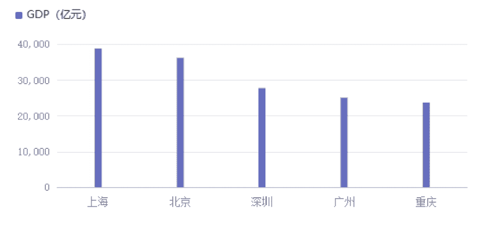

#### 3.1.3 Excel大师

在遇到Excel表格相关的难题时，文心一言可以成为你的得力助手。它不仅能够协助处理大量数据，还能有效减少人为错误和误差，从而显著提高数据的准确性和可靠性。此外，文心一言还能自动处理和分析Excel表格数据，避免了烦琐的手动操作，让你在提升工作效率的同时，也能降低成本。

**提示：** 文心一言主要处理文本内容，因此，在描述Excel工作表结构时，应确保使用清晰的文本格式进行阐述，如图3-2所示。这样的表述有助于确保信息的准确传达和理解。

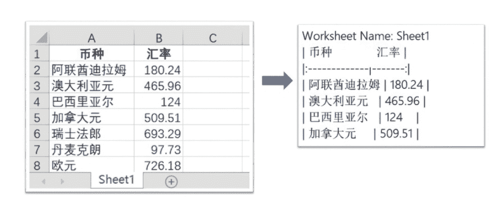

图3-2

##### 案例实战

**案例：** 下面请作为Excel大师给出处理相关表格数据的建议。表格共包含4列分别为：A列：学生ID；B列：学生名字；C列：学生班级；D列：学生成绩。我给出的第一个指令是：我想将高出平均成绩的数据标红。

**生成内容：** 你好！要实现将高出平均成绩的数据标红，你可以按照以下步骤操作。

首先，计算所有学生的平均成绩。你可以在第一行（或者新的一列）中输入以下公式：=AVERAGE(D:D)。这将会计算D列中所有学生的平均成绩。

接下来，你需要将每个学生的成绩与平均成绩进行比较。在新的第二列中（假设我们在D列后面开始），输入公式：=D2-AVERAGE(D:D)。这将比较每个学生的成绩与平均成绩。

然后，你可以设置一个条件格式，使高于平均成绩的数据变为红色。选择D2到最后一行的数据（假设你的数据在D列结束），然后转到“条件格式”→“新规则”。

在新规则中，选择“使用公式确定要设置格式的单元格”，然后输入公式：=D2>AVERAGE(D:D)。然后单击“格式”按钮设置你想要的红色。

最后，你可以选择自动扩展数据范围，以便当添加新数据时，条件格式会自动应用到新数据。选择整个表格（或者你希望应用条件格式的区域），然后转到“条件格式”→“管理规则”。在“新建规则”中，选择“使用公式确定要设置格式的单元格”，然后输入公式：=D2>AVERAGE(D:D)。然后单击“格式”按钮设置你想要的红色。

**案例：** 我的第二个指令是：将每项成绩最高分排到最前。

**生成内容：** 要将每项成绩的最高分排到最前，你可以使用Excel的排序功能。以下是具体步骤。

选择数据区域：首先，确保你的表格中只有需要排序的数据，没有其他不需要的信息。然后单击表格的左上角，选择整个数据区域。

打开排序功能：在Excel的菜单栏上，选择“数据”标签，然后单击“排序”。

设置排序条件：在弹出的对话框中，设置排序的主要关键字为“学生成绩”（D列），并选择“降序”排序。

添加次要关键字（可选）：如果你的表格中有多个学生具有相同的最高成绩，你可能还想按照其他列进行排序，例如学生名字或学生ID。你可以在排序对话框中添加次要关键字，并选择相应的排序顺序。

应用排序：单击“确定”按钮，Excel将根据你的设置对数据进行排序。

现在，每项成绩的最高分将会排在前面。请注意，如果有多个学生具有相同的最高成绩，它们将按照你设置的次要关键字进行排序。

#### 3.1.4 生成折线图

文心一言的功能不局限于解决Excel上的难题，它还能生成折线图等多种图表，从而有效提高工作效率、丰富图像多样性、提升数据处理的效率和精度，并实现自动化处理与分析，进而优化可视化效果。在使用文心一言生成折线图时，有两点需要注意。

- 确保提供给文心一言的数据是准确、完整且可靠的。数据的质量对折线图的质量和准确性有着直接的影响。
- 应根据需要展示的数据和分析目的来选择合适的图表类型。折线图特别适合用于展示随时间变化或其他连续变量的趋势和关系，以及具有周期性或趋势性的数据。选择合适的图表类型能够更好地突出数据的特征和规律，提升数据解读的效果。

##### 案例实战

**案例：** 请用折线图展示世界人口增长趋势。

**生成内容：** 表3-2和图3-3展示了世界人口增长趋势。

▼ 表3-2

| 年份 | 世界人口（亿人） |

|---|---|

| 1960 | 30.27 |

| 1970 | 38.73 |

| 1980 | 44.99 |

| 1990 | 50.76 |

| 2000 | 61.18 |

| 2010 | 68.27 |

| 2020 | 77.94 |

| 2021 | 79.21 |


▲ 图3-3

#### 3.1.5 PEST分析

宏观环境拆解：PEST分析怎么用得更准

PEST是企业观察外部大盘的常用框架，把环境拆成政治、经济、社会、技术四个视角。借助它，企业能更清晰地读懂外部变化，做出更精准、更及时的战略判断。用文心一言来做PEST，这三件事要先拧紧。

先把分析的目标和用途定死。分析的重点和方向都由目标决定，结论好不好用也看这里。是要描绘当下市场全貌，还是预判未来走势，或是为某个具体战略计划服务，开工前必须说清。

数据源必须靠谱。文心一言依托百度搜索的资源，信息量大且覆盖面广。做PEST时要充分利用这些渠道，确保拿到的数据真实、可验证。

分析要能落地。分析不是终点，是决策的工具。只有把结论和企业的真实业务紧密结合，并在过程中持续根据洞察调整策略，才能发挥最大价值，服务长期发展。

案例实战
请作为咨询公司顾问，帮我针对“度度智能音箱”进行PEST分析。需要从政治、经济、社会与科技四个维度进行分析，要求尽可能详细，并结合数据或文献作为分析依据。

作为咨询顾问，对“度度智能音箱”做PEST拆解如下：

一、政治维度
政策扶持：国家对人工智能产业持续加码，出台多项政策扶持智能音箱生态发展，行业整体获得政策红利。
合规要求：智能音箱涉及用户隐私收集与使用，监管法规趋严，企业必须在数据采集、存储、保护环节符合规定。

二、经济维度
市场体量：受智能家居需求拉动，智能音箱市场持续扩容。依据多家研究机构数据，市场规模已突破百亿人民币，且未来几年保持高速增长。
产业链格局：产业链涵盖硬件制造、软件开发、内容供给等环节。国内已有成熟的硬件制造企业，软件与内容端参与者也在加速布局。

三、社会维度
用户需求：伴随智能家居认知提升，用户关注度与使用意愿同步上升。据艾媒咨询数据，中国智能音箱用户规模已超1亿，并仍在快速增长。
市场认知：智能音箱作为新型AI产品，社会接受度不断提高。消费者普遍认为其能实现语音交互、音乐点播、信息查询等便捷体验，认可度持续上升。

四、科技维度
技术迭代：AI技术进步推动语音识别、自然语言处理持续升级，多轮对话、语音翻译等功能逐步普及，用户体验与产品竞争力同步提升。
数据能力：语音识别与自然语言处理的核心在于数据学习与处理能力。通过持续积累用户语音数据，智能音箱能不断优化识别准确率与处理效率。

总体看，智能音箱在政经社科四个维度都具备较好的发展土壤。未来仍需关注政策法规变化、市场需求波动以及技术迭代速度对行业的影响。

#### 3.1.6 投资报告分析

用文心一言来做投资报告分析，对投资者比较友好。它能快速处理海量历史与实时市场数据，挖掘潜在规律与趋势，并提供相对客观、及时的预警与决策参考，明显提升分析效率。

案例实战
现在你是一位资深投资人，请对××××公司进行分析并生成投资分析报告，要求包含财务状况分析、行业状况分析、公司估值分析。其中在财务状况分析部分，你需要从资产质量、成长性、收益性等方面切入，需要结合权威机构发布的数据。内容翔实，简短但有层次。

××××公司投资分析报告

一、财务状况分析
资产质量
据公司最新财报，总资产规模为×××亿元。流动资产占比××%，非流动资产占比××%。流动资产以货币资金、应收账款、存货为主，非流动资产集中于固定资产与无形资产，资产结构较为均衡。

成长性
近年营业收入保持稳步上行，年均增速达××%。净利润逐年提升，过去5年复合增速为××%。经营性现金流净额稳定且逐年增长，盈利能力与经营质量均表现良好。

收益性
基本每股收益与稀释每股收益均呈逐年增长态势，近5年复合增速分别为××%和××%。净资产收益率与总资产报酬率维持较高水平，盈利效率突出。

二、行业状况分析
××××公司所处行业为×××行业，主要特征如下：
市场规模可观，但竞争激烈，市场份额分散；
技术更迭快，企业需持续投入研发；
行业增长相对平稳，但发展空间充足。

当前该行业在全球范围内稳步发展，需求持续释放。随着技术进步与消费升级，竞争格局也在不断演化。

三、公司估值分析
采用DCF折现现金流模型测算。通过预测未来现金流并折现，推算股权价值为×××亿元。相较当前市值，股价低估约××%，具备一定投资吸引力。

总体来看，该公司在财务、行业、估值三方面均显现较好投资潜力。建议关注其后续表现，审慎考虑配置。

提示：文心一言可提供丰富信息与数据，但准确性并非百分百。模型再强也替代不了人的深度判断与审慎分析。使用者需充分评估投资风险，制定相应风控策略，确保决策稳健。

#### 3.1.7 SWOT分析

SWOT是评估企业或项目优势、劣势、机会、威胁的经典框架。用文心一言做SWOT，能快速处理大量数据，发现规律，为战略制定提供支持。使用时注意以下要点：

所依赖的数据必须经得起推敲。文心一言信息丰富，但用户仍需自行核验准确性与适用性。
要把真正的优势劣势分清，避免把机会威胁误判为优劣，这需要敏锐的市场洞察力。
分析结果要与实际业务对照，结合一线情况才能更贴近现实。
市场在变，SWOT也需要定期更新，以反映最新动态，保持竞争力。

案例实战
对减脂餐进行SWOT分析，要求结合数据且全面。

减脂餐市场SWOT概览

S 优势
健康饮食理念普及，减脂餐契合大众对健康的追求；
市场需求持续扩容，关注体重与健康的群体在扩大；
产品与方案多样化，能满足不同人群的偏好。

W 劣势
整体价格高于普通饮食，部分价格敏感人群接受度受限；
为控制热量与脂肪，口味与制作方式受限，可能影响体验；
市场竞争激烈，同质化压力大。

O 机会
电商渠道快速发展，线上销售可扩大覆盖面与占有率；
健康食品市场整体增长，减脂餐有望共享红利；
可与健康食品品牌、健身机构等开展跨界合作。

T 威胁
食品安全与营养相关法规日趋严格，合规成本上升；
产品质量直接影响消费者健康与品牌信誉，风险敏感；
行业竞争加剧，价格战与营销战可能压缩利润空间。

#### 3.1.8 波士顿7S分析

波士顿7S是波士顿咨询集团提出的战略分析框架，强调结构、战略、制度、员工、技能、共享价值观、战略性资源七要素的协同。通过剖析这七个方面，企业能更清晰地认识自身优劣，抓住外部机会与风险。

使用文心一言做7S分析需注意：
关注七要素之间的内在联系与相互作用；
分析结论要与市场需求与发展趋势结合，形成可执行策略；
建议定期复盘，及时调战略；
可以用图表、报告形式呈现，提升沟通效率。

案例实战
对华为手机进行波士顿7S分析，要求全面、准确。

华为手机7S解读

公司战略
聚焦中高端市场，坚持技术创新与品质驱动；
持续研发差异化功能与设计，满足多元需求；
通过与全球运营商合作扩大覆盖与品牌影响。

组织结构
部门架构相对扁平，协作高效；
具备完整的研发、市场、销售、服务体系；
在全球布局多个研发与生产基地，贴近区域需求。

系统
自主鸿蒙操作系统加持，5G通信技术成熟；
重视数据安全与隐私保护，安全机制完善；
供应链管理体系健全，保障零部件质量与稳定供给。

员工
团队专业度高，覆盖研发到售后全链路；
重视培训与晋升，提供职业发展通道；
激励机制多元，股票期权与绩效奖金并重。

共享价值观
以客户为中心、以奋斗者为本、团队协作、诚信为核心；
价值观在产品与服务中得到体现，并积极承担社会责任。

技能
在硬件设计、软件开发、芯片制造等领域积累深厚，专利储备丰富；
研发响应速度快，能快速推出竞争力产品；
与运营商深度合作，提供定制化解决方案。

物质设施
全球多个生产基地与研发中心，支撑规模化生产；
采用先进工艺与设备，提升效率与品质；
售后服务网络完善，提供维修与退换便捷体验。

总体来看，华为手机在七项要素上表现均衡，具备较强竞争优势与发展前景。

将上面的分析结果用图表的形式表现出来。

表3-3
序号、7S维度、华为手机分析要点。
1 公司战略：中高端定位、重研发创新、与全球运营商合作
2 组织结构：扁平化、团队协作、全球研发生产基地
3 系统：鸿蒙OS、5G技术、供应链管理
4 员工：高素质经验丰富、培训晋升、激励机制
5 共享价值观：客户为中心、奋斗者为本、团队合作、诚信
6 技能：技术专利储备、强研发能力、运营商合作
7 物质设施：多生产研发基地、先进程 备与工艺、完善售后体系

#### 3.1.9 4P营销分析

4P涵盖产品、价格、渠道、推广四个核心要素。做4P分析时，要把握产品市场定位，基于对目标人群需求的理解制定策略；依据分析结果优化产品、价格、渠道、推广，提升竞争力；因市场与需求动态变化，需定期复盘并调整。

案例实战
对华为手机进行4P营销分析，要求全面但尽可能简短。

产品
品牌口碑与技术力突出，产品线覆盖高端到中低端，形成完整矩阵。代表系列如P系列影像旗舰与Mate系列高端机型，同时提供优质售后，提升用户体验。

价格
定价策略灵活。高端旗舰定价较高，靠性能与品质吸引追求高品质用户；中低端机型以性价比取胜。辅以促销、折扣等手段增强市场竞争力。

渠道
线上线下协同。线上依托官网、电商平台与社交媒体；线下覆盖专卖店、授权经销商与合作运营商。持续拓展渠道布局，并探索跨界合作扩大影响。

推广
投放广告、明星代言、社交媒体营销多管齐下。注重品牌形象塑造，通过赞助活动等提升知名度。线上线下互动营销频繁，增强用户参与感与粘性，并根据反馈快速调整策略。

提示：用文心一言做4P分析，可更快整合大量数据，提供更深市场洞察，帮助企业优化资源配置，把握需求与竞争态势，制定更精准的营销方案。

#### 3.1.10 产业顾问

文心一言可为产业从业者提供高效、可靠的分析，降低人工成本，并能基于企业实际需求给出个性化建议，帮助更深入了解市场与竞争，优化资源配置。

使用时注意：
明确问题的内容、背景与边界，让模型更好理解；
提问时提供充足背景信息，提升建议质量；
避免主观表述，保持问题客观；
避免模糊提问，明确关注市场规模、增速等具体维度。

案例实战
现在你是一名咨询公司专业顾问，你需要先列出你搜集到的权威机构数据及报告，然后结合你的专业思路来解答我有关产业发展的问题。我的第一个问题是：蓝牙耳机的盈利模式。

基于公开权威机构数据与行业报告，蓝牙耳机盈利主要来源如下：

销售收入是核心。蓝牙耳机价格带宽广，从几十元到上千元不等。不同价位对应不同定位与功能，通过销售中高端、高附加值产品，可获取更高单品收益。

蓝牙生态的商业化路径

蓝牙技术规范以全球开放为原则，只要企业遵循相应标准即可合法生产并使用蓝牙标识的产品。对蓝牙联盟及其成员来说，技术使用许可费是重要的稳定收入来源，通过向外部厂商发放授权实现持续现金流。

在互联网场景下，广告已经成为常见变现手段。众多手机品牌、电信运营商会在设备界面或系统服务中投放自有推广内容，利用用户流量获取广告分成。

蓝牙耳机本身需要配合手机、电脑及相关音频软件使用，部分终端或软件本身存在付费属性。厂商可围绕使用场景提供延伸功能或配套服务，形成额外收益。

综合公开研究与行业报告，蓝牙耳机企业的盈利结构呈现多元化特征，硬件销售、技术授权、广告分成及增值服务均可贡献利润。具体侧重会因厂商定位与市场策略而有所差异。

### 3.2 营销文案修炼：打造易记的传播方案

在竞争激烈的市场环境中，高质量的营销文案对品牌塑造、用户触达与销售转化具有关键作用。本部分聚焦小红书方案、UP主带货脚本、软文撰写与活动标语等常见形式，帮助读者掌握专业、精炼且具吸引力的表达能力。

#### 3.2.1 小红书内容创作

智能写作助手能够根据输入信息快速生成高质量初稿，节省人力并提升效率。它可提供灵感与创意，结合营销目标与受众画像，输出兼具新意与吸引力的文本。确定主题与风格后即可迅速得到符合预期的内容。

借助该工具撰写小红书方案时需要注意以下要点。

- 深入把握目标人群特征与需求，让内容精准触达兴趣点。
- 利用工具凸显产品或品牌的差异化优势，使文案更具独特性。
- 把控篇幅与节奏，用简洁语言传递核心观点与卖点，避免冗长拖沓。
- 根据读者反馈与数据表现及时优化内容与风格，提升转化效果。

使用过程中应保持原创性与独特性，避免过度依赖工具而削弱自身思考。定期更新优化也是提升营销效果的关键。

### 案例实操

用户：我想在小红书发布一篇家居好物分享，并且形成自己的风格，能否示范一篇受欢迎的写法？

助手：可以，下面是一篇参考文案。

给小窝加分的几件爱物

欢迎来到我的家居分享角，今天聊聊近期用起来特别顺手的几件单品，如果你也在追求更舒适的生活，一起来看看吧。

首先安利的是我钟爱的沙发，手感柔软，颜值也很在线。看剧或阅读时窝在上面，整个人都被放松感包围。想升级客厅舒适度，这款值得尝试。

接着是新入手的餐具套装，外观精致，做工扎实。每次用餐都有仪式感，桌面瞬间更有格调。想让用餐更有趣就入手一套。

最后是床品四件套，手感舒适，造型讨喜。躺下的瞬间就能感受到安心感，睡眠体验明显提升。想要好眠的朋友可以参考。

今天的分享就到这里，希望这些单品也能让你的家多一份温暖。欢迎评论区交流你喜欢的好物，一起把家打造成理想模样。

#家居好物分享#温馨小窝#打造舒适的家

#### 3.2.2 UP主带货脚本

带货脚本对直播流程、话术管理、氛围营造、转化提升、口碑沉淀与复盘优化都发挥重要作用。借助智能助手撰写脚本，主播可获得更高质量文案，节省时间精力，获取灵感，更精准定位受众并快速响应市场变化，从而增强竞争力。

### 案例实操

用户：现在你是一名UP主，请根据我提供的商品信息写一个视频带货脚本，要突出亮点激发购买欲。商品是羽绒保暖被，亮点有大容量、保温性能好、便携性强。

助手：视频带货脚本：羽绒保暖被

**开场**
镜头缓缓推进展示整床羽绒被。
旁白：“嗨，我是×××，今天带来冬季必备的保暖神器——羽绒保暖被。”

**亮点一：大容量**
镜头展示被子完全铺开。
旁白：“看这覆盖范围，整夜暖意无死角。单人用很宽敞，双人用也足够，不怕半夜被挤出来。”

**亮点二：保温性能好**
镜头切至被子内部羽绒细节。
旁白：“羽绒是天然顶级保暖材料，这款选用优质羽绒，寒冬也能保持恒温好睡。”
随后展示内外温差对比，如热成像演示。
旁白：“室外降温，内部依旧温暖如春，这就是它的优势。”

**亮点三：便携性强**
镜头展示收纳袋与收纳过程。
旁白：“别看体积大，收纳非常便捷。配备专用收纳袋，旅行外出也能轻松携带，随时享受温暖。”

**结尾**
镜头拉远再次呈现整床被子。
旁白：“冬天别让身体受凉，赶紧入手这款羽绒保暖被，给自己一个暖暖的夜晚吧。”
同时呈现购买链接与优惠信息。
旁白：“现在下单有限时优惠，名额有限，错过可惜。”

#### 3.2.3 写软文

不同读者与媒体平台偏好不同，有人喜欢轻松幽默，有人偏爱严肃专业。智能助手能够依据实际需求灵活生成多样风格文章，更好触达目标读者。同时以较低成本产出优质软文，有效降低营销成本。

### 案例实操

用户：请以专业营销人员的身份，写一篇关于智能家居音箱的软文，要求主题清晰、结构合理、语言简洁、风格统一，并突出产品特点。

助手：让声音连起全家，让温暖触手可及——智能家居音箱的理想之选

家不仅是居住空间，更是心灵归属。如何让生活更温馨便捷？不妨体验智能家居音箱带来的变化。

##### 一、随叫随到，听见你的需求
想听歌、查天气、设闹钟？不用动手，只需说一句：“小音，播放我的早晨歌单。”音乐立刻盈满房间，开启愉快的一天。

##### 二、一句话搞定全屋
灯光、窗帘、空调，都能通过音箱语音控制。开灯、关窗、调节温度，简单指令即可完成，生活更自在。

##### 三、安全守护，不离不弃
音箱内置高灵敏麦克风与红外感应，即便人在家中不同角落，异常情况也能第一时间报警，并推送手机提醒。

##### 四、孩子的贴心玩伴
对家长来说，音箱也是好帮手。可以播放儿歌、讲故事，解答孩子的好奇问题，让成长更有乐趣。

##### 五、节能环保，细处着想
音箱采用低功耗设计，长时间使用也不耗电。还能依据生活习惯智能调节家电，实现更合理的能源利用。

选择智能家居音箱，是为了更便捷的生活，也是为了更温暖的家。在科技快速发展的今天，一起迈入智能新生活吧，你值得拥有。

#### 3.2.4 写活动标语

学会用智能助手撰写活动标语，有助于提升效率、激发创意、适配不同语言风格，并在降低创作难度同时完成高质量输出，从而增强活动吸引力。撰写时需注意要点。

- 提供准确的活动主题、亮点与特色，确保工具充分理解需求。
- 明确目标受众，选择合适的语言风格以引发共鸣。
- 突出亮点环节、嘉宾或奖品，提升关注度与参与欲。
- 控制长度，确保简洁明了，核心信息一目了然。

### 案例实操

用户：请作为知名广告创意人，为“家家福商场春节联欢会”创作一条标语，要求主题明确、结构简洁、有节奏感、风格独特。

助手：以下是一条参考标语。

> “家家福新春盛会，欢乐团圆一刻永恒。”

创作说明如下。

主题明确：标语点出家家福商场春节联欢会，准确传达活动主旨。
节奏感强：词语搭配流畅，如“新春盛会”“欢乐团圆”，读起来有韵律。
结构简洁：句式简短易记，便于传播与记忆。
风格独特：运用“欢乐”“永恒”等意象，营造温馨感人的氛围，与春节联欢气质契合。

标语中自然融入商场名称，强化品牌与活动的关联。实际使用时可根据场景微调，以达到最佳效果。

### 3.3 职场百宝箱：解决工作难题的实用指南

在多元化的职场环境中，掌握一套全面实用的技能尤为重要。本节提供涵盖活动策划、合同撰写等多个领域的职场技能参考，帮助职场人士更从容应对工作挑战。

#### 3.3.1 活动策划

用智能助手进行活动策划具有效率提升、创意激发、智能推荐、难度降低、实时反馈优化、多样化输出及促进协作等优势，有助于提升活动质量。策划时需注意以下事项。

- 策划前明确活动基本信息，包括主题、时间、地点、预算等，使用简洁语言描述以便工具理解。
- 提出具体可执行的任务，如流程设计、预算编制、内容策划等，利于生成实用方案。
- 提供参与者特征、行业趋势等背景信息，帮助生成更具针对性的方案。

收到方案后务必仔细核对，确保符合实际需求，保证活动顺利进行。

### 案例实战

用户：我们是小型团队，请帮我策划一个适合20人的万圣节活动。

助手：以下是一份20人规模的万圣节活动方案。

**一、活动主题和目标**
主题：万圣节惊悚派对
目标：增强团队凝聚力，提升归属感，让员工度过有趣节日。

**二、活动时间和地点**
时间：10月31日万圣节前夜
地点：公司会议室或其他室内场地

**三、活动内容**
万圣节装扮竞赛：员工自行装扮，可恐怖、可搞笑、可创意，设评委打分评选最佳装扮。
惊悚游戏环节：准备万圣节主题谜语、寻物等游戏，提升沉浸感。
鬼故事分享：员工轮流讲述恐怖故事，营造氛围。
节日美食：提供南瓜派、鬼怪饼干等特色点心。
主题舞蹈：播放万圣节音乐，集体狂欢推向高潮。

**四、活动预算**
根据规模制定合理预算，涵盖场地、装饰、道具、食材等费用，具体视实际情况调整。

**五、宣传推广计划**
通过内部邮件、公告板通知全体员工，同时可在社交媒体宣传扩大关注。

**六、参与者和嘉宾**
参与者：公司全体员工20人
嘉宾：无需特邀，可邀请其他团队成员参与。

**七、活动进度和流程安排**
前期准备1-2周：布置场地、准备道具、采购食材。
活动当天10月31日：下午进行装扮赛与游戏，晚上故事分享、品尝美食、舞蹈狂欢。
后期总结1周：收集反馈、评估效果、总结经验。

**八、现场管理和安全保障**
安排专人负责现场秩序与安全，应对突发情况，提前检查场地与设施。

**九、效果评估和总结**
活动结束后收集意见，评估成效，总结得失，为后续策划提供参考。

#### 3.3.2 制作PPT

使用智能助手制作PPT的操作步骤如下。

01 进入插件商城。单击“已选插件”按钮，打开插件列表。再单击“插件商城”按钮进入插件商城，如图3-4所示。


02 安装“PPT助手”插件，如图3-5所示。

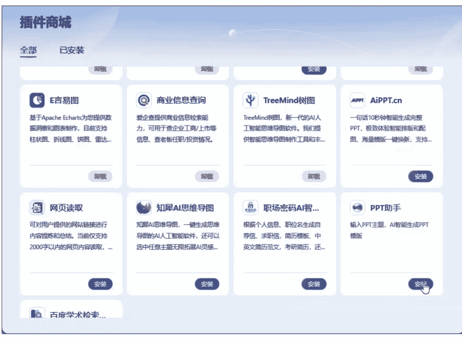

03 输入演示文稿的主题。单击“已选插件”按钮，打开插件列表，然后向下滚动插件列表找到并选择“PPT助手”。在指令框中输入“生成一份关于野生动物保护的PPT”，然后单击右侧按钮发出指令，如图3-6所示。

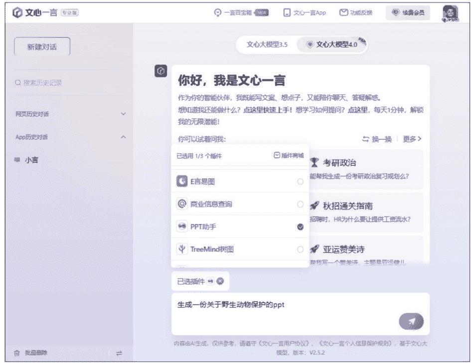

04 等待AI生成演示文稿。PPT助手会立即开始演示文稿的设计和生成，稍等片刻即可查看生成的演示文稿，如图3-7所示。


05 下载生成的演示文稿。“PPT助手”支持预览生成的完整幻灯片，单击右上角的“下载”按钮，即可将生成的演示文稿下载到计算机中，如图3-8所示。


#### 3.3.3 邮件处理

借助智能助手处理邮件，能够更好地管理收件箱，优先处理重要邮件，避免遗漏。同时提升效率、实现智能回复、快速提取信息、过滤垃圾邮件、提供智能提醒、增强安全性并促进团队协作。

### 案例实战

用户：请帮我总结一封邮件，总结需包含【重要性】、【紧急性】、【核心内容】、【需要回复内容】四个部分。邮件内容如下：亲爱的全体员工：为了改善大家的身心健康，提高工作效率，公司特别安排了一场瑜伽兴趣培训，现将培训内容通知如下：日期及时间：8月15日（周六）上午9:00至11:00。地点：公司三楼活动室（面积120平方米，可容纳30人参加培训）。培训内容：专业瑜伽教练将为大家进行基础的瑜伽技能和健康知识培训。瑜伽是一种低强度有氧运动，适合各年龄层人群。它能够通过姿势练习、呼吸技巧等，改善身体的柔韧性和平衡感，帮助人体各系统更好地运行，有效减压提神。本次培训重点讲解：（1）基本的瑜伽哲学及其健康效果介绍；（2）冥想和呼吸技巧演练；（3）十多种常见的基础瑜伽姿势示范及练习（包括猿人式、波浪式、斜Supported Headstand等）；（4）瑜伽练习时需要注意的安全事项；（5）瑜伽适宜穿戴的服装和个人物品；（6）参与培训后如何延续瑜伽运动。培训具体流程：9:00—9:30瑜伽基本概念介绍；9:30—10:10练习冥想、呼吸及基础姿势；10:10—10:30小休20分钟；10:30—11:00继续练习高难度姿势并解答问题。如有意参加本次瑜伽兴趣培训，请于8月10日前以邮件或电话方式告知我们，我方将安排培训。若你有任何问题或建议，也欢迎与我联系。感谢你的收听与参与。

助手：【重要性】重要
【紧急性】紧急
【核心内容】公司将于8月15日周六上午举办瑜伽兴趣培训，旨在提升身心健康与工作效率，已明确时间、地点与课程安排，需在8月10日前确认参不参加。
【需要回复内容】
- 是否报名参加本次瑜伽培训
- 对培训的疑问或建议（如有）

注：请务必在8月10日前回复以便公司安排。

#### 3.3.4 制定规则制度

规章制度在组织运营中起着规范行为、保障一致性的作用。下面介绍如何利用智能助手以系统高效的方式制定和优化制度，从需求分析、草案撰写到修订实施进行阐述，帮助读者制定更贴合实际、易执行且能灵活应对变化的规则，提升管理效率。

### 案例实战

用户：请为一家互联网公司撰写一份工作管理规则。

助手：工作管理规则

**一、引言**
为规范员工工作行为，提升效率，明确职责与权益，特制定本规则，适用于公司全体员工，保障公司发展与员工成长。

**二、工作时间与考勤**
公司执行标准工时制度，员工应按时上下班。加班需提前申请并经部门主管审批。应自觉遵守考勤，按时打卡，迟到、早退、旷工按公司规定处理。

**三、工作职责与任务**
员工应明确职责，按要求完成工作。需配合其他部门时应积极协作。遇到问题及时上报主管，共同解决。重大事项需请示上级并报备。

**四、保密与知识产权**

员工应当严格履行保密义务，对企业的商业机密、客户档案等敏感资料妥善保密，因泄密所致后果需承担法律责任。

在职期间所产生的一切成果，涵盖文案、设计、代码等，均归属公司所有，未经审批禁止私下使用或传播。

**五、培训与发展**
公司会安排必要的岗位培训及职业成长支持，帮助提升业务技能和综合能力。

倡导员工积极参加外部课程并取得专业资质，相关证明材料需报备人事部门归档。

**六、奖惩制度**
公司依据工作表现和贡献给予相应的激励与晋升机会，形式包括但不限于调薪、奖金、职业发展通道等。

对于违反规章、损害公司利益的行为，将按制度执行处理措施，诸如通报批评、经济处罚、解除劳动关系等。

**七、附则**
本规则的制定、解释与修订权归公司所有。

自发布之日起生效，与原有规定冲突之处以本规则为准。

补充事宜适用国家法律法规及公司其他相关制度。

如有疑问，请联系人事部门或负责人咨询。

#### 3.3.5 撰写调研问卷
调研问卷是获取用户需求、行为反馈的重要工具。使用文心一言辅助撰写前，需先明确调研目的与核心议题。题型可多样化，选择题、填空题皆可。设计时要注重简洁易懂，确保受访者能快速理解并作答。同时要规避涉及隐私与敏感话题，以体现尊重并保护信息安全。

#### 案例实战

##### 餐厅菜品喜爱度调研问卷
尊敬的顾客：
为了解您对本店菜品的喜好，我们编制了这份问卷。您的反馈将助力我们优化产品与服务，提升用餐体验。填写后我们将严格保密，感谢拨冗参与。

##### 一、基本信息
性别偏好
- A. 男性
- B. 女性

所属年龄段
- A. 18岁及以下
- B. 18～25岁
- C. 26～35岁
- D. 36～45岁
- E. 46岁以上

光临频率
- A. 初次光顾
- B. 每周1～2次
- C. 每月1～2次
- D. 很少到访

##### 二、菜品评价
最偏爱的菜系，可多选
- A. 中式热炒
- B. 西式料理
- C. 日韩料理
- D. 沙拉与凉菜
- E. 甜品与饮品

对本店口味的整体感受
- A. 非常满意
- B. 比较满意
- C. 一般
- D. 不太满意
- E. 非常不满意

认为需改进的方向，可多选
- A. 口味
- B. 分量
- C. 价格
- D. 外观
- E. 创新程度

是否愿意尝试新菜品
- A. 非常愿意
- B. 或许会尝试
- C. 兴趣一般
- D. 不想尝试

##### 三、服务评价
对服务态度的评价
- A. 非常满意
- B. 比较满意
- C. 一般
- D. 不太满意
- E. 非常不满意

服务可提升的点，可多选
- A. 上菜速度
- B. 员工礼貌
- C. 环境卫生
- D. 预约便捷度
- E. 其他，请说明

##### 四、整体评价与建议
整体满意度打分，1为非常不满意，5为非常满意：
请填写分数：____________。

您对本店的建议
________________________________。

感谢参与！我们将认真分析反馈并持续改进。祝用餐愉快！

#### 3.3.6 周报生成器
文心一言擅长快速梳理海量信息，能够高效生成周报，大幅节省时间精力，让用户专注核心任务。其还能降低差错率，促进团队协作。只需输入本周工作内容、过程与结果，即可得到规范的周报。

## 案例实战
请为我生成本周工作总结：本周制作了5支视频并投放在3个自媒体平台，通过引流新增10位客户并完成深度沟通，最终5位客户开通了会员。

##### 一周工作总结报告

##### 一、工作背景及目标
本周重点为视频制作与自媒体获客，目标是扩大线索池并提升会员转化。

##### 二、工作内容
制作5支视频并发布于3个渠道。
借助视频引流，与10位潜在客户展开详细沟通。
促成5位客户完成会员开通。

##### 三、工作成果与亮点
视频获得较好播放量与互动。
成功触达10位潜在客户。
会员转化率达50%。
跨部门沟通协作能力得到锻炼。

##### 四、问题与不足
视频质量不稳定。
引流策略精准度有待提升。
会员开通流程较为繁琐。

##### 五、下一步工作计划及改进措施
加强制作技能，参加培训并向资深同事学习。
优化获客策略，深入研究用户画像并制定精准方案。
简化开通流程，优化界面交互并加强客服支持。

注：对工作内容、成果与问题进行了精简归纳，以呈现清晰简洁的总结。

#### 3.3.7 撰写合同书
借助文心一言起草具有法律效力的合同，可显著提升效率与准确性。但需掌握方法并认知其局限。须明确合同结构，包括标题、主体信息、正文、签署等；术语表述要清晰无歧义；权利义务需列明并公平；选用适用法律条款及特殊情形处理；最后务必审阅修改，确保合规。

## 案例实战
起草一份三年期房屋租赁合同，要求降低出租人风险并明确房屋信息及双方权责。

##### 房屋租赁合同
甲方 出租人：
姓名／名称：
证件号／营业执照号：
联系地址：
电话：

乙方 承租人：
姓名／名称：
证件号／营业执照号：
联系地址：
电话：

鉴于甲方同意出租房屋，乙方同意按约定支付租金并履行义务，双方协商一致订立本合同。

##### 第一条 租赁房屋
1.1 甲方将其拥有产权或合法使用权的房屋出租给乙方，坐落于××××××，建筑面积××平方米，用途为居住或办公。
1.2 乙方确认已实地查看房屋，对现状、格局、设备情况清楚了解，同意按约定使用。

##### 第二条 租赁期限
2.1 租赁期3年，自××××年××月××日起至××××年××月××日止。
2.2 期满乙方应返还房屋并办理退租。如需续租，应于期满前60天协商。

##### 第三条 租金与支付方式
3.1 月租金人民币××××元，乙方须于每月××日前汇至甲方指定账户。
3.2 逾期付款，每逾期一日按逾期租金×%支付滞纳金。逾期超一月，甲方有权解除合同并要求腾房。
3.3 签约后3个工作日内，乙方支付押金人民币××××元。期满退租后，甲方3个工作日内退还。若乙方违约，甲方可扣除相应费用后返还余额。

##### 第四条 双方责任与义务
4.1 甲方责任：
- 保证房屋符合建筑、消防、安全标准，无法律纠纷与产权瑕疵。
- 按约定交付房屋，保证租赁期内正常使用。
- 负责房屋及附属设施维修保养，乙方过错除外。
- 按约定收取租金押金并开具正规凭证。
4.2 乙方责任：
- 按约定支付租金、押金及其他费用。
- 合理使用房屋及设施，不得擅自改结构或变更用途。
- 承担日常维护，甲方过错除外。
- 不得转租、转借或用于违法范畴。
- 遵守物业规定，配合甲方及物业工作。

##### 第五条 违约责任
5.1 甲方违约致乙方无法正常使用，应承担违约责任并赔偿损失。因甲方原因致合同无法履行，应退还未使用租金及押金。
5.2 乙方违约，甲方有权解除合同并要求腾房。因乙方原因致合同无法履行，已付租金押金不予退还，并需赔偿损失。损失超押金部分须于搬离前补足。

#### 3.3.8 构思职场话术
职场中掌握得体的话术有助于顺畅沟通、建立信任、高效解决问题。文心一言可依据场景、风格与要点生成规范表达，提供多版本选择，提升沟通效率。

## 案例实战
以严肃风格向直属领导汇报新引进的环境污染处理系统。

领导，我想汇报一下公司近期引进的环境污染处理系统。

该系统具备废水、废气净化、降噪及固废处理能力，实现环境治理全覆盖。

更关键的是，系统符合国家环保标准，同时可为公司节省成本、提升生产效率，效益显著。

相信该系统的投用将推动公司向可持续发展迈进一大步。

### 3.4 求职招聘：你的求职招聘神器
在快速变化的职场环境中，高效的求职与招聘策略是连接求职者与企业的桥梁。本节介绍如何借助文心一言提升各环节效率，使其成为双方的助手。

#### 3.4.1 岗位推荐
文心一言可自动解析简历与JD，结合背景、技能与经验进行匹配，提升推荐精准度与个性化体验。对企业而言有助于降本增效。

## 案例实战
为INTJ人格的计算机专业求职者推荐岗位。

INTJ通常理性独立、分析力强、擅长解决问题，在技术领域优势明显。推荐岗位：

软件工程师：需独立攻关并设计创新方案，符合INTJ的分析与创新特点。

数据科学家：需处理海量数据挖掘规律，适合其分析与解决问题的能力。

网络安全工程师：需识别修复安全漏洞，分析能力是核心。

系统架构师：需设计优化复杂系统，独立性与细节敏感度匹配。

人工智能研究员：需深入研究算法，契合其好奇心与分析力。

游戏开发员：需构建复杂游戏机制，创新与细节把控能力突出。

总体而言，INTJ在计算机领域发展空间广阔。

#### 3.4.2 求职信撰写
文心一言可基于个人背景生成求职信，帮助求职者突出优势，提升竞争力。

## 案例实战
为即将毕业的会计学应届生撰写求职信，需含学历、技能、岗位意向、自我评价。

尊敬的招聘经理：
我是一名即将毕业的会计专业应届生，谨此递交求职信。

##### 一、学历背景
就读于××大学会计学专业，预计今年××月毕业。系统学习会计、财务、税务等课程，并参与多次实践，积累经验。

##### 二、擅长技能
熟练操作办公软件与会计系统：Word、Excel、PowerPoint及SAP、Oracle等。
良好的沟通与协作能力，能跨部门配合完成任务。
较强学习适应能力，可快速融入新环境并持续提升。

##### 三、求职岗位
对贵公司会计岗感兴趣，希望加入财务团队贡献所学。

##### 四、自我评价
责任心强、细心认真，实践中不断提升专业水平。注重团队协作，能与同事领导保持良好关系。具备快速学习能力，相信能为团队创造价值。

感谢阅读，期待合作。

此致
×××

#### 3.4.3 生成面试自我简介
使用文心一言设计面试自我介绍可提升表达质量、突出亮点、体现专业性并节省时间，提供个性化定制。

## 案例实战
为产品经理岗位设计约1分钟自我介绍。信息：北师大项目管理专业硕士，互联网大厂高级产品经理5年，从0到1主导本地生活App，擅长数据分析，熟练Python、SQL、Visio、Axure。

很高兴能交流。我毕业于北师大项目管理专业硕士，曾任互联网大厂高级产品经理，5年经验中从0到1独立主导过本地生活App的产品方案并上线。

我的核心优势是数据驱动，不仅能读懂业务数据，还能用Python与SQL做深度挖掘，确保决策基于数据。Visio用于流程梳理，Axure用于高保真原型，使设计更专业。

我认为产品经理需兼具市场洞察与协作精神。过去5年与研发、设计、运营紧密配合，推动产品迭代上线。好的产品离不开团队协作。

对贵司产品经理岗位很感兴趣，相信我的背景与经验能带来价值，期待深入交流。

#### 3.4.4 根据JD优化简历
文心一言可深度解析JD并针对性优化简历，省去反复修改，提高吸引力与面试通过率。

## 案例实战
简历标题：软件开发工程师，3年Java开发经验，熟练Spring框架
个人信息：姓名×××，手机xxxxxxxxxxx，邮箱xxxx@xxxxx.xxx
教育背景：xxx大学计算机科学与技术本科
技能摘要：3年Java开发，熟悉SE/EE基础库与多线程；熟练Spring Boot、Spring MVC、MyBatis，了解微服务与Docker；熟悉MySQL、Oracle及SQL。
工作经历：xx公司软件开发工程师（xxxx年xx月至今）
期望职位：软件开发工程师/Java开发工程师

##### 优化后简历
简历标题：软件开发工程师，3年Java与Spring经验，精通数据库与微服务
个人信息：姓名xxx，手机xxxxxxxxxxx，邮箱xxxx@xxxxx.xxx
教育背景：xxx大学计算机科学与技术本科
技能摘要：
3年Java开发，精通SE/EE核心技术，包括JVM原理、多线程、集合、泛型等。
熟练掌握Spring全家桶，具备微服务架构设计与容器化部署经验。

数据库技术扎实，涵盖 MySQL、Oracle 的使用、SQL 调优、事务机制等核心内容。

对 Linux 系统及 Nginx 等服务器软件的部署与运维配置有实践经验。

具备 HTML、CSS、JavaScript、jQuery 等前端基础，能与前端同事顺畅对接协作。

编码习惯良好，代码规范意识强，熟悉 Git 等版本控制，有较强的团队协作与沟通能力。

学习驱动力强，问题解决能力突出，抗压性好，拥有多项项目实战经历。

##### 任职履历：
×××公司 软件开发工程师（××××年××月至今）

承担公司后端业务的开发与运维，具体工作包括：

参与需求分析与技术选型，携手团队完成系统架构设计，确保架构合理、可扩展。

基于 Java 与 Spring 技术栈实现后端逻辑与接口，保障代码稳定可靠、易于维护。

与前端开发对接联调，优化数据交互效率与处理性能。

负责数据模型设计、SQL 编写与优化，确保数据安全与一致性。

持续关注新技术，推进系统性能与用户体验的优化升级。

##### 项目实绩：
××电商平台（××××年××月—××××年××月）

主导后端开发，负责用户体系与订单体系建设，通过算法与数据结构优化提升处理效率。

采用 Spring Boot 结合微服务架构搭建 RESTful API，实现注册、登录、信息变更等功能，增强系统扩展性与稳定性。

接入支付宝与微信支付通道，完成支付模块开发，保证交易安全及时。

对接前端 Vue.js 实现前后端数据交互，提升用户体验。

运用 SQL 优化与缓存策略提升数据库读写性能。

项目已正式上线运行，用户反馈积极，取得显著经济回报。

自我评价：本人责任心强，做事细致，Java 编程基础牢固，编程习惯良好。重视团队协作，沟通顺畅，能与同事及领导高效配合。工作态度认真，关注细节，追求卓越。未来将持续提升专业素养与综合能力，为企业发展贡献价值。也具备较强学习与问题解决能力，能快速适应新技术与新环境。期望岗位：软件开发工程师 / Java 开发工程师 / 后端开发工程师。

#### 3.4.5 职位说明书自动化生成
文心一言产出的职位描述遵循统一的格式规范与内容标准，保证不同岗位的 JD 在结构与要求上保持高度一致。借助标准化呈现，公司文化、价值观、职业成长路径与晋升空间能够更清晰地传达给求职者，从而吸引更多优质人才投递。

## 实操案例
：我是公司的招聘负责人，需要一份中级会计师的招聘JD。
：没问题，下面是一份中级会计师的招聘JD。

职位：中级会计师

##### 一、岗位说明
我们正在寻找一位经验丰富、专业扎实的财务会计人才加入财务团队。工作职责为保障公司财务信息的准确性、完整性与合规性。

##### 二、核心职责
- 负责日常会计核算，包括账务处理、财务报表编制与财务分析。
- 承担税务申报与审计配合工作，确保税务合规。
- 参与完善财务制度与业务流程，提升财务管理效率。
- 与各部门协作提供财务支持与建议，推动业务发展。
- 完成领导交办的其他财务相关事项。

##### 三、任职条件
- 财务、会计等相关专业本科及以上学历，持有中级会计师资格。
- 至少 3 年财务会计实操经验，相关行业经验优先。
- 熟练使用财务软件及办公工具，熟悉中国会计准则与税法。
- 沟通表达能力佳，具备团队协作精神，能承受一定工作压力。
- 工作严谨细致，责任心强，学习能力与解决问题的能力突出。

##### 四、我们提供
- 有竞争力的薪酬福利体系。
- 清晰的职业发展与晋升通道。
- 系统化的培训机制与学习资源。
- 舒适的工作环境与先进办公设备。
- 定期团队建设与员工活动，营造和谐氛围。

##### 五、企业简介
我们是一家在××行业领先的公司，重视人才培养与团队建设。财务团队专业、高效、团结，致力于为公司提供高质量的财务服务。期待你的加入，共同创造更大价值！

#### 3.4.6 面试问题智能生成
由文心一言生成的面试题库，能帮助面试官更精准把握岗位要求，从而设计出更具体、更贴合实际的问题。题库有助于全面评估候选人的专业能力、经验、通用素质与个人特质，降低主观判断偏差，提升招聘成功率与整体质量。

## 实操案例
：现为某互联网公司面试官，即将面试产品运营经理岗位，请从专业技能、通用能力、工作经验、个人特质四个维度准备一份面试问题清单。
：可以，下面是产品运营经理岗位的面试问题建议，涵盖四个维度。

**专业技能：**
- 你如何定义产品运营的职能边界？
- 请举例说明你曾用数据驱动运营决策或产品优化的案例。
- 当产品出现用户下滑或收入下降时，你的优化思路是什么？
- 你常用哪些产品分析工具？如何指导运营工作？
- 如何在用户体验与业务目标之间做平衡与取舍？
- 若要策划一项新的运营策略，你会从何处入手？

**通用能力：**
- 请描述一次跨部门协作完成项目的经历。
- 面对多项紧急任务时，你如何排序与管理时间？
- 分享一次你解决复杂运营难题的经历。
- 你在团队中担任过领导角色吗？具体如何开展？
- 请举例说明你如何接受批评并据此改进？
- 当与同事或干系人意见不一致时，你如何处理？

**工作经验：**
- 请介绍一个你主导并取得成功的运营项目。
- 哪一次失败带给你最深刻的教训？
- 你曾如何应对突发运营危机？
- 请分享你在拉新、留存或转化方面的实操经验。
- 你如何与研发、设计、市场团队配合？
- 描述一次你根据用户反馈调整运营策略的经历。

**个人特质：**
- 你认为自己哪些特质适合做产品运营？
- 遇到挫折时，你如何保持积极与专注？
- 请用实例说明你的学习与适应能力。
- 在你看来，优秀的产品运营经理应具备哪些品质？
- 你如何管理压力并保持工作生活平衡？
- 当你的建议被否定时，你的反应是怎样的？请举例。

## 第4章 文心一言：解答与赋能实战手册
本章系统介绍文心一言在教育教学、学习辅导、知识问答、代码生成与论文写作等五大场景的应用方法。作为一款具备强大语言理解与生成能力的生成式 AI，文心一言能为各行业提供高效便捷的解答与支持。在教育领域，其价值尤为突出，可辅助教师备课、解答学生困惑，并在知识检索、代码编写、论文构思等方面提供指导。通过实际案例与操作指南，读者可掌握利用文心一言解决真实问题的技巧，提升教与学的效率，推动知识传承与创新。

### 4.1 教育教学：教师工作的高效助手
本节聚焦文心一言在教学案例生成、研究方法推荐、教学工具推荐、课程设计、作业批改与命题押题等多个环节的应用。该工具能显著提升教育工作者与学生的效率，优化学习成效。结合具体案例深入剖析其在教学流程中的落地价值，帮助读者掌握提升教学质量的有效方法。

#### 4.1.1 教学案例生成
文心一言能够产出丰富、生动、针对性强的教学案例，为教师提供优质备课素材，帮助学生更直观理解知识。教师可借助其快速准备课程内容，节省备课时间，更专注于学生的个性化成长。

使用时的关键注意事项：

- 明确教学目标：在生成案例前先确定教学目标，确保案例紧扣目标与实际教学需求。
- 要求具体化：需给出明确的类型、难度、知识点等要求，以便生成符合预期的案例。

## 实操案例
：明天要上数学课，内容是函数，课堂风格偏幽默风趣，能否生成一份教学案例？
：主题：函数的概念与性质

##### 一、导入（2分钟）
教师：“大家好，欢迎来到数学课！今天主角是函数。函数是什么？别担心，不会考‘1+1等于几’这种终极难题。简单说，函数就像一台神奇机器，输入一个值，输出一个结果。让我们一起开箱看看！”

##### 二、概念讲解（5分钟）
教师展示 y=x² 的例子并解释：“它描述了 x 与 y 的关系。x 变化，y 随之变化。”
教师互动：“想象你是一名魔法师，魔法棒控制 x，y 会跟着变化。大家来试试？”

##### 三、性质探究（8分钟）
教师：“函数也有个性，有的是一对一，有的宜多对一。让我们看看这些有趣的‘性格’。”
展示不同函数图像并引导讨论。
教师：“函数还有特殊技能，如奇偶性、周期性，帮助我们更全面认识它。”

##### 四、应用实例（5分钟）
教师：“生活中函数无处不在，比如游乐场的摩天轮。它的运动轨迹就能用函数描述。”

##### 五、总结回顾（2分钟）
教师：“今天我们认识了函数概念、性质与应用，希望大家能更好地理解。感谢大家的参与，让数学课更有趣！”

**提示：** 使用生成案例时须尊重知识产权、保障信息安全，遵守相关法律法规，确保合规可用。

#### 4.1.2 研究方法推荐
文心一言具备快速梳理大量文献与研究资料的能力，能提取研究问题、方法、数据来源等核心信息，帮助研究者把握前沿趋势，找到适配的方法路径，提升研究效率与质量。

使用建议：先明确研究领域与主题，再详细描述所需的方法类型；对推荐内容有疑问时可进一步追问，获取更精准建议。

## 实操案例
：我正在指导学生研究“企业信息披露”。请提供关键学习方法、研究方法与数据采集技术。
：企业信息披露涉及企业财务、运营与风险信息的对外传递。为帮助学生高效研究，给出以下建议。

**学习方法：**
- 理论夯实：掌握会计、金融、经济学基础理论。
- 案例学习：通过真实公司案例理解实践难点与机会。
- 小组研讨：组织讨论，开展批判性思考。
- 模拟演练：在模拟披露场景中实践知识。

**研究方法：**
- 文献综述：梳理前人成果与最新趋势。
- 实证研究：收集数据检验信息披露与影响因素的关系。
- 比较研究：对比不同国家或地区的制度与实践。
- 案例对比：选取表现差异的公司进行因果分析。

**数据采集技术：**
- 公司年报：核心信息来源。
- 监管数据库：证监会、交易所等官方数据。
- 第三方数据商：如 Bloomberg、Wind 等。
- 社交媒体：观察企业对外传播与品牌管理。
- 问卷与访谈：获取内部人员与利益相关者的观点。

#### 4.1.3 教学工具推荐
文心一言可依据教学需求与学生学情，推荐适配的教学工具，帮助教师甄选符合风格且满足学生需求的资源，培养自主学习能力。

推荐要点：清晰描述教学目标与学生实际情况，包括年龄、水平、兴趣等，以提高推荐的精准度。

## 实操案例
：请为小学三年级英语课程推荐合适的 App 或教学工具。
：针对小学三年级学生，以下工具较为合适：

- 爱花朵少儿英语 App：同步小学教材，包含单词配图、动画、英文儿歌、趣味游戏及同步测试，学习更生动。
- 《小学英语三年级》北师大出版社 App：提供单章朗读、全文朗读、循环跟读等功能，方便随时学习。
- 少儿英语卡片学习 App：涵盖动物、颜色、数字等基础词汇，配音配图，有助于记忆。

此外，英语趣配音等 App 可作辅助。请结合孩子特点与学习需求选择。

**提示：** 推荐工具需了解其功能、使用方式与适用场景，才能在教学中发挥最大价值。

#### 4.1.4 课程设计
文心一言能基于教学目标与学生情况生成个性化课程方案，帮助教师更公平合理地分配资源、制定策略，推动教学模式创新。

## 实操案例
：我是一名初中英语教师，请帮我设计一门课程。
：课程名称：初中英语综合提升课

适用对象：初中学生
课程时长：一学期约 20 周，每周 2 小时
课程目标：全面提升听、说、读、写能力，掌握核心知识点，培养学习兴趣与良好习惯。

**教学内容与活动安排：**

第 1-2 周：课程介绍与基础语法复习。活动：自我介绍、词汇卡片制作。

第 3-6 周：听力与口语提升。活动：听力选答、角色扮演。

第 7-10 周：阅读理解与词汇拓展。活动：小组讨论、词汇竞赛。

第 11-14 周：写作与语法进阶。活动：合作写作、语法竞赛。

第 15-18 周：文化知识与综合运用。活动：英美文化分享、综合练习。

第 19-20 周：期末复习与测评。活动：资料整理、期末测试。

期末评估：平时表现与期末成绩结合，关注进步与学习态度，给出积极反馈。

教学建议：关注个体差异，提供个性化指导；鼓励课堂参与与合作；注重实践应用。

#### 4.1.5 中文作业批改
自动化批改与评估帮助教师快速掌握学情与问题所在，节省时间、减少误差，提升教学质量。

## 实操案例
选择题：（1）下列成语使用不当的一项是（C）。
- A. 他为完成项目，不辞辛劳，三顾茅庐请专家指导。
- B. 老师告诉我们，写文章要简明扼要，切忌冗长累牍。
- C. 他的演讲非常精彩，全场鸦雀无声，大家都被他深深吸引。
- D. 面对同学的不幸，大家纷纷伸出援助之手，鼎力相助。

（2）下列句子没有语病的一项是（B）。
- A. 通过观看电影《摔跤吧，爸爸》，使我重新认识努力与拼搏的意义。
- B. 全球近 200 个国家共同签署《巴黎协定》，目的是应对气候变化挑战。
- C. 是否有坚强的意志，是一个人取得成功的关键。
- D. 为防止食物浪费，餐馆推出“半份菜”点餐模式。

（3）修改病句：他穿着一件灰色的上衣，一顶蓝色的帽子。

（4）填空题：在“之”结构成语中，与“天之骄子”意思相近的是“天之宠子”。

语言运用点评示范

单选题1 判分结果为A。
点评：A项里出现的“三顾茅庐”本义是屡次登门邀约，形容求贤若渴。所给语境并无登门邀约的情节，硬套该典故就不恰当。

单选题2 判分结果为C。
A项里“通过”和“使”作用重叠，只能保留其一。B项“将近”与“多”含义重复，需删去其一。D项“为了防止食物浪费”是多余的目的状语，应删掉。
经排除后，语病最少的是C：“是否有坚强的意志，是一个人取得成功的关键。”

病句改写：他穿着一件灰色的上衣和蓝色的帽子。
改写建议：把“和蓝色的帽子”改成“，头戴一顶蓝色的帽子”。
说明：原句用“和”把上衣与帽子并列，搭配失当；应以逗号分隔并补上动词，明确帽子是戴在头上的。

填空题：在含“之”结构的成语中，与“天之骄子”相近的是“天之宠子”。
批改：答案无误。
说明：“天之宠子”与“天之骄子”义近，“宠”指偏爱珍视，使用效果与“骄”相近。

#### 4.1.6 出题押题
文心一言可以深入拆解学生的学情与过往数据，提前锁定高频考点与重点模块。该能力让押题更精准更贴合，也削弱了人为因素对题目难度和预测准确性的干扰。教师备课负担减轻，学生的学习成效与应试能力同步提升。

案例实战
> 我是一名初中数学老师，请你帮我出一份期中考试题目并做押题。
> ：一、选择题
下列哪个选项是方程2x—3=5的解？（）
- A. x=1
- B. x=2
- C. x=3
- D. x=4
下列哪个图形是中心对称图形？（）
- A. 等边三角形
- B. 矩形
- C. 菱形
- D. 正五边形
二、填空题
若x+3的绝对值等于5，则x=______。
点P（3,−4）关于y轴的对称点P'的坐标为______。
三、解答题
解方程：3（x−2）+5=2x−1。
已知三角形ABC的三边长为a、b、c，且满足a^2+b^2+c^2=ab+bc+ac，判断三角形ABC的形状。
四、应用题
一家商店卖出两种不同品牌的手机，其中一款手机比另一款贵20%，如果较便宜的手机价格为1200元，那么较贵的手机价格为多少元？
一辆汽车从甲地到乙地需行驶180km，前一小时行驶了60km，后一小时行驶了80km，求汽车的平均速度。
以上是初中数学期中考试题的一些示例。进行押题时可参考：
- 结合历年真题和教学大纲，推断易考的知识点，如方程、图形、三角形等。
- 利用智能预测工具或教学资源，关注最新考试动向。例如浏览教育部门官网获取最新考试信息和要求。

#### 4.1.7 复习内容生成
文心一言在研判学生学习数据时，能精准定位薄弱点和需要强化的知识点，还会推荐相关知识和练习，帮助加深理解。生成复习材料的具体流程如下。
- 01 先输入关键词或知识点，如“初中数学方程”“三角形性质”等，让模型明确复习范围和主题。
- 02 根据实际需要选择生成形式，如选择题、填空题、解答题或知识点梳理，确保材料符合教学要求和学生需求。
- 03 结合学生掌握情况和学习水平，灵活调整题量和难度，让复习既有挑战又不超出能力范围，从而更有效。

案例实战
> 我想复习初中数学方程，你可以帮我生成相关复习内容吗？
> 当然可以，我可以为你提供一些关于初中数学方程的复习内容。
##### 一、知识点回顾
一元一次方程：标准形式为ax+b=0（a≠0），解法是通过移项化简求得x的值。
二元一次方程组：一般形式为{ax+by=c；dx+ey=f}，常用代入法、消元法求解。
一元二次方程：标准形式为ax²+bx+c=0（a≠0），常用公式法、配方法、因式分解法求解。
##### 二、重点与难点
- 掌握各类方程的解法及其实际应用。
- 理解方程解的意义并会检验解的合理性。
- 会列方程或方程组解决简单的实际问题。
##### 三、典型例题解析
解方程（一元一次方程）：3x—5=7。
解析：移项化简得3x=12，解得x=4。
解方程组（二元一次方程组）：{2x+y=6；x—y=2}。
解析：用代入法或消元法求解，得x=2，y=2。
解方程（一元二次方程）：x²+3x+2=0。
解析：用公式法、配方法或因式分解法求解，得x=—1或x=—2。
##### 四、练习题
解方程：4x—7=9。
##### 五、注意事项
- 解方程时注意移项符号的变化和化简过程。
- 解方程组时选择合适的解法，如代入法、消元法等。
- 解一元二次方程时注意判别式计算并选择合适的解法。
**提示：** 要求文心一言结合教学大纲、历年真题和学生的实际情况，精准确定复习的知识点和重点，使生成的复习内容既全面覆盖重要知识，又突出重点，帮助学生高效备考。

#### 4.1.8 设计幼儿园教学活动
使用文心一言时，教师可输入幼儿信息和教学目标，让模型生成有针对性的活动方案。模型会综合考虑幼儿的发展阶段、兴趣爱好和学习方式，结合教学目标和内容，生成贴近需求且富有教育意义的方案，大大节省教师时间和精力，并提供更科学多样的选择。

案例实战
> 请作为一名幼儿园的老师，设计一些课外活动来提高小朋友的动手能力，并能够激发他们的创造力。
> 作为一名幼儿园老师，为了提高小朋友的动手能力和激发他们的创造力，我设计了以下一些课外活动。
- 1. 创意手工制作：提供彩纸、剪刀、胶水、彩笔等材料，让小朋友自由发挥想象力制作手工作品，锻炼手部协调能力和创造力。
- 2. 绘画创作：准备画布、颜料和画笔，鼓励小朋友用绘画表达思想和感受，教师可引导尝试不同技巧和风格，激发创造力。
- 3. 搭建积木游戏：提供多种积木，让小朋友自由搭建不同建筑和场景，锻炼空间想象力和动手能力，同时激发创造力。
- 4. 厨艺小课堂：让小朋友参与简单厨艺活动，如制作水果沙拉、烘焙小点心等，锻炼动手能力，培养生活技能，激发创造力。
- 5. 角色扮演游戏：设置不同场景和角色，让小朋友进行角色扮演，在游戏中发挥想象力、创设故事情节和对话，激发创造力。
- 6. 自然探索活动：组织户外自然探索，如采集植物、观察昆虫等，让小朋友亲近自然，培养观察力和探索精神，同时激发创造力。
通过这些课外活动，小朋友能在实践中提高动手能力和创造力，享受学习的乐趣和成就感。作为教师，我会关注每个小朋友的进步和需求，提供适当指导和支持。
**提示：** 使用文心一言生成幼儿园教学活动方案时，需特别关注适应幼儿发展水平、注重游戏化教学以激发兴趣、强调互动与参与以促进社交能力、关注个体差异以满足每个幼儿发展需求、保障活动安全性以确保身心健康、提升活动有效性以实现教学目标，以及注重活动创新性以培养创造力和想象力。

#### 4.1.9 引导提问技巧
引导提问技巧在教学中是一种实用策略，能有效激发学生主动提问并积极参与课堂讨论。借助文心一言优化沟通，教师可运用其提供的策略指导学生提问，锻炼口头表达与逻辑思维，全方位提升沟通能力。这一过程有助于培养自信心和表达能力，为未来发展奠基。
在使用文心一言时，首先要明确具体目标，是获取信息、解决问题，还是生成特定的提问技巧；其次，突出关键信息并设定明确任务，使模型更好地理解并执行指令。

案例实战
> 我是一名物理老师，我的学生在我讲物理题的时候总是不懂装懂，从不向我提问，导致他的学习成绩一直没有提升。请你作为一名具有丰富沟通技巧的教育专家，设计一个有效的策略，来改善我和学生之间的沟通效果。你需要执行以下任务：（1）分析学生不懂装懂且不爱提问的原因；（2）提出合理策略改善我和学生之间的沟通效果。请注意这个策略应该包括了解沟通问题和背景、方法和步骤，以及运用有效的沟通技巧。
> 一、分析学生不懂装懂且不爱提问的原因。
> - 缺乏自信：学生可能因自卑或害怕被同学嘲笑而不敢提问。
> - 害怕老师：学生可能因担心老师批评或打扰老师而不愿意提问。
> - 学习习惯：学生可能没有养成主动提问的习惯，或不知道如何表达疑问。
##### 二、提出合理策略改善你和学生之间的沟通效果。
###### 了解沟通问题和背景
在课间或课后主动与学生交流，了解他们对物理课的感受及学习过程中遇到的问题。通过倾听学生的想法，更好地了解学习需求和困惑。
###### 方法和步骤
- (1) 建立信任：在课堂营造轻松友好的氛围，让学生感受到关心和支持。鼓励他们分享想法和疑问，并对提问表示赞赏。
- (2) 明确期望：向学生说明主动提问的重要性，以及提问对提高学习成绩的积极作用。让他们明白提问不仅有助于自身学习，也能为课堂讨论增添价值。
- (3) 提供机会：在课堂设置固定提问时间，鼓励学生提出问题。也可采用小组讨论形式，让学生在小组内先互相解答，再将未解决问题提交全班讨论。
- (4) 示范引导：作为老师，可故意犯一些小错误或提出开放性问题，引导学生发现并提出问题。同时展示如何有效表达疑问，让学生学会提问。
- (5) 及时反馈：对学生的提问给予积极反馈，即使问题简单或与课堂内容无关，也能增强自信心，让他们更愿意参与课堂互动。
###### 运用有效的沟通技巧
- (1) 倾听：学生提问时认真倾听，不打断或贬低观点，通过倾听更好理解困惑和需求。
- (2) 鼓励：用积极语言和肢体动作鼓励学生表达疑问。例如微笑、点头或说“我明白你的问题了”等。
- (3) 澄清：若问题不明确或难以理解，可用自己的话重新阐述，以确保正确理解意思。
- (4) 简化：若问题复杂或涉及多个知识点，可尝试分解成若干小问题逐一解答，帮助学生更好理解并找到解决方案。
- (5) 示范：在解答问题时展示解题思路和方法，让学生了解如何运用所学知识解决问题，提升解题能力。

### 4.2 学生学习：提升你的学习效率
本节将介绍如何利用文心一言的多种功能，如制订学习计划、英汉互译、撰写心得体会以及激发辩论灵感等，全面提高学习效率。下面将逐一探讨这些功能的使用方法，并通过具体实例演示如何融入日常学习，使学习过程更高效且有趣。

#### 4.2.1 制订学习计划
使用文心一言制订学习计划，可根据学生的具体目标和可用时间量身打造最合理的学习路径。借助该功能，学生能更高效利用时间，避免无效低效学习，显著提升学习效率。

案例实战
> 请为零基础学员制作“Python速成”学习计划。
> Python速成学习计划（零基础学员）
##### 一、学习背景与目标
作为零基础学员，你可能对编程毫无了解，但希望通过本计划快速掌握Python基础知识，并能完成简单编程任务。本计划为你提供清晰高效的学习路径，让你在短时间内入门Python编程。
##### 二、学习内容与步骤
###### Python基础语法（1～2天）
- 变量与数据类型
- 运算符与表达式
- 条件语句与循环语句
- 函数与模块
###### Python数据结构（1天）
- 列表（list）
- 元组（tuple）
- 字典（dictionary）
- 集合（set）
###### Python文件操作与异常处理（1天）
- 文件读写操作
- 文件路径处理
- 异常捕获与处理
###### Python库应用（2天）
- NumPy：数值计算库
- Pandas：数据分析库
- Matplotlib：数据可视化库
###### Python网络编程与爬虫（2天）
- Socket编程基础
- Requests库：发送HTTP请求
- BeautifulSoup库：解析HTML页面
- 简单爬虫实例
###### Python实战项目（2天）
- 数据分析报告：使用Pandas和Matplotlib完成一份简单数据分析报告。
- 网络爬虫：使用Requests和BeautifulSoup完成一个简单网络爬虫项目。
##### 三、学习方法与建议
- 每天分配2～3小时学习时间，保持学习连续性。
- 完成每个阶段学习后，尝试编写简单程序巩固所学内容。
- 加入Python学习社群或论坛，与其他学习者交流心得，解决问题。
- 不要过分追求完美，先掌握基础知识，后续可深入学习。
##### 四、总结与展望
通过本学习计划，你将在10天内掌握Python编程的基础知识，并能完成简单编程任务。后续可根据兴趣和需求深入学习高级特性、框架及应用领域。坚持学习与实践，相信你在Python编程领域会有所收获。
**提示：** 用户应根据个人学习需求和特点定制学习计划。制定时需考虑自身学习风格、时间安排和学习资源等因素，以确保计划合理可行。同时实时跟进学习进度，并根据实际情况调整计划和方法，不断提高学习效率。

#### 4.2.2 英汉互译
使用文心一言进行英汉互译，其准确性、高效性、便捷性、语境理解能力以及满足多样化翻译需求的能力，都为用户带来极大便利。更值得一提的是，它还能持续学习和更新，不断提升翻译质量。这些优势共同助力用户更轻松进行英汉互译，有效提升语言交流和跨文化沟通能力。

案例实战
> "One sees clearly only with the heart. Anything essential is invisible to the eyes. "Men have forgotten this truth," he said, "but you mustn't forget it. You become responsible forever for what you have tamed. You're responsible for your rose..." "I'm responsible for my rose," the little prince repeated, so that he would be sure to remember. "It's so weak. It's so naïve. It has four thorns, of no use at all, to protect itself against the world..." And the little prince broke into a sight of tears. "I should have judged by deeds and not by words. She cast her fragrance and her radiance over me. I shouldn't have run away from her... I should have guessed all the affection that lay behind her poor little strategies. Flowers are so inconsistent! But I was too young to know how to love her..."请将这段话翻译成中文。
> ：“只有用心才能看得清楚，真正重要的东西，用眼睛是看不见的。”“人们已经忘记了这个真理，”他说，“但你不能忘记。你对你驯服过的东西，永远负有责任。你要对你的玫瑰负责……”“我要对我的玫瑰负责，”小王子重复道，以确保自己能记住。“她是那么脆弱，那么天真。她只有四根刺，根本无法保护自己，对抗这个世界……”小王子忍不住热泪盈眶。“我应该通过行动来判断，而不是言语。她用芬芳和光芒笼罩了我。我不应该逃离她……我应该猜到她那些可怜的小伎俩背后隐藏的所有情感。花儿总是那么自相矛盾！但我当时太年轻了，不知道如何爱她……”

#### 4.2.3 心得体会
文心一言能根据输入的关键词和主题，为用户提供相关灵感和思路，大幅提高写作效率。此外，它还能提供丰富词汇、短语和句子，使用户在撰写心得体会时更加得心应手，轻松完成高质量写作任务。

案例实战
> 我是一名大一学生，学院组织了阅读《红岩》的活动，并要求完成一篇800字的阅读心得体会，请你帮我列出大纲，并详细指导我每一部分应该怎么写。
> 《红岩》是一部经典革命文学作品，对于我们这个时代的人来说，阅读这本书可以帮助我们更好地理解历史，更好地感悟革命精神。下面是一份关于《红岩》的阅读心得体会大纲，希望能够对你有所帮助。
##### 一、引言
在引言中，可简单介绍《红岩》的基本情况，包括作者、出版时间、主要内容等。同时可谈一下对这本书的初步印象和感受。
##### 二、主题思想
在这一部分，需阐述《红岩》所表达的主题思想。可从以下几个方面思考。
- 革命精神：在《红岩》中，作者通过描写共产党人的英勇斗争，表达了革命精神的重要性。可结合书中具体情节和人物形象来阐述这种精神。
- 爱国主义：在书中，作者也表达了对于祖国的热爱。可从人物的行为、语言等方面进行分析。
- 坚定信仰：面对敌人残酷镇压，共产党人依然能够坚定信仰，不屈不挠。可思考这种信仰的来源和意义。
##### 三、人物形象分析
在《红岩》中，作者塑造了许多生动的人物形象。可选择其中几个主要人物进行分析，包括他们的性格特点、行为举止，以及他们在书中的作用等。

##### 四、艺术手法解析
本部分建议围绕《红岩》的艺术表现展开评述，重点关注其结构布局、情节推进以及语言特色等维度，梳理这些技巧如何共同服务于主题表达。

##### 五、个人感悟与启示
读完作品后，可在此进行个体化的反思，可从以下几个角度切入。

- 历史认知层面：接触《红岩》后，对中国革命历史的认识有什么新拓展或加深？
- 精神理解层面：书中传递的革命信念该如何理解，对当下生活有哪些启发？
- 成长价值层面：人物形象与情节发展，对自身价值观与生活态度带来哪些触动？
- 未来展望层面：在厘清历史脉络与精神内核后，对个人前行方向有哪些新的期许？

##### 六、结语
结尾可对整次阅读感受做概括性收束，并表达对《红岩》的谢意与敬重之情。

#### 4.2.4 辩论灵感
借助文心一言，辩手获取多视角观点、论据与案例的效率大幅提升，从而拓宽思维范围，以更立体的角度审视议题，进而挖掘出更新颖的论证方向。该工具还能加速相关信息与佐证材料的查找，缩短准备时长，提升辩论效率与准确度。

## 案例实战

> 请以正方立场，就“现代教育体系是否应更侧重培养学生的创造力”这一议题展开论述，要求条理分明、证据充分，并援引与主题高度相关的名人名言及典型案例。

> 尊敬的评委、亲爱的同学们：
> 
> 我方主张现代教育体系应当更加重视学生创造力的培育。
> 
> 在当下社会，创造力已成为个体脱颖而出的核心竞争力之一。因此教育体系需强化该能力培养，以助力学生更好适应未来社会与职业环境。
> 
> 其一，强化创造力有助于提升解题能力。未来社会与职业场景将愈加复杂多变，挑战充满不确定性。若学生缺乏创造力，便难以跳出固有框架思考；若具备，则能更灵活地审视难题、提出创新方案并创造更高价值。所以应重视创造力培养，助力学生在未来学习与工作中更从容应对挑战。
> 
> 其二，创造力是推动社会进步的重要引擎。创新与创造力是当代社会发展的核心动力。缺失此能力，便难以产生新思想与新理念，也难以推动社会前行。因此应着力培育学生的创造力，让他们成长为未来的创新者与领导者，为社会进步贡献力量。
> 
> 实践中，不少学校与教育机构已在行动：课程侧增设艺术、音乐、设计等富创造性的内容，鼓励学生发挥想象；教学方式上推广启发式教学，让学生通过自主思考与实践内化知识；评价方式上采用多元化评估，突出创造力与实践能力的考察。
> 
> 最后援引乔布斯的论断收束观点：“创新是区分领导者与追随者的唯一标准。”若想培养未来的领导者与创新者，就必须强化创造力的培育。让我们共同为现代教育注入更多创新动力！
> 
> 以上为我方陈述，感谢聆听！

#### 4.2.5 升学择业顾问
传统升学与职业规划往往耗费大量时间进行调研与咨询。借助文心一言可显著提升效率。它能迅速梳理海量信息并提供持续反馈，帮助用户更精准定位适配自身的发展方向，既节省精力，也使决策更审慎合理。

## 案例实战

> 假设你是一名熟悉高校与职业发展的教育顾问。请结合全面的院校信息与专业的职业判断，对湖南大学与中南大学做综合比较分析。

> 湖南大学与中南大学综合对比
> 
> 两校均位于湖南长沙，在国内外均享有较高声誉。以下从院校背景与声誉、区位与历史文化、学科专业与办学规模、师资与科研实力、校园文化与学生活动、就业前景与发展方向等维度展开对比。
> 
> ##### 学校背景与声誉
> 湖南大学：国内知名综合性研究型高校，是985工程与211工程重点建设单位，在海内外享有较高声望，属于中国高水平大学序列。
> 中南大学：国内知名综合性研究型高校，亦为985工程与211工程重点建设单位，在海内外享有较高声望，属于中国一流大学行列。
> 
> ##### 地理位置与历史文化背景
> 湖南大学坐落于岳麓山景区，环境秀美，历史文化底蕴深厚，前身可追溯至岳麓书院，是中国最古老的高等学府之一。
> 中南大学位于长沙市区，交通便捷，校园环境优美，前身为中南矿冶学院，拥有悠久的矿冶教育传统。
> 
> ##### 学科专业与办学规模
> 湖南大学：学科涵盖工、理、管、文等多个门类，在材料科学、工程学、化学、生物学等领域实力突出；金融、会计等商科专业同样备受认可。
> 中南大学：同样涵盖工、理、管、文等多个门类，在矿冶工程、材料科学、临床医学等领域声誉卓著；轨道交通与有色金属等学科特色鲜明。
> 
> ##### 师资力量与科研实力
> 湖南大学：拥有一批高水平师资，包括多位院士及杰青获得者。科研成果丰硕，获多项国家级科技奖励与重大科研项目，在纳米材料、超级计算等方向具有较高水平。
> 中南大学：师资队伍同样优秀，拥有多位院士及优青获得者。科研成果突出，获多项国家级奖励与重大项目，在矿冶工程与有色金属领域科研实力卓越。
> 
> ##### 校园文化与学生活动
> 湖南大学：注重实践与创新能力的培养，积极开展多样化校园文化活动与社团，校园氛围浓厚，有利于学生全面发展。
> 中南大学：同样重视实践与创新精神的培育，校园文化活动与社团丰富，氛围浓郁，有利于学生多维度成长。两校均拥有众多学生组织与社团，可满足多样化兴趣需求。
> 
> ##### 就业前景与发展方向
> 湖南大学：毕业生可在众多领域获得广阔就业与发展空间，学校重视产学研合作，与多家企业与研究机构保持密切协作，为实习就业提供良好平台。
> 中南大学：毕业生同样具备广泛的就业前景，学校在有色金属与轨道交通行业影响力较大，为相关专业毕业生提供优质就业机会。
> 
> 综合来看，湖南大学与中南大学在各自领域均有卓越声誉与影响力，在学科、师资、科研等方面各具优势。选择应依据个人兴趣与发展方向而定，两校均致力于培养实践与创新能力，为学生提供优质的学习成长环境。

#### 4.2.6 校正错别字
人工核查错别字既耗时又易遗漏，尤其面对长篇文本或密集错误时。错别字会降低可读性并影响准确性。借助文心一言的自动检测与修正功能，可迅速清除错误，提升文本质量，节省大量时间与精力。

## 案例实战

：请你扮演错别字识别程序，检查我提供的文本并给出优化建议。第一段待检文本如下：我一定要努里学习，天天向上，降来成为一名有位青年。为了达成这个目标，我将付出坚持不懈的努力。我永远相信终究有一田，我会视线了这个目标。

：经核查，该段存在多处错别字，优化建议如下。

原文：
我一定要努里学习，天天向上，降来成为一名有位青年。为了达成这个目标，我将付出坚持不懈的努力。我永远相信终究有一田，我会视线了这个目标。

修改后：
我一定要努力学习，天天向上，将来成为一名优秀青年。为了达成这个目标，我将付出坚持不懈的努力。我永远相信终究有一天，我会实现这个目标。

修改说明：
1. “努里”改为“努力”，为常见错写，正确写法是“努力”。
2. “降来”改为“将来”，“将来”指未来的时间。
3. “有位”改为“优秀”，“优秀”才是褒义的品格描述。
4. “一田”改为“一天”，“一天”为时间单位。
5. “视线了”改为“实现了”，“实现”指达成目标。

### 4.3 秒懂百科：你的知识百晓生
本节介绍文心一言在辅助语言学习、解答汉语言文学问题、查询生物知识、检索人物百科、解释数学函数及解答地理问题等方面的应用。无论是语言学习者、文学爱好者，还是生物、地理、数学领域的学习者，都能获得有用指导。

#### 4.3.1 语言学习指南
制定清晰的语言学习规划十分重要。利用文心一言制定学习指南可使规划更条理，并依托推荐资源展开学习，从而提升效率与动力。

- 用户需明确指南应包含的内容，可涉及词汇、语法、口语练习或整体规划。例如，针对英语词汇的学习策略、分主题词汇表及学习资源推荐等。
- 提需求时要具体明确。如：“请为初级学习者生成一份英语词汇学习指南，包含有效策略、按主题或难易分类的词汇清单，以及适配的学习资源与链接。”
- 还需提供个人学习背景，如当前水平、目标等，以便生成更贴合实际的方案。

## 案例实战

：我想学英语，能否帮我做一份语言学习指南？需要包含视频推荐、口语软件推荐、学习资料、学习计划表、学习任务表。

：可以，以下是一份英语学习指南，涵盖视频、口语软件、资料、计划表与任务表。

##### 一、视频推荐
TED-Ed：提供大量英语原声动画教学视频，覆盖多领域，生动易懂。
EnglishClass101：聚焦英语教学，包含多种场景课程，适合初级到高级学习者。
可汗学院：提供系统英语学习视频，涵盖基础语法到高级词汇与听说训练。

##### 二、口语软件推荐
Duolingo：多语言学习App，含英语口语练习，采用游戏化方式。
HelloTalk：可与全球英语母语者实时对话，提升口语交流能力。
Rosetta Stone：提供真实语境模拟，帮助在实际场景中练习口语。

##### 三、学习资料
牛津高阶英语学习词典：权威词典，提供详尽释义与用法。
新概念英语：适合初学者的教材，含基础语法、词汇与听说训练。
英语900句：实用口语资料，涵盖日常场景与表达。

##### 四、学习计划表
表4-1为建议计划，可按个人时间调整。

表4-1

| 时间 | 学习内容 | 学习方式 |
| :--- | :--- | :--- |
| 周一至周五 | 每天学习1小时 | 观看视频课程、阅读教材、完成练习 |
| 周六 | 复习本周内容 | 完成测试题、模拟考试 |
| 周日 | 休息或拓展学习 | 参加英语角、观看英语电影等 |

##### 五、学习任务表
表4-2为建议任务，可根据实际情况调整。

表4-2

| 任务 | 完成时间 | 备注 |
| --- | --- | --- |
| 掌握50个新单词 | 每周五 | 使用单词卡片或记忆软件 |
| 完成1篇英语作文 | 每周三 | 选定话题进行写作练习 |
| 进行30分钟口语练习 | 每天 | 使用口语软件或参加英语角 |
| 观看1个英语教学视频 | 每天 | 选择感兴趣主题学习 |
| 完成1套模拟试题 | 每周六 | 检测与巩固所学内容 |

#### 4.3.2 汉语文学问答
文心一言知识储备覆盖汉语言文学各领域，包括古代文学、现代文学与文学理论等。凭借先进的自然语言处理与语义理解能力，它能精准把握问题核心并给出准确答复，用户无需翻阅大量资料即可快速获得答案，大大提升效率与节约时间。

## 案例实战

：请你作为精通汉语言文学的国学专家，结合丰富国学知识对所给字词或成语进行阐释，要求通俗易懂且专业有深度。第一个词：不容置喙。

：“不容置喙”常用来形容某事或某观点已定，不允许他人质疑或讨论。“置喙”本义指鸟兽咬碎食物，引申为人的言论。因此“不容置喙”即不允许他人插嘴或持不同意见。

从国学视角看，该成语体现了传统文化中尊重权威、讲求礼仪的思想。古代中国推崇尊卑有序、师长为尊，对既定观点与决策多持服从态度，故形成“不容置喙”的社会规范。

然而在现代社会，过度强调“不容置喙”可能限制思考与言论自由，导致错误难以纠正。使用该成语时需兼顾权威与自由，既尊重既定事实，也保持对多元声音的开放包容。

总之，“不容置喙”反映了传统文化对权威的尊重，现代使用时应谨慎，避免过度压制思考与表达。

#### 4.3.3 查生物知识
文心一言依托强大的自然语言处理能力与庞大知识库，在生物学领域表现突出。知识覆盖植物学、动物学、微生物学等分支，并能跟踪最新研究动态，持续更新，为用户提供全面前沿的生物学信息，促进学术交流与知识传播。

## 案例实战

：请作为生物学专家，查询巨型猪笼草的相关信息，需包含基本情况、原产地、行为特征等。

：巨型猪笼草属于猪笼草科热带食虫植物，学名为Nepenthes attenboroughii，由两位传教士在菲律宾巴拉望省维多利亚山顶峰首次发现，后经英国植物学家确认为猪笼草新种，体型巨大，可捕食老鼠大小的猎物。

该植物原产于菲律宾巴拉望省等区域，为巴拉望特有热带食虫植物，分布海拔约1600至1726米，又称“阿滕伯勒猪笼草”。

与之相近的还有巨型高山猪笼草，学名Nepenthes rajah，是世界上最大的食肉植物之一，可捕食老鼠。它偏爱动物粪便，尤其是树鼩粪便。若昆虫不足，其瓶状体可作“天然马桶”供树鼩使用，以花蜜诱导树鼩后再收集粪便。科学家认为该瓶状体已进化为近乎完美的树鼩厕所，形成奇特的共生关系。

#### 4.3.4 人物百科
文心一言配备强大多搜索引擎，可为用户提供全面准确的人物信息，涵盖基本资料、生平、荣誉等。用户能迅速获取真实有效信息，提升查询效率，推动学术交流与知识传播。

## 案例实战
: 请作为人物百科全书，结合人物基本信息、关系、生平、荣誉等，对查询问题作详细解答。第一个问题：余华简介。

: 余华，当代作家，1960年4月3日生于浙江杭州，祖籍山东高唐。中国作协第九届全国委员，曾任职杭州文联，后在海盐县文化馆工作，1984年开始发表小说。代表作有短篇小说《十八岁出门远行》、长篇小说《活着》《许三观卖血记》，另有《兄弟》《在细雨中呼喊》等。其作品被译成多种语言，在多国出版。

余华作品以深刻社会洞察与对人性的剖析著称，常通过个体经历折射更广阔的社会历史问题。风格简洁明快，语言质朴，擅长以对话与内心独白揭示人物命运。作品兼具悲剧色彩与对生活的深刻体悟，深受读者喜爱。

余华在中国文学界地位重要，作品被广泛研读，多部改编为影视，进一步扩大影响力，对中国现代文学发展产生深远影响，被视为当代中国文学代表之一。

此外，余华曾获意大利格林扎纳·卡佛文学奖、法国文学与艺术骑士勋章等荣誉，印证其在文学界的突出贡献与广泛认可。

总体而言，余华是一位兼具社会洞察与人性剖析能力的作家，其作品描绘个体苦难与命运，同时反映更宏观的社会历史议题，风格清新质朴，影响深远。

#### 4.3.5 函数解释
面对复杂函数问题，文心一言凭借卓越计算与数据分析能力，可提供详尽解释，助力解决难题，并在基础知识之上拓展相关内容，加深理解与应用。

## 案例实战

: 请解释SQL中RANK函数的用法并给出示例。

: 在SQL中，RANK()函数为分组内记录分配唯一排名，按指定列排序生成。若出现相同排序值，则共享同一名次，下一个名次会顺延跳过。

RANK()函数的语法如下。

```sql
RANK() OVER (
[PARTITION BY partition_expression, ... ]
ORDER BY sort_expression [ASC | DESC], ...
)
```

其中：

PARTITION BY子句为可选项，用于指定分组列。若未指定，则对整个结果集排名。

SQL 排序与排名实战技巧
排序的核心在于 ORDER BY，它决定依据哪一列排以及采用升序还是降序。下面就用 RANK() 做一次演示。

假设存在一张 Employees 表，字段有员工编号、姓名和薪资。目标是按照薪资对每人给出名次。

先运行以下 SQL 来获取结果。
```sql
SELECT ID, Name, Salary,
RANK() OVER (ORDER BY Salary DESC) AS Rank
FROM Employees;
```
查询会返回编号、姓名、薪资以及按薪资降序计算的名次。若薪资相同则名次并列，后续名次会顺延跳过。

结果如表4-3所示。

表4-3

| ID | Name | Salary | Rank |
|---|---|---|---|
| 1 | John | 5000 | 1 |
| 2 | Jane | 4500 | 2 |
| 3 | Alice | 4500 | 2 |
| 4 | Bob | 4000 | 4 |
| 5 | Mark | 3500 | 5 |

从示例可见，John 薪资最高，名次为1。Jane 与 Alice 薪资一致，均列第2名。Bob 的薪资低于前两人，故名次为4。Mark 薪资最低，名次为5。

#### 4.3.6 地理问答速览
文心一言在地理类问题的反馈很快，能帮助用户迅速拿到所需信息。它拥有广阔的知识面和强大的数据检索能力，提供的内容既专业又全面，便于深入理解复杂的地理议题并节省查找成本。

## 对话示例
：现在你是一个熟悉中国地理及城市信息的知识库，你会结合所知的相关专业知识，对我给出的问题进行详细解答。我给出的问题是：你知道抚仙湖吗？

：当然，我知道抚仙湖。

抚仙湖坐落在玉溪一带，横跨澄江、江川、华宁三地，距离省会昆明约六十公里。水面约212平方公里，在云南境内规模仅次于滇池与洱海，排第三。最大水深可达155米，是云南最深的湖泊，也是国内知名的大型深水淡水湖。

该湖流域幅员广阔，历史悠久，旅游与自然资源丰富，区域内兼具湖泊、平原、山地、森林、温泉塘与古生物化石等多种地貌。湖水冬夏温差小，水质优良，是理想的游泳场所。尤其北部靠澄江坝区一带，每年夏季都会吸引大量游客前来戏水。

抚仙湖属高原断陷型水体，湖面海拔1720米，三面被山脉围合，北侧与澄江坝区相连。北区开阔且更深，南区狭窄偏浅，中段细长，整体轮廓酷似葫芦。岸线总长100.8公里，岸线系数均值为1.84，沿岸曲折，伸入水中的半岛共有三个。东北为月亮湾半岛，南部为海马半岛，即抚仙湖公园所在地，西部为尖山半岛。尖山半岛面积约10平方公里，为湖上面积最大的半岛。

流域土壤肥沃，物产丰富，主产水稻、小麦、蚕豆、烤烟和油菜，是滇中重要的粮仓，也素有云烟之乡的美誉。

水利资源充足，蓄水量约185亿立方米，相当于滇池与洱海蓄水总量之和的四倍。湖水可用于沿岸农田灌溉，也具备航运条件。出水口的海口河河长仅15.25公里，落差达385米，可分六级建设梯级电站。澄江与华宁两地已建成两级，为滇中工农业提供动力。

### 4.4 编程提效全攻略
本部分系统介绍如何借助文心一言解决编程中的常见难题，涵盖代码生成、代码解读、代码优化、Bug 修复、Python 辅助以及解题报告等六大方向。通过具体实例展示其在编程领域的实际效果，帮助读者提升开发效率与代码质量，无论初学者还是资深开发者都能获得实用启发。

#### 4.4.1 一键生成代码
文心一言的代码生成经过大量训练，输出的结构清晰、可读性高，便于维护，既能降低开发成本，也能加快交付。支持 Python、Java、C++、JavaScript 等多种语言与框架。

使用时建议注意三点：
- 明确代码的类型与目标，是简单脚本、复杂算法还是特定功能模块。
- 提出清晰需求，例如“请为我生成一个 Python 脚本，用于读写 CSV 文件”。
- 提供必要参数，如变量名、函数参数等。

## 实操案例
01 准备编程环境。打开 Python 官网下载安装包，如图4-1所示。

02 安装解释器和代码编辑器。在下载页面勾选 Add python.exe to PATH 复选框，再点击 install Now 链接开始安装，如图4-2所示。

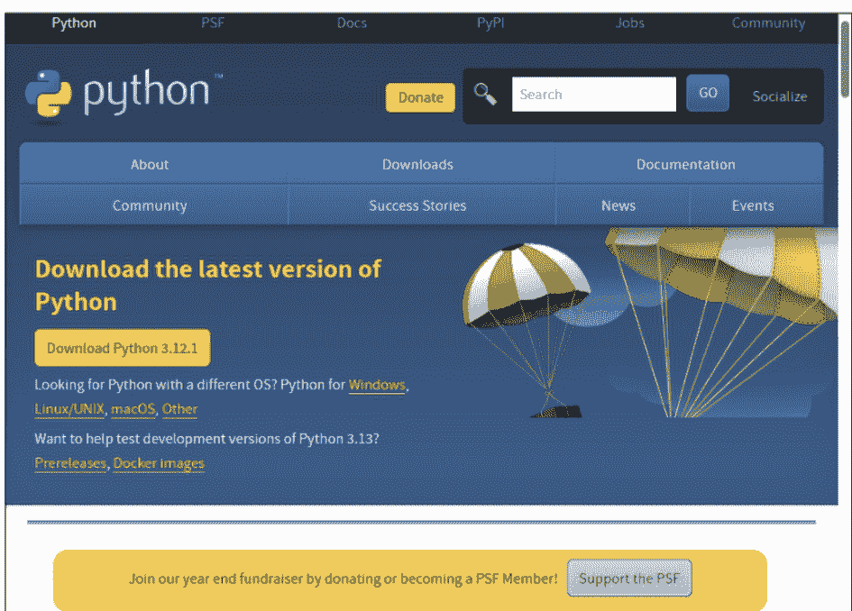

▲图4-1


▲ 图4-2

：使用Python编写文本相似度分析的代码。

：文本相似度分析属于自然语言处理范畴，用于衡量两个或多个文本的相似程度。Python 中常用余弦相似度、编辑距离等算法。下面以余弦相似度计算两个文本相似度为例。

```python
import jieba
from sklearn.feature_extraction.text import TfidfVectorizer
from sklearn.metrics.pairwise import cosine_similarity

##### 文本1和文本2
text1 = "这是一篇关于自然语言处理的文章。"
text2 = "这是一篇介绍机器学习的文章。"

##### 使用jieba进行分词
seg1 = jieba.cut(text1)
seg2 = jieba.cut(text2)

##### 将分词后的结果转换为字符串
text1 = ' '.join(seg1)
text2 = ' '.join(seg2)

##### 使用TF-IDF向量化器将文本转换为向量
vectorizer = TfidfVectorizer()
vectors = vectorizer.fit_transform([text1, text2])

##### 计算余弦相似度
cosine_similarity_matrix = cosine_similarity(vectors)
similarity_score = cosine_similarity_matrix[0][1]
print("文本1和文本2的相似度为：", similarity_score)
```

代码先用库对两段文本做分词，随后用 TF-IDF 向量化器把文本转为向量，再用余弦相似度算法算出向量间的相似分数并输出。

需要留意，余弦相似度的取值范围是[-1,1]，数值越接近1代表文本越相似。

**提示：**拿到生成的代码后，一定要充分测试验证。运行程序，核对功能是否符合预期。若发现问题或错误，及时反馈给文心一言，以便针对性调整优化，确保代码准确可靠。

#### 4.4.2 代码解读助手
文心一言能够理解代码的结构与语义，把复杂的程序逻辑转化为通俗易懂的自然语言，即使非技术人员也能快速把握用途与原理。它还能依据代码结构自动生成文档与注释，大幅减少人工工作量，提升开发效率，是开发过程中的得力助手。

## 实操案例
：请作为资深开发工程师，解释我给出的代码。请逐行分析我的代码并给出你对这段代码的理解。我给出的代码是：

```python
jobs_num=driver.find_element(By.CSS_SELECTOR,"h1>span").get_attribute("innerText")

if len(jobs_num.split(',')) > 1 :
    jobs_num = int(jobs_num.split(',')[0])*1000
else :
    jobs_num = int(jobs_num)

jobs_num = int(jobs_num)
jobs_num = 1000;
i = 2
while i <= int(jobs_num/2)+1 :
    driver.execute_script("window.scrollTo(0, document.body.scrollHeight);")
    i = i + 1
    print("当前在：", i, "完成度：", ((i+1)/(int(jobs_num/2)+1))*100, "%",end="\r")
    try :
        infinite_scroller_button= driver.find_element(By.XPATH, "//button[@aria-label='Load more results']")
        infinite_scroller_button.click()
        time.sleep(0.1)
    except :
        time.sleep(0.1)
        pass
```

：该代码的核心是通过一个 web driver，通常是 Selenium，来自动滚动网页并触发加载更多内容。具体拆解如下。

1. `jobs_num = driver.find_element(By.CSS_SELECTOR, "h1>span").get_attribute("innerText")`
   - 用 CSS 选择器定位 h1 标签下的 span 元素，读取其内部文本，可能表示职位数量等信息，存入 jobs_num。

2. `if len(jobs_num.split(',')) > 1 :`
   `    jobs_num = int(jobs_num.split(',')[0])*1000`
   `else :`
   `    jobs_num = int(jobs_num)`
   - 判断文本是否包含逗号。若包含则取逗号前部分乘以 1000；否则直接转为整数。

3. `jobs_num = int(jobs_num)`
   - 再次将 jobs_num 转为整数，这里与前面操作重复，属于冗余。

4. `jobs_num = 1000;`
   - 强行把 jobs_num 设为 1000，覆盖了前面所有计算结果，除非有特殊上下文，否则很可能是错误或多余。

5. `i = 2`
   - 初始化计数器 i 为 2。

6. `while i <= int(jobs_num/2)+1 :`
   - 启动循环，控制滚动次数，上限与 jobs_num 相关。

7. `driver.execute_script("window.scrollTo(0, document.body.scrollHeight);")`
   - 通过 JavaScript 将页面滚动到底部，触发懒加载。

8. `i = i + 1`
   - 计数器自增。

9. `print("当前在：", i, "完成度：", ((i+1)/(int(jobs_num/2)+1))*100, "%",end="\r")`
   - 打印当前进度，计算完成百分比，公式基于 jobs_num/2+1，但由于前面 jobs_num 被固定为 1000，实际进度可能偏离预期。

10. `try :`
    `    infinite_scroller_button = driver.find_element(By.XPATH, "//button[@aria-label='Load more results']")`
    `    infinite_scroller_button.click()`
    `    time.sleep(0.1)`
    `except :`
    `    time.sleep(0.1)`
    `    pass`
    - 尝试查找 aria-label 为 Load more results 的按钮并点击，若找不到则捕获异常、短暂休眠后继续。

#### 4.4.3 代码性能优化
依托深度学习与自然语言处理，文心一言能深入理解代码结构与语义。它可根据性能需求自动调整代码布局、变量使用与循环结构，提升执行速度与资源利用率。同时能学习开发者的使用习惯，给出个性化优化建议，确保代码满足特定性能指标，大幅提升开发效率。

## 实操案例
：根据Pep-8规范(PEP-8)来纠正我的代码

```python
jobs_num=driver.find_element(By.CSS_SELECTOR,"h1>span").get_attribute("innerText")

if len(jobs_num.split(',')) > 1 :
    jobs_num = int(jobs_num.split(',')[0])*1000
else :
    jobs_num = int(jobs_num)

jobs_num = int(jobs_num)
jobs_num = 1000;
i = 2
while i <= int(jobs_num/2)+1 :
    driver.execute_script("window.scrollTo(0, document.body.scrollHeight);")
    i = i + 1
    print("当前在：", i, "完成度：", ((i+1)/(int(jobs_num/2)+1))*100, "%",end="\r")
    try :
        infinite_scroller_button= driver.find_element(By.XPATH, "//button[@aria-label='Load more results']")
        infinite_scroller_button.click()
        time.sleep(0.1)
    except :
        time.sleep(0.1)
        pass
```

：根据你提供的代码和 PEP-8 规范，修正如下。

```python
if len(jobs_num.split(',')) > 1:
    jobs_num = int(jobs_num.split(',')[0]) * 1000
else:
    jobs_num = int(jobs_num)

jobs_num = int(jobs_num)
jobs_num = 1000
i = 2
while i <= int(jobs_num / 2) + 1:
    driver.execute_script("window.scrollTo(0, document.body.scrollHeight);")
    i += 1
    print(f"当前在：{i} 完成度：{((i + 1) / (int(jobs_num / 2) + 1)) * 100}%", end="\r")
    try:
        infinite_scroller_button = driver.find_element(By.XPATH, "//button[@aria-label='Load more results']")
        infinite_scroller_button.click()
        time.sleep(0.1)
    except Exception as e:  # 更具体的异常处理会更好，比如特定的Selenium异常
        time.sleep(0.1)
        pass
```

主要改动有：
- 去掉了不必要的分号。
- 改用 f-string 简化字符串格式化。
- 将 `i = i + 1` 改写为 `i += 1`。
- 为 except 子句添加异常变量 e，便于后续处理或记录。可根据上下文改为捕获更具体的异常类型。

#### 4.4.4 代码调试加速
文心一言可自动检测语法错误、逻辑漏洞及其他潜在问题，并给出修复建议，帮助开发者更快定位问题、节省调试时间，确保代码质量与稳定性。

## 实操案例
：检查以下代码检查bug并修改。

```python
def divide_numbers(x, y) :
    try :
        result = x / y
    except ZeroDivisionError :
        print("Error : Division by zero is not allowed.")
        return None
    else :
        return result

print(divide_numbers(10, 0))
```

：你已经实现了一个 divide_numbers 函数，它内部对除零进行了处理，但在调用时仍然用 0 作为除数去测试它。虽然函数能拦截这种情况，但从整体来看这仍是一个 bug，因为不应该主动触发错误场景。

处理除零风险的思路很直接：业务调用时别把 0 放进除数位置。若你刻意想验证函数在零除数场景下的反应，也可以保留这段调用，但务必把它归为边界测试，不要和常规流程混在一起。

代码层面无需改动：
```python
def divide_numbers(x, y):
    try:
        result = x / y
    except ZeroDivisionError:
        print("Error: Division by zero is not allowed.")
        return None
    else:
        return result

print(divide_numbers(10, 0))
```

仅在做专项验证时才允许出现这类调用，上线环境里最好完全避免。

#### 4.4.5 Python 编程助推
借助文心一言带来的 Python 编程辅助模块，写码速度、代码质量以及排错能力都能得到明显提升。该能力会基于现有源码智能联想相关的代码片段、函数与库，并提供强力的智能补全，使开发更快更准。多种能力协同，让整个开发链路更顺畅，交付质量更可靠。

案例实战
问：Python 如何读取 Excel 表格并打印出第 3 行的数据？
答：可以使用 openpyxl 来完成，先安装依赖。
```
pip install openpyxl
```
安装完成后，用下面脚本打开文件并输出第 3 行：
```python
import openpyxl

##### 打开Excel文件
workbook = openpyxl.load_workbook('example.xlsx')

##### 选择第一个工作表
worksheet = workbook.active

##### 读取第3行的内容
third_row = worksheet[3]

##### 输出第3行的内容
for cell in third_row:
    print(cell.value)
```
把脚本里的 example.xlsx 换成你自己的文件名即可。程序会打开首个工作表，定位到第 3 行，然后逐列打印该行各单元格内容。

#### 4.4.6 代码解题报告生成
利用文心一言快速产出代码解析说明，能节省大量手写时间。报告会结合题目与源码给出清晰解释，帮助发现潜在风险与优化空间，并提供对应思路与详细说明，有助于持续提升代码质量与效率。

案例实战
问：下面是一段求数组最大值的代码，请输出一份解题报告，要求包含问题描述、分析、证明、代码、解释、复杂度分析。代码如下。
```cpp
#include <iostream>
#include <vector>
#include <algorithm>
using namespace std;

int div_max(vector<int>& nums, int left, int right) {
    int max_left;
    int max_right;
    int mid;
    if (left == right) return nums[left];
    else if (right - left == 1) return max(nums[left], nums[right]);
    mid = left + ((right - left) >> 1);
    max_left = div_max(nums, left, mid);
    max_right = div_max(nums, mid + 1, right);
    return max(max_left, max_right);
}

int main() {
    vector<int> nums = {4, 7, 6, 5, 4, 3, 2};
    cout << div_max(nums, 0, nums.size() - 1) << endl;
    return 0;
}
```
答：解题报告：求数组最大值

##### 一、题意说明
给定一个整数数组，需要求出其中的最大值。这一类问题在统计、数据分析与算法练习中很常见。

##### 二、思路拆解
本解法采用分而治之的思路。先把数组拆成左右两部分，递归求出两部分各自的最大值，再取两者较大者。据设定，时间开销约为 n 乘以对数阶，n 为数组长度。

##### 三、正确性论证
采用数学归纳。基础情形，长度为 1 或 2 时算法显然正确。假设对所有小于 n 的规模都成立，考虑规模为 n 的情形。按归纳假设左右两部分各自得到正确最大值，整体最大值必定在这两者之一，取较大者即为全局最大值。由此对任意规模都成立。

##### 四、参考实现
C++ 实现如下。
```cpp
#include <iostream>
#include <vector>
#include <algorithm>
using namespace std;

int div_max(vector<int>& nums, int left, int right) {
    int max_left;
    int max_right;
    int mid;
    if (left == right) return nums[left];
    else if (right - left == 1) return max(nums[left], nums[right]);
    mid = left + ((right - left) >> 1);
    max_left = div_max(nums, left, mid);
    max_right = div_max(nums, mid + 1, right);
    return max(max_left, max_right);
}

int main() {
    vector<int> nums = {4, 7, 6, 5, 4, 3, 2};
    cout << div_max(nums, 0, nums.size() - 1) << endl;
    return 0;
}
```

##### 五、实现解读
`div_max` 负责在指定区间求最大值。区间长度为 1 直接返回，长度为 2 返回较大值，否则把区间拆成两半，递归求左右子区间的最大值并返回较大者。`main` 构造示例数组并调用 `div_max` 计算结果。

##### 六、效率评估
分治每次把规模减半，时间开销约为 n 乘对数。最坏递归深度为对数阶，每层总处理量为线性，故总时间约为 n log n。递归栈空间为对数阶。

### 4.5 论文撰写提效
本节介绍如何用文心一言提升论文撰写效率与质量，将依次介绍论文大纲生成、逻辑校验、文本摘要、文本问答、文本润色五大功能，并通过示例帮助掌握使用方法，优化写作流程。

#### 4.5.1 大纲自动生成
随着自然语言处理技术发展，学术写作工具日益丰富。文心一言在论文撰写中作用明显，能帮助梳理结构与内容。生成大纲时，主题、研究问题与关键词应尽量具体准确，才能保证大纲与研究高度相关，为后续撰写奠定基础。

案例实战
问：请为我生成一份论文大纲，研究问题是“人工智能与医疗”，方法为“定量分析”。大纲需包含研究问题、文献综述、研究方法、数据分析与结果呈现、结论与讨论，保持逻辑清晰、分条表述。
答：论文大纲：人工智能与医疗的定量分析

##### 一、引言
1.1 研究背景
1.2 研究问题
1.3 研究目的与意义

##### 二、相关文献综述
2.1 人工智能在医疗领域的应用
2.2 定量分析在医疗领域的研究现状
2.3 人工智能与医疗结合的研究进展

##### 三、研究方法
3.1 数据来源与采集
3.2 数据预处理与清洗
3.3 数据分析方法选择
3.4 研究假设与变量定义

##### 四、数据分析和结果呈现
4.1 描述性统计分析
4.2 相关性分析
4.3 回归分析与模型构建
4.4 结果呈现与解读

##### 五、结论与讨论
5.1 结论总结
5.2 结果讨论与解释
5.3 研究贡献与意义
5.4 研究局限性与未来展望

##### 六、附录与参考文献
6.1 附录：实验数据、图表等
6.2 参考文献：引用文献列表

#### 4.5.2 逻辑校验
论文写作除了内容充实，保持逻辑连贯合理同样重要。文心一言提供的逻辑校验器能智能识别潜在逻辑错误与矛盾，并给出修改建议，帮助提升论文逻辑性与整体质量。

案例实战
问：以下逻辑是否成立：没有老师是学生，一些学生是运动员，那有些运动员不是老师。
答：先拆解前提。
1. 没有老师是学生：老师集合与学生集合完全不相交。
2. 一些学生是运动员：学生集合与运动员集合存在交集。
由于老师与学生无交集，而前提 2 中既是学生又是运动员的部分与老师也无交集，因此确实存在一部分运动员不可能是老师。结论成立。

#### 4.5.3 文本摘要
信息时代需要快速提炼核心内容。文心一言的文本摘要功能可自动抽取主要信息并生成简洁摘要，帮助组织归纳，提升效率与记忆效果。

案例实战
问：请对我提供的文本进行阅读理解和摘要。回答需包含一段简要概述，并用列表突出关键信息和主要观点。请给出【文本简介】和【文本核心内容】。
答：【文本简介】
文章探讨了人工智能在当代社会的影响，涵盖其广泛应用、巨大潜力及潜在风险，强调审慎应用的重要性并给出发展建议。

【文本核心内容】
- 凭借智能与深度学习能力推动人类进入新时代。
- 应用覆盖医疗保健、交通运输、金融服务、娱乐媒体等多个领域。
- 能处理海量数据、自动学习适应、持续提升性能。
- 可能引发失业及算法偏见、不公平等担忧。
- 需审慎应用以符合人类利益与价值观。
- 建议在推动发展的同时加强监管与伦理规范，确保公正透明。

#### 4.5.4 文本问答
相比传统搜索引擎，文心一言的文本问答能快速准确作答并提供个性化回应，显著提升信息检索效率与准确性。

案例实战
问：在权责发生制下，如果发生了经济活动但未收到现金，会记录到账目上吗？
答：根据文本，在权责发生制下，即使未收到现金，只要经济活动已发生并产生应收或应付权利义务，就应在当期记录。因此答案是会记录到账目上。

#### 4.5.5 文本润色
撰写报告、论文、文案时，表述流畅与语法正确直接影响阅读体验。文心一言的文本润色功能可智能优化表达，提升质量与可读性。

案例实战
问：在不改变原语义和原语言的情况下，润色以下内容，使态度更加诚恳。原文：老师你好，打搅你了，对于昨天没完成作业，回家我们和孩子进行了解和交流，孩子也表态，最后还自愿抄写作为自我提醒！也请宋老师监督我们。
答：老师您好，非常抱歉昨天孩子没有完成作业，给您添麻烦了。我们回家后与孩子进行了深入沟通和交流，孩子也对自己的行为进行了反思并作出表态。为了自我提醒，他还自愿抄写了作业。我们也希望宋老师能继续监督我们，帮助我们更好地教育和引导孩子。再次感谢您的理解与支持。

润色后语气更诚恳谦逊，同时表达了对老师的尊重与对孩子教育的重视。

## 第5章 文心一言：生活好帮手
本章探讨文心一言在饮食规划、旅行攻略和生活质量提升等生活领域的实际应用，介绍如何优化日常饮食、制定周密旅行计划并借助各项功能提升生活质量，通过实例展示其实用性与高效性。

### 5.1 美食与健康：私人营养师
本节阐述文心一言在饮食规划方面的应用，帮助读者根据需求与口味发现美食、制定个性化饮食计划并养成健康习惯，还能提供专业点评与建议。无论是美食爱好者还是正在控食的人群，都能获得实用指导，让美食与健康和谐共存。

#### 5.1.1 本地美食智能推荐
区域美食体现地方饮食文化，反映历史、地理与民俗风情。文心一言可帮助轻松发现各地美味，深入领略不同地域饮食魅力。

使用时注意三点：
- 明确推荐区域：可指定特定地区、城市或国家进行探索。
- 提出具体要求：描述口味偏好、预算等，例如请为我推荐潮汕特色美食及知名餐厅。
- 选择输出形式：可生成列表、文字描述或地图形式，便于查阅与规划。

案例实战
问：作为游客，告诉我北京必吃的十大美食。
答：作为游客到北京旅游时必吃的十大美食包括：
1. 北京烤鸭：北京最负盛名的特色菜，被誉为“天下美味”而驰名中外。
2. 老北京炸酱面：传统面食，以酱肉、黄瓜与面条搭配，口感丰富。
3. 炒肝：北京传统小吃之一，以猪大肠与猪肝制作，味道鲜美滑而不腻。
4. 豆汁：北京独特饮品，由绿豆发酵而成，风味独特且营养丰富。
5. 京酱肉丝：传统京菜，以猪肉丝与甜面酱翻炒，色香味俱佳。

6. 驴打滚：北京老字号糯米点心，以糯米、红糖、黄豆粉为主料，嚼感黏糯绵软，甜味醇厚，是京城甜品的代表。
7. 豌豆黄：京城豆制传统点心，选用豌豆打制而成，组织细腻滑润，甜度清淡带香。
8. 羊蝎子火锅：京城特色锅类，甄选羊蝎子以多款草本慢熬成汤底，佐以多样蘸料与时令蔬菜，汤味浓稠醇厚。
9. 炸灌肠：老北京油炸小吃，将灌肠片切后挂糊炸至金黄，外层酥脆内里鲜嫩，香气外溢。
10. 卤煮火烧：京城经典吃食之一，把火烧与提前卤制的猪肠、猪肺同锅煮制。相传源自苏州，经改良后于清代传入北京，成为本地知名美味。

品尝这些地标性吃食，既可体会浓郁的京味风情，也能更立体地认识北京的饮食文化与历史脉络。

#### 5.1.2 减脂餐
健康意识抬头，减脂餐走进越来越多人的日常。美味与控重如何兼得，是常见难题。以文心一言为例，说明如何生成一份兼顾口味与减脂要求的个性化餐单，让你在享受美食的同时逐步达成体脂目标。

首先要明确减脂方向与诉求。可这样描述：“我需要减重，请帮我拟一份适合减脂的早餐方案，要求热量偏低、蛋白质充足、脂肪克制，并附食材清单与制作步骤。”

再按个人喜好微调。可补充饮食偏好或禁忌，例如“我偏爱鸡蛋和蔬菜，不喜过甜，请围绕这些食材构建并尽量少加糖。”

通过这种对话，文心一言会结合具体需求与口味，输出既符合减脂原则又好吃的定制方案，让你在吃得满足的同时更容易达成目标，保持健康状态。

##### 案例实战
: 输出一份涵盖蛋白、碳水、脂肪的高品质减脂餐。

: 早餐 :
- 燕麦粥（50克干燕麦）
- 煮鸡蛋（1个）
- 鲜榨果汁（如橙汁、苹果汁等，1杯）

午餐 :
- 烤鸡胸肉（150克）
- 烤蔬菜（如胡萝卜、西兰花、彩椒等，150克）
- 糙米饭（1碗，约150克）

晚餐 :
- 红烧鲈鱼（150克）
- 蒸豆腐（100克）
- 炒青菜（如菠菜、小白菜等，200克）
- 红薯（1个，约200克）

##### 整体营养学建议：
1. 提升膳食纤维摄入：午晚餐蔬菜环节优先选用绿叶菜、豆类等富含纤维的类型，有助增加饱腹感，降低对高能食物的渴望。
2. 调控碳水摄入：主食以低升糖指数品种为主，如糙米饭、红薯等，有助于平稳血糖，减少饥饿感。
3. 保障蛋白摄入：三餐均需包含优质蛋白来源，如鸡蛋、鸡胸肉、鲈鱼等，有利于维持肌肉并促进脂肪消耗。
4. 控制总热量：依据身高、体重与活动量估算每日所需能量，实际摄入略低于或等于消耗，以实现减脂。
5. 保持水分平衡：每日至少饮水8杯，维持正常代谢与排毒，减少含糖饮料摄入，避免空热量。
6. 作息与运动配合：保证充足睡眠与规律作息有助于内分泌调节，促进脂肪分解。结合适度有氧与力量训练可提升效果。

请注意，以上方案仅作参考。制定与执行减脂计划时，请结合个人实际情况并在专业营养师指导下调整。

**提示：** 减脂需要长期坚持并持续优化，饮食是关键。通过与文心一言持续互动，探索更适合自身节奏的餐单，能更高效达成目标。坚持与灵活调整是成功的核心。

#### 5.1.3 饮食计划
快节奏时代，科学饮食越来越重要。用户可通过文心一言依据个人需求快速生成一份贴合自身状况的饮食方案，更好地管理日常营养。

##### 案例实战
: 为都市上班族制订一份营养均衡、配比科学的一日三餐健康方案。

: 都市上班族健康饮食方案

##### 一、方案背景与目标
针对上班族的生活节奏与营养需求，设计一份覆盖一日三餐、营养全面、比例合理的饮食方案。通过本方案帮助上班族保持身体状态、提升工作效率、预防疾病。

##### 二、膳食原则
- 均衡摄入：合理搭配蛋白质、碳水化合物、脂肪等营养素，确保每日所需热量。
- 多样化摄入：增加食物种类，摄取各种维生素和矿物质，提高身体免疫力。
- 控制热量摄入：根据个人需求调整热量摄入，避免肥胖等健康问题。
- 定时定量：保持每日三餐定时定量，避免暴饮暴食，有利于消化系统健康。

##### 三、一日三餐具体方案

###### 早餐（7:00—8:00）
- 主食：燕麦粥（50克）或全麦面包（2片）搭配低脂牛奶（200毫升）。
- 蛋白质：鸡蛋（1个）或豆腐（50克）。
- 蔬果：新鲜水果（如苹果、香蕉等）1个，或者蔬菜沙拉（生菜、西红柿、黄瓜等）50克。

###### 午餐（12:00—13:00）
- 主食：糙米饭（1碗，约150克）或全麦面条（1碗，约100克）。
- 蛋白质：瘦肉（如鸡胸肉、瘦猪肉等，100克）、鱼肉（如三文鱼、鲈鱼等，100克）或豆制品（如豆腐、豆干等，100克）。
- 蔬菜：绿叶蔬菜（如菠菜、小白菜等，150克）或其他蔬菜（如西兰花、胡萝卜等，150克）。
- 蔬果：新鲜水果（如橙子、葡萄柚等）1个。

###### 晚餐（18:00—19:00）
- 主食：杂粮饭（1碗，约150克）或红薯（1个，约200克）。
- 蛋白质：瘦肉（如瘦牛肉、瘦羊肉等，100克）、鱼肉（如鳕鱼、金枪鱼等，100克）或豆制品（如豆浆、豆腐脑等，150毫升）。
- 蔬菜：绿叶蔬菜（如芹菜、苋菜等，150克）或其他蔬菜（如青椒、茄子等，150克）。
- 蔬果：新鲜水果（如猕猴桃、草莓等）1个。

##### 注意事项：
1. 食物摄入量应根据个人需求和活动水平进行调整。如需增加或减少热量摄入，请按比例调整各类食物的摄入量。
2. 如有特殊饮食需求或健康问题，请在医生或营养师的建议下进行调整。
3. 保持饮食多样化，可根据季节和地域选择当地新鲜食材。
4. 注意充足饮水，每日至少饮用8杯水以维持身体正常代谢。
5. 避免过多摄入高糖、高盐、高脂肪食品，以免影响健康。

#### 5.1.4 家常菜谱
下面说明如何利用文心一言生成家常菜谱。只需提供菜品名称，系统会从食材准备、操作步骤到注意事项，为你定制一份完整菜谱。这不仅让厨房更轻松，也能激发灵感，提升厨艺，享受烹饪与品尝的乐趣。

##### 案例实战
：请提供麻婆豆腐的做法和要点。

：麻婆豆腐是带辣味的传统名菜，因其麻辣口感广受欢迎。以下是做法与要点。

##### 做法：
1. 准备豆腐、豆瓣酱、花椒、姜、蒜、小葱、盐、糖、生抽和淀粉等材料。
2. 将豆腐切成小方块，放入加有少许盐的沸水中焯一下，去除豆腥味，捞出沥干备用。
3. 锅中加油，烧热后加入花椒粒，小火炸出香味，捞出花椒粒不用。
4. 加入姜蒜末，炒出香味，再加入豆瓣酱炒匀。
5. 加入适量清水，放入豆腐块，轻轻推动几下，使豆腐均匀裹上酱汁。
6. 加入少许盐、糖和生抽调味，盖上锅盖，小火煮5分钟。
7. 淀粉加适量清水调成水淀粉，淋入锅中勾芡，轻轻推动豆腐，使汤汁浓稠。
8. 最后撒入葱花即可出锅。

##### 注意事项：
1. 切豆腐时要从后往前切，以防粘刀。
2. 煸炒肉馅和豆瓣酱时要用中小火，以免糊锅。
3. 烧豆腐时要轻轻推动，以免弄碎豆腐。
4. 水淀粉要分次加入，以便更好地掌握浓稠度。
5. 花椒粉要在起锅前撒入，以免影响口感。
6. 可以根据个人口味添加适量的辣椒粉或者花椒油，增加麻辣感。
7. 麻婆豆腐中的豆瓣酱已经足够咸，因此不需要额外加盐。如果口味过重，可能会对健康造成不利影响。

#### 5.1.5 美食点评
文心一言能够综合各种来源的信息和数据，为用户提供更为丰富和多维度的美食点评。它不仅会详细描述食物的口感、外观以及服务质量，还能根据用户的特定需求，提供有针对性的建议和观点。

以下是使用文心一言生成美食点评的指令示例。

- 要求文心一言点评指定餐厅，涵盖菜品质量、环境、服务等方面，例如，“请为我生成对‘×××餐厅’的美食点评，包括菜品口感、餐厅环境以及服务质量。”
- 要求文心一言根据用户的口味偏好生成点评，例如，“我喜欢辣味和海鲜，请根据这些口味偏好为我生成一份美食点评。”
- 要求文心一言点评特定的美食类型，包括菜系的特色、经典菜品、口味等，例如，“请为我生成一份关于川菜的美食点评，重点介绍菜系的独特之处、经典菜品以及口味特点。”

通过这些指令，用户可以轻松获得全面且个性化的美食点评，为餐饮选择提供有力参考。

## 案例实战
作为美食家，点评一家川菜馆，需全面且专业。

标题：川味之旅——探访××川菜馆的味蕾盛宴

作为一个美食家，我有幸品尝了位于市中心繁华地段的××川菜馆。这家餐厅以传统川菜为主打，融合现代创新元素，为食客呈现了一场别具一格的味蕾盛宴。

一踏入餐厅，我被宽敞明亮的空间所吸引。装潢典雅而不失现代感，柔和的灯光洒落在舒适的座椅上，营造出温馨舒适的就餐氛围。墙壁上挂着的川菜历史和名菜介绍，彰显着餐厅对川菜文化的传承和弘扬。

餐厅的服务人员热情周到，礼貌得体。他们不仅提供了详细的菜单介绍，还根据我的口味偏好推荐了几道特色菜品。在等待上菜的过程中，他们还为我送上了清爽的凉菜和小吃，让我感受到了餐厅对客人的细心关怀。

接下来是重头戏——品尝美食。我首先尝试了招牌菜水煮鱼。鱼肉鲜嫩，麻辣鲜香，汤汁浓郁，让我感受到了川菜的麻辣魅力。接着是麻婆豆腐，豆腐口感细腻，麻辣鲜香，配上特制的豆瓣酱，让我回味无穷。除此之外，我还品尝了宫保鸡丁、辣子鸡等经典川菜，每一道菜都展现了厨师们对川菜烹饪技艺的精湛掌握。

值得一提的是，餐厅还注重菜品的创新和改良。他们推出了一系列融合中西元素的创意川菜，如麻辣比萨、川味汉堡等，让食客们在品尝传统川菜的同时，也能感受到创新的惊喜。

在饮品方面，餐厅提供了丰富的选择，包括各种果汁、茶饮、鸡尾酒等。这些饮品与川菜相得益彰，为食客们带来了更加丰富的味蕾体验。

总体来说，××川菜馆在菜品口味、服务质量、环境氛围等方面都表现出色。他们以传统川菜为基础，融合现代创新元素，为食客呈现了一场别具一格的味蕾盛宴。如果你是川菜的爱好者或者想尝试新口味的朋友，不妨来这家餐厅一探究竟。我相信你会在这里找到属于你的味蕾惊喜。

### 5.2 旅行攻略：助你旅途无忧
随着科技的飞速发展，人工智能已经渗透到我们生活的方方面面，为我们的日常生活带来了极大的便利。在旅行规划领域，文心一言已经帮助解决了众多旅行难题，成为旅行者的得力助手。通过深度学习，文心一言已经积累了丰富的旅行知识和信息，无论是目的地推荐、住宿选择，还是徒步路线规划，它都能为我们提供极具价值的建议。接下来，我们将详细介绍如何利用文心一言轻松规划一趟无忧旅程，让你的旅行更加愉快、顺畅。

#### 5.2.1 目的地推荐
文心一言能够综合考虑用户的个人喜好、预算、旅行时间等多重因素，为用户推荐最适合的旅行目的地。通过这一功能，用户可以更加便捷、高效地规划旅行行程，从而节省大量时间和精力。在实际使用中，用户只需向文心一言输入相关信息，例如，“我偏爱自然风光，预算控制在5000元以内，计划旅行时间为5天。”文心一言便能迅速分析这些信息，并为用户推荐出既符合要求又具有高性价比的旅行目的地。

## 案例实战
我有一周时间，预算5000元，你推荐我是去青岛还是去沈阳旅游？

根据你的预算和时间，青岛和沈阳都是不错的选择。不过，我会提供一些关于这两个目的地的信息，帮助你做出更好的选择。

##### 1. 青岛
- 青岛是一个美丽的海滨城市，拥有丰富的自然和人文景观。
- 你可以游览栈桥、八大关、崂山等著名景点，还可以欣赏到壮观的海滨风光。
- 青岛的美食也很有名，比如青岛啤酒、烤鱿鱼、脂渣等。
- 需要注意的是，青岛的旅游旺季在夏季，所以酒店和机票价格可能会相对较高。

##### 2. 沈阳
- 沈阳是中国东北地区的中心城市，拥有悠久的历史和文化。
- 你可以游览沈阳故宫、张氏帅府、北陵公园等著名景点，还可以品尝到地道的东北菜。
- 沈阳的交通比较便利，机票和酒店价格相对较为合理。
- 需要注意的是，沈阳的气候较为干燥，需要做好保湿措施。

综合考虑，如果你更喜欢海滨城市和自然风光，可以选择青岛；如果你对东北的历史和文化感兴趣，或者想品尝地道的东北菜，可以选择沈阳。不过，无论你选择哪个城市，都需要提前做好旅游规划和预算，以确保旅途愉快。

#### 5.2.2 旅行住宿推荐
在旅行规划中，住宿的选择是一个至关重要的环节，直接关系到旅行者在旅途中能否享受到舒适、满意的住宿体验。为了帮助旅行者更加便捷、高效地选择适合自己的住宿，文心一言通过理解旅行者的需求和偏好，同时结合其输入的预算、地理位置等要求，能够迅速而准确地推荐出最符合要求的住宿选项，确保旅行者在旅途中能拥有愉快的住宿体验。

## 案例实战
我想去北京旅游四天三晚，主要目的是游览故宫，预算2000元，你可以给我推荐合适的酒店吗？

当然可以！考虑你的预算和想要离故宫近一些的需求，我为你推荐以下两家酒店。

- 北京紫禁城皇冠假日酒店：这家酒店位于北京市东城区，距离北京故宫仅有500米，步行即可到达。酒店拥有完善的设施和舒适的住宿环境，是游客游览北京故宫的理想之选。
- 北京京古四合院酒店：这家酒店距离故宫500米、天安门广场1600米，早起步行15分钟，即可观看天安门升国旗。酒店位于北池子大街三条6号，是在胡同内，第一次去不太好找，可以跟着地图走。

总的来说，这些酒店都在你的预算范围内，并且距离故宫非常近，你可以根据自己的喜好和需求进行选择。

请注意，酒店的价格和可用性可能会根据季节和预订情况而有所变化。为了确保你得到最合适的住宿，我建议你提前进行预订和确认。

希望这些建议对你的旅行有所帮助！如果你需要更多的旅行建议或其他问题，请随时问我。

#### 5.2.3 徒步路线
使用文心一言生成徒步路线是许多旅行者和户外爱好者所钟爱的功能。旅行者只需输入起点、终点以及希望途经的点等关键信息，系统便能依托其内置的地图数据和先进算法，迅速生成一条合适的徒步路线。该路线不仅综合考虑了距离、难度和沿途风景等多重因素，还能根据旅行者的个人偏好和体力状况进行灵活调整，为旅行者提供更加明智的决策支持，从而确保整个徒步过程既安全又舒适。

## 案例实战
推荐5条虎跳峡徒步路线，请以表格的形式列出徒步线路、徒步距离、爬升高度。

表5-1展示了5条虎跳峡周边的经典徒步路线。

表5-1

| 徒步线路 | 起点 | 终点 | 徒步距离 | 爬升高度 |
| :--- | :--- | :--- | :--- | :--- |
| 线路1：Halfway→观音瀑→中虎跳峡 | Halfway客栈 | 中虎跳峡 | 约10千米 | 约600米 |
| 线路2：中虎跳峡→一线天→核桃园→新渡口→大具乡 | 中虎跳峡 | 大具乡 | 约15千米 | 约800米 |
| 线路3：Halfway→张老师客栈→天梯客栈 | Halfway客栈 | 天梯客栈 | 约12千米 | 约700米 |
| 线路4：Halfway→茶马客栈→二十八道拐→纳西雅阁 | Halfway客栈 | 纳西雅阁 | 约14千米 | 约850米 |
| 线路5：中虎跳峡→哈巴雪山观景台→哈巴村 | 中虎跳峡 | 哈巴村 | 约18千米 | 约1000米 |

这些路线涵盖了虎跳峡周边的经典徒步路线，包括不同难度和距离的选择，适合各种户外爱好者。这些路线将带领你领略到虎跳峡的壮丽景色和丰富多样的自然风光。在实际徒步过程中，请务必注意安全，并根据自己的体力和经验选择合适的路线。在出发前，最好向当地人或专业向导咨询相关路况和安全信息。

**提示：**在使用文心一言生成徒步路线时，需要综合考虑安全、准备、联络、指示、身体状况、自然环境以及备选计划等多重因素。只有全面遵循这些注意事项，才能确保你的徒步之旅既安全又愉快。请务必在出发前做好充分准备，并在徒步过程中保持警惕，随时应对可能出现的变化和挑战。

#### 5.2.4 旅游规划
使用文心一言进行旅游规划，确实能为旅行者提供极具价值的建议。文心一言能够综合考虑个人喜好、预算、旅行时间等多重因素，为旅行者精准推荐适合的旅游目的地、住宿选择、餐饮安排和娱乐项目。这样，旅行者就无须在海量信息中费力筛选和纠结，而是可以轻松获得个性化的旅游规划建议，从而享受更加丰富多彩的旅行体验。

## 案例实战
作为游客，告诉我长沙必吃美食，以及制定一份三天两晚的旅游攻略。

长沙三天两晚旅游攻略

##### 一、长沙必吃美食
1. 臭豆腐：长沙臭豆腐是湖南长沙传统的特色名吃，长沙当地人又称“臭干子”。色墨黑，外焦里嫩，鲜而香辣。焦脆而不糊，细嫩而不腻，初闻臭气扑鼻，细嗅浓香诱人。
2. 口味虾：长沙人一年能吃掉1500吨小龙虾！清蒸、油焖、爆炒、烧烤、辣卤、蒜蓉、椒盐……各种口味应有尽有。
3. 嗦粉：米粉之于湖南，就像米线之于云南，面条之于山西，皆是不可撼动的权威。
4. 糖油粑粑：糖油粑粑是用糯米粉和糖做成的特色小吃，也是长沙市的地方传统名吃。长沙人对糖油粑粑的喜爱，是与生俱来刻入骨子里的。
5. 茶颜悦色：长沙人喝奶茶不一定会选择茶颜悦色，但不少外地人到长沙就是奔着一杯茶颜悦色来的。
6. 剁椒鱼头：严格来说，剁椒鱼头并非传统湘菜，其应该算创新后的湘菜，是近几年才创作出并红火起来的菜品。

##### 二、三天两晚旅游攻略
第一天：
上午：抵达长沙后入住酒店，然后前往岳麓山游览。岳麓山是中国四大赏枫胜地之一，也是长沙市的文化名山之一。游客可以在这里领略到山水风光和历史文化魅力。
中午：在山下的岳麓山小吃街品尝当地特色美食，如臭豆腐、口味虾等。
下午：游览湖南省博物馆，了解湖南的历史和文化。湖南省博物馆是湖南省最大的综合性历史艺术类博物馆，收藏了丰富的文物和艺术品。
晚上：前往橘子洲头欣赏湘江两岸的夜景，并品尝当地小吃和美食，如糖油粑粑等。

第二天：
上午：游览岳麓书院了解中国古代书院的历史和文化。岳麓书院是中国古代四大书院之一，也是中国现存最古老的学府。
中午：在附近品尝当地特色美食，如剁椒鱼头等。
下午：前往天心阁游览。天心阁是长沙古城的一座城楼建筑，具有深厚的历史文化内涵和独特的建筑风格。
晚上：前往五一广场逛街购物，并品尝当地小吃和美食，如茶颜悦色等。

第三天：

上午可自由安排闲逛或购物休闲，推荐去黄兴步行街、坡子街走走逛逛，挑些本地特色手工艺品或小纪念品带回家留念。
中午就在附近解决，尝一尝地道的米粉、麻辣烫等风味小吃。
下午收尾行程，打包启程返回出发地。

#### 5.2.5 拍照机位
文心一言对摄影师的创作意图把握很准，会结合现场环境做智能拆解，很快给出契合需求的取景点。借助它，确定拍摄位置更省心省力，时间成本大幅下降。不仅拍摄体验更顺畅，成片质量也随之提升。无论是想尝试新视角，还是想把已有机位优化得更出彩，文心一言都能提供有效支撑。

## 案例实战
请作为旅行摄影专家，推荐北京环球影城的拍照机位。

作为常年跑主题公园拍摄的从业者，很乐意分享北京环球影城的经典取景点。这个园区的画面感很强，下面这几处是我反复验证的高分机位。

1. 入口处的球形建筑
从正门望向标志性大球，建议压低机位仰拍，让球体显得更宏大，营造一种即将步入奇幻世界的氛围。

2. 哈利·波特的霍格沃茨城堡
清晨或傍晚光线柔和时分，阳光给城堡镀上金边。可选在城堡侧面，用广角把整体建筑与光影层次一并收进画面。

3. 变形金刚区域的大型机器人
巨型机甲很适合做主体，低角度拍摄能强化其厚重感和震撼力。

4. 小黄人乐园的色彩斑斓建筑
该区建筑色彩浓烈造型夸张，可用鱼眼或广角把热闹氛围最大化，画面会更有冲击力。

5. 侏罗纪世界的水域
傍晚灯光亮起后，用慢门记录水面流动与灯影交融，效果很梦幻。

6. 好莱坞区域的老式汽车
几辆复古车停放在此，选好角度配合大光圈虚化背景，能拍出电影感十足的复古味道。

7. 表演与巡游的瞬间
园内演出和巡游很精彩，提前预设快门，捕捉演员表演高光和游客欢笑的表情。

8. 灯光与烟花秀
夜场灯光秀和烟花很吸睛。找好位置架上三脚架，用长曝光定格绚烂天空与烟花绽放瞬间。

9. 各种主题商店与餐厅的细节
园区内特色店铺和餐厅不少，可以走进去拍有趣的陈设细节和游客互动小场景。

10. 幕后制作区的工作场景
若有机会进入幕后制作区，别错过拍摄工作人员创作魔法的瞬间。备好备用电池和存储卡，这里很容易拍到停不下来。祝你在北京环球影城拍得开心尽兴！

#### 5.2.6 景点典故
文心一言储备了大量的景点专业知识，能依据用户兴趣精准匹配目的地，并附上历史、文化、传说等背景解读。借助它，获取名胜背后的故事变得快速高效，省时省力。不仅让出行更省心，也让旅程更有深度与广度，在看美景的同时读懂文化底蕴。

## 案例实战
请作为一名资深导游，为我介绍寒山寺的背后故事。

寒山寺故事溯源

寒山寺坐落在江苏苏州姑苏区，是一座历史悠久的佛教古刹，其名称背后蕴含深厚文化与诸多传说。

寺院始建于梁代天监年间，约在502至519年，由高僧希迁与僧珎创建。初名妙利普明塔院，后因唐代贞观时期诗僧寒山曾在此居住而更名为寒山寺。寒山名气很大，与拾得并称和合二仙，其诗篇在寺内广为流传，也因此成为文人墨客向往之地。

历史上寺院屡毁屡建。清代咸丰十年战火中化为灰烬，光绪年间经江苏巡抚陈夔龙等人集资重建，耗时三十余年才告完成。此后逐渐成为苏州名胜。

最广为人知的故事是张继《枫桥夜泊》。相传唐代诗人张继赴京赶考途中夜泊枫桥，远闻钟声而得灵感，写下“姑苏城外寒山寺，夜半钟声到客船”。此诗意境孤寂清远，让寒山寺名扬天下。

钟楼也颇具传奇。楼内悬一大铜钟，相传除夕夜敲响一百零八下可消一年的烦恼灾厄，故每年除夕都有大量游客前来聆听。

布局上，寺院采用传统中轴线对称手法，主要建筑有天王殿、大雄宝殿、钟楼等。殿内佛像、壁画、雕刻皆体现中国佛教艺术精髓。

如今寒山寺已是中国佛教界的重要道场，吸引众多游客朝拜。既可领略佛教文化魅力，也能触摸中国传统文化的厚重，同时是研究史学艺术的重要窗口。

#### 5.2.7 一站式出行清单
文心一言能迅速查到目的地天气、热门景点、餐厅预订等实用信息，还能按个人偏好和预算给出定制化建议。借助它，行程规划与管理变得一站式，效率和便捷度明显提升，旅行更轻松愉快。

## 案例实战
我元旦要去开封旅游，时间为四天三晚，帮我列一个一站式旅行清单，需要包含出行工具、行李清单等。

没问题，下面是一份四天三晚开封行的参考清单，涵盖交通、行李等要点，可按需微调。

##### 一、出行工具
高铁／火车：提前预订出发地到开封的高铁或火车票。
地铁／公交：市区游览可用地铁公交，买张交通卡更方便。
出租车／网约车：短途灵活出行，可适当使用。

##### 二、行李清单
衣物：按开封当季天气准备外套、毛衣、长裤、短袖，配一双好走的鞋。
个人用品：牙刷、牙膏、毛巾、洗发沐浴等洗漱物。
电子设备：手机、充电器、耳机、相机用于记录分享。
旅行证件：身份证、学生证、门票等，便于入园和优惠。
现金／银行卡：备少量现金应急，银行卡应对大额消费。
药品：常备感冒药、止痛药、创可贴。
其他：水杯、雨伞、防晒霜、墨镜等按需求带。

##### 三、旅行计划
开封府：逛仿古官署，了解历史。
清明上河园：看宋文化实景演出，体验市井生活。
大相国寺：参观皇家寺院，感受宁静。
龙亭公园：看夜景俯瞰城市。
当地美食：尝灌汤包、羊肉烩面等。

##### 四、注意事项
关注天气灵活调整行程。
遵守景区规定文明旅游。
注意人身安全看管好财物。
希望清单对你元旦开封之行有帮助，祝旅途愉快！

### 5.3 生活质量提升小贴士：幸福感暴增
文心一言作为先进的人工智能语言模型，覆盖了众多实用场景。无论是挑选节日礼物、给出穿搭建议，还是制定健身计划、解答电脑问题、提供宝宝取名灵感、撰写婚礼祝福或城市探索指南，都能给出有价值的建议。这些功能大幅提升生活品质，让日常更便捷更幸福。

#### 5.3.1 节日礼物推荐
通过深度学习海量数据，文心一言能精准捕捉收礼人的喜好、需求和个性，给出科学且个性化的礼物方案。省去挑选时的纠结，提升命中率，让送礼更走心。

#### 案例实战
：请根据收礼人的特征、收礼人与赠礼人关系、赠礼原因来推荐5款有心意的礼品，并附上推荐理由。收礼人的特征：女，40岁，教师。收礼人与赠礼人关系：母女。赠礼原因：庆祝母亲节。

：结合收礼人特征、关系及母亲节的主题，以下是5份走心的礼物建议。

1. 定制花束与手写卡片
推荐理由：花语代表感恩与敬意，可按母亲喜好挑选花材；手写卡片更显真诚，写下祝福与感谢，能带来独特温暖。

2. 精致茶具与上品茶叶
推荐理由：品茶是放松身心的雅事，教师在课后可借此舒缓压力。选款式考究、口感上乘的茶具茶叶更显用心。

3. 高品质蓝牙耳机
推荐理由：工作或休闲时都能使用，音质好便于通勤听课或放松时听音乐、有声书，提升体验。

4. 个性化手绘肖像画
推荐理由：可将母亲喜欢的照片或母女合照改绘成肖像，既能装饰家居，又饱含深情。

5. SPA护理券或按摩器
推荐理由：教书育人劳心劳力，送一次放松护理或品质按摩器，帮助她缓解疲劳，表达关心。

挑选礼物重在心意，选到能让母亲感受到爱与感激的就好。

#### 5.3.2 穿搭推荐
文心一言能依据身材、肤色、风格偏好和场合需求，提供多样化搭配建议。借助智能分析，省时省力，穿搭更得心应手，自信展现魅力。

#### 案例实战
：你是一个出行穿搭小助手，你需要根据我提供的信息为我推荐今天适合什么样的搭配。你的穿搭建议需要与我提供的信息相匹配，以下是我提供的信息：天气：晴天；交通：乘出租车；目的地：商场；行程：和家人去商场吃饭。

：根据晴天、乘车、逛商场用餐的需求，建议如下搭配。
上衣：简约舒适的T恤或衬衫，颜色按喜好选。
下装：休闲裤或长裙，行走更自在。
鞋子：平底鞋或凉鞋，减轻脚部负担。
配饰：简约手提包或双肩包装必备品，另备防晒霜、帽子护肤。
今天阳光好，清爽又舒适的造型既适合移动也适合用餐，祝和家人吃得愉快！

#### 5.3.3 健身计划
如今健康意识提升，健身需求增多，但科学制定的个人化计划并不容易。文心一言能综合个人信息、健康状况、运动偏好和目标，生成全面量身定制的方案，帮助更高效安全地达成目标。

#### 案例实战
：请你扮演一位健身教练，根据我的要求给我定制一份健身计划。我有过一年的健身史，肩颈力量较弱，需要全身增肌，重点是上身增肌。健身场所是家里，无器械。

：我将按你的情况给出居家自重增肌方案，侧重上身与肩颈，必要时自行微调。

一、热身5分钟
跳绳2分钟，动态拉伸3分钟。

二、力量训练约40分钟
俯卧撑3组力竭。可从跪姿简化版开始。
徒手深蹲3组15至20次，保持腰背挺直。
仰卧举腿3组15至20次，练腹与大腿。
俄罗斯转体3组15至20次，增强核心与侧腹。
靠墙倒立撑3组保持尽可能久，强化肩部与核心，对肩颈力量很有帮助。
平板支撑3组30至60秒，全面激活核心与上肢。
仰卧起坐3组15至20次，强化腹部。

三、有氧15分钟
可选择HIIT、跳绳、原地跑等，提高心肺并促进恢复。

四、拉伸放松5分钟
全身拉伸，重点深度放松肩颈，可用瑜伽垫辅助。

五、饮食建议
保证充足蛋白质，来源瘦肉、鱼、蛋、豆制品，分餐摄入。
碳水适中，优选低GI食物如燕麦、全麦面包。
多吃蔬菜水果补充维生素矿物质。
控制盐分，避免水肿。
增加膳食纤维，粗粮豆类为佳。
每日足量饮水，保持代谢稳定。
动作保持正确，避免疼痛，必要时咨询专业人士。祝训练顺利！

#### 5.3.4 计算机IT专家
文心一言的计算机IT专家功能集成先进人工智能算法，能模拟专家思维，为用户提供智能化解决方案。借助深度学习和大数据分析，可准确识别复杂问题并给出清晰建议，大幅提升效率。

#### 案例实战
：我希望你担任IT专家，你将对我提出的计算机相关问题提供解决方案。你需要尽量避免过多的技术细节。注意使用简单易懂的语言来描述解决方案，而非进一步阐述问题对应的原理。接下来我的第一个问题是：我的计算机出现蓝屏错误怎么办？

：蓝屏多为临时错误或硬件驱动问题，可尝试以下步骤。
1. 重启电脑，多数临时故障会自行恢复。
2. 检查硬件连接，确认内存、硬盘等是否松动，如不确定请找专业人员协助。
3. 更新驱动，尤其是显卡声卡，通过设备管理器或官网下载最新版本。
4. 若仍未解决，可使用系统还原回退到正常状态，操作前请备份重要文件。
若问题持续，建议寻求专业维修。

：我该如何更新驱动程序呢？
：常见方法有三种。
1. 设备管理器：打开控制面板找到设备管理器，右键目标设备选更新驱动程序，可自动搜索或手动指定路径。
2. 制造商官网：访问显卡主板等厂商官网的下载或支持区，输入型号下载适配系统的最新驱动，按提示安装。
3. 第三方工具：使用Driver Booster、Driver Easy等软件自动扫描并一键更新。更新前建议备份数据与系统设置。

#### 5.3.5 新生儿起名
用文心一言为新生儿起名，兼顾智能高效与文化意蕴。输入相关信息与期望后，即可快速获得多组备选名字，结合语言文化历史积累，生成个性且寓意美好的称呼。

#### 案例实战
：请为姓刘的女孩起3个不落俗套的名字。

：为刘姓女孩推荐三组名字如下。
1. 刘瑾瑜：瑾指美玉光华，象征珍贵纯净；瑜为无瑕，整体显高贵而美好，寓意如玉般璀璨内外兼修。
2. 刘婉如：婉为温婉美好，体现柔善气质；如为如意，寓意一生顺遂事事称心。
3. 刘思淼：思表思考，寓独立聪慧；淼喻水势辽阔，寓意心胸宽广思想深远。

希望能帮你找到满意的名字。

#### 5.3.6 日常医护知识
通过文心一言，用户可快速获取准确实用的日常医护知识，比翻书或网络搜索更高效，也能避免信息来源不可靠带来的误导，让健康获取更便捷。

#### 案例实战
：发高烧时需要注意什么，怎样做才能痊愈？

：高烧期间应注意以下事项。
保持室内通风，有助散热降温。
多饮水，补充消耗并帮助排出代谢物。
穿宽松透气衣物，避免捂汗。
卧床休息，减少能量消耗。
用湿毛巾敷额头，可暂时降温。
定时测体温，掌握变化趋势。
若高热持续或伴随其他症状，应及时就医，医生会根据情况开具退热药物。
痊愈的关键是充分休息、补水、监测体温并配合医嘱，避免自行乱用药。

1. 严格遵循医嘱按时服药。医生处方用药能缓解不适症状，同时有助于预防并发症的发生。
2. 饮食宜清淡易消化。发热期间建议以稀饭、面条、新鲜蔬果为主，避免辛辣油腻或刺激性食物摄入。
3. 保证睡眠质量。充足休息有利于机体修复，并能提升免疫系统运作效率。
4. 控制活动强度。发烧时应尽量减少剧烈运动和过度劳累，以免加重病情负担。
5. 调节情绪保持乐观。平稳愉悦的心态对身体恢复有积极作用。

#### 5.3.7 婚礼祝福灵感
借助文心一言，准备祝福语不再费时，祝福形式也能变得更丰富更有创意。工具可依据新人特点进行个性化定制，避免千篇一律的套话，让每一句祝福都更走心，也为喜庆场合增添温馨氛围。

##### 案例实操
用户：闺蜜后天就要结婚了，想给她送点实物和口头的祝福，有什么建议吗？
助手：我很乐意帮忙。以下建议供你参考：
**实物祝福**
1. 结婚礼物：挑选一份契合她喜好和生活方式的小物，比如家居摆件、厨房用品或精致瓷器，让她婚后能真正用得上。
2. 鲜花：花束是直观又受欢迎的表达。可选她钟爱的品种，也可选择寓意爱情幸福的玫瑰、百合等。
3. 礼金：不少地方婚礼会以礼金表达心意，金额可结合关系亲疏和自身经济状况决定。
**语言祝福**
1. 当面祝贺：婚礼当天亲口表达，例如“亲爱的，婚纱造型太美了，祝你和另一半白头偕老、幸福美满。”
2. 文字祝贺：提前准备一段手写或电子祝福，可写下友情点滴、真挚心愿，适当加入幽默。
3. 社交媒体祝贺：婚礼前后可在朋友圈或私信送上祝词，分享你的喜悦。
希望这些思路能帮助你把祝福送得更到位。
用户：能帮我写一段祝福语吗？
助手：当然可以。
亲爱的朋友，
看到你踏入婚姻殿堂，我由衷为你祝福。愿你的新生活甜蜜温暖，夫妻间相互珍惜、携手扶持，一起走过人生各阶段。愿爱情像好酒一样越陈越香，生活像美妙旋律般和谐幸福。衷心祝愿你婚姻长久、幸福安稳。你是我最珍贵的朋友，见证你的快乐我也倍感欣慰。

#### 5.3.8 CityWalk路线怎么规划
深入了解本地城市的历史文脉、文化气息与风土人情，是许多人的向往。CityWalk作为一种热门城市探索方式，吸引力持续攀升。但景点众多、交通线路复杂，规划一条理想路线并不容易。文心一言可基于城市地理信息、历史文化背景以及个人喜好和时间安排，智能生成一条合适的CityWalk方案，大大节省规划时间，保证游线既高效又有趣味。

##### 案例实操
用户：请推荐一条青岛的CityWalk路线，要打卡异国建筑。
助手：青岛异国风情浓郁，德国风格建筑尤其突出。推荐以下线路：
起点：浙江路火车站
1. **浙江路火车站**：典型的德国文艺复兴式建筑，也是青岛老火车站，细节精致、历史感强。
2. **青岛德国总督楼**：沿浙江路向北至江苏路，威廉二世时期风格的宏大建筑，是青岛德国建筑代表之一。
3. **胶澳总督府**：继续向北至沂水路，新古典主义风格，现为市人大常委会和市政协办公地。
4. **青岛基督教堂**：由胶澳总督府出发，经江苏路转曲阜路，可见红顶教堂，为德国古堡式建筑，青岛知名教堂。
5. **青岛信号山公园**：步行可达，旋转观景台可俯瞰老城区群落与众多异国建筑全景。
6. **青岛德国监狱旧址博物馆**：下山沿龙山路向南，德国占领时期所建，如今为博物馆，展示城市历史。
7. **青岛天主教堂**：沿浙江路向南返回起点附近，罗马式风格、哥特式元素的建筑，青岛地标景点之一。
终点：浙江路火车站
此线路可让你沉浸在青岛的异国情调与历史底蕴中，节奏轻松，适合各年龄段游客。

## 第6章 文心一言：让你的生活更有趣
人工智能的快速发展为日常带来诸多便利与惊喜，文心一言的加入让生活的多元与趣味更上一层楼。无论是寻求新颖的趣味挑战、化解假日选片烦恼，还是与虚拟角色深度交流，文心一言都能满足需求，让生活更丰富多彩。本章将从多个角度展现其独特魅力。

### 6.1 趣味挑战：脑洞启动
生活中娱乐与挑战往往相伴而生。各种新颖有趣的挑战层出不穷，有轻松幽默的次元壁挑战、料理挑战，也有洞察自我的性格测试、废话文学创作和硬核吐槽。每一种都是一种思维锻炼和情绪释放，能带来意外惊喜。

#### 6.1.1 次元壁挑战
使用文心一言进行次元壁挑战时，你会得到一位聪明的对话伙伴。它能理解复杂指令，并根据情境给出富有创意的建议，推动挑战深入，有助于打破思维定式，以新视角看待问题，增加乐趣。

##### 案例实操
用户：给我一个次元壁挑战的主题、背景、角色和对话。
助手：
**主题**：穿越时空的奇幻冒险
**故事背景**：在多元宇宙中，隐秘通道连接不同时空，被称为“次元壁”。一位现代探险家偶然发现通道，组织队伍展开穿越探索。
**人物角色**
1. 主角探险家：现代来客，对未知充满好奇，勇敢领队。
2. 魔法师：来自魔法世界，操控时空，帮助开启次元壁。
3. 机器人伙伴：未来科技造物，分析与后勤支持。
4. 异域战士：异域来客，战斗力强，负责保护队友。
**对话片段**
片段一 初次集结 地点：基地
主角：各位准备好了吗？我们将开启一次穿越时空的奇幻之旅！
魔法师：次元壁已开启，我会带大家进入未知时空。
机器人伙伴：目标环境已分析完毕，各项准备就绪。
异域战士：我会守住大家的安全，迎战一切敌人！
片段二 穿越前夕 地点：次元壁前
主角：即将进入未知区域，大家有信心吗？
魔法师：放心，我的魔法会护住大家，勇敢前行吧。
机器人伙伴：我们已充分准备，足以应对挑战。
异域战士：我走在前面开路，确保平安。
片段三 奇幻世界 地点：未知时空
主角：这里景象太奇妙了，生物也从未见过！
魔法师：此地充满奇幻力量，需谨慎应对。
机器人伙伴：探测到强未知能量场，可能影响设备与能力。
异域战士：保持警惕，暗处或有危险，一起探索吧！

#### 6.1.2 料理挑战
文心一言能理解语音与文本指令，为厨房设备和食材提供智能化管理。用户可便捷获取食材信息、掌握烹饪技巧、调整配方，做出创意料理，同时体验AI带来的厨房革新。

##### 案例实操
用户：按料理挑战要求，给一份趣味料理，要有智能食谱搜索和语音控制厨房设备。
助手：趣味料理：智能魔幻慕斯
**智能食谱搜索**
通过文心一言搜索到创意魔幻慕斯食谱，结合现代技术与传统甜点手法，口感与视觉兼具。
**语音控制厨房设备**
制作时可用语音指令调节搅拌器转速、烤箱温度和定时器，提升效率。
**材料**
巧克力饼干碎150克、融化黄油75克、奶油奶酪250克、糖100克、酸奶200克、吉利丁粉2茶匙、水100毫升、香草精1茶匙、彩色糖珠适量。
**步骤**
1. 语音控制搅拌器混合饼干碎与黄油，压入模具冷藏。
2. 另碗中拌匀奶油奶酪与糖。
3. 加入酸奶和香草精搅匀。
4. 小锅中吉利丁粉加水加热融化，倒入奶酪糊混合。
5. 倒入模具冷藏至凝固。
6. 语音预热烤箱。
7. 取出慕斯撒彩色糖珠装饰。
8. 放入预热烤箱表面微焦即可。
**成品**
在智能辅助下完成制作，外观吸睛、口感层次丰富，糖珠增添神秘感，感受科技带来的烹饪乐趣。

#### 6.1.3 猪八戒性格测试
随着自我认知需求增长，性格测试成为了解自我的工具。文心一言推出“猪八戒性格测试”，多维度揭示性格特征，帮助找到更适合的发展方向。
1. 登录平台输入“猪八戒性格测试”生成题目。
2. 阅读说明，了解目的与评分标准。
3. 诚实作答，真实反映想法。
4. 完成后系统生成报告。
5. 阅读结果，了解特征、优点、短板与建议。
6. 反思并制定个人提升计划。

##### 案例实操
用户：猪八戒性格测试
助手：猪八戒性格测试：探寻你的“二师兄”特质
**简介**：通过问题揭示你与《西游记》猪八戒的相似点，憨厚贪吃又聪明的形象对照自我。
**说明**：凭第一印象作答，无对错，仅作娱乐参考。
**题目**
遇到困难你倾向：
A. 求助朋友 B. 自己解决 C. 直接放弃
聚会时你更喜欢：
A. 与人交流结识新友 B. 独享美食安静旁观 C. 积极参与成为焦点
自制力如何：
A. 容易受诱惑 B. 有时能抵抗 C. 通常能抵抗
自认智力：
A. 高于常人 B. 与常人相当 C. 低于常人
工作态度：
A. 勤奋追求完美 B. 悠闲不求有功 C. 善于抓机会灵活应变
面对压力：
A. 积极应对找办法 B. 短暂逃避放松 C. 易崩溃难承受
对待金钱：
A. 花钱大方不拘小节 B. 有计划量入为出 C. 强烈追求金钱
**结果解析**
A居多：人缘好交际强，热情友好，但可能依赖他人，可多锻炼独立解决问题能力。
B居多：享受悠闲，不争不抢，自制力强，但工作上可能缺乏进取，可适当挑战更高目标。
C居多：聪明机智适应强，抗压能力好，需注意人际中保持谦逊真诚，避免功利，也要学会放松。

#### 6.1.4 废话文学大师
网络文化兴起，废话文学因无厘头幽默备受喜爱。文心一言可根据输入自动生成荒诞幽默的段落，用户可按风格、主题、长度定制独特色彩。

##### 案例实操
用户：生成一段幽默荒谬的废话文学。
助手：一个晴朗早晨，我醒来发现自己变成茶壶。企图挥动壶嘴却只能喷出热气。我困惑自己为何变身，忽然一只会飞的橡皮鸭闯窗停在壶盖上，眨眼说：“别慌，你已进入废话文学世界，这里皆有可能。”
我决定探索，于是和鸭子出发。穿越棉花糖森林，跨过流彩虹水的溪流，登上果冻山峰。山顶有饼干人开派对，热情邀我们同乐，共舞同欢。忽闻巨型冰淇淋怪兽来袭欲抢派对，我们团结迎战。激斗后怪兽被击败，饼干人们欢呼。我正沾沾自喜，蓦然变回人类。原来一切只是荒诞幽默的梦。
醒来感慨，荒诞让我们看见想象的边界。在废话世界里放下束缚，尽情创造，享受生活的乐趣。

#### 6.1.5 硬核吐槽
吐槽是释放压力的表达方式。文心一言可精准捕捉槽点，快速生成幽默回应，涵盖生活荒诞、琐事不满等话题，让吐槽更有趣更易传播。

##### 案例实操
用户：地铁人真多！我都快被挤扁了！
助手：针对这条输入，硬核吐槽可能这样回：
“正好，免费体验全身塑形和无限制瘦身计划，地铁自带私人教练呢。”
以轻松方式共情拥挤困境，以游戏心态化解不适。

### 6.2 假日观影指南：告别没片看
假期时光，一部好电影能带来心灵享受。本节从多个角度提供观影内容，满足不同层次的电影爱好者，让每个人都能找到属于自己的观影盛宴。

#### 6.2.1 精准电影推荐
电影产业繁荣，数字化发展让选择极多，如何挑到合口味的佳作成为难题。文心一言运用自然语言处理和机器学习，可根据用户需求智能推荐。建议：
- 明确个人偏好：推荐时清晰说明偏爱的类型如科幻、动作、喜剧、爱情，信息越具体推荐越贴合。

精准需求，才有精准推荐

想让电影推荐更对味，除了锁定类型，还可以补充理想的评分区间、偏好的观影氛围、钟情的导演、倾向的年代或语言等细节。这些附加条件能把范围迅速收窄，让文心一言依据你的真实口味给出更靠谱的片单。

案例实战
请求：以电影评论家的身份，推荐三部国产喜剧片，要求观感真诚、论述客观、评价公允。

回应：很乐意推荐三部具有代表性的中国喜剧作品：《疯狂的石头》《人在囧途》《唐人街探案》。

1. 《疯狂的石头》：影片以黑色幽默为底色，叙事环环相扣，成为国产喜剧的经典样本。低成本却换来高票房，验证了它的市场与口碑。故事围绕一群小人物为一块价值连城的翡翠展开连锁反应，导演宁浩用精巧的铺陈和精准的节奏制造密集笑点，每个角色都个性鲜明、令人难忘。

2. 《人在囧途》：由王宝强与徐峥主演，聚焦返乡路上的一连串啼笑皆非的遭遇，把春节出行背后的喜悦与辛酸写实呈现。剧情兼具笑料与思考，表演自然，节奏舒缓恰当，观众在发笑之余会体会到生活的无常与人情温暖。

3. 《唐人街探案》：把侦探推理与喜剧元素结合，打造出一种新颖的类型片形态。包贝尔？王宝强与刘昊然搭档化学反应十足，破案过程中火花不断。案件设计巧妙，既让人捧腹，又彰显了侦探的智慧与勇气。

总体来看，这三部影片都是中国喜剧的佳作，以真诚客观的姿态展现了笑声背后的温度。观众既能收获欢笑，也能感受到温情与思考，相信能带来愉悦的观影体验。

#### 6.2.2 无剧透影评
当下电影产业持续繁荣，观影后的交流与评价已成为重要的文化现象。但社交平台的普及也让剧透泛滥，严重破坏观影体验。文心一言可结合用户的观影历史与偏好，智能生成不含剧透的影评，既促进深度讨论，又有效规避剧透带来的负面影响，守护每位观众的新鲜感。

案例实战
请求：为《肖申克的救赎》撰写一篇无剧透影评，可围绕情节结构、核心主题、表演与人物塑造展开。

《肖申克的救赎》：囚笼里的希望之光

影片改编自斯蒂芬·金的小说，是一部口碑持久的剧情经典。故事以监狱为舞台，讲述一个普通人在极端困境中坚守信念最终获得重生的历程。

情节安排巧妙而富有牵引力，观众随主角安迪的视角逐步认识这座特殊社会的运行逻辑。推进自然流畅，悬念与转折设置得体，让人欲罢不能。导演以细腻的叙事让观众深入角色内心，感受挣扎与成长的细节。

影片的核心是希望与自由。身处看似无望的环境，安迪以智慧与勇气为狱友带来改变。故事传递出即便在最黑暗的时刻，心中有光就能找到出口的信念，对当代人保持韧性具有启发意义。

表演与人物塑造堪称典范。蒂姆·罗宾斯与摩根·弗里曼的演绎让人物鲜活立体，情感层次分明。尤其是蒂姆·罗宾斯饰演的安迪，既机智又充满人性光辉。配角各具特色，共同丰富了影片的厚度。

导演弗兰克·德拉邦特的调度与摄影也十分出色，独特的视角与剪辑让监狱生活的残酷与无常具象化，营造出紧张而富有张力的氛围。

结尾余韵悠长，既有重获自由的喜悦，也引发对主题的深层思考，使影片的意蕴得到升华。

总的说来，《肖申克的救赎》在情节、主题、演技等方面都表现卓越，以监狱为背景探讨了希望与自由的价值，值得喜欢剧情片与人生思考的观众观看。

#### 6.2.3 专业影评
在电影艺术领域，专业影评是观众、创作者与评论者之间的重要桥梁，也能提升观赏层次。但写出一篇深入且客观的影评并不容易，需要扎实的电影知识、敏锐的洞察与流畅的表达。文心一言能够把握影片的情节、人物、主题等核心要素，生成有洞见的专业影评，帮助观众更全面地理解作品。

使用时建议注意以下几点。

- 提交充分的影片信息。包括片名、导演、主要演员等关键资料，有助于文心一言更准确地把握风格与内容，进行针对性分析。
- 明确分析方向。用户可要求聚焦剧情、人物塑造、导演手法、摄影等具体维度，或从专业角度给出整体公允评价。
- 强调专业深度。应明确要求输出具备专业性、深度与权威性的文本，确保分析建立在扎实的电影知识之上，提供真正有参考价值的观影建议。

案例实战
请求：假设你是影评人，请对《忠犬八公》写一篇影评，可从情节、主题基调、演技与角色、配乐、特效、剪辑、节奏等方面切入，并写出个人的感受与共鸣。

《忠犬八公》：时光里的忠诚与温柔

《忠犬八公》是一部极易触动人心的作品，通过人与犬之间深厚的羁绊，让观众思考爱、忠诚与时间的关系。

叙事上，影片巧妙运用倒叙与插叙，逐步展开八公与主人相处的点滴，增强了故事的悬念与代入感，让观众更深刻体会那份不离不弃的眷恋。

主题与基调突出忠诚与爱的力量。八公年复一年的等待传递出“无论岁月流转，爱始终不灭”的情感，在快节奏的当下显得格外珍贵，提醒人们珍惜值得等待与付出的关系。

表演方面，演员呈现稳定水准，狗狗的扮演者以细腻的眼神和动作塑造出忠诚聪慧的形象，极大增强了感染力。

配乐悠扬动人，与画面相得益彰，在关键节点精准调动情绪，让人忍不住落泪。

特效与剪辑处理自然流畅，使画面真实可信，节奏紧凑有序，观众能顺畅跟随情感起伏。特别是在表现漫长等待时，导演通过节奏控制让时间感与角色内心坚定并存。

观看后，我被那份坚定的守候深深打动，也被提醒反思自己与身边人的关系。总体而言，这是一部情感真挚、制作精良的影片，适合喜爱动物与温暖故事的观众。

#### 6.2.4 电影解说脚本
短视频兴起后，观众更希望在短时间内把握影片精髓。电影解说由此兴起，既提供便捷的观影入口，也帮助观众深化理解。但高质量脚本的创作门槛较高，需要扎实的电影素养与表达能力。文心一言可依据基本信息生成有深度且具创意的解说脚本，降低制作难度，提升整体质量。

制作时建议注意以下几点。

- 界定解说的核心要点。可包括剧情走向、人物关系、影片风格、导演意图等，明确重点有助于文心一言精准把握主题。
- 保证叙事流畅与逻辑连贯。要求句子和段落衔接自然，避免跳跃，使观众易于理解。
- 注重情感与情绪的表达。电影是情感载体，解说需匹配不同情节的情绪，让内容更生动。

案例实战
请求：我想做一个关于《阿甘正传》的解说视频，需要一份脚本，风格要励志，时长约三分钟，并说明视频语气与重点。

标题：《阿甘正传》：一路奔跑，活出精彩

视频语气：励志、温情、感慨
视频重点：阿甘的拼搏精神、友情与爱情的力量、珍惜当下

【视频开头】
背景音乐轻快积极，画面呈现电影海报。
解说词：大家好，今天聊一部经典励志片《阿甘正传》。影片讲述一个智商平平的年轻人如何凭着一股坚持跑出精彩人生的故事。跟随阿甘的脚步，感受奔跑的热血吧。

【视频中段】
画面切入电影片段，音乐激昂。
解说词：阿甘智商只有75，却用一生诠释了什么是真正的坚持。他跑过同学的偏见，跑过战场的硝烟，跑过乒乓外交的赛场，甚至跑遍美国全境。凭借不懈的毅力，他证明了普通人也能创造奇迹。

画面转到阿甘与珍妮的爱情线。
解说词：影片也展现了友情与爱情的力量。阿甘与珍妮的感情像一场马拉松，曲折却真挚，最终收获属于自己的幸福。这告诉我们，坚持与信任是爱情的基石。

【视频结尾】
画面呈现阿甘与母亲、珍妮及儿子的温馨时光，音乐温柔。
解说词：电影最后教会我们珍惜当下。阿甘经历诸多变故，始终怀着感恩之心珍爱身边的人与事，正因如此人生才如此丰盈。朋友们，请珍惜此刻与身边的人，因为它们构成了独一无二的人生。
画面淡出，音乐渐弱。
解说词：今天的分享就到这里，希望《阿甘正传》能给你奔跑的力量与生活的智慧。一起努力奔跑吧，谢谢收看。

### 6.3 人物对话：来一场跨时空交流吧
本节通过文心一言展开一场跨时空的对话。从长颈鹿看世界的独特视角，到孔子评经典、牛顿谈灵感、鲁迅论网络热词，再到李白代笔书信，这些碰撞让历史人物与当代话题交汇，既重塑历史认知，也拓宽知识视野。

#### 6.3.1 长颈鹿看世界
模拟长颈鹿的视角对话，能激发创造力与想象力，帮助人们以新方式观察世界，发现日常易被忽略的细节，在艺术与摄影创作中获得灵感。通过对话也能更直观了解长颈鹿的生活习性、生态环境及其与他者的关系，提升科学素养与环保意识。

案例实战
请求：请你扮演长颈鹿，描述你所看到的景象。

回应：作为长颈鹿，我站在一片开阔而绿意盎然的栖息地。抬头望去，枝繁叶茂的高大乔木如同一片绿色海洋，阳光透过叶片洒下斑驳光影，十分迷人。

远处是一望无际的草原，起伏如绒毯，点缀着几丛灌木。一群斑马悠闲漫步，黑白条纹在阳光下闪亮。

另一侧的湖面清澈，微波荡漾，岸边柳树轻摇，湖心小岛上白鹭展翅，划出优美弧线。

每天都有游客到来，有人带着好奇与笑容，有人举着相机记录。我常会好奇地伸长脖子去打量他们手中的物品。

这里还有猴子在树上嬉戏，大象在泥潭打滚，狮子在草地巡视领地。生命在这里充满多样与活力，我为能成为其中一员感到自豪。

#### 6.3.2 孔子评四书五经
文心一言为理解中国传统文化提供便利。对教育者与学习者而言，它能帮助更深入地解读四书五经，呈现孔子式的阐释，使教学更生动，理解更直观，打开传统文化的大门。

案例实战
请求：你是孔子，穿越到现代，发现很多人不再阅读四书五经，请用孔子的语气表达感慨。

回应：吾乃孔子，跨越千年降临此世，见此情形不禁黯然。昔日四书五经为华夏文明之精粹，蕴含修身齐家治国之道，今却少人问津，令人唏嘘。

夫经典虽古，其理不朽。读之可充实心灵，提升境界。然今人多崇尚科技与物质，心灵空虚，精神匮乏，此乃舍本逐末也。

愿世人能重拾传统，研读圣贤之书，使文明得以传承。虽吾已逝千年，仍盼教诲长存于世，愿人人明理通达，修身齐家治国平天下。

#### 6.3.3 牛顿被苹果砸中
以第一人称呈现牛顿的视角，能让用户更沉浸地感受历史人物的情绪与思考过程，理解其灵感产生的瞬间。

案例实战
请求：你是牛顿，苹果砸中你头部时，第一反应是什么？请用第一人称回答。

回应：苹果砸下时，我先是感到惊讶，随后生出好奇。手头的实验被打断，我放下工作，开始审视这个突发事件。作为研究自然规律的人，我对这种现象充满探究欲，决定细细观察，看看能否从中发现新的自然原理。

#### 6.3.4 鲁迅评网络热词
借用鲁迅的笔触审视网络热词，能揭示时代情绪与社会百态，从独特角度感受其思想深度，带来一次别开生面的文化品读。

案例实战
请求：你是鲁迅，穿越到现代，第一次听到“凡尔赛”这个词，你如何评价。

回应：我虽为鲁迅，身处异世，听闻“凡尔赛”一词，不禁莞尔。此词似含炫耀与夸大之意，带讽刺与戏谑，映照出人们对物质追求与虚荣心态的不满。

然其流行亦反映了人们渴望生活多样与丰富的心态。对此词我并无过多贬意，只希望使用者能节制，不为虚荣所困。以平和理性的心态看待生活，追求真正有意义的人生价值，方为正道。

#### 6.3.5 李白替我写封信
结合李白的诗歌风格与文心一言的创作能力，可撰写一封诗意盎然的书信，强化情感表达，提升审美体验。

案例实战
请求：你是李白，能否帮我写一封充满思念的信？

回应：可。谨以李白之笔，为君写下思念。

亲爱的友人，
月白风清，我提笔写下对你的深深挂念。
自你远行，如春水东流，我日夜盼望归期。犹记我们曾醉卧沙场，笑谈风云，那份知己之情，如今化作无尽思念。
你的笑容如春花盛开，眼眸似秋月清朗。每一次回忆都如酒入喉，醉了相思。
我知时空虽远，情谊如长江不息。无论你在何方，我仍在此静候。
此刻我如孤雁盼归群，只愿这封信带去些许温暖。珍重，盼你回音。

此致

### 6.4 情感沟通：四位AI情感导师待命

情感互动渗透到生活的每个角落，直接影响心境、人际与幸福感。随着技术演进，我们拥有更多创新方式来觉察与表达情绪。本部分将介绍四款情感支持功能——亲密情感规划、生活情感规划、情绪补给站和夸夸爱的TA。它们各司其职、互为补充，联手搭建起覆盖生活全域的情感陪伴体系，让用户在不同场景下获得满足与成长。

#### 6.4.1 亲密情感规划

文心一言在提升亲密关系中的情绪理解与应对上颇具助益，能有效增强表达与沟通能力。良好的沟通与表达是维系伴侣关系的根基。通过亲密情感规划功能，用户可以习得更贴合、更精准、更有深度的表达技巧，从而拉近彼此距离、建立信任。

使用流程建议如下：

- 01 在输入区填写你与伴侣的基础信息，如姓名、年龄、性别等，系统会据此进行个性化解析并定制专属方案。
- 02 选择希望聚焦的情感议题，涵盖沟通技巧、冲突处理、情感表达等方向。
- 03 系统按选择给出分析与建议。信息可通过阅读文本、收听语音或互动问答获取，帮助全面把握双方的情感需求与期待。
- 04 在专业建议基础上，制定可落地的行动计划，以优化亲密关系中的表达与沟通，促进关系持续发展。

### 案例实战

：我女朋友的父母不太喜欢我，有什么办法让他们逐渐接受我吗？

：赢得未来岳父母的认可需要时间与耐心，以下策略可供参考。

- 1. 尊重与倾听：交流时展现尊重与关切，积极聆听他们的观点，并让他们感受到你对女儿的在乎。
- 2. 坦诚真诚：保持真实，避免夸大或隐瞒，展示你的个性和价值取向。
- 3. 用行动证明价值：主动帮忙做家务、修东西或参与家庭聚会，用实际行动体现对他们女儿的关心。
- 4. 寻找共同兴趣：发掘双方的共同爱好并参与其中，有助于拉近距离、增进了解。
- 5. 保持规律互动：通过电话、信息或社交媒体定期问候、分享生活点滴，培养更紧密的联系。
- 6. 尊重节奏：即便希望更快被接受，也要给予他们了解你的时间，建立信任需要过程。
- 7. 与伴侣保持沟通：坦诚交流进展，她可以作为桥梁，帮助你理解他们的想法与感受。

核心是保持耐心与积极心态，真诚经营，关系终将逐步改善。

#### 6.4.2 生活情感规划

生活常伴随工作压力、家庭矛盾等情绪挑战。借助文心一言进行生活情感规划，学习更健康有效的应对方式，有助于厘清自身的情感需求、价值观与期待，提升情绪韧性与适应力，从而制定更科学合理的情感方案。注意要点如下：

- 使用前先明确目标与期待，界定想改善或提升的具体方面。
- 提供详尽的背景资料，包括个人情况、当前情绪状态、近期生活事件，以获得更精准建议。
- 收到建议后需审慎筛选，结合自身实际进行判断与取舍。

### 案例实战

：和朋友发生口角，我是过错方，有什么办法能让她原谅我吗？

：当自己有错时，重建友谊需要真诚道歉与修复行动，参考如下：

- 1. 先冷静：争执后给彼此冷静期，避免情绪化言行，确保以平和状态沟通。
- 2. 承认错误：冷静后直面过失，认识到对朋友造成的伤害，展现成熟与诚意。
- 3. 真诚道歉：选好时间地点，面对面或电话表达歉意，说明你对她感受的后悔，杜绝敷衍。
- 4. 倾听理解：道歉后给对方表达空间，认真倾听并体现关切，从而更了解她的需求。
- 5. 补偿与改变：除了言语，提供实际行动证明你在乎友谊，如提供帮助、安排特别活动等。
- 6. 给予时间：真诚道歉后，对方仍需时间处理情绪与重建信任，请尊重其节奏。
- 7. 保持积极沟通：修复期保持联系，分享生活、寻找共同话题，逐步加深感情。

最关键的是真诚投入，展现对友情的重视与行动力。

#### 6.4.3 情绪补给站

快节奏高压下，焦虑、沮丧、不安等负面情绪常影响效率与生活质量。文心一言能够帮助更深入地觉察自身情绪状态、触发点及影响，并提供专业指引，协助制定合理科学的情绪管理策略，有效应对各类情绪挑战。

### 案例实战

：我最近刚刚经历失恋，心情很不好，请你安慰我，并针对我的情况提供一些建议，帮助我尽快走出困境。

：失恋带来伤痛、失落与心痛，这很正常。请相信时间会抚平创伤，你终将重获幸福。建议如下：

- 1. 接纳情绪：允许自己感受悲伤、愤怒、失落，不要压抑。可通过倾诉、写日记、情绪释放活动等方式表达。
- 2. 获取支持：与可信赖的朋友、家人分享感受，获得理解与陪伴。必要时可寻求专业心理支持。
- 3. 培养积极习惯：保持规律作息、健康饮食与运动，参与喜爱的活动，提升心情与自信心。
- 4. 关注自我成长：把失恋视为成长契机，投入梦想、学习新技能或有意义项目，重建价值感与目标感。
- 5. 给自己疗愈期：不要强迫遗忘，尊重个人恢复节奏，耐心等待伤口愈合。
- 6. 保持乐观：提醒自己失恋只是人生一段经历，未来仍有更好的人与机会。

提示：与文心一言交流时，请尽量清晰表达情绪与问题，越具体越能获得更有针对性的回应。

#### 6.4.4 夸夸爱的TA

忙碌日常中，我们易忽略对身边人的感谢与赞美。对伴侣、家人、朋友或同事的及时夸奖，是拉近关系、加深理解的好方式。通过文心一言，输入想赞美对象的称呼及具体情境，如“我想赞美我的伴侣，在旅行中他/她无微不至的照顾让我很暖心”，系统将生成充满欣赏的表达，帮助传递爱意、稳固情感联结。

### 案例实战

：我想要赞美我的母亲，她在生活中耐心地照顾我，让我感受到无私的母爱。

：按你的需求，已生成一段赞美语：

> “亲爱的妈妈，我想借此机会表达我对你的感激与赞美。你始终以极大的耐心与细心照顾我，让我体会到无私的母爱。你的付出教会我珍惜与感恩，你的温暖与支持在困难时给予我力量。你是我生命中最重要的人，我永远爱你。”

可直接发送，或根据感受微调。愿你的母亲感受到你的真心，亲子关系更亲密。

提示：使用“夸夸爱的TA”时，注意真诚细节、突出品质特点、适度修辞、顾及对方感受、保持分寸与语言表达，方能更好传递欣赏。

## 第7章 文心一言：插件助力高效提效

数字化时代工作学习中涉及大量文档、图像与视觉信息，如何高效处理成为关键。本章聚焦文心一言三大插件功能：阅览文档、E言易图、说图解画，三者协同带来全新提效体验。

### 7.1 阅览文档：与文档“对话”

文档是信息获取与知识传递的重要载体。面对海量文档，如何精准高效提取所需内容是难题。文心一言的阅览文档插件通过文本摘要、内容总结与文本提问实现文档对话式交互，帮助用户直观全面地把握要点，快速获取信息。

#### 7.1.1 文本摘要

数字化时代文档使用频率不断上升，如何迅速抓住核心成为痛点。文本摘要技术提供了解法：快速浏览并提炼要点，使读者迅速掌握结构与主旨，节省时间提升效率。以下为使用“览卷文档”插件进行文本摘要的步骤。

01 进入文心一言主界面，选择“览卷文档”插件。①点击“选择插件”打开列表；②选中“览卷文档”；③点击“上传文档”按钮，如图7-1所示。

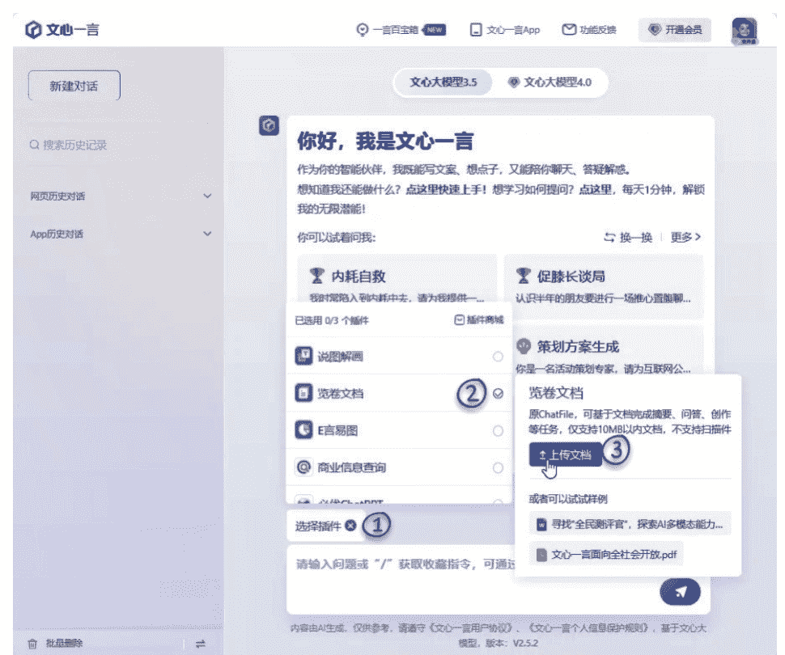

图7-1

02 上传文档。①在弹窗中定位并选择“人工智能”文档；②点击“打开”上传，如图7-2所示。

03 预览结果。🔍

：上传后自动生成摘要：人工智能在各领域的应用正在重塑世界。从医疗健康到金融服务，从自动驾驶到智能家居，发展不断推动行业进步。但数据隐私、算法偏见等挑战依然存在。未来技术持续创新，人工智能将在更多领域发挥作用，为社会带来福祉。我们需关注发展中的问题，通过研究与政策确保其造福人类。


图7-2

#### 7.1.2 对文档进行内容总结

借助文心一言“览卷文档”插件可对人工智能文档进行内容总结。经智能分析，核心内容被提炼，包括定义、发展历程、应用领域、挑战与前景，结构更清晰，便于快速把握要点。

具体操作步骤如下：

01 上传文档后输入指令“对人工智能这个文档的内容进行总结”，如图7-3所示。


图7-3

02 预览结果。

：人工智能是快速发展的科技产物，已渗透各领域，改变世界。从智能手机到自动驾驶、医疗诊断到金融投资，应用无处不在。随着深度学习、神经网络突破，在语音识别、图像识别、自然语言处理等取得显著进展。在医疗、金融、自动驾驶、智能家居等领域发挥重要作用。但数据隐私安全、算法偏见歧视等挑战并存。未来技术持续进步，人工智能将在更多领域创造价值。

#### 7.1.3 对文本提问

“览卷文档”插件支持针对文本提问。文心一言可自动识别并提炼关键问题，帮助发掘深层信息，提升理解深度，并引导更深入思考与分析。

操作步骤如下：

01 上传文档后输入指令“人工智能的劣势有哪些”，如图7-4所示。


图7-4

02 预览结果。

：人工智能劣势主要包括：

- 1. 数据隐私与安全：模型训练需大量数据，收集使用可能涉及隐私泄露或滥用风险。
- 2. 算法偏见与歧视：若训练数据或规则存在偏见，决策结果也会带偏见。
- 3. 可解释性不足：许多模型如同“黑箱”，难以解释决策原因，增加使用风险。
- 4. 对劳动力影响：可能导致部分传统岗位消失，同时创造新岗位，伴随结构性失业风险。
- 5. 法规政策滞后：广泛应用下如何规范发展仍是课题，多国正探索相关法规。

总之，发展带来优势，也伴随挑战，需并重推动与治理。

### 7.2 E言易图

本节探讨“E言易图”插件在思维导图、雷达图、散点图方面的应用。其可视化能力可将复杂数据转化为直观图形，帮助洞察结构、关系与趋势，降低理解难度，提升决策效率。

#### 7.2.1 思维导图

“E言易图”界面直观、功能强大，可将繁杂信息转化为条理清晰的思维导图。支持添加、编辑、重组节点，并可设置颜色与大小突出重点，直观展现层次与逻辑，增强理解与记忆。生成步骤如下：

01 ①点击“已选插件”按钮，②选择“E言易图”插件，如图7-5所示。

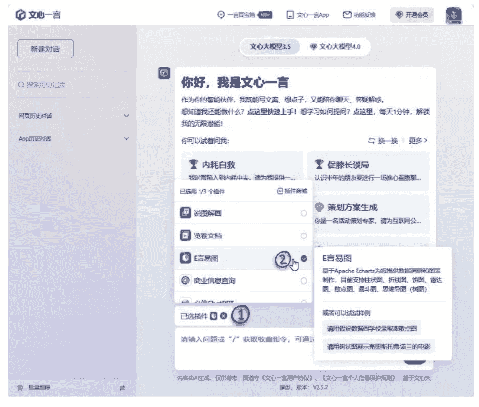

图7-5

02 选中插件后输入指令“请用思维导图展示服装运营”，如图7-6所示。


图7-6

03 预览结果，如图7-7所示。

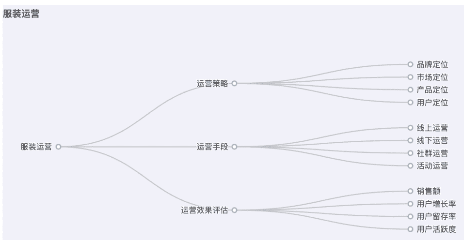

图7-7

> : 我（文心一言）是百度开发的AI模型，通过分析公开文本学习。所提供信息可能存在误差，仅供参考，不应视作专业建议。

#### 7.2.2 雷达图

雷达图又称蜘蛛网图，能同时呈现多维度定量数据，直观展示分布与变化，帮助快速识别模式与趋势。生成步骤如下：

01 选定插件后输入指令“请用雷达图展示CBA球员的数据”，如图7-8所示。

02 预览结果，如图7-9和表7-1所示。


▲图7-8

CBA 球员的数据

● 得分 ● 篮板 ● 助攻

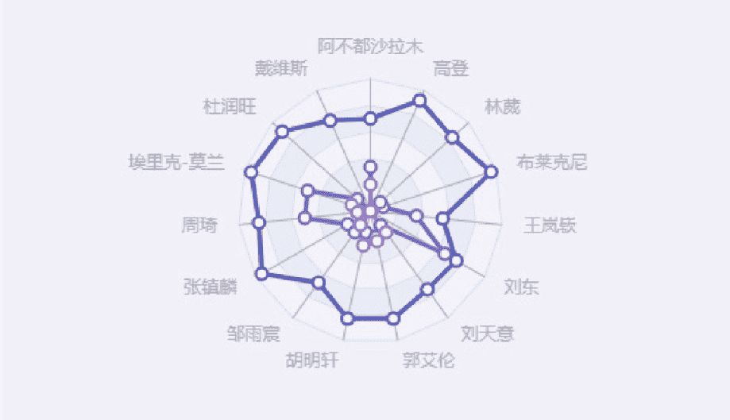

▲ 图7-9

▼ 表7-1

| 球员 | 得分 | 篮板 | 助攻 |
|---|---|---|---|
| 阿不都沙拉木 | 21 | 10 | 6 |
| 戴维斯 | 15 | 0 | 0 |
| 杜润旺 | 27 | 4 | 0 |
| 埃里克-莫兰 | 19 | 10 | 3 |
| 周琦 | 17 | 10 | 2 |
| 张镇麟 | 19 | 4 | 0 |
| 邹雨宸 | 6.7 | 2 | 1.3 |
| 胡明轩 | 25 | 5 | 8 |
| 郭艾伦 | 25 | 6 | 7 |
| 刘天意 | 22 | 4 | 6 |
| 刘东 | 15 | 13 | 0 |
| 王岚嵚 | 11 | 7 | 0 |
| 布莱克尼 | 48 | 5 | 0 |
| 林葳 | 25 | 3 | 0 |
| 高登 | 36.7 | 0 | 0 |

#### 7.2.3 散点图

散点图是展示变量关联的常用手段，借助点位分布与聚集情况可以迅速看出两个指标是否存在正相关、负相关或无关关系，为深入分析奠定直观基础。E言易图插件操作简洁，能够快速完成点位图的绘制，明显提升可视化效率。下面是使用该插件绘制散点图的步骤。

01 先准备好需要呈现的数据。散点图一般以两个维度作为坐标轴，需确认数据包含合适的配对变量。

02 调用E言易图插件，输入指令例如“请按下面要求生成散点图：招生情况分析，以年份为横轴录取率为纵轴，点代表各年录取率。示例数据需包含热门学校与普通学校的点群，以及本科与研究生的点群。”见图7-10。

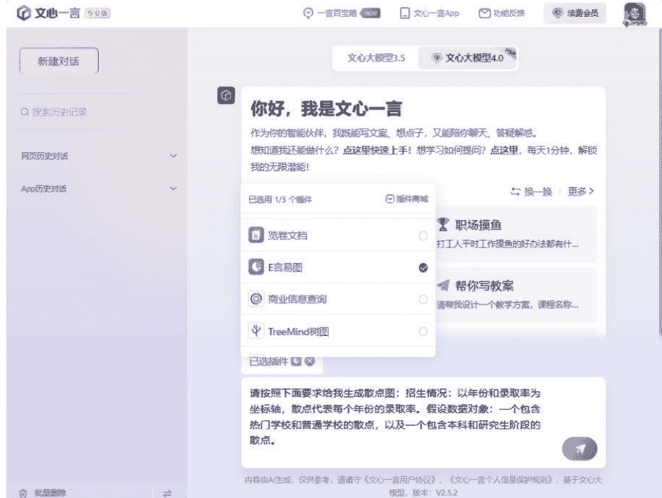

图7-10

03 依据实际需求对图形进行个性化设置。可指定不同颜色、尺寸、形状区分类别，并补充主标题、轴标签与图例。

04 查看预览，确认无误后导出为PNG、JPG等常用格式，见图7-11与表7-2。

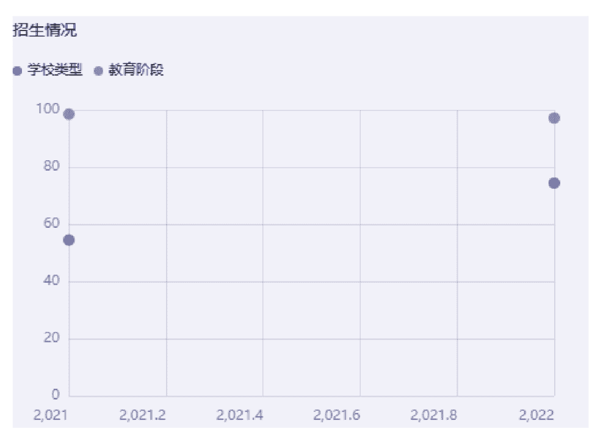

▲图7-11

▼表7-2

| 年份 | 学校类型 | 教育阶段 |
|---|---|---|
| 2021 | 54.5 | 98.51 |
| 2022 | 74.41 | 97.14 |

### 7.3 图文联动：文心一言的图像理解能力
本节梳理文心一言“说图解画”插件在不同场景的应用，包括风景、建筑、动漫图像的识别、诗意表达、朋友圈文案创作与产品命名。该插件具备图像理解与文本生成能力，能在多种需求下提供丰富的视觉语言体验。

#### 7.3.1 识风景
插件可以将风景照片转化为生动文字，帮助拓宽思路获取灵感，也能让语言表达更精准有表现力。下面以识别风景图并生成描述为例：

01 启动“说图解画”插件。①点按“选择插件”进入列表，②选中“说图解画”，③按下“上传图片”按钮，见图7-12。

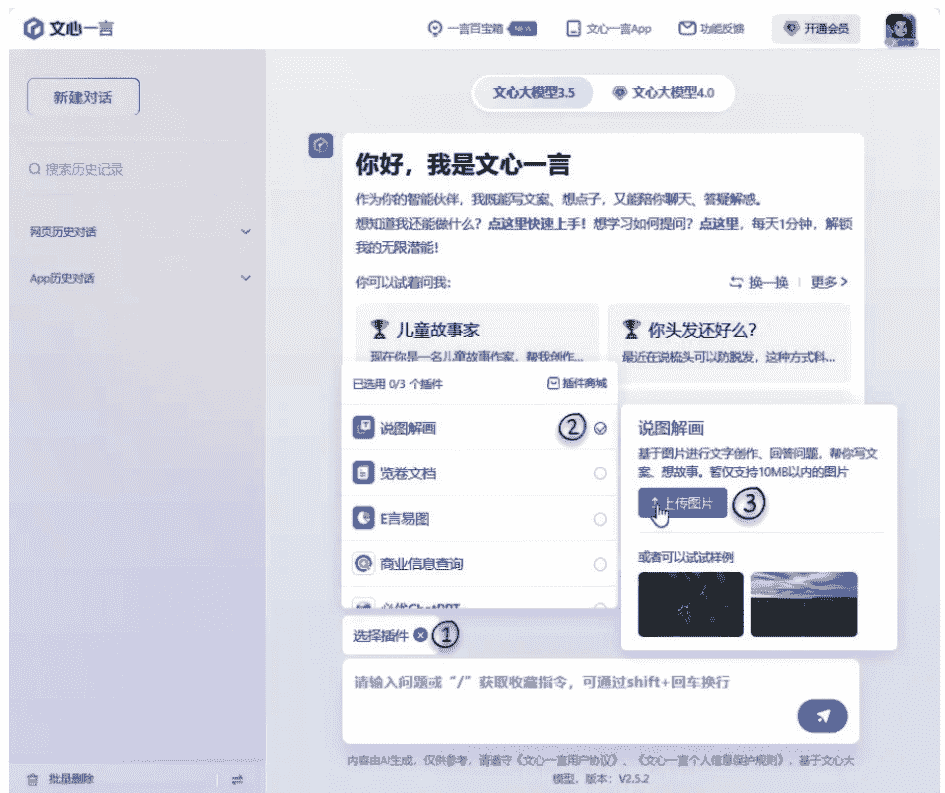

图7-12

02 在弹出的文件框中定位“第7章图片”文件夹里的“风景.jpg”，点“打开”完成导入，见图7-13。


图7-13

03 查看生成结果。

AI对画面的理解大致为：画面呈现一幅壮阔的夕阳山景，高大山脉在余晖映照下更显巍峨。太阳在山后落下，天空被染成橙红色，氛围浪漫诗意。山体层层叠叠，轮廓分明，色彩在夕阳下呈现深绿、浅绿、金黄、橙红的交错。山下广阔草地绿意盎然，在余晖中泛出金色，与山体相映成趣。整体宁静而宏大，突显自然之美与力量，激发对自然的敬畏与热爱。

可参考的提问方式：
- 请依据画面内容写一首李白风格的七言绝句。
- 依据画面信息写一篇约100字朋友圈配文。
- 依据描述写一篇小红书文案。

#### 7.3.2 识建筑
“说图解画”插件可提升用户对建筑照片的理解深度，通过精准捕捉结构、风格与设计细节，提供新颖的解读视角。下面介绍识别建筑图像的操作：

- 01 点按“已选插件”按钮，选用“说图解画”插件并导入图片。
- 02 在弹出对话框中选择“第7章图片”文件夹中“建筑.jpg”文件，点击“打开”导入图片，见图7-14。

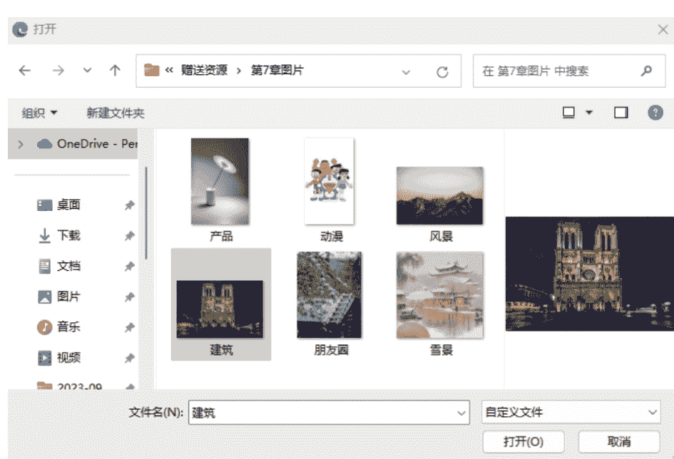

图7-14

03 导入后插件会自动给出回复，需发出指令“识别上面这张图片的建筑”，见图7-15。


图7-15

04 预览结果。

AI判断上图为巴黎圣母院大教堂。该建筑位于法国巴黎市中心，是知名地标，以优美线条和精致雕刻著称，为哥特式建筑，建于1163至1345年间，是欧洲古老的哥特教堂之一。历史上教堂多次重建与修缮，拿破仑时期进行大规模重建与装饰，使其成为巴黎最宏伟的建筑之一。内部有精美石雕、彩绘玻璃与华丽装饰，体现独特的建筑艺术与美学价值，同时也是法国文化象征，被列为国家历史文物和世界文化遗产，每年吸引大量游客。

#### 7.3.3 识动漫
说图解画不仅能辨认动漫角色与场景，还能解析其主题、情感与象征意义，有助于增进跨文化理解。操作步骤如下：

- 01 单击“已选插件”按钮，选用“说图解画”插件并导入图片。
- 02 在弹出对话框中选择“第7章图片”文件夹中“动漫.jpg”文件，点击“打开”导入图片，见图7-16。

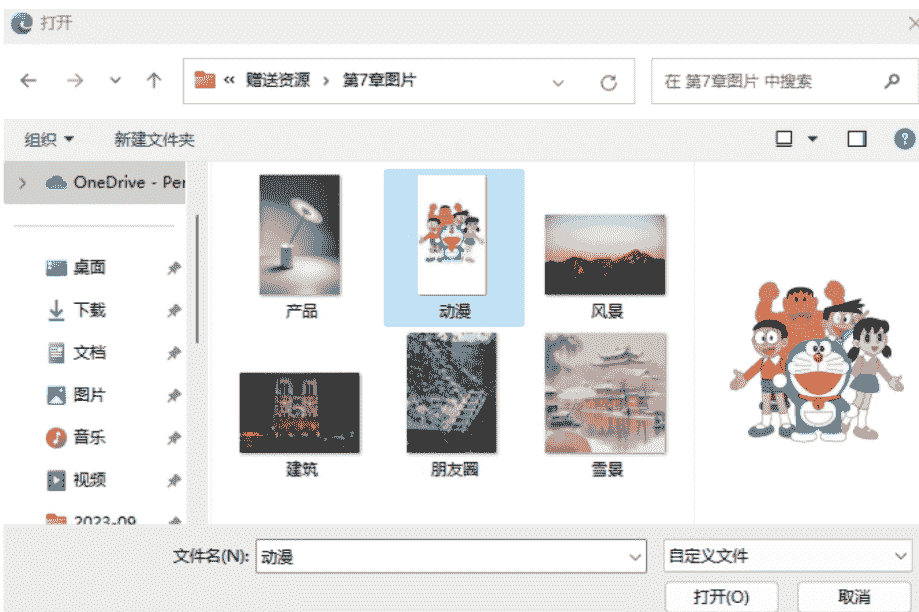

图7-16

03 发出指令“识别上面这张图的动漫角色还有动漫名字，这部动漫的大概剧情。”见图7-17。


图7-17

04 预览结果。

AI识别出角色为哆啦A梦、大雄、静香、胖虎和小夫，作品为《哆啦A梦》，是日本经典漫画与动画。故事围绕大雄与来自未来的机器人哆啦A梦，以及好友静香、胖虎、小夫展开，哆啦A梦用各种神奇道具帮助大雄解决难题。情节充满童趣与成长元素，展现友情、亲情与人生意义，深受全球观众喜爱。

#### 7.3.4 用诗句描述图片
“说图解画”提供富有创意的信息解读方式，可为艺术创作注入活力。下面介绍以诗句描绘图片的步骤：

- 01 单击“已选插件”按钮，选用“说图解画”插件并导入图片。
- 02 在弹出的对话框中选择“第7章图片”文件夹中的“雪景.png”文件，点击“打开”导入图片，见图7-18。

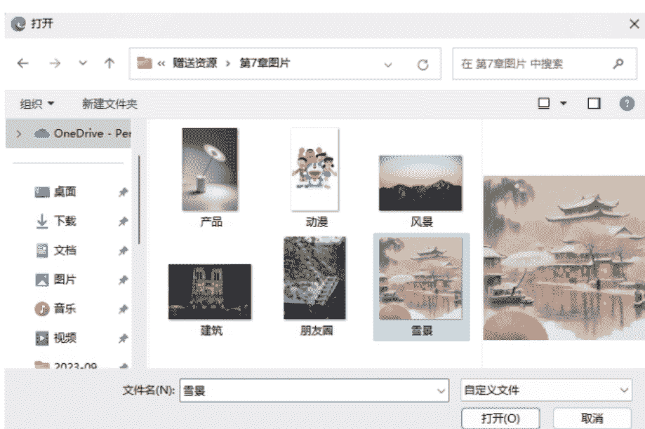

图7-18

03 导入后发出指令“用诗句描绘上面那张图片”，见图7-19。

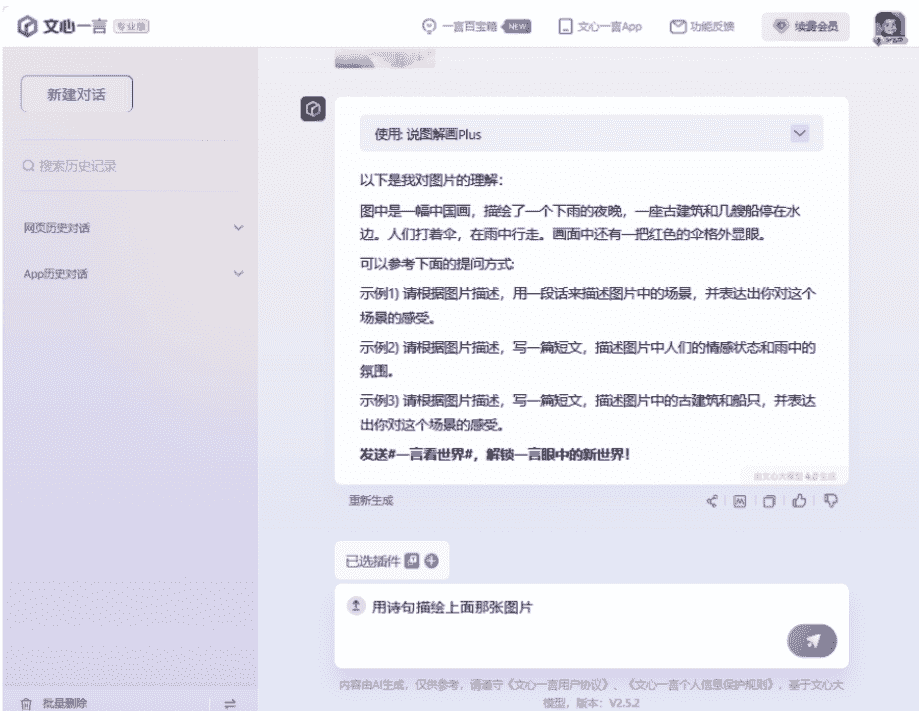

图7-19

04 预览结果。 🎨

：雨打古檐声声慢，
小船摇曳映画廊。
伞影叠叠映碧水，
古风画卷醉心房。

#### 7.3.5 朋友圈文案
使用插件撰写朋友圈文案可提升质量与吸引力，在识别关键元素基础上生成富有表达力的文字，节省构思时间。下面介绍操作流程：

01 单击“已选插件”按钮，选用“说图解画”插件并导入图片。
02 在弹出的对话框中选择“第7章图片”文件夹中的“朋友圈.jpg”文件，点击“打开”导入图片，见图7-20。

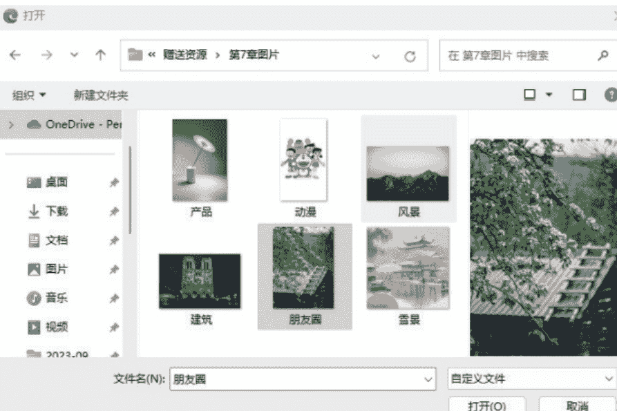

图7-20

03 发出指令“我想用这张图发朋友，可以为我想一个朋友圈文案吗”，见图7-21。

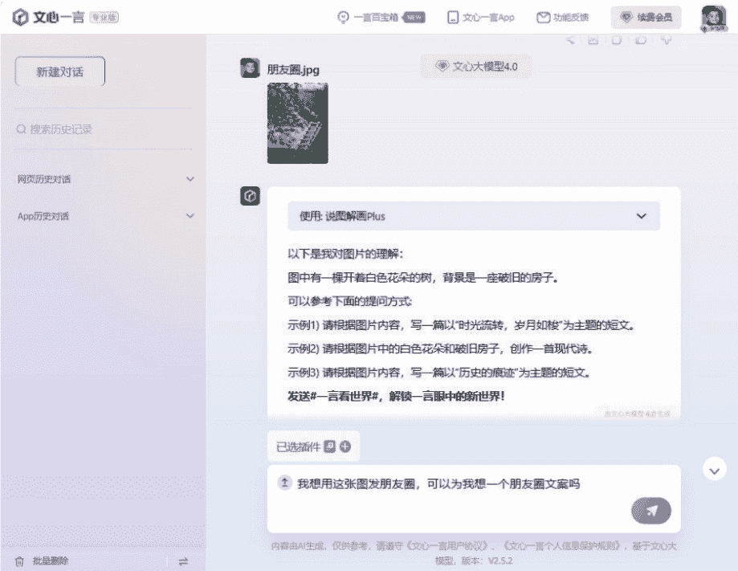

图7-21

04 预览结果。

AI给出的参考文案为：

> “在岁月的流转中，有些美好依然如初。看，这棵开满白色花朵的树，仿佛是时光的见证者，它静静地站在那里，诉说着过去的故事。而那座破旧的房子，更像是一段古老的传说，告诉我们历史与文化的不朽。在这个快节奏的时代，让我们放慢脚步，欣赏这些容易被忽视的美好，感受大自然的魅力和历史的厚重。”

#### 7.3.6 产品创意命名
使用插件为产品命名可挖掘新用途与市场定位，并据此生成富有表达力的名称建议，提升品牌影响力。操作如下：

01 单击“已选插件”按钮，选用“说图解画”插件并导入图片。
02 在弹出的对话框中选择“第7章图片”文件夹中的“产品.jpg”文件，点击“打开”按钮导入图片，见图7-22。

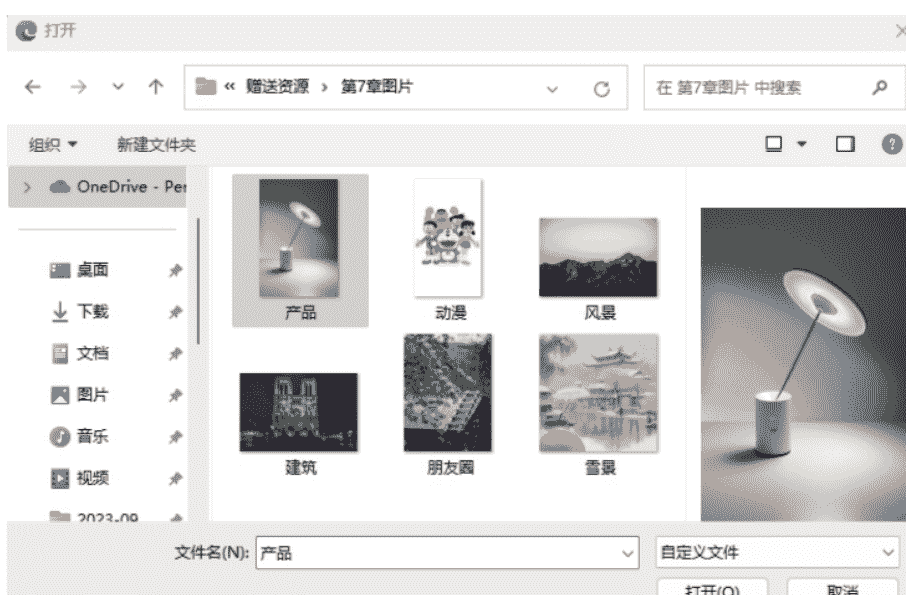

图7-22

03 发出指令“给上面这个图片产品创意起名”，见图7-23。


图7-23

04 预览结果。

AI建议名称为“调节式圆灯”。该名称简洁明了，体现底座可调节杆带来的方向调节功能，以及圆形的灯罩造型，便于记忆与传播，有助于提升产品知名度。

## 第8章 相关产品介绍：满足你的多重需求
在数字化时代，工具需求日益多样。文心一言App与文心一格因各自独特功能受到青睐，本章详细介绍这两款产品的特点。

### 8.1 文心一言App：随身智能工具箱
文心一言App不仅提供多样对话功能，还拥有社区与发现板块，让用户在体验科技便利的同时享受情感交流。下面介绍其三大功能。

#### 8.1.1 对话
对话功能基于先进自然语言处理技术，能根据输入与上下文智能回复并推荐相关内容，提供更精准个性化的沟通体验。

打开App，首先看到对话界面，见图8-1。

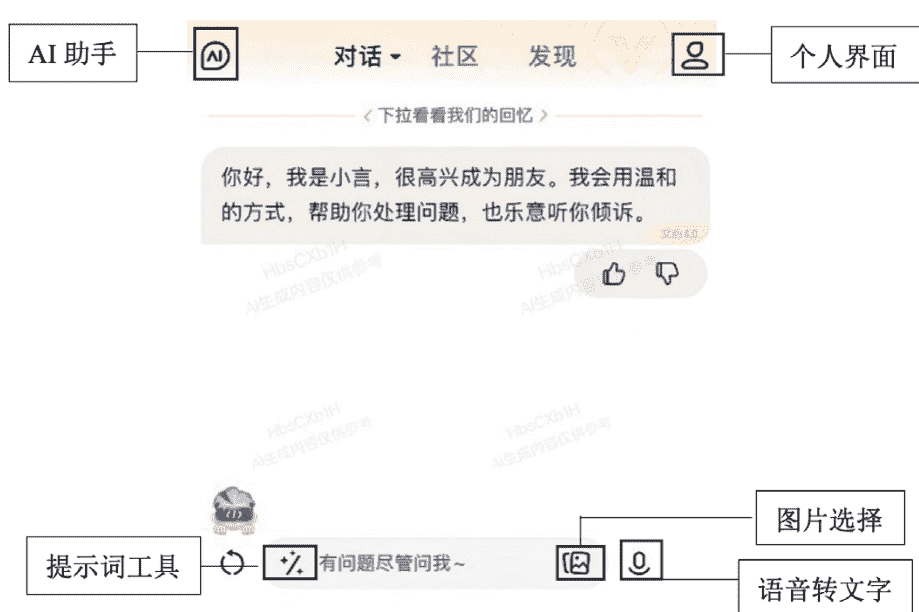

图8-1

- 个人界面：发布作品与点赞记录，见图8-2。


图8-2

- 图片选择：可拍照或选择本地图片，AI助手结合图片内容与指令作答。

### 案例实战
01 选择AI助手为“小言”，在此可查看App与网页的历史记录，见图8-3。
02 点击“提示词工具”选择“大学专业建议”选项，输入指令“内向容易害羞，聪明，对电脑感兴趣。”见图8-4。


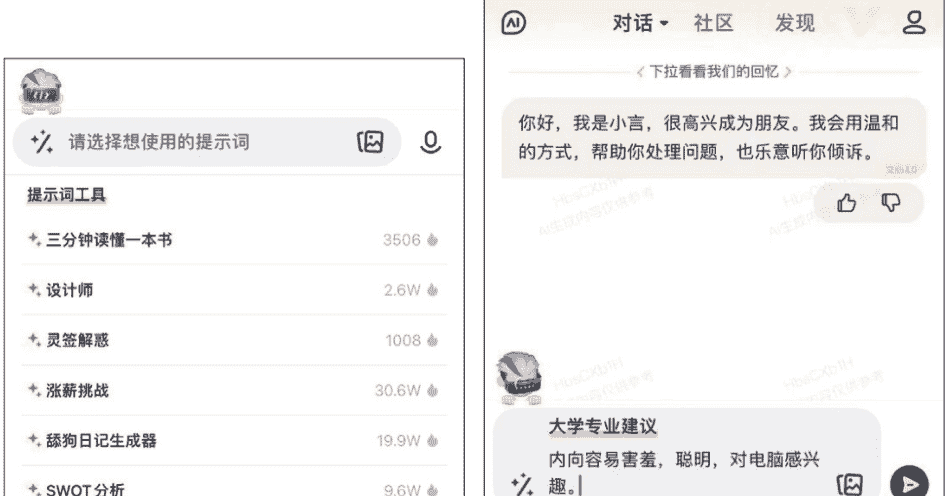


03 预览回答。

：谢谢你的信息。结合你内向、聪慧且对电脑感兴趣的特质，以下专业方向值得考虑：

计算机科学：覆盖编程、算法、数据结构，适合技术爱好者。
软件工程：侧重软件开发与设计，需要协作与问题解决，部分工作可独立进行。
网络安全：关注系统与数据防护、攻击检测与应对策略。
信息科技：涵盖信息系统、数据库与网络管理，兼顾技术与服务。
数据分析与科学：运用编程分析海量数据，适合分析型内向者。
人工智能：融合计算机、数学与工程，打造智能系统，发展前景好。
电子游戏设计：结合技术与创造力，既有团队协作也有独立创作空间。
网络开发与设计：负责网站与应用的构建与维护，兼具技术与美感。

选择专业还需结合长期兴趣、目标与天赋，可通过试听课程或实习深入了解。

#### 8.1.2 社区
社区功能为用户构建互动、交流、学习与问题解决的平台，有助于加深了解、拓宽视野并提供个性化推荐。

图8-5展示社区主页面，汇聚用户发表的AI对话日记，可点击感兴趣话题浏览对话内容，并学习提问技巧。具体操作如下：

01 点击“社区”进入社区界面，主页面由用户发表的AI对话日记组成，点击话题可查看其他用户与AI助手的对话，见图8-5。
02 点击话题。话题为“logo小设计”。可与他人交流，也能学习示例提问，见图8-6。
03 点击“设计师”，与AI助手对话输入指令“小摆件鹿”，见图8-7。

对话 社区 发现


logo小设计

让AI学会自我提问！万能提问公式可真牛

路灯下的猫Qc 852

巧诗垒3U 366


金龙logo，作为品牌的重要视觉元素

下雪后的一首诗

财经剑客 1233

yuanyuan8253 1776

▲ 图8-5

logo小设计

< 以下对话内容使用 设计师 生成 >

你好，请在下方输入你想生成的内容描述或点击示例

公众号logo，山，日出，蓝色背景，极简版

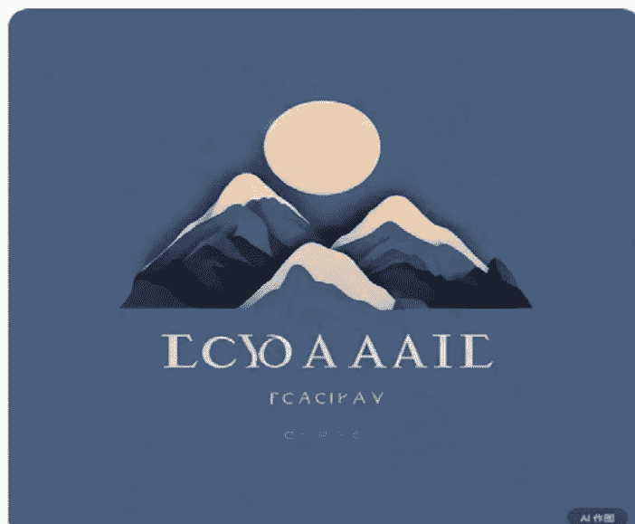

根据你的要求，我已经为你创作了公众号logo图，以极简的线条呈现了群山和日出的元素，背景为蓝色。该设计强调简约与创意，希望你满意。

▲ 图8-6

你好，请在下方输入你想生成的内容描述或点击示例

- 科技公司logo，极简版
- Q版手办小女孩/十二生肖龙，穿着汉服
- 小摆件鹿

15:10

小摆件鹿


有问题尽管问我～

### 案例实战

：点击进入“三分钟读懂一本书”话题，与AI进行对话并输入“水浒传”。

《水浒传》：108将聚义的英雄叙事

《水浒传》位列中国四大名著，著者署名施耐庵，约成书于元末明初。小说以梁山泊一百零八位好汉汇聚起义、抗衡腐败官府为主线，通过跌宕的故事线与立体的人物塑造，呈现出草根英雄的抗争理想与底层民众的反抗意识。

以下为若干代表回目及其要点。

洪太尉误走妖魔：洪太尉登龙虎山行法，因一时疏忽释放了被镇压的妖邪，为日后各路英雄现身埋下伏线。

林冲误入白虎堂：林冲遭高俅构陷，被带入白虎堂受辱，走投无路之下投奔梁山。

武松打虎：武松途经景阳冈，徒手击毙凶猛老虎，彰显胆魄与力气。

李逵沂岭杀四虎：李逵为给母亲报仇，行至沂岭连续斩杀四头猛虎，兼具孝义与凶悍。

宋江围攻祝家庄：为解救被擒的弟兄，宋江组织了三次围攻，终获胜并壮大山寨。

大破连环马：梁山众将破解呼延灼布下的连环马阵，体现智勇兼备。

曾头市晁盖中箭：晁盖率军攻打曾头市时负伤身亡，对梁山后续走向产生深远影响。

吴用智取玉麒麟：吴用设计诱使卢俊义投山，为梁山增添重要战力。

宋江攻破大名府：梁山兵发大名府，救出卢俊义与石秀，再次凸显其谋略与武力。

招安与征方腊：记述梁山好汉接受朝廷招安后远征方腊等叛乱的结局。

#### 8.1.3 发现

发现频道为使用者打造了一个探索新知、捕捉有趣内容的入口。进入该页面后可快速浏览热门话题、最新动态以及各类对话，从而拓宽视野并获得更多信息养分。操作流程如下。

04 打开发现主界面。点击底部导航栏的发现入口，页面顶部标题下方依次排列热门、会员、最新等筛选标签，点击对应标签即可加载相关内容，如图8-8所示。

05 进入行业研究方式并与智能助手对话，发送关键词“计算机视觉”，如图8-9所示。

对话 社区 发现

热门 会员 最新 角色 职场 学习 绘画


▲图8-8

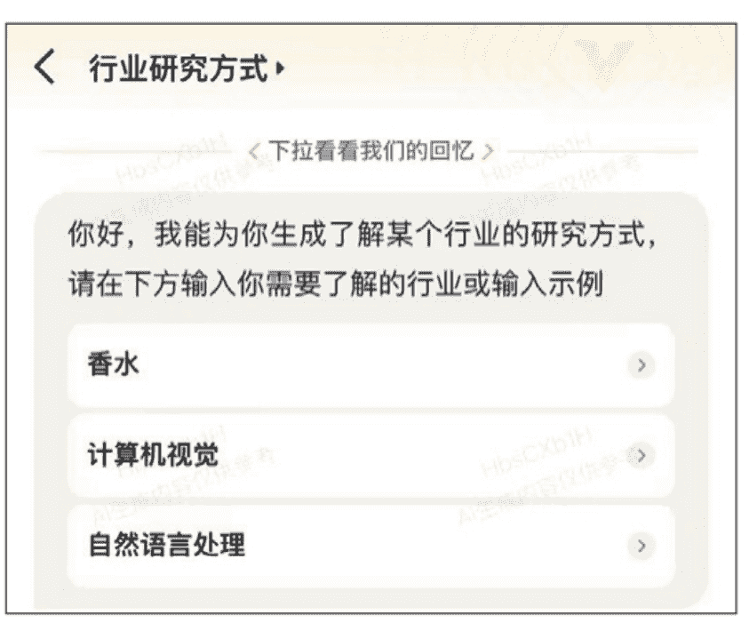

▲图8-9

06 预览助手返回的结果。

：要把握计算机视觉的前沿动态，可从以下角度入手。

通览权威会议与期刊。关注CVPR、ECCV、ICCV等顶级会议的论文合集，同时跟踪*IEEE Transactions on Pattern Analysis and Machine Intelligence (TPAMI)*与*International Journal of Computer Vision (IJCV)*等期刊，这些渠道汇聚了该领域的最新成果。

留意核心学者与团队。了解计算机视觉领域具有影响力的研究者与实验室，关注其成果发布、开源项目与技术博客，例如Yann LeCun、Andrew Ng、吴恩达等人在该方向贡献突出。

查阅预印本资源。arXiv等平台汇集大量计算机视觉的初稿论文，有助于捕捉前沿思路与进展。

参与线上社区交流。在GitHub、Stack Overflow、Reddit的r/MachineLearning与r/ComputerVision等社群中互动，与同行讨论实际问题与最新动态。

系统学习课程。借助Coursera、Udacity等平台的课程，以及各高校与研究机构开设的相关课程，构建完整知识框架。

关注产业落地趋势。观察自动驾驶、安防监控、医疗影像解析等领域的实际应用与商业变化。

探索跨学科结合。研究计算机视觉与自然语言理解、语音识别、强化学习等方向的交叉，以拓展思路、发现新的研究切口。

综合上述路径，能更立体地掌握计算机视觉的研究现状，为后续工作提供参考。

### 8.2 文心一格：图片编辑实验室

文心一格是百度旗下的AI绘图产品，依托飞桨框架和文心大模型的支撑，为用户提供图像生成与编辑的丰富能力，涵盖个性化模型、动作识别再创作、海报制作、艺术字生成等。它既能为画师、设计师等视觉创作者提供灵感与效率支持，也能满足媒体、作者等文字创作者对高质量配图的需求，同时让普通用户也能表达个人审美并享受创作乐趣。

#### 8.2.1 图片创作

文心一格是一款功能完备的图像编辑工具，下文将说明其专业创作流程。通过解析各项功能，可在不同场景下灵活运用，创作出兼具创意与个性化的作品。

### 案例实战

01 打开文心一格官网后，点击右上角“登录”按钮，使用百度账号登录。该站需先登录后使用，登录完成后即可开始创作，如图8-10和图8-11所示。


图8-10

02 在创意输入框填写灵感，或点击下方的推荐词作参考，如图8-12所示。


▲图8-11

文心一格

AI艺术和创意辅助平台

首页 AI创作 AI编辑

AI 创作

AI 编辑

- 推荐

- 自定义

- 海报

- 艺术字

可爱小猫，德文猫，鲜花，巨大的芭蕉叶，热带阔叶林，仙人掌，油画笔触，扁平插画

38 / 200 | 清空

试一试：致闪光的他 戴耳机的嫦娥 画牡丹

画面类型 ⓘ


更多

比例

- 竖图

- 方图

- 横图

数量

4

灵感模式 ⓘ

已关闭

▲图8-12

03 调整画面类型、图片比例、生成数量、灵感模式等参数，如图8-13所示。

04 点击“立即生成”按钮，系统会依据提示词产出图像，单次最多可生成9张。注意生成会消耗电量，电量可通过完成任务或充值获得，如图8-14所示。

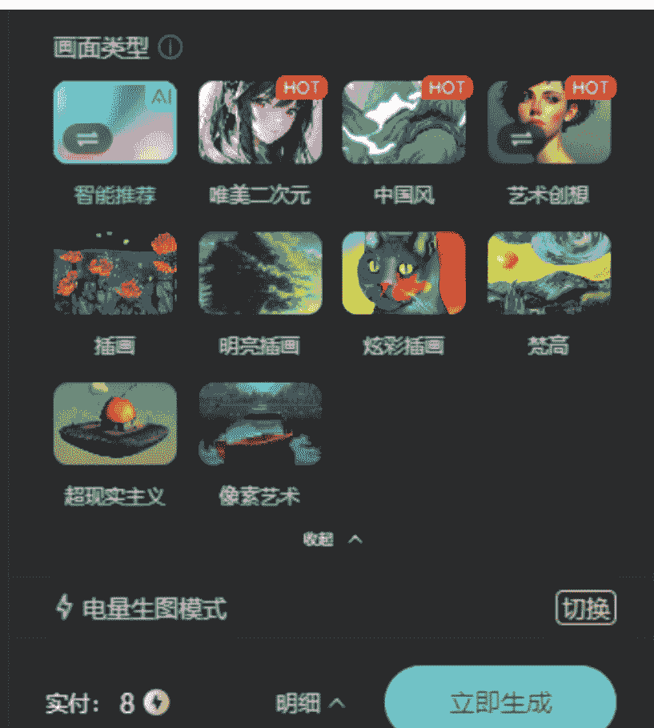

▲图8-13


▲图8-14

#### 8.2.2 自定义模型

自定义模型功能为创作带来独特风格与个性化体验。通过结合自定义调节，可对作品进行精细优化并融入个人创意，实现差异化表达，更好适配特定用途。具体步骤如下。

01 进入自定义模型。点击创作页面的“自定义”入口，如图8-15所示。

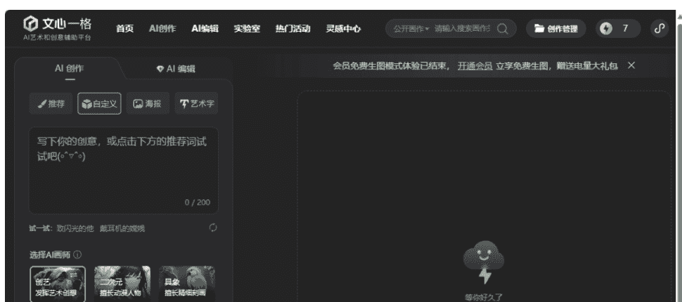

图8-15

02 上传参考图。点击页面下方“上传参考图”按钮，可选择“我的作品”“模板库”或“上传本地图片”，如图8-16所示。


图8-16

03 选择AI参考图。弹出“打开”对话框后挑选所需图片并点击“打开”，如图8-17所示。

04 填写提示词。在输入框中写入描述“机器人，人工智能，8k，超高清”，将AI画师设为“创艺”，如图8-18所示。


▲ 图8-17

AI 创作

AI 编辑

推荐

自定义

海报

艺术字

机器人，人工智能，8k，超高清

15 / 200 | 清空

试一试：加油打工的她 芋泥啵啵 画牡丹

选择AI画师 ⓘ

创艺

发挥艺术创想

二次元

擅长动漫人物

具象

擅长精细刻画

上传参考图 ⓘ 选填


影响比重 数值越大参考图影响越大

1

10

使用参考图可能会存在结果与参考图高度相似的情况，在没有获得底图改编权的情况下，生成结果仅供学习交流使用，不可用于商业用途。

#### 8.2.3 人物动作识别再创作

人物动作是传递情感与信息的重要载体。借助文心一格提供的人物动作识别工具，可从素材中精准提取动作并进行再创作，为作品注入新颖视觉与动态美感，同时提升素材获取效率。具体操作如下。

01 点击主界面左上角的“实验室”选项卡，再点击“人物动作识别再创作”按钮，如图8-24所示。

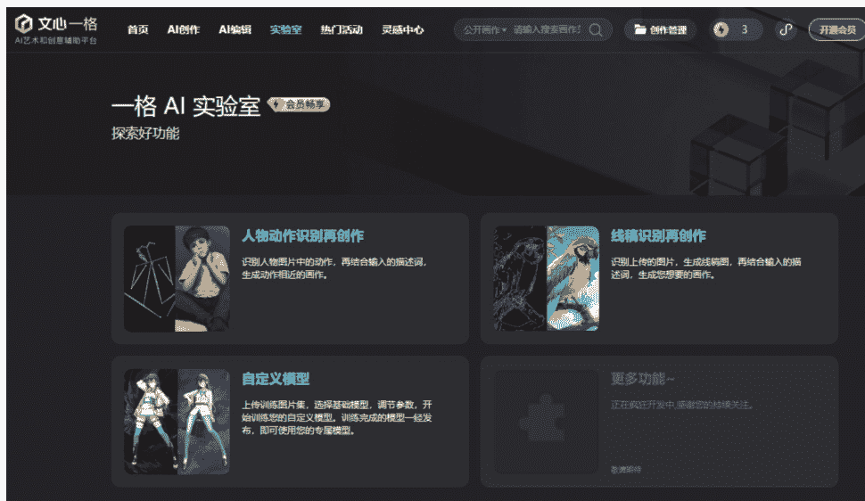

02 查看功能示例。该功能可识别图片中的人物动作，并结合输入描述生成动作相近的画面，如图8-25所示。


03 上传人物动作参考图，并在输入框中填写描述“一个放学回家的女孩，穿着灰色卫衣戴着帽子，戴耳机听着歌，边走边踢路边的石头。”，点击“立即生成”按钮，如图8-26所示。


#### 8.2.4 海报

文心一格拥有丰富的素材库与强大的编辑能力，设计师可从零开始制作兼具吸引力与创意性的海报。平台提供多样元素与工具，助力自由发挥创意，将概念以海报形式呈现，提升艺术价值与视觉冲击力。具体步骤如下。

01 点击“海报”按钮，排版布局选择“底部布局”，方向设为“竖版9:16”、风格选“平面插画”，如图8-27所示。


02 填写描述词。海报主体文本框输入“在蓝天白云底下，身强体壮的人在足球场上踢足球进行足球比赛”，背景文本框输入“体量庞大的体育馆，绿油油的草皮”，图片生成数量设为4，如图8-28所示。


03 预览最终效果，如图8-29所示。


#### 8.2.5 艺术字

艺术字能为文字增添美感与艺术气息。通过文心一格创作艺术字，可激发灵感、融入个性化字体设计，提升整体审美价值。操作步骤如下。

01 点击“艺术字”按钮，中英选项选“中文”，字体布局选“自定义”，字号选“大”，字位选“居中”，排版方向选“单排横向”，如图8-30所示。


02 在汉字文本框输入“冰淇淋”，字体创意文本框输入描述“清晰立体，夏天，透明质感，梦幻冰沙，创意，多巴胺”，影响比重设为1，比例选“方图”，生成数量设为1，点击“立即生成”按钮，如图8-31所示。


03 预览生成结果，如图8-32所示。


Source 字体授权速览

版权信息归 Adobe Systems Incorporated 所有，时间标注为 2010 年与 2012 年，官方站点 http://www.adobe.com/，保留的字体名称为 Source。本套字体软件的授权方式为 SIL 开放字体许可第 1.1 版，下文为许可全文，配套说明与常见问题可查阅 http://scripts.sil.org/OFL。

SIL 开放字体许可 第 1.1 版 2007 年 2 月 26 日

前言
开放字体许可设立的初衷是推动全球协作式字体项目的发展，助力学术与语言学界的字体创作工作，并提供一个自由开放的框架，让字体能够在合作中被共享与改进。依据本许可，被授权的字体可以被自由使用、研究、修改和再分发，前提是不能单独售卖。字体及其衍生作品可以与任何软件一同捆绑、嵌入、再分发或出售，但衍生作品不得使用保留的字体名称。字体及衍生作品不得以其他许可方式发布。字体需继续遵循本许可的义务不适用于使用该字体或其衍生作品制作的任何文档。

定义
“字体软件”指版权持有者依本许可发布的、明确标识的全部文件集合，可能包含源文件、构建脚本及说明文档。
“保留字体名称”指版权声明后特别列出的名称。
“原始版本”指版权持有者分发的字体软件组件集合。
“修改版本”指对原始版本的全部或部分组件进行增删、替换、格式转换或移植到新环境后产生的衍生版本。
“作者”指参与字体软件设计、工程、编程、技术写作等工作的任何贡献者。

许可与条件
现免费授予任何获得字体软件副本的人使用、研究、复制、合并、嵌入、修改、再分发并销售修改或未修改版本的权利，但须遵守以下条件：
1. 原始版本或修改版本中的字体软件或其单个组件不得单独出售。
2. 原始版本或修改版本可以与任何软件一并捆绑、再分发或出售，前提是每份副本均包含上述版权声明与本许可。可采用独立文本文件、可读标题或嵌入文本或二进制文件中的机器可读元数据字段的方式呈现，只要用户能够便利查阅。
3. 修改版本未经对应版权持有者书面明确许可，不得使用保留的字体名称。此限制仅适用于呈现在用户面前的首要字体名称。
4. 除为承认版权持有者与作者的贡献外，未经其明确书面许可，不得使用版权持有者或作者的名称来宣传、认可或广告任何修改版本。
5. 字体软件无论是否修改、全部或部分，均须完全在本许可下分发，不得以其他许可发布。使用字体软件制作的文档不受字体需继续遵循本许可的限制。

终止
违反上述任一条件，本许可即告失效。

免责声明
字体软件按“现状”提供，不提供任何形式的明示或暗示担保，包括但不限于适销性、特定用途适用性以及不侵权等担保。版权持有者对因使用或无法使用字体软件，或因其他与字体软件有关的情形而产生的任何索赔、损害或其他责任，包括一般、特别、间接、偶然或后果性损害，无论基于合同、侵权或其他法律关系，均不承担责任。

*文中代码字体版权说明


Your gateway to knowledge and culture. Accessible for everyone.

- [z-library.sk](http://z-library.sk)

- [z-lib.gs](http://z-lib.gs)

- [z-lib.fm](http://z-lib.fm)

- [go-to-library.sk](http://go-to-library.sk)

[Official Telegram channel](http://Official%20Telegram%20channel)

[Z-Access](http://Z-Access)

[https://wikipedia.org/wiki/Z-Library](https://wikipedia.org/wiki/Z-Library)