# 文心一言实战通关手册

**姜旬恂**
硕士，数字媒体艺术背景。现任吉林师范大学新闻与传播学院副教授，并兼任吉林省美学学会常务理事、吉林省传媒学会理事、韩国游戏技术学会理事。拥有互联网+行业实战经验，具备双创导师、移动端交互设计、用户体验设计等专业资质。

**研究方向**
数字产品服务设计、视觉交互设计。

**研究成果**
主持吉林省社科项目1项、吉林省教育厅教研项目2项；参研国家艺术基金项目1项、吉林省社科项目1项、省科研基金项目2项、省教育厅“十一五”社科项目1项；发表SCI论文3篇、CSSCI论文2篇、核心期刊论文1篇、作品1项、EI论文2篇、省级论文8篇；出版教材1部、专著3部；近五年指导学生团队孵化创新创业项目20余项；2017-2021年“互联网+”大学生创新创业大赛指导团队获金奖1项、银奖2项、铜奖2项。

**乔通宇**
硕士。现任北京煜华年互动传媒有限公司CEO，同时担任奇遇瞬间主理人、创造者私董会发起人、创造者IPAI进化人主讲导师。

**工作经历**
2006-2008年：北京水晶石数字科技有限公司
2009年至今：北京煜华年互动传媒有限公司

**公司业务**
品牌战略、产品开发与IP设计、品牌IP内容营销、AIGC进化探索

# 序言

近两三年，生成式AI在自然语言处理赛道的进展非常明显。正是在这样的背景下，百度发布了新一代知识增强大模型文心一言，于2023年3月面向公众开放。上线两个月后用户数量突破7000万，AI应用迈向新阶段。作为代表产品，文心一言在智能客服、情感分析、机器翻译等多个场景已展现出很强能力。对于普通使用者而言，如何把技术转化为实际生产力仍存在门槛。为此本书成书，旨在为读者提供一套系统的实操路径，帮助理解、掌握并高效运用文心一言。

**本书亮点**
本书围绕十余个应用场景展开，以135个真实案例串联，帮助读者从入门走向熟练。全书采用案例驱动的方式，从基础概念切入，避开枯燥理论，提供生动详实的操作指南。无论是寻求写作灵感、提升日常办公效率，还是解决生活中的小疑问，文心一言都能提供有效支持。

本书除系统讲解文心一言使用外，还整理了文心一言App与百度系产品文心一格的操作要点，让读者全方位感受AIGC应用带来的便利。

**目录概览**
全书共8章。
第一章梳理文心一言的发展脉络与基础操作要点。
第二至第六章聚焦工作、学习、绘画等场景的具体案例，涵盖数据分析、文本创作、教学示范等。
第七章介绍借助文心一言的三款插件完成摘要生成、图像解析、图片解读等任务。
第八章讲解文心一言App及文心一格的核心功能与使用方法。

另附文心一言提示词示例，助力读者更快掌握两款工具，实现从入门到熟练的跨越。

**适用人群**
需要高效办公的职场人士；
对文心一言感兴趣的初学者与爱好者；
希望提升学习效率的学生；
关注人工智能发展的读者。

**阅读建议**
建议结合自身需求择章阅读。AI技术更新迅速，书中信息或随版本迭代而变化，请保持开放灵活的心态，结合最新资源持续实践。

**编著说明**
本书由吉林师范大学新闻与传播学院姜旬恂与北京煜华年互动传媒有限公司乔通宇共同编著。编写过程中力求严谨精进，难免疏漏，如有技术疑问，可扫码联系技术人员。

技术支持
作者
2024.4

# 第一章

# 初识文心一言：中文大模型表现

大型语言模型的普及重塑了人工智能、自然语言处理、计算机视觉等领域。文心一言在中文环境下表现突出，应用范围广泛，能够完整把握中文语义、语法与上下文，满足中文用户需求。依托百度研发背景，模型可解析多种输入形式与方言，输出更具本土文化、风俗与社会语境。

## 1.1 文心一言的技术源起

深度学习是一种基于深度神经网络的人工智能方法。本节先介绍语言模型的概念、其在自然语言处理任务中的强大能力，再讲述文心一言的发展轨迹与带来的影响。

### 1.1.1 什么是语言模型
文心一言的技术基础是大语言模型LLM的应用。

**1. 大语言模型的定义**
大语言模型指的是利用超大参数量与海量训练语料进行深度学习的系统，通过大量文本学习生成类人文本。简而言之，LLM是一个能够理解并生成自然语言的AI系统。神经网络在海量语料训练后能够自动提取文本特征与规律，实现语言理解与生成。

**2. 大语言模型的历史脉络**
大语言模型可追溯至早期的神经网络语言模型如RNN、N-gram。随着算力与数据资源提升，神经网络在NLP领域持续进步。基于循环神经网络RNN与长短期记忆网络LSTM出现了更深层的语言模型。Transformer架构的出现解决了传统RNN的固有缺陷，其基于注意力机制的序列到序列模型在NLP任务中表现突出。GPT生成式预训练模型的推出标志大语言模型崭露头角，后续迭代在文本生成上持续提升。与此同时，BERT双向编码器表示模型推动了预训练发展，采用双向预训练显著增强了上下文理解。上述进展共同推动了大语言模型在NLP领域的广泛应用。

表 1-1 展示了大语言模型发展历程。

表 1-1

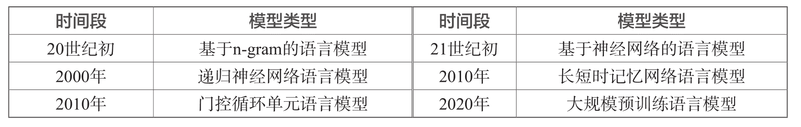

**3. 大语言模型的训练方式**
训练通常分为预训练与微调两阶段。
预训练：模型初始学习阶段，接触大量未标注文本如书籍、文章、网页内容，捕捉语料库中的底层模式、结构与语义知识。
微调：在预训练后，使用特定任务的有标注数据进一步训练并调整参数，使模型在目标任务上表现更优，任务包括文本生成、机器翻译、情感分析等。微调使LLM更具针对性与可解释性，便于调试与行为理解。

### 1.1.2 文心一言简介
文心一言ERNIE Bot是百度推出的一代知识增强大语言模型，也是文心家族新成员，是国内首个面向大众的生成式对话产品。模型拥有丰富词库，能进行对话互动、辅助创作、解答提问，帮助用户便捷获取信息、知识与灵感。

文心一言基于飞桨深度学习平台与文心知识增强大模型构建，可从海量数据与大规模知识库中持续学习，不断提升语言处理能力与知识储备。2023年8月31日正式面向公众后，在文学创作、智能家居、金融、教育、医疗健康等领域发挥重要作用并获广泛应用。

### 1.1.3 背后故事与发展脉络
文心一言依托飞桨与文心大模型技术研发的知识增强大语言模型，可对话互动、答疑、创作，提升信息获取效率。基于百度自研ERNIE模型，文心一言具备多语言翻译能力，助力跨语言沟通。

“文心一言”之名源自中国传统文化中的“一心”意象，寓意专注与统一。设计中充分体现这一理念，以人工智能为核心，优先满足用户需求，提供准确高效的信息与知识服务，同时强调与用户的互动沟通，带来更便捷个性化的体验。

文心一言既体现百度在人工智能技术上的创新突破，也融入中国传统文化理念。结合先进技术与传统文化，旨在为用户提供更优质高效的信息与知识服务，让科技更好地服务生活。

百度在自然语言处理、机器翻译、深度学习领域的研究可追溯至2010年起，逐步形成完善的人工智能技术体系。2017年开放深度学习平台飞桨，为开发者提供丰富AI工具与资源。2019年相继发布ERNIE与ERNIE 2.0系统，均基于PaddlePaddle构建，具备强大的自然语言处理、语音识别、图像识别等功能，广泛应用于各领域。2023年8月31日文心一言正式面向公众，标志着百度在AI领域的重要里程碑。

### 1.1.4 影响与应用范围
随着技术创新与完善，文心一言将成为数字化时代的重要推动力。大语言模型的发展使自然语言处理取得巨大进展，提升了文本相关任务的处理效率。

应用场景广泛，包括自然语言生成、图像生成、数据分析、对话系统、文本分类、代码编写、机器翻译等。在教育、医疗、文学、金融等领域可快速准确获取信息与知识。企业场景中可加速自动化进程，降低成本，提升工作效率与质量。

文心一言的出现印证了人工智能技术持续发展完善。作为国内首个大语言模型，其在各领域展现出巨大潜力与影响力，标志AI领域又进一步。

## 1.2 文心一言快速上手
本节为首次接触用户的入门指引，帮助掌握注册登录流程并熟悉页面布局与核心功能。

### 1.2.1 注册与登录
先对文心一言发展史、核心技术、应用范围作介绍，接下来详述注册与登录步骤。

01 在浏览器搜索“文心一言”，进入官网，点击登录按钮进入登录页。
02 点击右下角“立即注册”按钮进行账号注册。

▲图 1-1

▲图 1-2

03 输入用户名、手机号、密码、验证码，勾选“阅读并接受”后点击注册完成。
04 注册完成后返回登录界面，输入注册的用户名、邮箱或手机号及密码点击登录。也可选择短信登录，输入手机号获取验证码后登录。

▲图 1-3

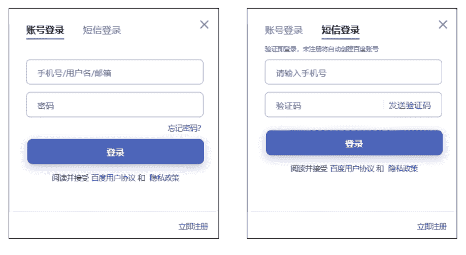

▲图 1-4

### 1.2.2 页面与功能说明
文心一言依托自然语言处理与机器学习技术，能深入理解用户语言，提供智能化交互体验。用户只需输入简单对话即可获取信息与帮助，大幅提升便捷性。同时用户反馈与使用数据对AI技术优化与发展具有重要参考价值。下面结合图 1-5 直观了解文心一言。

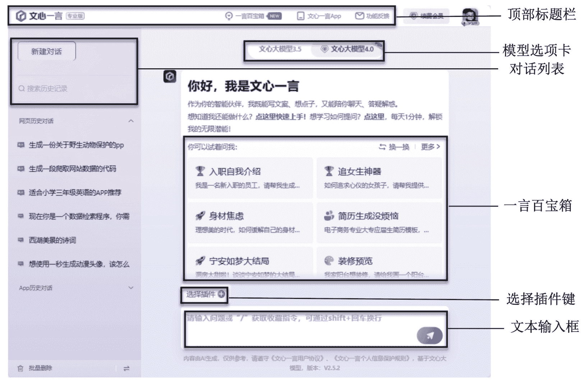

图 1-5

·顶部标题栏：点击文心一言Logo可返回官网，可进入一言百宝箱或下载App，也可在本栏提交功能反馈。
·模型选项卡：提供文心大模型不同版本选择。文心大模型4.0在模型规模、训练数据、技术、任务类型、预训练模型、跨模态能力与安全性等方面全面升级，为用户提供更强大灵活安全的工具。
·对话列表：可在此新建对话、删除不需要的对话或保存历史记录。
·一言百宝箱：汇聚大量Prompt，使用时可快速找到提示与灵感。
·插件选择键：点击选择插件按钮旁的+号可选择所需插件，亦可进入插件商城安装卸载。
·文本输入框：在此输入文本或问题，即可与文心一言对话交流。

文心一言基于自然语言处理技术的人工智能模型，功能多样。
·聊天对话功能：可通过自然语言与用户对话，回答问题并提供建议，适用于辅助写作、AI绘画图像生成、技术难题解决等场景。
·文本摘要功能：输入文章或段落即可生成摘要，帮助快速把握主要内容，节省阅读时间。
·语音识别功能：可将用户语音输入转为文本进行后续处理分析。
·机器翻译功能：支持多语言互译，解决跨语言沟通问题。
·问答功能：可基于用户提问自动检索相关答案并回复，帮助快速获取知识与信息。

### 1.2.3 一言百宝箱
百宝箱面板包含精选、场景、职业、我的收藏、搜索指令五大模块。精选模块包含今日热门、大家都在问、提效max、AI画图、最近更新等内容，展示每日热搜并提供灵感；场景模块提供丰富主题指令，便于按特定场景对话；职业模块可按职业类型选择对应指令生成内容；我的收藏允许收藏常用指令，便于日后快速调用；搜索模块输入关键词或需求即可迅速弹出相关指令，提升使用体验。整体流程简洁明了，如图 1-6 所示。

图 1-6

## 1.3 人机协作：更有效使用文心一言
本节提供从基础原则到高级技巧的全面指南，帮助用户充分挖掘文心一言潜力，实现高效准确的人机交互。

### 1.3.1 量化要求
量化要求是将抽象主观需求转化为具体可衡量指标的过程，对项目顺利进行与准确评估至关重要。文心一言在帮助制定与管理量化要求方面发挥重要作用。注意事项如下。

·准确度：可设定准确度指标。例如提出“请撰写一篇时长3分钟的广告视频脚本，要求内容准确契合品牌调性”。
·多样性：文本生成或推荐具有多样性。可设定具体多样性要求。例如“国庆长假出游，请为我写一份三天两晚旅游攻略，含特色景点与推荐餐馆，不超过500字，确保体验丰富多样”。
·速度：可对处理速度或响应时间设定限制。例如“请在30秒内写一段描写西湖美景的散文诗”。
·语言处理能力：文心一言具备文本分类、实体识别、关系抽取等能力。提出要求时宜使用简洁明了的语言，避免过于复杂的语法与词汇。
·多轮对话：支持多轮对话，有助于在多轮交互中获取更多信息与反馈，提升需求满足度。

**案例实战** 

：描写女子初中篮球比赛。 

：球场上，初中女子篮球赛正酣。两队队员身着亮色球衣，精神饱满，在场上快速移动，展现出灵活与敏捷。

随着哨声响起，比赛正式开始。篮球在她们手中快速传递，伴着有节奏的拍球声，气氛愈发紧张。她们起跳投篮，身姿矫健，篮球划出优美弧线，令人目不暇接。

防守、进攻、抢篮板……场上拼抢激烈，每一个动作都兼具力量与美感。汗水打湿球衣，眼神却依然坚定，充满对胜利的渴望。观众为精彩表现鼓掌喝彩，每一次进球都引来阵阵欢呼。掌声和呐喊是对这些女孩勇气与毅力的肯定。这场赛事不仅展现了初中女生高超的篮球技巧，更体现出坚韧不拔、奋勇向前的女性力量。 

：描写女子初中篮球比赛，要求文笔生动凸显女子力量，字数不超过 500 字。 

午后斜阳洒进操场，初中女子篮球赛正进行到白热化。姑娘们站得笔直，眼神明亮，既像是力量的象征，也像是青春最鲜活的注脚。

开球后，皮球在她们之间快速运转，带起了信念与决心。每一个细节都透着柔韧与坚强。拼抢时腾身而起，轻快如燕，空中划出流畅的弧度；推进时步伐沉稳，气势带着不可阻挡的冲劲。

场上她们散发出独有的风采。身体素质扎实之外，技术细腻，观察敏锐。擅长捕捉对手的破绽，及时撕开防线；出手果断稳定，每一次得分都像是自我超越的印证。

汗水落在地上，记录着拼搏的轨迹。眼神炽热而坚定，流露出对胜利的渴望。她们互相打气，抱成一团迎接挑战，用勇气和坚持写下关于女性力量的一页篇章。

这不只是竞技的比拼，也是对女性力量的礼赞。初中女篮用汗水与努力证明，女子完全能在球场释放惊人力量与魅力。她们是未来的希望，也是女性力量的代表。

### **1.3.2 清晰指令**

让文心一言真正读懂意图并准确执行，指令的清晰度是基础。在实际交互中，指令越明确，结果越让人满意。以下几个做法能帮助提升沟通效率。

·语言要通俗：尽量用简洁明了的表述，别堆砌复杂术语，也别使用含糊不清的说法，保证模型容易理解。比如“请用不超过500字写一篇关于文心一言的短文。”就足够具体，可以直接产出。

·指令本身要规范：不要出现错别字、语序混乱或标点不当，这些小问题会干扰理解。

·信息要齐全：指令缺失会导致模型需要补充或偏离方向。有效指令一般包含具体任务、背景说明、内容要求、输出格式四个部分。

**案例实战** 
：国庆假期我想去北京旅游，给我写一份详细的三天两晚，包含吃喝玩乐的旅游攻略。 
：好的，下面是一份涵盖吃喝玩乐的三天两晚北京行程，供你参考。

第一天：古都韵味初探

上午：天安门广场与故宫

先在天安门广场观看升旗，随后参观人民英雄纪念碑和毛主席纪念堂。之后步行进入故宫，游览中国最大古代宫殿群，感受明清历史文化。

中午：王府井小吃街

在王府井品尝北京特色小吃，如炸酱面、豆汁、烤鸭等。

下午：南锣鼓巷与后海

逛南锣鼓巷的老北京胡同，探访特色小店与传统手工艺。随后到后海欣赏湖景与古建，还可体验划船。

晚上：簋街夜市

到簋街品尝更多地道美食，感受京城夜生活。

第二天：自然与历史交融

上午：八达岭长城与明十三陵

乘车前往八达岭，登长城体会古代防御工事的雄伟。之后游览明十三陵，了解明朝皇陵文化。

中午：长城脚下农家乐

在附近农家乐吃农家菜，体验乡间生活。

下午：颐和园

游览皇家园林，欣赏精致建筑与园林美景。

晚上：三里屯酒吧街

在三里屯品尝饮品与小吃，体验北京夜生活。

第三天：现代与艺术碰撞

上午：798艺术区与奥林匹克公园

在798参观画廊与艺术展。随后到奥林匹克公园看鸟巢、水立方等奥运场馆。

中午：五道口美食街

品尝各类国际美食，感受城市多元气息。

下午：圆明园与北京大学

参观圆明园遗址，了解清代皇家园林历史。之后走进北大，感受校园学术氛围。

晚上：国家大剧院与长安街夜景

在大剧院观看音乐会或戏剧。夜晚沿长安街漫步，欣赏灯光夜景。

### **1.3.3 提前终止与重新生成**

在文心一言这类对话系统中，学会中断生成和重新生成能显著提升使用体验。下面介绍几种常见场景下的操作思路。

生成过程中若需要立刻停止，可以点击对话框左下角的“停止生成”按钮，如图1-6所示。适合对话跑偏或内容不符合预期时及时叫停，避免浪费时间。

如果需要对同一指令再要一次结果，可以点左下角的“重新生成”按钮，如图1-7所示。当模型理解偏差或输出出现瑕疵时，重新生成往往能得到更贴合需求的答案，如图1-8所示。

▲图 1-7

▲图 1-8
实际使用时要根据具体情境灵活选择，熟悉各项操作也能让体验更顺手。

### **1.3.4 保持对话连贯性**

怎样让和文心一言的对话保持顺畅？关键在于上下文理解、话题聚焦和衔接技巧。下面从这几个角度展开说明。

·理解上下文很关键，具体体现在：
·能保证新输入与前面内容一致，避免跳跃断裂，对话更流畅。
·上下文承载了意图、需求和背景，模型据此能给出更贴切的回应。
·在把握上下文的基础上，模型可以引入相关细节，丰富交流深度。

保持高效连贯可以这样做：明确主题与目的，用大家都能懂的词，及时回应，保持问答连贯。避免突然换题或加入无关信息。适当停顿有助于整理思路。简要回顾前文也很有效，例如“关于刚才提到的那家餐厅，地址在哪？”能帮助模型抓住重点。耐心追问多轮也是获得好答案的重要方式。

维持话题一致时，应围绕核心展开，避免过远偏离。必要转换话题时，做好过渡衔接。

衔接手段上，可借助连接词和过渡句，让语气更自然，如“另外”“而且”“然而”等。

总的来说，理解上下文、保持一致、善用衔接，能构建逻辑清晰的对话，提升交流效率。

**案例实战** 
：我喜欢看小说，有哪些作家值得推荐吗？ 
：如果你偏好小说，可以参考以下几位当代中国作家：

1. 莫言：2012年获诺贝尔文学奖，是首位获此殊荣的中国籍作家。作品风格独特，深刻反映社会现实与人性复杂。
2. 阿来：作品以藏族文化为背景，民族风情浓郁，社会意义深刻。小説《尘埃落定》获茅盾文学奖。
3. 余华：以简洁犀利深刻的笔触描绘现实与命运。代表作《活着》《许三观卖血记》等深受读者喜爱。 
：你刚刚提到的余华，他还有什么其他作品吗？ 
：余华的创作丰富，包括长篇、中篇、短篇及随笔，风格独特，深刻反映现实与人性。代表作品有：

1. 长篇小说《活着》：讲述主人公福贵的人生起伏，经历家庭破碎、社会变迁与个人苦难，最终对生命意义的体悟。
2. 中篇小说《许三观卖血记》：写平凡人物许三观靠卖血维生，经历高潮与低谷，最终以出人意料的方式走完一生。
3. 短篇小说《十八岁出门远行》：叙述18岁少年初离家乡，走向外界，经历挫折困惑，也充满希望可能。
4. 随笔《活着不是为了写作》：探讨写作意义、价值及作家的社会角色与责任。

### **1.3.5 纠正回答进行多轮对话**

纠正模型回答时，最好结合上下文把观点说清楚，让它明白具体哪里需要调整，同时提供正确信息。如果觉得回答有误或不够完整，可以通过引导式追问来修正，保持每轮回复与上下文紧密相关，有助于模型更准确地理解意图。

**案例实战** 
：请作为本地人为我推荐长沙特产，要求价格适中，易于携带。 
：作为长沙本地人，很乐意推荐一些价位适中且便于携带的特产。

糖油粑粑：长沙传统小吃，以糯米粉与糖制成，油炸后酥脆甜而不腻，价格实惠，适合做伴手礼。

长沙臭豆腐：虽名气独特，却很受欢迎，外焦里嫩，口味鲜辣。选择真空包装，便于携带且保持风味。

湖南酱板鸭：选用本地水鸭经腌制、风干、烤制，色泽红亮，皮肉酥香，酱香浓郁。真空包装方便携带。

姊妹团子：湖南特色糯米点心，外形美观口感佳，可选包装好的作为伴手礼。

铜官陶器：长沙传统工艺品，历史悠久工艺精细，可选小巧陶器作纪念品或礼物。

白沙液：长沙名酒，兼香型大曲酒，喜欢品酒或想带特色酒回家的不错选择。

沩山毛尖：湖南十大名茶之一，在长沙也很受欢迎，可作伴手礼或自饮。

以上特产可在长沙大超市、特产店或网上购买，希望帮助你体验长沙文化与美食！ 
：可以推荐一下长沙周边地方的特产吗？ 
：谈到长沙及周边特产，可考虑以下选项：

湘绣：湖南传统刺绣，以浓郁湘楚文化与高超技艺著称，是中国四大名绣之一，湘乡被誉为“中国湘绣之乡”。

金井毛尖：属红茶系，口感甘甜回味悠长，适合送长辈或自饮。

棕编：用棕叶与棕叶心编织成动物或景物造型，形象生动不变形，既有纪念价值也受儿童喜爱。

石雕：浏阳石雕以奇石雕刻成砚台、花瓶等工艺品，适合作礼物或家居装饰。

君山银针：中国十大名茶之一，产于岳阳洞庭湖君山，外形如针。

此外，攸县豆腐、醴陵陶瓷、湘潭灯芯糕、邵阳茶油也是周边知名特产，各具风味与文化底蕴，适合自用或赠送。

### **1.3.6 使用文心一言插件**

插件是在大模型原生能力之上扩展边界的工具。为了让功能扩展更灵活安全，文心一言提供6个官方插件，支持同时启用其中3个，以适配不同使用场景。

插件入口在输入框左上方。面板里列出6个官方插件，具体名称与功能可见表1-2。

表 1-2
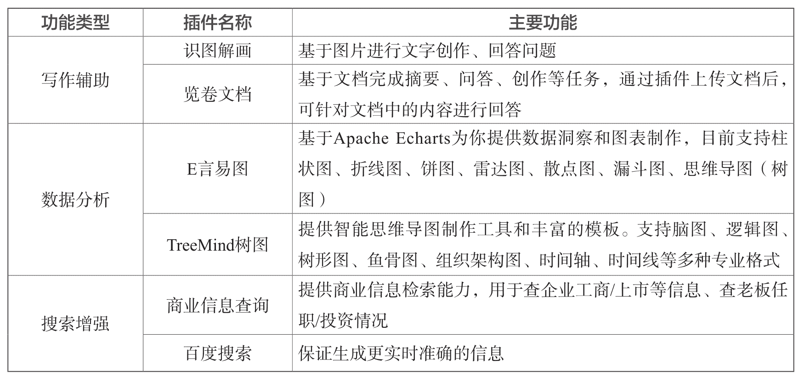

# **第二章**
# **文心一言：助你激发创造力**

本章从写作和绘画两方面介绍文心一言的能力，并梳理创作时需要注意的要点。我们会了解其基于深度学习的语言生成优势，以及配套的创作资源与工具，帮助用户更好发挥潜力。

## **2.1 创意写作：灵感来源新思路**

本节聚焦如何借助文心一言激发创意写作灵感。从剧本、诗词、视频脚本，到公众号推文、情感表达与标题编辑等多角度展开，用实例说明方法价值，为创作者提供新视角，帮助挖掘潜能。

### **2.1.1 剧本创作**

影视行业持续升温，越来越多人尝试剧本创作。文心一言能提供人物关系、场景设定与情节推进等关键要素，辅助完成心目中的剧本。

操作思路如下。

·先厘清主题、故事线与走向。用简洁语言描述，便于模型把握创作意图。例如，“请讲述一个浪漫爱情故事，结局是两人幸福生活。”

·若对主题无把握，可给出关键词或提示，让模型推荐相关方向。如说明想做哪类短视频或想表达的情感，模型会据此给出可选主题。

·初稿生成后通读，对内容做必要修改完善，保证连贯与逻辑。

·创作过程中可随时请模型提供不同场景与对话，激发灵感。

·所有场景完成后再次通读润色，确保对话、场景与情节符合预期，表达清晰准确。

按此流程即可高效利用智能创作功能，完成高质量剧本。

**案例实战** 
：写一个充满悬念的故事，结局是超人拯救城市，走向光明。 
：在一个平静夜晚，城市上空忽然陷入一片黑暗。市民惊恐不安，不知何故。此时一道神秘光影在街头穿梭，仿佛在搜寻什么。

城市里有位被称作“超人”的英雄，拥有强大力量与超凡能力，长期守护市民与和平。黑暗之夜，他决定追查真相，还城市光明。他追随光影来到一座废弃古工厂，潜入后发现惊人秘密：光影来自外星恶势力，企图以能量武器控制整座城市。

超人决定阻止阴谋。他与外星势力展开激烈战斗，展现超凡能力，将对手逼入绝境。最终他摧毁能量武器，解救被控制的市民，城市重回光明。

市民们为超人英勇行为欢呼，纷纷上街献花致谢。超人微笑接受敬意，心中充满喜悦与满足。

此后超人继续守护城市，成为市民心目中的英雄。这个悬疑故事也在城中口口相传，让人难忘超人的英勇与无私。

**提示：**撰写剧本时要求越具体细节越好，模型理解越到位，输出越贴合需求。通读校对同样重要，能保证语法、逻辑与表达达标。别怕提问和尝试新思路，不同指令可能带来意外灵感。文心一言是强大工具，最终成色仍取决于创作者的主导与把控。与模型形成良好互动，才能共同打造精彩剧本。

### **2.1.2 诗词创作**

文心一言写诗的逻辑与人不一样。它没有真实情感体验，主要靠算法推导结构与用词。也因文化背景和审美差异，作品常显匠气，难以完全达到人类审美。但它仍能为创作提供有力支持。

使用时要注意：

·先定主题与情感：明确想表达的核心，如爱情、友情、亲情或自然等。可请求：“请帮我写一首表达家人感情深厚的诗。”

·构思诗句：确定方向后，可从一句起步，逐步扩展，让模型协助完成整首。

·善用修辞：提示模型使用比喻、拟人、排比、对偶等手法，提升表现力。

·推敲字词：不断筛选最能传达意境的词汇。

·反复修改：初稿完成后多次调整结构、韵律与平仄，直至满意。

只要善于利用其优势并遵循以上要点，文心一言可以成为诗词创作的好帮手。

**提示：**文心一言能拓宽思路，提供创作素材。基于这些素材可进一步打磨诗歌。但需注意，初稿仍需人工审阅修改，以达到最佳表达效果。

**实战演练** 

：**请写一首描写西湖胜景的古诗。** 

：西湖胜景

湖面粼光泛金柳色流长，天水相映映出暖阳。春满园花开如锦，微风拂面自觉清凉。
远山如黛薄雾缭绕，近岸草木葱茏香气暗溢。信步湖畔心境澄澈，幽雅恬静乐趣无涯。

### **2.1.3 视频脚本创作**

做出让人记住的视觉内容，脚本是先决条件。无论是小体量博主、企业制作负责人，还是影视团队，都需要一份清晰的框架来统领全片。写作时可借助文心一言提效，注意以下要点。

·先把片子的核心诉求想清楚。是科普、带货，还是讲故事取乐。目标明确后，模型的输出方向才不会偏。
·吃透目标观众。了解他们的语言习惯和审美偏好，模型才能对语气、动作用法和内容取舍做针对性调整。
·指令要留白。别把要求写死，用开放式提问激发多样灵感，比如“给我几组服装广告的镜头创意”。
·参考又不照搬。模型给出的句式和词汇可以参考，后续可按自己的表达习惯再加工。
·成稿后做排版与润色。格式要清晰易读，检查错别字与语病，并补充配乐基调、转场手法等细节点，完成分镜级信息。
·交付前再审。确认无误后交给执行团队拍摄和后期，把想法变成成片。

按此思路使用辅助工具，能更快产出高质量的拍摄脚本。

**案例实战** 

：我想做一个讲述明朝历史的古装短片，能否帮忙拟一份分镜脚本？需要标明时段、场景、画面细节、运镜手法、景别大小，以及服化道方面的准备。 

：标题：《明朝风华》

类型：历史古装

时长：约 10 分钟

一、开场
时间：日出时分
地点：宫门广场
画面：晨光洒落广场，薄雾中宫阙若隐若现。
镜头运用：推镜，从远景逐步推近，展现气势。
景别：大远景到中景。
服化道准备：明代宫殿布景、服饰与道具。

二、展开
时间：白天
地点：宫内、街市、茶肆
画面：朝会场景、街头市井生活、文人雅集。
镜头运用：移镜、摇镜、跟拍等，多角度捕捉人物环境。
景别：远景、中景、近景、特写交替。
服化道准备：明代服装、妆容、道具，还原时代质感。

三、主角出场
时间：黄昏
地点：宫苑
画面：主角在园中踱步，思索国事。
镜头运用：跟拍结合推镜，表现情绪。
景别：中景到近景。
服化道准备：官服、头饰等官阶装扮。

四、高潮
时间：夜晚
地点：书房、战场
画面：主角批阅奏章，随后与敌交锋。
镜头运用：旋转镜、推镜营造紧张。
景别：近景至特写。
服化道准备：文房用品、兵器盔甲。

五、收尾
时间：日出
地点：宫门广场
画面：主角登高俯瞰，感慨盛世。
镜头运用：拉镜由近及远收束。
景别：近景拉至大远景。
服化道准备：明代服饰道具，场景与器材需呼应历史氛围。

提示：脚本创作要兼顾场景、镜头、画面信息、景别、文案、时长与音乐七要素，形成完整骨架，指导拍摄与剪辑。

### **2.1.4 演讲稿创作**

文心一言在演讲稿上可用性强，既能直接成稿，也能先给提纲供修改。四个实操步骤如下。

**01** 确定主题：先锁定演讲核心，为全文定调。
**02** 搜集资料：围绕主题整理数据案例，供模型参考。
**03** 输入生成：把主题与资料喂入，通过提问引导模型梳理逻辑并输出初稿，再自行调整。
**04** 编辑完善：删冗补缺，增添细节，提升可听性。

按此流程可高效产出演讲稿。

**案例实战** 

：请生成一篇人工智能发展史的演讲稿。 

：尊敬的各位听众，大家好！

今天聊聊人工智能的发展轨迹。这项技术已深度融入生活，未来空间很大。

一、起点：萌芽与早期探索
上世纪五十年代起，图灵提出图灵测试，为机器是否能像人思考提供评判标准，成为思想基石。
六十年代算力提升迎来首轮小高潮，感知器、专家系统、规则推理等成果相继出现。

二、发展：加速与场景扩张
进入二十一世纪，大数据与算力双重驱动，AI进入快车道。深度学习、自然语言处理、计算机视觉等技术成熟，应用全面铺开。
医疗可辅助影像诊断，金融可做风险评估与投资决策，交通可优化路网，安防可实现人脸识别与行为分析，渗透各行各业。

三、未来：挑战与机遇并存
进步背后仍有难题：隐私保护、公平透明、就业冲击等需政产学协同解决。
前景同样可观。未来AI或将像电力一样成为底层设施，驱动制造智能化、教育个性化、城市智慧化，提升生活品质。

四、结语
回顾历程，AI是充满挑战与可能的赛道。技术持续演进、应用不断外延，对生活的改变只会加深。期待更多惊喜。谢谢！

### **2.1.5 歌词创作**

遇到瓶颈时，文心一言能提供新视角。创作歌词注意以下几点。

·作品要有明确主题与情绪，模型会围绕核心展开。
·语言要简洁易懂，避免生僻拗口，便于记忆传唱。
·初稿完成后通读，必要时润色保持意境统一。
·重视版权，避免挪用他人作品或产生侵权内容。
·可多轮对话逐步明确风格与意象，成品更贴合预期。

**案例实战** 

：**写一首关于人生感悟的歌词，要求语言简洁明了。** 

：Verse 1：岁月流转不由人，人生起伏难预判。时而攀高峰，时而陷低谷，经风雨才更坚。
Chorus：体悟人生，珍惜此刻，奋斗追梦不言弃。感恩过往，勇敢向前，让自己更好，让未来更亮。
Verse 2：学会宽容放下執念，卸下过去轻松前行。珍惜身旁真心以待，信任维系情谊长。
Chorus：体悟人生，珍惜此刻，奋斗追梦不言弃。感恩过往，勇敢向前，让自己更好，让未来更亮。
Bridge：别怕跌倒，别怕暗夜，坚持前行终见曙光。相信自己与未来，守住梦想终成真。
Chorus：体悟人生，珍惜此刻，奋斗追梦不言弃。感恩过往，勇敢向前，让自己更好，让未来更亮。

提示：文心一言既能快速输出歌词，也能帮助理清创作思路，提升效率。

### **2.1.6 公众号推文**

一篇好的推文能带来大量阅读。可将写作拆成五步。

**01** 规定风格：找几篇对标范文让模型学习语气与排版，确保调性匹配读者。
**02** 确定选题：让模型生成多个方向，挑选最具吸引力的题材，不满意可继续迭代。
**03** 编写大纲：先列框架，保证逻辑清晰，再微调顺序与重点。
**04** 详写内容：明确描写重点与字数要求，分段填充，边写边改。
**05** 合并润色：整合各段，删减重复，校对错别字与标点，完成定稿。

**案例实战** 

：人间烟火，最抚人心。美食承载着一座城市的烟火气息、人文温情，是游客了解、亲近一座城市的生动窗口。近年来，长沙餐饮品牌持续上新，餐旅融合不断走深，餐旅消费加速升温，屡次上榜全国热门目的地城市、最受欢迎的暑期档旅游城市，“去长沙”成为各个社交平台的热门话题。一桌宴席，荟萃星城美味；一份心意，尽显待客热情。“长沙名宴”正式发布，涵盖剁椒鱼头、毛氏红烧肉、辣椒炒肉、黄焖花猪肉、荷花虾、粉皮黑山羊、状元鸡、菊花豆腐、发丝牛百叶、香辣童仔水鱼等 10 道特色名菜。名宴菜品甄选自长沙各个区县（市），皆具湘菜魅力，又各有其风味。外焦里嫩的火宫殿臭豆腐、酥脆可口的马复胜糕点、香辣鲜醇的小鸭仙酱板鸭……活动现场，“星城好韵味”美味时光市集上美食汇聚、人潮涌动，既有火宫殿、玉楼东等经典老字号，也有晨曦咖啡、茶泱泱等潮流“新食尚”，共同展示长沙饮食文化的深厚底蕴与多元魅力。学习这篇推文的写作风格。 

：这篇推文以烟火气切入，用具象描写把美食、城市温度与人情串联，让人想吃也想去。
开篇用“人间烟火，最抚人心”定调，迅速拉近距离。
随后点出美食在旅行中的作用，说明长沙凭餐饮持续走热，成为热搜目的地。
介绍“长沙名宴”时，细数十道代表菜并提到老字号与新品牌，让人闻到香气、看到人潮，既有传承也有活力。
结尾收束于饮食文化底蕴与多元魅力，语言简洁，结构清晰，画面感与信息量兼具。 

：模仿以上风格，写一篇推荐湖南大学周边吃喝玩乐公众号推文。 

：湖南大学周边，那些不容错过的日常烟火

湖南大学，是钟灵毓秀的学府。可你知道吗？校园外，吃喝玩乐同样精彩。

·吃在校园边：从地道臭豆腐、剁椒鱼头，到创意湘菜和异国小吃，口味汇聚。街头小摊更是学生时代的味道记忆。
·玩得尽兴：KTV、影院、桌游吧应有尽有。三五好友一起唱歌、观影、开脑洞，青春热度被点燃。
·山水人文近在咫尺：岳麓山、橘子洲头就在不远。踏青观景、探访历史，都是周末好去处。
·夜生活才开始：夜幕降临，清吧、酒吧、夜市灯火通明。卸下一天疲惫，在此自在呼吸。
·休闲需仪式感：书店与咖啡馆藏着慢时光。一杯咖啡配一本书，下午就被治愈。

湖南大学周边，不止学术殿堂，更是生活的烟火场。无论学生、游客还是本地人，都能在其中找到惬意。快来逛逛吧！

提示：对写作新手，文心一言能降低门槛；对有经验的创作者，它能节省大量时间成本。自动化辅助让内容生产更高效。

### **2.1.7 节日秀恩爱**

节日秀恩爱，文心一言能提供浪漫新意的点子。情人节、圣诞节或纪念日，都可借助它把爱意表达得更动人。

**案例实战** 

：情人节我想和对象度过美好浪漫的一天，我该如何做，我该在那一天送什么礼物？ 

：情人节是表达心意的节点，想让一天更浪漫，可从以下方面入手。

1. 规划一段浪漫约会。选公园、花园、海边或山顶等有氛围地，提前准备小惊喜，比如鲜花、巧克力或手写情书，让爱意更具体。
2. 送一份有心意礼物。个性化定制首饰、印有照片的抱枕、TA喜欢的书或音乐都是好选择。关键在专属感。
3. 准备一顿温馨晚餐。居家下厨或预订心仪餐厅，营造烛光与柔音乐，让用餐时光更甜蜜。
4. 参加情侣互动活动。情侣瑜伽、按摩、摄影等热门项目，一起体验更增默契。

礼物参考：
1. 鲜花，经典不败，红玫瑰最具代表性。
2. 巧克力，节日标配，可选手工或特色口味。
3. 珠宝饰品，项链手链耳环，低调持久。
4. 个性定制，照片抱枕、情侣T恤等专属感强。
5. 体验类礼物，短途旅行、课程体验，给关系加分。

总之，真诚最重要。选对方式与礼物，让另一半感受到被在乎与被珍惜，一天就会很特别。

### **2.1.8 编辑稿件标题**

标题力：让内容先被看见

在内容同质化严重的当下，标题往往决定一篇稿子能否获得关注。文心一言在拟题环节可以提供灵感支持，让思路更快成型、表达更有吸引力。以下拆解了从研读到打磨的完整思路。

先把整篇稿子通读一遍，明确其主题脉络、叙事重点和核心要义，这是拟出贴合标题的基础。

把文章里最关键的信息和主要观点梳理出来，标题才能抓住要点，让读者一眼判断内容属于什么。

把与主题高度相关的关键词或短语挑出来，它们是后续构思标题的素材和灵感来源。

**案例实战** 

：我写了一篇稿子，大概内容是讲电视剧的发展趋势的，在爱情片盛行的时代，如何让现实题材的电视剧爆火，同时也写了一些具体方法。请帮我想一个该稿件的标题。 

：**“电视剧发展潮流中的现实题材爆款策略：在爱情片盛行时代中的突围之道”**

此时文心一言只给出了一个结果，使用者可能并不满意，可以继续追问细化。 

：**请多提供几个相关标题以供参考。** 

：**当然，以下是一些标题，供你参考。**

1. 现实题材电视剧如何在爱情片盛行中脱颖而出

2. 探讨电视剧领域中的现实题材成功之道

3. 在流行爱情片中，如何打造爆款现实题材电视剧

4. 电视剧的未来趋势：现实题材如何战胜爱情片

5. 现实题材电视剧的制胜策略：在爱情片泛滥的时代

6. 电视剧创作：如何在爱情片大行其道的时代里让现实题材崭露头角

7. 电视剧的突破口：现实题材如何在爱情片潮流中逆袭

8. 电视剧市场中的现实题材策略：如何在爱情片为主流的时代里取得成功

**提示：**借助文心一言拟题可以提效，但不能全盘依赖模型输出。受自然语言处理能力的限制，生成结果偶尔会偏离或缺乏吸引力。生成后再人工校核和微调，才能让标题既精准概括核心，又具备传播力。

### **2.1.9 文本续写**

续写是写作能力的重要体现，要求在已有文本上进行合理且有创意的延伸。接下来说明如何运用文心一言完成文本续写，核心在于把握原文的语气、情节走向与人物特征，并借助想象实现自然衔接。续写时新内容应与原文在调性上保持一致，情节连贯。续写完成后的自检要点如下。

通读原文，确保对内容、情节和风格有全面理解，这是续写的前提。

根据结尾和整体脉络确定续写方向和主题，可以沿用原故事线，也可以加入新元素，但必须与原文逻辑自洽。

借助文心一言构思情节，包括埋设悬念、刻画人物、描绘场景等，提升可读性。构思阶段可大胆发挥想象，创造新颖情节与形象。

续写完成后仔细校对，保持叙述风格、语言特点和情感基调与原文一致，避免风格差异过大影响阅读体验。

**案例实战** 

：续写在天气晴朗的一天，我在公园里遇到了很多可爱的小动物。 

：在天气晴朗的一天，我心情格外舒畅，决定去公园散步。一走进公园，我就被周围的景色所吸引。阳光透过树叶的缝隙洒在我身上，微风拂面，带来阵阵清凉。

正当我欣赏着美景时，突然注意到一群可爱的小动物。一只小松鼠正在树枝上跳跃，它的尾巴蓬松如云，十分活泼可爱。不远处，一只小麻雀正在地上寻找食物，它时而用嘴巴啄啄草地，时而抬头警惕地观察周围。我忍不住向它走去，试图和它“交流”。

这时，一只蝴蝶飞过我的身旁，它的翅膀五彩斑斓，如同一幅美丽的画。我惊叹于大自然的美丽和神奇，继续向前走去。沿途还看到了一只小兔子，它在草丛中欢快地蹦跳，似乎在享受这美好的时光。

我沉浸在这份欢乐和美好中，心中充满了感激和幸福。这美好的一天让我更加热爱这个世界，也让我更加珍惜生命中的每一个瞬间。

## **2.2 绘画达人：把你的灵感“画”出来**

本节介绍如何利用文心一言把绘画灵感转化为具体画作，并说明其在绘画创作中的优势。文心一言具备深厚文化积累与独特的语言表达，与绘画创作契合度高。通过关键词联想、情感表达和创意构思等功能，可为绘画提供持续灵感。借助其绘画工具和资源，灵感能够快速落地为生动的视觉作品。

### **2.2.1 一秒生成动漫头像**

文心一言是强大的自然语言处理工具，其智能图像生成能力可帮助用户轻松制作符合个人喜好和风格的动漫头像。近年来动漫头像在年轻人中流行度持续上升，相较于市面工具，用文心一言生成头像有以下优势。

速度快：约1秒即可生成高质量动漫头像，满足即时需求。

操作便捷：用户只需简单文本描述，例如“画一个男生的动漫头像，戴眼镜托着脸的小男孩，在教室里，穿着黑色卫衣”，即可获得所需头像，无需绘图或编辑技能。

风格多样：支持生成多种风格和主题的动漫头像，满足个性化需求。

智能解析：基于先进的自然语言处理技术，能智能理解文本描述并生成匹配头像。

**案例实战** 

：**画一个女生的动漫头像。** 

：图 2-1 是生成的动漫头像。 

：**画一个女生的动漫头像，一个棕色长发的女生，穿着灰色的卫衣，戴着一顶红色的棒球帽，抱着一只白色的小猫，背景是教室。** 

：图 2-2 是生成的动漫头像。

▲图 2-1

▲图 2-2

### **2.2.2 为诗词配上中国风插画**

诗词作为中华文化的瑰宝，承载深厚历史底蕴。中国风插画以独特的线条、色彩和构图展现东方美学魅力。文心一言致力于将两者结合，为诗词赋予鲜活的视觉呈现，让读者在欣赏插画的同时更深切体会意境。

为诗词配中国风插画的步骤如下。

挑选喜爱的诗词，确保对其内容、情感和创作背景有深入理解，这是创作基础。

细读诗词，理解主题思想、情感表达和意境营造。特别注意其中的关键意象、生动比喻和象征元素，这些是创作的重要灵感来源。

根据整体风格和个人审美偏好，选择合适的中国风插画风格。水墨画的淡雅飘逸或工笔画的细腻精致都能为诗词增色。

**案例实战** 

：水光潋滟晴方好，山色空蒙雨亦奇。为这句诗词配上中国风插画。 

：以下是生成的中国风插画，如图 2-3 所示。

### **2.2.3 脑洞创意画**

在创意绘画领域，想象力与表达技巧同等重要，共同构成艺术创作的灵魂。“脑洞创意画”鼓励自由想象、打破常规约束，让创作者随心挥洒创意。

创作时可通过输入具体画图指令指导文心一言绘制图像。例如输入“/画图鸡蛋灌饼”，即可得到一幅充满创意的鸡蛋灌饼图像。若想进一步调整细节，可输入更多指令，如“/画图 鸡蛋灌饼 废墟”，就能在图像周围添加废墟效果，营造独特氛围。

还可以在指令前加上“#创意图#”标签，提示文心一言生成更具创意和独特性的图像。是否使用标签取决于创作需求和审美偏好。

**案例实战** 

：帮我画鸡蛋灌饼#创意图#。 

：图 2-4 是生成的鸡蛋灌饼图。

▲图 2-3

▲图 2-4

**提示：**用文心一言辅助创作非常高效。想象与联想阶段，它能启发思路，帮助打破瓶颈；在绘制草图和细节处理阶段，它也能发挥重要作用。通过查找与主题相关的元素和形象，为创作提供丰富多样的灵感和素材，作品会更精彩、更有创意。

### **2.2.4 朋友圈配图**

在社交媒体时代，朋友圈已成为分享生活点滴的重要空间。一条有吸引力的动态，往往离不开一张相得益彰的配图。下面介绍如何用文心一言为朋友圈挑选和制作配图，以及如何根据文案内容选择合适的图片风格和设计元素，增强表现力。

首先输入“/朋友圈配图”或“/朋友圈图片”等指令启动功能。随后根据文案的情感基调和主题内容挑选图片风格。清新的自然风光、复古的怀旧元素或抽象的创意图案，都能为文案增添魅力。

例如输入“/朋友圈配图人山人海复古”指令，文心一言会推荐一系列符合要求的复古风格人山人海图片。若想进一步调整细节，可继续输入指令，如“/朋友圈配图人山人海 滤镜”，为图片添加恰到好处的滤镜效果，营造更完美的氛围。

**案例实战** 

：给我的朋友圈配一张图，内容是：“在热闹的香港街景，有一个安静的咖啡店。” 

：图 2-5 是生成的朋友圈配图。

### **2.2.5 制作家居场景**

家居场景制作涵盖空间布局规划、色彩搭配、家具及装饰品选择等多个层面。通过学习，可以系统掌握用文心一言进行家居场景制作的方法和技巧，针对不同空间特点和居住需求进行合理且富创意的布局设计，并巧妙运用色彩、家具、装饰品营造舒适温馨的家居环境。

制作时需注意以下几点。

对要设计的家居空间进行全面了解，包括面积、形状、结构和现有装修状况等，这些是设计的基础信息。

深入了解居住者的生活习惯、功能需求和审美偏好，为设计方案提供明确方向。

明确家具的装修风格和主题，如“温馨田园风”“现代简约风”“实用主义风”等，以统一整体风格并确保元素和谐。

根据空间实际情况和居住者需求制定详细合理的空间布局方案，包括家具摆放位置、活动区域划分和通行路线规划，打造美观实用的家居环境。

**案例实战** 

：画一幅简约风的家居场景，画面左边是沙发，沙发前是床，有挂画、花瓶、圣诞树、书架和床头柜，具体布局可以自由发挥。 

：图 2-6 是生成的家居场景制作图。

▲图 2-5

▲图 2-6

# **第三章**

# **文心一言：助你提升工作效率**

在数字化时代背景下，职场人必须高效、准确地处理各种信息和数据，这是取得成功的关键。本章重点阐述文心一言在工作中的诸多益处。作为一款集成数据分析、营销文案撰写、职场问题解决方案以及求职招聘辅助功能的综合性工具，文心一言为用户提供全面且高效的工作支持，助力职场脱颖而出。

## **3.1 数据分析：数据解释和可视化支持让数据更清晰**

在信息化社会中，数据分析已成为企业和个人制定策略、优化流程和做出决策的核心依据。本节深入剖析如何运用各种分析方法与工具，对数据进行有效解读和可视化呈现，让数据的意义更明确、价值更凸显。

### **3.1.1 数据搜集**

使用文心一言进行数据收集，能显著提升效率、准确性和规模性，并实现自动化处理和实时监控，为用户提供更深入的分析结果，同时确保数据安全性。但使用时也需注意以下两点。

开始数据收集前必须明确收集目的和范围，以确保所获数据满足需求，避免收集无关或冗余信息。

需要确定所要收集的数据类型和格式，如文本、图片等。不同类型和格式对文心一言的处理和分析能力要求不同，只有数据与处理能力匹配，才能充分发挥效用。

**案例实战** 

：现在你是一个数据检索程序，你需要找到并梳理“中国服装行业发展”相关的数据，注意你需要附上数据对应的来源。此外请注意你需要在输出结果中标明部分生成的数据可能存在的偏差。 

：中国服装行业发展数据：

市场规模：2022 年，中国服装市场规模为 2.7 万亿元人民币。

消费者行为：近年来，消费者越来越注重服装的品牌、设计和品质，同时也在追求更高的性价比。线上购买成为越来越重要的渠道。

行业竞争格局：国内品牌众多，市场集中度逐渐提高。知名品牌如安踏、李宁、海澜之家等在国内市场占据了较大的市场份额，同时也在积极拓展国际市场。

数据来源：中国服装协会、艾瑞咨询等。

数据偏差说明：由于数据采集和处理的限制，以上数据可能存在一定的偏差。同时，由于市场变化和政策影响等因素，实际数据也可能发生变化。在使用这些数据时，请注意进行核实和校准。

### **3.1.2 柱状图生成**

使用文心一言生成柱状图能极大节省用户的时间和精力。尤其在需要制作多张柱状图时，它能快速批量处理数据，帮助用户更全面地了解市场和行业状况。此外，它还能有效减少人力投入，提升企业运营效益。通过直观展示数据的分布和比较情况，使用户更轻松地理解和分析数据，为企业决策提供更有力支持。

**案例实战** 

：请用柱状图展示排名前五的中国城市及 GDP。 

：表 3-1 和图 3-1 展示了排名前五的中国城市及 GDP。

▼表 3-1

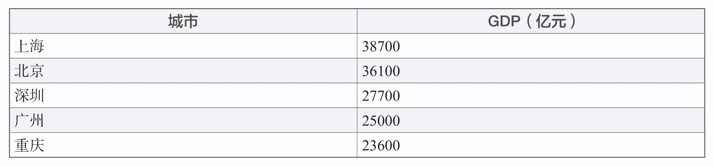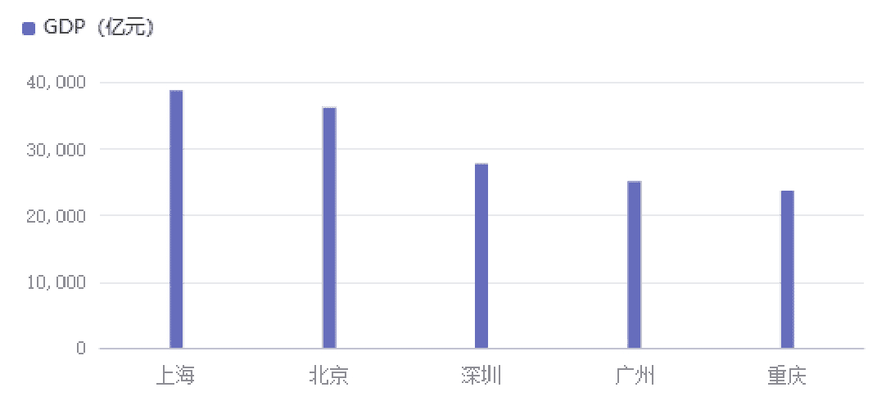

▲图 3-1

### **3.1.3 Excel 大师**

遇到 Excel 表格难题时，文心一言可以成为得力助手。它不仅能协助处理大量数据，还能有效减少人为错误和误差，显著提高数据准确性和可靠性。此外，它还能自动处理和分析 Excel 表格数据，避免烦琐的手动操作，提升工作效率并降低成本。

**提示：**文心一言主要处理文本内容，因此在描述 Excel 工作表结构时，应确保使用清晰的文本格式进行阐述，如图 3-2 所示。这样的表述有助于确保信息的准确传达和理解。

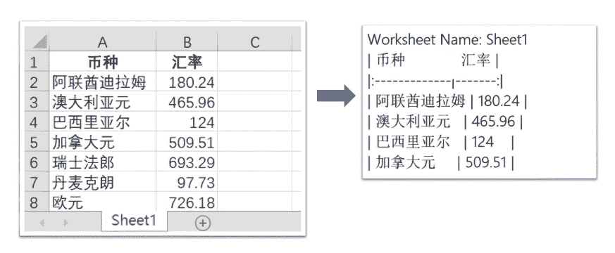

图 3-2

**案例实战** 

：下面请作为 Excel 大师给出处理相关表格数据的建议。表格共包含 4 列分别为：A 列：学生 ID；B 列：学生名字；C 列：学生班级；D 列：学生成绩。我给出的第一个指令是：我想将高出平均成绩的数据标红。 

：你好！要实现将高出平均成绩的数据标红，你可以按照以下步骤操作。

首先，计算所有学生的平均成绩。你可以在第一行（或者新的一列）中输入以下公式：=AVERAGE(D:D)。这将会计算 D 列中所有学生的平均成绩。

接下来，你需要将每个学生的成绩与平均成绩进行比较。在新的第二列中（假设我们在 D 列后面开始），输入公式：=D2-AVERAGE(D:D)。这将比较每个学生的成绩与平均成绩。

然后，你可以设置一个条件格式，使高于平均成绩的数据变为红色。选择 D2 到最后一行的数据（假设你的数据在 D 列结束），然后转到“条件格式”→“新规则”。

新建条件格式规则时，选用“使用公式确定要设置格式的单元格”这一选项，输入判断式 =D2>AVERAGE(D:D)，再点开“格式”把高亮色调成你想要的红色即可。

如果想让规则随着数据增多自动生效，可以先选中整个表格或目标区域，进入“条件格式→管理规则”，在“新建规则”里同样选择“使用公式确定要设置格式的单元格”，再次输入 =D2>AVERAGE(D:D)，点击“格式”按钮设定红色样式。这样后续新增的行也会被自动套用。 

：我的第二个指令是：将每项成绩最高分排到最前。 

：把每项成绩的最高分提到最前面，可以直接用 Excel 的排序功能完成。操作思路如下。

先圈定数据范围：确认表格里只有需要排序的内容，点一下表格左上角的选中按钮，把整块数据框选起来。

启动排序：切换到“数据”选项卡，点击“排序”。

设定排序规则：在弹出的设置窗口里，把主要关键字设为学生成绩所在列 D 列，选择降序排列。

补充次级关键字（可选）：当多名学生成绩相同，需要进一步区分时，可以增加姓名或学号等列作为次级排序依据，选择对应的升序或降序。

确认执行：点“确定”后，Excel 会按设定重新排列，最高分会排在前面。若出现并列情况，则按次级关键字顺序排列。

### 3.1.4 文心一言快速出折线图
文心一言不只帮你解决 Excel 的操作难题，还能直接生成折线图等多种可视化图表，大幅提升工作效率、丰富视觉呈现、提高数据处理精度，并实现自动化分析与优化。

在使用它生成折线图时，注意两点。

·喂给模型的数据必须准确、完整、可信，数据的质量直接决定图表的准确度。
·图表类型要匹配分析目的。折线图擅长展示随时间推移或其他连续变量的变化趋势、周期性或长期走向，选对类型才能更突出数据的规律。

案例实战 

：请用折线图展示世界人口增长趋势。 

：表 3-2 和图 3-3 展示了世界人口增长趋势。

▼表 3-2

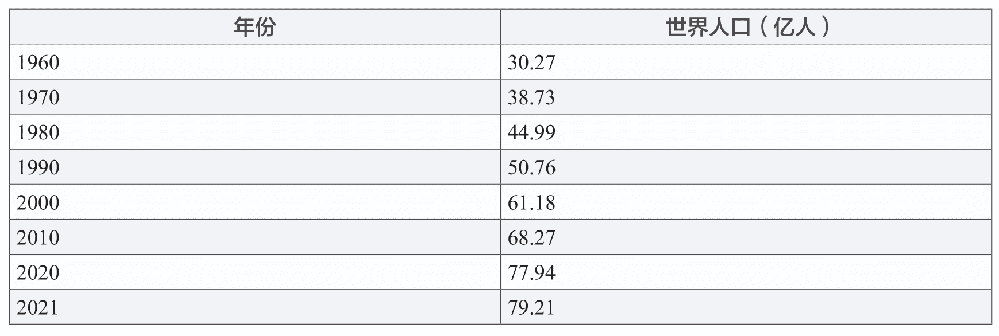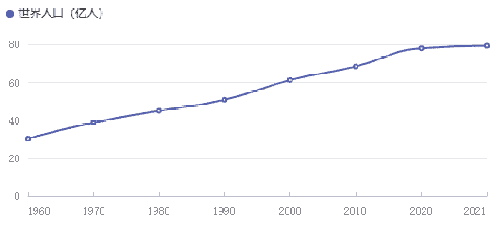

▲图 3-3

### 3.1.5 文心一言做PEST分析
PEST 分析用于对宏观环境做全景扫描，聚焦政治、经济、社会、技术四个维度，帮助企业更清晰地判断外部环境，制定更精准及时的战略。借助文心一言做 PEST 分析时要注意三点。

·先明确分析目的和落点，这决定分析的重点和价值，是摸清当下市场、预测未来走向还是支撑具体决策。
·数据源要可靠权威。文心一言依托百度搜索的资源，能提供大量信息，分析时要尽可能取用真实可查的资料。
·分析要落地。结果必须和业务紧密结合，不断根据结论调整策略，才能发挥实际作用。

案例实战 

：请作为咨询公司顾问，帮我针对“度度智能音箱”进行 PEST 分析。需要从政治、经济、社会与科技四个维度进行分析，要求尽可能详细，并结合数据或文献作为分析依据。 

：作为咨询顾问，我从四个维度对“度度智能音箱”做 PEST 分析。

一、政治维度
政策支持：国家高度重视人工智能产业，出台多项政策扶持智能音箱发展。
法律法规：用户隐私受监管趋严，相关法规要求音箱在采集、使用、保护个人信息时必须合规。

二、经济维度
市场规模：随智能家居需求上升，智能音箱市场持续扩张，市场研究显示规模已超百亿元人民币，未来仍将保持高速增长。
产业链结构：产业链涵盖硬件制造、软件开发、内容供给。国内已有优秀制造企业，软件与内容环节也逐步成熟。

三、社会维度
用户需求：公众对智能家居认知提升，艾媒咨询数据显示中国智能音箱用户已超1亿，增速明显。
社会认知：作为新兴 AI 产品，接受度不断提高，消费者认可其语音交互、音乐播放、信息查询等便捷价值。

四、科技维度
技术创新：语音识别与自然语言处理持续迭代，部分产品已支持多轮对话、语音翻译等，提升体验与竞争力。
数据分析能力：语音识别的核心在于数据学习与处理能力，持续积累用户语音数据可提高识别准确率与效率。

总体来看，度度智能音箱在政经社科四方面具备较好的发展环境，同时仍需关注政策变化、需求波动与技术迭代带来的影响。

### 3.1.6 文心一言解读投资报告
用文心一言分析投资报告，能快速梳理海量历史与实时市场数据，发现潜在规律与趋势，并提供客观及时的预警和决策参考，提升分析效率。

案例实战 

：现在你是一位资深投资人，请对××××公司进行分析并生成投资分析报告，要求包含财务状况分析、行业状况分析、公司估值分析。其中在财务状况分析部分，你需要从资产质量、成长性、收益性等方面切入，需要结合权威机构发布的数据。内容翔实，简短但有层次。 

：××××公司投资分析报告

一、财务状况分析
资产质量
依据公司最新财报，总资产规模为×××亿元，其中流动资产占比××%，非流动资产占比××%。流动资产以货币资金、应收账款、存货为主，非流动资产集中在固定资产与无形资产，资产结构相对均衡。

成长性
近几年营业收入保持稳步增长，年均增速××%。净利润逐年提升，过去五年复合增长率××%。经营性现金流净额稳定且逐年增加，盈利与经营状况良好。

收益性
基本每股收益与稀释每股收益均逐年上升，五年前复合增速分别为××%和××%。净资产收益率与总资产报酬率维持较高水平，盈利能力较强。

二、行业状况分析
××××公司所处×××行业，市场体量大但竞争激烈，市场份额分散；技术迭代快，需持续研发投入；行业增速平稳，发展空间充足。全球范围内该行业正稳步前行，市场需求持续，竞争格局随技术与消费升级而变化。

三、公司估值分析
采用 DCF 折现现金流模型测算，预测未来现金流折现后股权价值约×××亿元，与现价相比被低估约××%，具备一定投资价值。

总体来看，公司在财务、行业与估值层面均显示出较好的投资潜力，建议关注其股票机会。

提示：文心一言可提供大量信息与数据，但准确性无法做到百分百，也不能替代人工的深度判断。使用时应充分评估投资风险，制定相应风控策略，确保决策稳健。

### 3.1.7 SWOT分析实操
SWOT 分析是评估优势、劣势、机会、威胁的经典工具。借助文心一言可快速处理大量数据，发现规律，但使用时需注意：

·依赖的数据必须准确可靠，需自行核验。
·要正确区分优势劣势，避免把机会或威胁误判。
·要把模型输出与实际情况结合，增强指导性。
·市场变化快，需定期更新分析结果。

案例实战 

：对减脂餐进行 SWOT 分析，要求结合数据且全面。 

：对减脂餐市场的 SWOT 分析如下。

S（优势）：
健康饮食趋势加深，减脂餐契合健康消费理念。
市场需求旺盛，越来越多消费者关注体重管理。
产品形式多样，能覆盖不同人群偏好。

W（劣势）：
价格普遍高于普通餐食，对价格敏感人群不友好。
为控热量，常牺牲口感，部分消费者难以接受。
行业竞争激烈，品牌同质化明显。

O（机会）：
线上电商渠道快速发展，可扩大覆盖面与占有率。
健康食品市场整体扩张，减脂餐可借势增长。
可与健康食品品牌、健身机构合作拓展场景。

T（威胁）：
食品安全与营养相关法规趋严，对合规要求提高。
产品质量波动会直接损害品牌形象与竞争力。

### 3.1.8 波士顿7S拆解
波士顿 7S 关注结构、战略、制度、员工、技能、共享价值观、战略资源七要素，帮助企业厘清内在优势与问题。借助文心一言分析时注意：

·关注七要素间的关联与相互影响。
·结合市场需求与发展趋势制定策略。
·定期复盘，动态调整。
·用图表报告等形式呈现，便于沟通。

案例实战 

：对华为手机进行波士顿 7S 分析，要求全面、准确。 

：华为手机波士顿 7S 分析要点如下。

公司战略：定位中高端，靠技术创新与品质驱动差异化；重视研发投入，与全球运营商合作扩大份额。

组织结构：部门扁平化，协作高效；拥有完善的研发、市场、销售、服务体系，并在全球设立研发与生产基地。

系统：自研鸿蒙系统与 5G 技术支撑产品性能；注重数据安全与隐私加密；供应链管理体系成熟。

员工：研发、生产、销售、售后人才储备充足；重视培训与晋升，激励机制包括股权与绩效奖金。

共享价值观：以客户为中心、奋斗者为本、团队协作、诚信为核心，兼顾社会责任。

技能：积累大量硬件设计、软件开发、芯片制造专利与经验，快速响应市场变化。

物质设施：全球多基地生产与研发，设备先进，生产效率与质量可控，售后服务网络完善。

总体来看，华为手机在 7S 维度表现强劲，具备持续竞争优势。 

：将上面的分析结果用图表的形式表现出来。 

：表 3-3 将华为手机在波士顿 7S 分析中的关键点进行了总结和呈现。

表 3-3

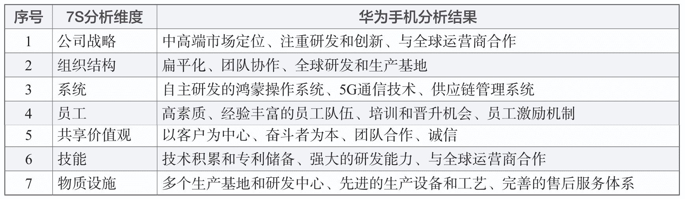

### 3.1.9 4P营销拆解
4P 营销覆盖产品、价格、渠道、推广四个要素。分析时要注意定位清晰、策略落地，并根据市场变化定期复盘调整。

案例实战 

：对华为手机进行 4P 营销分析，要求全面但尽可能简短。 

：好的，以下是对华为手机进行 4P 营销分析的全面内容。

产品（Product）：

华为手机 4P 营销全景拆解

华为手机在国内外市场都积累了不错的口碑，产品线覆盖面广，从高端旗舰到入门实惠机型构建起完整矩阵。品牌持续加大研发投入，迭代出具备竞争力新品，P 系列以影像见长，Mate 系列主打高端时尚，同时售后服务体系也在不断完善，用户体验持续提升。

价格策略
华为的定价做法比较灵活，会按系列和定位划分价格带。旗舰机型定价偏高，凭借强性能与高品质吸引追求品质的用户；中低端机型则靠性价比打开更广人群。品牌还频繁通过促销、限时折扣等手段强化价格竞争力。

渠道布局
销售通路呈现线上线下融合态势。线上以官网、主流电商平台及社交媒体为主；线下覆盖自有专卖店、授权经销商以及合作运营商。华为持续拓展渠道网络，提升市占率，并联合合作伙伴做跨界联动，扩大品牌声量。

推广打法
营销动作多样，涵盖广告投放、明星代言、社交媒体运营等。品牌注重形象塑造，通过与知名人士合作、赞助大型活动来提升知名度。同时深耕线上线下互动，鼓励用户参与以增强粘性，推广过程中会根据目标人群反馈动态调整策略。

**提示：** 用文心一言来做 4P 产品营销分析，能明显提升决策的精准度。它可以快速处理海量数据，整合信息输出更深层的市场洞察，帮助企业优化资源配置，提升使用效率，还能敏锐捕捉需求与竞争态势，制定更精准的营销方案。

### 3.1.10 产业顾问

文心一言可以为行业从业者提供高效可靠的产业分析，提高工作效率，降低人工成本与决策风险，并能结合企业实际给出个性化建议，帮助洞察市场需求与竞争格局，实现资源高效利用。

在使用文心一言担任产业顾问时需注意以下几点。

·咨询产业问题时，要把问题内容、背景和范围说清楚，便于模型准确理解并给出针对性结论。
·提问时提供尽可能多的背景信息，有助于模型更全面把握情境，给出更有参考价值的建议。
·避免使用主观表述，如“我认为”“我觉得”等，保持问题的客观性。
·避免模糊提问，如“这个行业前景如何？”应具体指向市场规模、增长趋势等维度，才能获得明确回答。

**案例实战** 

：请你扮演一名咨询公司专业顾问，先汇总你能查到的权威机构数据与报告，再基于专业视角解答我有关产业发展的问题。我的第一个问题是关于蓝牙耳机的盈利模式。 

：根据公开的权威数据与行业报告，蓝牙耳机的盈利来源主要分为以下几类。产品销售：耳机价格区间从几十元到上千元不等，差异体现在性能与品质上，高端高附加值产品能带来更高销售收益。
技术授权：蓝牙是开放标准，符合规范的厂商均可使用，技术授权费是相关企业的重要利润点，通过对外授权获取收益。
广告变现：部分手机厂商、运营商等会在设备端植入广告，通过投放获取广告收入。
增值服务：耳机使用往往依赖手机、电脑及配套音频软件，部分软件或服务需付费，厂商可借此获取额外收益。
综合来看，蓝牙耳机的盈利模式多元化，销售、技术授权、广告与增值服务都能形成利润，但不同厂商会依据定位选择侧重方向。

## 3.2 营销文案写作：打造吸睛营销方案

在竞争激烈的市场环境下，高质量营销文案对塑造品牌形象、吸引潜在客户、推动销售至关重要。本节聚焦小红书方案、UP 主带货脚本、软文及活动标语的撰写技巧，帮助掌握专业精炼的表达能力。

### 3.2.1 小红书营销文案

文心一言可以根据输入信息生成高质量文案，节省时间提升效率，能激发灵感并按营销目标与受众需求产出创意性强、吸引力高的内容。明确主题与风格后即可快速生成符合要求的文案。

使用文心一言撰写小红书方案时需注意。

·充分了解目标受众特征与需求，确保内容精准触达兴趣点。
·借助文心一言突出产品或品牌的差异化优势，让文案更具辨识度。
·把控篇幅与节奏，用精炼语言传递核心卖点，避免冗长。
·结合读者反馈与数据及时优化内容与风格，提升转化效果。
同时要保持原创性与独特性，避免过度依赖工具，定期迭代文案是提升效果的关键。

**案例实战** 

：我想在小红书发一篇“家居好物分享”的笔记，并且希望有自己的风格，能示范一个受欢迎的文案吗？ 

：当然可以，以下是一个可参考的家居好物分享示例。

打造温馨小窝，这些好物功不可没！

欢迎来到我的家居分享时间！今天跟大家聊聊让家更舒服的几件宝藏单品，跟我一起看看。

先说沙发，这款既坐着舒服颜值又在线，看电视读便是放松感拉满，喜欢整洁温馨风的可以冲。

再来是新入手的餐具套装，质感漂亮日常使用也顺手，用餐体验瞬间提升，餐桌想要更有格调的一定要试试。

最后是床品四件套，柔软度与颜值兼备，躺上去就是满满的安全感，想要提升睡眠品质的别错过。

以上就是今天的分享啦，希望能给你布置小窝一点灵感，有其他喜欢的好物也欢迎评论区交流，一起把家变得更温暖。

#家居好物分享#温馨小窝#打造舒适的家

### 3.2.2 UP 主带货脚本

带货脚本对直播流程、话术把控、氛围营造、转化提升、口碑沉淀与复盘优化都有重要作用。用文心一言撰写脚本，UP 主可获得质量提升、时间节省、创意丰富、受众定位精准及快速应变能力，从而增强竞争力。

**案例实战** 

：假设你是一名 UP 主，请根据我提供的商品信息写一个视频带货脚本，要放大亮点激发购买欲。商品名称：羽绒保暖被；亮点：容量大、保温好、便携性强。 

：视频带货脚本：羽绒保暖被

开场
镜头推进展示整件羽绒被全貌。
旁白：“大家好，我是×××，今天给大家推荐冬日必备的保暖神器——羽绒保暖被。”

亮点一：容量大
镜头展示被子完全展开。
旁白：“看这体量，空间感很足，无论一人睡还是双人盖，都能全覆盖，整夜都暖。”

亮点二：保温性能好
镜头切换至羽绒细节特写。
旁白：“羽绒本身就是顶级保暖材料，这款精选高品质羽绒，寒冬也能保持舒适体感。”
随后展示热成像对比。
旁白：“你看，外界再冷，内部温度依然稳定，这就是它厉害的地方。”

亮点三：便携性强
镜头展示收纳袋与收纳过程。
旁白：“体积大不代表难收纳，自带收纳袋，出差旅行也能轻松带走，随时享受温暖。”

结尾
镜头拉远重现整件被子。
旁白：“冬天别让身体受凉，赶紧入手这款羽绒保暖被，给自己一个暖冬。”
同时展示购买链接与优惠信息。
旁白：“现在下单有限时优惠，数量有限，错过可惜。”

### 3.2.3 写软文

不同读者与平台偏好不同写作风格。文心一言可按需求灵活生成多风格文章，更好满足目标读者，且能低成本产出高质量软文，降低营销成本。

**案例实战** 

：请你以专业营销人员的身份，写一篇关于“智能家居音箱”的软文，要求主题清晰、结构合理、语言简洁、风格统一，突出产品特点与优势。 

：让家听得见你的需求，用声音温暖每个角落——智能家居音箱值得拥有

家是心灵的港湾，如何让生活更温馨便捷？走进智能家居时代，智能音箱正悄然改变我们的日常。

一、随时随地，声控生活
想听歌、查天气、设闹钟？一句“小音，播放我的早安歌单”，音乐便盈满房间，开启好心情。

二、智慧管家，一声搞定
家中灯光、窗帘、空调都可语音操控。开灯、关窗、调温，只需简单指令，一切随心。

三、安全守护，安心每一刻
内置高灵敏麦克风与红外传感器，异常情况可即时报警并推送手机提醒，全天候守护。

四、孩子好伙伴
可播放儿歌、讲故事，解答孩子好奇问题，在轻松互动中陪伴成长。

五、节能环保，点滴积累
低功耗设计减少用电，还能根据使用习惯智能调节家电，实现更高效能源利用。

选择智能音箱，是选择更便捷的生活和更温暖的家。在科技快速发展的今天，拥抱智能家居，让美好触手可及。

### 3.2.4 写活动标语

学会用文心一言创作活动标语，能提升效率与创意，灵活匹配语言风格，降低创作难度，增强活动吸引力。撰写时注意。

·提供准确信息，如活动主题、亮点与特色，确保生成符合需求的文案。
·明确目标受众，选择合适的语言风格，提升共鸣。
·突出亮点，如嘉宾、环节或奖品，吸引关注与参与。
·控制长度，标语要简洁明了，在有限字数内传达核心信息。

**案例实战** 

：请你以知名广告创意人的身份，为“家家福商场春节联欢会”创作一条标语，要求主题明确、结构简洁、节奏感强、风格独特。 

：作为广告创意人，为活动拟定标语如下参考。

“新春嘉年华，家家福共度欢乐时光，喜庆团圆，让每一刻都成永恒。”

创作说明。
主题明确：点明家家福商场春节联欢会，确保信息准确。
节奏感强：“新春嘉年华”“喜庆团圆”等词组合，读来有韵律。
结构简洁：短句搭配常用词，易懂易记方便传播。
风格独特：运用“欢乐时光”“永恒”等词营造温馨感动氛围，与节日气质契合。
同时巧妙嵌入商场名称，强化品牌与活动的关联。实际使用时可按场景微调以达到最佳效果。

## 3.3 职场百宝箱：解决各类工作难题

现代职场需求多样，掌握一套实用技能至关重要。本节提供从活动策划到合同撰写等领域的职场指南，帮助更从容应对挑战。

### 3.3.1 活动策划

用文心一言做活动策划可提高效率、激发创意、智能推荐、降低难度、实时反馈与优化，并支持多样化输出与团队协作。注意事项如下。

·策划前明确基本信息，包括主题、时间、地点、预算等，用简洁语言描述便于模型理解。
·提出具体可操作任务，如流程设计、预算制定、内容策划等，利于生成实用方案。
·提供背景信息，如参与者特征、行业趋势等，提升针对性。
·收到方案后仔细核对是否符合需求，确保活动顺利执行。

**案例实战** 

：我们是一个小团队，请帮我策划一个适合 20 人的万圣节活动。 

：好的，以下是一个 20 人规模的万圣节活动方案。

一、主题与目标
主题：万圣节惊悚派对
目标：增强团队凝聚力，提升归属感，让大家度过有趣节日。

二、时间与地点
时间：10 月 31 日万圣节前夜
地点：公司会议室或其他室内空间

三、活动内容
装扮比赛：鼓励全员进行万圣节装扮，风格不限，设评委打分评选最佳装扮。
惊悚游戏：准备猜谜、寻物等相关游戏，营造节日氛围。
鬼故事分享：轮流讲述恐怖故事，提升沉浸感。
节日美食：提供南瓜派、造型饼干等特色点心。
主题舞会：播放万圣节音乐，全员参与带动高潮。

四、预算
根据规模制定合理预算，涵盖场地布置、装饰、道具、食材等，视实际情况调整。

五、宣传推广
通过内部邮件、公告栏通知全体员工，必要时在社交媒体进行预热。

六、参与者与嘉宾
参与者：公司全体员工 20 人
嘉宾：可邀请其他部门同事参与

七、进度安排
前期准备 1-2 周：布置场地、准备道具与食材
活动当天：下午装扮比赛与游戏，晚上故事分享、美食与舞会
后期总结 1 周：收集反馈，评估效果，沉淀经验

八、现场管理与安全
安排专人负责现场秩序与安全保障，提前检查场地与设施。

九、效果评估与总结
活动结束后汇总反馈，评估成效，总结经验为下次策划提供参考。

### 3.3.2 制作 PPT

使用文心一言制作 PPT 的操作步骤如下。

**01** 进入插件商城。点击“已选插件”打开插件列表，再点击“插件商城”进入，如图 3-4 所示。 

图 3-4

**02** 安装“PPT 助手”插件，如图 3-5 所示。 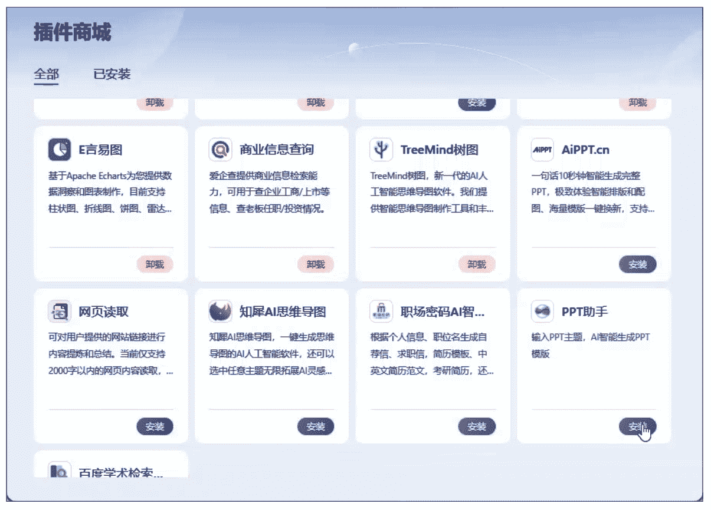

图 3-5

**03** 输入演示主题。点击“已选插件”打开列表，找到“PPT 助手”，在指令框输入“生成一份关于野生动物保护的 PPT”，点击发送，如图 3-6 所示。 

图 3-6

**04** 等待 AI 生成演示文稿。PPT 助手会立即开始设计与生成，片刻即可查看结果，如图 3-7 所示。 

图 3-7

**05** 下载演示文稿。助手支持预览完整幻灯片，点击右上角“下载”即可将文件保存到电脑，如图 3-8 所示。

### **3.3.3 邮件分拣与提效**
利用文心一言整理收件箱，能够实现自动分类与优先级标注，让关键事项迅速浮现，降低遗漏与延误风险。工具还能加速处理流程，提供回复模板，快速抓取核心要点，拦截垃圾邮件，发送重点提醒，加强信息安全，并优化团队协作体验。

**案例实战** 
：请基于下面这封通知邮件做一次四维度提炼，维度包括：【重要性】依据内容判断分量，取值重要/不重要；【紧急性】依据时效判断是否迫切，取值紧急/不紧急；【核心内容】用一句话概括邮件主旨；【需要回复内容】列出需要我确认或回应的事项。随后请对以下邮件进行处理。

各位同事好：为兼顾身心健康与工作效率，公司决定举办一次瑜伽兴趣课，通知如下：
时间：8 月 15 日周六上午 9:00 至 11:00。
地点：公司三楼活动室，约 120 平方米，可容纳 30 人。
主题：特邀专业瑜伽教练讲解基础技能与健康常识。
瑜伽属于低强度有氧运动，适合各年龄段，通过体式练习和呼吸方法可提升柔韧与平衡，帮助身体各机能更好地运转，起到减压提神的作用。
重点内容：（1）瑜伽基本理念及健康价值介绍；（2）冥想与呼吸技巧演练；（3）十余种基础体式示范与练习，含猿人式、波浪式、斜撑倒立等；（4）练习安全要点；（5）适宜着装与个人用品；（6）课后如何保持练习习惯。
流程安排：9:00-9:30 基础概念讲解；9:30-10:10 冥想、呼吸及基础体式练习；10:10-10:30 休息 20 分钟；10:30-11:00 进阶体式练习与答疑。
有意参加者请于 8 月 10 日前以邮件或电话形式告知，以便安排。如有疑问或建议，欢迎联系。感谢参与。 
：【重要性】重要
【紧急性】紧急
【核心内容】公司为改善员工身心状态并提升效率安排瑜伽兴趣培训，时间地点流程已明确，需在 8 月 10 日前确认是否参与。
【需要回复内容】
- 是否报名参加本次瑜伽兴趣培训
- 对培训是否有建议或疑问
注：请务必在 8 月 10 日前回复以便公司安排。

### **3.3.4 制度搭建助手**
制度是组织运转的基石，决定内部行为是否统一。借助文心一言可系统化完成规章的策划、撰写与优化，覆盖需求分析、草案形成、审校修订到落地推广全链路。经过实践，读者能够融合创新思维与策略思维，制定贴合实际、可落地且具备弹性调整能力的规则，提升管理效能。

**案例实战** 
：请为一家互联网公司制定一份员工工作管理办法。

：员工工作管理办法

一、总则
为规范员工行为、提升效率、厘清权责，特制定本办法，适用于全体员工，助力企业稳健发展与个人职业成长。

二、出勤与工时
公司实行标准工时制，员工须按时上下班。加班需提前申请并经部门主管批准。
应自觉遵守考勤，准时打卡。迟到、早退、旷工按公司规定处理。

三、职责与任务
员工应明确自身职责，按要求完成工作。跨部门协作时应积极配合。
工作中遇到问题应及时向主管汇报，共同解决。重大事项需请示并报备上级。

四、保密与知识产权
须严格遵守保密协议，对商业机密、客户信息等敏感资料保密，泄密需承担法律责任。
工作期间产生的作品，包括文案、设计、代码等，均属公司知识产权，未经许可不得私用或外泄。

五、培训与成长
公司提供岗位培训与职业发展支持，提升技能与综合素质。
鼓励参加外部培训与认证，提升个人价值，相关证书须报人事备案。

六、奖惩机制
依据工作表现给予奖励与晋升机会，包括加薪、奖金、晋升等。
违反规定、损害公司利益者，将按制度处理，包括警告、罚款、解除劳动合同等。

七、附则
本办法由公司负责制定、解释与修改。
自发布日起执行，与原规定冲突者以本办法为准。
未尽事宜，按国家法律法规及公司其他规定执行。
如有疑问，请咨询人事部门或负责人。

### **3.3.5 问卷快速生成**
问卷是收集数据与了解需求的核心工具。在用文心一言生成问卷前，需要先明确调研目标与关键问题。题目形式可多样化，包含单选、多选、开放填空等，同时要兼顾简洁易读，确保受访者能快速理解并作答，此外应规避涉及隐私与敏感的内容，体现尊重并保障信息安全。

**案例实战** 
：请为一家餐厅设计一份菜品喜爱度调研问卷，要求围绕主题设置题目与选项。

：餐厅菜品喜爱度调研问卷

尊敬的顾客：
为了解您对本店菜品的偏好，我们设计此问卷。您的意见将帮助改进菜品与服务，提升用餐体验。请花费几分钟填写，回复将严格保密。

一、基本信息
您的性别？
A. 男 B. 女
您的年龄段？
A. 18 岁以下 B. 18-25 岁 C. 26-35 岁 D. 36-45 岁 E. 46 岁以上
您来店频率？
A. 初次 B. 每周 1-2 次 C. 每月 1-2 次 D. 几乎不来

二、菜品评价
您最喜爱的菜系？多选
A. 中式热炒 B. 西式料理 C. 日韩料理 D. 沙拉凉菜 E. 甜品饮品
您对本店菜品口味的评价？
A. 非常满意 B. 比较满意 C. 一般 D. 不太满意 E. 非常不满意
您认为菜品需改进之处？多选
A. 口味 B. 分量 C. 价格 D. 外观 E. 创新度
是否愿意尝试新菜品？
A. 是，很愿意 B. 可能尝试 C. 不太感兴趣 D. 不愿意

三、服务评价
您对服务态度的评价？
A. 非常满意 B. 比较满意 C. 一般 D. 不太满意 E. 非常不满意
服务可提升的方面？多选
A. 上菜速度 B. 员工礼貌 C. 环境卫生 D. 预订便捷度 E. 其他（请说明）_________________

四、总体评价与建议
整体满意度 1-5 分，请打分：_________
对本店的建议或意见：
_________________

感谢填写！我们将认真分析并持续改进，祝用餐愉快！

### **3.3.6 周报一键生成**
文心一言具备快速梳理与整合信息的能力，能在短时间内生成规范周报，从而释放时间投入核心工作。借助该功能可提高工作效率，降低人为差错，并加强团队信息同步。操作时只需提供本周任务、进展与成果即可。

**案例实战** 
：请帮我生成本周工作总结，本周主要完成：制作 5 支视频，发布于 3 个自媒体平台，引流添加 10 名客户并展开详细沟通，最终有 5 名客户开通会员。

：一周工作总结

一、背景与目标
本周聚焦视频制作与自媒体引流，目标为新增客户并提高会员转化。

二、工作内容
制作并发布 5 支视频至 3 个自媒体渠道。
通过视频引流，与 10 位潜在客户深入沟通讲解。
最终促成 5 位客户开通会员。

三、成果与亮点
视频获得较好观看量与互动。
成功获取 10 位潜在客户。
会员转化率达 50%。
团队协作与沟通能力有所提升。

四、问题与不足
视频质量参差。
引流策略不够精准。
会员开通流程较为繁琐。

五、下步计划与改进
提升制作能力，参加培训并向资深同事请教。
优化引流策略，研究目标用户需求制定精准方案。
简化开通流程，优化界面并加强客服支持。

注：对工作内容、成果与问题进行了精简归纳，以更简洁呈现。

### **3.3.7 合同起草指南**
借助文心一言起草法律文件，可明显提高速度与精确度，但仍需掌握正确方法并了解局限。首要工作是理清合同框架，含标题、双方信息、正文、签署部分；术语需定义明确，防止歧义；权利义务要详尽列出并保持公平；需选定适用法律及特殊情形处理规则；成稿后务必仔细校对与修改，以保证合规。

**案例实战** 
：请起草一份三年期房屋租赁合同，需规避出租人法律风险，明确房屋信息及甲乙双方权责。

：房屋租赁合同

甲方（出租人）：
姓名/名称：
证件号/营业执照号：
地址：
电话：

乙方（承租人）：
姓名/名称：
证件号/营业执照号：
地址：
电话：

鉴于甲方同意出租房屋，乙方同意按约支付租金并履行义务，经协商订立本合同。

第一条 租赁房屋
1.1 甲方将其拥有产权或合法使用权的房屋出租给乙方，位于_____，建筑面积_____㎡，用途为居住或办公。
1.2 乙方已实地查看，对现状、格局、设施已了解并同意按约使用。

第二条 租赁期限
2.1 租期三年，自____年__月__日起至____年__月__日止。
2.2 租期届满，乙方应返还房屋并办理解约手续。需续租应于到期前 60 天协商。

第三条 租金与支付
3.1 租金每月人民币____元，乙方须于每月__日前支付至甲方指定账户。
3.2 逾期支付，每日按逾期租金__%计滞纳金。逾期超一个月，甲方有权解除合同并要求腾房。
3.3 签约后 3 个工作日内支付押金人民币____元。租期届满办结手续后，甲方 3 个工作日内退还押金。若乙方未按约退房或违约，甲方可扣除相应费用后返还余额。

第四条 双方权责
4.1 甲方责任：
（1）保证房屋符合建筑、防火、安全标准，无法律纠纷与权利瑕疵。
（2）按约交付房屋，确保租赁期内正常使用。
（3）负责房屋及附属设施维修保养，因乙方过错除外。
（4）按约收取租金押金并开具凭证。
4.2 乙方责任：
（1）按约支付租金、押金等费用。
（2）合理使用房屋及设施，不得擅自改动结构或用途。
（3）日常维护保养，因甲方过错除外。
（4）不得转租、转借或从事违法活动。
（5）遵守物业规定，配合甲方及物业管理。

第五条 违约责任
5.1 甲方违约导致乙方无法正常使用，须承担违约责任并赔偿损失；因甲方原因致合同无法履行，应退还未使用租金及押金。
5.2 乙方违约，甲方有权解除合同并要求腾房。因乙方原因致合同无法履行，已付租金押金不予退还，并承担赔偿责任。损失超押金部分，乙方须在搬离前补足。

### **3.3.8 职场话术设计**
职场沟通中得体的话术有助于建立信任、高效协作并推动事项进展，对职业成长意义重大。文心一言能够依据具体场景、表达风格与核心要点，输出符合规范的表述，供给多种备选方案，助力提升沟通技巧。

**案例实战** 
：请用严肃风格撰写一段向直属领导汇报公司新引进环境污染处理系统的语句，结合受众特点口语化表达。

：领导，我想汇报一下公司新引入的环境污染处理系统。

这套系统功能很强，能有效净化废水废气、降噪并处理固废，实现环境全方位治理。

更关键的是，它既达标又能帮公司节约成本、提升生产效率，一举多得。

我相信这一系统的投入，是公司迈向可持续发展的重要一步。

## **3.4 求职招聘助手**
在变化迅速的就业市场中，高效的求职与招聘是连接人才与企业的纽带。本部分将说明如何借助文心一言在招聘求职全流程中提高效率与匹配度，为双方提供支持。

### **3.4.1 岗位智能匹配**
文心一言能够自动解读简历与岗位需求，综合个人背景、技能和经历，迅速推送匹配职位。此功能可提升匹配速度，实现个性化推荐，改善求职体验。对企业来说，有助于减少招聘开支并促进人才生态优化。

**案例实战** 
：请为 INTJ 人格的计算机专业求职者推荐岗位。

：INTJ 人格通常理性、独立、分析力强、擅长解决问题，适合计算机相关领域。以下岗位较匹配：

软件工程师：需独立工作、解决复杂问题并设计创新方案，INTJ 的分析与创新思维优势明显。
数据科学家：需处理分析海量数据寻找趋势，INTJ 善于分析与解决问题。
网络安全工程师：需识别并修复系统安全漏洞，INTJ 的分析能力可胜任。
系统架构师：需设计优化复杂系统，INTJ 的独立思考与细节关注使其出色。
人工智能研究员：需深入研究复杂算法，INTJ 的好奇心与分析力具优势。
游戏开发员：需设计复杂游戏机制，INTJ 的创新与问题解决能力适配。
总体而言，INTJ 在计算机领域有多元机会，分析、创新与解决问题的能力助力其在不同技术岗位取得成功。

### **3.4.2 求职信辅助撰写**
文心一言可根据求职者的经历与目标，提供针对性的内容建议。在其辅助下，求职者能更清晰梳理个人优势，并在求职信中重点呈现，提升选拔竞争力。

**案例实战** 
：请为一名即将毕业的会计学专业大学生撰写求职信，需包含学历背景、擅长技能、求职岗位、自我评价。

：尊敬的招聘经理：

我是一名即将毕业的会计学专业应届生，很荣幸向贵公司递交求职信。

一、学历背景
我现就读于××大学会计学专业，预计于今年××月毕业。大学期间系统学习了会计、财务、税务等知识，并参与多次会计实务活动，积累了丰富实践经验。

二、擅长技能
熟练掌握 Office 办公软件与常用会计软件：可熟练使用 Word、Excel、PowerPoint 及 SAP、Oracle 等，高效完成数据处理与财务分析。

沟通协作：我善于与各部门同事保持顺畅交流，能够在跨团队协作中高效配合，推动任务顺利达成。

学习适应：我具有较强的吸收新知和环境应变能力，能迅速融入新的工作场景，并持续提升专业水准。

三、应聘意向
我对贵公司的会计岗位十分向往，希望能加入财务团队，以专业知识与实务技能服务公司发展。

四、自我评价
我是一名责任心强、细心严谨的会计人员。大學阶段积极参与各类会计实务锻炼，不断强化实践能力与专业素养。注重协作沟通，与同事及领导保持良好关系。学习能力与适应力突出，能快速度适应新岗位并持续精进。我相信自身积累能够为贵司财务团队带来实际价值。

感谢您拨冗阅读此信，期待能与贵司携手共创未来！

谨上

×××

### **3.4.3 面试自我介绍智能生成**
借助文心一言撰写面试开场白能带来明显优势。其一，语言质量明显提升，表达更准确流畅；其二，智能洞察可帮助求职者提炼核心亮点，凸显个人竞争优势；其三，兼顾专业性，确保内容与格式符合行业惯例；其四，省时省力，避免手工反复打磨的繁琐；其五，支持个性化定制，可按个人风格与需求量身打造；其六，能按具体场景输出适配的表述，帮助求职者在面试中脱颖而出。

**案例实战** 
：请帮我写一段约一分钟的产品经理岗位面试自我介绍。要求表达连贯自然，亮点清晰，专业感足，给人眼前一亮之感。请结合下面信息创作：
学历背景：北京师范大学项目管理专业硕士毕业。
职业经历：曾在互联网头部企业担任高级产品经理，拥有五年工作经验，独立主导过一款本地生活类 App 从零到一的产品方案。
个人优势：数据分析能力突出，熟练使用 Python、SQL、Visio 和 Axure。 
：很高兴能在此与各位交流。我是北师大项目管理专业的硕士。过去五年里，我在互联网大厂担任高级产品经理。在此期间，我曾独立操盘一款本地生活 App 的完整产品方案，实现从 0 到 1 的落地。

我的核心优势在数据驱动的产品思考上。既能吃透业务数据，也能用 Python 与 SQL 做深度挖掘与清洗，保证每一次设计与优化都有数据支撑。Visio 用于梳理业务流程，Axure 用于产出高保真原型，使产品方案更专业、更精细。

我认为产品经理不仅要具备扎实的专业技能，还需具备市场洞察与协作共创的意识。往常工作中，我与研发、设计、运营等团队紧密配合，确保产品顺利上线与迭代。好产品永远是团队协作的成果。

我对贵司的产品经理岗位非常感兴趣，相信我的学术背景与实战经验能够为团队创造价值。期待后续深入交流，共同打造优质产品。

### **3.4.4 基于 JD 的简历优化**
文心一言可依据职位描述精准优化简历，避免反复修改带来的耗时耗力。通过深度解析 JD 中的岗位要求，系统能针对性重构简历内容，让求职者的优势与岗位需求更精准匹配。优化后的简历更具吸引力，提升获得面试机会的概率。

**案例实战** 
：简历标题：软件开发工程师，三年 Java 开发经验，精通 Spring 框架
个人信息：
姓名：×××
联系方式：手机：×××××××××××，邮箱：××××@××××.×××
教育背景：
×××大学，计算机科学与技术专业，本科
技能概览：
三年 Java 开发经验，熟悉 Java SE/EE 核心类库及多线程编程。
熟练掌握 Spring 体系（Spring Boot、Spring MVC、MyBatis），了解微服务架构与 Docker 容器技术。
熟悉 MySQL、Oracle 等数据库，掌握 SQL 语句编写。
工作经历：
××公司软件开发工程师（××××年××月至今）
期望职位：软件开发工程师/Java 开发工程师
请根据 JD 优化以上简历。 
：简历标题：软件开发工程师，三年 Java 及 Spring 经验，熟悉数据库与微服务

个人信息：
姓名：×××
联系方式：手机：×××××××××××，邮箱：××××@××××.×××
教育背景：
×××大学，计算机科学与技术专业，本科

技能概览：
三年 Java 开发经验，精通 Java SE/EE 核心技术，包含 JVM 原理、多线程、集合框架与泛型。
熟练运用 Spring 全家桶（Spring Boot、Spring Cloud、Spring MVC、MyBatis），具备微服务设计与容器化部署经验。
精通 MySQL、Oracle，擅长 SQL 优化与事务处理。
熟悉 Linux 系统与 Nginx 等服务器配置。
了解 HTML、CSS、JavaScript、jQuery 等前端技术，能与前端同事高效协作。
具备良好编码习惯与规范，熟悉 Git 等版本控制工具，重视团队协作与沟通。
学习能力强，问题解决与抗压能力突出，参与多个实战项目。

工作经历：
×××公司软件开发工程师（××××年××月至今）
负责后端业务开发与维护，工作内容包括：
参与需求分析与技术选型，协同团队完成系统架构设计，确保架构合理可扩展。
基于 Java 与 Spring 框架实现后端逻辑与接口，保证代码健壮可维护。
对接前端联调接口，优化数据传输与处理性能。
负责数据库建模、SQL 编写与优化，确保数据安全一致。
关注新技术动态，持续优化系统性能与用户体验。

项目经验：
××电商平台（××××年××月—××××年××月）
参与后端开发，负责用户模块与订单模块，通过优化算法与数据结构提升处理效率。
采用 Spring Boot 与微服务架构构建 RESTful API，实现注册登录与信息修改功能，增强系统扩展性。
集成支付宝与微信支付接口，完成支付功能，保障交易安全及时。
对接前端 Vue.js 实现前后端交互，改善用户体验。
通过 SQL 优化与缓存策略提升数据库访问效率。项目已上线运行，用户评价良好，取得显著收益。

自我评价：我是一名责任心强、做事细致的软件开发工程师，具备扎实 Java 基础与良好编码习惯，重视团队协作与沟通。工作态度严谨，追求细节与卓越。未来将持续提升专业与综合素质，为公司发展贡献力量。具备较强学习与解决问题的能力，能快速适应新技术与新环境。期待在新岗位中不断挑战自我，实现价值。

期望职位：软件开发工程师/Java 开发工程师/后端开发工程师

### **3.4.5 职位描述生成**
文心一言生成的职位描述遵循统一的格式与内容规范，使不同岗位的 JD 在结构与要求上保持一致。标准化呈现能更清晰地传递企业文化、岗位前景与晋升机会，有助于吸引更优质人才。

**案例实战** 
：你是招聘负责人，请为我提供一份中级会计师的招聘 JD。 
：可以，以下是中级会计师岗位的 JD 示例。

职位：中级会计师

一、岗位概述
我们正在招聘一名经验扎实、专业过硬的中级会计师加入财务团队，负责公司财务会计工作，确保信息准确合规。

二、主要职责
负责日常账务处理、报表编制与财务分析。
负责税务申报与审计配合，确保税务合规。
参与制定与完善财务制度流程，提升管理效率。
与各部门协同，提供财务支持与建议，助力业务发展。
完成上级交办的其他财务相关事项。

三、任职条件
财务、会计等相关专业本科及以上学历，持有中级会计师职称。
至少三年财务会计实操经验，相关行业经验优先。
熟练使用财务软件与办公工具，熟悉国内会计准则与税法。
沟通协作能力强，能承受一定工作压力。
工作细致严谨，责任心强，学习与解决问题的能力突出。

四、我们提供
具有市场竞争力的薪酬福利。
清晰的职业发展与晋升通道。
完善的培训体系与学习资源。
舒适的工作环境与现代化办公设备。
定期的团队建设与员工活动，营造和谐氛围。

五、企业简介
我们是××行业领先企业，重视人才培养与团队建设。财务团队专业高效、团结协作，致力于为公司提供高质量财务服务。期待您的加入共同创造更大价值！

### **3.4.6 面试提问设计**
由文心一言生成的面试题有助于面试官更深入理解岗位需求，形成更具体贴合的问题清单。通过系统化评估候选人的能力、经验与个人特质，可降低主观误判风险，提升招聘质量。

**案例实战** 
：现在你作为互联网公司的面试官，将面试产品运营经理岗位候选人，请从专业技能、通用能力、工作经验、个人特质四个维度准备一份面试题清单。 
：可以，以下是针对产品运营经理岗位的面试问题建议，分为四个维度。

专业技能：
你如何界定产品运营的角色与职责？
请举例说明你曾如何用数据驱动设计或运营决策。
当产品出现用户或收入下滑时，你会如何诊断并优化？
你使用过哪些产品分析工具？如何用它们指导运营？
如何在用户体验与业务目标间取得平衡进行优化？
若让你制定一项新的运营策略，你会如何启动？

通用能力：
请描述一次跨部门协作完成项目的经历。
面对多项紧急任务时，你如何安排优先级与时间？
请分享一次解决复杂问题或挑战的经历。
你在团队中担任过领导角色吗？具体如何开展？
能否举例说明你如何接受批评并进行改进？
当与同事或利益相关方观点不一致时，你如何处理？

工作经验：
请描述一次你参与的成功产品运营项目。
过去哪一次失败带给你最大的收获？
你曾如何应对突发的产品运营危机？
请分享你在拉新、留存或转化方面的运营经验。
你如何与开发、设计、市场团队协同工作？
请举例说明你根据用户反馈调整运营策略的情况。

个人特质：
你认为哪些个人特质使你适合做产品运营？
遇到挫折时你如何保持积极与专注？
请用案例说明你的学习与适应能力。
你认为优秀的产品运营经理应具备哪些品质？
你如何管理压力并保持工作生活平衡？
当你的建议被否决时，你通常如何反应？请举例。

# **第四章**
# **文心一言：答疑解惑助手**
本章将系统介绍如何利用文心一言在教育教学、学习辅导、知识问答、代码生成与论文写作五大领域提供支持。作为领先的语言模型，文心一言具备强大的理解与生成能力，可为各行业提供高效便捷的解答。在教育场景中，它既可辅助教师备课，也可为学生解惑，还能在问答、编程与论文撰写上提供指导。通过案例与实操要点，读者可掌握使用方法，提升教学与学习效率，推动知识传承与创新。

## **4.1 教育教学：教师工作好帮手**
本节聚焦文心一言在教学案例生成、研究方法推荐、教学工具推荐、课程设计、作业批改与出题押题等方面的应用，帮助教育工作者提升效率、优化学习效果。通过具体案例展示其在教学流程中的实际价值。

### **4.1.1 教学案例生成**
文心一言能够生成丰富、生动且贴合教学目标的案例，为教师提供宝贵资源，帮助学生更好地理解知识。其应用可节省备课时间，让教师更专注于学生个性化发展。

使用要点：
明确教学目标：生成前先确定教学目标，确保案例紧扣目标与需求。
要求具体清晰：需明确案例类型、难度、知识点等，以便模型输出符合预期。

**案例实战** 
：明天我要讲数学函数，课堂风格偏风趣幽默，能否帮我生成一份教学案例？ 
：主题：函数的概念与性质

一、导入（2 分钟）
教师：“大家好，欢迎来到数学课！今天的主角是函数。别担心，不会考‘1+1=？’这种难题。简单说，函数像一台神奇机器，输入一个值，就得到一个输出。来，咱们一起体验下？”

二、概念讲解（5 分钟）
展示 y=x² 例子，解释自变量与因变量关系。
教师引导学生想象自己是魔法师，用魔法棒改变 x，观察 y 的变化。

三、性质探究（8 分钟）
教师：“函数也有个性，有的是一对一，有的是一对多。咱们来认识这些有趣的‘性格’。”
展示不同函数图像，引导讨论。
再介绍奇偶性、周期性等特殊“技能”，帮助理解函数特征。

四、应用实例（5 分钟）
“去过游乐场吗？摩天轮的运动就是典型的函数应用。”
展示摩天轮运动模型，说明如何用函数描述其轨迹。

五、小结回顾（2 分钟）
“今天我们认识了函数概念与性质，也看到了生活中的应用。希望大家能更轻松地理解函数。”

提示：使用文心一言生成教学案例时，需尊重知识产权、保障信息安全并遵守相关法律法规，确保内容合法合规、满足实际教学需求。

### **4.1.2 研究方法推荐**
文心一言可快速分析大量学术文献，提取研究问题、方法、数据来源等核心信息，帮助研究人员把握研究前沿并快速找到适配方法，从而提升研究质量与效率。

使用建议：先明确研究领域与主题，再详细描述方法需求；对推荐方法有疑问时可进一步追问，以便获得更精准建议。

**案例实战** 
：我正在指导学生研究“企业信息披露”，请提供关键学习方法、研究方法与数据收集技术。 
：企业信息披露是重要研究方向，涉及财务、运营与风险信息对外传递。为帮助学生高效研究，建议如下。

学习方法：
理论基础：掌握会计、金融、经济学相关理论。
案例学习：通过真实公司案例理解实践挑战与机会。
小组研讨：组织讨论，促进多角度批判性思考。
模拟演练：在仿真场景中实践信息披露流程。

研究方法：
文献综述：梳理前人成果与当前研究趋势。
实证研究：设计模型检验信息披露与影响因素关系。
比较研究：对比不同国家或地区制度与实践。
案例对比：选取信息披露差异公司进行对比分析。

数据收集技术：
公司年报：年报是获取企业信息披露的核心来源。

企业信息披露多源交叉核验指引
要建立对企业披露状况的立体认知，必须进行多渠道交叉核对。企业自有官网通常汇总了最新动态、投资者关系材料以及可持续发展报告，是获取官方一手资料的主要入口。证监会、交易所等监管机构的公开库则提供经合规审核的完整档案，资料更为详尽。面对数据量庞大与研究专业化的需求，彭博、万得等第三方数据服务商可提供整理后的数据集与分析工具。社交媒体上的官方账号体现了企业对外沟通的风格与品牌管理思路。再辅以问卷或访谈，就能收集到内部员工与外部利益相关者对披露工作的主观评价与使用体会。

### **4.1.3 教辅工具筛选**
文心一言可以根据教学诉求与学生的学情实际，为教师挑选匹配度较高的教辅资源，帮助教师迅速锁定既契合个人授课风格又能满足学生需求的方案，进而培育自主学习能力并提升教学整体效果。

若想得到更精准的建议，提出需求时应把教学目标与课程侧重点表述清楚，同时补充学生的年龄段、基础水平与兴趣偏好等背景，让系统输出真正可用的方案。

案例实战 

：能否为小学三年级英语教学推荐几款合适的应用或教具？ 

：针对小学三年级，可参考以下适配资源。

爱花朵少儿英语应用：面向小学生设计，与主流教材进度同步，包含配图词汇、动画短片、英文儿歌、趣味小游戏，并配有同步测验与题库以便巩固。

《小学英语三年级》（上／下）北师大出版社应用：提供与教材配套的学习资料，支持单课朗读、整篇朗读和循环跟读，便于随时练习听说。

少儿英语卡片学习应用：收录动物、颜色、数字等基础词汇，每张卡片配有发音与图像，有助理解词义。

此外，英语趣配音等应用也可作为教学补充。以上仅供参考，具体选用最好结合孩子实际情况与学习需求。

提示：使用文心一言推荐的工具后，应详细了解功能点、操作流程与适用场景，才能在教学中充分发挥价值并提升质量。

### **4.1.4 课程方案生成**
文心一言能依据教师需求与学生的学情，创造性地生成个性化课程方案，帮助教师更全面把握学情，在资源分配与教学策略上实现更公平合理的安排，有助于提质并推动教学模式创新，为教育发展注入活力。

案例实战 

：我是一名初中英语教师，请为我设计一门课程。 

：可以，以下是面向初中生的英语提升课程示例。

一、课程名称：初中英语综合提升
二、适用对象：初中阶段学生
三、课程时长：一学期约 20 周，每周 2 小时
四、课程目标：全面提高听、说、读、写能力，夯实初中英语核心知识，培养学习兴趣和良好习惯。
五、教学内容与活动安排：
第 1～2 周：课程介绍与基础语法回顾。介绍目标、方式与评价；复习名词、动词、形容词等基础知识。活动：自我介绍；小组制作词汇卡。
第 3～6 周：听力与口语强化。学习常用词汇与日常用语，进行听力与口语练习。活动：听音选答；角色扮演练习口语。
第 7～10 周：阅读理解与词汇拓展。通过简易英文文章学习阅读技巧，拓展词汇量。活动：小组讨论文章；词汇拓展竞赛。
第 11～14 周：写作与语法进阶。学习段落构建、句式变化；学习进阶语法。活动：小组写作练习；语法知识竞赛。
第 15～18 周：文化认知与综合运用。了解英美文化背景，提升跨文化交流能力。活动：文化分享；综合运用练习。
第 19～20 周：期末复习与测评。梳理学期知识，进行期末测试。活动：小组共制复习资料；期末考核。
六、期末评估：结合平时作业、课堂参与和期末成绩综合评定，同时关注进步情况和学习态度并给予反馈。
七、教学建议：关注个体差异给予个性化指导；鼓励参与互动培养自主与合作能力；重视实践运用促进知识迁移。

### **4.1.5 中文作业自动批改**
借助自动批改功能，教师能迅速掌握学生作业的共性问题与个体薄弱点，实现针对性教学。自动化流程节省批改时间，降低人工失误，提升工作效率与教学质量。

案例实战 

：选答题：（1）下列成语使用不当的一项是（C）。

A. 他为了完成项目，不辞辛劳，三顾茅庐请专家指导。

B. 老师告诉我们，写文章要简明扼要，切忌冗长累牍。

C. 他的演讲非常精彩，全场鸦雀无声，大家都被他深深吸引。

D. 面对同学家的不幸，大家纷纷伸出援助之手，捐款捐物，鼎力相助。

（2）下列句子中没有语病的一项是（B）。

A. 通过观看电影《摔跤吧，爸爸》，使我重新认识了努力与拼搏的意义。

B. 全球将近 200 多个国家共同签署了《巴黎协定》，目的是应对气候变化带来的挑战。

C. 是否有坚强的意志，是一个人取得成功的关键。

D. 为了防止食物浪费，餐馆推出“半份菜”点餐模式。

（3）修改病句：他穿着一件灰色的上衣，一顶蓝色的帽子。

（4）填空题：在“之”结构的成语中，与“天之骄子”意思相近的是“天之宠子”。 

：批改：选答题（1）正确答案为 A。
解释：A 项中“三顾茅庐”原指三次登门拜访，比喻诚心邀请，此处情境不符，使用不当。

选答题（2）正确答案为 C。
A 项“通过”与“使”重复，应删去其一。B 项“将近”与“多”重复。D 项目的状语多余。
因此无语病的是 C 项：“是否有坚强的意志，是一个人取得成功的关键。”

修改病句：他穿着一件灰色的上衣和蓝色的帽子。
批改建议：将“和蓝色的帽子”改为“，戴着一顶蓝色的帽子”。
解释：原句并列不当，应以逗号分隔并加上动词来表述帽子的佩戴方式。

填空题：在“之”结构的成语中，与“天之骄子”意思相近的是“天之 _ 宠 _ 子”。
批改：答案正确。
解释：“天之宠子”中“宠”指宠爱珍视，与“骄”义近。

### **4.1.6 出题与押题**
文心一言能分析学生的学习数据与历史记录，精准预判重点与高频考点，提高押题的针对性，减少人为偏差，减轻教师备考负担，提升学生的应试能力。

案例实战 

：我是一名初中数学教师，请为我出一份期中考试题目并做押题。 

：一、选答题
下列哪个选项是方程 2x—3=5 的解？（ ） A. x=1 B. x=2 C. x=3 D. x=4
下列哪个图形是中心对称图形？（ ） A. 等边三角形 B. 矩形 C. 菱形 D. 正五边形

二、填空题
若 |x+3|=5，则 x=_____。
点 P（3,—4）关于 y 轴的对称点 P'的坐标为 _____。

三、解答题
解方程：3（x—2）+5=2x—1。
已知三角形 ABC 的三边长为 a、b、c，且满足 a²+b²+c²=ab+bc+ac，判断三角形 ABC 的形状。

四、应用题
一家商店卖出两种不同品牌的手机，其中一款比另一款贵 20%，如果较便宜的手机价格为 1200 元，那么较贵的手机价格为多少元？
一辆汽车从甲地到乙地需行驶 180km，前一小时行驶了 60km，后一小时行驶了 80km，求汽车的平均速度。

押题建议：结合历年真题和教学大纲，方程、图形性质、三角形等为初中数学常见考点；关注教育部门官网获取最新考试动态；依据学情制定复习重点，强化薄弱环节提升信心。

### **4.1.7 复习资料生成**
文心一言在分析学生学习数据时，能够识别薄弱环节与需重点复习的知识点，并推荐相关题目与讲解，有助于深化理解。生成复习材料一般按以下步骤进行。

01 输入关键词或知识点，如“初中数学方程”“三角形性质”，明确复习范围。
02 根据需求选择输出形式，如选答题、填空题、解答题或知识点总结。
03 依据掌握程度调整难度与题量，保持挑战性与可达成性的平衡。

案例实战 

：我想复习初中数学方程，请生成相关复习内容。 

：可以，以下是关于初中数学方程的复习材料。

一、知识点回顾
一元一次方程：形如 ax+b=0（a≠0），解法为移项化简。
二元一次方程组：形如 {ax+by=c；dx+ey=f}，常用代入法、消元法。
一元二次方程：形如 ax²+bx+c=0（a≠0），可用公式法、配方法、因式分解法。

二、重点与难点
掌握各类方程的解法及其应用；理解解的意义并会检验；能列方程组解决实际问题。

三、典型例题解析
解一元一次方程 3x—5=7。解析：移项化简得 3x=12，解得 x=4。
解二元一次方程组 {2x+y=6；x—y=2}。解析：代入法或消元法求解，得 x=2，y=2。
解一元二次方程 x²+3x+2=0。解析：因式分解或公式法求解，得 x=—1 或 x=—2。

四、练习题
解方程：4x—7=9。
解方程组：{3x+2y=12；x—y=3}。
解方程：2x²+5x+2=0。

五、注意事项
解方程时注意移项符号变化；解方程组时选择合适方法；解一元二次方程时注意判别式计算。

提示：建议结合教学大纲、历年真题与学生实际，精准确定复习重点，确保覆盖全面且突出核心。

### **4.1.8 幼儿园活动设计**
输入幼儿信息与教学目标，文心一言可以生成贴合发展阶段与兴趣的活动方案，兼顾教育意义与趣味性，为教师节省准备时间并提供多样选择。

案例实战 

：请作为一名幼儿园老师，设计一些课外活动来提高小朋友的动手能力，并能够激发他们的创造力。 

：为提升动手能力与创造力，可安排以下活动。

1. 创意手工坊：提供彩纸、剪刀、胶水、彩笔等材料，鼓励自由创作，提升手部协调与想象力。
2. 绘画表达：准备画布、颜料、画笔，引导尝试不同技巧与风格，释放艺术感受。
3. 积木搭建：提供多种积木自由搭建建构场景，锻炼空间想象与动手能力。
4. 厨艺体验：参与水果沙拉制作、简易烘焙等，培养生活技能与创造力。
5. 角色扮演：设置场景与角色，通过剧情创作与对话表达想象力。
6. 自然探索：户外采集植物、观察昆虫等，增强观察力与探究精神。

通过实践，幼儿可在游戏中提升动手与创造力。教师需关注个体差异并给予适时支持。

提示：生成方案时应注意幼儿发展水平、游戏化设计、互动参与、个体差异、安全保障与创新性。

### **4.1.9 提问技巧引导**
引导提问能激发学生主动思考与课堂参与。通过文心一言优化沟通策略，教师可帮助学生提升表达与逻辑能力，增强自信。

使用前需明确目标，是获取信息、解决问题还是生成提问技巧；并突出关键信息与任务要求，便于模型准确执行。

案例实战 

：我是一名物理教师，我的学生在我讲物理题的时候总是不懂装懂，从不向我提问，导致他的学习成绩一直没有提升。请你作为一名具有丰富沟通技巧的教育专家，设计一个有效的策略，来改善我和学生之间的沟通效果。你需要执行以下任务：（1）分析学生不懂装懂且不爱提问的原因；（2）提出合理策略改善我和学生之间的沟通效果。请注意这个策略应该包括了解沟通问题和背景、方法和步骤，以及运用有效的沟通技巧。 

：一、原因分析
缺乏自信：害怕被嘲笑或自卑而不敢提问。
畏惧教师：担心被批评或打扰教学。
学习习惯欠缺：未养成主动提问意识，不知如何表达困惑。

二、改进策略
了解背景：在课间与学生交流，倾听其对物理课的感受与具体困难。

方法与步骤
（1）建立信任：营造轻松氛围，肯定提问行为，传递关怀。
（2）明确价值：说明提问对成绩提升的作用，强调其对课堂的价值。
（3）创造机会：设置固定提问时段，采用小组先讨论再汇报形式。
（4）示范引领：故意设置小错误或开放问题，示范清晰提问方式。
（5）即时反馈：对每一次提问给予积极回应，增强参与意愿。

沟通技巧
倾听：不打断，认真理解困惑。
鼓励：用微笑、点头与肯定语言支持表达。
澄清：用自己的话复述问题确保理解一致。
简化：复杂问题拆解为小问题逐步解答。
示范：展示解题思路，提升问题解决能力。

## **4.2 学生学习：提升你的学习效率**
本部分介绍如何运用文心一言制订学习计划、进行英汉互译、撰写学习心得、激发辩论灵感等功能，全面提升学习效率。后续将逐项说明使用方法并配以实例，展示如何将这些功能融入日常学习，使学习更高效且有趣。

### **4.2.1 量身定制学习规划**

借助文心一言来拟定学习方案，可以依据每个人的具体目标与可支配时间，量身生成最合适的学习路线。依靠这一功能，学习者能把时间用在刀刃上，剔除低效环节，从而明显提升学习成效。

**案例实战** 

：请帮零基础学员拟定一份“Python 速成”学习方案。 

：Python 速成学习方案（零基础）

一、背景与目标

学员目前对编程一无所知，但希望在短时间内掌握 Python 的基本用法并能独立完成简单任务。本方案提供一条清晰高效的入门路径，帮助快速上手。

二、内容安排与进度

Python 基础语法 1~2 天
变量与数据类型、运算符与表达式、条件判断与循环、函数与模块

Python 数据结构 1 天
列表 list、元组 tuple、字典 dictionary、集合 set

Python 文件操作与异常处理 1 天
文件读写、路径处理、异常捕获与处理

Python 库应用 2 天
NumPy 数值计算、Pandas 数据分析、Matplotlib 数据可视化

Python 网络编程与爬虫 2 天
Socket 编程基础、Requests 库发送 HTTP 请求、BeautifulSoup 解析 HTML、简单爬虫实战

Python 实战项目 2 天
数据分析报告：用 Pandas 与 Matplotlib 完成一份简易分析报告
网络爬虫：用 Requests 与 BeautifulSoup 完成一个小型爬虫

三、学习方法建议

每日投入 2~3 小时，保持连贯；
每个模块结束后动手写小练习加深记忆；
加入 Python 学习社群交流经验、答疑解惑；
先求会再求精，夯实基础后再深入。

四、总结与展望

按此节奏约 10 天可掌握 Python 基础并能完成基础任务。之后可依据兴趣向高级特性、框架及应用方向拓展。持续练习会带来明显成长。

**提示：**方案应结合个人需求与学习特点来调整。制定时要考虑学习风格、时间安排和可用资源，确保可行性。同时要动态追踪进度，根据实际情况灵活修正方法，以不断提高效率。

### **4.2.2 英汉互译助手**

用文心一言做英汉互译，兼具准确、高效、便捷以及语境理解能力，能覆盖多样化翻译需求。更关键的是模型会持续学习更新，翻译质量不断提升，助力用户更顺畅地进行跨语言沟通与跨文化交流。

**案例实战** 

："One sees clearly only with the heart. Anything essential is invisible to the eyes.

"Men have forgotten this truth," he said, "but you mustn't forget it. You become responsible forever for what you have tamed. You're responsible for your rose...

"I'm responsible for my rose," the little prince repeated, so that he would be sure to remember.

"It's so weak. It's so naïve. It has four thorns, of no use at all, to protect itself against the world..."

And the little prince broke into a sight of tears.

"I should have judged by deeds and not by words. She cast her fragrance and her radiance over me. I shouldn't have run away from her... I should have guessed all the affection that lay behind her poor little strategies. Flowers are so inconsistent! But I was too young to know how to love her..."请将这段话翻译成中文。 

：“真正重要的东西眼睛看不见，只能用心去感受。” “人们早已遗忘了这个真理，”他说，“但你不能忘。你永远要为自己驯服的东西负责。你要对你的玫瑰负责……” “我要为我的玫瑰负责，”小王子重复道，好让自己记住。 “她那么脆弱，那么天真。她只有四根刺，根本不足以抵御世界的侵害……” 小王子不禁潸然泪下。 “我本该以行动来评判她，而不是听她的话。她把芬芳与光辉洒向了我，我不该逃离她……我本该看出她那些拙劣小计背后全部的温情。花儿就是这样反复无常！可那时我还太小，不懂得怎样去爱……”

### **4.2.3 心得写作提纲**

文心一言可根据关键词与主题提供灵感与思路，大幅提升撰写效率。同时还能给出丰富词汇短语，令心得体会的写作更加流畅，轻松产出高质量内容。

**案例实战** 

：我是一名大一新生，学院要求读《红岩》并写一篇 800 字心得，请帮我列大纲并指导每部分怎么写。 

：《红岩》是经典革命文学，阅读它有助于理解历史与革命精神。下面是一份阅读心得的大纲供参考。

一、开篇
简要介绍作品作者、出版年代及主要情节，并点出初读印象与感受。

二、主题思想
革命精神：通过狱中斗争描写共产党人的英勇，体现精神力量。
爱国情怀：人物言行流露对祖国的深切热爱。
坚定信仰：面对严酷镇压仍不屈不挠，探讨信仰根源。

三、人物形象解析
挑选代表性人物，分析性格特征、行为动机及其在作品中的作用。

四、艺术表现
结构布局、情节推进、语言风格等手法如何服务主题。

五、个人感悟与启示
历史认知：阅读后对中国革命史的新认识。
精神理解：对革命精神的体会及对自身的启发。
成长影响：人物与情节对价值观和生活态度的促进。
未来期许：基于历史认知对未来的思考。

六、结语
归纳阅读收获，表达对作品的敬意。

### **4.2.4 辩论思路生成**

使用文心一言，辩手能快速获取不同观点、论据与案例，开拓视野，多角度审视议题，发现新角度。还能迅速检索支撑材料，缩短准备时间，提升效率与精准度。

**案例实战** 

：请从正方立场论证“现代教育体系是否应更注重培养学生创造力”，要求逻辑清晰、论据充分，并引用名人名言与典型案例。 

：尊敬的评委、各位同学：

我方主张，现代教育应更重视创造力的培养。

在当今社会，创造力已成为核心竞争力。教育须回应未来需求，帮助学生适应变化。

其一，创造力利于解决问题。未来工作与生活充满复杂性，缺乏创造力很难提出新思路。具备创造力者能灵活思考、创新解法，创造更大价值。

其二，创造力驱动社会进步。创新与创造力是社会发展的关键动力。培养创造力的人才，才能推动新思想落地，促进社会发展。

实践中，不少学校已开始行动：课程加入艺术、音乐、设计等激发想象力的内容；教学采用启发式，让学生通过思考与实践获取知识；评价采用多元化，重视实践与创造表现。

正如乔布斯所言：“创新是区分领导者与追随者的唯一标准。”要培养未来的领袖与创新者，就必须强化创造力培养。让我们共同为教育注入创新活力！

谢谢！

### **4.2.5 升学择业咨询**

传统升学择业需花费大量时间调研咨询。借助文心一言可快速处理海量信息，提供持续反馈，帮助更精准地找到适合自身的发展方向，节省时间、做出更明智选择。

**案例实战** 

：现在你是一名精通升学择业的教育顾问。我想对比湖南大学与中南大学的综合情况。 

：湖南大学与中南大学综合对比

两校皆位于湖南长沙，均为 985、211 高校，在国内外享有盛誉。

院校背景与声誉
湖南大学：综合性研究型大学，声誉卓著。
中南大学：综合性研究型大学，声誉卓著。

地理与历史
湖南大学：坐落岳麓山景区，环境优美，前身可追溯至岳麓书院，文化底蕴深厚。
中南大学：位于长沙市区，交通便利，前身为中南矿冶学院，矿冶教育历史悠久。

学科专业
湖南大学：覆盖工、理、管、文等，材料科学、工程学、化学、生物学实力突出，金融、会计等商科受青睐。
中南大学：覆盖工、理、管、文等，矿冶工程、材料科学、临床医学优势明显，轨道交通、有色金属特色鲜明。

师资与科研
两校均拥有一批院士及青年才俊，科研成果丰硕。湖南大学在纳米材料、超算等领域突出；中南大学在矿冶工程、有色金属领域领先。

校园文化
两校均注重实践与创新，社团活动丰富，氛围浓厚，满足学生多样化发展。

就业前景
湖南大学就业面宽，与企业、科研机构合作紧密，提供实习就业机会。
中南大学在有色金属、轨道交通行业影响力大，相关专业就业优势明显。

总体而言，两校各具优势，选择应结合个人兴趣与发展方向。

### **4.2.6 错别字校对**

人工校对费时费力，尤其长文或错别字密集时，不仅影响可读性也损害准确性。借助文心一言的自动检测与修正功能，可迅速清除错误，提升文章质量，节省精力。

**案例实战** 

：请检查下面文本的错别字并给出优化建议。文本：我一定要努里学习，天天向上，降来成为一名有位青年。为了达成这个目标，我将付出坚持不懈的努力。我永远相信终究有一田，我会视线了这个目标。 

：经核查，原文存在数处错别字，建议修改如下。

原文：
我一定要努里学习，天天向上，降来成为一名有位青年。为了达成这个目标，我将付出坚持不懈的努力。我永远相信终究有一田，我会视线了这个目标。

修改后：
我一定要努力学习，天天向上，将来成为一名优秀青年。为了达成这个目标，我将付出坚持不懈的努力。我永远相信终究有一天，我会实现这个目标。

修改说明：
1. “努里”→“努力”
2. “降来”→“将来”
3. “有位”→“优秀”
4. “一田”→“一天”
5. “视线了”→“实现了”

## **4.3 秒懂百科：你的知识百晓生**

本节介绍如何用文心一言辅助语言学习、解答文学问题、查询生物知识、搜索人物百科、解释数学函数及地理知识。无论是语言学习者、文学爱好者或各学科学生，都能获得有效指导。

### **4.3.1 语言学习规划**

制定清晰的学习指南是语言学习的前提。用文心一言制定指南可让规划更明确，并结合学习资源提升效率与动力。

·需明确指南包含的内容，如词汇、语法、口语练习或整体规划。
·提出需求时要具体，如“请为初级英语学习者生成词汇学习指南，含学习策略、主题分类词汇表及推荐资源”。
·提供个人学习背景，如当前水平与目标，以便生成更贴合的方案。

**案例实战** 

：我想学英语，能否做一份语言学习指南？需要视频推荐、口语软件推荐、学习资料、学习计划表、学习任务表。 

：可以，以下是一份英语学习指南。

一、视频推荐
TED-Ed：动画科普视频，英语讲解，生动易懂。
EnglishClass101：按场景教学，适合各水平。
可汗学院：覆盖语法到听说训练，体系完整。

二、口语软件推荐
Duolingo：游戏化练习，包含口语模块。
HelloTalk：与英语母语者实时对话，提升交流能力。

沉浸式口语场景模拟工具 Rosetta Stone，能让学习者置身真实情境中练习口语表达。

三、学习资料

牛津高阶英语词典：业内公认的权威词典，释义细致、用法示例丰富。
新概念英语：专为入门阶段设计，系统涵盖基础语法、核心词汇以及听说训练。
英语 900 句：以实用的口语为核心，收录大量贴近日常生活的表达方式。

四、学习计划表

表 4-1 列出了一份可供参考的进度安排，时间与节奏可根据个人情况灵活调整。

表 4-1

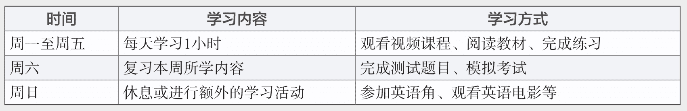

五、学习任务表

表 4-2 给出建议性的任务清单，可依据自身实际增删修改。

表 4-2

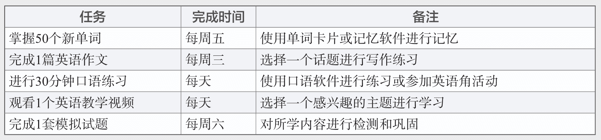

### **4.3.2 汉语文学问答**

文心一言在汉语言文学领域的知识覆盖面广，既包括古代与现代文学，也涵盖文学理论要点。依托领先的自然语言处理及语义解析能力，它能够快速锁定问题的关键，给出准确可靠的回复。使用者不必耗费时间查阅堆积如山的资料，只需提出问题就能即时得到解答，从而显著提高效率并节省精力。

**案例实战** 

：现在你是一位精通汉语言文学的国学专家，你会结合你丰富的国学知识，对我给出的字词或成语进行阐释。要求浅显易懂地表达，内容专业有深度。我给出的第一个字词：不容置喙。 

：“不容置喙”多用于形容某项事务或观点已经确定，不允许他人提出质疑或展开讨论。语中“置喙”原本描述鸟兽咀嚼食物的动作，后来引申为人的发言与议论。因此该成语也可理解为禁止他人插话或发表不同看法。

从国学视角来看，这一成语反映了传统文化中尊崇权威、讲求礼序的价值取向。古代社会推崇尊敬长辈、敬重师长、遵循传统，对已成定局的意见与决策普遍保持服从执行，而非随意挑战。故“不容置喙”在某种程度上成为文化背景下形成的社会行为规范。

进入现代语境后，过度强调“不容置喙”容易引发争议。部分观点认为，严苛的“一言堂”会压制独立思考与言论自由，使得错误观点难以被及时纠正。因此在实际运用时，应在尊重既定事实与观点的同时，保持对多元声音的包容与开放。

总体上说，“不容置喙”体现了传统文化对权威与礼仪的重视，但在当代使用时需审慎，避免对思想表达造成不必要的限制。

### **4.3.3 查生物知识**

文心一言凭借强大的自然语言处理技术与庞大的知识库，在生物学范畴内展现出很强的能力。其知识范围横跨植物学、动物学、微生物学等多个分支，并且能够跟踪最新研究进展，持续更新资料，为用户提供全面且前沿的信息，有力推动学术交流与知识普及。

**案例实战** 

：请你作为一位生物学领域的专家，帮我查询巨型猪笼草的相关信息，结果需要包含这个生物的基本情况、来源地、行为特点等。 

：巨型猪笼草属于猪笼草科的热带食虫植物，学名为 Nepenthes attenboroughii，最初由两位传教士在菲律宾巴拉望省中部维多利亚山顶发现，随后被英国植物学家确认是猪笼草属的一个新种，植株体型巨大，捕食能力可达到老鼠级别。

其分布区域集中在菲律宾巴拉望省等地，是该省特有的热带食虫植物，海拔分布约在 1600 米至 1726 米之间，常被称为“阿滕伯勒猪笼草”。

与之相近的还有巨型高山猪笼草 Nepenthes rajah，被认为是世界上最大的食肉植物之一，能够捕捉老鼠。它对动物粪便有明显偏好，尤其是树鼩的排泄物。昆虫资源匮乏时，捕虫瓶便会兼作树鼩的“天然厕所”。植物利用花蜜吸引树鼩靠近，再借助巨型瓶状结构收集粪便。科学家推测瓶状体已演化为近乎理想的树鼩排泄场所，二者形成了奇特的互利关系。

### **4.3.4 人物百科**

文心一言内置强劲的检索模块，能够为用户提供人物概况、生平经历、荣誉地位等全方位资料。查询速度快，结果可靠，有助于推动学术讨论与知识传播。

**案例实战** 

：现在你是一本人物百科全书，你会结合你所知的人物基本信息、人物关系、人物生平、人物荣誉地位等信息，对我要查询人物的相关问题进行详细解答。下面我给出的第一个问题是：余华简介。 

：余华，1960 年 4 月 3 日出生于浙江杭州，祖籍山东高唐，当代作家。曾担任中国作家协会第九届全国委员会委员，早年供职于杭州文联，后调入海盐县文化馆，自 1984 年起开始发表小说。

代表作涵盖短篇《十八岁出门远行》、长篇《活着》《许三观卖血记》，另有《兄弟》《在细雨中呼喊》等。其作品已被译成多国语言，在多个国家出版，多次呈现时代苦难以及个体面对苦难的姿态。

创作上，余华以敏锐的社会洞察与深刻的人性剖析著称，常借助个体命运折射更广阔的社会历史议题。文字简洁质朴，擅长通过对话与内心独白揭示人物性格与命运，整体基调偏向悲剧，深受读者喜爱。

在当代中文文学界，余华具有重要影响力，作品广为研读，多部被改编为影视作品，进一步扩大其影响。他对中国现代文学的发展起到推动作用，被视为当代文学的代表人物之一。

其间获得意大利格林扎纳·卡佛文学奖、法国文学与艺术骑士勋章等荣誉，充分体现其文学成就与国际认可。

综合来看，余华是一位社会观察力强、能深入剖析人性的作家，作品既写个体苦难与命运，也映照宏观社会历史，其简练质朴的语言与对话写法构成鲜明特色。

### **4.3.5 函数解释**

面对复杂函数问题，文心一言依靠卓越的计算与数据分析能力，能够给出详尽解释，帮助用户攻克难题，并在此基础上延展相关知识点，加深理解与应用，明显提升学习效率。

**案例实战** 

：请解释 SQL 中 RANK 函数的用法并提供示例。 

：SQL 中的 RANK() 用于在分组内根据指定列排序后为记录赋予名次。若出现并列，则并列记录共享同一名次，后续名次会依次跳过。

语法结构如下。

RANK() OVER (
[PARTITION BY partition_expression, ...]
ORDER BY sort_expression [ASC | DESC], ...
)

PARTITION BY 为可选子句，用来定义分组范围，若未指定则对整张表排名。ORDER BY 决定排序字段与升降序。

举例：假设表 Employees 包含 ID、Name、Salary。按薪资降序排名，可执行如下语句。

SELECT ID, Name, Salary,
RANK() OVER (ORDER BY Salary DESC) AS Rank
FROM Employees;

执行后结果集包含员工编号、姓名、薪资及对应的降序名次。薪资相同者名次相同，后续名次顺延。

结果如表 4-3 所示。

表 4-3

示例中，John 薪资最高名次为 1，Jane 与 Alice 薪资相同均为 2，Bob 名次为 4，Mark 名次为 5。

### **4.3.6 地理知识问答**

文心一言响应迅速，借助海量数据访问能力，可快速输出高质量且详尽的地理信息，帮助用户深入理解复杂问题并节约大量时间。

**案例实战** 

：现在你是一个熟悉中国地理及城市信息的知识库，你会结合所知的相关专业知识，对我给出的问题进行详细解答。我给出的问题是：你知道抚仙湖吗？ 

：知道。

抚仙湖坐落于云南省玉溪市的澄江、江川、华宁三县交界处，距昆明约 60 多千米。湖面面积 212 平方千米，为云南第三大湖，仅次于滇池与洱海；最大水深 155 米，是云南最深的湖泊，也被认定为中国最大的深水型淡水湖。

流域历史悠久、旅游资源丰富，兼具湖泊、平原、山地、森林、温泉塘与古生物化石等景观。水温季节变化小，水质优良，是极佳的游泳场所，尤其北部澄江坝子一带，每年夏季吸引众多游客前来。

湖泊属高原断陷型，海拔 1720 米，三面被山环绕，一面与澄江坝子相连。湖面北阔南窄中细，整体形似葫芦。岸线总长 100.8 千米，曲折度约 1.84，沿岸分布三个半岛。东北为月亮湾半岛，南部为海马半岛即抚仙湖公园所在地，西部为尖山半岛，面积约 10 平方千米，为最大半岛。

流域土壤肥沃，盛产水稻、小麦、蚕豆、烤烟、油菜，被誉为滇中粮仓与全国知名烟叶产区。

水利资源丰富，蓄水量约 185 亿立方米，相当于滇池与洱海蓄水总量之和的四倍。可用于灌溉周边农田并具备航运条件。出水口海口河全长仅 15.25 千米，落差达 385 米，可分六级建设梯级电站，澄江与华宁已建成两级，为滇中工农业提供动力。

## **4.4 编程辅助：为你轻松解决编程难题**

本部分将系统介绍借助文心一言解决编程过程中常见难题的方法，涵盖代码生成、代码理解、代码优化、错误修复、Python 编程支持以及解题报告等六个维度。通过具体实例展示其在编程领域的实际效果，帮助读者提升效率、优化代码质量，无论初学者或资深开发者均可受益。

### **4.4.1 代码生成**

文心一言的代码生成功能经过大规模训练，输出结构清晰、可读性高、可维护性强，有助于降低开发成本并加快进度。支持 Python、Java、C++、JavaScript 等多种语言与框架。

使用时建议注意以下三点。
·明确代码类型与目标，是脚本、算法还是特定功能。
·清晰描述需求，例如“请生成一段读取写入 CSV 的 Python 脚本”。
·提供必要参数，如变量名、函数参数等。

**案例实战**

**01** 准备编程环境。打开 Python 官网下载安装包，如图 4-1 所示。
**02** 安装解释器和代码编辑器。在下载页勾选 Add python.exe to PATH 后点击 Install Now 开始安装，如图 4-2 所示。
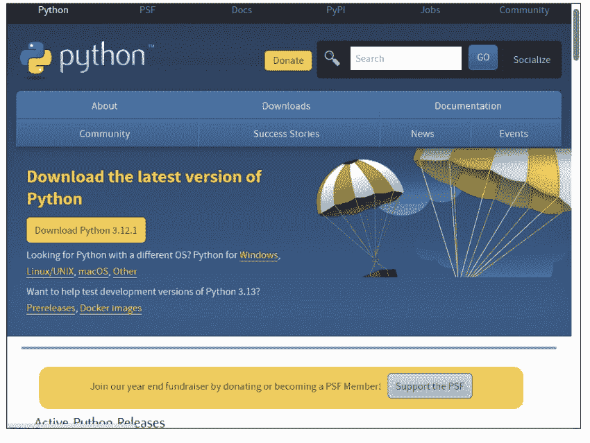

▲图 4-1

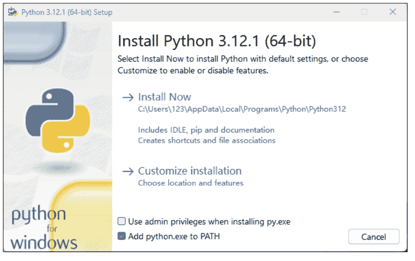

▲图 4-2

：使用 Python 编写文本相似度分析的代码。 

：文本相似度分析属于自然语言处理范畴，用来衡量两段文本的相似程度。Python 中常见做法是采用余弦相似度、编辑距离等算法。下面给出基于余弦相似度的实现示例。

python
import jieba
from sklearn.feature_extraction.text import TfidfVectorizer
from sklearn.metrics.pairwise import cosine_similarity
...
示例展示了分词、TF-IDF 向量化以及余弦相似度计算的完整流程，并输出相似度分数。

余弦相似度的取值区间为 -1 到 1，数值越接近 1 表示两段文本越相似。

**提示：**获取代码后请务必进行充分测试与验证，运行后检查功能是否符合预期，发现问题及时反馈以便优化，确保代码质量与准确性。

### **4.4.2 代码理解**

文心一言能够解析代码结构与语义，将复杂逻辑转化为通俗自然语言，便于非技术人员理解，同时可自动生成相关文档与注释，显著减轻开发负担，提升效率。

**案例实战** 

：请作为资深开发工程师，解释我给出的代码。请逐行分析我的代码并给出你对这段代码的理解。我给出的代码是：

jobs_num=driver. find_element(By.CSS_SELECTOR,\"h1>span\").get_attribute(\"innerText\")
...

：该段代码的核心是通过 WebDriver，通常为 Selenium，实现网页自动滚动并动态加载更多内容。
1. jobs_num = driver.find_element(By.CSS_SELECTOR,"h1>span").get_attribute("innerText")
此行利用 CSS 选择器定位 h1 标签下的 span 元素并读取其内部文本，可能表示职位数量等信息，存入变量 jobs_num。
2. if len(jobs_num.split(',')) > 1：
...

代码走查要点速览

先检查 jobs_num 字符串是否带有逗号。若检测到逗号，则按逗号拆分并取最左侧片段作为基数再乘 1000；若未检测到，则直接把整串转成整数。

3. jobs_num = int(jobs_num)
这里再次执行整型强转，前面的解析里已完成同类转换，属于重复操作。

4. jobs_num = 1000;
该语句把 jobs_num 强制覆盖为常数 1000，等同于丢弃前面所有解析结果。在没有特殊说明的情况下，这类写法多为调试残留或笔误。

5. i = 2
为后续循环准备计数器，初始值设为 2。

6. while i <= int(jobs_num/2)+1：
循环上限由 jobs_num 除 2 再加 1 决定，主要用于控制页面滚动的轮次。

7. driver.execute_script("window.scrollTo(0, document.body.scrollHeight);")
循环体内通过 JavaScript 把视口拉到页面底部，用于触发懒加载或加载更多内容。

8. i = i + 1
每轮结束时让计数器递增。

9. print("当前在： ", i, "完成度： ", ((i+1)/(int(jobs_num/2)+1))*100, "%",end="\r")
实时输出进度信息，百分比的分母依赖 jobs_num/2+1。因为前面已把 jobs_num 硬编码为 1000，实际进度容易偏离预期。

10.try：
infinite_scroller_button = driver.find_element(By.XPATH, ".//button[@aria-label='Load more results']")
infinite_scroller_button.click()
time.sleep(0.1)
except：
time.sleep(0.1)
pass
尝试定位 aria-label 为 Load more results 的按钮并点击，成功则短暂休眠 0.1 秒；若定位或点击抛出异常，则捕获后同样休眠 0.1 秒后继续执行。

### 4.4.3 优化代码性能

基于深度学习与自然语言处理的支持，文心一言能够读懂代码的结构与语义。它可依据性能目标自动调整排版、变量选用与循环形态等关键点，提升运行速度与资源利用率；同时还能学习开发者的编码习惯，结合项目特征给出个性化的优化建议，让特定性能需求得到满足，整体开发体验得到明显改善。

**案例实战** 
：**根据 Pep-8 规范(PEP-8)来纠正我的代码**
jobs_num=driver.  find_element(By.CSS_SELECTOR,\"h1>span\").get_attribute(\"innerText\")
if  len(jobs_num.split(',')) > 1：
jobs_num = int(jobs_num.split(',')[0])*1000
else：
jobs_num = int(jobs_num)
jobs_num = int(jobs_num)
jobs_num = 1000;
i = 2
while i <= int(jobs_num/2)+1：
driver.execute_script(\"window.scrollTo(0, document.body.scrollHeight);\")
i = i + 1
print(\"当前在：  \", i, \"完成度：  \", ((i+1)/(int(jobs_num/2)+1))*100, \"%\",end=\"\\r\")
try：
in finite_scroller_button=  driver.  find_element(By.XPATH, \".//button[@aria-label='Load more
results']\")
in finite_scroller_button.click() time.sleep(0.1)
except：
time.sleep(0.1)
pass 
：根据你提供的代码和 PEP-8 规范，以下是对代码的修正。
python
if  len(jobs_num.split(',')) > 1：
jobs_num = int(jobs_num.split(',')[0]) * 1000
else：
jobs_num = int(jobs_num)
jobs_num = int(jobs_num)
jobs_num = 1000
i = 2
while i <= int(jobs_num / 2) + 1：
driver.execute_script("window.scrollTo(0, document.body.scrollHeight);")
i += 1
print(f"当前在：  {i} 完成度：  {((i + 1) / (int(jobs_num / 2) + 1)) * 100}%", end="\r")
try：
in finite_scroller_button = driver.  find_element(By.XPATH, ".//button[@aria-label='Load more
results']")
in finite_scroller_button.click()
time.sleep(0.1)
except Exception as e：  # 更具体的异常处理会更好，比如特定的 Selenium 异常
time.sleep(0.1)
pass
主要的更改包括：
移除了不必要的分号。
使用了 f-string 来简化字符串的格式化。
将 i = i + 1 简化为 i += 1。
为 except 子句添加了异常捕获变量 e，以便进行可能的后续处理或记录。当然，根据上下文，你可能希望更具体地捕获某种类型的异常，而不是使用通用的 Exception。

### 4.4.4 代码 Debug

文心一言能够自动扫描语法错误、逻辑缺陷以及其它潜在风险并给出修复建议，从而大幅压缩调试修复的时间。开发者可以更快定位问题根源，节省精力并确保代码质量与稳定性。

**案例实战** 
：**检查以下代码检查 bug 并修改。**
def divide_numbers(x, y)：
try：
result = x / y
except ZeroDivisionError：
print("Error： Division by zero is not allowed.")
return None
else：
         return result
print(divide_numbers(10, 0)) 
：你已经给出了一个 divide_numbers 函数，它试图处理除数为 0 的情况，但在调用这个函数时，你仍然用 0 作为除数来测试它。这样，虽然函数内部处理了这种情况，但从整体代码的角度看，这仍然是一个 bug，因为你不应该故意触发这种错误。
为了修复这个 bug，你应该确保在调用这个函数时不要使用 0 作为除数。但如果你想测试这个函数是否能正确处理除数为 0 的情况，那么可以保留这个调用，但要确保你知道这是一个测试，而不是一个常规的函数调用。
代码可以保持不变：
python
def divide_numbers(x, y)：
try：
result = x / y
except ZeroDivisionError：
print("Error： Division by zero is not allowed.")
return None
else：
return result
print(divide_numbers(10, 0))
但要记住，在实际的应用中，你应该避免这样的调用，除非是为了测试函数。

### 4.4.5 Python 大脑

借助文心一言的 Python 大脑，编程效率、代码质量与排错能力都能得到提升。该能力会基于已有代码智能推荐片段、函数与库，并提供强力的补全支持，让任务更快更准确地完成。

**案例实战** 
：怎么用 Python 读取 Excel 表格中的数据并且输出第 3 行内容？ 
：要读取 Excel 表格中的数据并输出第 3 行的内容，你可以使用 Python 的 openpyxl 库。请确保你已经安装了该库，你可以使用以下命令来安装。
pip install openpyxl
一旦安装完成，你可以使用以下代码来读取 Excel 文件并输出第 3 行的内容：
python
import openpyxl
# 打开 Excel 文件
workbook = openpyxl.load_workbook('example.xlsx')
# 选择第一个工作表
worksheet = workbook.active
# 读取第 3 行的内容
third_row = worksheet[3]
# 输出第 3 行的内容
for cell in third_row：
print(cell.value)
请确保将代码中的 example.xlsx 替换为你实际的 Excel 文件名。上述代码将打开 Excel 文件，选择第一个工作表，并读取第 3 行的内容。然后，它将逐个输出第 3 行中每个单元格的值。

### 4.4.6 代码解题报告

用文心一言自动生成解题报告可省去手写的时间成本。报告会结合代码与问题给出清晰说明，帮助发现隐患与优化空间，并提供方案与解释，显著提升开发效率与代码质量。

**案例实战** 
：这是一段求数组最大值的代码，请写一篇解题报告，解题报告的正文必须包括：问题描述、分析、证明、代码、解释、复杂度分析几个方面。代码如下。
#include 
using namespace std;
int div_max(vector<int>& nums,int left, int right)</int>
{
int max_left;
int max_right;
int mid;
if (left==right)return        nums[left];
else if (right-left==1) return max(nums[left],nums[right]);
mid=left+((right-left)>>1);
max_left=div_max(nums,left,mid);
max_right=div_max(nums,mid+1,right);
return max(max_left,max_right);
}
int main()
{  vector<int>nums={4,7,6,5,4,3,2};</int>
cout<<div_max_nums_0_6___endl__ span=""></div_max_nums_0_6___endl__>
return 0;
} 
：解题报告：求数组最大值
一、问题描述
给定一个整数数组，我们需要找出数组中的最大值。这是一个常见的问题，在很多实际应用中都会用到，例如统计学、数据分析和算法等。
二、分析
本题的解法采用了分治策略。通过将数组一分为二，然后递归地在左右两个子数组中分别找出最大值，最后返回两个最大值中的较大者。这种方法的时间复杂度为 O(nlogn)，其中 n 是数组的大小。
三、证明
为了证明该算法的正确性，我们可以使用数学归纳法。首先，对于基本情况（数组大小为 1 或 2），算法显然能够返回正确的结果。然后，我们假设对于所有小于 n 的数组大小，算法都能正确地找到最大值。在此基础上，我们考虑数组大小为 n 的情况。根据归纳假设，算法能够在左子数组和右子数组中分别找到最大值。由于这两个最大值一定是整个数组的最大值之一，因此返回它们中的较大者即可得到整个数组的最大值。由此，我们证明了算法对于所有数组大小都是正确的。
四、代码
以下是使用 C++实现的代码。
cpp
#include 
using namespace std;
int div_max(vector<int>& nums, int left, int right) {</int>
if (left == right) return nums[left];
else if (right - left == 1) return max(nums[left], nums[right]);
int mid = left + ((right - left) >> 1);
int max_left = div_max(nums, left, mid);
int max_right = div_max(nums, mid + 1, right);
return max(max_left, max_right);
}
int main() {
vector<int> nums = {4, 7, 6, 5, 4, 3, 2};</int>
cout << div_max(nums, 0, 6) << endl;
return 0;
}
五、解释
在上面的代码中，div_max 函数用于计算给定数组在指定区间内的最大值。它首先检查区间的大小，如果区间只有一个元素，直接返回该元素；如果区间有两个元素，返回较大的那个。否则，将区间一分为二，然后递归地在左右两个子区间中分别找出最大值，最后返回两个最大值中的较大者。main 函数创建了一个示例数组并调用了 div_max 函数来计算最大值。
六、复杂度分析
由于算法采用了分治策略，每次将问题规模减半，因此时间复杂度为*O*(*n*log*n*)，其中*n*是数组的大小。在最坏情况下，递归树的高度为 log*n*，每层递归需要*O*(*n*)的时间来处理子问题，因此总时间复杂度为*O*(*n*log*n*)。空间复杂度方面，由于递归调用需要额外的栈空间来保存函数调用的上下文信息，因此空间复杂度为*O*(log*n*)。

## 4.5 论文写作：助力你的学术成果

本节将探讨如何借助文心一言提升论文写作效率与质量。我们将依次介绍论文大纲生成、逻辑校验、文本摘要、问答与润色等核心功能，并通过示例帮助读者掌握使用方法，优化写作流程。

### 4.5.1 论文大纲生成

随着人工智能与自然语言处理技术的发展，学术写作工具愈发丰富，为研究者带来更便捷高效的体验。文心一言在论文写作领域表现突出，能够帮助梳理结构与内容。生成大纲时，主题、研究问题与关键词应尽量准确具体，以确保大纲与研究高度相关，为后续撰写奠定基础。

**案例实战** 
：请为我撰写一份论文大纲，论文的研究问题是“人工智能与医疗”。论文采用的是“定量分析”的方法，你需要在大纲中包含研究问题、相关文献综述、研究方法、数据分析和结果呈现、结论与讨论这些部分。注意你需要保证内容逻辑清晰，分条表述，有结构关系。 
：论文大纲：人工智能与医疗的定量分析
一、引言
1.1 研究背景
1.2 研究问题
1.3 研究目的与意义
二、相关文献综述
2.1 人工智能在医疗领域的应用
2.2 定量分析在医疗领域的研究现状
2.3 人工智能与医疗结合的研究进展
三、研究方法
3.1 数据来源与采集
3.2 数据预处理与清洗
3.3 数据分析方法选择
3.4 研究假设与变量定义
四、数据分析和结果呈现
4.1 描述性统计分析
4.2 相关性分析
4.3 回归分析与模型构建
4.4 结果呈现与解读
五、结论与讨论
5.1 结论总结
5.2 结果讨论与解释
5.3 研究贡献与意义
5.4 研究局限性与未来展望
六、附录与参考文献
6.1 附录：实验数据、图表等
6.2 参考文献：引用文献列表

### 4.5.2 逻辑校验器

论文写作不仅要内容充实，也要逻辑连贯。文心一言提供的逻辑校验功能能够智能识别潜在的逻辑错误与矛盾，并给出修改建议，帮助提升论文的逻辑性与整体质量。

**案例实战** 
：以下逻辑是否成立：没有老师是学生，一些学生是运动员，那有些运动员不是老师。 
：首先，我们来分析给出的前提条件。
1. 没有老师是学生：这意味着老师和学生是两个完全不重叠的集合。换句话说，如果一个人是老师，那么他就不可能是学生；反之亦然。

2. 部分学生同时具备运动员身份：这表明学生群体与运动员群体并非互不相干，二者存在重叠，确实有人兼任学生与运动员。

依据前提一，教师与学生的范畴是分离的。依据前提二，学生里存在一部分也是运动员。由于这批兼具学生和运动员属性的人与教师没有交集，所以他们也不可能属于教师。由此可以确认，必然存在运动员并非教师的情况。

总体而言，论断“有些运动员不是老师”成立。

### **4.5.3 文本提要**
在信息爆炸的今天，人们每日要面对海量的文字资料，如何在短时间内准确把握要点并提炼核心，却成了普遍难题。为此文心一言推出文本摘要功能。该功能能够自动抓取文章主干信息，生成简明扼要的概括，帮助用户更快整理思路、提升工作效率与记忆效果。

**案例实战** 
：请阅读我提供的材料并进行理解与概括。回复需先给出一小段简要概述，再以列表形式呈现关键信息与主要观点。要求概括简练、信息完整，便于快速把握原文主旨。请按以下格式输出：

【文本简介】简要概述

【文本核心内容】以列表罗列重点信息

下面需要处理的材料为：人工智能是当代科技的重大成果，它凭借卓越的智能化水平与深度学习能力，推动人类迈入全新阶段。它的应用几乎渗透到生活的每个角落，从医疗健康到交通物流，从金融服务到传媒娱乐，无处不在的人工智能正在重塑我们的世界。人工智能的潜力十分庞大，能够处理与分析远超人脑的数据规模，从中挖掘出有价值的信息与规律。它可以自主学习、适应新环境，持续提升性能与精确度。人工智能还能攻克诸多复杂难题，为人类打开更多可能性与机会。不过，人工智能也伴随令人忧虑的风险。随着技术发展，人们担心它会取代大量就业岗位，造成大规模失业。此外，其算法与决策机制可能存在偏见与不公，需要投入更多努力加以解决。因此应当审慎使用人工智能，确保其发展方向符合人类福祉与价值取向。我们要在推动技术进步的同时加强监管与伦理规范，保证其公正透明。只有这样，人工智能才能成为进步与繁荣的重要动力，助力更美好的未来。 

：【文本简介】
本文围绕人工智能在当下社会的作用展开，梳理了其广泛应用、巨大潜能以及潜在风险，强调理性使用的重要性并给出发展建议。

【文本核心内容】
人工智能以强大的智能与深度学习引领人类进入新时代。
应用领域覆盖医疗、交通、金融、娱乐等多个生活层面。
具备处理海量数据、自主学习、适应新情境的能力。
可能引发失业以及算法偏见、不公平决策的担忧。
需审慎应用，使其发展契合人类利益与价值观。
在促进发展的同时强化监管与伦理建设，确保公正透明。

### **4.5.4 智能问答**
想要更高效地获取精准信息，智能问答系统开始普及。相较传统搜索引擎，文心一言的问答功能优势明显，不仅能迅速给出准确答案，还可提供更具个性化的回应，满足多样化的信息需求，大幅提升检索效率与使用体验。

**案例实战** 
：现在你扮演一位阅读理解助手，深度阅读我提供的材料并据此回答我的问题。我的问题是：“会计权责发生制下，如果发生了经济业务却未收到现金，是否需要入账？”阅读材料为：会计权责发生制是我国当前会计体系中的重要原则。其基本思路是依据经济业务产生的权利与义务确定入账时点。具体而言，在权责发生制下，无论现金是否收付，只要经济业务已发生并形成企业的应收或应付，就应在当期确认相关科目。例如，商品售出尚未收款时仍需确认收入；货物采购未付款时仍需确认费用。这种按经济实质入账的方式能真实反映财务状况，有助于内部决策与外部评估。它最大限度弱化了现金流的影响，注重实质而非形式，是国际通行的会计基本规则。 

：根据材料，在权责发生制下，只要经济活动已发生并产生应收应付权利义务，即使现金未收付也须在当期相关科目入账。所以答案是会记录到账目上。

### **4.5.5 文案润色**
日常写作中，报告、论文、广告文案等形式多样。即便观点清晰、内容充实，若表达不够流畅或存在语法问题，也会削弱阅读效果。为此可使用文心一言的文本润色功能。该功能能智能优化措辞，提升文档质量与可读性，让表达更易被接受。

**案例实战** 
：在不改变原意和语言的前提下，对下面内容进行润色，使语气更诚恳。原文：老师你好，打搅你了，对于昨天没完成作业，回家我们和孩子进行了了解和交流，孩子也表态，最后还自愿抄写作为自我提醒！也请宋老师监督我们。 

：老师您好，非常抱歉孩子昨天未完成作业给您添麻烦了。回家后我们与孩子进行了深入沟通，孩子已认识到问题并作出表态，还主动抄写以作提醒。我们也希望宋老师能继续监督指导，帮助我们更好地教育孩子。再次感谢您的理解与支持。

润色后语气更谦逊诚恳，充分体现了对老师的尊重与信任，以及家长对孩子教育的重视。

# **第五章**

# **文心一言：生活好助手**
本章将深入探讨文心一言在多个生活场景中的实际运用，涵盖饮食规划、旅行参考与生活品质提升等方向。详细介绍如何借助文心一言优化日常饮食、制定周到旅行方案，并利用其功能提升生活质量。通过具体案例与情境展示，帮助读者全方位感受其实用性与高效性，从而在日常中更熟练地使用这一助手。

## **5.1 美食健康：私人营养顾问**
本节重点介绍文心一言在饮食规划方面的应用，结合实例与操作步骤，帮助读者依据自身需求与口味探索美食、制定个性化饮食方案并养成健康习惯。此外还能提供专业美食点评与建议，让人在享受美味的同时兼顾健康。无论是热爱美食的普通用户，还是进行或准备进行饮食管理的人群，都能从中获得实用指导，让美食与健康和谐共存。

### **5.1.1 地方特色美食推荐**
区域美食是各地饮食文化的集中体现，反映了历史传统、地理环境与民俗风情，为人们带来丰富口感与文化体验。下面介绍如何利用文心一言发现各地美食，轻松品鉴珍馐，领略不同地域的饮食魅力。

使用文心一言进行区域美食推荐时，建议注意以下三点。

·明确推荐区域：可根据兴趣选择特定地区、城市或国家进行探索。
·提出具体要求：请求时详细说明需求，如推荐潮汕特色美食及知名餐厅，或注明口味偏好、预算等，以便获得更贴合期望的结果。
·选择输出形式：文心一言可按指令生成列表、文字描述或地图形式，方便查阅与规划美食之旅。

**案例实战** 
：作为游客，请推荐北京必吃的十大美食。 

：作为游客到北京游玩时，必尝的十大美食包括：

1. 北京烤鸭：享誉中外的京城名菜，被誉为天下美味。
2. 老北京炸酱面：传统面食，以酱肉、黄瓜拌面，口感丰富。
3. 炒肝：经典小吃，以猪肝猪大肠制成，鲜美滑嫩。
4. 豆汁：独具特色的发酵饮品，味道独特营养丰富。
5. 京酱肉丝：用甜面酱炒制的猪肉丝，色香味俱佳。
6. 驴打滚：糯米、红糖、黄豆粉制成的小吃，软糯香甜。
7. 豌豆黄：以豌豆为原料的传统甜点，细腻香甜。
8. 羊蝎子火锅：以羊蝎子高汤为主的特色火锅，汤味浓郁。
9. 炸灌肠：灌肠裹面糊油炸，外酥里嫩，香气四溢。
10. 卤煮火烧：将火烧与卤煮食材同煮，历史悠久的京味小吃。

这些佳肴地方特色鲜明，品尝后更能了解北京的文化底蕴。

### **5.1.2 减脂餐**
追求健康生活时，减脂餐成为许多人的选择。如何制定既美味又营养的减脂方案是个挑战。以下介绍如何借助文心一言生成个性化减脂餐，在享受美食的同时达成减脂目标。

首先要明确需求与目标，例如：“我想减重，请为我生成一份适合减脂的早餐食谱，要求低热量、高蛋白、低脂肪，并提供食材清单与做法。”

其次可根据口味与喜好调整，如：“我偏爱鸡蛋与蔬菜，不喜欢过甜，请尽量使用这些食材并避免过多糖分。”

通过这种方式，文心一言能依据具体需求与偏好生成符合减脂要求且美味的个性化方案，帮助轻松减脂、享受健康生活。

**案例实战** 
：生成一份包含蛋白质、碳水、脂肪的优质减脂餐。 

：早餐：
·燕麦粥 50克干燕麦
·水煮蛋 1个
·鲜榨果汁 1杯

午餐：
·烤鸡胸肉 150克
·烤蔬菜 150克，如胡萝卜、西兰花、彩椒
·糙米饭 1碗约150克

晚餐：
·清蒸鲈鱼 150克
·蒸豆腐 100克
·炒青菜 200克
·红薯 1个约200克

营养建议：
1. 增加膳食纤维摄入，选择绿叶蔬菜与豆类，增加饱腹感。
2. 控制碳水化合物，选择低GI主食如糙米、红薯，稳定血糖。
3. 保证优质蛋白摄入，如鸡蛋、鸡胸肉、鱼类，维持肌肉、促进脂肪燃烧。
4. 控制总热量摄入，略低于消耗量以实现减脂。
5. 保持水分，每日至少8杯水，减少高糖饮料。
6. 规律作息结合有氧与力量训练，提升减脂效果。

以上方案仅供参考，具体请结合个人情况与专业营养师建议调整。

提示：减脂需要持续努力与不断调整，饮食是关键。与文心一言保持互动，探索更适合自己的方案，坚持与调整是成功的核心。

### **5.1.3 饮食方案**
在快节奏生活中，保持健康饮食愈发重要。用户可根据自身需求，利用文心一言轻松制定符合个人的饮食方案，更好管理饮食健康。

**案例实战** 
：为都市上班族制定一份健康饮食计划，需包含一日三餐，营养均衡、科学配比。 

：都市上班族健康饮食计划

一、背景与目标
针对都市上班族的作息与营养需求，制定一日三餐、均衡营养的健康方案，帮助保持身体健康、提升工作效率、预防疾病。

二、饮食原则
均衡摄入，合理搭配蛋白、碳水、脂肪。
多样化摄入，增加维生素与矿物质。
控制热量，避免肥胖。
定时定量，有助消化。

三、一日三餐方案
早餐 7:00-8:00
主食：燕麦粥50克或全麦面包2片配低脂牛奶200毫升
蛋白：鸡蛋1个或豆腐50克
蔬果：水果1个或蔬菜沙拉50克

午餐 12:00-13:00
主食：糙米饭1碗约150克或全麦面条1碗约100克
蛋白：瘦肉100克、鱼肉100克或豆制品100克
蔬菜：绿叶菜150克或其他蔬菜150克
水果：水果1个

晚餐 18:00-19:00
主食：杂粮饭1碗约150克或红薯1个约200克
蛋白：瘦肉100克、鱼肉100克或豆制品150毫升
蔬菜：绿叶菜150克或其他蔬菜150克
水果：水果1个

注意事项：
1. 摄入量按个人需求与活动水平调整。
2. 特殊需求或健康问题请遵医嘱调整。
3. 保持多样化，选用当季新鲜食材。
4. 每日至少饮水8杯。
5. 减少高糖高盐高脂食品摄入。

### **5.1.4 家常菜谱**
下面介绍如何利用文心一言生成家常菜谱。只需提供菜名，即可获得涵盖食材准备、烹饪步骤与注意事项的详细方案，为厨房生活提供便利，激发烹饪灵感。

**案例实战** 
：请提供麻婆豆腐的做法与注意事项。 

：麻婆豆腐是一道经典川菜，以麻辣口感深受欢迎。做法如下：

1. 准备豆腐、豆瓣酱、花椒、姜、蒜、小葱、盐、糖、生抽、淀粉等。
2. 豆腐切块，用加盐沸水焯一下去豆腥味，沥干备用。
3. 锅中放油烧热，下花椒粒小火炸香后捞出。
4. 下姜蒜末炒香，再加入豆瓣酱煸匀。
5. 加水下豆腐块，轻推使均匀裹汁。
6. 加入盐、糖、生抽小火焖5分钟。
7. 水淀粉勾芡，使汤汁浓稠。
8. 出锅前撒葱花即可。

注意事项：
1. 切豆腐由后往前切，避免粘刀。
2. 炒肉馅与豆瓣酱用中小火防糊。
3. 烧豆腐时动作轻柔防碎。
4. 分次加入水淀粉便于控制浓稠度。
5. 花椒粉起锅前撒入口感更佳。
6. 可按口味加入辣椒粉或花椒油增香。
7. 豆瓣酱已咸，少放盐更健康。

### **5.1.5 美食点评**
文心一言能整合多源信息与数据，为用户提供丰富多维的美食点评，不仅描述口感、外观与服务质量，还能按特定需求给出针对性建议。

使用示例指令：

·要求点评指定餐厅，涵盖菜品、环境、服务，如“请为××餐厅生成点评，包括口感、环境与服务质量”。
·按口味偏好生成点评，如“我偏爱辣味与海鲜，请据此生成点评”。
·点评特定菜系，如“请生成川菜点评，重点介绍特色、经典菜品与口味”。

通过这些指令，用户可获得全面个性化的点评，为选择提供参考。

**案例实战** 
：作为美食家，对一家川菜馆进行全面专业点评。 

：标题：川味之旅——探访××川菜馆的味蕾盛宴

作为美食家，我有幸品尝了位于市中心的××川菜馆。该店以传统川菜为主，融入现代创意，为食客呈现独具风味的盛宴。

一进门，便被宽敞明亮的空间吸引。装修典雅现代，柔和灯光洒在舒适座椅上，营造温馨氛围。墙面陈列的川菜历史与名菜介绍，彰显了对川菜文化的传承与弘扬。

服务态度真的很加分，整个用餐过程让人感到被认真对待。上菜前工作人员会细致讲解菜单，并结合我的口味偏好挑选几道有代表性的特色菜。等餐期间还主动送来几碟清爽的凉菜和小吃，细节上很贴心。

重头戏自然是味道。我先点了招牌的水煮鱼，鱼片滑嫩，麻辣层次分明，汤汁浓厚，完全尝到川菜特有的麻辣劲道。随后上的麻婆豆腐，豆腐细滑入味，麻辣鲜香平衡，搭着自制豆瓣酱，余味很长。宫保鸡丁和辣子鸡也都上了桌，每一道都能看出师傅对川菜手法拿捏得很准。

餐厅也玩出了新花样。除了经典，还推出了几道混搭中西的创意菜，比如麻辣披萨、川味汉堡，吃着熟悉的川味，又带着意外的碰撞感，很有新鲜感。

饮品的排面也不小，果汁、茶饮、鸡尾酒选择丰富，和辣味的菜品搭配起来更解腻，整体味觉体验被拉得更饱满。

综合来看，××川菜馆在口味、服务和就餐氛围上都很在线。用传统川菜打底，再融入现代化的点子，整场用餐就是一场很有辨识度的味觉享受。如果你是川菜粉，或者单纯想试试新吃法，来这里基本不会失望，个人觉得很容易找到属于自己的惊喜。

## **5.2 用 AI 让出行更省心**

科技越发展，生活被改变得越明显，人工智能已经渗进日常的方方面面。旅行这件事上，文心一言已经解决了很多实际难题，慢慢成了很多人的出行搭档。靠着持续学习，它沉淀了不少目的地、住宿、路线方面的经验，不管是选去哪、住哪、怎么走，都能给出还算靠谱的意见。下面就聊聊怎么借助它把一次旅行安排得更顺畅、更轻松。

### **5.2.1 目的地智能匹配**

文心一言会把你的喜好、花费预算、出行天数等信息放在一起分析，给出最契合的目的地建议。借助这个功能，行程框架能更快定下来，也省去大量比价比攻略的时间。实际操作很简单，比如告诉它“我偏自然风光，预算五千以内，五天左右”，它就能迅速筛出性价比高、条件合适的去处。

**案例实战** 

：**我有七天假期，预算大概五千，你觉得去青岛还是沈阳更合适？** 

：青岛和沈阳在预算和时间范围内都可行，我帮你梳理下特点方便取舍。

1. 青岛

o 青岛是海滨城市，自然与人文景观都可看。栈桥、八大关、崂山这些点很经典，海景也很有看头。
o 美食代表有青岛啤酒、烤鱿鱼、脂渣等，挺有地方味。
o 旺季时酒店机票价格会偏高，要留意。

2. 沈阳

o 沈阳是东北核心城市，历史积淀深厚。沈阳故宫、张氏帅府、北陵公园值得逛，东北菜也地道。
o 交通便利，机票和住宿整体价格比较友好。
o 气候偏干，记得做好防干保湿。

整体来说，喜欢海边和自然风光可以倾向青岛，偏爱历史文化和东北美食则沈阳更对味。无论选哪边，提前规划行程和费用会更安心。

### **5.2.2 住宿精准推荐**

选酒店直接影响旅行体验。文心一言会根据出行目的、预算区间和地理位置要求来筛选，快速给出符合预期的房源，让你在路上住得舒服。

**案例实战** 

：**我打算去北京四天三晚，主要是去故宫，预算两千，能帮我挑家合适的酒店吗？** 

：可以。基于你想离故宫近、预算控制在两千的需求，给你两家参考。

·北京紫禁城皇冠假日酒店：位于东城区，距故宫约500米，步行可达，设施齐全，逛完故宫回酒店很方便。
·北京京古四合院酒店：距离故宫500米、天安门广场1600米，步行约15分钟可看升旗。酒店在胡同里，初次去建议跟着地图走。

两家都在预算范围内，且距离景点很近，可以按喜好决定。价格会随季节和订房情况波动，建议提前确认。

希望对你的北京行有帮助，有其他需求随时说。

### **5.2.3 徒步路线定制**

生成徒步路线是很多户外爱好者常用的功能。只要输入起点、终点、想经过的点，系统结合地图数据和算法就能快速推一条路线，还会兼顾里程、难度、沿途景色，并按个人体能做微调，安全性与舒适度兼顾。

**案例实战** 

：**给我列出虎跳峡周边五条经典徒步路线，并标出线路、里程和累计爬升。** 

：表 5-1 汇总了虎跳峡周边的五条经典徒步线路。

表 5-1

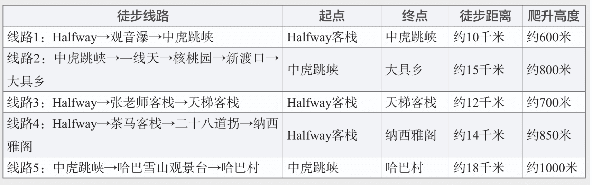

这五条线路覆盖了不同难度和距离，适合各类户外玩家。能让你看到虎跳峡的多样自然面貌。实际出行时要注意安全，根据自身体能挑路线，出发前最好向当地向导了解路况。

**提示：**用文心一言规划徒步时，要兼顾安全准备、通讯联络、路标辨识、身体状态、环境变化和备选方案。只有把这些点都考虑周全，徒步才会既安全又愉快。出发前准备充分，上路时保持警觉，应对突发情况。

### **5.2.4 个性化旅游规划**

文心一言能综合喜好、预算、时间等维度，给出目的地的、住宿的、餐饮的、玩乐的整体建议。不用在信息海里反复筛选，直接拿到一套适合自己的方案，旅行会更丰富。

**案例实战** 

：**游客身份，介绍下长沙必吃的美食，再帮我安排三天两晚的行程。** 

：长沙三天两晚建议行程

一、长沙必吃清单

1. 臭豆腐：当地人称臭干子，外焦里嫩，嗅着臭吃着香，辣味提鲜。
2. 口味虾：一年吃掉上千吨小龙虾，做法多样，蒸、焖、炒、烤皆可。
3. 嗦粉：米粉在湖南的地位不言而喻，汤滑酸辣是灵魂。
4. 糖油粑粑：糯米粉与糖制成，长沙人从小爱吃的甜点。
5. 茶颜悦色：本地人日常喝，外地人到长沙常专程打卡。
6. 剁椒鱼头：虽是后起之秀，已成湘菜代表，辣香浓郁。

二、三天两晚安排

第一天：
上午抵达入住，前往岳麓山。山水与文化兼具，是赏枫胜地。
中午在山下小吃街吃臭豆腐、口味虾等。
下午去湖南省博物馆看文物，了解省内历史。
晚上橘子洲头看湘江夜景，顺便吃点糖油粑粑。

第二天：
上午游岳麓书院，感受古代书院文化。
中午附近吃剁椒鱼头。
下午去天心阁，逛老城楼感受历史底蕴。
晚上五一广场逛街，喝杯茶颜悦色。

第三天：
上午自由活动，可去黄兴步行街或坡子街买手信。
中午吃米粉或麻辣烫。
下午结束行程返程。

### **5.2.5 大片机位推荐**

文心一言能读懂拍摄意图，结合场景特点快速给出机位建议。省去盲目试拍的时间，提升成片率。无论是找新角度还是优化现有构图，都能提供有效参考。

**案例实战** 

：**请以旅行摄影师的身份，给我一些北京环球影城的拍摄点建议。** 

：北京环球影城很适合拍片，下面推荐几个值得打卡的位置。

1. 入口大球
低角度仰拍，能让球体显得巨大，有进入奇幻世界的氛围。

2. 哈利波特霍格沃茨城堡
清晨或黄昏光线柔和，用广角收纳整座城堡和光影。

3. 变形金刚区巨型机器人
低机位拍摄，突出压迫感和体量。

4. 小黄人乐园彩色建筑
色彩饱和度高，鱼眼或广角能拍出活泼感。

5. 侏罗纪世界水域
傍晚灯光亮起时用慢门，捕捉水流与灯影的融合。

6. 好莱坞区复古汽车
大光圈虚化背景，营造老电影质感。

7. 表演与巡游瞬间
调好快门，记录演员动作和高潮时刻。

8. 灯光烟花秀
夜场用三脚架长曝光，留住绚烂天幕。

9. 主题商店餐厅细节
捕捉装饰和游客互动的小瞬间。

10. 幕后制作区
记录工作人员的工作场景，注意备电和存储。

祝拍摄顺利，玩得开心。

### **5.2.6 景点背后的故事**

文心一言能提供系统的景点知识，根据兴趣给出精准推荐，并附上历史、文化、传说解读。让游览不只是看风景，还有深度。

**案例实战** 

：**请像资深导游一样，讲讲寒山寺的来历和故事。** 

：寒山寺的缘起

寒山寺在苏州姑苏区，历史可追溯到梁代天监年间，由希迁与僧珥创建。初称妙利普明塔院，唐贞观时期因诗人寒山曾住此而更名。寒山与拾得并称和合二仙，其诗在寺内流传，吸引文人。

历史上寺院多次毁建。咸丰年间战火成灰，光绪年间陈夔龙等人筹资重修，历时三十余年才恢复。

最知名的故事是张继《枫桥夜泊》。据说张继赴京赶考夜泊枫桥，闻钟声而作“姑苏城外寒山寺，夜半钟声到客船”。此诗让寒山寺名扬。

钟楼里悬着大铜钟，相传除夕敲108下可消灾解厄，吸引众多游客前来聆听。

建筑上中轴对称，天王殿、大雄宝殿、钟楼等布局典型，内部佛像壁画体现佛教艺术精髓。如今寒山寺既是礼佛之地，也是了解江南文化的重要窗口。

### **5.2.7 出行清单一站式整理**

文心一言能快速查到目的地天气、热门点、餐厅信息，并按个人偏好与预算定制建议。把出行清单一次性梳理好，效率更高。

**案例实战** 

：**我元旦要去开封四天三晚，帮我整理一份清单，要包含交通、行李等。** 

：以下是一份四天三晚开封行的参考清单，可按需调整。

一、出行工具
高铁/火车：提前订好往返车票。
地铁/公交：市内通勤可办交通卡。
出租车/网约车：短途灵活使用。

二、行李清单
衣物：按开封元旦气温准备外套、毛衣、长裤，备舒适鞋。
个人护理：洗漱用品、毛巾等。
电子设备：手机、充电器、耳机、相机。
证件票据：身份证、学生证、门票。
现金与卡：少量现金+银行卡。
药品：感冒药、止痛药、创可贴。
其他：水杯、雨伞、防晒。

三、行程要点
开封府：看古代官署建筑。
清明上河园：宋文化实景演出。
大相国寺：感受皇家寺院氛围。
龙亭公园：看夜景，俯瞰城市。
美食：灌汤包、羊肉烩面等。

四、注意事项
关注天气，灵活安排。
遵守景点规定，文明游览。
注意财物安全。
尊重当地习俗。

祝元旦开封之旅愉快。

## **5.3 生活品质加分指南**

文心一言作为通用型AI语言模型，覆盖面很广。节日送礼、日常穿搭、健身计划、电脑故障解答、宝宝取名、婚礼祝福、城市探索等场景都能给出实用建议。借助这些功能，生活会更顺手，幸福感也会提升。

### **5.3.1 礼物这样送才走心**

靠深度学习和大数据分析，文心一言能把握收礼人的喜好和性格，给出有针对性的礼物方案。省时又更准，让送礼更有温度。

**案例实战** 

：**收礼人是40岁女教师，是我母亲，母亲节送礼，请按人物特征、关系、送礼原因推荐五款礼品并说明理由。** 

：基于收礼人画像、母女关系和母亲节契机，给你五条建议。

1. 定制花束与手写卡片
花语代表心意，手写卡片更有温度，能让母亲感受到被在意。

2. 精致茶具配好茶
教师工作节奏紧，品茶能放松。选一套做工精致的茶具搭配上品茶叶，仪式感足。

3. 高质量蓝牙耳机
推荐理由：身为教师，母亲在工作或休闲时都需要一个高音质的耳机。高质量的蓝牙耳机不仅能让她在工作中更加便捷，还可以在休息时享受高品质的音乐或有声读物。

4. 定制手绘肖像

推荐理由：这份礼物很有温度，可以挑选妈妈最爱的单人照或亲子合照做成手绘肖像。挂在家中既能提升氛围，也能让她真切感受到你的用心和深情。

5. 身心放松护理

推荐理由：长期教书育人很容易身心俱疲，一张SPA护理券或一台高品质按摩器，都能让她在忙碌之余好好放松、恢复元气，也是一种贴心的关怀与感激表达。

挑选礼物时，心意比价钱更重要。只要能传递出对母亲的感恩与关心，就能让她在母亲节这一天感受到特别的温暖与爱。

### 5.3.2 穿搭方案

文心一言可以根据身材、肤色、风格偏好以及具体场合，为用户输出丰富多元的着装搭配建议。借助智能解析，用户能省下大量试错时间，穿搭更得心应手，也能更有底气展现个人魅力与风格。

**案例实战** 

：你是一位出行穿搭助手，请根据我提供的信息推荐今天适合的穿搭。

我的需求说明如下：

天气：晴天；交通：打车；目的地：商场；行程：与家人去商场用餐。 

：好的，基于你给出的信息，我为你整理了一套建议。

上装：简约舒适的T恤或衬衫

下装：休闲裤或长裙

鞋履：平底鞋或凉鞋

配饰：简约手提包或双肩包、 防晒霜、帽子等

推荐说明：

今天晴朗，可以选择简约舒适的T恤或衬衫，上衣颜色自选；下装搭配休闲裤或长裙，行走在商场更自在；鞋子建议平底鞋或凉鞋，减轻脚部负担；包包选简约款便于携带随身物品，同时记得带上防晒霜和帽子，保护皮肤免受日晒。

祝你和家人用餐愉快，玩得开心！

### 5.3.3 健身计划

健康意识提升，越来越多的人开始系统锻炼。但因体质、目标和时间各不相同，科学合理的训练方案并不好制定。文心一言能结合个人资料、健康状况、运动喜好与目标，生成全面且量身定制的训练计划，帮助更高效、安全地达成目标。

**案例实战** 

：请你扮演健身教练，帮我制定一份训练计划。我健身一年了，肩颈力量偏弱，想全身增肌尤其是上肢，场地在家，无器械。 

：没问题，我将以教练身份为你安排一份居家徒手训练方案。

考虑到你的情况，下面是一份以自重为主的全身增肌计划，重点强化上肢。请根据自身感受灵活调整。

一、热身 5 分钟

1. 跳绳 2 分钟
2. 动态拉伸 3 分钟

二、力量训练 40 分钟

1. 俯卧撑 3 组，每组尽力完成，标准动作困难可改膝盖支撑版。
2. 徒手深蹲 3 组，每组15～20 次，保持背腰挺直。
3. 仰卧举腿 3 组，每组15～20 次，兼顾腹部和大腿。
4. 俄罗斯转体 3 组，每组15～20 次，增强核心和侧腹。
5. 靠墙倒立撑 3 组，每组尽量维持时间，有助肩部和核心，对肩颈力量提升有效。
6. 平板支撑 3 组，每组30～60 秒，训练全身尤其是核心和上肢。
7. 仰卧起坐 3 组，每组15～20 次，主要锻炼腹肌。

三、有氧 15 分钟

任选喜欢的方式，如HIIT、跳绳、原地跑步等，改善心肺并促进恢复。

四、放松拉伸 5 分钟

做全身放松，重点深度拉伸肩颈，可借助瑜伽垫或毛巾辅助。

五、饮食要点

1. 保证充足蛋白质，如瘦肉、鱼、蛋、豆腐等，分餐摄入更易吸收。
2. 碳水摄入适中，优先低GI食物，如燕麦、全麦面包，避免高糖高脂。
3. 多吃蔬果，补充维生素和矿物质，可做沙拉或拼盘。
4. 控制盐分，注意加工食品和调味品的隐形钠。
5. 增加膳食纤维，多吃粗粮豆类。
6. 每天饮水充足，可定时提醒。

居家锻炼注意动作规范，避免受伤，出现不适或疼痛应立即停止并咨询专业人士。祝训练顺利！

### 5.3.4 计算机 IT 专家

文心一言的IT专家功能融合了先进的人工智能算法，能够模拟专家思维，为用户提供智能化解决方案。通过深度学习与大数据分析，它能精准理解复杂问题并给出清晰建议，提升效率与生活品质。

**案例实战** 

：请你担任IT专家，解答我关于电脑的问题，尽量少用专业术语，用通俗易懂的语言说明。第一个问题：电脑出现蓝屏怎么办？ 

：蓝屏通常由多种原因引起，可以尝试以下办法。

1. 重启电脑，有时只是临时系统错误，重启即可恢复。
2. 检查硬件，松动或损坏的内存、硬盘等也可能导致蓝屏。可以打开机箱确认是否插紧、是否受损，不确定时请专业人士协助。
3. 更新驱动程序，蓝屏持续时可更新显卡、声卡等驱动。通过设备管理器更新，或到厂商官网下载最新版本。
4. 系统还原，若以上仍无效，可用系统还原功能回退到之前正常状态，使用前请备份重要资料。

希望这些方法能帮到你，问题仍在请寻求专业帮助。 

：该如何更新驱动程序呢？ 

：更新驱动有几种常见做法。

1. 设备管理器
打开控制面板找到设备管理器，定位到显卡或声卡等设备，右键选择更新驱动程序，可自动搜索或手动指定路径。
2. 厂商官网
访问硬件厂商官网，如NVIDIA、AMD、Intel，进入支持或下载区，输入型号下载适配系统的最新驱动，双击安装即可。
3. 第三方软件
Driver Booster、Driver Easy等工具可自动扫描并安装更新，安装后点击更新即可。

无论哪种方式，更新前建议备份数据和系统设置，以防万一。

### 5.3.5 新生儿起名

借助文心一言起名既高效又具文化底蕴。输入相关信息与期望后，系统能迅速生成多条符合要求的候选名，融合语言、文化与历史，让起名更轻松、有创意。

**案例实战** 

：为姓刘的女孩起三个不落俗套的名字。 

：好的，为刘姓女孩推荐三个名字：

1. 刘瑾瑜：瑾指珠宝光华，象征珍贵纯净；瑜意为无瑕，整体显高贵完美，寓意如宝石般璀璨内外兼优。
2. 刘婉如：婉为娴静美好，体现温柔善良；如为如意，寄望一生顺遂事事称心。
3. 刘思淼：思为独立思考；淼为水势广阔，寓意思维深邃如海。

希望能帮你找到喜欢的名字。

### 5.3.6 日常医护知识

通过文心一言，用户能快速获取准确实用的日常护理常识，避免因信息来源不可靠产生误导，让健康知识获取更便捷。

**案例实战** 

：发高烧时要注意哪些事项，怎么才能好起来？ 

：发高烧时建议注意以下几点。

1. 保持室内通风，有助散热降温。
2. 多喝水，补充流失水分并促进代谢。
3. 穿宽松透气衣物，避免捂汗。
4. 卧床休息，减少能量消耗。
5. 用湿毛巾敷额头帮助降温。
6. 定期测温，掌握变化。

若高热不退或伴随其他症状，请及时就医。医生可能会建议用药缓解症状。

促进康复还需：

1. 按医嘱服药，缓解症状并预防并发症。
2. 饮食清淡易消化，如粥、面条、时蔬水果，避免辛辣油腻刺激。
3. 保证充足睡眠，提升免疫力。
4. 减少活动，避免剧烈运动和过度劳累。
5. 保持平和心态，有助身体恢复。

### 5.3.7 婚礼送祝福

文心一言能帮助人们节省构思时间，让祝福形式更丰富、更具个性化。依据新人特点定制化表达，避免套话，每一句祝福都更真挚，为喜庆场合增添温馨。

**案例实战** 

：朋友两天后结婚，想给她物质和语言上的祝福，有什么建议？朋友是女生。 

：很乐意帮你准备祝福建议。

物质祝福

1. 结婚礼物：挑选家居装饰、厨房用品或精致瓷器等她喜欢且婚后能用到的物品。
2. 鲜花：一束她喜爱的花，或象征爱情幸福的玫瑰、百合。
3. 礼金：按关系和经济情况准备一份心意。

语言祝福

1. 面对面祝福：婚礼当天可说“看到你穿婚纱真美，祝你和另一半幸福白头”。
2. 书面祝福：提前写下祝福卡，加入友情回忆和幽默元素。
3. 社交媒体祝福：在朋友圈或私信送上喜悦与祝愿。

以上希望对你有帮助。 

：可以帮我写一段祝福语吗？ 

：当然可以。

亲爱的朋友，

见你走入婚姻殿堂，我由衷祝愿。愿你的生活甜蜜温馨，彼此珍惜携手同行，爱情如美酒越陈越香，生活如乐章和谐幸福。祝婚姻美满，久久相伴。我为你感到骄傲与喜悦。

### 5.3.8 CityWalk 路线推荐

CityWalk 是体验城市历史与风情的流行方式，但景点众多交通复杂，规划路线颇费心思。文心一言可根据地理信息、文化背景与个人偏好，智能生成一条兼顾趣味与效率的路线。

**案例实战** 

：请推荐一条青岛的CityWalk路线，要求打卡异国建筑。 

：可以，青岛有很多异国风情建筑，尤其德国风格。推荐一条路线：

起点：栈桥附近浙江路老火车站

1. 浙江路火车站：德国文艺复兴风格，青岛最老火车站，细节精致。
2. 德国总督楼：沿浙江路北上至江苏路，威廉二世时期建筑，体量宏大。
3. 胶澳总督府：继续北行至沂水路，新古典主义风格，现为市人大常委会和政协办公地。
4. 青岛基督教堂：经江苏路转曲阜路，红色屋顶哥特式建筑，市内著名教堂。
5. 信号山公园：步行可达，旋转观景台俯瞰老城区异国建筑全景。
6. 德国监狱旧址博物馆：沿龙山路南下，德国占领时期建筑，现为历史文化馆。
7. 青岛天主教堂：沿浙江路南返，罗马式建筑，哥特式代表景点。

终点：浙江路火车站

路线轻松，适合各年龄段，边走边感受历史厚重与建筑之美。

# 第六章
# 文心一言让生活更有趣

人工智能快速发展，为日常生活带来便利与新奇。文心一言让生活的多元与趣味更上一层楼，无论是寻找新颖挑战、解决观影选择，还是与虚拟角色深度交流，都能满足需求。下文将从四个角度呈现文心一言带来的生活魅力。

## 6.1 趣味挑战来点脑洞

生活中娱乐与挑战常相伴随。新颖有趣的挑战层出不穷，既有轻松幽默的次元壁挑战、料理挑战，也有洞察型的性格测试，以及废话文学和硬核吐槽。每种挑战都是思维锻炼，也是情绪释放，能带来别样乐趣和惊喜。

### 6.1.1 次元壁挑战

使用文心一言进行次元壁挑战时，你会得到一个智能对话伙伴。它能理解复杂指令，结合情境给出创意建议或反馈，推动挑战深入，有助于跳出思维定式，从新视角审视问题。

**案例实战** 

：给我一个次元壁挑战的主题、故事背景、人物角色、对话内容。 

：当然，给你一个示例。

主题：穿越时空的奇幻冒险

故事背景：在一个充斥奇幻元素的多元宇宙里，不同时空间隐藏着神秘通道，称作“次元壁”，连接各世界。一名现代探险家偶然发现通道，组织队伍展开跨时空探索。

人物角色：

1. 主角探险家：来自现代，对未知充满好奇与渴望，勇敢带领团队穿越时空，直面各种未知挑战与危险。

跨时空探险小队召集

2. 魔法师：源自魔法位面的顶级施法者，擅长操控时间与空间。TA 拆开了次元壁垒，并在全程为队长提供关键指引和支援。

3. 机器人伙伴：来自未来星域的智能机体，分析与工程技术突出。负责队伍的后勤保障与技术支持，在远征中发挥关键作用。

4. 异域战士：来自异域位面的战士，兼具强悍战斗力与野外生存能力。TA 负责护卫同伴，与跨时空的敌人正面作战。

对话片段：

片段一：初次集结
地点：探险者基地
主角 激动：都准备好了吗？我们马上要开启一次跨越时空的奇幻旅程！
魔法师 含笑：次元壁已由我打开，由我带队进入未知时空。
机器人伙伴 兴奋：目标时空的环境与风险已完成分析，各项准备均已就绪。
异域战士 坚定：队友的安全交给我，无论来犯何敌我都会战到底！

片段二：穿越时空
地点：次元壁前
主角 紧张望向次元壁：即将进入未知领域，大家准备就绪了吗？
魔法师 点头：放心，我会以魔法守护队伍，一起勇敢向前。
机器人伙伴 鼓励：前期准备充分，能够应对各种挑战与危险。
异域战士 握紧武器：我打头阵开路，确保大家安全通过。

片段三：奇幻冒险
地点：未知时空
主角 好奇张望：这里太奇妙了！从未见过这样的景象与生灵！
魔法师 惊叹：此域充盈奇幻因子与未知力量，需要谨慎应对。
机器人伙伴 汇报：扫描显示存在强劲未知能量场，可能干扰设备与能力。
异域战士 警惕：保持高度警觉，此地或藏有未知敌人与风险，一同探索！

### **6.1.2 料理挑战**
文心一言可解析语音指令与文字输入，为厨电与食材提供智能管控。依托该能力，用户能便捷获取食材信息、掌握烹饪技巧、调整配方，从而做出极具特色的创意菜品。提升厨艺与激发灵感的同时，也能直观感受 AI 为厨房带来的革新。

**案例实战** 

：根据料理挑战的要求，提供一份趣味料理给我，包括但不限于智能食谱搜索、语音控制厨房设备等。 

：趣味料理：智能魔幻慕斯

一、智能食谱搜索
借助文心一言的智能检索功能，可找到一款兼具创意与美感的魔幻慕斯方案。
该甜点融合现代科技与传统手工技法，口感与颜值均令人惊艳。

二、语音控制厨房设备
制作期间，可利用文心一言的语音操控厨电功能简化流程并提升效率。如通过语音调节搅拌器转速、烤箱温度与计时器设定。

三、材料准备
1. 巧克力饼干碎：150 克
2. 融化黄油：75 克
3. 奶油奶酪：250 克
4. 糖：100 克
5. 酸奶：200 克
6. 吉利丁粉：2 茶匙
7. 水：100 毫升
8. 香草精：1 茶匙
9. 彩色糖珠：适量

四、制作步骤
1. 用语音操控搅拌器，将巧克力饼干碎与融化黄油拌匀，压入模具底部冷藏备用。
2. 另取碗，加入奶油奶酪与糖，用搅拌器搅至顺滑。
3. 加入酸奶与香草精，继续搅拌至均匀。
4. 小锅中混合吉利丁粉与水，加热融化后倒入奶酪糊中拌匀。
5. 将慕斯液倒入模具，冷藏至凝固。
6. 用语音控制烤箱预热至合适温度。
7. 取出凝固慕斯，撒彩色糖珠装饰。
8. 最后将装饰好的慕斯置入预热烤箱，烘烤至表面微焦即可。

五、成品展示
在智能检索与语音操控加持下，这款创意智能魔幻慕斯顺利完成。外形吸睛，口感层次丰富，彩色糖珠更添神秘感。一起感受科技为料理带来的无限创意与乐趣吧！

### **6.1.3 猪八戒性格测试**
随着自我认知需求提升，性格测评成为了解自我、促进成长的有效工具。为满足探索需求，文心一言推出特色“猪八戒性格测试”。参与后，用户可多维度认识自身特质，进而找到更契合的发展方向。流程如下。

**01** 登录文心一言平台，输入“猪八戒性格测试”生成个性化题目。
**02** 仔细阅读说明，确保理解目的、流程与评判标准。
**03** 依据提示如实作答，保证答案真实反映自身想法与状况。
**04** 完成后，系统将根据作答生成性格报告。
**05** 细读结果，了解自身特质、优点、潜在短板与成长建议。
**06** 结合结果反思，制定针对性提升计划，实现更好成长。

**案例实战** 

：猪八戒性格测试 

：猪八戒性格测试：解读你的内心“二师兄”

一、测试简介
本测评带你进入猪八戒的内心世界，通过一系列问题揭示你性格中与二师兄相似的特点。猪八戒作为《西游记》核心角色，以憨厚、贪吃、懒散又聪明的形象深入人心。通过测评，可了解自己是否具备这些特质，以及如何在日常中运用。

二、测试说明
1. 请按第一印象选答，无需过度思考。
2. 答案无好坏，仅代表倾向。
3. 结果仅供娱乐参考，不必太较真。

三、测试题目
遇到难题时，你更倾向于：
A. 向朋友求助
B. 试着自行解决
C. 直接放弃

在聚会场合，你通常：
A. 主动交流，结识新面孔
B. 独自品尝美食，安静在一旁
C. 积极参与活动，成为焦点

面对诱惑时，自制力如何？
A. 很容易被诱惑
B. 有时能抵挡住诱惑
C. 总能抵挡住诱惑

你觉得自己的智力水平：
A. 高于常人
B. 与常人相当
C. 低于常人

工作中你的表现是：
A. 勤勉努力，追求完美
B. 悠闲自在，不求有功但求无过
C. 善于把握机会，灵活应变

面对压力时，你一般：
A. 积极应对，寻找解决办法
B. 暂时逃避，寻找放松方式
C. 容易崩溃，难以承受压力

你对金钱的看法：
A. 花钱大方，不拘小节
B. 有规划地花钱，量入为出
C. 对金钱有强烈渴望与追求

四、测试结果解析：
据上述答案分析性格倾向：

A 选项居多：你与猪八戒相近，拥有广阔人脉与交际能力。热情开朗、待人友善。但可能过度依赖他人，自主性不足。面对困难时不妨尝试独立解决，提升自我能力。

B 选项居多：你与猪八戒相近，享受悠闲自在的生活，不争强好胜。拥有较强自制力，能在诱惑面前保持清醒。工作上可能缺乏进取心，可适当挑战自我，追求更高目标。

C 选项居多：你与猪八戒一样机智聪敏，善于应对变化与挑战。具备很强适应力与抗压能力。但需注意人际交往中保持谦逊真诚，避免过于自负与功利。同时学会放松，不要过度追求金钱与物质。

### **6.1.4 废话文学大师**
网络文化繁荣，废话文学逐渐走红，成为受欢迎的表达形式。其以无意义、荒诞、幽默为特点，吸引大量网友参与。文心一言可依据用户输入，自动生成精彩废话文学段落。用户可按创作需求选择风格、主题与长度，轻松产出独具特色的废话作品。

**案例实战** 

：生成废话文学段落，文章要求幽默、充满荒谬性。 

：在一个风和日丽的清晨，我醒来发现自己变成了一把茶壶。我想挥舞壶嘴，却只能倒出袅袅热茶。我有些困惑，开始思索自己为何变成茶壶。忽然，一只飞行的橡皮鸭从窗户闯入，落在我的壶盖上。它眨眨眼说：“别担心，你已进入废话文学的世界。这里一切皆有可能。”

我感到好奇，决定探索这个荒诞世界。于是我和橡皮鸭踏上旅程。我们穿过一片棉花糖构成的森林，越过一条流淌彩虹水的溪流，来到一座果冻搭建的山峰。

山峰上，一群饼干人正在开派对。它们热情邀请我们加入，我们一起跳舞唱歌，尽享欢乐。忽然，一头巨大的冰淇淋怪兽出现，想抢走派对。我们不甘示弱，联手与怪兽展开激战。

一番厮杀后，我们成功击败冰淇淋怪兽。饼干人们欢呼，将我们奉为英雄。我有些得意，却忽然发现自己变回人类。原来这一切只是一场荒诞幽默的梦。

醒来后，我感慨万千。虽然世界充满荒诞与幽默，却也让我们看到想象力的无限可能。在废话文学的世界里，我们可放下束缚，尽情发挥创造力，享受生活乐趣。

愿这段充满荒诞性的废话文学段落能带给你欢乐与启发。保持幽默心，用想象力与创造力去写出更多有趣的故事吧！

### **6.1.5 硬核吐槽**
网络文化快速发展，废话文学与吐槽成为流行表达，其中吐槽尤其能帮助释放生活压力。使用文心一言进行硬核吐槽时，它能精准捕捉输入文本的槽点，快速生成符合预期的吐槽内容。可涵盖生活中荒诞情境、令人不满的琐事，或任何想发泄的话题。得益于优秀的语言处理能力，槽点能以幽默诙谐的方式表达，使吐槽更具趣味与传播力，让人在分享中感到轻松愉悦。

**案例实战** 

：地铁人真多！我都快被挤扁了！ 

：对于你输入的“地铁人真多！我都快被挤扁了！”文心一言的硬核吐槽功能可能会生成以下回应。

“没关系，就当是参与了一场无限制的瘦身挑战吧！毕竟，地铁也能帮你塑造完美身材呢！”

这个回应以幽默的方式表达了对你槽点的理解和同情，同时也为你提供了一种以游戏和轻松的方式来应对地铁拥挤的情况。当然，这只是一个示例回应，实际的回应可能会因系统的处理方式和算法而有所不同。

无论如何，希望这个回应能够给你带来一些欢乐和轻松的心情。同时，如果你在使用文心一言硬核吐槽功能时有任何其他问题或需要进一步的帮助，请随时告诉我。

**6.2 摆脱假日电影荒：邀请你来看一部电影**
假日时光，一部好片常能带来别样的心灵享受，让人沉浸其中，感受电影艺术魅力。本节从四个方面为读者提供电影相关内容，旨在满足不同层次影迷在假期观影需求，让每位读者都能找到属于自己的电影盛宴。

### **6.2.1 电影推荐**
电影产业不断繁荣，数字化技术迅猛发展，观众面临日益丰富的选择。在浩瀚的电影海洋中如何挑选符合口味的佳作，成为挑战。文心一言运用自然语言处理与机器学习技术，可依据用户独特需求智能推荐合适影片。以下为使用时的建议。

·明确个人偏好：在寻求推荐时清晰表明偏爱类型，如科幻、动作、喜剧、爱情等，有助于文心一言更精准理解需求。信息越具体，推荐越贴合。
·细化需求：除类型外，还可提出评分期望、观影体验、导演、年代或语言等细节，进一步缩小范围，使推荐更精确。

**案例实战** 

：请作为一名电影评论家，推荐三部中国喜剧电影，要求观影感受真实、内容客观、评价公正。 

：作为一名电影评论家，我很高兴向你推荐三部中国喜剧电影：《疯狂的石头》《人在囧途》和《唐人街探案》。

1. 《疯狂的石头》：以独特的黑色幽默与出色剧情设计成为中国喜剧经典。以低成本高票房证明巨大成功。观众可通过一群小人物围绕价值连城翡翠展开的爆笑故事，感受到导演宁浩的巧妙叙事与节奏把控。每个角色性格鲜明，笑点十足。

2. 《人在囧途》：以王宝强与徐峥的出色表现为核心，通过回家路上的一系列爆笑事件，让观众感受真正的“回家过年”喜悦与艰辛。情节引人深思，演技在线，节奏合适。观众可在欢笑中体会生活无常与温情。

3. 《唐人街探案》：作为侦探喜剧，将悬疑与喜剧元素巧妙结合，形成新颖类型。王宝强与刘昊然搭档化学反应强，破案过程中不断碰撞火花。剧情设计巧妙，令人捧腹之余也展现侦探智慧与勇气。

总的来说，这三部电影都是中国喜剧佳作，以真实、客观、公正的态度展现喜剧魅力。观众可在其中找到欢笑、温情与思考，感受中国喜剧独特魅力。也相信它们能带来愉快观影体验。

### **6.2.2 无剧透影评**
当下电影产业繁荣，观众对电影的评价与讨论成为重要文化现象。然而社交媒体普及使剧透问题愈发严重，严重破坏观影体验。文心一言可依据用户观影历史与偏好，智能撰写不含剧透的影评。既促进深入交流探讨，又有效规避剧透负面影响，呵护观众体验。

**案例实战** 

：请你编写一篇电影《肖申克的救赎》的无剧透影评。你可以从情节、主题、演技和角色等方面进行评论。 

：《肖申克的救赎》：希望与自由的牢狱传奇

《肖申克的救赎》改编自斯蒂芬·埃德温·金的同名小说，以深邃主题、出色演技与完美情节设计赢得全球喜爱。影片以监狱为背景，展现一个普通人在极端困境中坚守希望，最终获得自由的故事。

情节设计巧妙引人入胜，观众会随主角安迪的视角逐渐深入了解监狱特殊社会的运作机制。情节发展自然流畅，悬念与转折设置让人欲罢不能。导演以细腻叙事手法让观众深入感受角色内心，体验其在困境中的挣扎与成长。

影片主题是希望与自由。在看似无出路的环境中，安迪用智慧与勇气为狱友带来希望与改变。他的故事告诉我们，即使在最黑暗时刻，只要心中有希望，就有可能找到出路。这一主题对现代社会具有深刻启示，让人反思如何在困境中保持信念与勇气。

演技与角色方面堪称典范。蒂姆·罗宾斯与摩根·弗里曼的出色表演让角色栩栩如生，观众能深刻感受到其情感变化与内心挣扎。特别是蒂姆·罗宾斯饰演的安迪，表演层次分明，塑造出智慧且充满人性光辉的角色。其他配角表演各具特色，共同为影片增色。

此外，影片在导演手法与摄影技巧上也有出色表现。导演弗兰克·德拉邦特运用独特视角与剪辑手法，让观众从不同角度感受监狱生活的无常与残酷。摄影技巧运用相得益彰，为影片营造紧张而富有张力的氛围。

影片结局令人印象深刻，观众在感受主角重获自由喜悦的同时，也会对影片传达的深刻主题产生更深思考。此结局设计不仅回味无穷，更使主题得到升华。

总体而言，《肖申克的救赎》是一部堪称完美的影片，在情节、主题、演技与角色方面都有出色表现。以监狱为背景，深入探讨希望与自由的重要性，让观众在感受角色成长的同时也对自身生活产生思考。强烈推荐给喜欢剧情片与追求人生启示的观众。

### **6.2.3 专业影评**
在电影艺术领域，专业影评人扮演举足轻重角色，是观众、评论家与制作者沟通的桥梁，也是深化理解、提升欣赏层次的工具。然而撰写深入客观的高质量影评难度不小，要求作者具备深厚电影知识、敏锐洞察力与流畅文笔。文心一言可精准把握电影情节、角色、主题等核心要素，生成富有洞察与深度的专业影评，助力观众更全面领悟电影精髓，丰富观影体验。

使用文心一言生成专业影评时，需注意以下事项。

·提供详尽的电影信息。包括电影名称、导演、主要演员等关键信息，有助于文心一言更准确把握内容与风格，进行针对性分析。
·明确具体要求。用户可要求对剧情、角色塑造、导演手法、摄影技巧等进行深入剖析，或从专业角度进行客观公正的整体评价。
·强调影评的专业性与深度。用户应明确要求生成影评必须具备专业性、深度与权威性，确保分析与评价基于扎实电影专业知识，为用户提供真正有价值的观影参考。

**案例实战** 

：假如你是电影评论家，请你编写一篇电影《忠犬八公》的影评。你可以从情节、主题和基调、演技和角色、配乐、特效、剪辑、节奏等方面进行评论。强调电影给你的感觉和共鸣点。 

：《忠犬八公》：时光、忠诚与无言的爱

在众多电影作品中，《忠犬八公》无疑是一部触动人心的佳作。它讲述了一个平凡而深刻的故事，通过一只狗与主人之间的深厚情感，引发观众对爱、忠诚与时间的深刻思考。

情节方面，影片巧妙运用倒叙与插叙手法，让观众逐渐了解八公与主人之间的点点滴滴。

《忠犬八公》的整体基调围绕忠诚与爱展开。影片借由八公始终如一的守候，传达出爱不会因岁月流转而褪色的信念。在当下节奏急促的生活里，这种执念显得格外珍贵，也在提醒我们要懂得珍惜那些用心待我们的人，和值得我们用心以待的人。

从表演来看，全片的演技扎实。最打动人的莫过于饰演八公的狗狗，凭借细微的眼神变化和肢体细节，把忠诚、聪慧的形象立了起来。观众能从它的眼神里读出对主人的不舍与眷恋，这种呈现极大增强了作品的感染力。

配乐选用得很有分寸，旋律舒缓动人，与画面情绪高度契合。每次在关键节点响起，情绪便被准确牵引，令人忍不住落泪。

制作层面特效与剪辑同样在线。特效自然逼真，狗狗在镜头里的活动生动可信；剪辑流畅利落，叙事紧凑有序，观众可以顺畅跟随剧情走向体会每一次情绪起伏。影片对节奏的把控也恰到好处，切换自然，让紧张与温情可以自如交替。尤其是刻画八公漫长等待的那段，导演用巧妙的时序处理，让时间感和内心坚定同时被呈现出来。

看完后，最触动我的仍是八公对主人那份深沉的依恋。无论时光怎么推移都坚定等一个人，这种精神令人敬佩。影片也在侧面引发我对身边关系的反思，要更懂得珍惜真正关心自己的人。总体而言，这是一部情感真挚、制作精良的作品，对喜欢动物和重视情感的人来说很值得一看。

### **6.2.4 电影解说脚本**
短视频快速发展的背景下，观众更倾向用更短的时间把握一部影片的精髓，电影解说类内容应运而生。它不仅提供了便捷的观影入口，也成为帮助观众深入理解影片内涵的重要媒介。但要做出优质的解说并不容易，需要制作者具备扎实的电影素养和独到的见解。文心一言凭借强大的处理能力，可以依据制作者提供的影片基础信息，生成兼具深度与创意的解说稿，既减轻工作负担，也提升整体水准，让观众获得更丰富的观影体验。

使用文心一言生成解说稿时，建议注意以下三点。

·先明确解说的重点要项。可涵盖剧情走向、人物关系、影片风格与导演意图等，厘清这些要点有助于模型更精准把握主题。

·重视叙事的通顺与逻辑的连贯。要求生成时句子和段落衔接自然，逻辑严密，避免跳跃突兀，以保证观众能顺畅理解。

·突出情感与氛围的传递。电影是情感的载体，解说同样要传递情绪。可根据不同情节融入相应的情感表达，让解说更生动。

**案例实战** 
：我想做一期《阿甘正传》的解说文，需要一份脚本参考，风格偏励志，时长控制在三分钟左右，请给出语气和重点。 
：标题：《阿甘正传》：奔跑的意义

视频语气：励志、温情、感慨

视频重点：阿甘的坚持精神、友情爱情的力量、活在当下

【视频开头】

（画面：轻快积极的背景音乐，电影海报切入）

解说词：大家好，今天聊一部经典励志片《阿甘正传》。影片讲述了一个智力常人看似平凡的男人，如何靠一股执念跑出不凡人生的故事。跟随阿甘的脚步，一起感受奔跑带来的热血吧。

【视频中段】

（画面：电影片段混剪，背景音乐转为激昂）

解说词：阿甘智商只有75，却用一生演绎了何为真正的拼搏。他跑赢了童年的偏见，跑过了战场的硝烟，跑进了乒乓外交的赛场，甚至跑遍了整座美国。他的坚持证明了“傻劲”也能开出奇迹，也证明每个人都可以书写自己的传奇。

（画面：转到阿甘与珍妮的情感线）

解说词：影片不仅是奋斗史，也写满了人情味。阿甘与珍妮的感情像一场马拉松，磕磕绊绊却不曾放弃。正是坚持与信任，让他们最终收获了属于自己的温暖。这告诉我们，好的感情需要守候。

【视频结尾】

（画面：阿甘与母亲、珍妮、儿子的温馨瞬间，音乐温柔）

解说词：最后，电影教会我们珍惜当下。阿甘经历了无数变数，却始终怀着感恩之心珍惜身边的人与事。正因这份珍惜，人生才愈发饱满。朋友们，也请好好珍惜你身边的每一段关系吧，它们共同构成独特的人生。

（画面淡出，音乐渐弱）

解说词：今天的解说就到这里，愿《阿甘正传》带给你奔跑的力量与生活智慧。一起加油，继续奔跑。谢谢收看。

## **6.3 人物对话：来一场跨时空交流吧**
本节通过文心一言搭建跨时空对话的场景。借助这一能力，我们可以体验“长颈鹿看世界”带来的独特观察、“孔子评四书五经”蕴含的古典智慧、“牛顿被苹果砸中”时的灵感刹那、“鲁迅评网络热词”式的犀利点评，以及“李白替我写封信”中流露的诗意情怀。在这些思想碰撞里，读者能与历史人物共鸣，既重新理解过去，也开启新的探索。

### **6.3.1 长颈鹿看世界**
文心一言的“长颈鹿看世界”功能能激发创造力和想象力。通过模拟长颈鹿的视角进行对话，我们可以用全新方式观察日常，捕捉容易被忽略的细节和美景，在艺术创作和摄影领域带来启发。此外，与长颈鹿交流还能直观了解其生活习性、栖息环境以及与他种动物的关系，有助于科普教育，提升公众的科学素养与环保意识。

**案例实战** 
：请你扮演长颈鹿，描述一下你眼前的景象。 
：我正立在一片宽阔绿意盎然的栖息地里，视线所及令人惊叹。

首先被吸引的是繁茂的林冠，枝叶浓密如绿海。阳光从缝隙漏下来，在地面投出斑驳的光影，像一幅自然画卷。

远处是一望无际的草原，起伏绵延像一块绿绒毯，散落着几丛灌木点缀其间。一群斑马悠闲踱步，黑白条纹在光下格外醒目。

栖息地另一侧有一片清澈的湖泊，微波轻漾。湖边垂柳轻摇，湖心小岛上白鹭起飞，划出优美的弧线。

每日游客络绎不绝，有人带着好奇，有人举着相机记录。我常会慢步靠近，好奇地用长颈探看他们手中的物品。

这里不仅风景秀美，动物也多样。树上有嬉戏的猴子，泥潭里打滚的大象，草地上巡视的狮子。生命力与多样性交织，我为能身处其中感到自豪。

### **6.3.2 孔子评四书五经**
文心一言为理解中国传统文化提供了便利。对教育者和学生而言，它能帮助更深入地解读四书五经。通过孔子式的点评，教师可挖掘经典的教育价值，使教学更生动；学生也能更直观感受儒家思想的精髓，加深文化认知。

**案例实战** 
：你是孔子，穿越到现在，发现很多人不再研读四书五经，请用孔子的口吻谈谈感受。 
：吾乃孔子，穿越时空至今日，见四书五经鲜有人问津，不禁感慨。

昔日四书五经乃华夏文明之根，蕴含修身齐家治国平天下的要义。今人轻视传统，追逐科技与物质，科技虽进，人心却易空虚；物质虽丰，精神反显贫乏，此实本末倒置也。

四书五经虽古，其智慧却无穷。读之可充实心灵，提升境界。愿今人能重拾经典，于圣贤教诲中寻得方向。吾虽去世千年，仍愿此道不绝，世人皆能明理自修。

### **6.3.3 牛顿被苹果砸中**
文心一言采用第一人称回答，使用户能更沉浸地进入历史人物的视角，感受其情绪与思考过程，从而更深刻理解科学家的思维轨迹。

**案例实战** 
：你是牛顿，苹果砸中头时，你的第一反应是什么？请用第一人称叙述。 
：苹果砸下来时，我先是一惊，随后感到好奇。我放下手头的事，开始思考这突如其来的现象。作为研究自然的人，我立刻想从中找寻规律，于是决定细细观察，看看能否发现新的自然法则。

### **6.3.4 鲁迅评网络热词**
网络热词映射着时代的思想与情绪。用鲁迅式的笔锋来品评这些新词，既能挖掘其文化内涵，也能感受文学批判的力度，带来别样的文化体验。

**案例实战** 
：你是鲁迅，穿越到现代第一次听到“凡尔赛”这个词，你怎么看。 
：吾虽身处异世，闻此“凡尔赛”一词，亦觉新鲜。初听之下，似有炫耀夸大之意，带着讽刺与调侃。词之流行，反映了世人对物质追逐与虚荣的某种不满，也显露出对生活多样性的渴望。

此词无甚大恶，然望人使用时节制，不沉溺于虚荣。更愿人以平和理性看待生活，追求真正有意义的价值。

### **6.3.5 李白替我写封信**
借助文心一言，我们可以融合李白的诗意风格，写出一封富含韵律与意象的信件，增强表达力度，也带来审美的享受。

**案例实战** 
：你是李白，能否帮我写一封充满思念的信？ 
：好，我便以李白的笔意为你写信。

亲爱的友人：

月白风清，我提笔写下对你的思念。自你离去，如春水东流，我常望穿秋水，思君犹如断弦。记得我们曾醉卧沙场，谈笑风云，那份豪情与知己之约，化作今日无尽的牵挂。

你的笑如春花，你的眼如秋月。每一次回忆都如酒入愁肠。无论日起日落，我都在寻觅你的踪迹，盼你归来。友情如长江不息，于我心中永流。

我如孤雁盼归群，愿这封信带去一丝暖意与安慰。无论远近，我始终在此等你。祝安。

此致

## **6.4 情感交流：你的情感咨询师上线啦**
情感交流深刻影响内心与人际。借助科技，我们能以更创新的方式探索表达。本节介绍四位“情感咨询师”：亲密情感规划、生活情感规划、情绪补给站和夸夸爱的TA。它们相互补充，为用户提供全方位的情感支持。

### **6.4.1 亲密情感规划**
文心一言有助于理解亲密关系中的情感困惑，提升表达与沟通能力。沟通是维系关系的关键，通过此功能可学会更贴切、深入的表达方式，增进理解与信任。

使用时建议按以下步骤：

**01** 在输入框填写双方基本信息，如姓名年龄性别等，系统会据此给出个性化规划。

**02** 选择想深入了解的问题类型，如沟通技巧、冲突处理、情感表达等。

**03** 系统提供分析与建议，可通过阅读、听语音或互动问答获取，以便全面了解双方需求。

**04** 结合建议制定可执行的行动计划，优化关系中的表达与沟通。

**案例实战** 
：我女朋友的父母不太喜欢我，有什么办法让他们慢慢接受我？ 
：要让对方父母逐渐接受，需要时间和真诚。建议如下。

1. 尊重与倾听。对话时表现尊重，认真听取他们的意见，展现你对女儿的关心。
2. 保持诚实。坦诚沟通，不夸大不隐瞒，让他们看到真实的你。
3. 体现价值。用行动表现关怀，如帮忙家务、参与家庭活动等。
4. 寻找共同点。找到兴趣爱好上的契合，拉近距离，加深了解。
5. 保持联系。定期问候，分享生活点滴，维系好感。
6. 尊重选择。给他们适应时间，不强求快速接受。
7. 与女友沟通。让她了解你的努力，她可在中间起到桥梁作用。

耐心与积极心态最重要，时间会带来信任。

### **6.4.2 生活情感规划**
面对工作压力、家庭矛盾等情感挑战时，用文心一言进行生活情感规划可学习更健康有效的应对方式，帮助你厘清需求、价值观与期望，提升情感韧性。

使用注意：

·使用前明确目标，想改善的具体方面。
·提供详细背景信息，包括个人情况、当前情绪、近期事件等，以获得精准建议。
·收到建议后结合自身实际情况甄别采纳。

**案例实战** 
：和朋友吵架了，我是过错方，怎么才能让她原谅我？ 
：你是错方想修复关系，需要真诚与行动。

1. 先冷静。争吵后给双方缓冲时间，避免情绪化决定。
2. 承认错误。认识到自己的过失及造成的伤害。
3. 真诚道歉。选合适时机当面或电话道歉，表达后悔与歉意。
4. 倾听理解。给对方表达感受的机会，认真倾听，展现你对她的在乎。

5. 以行动兑现歉意：光说对不起远远不够，需要用看得见的举动来证明在乎。思考能体现你珍视这段友谊和改变态度的具体方式，例如主动提供帮助、策划一次有意义的相聚，或持续给予细腻的关怀与支持。

6. 给予彼此调整空间：即便道歉与补偿都出于真心，对方往往仍需时间整理情绪并逐步重建信任。请尊重她的节奏，提供足够的缓冲，让她在自己舒适的步调下接受歉意并考虑修复关系。

7. 保持持续的良性互动：在修复过程中，沟通的连贯性至关重要。维持规律的联系，分享近况与兴趣，发现共同话题或活动，让彼此的情感慢慢回暖。

归根结底，要以真诚投入修复，并用具体行动彰显对这份友情的重视和持续付出的意愿。

### **6.4.3 情绪疏导站**

现代生活节奏快压力大，焦虑、沮丧、不安等负面情绪时常出现，会显著削弱工作、学习和生活的效能。借助文心一言，可以更深入地认识自身情绪的现状、诱因及影响，获取专业化的建议，制定更合理科学的情绪管理方案，有效应对各类情绪挑战。

**案例实战** 
：刚经历分手，心情特别糟糕，希望得到安慰并获得针对性的建议，帮助尽快走出低谷。 
：分手本就令人痛苦，容易带来沮丧、失望和心伤。请相信随着时间推移伤口会愈合，你终将找回属于自己的幸福。下面结合你的情况给出一些建议，助你更快走出阴影。

1. 接纳并表达情绪：分手后可能会出现伤心、愤怒、失落等反应，不要压抑，而是允许自己真实感受，并以倾诉、写日记或参与情绪释放活动等健康方式表达出来。
2. 主动寻求陪伴：将感受告诉值得信任的朋友、家人或可以理解的人，他们的理解、支持和安慰能帮助你度过难关。必要时可寻求心理专业人士的指导。
3. 维持健康的生活节律：保持规律作息、均衡饮食、适度运动，并参与自己感兴趣的活动，这些积极习惯有助于改善情绪、提升自尊，逐步重建自信。
4. 聚焦自我成长：将分手视为个人提升的契机，投入时间追逐梦想、学习新技能或参与有意义的项目，在成长中重新确认自我价值与目标。
5. 给予疗愈需要的时间：恢复是一个过程，不要急于强迫自己忘却过去，尊重自身恢复节奏，耐心等待情绪慢慢平复。
6. 保持积极的预期：尽量维持乐观心态，相信自己能度过低谷。提醒自己分手只是人生一段经历，并非全部，相信未来会有更好的人和机会出现。

需要说明的是，以上仅为通用参考，每个人情况不同。若你感到难以独自应对，或情绪持续恶化，请及时寻求专业帮助。

**提示：**与文心一言交流时，请尽量清晰准确地描述情绪和具体问题，把感受和需求表达清楚，这样模型才能更精准地理解并给出回应。

### **6.4.4 表达对TA的欣赏**

在忙碌日常里，我们容易忽略对身边人的感激与爱意表达。无论是伴侣、家人、朋友还是同事，及时的赞美与夸奖都是拉近距离、增进理解的好方式。通过文心一言，你只需输入想赞美对象的称呼，以及具体场景或想表达的内容。例如，“我想赞美我的伴侣，在最近的一次旅行中，他／她无微不至的照顾让我倍感温暖。”文心一言会生成一段饱含赞美的话语，帮助你更自然地传达欣赏与爱意，稳固彼此情感。

**案例实战** 
：我想赞美我的母亲，她在生活中耐心照顾我，让我感受到无私的母爱。 
：好的，基于你的描述，为你生成一段赞美词。

“亲爱的妈妈，借此机会想对你表达最深的感激与赞美。你总以极大的耐心和细心照顾我，让我切实感受到无私的母爱。你的付出与牺牲教会我珍惜与感恩，你的温暖与支持给予我在困难时勇气与力量。你是我生命中最重要的人，我永远爱你。”

你可以把这段话直接发给母亲表达心意，也可结合自身感受做调整修改。希望她能感受到你的真诚，也祝你们关系更亲密融洽。

**提示：**使用文心一言的“夸夸爱的 TA”功能时，建议注意真诚细节、聚焦品质特质、适度运用修辞、考虑对方感受、保持分寸平衡以及注重语言表达。这些要点能帮助你更好地传达赞美，增进情感连结。

# **第七章**
# **文心一言：插件助力高效办公**

在数字化时代，工作学习都需处理大量文档、图像和视觉信息。为了提升效率，人们不断寻找各类工具和插件来辅助信息处理。本章重点介绍文心一言的三大插件功能：阅览文档、E 言易图和说图解画，这三项功能将带来全新的提效体验，帮助你轻松应对各类信息任务。

## **7.1 阅览文档：与文档对话**

文档是获取信息、传递知识的重要载体。面对海量文档资源，如何高效准确地提取所需内容是个难题。文心一言的阅览文档插件正是为解决此问题而生，借助文本摘要、内容提炼和提问交互等功能，实现与文档的“对话式”操作，让你更直观全面地掌握内容，高效获取信息。

### **7.1.1 文本摘要**

数字化背景下，文档在工作生活中的作用越来越大，快速准确获取核心内容的需求也更迫切。文本摘要技术提供了有效解法：通过快速浏览并提炼文档要点，读者能迅速把握核心与结构，节省阅读时间，提升效率。下面介绍使用“览卷文档”插件做文本摘要的具体步骤。

**01** 进入文心一言主界面，打开“览卷文档”插件。①点按“选择插件”呼出插件列表；②选中“览卷文档”；③点击“上传文档”按钮，如图 7-1 所示。

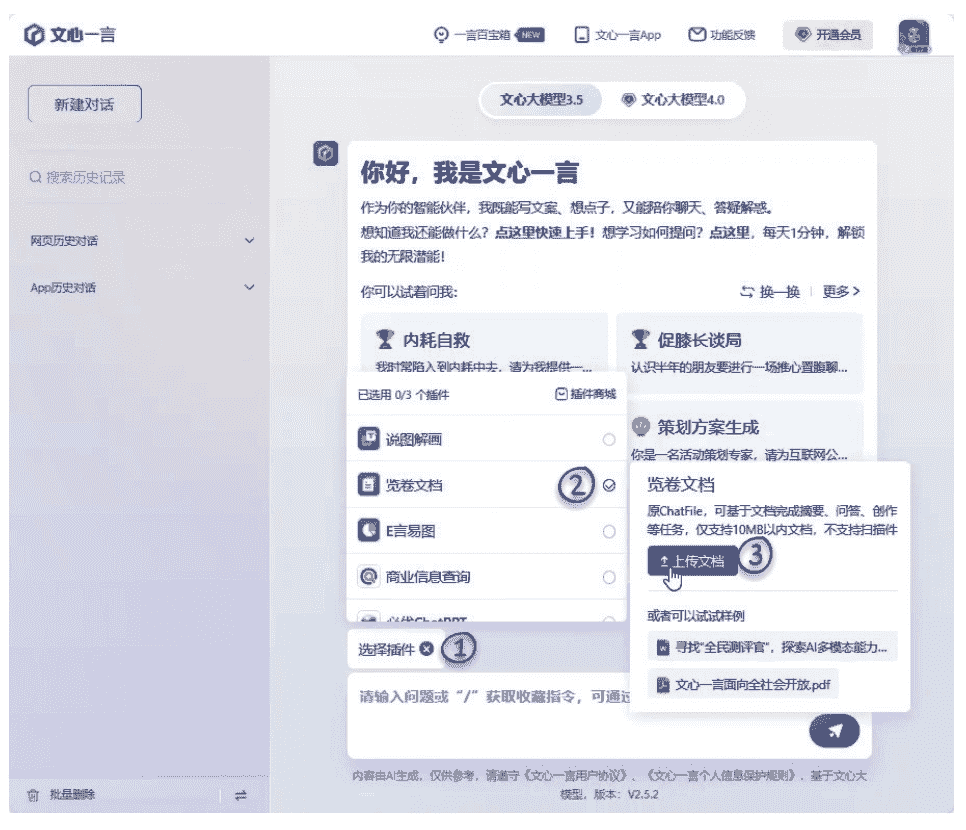

图 7-1

**02** 上传文档。①在弹出的对话框中定位并选择“人工智能”文档；②点击“打开”完成上传，如图 7-2 所示。

**03** 浏览生成内容。 
：载入后系统会自动生成摘要。以下为该文档的核心要点：AI正深刻重塑各行各业，从医疗健康到金融服务，从自动驾驶到智能家居，其发展正推动行业革新。但同时也存在数据隐私、算法偏见等挑战。展望未来，随着技术持续进步，AI将在更多领域发挥作用，为社会创造更多价值。关注并妥善解决发展中出现的挑战，通过科研和政策引导，确保AI造福人类。 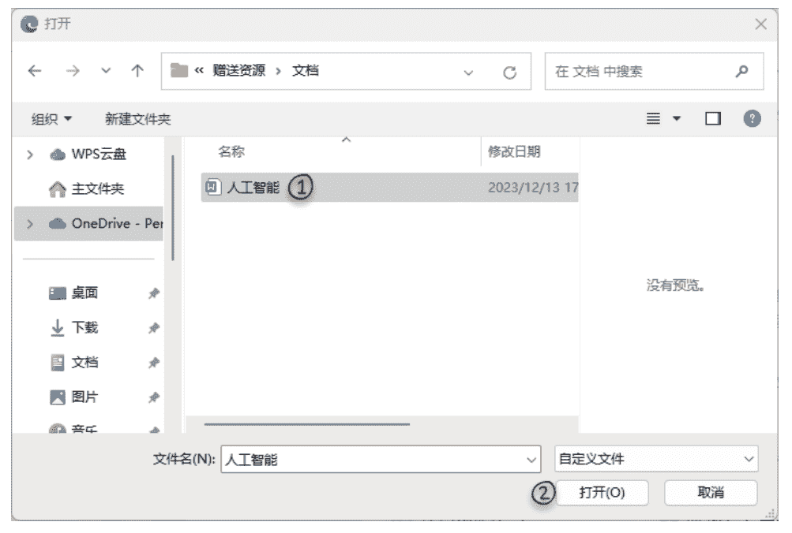

图 7-2

### **7.1.2 对文档进行内容总结**

通过“览卷文档”插件可对AI相关文档进行智能提炼。插件分析后，核心被精准概括，涵盖定义、发展历程、应用范围、现存挑战及未来趋势。整理后结构更清晰，重点突出，便于快速把握要点。

**01** 导入文件后输入指令“对人工智能这个文档的内容进行总结”，如图 7-3 所示。

图 7-3

**02** 浏览生成结果。 
：AI是技术快速发展的产物，已深入各领域并改变世界。从智能手机到自动驾驶，从医疗诊断到金融投资，应用场景遍布各处。受深度学习、神经网络等技术突破驱动，其在语音识别、图像识别、自然语言处理等方面取得显著进展，并在医疗、金融、自动驾驶、智能家居等领域发挥关键作用。但与此同时，数据隐私安全、算法偏见与歧视等挑战也随之出现。未来随着创新持续推进，AI将在更多场景贡献价值，为社会带来更多福祉。

### **7.1.3 对文本提问**

“览卷文档”插件支持针对特定文本提问。借助此功能，文心一言可自动识别并提炼文档中的关键问题，帮助用户挖掘被忽略的深层信息，更全面理解文本内容。同时，提问方式还能引导用户深入思考与分析，提升逻辑与思维能力。

**01** 导入文件后输入指令“人工智能的劣势有哪些”，如图 7-4 所示。

图 7-4

**02** 浏览生成结果。 
：AI的劣势主要包括以下几个方面。

1. 数据隐私与安全风险：AI模型训练依赖海量数据，数据的采集与使用易触及隐私与安全。泄漏或滥用可能对个人和机构造成伤害。
2. 算法偏见与歧视风险：AI决策基于历史数据和预设规则，若数据或规则本身存在偏见，系统输出也会带偏见并产生歧视。
3. 可解释性不足：不少AI模型属于“黑箱”，决策过程难以解释，增加使用风险，使用者难以理解其判断依据。
4. 对劳动力结构的影响：AI发展可能替代部分传统岗位，同时创造新职业，但在过渡期或出现结构性失业问题。
5. 法规政策滞后：AI应用广泛，如何制定合理规范仍是难题，多国正探索相关法规以应对AI带来的挑战。

总之，AI虽带来诸多优势，但也伴随挑战，发展过程中需关注并妥善解决这些问题。

## **7.2 E 言易图**

本节深入探讨“E 言易图”插件在思维导图、雷达图和散点图方面的应用实践。其强大的可视化能力能将复杂数据和信息转化为直观清晰的图形，帮助用户更清晰分析数据并呈现内在逻辑。通过这些图形，用户能更快洞察数据结构、关联性和发展趋势，降低理解难度，提升数据决策能力。

### **7.2.1 思维导图**

“E 言易图”插件操作直观、功能强大，可轻松把繁杂信息、观点和架构转化为条理清晰的思维导图。绘制时可便捷添加、编辑和重排节点，并为节点设定颜色和大小以突出重要性与层次。思维导图直观呈现信息层级与逻辑，有助于加深理解并提升记忆。下面介绍生成思维导图的步骤。

**01** ①单击“已选插件”按钮，②选择“E 言易图”插件，如图 7-5 所示。

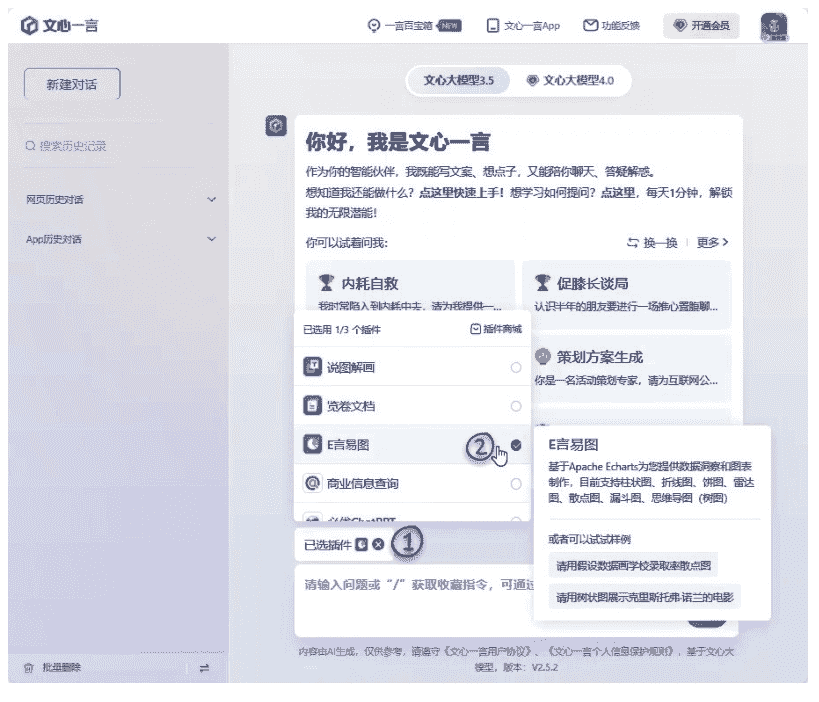

图 7-5

**02** 选定插件后输入指令“请用思维导图展示服装运营”，如图 7-6 所示。

图 7-6

**03** 查看结果，如图 7-7 所示。

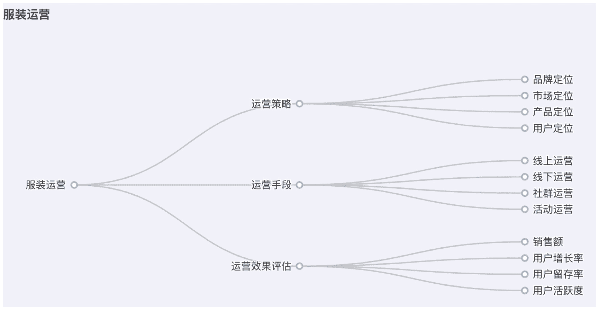

图 7-7

：我是百度研发的AI模型，基于大量公开文本学习生成内容，但可能存在偏差，仅供参考，不构成专业建议。

### **7.2.2 雷达图**

雷达图也称蜘蛛网图，能同时展示多个定量指标。借助雷达图可直观呈现数据的分布与变化，多维度信息以图形化方式呈现，帮助用户快速识别模式和趋势，实现全面把握。

**01** 选定插件后输入指令“请用雷达图展示 CBA 球员的数据”，如图 7-8 所示。

**02** 查看结果，如图 7-9 和表 7-1 所示。

▲图 7-8

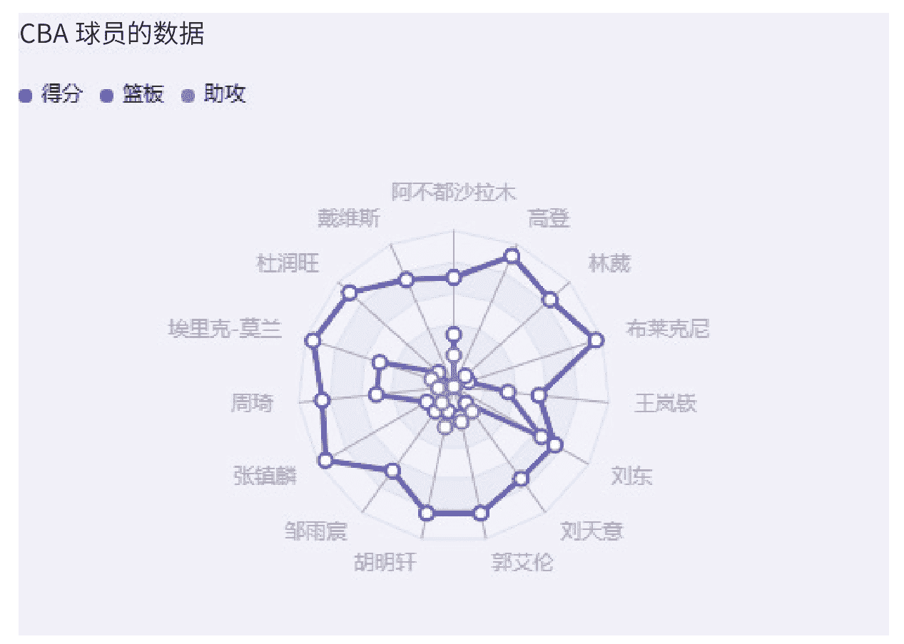

▲图 7-9

▼表 7-1

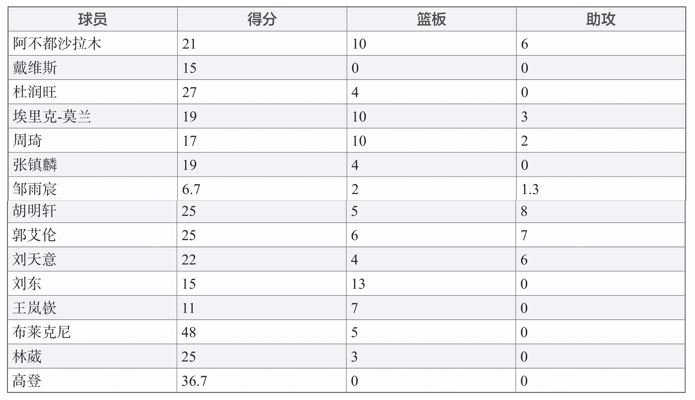

### **7.2.3 散点图**

散点图是常用数据可视化工具，能直观展示变量间的关联。通过观察点分布与聚集情况，可判断是否存在正相关、负相关或无关，为深入分析提供基础。“E 言易图”插件能快速生成散点图，大幅提升可视化效率。下面介绍详细步骤。

**01** 准备待可视化数据。通常散点图需两个变量作坐标轴，确保数据包含合适的变量对。

**02** 选择“E 言易图”插件，输入指令“请按照下面要求给我生成散点图：招生情况：以年份和录取率为坐标轴，散点代表每个年份的录取率。假设数据对象：一个包含热门学校和普通学校的散点，以及一个包含本科和研究生阶段的散点。”如图 7-10 所示。

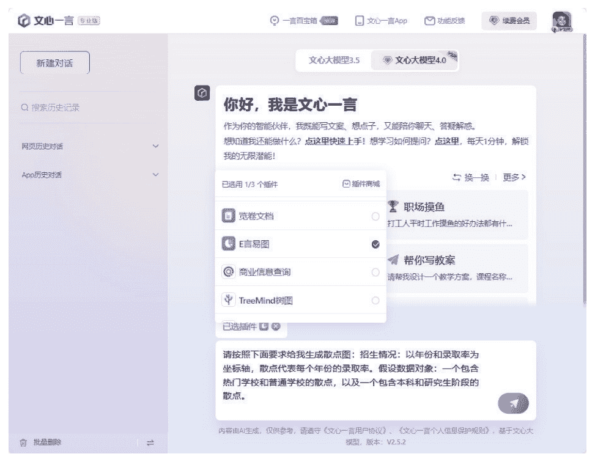

图 7-10

**03** 根据需求自定义散点图。可要求使用不同颜色、大小、形状表示不同数据点，并添加标题、轴标签和图例等元素。

**04** 查看结果并导出为常用图像格式（如 PNG、JPG 等），如图 7-11 和表 7-2 所示。

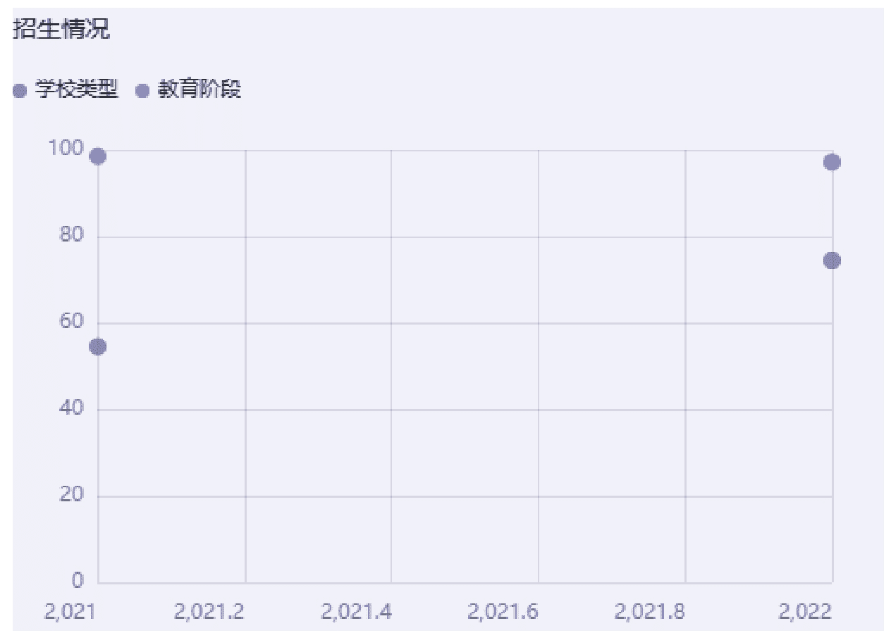

▲图 7-11

▼表 7-2

## **7.3 说图解画：让文心一言理解图片**

本节探讨文心一言“说图解画”插件在多场景的应用，包括风景、建筑、动漫图片识别，用诗句描绘画面，创作朋友圈文案，以及为产品提供创意命名等。作为先进的图像识别与描述工具，该插件能提供丰富视觉体验与语言表达，满足不同场景需求。

### **7.3.1 识风景**

“说图解画”插件能将风景图像转化为优美文字描述，帮助用户拓展思维视野，发现灵感，为艺术和文学创作提供助力。同时也能更精准地运用语言，以更富表现力的方式传达感受。以下是识别风景图像并生成文字描述的操作步骤。

**01** 选择“说图解画”插件。①单击“选择插件”按钮打开插件列表，②选择“说图解画”插件，③单击“上传图片”按钮，如图 7-12 所示。

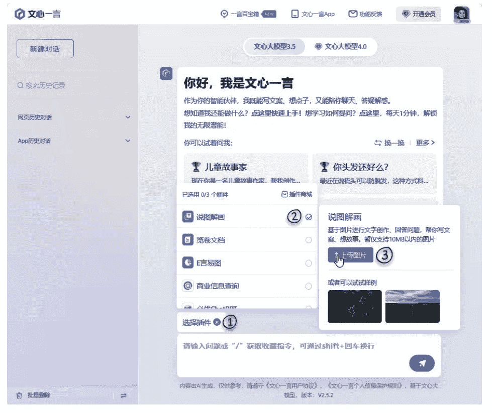

图 7-12

**02** 在弹出对话框中选择“第七章图片”文件夹里的“风景.jpg”文件，点击“打开”上传图片，如图 7-13 所示。

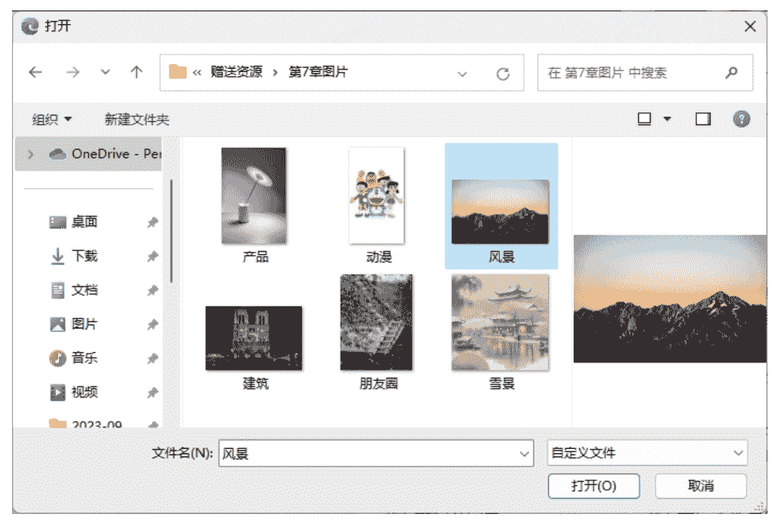

图 7-13

**03** 查看结果。 
：以下是我对图片的理解：

画面呈现出一幅壮阔的山景，余晖洒在高耸山脉上，更显巍峨。太阳在山后缓缓沉落，把天边云彩染成橙红，天空仿佛被点燃，诗意浪漫。

余晖勾勒出山脊线条，层层叠叠的峰峦错落有致，勾勒出优美的地平线。山体色彩在夕阳下更加丰富，深绿、浅绿、金黄、橙红交织，形成斑斓画卷。

山下是一片广袤草地，生机盎然。暮光下草色泛金，与山体色彩相互映衬，画面和谐宁静。

整幅场景既壮美又安宁，像是大自然精心绘制的画作，让人感受到自然的伟大与奇妙。人在其间显得渺小，更增添敬畏之心。

透过这张图，能体会自然的魅力与力量，也能激发对自然的热爱与探索欲。用心欣赏自然之美，感受它的馈赠，生活会更丰富多彩。

可以参考下面的提问方式：

示例 1. 请根据图片内容，写一首李白风格的七言绝句。

示例 2. 根据图片信息，写一篇 100 字左右的朋友圈配文。

示例 3. 根据图片描述的信息写一篇小红书文案。

### **7.3.2 识建筑**

“说图解画”插件能显著提升用户对建筑图像的理解与分析能力。通过精准识别建筑结构、风格和设计元素等关键特征，提供新颖深入的解读，帮助更敏锐体会建筑魅力与特色，加深对建筑艺术的欣赏。借助深度解读和生动描述，可以更深刻认识建筑的独特魅力与文化内涵。以下是识别建筑图像的操作步骤。

**01** 单击“已选插件”按钮，选择“说图解画”插件并上传图片。

**02** 在弹出对话框中选择“第七章图片”文件夹中“建筑.jpg”文件，点击“打开”按钮上传图片，如图 7-14 所示。

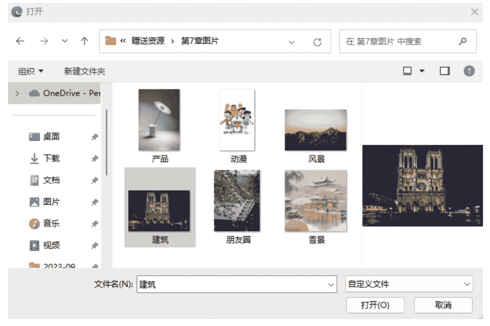

图 7-14

**03** 上传图片后插件会自动生成回复，此时输入指令“识别上面这张图片的建筑”，如图 7-15 所示。

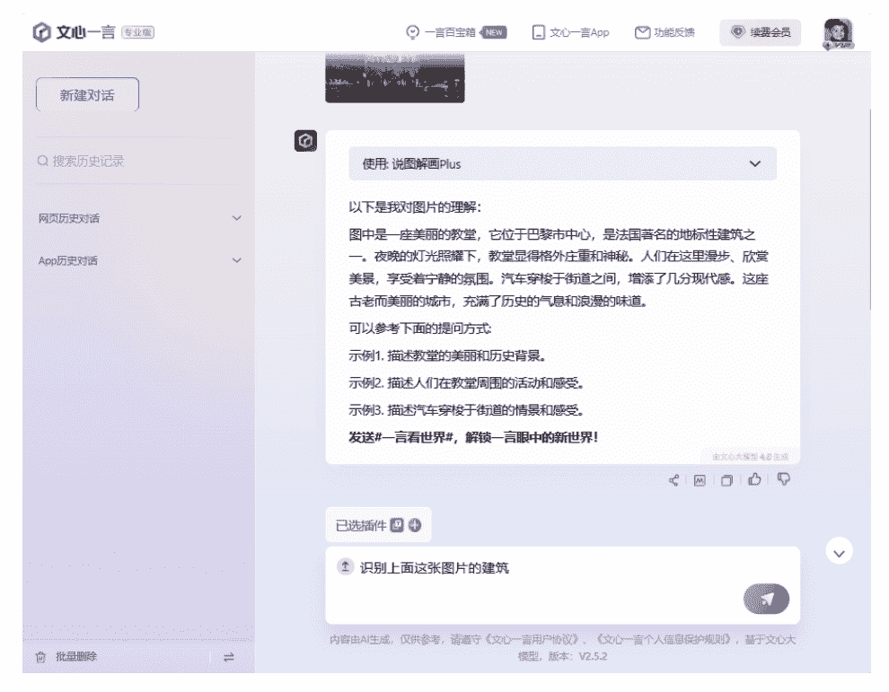

图 7-15

**04** 查看结果。 
：上图中的建筑为巴黎圣母院大教堂。

**巴黎圣母院：塞纳河畔的哥特印记**

坐落于巴黎城区核心的巴黎圣母院，是法国辨识度极高的地标建筑，线条流畅、雕刻精致，长期以来作为经典范本被世界熟知。它采用哥特式手法，建造跨度从1163年延续至1345年，属欧洲早期哥特教堂的代表之一。

在法国历史进程中，圣母院始终占据重要位置，多次经历修缮与重塑。影响最深的一次是在拿破仑时代，即18世纪末到19世纪初，教堂展开大规模的重建与装饰，重现宏伟，再度成为巴黎天际线的焦点。

除历史积淀外，圣母院凭借独特的建筑语言与高超美学，深受旅人及艺术家青睐。步入内部可欣赏精巧的石雕、绚烂的彩绘玻璃与华丽的装饰，多重元素交织出别具一格的哥特韵味与艺术魅力。

同时它也是法国文化的象征符号，被列为国家历史文物与世界文化遗产。每年慕名而至的访客以数百万计，都为亲身感受其庄严静谧与文化张力。

### **7.3.3 动漫解析**
说图解画能够迅速捕捉画面中的人物与场景，并对作品背后的主题、情绪与象征进行分层解读。借助它分析来自不同国家与地区的动画，用户可更立体地体会异文化中的价值取向与审美趣味，从而增进跨文化理解与尊重。下面以动漫识别为例演示操作流程。

**01** 进入插件面板，启用说图解画模块并导入所需素材。
**02** 在弹出的文件窗口定位到“第七章图片”文件夹里的“动漫.jpg”，点击“打开”完成导入，如图 7-16 所示。

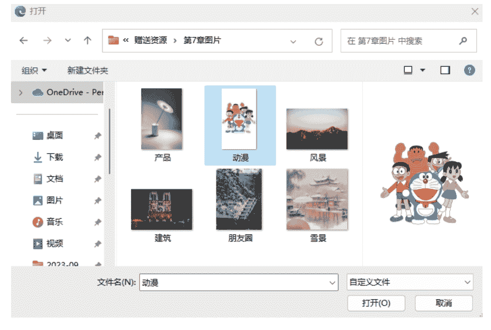

图 7-16

**03** 发送指令“识别上面这张图的动漫角色还有动漫名字，这部动漫的大概剧情。”如图 7-17 所示。

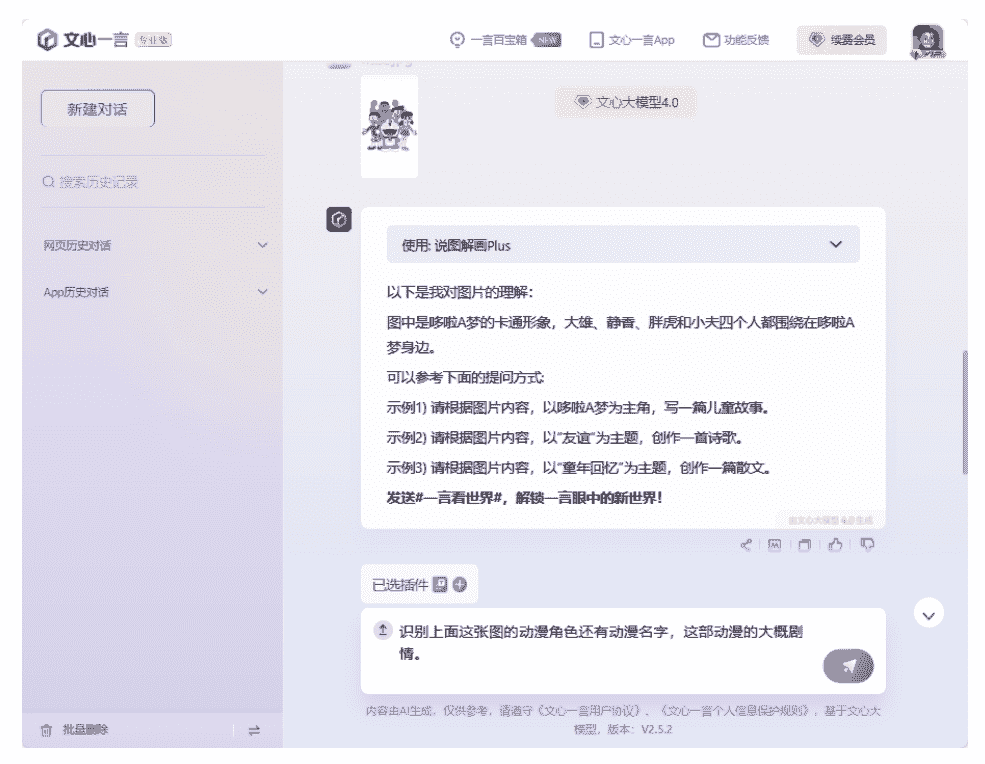

图 7-17

**04** 预览结果。 

：画面信息显示，图中出现的角色有哆啦A梦、大雄、静香、胖虎和小夫。作品名称是《哆啦A梦》，源自日本的经典漫画改编动画。

故事轴线围绕近未来来访的蓝猫型机器人哆啦A梦与小学生大雄展开，静香、胖虎、小夫等人也常出现。哆啦A梦携带多款未来道具，帮助大雄度过学习、社交等困境。

情节里会出现诸如大雄为考试焦虑，哆啦A梦提供记忆面包；大雄受胖虎欺负时，机器猫用道具反击等桥段。作品同时织入友情、亲情与成长主题，呈现人与人之间的情感连结与生活意义。

总体而言，《哆啦A梦》兼具趣味与温情，长期受到全球观众喜爱。

### **7.3.4 诗意化解读**
说图解画为用户提供了新颖且富创意的信息解读与表达方式，拓展思维边界并催生更多使用场景。对不同文化背景的画面进行诗意化解读，该插件为艺术创作注入活力，也为文化传承与跨文化交流搭建桥梁。下面以诗句描绘图片为例介绍操作步骤。

**01** 点击已选插件按钮，启用说图解画并导入所需图片。
**02** 在对话框中打开“第七章图片”文件夹里的“雪景.png”，点击“打开”完成上传，如图 7-18 所示。

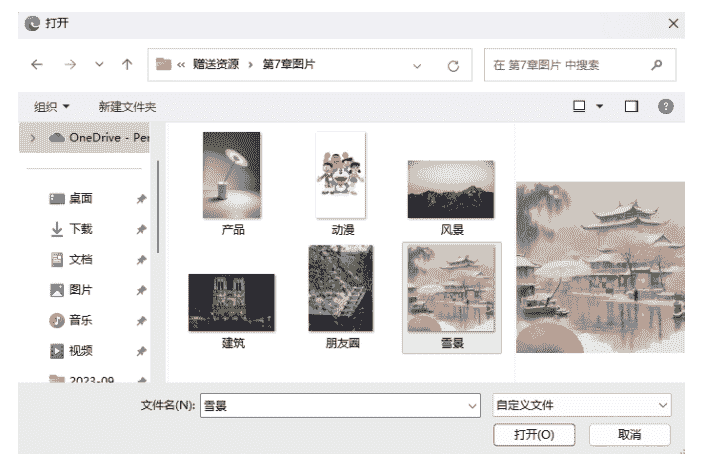

图 7-18

**03** 图片上传后发出指令“用诗句描绘上面那张图片”，如图 7-19 所示。

图 7-19

**04** 预览结果。 

：雨打古檐声声慢，
小船摇曳映画廊。
伞影叠叠映碧水，
古风画卷醉心房。

### **7.3.5 朋友圈文案**
借助说图解画插件撰写朋友圈配文，能显著提升文案质感与吸引力。在把握图片关键元素与主旨的基础上，系统可产出富于创意与表达力的文字，帮助用户更精准传递个人感受与意图。此外，插件还能大幅节省构思时间，提高效率并激发创新思维。以下是生成朋友圈文案的操作示范。

**01** 点按已选插件按钮，选择说图解画并导入图片。
**02** 在弹出选择框中打开“第七章图片”文件夹里的“朋友圈.jpg”，点击“打开”完成上传，如图 7-20 所示。

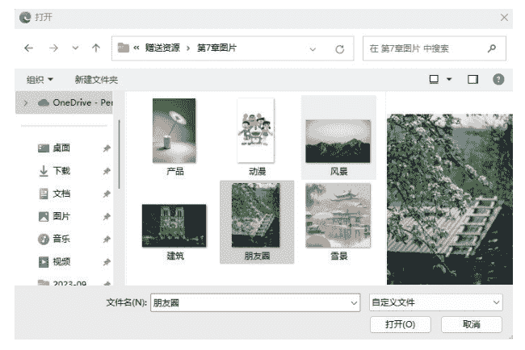

图 7-20

**03** 发出指令为“我想用这张图发朋友，可以为我想一个朋友圈文案吗”，如图 7-21 所示。

图 7-21

**04** 预览结果。 

：以下是一个朋友圈文案供你参考：

“时光流转，某些美好始终未变。请看那一株缀满白花的树，像在为岁月作注，静默伫立，仿佛在低语往昔。而身后那间年久的房屋，又似一段旧时传说，提醒我们历史与文化的延续。生活节奏虽快，不妨稍作停顿，去发现那些常被忽略的细节，体会自然的韵味与历史的分量。”

希望这个朋友圈文案能给你提供一些灵感。祝你和朋友分享愉快！

### **7.3.6 产品命名灵感**
使用说图解画插件为产品命名，有助于挖掘新用途与市场定位，剖析产品的核心特质与理念，并据此给出别具一格、富有表达力的名称建议，使产品的独特价值得以精准传递。借助这些创意名称，产品更易在市场中脱颖而出，吸引目光并提升品牌竞争力。该工具还能发掘与产品相关的多元主题与概念，为创新与宣传提供支撑。下面示范为产品进行创意命名的流程。

**01** 点击已选插件按钮，选择说图解画并导入图片。
**02** 在弹出的对话框中打开“第七章图片”文件夹中的“产品.jpg”，点击“打开”按钮完成上传，如图 7-22 所示。

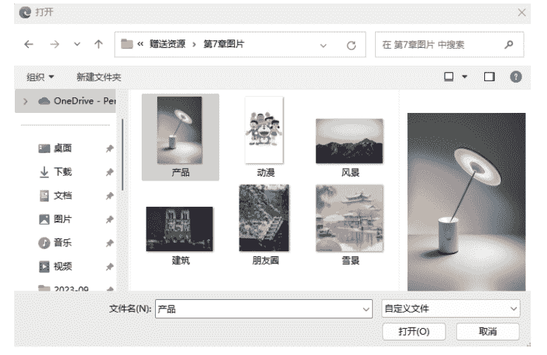

图 7-22

**03** 发出指令“给上面这个图片产品创意起名”，如图 7-23 所示。

图 7-23

**04** 预览结果。 

：根据你提供的产品图片信息，这个台灯产品可以起名为“调节式圆灯”。

这个名称简洁直观，准确概括了产品的特征与用途。“调节式”点出底座可活动的支撑杆，使用者能够自行调整灯头角度以满足不同照明需求。“圆灯”则点明灯罩呈圆形，外形辨识度高。

同时，“调节式圆灯”这个名称易读易记，具有很好的口头传播性，有助于提高产品的知名度和影响力。

# **第八章**

# **多场景工具组合**

在数字化浪潮下，人们对工具的需求愈发多样化。市场上涌现出诸多能够满足此类需求的产品，其中文心一言 App 与文心一格尤为突出，各自凭借独特功能赢得广泛青睐。本章将详细介绍这两款工具的特点，以覆盖用户的多重需求。

## **8.1 文心一言 App：随身智能百宝箱**
文心一言 App 大大提升了日常生活的便利性。该应用不仅具备多样化的对话能力，还提供特色鲜明的社区与发现板块，让用户在享受科技便捷的同时，也能体验人与人之间的真挚交流。本节将全面介绍其三大核心功能，展现其强大实用性与吸引力。

### **8.1.1 对话**
文心一言 App 的对话模块基于先进的自然语言处理技术，能够依据用户输入及上下文智能回复并推荐相关内容。这种智能化机制为用户带来更精准、个性化的沟通体验，从而提升沟通质量与效率。

打开应用，首先映入眼帘的是对话界面，如图 8-1 所示。

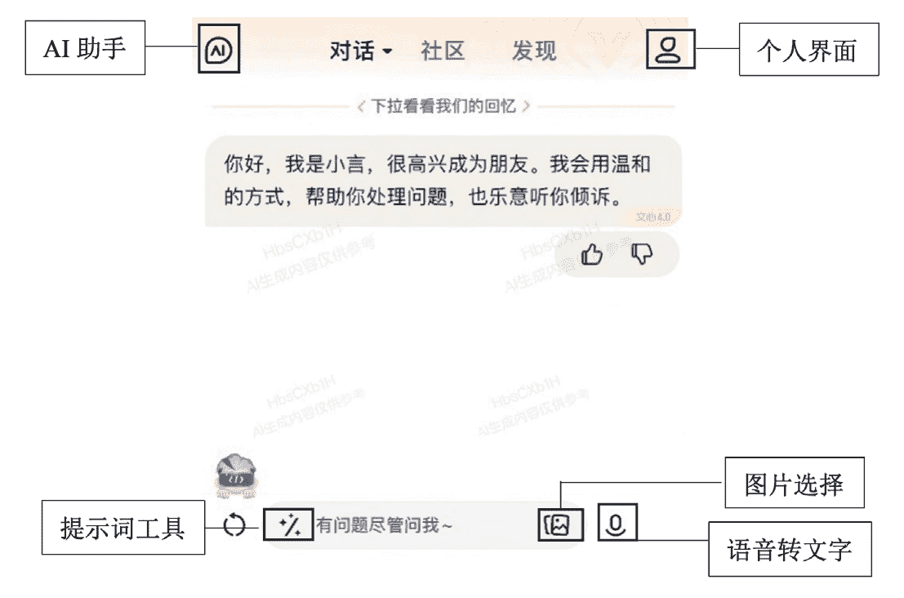

图 8-1

·个人中心：发布作品与点赞记录，如图 8-2 所示。

图 8-2

·图片选择：可拍照或选择本地图片，AI 助手能结合图面内容与指令作答。

**案例实战**

**01** 选择 AI 助手为“小言”，在此可查看 App 与网页的历史记录，如图 8-3 所示。
**02** 点击“提示词工具”选择“大学专业建议”选项，输入指令“内向容易害羞，聪明，对电脑感兴趣。”如图 8-4 所示。

▲图 8-3

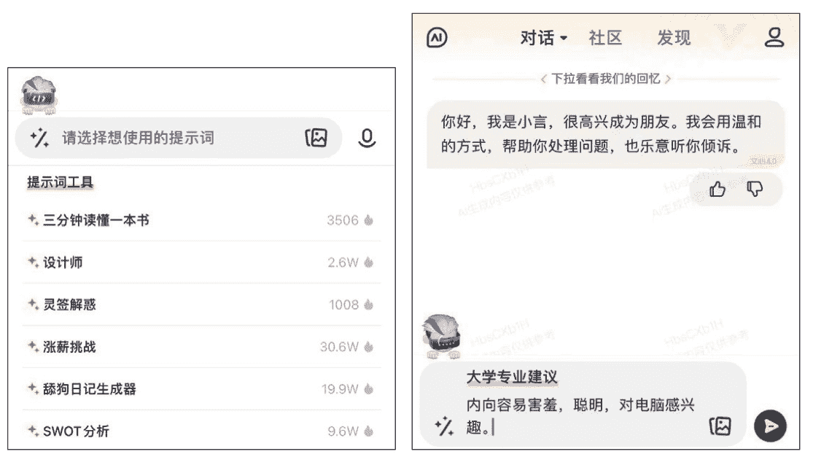

▲图 8-4

**03** 预览回答。 

：首先，感谢你提供你的性格信息。基于你内向、聪明且对电脑感兴趣的特点，以下是一些建议的专业领域，它们在某种程度上与你的性格特点和兴趣相契合。

计算机科学：这是一个与计算机直接相关的专业，涵盖编程、算法、数据结构等多个方面。它非常适合聪明且对技术有热情的学生。

软件工程：专注于软件开发和设计的学科，强调团队合作和问题解决能力。尽管它需要一些与人交往的能力，但很多工作还是可以独立完成的。

网络安全：如果你对保护计算机系统和数据感兴趣，这个专业将非常适合你。它涉及预防、检测和应对网络攻击的策略和技术。

信息科技：涵盖信息系统、数据库管理和网络管理等领域的宽泛专业。它既有技术深度，也涉及一些与人相关的方面，如用户支持和培训。

数据分析与科学：利用计算机和编程技能来分析和解释大量数据。这是一个迅速发展的领域，非常适合具有分析能力的内向者。

人工智能：结合了计算机科学、数学和工程学的知识来创建智能机器和系统。如果你对新技术和创新感兴趣，这将是一个非常有前景的选择。

电子游戏设计：将你的计算机技能和创造力结合起来，设计和开发电子游戏。这个专业需要团队合作，但也给内向者提供了很多独立工作的机会。

网络开发与设计：专注于创建和维护网站和应用程序的专业。它结合了技术技能和创意元素，适合那些对美学和功能性都有追求的人。

请记住，选择专业不仅基于性格测试的结果，还要考虑你的长期兴趣、目标和天赋。如果可能，尝试参加一些相关课程学习或实习，以更深入地了解这些领域是否真正适合你。

### **8.1.2 社区**
文心一言 App 的社区板块为用户打造了一个集互动、交流、学习与问题解决于一体的空间。它有助于深化用户间的了解与信任，拓宽视野、丰富知识，并提供个性化内容推荐，增强归属感与参与度。

图 8-5 展示了社区的主页，这里聚集了用户发布的 AI 对话日记。用户可点击感兴趣的话题浏览他人与 AI 助手的对话内容，也可参与讨论并学习如何提出更有效的问题。具体操作如下。

**01** 点击“社区”进入社区界面，主页面由用户发布的 AI 对话日记构成，点击感兴趣的话题即可查看其他用户与 AI 助手的对话，如图 8-5 所示。
**02** 点击话题。话题为“logo 小设计”。由此可与他人对话，也能借鉴其他用户的提问方式向 AI 助手发问，如图 8-6 所示。
**03** 点击“设计师”，与 AI 助手对话输入指令“小摆件鹿”，如图 8-7 所示。

▲图 8-5

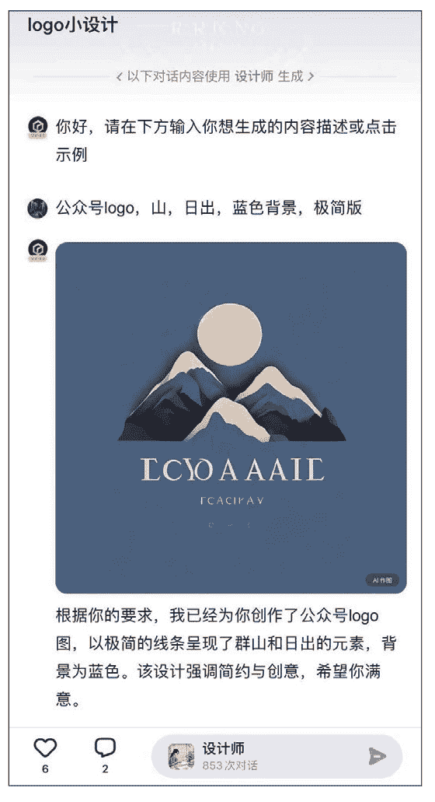

▲图 8-6

▲图 8-7

**案例实战** 

：点击进入“三分钟读懂一本书”话题，与 AI 进行对话并输入“水浒传”。 

：《水浒传》是中国四大名著之一，由施耐庵创作，成书于元末明初。全书描述了 108 位好汉在梁山泊集结起义，共同反抗腐败统治者的故事。这部作品以生动的情节和鲜明的人物塑造，展现了民间英雄主义的斗争精神和社会底层的反抗意识。

以下是《水浒传》的主要章节及简介。

洪太尉误走妖魔：讲述洪太尉在龙虎山误放走镇压的妖魔，为后续的梁山英雄出世埋下伏笔。

林冲误入白虎堂：描写林冲被高俅陷害，误入白虎堂，最终走投无路被逼上梁山的过程。

武松打虎：武松在景阳冈打死恶虎，显示了他的英勇与力量。

李逵沂岭杀四虎：李逵在沂岭为母报仇，连杀四虎，展现了他的孝顺和勇猛。

宋江三打祝家庄：宋江为救被捉的兄弟，三次攻打祝家庄，最终成功并壮大梁山势力。

大破连环马：描写梁山好汉如何智破呼延灼的连环马阵，显示了他们的智勇双全。

曾头市晁盖中箭：晁盖在攻打曾头市时中箭身亡，对梁山产生了深远的影响。

吴用智取玉麒麟：吴用用计将玉麒麟卢俊义逼上梁山，增强了梁山的实力。

宋江大破大名府：梁山好汉攻破大名府，救出了卢俊义和石秀，进一步展现了他们的英勇与智慧。

招安与征方腊：描述梁山好汉接受朝廷招安后，征讨方腊等叛乱。

### **8.1.3 发现**
发现页面为用户提供了一个探索新奇、挖掘有趣内容的空间。用户可通过浏览了解热门对话、最新对话及各类对话内容，从而拓宽视野、获取更多信息与知识。具体操作如下。

**04** 点击“发现”按钮进入发现界面。“发现”标题下方设有“热门”“会员”“最新”等选项，点击所需选项即可获取对应功能，如图 8-8 所示。
**05** 点击“行业研究方式”选项与 AI 助手对话，发出指令“计算机视觉”，如图 8-9 所示。

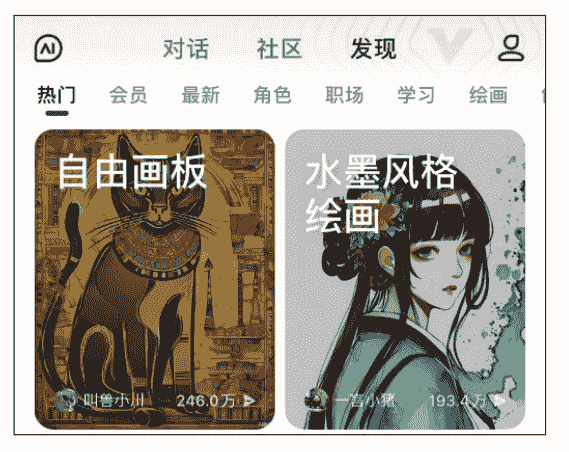

▲图 8-8

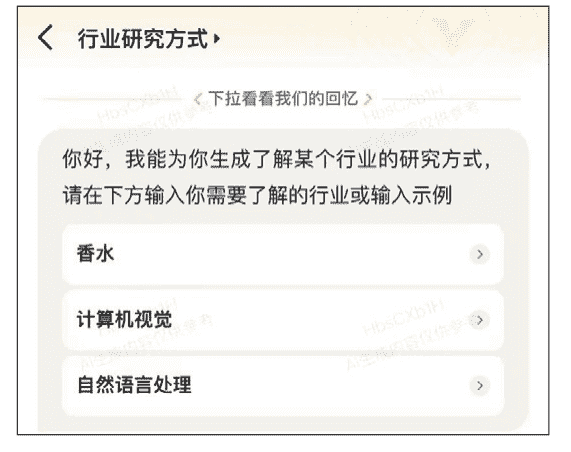

▲图 8-9

**06** 预览 AI 助手回答。 

：要了解计算机视觉领域的研究现状，可以采用以下几种方式。

阅读顶级会议和期刊的论文：参加计算机视觉领域的顶级会议，如 CVPR（计算机视觉与模式识别会议）、ECCV（欧洲计算机视觉会议）和 ICCV（国际计算机视觉会议），并阅读会议论文集。同时，关注顶级期刊如*IEEE Transactions on Pattern Analysis and Machine Intelligence* (TPAMI)和*International Journal of Computer Vision* (IJCV)等，这些期刊和会议上发表的论文代表了该领域的最新研究成果。

关注知名研究者和研究机构：了解在计算机视觉领域具有影响力的研究者和研究机构，关注他们的研究成果、开源项目和博客。例如，Yann LeCun、Andrew Ng、吴恩达等人在计算机视觉领域有着重要贡献。

浏览 arXiv 等预印本平台：arXiv 等平台上有大量关于计算机视觉的预印本论文，可以了解最新的研究进展和思想。

加入在线社区和论坛：参与计算机视觉相关的在线社区和论坛，如 GitHub、Stack Overflow、Reddit 的 r/MachineLearning 和 r/ComputerVision 等，与同行交流，了解实际问题和最新动态。

参加线上和线下课程：参加计算机视觉相关的线上和线下课程，如 Coursera、Udacity 等平台提供的课程，以及各大高校和研究机构开设的计算机视觉课程，以系统化地了解该领域的知识体系。

了解实际应用和产业界动态：关注计算机视觉技术在实际应用中的发展和产业界的动态，如自动驾驶、安防监控、医疗影像分析等领域的应用。

探索计算机视觉与其他领域的交叉研究：了解计算机视觉与其他领域（如自然语言处理、语音识别、强化学习等）的交叉研究，以拓宽视野，发掘新的研究方向。

通过以上方式，可以更全面地了解计算机视觉领域的研究现状，并为进一步的研究提供参考。

## **8.2 文心一格：AI 图像创作实验室**
文心一格是百度旗下的一款 AI 绘图产品，依托飞桨与文心大模型的强大技术支撑，为用户提供丰富的图像创作工具与多元化功能，如自定义模型、人物动作识别再创作、海报设计以及艺术字制作等。它不仅能为画师、设计师等视觉创作者带来灵感，辅助艺术创作，也能满足媒体、作者等文字创作者对高质量配图的需求。更重要的是，它让每个人都能展现个性化格调，尽情享受创作乐趣。

### **8.2.1 图像创作**
文心一格是一款先进的图像编辑工具，下面将详细介绍如何利用它进行专业创作。通过深入探讨其各项创作功能，可在不同场景下巧妙运用工具，打造富有创意且极具个性的图像作品。

**案例实战**

**01** 打开文心一格官网后，点击右上角“登录”按钮，使用百度账号登录。该网站需登录后使用，登录后即可进行图像创作，如图 8-10 和图 8-11 所示。

图 8-10

**02** 在创意栏输入你的创意，或点击下方推荐词作为参考，如图 8-12 所示。

▲图 8-11

▲图 8-12

**03** 选择画面类型、图片比例、生成数量、灵感模式，如图 8-13 所示。
**04** 生成图片。点击“立即生成”按钮，片刻后文心一格会根据提示词生成图片，最多可一次生成 9 张。但需注意，生成图片需消耗电量，电量可通过任务或充值获得，如图 8-14 所示。

▲图 8-13

▲图 8-14

### **8.2.2 自定义模型**
文心一格的自定义模型功能赋予用户以独特风格和个性化体验。在创作过程中，运用这些模型并结合自定义功能，用户不仅能按需对作品进行精细调整与优化，还能融入个人创意与想法，实现个性化艺术表达。作品因此更具独特性与魅力，也能更好地满足特定应用场景与要求。具体操作步骤如下。

**自定义模型快速上手**

**01** 进入自定义模式。打开 AI 生成工作区后点按页面上的“自定义”按钮，位置见图 8-15 所示。

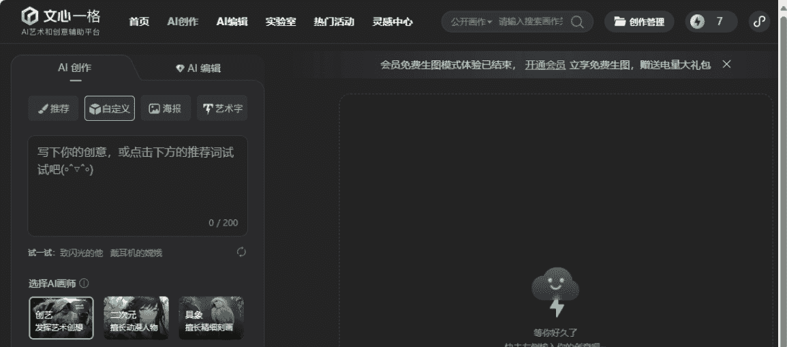

图 8-15

**02** 导入参考素材。页面底部提供“上传参考图”入口，可从“我的作品”“模板库”或“上传本地图片”中挑选，如图 8-16 所示。

图 8-16

**03** 确认参考画面。弹出“打开”对话框后选定一张所需参考图并点“打开”，操作示意如图 8-17。

**04** 填写生成指令。在文本框输入描述“机器人，人工智能，8k，超高清”，并将 AI 画师设为“创艺”，如图 8-18 所示。

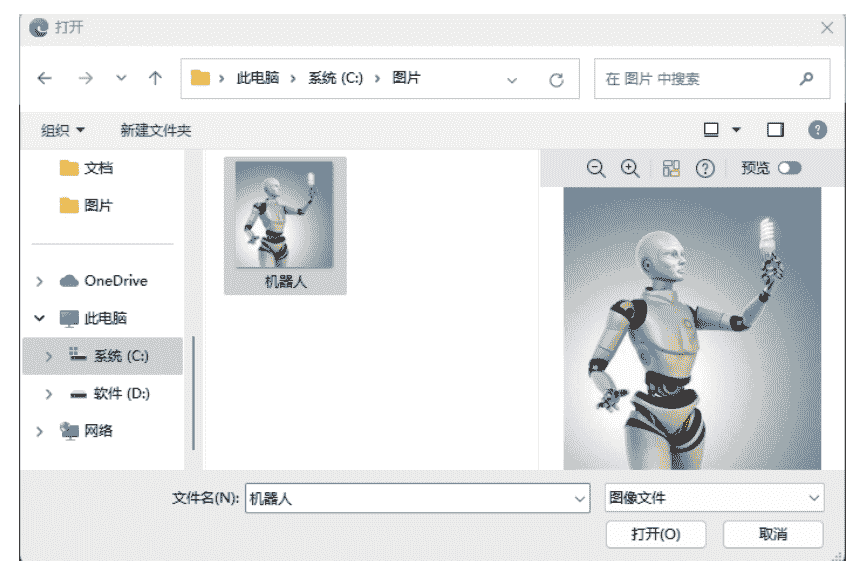

▲图 8-17

▲图 8-18

**05** 设定画面参数。下方可选择修饰词“蒸汽朋克”“高清”“cg 渲染”，图片尺寸选 1:1、1024×1024，生成数量选 1 后点击“立即生成”，如图 8-19 所示。

**06** 细化成片。借助文心一格自带的编辑功能可对素材进行裁剪、尺寸调整、色彩修改、特效添加等，也能加入文字、贴纸、滤镜等设计元素，如图 8-20 所示。

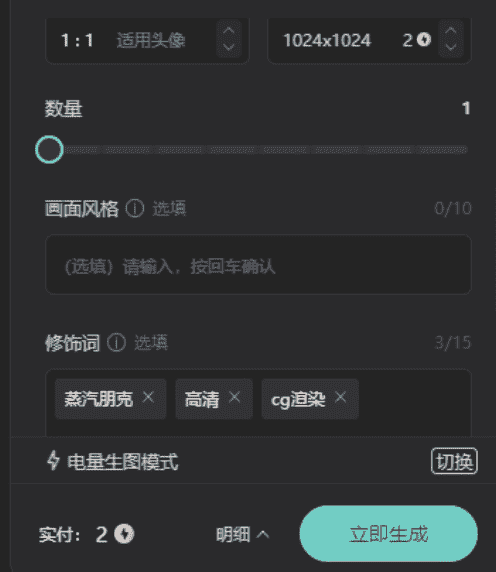

▲图 8-19

▲图 8-20

**07** 指令微调画面。打开“AI 编辑”对话框，在描述框中调整画面文字后点“立即生成”，如图 8-21 所示。

图 8-21

**08** 叠加丰富构图。按设计需求使用图片叠加功能调整元素后点击“立即生成”，如图 8-22 所示。

图 8-22

**09** 完成导出。编辑结束后可以导出图片，如图 8-23 所示。

图 8-23

### **8.2.3 人物姿态识别与再创作**
人物动作是表达情绪、传递信息的重要载体。借助文心一格提供的人物动作识别工具，可从图片中精准提取动作特征并进行二次创作，为作品注入新颖视觉与动态美感，同时显著提升动作素材获取效率。操作步骤如下。

**01** 进入实验室。点击主界面左上角“实验室”标签后，再点“人物动作识别再创作”按钮，如图 8-24 所示。

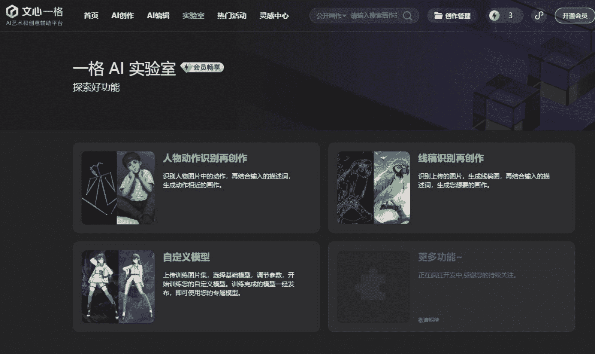

图 8-24

**02** 查看操作示例。该功能可识别人物图片中的动作，再结合输入的描述词生成动作相近的画面，如图 8-25 所示。

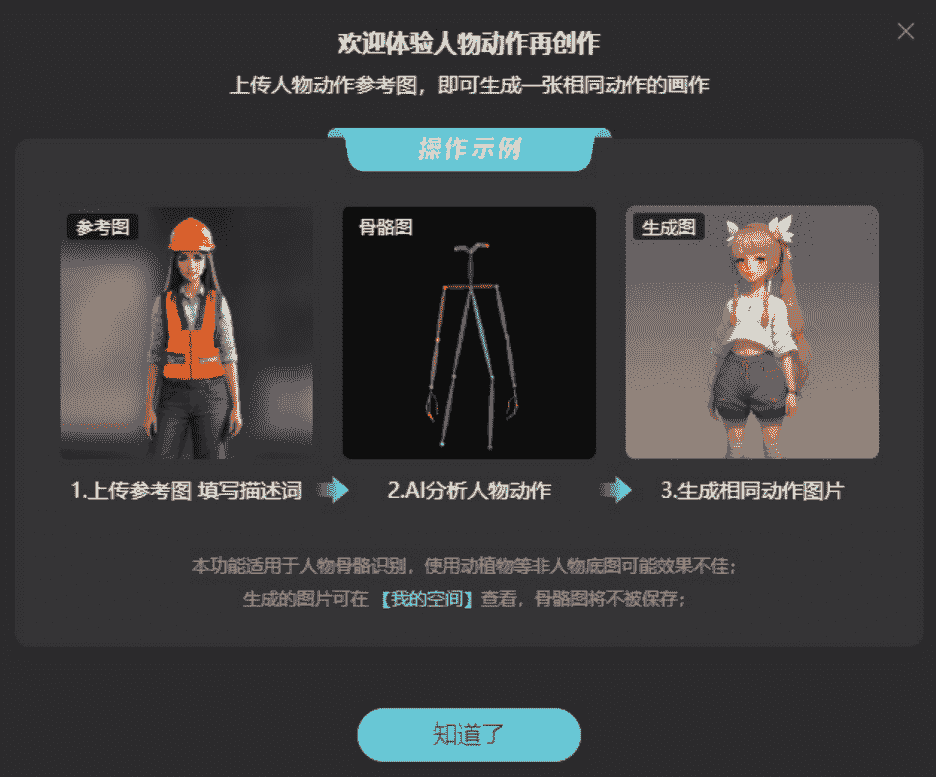

图 8-25

**03** 上传参考并生成。上传人物动作参考图后，在文本框输入描述词“一个放学回家的女孩，穿着灰色卫衣戴着帽子，戴耳机听着歌，边走边踢路边的石头。”，点击“立即生成”按钮，如图 8-26 所示。

图 8-26

### **8.2.4 海报快速制作**
文心一格素材库丰富、编辑能力强，设计师能轻松从零开始制作既吸睛又富创意的海报。平台提供多样创作元素与工具，支持自由发挥，将独特想法以海报形式呈现，提升艺术价值并形成强烈视觉冲击。操作如下。

**01** 打开海报功能。点击“海报”按钮，选择排版布局为“底部布局”，方向为“竖版 9:16”、海报风格为“平面插画”，如图 8-27 所示。

图 8-27

**02** 输入描述词。在海报主体文本框输入“在蓝天白云底下，身强体壮的人在足球场上踢足球进行足球比赛”，海报背景文本框输入“体量庞大的体育馆，绿油油的草皮”，图片生产数量选 4，如图 8-28 所示。

图 8-28

**03** 预览最终效果，如图 8-29 所示。

图 8-29

### **8.2.5 艺术字创作**
艺术字能为文本增添美感与艺术气息。通过文心一格创作艺术字，可激发灵感并将个性创意融入字体设计，产出富有创意且美感十足的字样，提升整体审美。具体步骤如下。

**01** 启动艺术字。点击“艺术字”按钮，中英字选项为“中文”，字体布局为“自定义”，字体大小为“大”，字体位置为“居中”，排版方向为“单排横向”，如图 8-30 所示。

**02** 设定文字与风格。在汉字文本框输入“冰淇淋”，字体创意文本框输入描述词“清晰立体，夏天，透明质感，梦幻冰沙，创意，多巴胺”，影响比重为 1，比例为“方图”，生成数量为 1，点击“立即生成”按钮，如图 8-31 所示。

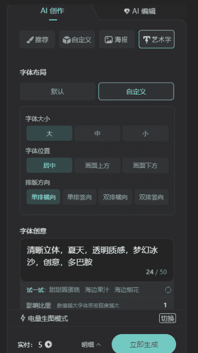

▲图 8-30

▲图 8-31

**03** 预览最终效果，如图 8-32 所示。

图 8-32

*文中代码字体版权说明 ^(¹)

* * *

1.  1.  Copyright Copyright 2010, 2012 Adobe Systems Incorporated (http://www.adobe.com/), with Reserved Font Name ‘Source’. License This Font Software is licensed under the SIL Open Font License, Version 1.1. This license is copied below, and is also available with a FAQ at: http://scripts.sil.org/OFL SIL OPEN FONT LICENSE Version 1.1 - 26 February 2007 PREAMBLE The goals of the Open Font License (OFL) are to stimulate worldwide development of collaborative font projects, to support the font creation efforts of academic and linguistic communities, and to provide a free and open framework in which fonts may be shared and improved in partnership with others. The OFL allows the licensed fonts to be used, studied, modified and redistributed freely as long as they are not sold by themselves. The fonts, including any derivative works, can be bundled, embedded, redistributed and/or sold with any software provided that any reserved names are not used by derivative works. The fonts and derivatives, however, cannot be released under any other type of license. The requirement for fonts to remain under this license does not apply to any document created using the fonts or their derivatives. DEFINITIONS "Font Software" refers to the set of files released by the Copyright Holder(s) under this license and clearly marked as such. This may include source files, build scripts and documentation. "Reserved Font Name" refers to any names specified as such after the copyright statement(s). "Original Version" refers to the collection of Font Software components as distributed by the Copyright Holder(s). "Modified Version" refers to any derivative made by adding to, deleting, or substituting — in part or in whole — any of the components of the Original Version, by changing formats or by porting the Font Software to a new environment. "Author" refers to any designer, engineer, programmer, technical writer or other person who contributed to the Font Software. PERMISSION & CONDITIONS Permission is hereby granted, free of charge, to any person obtaining a copy of the Font Software, to use, study, copy, merge, embed, modify, redistribute, and sell modified and unmodified copies of the Font Software, subject to the following conditions: 1) Neither the Font Software nor any of its individual components, in Original or Modified Versions, may be sold by itself. 2) Original or Modified Versions of the Font Software may be bundled, redistributed and/or sold with any software, provided that each copy contains the above copyright notice and this license. These can be included either as stand-alone text files, human-readable headers or in the appropriate machine-readable metadata fields within text or binary files as long as those fields can be easily viewed by the user. 3) No Modified Version of the Font Software may use the Reserved Font Name(s) unless explicit written permission is granted by the corresponding Copyright Holder. This restriction only applies to the primary font name as presented to the users. 4) The name(s) of the Copyright Holder(s) or the Author(s) of the Font Software shall not be used to promote, endorse or advertise any Modified Version, except to acknowledge the contribution(s) of the Copyright Holder(s) and the Author(s) or with their explicit written permission. 5) The Font Software, modified or unmodified, in part or in whole, must be distributed entirely under this license, and must not be distributed under any other license. The requirement for fonts to remain under this license does not apply to any document created using the Font Software. TERMINATION This license becomes null and void if any of the above conditions are not met. DISCLAIMER THE FONT SOFTWARE IS PROVIDED "AS IS", WITHOUT WARRANTY OF ANY KIND, EXPRESS OR IMPLIED, INCLUDING BUT NOT LIMITED TO ANY WARRANTIES OF MERCHANTABILITY, FITNESS FOR A PARTICULAR PURPOSE AND NONINFRINGEMENT OF COPYRIGHT, PATENT, TRADEMARK, OR OTHER RIGHT. IN NO EVENT SHALL THE COPYRIGHT HOLDER BE LIABLE FOR ANY CLAIM, DAMAGES OR OTHER LIABILITY, INCLUDING ANY GENERAL, SPECIAL, INDIRECT, INCIDENTAL, OR CONSEQUENTIAL DAMAGES, WHETHER IN AN ACTION OF CONTRACT, TORT OR OTHERWISE, ARISING FROM, OUT OF THE USE OR INABILITY TO USE THE FONT SOFTWARE OR FROM OTHER DEALINGS IN THE FONT SOFTWARE.↩︎