# 文心一言与文心一格 108招实战精讲

# 内容速览

本书以十个主题为轴展开，配套108个可复现操作、130余分钟同步讲解视频、160余份云端素材与成品、500余张全流程图解，并附赠5200余条绘画关键词库。

全书双线并进。

文案线聚焦文心一言：拆解9点快速入门要点、10种提示词撰写思路、16套可直接复用指令模版、10个App内使用技巧、10个文案实操案例，层层递进掌握用文心一言完成AIGC文案的核心方法。

绘画线聚焦文心一格：涵盖15个基础绘画要点、12个进阶手法、9大探索功能、7个小程序使用方法、10个绘画实操案例，让AI绘画操作更简便、更高效、表现力更强。

阅读人群分为三类：希望了解文心一言与文心一格的创作者，包括AI文案写作者、AI绘画爱好者、AI画师、AI绘画培训师；文案撰写、营销、自媒体运营、设计师、电商美工、插画师、影视制作等相关从业者；可作为培训机构与职业院校的教学参考。

# 前言

党的二十大报告第五部分单列“实施科教兴国战略 强化现代化建设人才支撑”，提出科技是第一生产力、人才是第一资源、创新是第一动力，将科技人才创新的战略意义提升到新高度。人工智能在其中承担关键支撑角色，是落实战略的重要手段。培养AI人才、推动技术落地各行业，能有效促进经济社会发展。

与此同时，AI文案与AI绘画已成为AIGC领域的两大热点。百度推出的文心一言与文心一格作为领先AIGC产品，关注度持续升高。本书旨在提供系统且落地的AI文案与AI绘画方法指引及案例拆解，帮助读者熟练驾驭两大工具，满足创意与设计需求。

IDC数据显示，全球AIGC市场规模预计到2025年达到150亿美元，年复合增速约30%，前景广阔。作为创作者，我们深切感受到AIGC在文案与绘画创作中的潜力。

AIGC既能提升创作效率，也能实现更个性化的表达。本书对文心一言与文心一格作通俗解读，并分享大量文案与绘画创作技巧及实践经验，帮助读者全面认识AIGC应用，并引导探索未来走向。

编者在AIGC领域深耕多年，希望借助本书把AI文案与绘画的知识与方法分享给更多读者。相信AIGC在不久将来会取得更大突破，为文案、绘画等领域带来更多可能。鼓励所有对AIGC感兴趣的读者持续深耕，共同推动行业进步。

本书是市面上首部系统聚焦百度文心一言与文心一格的教程，提供详尽的AI文案与AI绘画创作指导，帮助更多人掌握这两种前沿AIGC技术。

相较于以AI基础知识为主的入门读物，本书呈现以下特点。
- 教学视频丰富：130余分钟内容，扫码随时学习
- 案例练习扎实：108个实例，助力知识转化为技能
- 云端资源充足：160余个文件，含案例素材与成品

未来AIGC市场将更繁荣，应用场景也将更丰富。期待AIGC在文案与绘画创作中发挥更大作用，为创意产业带来创新。同时相信读者通过本书能更好地理解与应用AIGC技术，为事业增添助力。

希望本书能引领更多人进入AIGC世界，学会使用文心一言、文心一格等AI创作工具，共同探索AIGC美好未来。

特别说明如下。
- 版本更新：成稿时依据文心一言基于文心大模型3.5 V2.3.0、文心一格当时页面的实际截图编写，从编辑到出版需时，工具功能与页面或有变动，请结合书中思路灵活迁移学习
- 会员权益：文心一格“AI编辑”页面的功能需开通白银、黄金或铂金会员；“实验室”页面的功能需开通黄金或铂金会员
- 提示词使用：提示词亦称关键词、指令、描述词或创意，文心一言支持中英文提示词，文心一格仅支持中文提示词。需注意，即使使用相同提示词，文心一言与文心一格每次生成的文字或图像内容也可能不同

本书由AIGC文画学院编著，苏高、胡杨等参与编写，在此致谢。因编者水平有限，书中难免有疏漏，敬请读者批评指正。交流请联系微信：2633228153。

编著者

# 【文心一言·AI文案】

## 第1章

### 九步快速上手，开启文心一言使用

文心一言是百度研发的知识增强型大语言模型，支持对话互动、问答、辅助创作，能高效帮助用户获取信息、知识与灵感。本章介绍九个入门要点，帮助大家快速完成注册并体验这一先进AI技术。

### 实战 001 创建账号并登录

使用文心一言或文心一格前，需先注册百度账号，该账号在两端通用。操作流程如下。

步骤 01 打开文心一言官网，首页点按“开始体验”按钮，如图 1-1 所示。

图 1-1 点按“开始体验”按钮

步骤 02 执行后弹出“账号登录”对话框，已有百度账号者可直接填写账号即手机号/用户名/邮箱及密码登录，或用手机百度App扫码登录直达文心一言主页；无账号者可点击“立即注册”链接，如图 1-2 所示。

图 1-2 点击“立即注册”链接

步骤 03 执行后进入百度“欢迎注册”页面，如图 1-3 所示，填写用户名、手机号、密码及验证码，点击“注册”按钮即可完成。

图 1-3 百度“欢迎注册”页面

### 实战 002 借助系统推荐提示词模板对话

进入文心一言主页后，模型会主动推荐若干提示词模板以引导使用，更好体验对话功能，具体方法如下。

步骤 01 进入文心一言主页，可见系统推荐的提示词模板，挑选其中一项，如图 1-4 所示。

图 1-4 选择对应提示词模板

步骤 02 执行后，模型会针对所选模板给出迅速且贴合要求的回复，如图 1-5 所示。

图 1-5 系统返回对应回复

### 实战 003 自行输入提示词对话

除使用推荐模板外，用户也可自行输入提示词即指令与模型交流，具体方法如下。

步骤 01 进入主页后，在底部输入区键入所需提示词，即希望模型解决的问题或要求，如图 1-6 所示。

图 1-6 键入提示词

步骤 02 点击输入区右下角发送按钮或按【Enter】键确认，即可获得模型回复，内容如图 1-7 所示。

图 1-7 模型回复内容

### 实战 004 用“/”调取提示词模板

用户可在“指令中心”收藏常用提示词模板，使用时在输入区输入“/”即正斜杠即可调取，具体方法如下。

步骤 01 进入主页，在底部输入区输入“/”符号，于上方弹出的列表中挑选一个提示词模板，如图 1-8 所示。

图 1-8 挑选提示词模板

### 实战 005 一键重新生成内容

对模型生成内容不满意时，可点击“重新生成”让模型重写，具体方法如下。

步骤01 进入主页，输入提示词并发送后获得模型回复，点击“重新生成”按钮，如图 1-10 所示。

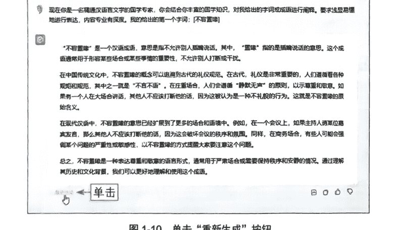

图 1-10 点击“重新生成”按钮

步骤02 执行后，系统会再次向模型发送相同指令并重新输出回复，如图 1-11 所示。此外，用户可在模型回复下方点击“更好”“更差”“差不多”对两次结果进行评价。

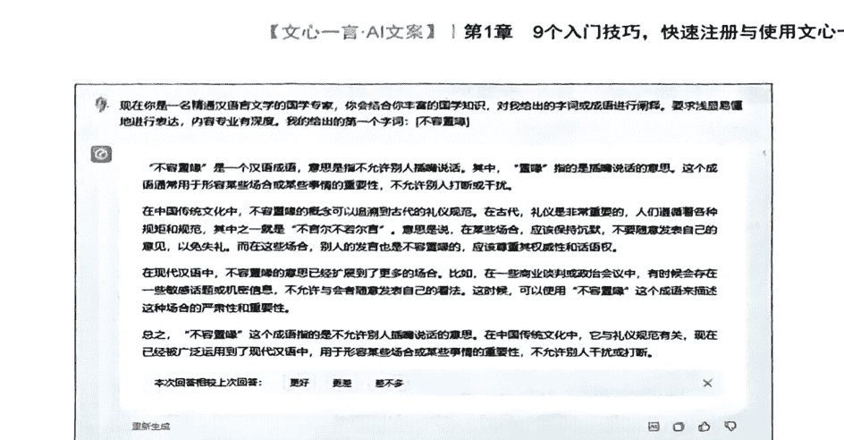

图 1-11 模型重新生成回复内容

★ 专家提示 ★

模型重新回复后，可点击右侧的 < 2/2 > 按钮切换查看此前版本。

### 实战 006 新建对话窗口

新建对话窗口有助于管理内容与查找历史记录，具体方法如下。

扫码看教学视频

步骤 01 进入主页，在左侧面板上方点击“新建对话”按钮，如图 1-12 所示。

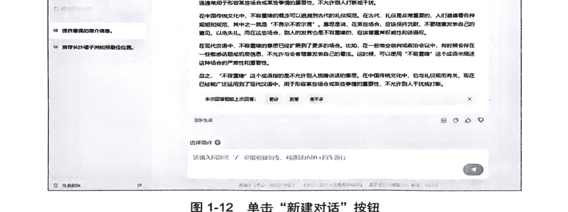

图 1-12 点击“新建对话”按钮

步骤 02 执行后即可打开全新对话窗口，如图 1-13 所示。

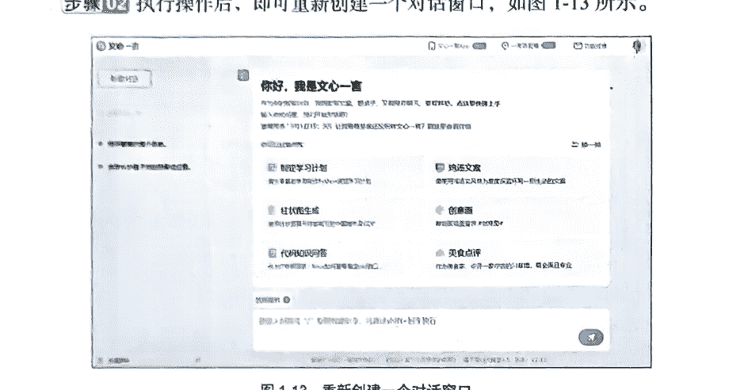

图 1-13 新建对话窗口

### 实战 007 历史记录查看与管理

扫码看教学视频

用户可在左侧面板查看并管理历史记录，亦可批量删除，具体方法如下。

步骤 01 进入主页，左侧面板选择对应历史对话即可查看其内容，如图 1-14 所示。

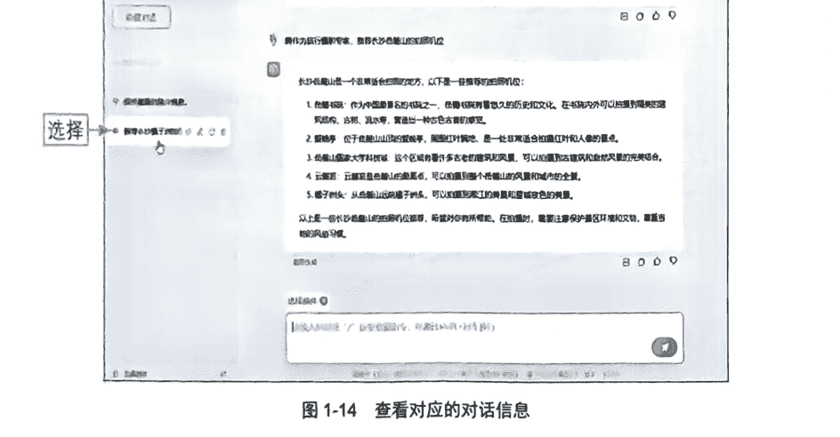

图 1-14 查看对应对话信息

步骤 02 在主页左侧面板选中对应历史对话，点击置顶按钮☆，如图 1-15 所示。

步骤 03 执行后，该记录将被加入“我的置顶”区，便于查阅，如图 1-16 所示。

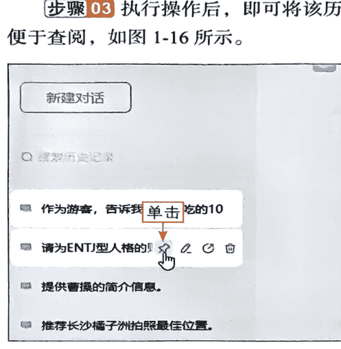

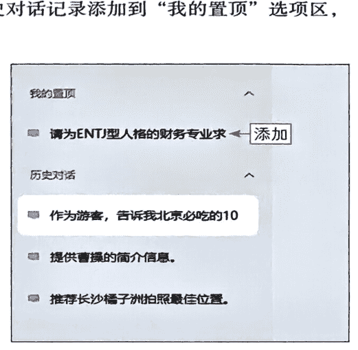

图 1-15 点击置顶按钮

图 1-16 加入“我的置顶”区

步骤 04 选中历史对话，点击重命名按钮✎，在弹出文本框中输入新名称，如图 1-17 所示，点击✓确认即可修改名称。

步骤 05 选中历史对话，点击删除按钮🗑，如图 1-18 所示，即可删除该记录。

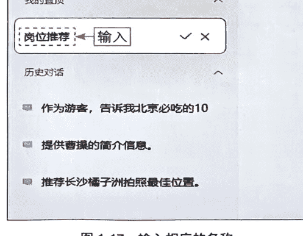

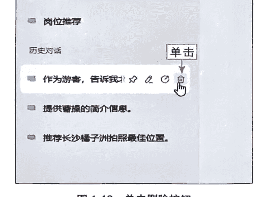

图 1-17 输入新名称

图 1-18 点击删除按钮

步骤 06 在左侧面板底部点击“批量删除”按钮，在左侧“删除对话”窗口勾选多个历史对话的复选框，如图 1-19 所示，点击“删除”即可批量移除。

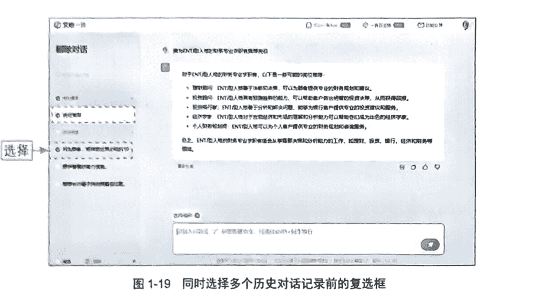

图 1-19 勾选多个历史对话

### 实战 008 隐藏左侧面板

扫码看教学视频

隐藏左侧面板可扩大对话区，更好查看内容，具体方法如下。

步骤 01 进入主页，点击左侧面板底部≡按钮，如图 1-20 所示。

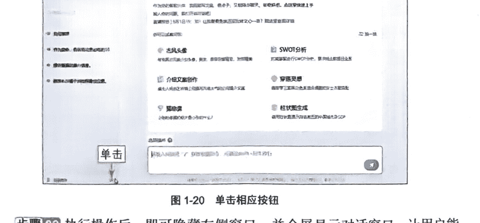

图 1-20 点击相应按钮

步骤 02 执行后左侧面板隐藏，对话窗口全屏显示，便于与模型交流，如图 1-21 所示。

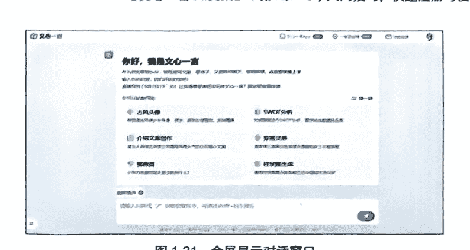

图 1-21 对话窗口全屏显示

### 实战 009 调用文心一言插件

扫码看教学视频

文心一言除强大的语言理解与生成能力外，还通过插件扩展功能。例如“百度搜索”是内置固定插件，可快速检索百度相关信息。用户可在对话中输入提示词直接获取百度搜索结果，具体方法如下。

步骤 01 进入主页，点击提示词输入区左上角“选择插件”按钮，弹出插件列表，如图 1-22 所示。

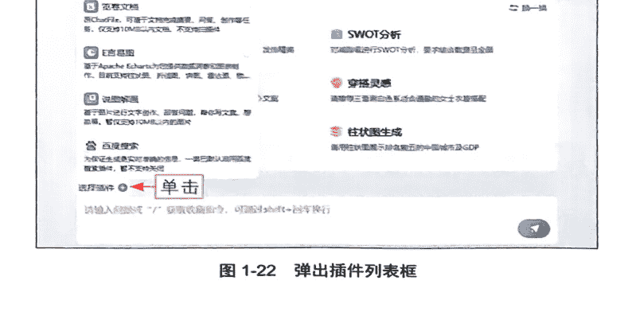

图 1-22 弹出插件列表

步骤02 “百度搜索”插件默认启用且暂不可关闭，用户可在输入区输入“百度一下”或“百度搜索”等关键词激活功能，再输入辅助提示词。例如输入“百度搜索 长沙今日天气”，文心一言会将请求发送至百度搜索引擎并返回天气信息，如图1-23所示。

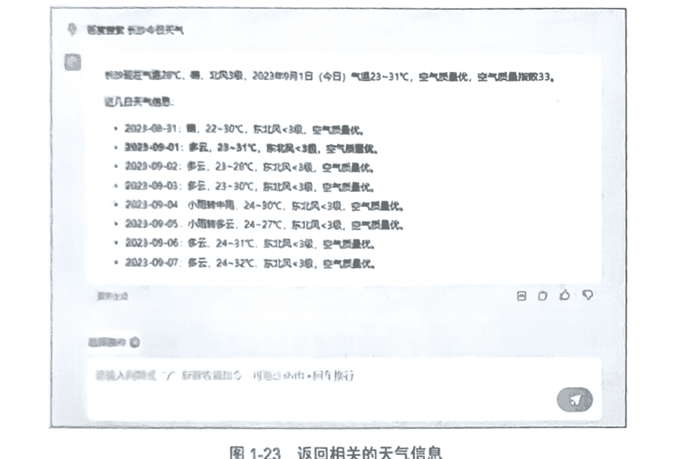

图1-23 返回天气信息

★ 专家提示 ★

使用“百度搜索”插件需保持网络连接，无网络则功能不可用。为保护隐私安全，文心一言会自动过滤广告与垃圾信息，确保结果来自可靠站点。

# 第 2 章

## 10 个撰写提示词技巧，构建高质量AI内容

文心一言是一款智能文字对话机器人，可根据用户输入的Prompt自动生成文字、图像等内容。本章介绍提示词撰写技巧，帮助构建高质量AI内容，提升文案创作效率。

### 实战 010 明确Prompt目标

输入提示词前需先明确目标，即期望获得何种结果。例如要求文心一言生成某主题文章，需明确主题、字数、风格要求等，下文以案例说明。

步骤 01 在对话窗口中输入对应提示词，如图 2-1 所示。

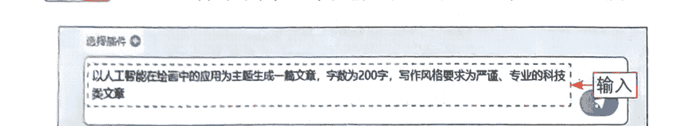

图 2-1 输入对应提示词

步骤 02 按【Enter】确认，模型会依据主题、字数、风格等要求生成文章，内容如图 2-2 所示。

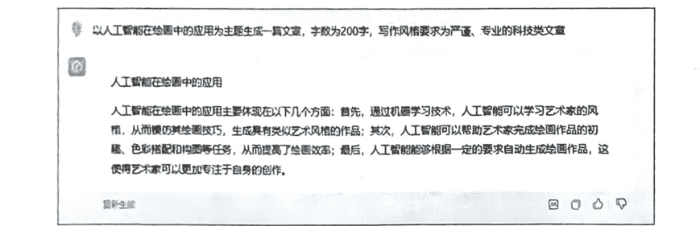

图 2-2 生成文章内容

提供清晰提示词可确保输出符合需求，减少偏差。做到这一点需注意提示词的准确与详尽，描述应明确具体，涵盖主题与要点。

### 实战 011 精心设计Prompt内容

设计Prompt时应重质不重量，尽量提供详实、准确且具启发性的信息以激发模型创造力，同时避免过度限制，保留发挥空间。下文以案例说明要点。

步骤 01 要求文心一言以“创新思维”为主题生成文章，可在对话窗口输入相应提示词，如图 2-3 所示。

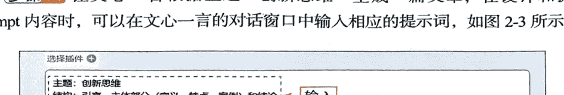

图 2-3 输入对应提示词

步骤 02 按【Enter】确认，模型会依据主题、结构、关键词要求生成文章，内容如图 2-4 所示。

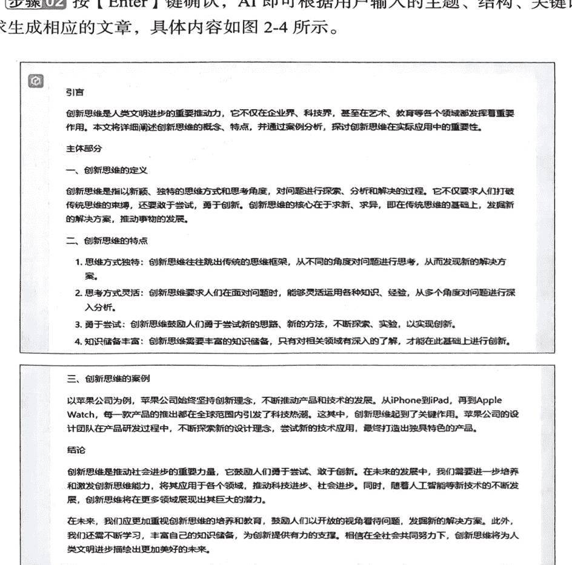

图 2-4 生成文章内容

精心设计Prompt可更好地激发文心一言创造力，提升输出质量。实际使用中可根据需求灵活调整内容以达到最佳效果。

### 实战 012 采用自然语言表达

自然语言即人类日常使用的口语与书面语，与计算机语言不同，人皆可懂。文心一言基于自然语言处理，使用自然语言撰写Prompt更易被理解，从而生成流畅回答。

下文以案例说明。

步骤 01 在对话窗口输入提示词“如何制作一杯拿铁咖啡？”，语气如同与常人对话，如图 2-5 所示。

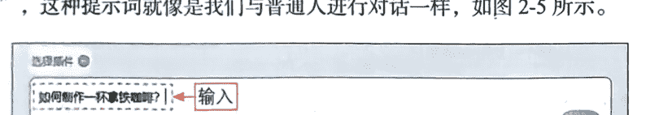

步骤 02 按【Enter】确认，模型能很好理解意图并给出准确符合期望的回答，内容如图 2-6 所示。

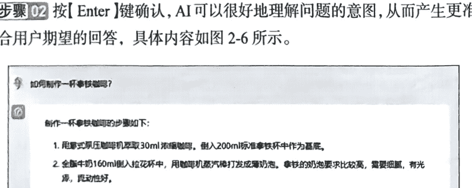

★ 专家提示 ★

Prompt内容应简洁明了，避免堆砌词汇。修饰过多易让模型抓不住重点，影响生成质量。

### 实战 013 提供示例与引导

Prompt中可为模型提供示例与引导，帮助其更好理解需求。例如提供相关话题、关键词或短语，或描述场景、故事，下文以案例进行说明。

让文心一言更听话的 Prompt 实操手册

第一步，走进文心一言的会话界面，填入一条把一段文字扩写成微型故事的指令，并在指令里附上已有的情节片段作为参考依据，示意参考图2-7。
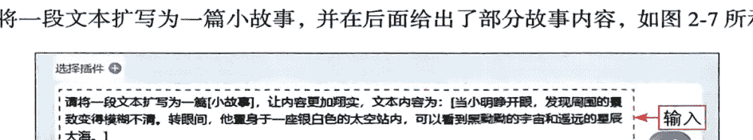

第二步，敲下回车键，模型会依据指令中给出的片段进行续写，得到一篇完整的故事，效果可对照图2-8。
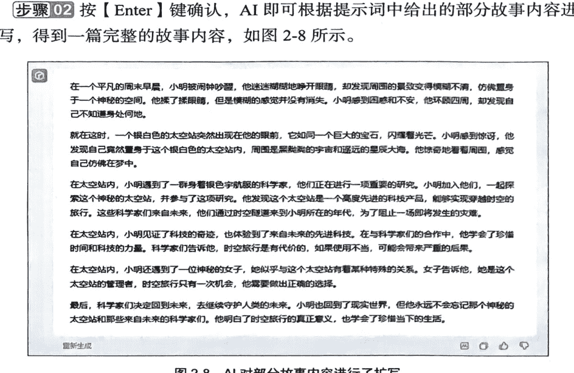

### 实战 014 用提问方式搭建 Prompt
用提问来表达需求会更清晰，比如“机器学习是什么，常见应用有哪些”。关键是问题要具体，避免出现“把机器学习的全部知识都告诉我”这种过于宽泛的表述。

还可以用“如何”“为什么”“什么”等疑问词来组织指令，下面以案例说明。

步骤 01 在会话窗口里输入指令，此处借助“为什么”来引导模型展开解释与探讨，示意见图2-9。

图2-9 提示词输入示例

步骤 02 发送后，就能以提问的方式实现更顺畅高效的互动，并获得质量较好的答案，具体内容见图2-10。
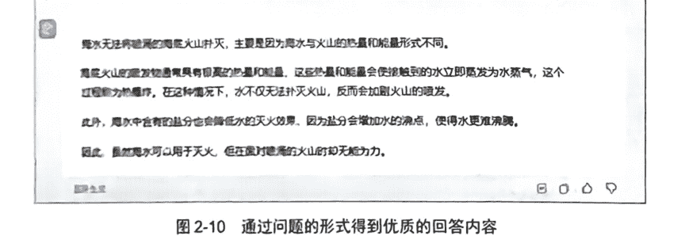

图2-10 以提问方式获得的优质回答

提问式写作的常用做法如下。

- 把复杂议题拆成若干小点，每次只提一个问题，之后根据回复继续追问，让主题始终集中。
- 提问时补充足够的背景与上下文，让模型理解意图，可以先简述背景再抛出问题。
- 借助模型上一次的回答内容提出后续问题，让对话层层递进。
- 用多种说法复问同一主题，对比回答效果差异。
- 围绕一个主题设计一系列关联问题，逐步展开探索。
- 若回复不理想，可调整提问方式重新发起，争取更符合预期的结果。
- 适当使用开放性问题，避免只能得到是或否的封闭式提问，促使模型给出更完整的内容。
- 按由浅入深的顺序提问，先问基础再深入细节，避免一次抛出一堆问题。

### 实战 015 在指令里加入细节
在指令中加入具体详实的细节与信息，能让模型更准确地把握需求，输出更精准的内容，下面用案例演示。

步骤 01 在对话窗口输入指令，对于需要解释某个知识点的场景，可先指定模型扮演专业角色，再简要说明该知识点的来源及背景，示意图见图2-11。
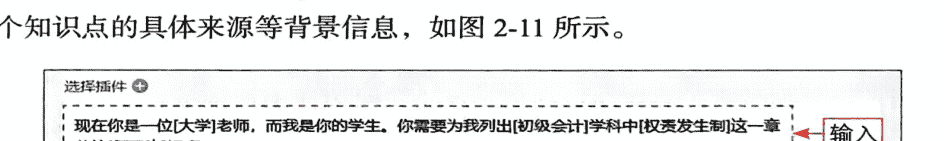

图2-11 提示词输入示例

步骤 02 发送后，充足的细节与背景能帮助模型生成更准确、更满意的回答，具体见图2-12。

关于在指令中添加细节和信息的一些具体建议如下。

- 场景类指令可明确人物身份、发生时间、地点等要素。
- 凡是已知的相关信息都尽量提供，有助于模型理解意图。
- 不要加入与请求无关的细节，以免干扰模型判断。
- 在对话中根据模型的回复补充更多细节，让交流逐步深入。
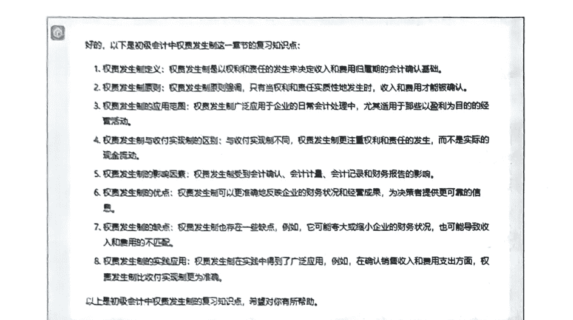

图2-12 模型生成的更准确满意回答

### 实战 016 预设输出格式
可以明确指定文心一言的输出格式，比如要求列表呈现、限定字数等，让结果更易阅读，下面举例说明。

步骤 01 在对话框输入指令，明确要求模型以列表形式呈现答案，示意图见图2-13。
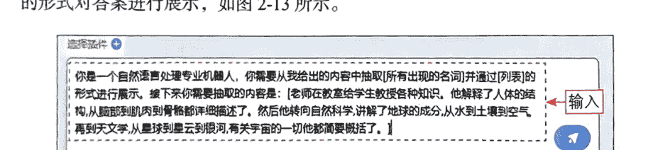

图2-13 提示词输入示例

步骤 02 确认后，模型会从文本中提取出相应的名词列表展示，具体见图2-14。

在指令中指定输出格式要求时可以使用下列几个技巧。

- 直接点明所需格式，例如“请用列表回答”。
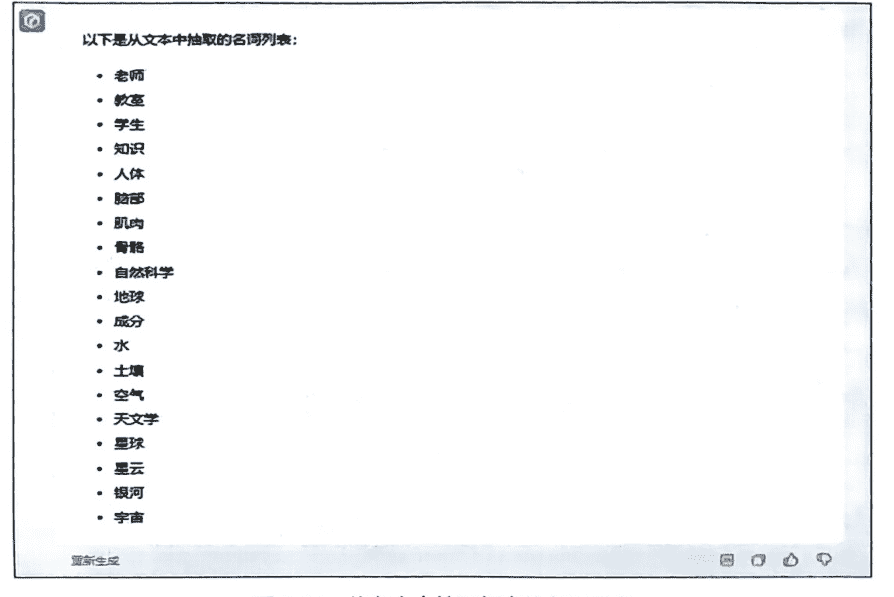
图2-14 从文本中抽取的名词列表
- 约定段落结构，比如“首段概括，其后分段展开”。
- 限定篇幅，如“500字以内概述”“用1到2句话说明”。
- 指定语气风格，如“用通俗易懂的语言解释”。
- 要求重点突出，如“请用粗体标注核心观点”。
- 要求举例佐证，如“请提供2到3个例子支持观点”。
- 指定语言，如“请用简洁英语回复”。
- 要求对比，如“先说A的观点，再对比B的差异”。
- 提供格式样例，让模型依样生成。

### 实战 017 用上下文提升连贯性
可以在指令里提供充足的上下文，帮助模型理解意图并生成准确内容，下面以案例说明。

步骤 01 在对话窗口输入指令，明确文章主题并提前给出各段落要点提示，帮助模型把握写作意图与逻辑重点，示意图见图2-15。

图2-15 提示词输入示例

步骤 02 发送后，模型能生成结构清晰、连贯的短文，避免无意义的闲聊，具体见图2-16。

图2-16 生成的连贯结构清晰短文

此外，还要注意指令本身的逻辑与连贯性，合理的提示能保证输出条理清晰、段落连贯，提升可读性与吸引力。

在编写指令时，可以通过以下几个技巧来帮助模型理解并生成连贯、逻辑清晰的内容，而不只是零散的信息。

- 开头简要说明文章主题与背景，让模型明确写作目的。
- 用提纲预先规划结构，列出所需段落及每段核心信息点，并补充背景细节，方便模型按需生成。
- 使用“首先”“其次”等一致过渡词衔接段落，增强通顺度。
- 提供关键词供模型展开相关概念与细节，丰富内容。
- 如需增强说服力，可提供具体案例或数据供引用。
- 结尾简要概括核心观点，收束全文结构。

★ 专家提示 ★
写好指令后应多次测试与微调，反复尝试模型回答，评估是否符合预期，再决定是否优化提示。

### 实战 018 用肯定语气提升效果
在指令中使用肯定、积极的表达，能为对话奠定良好基调，使模型更积极地配合需求，下面以案例说明。

步骤 01 假设想让模型推荐几部优质科幻电影，可输入如下肯定语气的指令，示意图见图2-17。

步骤 02 发送后，肯定语气往往会得到更主动积极的回复，具体见图2-18。

使用正确的肯定语气，可以最大限度地激发模型的正面回应，提高指令的有效性，相关技巧如下。

- 选用“请”“建议”“提供”等积极词，避免“不要”“避免”等否定词。
- 表达信任与期待，如“相信你能给出最佳建议”。
- 用“非常感谢”“十分赞赏”等温暖用语，营造友好氛围。
- 少用命令式，多用请求式表达。
- 用“精彩的点子”“最有见地的分析”等正面描述来定义期望输出。
- 表达输出的正向价值，如“这些建议执行后会很有帮助”。
- 提问时用“怎样才能……”等肯定表述，而非“为何无法……”等否定表述。
- 在指令中构建积极的场景与人物关系。
- 只提出有意义、目标正向的需求，避免无意义或负面要求。

图2-18 主动积极的回复内容

### 实战 019 以角色代入提问
可以先设定一个角色身份再提问，为模型提供更明确的情境，下面以案例说明。

步骤 01 假设要推荐适合5到8岁儿童观看的动画，直接指令可能是“请推荐...”，若设定母亲视角，可在对话框输入更具情境的提示，示意图见图2-19。

图2-19 提示词输入示例

步骤 02 发送后，明确的角色与背景情境能帮助模型把握推荐标准，给出更贴合需求的结果，具体见图2-20。

图2-20 更符合实际需求的结果

角色需具体明确，如学生、医生、客户等，避免过于宽泛；背景应描述充分，帮助模型理解视角；请求建议用第一人称，增强代入感。

# 第 3 章

## 16 种 AI 指令模板，提升人机交互效率

可以借助“一言百宝箱”页面的预设指令模板优化对话。这些模板由文心一言精心设计，能在不同场景下引导模型产出更优回复。掌握模板使用技巧，可大幅降低试错成本，提升交互效率。

图3-3 单击“使用”按钮

步骤 04 执行后，所选模板会自动填入输入框，确认发送即可生成对话内容，见图3-4。

图3-4 生成相应的对话内容

### 实战 021 创意写作指令制作歌词
文心一言作为强大的语言模型，其文本生成能力让人看到人工智能辅助创作的可能性。可以尝试“创意写作”指令模板，让文心一言自动撰写富有美感的诗词、视频脚本、歌词、文章等。

只需要给出指定形式、内容要求或风格关键词，文心一言就可以基于海量语言知识，创作出栩栩如生的文学作品，具体操作方法如下。

【文心一言·AI文案】 | 第3章 16种AI指令模板，更好地进行人机交互

步骤 01 进入“一言百宝箱”页面，在左侧导航栏选择“创意写作”标签，选择“歌词创作”模板，单击“使用”按钮，如图3-5所示。

图3-5 单击“使用”按钮

步骤 02 执行后，模板会自动填入提示框，适当修改方括号内的内容后发送，即可生成歌词，部分示例见图3-6。

图3-6 生成相应的歌词内容

29

文心一言·文心一格 AI文案与绘画108招

### 实战 022 职场效率指令撰写工作计划
扫码看教学视频

忙碌的工作和生活常常让人无暇规划未来，如果有一个效率专家助手帮忙制定合理工作计划，那该多好！

现在文心一言就可以扮演这样的智能助理，只需给出工作任务、时间期限等基本指令，模型就能基于丰富知识自动安排高效合理的工作计划，还能考虑假期等因素，使计划更符合实际，具体操作方法如下。

步骤 01 进入“一言百宝箱”页面，在左侧导航栏选择“职场效率”标签，选择“工作计划撰写”模板，单击“使用”按钮，如图3-7所示。

图3-7 单击“使用”按钮

步骤 02 执行后，模板会自动填入输入框，按需修改方括号内内容，示意图见图3-8。

图3-8 修改提示词

30

【文心一言·AI文案】| 第3章 16种AI指令模板，更好地进行人机交互

步骤 03 发送后，可生成工作计划，涵盖目标、任务、资源、风险预测、跟进评估等，有助于提升效率，如图3-9。

图3-9 生成相应的工作计划内容

### 实战 023 美食之窗指令推荐区域美食
文心一言就像一个吃遍全国的旅行家，积累了丰富的美食知识。在陌生地方，它可以快速推荐当地特色美食和值得去的餐厅，不必为寻找美食绞尽脑汁，具体操作方法如下。

步骤 01 进入“一言百宝箱”页面，在左侧导航栏选择“美食之窗”标签，选择“区域美食推荐”模板，单击“使用”按钮，如图3-10所示。

图3-10 单击“使用”按钮

步骤 02 执行后，模板会自动填入输入框，对地点提示词进行适当修改，如图3-11所示。

图3-11 修改提示词

步骤 03 发送后，即可生成美食推荐内容，对原料、味道、特色等描述得比较到位，如图3-12所示。

需要注意的是，AI推荐的美食比较笼统，有时还会出现明显错误。因此，用户也可以提供地区、口味、菜系等具体提示词，来生成更专业可信的推荐内容。

【文心一言·AI文案】| 第3章 16种AI指令模板，更好地进行人机交互

### 实战 024 旅行度假指令获取徒步路线
只需告诉文心一言目的地，它就能快速规划最优徒步路线，让人不再为路线选择浪费宝贵出游时间，具体操作方法如下。

步骤 01 进入“一言百宝箱”页面，在左侧导航栏选择“旅行度假”标签，选择“徒步路线”模板，单击“使用”按钮，如图3-13所示。

步骤 02 执行后，模板会自动填入输入框，对地点提示词进行适当修改，如图3-14所示。

图3-14 修改提示词

步骤 03 发送后，即可生成徒步路线内容，包括具体路线、徒步距离和爬升高度，并以表格形式列出，如图3-15所示。

图3-15 生成相应的徒步路线内容

需要注意的是，AI推荐的徒步路线仅供参考，不可完全依赖，甚至会出现乱窜地名的情况，因此还需要用户结合实际情况评估和修改，制定切实可行的旅行计划，保证安全至上。另外，在确定线路前，用户还必须考虑自身身体条件和徒步经验，不要选择超出能力的路线，并时刻与其他伙伴保持沟通，了解彼此状况。

### 实战 025 绘画达人指令生成工艺画
工艺画是绘画技术与工艺技术相结合的画种，具有较高艺术价值和审美意义，制作过程需要精雕细琢。借助文心一言的“绘画达人”指令模板即可轻松生成工艺画，具体操作方法如下。

步骤 01 进入“一言百宝箱”页面，在左侧导航栏选择“绘画达人”标签，选择“精美工艺画”模板，单击“使用”按钮，如图3-16所示。

图3-16 单击“使用”按钮

步骤 02 执行后，模板会自动填入提示框，按下回车键确认，即可生成相应的工艺画，效果如图3-17所示。

图3-17 生成相应的工艺画效果

### 实战 026 编程辅助指令生成 Python 代码
Python是一种高级、通用、解释型编程语言，被广泛用于网站开发、数据分析、人工智能、科学计算、游戏开发等。用户借助文心一言的“编程辅助”指令模板，即可轻松编写高质量Python代码，具体操作方法如下。

步骤 01 进入“一言百宝箱”页面，在左侧导航栏选择“编程辅助”标签，选择“代码生成”模板，单击“使用”按钮，如图3-18所示。

图3-18 单击“使用”按钮

步骤 02 执行后，模板会自动填入提示框，按下回车键确认，即可生成相应的Python代码，如图3-19所示。

图3-19 生成相应的Python代码

### 实战 027 生活帮手指令制定健身计划
健康生活方式对每个人都至关重要，其中关键部分就是定期健身。无论是初学者还是经验丰富的健身爱好者，制订有效健身计划都能帮助更好地实现健康目标。

使用文心一言的“生活帮手”指令，可以轻松制定并管理健身计划，无论是增肌、减脂、提高体能还是改善整体健康状况，文心一言都能帮助制定个性化健身计划，具体操作方法如下。

步骤 01 进入“一言百宝箱”页面，在左侧导航栏选择“生活帮手”标签，选择“健身计划”模板，单击“使用”按钮，如图3-20所示。

图3-20 单击“使用”按钮

步骤 02 执行后，模板会自动填入提示框，对中括号内的提示词进行适当修改，如图3-21所示。

图3-21 修改提示词

步骤 03 发送后，即可生成健身计划，包括健身目标、训练项目及频次、注意事项等内容，如图3-22所示。

图3-22 生成相应的健身计划内容

### 实战 028 营销文案指令生成产品广告片
营销文案是一种书面内容，旨在吸引、引导和激发潜在客户兴趣，以促使他们采取特定行动，通常是购买产品、注册账号、订阅服务或与品牌互动。营销文案可以出现在广告片、网站、社交媒体、电子邮件、宣传册、产品包装和其他宣传材料等。

快速生成广告片营销文案

文心一言能够迅速产出多种推广类文本，其中就包括面向产品广告片的营销脚本，下面说明具体做法。

步骤 01 先打开文心一言百宝箱，左栏菜单切换到营销文案板块，在模板列表里挑选广告片文案后按下使用，如图 3-23 所示。

图 3-23 单击“使用”按钮

步骤 02 使用后，选中的模板会自动填充到提示词输入区，需要对中括号里的占位内容做适当调整，如图 3-24 所示。

图 3-24 修改提示词

步骤 03 回车确认后即可得到包含分镜情节与旁白语言的产品广告片营销稿，可直接套用到成片中，如图 3-25 所示。

图 3-25 生成相应的产品广告片营销文案

### 实战 029 使用教育培训指令设计课程大纲

对教育工作者来说，文心一言可以定制教学素材，例如输出课程大纲，有助于提升教学效率、节省资源并推动创新，具体流程如下。

步骤 01 进入文心一言百宝箱页面，左侧导航切至教育培训分类，选取课程设计这一指令模板后点击使用，如图 3-26 所示。

图 3-26 单击“使用”按钮

【文心一言·AI文案】 | 第3章 16种AI指令模板，更好地进行人机交互

步骤 02 触发后，模板会自动写入提示词输入框，需对中括号内的提示词进行修改，如图 3-27 所示。

图 3-27 修改提示词

步骤 03 按回车确认后会生成课程大纲，涵盖课程目标、内容、形式、评估、教学资源与实施建议等，如图 3-28 所示。

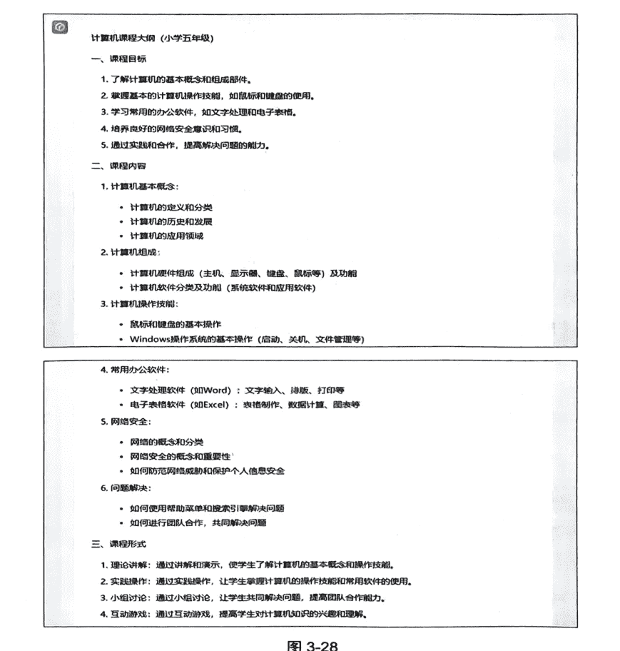

图 3-28

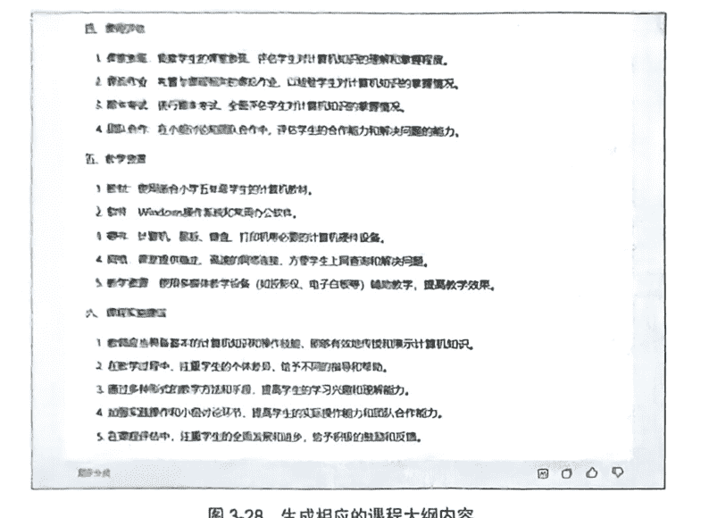

图 3-28 生成相应的课程大纲内容

### 实战 030 使用数据分析指令生成柱状图表

文心一言是数据处理的得力助手，可帮助分析师更高效地解读数据，并依数据直接产出柱状图、折线图等图表，具体操作如下。

**步骤 01** 打开文心一言百宝箱，左侧导航切换到数据分析分类，从模板中选择柱状图生成后按下使用，如图 3-29 所示。

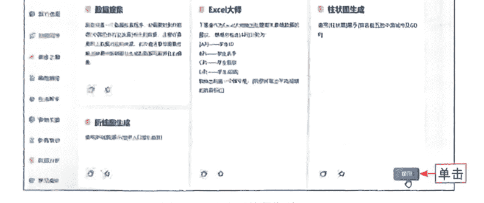

图 3-29 单击“使用”按钮

步骤 02 使用后，模板会自动填入提示词输入框，适当修改相关提示词，如图 3-30 所示。

图 3-30 修改提示词

步骤 03 回车确认即可生成柱状图表，包含表格与图形两部分，呈现具体数据及对比效果，如图 3-31 所示。

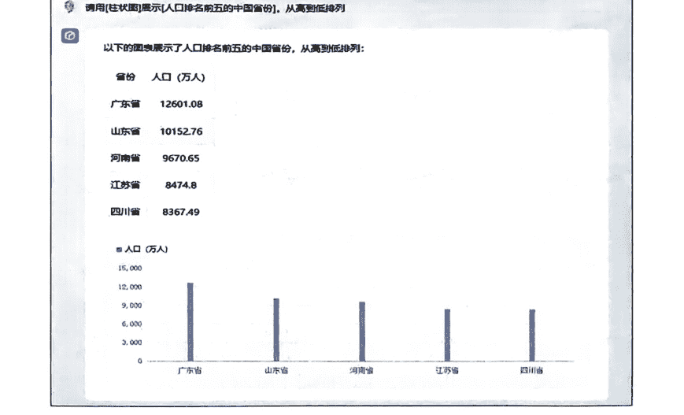

图 3-31 生成相应的柱状图表

### 实战 031 使用灵感策划指令推荐穿搭方案

灵感是创意的火花也是创新的源泉，文心一言可以为用户持续供给灵感。无论是创作者、企业家、艺术家或其他领域从业者，都能获得新颖想法来激发创作。下面介绍用灵感策划指令推荐穿搭方案的方法。

步骤 01 进入文心一言百宝箱，左侧导航切换到灵感策划分类，选取穿搭灵感模板后点击使用，如图 3-32 所示。

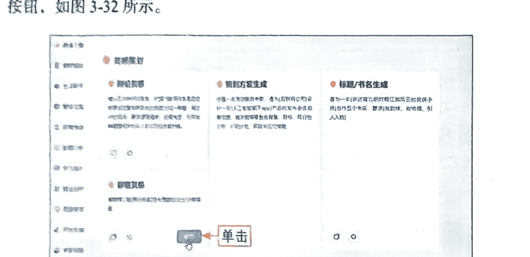

图 3-32 单击“使用”按钮

步骤 02 模板自动填入提示词输入框，需要对中括号内的提示词做适当改写，如图 3-33 所示。

图 3-33 修改提示词

步骤 03 回车确认后会生成穿搭方案，包含上衣裤子搭配，并给出风格与适用场景，如图 3-34 所示。

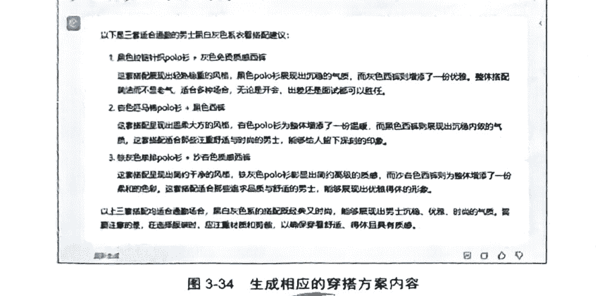

图 3-34 生成相应的穿搭方案内容

### 实战 032 使用评论生成指令打造专业影评

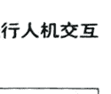

文心一言能轻松生成各类评论，无论是产品、文章、音乐、电影或其他主题，都可帮助表达观点并提供反馈。下面介绍用评论生成指令打造专业影评的操作。

步骤 01 进入文心一言百宝箱，左侧导航切换到评论生成分类，选取专业影评模板后点击使用，如图 3-35 所示。

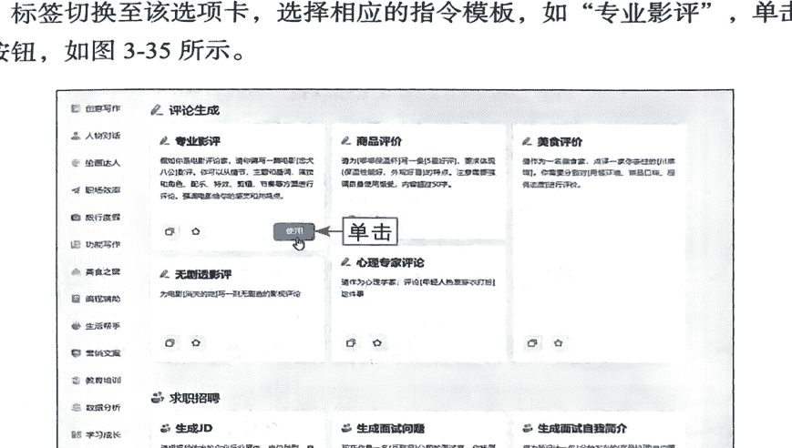

步骤 02 执行后模板会自动写入提示词输入框，对中括号内的提示词进行修改，如图 3-36 所示。

步骤 03 回车确认即可生成电影评论，涵盖情节、主题基调、演技角色、配乐、特效、剪辑、节奏等方面，如图 3-37 所示。

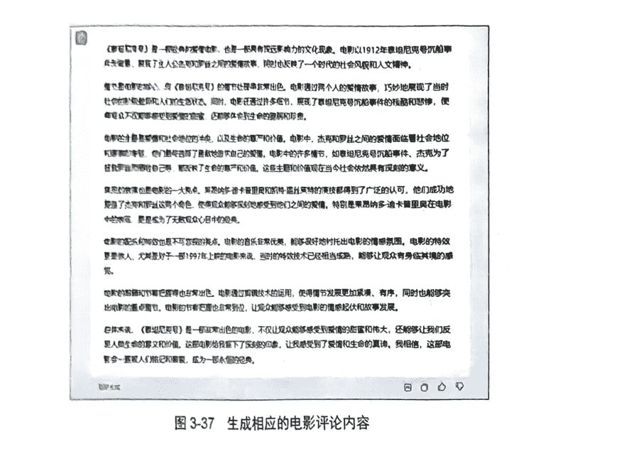

图 3-37 生成相应的电影评论内容

### 实战 033 使用商业分析指令进行 PEST 分析

PEST 代表政治、经济、社会、技术四个维度，用于评估宏观环境对组织或项目的影响。下面介绍使用文心一言进行 PEST 分析的方法。

步骤 01 进入文心一言百宝箱，左侧导航切换到商业分析分类，选取 PEST 分析模板后点击使用，如图 3-38 所示。

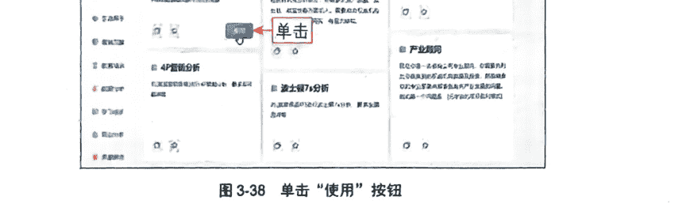

图 3-38 单击“使用”按钮

步骤 02 模板自动填入提示词输入框，需对中括号内的提示词做适当修改，如图 3-39 所示。

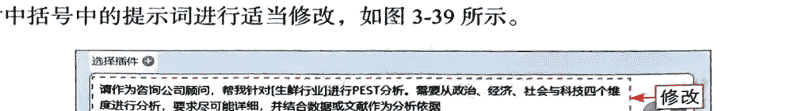

图 3-39 修改提示词

步骤 03 回车确认后会生成 PEST 分析报告，有助于更清晰理解外部环境并识别机会与威胁，如图 3-40 所示。

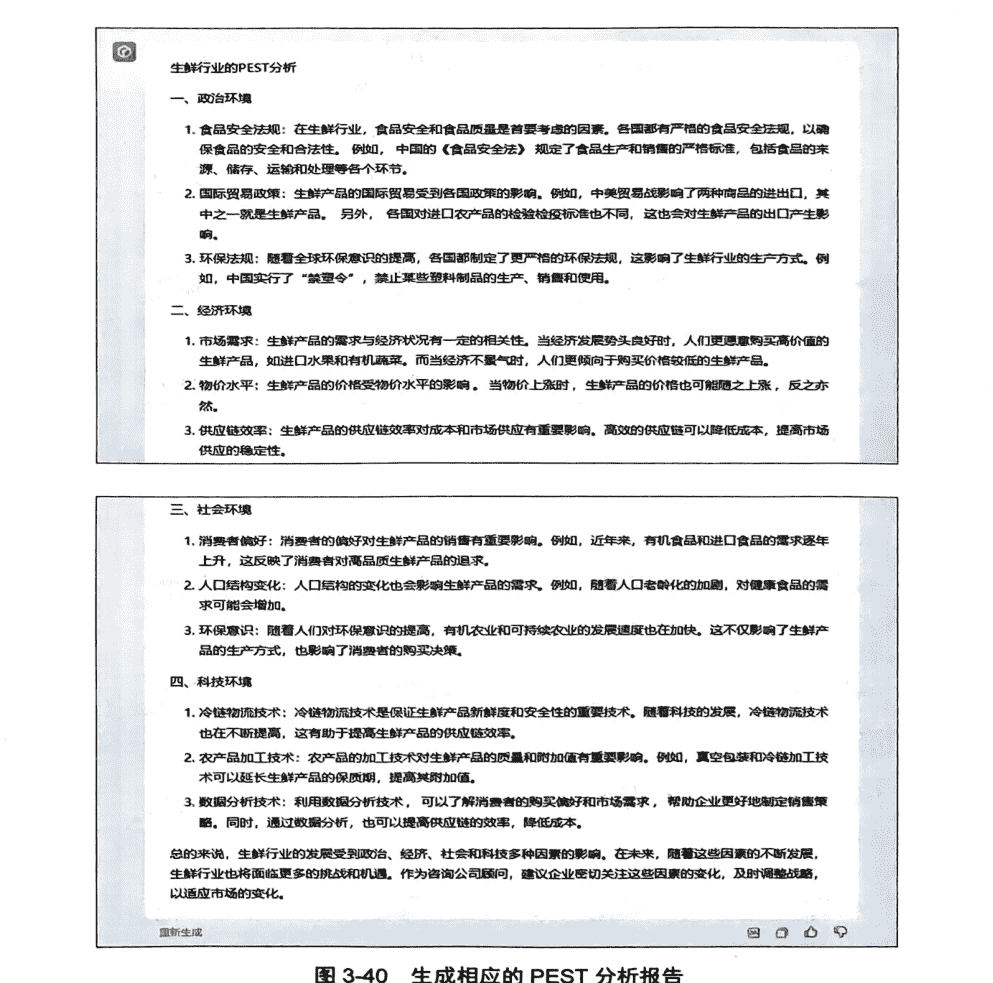

图 3-40 生成相应的 PEST 分析报告

### 实战 034 使用学习成长指令翻译英文短句

在学习成长领域，获取知识与个人发展至关重要，文心一言为此带来深刻影响。它可提供更广的学习资源与个性化体验，如撰写实习报告、制定学习计划、纠错、生成复习材料、英汉互译等。下面介绍翻译英文短句的操作。

步骤 01 进入文心一言百宝箱，左侧导航切换到学习成长分类，选取英汉互译模板后点击使用，如图 3-41 所示。

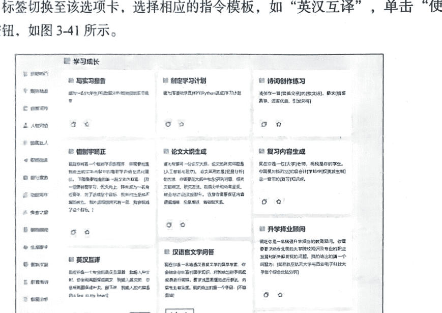

图 3-41 单击“使用”按钮

步骤 02 模板自动填入提示词输入框，需对中括号内的提示词进行修改，如图 3-42 所示。

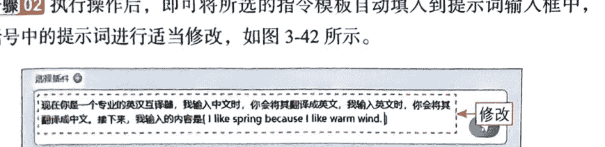

图 3-42 修改提示词

步骤 03 回车确认后，提示词中的英文会被译为中文，继续输入其他英文内容也会自动翻译，如图 3-43 所示。

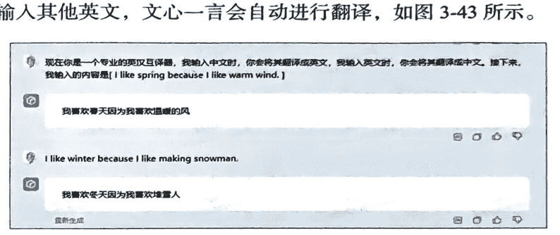

图 3-43 文心一言自动翻译英文

### 实战 035 使用求职招聘指令生成面试问题

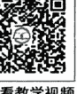

扫码看教学视频

职场竞争激烈，求职招聘需要更多洞察力，文心一言在此有很好的应用。它不仅可为求职者提供个性化建议优化简历，也能帮助招聘者智能筛选匹配人才。下面介绍生成面试问题的操作。

步骤 01 进入文心一言百宝箱，左侧导航切换到求职招聘分类，选取生成面试问题模板后点击使用，如图 3-44 所示。

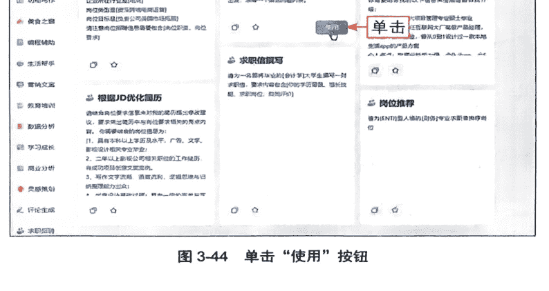

图 3-44 单击“使用”按钮

**步骤 02** 模板自动填入提示词输入框，对中括号内的提示词做适当改写，如图 3-45 所示。

图 3-45 修改提示词

**步骤 03** 回车确认后会生成面试问题，涵盖专业技能、通用能力、经验、个人特质等方面，如图 3-46 所示。

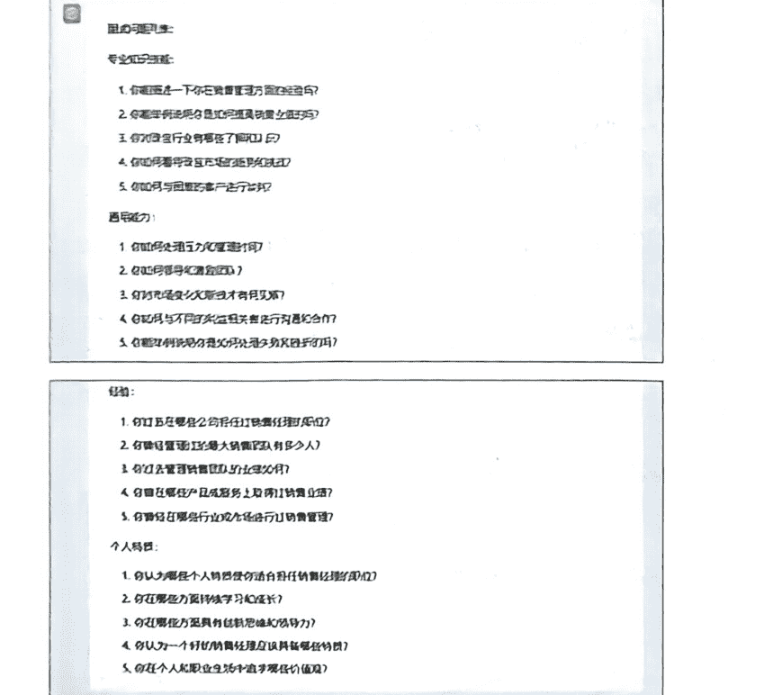

图 3-46 生成相应的面试问题内容

# 第 4 章

## 10 个 App 使用技巧，用手机生成 AI 文案

文心一言除网页版外还推出手机 App，让用户随时随地享受优质 AI 服务。无论在办公室、家中或路上，都可方便生成各类 AI 文案。

### 实战 036 用文字与 AI 对话

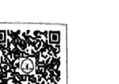

扫码看教学视频

在文心一言 App 中，用户可通过文字与 AI 对话，获得即时信息、答案与建议，无需等待或查阅大量文档，提升效率并实现人机协作，具体操作如下。

步骤 01 打开文心一言 App，默认进入对话界面，在输入框中输入提示词，如图 4-1 所示。

步骤 02 点击发送按钮即可获取 AI 回答，具体内容如图 4-2 所示。

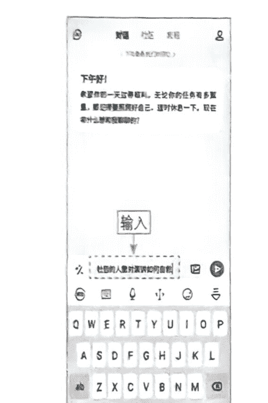

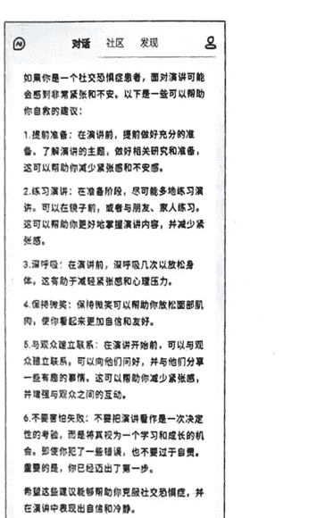

图 4-1 输入相应的提示词

图 4-2 获取 AI 的回答

### 实战 037 使用语音播报功能

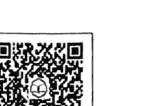

扫码看教学视频

使用文心一言 App 时可开启语音播报，通过语音与 AI 交互，便于在不便看屏的场景使用，如开车、做家务时收听新闻、小说、天气预报等。下面介绍具体操作。

#### ★ 专家提醒 ★

用户可按需调整助理角色、语音风格、语速等，以获得最佳听感。

**步骤 01** 在对话界面点击右上角 👤 图标进入作品界面，再点击 📷 图标，如图 4-3 所示。

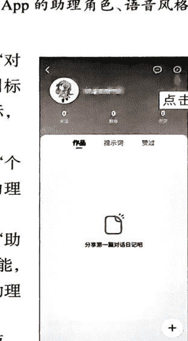

**步骤 02** 进入个人中心后选择助理设置，如图 4-4 所示。

**步骤 03** 进入助理设置界面，打开语音播报功能，如图 4-5 所示，此处也可设置角色、风格与语速。

**步骤 04** 返回对话界面，点击右下角语音图标 🎙️，如图 4-6 所示。

**步骤 05** 即可开始语音对话，如图 4-7 所示，用户可直接说话。

**步骤 06** 说完稍作停顿，系统会自动发送语音提示词，如图 4-8 所示。

图 4-7 开始进行语音对话

图 4-8 发送语音提示词

**步骤 07** AI 会根据语音提示词生成回复并进行语音播报，效果如图 4-9 所示。

图 4-9 生成相应的回复内容并进行语音播报

### 实战 038 实现连续语音对话

扫码看教学视频

开启连续语音对话功能后，用户可连续用语音与 AI 交流，具体操作如下。

- 步骤 01 进入助理设置界面，打开连续语音对话功能，如图 4-10 所示。

- 步骤 02 通过语音输入提示词，让 AI 生成若干抖音短视频标题，如图 4-11 所示。

- 步骤 03 继续语音输入提示词，让 AI 根据前面某个标题生成对应抖音文案，如图 4-12 所示。

图 4-10 开启“连续语音对话”功能

图 4-11 生成抖音短视频标题

图 4-12 生成相应的抖音文案内容

### 实战 039 使用提示词工具

在文心一言 App 中可使用提示词工具快速对话，具体操作如下。

**步骤 01** 在对话界面点击左上角图标展开历史记忆面板，点击新建 AI 对话按钮，如图 4-13 所示。

**步骤 02** 新建对话后点击左下角图标，在提示词工具列表中选择所需模板，如图 4-14 所示。

**步骤 03** 选用模板后按提示输入相应提示词，如图 4-15 所示。

**步骤 04** 点击发送按钮即可获取 AI 回答，如图 4-16 所示。

### 实战 040 上传图片看图写诗

扫码看教学视频

在文心一言 App 中除文字语音外，还可上传图片作为提示词生成创意文案，如看图写诗，具体操作如下。

- 步骤 01 在对话界面点击图标，在弹出面板中选择一张图片，如图 4-17 所示。

- 步骤 02 上传图片后输入相应提示词，如图 4-18 所示。

- 步骤 03 点击发送按钮将图片与文字提示发送给 AI，如图 4-19 所示。

- 步骤 04 稍等片刻，AI 会根据图片内容创作一首诗，如图 4-20 所示。

### 实战 041 发布 AI 历史对话

把文心一言手机端创作出来的内容推到社区和大家交流，整体走法如下。

**步骤 01** 打开客户端进入社区页，点底部右侧的加号，见图 4-21。

**步骤 02** 列表弹出后，挑出想要分享的历史会话，见图 4-22。

**步骤 03** 进入“选择分享内容”页，为目标对话上方的复选框打勾，见图 4-23。

**步骤 04** 触发进入发布编辑页，见图 4-24。

## 第4章 手机端AI写作十二步实操

**步骤 05** 参考模型输出，补全标题与正文信息，见图 4-25。

**步骤 06** 页面顶部点“立即生成”可自动产出封面，觉得不合适可点“更换封面”，见图 4-26。

**步骤 07** 切换到“手机相册”标签，从本地图库里挑一张作封面，见图 4-27。

**步骤 08** 也可以切到“AI 生成”标签，填入提示词后点“生成封面图”，见图 4-28。

**步骤 09** 系统会按提示词描绘的场景合成图片，不喜欢可点“重新生成”，见图 4-29。

**步骤 10** 再次合成后确认无误，点顶部右侧的✔图标，见图 4-30。

图 4-29 点击“重新生成”按钮

图 4-30 点击右上角的相应图标

**步骤 11** 封面替换完毕后点“发布”，见图 4-31。

**步骤 12** 发布后打开“作品”页就能查看，审核通过才会在社区展示，见图 4-32。

图 4-31 点击“发布”按钮

图 4-32 查看发布的 AI 内容

### 实战 042 扮演虚拟角色

文心一言可以让模型化身各种虚拟身份，让娱乐、教学、培训和交流更有趣，具体做法如下。

- 步骤 01 打开发现页，切到“角色”标签，见图 4-33。
- 步骤 02 进入角色列表，指定想让模型扮演的人物，例如诸葛孔明，见图 4-34。
- 步骤 03 打开与该角色的对话页，输入提示词，见图 4-35。
- 步骤 04 发送后，模型会以该角色口吻作答，具体内容见图 4-36。

### 实战 043 用 AI 以文生图

文心一言不仅能写文案，还能把文字转成图像，比如风景画，流程如下。

- 步骤 01 在发现页切到“绘画”，挑选提示词模板，见图 4-37。
- 步骤 02 打开“风景画生成”对话页，点选示例，见图 4-38。
- 步骤 03 系统会自动下发指令并产出风景图，见图 4-39。
- 步骤 04 对效果不满意时，发送“重画”指令让模型重新绘制，见图 4-40。

**步骤 05** 还可在输入框写自定义提示词，描述想画的风景类型或场景，见图 4-41。

**步骤 06** 按发送按钮▶，模型按提示词出图，见图 4-42。

### 实战 044 用 AI 优化简历

模型能解析求职者的教育背景、工作经历和技能，给出定制化建议，让简历更有说服力。操作方法如下。

**步骤 01** 打开发现页，切到“秋招”，挑选提示词模板，见图 4-43。

**步骤 02** 进入“简历优化”对话页，输入目标职位提示词，见图 4-44。

**步骤 03** 按发送按钮▶，模型会按职位生成简历内容，见图 4-45。

**步骤 04** 可更换其它职位提示词查看不同版本，见图 4-46。注意重新生成时需返回发现页重新挑选“简历优化”模板。

图4-43 选择相应的提示词模板

图4-44 输入相应的职位提示词

图4-45 生成相应的简历内容

图4-46 AI 生成的其他简历内容

### 实战 045 生成 PPT 大纲

PPT 是传递信息和汇报进展的重要工具，下面介绍用模型生成大纲的方法。

**步骤 01** 在发现页切到“职场”，选对应提示词模板，见图 4-47。

**步骤 02** 进入“PPT 大纲生成”对话页，挑选 PPT 主题，见图 4-48。

**步骤 03** 模型会按所选主题生成大纲，具体内容见图 4-49。

**步骤 04** 可更换主题或在输入框写自定义主题提示词，发送后生成新大纲，见图 4-50。注意重新生成时需返回发现页重新挑选“PPT 大纲生成”模板。

图 4-50 AI 生成其他主题的 PPT 大纲内容

# 第 5 章

## 十大爆款文案实战案例

文心一言不仅提升创作效率，也拓宽创作边界，还能为各领域专业人士提供定制化文案，让内容更专业更有吸引力。本章通过十个典型案例，帮助大家轻松写出各行业的爆款内容。

### 实战 046 总结无人经济文章内容

无人经济是人工智能与自动化改变工作方式的新模式。本案例使用文心一言中的“览卷文档”插件，提炼无人经济文档的核心要点，效果见图 5-1。

图 5-1 总结无人经济文章内容效果

下面介绍操作流程。

**步骤 01** 在文心一言主页按“选择插件”，列表中挑选“览卷文档”，见图 5-2。

图 5-2 选择“览卷文档”插件

**步骤 02** 插件启用后，在输入框左上角按“上传文件”，见图 5-3。

图 5-3 单击“上传文件”按钮

**步骤 03** 弹出“打开”对话框，指定目标文档，见图 5-4。

图 5-4 选择相应的文档

> ★ 专家提醒 ★
> “览卷文档”插件原名 ChatFile，可基于上传文档完成摘要、问答、创作等任务，仅支持 10MB 以内文件，不支持扫描件。可上传 .doc、.docx、.pdf，其中 PDF 不能是扫描件。

**步骤 04** 按“打开”载入文档。模型会自动阅读解析，见图 5-5。稍等片刻即可提取关键摘要。

图 5-5 AI 自动阅读和解析文档内容

### 实战 047 生成新媒体思维导图

思维导图用于组织、呈现和可视化信息，有助于理清思路和激发创意。本案例使用“E 言易图”插件生成新媒体思维导图，提升信息传递效率，效果见图 5-6。

图 5-6 新媒体思维导图效果

下面介绍生成方法。

- 步骤 01 在主页按“选择插件”，列表里挑选“E 言易图”并启用，见图 5-7。
- 步骤 02 在对话窗口输入提示词，见图 5-8。
- 步骤 03 按【Enter】确认，文心一言会调用插件进行分析，见图 5-9。

图 5-7 选择“E 言易图”插件

图 5-8 输入相应的提示词

图 5-9 调用“E 言易图”插件分析数据

**步骤 04** 稍等片刻即可自动生成思维导图等内容，见图 5-10。

图 5-10 自动生成相应的思维导图等内容

#### ★ 专家提醒 ★
把文心一言看作智能中枢，插件就是它的感知与执行器官。插件能把大模型的生成能力接入外部应用，既拓宽使用场景，也能实现过去难以完成的任务。

### 实战 048 生成摄影公众号文章

摄影公众号是爱好者和专业人士分享作品的热门平台，引人入胜的图文是吸粉关键。本案例使用“说图解画”插件上传图片快速生成公众号文章，效果见图 5-11。

图 5-11 摄影公众号图文内容效果

下面介绍操作流程。

**步骤 01** 在主页按“选择插件”，列表中挑选“说图解画”并启用，见图5-12。

图5-12 选择“说图解画”插件

**步骤 02** 在输入框左上角按“上传文件”，弹出对话框挑选素材图，见图5-13。

图5-13 选择相应的素材图像

**步骤 03** 按“打开”载入图片，模型开始解析，见图5-14。

图 5-14 AI 自动解析图片

**步骤 04** 等待片刻，模型会把图片理解整理成文字并给出提问示例，见图 5-15。

图 5-15 AI 根据图片信息整理的文字

**步骤 05** 挑选示例，如写朋友圈配文，复制粘贴到提示词框，见图 5-16。

图 5-16 复制并粘贴相应提示词

**步骤 06** 按【Enter】，生成对应配文，见图 5-17。

图 5-17 生成相应的朋友圈配文

**步骤 07** 也可输入自定义提示词，见图 5-18，按【Enter】可生成约 500 字的公众号文章。

图 5-18 输入自定义的提示词

> ★专家提醒★
> “说图解画”插件可基于上传图片进行文字创作或问答，帮助写文案讲故事，目前仅支持 10MB 以内的图片。

### 实战 049 创作美食团购短视频脚本

美食团购是短视频社区的热门题材，大家喜欢分享令人垂涎的美食体验。制作吸引人的脚本需要创意与专业知识。

本案例介绍使用文心一言创作美食团购短视频脚本的方法，帮助创作者快速完成画面构思、旁白和拍摄建议，效果如表 5-1 所示。

表 5-1 美食团购短视频脚本效果

| 镜头 | 运镜 | 画面 | 旁白 | 备注 |
| :--- | :--- | :--- | :--- | :--- |
| 1 | 推镜头 | 夜晚，繁华的街道 | 忙碌了一天的你，是否已经厌倦了快餐和外卖？ | 缓慢推进，背景音乐渐入 |
| 2 | 移镜头 | 热闹的夜市，摊位上冒着烟，香气四溢 | 让我们一起走进夜市，感受那股热闹的氛围和美食的诱惑。 | 平稳移动，捕捉热闹场景 |

| 3 | 推镜头 | 特色摊位上陈列招牌小龙虾套餐，虾体色彩鲜亮极具食欲 | 今晚一起享用【招牌小龙虾套餐】，给味蕾一场盛大派对！ | 镜头缓慢向前推进，着重表现龙虾的亮丽与诱惑感 |
| 4 | 推镜头 | 手持龙虾咬下一口，汤汁迸溅，脸上露出满足神情 | 每口肉质鲜嫩汁水饱满，吃完依然念念不忘。 | 快速推近镜头，抓拍细节特写 |
| 5 | 拉镜头 | 呈现团购套餐价位，醒目的数字搭配丰盛食材瞬间吸睛 | 现推出【招牌小龙虾套餐】团购，吃得划算量又足！ | 缓慢拉远镜头，全面展示套餐丰富配置 |
| 6 | 跟镜头 | 厨房内人潮涌动，厨师正娴熟翻炒小龙虾 | 师傅们精心制作，确保每份套餐兼顾美味与观感。 | 镜头紧贴跟随，记录厨师娴熟动作与专注投入 |
| 7 | 摇镜头 | 欢乐聚餐画面，好友围桌共享美食，笑语连绵 | 设想与好友围坐品小龙虾，边吃边聊，生活是不是更添色彩？ | 左右摇动镜头，捕捉聚餐氛围与笑容 |
| 8 | 旋转镜头 | 精美礼盒上印有“感谢支持，愿美食常伴左右” | 感谢每一位朋友的支持，美食同行，与你共分享这份喜悦。 | 音乐尾声时字幕缓缓滚动，画面收尾 |

下面详细说明借助文心一言创作美食团购短视频脚本的具体流程。

**步骤 01** 在文心一言聊天界面里输入对应的提示语句，参考图 5-19。

**步骤 02** 敲击回车键后，系统会快速生成匹配的美食团购短视频脚本，成果见图 5-20。

### 实战 050 续写儿童小故事
儿童绘本故事对激发想像力、树立品德意识和锻炼语言表达都起着关键作用，可惜原创新篇常让人苦思冥想。好在文心一言能提供丰富的创作灵感，助力教师、家长和写作者更省力地构思新故事，打开思路。

本示例重点讲解如何用文心一言续写儿童小故事。借助 AI 可迅速产出新情节、新角色和教育点，为孩子打造更丰富多元的阅读体验，提升阅读热情，带来成长乐趣与启发。效果见图 5-22。

续写儿童小故事的操作步骤如下。

**步骤 01** 在对话框内输入指定提示语，用以确定故事起笔情节和风格特点，示意图见图 5-23。
**步骤 02** 按下回车，AI 将依据给定的开头情节展开续写，成果见图 5-24。
**步骤 03** 在对话窗口再次输入提示词以调整写作风格，如图 5-25 所示，回车后即可得到安徒生风格的续写文本。

> ★专家提醒★
> 利用文心一言可轻松开启新故事分支，或为已有情节增添细节，使内容更丰满生动。

### 实战 051 创作直播带货脚本
直播带货是通过在线实时视频，由主播现场演示并推介商品或服务来促成购买的销售方式。如今它已成电商主流趋势，兼具娱乐与购物，让消费者体验更丰富。

文心一言能协助主播快速生成吸睛的直播带货脚本，涵盖商品讲解、销售话术和互动环节，有助于提升转化、扩大销路与品牌曝光。本案例介绍其创作方法，让直播更流畅、更抓人。效果见图 5-26。

具体操作流程如下。

**步骤 01** 在对话界面输入提示词，让 AI 扮演带货主播并明确内容需求与商品详情，参考图 5-27。
**步骤 02** 回车后，AI 会按提示生成沉浸感强的直播脚本，见图 5-28。
**步骤 03** 再次输入提示词，要求 AI 依据常规直播流程排布并丰富脚本内容，如图 5-29，回车即可完成。

### 实战 052 生成高级产品经理周报
周报是按周定期发布的总结报告，汇总一周内的事件、活动、进展与数据，旨在向相关方传递信息，便于评估态势。

在信息爆炸的当下，有效管理关键信息至关重要。周报已成为企业、团队和个人追踪进展、辅助决策、沟通协作的核心工具。但手工撰写耗时耗力，数据整理分析尤其困难。

本案例演示如何用文心一言生成高级产品经理周报，提升效率、提供更清晰的工作梳理与总结，助力更理性决策与规划。效果见图 5-30。

操作步骤如下。

**步骤 01** 在对话窗口输入提示词，让 AI 扮演高级产品经理并明确周报内容要求，见图 5-31。
**步骤 02** 回车后 AI 会生成包含工作总结、亮点、不足、计划、备注的周报，但逻辑略显混乱，见图 5-32。
**步骤 03** 再次输入提示词，要求 AI 扩充内容并优化逻辑结构，如图 5-33，回车即可。

### 实战 053 生成小红书种草文案
小红书是专注生活方式、美妆、时尚、美食等消费品使用分享的社交平台。种草文案即博主对产品的体验感受及评价，包含特点、用法、个人感受等，用以激发用户兴趣促进购买。

文心一言能帮助博主迅速产出吸睛种草文案，提升曝光与转化。本案例介绍其生成方法，助力更清晰传达信息、提供实用的消费参考。效果见图 5-34。

操作流程如下。

**步骤 01** 在对话框输入提示词，确定文案标题与正文要点，参考图 5-35。
**步骤 02** 回车后 AI 生成种草文案，但整体偏平淡，视觉冲击不足，见图 5-36。
**步骤 03** 再次输入提示词，要求 AI 加入表情符号与营销要素，提升视觉吸引力，如图 5-37，回车即可。

> ★专家提醒★
> 优化提示词时，可指定特定语气、词汇与口吻，使文案更贴合角色定位。

### 实战 054 生成朋友圈营销文案
微信普及后，朋友圈成为信息传播与社交互动的重要阵地。借助文心一言生成吸睛的朋友圈营销文案，能帮助用户在激烈竞争中脱颖而出。

本案例介绍用文心一言生成朋友圈营销文案的方法，助力商家高效推广，提升品牌曝光、吸引潜在客户。效果见图 5-38。

操作步骤如下。

**步骤 01** 在对话窗口输入提示词，让 AI 扮演商家并提供商品名称与亮点等信息，见图 5-39。
**步骤 02** 回车后 AI 生成朋友圈文案，但表述较直白简单，见图 5-40。
**步骤 03** 在对话窗口补充提示词，加入润色要求与简洁干练风格等注意事项，如图 5-41，回车即可优化。

### 实战 055 策划产品发布会活动方案
产品发布会活动方案是对新品发布活动的详细规划。本案例介绍如何用文心一言策划方案，提升效率、助力企业成功。效果见图 5-42。

操作流程如下。

**步骤 01** 在对话窗口输入提示词，让 AI 扮演活动策划专家并给出具体活动信息，参考图 5-43。
**步骤 02** 回车后 AI 生成活动方案，内容详实完整但专业度不足，见图 5-44。
**步骤 03** 在对话窗口追加提示词，加入注意事项并要求按指定框架输出方案，如图 5-45，回车即可。

# 第6章 15招入门AI绘画，轻松绘出精美作品
文心一格是兼具潜力与创意性的 AI 绘画工具，能大幅提升创作效率。本章聚焦入门技巧，助你达成“一语成画”，轻松产出吸睛佳作。

### 实战 056 使用探索创作中的提示词生成图像
新手可在文心一格首页的‘探索创作’区直接选用已有提示词，快速生成风格相似的作品。操作方法如下。

**步骤 01** 打开文心一格首页，在‘探索创作’区挑选心仪画作，点击‘创作相似’按钮，图 6-1。
**步骤 02** 进入‘AI创作’页面后，系统自动填充对应提示词，设定所需生成数量，其余参数默认，点击‘立即生成’，图 6-2。
**步骤 03** 等待片刻，即可得到精美的风景图像，见图 6-3。

### 实战 057 输入自定义的提示词生成图像
在‘AI创作’页面可自行输入自定义提示词，即‘创意’，让 AI 按需生成图像。步骤如下。

**步骤 01** 进入‘AI创作’页面，输入所需提示词，图 6-4。
**步骤 02** 调整画面比例与生成数量，点击‘立即生成’，即可呈现包含全部提示元素的图像效果，见图 6-5。

### 实战 058 使用系统推荐的提示词生成图像
提示词输入框下方提供系统推荐示例，用户可直接选用进行创作。操作如下。

**步骤 01** 进入‘AI创作’页面，挑选系统推荐的提示词，图 6-6。
**步骤 02** 设定画面类型、比例与数量，点击‘立即生成’，即可得到雪覆群山的画面，呈现冬季山区的静谧壮美，见图 6-7。

### 实战 059 使用智能推荐画面类型绘画
选用‘智能推荐’画面类型时，可通过提示词调控画风，例如写实风格提示能高度还原细节与质感，带来沉浸体验。操作如下。

**步骤 01** 进入‘AI创作’页面输入提示词，在‘画面类型’中选择‘智能推荐’，图 6-8。
**步骤 02** 设定生成数量，点击‘立即生成’，即可得到逼真产品造型的图像，见图 6-9。

图 6-9 生成相应的图像效果

### 实战 060 使用艺术创想画面类型绘画
‘艺术创想’类型生成的作品艺术感更强，可将普通场景升华为富有审美的创意之作。操作如下。

**步骤 01** 进入‘AI创作’页面输入提示词，点击‘画面类型’区的‘更多’展开列表，选择‘艺术创想’，图 6-10。

图 6-10 选择“艺术创想”选项
**步骤 02** 设置比例与数量，点击‘立即生成’，即可生成泥塑艺术与自然环境融合的画面，见图 6-11。

图 6-11 生成相应的图像效果

### 实战 061 使用中国风画面类型绘画
‘中国风’类型可呈现中华文化韵味，营造复古古朴氛围。操作如下。

**步骤 01** 进入‘AI创作’页面输入提示词，在‘画面类型’中选择‘中国风’，图 6-12。

图 6-12 选择“中国风”选项
**步骤 02** 设定比例与数量，点击‘立即生成’，即可获得浓郁中国风的视觉效果，见图 6-13。

图 6-13 生成相应的图像效果

### 实战 062 使用插画画面类型绘画
‘插画’类型作品色彩鲜明、图案独特，突出细节并简化现实元素，能有效吸引注意传递情感。操作如下。

**步骤 01** 进入‘AI创作’页面输入提示词，展开‘画面类型’选择‘插画’，图 6-14。

图 6-14 选择“插画”选项
**步骤 02** 设定生成数量，点击‘立即生成’，即可得到以细腻线条与色彩搭配突显主题的插画效果，见图 6-15。

图 6-15 生成相应的图像效果

### 实战 063 使用炫彩插画画面类型绘画
‘炫彩插画’类型色彩鲜艳、图案抽象、光影丰富且具装饰性，使画面更生动有趣。操作如下。

**步骤 01** 进入‘AI创作’页面输入提示词，点击‘立即生成’，先用‘智能推荐’生成预览图，图 6-16。

图 6-16 使用“智能推荐”画面类型生成相应的图像效果
**步骤 02** 展开‘画面类型’选择‘炫彩插画’，再次点击‘立即生成’，得到炫彩插画风格图像，图 6-17。

图 6-17 使用“炫彩插画”画面类型生成相应的图像效果
**步骤 03** 对比图 6-18 可知，两图均色彩浓烈，但‘智能推荐’风格更写实，‘炫彩插画’则更具插画气质，以抽象图案增添创意感。

图 6-18 两次生成的图像效果对比

### 实战 064 使用像素艺术画面类型绘画
‘像素艺术’类型以像素为单位，色彩与亮度分明，画面颗粒感强，呈现复古怀旧氛围。操作如下。

**步骤 01** 进入‘AI创作’页面输入提示词，点击‘立即生成’，用‘智能推荐’先行生成，图 6-19，可见提示词也能呈现像素感。

图 6-19 使用“智能推荐”画面类型生成相应的图像效果
**步骤 02** 展开‘画面类型’选择‘像素艺术’，再次生成，即可获得典型像素艺术效果，图 6-20。

图 6-20 使用“像素艺术”画面类型生成相应的图像效果
**步骤 03** 对比图 6-21 可见，‘像素艺术’风格更纯粹，画面清晰，色彩不杂乱。

图 6-21 两次生成的图像效果对比

### 实战 065 使用凡·高画面类型绘画
文森特·威廉·凡·高是荷兰后印象派代表，作品色彩浓郁饱和，对比强烈感染力强。下面介绍‘凡·高’风格的使用方法。

**步骤 01** 进入‘AI创作’页面输入提示词，设定比例，点击‘立即生成’，用‘智能推荐’生成写实摄影风格图像，图 6-22。

图 6-22 使用“智能推荐”画面类型生成相应的图像效果
**步骤 02** 展开‘画面类型’选择‘凡·高’，再次生成，即可得到凡·高风格图像，图 6-23。

图 6-23 使用“凡·高”画面类型生成相应的图像效果
**步骤 03** 对比图 6-24 可见，‘凡·高’风格色彩浓郁，景物纹理细腻，呈现出鲜明的绘画艺术魅力。

图 6-24 两次生成的图像效果对比

### 实战 066 使用超现实主义画面类型绘画

超现实主义绘制速览

超现实主义偏爱把无关物件与概念拼合，造出怪诞却耐看的画面。下面说明在文心一格里调出该视觉的做法。

步骤 01 打开创作工作区，填入指令文本并确定画幅比例，选用默认推荐分类后执行生成。完全由文字驱动的结果呈现出梦境般的朦胧，同时保留一定写实可信度，如图 6-25 所示。

图 6-25 默认推荐分类下的示例

步骤 02 展开风格分类区，点选“超现实主义”，再次执行生成，即可得到该专属分类的画面，如图 6-26 所示。

图 6-26 超现实主义分类示例

步骤 03 将两次结果并列，如图 6-27。启用专属分类后画面更显光怪陆离，充满违背常理的细节，给人新奇且吸睛的观感。

图 6-27 两次输出对比

### 实战 067 使用唯美二次元画面类型绘画

二次元美学根植于日系漫画、动画与游戏，追求精致唯美与梦幻气质，常以虚构角色、场景与故事承载丰富想象。

人物线条优雅，色感柔和梦幻，场景叙事饱满。下面说明“唯美二次元”分类的操作。

步骤 01 进入工作区，输入指令并设定画幅比例与产出张数，点按生成，先以默认推荐分类试探。该方式由指令直接驱动，人物观感偏可爱，如图 6-28 所示。

图 6-28 默认推荐分类示例

步骤 02 在风格分类区选择“唯美二次元”，点按生成，即可获得该分类效果，如图 6-29 所示。

图 6-29 唯美二次元分类示例

步骤 03 对比两次输出如图 6-30。因指令本身已含“二次元”，默认推荐与唯美二次元差异不大。

图 6-30 两次输出对比

步骤 04 将指令中的“二次元”移除，再比较默认推荐与唯美二次元，风格差距立刻拉开，对比见图 6-31。

图 6-31 去除关键词后的对比

### 实战 068 设置 AI 绘画的图像比例

文心一格提供竖图 720×1280、方图 1024×1024、横图 1280×720 三种规格。下面说明比例调节方法。

步骤 01 进入工作区，输入指令，将比例设为方图、数量设为 1，点按生成，可得正方形构图，宽高相等，视觉上更显稳定，如图 6-32 所示。

步骤 02 把比例改为竖图，其余不变，点按生成，可得纵向构图，上下空间更充裕，主体更突出，如图 6-33 所示。

步骤 03 将比例调为横图，其他参数保持，点按生成，可得横向构图，左右延展更宽阔，画面更开阔流畅，如图 6-34 所示。

图 6-34 横画幅示例

步骤 04 同一指令下横版往往更佳，画面更清晰细腻，如图 6-35。因此比例选择需结合指令与画面内容。

图 6-35 横图效果

### 实战 069 设置 AI 绘画的出图数量

绘图时可设定单次产出张数，最高 9 张。若未特别说明，通常默认 1 张。下面说明数量设定。

步骤 01 进入工作区，输入指令，风格分类设为中国风、比例设为竖图、数量设为 2，如图 6-36 所示。

图 6-36 参数设置

步骤 02 点按生成，即可一次性得到两张中国风竖版，如图 6-37 所示。

图 6-37 两张竖版示例

### 实战 070 开启 AI 绘画的灵感模式

开启灵感模式后，系统会依据自身灵感改写指令，有助于提升风格多样性，多张产出时效果更明显。具体如下。

步骤 01 进入工作区，输入指令，比例设为横图、数量设为 1，点按生成，可得一张风景横图，如图 6-38 所示。

步骤 02 在页面底部打开灵感模式，其他参数不变，点按生成，再产出一张风景横图。将指针悬停于复制灵感改写按钮，可查看系统改写后的词条，如图 6-39 所示。

步骤 03 保持灵感模式开启，将数量改为 2，点按生成，可得两张风景横图。此时系统会自动补充电影级打光、野兽派、辛烷值渲染、庞大等辅助词，让画面表现力更强，细节与质感更丰富，效果见图 6-40。

图 6-40 灵感改写示例

> ★专家提醒★

注意，灵感改写可能导致成品与原始指令出现偏离。

# 第 7 章

## 12 个高级 AI 绘画技巧，精准控制图像内容

文心一格基于深度学习，生成力强且可控性高。本章介绍 12 个进阶技巧，帮助掌握自定义创作功能，精确把控画面内容，释放想象力，产出独具特色的精美作品。

### 实战 071 使用创艺 AI 画师发挥艺术创想

创艺画师融合艺术创意与人工智能，成品既逼真细腻，又带有鲜明艺术气息与创意灵感。具体操作如下。

步骤 01 在工作区切换至自定义标签，输入指令，画师选择创艺、数量设为 2，点按生成，如图 7-1 所示。

图 7-1 点按生成

步骤 02 执行后即可得到相应画面，创艺画师能为作品增添更多艺术性与审美价值，效果如图 7-2 所示。

图 7-2 生成示例

### 实战 072 使用二次元 AI 画师绘制动漫人物

二次元画师输出具备独特艺术风格与视觉冲击力，可让人进入充满想象与创造力的二次元空间。具体操作如下。

步骤 01 在工作区切换至自定义标签，输入指令，选择创艺画师，并设定画面尺寸与产出数量，点按生成，画面偏写实，如图 7-3 所示。

图 7-3 创艺画师示例

步骤 02 改选二次元画师，其他参数不变，点按生成，即可得到对应效果，如图 7-4 所示。

图 7-4 二次元画师示例

注：两次结果对比见图 7-5。可见即便指令加入二次元，创艺画师仍难呈现二次元风格；切换到二次元画师后，便能轻松得到浓郁动漫气息与超凡创意想象的画面。

图 7-5 两次对比

> ★专家提醒★

二次元专指由动画、漫画、游戏等构成的虚拟世界。二次元画师输出通常采用明亮、高饱和配色，以营造鲜明视觉效果。

### 实战 073 使用具象 AI 画师进行精细刻画

具象画师擅长精细刻画各类元素，注重客观物象的还原再现，以细腻笔触与丰富色彩把现实事物与人物形象栩栩如生地呈现，具体操作方法如下。

步骤 01 在工作区切换至自定义标签，输入指令，选择创艺画师，并设定画面尺寸与产出数量，点按生成，画面写实感强但细节不足，如图 7-6 所示。

图 7-6 创艺画师示例

步骤 02 改选具象画师，其余参数不变，点按生成，即可得到对应效果，如图 7-7 所示。

图 7-7 具象画师示例

步骤 03 将两次结果对比见图 7-8。可看出在指令加入辅助引导词的情况下，创艺画师也能产出不错的写实效果；而具象画师在此基础上对物象的逼真度更高，让人仿佛身临其境，感受到真实世界的景象。

图 7-8 两次对比

### 实战 074 基于上传的参考图生成画作

使用上传参考图功能，可上传任意图片，再以文字描述修改点，实现相似效果。具体操作方法如下。

步骤 01 在工作区切换至自定义标签，输入指令，选择创艺画师，并设定画面尺寸与产出数量，点按生成，画面具有很强的微距摄影感，如图 7-9 所示。

图 7-9 生成示例

步骤 02 点击上传参考图下方按钮，弹出打开对话框，选择合适参考图，如图 7-10 所示。

图 7-10 选择参考图

步骤 03 点击打开按钮上传参考图，再点按生成，得到的画面与参考图差异较大，更偏向指令描述，这是因为参考图的引用比重过低，引导力不足，如图 7-11 所示。

文心一言·文心一格 AI文案与绘画108招

图 7-11 直接上传示例

步骤 04 将引用比重设为 5，点按生成，画面已比较接近参考图，如图 7-12 所示。

图 7-12 调整比重后示例

步骤 05 把引用比重调到 8，点按生成，画面与参考图几乎一致，如图 7-13 所示。

图 7-13 提高比重示例

步骤 06 不同引用比重下的结果对比见图 7-14。可看出数值越大，参考图对模型的影响越强，用户可按需调整该参数。

图 7-14 不同比重对比

### 实战 075 设置出图尺寸和分辨率

在自定义创作模式下，不仅可选更多图片尺寸，还能设定图片分辨率，具体操作方法如下。

扫码看教学视频

【文心一格·AI绘画】 | 第7章 12个高级AI绘画技巧，精准控制图像内容

步骤 01 在工作区切换至自定义标签，输入指令，选择二次元画师，尺寸设为 4：3、数量设为 1，点按生成，即可得到分辨率为 1024×768 的效果，如图 7-15 所示。

图7-15 1024×768 示例

步骤 02 将分辨率改为 2048×1536，其余参数不变，点按生成，即可得到对应分辨率的效果，如图 7-16 所示。

图7-16 2048×1536 示例

步骤 03 两次结果对比见图 7-17。可看出相同尺寸下，分辨率越高图像越清晰，细节处理也更细腻。

图7-17 分辨率对比

#### ★专家提醒★

注意，生成高清分辨率的图像会消耗更多电量，默认分辨率每次消耗 2 点电量，高清分辨率则每次消耗 6 点电量。

### 实战 076 设置自定义的画面风格

在自定义创作模式下，除了可选画师，还可输入自定义的画面风格指令，从而生成各式风格作品，具体操作方法如下。

步骤 01 在工作区切换至自定义标签，输入指令，选择二次元画师，尺寸设为 9：16、数量设为 1，点按生成，即可得到二次元风格竖图效果，如图 7-18 所示。

图 7-18 二次元竖图

步骤 02 点击画面风格下方输入框，在弹出面板中挑选 CG 原画标签，如图 7-19 所示，即可将该词条加入输入框。

步骤 03 用同样方式添加一个 Q 版古风指令，如图 7-20 所示。

图 7-19 选择 CG 原画标签

图 7-20 给提示词加上“Q 版古风”的演示

按下生成键，就能分别得到 CG 原画和 Q 版古风两种二次元画面，7-21 图展示了两次出图的对比。

#### ★专家提醒★

CG 原画即 Computer Graphics 原画，走的是接近手绘的路线，表现手法和传统画作相近。这个方向衍生出不少分支，有欧美写实、粗线条卡通、唯美日式动漫，以及带中国古典韵味的国风。在游戏原画里，CG 原画往往风格鲜明，个人色彩浓郁。

Q 版古风画风偏简约，线条干净利落，配色不喧哗。画面简化后人物更突出，故事也更易读。Q 版古风里的人物造型多做夸张处理，头身比、脸部特征、肢体表现都会被放大，用来强化性格或情绪。

### 实战 077 用修饰词把质感拉满

善用修饰词能明显提升文心一格的成图水准，而且多个词可以叠加。操作思路如下。

**步骤 01** 打开创作界面，切到自定义标签页，填入提示词，并指定创艺 AI 画师，见 7-22。

**步骤 02** 往下继续调节画幅为 3:2、出图数 1、画面气质选产品摄影，见 7-23。

**步骤 03** 点开修饰词下方的输入区，弹出面板后点选摄影风格标签，7-24 图示意词语添加进输入区。

**步骤 04** 采用同样方式再加一个写实修饰词，见 7-25。

**步骤 05** 按下生成键，即可得到更优品质、更具摄影质感的产品图，效果见 7-26。

图 7-26 对应产品图样例

### 实战 078 套用艺术家风格

扫码看教学视频

在文心一格自定义创作模式里，可以写入艺术家风格提示词，模拟某位画家的笔触出图。具体流程如下。

**步骤 01** 进入创作界面，切到自定义标签，写入提示词，见 7-27，并选择创艺 AI 画师。

**步骤 02** 往下把画幅调为 16:9、生成数量 1，见 7-28，用来指定画面尺寸与出图张数。

图 7-27 提示词填写界面

图 7-28 参数配置界面

**步骤 03** 点开修饰词下方输入区，在弹出面板依次点选摄影风格、写实、高清标签，7-29 图展示词语已加入输入区，能让画面更逼真。

**步骤 04** 在艺术家下方输入区填写目标艺术家姓名，见 7-30。

图 7-29 修饰词添加示例

图 7-30 艺术家姓名输入示例

**步骤 05** 按下生成键，即可得到带指定艺术家气质的汽车海报，效果见 7-31。

图 7-31 艺术家风格汽车海报样例

### 实战 079 排除不想出现的元素

自定义创作模式里可通过不希望出现的内容选项，降低特定元素出现的概率。做法如下。

**步骤 01** 进入创作界面，切到自定义标签，写入提示词，见 7-32，选择创艺 AI 画师。

**步骤 02** 往下把画幅设为 3:2、数量 1、画面气质选工笔画，见 7-33，确定生成尺寸与风格。

**步骤 03** 点开修饰词下方输入区，在弹出面板点选微距、精致标签，7-34 图示意词语已加入，可让画面呈现微距摄影质感，细节更细腻。

**步骤 04** 在不希望出现的内容下方输入区填入人物，见 7-35，用来降低人物出现的概率。

**步骤 05** 按下生成键，即可得到微距摄影质感的图，见 7-36。

图 7-36 微距摄影生成效果

### 实战 080 画古建黑白素描

自定义创作模式里把画面气质设为素描画，能输出多种素描作品。具体做法如下。

**步骤 01** 进入创作界面，切到自定义标签，写入提示词，见 7-37，选择创艺 AI 画师。

**步骤 02** 往下把画幅调为 4:3、生成张数 2，见 7-38，确定尺寸与数量。

图 7-37 提示词输入示例

图 7-38 参数设定示例

**步骤 03** 点开画面气质下方输入区，在弹出面板点选素描画标签，7-39 图展示风格已被指定。

**步骤 04** 点开修饰词下方输入区，在弹出面板点选黑白标签，7-40 图展示加入后画面变为黑白调，呈现简约清爽优雅的观感。

**步骤 05** 按下生成键，即可生成两张素描，色调单一更强调以形传神，效果见 7-41。

图 7-41 黑白素描生成示例

### 实战 081 画古典花鸟工笔

自定义模式里把画面气质设为工笔画，作品视觉冲击和艺术感染会更强。具体流程如下。

**步骤 01** 进入创作界面，切到自定义标签，写入提示词，见 7-42，选择创艺 AI 画师。

**步骤 02** 往下把画幅设为 1:1、数量 1，见 7-43，确定尺寸与张数。

图 7-42 提示词输入示例

图 7-43 参数设定示例

**步骤 03** 点开画面气质下方输入区，在弹出面板点选工笔画标签，7-44 图展示风格已指定。

**步骤 04** 在艺术家下方输入区填写艺术家姓名，例如黄荃，见 7-45。黄荃是五代时期画家，擅长花鸟。

**步骤 05** 按下生成键，即可得到花鸟工笔作品，观感栩栩如生、精致动人，见 7-46。

### 实战 082 画莫奈风格油画

自定义模式里把画面气质设为油画，能真实表现材质与光影。操作如下。

**步骤 01** 进入创作界面，切到自定义标签，写入提示词，见 7-47，选择创艺 AI 画师。

**步骤 02** 往下把画幅调为 4:3、生成张数 2，见 7-48，确定尺寸与数量。

**步骤 03** 点开画面气质下方输入区，在弹出面板点选油画标签，7-49 图展示风格已指定。

**步骤 04** 在艺术家下方输入区填写艺术家姓名，例如莫奈，见 7-50。莫奈是法国印象派大师，作品充满光色诗意，营造令人沉醉的色彩世界。

步骤 05 按下生成键，即可生成两张油画，色彩表现丰富、光泽明亮，每幅都像光与色的诗篇，效果见 7-51。

图 7-51 油画生成示例

#### ★ 专家提醒 ★

在文心一格里填提示词时，词与词之间最好用空格或逗号隔开。

# 第8章

## 9大 AI 探索功能，文字、编辑与模型训练

文心一格依托百度飞桨和文心大模型，为用户提供 AI 绘画工具，输入文字描述即可快速生成多种风格的精美画作。除基础创作外，还提供艺术字、AI 编辑、实验室等功能，帮助用户更深入探索与掌握 AI 绘画技巧。

文心一言·文心一格 AI文案与绘画100招

### 实战 083 生成中文艺术字

在创作界面切换到艺术字选项卡，可生成中文或字母艺术字。以下介绍中文艺术字的制作方式。

步骤 01 在创作界面切换到艺术字|中文选项卡，输入 1~5 个汉字，见 8-1。

步骤 02 往下输入字体创意提示词，并把影响比重设为 6，见 8-2，可影响字体填充与背景效果。

步骤 03 把比例设为横图、数量设为 1，按下生成键，即可得到一张艺术字横图，效果见 8-3。

步骤 04 调整字体创意提示词，并把影响比重提升到 8，增强创意对 AI 的引导，见 8-4。

步骤 05 在字体布局选项区切换到自定义标签，把字体大小设为中，适当缩小文字比例，见 8-5。

图 8-4 影响比重设置示例

图 8-5 字体大小设置示例

步骤 06 保持其他参数不变，按下生成键，再次得到艺术字横图，画面呈现中国风与山水画特质，效果见 8-6。

图 8-6 再次生成艺术字横图示例

### 实战 084 生成字母艺术字

字母艺术字美观有趣、易识别、视觉冲击强，是一种具图案或装饰意味的字体变形。制作方法如下。

扫码看教学视频

步骤01 在创作界面切换到艺术字|字母选项卡，输入 1 个英文字母，见 8-7。

步骤02 往下输入字体创意提示词，并把影响比重设为 9，见 8-8，可影响字体填充与背景。

图 8-7 字母输入示例

图 8-8 影响比重设置示例

步骤03 在字体布局选项区切换到自定义标签，把字体大小设为中，适当调小文字，见 8-9。

步骤04 把比例设为方图、数量设为 2，确定画面比例与出图张数，按下生成键，见 8-10。

图 8-9 字体大小设置示例

图 8-10 生成按钮示例

> ★专家提醒★

文心一格能从文字的义、形、结构出发，对笔画和结构做合理变形，生成美观的艺术字效果。

【文心一格·AI绘画】 | 第8章 9大AI探索功能，文字、编辑与模型训练

步骤 05 执行后即可生成两张字母艺术字图片，以水果和海水填充字母，通过有趣的色彩搭配提升艺术感，效果见 8-11。

图 8-11 字母艺术字生成示例

### 实战 085 涂抹消除修复图片瑕疵

在文心一格 AI 编辑页面，使用涂抹消除功能可对不满意区域涂抹，AI 会重绘该区域修复瑕疵。具体操作如下。

步骤 01 进入 AI 编辑页面，点涂抹消除按钮，见 8-12。

步骤 02 在页面中央绘图窗口中，点选择图片按钮，见 8-13。

图 8-12 涂抹消除按钮

图 8-13 选择图片按钮

步骤 03 弹出我的作品对话框，选择上传本地照片标签，见 8-14。

步骤 04 切换到上传本地照片选项卡，点选择文件按钮，见 8-15。

图 8-14 上传本地照片标签

图 8-15 选择文件按钮

步骤 05 弹出打开对话框，选择素材图像，见 8-16，点打开按钮。

步骤 06 上传素材图像后，点确定按钮，见 8-17。

图 8-16 选择相应的素材图像

图 8-17 单击“确定”按钮

> ★ 专家提醒 ★

若涂抹范围过大，可在画面底部工具栏使用橡皮擦功能，将多余涂抹擦除。

步骤 07 操作完成后，素材会被载入绘图区，可在对应位置进行涂抹，见图 8-18。

图 8-18 涂抹相应的区域

步骤 08 触发【立即生成】后，涂抹区域的瑕疵会被修复，效果对比参看图 8-19。

图 8-19 素材与效果对比

### 实战 086 涂抹重绘局部细节

利用 AI 编辑里的涂抹编辑功能，对图片中需要修改的部位进行涂抹，系统会按提示词的描述对该区域重新绘制，实现瑕疵修复或内容变更，具体流程如下。

扫码看教学视频

步骤01 打开 AI 编辑页面，展开涂抹编辑区，点击【选择图片】，如图8-20所示。

图8-20 单击“选择图片”按钮

步骤02 随后弹出“我的作品”窗口，在此挑选所需素材，如图8-21所示。

图8-21 选择相应的素材图像

步骤03 确认后素材进入画布，拖动下方绿色圆环调节笔刷尺寸至30，示意如图8-22。

图 8-22 设置画笔大小参数

步骤 04 在人物发部进行涂抹，输入对应提示词，并把“数量”设为1，再点击【立即生成】，如图 8-23所示。

图 8-23 单击“立即生成”按钮

★ 专家提醒 ★

AI 编辑底部工具栏中，点击【替换图片】可重新选材；点击↺可撤销上一步涂抹；点击↻可恢复已撤销的涂抹。

文心一言+文心一格 AI文案与绘画108招

步骤05 生成完成后，涂抹区会呈现一个蝴蝶结，效果对比见图 8-24。

图 8-24 素材与效果对比

> ★专家提醒★

文心一格的涂抹编辑相当于 Photoshop Beta 版的生成式填充，通过图像与提示词自动补全内容，为设计与后期提供新思路。

### 实战 087 图片叠加合成新图

文心一格的图片叠加功能可将两张图融合，输出兼具双方特征的新图，具体操作如下。

步骤 01 进入 AI 创作页，输入提示词，将“画面类型”设为“智能推荐”，“比例”选“方图”，“数量”设1，点击【立即生成】得到一张小狗图，效果如图 8-25。

图 8-25 生成一张小狗图片效果

步骤 02 保持其他参数不变，修改提示词后再次生成，得到一张机器人图，效果如图 8-26。

图 8-26 生成一张机器人图片效果

步骤03 进入 AI 编辑页，可点【创建新任务】新建，或直接点下方图片的【编辑本图片】，如图8-27。

图8-27 单击“编辑本图片”按钮

步骤04 激活 AI 编辑后展开图片叠加区，在【叠加图】区域点击【选择图片】，如图8-28。

图8-28 单击“选择图片”按钮

步骤05 弹出“我的作品”后挑选先前生成的小狗图，如图8-29。

【文心一格·AI绘画】 | 第8章 9大AI探索功能，文字、编辑与模型训练

图 8-29 选择之前生成的小狗图片

步骤 06 点击【确定】把图片加入叠加区，适当调整两图对结果的影响权重，并输入期望的提示词，如图 8-30。

图 8-30 输入相应的提示词

步骤 07 把“数量”设为2，点击【立即生成】，两图融合得到“机械狗”，画面更偏向机器人，见图 8-31。

图 8-31 生成的“机械狗”图片

步骤 08 若效果不理想，可继续调节影响权重，例如基础图45%、叠加图55%，重新合成后画面更像狗狗，见图 8-32。

图 8-32 调整影响程度后生成的图片效果

### 实战 088 人物姿态识别再创作

实验室里的“人物动作识别再创作”可解析图中的人体姿势，结合提示词生成动作相近的新作，帮助精准控制姿态，适合分镜制作，具体流程如下。

扫码看教学视频

步骤 01 进入文心一格实验室，点击【人物动作识别再创作】，如图 8-33。

图 8-33 单击“人物动作识别再创作”按钮

步骤 02 进入对应页面，点击【将文件拖到此处，或点击上传】，如图 8-34。

图 8-34 单击“将文件拖到此处，或点击上传”按钮

文心一言+文心一格 AI文案与绘画108招

步骤03 随后打开文件选择框，选取参考图，如图 8-35。

步骤04 点击【打开】上传动作参考，如图 8-36。

步骤05 输入提示词，点击【立即生成】，即可得到骨骼图与效果图，如图 8-37。

步骤06 该功能可保留参考图的姿势，再按提示词生成新画面，参考与结果对比见图 8-38。

图 8-38 参考图与效果图对比

### 实战 089 线稿识别再创作

“线稿识别再创作”可把本地上传的图片提取为线稿，再结合提示词生成画作，具体做法如下。

步骤 01 进入实验室，点击【线稿识别再创作】，如图 8-39。

图 8-39 单击“线稿识别再创作”按钮

文心一言+文心一格 AI文案与绘画108招

步骤02 进入页面后点击【将文件拖到此处，或点击上传】，如图8-40。

图8-40 单击“将文件拖到此处，或点击上传”按钮

步骤03 弹出打开对话框，挑选参考图，如图8-41。

步骤04 点击【打开】完成上传，如图8-42。

图8-41 选择相应的参考图

图8-42 上传参考图

步骤05 输入提示词，点击【立即生成】，得到线稿与成图，如图8-43。

图 8-43 生成对应的线稿图和效果图

步骤 06 该功能在保留线稿构图的基础上重新创作，参考为扁平插画，生成为写实照片，画面内容与构图一致，对比见图 8-44。

图 8-44 参考图与效果图对比

文心一言+文心一格 AI文案与绘画108招

### 实战 090 预置示例模型使用

文心一格提供多款示例模型，也支持自建模型，下面介绍如何使用示例模型。

步骤 01 进入实验室，点击底部【自定义模型】，如图 8-45。

图 8-45 单击“自定义模型”按钮

步骤 02 进入自定义模型页，示例模型默认开启，选择目标模型，点击右侧【验证预览】，如图 8-46。

图 8-46 单击“验证预览”按钮

步骤 03 进入预览页可查看模型验证图，如图 8-47。

图 8-47 预览该模型的验证图

步骤 04 返回列表，点击模型右侧【使用模型】进入使用页，自动加载该自定义模型，输入正向与反向提示词，如图 8-48。

步骤 05 进一步设置“验证图尺寸”为方图、“与训练图贴合度”为7、“数量”为1，使出图更贴合训练内容，如图 8-49。

图 8-48 输入相应的提示词

图 8-49 设置相应的参数

文心一言+文心一格 AI文案与绘画108招

**步骤06** 点击【立即生成】，风格与训练图相近，见图8-50。

**步骤07** 勾选【保持模型训练相同的随机种子】固定种子，再次生成后人物效果与训练图高度一致，见图8-51。

## 实战 091 新建自定义模型训练

文心一格支持自定义模型训练，可按需训练专属模型，提升创作个性化与效率，下面介绍训练流程。

**步骤01** 进入自定义模型页，点击【训练新模型】，如图8-52。

步骤 02 进入训练页，修改模型名称，在【模型训练图集】区上传多张图片，如图 8-53。注意二次元人物需为同一人、画质清晰，至少5张。

图 8-53 上传多张图片

步骤 03 在【训练参数设置】中，将“模型类别”设为“二次元人物”、“二次元人物类型”设为“女孩”，在标记词框输入“1女孩”，方便后续在提示中调用，如图 8-54。

图 8-54 输入二次元人物标记词

文心一言+文心一格 AI文案与绘画108招

步骤 04 在【高级设置】中可调“迭代步数”与“学习率”，建议默认。勾选“我拥有训练图集的版权”，点击【下一步】，如图 8-55。迭代步数越高细节越丰富；学习率需根据图集尝试调整。

图 8-55 单击“下一步”按钮

步骤 05 进入验证 Prompt 设置页，在文本框输入5~10条验证提示词，点击【添加】，如图 8-56。

图 8-56 添加效果验证 Prompt

步骤 06 在左侧【验证参数设置】点击【随机】生成种子，影响结果较大。把“与训练图贴合度”设为7，数值越高越像训练集，相关性越低；反之则更贴近提示词。在反向提示框输入不希望出现的内容，可叠加。其他保持默认，点击【开始训练】，如图 8-57。

图 8-57 单击“开始训练”按钮

步骤 07 弹出电量消耗提示，显示所需电量，点击【确认】，如图 8-58。

图 8-58 单击“确认”按钮

步骤 08 返回自定义模型页，列表下方会出现新建模型并显示“模型训练中”及预计时间，如图 8-59。

图 8-59 显示模型训练的预计时间

步骤 09 训练完成后状态变为“训练完成 - 待发布”，点击右侧【验证预览】，如图 8-60。

图 8-60 单击“验证预览”按钮

步骤 10 进入预览页查看验证图与参数，确认无误后点击【发布模型】，如图 8-61。

图 8-61 单击“发布模型”按钮

【文心一格·AI绘画】 | 第8章 9大AI探索功能，文字、编辑与模型训练

步骤 11 弹出使用规则提示，点击【立即发布】，如图 8-62。

步骤 12 发布后返回列表，点击【使用模型】即可，如图 8-63。

图 8-62 单击“立即发布”按钮

图 8-63 单击“使用模型”按钮

完成前一步后，界面自动进入“使用模型”页面，刚刚创建的自定义模型已完成加载。此时在输入框中填写对应的提示词，并把“数量”参数改成2，可参考图8-64的设置方式。温馨提示：Prompt里可以加入之前为人物设定的标识词，以突出该人物出现在画面中。

图 8-64 参数配置示例

★ 专家提醒 ★

模型训练完成后，AI能够学习训练图集中蕴含的画面语言，包括人物样貌、构图方式、色调风格、笔触特征与绘画手法等。训练耗时一般在30到120分钟之间，完成后先预览结果，确认是否满足需求。

按下“立即生成”，即可获得基于该模型的图像，见图8-65。

图 8-65 生成结果示例

将预览图像放大查看，如图8-66，可明显看出自定义模型完整复刻了训练集的风格。

# 第 9 章

## 手机端 AI 绘画七大实用技巧

人工智能正深度融入生活，文心一格小程序把AI技术与艺术创作融合得很好，让每个人都能用手机完成AI绘画。本章汇总了在手机端使用文心一格的实用技巧，帮助用户更顺畅地进行创作，点燃灵感。

### 实战 092 手机端文字转图像实操

在手机上借助文心一格可以把文字描述转化为独特的艺术作品，操作方法如下。

步骤01 打开文心一格小程序，点按“AI创作”按钮，如图9-1所示。

步骤02 操作后进入“AI创作”界面，在“AI绘画”标签中输入想要的提示词，如图9-2所示。

步骤03 将“尺寸”选择为“竖图”，点击“立即生成”，进入预览页生成4张效果图，挑选满意的后点“提升分辨率”，如图9-3所示。

步骤04 执行后图像清晰度提升，可直接保存效果，如图9-4所示。

步骤05 最终效果如图9-5所示，文字描述生成了色彩丰富、生机盎然、清新温暖的画面。

图 9-5 输出图像示例

### 实战 093 手机端图像参考创作

文心一格小程序同样支持上传参考图实现图生图，快速复刻原图内容，具体流程如下。

- 步骤01 进入“AI创作”界面，输入提示词，把“尺寸”设为“竖图”，点“参考图”下方的添加键，如图9-6所示。
- 步骤02 随后在弹出列表中选择“从相册选择”，如图9-7所示。
- 步骤03 进入相册挑选参考图，勾选“原图”后点“完成”，如图9-8所示。
- 步骤04 上传成功后，将“影响比重”调为6，如图9-9所示。

文心一言·文心一格 AI文案与绘画105招

图9-6 触发参考图按钮

图9-7 选择相册来源

图9-8 确认上传

图9-9 调整影响比重参数

步骤05 点“立即生成”，便可基于参考图生成相似画面，参考图与生成图对照见图9-10。

168

【文心一格·AI绘画】| 第9章 7个小程序使用技巧，用手机实现AI绘画

图 9-10 参考图与生成图对比

### 实战 094 借助示例词包快速起步

文心一格小程序内建示例词包，对不擅长写提示词的用户很有帮助，具体做法如下。

- 1. 步骤01 进入“AI创作”界面，在提示词框下方挑选示例词包，一键填入提示词区，如图9-11所示。
- 2. 步骤02 点“立即生成”得到4张图，选定其一后点击“提升分辨率”，如图9-12所示。
- 3. 步骤03 处理完成后保存，示例结果模拟毛笔墨汁绘制的墨竹，整体呈现淡雅清秀、坚韧有韵、富有文化底蕴的视觉，如图9-13所示。

169

文心一言·文心一格 AI文案与绘画108招

图 9-11 调用示例词包

图 9-12 提升分辨率操作

图 9-13 墨竹风格展示

### 实战 095 自定义绘画画幅

文心一格小程序允许用户按需设定AI绘画的图像尺寸，具体步骤如下。

扫码看教学视频

步骤01 进入“AI创作”界面，输入提示词后把“尺寸”调整为“竖图”，如图9-14所示。

步骤02 点击“立即生成”，根据提示词生成竖版图像，挑选满意的后点“提升分辨率”，如图9-15所示。

步骤03 处理后即可保存，竖幅很适合展现瀑布从高处倾泻的场景，画面具有神秘、壮丽、浪漫的意境，最终效果见图9-16。

### 实战 096 开启灵感模式优化描述

在文心一格小程序中打开“灵感模式”可让AI自由发挥并改写提示词，提升出图质量，操作方法如下。

- 1. 步骤01 进入“AI创作”界面，输入提示词并开启“灵感模式”开关，如图9-17所示。
- 2. 步骤02 点击“立即生成”得到4张图，选定一张后点“提升分辨率”，如图9-18所示。
- 3. 步骤03 保存后下方会显示该图的最终提示词，可见AI对部分描述进行了修改，如图9-19所示。

步骤04 生成效果如图9-20所示，AI改写后的提示词绘出了超凡脱俗、如梦似幻的荷花场景。

图 9-20 荷花场景效果

### 实战 097 手机生成中文艺术字

文心一格小程序提供“AI艺术字”功能，可制作精美的中文艺术字，具体步骤如下。

步骤01 在“AI创作”界面切换至“AI艺术字”标签，输入中文文字及字体创意提示词，如图9-21所示。

步骤02 在“排版方向”区点击“自定义”，弹出面板后将“字体大小”设为“大”，使文字填满画布，如图9-22所示。

步骤03 切换到“字体位置”标签，选择“居中”，使文字居中排列，如图9-23所示。

步骤04 返回“排版方向”标签，选择“单排竖向”，把文字调整为单排竖排，如图9-24所示。

图 9-21 文字与提示词输入

图 9-22 字体大小设置

文心一言·文心一格 AI文案与绘画108招

图9-24 竖向排列示例

步骤05 点“确定”保存设置，并把“画面比例”设为“竖图”，将画幅调为竖向，如图9-25所示。

步骤06 点击“立即生成”得到4张图，挑选一张后点“提升分辨率”，如图9-26所示。

步骤07 最终艺术字效果如图9-27所示，视觉上甜美清凉、梦幻十足。

图 9-27 艺术字生成效果

### 实战 098 生成单字母艺术字

文心一格小程序不仅能生成中文艺术字，还可生成单个字母艺术字，具体方法如下。

- 1. 步骤01 在“AI创作”界面切换至“AI艺术字｜字母”标签，输入一个字母，如图9-28所示。
- 2. 步骤02 在“排版方向”区点“自定义”，弹出面板后把“字体大小”设为“大”，使字母占满画面，如图9-29所示。
- 3. 步骤03 点“确定”保存设置，再输入字体创意提示词，如图9-30所示。
- 4. 步骤04 点击“立即生成”得到4张图，选定一张后点“提升分辨率”，如图9-31所示。

图 9-28 字母输入界面

图 9-29 字体大小调节

步骤05 最终效果如图9-32所示，字母呈现彩色雾状漂浮感，营造出神秘、立体、动感十足的视觉。

## 第 10 章

### 十个 AI 绘画案例，兼顾艺术与商业创作

文心一格借助人工智能模拟绘画创作过程，能产出兼具艺术魅力与商业价值的作品。本章整理了10个典型案例，展示其在艺术创作与商业应用中的潜力。

### 实战 099 制作儿童绘本插画

儿童绘本插画营造奇幻想象空间，用斑斓色彩讲述故事，能有效激发孩子的想象力和创造力。本案例演示如何用文心一格生成绘本插画，效果见图10-1。

图 10-1 绘本插画示例

操作步骤如下。

步骤01 在文心一格“实验室”页面点击“自定义模型”，进入后点选儿童绘本风格模型右侧的“验证预览”，如图10-2所示。

图 10-2 验证预览入口

步骤02 进入“验证预览”页，可查看该模型的验证图，如图10-3所示。

图 10-3 模型验证图

步骤03 返回列表页，点击对应模型右侧的“使用模型”，进入“使用模型”页，系统自动载入所选的儿童绘本风格模型，输入正向提示词和反向提示词，如图10-4所示。

步骤04 在下方设置“验证图尺寸”为“横图”、“与训练图像内容的贴合度”为6、“数量”为1，以提高贴合度，如图10-5所示。

图 10-4 提示词填写

图 10-5 参数设置

步骤05 点击“立即生成”，得到图像，画面充满春天气息，传递自然的神秘与生命的奇妙，如图10-6所示。

图 10-6 生成结果示例

步骤06 点击预览窗口中的图片查看大图，再点右侧工具栏的“下载”按钮即可保存图片，如图10-7所示。

图 10-7 下载操作

### 实战 100 生成二次元动漫画作

对动漫爱好者或设计师而言，用文心一格快速打造原创二次元角色形象十分高效，能够创作出个性化的角色、场景与元素，线条精致、画面饱满，实现次元突破。本案例展示一组二次元作品，效果见图10-8。

图 10-8 二次元作品展示

生成流程如下。

步骤01 进入文心一格“AI创作”页面，输入提示词，设置“画面类型”为“唯美二次元”、“数量”为1，点“立即生成”，绘制出独特魅力的二次元少女形象，如图10-9所示。

图 10-9 唯美二次元类型输出

步骤02 切换到“自定义”标签，保持提示词不变，选择“二次元”AI画师，并设“数量”为1，点“立即生成”，得到风格相近的结果，如图10-10所示。

图 10-10 二次元画师输出

步骤03 进入“实验室”页面，点击“自定义模型”，进入后点选对应二次元模型右侧的“使用模型”，如图10-11所示。

图 10-11 使用模型入口

步骤04 进入“使用模型”页面，自动载入所选二次元模型，输入与前面相同的提示词，如图10-12所示。

步骤05 下方设置“验证图尺寸”为“方图”、“与训练图像内容的贴合度”为5、“数量”为2，适当降低贴合度以增强提示词引导，如图10-13所示。

图 10-12 输入相应的提示词
图 10-13 设置相应的参数

步骤 06 按下“立即生成”，让模型按设定输出画面，要求整体调性与所选模型一致，提示词里提到的元素最好都出现在画面中，参考图 10-14。

图 10-14 通过二次元模型生成的图像效果

### 实战 101 香水广告一键成片
广告的本质是通过不同媒介传递商品信息，唤起受众的购买欲。核心在于让用户迅速get到产品的特质、用途和优势，从而促成下单，提升销售。

本案例展示如何用文心一格制作香水宣传视觉，将香水与自然意象融合，塑造出脱俗精致的美感，成品见图 10-15。

具体操作流程如下。

**步骤 01** 打开文心一格的创作工作区，填入描述文字，把画面类别设为智能推荐、画幅选竖版、生成数量设为1后点立即生成。初版瓶身剔透通亮、线条流畅，颇具艺术感，见图 10-16。

图 10-16 通过“智能推荐”画面类型生成的图像效果

步骤 02 进入实验室，点击自定义模型进入模型库，找到对应的香水广告模型后点右侧的使用模型，示意见图 10-17。

图 10-17 单击“使用模型”按钮

步骤 03 执行后进入使用模型页，模型自动载入，重新输入描述文字，如图 10-18 所示。

步骤 04 在下方继续配置验证图尺寸为竖版、与训练图内容的贴合度调至6、数量为1，并勾选保持模型训练时使用的随机种子以锁定结果，如图 10-19 所示。

图 10-18 输入相应的提示词
图 10-19 选择相应的复选框

步骤 05 点立即生成，系统会以独特创意呈现画面，感染力很强，如图 10-20 所示。

图 10-20 通过香水广告模型生成的图像效果

### 实战 102 油画质感手机壁纸
当前移动互联网环境下手机已成刚需，壁纸是表达个人品味的快捷入口。本案例介绍用文心一格打造油画风格手机壁纸，融合传统油画的色彩笔触和质感，同时兼顾现代简约审美，为屏幕带来全新艺术氛围，效果见图 10-21。

图 10-21 油画风手机壁纸效果

制作方法如下。

**步骤 01** 进入文心一格创作页，输入描述词，画面类别选智能推荐、画幅选竖图、张数设为2，点击立即生成，产出见图 10-22。

图 10-22 通过“智能推荐”画面类型生成的图像效果

**步骤 02** 在预览区点开图片放大查看，如图 10-23 所示，画面很美但油画特征还不明显。

图 10-23 放大预览图片效果

步骤 03 切换到自定义标签页，保持描述不变，选择创艺画师以释放艺术想象，如图 10-24 所示。

步骤 04 在下方继续设定尺寸为9:16、张数为1、画面风格为油画，以强化油画特征，如图 10-25 所示。

步骤 05 点立即生成，画面呈现出油画般的细腻生动，同时兼具壁纸的实用与装饰性，如图 10-26 所示。

### 实战 103 抖音虚拟头像速成
抖音是一款音乐创意短视频平台，涵盖生活趣味、时尚搭配、音乐舞蹈等热门内容，深受年轻用户喜爱。很多博主使用虚拟头像以贴合形象或品牌，传递价值观并吸粉，同时能更好保护隐私。本案例介绍用文心一格生成抖音虚拟头像，效果见图 10-27。

**步骤 03** 切换至自定义选项卡，保持提示词不变，选择创艺AI画师，能够充分发挥AI的艺术创想，如图 10-24 所示。

**步骤 04** 在下方继续设置尺寸为9:16、数量为1、画面风格为油画，增强画面的油画风格特征，如图 10-25 所示。

图 10-24 选择“创艺”AI画师
图 10-25 设置相应的参数

**步骤 05** 点击立即生成，画面不仅细腻生动如油画，也兼具壁纸的实用装饰性，如图 10-26 所示。

图 10-26 通过“油画”画面风格生成的图像效果

**步骤 03** 若需要更个性化的动漫头像，可上传真人照片进行以图生图，点击上传参考图下方的按钮，如图 10-30 所示。

**步骤 04** 弹出打开对话框，选择对应参考图，如图 10-31 所示，点击打开。

**步骤 05** 上传成功后设置影响比重为5，点击立即生成，将真人照片转为动漫头像，以更趣味创意的方式呈现人物，如图 10-32 所示。

### 实战 104 杂志风商业插画
商业插画为商业用途创作，包含平面、手绘、矢量和位图等形式，多由专业插图师按需绘制。本案例介绍用文心一格生成杂志风商业插画，通过生动画面与独特风格吸引目标客户，增强品牌形象，效果见图 10-33。

图 10-33 杂志风商业插画效果

生成方法如下。

1. **步骤 01** 进入文心一格创作页，输入提示词，设置画面类别为智能推荐、画幅为竖图、张数为1，点击立即生成，效果如图 10-34 所示。

2. **步骤 02** 展开画面类别选项区，选择明亮插画，其他参数不变后点击立即生成。大量高饱和色彩使画面呈现生动鲜明的视觉特色，如图 10-35 所示。

图 10-34 通过“智能推荐”画面类型生成的图像效果

图 10-35 通过“明亮插画”画面类型生成的图像效果

### 实战 105 品牌IP形象打造
品牌IP形象指企业或品牌在市场和社会公众心中的个性特征。本案例介绍另一种生成品牌IP形象的方法，通过人格化形象拉近品牌与消费者距离，更好吸引打动用户，促进业绩，效果见图 10-36。

图 10-36 品牌 IP 形象效果

操作如下。

步骤 01 进入文心一格创作页，输入提示词，设置画面类别为智能插画、画幅为方图、张数为1，点击立即生成，画面存在少量瑕疵，如图 10-37 所示。

图 10-37 通过“智能插画”模式生成的品牌 IP 形象效果

**步骤 02** 点击编辑本图片进入AI编辑页，展开涂抹消除选项区，在画面相应位置进行涂抹，如图 10-38 所示。

图 10-38 在画面中的相应位置涂抹

**步骤 03** 点击立即生成，即可修复图像中的瑕疵，效果如图 10-39 所示。

图 10-39 修复图像中的瑕疵

### 实战 106 小清新人像写真集
小清新人像以清新自然唯美为主题，通过柔和色调、简洁背景与唯美元素展现自然清新的气质。本案例介绍用文心一格生成小清新人像写真集，以自然光线和简约场景呈现清新唯美的人物，引发情感共鸣。将照片放入相册的效果如图 10-40 所示。

生成方法如下。

1. **步骤 01** 进入文心一格创作页，输入提示词，设置画面类别为智能推荐、画幅为方图、张数为4，点击立即生成，效果如图 10-41 所示。

2. **步骤 02** 放大预览图像，可见画面以简洁构图、自然表情和柔软光线营造出清新氛围，效果如图 10-42 所示。

图 10-41 生成相应的小清新人像写真图像效果

图 10-42 放大预览图像效果

### 实战 107 客厅风景挂画

优美风景画以自然和谐、意境深远为主题，通过色彩线条光影表现自然之美。本案例介绍用文心一格生成可装裱挂于客厅的风景画，增添空间美感与舒适感，效果见图 10-43。

图 10-43 优美的客厅风景画效果

操作如下。

1. **步骤 01** 进入文心一格创作页，切换至自定义选项卡，输入提示词，选择创艺画师，充分发挥艺术创想，如图 10-44 所示。

2. **步骤 02** 在下方继续设置尺寸为16:9、张数为1、画面风格为CG原画，让画面具备高分辨率与真实感，如图 10-45 所示。

3. **步骤 03** 点击立即生成，放大预览图像，如图 10-46 所示，无论光影、材质模拟还是分辨率精度，CG原画风格都能呈现极致细腻逼真的效果。

图 10-44 选择“创艺”AI画师
图 10-45 设置相应的参数

图 10-46 放大预览图像效果

### 实战 108 钻戒海报生成

产品宣传海报是富有创意吸引力的视觉载体，能将产品特色、功能与优势呈现给消费者。本案例介绍用文心一格生成钻戒产品宣传海报，有效传达卖点并激发购买欲，效果见图 10-47。

扫码看教学视频

图 10-47 产品宣传海报效果

生成方法如下。

**步骤 01** 进入文心一格创作页，切换至自定义选项卡，输入提示词，选择创艺画师，充分发挥艺术创想，如图 10-48 所示。

**步骤 02** 在下方继续设置尺寸为1:1、张数为1、画面风格为产品摄影，提升视觉拟真度，如图 10-49 所示。

图10-48 选择“创艺”AI画师
图10-49 设置相应的参数

**步骤 03** 添加相应修饰词，点击立即生成，AI精细描绘呈现产品真实细节与质感，如图10-50所示。

图10-50 生成相应的图像效果

# 文心一言 + 文心一格

AI文案与绘画108招

加入本书读者群，获取更多素材

本书素材获取：

方式①：登录化学工业出版社有限公司官网https://cip.com.cn/Service/Download，搜索书名下载

方式②：扫描二维码加入QQ群：757360176，获取书中配套视频和其他附赠素材

“手机摄影构图大全”微信公众号

“构图君（龙飞）”个人微信号

销售分类建议 计算机/图形图像

ISBN 978-7-122-45114-9

定价：79.00元