# 文心一言实操指南

# 内容提要
本书以动手实践为导向，全面梳理百度研发的对话式大模型文心一言，以及配套移动端程序文小言的核心功能与提效思路。
全书分六个部分。第一部分做快速上手，带读者认识基础功能与操作路径；第二部分聚焦职场场景，展示模型在工作流中的多样化用法；第三部分围绕学习提升，说明如何借助模型进行知识获取与论文撰写；第四部分承担生活助手角色，讲解出行规划、美食探索等日常应用；第五部分探讨创意制作，解析文心一言结合百度AI图片助手在图像生成与编辑上的能力；第六部分介绍智能伙伴，重点阐述文小言的专属功能与使用方式，包含个性化配置、特色对话形式等。
本书适合在校学生、职场人士以及对生成式AI感兴趣的读者，既可作个人效率与技能提升的参考，也可作培训课程的配套读物。

# 前言
在数字化加速推进的今天，人工智能正以前所未有的节奏重塑工作与生活，从琐碎事务到重要决策都能感受到它的影响，整体效率与生活品质明显改善。文心一言是百度推出的知识增强型大语言系统，依托扎实的自然语言处理积累与深度学习底座，正逐步成为用户离不开的创意协作伙伴与提效工具。本书旨在帮助读者充分释放该系统的潜能，为个人成长赋能，开启新的发展旅程。

# 本书特色

## ·案例扎实，体系完整
除对核心概念与操作流程进行讲解外，本书配备大量实战范例。职场提效、创意制作、学习跃升、生活服务等多个场景均有案例拆解与操作指引。通过实践，读者能更直观地理解能力边界，提升实操水平。

## ·指令进阶，干货实用
在基础用法之外，本书收录了大量进阶提示技巧。文本润色、图像生成、教学大纲制定、会议纪要撰写等，均提供具体指令样例与操作说明。这些方法实用性强，有助于使用者在不断尝试中优化结果与效率。

## ·以场景切入，跨领域可用
以真实应用场景为切入点，帮助读者把文心一言落地到具体工作。无论是市场营销策划、教师课程设计，还是育儿指导，都给出对应的场景示例与使用建议，助力在不同领域高效应用。

## ·全彩呈现，图文配合理
全书采用彩色印刷，配合大量图表与示例，使内容更生动直观。丰富的视觉素材帮助读者快速掌握各项能力，同时提升阅读体验与学习兴趣。

# 读者对象
本书面向以下人群。

- 学生。大学生与研究生可借此学习如何利用文心一言获取资料、撰写学术论文、规划个人成长，提升学习效率与学术表现。
- 职场人士。本书提供大量办公场景案例，帮助在文案创作、数据分析、会议管理、客户沟通等环节高效使用文心一言，提升工作效率与职业竞争力。
- 对 AI 技术感兴趣的读者。不仅面向学生与职场人员，也适合普通爱好者，帮助了解文心一言的基础操作与进阶用法。

# 使用须知
在实际使用时，有几点需要留意。

- 书中提供的提示词在运行过程中，不同用户的生成结果可能存在差异。因为系统会结合使用习惯与上下文生成最匹配的内容，此类差异属正常现象，不影响学习效果。
- 文心一言是持续迭代的系统，部分能力会随版本更新而变化。书中的思路与方法具有较强的通用性与参考价值，建议在使用时保持灵活，根据实际情况适当调整。
- 版权与隐私不可忽视。输入内容时请避免使用受版权保护的文本、图片、视频；交互过程中请勿泄露敏感个人信息，保护个人隐私安全。

# 编著团队
本书由李伟民编著。编写过程中力求呈现更优质内容，书中若有疏漏敬请指正。学习中如有疑问或建议，可发送邮件至 liyongtao@ptpress.com.cn。

李伟民
2025年4月

# 资源与帮助

## 资源获取
本书提供以下资源。

- 本书思维导图
- 异步社区7天VIP会员
- 本书视频教学文件

获取方式可扫描下方二维码，按指引领取。


## 问题反馈
编者和编辑已尽力保证内容准确，但难免有遗漏。欢迎读者反馈发现的问题，共同提升图书质量。

发现错误时，请登录异步社区 https://www.epubit.com ，搜索书名进入图书页面，点击“发表勘误”，填写勘误信息后提交。审核通过后，您将获得异步社区100积分，可兑换优惠券、样书或奖品。


# 联系方式
联系邮箱：liyongtao@ptpress.com.cn

如对本书有疑问或建议，请发送邮件并在主题注明书名，以便快速回复。

如有出版、教学视频录制、图书翻译、技术审校等合作意向，欢迎邮件联系。

院校、培训机构或企业批量采购本书或异步社区其他图书，可通过邮件咨询。

如在网络发现异步社区图书的盗版传播，包括全文或部分未经授权的内容，请将相关链接发至邮箱。您的反馈有助于保护作者权益，持续提供有价值内容。

# 出版方介绍
“异步社区” www.epubit.com 由人民邮电出版社创办，2015年8月上线运营，专注于优质IT内容的出版与分享，为读者提供高品质学习内容，为作者提供专业出版服务，实现线上交流与传统出版融合。

“异步图书”是异步社区旗下精品IT图书品牌，依托人民邮电出版社在计算机图书领域40余年的积累，面向IT从业者及各行业IT使用者。

# 第1章 快速入门：掌握文心一言核心操作
本章旨在帮助读者全面认识文心一言的能力范围，引领深入了解其功能与潜力。系统学习后，读者可熟练掌握基础操作，理解其智能原理，并在职场、创作、生活等场景中自如运用，开启高效便捷的智能应用新阶段。

## 1.1 初识文心一言
作为对话式智能的代表产品，文心一言具备强大的自然语言处理能力与深度学习底蕴，已在工作与生活里得到广泛应用。本节帮助你初步认识文心一言，熟悉操作界面及注册登录流程。

### 1.1.1 什么是文心一言
文心一言由百度研发的大语言系统，可与人对话互动，辅助创作，帮助用户高效便捷地获取信息、知识与灵感。

它以对话方式交互。只需输入提示词或提出问题，系统即可理解需求并给出准确有用的回答或建议。交互形式灵活，既可进行简短文字对话，也可按需生成复杂文本或图片，帮助轻松完成各类任务。

目前大模型包含文心4.5 Turbo和文心X1 Turbo两类，可按需求选择。下表为两种版本的特点与适用场景。

| 模型名称 | 主要特点 | 场景应用 |
| :--- | :--- | :--- |
| 文心4.5 Turbo | 兼顾多模态理解与日常对话，响应迅速，长文本处理能力强 | 图表解读、日常查询、音视频解读，需快速响应如实时对话、客服；处理长文本如阅读长文、生成摘要 |
| 文心X1 Turbo | 适合需要深度思考和工具辅助的任务 | 创作、复杂问题分析、工具调用如代码执行、绘图 |

例如阅读长篇论文需快速提炼核心观点，可选用文心4.5 Turbo，其擅长高速处理长文本并生成摘要；若需撰写关于AI伦理的严谨文章，可选用文心X1 Turbo，其长思维链功能能有效辅助构建框架。根据任务类型选择模型，可显著提升效率。

总体而言，文心一言凭借强大功能与广泛应用，正改变工作方式与生活习惯。

### 1.1.2 移动端客户端：文小言
文小言为文心一言的手机端应用，前身为文心一言App。它继承了文心一言全部核心功能，并针对移动端习惯做了优化与创新，集成搜索、创作、聊天等多项AI能力，提供更便捷高效个性化的体验。

文小言支持传统搜索，还具备富媒体搜索、多态输入如语音、文字、图片、文本与图片创作、自由订阅等AI功能，可满足搜、创、聊需求，完成问问题、陪聊天、写文章、画图片、写手抄报、听音乐、视频生成、下任务等特色功能。此外，文小言集成DeepSeek-R1引擎，使回答更精准、逻辑更清晰，帮助用户轻松获取深层信息。

总体而言，文小言凭借丰富功能、高拟真数字人、个性化服务和强大创作能力，深受用户喜爱。第6章会详细介绍其使用方法。

### 1.1.3 快速注册与登录
使用文心一言前需完成注册与登录，具体步骤如下。

**步骤01** 在浏览器打开文心一言官网，点击右上角【立即登录】按钮，如下图所示。

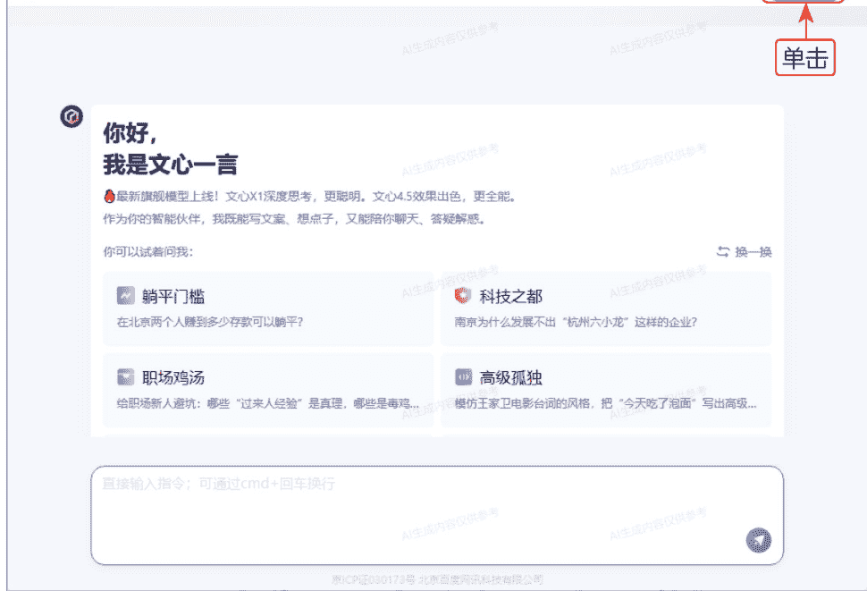

**步骤02** 弹出登录对话框，如下图所示。有百度账号可直接输入账号密码登录，也可选择百度App扫码登录；无账号可点击【立即注册】按钮，如下图所示。

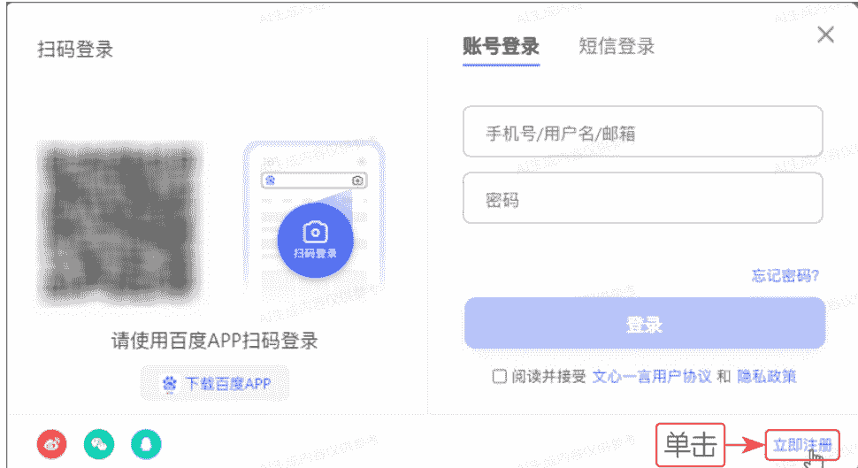

**提示：** 登录对话框可选择【短信登录】，输入手机号获取验证码即可直接登录，如下图所示。若手机号未注册百度账号则自动注册并登录。首次登录会分配默认昵称，后续可自行设置用户名和登录密码。

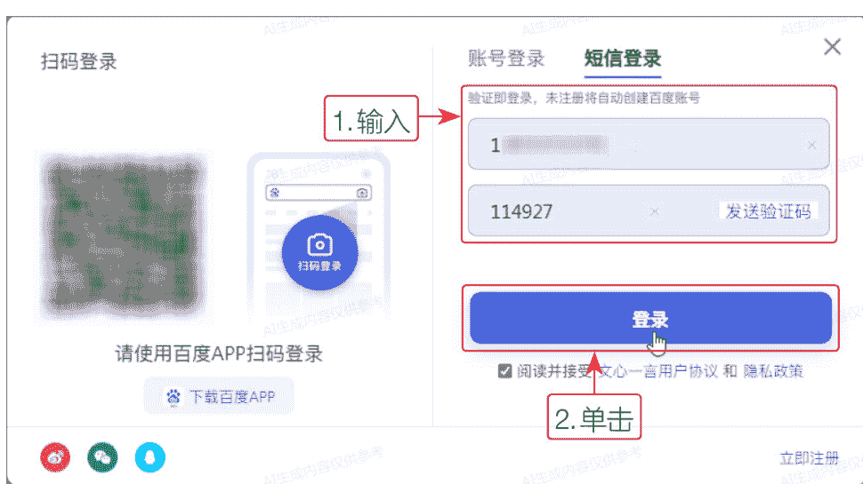

**步骤03** 进入【欢迎注册】页面，先输入手机号、用户名、密码及短信验证码，勾选协议后点击【注册】按钮，如下图所示。

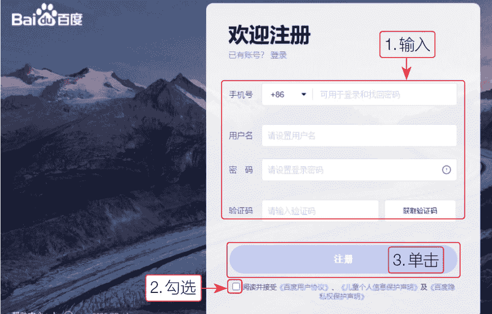

注册完成后即可进入文心一言操作界面，如下图所示。

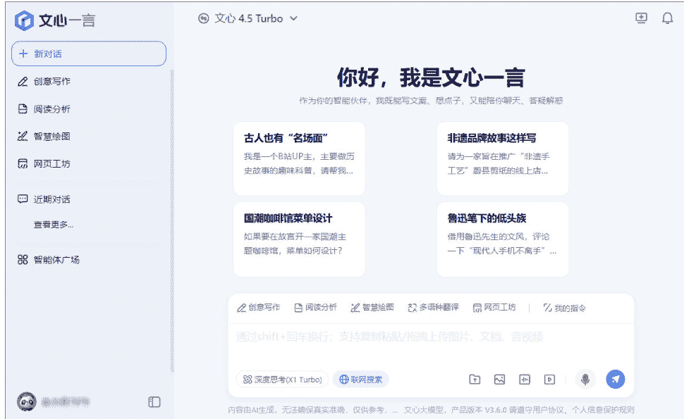

### 1.1.4 熟悉操作界面
文心一言界面简洁清晰，布局一目了然，主要由导航栏、对话框、输入框三部分组成，如下图所示。

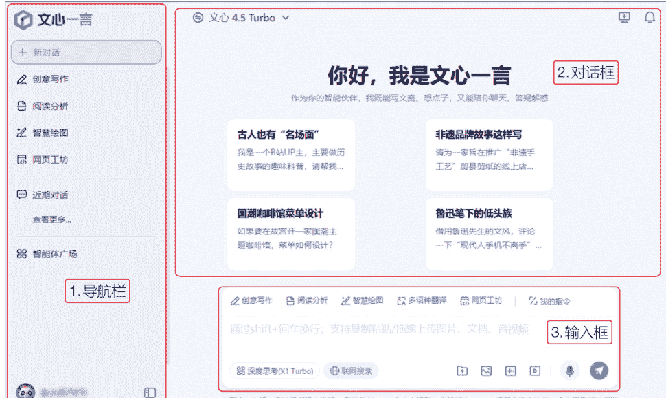

**1. 导航栏**
包含新建对话、创意写作、阅读分析、智慧绘图、网页工坊、近期对话、智能体广场及用户设置，点击右下角按钮可展开或收起导航栏。

**2. 对话框**
左上角可选择模型版本，点击下拉有两种模型可选，如下图所示。未展开对话时显示推荐信息；对话进行时显示用户输入、模型回复及历史记录。


**3. 输入框**
用户与模型交互的窗口。除文字输入外，还可粘贴链接、上传图片文档等，以获取更丰富信息或执行复杂任务。

### 1.1.5 文心一言的四大技能
文心一言集成创意写作、阅读分析、智慧绘图、网页工坊四大能力，提供全方位内容创作与处理支持。

**1. 创意写作**
提供文章优化和体裁模板两大模块，如下图所示。涵盖深度写作、润色、改写、扩写、仿写、心得体会、发言稿等模板，便于快速下指令高效解决写作问题。

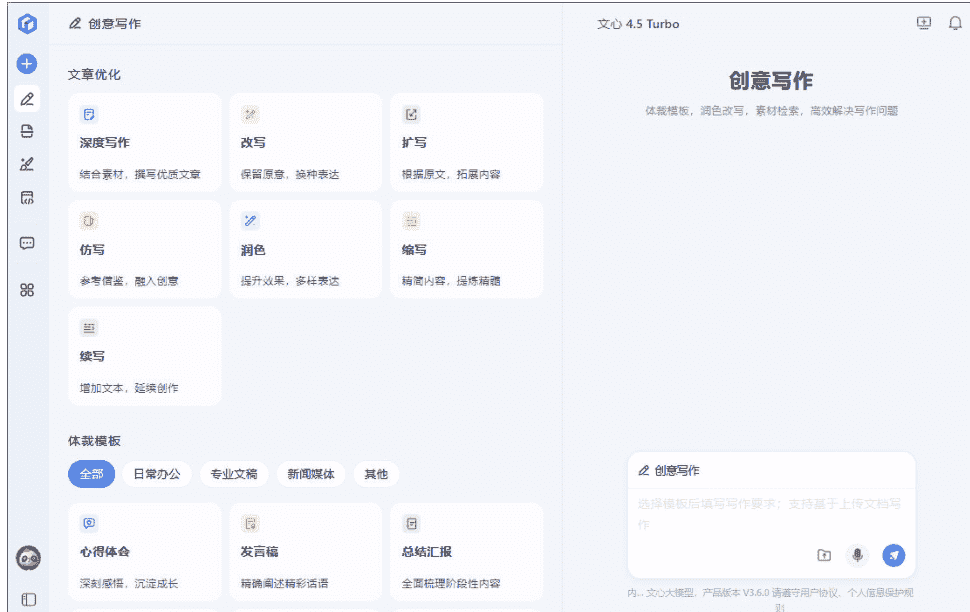

**2. 阅读分析**
包含文档阅读和网页分析两大模块，如下图所示，可高效提取文档网页摘要，快速获取关键信息并进行问题分析与数据整理。在办公、研究、创作等场景均可发挥作用，能显著提升效率。

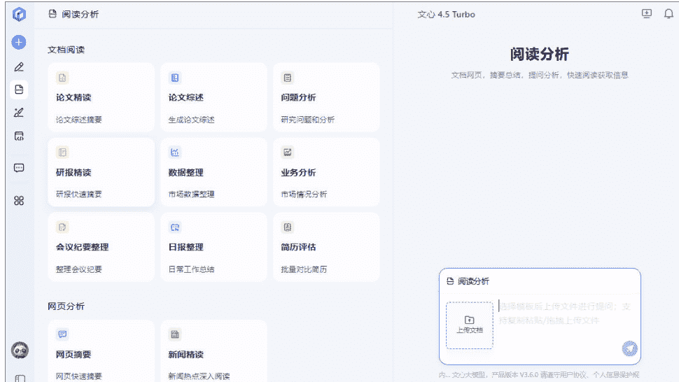

**3. 智慧绘图**
包含文字生图、图片重绘、局部编辑三大模块，如下图所示。支持将文字描述转为多风格图像，涵盖卡通、水彩、油画等效果，还可进行风格模仿、风格转换、背景替换、局部重绘等，创作出独特色彩作品。

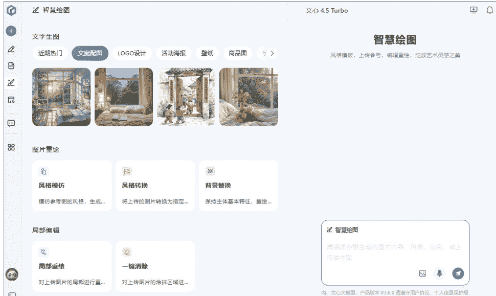

**4. 网页工坊**
专为无编程基础用户设计的AI网页构建工具，可快速创建定制网页。提供实用工具、排版设计、互动娱乐等多种预设模板，一键应用即可搭建个人专属页面。创作过程可实时预览，操作直观高效。完成后可导出HTML文件或生成分享链接，便于制作可视化计算器、业绩报告、小游戏页面等。

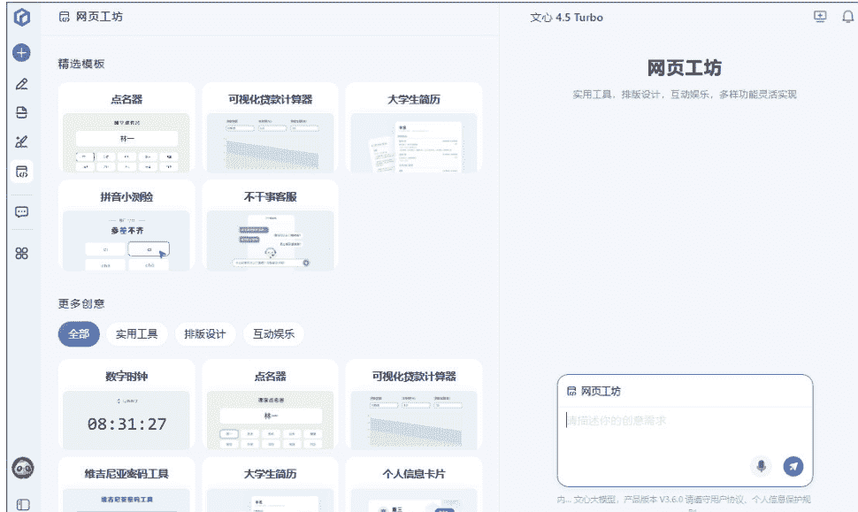

## 1.2 基本对话操作
掌握基础对话是高效使用文心一言的关键。从发送提示到接收回复，流程简单易懂。

### 1.2.1 开始第一次对话
与文心一言交流如同聊天，只需输入文字并发送即可开启。

**步骤01** 选择模型，如“文心4.5 Turbo”，在输入框输入需求后点击【发送】按钮，如下图所示。

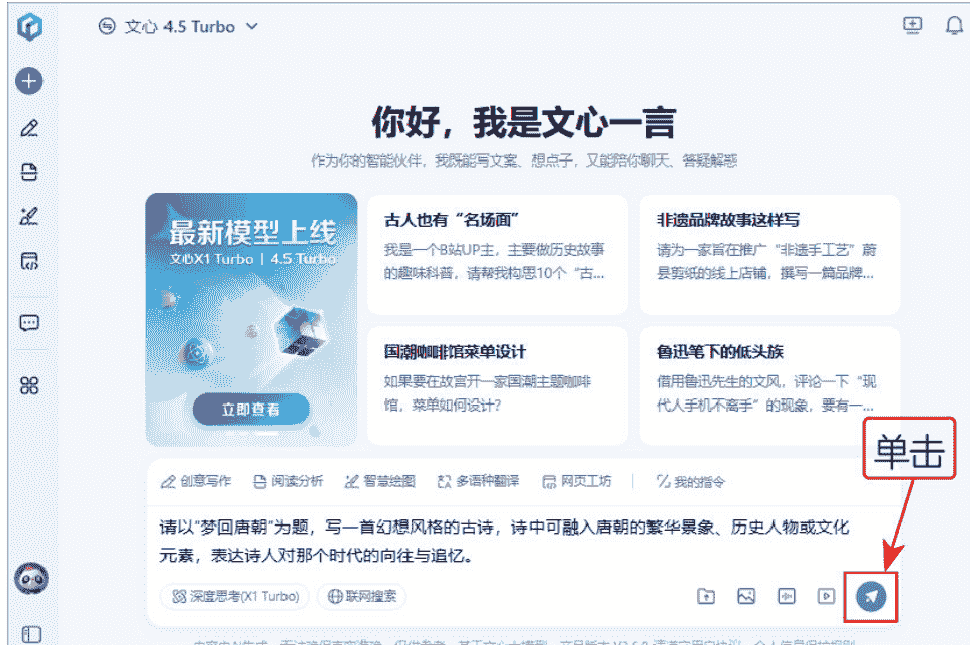

**提示：** 输入时可用【Shift+Enter】换行。上传文档或图片可点击输入框下方文件或图片按钮，也可直接拖拽至界面。输入框提供【深度思考（X1 Turbo）】和【联网搜索】两项，可按需开启。对于简单明确问题如基础计算或常识，无需开启深度思考，普通模式已足够；开启深度思考可能延长响应时间并产生冗余。需最新信息时应开启联网搜索。

**步骤02** 模型将根据提示生成回复，如下图所示。对结果不满意可点击【重新生成】按钮。

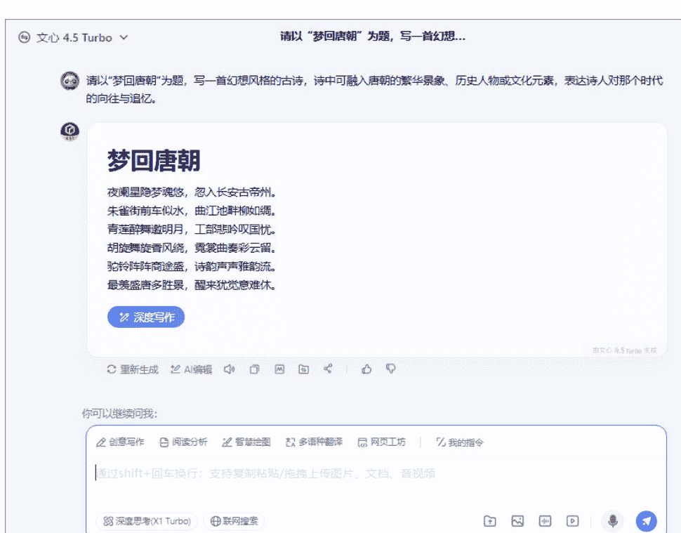

**提示：** 点击🔊可语音朗读内容；📋可复制文本；📝可复制为Markdown格式；📄可保存为Word到百度网盘或下载；🔗可分享对话链接；👍或👎可评价回答，有助于提升质量。

**步骤03** 如需修改已发送提示，将鼠标移至提示位置，点击右侧✏️按钮，如下图所示。

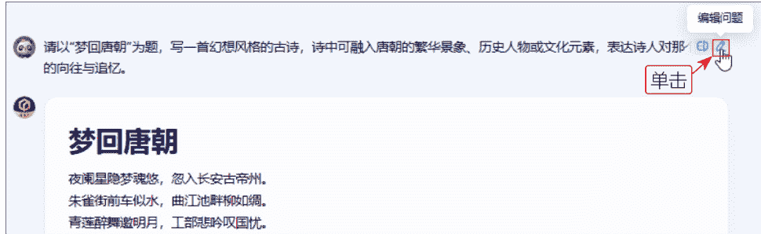

**步骤04** 出现编辑框，修改提示后点击✓确认，如下图所示。


模型将按新提示重新生成内容，如下图所示。

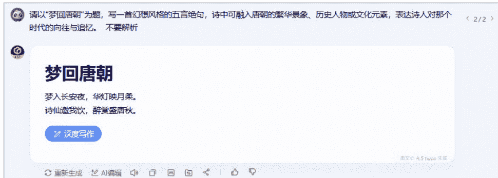

**步骤05** 点击翻页按钮可查看修改前回答，如下图所示，用户可自由切换。

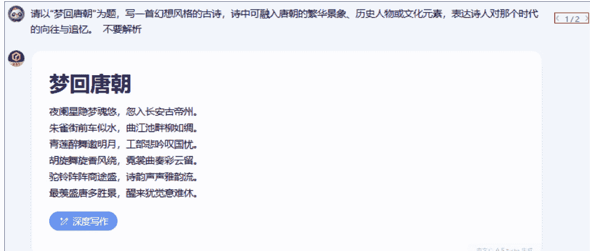

### 1.2.2 开启新对话
为保持主题清晰不受先前内容影响，可开启新对话。选择导航栏中的【新对话】选项，如下图所示，即可开始新的会话。新页面默认保留上次选择的模型，可按需切换。

### 1.2.3 展开多轮对话
文心一言支持多轮持续对话，可智能识别并记忆上下文，实现连续交流，提升沟通深度。

**步骤01** 在输入框输入提示词，如“我 在北京，今天天气如何？”，模型即可回复，如下图所示。

我在北京，今天天气如何？

参考 1 条网页信息源

北京5月7日天气速览

2025年5月7日，北京以晴为主。实测气温在23摄氏度上下，不同区域有细微差别，体感大约20摄氏度。风向以南风为主，风速三至四级，相对湿度42%，紫外线处于中等区间，空气质量指数60，评级为良。出行条件舒适，但要防晒并注意补水。

要点说明：

1. 气象情况：白天全天晴朗，无降雨，能见度高，很适合安排户外活动。
2. 温度区间：最低约15度，最高约25度，昼夜温差接近10度，建议随段时增减衣物。
3. 风况：南风占优，3到4级，体感清爽，同时需兼顾防风与防晒。
4. 空气品质：AQI 60属良，污染物浓度较低，健康影响小，敏感人群仍建议避免长时间在外逗留。
5. 出行提示：
   - 紫外线中等，外出建议涂防晒或戴遮阳帽。
   - 空气状况不错，利于开窗通气，但早晚温差明显，夜间需保暖。

想看更细的分时预报或未来几天趋势，可查阅气象部门官方渠道。

在询问本地玩乐时，无需重复地点，直接说“能不能推荐几个值得去的景点”即可，模型会依据前文语境给出北京相关的建议，配图可参考。

后续还能围绕同一主题继续追问，例如“这些地方需要门票吗”“附近有什么好吃的店”，系统都能结合上下文给出实用信息。

### 1.2.4 回顾与修改过往会话

模型支持浏览历史会话，便于复盘；同时提供编辑能力，可对已有对话进行调整或补充，提升沟通效率与准确度。

记录列在导航栏中，可直接切换任意一条。点“查看更多…”进入近期列表，既能看网页版记录，也能看文小言的记录。

在导航任意一条记录右侧点…，会弹出快捷菜单，可执行相关操作，配图可见。

## 1.3 指令的运用技巧

在文心一言里，指令是人与模型交互的核心桥梁。掌握构建方法，能显著提升信息获取与创作的质量。

### 1.3.1 指令本质说明

指令就是用日常语言向模型下达的请求或任务。可以是简单提问，如“今天北京天气如何？”，也可以是复杂创作，如“请为我写一首描写春天的诗”。

用户用清晰的自然语言表达需求，模型据此调用自然语言处理与深度学习能力生成回答。熟练使用指令，能让交互更顺畅、结果更贴合预期。

### 1.3.2 如何打造高质量指令

好的指令能让模型更精准理解意图，减少无效试错；糟糕的指令会浪费时间且得不到理想结果。

#### 1. 指令的构成要素

高质量指令 = 任务说明 + 背景资料 + 关键词 + 具体要求。

1. 任务说明：明确说明希望模型完成的事，是提问、创作还是具体操作。
2. 背景资料：提供必要的上下文或资料，帮助模型更好理解场景。
3. 关键词：点明需要重点关注的概念或问题，引导输出方向。
4. 具体要求：列出格式、字数、语言风格、角色设定、示例等限制条件，可进一步降低模糊性。

#### 2. 不佳指令举例

| 指令 | 问题所在 |
|---|---|
| 生成一篇文章 | 未说明主题与要点，模型无法判断写什么 |
| 阅读这篇文章并给出意见 | 缺少具体评判维度与期望输出形式 |
| 讨论AI的风险 | 问题过大且无指向，输出容易泛泛而空 |
| 生成一张图片 | 未描述画面内容与风格，指令过于模糊 |
| 写一段对话 | 缺乏主题背景与人物设定，无法定位内容 |

#### 3. 优质指令举例

以“用AI写一篇环境保护主题文章”为例：

- 任务说明：生成一段对话，探讨环境保护的重要性及可行方案。
- 背景资料：涉及气候变化、污染、资源浪费等议题。
- 关键词：环境保护、气候变化、污染、资源浪费。
- 要求：对话至少两位参与者，每人至少提出两种保护方案，字数控制在500至800字。

整合后：生成一段对话，围绕环境保护的重要性与可执行方案展开。参与者需各提出至少两种不同策略，内容需涉及环境保护、气候变化、污染、资源浪费等议题并呈现不同观点。请将总字数控制在500至800字之间。

### 1.3.3 快速调取已保存指令

输入框上方提供指令入口，可快速调用已创建或收藏的指令，提升交互效率。

步骤01 在输入框中输入“/”后会弹出指令面板，【我创建的】区域会列出用户自定义指令，当前未创建时可点【创建指令】。
步骤02 弹出创建对话框，填写指令标题与内容后点【保存】。
步骤03 需要调用时再次输入“/”，默认显示最近使用指令列表，可直接选取。
步骤04 若要使用自定义指令，切换到【我创建的】标签进行选择。
步骤05 选定指令后会在输入框中载入，用户可在此基础上做修改再发送，配图可见。

## 1.4 智能助手的运用

智能助手是面向复杂任务的交互系统，可大幅提升大模型的实用性。本节介绍其使用方式。

### 1.4.1 认识智能助手

智能助手分为综合型与专业型。综合型类似集成指令，可解答问题、撰写文案、生成图片、做搜索摘要等。专业型则聚焦特定场景，如写作助手、陪聊伙伴、英文练习、游戏攻略等，提供精准服务。

随着发展，智能助手正向教育辅导、医疗咨询、法律服务等垂直领域延伸，实现定制化高效解决。

在文心一言中点导航栏【智能体广场】即可看到内置助手，配图可见。文小言支持用户自定义创建助手，当前文心一言暂不支持自建。

### 1.4.2 与助手进行交互

步骤01 在【智能体广场】中挑选所需助手，例如【职业推荐助手】，进入其页面。
步骤02 页面提供推荐指令，也可自行输入。选择推荐问题后，助手会即时回复，配图可见。

用户输入：我清华本科毕业，内向，细腻，喜欢钻研计算机技术

助手回复：清华本科非常出色，你的内向细腻以及对计算机技术的钻研兴趣都是宝贵特质。

# 职业推荐

职业1: 软件工程师
参与软件全流程，从需求分析、设计、编码到测试，都需要用计算机技术解决问题。内向性格利于沉浸编码，细腻特质有助于发现细节问题。

职业2: 系统架构师
负责整体系统架构设计，确保稳定性、可扩展性与安全性。钻研精神与计算机背景契合，内向特质利于专注优化。

## 第2章 职场效率提升：文心一言助力办公

职场节奏加快时，效率决定成败。本章介绍文心一言如何通过智能工具与策略，帮助职场人士在文案、数据、会议、沟通等场景实现提效。

### 2.1 文本润色与改写

文心一言的语言处理能力可有效提升职场文档质量与沟通专业度。

#### 2.1.1 实践：对文本进行润色

清晰精炼的书面表达是专业形象的基础。润色能提升文档质量与阅读体验。

以【创意写作】中的【润色】模板为例：

步骤01 导航栏选择【创意写作】，进入页面后点【润色】，右侧输入框自动带入预设模板。提示：文心4.5 Turbo下也可点击输入框上方【创意写作】选择模板。
步骤02 在输入框分别填入待润色文本及润色要求后发送。
步骤03 进入编辑创作模式，左侧展示润色结果，可做字号、加粗、斜体等格式调整；右侧为对话记录，可继续输入要求做进一步修改。

借助预设模板可快速完成润色，完成后可直接复制，或点【导出】下载为Word或PDF。

若不使用模板，可直接输入：润色下面的文本，要求语言简洁、结构清晰、逻辑严谨、表达准确。

## 提示词进阶

润色时可加入限制：例如“确保原意不变”“总字数不超过200字”。

#### 2.1.2 实践：扩写与精简

扩写用于丰富细节，精简用于压缩表达，二者都是职场写作常用技能。以下以扩写为例。

步骤01 点击输入框上方【创意写作】按钮。
步骤02 在弹出的面板选择【扩写】模板，分别输入原文及扩写要求后发送。
步骤03 模型依据要求对原文进行扩写，结果如下页所示。

不满意可调整要求；同样的方法可使用【缩写】模板。

扩写请求：请帮我扩写以下内容：经过为期九十天的高强度工作，我们的项目团队克服了重重困难，成功完成了××项目的所有既定目标。项目成果不仅超出了客户的预期，还获得了行业内的高度认可。在项目实施过程中，我们采用了创新的解决方案，有效提升了工作效率，并确保了项目的高质量完成。最终，客户对我们的工作表示了极大的满意，并期待与我们未来的进一步合作。

扩写要求是：详细，字数为500字。

扩写结果：历经九十天高强度推进，项目团队凭借坚韧意志与专业能力，攻克多重难题，圆满交付××项目全部目标。推进过程中，技术瓶颈、资源协调、时间压力轮番出现，但成员齐心协力、反复研讨、尝试新思路，最终实现突破。交付成果远超客户预期，功能、性能与用户体验均实现跃升，并获得业界高度认可，为公司树立良好口碑。实施中引入创新方案，优化流程结构，提升效率，严控每个环节，保证高质量交付。客户对团队专业与负责印象深刻，表达高度满意，并明确期待后续合作，为团队注入信心。

## 提示词进阶

扩写或精简提示词需明确目的、保留核心、提供背景、保证逻辑与语言流畅。例如：扩写提示词：请扩写成一篇200字文章，保持原文温馨氛围并补充具体细节。缩写提示词：请精简至100字以内，完整保留关键要点、核心论述与结论。

### 2.2 官方文书撰写

文心一言的智能辅助可显著提升公文专业性与规范性。

#### 2.2.1 实践：撰写工作小结

工作总结需全面客观、具体实用，为后续工作提供参考。

## 场景
小李是市场部专员，需撰写2024年7到9月的工作总结，向领导汇报活动成果、市场反馈、经验不足及第四季度改进计划。

## 提示词
请帮我撰写市场部2024年7到9月的工作总结。内容包括：①活动概述，列出主要推广活动名称、时间、目标；②成果展示，用具体数据说明销售额增长、品牌曝光提升等；③市场反馈分析，整理客户意见并分析趋势；④经验总结与问题反思，提炼成功因素与不足；⑤第四季度工作计划，提出针对性改进与规划。请语言精炼、结构清晰。

# 市场部2024年7到9月工作总结

##### 一、活动概述
本季度策划执行三大主要推广活动，提升品牌影响与销售。

1. “夏日嘉年华”促销活动（7月15日—7月31日）：聚焦夏季产品线，通过限时折扣、买一赠一等手段拉动销量。

综上，市场部将基于本季度经验不断优化策略，以更强执行力与更贴近市场的创新推动品牌持续发展。

## 提示词进阶
撰写工作总结时提示词需具体明确，说明范围、要点、格式与风格。示例：我需要你帮我撰写市场部工作总结。请按以下要点构建。# 标题：工作总结 ##### 一、活动概述 列出主要项目名称、时间与目标。## 二、成果展示 用具体数据说明对销售额与品牌曝光的贡献，尽量用图表或百分比呈现。## 三、市场反馈分析 整理客户反馈，重点关注新品接受度与满意度。## 四、经验总结与问题反思 提炼成功因素，指出不足并提出改进建议。## 五、未来的工作计划 基于总结提出可实现目标，提升效率与成果。文档格式：语言精练、结构清晰，不超过两页A4，使用正式商务风格。

#### 2.2.2 实践：撰写年度总结报告

年度总结是对全年工作回顾与未来展望的重要文件，能展现综合实力并为战略规划提供依据。

## 场景
张经理负责公司财务部，需编制年度财务报告，向董事会汇报全年财务状况、经营成果、风险管理及次年预测。

## 提示词
请协助撰写年度财务报告。报告应包含：①财务概况，总结全年收入、利润、资产等关键指标；②经营成果分析，对比上年同期数据并解释增减原因；③风险管理报告，识别主要财务风险及应对措施；④未来财务预测，基于市场环境与公司战略预测下一年状况；⑤结论与建议，总结亮点并提出改进建议。请确保数据准确、分析深入、语言严谨。

## 回答
#### 年度财务报告
##### 1. 财务概况
全年收入：本年度公司实现总收入[具体数值]万元，同比增长[百分比]%。增长主要得益于[具体业务]的强劲表现及需求稳定。
利润总额：全年净利润[具体数值]万元，较上年增长[百分比]%。利润率提升反映成本控制、效率优化与定价策略有效。

综上，[公司全称]过去一年财务表现稳健，未来将坚持稳健经营，加强风险管理，把握市场机遇，推动持续健康发展。

完成创作后请根据实际情况填入具体数据，确保信息完整准确。

## 提示词进阶
生成年度总结需明确目的与范围，保证数据准确、逻辑清晰、风格正式并考虑受众，输出后需审核。例如：请撰写年终报告，明确目的、范围，确保数据准确、逻辑清晰、风格正式，并考虑受众，注意审核。

2023年度公司年终报告撰写参考提纲

要编制一份覆盖2023年1月1日至12月31日的年度盘点材料。重点围绕各部门全年产出进行整体复盘，突出经营业绩、研发进展、市场动作及队伍建设成效。建议结构为前言概述、各部门小结、成果亮点、存在问题与挑战、改进对策、2024年工作安排。语言保持正式中立，版式统一规范，必要时以图表图片辅助提升阅读体验。

## 2.2.3 实战：商务合同撰写

在商业往来中，协议文本是厘清双方权益的基石。一份完备的合同既能明确权责边界，也有助于预防法律风险并提高协作效率。对职场从业者而言，掌握起草要点十分关键。

场景
李明在某科技公司担任项目负责人，正在与一家大型企业谈判一份为期12个月的软件开发协议。协议涉及功能需求、交付周期、付款节奏、知识产权归属等多项内容。为确保文本完整严谨，李明需先准备一份详细草案供双方审议。

提示词
请帮我起草一份软件开发合同模板。模板需涵盖项目概况、开发要求与质量标准、进度计划与里程碑、预算与付款方式、保密与知识产权条款、违约责任及争议解决机制等关键要素。条款表述要清晰明确，措辞规范严谨，符合现行法律法规要求。

回答
#### 软件开发合同

甲方（客户）： 住所：统一社会信用代码： 联系方式：

乙方（开发商）： 住所：统一社会信用代码： 联系方式：

鉴于甲方为满足业务需求需开发【软件名称】，依据《中华人民共和国民法典》的有关规定，甲乙双方在平等自愿、协商一致的前提下，订立本协议，以明确各自权利义务，推动项目顺利实施。

……

十、其他条款
10.1 本协议一式两份，甲乙双方各持一份，法律效力相同。
10.2 协议自双方授权代表签字盖章之日起生效，有效期至软件开发完成并经甲方验收合格之日止。
10.3 协议未尽事宜，双方另行协商补充确定。

甲方代表签字： 日期： 年 月 日 甲方盖章：
乙方代表签字： 日期： 年 月 日 乙方盖章：

文本生成后，应结合项目实际情况进行适当调整，并在签署前建议咨询法律专业人士审阅，以确保条款准确合法，最大程度维护自身权益。

提示词进阶
生成合同的提示词宜简明具体、合规保密，并兼顾可执行性与灵活性。例如：

请生成一份软件开发合同。甲方为ABC公司，乙方为XYZ公司；项目名称为××软件开发；开发周期为2024年10月1日至2025年3月31日，总金额20万元，分三期支付，首期30%，中期30%，尾款40%，违约金5万元。请保证内容完整准确，符合法律法规与行业规范，同时兼顾实际执行与潜在风险，提出合理应对方案。

## 2.2.4 实战：招标书撰写

招标文件是企业或政府开展采购活动的重要依据，既体现采购方的需求与标准，也能吸引优质投标人并保证流程公平透明。高质量的招标书对项目落地至关重要。

场景
某科技公司计划升级数据中心，需采购一批高性能服务器与存储设备。为筛选合适供应商，公司决定发布招标公告并编制详尽的采购招标书。文件需明确项目具体需求、技术规格、投标文件格式、评审标准、投标截止时间等核心信息，以吸引具备实力的供应商参与。

提示词
请生成公司采购招标书。文件应包括项目背景介绍、采购范围与要求、技术规格与性能指标、投标文件格式与内容要求、评标方法与标准、投标保证金要求、投标截止时间与地点等关键信息。内容要清晰明确，准确传递采购需求与期望，同时注意保护公司利益，降低法律风险。

回答
#### 采购招标书

##### 一、项目背景介绍
随着业务持续拓展，我们亟需引进新设备/系统以提升生产效率与服务质量。本次采购旨在寻觅契合技术规格与性能指标的优质产品/服务，保障项目顺利推进。

##### 二、采购范围与要求
……

##### 八、投标截止时间与地点
截止时间：[具体日期和时间]
地点：[具体地址]
联系人：[姓名]
联系电话：[电话号码]
电子邮箱：[电子邮箱地址]

在运用文心一言撰写招标书时，关键在于精准界定项目目标与需求，并借助模板与预设功能简化制作流程。同时要重视语言专业性与风格恰当性，确保信息精确合规，避免偏见歧视。此外需进行人工复核，以保证内容的灵活性和适应性。

提示词进阶
生成采购招标书时，提示词应明确项目需求、资质要求、提交方式与评标标准。例如：

请生成一份采购招标书。项目为办公设备采购，要求供应商具备相应资质、技术参数符合要求、预算100万元、截止日期2025年4月30日，评标依据价格、质量、服务，适用法律：中国法律，联系方式：[招标方联系方式]。

## 2.3 营销文案创作

在竞争加剧的市场环境下，营销文案是获取客户、提升品牌影响力的核心工具。本节探讨如何借助文心一言创作高效营销文案，包括品牌宣传、广告文案、活动策划、竞品分析等。

### 2.3.1 实战：品牌宣传方案撰写

清晰有吸引力的品牌宣传方案对塑造企业形象至关重要。文心一言可依据品牌定位与目标受众，生成符合调性的宣传内容，帮助品牌脱颖而出。

场景
李华任某新兴科技公司市场总监，需为即将推出的智能手表制定全面品牌宣传方案。方案要凸显手表创新功能与时尚设计，同时兼顾成本效益与市场反馈。

提示词
请为我制定智能手表品牌宣传方案。方案需明确目标客户群体及其需求，包含手表独特卖点、品牌形象、宣传策略与预算规划。方案应具针对性、创新性与可执行性，提升品牌知名度与美誉度。

#### 智能手表品牌宣传方案
##### 一、项目背景与目标
在智能穿戴市场竞争白热化的背景下，推出一款具备差异化卖点、面向特定人群的智能手表，既需要优秀的产品性能，也需要精准创意十足的宣传方案。本方案旨在为“智领未来”品牌智能手表构建系统宣传策略，提升品牌认知度，增强目标客户购买意愿，树立积极向上的品牌形象。

……
##### 七、执行与评估
- 执行时间表：制定细化月度执行计划，确保各项活动及时推进。
- 效果评估：通过销售额、网站流量、社交媒体互动量、品牌提及率等指标定期评估成效，并据反馈调整策略。

实施后预期能在目标人群中建立“智领未来”智能手表的品牌认知，提升销量，同时塑造积极、健康、科技的品牌形象。

提示词进阶
使用文心一言生成品牌宣传方案时，提示词应明确目标市场与品牌定位，清晰阐述产品独特卖点，具体化宣传策略与预算，并可提供创意方向参考。例如：

请为新款环保运动鞋制定品牌宣传方案。方案需包括：①目标市场分析，涵盖年龄、性别、消费习惯；②品牌定位，突出环保材料与时尚设计；③宣传策略，至少两种线上线下推广方式，兼顾成本效益；④预算规划，不超10万元，优先选择投资回报率高的渠道；⑤效果评估，设定关键绩效指标如品牌曝光度、网站流量、销售转化率。请确保方案创新且契合品牌形象，并思考如何与消费者建立情感连接。

### 2.3.2 实战：广告宣传文案撰写

一句优秀的广告语能简洁有力传递产品核心卖点，留下深刻印象。可借助文心一言创作出吸引人且易记的广告语，提升传播效果。

场景
张薇任化妆品公司营销经理，需为即将上市的新款护肤系列创作一句广告语。广告语需简洁有力，传达天然成分与高效保湿的核心卖点。

提示词
请为新款护肤系列创作一句广告语。要求：①突出天然成分与高效保湿；②简洁有力，易于记忆；③契合品牌形象，传达高端定位。

回答
广告语：“源自自然，润泽非凡——臻享高效保湿的奢华护肤体验。”

该广告语精准抓住产品核心卖点与品牌调性，强调天然成分与高效保湿，增强消费者信心。表达简洁有力，便于记忆传播；通过“臻享”“奢华”等词汇传递高端定位，提升产品档次感。

提示词进阶
生成广告文案时，提示词要点与品牌方案类似，同时侧重广告效果与创意表现，如提供创意概念、投放渠道、语调及合规要求。例如：

请为高端护肤品牌“焕颜秘籍”面向20~35岁女性设计一则社交媒体广告文案。目标是在3个月内提升品牌认知与销量。产品特点：含天然植物精华、适合各肤质、改善痘痘色斑细纹、经皮肤科医生测试温和无刺激。创意上展现使用后肌肤焕发自然光彩、自信美丽的女性形象，传达“美丽源于自然，自信由内而外”的理念。适合小红书、抖音发布，语言优雅富有感染力，鼓励用户分享美丽变化故事。请确保符合国家广告法，不得使用夸大或误导性表述。

### 2.3.3 实战：活动策划方案撰写

精心策划的活动方案能吸引目标受众，提升品牌知名度与销量。可借助文心一言依据目标、受众与品牌定位生成全面创意方案。

场景
赵强任知名运动品牌市场经理，计划夏季推出户外运动推广活动。活动旨在吸引年轻消费者体验新款运动鞋，并鼓励分享运动经历。需制定涵盖目标、主题、实施步骤与预算的完整方案。

提示词
请策划一场线下推广活动以推广新款运动鞋。活动需包括：①目标受众分析，明确年龄性别消费习惯；②场地与时间，周末商场中庭；③活动主题与亮点，突出鞋款独特功能与品牌形象；④流程安排，详细描述各环节；⑤宣传推广策略，线上线下结合；⑥预算规划，明确费用；⑦效果评估，设定KPI如参与人数、咨询量、销售转化率。请确保方案创新可执行。

#### 夏季户外运动推广活动策划方案
##### 一、活动概述
活动名称：夏日炫跑·新鞋挑战——新款运动鞋体验盛宴。
目标群体：18~35岁热爱运动、追求时尚品质的都市青年。
产品特性：新款运动鞋，主打极致舒适与超强耐用，适合长时间户外运动。
##### 二、活动主题与亮点
主题：“炫跑无界，舒适由我”——新款运动鞋夏日挑战赛。
……
##### 十、后续跟进
数据分析：收集活动数据，分析参与度与销售效果。
用户反馈：通过问卷与社交互动收集产品反馈。
持续营销：依据反馈调整产品与营销策略，持续推广新款。

提示词进阶
生成活动策划方案时，提示词应明确目标与预期效果，具体化内容与宣传策略，兼顾预算与评估。可提供创意方向参考。例如：

请设计针对大学生的“健康跑步挑战”活动策划方案。方案需包括：①目标市场分析，聚焦大学生生活方式与健康意识；②活动目的，提升健康生活认知并推广跑步装备；③活动形式，线上线下结合，如校园跑步赛与社交媒体挑战赛；④预算规划，不超5万元，优先成本低效益高方案；⑤效果评估，设定KPI如参与人数、社交互动量、销售增长率。请确保方案参与性强、趣味性高，能激发参与热情与分享欲。

### 2.3.4 实战：竞品分析报告撰写

通过竞品分析可发现自身优劣势，洞察市场需求变化，优化产品与服务。文心一言可辅助完成竞品分析报告，帮助企业多维度把握竞争态势。

场景
王敏任新能源汽车公司市场分析师，公司即将推出新车型，需对主流竞争车型进行全面分析，重点为技术参数、市场定位、价格策略与用户反馈，以支持推广策略与新品研发。

提示词
请完成一份当前主流新能源汽车竞品分析报告。报告需包括：①竞品市场定位与目标消费群体；②核心技术参数与性能对比；③价格策略及促销活动分析；④用户评价与市场反馈总结；⑤基于分析的市场机会与潜在风险。请保证数据准确、分析客观，为制定市场策略提供参考。

回答
# 新能源汽车竞品分析报告
## 一、竞争车型的市场定位和目标消费群体
新能源汽车市场竞争激烈，主要车型包括特斯拉Model 3、比亚迪汉EV、小鹏P7等。定位多集中于中高端市场，目标人群主要为一线城市与限购区域的消费者，购买力强，对品质与续航要求高，乐于接受新技术且重视智能化功能。

## 二、各车型的核心技术参数和性能比较
……
## 2. 潜在风险：
- 价格战：激烈价格竞争可能压缩利润率，影响长期发展。
- 技术迭代快：需持续投入研发，对资金资源要求高。
- 政策变动：政府补贴退坡可能削弱消费者购买意愿。
综上，市场正处于快速发展期，但竞争激烈且环境多变。企业需持续创新，提升产品力与品牌影响力以应对风险。

提示词进阶
生成竞品分析报告时，提示词应明确报告目标与重点分析内容，准确阐述关注的竞争要素，如技术参数、市场定位、用户反馈，并提供行业背景与关键指标。例如：

请为××品牌智能手表制定竞品分析报告。报告应涵盖竞品市场表现、功能特点、用户评价、价格策略与营销策略，并对比分析竞品与我司新品在功能、设计、用户体验等方面的差异与优劣。数据应来源于权威研究机构或官方渠道，确保真实可靠，最后提炼关键信息与结论，为市场策略制定提供参考。

### 2.3.5 实战：调研问卷制作

在市场调研中，科学设计的问卷是获取准确信息的基础。借助文心一言可依据调研目的、受众与信息需求快速生成合理问卷。

场景
小陈任电商平台产品经理，需了解用户对新上线家居用品的满意度与购买意愿，计划制作在线调研问卷。

提示词
请设计一份在线调研问卷，收集用户对新上线家居用品的反馈。问卷需包括：①用户基本信息如年龄性别职业；②对家居用品满意度评价；③购买频率与偏好；④平台购物体验评价；⑤改进建议；⑥对新功能期待。

回答
# 家居用品用户满意度调研问卷
尊敬的用户您好！感谢您参与本次调研，您的反馈对产品改进至关重要。本问卷约3~5分钟完成，请据实作答。所有数据严格保密，仅用于统计分析。
## ■基本信息
1. 您的年龄是？单选
- □18岁以下
- □18~25岁
- □26~35岁
- □36~45岁
- □46~55岁
- □56岁以上
……
## ■改进建议与新功能期待
11. 您对家居用品有哪些改进建议？开放题
12. 您希望未来推出哪些新功能或新产品？开放题
再次感谢您的宝贵时间和真诚反馈！

提示词进阶
生成调研问卷时，提示词应明确调研目的、目标受众与关键问题，确保问题既覆盖面广又能深入挖掘细节。例如：

请为年轻消费者设计一份健康饮食习惯调研问卷。内容包括：①基本信息如年龄性别；②对健康饮食定义的理解；③每日饮食内容与频率；④对特定健康食品认知与消费意愿；⑤获取健康饮食知识的主要途径。请确保问卷简短有针对性，能有效揭示青年群体饮食习惯与健康意识。

### 2.3.6 实战：产品调研报告撰写
在产品开发与市场策略制定中，全面产品调研报告提供关键洞察与数据支持。通过系统收集分析市场、用户、竞争环境与产品性能数据，企业可更好定位产品、优化功能并制定有效市场进入策略。

场景
小张任互联网创业公司产品经理，为推出在线教育平台需进行全面产品调研，包括现有教育产品、潜在用户需求、市场趋势与竞争对手，以确保定位准确、满足需求并在竞争中占据优势。

提示词

请协助生成一份聚焦在线教育平台的市场调研文档。调研内容需涵盖：①当前在线教育平台的主要分类与特征；②各类型平台所面向的用户群体及对应需求；③竞争对手的强项与短板；④市场走向与技术革新对行业的影响；⑤基于调研结论的产品优化方向。请确保论据充分并给出可执行的行动指引。

## 回答

# 在线教育平台市场洞察

互联网高速演进叠加全球学习需求持续攀升，在线教育平台已深度嵌入现代教育体系。本报告围绕当下在线教育市场的全貌展开，从平台类型、用户画像与需求、竞品优劣势、行业趋势及技术驱动等方面进行梳理，旨在为后续的产品决策提供参考依据与实践建议。

## 一、现有在线教育平台的分类及主要特点

1. K12在线教育平台
课程体系完整，涵盖小学至高中各学科。资源供给丰富，包含名师录播课、互动习题、模考系统等。教学上推行个性化方案，依据学员学习进度与薄弱点定制专属学习路径。

2. 职业教育在线平台
课程定位精准，针对不同职业赛道提供技能培训。授课形式多元，兼有直播、录播与线上实操。普遍与企业建立合作，为学员搭建实习与就业通道。

……

## 五、拓展市场渠道

强化品牌塑造与传播投放，提升知名度与美誉度。
联动学校、企业及社会组织，打开新的获客入口，扩大覆盖人群。
推进国际化布局，引入海外优质教学资源，丰富学习供给的多样性。

总体来看，在线教育前景可期，同时竞争加剧、挑战并存。平台需持续打磨课程品质、优化价格体系、深化个性化服务、加快技术创新并拓宽渠道，才能满足用户预期并保持竞争力。

借助文心一言，小张快速获得了深度调研报告。报告清晰呈现了竞争格局、目标用户诉求以及行业演进方向，为产品设计与推广提供了扎实的数据支撑与策略建议。

## 提示词进阶
使用文心一言撰写产品调研报告时，提示词应明确界定调研边界与目标，同时交代产品的差异化特质与市场背景，并补充权威行业数据来源及用户反馈渠道。例如以下示例。

请为智能家居设备编制市场调研报告。需包含：①市面上智能家居设备的品类及核心功能；②消费者接受度与购买偏好；③主要竞争者的策略及优劣；④技术创新对市场的潜在影响；⑤据此提出的研发与市场部署建议。请引用最新市场数据与用户意见，以支撑分析与决策。

## 2.3.7 实战：SWOT分析
SWOT分析是常见的战略工具，用于评估优势、劣势、机会与威胁。通过文心一言可快速输出客观全面的SWOT报告，辅助制定战略。

## 场景
李娜负责一家服装企业的战略规划，需对新推出的中高端时尚女装系列进行SWOT评估。该系列定位中高端，目标客群为25至45岁的时尚女性。

## 提示词
请对定位中高端时尚女装的新系列进行SWOT分析。内容包括：①优势，如品牌形象、设计风格、面料品质等；②劣势，如价格偏高、份额偏小等；③机会，如潮流变化、消费升级、电商发展等；④威胁，如竞争激烈、需求波动等。请保证分析客观全面具参考价值。

## 回答

# 中高端时尚女装新系列SWOT评估

## 一、优势（Strengths）

### 1. 品牌形象
·品牌在市场上具备一定认知度与口碑，确立中高端定位，给消费者留下时尚优雅、品质卓越的印象。
·持续经营品牌文化，通过广告、时尚活动等强化形象，积累了一批忠实用户。

### 2. 设计风格
·拥有专业设计团队，能敏锐捕捉潮流，推出独具特色的款式。
·注重细节打磨，从剪裁、图案到配饰均体现高质感，满足中高端用户对个性与时尚的需求。

……

总体而言，新系列具备品牌、设计、面料等优势，同时面临价格偏高、市场份额有限的劣势。机会在于时尚迭代、消费升级与电商渠道扩张；威胁则来自竞争者众多与需求不稳定。品牌应发挥长处、把握机遇、化解短板与风险，制定合理策略以提升竞争力与占有率。

使用文心一言，李娜快速获得了一份客观全面的SWOT报告，助力企业制定有效战略。

## 提示词进阶
生成SWOT报告时，需明确分析对象与目的，细化评估维度，可提供战略框架供参考。例如：

请为即将推出的环保型清洁产品撰写SWOT报告。需包括：①产品优势，如环保材质、创新技术；②劣势，如生产成本高、品牌知名度低；③市场机会，如消费者环保意识提升、政策扶持；④市场威胁，如价格战、市场饱和。基于分析提出定位与策略建议，确保内容客观易懂，便于团队快速把握动态。

## 2.3.8 实战：4P营销分析
4P即产品、价格、渠道、促销，是营销策略的基础分析框架，帮助企业对齐市场需求与竞争环境。

## 场景
小磊任职于消费品公司市场部，正推动旗舰产品系列再推广，需进行全面4P分析以优化定位与销售策略。

## 提示词
请完成旗舰产品系列的4P分析报告，包括：①产品分析，特征、生命周期、差异化；②价格分析，定价策略、价格弹性、竞品价格对比；③渠道分析，分销网络、物流、覆盖范围；④促销分析，活动类型、效果评估、预算分配。请提供可落地的策略建议以支撑增长。

## 回答

# 旗舰产品系列4P分析

## 一、产品分析

### 1. 产品特性
·系列以高品质用料、精湛工艺与时尚设计见长，细节考究，满足消费者对高品质的需求。
·具备独特功能，如创新技术应用与个性化定制，与竞品形成区隔。
·品牌调性高端，传递品质、时尚与创新，提升购买意愿与忠诚度。

### 2. 产品生命周期
……

综合来看，产品在品质与设计上占优，但价格偏高、覆盖有限。促销需创新形式，优化效果评估与预算配置。上述策略落地后，有助于提升市场竞争力并支撑销售增长。

借助文心一言，小磊获得了详尽的4P报告，为产品定位与推广提供了关键洞察与建议。

## 提示词进阶
撰写4P报告时，应明确产品特征与市场环境，对每个P深入剖析并给出具体措施，强调可操作性。例如：

请为新款智能手表做4P分析。产品层面详述创新功能、设计与材质；价格层面分析竞品定价并结合成本与定位确定区间；渠道层面评估线上线下优劣并提出拓展建议；促销层面制定广告、社媒、折扣等组合策略并设定目标与预算。并说明4P协同如何提升竞争力与品牌知名度。

## 2.4 新媒体内容创作
借助文心一言可高效驾驭文字、捕捉热点，打造吸睛的新媒体内容，涵盖爆款标题、短视频文案、种草笔记、公众号文章等。

## 2.4.1 实战：爆款标题撰写
标题对点击与传播至关重要，文心一言可快速生成吸睛标题。

## 场景
乐乐为自媒体编辑，需为一篇关于最新科技趋势的文章拟标题。文章涵盖AI、大数据、云计算等前沿话题及对社会的影响，希望标题能体现核心并吸引科技爱好者。

## 提示词
请为一篇关于最新科技趋势的文章写标题。要求：①概括核心，即趋势及其社会影响；②突出AI、大数据、云计算等热点；③具吸引力与新意，激发好奇；④语言规范简洁易懂。

## 回答
洞察未来：AI、大数据、云计算引领社会新变革

借助文心一言，乐乐获得满意标题，准确概括核心并突出热点，通过“洞察”“新变革”等词激发阅读兴趣。

## 提示词进阶
生成爆款标题时可更具体，设定风格与参考标题，批量输出便于挑选。例如：

请为亲子旅游文章拟爆款标题。文章介绍适合亲子游的目的地与活动，受众为25至45岁家长。可参考“亲子旅游，一起探索奇妙世界”，强调亲子情感连结与乐趣，突出目的地特色。要求标题贴合受众、具吸引力与独特性，多写几条供选择。

## 2.4.2 实战：抖音文案撰写
抖音文案直接影响关注度与传播效果。

## 场景
小安为抖音创作者，需为展示手工制作过程的短视频写文案。视频从原料到成品全流程呈现，受众为热爱手工的人群。

## 提示词
请为展示手工制作过程的视频写抖音文案。需：①针对手工爱好者；②描述制作过程并突出独特性与趣味；③引发共鸣，促点赞评论分享。

## 回答
✨匠心巧手，开启独一无二的创作之旅！🧶

还在为千篇一律的工业品感到疲倦吗？👀 跟我一起走进手工制作的奇幻世界吧！🚀

👀 看平凡材料在指尖蜕变——一块布料、几缕彩线，在巧手下化为温馨小物！🧶

🌸 每一道工序都饱含匠人温度，这不仅是制作，更是心灵治愈！❤️

🥰 细腻针脚诉说耐心与爱，你也想为生活添一抹独特色彩吗？🌈

别犹豫！动手创造只属于你的不可复制之美！💪

👇 点赞评论告诉我你想学的手工技巧，分享给朋友让更多人加入创意行列吧！🎉

#手工制作# #创意无限# #匠心独运#

借助文心一言，小安得到高吸引力文案，提升了播放量与互动，扩大了受众基础。

## 提示词进阶
撰写抖音文案时，应明确主题、受众与关键词，强调行动号召与情感共鸣。例如：

请为展示宠物日常的视频写抖音文案。视频呈现宠物可爱行为与互动，受众为宠物爱好者。可参考“萌宠日常，看它们如何萌翻你”，突出可爱与互动，文案需具吸引力与独特性。

## 2.4.3 实战：小红书种草方案撰写
小红书以生活方式分享著称，种草是重要营销方式。

## 场景
小薇为进口化妆品品牌市场策略师，计划在小红书推广新护肤系列，提升知名度与信任度。

## 提示词
请设计小红书进口护肤品种草方案，包括：①目标用户分析与消费行为；②产品特性与优势；③内容策略，主题、形式、频次；④KOL/达人选择标准与合作策略；⑤监测评估机制。请确保方案细致可执行。

## 小红书进口护肤品种草方案

### 1. 目标用户分析
主要特征：
- 年龄18至35岁，以年轻女性为主，对护肤高度关注。
- 主要分布一线及发达二线城市，对国际潮流敏感。
- 消费能力中等偏上，愿为高品质进口产品支付溢价。

……

调整优化：
- 根据数据调整内容形式与合作达人。
- 强化用户互动，按反馈迭代内容。
- 适时引入跨界合作、限量礼盒保持新鲜感。

方案实施可有效吸引目标用户，提升品牌影响力与市场份额。

借助文心一言，小薇获得全面种草方案，深度覆盖用户与卖点，并提供可执行的内容与KOL策略。

## 提示词进阶
生成种草方案时，需详细说明产品特性与预期效果，提供目标用户具体信息与市场趋势背景。例如：

请为年轻妈妈群体设计婴儿护理产品的小红书种草方案。详述群体需求与行为、产品匹配点与优势、内容主题与场景结合、合适KOL及其影响力、效果监测与预期调整。方案需具创意并引发共鸣。

## 2.4.4 实战：公众号文章撰写
微信公众号是品牌与读者沟通的重要渠道，精准内容可提升公信力与忠诚度。

## 场景
小刘为生活方式博主，计划发布居家健身公众号文章，帮助读者在家保持健康。

## 提示词
请撰写一篇发布于微信公众号的居家健身文章，包括：①居家健身便利性与重要性；②简单易行的居家训练方法；③训练计划与注意事项；④鼓励坚持。请语言通俗、实用吸睛。

## 回答

# 居家健身，轻松塑形

快节奏下，工作繁忙难至健身房，但健康体态对生活质量至关重要。随着健康意识提升，居家健身愈发流行。今天聊聊其优势及在家高效锻炼的方法。

## 一、居家健身的便利与意义
便利性：居家健身省时省力，客厅卧室阳台均可操作，不受天气交通影响，实现随时开练。

……

借助文心一言，小刘获得内容丰富实用的公众号文章，提升专业形象并激励读者开启居家健身。

## 提示词进阶
撰写公众号文章时，需明确目的、核心信息、读者兴趣与需求，并提供观点角度。例如：

请为职场人士撰写公众号文章，主题“工作日快速健康餐制作”。包括：①健康饮食对工作效率的重要性；②三种快速营养均衡的餐食做法；③一周餐单样本；④食材采购与储存小贴士。内容需贴合职场节奏，提供实用解法。

## 2.4.5 实战：豆瓣书评撰写
豆瓣书评是读者分享感悟、引发讨论的重要平台。

## 场景
小林为文学编辑，欲在豆瓣为科幻巨著《三体》撰写书评，期望表达深刻理解并吸引读者讨论。

## 提示词
请为《三体》撰写豆瓣书评，需详述：①书籍信息与核心情节；②主要角色性格与成长；③作者叙事技巧与想象力；④对科学哲学问题的理解。请深入探讨科幻与现实关联，呈现层次思考。

## 《三体》书评：科幻与现实的交响

《三体》是刘慈欣的科幻巨著，由三部构成，自2006年连载以来以独特视角、宏大叙事与深刻主题赢得广泛赞誉。

……

总体而言，《三体》是一部思考深刻的科幻作品，既是小说也是探讨科学、哲学与人类命运的文本。阅读后会被其深邃内涵与宏大叙事震撼。

借助上述提示词，小林用文心一言写出深刻具感染力的书评，展现作品魅力并激发阅读与讨论热情。

## 提示词进阶

在让文心一言帮你写豆瓣书评时，提示词的设计要突出思想厚度与文学鉴赏力，先把评论文章的用途和目标读者想清楚，再给模型一些写作指引和风格参考。下面这条示范就体现了这种思路。

请帮我写一篇适合发在豆瓣、用于推荐《心：稻盛和夫的一生嘱托》的书评。文章要覆盖：①本书的核心内容与主旨概括；②稻盛和夫的人生观、价值观以及他对企业经营的独到见解分析；③我个人的阅读感受与情感共鸣；④对书中观点提出自己的思考与质疑；⑤号召读者参与讨论，分享读后感和对稻盛理念的理解。

## 2.4.6 实操：短视频脚本撰写
短视频当道的当下，一份清晰的脚本等于视频的施工图，从画面、台词到节奏和情绪都要提前规划。

场景
自媒体人小陈想做一条美食探店短视频，要呈现特色餐厅的空间、菜品和顾客用餐体验，受众是吃货和爱找新店的人群。

提示词
请为一条美食探店短视频写分镜脚本。需要包含：①镜号；②景别；③画面描述；④台词；⑤时长；⑥音乐音效；⑦拍摄地点。内容聚焦餐厅环境、菜品展示和用餐感受。

回答
# 美食探店分镜脚本

### 镜头1
- 镜号：01
- 景别：远景
- 画面：繁华街区推进到餐厅外立面，突出招牌与门头装饰
- 台词：旁白“在城市的喧闹里，藏着一家让人想念的味道天堂。”
- 时长：5秒
- 音乐音效：轻快神秘的底乐，鼓点逐渐加强
- 地点：店外

### 镜头2
……
- 时长：5秒
- 音乐音效：转为柔和钢琴，收于宁静夜色
- 地点：店外

总时长约43秒。
借助这条提示词，小陈用文心一言生成了完整可用的脚本，为拍摄打下了基础。

提示词升级
生成短视频脚本时，提示词要强调创意与互动性，明确视频目的和观众预期，并补充创作建议与风格偏好。示例：

请为一条生活小妙招短视频写脚本。要有：①抓人开场，点明主题；②演示5个具体妙招，每个带操作步骤和效果；③穿插幽默风趣桥段；④总结回顾并提问引导互动。总时长控制在一分钟内，语言连贯清晰。

## 2.4.7 实操：直播策划方案制定
直播策划就像导航，覆盖主题设定、内容安排、互动设计和受众定位等环节。

场景
服装品牌市场经理小娜要做新季服装系列直播，需要一份可执行的方案。

提示词
请为新季服装系列制定直播策划方案，需包含：①直播主题与目标，兼顾品牌与销售；②平台与时段选择；③流程与互动设计；④前置宣传与后续跟进；⑤资源与预算预估。

直播策划方案：新季服装系列
### 1. 主题与目标
主题：时尚新风尚：新季潮流发布
目标：推广品牌、推动成交，提升用户参与和销售额。

### 2. 平台与时间
平台：抖音直播＋视频号，覆盖年轻用户。
时间：20:00-22:00，流量高峰。

……
- 礼品及优惠券费用：约5000元
- 总预算：约50000元

方案覆盖全流程且注重互动转化，文心一言据此给出了一份详尽计划。

提示词升级
构建策划提示词时，要明确目标与受众画像，细化主题内容，重视互动与主播人选，合理排期，涵盖宣发策略、预算和效果评估指标。示例：

为一场健身器材新品发布直播制方案。直播在品牌官方间进行，受众20-40岁健身爱好者，目标是介绍新品、提升知名度、促进销量。需包括：主题设定；内容安排含新品介绍、健身教学、嘉宾访谈；互动如抽奖问答留言；主播形象专业度；时间安排；宣发策略；预算；评估指标含观看、点赞、评论、销量。

## 2.4.8 实操：直播带货话术设计
直播带货的关键是得体的话术，既要传递信息，又要激发购买欲并建立信任。

场景
电商主播小峰要带一款适合各水平用户的智能健身器材，目标人群20-45岁关注健康的消费者。

提示词
请生成智能健身器材的直播带货话术，含：①开场吸睛；②产品介绍与卖点；③适用人群说明；④价格优惠信息；⑤购买引导；⑥结尾互动收集反馈。

回答
智能健身器材直播话术
### 一、开场
嗨，宝子们！欢迎来直播间，我是健身小天使[主播名]。快节奏生活里大家更在意健康，今天带来一款能改变健身体验的智能器材，准备好了吗？一起开启健康之旅！

……
### 六、结尾互动
今天就到这里啦，宝子们对这款器材怎么看？欢迎弹幕留言，说说想法。我们会根据反馈持续优化。觉得不错请点赞关注分享，让更多人加入健康生活。下一场再见！

基于该提示词，文心一言为小峰定制了一套兼顾介绍与情绪调动的话术，有效促进转化。

提示词升级
生成带货话术时，要明确产品优势与受众心理，突出优惠，注重情感沟通，结构清晰并加入互动。示例：

为高端护肤品牌新品精华液写直播话术，受众25-40岁注重肌肤保养女性。需含：吸睛开场；产品卖点；适用人群；价格活动；下单引导；互动收尾。

## 2.5 会议助手
会议筹备耗时耗力，文心一言可提升效率，让团队聚焦议题。

### 2.5.1 实操：会议邀请函撰写
一份专业的邀请函既传递信息也体现尊重。

场景
科技公司公关经理小刚筹备行业创新论坛，需邀请专家学者与企业家。

提示词
请写一封邀请函，邀请嘉宾出席行业创新论坛。需包含：会议主题时间地点；议程与预期成果；嘉宾价值与贡献；报名方式与联系方式；欢迎表达。

回答
# 会议邀请函
尊敬的[嘉宾称谓]：
您好！
在日新月异的时代，每一点创新都可能点亮行业未来。我们诚挚邀请您出席[主办方]主办的“未来科技与行业融合创新论坛”，共探发展新路径。

时间：[日期] 9:00-17:00
地点：[详细地址]
……
期待与您相聚，共绘蓝图。不胜荣幸，敬请光临！

文心一言生成后需按实际调整日期地点等信息。

提示词升级
生成邀请函时注意正式专业，说明目的与受邀者价值，明确主题时间地点，定位参会对象，突出亮点并附联系方式。示例：

请写邀请函，邀请行业领袖参加年度战略峰会。主题“未来科技与企业发展”，时间2024年11月10日国际会议中心。议题含科技趋势、创新策略、企业合作。强调受邀者影响力与贡献，提供线上报名链接与客服联系，保持正式礼貌并激发参与兴趣。

### 2.5.2 实操：会议通知撰写
及时准确的通知是参会准备的前提。

场景
行政人员小王需发重要业务研讨会通知，涉及多部门骨干。

提示词
请起草会议通知，含：主题目的重要性；具体时间地点；日程概览；参会准备要求；联系人方式。语言正式礼貌。

回答
# 会议通知
尊敬的各位同事：
为提升运营效率，明确下季度目标，特召开“2024年第四季度工作计划与目标设定会议”。对公司战略统一意义重大，现将安排如下：
……
请提前5分钟到场，着装正式，手机静音。

经提示词生成模板后，小王只需微调即可使用。

提示词升级
注意通知完整明确，覆盖全部关键信息。示例：

请起草年度销售总结会议通知。主题“年度销售成果与未来规划”，时间2024年12月15日14:00公司大会议室。参会人销售全体及高层。议程含数据回顾、案例分享、目标讨论。要求提前准备区域销售报告，正式着装，提前到场并静音。

### 2.5.3 实操：会议发言稿撰写
精彩稿件能有效传递观点并推动决策。

场景
王经理要在季度总结会上回顾成果、分析问题并布置计划。

提示词
请为季度总结会写发言稿，含：开场问候；上季度成果回顾；问题分析；下季度计划；结束语。

回答
# 公司季度总结会发言稿
## 一、开场
尊敬的各位领导同事，大家上午好！在硕果累累的时节回顾工作，首先感谢每一位同事的付出！
……
## 五、结束
展望未来我们充满信心，让我们携手为公司明天奋斗。祝大家健康顺利！谢谢！

生成后需结合实际数据调整。

提示词升级
明确主题目的，围绕核心展开，成果用数据案例支撑，问题分析并给出对策，计划细化目标任务节点。语言准确流畅。示例：

请生成季度总结发言稿。含开场说明目的；详细回顾成果亮点；分析问题并提解法；下季度目标与任务分配；感谢与祝福。内容简洁重点突出，符合公司文化，使用得体语气。

### 2.5.4 实操：会议纪要生成
纪要浓缩讨论要义与行动指南。

场景
市场部经理小刘主持完下一季度营销策略会，需快速分发纪要。

提示词
根据会议记录生成详细纪要，含时间地点参会人主题主要讨论点决策结果与下一步行动。

回答
# 会议纪要
会议主题：下一季度营销策略规划
时间：2024年10月15日
地点：公司会议室
参会：市场销售财务等负责人
……
## 六、总结
本次会议明确市场分析、目标设定、策略与预算，各部门协同推进并及时调整。

可上传记录文档结合提示词生成。

提示词升级
注重完整可执行性，明确覆盖内容与细节，可提供公司模板。示例：

请为市场策略研讨会生成纪要。涉及营销销售与高层，讨论市场趋势竞争态势与策略调整。需含基本信息；趋势竞争分析；现有策略评估；新策略讨论结果；行动计划与负责人；其他重要事项。

### 2.5.5 实操：会议后续工作安排
可通过AI自动化分配与跟踪后续任务。

场景
项目经理小艾刚结束新品发布跨部门协调会，需分配多项任务。

提示词
根据会议纪要自动提取待办任务，匹配部门与责任人，设定截止日期并生成跟踪清单。

回答
## 待办任务提取与分配
- 市场部：全面市场调研含目标客户竞争对手趋势，提交报告。截止2024年10月31日，责任人李华。
……
## 任务跟踪表
|部门|任务|截止|责任人|
|---|---|---|---|
|市场部|市场调研|2024-10-31|李华|
|研发部|评估产品匹配度并提建议|2024-10-17|张明|
|研发部|主导产品设计|2024-11-20|张明|
|设计部|外观设计方案|2024-11-15|王悦|
|生产部|可生产性评估|2024-11-20前|赵强|
|市场部|制定推广策略|2024-12-10|李华|
|销售部|执行推广达成目标|上市后3个月内|陈刚|
|客服部|收集客户反馈|每周|刘梅|
|各部门|周协调会|每周|各负责人|
|PMO|协调进展确保按期|2024-12-15|PMO|

该清单作为项目管理基础，随进展更新。

将会议纪要转化为可执行的行动清单

依靠文心一言对纪要的解析与后续跟进功能，任务盘点、把控的效率与精确性均有明显改善。模型能从会议记录里自动提炼待办事项并匹配执行者，同时提供进度实时监控，确保各项工作及时落地并形成有效闭环。

## 提示词进阶

若要获得高质量的会后分工与追踪方案，提示构建应围绕任务属性与难度进行拆解，以能力为基准匹配。需要明确分派依据，例如专业专长、经历积累、当前工作负荷等。另可加入适当的激励与约束安排，调动团队主动性与履约意识。参考表述如下。

请依据已上传的会议文件，输出一份会后任务分配与跟进方案。本次会议确认了多个跨部门的复杂项目。方案应包含：①任务清单梳理，明确各项任务的具体内容；②分配原则，确定最合适的负责人；③进度跟踪方式，如定期汇报、使用项目管理工具等；④沟通机制，确保信息及时传递与问题快速解决；⑤激励与约束措施，提升执行的主动性。

## 2.6 沟通协作

文心一言正在改变职场协作方式。本节介绍模型在话术生成、客户投诉应对、满意度提升及商务邮件处理方面的实践，助力从业者实现更高效的沟通。

### 2.6.1 实战：沟通话术定制

商务交流与日常互动中，精准的话术能大幅提升信息传递效率与效果。文心一言可依据不同场景与目标，为用户量身打造表达方式，从而提高沟通成功率并维护良好人际关系。

## 场景

电子产品企业销售代表小赵，在与客户沟通时常遭遇价格、品质及售后方面的疑虑。他希望借助得体表达化解异议，提升满意度并促进成交。

## 提示词

请为我设计一套应对客户常见异议或顾虑的话术，涵盖价格、质量、服务方面的解释与安抚策略，以提高客户满意度。

## 回答

以下是一套针对价格、质量、服务等问题的解释与安抚思路：

价格方面的质疑

客户说法：“你们的价格偏高！”

应对表达：

- 共情认同：“我完全能理解您对价格的考量，毕竟大家都希望用最合理的价位获得最佳产品/服务。”
- 价值突出：“不过请相信，我们的定价是与产品的高品质和所带价值相匹配的。我们更看重长期合作与客户满意，而非短期利润最大化。”
- ……

- 回应效率：“我们的客服响应非常迅速，通常几分钟内即可回复咨询或投诉。我们很清楚时间对您的重要性，因此会尽力压缩等待时长。”
- 后续关怀：“除日常服务外，我们会定期回访，了解您对产品/服务的满意度并据此持续改进。我们希望通过这种方式让您感受到我们的用心与诚意。”

通过持续互动与优化，小赵可以逐步掌握用文心一言定制高效商务沟通话术的方法，为业务开展与客户关系深化奠定基础。

## 提示词进阶

构建生成沟通话术的提示词时，应注意：明确沟通的最终目标，提供具体的沟通背景与使用场景，突出产品或服务的卖点，预先设想可能的客户反对意见并给出应对策略，以增强话术的抗压能力。参考示例。

请为与重点客户进行商务合作洽谈制作沟通话术。话术需包括：①开场友好问候，表达合作期待；②详细介绍合作方案的优势；③巧妙回应客户对风险的担忧；④价格方面的合理协商表达；⑤以坚定语气促成合作。同时，请为团队内部讨论新项目方案制作沟通话术。内容需含：①清晰说明项目目标与任务；②鼓励成员积极发表不同看法；③妥善处理分歧的表达；④定期跟进进度的说法；⑤对团队成员付出的肯定。

### 2.6.2 实战：客户投诉处理

沟通协作中，客户投诉处理是检验服务质量、维护客户关系的关键环节。用户可借助文心一言实现准确、高效的投诉应对。

## 场景

某电子产品制造商的客户服务经理小强，收到客户投诉：“我购买的蓝牙耳机两周内出现连接问题，且售后热线一直打不通，非常失望。”小强需要制定一套投诉处理方案与话术，确保问题妥善解决并让客户感受到尊重与理解。

## 提示词

请制定一套客户投诉处理方案。客户购买的蓝牙耳机两周内出现连接故障，且售后热线无法接通，客户感到极度失望。方案需确保问题得到妥善解决，并让客户感受到尊重与理解。

## 回答

### 客户投诉处理方案

#### 一、投诉接收与初步响应

- 1. 及时回复：收到投诉后第一时间以电子邮件或短信传达诚挚歉意，并确认已收悉投诉内容。
- 2. 情绪安抚：在回复中表达对客户遭遇的理解，强调公司重视每位客户体验，对造成的不便深表遗憾。

通过上述流程的落地，旨在确保客户问题得到妥善解决，同时让客户感受到公司的尊重与理解，进而修复并增强信任与满意度。

借助文心一言，小强初步掌握了针对投诉信息进行个性化回应的话术，并获得精准解决方案，有效提升了处理效率与客户满意度。

## 提示词进阶

构建客户投诉处理提示词时，要详细描述投诉的具体情况，考虑平台运营流程与资源限制，制定切实可行的解决方案，强调与客户的良好沟通并注重方案的可持续性，以投诉处理推动整体改进。参考示例。

请为一家餐饮外卖平台制定客户投诉处理方案。投诉内容为收到的外卖与订单不符且食物已凉。方案应包括：①对投诉的快速回应话术；②调查外卖配送环节的流程；③与商家的协调策略以确定责任方；④为客户提供的补偿方案，如重新配送或退款并赠送优惠券；⑤平台对外卖配送流程的改进措施；⑥与客户沟通反馈的方式及时间安排。

### 2.6.3 实战：商务邮件撰写

商务邮件是职场中重要且高频的沟通工具。一封清晰、专业、准确的邮件能有效传递信息、促进合作、提升企业形象。

## 场景

公司销售经理小小，年末公司计划举办面向大客户的年终促销活动。她需要写一封邮件提前通知并吸引主要客户关注。

## 提示词

你是一名销售经理，需给大客户写一封关于“大客户专属年终大促活动”的邮件。邮件需包含活动大致安排，语言热情、有吸引力且内容简洁。

## 回答

主题：大客户专属年终大促活动

尊敬的[客户姓名]先生/女士：

您好！

随着年末脚步临近，我们感恩回顾过去一年您对[公司名称]的信任与支持。谨代表团队向您致以最诚挚的感谢与敬意。为回馈长期合作，我们特别策划“大客户专属年终大促活动”，诚邀您参与。

……

祝您事业蒸蒸日上、家庭幸福美满！

[您的姓名]

[您的职位]

[公司名称]

[日期]

[公司联系方式]

借助文心一言撰写的商务邮件，小小有效传达了大促信息，同时体现了公司对客户关系的重视与活动热情。

## 提示词进阶

使用文心一言生成商务邮件时，提示词应注重目的性与针对性，明确邮件需传达的核心信息与行动号召。可提供写作风格与格式建议供参考。参考示例。

请帮我撰写一封商务合作邮件，用于与一家技术供应商探讨合作可能性。邮件需包括：①公司与个人的介绍及合作背景；②我方寻求合作的具体领域与期望目标；③说明为何选择对方作为合作伙伴及潜在合作优势；④提议安排线下会议或电话会议进一步讨论细节；⑤提供详细联系方式并说明希望的回复时间。请确保内容正式、礼貌且能引起收件人兴趣与回应。

### 2.6.4 实战：提供邮件回复

及时、准确的邮件回复是维系良好业务关系的关键。面对多样复杂的邮件内容，快速给出恰当回复不易。通过文心一言可高效提炼要点并生成合适回复，提升沟通质量与效率。

## 场景

企业销售代表小张，每天收到来自客户与合作伙伴的多类邮件，涉及产品咨询、订单确认、合作洽谈等。他需要快速回复以满足需求并推进业务。

## 提示词

请根据以下邮件内容提供回复。邮件内容：“尊敬的小张，我对贵公司的新产品很感兴趣，想了解一下产品的具体功能、价格以及售后服务情况。期待你的回复。”回复应包括：①礼貌的开头问候；②产品功能的详细介绍；③价格说明；④售后服务的阐述；⑤表达期待进一步沟通的意愿；⑥恰当的结尾祝福语。

## 回答

主题：关于新产品的回复

尊敬的客户：

您好！

非常感谢您对我们公司新产品的关注。以下是您关心问题的详细回复：

#### 一、产品功能介绍

我们的新产品具备以下亮点：其一，采用先进技术实现高效数据处理，大幅提升工作效率；其二，拥有智能化操作界面，简洁易用，新手也能快速上手；其三，兼容性出色，可与多种设备无缝连接，满足多样化使用需求。

……

最后，祝您生活愉快、事业顺利！期待建立长期合作关系。

[你的名字]

[具体日期]

借助上述提示词，小张在文心一言辅助下撰写了一封专业回复邮件。

## 提示词进阶

在使用文心一言生成邮件回复时，除具体需求外，还可要求回复的语气、格式等。参考示例。

请根据以下邮件内容提供回复。邮件内容：“小张，我们之前讨论的合作项目出现了一些问题，希望你能尽快给出解决方案。”回复应包括：①诚恳的开头问候；②对问题的分析与理解；③提出具体解决方案；④确认下一步沟通计划；⑤友好的结尾祝福语。同时要求回复语气积极主动、格式清晰规范。

## 2.7 求职招聘

在职场竞争加剧的背景下，掌握有效的求职技巧至关重要。本节讲述文心一言在求职招聘中的多种应用场景，帮助求职者提升竞争力、顺利找到理想工作。

### 2.7.1 实战：求职简历制作

在激烈竞争中，一份精心准备的简历至关重要。文心一言可依据个人经历与岗位要求，生成针对性强、信息完整且格式专业的简历，帮助求职者在众多候选中脱颖而出。

## 场景

应届毕业生张三，准备应聘软件工程师。他需要一份能准确展示技能、经验与教育背景的简历，吸引招聘经理注意并获得面试机会。

## 提示词

请帮我制作一份求职简历，用于申请软件工程师职位。简历需包括：①个人信息，含姓名、联系方式与个人简介；②教育背景，列明学位、专业与毕业院校；③工作经验，详述经历与主要成果；④技能清单，含编程语言、开发工具与软件技能；⑤项目经验，展示参与项目与个人贡献；⑥证书与奖项。

## 回答

##### 求职简历

##### 个人信息

姓名：张伟 电话：+86-123-4567-890 邮箱：zhangwei_****@126.com

地址：北京市海淀区××街道××号

##### 个人简介

拥有超过5年软件开发经验的资深软件工程师，专长于全栈开发与系统架构设计。熟练掌握多种编程语言及前沿技术栈，具备良好问题解决能力与团队协作精神。热爱技术创新，致力于用高质量代码实现产品高效迭代与优化，为企业创造最大价值。

……

##### 证书和奖项

Oracle Certified Professional, Java SE 8 Programmer 获证日期：2016年12月

阿里云ACE认证 获证日期：2019年6月

根据提示词，文心一言生成了一个简历模板，张三据实际情况调整细节并结合个人特色优化，增强了简历真实性与吸引力，为成功应聘奠定基础。

## 提示词进阶

构建个人简历生成提示词时，可提供个人详细信息，使生成简历更准确真实。参考示例。

根据下面信息生成一份求职软件工程师职位的简历，要求内容丰富、合理发散。

王五，137-××××-××××，wangwu***@126.com，清华大学软件工程学士，2019年9月—2023年6月；获国家奖学金，绩点3.9/4.0；2022年6月—2022年11月，在百度实习担任软件工程师；熟悉Java、C#、Python；个人项目：企业级项目管理系统，获校软件设计大赛一等奖。

### 2.7.2 实战：求职信撰写

求职信是求职者向招聘方表达求职意向与动机的重要文书。文心一言可依据目标岗位与公司文化，撰写真诚且有说服力的求职信。

## 场景

会计学专业应届生小娜，申请财务岗位。她需要撰写求职信表达对职位的热情与个人优势。

## 提示词

请为一名即将毕业的会计学专业大学生撰写求职信，要求包含学历背景、擅长技能、求职岗位、自我评价等内容。

## 回答

尊敬的招聘经理：

您好！

我是××大学会计学专业即将毕业的大四学生。获悉贵公司正在招聘会计岗位工作人员，我怀着极大热情与诚意提交我的求职信。

学历背景：在过去四年里，我在××大学会计学专业接受了系统化的会计知识与实践技能训练。

……

我非常期待加入贵公司，与团队共同成长，实现公司目标。感谢您阅读我的求职信，期待进一步交流。

此致

敬礼！

[您的姓名]

[您的联系电话]

借助上述提示词，小娜可利用文心一言生成符合自身情况且针对目标岗位的求职信，提高求职竞争力。

## 提示词进阶

使用文心一言撰写求职信时，构建提示词应注意明确目标岗位，提供个人相关信息，包括工作经历、技能特长等细节，并可给出岗位所需的关键技能或素质方向供参考。参考示例。

请帮我撰写一封求职信，用于申请一家金融机构的风险管理岗位。信中需介绍个人基本信息、工作经历（包括在金融领域从事风险管理相关工作的经历，详述承担任务及项目成果）、技能特长（需列出风险管理相关技能，如风险评估方法、风险控制手段等）、对风险管理岗位的渴望及个人优势（如严谨思维与出色分析能力在风险管理中的体现）。同时表达对企业文化、产品、服务的了解与尊重。

### 2.7.3 实战：HR面试模拟

面试是求职过程中至关重要的一环，既能展示求职者能力，也能帮助HR判断其是否适合公司与岗位。文心一言可模拟HR面试，帮助求职者准备问题与回答策略。

## 场景

求职者小张，即将参加心仪公司的面试。他希望提前准备，了解可能被问及的问题及更优回答方式。

## 提示词

请模拟HR面试，针对我申请的产品经理面试岗位提出一系列问题，并对我的回答进行简要点评。问题应涵盖个人基本信息、工作经历、技能特长、对岗位的理解与期望等方面。

## 回答

以下是模拟的HR面试场景：

##### 一、开场

HR：你好，欢迎参加今天的面试。请先简单介绍一下自己。

##### 二、个人基本信息

HR：能说一下你的姓名、年龄、学历背景吗？

……

你：我对贵公司产品有一定了解，贵公司在行业内知名度高、口碑良好。我期望在该岗位发挥专业能力，带领团队打造更多优秀产品，同时提升自身管理与领导水平，为公司发展作出更大贡献。

点评：对公司有了解，并表达了明确期望与职业发展规划，体现积极性与上进心。

在文心一言中，用户还可选择【智能体广场】，在页面中选择【AI面试官】智能体，输入目标岗位即可开始模拟面试。

## 提示词进阶

使用文心一言模拟HR面试时，构建提示词应注意明确目标岗位与公司特点，准备相关行为与技术问题，同时可提供个人经验与职业目标供参考。参考示例。

请帮我模拟一次HR面试，用于准备数据分析师职位面试。模拟面试需包括：①自我介绍，含数据分析相关教育背景与项目经验；②行为面试问题，如团队合作与时间管理；③情景面试问题，如处理数据异常；④技术面试问题，如统计分析与数据可视化；⑤常见面试问题，如对数据分析行业的看法与职业规划。

### 2.7.4 实战：面试中的笔试问题整理

面试笔试环节是许多企业评估求职者专业技能的方式。通过整理与练习过往笔试题，求职者能更好理解面试官期望并准备应对策略。

## 场景

产品设计师孙丽，即将参加大型设计公司的面试，该面试包含设计项目笔试环节。她需要了解并练习此类测试常见问题。

## 提示词

请帮我整理面向产品设计师职位的面试笔试问题。请包括：①设计理论与原则相关问题；②用户界面设计的实际操作题；③设计思维案例分析。确保每个部分包含练习题与参考答案，便于针对性训练。

## 回答

##### 产品设计师职位面试笔试问题

###### 一、设计理论和原则相关问题

练习题：请简述用户体验设计（UX Design）的五个核心原则，并说明每个原则在实际设计项目中的应用。

参考答案：

以用户为中心：设计应围绕用户需求与期望展开，确保产品易于理解与使用。例如设计购物应用时，应优先考虑浏览、搜索与购买流程，确保每一步直观易懂。

……

在面试过程中，您展现了对设计理论与原则的深入理解，能够清晰阐述用户体验设计核心原则并举例说明其在实际项目中的应用。

借助文心一言，孙丽获得了一套全面的面试笔试练习材料，不仅覆盖设计各方面，也极大提升了她对即将到来的笔试的信心。当然，HR同样可使用文心一言整理面试习题。

## 提示词进阶

使用文心一言整理面试笔试问题时，构建提示词应注意明确目标岗位与所需技能，整理相关问题与知识点，同时可提供个人经验与学习资源供参考。参考示例。

请帮我整理一份面试笔试问题清单，用于准备数据分析师职位面试笔试。问题清单需包括：①数据分析基础，如统计学原理与数据挖掘；②数据处理技能，如数据清洗与数据转换；③分析工具使用，如Excel与R语言；④数据可视化，如Tableau和Power BI；⑤业务理解，如市场分析与用户行为分析。请确保问题清单覆盖面广且具有针对性，便于全面准备。

## 2.8 文档处理

随着办公自动化普及，高效处理文档已成为职场必备技能。本节详细介绍文心一言在文档处理方面的强大功能。

### 2.8.1 实战：一键关联百度网盘

文心一言支持将百度网盘中的文件直接导入平台，极大简化用户上传与管理文件的流程，使用户能更快捷地访问与处理存储在百度网盘上的各类文档。

网盘直连上传速览

第一步 找到输入区下方带📄标识的上传文档按钮，点开后进入上传界面，参考配图。

第二步 切换到我的网盘标签页，里面点立即关联。

第三步 在弹出的关联页面再次点击立即关联。

第四步 关联成功后我的网盘标签下会出现网盘文件夹，挑选需要的文件点确认即可完成上传，参考配图。

## 2.8.2 实战：快速解读文档

文心一言能对已上传的材料做即时分析，并支持问答式阅读，帮助抓住要点、提升阅读效率。

第一步 把待解读文件拖拽到输入框，参考配图。

第二步 文件加载到输入框后输入指令，点击发送，参考配图。

第三步 系统会按指令对文档进行拆解，参考配图。

对整篇文章内容进行总结

该资料对智能音箱的4P营销策略做了系统梳理，围绕产品、价格、渠道、促销展开。要点如下：

1. 产品策略：
   - 功能：语音识别、语音合成、音乐播放、智能家居操控等是核心能力，传播时要突出日常生活实用价值。
   - 性能：识别率、音质、稳定性决定品质，宣传需客观呈现并强调优势，可用实测与用户评价佐证。
   - 用户体验：体验是留存关键，设计要符合使用习惯、简化操作、提升满意度，营销中可借助用户心得吸引潜在用户。

第四步 在输入框输入新指令即可继续深化，例如输入“根据文档内容生成摘要，字数200字以内”就能得到精简版，参考配图。

根据文档内容生成摘要，字数200字以内

本文聚焦智能音箱4P策略：产品侧重核心功能、性能优势与体验；价格需兼顾成本、市场需求与竞争态势；渠道依产品特性与目标人群选择路径；促销涵盖线上线下及联合促销，重视时机与力度。企业应灵活调整、洞察市场与用户变化，持续提升品质与服务以实现长期稳定。

## 2.8.3 实战：一键生成PPT文档

只要给出主题或提纲，文心一言就能提炼要点并自动生成完整演示稿。

第一步 打开智能体广场页面，选择PPT助手智能体，参考配图。

第二步 进入PPT助手对话页，在输入框填入主题或大纲后点发送，参考配图。

你好，我是PPT助手

百度文库AI助手，助你一键生成精美PPT。支持对生成的PPT进行AI二次编辑、手动编辑、格式转换及导出等多样化操作。覆盖营销、教学、会议、知识总结、沟通讲解、开题报告、述职答辩等分享与汇报场景。此智能体服务可能需要另行付费，请在使用前谨慎考虑。

- 帮我写一份年终工作总结的PPT
- 我需要一份自动驾驶最新研究进展...
- 帮我写一个大学学生会竞选PPT
- 帮我写一份去南京旅游攻略的PPT

第三步 系统迅速生成演示文件，点击查看即可预览，参考配图。

帮我写一份年中述职报告的PPT

PPT助手

使用: PPT助手

由文心大模型 3.5 生成

重新生成

第四步 随后跳转新页面进行浏览，参考配图。

## 2.9 课程教学

本节介绍如何借助文心一言优化教学实践。通过案例展示技术手段在提升教学质量与效率、实现系统化与个性化方面的应用。

### 2.9.1 实战：制定教学目标与大纲

清晰的目标和合理的大纲是教学质量的基础。文心一言可结合课程内容与学生特征，协助教师制定科学系统的目标与大纲，帮助学生更好地掌握知识。

场景

张老师任中学语文教师，计划开设古代文学选修课。为了增强吸引力与教育价值，他希望明确教学目标并制定详细大纲以指导学期教学。

提示词

请帮我制订一份关于古代文学选修课的教学目标与大纲。大纲需要包括：①课程简介，简要介绍课程内容和目标；②教学目标，明确学生在完成本课程后应达到的知识水平和能力水平；③课程内容，按周或单元列出主要学习内容；④教学方法，说明将采用的教学手段和评估方式；⑤推荐教材和参考资料，列出学生可以使用的书籍和资源；⑥课外活动建议，提供一些有助于加深理解和拓展知识的活动。请确保大纲内容全面、结构合理，能够激发学生的学习兴趣。

回答

古代文学选修课教学目标与大纲

一、课程简介

本课程“古代文学探秘”旨在引领学生穿越千年时光，深入探索中国古代文学的璀璨星河。通过系统学习不同历史时期的文学作品、流派、风格及文化背景，旨在培养学生的文学鉴赏能力、历史思维能力及跨文化交流意识。

……

六、课外活动建议

1. 组织古代文学作品朗诵比赛，提高学生对文学作品的感受力。
2. 举办古代文学知识竞赛，激发学生的学习兴趣。
3. 鼓励学生参观博物馆、古迹等文化场所，加深对古代文学作品背景的理解。
4. 要求学生撰写文学评论或创作古代文学题裁的作品，锻炼文学表达能力。

借助文心一言，张老师完成了古代文学选修课的目标与大纲制定，不仅明确了学习方向，还提供了丰富的资源与活动建议，为学生提供全面支持，增强了课程互动性与实用性。

提示词进阶

使用文心一言制定目标与大纲时，应详细描述教学目标、受众背景、核心内容及特殊要求。例如：

请为我设计一门针对初中生的互动性历史课程教学目标与课程大纲。包括每周的主题、关键事件、互动讨论环节和期望学生达到的思辨能力层级。确保内容引人入胜，能够提高学生的批判性思维能力。

### 2.9.2 实战：生成教学教案

教案是课程计划的具体执行指南，详细说明每堂课的活动、资源与时间安排。借助文心一言，教师可快速生成包含完整步骤与活动设计的教案。

场景

李老师是小学数学教师，即将教授三年级“分数初步认识”。为保证教学有效且有趣，她希望生成一份详细的教案，涵盖目标、过程、互动与作业。

提示词

请帮我生成一份关于“分数初步认识”的教学教案。教案需要包括：①教学目标，明确学生在本节课结束后应掌握的知识点和技能；②教学重点和难点，指出本节课的重点内容和可能遇到的难点；③教学过程，按步骤详细描述每个教学环节，包括引入、讲解、练习和总结；④互动环节，设计一些课堂互动活动，如小组讨论、游戏等，以增强学生的参与感；⑤作业布置，提供一些课后练习题，巩固课堂所学；⑥评估方式，说明如何评估学生的学习效果。请确保教案内容具体、操作性强，能够帮助学生轻松理解和掌握分数的概念。

“分数初步认识”教学教案

一、教学目标

1. 知识目标
   - 初步认识分数，理解分数的意义，能正确读写简单的分数。
   - 知道分数各部分的名称，会比较同分母分数的大小。

……

六、评估方式

- 课堂表现：观察学生在课堂上的参与度、回答问题的准确性和小组讨论的表现。
- 作业完成情况：检查学生课后作业的完成质量。
- 小测验：定期进行小测验，考查学生对分数概念和同分母分数大小比较方法的掌握程度。

借助文心一言，李老师获得了一份具体可操作的教案，涵盖教学各环节并设计多种互动，使课堂更生动。

提示词进阶

生成教案时应明确教学目标、学生已有知识、活动细节及所需材料。例如：

> 请为我创建一份面向高中生的化学实验教案，主题为“化学反应速率”。包括实验目的、所需材料、实验步骤说明、安全注意事项以及实验后的数据分析和讨论问题。确保教案具有教育性、安全性和趣味性。

### 2.9.3 实战：智能出题

文心一言可按知识点生成多样化题目，帮助教师精准测评并为学生提供针对性练习。

场景

王老师在准备数学单元测试，需要围绕代数基础出题。她希望包含选择、填空、简答，以全面评估掌握情况。

提示词

请根据中学数学的代数基础知识点帮我智能出题。需要包括：①选择题，考查学生对基本概念的理解能力；②填空题，测试学生的应用能力；③简答题，评估学生解决问题的能力。确保题目难度从基础到高级递进。

回答

一、选择题（每题3分，共15分）

1. 下列哪个选项表示的是二次方程的标准形式？
A. 2x+3y=6

……

20. 已知二次函数y=ax²+bx+c的图像经过点A(0,3)、B(1,0)、C(3,0)。
(a) 求该二次函数的解析式。
(b) 根据解析式，求该二次函数的顶点坐标及对称轴。

通过上述提示，文心一言为王老师生成了一系列覆盖不同难度的代数题目，全面检验该章节掌握情况。

提示词进阶

生成练习时应明确知识点范围、题型与数量、难度定位及使用场景。例如：

请帮我生成一套关于“力学”章节的练习题。题目需要包括：①选择题（10道），考查学生对基本概念和公式的理解能力；②填空题（10道），测试学生对公式和计算方法的掌握程度；③解答题（5道），评估学生解决实际问题的能力；④综合题（2道），结合多个知识点，考查学生的综合运用能力。请确保题目难度适中，覆盖所有重要知识点，并附带答案和解析。这些题目将用于期末复习和模拟考试。

## 2.10 代码处理

本节提供实战技巧，帮助读者掌握文心一言在编程中的运用。

### 2.10.1 实战：代码解读

解读现有代码是开发者常见任务。文心一言可快速理清复杂逻辑并给出注释，提升可读性与可维护性。

场景

李华自学Python，在网上找到一段计算平均值的代码，因经验不足难以完全理解其功能与逻辑。

提示词

请帮我解读这段Python代码，提供详细的注释和解释，包括每个函数的作用、变量的含义和代码的整体逻辑。代码如下：

```python
def calculate_average(numbers):
    if not numbers:
        return 0

    total = sum(numbers)

    return total / len(numbers)

data = [1, 2, 3, 4, 5]

result = calculate_average(data)

print(result)
```

当然，以下是对您提供的Python代码的详细解读，包括每个函数的作用、变量的含义以及代码的整体逻辑。

......

运行结果

运行这段代码，输出将是：3.0

这是因为列表 [1, 2, 3, 4, 5] 的平均值为(1+2+3+4+5)/5=15/5=3.0。

借助该提示，李华迅速获得了代码的完整解释，详细注释帮助其掌握功能与逻辑，为后续学习提供参考。

提示词进阶

解读代码时应提供足够上下文与具体需求，描述关注点并可附示例与预期输出。例如：

请帮我解读以下代码段，它是一个数据排序的功能。代码需要包括：①功能描述，解释代码的主要作用；②逻辑流程，概述代码的执行顺序和排序算法；③关键变量和函数，指出代码中重要的变量和函数及其作用；④可能的问题和改进建议，分析代码中可能存在的问题并提出改进建议。代码如下：（略）。

### 2.10.2 实战：代码生成

文心一言可依据需求与编程语言生成规范代码，帮助初学者快速实现功能。

场景

小刚学习Web开发，需要实现用户登录功能，包含前端表单与后端验证，希望快速生成完整代码。

提示词

请帮我生成一段实现用户登录功能的代码。具体需求如下：①前端部分：使用HTML和JavaScript创建一个登录表单，包含用户名和密码输入框，以及一个提交按钮。表单提交时，需要进行简单的客户端验证，确保用户名和密码不为空。②后端部分：使用Python和Flask框架，创建一个处理登录请求的API。API需要接收前端发送的用户名和密码，进行服务器端验证，并返回相应的响应（如登录成功或失败）。请确保生成的代码符合最佳实践，结构清晰，易于维护。

回答

用户登录功能实现

下面是一个完整的用户登录功能实现，包含前端HTML/JavaScript和后端Flask API代码。

前端部分 (HTML + JavaScript)

```html
<!DOCTYPE html>
<html lang="zh-CN">
<head>
    <meta charset="UTF-8">
    <meta name="viewport" content="width=device-width, initial-scale=1.0">
    <title>用户登录</title>
    <style>
        body {
```

该代码实现了前后端交互并附有详细说明，帮助小刚快速理解并集成，大幅提升学习效率。

提示词进阶

生成代码时应明确功能需求与预期效果，描述实现细节与约束条件，可提供示例与设计思路。例如：

请帮我生成一个用户注册功能的代码。代码需要包括：①功能描述，解释代码的主要作用；②输入和输出，说明代码的输入参数和预期输出；③算法逻辑，概述代码的执行流程和用户验证逻辑；④示例代码，提供实现该功能的代码示例。

### 2.10.3 实战：代码调试

调试是编程必不可少的环节，帮助开发者定位并修复错误。

场景

小吴学习Python，编写简单计算器程序时出现报错，难以定位原因。

提示词

请帮我调试这段Python代码，找出代码中的错误，并提供详细的调试建议和解决方案。代码如下：（略）。

回答

您的代码中存在的主要问题是在进行数学运算时，输入的数字被当作字符串处理了。在Python中，直接使用字符串进行加、减、乘、除操作会导致类型错误。因此，您需要将输入的字符串转换为数字（整数或浮点数）后再进行运算。

以下是修改后的代码，包括详细的注释和错误处理：

```python
def simple_calculator():
    print("简单计算器")
    print("支持的操作: +, -, *, /")
```

借助文心一言，小吴找到了错误并获得详细调试建议。


## 提示词进阶

调试时尽量提供完整片段，描述问题与错误信息，可给出出错输入与期望输出。例如：

请帮我Debug以下代码段，它负责生成用户报告。代码需要包括：①错误描述，说明报告生成失败的问题；②代码审查，分析可能导致生成失败的部分；③调试建议，提供可能的修复措施和测试方法。代码如下：（略）。

### 2.10.4 实战：代码测试

文心一言可帮助生成测试用例与脚本，实现自动化测试并提升覆盖率。


赵工是一位移动应用开发工程师，他正在开发一个新的用户注册功能。为了确保功能的可靠性，他需要对这个功能进行全面测试。


## 提示词

请帮我设计测试用例并执行测试，以验证用户注册功能的正确性。测试需要包括以下内容：①功能描述，说明测试的目标功能；②测试用例，提供详细的输入和预期的输出；③测试脚本，如果有自动化测试，需提供测试脚本示例；④测试报告，描述测试结果和发现的问题。代码如下：（略）。


## 回答

好的，为了验证用户注册功能的正确性，我们将遵循您提供的步骤，包括功能描述、测试用例、测试脚本以及测试报告。

#### 1. 功能描述

功能描述：用户注册功能用于新用户创建账户。用户需要提供用户名和密码。

......

通过上述测试用例和测试脚本，我们验证了用户注册功能在不同输入情况下的正确性。所有测试均通过，说明功能按预期工作。如果在实际应用中，我们需要考虑更多的边界情况和安全性（如密码强度验证、SQL注入防护等）。

通过使用上述提示词，文心一言帮助赵工设计了测试用例并执行了测试，验证了用户注册功能的正确性，并提供了测试报告。


## 提示词进阶

进行代码测试时应明确目标与范围，详细描述用例与预期结果，可提供自动化工具信息。例如：

请帮我设计测试用例并执行测试，以验证商品购买功能的正确性。测试需要包括：①功能描述，说明测试的目标功能；②测试用例，提供详细的商品信息、用户信息和预期输出；③测试脚本，如果有自动化测试，需提供测试脚本示例；④测试报告，描述测试结果和发现的问题。代码如下：（略）。

# 第3章 学习跃升：文心一言知识赋能站

随着AI技术的飞速发展，文心一言为学习领域带来了革命性改变。本章将深入探讨如何利用文心一言在学习过程中实现知识获取、互动式学习、学术论文撰写、个人成长规划、育儿助手以及心理健康管理等，助力读者在各个领域实现知识的深度理解和能力的提升，从而在学术和职业发展上取得显著进步。

## 3.1 知识获取

本节通过实战案例，展示如何利用文心一言深度解析复杂概念、融合跨学科知识以及备考专业技能认证。读者将学会如何借助文心一言，快速吸收并应用新知识，提升自我竞争力。

### 3.1.1 实战：解构专业概念

面对晦涩术语时，文心一言能将复杂表述层层展开，结合系统说明与真实案例，把抽象原理转化为可感知的知识，提升学习成效。


## 场景

金融专业的本科生小青在研读《金融风险管理》课程时，对“风险价值 VaR”始终把握不准。


## 提示词

请对风险价值 VaR 作深入解读，涵盖其含义、常用测算方法、在风险管控中的作用及局限性。


## 回答

以下是对风险价值 VaR 的整体梳理，涉及定义、测算思路与实践利弊。

##### 一、定义

风险价值 VaR，也称 Value at Risk，用于在正常市场情形与预设置信水平下，评估某资产或组合在特定期间内面临的市场风险，并给出最不利情况下的潜在损失金额。

......

综合来看，VaR 是风险管理常用的手段，但使用者需认识其边界，最好结合其他评估方法构建更完善的风险管控体系。

借助文心一言的细化阐释，小青对 VaR 的认知实现突破，相关课程理解也更清晰。


## 提示词进阶

使用文心一言拆解概念时，建议先明确概念名称并补充背景，再规定输出内容，如基础定义、核心特征、影响、关键人物等，还可要求附上案例或图表。输出格式也能提前约定，例如以下示例。

请帮我深度解析文艺复兴这一思想文化运动。解析内容需要包括：①基本定义和背景；②主要特征和影响；③在不同领域的表现，如艺术、文学、科学等；④代表人物及其贡献；⑤与中世纪的区别和联系；⑥对现代社会的影响。请提供详细的解释和实例，使复杂的概念变得易于理解。输出格式为Markdown。

### 3.1.2 实战：跨学科融合学习

文心一言能将不同学科视角汇聚，产出综合性学习材料，推动深度理解与创新思维的培养。


## 场景

大三学生小文主修文学，对心理学抱有浓厚兴趣。她希望以心理学视角解读文学作品，却不知如何入手。


## 提示词

请生成一份关于文学作品中的心理分析的跨学科学习材料。材料需要包括：①文学作品中的心理分析的基本概念和定义；②心理学在文学分析中的应用，如人物心理描写、情节发展等；③具体的文学作品分析案例，如《红楼梦》中的人物心理描写；④文学作品中的心理分析方法和技术，如精神分析、认知心理学等；⑤学习文学作品中的心理分析的资源和工具推荐。请确保材料内容全面、结构合理，能够帮助初学者入门。


## 回答

# 文学与心理交叉分析学习指南

## 一、文学作品心理分析基本概念和定义

文学作品心理分析是指对文本里人物内心世界、心理行为及心理过程进行细致解读。

……

Python 入门门槛低，在心理学数据分析中应用广泛，拥有丰富的统计库和数据处理工具，能满足不同研究需求。

通过学习和实践上述资源与工具，初学者可以逐步掌握文学心理分析的方法与技巧，为更深入地理解和欣赏作品提供支撑。

这份资料既覆盖了心理分析的基础概念与主要应用，也提供了具体案例与学习资源，为小文的跨学科学习提供了帮助。


## 提示词进阶

进行跨学科探索时，提示词要先明确融合的学科，说明探索目标与方向，可补充个人兴趣点作为参考。下面是示例。

请帮我探索心理学与市场营销的跨学科知识融合。探索需要包括：①学科概述，分别介绍心理学和市场营销的基本概念；②交叉领域，阐述两者可能的交叉领域和研究方向；③实际应用，提供心理学原理在市场营销策略中的应用案例；④未来趋势，讨论心理学在消费者行为分析中的新进展。

### 3.1.3 实战：职业考证备考

专业资格认证是职业发展的关键节点，有助提升能力并获得行业认可。文心一言可协助制定学习规划、提供资源与模拟练习，提升备考效率。


## 场景

在职项目经理小李正在备战 PMP 认证考试。需要系统复习项目管理知识并掌握最新考情，因工作繁忙希望提高效率。


## 提示词

请帮我制订一个全面的PMP认证备考计划。包括以下内容：①提供一份详细的知识点复习清单，涵盖所有必要的项目管理领域；②设计一套模拟测试题，帮助我熟悉考试格式和适应时间压力；③推荐一些高质量的学习资料和在线课程，以增强我的理解和应用能力；④提供一个时间管理计划，确保我能够有效地平衡工作和学习。


## 回答

# PMP认证备考方案

## 一、详细知识点复习清单

1. 项目管理五大过程组

    - 启动过程组

    - 规划过程组

    - ……

通过以上备考方案，可以系统复习PMP考试所需的知识点，熟悉题型和时间节奏，并借助优质资料和在线课程强化理解与应用。合理的作息安排也能帮助在工作与学习间取得平衡，为顺利通过考试奠定基础。

借助上述提示词，文心一言为小李准备了PMP备考计划，不仅提供了全面的学习资源和练习题目，还制定了学习节奏和应试策略。


## 提示词进阶

使用文心一言备考时，应明确考试名称和要求，详细描述准备内容和个人学习偏好，可提供基础知识和目标。如示例。

请帮我准备注册会计师（CPA）认证考试。备考需要包括：①考试大纲，提供CPA考试的知识点概览；②学习资源，推荐相关的在线课程和专业论坛；③练习题目，提供模拟题和案例分析；④学习计划，制订一个学习进度安排；⑤考试策略，给出多选题的解题技巧和考试时间分配建议。请确保备考材料覆盖最新的考试内容，并适合我这种有一定基础但需要系统复习的学习者。

## 3.2 互动式学习

互动学习能明显提升参与度和效果。本节介绍如何借助文心一言实现问答学习、情景模拟、翻译和口语练习等。

### 3.2.1 实战：问答式学习

文心一言支持问答式学习，帮助学习者快速获得准确答案，解决困惑，提升体验。


小周是高中生，学习生物化学时遇到诸多难题，需要资料查疑。

下面通过【智能体广场】中的“生物化学学习助手”，进行问答式学习，以解决学习中存在的问题。

步骤01 打开【智能体广场】页面，选择【生物化学学习助手】智能体，进入其页面，如下图所示。


步骤02 在输入框中输入问题，即可进行互动，如果智能体解释的问题不清楚，还可以继续追问，如下图所示。

糖类在生物体内的作用是什么？

简要说明：糖类主要承担供能、构成组织、提供合成前体以及参与细胞识别与信号传导等功能。植物把光合作用产生的葡萄糖多以淀粉形式储存，动物则以葡萄糖和糖原形式利用与储备。糖类与蛋白质结合形成糖蛋白参与膜功能，与脂类结合形成糖脂参与神经组织构成，并可转化为氨基酸、核苷酸等代谢前体。

通过使用文心一言的智能体，小周提升了学习效率，深化了对知识的理解程度。


## 提示词进阶

若没有对应知识点的智能体，可通过提示词指定角色互动。例如：

你是一位宏观经济学专家。请针对我提出的经济学方面的问题，给出准确、专业的答案。请确保你的回答清晰、易懂，并尽量使用通俗易懂的语言。如果你明白，请回复：1。

### 3.2.2 实战：语言翻译

文心一言可实现高效精准的语言翻译，适用于日常交流或专业文献，帮助跨越语言障碍。


## 场景

小锋读国际关系专业，阅读一篇英文政治经济学论文时遇到大量专业术语和复杂句，虽有英语基础仍感吃力。


## 提示词

请帮我将这篇英文的政治经济学论文翻译成中文，请提供详细的翻译，并保持原文的专业性和准确性。论文如下：（略）


## 回答

# 全球化对经济发展的影响

摘要：

全球化对各国的经济发展产生了重大影响。本文审视了全球化的积极和消极影响，重点关注贸易、投资和技术转移。本文讨论了国际组织在促进全球经济一体化中的作用。

翻译后的文本不仅保留了原文的专业性和准确性，还帮助小锋更好地理解和吸收了论文的内容。


## 提示词进阶

使用文心一言翻译时，应明确语种和内容，描述文本和要求，可提供沟通目的和背景，也可要求润色。如示例。

请帮我翻译以下法语文本，并提供商务沟通的建议。翻译需要包括：

①文本翻译，将法语文本翻译成英文；②专业术语，确保行业特定术语的准确翻译；③沟通策略，根据翻译内容提供商务沟通的策略和建议；④文化差异，指出在与法国合作伙伴沟通时需要注意的文化差异。请确保翻译准确，能够帮助我有效地与法国合作伙伴进行商务洽谈。

法语文本：（略）。

## 3.3 学术论文支持

撰写高质量学术论文是科研核心。本节通过案例讲解如何借助文心一言完成选题、文献综述、框架设计和校对。

### 3.3.1 实战：科研选题开发


## 场景

小张是研究生，为硕士论文选题苦恼。专业生物学，希望找到有价值且具创新性的题目，不知如何入手。


## 提示词

请根据生物学专业知识，为我推荐一些适合硕士论文的选题，要求具有一定的创新性和研究价值。


在生物学领域，硕士论文选题应当具有一定的创新性和研究价值，以体现学术前沿和实际应用意义。以下是一些结合当前生物学研究热点和趋势的选题建议。

## 一、合成生物学相关选题

1. 合成生物学在生物能源生产中的应用：合成生物学通过设计和构建新型生物系统，为生物能源的生产提供了新的途径。该选题可以探讨合成生物学在生物能源生产中的应用现状、挑战与前景。

……

在选择具体选题时，建议结合自己的兴趣和专业背景进行深入思考和调研。同时，也要注意选题的可行性和实际操作难度，确保能够顺利完成硕士论文的写作。

通过使用上述提示词，小张能够借助文心一言获得一些潜在的科研选题，为他的硕士论文选题提供了参考，帮助他迈出科研的重要一步。


## 提示词进阶

使用文心一言开发选题时，需明确研究领域、目标及支持程度，如数据量、预算等。如示例。

请帮我提供一个材料科学领域的科研选题。选题需要包括：①研究背景，介绍选题在新材料开发中的重要性；②研究现状，概述当前材料科学的研究热点；③创新点，指出建议选题的创新性和潜在应用；④可行性分析，评估选题的研究资源需求和实验条件。

### 3.3.2 实战：文献综述与资料搜集

文献综述和资料搜集是科研和论文写作的基础，文心一言可辅助提高效率。


## 场景

李华撰写关于“大数据在金融风险管理中的应用”的论文，需做详细文献综述和资料搜集，面对海量文献无从下手，希望快速获取高质量资料。

## 提示词

请帮我进行关于“大数据在金融风险管理中的应用”的文献综述和资料搜集。需要包括以下内容：①研究背景：介绍大数据在金融风险管理中的重要性和研究背景。②现有研究：总结当前关于大数据在金融风险管理中的主要研究成果，包括关键技术和应用场景。③未解决的问题：列举当前研究中的未解决的问题和挑战。④高质量文献：推荐几篇相关的高质量文献，供参考和深入研究。⑤数据来源：提供可用于研究的数据来源和数据库，如公开的金融数据集。

## 回答

## 文献综述：大数据在金融风险管理中的应用

### 1. 研究背景

大数据在金融风险管理中的重要性不言而喻。随着金融行业的不断发展和创新，风险管理变得日益复杂和关键。传统的风险管理方法已经不能满足金融机构对风险的快速识别和有效应对的需求。

……

这些数据和文献资源为研究大数据在金融风险管理中的应用提供了有力支撑。通过深入分析，可进一步探索该技术在风险管理中的潜力和挑战。

文心一言提供的背景、研究进展、未解问题和文献推荐，帮助李华全面把握领域现状，数据来源建议也为实证研究提供了支持。

## 提示词进阶

进行文献综述时，应明确主题和资料类型，描述研究目的和需求，可提供个人方向和偏好。如示例。

请帮我搜集有关可持续能源发展对环境影响的文献和资料。文献综述和资料搜集需要包括：①文献清单，提供环境科学和能源政策领域的主要文献；②研究趋势，概述当前可持续能源研究的新动向；③数据资源，搜集与可持续能源项目和环境影响评估相关的数据；④研究方法，推荐适用于环境影响评估的定量和定性分析方法。

### 3.3.3 实战：论文框架设计

撰写学术论文时，清晰的框架是保证质量的关键。文心一言可提供结构建议和写作指导。

## 场景

小雨是研究生，撰写关于城市化进程对社区结构影响的硕士论文，已定课题但不知如何设计框架。

## 提示词

请帮我设计一篇关于“城市化进程对社区结构影响”的论文框架。框架设计需要包括以下内容：①引言部分，概述研究背景和研究问题；②文献综述，总结相关研究的主要发现和理论；③研究方法，描述研究设计、数据来源和分析方法；④结果分析，说明研究发现和数据分析结果；⑤讨论，对研究结果进行解释和讨论；⑥结论，总结研究的主要发现和政策建议。

## 回答

## 城市化进程对社区结构影响的论文框架

### 1. 引言

#### 1.1 研究背景

城市化作为现代社会发展的重要特征之一，是指人口从农村地区向城市地区转移的过程。随着全球城市化趋势的加速，城市化进程对社区结构产生了深远影响。

……

#### 6.3 研究贡献与未来展望

阐述本研究的贡献与不足，展望未来研究的发展方向和潜在价值。

通过使用上述提示词，文心一言辅助小雨设计了一个结构化的论文框架，不仅确保了论文内容的逻辑性，还提供了清晰的写作指导。

## 提示词进阶

# 文心一言助力学习与生活

借助文心一言搭建论文骨架时，关键在于把研究主题、论文类型、研究意图和预期框架说清楚，再补充个人的研究侧重和写作偏好作为参考。下面给出可借鉴的思路。

请为“气候变化对农业生产影响”这一命题拟定提纲。需要包含：①引言，交代气候变化背景并说明其对农业的意义；②文献综述，梳理气候变化与农业产出相关研究的进展；③研究方法，说明拟用的气候模拟与农产品数据；④结果呈现，展示模型推演结论与潜在影响；⑤讨论，分析结论对农业政策制定的启示；⑥结论，归纳主要发现并提出后续研究方向。

### 3.3.4 实战：论文内容检查和校对

论文进入收尾阶段，系统复核与润色必不可少，涉及语言、用词、标点、排版等多个层面，以保障学术性与可读性。

## 场景

小伟的初稿已完成，临近提交终稿前希望彻底排查错漏。他把文档上传到模型并发出指令。

## 提示词

要求模型对论文草稿做一次全面校对：①找出并修正语法、拼写不妥之处；②核查图表与引用是否完整标注且格式统一；③判断整体结构是否符合学术规范。

## 回答

## 校对报告

### 一、语言与拼写核查与修正

#### 1. 前言

“现今插画作为视觉传达设计的一个组成部分”→确认无误

“以其直观的形象性、真实的生活感和美的感染力”→确认无误

……

### 四、结语

经全面核查，论文在语言、图表引用及整体结构上已基本达到规范要求。建议按上文意见修改后即可提交发表。

借助上述指令，模型给出了详尽的修改建议与格式指引，帮助小伟纠正了语言错误并提升了逻辑连贯性。修改后再次复核，即可确保无误。

## 提示词进阶

在用模型做论文检查校对时，提示词要明确论文主题和提交标准，细化需要核查的点和重点，还可提供个人写作习惯与易错点供模型参考。如以下示例。

要求对主题为“AI在医疗领域的应用”的论文进行检查校对：①语言修正，纠正语法与拼写问题；②格式核对，保证符合APA规范；③引用审核，确认所引文献时效性与相关性；④逻辑审视，判断论证是否严密；⑤术语校验，确保医疗与AI专业用语准确。请特别留意数据表述与分析结果的正确性。

### 3.4 成长规划

个人成长规划对职业发展至关重要。本节以实战案例说明如何借助模型诊断学习短板、制定学习方案并获取职业规划建议。

### 3.4.1 实战：发现学习短板

模型可帮助学习者整体评估学习状态，定位问题并给出针对性改进建议，助其在薄弱环节实现突破。

## 场景

大学生小李感觉高等数学学得吃力，却说不清具体卡在哪。他希望快速评估现状并找出不足。

## 提示词

说明自己正在学习高等数学，请基于提供的学习情况诊断短板，维度包括知识掌握、学习方法、学习习惯等。接下来会提供作业完成度、课堂参与情况及考试成绩等信息。

## 回答

很高兴协助你分析高等数学学习中的不足。为给出更精准建议，请先提供学习表现、考试分数等具体数据。在此之前，可先对照常见短板与诊断方法进行自查。

……

随后请结合你的日常作业完成情况、课堂参与度以及期中期末成绩，尤其是失分点，自行诊断。例如，应用题失分多可能反映理论与实践脱节，期末才集中复习则可能存在拖延问题。这些分析有助于你识别并改善学习短板。

此时小李可把详细的学习数据发送给模型，获取精准评估与具体改进方案。

## 提示词进阶

做精准学习短板诊断时，提示词应明确学科与具体困惑，详细描述当前状态与困难，并可提供个人习惯与测试结果。如示例。

请求诊断英语学习的薄弱环节：①技能评估，分析听、说、读、写各方面水平；②词汇评估，判断词汇储备情况；③语法归纳，总结常见语法错误；④改进方案，给出个性化提升计划。

### 3.4.2 实战：制订学习计划

明确短板后，制定针对性计划是提升效率的关键。模型可依据个人目标与需求生成详细方案。

## 场景

李同学准备考全国大学英语六级，自知词汇量不足、听力偏弱，希望获得定制化复习方案以高效提分。

## 提示词

请为英语六级备考制定学习计划：①针对词汇不足与听力弱，提供具体练习内容与资料；②安排合理的时间表与复习周期；③设置进度监控机制并根据进展动态调整。目标是有效提分顺利通过考试。

## 回答

## 英语六级备考方案

### 一、目标明确

- 核心目标：提升词汇量与听力理解，确保通过六级。
- 辅助目标：强化阅读、写作与翻译，实现全面准备。

……

- 保持积极心态：设立小目标并给予自我奖励，维持动力。
- 健康作息：保证睡眠，适度运动，保持良好状态。

按计划执行并结合实际情况适时调整，相信你能有效提升能力顺利通过考试。加油！

通过该提示，模型为李同学制定了兼顾词汇与听力的系统备考方案。

## 提示词进阶

制定学习计划时提示词应明确学习目标与时间安排，细化需求与偏好，并可提供过往成果与期望。如示例。

请求制定一个3个月的在线编程提升计划，聚焦Python数据科学方向。需包含推荐课程、项目实操与评估方式，并考虑每周最多投入10小时。

### 3.4.3 实战：提供职业规划与发展建议

职业规划是实现个人价值的重要路径，帮助明确方向并制定发展路线。

## 场景

小史从事市场营销专员5年，希望规划未来几年职业晋升或转型，需要模型分析市场趋势并给出建议。

## 提示词

请求做职业规划并提供发展建议，需包括：①个人盘点，分析工作经验、技能与兴趣；②行业洞察，介绍市场营销最新趋势与需求；③职业目标，设定短期与长期目标；④推进策略，给出实现目标的具体行动；⑤转型建议，若考虑转型，推荐方向与准备事项。

## 职业规划

### ①个人盘点

工作经验：假设具备5年市场营销经验，参与过策划执行、市场调研、品牌推广、数字营销等，熟悉SWOT、PEST等分析工具，有提升品牌知名度与市场份额的案例。

……

通过系统提升专业能力、把握行业趋势并保持路径的灵活性，可为长远发展奠定基础。

借助上述提示，模型结合小史的个人情况与行业现状，给出了兼顾现状与趋势的职业规划建议。

## 提示词进阶

做职业规划时提示词应明确职业背景与发展意向，详细描述兴趣与目标，并可提供职业成就与挑战。如示例。

请求进行职业规划与发展建议：①个人评估，分析编程技能、项目管理经验与对AI的兴趣；②行业趋势，介绍IT与技术领域最新动向与机会；③职业目标，设定成为技术团队负责人的短期长期目标；④发展策略，提供提升技术领导力与团队管理能力的具体做法；⑤转型建议，考虑从技术开发转向产品管理，需掌握的技能与实践。请确保建议符合市场需求并助力职业成长。

### 3.5 育儿助手

育儿任务繁重，模型可作为育儿助手完成故事创作与作业辅导等。

### 3.5.1 实战：儿童故事创作

模型可为家长创作有趣且具教育意义的儿童故事，丰富情节与角色，激发兴趣与创造力。

## 场景

母亲小文想在睡前给3~5岁孩子讲一个关于勇敢与友谊的故事。

## 提示词

请求创作一个适合3~5岁儿童的故事，主题围绕勇敢与友谊。语言要简洁易懂、生动有趣，具有教育意义。

## 回答

## 勇敢的小兔与忠诚的小狗

阳光洒进森林，住着小兔跳跳和小狗汪汪。他们形影不离，每天一起玩耍探险。

……

故事启示：勇敢不是没有害怕，而是在害怕时依然选择正确的做法；友谊是最宝贵的财富，有朋友陪伴再大的困难也能克服。让我们学会勇敢，珍惜友谊！

借助该提示，模型生成了符合要求的有教育价值的睡前故事，为育儿提供帮助。

## 提示词进阶

创作儿童故事时提示词应明确年龄段与教育目的，细化主题与风格，并可提供个人教育理念。如示例。

请求创作一个适合8岁儿童的教育故事：①科学主题，围绕自然奥秘或科学原理展开；②探险情节，设计多段探索发现；③互动元素，加入问题或谜题促进思考；④教育元素，融入科学探究方法与团队合作重要性。

### 3.5.2 实战：孩子作业辅导

模型可高效辅导作业，提供解题思路与方法，及时解决学习问题，提升效果与自信心。

## 场景

李先生发现孩子在数学分数加减运算上困难，希望提供思路与方法。

## 提示词

请求帮助孩子掌握分数加减运算：①用清晰易懂的方式解释分数概念；②提供典型例题讲解运算技巧；③确保孩子能独立完成同类题目以巩固理解。请使用适合年龄与认知水平的简单语言。

## 回答

## 分数概念讲解

什么是分数？

分数表示整体被均分为若干等份后取其部分，由分子与分母构成。

- 分子：表示取了多少份。
- 分母：表示整体被分成了多少份。

……

希望这些讲解与练习能帮助孩子更好地理解和掌握分数加减。

借助提示，模型以清晰互动的方式帮助孩子理解分数运算。

## 提示词进阶

辅导作业时提示词应明确科目与具体问题，描述孩子困难与需求，并可提供学习习惯与成绩。如示例。

请求辅导孩子完成初一英语作业：①语法解析，给出题目详解与用法；②词汇学习，提供记忆方法与扩展建议；③听力练习，推荐合适资源……

### 3.6 心理健康

心理健康关系幸福感与生活质量，本节以案例说明如何利用模型缓解压力、辅助情绪管理与自我调节。

### 3.6.1 实战：缓解工作压力

职场高压易影响心理健康，模型可提供缓解方法。

## 场景

职场新人小张进入大型企业后，面对高强度任务感到巨大压力，不知如何舒缓。

## 提示词

请为刚入职的职场新人提供缓解工作压力的方法，适用于高强度工作任务的情况。

## 回答

作为职场新人，面对高强度任务易产生压力。以下方法可帮助适应：

合理规划时间：

- 使用日历或时间管理工具制定每日计划，给每项任务明确时间。
- 区分紧急与重要事项，优先处理关键任务。

……

记住，适应新环境需要时间，不要过度苛求自己。通过上述方法可逐步管理压力，享受成长。加油！

借助提示，小张获得了缓解压力的方法，有助保持心理健康。也可与文小言通话交流以舒缓压力。

## 提示词进阶

构建提示时应明确压力来源与个人情况，如有兴趣爱好或偏好亦可提供。如示例。

请求为在互联网公司工作的职场新人提供减压建议，我平时喜欢运动和阅读，希望建议结合这些爱好。

### 3.6.2 实战：辅助情绪管理与自我调节

模型可帮助学习情绪管理技巧，在高压下保持积极心态。

## 场景

小王因与同事沟通问题常感焦虑愤怒，意识到情绪管理有问题却不知如何改善。

## 提示词

请求提供职场情绪管理与自我调节方法，重点是如何在同事沟通出现问题时控制情绪。

## 回答

职场中情绪管理至关重要，特别是在沟通冲突时保持冷静可避免矛盾。以下方法实用：

##### 一、情绪管理

###### 1. 认识情绪

- 觉察情绪反应：关注身体与心理信号，如心悸、呼吸急促、低落等，及时识别状态。
- 区分情绪类型：积极与消极情绪如愤怒、焦虑、快乐、悲伤等，识别是管理第一步。

……

通过以上方法可更好地管理情绪，在沟通问题时保持理性，维护良好关系。

借助提示，模型为小王提供了情绪识别、表达与自我调节技巧及人际关系建议。

## 提示词进阶

构建提示时应明确具体情绪场景与个人特点，如有尝试无效的方法可提供参考。如示例。

请求提供职场情绪管理方法，我性格急躁，与同事意见不合时易激动。曾尝试深呼吸效果不明显，希望获得更适合的方法。

### 第4章 生活助手：文心一言日常小秘书

在数字化时代，AI正深刻改变生活方式。文心一言凭借自然语言处理能力，可在多个生活场景中发挥重要作用，成为不可或缺的智能助手。

### 4.1 旅行规划

旅行是放松心情与拓宽视野的方式，本节探讨如何用模型优化旅行体验。

#### 4.1.1 实战：生成旅行计划

好计划让旅程更顺畅，模型可快速生成个性化方案，节省时间精力。

## 场景

陈先生计划国庆期间国内游，想游览名山大川，需要详细的行程安排。

## 提示词

请求生成为期一周的黄山国内游计划，需包括：①行程概览，每日主要活动与景点；②交通安排，航班、火车与当地交通预订建议；③住宿推荐，按预算推荐酒店或民宿；④餐饮建议，推荐当地特色美食与餐厅；⑤预算规划，给出大致费用。

## 回答

###### 黄山一周旅行方案

###### 一、行程概览

第一天：抵达黄山

- 主要活动：抵达黄山屯溪机场，入住酒店，休整。
- 观光景点：无。

……

总计约6150~10700元，不含购物娱乐等额外开销。实际费用会因消费习惯、季节与预订时间而异，建议提前规划预订以获得优惠。

借助提示，模型为陈先生生成了兼顾行程、交通、住宿、餐饮与预算的完整方案。

## 提示词进阶

构建旅行规划提示时应明确目的地、时间和个人偏好，描述旅行目标与预算，并可提供兴趣与特殊需求。如示例。

请求生成一次10天西藏之旅计划：①行程概览，每日景点与文化体验；②交通安排，国内航班、长途巴士与当地交通预订建议；③住宿推荐，藏族风格客栈；④餐饮建议，推荐藏族特色餐厅；⑤预算规划，含高原反应预防与药品费用。

#### 4.1.2 实战：了解当地文化

深入了解目的地文化可丰富旅行体验，模型可帮助了解文化特色。

## 场景

小紫对中国古典园林感兴趣，计划赴苏州旅游，希望深入了解园林文化。

## 提示词

请求提供深入了解苏州园林文化的途径与建议，需包括：①文化背景，介绍苏州园林历史与特点；②体验活动，推荐园林景观与茶艺体验；③节日庆典，提供苏州主要节日信息；④当地生活，建议如何以本地人方式体验苏州慢生活。

## 回答

要深入了解苏州园林文化，以下是建议途径与体验。

###### 一、文化背景

①苏州园林的历史与特点

苏州园林：千年造园密码

苏州园林的脉络可以上溯到春秋时期吴王的苑囿，随后在宋、元、明、清数个朝代的不断营造中沉淀出自成体系的造园手法。这种手法承载了中国传统文化的精髓与哲学意涵，成为中华文明延续的重要表征。

……

借助多种途径与沉浸式体验，游客能够多维度触摸园林的历史脉络、艺术特质与深层意蕴，同时体味苏州特有的慢节奏生活与厚重人文底色。

在这一思路下，小紫利用文心一言梳理出苏州园林的文化底蕴，并获得园林观赏与茶艺体验的具体建议，从而实现更深入的在地感知。

提示词进阶

设计地方文化类提示词时，建议先明确出行地、关注的文化维度如艺术、美食、历史等，并点出希望参与的具体项目或体验。参考模板如下。

请为我的西安之旅定制一条深度文化探索线路，涵盖博物馆与古迹的参访推荐、陕西特色美食的品尝，以及可报名的历史讲座信息。

#### 4.1.3 实战：生成旅游日记

记录行程点点滴滴能帮助沉淀旅行记忆。借助文心一言可快速产出生动的游记，提升回望价值。

场景

小萌刚结束黄山之旅，手机里存了大量影像与精彩瞬间，却因时间所限一直未落笔。为了保存这段回忆，她尝试让文心一言代为撰写。

提示词

请基于我提供的行程记录撰写黄山游记。要求做到：①按照时间顺序组织日记内容，包括每个地方的简要描述和我的感受；②将照片嵌入相关条目中；③使用流畅的语言和有趣的叙述方式，使日记阅读起来轻松愉快。

回答

###### 黄山旅游日记

9月30日：随着火车缓缓驶入黄山市，我的黄山之旅正式拉开序幕。入住酒店后，虽然身体略感疲惫，但心中那份对未知美景的憧憬如同被点燃的火焰，让我兴奋不已。躺在床上，闭上眼，仿佛已经能闻到山间清新的空气，期待着与黄山的一次亲密接触。

……

10月6日：随着旅程的尾声临近，我依依不舍地离开了黄山市。回望这几天的点点滴滴，从始信峰的险峻到光明顶的日出云海；从西海大峡谷的壮丽到宏村的古朴典雅；再到屯溪老街的市井气息……这一切的一切都将成为我记忆中最宝贵的财富。黄山之旅不仅让我领略了自然之美和人文之韵，更让我深刻体会到了中华文化的博大精深。期待下一次的旅行能再次带给我如此难忘的回忆。

在该提示的引导下，文心一言为小萌生成了内容饱满的黄山游记，既记录了每日轨迹，也分享了感受与文化触点。相同思路也可用于朋友圈、微博等短文体。

提示词进阶

构建旅行日记类提示词时，建议明确行程框架与个人体验，细化希望记录的内容与语调，可配合照片与手记。示例：

请根据我刚完成的云南之旅生成旅游日记。旅游日记需要包括：①每日回顾，总结每天的观光活动和民俗体验；②感受分享，表达我对云南的自然风光和多元文化的感受；③住宿体验，记录我住在古城和民宿的体验；④摄影记录，描述我拍摄到的珍贵照片和背后的故事。

### 4.2 美食探索

美食既是味觉享受，也是生活艺术。本节展示文心一言如何按口味推荐食谱、提供食材保存建议并给出科学营养搭配。

#### 4.2.1 实战：食谱推荐

文心一言可依据口味与饮食习惯推荐菜谱，并附详细步骤与食材清单，便于在家复刻。

场景

小李偏爱辣味，想尝试新菜却无从下手，于是向文心一言寻求个性化食谱建议。

提示词

请为我推荐一些辣口味的食谱，这些食谱需要适合家庭烹饪，并且食材容易获取。请确保推荐的食谱包含食材清单、烹饪步骤和热量等信息，以便我可以轻松制作并享受这些美食。

回答

以下是一些适合家庭烹饪的辣口味食谱，这些食谱的食材容易获取，且既美味又健康。每个食谱都包含了食材清单、烹饪步骤和热量估算，以便您轻松制作并享受这些美食。

- 1. 辣炒藕片

食材清单：五花肉适量、藕1根、小米辣2根、辣椒半根，生抽、老抽、白糖、食盐、食用油适量。

……

##### 注意事项

- 烹饪时可根据家庭成员的口味偏好调整辣度和食材用量。

- 为了保证健康，建议控制食用油和调料的用量，避免过于油腻和重口味。

- 以上热量估算仅供参考，具体数值可能因烹饪方法和食材用量而有所差异。

希望这些食谱能满足您的需求，让您和家人在家就能享受到美味的辣味佳肴！

借助该提示，文心一言输出了多道辣味菜谱，为小李的美食探索提供了新方向。

提示词进阶

构建美食探索提示词时，建议明确口味偏好与饮食限制，详述想尝试的菜系或食材，并可补充烹饪水平与时间安排。示例：

请根据我偏好甜味和酸味的特点，推荐一些适合初学者制作的西式甜点食谱。推荐的食谱需要包括：①甜点列表，提供几种符合口味偏好的甜点；②食材清单，列出制作这些甜点所需的主要食材；③制作步骤，给出详细的烘焙步骤和装饰技巧；④预计时间，提供每道甜点的预计制作时间。

#### 4.2.2 实战：食材储存与保鲜提示

正确储存和保鲜食材是确保食物新鲜和安全的关键，文心一言可以帮助用户获取详细的食材储存和保鲜提示，提供科学的方法和建议，确保食材在最佳状态下被使用。

场景

小欣最近购买了一些新鲜的芦笋，她知道芦笋如果保存不当很快就会变老，但她不确定如何正确储存芦笋以保持其新鲜和脆嫩。

提示词

请给出储存新鲜芦笋以保持脆嫩的建议。要求：给出具体的储存方法以及储存过程中的注意事项。

回答

为了确保芦笋的新鲜和脆嫩，以下是芦笋的储存与保鲜提示。

###### 一、储存条件

芦笋适宜的储存温度为0~5℃，相对湿度保持在90%~95%。这样的环境可以显著抑制芦笋的呼吸作用，延缓品质劣变的进程。

……

###### 五、其他注意事项

- 避免堆叠：在储存芦笋时，应避免将其堆叠得过于紧密，以免压坏芦笋或影响其通风。

- 定期检查：定期检查储存的芦笋，如果发现有变质或腐烂的情况，应及时处理，以免影响其他芦笋的储存。

综上所述，通过正确的预处理、选择合适的储存容器和保持适宜的储存条件，可以有效地延长芦笋的保鲜期并保持其新鲜和脆嫩。

在该提示下，文心一言为小欣提供了芦笋的保存要点，帮助她更长时间享受新鲜食材。

提示词进阶

构建食材储存与保鲜提示词时，建议明确想要了解的食材种类和储存条件，详细描述储存环境和可用的储存设备，同时可以提供一些个人的食品保鲜需求和疑问。示例：

请提供新鲜鱼类的储存与保鲜提示。储存提示需要包括：①储存条件，新鲜鱼类适合的储存温度和湿度；②预处理方法，购买后应如何处理鱼类以延长保鲜期；③储存容器，推荐适合储存鱼类的容器，如保鲜袋或真空包装；④保鲜期限，新鲜鱼类在适宜条件下的保鲜期限。同时，请提供一些关于如何识别鱼类是否仍然新鲜的建议。

#### 4.2.3 实战：营养搭配建议

营养均衡是健康饮食的核心，合理的营养搭配可以满足人体对各种营养素的需求。

场景

小苏最近开始关注自己的饮食健康，希望能够制订一个更加均衡的饮食计划。她平时工作忙碌，常常外出就餐，希望通过合理的膳食搭配来补充必需的营养。

提示词

请根据我的日常饮食习惯提供一个营养搭配建议。需要你做到：①分析我目前的饮食习惯并提供改进建议；②根据我的营养需求推荐富含蛋白质、纤维和维生素的食物；③提供一个简单的一周饮食计划，包括早餐、午餐和晚餐的建议。

回答

为了提供一个个性化的营养搭配建议，我需要先了解您目前的饮食习惯。不过，鉴于您没有具体描述，我将基于一般健康饮食原则来提供一个营养搭配建议，并假设您希望改善饮食习惯，增加蛋白质、纤维和维生素的摄入。

……

###### 四、注意事项

- 1. 多样化摄入：尽量保证食物种类的多样化，以获取全面的营养素。

- 2. 适量摄入：不要过度摄入任何一种食物，要遵循适当的饮食量。

- 3. 控制油盐糖：少食用高油、高盐、高糖的食品，保持饮食的清淡和健康。

以上饮食计划仅供参考，您可以根据个人口味和偏好进行调整。同时，如果您有特殊健康状况或饮食需求，请咨询专业医生或营养师的建议。

借助该提示，文心一言为小苏生成了一份个性化营养方案，还提供了改进建议和一周的饮食计划。

提示词进阶

构建营养搭配提示词时，应注意明确健康目标和饮食偏好，详细描述想要改善的健康问题和营养需求，同时可以提供一些个人的饮食习惯和生活方式。示例：

请提供一些有助于控制血糖的营养搭配建议。营养搭配需要包括：①食物种类，推荐低糖、高纤维的食物；②饮食计划，给出适合糖尿病患者的一日饮食安排；③食材替换，提供低糖替代品和健康脂肪来源的建议；④饮食习惯，给出有助于血糖控制的饮食习惯和餐次分配建议。

### 4.3 运动健康

本节将探讨文心一言如何为用户提供科学的健身知识，量身定制训练计划，指导健康生活方式，并进行初步健康诊断，甚至解读医院检验单。

#### 4.3.1 实战：获取科学健身知识

在运动健身的过程中，科学的知识可以帮助我们更有效地达到锻炼目标，减少受伤的风险。

场景

小陈最近开始对力量训练产生了浓厚的兴趣，他想获取更多关于力量训练的科学知识，以提高自己的锻炼效果并避免受伤。

提示词

请为我提供关于力量训练的科学知识。需要你做到：①解释力量训练的基本概念和原理；②提供针对不同肌肉群的训练方法；③给出训练前后的热身和拉伸建议；④介绍如何安排训练频率和强度。

回答

以下是关于力量训练的科学知识，涵盖了基本概念和原理、针对不同肌肉群的训练方法、训练前后的热身和拉伸建议，以及如何安排训练频率和强度等方面。

##### 一、力量训练的基本概念和原理

力量训练，又称肌肉增强运动或抗阻练习，是一种通过多次、多组有节奏的动作来增强肌肉力量和围度的训练方法。

......

综上所述，力量训练是一个全面而系统的过程，需要综合考虑多个方面。通过科学的训练方法和合理的安排，可以有效地增强肌肉力量和围度，提高身体功能。

通过该提示，文心一言提供了全面的力量训练相关知识，帮助小陈更科学训练。

提示词进阶

在获取科学健身知识时，构建提示词应注意明确具体的需求点，例如特定的运动项目、特殊的身体状况等。示例：

请为我提供关于跑步健身的科学知识，包括如何预防跑步损伤、提高跑步耐力的方法以及适合跑步者的饮食建议。同时，考虑到我有轻微的膝盖问题，给出相应的注意事项。

#### 4.3.2 实战：定制训练计划

在健身和健康管理中，根据个人体质和目标定制训练计划是确保训练效果和安全性的关键。

场景

小莉最近决定开始健身，目标是减脂塑形。她想通过科学的训练方法，安全且有效地达到目标。她希望能够有一个便捷的方式来获取根据个人体质和目标定制的训练计划。

提示词

请根据我的体质和目标定制一个训练计划。我的信息如下：基本信息：女性，28岁，身高165cm，体重62kg；体质情况：体脂率30%，肌肉量较小，无明显健康问题；健身目标：减脂塑形，减少体脂率至20%；训练频率：每周4次，每次1小时；训练设备：家用健身器材（哑铃、跑步机）。

#### 减脂塑形训练计划

##### 一、基本信息与目标

- 基本信息：女性，28岁，身高165cm，体重62kg，体脂率30%，肌肉量较少，无明显健康问题。

- 健身目标：减脂塑形，减少体脂率至20%。

- 训练频率：每周4次，每次1小时。

- 训练设备：家用健身器材（哑铃、跑步机）。

……

通过这份训练计划，结合合理的饮食安排，相信您能够在减脂塑形方面取得显著成效。祝您健身愉快！

在该提示下，文心一言给出的计划符合小莉的体质与目标，并提供详细方法与建议。

提示词进阶

构建定制训练计划的提示词时，应注意明确个人体质、健身目标和时间安排，详细描述自己的健康状况和运动经验，同时可以提供一些个人的运动偏好和限制条件。示例：

请根据我的体质和减肥目标，定制一个中等强度的有氧运动计划。训练计划需要包括：①目标设定，明确减重目标和时间期限；②训练频率，建议每周的训练次数和持续时间；③训练内容，提供有效的有氧运动项目和动作要领；④饮食建议，给出配合运动计划的饮食调整建议。

#### 4.3.3 实战：指导健康生活方式

文心一言可以帮助用户获取详细的健康生活方式指导，提供科学的建议和实用的方法，助力用户在日常生活中保持健康。

场景

小辉是一位经常出差的商务人士，他希望在忙碌的工作中保持健康的生活方式。

提示词

请提供一些适合频繁出差的商务人士的健康生活方式指导。生活方式指导需要包括以下内容：①饮食建议，给出在旅途中保持健康饮食的策略；②运动建议，推荐适合在酒店房间内进行的锻炼方式；③休息建议，提供改善睡眠质量的方法；④压力管理，给出有效的压力缓解和情绪管理技巧。

回答

##### 频繁出差的商务人士健康生活方式指导

###### 一、饮食建议

1. 选择健康食物

- 新鲜果蔬：尽量选择新鲜的水果和蔬菜，它们富含维生素、矿物质和膳食纤维，有助于维持身体健康。

- 优质蛋白：选择瘦肉、鱼类、豆类和蛋类作为蛋白质来源，避免过多的油腻和高热量食物。

- 避免加工食品：尽量减少腌制、熏烤、油炸等高盐、高糖、高脂肪的加工食品摄入。

……

通过以上饮食、运动、休息和压力管理方面的建议，频繁出差的商务人士可以在忙碌的日程中有效地融入健康生活方式，从而保持良好的身体状态和精神状态。

借助该提示，文心一言为小辉列出了完整的健康生活方式指导建议。

提示词进阶

构建商务人士健康生活方式的提示词时，应注意明确个人生活习惯和环境条件，详细描述自己的日常安排和健康需求，同时可以提供一些个人的健康问题和目标。示例：

请提供一些适合长时间办公的久坐族的健康生活方式指导。生活方式指导需要包括：①饮食建议，给出有助于预防肥胖和心血管疾病的饮食方案；②运动建议，推荐适合工作间隙进行的活动和锻炼；③休息建议，提供预防和缓解职业病的休息方法；④眼睛保护，给出保护视力和减少眼睛疲劳的措施。

#### 4.3.4 实战：提供初步健康诊断

在出现健康问题时，能够及时进行初步的自我诊断非常重要。文心一言可以提供基于症状的初步健康诊断，帮助用户了解可能的健康问题，并建议是否需要进一步就医。

场景

吴先生感到咽部干燥发痒，且伴有咳嗽等，他不确定这些症状是由什么引起的。

提示词

请根据以下症状进行初步的健康诊断，并提供在就医前能采取的自我护理措施。症状描述：咽部干燥发痒和伴有咳嗽，请确保你的建议包括可能的健康问题、是否需要专业的医疗检查等。同时，请确保你的建议基于最新的医学知识和临床经验。

回答

针对您描述的咽部干燥发痒和伴有咳嗽的症状，以下是我根据最新的医学知识和临床经验为您进行的初步健康诊断以及就医前的自我护理措施建议。

##### 一、可能的健康问题

1. 过敏性咽炎：由于接触某些过敏原（如花粉、尘螨、动物皮毛、化学物、刺激物、药物、过敏食物等）引起的炎症反应，表现为嗓子很痒、很干、咳嗽。

2. 慢性咽炎：炎症长期刺激咽喉处的黏膜，导致淋巴滤泡增生，出现咽部不适感，如异物感、干燥感和瘙痒感等。

……

请注意，以上建议仅供参考。如果症状持续或加重，务必及时就医以获得专业的诊断和治疗。

借助该提示，文心一言根据症状为吴先生提供了初步诊断和自我护理建议。

提示词进阶

在使用文心一言进行初步健康诊断时，构建提示词应尽可能详细地描述症状的具体表现、出现的时间和频率、是否伴有其他症状等信息。示例：

我在跑步后经常出现膝盖疼痛，疼痛程度为中度，休息后会有所缓解。这种症状已经持续了一周左右，没有其他明显的伴随症状。请根据这些信息进行初步健康诊断，分析可能的原因和建议的处理方法。

#### 4.3.5 实战：解读医院检验单

文心一言可以帮助用户解读医院检验单上的各项指标，提供详细的解释和建议，确保用户能够全面了解自己的健康状况。

场景

小李拿到了自己的血常规检测报告，但对其中的一些指标不太理解。他不知道这些指标代表什么意思，也不清楚自己的健康状况是否良好。

提示词

请针对图片中的这份检验单，解释各项指标的含义，并分析我的健康状况。请确保解释清晰、准确，并提供专业的健康指导。

（将检测报告拖曳至文心一言的输入框中，待其上传成功，输入上方提示词。）

这是一份血常规检测报告，涵盖了白细胞、红细胞、血红蛋白等关键指标。

1. 白细胞总数（WBC）：11.11×10⁹/L，正常范围为（3.5~9.5）×10⁹/L。您的白细胞总数偏高，这可能表明有感染或炎症的存在。

......

##### 健康指导：

根据血常规结果，您可能存在轻度贫血和可能的细菌感染。建议您咨询医生进行进一步的诊断和治疗。医生可能会建议补充铁剂或其他营养素来改善贫血状况，并根据具体情况决定是否需要抗生素治疗。同时，保持均衡饮食和良好的生活习惯对健康非常重要。

通过该提示，文心一言解读了检测报告并为小李提供了健康建议。请注意，文心一言仅是一个AI模型，提供的建议可以作为参考，具体的措施请咨询医生。

提示词进阶

构建解读医院检测报告的提示词时，应注意提供检测报告的具体内容和个人关注的健康问题，详细描述想要了解的指标和数据，同时可以提供一些个人的生活习惯和健康目标。示例：

请帮我解读我的血脂检查结果。检测报告解读需要包括：①指标解释，解释血脂检查中的总胆固醇、甘油三酯等指标的含义；②正常范围，提供这些指标的正常数值范围；③结果分析，根据我的血脂检查结果提供分析；④饮食和运动建议，给出降低血脂的饮食和运动建议。

### 4.4 购物时尚

本节将介绍文心一言如何根据不同的场合推荐合适的服装搭配，根据个人肤质提供专业的护肤方案，进行商品推荐与比较，以及快速生成购物评价。

#### 4.4.1 实战：推荐搭配服装

文心一言可以帮助用户根据具体的场合推荐合适的服装搭配，并提供详细的搭配建议和搭配技巧，确保用户在各种场合都能展现最佳状态。

场景

芸芸即将参加一个公司晚宴，她希望建立专业而时尚的形象，但不确定该如何搭配服装。

提示词

为即将到来的企业晚宴定制穿搭方案，请围绕四个方向说明：①单品选择，介绍适合晚宴的版型与色彩；②配饰搭配，给出鞋履、包袋和首饰的建议；③风格定位，呈现与晚宴氛围相符的着装基调；④个性融合，结合我的风格偏好做定制化推荐。

## 回答

##### 企业晚宴穿搭参考

###### 1. 单品挑选
款式建议：
- 连衣裙：长裙在正式晚宴中始终是经典之选。考虑到场合的庄重，贴身剪裁更能勾勒身形轮廓，若偏好轻松自在，A字或伞形廓形也十分合适。
- 西装套装：追求干练专业形象时，一套合身的西装套装同样得体。选择黑色、墨蓝或深灰等沉稳色调，能传达稳重高雅的气质。

……

总体而言，企业晚宴的穿着需要在庄重与优雅间取得平衡，并按个人喜好做微调。选对版型与配色，搭配精致配饰，保持整体协调，就能现场展现个人魅力。

借助模型提供的细化搭配思路，芸芸在不同场景都能呈现理想形象，自信与气质同步提升。职场表现更突出，社交互动也更得体。

## 提示词进阶

撰写服装搭配类指令时，建议先明确场合适宜度和个人风格，清晰描述想要的穿衣效果，必要时补充身型特征和喜好供模型参考。例如以下示例。

请根据即将参加的户外音乐节这一场合，为我推荐合适的服装搭配。搭配推荐需要包括：①服装选择，推荐适合户外活动的服装款式和颜色；②配饰建议，提供适合户外活动的帽子、太阳镜和轻便包；③舒适度考量，确保推荐的搭配适合长时间站立和活动；④天气因素，根据音乐节当天的天气预报，推荐适合的服装材质和采用的防晒措施。

### 4.4.2 实战：提供护肤方案

护理层面，依据肤质挑选适配方案是维持肌肤健康的关键。

## 场景

小沫肤质敏感，常出现泛红与瘙痒，不清楚该如何挑选合适的护肤品。

## 提示词

请为我制定一套契合肤质的护肤方案，涵盖日常清洁、保湿与防晒。请确保方案能缓解敏感问题，帮助维持肌肤水分与弹性，同时结合我的日常护肤习惯与肤质类型，给出个性化建议。

## 回答

为了制定一套既契合肤质又能有效缓解敏感、维持水分与弹性的个性化方案，我将基于通用建议，并假设其为敏感偏干肤质来构思。若实际情况有差异，请按自身情况调整。

##### 1. 了解肤质与日常习惯

- 肤质：敏感，偏干。
- 日常习惯：未知，但建议保持规律作息，避免过度清洁与使用刺激性产品。

……

请记住，每个人的肌肤状况都是独一无二的，实际使用时可能需要根据个人反应微调。希望这份方案能为护肤之旅提供起点！

依托上述提示词，模型为小沫提供了敏感肤质的护肤建议。

## 提示词进阶

构建护肤方案提示词时，应明确肤质类型与具体肌肤困扰，详细描述希望解决的问题，同时可提供生活习惯与护肤偏好。例如以下示例。

请根据我的干性肤质和敏感问题，为我提供一套护肤方案。护肤方案需要包括：①清洁建议，推荐适合干性敏感肌肤的洁面产品和方法；②保湿产品，提供适合干性肌肤的强效保湿产品建议；③特殊护理，给出针对敏感问题的护理方法和产品推荐；④避免成分，列出可能引起肌肤敏感的成分，以便我在选购产品时注意。

### 4.4.3 实战：推荐与比较商品

模型能够依据用户需求与喜好推荐商品，并给出详细对比信息，帮助做出明智的购物决策。

## 场景

小波近期打算购置一台新笔记本电脑。希望性能好、价格适中，但在众多品牌型号面前感到困惑。

## 提示词

请为我推荐几款适合办公和娱乐的笔记本电脑，并对性能、价格、外观等方面进行比较。

在为你推荐适合办公和娱乐的笔记本时，我会综合性能、价格、外观等多个维度。以下是我为你精选的几款产品及其对比分析。

1. 联想昭阳青春版笔记本

- 性能：搭载英特尔酷睿i5处理器，配备16GB内存与512GB固态硬盘，满足文档处理和在线学习等多种需求。预装Office套件和Wi-Fi 6双天线，能提升办公和学习效率。
- 外观：超轻薄设计，搭配15.6英寸大屏幕，提供舒适的视觉体验。

……

请注意，以上推荐和比较仅供参考，具体选购时还需结合个人实际需求与预算。同时，因市场波动与促销影响，价格会变化，请以购买时实际价格为准。

依据上述提示词，模型为小波筛选了几款笔记本并作对比分析，助力其做出合适选择。

## 提示词进阶

在使用模型进行商品推荐与比较时，构建提示词应注意明确具体需求和偏好，如预算、功能要求、品牌偏好等。如以下示例。

请根据我的需求和偏好推荐并比较几款笔记本电脑。我的需求和偏好如下：①用途，主要用于办公和轻度娱乐。②预算，5000~7000元。③品牌偏好，华为、联想、戴尔。④性能要求，处理器至少为i5，内存至少为8GB，固态硬盘至少为256GB。⑤其他需求，轻薄、便携，电池续航时间长。

### 4.4.4 实战：生成购物评价

模型可以帮助用户快速生成详细的购物评价，并提供结构化模板和写作建议，确保轻松撰写高质量评价。

小李购买了一件新衣服，想要写一篇购物评价，但不知道从哪里开始。


## 提示词

我购买了一件蓝色的衬衫，材质是棉质的，穿着很舒服，款式也很时尚。请为我生成一篇购物评价，字数为100字以内。


## 回答

蓝色棉质衬衫，穿着舒适，透气性好，非常适合日常穿着。颜色沉稳活力兼具，款式时尚剪裁得体，细节处理到位，易于搭配。无论是休闲还是正式场合，都能展现个人魅力。非常满意的一次购物，值得推荐！

借助上述提示词，模型为小李快速生成了一篇评价，覆盖穿着感受、对色彩款式的点评以及购物体验。


## 提示词进阶

构建购物评价提示词时，应明确购物体验和评价重点，详细描述想要强调的商品特性与使用感受，同时可提供个人评价风格与语言偏好。例如以下示例。

请根据我对新购买耳机的音质和舒适度的感受，快速生成一篇购物评价。购物评价需要包括：①商品描述，简要描述耳机的品牌和型号；②满意度评价，表达我对耳机音质和舒适度的满意程度；③使用体验，分享耳机在不同环境下的使用感受和任何需要注意的问题；④总体评分，给出一个总体的满意度评分和是否推荐购买的建议。

## 4.5 财务管理

良好的财务管理对个人和家庭的长远发展至关重要。本节展示如何协助用户生成家庭月度预算计划、提供合理化投资建议以及推荐合适的保险产品。

### 4.5.1 实战：生成家庭月度预算计划

合理的家庭预算有助于合理分配收入、控制支出，实现财务目标。


## 场景

周先生打算制定新的家庭月度预算计划，需要考虑日常生活费用、子女教育支出以及储蓄与投资。


## 提示词

请帮我生成一个家庭月度预算计划。预算计划需要包括以下内容：①收入统计，汇总家庭的月度总收入；②支出分类，列出各类预期支出，如食品、住房、教育等；③预算分配，根据家庭财务状况合理分配预算；④储蓄和投资，规划月度储蓄和投资额度。


## 回答

### 家庭月度预算计划

#### 一、收入统计

主要收入来源：

工资收入：周先生 ¥8,000

工资收入：李女士 ¥6,000

……

#### 注意事项：

- 本预算计划为初步设定，执行中需根据家庭实际情况灵活调整。
- 建议每月末回顾本月预算执行情况，分析超支或节约原因，为下月预算提供参考。
- 鼓励家庭成员共同参与预算管理，增强财务透明度，促进家庭和谐。

通过模型，周先生快速获得了个性化家庭月度预算计划，这不仅能帮助合理分配资金，还能有效避免不必要开支，提高财务管理效率。


## 提示词进阶

构建家庭预算计划提示词时，可提供详细的收支数据，如固定支出、可变支出等，以及任何特别的财务目标或限制。如以下示例。

请根据我提供的去年12月家庭收入和支出明细，生成今年1月的预算计划，并考虑春节期间的额外开销。收入和支出明细如下（略）。

### 4.5.2 实战：提供家庭投资建议

在家庭财务管理中，合理投资是实现财富增值和达成理财目标的重要手段。


## 场景

晓波是一名上班族，有一定储蓄，希望通过投资实现财富增值。她希望根据家庭财务状况和风险承受能力，获取科学的投资建议。


## 提示词

请根据我的家庭财务状况和风险偏好，提供一些家庭投资建议。投资建议需要包括以下内容：①财务评估，评估家庭的财务状况和风险承受能力；②投资目标，明确投资的预期收益和投资期限；③投资产品，推荐适合的投资产品，如股票、债券、基金等；④分散投资，提供资产配置和风险分散的建议。


## 回答

### 家庭投资建议

#### 1. 财务评估

家庭财务状况分析：

- 收入状况：首先，评估家庭的主要收入来源及稳定性，包括工资、奖金、投资收益、租金收入等。了解月收入、年收入以及增长潜力。
- 支出情况：详细列出日常开销、教育费用、医疗费用、娱乐支出、贷款还款（如房贷、车贷）等固定和变动支出，计算月度及年度总支出。

……

综上所述，家庭投资应基于全面财务评估，明确投资目标和风险承受能力，选择合适投资产品，并实施有效分散投资策略，以实现财富稳健增长。

依据上述提示词，模型为晓波提供了详细的家庭投资建议，帮助她提升理财能力。


## 提示词进阶

构建家庭投资提示词时，可明确投资目标和风险偏好，详细描述家庭财务状况和投资经验，同时可提供个人投资理念和市场观点。如以下示例。

请根据我们的家庭财务状况和风险承受能力，提供一份投资建议。家庭信息如下：总资产：50000元；月收入：12000元；月支出：8000元；风险承受能力：中等；投资目标：稳健增值；5年内实现资产增值30%；投资期限：5年；投资偏好：股票、债券、基金。请确保投资建议涵盖了投资目标、风险承受能力、投资期限和投资偏好等因素，并给出具体投资建议和理由。

### 4.5.3 实战：推荐保险产品

在家庭财务管理中，选择合适保险产品是保障家庭成员健康和财务安全的重要手段。模型可以帮助用户根据家庭需求和预算，推荐合适保险产品，提供详细方案与建议，确保有效进行风险管理。


## 场景

小高希望为家庭购买健康保险和意外险，但不知道哪种保险最适合自己和家人需求。


## 提示词

请为一个三口之家（夫妻两人和一个孩子）推荐合适的保险产品。保险产品推荐需要包括以下内容：①需求和风险分析，分析家庭的保险需求和潜在风险；②保险类型，推荐适合的保险类型，如寿险、健康险、意外险等；③保险产品，提供具体保险产品的详细信息和比较；④保费预算，根据家庭财务状况规划合理的保费预算。


### 三口之家保险产品推荐

#### 1. 需求和风险分析

对于一个三口之家（夫妻两人和一个孩子），保险需求主要集中在以下几个方面。

- 健康保障：家庭成员可能面临疾病风险，包括重大疾病和日常医疗费用。
- 意外保障：意外伤害可能给家庭带来经济负担，包括意外医疗费用、伤残或身故赔偿。

……

请注意，以上保费预算和具体分配仅供参考，实际购买时还需根据家庭成员具体情况和保险产品费率进行调整。同时，建议咨询专业保险顾问或代理人，以获取更个性化保险规划与建议。

依据上述提示词，模型为小高一家推荐了合适保险产品，并提供了需求分析和保费预算建议。


## 提示词进阶

使用模型推荐保险产品时，构建提示词应注意提供家庭具体情况，如家庭成员年龄、职业、健康状况、财务状况等信息。如以下示例。

请根据以下家庭信息推荐合适的保险产品。家庭成员：李丽（30岁，家庭主妇）、李丽丈夫（35岁，上班族）、孩子（5岁，幼儿园）

需求：
- 重疾险：覆盖重大疾病，保额50万元
- 医疗险：覆盖日常医疗费用，保额10万元
- 意外险：覆盖意外伤害，保额20万元
- 教育险：为孩子准备教育基金，保额20万元
预算：每年保险预算不超过10000元
其他需求：希望保险公司服务好，理赔速度快

请确保推荐的保险产品能够覆盖家庭成员的医疗、健康、教育等各个方面，并考虑家庭成员的年龄、职业和财务状况。同时，请确保推荐的保险产品具有合理的保费和保障内容，以满足家庭需求。

## 第5章 创意设计：图片的生成和编辑

在AI快速发展的时代，模型以强大的创意设计能力脱颖而出。从图片生成的多种实战，到说图解画的文字创作，以及AI图片助手应用，本章带你深入探索在图片生成领域的无限可能，开启充满创意与惊喜的视觉盛宴。

## 5.1 图片生成

在创意设计领域，AI技术正引领一场革命。通过模型，设计师能够将文字转化为生动图片，实现从想象到现实的跨越。本节深入探讨如何根据文字生成图片的实战技巧，帮助读者掌握核心要点。

### 5.1.1 实战：根据文字生成图片

用户仅凭简短文字描述就能在模型中快速生成对应高质量图片，极大简化创作流程。

**步骤01** 选择文心4.5 Turbo模型，然后在输入框中输入图像生成提示词，要清晰表达生成图像的关键词，如“画一个”“生成一幅……画”等，然后单击【发送】按钮，如下图所示。

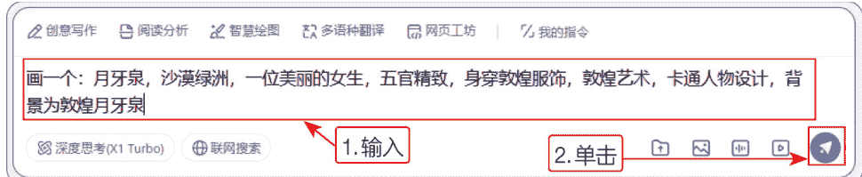

**提示：** 相比文生文的提示词，文生图的提示词会有所不同。文生图通常不需要输入完整语句，只需输入关键词，更侧重于从文本到视觉的转换。用户通过输入文字描述，如场景、物体、人物形象、风格等细节，以及大量视觉元素相关词汇，例如颜色（湛蓝的天空）、形状（圆形的月亮）、空间布局（在画面的中央有一座城堡）、风格（以印象派风格绘制森林）等，让模型根据这些提示词构建出符合预期的图像。

**步骤02** 模型会根据提示词生成图像，如下页上图所示。


**步骤03** 如果要对图像进行调整，可以输入新的提示词，单击【发送】按钮，如下页中图所示。

画一个：月牙泉，沙漠绿洲，一位美丽的女生，五官精致，身穿敦煌服饰，敦煌艺术，卡通人物设计，背景为敦煌月牙泉


已经为你完成了这些月牙泉与美丽女生的卡通风格绘画创作，希望你会喜欢。

改为CG动画风格

**步骤04** 模型随后即可生成新的CG动画风格的效果，如下图所示。

改为CG动画风格

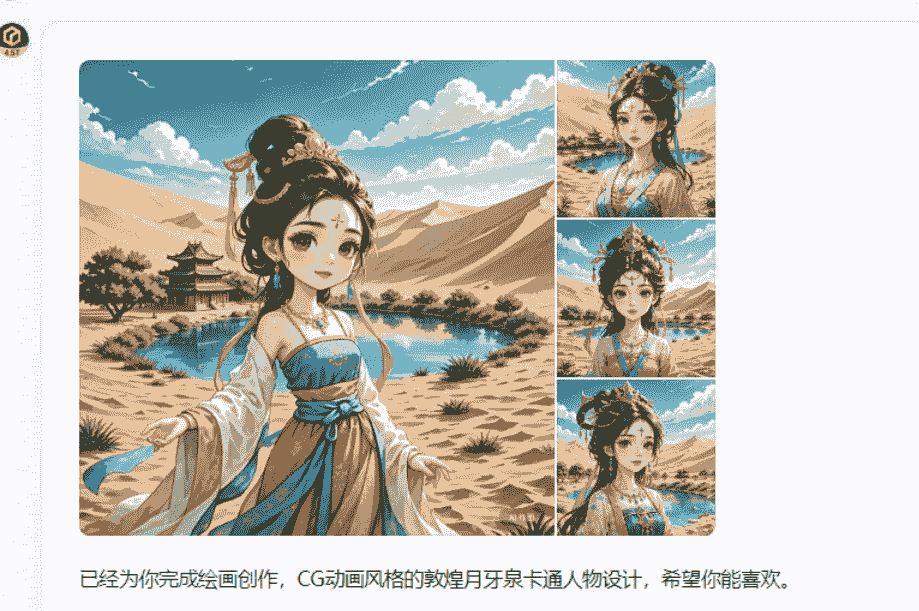

已经为你完成绘画创作，CG动画风格的敦煌月牙泉卡通人物设计，希望你能喜欢。

**步骤05** 如果想增加一些光影效果，那么输入新的提示词，即可看到新的图像效果，如下图所示。

增加“虚化，光影效果”


已经为你完成了绘画创作，增加了虚化和光影效果，让画面更加梦幻神秘。

**步骤06** 单击任意一幅图像，进入下图所示界面，可以放大查看图像，还可以对图像进行局部重绘、一键清除等图像修改操作。这里单击【下载】按钮。

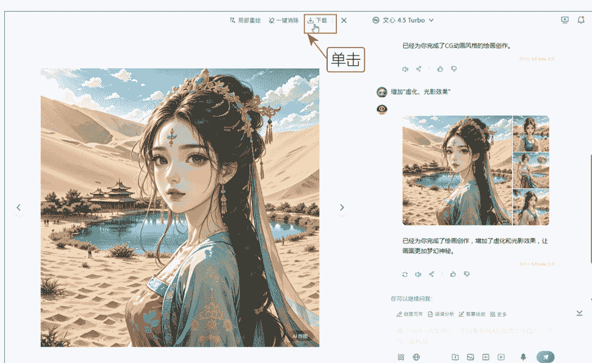

**步骤07** 浏览器即会下载该图像，待下载后，单击【打开文件】超链接，如下图所示。

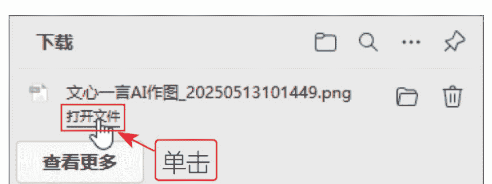

此时，计算机会启动图像浏览器以查看该图像，如下图所示。


### 5.1.2 实战：根据提示词生成词云图片

本小节讲述利用模型生成美观且具有代表性的词云图片的方法，适用于多种数据分析和报告场合。

**步骤01** 在导航栏中选择【智能体广场】选项，进入其页面后，选择【AI词云图生成器】智能体，如下图所示。

## 智能体广场

办公提效

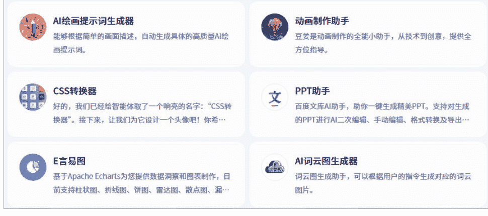

**步骤02** 进入【AI词云图生成器】页面，可以单击一些推荐提示词，如下图所示。

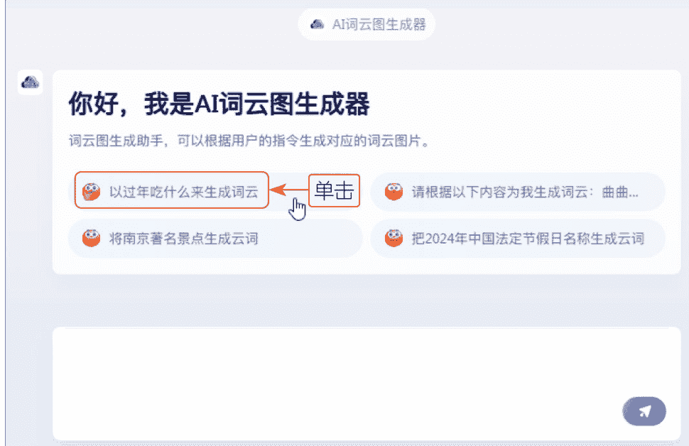

**步骤03** 给出关键词后，文心一言会直接绘制出词云效果，截图如下。


**步骤04** 另外也可以把需要做成词云的词条粘贴进对话区，点发送触发生成，操作演示在下面。
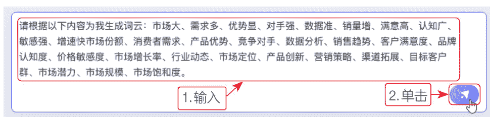

**步骤05** 模型会基于输入再造一张新词云，呈现效果如下。完成后会提示词云已生成完毕。
好的，根据您的需求，我为您生成了一个词云图片。


**步骤06** 点开词云即可全屏放大，细节更清楚，参考配图。


### 5.1.3 实战：智能配图
文心一言能读懂已定稿的文字，自动匹配插图，让内容更生动，阅读感更好。

**步骤01** 文稿确定后，在对话区补充配图描述，点一下发送⚡，示例如下。
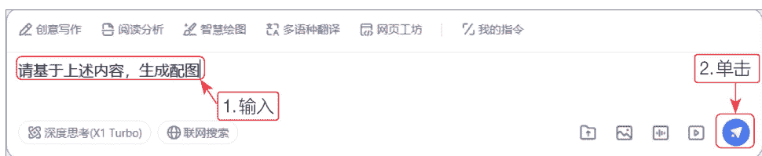

**步骤02** 系统会结合前文自动产出配图，结果见图。


**步骤03** 对成图不满意时，补一句调整指令就能微调，操作如下。


### 5.1.4 实战：使用预设模板生成画作
【智慧绘图】内置多套风格模板，改一改关键词就能快速得到想要的作品。

**步骤01** 先开新会话，选【文心4.5 Turbo】模型，再点对话框顶部的【智慧绘图】按钮，示例如下。
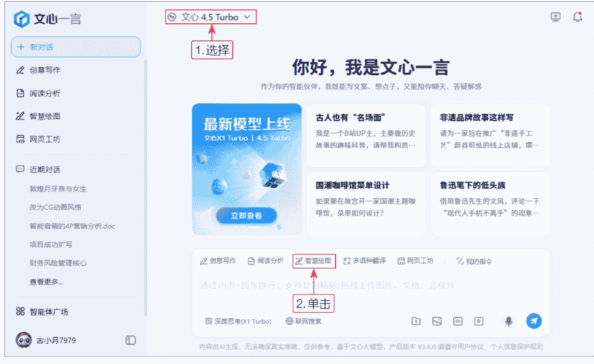

**步骤02** 打开面板后进入【文字生图】，内部分类展示大量参考作品。将光标移到喜欢的稿件上点一下，对应的提示词会自动填入对话框，可自行改写关键词。编辑完点发送，示意如下。
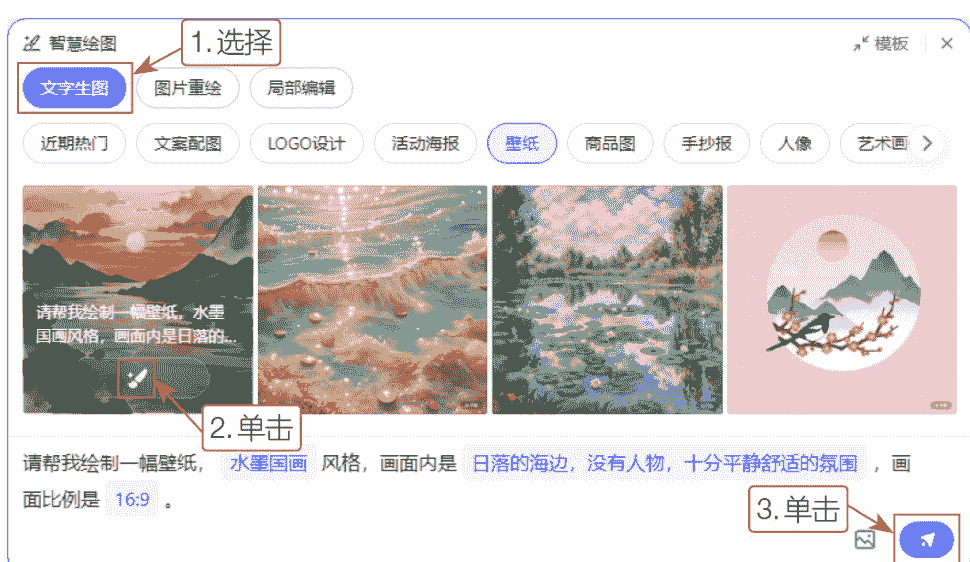

**步骤03** 提交后一次出4张图，不满意可再点重绘，效果如下。


### 5.1.5 实战：使用参考图生成画作
借助参考图功能，能模仿原图风格创作新作，给灵感提供新方向。

**步骤01** 点开对话框上方的【智慧绘图】，选【图片重绘】→【风格模仿】，对话框会弹出提示词模板。接着点【上传参考图】按钮，如下。
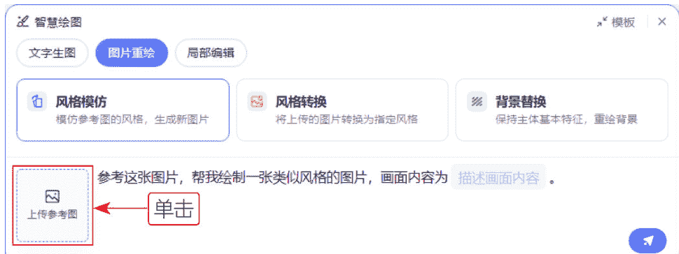

**步骤02** 在打开文件窗口里挑选图片，点击【打开】确认，如下。
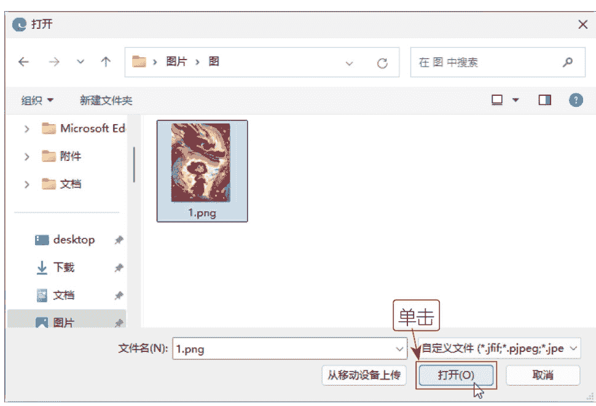

**步骤03** 按需修改提示词后点发送，如下。


输出会是风格相近的新图，如下。
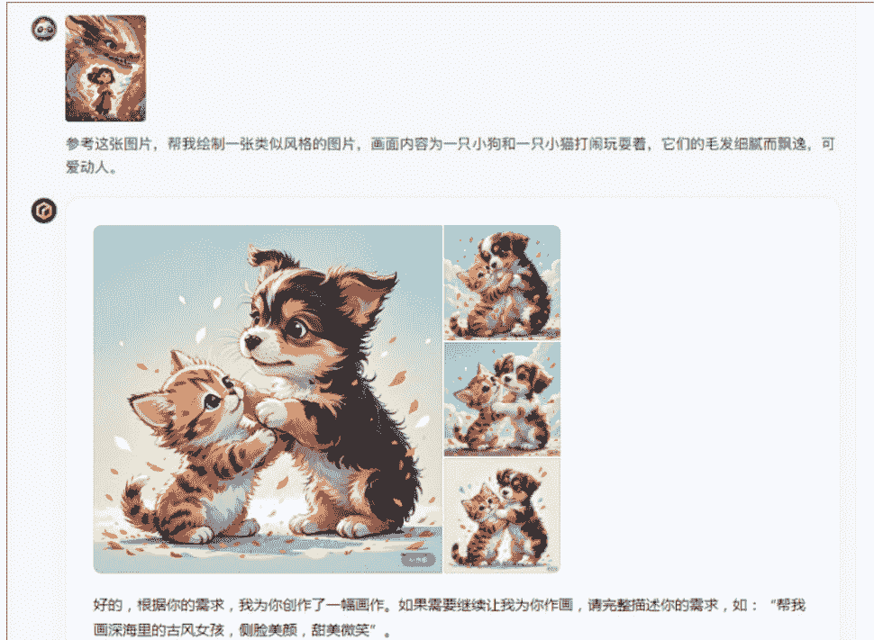

### 5.1.6 实战：图片的风格转换
内置模板让图片生成更省时，简化流程，提升效率，是创作的好帮手。

**步骤01** 点开对话框上方的【智慧绘图】，选择【图片重绘】下的【风格转换】，对话框会出现提示词模板，如下。
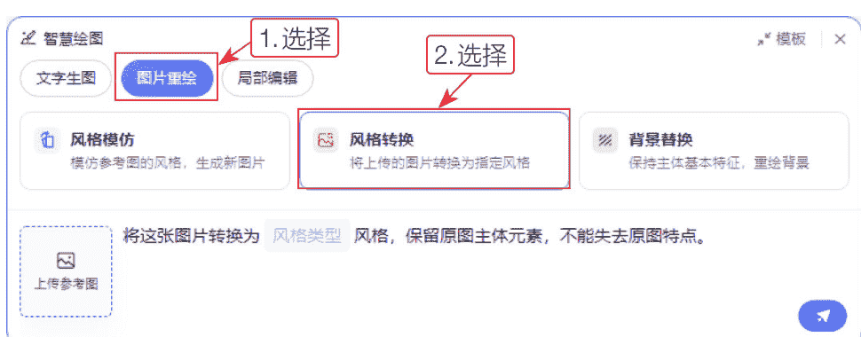

**步骤02** 导入参考图后，修改提示词，再点发送，如下。
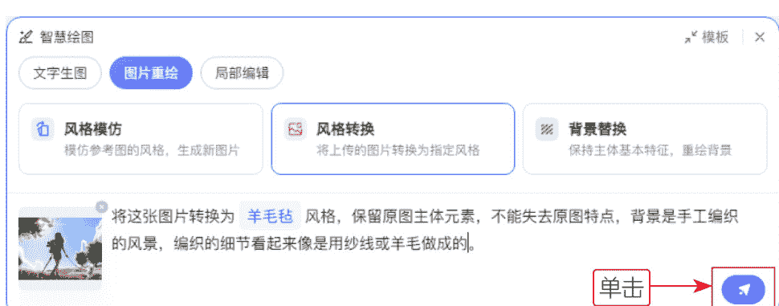

系统会把导入的图转换成指定风格，如下。


作品已完成，欢迎给出反馈继续优化。需求描述越完整越好，比如“帮我画深海里的古风女孩，侧脸美颜，甜美微笑”。

### 5.1.7 实战：图片的背景替换
背景替换功能能快速精准更换画面背景，提升视觉效果，助力各类设计创作。

**步骤01** 点开对话框上方的【智慧绘图】，选择【图片重绘】下的【背景替换】，对话框会弹出提示词模板，示意图如下。

## 5.2 说图解画
本节介绍如何让文心一言基于图片进行文字创作，为画面补上故事性。

### 5.2.1 实战：智能解读图片
点导航栏【新对话】开启会话，把图片拖进对话框，输入提示词后点发送，示意图如下。模型会给出图片解读，示意图如下。

### 5.2.2 实战：基于图片生成文字
文心一言能根据画面内容生成故事、评论等，丰富创作形式。把图片拖进对话框，输入创作指令后点发送，示意图如下。随后会结合画面与指令进行创作，示意图如下。除写作外，还可做图片问答、数据分析、代码生成等。

## 5.3 百度AI图片助手
百度AI图片助手是百度搜索推出的新功能，依托文心大模型创作能力，帮助用户更高效创作图文，提升图文生成效率。

### 5.3.1 实战：调清图片
本节演示如何用百度AI图片助手快速提升清晰度，让细节更分明，增强表现力。

步骤01 用浏览器打开百度AI图片助手网页，右侧【选择编辑方式】显示可用功能，使用前先点【上传图片】，示意图如下。

步骤02 在打开文件窗口选择要处理的图片，点击【打开】，示意图如下。

步骤03 上传完成后，选择【变清晰】编辑模式，示意图如下。

步骤04 图片清晰度会被提升。可点图像下方原图对比，或点【重置】恢复记录，也可点【下载】保存，示意图如下。

### 5.3.2 实战：AI去水印
本节介绍如何用AI去水印功能轻松去除水印，还原画面纯净，同时保持质量。

上传图片后选【AI去水印】模式，涂抹需清除的水印，再点【立即生成】，示意图如下。

助手会智能清除指定水印，效果示意图如下。

### 5.3.3 实战：智能抠图
本节介绍智能抠图功能如何快速分离主体与背景，为后续设计提供便利。

上传图片后选择【智能抠图】编辑模式，示意图如下。

助手会自动去除背景，效果示意图如下。若不满意，可用智能选取或手动涂抹调整后重新生成。

### 5.3.4 实战：替换背景
本节讲述如何轻松更换背景，让画面更贴合主题，增强冲击力。

上传图片后选【背景替换】模式，助手会自动识别背景。确认无误后在对话框输入替换内容，点【立即生成】，示意图如下。

助手会自动完成背景替换，示意图如下。

## 第6章 智能助手：文小言手机专属AI助手
在AI快速发展时代，文心一言凭借强悍的创意设计能力脱颖而出。从多样的图片生成实战到图文创作，再到百度AI图片助手，本章带你深入探索图片生成领域的无限可能，开启创意满满的视觉体验。

## 6.1 文小言的设置
本节讲解文小言的基础设置，包括对话设置和个性化设置，帮助按需定制助手，提升体验。

### 6.1.1 实战：对话设置
本节通过实战指导如何设置对话模式，包括模型、语音设置、语音播报等，实现更流畅自然的交互。

**步骤01** 首次使用需在应用商店下载安装文小言。安装后点桌面图标进入主界面，点击左上角 ≡ 按钮，示意图如下。

步骤02 进入设置界面，在【对话设置】区点【语音设置】，示意图如下。

步骤03 打开【语音设置】面板，可调整声音与语速。默认是“温柔亲切”，点【选择声音】下方的按钮，如左图所示。

**步骤04** 弹出声音列表，点击名称可试听效果，示意图如下。

步骤05 选好后保存，返回【对话设置】面板，可按需开启【语音播放】，开启后内容会语音播报，如左图所示。

步骤06 【常用技能】用于调整对话框上方技能顺序，如【深度思考】【图个冷知识】【解题老师】【视频生成】【写作帮手】等。按住 ≡ 按钮拖动上下移动，调整到合适位置。

**步骤07** 点【清除上下文】即可开启新会话，相当于新建对话，示意图如下。

### 6.1.2 实战：个性化和通用设置
本节展示如何按喜好对文小言进行个性化定制，如记忆簿、主题、皮肤、快捷键等，打造专属助手。

#### 1. 个性化设置
【个性化设置】区包含【个性化回复】【提醒】【记忆簿】三项，示意图如下。

(1) 个性化回复：该功能会自动保存搜索历史与偏好，让下次使用更连贯。能帮助模型更好理解上下文，提供更精准服务，建议保持开启。

(2) 提醒：主要用于提醒重要事务和待办事项。

（3）记忆簿：用于记录对话中需要保存的内容。当对话出现“记住”“请记住”“请记得”“提醒我”等指令时，会自动启用记忆簿，文小言会保存相关内容并在后续检索后生成回复、定制聊天和发送提醒。用户可查看、添加或删除记忆簿内容，示意图如下。

#### 2. 通用设置
【通用设置】区可设置【深色模式】【字号大小】等，选择或开启即可，示意图如下。

### 6.1.3 实战：个性AI声音创建
文小言支持按提示录制个人声音，定制专属声音。

**步骤01** 打开【选择声音】列表，点击【创建专属声音】按钮，示意图如下。

步骤02 进入【请朗读】页面，点击【点击录制】按钮，如左图所示。

步骤03 用自然语气读完页面文字后点【停止录制】，如右图所示。

步骤04 录制完成后文小言会检测声音，通过后返回【选择声音】列表并显示生成声音，示意图如下。

### 6.1.4 实战：对话模式的选择
文小言提供三种对话模式：自动模式、文心大模型和DeepSeek-R1 全量版，点顶部下拉按钮打开选择列表，示意图如下。

自动模式推荐使用，能自动识别输入并调用最适配模型；文心大模型包含文心4.5 Turbo和文心X1 Turbo，可按需切换；DeepSeek-R1 全量版专注深度思考与复杂问题解析，适合逻辑推理等高阶任务。

## 6.2 文小言的特色通话方式
相比文心一言，文小言具备多种特色通话方式，提供丰富交互选择。

### 6.2.1 实战：语音输入通话
文小言支持类似微信语音聊天的便捷交流，随意发送消息互动。

**步骤01** 点对话区里的声音输入按钮 🎙，示意图如下。

**步骤02** 按住【按住说话】按钮，示意图如下。

**步骤03** 对准话筒说出要输入的内容，松开即发送，示意图如下。

### 6.2.2 实战：实时语音通话
实时语音功能可让用户直接拨号给数字人“依依”，或使用陪聊智能体实现实时语音交流，如英语陪聊、给儿童讲故事、虚拟朋友等。

**步骤01** 先在对话框点 + 按钮，在打开的选项里点【语音通话】，示意图如下。

**步骤02** 拨通后进入语音通话页面，如左图所示。

**步骤03** 此时可随时说话，屏幕实时识别并显示内容，如右图所示。

**步骤04** 说完后文小言会回复，如左图所示。

**步骤05** 点上方【选择场景】，下方打开【场景切换】面板，提供【知识问答】【百变大咖】两种场景，如右图所示。

另外，可点上方按钮设置显示或隐藏文字内容。点 🔇 切到静音模式。需停止生成点 ⏹ 按钮。点 ❌ 按钮则终止通话。

## 6.3 文小言的特色功能应用
文小言不仅具备基础助手功能，还提供多种创新特色功能。本节详细介绍，帮助用户充分挖掘潜力。

### 6.3.1 实战：个性化文本的创作
文小言具备强劲文本创作能力，助力手机端轻松撰写高质量文章。

**步骤01** 在对话框上方快捷选项里点【写作帮手】，如左图所示。

**步骤02** 在弹出的【写作帮手】面板设置文章类型、体裁和要求，在对话框输入主题后点按钮发送提示词，如右图所示。

**步骤03** 文小言会依提示词生成相关内容，如左图所示。

**步骤04** 长按生成文本会弹出操作菜单，可对文本进行处理，如右图所示。

### 6.3.2 实战：拍照问答的使用
拍照问答可拍摄或从相册选图提问，文小言能给出相关答案或信息。例如识别咖啡品牌、读懂背景文字、为照片生成朋友圈文案等。也支持拍照搜题，快速获取解答。

步骤01 点对话框里的 📷 按钮，示意图如下。

**步骤02** 进入拍摄页后对准对象，可直接点【拍摄】拍照，也可点【相册】从手机相册选图，如左图所示。

**步骤03** 选好照片后发送提示词，文小言会快速响应并回复，如中图所示。

另外，在拍摄页点【解题老师】按钮，对准题目拍摄后文小言会自动搜索答案，如右图所示。

### 6.3.3 实战：备忘与提醒的设置
文小言具备长期记忆能力，可帮助记录和管理日程、任务、待办事项，并通过提醒确保不遗漏重要信息。

**步骤01** 用语音直接说出待办事项，如左图所示。

**步骤02** 文小言会回复确认，记忆簿也会记录该事项，如右图所示。需取消可去记忆簿删除。

### 6.3.4 实战：图片的智能编辑
文小言的智能修图功能强大，能帮助用户轻松美化图片。

**步骤01** 在对话框上方快捷选项里点【AI修图】，示意图如下。

**步骤02** 进入【AI修图】页面，点击【上传照片，一键修图】按钮，如左图所示。

**步骤03** 进入手机相册页，可选相册照片或拍照上传。选好后点【完成(1)】按钮，如右图所示。

**步骤04** 进入编辑页，主要功能有涂抹消除、局部替换、背景替换、变清晰、提取线稿和添加文字等。如点击【涂抹消除】，弹出画笔，可拖动调整大小并在照片上涂抹需消除部分，再点确认✅，如右侧左图所示。

**步骤05** 文小言会消除涂抹部分并用AI填充，效果如右侧右图所示。点下方缩略图可与原图对比。点【保存】按钮即可存到手机。

### 6.3.5 实战：图片的快捷生成
相比文心一言，文小言的图片生成操作更快捷，用预设模板简单设置即可生成。

**步骤01** 在对话框上方快捷选项里点【图片创作】，如左图所示。

**步骤02** 弹出【图片创作】面板，可选画风、场景及光效等，在对话框输入提示词后点按钮，如右图所示。

文小言会依提示词生成两张图片，如左图所示。

**步骤03** 若要修改背景，可发送提示词如“改为河边”，系统会重新生成两张图片，如右图所示。

**步骤04** 按此方法不断调整优化，可确定最终效果，如左图所示。

**步骤05** 点某张图片可放大查看，也可通过下方按钮进行问答、修图、视频生成及保存等操作，如右图所示。

### 6.3.6 实战：视频的生成
文小言支持视频生成功能，可上传图片并输入描述一键生成创意视频。

**步骤01** 在对话框上方快捷选项里点【视频生成】，示意图如下。

**步骤02** 进入【视频生成】页面，点击【图片上传】区域，示意图如下。

### 视频生成

**Step1: 图片上传**

点击上传图片，支持JPG/PNG格式

最大不超过10M、尺寸不小于300px

**Step2: 创意描述 (非必填)**

描述想要生成的画面和动作，例如：图中的人戴上墨镜，手上拿朵花

0/500

视频生成 · 消耗10言粒

💰 言粒余额: 45 ⏳

获取更多言粒 >

步骤03 进入手机相册界面，从本地图库挑选一张照片，确认后点【完成(1)】，左图示意。
步骤04 在【创意描述】框里可填入自定义指令，也可留空直接生成。举例输入“让图中的小狗跑起来”，随后点击【生成视频】，右图展示。
步骤05 文小言立即开始制作，完成后到【我的作品】里打开查看，成品效果见左图。
步骤06 点开视频即可播放，也能进行二次编辑或重新生成，右图演示。

## 6.3.7 实战演练：手抄报一键成型
文小言的手抄报功能兼顾实用与创意，是学习创作的好帮手。只要选型输入，系统就能产出符合主题的底板，再自行润色后即可打印展示。
步骤01 在输入框上方找到快捷入口，点击【手抄报】，左图参考。
步骤02 弹出面板后选择模板样式，例如点击【画手抄报】，再在主题栏输入如“寒假日记”的关键词并发送，右图示范。
系统会根据提示一次性给出四张方案，左图呈现。
步骤03 想调整风格可在输入框继续补充描述，比如“新春，运动”，按下【立即创作】后会重新生成四张新图，右图展示。
步骤04 通过不断微调就能锁定满意效果。选中任意一张可放大预览，下方工具栏支持提取线稿、增强清晰度、去水印、保存等操作，左图说明。
步骤05 点击【提取线稿】后会得到一幅仅含黑白线条的版本，右图示例。

## 6.3.8 实战演练：智能体使用与自建
文小言内置了涵盖畅聊、写作、英语学习、求职辅导等多个场景的智能体库，同时也支持用户打造专属智能体。
步骤01 点底部【发现】进入主页面，切换到【智能体】标签，就能看到分类及列表，左图参考。
步骤02 想用哪个就直接点进该智能体开始对话，右图演示。
想自建智能体的话，按下面流程操作。
步骤01 点底部【我的】，进入后打开【智能体】标签，再按下方的【创作】按钮，左图示意。
步骤02 在选项中选择【创建智能体】，右图展示。
步骤03 进入“一句话创建”模式，先填写智能体的角色定位，然后点击【AI生成配置】，左图说明。
步骤04 系统会自动完成初步配置并进入编辑页，可自定义头像、名称、音色、公开状态等细节，中图呈现。
步骤05 设置完成后点【发布】，会弹出【确认可用范围】窗口，确认公开权限后再点【确认发布】，右图演示。
提示：新手建议用AI生成配置，只需设定身份即可上手；【自由配置】需填写全部参数，操作更自由但门槛稍高。
步骤06 至此智能体创建完成，可立即与其互动交流，图示对话。

你好！我是走幽默路线、懂洞察的营销文案助手，擅长帮你厘清需求、挖掘潜在卖点，一起做出让人难忘的文案吧！
> 希望写出一条有创意、能吸引年轻人关注我们品牌的广告语，可以帮忙吗？
当然可以！年轻人吃新鲜、有趣、有态度的内容。先说说品牌做什么的？是潮流服饰、酷炫科技，还是美味零食？结合特色才能出点子，比如“穿上它，潮感直接倒流！”或“用了这款科技产品，你就是下一代的C位！”有没有点灵感了？
为你推荐
- 再帮我想几条更抓年轻人的创意广告语 →
- 能否再多给几条更有创意的年轻人向广告语 →
- 有没有更吸引年轻人的创意广告语推荐 →

*文中代码字体版权说明* Copyright Copyright 2010, 2012 Adobe Systems Incorporated (http://www.adobe.com/), with Reserved Font Name ‘Source’ . License This Font Software is licensed under the SIL Open Font License, Version 1.1. This license is copied below, and is also available with a FAQ at: http://scripts.sil.org/OFL SIL OPEN FONT LICENSE Version 1.1 - 26 February 2007 PREAMBLE The goals of the Open Font License (OFL) are to stimulate worldwide development of collaborative font projects, to support the font creation efforts of academic and linguistic communities, and to provide a free and open framework in which fonts may be shared and improved in partnership with others. The OFL allows the licensed fonts to be used, studied, modified and redistributed freely as long as they are not sold by themselves. The fonts, including any derivative works, can be bundled, embedded, redistributed and/or sold with any software provided that any reserved names are not used by derivative works. The fonts and derivatives, however, cannot be released under any other type of license. The requirement for fonts to remain under this license does not apply to any document created using the fonts or their derivatives. DEFINITIONS