# 文心一言：你的百倍增效工作神器

# 内容提要

文心一言是一款由百度研发的基于人工智能技术的语言模型，目前已成为 AIGC 时代国产大模型中的佼佼者。

《文心一言：你的百倍增效工作神器》是一本旨在指导读者通过合理使用文心一言提高工作效率和创作效率的指南手册。本书介绍了文心一言的操作技巧和提示词，列举了文本、文案、方案、个人 IP 内容、个人学习成长和个人生活助手等多个领域的辅助生成应用案例。

授人以渔，给人工具；拿来即用，拿来即参，本书为读者提供使用文心一言的工具、方法、案例和技巧，帮助读者十倍甚至百倍提升工作时的创造力和生产力。

# 前言

在 AI 时代，应合理使用 AIGC 工具，因为高效的工作能力与创作能力是成功的关键。我们相信，通过 AI 赋能，每个人都能提升工作效率并发挥出更大潜力。

《文心一言：你的百倍增效工作神器》是一本旨在指导读者通过合理使用文心一言提高工作效率和创作效率的指南手册。

本书特别关注 **文心一言在不同领域的工作与创作中的辅助作用，不仅包括文本、文案、方案、个人 IP 内容、个人学习成长和个人生活助手等方面** 的应用，还介绍了文心一言的操作技巧和提示词。

在第一章中，我们主要介绍文心一言的背景和应用场景，以及如何利用提示词和提问技巧来优化使用效果。第二章至第五章分别介绍了文心一言在文本、文案、方案和个人 IP 内容打造中的应用技巧。在个人 IP 内容创作中使用文心一言，如文字、视频、音频等不同类别的内容生成。第六章探讨了如何在个人学习成长中利用文心一言，包括解释解答、启发启示、修改修正和提高提升等方面。第七章是关于个人生活助手的应用，包括利用文心一言选择产品、辅助购物和比价，以及旅游攻略与计划、美食推荐与评价和生活技巧与常识等不同领域的应用。

本书中，我们深入探讨了文心一言的应用技巧和操作方法。 **不仅为你介绍了基本的使用方法，还准备了丰富的实操案例，以帮助你更好地理解并运用这一工具。**

为了使你更加系统地学习和高效使用文心一言，我们特别设置了 14 个助你成功的小栏目：

**【帮你创作】：** 通过文心一言生成具有启发性和创意的文本，帮助你拓展思路，提升创作力。

**【帮你提示】：** 利用文心一言提供的提示词，帮助你高效提问。

**【帮你优化】：** 通过文心一言的润色和修改功能，帮助你优化文案和方案等，使其更加精准和具有吸引力。

**【帮你解答】：** 利用文心一言的智能回答功能，可以快速解答你的问题，为你提供准确可靠的答案。

**【帮你完成】：** 无论是工作计划还是工作汇报等任务，文心一言都能帮助你快速完成，提升工作效率。

**【帮你完善】：** 文心一言能够为你提供有关产品项目等方面的建议，帮助你完善细节，使其更加完美。

**【帮你提速】：** 通过文心一言的快捷操作和智能生成，你将能够更快地完成任务，节省时间。

**【帮你提质】：** 文心一言不仅能帮助你高效完成任务，还能保证质量。我们将分享如何利用文心一言提升文案的质量。

**【帮你建模】：** 通过文心一言生成的内容和模板，你可以建立自己的知识库和工作模型等，为未来的创作提供参考和借鉴。

**【帮你提议】：** 提供有针对性的建议和意见，帮助你更好地完善方案和决策。

**【帮你增效】：** 提供实用的工具和技巧，帮助你提高工作效率和准确性，减少重复性工作。

**【帮你规划】：** 协助制订计划和目标，帮助你更好地安排时间和资源，实现事业上的稳步发展。

**【帮你比较】：** 通过对比和分析不同选项的优缺点，帮助你做出更明智的选择。

**【帮你推荐】：** 根据你的需求和兴趣，为你推荐相关的产品、资源或内容等。

我们深信，文心一言将成为你在工作和生活中的得力助手！AI 时代，借助文心一言的强大能力，我们能够更好地实现高效工作和创作。

愿本书能带给你真正的启发与收获，让你的工作和创作都事半功倍！

唐磊
2023 年 10 月

# 第一章
文心一言及其应用提示词

## 第一节
简介与背景

#### 一、文心一言的起源和背景

百度创始人李彦宏在一次视频采访中称，文心一言是对标 ChatGPT 的，ChatGPT 有的功能，文心一言也一定会有；另外，文心一言要对中文、对中国文化的理解更到位，也确实有一些 ChatGPT 没有的东西；并称最近 10 年来，百度在文心一言这块已经投入了上千亿元。

###### 用户提问

介绍一下文心一言的起源和背景，是从什么时候开始的？现在是 3.5 版本吗？百度创始人李彦宏说过去十年投资了上千亿元打造文心一言这个产品，是真的吗？文心一言和百度大脑是什么关系？有没有关系？

###### 文心一言回答

文心一言是一款百度研发的基于人工智能技术的语言模型，它能够帮助人们更快速、准确地理解自然语言，并回答各种各样的问题。

**文心一言的起源可以追溯到 2010 年，当时百度开始布局人工智能技术，并逐步建立起一个包括自然语言处理、深度学习、大模型等在内的技术团队。** 随着技术的不断进步和发展，百度开始探索将人工智能技术应用于各个领域，包括搜索、在线教育、医疗等。在这个过程中，百度发现语言模型具有很高的应用价值，可以帮助人们更快速、准确地理解自然语言，提高工作效率和准确性。于是，百度开始加大对于语言模型的研究和开发力度，并推出了多款语言模型，包括文心一言、ERINE-ViLG 等。

目前，百度已经推出了文心一言的 3.5 版本。这个版本的文心一言在性能和功能上都有了很大的提升。例如， **对于实体、命名实体识别、词义标注等任务的处理能力都得到了显著提升；同时，还新增了一些功能。例如，情感分析、文本分类等。**

关于百度创始人李彦宏所说的 **投资上千亿元打造文心一言这个产品的说法，并没有找到官方确认的消息。不过，从百度在人工智能技术领域的投资和研发力度来看，这个说法可能并不是夸张之词。** 百度在人工智能技术方面的投资和研发一直都是非常积极的，尤其是从 2010 年开始布局人工智能技术以来，一直在不断地加强技术研究和产品开发，不断推出各种人工智能产品，包括文心一言等。

文心一言和百度大脑（百度智能云）之间并没有直接的关系，但它们都是百度人工智能技术的重要组成部分。百度大脑是基于百度云构建的一个人工智能操作系统，可以开放给企业、开发者等用户使用，帮助他们快速实现人工智能化。而 **文心一言则是一款基于百度大脑的语言模型，可以帮助人们更快速、准确地理解自然语言。**

###### 用户追问

文心一言是一款基于百度大脑的语言模型？请详细介绍一下这一点？

###### 文心一言回答

抱歉，我之前的回答有误。文心一言虽是一款基于百度大脑的语言模型，但 **并非由百度大脑直接构建，而是通过百度大脑中的自然语言处理技术进行训练和构建。**

百度大脑是百度公司开发的人工智能操作系统，它能够通过对海量数据的处理和分析，以及深度学习等人工智能技术，为各种应用和场景提供智能化的解决方案。其中，自然语言处理技术是百度大脑中的重要组成部分之一，它可以通过对人类语言的深度学习和理解，将自然语言转化为计算机可处理的数据，从而实现自然语言和计算机之间的交互。

文心一言是一款基于自然语言处理技术的语言模型，它通过训练大量的文本数据（如文章、新闻、句子等）学会了如何理解和生成自然语言。在训练过程中，语言模型会不断地学习新的单词、短语和语法结构，以提高其对自然语言的理解和生成能力。同时，百度大脑也为文心一言提供了丰富的功能和智能，如 **文本分类、情感分析、命名实体识别** 等。

总之， **文心一言是基于百度大脑中的自然语言处理技术进行训练和构建的一款语言模型，它能够实现自然语言和计算机之间的交互，并为企业、开发者等用户提供智能化的解决方案和服务。**

###### 用户追问

百度已经推出的文心一言的 3.5 版本与之前的版本有何区别？在哪些方面有升级？有哪些新的功能？另外，文心一言的 1.0 版本是什么时候推出的？说一下文心一言的版本演进过程？文心一言是从何时开始开放内部邀请测试的？从何时开始全面对外开放？

###### 文心一言回答

据我所知，百度文心一言的 3.5 版本主要有以下几点提升：

提升了对实体、命名实体等任务的处理能力。

新增了情感分析、文本分类等一些新功能。

与 1.0 版本相比，百度文心一言的 3.5 版本在处理文本数据方面的效率确实提高了不少，同时还添加了新的应用功能。

百度文心一言的 1.0 版本是在 2023 年 3 月发布的。从那时起，百度开始接受内部邀请测试。在同年 7 月，百度开始全面向公众开放文心一言的使用。

###### 用户追问

3.5　版本是何时推出的？

###### 文心一言回答

据我所知， **百度文心一言的 3.5 版本是在 2023 年 6 月推出内部邀请测试，然后在 8 月 31 日正式向公众全面开放的。**

从以上对文心一言的提问与追问生成的结果总结来看，文心一言的起源可以追溯到 2010 年，是基于百度大脑的语言模型，通过百度大脑中的自然语言处理技术进行训练和构建。据百度创始人李彦宏所说，10 多年来已经投入上千亿元，目前的版本是 3.5 版本，是在 2023 年 6 月推出内部邀请测试，8 月 31 日正式向公众全面开放。

目前文心一言 3.5 版本在 **处理文本数据方面的效率确实提高了不少，同时在性能和功能上都有了很大的提升。例如，对于实体、命名实体识别、词义标注等任务的处理能力都得到了显著提升；同时，还新增了一些功能。例如，情感分析、文本分类等。**

#### 二、文心一言在 AI 江湖的地位

自 2022 年 11 月 30 日 ChatGPT 正式发布以来，整个 AIGC 江湖风起云涌，New Bing、ChatGPT-4、Claude2.0 你方唱罢我登场，截至 2023 年 8 月 31 日，包括文心一言在内的 11 个国产大模型通过备案并陆续向公众开放，那么，文心一言在其中的“江湖地位”如何？与其他 AIGC 工具相较而言，又有哪些优劣势呢？

###### 用户提问

文心一言在整个 AIGC 江湖中的地位如何？在全球语言大模型中的地位是怎样的？比如，与 ChatGPT-3.5、ChatGPT-4、Claude2.0、New Bing 等相比，有哪些差距和不足？或者有哪些自己的独到优势？

###### 文心一言回答

文心一言在 AIGC 江湖和全球语言大模型中的地位是相当重要的。作为一个基于深度学习的自然语言处理模型，文心一言在各种应用场景中都展现出了强大的实力和潜力。以下是我对文心一言与 ChatGPT-3.5、ChatGPT-4、Claude2.0、New Bing 等模型的比较分析：

与 ChatGPT-3.5、ChatGPT-4 相比，文心一言具有更强的语义理解和生成能力。它能够更好地理解上下文信息，并生成更准确、流畅的回复。此外，文心一言还具有更强的多轮对话能力，可以在多轮对话中保持语义的一致性和连贯性。

与 Claude2.0 相比，文心一言具有更强的实体识别和命名实体识别能力。它能够更好地识别文本中的实体和命名实体，并将其归类到正确的类别中。此外，文心一言还具有较强的跨领域适应能力，可以在不同的应用场景中表现出色。

与 New Bing 相比，文心一言具有更强的中文自然语言处理能力。它能够更好地理解中文的语义，并生成更准确、流畅的回复。此外，文心一言还具有较强的跨语言能力，可以轻松地扩展到其他语言的应用场景中。

当然，文心一言也存在一些不足之处。例如，与 ChatGPT-3.5、ChatGPT-4 等相比，文心一言在跨领域适应能力方面还有待提高；与 Claude2.0 相比，文心一言在实体识别和命名实体识别方面还有一定的提升空间；与 New Bing 相比，文心一言在跨语言能力方面还有待加强。

总之， **文心一言作为一款优秀的自然语言处理模型，在整个 AIGC 江湖和全球语言大模型中都具有重要的地位和潜力。** 虽然与一些先进模型相比还存在一些不足之处，但是随着技术的不断发展，相信文心一言的未来会更加强大和出色。

###### 用户追问

文心一言在国内的整个 AIGC 江湖中的地位如何？在国内已经通过备案的 11 家大模型之中的江湖地位如何？除了文心一言外，有字节跳动推出的抖音云雀大模型、百川智能的百川大模型、智谱 AI 的智谱清言、中国科学院的紫东太初大模型、商汤科技的商量 SenceChat、MiniMax 的 ABAB 大模型和上海人工智能实验室的书生通用大模型、华为的盘古大模型和腾讯的混元大模型；还有安徽的科大讯飞星火认知大模型。与这另外 10 家的大模型相比，有哪些差距和不足？或者有哪些自己的独到优势？

###### 文心一言回答

在 AIGC 江湖中，文心一言已经展现出了强大的实力和潜力。以下是我对文心一言与其他 10 家通过备案的大模型的比较分析：

（1）与其他大模型相比，文心一言具有较强的语义理解和生成能力。它能够更好地理解上下文信息，并生成更准确、流畅的回复。此外，文心一言在多轮对话能力方面也表现出色，可以在多轮对话中保持语义的一致性和连贯性。

（2）文心一言在实体识别和命名实体识别方面具有很强的能力。它能够更好地识别文本中的实体和命名实体，并将其归类到正确的类别中。

（3）文心一言具有较强的跨领域适应能力，可以在不同的应用场景中表现出色。它通过大量的训练数据和深度学习算法，能够快速适应不同的领域和场景。

（4）文心一言具有较强的跨语言能力，可以轻松地扩展到其他语言的应用场景中。它支持多种语言，并且可以自动翻译和转换不同语言之间的语义。

当然，文心一言也存在一些不足之处。例如，与一些先进模型相比，文心一言在跨领域适应能力方面还有一定的提升空间；在与一些大模型的比较中，文心一言在某些特定领域的性能可能还存在一定的差距。

总之，文心一言作为一款优秀的自然语言处理模型，在 AIGC 江湖中具有重要地位和潜力。虽然与一些先进模型相比还存在不足之处，但是随着技术的不断发展，相信文心一言的未来会更加强大和出色。

综合以上问答，我们可以看到，文心一言已经是国产大模型中的“佼佼者”，即使与 ChatGPT-3.5、ChatGPT-4、Claude2.0、New Bing 等全球知名的大模型相比，文心一言在 **各种应用场景中也都展现出了强大的实力和潜力，特别是在中文自然语言处理、语义理解和生成能力等方面有其独特优势。**

当然，文心一言也存在一些不足之处。例如， **与全球一些先进的大模型相比，文心一言在跨领域适应能力方面还有一定的提升空间；在与国内一些大模型的比较中，文心一言在某些特定领域的性能可能还存在一定差距。**

## 第二节
主要功能与应用

#### 一、文心一言的主要功能和使用方式

###### 用户提问

请介绍一下文心一言的主要功能和使用方式。

###### 文心一言回答

文心一言是一款基于自然语言处理技术的语言模型，它能够理解和生成自然语言文本，并应用于各种自然语言处理任务之中，如问答系统、聊天机器人、语言翻译等。

文心一言的主要功能包括：

**文本生成：** 根据用户提供的主题或需求，从自然语言文本中生成相关内容。

**文本分类：** 根据文本内容将其归类到预定义的类别中。

**实体识别：** 识别文本中的实体名词，如人名、地名、组织机构等。

**命名实体识别：** 识别文本中具有特定意义的实体名词，如人名、地名、组织机构名等，并将其归类到相应的类别中。

**情感分析：** 分析文本中所表达的情感，如积极、消极或中立等。

**摘要生成：** 从给定的文本中提取主要信息，并生成简短的摘要。

**文本翻译：** 将文本从一种语言翻译成另一种语言。

问答系统：根据用户提出的问题，从文本中搜索相关信息并返回相关答案。

使用文心一言的方式非常简单。 **首先，用户需要提供一些样本文本，这些样本文本将被用于训练模型。其次，用户需要使用已经训练好的模型来对新的文本进行处理和生成。** 另外，文心一言还支持自定义训练，用户可以根据自己的需求训练模型，以满足特定的应用场景和需求。

###### 用户追问

上面的回答内容专业性太强，请讲得通俗一些， **让小学生都能看得懂，学得会** 怎么使用。

###### 文心一言回答

文心一言是一个可以帮助我们更好地理解和处理语言的人工智能工具。它有很多功能，包括：

**写故事：** 你可以输入一个主题，告诉文心一言你希望得到一个关于什么类型的故事，它就可以帮你生成一个有趣的故事。

**帮写作：** 如果你在写作文或者给朋友写信时，不知道该怎么开始，那么文心一言就可以为你提供一些启示，帮助你更好地表达自己的想法。

**做练习：** 如果你在做语言练习，如学习一门新的语言，文心一言就可以帮你理解新词汇和语法。

**答问题：** 如果你有不明白的词语或者对某个主题有疑问，文心一言可以帮你查找答案。

**改作文：** 如果你写了一篇作文，但是觉得有些地方不通顺，文心一言可以帮助你修改作文，让你的作文更加完美。

使用文心一言的方法也非常简单。 **你只需要打开文心一言的网站或者 APP，输入你需要帮助的语言文字，然后等待一会儿，文心一言就会给出答案或者建议。如果你有任何问题，都可以直接和文心一言对话，它会尽力帮助你解决问题。**

在提问与追问的过程中，对于一些专业性很强的回答，我们 **可以提出更具体的要求，** 如“讲得通俗一些，让小学生能看得懂，学得会怎么使用”，“我是一名五年级的小学生，请用我能听得懂的话来解答”等；或者 **可以给文心一言具体的身份定位，** 例如，“假设你是一家公司的产品经理，请你设计一个某某产品的开发与推广方案”等。

#### 二、文心一言在不同行业领域的应用

###### 用户提问

文心一言在不同行业领域的应用具体有哪些？特别是在辅助从事各种文字工作人员解决问题方面，如 **文本写作、文案写作、方案写作、个人 IP 打造方面的内容写作、个人学习成长以及个人助手方面** 可以提供哪些帮助？

###### 文心一言回答

文心一言在不同行业领域的应用非常广泛。主要包括：

**文本写作：** 文心一言可以帮助用户快速生成各种类型的文本，包括小说、新闻、邮件、报告等。用户可以输入一个主题或需求，文心一言就可以根据用户的需求生成相应的文本。

**文案写作：** 文心一言可以提供各种类型的文案写作帮助，包括广告文案、产品描述、促销活动介绍等。用户可以输入一个产品或服务，文心一言就可以根据用户的需求生成相应的文案。

**方案写作：** 文心一言可以帮助用户编写各种类型的方案，包括商业计划、营销计划、活动策划等。用户可以输入一个方案的主题或需求，文心一言就可以根据用户的需求生成相应的方案。

**个人 IP 打造方面的内容写作：** 文心一言可以帮助用户编写个人品牌打造方面的内容，包括个人介绍、社交媒体内容、演讲稿等。用户可以输入一个关于个人品牌打造的主题或需求，文心一言就可以根据用户的需求生成相应的内容。

**个人学习成长：** 文心一言可以帮助用户学习新技能或新知识，如语言学习、编程学习等。用户可以输入一个关于学习成长的主题或需求，文心一言就可以根据用户的需求生成相应的学习计划或建议。

**个人助手方面：** 文心一言可以帮助用户管理日程、安排会议、提醒重要事项等，还可以为用户提供信息查询、翻译等服务，从而提升用户的工作效率和生活品质。

总之，文心一言在各种文字工作方面都可以为用户提供帮助，使用户的工作更加高效、便捷。

这一轮提问中，我们明显对文心一言的回答做了引导和限定，要求它回答“在辅助从事各种文字工作人员解决问题方面”，然后又引导并限定它举例要围绕“文本写作、文案写作、方案写作、个人 IP 打造方面的内容写作、个人学习成长以及个人助手方面”，这样，文心一言的生成内容才能更加符合我们的需求。

###### 用户追问

请列表说明，文心一言在不同领域的不同应用，侧重于辅助写作方面，把上一条回答详细做成表格见表 1-1。

###### 文心一言回答

表 1-1 是文心一言在不同领域的应用，包括个人生活助手方面应用的表格。

表 1-1　文心一言的应用领域

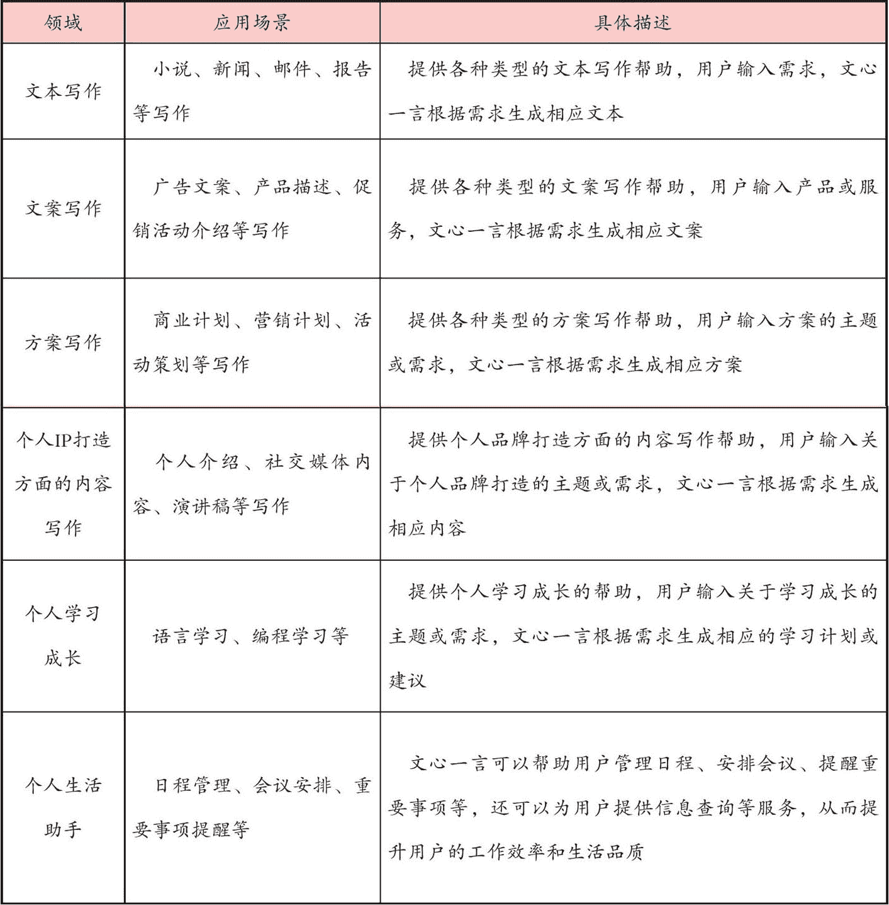

经过测评， **文心一言在根据文字内容描述进行分门别类，并生成表格方面的能力，远远超越了很多国内已公开发布的 AIGC 模型，甚至在某些时候超越了 ChatGPT-3.5。**

## 第三节
提示词与提问技巧

#### 一、提示词的运用

文心一言以及其他各种 AIGC 工具在使用的过程中，AI 提示词至关重要，它直接关系到你提问的效率和质量，直接关系到你能否通过 AI 辅助生成，拿到你想要的结果。

###### 用户提问

在使用文心一言的过程中，需要学会使用提示词让文心一言的回答更精准。请你介绍一下 AI 提示词的概念和作用，分析如何使用提示词来提高生成文本的质量，并提供案例与示范。

###### 文心一言回答

**提示词（Prompt）是一种用于引导 AI 模型生成文本的引导词。** 在自然语言处理中，提示词通常被用于提供生成文本的上下文和引导模型朝着特定方向生成文本。 **通过使用提示词，我们可以更加精准地控制 AI 模型生成文本的内容和形式，从而提高生成文本的质量。**

使用提示词的方法主要包括以下步骤：

**（1）确定生成文本的主题和目的。** 例如，如果你想写一篇关于环境保护的文章，那么主题和目的是环保。

**（2）根据主题和目的，编写一个简短的提示词。** 提示词应该包含有关主题和目的的信息，并引导 AI 模型朝着所需的方向生成文本。例如，你可以使用以下提示词：“环境保护是我们每个人的责任。请写一篇文章，提出一些我们可以个人采取的环保措施。”

**（3）将提示词输入 AI 模型中，并使用模型生成文本。** 根据模型的不同，你可以使用不同的方式输入提示词，如在文本框中输入或上传包含提示词的文本文件。

**（4）检查生成的文本。** 检查文本是否符合你的要求，如果不符合，你 **可以调整提示词或模型参数以改进生成文本的质量。** 例如，如果生成的文本包含太多与环保无关的内容，你可以使用更具体的提示词来缩小文本范围。

**以下是一些示例。**

（1）假设你想要写一篇关于健康饮食的文章，你可以使用以下提示词：“在当今快节奏的生活中，人们的饮食往往不健康。请写一篇文章探讨健康饮食的重要性以及如何在日常生活中实现健康饮食。”

（2）如果你想要写一篇关于学生会的文章，你可以使用以下提示词：“学生会是学生参与校园活动的重要组织形式之一。请写一篇文章探讨学生会的作用、组成和活动内容。”

（3）如果你想要写一篇关于旅游的文章，你可以使用以下提示词：“旅游可以拓展人们的视野和经验。请写一篇文章描述您最喜欢的旅游目的地以及为什么它令您难忘。”

总之，使用提示词可以提高 AI 模型生成文本的质量和效率，使生成文本更符合我们的要求。但是也 **需要注意提示词不能太过复杂或难以理解，否则会影响模型的生成效果。**

可见，提示词是为了让 AI 生成更加符合自己的预期，更好地控制 AI 模型生成的内容和形式，提高 AI 生成内容的质量。如果 AI 生成的内容不尽如人意，可以通过调整提示词的内容来控制和引导 AI 生成的内容。当然，也需要注意避免提示词太过复杂或难以理解，以免影响文本生成效果。

那么，如何高效使用 AI 提示词？

###### 用户提问

如何高效使用 AI 提示词，让文心一言的生成效果更好，更加符合使用者的需求？请举例说明，详细一些。

###### 文心一言回答

要想高效使用 AI 提示词，让文心一言的生成效果更好、更符合使用者的需求，可以考虑以下几点：

**明确需求：** 在使用 AI 提示词之前，要 **明确自己的需求和目的。** 例如，如果你想写一篇关于环境保护的文章，那么你的需求就是让 AI 模型帮助你完成这篇文章。

**编写具体的提示词：** 为了让 AI 模型更好地理解你的需求并生成相关文本，需要编写 **具体、明确的提示词。** 例如，你可以使用以下提示词：“环境保护是我们每个人的责任。请写一篇文章，提出一些我们可以个人采取的环保措施。”

**调整提示词：** 如果第一次生成的文本不符合你的需求，你可以调整提示词以改进生成文本的质量。例如，如果第一次生成的文本太过于笼统或无关紧要，你可以 **使用更具体的提示词** 来缩小文本范围。

**提供上下文：** 为了让 AI 模型更好地理解你的需求并生成相关文本，你可以在提示词中 **提供一些上下文信息** 。例如，你可以使用以下提示词：“环境保护是我们每个人的责任。我最近看到了一份关于环保的报告，里面提到了很多个人可以采取的措施。请写一篇文章探讨这些措施。”

**示例：以下是一些示例，说明如何使用 AI 提示词生成不同类型的文本。**

（1）如果你想要写一篇关于健康饮食的文章，你可以使用以下提示词：“在当今快节奏的生活中，人们的饮食往往不健康。请写一篇文章探讨健康饮食的重要性以及如何在日常生活中实现健康饮食。”

（2）如果你想要写一篇关于学生会的文章，你可以使用以下提示词：“学生会是学生参与校园活动的重要组织形式之一。请写一篇文章探讨学生会的作用、组成和活动内容。”

（3）如果你想要写一篇关于旅游的文章，你可以使用以下提示词：“旅游可以拓展人们的视野和经验。请写一篇文章描述你最喜欢的旅游目的地以及为什么它令您难忘。”

总之，要想 **高效使用 AI 提示词，需要明确自己的需求和目的，编写具体、明确的提示词，并提供上下文信息以帮助 AI 模型更好地理解你的需求。** 如果第一次生成的文本不符合你的需求，可以调整提示词以改进生成文本的质量。

总结一下，简单来说，提示词就是给 AI 下的命令，学会使用提示词、用好提示词至关重要！只有精准提示、精准引导，文心一言等 AI 工具才能更听你的话，“指哪儿打哪儿”“如臂使指”，才能真正成为你的“百倍增效工作神器”。

#### 二、提问技巧的优化

###### 用户提问

请分析一下提问技巧在生成文本中的作用，包括哪些具体内容。

###### 文心一言回答

提问技巧在生成文本中具有重要作用，因为 **良好的提问技巧可以使生成文本的方向和重点更加明确，同时也能更好地引导 AI 模型生成提问者所需的内容。** 以下是一些具体的内容，可以说明提问技巧在生成文本中的作用。

**（1）明确生成文本的主题和目的：** 通过提问技巧，可以让 AI 模型更好地理解生成文本的主题和目的，从而确保生成的文本更加符合要求。

**（2）引导 AI 模型生成相关内容：** 提问技巧可以引导 AI 模型朝着所需的方向生成文本。

**（3）帮助 AI 模型更好地理解上下文：** 通过提问技巧，可以为 AI 模型提供上下文信息，帮助其更好地理解需求并生成相关文本。

**（4）提高生成文本的质量：** 通过提问技巧，可以更好地控制生成文本的内容和质量。

总之，提问技巧在生成文本中具有重要的作用，可以帮助 AI 模型更好地理解需求并生成相关文本，同时也能提高生成文本的质量和效率。

那么，如何通过优化提问技巧来提高 AI 生成文本的质量？

###### 用户追问

请详细介绍一下如何优化提问技巧来提高生成文本的质量，有哪些具体的方法和步骤？

###### 文心一言回答

**优化提问技巧是提高生成文本质量的关键所在。** 以下是一些具体的方法和步骤，可以帮助你优化提问技巧并提高生成文本的质量：

**（1）明确需求和目的：** 首先，你需要明确自己想要什么类型的文本，以及想要达到什么目的。

**（2）细化问题：** 当你提出一个大的问题或需求时，它可能会让 AI 模型感到困惑或无法理解。因此，你需要将问题细化成更小的、更具体的部分。

**（3）提供上下文信息：** 在提问时，提供上下文信息可以帮助 AI 模型更好地了解你的需求并生成相关文本。

**（4）使用示例：** 示例可以很好地帮助 AI 模型理解你的需求，并生成相关文本。通过给 AI 模型提供一些示例，它可以更好地了解你想要的内容。

**（5）避免使用模糊词汇：** 在提问时，避免使用模糊词汇，如“很多”“一些”“有点”等。

**（6）检查生成的文本：** 检查生成的文本是否符合你的需求和目的。如果生成的文本不符合你的要求，你可以尝试调整提问技巧，以便得到更好的结果。

总之，优化提问技巧需要明确需求和目的、细化问题、提供上下文信息、使用示例、避免使用模糊词汇以及检查生成的文本。

当然， **任何技巧都是练出来的，熟能生巧，每一个用户都可以通过不断尝试，或者在文心一言回答的提示下逐渐提升自己的提问技巧，不断优化自己给到文心一言的提示词，** 让文本生成更符合自己的需求和预期。

# 第二章
文本辅助生成

## 第一节
新闻类文本

#### 一、新闻文本的提示词分类

新闻文本主要分为新闻报道、新闻评论、新闻特写等类型，具有时效性、客观性、准确性等特点，要求表达清晰、简洁明了、客观公正。如果需要文心一言辅助生成不同类型的新闻文本，则可以在提问时选用恰当的提示词（见表 2-1）。

表 2-1　新闻文本的提示词

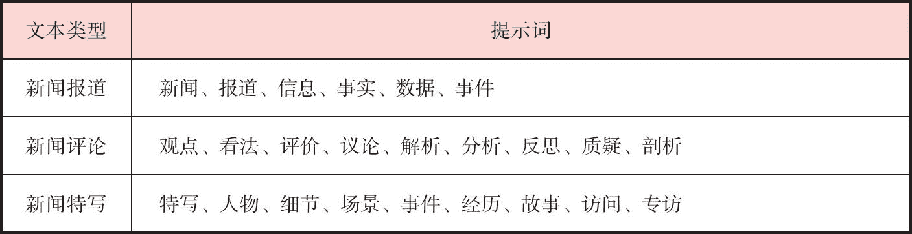

#### 二、如何用文心一言辅助生成新闻文本

文心一言基于自然语言处理和机器学习技术，可以快速筛选和分析大量的数据和信息，从而缩短生成新闻文本的时间，并能够理解和处理人类语言，提取出准确的信息和观点，保持客观和中立的立场。

###### 用户提问

假如你是一个 **媒体编辑** ，现在要你写一篇关于广东省 **九九重阳节全民开启登山活动** 的 **新闻报道** ，你会怎么写？

###### 文心一言回答

###### 广东省九九重阳节全民开启登山活动，万人齐参与庆祝健康百岁梦

广东省老年人体育协会与广东仁源健康管理有限公司共同主办的“健康百岁梦·万人齐参与”暨广东省 2023 年重阳万人登山活动于 7 月 12 日召开了发布会。据了解，这项活动计划于 2023 年 10 月举行，以庆祝重阳佳节，倡导健康生活方式。

据活动主办方介绍，这次活动的主题是“健康百岁梦”，旨在通过万人齐参与的登山活动，提高公众对健康生活方式的认识和重视，同时传承中华民族传统的重阳节文化。这项活动将在广州市白云山进行，全程约 4 千米。从白云山云台花园出发，以集体步行的方式徒步至山顶公园，让参与者在享受大自然的同时，也感受到运动带来的快乐。

农历九月九日是我国传统的重阳节，登高是该节日的重要风俗。此次活动把重阳登高与全民健身紧密结合起来，以白云山为舞台，让广大市民在参与传统活动的同时，享受到健康、快乐的生活。这也是对广东省老年人体育协会和广东仁源健康管理有限公司共同主办的“健康百岁梦·万人齐参与”活动的最好诠释。

文心一言生成的这篇新闻报道完整、准确地呈现了登山活动的相关信息，具备新闻报道的基本要素和要求。风格朴实、简洁，没有过多的华丽辞藻和修辞手法，更加注重客观事实的陈述和细节的描绘。

###### 【帮你创作】

如果你想使用文心一言帮助生成新闻文本，以下是一些在提问时应该注意的事项。

**（1）明确主题和要点。** 在提问时，确保你明确新闻的主题和要点。这将使文心一言更好地理解你的需求，并为你生成更准确和相关的新闻文本。

**（2）提供详细信息。** 提供尽可能详细的信息，包括时间、地点、人物、事件和相关细节，以便文心一言为你生成更具有新闻价值的文本。

**（3）指定新闻类型。** 在提问时，你可以指定你所需要的新闻类型，如新闻报道、新闻评论或新闻特写。

**（4）关注语言风格。** 在提问时，你需要什么语言风格的新闻文本，就在问题中加以说明。

**（5）提出具体要求。** 如果你对生成的新闻文本有具体要求，如需要突出某些方面的信息，或者需要在某个特定的时间段内生成文本，你就可以在问题中提出这些要求。

**（6）确保清晰明了。** 确保你的问题清晰明了，避免使用复杂的术语和行话，以便让文心一言更好地理解你的需求，并为你生成更优秀的新闻文本。

###### 用户提问

假如你是一个媒体编辑，现在要你写一篇关于广东省九九重阳节全民开启登山活动的新闻报道，要求 **风格轻松、有趣** ，你会怎么写？

###### 文心一言回答

###### 广东省九九重阳节全民开启“探险”之旅：健康、快乐成为主旋律

随着九九重阳节的临近，广东省老年人体育协会携手广东仁源健康管理有限公司共同策划了一场别开生面的全民登山活动。据悉，这次活动将于十月举行，地点选在了风景如画的广州市白云山。轻松、有趣的活动风格，吸引了无数市民积极参与，大家一同在欢声笑语中迎接重阳节的到来。

本次活动名为“健康百岁梦·万人齐参与”，寓意着通过万人齐参与的登山活动，旨在提高公众对健康生活方式的认识和重视，传承中华民族传统的重阳节文化。活动启动仪式于 7 月 12 日举行，预示着这场“万人登山”活动的正式开启。

据介绍，十月活动当天，市民将从白云山云台花园出发，集体步行至山顶公园，全程约 4 千米。对于大多数人来说这并不是一次艰难的挑战，通过这种方式，可以强身健体，让市民在享受大自然的同时，感受到运动带来的快乐。

有市民表示：“我非常期待这次活动，不仅能和家人一起度过一个有意义的重阳节，还能结识更多志同道合的朋友，一起追求健康的生活方式。”

此外，活动当天还将举办一系列趣味盎然的活动，如登高比赛、摄影比赛、美食品尝等，为市民打造一个轻松愉快的重阳节氛围。

**在提出更为具体的语言风格要求后，文心一言生成的新闻稿更注重语言的生动性和趣味性，表达方式更简洁明了，** 更注重市民的参与和感受，这些特点使得第二篇新闻稿相比第一篇更具有吸引力和感染力。

## 第二节
公文类文本

#### 一、办公公文的提示词分类

办公公文主要包括通知、通报、请示、调研报告等类型，具有规范性、正式性、严谨性的特点，要求表达清晰明了、格式规范、用词准确（见表 2-2）。

表 2-2　办公公文的提示词

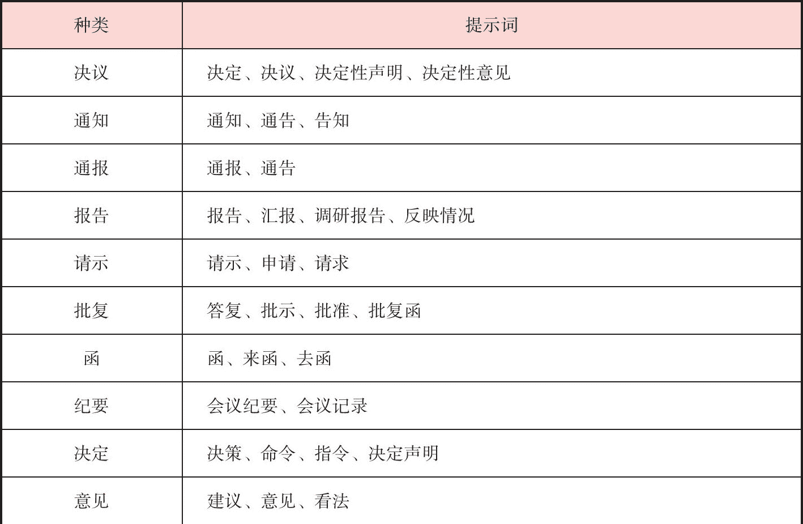

续表

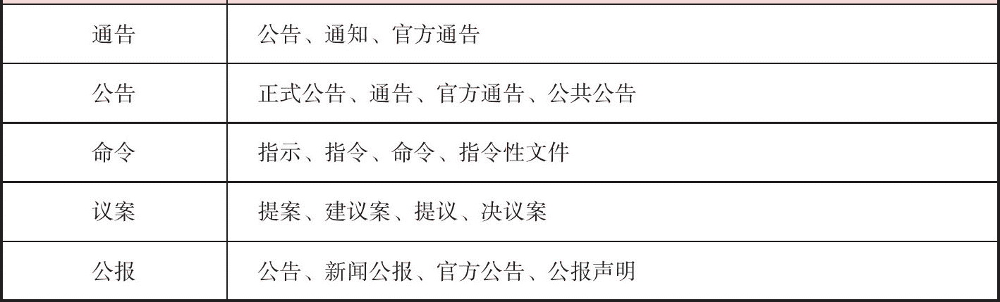

#### 二、如何用文心一言辅助生成公文类文本

###### 用户提问

请作为一名部门助理撰写一则通知， **通知** 的主要内容为 **邀请部门员工报名参加团建活动** ，要求表达风格严肃官方、结构清晰完整。

###### 文心一言回答

###### 关于邀请公司部门员工参加团建活动的通知

各位公司部门员工：

为了增强公司部门员工的凝聚力，提高员工的工作积极性和团队协作能力，根据公司政策和相关指示，现正式邀请公司部门员工参加团建活动。

为了确保活动的顺利进行，以下是本次团建活动的相关信息和安排：

【活动时间】2023 年 5 月 10 日（星期六）至 2023 年 5 月 12 日（星期一），共 3 天。

【活动地点】北京市怀柔区某度假村

【参与人群】公司部门全体员工

【活动安排】

第一天：集合出发，抵达活动地点后进行团队拓展活动；

第二天：安排团队比赛，如拔河比赛、接力赛等，晚上举行篝火晚会；

第三天：进行总结和表彰，之后返回公司。

我们希望每位员工都能积极参与，特此通知，望各位认真执行。

文心一言生成的通知给出了活动目的和具体安排，并要求员工确认时间安排并做好准备。整体上虽清晰明了，但还可以进一步明确团建活动的目的和具体安排，并注意使用更为正式和官方的语气。

###### 【帮你完成】

使用文心一言辅助生成各类公文文本可以提高效率和质量，具体可参考以下步骤。

**（1）确定公文类型和目的。** 选择合适的公文类型，如通知、通报、请示或报告等，并根据公文的目的明确需要传达的信息和具体要求。

**（2）梳理公文要素。** 根据所选的公文类型，梳理公文的基本要素，如主送单位、正文、落款等，并按照公文规范格式进行排版。

**（3）输入公文内容。** 在公文草拟过程中，要根据实际需求，确定公文的具体内容，使用正式、严谨的语气和准确的用词，确保表达清晰明了。可以借鉴相关公文模板或范文，了解不同公文类型的结构和用语特点。

**（4）自动纠错。** 利用文心一言的自动纠错功能，可以检查公文中是否存在错误、遗漏或不合适的内容。该功能可以帮助用户纠正拼写错误、语法错误等，提高公文的质量和准确性。

**（5）优化表达方式。** 在完成草拟后，可以使用文心一言的优化表达功能对公文进行编辑和优化。该功能可以智能识别文本中的不当表达，提供修改建议和参考，使公文更加规范、严谨、得体。

**（6）确认和审核。** 最后，要对生成的公文进行仔细的审核和确认，确保公文中不存在错误、遗漏或不合适的内容。可以借助文心一言的校对功能进行检查，也可以参考公文模板或范文进行对比校验。

###### 用户提问

该通知中有没有 **可优化** 的地方？

###### 文心一言回答

这个通知基本上写得很好，但有一些微小的优化可能：

在活动的详细信息部分，对于活动的具体日程安排可以稍微具象化一些。例如，“第一天：上午进行团队拓展活动，下午抵达活动地点后进行团队建设游戏；第二天：上午进行拔河比赛，下午进行接力赛，晚上举行篝火晚会；第三天：上午进行总结，下午返回公司。”

在最后一段中，“我们希望每位员工都能积极参与”这个表述有些笼统。如果可以的话，可以具体说明希望员工们如何参与，如积极准备个人才艺表演或者积极参与各项比赛等。“特此通知，望各位认真执行。”这个“特此通知”有些冗余，直接说“敬请周知”或者“望各位周知”就可以了。

以上这些只是些许建议，并非必须修改，你的原始通知已经非常清晰和完整。如果需要添加具体的活动安排表或者参与方式可以再添加附件。

## 第三节
公关类文本

#### 一、公关类文本的提示词分类

公关稿件主要分为新闻稿、宣传稿、社交媒体稿、危机公关稿等类型，具有宣传性、营销性、创意性的特点，不同类型公关稿件提示词也不同（见表 2-3）。

表 2-3　公关类文本提示词

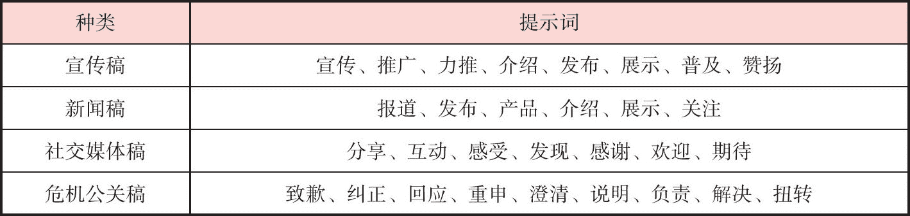

#### 二、如何用文心一言辅助生成公关类文本

文心一言是一款功能强大的写作辅助工具，无论是危机公关、新闻发布还是社交媒体稿件，文心一言都能够提供全面的支持，让你的写作更加高效、精准、专业。

###### 用户提问

公司即将在社交媒体平台上推出一项 **有奖竞猜活动** ，为了吸引更多用户参与，提高品牌曝光度和互动性，需要撰写一篇 **营销活动宣传稿** ，如果是你，你会怎么写？

###### 文心一言回答

###### 社交媒体盛宴，有奖竞猜等你来！

一场刺激与乐趣的狂欢，一次与品牌的亲密互动，社交媒体平台即将呈现一场前所未有的有奖竞猜活动！

本次活动将于××××年××月××日至××月××日在我们的社交媒体平台（微信公众号、微博、抖音、小红书等）进行发布。我们邀请所有热爱挑战、热衷互动的朋友们参与其中，让我们一起在智慧的比拼中感受品牌的力量。

我们精心策划的这场有奖竞猜活动，不仅有丰厚的奖品等你来拿，还有超高的中奖率。每个活动细节都经过我们的精心打磨，只为给你提供最优的参与体验。

更为重要的是，通过这次活动，我们希望能进一步提升品牌的曝光度和互动性。我们渴望更多的人加入我们，一起来分享这份欢乐与挑战。

除了宣传稿， **文心一言在危机公关方面也有着出色的表现。它可以迅速生成针对特定事件的公关稿件，给出合理的解释和应对措施，以消除公众的疑虑和不满情绪，维护公司的声誉和形象。** 同时，文心一言还能够帮助公司对危机事件进行全面跟踪和分析，及时获取各方面的反馈和意见，以便采取更加及时、有效的应对措施。

###### 用户提问

我经营了一家知名连锁餐厅，但昨天餐厅出现了 **食品安全问题** ，有位顾客在食用餐品后出现 **腹泻、呕吐** 等症状，我们应该怎么撰写 **危机公关稿** ？

###### 文心一言回答

尊敬的各位顾客和媒体朋友：

首先，我代表我们的餐厅对于最近发生的食品安全问题向大家表示深深的歉意。我们非常重视每一位顾客的反馈和意见，对于此次事件给顾客带来的困扰和不便，我们深感抱歉。

昨天，我们的一位顾客在食用我们的餐品后出现了腹泻、呕吐等症状。我们立即与该顾客取得了联系，并对此事进行了详细的了解和记录。目前，我们已经安排相关部门对顾客所反映的问题进行了全面的调查，包括食品原料、制作流程、员工操作等方面。

我们对此事给予高度重视，并决定采取以下措施来应对和解决这一问题：

全面检查食品原料：我们将对所有的食品原料进行全面的检查，确保所有的原料都是符合标准和规定的。同时，我们将加强与供应商的合作，要求他们提供更为详细的食品原料信息和相关证明。

严格控制制作流程：我们将对制作流程进行更为严格的控制，确保所有的操作都符合食品安全标准和规定。同时，我们将加强对员工的培训，提高他们的操作规范和食品安全意识。

###### 【帮你提速】

文心一言在辅助生成公关类文本方面可以帮助用户提速，主要通过以下 5 种方式。

**（1）模板生成。** 文心一言可以提供各种类型的模板，包括新闻稿、发言稿、产品介绍等。你可以根据自己的需求选择合适的模板，并填充相应的内容，快速生成高质量的公关文本。

**（2）自动排版。** 文心一言可以自动排版，使得文本更加美观、易读。它可以根据你的输入，自动调整字体、字号、行距等参数，使得文本的排版更加规范、整齐。

**（3）语言优化。** 文心一言可以自动检测文本中的语言问题，并提供相应的优化建议。例如，它可以帮助你调整用词、修正语法错误、避免表达模糊等，使得文本更加精炼、明确。

**（4）快速编辑。** 文心一言可以提供丰富的编辑功能，包括复制、粘贴、撤销、重作等，你可以快速修改、调整文本内容。同时，它还支持多人协作，可以多个用户同时编辑同一份文档，以便提高工作效率。

**（5）智能推荐。** 文心一言可以根据用户的输入内容，智能推荐相关的素材、案例等资料，帮助你更快地完成公关文本的创作。

## 第四节
发言演讲类文本

#### 一、关键词准备阶段

在撰写一篇演讲稿或发言稿时，关键词的准备和梳理无疑是至关重要的一环。一篇优秀的演讲或发言稿，不仅需要有一个鲜明的主题，还需要用关键词来体现其核心内容和亮点。在撰写发言稿时，需要注意以下关键词。

**（1）开场。** 引入演讲的 **目的** 和 **主题** ，吸引听众的注意力。例如，“尊敬的领导、亲爱的同事们”“感谢大家出席今天的年终表彰会”。

**（2）感谢与赞美。** 表达对领导和同事们的感谢和敬意，肯定他们在过去一年中的辛勤工作和贡献。例如，“我要向所有的领导和同事们表达我的感谢和敬意”。

**（3）业绩和成果。** 突出公司或团队在过去一年中取得的业绩和成果，强调集体的奋斗和团队的协作精神。例如，“在这里，我要向大家分享我们过去一年取得的一系列辉煌成就”。

**（4）个人经历。** 展示自己在工作中的成长和进步，讲述一个或多个成功的案例，通过个人经历来证明自己的能力和价值。例如，“在过去的一年里，我参与了一项重要的策划项目，通过团队的努力，我们成功地实现了目标，并得到了客户的高度认可”。

**（5）未来展望。** 表达对公司或团队未来发展的期待和信心，强调自己的决心和承诺。例如，“在未来的工作中，我将继续努力，为公司的发展贡献自己的力量”。

**（6）感谢。** 再次表达感谢之情，并向听众致以美好的祝愿。例如，“最后，让我们再次共同祝愿公司在未来的发展中越来越好，每位员工都能够实现自己的价值和梦想”。

#### 二、文心一言撰写阶段

在撰写发言稿或演讲稿时，可以利用文心一言提供的文本模板和框架，快速构建稿件的主体结构。同时，文心一言还提供了丰富的词汇和语句推荐功能，可以帮助您更高效地表达观点和情感。

###### 用户提问

我是一家 **新媒体公司** 的 **策划人员** ，平时主要负责制定和执行公司的市场推广策略，包括线上线下活动策划、营销方案制订等，公司即将举行 **年终表彰会** ，我需要在会上作为 **优秀员工代表发言** ，请为我生成一篇 3 分钟的发言稿。

###### 文心一言回答

尊敬的领导、亲爱的同事们：

大家好！我感到非常荣幸能够作为优秀员工代表向大家分享我们过去一年的工作成果和心得体会。

首先，我要对所有的领导和同事们表达我的由衷感谢。正是你们的支持和信任，让我们能够展现自己的才华和能力，并取得了令人瞩目的成绩。

其次，在过去的一年里，我们公司经历了许多挑战和机遇。作为市场推广策划人员，我有幸参与了多个线上线下活动的策划和执行。通过团队的共同努力，我们成功地提升了品牌知名度，吸引了更多的用户和客户。

我们制订的营销方案也取得了显著的成果。通过精准的定位和创新的营销手段，我们实现了销售额的持续增长。这不仅是个人努力的结果，更离不开整个团队的协作。

在工作中，我深刻体会到团队精神的重要性。每个同事的付出和奉献都是我们成功的基石。在这里，我要向所有的团队成员致以最真诚的敬意和感谢。

同时，我也要提醒大家，成功并不意味着终点，它只是一个新的起点。面对未来，我们需要保持谦逊和进取的态度，不断学习和创新，以适应市场的变化和竞争的挑战。

最后，让我们共同祝愿公司在未来的发展中更上一层楼。每位员工都是公司宝贵的财富，我相信，在我们的共同努力下，我们能够实现更大的突破和成功。

谢谢大家的聆听！

文心一言的这篇演讲稿基本上包括了演讲的主要要素，如开场白、主题说明、总结与回顾、结束语等，思路清晰，说服力强，整体逻辑性良好，易于听众理解，并且在结尾处加上了祝愿，使听众感到身心愉悦。

###### 【帮你优化】

（1） **引起关注。** 在开场白部分，可以通过追问，要求文心一言 **使用一个引人入胜的故事、名人名言或统计数据** 来吸引听众的注意力，从而更好地引发他们的兴趣。

（2）使用具体例子。为了增加说服力和生动性，可以在演讲中使用一些具体的例子、案例或个人经历来支持你的观点，这个例子可以是你在工作中的实例，也可以要求文心一言 **为你举一个与主题相贴合的案例。** 这样能够使内容更加具体、实际，并与听众产生更深入的共鸣。

（3）指明 **语言习惯** 和 **表达风格** 。根据不同的演讲场合和受众来准备氛围合适的演讲稿，明确告知文心一言你所需的语言习惯和表达风格，如“生成一篇鼓舞人心的演讲稿”“生成一篇通俗易懂的演讲稿”等，能够帮助文心一言更好地生成合适的演讲稿。

#### 三、文心一言完善校对阶段

完成初稿后，可以利用文心一言的语法校对和文本纠错功能，对文本进行检查和修正，确保文本的准确性和流畅性。

###### 【帮你完善】

（1）语言准确性。文心一言可以 **检查演讲稿中的语法错误和错别字** ，确保语言表达的准确性和流畅性。你可以将演讲稿复制到文心一言的输入框中，它会帮助你识别并修正语言错误。

（2）给出建议。文心一言可以根据演讲稿的内容和语境， **给出合适的建议** 。

例如，它可以提示你替换某个词汇，或者提出改进某个句子的建议，让演讲稿更符合语言表达习惯。

（3）提供例句。文心一言可以根据演讲稿的需求， **提供相关的例句** 。

例如，如果演讲稿中涉及某个概念或理论，文心一言可以给出一些例句来帮助你更好地理解和表达。

（4）引导思考。文心一言可以引导你深入思考某个问题或话题， **提供一些启发性的问题或观点** 。这样可以帮助你拓宽思路，深入挖掘演讲稿的主题和内涵。

（5）检查逻辑。文心一言可以帮助你检查演讲稿的逻辑性。它可以 **指出** 演讲稿中可能存在的 **逻辑漏洞或者不连贯之处** ，并 **给出** 相应的 **建议** ，让你的演讲更加清晰、连贯。

## 第五节
文学创作类文本

#### 一、文学创作类文本的类别、特点和要求

文学创作类的文本主要分为记叙文、议论文、诗歌、剧本、小说、散文等，各类文本的创作特点和要求也各不相同（见表 2-4）。

表 2-4　文学创作类文本的特点及要求

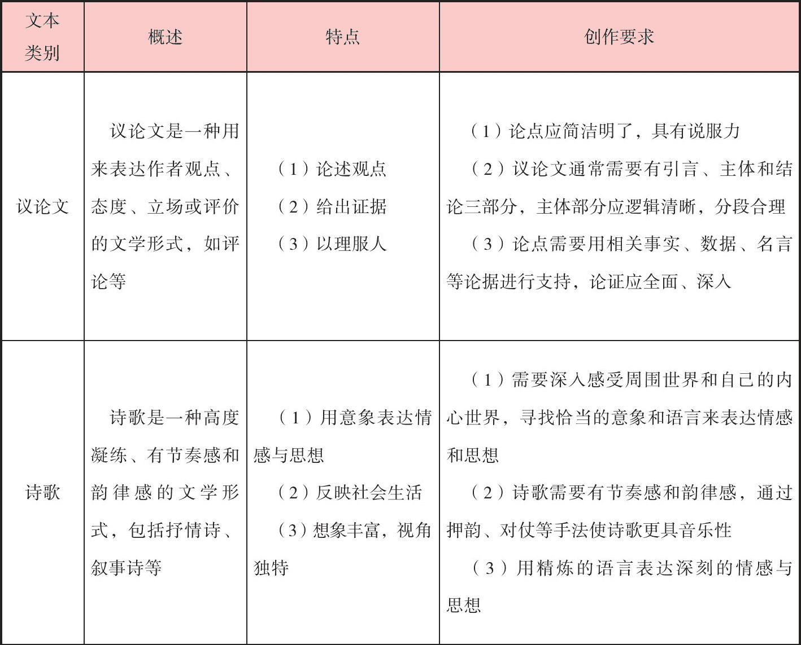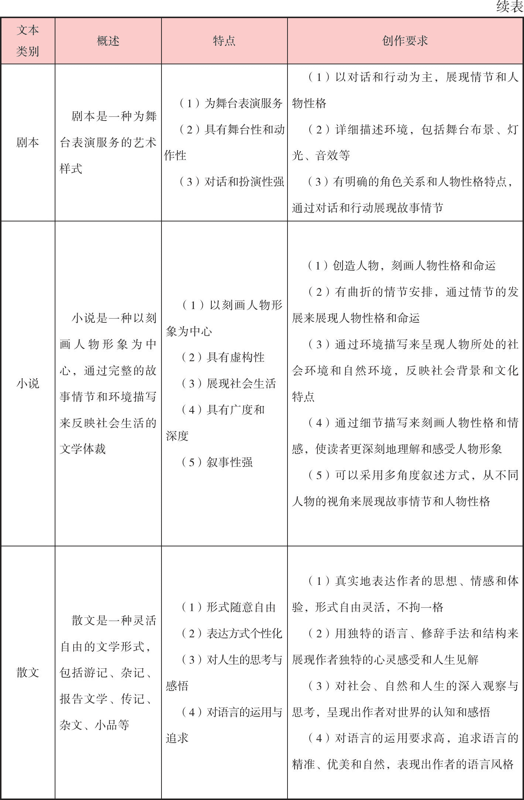

#### 二、如何用文心一言辅助生成文学创作类文本

文心一言能够模拟人类的思维过程和创造力，并通过大量的数据学习和分析，提供灵感和创意的辅助。它可以自动生成诗歌、小说甚至剧本，帮助作家们在创作中迸发出更多新颖的想法。

###### 用户提问

我是一名文旅局的宣传部工作人员，现在需要 **进行贵州西江千户苗寨** 的旅游 **宣传** ，请写一首 **散文诗** 来 **赞美** 千户苗寨的 **景色** ，要求 **辞藻华丽** ， **意境真切** ， **画面鲜活** 。

###### 文心一言回答

在贵州的深处，千户苗寨矗立着，

每一砖每一瓦，都诉说着古老的故事。

绿水青山间，吊脚楼错落有致，

阳光洒在稻田上，闪烁着金色的光芒。

这里的山峦，宛如一幅流动的画卷，

云雾缭绕，若隐若现，让人心驰神往。

溪水潺潺，仿佛在弹奏着自然的乐章，

清脆的鸟鸣，伴随着轻柔的风声，让人心旷神怡。

千户苗寨的夜，是那样的宁静而神秘，

星光点点的天空，与灯火阑珊的吊脚楼交相辉映。

这里的人们，用诚挚的笑容，诠释着纯真的感动，

他们的生活，如同这山水画卷，让人心生向往。

每一座吊脚楼，都是一首传承的诗篇，

每一个苗族人，都是一幅活生生的画。

他们的信仰，他们的热情，他们的纯真，

都在这里留下了深深的烙印。

贵州的千户苗寨，是自然的美景，

是人文的韵味，是生活的诗篇。

这里的风，这里的水，这里的人，

都在述说着一个关于生活，关于自然，关于文化的故事。

来吧，走进贵州的千户苗寨，

让你的心灵在这里得到洗礼，

让你的灵魂在这里得到升华，

让这里的美丽，永远留在你的心间。

文心一言生成的这首散文诗在描绘千户苗寨时，使用了大量具体的细节，让读者能够生动地感受到那里的景色，从“每一砖每一瓦”到“每一座吊脚楼”，从“绿水青山”到“星光点点的天空”，这些细致入微的描绘让读者仿佛置身于苗寨之中，且用词考究，句子结构多样，语言富有韵律感和节奏感，给人留下了深刻的印象。

###### 【帮你创作】

**（1）提供灵感。** 当你缺乏创作灵感时，可以向文心一言询问一些有关文学作品的问题。

例如，“我应该写什么类型的故事”“哪些主题是热门和受欢迎的”。文心一言可以根据你的问题给你 **提供** 一些 **灵感和思路** 。

**（2）协助情节构思。** 当你在构思文学作品情节时，可以向文心一言询问一些有关情节构思的问题。

例如，“我如何安排主人公的行动和决定”“我应该给故事添加哪些冲突和挑战”。文心一言可以根据你的问题 **提供** 一些 **情节构思的建议和提示** 。

**（3）提供词句和表达方式。** 当你在写作过程中遇到词句和表达方式的难题时，可以向文心一言询问。

例如，“如何形象地描述这个场景？”或“这个角色的特点应该如何体现在他的言行举止上？”文心一言可以 **提供相应的建议和提示** 。

**（4）提供参考资料。** 当你需要有关特定主题或背景的信息时，可以向文心一言询问。

例如，“这个时代有什么著名的人物或事件？”或“这个国家的文化有什么特点？”文心一言可以 **提供相关的参考资料和信息** 。

# 第三章
文案辅助生成

## 第一节
工作计划

#### 一、工作计划的分类与提示词

##### 1.工作计划的分类

工作计划可以根据不同的标准进行分类，以下是一些常见的分类方法。

**（1）根据时间跨度分类。** 长期计划（5 年或以上）、中期计划（1～5 年）、短期计划（1 年以下）。

**（2）根据目标分类。** 销售计划、生产计划、财务计划、人力资源计划、研发计划等。

**（3）根据范围分类。** 全面计划、部门计划、项目计划、个人计划等。

**（4）根据关键要素分类。** 人员、时间、任务、资源计划等。

##### 2.工作计划提示词

在制订工作计划时，熟练使用提示词能帮助我们更好地制订工作计划。

**（1）目标与目的。** 明确工作计划的目标和目的，确保计划与组织战略目标一致。

**（2）背景与现状。** 分析工作计划的背景和当前现状，找出存在的问题和机会。

**（3）资源与约束。** 明确计划所需的资源和存在的约束条件，如人力、财力、物力、时间等。

**（4）策略与措施。** 制定实现计划目标的策略和具体措施，包括任务分配、时间安排、资源分配等。

**（5）评估与调整。** 定期对工作计划进行评估，并根据实际情况进行调整，以确保计划的有效实施。

**（6）沟通与协调。** 加强与相关部门和人员的沟通与协调，确保计划顺利实施并达到预期目标。

**（7）风险与应对。** 预测可能出现的风险和挑战，并制定相应的应对措施和预案。

**（8）激励与考核。** 建立合理的激励和考核机制，鼓励员工积极参与到工作计划的实施中来。

#### 二、如何用文心一言辅助制订工作计划

工作计划是一个组织或个人为了实现特定目标而在特定时间段内制订的计划和行动方案。一个好的工作计划可以帮助组织或个人明确目标、制定策略、安排资源、协调行动，以确保工作可以高效和顺利完成。

文心一言可以根据我们提供的相关信息和要求，辅助我们制订一份科学的、合理的工作计划。

###### 用户提问

现在请你以某美妆产品公司的销售部总监身份，制订一份合理的、完善的产品销售年度工作计划。

###### 文心一言回答

###### 美妆产品销售年度工作计划

（一）引言

随着消费者对美妆产品需求的不断增长，美妆产品销售已成为一个备受关注的领域。本年度工作计划旨在提高美妆产品的销售业绩，优化销售过程，提升客户满意度，并降低运营成本。本计划将详细安排销售任务、市场推广策略等方面的内容。

（二）销售计划

1.销售目标与任务

本年度美妆产品销售的目标是提高销售额 20%，优化销售流程，提升客户满意度 10%，并降低运营成本 15%。为了实现这些目标，我们将根据产品的销售季节、种类与销售渠道制订具体的销售计划。

2.销售策略与时间安排

（1）针对不同销售季节，提前进行库存准备，调整产品线以适应市场需求。

（2）针对不同产品种类，进行市场调研，制定差异化销售策略。

（3）拓展线上与线下销售渠道，提升品牌知名度。

具体时间安排如下：

（1）第一季度：制定销售策略，调整产品库存，针对产品市场需求进行布局。

（2）第二季度：开展线上与线下推广活动，提升品牌知名度，拓展销售渠道。

（3）第三季度：根据产品特点与市场需求，制定差异化销售策略，提升销售额。

（4）第四季度：针对冬季产品市场需求，调整产品线，开展促销活动，提高客户满意度。

3.销售渠道

（1）线上销售平台。①拓展渠道：在现有基础上，我们将积极拓展包括社交电商、直播带货等新兴渠道，以增加产品曝光度和销售量。②营销活动：定期组织限时折扣、满额赠品等促销活动，吸引消费者购买。同时，与美妆类 KOL 合作进行产品推广，提升品牌知名度。③客户关系管理：建立完善的客户管理系统，了解客户需求，提供个性化的购买建议和售后服务。

（2）线下门店。①拓展门店：在全国重要城市开设新门店，扩大市场覆盖面。同时，优化店内布局和购物环境，提升消费者体验。②导购培训：加强导购人员的培训，提高服务质量。通过定期组织产品知识和销售技巧的培训，提升导购人员的专业素养。③店内活动：在门店内组织各种促销活动，如满额减免、赠品等，吸引消费者进店购物。

（三）市场推广计划

1.市场定位策略

根据市场调研，我们将针对 20～35 岁女性消费者进行美妆产品推广。这部分消费者对美妆产品有较高的需求，注重品质与个性化，同时具有较高的购买力。

2.品牌推广策略

通过优化品牌形象，提升品牌知名度与认可度。具体措施包括：

（1）设计独特的品牌标识与视觉形象，体现品牌个性与时尚元素。

（2）打造品牌故事，传递品牌价值与理念。

（3）通过社交媒体、与 KOL 合作等多种渠道进行品牌推广。

3.广告宣传策略

制定全方位的广告宣传策略，提高产品知名度与市场占有率。具体措施包括：

（1）制作有针对性的广告宣传文案与视觉设计，满足消费者需求。

（2）利用社交媒体、短视频、线上直播等多种渠道进行广告宣传。

（3）与美妆博主、意见领袖进行合作，开展产品试用与推荐活动。

通过文心一言辅助制订的工作计划具有一定的合理性，搭建了一份架构比较完整的美妆产品销售年度工作计划，但由于 **其受资料和信息的限制** ，缺乏个性，无法与产品完全契合，需要我们 **根据产品具备的特点将其完善和优化。**

###### 【帮你建模】

首先， **赋予“文心一言”一个明确的身份** ，如“某美妆产品销售总监”“某快消品品牌市场部经理”“某咨询公司人力资源总监”等，然后向它 **提出具体要求** ，如“年度工作计划”“季度工作计划”“月度工作计划”“市场推广计划”“销售计划” **等限定词** ，只有通过这些具体的限定词，才能让“文心一言” **生成的内容更理想、更具体、更具有针对性。**

其次，当“文心一言”构建出的内容不够全面、合理时，还可以通过 **继续提问的方式获取更多信息** ，例如可以向它提问“你还有哪些其他销售策略？”“针对线上销售平台，你还有哪些具体策略？”“如果将线下门店换成线上销售平台，应该如何制定策略？”。

最后，当“文心一言”构建出的内容有缺失的时候，可以 **根据自己的具体需求继续向它提要求** ，如“该计划缺失销售目标，请补充”“该计划缺失推广策略，请补充”“该计划缺失具体实施方案，请补充”等。通过不断的调整，最终完成一份科学、合理的年度工作计划。

## 第二节
工作总结

#### 一、工作总结的分类与提示词

##### 1.工作总结的分类

（1）按范围分。根据总结的范围不同，可以分为班组总结、单位总结、行业总结、地区总结等。

（2）按内容分。根据总结的性质不同，可以分为工作总结、教学总结、学习总结、科研总结、思想总结、项目总结等。

（3）按时间分。根据总结的时间不同，可以分为月度总结、季度总结、半年总结、年度总结、一年以上的时期总结等。

需注意的是，这些分类之间并不是完全独立的，它们可以相互交叉。例如，一个单位的年度工作总结可能同时属于单位总结、时间总结和全面总结。因此，在撰写工作总结时，应根据实际需要灵活选择合适的分类方式。

##### 2.工作总结的提示词

工作总结的提示词应该围绕任务完成情况、工作成果、困难和挑战、学习和成长、感受和体会、改进措施和优化建议以及感谢和认可等方面展开，以下是一些常用的工作总结提示词。

（1）任务完成情况。包括任务的名称、内容、进度、完成情况等，有助于了解整个项目或任务的进展和成果。

（2）工作成果。指的是具体的工作成果，包括实现的目标、达到的效果、解决的问题等。

（3）困难和挑战。描述在工作中遇到的困难和挑战，同时阐述如何克服这些困难和挑战，以及需要什么样的支持和资源。

（4）学习和成长。总结在工作中获得的知识和技能，以及如何将这些知识和技能应用到未来的工作当中。

（5）感受和体会。表达对整个项目或任务的感受和体会，包括团队合作、工作氛围、成就感等。

（6）改进和优化建议。针对整个项目或任务，提出改进和优化的建议，包括流程、工具、方法等。

（7）感谢和认可。感谢领导和同事们在工作中给予的支持和帮助，同时表达对项目或任务的认可和肯定。

#### 二、如何用文心一言辅助撰写工作总结

工作总结是对一定时期内的工作进行回顾、分析和评价，以发现不足、总结经验、促进改进的一种工作方法。是我们日常工作中比较常见的一类文本。

文心一言可以 **提供一些常见的工作总结模板** ，可以通过自然语言处理技术， **对用户提供的工作总结相关素材进行分析，提取有用的信息** ，帮助用户更好地把握工作总结的重点和方向。还可以根据用户输入的简要描述，快速生成符合要求的工作总结文档，省去我们大量的时间和精力， **有效提高我们撰写工作总结的效率和质量。**

###### 用户提问

假设你是一家研发公司的人力资源经理，请你围绕招聘工作撰写一份年度工作总结。

###### 文心一言回答

###### 年度工作总结

尊敬的领导和同事们：

作为一家研发公司的人力资源经理，我非常荣幸能够与大家分享我对于招聘工作的年度总结。在过去一年的时间里，我们致力于为公司引进优秀人才，助力公司的研发、市场、管理等各部门的工作。我们的目标是通过高效的招聘工作，为公司的长远发展提供有力保障。

（一）招聘工作的目标与责任

作为人力资源经理，我的首要目标是确保公司能够招聘到最优秀的人才。为此，我承担着制订招聘计划、组织招聘活动、筛选简历、面试及评估候选人的工作。同时，我还要确保整个招聘流程的顺畅和高效，以便公司能够迅速找到合适的候选人。

（二）招聘工作的背景

在过去一年的时间里，随着公司业务的快速发展，人才需求旺盛。为了满足公司对人才的需求，我们部门通过多种渠道开展招聘工作，包括招聘网站、社交媒体、内部推荐等。同时，我们还积极参加了各类招聘会和人才交流活动，以便更好地吸引优秀人才。

（三）招聘工作的具体内容

1.招聘流程

我组织制定了详细的招聘流程，包括发布职位、筛选简历、面试、评估及录用等环节。在发布职位阶段，我们注重撰写清晰的职位描述和职位要求，以便吸引合适的候选人。在筛选简历阶段，通过使用招聘工具和技能，确保简历筛选的准确性和高效性。

2.招聘渠道

为了拓宽人才渠道，我们采取了多种招聘方式，包括招聘网站、社交媒体、内部推荐等。我们在过去一年中收到的简历数量超过了 1000 份，其中通过招聘网站收到的简历数量占比 60%，社交媒体收到的简历数量占比 20%，内部推荐收到的简历数量占比 10%，其他渠道收到的简历数量占比 10%。

3.简历筛选

简历筛选是招聘工作的重要环节之一，我们注重建立简历库和分类管理。通过建立简历库，我们可以对简历进行分类和筛选，以便快速找到符合职位要求的候选人。同时，我们还制定了详细的简历筛选标准，以确保每位应聘者的简历都能够得到公平、准确的评估。根据数据显示，我们共收到了超过 1000 份简历，经过初步筛选后留下了约 200 份简历供进一步评估。

4.面试流程

为了保证面试质量，我们制定了规范的面试流程和评估标准。在面试前，我们对面试官进行了培训，明确了面试方式和评估要点。在面试过程中，我们采取了多轮面试的方式，以确保对候选人的全面了解。我们进行了共计 200 场面试，其中技术岗位面试 100 场，市场岗位面试 50 场，管理岗位面试 50 场。通过数据分析，我们发现技术岗位的面试通过率达到了 20%，市场岗位的面试通过率达到了 15%，管理岗位的面试通过率达到了 10%。

通过以上示例，我们可以发现文心一言给出的内容具有一定的参考价值和实用性，我们只需在此基础上调整优化即可。

###### 【帮你创作】

在使用文心一言创作工作总结时，首先，要 **提供明确的目的和背景信息** ，如是为了向上级汇报工作进还是为了总结经验教训，以便今后更好地开展工作；是“个人年度工作总结”“项目工作总结”还是“单位阶段工作总结”等。

其次，当文心一言产生初稿后，要 **根据实际需求查漏补缺，提出具体要求** ，如告诉文心一言“我在招聘流程中遇到了哪些问题，并对其进行了优化。应展现在工作总结中”“请提供一些相关案例、数据、文献等，以更好地支撑工作总结的内容”等。

最后，我们还可以 **通过不断向文心一言提问，完善工作总结的内容** ，例如，“我的工作总结中还需要注意哪些事项？”“还有哪些方法可以帮助我完善工作总结？”等。

###### 【帮你优化】

（1）自动纠错。使用文心一言自动纠错功能，输入文档后，可以 **自动检测文本中的错误，包括语法错误、拼写错误、标点符号错误等** ，并给出相应的提示和建议，帮助我们避免低级错误。

（2）审核校对。文心一言还可以自动审核校对工作总结文档，给出修改意见和建议， **提高文档质量和可读性** 。

## 第三节
工作汇报

#### 一、工作汇报的分类与提示词

##### 1.工作汇报的常见分类

（1）按时间分类。包括日常工作汇报、周工作汇报、月度工作汇报、季度工作汇报及年度工作汇报。

（2）按项目分类。包括项目进展报告、项目完成报告。

（3）按主题分类。包括财务报告、销售报告、人力资源报告、技术报告、市场营销报告等。

根据具体情况，工作汇报可以根据上述分类方式中的一个或多个来组织和呈现信息，以满足特定的沟通和决策需求。

##### 2.工作汇报提示词

以下是一些常见的工作汇报提示词，以便帮助我们更好地组织和表达汇报内容。

（1）目的和背景。明确汇报的目的和背景，让听众理解为什么需要进行这个汇报。例如，“本次报告从以下几个方面进行”“首先，我要强调”“我们将从……开始”等。

（2）总结和概括。用简明扼要的语言总结和概括汇报的核心内容，让听众可以快速了解汇报的要点。例如，“总体来说”“概括地说”“总结一下”“简言之”等。

（3）进展和成果。展示详细的成果，包括具体的数据、事实、案例等，让听众更全面地了解汇报内容。例如，“我们取得了以下进展”“我们成功地实现了”“在这段时间内，我们达到了”等。

（4）问题和分析。针对遇到的问题进行深入的分析，找出问题产生的原因，提出解决方案和建议。例如，“我们面临的主要挑战是”“需要解决的问题是”等。

（5）结论和建议。基于汇报的内容和分析，得出结论和建议，提出下一步的行动计划和目标。例如，“为了解决这个问题，我们采取了以下措施”“我们的解决方案是”“我们计划在接下来的时间内”等。

（6）评估和反馈。对过去的工作过程、工作成果和未完成的工作进行评估、反馈。例如，“据初步评估”“根据客户/员工的反馈”等。

（7）未来计划和展望。对未来一段时间内的工作计划和目标进行规划和展望，根据实际情况和上级要求，制订可行的计划和目标。例如，“我们有望在接下来的时间内”“未来的展望是”“预计在未来几个月内”等。

（8）结束和总结。对整体汇报内容进行总结，总结时要强调汇报中的重点内容、主要成果或主要观点。例如，“总的来说，我们取得了显著的进展”“最后，我想强调”等。

#### 二、如何用文心一言辅助写作工作汇报

工作汇报是向管理层、同事或客户传达工作进展、成果和计划的一种重要方式。工作汇报通常按照不同的分类方式进行整理和呈现，有助于组织信息，使接收者更容易理解和处理报告内容。

文心一言可以辅助我们梳理工作汇报的思路，提供结构化的表达方式，并检查内容是否符合逻辑和重点是否突出。

###### 用户提问

假设你现在是一家家用电器企业的销售经理，请围绕 2023 年第二季度的销售业绩进行工作汇报。

###### 文心一言回答

###### 年度工作总结

尊敬的领导和同事们：

今天，我将向大家汇报这个季度的销售业绩及市场动态，并探讨下一步的销售工作计划。

（一）引言

在 2023 年第二季度，我们公司的销售业绩取得了稳定的增长。下面，我将从销售业绩、市场竞争、销售区域管理和下一步工作计划等方面进行详细分析。

（二）销售业绩分析

1.销售额与销售量

在 2023 年第二季度，我们公司的销售额和销售量较上一季度均有所增长，其中销售额增长了 20%，销售量增长了 15%。这一成绩的取得，得益于我们公司对市场需求的准确把握以及销售团队的共同努力。

2.市场占有率

通过与竞争对手的比较，我们发现本季度公司的市场占有率也有所提高。在主要产品线上，我们的市场份额增长了 10%，进一步巩固了市场地位。

（三）市场竞争分析

1.主要竞争对手分析

本季度，我们面临的主要竞争对手是 A 公司和 B 公司。A 公司主打的是品牌和品质，而 B 公司则以价格优势取胜。针对这种情况，我们在调整产品策略，提高产品质量的同时，也适当降低了一部分产品的价格，以提升市场竞争力。

2.应对措施

为了应对市场竞争，我们还采取了以下措施：加强与供应商的合作，寻求成本优化；加大对新产品的研发和推广力度，以吸引更多客户；提高售后服务水平，增强客户满意度和忠诚度。

（四）销售区域管理

1.窜货问题

在本季度，我们发现了一些窜货问题。为了解决这一问题，我们将加强与经销商的沟通，严格执行销售政策，同时加大对违规行为的处罚力度。

2.客户管理

在客户管理方面，我们将加大对客户需求的关注和满足，提高客户满意度和忠诚度。同时，也将建立更完善的客户档案，以便更精准地了解客户需求和市场变化。

（五）下一步工作计划

根据本季度的销售业绩和市场动态，我们制订了以下工作计划：

针对竞争对手的营销策略：我们将继续调整和优化产品策略，加大市场推广力度，同时寻求与竞争对手的差异化，以提升市场竞争力。

渠道建设：我们将加大对经销商和直销团队的培训和支持力度，提高销售渠道的效率和稳定性。同时，也将积极开拓新的销售渠道，如电商平台等。

促销活动：我们将组织一系列促销活动，如限时优惠、买赠等，以吸引更多客户和提高销售额。同时，也将根据不同市场的特点，制订更具针对性的促销活动方案。

时间节点与目标：我们计划在下个季度初完成对各项销售计划的制订和部署，并在下季度末实现销售额和市场份额的稳步提升。

（六）总结

通过对本季度的销售业绩和市场竞争进行分析，我们看到了自身的优势和市场机会，同时也发现了一些问题和不足之处。在接下来的工作中，我们将继续努力提升销售业绩和市场竞争力，实现公司的长期发展目标。感谢领导和同事们的支持和帮助！

通过以上示例，我们可以发现文心一言给出的工作汇报内容虽相对完整、表达较清晰，但缺乏一些关键数据支撑，我们可以 **通过重新生成或提出具体修改要求来调整和优化。**

###### 【帮你建模】

告诉文心一言我们要 **汇报的主题或主要内容，汇报对象，希望汇报的格式，任何相关的数据、信息或细节，汇报的长度，是否有特定的字数或页数限制等信息** ，文心一言即可根据需求构建一篇 **相应的工作汇报初稿** 。例如，“我是一名电器卖场销售人员，请你帮我写一篇面向全公司人员的家用电器的年度销售业绩汇报，重点突出第三季度的销售额及市场现状分析”或者“请你为某项目的项目经理写一份项目进度汇报，重点突出当前项目取得的进展和需要的支持”等。

###### 【帮你提质】

在完成初步建模后，我们可以通过向文心一言 **提问的形式梳理我们的汇报思路，提高汇报内容质量** ，如问它“你还可以为我提供哪些具体建议来帮助我优化工作汇报”“我该如何根据目的和受众来针对性地梳理汇报内容？”“你可以提供更多关于汇报内容组织的建议吗？”“还有其他什么因素影响销售业绩吗？”“从用户角度出发，他们更关注哪些家用电器产品”等，最终完成一份 **内容完整、表达清晰、重点突出、符合目的和要求** 的工作汇报。

## 第四节
宣传文案

#### 一、宣传文案的分类与提示词

##### 1.宣传文案的分类

**（1）根据传播渠道分类。** 可以分为线上广告文案和线下广告文案。线上广告文案主要通过网络、社交媒体等渠道传播；线下广告文案主要通过广播、报纸等传统媒体渠道传播。

**（2）根据宣传目的分类。** 可以分为产品宣传文案、品牌宣传文案、营销宣传文案等。产品宣传文案主要是介绍产品的特点、功能、用途等；品牌宣传文案主要是树立品牌形象、提升品牌知名度和美誉度；营销宣传文案主要是吸引消费者关注、促进销售和增加市场份额。

**（3）根据情感表达方式分类。** 可以分为情感化文案和理性化文案。情感化文案主要是通过情感表达来吸引受众的关注和兴趣；理性化文案主要是通过事实和数据等客观信息来传递信息。

**（4）根据宣传的侧重点分类。** 可以分为概念型文案、功能型文案和情感型文案。概念型文案主要侧重于传递品牌的概念和思想；功能型文案主要侧重于介绍产品的功能和特点；情感型文案主要侧重于引起受众的情感共鸣和情感表达。以上分类方式并不是绝对的，不同的宣传目的和场合，可能需要采用不同的文案类型和表现方式。

**（5）根据发布主体分类。** 可以分为政府宣传文案、企业宣传文案、非营利组织宣传文案、个人宣传文案等。政府宣传文案是由政府机构发布，用于传达政府政策、倡议、公共服务信息以及社会责任项目；企业宣传文案由公司或组织发布，旨在宣传和推广公司的品牌、产品、服务、成就、社会责任等。非营利组织宣传文案由非营利组织发布，用于宣传组织的使命、项目、募捐活动和社会改善倡议。个人宣传文案由个人、艺人、专家或公众人物发布，用于宣传个人品牌、成就、活动或产品。

##### 2.宣传文案的提示词

编写宣传文案时，使用适当的提示词和短语可以增强文案的吸引力和说服力。以下是一些常用的宣传文案提示词和短语，可以根据宣传的主题和目标进行选择（见表 3-1）。

表 3-1　常见提示词及宣传主题

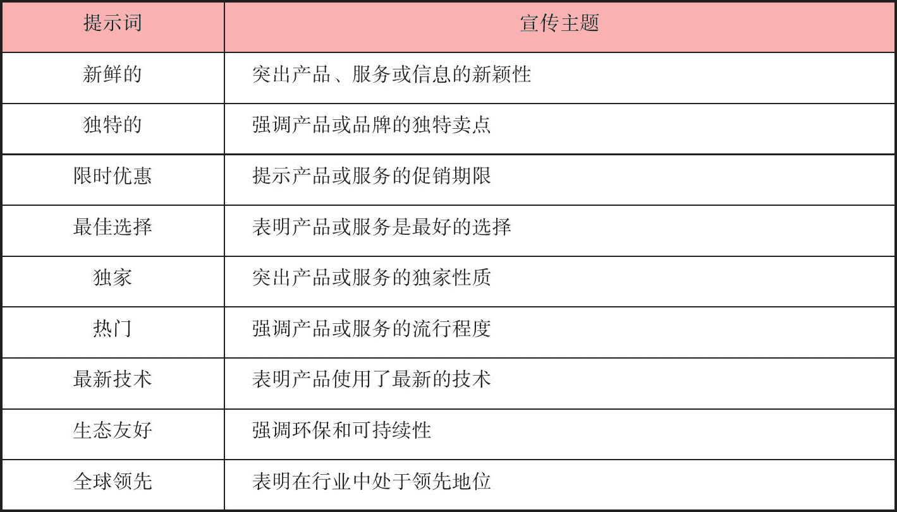

#### 二、如何用文心一言辅助撰写宣传文案

宣传文案是指以语言文字为主要表现形式，通过各种渠道和媒体进行传播，以宣传产品、服务、品牌等为主要目的的文案。

在撰写宣传文案的过程中，文心一言可以 **辅助我们更好地理解目标客户的需求和心理** ，从而更好地定位宣传内容和营销策略。还可以通过自然语言处理技术， **自动分析文案的可读性和易用性，提出相应的优化建议，使文案更加简洁、生动、易于理解和记忆。**

###### 用户提问

请你为一家通信企业写一篇企业宣传文案，该企业已成立 20 年，以手机销售为主营业务。

###### 文心一言回答

###### 企业宣传文案

欢迎来到某某通信，这是一家已经稳步发展了 20 年的通信企业，专注于手机销售以及相关服务的提供。自成立以来，我们以卓越的产品质量和专业的服务水准，成为国内通信行业中的佼佼者。

自创立之初，某某通信就以手机销售为核心业务，用心服务每一位客户。我们始终秉持着专业和领先的精神，以客户需求为导向，为其提供多样化的手机选择。满足消费者的不同需求。

我们的手机产品线涵盖了多种型号，从高端旗舰到入门基础，各种类型一应俱全。我们始终致力于提供最优质的产品和服务，让每一位客户都能享受到高质量的通信体验。同时，我们还提供灵活的购买方案和完善的售后服务。

某某通信的企业核心价值观是“以人为本、创新、专业”。我们坚信，只有了解并满足客户的需求，才能为客户提供最好的服务。因此，我们始终保持着对技术和服务的热情和追求，努力提升我们的专业水平和服务质量。

展望未来，某某通信将一如既往地坚持专业和领先的精神，不断扩展我们的业务范围，提升我们的服务质量，加强我们的品牌建设。我们相信，只有不断创新和完善自我，才能更好地服务我们的客户，实现企业的长远发展。

总之，某某通信是一家以手机销售为主营业务的专业通信企业。我们始终秉持着“以人为本、创新、专业”的核心价值观，不断提升我们的服务品质和产品质量。我们期待着未来能够继续与您携手共进，实现共同的发展目标。

通过以上示例，我们看出即使只提供 **简单信息，文心一言也可生成一份架构相对完整，内容清晰，目标明确，具有一定参考价值的企业宣传文案，** 我们只需在此基础上完善和提质即可。

###### 【帮你创作】

（1）文心一言 **可以提供各种类型的模板和范例** ，帮助我们创作符合受众需求的宣传文案。

（2）标题和开头是吸引受众注意力的关键。文心一言可以 **提供各种类型的标题和开头** ，帮助我们设计出符合受众需求的宣传文案。

（3）文心一言可以 **通过关键词搜索和分析相关数据来了解受众需要什么样的内容** ，并提供符合受众需求的文案。

（4）提供有价值的内容是吸引受众的另一个关键因素。根据受众的特点和宣传内容的不同，需要调整文案的语气和风格。文心一言可以 **提供不同类型的文案风格，如正式、非正式、口语化等。**

###### 【帮你优化】

在使用文心一言时，我们要 **尽可能多地提供关于宣传的详细信息** ，如产品、服务或活动的名称，特点和优势，以及目标受众的特征。

在初步完成宣传文案后，我们可以根据实际需要对其进行调整和完善。可以 **参考文心一言提供的建议和语料库** ，对文本进行润色和优化，使其更符合目标和受众的需求。

## 第五节
广告文案

#### 一、广告文案的分类

广告文案可以按照以下不同的分类方式进行划分：

（1）按媒体分类。根据广告发布的媒体，可以将其分为报纸广告文案、杂志广告文案、广播广告文案、电视广告文案、网络广告文案、户外广告文案，以及其他媒体广告文案。

（2）按内容分类。根据广告宣传的产品或服务类型，可以将其分为消费物品类广告文案、服务娱乐类广告文案、信息产业类广告文案、企业形象类广告文案，以及社会公益类广告文案。

在创作广告文案时，需要考虑到目标受众、行业趋势和营销目标，采用合适的文体和语言风格来吸引受众的注意力，并传达出产品的特点、优势和价值。

#### 二、如何用文心一言辅助写作广告文案

广告文案是一种以文字、图像和音频等形式向大众传播信息的宣传手段。由标题、正文、广告词和附文组成，是广告内容的文字化表现。

文心一言可以 **根据广告文案的目的、受众、产品或服务的特点和优势，以及品牌形象和调性等方面的信息，撰写各类广告文案，** 并生成符合广告主题和需求的图片，以提高广告效果和品牌知名度。

###### 用户提问

请你用古典语言的风格写一款牛奶的广告文案。

###### 文心一言回答

###### 广告文案

以古典语言风格描绘一款牛奶的广告文案，可能会如下：

“优质奶源，饮之甘醇，品之健康，乃我辈钟爱之选。一盏在手，如坐春色中，芳香满怀。无论是朝露初晴，还是夜月明，轻轻一饮，便能体验自然的馈赠。”

文心一言的回答以古典风格描述了牛奶的优质来源、口感和健康作用。该文案具有一定的可参考性，但仍需根据实际需求进行修改和提升。

###### 【帮你创作】

告诉文心一言“广告的产品或服务是什么”“有关产品或服务的详细信息，包括其特点、优势和目标受众”“希望广告传达什么样的情感或信息？例如，是要强调产品的性能、价格竞争力、品质、创新性，还是其他方面”“是否有任何特定的关键信息或要包含的元素”等相关信息。文心一言就 **能够根据受众的需求和心理，使用简单易懂、易于记忆的语言风格和文体，生成针对性较强的广告文案。**

###### 【帮你提示】

除此之外，我们还可以通过与文心一言对话的形式， **寻找更多广告文案的创意和灵感。** 例如，向文心一言提问“你能用徐志摩的文学风格写一款牛奶的广告文案吗”“你还能给出其他类似的广告文案吗？”“再给一些其他产品的示例参考”等。根据文心一言的答案，不断 **启发新的创作思路** ，包括广告的主题、文体、语言风格、视觉设计等方面，力求突出产品或服务的优势和特点，以吸引目标受众的注意力。

## 第六节
产品文案

#### 一、产品文案的分类与提示词

##### 1.产品文案的分类

产品文案可以根据不同的标准进行分类。以下是一些常见的分类方式。

（1）根据撰写目的分类。我们可以将其分为营销文案、用户帮助文档、产品介绍文档、品牌宣传文案等。

（2）根据文案风格分类。我们可以将其分为严肃体、大众体、故事体、幽默体等。

（3）根据文案形式分类。我们可以将其分为软文、硬广、社群文案、公众号文案等。

在具体的产品文案撰写中，需要根据实际情况选择合适的分类方式，以便更好地满足撰写目的和受众需求。

##### 2.产品文案的提示词

在撰写产品文案时，使用适当的提示词可以帮助受众更好地了解产品或服务，并激发他们的购买欲望。以下是一些常见的提示词。

**（1）免费的。** 这个词可以引起受众的注意，让他们感到有机会免费获得某种价值。

**（2）价值。** 这个词可以让受众感受到产品的价值，并让他们认为这是一项值得购买的投资。

**（3）节省。** 这个词可以让受众感受到购买产品或服务可以节省时间和金钱，从而让他们更加倾向于购买。

**（4）方便。** 这个词可以让受众感受到产品或服务的便利性和效率，从而让他们更加倾向于购买。

**（5）可靠的。** 这个词可以让受众感受到产品或服务的稳定性和可靠性，从而让他们更加倾向于购买。

**（6）值得信赖的。** 这个词可以让受众感受到产品或服务的诚信和质量，从而让他们更加倾向于购买。

**（7）优秀的。** 这个词可以让受众感受到产品或服务的卓越品质和出色性能，从而让他们更加倾向于购买。

**（8）独具特色的。** 这个词可以让受众感受到产品或服务的独特性和个性化特点，从而让他们更加倾向于购买。

**（9）完美的。** 这个词可以让受众感受到产品或服务的完美无缺和无可挑剔，从而让他们更加倾向于购买。

**（10）品质上乘的。** 这个词可以让受众感受到产品或服务的高品质和高质量，从而让他们更加倾向于购买。

#### 二、如何利用文心一言辅助写作产品文案

产品文案是用来描述和宣传产品或服务的一种文案类型，其主要目的是吸引潜在客户的注意力，以提高品牌知名度，并促进销售。

文心一言可以根据用户提供的产品信息， **从用户需求和市场角度撰写符合规范的产品文案。**

###### 用户提问

假设我们正在推广一款名为“A 智能健康手环”的产品，该手环具有多种健康跟踪功能。请你就此写一篇产品文案。

###### 文心一言回答

###### 广告文案

产品名称：A 智能健康手环

主题：“健康的未来，从你的手腕开始”

目标受众：所有关心健康和生活质量的人

产品特点和优势：实时进行健康数据监测；心率、睡眠、活动追踪；智能提醒和警报；优雅的设计和可穿戴舒适性；健康是幸福生活的关键。A 智能健康手环是一款在你的手腕上可以提供全方位健康支持的创新产品。

为什么选择 A 智能健康手环？

（1）实时进行健康数据监测：A 智能健康手环能帮助你了解自己的身体状况。它会实时监测你的心率、睡眠质量、步数和卡路里消耗，让你始终掌握最新的健康数据。

（2）智能提醒和警报：忙碌的生活容易让我们忘记关心自己的健康。A 智能健康手环会提醒你定时活动，帮助你避免久坐。此外，它还会监测你的睡眠，并在需要时发出警报，确保你每天都获得充足的休息。

（3）优雅的设计和可穿戴舒适性：A 智能健康手环不仅功能卓越，还拥有令人倾心的设计。它采用高品质材料制成，佩戴舒适，适合日常穿戴。无论你身在何处，它都能提高你的时尚品位。

改善你的生活，从佩戴 A 智能健康手环开始。

无论你是追求更健康的生活方式，还是想要更好地关注自己的健康，A 智能健康手环都将是你的理想产品。千万不要错过这个机会，让健康的未来从你的手腕开始吧。

通过以上示例，我们可以发现文心一言的回答突出了产品的特点、优势和目标受众，并以强调健康、智能和舒适为主题。具有较高的可参考性，只需简单修改即可。

###### 【帮你提示】

通过与文心一言互动的形式， **讨论产品的特点和优势，以及目标用户的需求和兴趣，从而激发我们的创作灵感。** 例如，“请描述一下这款产品的独特之处和它解决的主要问题是什么？”“这款产品的主要目标用户是谁？他们的年龄、性别、职业、兴趣爱好是怎样的？”“这款产品满足的市场需求或趋势是什么？它的竞争对手是谁？我们的竞争优势是什么？”“有没有关于这款产品的有趣的故事或者人物可以用来吸引读者？”等，通过这样的互动和讨论，文心一言可以提供更具创意和针对性的产品文案，以 **吸引潜在客户的关注和兴趣。**

###### 【帮你优化】

创作出基础的产品文案后，我们还可以使用文心一言来 **优化我们的文案质量，** 如问文心一言“你还有什么其他建议来提高我的文案创作能力？”“还有其他什么方法可以帮助我创作出好的产品文案吗？”文心一言将会提供更多修改意见，我们可以根据实际情况按需选择。

除此之外，文心一言还 **能够帮助我们使用简练的语言描述产品的特点** ，以便读者能够快速了解产品的核心卖点； **通过有趣的比喻和形象化的描述，** 让读者更加深入地理解产品的优势。

# 第四章
方案辅助生成

## 第一节
执行类、解决类方案

#### 一、执行类、解决类方案与提示词

##### 1.执行类方案提示词

执行类方案是为实现特定目标或计划而制定的具有可操作性的计划或策略。

当你使用“文心一言”辅助 **生成执行类方案** ， **提问** 时可 **使用** 以下 **7 类提示词** 。

①“实施目的”“实施背景”。

②“时间表”“开始时间”“结束时间”。

③“资源分配”“人力”“物力”“财力”。

④“实施步骤”“执行程序”。

⑤“协作方式”“沟通方式”。

⑥“监控形式”“监控人员”。

⑦“预期成果”“验收要求”。

##### 2.解决类方案提示词

解决类方案是针对特定问题或挑战而设计的计划或策略，旨在解决问题并实现目标。

当你使用“文心一言”辅助 **生成解决类方案** ， **提问** 时可 **使用** 以下 **7 类提示词** 。

①“问题分析”“根本原因”“关键因素”。

②“方案目的”“理想目标”。

③“时间表”“开始时间”“结束时间”。

④“资源分配”“人力”“物力”“财力”。

⑤“可行性研究”“解决策略”“实施措施”。

⑥“评估形式”“评估人员”。

⑦“经验总结”。

#### 二、执行类、解决类方案与提问句式

##### 1.执行类方案提问句式

（1）作为校园德育委员会负责人 **（角色）** ，为了提高商学院学生的自我管理意识 **（实施目的）** ，我们计划在校园内举办一次持续一月 **（时间表）** 的寝室卫生大比拼活动，要求商学院全体学生 **（人员）** 参加，你能据此帮我设计一个执行方案吗？

（2）我是一名非营利组织的工作人员 **（角色）** ，我们计划在下个月 **（时间表）** 举办一次慈善义卖活动 **（实施背景）** ，参加人数预计为 50 人 **（人员）** ，活动开支由组织单位负责 **（资源分配）** ，义卖所得款项将由×××慈善基金会管理 **（监督形式）** ，你能帮我设计一个筹款活动方案吗？

（3）作为公司的人力资源经理 **（角色）** ，我想为公司职工组织一次团队建设活动，你能提供一个活动策划方案吗？要求这个方案至少包括实施目的、资源分配 **（人力、物力、财力）** 、执行程序以及协作方式等要点。

##### 2.解决类方案提问句式

（1）作为一家新创公司 **（角色）** ，我们正面临激烈的市场竞争压力 **（问题分析）** ，我们希望能够在半年内（时间表）改善产品质量以提升客户满意度 **（理想目标）** 。你能提供一个产品质量改进方案吗？

（2）我们的制造工厂存在生产效率低下的问题 **（问题分析）** ，作为生产经理 **（角色）** ，你能为我们制订一个提高生产效率 **（方案目的）** 的方案吗？方案要重点解决×××问题 **（根本原因）** 。

（3）我们正面临员工流失率上升的问题，作为人力资源经理 **（角色）** ，你能提供一个关于员工保留的方案吗？方案需包括问题分析、资源分配、可行性研究、解决策略和经验总结等关键信息。

#### 三、执行类方案辅助写作示范

###### 用户提问

我是某公立 **高中** 的一名 **办公室主任** ， **学校计划** 在明年暑假 **开展** 一项青少年社区 **夏令营计划** ，预计高一、高二全体学生都会参加，我们已经获得了一部分 **政府拨款** 作为经费支持，目前还需要一份详细的 **执行方案** 。请你帮我设计这份执行方案。

###### 文心一言回答

###### 执行方案：某公立高中青少年社区夏令营计划

（一）背景与目标

某公立高中青少年社区夏令营旨在丰富学生的暑期生活，提高学生的社会实践能力，加强社区与学校之间的联系。此活动将组织高一、高二全体学生参与，为学生提供多种社会实践和学习的机会。政府已承诺提供一定的拨款支持，为确保活动的顺利进行，我们需制订详细的执行方案。

（二）活动内容与安排

（1）活动主题：社区服务与文化体验。学生将分组进行社区服务，包括老人关怀、环保行动、公益讲座等。在服务之余，学生还将参观当地文化景点，了解历史文化。

（2）活动时间：2023 年 7 月 1 日至 7 月 15 日，共计 15 天。

（3）活动地点：以当地社区为主，文化景点为辅。

（4）活动参与方式：学生自愿报名参加，分组进行活动。

（三）人员安排

（1）志愿者：招募学校志愿者协会成员及部分教师，负责协助组织活动、安全保障等工作。

（2）工作人员：由学校指派教师负责活动策划、财务管理、物资采购等工作。

（3）志愿者管理委员会：由学校学生会成员组成，负责志愿者招募、培训及管理工作。

（四）物资安排

（1）装备：购置志愿者服装、活动所需器材及设备。

（2）餐饮：与当地社区食堂协商，提供经济实惠的餐饮服务。

（3）住宿：租用当地社区内的空闲房间或帐篷，提供基本的住宿条件。

（4）交通：与当地公交公司合作，预约活动期间所需的公交车辆。

（五）安全与风险控制

（1）安全预案：制订应对突发情况的应急预案，如中暑、受伤等，以确保学生安全。

（2）风险控制：对活动环节进行风险评估，采取措施降低风险，如避免学生单独行动、规定活动时间等。

（3）医疗保障：活动期间配备足够的急救药品和医疗人员，应对突发状况。

（4）食品安全：严格执行食品安全规定，以确保学生饮食安全。

（六）效果评估与总结

（1）效果评估：活动结束后，统计参与人数，收集反馈意见，对活动效果进行评估，分析活动的成效和不足之处。

（2）总结经验教训：根据效果评估结果，总结本次活动的经验和教训，为今后的活动提供参考。同时将活动效果反馈给学校领导和政府部门，为未来活动的策划和实施提供依据。

本执行方案为某公立高中青少年社区夏令营计划提供了详细的规划。在确保活动顺利进行的同时，我们将严格控制活动风险，以保证学生安全。通过本次活动，我们期待能够为学校创造一个更加丰富、有意义的学生暑期生活环境，同时加强学校与社区之间的联系，提高学生的社会实践能力，增强学生的社会责任感。

上述示范中，用户提问中的提示词“办公室主任”“高中”“暑期夏令营”“政府拨款”已经给出了 **明确的执行背景** ， **提问句式** 表达 **清晰通顺** ，所以文心一言生成的执行方案完成度很高，可参考性也比较强。

#### 四、解决类方案辅助写作示范

###### 用户提问

作为一家 **奶茶品牌** 的 **负责人** ，我们正面临 **激烈市场竞争** 的挑战，我们希望能够在三个月内 **推出多款爆款** 饮品， **提高品牌影响力** ， **增强盈利能力** 。你能据此为我提供一个 **解决方案** 吗？

###### 文心一言回答

当然可以。以下是一份为期三个月的奶茶品牌爆款饮品提升和推广计划。

第一个月——产品研发与创新

（1）创新饮品研发：组织研发团队在保证饮品口感和质量的同时，研发出具有创新概念的饮品。可以借鉴一些流行的口味和元素，如茶饮、果汁、草药等。

（2）试验与改进：在研发阶段，不断进行口味测试和反馈收集，对产品进行调整和改进，确保饮品的质量和口感达到最佳。

（3）健康与可持续发展：注重健康和环保，在原料选择和包装上采用更健康的材料，以吸引注重健康的消费者的注意。

第二个月——市场推广策略制定与实施

（1）社交媒体宣传：利用社交媒体平台，如微博、抖音、微信等，进行新品的宣传和推广。可以策划一些有趣的活动，如有奖转发、晒单评价等，以提高品牌曝光度。

（2）合作推广：寻找一些有影响力的网红或者博主，进行合作推广。

他们可以在推广过程中推荐并分享你们的饮品，进而提高品牌知名度。

（3）线下活动：组织一些线下活动，如新品试饮会、奶茶节等，以吸引消费者体验新品，提高品牌曝光度。

第三个月——销售与售后服务

（1）销售策略：通过满减、打折、买一送一等方式，吸引消费者购买新品。同时，可以设计一些促销活动，如买新品送周边产品，以提高销售额。

（2）售后服务：注重售后服务，收集消费者的反馈和建议，对出现的问题及时解决和处理。同时，对消费者进行跟踪服务，以提高客户满意度和品牌忠诚度。

（3）销售数据分析：对销售数据进行分析，了解消费者的购买习惯和需求，以便对产品和服务进行改进和优化。

以上是一个基本的计划框架，每个环节都需要细化和执行。同时，要根据你们的具体情况进行适当的调整。希望这个计划能够帮助你们在市场竞争中取得优势。

上述示范中，文心一言所生成的包含创新的饮品研发、全面的市场推广、销售策略和优质的售后服务的解决方案， **可以帮助奶茶品牌** 在竞争激烈的市场中 **提高品牌影响力和盈利能力** 。

但是，该方案也 **存在一定** 的 **执行难度和风险** ，对外部资源的依赖和市场变化的难以预测都可能影响方案的实施效果。因此，提问者在实施过程中 **需要谨慎考虑和合理规划** 。

## 第二节
活动类、营销类方案

#### 一、活动类、营销类方案与提示词

##### 1.活动类方案提示词

活动类方案通常用于组织和执行各种类型的活动，如会议、培训、庆祝活动、项目推进等。

当你使用“文心一言”辅助 **生成活动类方案** ， **提问** 时可 **使用** 以下 **7 类提示词** 。

①“活动日期”“活动时间”“活动地点”。

②“活动类型”“活动主题”“活动内容”。

③“组织者”。

④“参与者”“参与人数”。

⑤“赞助商”“合作伙伴”。

⑥“活动流程”。

⑦“预算范围”。

##### 2.营销类方案提示词

营销类方案用于规划和组织企业营销活动。

当你使用“文心一言”辅助 **生成营销类方案** ，提问时可使用以下 **7 类提示词** 。

①“营销目标”“营销形式”。

②“时间表”“人员配置”“进程”。

③“品牌方”“目标受众”“年龄”“性别”“地理位置”“兴趣爱好”。

④“市场规模”“预测数据”。

⑤“竞争对手”。

⑥“产品/服务策略”“定位策略”“定价策略”“推广策略”“销售策略”。

⑦“预算范围”“预期结果”。

#### 二、活动类、营销类方案与提问句式

##### 1.活动类方案提问句式

（1）假设我是某企业的 **___（角色）** ，我想要组织一个 **___（活动类型）** 活动，你能帮我提供一个关于 **___（活动主题）** 的方案吗？

（2）我 **___（角色）** 计划在 **___（活动日期）** 在 **___（活动地点）** 举办一个 **___（活动类型）** 活动，你能帮我设计一个方案吗？

（3）某单位的 **___（角色）** 需要一个适合 **___（参与者/参与人数）** 参加，预算在 **___（预算范围）** 的活动方案，你有什么建议吗？

##### 2.营销类方案提问句式

（1）假设我是 **___（品牌方）** 的市场推广经理，我想要组织一个线上促销 **___（营销形式）** 活动，你能帮我提供一个关于夏季清仓大促销 **___（营销目标）** 的方案吗？

（2）某新创企业的 **___（角色）** 需要一个适合 **___（目标受众/年龄/性别）** ，预算在 **___（预算范围）** 元的线下产品发布 **___（营销形式）** 活动方案，你有什么建议吗？

（3）某旅游公司的 **___（角色）** 需要组织一个冬季 **___（时间）** 度假活动 **___（营销形式）** ，希望吸引年轻情侣 **___（目标受众/年龄/性别）** ，你能提供一个关于冬季浪漫 **___（兴趣爱好）** 度假的方案吗？

#### 三、活动类方案辅助写作示范

###### 用户提问

我是某公司的 **企业文化专员** ，计划 **中秋节** 在公司小礼堂举办一个 **“庆中秋·人团圆”** 活动，你能帮我设计一个 **活动方案** 吗？

###### 文心一言回答

当然可以，以下是我为您设计的“庆中秋·人团圆”活动方案：

（一）活动基本信息

（1）活动名称：庆中秋·人团圆。

（2）时间：中秋节当天，具体日期待定。

（3）地点：公司小礼堂。

（4）参与人群：公司全体员工。

（5）目的和宗旨：通过庆祝中秋节，弘扬公司文化，增进员工之间的感情和凝聚力。

（二）流程设计

1.活动开场（5 分钟）

公司领导进行简短致辞，对员工表示感谢和祝福。

2.月饼 DIY 环节（15 分钟）

准备各种口味和形状的月饼制作材料，员工可以自由搭配制作月饼。

3.互动游戏环节（45 分钟）

设计中秋相关的互动游戏，如猜灯谜、知识竞答等，并设置奖品。

4.文艺表演环节（30 分钟）

鼓励员工自愿报名参加文艺表演，如唱歌、舞蹈、小品等。

5.茶话会环节（45 分钟）

为员工准备茶点和饮料，大家可以自由交流，增强团队凝聚力。

6.活动闭幕式（15 分钟）

公司领导进行总结致辞，活动正式结束。

（三）活动方案

1.奖励方案

（1）月饼 DIY 环节，制作出最具有创意和口感最佳的月饼的员工，将获得精美礼品。

（2）在互动游戏环节中表现优秀的员工，将根据游戏规则获得相应的奖品。

2.宣传方案

（1）通过公司内部微信公众号、企业微信群和电子邮件等方式，提前两周开始宣传活动，发布活动详情和报名方式。

（2）设计活动海报，并张贴在公司各个显眼位置，引导员工关注。

3.预算和资源需求

（1）人员：活动组织人员 2 名，志愿者若干名。

（2）物资：月饼制作材料、奖品、茶点、饮料等。

（3）场地：公司小礼堂。

（4）餐饮：茶话会期间的餐饮费用。

（四）安全与风险控制

（1）活动现场要做好防疫措施，以确保员工安全。

（2）现场工作人员应当接受过相关急救培训，以应对可能发生的突发状况。

（3）为了防止人流量过大，现场工作人员应合理安排参与活动的员工人数，以避免小礼堂拥挤不堪。

（4）对于一些游戏环节，要确保使用的道具和设备在安全使用范围内。

（五）效果评估和总结

（1）活动结束后，组织人员可以通过问卷调查和收集反馈的方式进行效果评估，评价活动的参与度和员工的满意度。

（2）根据收集的反馈信息进行分析和总结，找出活动的优点和不足之处，为以后的活动提供参考和改进方向。

（3）将活动的照片、视频等资料进行整理和保存，制作成活动纪实，发布在公司内部平台上，让更多的员工了解和分享此次活动的精彩瞬间。

（4）在下一次活动策划时，可以将此次活动的经验和教训进行参考，优化活动流程和细节，使活动效果更好。

（5）这次活动不仅能让员工感受到公司的关怀和温暖，还能弘扬中华民族传统文化，增强员工之间的交流和团队协作精神。

上述示范中，提问加入了关于职位、节日、活动主题等方面的 **提示词** ，使用的句式也非常直观明了，使得生成的活动方案 **流程设计合理、创意性强、宣传方式多样、资源需求清晰、安全与风险控制得当，** 并且非常 **注重员工参与** 。

#### 四、营销类方案辅助写作示范

###### 用户提问

我是某 **电子商务平台** 的 **市场部经理** ，计划 **本月底** 在 **社交媒体** 上举办一场 **限时促销** 活动，你能帮我设计一个 **营销方案** 吗？

###### 文心一言回答

当然可以。以下是一个针对某电子商务平台限时促销活动的社交媒体推广方案。

（一）基本信息

活动名称：夏日狂欢，限时促销！

时间：××××年××月××日—××月××日

地点：线上（具体为电子商务平台及社交媒体）。

参与人群：平台用户及社交媒体关注者。

目的和宗旨：提高平台销售额，增加用户黏性，提升品牌知名度。

（二）流程设计

1.预热阶段（××月××日—××月××日）

（1）在平台及社交媒体上发布活动预告，提前曝光限时促销信息。

（2）策划相关话题标签，引导用户关注及讨论。

2.活动阶段（××月××日—××月××日）

（1）在平台及社交媒体上发布活动详细信息，包括打折力度、支付方式、促销礼品等。

（2）推出限时促销活动页面，提供活动专题及购物指引。

（3）通过定时推送活动信息，提醒用户参与活动。

（4）在活动期间，定期更新销售额及活动进度，营造紧张氛围。

3.后续阶段（××月××日—××月××日）

（1）在平台及社交媒体上发布活动总结报告，汇总活动成果及不足之处。

（2）发布后续优惠信息，鼓励用户持续关注及购物。

（三）宣传方案

（1）宣传渠道：整合平台及社交媒体资源，包括官方网站、微博、微信、抖音等。

（2）宣传内容：活动海报、短视频、话题标签等，突出活动主题及优惠力度。

（3）宣传时间：从活动预备阶段开始，每隔 2～3 天推送一次宣传内容，以持续吸引用户关注。

（四）促销方案

（1）打折力度：推出不同档次的折扣，如满 100 元减 20 元，满 500 元减 100 元等。

（2）支付方式：支持多种支付方式，如支付宝、微信、信用卡支付等。

（3）促销礼品：赠送定制礼品，如定制 T 恤、抱枕等，以提高用户参与度。

（五）预算和资源需求

（1）人员需求：平台运营人员、设计师、营销人员、客户服务人员等。

（2）物资需求：宣传海报、宣传视频制作费用、定制礼品等。

（3）场地需求：线上活动，无需实体场地。

（4）餐饮需求：内部员工聚餐或外部合作伙伴招待等。

（5）交通需求：活动期间物流费用增加，需安排额外运输资源。

（6）其他费用：广告投放费用、第三方合作费用等。

（六）安全与风险控制

（1）网络信息安全：防范网络攻击，确保平台及社交媒体正常运行。

（2）数据安全：保护用户数据隐私，防止数据泄露及不当使用。

（3）物流安全：确保商品及时准确地送至用户手中，防范物流过程中商品损坏或丢失等问题。

（4）支付安全：保障支付环节的安全性，防止用户资金被盗取或误用。

（5）合规风险：遵守相关法律法规规定，避免活动中出现违规违法行为。

（七）效果评估和总结

在活动结束后进行效果评估，分析成效和不足，总结经验和教训。具体包括以下几个方面：

（1）销售额：统计销售额增长情况，评估活动对销售额的提升作用。

（2）参与度：统计活动参与人数、互动次数等指标，评估活动的受欢迎程度及用户黏性。

（3）品牌知名度：评估活动前后品牌知名度的变化情况，分析活动对品牌知名度提升的贡献。

（4）用户反馈：收集用户对活动的评价和反馈意见，了解用户对活动的满意度和改进需求。

（5）不足与改进措施：针对活动中出现的问题和不足，提出改进建议和措施，为今后的活动提供参考和优化方向。

上述示范中，提问非常注意 **提示词** 和 **提问句式** 方面的运用，使得文心一言最终生成的方案综合了多种营销策略和风险管理措施，注重前期准备和后期总结，以确保活动的成功，并为未来的营销活动提供经验教训。

这种细致入微的规划和全面的考虑 **使得该方案在提高销售额、增加用户黏性和提升品牌知名度方面具备较高的潜力。**

## 第三节
项目类、技术类方案

#### 一、项目类、技术类方案与提示词

##### 1.项目类方案提示词

项目类方案是指针对特定项目的详细规划和策划方案，通常包括项目的目标、范围、计划、资源、风险管理等关键信息，目的是确保项目能够成功实施。

当你使用“文心一言”辅助 **生成项目类方案** ， **提问** 时可 **使用** 以下 **6 类提示词。**

①“项目名称”“项目背景”“项目目标”“项目范围”。

②“项目时间表”“项目资源”“项目预算”。

③“沟通计划”“沟通方式”“沟通频率”。

④“项目执行”“过程控制”“风险管理”。

⑤“项目监督”“变更执行”。

⑥“项目交付物”“验收标准”。

##### 2.技术类方案提示词

技术类方案是针对特定技术问题或需求的详细规划和策划方案，通常包括技术解决方案、实施计划、资源需求和风险管理等关键信息。

当你使用“文心一言”辅助 **生成技术类方案** ， **提问** 时可 **使用** 以下 **6 类提示词。**

①“技术问题概述”“需求分析”“技术目标”“期望成果”。

②“技术选型”“系统架构设计”“数据模型设计”“数据库设计”“算法和方法”“安全性考虑”。

③“时间表”“人力资源”“技术设备和工具”。

④“预算”“成本估算”。

⑤“技术开发”“集成与测试”“质量控制”“用户培训”“风险管理”。

⑥“技术上线”“技术运维”“性能监测与优化”。

#### 二、项目类、技术类方案与提问句式

##### 1.项目类方案提问句式

（1）我们是一家外贸公司 **（角色）** ，目前正计划升级公司的客户关系管理系统 **（项目背景）** 。项目预期耗时 2 个月 **（时间表）** 。我们打算聘请外部专业团队 **（项目资源）** 。请你帮我设计一份“客户关系管理系统升级方案” **（项目名称）** 。

（2）我是某公司设计部门的主管 **（角色）** 。公司正准备开发一款新的智能家居设备。产品目前还处于前期设计阶段，没有正式立项 **（项目背景）** 。你能否提供一个该产品从概念设计到市场投放的项目方案 **（项目范围）** ？

（3）请为我们的新款美发产品发布 **项目背景** 项目制订一个包括 **时间表、资源需求、项目执行程序** 和 **风险管理** 的方案。

##### 2.技术类方案提问句式

（1）本公司是一家互联网公司 **（角色）** ，最近打算进行一项大数据分析项目 **（技术问题概述）** ，以优化供应链 **（技术目标）** 。我们打算用三个月的时间来完成这个项目 **（时间表）** ，并且会聘请外部专业团队来辅助我们 **（人力资源）** ，请你就以上背景帮我们设计一个技术方案，除上述内容外，还要包括技术选型、系统架构设计、技术开发流程、成本估算等你认为必须具备的内容。

（2）我是一家私立口腔医院的信息中心的主管 **（角色）** 。目前，我们医院打算建设一套智能化的互联网广告投放系统 **（技术问题概述）** ，以提高医院的知名度和盈利能力 **（技术目标）** 。对于这套系统具体如何设计和实施，我还没有头绪，请你为我设计一份详细的技术方案。

（3）我是一款在线视频软件的运营助理 **（角色）** 。目前，我们需要对视频软件进行一次“大数据升级”，以优化内容推送服务。你能为这个项目制订一个方案吗？方案至少要包括 **___（技术选型）、___（数据模型设计）、___（算法设计）、___（技术开发以及安全性考虑）** 等内容。

#### 三、项目类方案辅助写作示范

###### 用户提问

我是一家 **玩具公司** 的 **总经理助理** （角色），总经理打算 **建设一个智能制造工厂** ，以提高生产效率。目前，这个项目还在 **前期设计阶段** ，我能告诉你的基本信息是，总经理打算花 **两年时间** 来完成这个智能工厂的设计与建设。

总经理需要一个宏观性的 **项目大纲** 。请你为我设计一份项目大纲。要求内容完整、条理清晰、分点详细说明。

###### 文心一言回答

###### 智能制造工厂建设项目大纲

（一）项目背景与目标

（1）项目背景：随着科技的发展和市场竞争的加剧，传统玩具制造产业面临生产效率低下、品质难以保证等问题。为了提高生产效率、降低成本、增强市场竞争力，总经理决定投资建设一个智能制造工厂。

（2）目标：本项目旨在建立一个集自动化、信息化、网络化、智能化于一体的智能制造工厂，实现生产流程自动化、减少人工干预、提高生产效率、降低不良品率，从而提升企业的整体竞争力。

（二）项目主要内容

（1）工厂布局与设施：根据生产流程和产品特点，对工厂进行合理布局，优化生产线和仓储区域，提高生产效率。同时，根据实际需要，引进先进的生产设备和技术。

（2）自动化与智能化：通过引入自动化设备和智能化系统，实现生产流程的自动化和智能化，包括自动化生产线、机器人工作站、物料自动配送、无人化仓库等。

（3）信息化管理：建立全面的信息化管理系统，实现生产数据的实时采集、生产过程的可视化监控、库存管理与物流优化等。

（4）人才培训与团队建设：针对新设备和技术，对员工进行专业培训，提升员工的技能和素质。同时，加强团队建设，提升员工的凝聚力和向心力。

（5）质量管理与监控：建立严格的质量管理体系，确保产品质量。通过引入先进的质量检测设备和智能化质量监控系统，实现对生产过程中每个环节的质量监控和管理。

（三）项目时间表与里程碑计划

（1）第一阶段（××××年××月—××××年××月）：完成工厂布局与设施建设，包括生产线、仓库等区域的规划和设备选型、购置及安装。

（2）第二阶段（××××年××月—××××年××月）：完成自动化与智能化设备、系统的安装与调试，实现生产流程的自动化和智能化。

（3）第三阶段（××××年××月—××××年××月）：完成信息化管理系统的搭建与实施，包括对生产数据采集、生产过程可视化监控、库存管理与物流优化等功能的调试与优化。

（4）第四阶段（××××年××月—××××年××月）：进行人才培训与团队建设，提升员工的技能和素质，加强团队凝聚力。

（5）第五阶段（××××年××月—××××年××月）：完成质量管理体系建设，包括对质量检测设备和智能化质量监控系统的安装与调试，并开始进行试生产与质量检测工作。

（6）第六阶段（××××年××月—××××年××月）：总结项目经验与成果，对项目进行评估和验收，并对不足之处进行改进和优化。

（四）项目预期成果

（1）提高生产效率：通过自动化和智能化设备的应用，减少人工干预，以提高生产效率。

（2）降低成本：减少人工成本和物料损耗，以降低生产成本。

（3）提升产品质量：通过先进的质检设备和智能化质量监控系统，实现对每个环节的质量监控和管理，以提高产品质量。

（4）优化库存管理：通过信息化管理系统，实现库存的实时管理和优化，减少库存积压和浪费。

（5）提升市场竞争力：提高生产效率和产品质量，使企业在市场竞争中更具优势。

（五）风险评估与应对策略

（1）技术风险：新设备和技术可能存在技术风险，需要加强设备选型和技术把关。如果出现技术问题，应及时联系设备供应商和技术支持团队解决问题。

（2）人员风险：新设备和技术需要员工重新学习和适应，如果人员培训不到位或操作不熟练，可能会影响生产效率。因此，应加强员工培训和团队建设，提高员工的技能和素质。

（3）投资风险：本项目投资较大，如果资金链出现问题，可能会影响项目的进度和质量。因此，应确保资金来源可靠，并合理规划资金使用，避免因资金问题导致项目失败。

（4）市场风险：市场竞争激烈，如果市场需求发生变化或竞争对手采取不正当手段，可能会对项目产生不利影响。对此，应加强市场调研和竞争分析，及时调整产品定位和市场策略。

（5）合作风险：本项目涉及多个供应商和服务商，如果合作出现问题，可能会影响项目的进度和质量。因此，应选择有信誉和实力的供应商和服务商，并加强合同管理，明确双方的权利和义务。

可以看到，经过 **提示词** 和 **提问句** 式两步优化后，文心一言生成的智能制造工厂建设项目方案充分考虑了 **从自动化、信息化、智能化到人才培训和风险管理等多个方面的关键因素** ，具有很强的综合性和可操作性，是一个参考价值较高的项目类方案。这套方案 **有助于企业提高生产效率、降低成本、提升产品质量，从而增强市场竞争力** 。

#### 四、技术类方案辅助写作示范

###### 用户提问

本公司是一家 **广告公司** ，最近打算在公司部署 **人脸识别系统** ，以 **便员工进行考勤以及对各种办公场地的管理** 。我们打 **算聘请外部团队** 来完成这项工作，项目预算为×××万元左右，请你就以上背景为我们设计一个完整的技术方案。除上述内容外，还要包括 **技术选型、系统架构设计、技术开发流程、技术落地流程** 等你认为必须具备的内容。

###### 文心一言回答

###### 人脸识别系统技术方案

（一）概述

本技术方案旨在为广告公司设计一个人脸识别系统，以满足员工考勤和对办公场地管理的需求。该系统将包括以下主要部分：人脸识别、数据存储、系统集成和网络安全。整体预算为×××万元左右。

（二）技术选型

（1）人脸识别系统：采用基于深度学习的卷积神经网络（CNN）进行人脸识别。CNN 能有效地处理图像数据，并具有强大的特征提取能力，适用于人脸识别任务。

（2）数据库：选择具有高性能和可扩展性的关系型数据库（如 MySQL 或 PostgreSQL）来存储员工信息和人脸识别结果。

（3）硬件设备：使用具有高性能图形处理器（GPU）的服务器来运行人脸识别算法和存储数据。

（三）系统架构设计

（1）前端：部署高清晰度摄像头，用于捕获员工的人脸图像。

（2）后端：部署服务器和数据库，用于运行人脸识别算法、存储数据和管理整个系统。

（3）移动端：开发一个移动应用程序，方便员工进行考勤，并实时查看办公场地的使用情况。

（四）技术开发流程

（1）数据收集与标注：采集员工的人脸图像，并进行手动标注，以便训练人脸识别模型。

（2）模型训练：利用收集的数据训练 CNN 模型，以提高人脸识别的准确性。

（3）系统开发：开发整个系统，包括前端、后端和移动端，并集成人脸识别功能。

（4）测试与优化：进行系统测试，根据测试结果对系统进行优化，以提高系统的稳定性和性能。

（五）技术落地流程

（1）部署硬件设备：根据实际办公场地的大小和布局，合理部署摄像头和服务器等硬件设备。

（2）安装与配置：安装并配置数据库、服务器和相关软件，确保系统正常运行。

（3）培训员工：为员工提供相关培训，使他们了解如何使用新的人脸识别系统进行考勤和对办公场地的管理。

（4）试运行与优化：在试运行期间，收集用户反馈，并对系统进行持续优化，以确保其满足实际需求。

（5）正式上线：在试运行期满后，正式上线人脸识别系统，并长期维护和更新，以确保系统的稳定性和性能。

（六）网络安全

为确保网络安全，我们将采取以下措施：

（1）使用强大的加密算法对数据库进行加密，以防止数据泄露。

（2）在服务器和网络设备上部署防火墙和其他安全软件，以防止恶意攻击。

（3）对所有访问请求进行审核，并定期对系统进行安全漏洞扫描。

（4）对所有员工进行网络安全培训，提高他们的安全意识，以防止人为泄露数据或其他安全问题。

（七）后期维护与支持

在系统正式运行后，我们将提供以下维护与支持服务：

（1）定期更新人脸识别模型，以提高系统的准确性。

（2）提供电话、邮件和在线聊天等技术支持，以帮助员工解决使用中遇到的问题。

（3）对系统进行定期维护和优化，确保其稳定性和性能。

（4）提供相关文档和教程，以帮助员工更好地理解和使用系统。

上述示范中，提问加入了非常多的和技术方案息息相关的 **提示词** ，使得文心一言生成的技术方案综合考虑了 **人脸识别技术、数据安全、用户友好性、性能优化和持续支持** 等多个方面的因素，为广告公司设计的人脸识别系统提供了全面的解决方案，具有很高的参考价值。

## 第四节
培训类、咨询类方案

#### 一、培训类、咨询类方案与提示词

##### 1.培训类方案提示词

培训类方案是为了达到特定培训目标而设计的详细计划和指南。

当你使用“文心一言”辅助 **生成培训类方案，提问** 时可 **使用** 以下 **5 类提示词** 。

①“培训背景”“培训目标”“预期效果”。

②“培训内容”“培训主题”。

③“培训方式”“培训形式”。

④“时间表”“培训师”“培训师要求”“培训对象”“培训预算”。

⑤“培训效果”“培训有效性评估”。

##### 2.咨询类方案提示词

咨询类方案是为了提供专业建议、解决问题或实现特定目标而设计的详细计划和指南。

当你使用“文心一言”辅助 **生成咨询类方案** ， **提问** 时可 **使用** 以下 **6 类提示词** 。

①“咨询背景”“咨询范围”“咨询目标”。

②“时间表”“咨询团队成员”“客户”“设备与场地支持”。

③“咨询成本”。

④“解决措施”“解决步骤”。

⑤“咨询报告”“交付形式”。

⑥“风险管理”。

#### 二、培训类、咨询类方案与提问句式

##### 1.培训类方案提问句式

（1）我是某公司的部门主管 **（角色）** ，目前需要为新入职的员工提供一系列的岗位技能培训 **（培训背景）** ，计划在 3 个月内 **（时间表）** 完成所有的培训内容，打算采用线上和线下相结合的方式进行培训 **（培训形式）** ，请你帮我设计一份“新员工岗位技能培训方案” **（方案名称）** 。

（2）我是某公司人力资源部门的主管 **（角色）** ，目前需要为公司的管理层提供一次关于领导力和团队建设的高效培训 **（培训背景）** ，计划在两个月 **（时间表）** 内完成培训并进行反馈。我打算通过邀请领导力培训师和团队建设专家来进行互动式的讲座和研讨会 **（培训形式）** ，以及组织管理层参与一次户外拓展活动来增强团队凝聚力和信任感 **（培训形式）** ，请你帮我设计一份“领导力和团队建设高效培训方案” **（方案名称）** 。

（3）我是一家电子商务公司的培训助理 **（角色）** ，目前需要为我们的客服人员提供一次关于客户满意度提升的有效培训 **（项目背景）** ，计划在 1 个月内 **（时间表）** 完成培训并进行反馈，你能为我设计一个培训方案吗？除上述内容外，还需要包括 **培训形式、培训师资安排、培训对象选择、培训过程控制、培训预算控制、培训效果评估** 等内容。

##### 2.咨询类方案提问句式

（1）我是某家咨询公司的中级咨询师 **（角色）** ，我的客户是一家传统制造行业的老牌公司 **（咨询背景）** ，该公司计划在 3 个月内 **（时间表）** 推行一项新的员工绩效管理系统 **（咨询目的）** ，我需要尽快拿出一份专业的咨询方案，以获取客户的信任，方便展开后续合作。请你据此帮我设计一份详尽的咨询方案！

（2）我是一家咨询公司的工作人员 **（角色）** ，目前需要为我的客户——某汽车制造商 **（项目背景）** 提供一份关于市场分析和竞争优势的专业报告 **（咨询目标）** ，计划在 2 周内 **（时间表）** 完成报告的撰写和提交，打算通过收集和分析相关数据和信息来进行市场分析和竞争优势评估 **（解决措施）** ，请你据此为我设计一份详尽的咨询方案！

（3）作为一名咨询顾问 **（角色）** ，我需要对一家公司的市场进入策略提供专业建议 **（咨询背景）** ，你能帮我设计一份“市场进入策略咨询方案” **（方案名称）** 吗？需要包括 **市场分析、目标市场的选择、产品定位、营销策略** 等关键内容。

#### 三、培训类方案辅助写作示范

###### 用户提问

我是某公司的 **部门主管** ，目前需要为新入职的员工提供一系列 **关于企业文化** 的培训。我计划在 **2 天之内** 完成所有的培训内容，并打算采用 **课堂讲解和实地参观等形式** 开展培训。请你帮我设计一份详细的培训方案，其他未尽事宜请你在方案中补充完整。

###### 文心一言回答

###### 培训方案：新员工企业文化融入

（一）培训目标

本次培训旨在帮助新入职员工全面了解公司企业文化，迅速融入团队，提高工作效率。我们将在 2 天内完成所有的培训内容，包括企业文化概述、入职培训、团队建设活动、企业文化实践以及总结反馈。

（二）培训时间

第一天：

9：00～11：00 入职培训（课堂讲解）；

14：00～15：00 团队建设活动（实地参观）。

第二天：

9：00～11：00 企业文化实践（实地参观）；

14：00～15：00 总结及反馈（课堂讲解）。

（三）培训内容

1.企业文化概述

企业文化的定义与重要性；

公司企业文化的特点与核心理念。

2.入职培训（课堂讲解）

公司介绍：公司历史、规模、业务范围等；

职场规范：工作时间、着装要求、办公室礼仪等；

部门及岗位职责介绍；

保密协议与知识产权意识教育。

3.团队建设活动（实地参观）

互动游戏：加强团队协作能力；

彼此了解：通过破冰游戏与其他团队成员沟通交流，增进了解与信任。

4.企业文化实践（实地参观）

案例分析：分析公司内部典型案例，诠释企业文化的实际运用；

员工行为准则：明确公司对员工的行为期望，规范自身行为。

5.总结及反馈（课堂讲解）

整体感受分享：邀请员工分享参加培训的体会与感悟；

收获总结：归纳培训要点，强调企业文化的重要性；

改进建议：鼓励员工提出对培训内容及形式的建议，为今后的培训提供参考。

（四）培训资源及安排

（1）培训讲师：邀请部门主管及相关员工担任讲师，分享经验与见解；

（2）培训地点：公司会议室及实地参观，以便员工了解公司各部门的实际运作情况；

（3）培训器材：准备电脑、投影仪、话筒等器材，确保培训顺利进行。

（五）注意事项

（1）培训过程中，请遵守秩序，确保人身安全；

（2）请遵从领导安排，积极沟通，以便更好地完成培训；

（3）请认真听课并做好笔记，积极参与互动活动，分享学习心得；

（4）请课后及时反馈，以便我们改进。欢迎员工通过问卷调查或面谈的方式提出宝贵的建议。

此外，我们将为员工提供茶歇及午餐，确保员工在培训期间得到充分的休息和营养补充。希望这份培训方案能满足您的需求，如有其他问题或需要进一步补充，请随时与我们联系。

上述示范中，提问加入了职位、培训主题、培训时间、培训方式等非常具体的 **提示词** ，使得文心一言生成的培训方案综合且全面。

**经过提问者结合所在公司实际情况对提问进一步优化后，此方案可在提高新员工的融入度和工作效能方面发挥更大作用。**

#### 四、咨询类方案辅助写作示范

###### 用户提问

我是某家咨询公司的 **咨询师** ，我的客户是一家 **餐饮行业的初创公司** 。该公司刚刚组建完毕，还没有建立系统的规章制度，现需要我参考餐饮行业公司的特点， **为其量身定做一套规章制度，** 并跟进后期制度落地工作。制度从设计到落地的工期为 **两个月** 。我需要快速拿出一份专业的咨询方案，以获取客户的信任，方便展开后续合作。请你据此帮我设计一份详尽的咨询方案！

###### 文心一言回答

以下是一份针对餐饮行业公司规章制度建设的咨询方案，旨在帮助您的客户建立一套完整、专业的规章制度，以提高公司的运营效率和管理水平。

1.咨询方案目标

通过本咨询项目，为客户建立一套符合餐饮行业特点的规章制度，包括但不限于公司治理、行政管理、人事管理、财务管理、采购管理、销售管理等方面的内容，以提高公司的运营效率和管理水平，增强公司的竞争力和可持续发展能力。

2.咨询方案内容

（1）公司治理。协助客户设计合理的股权结构、董事会制度、监事会制度等公司治理结构，明确公司的决策程序、管理权限和责任边界。

（2）行政管理。为客户制定一套符合餐饮行业实际的行政管理制度，包括办公室管理、文件管理、会议管理、出差管理等内容，提高公司的行政管理工作效率和质量。

（3）人事管理。根据客户的实际情况，为其设计一套完整的人事管理制度，包括招聘、入职、培训、考核、晋升、离职等内容，以规范公司的人事管理流程，保障员工的合法权益，提高员工的工作积极性和工作质量。

（4）财务管理。为客户建立一套符合餐饮行业实际的财务管理制度，包括财务核算、预算管理、成本控制、资金管理等内容，以提高公司的财务管理水平，降低财务风险和成本。

（5）采购管理。针对餐饮行业的采购特点，为客户制定一套规范的采购管理制度，包括供应商选择、采购计划、采购执行、采购验收等内容，以规范公司的采购行为，保证采购质量和食品安全。

（6）销售管理。为客户制定一套符合餐饮行业特点的销售管理制度，包括客户管理、销售计划、销售执行、售后服务等内容，以规范公司的销售行为，提高销售业绩和服务水平。

3.制度落地跟进

在制定完规章制度后，我们将协助客户进行规章制度的宣贯和实施，及时解决实施过程中出现的问题和难点，确保规章制度能够真正落地，并为公司的运营和管理提供有效的支撑。我们将定期与客户进行沟通，了解制度落地情况及遇到的问题，并针对问题进行及时调整和优化，确保规章制度的有效性和实用性。

4.咨询方案实施计划

为确保咨询方案的顺利实施，我们将在项目开始前制订详细的实施计划。实施计划包括以下内容：

（1）项目启动阶段（1～2 周）。与客户的各级领导和业务部门负责人进行深入沟通，了解公司的运营情况和需求，明确规章制度建设的重点和难点。

（2）调研和分析阶段（1～3 周）。收集和分析客户的各项业务数据和资料，深入了解公司的运营模式、业务流程和管理现状，找出潜在的问题和改进点。

（3）方案设计阶段（2～4 周）。根据调研和分析结果，设计符合餐饮行业特点的规章制度，包括公司治理、行政管理、人事管理、财务管理、采购管理、销售管理等内容。

（4）方案宣贯和落地阶段（2～4 周）。制订规章制度的宣贯计划，协助客户进行规章制度的落地实施工作。定期与客户公司进行沟通，了解制度落地情况及遇到的问题，并针对问题进行及时调整和优化。

（5）项目评估和总结阶段（1～2 周）。对规章制度的实施效果进行评估，分析实施过程中出现的问题和难点，总结经验教训，提出改进建议和优化方案。

5.咨询方案效果评估

我们将制定一套有效的评估指标体系，对客户在实施新规章制度后的一段时间内（比如一年）进行效果评估，以了解新规章制度对公司的运营和管理是否起到了积极的作用。根据评估结果，我们将为客户提供相关的改进建议和优化方案，以持续提升规章制度的有效性和适用性。

总之，本咨询方案旨在帮助客户建立一套完整、专业的规章制度，提高公司的运营效率和管理水平。我们相信通过我们的专业知识和经验，一定能够满足客户的需求并为其未来的发展提供有力的支持。

上述示范中， **提示词** 和 **提问句式** 发挥了重大作用，使得文心一言生成的咨询方案 **综合考虑了餐饮行业的需求，并提供了全面、专业、个性化的解决方案** ，以帮助客户提高运营效率和管理水平，实现可持续发展。同时， **项目管理流程、实施支持和效果评估等方面的优点** 确保了项目的顺利实施和持续改进。

## 第五节
招标类、采购类方案

#### 一、招标类、采购类方案与提示词

##### 1.招标类方案提示词

招标类方案主要用于向潜在供应商介绍该采购项目的需求、规格、技术要求、合同条款等，并明确招标者对供应商提交的报价和技术方案的评估标准和流程。

当你使用“文心一言”辅助 **生成招标类方案** ， **提问** 时可 **使用** 以下 **7 类提示词** 。

①“项目概述”“行业”“品类”“名称”“数量”。

②“招标要求”“投标资质”“投标方法”。

③“招标流程”“评估标准”“评标程序”。

④“测试或验收标准”。

⑤“交付要求”“交货地点”“交货期限”。

⑥“合同条款”“合同期限”“付款方式”。

⑦“服务要求”“售后要求”。

##### 2.采购类方案提示词

采购方案是在采购项目开始之前制定的计划和策略，用于规范和指导整个采购过程，旨在确保采购活动的透明、公平和高效。

如果你需要用“文心一言”辅助 **生成采购类方案** ，则在 **提问** 时可以 **使用** 以下 **7 类提示词** 。

①“采购背景”“采购目的”“采购范围”“品名”“数量”。

②“采购需求”“技术规格要求”“性能要求”“质量标准”。

③“采购策略”“采购方法”“条件说明”。

④“报价方法”“报价程序”。

⑤“供应商评估标准”“供应商评估流程”。

⑥“合同条款”“合同期限”“付款方式”。

⑦“服务要求”“售后要求”。

#### 二、招标类、采购类方案与提问句式

##### 1.招标类方案提问句式

（1）我在一家医疗器械制造公司 **（行业）** 担任市场营销经理 **（角色）** ，我们即将启动一项新产品的生产 **（项目概述）** ，需要制订一个关于该项目招标的计划，以寻找满足条件的供应商 **（招标要求）** 。你能给我提供相关方案吗？

（2）作为一家国际物流企业 **（行业）** 的采购经理 **（角色）** ，我们打算进行一次货运航空器的采购 **（项目概述/品类/名称）** ，我需要一份涵盖该项目招标过程的方案，包括供应商筛选 **（招标要求）** 和投标评估 **（招标流程）** 等环节的详细信息。

（3）我是一家新成立的餐饮连锁企业 **（行业）** 的创始人 **（角色）** 。我们计划在全国范围内招标一批食材供应商 **（项目概述）** ，以保证产品质量和价格的优势 **（招标要求）** 。你能否提供一份针对这一招标项目的策略建议和执行计划？

##### 2.采购类方案提问句式

（1）作为一名采购经理 **（角色）** ，我在一家医疗器械制造公司工作。我们计划采购一批先进的手术设备 **（采购需求/品名）** ，希望能够获得一份关于该项目招标的详细方案，包括供应商评估 **（供应商评估标准/流程）** 、谈判策略和合同管理 **（合同条款）** 等内容。

（2）我是一家快消品公司的采购总监 **（角色）** 。我们打算开展一次全球范围的原材料采购 **（采购背景/采购范围）** ，以满足日益增长的市场需求 **（采购目的）** 。能否为我制订一份关于该采购项目的采购计划和执行方案，要求包括供应链管理 **（供应商评估标准/流程）** 和风险控制等要素？

（3）我在一家汽车制造公司担任采购主管 **（角色）** ，我们计划采购一批关键零部件 **（采购背景）** ，以满足未来产品的生产需求 **（采购目的）** 。能否为我提供一份针对该采购项目的详细方案，要求包括供应商筛选 **（供应商评估标准/流程）** 、合同谈判 **（合同条款）** 和质量控制 **（技术规格要求/性能要求/质量标准）** 等方面的指导意见？

#### 三、招标类方案辅助写作示范

###### 用户提问

我是某互联网企业的 **运营部总监** ，我们公司 **需要购置** 一批性能更优的 **IT 设备** ，我需要你帮我生成一份关于该项目 **招标的通用方案** ，要求包括 **供应商评估** 和 **投标文件** 要求等内容。

###### 文心一言回答

###### 招标通用方案

（一）项目概述

项目名称：互联网企业 IT 设备采购

采购周期：自合同签订之日起三个月内完成

采购数量：200 台计算机及 100 台服务器

服务开始时间：合同签订后两周内开始

合同期限：一年

（二）供应商评估

1.供应商背景调查

在招标前期，我们将对所有申请投标的供应商进行详细的背景调查，以评估其信誉、合规性和业务能力。背景调查将包括企业注册信息、财务状况、历史合同履行情况等内容。

2.报价评估

报价是评估供应商的一个重要指标。我们将根据供应商的报价、设备性能、售后服务等因素进行综合评估。

3.交货期评估

考虑到采购周期较短，我们将特别关注供应商的交货期。我们将根据供应商以往的交货记录和我们对他们生产能力的了解来评估其交货期。

4.服务能力评估

我们将评估供应商的技术支持能力和售后服务水平。这包括但不限于技术人员的专业水平、响应速度以及对售后服务承诺的兑现能力。

评估委员会/评估小组：由运营部、财务部和技术部代表组成。

（三）投标文件要求

1.公司背景

投标文件中应详细介绍公司的基本情况，包括企业规模、组织结构、业务范围等。

2.产品介绍

投标文件中应详细描述所投设备的技术参数、性能指标、产地和制造商等信息。

3.技术支持

投标文件中应明确提供技术支持的方式和周期，以及出现问题的解决方案等。

4.售后服务

投标文件中应明确售后服务的保障范围、响应速度、维修周期等详细内容。

5.经济能力

投标文件中应提供公司的财务状况，包括注册资本、资产负债表、利润表等相关信息。

6.历史业绩

投标文件中应列举公司以往的成功合作案例，以展示公司在相关领域的实力和经验。

投标委员会/投标小组：由采购部、技术部、市场部和法务部代表组成。

（四）开标要求及评标流程

1.投标文件提交时间

所有投标文件应在招标信息发布后两周内提交。

2.评标标准

评标将根据报价、交货期、服务能力、产品质量和技术支持等多个因素进行综合评估。

3.开标及评标委员会

开标由招标小组主持，评标委员会由公司高管和相关部门专家组成。

（五）中标公告及其他条款

1.中标结果公布时间

中标结果将在开标后一周内在公司内部公告栏公布。

2.中标金额

中标金额将根据招标文件规定的方式计算并公布。

3.中标后合同签订时间及执行细则将在中标后与供应商协商，并在一周内签订合同并开始执行。

（六）保密协议与争议解决方案

所有招标过程中的信息将被视为机密，除非双方同意，否则不得向任何第三方透露。若在执行合同过程中发生争议，双方应首先友好协商解决；若协商无果，则提交仲裁解决。仲裁地点为中国北京。仲裁结果具有最终和强制执行效力。

上述示范中，文心一言所生成的招标方案还是 **比较详细和全面** 的，它 **考虑了多个评估维度，明确了投标文件要求，评标流程清晰，合同执行规定详细，争议解决机制清楚。**

提问者若想要使用这个招标方案，在很多地方还需要根据实际情况进行针对性调整。

#### 四、采购类方案辅助写作示范

###### 用户提问

我们是一家航空公司，即将进行一次 **飞机引擎** 的 **采购** ，以更新我们的机队。作为 **采购项目经理** ，我需要一份涵盖整个 **采购过程的详细方案** ，包括 **技术评估、价格谈判和交付安排** 等内容。

###### 文心一言回答

###### 飞机引擎采购项目方案

（一）项目背景与目标

我们的航空公司正在计划更新机队，以提供更高效、更环保的飞行体验。为此，我们需要采购一批新的飞机引擎，以提升飞行性能和满足环保标准。

（二）项目阶段与步骤

1.市场调查与需求分析

在项目初期，我们需要对市场进行详细的调查，了解当前市场上可用的引擎类型、性能、价格等。同时，我们需要分析自身需求，明确我们需要哪种类型的引擎，以及该引擎应具备的性能参数。

2.技术评估

在确定了需求后，我们需要进行技术评估。这包括对各种引擎的性能进行比较，评估其是否满足我们的技术要求。此外，我们还需要考虑维护和运营成本，以确保所选引擎在经济上也是可行的。

3.价格谈判

在技术评估之后，我们需要与供应商进行价格谈判。谈判过程中，我们在关注价格的同时，也需要确保引擎的质量和性能达到我们的要求。

4.合同签订

价格谈判完成后，我们需要与供应商签订合同。合同中应明确引擎的交付时间、质量保证、售后服务等内容。

5.交付与安装

合同签订后，我们需要根据合同约定的时间节点，督促供应商按时交付引擎。在收到引擎后，我们需要进行质量检验，确保引擎符合合同要求。然后，我们需要将引擎安装到飞机上，并进行必要的测试。

（三）项目管理与风险控制

在整个项目过程中，我们需要设立专门的项目管理团队，对项目进行全程跟踪，确保每个阶段的工作都能按时完成。同时，我们需要对可能出现的风险进行预测和控制，如供应商违约、技术问题等风险。

（四）项目收益与评估

项目完成后，我们需要对项目进行评估，包括项目的成本、收益、对机队更新的影响等。通过这些评估，我们可以了解此次采购项目的实际效果，以便我们在未来的采购中做出更明智的决策。

（五）后续支持与服务

我们还需要考虑引擎的维护和升级问题。在采购合同中应包括相关的服务条款，如定期维护、技术支持、培训等。这些后续支持与服务对于提高引擎的寿命和性能具有重要作用。

（六）项目总结与反馈

项目完成后，我们应该对整个过程进行总结，分析项目中的优点和不足，为以后的采购项目提供经验。此外，我们还需要收集飞行员和其他相关人员对引擎的反馈，以便我们更好地改进和规划未来的采购项目。

（七）相关文件与资料

在整个过程中，我们需要保留所有相关的文件和资料，包括市场调查报告、技术评估报告、合同、交付凭证、安装记录等。这些文件和资料不仅是项目进程的记录，也可能在未来的评估和改进中发挥重要作用。

以上就是关于飞机引擎采购项目的详细方案。在整个过程中，我们需要保持与供应商的良好沟通，确保项目顺利进行。同时，我们也需要关注法规和政策的变化，以便及时调整方案。希望这个方案能帮助你成功完成飞机引擎的采购项目。

上述示范中，文心一言所生成的采购方案 **考虑了从市场调查、技术评估、价格谈判、合同签订到交付安装的全过程** ，同时对 **项目管理** 和 **风险控制** ，以及 **项目后的评估和反馈** 也 **足够重视** 。但也并不能说它完美无缺，仍然存在一些需要改进的地方。

提问者可参考此方案来制订自身所需的采购方案，不过要根据具体的情况和需求进行修改和完善。

## 第六节
投资类、融资类方案

#### 一、投资类、融资类方案与提示词

##### 1.投资类方案提示词

投资类方案是为了实现特定投资目标而制定的详细计划和策略。

当你使用“文心一言”辅助 **生成投资类方案** ， **提问** 时可 **使用** 以下 **8 类提示词** 。

①“投资目标”“资本增值”“分散风险”“实现长期财务目标”。

②“投资时间”“短期”“中期”“长期”。

③“风险承受能力”“容忍程度”“损失限度”。

④“投资组合”“股票”“债券”“房地产”“货币市场基金”。

⑤“投资策略”“定期投资”“价值投资”“成长投资”“市场定时调整”。

⑥“监控与调整”“方法”“频率”。

⑦“交易成本和税务考虑”“交易费用”“税收规划”“税务限制”。

⑧“沟通和报告机制”。

##### 2.融资类方案提示词

融资类方案是为了筹集资金而制定的计划和措施，通常由企业或个人提交给潜在投资者或融资机构。

当你使用“文心一言”辅助 **生成融资类方案** ， **提问** 时可使用以下 **9 类提示词** 。

①“融资需求”“需求分析”。

②“融资金额”“融资方式”“投资回报条件”。

③“资金用途”“时间要求”“资金分配计划”“预算”。

④“项目介绍”“产品或服务的特点”“市场潜力”“竞争优势”。

⑤“盈利模式”“收入来源”“定价策略”“销售预测”“成本控制”。

⑥“市场分析”“市场规模”“增长趋势”“竞争格局”“目标客户群体”。

⑦“风险评估”。

⑧“财务指标”“未来预测”“营业额”“利润”“现金流”。

⑨“团队介绍”“团队成员”“背景”“经验”“专业能力”。

#### 二、投资类、融资类方案与提问句式

##### 1.投资类方案提问句式

（1）我们公司现在有一笔可供投资的中长期资金 **（投资时间/中期/长期）** ，领导想把它投入人工智能领域的创业项目中 **（投资策略/价值投资/成长投资）** 。他把这个任务交给了我，让我调查人工智能领域的投资机会，并写出一份投资方案。可是我对人工智能领域的投资了解十分有限，请问你有什么建议吗？请帮我写一份人工智能领域的投资方案。

（2）我是一家科技公司的财务总监 **（角色）** ，我们公司现在有一笔较为充足的短期资金 **（投资时间/短期）** ，领导计划在股票、数字货币等领域 **（投资组合）** 做一些短期投资。我们能接受的最大投资损失为本金的 10% **（损失限度）** ，希望尽量把风险控制在较小的范围内 **（风险承受能力）** 。可是我对股票和数字货币不怎么了解，如果你是我你会如何分配这笔资金？

（3）我有一笔闲置资金，我计划将其分散投资于股票、债券、房地产和数字货币等领域 **（投资组合）** ，从而获得较高的收益 **（投资目标）** 。如果不出意外的话，我希望能够长期投资 **（投资时间/长期）** 。然而，我对各个领域的了解有限，你会建议我将这笔资金按照怎样的比例分配在这些领域中 **（投资策略）** ，以达到长期增值的目标？

##### 2.融资类方案提问句式

（1）我是一家初创公司的 CEO **（角色）** ，公司现在规模较小，我们希望能够进一步发展壮大 **（融资需求）** ，有没有适合小型企业快速扩张 **（资金用途）** 的融资选择？我计划对外融资 500 万元 **（融资金额）** ，怎么才能打动投资人呢？请给我提供一份针对小型企业的融资方案。

（2）我是一家制造企业的财务总监 **（角色）** 。公司目前面临现金流萎缩的困境 **（融资需求）** ，对于解决当前现金流问题 **（资金用途）** ，有没有一些灵活的融资方案可供我选择？我们的产品拥有技术优势所以市场竞争力很强 **（项目介绍）** ，盈利能力也很稳定 **（盈利模式）** ，现在的主要问题就是现金流的短期紧缺 **（需求分析）** ，基于我的需求，你能给我提供一些建议来筹集资金吗？

（3）在新能源汽车制造行业中 **（产品特点）** ，有哪些常见的融资途径，如债务融资、股权融资、风险投资等？我是某新能源汽车品牌的财务人员 **（角色）** 。现在领导要求我们拟订一个融资方案，以通过融资缓解市场竞争带来的资金压力 **（融资需求）** ，预期融资目标是 1 亿美金 **（融资金额）** ，请帮我设计一个融资草案。

#### 三、投资类方案辅助写作示范

###### 用户提问

我是一家房地产开发公司的 **项目经理** ，我们公司有一笔可供投资的 **短期资金** ，领导希望对 **新能源汽车行业的股票** 进行短期投资。可是我对新能源汽车行业完全不了解，请你帮我分析并写一份新能源汽车行业的 **投资方案** 。

###### 文心一言回答

###### 投资方案：新能源汽车行业短期投资计划

（一）行业分析

新能源汽车行业受到全球环保政策、技术进步和市场需求等多重因素的影响。中国作为世界最大的汽车市场，也在积极推动新能源汽车行业的发展。政策环境友好，市场规模不断扩大。产业链结构完整，包括电池、电机、电控等关键环节。行业内的竞争格局激烈，但龙头企业逐渐脱颖而出。未来发展趋势看好，特别是在自动驾驶、智能网联等领域。

（二）投资标的

在新能源汽车行业中，存在多只具有投资价值的股票。以下是三只具有代表性的股票：

（1）特斯拉（TSLA）：作为全球领先的新能源汽车制造商，特斯拉的市场前景广阔。公司具备强大的技术实力和品牌优势，且持续盈利。然而，投资特斯拉的风险也较高，如市场竞争加剧、技术创新风险等问题突出。

（2）宁德时代（300750）：作为全球最大的动力电池生产商，宁德时代的技术实力和市场地位突出。公司盈利历史良好，未来预期增长稳定。然而，投资宁德时代也需要注意行业周期性波动、电池技术更新的风险。

（3）蔚来汽车（NIO）：作为国内知名的新能源汽车品牌，蔚来汽车的产品线完整，且公司具有强大的互联网基因和用户思维。公司未来预期增长迅速，但需要注意市场竞争、资金链等方面的风险。

（三）投资组合

根据上述投资标的的分析，建议制定以下投资组合：

（1）特斯拉：投资比例为 30%，关注其技术创新和市场份额的扩大。

（2）宁德时代：投资比例为 30%，关注其技术研发和市场份额的稳定增长。

（3）蔚来汽车：投资比例为 40%，关注其产品线和市场拓展能力。

（四）总体方案

本次新能源汽车行业的短期投资计划分为以下步骤：

（1）对行业政策、市场规模、产业链结构进行深入了解，以确定行业整体的投资价值。

（2）对每个投资标的进行详细的分析，包括市场前景、盈利历史、未来预期、风险评估等，以确定各个股票的投资价值。

（3）根据上述分析，制定一个投资组合，以实现风险和收益的最佳平衡。

（4）在投资期间，密切关注行业动态和股票走势，以便及时调整投资组合，降低风险并提高收益。

总结：通过以上的投资方案，我们希望能够为贵公司的短期投资带来良好的收益。同时，也希望您能够充分了解新能源汽车行业的风险与机遇，以便在投资过程中做出明智的决策。

上述示范中，文心一言所生成的投资方案的 **主要优点** 在于其 **全面性** 和深思熟虑的 **决策过程** 。

这个投资方案提供了 **全面的行业分析** ，对 **投资标的** 进行了 **深入研究** ，并设计了 **合理的投资组合** 。然而，投资者在决策过程中仍需充分考虑行业、技术和市场的风险，以便做出明智的决策。

#### 四、融资类方案辅助写作示范

###### 用户提问

对于新兴行业，像 **人工智能、区块链** 等，有什么特殊的 **融资机会** 吗？考虑风险投资者对创新技术的兴趣、 **政府补助计划** 等要素，请你帮我写一份 **融资方案** 。

###### 文心一言回答

###### 融资方案：人工智能与区块链行业的创新技术融资

（一）行业背景与投资机会

人工智能（AI）和区块链（Blockchain）跻身当前最热门的新兴行业。AI 技术正在逐渐改变我们的生活方式，而区块链技术则正在重塑金融和其他多个领域。这两项创新技术具有巨大的发展潜力和投资机会。

（二）风险投资者的兴趣

风险投资者对于 AI 和区块链技术的投资兴趣正在持续增长。由于这些技术具有创新性和颠覆性，许多风险投资者正在寻找机会进入这个领域。对于新兴企业和初创公司来说，这也是一个获取资金和资源的重要机会。

（三）政府补助计划

许多国家和地方政府为新兴科技提供财政补助。这些补助可以帮助企业降低研发成本，提高竞争优势，并加快产品上市时间。在 AI 和区块链领域，关注政府补助的企业可以获得额外的融资机会。

（四）融资方案

1.股权融资

通过股权融资，企业可以筹集资金以扩大业务规模，加快技术研发和市场推广。与风险投资者合作，企业可以借助其经验和资源来提高融资效率。

2.债务融资

债务融资可以通过银行或其他金融机构获取。对于具有稳定收入和良好信誉的企业，债务融资可以提供更低成本的资金来源，用于企业扩张和运营。

3.政府补助申请

积极关注政府补助计划，并为企业争取更多的补助资金。这不仅可以降低企业的研发成本，提高市场竞争力，还可以为企业赢得更多的融资机会。

4.合作与战略联盟

与其他企业或机构建立战略合作关系，可以为企业带来更多的资源和支持。通过合作，企业可以获得更多的融资机会并开拓市场渠道，提高自身的竞争力和市场地位。

总之，对于 AI 和区块链等新兴行业的企业来说，结合股权融资、债务融资、政府补助以及与其他企业的战略合作为融资方案的核心要素，可以帮助企业抓住市场机遇，加速发展。

上述示范中，文心一言所生成的方案 **考虑了从多个方面获取资源** ，包括 **股权融资、债务融资、政府补助** 以及 **战略联盟** ，这对于 AI 和区块链行业的企业来说是 **非常全面和细致** 的。

总的来说，这个融资方案考虑了多种可能性，为 AI 和区块链行业的企业提供了全面的融资选择。但是，在具体实施时，每个融资方式都存在其优点和缺点，企业 **需要根据** 自身的 **实际情况** 和 **战略目标** 进行 **选择和搭配** 。

## 第七节
商业类、商务类方案

#### 一、商业类、商务类方案与提示词

##### 1.商业类方案提示词

商业类方案是一份详细的文件，旨在规划和解决特定商业问题或实现商业目标。这种方案可以用于内部管理、外部融资、合作伙伴招募、新产品或服务上市、市场扩展等多种情况。

当你使用“文心一言”辅助 **生成商业类方案** ， **提问** 时可 **使用** 以下 **9 类提示词** 。

①“企业/团队/个人概况”“商业概念”“商业愿景”。

②“组织管理”“商业团队”“供应链管理”“空间管理”“场地管理”。

③“目标市场”“市场趋势”“竞争分析”“机遇分析”。

④“时间表”“开始时间”“结束时间”“阶段管理”“周期管理”。

⑤“产品或服务”“产品描述”“服务描述”。

⑥“产品开发”“产品生产”“服务开发”“知识产权”。

⑦“营销策略”“市场推广”“销售目标”。

⑧“财务数据”“财务预测”“资金需求”“财务指标”“投资需求”。

⑨“风险管理”“退出策略”。

##### 2.商务类方案提示词

商务类方案是为了促进企业之间的合作与发展而制订的具体方案，如商务谈判、商务合作等。

当你使用“文心一言”辅助 **生成商务类方案** ， **提问** 时可 **使用** 以下 **8 类提示词。**

①“项目概述”“业务领域”“核心内容”。

②“合作背景”“合作范围”“合作模式”“共同目标”。

③“合作目标”“合作动机”“合作价值”“合作利益”。

④“项目时限”“规模大小”“预期成果和收益”。

⑤“谈判策略”“谈判计划”。

⑥“实施计划”“时间安排”“进度计划”“人员、资源分配”。

⑦“权力责任”“商务条款”“机密保护”“知识产权”。

⑧“风险评估”“风险策略”。

#### 二、商业类、商务类方案与提问句式

##### 1.商业类方案提问句式

（1）我是一名创业人员 **（角色）** ，计划开一家中式餐厅 **（商业概念）** ，目前还在筹备阶段，员工、资金、场地等都没有到位 **（个人概况）** ，但我仍希望在 6 个月内 **（时间表）** 完成所有的准备工作，让餐厅正式开业，请你参考以上所有信息，帮我设计一份商业计划书，为我提供指导。

（2）我是一名刚刚辞职的中年男性 **（角色）** ，计划在家乡的城镇开一家百货超市 **（商业概念）** ，这家百货超市将采用复古装修，吸引中老年人群消费 **（目标市场）** ，占地面积大约为 150 平方米 **（场地管理）** 。请你帮我设计一份“百货超市落地商业计划书”，告诉我开百货超市还有哪些工作需要做以及如何做，谢谢。

（3）我是某初创科技公司的创始人 **（角色）** ，我们正在寻求融资机会 **（商业观念）** 需要一份全面的商业计划书，包括 **市场机会、产品描述、财务数据** 等内容。请你帮我设计一份科技初创公司商业计划书。

##### 2.商务类方案提问句式

（1）我们是一家总部位于美国旧金山的软件开发公司 **（业务领域）** ，希望与一家在亚洲市场具有优势的新兴技术企业签订合作协议 **（合作背景）** ，共同开发和推广智能家居解决方案 **（合作范围/共同目标）** 。针对这个合作项目，能否给出一份详细的商务谈判方案，特别是涉及合作股权 **（合作模式/合作利益）** 、软件知识产权 **（知识产权）** 和市场份额分配 **（合作利益）** 等方面的问题？

（2）作为一家总部位于法国巴黎的酒店管理集团 **（业务领域）** ，我们打算与一位享有国际声誉的米其林星级厨师 **（合作价值）** 合作开设一家位于迪拜的高端餐厅 **（合作目标）** 。在与厨师就合作细节进行商务谈判时，有哪些有效的战略 **（谈判策略）** 可以采用，以确保双方在品牌定位 **（核心内容）** 、经营模式 **（实施计划）** 和利润分配 **（合作利益）** 等方面的利益最大化？

（3）我就职于一家新能源汽车制造企业 **（业务领域）** ，近期我们计划与一家全球知名的电池供应商 **（合作价值）** 进行谈判，以确保电池的稳定供应和技术支持 **（合作动机/合作目标/合作价值）** 。请提供一个关于如何与该供应商就长期供应合作进行商务合作的方案。

#### 三、商业类方案辅助写作示范

###### 用户提问

我是一名刚毕业的 **大学生** ，我想 **成立一家公司** ，来运营和管理我的创意—— **智能化办公桌面** 。这个桌面包括升降、恒温、多媒体展示、无线充电等多种功能。公司目前还在 **筹备阶段** ，员工、资金、场地等都没有到位，并且，我希望通过商业计划书来 **得到投资** 。请你参考以上所有信息，帮我设计一份商业计划书，为我提供指导，谢谢。

###### 文心一言回答

当然，很高兴帮助你制订一份商业计划书。以下是一份初步的商业计划书，根据你的需求进行了定制。请注意，这只是一个基础模板，你可能需要根据你的具体情况进行修改和优化。

###### 商业计划书

（一）概述

本公司旨在打造一款具有升降、恒温、多媒体展示、无线充电等多种功能的智能化办公桌面。我们致力于通过创新的技术和卓越的设计，为全球的商业用户提供高效、舒适、环保的办公解决方案。

（二）公司愿景

我们的目标是成为全球领先的智能化办公桌面供应商，通过创新技术、优质设计和卓越性能，为全球的商业用户提供高效、舒适、环保的办公环境。

（三）市场分析

（1）市场机遇：随着科技的不断发展，智能化办公设备逐渐成为商业市场的趋势。根据市场研究，全球智能化办公设备市场规模预计在接下来的五年内以每年 10%的速度增长。

（2）目标市场：我们的主要目标市场是商业用户，包括大型企业和中小型企业。此外，我们还计划进军教育市场，为学校和图书馆提供智能化办公桌面的解决方案。

（3）竞争优势：我们的产品具有以下竞争优势：创新的设计、多功能集成、人体工程学设计、环保材料、卓越的性能和高效的无线充电技术。

（四）产品描述

我们的智能化办公桌面由先进的升降系统、恒温系统、多媒体展示以及无线充电功能组成。此外，我们还将提供一系列的附加功能，包括但不限于节能模式、健康模式以及智能语音助手。

（五）营销策略

（1）定价策略：我们将根据产品的性能和功能，以及目标市场的需求，制定合理的定价策略。

（2）推广策略：我们将通过线上和线下的方式进行推广，包括社交媒体广告、电子邮件营销、SEO 优化以及专业展会等方式。

（3）销售渠道：我们将通过直接销售和合作伙伴的方式，建立多元化的销售渠道。

（六）运营策略

（1）生产策略：我们将采用先进的生产技术和严格的质量控制体系，确保产品的质量和交货期。

（2）服务策略：我们将提供优质的售后服务，包括产品培训、定期维护和技术支持。

（七）财务预测

（1）资金需求：我们预计在第一年需要大约 ___（具体金额）的初始投资，用于研发、制造、营销和销售。

（2）收入预测：我们预计在第一年实现约 ___（具体金额）的收入，随着产品和市场的成熟，预计在第二年增长至 ___（具体金额），在第三年增长至 ___（具体金额）。

（3）成本预测：我们预计第一年的主要成本包括研发、制造、营销和销售成本。预计总成本为 ___（具体金额）。

（4）利润预测：我们预计在第一年实现约 ___（具体金额）的净利润。随着收入的增长，我们预计在第二年和第三年的净利润分别增长至 ___（具体金额）和 ___（具体金额）。

（八）投资需求

为了实现我们的目标和财务预测，我们需要从投资者那里获得额外的资金。我们需要的投资金额为 ___（具体金额），主要用于以下几个方面：

（1）研发：用于进一步开发和优化产品功能，提升产品性能。

（2）市场推广：用于提升品牌知名度和市场份额，包括广告投放和参加行业展会等。

（3）生产设备：用于购买制造设备，提升产能和产品质量。

（4）销售渠道建设：用于扩展销售网络和合作伙伴关系，提升产品市场覆盖面。

（5）运营资金：用于公司日常运营，包括员工工资、租金、水电等开支。

（九）退出策略

对于投资者，我们承诺在五年内实现投资回报。具体的退出策略将根据市场情况和投资者需求进行制定。

（十）风险与挑战

尽管我们相信我们的产品有巨大的市场潜力，但也存在一些风险和挑战，包括但不限于市场竞争、技术更新速度和市场接受度。我们将采取积极的态度和策略来管理和应对这些风险和挑战，包括保持技术创新、持续的市场调研以及与用户的良好沟通等措施。

以上就是初步的商业计划书模板，你可以根据需要进行修改和调整。希望这份商业计划书能够帮助你成功地进行融资，并实现你的创业目标！

上述示范中，文心一言生成的商业计划书准备得相当完备，清晰地传达了公司的 **愿景、市场机遇、产品优势、营销策略、财务预测和风险管理策略。** 这份商业计划书结合实际进行修改完善后，将具有很强的指导意义。

#### 四、商务类方案辅助写作示范

###### 用户提问

我是一名在伦敦工作的高端 **房地产经纪人** ，准备与一位来自中东地区的富有 **投资者** 就位于伦敦市中心的一处 **高价值商业地产项目** 进行 **商务谈判** 。你能帮我 **列出** 一个完整的 **谈判方案** 吗？方案应特别关注定价、物业管理权和合同条款等议题。

###### 文心一言回答

当然可以，以下是我为你准备的一个完整的商务谈判方案：

（一）前期准备

（1）了解客户：尽可能多地了解客户的背景、投资目的、偏好和决策过程。对于这次谈判，你需要注意中东地区的文化、习俗和法律。

（2）了解物业：详细了解物业的优点、缺点、价值和潜在增值空间。对于商业地产，需要考虑地理位置、人流、周边设施、未来发展潜力等因素。

（3）制定目标：确定你在定价、物业管理权和合同条款方面的最低和最高目标。

（二）谈判策略

（1）定价策略：根据物业的客观价值和潜在增值空间，提供一个合理的价格范围。强调物业的独特性和未来发展潜力，为价格增加说服力。考虑客户的投资目标和风险承受能力，进行灵活的谈判。

（2）物业管理权：尽可能争取长期的物业管理权，以稳定收入和降低潜在风险。在合同中明确物业管理的内容和责任，避免后期可能出现的问题。

（3）合同条款：确保合同条款清晰明确，避免可能产生的误解或争议。在合同中加入适当的保护条款，以降低双方的风险。对于重要的事项，如付款方式、维修责任、违约处理等，进行详细规定。

（三）谈判过程

（1）建立信任：在介绍自己和公司的基础上，表达对客户的尊重和感谢，为良好的合作关系打下基础。

（2）明确议题：将定价、物业管理权和合同条款作为主要议题，并依次进行讨论。

（3）讨论与回应：在讨论过程中，要耐心倾听客户的观点，再根据实际情况作出回应。始终保持专业和礼貌的态度。

（4）达成共识：在每个议题讨论结束后，总结并确认双方的共识，为下一步的决策做准备。

（四）后期跟进

（1）合同签订：在所有议题达成共识后，尽快将合同拟好并提交给客户审查。在客户确认无误后，双方正式签订合同。

（2）售后服务：在交易完成后，提供优质的售后服务，包括协助客户处理相关手续、解答疑问等，以建立长期的合作关系。

（3）反馈收集：在一段时间后，对客户进行回访，收集反馈意见，以便不断改进自己的服务。

希望这个完整的商务谈判方案能帮助你成功完成这次交易。如有需要，你可以根据具体情况进行调整或补充。祝你成功！

上述示范中，文心一言所生成的商务谈判方案是比较全面的，涵盖了前期准备、谈判策略、谈判过程和后期跟进的各个方面。特别是在 **前期准备** 、 **谈判策略** 和 **谈判过程** 方面 **提供** 了非常 **全面的指导** 。

不过也有相应的缺点，如谈判策略保守、情感管理缺乏以及需要在实际应用中进行适当的调整。 **提问者** 若使用该方案则 **需要** 更好地 **权衡利弊** ，并 **做出** 相应的 **调整** 以适应不同的情况。

# 第五章
个人 IP 内容打造

## 第一节
文字（图文）、视频、音频类内容辅助创作

#### 一、用文心一言创作文字内容

文心一言作为 **写作助手** ，可以帮助 **生成** 文章、文案、新闻稿、策划案等 **各种类型的内容** 。用户只要提供一个主题或问题，文心一言就可以生成相关的文本，这对需要高质量内容来打造个人 IP 的创作者来说非常重要。

##### 1.创作文字内容的方式

（1） **自动创作** 。根据创作者提供的主题和需求，从文字、词语、句子等多个层面进行智能分析和处理，快速生成符合要求的文字内容。

###### 用户提问

我是一名 **情感类** 的 **博主** ，请以“ **家庭与工作** 的平衡”为主题，写一篇文章。

###### 文心一言回答

###### 家庭与工作的平衡：一种挑战与成长

在生活的舞台上，我们都是演员，扮演着各种角色。其中，最重要的两个角色无疑是家庭成员以及职场人士。这两个角色都带给我们无数的欢乐与挑战，而其中最大的挑战之一就是如何在二者之间找到平衡。

一方面，家庭是我们生活的基石，是我们疲惫时的避风港，也是我们寻找温暖和安慰的地方。另一方面，工作则是我们获得收入、实现自我价值、接触社会的主要途径。然而，当这两个重要部分失衡时，我们的生活往往会变得一团糟。

……

（注：以上内容由文心一言生成，有删节）

（2） **模板创作** 。文心一言提供了多种模板，用户可以根据需要选择适合自己的模板，然后 **填充模板** 中的空缺部分，快速生成完整的文字内容（见图 5-1）。

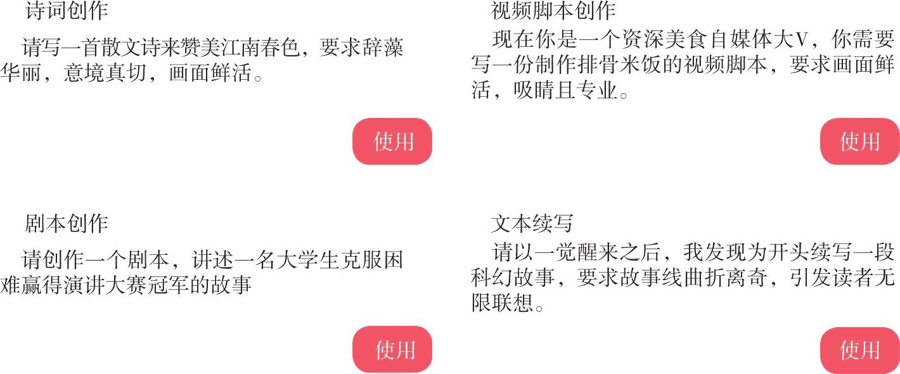

图 5-1　文心一言模板

###### 用户提问

请以“寒冷的冬夜，窗外的雪花纷纷扬扬”为开头续写一段“情感故事”，要求“情感能与读者产生共鸣，能触及大多数人的内心”。

###### 文心一言回答

寒冷的冬夜，窗外的雪花纷纷扬扬，轻轻拂过窗台，窗户上露出一层薄薄的冰凌。屋内的烛光昏黄，照在沙发上，莉莎孤独地坐在那里，眼睛凝视着远处。

她是一个生活在这座繁忙城市里的小职员，每天都奔波在工作和家庭之间。这个冬夜，她感到特别的孤独和疲惫，仿佛生活的重压让她喘不过气来。

回想起多年前，莉莎曾经是一个充满梦想和热情的年轻人。她有着远大的理想，渴望着成为一个成功的艺术家。然而，生活的现实让她不得不抛弃了那些梦想，转而投入一份稳定但枯燥的工作中。她觉得自己好像失去了什么，好像被困在了一个不属于自己的生活里。

……

（注：以上内容由文心一言生成，有删节）

（3） **语音转写** 。文心一言的 **手机应用** 具有语音转写功能，用户可以通过语音输入的方式进行文字创作。

##### 2.文字内容创作

在使用文心一言 **创作文字内容** 的时候， **首先** 要明确文字内容的 **方向或主题** ，是职场类、情感类、生活类、娱乐类还是其他类别的。 **其次** 要确定好 **受众** ，确定好个人的语言风格。 **最后** 要学会向文心一言 **提问和追问** ，得到自己想要的文字内容。

###### 用户提问

针对 **不同性格** 的 **女生** ，写出 **约会建议。**

###### 文心一言回答

约会建议可以根据不同性格的女生而有所不同。以下是一些针对不同性格女生的约会建议。

（1）外向型女生。对于外向型女生，建议选择一些热闹、刺激的活动，如去游乐园、演唱会或者参加派对。这样的活动可以让她们感到快乐和自在。此外，可以邀请她们去一些新颖、有趣的地方，如尝试新的餐厅或咖啡厅。

……

无论哪种性格的女生，约会时的建议都是要真诚、自信，并尽可能了解她们的兴趣爱好和需求。要注意尊重她们的意见和想法，同时给予适当的关注和照顾。

（注：以上内容由文心一言生成，有删节）

对文心一言的提问是 **情感** 领域的，主要的 **受众** 是想要与女生进行约会的 **男生** ，文章的 **风格** 是偏向 **建议** 类的，比较符合提问的预期。但是用户在润色修饰文章的时候，要对文章的内容进行甄别，注意语言和表达。

###### 【帮你创作】

文心一言创作文字内容的 **方式多样** ，可以 **满足** 不同用户的 **需求** ，无论是需要大量文字内容的创作者，还是需要按照特定格式创作文字的专业人士。

当然打造个人 IP 还需要内容有强烈的个人风格、有价值的内容、与粉丝的互动以及个人的坚持等，只依靠文心一言创作的内容是不行的。用户要利用文心一言的创作功能来提升自己的工作效率，把时间空出来以便完成其他的工作事项。

#### 二、用文心一言创作视频内容

短视频、直播和社交媒体的迅猛发展已经改变了我们的生活方式，许多人将大量的休闲时间花费在这些平台上，这为想要获取流量的创作者提供了机会。通过创作高质量的视频来吸引流量进而变现，成为许多人的选择。 **文心一言** 可以 **提供视频创作的内容** ，来帮助打造优秀的个人 IP。

##### 1.视频

短视频通常在 **几秒到几分钟** 之间展示各种内容，如新闻、音乐、电影、旅游、美食等。短视频的内容要有 **创意、视觉效果和吸引力** ，以便在短短几十秒内吸引观众。长视频内容的创作通常需要更多的 **深度和细节** ，才能满足观众的需求并传递更多信息。

###### 用户提问

以“电影《肖申克的救赎》”为主题，创作长视频。

###### 文心一言回答

视频开始，出现电影海报和片名，然后慢慢过渡到电影的开头场景，把观众带入故事中。

接着，开始对电影进行解析，将电影的主题、剧情、人物性格等方面进行深入剖析。例如，可以讲述主人公安迪的智慧、勇气和坚韧不拔的精神，以及他在肖申克监狱中与其他犯人的互动和影响。

然后，可以选取电影中的一些经典台词进行深入解读，让观众更好地理解电影中表达的情感和意义。例如，“希望是件美好的事，也许是人间至善”，这句台词可以让人感受到安迪在极端困境中依然保持对自由的渴望和信念。

……

最后，可以对电影进行整体评价，包括电影的拍摄技巧、演员表现、剧情深度等方面。例如，可以称赞导演弗兰克·德拉邦特在电影中运用拍摄技巧和色彩搭配来营造出肖申克监狱的压抑氛围，同时也称赞演员们的精湛表演和情感传递。

（注：以上内容由文心一言生成，有删节）

**文心一言** 只 **给出了** 关于长视频创作内容的 **大纲** ，具体的细节和内容还需要 **继续追问** ，如可以追问 **“电影的主题、剧情、人物性格”“有名的台词”“传达的思想等”** ，最后将这些答案整合在一起，成为长视频的内容。

创作长视频需要更多的计划和准备，要深入探讨主题，并与观众建立更深层次的联系，创意和故事性仍然是吸引观众的关键因素。

##### 2.Vlog

Vlog 通常以 **个人的角度和风格** 制作视频，是一种 **亲密性和互动性** 较强的内容形式，可以与观众建立联系并让观众了解自己。

###### 用户提问

以“北京—杭州的骑行旅游”为例，创作 Vlog 的内容。

###### 文心一言回答

开场介绍：介绍自己的骑行旅游计划和准备情况，展示骑行路线和装备等。

骑行过程：记录从北京到杭州的骑行过程，包括沿途的风景、城市、乡村、山区等，同时也会分享一些骑行技巧和经验。

停留和游玩：……

思考和感悟：……

结尾：到达杭州后，可以总结整个骑行旅游的历程，分享一些心得和经验，同时也可以展望未来的旅行计划等。

（注：以上内容由文心一言生成，有删节）

文心一言的回答只是一个大纲，并没有具体的细节，还需要继续追问，让文心一言帮助补充具体的内容。

###### 用户追问

请详细一些，制作完整的 Vlog 内容。

###### 文心一言回答

（一）开场

镜头：一张中国地图，标记出北京和杭州的位置。

配音：“大家好，我是×××。今天，我要和大家分享我的一次不同寻常的旅行——从北京到杭州的骑行旅游。”

（二）第一部分：骑行前的准备

镜头：展示自行车、骑行装备、地图等。

配音：“为了这次旅行，我做了不少准备。这是我的自行车，虽看上去很新，但已经陪我经历过不少旅程了。还有这些装备，都是我精心挑选的。”

……

（三）第二部分：骑行过程

（四）第三部分：停留和游玩

（五）结尾

（注：以上内容由文心一言生成，有删节）

**再次追问** 文心一言就得 **到了更详细** 的旅行 Vlog **内容** ，增加了不同部分的情境，使整个 Vlog 内容更加详细。

###### 【帮你创作】

**文心一言** 除创作短视频、长视频、Vlog 的内容外， **还能创作直播视频、动画视频、影视广告的文本内容** ，只要给定文心一言明确的主题和限定词，即能获得满意的视频内容。

需要注意的是，高质量的视频内容不仅需要有创意和价值的视频内容，还要有良好的拍摄和制作技巧，以及要不断扩大受众群体。

#### 三、用文心一言创作音频内容

音频有很多形式，如有 **声读物、音频课程** 等，要结合 **个人声音特点** 和 **目标受众的特点** 选择适合自己的形式。

##### 1.有声读物

**有声读物** 需要有一个 **好的文本内容** ，可以是小说、散文、新闻报道、诗歌、教育性材料或其他类型的文本。创作者要 **确保文本内容有趣、引人入胜，并适合以口头形式表达。**

###### 用户提问

以“寒冷的冬天悄然离去，温暖的春天悄然而至”为 **开头** ， **创作** 有声读物的 **内容** ， **受众** 为小学一年级学生。

###### 文心一言回答

寒冷的冬天悄然离去，温暖的春天悄然而至。在这个冬春交替的时刻，让我们一起来听听下面这个有趣的故事，感受春天的气息吧！

在一个寒冷的冬天，小兔子感冒了。它不停地打喷嚏，身体非常不舒服。小兔子心想：好冷啊！春天什么时候才能到来呢？

……

在这个温暖的春天里，小兔子和小松鼠过上了幸福快乐的生活。它们每天都在草地上玩耍，享受春天的美好时光。小兔子和小松鼠明白了一个道理：只有冬天过去，春天才会到来；只有耐心等待，才能迎接美好的未来。

亲爱的小朋友们，现在我们身处温暖的春天，是不是觉得生活变得更加美好了呢？让我们一起珍惜这美好的时光，迎接更加精彩的未来吧！

（注：以上内容由文心一言生成，有删节）

给定了文心一言 **三个要求** ， **开头** 是“寒冷的冬天悄然离去，温暖的春天”， **受众** 是“小学一年级”， **想要的结果** 是“有声读物的文本”，文心一言根据这三个要求， **创作** 了一段 **音频内容** 。有声读物的文本内容是基础，创作者要注意甄别，选择适合自己发展方向的音频文本。

##### 2.音频课程

音频课程可以在语言学习、学术、计算机科学、商业和管理、艺术和人文、健康和健身等众多领域中选择。 **优质的音频课程内容** 是抓住听众注意力的 **关键** ，在创作文本时，需要考虑如何 **清晰、生动地传达** 课程信息，展现 **课程的知识性和逻辑性** 。

###### 用户提问

以“日语中的问候语”为主题，创作音频课程。

###### 文心一言回答

你好，欢迎来到《掌握日语问候语》音频课程。无论你是计划前往日本旅行还是在商务场合与日本同事合作，掌握日语问候语都是建立亲近关系和文化交流的重要一环。

……

首先，让我们从基本的问候语开始。你可能已经听说过“こんにちは”（Konnichiwa，午后好）和“こんばんは”（Konbanwa，晚上好）。这些是日本人在不同时间段问候他人时使用的常见表达。让我们来学习正确的发音和用法。

[播放示范音频]

……

感谢你的参与，祝你学有所获！

（注：以上内容由文心一言生成，有删节）

###### 【帮你创作】

创作音频内容的时候， **首先要确定一个主题** ，明确想要传达的信息或故事， **如童话故事、知识学习等** ，为文心一言提供背景。 **其次要确定要求** ，限定文心一言的回答范围， **如受众、领域等** ，为文心一言提供条件。 **最后要分析给定的内容，判断** 给定内容正确与否，不符合要求的继续向文心一言追问，让文心一言不断创作。

## 第二节
不同媒体平台内容辅助创作

新媒体是新型的信息通信平台，具有 **互动性、实时性、全球性、个性化** 等特点，文心一言在 **创作新媒体内容** 的时候要 **结合新媒体的特点，增加** 文本的 **曝光率和互动性** ，打造个人 IP。

#### 一、微博

微博是目前国内用户量较大新媒体之一， **文心一言** 要创作微博内容，就 **要确保微博内容的话题性和时效性，抓住热点事件** ，只有增加了用户的关注度和讨论度。

###### 用户提问

以“金庸的武侠电视剧中，最经典的女性角色是”为话题，创作微博文本内容。

###### 文心一言回答

金庸先生的原著改编的电视剧，经典的女性角色有：

小龙女。……

阿珂。……

王语嫣。……

黄蓉。……

穆念慈。……

周芷若。……

选择出你心目中最经典的女性角色。

分别配图……

（注：以上内容由文心一言生成，有删节）

经典怀旧是微博内容永恒不变的话题，人们会对经典的东西反复进行讨论，抓住这一话题， **持续不断地让文心一言提供文本内容并总结提升** ，打造具有个性化的 IP。

#### 二、微信

公众号文本内容的好坏直接影响着阅读量和关注度。微信公众号的 **内容涉及各个领域** ，如新闻、美食、教育、旅游、情感、职场、体育、健康等，创作者可以在这些领域内选定主题，然后让文心一言辅助创作。

###### 用户提问

以“迎金路要修路，请绕行”为话题，创作微信公众号内容。

###### 文心一言回答

迎金路即将进行全封闭修路施工，为了确保工程顺利进行，提高道路通行质量，请您在施工期间绕行其他道路。以下是有关施工期间交通管制和绕行线路的详细信息，请您务必关注。

（一）迎金路修路施工时间

本次修路施工时间为 2023 年 11 月 18 日至 2024 年 1 月 18 日。为确保工程进度和质量，该路段将进行全封闭施工，届时禁止所有车辆通行。

（二）绕行线路推荐

前往金阳街方向的车主，请选择从春华路或秋实路绕行。

前往翠柳路方向的车主，请选择从春华路、秋实路或枫杨路绕行。

……

（三）其他注意事项

请广大车主密切关注交通管制和道路施工信息，提前规划好出行路线，以避免走错路、耽误时间。

……

（注：以上内容由文心一言生成，有删节）

**文心一言** 可以 **帮助创作者在微信公众号策划** 一些人们 **日常生活中关注的主题** ，如“ **如何打疫苗** ”等，另外文心一言可以 **协助创作** 关于 **创业者专业领域内** 的知识，做知识的拓展。总之做好微信公众号要注意文笔和主题的选择，利用好文心一言，为自己 IP 的打造添砖加瓦。

#### 三、知乎

**知乎** 是一个中文互联网 **问答社区** ，创作者可以使用知乎 **发布问题、回答问题、发表看法、与他人交流互动** 等。创作知乎内容需要具备一定的知识水平、写作能力和社交技巧，可通过 **文心一言来提高自己的创作水平** ，并在知乎社区中建立自己的影响力。

###### 用户提问

知乎上哪些问题的讨论度较高。

###### 文心一言回答

在知乎上，一些特定类型的问题的讨论度往往比较高。以下是一些通常较为热门的问题类型：

涉及社会热点事件和公共议题的问题。例如，“你如何看待近期的社会热点事件？”“你如何看待公共政策对你的生活影响？”等。

与知名人物、公司或事件相关的问题。例如，“你如何看待某位名人近期的事件？”“对于某个大公司的做法，你有什么看法？”等。

与科技、文化、娱乐相关的问题。例如，“AI 技术未来的发展会如何？”“你最喜欢的一部电影或电视剧是什么？”等。

……

（注：以上内容由文心一言生成，有删节）

可以让 **文心一言** 为创作者 **提供热门话题** ，发布在知乎上，然后 **邀请知乎** 上的 **大咖** 过来 **回答** ，提升话题的讨论度，也可以去回答别人的问题，发表自己独到的见解。

###### 知乎问题

请对知乎问题“哪一句话在不经意间，暴露了你的贫穷？”做出回答。

###### 文心一言回答

“昨晚吃了碗泡面，这可是节省了一笔不小的开支呢！”

这句话暴露了我因为收入有限，只能用泡面来节约生活成本。实际上，这种做法对健康并不利，但却是我出于经济考虑所做的无奈之举。

“手机屏幕又碎了，这次得省吃俭用才能修好了。”

这句话暴露了我因为无法承担频繁更换手机的费用，而不得不省吃俭用来修理手机。这也暗示了我生活可能比较拮据，需要精打细算才能维持日常开销。

文心一言的回答 **只贴合了后半部分** 的“穷”，但是 **没有体现出** “不经意间”，回答的内容也没有令人眼前一新，有些巧妙的文字可能还需要创作者自己思索，文心一言只能提供参考。

###### 【帮你创作】

新媒体的特点制约着新媒体的内容，不符合新媒体要求的文本内容不会有曝光度和关注度， **创作者要不断地向文心一言“投喂”数据，训练文心一言的写作风格和写作思路** ，创作出符合要求的新媒体内容。

#### 四、抖音

**抖音** 的用户主要集中在青少年群体，以 **娱乐和创意** 为主。抖音内容的生产和筛选更注重官方引导和热门话题，视频时长通常较短，适合快节奏的内容。

###### 用户提问

以“新手必看化妆技巧”为主题，创作抖音视频内容，要有创意性。

###### 文心一言回答

视频开始，出现的是一段快速剪辑的恐怖电影片段，突然镜头变焦，聚焦到屏幕中央，一个惊悚的“化妆新手”四个字慢慢浮现出来。

旁白：“你是否曾经在深夜的镜子前，被自己的影子吓到？”

镜头切换到主角对着镜子准备化妆。

旁白：“或者在拿起化妆品的那一刻，感到一股寒意从背后袭来？”

主角在镜子中看到自己的倒影，背景音乐突然变得紧张。

旁白：“现在，让我们一起来探索新手的化妆世界，把恐惧变成魅力！”

视频片段开始展示各种搞笑的化妆失误，配乐加大，达到高潮。

旁白：“在这段视频中，我们将一起学习如何避免这些悲剧，让你的化妆技巧从菜鸟变身为大明星！”

镜头回到主角，背景音乐变得轻松愉快。

旁白：“首先，我们来谈谈那个最让人害怕的部分——粉底。”

展示主角正确选择和涂抹粉底的步骤，配乐加大。

……

（注：以上内容由文心一言生成，有删节）

可以看到文心一言 **给出了有创意的答案** ，但创作者在分析创作内容的时候，要 **判断是否能实现** 文本里的内容，能否找到合适的配乐、电影片段，以及考虑自身的剪辑水平。

#### 五、快手

**快手** 的 **用户群体** 比较 **广泛** ，包括年轻人、中老年人等， **内容类型** 也更加 **多元化** 。快手侧重于展现普通人的生活状态，倾向于让用户自主发挥和互动。

###### 用户提问

我是一名打工人，以“我的田间生活——摘西红柿”为话题，创作快手内容。

###### 文心一言回答

背景音乐起，轻松愉快的旋律。

画面 1：拍摄朝阳照亮田野，主角穿着工作服，准备开始一天的劳作。

旁白：“大家好，我是打工人××，今天我要带你们走进我的打工生活，一起来摘西红柿。”

画面 2：主角在广阔的田野中，展示摘西红柿的过程。

旁白：“在这个美丽的田野上，我与西红柿有个约定。看，这就是我一天的工作。”

画面 3：主角将西红柿放入篮子中，展示满载的篮子。

旁白：“这些西红柿是我辛勤努力的见证，每一只都充满了甜蜜的味道。”

……

画面结束，快手标志出现。

旁白：“感谢大家陪伴我度过这个美好的一天。下次再见，希望你们喜欢我的打工生活。”

视频结束。

（注：以上内容由文心一言生成，有删节）

快手上中年人用户较多，可以让文心一言创作展示自己的田间生活或做饭视频的文本，以平淡的口吻讲述日常生活，接地气的作品更容易得到大家的共鸣。

###### 【帮你创作】

抖音、快手类的短视频都是用一个短视频内容吸引用户停留，关注的内容可能是背景音乐、搞笑的段子、幸福的日常、成长日记、趣物分享等， **文心一言** 就是在这些主题的基础上 **为创作者提供脚本内容，给创造者一些方向或新鲜的创意** ，协助高效创作短视频。

#### 六、B 站

**B 站** 是一个以动画、漫画、游戏为主题的视频分享网站， **内容丰富多样** ，包括动画、番剧、游戏、影视、娱乐等，用户以年轻人为主。文心一言在创作 B 站内容的时候，就要从这些方向进行考量。

###### 用户提问

以“美食探店”为主题，创作 B 站视频内容。

###### 文心一言回答

视频开始，镜头对着 UP 主，背景是一个繁华的商业街区

UP 主：（对着镜头）大家好，我是你们的探店侦探，今天我们将探索一家传说中让人垂涎三尺的美食店——火焰烧烤！让我们一起来看看这家店是不是真的那么神奇吧！

镜头快速转换到烧烤店门口，UP 主展示店铺招牌。

UP 主：看，这就是火焰烧烤的招牌，看这火焰，看这烧烤，简直就是在挑战我们的食欲啊！

镜头进入店内，展示店内环境。

……

镜头回到 UP 主，展示总结。

UP 主：总的来说，火焰烧烤确实是一家值得推荐的美食店。他们的食材新鲜、口味独特、服务周到，让人流连忘返。如果你是美食爱好者，千万不要错过这家店！下次见！

视频结束，出现字幕：“点赞、投币、收藏，我们下次再见！”

（注：以上内容由文心一言生成，有删节）

**文心一言给出了一个完整的 B 站视频脚本** ，创作者可以在此 **基础上修饰润色** ，添加自己的元素，但要避免发生“抄袭”，引起纠纷，影响自己的口碑和形象。

#### 七、小红书

**小红书** 是一个以 **生活分享** 为主的社交媒体平台， **用户** 大多是 **年轻的女性** ，她们在这里分享自己的购物心得、生活经验、旅游攻略等。因此文心一言在创作小红书内容的时候也要偏向这些主题。

###### 用户提问

作为穿搭博主，以“秋天的职业穿搭”为主题，创作小红书内容。

###### 文心一言回答

秋日必备！职业装这样穿，同事们纷纷点赞。

秋天到了，职场上的穿搭又该换新啦！

今天就给大家分享一下我的秋日职场穿搭秘籍，让你在同事们中脱颖而出，成为最时尚的那个！

（1）外套篇。秋天外套必不可少，一件时尚的外套能为你的穿搭加分不少。我选择了这款黑色小西装，它既适合日常上班，也能应对稍微正式的场合。版型很正，不会显得太老气。

（2）内搭篇。秋天可以选择一些简约款的打底衫，我选择了这款灰色 V 领打底衫。V 领设计可以拉长颈部线条，使整体看起来更加修长。而且灰色很百搭，无论是配裙子还是裤子都毫无违和感。

（3）下装篇。我选择了这款黑色高腰 A 字裙，高腰设计能提高腰线，拉长腿部线条。A 字裙的版型也能很好的遮盖住胯部和大腿的肉肉，非常适合梨型身材的姐妹们。

……

#OOTD#职场穿搭#秋日职场#时尚博主#黑色小西装#灰色 V 领打底衫#黑色高腰 A 字裙#黑色粗跟短靴#黑色链条包#显瘦穿搭#简约款配饰#秋日职场#显瘦穿搭#职场穿搭#时尚博主#灰色 V 领打底衫

（注：以上内容由文心一言生成，有删节）

**文心一言的回答** 比较 **符合小红书的特色** ， **注重实用性和参考性** ，用户通过浏览这篇文章，收获了秋天职场穿搭的参考意见。

#### 八、微信视频号

**微信视频号** 是微信推出的 **短视频分享** 平台，内容包括新闻、娱乐、生活、知识等。微信视频号的 **推荐机制** 主要是基于 **用户的社交关系链** 推荐，同时也会根据用户的兴趣爱好和历史行为进行推荐。

###### 用户提问

以“伟大的妈妈”为主题，创作微信视频号内容。

###### 文心一言回答

视频开头：

开场白：可以以一段感人的音乐为背景，然后出现一段文字：“在这个世界上，最伟大的爱来自母亲。”

视频主体：

展示妈妈的多样角色：可以拍摄不同年龄、不同职业的妈妈们在家中的不同角色和责任。有的妈妈可能是全职妈妈，需要照顾孩子的饮食起居，有的妈妈可能是职业女性，需要在工作和家庭之间平衡。通过这些不同的角色展示，让观众更深入地理解妈妈们的多样性和不易。

……

结束语：最后可以加上一段文字。例如，“妈妈，是每个人的守护者，让我们向她们致敬”。同时可以配上一张温馨的照片或视频画面作为结尾。

（注：以上内容由文心一言生成，有删节）

“亲情”类的微信视频号容易吸引到中老年女性用户的喜爱，因为与她们的生活切实相关，所以很容易被转发到她们的朋友圈和微信群，这样就增加了用户的点击率。创作者可以利用文心一言创作各种关于亲情的文案，持续不断地输出相应的内容。

###### 【帮你创作】

使用文心一言创作内容的时候，最重要的就是 **主题的选择** ，主题的选择又离不开目标 **受众群体以及自身的专业知识** 。比如，目标群体是青少年，可以选择娱乐、游戏、学习等主题；对于年轻女性，可以选择美妆、穿搭、旅游等主题；对于中老年用户，可以选择美食、交友、生活分享等方面的主题。确定好主题后，就是 **脚本内容的创作** ，文心一言的创作时间短，但需要个人 **判断内容的知识性、逻辑性等** ，可以通过 **不断追问** 来达到自身的要求。

# 第六章
个人学习成长

## 第一节
解释解答

#### 一、作为老师答疑解惑

文心一言可以为我们提供学习资源和信息，帮助我们更好地理解和掌握知识。同时，也可以回答我们在学习过程中遇到的问题，为我们提供准确的解题思路和答案。

###### 用户提问

请 **解答这道题** ：制造集团下属某工厂 32%的工人为高级技工，在将 40 名工人（其中 24 人为高级技工）调往其他厂后，高级技工占工人的比重下降到 25%。问该单位原有多少名高级技工？（）

A.48

B.64

C.80

D.96

###### 文心一言回答

设原来该单位有 x 名高级技工。

根据“制造集团下属某工厂 32%的工人为高级技工”，可计算总人数：x/32%=3.125x

根据“在将 40 名工人（其中 24 人为高级技工）调往其他厂后，高级技工占工人的比重下降到 25%”，得方程：

（x-24）/（3.125x-40）=25%

解得：x=64（名）

所以，该单位原有 64 名高级技工。

文心一言的这道代数方程题目解析得非常清晰明了，具有很好的启发性和教育意义。通过对这道题目的学习，我们可以进一步提高自己的代数方程解题能力和逻辑推理能力。

###### 【帮你解答】

（1） **提供相关知识点** 。文心一言可以根据问题的具体内容，提供相关的 **知识点** 和 **概念解释** ，帮助用户回忆起所学的内容，并将这些知识与问题联系起来。

（2） **分析问题** 。文心一言可以 **引导用户分析问题** 。例如，找出题目中的隐含条件、将问题分解成更小的部分、画出图形或图表以更好地理解问题等。

（3） **提供解题方法** 。根据问题的具体情况，文心一言可以 **提供** 一些常见的 **解题方法和技巧** 。例如，代数运算、数形结合、逻辑推理等。

（4） **检查答案** 。在解答问题后，文心一言可以引导用户检查结果是否正确，并帮助用户 **找出错误的原因** 。如果依旧无法得出正确答案，可以请求文心一言 **提供更多帮助** 。

#### 二、作为顾问随时咨询

当你需要得到专业咨询和帮助时，文心一言可以作为你的顾问，随时为你提供咨询服务，但需要你明确告知它你需要得到帮助的行业领域。

###### 用户提问

我是一名月收入为 5 万元左右的自由职业者，每个月固定开销在 1 万元左右，我需要你 **作为一名金融顾问** ，为我 **提供** 一些关于 **个人理财** 方面的 **专业意见** 。

###### 文心一言回答

作为一名金融顾问，我很高兴为你提供一些关于个人理财方面的专业意见。以下是我为你提供的一些建议：

（1）建立紧急储备金：建议你首先将月收入的一部分（如 20%）存入一个紧急储备金账户，这可以在你遇到意外开支或失业等突发情况时提供资金支持。

（2）确定投资目标：在理财过程中，你需要明确你的投资目标，如你想通过投资实现退休储蓄、购买房屋、支付子女的教育费用等。

（3）分散投资：不要将所有的资金都投入一个投资品种中，而是应该将资金分散投资到不同的投资品种中，如股票、债券、基金、房地产等。这样可以降低投资风险，同时也有助于实现投资目标。

（4）考虑长期投资：如果你有长期的投资目标，建议你注重长期投资，避免短期的市场波动对你的投资造成过大的影响。

（5）定期评估投资组合：建议你定期评估你的投资组合，确保它与你的投资目标保持一致，并根据市场变化和个人情况对其进行调整。

（6）控制债务：如果你有债务，建议你尽可能控制债务，避免负债过多影响你的财务状况和投资计划。

（7）定期储蓄：除了投资，建议你每个月定期储蓄一部分资金，作为未来投资或紧急储备金的来源。

综上所述，个人理财需要注重理性、分散投资、长期投资、债务管理和储蓄等方面。建议你根据自己的实际情况和目标进行综合考虑，制订适合自己的理财计划。

文心一言的这段建议有助于你建立一个稳健的财务计划，为你的未来提供保障，同时确保你的紧急储备金和投资组合能够满足你的财务需求。如果你对其中的某条建议比较感兴趣，可以对其单独进行详细的追问，如“请详细说说如何进行定期评估投资组合”“长期投资的方式有哪些”，以获得更加详细、全面的解答。

###### 【帮你解答】

（1）随时随地提问。无论何时何地，只要你需要咨询问题，就可以 **直接向文心一言提出问题** ，获取答案。

（2） **反馈和改进** 。如果你对文心一言的回答和建议不满意，可以 **及时提出反馈和改进意见** ，以便文心一言能够更好地为你服务。

#### 三、作为助理随时助力

在这个信息爆炸的时代，我们每天都会面临各种各样的任务和挑战。有时候，我们需要一个得力的助手来帮助我们处理烦琐的工作，以提高工作效率。文心一言就可以作为你的助理，随时为你提供助力。

###### 用户提问

假设你是一名跨国公司 CEO 的助理，你的上司要你准备一场很重要的国际会议，你需要怎么做？

###### 文心一言回答

作为跨国公司 CEO 的助理，准备一场很重要的国际会议需要从以下八个方面入手：

（1）了解会议目的和议程：首先需要明确会议的主题、目的以及讨论的议程，以便为会议做好充分的准备。

（2）确定参会人员和分组：根据会议目的和议程，与上司一起确认参会人员名单，并考虑是否需要设立分组讨论会。同时，了解参会人员的背景和需求，以便更好地为他们提供支持。

（3）安排会议时间和地点：根据参会人员和分组情况，安排合适的会议时间和地点。考虑到不同国家和地区的时差及参会人员的需求可能会有所不同，应尽量选择一个方便大家参与的时间，并确保会议地点符合会议要求。

（4）准备会议材料：协助上司准备会议材料，包括相关的报告、数据和演示文稿等。这需要与各部门协调合作，确保会议材料的质量和准确性。

（5）沟通和联络：作为会议组织者和协调者，需要及时与参会人员沟通联络，确认其参会情况并及时解答其疑问。在会议期间，保持在线状态，协助上司处理突发情况和问题。

（6）制定会议日程和议程：根据参会人员和分组情况，制定详细的会议日程和议程，包括每个时间段的具体活动、讨论议题和主持人等，确保会议的顺利进行。

（7）确认设备和支持：提前确认会议所需的设备和支持，如投影仪、音响设备、翻译服务等。在会议开始前检查设备是否正常运行，并与相关供应商保持联系，确保设备问题能够及时得到解决。

（8）跟进会议记录和总结：会议过程中，做好会议记录；会议结束后，协助上司进行会议总结，将讨论和结论整理成文字资料。跟进会议记录的发布和跟进，确保会议成果得到有效传达和落实。

总之，准备一场国际会议需要综合考虑多方面因素，包括会议目的、议程、参会人员、时间和地点等。作为 CEO 的助理，需要有细心、耐心和责任心，并协助上司完成各项准备工作，确保会议的顺利进行。

文心一言的回答提供了一系列明确的任务，并解释了每个任务的目的和内容，使用户能够清楚地了解自己需要做哪些工作。此外，答案还强调了准备会议所需的细心、耐心和责任心的重要性，进一步突出了助理在会议筹备中的关键作用。

###### 【帮你增效】

（1） **快速处理** 日常事务。作为一名助理，你可能需要处理各种日常事务，如安排日程、组织活动、撰写文档等。使用文心一言提供的工具和服务， **生成各种** 日程、活动方案、文案 **模板** ，可以帮助你更快速、高效地完成这些任务。

（2） **快速提供数据支持** 。文心一言可以 **提供** 各种 **数据支持** ，并根据你的要求 **快速生成报告** ，如市场调研数据、行业分析报告等。这些数据可以帮助你更好地了解市场和行业情况，从而更好地制订工作计划和决策。

## 第二节
启发启示

#### 一、让文心一言展示灵感

在信息过载和思考疲劳的挑战面前，文心一言提供了一个独特的解决方案，那就是帮助你激发并展示灵感。无论是创新营销策略，还是为写作寻找灵感，文心一言都可以通过其强大的自然语言处理技术和深度学习算法，为你提供有价值的见解和建议。

###### 用户提问

我是一名 **建筑设计师** ，正在为我设计的 **楼盘取一个名字** ，请 **以《诗经》为灵感** 来源，为我提供一些可能的想法。

###### 文心一言回答

以《诗经》为灵感的楼盘名称可以体现中国文化的韵味。以下是我根据《诗经》为你提出的一些可能的楼盘名称：

（1）采薇庭：采薇来自《诗经·小雅·采薇》，原意是采摘薇菜，寓意是老百姓安居乐业的家园。庭指庭院，与采薇结合，形成一种清雅悠闲的生活氛围。

（2）琼玖轩：琼玖来自《诗经·卫风·木瓜》，其中的“琼”和“玖”都是美玉的意思，代表珍贵和高品质；轩则是指高雅的建筑。琼玖轩整体给人一种高贵且雅致的感觉。

（3）鹿鸣府：鹿鸣来自《诗经·小雅·鹿鸣》，原意是模拟鹿的鸣叫，寓意是和谐共处。府是指官署，也可指高雅的住宅。鹿鸣府传达了一种和谐优美的感觉。

（4）庭兰居：庭兰来自《诗经·郑风·溱洧》，原意是庭院中的兰花，寓意是幽雅清静、芳香宜人。居是居住的意思。庭兰居让人联想到一个优雅清新的居住环境。

以上都是以《诗经》为灵感的楼盘名称，每个名称都有其独特的文化内涵和寓意，希望能对你有所启发。

文心一言按照需求提供了一些以《诗经》为灵感的楼盘名字的建议，这些名字充分体现了楼盘的特点和文化内涵，便于建筑设计师结合楼盘的特点、定位以及自己的喜好进行综合考虑，以此选取最优的名字。

###### 【帮你提议】

（1） **提出开放式问题** 。尝试提出一些开放式问题，让文心一言有机会给出一些新的想法。例如，“你认为在当今社会，人们最需要什么样的服务？”或者“你认为未来的教育会朝哪个方向发展？”。

（2） **提供主题或关键词** 。给文心一言一个主题或者一组关键词，让它基于这些主题或关键词来提供一些想法。例如，“以人工智能为主题，你能给出一些创新的应用吗？”或“以环保为关键词，你能提供一些减少碳排放的方法吗？”

（3） **寻求创意和灵感** 。明确地告诉文心一言你需要一些创意和灵感。例如，“我需要一些新颖的营销策略来推广我的产品，你能给出一些建议吗？”或者“我正在写一篇关于城市规划的文章，你能提供一些有见解的观点吗？”

（4） **引导对话** 。在对话中，通过提问的方式，让文心一言不断深入探讨某个话题或想法。例如，“你认为人工智能对医疗行业的影响是什么？”或者“你认为未来的教育行业会有哪些变革？”。

#### 二、让文心一言讲讲经验

文心一言是一个无尽的经验库，可以为我们提供宝贵的见解和指导。无论是想要掌握新技能、解决问题还是获取成功的秘诀，文心一言都可以成为你最好的经验分享伙伴。

###### 用户提问

我是一家 **自媒体初创公司的创始人** ，在 **人员管理** 和 **团队运营方面** 遇到了一些问题，请为我提供一些经验来解决这些问题。

###### 文心一言回答

作为一家自媒体初创公司的创始人，您可能会遇到各种人员管理和团队运营方面的问题。以下是一些建议，希望能帮助您解决这些问题：

（1）建立清晰的目标和愿景：确保您的团队成员都了解公司的目标和愿景，这有助于让他们更加投入地工作，并更好地协作。

（2）招聘合适的员工：在招聘过程中，不仅要考虑应聘者的技能和经验，还要考虑他们是否与公司文化和价值观相匹配。对于自媒体公司来说，拥有具有创意和热情的员工非常重要。

（3）提供培训和发展机会：为员工提供必要的培训和发展机会，帮助他们提高技能并更好地适应公司文化。这将有助于提高员工的工作满意度和忠诚度。

（4）制定明确的职责和分工：为员工分配明确的职责和分工，确保每个人都清楚自己的工作任务，这有助于提高工作效率和减少工作中的混乱。

总之，对于一家自媒体初创公司来说，人员管理和团队运营是非常重要的。只有通过恰当的措施，才能够建立一个高效、稳定、有创造力的团队，为公司的长期发展奠定基础。

文心一言的回答提供了一些关于团队管理和运营的基本经验，如公司目标及愿景、员工招聘、培训和发展机会等。但其回复比较笼统，没有提供具体的步骤或建议。管理团队和运营公司是一项复杂的任务，每个公司和团队都有其独特的挑战和需求，管理者需要结合自己的情况和行业特点，进一步思考解决问题的方案。

###### 【帮你提议】

（1） **描述问题** 。清晰地描述你遇到的具体问题和挑战，尽可能详细地说明 **问题的背景、现状和目标** ，以便文心一言能够更好地理解你的需求并给出合适的建议。

（2） **寻求经验分享** 。明确告诉文心一言你希望获得一些相关的经验分享。例如，你可以说：“我在工作中遇到了一些问题，我希望你能分享一些相关的经验和建议，帮助我更好地解决这些问题。”

（3） **提供相关案例** 。如果你已经知道一些类似的案例或做法，可以尝试提供这些信息，让文心一言能够更好地了解你的问题和需求，并给出更准确的建议。

（4） **讨论解决方案** 。当你得到文心一言的建议后，不要只是被动地接受，而应积极地与它讨论可能的解决方案。即提出你的想法和观点，然后与文心一言进行讨论和交流，以便找到最适合你的实际情况的解决方案。

## 第三节
修改

文心一言在修改修正文本方面具有多方面的优势，它可以改正包括语法、拼写、标点等方面的错误，帮助提高文本质量、节省时间、提高语言技能、增强文本专业性以及沟通效果。

###### 用户提问

“最近一项研究发现，饮用咖啡可以降低患上阿尔茨海默病的风险。该研究对超过 2000 名 65 岁以上的老年人进行了长达 10 年的追踪调查，发现那些每天饮用一杯咖啡的人，患上阿尔茨海默病的风险降低了 23%。此外，研究人员还发现，饮用咖啡不会对认知功能产生负面影响，反而可能有助于提高认知功能。”请帮我修正此文本。

###### 文心一言回答

“最近一项研究发现，适量饮用咖啡可能降低患上阿尔茨海默病的风险。该研究对超过 2000 名 65 岁以上的老年人进行了长达 10 年的追踪调查，发现那些每天饮用一杯至两杯咖啡的人，患上阿尔茨海默病的风险比不喝咖啡的人降低了 23%。然而，研究人员也指出，过量饮用咖啡可能会对认知功能产生负面影响，因此应该保持适量饮用。”

###### 【帮你优化】

文心一言通过语法、语义、文本结构和语言表达等方面的修正，可以帮助用户提升文本质量，使文本更加准确、流畅和易于理解。

**（1）语法和拼写检查。** 文心一言可以检查文本中的语法和拼写错误，并提供修改建议。例如，如果用户在文本中写了错别字或者语法不正确的句子，文心一言可以将其识别出来并提供正确的修改建议。

**（2）语义分析和修改。** 文心一言可以利用自然语言处理技术，对文本进行语义分析和理解，从而识别出语义不准确、不合适或者有误的文本片段，并提供相应的修改建议。例如，文心一言可以识别出文本中的成语、谚语、俚语等，如果这些表达不太恰当或者出现了错误，那么文心一言可以提供修改建议。

**（3）文本结构和连贯性修改。** 文心一言可以帮助用户检查文本的结构和连贯性，从而提供修改建议。例如，如果用户的文本段落之间没有很好地过渡或者连接，文心一言可以提供修改建议，使文本更加流畅和连贯。

**（4）语言表达和用词修正。** 文心一言可以提供用词和语言表达方面的修改建议。例如，如果用户的文本使用了不准确的用词或者其语言表达方式不太恰当，那么文心一言可以提供修正建议，帮助用户使用更加准确、生动的语言表达方式。

**（5）语法润色和改进。** 文心一言可以帮助用户对文本进行语法润色和改进。它能够提供简化和复杂化句子结构的功能，使文本更加符合语法规范。此外，文心一言还可以提供高级词汇和短语的替换建议，以及修改错误的单词拼写和语法结构等的功能，以帮助用户提高文本的可读性和吸引力，使其更加符合语言表达习惯和规范。

## 第四节
提高提升

#### 一、让文心一言当自己的教练

文心一言做个人教练的优势在于，它能够提供个性化指导、及时反馈、智能推荐资源、跟踪学习进度、促进自主学习、提高学习效率以及增加学习动力。这些优势有助于个人更有效地管理和优化学习过程，实现知识提升和技能增长。

###### 用户提问

我是一名 **在职考生** ，上班时间是 **9：00 至 18：00** ，我希望利用 **空闲时间来学习** ，以争取一次性通 **过中级会计师考试** ，你能给我建立一个 **系统的学习计划** 吗？

###### 文心一言回答

当然可以，以下是一个针对在职考生的中级会计师学习计划，你可以根据自己的实际情况进行调整。

1.评估现状

在开始制订计划前，首先要对自己当前的学习现状进行评估：你已经具备哪些基础知识？你的学习能力强吗？你的自制力如何？根据这些问题，你可以对自己有一个初步的了解。

2.明确目标

接下来，你需要明确自己的学习目标。考虑到你的情况，目标是可以一次性通过中级会计师考试。那么，你需要了解考试的内容和要求，明确知道考试需要具备哪些知识和技能。

3.制订计划

基于以上自我评估和目标设定，你可以将学习计划分为三个阶段：基础阶段、强化阶段和冲刺阶段。

基础阶段：利用业余时间学习基础知识，如会计原理、财务会计、成本会计等。可以参考一些在线课程，配合教材进行学习。每天至少投入 2 小时。

强化阶段：在掌握基础知识后，根据中级会计师的考试要求进行学习，对重点和难点进行深入探讨和理解。这个阶段可以做一些专项训练，做一些历年真题。每天至少投入 3 小时。

冲刺阶段：在考前一个月左右，开始进行模拟测试，熟悉考试流程和题型。同时，查漏补缺，强化提高。每天至少投入 4 小时。

4.合理安排时间

在工作日，你可以利用早晨或者晚上的时间学习，尽量避免在工作时间学习，以免影响工作。周末可以安排更多的学习时间集中学习。

文心一言生成的这个学习计划具有可行性、科学性和有效性，但是没有给出详细的时间段安排，考生在具体实施时也许会不知道从何处下手或浪费一些可利用的时间，这时候我们可以继续追问文心一言，以获取准确的时间段安排。

###### 用户提问

可以根据上述回答帮我制订一个 **一日学习计划表** 吗？要求有 **具体的时间安排** 。

###### 文心一言回答

当然可以。以下是一个根据你的学习需求设计的一日学习计划表：

标题：在职考生一日学习计划表

1.时间规划

6：00～6：30 早餐。

6：30～7：30 阅读并做笔记：会计原理。

7：30～8：00 上班途中：巩固昨天学习的内容。

12：00～13：00 午休时间：会计原理练习题。

18：00～19：00 下班途中：回忆当天学习的内容。

20：00～21：30 复习与预习：财务会计。

21：30～22：00 总结与反思：今天的学习内容。

2.学习内容

6：30～7：30 阅读《会计原理》第一章，并做笔记。

12：00～13：00 完成《会计原理》第一章的练习题。

20：00～21：30 阅读《财务会计》第二章，并做笔记。

3.学习方式

6：30～7：30 采用速读和精读相结合的方式阅读，并做笔记整理重点。

12：00～13：00 针对《会计原理》第一章的练习题进行重点解析和解答。

20：00～21：30 对《财务会计》第二章的知识点进行理解和记忆。

4.评估和反馈

22：00～22：30 对今天的学习内容进行自我评估，总结学习成果和不足，并制订改进计划。

###### 【帮你增效】

文心一言可以为提升工作和学习效率提供全面的支持。无论是在学习、工作还是生活中，这些功能都可以帮助你更好地管理时间、获取信息、创作内容、学习知识，从而提高你的整体效率。

**（1）时间管理。** 文心一言可以帮助你更好地管理时间，这意味着你可以更有效地规划你的日常任务和活动。通过使用文心一言提供的时间管理工具，如时间轴和待办事项列表，你可以制订具体的计划并设置提醒，以确保你按时完成任务。此外，文心一言还可以跟踪你的时间使用情况，帮助你评估自己是否有效地利用时间，并提供有用的反馈和建议。

**（2）信息检索。** 文心一言具备强大的信息检索能力，可以让你快速找到你需要的信息。无论是学习还是工作，你常常需要查找大量的资料、文献和数据。文心一言可以让你轻松地搜索互联网和本地文件系统中的信息，并根据关键词、主题或特定的查询条件进行过滤和筛选，从而帮助你更快地找到所需内容。此外，文心一言还可以提供实时翻译和视觉搜索功能，以帮助你更好地理解和处理来自全球的信息。

**（3）内容创作。** 文心一言可以提供全面的文本创作服务，帮助你撰写高质量的文章、报告和故事等文本内容。通过使用文心一言提供的模板、语法检查和字数统计等功能，你可以更快地开始写作并减少编辑和校对的时间。此外，文心一言还提供了写作辅助工具，如创意写作、智能排版和参考文献管理等，以帮助你在创作过程中获得更多的灵感和支持。

**（4）知识学习。** 文心一言可以提供各种学科的专业知识，包括历史、科学、经济等。通过使用文心一言提供的学习资源，你可以随时随地学习感兴趣的主题和领域。这些学习资源包括在线课程、电子书、研究资料和互动式教程等，可以满足不同程度的学习需求。此外，文心一言还可以帮助你跟踪学习进度、记录笔记和与其他学习者交流互动，以提高你的学习效果。

**（5）语言翻译。** 如果你需要与来自不同国家和地区的人交流合作，文心一言可以提供全面的语言翻译服务。通过使用文心一言提供的翻译工具，你可以将文本或语音内容翻译成不同的语言，以满足你的语言需求。此外，文心一言还可以提供即时翻译服务，让你在与国际合作伙伴沟通时更加顺畅和高效。

#### 二、让文心一言当自己的导师

让文心一言当自己的导师可以帮助个人更好地制订个性化的学习计划、获得及时反馈与解答、拓展经验和知识、激励学习动力和提高学习效率。

###### 用户提问

假如你是一名 **职业发展导师** ，你会如何为 **金融学** 学生进行 **职业规划** ？

###### 文心一言回答

（1）了解学生：作为职业发展导师，你需要与学生建立良好的沟通关系，了解他们的兴趣、优点、价值观和职业目标。对于金融学学生，你可以询问他们对金融领域的哪些方面感兴趣，他们希望在未来的职业生涯中做什么。

（2）评估技能和能力：你可以通过帮助学生进行自我评估来实现这一目标。例如，可以引导学生进行在线职业测评，以了解他们的性格、价值观和优势。此外，还可以让学生进行专业能力测试，如金融知识测试、数据分析能力测试等。

（3）确定职业目标：根据学生的兴趣和评估结果，可以帮助学生确定他们的职业目标。例如，如果学生对投资感兴趣，那么他们的职业目标可能是成为一名投资顾问或基金经理。

（4）制定职业规划：一旦确定了职业目标，就需要制订实现这些目标的计划。目标包括短期目标和长期目标。短期目标可能是完成特定的课程、获得相关的金融证书或找到一份相关的实习工作。长期目标可能是获得高级金融证书、在金融机构担任高级职位等。

（5）实施行动计划：这包括学习计划、实习计划和网络构建计划。例如，如果学生希望成为一名投资顾问，他们可能需要学习投资组合管理、证券分析和市场分析等课程，并在相关机构找到实习工作。

（6）提供反馈和指导：作为职业发展导师，你需要定期为学生提供反馈和指导。这包括评估他们的职业规划的有效性、目标的实现情况以及行动计划是否合适。此外，还需要鼓励学生积极地反思自己的职业规划，及时调整计划以满足市场需求和个人兴趣的变化。

在整个过程中，作为职业发展导师，你需要有耐心、热情和专业知识。同时，还需要注意学生的个性差异，提供个性化的指导和支持。

###### 【帮你规划】

通过提供准确的提示词和提示句，文心一言可以通过给出建议和信息、制订计划和目标、解答问题和疑惑，以及引导用户思考和创新等多种方式帮助用户规划，具体内容可见表 7-1。

表 7-1　提示词与提示句式

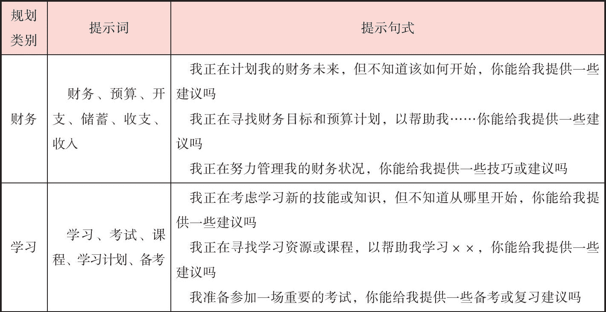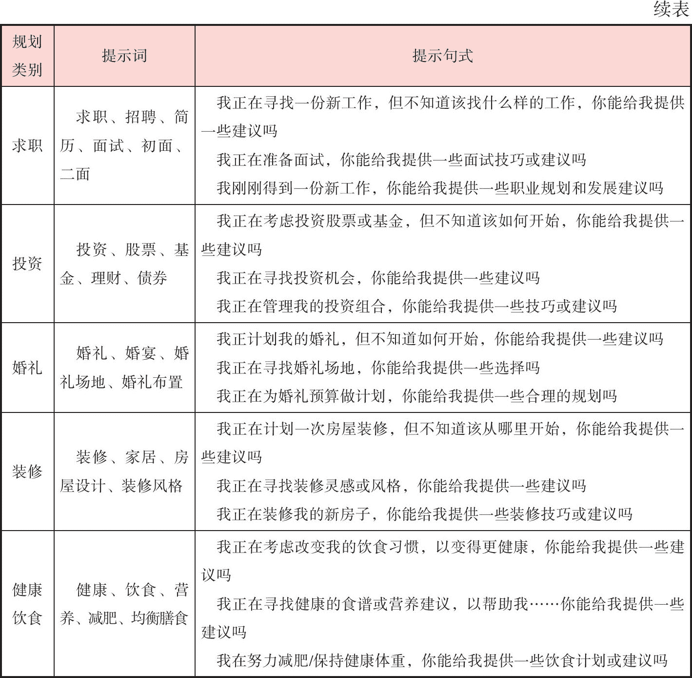

# 第七章
个人生活助手

## 第一节
购物与选择

#### 一、用文心一言选择产品

使用文心一言选择产品，可以帮助用户提高购物效率、增加选择透明度、提高购物满意度、减少决策风险。使用文心一言选择产品，具体操作步骤如图 8-1 所示。

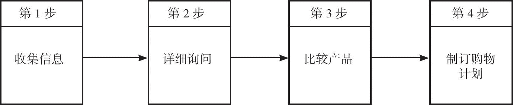

图 8-1　具体操作步骤

##### 1.收集信息

用户在购物时，应当首先明确自己的购物需求与预算。确定了自己的购物需求与预算之后，向文心一言提问，以收集有关市场和目标品牌的信息。

###### 用户提问

我想购买一只适合秋冬的口红，预算在 300 元以内，可以为我推荐一些吗？

###### 文心一言回答

当然可以！以下是几只适合秋冬季节的口红且价格在 300 元以内：

（1）A 子弹头口红（色号：01）。A 子弹头口红是很受欢迎的系列，色号 01 非常适合秋冬季节，带有红棕色和辣椒色，很显气质。价格在 100 元左右。

（2）B 天鹅绒唇膏（色号：02）。B 天鹅绒唇膏的 02 色号是一种深玫瑰色，非常适合秋冬季节，带有微闪的珠光效果，很显气质。价格在 200 元左右。

（3）C 口红（色号：03）。C 口红的 03 系列色号非常多样化，可以选择适合自己的色号，如梅子色、砖红色等，非常适合秋冬季节。价格在 100 元左右。

（4）D 口红（色号：04）。D 口红的色号 04 是一种棕红色，带有微闪的珠光效果，非常适合秋冬季节。价格在 100 元左右。

（5）E 口红（色号：05）。E 口红的色号 05 是一种裸粉色，非常自然，适合日常使用，同时也适合秋冬季节。价格在 100 元左右。

文心一言针对用户提出的问题，列举了五种比较详细的回答，并详细介绍了每一种口红的特点与价格，如用户对其中某一种感兴趣，可以继续追问。

##### 2.详细询问

用户如果对文心一言给出的信息中的某一个感兴趣，可以进一步向其询问有关产品的信息。比如，可以问关于某个产品的详细性能、规格、用户评价、优缺点等问题。

###### 用户追问

我对你提到的 A、B 两款口红非常感兴趣，你可以为我详细介绍一下它们的特点、用户评价、优缺点吗？

###### 文心一言回答

A 子弹头口红：

特点：A 子弹头口红以其丰富的色彩和高度的持久度而著名。它的质地非常舒适，保湿滋润，并且易抹匀。A 子弹头口红有超过 100 个色号，为消费者提供了非常大的选择空间。

用户评价：许多消费者对 A 子弹头口红的评价非常高。他们称赞其色彩鲜艳、持久度强，从轻薄的淡妆到浓烈的烟熏妆都能完美地搭配。同时，A 子弹头口红的舒适度和保湿性也得到了消费者的认可。

优缺点：A 子弹头口红的优点在于其丰富的色号选择和舒适的质地。缺点是，它的价格相对较高，对于一些消费者来说可能是一个考虑因素。另外，部分消费者反映该口红的持久度相对较弱，需要经常补涂。

B 天鹅绒唇膏：

特点：B 天鹅绒唇膏以其丝滑的质地和微闪的珠光效果深受消费者的喜爱。它的颜色非常自然，无论是偏清新的粉色、女性感的红色还是自然的咖啡色都有。

用户评价：很多消费者对 B 天鹅绒唇膏的评价非常高。他们称赞其颜色自然、质地丝滑，能够完美地修饰唇型。同时，B 天鹅绒唇膏的微闪珠光效果也为整体妆容增添了亮点。

优缺点：B 天鹅绒唇膏的优点在于其自然的颜色选择和丝滑的质地。缺点是，它的价格相对较高，对于一些消费者来说可能是一个考虑因素。另外，部分消费者反映该口红的持久度相对较弱，需要经常补涂。

在上述提问中，我们可以看到，用户针对 A、B 两款口红的“特点”“用户评价”“优缺点”展开了继续追问，而文心一言也给出了相应的解答。

###### 【帮你解答】

若用户仍然觉得文心一言的回答不够详细，可以继续展开追问，让其继续帮你解答。例如：

（1）你能为我详细介绍一下 A 子弹头口红的优缺点吗？

（2）B 天鹅绒唇膏除了你现在提供的这些特点以外，你还能再为我描述一下它的其他的特点吗？

（3）综合比较 A 子弹头口红和 B 天鹅绒唇膏，哪款口红的“性价比”更高呢？

##### 3.比较商品

使用文心一言的产品比较功能，可以将用户的购物需求与不同品牌和产品进行比较。用户可以在文心一言的搜索框中输入要比较的产品关键词，然后点击搜索按钮，系统会展示包含该关键词的不同品牌和产品的信息。

###### 用户追问

能对上述你推荐给我的口红 A 与 B 进行一下比较吗？

###### 文心一言回答

当然可以！以下是 A 与 B 两支口红的比较：

（1）适用人群。A 子弹头口红是 A 品牌的明星产品之一，其色号 01 适合各种肤色，特别是肤色白皙的人群，而 B 天鹅绒唇膏的色号 02 则是一种深玫瑰色，同样也适合各种肤色。

（2）质地。A 子弹头口红属于纯正哑光质地，不会太修饰唇纹。而 B 天鹅绒唇膏的质地比 A 子弹头口红更加丝滑，质地更加滋润。

（3）价格。A 子弹头口红的价格大约在 100 元左右，而 B 天鹅绒唇膏的价格则在 200 元左右。

（4）口碑。在口碑方面，A 子弹头口红以其独特的色调和显色效果深受消费者的喜爱，而 B 天鹅绒唇膏则以其丝滑质地和微闪珠光效果受到好评。

（5）包装。A 子弹头口红的包装以简约黑色为主，点缀着 A 品牌的标志，看上去非常时尚。而 B 天鹅绒唇膏的包装则为高级的紫色，搭配着 B 品牌的标志，让人感觉非常高贵。

文心一言从适用人群、质地、价格、口碑、包装等五个方面详细地对口红 A 与 B 进行了详细比较。

###### 【帮你比较】

文心一言除可以对彩妆类产品进行比较外，还可以进行电子产品、电子平台、旅游网站、健康软件等进行比较。

只要给文心一言设定指定产品与比较的关键词，文心一言就可以进行更多种类的产品比较，帮助用户更好地了解和比较不同产品之间的特点和优劣势。

##### 4.制订购物计划

根据产品分析与产品比较结果，确定每个产品的相对优势，结合实际需求与个人倾向，选择最适合自己的品牌和产品，并确保其满足自己的需求和预算。

例如，用户肤色属于黄二白，A 子弹头口红的颜色更加适合她，且用户本身更加喜欢哑光质地的口红，经过综合对比，用户最终认为 A 子弹头口红的性价比更高，于是决定购入一只 A 子弹头口红。

#### 二、用文心一言辅助购物比价

用户可以在文心一言的搜索框内 **输入购物需求** ，包括想购买的产品类型、预算、特殊要求等，让其 **生成有关购买目标的信息** ，如名称、价格、特性等，以辅助自己 **购物和比价** 。

###### 用户提问

我想购买一款适用于油皮的粉底液，你能为我介绍一下都有哪些粉底液吗？

###### 文心一言回答

当然可以，以下是一些适合油皮的粉底液，以及它们的特点和价格，供您参考：

L 持妆粉底液：这款粉底液具有出色的透气性和轻盈质地，能够很好地遮盖毛孔并改善肤色不均的问题。搭配吸油利器珍珠岩，吸油效果绝佳，24 小时持妆不泛油。粉质轻盈细腻，妆容自然不假面。参考价格：430 元。

D 持妆粉底液：被称为油皮亲妈的粉底液，持妆控油不脱妆。粉质细腻，轻盈服帖，遮瑕力度强，能够很好地修饰肌肤，隐藏瑕疵。国内售卖参考价格：420 元。

Y 轻垫粉底液：具有持久持妆、高度遮瑕的特点。极致的贴合感，更具有层次感，一整天都不脱妆。参考价格：450 元。

W 恒久亮泽粉底液：具有清透持妆的特点，在一定程度上能有效遮盖脸颊泛红、小痘痘。皮肤护理效果得到强化，实现了舒适感和 24 小时持妆不脱妆。保湿成分为肌肤增添明亮度，带来柔软有弹性的触感，提高与肌肤的贴合性。参考价格：580 元。

此外，还有 J 粉底液、B 清透持妆粉底液、Z 小方瓶粉底液等也是适合油皮的粉底液，您可以根据自己的喜好和皮肤状况进行选择。

文心一言给出了详细的关于不同的适用于油皮的粉底液推荐，并介绍每种粉底液的效果与价格，但是没有给出具体的购买渠道或购买方式，可以继续向其追问。

###### 【帮你推荐】

文心一言除可以向用户推荐同一类型的不同产品外，还可以向用户推荐不同类型的不同产品。此外，文心一言除可以向用户推荐产品的品牌和价格外，还可以推荐产品的类型信息、购买渠道、购买方式等。

应注意的是，用户在继续追问时，需注意关键词与关键信息的输入与使用，这样才能让文心一言帮“你”推荐。

###### 用户追问

我对 D 持妆粉底液很感兴趣，你能帮我比较一下不同购买渠道的价格吗？或者说我应该在哪种渠道购买，性价比更高？

###### 文心一言回答

被称为油皮“亲妈”的 D 持妆粉底液在 D 品牌官网上购买是最为优惠的，因为在官方网站上购买可以享受到官网的促销活动和积分奖励，同时还可以保证产品的品质和使用效果。

除官网外，某东电商平台也是一个不错的选择，因为它的自营店铺和直面免税的店铺都是正品保证，同时价格相对较为优惠。

某猫超市也是一个不错的选择，因为某猫超市的商品品质和物流速度都能得到相对保障，同时价格也相对较为优惠。

## 第二节
旅游攻略与计划

#### 一、让文心一言成为自己的旅游助手

用户可以通过文心一言 **确定旅游主题与目的地、制定旅游日程、查看旅游服务和资源、评估旅游预算** 等，使之成为自己的 **旅游助手** 。以评估旅游预算为例，展示文心一言的旅游助手功能。

###### 用户提问

我想在今年的 **国庆期间** 从 **北京出发去南京** 旅游，为期 **6** 天，你能帮我评估一下这几天大概需要多少 **预算** 吗？

###### 文心一言回答

当然可以，以下是一个粗略的估计，以供参考。

假设您的旅游计划包括以下项目。

交通费用：从北京到南京的火车硬座票价约为 200 元左右，来回共计 400 元。

住宿费用：南京的住宿费用因酒店档次和位置不同而有差异，预计每晚的费用在 300～500 元，6 晚的住宿费用约为 1800～3000 元。

餐饮费用：南京的美食丰富，一般的小吃和餐馆人均消费约为 50～100 元，如果选择更高级别的餐厅或者特色餐馆，费用可能会更高。每天的餐饮费用预计在 200 元左右，6 天共计 1200 元。

景点门票和旅游活动：南京的景点比较多，一些重要的景点如总统府、南京博物院、先锋书店等可能需要门票或者参加旅游活动的费用。预计这部分费用在 300 元左右，6 天共计 1800 元。

其他费用（如购物、小费等）：预计每天的其他费用在 100 元左右，6 天共计 600 元。

综合以上各项费用，总计约为 4800～7800 元。这个估算并不包括一些可能产生的额外费用，如因个人原因改变住宿地点、临时增加旅游项目等。因此，实际花费可能会稍微高于这个估计。希望这个估算能对您有所帮助。

文心一言从交通费用、住宿费用、餐饮费用、景点门票和旅游活动费用以及其他费用等方面详细地评估了旅游预算。

###### 【帮你增效】

文心一言除可以高效率地评估旅游预算外，还可以根据用户的偏好与要求，快速地选择旅游目的地、智能旅游行程、提供旅游攻略和建议、介绍与推荐景点等，这在很大程度上节约了用户查找信息、分析信息与总结信息的时间。

用户可以多角度多方面地继续向文心一言提问，以高效获取答案，如下所示。

（1）我在国庆期间想要去南京旅游，你可以帮我规划一下从北京出发到南京的高效出行方式吗？

（2）在南京出行，什么是最方便的交通方式？

（3）在南京旅游，一天应该规划几个景点，才能高效利用我的时间呢？

#### 二、用文心一言制订旅游攻略与计划

用户可以在文心一言的搜索框中输入有关于 **旅游目的地、旅游景点、旅游行程、旅游注意事项** 等问题，获取相关答案与信息，以辅助自己制定旅游攻略与计划。

###### 用户提问

我想在 **2023 年的 10 月 1 日到 10 月 6 日（时间）** 去 **南京（地点）** 旅游，请为我推荐一下合适的 **景点** 。

###### 文心一言回答

好的，根据您的需求，以下是我为您推荐的南京旅游景点以及为期 6 天的行程安排。

南京城墙：作为世界第一大城墙，南京城墙见证了中国的历史和文化，是必游景点之一。

南京长江大桥：作为中国第一座自主设计和建设的公铁两用桥梁，南京长江大桥具有特殊的历史意义。

南京博物院和南京六朝博物馆：这两个博物馆是了解南京历史和文化的好去处。

大报恩寺遗址博物馆：大报恩寺塔被西方人评为中世纪世界七大奇迹之一，值得您前去参观。

文心一言根据用户的需求，简单介绍了一下南京的著名景点，但是并不全面，在这个回答中，只能大致了解南京都有哪些景点，如果用户需要了解国庆期间应该怎么规划这些景点，则需要继续向文心一言追问。

###### 用户追问

如果我想在国庆 6 天内，游遍你推荐的这些景点，我应该怎么规划我的行程呢？

###### 文心一言回答

行程安排。

第一天：抵达南京，入住酒店，休息。

第二天：上午游览南京城墙，了解古代中国的历史和文化。下午前往玄武湖风景区，感受中国古代皇家园林湖泊的魅力。

第三天：上午参观南京长江大桥，领略桥梁建筑的艺术之美。下午参观南京博物院，了解南京的历史和文化。

……

第六天：上午参观颐和路民国公馆区，感受那个时代的贵族生活。下午参观雨花台景区，缅怀先烈、了解历史。晚上返回酒店，整理行李，准备离开南京。

注意事项。

国庆期间南京的天气可能会变得凉爽，请带好适合的衣物。

南京的交通非常便利，可以选择地铁、公交或共享单车出行。

在参观各个景点时，请注意遵守景区的规定，不要破坏文物或自然景观。

在游览过程中如遇到问题或需要帮助，可以随时联系当地的旅游服务机构或警察。

在品尝南京美食时，请注意饮食卫生并合理搭配食物。

合理安排行程时间，避免行程过紧。

上述追问中，用户通过设置时间、地点等要求，让文心一言成为自己的旅游助手，帮自己规划了一个为期 6 天的南京景点行程安排，除此之外，文心一言还额外提出了去南京旅游的注意事项。

###### 【帮你规划】

文心一言除了可以用作旅游助手，帮你规划旅游行程以外，还可以帮你规划其他事项，例如，餐饮规划、活动规划、交通规划、住宿规划、购物规划、健康与安全规划等。

当用户想让文心一言帮助规划时，可以通过关键词与设问的方式向文心一言提问，以获取规划情况，如下所示。

（1）我打算花费 10 天游遍南京、苏州、杭州、上海等城市，你能帮我规划一个合理的旅游行程吗？

（2）我打算用 5000 元、花费 10 天在西安、洛阳、郑州玩三天，能帮我制订一个合理经济的方案吗？

（3）我正在考虑我的健康与安全，你能给我提供一些建议吗？比如，药品的准备、需要注意的事项等？

## 第三节
美食推荐与评价

#### 一、让文心一言成为美食推荐家

用户可以向文心一言 **表述自己的口味与偏好** （如更喜欢甜食还是咸食，喜欢什么样的烹饪方式等），尽可能详细 **描述自己的需求与问题** ，让文心一言根据已有信息进行美食推荐，包括但不限于 **推荐餐厅与菜品、推荐菜系或食品品牌、推荐美食地点、推荐当地美食** 等，让其成为自己的美食推荐家。

以推荐当地美食为例，展示文心一言的美食推荐家功能。

###### 用户提问

我计划在今年国庆期间从北京出发，去南京旅游，为期 6 天，想了解一下南京当地的美食都有什么，你能为我推荐一下吗？

###### 文心一言回答

当然可以，南京作为一座历史悠久的城市，不仅有着丰富的文化底蕴，也有着独特的美食文化。以下是我为你推荐的南京当地美食，都非常具有代表性：

鸭血粉丝汤：鸭血粉丝汤是南京十大名菜之一，也是南京的传统小吃，汤汁鲜美，口感丰富，是你不能错过的美味。

金陵盐水鸭：盐水鸭是南京历史最悠久的名菜之一，以其皮白肉嫩、肥而不腻、咸甜适中、鲜香可口而著名。

南京包子：南京包子是南京的传统小吃，以其皮薄馅嫩、味道鲜美、汤汁丰富而著名。

什锦豆腐涝：这种豆腐制品除具有普通豆腐的清香爽口外，还添加了虾、榨菜、木耳、花生等数十种配料，口感丰富，营养价值高。

牛肉煎饺：这种煎饺具有上软下脆的特点，馅料鲜美，口感独特。

以上这些美食都是南京的代表，相信你在南京的旅行中一定不会错过。另外，南京还有很多其他美食等待你去发现和品尝，如南京特色的烤鸭、烧卖、糖醋排骨等。祝你在南京的旅行中有一个美好的体验！

文心一言展示了部分南京当地的美食，并介绍了每一种美食的口感与特点，用户则可以根据文心一言的提议结合自己的实际情况，做出最终选择。但是如果用户想在这些美食上再进一步选择，就需要对文心一言进一步追问。

###### 【帮你推荐】

文心一言作为旅游助手，不仅可以推荐普适性的事物（如南京的当地美食），也可以根据你的具体需求与问题，进行针对性的推荐。

当用户想要让文心一言针对某一需求或事项进行推荐时，可以明确自己的需求与标准，以获得更好的推荐，如下所示。

（1）我是一名回族女性，想去南京旅游，你能为我推荐一下适合回族的美食吗？

（2）我打算在国庆期间“穷游”南京，想以比较经济的方式吃遍南京的美食，你能给我一些合理的建议吗？

（3）国庆期间我打算带着父母一起去南京旅游，能帮我推荐一下适合老年人游玩的项目吗？

#### 二、用文心一言辅助美食推荐与评价

当用户品尝过某种美食或餐厅后，想要进行 **美食推荐并对其进行评价** ，就可以通过文心一言辅助进行。即在文心一言的搜索框内输入自己关于 **美食的见解** 或者 **评价** 等内容，以提问的方式让文心一言根据用户给的信息生成美食推荐与评价的内容。

###### 用户提问

假如你是一名立志吃遍全中国的美食博主，你今天来到了南京，吃了当地的美食——鸭血粉丝汤，你想向你的粉丝和路人推荐南京的鸭血粉丝汤，你会怎么推荐与评价？

###### 文心一言回答

作为一名热爱探索美食的美食博主，我经常有机会品尝各地的特色美食。最近，我来到南京，有幸品尝到一道令人难以忘怀的美食——鸭血粉丝汤。这道传统的小吃源自南京，以其鲜美的口感和独特的风味而备受人们喜爱。

首先，我们来简单了解一下鸭血粉丝汤的制作。它主要由鸭血、粉丝和秘制调料组成。将鸭血切成薄片，用开水烫熟后放入粉丝，再加上特制的调料，一碗美味的鸭血粉丝汤就做好了。

在品尝过程中，我深感这道美食的独特之处。鸭血鲜嫩可口，口感细腻，汤汁浓郁鲜美。粉丝吸收了汤汁的鲜美，入口即化。

当然，鸭血粉丝汤不仅美味可口，还具有很高的营养价值。鸭血含有丰富的蛋白质、钙、磷等营养成分，可以补充人体所需的营养物质。

基于以上优点，我毫不犹豫地向大家推荐南京的鸭血粉丝汤。这道美食不仅代表了南京的地域特色，还凝聚了世代匠人的手艺和智慧。

如果你来到南京，这道美食绝对不容错过。我相信，在品尝过后，你也会与我一样被它的美味和营养所折服。

总之，南京的鸭血粉丝汤以其鲜美的口感、丰富的营养价值和悠久的历史背景，成为中餐文化中的一颗璀璨明珠。无论是当地居民还是外来游客，都应将品尝这道美食作为一次难忘的南京之旅。

上述文心一言的推荐与评价用简单明了的语句、逻辑清晰的结构，详细介绍了鸭血粉丝汤的制作、营养价值等方面，但是比较缺乏个人情感的表达与对美食的具体描述。可以继续向文心一言追问，让其进行补充。

###### 【帮你提质】

文心一言可以在已有的基础之上帮助用户提高文章的质量，用户可以使用“假设情景法”提出自己的看法与观点，继续向文心一言追问，让文心一言帮助自己提高质量。

###### 用户追问

假如我是一个美食博主的粉丝，你关于鸭血粉丝汤的这篇文章并不能吸引我，你可以增加个人情感的表述与鸭血粉丝汤的特点描述吗？

###### 文心一言回答

当然可以，让我尝试以更具个人情感和更具体的方式来描述鸭血粉丝汤。

对于我来说，品尝南京的鸭血粉丝汤就像是一次味蕾的冒险。那滑嫩的鸭血、那细腻的口感、那鲜美的汤汁，都像是一首诗，一首歌，讲述着南京悠久的历史和独特的韵味。

首先，从视觉上来说，鸭血粉丝汤是一道赏心悦目的美食。淡黄色的鸭血和透明的粉丝在碗中相映成趣，汤汁浓郁鲜美，散发出一种独特的魅力。

从口感上来说，鸭血粉丝汤更是一种美妙的享受。鸭血鲜嫩可口，口感细腻，汤汁浓郁鲜美。粉丝吸收了汤汁的精华，变得饱满而入味。在口中品尝时，你能感受到粉丝的细腻和鸭血的鲜美，它们在口中完美地融合在一起，形成了一种令人陶醉的味道。

此外，鸭血粉丝汤还有着丰富的营养价值。鸭血含有丰富的蛋白质、钙、磷等营养成分，可以补充人体所需的营养物质。而粉丝作为一种低热量、低脂肪的主食，适量食用有助于控制体重。

在我与鸭血粉丝汤相遇的那一刻，我仿佛被它的细腻和鲜美所打动。每一口都像是诗，每一口都像是歌，它就像是一道会说话的美食，告诉我关于南京的故事和关于美食的传说。

文心一言在第一次回答的基础上增加了个人情感的表述与对鸭血粉丝汤的具体描述，这让这篇关于鸭血粉丝汤的推荐与评价文章更加丰富有内涵，能够更加吸引人。

## 第四节
生活技巧与常识

#### 一、让文心一言成为自己的生活顾问

用户可以通过文心一言 **制定生活计划和目标** 、 **解答生活问题和疑惑** 、 **收集娱乐和休闲建议** 、 **掌握生活技巧与方法** 等，使其成为自己的 **生活顾问** 。以 **制定生活计划和目标** 为例，展示文心一言生活顾问的功能。

###### 用户提问

我想在今年 12 月考研究生，但是我不知道应该如何学习，你能帮我制订一个每周的学习计划，并提出相应的建议与指导吗？

###### 文心一言回答

当然可以。为了帮助你成功备考 12 月的研究生考试，以下是一个每周学习计划以及相应的建议与指导。

首先，你需要明确自己的学习目标和考试科目，然后根据考试大纲和历年真题来制订学习计划。以下是一个每周学习计划的示例，分为四个部分：

第一周：开始阅读和练习英语并学习数学，每周分别安排两次或三次阅读和练习时间，每次时长根据科目难度和个人时间来设定。同时，开始进行专业课的学习，每周尽量安排两次的学习时间，以回顾和巩固专业知识。

第二周：继续保持英语、数学和专业课的复习，适当增加每门科目的学习时间。同时，开始进行政治科目的学习，每周安排两次的学习时间。

第三周：继续保持英语、数学、专业知识和政治的学习，适当增加每门科目的学习时间。同时，开始进行模拟考试的练习，每周安排一次模拟考试，严格按照考试时间来完成模拟考试。

第四周：继续保持所有科目的复习和模拟考试练习，适当增加学习时间。在第四周的周末，安排一个晚上的时间进行全真模拟考试，严格按照考试时间完成模拟考试，并根据模拟考试结果对学习计划进行调整。

以下是针对每个科目的学习建议与指导：

英语：注重词汇积累和阅读理解，每天保持一定的阅读量，并做笔记记录生词和短语。同时，要合理安排时间进行写作练习，每周至少写一篇英文作文。

数学：注重基础知识和解题能力的提高，多做题和练习是关键。建议购买考研数学历年真题进行系统练习，同时加强薄弱知识点的针对性练习。

政治：注重知识体系的建立和重点知识的掌握，多做题和练习是关键。建议购买考研政治历年真题进行系统练习，同时加强薄弱知识点的针对性练习。

专业课：回顾和巩固专业知识，要结合历年真题进行知识点梳理和针对性练习。建议购买考研专业课历年真题进行系统练习，同时加强薄弱知识点的针对性练习。

上述提问中，用户通过设置时间与目标，提出自己的不足与需求，用比较详细的语言描述了问题，让文心一言策划了一个每周的“学习计划”。但是这个计划比较粗略，只列举了每一周都应该干什么，并没有详细地指出每一天应该怎样做。

###### 【帮你优化】

文心一言可以通过提供建议与反馈，制定优先级和重点，找到最佳时间与方法、提醒和督促、调整计划和目标以及提供学习工具等，帮助用户优化计划和提高效率。

当用户需要让文心一言继续对这个计划进行优化时，可以尽可能清晰地描述目标与问题，包括具体的任务、时间要求、资源限制等信息，以获取更好的回答，如下所示。

（1）上述计划不够清晰明确，没有针对性，你能帮我以日为单位，以学科为基础，制订一个详细的每日学习计划吗？

（2）我想在一个月内完成考研英语单词方面的复习，你能针对英语的学习，帮我制订一个详细的每日学习计划吗？

（3）我现在是一名大三学生，平时除上课外，还要准备实习等事项，只能利用空闲时间学习，你能帮我提一些碎片化的学习建议吗？

#### 二、用文心一言提供生活技巧与常识

用户可以在文心一言的搜索框中，输入自己感兴趣的 **生活常识** 与 **生活技巧** 的问题，让其生成有关提问的回答，从而辅助用户了解更多的信息。

###### 用户提问

在商场中购物时突发火灾，应该如何逃生？

###### 文心一言回答

在商场中购物时突发火灾，正确的逃生方法应该如下：

保持冷静：火灾发生时，保持冷静非常重要。不要惊慌失措或四处乱跑，这可能会导致更严重的后果。

找到最近的安全出口：观察周围环境，寻找最近的安全出口。如果火势较小，可以使用灭火器进行扑灭，并及时联系商场管理人员或报警。

遵循安全指示：如果安全出口被堵塞或有其他危险情况，应遵循商场内的安全指示标志或听从工作人员的安排。

低姿势行走：火灾会产生浓烟和有毒气体，因此行走时应保持低姿势，避免直立行走，以免吸入过多有害气体。

避免使用电梯：在火灾中，电梯可能会断电或出现其他故障，因此应该避免使用电梯逃生。

等待救援：如果被困在火场中无法逃脱，应该尽量找到安全的避难所，如卫生间、楼梯间等，等待救援人员的到来。

需要注意的是，火灾逃生时要保持有序和迅速，不要互相拥挤或慌乱，同时要掌握正确的灭火方法，以便及时扑灭小火。如果火势较大或有人员伤亡，应立即拨打火警电话和急救电话并组织人员疏散。

文心一言详细地解答了在商场中遇到火灾时，应该如何逃生的方法，但在实际生活中，需要与实际情况相结合地选用逃生方法。

###### 【帮你解答】

文心一言可以通过回答用户的问题，帮助用户解答一些生活上的常识问题。除此之外，用户向文心一言了解生活常识，速度快且效率高。

用户可以通过使用上下文、使用关键词、情境假设等提问方式，以获取文心一言的解答，如下所示。

（1）你前文中提到，发生火灾时，应保持低姿势行走，那么低姿势行走应注意什么，其原理是什么？

（2）一旦在商场中发生火灾，无法逃脱，那么什么样的地方才是安全的避难所？能详细举几个例子展开解释一下吗？

（3）假如你在商场逛街时，商场突发火灾，这时候肯定会有很多人着急求生，可能会引起踩踏事件的发生，你应该如何保护自己？或者你应该怎样避免踩踏事故的发生？