# 文心一言·效率倍增实战手册

# 核心速览
文心一言是百度推出的一款基于人工智能的语言模型，在国产 AIGC 大模型中处于领先位置。 《文心一言：你的百倍增效工作神器》这本指南，目的就是教读者如何科学使用文心一言来提升工作与创作效率。书中梳理了上手技巧和提问话术，并以文本生成、文案撰写、方案制定、个人 IP 运营、个人成长学习和生活助手等多个场景为例，展示具体应用。

授人以渔，工具与方法兼备，即拿即用即参考。本书提供使用思路、实操办法、典型案例和诀窍，帮助读者在工作中的创造力与产出实现十倍乃至百倍的跃升。

# 写在前面
AI 时代，AIGC 工具的合理运用已成为提升工作与创作能力的关键。我们相信，借助 AI 赋能，每个人都能让效率更高、潜能更大。

《文心一言：你的百倍增效工作神器》是一部以文心一言为核心的工作效率提升指南。

本书特别聚焦文心一言在不同领域的工作与创作辅助，涵盖文字、文案、方案、个人 IP 运营内容、个人学习成长与生活助手等方向，并配以操作要点与提示词说明。

第一章主要介绍文心一言的来历与应用情境，以及如何通过提示词和提问技巧优化使用效果。第二章至第五章分别讲解文心一言在文本、文案、方案和个人 IP 打造中的实操技巧，涉及文字、视频、音频等多种内容形态的生成。第六章讨论个人学习成长中的使用，包括解释、启发、修改、提升等。第七章聚焦生活助手场景，如商品挑选、购物比价、旅游规划、美食推荐与点评、生活常识等。

全书深入拆解了文心一言的应用方法与操作路径，不仅有基础使用说明，还配有大量可直接借鉴的实操案例。

为便于系统学习，高效掌握，我们特别设计了 14 个实用小栏目：

**【帮你创作】：** 借助文心一言产出有启发性的创意文本，拓展思路，强化创作力。
**【帮你提示】：** 运用文心一言给出的提示词，实现高效提问。
**【帮你优化】：** 利用润色与修改功能，提升文案、方案等的精准度与吸引力。
**【帮你解答】：** 依托智能问答功能，快速获得准确可靠的解答。
**【帮你完成】：** 完成工作计划、工作汇报等任务，加快工作节奏。
**【帮你完善】：** 就产品、项目等提供建议，帮助细节更完善。
**【帮你提速】：** 靠快捷操作与智能生成，更快完成任务，节省时间。
**【帮你提质】：** 分享如何借助文心一言在保证效率的同时提升内容质量。
**【帮你建模】：** 基于生成内容与模板，建立个人知识库与工作模型，为后续创作提供参考。
**【帮你提议】：** 给出针对性建议与意见，助力方案与决策优化。
**【帮你增效】：** 提供实用工具与技巧，提升效率与准确性，降低重复劳动。
**【帮你规划】：** 协助制定计划与目标，合理安排时间与资源，推动事业稳步发展。
**【帮你比较】：** 通过对比不同选项的优劣，辅助做出更明智的选择。
**【帮你推荐】：** 依据需求与兴趣，推荐相关产品、资源或内容。

我们坚信文心一言会成为工作与生活中的得力伙伴。AI 时代，借助其强大能力，高效工作与创作将更易实现。

愿本书带来真正启发，让工作与创作都事半功倍！

唐磊
2023 年 10 月

# 第一章
文心一言与实战提示词

## 第一节
背景概览

#### 一、文心一言的起源和背景
百度创始人李彦宏曾在采访中表示，文心一言对标 ChatGPT，ChatGPT 具备的功能文心一言也将具备，且在中文和中国文化理解上会更到位，还拥有 ChatGPT 不具备的部分能力，并提到过去十年百度在该方向投入已超千亿元。

用户提问
文心一言的来龙去脉是怎样的？起点在何时？当前是否已到 3.5 版？李彦宏说的十年千亿投入是否属实？与百度大脑是什么关系？

文心一言回答
文心一言是百度研发的 AI 语言模型，能更快速准确地理解自然语言并作答。

其源头可追溯至 2010 年，彼时百度开始布局人工智能，组建了涵盖自然语言处理、深度学习、大模型等方向的技术团队。随着技术成熟，百度将 AI 应用于搜索、在线教育、医疗等领域，发现语言模型应用价值极高，于是加大研发投入，推出文心一言、ERNIE-ViLG 等多款模型。

目前已推出 3.5 版，性能与功能均有明显升级，实体识别、命名实体识别、词义标注等能力显著增强，并新增情感分析、文本分类等功能。

关于千亿投入的说法，尚未见到官方正式确认，但结合百度在 AI 领域的长期投入与研发力度，该说法并非夸张。百度大脑是基于百度云构建的 AI 操作系统，可向企业与开发者开放；文心一言则是基于百度大脑的语言模型，用于更精准地理解自然语言。

用户追问
文心一言是基于百度大脑构建的语言模型？请具体说明。

文心一言回答
此前表述不严谨。文心一言虽依托百度大脑，但并非直接由百度大脑搭建，而是通过百度大脑中的自然语言处理技术进行训练与构建。

百度大脑是百度开发的 AI 操作系统，通过海量数据处理与深度学习，为各类应用提供智能方案，其中自然语言处理是核心组成部分，可将人类语言转化为机器可处理的数据，实现人机交互。

文心一言基于自然语言处理技术，通过大量文本数据训练学会理解与生成语言，训练中不断学习新词、短语与语法结构，提升理解与生成能力。百度大脑同时为其提供文本分类、情感分析、命名实体识别等丰富能力。

总体而言，文心一言是依托百度大脑内自然语言处理技术训练构建的语言模型，可实现自然语言与计算机的交互，为用户提供智能化服务。

用户追问
3.5 版与前代有何差异？有哪些升级与新增功能？1.0 版何时发布？版本演进过程如何？何时开始内测？何时全面开放？

文心一言回答
文心一言 3.5 版主要提升了实体、命名实体等任务的处理效果，新增情感分析、文本分类等功能。对比 1.0 版，文本处理效率大幅提升，并拓展了应用功能。

1.0 版于 2023 年 3 月发布，随后开启内部邀请测试，2023 年 7 月起面向公众全面开放。

3.5 版于 2023 年 6 月启动内部邀请测试，8 月 31 日正式全面开放。

综合来看，文心一言起源于 2010 年的 AI 布局，基于百度大脑的 NLP 技术构建。据李彦宏介绍，十余年投入超千亿元。当前主流为 3.5 版，于 2023 年 6 月内测、8 月 31 日公测。3.5 版在文本处理效率、实体与词义标注能力上均有提升，并新增情感分析、文本分类等功能。

#### 二、文心一言在 AI 江湖的地位
自 2022 年 11 月 30 日 ChatGPT 发布后，AIGC 领域快速发展，New Bing、ChatGPT-4、Claude2.0 等轮番登场。截至 2023 年 8 月 31 日，含文心一言在内的 11 个国产大模型完成备案并陆续开放，文心一言的江湖位置如何？

用户提问
文心一言在 AIGC 生态与全球大模型中的位置怎样？与 ChatGPT-3.5、ChatGPT-4、Claude2.0、New Bing 相比，有何差距与优势？

文心一言回答
文心一言在 AIGC 领域与全球语言模型中具有重要分量。作为深度学习的自然语言处理模型，其在多场景下展现出强劲实力。

相比 ChatGPT-3.5、ChatGPT-4，文心一言在语义理解与生成上更具优势，能更好把握上下文，生成更准确流畅的回复，多轮对话中语义一致性与连贯性更强。

相比 Claude2.0，文心一言在实体识别与命名实体识别方面表现突出，能更精准归类文本实体，且跨领域适应性较好。

相比 New Bing，文心一言的中文自然语言处理能力尤为突出，中文语义理解与生成质量更高，同时具备较强跨语言扩展能力。

不足之处在于，与顶尖国际模型相比，跨领域适应仍有提升空间；在实体识别等细分任务上与 Claude2.0 等仍有差距；在跨语言能力上与 New Bing 相比也有进步余地。

总体而言，文心一言是一款优秀的自然语言处理模型，在 AIGC 格局中具备重要潜力，未来发展可期。

用户追问
在国内已备案的 11 家大模型中，文心一言的地位怎样？与字节云雀、百川、智谱清言、紫东太初、商汤商量、MiniMax ABAB、书生通用、华为盘古、腾讯混元、科大讯飞星火相比，有何优劣？

文心一言回答
在国内大模型阵营中，文心一言实力强劲。

其语义理解与生成能力领先，能更好地把握上下文并产出准确流畅内容，多轮对话保持语义稳定。

实体与命名实体识别能力突出，识别准确并归类合理。

跨领域适应性较强，凭借海量训练数据与深度学习算法，能快速适配不同场景。

跨语言能力良好，支持多语种并可进行语义转换。

当然，也存在不足，与部分先进模型相比跨领域适应仍有提升空间，在某些细分领域性能与头部模型存在差距。

总之，文心一言是国产大模型中的佼佼者。与 ChatGPT-3.5、ChatGPT-4、Claude2.0、New Bing 相比，其在中文处理、语义理解生成上具备独特优势。与国内同行相比，整体表现亦属第一梯队，虽在部分特定任务上存在差距，但发展潜力显著。

## 第二节
核心功能与落地场景

#### 一、文心一言的主要功能和使用方式
用户提问
请介绍文心一言的主要功能与使用方式。

文心一言回答
文心一言基于自然语言处理，可理解与生成自然语言文本，适用于问答、聊天机器人、机器翻译等任务。

主要功能包括：
**文本生成：** 根据主题或需求生成相关内容。
**文本分类：** 将文本归入预设类别。
**实体识别：** 识别人名、地名、机构等实体。
**命名实体识别：** 识别并归类具有特定意义的实体。
**情感分析：** 判断文本表达的积极、消极或中性情感。
**摘要生成：** 提取核心信息生成简短摘要。
**文本翻译：** 实现跨语言转换。
**问答系统：** 从文本中检索信息并返回答案。

使用方式简便：先提供样本文本用于训练模型，再用训练好的模型处理新文本并生成结果。也支持自定义训练，按需适配特定场景。

用户追问
上述说明过于专业，请用小学生也能懂的方式解释怎么用。

文心一言回答
文心一言是一个帮助我们更好理解与处理语言的智能助手，功能包括：

**写故事：** 输入一个主题，它就能帮你编一个有趣的故事。
**写作助手：** 写作文或写信时卡壳，它能提供灵感，帮助表达想法。
**做练习：** 学习新语言时，它能解释新词与语法。
**答问题：** 对某个词或主题有疑问，它可以帮你查找答案。
**改作文：** 作文不通顺时，它能帮忙修改，让表达更顺畅。

使用方法很简单：打开官网或 APP，输入需要帮助的文字，等待片刻即可获得答案或建议，有任何问题都可以直接对话，它会尽力解答。

针对专业回答，可提出更具体要求，如“说得更通俗，让小学生能看懂”或“假设你是一名产品经理，设计某产品的开发推广方案”等，来获得更贴合需求的输出。

#### 二、文心一言在不同行业领域的应用
用户提问
文心一言在各行业的具体应用有哪些？对文字工作者而言，在文本写作、文案写作、方案写作、个人 IP 内容创作、个人学习成长和个人助手方面能提供哪些帮助？

文心一言回答
文心一言应用广泛，主要包括：

**文本写作：** 快速生成小说、新闻、邮件、报告等多种文本，按主题需求产出内容。
**文案写作：** 提供广告文案、产品描述、促销介绍等写作支持，输入产品或服务即可生成对应文案。
**方案写作：** 辅助撰写商业计划、营销方案、活动策划等，输入主题或需求即可生成初稿。

**个人IP内容创作支持**
文心一言可以为用户制作与个人IP相关的文字内容，涵盖个人介绍、社媒动态、演讲稿撰写等。只需提供品牌打造的主题或具体需求，模型就能据此生成匹配的文本。

**学习成长辅助**
在新技能和新知识的获取上，文心一言能够提供帮助，例如外语学习、编程学习等。输入对应的学习主题或需求后，系统会给出成体系的学习计划和实用建议。

**个人效率助手功能**
文心一言还能承担日程管理、会议安排、重要事项提醒等任务，同时提供信息检索、翻译等服务，进而提升工作和生活的品质。

总体来看，文心一言在各种文字工作上都能提供有力支撑，让工作更高效、更便捷。

本次交流中，我们对文心一言的回答边界做了明确引导，要求聚焦于辅助文字工作者解决实际问题，并进一步限定示例需围绕文本写作、文案写作、方案写作、个人IP相关内容创作、学习成长以及个人助手等方面，这样生成的材料才能更贴合使用场景。

###### 用户追问
请用表格形式说明文心一言在不同领域的应用，侧重写作辅助，并把上一次回复细化为表1-1。

###### 文心一言回答
文心一言给出的表1-1汇总了其在各领域的落地场景，涵盖个人生活助手等方向。

表1-1 文心一言应用领域概览

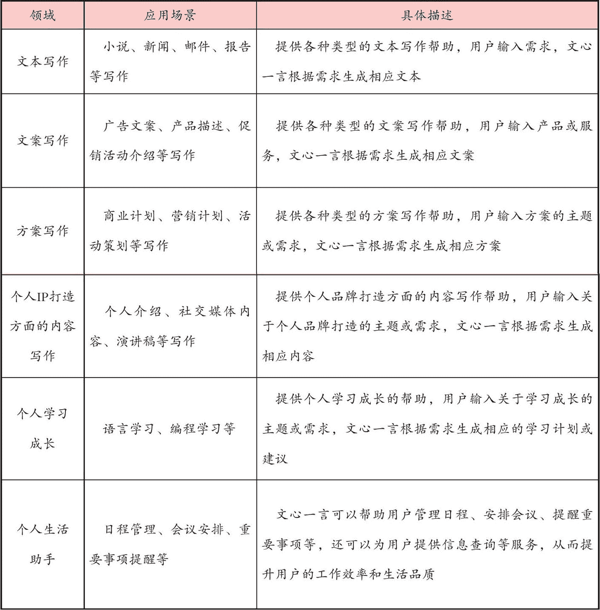

评测显示，文心一言在读取文字描述后进行归类并输出表格的能力明显优于多数已公开的国内AIGC模型，部分场景的表现甚至超过ChatGPT-3.5。

## 第三节
提示词与提问技巧

#### 一、提示词的运用
使用文心一言等AIGC工具时，提示词是决定提问效率与结果质量的关键，直接影响是否能借助AI获得理想输出。

###### 用户提问
使用文心一言时，如何通过提示词让回答更精确？请介绍AI提示词的概念和作用，并说明如何用提示词提升生成文本质量，同时给出案例示范。

###### 文心一言回答
**提示词 Prompt是一种用于引导大模型生成文本的指令性语句。** 在自然语言处理中，提示词主要提供生成上下文并指引模型向特定方向展开。借助提示词可以更精准地控制输出的内容和形式，从而提升文本质量。

使用提示词的一般流程如下：

**1 确定生成文本的主题与目标。** 例如想写一篇环境保护文章，主题和目标就是环保。

**2 基于主题与目标撰写简短提示词。** 提示词需包含主题信息并指引生成方向，例如：“环境保护是每个人的责任，请写一篇文章提出个人可采取的环保措施。”

**3 将提示词输入模型生成文本。** 不同平台的输入方式可能不同，如文本框输入或上传文件。

**4 复核生成的文本。** 若不符合预期，可调整提示词或模型参数进行优化。例如文本中出现过多无关内容时，可使用更具体的提示词缩小范围。

示例：

1 想写健康饮食文章，可用提示词：“当下生活节奏快，人们饮食常不健康，请写一篇探讨健康饮食重要性及日常实践方法的文章。”

2 想写学生会文章，可用提示词：“学生会是学生参与校园活动的重要组织，请写一篇分析其作用、组成和活动内容的文章。”

3 想写旅游文章，可用提示词：“旅游能拓宽视野与体验，请写一篇介绍你最难忘的旅游目的地及原因。”

总之，合理使用提示词能提升生成质量和效率，使结果更符合预期。但提示词不宜过于复杂或晦涩，否则会削弱生成效果。

提示词本质上是给AI的指令，掌握并善用提示词至关重要。只有做到精准提示、精准引导，文心一言等工具才能“有的放矢”“如臂使指”，真正成为提效利器。

###### 用户提问
怎样高效使用AI提示词，让文心一言的生成效果更好、更贴合需求？请详细举例说明。

###### 文心一言回答
要让提示词使用更高效，可注意以下几点：

**明确需求：** 使用前先厘清自己的目标和目的。例如想写环境保护文章，需求就是让模型撰写这篇文章。

**撰写具体提示词：** 提示词越具体越明确，模型理解越准确。例如：“环境保护是我们共同的责任，请写一篇文章列举个人可行的环保举措。”

**迭代调整提示词：** 若首次输出不理想，可对提示词进行调整。例如初稿过于宽泛时，用更具体的描述收窄范围。

**补充上下文：** 在提示词中提供背景信息，有助于模型更好理解需求。例如：“环境保护是我们共同的责任。我近期看到一份环保报告，列出了多项个人措施，请据此写一篇文章进行探讨。”

示例：

1 健康饮食：“快节奏生活下饮食常不健康，请写一篇论述健康饮食重要性及日常实现方法的文章。”

2 学生会：“学生会是学生参与校园活动的重要形式，请写一篇介绍其作用、构成和活动的文章。”

3 旅游：“旅游能拓展视野与经验，请写一篇描述你最喜欢的旅游目的地及其难忘之处。”

总之，高效使用提示词需要明确目标、撰写具体清晰的指令并提供上下文。若输出不符预期，可通过调整提示词持续优化。

总结来说，提示词就是对AI的命令，学会使用并用好它至关重要。精准提示才能让文心一言更听话，成为真正的百倍增效工作神器。

#### 二、提问技巧的优化

###### 用户提问
请分析提问技巧在文本生成中的作用，包含哪些具体内容。

###### 文心一言回答
提问技巧对生成结果影响很大，良好的提问能让方向和重点更清晰，更好地引导模型输出所需内容。具体作用包括：

**1 明确主题和目的：** 借助提问让模型准确把握生成文本的主题和目标，确保结果符合要求。

**2 引导相关内容输出：** 提问能指引模型朝预期方向展开。

**3 帮助理解上下文：** 提问可为模型提供背景信息，利于理解需求。

**4 提升文本质量：** 好的提问有助于控制内容和质量。

总之，提问技巧能帮助模型更准确理解需求并生成相关内容，同时提升质量和效率。

###### 用户追问
请详细介绍如何优化提问技巧以提高生成文本质量，有哪些方法与步骤？

###### 文心一言回答
优化提问技巧是提升生成质量的关键。具体做法如下：

**1 明确需求与目的：** 先确定需要何种文本及达成何种目的。

**2 细化问题：** 大而空的问题易导致模型困惑，需拆分为更小、更具体的问题。

**3 提供上下文信息：** 提问时补充背景，帮助模型理解需求。

**4 使用示例：** 提供样例能让模型更快把握预期风格和内容。

**5 避免模糊用词：** 减少“很多”“一些”“有点”等模糊表达。

**6 复核输出：** 检查结果是否符合需求，不符时调整提问方式。

总之，优化提问需做到目的明确、问题细化、上下文充足、示例辅助、避免模糊并及时复核。任何技巧都靠练习，熟能生巧，用户可在文心一言的反馈中不断提升提问水平，优化提示词，让生成结果更符合预期。

# 第二章
文本辅助生成

## 第一节
新闻类文本

#### 一、新闻文本的提示词分类
新闻文本主要包括报道、评论、特写等，具有时效、客观、准确等特点，要求表达清晰简洁、客观公正。借助文心一言生成不同类型新闻时，可在提问中选用合适的提示词，见表2-1。

表2-1 新闻文本的提示词

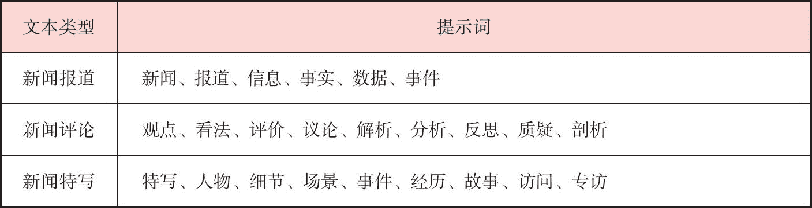

#### 二、如何用文心一言辅助生成新闻文本
文心一言基于自然语言处理与机器学习，能够快速筛选和分析大量数据信息，缩短新闻撰写时间，同时能理解人类语言、提取关键信息与观点，保持客观中立。

###### 用户提问
假设你是一名媒体编辑，需撰写一篇关于广东省九九重阳节全民登山活动的新闻报道，你会怎么写？

###### 文心一言回答
###### 广东重阳万人登山启动 健康百岁梦引万人参与

广东省老年人体育协会与广东仁源健康管理有限公司联合主办的“健康百岁梦·万人齐参与”暨广东省2023年重阳万人登山活动发布会于7月12日举行。据悉活动将于2023年10月开展，以庆祝重阳佳节，倡导健康生活方式。

主办方介绍，本次活动主题为“健康百岁梦”，通过万人登山提升公众对健康生活的认知，传承重阳节文化。活动将在广州市白云山举办，全程约4千米，从云台花园出发徒步至山顶公园，让参与者在自然中感受运动快乐。

农历九月初九是传统重阳节，登高是重要习俗。此次将重阳登高与全民健身结合，以白云山为舞台，让市民在体验传统的同时享受健康生活。

文心一言生成的报道完整呈现了活动信息，具备新闻要素，风格朴实简洁，注重客观陈述与细节描写。

###### 【帮你创作】
若用文心一言生成新闻文本，提问时可注意：

**1 明确主题与要点。** 清楚告知新闻主题与核心要点，便于模型精准把握需求。

**2 提供详细信息。** 补充时间、地点、人物、事件及细节，提升新闻价值。

**3 指定新闻类型。** 可明确是报道、评论或特写。

**4 关注语言风格。** 在问题中说明所需语体。

**5 提出具体要求。** 如需突出信息或限定时间段，可在提问中说明。

**6 保证表述清晰。** 避免使用复杂术语，让模型更好理解。

###### 用户提问
假设你是一名媒体编辑，需撰写一篇关于广东省九九重阳节全民登山活动的新闻报道，要求风格轻松有趣，你会怎么写？

###### 文心一言回答
###### 重阳登山热潮来袭 广东全民开启健康探险

随着重阳节临近，广东省老年人体育协会携手广东仁源健康管理有限公司策划了一场全民登山活动。活动将于十月在风景秀丽的广州市白云山举行，以轻松有趣的调性吸引众多市民参与，共同欢度佳节。

活动名为“健康百岁梦·万人齐参与”，寓意通过万人登山增强公众健康意识，传承重阳传统。启动仪式于7月12日举行，标志着万人登山正式开启。

据介绍，当天市民将从白云山云台花园出发，徒步至山顶公园，全程约4千米。对多数人而言是轻松的挑战，既能强身健体，又能在大自然中感受运动乐趣。

有市民表示：“很期待这次活动，既能与家人共度有意义的重阳节，也能结识志同道合的朋友，一起追求健康生活。”

活动当天还将安排登高竞赛、摄影比赛、美食品尝等趣味环节，为市民营造轻松愉快的节日氛围。

在明确语言风格要求后，生成的稿件更注重生动性与趣味性，表达更简洁明了，贴近市民参与感受，吸引力与感染力更强。

## 第二节
公文类文本

#### 一、办公公文的提示词分类
办公公文主要包括通知、通报、请示、调研报告等，具有规范、正式、严谨的特点，要求表达清晰、格式规范、用词准确，见表2-2。

表2-2 办公公文的提示词

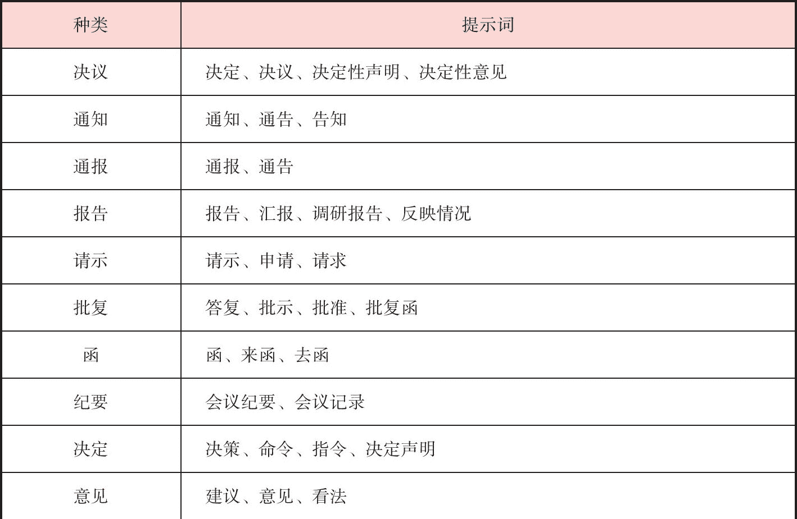

续表

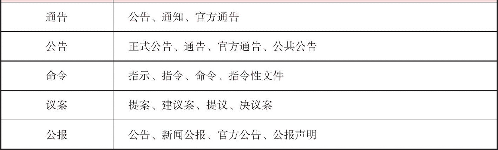

#### 二、如何用文心一言辅助生成公文类文本

###### 用户提问
请以部门助理身份撰写一则通知，主要内容为邀请部门员工报名参加团建活动，要求语气严肃官方、结构完整清晰。

###### 文心一言回答
###### 关于邀请公司部门员工参加团建活动的通知

各位部门员工：

为增强团队凝聚力，提升工作积极性与协作能力，根据公司相关规定，现正式邀请全体部门员工参加团建活动。

具体安排如下：

【活动时间】2023年5月10日至5月12日，共3天

【活动地点】北京市怀柔区某度假村

【参与人员】公司部门全体员工

【活动日程】
第一天：集合出发，抵达后开展团队拓展
第二天：团队竞赛如拔河、接力，晚间篝火晚会
第三天：总结表彰后返回公司

请全体员工积极参与，按时确认安排。

文心一言生成的通知列出了活动目的与安排，整体清晰明了，可进一步明确目的并使用更正式的官方用语。

###### 【帮你完成】
使用文心一言辅助生成公文可参考以下步骤：

**1 确定公文类型与目的。** 选择通知、通报、请示或报告等，并明确传达信息与要求。

**2 梳理公文要素。** 按类型整理主送单位、正文、落款等，并按规范排版。

**3 输入公文内容。** 根据实际需求拟定具体内容，使用正式严谨的语气与准确用词，可参考模板或范文。

**4 自动纠错。** 利用自动纠错功能检查错别字、语法等问题，提升准确性。

**5 优化表达。** 使用优化表达功能对不当之处进行修改，使公文更规范得体。

**6 确认与审核。** 仔细校核内容完整性与准确性，可借助校对功能或对照模板校验。

###### 用户提问
该通知有哪些可优化之处？

###### 文心一言回答
通知整体较好，日程安排可更具体化。例如：“第一天上午进行团队拓展，下午抵达后开展团队建设游戏；第二天上午拔河比赛，下午接力赛，晚上篝火晚会；第三天上午总结，下午返程。”

结尾段落提到希望大家参与，表述比较笼统。建议把参与方式具体化，例如说明个人才艺类节目的排练流程，或号召同事踊跃报名各类竞赛。“特此通知，请认真执行”里的“特此通知”略显冗余，可改为“敬请知悉”或“请诸位知悉”。以上只是优化参考，并非必须改动，原通知已清晰完整，若需补充活动日程或参与说明，可另页附上。

## 第三节
公关文本

#### 一、公关文本的提示词划分
公关写作按用途大致可分为新闻稿、宣传稿、社交媒体稿、危机应对稿等，兼具宣传、营销、创意特点，不同类型对应的提示词也有差异，具体见表2-3。

表 2-3　公关类文本提示词

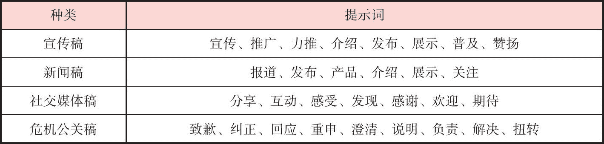

#### 二、借助文心一言生成公关类文本
文心一言是一款高效的写作助手，无论是危机公关、新闻发布还是社媒内容创作，都能提供全流程支持，让写作更高效精准专业。

###### 用户提问
我司拟在社交平台推出一项带奖竞猜活动，目标是提升用户参与度、扩大品牌曝光与互动，烦请起草一份营销宣传稿。

###### 文心一言回答
###### 社媒竞猜来袭，赢礼等你来

充满趣味又带点紧张感的互动玩法即将上线，这是一次近距离感受品牌的契机，一场别开生面的竞猜正要启动。

活动时间为××××年××月××日至××月××日，将同步发布于微信公众号、微博、抖音、小红书等渠道。欢迎热爱挑战、享受互动的朋友加入，一同在智力角逐中体会品牌魅力。

本次竞猜备有丰厚奖品，中奖概率较高，每个环节都经过细致打磨，力求给参与者顺畅体验。

同时也是提升品牌可见度与用户互动的有效方式，期待更多朋友参与，共同分享乐趣与挑战。

除营销文案外，文心一言在危机公关方面的表现同样出色。它可以迅速生成针对特定事件的声明，提供合理解释与应对策略，缓解公众疑虑，维护企业形象；同时还能对危机事件进行追踪分析，汇总各方反馈，以便做出更及时有效的处置。

###### 用户提问
我经营一家连锁餐饮品牌，昨日出现食品安全问题，有顾客用餐后出现腹泻、呕吐症状，该如何撰写危机公关稿？

###### 文心一言回答
尊敬的顾客及媒体朋友：

首先，我代表餐厅对近期发生的食品安全事件致以诚挚歉意。我们高度重视每位顾客的反馈，对此次造成的不便深表遗憾。

昨日有顾客反映用餐后出现腹泻、呕吐等不适。我们已第一时间联系当事人，并详细记录情况。目前已责成相关部门对原辅料、制作流程及员工操作等环节开展全面排查。

我们高度重视，决定采取以下措施：

全面排查原料：对所有原辅料进行彻底检查，确保符合规范；同时加强与供应商协作，要求提供更详细的原料信息及证明。

严格管控流程：进一步规范制作环节，确保每道操作都符合食品安全要求；同时加强员工培训，提升操作规范与食品安全意识。

【帮你提速】
文心一言在辅助生成公关文本时能明显提升效率，主要体现在五个方面。

**（1）模板供给。** 内置多种文体模板，如新闻通稿、发言稿、产品介绍等，按需挑选并填入信息，可快速产出高质量文案。

**（2）智能排版。** 可自动排版，让文本更美观易读。能根据输入自动调整字体、字号、行距等，使版式更规范整齐。

**（3）语言优化。** 可自动检测用词与语法问题并给出优化建议，如调整措辞、修正语法错误、避免表达模糊，使文案更精炼清晰。

**（4）快速编辑。** 提供复制、粘贴、撤销、重做等编辑功能，可迅速修改调整；同时支持多人协同，多人可同时编辑同一文档，提升效率。

**（5）智能推荐。** 能依据输入内容智能推荐相关素材、案例等资料，帮助更快完成公关文本创作。

## 第四节
演讲发言类文本

#### 一、关键词准备
撰写演讲或发言稿时，关键词的整理至关重要。优秀稿件需要明确主题，并用关键词突出重点。可参考以下方向。

**（1）开场。** 明确演讲目的与主题，迅速吸引注意。如“各位领导、同事大家好”“感谢大家参加本次年终表彰”。

**（2）感谢与赞美。** 表达对领导和同事的感激与尊重，肯定过去一年的努力与贡献。如“我要向全体领导同事致以谢意与敬意”。

**（3）业绩和成果。** 突出公司或团队过去一年的成绩，强调集体奋斗与协作精神。如“在此，我想分享过去一年取得的优秀成果”。

**（4）个人经历。** 展示工作中的成长，讲述一两个成功案例，用个人经历证明能力与价值。如“过去一年我参与了重要策划项目，依靠团队协作顺利达成目标，获客户高度认可”。

**（5）未来展望。** 表达对公司或团队发展的期待与信心，强调自身决心。如“今后我将继续努力，为公司发展贡献力量”。

**（6）感谢。** 再次表达谢意，并向听众送上祝福。如“最后，祝公司发展蒸蒸日上，每位员工都能实现价值与梦想”。

#### 二、文心一言撰写阶段
撰写发言稿时，可借助文心一言提供的模板与框架，快速搭建主体结构。同时平台提供丰富的词汇与语句推荐，帮助更高效表达观点与情感。

###### 用户提问
我在一家新媒体公司担任策划，负责制定和执行市场推广策略，包括线上线下活动策划、营销方案制定等。公司即将举行年终表彰会，我需作为优秀员工代表发言，请生成一篇约3分钟的发言稿。

###### 文心一言回答
尊敬的领导、亲爱的同事们：

大家好！非常荣幸能作为优秀员工代表，分享过去一年的工作体会与成果。

首先，我要向全体领导和同事致以衷心感谢。正是有大家的支持与信任，我才能发挥所长，取得令人欣喜的成绩。

过去一年，公司经历了诸多挑战与机遇。作为市场推广策划，我参与了多个线上线下活动的策划与执行。依靠团队协作，我们成功提升了品牌知名度，吸引了更多用户与客户。

我们制定的营销方案也取得明显成效。通过精准定位与创新手段，销售额保持持续增长。这既是个人努力的结果，更离不开整个团队的配合。

工作中我深刻体会到团队精神的重要性。每位同事的付出都是成功的基石。在此，我向全体团队成员表达最真诚的敬意与感谢。

同时要提醒大家，成功不是终点而是新的起点。面对未来，需要保持谦逊进取的态度，不断学习创新，以适应市场变化与竞争挑战。

最后，祝愿公司在未来发展中更上一层楼。每位员工都是公司宝贵的财富，相信在共同努力下，我们能实现更大突破。

谢谢大家！

文心一言生成的这篇演讲稿涵盖了开场白、主题阐述、回顾总结、结束语等主要要素，思路清晰，说服力强，逻辑完整，易于听众理解，并在结尾加入了祝愿，使听众感受愉悦。

###### 【帮你优化】
（1）**引起关注。** 开场部分可要求文心一言使用一个引人入胜的故事、名人名言或统计数据来吸引听众注意，从而更好地激发兴趣。

（2）**使用具体例证。** 为增强说服力与生动性，可在演讲中加入具体案例、实例或个人经历来支撑观点，例证可来自工作中的真实经历，也可要求文心一言提供与主题契合的案例，使内容更具体、更具共鸣。

（3）**明确语言习惯与表达风格。** 根据演讲场合与受众准备合适氛围的稿件，可明确告知文心一言所需的语言习惯与表达风格，如“生成一篇鼓舞人心的演讲稿”“生成一篇通俗易懂的演讲稿”等，帮助其生成更贴合的文本。

#### 三、文心一言完善校对阶段
初稿完成后，可利用文心一言的语法校对与文本纠错功能，对稿件进行检查与修正，确保准确流畅。

###### 【帮你完善】
（1）**语言准确性。** 文心一言可检查演讲稿中的语法错误与错别字，确保表达准确流畅。可将稿件复制到输入框，由其识别并修正语言问题。

（2）**给出建议。** 文心一言可依据内容与语境提供合理建议，例如提示替换某个词汇，或提出改进句子的方案，使稿件更符合表达习惯。

（3）**提供例句。** 文心一言可根据稿件需求提供相关例句。例如涉及某个概念或理论时，可给出例句帮助更好地理解与表达。

（4）**引导思考。** 文心一言可引导深入思考某个问题或话题，提供启发性问题或观点，帮助拓宽思路，挖掘主题内涵。

（5）**检查逻辑。** 文心一言可帮助检查稿件逻辑性，指出可能存在的逻辑漏洞或不连贯之处，并给出相应建议，让演讲更清晰连贯。

## 第五节
文学创作类文本

#### 一、文学创作类文本的类别、特点和要求
文学创作类文本主要包括记叙文、议论文、诗歌、剧本、小说、散文等，各类文本的创作特点与要求各不相同，见表2-4。

表 2-4　文学创作类文本的特点及要求

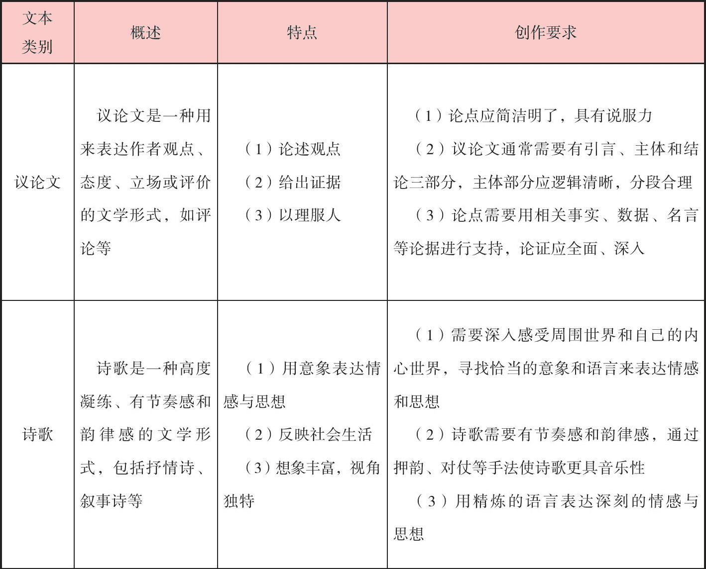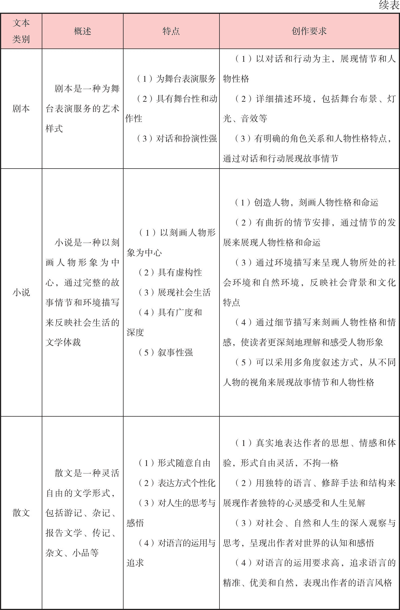

#### 二、如何用文心一言辅助生成文学创作类文本
文心一言可模拟人类思维与创造力，通过海量数据学习与分析提供灵感与创意支持。它能自动生成诗歌、小说甚至剧本，帮助作者迸发更多新颖想法。

###### 用户提问
我是一名文旅局宣传部工作人员，现在需要为贵州西江千户苗寨做旅游宣传，请写一首散文诗赞美千户苗寨的景色，要求辞藻华丽、意境真切、画面鲜活。

###### 文心一言回答
苗寨深藏贵州山水之间，云雾舒卷如画，
瓦檐与木梁皆记着古老年轮。
青山拥翠，吊脚楼层层递上山坡，
晨光泼在稻田，碎金闪烁生辉。

山峦似流动的卷轴，云气时隐时现，
溪流吟唱自然的乐章，鸟鸣随风轻送。
夜色宁静神秘，星光与灯火映照吊脚楼，
人们以真诚笑容传递质朴感动，生活如画卷令人向往。

每座吊脚楼都是传承的诗行，每位苗人都是活的图景，
信仰、热情与纯真在此深深烙印。
千户苗寨，既是自然之美，也是人文之韵，更是生活的诗。

请走进这片山水，让心灵得到洗涤，灵魂得到升华，
愿这份美好长留心间。

文心一言生成的散文诗在描绘苗寨时运用大量细节，让读者身临其境，从瓦片到吊脚楼，从青山到星空，描写细腻，用词考究，句式多变，富有韵律，给人深刻印象。

###### 【帮你创作】
**（1）提供灵感。** 缺乏创作灵感时，可向文心一言询问有关文学作品的问题，如“应写何种类型的故事”“哪些主题更受欢迎”。文心一言可据此提供灵感与思路。

**（2）协助情节构思。** 构思情节时可询问如“我如何安排主人公的行动与决定”“故事应加入哪些冲突与挑战”等问题，文心一言可提供情节构思的建议与提示。

**（3）提供词句与表达方式。** 写作中遇到词句难题时可询问，如“如何形象描述这个场景？”“角色特点如何在言行中体现？”文心一言可提供相应建议与提示。

**（4）提供参考资料。** 需要特定主题或背景信息时可询问，如“该时代有哪些著名人物或事件？”“该国家文化有何特点？”文心一言可提供相关参考资料与信息。

# 第三章
文案辅助生成

## 第一节
工作计划

#### 一、工作计划的分类与提示词
##### 1.工作计划的分类
工作计划可按不同标准分类，常见方法如下。

**（1）按时间跨度分类。** 长期计划（5年及以上）、中期计划（1～5年）、短期计划（1年以内）。

**（2）按目标分类。** 销售计划、生产计划、财务计划、人力资源计划、研发计划等。

**（3）按范围分类。** 全面计划、部门计划、项目计划、个人计划等。

**（4）按关键要素分类。** 人员、时间、任务、资源计划等。

##### 2.工作计划提示词
制定工作计划时，熟练运用提示词有助于提升质量。

**（1）目标与目的。** 明确计划目标与目的，确保与组织战略保持一致。

**（2）背景与现状。** 分析计划背景与当前状况，找出问题与机会。

**（3）资源与约束。** 明确所需资源与存在约束，如人力、财力、物力、时间等。

**（4）策略与措施。** 制定实现目标的策略与具体措施，包括任务分配、时间安排、资源配置等。

**（5）评估与调整。** 定期评估计划进展，并根据实际情况进行调整，以保证有效实施。

**（6）沟通与协调。** 加强与相关部门与人员的沟通协调，确保计划顺利推进并达到预期。

**（7）风险与应对。** 预判可能出现的风险与挑战，并制定相应应对措施与预案。

**（8）激励与考核。** 建立合理激励与考核机制，鼓励员工积极参与计划实施。

#### 二、如何用文心一言辅助制订工作计划
工作计划是组织或个人为实现特定目标在特定时段制定的行动方案。科学合理的工作计划有助于明确目标、制定策略、调配资源、协调行动，确保工作高效顺利完成。

文心一言可根据提供的信息与要求，辅助制定科学合理的工作计划。

###### 用户提问
请以某美妆产品公司销售部总监身份，制定一份合理完善的产品销售年度工作计划。

###### 文心一言回答
###### 美妆产品销售年度工作计划
（一）引言
随着消费者对美妆产品需求持续增长，美妆销售已成为重点领域。本年度计划旨在提升销售业绩、优化销售流程、提高客户满意度并降低运营成本。计划将详细安排销售任务与市场推广策略等内容。

（二）销售计划
1.销售目标与任务
本年度销售目标为销售额提升20%，销售流程优化，客户满意度提升10%，运营成本降低15%。为实现目标，将结合产品销售季节、种类与渠道制定具体计划。

2.销售策略与时间安排
（1）针对不同销售季节，提前备货，调整产品线以适应市场需求。
（2）针对不同产品种类，进行市场调研，制定差异化销售策略。
（3）拓展线上线下渠道，提升品牌知名度。

具体安排：
（1）第一季度：制定销售策略，调整库存，依据市场需求布局产品。
（2）第二季度：开展线上线下推广活动，提升品牌知名度，拓展渠道。
（3）第三季度：结合产品特点与市场需求，制定差异化策略，提升销售额。
（4）第四季度：针对冬季产品需求，调整产品线，开展促销活动，提高客户满意度。

3.销售渠道
（1）线上销售平台。①拓展渠道：在现有基础上积极拓展社交电商、直播带货等新兴渠道，增加曝光与销量。②营销活动：定期组织限时折扣、满额赠品等促销，吸引消费者；同时与美妆类KOL合作推广，提升品牌知名度。③客户关系管理：建立完善客户管理系统，了解需求，提供个性化建议与售后服务。

（2）线下门店。①拓展门店：在全国重要城市开设新店，扩大覆盖面；同时优化店内布局与购物环境，提升体验。②导购培训：加强导购培训，提升服务质量；定期组织产品知识与销售技巧培训，提升专业素养。③店内活动：组织满额减免、赠品等促销活动，吸引消费者进店。

（三）市场推广计划
1.市场定位策略
根据调研，将针对20～35岁女性消费者推广美妆产品。该群体需求较高，注重品质与个性化，且购买力较强。

2.品牌推广策略
通过优化品牌形象，提升知名度与认可度。具体措施包括：
（1）设计独特品牌标识与视觉形象，体现品牌个性与时尚元素。

品牌传播核心框架

2) 搭建品牌叙事体系，明确核心价值并对外输出主张。
3) 依托社交媒体矩阵联动 KOL 等资源，实现多路径声量放大。

3. 广告投放打法
以全域覆盖为目标，提升品类认知与市场份额。具体做法：
(1) 围绕目标人群定制文案与视觉方案，精准匹配需求。
(2) 通过社媒平台、短视频、直播等渠道进行投放。
(3) 携手美妆达人及行业意见领袖，发起试用种草活动。

经文心一言辅助生成的美妆品类年度销售方案，整体架构完整、逻辑通顺，但因资料来源受限，个性化不足，难以完全贴合具体单品，需结合产品自身特性做二次完善与优化。

###### 【帮你建模】
首先，给该工具赋予清晰角色，比如美妆品牌销售负责人、快消品市场经理、咨询机构人力总监等，随后下达明确指令，如年度方案、季度方案、月度方案、市场推广计划、销售规划等限定词，只有通过精准限定，输出才更理想、更具体、更具针对性。

其次，若生成框架不够全面合理，可通过追问获取补充信息，例如还能参考哪些销售打法、线上平台有哪些细化策略、若把线下门店切换为线上渠道策略该如何调整等。

最后，若内容出现缺口，可按实际需求追加要求，例如该方案缺少销售目标请补充、缺少推广策略请补充、缺少执行细则请补充等，多轮迭代后形成科学合理的年度计划。

## 第二节
工作总结

#### 一、工作总结的分类与提示词

##### 1.工作总结的分类
(1) 按范围划分。可划分为班组总结、部门总结、行业总结、区域总结等。
(2) 按内容划分。可划分为工作类总结、教学类总结、学习类总结、科研类总结、思想类总结、项目类总结等。
(3) 按时间划分。可划分为月度总结、季度总结、半年总结、年度总结、跨年度总结等。

说明：以上划分并非完全独立，可交叉使用。例如一份部门的年度总结可能同时属于部门类、时间类和综合类。撰写时应依据实际需要灵活选用。

##### 2.工作总结的提示词
提示词应围绕任务完成度、工作产出、困难挑战、学习成长、感受体会、改进建议及致谢认可等展开，常用方向如下：
(1) 任务完成情况。包括任务名称、内容、进度、完成度，有助于了解项目进展。
(2) 工作成果。指具体产出，包括达成目标、取得效果、解决问题等。
(3) 困难和挑战。描述工作中遇到的阻碍及应对方式，以及所需支持与资源。
(4) 学习和成长。总结工作中获得的知识与技能，以及如何应用到后续工作。
(5) 感受和体会。表达对项目全过程的看法，包括团队协作、工作氛围、成就感等。
(6) 改进和优化建议。针对流程、工具、方法提出优化思路。
(7) 感谢和认可。对领导同事的支持表示感谢，同时肯定项目价值。

#### 二、如何用文心一言辅助撰写工作总结
工作总结是对特定时期工作进行回顾、分析与评价，以发现不足、总结经验、推动改进的一种文体。

文心一言可提供常见总结模板，借助自然语言处理能力分析用户提供的素材，提取关键信息，帮助把握重点与方向。也可根据简要描述快速生成符合要求的总结文档，节省时间，提升撰写效率与质量。

###### 用户提问
假设你在一家研发企业担任人力资源负责人，请围绕招聘工作撰写一份年度总结。

###### 文心一言回答
###### 年度总结
尊敬的领导和同事：
作为研发公司的人力资源负责人，十分荣幸分享本年度招聘工作的回顾。过去一年，我们致力于为公司引入优秀人才，支撑研发、市场、管理等各部门运作。目标是通过高效招聘，为公司长期发展提供人才保障。

（一）招聘工作的目标与职责
首要目标是确保公司招到最合适的人才。为此负责制定招聘计划、组织招聘活动、筛选简历、面试评估候选人，并保障流程顺畅高效，使公司能快速匹配合适人选。

（二）招聘工作的整体背景
随着业务快速扩张，人才需求持续旺盛。招聘团队通过招聘网站、社交媒体、内部推荐等渠道开展工作，并积极参与各类招聘会与人才交流活动，以吸引更多优秀候选人。

（三）招聘工作的具体开展
1.招聘流程
制定了完整流程，涵盖职位发布、简历筛选、面试、评估与录用。发布阶段注重撰写清晰的岗位描述与要求；筛选阶段利用招聘工具提升准确性与效率。
2.招聘渠道
采用多元方式，包括招聘网站、社交媒体、内部推荐等。年度内收到简历超1000份，其中招聘网站占比60%，社交媒体占比20%，内部推荐占比10%，其他渠道占比10%。
3.简历筛选
建立简历库并分类管理，便于快速定位符合要求的候选人，并制定统一筛选标准确保公平评估。共收到超1000份简历，初筛后保留约200份进入下一环节。
4.面试流程
制定标准化流程与评估标准，面试前对面试官进行培训，明确方式与要点，采用多轮面试确保全面了解。共完成约200场面试，其中技术岗100场，市场岗50场，管理岗50场。数据显示技术岗通过率约20%，市场岗约15%，管理岗约10%。

由此可见，文心一言输出的内容具备参考价值与实用性，可在此基础上调整优化。

###### 【帮你创作】
使用文心一言撰写工作总结时，首先应提供明确的目的与背景，如是向上级汇报进展还是总结经验教训；是个人年度总结、项目总结还是部门阶段总结等。

其次，初稿完成后应结合实际查漏补缺并提出具体要求，例如告知我在招聘流程中遇到哪些问题并进行了优化，请体现在总结中；请补充相关案例、数据、文献以支撑内容。

最后，可持续提问完善内容，如总结中还应注意哪些要点，还有哪些方法可进一步完善总结等。

###### 【帮你优化】
(1) 自动纠错。利用文心一言的自动纠错功能，输入文档后可自动检测语法、拼写、标点等错误，并给出修改建议，避免低级失误。
(2) 审核校对。文心一言还能对总结文档进行自动审核校对，提供修改意见，提升文档质量与可读性。

## 第三节
工作汇报

#### 一、工作汇报的分类与提示词

##### 1.工作汇报的常见分类
(1) 按时间分类。包括日常汇报、周报、月报、季报、年报。
(2) 按项目分类。包括项目进展汇报、项目完结汇报。
(3) 按主题分类。包括财务汇报、销售汇报、人力汇报、技术汇报、市场营销汇报等。

实际应用中可根据需要组合上述维度，以满足沟通与决策需求。

##### 2.工作汇报提示词
(1) 目的和背景。明确汇报意图与背景，如本次汇报围绕以下要点展开，首先需要强调的是，我们将从…开始等。
(2) 总结和概括。用简练语言概括核心内容，如总体来看，概括而言，总结来说，简言之等。
(3) 进展和成果。呈现具体数据、事实、案例，如我们取得了以下进展，成功实现，期内我们达到等。
(4) 问题和分析。对遇到的难题进行深挖，分析成因并提出对策，如主要挑战在于，亟需解决的问题是等。
(5) 结论和建议。基于分析得出结论并给出下一步计划，如为解决此问题，我们采取了…，我们的方案是，计划在接下来的时间内等。
(6) 评估和反馈。对工作过程、成果及未完成事项进行评价，如据初步评估，根据客户/员工反馈等。
(7) 未来计划和展望。对未来工作进行规划，如我们有望在…期内，未来展望是，预计未来数月内等。
(8) 结束和总结。对整体内容收束，突出重点成果或观点，如总的来说，我们取得显著进展，最后我想强调等。

#### 二、如何用文心一言辅助写作工作汇报
工作汇报是向上级、同事或客户传达进展、成果与计划的重要载体，按不同维度整理信息有助于提升理解效率。

文心一言可帮助梳理思路，提供结构化表达，并检查逻辑是否通顺、重点是否突出。

###### 用户提问
假设你现为一家家电企业的销售经理，请围绕2023年第二季度的销售业绩进行工作汇报。

###### 文心一言回答
###### 工作汇报
尊敬的领导及同事：
今天就本季度销售业绩与市场动态进行汇报，并探讨后续销售规划。

（一）引言
2023年第二季度公司销售业绩保持稳定增长。下面从业绩、市场竞争、区域管理及后续计划等方面展开分析。

（二）销售业绩分析
1.销售额与销售量
本季度销售额与销售量较上季度均有提升，销售额增长约20%，销售量增长约15%。主要得益于对市场需求的准确把握及销售团队的共同努力。
2.市场占有率
与竞争对手对比，本季度市场占有率有所提高，主要产品线份额增长约10%，进一步巩固了市场地位。

（三）市场竞争分析
1.主要竞争对手
本季度主要对手为A公司与B公司。A公司主打品牌与品质，B公司以价格优势见长。针对此情况，我们在优化产品策略、提升质量的同时，适度下调部分产品价格以增强竞争力。
2.应对措施
加强与供应商合作寻求成本优化；加大新品研发与推广力度吸引客户；提升售后服务水平，增强客户满意度与忠诚度。

（四）销售区域管理
1.窜货问题
本季度发现部分窜货现象。为此将加强与经销商沟通，严格执行销售政策，加大违规处罚力度。
2.客户管理
加大客户需求关注与满足力度，提升满意度与忠诚度，同时完善客户档案以更精准把握需求与市场变化。

（五）下一步工作计划
基于本季度表现，制定以下计划：
针对竞争对手的营销策略：持续优化产品策略，加大推广投入，寻求差异化竞争。
渠道建设：加强对经销商与直销团队的培训与支持，提升渠道效率与稳定性，同时积极开拓电商等新渠道。
促销活动：组织限时优惠、买赠等活动，提升销售额，并根据区域特点制定针对性方案。
时间节点与目标：计划在下季度初完成各项销售计划部署，季度末实现销售额与市场份额稳步提升。

（六）总结
通过对本季度业绩与竞争的分析，我们既看到优势与机会，也发现不足。在后续工作中将持续提升业绩与竞争力，实现公司长期目标。感谢领导与同事的支持！

示例显示文心一言生成的工作汇报整体完整、表达清晰，但关键数据支撑不足，可通过重新生成或提出具体修改要求进行调整优化。

###### 【帮你建模】
告知文心一言汇报主题、汇报对象、期望格式、相关数据与细节、篇幅要求、字数或页数限制等信息，即可生成符合需求的初稿。例如，我是一名电器卖场销售人员，请帮我撰写一份面向全公司的家电年度业绩汇报，重点突出第三季度销售额及市场现状分析，或请为某项目经理撰写项目进度汇报，突出当前进展与所需支持。

###### 【帮你提质】
初稿完成后，可通过提问梳理思路，提升质量，如还能提供哪些具体建议优化汇报，如何根据目的与受众针对性梳理内容，能提供更多组织建议吗，还有哪些因素影响销售业绩，从用户视角更关注哪些家电品类等，最终形成内容完整、表达清晰、重点突出且符合要求的汇报。

## 第四节
宣传文案

#### 一、宣传文案的分类与提示词

##### 1.宣传文案的分类
(1) 按传播渠道分类。可分为线上广告文案与线下广告文案。线上主要借助网络与社交媒体传播；线下主要通过广播、报纸等传统媒体。
(2) 按宣传目的分类。可分为产品宣传文案、品牌宣传文案、营销宣传文案等。产品文案侧重介绍特点、功能、用途；品牌文案侧重塑造形象、提升知名度与美誉度；营销文案侧重吸引关注、促成销售。
(3) 按情感表达方式分类。可分为情感化文案与理性化文案。情感化通过情绪共鸣吸引受众；理性化通过事实与数据传递信息。
(4) 按宣传侧重点分类。可分为概念型、功能型、情感型文案。概念型传递品牌理念；功能型介绍产品特性；情感型引发共鸣。
(5) 按发布主体分类。可分为政府宣传文案、企业宣传文案、非营利组织宣传文案、个人宣传文案等。政府文案用于传达政策与公共服务；企业文案用于推广品牌与产品；非营利文案用于宣传使命与募捐；个人文案用于塑造个人品牌。

##### 2.宣传文案的提示词
撰写宣传文案时，使用恰当提示词可增强吸引力与说服力。常见提示词与主题对应如下：
表 3-1　常见提示词及宣传主题
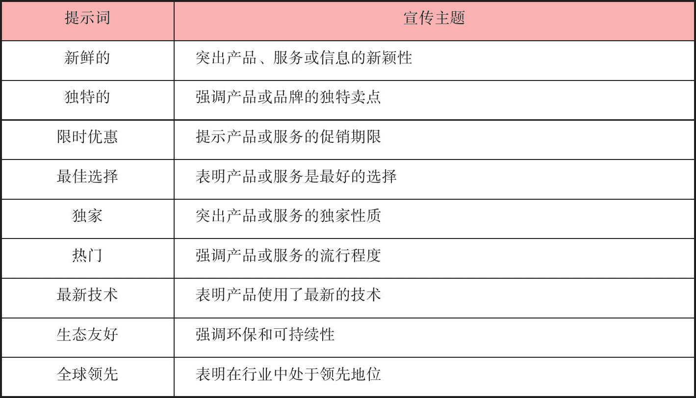

#### 二、如何用文心一言辅助撰写宣传文案
宣传文案以语言文字为载体，通过各类渠道传播以推广产品、服务、品牌。

撰写过程中，文心一言可帮助理解目标客户需求与心理，从而精准定位内容与策略。还能通过自然语言处理分析可读性与易用性，提出优化建议，使文案更简洁、生动、易记。

###### 用户提问
请为一家成立20年的通信企业撰写企业宣传文案，该企业以手机销售为主营业务。

###### 文心一言回答
###### 企业宣传文案
欢迎走进某某通信，这是一家深耕通信行业20年的企业，以手机销售及相关服务为主营业务。自成立以来，凭借卓越产品品质与专业服务，成为业内领先者。

自创立之初，某某通信便以手机销售为核心，坚持专业领先、以客户需求为导向，为消费者提供多元化选择，满足不同使用场景。

产品线覆盖从高端旗舰到入门机型，种类齐全。始终致力于提供优质产品与服务，让每位客户享受高品质通信体验，同时提供灵活购买方案与完善售后保障。

企业核心价值观为“以人为本、创新、专业”。我们坚信只有深刻理解并满足客户需求，才能提供最佳服务。因此持续保持对技术与服务的热情，不断提升专业水平与服务质量。

展望未来，某某通信将继续秉持专业领先精神，拓展业务范围，提升服务质量，加强品牌建设。唯有不断创新与完善，才能更好地服务客户，实现企业长远发展。

以某某通信为例，主营业务聚焦手机销售。公司长期坚持以用户为核心、不断创新、专业敬业的价值主张，持续改进服务水准和产品质量，期望未来与合作伙伴携手共进、实现双赢。

从该案例可以看出，哪怕只提供基础背景信息，模型也能生成架构完备、条理分明、目标清晰、具备参考价值的企业宣传稿，后续只需在此基础上做补充完善与质感提升。

###### 【创作指引】
（1）模型可输出多种模板与范例，方便根据受众偏好定制宣传内容。
（2）标题与开篇是抓住注意力的关键点，模型能够提供各类标题与开头思路，帮助构建符合受众需求的文案。
（3）模型可借助关键词检索与相关数据分析了解受众偏好，并据此生成匹配的文案。
（4）有价值的内容同样重要，模型可依据受众特征与传播主题调整语气，提供正式、非正式、口语化等多种表达方式。

###### 【优化建议】
使用模型时，建议尽量详实地提供宣传背景，包括产品、服务或活动名称、特色与优势，以及目标受众画像。初稿完成后，可结合实际需求迭代完善，参考模型给出的建议与语料，对文本进行润色，使其更贴合目标与受众。

## 第五节
广告文案

#### 一、广告文案的分类

广告文案可按不同维度划分：

（1）按投放渠道划分。可分为报纸文案、杂志文案、广播文案、电视文案、网络文案、户外文案及其他媒介文案。
（2）按宣传内容划分。可分为消费品文案、服务娱乐文案、信息产业文案、企业形象文案及社会公益文案。

撰写广告文案时需兼顾目标受众、行业趋势与营销目标，选择合适的文体与语言风格以吸引注意，并传递产品的特性、优势与价值。

#### 二、如何用文心一言辅助写作广告文案

广告文案是以文字、图像、音频等形式向公众传递信息的宣传手段，由标题、正文、广告语与附文构成，是广告内容的文字表达。

模型可依据广告目的、受众、产品或服务的卖点，以及品牌调性等信息，撰写各类广告文案，并生成契合主题的配图，以提升传播效果与品牌知名度。

###### 用户提问
请你用古典语言的风格写一款牛奶的广告文案。

###### 文心一言回答
###### 广告文案
以古风笔调描绘牛奶广告，可示例如下：

“甄选优良奶源，入口甘醇，品味健康，得众人青睐。一杯在握，如同春意盈室，香气满怀。晨曦初露或夜月清朗，轻啜一口，便能体会自然馈赠。”

模型以文言色彩呈现了牛奶的优良来源、口感与健康价值，该文案具备一定参考性，仍需按实际需求修改提升。

###### 【创作指引】
告诉模型广告主体、产品或服务的详细信息包括特点、优势与目标受众、希望传递的情感或信息点，如强调性能、价格竞争力、品质、创新性等、是否需要包含的关键信息或特定元素。模型即可结合受众需求与心理，使用通俗易懂、易记的语言风格与文体，生成更有针对性的广告文案。

###### 【创意提示】
除此之外，还可通过对话形式挖掘更多广告创意。例如询问“你能用徐志摩的文学风格写一款牛奶的广告文案吗”“还能给出其他相似的广告文案吗”“再给其他产品的示例参考”等。依托模型的回答不断启发新的创作思路，涵盖广告主题、文体、语言风格、视觉设计等方面，突出产品或服务的优势特点，以吸引目标受众。

## 第六节
产品文案

#### 一、产品文案的分类与提示词

##### 1.产品文案的分类
产品文案可依据不同标准分类，常见方式如下。

（1）按撰写目的划分。可分为营销文案、用户帮助文档、产品介绍文档、品牌宣传文案等。
（2）按文案风格划分。可分为严肃体、大众体、故事体、幽默体等。
（3）按文案形式划分。可分为软文、硬广、社群文案、公众号文案等。

实际撰写时，需结合具体情况选择合适分类，以更好满足撰写目的与受众需求。

##### 2.产品文案的提示词
撰写产品文案时，适当使用提示词有助于受众更清晰地了解产品并激发购买欲望。常见提示词如下。

**（1）免费的。** 能引起受众注意，让其感受到获取价值的机会。
**（2）价值。** 让受众感知产品的价值，视其为值得投资的购入。
**（3）节省。** 让受众感受到购买可节省时间与金钱。
**（4）方便。** 突出产品或服务的便捷性与效率。
**（5）可靠的。** 传达产品的稳定与可靠性。
**（6）值得信赖的。** 传递诚信与品质感。
**（7）优秀的。** 体现卓越品质与出色性能。
**（8）独具特色的。** 突出产品或服务的独特性与个性化。
**（9）完美的。** 营造无可挑剔的品质印象。
**（10）品质上乘的。** 强调高品质与高水准。

#### 二、如何利用文心一言辅助写作产品文案

产品文案用于描述与宣传产品或服务，主要目的是吸引潜在客户、提升品牌知名度并促进销售。

模型可根据用户提供的产品信息，从用户需求与市场角度撰写规范的产品文案。

###### 用户提问
假设我们正在推广一款名为“A 智能健康手环”的产品，该手环具有多种健康跟踪功能。请你就此写一篇产品文案。

###### 文心一言回答
###### 产品文案
产品名称：A 智能健康手环
主题：“健康的未来，从手腕开始”
目标受众：关注健康与生活品质的群体
产品特点与优势：实时健康数据监测；心率、睡眠、活动追踪；智能提醒与报警；优雅设计与佩戴舒适；健康是幸福生活的基础。A 智能健康手环是一款在手腕上提供全方位健康支持的创新产品。

为何选择 A 智能健康手环？
（1）实时健康数据监测：手环可帮助你了解自身身体状况，实时监测心率、睡眠质量、步数与卡路里消耗，让你始终掌握最新健康数据。
（2）智能提醒与报警：忙碌生活易让人忽视健康。手环会提醒你定时活动，避免久坐；同时监测睡眠，并在必要时发出报警，确保每日获得充足休息。
（3）优雅设计与佩戴舒适性：产品不仅功能出色，还具备令人喜爱的造型，采用高品质材料，佩戴舒适，适合日常使用。无论身处何地，都能提升时尚品位。

改善生活，从佩戴 A 智能健康手环开始。
无论你是追求更健康的生活方式，还是希望更好地关注自身健康，A 智能健康手环都是理想之选。切勿错过，让健康的未来从手腕开始吧。

从上述示例可见，模型的回答突出产品的特点、优势与目标受众，以健康、智能、舒适为主题，具备较高的参考价值，只需作简单修改即可使用。

###### 【创意提示】
通过与模型互动，讨论产品的特点优势及目标用户的需求兴趣，从而激发创作灵感。例如，“请描述这款产品的独特之处与主要解决的问题是什么”“主要目标用户是谁？其年龄、性别、职业、兴趣爱好如何”“产品满足的市场需求或趋势是什么？竞争对手是谁？我们的竞争优势何在”“是否有关于产品的有趣故事或人物可用于吸引读者”等。通过此类互动，模型可提供更具创意与针对性的产品文案，以吸引潜在客户注意与兴趣。

###### 【优化建议】
完成基础产品文案后，还可借助模型提升文案质量，如询问“你对提升我的文案创作能力有何建议”“还有哪些方法可帮助我写出好的产品文案”等。模型会提供更多修改意见，可按需选用。

此外，模型还能帮助以简练语言描述产品特点，使读者快速把握核心卖点；通过生动的比喻与形象化描写，让读者更深入理解产品优势。

# 第四章
方案辅助生成

## 第一节
执行类、解决类方案

#### 一、执行类、解决类方案与提示词

##### 1.执行类方案提示词
执行类方案是为实现特定目标或计划而制定的可操作性计划或策略。

使用模型生成执行类方案时，提问可使用以下 7 类提示词。
①“实施目的”“实施背景”。
②“时间表”“开始时间”“结束时间”。
③“资源分配”“人力”“物力”“财力”。
④“实施步骤”“执行程序”。
⑤“协作方式”“沟通方式”。
⑥“监控形式”“监控人员”。
⑦“预期成果”“验收要求”。

##### 2.解决类方案提示词
解决类方案是针对特定问题或挑战设计的计划或策略，旨在解决问题并达成目标。

使用模型生成解决类方案时，提问可使用以下 7 类提示词。
①“问题分析”“根本原因”“关键因素”。
②“方案目的”“理想目标”。
③“时间表”“开始时间”“结束时间”。
④“资源分配”“人力”“物力”“财力”。
⑤“可行性研究”“解决策略”“实施措施”。
⑥“评估形式”“评估人员”。
⑦“经验总结”。

#### 二、执行类、解决类方案与提问句式

##### 1.执行类方案提问句式
（1）作为校园德育委员会负责人（角色），为提升商学院学生的自我管理意识（实施目的），我们计划在校内举办一次为期一月（时间表）的寝室卫生大比拼活动，要求商学院全体学生（人员）参与，你能据此帮我设计一个执行方案吗？
（2）我是一名非营利组织工作人员（角色），我们计划下月（时间表）举办一次慈善义卖活动（实施背景），预计参与人数为 50 人（人员），活动开支由组织单位承担（资源分配），义卖所得款项将由×××慈善基金会管理（监督形式），你能帮我设计一个筹款活动方案吗？
（3）作为公司的人力资源经理（角色），我想为员工组织一次团队建设活动，你能提供一份活动策划方案吗？要求方案至少包含实施目的、资源分配（人力、物力、财力）、执行程序以及协作方式等要点。

##### 2.解决类方案提问句式
（1）作为一家新创公司（角色），我们正面临激烈市场竞争压力（问题分析），希望在半年内（时间表）改善产品质量以提升客户满意度（理想目标）。你能提供一个产品质量改进方案吗？
（2）我司制造工厂存在生产效率低下的问题（问题分析），作为生产经理（角色），你能为我们制定一个提高生产效率（方案目的）的方案吗？方案需重点解决×××问题（根本原因）。
（3）我们正面临员工流失率上升问题，作为人力资源经理（角色），你能提供一份关于员工保留的方案吗？方案需包括问题分析、资源分配、可行性研究、解决策略与经验总结等关键信息。

#### 三、执行类方案辅助写作示范

###### 用户提问
我是某公立高中的一名办公室主任，学校计划在明年暑假开展一项青少年社区夏令营计划，预计高一、高二全体学生都会参加，我们已获得一部分政府拨款作为经费支持，目前还需要一份详细的执行方案。请你帮我设计这份执行方案。

###### 文心一言回答
###### 执行方案：某公立高中青少年社区夏令营计划

（一）背景与目标
某公立高中青少年社区夏令营旨在丰富学生暑期生活，提升社会实践能力，加强社区与学校联系。活动将组织高一、高二全体学生参与，提供多种社会实践与学习机会。政府已承诺提供一定拨款支持，为确保活动顺利开展，需制定详细执行方案。

（二）活动内容与安排
（1）活动主题：社区服务与文化体验。学生分组开展社区服务，包括老人关怀、环保行动、公益讲座等。服务之余参观当地文化景点，了解历史文化。
（2）活动时间：2023 年 7 月 1 日至 7 月 15 日，共 15 天。
（3）活动地点：以当地社区为主，文化景点为辅。
（4）参与方式：学生自愿报名，分组进行活动。

（三）人员安排
（1）志愿者：招募学校志愿者协会成员及部分教师，负责协助组织、安全保障等工作。
（2）工作人员：由学校指派教师负责策划、财务管理、物资采购等工作。
（3）志愿者管理委员会：由学生会成员组成，负责志愿者招募、培训与管理工作。

（四）物资安排
（1）装备：购置志愿者服装、活动所需器材与设备。
（2）餐饮：与当地社区食堂协商，提供经济实惠餐饮服务。
（3）住宿：租用当地社区空闲房间或帐篷，提供基本住宿条件。
（4）交通：与当地公交公司合作，预约活动期间所需公交车辆。

（五）安全与风险控制
（1）安全预案：制定应对突发情况的应急预案，如中暑、受伤等，确保学生安全。
（2）风险控制：对活动环节进行风险评估，采取措施降低风险，如避免单独行动、规定活动时间等。
（3）医疗保障：配备充足急救药品与医疗人员，应对突发状况。
（4）食品安全：严格执行食品安全规定，确保饮食安全。

（六）效果评估与总结
（1）效果评估：活动结束后统计参与人数，收集反馈意见，评估活动成效与不足。
（2）总结经验教训：根据评估结果总结经验与教训，为今后活动提供参考。同时将活动效果反馈给学校领导与政府部门，为未来策划实施提供依据。

本执行方案为某公立高中青少年社区夏令营计划提供了详细规划。在确保活动顺利进行的同时，严格控制活动风险，保证学生安全。期待通过本次活动为学生创造更丰富有意义的暑期生活，同时加强校社联系，提升社会实践能力，增强社会责任感。

上述示范中，用户提问中的提示词“办公室主任”“高中”“暑期夏令营”“政府拨款”已给出明确执行背景，提问句式清晰通顺，因此模型生成的执行方案完成度高，可参考性较强。

#### 四、解决类方案辅助写作示范

###### 用户提问
作为一家奶茶品牌的负责人，我们正面临激烈市场竞争的挑战，希望能在三个月内推出多款爆款饮品，提升品牌影响力，增强盈利能力。你能据此为我提供一个解决方案吗？

###### 文心一言回答
当然可以。以下是一份为期三个月的奶茶品牌爆款饮品提升与推广计划。

第一个月——产品研发与创新
（1）创新饮品研发：组织研发团队在保证口感与质量的前提下，研发具有创新概念的饮品。可借鉴流行口味与元素，如茶饮、果汁、草本等。
（2）试验与改进：在研发阶段不断进行口味测试与反馈收集，对产品进行调整改进，确保口味与质量达到最佳。
（3）健康与可持续发展：注重健康与环保，在原料选择与包装上采用更健康材料，以吸引注重健康的消费者。

第二个月——市场推广策略制定与实施
（1）社交媒体宣传：利用微博、抖音、微信等平台进行新品宣传推广。可策划有奖转发、晒单评价等有趣活动，提升品牌曝光度。
（2）合作推广：寻找有影响力的网红或博主进行合作推广，通过推荐与分享提升品牌知名度。
（3）线下活动：组织新品试饮会、奶茶节等线下活动，吸引消费者体验新品，提升曝光度。

第三个月——销售与售后服务
（1）销售策略：通过满减、打折、买一送一等方式吸引消费者购买新品。可设计促销活动，如买新品送周边产品，提升销售额。
（2）售后服务：注重售后服务，收集消费者反馈与建议，及时解决出现问题。对消费者进行跟踪服务，提升满意度与品牌忠诚度。
（3）销售数据分析：对销售数据进行分析，了解消费者购买习惯与需求，以便改进产品与服务。

以上是一个基本计划框架，每个环节均需细化与执行。同时要根据具体情况进行适当调整。希望该计划能帮助你们在市场竞争中取得优势。

上述示范中，模型生成了包含创新饮品研发、全面市场推广、销售策略与优质售后服务的解决方案，有助于奶茶品牌在竞争激烈市场中提升品牌影响力与盈利能力。
但该方案也存在一定执行难度与风险，对外部资源依赖与市场变化难以预测都可能影响实施效果。因此提问者在实施过程中需谨慎考虑并合理规划。

## 第二节
活动类、营销类方案

#### 一、活动类、营销类方案与提示词

##### 1.活动类方案提示词
活动类方案用于组织与执行各类活动，如会议、培训、庆祝活动、项目推进等。

使用模型生成活动类方案时，提问可使用以下 7 类提示词。
①“活动日期”“活动时间”“活动地点”。
②“活动类型”“活动主题”“活动内容”。
③“组织者”。
④“参与者”“参与人数”。
⑤“赞助商”“合作伙伴”。
⑥“活动流程”。
⑦“预算范围”。

##### 2.营销类方案提示词
营销类方案用于规划与组织企业营销活动。

文心一言方案生成提问指南

营销类方案提问的关键信息

使用文心一言生成营销方案时，若能在提问里覆盖以下七组要素，模型能获得更完整的上下文进行推导。

① 推广目的与活动形态
② 执行周期、人力安排、推进节奏
③ 主办方信息、受众画像、年龄性别地域兴趣偏好
④ 市场规模与预估数据
⑤ 竞品情况
⑥ 产品策略、定位、定价、传播、销售
⑦ 费用预算、预期成果

2. 活动与营销方案提问模版

1. 活动策划提问模版
（1）以___公司___岗位身份策划一场___类型活动，希望围绕主题___获得完整策划，可否协助？
（2）本人担任___岗位，拟于___日期在___地点举办___类型活动，请帮忙制定详细方案。
（3）某机构___岗位需要面向___参与人群、预算控制在___范围内的活动建议，请提供。

2. 营销策划提问模版
（1）假设我是___品牌的市场推广负责人，想开展线上促销___活动，能否针对夏季清仓大促的___营销目标给出方案？
（2）某初创企业___岗位希望为___目标人群量身定制预算___元的线下新品发布___活动，有何建议？
（3）某旅行社___岗位计划于冬季___时段推出度假活动___，重点吸引年轻情侣人群，请给出冬季浪漫___度假的策划。

3. 活动方案实操示例

用户提问
我负责公司文化活动策划，打算在八月十五当天在内部多功能厅举办一场“阖家欢庆”主题聚会，请帮忙设计活动方案。

模型回应
好的，以下是“阖家欢庆”活动策划要点：

1. 活动概况
名称：阖家欢庆
时间：八月十五当日，具体日期待定
地点：内部多功能厅
参与对象：全体员工
目的：借助节日契机弘扬公司文化，提升归属感与凝聚力

2. 流程安排
开场致辞5分钟，由领导简要发言并致节日祝福
手工制饼15分钟，提供多种馅料与模具供员工自由制作
互动游戏45分钟，安排猜灯谜、知识问答等并设奖
文艺演出30分钟，员工自愿报名唱歌、舞蹈、小品等
茶话交流45分钟，提供茶点饮料促进沟通
闭幕致辞15分钟，领导总结，活动结束

3. 配套方案
激励方案：手工环节创意与口感最佳者获精美礼品；游戏环节优胜者按规则领奖
宣传方案：提前两周通过内部公众号、即时通讯群、邮件推送详情与报名方式；制作海报张贴于办公区显眼位置
预算与资源：需2名组织人员及若干志愿者；物资包括制饼材料、奖品、茶点饮料；场地为多功能厅；餐饮费用按茶话标准测算

4. 安全与风控
现场落实防疫措施；工作人员接受急救培训；控制入场规模避免拥挤；游戏道具在安全范围内使用

5. 效果复盘
活动后通过问卷与反馈收集参与度与满意度；整理优缺点形成复盘；归档照片视频制作纪实稿发布于内部平台；经验沉淀至下一次策划
该提问加入了岗位、节期、主题等提示要素，句式清晰，生成的方案在流程、创意、宣传、资源、安全及参与度上较为周全。

4. 营销方案实操示例

用户提问
我是某在线零售平台的市场负责人，计划本月尾在社媒渠道启动一场限时优惠活动，请设计营销方案。

模型回应
以下为社媒限时优惠推广方案概要：

1. 基本信息
活动名称：盛夏特卖，限时抢购
时间：××××年××月××日至××月××日
渠道：线上平台及社媒
参与对象：平台用户及粉丝
目标：提升销售额、增强用户粘性、扩大品牌声量

2. 执行节奏
预热期：发布预告海报，官宣优惠信息；发起话题标签引导讨论
活动期：公布折扣、支付方式、赠品细节；上线专题活动页；定时推送提醒；实时更新销售进度制造紧迫感
收尾期：发布活动总结；推送后续优惠维持关注

3. 宣传方案
渠道整合官方网站、微博、微信、抖音等；内容以海报、短视频、话题为主，突出主题与优惠力度；从预备期起每2-3天持续推送

4. 促销方案
阶梯折扣如满100减20、满500减100；支持支付宝、微信、信用卡；赠送定制T恤、抱枕等礼品，提升参与欲

5. 预算与资源
人员：运营、设计、营销、客服；物资：海报与视频制作、定制礼品；线上无实体场地；内部聚餐与合作伙伴招待；物流费用增加；广告投放与第三方合作费用

6. 安全与风控
保障网络与信息安全；保护用户数据隐私；确保物流时效与完好；支付环节防盗刷；活动合规合法

7. 效果评估
统计销售额增长、参与人数与互动量、品牌知名度变化、用户反馈；总结问题并给出改进建议，为后续活动提供参考
提问充分使用提示要素与句式，方案兼顾营销策略与风险管理，前后衔接完整，具有较强实操与复盘价值。

第三节 项目与技术类方案

一、项目与技术方案的提示要素

1. 项目类方案提示要素
项目类方案是对特定项目的整体规划，通常涵盖目标、范围、计划、资源、风险等关键要素，以确保顺利落地。使用文心一言时可加入以下6类提示：
① 项目名称、项目背景、项目目标、项目范围
② 项目时间表、项目资源、项目预算
③ 沟通计划、沟通方式、沟通频率
④ 项目执行、过程控制、风险管理
⑤ 项目监督、变更执行
⑥ 项目交付物、验收标准

2. 技术类方案提示要素
技术类方案针对具体技术需求展开，包含技术选型、实施路径、资源与风险等。使用文心一言时建议加入：
① 技术问题概述、需求分析、技术目标、期望成果
② 技术方案的选定、系统结构规划、数据模型规划、数据库规划、算法与方法、安全性考虑
③ 时间表、人力资源、技术设备与工具
④ 预算、成本估算
⑤ 技术开发、集成与测试、质量控制、用户培训、风险管理
⑥ 技术上线、技术运维、性能监测与优化

二、提问模版

1. 项目类提问模版
（1）我们是一家外贸企业，正筹划升级客户关系管理系统，预计周期2个月，计划引入外部专业组，请设计“客户关系管理系统升级方案”。
（2）我是某公司设计部主管，公司拟开发新款智能家居设备，目前处于前期设计未立项，能否提供从概念设计到市场投放的项目方案？
（3）请为新款美发产品发布制定包含时间表、资源需求、执行流程及风险管理的项目方案。

2. 技术类提问模版
（1）本公司为互联网企业，拟开展大数据分析项目以优化供应链，工期90天，将聘请外部组，请据此设计技术方案，并补充技术选项、系统结构、开发流程、成本估算等必备内容。
（2）我是一家私立口腔机构信息中心主管，计划建设智能互联网广告投放系统以提升知名度与盈利，设计与实施思路尚不明确，请提供详细技术方案。
（3）我是在线视频软件的运营助理，需对视频软件做“大数据升级”以优化内容推荐，请制定方案，至少包含___技术选定、___数据模型规划、___算法设计、___技术开发及安全性考虑。

三、项目方案实操示例

用户提问
我在一家儿童用品制造商担任总经理助理，总经理希望打造智能化生产基地以提升生产效率，项目仍在概念阶段，预计两年内完成设计与建设。请提供一份宏观大纲，要求完整、条理清晰、分点详述。

模型回应
智能化生产基地建设项目大纲

1. 背景与目标
背景：传统玩具制造面临效率低、质量不稳的挑战，为增强竞争力拟投建智能基地
目标：打造自动化、信息化、网络化、智能化一体基地，减少人工干预，提升效率与良品率

2. 核心内容
厂区布局与设施：按流程优化产线与仓储，引入先进设备
自动化与智能化：部署自动化产线、机器人工站、物料自动配送、无人仓等
信息化管理：建设数据采集、过程可视化、库存与物流优化系统
人才培养：对新设备新技术开展培训，加强团队凝聚力
质量管理：建立质检体系，引入智能检测与监控

3. 时间表与里程碑
阶段一完成布局与设备选型采购安装
阶段二完成自动化智能化设备调试
阶段三完成信息化系统搭建与优化
阶段四开展人才培训与团队建设
阶段五完成质量体系建设与试生产
阶段六总结验收并优化改进

4. 预期成果
提升效率、降低人工与物料损耗、提高产品质量、优化库存、增强市场竞争力

5. 风险与对策
技术风险：严控选型，出现问题及时联动供应商
人员风险：强化培训与操作熟练度
投资风险：确保资金链安全，合理使用
市场风险：持续调研，及时调整定位
合作风险：选择可靠供应商，明确合同权责
经过提示要素与提问优化后，方案覆盖自动化、信息化、人才和风险管理，具备综合性与可操作性，有助于降本增效与竞争提升。

四、技术方案实操示例

用户提问
本公司为创意营销机构，拟部署面部打卡系统用于员工考勤与办公场地管理，计划聘请外部组实施，预算约×××万元，请设计完整技术方案，并包含技术选定、系统结构规划、技术开发流程、技术落地流程等必要内容。

模型回应
面部打卡系统技术方案

1. 概述
为满足考勤与场地管理需求，设计面部识别系统，涵盖识别、数据存储、系统集成与网络安全，预算约×××万元

2. 技术选定
面部识别：采用基于深度学习的卷积神经网络处理图像特征
数据库：选用高性能可扩展关系型数据库如 MySQL、PostgreSQL 存储人员信息与识别结果

人脸打卡与办公空间管理整合参考

硬件选型：建议选用搭载高性能图形运算单元的计算服务器，用来执行人像比对运算并保存相关数据。

（三）系统架构设计
（1）前端：在办公区域布设超清摄像设备，实现员工面部影像的实时采集。
（2）后端：搭建服务器与数据库集群，负责算法运行、数据保存以及整体系统调度。
（3）移动端：为员工定制手机应用，支持一键考勤并实时查看场地使用状态。

（四）技术实施流程
（1）数据采集与标注：收集员工面部样本并人工标注，为模型训练准备素材。
（2）模型训练：基于采集样本训练卷积神经网络，提升比对准确度。
（3）系统开发：完成前、后、移动三端开发并嵌入人像比对能力。
（4）测试与优化：开展全流程验证，按结果持续迭代，以增强稳定与运行效率。

（五）落地推进流程
（1）硬件布设：依据办公面积与布局，合理安排摄像机与服务器等设备。
（2）安装配置：完成数据库、服务器及配套软件的部署，保障系统正常运转。
（3）人员培训：组织专项辅导，让员工掌握人脸考勤与场地管理操作。
（4）试运行与优化：试运行阶段收集使用反馈，持续打磨以满足实际需求。
（5）正式上线：试运行结束后再行启用，建立长期维护更新机制，确保高效稳定。

（六）网络安全
为保障信息安全，拟采取以下措施：
（1）采用强加密方案对数据库加密，避免数据泄露。
（2）在服务器与网络终端部署防火墙及安全防护软件，抵御恶意攻击。
（3）对全部访问请求进行审批，并定期开展系统漏洞扫描。
（4）对全体员工开展网络安全培训，提升安全意识，降低人为失误风险。

（七）后期维护与支持
系统投入使用后提供以下服务：
（1）定期刷新人像比对模型，提升识别精度。
（2）提供电话、邮件、在线聊天等技术支持，帮助解决使用问题。
（3）定期进行系统保养与性能优化，确保稳定运行。
（4）提供操作手册与使用教程，帮助员工快速上手。

上述示例说明，提问里加入大量与技术方案密切相关的引导词，能让文心一言兼顾面部比对技术、数据安全、用户友好、性能优化与持续支持等多维度，为广告公司定制人脸系统提供全面且极具参考价值的解决思路。

第四节 提示词驱动的培训与咨询规划撰写

一、培训与咨询规划相关提示词

1.培训方向规划提示词
培训方向规划是为达成特定培养目标而制定的详细计划与指引。
使用文心一言辅助生成培训规划提问时，可借助以下五类引导词。
①“培训缘由”“培训诉求”“预期成效”。
②“培训内容”“培训主题”。
③“培训方式”“培训形式”。
④“进度安排”“授课人”“授课人要求”“受训人群”“培训预算”。
⑤“培训成效”“有效性评估”。

2.咨询方向规划提示词
咨询方向规划是为提供专业建议、解决问题或实现特定目标而制定的详细计划与指引。
使用文心一言辅助生成咨询规划提问时，可借助以下六类引导词。
①“咨询缘由”“咨询范围”“咨询诉求”。
②“进度安排”“咨询团队成员”“委托方”“设备与场地支持”。
③“咨询费用”。
④“解决办法”“解决步骤”。
⑤“咨询报告”“交付形式”。
⑥“风险管控”。

二、培训与咨询规划提问示例

1.培训方向规划提问示例
（1）我是某机构部门主管，身份，目前需为新入职员工提供岗位技能培养，培训缘由，计划在3个月内完成，进度安排，打算采用线上线下结合方式进行，培训形式，请帮我设计一份“新员工岗位技能培训规划”，规划名称。
（2）我是某机构人力资源部门主管，身份，目前需为管理层提供关于领导力与团队建设的高效培养，培训缘由，计划在两个月内完成并反馈，进度安排，打算邀请领导力讲师和团队建设专家进行互动式讲座研讨，培训形式，并组织户外拓展增进凝聚力，培训形式，请帮我设计一份“领导力与团队建设高效培训规划”，规划名称。
（3）我是一家电商机构培训助理，身份，目前需为客服人员提供客户满意度提升培养，项目背景，计划1个月内完成并反馈，进度安排，能否为我设计培养规划？除上述内容外，还需包括培训形式、师资安排、受训人群选择、过程管控、预算管控、成效评估等内容。

2.咨询方向规划提问示例
（1）我是某咨询机构中级咨询师，身份，我的客户是传统制造行业老牌企业，咨询背景，该企业计划3个月内推行新员工绩效管理系统，咨询目的，需尽快拿出专业咨询规划以获取信任，请据此帮我设计详尽咨询规划。
（2）我是一家咨询机构工作人员，身份，目前需为客户某汽车制造商提供市场分析与竞争优势专业报告，咨询目标，计划2周内完成，进度安排，打算通过数据收集分析进行评估，解决办法，请据此为我设计详尽咨询规划。
（3）作为咨询顾问，身份，需对一家机构的市场进入策略提供专业建议，咨询背景，能否帮我设计一份“市场进入策略咨询规划”，规划名称？需包括市场分析、目标市场选择、产品定位、营销策略等关键内容。

三、培训规划辅助写作示范

用户提问
我是某机构部门主管，需为新入职员工提供关于企业文化的培养，计划2天内完成，打算采用课堂讲解和实地参观形式开展，请帮我设计详细培养规划，其他未尽事宜请补充完整。

文心一言回答

培养规划：新员工企业文化融入

（一）培养目标
本次培养旨在帮助新人全面了解企业文化，快速融入团队，提升工作效率。2天内完成企业文化概述、入职培养、团队建设、企业文化实践及总结反馈。

（二）培养时间
第一天：
9:00～11:00 入职培养，课堂讲解；
14:00～15:00 团队建设活动，实地参观。
第二天：
9:00～11:00 企业文化实践，实地参观；
14:00～15:00 总结及反馈，课堂讲解。

（三）培养内容
1.企业文化概述
企业文化定义与重要性；机构企业文化特点与核心理念。
2.入职培养，课堂讲解
机构介绍：历史、规模、业务范围；职场规范：工作时间、着装、办公室礼仪；部门及岗位职责介绍；保密协议与知识产权意识教育。
3.团队建设活动，实地参观
互动游戏：提升团队协作；破冰游戏：增进彼此了解与信任。
4.企业文化实践，实地参观
案例分析：解读企业文化在实际中的运用；员工行为准则：明确行为期望，规范自身行为。
5.总结及反馈，课堂讲解
整体感受分享；收获总结，强调企业文化重要性；改进建议，为后续培养提供参考。

（四）培养资源及安排
（1）授课人：邀请部门主管及相关员工担任讲师，分享经验。
（2）培养地点：机构会议室及实地参观点，便于了解部门实际运作。
（3）培养器材：电脑、投影仪、话筒等，确保培养顺利。

（五）注意事项
（1）培养中遵守秩序，注意人身安全；
（2）遵从安排，积极沟通；
（3）认真听课做好笔记，积极参与互动；
（4）课后及时反馈，可通过问卷或面谈提出建议。
另将提供茶歇及午餐，确保休息与营养。规划如需补充请随时联系。

上述示范显示，提问中加入岗位、主题、时间、方式等具体引导词，使文心一言生成的培养规划全面且贴合实际。经提问者结合机构实际情况优化后，规划对提升新人融入度与工作效能作用更强。

四、咨询规划辅助写作示范

用户提问
我是某咨询机构咨询师，客户是餐饮行业初创机构，机构刚组建完毕尚未建立系统规章制度，需参考行业特点量身定制一套规章制度并跟进落地，工期两个月。需快速拿出专业咨询规划以获取信任，请据此设计详尽规划。

文心一言回答

针对餐饮行业机构规章制度建设的咨询规划，旨在帮助客户建立完整专业制度，提升运营效率与管理水平。

1.咨询规划目标
为客户建立符合餐饮行业特点的规章制度，涵盖公司治理、行政、人事、财务、采购、销售等，以提高运营效率和管理水平，增强竞争力与可持续发展能力。

2.咨询规划内容
（1）公司治理：协助设计股权结构、董事会、监事会等治理架构，明确决策程序、管理权限与责任边界。
（2）行政管理：制定符合实际的行政管理制度，包括办公、文件、会议、出差管理等，提升行政效率。
（3）人事管理：设计完整人事管理制度，涵盖招聘、入职、培养、考核、晋升、离职，规范流程并保障员工权益。
（4）财务管理：建立财务核算、预算管理、成本控制、资金管理等制度，提升财务水平，降低风险与成本。
（5）采购管理：针对餐饮采购特点，制定供应商选择、采购计划、执行、验收等规范，保证质量与食品安全。
（6）销售管理：制定客户管理、销售计划、执行、售后服务等制度，规范销售行为，提升业绩与服务水平。

3.制度落地跟进
制度制定后协助宣贯实施，及时解决落地问题与难点，确保制度真正执行。定期沟通了解落地情况并针对性优化，保证有效性与实用性。

4.咨询规划实施计划
（1）项目启动阶段1～2周：与各级领导及业务负责人沟通，了解运营情况与需求，明确重点与难点。
（2）调研分析阶段1～3周：收集分析业务数据，深入了解运营模式、流程与现状，找出问题与改进点。
（3）方案设计阶段2～4周：基于调研结果设计符合行业特点的规章制度。
（4）方案宣贯落地阶段2～4周：制定宣贯计划，协助落地实施，定期沟通并优化。
（5）项目评估总结阶段1～2周：评估实施效果，总结问题与经验，提出改进建议。

5.咨询规划效果评估
制定评估指标体系，对制度实施后一段时间效果进行评估，了解对运营管理的积极作用，并据此提供改进建议与优化方案。

本规划旨在帮助客户建立完整专业规章制度，提升运营效率与管理水平。通过专业经验可满足客户需求并为未来发展提供支持。

上述示范表明，引导词与提问句式发挥了关键作用，使文心一言生成的咨询规划综合考虑餐饮行业需求，提供全面专业个性化解决思路。项目管理、实施支持与效果评估等环节保障了项目顺利推进与持续改进。

第五节 招标与采购规划的提示词应用

一、招标与采购规划相关提示词

1.招标方向规划提示词
招标方向规划用于向潜在供应商介绍采购需求、规格、技术要求、合同条款，并明确评估标准与流程。
使用文心一言生成招标规划提问时，可借助以下七类引导词。
①“项目简介”“行业”“品类”“名称”“数量”。
②“招标要求”“投标资质”“投标方法”。
③“招标流程”“评估标准”“评标程序”。
④“测试或验收标准”。
⑤“交付要求”“交货地点”“交货期限”。
⑥“合同条款”“合同期限”“付款方式”。
⑦“服务要求”“售后要求”。

2.采购方向规划提示词
采购规划是在采购启动前制定的计划与策略，用于规范采购过程，确保透明、公平、高效。
提问时可借助以下七类引导词。
①“采购缘由”“采购目的”“采购范围”“品名”“数量”。
②“采购需求”“技术规格要求”“性能要求”“质量标准”。
③“采购策略”“采购方法”“条件说明”。
④“报价方法”“报价程序”。
⑤“供应商评估标准”“供应商评估流程”。
⑥“合同条款”“合同期限”“付款方式”。
⑦“服务要求”“售后要求”。

二、招标与采购规划提问示例

1.招标方向规划提问示例
（1）我在一家医疗器械制造机构，行业，担任市场营销经理，身份，即将启动新产品生产，项目简介，需制订招标计划寻找合格供应商，招标要求，能否提供相关规划？
（2）作为一家国际物流企业，行业，采购经理，身份，打算采购货运航空器，项目简介/品类/名称，需一份涵盖招标过程的规划，包括供应商筛选，招标要求，和投标评估，招标流程等详细信息。
（3）我是一家新成立餐饮连锁企业，行业，创始人，身份，计划全国范围内招标食材供应商，项目简介，以保证产品质量与价格优势，招标要求，能否提供策略建议与执行计划？

2.采购方向规划提问示例
（1）作为采购经理，身份，在一家医疗器械制造机构工作，计划采购先进手术设备，采购需求/品名，希望获得一份关于该项目招标的详细规划，包括供应商评估，供应商评估标准/流程、谈判策略与合同管理，合同条款等内容。
（2）我是一家快消品机构采购总监，身份，打算开展全球原材料采购，采购背景/采购范围，以满足市场需求，采购目的，能否制订采购计划与执行规划，要求包括供应链管理，供应商评估标准/流程和风险控制要素？
（3）我在一家汽车制造机构担任采购主管，身份，计划采购关键零部件，采购背景，以满足未来生产需求，采购目的，能否提供一份针对该采购项目的详细规划，要求包括供应商筛选，供应商评估标准/流程、合同谈判，合同条款和质量控制，技术规格要求/性能要求/质量标准等指导意见？

三、招标规划辅助写作示范

用户提问
我是某互联网企业运营部总监，机构需要购置一批性能更优的IT设备，需生成该项目招标通用规划，要求包括供应商评估与投标文件要求等内容。

文心一言回答

招标通用规划

（一）项目简介
项目名称：互联网企业IT设备采购
采购周期：合同签订之日起三个月内完成
采购数量：200台计算机及100台服务器
服务开始时间：合同签订后两周内启动
合同期限：一年

（二）供应商评估
1.供应商背景调查
招标前期对所有投标申请者进行背景调查，评估信誉、合规性与业务能力，包括注册信息、财务状况、历史履约情况等。
2.报价评估
综合报价、设备性能、售后服务进行评估。
3.交货期评估
重点关注交货能力，依据过往交货记录与生产能力评估。
4.服务能力评估
评估技术支持与售后服务水平，包括人员专业度、响应速度与承诺兑现能力。
评估委员会由运营部、财务部、技术部代表组成。

（三）投标文件要求
1.机构背景

招标材料编制与评审流程精简版

企业概况：投标主体须在材料中对自身作出整体性呈现，涵盖经营规模、组织架构、主营业务等基础信息。

产品说明：须对拟交付设备的技术参数、性能指标、原产地及生产厂商作出详尽交代。

技术支援：须明确支援提供的具体方式、服务时长，以及出现故障时的处置流程。

售后保障：须清晰界定保障范围、响应时效、维修周期等细节。

财务实力：须提供财务状况证明，含注册资本、资产负债表、利润表等文件。

过往业绩：须列示以往成功合作案例，以佐证在相关领域的实践能力与经验积累。

评审小组构成：由采购部、技术部、市场部、法务部各派出代表组成。

（四）开标要求及评标流程

1. 资料递交期限
全部材料须在招标公告发布后十四日内完成递交。

2. 评标维度
评审将综合报价水平、交付周期、服务能力、产品品质、技术支援等多项指标进行综合判断。

3. 开标与评审组织
开标由招标小组主持，评审委员会由公司高层及相关部门专家构成。

（五）中标公告及其他条款

1. 中标结果公示时间
中标结果于开标结束后七日内在企业内部公告栏公示。

2. 中标金额
中标价依据招标文件约定的计价方式对外公布。

3. 合同签署与执行
中选后与供应商协商合同签署细节及执行细则，于七日内完成签约并启动履约。

（六）保密协议与争议处理
招标全流程信息均属保密，未经双方书面同意不得向第三方泄漏。若合同履行期间产生争议，双方先行友好协商；协商不成则提交仲裁解决，仲裁地为中国北京，裁决具有终局性与强制执行力。

从示例可见，文心一言生成的招标方案在完整性上表现良好，涵盖了多维度评审、明确的材料要求、清晰的评审流程、详尽的合同执行规定以及明确的争议处理机制。

若要直接套用，仍需结合实际情况对诸多细节进行针对性调整。

#### 四、采购类方案辅助写作示范

###### 用户提问
我们是某航空公司，即将开展一次飞机引擎采购以更新机队。作为采购项目经理，需要一份覆盖从技术评估到价格谈判再到交付安排的完整采购方案。

###### 文心一言回答

###### 飞机引擎采购项目方案

（一）项目背景与目标
公司拟更新机队，提供更高效、更环保的飞行体验，故需采购一批新型飞机引擎以提升飞行性能并满足环保要求。

（二）项目阶段与步骤
1. 市场调查与需求分析
项目启动阶段需对市场进行全面调研，了解当前可用的引擎类型、性能、价格等信息，同时结合自身需求明确所需引擎类型及应具备的性能参数。
2. 技术评估
确认需求后开展技术评估，对不同引擎性能进行比对，判断是否满足技术要求，并兼顾维护与运营成本，确保经济可行。
3. 价格谈判
技术评估后与供应商展开价格谈判，在关注价格的同时确保引擎质量与性能达标。
4. 合同签订
谈判达成后与供应商签署合同，合同中需明确交付时间、质量保证、售后服务等条款。
5. 交付与安装
合同签署后按约定节点督促供应商交付，收货后进行质量检验，确认符合合同要求后安装至飞机并开展必要测试。

（三）项目管理与风险控制
项目全程需设立专门的管理团队跟踪进度，确保各阶段按时完成。同时要预判并控制可能出现的风险，如供应商违约、技术问题等。

（四）项目收益与评估
项目完成后需对成本、收益、对机队更新的影响等进行评估，以便为后续采购提供参考依据。

（五）后续支持与服务
需考虑引擎的维护与升级，采购合同中应包含定期维护、技术支持、培训等服务条款，以延长使用寿命并保持性能。

（六）项目总结与反馈
项目结束后应总结优缺点，为今后采购积累经验，并收集飞行员等相关人员对引擎的反馈以优化未来采购。

（七）相关文件与资料
全过程需留存市场调研报告、技术评估报告、合同、交付凭证、安装记录等资料，为后续评估与改进提供依据。

整体来看，文心一言生成的采购方案覆盖了从市场调研、技术评估、价格谈判、合同签订到交付安装的完整链条，对项目管理与风险控制、项目后评估与反馈也给予了足够重视。但方案并非完美，仍有改进空间。

使用者可参考此框架制定自身方案，但必须依据具体情况和需求进行修改完善。

## 第六节

投资类、融资类方案

#### 一、投资类、融资类方案与提示词

##### 1.投资类方案提示词
投资类方案为实现特定投资目标而制定的计划与策略。
使用文心一言辅助生成投资类方案时，可使用以下8类提示词。
①“投资目标”“资本增值”“分散风险”“实现长期财务目标”。
②“投资时间”“短期”“中期”“长期”。
③“风险承受能力”“容忍程度”“损失限度”。
④“投资组合”“股票”“债券”“房地产”“货币市场基金”。
⑤“投资策略”“定期投资”“价值投资”“成长投资”“市场定时调整”。
⑥“监控与调整”“方法”“频率”。
⑦“交易成本和税务考虑”“交易费用”“税收规划”“税务限制”。
⑧“沟通和报告机制”。

##### 2.融资类方案提示词
融资类方案为筹集资金而制定的计划与措施，通常由企业或个人提交给潜在投资者或融资机构。
使用文心一言辅助生成融资类方案时，可使用以下9类提示词。
①“融资需求”“需求分析”。
②“融资金额”“融资方式”“投资回报条件”。
③“资金用途”“时间要求”“资金分配计划”“预算”。
④“项目介绍”“产品或服务的特点”“市场潜力”“竞争优势”。
⑤“盈利模式”“收入来源”“定价策略”“销售预测”“成本控制”。
⑥“市场分析”“市场规模”“增长趋势”“竞争格局”“目标客户群体”。
⑦“风险评估”。
⑧“财务指标”“未来预测”“营业额”“利润”“现金流”。
⑨“团队介绍”“团队成员”“背景”“经验”“专业能力”。

#### 二、投资类、融资类方案与提问句式

##### 1.投资类方案提问句式
（1）我们公司现在有一笔可用于投资的中长期资金，领导想投向人工智能领域的创业项目。他把任务交给我，让我调研人工智能领域的投资机会并撰写投资方案。但我对该领域了解有限，请问有什么建议？请帮我写一份人工智能领域的投资方案。
（2）我是一家科技公司的财务总监，公司有一笔较为充裕的短期资金，领导计划在股票、数字货币等领域做短期投资。我们能接受的最大投资损失为本金的10%，希望风险控制在较低水平。但我对股票和数字货币不甚了解，若是你你会如何分配这笔资金？
（3）我有一笔闲置资金，计划分散投资于股票、债券、房地产和数字货币等领域以获取较高收益。希望长期持有。但对各领域了解有限，你会建议按怎样的比例分配，以达成长期增值的目标？

##### 2.融资类方案提问句式
（1）我是一家初创公司的CEO，公司规模较小，希望进一步发展壮大。有没有适合小型企业快速扩张的融资选择？我计划对外融资500万元，如何打动投资人？请提供一份针对小型企业的融资方案。
（2）我是一家制造企业的财务总监。公司目前现金流萎缩，急需解决现金流问题。有没有灵活的融资方案可选？我们的产品技术优势明显，市场竞争力强，盈利能力稳定，主要问题是短期现金流紧张。基于此需求，能否提供筹资建议？
（3）在新能源汽车制造行业中，常见的融资途径有哪些，如债务融资、股权融资、风险投资等？我是某新能源汽车品牌的财务人员。现领导要求拟订融资方案，以缓解市场竞争带来的资金压力，预期融资目标为1亿美金，请帮我设计一个融资草案。

#### 三、投资类方案辅助写作示范

###### 用户提问
我是一家房地产开发公司的项目经理，公司有一笔可用于投资的短期资金，领导希望对新能源汽车行业的股票进行短期投资。但我对该行业完全不了解，请帮我分析并写一份新能源汽车行业的投资方案。

###### 文心一言回答

###### 投资方案：新能源汽车行业短期投资计划

（一）行业分析
新能源汽车行业受全球环保政策、技术进步和市场需求等多重因素驱动。中国作为全球最大汽车市场，正积极推动行业发展。政策环境友好，市场规模持续扩大。产业链完善，涵盖电池、电机、电控等关键环节。行业竞争激烈，龙头企业逐步凸显。未来在自动驾驶、智能网联等领域发展前景可期。

（二）投资标的
行业内存在多只具备投资价值的个股，以下三只具有代表性：
（1）特斯拉（TSLA）：全球领先的新能源汽车制造商，市场前景广阔，技术与品牌优势突出，且持续盈利。但投资风险较高，市场竞争加剧、技术创新风险等需警惕。
（2）宁德时代（300750）：全球最大动力电池生产商，技术实力与市场地位突出，盈利历史良好，未来增长预期稳定。需注意行业周期波动与电池技术更新风险。
（3）蔚来汽车（NIO）：国内知名新能源汽车品牌，产品线完整，具有强互联网基因与用户思维，未来增长预期较快，但需关注市场竞争与资金链风险。

（三）投资组合
建议配置如下：
（1）特斯拉：占比30%，关注技术创新与市场份额扩张。
（2）宁德时代：占比30%，关注技术研发与市场份额稳定增长。
（3）蔚来汽车：占比40%，关注产品线拓展与市场开拓能力。

（四）总体方案
本次短期投资计划分为：
（1）深入了解行业政策、市场规模、产业链结构，判断整体投资价值。
（2）对各标的进行详细分析，包括市场前景、盈利历史、未来预期、风险评估等，确定投资价值。
（3）据此制定投资组合，实现风险与收益的平衡。
（4）投资期间密切关注行业动态与股价走势，及时调整组合以降低风险、提升收益。

总结：该方案旨在为公司短期投资带来良好回报，同时建议充分认识行业风险与机遇，在投资中做出审慎决策。

上述示例的投资方案优点在于全面性与决策过程的严谨性，提供了全面的行业分析，对标的进行了深入研究，并设计了合理的组合。但投资者仍需充分考虑行业、技术与市场风险。

#### 四、融资类方案辅助写作示范

###### 用户提问
对于新兴行业，像人工智能、区块链等，有什么特殊的融资机会吗？考虑风险投资者对创新技术的兴趣、政府补助计划等要素，请帮我写一份融资方案。

###### 文心一言回答

###### 融资方案：人工智能与区块链行业的创新技术融资

（一）行业背景与投资机会
人工智能和区块链已成为当前最热门的新兴行业。AI正逐步改变生活方式，区块链则重塑金融等多领域。两者具备巨大的发展潜力与投资机会。

（二）风险投资者的兴趣
风险投资者对AI和区块链的投资兴趣持续升温。因技术创新性与颠覆性，许多投资者正积极寻找入场机会。对初创企业而言，这是获取资金与资源的重要渠道。

（三）政府补助计划
多国及地方政府为新兴科技提供财政补助，可帮助企业降低研发成本、提升竞争力、加速产品上市。在AI与区块链领域，关注政府补助可获得额外融资机会。

（四）融资方案
1.股权融资
通过股权融资筹集资金以扩大规模、加快研发与市场推广。与风险投资者合作可借助其经验与资源提高融资效率。
2.债务融资
可通过银行或其他金融机构获取。对收入稳定、信誉良好的企业，债务融资可提供低成本资金用于扩张与运营。
3.政府补助申请
积极关注并申请政府补助计划，降低研发成本，提升市场竞争力，同时拓展融资渠道。
4.合作与战略联盟
与其他企业或机构建立战略合作，可带来更多资源与支持。通过合作获取融资机会、开拓市场渠道，提升竞争力与市场地位。

总体来看，该方案从股权、债务、政府补助、战略联盟等多方面获取资源，对AI与区块链企业而言较为全面细致。但具体实施时各方式各有优劣，企业需结合自身实际情况与战略目标选择搭配。

## 第七节

商业类、商务类方案

#### 一、商业类、商务类方案与提示词

##### 1.商业类方案提示词
商业类方案是规划和解决特定商业问题或实现商业目标的详细文件，可用于内部管理、外部融资、合作伙伴招募、新产品或服务上市、市场扩展等。
使用文心一言辅助生成商业类方案时，可使用以下9类提示词。
①“企业/团队/个人概况”“商业概念”“商业愿景”。
②“组织管理”“商业团队”“供应链管理”“空间管理”“场地管理”。
③“目标市场”“市场趋势”“竞争分析”“机遇分析”。
④“时间表”“开始时间”“结束时间”“阶段管理”“周期管理”。
⑤“产品或服务”“产品描述”“服务描述”。
⑥“产品开发”“产品生产”“服务开发”“知识产权”。
⑦“营销策略”“市场推广”“销售目标”。
⑧“财务数据”“财务预测”“资金需求”“财务指标”“投资需求”。
⑨“风险管理”“退出策略”。

##### 2.商务类方案提示词
商务类方案为促进企业间合作发展而制定的具体方案，如商务谈判、商务合作等。
使用文心一言辅助生成商务类方案时，可使用以下8类提示词。
①“项目概述”“业务领域”“核心内容”。
②“合作背景”“合作范围”“合作模式”“共同目标”。
③“合作目标”“合作动机”“合作价值”“合作利益”。
④“项目时限”“规模大小”“预期成果和收益”。
⑤“谈判策略”“谈判计划”。
⑥“实施计划”“时间安排”“进度计划”“人员、资源分配”。
⑦“权力责任”“商务条款”“机密保护”“知识产权”。
⑧“风险评估”“风险策略”。

#### 二、商业类、商务类方案与提问句式

##### 1.商业类方案提问句式
（1）我是一名创业人员，计划开一家中式餐厅，目前筹备阶段，员工、资金、场地等均未到位，但希望6个月内完成准备并正式开业，请参考以上信息帮我设计一份商业计划书以提供指导。
（2）我是一名刚辞职的中年男性，计划在家乡城镇开一家百货超市，采用复古装修吸引中老年人群消费，占地约150平方米。请帮我设计一份百货超市落地商业计划书，说明还需做哪些工作及如何操作。
（3）我是某初创科技公司的创始人，正寻求融资机会，需要一份全面的商业计划书，包括市场机会、产品描述、财务数据等内容。请帮我设计一份科技初创公司商业计划书。

##### 2.商务类方案提问句式

# 商务谈判与个人IP共创实战手记

（1）总部设在美国旧金山的软件研发公司，业务领域为软件开发，希望与在亚洲市场具备优势的新兴技术企业签署合作协议，共同推进智能家居解决方案的研发与推广。针对此合作项目，请提供一份系统化的商务谈判方案，重点覆盖合作股权设计、软件知识产权归属以及市场份额分配等关键议题。

（2）总部位于法国巴黎的酒店管理集团，打算与一位在国际上享有盛誉的米其林星级主厨联手，在迪拜打造高端餐饮品牌。在就合作细节展开商务谈判时，应采取哪些有效策略，以确保双方在品牌定位、经营模式与收益分配上的利益最大化。

（3）本人就职于一家新能源汽车制造企业，近期需与一家全球知名的电池供应商洽谈，以保障电池供应的稳定性与技术支持。请给出围绕长期供货合作展开商务谈判的思路建议。

#### 三、商业类方案辅助写作示范

###### 用户提问
我是刚毕业的大学生，想成立一家公司来运营和管理我的创意——智能化办公桌面。该桌面具备升降、恒温、多媒体展示、无线充电等多种功能。公司目前尚处筹备阶段，员工、资金、场地等均未到位，我希望通过商业计划书来争取投资。请参考上述信息，帮我设计一份商业计划书并提供指导，谢谢。

###### 文心一言回答
可以，乐意协助起草。下面提供一份初稿，按你的需求做了定制，仅作基础模板，后续需要结合具体情况进行修改优化。

###### 商业计划书

（一）概述
本公司致力于打造集升降、恒温、多媒体展示、无线充电于一体的智能办公桌面。通过创新技术和出色设计，为全球商业用户提供高效、舒适、绿色化的办公解决方案。

（二）公司愿景
力争成为全球领先的智能办公桌面供应商，依托技术创新、优质设计与卓越性能，为客户营造高效、舒适、环保的工作环境。

（三）市场分析
1. 市场机遇：随科技进步，智能办公设备正成为商业市场主流。据行业研究，未来五年全球智能办公设备市场预计以年均10%的速度扩张。
2. 目标客群：主要面向商务用户，涵盖大型与中小型企业。后续计划切入教育领域，为院校与图书馆提供智能办公桌面方案。
3. 核心优势：产品拥有创新设计、多功能集成、人体工学结构、环保材质、优异性能与高效无线充电等特点。

（四）产品说明
智能办公桌面由先进升降系统、恒温系统、多媒体展示及无线充电功能构成。可选增值功能包括节能模式、健康模式、智能语音助手等。

（五）营销策略
1. 定价思路：根据产品性能、功能及目标市场需求制定合理价格。
2. 推广思路：线上线下联动，涵盖社交媒体投放、邮件营销、SEO优化及行业展会。
3. 销售渠道：通过直销与合作伙伴构建多元化渠道体系。

（六）运营策略
1. 生产思路：采用先进工艺与严格品控，确保品质与交期。
2. 服务思路：提供优质售后，包括产品培训、定期维护与技术支持。

（七）财务预测
1. 融资需求：预计首年需约___启动资金，用于研发、制造、营销与销售。
2. 收入预测：首年预计实现约___营收，随产品与市场成熟，第二年增至___，第三年增至___。
3. 成本预测：首年主要成本为研发、制造、营销与销售，预计总成本___。
4. 利润预测：首年净利润约___，随收入增长，第二、三年的净利润分别增至___和___。

（八）投资需求
为实现目标与财务预测，需向投资者募集资金。融资需求为___，主要用于研发优化、市场推广、生产设备购置、销售渠道建设及日常运营开支。

（九）退出机制
承诺五年内实现投资回报。具体退出方式将结合市场状况与投资者诉求制定。

（十）风险与挑战
产品虽具市场潜力，仍面临竞争、技术迭代、市场接受度等风险。将以技术创新、持续市场调研、强化用户沟通来应对。

该示范中，生成的商业计划书结构完整，清晰传达了愿景、市场机遇、产品优势、推广策略、财务测算与风险管控思路。结合实际优化后具备较强指导价值。

#### 四、商务类方案辅助写作示范

###### 用户提问
本人是伦敦一家高端房地产经纪人，拟与一位来自中东的富裕投资者就伦敦市中心一处高价值商业地产项目展开商务谈判。能否提供一份完整的谈判方案？重点关注定价、物业管理权、合同条款等。

###### 文心一言回答
可以，以下是为你准备的完整方案：

（一）前期准备
1. 客户调研：尽可能掌握客户背景、投资目的、偏好与决策流程。此次谈判需关注中东地区的文化、习俗与法律差异。
2. 物业调研：全面了解物业优劣、估值与增值潜力。商业地产需考虑区位、人流、周边配套、未来发展前景等。
3. 目标设定：明确定价、物业管理权、合同条款方面的底线与上限。

（二）谈判策略
1. 定价策略：基于客观价值与增值空间给出合理价位区间，突出物业独特性与发展潜力，增强说服力。结合客户投资目标与风险承受能力灵活博弈。
2. 物业管理权：争取长期管理权以稳定收益并降低风险。合同中须明确管理内容与责任，避免后续争议。
3. 合同条款：确保条款清晰明确，降低误解风险。加入适当保护性条款，降低双方风险。对付款方式、维修责任、违约处理等进行细化。

（三）谈判进程
1. 建立信任：自我介绍后表达对客户的尊重与感谢，为合作奠基。
2. 明确议题：将定价、物业管理权、合同条款列为核心议题，按序讨论。
3. 交流回应：耐心倾听客户观点后据实回应，保持专业礼貌。
4. 达成共识：每项议题讨论结束后总结确认，为后续决策做准备。

（四）后期跟进
1. 合同签署：共识达成后尽快起草合同供客户审阅，确认无误后正式签署。
2. 售后服务：交易完成后提供优质服务，协助办理手续、解答疑问，建立长期关系。
3. 反馈收集：一段时间后回访客户，收集意见以持续改进服务。

该示范中，生成的谈判方案较为全面，涵盖了前期准备、策略设计、谈判过程与后期跟进。尤其在准备、策略与过程方面提供了系统性指导。但也存在策略偏保守、情感管理不足等局限，实际应用时需审慎权衡并灵活调整。

# 第五章
个人IP内容打造

## 第一节
文字、视频、音频类内容辅助创作

#### 一、用文心一言创作文字内容
文心一言作为写作助手，可用于生成文章、文案、新闻稿、策划案等多种文本类型。用户只需给出主题或问题，模型即可产出相关内容，对打造个人IP的创作者意义重大。

##### 1.创作文字内容的方式
（1）自动创作。根据创作者提供的主题与需求，从词句层面进行智能分析与处理，快速输出符合要求的文本。

###### 用户提问
我是一名情感类博主，请以“家庭与工作的平衡”为主题撰写一篇文章。

###### 文心一言回答
###### 家庭与工作的平衡：挑战与成长
在生活的舞台上，我们扮演多重身份。其中最核心的两重身份无疑是家庭成员与职场人。这两个角色带来欢乐与挑战，而最大挑战之一就是寻求二者间的平衡。
一方面，家庭是生活的根基，是疲惫时的避风港，是获取温暖与安慰之处。另一方面，工作是获取收入、实现自我价值、连接社会的主要渠道。然而一旦失衡，生活往往会混乱不堪。
……
（注：以上内容由文心一言生成，有删节）

（2）模板创作。文心一言提供多种模板，用户可挑选合适模板后填充空白，快速生成完整文本（见图5-1）。
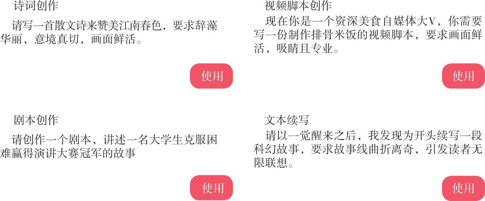
图5-1 文心一言模板
###### 用户提问
请以“寒冷的冬夜，窗外的雪花纷纷扬扬”为开头续写一段情感故事，要求情感能引发读者共鸣，触及多数人的内心。

###### 文心一言回答
寒冷的冬夜，窗外的雪花纷纷扬扬，轻拂窗台，窗上凝出一层薄冰。屋内烛光昏黄，沙发上莉莎独自坐着，目光投向远方。
她是这座繁华城市里的一名小职员，日复一日在工作与家庭间奔波。这个冬夜，她感受到了异常的孤独与疲惫，仿佛生活的压力让她难以呼吸。
回想多年以前，莉莎曾是梦想满怀的年轻人。她立志成为成功的艺术家。然而现实迫使她放弃梦想，投身一份稳定却单调的工作。她觉得自己失去了什么，像是被困在不属于自己的生活里。
……
（注：以上内容由文心一言生成，有删节）

（3）语音转写。文心一言移动端应用支持语音转写功能，可通过语音输入完成文字创作。

##### 2.文字内容创作要点
使用文心一言创作文字时，首先要明确内容方向或主题，如职场、情感、生活、娱乐等。其次要确定受众定位与个人语言风格。最后要善于提问与追问，获取理想文本。

###### 用户提问
针对不同性格的女生，给出约会建议。

###### 文心一言回答
约会建议需因人而异。以下为不同性格女生的约会建议。
（1）外向型女生。建议选择热闹刺激的活动，如游乐园、演唱会或派对。这类活动能让她们感到愉悦自在。也可邀请她们探访新颖有趣场所，如新餐厅或咖啡馆。
……
无论哪种性格，真诚、自信、了解兴趣爱好与需求都很重要。要尊重对方意见想法，给予适当关注与体贴。
（注：以上内容由文心一言生成，有删节）

###### 【帮你创作】
文心一言创作文字的形式多样，可满足不同用户的需求，无论是需要大量文本的创作者，还是需按特定格式输出的专业人士。
打造个人IP不仅依赖工具，还需具备鲜明个人风格、有价值内容、粉丝互动与持续坚持。文心一言可提升效率，释放时间用于其他工作。

#### 二、用文心一言创作视频内容
短视频、直播与社交媒体的迅猛发展改变了生活方式，大量休闲时间投向这些平台，为创作者带来流量机会。利用高质量视频获客变现成为众多人选择。文心一言可提供视频创作文本，助力打造优质个人IP。

##### 1.视频
短视频通常在数秒至数分钟内呈现新闻、音乐、电影、旅游、美食等内容。短视频需具备创意、视觉冲击与吸引力，在短时间内抓住观众。长视频则需更多深度与细节，才能满足观众需求并传递信息。

###### 用户提问
以“电影《肖申克的救赎》”为主题，创作长视频。

###### 文心一言回答
视频开场展示电影海报与片名，随后过渡到开篇场景，带观众进入故事。
接着解析影片主题、剧情、人物性格。例如可讲述主人公安迪的智慧、勇气与坚韧，以及他在肖申克监狱中与其他囚犯的互动与影响。
随后选取经典台词深入解读，帮助观众理解情感与意义。例如“希望是美好的事，也许是人间至善”，体现安迪在极端困境中对自由的渴望与信念。
……
最后对影片进行整体评价，包括拍摄技巧、演员表现、剧情深度。例如可称赞导演弗兰克·德拉邦特运用镜头与色彩营造压抑氛围，以及演员精湛表演与情感传递。
（注：以上内容由文心一言生成，有删节）
文心一言仅给出长视频创作大纲，具体细节需继续追问，如可追问主题、人物性格、经典台词、传递思想等，再整合为完整内容。

##### 2.Vlog
Vlog以个人视角与风格制作，具备亲密感与互动性，可与观众建立连接。

###### 用户提问
以“北京—杭州的骑行旅游”为例，创作Vlog内容。

###### 文心一言回答
开场介绍：介绍骑行计划与准备情况，展示路线与装备。
骑行过程：记录北京到杭州的骑行经历，包括沿途风景、城市、乡村、山区等，并分享骑行技巧与经验。
停留游玩：……
思考感悟：……
结尾：抵达杭州后总结旅程心得，分享经验并展望未来行程。
（注：以上内容由文心一言生成，有删节）

###### 用户追问
请更详细一些，制作完整Vlog内容。

###### 文心一言回答
（一）开场
镜头：中国地图，标注北京与杭州。
配音：“大家好，我是×××。今天分享一次不寻常的旅行——北京到杭州的骑行之旅。”
（二）第一部分：骑行前准备
镜头：自行车、骑行装备、地图等。
配音：“为这次旅行做了不少准备。这是我的自行车，虽看上去很新，却陪我走过多次旅程。装备也都是精心挑选的。”
……
（三）第二部分：骑行过程
（四）第三部分：停留游玩
（五）结尾
（注：以上内容由文心一言生成，有删节）

###### 【帮你创作】
文心一言除创作短视频、长视频、Vlog外，还可创作直播脚本、动画视频、影视广告文本，只需给出明确主题与限定词即可获得满意内容。
高质量视频不仅需要创意有价值的文本，还需良好拍摄制作技巧，并持续扩大受众。

#### 三、用文心一言创作音频内容
音频形式多样，如有声读物、音频课程等，需结合个人声线特点与目标听众选择合适形式。

##### 1.有声读物
有声读物需要优质文本，可为小说、散文、新闻、诗歌、教育材料等。创作者需确保文本有趣、吸引人且适合口头表达。

###### 用户提问
以“寒冷的冬天悄然离去，温暖的春天悄然而至”为开头，创作有声读物的内容，受众为小学一年级学生。

###### 文心一言回答
寒冷的冬天悄然离去，温暖的春天悄然而至。在这个冬春交替的时刻，让我们一起来听听下面这个有趣的故事，感受春天的气息吧！

一则童话式试写

寒风刺骨的冬季里，一只机灵的小白兔不幸着凉。鼻涕眼泪一起往下流，喷嚏响个不停，全身都不舒服。它心里嘀咕：真冷啊，暖和的日子什么时候才会来临？

……

等到春风拂面，小兔与小松鼠的日子变得甜蜜又欢乐。它们每日在嫩绿的草地上追逐嬉戏，尽情沉浸在春天的柔软里。两只伙伴悟出朴实的道理：冬尽春方至，耐心等候方能迎来更好的将来。

小读者们，如今我们正处在温暖的季节，是否感到生活更有滋味了？请好好珍惜当下这段时光，一起走向更精彩的明天吧！

（说明：此段由文心一言生成，已做删减）

文心一言这次收到的三个限定是：起笔必须写“严冬悄然远去，春意渐浓”，阅读对象锁定小学一年级，成品用于有声读物。基于这三点，它产出了一版朗读音稿。音频稿只是雏形，实际使用者要懂得甄别，挑选符合自身定位的材料使用。

##### 2.声音课程
声音课程的适用范围很广，涵盖语言学习、学术科普、计算机科学、企业管理、艺术人文、健康健身等。吸引听者的关键在内容质感，撰写时要做到表达清晰、描写生动，同时凸显课程的专业性与条理性。

示例提问
围绕“日语中的问候语”展开声音课程创作。

模型输出
朋友们，欢迎收听《轻松学日语问候》课程。不论是准备赴日旅游，还是在商务场合与日本同事交流，掌握问候用语都是拉近距离、展开文化沟通的基础。

……

先从最常用的问候入手。你可能听说过“こんにちは”（Konnichiwa，下午好）和“こんばんは”（Konbanwa，晚上好）。日本人会按时间段选用不同表达。接下来练习标准发音与具体用法。

[播放示范音频]

……

感谢收听，祝学习顺利！

（说明：此段由文心一言生成，已做删减）

创作要点
制作音频内容时，先锁定主题，明确想传达的故事或知识，如童话、科普等，给模型一个背景。随后给出限定条件，如受众、领域等，划定边界。最后要审视生成材料是否准确，不符合要求就继续追问，让其反复打磨。

## 第二节
不同媒体平台的内容辅助创作

新媒体具有互动、实时、全球、个性等特质。模型在为新媒体写稿时要贴合这些特点，提升曝光与互动，打造个人品牌。

#### 一、微博
微博用户基数大。撰写微博要保证话题热度与时效性，紧抓热点，才能提高关注与讨论。

示例提问
围绕“金庸武侠剧中最经典的女性角色”展开微博文本创作。

模型输出
金庸原著改编剧中，令人难忘的女性人物有：

小龙女。……

阿珂。……

王语嫣。……

黄蓉。……

穆念慈。……

周芷若。……

你心目中最经典的是哪一位？

分别配图……

（说明：此段由文心一言生成，已做删减）

怀旧是微博上经久不衰的话题，人们会反复讨论经典。抓住这一点，持续让模型提供素材并提炼升华，就能塑造辨识度高的IP。

#### 二、微信
公众号文章质量直接影响阅读量与粉丝数。微信内容覆盖新闻、美食、教育、旅游、情感、职场、体育、健康等，创作者可先选定方向再让模型辅助。

示例提问
围绕“迎金路施工绕行通知”展开公众号内容创作。

模型输出
迎金路即将全封闭施工，为确保工程顺利、路况改善，请大家在施工期间改道。下面是具体管制时间与绕行建议，请务必留意。

（一）迎金路施工时间
施工期为2023年11月18日至2024年1月18日。期间该路段全封闭，禁止一切车辆通行。

（二）绕行线路推荐
前往金阳街的车主，可经春华路或秋实路绕行。
前往翠柳路的车主，可经春华路、秋实路或枫杨路绕行。
……

（三）其他注意事项
请各位车主密切关注管制与施工信息，提前规划路线，避免绕错耽误行程。
……

（说明：此段由文心一言生成，已做删减）

模型能帮助创作者策划大众日常关注的主题，如“如何接种疫苗”，也能辅助创作创业者专业领域的知识拓展。总之要注重文笔与主题选择，借助工具为个人IP添砖加瓦。

#### 三、知乎
知乎是中文问答社区，可发问、答问、发表观点、互动交流。撰写知乎内容需要知识储备、写作功底和社交技巧，模型可提升创作水平，帮助建立影响力。

示例提问
知乎上哪些问题讨论度高。

模型输出
知乎上热度较高的多集中在几类：
涉及社会热点与公共议题的问题。如“你如何看待近期社会热点？”“公共政策对你的生活有何影响？”等。
与知名人物、企业或事件相关的问题。如“你如何看待某位名人的近况？”“对某大公司的做法怎么评价？”等。
与科技、文化、娱乐相关的问题。如“AI技术未来会怎样？”“你最喜欢的电影或剧集是什么？”等。
……

（说明：此段由文心一言生成，已做删减）

可让模型提供热门话题发布到知乎，再邀请大V参与回答，提升热度，也可去回答他人问题，展现独到见解。

知乎问题
请对知乎问题“哪句话不经意间，暴露了你的贫穷？”做出回答。

模型输出
“昨晚吃了一碗泡面，这下省了不少钱呢！”
这句话透露出因收入有限只能靠泡面省开支。虽然省钱，但对健康不利，是无奈之举。

“手机屏幕又裂了，这次只能省吃俭用修好。”
这句话暴露出无力频繁换机，只能勒紧裤腰带修补，也暗示生活拮据，需要精打细算。

模型的回复贴合了“穷”的层面，却没有体现“不经意间”，文案也不够新鲜，有些巧思仍需创作者自行构思，模型只能作参考。

创作要点
新媒体的特性决定了内容走向，不符合平台规律的稿子很难获得曝光。创作者要持续向模型输入数据，训练其写作风格与思路，才够格产出匹配要求的稿件。

#### 四、抖音
抖音用户集中在青少年，以娱乐创意为主。内容筛选偏向官方引导和热门话题，视频时长短，节奏快。

示例提问
围绕“新手必看化妆技巧”展开抖音视频内容创作，要有创意性。

模型输出
视频开场是一段快速剪辑的恐怖片片段，镜头骤然拉近，中央浮现“化妆新手”几个惊悚字样。

旁白：“你是否在深夜镜前，被自己的倒影吓到？”
镜头切到主角准备化妆。
旁白：“或者拿起化妆品时，觉得背后一阵凉意？”
镜中倒影出现，音乐骤紧。
旁白：“现在，让我们走进新手化妆的世界，把恐惧变成魅力！”
随后展示各种搞笑化妆失误，音乐推向高潮。
旁白：“本期我们学习如何避坑，让你的技巧从小白变大神！”
镜头回到主角，音乐转轻。
旁白：“先说最怕的部分——粉底。”
示范正确挑选与涂抹，音乐再起。
……

（说明：此段由文心一言生成，已做删减）

模型给了有创意的脚本，但创作者要判断是否可实现：能否找到合适的配乐、片源，以及自身剪辑水平是否跟上。

#### 五、快手
快手用户覆盖面广，年轻人、中老年人都有，内容多元。平台偏重普通人生活，鼓励用户自主发挥和互动。

示例提问
我是一名打工人，围绕“我的田间生活——摘西红柿”展开快手内容创作。

模型输出
背景音乐起，轻快旋律。
画面1：朝阳洒在田野，主角穿工装准备劳作。
旁白：“大家好，我是打工人××，今天带大家看看我的田间日常——摘西红柿。”
画面2：广阔田野，主角展示采摘过程。
旁白：“在这片田地上，我和西红柿有个约定。看，这就是一天的工作。”
画面3：西红柿装进篮子，展示满篮成果。
旁白：“这些果实见证了我的辛苦，每颗都甜得很。”
……

画面结束，快手logo出现。
旁白：“谢谢大家陪我度过美好一天，下次再见，希望喜欢我的打工生活。”
视频结束。

（说明：此段由文心一言生成，已做删减）

快手的中老年用户不少，可以让模型写田间生活或做饭类脚本，用平淡口吻讲日常，接地气的作品更容易引发共鸣。

创作要点
抖音、快手类短视频靠一个瞬间抓住停留，内容可能是音乐、段子、温馨日常、成长记录、趣物分享。模型可在这些主题上提供脚本方向或新颖创意，帮助高效创作。

#### 六、B 站
B站以动画、漫画、游戏为主，内容涵盖番剧、游戏、影视、娱乐，用户偏年轻。写稿要从这些维度出发。

示例提问
围绕“美食探店”展开B站视频内容创作。

模型输出
视频开始，镜头对准UP主，背景是繁华商圈。
UP主：（对镜头）大家好，我是探店侦探，今天要探的是传说中让人垂涎的火焰烧烤！看看是不是真如传闻！
镜头快速切到店门口，展示招牌。
UP主：看，这就是火焰烧烤的招牌，这火，这烤，食欲直接拉满！
镜头入店，展示环境。
……

镜头回到UP主做总结。
UP主：总的来说，火焰烧烤值得一试。食材新鲜、口味别致、服务到位，吃得很过瘾。美食爱好者别错过，下次见！
视频结束，字幕：“点赞、投币、收藏，下次再见！”

（说明：此段由文心一言生成，已做删减）

模型给出了完整脚本，创作者可在基础上润色、加入个人元素，但要避免抄袭引发纠纷。

#### 七、小红书
小红书以生活分享为主，用户多为年轻女性，内容偏购物心得、生活经验、旅游攻略。写稿要贴合这些偏好。

示例提问
作为穿搭博主，围绕“秋天的职业穿搭”展开小红书内容创作。

模型输出
秋日必备！职业装这样穿，同事纷纷点赞。
秋天到了，职场穿搭要换新！
分享我的秋日通勤秘籍，让你在人群中脱颖而出！
（1）外套篇。秋天离不开外套，一件得体外套能加分。我选了黑色小西装，日常通勤或稍正式场合都适用，版型利落不老气。
（2）内搭篇。秋天适合简约打底，我挑了灰色V领打底。V领拉长颈线，显修长，灰色百搭，裙装裤装都合适。
（3）下装篇。我选了黑色高腰A字裙，高腰抬高腰线，A字遮住胯部和大腿肉肉，梨型身材友好。
……

#OOTD#职场穿搭#秋日通勤#时尚博主#黑色小西装#灰色V领打底衫#黑色高腰A字裙#黑色粗跟短靴#黑色链条包#显瘦穿搭#简约配饰#秋日通勤#显瘦穿搭#职场穿搭#时尚博主#灰色V领打底衫

（说明：此段由文心一言生成，已做删减）

这个回答很符合小红书调性，注重实用与参考价值，读者能直接获得穿搭灵感。

#### 八、微信视频号
微信视频号是短视频分享平台，内容包括新闻、娱乐、生活、知识。推荐机制主要基于社交关系链，也结合兴趣和历史行为。

示例提问
围绕“伟大的妈妈”展开微信视频号内容创作。

模型输出
视频开头：
开场白可用温情音乐做背景，出现文字：“世上最伟大的爱，来自母亲。”
视频主体：
展现妈妈的多重角色：拍摄不同年龄、职业的妈妈在家中的不同责任。有的全职妈妈要照料孩子起居，有的职业妈妈要在工作与家庭间平衡。通过多样角色让观众更懂妈妈的不易。
……

结束语：最后可配文字“妈妈，是每个人的守护者，向她们致敬”，配一张温馨画面收尾。

（说明：此段由文心一言生成，已做删减）

亲情类视频号容易吸引中老年女性，相关内容易被转发到朋友圈和微信群，提升点击率。创作者可借助模型持续输出亲情类文案。

创作要点
用模型创作，主题选择最关键，这取决于目标受众和自身专业。比如青少年适合娱乐、游戏、学习；年轻女性适合美妆、穿搭、旅行；中老年适合美食、交友、生活分享。确定主题后写脚本，模型生成快，但需人工判断知识性、逻辑性，可通过不断追问达到要求。

# 第六章
个人学习成长

## 第一节
解释解答

#### 一、作为老师答疑解惑
模型能提供学习资源和信息，帮助理解和掌握知识，也能解答学习中的疑问，提供清晰的解题思路和答案。

示例提问
请解答这道题：制造集团下属某工厂32%的工人为高级技工，在将40名工人（其中24人为高级技工）调往其他厂后，高级技工占工人的比重下降到25%。问该单位原有多少名高级技工？（）
A.48
B.64
C.80
D.96

模型输出
设原单位高级技工x名。
由“32%为高级技工”，总人数为x/32%=3.125x
调走后得方程：
（x-24）/（3.125x-40）=25%
解得x=64名
所以原有64名高级技工。

模型对这道代数题解析清晰，启发性强，有助于提升代数解题与逻辑推理能力。

解题思路
（1）提供相关知识点。模型可根据问题给出概念解释，帮助回忆并联系问题。
（2）分析问题。可引导用户找隐含条件、拆分问题、画图图表化理解。
（3）提供解题方法。根据具体情况给出常见方法，如代数运算、数形结合、逻辑推理等。
（4）检查答案。解答后引导核对结果，找错因。若仍不对，可继续请求帮助。

#### 二、作为顾问随时咨询
需要专业咨询时，模型可作顾问随时提供服务，但需明确告知行业领域。

示例提问
我是一名月收入约5万元的自由职业者，每月固定开销约1万元，请作为一名金融顾问，为我提供个人理财方面的专业意见。

模型输出
作为金融顾问，很高兴为你提供建议：
（1）建立紧急储备金：建议将月收入的约20%存入紧急储备账户，以应对意外开支或失业等突发情况。
（2）明确投资目标：在理财过程中要清晰目标，如退休储蓄、购房、子女教育等。
（3）分散投资：不要把资金全压在一类资产上，应分散到股票、债券、基金、房地产等，降低风险，同时助力目标达成。

稳健理财要点速记

（4）远眺布局：当你有明确的长期财务目标时，建议把目光放在较长周期上运作，降低短期波动带来的情绪干扰。
（5）定期检视配置：建议按节奏对投资组合做复盘，确认当前持仓是否仍与目标匹配，并依据市场走向与个人变化适时微调。
（6）把控负债规模：若手头已有借贷，应尽量压降负债额度，避免过度负债拖累现金流与后续投资安排。
（7）坚持月度储蓄：除投资动作外，建议每月固定存一部分资金，作为未来加仓或应急储备的来源。

总体来看，个人财务管理要兼顾理性判断、分散布局、长期视野、负债管控与储蓄积累。建议结合自身实际状况与目标，制定专属的财务方案。

文心一言这段思路能帮助你搭建稳健的财务框架，为未来提供安全垫，同时保证应急金与投资组合均能满足需要。对其中任何一点感兴趣，都可以单独追问，比如“如何进行定期组合评估”“长期投资有哪些做法”，即可获得更详实的展开。

###### 【帮你解答】
（1）全天候提问通道。无论何时何地，只要有咨询需求，都能直接向文心一言发起提问，快速获得解答。
（2）反馈与优化。若对文心一言的回复不满意，可以及时给出反馈和改进建议，帮助模型为你提供更贴合的服务。

#### 三、作为助理随时助力
信息密集的时代任务繁重，一个得力的助手能显著提升效率。文心一言即可扮演这种角色，随时提供支持。

###### 用户提问
假设你担任跨国公司首席执行官的助理，需要筹备一场重要的国际会议，应怎样做？

###### 文心一言回答
作为跨国企业 CEO 的助理，筹备一次重要国际会议可从以下八个维度展开：

（1）厘清会务目标与议程：先明确会议主题、核心目的及讨论议题，为后续准备定方向。
（2）确定参会名单与分组：与上司确认出席人员，并判断是否需要分会场讨论，同时了解各人与会背景及需求。
（3）敲定时间与场地：综合参会人时区与偏好，选定便利的时间窗口，并确保会场满足会议规格。
（4）准备会务资料：协助整理报告、数据与演示文件，需跨部门协同，保证材料准确完备。
（5）沟通联络：作为对接人，及时与参会者确认行程并解答疑问，会期保持在线，协助处理突发问题。
（6）制定详细日程：按人员与分组拟定具体时间表，明确每个环节的议题与主持人，确保流程顺畅。
（7）核查设备与支持：提前确认投影、音响、翻译等资源，会前测试运行并与供应商保持联络。
（8）跟进记录与总结：会中做好纪要，会后协助上司梳理结论成文，推进纪要发布与落地跟踪。

总的说来，国际会议筹备涉及目标、议程、人事、时地等多重要素。助理需细心、耐心与责任心，协助领导完成各项准备，保证会议顺利召开。

文心一言的回复列出了清晰的任务清单并解释了每个环节的意义，使用户明白具体工作内容，同时点出筹备需要细致严谨，凸显助理在其中的关键作用。

###### 【帮你增效】
（1）高效处理日常事务。助理常需安排日程、策划活动、撰写文档等，利用文心一言的工具可快速生成日程表、方案模板与文案，提升效率。
（2）快速获取数据支撑。文心一言能提供各类数据支持并按需求生成报告，如市场调研、行业分析等，助力制定计划与决策。

## 第二节
启发启示

#### 一、让文心一言展示灵感
面对信息过载与思考疲劳，文心一言能帮助激发灵感。无论是创新营销点子还是写作灵感，都可借助其自然语言处理与深度学习能力获得有价值的见解。

###### 用户提问
我是一名建筑设计师，正在为新楼盘取名，请以《诗经》为灵感提供一些思路。

###### 文心一言回答
以《诗经》为来源的楼盘名往往蕴含文化韵味。以下为参考建议：

（1）采薇庭：源自《诗经·小雅·采薇》，原指采摘薇菜，象征百姓安居。叠加“庭”营造清雅闲适的居住氛围。
（2）琼玖轩：取自《诗经·卫风·木瓜》，“琼”“玖”皆美玉之意，表珍贵高质；“轩”指高雅建筑，整体显贵气。
（3）鹿鸣府：出自《诗经·小雅·鹿鸣》，本义模拟鹿鸣，寓意和谐共处；“府”添住宅的高雅感，传达和谐美好。
（4）庭兰居：来自《诗经·郑风·溱洧》，本指庭院兰花，意为幽雅芳香；“居”点明居住属性，联想到清新雅致的环境。

以上名字均取自《诗经》，各具文化意蕴，可结合项目定位与个人喜好择优。

文心一言按需求提供了具备文化内涵的楼盘名建议，便于设计师结合项目特点与定位挑选最合适的名字。

###### 【帮你提议】
（1）提出开放式问题。尝试以开放问题引导新想法，如“当今社会人们最需要什么服务”“未来教育将如何演进”。
（2）给出主题或关键词。提供一个主题或关键词集合，让模型据此扩散，如“以人工智能为主题的创新应用”“环保关键词下的减碳方法”。
（3）明确索要创意。直接说明需要灵感，如“我要推广产品的新颖营销策略”“我正在写城市规划文章，需要有见地的观点”。
（4）引导递进对话。借提问让讨论深入，例如“人工智能对医疗行业的影响是什么”“教育行业未来会有哪些变革”。

#### 二、让文心一言讲讲经验
文心一言可作为经验库，提供见解与指导，帮助掌握技能、解决问题、获取成功经验。

###### 用户提问
我是一家自媒体初创公司创始人，在人员管理和团队运营上遇到困难，请分享经验。

###### 文心一言回答
作为自媒体初创创始人，人员与运营问题很常见。以下建议供参考：

（1）建立清晰目标与愿景：确保团队成员理解公司方向，增强投入感与协作力。
（2）招聘合适人选：除技能经验外，需匹配公司文化与价值观，创意与热情对自媒体尤为重要。
（3）提供培训与发展：给予必要学习机会，提升能力与归属感，增强满意度与忠诚度。
（4）明确职责分工：为每位成员界定具体任务，减少混乱，提升效率。

总体而言，初创自媒体的成败离不开有效的团队管理。只有采取恰当措施，才能打造高效、稳定、富创造力的团队，为长期发展打基础。

文心一言的回答提供了团队管理的基础经验，如愿景、招聘、培训与分工，但相对概括，未给出具体操作步骤。团队管理需结合自身情况与行业特点深入思考。

###### 【帮你提议】
（1）描述具体问题。清晰说明问题的背景、现状与目标，便于模型理解需求。
（2）明确经验需求。直接表达希望获得相关经验分享，如“我在工作中遇到问题，希望分享相关经验与建议”。
（3）提供参考案例。若已有相似案例，可一并提供，帮助模型给出更精准建议。
（4）共同探讨解法。得到建议后积极讨论，结合自身想法与模型交流，找到最合适的解决方案。

## 第三节
修改
文心一言在文本修正方面优势明显，可改正语法、拼写、标点等，提升质量与效率。

###### 用户提问
“最近一项研究发现，饮用咖啡可以降低患上阿尔茨海默病的风险。该研究对超过 2000 名 65 岁以上的老年人进行了长达 10 年的追踪调查，发现那些每天饮用一杯咖啡的人，患上阿尔茨海默病的风险降低了 23%。此外，研究人员还发现，饮用咖啡不会对认知功能产生负面影响，反而可能有助于提高认知功能。”请帮我修正此文本。

###### 文心一言回答
“近期一项研究表明，适量饮用咖啡可能有助于降低阿尔茨海默病风险。该研究追踪超过 2000 名 65 岁以上老年人长达 10 年，发现每日饮用一至两杯咖啡者，较不饮用者患病风险下降约 23%。研究人员同时指出，过量饮用咖啡可能对认知功能产生不利影响，因此建议保持适量。”

###### 【帮你优化】
文心一言通过语法、语义与结构等方面的修正，能提升文本准确性与可读性。

（1）语法与拼写检查。可识别错别字与语法错误并给出正确建议。
（2）语义分析与修改。利用自然语言处理识别语义偏差，提供恰当表述。
（3）结构与连贯性优化。可检查段落衔接，提供修改建议，使文本更流畅。
（4）用词与表达修正。提供更准确、生动的用词建议，提升表达质量。
（5）润色与改进。能简化或丰富句式，提供高级词汇替换与拼写语法修正，提升可读性与吸引力。

## 第四节
提高提升

#### 一、让文心一言当自己的教练
文心一言作为个人教练，能提供个性化指导、即时反馈、资源推荐、进度追踪、自主学习促进与效率提升。

###### 用户提问
我是在职考生，上班 9:00 至 18:00，想利用空闲时间备考，争取一次通过中级会计师考试，能否制定系统学习计划？

###### 文心一言回答
可以，以下为在职考生参考的中级会计师学习方案，可按个人情况调整。

1.评估现状
开始前先了解自身基础、学习能力与自控力，形成初步认知。
2.明确目标
确定一次性通过考试，并梳理考试范围与所需知识技能。
3.制定阶段计划
将备考分为基础、强化、冲刺三段。
基础阶段：利用业余时间学习会计原理、财务会计、成本会计等，可结合在线课程与教材，每日至少 2 小时。
强化阶段：在掌握基础后按考纲要求深入重点难点，做专项训练与历年真题，每日至少 3 小时。
冲刺阶段：考前一个月左右做模拟测试熟悉流程，查漏补缺并提升，每日至少 4 小时。
4.合理安排时间
工作日利用早晚学习，避免占用工作时间，周末集中学习。

该计划具备可行性与科学性，但未给出具体时段安排，具体执行时可能缺乏抓手，可继续追问获取精确时间表。

###### 用户提问
能否据此制定一个一日学习计划表，要求时间具体。

###### 文心一言回答
可以。以下为一日学习计划示例：

标题：在职考生一日学习计划表

1.时间规划
6:00～6:30 早餐。
6:30～7:30 阅读并记笔记：会计原理。
7:30～8:00 通勤途中：复习昨日内容。
12:00～13:00 午休：会计原理练习题。
18:00～19:00 下班途中：回顾当日学习。
20:00～21:30 复习与预习：财务会计。
21:30～22:00 总结反思：当日学习要点。

2.学习内容
6:30～7:30 阅读《会计原理》第一章并做笔记。
12:00～13:00 完成《会计原理》第一章练习。
20:00～21:30 阅读《财务会计》第二章并做笔记。

3.学习方式
6:30～7:30 速读结合精读，整理重点。
12:00～13:00 针对练习题重点解析。
20:00～21:30 理解记忆财务会计知识点。

4.评估与反馈
22:00～22:30 自我评估当日成果与不足，制定改进计划。

###### 【帮你增效】
文心一言可全面支持工作学习效率提升，帮助管理时间、获取信息、创作内容、学习知识。

（1）时间管理。可提供时间轴与待办清单，协助制定计划并设置提醒，追踪时间使用并给出反馈。
（2）信息检索。具备强大检索能力，可快速定位网络与本地资料，并按关键词过滤，提升查找效率，还可提供实时翻译与视觉搜索。
（3）内容创作。提供写作模板、语法检查与字数统计等功能，辅助撰写文章、报告等，并提供创意写作、智能排版、参考文献管理等工具。
（4）知识学习。可提供历史、科学、经济等专业知识资源，包括在线课程、电子书、研究资料与互动教程，并可追踪进度、记录笔记。
（5）语言翻译。支持文本与语音的多语言翻译，提供即时翻译服务，便于国际沟通协作。

#### 二、让文心一言当自己的导师
让文心一言担任导师，有助于制定个性化学习计划、获得及时反馈、拓展知识经验、激发动力并提高效率。

###### 用户提问
假如你是一名职业发展导师，会如何为金融学学生做职业规划？

###### 文心一言回答
（1）了解学生：作为导师，需与学生建立良好沟通，了解其兴趣、优势、价值观与职业目标。对金融学学生，可询问其对金融领域的关注点及未来职业设想。

（2）盘点能力与优势：可通过引导学生做自我评估来达成这一目的。比如安排学生完成线上职业测评，以探明性格特点、价值取向与个人强项；再辅以专业能力检验，例如金融基础知识考核、数据分析技能测试等。

（3）明确职业方向：在兴趣爱好与评估结论的基础上，协助学生凝练职业目标。例如，学生对投资领域有浓厚兴趣，其职业定位就可以指向投资顾问或基金经理等岗位。

（4）构建职业蓝图：目标确定后，需要制定相应的实现路径。规划既含短期任务也含长期追求。短期可设定完成指定课程、考取相关金融证书、争取一到两段相关实习。长期则可指向获取高级金融资质、在金融机构晋升至管理层等。

（5）落地行动方案：执行层面涵盖学习推进、实习安排与人脉网络搭建。若学生志在成为投资顾问，就需要系统学习投资组合管理、证券分析与市场研究等内容，并争取进入相关机构实习积累实务经验。

（6）持续反馈与引领：作为职业发展导师，要定期给予反馈与辅导。内容包括检视职业规划的合理性、目标推进进度、行动方案的适配度，同时鼓励学员不断反思与校准，以便根据市场变化与个人兴趣迁移及时调整。整个过程中，导师需保持耐心、热忱并具备专业素养，同时尊重个体差异，提供差异化支持。

###### 【帮你规划】

借助准确的提示词与提示句，文心一言能够通过提供建议与信息、协助制定计划与目标、解答疑问、引导思考与创新等多种方式助力用户进行规划，具体内容可参见表 7-1。

表 7-1　提示词与提示句式

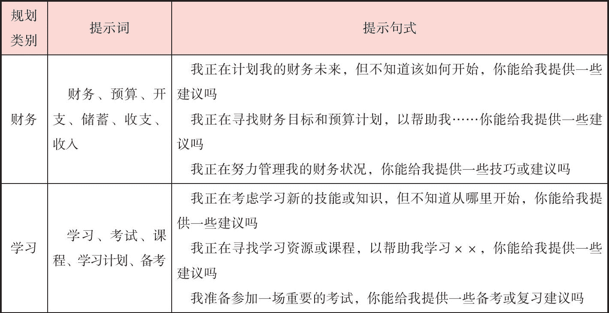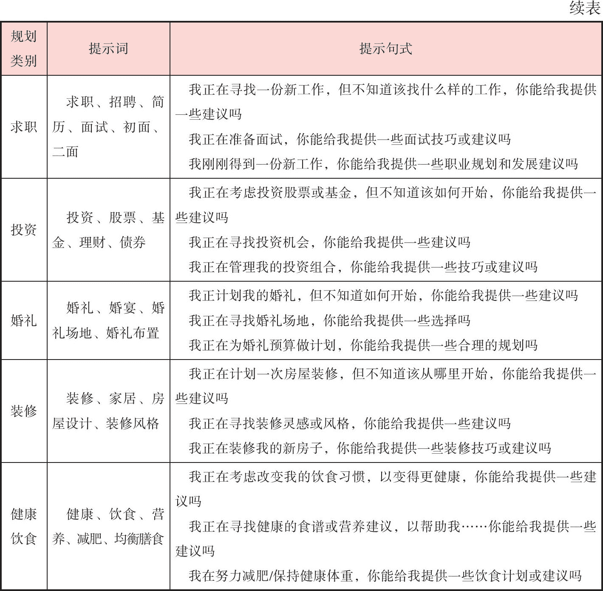

# 第七章

个人生活助手

## 第一节

购物与选择

#### 一、借助文心一言挑选商品

运用文心一言选购产品，有助于提升购物效率、增强选择透明度、提高满意度并降低决策风险。利用文心一言做产品挑选，具体流程如图 8-1 所示。

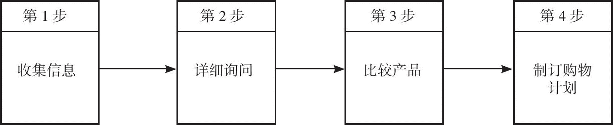

图 8-1　具体操作步骤

##### 1.信息收集

购物前应先厘清自身需求与预算范围。需求与预算明确后，可向文心一言提问以获取市场与目标品牌的信息。

###### 用户提问

我想买一只适合秋冬的口红，预算在 300 元以内，请推荐一些。

###### 文心一言回答

没问题！以下几款秋冬适用且价格在 300 元以内的口红可供参考：

（1）A 子弹头口红（色号：01）。该系列口红广受好评，01 号色调偏红棕带辣椒调，秋冬使用很有气质，价格约 100 元。

（2）B 天鹅绒唇膏（色号：02）。02 号为深玫瑰色，适合秋冬，带微闪珠光，显气色，价格约 200 元。

（3）C 口红（色号：03）。03 系列色系丰富，可选梅子色、砖红色等，均适配秋冬，价格约 100 元。

（4）D 口红（色号：04）。04 号为棕红色，带微闪珠光，秋冬感强，价格约 100 元。

（5）E 口红（色号：05）。05 号为裸粉色，日常自然，也适合秋冬，价格约 100 元。

文心一言对用户问题给出了五条较为详尽的建议，并说明了每款口红的特点与价格，若用户对其中某款感兴趣可继续追问。

##### 2.深入追问

对文心一言提供的信息产生兴趣后，可进一步询问产品细节，如具体性能、参数、用户口碑、优缺点等。

###### 用户追问

我对你提到的 A、B 两款口红很感兴趣，能详细讲讲它们的特点、用户评价、优缺点吗？

###### 文心一言回答

A 子弹头口红：

特点：色彩丰富、持妆力突出，质地滋润好推开，色号超过百款可选。

用户评价：多数使用者称赞显色饱满、持久度好，从淡妆到烟熏妆都可驾驭，舒适度与保湿性也获认可。

优缺点：优点是色号多、质感舒适；缺点是价格偏高，部分用户觉得持久度一般需补涂。

B 天鹅绒唇膏：

特点：质感丝滑，带轻微珠光，色系自然，涵盖清新粉、女性感红、自然咖等。

用户评价：消费者普遍认为显色自然、质地顺滑，能修饰唇形，微闪效果提升整体妆感。

优缺点：优点是颜色自然、触感丝滑；缺点是价格相对较高，且部分人反馈需要补妆。

从以上问答可见，用户围绕“特点”“评价”“优缺点”对 A、B 展开深挖，文心一言亦作出对应解答。

###### 【帮你解答】

若仍觉得回答不够充分，可继续追问。例如：

（1）请详细说明 A 子弹头口红的利弊。
（2）在已提及特点之外，B 天鹅绒唇膏还有哪些其他特质？
（3）综合来看，A 子弹头口红与 B 天鹅绒唇膏哪款性价比更高？

##### 3.商品对比

文心一言的对比功能可将购物需求与不同品牌产品并排比较。用户在搜索框输入关键词后，系统会展示相关品牌与产品的汇总信息。

###### 用户追问

能否对前面推荐的口红 A 与 B 做一下对比？

###### 文心一言回答

可以。A 与 B 的对比如下：

（1）适用人群。A 子弹头口红 01 号适合各肤色，尤其是白皙肤色；B 天鹅绒唇膏 02 号为深玫瑰色，同样广泛适配。

（2）质地。A 为纯正哑光，不易显唇纹；B 更丝滑更滋润。

（3）价格。A 约 100 元，B 约 200 元。

（4）口碑。A 以独特色调与显色著称；B 以丝滑质感与微闪珠光获好评。

（5）包装。A 采用简约黑配品牌标志，时尚感强；B 为高贵紫配品牌标识，显得精致。

文心一言从人群、质地、价格、口碑、包装五方面对两款口红做了详细比较。

###### 【帮你比较】

文心一言不仅可对比彩妆，还可对比电子产品、电商平台、旅游网站、健康类 App 等。设定好目标产品与比较关键词，即可获取多品类的优劣分析。

##### 4.制定购物方案

结合产品分析与对比结果，判断各产品的相对优势，再依据实际需求与个人偏好挑选最合适的品牌与单品，确保符合需求与预算。

例如，用户肤色为黄二白，更偏好哑光质感，综合对比后认为 A 子弹头口红性价比更优，最终决定购买。

#### 二、利用文心一言辅助比价购物

用户可在搜索框输入产品类型、预算、特殊要求等购物需求，让模型生成目标产品的名称、价格、特性等信息，辅助决策与比价。

###### 用户提问

我想买一款适合油皮的粉底液，有哪些推荐？

###### 文心一言回答

以下适合油皮的粉底液供参考：

L 持妆粉底液：透气轻薄，遮毛孔、匀肤色，添加珍珠岩吸油，宣称 24 小时持妆不油。质地细腻，妆效自然。参考价 430 元。

D 持妆粉底液：被称油皮友好，控油持妆不脱妆，粉质细腻服帖，遮瑕力强。参考价 420 元。

Y 轻垫粉底液：持久持妆、高度遮瑕，贴合度高，全天不易脱妆。参考价 450 元。

W 恒久亮泽粉底液：清透持妆，可遮盖泛红与小痘痘，强化护肤感，24 小时不脱妆，增添明亮弹润感。参考价 580 元。

此外 J 粉底液、B 清透持妆粉底液、Z 小方瓶粉底液等也适合油皮，可按肤况与喜好选择。

文心一言给出了适用油皮粉底液的推荐及效果价格说明，但未提供具体购买渠道，可继续追问。

###### 【帮你推荐】

文心一言可推荐同类不同品牌，也可跨类推荐。除了品牌价格，还可推荐产品类型、购买渠道与方式。继续追问时注意关键词与关键信息的准确输入。

###### 用户追问

我对 D 持妆粉底液很感兴趣，能比较一下不同渠道的价格吗？性价比更高的购买渠道是哪里？

###### 文心一言回答

D 持妆粉底液在 D 品牌官网购买通常最优惠，可享受官网促销与积分，且品质有保障。京东自营或直采免税店也是可靠选择，正品保障且价格相对友好。淘宝超市品质与物流较有保障，价格也具竞争力。

## 第二节

旅游攻略与计划

#### 一、让文心一言充当旅游助手

用户可借助文心一言确定主题与目的地、规划行程、查询服务资源、测算预算等，使其成为个人旅游助手。以预算评估为例。

###### 用户提问

国庆期间我想从北京出发去南京旅游 6 天，大概需要多少预算？

###### 文心一言回答

以下为粗略估算供参考。

交通：北京至南京火车硬座约 200 元，往返 400 元。

住宿：南京住宿视档次而定，每晚 300～500 元，6 晚约 1800～3000 元。

餐饮：当地小吃与餐馆人均 50～100 元，选择更高档餐厅费用会上升，预计每日 200 元，6 天 1200 元。

门票与活动：总统府、南京博物院等景点门票及活动费约 300 元，6 天合计约 1800 元。

其他：购物、小费等每日约 100 元，6 天 600 元。

合计约 4800～7800 元，未含临时改动或新增项目，实际花费可能略高。

文心一言从交通、住宿、餐饮、门票及其他方面对预算进行了拆解。

###### 【帮你增效】

除快速评估预算外，文心一言还能按偏好选目的地、智能排程、提供攻略建议与景点介绍，节省信息检索与整合时间。可多角度提问，例如：

（1）国庆去南京，如何从北京高效出行？
（2）南京本地最便利的出行方式是什么？
（3）一天安排几个景点比较合理？

#### 二、借助文心一言制定旅游攻略与计划

可在搜索框输入目的地、景点、行程、注意事项等问题，获取信息以辅助制定攻略。

###### 用户提问

我想在 2023 年 10 月 1 日至 10 月 6 日去南京旅游，请推荐景点。

###### 文心一言回答

根据需求推荐以下景点与 6 天行程框架：

南京城墙：世界最大城墙之一，历史文化地标。

南京长江大桥：首座自主设计建造的公铁两用桥，具历史意义。

南京博物院与六朝博物馆：了解历史文化的核心场馆。

大报恩寺遗址博物馆：塔曾被评为中世纪世界七大奇迹之一。

文心一言简单介绍了南京代表性景点，但不够全面，需继续追问国庆期间的精细规划。

###### 用户追问

如果要在 6 天内游完这些地方，该如何安排行程？

###### 文心一言回答

行程建议：

第一天：抵达南京，入住，休整。

第二天：上午游南京城墙，下午逛玄武湖风景区。

第三天：上午看长江大桥，下午参观南京博物院。

……

第六天：上午游颐和路民国公馆区，下午雨花台缅怀先烈，傍晚整理行李返程。

注意事项：

国庆天气可能转凉，备好衣物。

南京地铁、公交、共享单车都很便利。

参观时遵守景区规定，保护文物与环境。

遇到问题可联系当地旅游服务或警方。

注意饮食卫生与合理搭配。

避免行程过紧，留有余裕。

通过设定时间地点等要素，用户让文心一言规划 6 天南京行程，同时获得出游提醒。

###### 【帮你规划】

文心一言除旅游规划外，还可协助餐饮、活动、交通、住宿、购物、健康安全等规划。提问时使用关键词与设问方式即可，例如：

（1）我计划 10 天游南京、苏州、杭州、上海，能否安排合理行程？
（2）5000 元预算 10 天游西安、洛阳、郑州，如何制定经济方案？
（3）健康与安全方面有什么建议？如药品准备、注意事项？

## 第三节

美食推荐与评价

#### 一、让文心一言做美食推荐

用户可描述口味与偏好，如甜咸喜好、烹饪方式等，越详细越好，让模型依据信息推荐餐厅、菜品、菜系、品牌或当地美食。以当地美食推荐为例。

###### 用户提问

国庆我打算从北京去南京玩 6 天，想了解一下南京当地有什么美食，请推荐。

###### 文心一言回答

南京历史悠久，美食也独具特色，推荐如下：

鸭血粉丝汤：南京十大名菜之一，汤鲜味足，口感丰富。

金陵盐水鸭：历史悠久名菜，皮白肉嫩，肥而不腻，咸甜适中。

南京包子：皮薄馅嫩，汤汁饱满，味道鲜美。

什锦豆腐涝：豆腐清香爽口，配虾、榨菜、木耳、花生等十余种配料，营养丰富。

牛肉煎饺：外软内脆，馅料鲜美，口感独特。

这些是南京代表美食，另有烤鸭、烧卖、糖醋排骨等可继续探索，祝旅途愉快。

文心一言列出了部分南京美食并介绍口感特点，用户可结合自身情况选择，若想进一步筛选需继续追问。

###### 【帮你推荐】

文心一言可提供普适性推荐，也可按具体需求做针对性推荐。明确需求与标准可获得更好结果，例如：

（1）我是一名回族女性去南京旅游，请推荐适合的美食？

文心一言实战：把AI用成你的美食笔和生活顾问

在国庆出行的场景里，很多人会先向AI取经。比如有人想用省钱的方式在国庆期间吃遍南京的美食，会问有没有经济实惠的攻略；也有人要带父母出游，想知道南京有哪些适合老年人轻松游玩的项目。这类需求正是文心一言可以快速给出方向的典型例子。

#### 二、让AI帮你写出更有说服力的美食推荐

吃完一家店或者一道菜后，想把感受整理成推荐文，就可以用文心一言来辅助。做法很简单，把自己对食物的第一印象、口感感受或想表达的观点整理成问题抛给模型，它就能基于你的素材生成一篇结构完整的点评。

###### 用户提问
假设你是一名想吃遍全国的美食博主，今天在南京吃到鸭血粉丝汤，准备向粉丝安利这道当地特色，你会怎么介绍和评价？

###### 文心一言回答
作为常年跑题尝鲜的博主，最近在南京遇上一碗让人印象深刻的鸭血粉丝汤。这道老字号小吃在城里口碑很稳。

先说做法，核心是鸭血、粉丝和自家调料。鸭血切片走水，粉丝下锅，浇上熬好的汤底，一碗就成。

吃起来鸭血软嫩细滑，汤头浓鲜，粉丝吸饱汤汁后十分入味。营养上鸭血富含蛋白质、钙、磷，对日常补充有帮助。

综合来看，很值得推荐，既代表南京的味觉记忆，也体现了手艺传承。来南京的话，这碗汤一定得尝，基本保证会爱上它的鲜与营养。

###### 【帮你提质】
上面这段点评条理清晰、信息全面，但语言偏说明性，缺少个人情绪的投入和对味觉细节的描摹。可以继续追问，让模型在保留事实的基础上加入主观感受和更立体的描写。

###### 用户追问
假如我就是这篇文章的读者，感觉读起来不太有代入感，能不能加入更多个人的情感表达，并把鸭血粉丝汤的特点写得更具体？

###### 文心一言回答
可以，我换个角度再说一次。

对我而言，喝这碗鸭血粉丝汤像是一场味蕾的小旅行。滑嫩的鸭血、细细的粉丝、浓郁的汤汁，三者合在一起，像是在说南京的历史与烟火气。

视觉上，碗里淡黄的鸭血与半透明的粉丝交错，汤色浓亮，很有食欲。吃到嘴里，鸭血入口即化，细腻不腥，粉丝饱满弹牙，把汤的鲜味全裹住了。鸭血提供蛋白质、钙、磷等营养，粉丝热量偏低，适量吃也不担心负担。

第一次喝到的时候，我被那种细腻的鲜美打动了，每一口都像在听一个故事。它不只是在卖味道，更像在介绍一座城。

相比初稿，这版加入了主观感受和感官细节，读起来更饱满，也更容易抓住读者。

## 第四节
生活技巧与常识

#### 一、把文心一言当成个人生活顾问
用文心一言可以制定计划、解答疑惑、收集休闲灵感、掌握实用技巧。下面以制定学习计划为例来说明它的顾问作用。

###### 用户提问
我打算在今年12月考研究生，现在对复习节奏很迷茫，能否帮我做一份每周的学习安排，并给出科目建议吗？

###### 文心一言回答
当然可以。先明确目标和考试科目，再结合大纲和真题来排期。以下是一份四周示例：

第一周：英语和数学各安排两次复习，专业课安排两次回顾。
第二周：在保持英语、数学、专业课的基础上加入政治，每周两次。
第三周：继续四科复习，增加一次按考试时间进行的模拟练习。
第四周：全科复习加模拟，第四周末做一次全真模考，根据结果微调计划。

分科建议：
英语：积累词汇，坚持阅读并记笔记，每周至少写一篇作文。
数学：夯实基础，多刷题，配合历年真题查漏补缺。
政治：搭建框架，掌握重点题型，配合真题练习。
专业课：梳理知识点，结合真题针对性练习。

###### 【帮你优化】
上述方案给出了周维度的大致方向，但颗粒度偏粗，没有到天、到科目的细化执行。文心一言可以帮你做优先级排序、找最佳学习时段、提供提醒和调整建议，还能推荐学习工具。提问时把目标、任务量、时间限制和资源情况说清楚，会得到更实用的结果。比如：

1. 上面的计划不够具体，能否按天按学科给我一份细化的每日表？
2. 我要在一个月内完成考研英语单词复习，请针对英语给出每日学习细则。
3. 我是大三学生，白天要上课还要实习，只能利用碎片时间学习，有什么高效的碎片学习技巧？

#### 二、用文心一言获取生活常识与技巧
在搜索框输入感兴趣的生活常识或技巧类问题，模型就能给出参考性解答。

###### 用户提问
商场购物时突然起火，应该怎么安全撤离？

###### 文心一言回答
遇到商场火灾，关键是冷静和有序。

先保持镇定，不要乱跑。迅速观察周围，找最近的安全出口，如果火势很小且有条件可先用灭火器处理并通知工作人员报警。

注意看逃生指示标识，听从现场工作人员指挥。浓烟有害，行走时应压低身体，避免吸入有毒气体。火灾中不要乘坐电梯。

若无法立即撤离，寻找坚固的卫生间或楼梯间等相对安全区域等待救援，同时注意不要拥挤。

实际操作要结合现场实际情况灵活判断，小火可扑，大火要先撤，发生伤亡立刻拨打报警和急救电话。

###### 【帮你解答】
文心一言能快速解答生活类问题，但落地仍需结合现场。可以通过追问进一步加深理解，例如：

1. 你前面提到火灾时要低姿势行进，低姿势具体要注意什么？原理是什么？
2. 如果实在走不出去，哪些地方算比较安全的避难点？能举几个具体例子吗？
3. 假设商场起火，人群恐慌容易发生踩踏，我该如何保护自己，又怎样避免踩踏的发生？