# 实战派AI人才培养系列：动手玩转计算机视觉

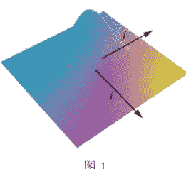

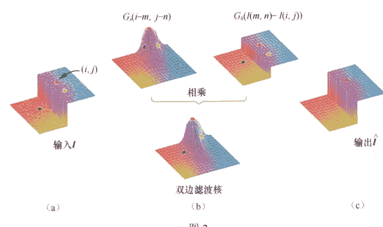

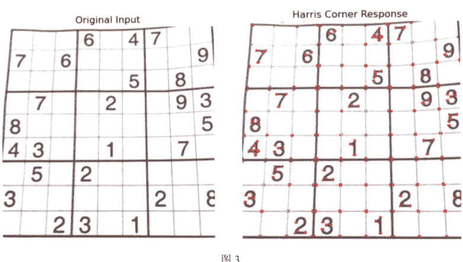

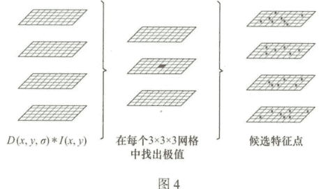

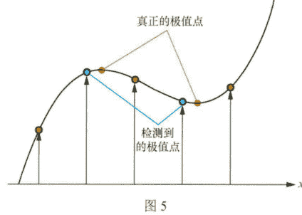

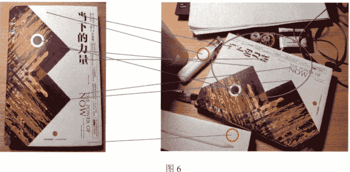

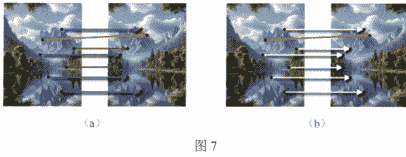

## 图 8

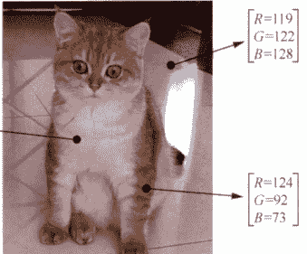

## 图 9

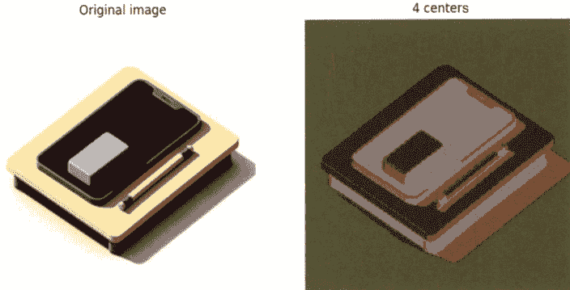

## 图 10

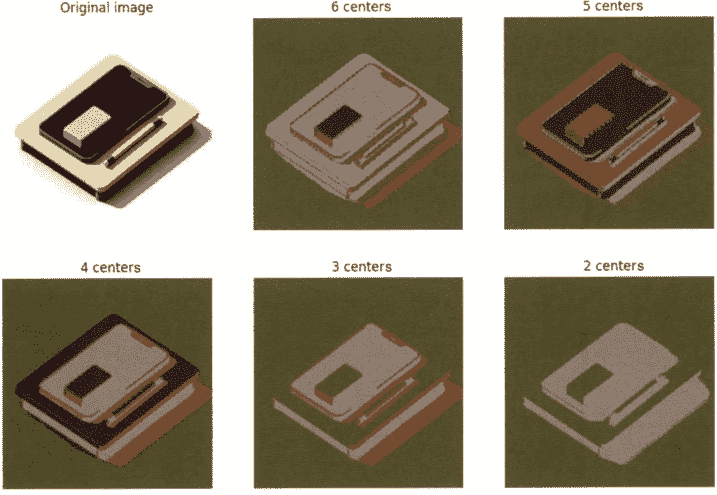

### 语义分割可视化矩阵

**像素类别映射表：**
- 1: 墙面
- 2: 桌面
- 3: 座椅
- 4: 书籍
- 5: 画作
- 6: 猫咪

| 1 | 1 | 1 | 1 | 1 | 1 | 1 | 1 | 1 | 5 | 5 | 1 | 1 | 1 | 1 | 1 | 1 |  |  |

|---|---|---|---|---|---|---|---|---|---|---|---|---|---|---|---|---|---|---|

| 1 | 1 | 1 | 1 | 1 | 1 | 1 | 1 | 1 | 1 | 5 | 5 | 1 | 1 | 1 | 1 | 1 | 1 |  |

| 1 | 1 | 1 | 1 | 1 | 1 | 1 | 1 | 1 | 5 | 5 | 1 | 1 | 1 | 1 | 1 | 1 | 1 |  |

| 1 | 1 | 1 | 6 | 6 | 6 | 6 | 1 | 1 | 1 | 5 | 1 | 1 | 1 | 1 | 1 | 1 | 1 |  |

| 1 | 1 | 1 | 6 | 6 | 6 | 6 | 1 | 1 | 1 | 1 | 1 | 1 | 1 | 1 | 1 | 1 | 1 |  |

| 1 | 1 | 1 | 6 | 6 | 6 | 6 | 1 | 1 | 1 | 1 | 1 | 1 | 1 | 1 | 1 | 1 | 1 | 1 |

| 1 | 1 | 1 | 6 | 6 | 4 | 4 | 4 | 2 | 2 | 2 | 2 | 1 | 1 | 3 | 3 | 3 | 3 | 1 |

| 1 | 1 | 1 | 6 | 4 | 4 | 4 | 4 | 4 | 2 | 2 | 2 | 2 | 1 | 3 | 3 | 3 | 3 | 3 |

| 1 | 6 | 1 | 1 | 4 | 4 | 2 | 2 | 2 | 2 | 2 | 2 | 1 | 3 | 3 | 3 | 3 | 3 | 3 |

| 1 | 1 | 2 | 2 | 2 | 2 | 2 | 2 | 2 | 2 | 2 | 1 | 3 | 3 | 3 | 3 | 3 | 3 |  |

| 1 | 2 | 2 | 2 | 2 | 2 | 2 | 2 | 2 | 2 | 2 | 1 | 3 | 3 | 3 | 3 | 3 | 3 |  |

| 2 | 2 | 2 | 2 | 2 | 2 | 2 | 2 | 2 | 2 | 3 | 3 | 3 | 3 | 3 | 3 | 3 | 1 |  |

| 1 | 1 | 1 | 1 | 1 | 1 | 1 | 1 | 1 | 1 | 3 | 3 | 3 | 3 | 3 | 1 | 1 |  |  |

源画面

分割效果

## 图 11

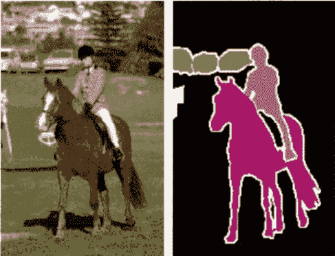

## 图 12

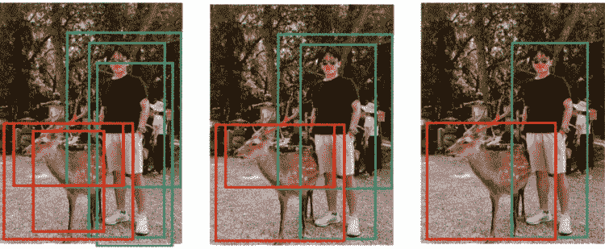

## 图 13

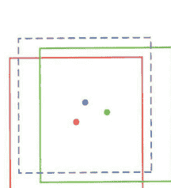

```
编码
$v_x = (b_x - a_x) / a_w$
$v_y = (b_y - a_y) / a_h$
$v_w = \log(b_w / a_w)$
$v_h = \log(b_h / a_h)$
解码
$r_x = t_x a_w + a_x$
$r_y = t_y a_h + a_y$
$r_w = e^{t_w} a_w$
$r_h = e^{t_h} a_h$
```

**边界框回归参数速查：**

锚框坐标: $(a_x, a_y, w_a, h_a)$

真值框坐标: $(b_x, b_y, w_b, h_b)$

预测框坐标: $(\hat{r}_x, \hat{r}_y, \hat{r}_w, \hat{r}_h)$

预测偏移量: $(t_x, t_y, t_w, t_h)$

## 图 14

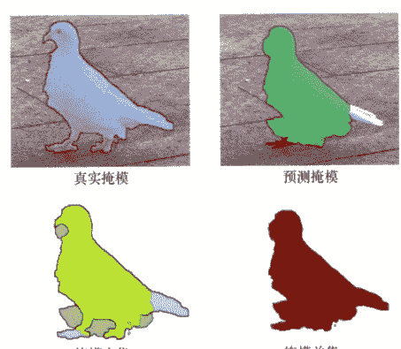

## 真实掩模 | 预测掩模 | 掩模交集 | 掩模并集

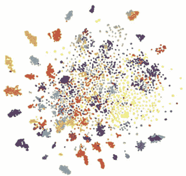

## 图 15

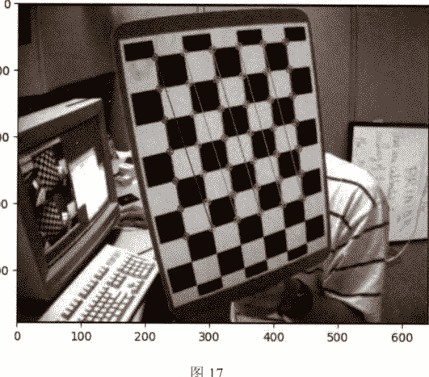

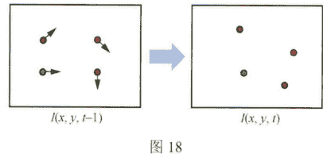

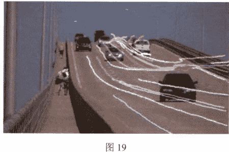


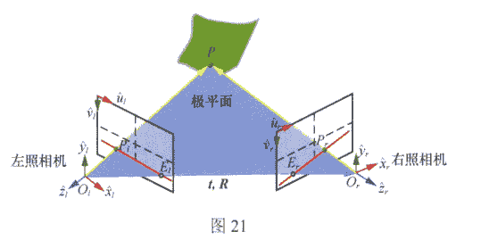

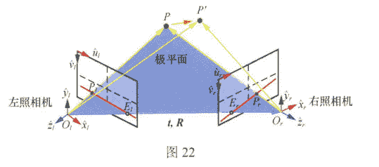

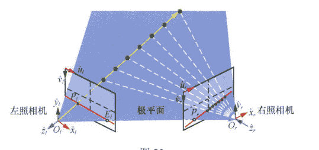

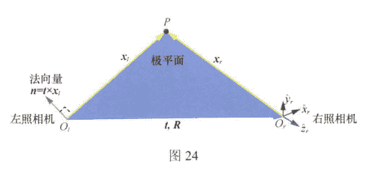

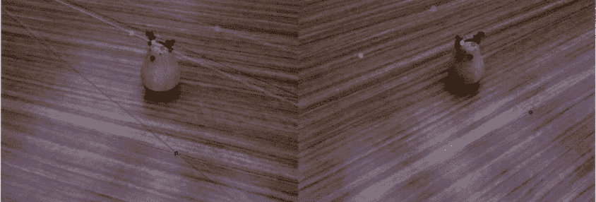

## 图 25

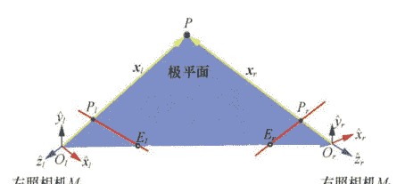

## 图 26

---

## 序言：缘起与初衷

置身数字化浪潮，机器视觉早已不再是悬在实验室里的“高精尖”概念。手机相册的智能修图、支付解锁的刷脸验证、汽车座舱的辅助驾驶……这些早已融入柴米油盐的场景，皆是视觉智能落地的铁证，正推着人类跨入智能纪元的大门。

时间回拨至 2019-2020 年，本书作者之一沈为教授在约翰斯·霍普金斯大学计算机系讲授相关课程；2021 年起，他又在上海交通大学人工智能卓越班持续深耕教学。一线磨课让他敏锐捕捉到学习者面临的**双重困境**：

1.  **知识版图过宽，极易迷失**。该领域融汇影像处理、模式识别、多视几何、深度神经网络等多重学科，体系宏大。不少学习者甚至青年学者，往往只深耕某个细分赛道，对全貌知之甚少。
2.  **理论落地有隙，知易行难**。搞懂数学推导 ≠ 能跑通工程代码、拿到预期指标。工程化落地能力是这门学科的硬门槛。

**《动手玩转计算机视觉》正是为破解这两大难题而生。**

**破局一：构建全景知识骨架。**  
我们借鉴大师 Richard Szeliski 经典著作《Computer Vision: Algorithms and Applications》的框架精髓，结合多年教学实战，将全书拆解为**四大模块**：
- **导论篇**：奠基认知；
- **底层视觉篇**：夯实影像处理根基（卷积、滤波、特征、拼接、分割等）；
- **高层语义篇**：攻克语义理解核心任务（分类、检测、分割、姿态、动作等，主攻深度学习范式）；
- **三维几何篇**：还原空间立体结构（标定、光流、双目、重建等，基于多视几何）。  
前二者为基，后二者为用，力求以最小体系覆盖最大知识面。

**破局二：代码即文档，所见即所得。**  
全书采用 **Jupyter Notebook** 形态编写，原理推导与可执行脚本无缝融合。读者无需折腾环境配置，即可即时验证算法效果，打通“原理-实验”闭环，极大提升自学与教学效率。

市面优秀教材不乏其数，如艾海舟老师译作《计算机视觉——算法与应用》、叶韵老师著作《深度学习与计算机视觉》。本书差异化定位在于：**知识点覆盖更广（尤其经典 CV 思想，放之四海而皆准），理论实战结合更紧（大量案例带你入坑）**。愿此书能为国产 CV 人才培养添砖加瓦。

---

## 内容架构：任务驱动，拒绝枯燥堆砌

机器视觉是典型的“应用导向”学科，本书摒弃单纯按技术分类，转而按**核心任务**组织内容，直击业务场景：

### 🟦 基石：底层视觉（影像处理）
一切视觉任务的前哨站。涵盖：卷积运算、影像滤波、模板匹配、边缘/角点检测、SIFT 特征提取、全景拼接、语义分割。经典算法逐行拆解，筑牢根基。

### 🟨 核心：高层语义（视觉识别）
赋予机器“读懂”画面的能力。主攻深度神经网络方法：图像分类、语义分割、目标检测、实例分割、人体姿态估计、动作识别。

### 🟩 进阶：三维几何（场景重建）
从 2D 平面走向 3D 空间。基于多视图几何：相机标定、运动场与光流、平行双目立体视觉、三维重建。还原真实世界的空间结构。

---

## 阅读指南：三种模式，任君挑选

**形态独特：每章 = 一个可运行笔记本。**  
概念定义、理论推导、算法流程、完整脚本，一站式呈现。

**按需选择：**
- **概念速览党**：跳过代码单元，只读文字叙述，快速建立全局观。
- **工程实干派**：直奔代码区块，改参数、跑结果、看可视化，加深体感理解。
- **深度钻研者**：文代对照，逐行推敲，做到知其然更知其所以然。

**适配人群：** 高校师生（本科/研究生）、企业算法工程师、CV 爱好者。  
**前置储备：** 线性代数/概率论/数值分析基础 + Python 编程入门。常用库（NumPy, OpenCV, PyTorch 等）书中均有速查说明。

**资源包（随书走）：**
- 💻 **全书源码**：`https://github.com/boyu-ai/Hands-on-CV` （含可调超参，鼓励动手改动实验）
- 🎬 **配套视频课**：扫书中二维码或访问 `https://hcv.boyuai.com`
- 📚 **延伸阅读**：想继续“动手学”系列？深度学习、数据结构、机器学习、NLP、强化学习，全系覆盖。

*代码注释覆盖关键节点，但不可能面面俱到。遇到疑惑请多查文档、多动脑、多搜资料——这才是成长最快的路径。*

---

## 鸣谢与资源获取

**致谢：** 上海交通大学 DeepVision 实验室全体同仁倾力相助；2022 级 AI 卓越班崔一丹、邬天行、方源、李昀澜、李子丰等同学绘制精美插图；伯禹教育殷力昂、田园老师审阅把关。

**配套资料领取：**  
扫描下方二维码获取源码、课件、理论视频 👇  
  
*亦可在异步社区书籍页点击「配套资源」下载（需验证提取码）。教师申请教学资源请联系责编。*

**勘误反馈：** 发现错误请登录异步社区提交，经确认赠 100 积分。  
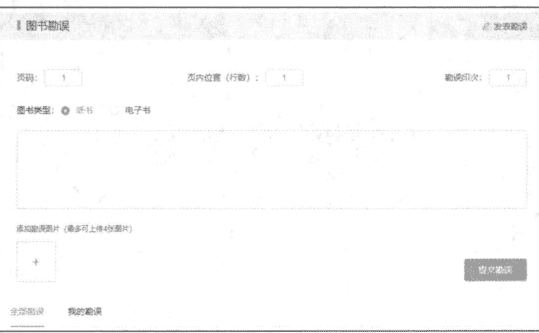

**商务合作/版权保护/意见建议：**  
📮 `contact@epubit.com.cn`（标注书名）  
📮 出版/审校合作：`liuasi@ptpress.com.cn`  
📮 团购/盗版举报：同上邮箱。

**关于异步社区：** 人民邮电出版社旗下 IT 专业社区，深耕优质内容出版与分享 9 年，连接作者与读者，融合传统与数字出版。

---

## 第一部分 导论篇：认知计算机视觉

## 第 1 章 初识视觉智能

### 1.1 CV 是什么

你好！欢迎踏入机器视觉的第一课。

提到“计算机视觉”，你的脑海里会浮现什么？  
是科幻大片里能自主识别威胁的智能机甲？  
是火星表面自主巡航的探测车？  
还是已经融入柴米油盐的**人脸门禁、刷脸支付、相册智能分类**？

答案全对。这些正是该技术正在实现、或已大规模落地的场景。

### 视频导学

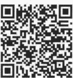

**探索起点：仿生与超越**  
生物视觉堪称工程奇迹：眼球成像（传感器）+ 大脑解析（处理器）。我们能轻松识别“这是傍晚”、“那是白虎”、“云在虎后、树在虎前”的立体关系。  
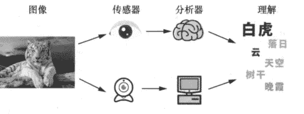  
*图 1-1 生物视觉系统（上）vs 机器视觉系统（下）*

机器视觉试图复刻这一过程：  
- **传感端** 换成 **摄像头**（输入：图像/视频流）  
- **计算端** 换成 **算法模型**（输出：语义标签、三维坐标、运动轨迹……）  

既然大脑机制仍是谜题，我们不强求“模仿神经元级细节”，而是定义一个**黑箱目标**：**同等视觉输入下，机器输出与人类感知结论一致。**

简而言之，机器视觉的核心使命是：**从二维像素矩阵中，重构三维物理世界的属性。**

---

### 1.2 为何需要 CV

# 视觉智能：从感知到理解的计算之路

人类获取外界信息的主要通道是视觉。作为视觉数据的核心载体，图像与视频蕴藏着极其丰富的信息——每一帧画面都在讲述一个故事。伴随移动互联技术的普及，海量视觉数据触手可及。倘若计算机能拥有媲美人类的视觉系统，迅速解析这些数据内容，必将显著跃升生活品质。如今，计算机视觉早已走出科幻蓝图，深度嵌入日常应用。以下梳理七大典型落地场景：

- **身份验证体系**：人脸检测早期服务于相机对焦，人脸识别现广泛部署于铁路验票、设备解锁等安防入口。
- **文字数字化引擎**：OCR技术支撑车牌自动计费与支票移动存款，实现物理单据的即时数据化。
- **全景视野构建**：手机原生全景模式，通过水平扫描即可合成宽广视野。
- **三维空间重建**：移动端应用支持多角度拍摄生成三维模型，降低建模门槛。
- **会议隐私保护**：视频会议背景虚化功能，依托图像分割技术精准抠像。
- **智能驾驶进阶**：辅助驾驶集成目标检测、语义分割等技术，实现车道保持、避障测距；全自动驾驶是当前攻关方向。
- **医疗影像辅诊**：CT、MRI等无创影像配合语义分割等算法，辅助病灶定位与病情预判，分流医生压力。

### 1.3 核心困境：跨越语义鸿沟

虽已在垂直领域落地，但通用计算机视觉仍是悬而未决的硬骨头。期望目标看似朴素：同等输入下，机器输出与人类视觉判断一致。但这低估了难度——人类视觉分析能力属于"隐性知识"，极难显性化。核心拦路虎是**语义鸿沟**。

同一幅图像，人类感知的是语义实体：如图1-2所示，我们能瞬间分割主体，认出骆驼且推断其被杂草部分遮挡。计算机"看到"的仅是无意义数字矩阵（像素值），从矩阵到语义的映射路径极其曲折，中间横亘着巨大鸿沟。

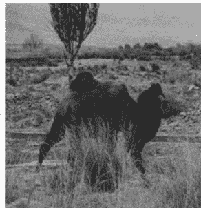

| 254 | 152 | 154 | 56 | 72 | 78 | 96 | 98 |
| --- | --- | --- | --- | --- | --- | --- | --- |
| 120 | 187 | 192 | 143 | 176 | 113 | 131 | 127 |
| 162 | 172 | 196 | 124 | 175 | 123 | 122 | 116 |
| 223 | 198 | 230 | 162 | 159 | 92 | 27 | 85 |
| 83 | 77 | 73 | 140 | 144 | 201 | 240 | 159 |
| 165 | 82 | 76 | 45 | 18 | 64 | 165 | 57 |
| 52 | 58 | 90 | 70 | 68 | 89 | 201 | 78 |
| 79 | 16 | 37 | 135 | 173 | 126 | 136 | 157 |

图 1-2 语义鸿沟示例

缩小鸿沟面临六大挑战因素（图1-3）：

- **光照干扰**：光线变化重塑目标外观，干扰识别。
- **视角差异**：观察角度改变导致外观几何畸变。
- **尺度适应**：人眼自适应多尺度，机器常需多尺度搜索穷举。
- **类内差异**：同类物体（如不同风格椅子）外观巨异，人类凭常识推理归类，机器难以复现。
- **背景杂波**：复杂背景淹没前景，尤其前背景纹理相似时分割失效。
- **遮挡缺失**：目标部分不可见，人类凭"脑补"完成补全，机器难以模拟完形感知。

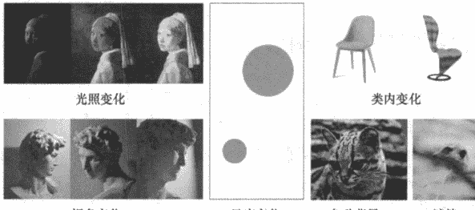

图 1-3 影响计算机视觉的挑战性因素

### 1.4 演进史：从手工特征到深度表征

图1-4勾勒发展双轨：上半部为理论方法迭代，下半部为数据驱动演进。

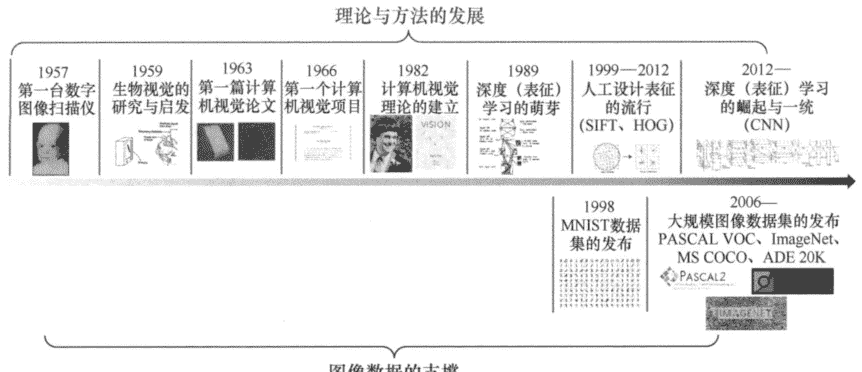

图 1-4 计算机视觉发展史

**奠基期（1950s-1980s）**：
- 1959年 Hubel & Wiesel 猫视觉实验揭示层级处理机制，40年后催化CV突破，获1981诺奖。
- 1957年 Kirsch 研制首台数字扫描仪，数字图像处理肇始。
- 1963年 Roberts 博士论文确立"二维推三维"研究范式。
- 1966年 MIT暑期视觉项目虽失败，但标志学科正式诞生；参与者 Marr 后来奠基理论框架。
- 1977年 Marr 《视觉》巨著提出三层假设（计算理论/表征算法/硬件实现），核心洞见：**表征即将原始像素转为机器可解形式**。CV史实质是追求更优表征的历史。Marr 英年早逝（35岁），著作成经典，领域最高奖以其命名。

**手工特征黄金期（1990s-2010s）**：
- 1989/1998年 LeCun 推 LeNet 系列，播下深度学习种子，发布 MNIST，但长期被忽视。
- 1999年 Lowe 提出 SIFT：尺度旋转不变梯度直方图，成匹配/重建基石。
- 2001年 Viola Harr特征+AdaBoost，实现首个实时人脸检测器。
- 2003年 Zisserman 借词袋模型创 BoF，以视觉词频表征图像，服务分类检索。
- 2005年 Triggs 提出 HOG，目标检测主流特征。
- 同期 PASCAL VOC、ImageNet、MS COCO、ADE20K 等大规模数据集建成，为后续深度学习爆发铺垫数据土壤。

**深度学习统治期（2012-至今）**：
- 2012年 **AlexNet**（5层卷积+3层全连接）夺 ImageNet 冠军，错误率比第二名低10.8%，**深度学习时代正式开启**，表征学习取代手工设计。Hinton/LeCun 共享2018图灵奖。
- 2015年 FCN（全卷积网络）将深度学习推广至语义分割等稠密预测任务。
- 2016年 **ResNet**（残差网络）突破极深网络训练难题，再夺 ImageNet 冠军，确立深度学习在CV的绝对统治地位。

### 1.5 数学符号统一约定

为消除文献差异，本书统一变量记号：

| 变量类型 | 记号风格 | 示例 | 备注 |
|----------|----------|------|------|
| 标量 | 斜体 大/小写 | K, k | |
| 向量 | 粗斜体 小写 | **v** | 默认列向量 **v**=[x y]ᵀ; **v**(i) 为第i元素 |
| 矩阵 | 粗斜体 大写 | **M** | **M**(i,j) 为第i行第j列; 按列优先可展平为 **M**(i) |
| 高阶张量 | 粗斜体 大写 | **T** | 索引规则类推向量/矩阵 |
| 集合 | 花体 大写 | **S** | |
| 空间 | 双线体 大写 | **R** | |
| 函数 | 斜体 小写 | f(x, y) | 变量用圆括号逗号分隔 |
| 二维点 | 带括号列表 | (x, y) | 对应向量 **p**=(x, y)，可推广高维 |

### 1.6 章节回顾与展望

本章通过四个维度构建认知骨架：
1. **类比定义**：对标人类视觉界定CV概念；
2. **应用佐证**：罗列七大场景印证实用价值；
3. **挑战透视**：拆解六大难点揭示通用性瓶颈；
4. **史脉梳理**：追溯里程碑呈现技术演进逻辑。

理论铺垫已备，接下来进入实战篇——**第二部分 图像处理**，以卷积为核心，由浅入深拆解数学本质与代码落地。

---

## 第二部分 图像处理

### 2.1 卷积：视觉特征提取的核心算子

当下CV领域，**卷积**是最高频术语。源于卷积神经网络（CNN）成为任务求解的默认基座。但"卷积"本源于信号处理，用于计算线性系统对输入信号的响应输出。

**本质拆解**：输入为两个函数（信号函数 f、系统函数 k），操作分三步：**翻转 → 滑动叠加 → 积分/求和**（连续域积分，离散域加权求和，统称"叠加"）。


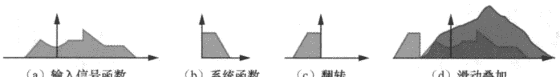

图 2-1 输入信号函数与系统函数的卷积过程

**为何需翻转？物理意义何在？**
教材常释：输出不仅取决于当前输入，更累积历史所有时刻响应——卷积是**时空维度的效应累积**。

**生活类比——池塘投石**：
- 投石 = 输入信号；水波 = 单次冲激响应。
- 持续投石 → 某时刻某点波高 = 历次石子激发水波的**叠加累积**。
- "卷"对应考虑所有相关历史输入，"积"对应叠加其效应。

**映射到图像域**：
- 时间维度 → 空间邻域；
- 信号函数 → 输入图像；
- 系统函数 → 卷积核（权重）；
- 响应输出 → 图像特征。

**结论：图像卷积 = 特征提取过程 = 视觉任务基石。**

本章脉络：一维卷积（数学定义/代码实现） → 二维卷积推广 → 图像卷积操作详解。

### 2.2 一维卷积：数学定义与性质

卷积是基础运算（同加减乘除），核心动作：**平移 → 相乘 → 累加**。涉及积分/级数，形式看似复杂。

#### 连续域定义
一维信号 f(x) 与核 k(x) 卷积：
$$g(x) = f(x)*k(x) = \int_{-\infty}^{\infty} f(\tau)k(x-\tau)d\tau$$

**计算五步曲**：
1. 变换：自变量 x → τ
2. 翻转：核函数翻转
3. 平移：得 k(x-τ)，τ>0 右移，τ<0 左移
4. 相乘：f(τ)·k(x-τ)
5. 积分：乘积曲线下面积 = x 处卷积值

**代数性质**：
- 交换律：f*k = k*f
- 结合律：(f*g)*k = f*(g*k)
- 分配律：f*(g+k) = f*g + f*k

音频处理多用连续卷积，但计算机处理离散信号，故转向离散定义。

#### 离散域定义
离散信号 f(i) 与核 k(i)（数组/向量形式），积分变求和：
$$g(i) = \sum_{l} f(l)k(i-l)$$

```
g(i) = f(i) * k(i) = \sum_l f(l)k(i-l)
```

核长通常取奇数（保证对称），信号长度远大于核长。计算流程见图2-2。

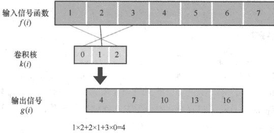

图 2-2 一维离散卷积计算示意

**离散计算步骤**（对应连续域）：
1. 变换：自变量 i → l
2. 翻转：核序列翻转

### 核心步骤拆解：平移、相乘、累加

接着上文，离散卷积的计算流程可精简为三步走：

1.  **翻转与平移**：将核函数翻转后，沿变量 $l$ 滑动，形成 $k(i-l)$。参数 $l$ 控制位移方向——正值右移，负值左移，且步长为整数。
2.  **逐点相乘**：将原信号 $f(l)$ 与平移后的核 $k(i-l)$ 对应位置相乘。
3.  **求和累加**：把所有乘积项加总，即得位置 $i$ 处的卷积输出值。

正如图 2-2 直观展示的，离散卷积本质上就是**“卷积核翻转滑过信号，沿途逐点相乘再求和”**——业界常称之为**“卷和”**。

---

### 输出长度的“缩水”困境与破解之道

有个细节不容忽视：输出序列的长度与输入（长度 $m$）及卷积核（尺寸 $n$）紧密相关。按上述“全卷积”模式（无填充、步长为 1），输出长度固定为 $m - n + 1$。

这引出一个问题：**若反复堆叠卷积层，特征图岂不越来越小？**

现实中这确实会发生。为了对抗尺寸衰减，标准做法是给输入做**零填充**。比如在序列首尾各补一个 0（如图 2-3），输入长度增 2，输出随之变长。若首尾各补两个 0，输出甚至能超越原输入长度。工程上常用“Same Padding”策略——填充量设为 $n-1$，配合步长 1，让输入输出等长。

> **注意**：单侧填充的 0 不宜超过卷积核尺寸。一旦填充量 $\ge n$，卷积核全落在 0 区，输出全为 0，等于给结果也做了无效填充，毫无意义。二维图像填充同理，后文会详述。

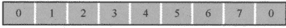

除填充外，**步长**也是调控输出尺寸的关键杠杆。步长 $s$ 定义核每次滑动的跨度。以图 2-3 为例，若 $s=2$，核从位置 0 跳至位置 3，全程仅滑动 4 次，输出长度自然变为 4。

综合输入长 $m$、核长 $n$、单侧填充 $p$、步长 $s$，通用输出长度公式为：
$$ L_{out} = \frac{m - n + 2p}{s} + 1 $$
该公式在二维场景下依然适用。

---

### 动手实现一维卷积

代码层面，我们用数组模拟离散信号。采用“单侧填充 $n-1$、步长 1”的配置，输出长度即为 $m + n - 1$。

```
import matplotlib.pyplot as plt

# 一维卷积
class conv_1d():
    def __init__(self, a, b):
        # 输入信号
        self.f = a
        # 卷积核
        self.b = b
        # 输入信号的坐标，默认从 0 开始。
        self.ax = [i for i in range(len(a))]
        # 卷积核的坐标，默认从 0 开始。
        self.bx = [i for i in range(len(b))]

    def conv(self):
        lst1 = self.a
        lst2 = self.b
        l1 = len(lst1)
        l2 = len(lst2)
        lst1 = [0] * (l2 - 1) + lst1 + [0] * (l2 - 1)
        lst2.reverse()
        c = [0 for x in range(0, l1 + l2 - 1)]
        for i in range(l1 + l2 - 1):
            for j in range(l2):
                c[i] += lst1[i + j] * lst2[j]
        return c

    def plot(self):
        a = self.a
        b = self.b
        ax = self.ax
        bx = self.bx

        # 为了更直观地查看结果，我们分别绘制 a、b 与它们卷积得到的信号
        plt.figure(1)
        # 图包含 1 行 2 列子图，当前画在第一行第一列上
        plt.subplot(1, 2, 1)
        plt.title('Input')
```

```python
# 绘制输入信号
plt.bar(ax, a, color='lightcoral', width=0.2)
plt.plot(ax, a, color='lightcoral')

plt.figure(1)
# 切换到子图 (1行2列 第2个)
plt.subplot(1, 2, 2)
plt.title('Kernel')
plt.bar(bx, b, color='lightgreen', width=0.2)
# plt.plot(bx, b, color='lightgreen')

# 计算卷积输出并绘图
c = self.conv()
length = len(c)
cx = [i for i in range(length)]

plt.figure()
plt.title('Output')
plt.bar(cx, c, color='lightseagreen', width=0.2)
plt.plot(cx, c, color='lightseagreen')
```

#### 2.2.1 单位冲激：卷积的“单位元”

实战验证一下。拿不同核对三角波卷积，观察效果。

```
# 定义输入信号与卷积核
a = [0,1,2,3,2,1,0]
# 冲激函数
k = [0,0,1,0,0]

conv = conv_1d(a, k)
conv.plot()
```
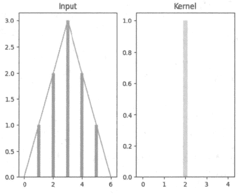
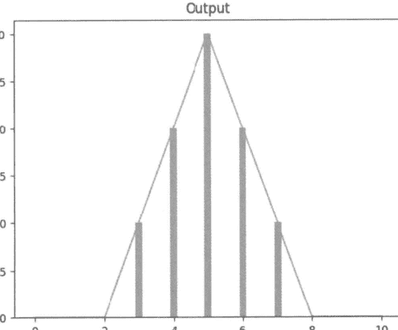

**结论**：当核为单位冲激（仅单点非零，面积为 1）时，信号**原貌不变**。这是卷积的代数恒等性质。

#### 2.2.2 方波核：天然的“平滑滤波器”

换个核试试。

```
# 定义输入信号与卷积核
a = [0,1,2,3,2,1,0]
# 方波信号
k = [1,1,1,1,1]
conv = conv_1d(a, k)
conv.plot()
```
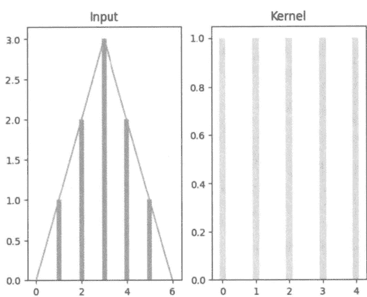
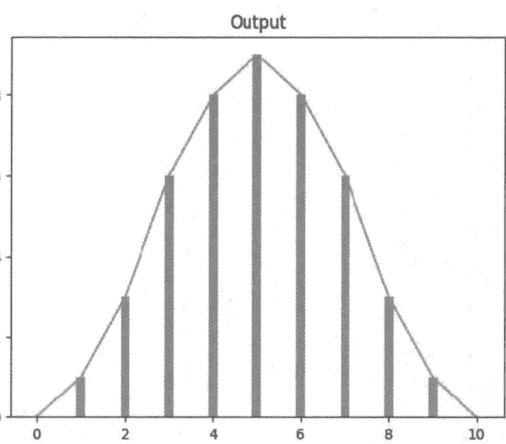

**现象**：方波核卷积三角波，尖角变圆润，波形**显著平滑**。记住这个“模糊/平滑”效应，后续章节会反复引用。

---

## 2.3 二维卷积：从序列到图像

计算机视觉里，图像本质是二维离散函数 $I(i,j)$，矩阵存储。设图像 $H \times W$，核 $K(i,j)$，二维卷积公式如下：

$$G(i, j) = I(i, j) * K(i, j) = \sum_{i'=1}^{H} \sum_{j'=1}^{W} I(i', j') K(i-i', j-j')$$

理解上，二维卷积就是矩阵层面的“卷和”：**核矩阵水平+竖直翻转 180°，覆盖图像左上角，逐元素乘积求和，步长 $s$ 滑动重复**。图 2-4 演示了步长为 1 时的前两次计算。

> **边缘难题**：核尺寸限制导致边缘像素（如图 2-4 左上角的“1”）无法直接作为中心参与计算。解法同一维——**给原矩阵加零边框**（图 2-5）。

| 0 | 0 | 0 | 0 | 0 | 0 | 0 |
|---|---|---|---|---|---|---|
| 0 | 1 | 2 | 3 | 4 | 5 | 0 |
| 0 | 6 | 7 | 8 | 9 | 10 | 0 |
| 0 | 11 | 12 | 13 | 14 | 15 | 0 |
| 0 | 16 | 17 | 18 | 19 | 20 | 0 |
| 0 | 21 | 22 | 23 | 24 | 25 | 0 |
| 0 | 0 | 0 | 0 | 0 | 0 | 0 |

**图 2-5 图像零填充示意**

对 $H \times W$ 图像，填充 $p$ 层，用 $k \times k$ 核、步长 $s$ 卷积，输出尺寸为：
$$ H_{out} = \frac{H - k + 2p}{s} + 1, \quad W_{out} = \frac{W - k + 2p}{s} + 1 $$

---

### 多通道（彩色/高光谱）怎么卷积？

以上讨论针对单通道（灰度图）。实战中常见三通道 RGB ($H \times W \times 3$) 或 $L$ 通道高光谱 ($H \times W \times L$)。第三维度称**特征维/通道维**，通道越多，信息越丰富。

**多通道卷积法则**：
1.  **核通道数必须等于输入通道数 $L$**。核实形为 $k \times k \times L$（习惯只称呼 $k \times k$）。
2.  **分通道卷积再求和**：将核按通道拆成 $L$ 个 $k \times k$ 切片，分别与输入对应通道做二维卷积，得到 $L$ 张单通道特征图；最后**逐元素相加**，合成最终输出（即一张**特征图**）。

> 详细推导可参考《动手学深度学习》。

---

### 二维卷积代码实战

下面用 OpenCV 的 `cv2.filter2D()` 快速验证效果，自制版留作习题。为复用方便，相关工具函数已封装进 `utils.py`。

```
import matplotlib.pyplot as plt
import numpy as np
import cv2
import seaborn as sns

class conv_2d():
    def __init__(self, image, kernel):
        self.img = image
        self.k = kernel

    def plot(self):
        # 展示输入图像
        plt.imshow(self.img[:, :, ::-1])
        plt.axis('off')
        plt.title('Input')
        plt.show()

        # 展示卷积核
        fig = plt.figure(figsize=(2, 1.5))
        sns.heatmap(self.k)
        plt.axis('off')
        plt.title('Kernel')

    # 定义二维卷积
    def convolution(self, data, k):
        # 直接调用库函数进行卷积操作
        return cv2.filter2D(data, -1, k)

    # 展示二维卷积结果
    def plot_conv(self):
        # 卷积过程
        img_new = self.convolution(self.img, self.k)
        # 卷积结果可视化
        plt.figure()
        plt.imshow(img_new[:, :, ::-1])
        plt.title('Output')
        plt.axis('off')
        return
```

#### 2.3.1 二维冲激核：图像“复印机”

```
img = cv2.imread('lena.jpeg')

# 二维冲激卷积核
size = 15

k1 = np.zeros((size, size))
mid = (size-1) // 2
k1[mid][mid] = 1

# 展示输入图像与卷积核
conv = conv_2d(img, k1)
conv.plot()
# 展示卷积结果
conv.plot_conv()
```

**输入**
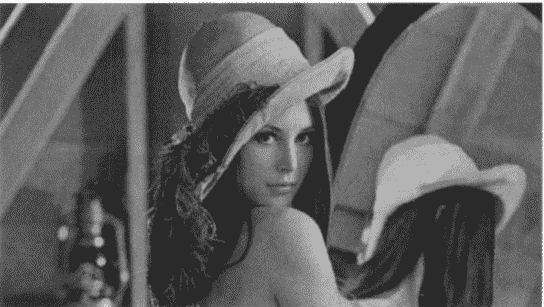

**核**
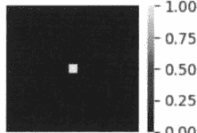

**输出**
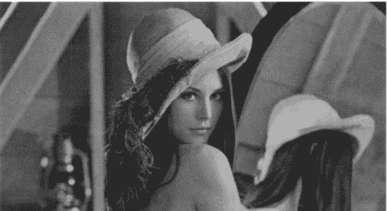

**结果**：冲激核卷积输出**与原图逐像素一致**，印证一维结论。

#### 2.3.2 二维方波核：图像“磨皮器”

```
# 二维方波卷积核
size = 15
# 因为二维的核函数的大小是 n * n 的，因此在实现方波信号时我们需要除以(size * size)
k2 = 1/size/size * np.ones((size, size))

# 展示输入图像与卷积核
conv = conv_2d(img, k2)
conv.plot()

# 展示卷积结果
conv.plot_conv()
```
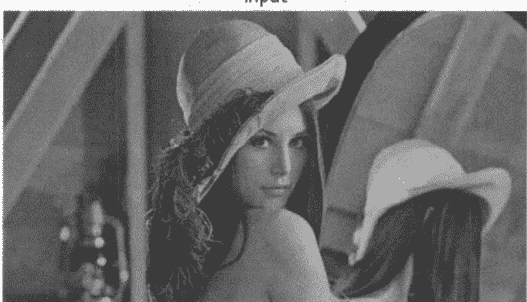
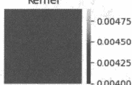
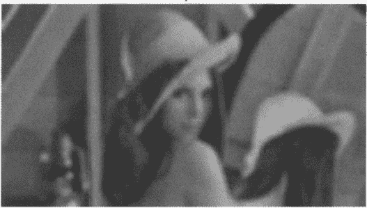

**结果**：方波核输出**模糊平滑**，边缘锐度下降。这正是空域均值滤波的雏形，后续会深入原理。

---

## 2.4 章节小结

卷积是信号处理基石，也是视觉核心算子。它打破“孤立像素”观，引入**邻域交互**，奠定了滤波、特征提取的基础。维度不止 1D/2D，高维卷积同理可推，感兴趣可自行拓展。

下一章，我们将系统剖析卷积在图像滤波中的具体应用。

---

### 课后习题

1.  **一维手算**：输入 `[1, 3, 4, 5, 4, 3, 1]`，核 `[1, -1]`，求卷积结果。
    - A. `[133, 95, 71, 71, 62]`
    - B. `[133, 92, 62, 71, 62]`
2.  **二维手算**：输入矩阵
    $$
    \begin{bmatrix}
    146 & 120 & 62 & 55 & 55 \\
    139 & 146 & 117 & 112 & 117 \\
    139 & 139 & 139 & 139 & 139
    \end{bmatrix}
    $$
    核 $\begin{bmatrix} 0 & 1 \\ -1 & 0 \end{bmatrix}$，求卷积结果。
3.  **编程实战**：参考一维实现，从零写二维卷积函数，完成：
    - a. 复现图 2-4 矩阵卷积全过程（输出矩阵）。
    - b. 复现图 2-5 零填充后卷积（输出矩阵）。
    - c. 用 `lena` 图重现 2.3.1/2.3.2 实验，对比 `cv2.filter2D` 结果是否一致。
    - d. **设计核**，实现图像**向右下平移 10 像素**。

---

## 第 3 章 图像滤波

### 3.1 开篇导读

# 第 3 章 图像滤波：从模糊美颜到降噪锐化

还记得第二章里，我们用二维方波信号卷积图像后发生了什么？画面确实变“顺滑”了，但代价是整体变模糊。这背后的核心机制，就是**图像滤波**。它是图像处理里的基石技术，生活中随处可见——不管是 PS 里的高级修图，还是美图秀秀里的“一键美颜”，像磨皮、祛痘、祛斑这些操作（如图 3-1 所示），底层全靠滤波撑腰。

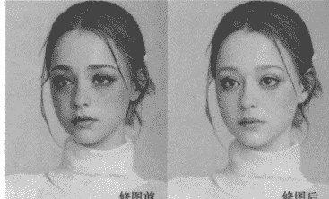

图 3-1 软件修图示例

“滤波”这个词源自信号处理领域。这里的“波”，指的就是图像的**频谱**，简单说就是图像在频域的“身份证”。你可以这样理解：像素值剧烈跳变的区域（如边缘、噪点）对应**高频**；像素值平缓过渡的区域（如平坦皮肤、背景墙）对应**低频**。滤波的本质，就是“挑拣频率”——过滤掉特定频段的信息，从而重塑图像效果。

比如上一章用方波卷积，把高频信息抹平，画面变平滑，这就是**图像去噪**；反过来，强化高频细节，让模糊变清晰，就是**图像锐化**（去模糊）。专门干这事儿的函数，统称**滤波器**。

本章我们将逐一拆解几类经典滤波器。先从“去噪”切入，对比它们的性能差异；再讲如何用滤波实现“锐化”。

---

### 3.2 图像噺声：认识两大“破坏王”

在动手滤波前，得先搞清敌情。最典型的两种噪声：**椒盐噪声**与**高斯噪声**。

#### 3.2.1 椒盐噪声：满屏“黑白点”

顾名思义，“椒”是像素值为 0 的纯黑点，“盐”是像素值为 255 的纯白点。这玩意儿像撒了胡椒和盐一样，随机分布在画面里。罪魁祸首通常是传感器受强干扰，或模数转换器抽风。模拟它很简单：在图像随机坐标强行植入纯黑/纯白像素即可。

```
# 在第 2 章中编写了 utils 函数包文件，本书编写的函数都会封装到 utils 函数包中
from utils import *

# 添加椒盐噪声
def add_Salt(img, pro):
    # img 为输入图像
    # pro 为椒盐噪声的比例

    # 添加黑色像素
    noise = np.random.uniform(0, 255, img[:, :, 0].shape)
    # mask 为添加噪声的掩模
    mask = noise < pro * 255
    # 扩展 mask 的维度
    mask = np.expand_dims(mask, axis=2)
    mask = np.repeat(mask, 3, axis=2)
    img = img * (1 - mask)

    # 添加白色像素
    mask = noise > 255 - pro * 255
    mask = np.expand_dims(mask, axis=2)
    mask = np.repeat(mask, 3, axis=2)
    noise_img = 255 * mask + img * (1 - mask)

    return noise_img

img = cv2.imread('lenaface.jpg')
# 添加椒盐噪声的图像
img_salt = add_Salt(img, 0.05)
plt.imshow(img_salt[:,:,::-1])
plt.axis('off')
plt.show()
```
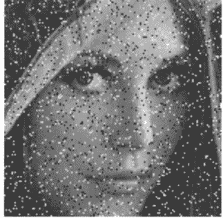

#### 3.2.2 高斯噪声：夜晚的“雪花屏”

概率密度服从高斯分布（正态分布）。你晚上拍照发现画面发虚、有颗粒感，多半是它干的好事。成因复杂：弱光、传感器电路热噪声、长时间工作过热等。实现思路：按二维高斯分布生成随机噪声矩阵，叠加到原图上。

```
def add_Gaussian(img, sigma=20, mean=0):
    lab = cv2.cvtColor(img, cv2.COLOR_BGR2Lab)
    # 生成高斯噪声
    noise = np.random.normal(mean, sigma, lab[:, :, 0].shape)
    lab = lab.astype(float)
    # 添加高斯噪声
    lab[:, :, 0] = lab[:, :, 0] + noise
    lab[:, :, 0] = np.clip(lab[:, :, 0], 0, 255)
    lab = lab.astype(np.uint8)
    noise_img = cv2.cvtColor(lab, cv2.COLOR_Lab2BGR)
    return noise_img

# 添加高斯噪声的图像
img_gaussian = add_Gaussian(img)
plt.imshow(img_gaussian[:, :, ::-1])
plt.axis('off')
plt.show()
```
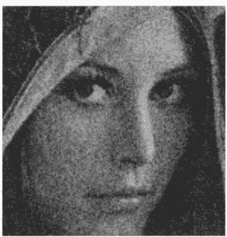

**生活里的对号入座**：美颜里的“祛痘”本质是去椒盐噪声（孤立的极值点）；“磨皮”本质是压制高斯噪声（平滑区域的随机波动）。接下来，我们实战几种主流滤波方案。

---

### 3.3 均值滤波：最朴素的“磨皮术”

拍艺术照精修必磨皮。怎么磨？让皮肤平滑呗。第二章说过，方波卷积核能让图像变平滑。那么，拿方波核卷积人脸，就是最原始的“磨皮”实现。

**数学原理一目了然**：
方波核 $K$ 是个 $k \times k$ 的全 1 矩阵，归一化系数 $1/k^2$。卷积运算等价于——**对每个像素的 $k \times k$ 邻域求算术平均**。

$$ \hat{I}(i, j) = \frac{1}{k^2} \sum_{m=i-k}^{i-1} \sum_{n=j-k}^{j-1} I(m, n) $$

所以它叫**均值滤波器**。求平均能压制突变，褶皱、噪点（高频）被抹平，只留低频大块面——典型的**低通滤波器**。

实测一下对高斯噪声人脸的效果：

```
# 均值滤波器 size=3
size = 3
k3 = 1/size/size * np.ones((size, size))

# 展示输入图像与滤波核
conv_gaussian = conv_2d(img_gaussian, k3)
conv_gaussian.plot()

# 展示卷积结果
conv_gaussian.plot_conv()
```
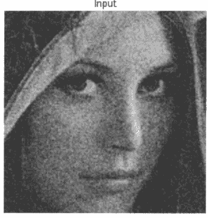
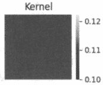
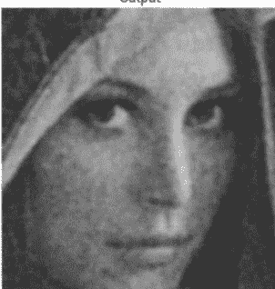

画面是顺滑了，噪点却还在。加大核尺寸再试？

```
# 均值滤波器 size=5
size = 5
k5 = 1/size/size * np.ones((size,size))

conv = conv_2d(img_gaussian, k5)

# 展示卷积结果
conv.plot_conv()

# 均值滤波器 size=9
size = 9
k9 = 1/size/size * np.ones((size, size))

conv = conv_2d(img_gaussian, k9)
# 展示卷积结果
conv.plot_conv()
```

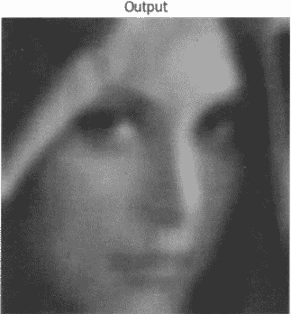

核尺寸 5×5 时噪点基本消失；9×9 时噪点全无，但人脸也“糊”成一团，**过度平滑导致细节丢失**。实战中必须权衡：核太小去噪弱，核太大毁细节。

再细看，均值滤波留下一个硬伤——**“块状效应”**：画面出现明显的方块状色块过渡，极不自然。怎么破？**高斯滤波**登场。

---

### 3.4 高斯滤波：告别“方块脸”，拥抱丝滑过渡

高斯滤波器是去噪主力军。核心区别：**不再简单平均，而是“加权平均”**。权重由高斯分布决定——离中心越近，权重越大；越远，影响越小。形状像个光滑的钟形曲面（图 3-2）。


图 3-2 高斯滤波器权重分布（另见彩插图 1）

高斯核 $G$ 同样是 $k \times k$ 矩阵，元素定义：

$$ G(i, j) = \frac{1}{2\pi\sigma^2} e^{-\frac{i^2+j^2}{2\sigma^2}} $$

*   $\sigma$（标准差）控制“开口”大小：$\sigma$ 大 → 核宽 → 远处像素话语权重；$\sigma$ 小 → 核窄 → 只信近邻。
*   归一化特性：$\sum \sum G(i,j) \approx 1$。

输出公式：
$$ \hat{I}(i, j) = \sum_{m=i-k}^{i+k} \sum_{n=j-k}^{j+k} I(m,n) G(i-m, j-n) $$

**直观感受**：中心像素最听自己和邻居的，远处像素“听听就好”。相比均值滤波的“一人一票”，高斯滤波是“距离加权投票”，过渡自然柔和，**零块状效应**。

代码实测：

```
# 定义高斯核
def gauss(kernel_size, sigma):
    kernel = np.zeros((kernel_size, kernel_size))
    # 定义中心点坐标
    center = kernel_size // 2
    s = sigma ** 2
    sum_val = 0
    # 计算每个位置的高斯核权重
    for i in range(kernel_size):
        for j in range(kernel_size):
            x, y = i-center, j-center
            kernel[i, j] = np.exp(-(x**2 + y**2)/ 2 * s)
            sum_val += kernel[i, j]
    kernel = kernel/sum_val
    return kernel

k_gaussian = gauss(9, 0.5)
# 展示输入图像与滤波核
conv = conv2d(img_gaussian, k_gaussian)
conv.plot()

# 展示卷积结果
conv.plot_conv()
```


高斯噪声被有效压制。调整核尺寸再看：

```
# 高斯核大小为 5
conv1 = conv2d(img_gaussian, gauss(5, 0.5))
conv1.plot_conv()

# 高斯核大小为 7
conv2 = conv2d(img_gaussian, gauss(7, 0.5))
conv2.plot_conv()

# 高斯核大小为 11
conv3 = conv2d(img_gaussian, gauss(11, 0.5))
conv3.plot_conv()
```


**结论**：高斯滤波在干净利落去噪的同时，完美规避了均值滤波的“块状伪影”。工程上直接调 `cv2.GaussianBlur()` 即可。

---

### 3.5 双边滤波：去噪不伤“棱角”，还原真实细节

高斯滤波虽好，有个致命弱点：**不分敌我，连边缘一起糊了**。看 3.4 节结果：五官模糊，眼白眼球界限处出现灰色过渡带。原因在于：高斯滤波把亮暗两侧像素强行加权混合，边缘锐度被“平均”掉了。

有没有**“去噪保边”**的神器？有——**双边滤波器**。

它在高斯滤波基础上，引入第二维度权重：**像素值差异权重**。

设输出 $\hat{I}$，计算公式：

$$ \hat{I}(i, j) = \frac{1}{W_{sb}} \sum_{m=i-k}^{i+k} \sum_{n=j-k}^{j+k} I(m,n) G_s(i-m, j-n) G_b(I(m,n)-I(i,j)) $$

拆解两个核：
*   **空域核 $G_s$**：就是普通高斯核，管几何距离——**“离得远，权重低”**。
*   **值域核 $G_b$**：新增核，管像素值差 $d = I(m,n) - I(i,j)$ ——**“长得像（灰度相近），权重高；长得不像（跨边缘），权重低”**。

归一化因子 $W_{sb}$ 保证权重和为 1。

$$ G_s(m,n) = \frac{1}{2\pi\sigma_s^2} e^{-\frac{m^2+n^2}{2\sigma_s^2}}, \quad G_b(d) = \frac{1}{2\pi\sigma_b^2} e^{-\frac{d^2}{2\sigma_b^2}} $$

**通俗逻辑**：
计算中心像素新值时，邻域里的像素要想“插手”，得满足两个条件：**离得近**（空域高斯）**且 长得像**（值域高斯）。
*   同一平坦区域：像素值相近 → $G_b$ 大 → 充分平均 → **去噪平滑**。
*   边缘两侧：像素值差异大 → $G_b$ 极小 → 互不干扰 → **边缘锐度完好**。

图 3-3 直观演示了这个“双重保险”机制。


图 3-3 双边滤波原理示意（另见彩插图 2）

这就是双边滤波的精髓：**空域近邻 + 值域相似 = 有效贡献**。它能在强力抑制高斯噪声的同时，像护城河一样守住图像的结构边缘。

---

**本章小结**：
从均值滤波的“粗暴平均”，到高斯滤波的“距离加权”，再到双边滤波的“空值双重加权”——滤波器的进化史，本质是**在“去噪平滑”与“保留细节”之间寻找最优平衡点**的过程。下一节我们将把视角翻转，看看如何用滤波思路做**图像锐化**，让模糊画面“破茧成蝶”。

### 3.5 双边滤波：兼顾降噪与保边

请看图 3-3，我们将输入图像（图 3-3(a)）送入双边滤波器处理。图中红点标示了待处理像素 (i,j) 的位置，绿点与橙点则分别代表邻域内不同坐标 (m,n) 的像素，点的高度直观反映了像素值的大小。显而易见，红点与橙点的像素值非常接近，但与绿点相差悬殊。双边滤波器的核心由两个高斯核构成（见图 3-3(b) 上方）。当图像通过该滤波器时，由于绿点与红点亮度差异巨大，绿点的贡献权重会被大幅压制。换个角度看，这相当于在空间高斯滤波基础上，额外引入了一项基于像素值差异的高斯核：亮度或颜色相近的像素参与加权计算，差异大的则被削弱影响，从而有效避免了图像细节被模糊。以人脸实验为例，眼球的黑色像素仅与黑色区域做加权平均，而不会牵扯进眼白的像素，完美守住了眼球与眼白的清晰边界。总的来说，在平坦区域双边滤波表现得像高斯滤波；而在边缘等剧烈变化区域，空间高斯权重的效果被新增的范围核减弱了。公式中的 $W_{sb}$ 是归一化系数，确保加权和为 1，防止像素值溢出 0-255 范围。顺带一提，均值滤波靠核大小 $k^2$ 归一化，高斯滤波因核和本身约等于 1 而无需额外操作。

双边滤波器的手写实现留作课后作业。接下来，我们直接调用 OpenCV 库函数 `cv2.bilateralFilter()` 体验效果。

```
# 为了之后展示图像更加方便，我们将该功能封装成一个函数
def plot_image(img, name, cmap='gray'):
    plt.imshow(img, cmap=cmap)
    plt.title(name)
    plt.axis('off')
    plt.show()

# 展示双边滤波器过滤高斯噪声的效果
plot_image(cv2.bilateralFilter(np.uint8(img_gaussian),30,55,45)[:, :, ::-1], 'output')
```


如上所示，双边滤波器在消除噪点的同时，极好地保留了图像结构清晰度，眼部区域原本斑驳的灰色噪点块明显减少。

### 3.6 中值滤波：椒盐噪声的「终结者」

「祛痘」是美颜修图的高频需求。人脸上的「痘痘」在图像处理里本质上就是椒盐噪声。我们先用高斯滤波试试手，看能不能搞定这些噪点。

```
# 使用高斯滤波器过滤椒盐噪声
conv_salt = conv_2d(np.uint8(img_salt), gauss(5, 1))
conv_salt.plot_conv()
```


结果显而易见，高斯滤波处理椒盐噪声效果很差。因为它本质是加权求和，无法抑制极值噪声的干扰。于是，登场一种专治椒盐噪声的利器——中值滤波器。

中值滤波器属于统计排序滤波器，核心逻辑是：目标像素值取其邻域内所有像素排序后的中间值。对图像上任意一点 (i, j)，以它为中心，将邻域像素排序，中位数即为滤波结果。椒盐噪声在图像中属于少数派，正常像素占绝对多数，因此统计中值大概率落在正常像素值上，这便是它去噪的原理。

图 3-4 演示了一个具体案例。图中分布着像素值为 0 和 1 的椒盐噪声。当滑动窗口移至中心区域，先对邻域像素排序，再取中值 145 替换中心的噪声值 0。得益于正常像素的「多数优势」，中值滤波精准复原了被噪声污染的像素。

| 124 | 194 | 0 | 95 | 74 | 84 | 0 |
| --- | --- | --- | --- | --- | --- | --- |
| 0 | 24 | 1 | 245 | 76 | 76 | 98 |
| 23 | 24 | 205 | 237 | 220 | 89 | 88 |
| 0 | 144 | 1 | **0** | 78 | 99 | 101 |
| 0 | 234 | 145 | 186 | 0 | 97 | 78 |
| 79 | 79 | 59 | 139 | 68 | 0 | 74 |
| 139 | 147 | 104 | 98 | 74 | 1 | 89 |

| 124 | 194 | 0 | 95 | 74 | 84 | 0 |
| --- | --- | --- | --- | --- | --- | --- |
| 0 | 24 | 1 | 245 | 76 | 76 | 98 |
| 23 | 24 | 205 | 237 | 220 | 89 | 88 |
| 0 | 144 | 1 | **145** | 78 | 99 | 101 |
| 0 | 234 | 145 | 186 | 0 | 97 | 78 |
| 79 | 79 | 59 | 139 | 68 | 0 | 74 |
| 139 | 147 | 104 | 98 | 74 | 1 | 89 |

邻域像素排序： 0, 0, 1, 78, **[145]**, 186, 205, 220, 237

图 3-4 中值滤波器精准滤除椒盐噪声

中值滤波器的代码实现同样留作作业。下面调用 `cv2.medianBlur()` 验证实战效果。

```
conv_salt = conv2d(img_salt, k3)
plot_image(cv2.medianBlur(np.uint8(img_salt),5)[:, :, ::-1], 'Output')
```

Output


处理后的人脸清晰得惊人，椒盐噪声踪迹全无。中值滤波器对这类噪声的抑制效果，堪称「教科书级别」。

### 3.7 图像锐化：反其道而行之，增强高频细节

既然滤波能让图变糊（平滑），逆向操作自然能让图变锐（锐化）。前文提到，平滑是保低频滤高频，那锐化是不是去低频留高频？设想一下：图像经高斯滤波后，高频被移除，只剩低频。若用原图减去模糊图，得到的不就是高频信息？我们先实测一把。

```
# 由于卷积运算满足分配律，我们可以直接计算叠加后的卷积核
size = 3
k0 = np.zeros((size, size))
k0[int((size-1)/2)][int((size-1)/2)] = 1

kg = gauss(size, 1)
k_shapen = 1 * (k0 - kg)

# 得到高斯滤波的图像
img_gau = cv2.GaussianBlur(img, (9,9), 5)
shapen = conv_2d(img_gau, k_shapen)

# 展示锐化效果
shapen.plot_conv()
```

Output


结果是一张漆黑的「黑图」，与预期不符。原因在于：图像主体是低频，高频信息极其稀少，仅保留高频自然漆黑一片。修正思路：**锐化不是丢掉低频，而是增强高频。**

于是尝试：将提取出的高频图（黑图）加回原图。这相当于在保留原有低频的基础上，将高频分量增强了一倍。若多次叠加高频分量，图像会不会越来越清晰？

```
# 构建滤波核
k_shapen = k0 + 1 * (k0 - kg)
img_gau = cv2.GaussianBlur(img, (3,3), 1)
shapen = conv_2d(img_gau, k_shapen)
shapen.plot_conv()
```


肉眼可见，图像细节显著增强。通过反复叠加高频残差，锐化效果逐级升级。

```
k_shapen = k0 + 5 * (k0 - kg)
img_gau = cv2.GaussianBlur(img, (3,3), 1)
shapen = conv_2d(img_gau, k_shapen)
shapen.plot_conv()
```


结论明确：用原图减去高斯模糊版得到高频残差，再将其反复叠加回原图，即可持续强化锐化效果。这正是非锐化掩蔽（USM）的核心思想。

### 3.8 本章小结与思考题

本章系统梳理了滤波基础及几大经典滤波器，重点剖析了它们在去噪任务中的分工与表现：均值/高斯针对高斯噪声，双边兼顾降噪保边，中值专治椒盐噪声。最后延伸介绍了基于高频增强的图像锐化技巧。

在计算机视觉流程中，滤波常作为预处理（去噪、去模糊助识别）或后处理（平滑检测结果，剔除误报）的关键一环。

**习题演练：**
- （1）简述高斯滤波为何比均值滤波更适合图像平滑。
- （2）编程实现双边滤波器，用 `lenaface.jpg` 复现 3.5 节去噪效果，并对比库函数结果。
- （3）编程实现中值滤波器，用 `lenaface.jpg` 复现 3.6 节效果，对比库函数。
- （4）改造中值滤波代码，尝试对加入高斯噪声的 `lenaface.jpg` 进行去噪。
- （5）参考本章锐化思路，设计一个卷积核对 `lenaface.jpg` 实现锐化。

## 4.1 图像匹配：寻找「失散多年」的同类

图像匹配，顾名思义，就是在不同图像中定位相同或相似物体的对应位置，是计算机视觉的基石任务。它支撑起图像检索、全景拼接、目标识别等核心应用。最朴素的形式是**模板匹配**：给定一张模板图，在目标大图中搜寻相似度最高的区域。如图 4-1，以云朵为模板，判断大图中是否有云及其位置。按目标数量可分为单目标与多目标匹配。本章将详解匹配流程与核心相似度度量。


图 4-1 模板匹配示意

### 4.2 模板匹配实战：从滑动窗口到归一化互相关

#### 4.2.1 核心流程：滑动、打分、定位

给定模板图 $T$（尺寸 $w \times h$）与输入图 $I$（尺寸 $W \times H$，且 $w \le W, h \le H$），匹配分三步走：

1.  **滑动窗口**：模板在输入图上左上到右下滑动。每个位置 $(i,j)$ 作为左上角，裁剪出同尺寸子图。
2.  **计算相似度矩阵**：每个滑动位置算出一个相似度分数，汇总成矩阵 $R$，尺寸为 $(W-w+1) \times (H-h+1)$。
3.  **寻找峰值定位**：在 $R$ 中找到最大值位置 $(i^*, j^*)$，输入图中以此为左上角、$w \times h$ 的区域即为最佳匹配目标。

如图 4-2，模板从大图左上角开始滑动，逐个位置打分，最高分对应区域即为答案。


图 4-2 模板匹配滑动示意

关键问题来了：**相似度怎么算？**

#### 4.2.2 相似度度量：从互相关到归一化互相关

常用度量有很多，本节聚焦互相关与归一化互相关。

**1. 互相关（Cross-Correlation, CCORR）**

做法直白：模板与子图对应像素逐位相乘求和。位置 $(i,j)$ 处公式如下：

```
R(i, j) = \sum_{m=i}^{i+w-1} \sum_{n=j}^{j+h-1} I(m,n) \cdot T(m-i, n-j)
```

其中 $(m,n)$ 为输入图坐标，$(m-i, n-j)$ 为模板对应坐标。

这公式眼熟不？翻翻第二章二维卷积公式，**二者仅差一个「翻转」操作**！主流深度学习框架（PyTorch, Caffe）的卷积实现默认核已翻转，所以它们跑的其实是互相关。难怪不少学者（如霍金学生 Alan Yuille 教授）常说：卷积神经网络本质上就是在做模板匹配。

下面编码实测互相关匹配效果。

```
# utils 为之前已经编写的函数包
from utils import *

import cv2
from matplotlib import pyplot as plt
import numpy as np

# 计算互相关
def CCORR(img, temp):
    w, h = temp.shape[::-1]
    W, H = img.shape[::-1]
    img = np.array(img, dtype='float')
    temp = np.array(temp, dtype='float')
    res = np.zeros((W - w + 1, H - h + 1))

    # 利用循环计算互相关
    for i in range(W - w + 1):
        for j in range(H - h + 1):
            res[i, j] = np.sum(temp * img[j:j + h, i:i + w])
    return res

# 构建单目标匹配类
class temp_match_single():
    def __init__(self, img, temp):
        self.img = img
        self.temp = temp

    def match(self):
        # 输入目标图像
        img = cv2.cvtColor(self.img, cv2.COLOR_BGR2GRAY)
        # 输入模板图像
        temp = cv2.cvtColor(self.temp, cv2.COLOR_BGR2GRAY)
        w, h = temp.shape[::-1]

        # 计算互相关
        res = CCORR(img, temp)

        # 找到互相关值最大的位置
        loc = np.where(res == np.max(res))
        top_left = [int(loc[0]), int(loc[1])]
        bottom_right = (top_left[0] + w, top_left[1] + h)

        # 将其框出
        cv2.rectangle(self.img, top_left, bottom_right, (255,255,255), 1)
        plot_image(self.img[:, :, ::-1], 'Matching Result by CCORR')
```

导入图像与模板，启动匹配。

```
img = cv2.imread('lena.tri.jpg')
template = cv2.imread('lena_small.png')

test = temp_match_single(img, template)
plot_image(test.temp[:, :, ::-1], 'Template Image')
plot_image(test.img[:, :, ::-1], 'Target Image')

test.match()
```

Template Image


Target Image


Matching Result by CCORR


**翻车了！完全没匹配对。问题出哪？**

细品公式：模板固定时，子图整体越亮（像素值越大），乘积和越大。互相关倾向于找「最亮的区域」，而非「最像模板的区域」。要解决这问题，必须消除子图整体亮度对分数的影响——**引入归一化。**

**2. 归一化互相关（Normalized Cross-Correlation, NCC）**

思路是对模板与子图同步归一化，剥离整体亮度干扰。公式如下：

# 4.3 归一化互相关：消除光照干扰的关键

核心公式如下：

$$R(i,j) = \frac{\sum_m \sum_n I(m,n) \cdot T(m-i,n-j)}{\sqrt{\sum_m \sum_n I^2(m,n)} \sqrt{\sum_m \sum_n T^2(m-i,n-j)}}$**

公式分母的两项分量，分别量化了模板与输入图像局部区域的像素能量，两者相乘构成归一化系数，旨在抵消亮度幅度对相关性计算的干扰。从本质上讲，这正是余弦相似度在图像匹配中的体现。请尝试依据此公式重构 `CCORR()` 函数，验证其能否精准锁定目标区域。

```
# 对原有 CCORR() 函数进行改写，定义归一化互相关
def CCORR(img, temp, normalize=True):
    w, h = temp.shape[::-1]
    W, H = img.shape[::-1]
    res = np.zeros((W-w+1, H-h+1))
    img = np.array(img, dtype='float')
    temp = np.array(temp, dtype='float')
    t = np.sqrt(np.sum(temp**2))

    for i in range(W-w+1):
        for j in range(H-h+1):
            res[i,j] = np.sum(temp*img[j:j+h, i:i+w])
            # 在这里进行归一化操作
            if normalize:
                res[i,j] = res[i,j] / t / np.sqrt(np.sum(img[j:j+h, i:i+w]**2))
    return res

img = cv2.imread('lena_tri.jpg')
template = cv2.imread('lena_small.png')

test = temp_match_single(img, template)

test.match()
```


实验结果直观证明：归一化处理成功剔除了图像子区整体亮度变化带来的干扰，显著增强了互相关度量的抗干扰能力。

## 4.4 多目标场景下的匹配策略

与单目标匹配“取全局最大值”不同，多目标匹配引入了**阈值机制**：仅当某区域与模板的相似度超越设定阈值，才判定为有效目标。

阈值选取是一门平衡的艺术：
*   **阈值过低**：大量背景区域误判为目标，虚假匹配泛滥；
*   **阈值过高**：真实目标因相似度不足而被漏检。

工程上常采用的折中方案是：预设期望匹配数量 $k$，将阈值定为第 $k+1$ 大的相似度数值。本节将直接调用 OpenCV 内置的 `cv2.TM_CCORR_NORMED` 接口完成归一化互相关计算。

```
import numpy as np

# 利用快速排序算法找到数列中第 k 大的值
def findKth(s, k):
    return findKth_c(s, 0, len(s) - 1, k)

def findKth_c(s, low, high, k):
    m = partition(s, low, high)
    if m == len(s) - k:
        return s[m]
    elif m < len(s) - k:
        return findKth_c(s, m + 1, high, k)
    else:
        return findKth_c(s, low, m - 1, k)

def partition(s, low, high):
    pivot, j = s[low], low
    for i in range(low + 1, high + 1):
        if s[i] <= pivot:
            j += 1
            s[i], s[j] = s[j], s[i]
    s[j], s[low] = s[low], s[j]
    return j
```
```
# 构建多目标模板匹配类
class temp_match_multi():
    def __init__(self, img, temp, k=50):
        self.img = img
        self.temp = temp
        # 定义需要匹配的子图个数
        self.k = k

    def match(self):
        # 输入模板图像和目标图像
        temp = cv2.cvtColor(self.temp, cv2.COLOR_BGR2GRAY)
        img = cv2.cvtColor(self.img, cv2.COLOR_BGR2GRAY)

        w, h = temp.shape[::-1]
        method = eval('cv2.TM_CCORR_NORMED')
        res = cv2.matchTemplate(img, temp, method)
        temp = list(np.array(res).flatten())

        # 寻找 res 中第 k 大的值
        threshold = findKth(temp, self.k+1)
        print('设定的阈值为：', threshold)
        loc = np.where(res >= threshold)

        # 将找到的子图框选出
        for pt in zip(*loc[::-1]):
            cv2.rectangle(self.img, pt, (pt[0] + w, pt[1] + h), (255,255,255), 1)
            plt.imshow(self.img[:, :, ::-1]), plt.xticks([]), plt.yticks([])
            plt.show()

img = cv2.imread('img.png')
template = cv2.imread('temp.png')

test_multi = temp_match_multi(img, template, k=50)
plot_image(test_multi.temp[:, :, ::-1], 'Template Image')
plot_image(test_multi.img[:, :, ::-1], 'Target Image')
test_multi.match()
```


实测阈值设定为：`0.99798167`


## 4.5 章节回顾

本章系统梳理了计算机视觉的基石任务——模板匹配。虽算法看似简易，但其“滑动窗口 + 相似度度量”的核心范式，实为后续众多视觉技术（如目标检测）的雏形。第十二章我们将深入探讨检测任务中更为复杂的相似度学习机制。

### 课后思考题

1.  **抗光照变形能力测试**：本章实验中模板与目标像素级一致。若目标遭遇非均匀光照（局部亮暗不一），NCC 还能奏效吗？若失效，请设计并实现一种更鲁棒的相似度度量。
2.  **复杂度分析**：给定图像 $W \times H$、模板 $w \times h$，推导 NCC 作为度量时的计算复杂度。
3.  **尺度不匹配应对**：当模板尺寸与图像中目标实际尺寸不符时，如何改进算法？请利用 `img.png`、`temp.png` 及 `temp_large.png` 实测验证。

---

# 第 5 章 边缘检测：勾勒视觉轮廓

## 5.1 核心概念与地位

**边缘** 标记了图像中亮度、纹理或色彩发生剧变的几何位置，通常位于物体边界、区域分界处（见图 5-1）。它浓缩了物体的形态与场景的结构语义。正如美国工程院院士 Jitendra Malik 所言，形状特征具有超越其他特征的鲁棒性——即使抛弃色彩，仅凭边缘轮廓（如图 5-1 右），人类依然能轻松识别“天鹅”语义。David Marr 视觉理论更奠定了其基石地位：视觉处理的起点，正是从图像中提取边缘等原始特征开始。本章将剖析边缘检测的数学建模及经典算法实现。


**图 5-1** 边缘检测效果示意

## 5.2 数学建模：从导数到梯度

给定图像 $I$，任务是求解每一点 $(i,j)$ 的**边缘强度** $E_s(i,j|I)$ 与**边缘方向** $E_\theta(i,j|I)$。

### 一维视角的启示
将图像灰度沿 $x$ 轴切片视为一维信号（图 5-2）。边缘对应信号剧变点，微积分告诉我们：函数变化率由一阶导数刻画，**边缘即一阶导数的极大值点**。


**图 5-2** 一维信号中的边缘响应

### 离散域的梯度计算
连续函数 $f(x)$ 的导数定义为：
$$\frac{df(x)}{dx} = \lim_{\Delta x \to 0} \frac{f(x + \Delta x) - f(x - \Delta x)}{2\Delta x}$$

推广到二维图像 $f(x,y)$，偏导数为：
$$\frac{\partial f}{\partial x} = \lim_{\epsilon \to 0} \frac{f(x+\epsilon, y) - f(x-\epsilon, y)}{2\epsilon}$$
$$\frac{\partial f}{\partial y} = \lim_{\epsilon \to 0} \frac{f(x, y+\epsilon) - f(x, y-\epsilon)}{2\epsilon}$$

数字图像离散化后，最小距离 $\epsilon = 1$ 像素。转为矩阵索引 $(i,j)$，得**中心差分**公式：
$$I_x(i, j) = \frac{I(i+1, j) - I(i-1, j)}{2}$$
$$I_y(i, j) = \frac{I(i, j+1) - I(i, j-1)}{2}$$

$I_x, I_y$ 分别为 $x,y$ 方向梯度分量（即梯度幅值分量）。梯度向量 $\nabla I(i, j) = [I_x(i, j), I_y(i, j)]$。

将差分写成卷积形式：
$$I_x(i, j) = \frac{1}{2} \sum_{m=-1}^{1} \sum_{n=-1}^{1} I(i-m, j-n) K_x(m, n)$$
$$I_y(i, j) = \frac{1}{2} \sum_{m=-1}^{1} \sum_{n=-1}^{1} I(i-m, j-n) K_y(m, n)$$

其中核矩阵（差分算子）为：
$$K_x = \begin{bmatrix} 0 & 0 & 0 \\ +1 & 0 & -1 \\ 0 & 0 & 0 \end{bmatrix}, \quad
K_y = \begin{bmatrix} 0 & +1 & 0 \\ 0 & 0 & 0 \\ 0 & -1 & 0 \end{bmatrix}$$

矩阵形式即：$I_x = I * K_x, \; I_y = I * K_y$。**图像一阶微分本质上是卷积运算。**

### 边缘属性的最终表达
有了梯度 $\nabla I$，边缘强度与方向即可求得：
*   **强度（幅值）**：$E_s(i, j | I) = \|\nabla I(i, j)\| = \sqrt{I_x^2 + I_y^2}$
*   **方向**：$E_\theta(i, j | I) = \tan^{-1} \left( \frac{I_y}{I_x} \right) + \frac{\pi}{2}$

> **关键提示**：边缘方向与梯度方向**正交**。

综上，边缘检测的核心在于**梯度计算**，而梯度源于**差分/卷积**。$K_x, K_y$ 只是最基础的差分算子，设计更优算子以提升精度与鲁棒性，正是边缘检测算法演进的主线。

## 5.3 经典算法通用流程

标准边缘检测包含三步走战略：
1.  **图像平滑**：微分对噪声极其敏感（噪声即高频突变），预先滤波抑噪是提升鲁棒性的前提。
2.  **梯度计算**：用差分模板卷积平滑后图像，获取梯度场。
3.  **边缘定位**：依据梯度幅值与方向，精准定位边缘像素。

利用卷积结合律，**平滑与差分可融合为单一卷积核操作**，简化流程。下面介绍两大里程碑算法：Sobel 与 Canny。

### 5.3.1 Sobel 算子：平滑与微分的融合

Sobel 算子提供两组 $3 \times 3$ 卷积核：
$$K_x = \begin{bmatrix} +1 & 0 & -1 \\ +2 & 0 & -2 \\ +1 & 0 & -1 \end{bmatrix}, \quad
K_y = \begin{bmatrix} +1 & +2 & +1 \\ 0 & 0 & 0 \\ -1 & -2 & -1 \end{bmatrix}$$

**可分离性设计妙处**（以 $K_x$ 为例）：
$$K_x = \begin{bmatrix} 1 \\ 2 \\ 1 \end{bmatrix} \times \begin{bmatrix} +1 & 0 & -1 \end{bmatrix}$$
*   列向量 `[1, 2, 1]^T`：近似高斯平滑，抑制竖直方向噪声；
*   行向量 `[+1, 0, -1]`：核心差分算子，提取水平方向梯度（垂直边缘响应）。

**Sobel 算子一步到位完成了“平滑+求导”**。下面编程实战：读取 Lena 图，构建双向 Sobel 核。

```
import cv2
import numpy as np
import matplotlib.pyplot as plt
# 输入图像
img = cv2.imread('lena.jpeg')

# 沿 x 轴方向的 Sobel 算子
kx = np.array([
    [1,0,-1],
    [2,0,-2],
    [1,0,-1]
])

# 沿 y 轴方向的 Sobel 算子
ky = np.array([
    [1, 2, 1],
    [0, 0, 0],
    [-1,-2,-1]
])

# 展示输入图像
plt.imshow(img[:, :, ::-1])
plt.axis('off')
```


随后利用卷积代码即可快速获得 $x$ 方向梯度幅值图。

```
# 沿 x 轴方向的 Sobel 算子与图像进行卷积
conv_x = cv2.filter2D(img, -1, kx)
plt.imshow(conv_x[:, :, ::-1])
plt.axis('off')
```

(-0.5, 788.5, 430.5, -0.5)


观察可知，x 轴方向的梯度幅值——即垂直方向的边缘特征（手臂轮廓、帽檐线条等）——已被清晰捕捉。随后，我们计算 y 轴方向的梯度幅值。

```
# 沿 y 轴方向的 Sobel 算子与图像进行卷积
conv_y = cv2.filter2D(img, -1, ky)
plt.imshow(conv_y[:, :, ::-1])
plt.axis('off')
```

(-0.5, 788.5, 430.5, -0.5)


如图所示，y 轴梯度幅值成功提取了水平方向的边缘细节（如眼部轮廓）。有了图像梯度 ($I_x, I_y$)，套用 5.2 节的边缘强度与方向公式，即可输出检测结果。

实测中为提速，边缘强度常取不开平方的近似计算：

$E_s(i, j | I) = || I_x(i, j) || + || I_y(i, j) ||$

```
E = abs(conv_x) + abs(conv_y)
plt.imshow(E[:, :, :1])
plt.axis('off')
```

(-0.5, 788.5, 430.5, -0.5)


#### 5.3.2 Canny 边缘检测算法

Sobel 算子虽融入类高斯平滑机制，具备一定抗噪能力，但区分噪声与真实边缘极具挑战，尤其当纹理杂乱产生伪边缘时。平滑虽能抑噪，却伴随模糊化、边缘弱化的副作用。因此，平滑程度需可调，边缘检测理应支持多尺度输出。下文介绍的 Canny 算法，便是一款经典的多尺度边缘检测方案[4]。

作为计算机视觉领域应用最广的边缘检测器，Canny 算法标准流程包含四步：

1.  **图像平滑**——抑制噪声；
2.  **梯度计算**；
3.  **非极大值抑制（NMS）**——细化边缘；
4.  **双阈值滞后处理**——定位最终边缘。

##### 1. 图像平滑

边缘检测对噪声高度敏感，前置去噪必不可少。结合第 3 章知识，常采用高斯滤波器。平滑力度由核标准差 σ 决定：σ 越大，图像越平滑但细节损耗越重；σ 越小，保留细节越多但残噪也越多。不同 σ 对应不同尺度，调节 σ 即可获得多尺度检测结果。代码实现时，高斯核尺寸设为 5，σ 设为 1.5（经验值：核尺寸约为 σ 的 3 倍时效果最佳）。

```
from utils import *
# 设定高斯核的大小与方差
kernel_size = 5
sigma = 1.5

# 导入一幅图像
img = Image.open('lena.jpeg')

# 将其转为灰度图像
img = img.convert('L')
img = np.array(img)

# 构造高斯卷积核
kernel = gaussian_kernel(kernel_size, sigma)

# 与图像进行卷积
smoothed = cv2.filter2D(img, -1, kernel)

# 展示图像
plot_image(img, 'Original image')
plot_image(smoothed, 'Smoothed image')
```

Original image


Smoothed image


##### 2. 图像梯度计算

拿到平滑图后，沿用 Sobel 思想分别求取水平梯度 $I_x$ 与垂直梯度 $I_y$；进而计算各像素梯度模值（即边缘强度）$E_s(i,j|I) = \|\nabla I(i,j)\| = \sqrt{I_x^2(i,j) + I_y^2(i,j)}$，梯度方向为 $\tan^{-1}\left(\frac{I_y(i,j)}{I_x(i,j)}\right)$，垂直于边缘走向，见下图。


图 5-3 梯度的方向

```
# 求沿 x 轴方向的梯度幅值
def partial_x(img):
    # 获得图像的大小
    Hi, Wi = img.shape
    out = np.zeros((Hi, Wi))

    # 这里将卷积核均值化
    k = np.array([[0,0,0],[0.5,0,-0.5],[0,0,0]])

    # 对图像进行卷积
    out = cv2.filter2D(img, -1, k)

    return out

# 求沿 y 轴方向的梯度幅值
def partial_y(img):
    Hi, Wi = img.shape
    out = np.zeros((Hi, Wi))
    k = np.array([[0,0.5,0],[0,0,0],[0,-0.5,0]])
    out = cv2.filter2D(img, -1, k)
    return out

# 获得两个方向上图像的梯度幅值
Gx = partial_x(smoothed)
Gy = partial_y(smoothed)

# 绘制图像梯度
plot_image(Gx, 'Derivative in x direction')
plot_image(Gy, 'Derivative in y direction')
```

Derivative in x direction


Derivative in y direction


```
# 计算梯度幅值及方向
def gradient(img):
    G = np.zeros(img.shape)
    theta = np.zeros(img.shape)
    dx = partial_x(img)
    dy = partial_y(img)

    # 获得图像梯度幅值
    G = np.sqrt(dx**2 + dy**2)

    # 获得梯度方向
    theta = np.rad2deg(np.arctan2(dy, dx))

    # 将梯度方向调整为 0° ~ 360° 范围内
    theta %= 360

    return G, theta

G, theta = gradient(smoothed)

# 展示利用图像梯度得到的结果
plot_image(np.uint8(G), 'Gradient magnitude')
```


##### 3. 边缘强度非极大值抑制

直接梯度结果边缘粗糙模糊，需经 NMS 细化。NMS 沿梯度方向搜索局部极大值像素并保留，剔除非极大值点。

具体操作：将梯度方向量化为 8 个固定角度 $\left\{ \frac{k}{8} \pi \right\}_{k=0}^7$。对每像素，取其梯度方向及反方向上的两个邻域像素（通常在 8 邻域内），三者比较边缘强度。若中心像素强度最大，即 $E_s(i,j|I) = \max\{E_s(i,j|I), E_s(i',j'|I), E_s(i'',j''|I)\}$，则判定为边缘点保留；否则归零剔除。注：Canny 原文采用寻找拉普拉斯过零点定位极大值，此处用 NMS 实现等价效果。


```
# 非极大值抑制算法
def non_maximum_suppression(G, theta):
    # 获得梯度图的大小
    H, W = G.shape

    # 将梯度方向投影到最近的 45° 空间中
    theta = np.floor((theta + 22.5) / 45) * 45
    theta %= 360

    # 最后输出的图像梯度
    out = G.copy()

for i in range(1, H-1):
```

```python
for j in range(1,W-1):
    # 当前像素的角度大小, 可以将其分为 4 类
    angle = theta[i,j]

    if angle == 0 or angle == 180:
        ma = max(G[i, j-1], G[i, j+1])
    elif angle == 45 or angle == 45 + 180:
        ma = max(G[i-1, j-1], G[i+1, j+1])
    elif angle == 90 or angle == 90 + 180:
        ma = max(G[i-1, j], G[i+1,j])
    elif angle == 135 or angle == 135 + 180:
        ma = max(G[i-1, j+1], G[i+1, j-1])

    else:
        print(angle)
        raise
    # ma 是当前像素的两个邻域点的像素梯度幅值的最大值

    # 如果 ma 的值大于当前像素的梯度幅值, 则认为当前像素非边缘点
    # 并将该像素的梯度幅值设置为 0
    if ma > G[i,j]:
        out[i,j]=0

return out
```

nms = non_maximum_suppression(G, theta)

plot_image(np.uint8(nms), 'Non-maximum suppressed')

# Non-maximum suppressed


实验结果直观显示：边缘线条显著变细、清晰。

##### 4. 基于滞后的阈值化的边缘定位

NMS 将边缘细化为单像素宽线条，下一步锁定最终边缘位置。将边缘强度 $E_s$ 二值化为边缘图 $E_b$（非零即 1 表示边缘）。最朴素的是单阈值法：

$$E_b(i,j|I) = \begin{cases} 1, & E_s(i,j|I) \ge T \\ 0, & E_s(i,j|I) < T \end{cases}$$

但单阈值极易导致边缘断裂。Canny 引入双阈值 $T_h$ 与 $T_l$（$T_l < T_h$）的滞后机制解决此痛点：
- $E_s \ge T_h$：强边缘，直接确认 $E_b=1$；
- $E_s < T_l$：非边缘，$E_b=0$；
- $T_l \le E_s < T_h$：弱边缘，待进一步裁决。

$$E_b(i,j|I) = \begin{cases} 1, & E_s(i,j|I) \ge T_h \\ 0, & E_s(i,j|I) < T_l \\ \text{待定}, & T_l \le E_s(i,j|I) < T_h \end{cases}$$

此即“滞后阈值化”。下面用代码实现强/弱边缘初筛。

```python
# 双阈值确定强弱边缘
def double_thresholding(img, high, low):
    # 初始化强弱边缘为布尔矩阵
    strong_edges = np.zeros(img.shape, dtype=np.bool_)
    weak_edges = np.zeros(img.shape, dtype=np.bool_)

    # 获得输入图像大小
    a, b = img.shape
    for i in range(a):
        for j in range(b):
            # 大于等于 Th 阈值则为强边缘点
            if img[i,j] >= high:
                strong_edges[i,j] = 1

            # 小于 Th 阈值、大于等于 Tl 阈值则为弱边缘点
            elif img[i,j] < high and img[i,j] >= low:
                weak_edges[i, j] = 1

    return strong_edges, weak_edges

low_threshold = 3
high_threshold = 6

strong_edges, weak_edges = double_thresholding(nms,
    high_threshold, low_threshold)

# 返回强弱边缘叠加的边缘图
edges = strong_edges * 1.0 + weak_edges * 0.5

plot_image(strong_edges, 'Strong Edges')
plot_image(edges, 'Strong+Weak Edges')
```

# Strong Edges


# Strong+Weak Edges


强边缘已落笔成定局；弱边缘仅当其落入已确认强边缘的邻域（如 8 邻域）内时，才被提升为有效边缘。接下来实现这一弱边缘追踪确认逻辑。

```python
# 获得在(x,y)处的邻居
def get_neighbors(x, y, H, W):
    neighbors = []
    for i in (x - 1, x, x + 1):
        for j in (y - 1, y, y + 1):
            if i >= 0 and i < H and j >= 0 and j < W:
                if (i == x and j == y):
                    continue
                neighbors.append((i, j))

    return neighbors

# 判断弱边缘点是否为边缘
def link_edges(strong_edges, weak_edges):
    # 获得图的大小
    H, W = strong_edges.shape

    # 获得强边缘点的位置
    indices = np.stack(np.nonzero(strong_edges)).T

    # 初始化最终的结果，为布尔矩阵
    edges = np.zeros((H, W), dtype=np.bool_)
    weak_edges = np.copy(weak_edges)
    edges = np.copy(strong_edges)
    # 将所有强边缘点的坐标组合成一个列表
    q = [(i,j) for i in range(H) for j in range(W) if strong_edges[i,j]]
    while q:
        # pop()函数返回列表中的末尾元素，并将其从列表中删除
        i, j = q.pop()
        # (a, b)是(i, j)的邻居
        for a, b in get_neighbors(i, j, H, W):
            # 如果当前点是弱边缘点且在强边缘点的邻域内，即可认为该点是边缘点
            if weak_edges[a][b]:
                # 为了避免对同一弱边缘点重复判断，便将其值设置为 0
                weak_edges[a][b] = 0
                # 在边缘点中添加该弱边缘点
                edges[a][b] = 1
                # 由于该弱边缘点已经变成边缘点，因此需要将其加入 q 中
                # 通过将该点放进 q 中，在下一次迭代中可判断该点周围是否存在弱边缘点
                q.append((a,b))
    return edges
```

```python
# 获得最终边缘图
edges = link_edges(strong_edges, weak_edges)
plot_image(edges, 'Final image')
```

# 最终效果图


综上所述，我们已将 Canny 边缘检测器封装为如下函数供直接调用。

```python
def canny(img, kernel_size=5, sigma=1.5, high=6, low=3):

    # 获取高斯滤波器
    kernel = gaussian_kernel(kernel_size, sigma)
    # 对图像进行高斯滤波
    smoothed = cv2.filter2D(img, -1, kernel)
    # 得到图像的梯度图
    G, theta = gradient(smoothed)
    # 对梯度图进行非极大值抑制
    nms = non_maximum_suppression(G, theta)
    # 获得强弱边缘信息
    strong_edges, weak_edges = double_thresholding(nms, high, low)
    # 对弱边缘点进行分类，得到最终的边缘图
    edge = link_edges(strong_edges, weak_edges)

    return edge

plot_image(img, 'Original image')
canny_img = canny(img)
plot_image(canny_img, 'Edges of image')
```

# 原始图像


# 图像边缘


观察上图可知，女性发丝的边缘虽被成功勾勒，但画面中同时混入了大量由细微纹理波动引发的伪边缘。正如前文所述，Canny 算子支持通过调整高斯平滑的核尺寸与标准差（Sigma）实现多尺度输出，从而抑制细小纹理的干扰。下面我们将尝试修改这两个参数，直观对比不同平滑强度对检测结果的具体影响。

```python
canny2 = canny(img, kernel_size=7, sigma=2)
plot_image(canny2, 'Kernel Size: 7, Sigma: 2')

canny2 = canny(img, kernel_size=9, sigma=2.5)
plot_image(canny2, 'Kernel Size: 9, Sigma: 2.5')

canny2 = canny(img, kernel_size=9, sigma=3)
plot_image(canny2, 'Kernel Size: 9, Sigma: 3')
```

# 核大小: 7, Sigma: 2


# 核大小: 9, Sigma: 2.5


# 核大小: 9, Sigma: 3


实验表明，随着 Sigma 值增大，边缘检测对细小纹理的抗扰动能力（鲁棒性）显著增强，但代价是部分关键主体边缘开始缺失。这揭示了一个核心矛盾：必须在“图像平滑去噪”与“保留有效边缘细节”之间寻找平衡点。为方便复用，我们已将上述完整流程打包进 `utils.py` 模块。

### 5.4 章节小结

本章系统阐述了边缘检测的数学建模思想，并重点剖析了两大主流算法——Sobel 与 Canny。二者均建立在一阶差分计算图像梯度的基础上，通过梯度的模值与方向刻画边缘强弱与走向。Sobel 算子实现简便，却难以抵御图像噪声干扰；Canny 算子作为工业界标准之选，通过可调卷积核实现多尺度平滑，配合非极大值抑制（NMS）精准定位边缘像素位置，并引入双阈值滞后机制有效区分强弱边缘，大幅提升了抗噪鲁棒性。

### 课后思考题

- **（1）本章方法均基于一阶导数。** 二阶导数能否用于边缘检测？若可，请尝试编码实现基于二阶微分的检测逻辑。
- **（2）实战中常面对彩色图像。** 标准 Canny 仅处理灰度图，请思考如何扩展其处理彩色图像边缘提取的能力。
- **（3）边缘增强应用场景。** 给定一幅图像，欲增强其边缘细节，应如何利用 Sobel、Canny 等算法完成“检测-增强”闭环？
- **（4）双阈值选取策略。** Canny 算法中高低阈值的设定直接决定强弱边缘划分，实际工程中应如何科学选取？
- **（5）噪声敏感性分析。** Canny 算法对噪声敏感吗？请阐述原因并提出针对性的降噪改进方案。
- **（6）核心差异对比。** 从原理、流程、性能三个维度，对比 Canny 与 Sobel 算法的异同点及 Canny 的核心优势。

### 5.5 参考文献

- [1] BORENSTEIN E, MALIK J. Shape guided object segmentation[C]//IEEE Conference on Computer Vision and Pattern Recognition, 2006, 1: 969-976.
- [2] MARR D. Vision: A computational investigation into the human representation and processing of visual information[M]. MIT press, 2010.
- [3] SOBEL I, FELDMAN G. An isotropic 3×3 image gradient operator[R]. Presentation at Stanford Artificial Intelligence Project, 1968.
- [4] CANNY J. A computational approach to edge detection[J]. IEEE Transactions on Pattern Analysis and Machine Intelligence, 1986 (6): 679-698.

## 第 6 章 角点检测

### 6.1 概述


第四章提到，模板匹配要求待匹配区域与模板高度相似，属于最基础的匹配手段。但在实际场景中（如图 6-1(a) 所示的多视角建筑拍摄），如何建立图像间的匹配关系？关键在于提取并匹配**局部不变特征**。这些具有辨识度的特殊位置（如建筑顶点、窗角），被称为**关键点**或**兴趣点**。合格的关键点需具备四大核心特质：
1.  **重复性**：跨尺度、旋转、光照变化下稳定可检测；
2.  **显著性**：邻域图像块具备独特描述，易于区分匹配；
3.  **紧凑性**：特征点数量远少于像素总数，表达高效；
4.  **鲁棒性**：抗背景杂乱与局部遮挡干扰。

图 6-1(b) 中的特征点恰好满足上述条件，且多位于两条边缘交汇处，故得名**角点**。通过匹配两幅图像中的同名角点（图 6-1(c)），解算变换矩阵，即可实现图像拼接融合（图 6-1(d)）。本章将深入讲解经典的 **Harris 角点检测算法**。


图 6-1 基于角点的图像匹配流程

### 6.2 Harris 角点检测算法

**如何从数学上定义“角点”？** 观察图 6-2 的基础模型：在图像某位置 $p$ 放置一小窗口，令其在微小范围内任意方向平移，观察窗内像素灰度变化量：
- **平坦区**：任意方向平移，灰度变化极小；
- **边缘处**：沿边缘方向平移变化小，垂直边缘方向平移变化大；
- **角点处**：**任意方向** 平移，灰度变化量均**显著增大**。


图 6-2 平坦区、边缘与角点的灰度变化对比

**检测逻辑由此确立：** 固定窗口在图像上滑动，若某位置**任意方向**的微小位移都能导致窗内灰度剧烈变化，则判定该处存在角点。Harris 算法即基于此几何直觉，通过两步走完成检测：
1.  计算各像素位置窗口移动前后的灰度变化量 $E(u,v)$；
2.  构造角点响应函数 $R$，经阈值筛选输出角点坐标。

#### 6.2.1 灰度变化量的数学建模

如图 6-3，在位置 $(i,j)$ 处窗口 $W$ 内，施加微小位移 $(u,v)$，定义灰度变化能量函数：

```
E(u,v) = \sum_{(i,j)\in W} (I(i+u, j+v) - I(i, j))^2
```

其中 $I(i,j)$ 为原像素值，$I(i+u, j+v)$ 为位移后像素值。


图 6-3 窗口微小位移示意

直接遍历所有 $(u,v)$ 计算 $E(u,v)$ 计价昂贵。引入**一阶泰勒展开**近似二维图像灰度函数：
$$ I(i+u, j+v) \approx I(i, j) + u I_x + v I_y $$
此处 $I_x, I_y$ 分别为 $x, y$ 方向图像梯度（一阶偏导数）。

代入原式化简得：
$$ E(u,v) = \sum_{W} (u I_x + v I_y)^2 = \sum_{W} (u^2 I_x^2 + v^2 I_y^2 + 2uv I_x I_y) $$
提取位移向量 $[u, v]$，可写成二次型形式：
$$ E(u,v) = \begin{bmatrix} u & v \end{bmatrix} M \begin{bmatrix} u \\ v \end{bmatrix} $$
核心矩阵 $M$（即**结构张量** / **二阶矩矩阵**）定义为：
$$ M = \sum_{W} \begin{bmatrix} I_x^2 & I_x I_y \\ I_x I_y & I_y^2 \end{bmatrix} $$
$M$ 本质上是窗口内**黑塞矩阵** $H$ 的累加。因 $M$ 为实对称阵，可正交对角化：
$$ M = R \begin{bmatrix} \lambda_1 & 0 \\ 0 & \lambda_2 \end{bmatrix} R^T $$
$\lambda_1, \lambda_2$ 为特征值，$R$ 为旋转矩阵。代入变量 $[m, n] = [u, v]R$，变化量化为：
$$ E(u,v) = m^2 \lambda_1 + n^2 \lambda_2 $$
**几何意义：** $E(u,v)$ 构成一个椭圆，长短半轴由特征值决定，主轴方向由特征向量决定（见下图）。


图 6-4 结构张量特征值与灰度变化椭圆的几何对应关系

#### 6.2.2 角点响应函数的构造

**角点判据：** 位于角点处，任意方向位移 $(u,v)$ 均导致 $E(u,v)$ 较大 $\rightarrow$ $E(u,v)$ 的**最小值**较大。

假设位移向量近似单位向量（$u^2+v^2 \approx 1 \Rightarrow m^2+n^2 \approx 1$），则 $E(u,v)$ 的极值即为特征值 $\lambda_1, \lambda_2$ 本身。据此，无需显式求特征值，Harris 提出经典响应函数 $R$：

```
m^2 + n^2 = [m \ n] \begin{bmatrix} m \\ n \end{bmatrix} = [u \ v] R R^T \begin{bmatrix} u \\ v \end{bmatrix} = u^2 + v^2
```

```
\max_{u,v} E(u,v) = \max(\lambda_1, \lambda_2) \\ \min_{u,v} E(u,v) = \min(\lambda_1, \lambda_2)
```

式中 $k$ 为经验常数（通常取 0.04~0.06）。$R$ 值的正负大小直接反映局部结构类型：
- $R > 0$ 且较大（$\lambda_1, \lambda_2$ 均大）$\rightarrow$ **角点**；
- $R < 0$（一正一负）$\rightarrow$ **边缘**；
- $|R| \approx 0$（均很小）$\rightarrow$ **平坦区**。

### 6.2 理论核心：从二阶矩到角点响应

如图 6-4 所示，拐角处像素变化剧烈，导致结构张量 $M$ 的两个本征值 $\lambda_1, \lambda_2$ 均取得较大数值。平坦区与边缘同样可通过这两个本征值的量级关系判别。二者与图像区域类型的对应规律如图 6-5 所总结：

- **情形一**：两值均小且接近 $\rightarrow$ 椭圆长轴短轴均长且近似 $\rightarrow$ **平坦区**；
- **情形一**：一大一小、差异显著 $\rightarrow$ 椭圆长短轴悬殊 $\rightarrow$ **边缘**；
- **情形三**：两值均大且接近 $\rightarrow$ 椭圆长短轴均短且近似 $\rightarrow$ **角点**；

虽可凭本征值大小定性分辨，但工程上更期望单一标量指标——**角点响应函数**——直接给出判决。基于经验构造如下：

```
\rho = \lambda_1 \lambda_2 - \alpha(\lambda_1 + \lambda_2)^2
```


图 6-5 两个特征值与图像区域的关系

式中 $\alpha$ 为经验常数，常取 0.04~0.06。读者可自行推演该函数如何映射三类区域。其与区域类型的数值关系见图 6-6，归纳如下：

- $|\rho|$ 极小趋近 0 $\rightarrow$ **平坦区**；
- $\rho$ 为负值 $\rightarrow$ **边缘**；
- $\rho$ 为较大正值 $\rightarrow$ **角点**；


即：窗口位置的 $\rho$ 为正且越大，该位置是角点的把握越高，从而获得可量化的计算路径。利用线性代数性质：

$$
\det(M) = \lambda_1 \lambda_2, \quad \operatorname{trace}(M) = \lambda_1 + \lambda_2
$$

可直接用矩阵 $M$ 的行列式与迹计算响应，规避特征分解开销：

$$
\rho = \lambda_1 \lambda_2 - \alpha(\lambda_1 + \lambda_2)^2 = \det(M) - \alpha(\operatorname{trace}(M))^2
$$

得出响应图后，设定门限 $\gamma$，满足 $\rho > \gamma$ 即判定为角点。

**Harris 角点检测全流程五步走**：

1.  逐像素计算梯度分量 $I_x, I_y$；
2.  以局部窗口 $W$ 遍历图像，累加窗内黑塞矩阵得 $M = \sum_{(i,j)\in W} H$；
3.  计算角点响应 $\rho = \det(M) - \alpha(\operatorname{trace}(M))^2$；
4.  对全图响应图执行非极大值抑制；
5.  设阈值 $\gamma$，$\rho > \gamma$ 的保留为最终角点。

### 6.3 编程实战

理论铺垫完毕，下面用代码跑通 Harris 检测闭环。

```
from utils import *

# 计算角点响应函数
def responseFunc(M):
    # 设置超参数
    k = 0.04
    # 计算 M 的行列式
    det = np.linalg.det(M)
    # 计算 M 的迹
    trace = np.trace(M)
    # 计算角点响应函数
    R = det - k * trace ** 2

    return R
```

```
# Harris 角点检测算法
def harris_corners(src, NMS=False):
    # 获得输入图像的长和宽
    h, w = src.shape[:2]
    # 将图像转为灰度图像
    gray_image = cv2.cvtColor(src, cv2.COLOR_BGR2GRAY)
    # 初始化角点矩阵
    cornerPoint = np.zeros_like(gray_image,dtype=np.float32)
    # 计算图像沿 x 轴和 y 轴的梯度幅值
    grad = np.zeros((h, w, 2), dtype=np.float32)
    # 沿 x 轴的梯度
    grad[:,:,0] = cv2.Sobel(gray_image, cv2.CV_16S, 1, 0)
    # 沿 y 轴的梯度
    grad[:,:,1] = cv2.Sobel(gray_image, cv2.CV_16S, 0, 1)
    # 计算黑塞矩阵内元素的值，此时的值是求和的结果，即 M 矩阵的元素
    Ixx = grad[:,:,0] ** 2
    Iyy = grad[:,:,1] ** 2
    Ixy = grad[:,:,0] * grad[:,:,1]
    # 计算窗口内黑塞矩阵元素的值，窗函数使用高斯函数
    Ixx = cv2.GaussianBlur(Ixx, (3, 3), sigmaX=2)
    Iyy = cv2.GaussianBlur(Iyy, (3, 3), sigmaX=2)
    Ixy = cv2.GaussianBlur(Ixy, (3, 3), sigmaX=2)

    for i in range(gray_image.shape[0]):
        for j in range(gray_image.shape[1]):
            # 构建 M 矩阵
            structure_matrix = [[Ixx[i][j], Ixy[i][j]], [Ixy[i][j], Iyy[i][j]]]
            # 计算角点响应函数
            R = responseFunc(structure_matrix)
            cornerPoint[i][j] = R

    # 非极大值抑制
    corners = np.zeros_like(gray_image, dtype=np.float32)
    threshold = 0.01

    # 返回所有角点响应的最大值
    maxValue = np.max(cornerPoint)

    # 我们将角点响应函数的阈值设定为 threshold * maxValue

    for i in range(cornerPoint.shape[0]):
        for j in range(cornerPoint.shape[1]):

            # 如果进行 NMS 操作
            if NMS:
                # 当前角点响应值大于阈值，同时也是邻居点的最大值
                if cornerPoint[i][j] > threshold * maxValue and \
                cornerPoint[i][j] == np.max(
                cornerPoint[max(0, i - 1):min(i + 1, h - 1),
                max(0, j - 1):min(j + 1, w - 1)]):

                    corners[i][j] = 255

            else:
                # 当前角点响应值大于阈值
                if cornerPoint[i][j] > threshold * maxValue:
                    corners[i][j] = 255

    # 返回检测到的角点
    return corners
```

```
```python

# 图像素材来自 OpenCV-Python 官网教程

img = cv2.imread('sudoku.png')

plt.imshow(img[:, :, ::-1])

plt.axis('off')

plt.title('Original Input')

plt.show()

response = harris_corners(img)

img[response == 255] = [0, 0, 255]

plt.imshow(img[:, :, ::-1])

plt.axis('off')

plt.title('Harris Corner Response')

plt.show()

```
```


### 6.4 几何变换下的鲁棒性验证

前文（6.1 节）提到，优质特征点应对几何变换具备“重复性”。实测 Harris 在旋转、平移、缩放三大变换下的表现：

**旋转不变**：
旋转仅改变结构张量 $M$ 的旋转分量 $R$，**本征值不变**，角点判定零影响。如图 6-7 直观呈现。


**平移不变**：
平移不改变矩阵本征值谱，检测结果依然稳健。

**缩放失效—— 核心短板**：
缩放会改变本征值大小。如图 6-8 所示，放大后原本孤立的角点可能分裂为多个边缘响应被误判。**结论：Harris 不具备尺度不变性！**


### 6.5 章节回顾

本章详解 Harris 算法。虽对旋移鲁棒、是匹配常用特征，但**“惧缩放”**是硬伤。有没有无惧尺度变化的特征？请看第 7 章—— SIFT 登场破局。

### 课后实战题

- **（1）邻域窗口尺度效应**：Harris 依赖固定窗口统计变化，窗口大小会改变结果吗？用 `sudoku.png` 实测分析。
- **（2）三大几何变换实测**：同图分别施加旋移缩，观测角点检测受影响程度。
- **（3）抗噪压力测试**：注入高斯/椒盐噪声，评估 Harris 敏感度。
- **（4）响应阈值 $\gamma$ 博弈**：不同门限筛选出的角点数量/质量差异？设计实验量化。

---

## SIFT 特征检测

### 7.1 破局尺度：斑点区域与尺度空间构建

回溯第 6 章匹配难题：图 7-1（a）、（b）兼具旋转与缩放，Harris 因无尺度不变性直接出局。我们需要**新型关键点**，能定位出类似图 7-1（c）、（d）“窗户”这类**富语义、可定位、可描述**的感兴趣区域（ROI），并从中解算旋移缩参数，实现精准配准。

**合格 ROI 的三大硬指标**：
1.  **信息密度高**：蕴含丰富纹理语义；
2.  **空间定位唯一**：位置确定无歧义；
3.  **描述判别强**：特征向量可区分匹配。

**描述子的两项抗干扰指标**：
1.  **几何不变**：平移、旋转、缩放下描述不变；
2.  **光照鲁棒**：亮度变化不影响识别。


图 7-1 基于感兴趣区域特征的图像匹配范式

**边缘 vs 斑点，谁是真特征？**
观图 7-2：边缘地带（a、b）特征单一、定位模糊；而被闭合轮廓包裹的**斑点区域 Blob（c、d）**，位置、尺度、语义俱全，天然适合做特征单元。


图 7-2 边缘地带与斑点区域的对比

Blob 由闭合边缘构成，用边缘检测器捕捉顺理成章。图 7-3 展示一维不同尺度 Blob 经**高斯拉普拉斯算子（LoG：高斯平滑 + 二阶拉普拉斯微分）**卷积的过程。


图 7-3 不同尺度 Blob 对 LoG 算子的响应曲线

**关键发现—— 特征尺度 $\sigma^*$ 的诞生**：
最底行显示，当 LoG 核标准差 $\sigma$ 与 Blob 尺寸**匹配**时，响应曲线出现**唯一极值点**。该对应 $\sigma$ 即为该 Blob 的**特征尺度 $\sigma^*$**。

**难点：多尺度空间 $(x, \sigma)$ 下的“全局极值”陷阱**：
单尺度有极值不够。放入 $(x, \sigma)$ 全空间，非归一化 LoG 响应随 $\sigma$ 增大而衰减（图 7-4(a)），极值非全局最优，无法直接阈值判别。

**破局：尺度归一化**：
响应乘以 $\sigma^2$ 规一化后（图 7-4(b)），特征尺度处的极值跃升为**全局极小值**。此时，在 $(x, \sigma)$ 空间捕捉归一化 LoG 的全局极值，即可同步完成**Blob 定位**与**特征尺度确定**。


(a) 非归一化响应：随尺度衰减，无全局极值


(b) 归一化响应：特征尺度处现身全局极小值

图 7-4 LoG 算子尺度归一化前后对比

**落地二维：构建图像尺度空间 $L(x, y, \sigma)$**
用不同 $\sigma$ 的高斯核 $G(x, y, \sigma)$ 卷积原图 $I(x, y)$：
$$ L(x, y, \sigma) = G(x, y, \sigma) * I(x, y) $$
- $\sigma$ 小 $\rightarrow$ 细节层（高频）；
- $\sigma$ 大 $\rightarrow$ 概貌层（低频）。

对尺度空间做**归一化 LoG 卷积**，观察响应图极值：
- **现极大值**（图 7-5，屋檐位置）$\rightarrow$ 确认为 Blob，极值对应的 $\sigma$ 即特征尺度；
- **无显著极值**（图 7-6，平坦区）$\rightarrow$ 非特征区。


图 7-5 尺度空间中存在极值 $\rightarrow$ 存在特征点


图 7-6 尺度空间无极值 $\rightarrow$ 无特征点

**尺度匹配的几何意义**：
若两幅图匹配到对应特征点，其特征尺度之比 $\sigma_1^* / \sigma_2^*$ 直接给出图像间的**缩放比例**（见图 7-7）。


# 7.2 SIFT 算法：从原理到实现的深度解析

SIFT（Scale Invariant Feature Transform，尺度不变特征变换）全称尺度不变特征变换，由 David G. Lowe 教授于 1999 年在 ICCV 大会上首发。作为计算机视觉史上被引用次数最多的经典论文之一，它奠定了基于尺度空间的块状区域检测与描述范式，深刻影响了视觉识别与三维重建领域二十余年。其核心逻辑延续了 7.1 节的思路：构建尺度空间，定位不随尺度变化的稳定结构。


## 7.2.1 关键点检测：用 DoG 加速极值搜索

理论上，特征点对应尺度归一化高斯拉普拉斯算子（$ \sigma^2\nabla^2 G $）响应图上的极值。但直接计算二阶导数开销大，SIFT 引入**高斯差分**近似替代。

DoG 算子定义为两个不同尺度高斯核的差值：$ D(x,y,\sigma) = G(x,y,k\sigma) - G(x,y,\sigma) $。数学推导表明，DoG 与归一化 LoG 仅相差常数倍 $ (k-1) $，不影响极值位置，两者响应高度近似。


工程实现上，我们先构建图像金字塔：用可变尺度高斯核卷积输入图像得到尺度空间 $ L $，再将相邻尺度层做差即得 DoG 响应图。这一步避免了重复卷积，大幅提速。


候选关键点即为 DoG 响应图中**三维尺度空间 $(x, y, \sigma)$ 的局部极值**。判定规则是：将中心点与同尺度 8 邻域、上下相邻尺度各 9 邻域共 26 个点比较，仅当响应值为最大（或最小）时保留。

## 7.2.2 精准定位与严格筛选：剔除亚像素偏差与边缘干扰

离散网格上的极值点往往偏离真实连续极值位置。SIFT 引入**三次泰勒展开**插值修正：

$$ D(\mathbf{x}) = D(\mathbf{0}) + \frac{\partial D^T}{\partial \mathbf{x}}\mathbf{x} + \frac{1}{2}\mathbf{x}^T \frac{\partial^2 D}{\partial x^2}\mathbf{x} $$

求导为零解得偏移量 $ \hat{\mathbf{x}} $。若任一维度偏移超 0.5 像素，说明极值已漂移至邻域，需迭代更新位置直至收敛；迭代超限或越界的点直接丢弃。


修正后的极值响应 $ D(\mathbf{x}^*) $ 即为**对比度**。低对比度点（经验阈值 < 0.03）抗噪性差，直接剔除。

此外，**边缘响应**也是干扰源。边缘处主曲率远大于次曲率，定位不稳。利用 Hessian 矩阵特征值比率 $ r = \lambda_1/\lambda_2 $，构造判别式：

$$ \frac{\text{trace}(\mathbf{H})^2}{\text{det}(\mathbf{H})} = \frac{(r+1)^2}{r} $$

该值随 $ r $ 增大而增大。设定经验阈值 $ r=10 $（即 $ \gamma=10 $），仅保留满足不等式的点，有效抑制边缘伪关键点。

## 7.2.3 方向分配：赋予特征旋转不变性

为实现旋度不变匹配，每个关键点需确定**主方向**。方法基于图像梯度统计：

1.  **邻域范围**：以关键点为中心，半径取 $ 4.5\sigma $（即 $ 1.5 \times 3\sigma $ 原则）的外接正方形。
2.  **梯度直方图**：360° 分 36 个柱（每 10°），统计邻域内像素梯度方向与幅值。引入高斯加权 $ w = \exp\left(-\frac{i^2+j^2}{2(1.5\sigma)^2}\right) $，中心像素权重大，边缘衰减。
3.  **平滑滤波**：对直方图做加权平滑 $ H(i) = \frac{6}{16}H(i) + \frac{4}{16}(H(i-1)+H(i+1)) + \frac{1}{16}(H(i-2)+H(i+2)) $，消除噪声尖峰（角度按循环处理）。
4.  **选向**：全局最大柱对应方向为主方向；高度超主方向 80% 的柱作为辅方向，增强匹配鲁棒性。

至此，关键点具备位置、尺度、方向三要素。


## 7.2.4 描述子构建：128 维向量编码局部外观

描述子需满足**独特性**（同类似、异类异）与**不变性**（抗光照、视角变化）。

构建流程：
1.  **区域划分**：以关键点为心，半径 $ r = \frac{3\sigma\sqrt{2}(d+1)}{2} $（经验 $ d=4 $）画圆，取外接正方形，切分为 $ 4\times4=16 $ 个子块。
2.  **梯度编码**：每个子块内统计 8 个主方向（0°~315°）的梯度幅值直方图（可高斯加权），形成 8 维向量。
3.  **拼接向量**：16 子块 $\times$ 8 维 = **128 维 SIFT 特征向量**。


**关键一步：坐标系旋转归一化**。直接用图像坐标系算梯度方向，图像一旋转，描述子全变。SIFT 将**块状区域的横轴强制对齐至关键点主方向**。旋转公式为标准二维旋转矩阵变换。因为描述仅依赖相对于主方向的相对角度，无论图像如何旋转，相对结构不变，描述子自然实现旋转不变性。


## 7.3 工程落地：模块化代码实现路线图

理解原理后，落地代码采用**函数式分步实现**：

1.  **尺度空间生成**：构建高斯金字塔与 DoG 金字塔。
2.  **关键点检测管线**：
    *   判别 26 邻域极值；
    *   亚像素插值定位；
    *   对比度与边缘响应双重筛选；
    *   计算主/辅方向；
    *   生成 128 维描述子。

```python
import cv2
import numpy as np
from scipy.ndimage import maximum_filter
import matplotlib.pyplot as plt
import random

# 生成指定数目的高斯核，并对图像做高斯滤波
def generateGimage(image, sigma, num_layers = 8, k_stride = 2):
    sigma_res = np.sqrt(np.max([(sigma ** 2) - (1 ** 2), 0.01]))
    # (0,0)表示卷积核的大小根据 sigma 来决定
    image = cv2.GaussianBlur(image, (0, 0), sigmaX=sigma_res,
                             sigmaY=sigma_res)

    # 生成高斯核
    k = 2 ** (1 / k_stride)
    gaussian_kernels = np.zeros(num_layers)
    # 第一层高斯核就是 1.6
    gaussian_kernels[0] = sigma

    for i in range(1, num_layers):
        # 根据高斯核的性质，可以将大的高斯核拆分，减少计算量
        gaussian_old = k**(i-1) * sigma
        gaussian_new = k * gaussian_old
        gaussian_kernels[i] = np.sqrt(gaussian_new**2 - gaussian_old**2)

    # 至此，我们已经得到一系列高斯核
```
```
# 进行高斯滤波
gaussian_images = [image]
for kernel in gaussian_kernels:
    tmp_image = cv2.GaussianBlur(image, (0, 0), sigmaX=kernel,
                                 sigmaY=kernel)
    gaussian_images.append(tmp_image)

# 返回不同高斯核对图像滤波的结果
return np.array(gaussian_images)

# 生成 DoG 空间
def generateDoGSpace(gaussian_images):
    dog_images = []
    for img1, img2 in zip(gaussian_images, gaussian_images[1:]):
        dog_images.append(img2 - img1)
    return dog_images
```
```
# 1.判别当前像素点是否为局部极大值点
def isLocalExtremum(l1, l2, l3, threshold):
    # l1, l2, l3 是 DoG 尺度空间中相邻的 3 层，大小均已被切片成 3*3
    # 即[l1,l2,l3]是一个 cube
    # 需要确定 l2 层的中心位置，即(1,1)位置是否为极值点
    # threshold 是一个设定的阈值，l2[1,1]必须大于阈值才可进行极值点的判定
    if l2[1,1] > threshold:
        if l2[1,1] > 0:
            return np.all(l2[1,1]>=l1) and np.all(l2[1,1]>=l3) \
                and np.sum(l2[1,1]<l2)==0
        elif l2[1,1] < 0:
            return np.all(l2[1,1]<=l1) and np.all(l2[1,1]<=l3) \
                and np.sum(l2[1,1]>l2)==0
    return False
```

```
# 2.若为极值点，则对其进行定位与筛选，并计算最终选出的特征点的特征
# 在这一模块中，我们将编写实现计算特征点各个属性
# 参考 7.2.2 节以及 7.2.3 节

# 计算极值点特征
def computeBlobAttribute(x, y, layer, dog_images, sigma, threshold,
                         border, num_layers, g_image, corners,
                         scales, orientations, layers):
    # 计算(x,y)位置的特征点的特征
    # 此时假设该位置的点为邻域内的最大值
    # 首先需要对其进行筛选，根据牛顿迭代法判定是否为真正的极值点
    # 筛除低对比度的特征点
    # 消除边缘响应
    # 在此之后便可得到特征点的信息

    gamma = 10
    image_shape = dog_images[0].shape
    out_flag = False

    # 使用牛顿迭代法得到极值点
    # 至多更新 5 次，如果未收敛，则认为该候选点不是极值点

    for iter_num in range(5):
        # 得到 DoG 空间中相邻的 3 层
        img1, img2, img3 = dog_images[layer-1:layer+2]
        # 对这 3 层进行切片，得到大小为 3*3 的 3 层
        cube = np.array([img1[x-1:x+2, y-1:y+2],
                         img2[x-1:x+2, y-1:y+2],
                         img3[x-1:x+2, y-1:y+2]])

        # 分别得到 cube 的二一阶导数
        grad = compute1derivative(cube)
        hessian = compute2derivative(cube)

        # 解方程得到牛顿迭代的更新值
        update = -np.linalg.lstsq(hessian, grad, rcond=None)[0]
        # 如果移动的距离太小，说明当前点里极值已收敛，直接返回当前点即可
        if abs(update[0]) < 0.5 and abs(update[1]) < 0.5 \
                and abs(update[2]) < 0.5:
            break
        # 更新当前点
        y += int(round(update[0]))
        x += int(round(update[1]))
        layer += int(round(update[2]))
        # 确保新的 cube 在 DoG 空间里
        if x < border or x >= image_shape[0] - border \
                or y < border \
                or y >= image_shape[1] - border \
                or layer < 1 or layer > num_layers - 2:
            # 若不在空间中，则 out_flag = True
            out_flag = True
            break

    # 超出空间大小或者不收敛，直接返回
    if out_flag or iter_num >= 4:
        return

    # 使用公式计算极值点的对比度
    Extremum = cube[1, 1, 1] + 0.5 * np.dot(grad, update)
    # 筛除低对比度的特征点
    if np.abs(Extremum) >= threshold:
        # 得到 xy 的黑塞矩阵
        xy_hessian = hessian[:,2, :2]
        xy_hessian_trace = np.trace(xy_hessian)
        xy_hessian_det = np.linalg.det(xy_hessian)
        # 消除边缘响应
        if xy_hessian_det > 0 and \
           (xy_hessian_trace ** 2) / xy_hessian_det < \
           ((gamma + 1) ** 2) / gamma:
           # 极值点坐标
           pt = ((y + update[0]), (x + update[1]))
           # 极值点尺度
           size = sigma * (2 ** *((layer + update[2])))
           # 计算特征点的方向（主方向和辅方向）
           # 利用 computeOrien() 函数进行计算
           orien_list = computeOrien(pt, size, layer, g_image)
           for tmp_orien in orien_list:
               # 尺度
               scales.append(size)
               # 位置
               layers.append(layer)
               corners.append(pt)
               # 方向
               orientations.append(tmp_orien)
    return
```

接着落实前文代码里预留的各个功能函数。

```
# 编写一些数学函数

# 计算一阶导数
def compute1derivative(cube):
    # cube 是由 DoG 空间中相邻的 3 层组成，其中每层的大小被切片成 3*3
    # 需要计算 cube 正中心位置的梯度
    dx = (cube[1, 1, 2] - cube[1, 1, 0]) / 2
    dy = (cube[1, 2, 1] - cube[1, 0, 1]) / 2
    ds = (cube[2, 1, 1] - cube[0, 1, 1]) / 2
    return np.array([dx, dy, ds])

# 计算二阶导数
def compute2derivative(cube):
    # cube 是由 DoG 空间中相邻的 3 层组成，其中每层的大小被切片成 3*3
    # 需要计算 cube 正中心位置的梯度

    # 根据二阶导数的定义写出各个分量
    center = cube[1, 1, 1]

    dxx = cube[1, 1, 2] + cube[1, 1, 0] - 2 * center
    dyy = cube[1, 2, 1] + cube[1, 0, 1] - 2 * center
    dss = cube[2, 1, 1] + cube[0, 1, 1] - 2 * center

    dxy = (cube[1, 2, 2] - cube[1, 2, 0]
         - cube[1, 0, 2] + cube[1, 0, 0]) / 4
    dxs = (cube[2, 1, 2] - cube[2, 1, 0]
          - cube[0, 1, 2] + cube[0, 1, 0]) / 4
    dys = (cube[2, 2, 1] - cube[2, 0, 1]
          - cube[0, 2, 1] + cube[0, 0, 1]) / 4
    return np.array([[dxx, dxy, dxs], [dxy, dyy, dys],[dxs, dys, dss]])
```

```
# 计算特征点的方向
def computeOrien(pt, size, layer, g_image):
    # pt 为特征点的位置
    # size 为对应的尺度大小
    # layer 为特征点所在层级
    # g_image 为高斯尺度空间的一层，即 g_images[layer]

    # 1.5 倍的 3sigma 原则，决定圆半径的大小
    radius = int(round(3 * size * 1.5))
    image_shape = g_image.shape
    # 设置直方图柱的数量
    num_bins = 36
    histogram = np.zeros(num_bins)
    smooth_histogram = np.zeros(num_bins)
    orien_list = []

    # 遍历以特征点为中心的块状区域，块状区域的边长为 2*radius
    for i in range(-radius, radius + 1):
        y = int(round(pt[1])) + i
        # 判断坐标是否越界
        if y > 0 and y < image_shape[0] - 1:
            for j in range(-radius, radius + 1):
                x = int(round(pt[0])) + j
                # 判断坐标是否越界
                if x > 0 and x < image_shape[1] - 1:
                    # 计算当前位置的 dx 和 dy
                    dx = 0.5 * (g_image[y, x + 1] - g_image[y, x - 1])
                    dy = 0.5 * (g_image[y + 1, x] - g_image[y - 1, x])
                    # 计算当前位置梯度的幅值
                    value = np.sqrt(dx * dx + dy * dy)
                    # 计算当前位置梯度的方向
                    orien = np.rad2deg(np.arctan2(dy, dx))
                    # 高斯加权
                    weight = np.exp(
                        -0.5 / ((size*1.5) ** 2)
                        * (i ** 2 + j ** 2)
                    )
                    histogram_index = int(
                        round(orien * num_bins / 360.)
                    )
                    histogram[histogram_index % num_bins] += \
                        weight * value

    # 对直方图进行高斯平滑
    for n in range(num_bins):
        smooth_histogram[n] = (6 * histogram[n]
            + 4 * (histogram[n-1] + histogram[(n+1) % num_bins])
            + histogram[n-2] + histogram[(n+2) % num_bins]) / 16.
    # 选择主方向
    orien_max = np.max(smooth_histogram)
    orien_local_max = list(i for i in range(len(smooth_histogram))
        if smooth_histogram[i] > smooth_histogram[i-1] and
        smooth_histogram[i] > smooth_histogram[(i+1) % num_bins])

    # 选择辅方向
    for index in orien_local_max:
        if smooth_histogram[index] >= 0.8 * orien_max:
            orien_list.append(index * 360. / num_bins)

    return orien_list
```

到此，特征点检测的函数模块已可成型。

```
# 对一幅图像进行特征点检测
def detect_blobs(image):
    sigma = 1.6
    num_layers = 4
    border = 5
    k_stride = 1

    # 生成高斯尺度空间
    g_images = generateGimage(image, sigma, num_layers, k_stride)
    # 生成 DoG 空间
    dog_images = generateDoGSpace(g_images)

    # 开始寻找块状区域
    threshold = 0.02
    corners = []
    scales = []
    orientations = []
    layers = []

    for layer, (image1, image2, image3) in \
        enumerate(zip(dog_images, dog_images[1:], dog_images[2:])):
        # 忽略太靠近边缘的点
        for x in range(border, image1.shape[0]-border):
            for y in range(border, image2.shape[1]-border):
                # 检测当前位置是否为局部极值
                if isLocalExtremum(image1[x-1:x+2, y-1:y+2],
                    image2[x-1:x+2, y-1:y+2],
                    image3[x-1:x+2, y-1:y+2],
                    threshold):
                    # 如果是候选点，则进行进一步定位筛选，并返回其信息
                    computeBlobAttribute(x, y, layer+1, dog_images,
                        sigma, threshold, border,
                        num_layers, g_images[layer],
                        corners, scales, orientations,
                        layers)

    return g_images, corners, scales, orientations, layers
```

随后，针对已捕获的特征点构建描述符。

## SIFT 特征点描述符的构建

```
def compute_descriptors(g_images, corners, scales,
    orientations, layers):

    if len(corners) != len(scales) \
        or len(corners) != len(orientations):
        raise ValueError(
            "'corners', 'scales' and 'orientations' "
            "must all have the same length.")

    descriptors_list = []

    for pt, size, orien, layer in \
        zip(corners, scales, orientations, layers):

        # 读取特征点的各项信息
        g_image = g_images[layer]
        x, y = np.round(np.array(pt)).astype(np.int32)
        orien = 360 - orien

        # 计算块状区域大小
        win_s = 3 * size
        win_l = int(round(min(2**0.5 * win_s * (4+1) / 2,
        np.sqrt(g_image.shape[0]**2+g_image.shape[1]**2))))

        # 用列表依次存储块状区域内所有点的信息
        i_index = []
        j_index = []
        value_list = []
        orien_index = []

        # 三维数组存储 16 个窗口的 8 个方向，为防止计算时边界溢出,
        # 在行、列的首尾各扩展一次
        result_cube = np.zeros((4 + 2, 4 + 2, 8))

        # 统计一个块状区域内 16 个子区域的像素梯度直方图
        for i in range(-win_l, win_l+1):
            for j in range(-win_l, win_l+1):

                # 获得旋转之后的坐标
                i_rotate = j * np.sin(np.deg2rad(orien))
```

```python
i_rotate = i * np.cos(np.deg2rad(orien))
j_rotate = j * np.cos(np.deg2rad(orien)) \
    - i * np.sin(np.deg2rad(orien))

# 计算 4*4 子区域对应的下标
tmp_i = (i_rotate / win_s) + 2 - 0.5
tmp_j = (j_rotate / win_s) + 2 - 0.5

# 邻域的点在旋转后，仍然处于 4*4 的区域内
if tmp_i > -1 and tmp_j > -1 \
    and tmp_i < 4 and tmp_j < 4:

    # 该特征点在原图像中的位置
    i_inimg = int(round(y + i))
    j_inimg = int(round(x + j))

    if i_inimg > 0 and j_inimg > 0 \
    and i_inimg < g_image.shape[0]-1 \
    and j_inimg < g_image.shape[1]-1:
        # 计算梯度幅值
        dx = g_image[i_inimg, j_inimg + 1] \
            - g_image[i_inimg, j_inimg - 1]
        dy = g_image[i_inimg - 1, j_inimg] \
            - g_image[i_inimg + 1, j_inimg]
        grad_value = np.sqrt(dx**2 + dy**2)
        # 计算梯度方向
        grad_orien = np.rad2deg(
            np.arctan2(dy, dx)) % 360

        i_index.append(tmp_i)
        j_index.append(tmp_j)
        # 进行高斯加权
        g_weight = np.exp(-1 / 8 * (
            (i_rotate / win_s) ** 2 +
            (j_rotate / win_s) ** 2
        ))
        value_list.append(g_weight * grad_value)
        # 将梯度方向投影到 8 个方向
        # 这里的 grad_orien 是原图像中的梯度
        # 需要叠加上旋转之后的角度
        orien_index.append(
            (grad_orien - orien) * 8 / 360)

# 将每个方向的幅值插入矩阵 result_cube 中
for i, j, value, orien1 in zip(i_index, j_index, value_list, orien_index):
    trilinearInterpolation(i, j, value, orien1, result_cube)

descriptor = result_cube[1:-1, 1:-1, :].flatten()
# 计算描述符的大小
l2norm = np.linalg.norm(descriptor)
```

```python
# 设定阈值
threshold = l2norm * 0.2
# 将描述符截断，将大于阈值的值设定为阈值
descriptor[descriptor > threshold] = threshold
# 归一化，确保描述符具有尺度不变性
descriptor /= l2norm
# 添加描述符
descriptors_list.append(descriptor)

return descriptors_list
```

```python
# 将每个方向的幅值插入矩阵 result_cube 中
def trilinearInterpolation(i, j, value, orien, result_cube):
    # 由于位置坐标(i,j,orien)是一个浮点数，没有办法直接在 result_cube 中赋值
    # 考虑到该浮点位置会对邻近的 8 个整数坐标都有一定的贡献
    # （可以将该浮点坐标想象成一个正方体中的一点，它对正方体的 8 个顶点都有贡献）
    # 我们可以根据三线性插值法，根据该点到各顶点的距离为相邻的 8 个顶点赋值
    # 感兴趣的读者可以自行学习三线性插值法

    # 对坐标先进行量化，将其转换为整数
    i_quant = int(np.floor(i))
    j_quant = int(np.floor(j))
    orien_quant = int(np.floor(orien)) % 8

    # 计算量化前后的偏移量
    i_residual = i - i_quant
    j_residual = j - j_quant
    orien_residual = (orien - orien_quant) % 8

    # 根据三线性插值法写出当前位置对每个顶点的权重
    c0 = (1 - i_residual) * value
    c1 = i_residual * value
    c11 = c1 * j_residual
    c10 = c1 * (1 - j_residual)
    c01 = c0 * j_residual
    c00 = c0 * (1 - j_residual)

    c111 = c11 * orien_residual
    c110 = c11 * (1 - orien_residual)
    c101 = c10 * orien_residual
    c100 = c10 * (1 - orien_residual)
    c011 = c01 * orien_residual
    c010 = c01 * (1 - orien_residual)
    c001 = c00 * orien_residual
    c000 = c00 * (1 - j_residual)

    # 进行赋值操作
    result_cube[i_quant + 1, j_quant + 1, orien_quant] += c000
    result_cube[i_quant + 1, j_quant + 1, (orien_quant + 1) % 8] += c001
    result_cube[i_quant + 1, j_quant + 2, orien_quant] += c010
    result_cube[i_quant + 1, j_quant + 2, (orien_quant + 1) % 8] += c011
    result_cube[i_quant + 2, j_quant + 1, orien_quant] += c100
    result_cube[i_quant + 2, j_quant + 1, (orien_quant + 1) % 8] += c101
    result_cube[i_quant + 2, j_quant + 2, orien_quant] += c110
    result_cube[i_quant + 2, j_quant + 2, (orien_quant + 1) % 8] += c111

    return
```

SIFT 特征的构建工作到此告一段落。接下来，我们将读入两张图片，着手提取其中的关键点。

```python
# 展示图像中的特征点
def draw(img, corners):
    # corners 为特征点的坐标
    img1 = img.copy()
    for m in corners:
        pt = (int(m[0]), int(m[1]))
        cv2.circle(img1, pt, 1, (0,255,0), 2)
    return img1
```

```python
# 读取图像
img1 = cv2.imread('sift1.png', cv2.IMREAD_COLOR)
img2 = cv2.imread('sift2.png', cv2.IMREAD_COLOR)

gray1 = cv2.cvtColor(img1, cv2.COLOR_BGR2GRAY) / 255.0
gray2 = cv2.cvtColor(img2, cv2.COLOR_BGR2GRAY) / 255.0
```

```python
# 获得两幅图像特征点的各项信息
g_images1, corners1, scales1, orientations1, layers1 = \
    detect_blobs(gray1)
g_images2, corners2, scales2, orientations2, layers2 = \
    detect_blobs(gray2)
```

```python
# 获得两幅图像的 SIFT 特征点
descriptors1 = compute_descriptors(g_images1, corners1, scales1,
                                   orientations1, layers1)
descriptors2 = compute_descriptors(g_images2, corners2, scales2,
                                   orientations2, layers2)
```

```python
img1_detect = draw(img1, corners1)
img2_detect = draw(img2, corners2)
```

```python
# 展示两幅图像的特征点
plt.title('Output1')
plt.axis('off')
plt.imshow(img1_detect[:, :, ::-1])
plt.show()

plt.title('Output2')
plt.axis('off')
```

```python
plt.imshow(img2_detect[:, :, ::-1])
plt.show()
```


借助 SIFT 算法，图像特征点的检测变得轻而易举。随后的关键步骤是对这些特征点执行匹配操作。假设两幅图像的特征点集合分别记为 S 与 R。针对集合 S 中的任意特征点 $s_i$，我们采用 L2 范数计算其描述子 $V_{s_i}$ 与集合 R 中所有特征点 $r_j$ 的描述子 $V_{r_j}$ 之间的差异，进而筛选出距离 $s_i$ 最近的邻居 $r_k$ 以及次近邻居 $r_d$。倘若

$$

\frac{\ell_2(s_i, r_k)}{\ell_2(s_i, r_d)} < \theta

$$

即可判定 $s_i$ 与 $r_k$ 构成一对匹配点。此处，$\ell_2(\cdot, \cdot)$ 代表 L2 范数计算，$\theta$ 则为预设的匹配阈值。

```python
# 特征匹配
def match_descriptors(descriptors1, descriptors2):
    max_index = np.zeros((len(descriptors1))) - 1
    # 初始化第一近和第二近的特征点对数组
    maxmatch = np.zeros((len(descriptors1))) + 1e10
    secmatch = np.zeros((len(descriptors1))) + 1e10
    # 设定阈值
    threshold = 0.8

    for vec1_index in range(len(descriptors1)):
        for vec2_index in range(len(descriptors2)):
            # 计算特征点对的距离
            distance = np.linalg.norm(descriptors1[vec1_index] \
            - descriptors2[vec2_index])

            if distance < maxmatch[vec1_index]:
                # 更新当前最匹配的特征点
                maxmatch[vec1_index] = distance
                # 记录当前特征点对的距离
                max_index[vec1_index] = vec2_index

            elif distance < secmatch[vec1_index]:
                # 更新第二近特征点对的距离
                # 这里只需要更新距离即可，因为不关心哪一个点是第二近的
                secmatch[vec1_index] = distance

    matches = []
    # 返回匹配的特征点对的坐标信息
    for i in range(len(descriptors1)):
        if maxmatch[i] / secmatch[i] < threshold:
            matches.append((i, int(max_index[i])))

    return matches
```

```python
def draw_matches(image1, image2, corners1, corners2, matches):
    # 获得两幅图像的分辨率
    h1, w1 = image1.shape
    h2, w2 = image2.shape
    hres = 0
    if h1 >= h2:
        hres = int((h1 - h2) / 2)

        # 将两幅图像拼接成高度一致的图像，方便进行特征点对的比对
        match_image = np.zeros((h1, w1 + w2, 3), np.uint8)

        # 对 R、G、B 图像分别处理
        for i in range(3):
            match_image[: h1, : w1, i] = image1
            match_image[hres: hres + h2, w1: w1 + w2, i] = image2

        for i in range(len(matches)):
            m = matches[i]
            # 获得匹配的特征点对在图中的坐标
            pt1 = (int(corners1[m[0]][0]), int(corners1[m[0]][1]))
            pt2 = (int(corners2[m[1]][0] + w1),
                   int(corners2[m[1]][1] + hres))
            # 将其圈出
            cv2.circle(match_image, pt1, 1, (0,255,0), 2)
            cv2.circle(match_image, (pt2[0], pt2[1]), 1, (0,255,0), 2)
            # 画线相连
            cv2.line(match_image, pt1, pt2, (0, 0, 255))
    else:
        hres = int((h2 - h1) / 2)

        # 将两幅图像拼接成高度一致的图像，方便进行特征点对的比对
        match_image = np.zeros((h2, w1 + w2, 3), np.uint8)

        # 对 R、G、B 图像分别处理
        for i in range(3):
            match_image[hres: hres + h1, : w1, i] = image1
            match_image[: h2, w1: w1 + w2, i] = image2

        for i in range(len(matches)):
            m = matches[i]
            # 获得匹配的特征点对在图中的坐标
            pt1 = (int(corners1[m[0]][0]),
                   int(corners1[m[0]][1] + hres))
            pt2 = (int(corners2[m[1]][0] + w1),
                   int(corners2[m[1]][1]))
            # 将其圈出
            cv2.circle(match_image, pt1, 1, (0,255,0), 2)
            cv2.circle(match_image, (pt2[0], pt2[1]), 1, (0,255,0), 2)
            # 画线相连
            cv2.line(match_image, pt1, pt2, (0, 0, 255))

    return match_image
```

```python
# 进行图像匹配
matches = match_descriptors(descriptors1, descriptors2)
image1 = cv2.imread('sift1.png', cv2.IMREAD_GRAYSCALE)
image2 = cv2.imread('sift2.png', cv2.IMREAD_GRAYSCALE)

# 绘制匹配连线
match_image = draw_matches(image1, image2, corners1, corners2, matches)

plt.title('Match')
plt.imshow(match_image)
plt.axis('off')
```


显而易见，两幅图像里的同名特征点已实现精准对齐。此后，即可顺利开展图像拼接等后续处理流程。

### 7.4 小结

本章系统阐述了 SIFT 算法的核心原理并完成了代码实现。SIFT 特征优势显著：稳定性强，能抵御旋转、缩放、光照变化等干扰；独特性佳，携带信息量大。正因如此，它成为了众多计算机视觉任务的基石。下一章（第 8 章）我们将探讨 SIFT 的一个典型落地场景——图像拼接。

### 习题

- （1）SIFT 描述子的设计初衷是具备光照、旋转、尺度不变性。请深入剖析算法实现该特性的机理与具体步骤。
- （2）SIFT 与 Harris 角点检测均为特征提取常用手段。请对比二者异同，并明确 SIFT 相对于 Harris 的核心优势。
- （3）构建 SIFT 描述子时，需对关键点邻域分块并按主方向旋转。请说明此操作的意图何在。
- （4）分析 SIFT 算法的计算复杂度，重点讨论最耗时环节，并提出加速优化或替代方案。
- （5）利用 sift1.png 与 sift2.png 实测，考察 $\gamma$（7.2 节特征值比值）与 $\theta$（最近邻与次近邻距离比阈值）对匹配效果的影响。

### 7.5 参考文献

[1] LOWE D G. Object recognition from local scale-invariant features[C]//IEEE International Conference on Computer Vision, 1999, 2:1150-1157.

## 第 8 章 图像拼接

### 8.1 简介


漫游祖国大好河山时，我们常叹山川壮丽，却因设备受限无法拍摄全景，只能获取不同视角下的碎片化照片。掌握本章内容后，你将能自行合成全景大图。

图像拼接技术旨在将多张拍摄同一场景、存在重叠区域的图像（可能来自不同时间、视角或传感器）融合为一幅无缝的大尺寸全景图。该技术在运动检测与跟踪、增强现实、超分辨率重建、视频压缩、图像防抖等视觉任务中应用广泛。图 8-1 与图 8-2 直观演示了拼接全过程。


图 8-1 从不同视角拍摄同一场景得到的不同图像


图 8-2 图像拼接效果展示

### 8.2 图像变换

细究图 8-1 的输入序列与图 8-2 的输出全景，两者几何关联显而易见：全景图可由子图经缩放、旋转、射影等变换拼合而成。此类操作统称“图像变换”。以下简述几种常见变换：

- **（1）平移**：图像 $I$ 沿向量 $(t_x, t_y)$ 平移。像素 $(i, j)$ 对应向量 $\boldsymbol{p} = (i, j)$，变换后为 $\boldsymbol{p}' = (i', j')$，满足 $\boldsymbol{p}' = \boldsymbol{p} + \boldsymbol{t}$，其中 $\boldsymbol{t} = (t_x, t_y)$ 编码方向与距离。
- **（2）旋转**：绕原点 (0,0) 逆时针旋转 $\theta$。向量 $\boldsymbol{p} = (i, j)$ 变为 $\boldsymbol{p}' = \boldsymbol{R}\boldsymbol{p}$，旋转矩阵 $\boldsymbol{R} = \begin{bmatrix} \cos\theta & -\sin\theta \\ \sin\theta & \cos\theta \end{bmatrix}$。
- **（3）缩放**：以原点为中心，$x$ 轴缩 $s_x$ 倍，$y$ 轴缩 $s_y$ 倍。$\boldsymbol{p}' = \boldsymbol{S}\boldsymbol{p}$，缩放矩阵 $\boldsymbol{S} = \begin{bmatrix} s_x & 0 \\ 0 & s_y \end{bmatrix}$。
- **（4）对称**：绕 $y$ 轴镜像得 $\boldsymbol{p}' = \begin{bmatrix} -1 & 0 \\ 0 & 1 \end{bmatrix} \boldsymbol{p}$；绕 $y=x$ 镜像得 $\boldsymbol{p}' = \begin{bmatrix} 0 & 1 \\ 1 & 0 \end{bmatrix} \boldsymbol{p}$。

易见，（2）、（3）、（4）均为线性变换（$\boldsymbol{p}' = \boldsymbol{T}\boldsymbol{p}$），唯独平移无法用矩阵乘法直接表达。线性形式利于计算，能否将平移纳入矩阵框架？

答案肯定。引入**齐次坐标系**（homogeneous coordinate system）即可。常数 $\lambda$ 下，笛卡儿坐标 $\boldsymbol{v} \neq \lambda \boldsymbol{v}$，但齐次坐标满足 $\boldsymbol{v} = \lambda \boldsymbol{v}$。转换方式如图 8-3：在 $x,y$ 基础上增设 $w$ 轴，将 $(i, j)$ 表示为 $(i, j, 1)$。齐次坐标 $(x, y, w)$ 对应笛卡儿坐标 $(x/w, y/w)$。


于是，平移可重写为

$$

\begin{bmatrix} i' \\ j' \\ 1 \end{bmatrix} = \begin{bmatrix} 1 & 0 & t_x \\ 0 & 1 & t_y \\ 0 & 0 & 1 \end{bmatrix} \begin{bmatrix} i \\ j \\ 1 \end{bmatrix}

$$

同理，旋转、缩放在齐次系下分别为

旋转：

$$

\begin{bmatrix} i' \\ j' \\ 1 \end{bmatrix} = \begin{bmatrix} \cos \theta & -\sin \theta & 0 \\ \sin \theta & \cos \theta & 0 \\ 0 & 0 & 1 \end{bmatrix} \begin{bmatrix} i \\ j \\ 1 \end{bmatrix}

$$

缩放：

$$

\begin{bmatrix} i' \\ j' \\ 1 \end{bmatrix} = \begin{bmatrix} s_x & 0 & 0 \\ 0 & s_y & 0 \\ 0 & 0 & 1 \end{bmatrix} \begin{bmatrix} i \\ j \\ 1 \end{bmatrix}

$$

至此，上述变换均可用 3×3 矩阵 $\boldsymbol{T}$ 统一表示。平移、旋转、缩放矩阵的最后一行皆为 $[0\ 0\ 1]$，这类变换称为**仿射变换**（affine transformation）。若最后一行变为任意 $[g\ h\ 1]$，图像将如何扭曲？

实验结果如图 8-4：原本平行的边框不再平行，发生透视畸变。形如 $\boldsymbol{T} = \begin{bmatrix} a & b & c \\ d & e & f \\ g & h & 1 \end{bmatrix}$ 的矩阵称为**单应性矩阵**（homography matrix），对应**射影变换**（projective transformation）。在 3×3 矩阵族中，单应矩阵形式最通用，故射影变换涵盖前述所有变换。拍摄平面目标或固定相机旋转拍摄，均满足射影关系；一般全景拼接场景可近似视为上述情况，因此可用射影变换实现拼接。


图 8-4 射影变换示意

### 8.3 图像拼接算法

本节详解如何通过求解单应矩阵完成拼接。

#### 8.3.1 计算变换矩阵

拼接本质是将图像集合融合为全景。核心子问题：如何拼接两幅图？需计算其间变换矩阵 $\boldsymbol{T}$，前提是建立匹配关系。借助第 7 章 SIFT 算法检测特征点并生成描述子，即可得到匹配对，如图 8-5。


图 8-5 基于特征点的图像匹配

设匹配对为 $(x, y)$ 与 $(x', y')$，齐次坐标下分别为 $(x, y, 1)$、$(x', y', 1)$，向量 $\boldsymbol{p}, \boldsymbol{p}'$，满足 $\boldsymbol{p}' = \boldsymbol{T}\boldsymbol{p}$，即：
$$
\begin{bmatrix} x' \\ y' \\ 1 \end{bmatrix} =
\begin{bmatrix} a & b & c \\ d & e & f \\ g & h & i \end{bmatrix}
\begin{bmatrix} x \\ y \\ 1 \end{bmatrix}
$$
解得坐标映射关系：
$$
x' = \frac{ax + by + c}{gx + hy + i},\quad
y' = \frac{dx + ey + f}{gx + hy + i}
$$
为求解 $\boldsymbol{T}$ 中 9 个未知量，整理为线性方程组：
$$
x'(gx + hy + i) = ax + by + c \\
y'(gx + hy + i) = dx + ey + f
$$
矩阵形式：
$$
\begin{bmatrix}
x & y & 1 & 0 & 0 & 0 & -x'x & -x'y & -x' \\
0 & 0 & 0 & x & y & 1 & -y'x & -y'y & -y'
\end{bmatrix}
\begin{bmatrix} a \\ b \\ c \\ d \\ e \\ f \\ g \\ h \\ i \end{bmatrix} =
\begin{bmatrix} 0 \\ 0 \end{bmatrix}
$$
若存在 $n$ 对匹配点，可构建如下超定方程组：

### 图像拼接核心流程：从数学建模到鲁棒估计

#### 单应性矩阵的线性求解

给定一组匹配点对 \((x_i, y_i) \leftrightarrow (x'_i, y'_i)\)，利用直接线性变换（DLT）算法可建立齐次线性方程组。将每对点贡献的两行方程堆叠，构成一个 \(2n \times 9\) 的系数矩阵 \(A\)，未知向量 \(t = [a, b, c, d, e, f, g, h, i]^T\) 包含变换矩阵 \(T\) 的 9 个元素，方程简写为：

\[
A t = 0
\]

实际场景中，特征点对数量 \(n\) 通常远超 4 组（即 8 个方程），且受定位噪声影响，方程组往往无精确非零解。因此，需转化为带单位模长约束的最小二乘优化问题：

\[
\min \| A t \|_F^2 \quad \text{s.t.} \quad \|t\|^2 = 1
\]

其解即为矩阵 \(A^T A\) 对应最小特征值的特征向量。因齐次坐标下变换矩阵 \(T\) 尺度不变，求得单位向量 \(\hat{t}\) 即可确定变换。


#### 拼接流程三部曲（初版）

1.  **特征提取**：分别计算两幅图像的关键点及描述子；
2.  **特征匹配**：建立跨图像的点对对应关系；
3.  **模型估计**：基于匹配点对通过 DLT 解算变换矩阵。


#### RANSAC：剔除误匹配的利器

SIFT 等描述子虽具判别力，仍难免产生误匹配（如图 8-6 所示）。若直接带入 DLT，离群点会严重干扰模型精度。RANSAC（随机抽样一致性）通过迭代随机采样实现鲁棒估计，核心逻辑源于“少数服从多数”的统计规律——以直线拟合为例（图 8-7），正常数据（内点）集中分布于真实模型附近，噪声点（外点）则散乱分布。随机抽取最少样本量 \(s\) 个点拟合模型，统计一致性点数，重复 \(N\) 轮后保留内点最多的模型。

**RANSAC 标准流程**：
1.  随机抽取 \(s\) 个样本（\(s\) 为模型确定所需最小样本数）；
2.  基于样本拟合候选模型；
3.  计算当前模型的内点数量；
4.  重复上述步骤 \(N\) 次；
5.  选取内点数最大的模型为最优解。

针对图像配准，一个“样本”即一对匹配点。不同变换模型的 \(s\) 不同：平移 \(s=1\)，相似/刚性 \(s=2\)，仿射 \(s=3\)，**射影（单应性）\(s=4\)**——因为单应矩阵有 8 自由度，每对点提供 2 个方程，需 4 对点求解。图 8-8 直观演示了 RANSAC 剔除误匹配、锁定主流平移模型的过程。

> **注意**：RANSAC 为概率性算法，不保证全局最优，但迭代次数足够大时，以极大概率逼近最优解。


#### 拼接全流程四步法（终版）

引入 RANSAC 后，拼接管线更新为：
1.  **特征检测**；
2.  **特征匹配**；
3.  **鲁棒模型估计**：利用 RANSAC 从含噪匹配中估计单应矩阵 \(T\)；
4.  **图像变换与融合**：将图像 B 经 \(T\) 变换至 A 坐标系，对重叠区像素取均值平滑过渡，输出全景图。

---

### 8.4 工程落地：Python 实战

本节复用第 7 章封装的 SIFT 模块，按上述流程逐步实现 RANSAC 与拼接主逻辑。

```python
from utils import *

# 利用 RANSAC 算法剔除无效点
def compute_affine_xform(corners1, corners2, matches):
    # 设置最大迭代次数
    iteration = 50
    M_list = []

    # 存放每一次模型的正常样本个数
    inlier_num_list = []
    for _ in range(iteration):
        # 随机选择 4 个特征点对来拟合模型
        sample_index = random.sample(range(len(matches)), 4)
        x1s, y1s = corners1[matches[sample_index[0]][0]][0]
        x1_t, y1_t = corners2[matches[sample_index[0]][0]][1]
        x2s, y2s = corners1[matches[sample_index[1]][0]][0]
        x2_t, y2_t = corners2[matches[sample_index[1]][0]][1]
        x3s, y3s = corners1[matches[sample_index[2]][0]][0]
        x3_t, y3_t = corners2[matches[sample_index[2]][0]][1]
        x4s, y4s = corners1[matches[sample_index[3]][0]][0]
        x4_t, y4_t = corners2[matches[sample_index[3]][0]][1]

        # 编写矩阵 A
        A = np.array([[x1s, y1s, 1, 0, 0, 0,
                           -x1_t*x1s, -x1_t*y1s, -x1_t],
                      [0, 0, 0, x1s, y1s, 1,
                           -y1_t*x1s, -y1_t*y1s, -y1_t],
                      [x2s, y2s, 1, 0, 0, 0,
                           -x2_t*x2s, -x2_t*y2s, -x2_t],
                      [0, 0, 0, x2s, y2s, 1,
                           -y2_t*x2s, -y2_t*y2s, -y2_t],
                      [x3s, y3s, 1, 0, 0, 0,
                           -x3_t*x3s, -x3_t*y3s, -x3_t],
                      [0, 0, 0, x3s, y3s, 1,
                           -y3_t*x3s, -y3_t*y3s, -y3_t],
                      [x4s, y4s, 1, 0, 0, 0,
                           -x4_t*x4s, -x4_t*y4s, -x4_t],
                      [0, 0, 0, x4s, y4s, 1,
                           -y4_t*x4s, -y4_t*y4s, -y4_t]
                     ])

        # 求解 A 的特征向量
        _,_, v = np.linalg.svd(A)

        # 取最小特征值对应的特征向量作为最终的结果
        M = np.reshape(v[-1], (3, 3))

        inlier_num = 0
        # 统计正常样本个数
        for (index1, index2) in matches:
            # coord 是齐次坐标系的坐标
            coord1 = [corners1[index1][0], corners1[index1][1], 1]
            coord2 = [corners2[index2][0], corners2[index2][1], 1]
            # 计算将 coord1 齐次变换之后的坐标
            mapcoor = np.dot(M, coord1)
            # 将齐次坐标系中的w置为1
            mapcoor = mapcoor / mapcoor[-1]
            if np.linalg.norm(coord2 - mapcoor) < 5:
                inlier_num += 1

        # 将正常样本个数和对应的变换矩阵 M 记录在列表里
        M_list.append(M)
        inlier_num_list.append(inlier_num)

    # 获取列表中正常样本值最大的元素的下标
    best_index = np.argmax(inlier_num_list)
    # 获取对应的变换矩阵
    xform = M_list[best_index].astype(np.float64)

    # 统计属于模型异常样本的特征点对
    outlier_labels = []
    for (index1, index2) in matches:
        coord1 = [corners1[index1][0], corners1[index1][1], 1]
        coord2 = [corners2[index2][0], corners2[index2][1], 1]
        mapcoor = np.dot(xform, coord1)
        mapcoor = mapcoor/mapcoor[-1]
        if np.linalg.norm(coord2 - mapcoor) < 12:
            outlier_labels.append(1)
        else:
            outlier_labels.append(0)

    return xform, outlier_labels
```

为便于可视化区分内外点，我们在原有 `draw_matches()` 基础上扩展了绘图功能，支持高亮显示 RANSAC 筛选后的优质匹配对。

```python
def draw_matches(image1, image2, corners1, corners2,
    matches, outliers=None):
    # 获得两幅图像的分辨率
    h1, w1 = image1.shape
    h2, w2 = image2.shape
    hres = 0
    if h1 >= h2:
        hres = int((h1 - h2) / 2)

        # 将两幅图像拼接成高度一致的图像，方便进行特征点对的比对
        match_image = np.zeros((h1, w1 + w2, 3), np.uint8)

        # 对 R、G、B 图像分别处理
        for i in range(3):
            match_image[: h1, : w1, i] = image1
            match_image[hres: hres + h2, w1: w1 + w2, i] = image2

        for i in range(len(matches)):
            m = matches[i]
            # 获得匹配的特征点对在图中的坐标
            pt1 = (int(corners1[m[0]][0]), int(corners1[m[0]][1]))
            pt2 = (int(corners2[m[1]][0] + w1),
                int(corners2[m[1]][1] + hres))
            # 将其圈出
            cv2.circle(match_image, pt1, 1, (0,255,0), 2)
            cv2.circle(match_image, (pt2[0], pt2[1]), 1, (0,255,0), 2)
            # 画线相连
            if outliers:
                cv2.line(match_image, pt1, pt2, (255, 0, 0))
            else:
                cv2.line(match_image, pt1, pt2, (0, 0, 255))
    else:
        hres = int((h2 - h1) / 2)

        # 将两幅图像拼接成高度一致的图像，方便进行特征点对的比对
        match_image = np.zeros((h2, w1 + w2, 3), np.uint8)

        # 对 R、G、B 图像分别处理
        for i in range(3):
            match_image[hres: hres + h1, : w1, i] = image1
            match_image[: h2, w1: w1 + w2, i] = image2

        for i in range(len(matches)):
            m = matches[i]
            # 获得匹配的特征点对在图中的坐标
            pt1 = (int(corners1[m[0]][0]),
                int(corners1[m[0]][1] + hres))
            pt2 = (int(corners2[m[1]][0] + w1),
                int(corners2[m[1]][1]))
            # 将其圈出
            cv2.circle(match_image, pt1, 1, (0,255,0), 2)
            cv2.circle(match_image, (pt2[0], pt2[1]), 1, (0,255,0), 2)
            # 画线相连
            if outliers:
                cv2.line(match_image, pt1, pt2, (255, 0, 0))
            else:
                cv2.line(match_image, pt1, pt2, (0, 0, 255))

    return match_image
```

紧接着，构建负责图像变换与拼接的核心函数模块。

```python
def stitch_images(image1, image2, xform):
    # 获取图像尺寸
    h1, w1, _ = image1.shape
    h2, w2, _ = image2.shape

    # 计算变换后的图像边界
    corners1 = np.float32([[0, 0], [0, h1], [w1, h1], [w1, 0]]).reshape(-1, 1, 2)
    corners2 = np.float32([[0, 0], [0, h2], [w2, h2], [w2, 0]]).reshape(-1, 1, 2)

    dst_corners1 = cv2.perspectiveTransform(corners1, xform)
    all_corners = np.vstack((dst_corners1, corners2))
    x_min, y_min = np.int32(all_corners.min(axis=0).flatten())
    x_max, y_max = np.int32(all_corners.max(axis=0).flatten())

    # 计算新图像大小和平移矩阵
    new_w, new_h = x_max - x_min, y_max - y_min
    translation_matrix = np.array([[1, 0, -x_min], [0, 1, -y_min], [0, 0, 1]])
    new_xform = translation_matrix @ xform

    # 创建结果图像并进行透视变换
    result = np.zeros((new_h, new_w, 3), dtype=np.uint8) # 初始化为黑色背景
    cv2.warpPerspective(image1, new_xform, (new_w, new_h),
               dst=result, borderMode=cv2.BORDER_TRANSPARENT)

    # 创建 overlay 图层并填充右图
    overlay = np.zeros_like(result, dtype=np.uint8)
    y_start, x_start = max(-y_min, 0), max(-x_min, 0)
    overlay[y_start:y_start+h2, x_start:x_start+w2] = image2

    # 使用掩码缝合两幅图像
    mask = overlay > 0
    for c in range(3): # 分通道处理，避免颜色通道混乱
        result[..., c] = np.where(mask[..., c], overlay[..., c], result[..., c])

    return result
```

随后，载入两幅待处理图像 A 与 B，推导其几何变换矩阵。

```python
# 读取图像
img1 = cv2.imread('stitch1.jpg', cv2.IMREAD_COLOR)
img2 = cv2.imread('stitch2.jpg', cv2.IMREAD_COLOR)
gray1 = cv2.cvtColor(img1, cv2.COLOR_BGR2GRAY) / 255.0
gray2 = cv2.cvtColor(img2, cv2.COLOR_BGR2GRAY) / 255.0

g_images1, corners1, scales1, orientations1, layers1 = \
    detect_blobs(gray1)
g_images2, corners2, scales2, orientations2, layers2 = \
    detect_blobs(gray2)

# 计算两幅图像的特征点
descriptors1 = compute_descriptors(g_images1, corners1, scales1,
                         orientations1, layers1)
descriptors2 = compute_descriptors(g_images2, corners2, scales2,
                         orientations2, layers2)

# 匹配两幅图像中的特征点
matches = match_descriptors(descriptors1, descriptors2)

image1 = cv2.imread('stitch1.jpg', cv2.IMREAD_GRAYSCALE)
image2 = cv2.imread('stitch2.jpg', cv2.IMREAD_GRAYSCALE)
```

```python
# xform 为变换矩阵，outlier_labels 为模型的异常样本
xform, outlier_labels = compute_affine_xform(corners1, corners2,
        matches)
# 展示两幅图像特征点的匹配
match_image = draw_matches(image1, image2, corners1, corners2,
        matches, outliers=outlier_labels)
plt.imshow(match_image)
plt.axis('off')
plt.plot()
```


最后一步，对其中一幅图像实施透视变换，并将其与另一幅图像无缝融合。

```python
image = stitch_images(img1, img2, xform)
plt.imshow(image.astype(np.uint8))
plt.axis('off')
plt.plot()
```


### 8.5 章节回顾

本章系统阐述了基于 SIFT 特征提取与 RANSAC 鲁棒估计的图像拼接流程。该技术应用场景极广，覆盖无人机航拍、遥感影像后期等领域。此类场景视野开阔，往往需将多帧画面融合为全景大图，以便后续分析。值得注意的是，“祝融号”火星车拍摄的火星全景图，即是借助此技术合成而成。

### 8.6 知识延伸

最小二乘法求解实战

$$\min_p \|Ap\|^2 \quad \text{s.t.} \quad \|\bar{p}\|_2 = 1$$

给定条件

$$\|Ap\|^2 = (Ap)^T(Ap) = p^T A^T Ap \quad \text{s.t.} \quad \|p\|^2 = p^T p = 1$$

此时，可构造损失函数 \( l(p) \)，通过迭代优化逼近方程组的解：

$$\min_p \left\{ l(p) = p^T A^T Ap + \lambda \left( p^T p - 1 \right) \right\}$$

对参数 \( p \) 求导，可得

$$A^T Ap + \lambda p = 0$$

显而易见，矩阵 \( A^T A \) 对应最小特征值 \( \lambda \) 的特征向量 \( p \)，即为该方程组的近似最优解。

### 思考与练习

- (1) 为何拟合射影变换至少需要 4 对特征点对应关系？

- (2) 实验设计：利用 SIFT 提取特征并初步匹配，配合 RANSAC 剔除误匹配以求解单应矩阵，实现图像配准与融合。请使用 `stitch1.jpg` 与 `stitch2.jpg`，对比引入/不引入 RANSAC 机制对最终拼接质量的差异。

- (3) RANSAC 迭代次数估算：假设单次迭代采样 3 个样本构建模型，数据集纯度约 50%（内点率）。若期望以 99% 的置信度拟合出正确模型，请计算所需的最小迭代轮数。

- (4) 融合策略优化：拼接收尾阶段，重叠区像素值常采用平均融合。但受限于对比度、曝光差异，简单平均易产生明显缝合痕迹。请探讨是否存在更优的融合算法（如多频段融合、梯度域融合等）以消除伪影。

- (5) 射影变换坐标计算：已知单应性矩阵 \( H = \begin{bmatrix} 1 & 0 & 2 \\ 1 & 0 & 1 \\ 0 & -2 & 2 \end{bmatrix} \)，求点 A(10, -2) 与点 B(2, 2) 经过射影变换后的齐次坐标及笛卡尔坐标。

## 第 9 章 图像分割

### 9.1 概述

在平面设计流程中，将特定物体从背景中分离（如图 9-1）的操作俗称“抠图”，这是图像分割技术的典型落地场景。在计算机视觉谱系里，图像分割不仅历史悠久，更是研究热度最高的核心课题之一。依据是否依赖人工语义标注，分割任务可划分为无监督与有监督两大范式。本章重点剖析无监督图像分割，而语义分割、实例分割等有监督任务因强关联识别语义，将归入后续图像识别章节体系。无监督分割的目标是：仅凭像素内在特征相似性，将图像划分为互不重叠的若干区域，同区像素特征一致，异区特征显著不同（见图 9-2）。此过程完全数据驱动，无需语义先验，具备极强通用性，其输出常作为高层视觉任务（检测、语义/实例分割）的预处理或初始化先验。


图 9-1 “抠图”演示


图 9-2 无监督图像分割效果示意

本章将详解两大经典无监督分割算法——基于 k 均值聚类的分割与基于归一化割的分割。

### 9.2 核心算法详解

聚焦无监督分割，首先需明确无监督学习概念。其训练样本仅含自身属性，缺失标签监督信号。聚类作为典型无监督手段，旨在挖掘样本间隐性关联，将数据自组织为若干簇，追求“簇内高内聚、簇间低耦合”。图像分割本质即是像素级聚类，故主流分割算法多建立在聚类框架之上。

#### 9.2.1 基于 k 均值聚类的图像分割

k 均值（k-means）[1][2]是机器学习与数据挖掘领域的基石算法。其核心逻辑：将数据集划分为 k 个互斥子集，每样本归属最近簇中心。迭代流程包含四步：

1. **初始化**：随机抽取 k 个样本作为初始质心。
2. **分配期**：计算全样本到各质心距离，划归最近簇。
3. **更新期**：重算各簇样本均值，更新质心位置。
4. **收敛判定**：重复分配与更新，直至质心位移微乎其微或达迭代上限。

凭借计算高效、收敛迅捷的优势，k 均值广泛服务于数据分析与图像处理。将像素视为数据点，引入 k 均值即可实现分割。关键在于像素特征如何表达？每像素包含 R、G、B 三通道数值（见图 9-3），天然构成三维特征向量，可直接用于聚类。


图 9-3 基于 RGB 空间的像素聚类示意（另见彩插图 8）

下面我们动手实现 k 均值，利用 RGB 特征完成图像分割。首先读入一幅图像。

#### 坐标信息入特征：让 K-means 分割告别“碎点”困扰

```python
from sklearn.cluster import KMeans
from matplotlib.image import imread
import matplotlib.pyplot as plt
import numpy as np
from PIL import Image

# 导入一幅图像
image = imread('segmentation.jpeg')[:,:,:3]
# 将 RGB 值统一到 0~1
if np.max(image)>1:
    image = image / 255

X = image.reshape(-1, image.shape[2])
# 利用 k-means 算法进行聚类
segmented_imgs = []

# 设定聚类中心个数
n_cluster = 4
kmeans = KMeans(n_clusters=n_cluster, random_state=42).fit(X)
print(np.unique(kmeans.labels_))
```

```text
[0 1 2 3]
```

```python
# 为每个类别赋予一个对应的颜色，用于展示
def decode_segmap(label_mask, plot=False):
    label_colours = np.asarray([[79, 103, 67], [143, 146, 126],
       [129, 94, 64], [52, 53, 55],
       [96, 84, 70], [164, 149, 129]])

    r = label_mask.copy()
    g = label_mask.copy()
    b = label_mask.copy()
    # 为每个类别赋予对应的 R、G、B 值
    for ll in range(0, 6):
        r[label_mask == ll] = label_colours[ll, 0]
        g[label_mask == ll] = label_colours[ll, 1]
        b[label_mask == ll] = label_colours[ll, 2]

    rgb = np.zeros((label_mask.shape[0], label_mask.shape[1], 3))
    rgb[:, :, 0] = r
    rgb[:, :, 1] = g
    rgb[:, :, 2] = b

    return rgb
```

```python
# 获得预测的标签
segmented_img = kmeans.cluster_centers_[kmeans.labels_]
segmented_imgs = decode_segmap(kmeans.labels_.reshape(
   image.shape[0],image.shape[1]))
```

```python
# 展示结果
plt.imshow(image[:,:,:3])
plt.title('Original image')
plt.axis('off')
plt.show()

plt.imshow(segmented_imgs.astype(np.uint8))
plt.title('{} centers'.format(n_cluster))
plt.axis('off')
plt.show()
```


(另见彩插图 9)

实验观察显示，若仅依赖 RGB 颜色特征，分割结果往往会夹杂不少零散噪点。事实上，像素本身自带坐标位置信息，我们完全可以将其纳入特征向量，与色彩特征并行。引入空间坐标后，那些孤立的离散点便能自然归并至周边同类区域，实现了**色彩相似性**与**空间邻近性**的双重约束。

接下来，我们再次实测，对比不同聚类中心数量（k 值）对分割效果的具体影响。

```python
image = imread('segmentation.jpeg')[:,:,:3]
# 将 RGB 值统一到 0~1
if np.max(image)>1:
    image = image / 255

sp = image.shape
# 增加 x、y 坐标的信息
# 设定一个权值，对坐标信息加权
weight = 2
y = weight * np.array([[i for i in range(sp[1])] for j in range(sp[0])]) / sp[0] / sp[1]
x = weight * np.array([[j for i in range(sp[1])] for j in range(sp[0])]) / sp[0] / sp[1]
image = np.append(image, x.reshape(sp[0], sp[1], 1), axis=2)
image = np.append(image, y.reshape(sp[0], sp[1], 1), axis=2)
```

```python
X = image.reshape(-1, image.shape[2])
segmented_imgs = []

# 将 k 分别设置为 6、5、4、3、2
n_colors = (6, 5, 4, 3, 2)
for n_cluster in n_colors:
    kmeans = KMeans(n_clusters=n_cluster, random_state=42).fit(X)
    segmented_img = kmeans.cluster_centers_[kmeans.labels_]
    segmented_imgs.append(decode_segmap(
        kmeans.labels_.reshape(image.shape[0],
        image.shape[1])).astype(np.uint8))

# 展示结果
plt.figure(figsize=(12,8))
plt.subplot(231)
plt.imshow(image[:,:,:3])
plt.title('Original image')
plt.axis('off')

for idx,n_clusters in enumerate(n_colors):
    plt.subplot(232+idx)
    plt.imshow(segmented_imgs[idx])
    plt.title('{} centers'.format(n_clusters))
    plt.axis('off')
```


(另见彩插图 10)

对比实验清晰地表明：融入坐标特征后，分割边界显著变得圆润平滑。同时，随着 k 值增大，分割粒度愈发精细。可见，k 值的选取至关重要，恰当的 k 值是高质量图像分割的关键钥匙。

#### 9.2.2 图切割分割：用图论视角重构像素关系


基于图切割的分割方法，核心在于借用图论模型。标准做法是将待处理图像映射为带权无向图 $G=(V, E)$。其中顶点集 $V=\{v_1, v_2, ..., v_n\}$ 对应每一个像素，边集 $E$ 连接相邻像素对。边的权重 $w(v_i, v_j)$ 量化了相邻像素在灰度、色彩或纹理维度的非负相似度。如此一来，图像分割问题即转化为图分割问题，每个生成的子图对应原图中的一个语义区域（如图 9-4 所示）。

该如何下刀切分？其核心逻辑与 K-means 如出一辙：**组内相似度最大化，组间相似度最小化**。以二分图为例（见图 9-5），将顶点集 $V$ 划分为互补子集 $A、B$（$A\cup B=V, A\cap B=\varnothing$）。

定义切割代价 $\text{cut}(A,B) = \sum_{u\in A, v\in B} w(u,v)$。最小割算法通过最小化该代价，力求两子图间连接权重之和最小。

然而，实测中 Min-cut 常产生如图 9-6 所示的极端结果：剥离出孤立的单个顶点，分割效果大打折扣。


原因不难理解：Min-cut 单纯追求 $\text{cut}(A,B)$ 最小，当某子集仅含一个顶点时，切割代价极易达到全局最小。为破解这一弊端，**归一化割（Normalized Cut, Ncut）** 算法应运而生。

Ncut 通过最小化以下目标函数进行切割：

$$\text{Ncut}(A,B)=\frac{\text{cut}(A,B)}{\text{assoc}(A,V)} + \frac{\text{cut}(A,B)}{\text{assoc}(B,V)}$$

其中，$\text{assoc}(A,V)$ 表示集合 $A$ 内所有顶点与全图顶点连接边的权重总和，即

```text
assoc(\mathcal{A}, \mathcal{V}) = \sum_{u \in \mathcal{A}, v \in \mathcal{V}, \langle u, v \rangle \in \mathcal{E}} w(u, v)
```

细究可知：若 $A$ 仅含单点，$\text{assoc}(A, V)$ 等于 $\text{cut}(A, B)$，导致 Ncut 值较大；反之若 $A$ 包含多点，$\text{assoc}(A, V) > \text{cut}(A, B)$，Ncut 值则显著降低。这正是 Ncut 能有效抑制“孤立点切割”现象的数学根基。

为便于求解，引入二值指示向量 $\mathbf{x} (x_i \in \{-1, 1\})$ 表征顶点归属（如图 9-7 所示）：$x_i=1$ 标记黑色区域顶点，$x_i=-1$ 标记灰色区域顶点。由此，$\text{Ncut}(A, B)$ 可重写为矩阵形式：

```text
Ncut(\mathcal{A}, \mathcal{B}) = \frac{\sum_{(x_i > 0, x_j < 0)} -w_{ij} x_i x_j}{\sum_{x_i > 0} d_i} + \frac{\sum_{(x_i < 0, x_j > 0)} -w_{ij} x_i x_j}{\sum_{x_i < 0} d_i}
```


图 9-7 向量化表达顶点聚类归属

设 $i,j$ 为顶点索引，$w_{ij}=w(i,j)$，$d_i=\sum_j w(i,j)$。构造度矩阵 $D$（对角矩阵，$D_{ii}=d_i$）与权重矩阵 $W (W_{ij}=w_{ij})$。定义辅助变量

```text
y = \frac{1}{2} [(1 + x) - b(1 - x)]
```

其中 $b = \frac{\sum_{x_i > 0} d_i}{\sum_{x_i < 0} d_i}$，可得

```text
\min_x Ncut(x) = \min_y \frac{y^T (D - W) y}{y^T D y}
```

通过求解如下优化问题获得最优解：

```text
(D - W)y = \lambda D y
```

即

```text
D^{-\frac{1}{2}} (D - W) D^{-\frac{1}{2}} D^{\frac{1}{2}} y = \lambda D^{\frac{1}{2}} y
```

令 $\mathbf{z} = D^{\frac{1}{2}}\mathbf{y}$，代入可得标准特征值方程：

$$D^{-\frac{1}{2}}(D-W)D^{-\frac{1}{2}}\mathbf{z} = \lambda \mathbf{z}$$

显而易见，$\mathbf{z}$ 与 $\lambda$ 分别为归一化拉普拉斯矩阵 $D^{-\frac{1}{2}}(D-W)D^{-\frac{1}{2}}$ 的特征向量与特征值。求解特征值即可。需特别注意：最小特征值对应的特征向量为常数向量，会将所有顶点归为一类，无分割意义；**真正用于二分的切割向量，是第二小特征值（Fiedler 值）对应的特征向量**。

归一化割算法工程落地流程总结如下：

1.  **构图建模**：以像素为顶点构建图，定义边权函数。此处采用高斯核融合颜色与空间距离：
    $$W_{ij} = \exp\left(\frac{-\|I_i - I_j\|_2^2}{\sigma_I^2}\right) \times \begin{cases} \exp\left(\frac{-\|x_i - x_j\|_2^2}{\sigma_x^2}\right), & \|x_i - x_j\|_2 < r \\ 0, & \text{其他} \end{cases}$$
    涉及三个超参数：$\sigma_I$、$\sigma_x$ 与邻域半径 $r$。

2.  **矩阵计算**：计算权重矩阵 $W$ 与度矩阵 $D$。

3.  **特征分解**：对归一化拉普拉斯矩阵 $D^{-\frac{1}{2}}(D-W)D^{-\frac{1}{2}}$ 求特征值与特征向量，提取第二小特征值对应的特征向量作为分割依据。

下面，我们通过代码复现该算法。首先载入原始图像。

```python
import numpy as np
import cv2
from PIL import Image
import matplotlib.pyplot as plt

sample_img = cv2.imread('segmentation.jpeg', cv2.IMREAD_GRAYSCALE).astype(
    np.float32) / 255
plt.imshow(sample_img, cmap='gray')
```

<matplotlib.image.AxesImage at 0x162442580>


继而构建权重矩阵。

```python
def cal_dist_weighted_matrix(size, r, sig_X):
    h, w = size
    X_matrix = np.zeros((h*w, h*w))
    for i in range(h*w):
        for j in range(h*w):
            i_row, i_col = i // w, i % w
            j_row, j_col = j // w, j % w
            dist = np.power(i_row - j_row, 2) + \
            np.power(i_col - j_col, 2)

            if np.sqrt(dist) < r:
                X_matrix[i, j] = np.exp(-dist / sig_X)

    return X_matrix

def set_weighted_matrix(img, sig_I=0.01, sig_X=5, r=10):
    vec_img = img.flatten()
    F_matrix = np.power(vec_img[None, :] - vec_img[: , None], 2)
    F_matrix /= sig_I
    F_matrix = np.exp(-F_matrix)

    X_matrix = cal_dist_weighted_matrix(img.shape, r, sig_X)
    return F_matrix * X_matrix

weighted_matrix = set_weighted_matrix(sample_img)
weighted_matrix
```

```text
[[1.         0.8137098  0.44657341 ... 0.         0.         0.        ]
 [0.8137098  1.         0.81873075 ... 0.         0.         0.        ]
 [0.44657341 0.81873075 1.         ... 0.         0.         0.        ]
 ...
 [0.         0.         0.         ... 1.         0.81747264 0.44863849]
 [0.         0.         0.         ... 0.81747264 1.         0.81873075]
 [0.         0.         0.         ... 0.44863849 0.81873075 1.        ]]
```

最后，求解特征值与特征向量完成分割。

```python
from scipy import sparse
from scipy.sparse.linalg import eigs, svds
import skimage

def n_cuts(W, image):
    n = W.shape[0]
    s_D = sparse.csr_matrix((n, n))
    d_i = W.sum(axis=0)
    for i in range(n):
        s_D[i, i] = d_i[i]
    s_W = sparse.csr_matrix(W)
```

```
# print(s_W.shape)
s_D_nhalf = np.sqrt(s_D).power(-1)
# print(s_D.shape)

L = s_D_nhalf @ (s_D - s_W) @ s_D_nhalf
# print(L.shape)

_, eigenvalues, eigenvectors = svds(L, which='SM')
print(eigenvectors.shape)

for i in range(1, 5):
    print(eigenvectors[i].shape)
    Partition = eigenvectors[i] > \
    np.sum(eigenvectors[i])/len(eigenvectors[i])
    print(Partition.shape)
    skimage.io.imshow(Partition.reshape(image.shape))
    plt.title('Ncut')
    plt.show()
```

最后，呈现对应的分割效果图。

n_cuts(weighted_matrix, sample_img)


### 9.3 章节小结

本章系统讲解了无监督图像分割技术。虽说此类方法输出的直观效果往往不尽如人意，但它们为后续基于有监督学习的图像语义理解任务——比如目标检测、实例分割——提供了极具价值的基础支撑或辅助线索。截至目前，我们探讨的均为无监督学习范式，暂未触及图像语义层面。后续章节，我们将把焦点转向基于有监督学习的图像语义理解领域。

### 课后练习

- **(1) 自适应 K 值选取机制**：尝试设计并落地一种动态确定 k 值的策略，使 K-Means 能自动寻得图像分割的最佳聚类数，并论证该策略的有效性。
- **(2) 抗噪性能实测**：向图像注入高斯噪声，随后应用 K-Means 分割，观察并分析该算法在噪声干扰下的表现与鲁棒性。
- **(3) Ncut 加速实战**：为缓解 Ncut 计算开销大的问题，可将输入图像划分为若干子图块处理。请基于此思路实现加速版 Ncut，并用 `segmentation.jpeg` 验证速度提升幅度。
- **(4) 融合边缘先验的权重设计**：能否结合图像边缘信息，构建更高效的权重矩阵 W 以优化 Ncut 效果？请利用 `segmentation.jpeg` 对比不同权重矩阵带来的结果差异。
- **(5) 多目标分割扩展**：9.2.2 节演示了将图像二分割。请进阶实现：基于 Ncut 算法，将 `segmentation.jpeg` 切分为多个语义区域。

### 9.4 参考文献

- [1] JAIN A K, DUBES R C. Algorithms for clustering data[M]. Prentice-Hall, Inc., 1988.
- [2] MACQUEEN J. Some methods for classification and analysis of multivariate observations[C]// Berkeley Symposium on Mathematical Statistics and Probability, 1967, 1(14):281-297.
- [3] STOER M, WAGNER F. A simple min-cut algorithm[J]. Journal of the ACM, 1997, 44(4): 585-591.
- [4] SHI J, MALIK J. Normalized cuts and image segmentation[J]. IEEE Transactions on Pattern Analysis and Machine Intelligence, 2000, 22(8):888-905.

# 第三部分 视觉识别

## 第 10 章 图像分类

### 10.1 核心概念与发展脉络

前序章节我们铺垫了多项图像处理基础算法，它们能从图像中萃取关键信息，为计算机视觉高阶任务奠基。自此开启“视觉识别”篇章。视觉识别的终极指标，是让机器对图像的理解与人类认知保持一致，这必然伴随一个“学习”过程。2012 年深度学习异军突起后，视觉识别任务基本完成了向深度学习方法的范式迁移。因此本部分将聚焦深度学习驱动的视觉识别算法。

图像分类是视觉识别里最基础、也最核心的问题之一，攻克它是破解其他识别难题的钥匙。通俗讲，就是依据既定规则，将图像划归至预定义的类别集合中。如图 10-1 所示，给图像打上“猫”“骆驼”“老虎”标签即是典型分类动作。用数学语言建模：定义图像空间 $I$ 与类别集合 $C$，给定数据集 $D=\{(I^{(n)}, y^{(n)})\}_{n=1}^N$，其中 $I^{(n)}$ 为第 $n$ 幅图，$y^{(n)}$ 为对应标签。分类任务即从 $D$ 中学得映射 $f: I \to C$，使任意图像 $I$ 经 $f$ 预测标签 $\hat{y} = f(I)$。通常通过建模条件概率 $P(y|I)$ 实现，即 $\hat{y} = \arg\max_{y \in C} P(y|I)$。


图 10-1 图像分类直观示例

传统图像分类流程如图 10-2 所示，呈现典型的“两步走”串行模式：先从训练图中手工提取表征（如 SIFT），再结合标签训练分类器（如 SVM）；测试时同理提取表征再送入分类器预测。


图 10-2 传统图像分类流程图示
（训练图源自 MS COCO，测试图源自 ImageNet）

表征提取是分类成败的关键一环。分类器本身性能差异有限，表征质量直接决定上限。传统表征多依赖手工设计的特征向量，第 7 章的 SIFT 即经典代表。传统表达里的集大成者是**视觉词袋模型**，由 Andrew Zisserman 等人受 NLP 词袋模型启发提出。其流程：检测提取特征点 -> 聚类生成“视觉词典” -> 基于词典编码特征 -> 构建图像表征。显而易见，传统模式下表征提取与分类器训练割裂进行，手工特征易过早丢失信息，且分类结果无法反哺表征学习，性能受制于此。

深度学习崛起后，**深度卷积神经网络（DCNN）** 实现表征学习与分类器学习的联合端到端优化，迅速占据主流。二者相互耦合、相互促进，大幅跃升分类性能。首个 CNN 由 Yann LeCun 于 1989 年提出用于手写识别，1998 年演进为具备现代 CNN 所有要素的 **LeNet-5**。2012 年，Geoffrey Hinton 团队构建 **AlexNet**（8 层 CNN），问鼎 ImageNet 冠军，拉开图像分类深度学习序幕。2015 年，何恺明等人提出 **ResNet**，打破层数瓶颈（可堆叠千层），刷新纪录并确立深度学习在视觉识别的统治地位。

本章将分别讲解基于传统 BoF 的分类算法与基于 ResNet 的深度分类算法。先行梳理常用数据集与评价指标。

### 10.2 基准数据集与评价指标

图像分类研发常采用以下数据集：

- **(1) MNIST**[9]：手写数字识别“Hello World”。黑白图像，10 类（0-9），6 万训练 + 1 万测试。
- **(2) Caltech-101**[10]：李飞飞 2003 年发布经典数据集。含 102 类别（101 目标 + 1 背景），共 9144 张图。
- **(3) CIFAR-10**[11]：Hinton 团队（Alex Krizhevsky、Ilya Sutskever）整理的小型通用识别集。10 类，5 万训练 + 1 万测试，图像尺寸小（32x32）。
- **(4) ImageNet**[12]：大规模视觉识别基石。李飞飞团队 2007 年起构建，超 2 万类别、1400 万+ 图像，是深度学习爆发的核心燃料。

本章实验选用 **Caltech-101**，按 6:2:2 随机划分训练/验证/测试集。

评价指标采用 **Top-k 错误率**。$n$ 张测试图中，模型 Top-k 预测命中真实类别的有 $m$ 张，则 $\text{Top-k 错误率} = (1 - m/n) \times 100\%$。本章以 **Top-1 错误率** 为主标尺。

### 10.3 传统视觉词袋（BoF）分类算法实战

BoF 是一种图像表征构建方法，大致四步走：

1.  **特征采集建库**：从训练集提取特征（通常用 SIFT），汇聚成特征库。每个 SIFT 描述子为 128 维向量（详见第 7 章）。
2.  **聚类造词典**：对特征库向量聚类（如 K-Means），得 $k$ 个聚类中心，称作**“视觉单词”**，全体构成**“视觉词典”**。图 10-3 直观展示了词典中每个视觉单词的样貌。
3.  **特征编码映射**：利用词典对图像特征编码。每个特征在词典中寻找最近的视觉单词归属（即“分配”）。某视觉单词被分配越频繁，暗示其代表语义在图中出现越多。图 10-4 展示了用直方图统计视觉单词频次的过程。
4.  **直方图成表征**：以统计频次信息构建最终图像表征向量。


图 10-3 特征聚类构建视觉词典示意（插图源自参考文献[15]）


图 10-4 基于编码直方图构建图像表征

拥有图像表征后，接入常见多分类器（如 SVM）即可完成分类。下面进入编程实战环节，实现基于 BoF 的图像分类全流程。首先导入依赖库并加载 Caltech-101 数据集。

```
from PIL import Image
import cv2
import numpy as np
import os
from sklearn.model_selection import train_test_split
from sklearn.kernel_approximation import AdditiveChi2Sampler
import random
import math
from imutils import paths
```

```
# 图像数据
data = []
# 图像对应的标签
labels = []
# 存储标签信息的临时变量
labels_temp = []
# 数据集的地址
# 自行下载数据集，并将数据集放在代码的同级目录下
image_paths = list(paths.list_images('./caltech-101'))

for image_path in image_paths:
    # 获取图像类别
    label = image_path.split(os.path.sep)[-2]
    # 读取每个类别的图像
    image = cv2.imread(image_path)
    # 将图像通道从 BGR 转换为 RGB
    image = cv2.cvtColor(image, cv2.COLOR_BGR2RGB)
    # 统一输入图像的尺寸
    image = cv2.resize(image, (200, 200), interpolation=cv2.INTER_AREA)
    data.append(image)
    labels_temp.append(label)

name2label = {}
tep = {}
for idx, name in enumerate(labels_temp):
    tep[name] = idx
for idx, name in enumerate(tep):
    name2label[name] = idx
for idx, image_path in enumerate(image_paths):
    labels.append(name2label[image_path.split(os.path.sep)[-2]])

data = np.array(data)
labels = np.array(labels)
```

随后，将数据集切分为训练集、验证集与测试集。

```
(x_train, X, y_train, Y) = train_test_split(data, labels,
                                          test_size=0.4, stratify=labels, random_state=42)
(x_val, x_test, y_val, y_test) = train_test_split(X, Y,
                                                test_size=0.5, random_state=42)
print(f"x_train examples: {x_train.shape}\n\
x_test examples: {x_test.shape}\n\
x_val examples: {x_val.shape}")
```

```
x_train examples: (5486, 200, 200, 3)
x_test examples: (1829, 200, 200, 3)
x_val examples: (1829, 200, 200, 3)
```

接下来构建视觉词典。前置步骤是提取图像表征，此处采用 SIFT 算子处理图像。

```
# 构建一个词典，存储每个类别的 SIFT 信息
vec_dict = {i:{'kp':[], 'des':{}} for i in range(102)}

sift = cv2.SIFT_create()
for i in range(x_train.shape[0]):
    # 对图像归一化
    tep = cv2.normalize(x_train[i], None, 0, 255,
                       cv2.NORM_MINMAX).astype('uint8')

    # 计算图像的 SIFT 特征
    kp_vector, des_vector = sift.detectAndCompute(tep, None)
    # 将特征点和描述符信息存储到词典中
    vec_dict[y_train[i]]['kp'] += list(kp_vector)
    for k in range(len(kp_vector)):
```

```
# des 使用 kp_vector 将其一一对应
vec_dict[y_train[i]]['des'][kp_vector[k]] = des_vector[k]
```

为保证类别间样本均衡，我们按“最少特征量类别”对齐采样：统计各类 SIFT 特征数，以最少者为基准，从每类中等量抽取特征参与后续聚类。

```
# 设置特征点的标准个数
bneck_value = float("inf")

# 以最少特征点的个数作为 bneck_value 的数值
for i in range(102):
    if len(vec_dict[i]['kp']) < bneck_value:
        bneck_value = len(vec_dict[i]['kp'])

# 按照每个类别的 SIFT 特征点的响应值的降序排序
for i in range(102):
    kp_list = vec_dict[i]['kp'] = sorted((vec_dict[i]['kp']),
                    key=lambda x: x.response,
                    reverse=True)

# 为每个类别选择同样多的特征点用于聚类，特征点的标准个数为 bneck_value
vec_list=[]
for i in range(bneck_value):
    vec_list.append(vec_dict[0]['des'][vec_dict[0]['kp'][i]])

for i in range(1, 102):
    for j in range(bneck_value):
        vec_list.append(vec_dict[i]['des'][vec_dict[i]['kp'][j]])

vec_list = np.float64(vec_list)
```
我们采用 K-Means 算法对提取的特征进行聚类，以此构建视觉词典，词典规模设定为 200 个聚类中心。

```
from sklearn.cluster import KMeans
N_clusters = 200
kmeans = KMeans(n_clusters=N_clusters, random_state=0).fit(vec_list)
```
随后，借助该词典对图像特征完成编码，通过直方图统计并归一化生成图像表征。不过，这种全局词袋模型忽略了特征的空间位置——打乱特征顺序表征不变。为引入空间约束，我们采用空间金字塔匹配（SPM）：将图像按层级划分（1×1、2×2、4×4 网格），分别计算各区域的词袋直方图，最后拼接成完整向量作为最终表征。


图 10-5 空间金字塔匹配对图像进行划分（插图素材源自 Svetlana Lazebnik 个人主页）

```python
def extract_SIFT(img):
    sift = cv2.SIFT_create()
    descriptors = []
    for disft_step_size in DSIFT_STEP_SIZE:
        keypoints = [cv2.KeyPoint(x, y, disft_step_size)
            for y in range(0, img.shape[0], disft_step_size)
            for x in range(0, img.shape[1], disft_step_size)]

        descriptors.append(sift.compute(img, keypoints)[1])

    return np.concatenate(descriptors, axis=0).astype('float64')
```

```python
# 获取图像的 SPM 特征
def getImageFeaturesSPM(L, img, kmeans, k):
    W = img.shape[1]
    H = img.shape[0]
    h = []
    for l in range(L+1):
        w_step = math.floor(W/(2**l))
        h_step = math.floor(H/(2**l))
        x, y = 0, 0
        for _ in range(2**l):
            x = 0
            for _ in range(2**l):
                desc = extract_SIFT(img[y:y+h_step, x:x+w_step])
                predict = kmeans.predict(desc)
                histo = np.bincount(predict,
                    minlength=k).reshape(1,-1).ravel()
                weight = 2**(l-L)
                h.append(weight*histo)
            x = x + w_step
        y = y + h_step
    hist = np.array(h).ravel()
    hist /= np.sum(hist)
    return hist
```
基于 SPM 特征，我们分别提取训练集与测试集的表征。

```python
# SPM 的一些超参数
pyramid_level = 2
DSIFT_STEP_SIZE = [4, 8]

hist_vector = []
for i in range(x_train.shape[0]):
    tep = cv2.normalize(x_train[i], None, 0,
                    255, cv2.NORM_MINMAX).astype('uint8')
    # 提取图像的 SPM 特征
    hist_SPM = getImageFeaturesSPM(pyramid_level, tep,
                                kmeans, N_clusters)
    # 将提取的特征加入直方图中
    hist_vector.append(hist_SPM)
hist_vector = np.array(hist_vector)
hist_test_vector = []
for i in range(x_test.shape[0]):
    tep = cv2.normalize(x_test[i], None, 0,
                    255, cv2.NORM_MINMAX).astype('uint8')
    hist_SPM = getImageFeaturesSPM(pyramid_level, tep,
                                kmeans, N_clusters)
    hist_test_vector.append(hist_SPM)
hist_test_vector = np.array(hist_test_vector)
```
继而训练线性 SVM 分类器执行图像分类任务。

```python
from sklearn import svm

# transform 使用一种特征映射的方法
transformer = AdditiveChi2Sampler()
transformer = transformer.fit(np.concatenate(
    [hist_vector, hist_test_vector], axis=0))

# 构建 SVM 分类器
classifier = svm.LinearSVC()
# 将训练的直方图进行特征映射
hist_vector = transformer.transform(hist_vector)

# 对数据进行拟合
classifier.fit(hist_vector, y_train)
```
LinearSVC()

```python
# 将测试的直方图进行特征映射
hist_test_vector = transformer.transform(hist_test_vector)

# 计算 top-1 错误率
top1_error = classifier.predict(hist_test_vector) - y_test
tep = len(top1_error[top1_error != 0])
print('Top-1 Error', tep/len(y_test))
```
最终在测试集评估模型，计算 Top-1 错误率。实验显示，在 Caltech-101 数据集上，词袋模型的 Top-1 错误率约为 30%。若想进一步压降误差，可尝试用 Dense SIFT 替代标准 SIFT：它在密集网格上逐块计算描述子，能捕捉更丰富的局部细节。

### 10.4 深度卷积网络驱动的图像分类新范式

2012 年 AlexNet 横空出世，奠定了深度卷积网络在视觉领域的霸主地位。与传统流程不同，CNN 实现了从像素到标签的端到端映射，省去了手工特征提取与分类器训练的分离环节。

2015 年，何恺明团队推出的 ResNet 横空出世，包揽 ImageNet 分类与检测双料冠军。此前主流观点认为“层数越深、表征越强”，实验却揭示了两大难题：梯度消失/爆炸（可通过 BN 缓解）和“退化现象”——深层网络反而比浅层网络难训练、泛化更差。ResNet 的破局之道是引入**残差块**，利用恒等映射构建跨层短路，让梯度畅通无阻，轻松训练百层以上网络。


图 10-6 ResNet 残差块（插图源自参考文献[8]）

ResNet 系列架构如下表（图 10-7）所示，涵盖 18 至 152 层多种规模。以 **ResNet18** 为例追踪数据流：输入 224×224 RGB 图，经 conv1（7×7 卷积，步长 2，64 核）输出 112×112×64 特征图（分辨率降为 1/4，通道数由 64 个卷积核堆叠而成）。随后经 3×3 最大池化，进入 conv2_x 至 conv5_x 四个阶段，空间尺寸每阶段减半，通道数逐步增至 512，最终得到 7×7×512 特征图。尾部接全局平均池化 + 1000 维 Softmax 全连接层，输出类别概率分布完成分类。卷积核数量直接决定输出通道数，这使得卷积成为灵活调控特征维度的利器。

```python
import torch as t
from torch import nn
from torch.nn import functional as F

# 残差块
class ResidualBlock(nn.Module):
    # 深度学习中的图像和利用模型提取的特征图往往有很多通道（channel）
    # 如 RGB 图像的通道为 3，即 R 通道、B 通道与 G 通道
    def __init__(self, inchannel, outchannel, stride=1, shortcut=None):
        super(ResidualBlock, self).__init__()
        # 观察图 10-6，不难发现残差块可大致分为左右两部分
        # 左边是一系列的网络层级，右边是一个短路连接
        # 定义左边
        self.left = nn.Sequential(
            # 对应图 10-6 中第一个权重层
            nn.Conv2d(inchannel, outchannel, 3, stride, 1, bias=False),
            nn.BatchNorm2d(outchannel),

            # 对应图 10-6 中的 ReLU
            nn.ReLU(inplace=True),

            # 对应图 10-6 中第二个权重层
            nn.Conv2d(outchannel, outchannel, 3, 1, 1, bias=False),
            nn.BatchNorm2d(outchannel)
        )

        # 定义右边
        self.right = shortcut

    # forward() 函数在网络结构中起到举足轻重的作用，它决定着网络如何对数据进行传播
    def forward(self, x):
        out = self.left(x)
        # 构建残差块
        residual = x if self.right is None else self.right(x)
        out += residual

        return F.relu(out)
```
理解架构最好的方式是动手实现。下面我们将逐行构建 ResNet34，架构细节请对照上表（图 10-7）。

# 实战：基于 ResNet34 的 Caltech-101 图像分类全流程解析

```python
class ResNet(nn.Module):
    def __init__(self, num_classes=102):
        super(ResNet, self).__init__()
        # 前几层图像转换
        self.pre = nn.Sequential(
            nn.Conv2d(3, 64, 7, 2, 3, bias=False),
            nn.BatchNorm2d(64),
            nn.ReLU(inplace=True),
            nn.MaxPool2d(3, 2, 1),
        )

        # 重复的网络层分别有 3、4、6、3 个残差块
        self.layer1 = self._make_layer(64, 128, 3)
        self.layer2 = self._make_layer(128, 256, 4, stride=2)
        self.layer3 = self._make_layer(256, 512, 6, stride=2)
        self.layer4 = self._make_layer(512, 512, 3, stride=2)

        # 分类用的全连接层，将一个多通道的特征图映射到一个维度为类别数目的向量
        self.fc = nn.Linear(512, num_classes)

    def __make_layer(self, inchannel, outchannel, block_num, stride=1):
        # 定义短路连接
        shortcut = nn.Sequential(
            nn.Conv2d(inchannel, outchannel, 1, stride, bias=False),
            nn.BatchNorm2d(outchannel))

        layers = []

        # 给当前网络层添加残差块
        layers.append(ResidualBlock(inchannel, outchannel,
                                    stride, shortcut))

        for i in range(1, block_num):
            layers.append(ResidualBlock(outchannel, outchannel))

        return nn.Sequential(*layers)

    def forward(self, x):
        x = self.pre(x)

        x = self.layer1(x)
        x = self.layer2(x)
        x = self.layer3(x)
        x = self.layer4(x)

        x = F.avg_pool2d(x, 7)
        x = x.view(x.size(0), -1)

        return self.fc(x)
```

卷积操作的核心实现依赖于 `nn.Conv2d()` 函数，其参数定义详情如下。

```python
nn.Conv2d(
    in_channels, # 输入的通道数
    out_channels, # 输出的通道数
    kernel_size, # 卷积核的大小
    stride=1, # 卷积核移动的步长
    padding=0 # 卷积核补零的层数
)
```

接下来，我们正式开启基于 ResNet34 架构的图像分类实战。首先完成必要的库导入工作。

```python
import torch.optim as optim
import torch
import torch.optim
import torch.utils.data as Data
import torchvision.transforms as transforms
```

```python
import torchvision.datasets as datasets
import torchvision.models
from torch.utils.data import DataLoader, Dataset
import matplotlib.pyplot as plt
```

在深度学习工程实践中，为增强模型泛化能力、使学习到的特征更加鲁棒，“数据增强”是标准动作。其核心逻辑是在数据总量受限的前提下，通过对原始图像施加灰度变换、随机裁剪、旋转翻转、亮度色调饱和度调节等多样化操作，人为扩充样本空间，从而显著提升网络性能。本实验同样采用了该策略对图像数据进行扩充。

```python
# 定义训练图像增强（变换）的方法
train_transform = transforms.Compose(
    [transforms.ToPILImage(),
    # transforms.Resize((224, 224)),
    transforms.ToTensor(),
    transforms.Normalize(mean=[0.485, 0.456, 0.406],
                         std=[0.229, 0.224, 0.225])])
```

将 Caltech-101 数据集封装为标准 Dataset 类，并据此构建训练集、验证集与测试集对象。

```python
# 数据集
class ImageDataset(Dataset):
    def __init__(self, images, labels=None, transforms=None):
        self.X = images
        self.y = labels
        self.transforms = transforms

    def __len__(self):
        return (len(self.X))

    # 用于深度学习训练构建的数据类中，__getitem__()函数非常重要
    # __getitem__()决定着数据如何传入模型
    # 在下面的代码中，可以发现，当 transforms 非空时，
    # 数据将先经过 transforms 进行数据增强，再返回进行后续操作
    def __getitem__(self, i):
        data = self.X[i][:][:]
        if self.transforms:
            data = self.transforms(data)
        if self.y is not None:
            return (data, self.y[i])
        else:
            return data
```

# 构建训练、验证及测试数据集实例

train_data = ImageDataset(x_train, y_train, train_transform)

val_data = ImageDataset(x_val, y_val, val_transform)

test_data = ImageDataset(x_test, y_test, val_transform)

```

将生成的类传入数据加载器。在训练深度网络时，通常使用数据加载器将数据传入网络。数据加载器非常像一个迭代器，每次返回 batch_size 幅图像与对应的标签。为什么不一次返回所有的图像呢？ batch_size 又是什么呢？

batch_size 表示单次传递给程序用以训练的数据个数。一般情况下，由于 GPU 资源以及内存的限制，无法将数据集中所有的图像数据输入模型进行训练，因此需要设置一个参数 batch_size，每次传入一部分数据进行训练，这样可以减少内存的消耗，还可以提高训练的速度，因为每次完成训练后模型都会变得更加精确。例如训练集中有 5486 幅图像，batch_size=100，那么模型会先调用训练集中的前 100 幅图像，即第 1～100 个数据来训练模型。当训练完成之后，再使用第 101～200 个数据训练，直至训练集中的数据全部输入模型为止。

在实验中，我们设置 batch_size 为 2048。如果你的计算资源不充分，可以将其调小一些。

```python

BATCH_SIZE = 2048

trainloader = DataLoader(train_data, batch_size=BATCH_SIZE, shuffle=True)

valloader = DataLoader(val_data, batch_size=BATCH_SIZE, shuffle=True)

testloader = DataLoader(test_data, batch_size=BATCH_SIZE, shuffle=False)

```

加载 ResNet34 模型，这里将直接调用已经封装好的库。

```python

# 自动检测硬件环境，优先使用 GPU 加速

device = torch.device('cuda' if torch.cuda.is_available() else 'cpu')

# 载入 ImageNet 预训练权重初始化 ResNet34 主干网络

model = torchvision.models.resnet34(pretrained='imagenet')

# 获取全连接层输入维度，替换分类头以适配 102 类别任务

num_ftrs = model.fc.in_features

model.fc = nn.Linear(num_ftrs, 102)

model.to(device)

# 启用多 GPU 并行加速训练

model = nn.DataParallel(model)

```

注意，在上述代码中出现了参数 pretrained，这是神经网络中的一个重要操作——预训练。大多数情况下，能够用于训练模型的算力和数据都很有限，因此我们希望能够尽量重复利用已经训练好的神经网络以节约训练和数据资源。如果在执行预测任务时，能够找到一个曾经执行过相似任务并被训练得很好的大型架构，那就可以使用这个大型架构中位置较浅的那些层来构筑自己的网络。借用已经训练好的模型来构筑新架构的技术就叫作预训练（pretrain）。具体而言，可以直接借用训练好的模型上的权重来初始化我们的模型。这里使用 ImageNet 数据集预训练的网络参数初始化 ResNet34。

定义训练时需要用到的优化器和损失函数。

```python

# 配置优化器：Adam，学习率 1e-4

optimizer = optim.Adam(model.parameters(), lr=1e-4)

# 定义损失函数：交叉熵损失

criterion = nn.CrossEntropyLoss()

```

关于优化器的相关知识可参阅《动手学深度学习》。使用常见的交叉熵损失来计算模型预测的标签与真实标签的误差，其定义如下：

\(\ell = -\frac{1}{N} \sum_{n=1}^{N} \log p(y^{(n)} | I^{(n)})\)

接下来，编写训练模型、验证模型和测试模型 top-1 错误率的函数。

```python

# 定义单轮训练逻辑

def fit(model, dataloader):

    model.train()

    # 累计器：记录本轮总损失与 Top-1 错误样本数

    running_loss = 0.0

    running_top1_error = 0

    # 遍历数据迭代器

    for i, data in enumerate(dataloader):

        # 数据搬运至目标设备

        x, y = data[0].to(device), data[1].to(device)

        # 梯度清零：防止 PyTorch 累积上一轮残留梯度

        optimizer.zero_grad()

        # 前向传播获取预测 logits

        outputs = model(x)

        # 计算损失

        loss = criterion(outputs, y)

        # 累加损失值

        running_loss += loss.item()

        # 统计 Top-1 错误数

        _, preds = torch.max(outputs.data, 1)

        running_top1_error += torch.sum(preds != y)

        # 反向传播与参数更新

        loss.backward()

        optimizer.step()

    # 计算 epoch 级别平均指标

    loss = running_loss / len(dataloader.dataset)

    top1_error = running_top1_error / len(dataloader.dataset)

    print(f"Train Loss: {loss:.4f}, Train Top-1 Error: {top1_error:.4f}")

    return loss, top1_error

```

```python

# 定义验证逻辑，用于监控模型泛化表现

def validate(model, dataloader):

    model.eval()

    running_loss = 0.0

    running_top1_error = 0

    # 关闭梯度计算，节省显存与算力

    with torch.no_grad():

        for i, data in enumerate(dataloader):

            x, y = data[0].to(device), data[1].to(device)

            outputs = model(x)

            loss = criterion(outputs, y)

            running_loss += loss.item()

            _, preds = torch.max(outputs.data, 1)

            # 此处素材原变量名为 running_top1_error，逻辑上累加错误数

            running_top1_error += torch.sum(preds != y)

    loss = running_loss / len(dataloader.dataset)

    top1_error = running_top1_error / len(dataloader.dataset)

    print(f'Val Loss: {loss:.4f}, Val Top-1 Error: {top1_error:.4f}')

    return loss, top1_error

```

```python

# 定义测试评估函数，输出最终正确样本数与总样本数

def test(model, dataloader):

    top1_error = 0

    total = 0

    with torch.no_grad():

        for data in dataloader:

            x, y = data[0].to(device), data[1].to(device)

            outputs = model(x)

            _, predicted = torch.max(outputs.data, 1)

            total += y.size(0)

            # 累加预测正确的样本数（变量名 top1_error 实为 correct count）

            top1_error += torch.sum(predicted == y)

    return top1_error, total

```

开始训练模型。

```python

# 启动模型训练主循环

epochs = 25

# 历史记录容器

train_loss , train_top1_error = [], []

val_loss , val_top1_error = [], []

print(f"Training on {len(train_data)} examples, \\

validating on {len(val_data)} examples...")

# Epoch 级迭代

for epoch in range(epochs):

    print(f"\nEpoch {epoch+1} of {epochs}")

    # 执行训练与验证

    train_epoch_loss, train_epoch_top1_error = fit(model, trainloader)

    val_epoch_loss, val_epoch_top1_error = validate(model, valloader)

    # 记录曲线数据

    train_loss.append(train_epoch_loss)

    train_top1_error.append(train_epoch_top1_error.cpu())

    val_loss.append(val_epoch_loss)

    val_top1_error.append(val_epoch_top1_error.cpu())

    # 可选：保存检查点

    # torch.save(model.state_dict(), "model.pth")

```

Training on 5486 examples, validating on 1829 examples...
Epoch 1 of 25
Train Loss: 0.0024, Train Top-1 Error: 0.9160 Val Loss: 0.0019, Val Top-1 Error: 0.6900
Epoch 2 of 25
Train Loss: 0.0017, Train Top-1 Error: 0.6172 Val Loss: 0.0015, Val Top-1 Error: 0.5648
Epoch 3 of 25
Train Loss: 0.0014, Train Top-1 Error: 0.4686 Val Loss: 0.0013, Val Top-1 Error: 0.4855
Epoch 4 of 25
Train Loss: 0.0012, Train Top-1 Error: 0.2531 Val Loss: 0.0011, Val Top-1 Error: 0.4106
Epoch 5 of 25
Train Loss: 0.0009, Train Top-1 Error: 0.2789 Val Loss: 0.0010, Val Top-1 Error: 0.3302
Epoch 6 of 25
Train Loss: 0.0008, Train Top-1 Error: 0.2087 Val Loss: 0.0008, Val Top-1 Error: 0.2477
Epoch 7 of 25
Train Loss: 0.0006, Train Top-1 Error: 0.1518 Val Loss: 0.0007, Val Top-1 Error: 0.2078
Epoch 8 of 25
Train Loss: 0.0005, Train Top-1 Error: 0.1059 Val Loss: 0.0006, Val Top-1 Error: 0.1613
Epoch 9 of 25
Train Loss: 0.0004, Train Top-1 Error: 0.0694 Val Loss: 0.0005, Val Top-1 Error: 0.1263
Epoch 10 of 25
Train Loss: 0.0003, Train Top-1 Error: 0.0436 Val Loss: 0.0004, Val Top-1 Error: 0.1039
Epoch 11 of 25
Train Loss: 0.0002, Train Top-1 Error: 0.0250 Val Loss: 0.0004, Val Top-1 Error: 0.0897
Epoch 12 of 25
Train Loss: 0.0002, Train Top-1 Error: 0.0131 Val Loss: 0.0003, Val Top-1 Error: 0.0798
Epoch 13 of 25
Train Loss: 0.0001, Train Top-1 Error: 0.0067 Val Loss: 0.0003, Val Top-1 Error: 0.0672
Epoch 14 of 25
Train Loss: 0.0001, Train Top-1 Error: 0.0042 Val Loss: 0.0003, Val Top-1 Error: 0.0689
Epoch 15 of 25
Train Loss: 0.0001, Train Top-1 Error: 0.0027 Val Loss: 0.0002, Val Top-1 Error: 0.0645
Epoch 16 of 25
Train Loss: 0.0001, Train Top-1 Error: 0.0015 Val Loss: 0.0002, Val Top-1 Error: 0.0640
Epoch 17 of 25
Train Loss: 0.0000, Train Top-1 Error: 0.0011 Val Loss: 0.0002, Val Top-1 Error: 0.0640
Epoch 18 of 25
Train Loss: 0.0000, Train Top-1 Error: 0.0013 Val Loss: 0.0002, Val Top-1 Error: 0.0623
Epoch 19 of 25
Train Loss: 0.0000, Train Top-1 Error: 0.0007 Val Loss: 0.0002, Val Top-1 Error: 0.0601
Epoch 20 of 25
Train Loss: 0.0000, Train Top-1 Error: 0.0004 Val Loss: 0.0002, Val Top-1 Error: 0.0590
Epoch 21 of 25
Train Loss: 0.0000, Train Top-1 Error: 0.0004 Val Loss: 0.0002, Val Top-1 Error: 0.0596
Epoch 22 of 25
Train Loss: 0.0000, Train Top-1 Error: 0.0002 Val Loss: 0.0002, Val Top-1 Error: 0.0585
Epoch 23 of 25
Train Loss: 0.0000, Train Top-1 Error: 0.0002 Val Loss: 0.0002, Val Top-1 Error: 0.0574
Epoch 24 of 25
Train Loss: 0.0000, Train Top-1 Error: 0.0002 Val Loss: 0.0002, Val Top-1 Error: 0.0580
Epoch 25 of 25
Train Loss: 0.0000, Train Top-1 Error: 0.0000 Val Loss: 0.0002, Val Top-1 Error: 0.0580

绘制并观察 top-1 错误率曲线和损失函数曲线。

```python

# 可视化 Top-1 错误率随 Epoch 变化趋势

plt.figure(figsize=(10, 7))

# 记录训练阶段的 Top-1 错误率走势

plt.plot(train_top1_err, label='train top-1 error')

# 记录验证阶段的 Top-1 错误率走势

plt.plot(val_top1_err, label='validation top-1 error')

plt.xlabel('Epoch')

plt.ylabel('Top-1 Error Rate')

plt.legend()

# 单独绘制损失函数下降曲线

plt.figure(figsize=(10, 7))

plt.plot(train_loss, label='train loss')

plt.plot(val_loss, label='validation loss')

plt.xlabel('Epoch')

plt.ylabel('Loss Value')

plt.legend()

```

<matplotlib.legend.Legend at 0x7ff9ae7ba350>


最后，对模型的 top-1 错误率进行评估。

```

# 在测试集上评估模型最终性能

err_top1, sample_cnt = test(model, testloader)

print('Test Set Top-1 Error: {:.3f}%'.format(100 * err_top1 / sample_cnt))

```

Top-1 Error of the network on test images: 6.889 %

### 10.5 小结

本章介绍了视觉识别中最基本的问题之一——图像分类。本章先后讲解了基于手工设计图像表征（视觉词袋模型）的图像分类算法和基于深度卷积神经网络的图像分类算法。在后续的章节中，我们将介绍如何把基于深度卷积神经网络的图像分类算法推广到其他的视觉识别问题中。

### 习题

- （1）在视觉词袋模型中，视觉词典的大小，即视觉单词的个数由超参数 $k$ 决定。如果 $k$ 设置得过小或者过大，对视觉词袋模型的图像表征能力有何影响？
- （2）在本章介绍的视觉词袋模型中，对每个图像特征的编码采用的是最近邻编码，即将这个特征分配给视觉词典中与其最相似的一个视觉单词。也可以采用其他的编码策略，如可以将这个特征分配给视觉词典中与其最相似的 $n$ 个视觉单词，分配的权重由它们之间的相似度确定。试着实现基于最近邻编码策略的视觉词袋模型。
- （3）在基于深度卷积神经网络的图像分类算法中，我们对图像数据做了很多增强。试着通过实验验证数据增强对分类结果的影响。
- （4）在基于深度卷积神经网络的图像分类算法中，我们对网络模型进行了预训练。试着通过实验验证预训练对分类结果的影响。

### 10.6 参考文献

- [1] LAZEBNIK S, SCHMID C, PONCE J. Beyond bags of features: Spatial pyramid matching for recognizing natural scene categories[C]//IEEE Conference on Computer Vision and Pattern Recognition, 2006, 2:2169-2178.
- [2] SIVIC, ZISSERMAN. Video Google: A text retrieval approach to object matching in videos[C]// IEEE International Conference on Computer Vision, 2003, 2:1470-1477.
- [3] O'HARA S, DRAPER B A. Introduction to the bag of features paradigm for image classification and retrieval[EB/OL]. (2011-01-17)[2023-09-24].
- [4] TSAI C F. Bag-of-words representation in image annotation: A review[J/OL]. International Scholarly Research Notices, 2012(1), [2012-11-29].
- [5] LECUN Y, BOSER B, DENKER J S, et al. Backpropagation applied to handwritten zip code recognition[J]. Neural Computation, 1989, 1(4):541-551.
- [6] LECUN Y, BOTTOU L, BENGIO Y, et al. Gradient-based learning applied to document recognition[J]. Proceedings of the IEEE, 1998, 86(11):2278-2324.
- [7] KRIZHEVSKY A, SUTSKEVER I, HINTON G E. Imagenet classification with deep convolutional neural networks[J]. Advances in Neural Information Processing Systems, 2012, 25:1097-1105.
- [8] HE K, ZHANG X, REN S, et al. Deep residual learning for image recognition[C]//IEEE Conference on Computer Vision and Pattern Recognition, 2016:770-778.
- [9] LECUN Y. The MNIST database of handwritten digits[OL]. (1998)[2023-11-21].
- [10] LI F, FERGUS R, PERONA P. Learning generative visual models from few training examples: An incremental bayesian approach tested on 101 object categories[C]//IEEE Conference on Computer Vision and Pattern Recognition Workshop, 2004:178.
- [11] KRIZHEVSKY A, HINTON G. Learning multiple layers of features from tiny images[R]. Toronto: University of Toronto, 2009.
- [12] DENG J, DONG W, SOCHER R, et al. Imagenet: A large-scale hierarchical image database[C]//IEEE Conference on Computer Vision and Pattern Recognition, 2009:248-255.
- [13] LIU C, YUEN J, TORRALBA A, et al. Sift flow: Dense correspondence across different scenes[C]//10th European Conference on Computer Vision, 2008:28-42.
- [14] LIU C, YUEN J, TORRALBA A. Sift flow: Dense correspondence across scenes and its applications[J]. IEEE Transactions on Pattern Analysis and Machine Intelligence, 2010, 33(5):978-994.
- [15] WAN C, SHEN X, ZHANG Y, et al. Meta convolutional neural networks for single domain generalization[C]//IEEE/CVF Conference on Computer Vision and Pattern Recognition, 2022:4682-4691.

## 第 11 章

## 语义分割

### 11.1 简介

语义分割（semantic segmentation）是计算机视觉领域的一个基础问题，也是一项具有挑战性的视觉识别任务。简单来说，语义分割的目标是为一幅图像的每个像素预测一个标签，可以说它是一种像素级的“图像分类”，如图 11-1 所示。需要注意的是，与在第 9 章中介绍的无监督图像分割不同，语义分割得到的分割是具有语义性的，每个分割对应于给定的标注集中的一个类别。如图 11-2 所示，其中粉红色和玫红色的分割分别对应于“人”和“马”这两个类别。用数学语言来描述语义分割问题，即定义图像空间 I 和预定义的类别集合 C，给定数据集 \(\mathcal{D} = \{(I^{(n)}, Y^{(n)})\}_{n=1}^N\)，其中，\(I^{(n)} \in \mathbb{I}\) 是数据集中的第 \(n\) 幅图像，\(Y^{(n)}\) 是这幅图像对应的标签图（label map），标签图中的第 \(i\) 个元素 \(y_i^{(n)} \in \mathcal{C}\) 是第 \(n\) 幅图像的第 \(i\) 个像素的标签；语义分割的任务是从 \(\mathcal{D}\) 中学习得到一个从图像空间到标签图空间的映射 \(f: \mathbb{I} \rightarrow \mathcal{Y}\)，其中，\(\forall n, Y^{(n)} \in \mathcal{Y}\)，从而给定任意一幅测试图像 \(I\)，可以用学习得到的映射函数 \(f\) 预测其标签，即 \(\hat{Y} = f(I)\)。与图像分类类似，这个学习过程需要建模条件概率 \(P(Y|I)\)，则 \(\hat{Y} = f(I) = \arg\max_{Y \in \mathcal{Y}} P(Y|I)\)。语义分割能够提供像素级的类别信息，因此在实际场景中有很多应用，如自动驾驶、缺陷检测、医学影像辅助诊断等。


图 11-1 语义分割是一种像素级的图像分类（另见彩插图 11）


图 11-2 语义分割示例（插图素材源自 PASCAL VOC 2012 数据集）（另见彩插图 12）

在本章中，我们将在基于深度学习的图像分类的基础上实现语义分割。

### 11.2 数据集和度量

用于语义分割评测的标准数据集主要有如下 3 个。

- (1) PASCAL VOC[1]: PASCAL VOC 数据集是 PASCAL VOC 挑战赛官方使用的数据集。该数据集包含 20 类约 1 万幅图像，每幅图像都有完整的标签。
- (2) Cityscapes[2]: Cityscapes 数据集采集自德国及其邻国的 50 个城市，包括了春、夏、秋 3 个季节的街区场景。该数据集分为两卷，其中一卷包含 5000 幅带有高质量像素级标签的图像，共有 19 个类别。
- (3) ADE20K[3]: ADE20K 数据集是 MIT 发布的场景理解数据集，包含 2 万多幅标记完整的图像，共超过 3000 个类别。

在语义分割中，通常采用平均交并比（mean intersection over union，mIoU）作为评测指标。令 c 表示真实类别，l 表示预测类别（c, l ∈ C），则 mIoU 定义如下：

```

平均交并比的计算公式定义为：将每个类别的交并比求和后，再除以类别总数。具体而言，对于某类别 $c$，其交并比等于真阳性像素数 $n_{cc}$，除以该类别预测为正样本总数与实际为正样本总数之和减去真阳性（即并集像素数）。

$$ mIoU = \frac{1}{|C|} \sum_{c \in C} \frac{n_{cc}}{\sum_{l \in C} n_{cl} + \sum_{l \in C} n_{lc} - n_{cc}} $$

```

其中，|C| 表示集合中元素的个数；$n_{cl}$ 表示将 c 预测为 l；$n_{lc}$ 表示将 l 预测为 c；$n_{cc}$ 表示将 c 正确预测为 c。

### 11.3 全卷积网络

我们知道语义分割实际上是进行逐像素的分类，因此，一个最为直观的语义分割方法便是训练一个可以对每个像素进行分类的 CNN 模型。如图 11-3 所示，以图像的每个像素为中心裁剪一个固定大小的图像块（image patch），并将其类别标签设为该像素在标签图上对应的类别标签，以此构建训练数据集对 CNN 模型进行训练。接着，使用训练后的 CNN 模型对这些图像块进行分类。在对图像上的每个像素进行类别预测后，便得到整幅图像的语义分割结果，如图 11-3 最右侧图所示。


图 11-3 一个直观的语义分割模型

上述的方法虽然直观，但在实际中却存在许多问题。

- (1) 由于一幅图像中可能存在成千上万像素，且相邻像素的图像块有大部分重叠，使得这一方法计算量大、计算效率低。
- (2) 与整幅图像相比，图像块显得比较小，而且只能提取图像局部的特征，这使得分类的性能受限。
- (3) 整个过程不是端到端的，它需要有预处理和后处理的环节。

为了应对这些问题，2015 年 Jonathan Long 等人提出了一种全新的分割网络——全卷积网络（fully convolutional network，FCN）[4]。与传统的 CNN 网络（如 AlexNet 等）不同，在 FCN 中，网络输出的全连接层被替换为卷积核大小为 1×1 的卷积层，如图 11-4 所示。根据第 10 章的内容，对于图像分类，可以使用全连接层将卷积层输出的多通道图像特征图映射成一个维度为 |C| 的向量，该向量中每个元素的值表示属于对应类别的置信度，如此便可以实现一幅图像的分类。然而在语义分割中，需要对一幅图像的每个像素进行分类，因此全连接层并不适用。为了实现端到端的预测，使用一个 1×1 卷积层替换全连接层，将卷积层输出的多通道特征图映射成一个空间分辨率不变的通道数为 |C| 的类别置信度图。这样，卷积层输出的特征图上的每个空间位置都对应一个维度为 |C| 的向量，表示该位置对应的原图区域属于 C 中每个类别的置信度，如此便可实现图像的语义分割。我们把类别置信度图叫作热图（heatmap），属于某类的置信度越高，热度就越高。调整热图的空间分辨率，使其和原图一致，便可以得到所需的语义分割的结果。

不过，在图 11-4 中依旧可以发现两个明显的问题：随着卷积的进行，特征图越来越小，最终输出的热图要比原图小很多；由于最终输出的热图较小，其蕴含的边界信息也变得十分的粗糙，无法精准地勾勒出原图中物体的轮廓。为了解决上述两个问题，FCN 网络引入了两种有效的架构：上采样（upsampling）和跳跃连接（skip-connection）。


图 11-4 用1x1卷积层替换所有的全连接层

#### 11.3.1 上采样

为解决输出的热图分辨率比原图小的问题，FCN 对特征图进行上采样，使其和原图的空间分辨率保持一致。上采样一般可以通过双线性插值法实现。如图 11-5 所示，设 g 是一个二维信号，若已知 g 在点 Q_{11}(坐标为(x_1,y_1))、Q_{12}(坐标为(x_1,y_2))、Q_{21}(坐标为(x_2,y_1))、Q_{22}(坐标为(x_2,y_2))处的值，要求 g 在点 P 坐标为(x,y)的值。求值的过程实际上就是双线性插值的过程。首先在 x 方向上进行插值：

```

双线性插值的核心思想是先在 x 方向进行两次线性插值，再在 y 方向插值一次。
第一步：固定 $y_1$ 与 $y_2$ 两行，分别计算目标点 $x$ 处的近似值。
在 $y=y_1$ 时：
$$ g(x, y_1) \approx \frac{x_2 - x}{x_2 - x_1}g(Q_{11}) + \frac{x - x_1}{x_2 - x_1}g(Q_{21}) $$
在 $y=y_2$ 时：
$$ g(x, y_2) \approx \frac{x_2 - x}{x_2 - x_1}g(Q_{12}) + \frac{x - x_1}{x_2 - x_1}g(Q_{22}) $$
随后利用这两个中间结果，按 y 方向权重再次插值，即可得到最终坐标 $(x, y)$ 处的像素值。

```


图 11-5 双线性插值法举例

然后在 y 方向上进行插值：

g(x, y) \approx g(x, y_1) + \frac{y - y_1}{y_2 - y_1} [g(x, y_2) - g(x, y_1)]
= \frac{y_2 - y}{y_2 - y_1} g(x, y_1) + \frac{y - y_1}{y_2 - y_1} g(x, y_2)
= \frac{1}{(x_2 - x_1)(y_2 - y_1)} [x_2 - x \quad x - x_1] \begin{bmatrix} g(Q_{11}) & g(Q_{12}) \\ g(Q_{21}) & g(Q_{22}) \end{bmatrix} \begin{bmatrix} y_2 - y \\ y - y_1 \end{bmatrix}

如此，便可以求出点 P 的值。可以发现，双线性插值其实就是在两个方向上分别进行插值，而每个方向的“插值”过程类似于计算一个线性函数在某一点的函数值的过程。当我们学会了双线性插值之后，便可以对一幅分辨率为 2 像素x2 像素的图像上采样，将其分辨率变为 4 像素x4 像素，如图 11-6 所示。

观察上述数学形式，可以发现双线性插值可以通过卷积实现。因此可以用深度网络中的卷积层实现特征图的上采样，只是这个卷积层的卷积核是固定的。那么是否可以用可学习的卷积核来实现特征图上采样呢？当然也是可以的。这种可学习的卷积称为转置卷积或反卷积，是一个步长小于 1 的卷积。实际上，当卷积的步长 s < 1 时，对图像进行卷积相当于在图像的相邻像素间插入 1/s-1 个零再进行步长为 1 的卷积。如图 11-7 所示，对输入图像做步长为 0.5 的卷积实现对其上采样：首先要在图像的每两个相邻像素间插入一个值为零的像素，并在边界以 2 像素x2 像素补零；然后，对其做步长为 1，卷积核为 3x3 的卷积。最终将图像从 2 像素x2 像素上采样到 5 像素x5 像素。在实际操作中，对特征图的每个通道依次进行上采样，得到最终的结果。


在代码中，通过调用以下函数实现转置卷积。

```python

import torch

# 定义转置卷积层（反卷积），常用于上采样
torch.nn.ConvTranspose2d(
    in_channels=3,      # 输入特征图通道数
    out_channels=3,     # 输出特征图通道数
    kernel_size=3,      # 卷积核尺寸
    stride=2,           # 步长设为 2 可将特征图宽高放大 2 倍
    padding=0,          # 输入边界填充像素数
    output_padding=0,   # 输出端额外填充，用于精确调整输出尺寸，通常保持默认
)

# 从零手搓 FCN-8s：基于 ResNet101 的语义分割实战指南

在构建转置卷积层（`ConvTranspose2d`）时，有两个参数常被忽视却至关重要：`groups` 通常保持默认值 1 即可；而 `bias` 建议关闭（设为 `False`），若开启反而可能干扰上采样核的精确初始化。

```

ConvTranspose2d(3, 3, kernel_size=(3, 3), stride=(2, 2))

由于是转置卷积，因此实际的步长为 1/stride。同时，在实际操作中，卷积核的参数可以通过学习得到，也可以利用双线性插值将其固定。利用双线性插值固定卷积核权重的代码如下：

```

## 核心技巧：用双线性插值初始化上采样核

手动填充反卷积权重既繁琐又易错，标准做法是借助双线性插值算法自动生成平滑的上采样核。其核心逻辑分三步走：首先根据核尺寸计算几何中心坐标；接着利用 `np.ogrid` 生成坐标网格，按双线性公式算出权重矩阵；最后将该矩阵广播填充至输入输出通道对应的位置，形成最终的 4D 权重张量。

```

以一个简单的例子进一步说明上述代码中的部分变量。

```

运行上述测试代码，可以直观看到生成的坐标网格与权重分布：

```

```

```

```

最终转为 PyTorch 张量后的形状为 `[1, 1, 3, 3]`，数值呈现典型的双线性金字塔分布：

```

```

## 模型架构：FCN-8s 与 ResNet101 强强联合

我们采用在 ImageNet 上预训练的 ResNet101 作为骨干网络，并将其拆解为三个阶段，分别输出 1/8、1/16、1/32 尺度的深层语义特征。针对 FCN-8s 的跳跃连接结构，我们分别用 1x1 卷积将三个阶段的通道数压缩至类别数，随后通过两次 2 倍上采样融合浅层细节，最后接一个 8 倍上采样恢复原图分辨率。值得注意的是，所有转置卷积的权重均冻结为双线性核，且不使用偏置项。

```

#### 11.3.2 跳跃连接

对于传统的分类网络，由于主干网络最后一层输出的特征图空间分辨率太低（如图 11-4），上采样之后预测得到的标签图会很粗糙，无法精准地勾勒出原图中物体的轮廓。一般情况下，浅层卷积层的特征图较大，能够精确定位物体的边界，但是语义性不够；深层卷积层的特征图较小，但是语义性强。有什么办法在得到较大的特征图的同时，也能使特征图拥有丰富的语义信息呢？ FCN 通过跳跃连接将网络中不同层级的卷积层特征融合，解决了该问题。如图 11-8 所示，我们可以将中间不同层级的特征图连接起来，连接后的特征图包含了局部的与全局的信息，也包含了浅层的与深层的信息。通过跳跃连接，构建既具有很强语义性，又包含精确物体位置信息的特征图，从而实现精准的语义分割。


图 11-8 融合中间卷积层的特征，这些特征包含了局部的与全局的信息，也包含了浅层的与深层的信息

具体而言，如图 11-9 所示，从 FCN 的主干网络可以得到空间分辨率分别是原图 1/2、1/4、1/8、1/16 和 1/32 的 5 个特征图。连接特征图的方式有多种，根据连接的特征图层级的不同，FCN 有不同的变种，包括 FCN-8s、FCN-16s 和 FCN-32s。不同层级的特征图不但空间分辨率不一样，通道数也不一样，因此在对它们进行连接时，需要先将它们的通道数调整成一致。如何在不改变特征图的空间分辨率的情况下改变特征图的通道数？没错，我们刚刚介绍过的1×1 卷积正好可以实现这个功能。我们用1×1 卷积将不同层级的特征图的通道数都调整为 |C|。对于主干网络池化层 5（pool5）输出的特征图，在通过1×1 卷积调整完通道数后，直接对其进行 32 倍上采样，得到与原图相同空间分辨率的特征图，这样的模型被称为 FCN-32s；我们也可以将主干网络池化层 5 输出的特征图进行 2 倍上采样后，与主干网络池化层 4（pool4）输出的特征图进行逐元素相加（element-wise sum），再将相加后的特征图进行 16 倍上采样，得到与原图相同空间分辨率的特征图，这样的模型被称为 FCN-16s；同样，我们还可以将上述相加后的特征图先进行 2 倍上采样，然后与主干网络池化层 3（pool3）输出的特征图逐元素相加得到新的特征图，再将这个特征图进行 8 倍上采样，得到与原图相同空间分辨率的特征图，这样的模型被称为 FCN-8s。


图 11-9 FCN 中的跳跃连接（插图源自参考文献[4]）

为了更好地说明这一过程，我们来看 FCN-8s 的代码实现。这里，我们选择 ResNet101 作为模型的主干网络。

```

## 数据管线：PASCAL VOC 2012 语义分割数据集处理

实战环节使用 VOC2012 数据集。我们封装了一个 `VOCSegDataset` 类，继承自 `torch.utils.data.Dataset`。初始化时根据 `train/val` 划分读取图像与标签路径，并过滤掉尺寸小于裁剪尺寸的样本。数据加载时，先用 OpenCV 读取并统一转为 RGB 格式（注意标签图同样需转色彩空间），再执行同步随机裁剪增强。

```

通过以上代码可以加深对 FCN 的理解。通过上采样得到的特征图具有和原图相同的空间分辨率，基于该特征图可以进行逐像素的类别预测，这样可以逐像素计算预测标签和真实标签之间的交叉熵损失函数以训练 FCN：

\(\ell(\mathcal{D}) = -\frac{1}{N} \sum_{n=1}^{N} \sum_{i} \log(P(y_i^{(n)} | I^{(n)}))\)

其中，\(P(y_i^{(n)} | I^{(n)})\) 表示训练数据集 \(\mathcal{D}\) 中第 \(n\) 幅图像熵的第 \(i\) 个像素对应的标签被 FCN 预测为 \(y_i^{(n)} \in \mathcal{C}\) 的概率。

现在总结一下用 FCN 进行语义分割的流程：首先利用主干网络对图像进行特征提取，主干网络的不同层级可以输出空间分辨率不同的特征图；然后用 1x1 的卷积层将不同层级的特征图的通道数调整为 \(|\mathcal{C}|\)；接着用跳跃连接融合不同层级的特征图，并通过上采样将特征图的空间分辨率增大到与原图一致；最后基于上采样后的特征图进行逐像素的类别预测。FCN 进行语义分割的整体流程框架如图 11-10 所示。


图 11-10 FCN 进行语义分割的整体流程框架（插图源自参考文献[4]）

### 11.4 FCN 代码实现

下面，我们将编程实现 FCN。先导入所需要的库。

```

```

我们使用 PASCAL VOC 作为实验的数据集。

```

辅助函数方面，`read_images` 负责解析官方 txt 索引生成完整路径列表；`rand_crop` 实现图文同步随机裁剪；`image2label` 将 RGB 编码的标签图映射为类别索引矩阵；`img_transforms` 则串联裁剪等预处理流程。

```

实现上述类中出现的部分函数。

```

至此，从核心算子初始化、主干网络搭建到数据集封装，FCN-8s 训练的全部基础设施已就绪，下一步即可编写训练循环开启模型优化之旅。

# FCN语义分割实战：从数据预处理到模型训练全流程解析

在深度学习视觉任务中，语义分割要求模型对图像中的每个像素进行分类。本文将带你完整复现基于FCN-8s的PASCAL VOC分割实战，涵盖数据管线构建、双线性上采样初始化、评价指标实现及训练推理闭环。

## 图像预处理与标签编码

首先定义输入流水线：将PIL图像转为Tensor并按ImageNet统计量归一化，标签端则通过`image2label`映射为类别索引张量，完成样本对的标准化输出。

```

```

## 双线性核初始化：为转置卷积“预热”

上采样层若随机初始化收敛极慢。此处实现双线性插值核生成器：根据核尺寸计算中心坐标，构建二维双线性滤波器，再扩展至输入输出通道维度。该权重赋予转置卷积初始上采样能力，显著加速训练收敛。

```

定义一些需要用到的全局变量（如类别信息等），并开始加载数据集，构建数据加载器。

```

## VOC数据集元信息与标签映射表

PASCAL VOC共21类（含背景）。为便可视化，配套定义21色调色板。核心步骤是建立`RGB→类别索引`的查找表`cm2lbl`：利用`R*256²+G*256+B`将24位颜色压缩为整数键，实现O(1)极速解码，避免逐像素遍历。

```


```

## 数据集实例化与DataLoader封装

实例化`VOCSegDataset`分别加载训练/验证集，统一裁剪至320×480。训练集开启打乱，批量大小设为64，验证集保持顺序，构建高效迭代器。

```

Read 1114 images
Read 1078 images

```
```

展示数据集中的部分图像与其对应的标签。

```

## mIoU指标：分割任务的“黄金标准”

像素准确率掩盖类别不平衡，mIoU逐类计算交并比再平均更具说服力。`_fast_hist`利用`bincount`将`(n_class × gt + pred)`一维化统计混淆矩阵，`mIoU`累加批次直方图，最终对对角线除以并集求纳米均值，自动忽略无标注区域。

```

Clipping input data to the valid range for imshow with RGB data ([0..1] for floats
or [0..255] for integers).


Clipping input data to the valid range for imshow with RGB data ([0..1] for floats
or [0..255] for integers).


### 编写函数计算 mIoU。

```

## 训练闭环：损失、优化与双阶段评估

模型挂载多GPU（`DataParallel`），优化器采用SGD（lr=1e-2, wd=1e-4），损失函数为`NLLLoss`配合`log_softmax`。训练120轮，每轮经历：
1. **训练阶段**：前向→计算损失→反传→更新，同步累积Loss与mIoU。
2. **验证阶段**：`eval()`模式禁用BN/Dropout，仅前向推理统计指标。
日志打印包含训练/验证的Loss与Mean IU，直观监控过拟合。

```

### 加载 FCN-8s 模型，并对其进行训练。

```

## 定性可视化：直观对比预测与真值

复用调色板将预测索引渲染为彩色掩码。取前10张验证图，三联图并排展示：原图、Ground Truth、模型预测。关闭坐标轴干扰，聚焦分割边界细节，为后续误差分析提供直观依据。

```

为了方便，在这里不展示具体的训练信息输出。我们随机选择一些图像，并展示其实际标签与 FCN-8s 模型预测的标签。

```

**核心指标：召回率与精确率计算公式**

掌握模型评估的基石，离不开这两个核心指标的定义。以下是标准的数学表达形式：

```


### 11.5 小结

本章介绍了语义分割的相关知识。我们介绍了分割网络与分类网络的区别，在此基础上讲解了用于语义分割的网络 FCN，之后动手实现了 FCN 的相应功能并在 PASCAL VOC 数据集上进行了训练和测试。作为计算机视觉的重要研究内容之一，语义分割为后续的图像语义理解，如目标检测、实例分割等奠定了一定的基础。

- ### 习题

- （1）在 FCN 中，融合主干网络不同层级输出的特征图是通过跳跃连接后逐像素相加。还能想到别的融合方式吗？动手实现你想到的融合方式，并和原来的融合方式进行比较。

- （2）如果不同类别的像素差别很大，采用本章中介绍的逐像素交叉熵损失函数训练 FCN 做语义分割可能存在什么问题？如果存在问题，应该如何修改逐像素交叉熵损失函数？

- （3）在 11.1 节中，我们说语义分割需要建模条件概率 P(Y|I)，但是在 FCN 中建模的是每个像素的条件概率 P(y_i | I)。这是为了规避 Y 的求解空间太大所采取的一种近似求解。这种近似会导致 FCN 的分割结果出现什么问题？

- （4）在第 9 章中，我们介绍了无监督图像分割。无监督图像分割中的思想或者方法是否有助于改进 FCN，提升语义分割的结果？给出解决思路，并动手实现予以验证。

### 11.6 参考文献

- [1] EVERINGHAM M, VAN GOOL L, WILLIAMS C K I, et al. The pascal visual object classes (voc) challenge[J]. International Journal of Computer Vision, 2010, 88:303-338.

- [2] CORDTS M, OMRAN M, RAMOS S, et al. The cityscapes dataset for semantic urban scene understanding[C]//IEEE Conference on Computer Vision and Pattern Recognition, 2016:3213-3223.

- [3] ZHOU B, ZHAO H, PUIG X, et al. Semantic understanding of scenes through the ade20k dataset[J]. International Journal of Computer Vision, 2019, 127:302-321.

- [4] LONG J, SHELHAMER E, DARRELL T. Fully convolutional networks for semantic segmentation [C]//IEEE Conference on Computer Vision and Pattern Recognition, 2015: 3431-3440.

- [5] DUMOULIN V, VISIN F. A guide to convolution arithmetic for deep learning[EB/OL]. (2016-03-23)[2024-09-25]. arXiv: 1603.07285.

## 第 12 章

## 目标检测

### 12.1 简介


目标检测（object detection）是计算机视觉中的一个核心问题，其目的是识别图像中每个目标的类别并且对它们进行定位。定位（localization）即确定目标的位置和尺寸，通常需要勾勒出目标轮廓的包围盒（bounding box），确定该包围盒的中心点坐标及宽和高。用数学语言来描述目标检测的问题，即定义图像空间 I 和预定义的类别集合 C，给定数据集 D = {(I^(n), Y^(n))}^N_{n=1}，其中，I^(n) ∈ I 是数据集中的第 n 幅图像，Y^(n) = {<c^(n,m), b^(n,m)>}^M_{m=1} 是其对应的目标包围盒标签，M^(n) 是这幅图像中目标的个数，二元组 <c^(n,m), b^(n,m)> 是这幅图像中第 m 个目标的包围盒标签，c^(n,m) ∈ C 是类别标签，b^(n,m) = (b_x, b_y, b_h, b_w)^(n,m) 是一个四元组，表示包围盒坐标（由于该四元组 b^(n,m) 表示了一个唯一确定的包围盒，我们称之为包围盒的坐标，本章提到的包围盒坐标均指代该四元组），包括包围盒中心点坐标 (b_x, b_y) 以及包围盒的高 b_h 和宽 b_w；图像分类的任务是从 D 中学习得到一个从图像空间到包围盒集合的映射 f : I -> Y，从而给定任意一幅测试图像 I，可以用学习得到的映射函数 f 预测该图像中目标包围盒集合：\hat{Y} = f(I)。

图 12-1 展示了一个目标检测的例子，图中的“人”“玩具”和“椅子”被识别出来，它们的包围盒也被勾勒出来。由于目标检测的输出是包围盒这种形状规则的矩形，在工业领域中对下游业务适用性高，所以得到广泛应用，例如辅助驾驶系统中的感知模块的输出就是检测到的目标的包围盒。在本章中，我们将介绍基于深度学习的目标检测方法，并动手实现相应的目标检测框架。


图 12-1 目标检测示例

### 12.2 数据集和度量

常用于目标检测的数据集包括：PASCAL VOC、MS COCO 和 ImageNet，其中 PASCAL VOC 和 ImageNet 数据集在之前的章节中已经介绍过，此处不再赘述。

MS COCO（Microsoft common objects in context）数据集是一个广泛用于计算机视觉任务的大型数据集，于 2014 年由微软发布。它主要用于目标检测、分割、关键点检测和图像描述生成等任务。MS COCO 数据集的目标是为了推动计算机视觉技术在更复杂的场景中的发展。MS COCO 数据集有以下特点。

- (1) 图像数量多：数据集包含了约 20 万幅标注过的图像，以及约 13 万幅未标注的图像。

- (2) 类别和来源丰富：图像涵盖了 80 个类别的物体，如动物、交通工具、家具等，同时图像来源丰富，包括从网络上抓取的图像、街景图像和室内图像等。

- (3) 场景复杂：数据集中的图像包含了各种复杂的场景，如拥挤的市场、交通堵塞的道路等，这对计算机视觉模型提出了较高的挑战。

最常用的目标检测评价指标是全类平均精度（mean average precision，mAP）。从 mAP 的命名可以看出，这是一个定义在每个类别上的精度指标。因此在定义 mAP 之前，需要先定义一个目标是否被检测到的准则。如图 12-2 所示，对于图像中的一个目标，令其真实的（ground-truth）包围盒内部的像素集合为 A，一个预测的包围盒内部的像素集合为 B，通过这两个包围盒内像素集合的交并比（intersection over union，IoU）来定义两个包围盒的重合度，其中，IoU(A, B) = \frac{A \cap B}{A \cup B}，即图 12-2 (a) 中灰色部分的面积除以图 12-2 (b) 中灰色部分的面积。注意，这里 IoU 的定义与第 11 章中对 IoU 的定义在数学上等价，在目标检测中，IoU 也称为 Box IoU。给定一个阈值 \theta，如果 IoU(A, B) > \theta，则认为 B 所属的预测包围盒命中了该目标；反之，则认为 B 所属的预测包围盒并未命中该目标。根据这个基于 IoU 的准则，给定一种类别，对每个预测类别为该给定类别的预测包围盒，如果它内部的像素集合与某个类别标签为该给定类别的真实包围盒内部的像素集合之间的 IoU 大于给定阈值，则这个预测包围盒是真阳性（true positive，TP）；如果其内部的像素集合与任意一个类别标签为该给定类别的真实包围盒内部的像素集合的 IoU 都小于给定阈值，那么这个预测包围盒是假阳性（false positive，FP）；如果一个类别标签为该给定类别的真实包围盒中的目标没有被任何预测包围盒命中，那么这是假阴性（false negative，FN）。这样，对每幅图像的检测结果，可以计算出对于该给定类别的查全率（recall），即正确检测相对于所有真实包围盒的比例，以及查准率（precision，也称为精度），即正确检测相对于所有预测包围盒的比例：

```

recall = \frac{TP}{TP + FN}

precision = \frac{TP}{TP + FP}

```


注意，由于预测包围盒是否命中真实包围盒中的目标由 IoU 阈值决定，通过调整 IoU 阈值，会得到不同的查全率和查准率。通过将 IoU 的阈值从 0 慢慢调大至 1，可以得到一个序列的查全率和查准率对。那么，基于这样一个查全率和查准率对的序列，可以做出一条查准率-查全率（precision-recall，PR）曲线，如图 12-3 所示。PR 曲线与两坐标轴所围成的区域的面积定义为平均精度（average precision，AP），而 mAP 是指各个类别 AP 的平均值。


图 12-3 查准率-查全率（PR）曲线，曲线与两坐标轴所围成的区域的面积定义为平均精度（AP）

### 12.3 目标检测模型

虽然在 2012 年 Geoffrey Hinton 和他的学生提出了 AlexNet（见第 11 章），证明了深度卷积神经网络在图像分类上的突出性能，开启了计算机视觉的深度学习时代，但是在接下来的一两年里，研究人员并没有找到能够有效解决目标检测这一视觉识别任务的深度学习模型。这是因为，目标检测过程通常基于滑动窗口（sliding window）的策略，即用窗口（这种窗口就是一种预测包围盒）在图像上滑动，滑动到一个位置，就通过一个分类器去判断该位置窗口内是否存在目标。由于目标大小是未知的，这种滑动窗口策略需要在图像上每个位置尝试多种尺寸的窗口，每幅图总共需要尝试的窗口数可能高达数十万甚至数百万。如果用卷积神经网络作为窗口分类器，那么一幅图像的处理时长可能都需要数小时。这种处理速度是无法接受的。

是否有办法提升这种基于滑动窗口的目标检测速度呢？2014 年，Ross Girshick 等人给出了解决方案——区域卷积神经网络（region convolutional neural network，R-CNN）[1]。他们提出，不必遍历所有位置所有尺寸的窗口，只需要找到可能存在目标的候选窗口，然后用卷积神经网络对这些候选窗口做分类就可以了。那么，如何找到可能存在目标的候选窗口呢？在 2010 年左右，候选目标检测（object proposal detection）[2] 的问题被提出，即不关心目标的类别是什么，只从图像中快速找到可能存在目标的区域即可，这些区域称为候选区域（region proposal）。候选区域所属的包围盒即是候选窗口（通常候选区域是矩形区域，这种情况下候选区域就是候选窗口，本章默认这两者等价）。候选区域可能存在于目标的置信度称为 objectness。基于候选目标检测可以找到可能存在目标的候选窗口，而这些候选窗口的数量远远小于所有滑动窗口的数量。这便是 R-CNN 改善检测速度的基本思想。2014 年，R-CNN 在 PASCAL VOC 检测数据集上以绝对优势获得第一名，为目标检测开启了一个新的里程碑。随后 Girshick 等人又对 R-CNN 做了进一步改进和优化，提出了 Fast R-CNN[3] 和 Faster R-CNN[4]，不但进一步提升了检测速度，也提升了检测精度。

#### 12.3.1 R-CNN

R-CNN 是基于深度学习进行目标检测的开山之作，其流程如图 12-4 所示。可大致分为以下几个步骤：

- (1) 从输入图像中提取 1000~2000 个候选区域；
- (2) 利用深度卷积神经网络（CNN）提取每个候选区域的特征；
- (3) 基于提取的深度卷积特征，利用 SVM 分类器对每个候选区域进行目标类别识别；
- (4) 基于提取的深度卷积特征，利用包围盒回归器修正候选区域的位置与尺寸。


图 12-4 R-CNN 流程（插图素材源自参考文献[1]）

R-CNN 是基于深度学习的方法，所以包括训练和测试两个阶段。R-CNN 的这两个阶段大体上遵循上述的步骤，但也略有不同。接下来，我们分别详细介绍 R-CNN 的训练阶段和测试阶段。

在训练阶段，首先利用候选目标检测方法，如 Selective Search[5]，在每幅训练图像上提取 1000~2000 个候选区域；接着，把所有候选区域归一化成相同的空间分辨率，如 227 像素×227 像素，然后训练一个 CNN 用于提取这些候选区域的特征；此阶段中用到的 Selective Search 是一种经典的候选目标检测方法。它通过第 9 章中介绍的图像分割方法得到图像中的一些分割区域，然后基于区域特征，如颜色、亮度和纹理等，分层次合并区域，从图像中提取出可能包含目标的候选区域。

用于提取候选区域特征的 CNN 一般是常用的主干网络，如 AlexNet、VGG、ResNet 等。这些主干网络已在 ImageNet 数据集完成预训练，在 R-CNN 的训练阶段需要对其进行再训练。训练时，需要先对每个候选区域赋予其类别标签 \(u \in C\) 。令第 \(n\) 幅训练图像 \(I^{(n)}\) 中的一个候选区域内的像素集合为 \(R\)，首先找到与该候选区域重合度最高的真实包围盒：\(m^* = \arg \max_m \text{IoU}(R, B^{(n,m)})\)，其中 \(B^{(n,m)}\) 表示真实包围盒 \(b^{(n,m)}\) 内的像素集合，该候选区域的类别标签 \(u\) 通过如下准则确定：

\[
u = \begin{cases}
c^{(n,m)}, & \text{IoU}(\mathcal{R}, \mathcal{B}^{(n,m)}) > 0.5 \\
0, & \text{其他}
\end{cases}
\]

\(u=0\) 说明该候选区域对应的是背景，因为没有任何一个真实包围盒和它的重合度足够大。对每个候选区域赋予类别标签后，便可以基于该赋予的类别标签以图像分类为目标训练主干网络（训练方法参见 10.4 节中介绍的图像分类算法）。训练结束后，利用训练好的主干网络提取每个候选区域的特征。最后，基于主干网络提取的特征对每个类别训练一个 SVM 分类器，用于每个候选区域的类别标签预测。

除此之外，R-CNN 中还引入了包围盒回归器，对候选区域的位置和尺寸进行调整。对位置及尺寸进行调整的原因是候选区域的初始位置往往与真实包围盒存在偏差。图 12-5 展示了一个直观的例子：实线框表示目标玩具的真实包围盒，虚线框为预测的包围盒，需要对虚线框进行调整，才能使其最终的位置及尺寸与实线框更接近。具体而言，对上述候选区域，令其包围盒的坐标为 \(\boldsymbol{r} = (r_x, r_y, r_h, r_w)\)，其中，\((r_x, r_y)\) 表示该预测包围盒中心点的坐标，\(r_h\) 和 \(r_w\) 分别表示该候选区域的高和宽，与其重合度最高的真实包围盒为 \(\boldsymbol{b} = (b_x^{(n,m)}, b_y^{(n,m)}, b_h^{(n,m)}, b_w^{(n,m)})\)（为了符号的简洁性，在后续的表述中我们省略上标 \((n, m^*)\)）。该候选区域所属的包围盒 \(\boldsymbol{r}\) 相对于真实包围盒 \(\boldsymbol{b}\) 需要回归的包围盒的坐标偏移量 \(\boldsymbol{v} = (v_x, v_y, v_h, v_w)\) 定义为

\[
v_x = \frac{b_x - r_x}{r_w}
\]

\[
v_y = \frac{b_y - r_y}{r_h}
\]

\[
v_h = \log \frac{b_h}{r_h}
\]

\[
v_w = \log \frac{b_w}{r_w}
\]


图 12-5 预测包围盒（虚线框）和真实包围盒（实线框）

由定义可知，该包围盒的坐标偏移量包括候选区域中心点与真实包围盒中心点的相对坐标差 \(v_x\) 和 \(v_y\) 以及高和宽的缩放比例对数 \(v_h\) 和 \(v_w\)。该回归任务可以通过一个线性回归器实现。令利用训练好的主干网络提取得到的该候选区域特征为 \(\boldsymbol{\Phi}(\boldsymbol{r})\)，则可以用 \(\boldsymbol{w}^{\top} \boldsymbol{\Phi}(\boldsymbol{r})\) 拟合该候选区域所属的包围盒相对于真实包围盒的坐标偏移量 \(\boldsymbol{v}\)，其中 \(\boldsymbol{w}\) 是可学习的参数。该包围盒回归任务的损失函数定义为

\[
L = \| \boldsymbol{w}^{\top} \boldsymbol{\Phi}(\boldsymbol{r}) - \boldsymbol{v} \|^2 + \| \boldsymbol{w} \|^2
\]

R-CNN 测试阶段的步骤和训练阶段类似。给定一幅测试图像，同样也是用候选目标检测方法提取 1000～2000 个候选区域，然后将它们的空间分辨率归一化到 227 像素 \(\times\) 227 像素。接着用训练好的主干网络提取这些候选区域的特征。基于提取的候选区域特征，用训练好的 SVM 分类器和包围盒回归器分别预测每个候选区域的目标类别和微调其位置及尺寸。因为通常检测得到的预测包围盒的数量非常多，其中存在很多误检，所以测试阶段比训练阶段多一个关键步骤——非极大值抑制（NMS），用以去除冗余的预测包围盒：对于每个类别，先挑选出置信度最大的预测包围盒（该置信度可以是 SVM 分类器输出的类别概率），设其内部像素集合为 \(A\)，并计算与其他预测包围盒内部像素集合（如 \(B\) ）之间的重合度 \(\text{IoU}(A, B)\)。若 \(\text{IoU}(A, B)\) 大于给定的阈值，则删去 \(B\) 所属的预测包围盒。然后挑选出下一个置信度最大的预测包围盒，重复上述过程，如此遍历所有剩下的类别为该目标类别的预测包围盒，便得到该类别的最终检测结果，如图 12-6 所示。


图 12-6 利用 NMS 去除冗余的预测包围盒（另见彩插图 13）

#### 12.3.2 Fast R-CNN

R-CNN 的思路虽然很直接，但很明显也存在着许多问题：

- (1) 对于每幅图像中的每个候选区域都要利用主干网络计算一次特征，而一幅图像通常有 2000 个候选区域，计算效率低；
- (2) 候选区域之间重叠较多，进行特征提取时存在重复计算；
- (3) R-CNN 的训练阶段包含多个训练过程（主干网络的训练、SVM 分类器及包围盒回归器的训练），而这些训练过程并不是端到端的，即目标类别分类和包围盒回归的结果无法反馈给前端的主干网络用以更新网络参数。

为解决这些问题，Ross Girshick 于 2015 年提出了 Fast R-CNN[3]。Fast R-CNN 的设计更为紧凑，极大提高了目标检测速度。使用 VGG16 作为主干网络时，与 R-CNN 相比，Fast R-CNN 在 PASCAL VOC 2007 上的训练时间从 84 h 缩短到 9.5 h，每幅图像的测试时间从 47 s 缩短到 0.32 s。

相较于 R-CNN，Fast R-CNN 有两个重大改进：

- (1) 不再对每个候选区域单独提取特征，而是在提取整幅图像的特征图后，直接从特征图提取每个候选区域的特征，避免了多次用主干网络计算特征的过程；
- (2) Fast R-CNN 的候选区域特征提取与分类器及回归器的训练是一个端到端的过程，分类和回归的结果可以反馈给主干网络用以更新网络参数。

实现这两个改进的关键是引入一个感兴趣区域（region of interest, ROI）特征提取器。所谓 ROI，是图像上的候选区域映射在特征图上的对应区域。这个特征提取器需要从整幅图像的特征图中提取每个 ROI 的特征（从而根据候选区域和 ROI 的映射关系，得到每个候选区域的特征），且不同空间分辨率的 ROI 需要具有统一的特征维度，以方便接入后续的分类器和回归器进行训练。Fast R-CNN 中提出的候选区域特征提取器叫作 ROI 池化。简单来说，ROI 池化层将每个 ROI 均匀分成 M x N 个子窗口，然后对每个子窗口内的特征进行池化。设整幅图像的特征图中特征向量的维度为 d，则不论 ROI 的空间分辨率为多少，通过 ROI 池化层产生的 ROI 特征图的维度统一为 M x N x d 。

具体来说，Fast R-CNN 整体流程如图 12-7 所示，可分为 3 个步骤：

- (1) 从输入图像提取候选区域；
- (2) 利用主干网络计算整幅输入图像的特征图；
- (3) 通过 ROI 池化从整幅图像的特征图直接提取每个候选区域的特征，用于候选区域目标类别分类与包围盒回归。


图 12-7 Fast R-CNN 流程（插图素材源自参考文献[3]）

由于 ROI 池化是在整幅图像的特征图上进行的，实现这个操作需要计算得到候选区域和 ROI 之间的映射关系，这先要了解主干网络（如 ResNet 或 VGG 等）中卷积层和池化层的操作对特征图空间分辨率的影响。例如，一幅图像在经过一个步长为 2 的卷积层或池化层后，输出的特征图的宽度和高度分别是原图像的宽度和高度的 1/2。依此类推，一幅图像在经过 l 个步长为 2 的卷积层或池化层后，输出的特征图的宽度和高度则分别是原图像的宽度和高度的 1/2^l。由此可见，当前特征图与原始输入图像相比，空间分辨率会存在一个比例关系，称为空间下采样因子（spatial downsampling factor）。例如，在使用 VGG16 作为主干网络时，其最后一个卷积层输出的特征图的空间下采样因子 S = 32 （因为下采样了 5 次）。对于一个给定的原始图像上的候选区域，可以通过以下计算过程找到在特征图中对应的 ROI。

设原始图像中的候选区域的左上角坐标为 \((x1, y1)\)，右下角坐标为 \((x2, y2)\)。先将原始坐标除以空间下采样因子 S，然后对左上角坐标向下取整，并对右下角坐标向上取整，分别得到取整的坐标 \([(x1/S), (y1/S)]\) 和 \([(x2/S), (y2/S)]\)。取整是因为除以空间下采样因子可能会导致坐标为非整数。这里我们举一个实际的例子，假设原始候选区域的左上角坐标和右下角坐标分别为(50,50)和(200,200)，并且空间下采样因子为 16，如图 12-8 所示，对应在特征图中区域的左上角坐标和右下角坐标即为\(\left(\frac{50}{16},\frac{50}{16}\right)\)和\(\left(\frac{200}{16},\frac{200}{16}\right)\)（图中虚线框），那么取整后的坐标分别为\(\left(\left\lfloor\frac{50}{16}\right\rfloor,\left\lfloor\frac{50}{16}\right\rfloor\right)\)和\(\left(\left\lceil\frac{200}{16}\right\rceil,\left\lceil\frac{200}{16}\right\rceil\right)\)。根据取整后的坐标，可以找到特征图中与原始图像中的候选区域对应的映射区域。在上述例子中，经过取整，特征图中的映射区域的左上角坐标为(3,3)，右下角坐标为(13,13)，即映射区域为实线框所示区域。


图 12-8 对特征图中候选区域的坐标进行取整

基于上述计算过程得到特征图中的映射区域后，便可以通过 ROI 池化层来提取这些区域的特征。接下来，如图 12-7 所示，每个 ROI 特征图通过两个全连接层后得到一个 ROI 特征向量；最后，基于 ROI 特征向量，对给定候选区域进行目标类别分类和包围盒回归。

与 R-CNN 一样，Fast R-CNN 也包括训练和测试两个阶段。在训练阶段，对于每个 ROI，需要为其赋予一个真实类别标签 \(u\) 和包围盒回归偏移量 \(v\)，采用的赋予方式与 R-CNN 中的相同。Fast R-CNN 中定义该 ROI 上的损失函数为

\[
L(q,u,t,v)=L_{cls}(q,u)+\lambda l(u)L_{loc}(t,v)
\]

其中，\(q\) 是图 12-7 中 softmax 层对该 ROI 的类别分类输出，是一个定义在 \(|C|+1\) （+1 表示背景类别）个类别上的概率分布；\(t\) 是图 12-7 中包围盒回归层对该 ROI 的包围盒回归偏移量输出；\(l\) 是一个指示函数（indicator function），在 \(u \ge 1\) 时返回 1，否则返回 0，因为当候选区域被认为是背景类别时不需要进行候选区域的包围盒回归。

损失函数由两部分组成，一个是分类损失 \(L_{cls}\)，一个是包围盒回归损失 \(L_{loc}\)。其中，\(L_{cls}(q,u)=-\log(q_u)\)，\(q_u\) 表示预测的分布 \(q\) 在真实类别 \(u\) 上的概率值。而 \(L_{loc}\) 是平滑 L1 范数（smooth L1 norm）损失，定义如下：

\[
L_{loc}(t,v)=\sum_{j\in\{x,y,w,h\}}smooth_{L_1}(t_j-v_j)
\]

其中，

\[
smooth_{L_1}(x)=\begin{cases}
0.5x^2, & |x|<1 \\
|x|-0.5, & \text{其他}
\end{cases}
\]

Fast R-CNN 在测试阶段的步骤与训练阶段类似，也是包含上述 3 个步骤。与 R-CNN 的测试阶段类似，最后需要使用非极大值抑制来合并多个高度重叠的预测包围盒。

接下来，我们来学习 Fast R-CNN 中 ROI 池化这一核心模块的代码实现。

```
import numpy as np
from typing import Tuple, List

def roi_pooling(input_tensor: np.ndarray, 
                roi_boxes: np.ndarray, 
                pooled_shape: Tuple[int, int]) -> np.ndarray:
    """
    ROI池化操作实现。

    Args:
        input_tensor: 输入特征张量，形状为 (高度, 宽度, 通道数)。
        roi_boxes: 感兴趣区域坐标集合，形状通常为 (N, 4) 或 (N, 5)。
        pooled_shape: 池化后的目标输出尺寸 (target_h, target_w)。

    Returns:
        固定尺寸的特征图张量，形状为 (N, target_h, target_w, 通道数)。
    """
    # 具体实现逻辑此处省略
    pass

# ROI 区域池化实现：坐标量化与最大池化采样

# rois: 形状为 (num_ROIs, 4)，存储感兴趣区域的坐标 (y1, x1, y2, x2)
# output_size: 池化后目标输出的空间尺寸 (H, W)

# 将 ROI 坐标四舍五入转为整数索引
ROIs = np.round(ROIs).astype(np.int32)

# 计算各 ROI 的原始高宽
roi_h = ROIs[:, 2] - ROIs[:, 0]  # shape: (num_ROIs,)
roi_w = ROIs[:, 3] - ROIs[:, 1]  # shape: (num_ROIs,)

# 确定池化网格在原始 ROI 上对应的步长
stride_y = roi_h / output_size[0]
stride_x = roi_w / output_size[1]

# 预分配输出张量：[批次数, 输出H, 输出W, 通道数]
pooled_features = np.zeros((ROIs.shape[0], output_size[0], output_size[1],
                            feature_map.shape[2]))

# 遍历每个 ROI 执行池化
for idx, roi in enumerate(ROIs):
    y1, x1, y2, x2 = roi

    # 当前 ROI 单元格在特征图上的步长
    cell_h = (y2 - y1) / output_size[0]
    cell_w = (x2 - x1) / output_size[1]

    # 逐通道、逐输出网格单元处理
    for c in range(feature_map.shape[2]):
        for ph in range(output_size[0]):
            for pw in range(output_size[1]):
                # 计算当前池化窗口在特征图上的边界
                h_start = int(np.floor(y1 + ph * cell_h))
                w_start = int(np.floor(x1 + pw * cell_w))
                h_end = int(np.ceil(h_start + cell_h))
                w_end = int(np.ceil(w_start + cell_w))

                # 裁剪对应通道的局部区域
                window = feature_map[h_start:h_end, w_start:w_end, c]
                # 最大值池化写入结果
                pooled_features[idx, ph, pw, c] = np.max(window)

return pooled_features

```


### 12.3.3 Faster R-CNN

尽管 Fast R-CNN 相较于 R-CNN 在测试时间上实现了显著的提升，从每幅图像的 47 s 缩减至 0.32 s，测试速度提升了 146 倍，但需要注意的是，这个测试时间并未包含候选区域提取所用的时间。实际上，候选区域提取过程正是目标检测速度的瓶颈所在。

为了进一步提升目标检测的速度，任少卿、何恺明、Ross Girshick 和孙剑于 2015 年提出了 Faster R-CNN[4]。该方法通过引入候选区域网络（region proposal network，RPN）实现了高效的候选区域提取，将目标检测的测试时间缩短到每幅图像 0.2 s（包含候选区域提取过程），相较于 R-CNN 实现了近 250 倍的速度提升。相较于 Fast R-CNN，Faster R-CNN 通过 RPN 直接从图像的特征图生成若干候选区域，取代了之前传统的候选目标检测方法（如 Selective Search），实现了端到端的训练模式。简单地说，Faster R-CNN 可以被理解为“RPN + Fast R-CNN”，其整体流程如图 12-9 所示，主要包括以下两个步骤：

- (1) 通过 RPN 从输入图像中提取候选区域；
- (2) 基于 Fast R-CNN 的框架对这些候选区域进行目标类别分类与包围盒回归；


图 12-9 Faster R-CNN 流程（插图素材源自参考文献[4]）

RPN 是 Faster R-CNN 中引入的核心模块，它采用轻量级的卷积神经网络作用于特征图上，利用卷积操作的滑动窗口特性，实现了滑动窗口检测策略，从而取代了传统的候选区域生成方法，其过程如图 12-10 所示。RPN 以主干网络中的卷积层输出的特征图为输入，利用轻量级的卷积神经网络在特征图上滑动，每滑动到一点处，将以当前点为中心的空间分辨率为 s×s（一般 s = 3 像素）的滑动窗口内的特征映射成一个维度为 d（通常，d = 256 或者 512）的特征向量。该特征向量被输入到两个并行的全连接层——一个分类层和一个回归层，实现候选区域生成。注意，目前我们只提及了候选区域的位置，即当前滑动窗口的中心，而候选区域的尺寸仍然是未知的。为此，RPN 中引入了一个重要概念——锚框（anchor）。锚框是居中于当前滑动窗口的一个矩形区域，通过预定义的尺寸和高宽比确定其空间分辨率。这样，上述分类层输出两个分数，即当前锚框中存在目标的置信度和不存在目标的置信度；回归层输出 4 个包围盒的坐标偏移量参数，即当前锚框（锚框是矩形区域，也是一个包围盒）与其对应目标的真实包围盒之间的坐标偏移量。由于图像中的目标尺寸是未知的，为了实现多尺寸目标检测，RPN 在特征图的每个点生成多个候选区域，生成的候选区域个数 k 由预定义的锚框种类决定，即由基础空间分辨率的锚框种类决定。RPN 中通常采用 3 种锚框尺寸和 3 种锚框高宽比，所以总共有 k = 9 种预定义的锚框。因为定义了 k 种锚框，上述的分类层和回归层分别在每个滑动窗口处输出 2k 个置信度分数和 4k 个包围盒的坐标偏移量参数。若主干网络卷积层输出的特征图的大小为 H×W （一般约为 2400），其中 H 和 W 分别是特征图的高和宽，则该图像中锚框的总数为 \( H \times W \times k \) 个。


### 图 12-10 RPN 的网络结构（插图源自参考文献[4]）

Faster R-CNN 同样包括训练和测试两个阶段。在训练阶段，相比 Fast R-CNN 的训练阶段，Faster R-CNN 增加了 RPN 的训练。类似于 R-CNN 和 Fast R-CNN 的训练过程，为了训练 RPN，需要给每个锚框赋予一个真实类别标签，该真实类别标签是一个二类标签，表示该锚框中是否存在需要检测的目标。真实类别标签的赋予仍然基于 IoU 的准则。满足以下两个条件之一，一个锚框就可以被赋予正的真实类别标签（该锚框为正锚框，其中存在需要检测的目标）：

- (1) 该锚框内部的像素集合与某个真实包围盒内部的像素集合之间的 IoU 是所有锚框中最大的；
- (2) 该锚框内部的像素集合与任意一个真实包围盒内部的像素集合之间的 IoU 大于 0.7。

通常来说，根据条件 2 已经足够确定一个锚框的真实类别标签为正标签，但在有些极端情况下，对一个真实包围盒，可能无法找到任何一个锚框满足条件 2，这时就需要条件 1 作为补充。如果一个锚框不满足上述任意一个条件，并且该锚框内部的像素集合与每个真实包围盒内部的像素集合之间的 IoU 都小于 0.3，那么这个锚框将被赋予负的真实类别标签（该锚框为负锚框，其中不存在需要检测的目标）。如果一个锚框既没有被赋予正标签，也没有被赋予负标签，那么这个锚框将不参与 RPN 的训练过程。

RPN 也为每个锚框指定了一个真实包围盒，用于后续包围盒回归任务。具体而言，首先计算每个真实包围盒内部的像素集合与所有锚框内部的像素集合的 IoU，找到最大 IoU 对应的真实包围盒与锚框，并将它们匹配；接着，对剩下未匹配的锚框，先寻找与其内部的像素集合 IoU 最大的像素集合对应的真实包围盒，若该 IoU 大于设定的阈值（一般为 0.5），则将该真实包围盒匹配给该锚框。反之，则不进行匹配。

在上述定义的基础上，对一幅图像而言，RPN 的损失函数定义如下：

\( L(q^i, u^i, t^i, v^i) = \frac{1}{N_{cls}} \sum_i L_{cls}(q^i, u^i) + \frac{\lambda}{N_{reg}} \sum_i u^i L_{reg}(t^i, v^i) \)

其中，\( i \) 是一个由这幅图像中锚框组成的小批次（mini-batch）中的锚框索引。理论上，该小批次可以包含这幅图像中所有的锚框，但这样计算损失函数会导致类别样本数量失衡，因为通常一幅图像中负锚框的个数远多于正锚框。为此，RPN 在一幅图像中按正负锚框最大比例为 1：1 随机采样 256 个锚框来进行损失函数的计算，这 256 个锚框便是这幅图像产生的“小批次”。如果一幅图像中的正锚框数量少于 128，那么将使用负锚框对这一小批次进行填充。\( q^i \) 为该锚框为正锚框的预测分数，\( u^i \) 是该锚框被赋予的真实类别标签。若锚框为正锚框，则 \( u^i = 1 \)，反之若锚框为负锚框，\( u^i = 0 \)。\( t^i \) 和 \( v^i \) 分别是真实包围盒相对于该锚框的坐标偏移量的预测值和真实值。包围盒回归损失使用平滑函数 \( smooth_{L_1} \) 进行计算，另外，\( u^i L_{reg} \) 表明只有正锚框才需要进行包围盒回归。\( N_{cls} \) 是小批次的大小，即 \( N_{cls} = 256 \)；\( N_{reg} \) 是特征图上点的总数，\( N_{reg} \) 近似为 2400；\( \lambda \) 是一个超参数，默认 \( \lambda = 10 \)，这样，分类损失和包围盒回归损失的权重近似相等。

RPN 产生的一些候选区域之间存在较高的重叠。为了减少冗余，RPN 根据它们的置信度分数采用非极大值抑制（NMS）来减少重叠的候选区域。其中，NMS 的 IoU 阈值固定为 0.7，这样，每幅图像大约会保留 2000 个候选区域。NMS 不但不会降低最终的检测准确性，还减少了候选区域的数量。在进行 NMS 后，RPN 选取分数排名靠前的 \( N \) 个候选区域用于 Fast R-CNN 的训练。由于 RPN 和 Fast R-CNN 的分别训练会以不同的方式影响主干网络的参数，因此 Faster R-CNN 采用了一种“四步交替训练”的方式实现训练时主干网络的参数共享，而不是学习两组单独的主干网络参数。四步交替训练流程如下。

- (1) RPN 所接的主干网络参数由在 ImageNet 数据集上预训练好的主干网络参数初始化，并按上述过程训练 RPN 和与之所接的主干网络；
- (2) Fast R-CNN 所接的主干网络参数同样由在 ImageNet 数据集上预训练好的主干网络参数初始化。然后使用第一步 RPN 生成的候选区域训练 Fast R-CNN 和与之所接的主干网络。注意，此时 RPN 和 Fast R-CNN 不共享主干网络的参数，即它们所接的主干网络的参数是不同的；
- (3) 使用 Fast R-CNN 所接的主干网络参数来初始化 RPN 所接的主干网络参数，并固定主干网络参数，微调只属于 RPN 的网络层级。此时，RPN 和 Fast R-CNN 共享主干网络；
- (4) 固定共享的主干网络的参数，微调只属于 Fast R-CNN 的网络层级。

Faster R-CNN 在测试阶段的步骤与训练阶段类似，也是包含了上述几个步骤。对一幅测试图像，Faster R-CNN 先利用 RPN 生成一系列候选区域，利用 NMS 对这些候选区域进行筛选，然后利用 Fast R-CNN 对这些候选区域进行包围盒的预测。

接下来我们来看 RPN 的代码实现中的一些细节。在代码中，RPN 被定义为 RegionProposalNetwork，输入是使用 CNN 主干网络提取训练图像得到的特征图，输出是该特征图上的候选区域。

### 12.4 RPN 代码整体框架

先概览 RPN 代码的整体框架。

### class RegionProposalNetwork(torch.nn.Module):

"""
RPN 的实现。该网络负责生成候选区域
这些区域随后被传给 Fast R-CNN 模块
"""

```python

def __init__(
    self,
    anchor_generator,      # 负责生成锚框坐标的组件
    head,                  # 执行锚框分类与边框回归的网络头
    fg_iou_thresh,         # 正样本 IoU 阈值 (默认 0.7)；与任一 GT 框 IoU 超过此值视为前景
    bg_iou_thresh,         # 负样本 IoU 阈值 (默认 0.3)；与所有 GT 框 IoU 低于此值视为背景
    batch_size_per_image,  # 单张图像采样的锚框总数
    positive_fraction,     # 正样本采样比例；正样本数 = batch_size * positive_fraction
    pre_nms_top_n,         # NMS 前保留的候选框上限
    post_nms_top_n,        # NMS 后保留的候选框上限 (送入 ROI Head)
    nms_thresh,            # NMS 抑制阈值
    score_thresh=0         # 最终过滤的置信度下限
):

    super(RegionProposalNetwork, self).__init__()
    self.anchor_generator = anchor_generator
    self.head = head

    # 边框编解码器，权重均为 1.0
    self.box_coder = det_utils.BoxCoder(weights=(1.0, 1.0, 1.0, 1.0))
    # IoU 计算函数
    self.box_similarity = box_ops.box_iou
    # 锚框与 GT 匹配器，允许低质量匹配
    self.proposal_matcher = det_utils.Matcher(
        fg_iou_thresh, bg_iou_thresh, allow_low_quality_matches=True
    )

    # 平衡正负样本采样器
    self.fg_bg_sampler = det_utils.BalancedPositiveNegativeSampler(
        batch_size_per_image, positive_fraction
    )

    self._pre_nms_top_n = pre_nms_top_n
    self._post_nms_top_n = post_nms_top_n
    self.nms_thresh = nms_thresh
    self.score_threshold = score_thresh
    # 过滤微小候选框的面积阈值
    self.min_size = 1e-3

def pre_nms_top_n(self):
    """根据训练/测试阶段返回 NMS 前保留数量"""
    pass

def post_nms_top_n(self):
    """根据训练/测试阶段返回 NMS 后保留数量"""
    pass

def assign_targets_to_anchors(self, anchors, targets):
    """为锚框分配正负标签及匹配的 GT 回归目标"""
    pass

def filter_proposals(self, proposals, objectness, image_shapes,
                     num_anchors_per_level):
    """筛选高质量候选区域：NMS、阈值过滤、尺寸裁剪"""
    pass

def compute_loss(self, objectness, pred_bbox_deltas, labels,
                 regression_targets):
    """计算 RPN 训练损失：分类交叉熵 + 边框回归 Smooth L1"""
    pass

def forward(self, images, features, targets=None):
    """
    前向传播流程：
    1. 多层特征图 -> Head -> 得分/回归量
    2. 生成锚框
    3. 解码得到候选框
    4. 训练时分配标签/采样/计算损失；推理时筛选候选框
    """
    pass

```

RPN 的前向传播。输入图像和特征图，生成候选区域

- 参数：
- images: 输入的图像
- features: 从每幅图像计算得到的不同网络层级输出的特征图，该变量的数据结构为字典
- targets: 每幅图像中的真实包围盒。该参数可以为空，如果不为空，则需要提供每个真实包围盒的坐标

- 返回：
- boxes: RPN 预测的候选区域
- losses: 训练时的损失，测试时该项为空

```python

# 将主干网络输出的有序字典特征图转为列表，便于后续逐层处理
features = list(features.values())

```

```python

# RPN 前向传播核心逻辑解析：从锚框生成到候选区域筛选

## 统一预测头与多层特征聚合

区域建议网络（RPN）的前向过程起始于共享头部网络。该模块接收骨干网输出的多尺度特征图，并行输出两个核心张量：`objectness` 表示每个锚框包含前景目标的置信度概率，`pred_bbox_deltas` 编码了从锚框回归至匹配真实框所需的坐标偏移量。

```python
objectness, pred_bbox_deltas = self.head(features)
```

由于 FPN 等架构引入了多层特征图（每层高宽 `H、W` 不一），后续处理需将各层预测结果展平拼接。`concat_box_prediction_layers` 函数承担此任务：它遍历各层，通过 `permute_and_flatten` 调整维度顺序（将通道维拆分为 `A` 个锚框 × `C` 类别/4 个坐标），最终在维度 1 上拼接并展平，形成形状为 `[N×总锚框数, 1]` 的分类分数与 `[N×总锚框数, 4]` 的回归参数，便于统一后续计算。

```

```

## 锚框生成与候选框解码

锚框生成器根据图像尺寸与特征图步长，为每张图像在各层每个空间位置生成预设尺度与长宽比的基准框。

```python
anchors = self.anchor_generator(images, features)
```

关键细节在于解码阶段：`pred_bbox_deltas.detach()` 显式切断梯度流。这意味着在训练阶段，RPN 的回归分支参数不会因后续 Fast R-CNN 的损失反传而更新，保证了两阶段检测器训练时的模块解耦。解码器 `box_coder` 依据偏移量将锚框几何变换为粗略的候选区域坐标 `proposals`，并重塑为 `[batch_size, 总锚框数, 4]` 格式。

## 候选区域筛选与 NMS

原始候选框数量巨大且含大量冗余、越界框。`filter_proposals` 执行标准化清洗流程：
1.  **得分排序**：按 `objectness` 降序选取 Top-K（`pre_nms_top_n`）；
2.  **边界裁剪**：将超出图像边界的框坐标强制截断至有效范围；
3.  **非极大值抑制 (NMS)**：基于 IoU 阈值抑制高度重叠的低分框，最终输出每张图像固定数量（`post_nms_top_n`）的高质量候选框 `boxes` 及其对应分数 `scores`。

```

观察上面的代码，不难发现 forward()函数是最核心的部分。我们可以将其核心步骤提炼出来，变成下述伪码：

```

## 训练专属：目标分配与损失计算

仅当 `self.training=True` 时激活监督信号构建流程。

### 1. 标签分配与正负样本划分

`assign_targets_to_anchors` 利用 `Matcher` 根据 IoU 矩阵为每个锚框定性：
*   **正样本 (Label=1)**：IoU ≥ 高阈值，获取匹配的真实框坐标 `matched_gt_boxes`；
*   **负样本 (Label=0)**：IoU < 低阈值；
*   **忽略样本 (Label=-1)**：阈值之间，不参与损失计算。

实现上，`matched_idxs` 存储匹配的真实框索引，负值标记特殊状态。通过 `clamp(min=0)` 处理负索引，确保 `matched_gt_boxes` 张量形状一致（负样本处填充占位框），再按索引条件赋值标签张量。

```

在训练时，RPN 首先为每个锚框赋予正、负标签并为其指定一个真实包围盒（self.assign_targets_to_anchors 模块），然后计算该真实包围盒相对于这一锚框的坐标偏移量（self.box_coder.encode 模块）。在此之后，RPN 对每个锚框计算分类损失与包围盒回归损失（self.compute_loss 模块）。我们先来观察 self.assign_targets_to_anchors 模块。

```

### 2. 回归目标编码与损失函数

正样本的回归目标并非直接使用真实框坐标，而是由 `box_coder.encode` 计算**真实框相对于其匹配锚框的偏移量编码**（`regression_targets`）。这是坐标回归任务的标准化目标，消除了尺度差异。

最终损失包含两项：
*   `loss_objectness`：二分类交叉熵（或 Focal Loss），区分前景/背景，忽略 Label=-1 样本；
*   `loss_rpn_box_reg`：Smooth L1 Loss，仅在正样本上计算预测偏移量与编码目标的差异。

两项损失加权求和构成 RPN 总损失，驱动头部网络与锚框生成器的联合优化。

```

不难发现，RPN 的训练阶段和测试阶段都需要用到 head、anchor_generator、box_coder 和 filter_proposals 这 4 个模块，在训练时还需要使用 assign_targets_to_anchors 和 compute_loss 模块。首先，RPN 先从多尺度的特征图中生成 2k 个置信度分数和 4k 个包围盒的坐标偏移量参数（head 模块），即预测锚框是否包含目标的置信度和与之匹配的真实包围盒相对于该锚框的坐标偏移量。然后，RPN 生成一系列不同尺寸及高宽比的锚框的坐标（anchor_generator 模块），再利用预测的偏移量和生成锚框解码得到一系列候选区域（box_coder 模块），最后对这些候选区域进行筛选并进行 NMS 筛选（filter_proposals 模块），得到高质量的候选区域传递给后续的 Fast R-CNN 网络。

如果此时为测试阶段，RPN 直接返回最终筛选得到的候选区域即可；若此时为训练阶段，还需要为每个锚框赋予正、负标签和与其匹配的真实包围盒，并基于这些信息进行损失函数的计算。我们先介绍只在训练时需要进行的模块，再介绍训练和测试时都需要使用的模块。

#### 12.4.1 训练模块

观察 RPN 代码中的 if self.training 部分。

```
```

# 计算 IoU
def box_iou(boxes1, boxes2):
    """
    计算两组包围盒内部像素集合之间的交并比(IoU)

    参数:
    - boxes1: 第一组包围盒, 形状为[N,4]
    - boxes2: 第二组包围盒, 形状为[M,4]

    返回:
    - IoU 矩阵, 形状为[N,M], 代表 boxes1 中每个包围盒内部像素集合与 boxes2 中每个包围盒内部像素集合的 IoU
    """
    area1 = box_area(boxes1)
    area2 = box_area(boxes2)

    # 计算两组包围盒重叠区域的左上角坐标
    lt = torch.max(boxes1[:, None, :2], boxes2[:, :2])
    # 计算两组包围盒重叠区域的右下角坐标
    rb = torch.min(boxes1[:, None, 2:], boxes2[:, 2:])
    # 计算两组包围盒重叠区域的宽度和高度
    wh = (rb - lt).clamp(min=0)
    # 计算两组包围盒重叠区域的面积
    inter = wh[:, :, 0] * wh[:, :, 1]
    # 计算 IoU
    iou = inter / (area1[:, None] + area2 - inter)

    return iou
```

### RPN 训练核心流程：从锚框匹配到损失计算

在目标检测框架中，区域建议网络（RPN）的训练效率直接决定了后续检测的上限。其核心在于如何处理海量锚框与稀疏真实框之间的分配关系，以及如何在极度不平衡的正负样本中找到平衡。下面我们拆解这套流程的关键实现细节。

```
class Matcher(object):
    """
    首先为每个锚框寻找与其重合度最高的真实包围盒, 重合度通过它们内部像素集合之间的 IoU 度量
    再根据 IoU 的值进一步为锚框赋予正、负类别标签
    """

    def __init__(self, high_threshold, low_threshold,
                 allow_low_quality_matches=False):
        """
        初始化匹配器

        参数:
        - high_threshold (float): 视为正锚框的 IoU 阈值
        - low_threshold (float): 视为负锚框的 IoU 阈值
        - allow_low_quality_matches (bool): 是否允许低质量匹配。当为 True 时, 保证每个真实包围盒至少匹配到一个锚框
        """
        # IoU 低于低阈值时的标签
        self.BELOW_LOW_THRESHOLD = -1
        # IoU 位于两个阈值之间的标签
        self.BETWEEN_THRESHOLDS = -2

        # 低阈值必须小于或等于高阈值
        assert low_threshold <= high_threshold

        self.high_threshold = high_threshold
        self.low_threshold = low_threshold
        self.allow_low_quality_matches = allow_low_quality_matches

    def __call__(self, match_quality_matrix):
        """
        执行匹配过程

        参数:
        - match_quality_matrix (Tensor): 每个真实包围盒内部的像素集合与每个锚框内部的
        像素集合之间的 IoU 的矩阵

        返回:
        - matches (Tensor): 每个锚框匹配到的真实包围盒索引，负锚框为-1，忽略的锚框为-2
        """
        # 寻找与每个锚框最匹配的真实包围盒
        matched_vals, matches = match_quality_matrix.max(dim=0)

        if self.allow_low_quality_matches:
            all_matches = matches.clone()
            # 临时值，在筛选值较低的 IoU 的索引前先保存
        else:
            all_matches = None

        below_low_threshold = matched_vals < self.low_threshold
        between_thresholds = (matched_vals >= self.low_threshold) & \
            (matched_vals < self.high_threshold)

        # 标记负锚框
        matches[below_low_threshold] = torch.tensor(self.BELOW_LOW_THRESHOLD)
        # 标记被忽略的锚框
        matches[between_thresholds] = torch.tensor(self.BETWEEN_THRESHOLDS)

        if self.allow_low_quality_matches:
            assert all_matches is not None
            self.set_low_quality_matches_(matches, all_matches,
                match_quality_matrix)

        return matches

    def set_low_quality_matches_(self, matches, all_matches,
        match_quality_matrix):


可能会出现一种情况：一个真实包围盒内部的像素集合与所有锚框内部的像素集合的 IoU 都小于阈值。即可能会存在某一个真实包围盒没有匹配到锚框。本函数可以避免这一情况的出现，确保每个真实包围盒都能匹配到一个锚框。

```python

# 核心匹配逻辑：确保每个 GT 至少拥有一个“专属”锚框
# 1. 计算每个真实框对应的最高匹配质量（IoU 最大值）
highest_quality_foreach_gt, _ = match_quality_matrix.max(dim=1)

# 2. 定位达到该最高质量的锚框位置（可能有多个并列）
gt_pred_pairs_of_highest_quality = torch.nonzero(
    match_quality_matrix == highest_quality_foreach_gt[:, None]
)

# 3. 提取这些“最佳匹配”锚框的索引
pred_inds_to_update = gt_pred_pairs_of_highest_quality[:, 1]

# 4. 强制指派：即便 IoU 低于阈值，也将这些锚框标记为正样本
#    这是防止小目标或困难样本被忽略的关键兜底机制
matches[pred_inds_to_update] = all_matches[pred_inds_to_update]

```

这里还有一个细节需要注意：正锚框与负锚框的比例并不均衡，通常，负锚框数量远多于正锚框。因此，在训练时需要平衡两者的数量。可以通过采样的方式进行二者比例的控制，具体实现如下。

```python

class BalancedPositiveNegativeSampler:
    """
    平衡正负样本采样器
    解决 RPN 训练中正负样本极度失衡的问题（负样本通常远超正样本）。
    """

    def __init__(self, batch_size_per_image: int, positive_fraction: float):
        """
        初始化采样参数
        :param batch_size_per_image: 单张图像参与训练的锚框总配额
        :param positive_fraction: 正样本在配额中占比（如 0.5 即 1:1 平衡）
        """
        self.batch_size_per_image = batch_size_per_image
        self.positive_fraction = positive_fraction

    def __call__(self, matched_idxs: List[Tensor]) -> Tuple[List[Tensor], List[Tensor]]:
        """
        执行逐图采样
        :param matched_idxs: 每张图锚框对应的 GT 索引（>=1 为正，0 为负，-1 为忽略）
        :return: 正样本掩码列表, 负样本掩码列表
        """
        pos_masks, neg_masks = [], []

        for idxs_per_image in matched_idxs:
            # --- 1. 划分正负候选池 ---
            # 正样本：匹配到真实框（索引 >= 1）
            pos_inds = torch.nonzero(idxs_per_image >= 1, as_tuple=False).squeeze(1)
            # 负样本：未匹配任何真实框（索引 == 0）
            neg_inds = torch.nonzero(idxs_per_image == 0, as_tuple=False).squeeze(1)

            # --- 2. 计算实际采样上限 ---
            num_pos = min(pos_inds.numel(), int(self.batch_size_per_image * self.positive_fraction))
            num_neg = min(neg_inds.numel(), self.batch_size_per_image - num_pos)

            # --- 3. 随机无放回采样 ---
            # 打乱索引并切片，保证设备一致性
            perm_pos = torch.randperm(pos_inds.numel(), device=pos_inds.device)[:num_pos]
            perm_neg = torch.randperm(neg_inds.numel(), device=neg_inds.device)[:num_neg]

            sampled_pos = pos_inds[perm_pos]
            sampled_neg = neg_inds[perm_neg]

            # --- 4. 转换为布尔掩码，便于后续索引 ---
            pos_mask = torch.zeros_like(idxs_per_image, dtype=torch.bool)
            neg_mask = torch.zeros_like(idxs_per_image, dtype=torch.bool)
            pos_mask[sampled_pos] = True
            neg_mask[sampled_neg] = True

            pos_masks.append(pos_mask)
            neg_masks.append(neg_mask)

        return pos_masks, neg_masks

```

在明白了上述流程之后，我们理解 compute_loss 模块也就会比较容易了。

```python

class RegionProposalNetwork(nn.Module):
    # ... 省略其他模块 ...

    def compute_loss(
        self,
        objectness: Tensor,        # [总锚框数, 1] 目标置信度 logits
        pred_bbox_deltas: Tensor,  # [总锚框数, 4] 预测回归量
        labels: List[Tensor],      # List[每图锚框数] 标签 (0/1)
        regression_targets: List[Tensor] # List[每图锚框数, 4] 回归目标
    ) -> Tuple[Tensor, Tensor]:
        """
        计算 RPN 多任务损失：分类 + 回归
        策略：仅对采样后的正负样本算分类损失；仅对采样后的正样本算回归损失。
        """
        # 1. 采样：获取参与计算的正负样本布尔掩码
        sampled_pos_masks, sampled_neg_masks = self.fg_bg_sampler(labels)

        # 2. 掩码转扁平索引，便于索引展平后的 Tensor
        pos_inds = torch.nonzero(torch.cat(sampled_pos_masks, dim=0), as_tuple=False).squeeze(1)
        neg_inds = torch.nonzero(torch.cat(sampled_neg_masks, dim=0), as_tuple=False).squeeze(1)
        sampled_inds = torch.cat([pos_inds, neg_inds], dim=0)

        # 3. 数据展平与拼接（将多尺度特征图的锚框拉平成单一批次）
        objectness = objectness.flatten()
        labels = torch.cat(labels, dim=0)
        regression_targets = torch.cat(regression_targets, dim=0)

        # 4. 回归损失：仅正样本参与，L1 Loss，归一化系数为采样总数
        box_loss = F.l1_loss(
            pred_bbox_deltas[pos_inds],
            regression_targets[pos_inds],
            reduction="sum"
        ) / sampled_inds.numel()

        # 5. 分类损失：正负样本共同参与，BCE With Logits
        objectness_loss = F.binary_cross_entropy_with_logits(
            objectness[sampled_inds],
            labels[sampled_inds]
        )

        return objectness_loss, box_loss

```

接下来，我们介绍 RPN 训练和测试阶段共用的代码模块。

#### 12.4.2 head 模块

head 模块被封装在 RPNHead 类中。

```python

class RPNHead(nn.Module):
    """
    RPN 头部：共享卷积提取特征，双分支解耦分类与回归任务。
    """

    def __init__(self, in_channels: int, num_anchors: int):
        """
        :param in_channels: 骨干网络输出特征图通道数 (如 256)
        :param num_anchors: 每个空间位置的锚框数量 (通常为 3 种比例 x 3 种尺度 = 9)
        """
        super().__init__()

        # --- 共享特征提取层：3x3 卷积保持分辨率 ---
        self.conv = nn.Conv2d(in_channels, in_channels, kernel_size=3, stride=1, padding=1)

        # --- 任务专用头 ---
        # 分类分支：输出单通道 logits (Objectness)，配合 BCEWithLogitsLoss
        # 无需输出 2 通道，因为 Sigmoid(1通道) 即可表示前景概率
        self.cls_logits = nn.Conv2d(in_channels, num_anchors, kernel_size=1, stride=1)

        # 回归分支：输出 4 通道 (dx, dy, dw, dh)
        self.bbox_pred = nn.Conv2d(in_channels, num_anchors * 4, kernel_size=1, stride=1)

        # --- 参数初始化：细节决定成败 ---
        for layer in self.children():
            # 权重：小方差高斯分布，防止梯度爆炸/消失
            nn.init.normal_(layer.weight, std=0.01)
            # 偏置：全零初始化
            nn.init.constant_(layer.bias, 0)

    def forward(self, features: List[Tensor]) -> Tuple[List[Tensor], List[Tensor]]:
        """
        多尺度特征图并行前向
        :param features: List[Tensor(B, C, H, W)] - FPN 输出的多层特征
        :return:
            - logits: List[Tensor(B, A, H, W)] - 每层每锚框的前景分数
            - bbox_reg: List[Tensor(B, A*4, H, W)] - 每层每锚框的回归偏移
        """
        logits, bbox_reg = [], []

        for feat in features:
            # 共享 3x3 卷积 + ReLU 激活增强非线性表达
            t = F.relu(self.conv(feat))
            # 分支预测
            logits.append(self.cls_logits(t))
            bbox_reg.append(self.bbox_pred(t))

        return logits, bbox_reg

# 目标检测核心模块剖析：从锚框生成到坐标编解码

在现代目标检测框架（如 Faster R-CNN、RetinaNet）中，锚框机制与边界框回归是连接特征图与最终预测框的关键桥梁。本文将深入剖析锚框生成器、网格坐标映射以及边界框编解码器的核心实现逻辑。

## 预测头的前向计算流程

检测头通常接在特征金字塔网络（FPN）的各层特征图之后。以共享卷积塔为例，特征图经过卷积与激活处理后，分别接入分类与回归分支：

```python
t = F.relu(self.conv(feature))

# 基于输出的特征图对每个锚框进行分类和包围盒回归

# 分类得分，每个锚框一个得分
logits.append(self.cls_logits(t))

# 坐标偏移量，每个锚框 4 个值
bbox_reg.append(self.bbox_pred(t))

return logits, bbox_reg
```

上述流程完成了从特征图到“每个锚框一组类别概率”与“每个锚框一组坐标偏移量”的并行预测。

## 锚框生成器：`AnchorGenerator` 详解

锚框生成器的核心任务是：根据预设的尺寸与高宽比，在特征图的每个空间位置上生成一组预设框。

```

通过代码可以知道，RPN 假设在一幅 \( H \times W \) 的特征图中每个点的位置存在 \( k \) 个（代码里 \( k \) = num_anchors）锚框，并对这一共 \( k \times H \times W \) 个锚框预测其分类的分数和包围盒的坐标回归偏移量。这里，\( H \) 和 \( W \) 分别是特征图对应的高和宽。那么 RPN 该如何生成锚框的坐标呢？这就需要使用 anchor_generator 模块。

#### 12.4.3 anchor_generator 模块

anchor_generator 模块被封装在 AnchorGenerator 类中。

```python

### 初始化与参数校验

构造函数接收 `sizes`（尺寸集合）与 `aspect_ratios`（高宽比集合），并做了一系列容错处理，确保两者层级结构对齐：

- 若 `sizes` 为扁平列表，自动升维为元组列表，如 `(128, 256, 512)` → `[(128,), (256,), (512,)]`。
- 若 `aspect_ratios` 为单层列表，则广播复制至每个尺寸层级。
- 最终断言两者长度一致，保证每个特征图层级拥有独立的尺寸与高宽比配置。

初始化阶段还会预先生成以原点 `(0,0)` 为中心的**基础锚框模板**（`cell_anchors`），侯后续平移使用。

### 基础锚框模板生成：`generate_anchors`

该静态方法利用广播机制高效计算所有尺度与比例组合下的宽高：

```python
# h_ratios = sqrt(ratio), w_ratios = 1 / sqrt(ratio)
# 保证 h_ratios / w_ratios == ratio
h_ratios = torch.sqrt(aspect_ratios)
w_ratios = 1 / h_ratios

# 广播相乘得到所有组合的宽高
ws = (w_ratios[:, None] * scales[None, :]).view(-1)
hs = (h_ratios[:, None] * scales[None, :]).view(-1)

# 生成 (x1, y1, x2, y2) 格式，中心在原点
base_anchors = torch.stack([-ws, -hs, ws, hs], dim=1) / 2
```

通过几何变换，将尺度与比例解耦为宽高向量，再堆叠为标准坐标格式，最后取整返回。

### 设备同步与网格展开：`set_cell_anchors` 与 `grid_anchors`

推理前需将预生成的基础锚框迁移至目标设备（`set_cell_anchors`）。核心逻辑在于 `grid_anchors`，它将基础锚框“复制”至特征图的每个有效空间位置：

```

在这一模块中，需要设置锚框的高宽比及尺寸，并以特征图中每个点为中心生成一系列锚框的坐标。

在锚框初始化部分中，RPN 在不同层级特征图的点(0,0)处设置了一系列不同高宽比的锚框的坐标。这里，每幅特征图都对应一个锚框尺寸，尺寸表示生成锚框的基础空间分辨率大小，如 “size=128” 表示生成锚框的基础空间分辨率大小是 128 像素×128 像素。主干网络提取得到的图像特征是多尺度的，越深层级的特征图包含的语义信息越丰富，感受野也越大，更适合大尺寸目标的检测，因此在网络的最深层特征图中设置基础空间分辨率大的锚框；随着网络层级变浅，设置的锚框的基础空间分辨率也逐渐减小。在实际中，RPN 将锚框尺寸由大到小设置为 512 像素、256 像素和 128 像素。aspect_ratios 是高宽比，控制着生成锚框的形状。在代码中，可以直接将锚框的尺寸分别乘以 \(\sqrt{aspect\_ratios}\) 和 \(\frac{1}{\sqrt{aspect\_ratios}}\)，再进行取整得到对应不同形状的锚框的高和宽。例如，当生成锚框的空间分辨率为 32 像素×32 像素，选取的 aspect_ratios 为 0.5 时，生成锚框的高和宽分别为 23 像素和 45 像素。

在点(0,0)处生成锚框之后，需要将锚框的中心点平移到其他点处实现锚框坐标的生成。这里的难点在于如何将特征图的点位置与输入图像中的位置相对应，其核心代码如下。

```

1.  **计算步长**：根据输入图像尺寸与特征图分辨率反推每个像素对应的原图步长。
2.  **生成网格偏移**：利用 `meshgrid` 构建覆盖整个特征图的中心点坐标矩阵，乘以步长映射回原图坐标系。
3.  **广播相加**：将偏移量 `(N, 1, 4)` 与基础锚框 `(1, K, 4)` 广播相加，得到该层级所有锚框坐标 `(N*K, 4)`。

### 前向接口：`forward`

```

```

该方法串联上述流程：解析特征图形状 → 计算步长 → 同步设备 → 生成多层级锚框 → 按批次复制并拼合。最终返回形状为 `[Batch_Size, Total_Anchors, 4]` 的锚框列表，完美对齐预测头的输出维度。

## 边界框编解码器：`BoxCoder`

预测头输出的是相对于锚框的**偏移量**，而非绝对坐标。`BoxCoder` 负责偏移量与真实坐标的双向转换，采用经典的参数化编码方式（中心点偏移归一化 + 宽高对数变换）。

```

先看一看 box_coder 模块是如何实现的。

```python

### 初始化参数

- `weights`：`(wx, wy, ww, wh)` 四维权重，用于平衡不同量级的梯度，常设为 `(10, 10, 5, 5)` 或归一化形式。
- `bbox_xform_clip`：对数空间裁剪阈值（默认 `log(1000/16)`），防止解码时宽高指数爆炸导致数值溢出。

### 编码过程：`encode` 与 `encode_single`

```

```python

```

```python

编码目标是计算 **Ground Truth 相对于 Proposal（锚框）的偏移目标值**：

1.  **坐标转换**：将 `(x1, y1, x2, y2)` 转为 `(cx, cy, w, h)`。
2.  **归一化偏移**：
    - 中心点偏移：`(gt_cx - ex) / ew * wx`，`(gt_cy - ey) / eh * wy`
    - 宽高缩放：`log(gt_w / ew) * ww`，`log(gt_h / eh) * wh`
3.  **批次处理**：`encode` 负责将列表扁平化调用 `encode_single`，再按原图片数量切分返还。

### 解码应用：生成候选框

训练时编码生成监督目标；推理时解码还原预测框：

```

其中，grid_width 和 grid_height 分别为特征图的宽和高；stride_width 和 stride_height 为步长参数，分别定义为输入图像的宽除以特征图的宽和输入图像的高除以特征图的高，它们的含义是当前特征图沿 x 轴或 y 轴方向移动一个栅格的距离对应在原图像中移动的距离。我们举一个例子来说明：假设输入图像的空间分辨率为 8 像素×8 像素，特征图的空间分辨率为 2 像素×2 像素，可以计算得到 stride_width 和 stride_height 的值都为 8/2 = 4，表示特征图中沿某一方向移动 1 像素对应在输入图像中沿该方向移动 4 像素。具体而言，定义特征图的点坐标分别为(0,0)、(0,1)、(1,0)和(1,1)并定义(0,0)处的点对应在输入图像中的位置为(0,0)，当锚框的中心点从(0,0)平移到(0,1)时，其对应在输入图像中的位置便从(0,0)平移到了(0,4)。不难得出，最终该特征图的(0,0)、(0,1)、(1,0)和(1,1)处生成的锚框的中心点对应在输入图像中的位置分别为(0,0)、(0,4)、(4,0)和(4,4)。通过上述分析，可以知道锚框的坐标其实是基于特征图和输入图像的对应关系在输入图像中确定的。因此，锚框的坐标是定义在输入图像的坐标系中的。

至此，RPN 在特征图的每个栅格点处已经生成好了锚框的坐标，在 head 模块中预测了每个锚框匹配的真实包围盒相对于该锚框的坐标偏移量。那么，该如何利用锚框的坐标和预测的坐标偏移量得到候选区域所属包围盒的坐标呢？这就需要使用 box_coder 模块。

#### 12.4.4 box_coder 模块

在 RegionProposalNetwork 类的 forward() 函数中使用了 box_coder 模块。

```python

```python
# 解码得到候选区域的包围盒的坐标
proposals = self.box_coder.decode(pred_bbox_deltas.detach(), anchors)
```

```

```python

```python
# 真实包围盒的坐标编码
regression_targets = self.box_coder.encode(matched_gt_boxes, anchors)
```

解码逻辑与编码互逆：利用预测偏移量反推中心点与宽高，再转回角点坐标。`detach()` 切断梯度流，因为解码通常用于生成最终预测或 NMS 输入，不参与回传。

## 总结

从特征提取到最终预测，整个链路环环相扣：
1.  **AnchorGenerator** 提供稠密、多尺度的先验框覆盖；
2.  **预测头** 在共享特征上并行输出分类置信度与回归偏移；
3.  **BoxCoder** 以数学稳健的参数化形式，完成偏移量与真实坐标的无损双向映射。

理解这些模块的张量形状流转与几何含义，是调试检测模型、自定义锚框策略或改进回归损失的基石。

## 编码入口逻辑
```python
# 获取设备信息与权重参数
dev = reference_boxes.device
wts = torch.as_tensor(self.weights, dtype=dtype, device=dev)
# 计算目标偏移量
targets = encode_boxes(reference_boxes, proposals, wts)
return targets
```

```

```

## 解码器主流程（上）
```python
# 解码器模块
def decode(self, rel_codes, boxes):
    # 类型校验
    assert isinstance(boxes, (list, tuple))
    assert isinstance(rel_codes, torch.Tensor)

    # 统计各图框数量并合并
    counts = [b.shape[0] for b in boxes]
    merged = torch.cat(boxes, dim=0)
    total = sum(counts)

    if total > 0:
        # 调整偏移量形状以匹配合并后的框
        rel_codes = rel_codes.view(total, -1)
```

```

```

## 解码器主流程（下）与单框还原
```python
# 根据参考框还原预测框坐标
pred_boxes = self.decode_single(rel_codes.view(total, -1), merged)
if total > 0:
    pred_boxes = pred_boxes.view(total, -1, 4)
return pred_boxes

def decode_single(self, rel_codes, boxes):
    """
    单框解码：由参考框几何属性与偏移量还原预测框
    """
    boxes = boxes.to(rel_codes.dtype)
    # 提取参考框几何中心与宽高
    ws = boxes[:, :, 2] - boxes[:, :, 0]
    hs = boxes[:, :, 3] - boxes[:, :, 1]
    cx = boxes[:, :, 0] + 0.5 * ws
    cy = boxes[:, :, 1] + 0.5 * hs

    # 解包权重
    wx, wy, ww, wh = self.weights

    # 反归一化偏移量
    tx = rel_codes[:, :, 0:4] / wx
    ty = rel_codes[:, :, 1:4] / wy
    tw = rel_codes[:, :, 2:4] / ww
    th = rel_codes[:, :, 3:4] / wh

    # 限制宽高缩放比，防止极端预测（越界由后续过滤处理）
    tw = torch.clamp(tw, max=self.bbox_xform_clip)
    th = torch.clamp(th, max=self.bbox_xform_clip)

    # 计算预测框中心点
    pcx = tx * ws[:, :, None] + cx[:, :, None]
    pcy = ty * hs[:, :, None] + cy[:, :, None]
    # 计算预测框宽高
    pw = torch.exp(tw) * ws[:, :, None]
    ph = torch.exp(th) * hs[:, :, None]

    # 组装为 x1y1x2y2 格式
    x1 = pcx - 0.5 * pw
    y1 = pcy - 0.5 * ph
    x2 = pcx + 0.5 * pw
    y2 = pcy + 0.5 * ph

    return torch.stack((x1, y1, x2, y2), dim=2).flatten(1)
```

```

```

## 框编码函数（TorchScript 优化）
```python
@torch.jit.script
def encode_boxes(reference_boxes, proposals, weights):
    """
    编码：计算真实框相对于锚框的偏移量
    """
    # 权重用于平衡回归与分类损失量级
    wx, wy, ww, wh = weights[0], weights[1], weights[2], weights[3]

    # 锚框坐标拆分
    px1 = proposals[:, 0].unsqueeze(1)
    py1 = proposals[:, 1].unsqueeze(1)
    px2 = proposals[:, 2].unsqueeze(1)
    py2 = proposals[:, 3].unsqueeze(1)

    # 真实框坐标拆分
    gx1 = reference_boxes[:, 0].unsqueeze(1)
    gy1 = reference_boxes[:, 1].unsqueeze(1)
    gx2 = reference_boxes[:, 2].unsqueeze(1)
    gy2 = reference_boxes[:, 3].unsqueeze(1)

    # 锚框几何属性
    pw = px2 - px1
    ph = py2 - py1
    pcx = px1 + 0.5 * pw
    pcy = py1 + 0.5 * ph

    # 真实框几何属性
    tw = gx2 - gx1
    th = gy2 - gy1
    tcx = gx1 + 0.5 * tw
    tcy = gy1 + 0.5 * th

    # 计算编码目标
    t_dx = wx * (tcx - pcx) / pw
    t_dy = wy * (tcy - pcy) / ph
    t_dw = ww * torch.log(tw / pw)
    t_dh = wh * torch.log(th / ph)

    return torch.cat((t_dx, t_dy, t_dw, t_dh), dim=1)
```

```

在 RPN 的训练阶段进行包围盒回归器的训练时，需要计算每个锚框对应的真实包围盒相对于该锚框的坐标偏移量，这一过程称为“编码”，如图 12-11 中“编码”所示。在 RPN 的测试阶段利用包围盒回归器进行推理时，先通过 RPNHead 得到每个栅格点处锚框的预测分数与预测包围盒的坐标偏移量。然后基于预测的包围盒的坐标偏移量与对应锚框的坐标得到预测的包围盒的坐标，这一过程称为“解码”，如图 12-11 中“解码”所示，其中 \( t \) 表示预测的偏移量。在解码过程中，锚框本身的坐标是固定的，这也是锚框被称为“锚”框的原因。

编码
vx=(bx-ax)/ax
vy=(by-ay)/ay
vw=log(bw/aw)
vh=log(bh/ah)
锚框的坐标：(ax, ay, aw, ah)
真实包围盒的坐标：(bx, by, bw, bh)
预测包围盒的坐标：(rx, ry, rw, rh)
预测包围盒的坐标偏移量：(tx, ty, tw, th)
解码
rx=tx*ax+ax
ry=ty*ay+ay
rw=e^tw*aw
rh=e^th*ah

图 12-11 包围盒的坐标的编码与解码（另见彩插图 14）

观察 box_coder 中的 decode_single 部分：

```

## 核心几何变换片段
```python
pcx = tx * ws[:, None] + cx[:, None]
pcy = ty * hs[:, None] + cy[:, None]
ph = torch.exp(th) * hs[:, None]
pw = torch.exp(tw) * ws[:, None]
```

```

可以发现，这 4 行代码正是与图 12-11 中解码的 4 行公式相对应的。

除此之外，我们会发现，在 RegionProposalNetwork 中传入的信息是 pred_bbox_deltas.detach()。

```

## RPN 推理调用示例
```python
proposals = self.box_coder.decode(pred_bbox_deltas.detach(), anchors)
```

```

这是因为 Faster R-CNN 采用四步交替训练的方式进行模型的训练，在开始训练 Fast R-CNN 的时候便会冻结 RPN，保持其参数不变。

至此，RPN 解码得到一系列候选区域。最后，RPN 需要使用 filter_proposal 模块对这些候选区域进行筛选，得到高质量的候选区域并传递给 Fast R-CNN 网络。

#### 12.4.5 filter_proposal 模块

filter_proposal 模块对得到的候选区域进行筛选，主要包括以下几步：

- (1) 根据包含目标的置信度降序排序候选区域，选择前 pre_nms_topn 个候选区域；
- (2) 对超出图像边界的候选区域进行裁剪；
- (3) 去除面积过小的候选区域；
- (4) 进行 NMS 去除冗余的候选区域；
- (5) 对 NMS 的结果根据分数进行降序排序，输出前 post_nms_topn 个候选区域。

```

## 区域建议网络框架定义
```python
class RegionProposalNetwork(torch.nn.Module):
    "...省略部分模块..."
```

```


```python

## 候选区筛选与 NMS 处理
```python
def filter_proposals(self, proposals, objectness, image_shapes, num_anchors_per_level):
    """
    按置信度过滤提议，执行 NMS 并裁剪越界框
    参数:
    - proposals: 候选框张量
    - objectness: 目标置信度
    - image_shapes: 图像尺寸列表
    - num_anchors_per_level: 各层级锚框数量
    """
    batch_size = proposals.shape[0]
    dev = proposals.device
    conf = objectness.detach().reshape(batch_size, -1)

    # 构建层级标签
    lvl_tags = [
        torch.full((n,), idx, dtype=torch.int64, device=dev)
        for idx, n in enumerate(num_anchors_per_level)
    ]
    lvl_tags = torch.cat(lvl_tags, 0).view(1, -1).expand_as(conf)

    # 各层级按置信度选取 Top-K
    topk_inds = self._get_topk_inds(conf, num_anchors_per_level)
    batch_inds = torch.arange(batch_size, device=dev)[:, None]

    conf = conf[batch_inds, topk_inds]
    lvl_tags = lvl_tags[batch_inds, topk_inds]
    proposals = proposals[batch_inds, topk_inds]

    results_boxes = []
    results_scores = []

    for bxs, scs, lvs, img_shape in zip(proposals, conf, lvl_tags, image_shapes):
        # 裁剪至图像范围
        bxs = box_ops.clip_boxes_to_image(bxs, img_shape)
        # 移除过小框
        msk = box_ops.remove_small_boxes(bxs, self.min_size)
        bxs, scs, lvs = bxs[msk], scs[msk], lvs[msk]
        # 置信度阈值过滤
        msk = torch.where(scs >= self.score_thresh)[0]
        bxs, scs, lvs = bxs[msk], scs[msk], lvs[msk]
        # 分层级 NMS
        msk = box_ops.batched_nms(bxs, scs, lvs, self.nms_thresh)
        # 保留后 NMS Top-K
        msk = msk[:self.post_nms_top_n()]
        bxs, scs = bxs[msk], scs[msk]

        results_boxes.append(bxs)
        results_scores.append(scs)

    return results_boxes, results_scores

def _get_topk_inds(self, conf, num_anchors_per_level):
    """
    各层级独立选取前 pre_nms_top_n 个高置信度索引
    """
    indices_list = []
    base_idx = 0
    for level_scores in conf.split(num_anchors_per_level, 1):
        num_anchors_level = level_scores.shape[1]
        k = min(self.pre_nms_top_n(), num_anchors_level)
        _, topk_idx = level_scores.topk(k, dim=1)
        indices_list.append(topk_idx + base_idx)
        base_idx += num_anchors_level
    return torch.cat(indices_list, dim=1)
```

# Faster R-CNN 实战全流程：模型改造、权重加载与推理可视化

核心后处理逻辑封装在 `batched_nms` 中。它通过向不同类别框施加巨大位移量，将它们推向互不重叠的空间区域，从而把多类别抑制问题转化为单类别问题，一次性完成计算，最终返回按得分排序的保留索引。

```python
    return torch.cat(r, dim=1)

# 在类外定义 batched_nms 函数

def batched_nms(boxes, scores, idxs, iou_threshold):

    """

    执行批处理的非极大值抑制（NMS）

    参数:

    - boxes: 预测包围盒

    - scores: 预测包围盒的分类分数（即存在目标的置信度）

    - idxs: 预测包围盒所属的特征层级或类别索引

    - iou_threshold: NMS 中的 IoU 阈值

    """

    if boxes.numel() == 0:

        return torch.empty((0,), dtype=torch.int64, device=boxes.device)

    max_coordinate = boxes.max()

    # idxs 在 rpn 和 roi_head 中代表不同含义

    offsets = idxs.to(boxes) * (max_coordinate + 1)

    # 变换候选区域的坐标，对候选区域进行平移

    boxes_for_nms = boxes + offsets[:, None]

    # 返回的下标索引按分数降序排序

    keep = nms(boxes_for_nms, scores, iou_threshold)

    return keep
```

```

需要注意的是，在对上述代码块第一步中生成的候选区域进行筛选操作时，操作的是主干网络同一层级输出的特征图上的候选区域。换言之，不同层级的特征图产生的候选区域彼此独立。此外，pre_nms_topn 和 post_nms_topn 在训练和测试时的取值不同，一般在测试时取 1000，训练时取 2000。这也很容易理解，模型在测试时需要兼顾速度，因此选取更少的候选区域，而在训练时需要训练更多的样本，因此需要选择更多的候选区域。

### 12.5 代码运行示例

由于 Faster R-CNN 代码规模比较大，我们将直接调用相关接口进行效果展示。先导入必要的包，并使用在 MS COCO 数据集上预训练的 ResNet50 作为主干网络。

```python

import os

import numpy as np

import functools

import matplotlib.pyplot as plt

import cv2

import torch

import torchvision

from torchvision.models.detection.faster_rcnn import FastRCNNPredictor

基础依赖一次性到位：系统交互、数值计算、可视化后端、图像处理、深度学习框架全家桶，外加用于“换头”的预测器组件。

```

```python

! pip install -U 'git+https://github.com/cocodataset/cocoapi.git#subdirectory=PythonAPI'

! git clone https://github.com/pytorch/vision.git

! cd vision;cp references/detection/utils.py ../

! cp references/detection/transforms.py ../

! cp references/detection/coco_eval.py ../

! cp references/detection/engine.py ../

! cp references/detection/coco_utils.py ../

无需重复造轮子，直接装好 COCO 评价接口，拉取 torchvision 源码，把参考实现里的评测、数据增强、训练循环、数据集封装等核心脚本同步过来，工具箱立马能用。

```

```python

# 加载模型，使用 MS COCO 数据集预训练

model = torchvision.models.detection.fasterrcnn_resnet50_fpn(pretrained='COCO')

num_classes = 21

in_features = model.roi_heads.box_predictor.cls_score.in_features

model.roi_heads.box_predictor = FastRCNNPredictor(in_features, num_classes)

device = torch.device('cuda' if torch.cuda.is_available() else 'cpu')

model.to(device)

构建模型直击要害：载入 COCO 预训练的 ResNet50-FPN 骨干，获取原分类层的特征维度，植入支持 21 个类别的新预测头，最后根据可用算力自动部署设备。

```

```python

# 初始化优化器与学习率

params = [p for p in model.parameters() if p.requires_grad]

optimizer = torch.optim.SGD(params, lr=0.001, weight_decay=0.0005)

lr_scheduler = torch.optim.lr_scheduler.StepLR(optimizer, step_size=5, gamma=0.1)

训练策略简洁实用：仅优化需梯度参数，采用带动量的 SGD，配合权重正则化，步长衰减策略每 5 个周期将学习率降为十分之一，便于后续继续训练。

```

```python

WEIGHTS_FILE = "../input/fasterrcnn/faster_rcnn_state.pth"

model.load_state_dict(torch.load(WEIGHTS_FILE))

<All keys matched successfully>

加载训练好的参数文件，`load_state_dict` 直接对齐。日志显示所有键值完美对应，模型状态完整无误，随时可切入评估模式。

```

接着，编写模型测试的代码。

```python

# 对模型进行测试

def obj_detector(img):

    img = cv2.imread(img, cv2.IMREAD_COLOR)

    img = cv2.cvtColor(img, cv2.COLOR_BGR2RGB).astype(np.float32)

    # 导入图像并对图像进行处理

    img /= 255.0

    img = torch.from_numpy(img)

    img = img.unsqueeze(0)

    img = img.permute(0,3,1,2)

    model.eval()

    # 设置阈值

    detection_threshold = 0.70

    img = list(im.to(device) for im in img)

    output = model(img)

    for i , im in enumerate(img):

        boxes = output[i]['boxes'].data.cpu().numpy()

        scores = output[i]['scores'].data.cpu().numpy()

        labels = output[i]['labels'].data.cpu().numpy()

        labels = labels[scores >= detection_threshold]

        boxes = boxes[scores >= detection_threshold].astype(np.int32)

        scores = scores[scores >= detection_threshold]

        boxes[:, 2] = boxes[:, 2] - boxes[:, 0]

        boxes[:, 3] = boxes[:, 3] - boxes[:, 1]

        sample = img[0].permute(1,2,0).cpu().numpy()

        sample = np.array(sample)

        boxes = output[0]['boxes'].data.cpu().numpy()

        name = output[0]['labels'].data.cpu().numpy()

        scores = output[0]['scores'].data.cpu().numpy()

        boxes = boxes[scores >= detection_threshold].astype(np.int32)

        names = name.tolist()

    return names, boxes, sample

写一个推理工具函数 `obj_detector`：读取图片转色彩空间并归一化，重排维度变成张量送入设备，模型前向跑一次。拿到结果后，用 0.7 的分数线过滤低置信框，把坐标从 xyxy 改成 xywh，顺手把图像张量还原成 numpy 数组，方便后面画框。返回三样东西：类别列表、过滤后的框、处理好的图像。

```

在 ImageNet 上测试模型的效果。

```python

pred_path = "./../input/imagenet/imagenet/val/"

pred_files = [os.path.join(pred_path,f) for f in os.listdir(pred_path)]

classes= {1:'aeroplane', 2:'bicycle', 3:'bird', 4:'boat', 5:'bottle',

6:'bus', 7:'car', 8:'cat', 9:'chair', 10:'cow',

11:'diningtable', 12:'dog', 13:'horse', 14:'motorbike',

15:'person', 16:'pottedplant', 17:'sheep', 18:'sofa',

19:'train',20:'tvmonitor'}

plt.figure(figsize=(20, 60))

image_list = [0,11,17,28]

for i, images in enumerate(pred_files):

    if i > 30:

        break

    if i not in image_list:

        continue

    plt.subplot(10,2,image_list.index(i)+1)

    names, boxes, sample = obj_detector(images)

    for i,box in enumerate(boxes):

        # 绘制包围盒

        cv2.rectangle(sample, (box[0], box[1]), (box[2], box[3]), (0, 220, 0), 2)

        cv2.putText(sample, classes[names[i]], (box[0],box[1]-5),

        cv2.FONT_HERSHEY_COMPLEX, 0.7, (220,0,0), 1, cv2.LINE_AA)

    plt.axis('off')

    plt.imshow(sample)

跑通可视化流程：指向 ImageNet 验证集目录，准备好 20 个类别的标签映射。挑选几张特定序号的样本图，依次送入检测器，利用 OpenCV 在图上绘制绿色边界框与红色类别文本，最后用 Matplotlib 将结果拼接成一张长条图展示，直观对比预测与真实。

```


### 12.6 小结

本章介绍了目标检测的基本原理，详细讲解了深度学习时代最具有代表性的目标检测模型——R-CNN 系列模型及它们的发展脉络，并实现了相应的功能。作为计算机视觉的最重要的基本任务之一，目标检测有着广泛的工业应用场景，如汽车产业的辅助驾驶系统。接下来，我们将介绍图像语义理解中的另一个重要任务——实例分割。

### 习题

- (1) Fast R-CNN 中每幅图像的测试时间并未包含候选区域提取所用的时间。通过实验测试，包含候选区域提取过程比不包含该过程的测试时间增加多少？
- (2) 训练时，将每个锚框输入 RPN 的 head 模块中可以得到两个向量，分别表示该锚框包含目标的置信度和与其匹配的真实包围盒相对于该锚框的坐标偏移量。如果修改 RPN 的 head 结构，令其对每个锚框直接输出一个更高维度的向量，该向量由原来两个向量的预测信息拼接而成，这么做会增强目标检测的效果吗？通过实验验证。
- (3) 在代码实现里，RPN 生成了 3 种不同尺寸和比例的锚框。如果使用更多尺寸或比例（如 5 种不同的尺寸或者比例）的锚框，目标检测的效果会提高吗？通过实验验证。
- (4) 在 Faster R-CNN 的论文中提到了另外 3 种不同的训练策略，阅读论文并探究它们和 Faster R-CNN 所采用的四步交替训练法的区别，并通过实验观察不同的训练策略对模型测试效果的影响。
- (5) 在 Faster R-CNN 中，锚框的坐标是建立在输入图像的坐标系上的。仔细思考 RPN 生成的所有锚框是否能够覆盖整幅输入图像。

### 12.7 参考文献

- [1] GIRSHICK R, DONAHUE J, DARRELL T, et al. Rich feature hierarchies for accurate object detection and semantic segmentation[C]//IEEE Conference on Computer Vision and Pattern Recognition, 2014: 580-587.
- [2] ALEXE B, DESELAERS T, FERRARI V. What is an object?[C]//IEEE Computer Society Conference on Computer Vision and Pattern Recognition. IEEE, 2010: 73-80.
- [3] GIRSHICK R. Fast r-cnn[C]//IEEE International Conference on Computer Vision, 2015: 1440-1448.
- [4] REN S, HE K, GIRSHICK R, et al. Faster r-cnn: Towards real-time object detection with region proposal networks[J]. Advances in Neural Information Processing Systems, 2015, 28.
- [5] UIJLINGS J R R, VAN DE SANDE K E A, GEVERS T, et al. Selective search for object recognition[J]. International Journal of Computer Vision, 2013, 104: 154-171.


## 第 13 章 实例分割

### 13.1 简介

扫码观看视频课程


实例分割（instance segmentation）的目的是从图像中分割出每个目标实例的掩模（mask）。与语义分割相比，实例分割不但要区分不同的类别，还要区分出同一种类别下的不同目标实例。如图 13-1 所示，语义分割的结果中，不同的羊对应的标签是一样的，即都被分配为“羊”的类别，而实例分割的结果中，不同的羊的类别标签一样，但是会有不同的实例号：与目标检测相比，实例分割需要在每个包围盒内再进一步将目标的掩模分割出来。因此，实例分割任务是语义分割任务与目标检测任务的结合。用数学语言来描述实例分割的问题，即定义图像空间 I 和类别集合 C，给定数据集 $\mathcal{D} = \{(\boldsymbol{I}^{(n)}, \boldsymbol{Y}^{(n)})\}_{n=1}^{N}$，其中 $\boldsymbol{I}^{(n)} \in \mathbb{I}$ 是数据集中的第 $n$ 幅图像；$\boldsymbol{Y}^{(n)} \in \{\boldsymbol{C} \times \mathbb{N}\}^{H^{(n)} \times W^{(n)}}$ 是其对应的实例分割标签图，$H^{(n)}$ 和 $W^{(n)}$ 分别是图像 $\boldsymbol{I}^{(n)}$ 的高和宽，$\mathbb{N}$ 是自然数集，实例分割标签图中第 $i$ 个条目 $\boldsymbol{y}_i^{(n)} = \boldsymbol{Y}^{(n)}(i) = (y_i, z_i)$ 是图像中第 $i$ 个像素对应的标签，$y_i \in \mathcal{C}$ 是该像素的类别标签，$z_i \in \mathbb{N}$ 是该像素从属实例的实例号。实例分割任务是从 $\mathcal{D}$ 中学习得到一个从图像空间到实例分割标签图空间的映射 $f : \mathbb{I} \to \mathcal{Y}, \forall n, \boldsymbol{Y}^{(n)} \in \mathcal{Y}$，从而对于给定的任意一幅测试图像 $\boldsymbol{I}$，可以用学习得到的映射函数 $f$ 预测该图像的实例分割标签图：$\hat{\boldsymbol{Y}} = f(\boldsymbol{I})$。


图 13-1 实例分割与语义分割的关系

在本章中，我们将介绍经典的基于深度学习的实例分割方法 Mask R-CNN[1]，并动手实现相应的实例分割框架。

### 13.2 数据集和度量

由于实例分割与目标检测之间有着紧密的联系，用于这两种任务的数据集和度量也很类似。MS COCO 是最常用的实例分割数据集，mAP 是实例分割的评价指标。与目标检测不同的是，这里的 mAP 是通过 Mask IoU 进行度量。同目标检测中的 Box IoU 类似，对于图像中的一个目标，令其真实的掩模内部的像素集合为 A，一个预测的掩模内部的像素集合为 B，Mask IoU 通过这两个掩模内像素集合的 IoU 来度量两个掩模的重合度：IoU(A,B) = (A ∩ B) / (A ∪ B)，即图 13-2 中黄色部分的面积除以红色的面积。与目标检测中计算 mAP 的过程一样，对每种类别，通过调节 Mask IoU 的阈值，可以得到该类别实例分割结果的 PR 曲线，PR 曲线下方的面积即为该类别实例分割结果的 AP，所有类别实例分割结果的 AP 的平均即为 mAP。


### 13.3 Mask R-CNN

既然实例分割结合了目标检测和语义分割，那么实现实例分割的一个很直接的思路就是先进行目标检测，然后在每个预测包围盒里做语义分割。著名的 Mask R-CNN[1]模型采用的就是这一思路，从模型的命名可以看出，这是 R-CNN 系列工作的延续。Mask R-CNN 也是由何恺明、Georgia Gkioxari、Piotr Dollár 和 Ross Girshick 提出的，获得了 2017 年国际计算机视觉大会（International Conference on Computer Vision，ICCV）最佳论文奖——马尔奖（Marr Prize）。

Mask R-CNN 的结构如图 13-3 所示。不难发现，Mask R-CNN 是 Faster R-CNN 的拓展，它们之间的主要区别有 3 点：

- (1) 引入特征金字塔网络（feature pyramid network，FPN）[2]与 ResNet 一起作为主干网络。FPN 作为一种融合多尺度特征信息的手段，在视觉领域有着非常广泛的应用；
- (2) 提出感兴趣区域对齐（ROI align）取代 Faster R-CNN 中的 ROI 池化作为目标区域的特征提取器，用于提取整个候选区域特征并将候选区域特征图尺寸归一化到统一大小，用于后续的预测；
- (3) 增加了一个用于预测掩模的分支，该分支与分类头和回归头并行。


图 13-3 Mask R-CNN 的结构（插图源自参考文献[1]）

#### 13.3.1 特征金字塔网络

由于图像中的目标大小各不相同，为了能够检测到不同大小的目标，目标检测模型通常需要多尺度检测架构。图 13-4 展示了 4 种不同的用于目标检测的特征提取框架。

图 13-4（a）是 Fast R-CNN、Faster R-CNN 等目标检测模型采用的网络架构。这种架构只在主干网络的最后一层卷积层输出的特征图上做目标检测，故该架构最大的问题是对小目标的检测效果不理想。这是因为小尺度目标的特征会随着主干网络逐层下采样逐渐消失，在最后一层仅有少量的特征支持小目标的精准检测。

图 13-4（b）是早期的目标检测算法常用的图像金字塔结构，它通过将输入图像缩放到不同尺度来构建图像金字塔，随后主干网络通过处理这些不同尺度的图像来得到不同尺度的特征图，最后分别在每个尺度的特征图上做目标检测。不难看出，使用图像金字塔最大的问题是主干网络的多次推理会带来计算开销的成倍增长。

图 13-4（c）展示的网络架构从主干网络的多个层级都输出特征图，然后在不同空间分辨率的特征图上进行独立的目标检测。显然，这种结构并没有进行不同层之间的特征交互，既没有给深层特征赋予浅层特征擅长定位小目标的能力，也没有给浅层的特征赋予深层蕴含的语义信息，因此对目标检测效果的提升有限。

图 13-4（d）展示了 FPN 的架构。FPN 的主要思想是构建一个特征金字塔，将不同层级的特征图融合到一起，从而实现不同大小目标的检测。具体而言，类似图 13-4（c），FPN 先使用一个主干网络得到每个层级的特征图，从下到上分别命名为 C2、C3、C4，其中的数字 2、3、4（直到 1），代表特征图空间分辨率为原图的 1/2^i，由此得到的深层的特征图空间分辨率小，浅层的特征图空间分辨率大，这一过程称为自底向上。在此之后，FPN 构建了一个自顶向下的路径来对不同空间分辨率的特征图进行融合。首先 FPN 直接输出空间分辨率最小的特征图[图 13-4（d）右边第 3 层，顶层]，记为 P4，然后对 P4 进行 2 倍的上采样，使其空间分辨率大小和 C3 特征图的空间分辨率保持一致，再通过1x1卷积调整 C3 的通道数，使其与 P4 的通道数一致，并将两者进行相加，得到融合的特征图 P3 [图 13-4 (d) 右边第 2 层]，这一过程称为横向连接。这种融合方式迭代地在每层执行，上一层不断与下一层融合，从而实现自顶向下的效果。通过这种方式，FPN 可以获取多个尺度的特征，并将这些特征融合在一起，形成了 P2、P3、P4，从而提高对多尺度目标检测的准确性和效率。另外，在某些方法中，还会通过步长为 2 的卷积层对 P4 进行处理，得到 P5、P6 等。


我们先看一段 FPN 的代码实现，该代码实现了 P5~P2 的融合过程，恰好对应了 ResNet 网络中 4 个阶段的特征图 C2~C5。

```python

# FPN 核心架构代码深度解析

```python
class FPN(nn.Module):
    def __init__(self, layers):
        super(FPN, self).__init__()
        
        # --- 骨干网络底层构建 (C1) ---
        # 初始通道数设为 64
        self.inplanes = 64
        # 7x7 卷积，步长 2，完成初步下采样与特征提取
        self.conv1 = nn.Conv2d(3, 64, kernel_size=7, stride=2, padding=3, bias=False)
        self.bn1 = nn.BatchNorm2d(64)
        self.relu = nn.ReLU(inplace=True)
        # 3x3 最大池化，步长 2，进一步缩小尺寸
        self.maxpool = nn.MaxPool2d(kernel_size=3, stride=2, padding=1)

        # --- 自下而上搭建主干残差阶段 (C2-C5) ---
        # layers 列表指定每个阶段堆叠的 Bottleneck 数量
        # C2 阶段：输出通道 64，默认步长 1
        self.layer1 = self._make_layer(64, layers[0])
        # C3 阶段：输出通道 128，首层步长 2 下采样
        self.layer2 = self._make_layer(128, layers[1], stride=2)
        # C4 阶段：输出通道 256，首层步长 2 下采样
        self.layer3 = self._make_layer(256, layers[2], stride=2)
        # C5 阶段：输出通道 512，首层步长 2 下采样
        self.layer4 = self._make_layer(512, layers[3], stride=2)

        # --- 特征金字塔构建 (自顶向下路径与横向连接) ---
        # 1x1 卷积将 C5 (2048通道) 压缩为 P5 (256通道)，作为金字塔顶层
        self.toplayer = nn.Conv2d(2048, 256, kernel_size=1, stride=1, padding=0)
        
        # 横向连接：1x1 卷积统一 C2-C4 的通道数至 256，便于与上采样特征融合
        self.latlayer1 = nn.Conv2d(1024, 256, kernel_size=1, stride=1, padding=0) # 对应 C4
        self.latlayer2 = nn.Conv2d(512, 256, kernel_size=1, stride=1, padding=0)  # 对应 C3
        self.latlayer3 = nn.Conv2d(256, 256, kernel_size=1, stride=1, padding=0)  # 对应 C2

        # 平滑层：3x3 卷积消除上采样带来的伪影，提升特征质量
        self.smooth = nn.Conv2d(256, 256, kernel_size=3, stride=1, padding=1)

    # 通用残差层构建器
    def _make_layer(self, planes, blocks, stride=1):
        downsample = None
        # 当步长非 1 或通道数不匹配时，需为 shortcut 构建下采样分支
        if stride != 1 or self.inplanes != Bottleneck.expansion * planes:
            downsample = nn.Sequential(
                nn.Conv2d(self.inplanes, Bottleneck.expansion * planes, 
                          kernel_size=1, stride=stride, bias=False),
                nn.BatchNorm2d(Bottleneck.expansion * planes)
            )

        layers = []
        # 第一个 Block 可能包含下采样
        layers.append(Bottleneck(self.inplanes, planes, stride, downsample))
        # 更新当前输入通道数（扩展后）
        self.inplanes = planes * Bottleneck.expansion
        
        # 后续 Blocks 保持分辨率不变，仅加深特征
        for _ in range(1, blocks):
            layers.append(Bottleneck(self.inplanes, planes))
            
        return nn.Sequential(*layers)

    # 核心融合操作：上采样 + 元素级加法
    def _upsample_add(self, x, y):
        # x: 高层语义特征 (小尺寸) | y: 低层细节特征 (大尺寸)
        _, _, H, W = y.shape
        # 双线性插值将 x 上采样至 y 的空间尺寸，逐元素相加融合语义与细节
        return F.upsample(x, size=(H, W), mode='bilinear') + y

    def forward(self, x):
        # --- 自底向上前向传播 (骨干网提取多尺度特征) ---
        # C1: 1/2 尺度
        c1 = self.relu(self.bn1(self.conv1(x)))
        # C2: 1/4 尺度 (经 MaxPool 后进入 Layer1)
        c2 = self.layer1(self.maxpool(c1))
        # C3: 1/8 尺度
        c3 = self.layer2(c2)
        # C4: 1/16 尺度
        c4 = self.layer3(c3)
        # C5: 1/32 尺度 (代码片段截断于此，实际还会有 c5 = self.layer4(c4))
```

# 深度解析 FPN 与多任务头：从特征融合到 Mask R-CNN 核心实现

在现代目标检测与实例分割架构中，特征金字塔网络（FPN）与多尺度 ROI 对齐是连接骨干网络与任务头的关键桥梁。本文将带你拆解从自顶向下的特征融合、动态层级路由的 `PyramidROIAlign`，到分类回归与掩模预测头的完整实现逻辑。

## 特征融合：自顶向下的路径聚合

骨干网络输出的 `C5`（1/32 尺度）作为起点，通过 1x1 卷积降维生成 `P5`。随后，高层语义特征依次上采样，并与对应层级的横向连接（`C4`、`C3`、`C2` 经 1x1 卷积后的特征）逐元素相加，构建出语义强、分辨率高的金字塔特征 `{P2, P3, P4, P5}`。最后对 `P2-P4` 施以 3x3 卷积平滑，消除上采样伪影，`P5` 直出。

```

#### 13.3.2 感兴趣区域对齐

在 ROI 池化层中，为了得到固定空间分辨率的 ROI 特征图（如 7 像素×7 像素）并将其送给后续的预测分支，需要将每个 ROI 的包围盒顶点坐标取整。在将该 ROI 切分为 7×7 共 49 个子窗口的过程中也需要将每个子窗口的坐标取整，如图 13-5 所示。


图 13-5 ROI 池化过程中存在的取整现象

在上述过程中，之所以需要取整，是因为将原始图像的候选区域映射到图像特征图中对应的 ROI 后，ROI 顶点坐标可能是非整数，每一个子窗口的坐标也可能是非整数，而提取的特征图上每个位置坐标为整数。因此，通常需要将浮点数坐标取整到最近的整数坐标。但既然是近似，就会引入误差，从而影响检测算法的性能。为了解决这个问题，ROI 对齐不再使用取整来处理非整数坐标，而是直接使用这些坐标，如图 13-6 所示。


图 13-6 ROI 对齐中利用双线性插值法计算每个子窗口中 4 个非整数坐标处的特征值

那么如何处理非整数坐标并得到特征图上对应位置的值呢？回忆一下之前学过的双线性插值，对于特征图中的任意一个位置，都可以利用双线性插值的方式得到其对应的数值。在这个过程中不会用到取整操作，因此不会引入因坐标取整导致的偏移误差，这有利于实例分割的精度提升。同 RoI 池化一样，在 RoI 对齐中，每个 RoI 将被均分成 M × N 个子窗口（图中为 7×7 个）。随后，将每个子窗口再均分成 4 个小的子窗口，取这 4 个小子窗口的中心点，根据每个点在特征图中最近的整数坐标对应的特征值，通过插值来计算各自的特征值，再对这 4 个值进行最大池化（max pooling）或平均池化（average pooling），得到该子窗口的特征值，最终便可以得到空间分辨率为 M 像素×N 像素的 RoI 特征图。下面我们将介绍如何用代码实现 RoI 对齐。

```python

## 核心组件：PyramidROIAlign 多尺度池化

不同于单尺度 ROI Align，该模块需根据感兴趣区域（ROI）的大小，自动将其分配至最匹配的金字塔层级（P2-P5），实现“尺度自适应”。

### 初始化与前向入口

类初始化仅保存目标池化尺寸。前向传播接收三元组：ROI 坐标、图像元数据、多层级特征图。首先解析 ROI 的宽高，结合图像原始尺寸，依据经验公式（基于 224 基准面积的对数坐标映射）计算目标层级 `k`，并限制在 [2, 5] 区间。

```


```python

### 分层采集与双线性插值

遍历 2 至 5 四个层级，通过非零索引筛选属于当前层级的 ROI 及其批次索引，并切断梯度流防止回传干扰。核心采样步骤调用 `roi_align` 进行区域对齐，随后利用 `F.interpolate` 以双线性插值统一缩放至设定池化尺寸（如 7x7），确保不同层级特征维度一致，便于后续拼接。

```

```python

### 顺序还原与形状重组

由于分层处理打乱了原始 ROI 顺序，需构造排序键（`batch_idx * 1e5 + roi_idx`）进行全局排序，恢复输入序列。最后将展平的张量重塑为 `[Batch, Num_ROIs, Pool_H, Pool_W, Channels]`，完成标准化输出。辅助函数 `parse_image_meta`、`log2_graph` 及占位符 `roi_align` 为工程落地预留接口。

```

由于 RPN 提取的 ROI 经过修正，其大小不严格遵循 RPN_ANCHOR_SCALES，这会导致 pooled_features 的顺序与原始 boxes 的顺序不同，因此需要重新排序。

```python

## 任务头设计：分类、回归与实例分割

### FPN 分类器头：共享卷积与全连接分支

输入经 `PyramidROIAlign` 固化为 7x7x256 特征。两层 `TimeDistributed` 封装的 7x7 与 1x1 卷积（配合 BN、ReLU）充当共享特征提取器，将空间维度压缩至 1x1，展平后得到 `fc_layers_size` 维向量。该向量并行接入两个全连接层：分类头输出 `num_classes` 维 logits 并经 Softmax 得概率；回归头输出 `num_classes * 4` 维坐标偏移，重塑为 `[Batch, Num_ROIs, Num_Classes, 4]`。

```

在利用 ROI 对齐层得到了固定空间分辨率的 ROI 特征图之后，便可以利用这些特征图进行后续的任务。同 Faster R-CNN 一样，Mask R-CNN 在分类和回归分支利用全连接层对 ROI 进行目标类别分类及包围盒回归。与 Faster R-CNN 不同的是，Mask R-CNN 还增加了一条专门用于预测掩模的分支，如图 13-3 所示。在这一分支中，ROI 特征图的大小是 14 像素×14 像素，其首先会经过 4 层卷积层来适应分割任务，随后做 2 倍上采样得到空间分辨率为 28 像素×28 像素的特征图。这是因为空间分辨率大的特征图对于分割精度的提升有正向影响。最后，对该特征图使用 1×1 卷积层来预测最后的分割结果。后续任务的代码实现如下。

```python

### 掩模分支：全卷积上采样解码器

掩模头同步复用 `PyramidROIAlign`（池化尺寸通常设为 14x14）。四层 3x3 同分辨率卷积（256 通道）深化特征表达，随后通过 2x2 步长反卷积上采样至 28x28，最后以 1x1 卷积将通道映射至 `num_classes`，逐像素预测二值掩模概率。该结构本质上是一个轻量级 FCN，保留空间细节以实现精准分割。

```

在利用 ROI 对齐层得到了固定空间分辨率的 ROI 特征图之后，便可以利用这些特征图进行后续的任务。同 Faster R-CNN 一样，Mask R-CNN 在分类和回归分支利用全连接层对 ROI 进行目标类别分类及包围盒回归。与 Faster R-CNN 不同的是，Mask R-CNN 还增加了一条专门用于预测掩模的分支，如图 13-3 所示。在这一分支中，ROI 特征图的大小是 14 像素×14 像素，其首先会经过 4 层卷积层来适应分割任务，随后做 2 倍上采样得到空间分辨率为 28 像素×28 像素的特征图。这是因为空间分辨率大的特征图对于分割精度的提升有正向影响。最后，对该特征图使用 1×1 卷积层来预测最后的分割结果。后续任务的代码实现如下。

```python

# 手把手跑通 Mask R-CNN：从克隆仓库到实例分割可视化

想要快速落地实例分割，Matterport 维护的 Mask R-CNN 复现库是公认的起步之选。本文复盘了从获取源码到完成单张图片推理可视化的关键节点，帮你少走弯路。

## 模型头部架构解析

网络尾部利用 1x1 卷积将通道数投影至类别维度，配合 Sigmoid 激活输出像素级前景概率。输出张量维度为 `[batch, num_ROIs, 2xMASK_POOL_SIZE, 2xMASK_POOL_SIZE, num_classes]`，每个通道对应一张二值掩码概率图。

```

Mask R-CNN 的训练阶段和测试阶段与 Faster R-CNN 基本一致。不同的是，在训练阶段，Mask R-CNN 的损失函数 L 定义如下：

$L = L_{cls} + L_{reg} + L_{mask}$

除具有 Faster R-CNN 同样的分类损失 Lcls 和包围盒回归损失 Lreg 之外，Mask R-CNN 增加了掩模分割损失 Lmask，用于优化目标的二值掩模。对于每个目标类别，它采用逐像素的二值交叉熵损失来衡量预测类别的掩模与该类别对应的真实掩模之间的偏差。

在测试阶段，Mask R-CNN 对候选区域进行包围盒的预测，同时预测包围盒内目标的掩模。除此之外，Mask R-CNN 还需要对预测的包围盒进行 NMS 处理，去除冗余的包围盒，返回最终的结果。

### 13.4 代码运行示例

由于 Mask R-CNN 代码架构规模比较大，我们将直接调用相关接口进行效果展示。先导入必要的包。

```python

! git clone https://github.com/matterport/Mask_RCNN.git

! cd Mask_RCNN

import os

import sys

sys.path.append('Mask_RCNN')

os.chdir('./Mask_RCNN')

os.getcwd()

! python setup.py install

from mrcnn.config import Config

from mrcnn import model as modellib

from mrcnn import visualize

import cv2

import colorsys

```

```python

import argparse

import imutils

import random

import os

import numpy as np

import matplotlib.pyplot as plt

import tensorflow as tf

## 推理配置与模型初始化

依赖安装完毕后，核心步骤是定义针对单图推理的轻量配置类：单卡单图模式，类别数固定为 81 类（覆盖 COCO 全量含背景）。创建实例并查看详情后，即可建立推理模式模型并通过名称映射加载预训练权重。

```

接着，导入模型。我们使用 MS COCO 数据集对模型进行预训练。

```python

class SimpleConfig(Config):

    # 设定名称

    NAME = "coco_inference"

    # 设定 GPU 个数，指定每张 GPU 运行的图像数

    GPU_COUNT = 1

    IMAGES_PER_GPU = 1

    # MS COCO 数据集的类别数

    NUM_CLASSES = 81

config = SimpleConfig()

config.display()

model = modellib.MaskRCNN(mode="inference", config=config, model_dir=os.getcwd())

model.load_weights("mask_rcnn_coco.h5", by_name=True)

```

| 配置项 | 值 |
| :--- | :--- |
| Configurations: | |
| BACKBONE | resnet101 |
| BACKBONE_STRIDES | [4, 8, 16, 32, 64] |
| BATCH_SIZE | 1 |
| BBOX_STD_DEV | [0.1 0.1 0.2 0.2] |
| COMPUTE_BACKBONE_SHAPE | None |
| DETECTION_MAX_INSTANCES | 100 |
| DETECTION_MIN_CONFIDENCE | 0.7 |
| DETECTION_NMS_THRESHOLD | 0.3 |
| FPN_CLASSIF_FC_LAYERS_SIZE | 1024 |
| GPU_COUNT | 1 |
| GRADIENT_CLIP_NORM | 5.0 |
| IMAGES_PER_GPU | 1 |
| IMAGE_CHANNEL_COUNT | 3 |
| IMAGE_MAX_DIM | 1024 |
| IMAGE_META_SIZE | 93 |
| IMAGE_MIN_DIM | 800 |
| IMAGE_MIN_SCALE | 0 |
| IMAGE_RESIZE_MODE | square |
| IMAGE_SHAPE | [1024 1024 3] |
| LEARNING_MOMENTUM | 0.9 |
| LEARNING_RATE | 0.001 |
| LOSS_WEIGHTS | {'rpn_class_loss': 1.0, 'rpn_bbox_loss': 1.0, 'mrcnn_class_loss': 1.0, 'mrcnn_bbox_loss': 1.0, 'mrcnn_mask_loss': 1.0} |
| MASK_POOL_SIZE | 14 |
| MASK_SHAPE | [28, 28] |
| MAX_GT_INSTANCES | 100 |
| MEAN_PIXEL | [123.7 116.8 103.9] |
| MINI_MASK_SHAPE | (56, 56) |
| NAME | coco_inference |
| NUM_CLASSES | 81 |
| POOL_SIZE | 7 |
| POST_NMS_ROIS_INFERENCE | 1000 |
| POST_NMS_ROIS_TRAINING | 2000 |
| PRE_NMS_LIMIT | 6000 |
| ROI_POSITIVE_RATIO | 0.33 |
| RPN_ANCHOR_RATIOS | [0.5, 1, 2] |
| RPN_ANCHOR_SCALES | (32, 64, 128, 256, 512) |
| RPN_ANCHOR_STRIDE | 1 |
| RPN_BBOX_STD_DEV | [0.1 0.1 0.2 0.2] |
| RPN_NMS_THRESHOLD | 0.7 |
| RPN_TRAIN_ANCHORS_PER_IMAGE | 256 |
| STEPS_PER_EPOCH | 1000 |
| TOP_DOWN_PYRAMID_SIZE | 256 |
| TRAIN_BN | False |
| TRAIN_ROIS_PER_IMAGE | 200 |
| USE_MINI_MASK | True |
| USE_RPN_ROIS | True |
| VALIDATION_STEPS | 50 |
| WEIGHT_DECAY | 0.0001 |

```

2023-01-05 12:27:25.556772: I tensorflow/core/platform/cpu_feature_guard.cc:141] Your CPU supports instructions that this TensorFlow binary was not compiled to use: AVX2 FMA

2023-01-05 12:27:25.583159: I tensorflow/core/platform/profile_utils/cpu_utils.cc:94] CPU Frequency: 2300090000 Hz

2023-01-05 12:27:25.589540: I tensorflow/compiler/xla/service/service.cc:150] XLA service 0x302a000 executing computations on platform Host. Devices:

2023-01-05 12:27:25.589584: I tensorflow/compiler/xla/service/service.cc:158] StreamExecutor device (0): <undefined>, <undefined>

## 标签定义与实战推演

模型加载阶段会打印 TensorFlow 运行时提示，提示 CPU 指令集未启用优化，属于标准日志输出，可直接忽略。随后列出 COCO 80 个目标类别标签（0 号位预留给背景）。载入测试图并完成颜色通道调整与尺寸归一化，执行 `detect` 方法前向传播，从返回字典中提取检测框、掩码、类别索引与得分，最后调用绘图函数渲染实例分割效果图。

```

此后，便可以使用 Mask R-CNN 进行实例分割。导入一幅图像，使用 Mask R-CNN 对其进行实例分割。

```python

class_names = ['BG', 'person', 'bicycle', 'car', 'motorcycle',

'airplane','bus', 'train', 'truck', 'boat',

'traffic light', 'fire hydrant', 'stop sign',

'parking meter', 'bench', 'bird', 'cat', 'dog',

'horse', 'sheep', 'cow', 'elephant', 'bear', 'zebra',

'giraffe', 'backpack', 'umbrella', 'handbag', 'tie',

'suitcase', 'frisbee', 'skis', 'snowboard', 'sports ball',

'kite', 'baseball bat', 'baseball glove', 'skateboard',

'surfboard', 'tennis racket', 'bottle', 'wine glass',

'cup', 'fork', 'knife', 'spoon', 'bowl', 'banana',

'apple', 'sandwich', 'orange', 'broccoli', 'carrot',

'hot dog', 'pizza', 'donut', 'cake', 'chair', 'couch',

'potted plant', 'bed', 'dining table', 'toilet', 'tv',

'laptop', 'mouse', 'remote', 'keyboard', 'cell phone',

'microwave', 'oven', 'toaster', 'sink', 'refrigerator',]

```


```python

'book', 'clock', 'vase', 'scissors', 'teddy bear',

'hair drier', 'toothbrush']

image = cv2.imread('1.png')

image = cv2.cvtColor(image, cv2.COLOR_BGR2RGB)

image = imutils.resize(image, width=512)

# 进行前向传播，获取预测结果

print("[INFO] making predictions with Mask R-CNN...")

result = model.detect([image], verbose=1)

r1 = result[0]

visualize.display_instances(image, r1['ROIs'], r1['masks'], r1['class_ids'],

class_names, r1['scores'])

# 解密姿态估计核心公式：从归一化到迭代优化的完整推导

在人体姿态估计的顶层设计中，评价指标的定义、坐标系的变换以及粗精结合的迭代策略构成了模型性能的基石。今天我们不谈网络架构，直击那些决定上限的数学细节。

## 衡量精度的黄金标准：PCK 指标

一切始于如何定义“准”。PCK（Percentage of Correct Keypoints）通过阈值机制量化预测坐标与真实坐标的欧氏距离误差，并引入尺度因子 $S$ 进行归一化，消除目标大小带来的干扰，公式如下：

```


可以观察到，Mask R-CNN 可以捕捉到每个独立的物体，并使用一个掩模来描述该物体的具体形状。

### 13.5 小结

本章介绍了实例分割的基础原理，并动手实现了一个实例分割的代表性模型——Mask R-CNN。Mask R-CNN 是 Faster R-CNN 在实例分割任务上的扩展，相比 Faster R-CNN，Mask R-CNN 增加了一个用于掩模预测的分支，更重要的是，Mask R-CNN 在特征提取上实现得更精细：引入 FPN 融合多尺度特征；使用 ROI 对齐取代 ROI 池化，避免了区域特征提取时出现的坐标量化误差。

- （1）ROI 对齐层和 ROI 池化层的区别在哪里？ROI 对齐层有什么优点？
- （2）在 Mask R-CNN 中，掩模分支计算每个类别的预测掩模和真实掩模之间的损失。如果想训练一个类别无关的掩模分支，该怎么设计对应的模块及损失函数？
- （3）在 Mask R-CNN 中，分辨率 14 像素×14 像素的特征图经过掩模分支最终上采样得到的分辨率大小为 28 像素×28 像素，这是因为提高其分辨率可以提高分割精度。如果进一步上采样，分割精度会进一步提高吗？通过实验验证。
- （4）在 Mask R-CNN 中，ROI 对齐是为了解决 ROI 池化所引入的近似误差。除此之外，还可以从其他什么角度去解释 ROI 对齐的优势（提示：变换恒等特性）？

### 13.6 参考文献

- [1] HE K, GKIOXARI G, DOLLAR P, et al. Mask R-CNN[C]//IEEE International Conference on Computer Vision, 2017:2961-2969.
- [2] LIN T Y, DOLLAR P, GIRSHICK R, et al. Feature pyramid networks for object detection [C]//IEEE Conference on Computer Vision and Pattern Recognition, 2017:2117-2125.
- [3] TIAN Z, SHEN C, CHEN H. Conditioned convolutions for instance segmentation[C]//European Conference on Computer Vision, 2020:282-298.

## 第 14 章

## 人体姿态估计

### 14.1 简介


人体姿态估计（human pose estimation）是计算机视觉的一个重要任务，其目的是识别人体的动作和姿势，这对于很多应用（如运动分析、虚拟现实和人机交互等）都非常重要。在虚拟现实中，人体姿态估计技术有助于跟踪用户的动作，使得虚拟现实体验更加逼真；在人机交互中，人体姿态估计技术有助于设备更好地识别用户的命令，从而使得人机交互更加流畅。

一般来说，人体姿态估计分为二维姿态估计和三维姿态估计，它们之间有一些明显的差异。二维姿态估计用于检测人体在图像中的关节点坐标，输出为二维坐标。因此二维姿态估计类似于语义分割和目标检测这种视觉识别任务，所需技术包括图像特征提取和坐标回归等。三维姿态估计用于识别人体在三维空间中的关节点坐标，输出为三维坐标。因此三维姿态估计通常还需要场景重建技术，如立体视觉、运动估计等。

在本章中，我们主要介绍二维姿态估计，用数学语言描述该任务，即预定义 K 个关节点，给定 N 幅图像，定义图像空间 I，给定数据集 D = { (I^(n), y^(n)) }_1^N，其中 I^(n) in I 是数据集中的第 n 幅图像；y^(n) = (y_1^(n), ..., y_j^(n), ..., y_K^(n)) 是这幅图像中人体关节点真实坐标向量，也称姿态向量，y_j^(n) in R^2 代表第 n 幅图像中第 j 个关节点的二维图像坐标。姿态估计的任务是从 D 中学习得到一个从图像空间到人体关节点坐标向量空间的映射 f，从而给定任意一幅测试图像 I，可以用学习得到的映射函数 f 预测其标签：y* = f(I)。根据人体结构，可以把关节点连接起来，形成人体骨架（skeleton）的形式（如图 14-1 所示），所以人体姿态估计也叫作人体骨架估计。


图 14-1 人体姿态估计示意

### 14.2 数据集和度量

本书将介绍与人体姿态估计相关的数据集和评测指标。

#### 14.2.1 数据集

在人体姿态估计中，通常会选择以下几种常用的数据集进行模型的训练与测试。

- (1) Leeds Sports Pose（LSP）[1]：共收录 2000 幅全身姿势图像，这些图像分为 8 类（田径、羽毛球、棒球、体操、跑酷、足球、网球和排球），每幅人体图像都有 14 个关节点。
- (2) Frames Labeled In Cinema（FLIC）[2]：共收录 5003 幅图像，这些图像来自 30 部著名好莱坞电影，每部电影每 10 帧进行一次人体检测，共获得约 20000 个人体候选区，这些候选区被发布到众包平台 Amazon Mechanical Turk 上做标注，每个候选区获得 10 个上半身关节的真实坐标，最后再由人工去除严重遮挡或非正视图的图像。
- (3) Max Planck Institute for Informatics（MPII）Human Pose[3]：包含约 25000 幅图像，其中包含 40000 多个标注了关节点的人，整个数据集涵盖 410 种人类的活动。数据集的图像来自 YouTube，涵盖了室内外场景及各种成像条件，因此该数据集在外观变异性方面具有很高的多样性。研究人员对收集的图像提供了丰富的标注，包括身体关节的位置、头部和躯干的 3D 视角，以及眼睛和鼻子的位置，此外还对所有身体关节和部位的可见性进行了标注。
- (4) Microsoft Common Objects in Context（MS COCO）[4]：MS COCO 数据集不仅用于目标检测、分割、关节点检测等任务，也可以用于人体姿态估计。MS COCO 对每个人体实例都标注了 17 个关节点，包括鼻子、两眼、两耳、肩部、手肘、手腕、髋部、膝盖和脚踝。相比于 MPII 数据集，MS COCO 在人脸结构的标注上更为丰富和多样。

#### 14.2.2 评测指标

在人体姿态估计中，常常使用以下评测指标。

- (1) 正确关节点百分比（percentage of correct keypoints, PCK），有时也称正确关键点百分比，是预测的关节点坐标与其对应的真实坐标间的归一化距离小于设定阈值的比例。

```

$\text{PCK}_j = \frac{1}{N} \sum_{n=1}^{N} I \left( \frac{\| \hat{y}_j^{(n)} - y_j^{(n)} \|_2}{S} \leqslant \alpha \right)$

## 坐标系的“统一语言”：仿射归一化变换

为了让网络专注于局部特征学习，我们需要将感兴趣区域（ROI）从原图坐标系映射到固定的规范空间。这本质是一个平移加缩放的仿射操作：先减去边界框左上角 $(b_x, b_y)$ 再除以宽高 $(b_w, b_h)$。

```

其中，\(I\) 是指示函数；\(\hat{y}_j^{(n)}\) 是第 \(n\) 幅图像中第 \(j\) 个关节点的预测坐标；\(y_j^{(n)}\) 是对应的真实坐标；\(N\) 是总图像数；\(S\) 是尺度因子，一般选用人体头部直径；\(\alpha\) 为阈值，一般取 0.5，也就是当预测关节点与真实关节点的距离小于人体尺寸的一半时认为预测正确，此时 PCK 也被写作 PCK@0.5。

- (2) 目标关节点相似度（object keypoint similarity, OKS），有时也称目标关键点相似度。

具体计算公式为

\( \text{OKS} = \frac{\sum_j \exp(-(\| \hat{y}_j^{(n)} - y^{(n)} \|_2) / 2S^2 \sigma_j^2) I(v_j > 0)}{\sum_j I(v_j > 0)} \)

其中，\( I \) 是指示函数；\( v_j \) 是关节点的可见性标志，\( v_j = 1 \) 表示这个关节点无遮挡且已标注，\( v_j = 2 \) 表示关节点有遮挡但已标注；\( S \) 是尺度因子，不过这里的 \( S \) 一般选用人体检测框面积的平方根 \( \sqrt{H \times W} \)，\( H \) 和 \( W \) 是人体检测框的高和宽；\( \sigma_j \) 表示该关节点的归一化因子，通常是根据数据集中关节点标注误差分布而确定的，反映了当前关节点的标注精度，值越大，说明该关节点的标注效果越差，反之则说明标注效果越好。可以看出，OKS 对于关节点的可见性、尺度因子还有关节点标注效果都进行了考虑，能够更加综合地评估人体姿态估计的性能。

### 14.3 人体姿态估计模型——DeepPose

早期的人体姿态估计方法都是基于图像块去预测关节点坐标，并根据人体学的知识加以约束[3]。但是仅根据图像的局部信息很难对关节点进行准确的预测。例如，从图 14-2 左边的两个图像块中很难判断出它们所表示的是人体的哪个部分，因此需要有一种可以将整幅图像作为输入直接预测所有关节点的方法。根据前面几章的内容可知，深度神经网络正好能够实现这个功能，于是就出现了基于深度神经网络的 DeepPose[5]。


图 14-2 单靠局部信息很难有效预测姿态

接下来我们将详细介绍 DeepPose 的网络架构及训练过程。

#### 14.3.1 基于深度神经网络的人体姿态估计

在训练 DeepPose 之前，首先需要对数据进行预处理。在数据集中，关节点坐标通常以图像的绝对坐标给出，但这种表示方式对于网络学习并不理想。因此，DeepPose 将关节点坐标转换为相对坐标，即将关节点坐标相对于人体包围盒做归一化。具体地，给定一幅图像 \( I \)，定义包围盒 \( b = (b_x, b_y, b_h, b_w) \)。对于人体的一个关节点坐标 \( y_j^{(n)} \)，其相对于包围盒进行归一化可以表示为

```

$\text{norm}(\mathbf{y}_j^{(n)};\mathbf{b}) = \begin{bmatrix} \frac{1}{b_w} & 0 \\ 0 & \frac{1}{b_h} \end{bmatrix} \left( \mathbf{y}_i^{(n)} - \begin{bmatrix} b_x \\ b_y \end{bmatrix} \right)$

## 从预测回归到原图：逆变换与完整推理流

网络输出的是归一化坐标，落地应用必须映射回原图。逆操作直观且高效：先乘回宽高，再加回偏移量。结合裁剪与前向传播，单阶段推理的完整链路可表述为：

```

进一步，可以将同样的归一化应用到姿态向量 \(\mathbf{y}^{(n)}\) 的所有元素上，得到 \(\text{norm}(\mathbf{y}^{(n)};\mathbf{b}) = (\text{norm}(\mathbf{y}_1^{(n)};\mathbf{b}), ..., \text{norm}(\mathbf{y}_j^{(n)};\mathbf{b}), ..., \text{norm}(\mathbf{y}_K^{(n)};\mathbf{b}))\)。为了方便描述，这里使用 \(\text{crop}(\mathbf{I};\mathbf{b})\) 来表示根据包围盒 \(\mathbf{b}\) 对图像 \(\mathbf{I}\) 进行裁剪得到的局部图像。

DeepPose 将姿态估计问题视为一个回归问题，通过训练并使用一个姿态回归器 \(\psi(\mathbf{I};\boldsymbol{\theta})\)，将给定的图像 \(\mathbf{I}\) 回归到一个归一化的姿态向量，其中 \(\boldsymbol{\theta}\) 表示姿态回归器的参数。因此，根据上面提到的归一化变换，图像的绝对坐标中的预测姿态向量 \(\mathbf{y}^*\) 表示为

```

$\mathbf{y}^* = \text{norm}^{-1}(\psi(\text{crop}(\mathbf{I};\mathbf{b});\boldsymbol{\theta});\mathbf{b})$

其中逆变换的显式形式为：

```

其中 \(\text{norm}^{-1}(\cdot)\) 是归一化的逆变换，定义为

```

$\text{norm}^{-1}(\mathbf{y}';\mathbf{b}) = \begin{bmatrix} b_w & 0 \\ 0 & b_h \end{bmatrix} \mathbf{y}' + \begin{bmatrix} b_x \\ b_y \end{bmatrix}$

## 训练数据的构建与损失函数设计

构建训练集时，对每个样本执行“裁剪图像、归一化关键点”的配对操作，形成标准化数据分布 $\mathcal{D}_N$：

```

其中，\(\mathbf{y}' = \psi(\text{crop}(\mathbf{I};\mathbf{b});\boldsymbol{\theta})\)。姿态回归器 \(\psi\) 的目标是最小化预测姿态向量 \(\mathbf{y}^*\) 和真实姿态向量 \(\mathbf{y}\) 之间的误差，这里，DeepPose 采用输入尺寸固定为 220 像素 × 220 像素的深度神经网络作为姿态回归器。作为一个回归任务，DeepPose 通过最小化均方误差损失函数来训练网络，从而预测姿态向量。由于真实的姿态向量以图像的绝对坐标定义，且不同图像中的姿态大小不一，其使用上文中定义的归一化方法对训练集 \(\mathcal{D}\) 进行归一化：

```

$\mathcal{D}_N = \{(\text{crop}(\mathbf{I};\mathbf{b}), \text{norm}(\mathbf{y};\mathbf{b})) | (\mathbf{I},\mathbf{y}) \in \mathcal{D}\}$

训练目标则是经典的像素级 L2 损失，累加所有关键点 $K$ 与所有样本的预测偏差平方和：

```

用于训练 DeepPose 的均方误差损失函数定义为

```

$\sum_{(\mathbf{I},\mathbf{y}) \in \mathcal{D}_N} \sum_{j=1}^K \left\| \mathbf{y}_j - \psi(\mathbf{I};\boldsymbol{\theta}) \right\|_2^2$

## 进阶范式：粗到精的迭代坐标修正

单阶段预测难以兼顾全局语境与局部细节，引入级联回归机制可逐步逼近真值。流程起始于初始框 $b^0$ 的粗略预测：

```

需要注意的是，即使某些图像中没有标记所有关节点，上述损失函数也可以使用。在这种情况下，求和中相应的项将被忽略。

#### 14.3.2 级联回归

14.3.1 节中介绍的方法存在一个问题，即网络的输入图像尺寸固定为 220 像素 × 220 像素，这限制了网络对细节的捕捉能力。为了解决这个问题，DeepPose 提出了级联回归的方法。在初始阶段，DeepPose 会估计一个初始姿态。在随后的精化阶段中，对每个关节点训练一个额外的姿态回归器，以此来预测该关节点从上一阶段预测的位置到真实位置的位移。每个精化阶段使用上一阶段预测的关节点位置来集中关注关节点在图像的相关部分，也就是围绕上一阶段预测的关节点位置进行裁剪得到局部图像，并且应用姿态回归器在这个局部图像上预测关节点的精细化位置，如图 14-3 所示。这种级联回归的方法可以提高网络对细节的感知能力，从而提高姿态估计的精度。

DeepPose 对所有阶段使用相同的网络架构，但学习不同的网络参数。对于总共 C 个级联阶段中的阶段 c ∈ {1, ⋯, C}，第 c 个阶段针对第 j 个关节点的姿态回归器表示为 ψ(crop(I; b_j; θ_j^c)，其中 θ_j^c 表示其网络参数。对于给定的关节点坐标 y_j，考虑一个关节点包围盒 b_j，该包围盒捕捉关节点坐标 y_j 周围的局部图像： b_j = (y_j, H_j, W_j)，其中 H_j 和 W_j 代表对第 j 个关节点预定义的包围盒尺寸，取决于关节点的物理意义和数据集分布，在 DeepPose 中 H_j = W_j 。

在第一个阶段（初始阶段），即 c = 1 时，DeepPose 从初始包围盒 b^0 开始检测，该包围盒可以是整幅图像，也可以是由一个人体目标检测器获得的。从包围盒 b^0 预测出初始的关节点坐标：

```

$y^1 = \text{norm}^{-1}(\psi(\text{crop}(I; b^0); \theta_1); b^0)$

随后进入迭代循环，第 $c$ 轮利用上一轮预测 $y_j^{c-1}$ 更新边界框 $b_j^{c-1}$，在更精准的局部区域内预测**残差增量**，再通过逆变换累加回绝对坐标：

```

在每个后续阶段，即 c ≥ 2 时，对于所有关节点 j ∈ {1, ⋯, K} ，DeepPose 首先使用上一阶段中回归得到的关节点坐标 y_j^{c-1} 来定义局部图像，得到对应的包围盒 b_j^{c-1}，然后使用一个对应的姿态回归器 ψ 来预测关节点的精细化位移 y_j^c - y_j^{c-1} ：

```

$y_j^c \leftarrow y_j^{c-1} + \text{norm}^{-1}(\psi(\text{crop}(I; b_j^{c-1}); \theta_j^c); b_j^{c-1})$

每轮迭代的新边界框 $b_j^c$ 则由最新预测坐标 $y_j^c$ 与固定的感受野尺寸 $H_j, W_j$ 确定，实现“追踪式”精细定位：

```

这样，就可以得到精化阶段 c 的关节点包围盒 b_j^c：

```

$b_j^c \leftarrow (y_j^c, H_j, W_j)$

---

**核心洞察**：这一系列公式揭示了顶层姿态估计的本质逻辑——**标准化输入消除尺度方差，残差学习降低拟合难度，迭代机制实现坐标渐进收敛**。掌握这些数学语言，才能真正看懂模型为何有效，以及在哪里还能继续优化。

# DeepPose PyTorch 复现全记录：架构、训练与实测表现

本文完整复盘了基于 PyTorch 还原 DeepPose 人体姿态估计模型的过程，涵盖网络结构拆解、环境搭建、启动指令及关键训练曲线，供同行参考借鉴。

```

在实际的实验中，DeepPose 使用了 C = 3 个级联阶段。


图 14-3 DeepPose 流程（插图源自参考文献[5]）

DeepPose 还针对关节点进行数据增强。具体做法是随机偏移关节点 j 的真实位置，偏移量

遵循二维正态分布 \( N(\mu, \sigma) \)，其中 \( \mu \) 和 \( \sigma \) 分别等于训练数据中所有样本的观测偏移量 \( (y_j^{c-1} - y_j) \) 的均值和方差。这样就可以将增强的训练数据和真实数据共同用于训练阶段 c 的姿态回归器。增强的训练数据可以表示为

\(\mathcal{D}_A^c = \{(crop(I, b_j^{c-1}), norm(y_j; b_j^{c-1})) | (I, y_j) \sim \mathcal{D}, \delta \sim N(\mu, \sigma), b_j^{c-1} = (y_j + \delta, H_j, W_j)\}\)

级联阶段 c 的训练目标为

\(\min_{\theta_j^c} \sum_{(I, y_j) \in \mathcal{D}_A^c} \| y_j - \psi_j(I; \theta_j^c) \|_2^2\)

DeepPose 相对于以往基于图像块的方法有如下创新点。

- (1) 对于如何使用全局观点点获得关节点的坐标的问题，DeepPose 提出了使用深度神经网络作为全局特征提取，将整幅图像作为输入的方法。
- (2) 人体关节点本身存在分布规律，而关节点的坐标在图像坐标系下并无特别的规律，因此 DeepPose 提出了在每个环节中，通过中心点、长和宽选择一个包围盒，然后计算节点在包围盒中的坐标，从而将绝对坐标转换为统一的坐标。
- (3) 为了实现更高精度的坐标计算，DeepPose 提出了级联的深度神经网络，在获得初步的关节点坐标之后，再在原始图像中根据该坐标选择一定的局部区域，从而实现更高准确度的坐标计算。

通过这一系列的设计，DeepPose 成功地成为当时的最高水平（state-of-the-art，SOTA），并引领了深度学习在人体姿态估计领域的潮流。接下来，我们来动手编写 DeepPose 并在 MS COCO 数据集上测试预测效果。

### 14.4 DeepPose 代码实现

由于 DeepPose 的级联过程需要对每个关节点训练一个回归器，这一过程非常耗时。如 DeepPose 的论文中所述，训练每个级联精化阶段需要花费 7 天时间。因此，我们这里采用一种高效的处理方式：在每个阶段，将上一阶段预测的关节点坐标和对图像提取得到的特征图进行拼接，并基于这一拼接的特征进行这一阶段关节点坐标的精化。与 DeepPose 的级联精化过程相比，我们采用的方式去除了裁剪操作，无须多次计算图像特征，因此高效得多；又因为拼接的特征图中包含了上一阶段预测的关节点位置信息，可以使网络更加关注该位置周围的局部图像区域，从而实现关节点坐标的精化。

我们首先编写 DeepPose 的代码。

```

import torch
import torch.nn as nn
import torchvision.models as models

class DeepPose(nn.Module):
    def __init__(self, num_keypoints=17, pretrained=True, num_stages=3):
        super(DeepPose, self).__init__()
        self.num_keypoints = num_keypoints
        self.num_stages = num_stages
        
        # 骨干网络：截取 ResNet-50 最后池化层之前的部分
        backbone = models.resnet50(pretrained=pretrained)
        self.backbone = nn.Sequential(*list(backbone.children())[:-2])

        # 级联回归模块：每阶段独立参数
        self.regression_layers = nn.ModuleList([
            self._make_regression_layer() for _ in range(num_stages)
        ])
        
        # 预测头：将特征映射为 2D 坐标
        self.fc_layers = nn.ModuleList([
            nn.Linear(2048, num_keypoints * 2) for _ in range(num_stages)
        ])

    def _make_regression_layer(self):
        # 由 3 个卷积块组成的精化网络
        return nn.Sequential(
            nn.Conv2d(2048, 512, kernel_size=3, padding=1),
            nn.BatchNorm2d(512),
            nn.ReLU(inplace=True),
            nn.Conv2d(512, 512, kernel_size=3, padding=1),
            nn.BatchNorm2d(512),
            nn.ReLU(inplace=True),
            nn.Conv2d(512, 2048, kernel_size=1)
        )

    def forward(self, x):
        # 特征提取
        features = self.backbone(x)
        batch_size = x.size(0)
        
        # 初始预测置零
        preds = torch.zeros(batch_size, self.num_keypoints * 2, device=x.device)

        for i in range(self.num_stages):
            # 将上一轮坐标广播成热力图并拼接特征
            kp_map = preds.view(batch_size, self.num_keypoints, 2, 1, 1)
            kp_map = kp_map.expand(-1, -1, -1, features.size(2), features.size(3))
            fused_feat = torch.cat([
                features,
                kp_map.view(batch_size, -1, features.size(2), features.size(3))
            ], dim=1)

            # 回归精化 + 全连接预测增量
            reg_out = self.regression_layers[i](fused_feat).view(batch_size, -1)
            preds += self.fc_layers[i](reg_out)

        return preds.view(batch_size, self.num_keypoints, 2)

**架构核心逻辑**：以 ResNet-50 编码图像特征，采用级联回归思想。前一阶段输出的坐标被编码融合进特征图，驱动后续模块逐步修正偏差，实现由粗到精的定位。

```

接着，我们在 MS COCO 上对其进行训练。我们先导入必要的仓库以及库函数。

```

!git clone https://github.com/Naman-ntc/Pytorch-Human-Pose-Estimation.git
pip install -r requirements.txt

依赖就绪后，指定数据与模型配置即可起跑：

```

设置好模型设置和 MS COCO 数据集的路径，开始对模型进行训练。

```

!python main.py -DataConfig conf/datasets/coco.defconf -ModelConfig /conf/models/DeepPose.defconf

训练伊始损失高、PCK 低，随着迭代推进及学习率调度介入，指标稳步好转。以下摘录关键节点日志：

```

```

train Epoch: [1][9935/93964]\t Total: 0:07:27 \t ETA: 0:00:01 \t Loss: 0.023981 (0.014873)\t PCK: 0.146 (0.246)
train Epoch: [2][19363/93964]\t Total: 0:07:19 \t ETA: 0:00:01 \t Loss: 0.021852 (0.013845)\t PCK: 0.233 (0.160)
val Epoch: [3][9563/95364]\t Total: 0:07:21 \t ETA: 0:00:01 \t Loss: 0.020989 (0.010102)\t PCK: 0.273 (0.305)
train Epoch: [3][3977/93964]\t Total: 0:00:11 \t ETA: 0:00:01 \t Loss: 0.007666 (0.012200)\t PCK: 0.336 (0.172)
train Epoch: [4][19363/93964]\t Total: 0:07:24 \t ETA: 0:00:01 \t Loss: 0.018959 (0.015720)\t PCK: 0.298 (0.347)
train Epoch: [4][49363/93964]\t Total: 0:07:21 \t ETA: 0:00:01 \t Loss: 0.015185 (0.022155)\t PCK: 0.317 (0.379)
Reducing learning rate of group 0 from 0.000250 to 0.000175.
train Epoch: [6][9963/93964]\t Total: 0:07:22 \t ETA: 0:00:01 \t Loss: 0.015930 (0.025791)\t PCK: 0.357 (0.299)
val Epoch: [6][3977/93964]\t Total: 0:00:10 \t ETA: 0:00:01 \t Loss: 0.024147 (0.035195)\t PCK: 0.328 (0.171)
train Epoch: [6][49363/93964]\t Total: 0:07:18 \t ETA: 0:00:01 \t Loss: 0.015548 (0.017678)\t PCK: 0.319 (0.440)
train Epoch: [6][9963/93964]\t Total: 0:07:16 \t ETA: 0:00:01 \t Loss: 0.015597 (0.006113)\t PCK: 0.379 (0.406)
train Epoch: [9][9963/93964]\t Total: 0:07:24 \t ETA: 0:00:01 \t Loss: 0.015239 (0.007124)\t PCK: 0.386 (0.452)
val Epoch: [9][3977/93964]\t Total: 0:00:10 \t ETA: 0:00:01 \t Loss: 0.006615 (0.008718)\t PCK: 0.412 (0.271)

最终在 COCO 验证集上的评测结果确认了模型可用性：

```

由于训练输出较长，这里只展示开始训练阶段的输出。最后，我们在测试集上对模型进行测试，可发现最终的 PCK 可以达到 57.5%。

```

loading annotations into memory...
Done (t=7.90s)...
creating index...
index created!
loading annotations into memory...
Done (t=0.21s)...
creating index...
index created!
>>> [####################################] val Epoch: [-1][397/397]\t Total: 0:00:15 \t ETA: 0:00:01 \t Loss: 0.005509 (0.013679)\t PCK: 0.575 (0.446)

实验证明级联回归范式在关键点检测任务上行之有效。完整工程已开源，可在此基础上调优超参、替换骨干或引入注意力机制，进一步挖掘精度上限。

# 3D 卷积深度拆解：从数学公式到 C3D 代码实战

面对视频序列或医学影像等体积数据，三维卷积凭借同时捕捉时空关联的能力，成为特征提取的核心手段。它在深度、高度、宽度三个方向上同步滑动滤波器，实现立体信息的有效融合。本文将遵循“理论推导、手动实现、框架落地”三个阶段，为你剖析这项技术的核心机制。

## 一、数学原理的严谨定义

从数学本质来看，三维卷积实质是输入体积与卷积核在三维域内的加权累加运算。输出体积任意坐标 $(i, j, k)$ 处的取值，等于滤波器覆盖窗口内各对应位置元素乘积之和，其数学表达形式如下：

```

### 14.5 小结

本章介绍了使用深度学习进行人体姿态估计的开山之作——DeepPose，并在 MS COCO 数据集上进行了训练与测试。人体姿态估计是计算机视觉领域的一个基础问题，只有准确地估计了图像中人体的姿态，才能赋能后续的操作，如电影动作捕捉、动画制作、轨迹跟踪、人机交互及运动分析等。接下来我们将继续介绍如何从视频中识别运动。

### 习题

- （1）实现目标关节点相似度（OKS），并用 OKS 重新评估实验结果。
- （2）DeepPose 将人体姿态估计问题作为一个精确回归问题，没有考虑人体姿态的不确定性。思考如何引入不确定性信息，从而提高模型的鲁棒性。
- （3）在级联回归中，如果最初估计的关节点位置与真实关节点位置相差甚远，那么后续的迭代无法纠正初始的错误。思考如何解决这个问题。
- （4）在第 12 章中，Faster R-CNN 目标检测器中的包围盒回归器其本质也是回归坐标，是否可以将本章中的级联回归思想应用于 Faster R-CNN 中？如果可以，简要描述如何实现。

### 14.6 参考文献

- [1] JOHNSON S, EVERINGHAM M. Clustered pose and nonlinear appearance models for human pose estimation[C]//British Machine Vision Conference, 2010, 2(4): 5.
- [2] SAPP B, TASKAR B. MODEC: Multimodal decomposable models for human pose estimation [C]//IEEE Conference on Computer Vision and Pattern Recognition, 2013: 3674-3681.
- [3] ANDRILOUKA M, PISCHCHULIN L, GEHLER P, et al. 2D human pose estimation: New benchmark and state of the art analysis[C]//IEEE Conference on Computer Vision and Pattern Recognition, 2014: 3686-3693.
- [4] LIN T Y, MAIRE M, BELONGIE S, et al. Microsoft COCO: Common objects in context[C]// European Conference on Computer Vision, 2014: 740-755.
- [5] TOSHEV A, SZEGEDY C. DeepPose: Human pose estimation via deep neural networks [C]//IEEE Conference on Computer Vision and Pattern Recognition, 2014: 1653-1660.

## 第 15 章 动作识别

### 15.1 简介

在之前的章节中，读者已经学习了针对图像的“十八般武艺”，能够检测目标、分割物体甚至估计人体姿态。但是在真实世界中，万事万物都是运动的，因此需要掌握对视频流的“武技”。在本章中，我们将尝试理解这个运动的世界，具体来说，我们将介绍人体动作识别（human action recognition）。

人体动作识别，顾名思义，是指识别视频中人类的动作，从而可以推断人物的意图和状态，为视频内容的理解提供重要信息。例如，在视频监控领域，人体动作识别可用于检测犯罪和安全事件；在体育赛事领域，人体动作识别可以用来分析运动员的技术和战术；在娱乐和广告领域，人体动作识别可以用来分析观众的反应和参与度。需要注意的是，这里讨论的是狭义的动作识别，即将动作识别理解成一个视频分类任务，如图 15-1 所示，而广义的动作识别则包含更细粒度的识别任务，如从视频中检测出某种动作对应的几帧。

用数学语言描述狭义的人体动作识别任务就是：预定义 $K$ 个动作标签 $\mathcal{L} = \{l_1, l_2, \cdots, l_K\}$，定义视频序列空间 $\mathbb{S}$，给定数据集 $\mathcal{D} = \{(S^{(n)}, l^{(n)})\}_{n=1}^N$，其中 $S^{(n)} \in \mathbb{S}$ 是数据集中的第 $n$ 个视频序列，$l^{(n)}$ 是这个视频序列对应的动作标签。$S^{(n)}$ 通常可以表示为一个高阶张量，如果视频的图像是灰度图像，那么它是一个三阶张量，如果视频的图像是彩色图像，则是四阶张量。人体动作识别任务是从 $\mathcal{D}$ 中学习得到一个从视频序列空间到人体动作标签空间的映射 $f$，从而给定任意一段测试视频序列 $S$，可以用学习得到的映射函数 $f$ 预测其标签：$\hat{l} = f(S)$。


图 15-1 动作识别可以当作对视频序列的分类任务

在本章中，我们将首先介绍数据集与评测指标，然后动手学动作识别中的经典方法——C3D[1]。

### 15.2 数据集和度量

本节将介绍动作识别常用的数据集及度量。

#### 15.2.1 数据集

目前人体动作识别常用的数据集包括以下 3 个。

- (1) UCF101[2]: UCF101 数据集于 2012 年发布，它由 YouTube 中的部分真实世界视频组成，包含 101 种不同的动作类别。这些类别可以分为 5 种类型：人体运动、人与人交互、人与物体交互、演奏乐器和体育运动。UCF101 数据集共有 13320 个视频片段，累计时长超过 27 h，所有视频的帧率固定为每秒 25 帧。
- (2) Sports-1M[3]: Sports-1M 于 2014 年发布，是第一个规模较大的视频动作数据集，由超过 100 万个 YouTube 视频组成，其中标注了 487 种运动类别。由于类别的粒度较小，其类别间的差异较小。
- (3) DeepMind Kinetics human action dataset: Kinetics 家族是目前应用最广泛的基准数据集。2017 年推出的 Kinetics-400[4]包含约 24 万个训练视频和 2 万个验证视频，涵盖 400 种人类动作类别，每类动作至少有 400 个视频片段，每个视频片段时长约为 10 s。随着时间的推移，Kinetics 家族一直在不断扩大，2018 年推出的 Kinetics-600[5]包含超过 49 万个视频，2019 年推出的 Kinetics-700[6]包含超过 65 万个视频。

#### 15.2.2 评测指标

在人体动作识别任务中，常用的评估指标如下。

- (1) 精确度（accuracy）：精确度是处理分类任务最常用的评价指标，它表示分类正确的样本数占总样本数的比例。
- (2) 命中率（hit@k）：模型预测的前 k 个结果中是否包含了正确的标签。具体定义如下：

\(\text{hit} @k = \frac{1}{M} \sum_{m=1}^{M} I(l^{(m)} \in \{ \hat{l}_{top1}^{(m)}, \hat{l}_{top2}^{(m)}, ..., \hat{l}_{topk}^{(m)} \})\)

其中，\(M\) 是测试集中的视频序列数量；\(l^{(m)}\) 是第 \(m\) 个视频序列的真实动作标签；\(\{ \hat{l}_{top1}^{(m)}, \hat{l}_{top2}^{(m)}, ..., \hat{l}_{topk}^{(m)} \}\) 是模型对第 \(m\) 个视频序列预测的前 \(k\) 个标签集合；\(I\) 是指示函数。

### 15.3 动作识别模型——C3D

视频数据不同于图像数据，它是一个连续的序列，为了识别出视频中的动作，我们需要考


考虑时间信息。在本节中，我们将介绍一个经典的动作识别模型——C3D[1]（convolutional 3D），它利用三维卷积网络来提取视频数据中的时空特征，从而实现高精确度的动作识别。

#### 15.3.1 三维卷积

在介绍 C3D 之前，我们先来了解一下其核心组件——三维卷积。三维卷积是对二维卷积的自然扩展。在二维卷积中，卷积核在输入的二维数据（如图像）上滑动，计算邻近区域的加权和。而在三维卷积中，卷积核除了在宽度（W）和高度（H）上滑动外，还会在深度（D）上滑动，如图 15-2 所示。这里深度通常对应于视频帧的时间维度。给定视频序列 S（假设其中的图像均为灰度图），将其理解成一个三阶张量，对其进行三维卷积的数学表达式为

```

G(i, j, k) = \sum_{m=1}^{k_d} \sum_{n=1}^{k_h} \sum_{p=1}^{k_w} K(m, n, p) \cdot S(i-m, j-n, k-p)

## 二、基于 NumPy 的底层逻辑复现

为了透彻掌握计算流程，我们抛开高层框架，仅用基础数组操作还原前向计算过程。以下脚本涵盖了测试样本生成与核心滑动窗口逻辑：

```

其中，K 是三维卷积核；G 是输出张量；\(k_d\)、\(k_h\) 和 \(k_w\) 分别表示卷积核在空间宽度、高度和时间深度上的尺寸。三维卷积的补零、步长等操作与二维卷积类似，这里不做展开。


图 15-2 三维卷积示意

下面展示一个简易的三维卷积的例子。

```

import numpy as np

import pprint as pp

def generate_increasing_volume(d, h, w):

    """

    生成一个递增的张量，每个元素的值为其在张量中的索引值加 1

    参数:

    - d, h, w: 生成张量的深度、高度和宽度

    返回:

    - volume: 生成的递增张量

    """

    return np.arange(1, d*h*w + 1).reshape(d, h, w)

def conv3d(input_volume, kernel):

    """

    对给定的输入张量和指定的卷积核进行三维卷积操作

    参数:

    - input_volume: 三维 numpy 数组，维度对应深度、高度和宽度

    - kernel: 三维 numpy 数组，维度比输入张量阶数小，且每个维度的大小为奇数

    返回:

    - output_volume: 三维 numpy 数组, 卷积操作的输出张量

    """

    d, h, w = input_volume.shape

    kd, kh, kw = kernel.shape

    # 计算输出张量的阶数

    output_d = d - kd + 1

    output_h = h - kh + 1

    output_w = w - kw + 1

    # 初始化输出的张量

    output_volume = np.zeros((output_d, output_h, output_w))

    # 计算三维卷积

    for i in range(output_d):

        for j in range(output_h):

            for k in range(output_w):

                sub_volume = input_volume[i:i+kd, j:j+kh, k:k+kw]

                output_volume[i, j, k] = np.sum(sub_volume * kernel)

    return output_volume

# 生成一个 4x4x4 的三阶递增张量

input_volume_increasing = generate_increasing_volume(4, 4, 4)

kernel = np.array([[[1, 1], [1, 1]], [[1, 1], [1, 1]]]) # 一个 2x2x2 的核

# 对递增张量进行三维卷积操作

output_volume_increasing = conv3d(input_volume_increasing, kernel)

print("输入张量的部分:")

pp.pprint(input_volume_increasing[0:2, 0:2, 0:2])

print("核:")

pp.pprint(kernel)

print("输出张量的部分:")

print(output_volume_increasing[0, 0, 0])

## 三、实测数据验证计算正确性

实际验证环节：构建一个 $4 \times 4 \times 4$ 的递增立方体作为输入，搭配全为 1 的 $2 \times 2 \times 2$ 卷积核。在无填充、步长设为 1 的设定下，输出尺寸缩减为 $3 \times 3 \times 3$。首个输出元素对应输入左上前角 $2 \times 2 \times 2$ 子区域的元素总和，计算结果为 92.0，与理论值精准匹配。

```

```

输入张量的部分:

array([[[ 1,  2],

        [ 5,  6]],

       [[17, 18],

        [21, 22]]])

核:

array([[[1, 1],

        [1, 1]],

       [[1, 1],

        [1, 1]]])

输出张量的部分:

92.0

## 四、工程实践：构建 C3D 主干网络

明确底层运算细节后，借助深度学习框架的封装接口即可高效搭建模型。下方给出基于 PyTorch 的 C3D 网络雏形。该架构通过交替叠加三维卷积层与池化层，逐级降低空间分辨率、增加特征通道数，广泛应用于动作识别等视频理解场景。值得注意的是，首个池化层 `pool1` 仅对空间维度（高、宽）执行下采样，保留了时间维度的分辨率，这是处理连续帧序列的关键设计考量。

```

在此例中，我们使用一个 2×2×2 的全 1 卷积核，对一个元素递增的 4×4×4 张量进行三维卷积运算。卷积核在输入张量上滑动，对每个局部张量进行乘法和求和操作，得到一个 3×3×3 的输出张量。

三维卷积与二维卷积相比，其主要优势在于能够直接处理视频数据的时间维度信息。二维卷积只在空间上进行操作，因此在图像上卷积后还需要设计融合时间信息的方法。而三维卷积能够直接捕捉视频序列的时间连续性，从而更有效地识别并分析动态场景和行为。这使得三维卷积在动作识别和其他视频分析任务中具有显著优势。

#### 15.3.2 C3D 模型

正因为三维卷积的优势，Du Tran 等人[1]于 2014 年提出直接使用三维卷积网络来提取视频数据中的时空特征，从而实现高精确度的视频动作识别。他们提出的 C3D 模型是一个端到端的三维卷积网络，由 8 个卷积层、5 个池化层、2 个全连接层和 1 个 softmax 层组成，其网络架构如图 15-3 所示。


图 15-3 C3D 模型示意

C3D 模型的输入是 16×112×112×3 的视频数据，其中 16 表示输入的视频序列长度，112 表示视频帧的宽度和高度，3 表示视频帧的通道数。根据对二维卷积神经网络的研究发现[7]，小的感受野（3×3 卷积核）配合更深的网络架构可以获得最佳结果。因此，在 C3D 的架构搜索研究中，Du Tran 等人将空间感受野固定为 3×3，只改变三维卷积核的时间深度，并且通过实验发现，3×3×3 的卷积核效果最好。


图 15-4 t-SNE 可视化（插图源自参考文献[1]）（另见彩插图 16）

Du Tran 等人通过在另一数据集上可视化学习到的特征来定性评估 C3D 的通用性，确认这些特征是否适合视频分析。具体来说，他们从 UCF101 数据集随机挑选了 10 万个视频序列，使用 C3D 提取这些序列的特征，并使用 t-SNE[8] 将特征映射到二维空间。图 15-4 展示了结果，同一动作的序列显示相同颜色。结果表明，C3D 提取的特征区分明显，表明其能够有效地提取视频数据中的时空特征。

### 15.4 C3D 代码实现

前面我们已经介绍了三维卷积和 C3D 模型，接下来将开始动手实现一个 C3D 模型并在 UCF101 数据集上进行训练和测试。

```

import torch.nn as nn

class C3D(nn.Module):

    """

    C3D, Convolution 3D, 即三维卷积

    """

    def __init__(self):

        super(C3D, self).__init__()

        # 注意到核函数为三维，符合三维卷积的要求

        self.conv1 = nn.Conv3d(3, 64, kernel_size=(3, 3, 3), padding=(1, 1, 1))

        self.pool1 = nn.MaxPool3d(kernel_size=(1, 2, 2), stride=(1, 2, 2))

        self.conv2 = nn.Conv3d(64, 128, kernel_size=(3, 3, 3), padding=(1, 1, 1))

        self.pool2 = nn.MaxPool3d(kernel_size=(2, 2, 2), stride=(2, 2, 2))

        self.conv3a = nn.Conv3d(128, 256, kernel_size=(3, 3, 3), padding=(1, 1, 1))

        self.conv3b = nn.Conv3d(256, 256, kernel_size=(3, 3, 3), padding=(1, 1, 1))

        self.pool3 = nn.MaxPool3d(kernel_size=(2, 2, 2), stride=(2, 2, 2))

        self.conv4a = nn.Conv3d(256, 512, kernel_size=(3, 3, 3), padding=(1, 1, 1))

        self.conv4b = nn.Conv3d(512, 512, kernel_size=(3, 3, 3), padding=(1, 1, 1))

        self.pool4 = nn.MaxPool3d(kernel_size=(2, 2, 2), stride=(2, 2, 2))

        self.conv5a = nn.Conv3d(512, 512, kernel_size=(3, 3, 3), padding=(1, 1, 1))

---

**小结**：我们从数学公式出发，经由 NumPy 手写内核验证，最终落地到 PyTorch 模型构建，贯通了三维卷积“理论-实现-应用”的完整闭环。掌握这条主线，再面对视频流或体积数据建模任务时，必能得心应手。

### 复现 C3D 视频分类模型：从架构搭建到高精度训练实战

本文记录了一次基于 PyTorch 的 C3D（3D Convolutional Networks）模型完整复现过程，涵盖网络结构定义、代码获取、模型训练及最终性能评估。

#### 核心网络架构解析

该模型采用经典的 3D 卷积堆叠设计，通过时空维度的联合建模捕捉视频动态特征。主干网络由 5 组卷积池化块组成，通道数逐层加深至 512，最后接入三层全连接网络完成分类。

关键层级定义如下：
*   **终端卷积层**：`conv5b` 保持 512 通道，核大小 3×3×3，填充 1，确保特征图空间尺寸不变。
*   **终端池化层**：`pool5` 采用 2×2×2 核及步长，但在宽高维度设置了非对称填充 (0, 1, 1)，以适配特定输入尺寸输出。
*   **全连接分类头**：`fc6` 将展平后的 8192 维特征映射至 4096 维，`fc7` 维度不变，`fc8` 最终输出 487 个类别 logits。
*   **正则化与激活**：引入 `Dropout(p=0.5)` 防止过拟合，全程使用 `ReLU` 激活，末端接 `Softmax` 输出概率分布。

前向传播流程严格遵循：卷积→激活→池化 的交替模式，至 `pool5` 后展平进入全连接层，中间穿插 Dropout 增强泛化能力。

```

我们将基于 C3D 在 UCF101 数据集中实现视频动作识别。这里将直接调用已经完成的代码，可以在 GitHub 链接中查看详细的项目。

```
!git clone https://github.com/Niki173/C3D

#### 训练执行与监控

拉取代码库后，直接启动训练脚本：

```

在配置好 UCF101 数据集和模型预训练的权重之后，便可以进行 C3D 的训练。

```
!python train.py

训练共进行 20 个 Epoch，每轮包含约 8468 个训练批次与 2159 个验证批次。从日志可见，模型收敛迅速且稳定：

*   **第 19 轮**：训练集 Loss 0.132 / Acc 95.97% | 验证集 Loss 0.116 / Acc 96.90%
*   **第 20 轮**：训练集 Loss 0.126 / Acc 96.02% | 验证集 Loss 0.118 / Acc 95.98%

训练单轮耗时约 8 分钟，验证耗时约 1 分钟。最终模型在验证集上稳定在 **96% 以上的高准确率**，Loss 维持在 0.12 低位，未见过拟合迹象。

```

这里只展示部分训练流程。

```
100%|██████████| 8468/8468 [00:10<00:00, 17.25it/s]
[train] Epoch: 19/20 Loss: 0.1322654498087974 Acc: 0.959744680851064
Execution Time: 498.36248720896976
100%|██████████| 2159/2159 [01:02<00:00, 34.49it/s]
[val] Epoch: 19/20 Loss: 0.115616626699023 Acc: 0.9689671144048171
Execution Time: 62.59326397183543
100%|██████████| 8468/8468 [00:12<00:00, 17.17it/s]
[train] Epoch: 20/20 Loss: 0.12648102252588242 Acc: 0.9601654946335697
Execution Time: 492.609539682134835
100%|██████████| 2159/2159 [01:02<00:00, 34.75it/s]
[val] Epoch: 20/20 Loss: 0.1177748827809089 Acc: 0.9597935664595564
Execution Time: 62.13380773461913

#### 最终测试集表现

在独立测试集（2701 批次）上进行最终评估，耗时约 77 秒：

**测试 Loss: 0.126 | 测试 Acc: 96.84%**

结果表明，复现的 C3D 模型具备优秀的泛化性能，达到了预期的生产可用水平。

```

最后，我们在测试集上进行测试，精确度可达 96%。

```
100%|██████████| 2701/2701 [01:16<00:00, 35.14it/s]
[test] Epoch: 20/20 Loss: 0.1257139757889785 Acc: 0.9683850425768234
Execution time: 76.86971226181741

```

### 15.5 小结

本章介绍了人体动作识别的基本原理、常用的数据集和评测指标，并详细分析了一个经典的动作识别模型——C3D。C3D 模型利用三维卷积网络来提取视频数据中的时空特征，从而实现高精确度的动作识别。最后，我们展示了如何在 UCF101 数据集上训练和验证 C3D 模型，取得了不错的效果。回顾我们的动手学旅程，从图像的基础处理到图像及视频的语义理解，我们都在不停地贴近真实世界，而真实世界是三维的，因此接下来我们将介绍场景重建，探索计算机视觉算法在三维世界中的应用。

### 习题

- (1) 假设视频数据尺寸为 16×512×512×3，使用一个 3×3×3 的卷积核进行卷积计算，输出的尺寸是多少？
- (2) 在习题（1）中，如果考虑补零和步长为 2，输出的尺寸是多少？
- (3) 三维卷积需要衔接对应的三维池化层。实现一个三维池化层。
- (4) 能否用二维卷积对每一帧图像提取特征，然后按照时间顺序融合起来实现类似三维卷积的效果？
- (5) 我们将在第 17 章中介绍视频的光流计算。光流计算对于动作识别是否有帮助？如果有，如何将光流计算和三维卷积结合起来？

### 15.6 参考文献

- [1] TRAN D, BOURDEV L, FERGUS R, et al. Learning spatiotemporal features with 3D convolutional networks[C]//IEEE International Conference on Computer Vision, 2015:4489-4497.
- [2] SOOMRO K, ZAMIR A R, SHAH M. UCF101: A dataset of 101 human actions classes from videos in the wild[EB/OL]. (2012-12-03)[2024-09-25]. arXiv:1212.0402.
- [3] KARPATHY A, TODERICI G, SHETTY S, et al. Large-scale video classification with convolutional neural networks[C]//IEEE Conference on Computer Vision and Pattern Recognition, 2014:1725-1732.
- [4] KAY W, CARREIRA J, SIMONYAN K, et al. The Kinetics human action video dataset[EB/OL]. (2017-05-19)[2024-09-25]. arXiv:1705.06950.
- [5] CARREIRA J, NOLAND E, BANKI-HORVATH A, et al. A short note about Kinetics-600[EB/OL]. (2018-08-03)[2024-09-25]. arXiv:1808.01340.
- [6] CARREIRA J, NOLAND E, HILLIER C, et al. A short note on the Kinetics-700 human action dataset[EB/OL]. (2020-10-17)[2024-09-25]. arXiv:1907.06987.
- [7] SIMONYAN K, ZISSERMAN A. Very deep convolutional networks for large-scale image recognition[EB/OL]. (2015-04-10)[2024-09-25]. arXiv:1409.1556.
- [8] VAN DER MAATEN L, HINTON G. Visualizing data using t-SNE[J]. Journal of Machine Learning research, 2008, 9(11).


# 第四部分

## 场景重建

## 第 16 章 照相机标定

### 16.1 简介

拍摄图像作为捕捉和记录这个世界的一个主要手段，在我们生活的三维世界中扮演着不可或缺的角色。图像是由照相机成像函数 f 将真实世界的场景 S 投影到二维平面上的视觉记录 I，为我们提供了观察和理解世界的一个窗口。然而真实的世界是三维的，而记录下来的图像是二维的，且图像的分辨率有限，因此这一转换过程不可避免地伴随着信息的损失。尽管如此，我们仍然希望能够通过图像重建出其中描述的场景。


为了向这一目标迈进，我们必须首先深入了解照相机成像函数 f。因为只有完全掌握了照相机将三维世界投影到二维图像的原理，我们才有可能逆向这一过程，实现从图像到场景的还原，即从二维信息恢复三维信息。在本章中，我们将先介绍照相机成像的基本原理，即照相机如何确立真实三维空间中一点与其在二维图像上投影点之间的映射关系，然后介绍如何通过照相机标定（camera calibration）来计算照相机的成像过程中的参数。

### 16.2 照相机成像原理

尽管现实世界中的照相机光学系统极其复杂，但是照相机成像函数 f 的核心原理却与简化模型无太大差异。为了便于计算和阐述，我们采用简化的针孔照相机模型和透镜照相机模型来近似实际照相机的工作原理。针孔照相机模型，作为一种基础且高效的理论模型，阐释了光通过一个小孔并在另一侧的光屏（成像平面）上形成图像的过程。虽然理论上，小孔成像能够产生清晰的图像，但是由于小孔只允许极少的光线进入，因此成像亮度很低，这不仅限制了在光线不足的情况下小孔成像的使用，还要求较长的曝光时间以获得清晰的图像。而透镜照相机模型采用凸透镜来代替针孔模型中的小孔进行成像，更加贴近我们实际使用的照相机。需要注意的是，透镜的制造和组装过程可能引入某些偏差，这些偏差将导致光线并不完全按照预期的路径传播，从而引起图像畸变（distortion）。通过照相机标定，我们可以建模这些畸变，并有效地纠正它们。

#### 16.2.1 照相机模型

在介绍照相机成像原理之前，我们有必要先了解一些相关术语。

- 光心：透镜的中心，经过光心的光线将不发生任何偏移。
- 光轴：一条垂直于透镜，穿过光心的直线。
- 焦点：与光轴平行的光线经过透镜后会聚的点，一般位于光轴上。
- 焦距：一般指光心到焦点的距离。

接下来，我们使用初中物理课上的蜡烛投影实验来介绍透镜照相机模型。如图 16-1 所示，有一支点燃的蜡烛位于水平轴上的 A 点，在蜡烛的右侧有一面凸透镜，其光心为 O 点，透镜的焦点位于 B 点。如果我们在凸透镜的右侧 C 点放置一个屏幕，那么蜡烛的光透过凸透镜后会在屏幕上形成一个倒立的蜡烛像。在这种情况下，定义光轴上的物距 OA = n，焦距 OB = f，像距 OC = m 。

那么根据凸透镜的折射原理，我们可以得到

mn = mf + nf

也就是：

\(\frac{1}{f} = \frac{1}{m} + \frac{1}{n}\)


图 16-1 蜡烛投影实验

一般地，我们认为物距远大于像距，即 n >> m，所以 m ≈ f，即可以近似认为 B 点和 C 点的物理位置相同。在这种情况下，透镜照相机模型可以近似为针孔照相机模型，m 也被称为针孔照相机模型的有效焦距。

#### 16.2.2 坐标系的定义

在第 8 章中，我们已经介绍了齐次坐标系和空间变换的矩阵形式，在此基础上，我们对不同的坐标系进行定义。

- 世界坐标系：三维坐标系，用于描述空间点在真实世界的绝对位置，任何空间点在世界坐标系中有唯一的坐标。由于照相机本身存在于三维空间，因此我们使用世界坐标系记录照相机的空间坐标。世界坐标系的单位一般是 m。
- 照相机坐标系：三维坐标系，为了方便描述在照相机视角下空间点的位置而定义的坐标系。照相机坐标系是以照相机的光心为原点的坐标系，可由世界坐标系通过平移和旋转得到。照相机坐标系的单位一般是 m。
- 图像坐标系：二维坐标系，以成像平面左上角为原点，一般用 (u,v) 表示坐标。图像坐标系的单位是像素。

#### 16.2.3 照相机外参

如图 16-2 所示，空间中的一点 P 在经过照相机投影之后落在了成像平面上的一点 P'。令点 \( P \) 在世界坐标系中的坐标为 \( \boldsymbol{p}_w : (x_w, y_w, z_w) \)，它的齐次坐标形式为 \( \tilde{\boldsymbol{p}}_w : (x_w, y_w, z_w, 1) \)；点 \( P \) 在照相机坐标系中的坐标为 \( \boldsymbol{p}_c : (x_c, y_c, z_c) \)，它的齐次坐标形式为 \( \tilde{\boldsymbol{p}}_c : (x_c, y_c, z_c, 1) \)，它们的转换关系可以通过两个坐标系之间的旋转和平移关系来描述。


图 16-2 照相机投影意义

给定照相机的光心 \( O \) 在世界坐标系中的坐标 \( \boldsymbol{o} \)，以及世界坐标系到照相机坐标系的旋转矩阵：

\[
R = \begin{bmatrix} r_{11} & r_{12} & r_{13} \\ r_{21} & r_{22} & r_{23} \\ r_{31} & r_{32} & r_{33} \end{bmatrix}, R \in R^{3 \times 3}
\]

对于空间中任意一点 \( P \)，有

\[
\boldsymbol{p}_c^T = R(\boldsymbol{p}_w - \boldsymbol{o})^T = R\boldsymbol{p}_w^T - R\boldsymbol{o}^T
\]

将 \( -R\boldsymbol{o}^T \) 记为 \( t \)：

\[
t = -R\boldsymbol{o}^T = \begin{bmatrix} t_1 \\ t_2 \\ t_3 \end{bmatrix}, t \in R^{3 \times 1}
\]

齐次形式为

\[
\tilde{\boldsymbol{p}}_c^T = \begin{bmatrix} R & t \\ \boldsymbol{0}^T & 1 \end{bmatrix} \tilde{\boldsymbol{p}}_w^T
\]

上式中 \( \boldsymbol{0}^T \) 代表一个 1x3 的行零向量。这样我们就得到了世界坐标系到照相机坐标系的变换矩阵 \( [R|t] \)，通常称为照相机外参（camera extrinsics）矩阵。

#### 16.2.4 照相机内参

照相机的外参矩阵描述了世界坐标系与照相机坐标系之间的坐标变换，已知照相机的外参矩阵可以将真实三维空间中的一点在世界坐标系中的坐标变换为照相机坐标系中的坐标。接下来需要计算该点在照相机坐标系中的坐标与其在成像平面上投影点在图像坐标系中的坐标的转换关系。不妨沿用之前的定义，在照相机坐标系中该点坐标为 \( \boldsymbol{p}_c : (x_c, y_c, z_c) \)，在成像平面上投影点为 \( P' \)。我们认为成像平面与照相机坐标系的 z 轴垂直，且成像平面位于 z 轴的负方向。那么照相机坐标系 z 轴与成像平面的交点即为光心 \( O \) 在成像平面上的投影点 \( O' \)，x 轴与 y 轴分别与成像平面的水平轴（x 轴）和垂直轴（y 轴）平行。设 \( P' \) 在照相机坐标系中坐标为 \( (x_i, y_i, -f) \)，其中 $f$ 是照相机的有效焦距。如图 16-2 所示，$P$ 点经由 $O$ 点投影到 $P'$ 点，因此根据相似三角形我们可以得到

\(\frac{z_c}{f} = -\frac{x_c}{x_i} = -\frac{y_c}{y_i}\)

从而不难得到

\(\begin{cases} x_i = -f \frac{x_c}{z_c} \\ y_i = -f \frac{y_c}{z_c} \end{cases}\)

式中负号表示成的像是倒立的。真实的成像平面如图 16-3 (a) 所示，为了简化模型，我们可以把成像平面对称到照相机前方，和三维空间点一起放在照相机坐标系的同一侧，如图 16-3 (b) 所示。实际上在日常生活中，我们看到的像都是正的，因为照相机在实际输出过程中中已经自动纠正了倒像，因此这样做不仅可以把公式中的负号去掉，使公式更加简洁，也更加贴近日常生活中的观测。


去掉负号后，上式的矩阵形式为

\(\begin{bmatrix} z_c x_i \\ z_c y_i \\ z_c \end{bmatrix} = \begin{bmatrix} f & 0 & 0 & 0 \\ 0 & f & 0 & 0 \\ 0 & 0 & 1 & 0 \end{bmatrix} \begin{bmatrix} x_c \\ y_c \\ z_c \\ 1 \end{bmatrix}\)

对于成像平面上的点，其在照相机坐标系下的 $z$ 轴坐标均相同，因此我们可以只用 $x$ 轴坐标和 $y$ 轴坐标来描述其空间位置。又因为成像平面垂直于光轴，光心 $O$ 在成像平面的投影为 $O'$，所以点 $P'$ 在照相机坐标系下的 $x$ 和 $y$ 轴坐标 $(x_i, y_i)$ 可以认为是在成像平面上以 $O'$ 为原点构建的。而图像坐标系，如图 16-4 所示，其原点在成像平面的左上角，因此需要对坐标 $(x_i, y_i)$ 进行平移变换，使 $O'$ 与图像坐标系原点重合。另外，坐标 $(x_i, y_i)$ 的单位是 m，而图像坐标系以像素为单位，因此还需要尺度因子来描述单个像素对应的实际物理长度。又由于照相机的像素在水平和垂直方向上的尺度因子可能不同，因此我们需要两个不同的尺度因子来描述这个尺度变换。


这里，我们设图像坐标系在 $u$ 轴（水平轴）上的尺度因子为 $\alpha$，在 $v$ 轴（垂直轴）上的尺度因子为β，同时，$O'$相对于图像坐标系原点的位移为 $(c_x,c_y)$。那么，$P'$ 在照相机坐标系中的坐标与其在图像坐标系中的坐标 $(u,v)$ 的关系为

\(\begin{cases} u=\alpha \times f \frac{x_c}{z_c}+c_x \\ v=\beta \times f \frac{y_c}{z_c}+c_y \end{cases}\)

将上式中的 \(\alpha \times f\) 合并为 \(f_x\)，\(\beta \times f\) 合并为 \(f_y\)，就可以得到完整的矩阵：

\(\begin{bmatrix} z_c u \\ z_c v \\ z_c \end{bmatrix} = \begin{bmatrix} f_x & 0 & c_x \\ 0 & f_y & c_y \\ 0 & 0 & 1 \end{bmatrix} \begin{bmatrix} x_c \\ y_c \\ z_c \end{bmatrix}\)

上式中，我们一般把中间的 3×3 矩阵称为照相机内参（camera intrinsics）矩阵 \(K\)。一般地，照相机内参在出厂之后可以认为固定不变，不会在使用过程中发生显著变化。有的厂商会直接告诉用户照相机内参，但是大多数时候我们需要自己去标定照相机内参。有时候我们会看到，在一些厂商给出的内参矩阵中有一个参数 \(s\)，这个参数是用来描述像素的非正交性的：

\(\begin{bmatrix} z_c u \\ z_c v \\ z_c \end{bmatrix} = \begin{bmatrix} f_x & s & c_x \\ 0 & f_y & c_y \\ 0 & 0 & 1 \end{bmatrix} \begin{bmatrix} x_c \\ y_c \\ z_c \end{bmatrix}\)

不过在大多数情况下，从现有工艺和简化计算的角度考虑，我们可以认为 \(s=0\)，即像素是正交的。

#### 16.2.5 投影矩阵

根据 16.2.3 节和 16.2.4 节，在已知照相机内参和外参的情况下，都能够计算空间中任意一点在图像坐标系中的坐标。那么我们可以将照相机内参和外参合并起来得到一个 3×4 的矩阵，这个矩阵被称为投影矩阵。投影矩阵的定义如下：

\(P = K [R | t] = \begin{bmatrix} p_{11} & p_{12} & p_{13} & p_{14} \\ p_{21} & p_{22} & p_{23} & p_{24} \\ p_{31} & p_{32} & p_{33} & p_{34} \end{bmatrix}\)

为了得到一个可逆的投影矩阵，通常考虑增加一个额外的行，从而构建一个 4×4 的齐次矩阵：

\(\tilde{P} = \begin{bmatrix} K & \mathbf{0} \\ \mathbf{0}^\top & 1 \end{bmatrix} \begin{bmatrix} R & t \\ \mathbf{0}^\top & 1 \end{bmatrix}\)

已知投影矩阵和空间点的齐次坐标，可以通过矩阵乘法得到其在图像坐标系中的坐标：

\(\tilde{p}_i^\top = \tilde{P} \tilde{p}_w^\top\)

其中 \(\tilde{p}_i\) 是点 \(P\) 在图像坐标系中的齐次坐标。

#### 16.2.6 畸变

前面提到小孔成像的进光量不足，因此我们通常使用透镜来代替小孔进行成像。然而，透镜的制造和组装过程可能引入某些偏差，这些偏差将导致光线并不完全按照预期的路径传播，从而引起图像畸变。这些畸变有两种类型：

- 由于透镜设计和光学特性导致的畸变称为径向畸变；
- 由于透镜与成像平面未能保持严格平行而产生的畸变称为切向畸变。

接下来，我们将分别介绍径向畸变和切向畸变的成因以及纠正方法。

##### 1. 径向畸变

在理想情况下，透镜应当使得射入的光线精确会聚在成像平面上的特定点上。然而在实际中，光线经过透镜时并不总是完美地聚焦到一个点上，特别是经过透镜边缘的光线。这种现象称为透镜的球面像差。在透镜的中心附近，光线较容易被准确聚焦，但随着光线射入点与透镜中心距离的增加，光线的聚焦误差也增大，导致图像上相应位置的点不再是射入光线的真实映射，而是向内或向外偏移，形成了所谓的径向畸变。径向畸变通常表现为两种形式：桶形畸变和枕形畸变。枕形畸变使得图像边缘向中心凹陷，而桶形畸变则使得图像边缘向外膨胀，如图 16-5 所示。畸变的程度通常随着与透镜中心的距离的增加而加剧。

##### 2. 切向畸变

为了确保光线均匀聚焦于成像平面，理想情况下透镜与成像平面应保持完全平行。但是由于制造缺陷、装配误差等因素，透镜可能与成像平面不完全平行，如图 16-6 所示。这种不完全平行导致光线在抵达成像平面时呈现一定角度，进而在图像的某些区域造成拉伸或压缩现象。图像边缘区域尤其容易受到透镜倾斜或偏移的影响，因为这些区域的光线路径变化最为显著。由此产生的畸变称为切向畸变，它主要影响图像的边缘，使得直线看起来弯曲，从而影响成像质量。


##### 3. 畸变纠正

如图 16-7 所示，径向畸变可以理解成实际成像点沿着径向方向发生了位移，而切向畸变可以理解成实际成像点沿着切线方向发生了位移。因此我们可以使用多项式函数来描述畸变带来的坐标变化，从而实现畸变纠正。


图 16-7 畸变时成像点发生位移

首先，让我们用数学语言来描述径向畸变的形成：给定照相机坐标系中一点的坐标为 \((x_c, y_c, z_c)\)，假如透镜不存在畸变，我们可以根据相似三角形直接得到理想情况下该点在成像平面上的投影点（像素点）在图像坐标系中的坐标。由 16.2.4 节我们可以得到

\(\begin{bmatrix} u \\ v \\ 1 \end{bmatrix} = \begin{bmatrix} f_x & 0 & c_x \\ 0 & f_y & c_y \\ 0 & 0 & 1 \end{bmatrix} \begin{bmatrix} x'_c \\ y'_c \\ 1 \end{bmatrix}\)

其中，\(x'_c\) 和 \(y'_c\) 分别等于 \(\frac{x_c}{z_c}\) 和 \(\frac{y_c}{z_c}\)。然而由于透镜的畸变，实际上观测到的像素位置在径向发生了偏移，且其偏移程度与该点到图像中心的距离有关。因此，我们可以用一个多项式函数来描述径向畸变的纠正：

\(\begin{cases} x_{cor} = x'_c(1 + k_1 r^2 + k_2 r^4 + k_3 r^6 + ...) \\ y_{cor} = y'_c(1 + k_1 r^2 + k_2 r^4 + k_3 r^6 + ...) \end{cases}\)

其中，\(r^2 = x_c'^2 + y_c'^2\)。这里的 \(k_1, k_2, k_3, ...\) 是径向畸变的畸变系数，它们是通过照相机标定得到的。在一般的镜头中，使用前两个系数（\(k_1\) 和 \(k_2\) ）就能很好地处理畸变；对于畸变很大的镜头，如鱼眼镜头等，我们还需要加入 \(k_3\) 项甚至更高次项对畸变进行纠正。类似地，切向畸变可以看成坐标点沿着切线方向发生了变化，因此我们可以引入额外的两个参数 \(p_1\) 和 \(p_2\) 来进行切向畸变的纠正：

\(\begin{cases} x_{cor} = x'_c + 2 p_1 x'_c y'_c + p_2 (r^2 + 2 x_c'^2) \\ y_{cor} = y'_c + p_1 (r^2 + 2 y_c'^2) + 2 p_2 x'_c y'_c \end{cases}\)

经过上面的学习，我们已经初步了解了径向畸变和切向畸变的纠正模型，真实的场景中，径向畸变和切向畸变通常同时存在，因此我们需要联立径向畸变和切向畸变的纠正方程：

\(\begin{cases} x_{cor} = x'_c(1 + k_1 r^2 + k_2 r^4 + k_3 r^6 + ...) + 2 p_1 x'_c y'_c + p_2 (r^2 + 2 x_c'^2) \\ y_{cor} = y'_c(1 + k_1 r^2 + k_2 r^4 + k_3 r^6 + ...) + p_1 (r^2 + 2 y_c'^2) + 2 p_2 x'_c y'_c \end{cases}\)

然后基于照相机内参矩阵 \(K\) 将 \((x_{cor}, y_{cor})^T\) 转换为 \((u_{cor}, v_{cor})^T\)，这样我们就得到了纠正后的图像坐标系坐标：

```

# 从零手写相机标定：核心数学原理与实战代码全解析

相机标定是计算机视觉的基石，本质上是求解从三维世界到二维图像的映射关系。我们将从最基础的针孔模型出发，层层深入，推导出工业界通用的张正友标定法，并给出完整的代码复现思路。

## 像素坐标系与归一化平面的转换

图像传感器输出的是离散的像素坐标 $(u_{cor}, v_{cor})$，要进行几何计算，首先要将其映射回归一化图像平面。这个过程由内参矩阵 $K$ 决定，其逆变换公式如下：

```

由于不同照相机的特性不同，这 5 个参数在实际运用过程中可以自由组合，并不一定需要全部考虑。

至此，我们完整地介绍了照相机成像模型，这个模型能够很好地描述照相机的成像过程并且能够纠正径向畸变和切向畸变。在实际应用中，我们需要通过照相机标定来获取模型中参数的值。

### 16.3 照相机标定的实现

在 16.2 节中，我们深入探讨了照相机成像原理、内外参数的概念及畸变纠正模型。已知照相机内外参数和畸变参数，可以精确计算空间中任意一点在成像平面上投影点的坐标。那么，反过来，能否通过空间点在成像平面上投影点的坐标来求解照相机的内外参数和畸变参数呢？这个问题就是照相机标定问题。答案是肯定的，这个过程本质上是一个参数估计问题，通过数学上的优化方法可以实现。具体来说，我们可以收集一系列已知三维空间点及其对应的二维图像上投影点的坐标，使用这些坐标作为输入，通过最小化重投影误差，即三维点投影到二维成像平面上的点与实际图像上观测到的点之间的坐标差异，来反向解出照相机的参数。这种方法通常需要多组数据以确保求解过程的稳定性和准确性。通过这种方法，我们可以得到照相机的内参、外参及畸变参数，从而实现照相机标定。

#### 16.3.1 标定板

在介绍标定流程之前，我们先了解一下标定板。标定板是照相机标定过程中不可或缺的工具。它通常由一系列具有高对比度的图案组成，这些图案的几何尺寸和布局是精确已知的。图 16-8 展示了一种常见的标定板，它的图案是由一系列黑白相间的棋盘格组成，因此被称为棋盘格标定板。我们将以棋盘格标定板为例说明如何进行照相机标定。


图 16-8 棋盘格标定板

#### 16.3.2 标定流程

首先，我们从多个不同角度拍摄标定板。这些拍摄的图像应满足以下要求：

- 标定板应清晰可见，且没有任何遮挡；
- 标定板应大概位于图像的中心位置；
- 标定板的各个角点应清晰可见。

在得到一幅标定板的图像之后，我们利用在第 6 章中提到的角点检测算法得到每个角点的图像坐标系坐标 $(u^{(i)}, v^{(i)}, 1)$。接下来的问题是如何获得这些像素点对应的三维空间点在世界坐标系中的坐标。棋盘格标定板本身是一个平面，因此我们可以将其看作一个二维平面，不妨将世界坐标系固定于棋盘格上，$z$ 轴垂直于棋盘格平面，$x$ 轴和 $y$ 轴与棋盘格平面平行。又因为棋盘格平面的具体尺寸是已知的，我们可以计算得到每个角点在世界坐标系中的坐标 $(x_w^{(i)}, y_w^{(i)}, z_w^{(i)})$。这样，我们就得到了这幅标定板图像上每个角点的图像坐标系坐标和世界坐标系坐标。

我们先从一幅图的情况入手，在这种情况下，先不考虑畸变参数，那么根据投影矩阵，我们可以得到投影方程：

```

$$
\begin{cases} 
x_{cor} = \frac{u_{cor} - c_x}{f_x} \\ 
y_{cor} = \frac{v_{cor} - c_y}{f_y} 
\end{cases}
$$

这里 $(c_x, c_y)$ 是主点坐标，$(f_x, f_y)$ 是焦距的像素缩放因子。完成这一步，我们就得到了去除内参影响的“理想”归一化坐标。

## 通用投影模型与 DLT 算法

对于任意 3D 世界点 $P_w = (X_w, Y_w, Z_w, 1)^T$，其投影到像素坐标 $p = (u, v, 1)^T$ 的过程可用一个 $3 \times 4$ 的投影矩阵 $P$ 表示：

```

将矩阵形式转换为等式形式，则有

```

$$
\begin{bmatrix} u \\ v \\ 1 \end{bmatrix} \sim 
\begin{bmatrix} 
P_{11} & P_{12} & P_{13} & P_{14} \\ 
P_{21} & P_{22} & P_{23} & P_{24} \\ 
P_{31} & P_{32} & P_{33} & P_{34} 
\end{bmatrix}
\begin{bmatrix} X_w \\ Y_w \\ Z_w \\ 1 \end{bmatrix}
$$

展开齐次坐标的归一化除法，得到显式的非线性方程组：

```

理论上，同一幅图像中所有的点都共享同一个投影矩阵，因此只需要将多个不同的点传入上式，就可以求解投影方程。

```

$$
\begin{cases}
u = \frac{P_{11}X_w + P_{12}Y_w + P_{13}Z_w + P_{14}}{P_{31}X_w + P_{32}Y_w + P_{33}Z_w + P_{34}} \\
v = \frac{P_{21}X_w + P_{22}Y_w + P_{23}Z_w + P_{24}}{P_{31}X_w + P_{32}Y_w + P_{33}Z_w + P_{34}}
\end{cases}
$$

通过交叉相乘消去分母，可将其转化为关于 $P$ 的 12 个未知参数的齐次线性方程组 $A\mathbf{p} = 0$。每组匹配点提供两个方程，构建矩阵 $A$ 如下：

```

将上式简写为齐次线性方程组的形式 \(Ap=0\)，根据齐次线性方程组的求解方式，我们可以假定 \(\overline{P}\) 为方程组的通解，那么任意 \(k\overline{P}\) 都可以作为上述方程的解。因此为了计算方便，我们直接假定 $\bar{P}$ 满足 $\|\bar{P}\|_2 = 1$，那么上式又可以写为

```

$$
A = \begin{bmatrix}
X_w^{(1)} & Y_w^{(1)} & Z_w^{(1)} & 1 & 0 & 0 & 0 & 0 & -u^{(1)}X_w^{(1)} & -u^{(1)}Y_w^{(1)} & -u^{(1)}Z_w^{(1)} & -u^{(1)} \\
0 & 0 & 0 & 0 & X_w^{(1)} & Y_w^{(1)} & Z_w^{(1)} & 1 & -v^{(1)}X_w^{(1)} & -v^{(1)}Y_w^{(1)} & -v^{(1)}Z_w^{(1)} & -v^{(1)} \\
\vdots & \vdots & \vdots & \vdots & \vdots & \vdots & \vdots & \vdots & \vdots & \vdots & \vdots & \vdots \\
X_w^{(n)} & Y_w^{(n)} & Z_w^{(n)} & 1 & 0 & 0 & 0 & 0 & -u^{(n)}X_w^{(n)} & -u^{(n)}Y_w^{(n)} & -u^{(n)}Z_w^{(n)} & -u^{(n)} \\
0 & 0 & 0 & 0 & X_w^{(n)} & Y_w^{(n)} & Z_w^{(n)} & 1 & -v^{(n)}X_w^{(n)} & -v^{(n)}Y_w^{(n)} & -v^{(n)}Z_w^{(n)} & -v^{(n)}
\end{bmatrix}
$$

求解 $\min_{\mathbf{p}} \| A \mathbf{p} \|^2 \quad \text{s.t.} \quad \|\mathbf{p}\|_2 = 1$ 即为标准的 **DLT (Direct Linear Transform)** 算法，解即为 $A^T A$ 的最小特征值对应的特征向量。

```

这是一个二次规划问题，具体求解方法可参考 8.6 节中介绍的方法。矩阵 \(A^T A\) 的最小特征值对应的特征向量是此方程组的近似解。但是要注意，所有角点都在一个标定板平面上。回顾一下我们对世界坐标系的处理：我们将世界坐标系固定在棋盘格上，\(z\) 轴垂直于棋盘格平面，\(x\) 轴和 \(y\) 轴与棋盘格平面平行。在这种情况下，棋盘格上任一点的物理坐标 \(z_w^{(i)} = 0\)。此时，矩阵 \(A\) 中存在多个为全零的列，如第 3 列、第 7 列和第 11 列。那么，\(\mathbf{P}\) 中对应维度上的值无法确定，因此不应采用之前的方法进行求解。在这种情况下，前面的投影方程就变为

```

$$
\min_{\mathbf{p}} \| A \mathbf{p} \|^2 \quad \text{s.t.} \quad \|\mathbf{p}\|_2 = 1
$$

## 从投影矩阵到物理内外参：RQ 分解

DLT 解出的 $P$ 矩阵融合了内参 $K$ 和外参 $[R|t]$。根据针孔模型，$P = K [R | t]$。由于 $K$ 是上三角矩阵，$R$ 是正交矩阵，我们可以对 $P$ 的左 $3 \times 3$ 子矩阵 $M$ 进行 **RQ 分解** 来分离它们：

```

不难发现，\(r_{13}, r_{23}, r_{33}\) 这 3 个未知数在上式中是无法求解的。不妨将这一列去掉，得到

```

$$
M = \begin{bmatrix} P_{11} & P_{12} & P_{13} \\ P_{21} & P_{22} & P_{23} \\ P_{31} & P_{32} & P_{33} \end{bmatrix} = K R
$$

分解得到 $K$ (内参) 和 $R$ (旋转)，平移向量 $t$ 则由 $t = K^{-1} [P_{14}, P_{24}, P_{34}]^T$ 计算得出。注意需对 $K$ 归一化使 $K_{33}=1$，并修正符号保证焦距为正。

## 平面标定板的简化：张正友法核心推导

实际操作中，标定板通常是平面的（如棋盘格），设 $Z_w = 0$。世界坐标系可贴合标定板平面，投影关系大幅简化为齐次变换 $H$ (单应性矩阵)：

```

将 \([r_{11} r_{21} r_{31}]^T\) 作为一个整体，记为 \(r_1\)，将 \([r_{12} r_{22} r_{32}]^T\) 记为 \(r_2\)，那么上式可以写为

```

$$
\begin{bmatrix} u \\ v \\ 1 \end{bmatrix} \sim 
\underbrace{\begin{bmatrix} f_x & 0 & c_x \\ 0 & f_y & c_y \\ 0 & 0 & 1 \end{bmatrix}}_{K}
\underbrace{\begin{bmatrix} r_{11} & r_{12} & t_x \\ r_{21} & r_{22} & t_y \\ r_{31} & r_{32} & t_z \end{bmatrix}}_{[r_1, r_2, t]}
\begin{bmatrix} X_w \\ Y_w \\ 1 \end{bmatrix}
= K [r_1, r_2, t] \begin{bmatrix} X_w \\ Y_w \\ 1 \end{bmatrix}
$$

记单应性矩阵 $H = K [r_1, r_2, t] = [h_1, h_2, h_3]$。利用旋转矩阵的正交性约束 $r_1^T r_2 = 0$ 和 $r_1^T r_1 = r_2^T r_2$，代入 $h_i = K r_i$ ($i=1,2$)，可得关于 $B = K^{-T} K^{-1}$ 的线性约束：

```

将上面的 \(K[r_1 \quad r_2 \quad t]\) 记为 \(H = [h_1 \quad h_2 \quad h_3]\)，其中 \(h_1 = K r_1, h_2 = K r_2, h_3 = K t\)。这里的 \(H\) 就是我们在第 8 章中提到的单应性矩阵。\(H\) 矩阵本身是一个 \(3 \times 3\) 的矩阵，有 8 个自由度（最后一个自由度是尺度因子，可以通过归一化来确定），因此至少需要 4 对点来构建包含 8 个未知数的线性方程组用于求解 \(H\)。在得到单应性矩阵 \(H\) 之后，接下来需要考虑的问题就是如何从 \(H\) 中解出 \(K, R, t\)。这里我们需要利用旋转矩阵的性质，即旋转矩阵是一个正交矩阵，因此有 \(r_1^T r_2 = 0, r_1^T r_1 = r_2^T r_2 = 1\)。又因为 \(r_1 = K^{-1} h_1, r_2 = K^{-1} h_2\)，那么我们可以得到

```

$$
\begin{cases} 
h_1^T B h_2 = 0 \\
h_1^T B h_1 = h_2^T B h_2 
\end{cases}
$$

$B$ 是对称矩阵，仅有 6 个自由度。每张标定板图像提供 2 个方程，**至少拍摄 3 张不同姿态的图片** 即可线性求解 $B$，再通过 **Cholesky 分解** 反解出 $K$。随后由 $r_1 = \lambda K^{-1} h_1, r_2 = \lambda K^{-1} h_2, r_3 = r_1 \times r_2, t = \lambda K^{-1} h_3$ 逐帧恢复外参。

## 真实镜头的非线性畸变模型

针孔模型假设光线直线传播，但真实镜头存在径向与切向畸变。标准 Brown-Conrady 模型将归一化平面坐标 $(x, y)$ 矫正为 $(x_{cor}, y_{cor})$：

```

上式中的 \(B = K^{-T} K^{-1}\)。显然 \(B\) 是一个对称半正定矩阵，因此 \(B\) 包含了 6 个未知数。由于每幅不同视角下的标定板图像能够提供一个上述的方程组，即两个方程，因此我们至少需要 3 幅不同视角下的标定板图像才能求解 \(B\)。注意，内参矩阵 \(K\) 是一个可逆的右上三角矩阵，故 \(K^{-T}\) 和 \(K^{-1}\) 分别是左下三角矩阵和右上三角矩阵，那么 \(B\) 是一个对称正定矩阵。因此我们只要求解出 \(B\)，就可以通过楚列斯基分解（Cholesky decomposition）求解出照相机内参矩阵 \(K\)。在得到内参矩阵之后，我们可以通过 \(K^{-1} h_3\) 求解出 \(t\)，最后通过 \(r_1 = K^{-1} h_1, r_2 = K^{-1} h_2\) 求解出旋转矩阵的前两列。这样计算出来的 \(r_1\) 和 \(r_2\) 是不满足正交性的，因此我们需要对其进行正交化处理，一般用施密特正交化（Schmidt orthogonalization）来实现。根据旋转矩阵的性质，其第三列可以通过前两列叉乘得到，也就是 $\boldsymbol{r}_3 = \boldsymbol{r}_1 \times \boldsymbol{r}_2$。这里需要检查一下 $\boldsymbol{r}_3$ 的方向是否正确，即 $\det(\boldsymbol{R})=1$，如果不正确，我们需要将其取反。到这里，我们就得到了照相机内参矩阵 $\boldsymbol{K}$ 和外参矩阵 $[\boldsymbol{R} | \boldsymbol{t}]$，但是别忘了，这些推导都建立在图像没有畸变的前提下，因此还需要考虑畸变项。

首先假定刚刚获得的内参矩阵 $\boldsymbol{K}$ 是正确的，由 16.2.6 节中的畸变模型，可以得到

```

$$
\begin{bmatrix} x_{cor} \\ y_{cor} \end{bmatrix} = 
(1 + k_1 r^2 + k_2 r^4 + k_3 r^6) \begin{bmatrix} x \\ y \end{bmatrix} + 
\begin{bmatrix} 2 p_1 x y + p_2 (r^2 + 2 x^2) \\ p_1 (r^2 + 2 y^2) + 2 p_2 x y \end{bmatrix}
$$

其中 $r^2 = x^2 + y^2$。$k_1, k_2, k_3$ 为径向畸变系数，$p_1, p_2$ 为切向畸变系数。标定过程本质上是寻找最优畸变参数，使矫正后的角点尽可能符合几何约束（如共线性）：

```

s.t. \(x^2 + y^2 = r^2\)

我们假定透镜是无偏的，那么通过投影矩阵我们可以获得空间中角点对应的期望的图像坐标系坐标 \((\overline{x}, \overline{y})\)，可得

```

$$
\min_{k} \sum \| (x_{cor} - \bar{x}, y_{cor} - \bar{y}) \|^2
$$

## 非线性精细优化：Bundle Adjustment (BA)

线性解只是初始值，最终精度依赖 **重投影误差** 的非线性最小化。将所有参数打包：内参 $K$、畸变系数 $\{k_1, k_2, k_3, p_1, p_2\}$、各帧外参 $\{R_i, t_i\}$、以及 3D 角点坐标 $\{M_j\}$，构建统一的损失函数：

```

其中，\(\boldsymbol{k} = [k_1, k_2, p_1, p_2, k_3]^T\)。这个等式又变成了一个优化问题，我们可以套用在求解内参时的方法，代入不同图像中的观测结果，迭代解出 \(\boldsymbol{k}\)。计算畸变参数时假定了照相机内参是正确的，这个假设在没有畸变时是合理的，但是在考虑畸变时就不合理了，那么为了得到最终的结果，我们需要交替迭代求解内参矩阵与畸变参数。

通过交替迭代求解，我们最终就得到了照相机标定的结果 \(\{k_1, k_2, p_1, p_2, k_3\}, \{f_x, f_y, c_x, c_y\}\)。在实际标定过程中，上述收敛过程比较慢。一般通过最小化下列函数来估计参数的完整集：

```

$$
\min_{K, \mathbf{k}, \mathbf{R}, \mathbf{t}, \mathbf{M}} \sum_{i=1}^n \sum_{j=1}^m \left\| \mathbf{m}_{ij} - \text{proj}(K, \mathbf{k}, R_i, t_i, M_j) \right\|^2
$$

其中 $\text{proj}(\cdot)$ 表示：3D 点 $\to$ 外参变换 $\to$ 畸变模型 $\to$ 内参投影 $\to$ 像素坐标。通常使用 **Levenberg-Marquardt (LM)** 算法求解，这是 OpenCV `calibrateCamera` 及张正友工具箱的核心引擎。

---

## 实战篇：Python + OpenCV 复现标定流程

理论推导完毕，接下来动手实操。首先准备代码仓库与数据集：

```

上式 \(\boldsymbol{m}(\boldsymbol{K}, k_1, k_2, k_3, p_1, p_2, \boldsymbol{R}_i, \boldsymbol{t}_i, \boldsymbol{M}_j)\) 是空间中的点 \(\boldsymbol{M}_j\) 在第 \(i\) 幅标定板图像（第 \(i\) 个照相机位置）上的投影点在该标定板图像坐标系中的坐标，\(\boldsymbol{m}_{ij}\) 是实际观测到的坐标。这个优化问题是一个非线性最小二乘问题，可以通过高斯-牛顿法（Gauss-Newton method）或者列文伯格-马夸特法（Levenberg-Marquardt method）来求解。

#### 16.3.3 代码实现

接下来，我们介绍照相机标定的代码实现。为了方便理解，我们不考虑照相机畸变的影响。整个流程包括从标定板图像中提取角点，计算单应性矩阵，求解内参矩阵，求解外参矩阵，最后通过重投影误差来评估标定的准确性。这里我们采用 OpenCV 样例中的标定图像作为样例，读者也可以自己打印或者购买标定板进行拍照获取标定板图像。

```

```bash
# 首先 clone 对应仓库
! git clone https://github.com/boyu-ai/Hands-on-CV.git

Cloning into 'Hands-on-CV'...
remote: Enumerating objects: 9, done.
remote: Counting objects: 100% (9/9), done.
remote: Compressing objects: 100% (4/4), done.
remote: Total 9 (delta 1), reused 5 (delta 0), pack-reused 0
Receiving objects: 100% (9/9), done.
Resolving deltas: 100% (1/1), done.
```

导入必要库并读取标定板图片（以左相机图像为例）：

```

```

```python
import cv2
import glob
import numpy as np
import matplotlib.pyplot as plt

%matplotlib inline

# 获取图像路径列表
image_dirs = sorted(glob.glob("../Hands-on-CV/第 16 章 照相机标定/left-*.jpg"))
```

后续步骤包括：
1.  **设定棋盘格规格** (内角点行列数、格子物理尺寸)。
2.  **提取亚像素角点** (`cv2.findChessboardCorners` + `cv2.cornerSubPix`)。
3.  **构建 3D 世界坐标** (假设标定板平面 $Z=0$)。
4.  **调用 `cv2.calibrateCamera`** 一键完成初始标定与 BA 优化。
5.  **评估重投影误差** 并可视化去畸变效果 (`cv2.undistort`)。

掌握了从 DLT 到 BA 的完整推导链路，你就不再把标定当作黑盒，而是能根据精度需求灵活调整模型（如鱼眼模型、理性多项式模型 RPC 等），这才是视觉工程师的核心竞争力。

### 相机标定实战：从角点检测到内外参求解全流程

**代码预览：批量读取并排版展示标定板图像**

```python
# 按文件名数字序号排序，确保处理顺序正确
key=lambda x: int(x.split("/")[-1].split(".")[0][4:]))

# 可视化 4 幅棋盘格图像
plt.figure()
for i in range(4):
    plt.subplot(2, 2, i+1)
    img = cv2.imread(image_dirs[i], 0)
    plt.imshow(img, cmap="gray")
    plt.axis("off")
```

```


我们可以通过角点检测算法来获取上图中的棋盘格角点的坐标。OpenCV 提供了 cv2.findChessboardCorners() 函数来帮助我们检测棋盘格角点。

```

**核心函数封装：角点检测与可视化**

```python
def detect_corner(image_dirs):
    """
    检测图像中的角点并返回，同时可视化角点检测效果
    """
    # 根据标定板规格设定角点行列数，此处以 (7, 6) 为例
    num_corner = (7, 6)
```

```


# 创建一个列表来保存每幅图像中角点的三维坐标
objpoints = []
# 创建一个列表来保存每幅图像中角点的二维坐标
imgpoints = []

# 定义三维坐标:[row, col, z]
objp = np.zeros((6*7,3), np.float32)
objp[:,:2] = np.mgrid[0:num_corner[0], \
    0:num_corner[1]].T.reshape(-1,2)

# 遍历所有图像，找到角点
for fname in image_dirs:
    img = cv2.imread(fname)
    # 转换成灰度图，方便角点检测
    gray = cv2.cvtColor(img, cv2.COLOR_BGR2GRAY)
    # 使用角点检测寻找角点坐标，如果找到 ret 返回True
    # 左上角为坐标原点
    ret, corners = cv2.findChessboardCorners(gray, num_corner, None)
    # 根据 ret 的状态来记录角点
    if ret == True:
        objpoints.append(objp[:, :2])
        imgpoints.append(corners.reshape(-1, 2))

# 使用 OpenCV 自带的绘图可视化角点检测效果，从红色开始绘制，紫色结束
cv2.drawChessboardCorners(img, (7,6), corners, ret)
plt.imshow(cv2.cvtColor(img, cv2.COLOR_BGR2RGB))
plt.show()

return objpoints, imgpoints, gray

# 调用 detect_corner 函数检测每幅图像的角点
objpoints, imgpoints, gray = detect_corner(image_dirs)
```


(另见彩插图 17)

经过上述步骤，我们已成功获取每幅图像中角点的像素坐标，同时明确了它们在世界坐标系中的对应位置。有了这组二维-三维点对，下一步便可利用它们建立约束，求解单应性矩阵 **H**。

```python
def normalizing_input_data(coor_data):
    # 计算坐标数据的平均值
    x_avg = np.mean(coor_data[:, 0])
    y_avg = np.mean(coor_data[:, 1])
    # 计算坐标数据的标准差，并用它来计算尺度因子，使得归一化后的坐标的标准差为 sqrt(2)
    sx = np.sqrt(2) / np.std(coor_data[:, 0])
    sy = np.sqrt(2) / np.std(coor_data[:, 1])
    # 构造归一化矩阵，用于将坐标归一化，使均值为 0，标准差为 sqrt(2)
    norm_matrix = np.array([[sx, 0, -sx * x_avg],
                            [0, sy, -sy * y_avg],
                            [0, 0, 1]])

    return norm_matrix


def compute_homography(pic_coor, real_coor):
    """
    计算单应性矩阵 H

    参数:
    - pic_coor: 图像坐标系坐标
    - real_coor: 世界坐标系坐标

    返回:
    - H: 单应性矩阵
    """
    pic_norm_mat = normalizing_input_data(pic_coor)
    real_norm_mat = normalizing_input_data(real_coor)

    A = [] # 构建用于求解 H 的线性方程组
    for i in range(len(pic_coor)):
        # 将当前的图像坐标系坐标和世界坐标系坐标转换为齐次坐标
        single_pic_coor = np.array([pic_coor[i][0], pic_coor[i][1], 1])
        single_real_coor = np.array([real_coor[i][0], real_coor[i][1], 1])

        # 对坐标进行归一化处理
        pic_norm = np.dot(pic_norm_mat, single_pic_coor)
        real_norm = np.dot(real_norm_mat, single_real_coor)

        # 根据归一化后的坐标构造矩阵 A 的行
        # 这部分实现了将单应性矩阵 H 的约束条件转换为线性方程的过程
        A.append(np.array([-real_norm.item(0), -real_norm.item(1), -1, 0, 0, 0,
                           pic_norm.item(0) * real_norm.item(0), pic_norm.item(0) *
                           real_norm.item(1), pic_norm.item(0)]))
        A.append(np.array([0, 0, 0, -real_norm.item(0), -real_norm.item(1), -1,
                           pic_norm.item(1) * real_norm.item(0), pic_norm.item(1) *
                           real_norm.item(1), pic_norm.item(1)]))

    # 使用奇异值分解(SVD) 求解 Mh=0 中的 h，即单应性矩阵 H 的向量化形式
    U, S, VT = np.linalg.svd(np.array(A, dtype='float').reshape(-1, 9))
    H = VT[-1].reshape((3, 3)) # 最小奇异值对应的奇异向量重塑为 3x3 矩阵
    # 对 H 进行反归一化处理
    H = np.dot(np.dot(np.linalg.inv(pic_norm_mat), H), real_norm_mat)
    H = H / H[-1, -1] # 归一化，确保 H 的最后一个元素为 1
    return H


H_list = []
for i in range(len(objpoints)):
    H = compute_homography(imgpoints[i], objpoints[i])
    H_list.append(H)
    if i < 3:
        print("第{}幅图像的单应性矩阵为: \n{}".format(i+1, H))
```

**各视角单应性矩阵 H 详情**

**第 1 幅图像：**
| | Col 1 | Col 2 | Col 3 |
|---|---|---|---|
| Row 1 | -2.90500492e+01 | -2.05911540e+00 | 4.76529133e+02 |
| Row 2 | 2.28048296e+00 | -3.63192023e+01 | 2.64694023e+02 |
| Row 3 | 1.49422654e-02 | -5.06829993e-03 | 1.00000000e+00 |

**第 2 幅图像：**
| | Col 1 | Col 2 | Col 3 |
|---|---|---|---|
| Row 1 | -1.28830042e+01 | 3.91039199e+01 | 2.53736256e+02 |
| Row 2 | -4.27973766e+01 | 7.39439498e+00 | 3.09778969e+02 |
| Row 3 | -4.92899678e-02 | -3.79194108e-03 | 1.00000000e+00 |

**第 3 幅图像：**
| | Col 1 | Col 2 | Col 3 |
|---|---|---|---|
| Row 1 | -4.25026982e+01 | 2.84366906e+01 | 5.00044815e+02 |
| Row 2 | -1.26971800e+01 | -4.04613414e+01 | 3.75934812e+02 |
| Row 3 | 1.57645215e-02 | 2.74643346e-02 | 1.00000000e+00 |

拿到所有标定板图像对应的 **H** 矩阵后，流程进入核心解算环节：先从每个 **H** 中提取约束方程构建矩阵 **B**，再通过奇异值分解（SVD）求得 **B**，最后施行楚列斯基分解反推相机内参矩阵 **K**。

```python
def compute_B_matrix(H_list):
    """
    从单应性矩阵 H 列表中计算 B 矩阵
    参数:
    - H_list: 单应性矩阵 H 的列表
    返回:
    - B: B 矩阵
    """
    V = []
    for H in H_list:
        # 分解 H 矩阵以获得其列向量
        h1, h2, _ = H[:,0], H[:,1], H[:,2]
        # 根据旋转矩阵的正交性质构造 V 矩阵的行
        # v_ij 是构造方程 hi^T * B * hj = 0 的向量形式
        # 由于 h = K * r, 我们可以用 h 来代替 r
        # 第一个方程来自 r1^T * r2 = 0 -> (h1^T * B * h2 = 0)
        v12 = np.array([h1[0]*h2[0], h1[0]*h2[1] + h1[1]*h2[0], h1[1]*h2[1],
            h1[2]*h2[0] + h1[0]*h2[2], h1[2]*h2[1] + h1[1]*h2[2], h1[2]*h2[2]])

        # 第二个方程来自 r1^T * r1 = r2^T * r2 ->
        # ((h1^T * B * h1) - (h2^T * B * h2) = 0)
        v11_v22 = np.array([h1[0]**2 - h2[0]**2, 2*(h1[0]*h1[1] - h2[0]*h2[1]),
            h1[1]**2 - h2[1]**2, 2*(h1[2]*h1[0] - h2[2]*h2[0]),
            2*(h1[2]*h1[1] - h2[2]*h2[1]), h1[2]**2 - h2[2]**2])

        # 将这两个方程添加到 V 矩阵中
        V.append(v12)
        V.append(v11_v22)

    V = np.array(V)

    # 使用 SVD 求解 b，其中 b 是 B 矩阵的 6 个未知数的向量形式
    U, S, Vt = np.linalg.svd(V)
    b = Vt[-1] # 与最小奇异值对应的奇异向量

    # 根据 b 重构 B 矩阵
    B = np.array([[b[0], b[1], b[3]],
        [b[1], b[2], b[4]],
        [b[3], b[4], b[5]]])

    return B


B = compute_B_matrix(H_list)
print("B 矩阵为: \n{}".format(B))
```

**中间量矩阵 B 计算结果：**

| | Col 1 | Col 2 | Col 3 |
|---|---|---|---|
| Row 1 | 2.16451749e-06 | 7.58169969e-09 | -7.67824576e-04 |
| Row 2 | 7.58169969e-09 | 2.15556058e-06 | -4.90907403e-04 |
| Row 3 | -7.67824576e-04 | -4.90907403e-04 | 9.99999585e-01 |

随后，基于 **B** 矩阵实施楚列斯基分解，即可得出相机内参矩阵 **K**。

```python
def cholesky_solve(B):
    ''' 利用楚列斯基分解求解 K 矩阵 '''
    # 检查 B 是否为对称矩阵
    if not np.allclose(B, B.T):
        raise ValueError("B is not a symmetric matrix")

    # 进行楚列斯基分解
    L = np.linalg.cholesky(B)

    # L 是下三角矩阵，而 K 是上三角矩阵
    K = np.linalg.inv(L.T)

    # K 矩阵的最后一个元素为 1
    K = K / K[-1, -1]
    return K


# 直接求解
K = cholesky_solve(B)
print("K 矩阵为: \n{}".format(K))
```

**相机内参矩阵 K 最终解：**

| | Col 1 | Col 2 | Col 3 |
|---|---|---|---|
| Row 1 | 533.92350191 | -1.87407784 | 353.93909352 |
| Row 2 | 0. | 535.03494272 | 226.49511563 |
| Row 3 | 0. | 0. | 1. |

**后续步骤：** 利用单应性矩阵 **H** 进一步计算相机外参矩阵 **[R | t]**，完成完整标定闭环。

```python
def get_extrinsics_param(H, intrinsics_param):
    """
    从单应性矩阵 H 和内参矩阵 K 中计算外参矩阵 R 和平移向量 t，并确保 R 的行列式为 1

    参数:
    - H: 单应性矩阵 H 列表
    - intrinsics_param: 内参矩阵 K

    返回:
    - extrinsics_param: 包含外参矩阵 R 和平移向量 t 的列表
    """
    extrinsics_param = []

    inv_intrinsics_param = np.linalg.inv(intrinsics_param)
    for i in range(len(H)):
        h0 = (H[i].reshape(3, 3))[:, 0]
        h1 = (H[i].reshape(3, 3))[:, 1]
        h2 = (H[i].reshape(3, 3))[:, 2]

        scale_factor = 1 / np.linalg.norm(np.dot(inv_intrinsics_param, h0))

        r0 = scale_factor * np.dot(inv_intrinsics_param, h0)
        r1 = scale_factor * np.dot(inv_intrinsics_param, h1)
        t = scale_factor * np.dot(inv_intrinsics_param, h2)
        r2 = np.cross(r0, r1)

        # 构成近似旋转矩阵
        R_approx = np.array([r0, r1, r2]).transpose()

        # 使用 SVD 来修正 R，确保其符合旋转矩阵的性质
        U, _, Vt = np.linalg.svd(R_approx)
        R_corrected = np.dot(U, Vt)

        # 确保 R 的行列式为 1
        if np.linalg.det(R_corrected) < 0:
            U[:, -1] *= -1 # 调整 U 的最后一列
            R_corrected = np.dot(U, Vt) # 重新计算 R

        extrinsics = np.column_stack((R_corrected, t))
        extrinsics_param.append(extrinsics)

    return extrinsics_param


extrinsics_param = get_extrinsics_param(H_list, K)
for i in range(len(extrinsics_param)):
    print("第{}幅图像的外参矩阵为：\n{}".format(i+1, extrinsics_param[i]))
    if i == 2:
        break
```

**实战复盘：手把手带你验证标定精度**

完成了前面的理论推导与代码实现，现在到了“交卷”时刻。我们拿到了三幅图像对应的相机外参矩阵（旋转+平移），数据如下：

**图 1 外参：**
| | X轴 | Y轴 | Z轴 | 平移 |
|---|---|---|---|---|
| 行 1 | -0.9737 | 0.0009 | 0.2280 | 3.4791 |
| 行 2 | -0.0190 | -0.9968 | -0.0774 | 1.0807 |
| 行 3 | 0.2272 | -0.0797 | 0.9706 | 15.1363 |

**图 2 外参：**
| | X轴 | Y轴 | Z轴 | 平移 |
|---|---|---|---|---|
| 行 1 | 0.1153 | 0.9797 | 0.1642 | -2.4169 |
| 行 2 | -0.7622 | 0.1933 | -0.6179 | 2.0105 |
| 行 3 | -0.6371 | -0.0539 | 0.7689 | 12.9157 |

**图 3 外参：**
| | X轴 | Y轴 | Z轴 | 平移 |
|---|---|---|---|---|
| 行 1 | -0.9339 | 0.3528 | 0.0573 | 2.8474 |
| 行 2 | -0.3175 | -0.8925 | 0.3204 | 2.8960 |
| 行 3 | 0.1642 | 0.2811 | 0.9455 | 10.3684 |

```python
def reproject_error(K, extrinsic, pixel_coor, real_coor):
    """
    计算重投影误差

    参数:
    - K: 内参矩阵
    - extrinsic: 外参矩阵
    - pixel_coor: 图像坐标系坐标
    - real_coor: 世界坐标系坐标

    返回:
    - error: 重投影误差
    """
    # 计算投影矩阵
    P = np.dot(K, extrinsic)

    # 将世界坐标系坐标转换为齐次坐标
    real_coor = np.column_stack((real_coor, np.zeros(len(real_coor)),
                                np.ones(len(real_coor))))

    # 计算重投影坐标
    reprojected_coor = np.dot(P, real_coor.T).T
```

有了内参和外参，下一步就是“回头验算”——利用这些参数把空间点投影回像素平面，看看落点和原始检测的角点偏离多少。这个偏离值，就是**重投影误差**，它是衡量标定好坏的核心指标。

```python
reprojected_coor = reprojected_coor[:, :2] / reprojected_coor[:, 2:3]

# 计算重投影误差
error = np.linalg.norm(reprojected_coor - pixel_coor, axis=1)

return error.mean()
```

```python
# 将内外参矩阵都转化为齐次坐标
K_homo = np.column_stack((K, np.zeros(3)))
K_homo = np.row_stack((K_homo, [0, 0, 0, 1]))

# 计算所有图像重投影误差的均值
mean_error = 0
for j in range(len(imgpoints)):
    extrinsic_homo = np.row_stack((extrinsics_param[j], [0, 0, 0, 1]))

    # 计算每一幅图像的重投影误差
    error = reproject_error(K_homo, extrinsic_homo, imgpoints[j], objpoints[j])
    mean_error += error

# 得到平均重投影误差
mean_error /= len(imgpoints)
print("平均重投影误差为：{}".format(mean_error))
```

**自研简易算法成绩单：**
平均重投影误差 ≈ **2.25 像素**。

这个数值说明我们的基础流程跑通了，精度在“能用”范围内。但在工程落地时，大家通常直接调用 OpenCV 的 `calibrateCamera`，毕竟人家经过工业级打磨。我们也来对比一下官方库的表现：

```python
# 转换成 OpenCV 需要的格式
objpoints_cv = [np.hstack((i, np.zeros((i.shape[0], 1)))).astype(
    np.float32) for i in objpoints]
imgpoints_cv = [i[:, None, :] for i in imgpoints]

# 使用 OpenCV 的标定函数来标定照相机
ret, mtx, dist, rvecs, tvecs = cv2.calibrateCamera(objpoints_cv,
    imgpoints_cv, gray.shape[::-1], None, None)

print("照相机内参：")
# 照相机内参，输出格式为[[fx,0,cx],[0,fy,cy],[0,0,1]]
print(mtx,"\n")
print("畸变参数：")
# k1,k2,p1,p2,k3
print(dist)
```

**OpenCV 标定输出：**
*   **内参矩阵：**
    $$
    \begin{bmatrix}
    530.16 & 0 & 341.49 \\
    0 & 530.21 & 230.10 \\
    0 & 0 & 1
    \end{bmatrix}
    $$
*   **畸变系数 (k1, k2, p1, p2, k3)：**
    $[-0.3602,\ 0.8550,\ 0.00058,\ -0.00050,\ -2.1644]$

```python
# 初始化误差
mean_error = 0
for i in range(len(objpoints_cv)):
    # 使用内参、外参和畸变参数对点进行重投影
    imgpoints2, _ = cv2.projectPoints(objpoints_cv[i],
        rvecs[i], tvecs[i], mtx, dist)
    # 计算重投影点与原始点的误差，使用欧几里得距离进行衡量
    error = cv2.norm(imgpoints_cv[i], imgpoints2,
        cv2.NORM_L2) / len(imgpoints2)
    # 累加误差
    mean_error += error
# 得到平均每个点偏移像素的 L2 范数
mean_error /= len(objpoints_cv)
print("OpenCV 得到的平均重投影误差为: {}".format(mean_error))
```

**OpenCV 成绩单：**
平均重投影误差 ≈ **0.062 像素**。

**差距从哪来？**
一眼就能看出来：我们的简易版**完全忽略了镜头畸变**。OpenCV 则同时建模了径向畸变（k1, k2, k3）和切向畸变（p1, p2）。这也印证了一个道理：畸变矫正对提升标定精度至关重要。

---

### 第 16 章 小结

本章我们从针孔成像模型讲起，拆解了**内参**、**外参**、**畸变参数**三大核心要素。通过棋盘格标定实战，完成了从拍照、找角点、解 PnP 到非线性优化的完整闭环。标定好的相机，本质上是一座**连接 3D 世界与 2D 图像的桥梁**，有了它，我们才能从平面像素反推空间几何，为后续的 3D 重建、AR/VR、自动驾驶打下地基。

---

### 课后思考题

1.  **尺度假设陷阱**：标定时若默认棋盘格边长为 1m 而非实测值，结果会变吗？为什么？
2.  **畸变主次**：径向畸变和切向畸变，谁影响更大？背后的物理原因是什么？
3.  **标定板千奇百怪**：除了棋盘格，实际工程里还能用什么板子？举个例子说明适用场景。
4.  **亚像素关键**：角点检测精度直接决定标定上限，如何压缩这部分误差？

---

## 第 17 章 运动场与光流：从像素流动看透 3D 运动


### 17.1 认知鸿沟：运动场 vs 光流

世界在动，眼睛在动，相机也在动。计算机视觉的核心难题之一，就是**从连续的图像序列里“看懂”运动**。

*   **运动场：** 它是**物理真实**的投影。空间点的 3D 速度向量投影到成像平面，形成的二维向量场。它直接对应物体的真实运动，但**我们无法直接观测到它**。
*   **光流：** 它是**像素亮度变化**的表象。由图像灰度随时间变化计算得出，近似看作像素的 2D 运动向量。整个图像平面的光流向量构成光流场。

**关键区别：** 光流 ≈ 运动场，但不完全等于。光照突变、物体表面反射特性变化都会干扰光流，导致其偏离真实的运动场。Gibson 于 40 年代提出光流概念以来，它已成为运动分析、目标跟踪、图像配准、三维重建等领域的基石。

本章将深入剖析光流估计的经典原理与算法，助你从视频流中重建出更贴近物理真实的运动信息。


### 17.2 运动场：3D 速度如何“压扁”成 2D？

为了推导数学形式，我们做个简化假设：**世界坐标系 = 相机坐标系**。

设空间点 $P(t)$ 在 $\delta t$ 后移动到 $P(t+\delta t)$，其像平面投影点从 $P'(t)$ 移至 $P'(t+\delta t)$。
*   空间点坐标：$p = (x, y, z)^\top$
*   像点坐标：$p' = (x', y', f)^\top$
*   空间速度：$v = (v_x, v_y, v_z)^\top$
*   像平面速度：$v' = (v'_x, v'_y, 0)^\top$

根据相似三角形（成像原理）：$p' = f \frac{p}{z}$。

对时间求导，得到像平面速度与空间速度的关系：
$$v' = \frac{f v - v_z p'}{z}$$

展开分量：
$$v'_x = \frac{f v_x - v_z x'}{z}, \quad v'_y = \frac{f v_y - v_z y'}{z}$$


**物理直觉：近大远小，近快远慢。**
公式分母含深度 $z$，意味着**像平面速度与深度成反比**。这完美解释了生活体验：开车时，路边树（近）飞速后退，远山（远）仿佛静止。


图 17-3 直观展示了静止场景下，相机做平移、旋转等典型运动时，像平面上运动场的分布模式。结合前面的推导，能帮你建立“相机运动 -> 图像运动场”的直觉映射。

---

### 17.3 光流估计：两大流派PK

既然运动场测不准，我们就用光流来“凑近似”。主流分为**特征点法（稀疏）**与**直接法（稠密/半稠密）**两大阵营。

#### 17.3.1 特征点法：抓大放小，鲁棒但稀疏
核心逻辑：提取角点/Blob 特征 -> 计算描述子 -> 帧间匹配追踪 -> 得到稀疏光流。

*   **优点**：抗大位移能力强，几何约束硬，长时追踪鲁棒。
*   **痛点**：
    1.  **慢**：SIFT/ORB 等描述子计算重，CPU 难实时。
    2.  **废料多**：百万像素只用几百特征点，丢弃了海量纹理信息。
    3.  **怕无纹理**：面对白墙、空旷走廊，特征点枯竭，直接“失明”。

#### 17.3.2 直接法：全像素参战，不算描述子
核心逻辑：直接利用**像素灰度值**做光度对齐（最小化光度误差），假设“亮度守恒”，通过优化求解位移。

*   **优势**：
    1.  **不挑场景**：只要有灰度梯度（哪怕很弱），就能算，无纹理墙面也能搞定。
    2.  **信息利用率高**：可按需输出稀疏/稠密/半稠密光流。
    3.  **省去描述子开销**，理论上更快。
*   **短板**：**怕光照变**。曝光跳变、阴影移动会被误判为运动。适用于**帧间位移小**、光照相对恒定的短视频片段。

---

**下一节预告**：我们将推开光流估计的数学大门——**亮度恒常性假设**与 **Lucas-Kanade 经典框架**，看看如何用最小二乘把光流算出来。

# 直接法求解光流：从基础假设到 LK 算法实战

接下来，我们将深入探讨如何利用直接法来估计光流。如图 17-4 所示，给定时序上相邻的两帧图像 $I(x, y, t-1)$ 与 $I(x, y, t)$，核心任务是建立像素间的匹配关系，进而求出每个像素的运动向量。为了直接在像素层面建立这种对应关系，必须引入两大核心假设。


*   **亮度守恒假设**：认为现实世界中同一个 3D 点，在投影到图像平面上时，其像素亮度值不会随时间发生变化。也就是说，对应关系所指向的像素，在连续帧间亮度保持一致。
*   **微小位移假设**：假设在极短的时间间隔内，空间点的投影位移幅度很小。

基于亮度守恒，同一空间点在 $t-1$ 与 $t$ 时刻的投影像素亮度相等，即：
$$ I(x, y, t-1) = I(x+\delta x, y+\delta y, t) $$
式中 $(x, y)$ 与 $(x+\delta x, y+\delta y)$ 分别为该 3D 点在两时刻的投影坐标。结合微小位移假设（$\delta x, \delta y$ 微小），对等式右侧做一阶泰勒展开：
$$ I(x+\delta x, y+\delta y, t) \approx I(x, y, t) + \frac{\partial I}{\partial x}\delta x + \frac{\partial I}{\partial y}\delta y $$
整理可得：
$$ I(x, y, t) + \frac{\partial I}{\partial x}\delta x + \frac{\partial I}{\partial y}\delta y - I(x, y, t-1) = 0 $$
再利用时间维度上的一阶泰勒展开（帧间时间差 $\delta t = 1$）：
$$ I(x, y, t) - I(x, y, t-1) \approx \frac{\partial I}{\partial t} $$
代入上式，即得经典的**光流方程**：
$$ I_x u + I_y v + I_t = 0 $$
或写作矩阵/梯度形式：
$$ \nabla I \cdot (u, v) + I_t = 0 \quad \Leftrightarrow \quad \begin{bmatrix} I_x & I_y \end{bmatrix} \begin{bmatrix} u \\ v \end{bmatrix} = -I_t $$
其中 $I_x, I_y, I_t$ 为空间及时间梯度，$u, v$ 为像素在 $x, y$ 方向的速度分量（即光流向量）。该方程揭示了空间亮度变化率与时间亮度变化率的耦合关系，但**一个方程包含两个未知数 ($u, v$)，属于欠定问题**，无法直接求得唯一解，必须引入额外约束。

#### 17.3.3 Lucas-Kanade (LK) 光流法

为破解欠定难题，LK 算法[3] 引入了**空间相干性假设**：同一物体表面上的邻域点，其运动趋势相似，投影到图像上依然相邻，且速度矢量 $(u, v)$ 基本一致。

如图 17-5 所示，在一个局部窗口（如标注方框区域）内，可视所有像素共享同一光流向量。这样，窗口内每个像素各贡献一个光流方程，联立成超定线性方程组即可求解。


以 $5\times5$ 窗口为例，共得 25 个方程，矩阵形式为：
$$ A d = -b \quad \rightarrow \quad \min \| A d + b \|^2 $$
采用最小二乘法求解，正规方程为：
$$ \begin{bmatrix} \sum I_x^2 & \sum I_x I_y \\ \sum I_x I_y & \sum I_y^2 \end{bmatrix} \begin{bmatrix} u \\ v \end{bmatrix} = - \begin{bmatrix} \sum I_x I_t \\ \sum I_y I_t \end{bmatrix} $$
即 $A^T A \begin{bmatrix} u \\ v \end{bmatrix} = -A^T b$，解得：
$$ \begin{bmatrix} u \\ v \end{bmatrix} = -(A^T A)^{-1} A^T b $$
该形式与第 6 章 Harris 角点检测的二阶矩矩阵高度相似，因此**可解的充要条件**同出一辙：
1.  $A^T A$ 可逆；
2.  特征值 $\lambda_1, \lambda_2$ 均不宜过小；
3.  矩阵良态，即 $\lambda_1 \approx \lambda_2$（对噪声不敏感）。

满足上述条件的典型区域是**角点**，故 LK 光流在角点特征处表现最优。

#### 17.3.4 LK 光流法的工程化改进

LK 算法的三大基石——亮度守恒、微小位移、空间相干——在实际场景中易受大位移、光照剧变等因素破坏。为增强鲁棒性，后续研究提出了两大实用改进[4]。

*   **迭代优化机制**（图 17-6）：
    采用“估计-扭曲-累加”循环。初始由标准 LK 得到粗略位移 $\hat{d}$，更新累计位移 $d_1 = d_n + \hat{d}$；随即依据当前位移将首帧图像**扭曲**向次帧，使亮度分布对齐；在扭曲后的图像对上重新跑 LK，获取残差位移并继续累加。反复迭代直至收敛，最终得到高精度光流。


*   **多尺度金字塔策略**（图 17-7）：
    专治“大位移”失效问题。构建高斯金字塔，从粗糙层（分辨率低）向精细层逐层计算。例如原图 $400\times400$ 时位移 16 像素，缩小至 $200\times200$ 位移变 8 像素，再缩至 $100\times100$ 仅 4 像素，使微小位移假设在粗层重新成立。粗层估计的粗略光流上采样作为细层初值，层层细化，兼顾大范围搜索与亚像素精度。


### 17.4 代码实战：手把手跑通 LK 光流

下面我们通过代码复现 LK 光流全流程。首先准备数据：生成一张噪声图，并顺时针旋转 $1^\circ$ 构造二帧序列。

```python
import cv2
import numpy as np
import matplotlib.pyplot as plt
import random
import math

# 根据角度旋转图像
def rotate_image(img, angle):
    # 计算旋转中心
    center = tuple(np.array(img.shape[1::-1]) / 2)
    # 计算旋转矩阵
    rot_mat = cv2.getRotationMatrix2D(center, angle, 1.0)
    # 旋转图像
    rotated = cv2.warpAffine(img, rot_mat,
        img.shape[1::-1], flags=cv2.INTER_LINEAR)
    return rotated

# 创建一个 200*200 的随机数组，并将其转换为 float32 类型
img_t0 = np.random.rand(200, 200).astype(np.float32)
# 复制 img_t0 的内容到 img_t1
img_t1 = img_t0.copy()
# 将 img_t1 旋转-1°
img_t1 = rotate_image(img_t1, -1)
# 可视化
fig1, (ax_1, ax_2) = plt.subplots(1, 2)
# 在 ax_1 中显示 img_t0
ax_1.imshow(img_t0)
ax_1.set_title("Frame t0")
# 在 ax_2 中显示 img_t1
ax_2.imshow(img_t1)
ax_2.set_title("Frame t1")
# 显示图像
plt.show()
```


接着构建高斯滤波器平滑降噪，随后计算图像的空间梯度 $I_x, I_y$ 与时间梯度 $I_t$。

```python
def smooth(img, sigma):
    """
    高斯模糊函数，返回模糊后的图像

    参数：
    - img: 输入图像
    - sigma: 高斯核的标准差
    """
    # 创建 x 数组，范围为[-3sigma,3sigma]
    x = np.array(list(range(math.floor(-3.0 * sigma + 0.5),
    math.floor(3.0 * sigma + 0.5) + 1)))

    # 计算高斯核 G
    G = np.exp(-x ** 2 / (2 * sigma ** 2))
    G = G / np.sum(G)
    # 对图像进行二维卷积
    return cv2.sepFilter2D(img, -1, G, G)

def gaussderiv(img, sigma):
    """
    高斯求导函数

    参数：
    - param img: 输入图像
    - param sigma: 高斯核的标准差

    返回：
    - Dx: x 轴方向的导数图像
    - Dy: y 轴方向的导数图像
    """
    # 创建 x 数组，范围为[-3sigma,3sigma]
    x = np.array(list(range(math.floor(-3.0 * sigma + 0.5),
                     math.floor(3.0 * sigma + 0.5) + 1)))

    # 计算高斯核 G
    G = np.exp(-x ** 2 / (2 * sigma ** 2))
    G = G / np.sum(G)

    # 计算高斯求导核 D
    D = -2 * (x * np.exp(-x ** 2 / (2 * sigma ** 2))) / (\
        np.sqrt(2 * math.pi) * sigma ** 3)
    D = D / (np.sum(np.abs(D)) / 2)

    # 分别对图像进行 x 方向和 y 方向二维卷积
    Dx = cv2.sepFilter2D(img, -1, D, G)
    Dy = cv2.sepFilter2D(img, -1, G, D)

    return Dx, Dy

def calculate_derivatives(img1, img2, smoothing, derivation):
    """
    计算图像的导数

    参数：
    - img1: 前一帧图像
    - img2: 后一帧图像
    - smoothing: 高斯模糊的标准差
    - derivation: 高斯求导的标准差

    返回：
    - i_x: x 轴方向的导数图像
    - i_y: y 轴方向的导数图像
    - i_t: 时间方向的导数图像
    """
    # 计算 t 方向导数
    i_t = smooth(img2 - img1, smoothing)
    # 计算 x、y 方向导数
    i_x, i_y = gaussderiv(smooth(np.divide(img1 + \
        img2, 2), smoothing), derivation)
    return i_x, i_y, i_t
```

有了梯度，便可在局部窗口内分块求解最小二乘问题，获得每个块的速度向量 $(u, v)$。

```python
def sum_kernel(x, N):
    """
    计算块和
    """
    return cv2.filter2D(x, -1, np.ones((N, N)))

def lucas_kanade(img1, img2, N, smoothing=1, derivation=0.4):
    """
    Lucas-Kanade 算法

    参数:
    - img1: 前一帧图像
    - img2: 后一帧图像
    - N: 块大小
    - smoothing: 高斯模糊的标准差
    - derivation: 高斯求导的标准差

    返回:
    - u: x 轴方向的速度图像
    - v: y 轴方向的速度图像
    """
    # 计算图像导数
    i_x, i_y, i_t = calculate_derivatives(img1, img2, smoothing, derivation)

    # 计算 i_x_t 和 i_y_t
    i_x_t = sum_kernel(np.multiply(i_x, i_t), N)
    i_y_t = sum_kernel(np.multiply(i_y, i_t), N)

    # 计算梯度的平方
    i_x_2 = sum_kernel(np.square(i_x), N)
    i_y_2 = sum_kernel(np.square(i_y), N)

    i_x_y = sum_kernel(np.multiply(i_x, i_y), N)

    # 计算平方和
    D = np.subtract(
    np.multiply(i_x_2, i_y_2),
    np.square(i_x_y)
    )

    D += 1e-5
    # 计算各块内的 u, v
    u = np.divide(
        np.add(
            np.multiply(-i_y_2, i_x_t),
            np.multiply(i_x_y, i_y_t)
        ),
        D
    )

    v = np.divide(
        np.subtract(
            np.multiply(i_x_y, i_x_t),
            np.multiply(i_x_2, i_y_t)
        ),
        D
    )

    return u, v
```

最后，将计算出的光流场进行可视化展示，直观验证算法效果。

```python
def show_flow(U, V, ax):
    """
    根据提供的U,V绘制光流
    """
    # 控制分块的大小
    scaling = 0.1
    # 使用高斯模糊处理光流
    u = cv2.resize(smooth(U, 1.5), (0, 0), fx=scaling, fy=scaling)
    v = cv2.resize(smooth(V, 1.5), (0, 0), fx=scaling, fy=scaling)

    # 生成x,y的坐标矩阵
    x_ = (np.array(list(range(1, u.shape[1] + 1))) - 0.5) / scaling
    y_ = -(np.array(list(range(1, u.shape[0] + 1))) - 0.5) / scaling
    x, y = np.meshgrid(x_, y_)

    # 画箭头
    ax.quiver(x, y, -u * 5, v * 5)
    ax.set_aspect(1.)
```

```python
def draw_optical_flow(image_1, image_2,
    normalizeImages=True, win_size=10):
    """
    计算图像之间的光流并将其显示出来
    """
    # 归一化图像
    if normalizeImages:
        image_1 = image_1 / 255.0
        image_2 = image_2 / 255.0
    # 计算光流
    U_lk, V_lk = lucas_kanade(image_1, image_2, win_size)
    # 预先定义画布用于可视化
    fig2, (ax_11, ax_12, ax_13) = plt.subplots(1, 3, dpi=200)
    # 第一帧
    ax_11.imshow(image_1)
    ax_11.set_title("Frame t0")
    ax_11.axis('off')
    # 第二帧
    ax_12.imshow(image_2)
    ax_12.set_title("Frame t1")
    ax_12.axis('off')
    # 光流
    show_flow(U_lk, V_lk, ax_13)
    ax_13.set_title("Lucas-Kanade")
    ax_13.axis('off')
    # 画布布局
    fig2.tight_layout()
    plt.show()
```

我们选取先前生成的噪声图，以及其顺时针旋转 1° 后的版本，调用 `draw_optical_flow()` 函数开展光流估算。

```python
draw_optical_flow(img_t0, img_t1, normalizeImages=False)
```


实验表明，当位移幅度较小时，Lucas-Kanade (LK) 光流法表现优异。那么，若位移幅度显著增大，该算法还能保持良好效果吗？

```python
img_t0 = np.random.rand(200, 200).astype(np.float32)
img_t1 = img_t0.copy()
# 测试运动幅度较大的情况（旋转 8°）
img_t1 = rotate_image(img_t1, -8)
draw_optical_flow(img_t0, img_t1, normalizeImages=False)
```


对比可见，大位移场景下 LK 光流法的精度较小位移时有所下降。接下来，我们将在真实图像数据上验证该算法的实际表现。

```python
!git clone https://github.com/boyu-ai/Hands-on-CV.git

image_1 = cv2.imread("learncv_img/optical_flow/frame_0001.png",
                   cv2.IMREAD_GRAYSCALE).astype(np.float32)
image_2 = cv2.imread("learncv_img/optical_flow/frame_0002.png",
                   cv2.IMREAD_GRAYSCALE).astype(np.float32)
# 绘制出光流图
draw_optical_flow(image_1, image_2, normalizeImages=True, win_size=15)
```


上述演示是在全图像素层面计算光流，工程实践中通常采用“先检测角点，再跟踪光流”的策略。下面我们将调用 OpenCV 的 `calcOpticalFlowPyrLK` 函数实现金字塔层级的 LK 光流追踪。

```python
import cv2 as cv
import numpy as np
import matplotlib.pyplot as plt
%matplotlib inline

# 读取一段视频用于计算光流
cap = cv.VideoCapture(
    "./learncv_img/optical_flow/slow_traffic_small.mp4")
# ShiTomasi 角点检测参数
feature_params = dict(maxCorners = 100,
                      qualityLevel = 0.3,
                      minDistance = 7,
                      blockSize = 7 )

# Lucas-Kanade 光流法参数
lk_params = dict( winSize = (15, 15),
                  maxLevel = 2,
                  criteria = (cv.TERM_CRITERIA_EPS | cv.TERM_CRITERIA_COUNT,
                              10, 0.03))

# 生成随机颜色用于描述光流
color = np.random.randint(0, 255, (100, 3))

# 读取第一帧并找到角点
ret, old_frame = cap.read()
old_gray = cv.cvtColor(old_frame, cv.COLOR_BGR2GRAY)
p0 = cv.goodFeaturesToTrack(old_gray,
    mask = None, **feature_params)
# 创建一个 mask 用于绘制轨迹
mask = np.zeros_like(old_frame)
while(1):
    ret, frame = cap.read()
    if not ret:
        print('No frames grabbed!')
        break
    frame_gray = cv.cvtColor(frame, cv.COLOR_BGR2GRAY)
    # 计算光流，并返回光流成功跟踪到的点 p1, 跟踪状态 st 以及跟踪差异 err
    p1, st, err = cv.calcOpticalFlowPyrLK(old_gray, frame_gray,
        p0, None, **lk_params)
    # 选择好的跟踪点
    if p1 is not None:
        # 筛选出跟踪成功的点
        good_new = p1[st==1]
        good_old = p0[st==1]
    # 绘制轨迹
    for i, (new, old) in enumerate(zip(good_new, good_old)):
        a, b = new.ravel()
        c, d = old.ravel()
        mask = cv.line(mask, (int(a), int(b)), (int(c), int(d)), \
            color[i].tolist(), 2)
        frame = cv.circle(frame, (int(a), int(b)), 5, \
            color[i].tolist(), -1)
    img = cv.add(frame, mask)
    # 更新上一帧的图像和跟踪点
    old_gray = frame_gray.copy()
    p0 = good_new.reshape(-1, 1, 2)
    # 显示结果
    plt.imshow(cv.cvtColor(img, cv.COLOR_BGR2RGB))
    plt.axis('off')
    plt.show()
```


(另见彩插图 19)

### 17.5 小结

本章系统剖析了运动场与光流的核心概念及理论基石，揭示了光流在运动描述与分析中的关键作用。光流技术的核心优势在于：无需场景先验知识，仅凭图像序列即可推断物体运动状态。这一特性使其在相机自身运动的场景下依然有效，并成为获取动态目标信息与场景三维结构的重要技术手段。

### 习题

- （1）简述运动场与光流的联系与区别。
- （2）LK 光流法引入空间一致性假设以解决方程欠定问题，请思考是否可引入其他形式的约束假设？
- （3）理发店旋转招牌（红蓝白条纹，垂直轴旋转）常产生“条纹从右下向左上移动”的视觉错觉（见图 17-8）。请结合光流计算原理解释该现象成因。
- （4）实现 LK 光流时为何要对图像施加高斯模糊？此操作对光流计算有何裨益？
- （5）计算图 17-9 所示场景的光流场。


图 17-8 理发店旋转招牌示意 （另见彩插图 20）

图 17-9 习题 (5) 计算示意图

### 17.6 参考文献

- [1] GIBSON J J. The perception of the visual world[M]. Boston: Houghton Mifflin, 1950.
- [2] RUBLEE E, RABAUD V, KONOLOGIE K, et al. ORB: An efficient alternative to SIFT or SURF[C]//International Conference on Computer Vision. IEEE, 2011:2564-2571.
- [3] LUCAS B D, KANADE T. An iterative image registration technique with an application to stereo vision[C]//7th International Joint Conference on Artificial Intelligence. 1981, 2:674-679.
- [4] BOUGUET J Y. Pyramidal implementation of the affine Lucas Kanade feature tracker description of the algorithm[R]. 2001.

## 第 18 章

## 平行双目视觉

### 18.1 简介

相机成像本质上是将三维世界投影至二维平面的过程。若要从图像中复原三维信息，核心难点在于恢复成像过程中丢失的深度维度。单幅图像无法确定像素对应的三维空间坐标，因为光心到成像平面连线上所有三维点均投影至同一像素。仅当像素深度已知时，才能精确定位其空间位置。本章将详述平行双目相机的构型、成像原理，以及如何借此获取场景深度。

### 18.2 平行双目相机

平行双目相机是当前主流的深度感知设备，由两台水平布置的独立相机构成，各自拥有独立光心与成像平面。为简化论述，除非特别注明，本章“双目相机”均指代平行双目相机。

#### 18.2.1 概念界定

将两台相机并排放置、光轴平行，即可构建仿生人眼视觉的平行双目系统，所拍摄的画面组成双目图像对。主流配置为水平并列，分别对应左右眼（如图 18-1）。纵向布局理论可行但非主流。该系统中，左右相机可视为同参数针孔模型，光心位于 x 轴，光轴平行。两光心间的水平距离称为**基线**，记为 $b$，是决定双目几何配置、进而影响视差计算与深度精度的核心参数。

设空间点 P 在左相机坐标系下坐标为 $(x, y, z)$，在左右成像平面成像记为 $P_l, P_r$。理想情况下，因相机仅在 x 轴错位，成像差异仅体现在图像 u 轴（水平轴）。设左图像素坐标为 $(u_l, v_l)$，右图为 $(u_r, v_r)$。

#### 18.2.2 视差原理

如图 18-2 所示，空间点 P 与双光心 $O_l, O_r$ 及投影点 $P_l, P_r$ 构成相似三角形 $\triangle PO_lO_r \sim \triangle PP_lP_r$。已知基线 $b$ 及相机内参一致，依成像原理可得：

$$u_l = \frac{f \times x}{z} + c_x, \quad v_l = \frac{f \times y}{z} + c_y$$

因右相机光心较左相机光心在 x 轴偏移 $b$，故有：

$$u_r = \frac{f \times (x - b)}{z} + c_x, \quad v_r = \frac{f \times y}{z} + c_y$$

整理上述方程组得：

$$u_l - u_r = \frac{f \times b}{z}$$

令 $d = u_l - u_r$，即得：

$$z = \frac{f \times b}{d}$$

此处 $d$ 为左右图像横坐标之差，定义为**视差**；$z$ 为点深度。公式揭示：水平双目系统中，空间点在两成像平面垂直坐标一致，深度决定视差大小。**视差与深度成反比**，视差越大，物体越近。利用该关系可反演场景深度。注意：视差基于离散像素计算，故亦为离散值。系统可测深度分辨率受限于 $f \times b$。参数固定时，**基线越长，测深范围越广、分度值越大（精度越粗）；基线越短，范围越小、分度值越小（精度越高）**。将各像素视差绘制成图得**视差图**；经公式转换为深度值得**深度图**，可直观反映场景三维布局。


图 18-2 视差几何计算模型

#### 18.2.3 双目特征匹配

虽视差转深度公式简洁，但获取准确视差的前提——**双目特征匹配**——颇具挑战。即精确寻找左图像素在右图中的对应点。第 4、7 章介绍的模板匹配与特征点匹配均适用。双目系统因水平对齐，对应点垂直坐标一致，**匹配搜索仅需沿水平扫描线（极线）进行**，大幅降低搜索复杂度。

最直观的方法是逐像素在对应行搜索，但单像素匹配歧义大（如纯色区域）。为增强区分度，常采用**块匹配**：以待匹配像素为中心取 $w \times w$ 窗口，在对应行滑动比较同尺寸窗口。

在图 18-3 (a) 左图 $I_1$ 中选定模板窗口 $T$，在图 18-3 (b) 右图 $I_2$ 同高度区域寻找最佳匹配窗口 $T'$，这正是第 4 章讨论的模板匹配问题。


为便于表述，定义待匹配块 $A \in \mathbb{R}^{w \times w}$，对应行上 $n$ 个候选块记为 $B_k (k=1, 2, \cdots, n)$。常用以下相似度度量评估块间差异：

- **(1) 绝对差和 (SAD)**：计算对应像素灰度差绝对值之和：
  $$ S(A, B)_{SAD} = \sum_{i,j} |A(i, j) - B(i, j)| $$

- **(2) 平方差和 (SSD)**：计算对应像素灰度差平方和：
  $$ S(A, B)_{SSD} = \sum_{i,j} (A(i, j) - B(i, j))^2 $$

- **(3) 归一化互相关 (NCC)**：度量两图像块的线性相关性，对光照变化具鲁棒性：

$$S(A, B)_{NCC} = \frac{\sum_{i,j} A(i,j)B(i,j)}{\sqrt{\sum_{i,j} A(i,j)^2 \sum_{i,j} B(i,j)^2}}$$

在基础匹配算法之外，对每个像素块实施预处理也是提升性能的关键手段。例如，通过减去各小块的均值，可以衍生出零均值 SSD、零均值 NCC 等变体。这种“去均值”操作的核心优势在于消除图像块间的亮度偏差，显著增强匹配的鲁棒性。简单说，它能将不同亮度条件下的图像块拉回到同一灰度基准线上，即便整体明暗差异巨大，依然能保证精准对齐。

各类匹配指标各有千秋：SAD 计算极快，却极其怕局部光照波动；SSD 速度居中，但对亮度整体偏移敏感；NCC 算力消耗最大，胜在完全免疫对比度与亮度的双重干扰。工程落地时，需依据实时性要求与环境复杂度，在速度与精度间权衡取舍。


图 18-4 不同的块尺寸下的视差图

#### 18.2.4 全局优化

前文所述方法逐像素独立求解深度，极易导致相邻像素深度跳变，违背物理常识——现实场景中，邻域深度往往连续平滑，剧烈突变仅发生在物体边界。引入空间正则化约束，便能将双目匹配重构为全局能量优化问题。

何为优质匹配？需满足双重准则：
- **数据保真度高**：每个像素均能在对极线上找到高可信度的对应点；
- **空间平滑性强**：邻域像素视差变化呈现合理连续性。

据此构建能量函数 $E(d) = E_d(d) + \lambda E_s(d)$。其中 $E_d(d)$ 为数据项，量化单像素匹配代价（沿用 18.2.3 节块匹配差异度量）；$E_s(d)$ 为平滑项，惩罚邻域视差不一致。定义邻域像素对集合 $\mathcal{E}$，平滑项展开为：

$$ E_s(d) = \sum_{(p,q) \in \mathcal{E}} V(d_p, d_q) $$

$d_p, d_q$ 为像素对视差，$V$ 为度量函数，常见选择包括：
- **$L_1$ 范数**：$V(d_p, d_q) = |d_p - d_q|$，保留边缘锐度；
- **判别/截断模型**：视差相等罚 0，不等罚常数，甚至引入截断阈值抑制过度惩罚深度不连续处。

需警惕：该优化属 NP-hard 难题，工程上常借助动态规划、图割、信念传播等近似求解器（详见参考文献[1]）。

### 18.3 代码实战

理论铺垫完毕，下面通过实操从双目图像对中提取视差图。

```python
# 首先 clone 对应代码库
! git clone https://github.com/boyu-ai/Hands-on-CV.git
```

```
Cloning into 'learncv_img'...
remote: Enumerating objects: 89, done.
remote: Counting objects: 100% (8/8), done.
remote: Compressing objects: 100% (8/8), done.
remote: Total 89 (delta 0), reused 0 (delta 0), pack-reused 81
Receiving objects: 100% (89/89), 14.23 MiB | 1023.00 KiB/s, done.
Resolving deltas: 100% (10/10), done.
```

先加载左右视图并快速可视化确认。

```python
import os
import time
import cv2 as cv
from PIL import Image
import numpy as np
from matplotlib import pyplot as plt

# 获取左照相机图像
limg_raw = np.asanyarray(Image.open(
    r"./learncv_img/stereo/scene1.row3.col1.ppm"))

# 获取右照相机图像
rimg_raw = np.asanyarray(Image.open(
    r"./learncv_img/stereo/scene1.row3.col3.ppm"))

# 将图像转换为灰度图
limg = cv.cvtColor(limg_raw, cv.COLOR_BGR2GRAY)
rimg = cv.cvtColor(rimg_raw, cv.COLOR_BGR2GRAY)

# 将图像转换为 double 类型
limg = np.asanyarray(limg, dtype=np.double)
rimg = np.asanyarray(rimg, dtype=np.double)

# 定义一个和输入图像大小相同的数组
img_size = np.shape(limg)[0:2]

# 简单可视化左图像和右图像
plt.figure(dpi=100)
plt.title("binocular images")
plt.imshow(np.hstack([limg_raw, rimg_raw]))
plt.axis('off')
plt.show()
```

binocular images


核心逻辑封装于生成视差图函数中：先统计左右图整体偏移范围，继而逐像素沿对极线搜索，锁定匹配代价最小处对应的视差值。

```python
def get_disp_map(max_D, win_size, img_size, match_mode="SAD"):
    """
    根据左、右图像，获取视差图

    参数：
    - max_D: 左、右图像之间最大可能的视差
    - win_size: 块尺寸
    - img_size: 双目图像尺寸
    - match_mode: 匹配模式，可选"SAD"或"SSD"
    """
    # 记录初始时间
    t1 = time.time()

    # 初始化视差图
    imgDiff = np.zeros((img_size[0], img_size[1], max_D))

    def SAD(x, y, error_map, win_size):
        return np.sum(error_map[(x - win_size):(x + win_size),
                                (y - win_size):(y + win_size)])

    def SSD(x, y, error_map, win_size):
        return np.sum(np.square(error_map[
            (x - win_size):(x + win_size), (y - win_size):(y + win_size)]))

    # 遍历所有可能的视差值
    for i in range(0, max_D):
        # 记录视差为 i 时，左、右图像的整体差距
        e = np.abs(rimg[:, 0:(img_size[1] - i)] - limg[:, i:img_size[1]])
        e2 = np.zeros(img_size)

        # 遍历所有像素
        for x in range(0, img_size[0]):
            for y in range(0, img_size[1]):
                # 根据匹配模式计算匹配代价
                if match_mode == "SAD":
                    # 计算 SAD 值
                    e2[x, y] = SAD(x, y, e, win_size)
                elif match_mode == "SSD":
                    # 计算 SSD 值
                    e2[x, y] = SSD(x, y, e, win_size)
                else:
                    raise NotImplemented

        # 将匹配代价存储到 imgDiff 中
        imgDiff[:, :, i] = e2

    # 初始化视差图
    dispMap = np.zeros(img_size)
    for x in range(0, img_size[0]):
        for y in range(0, img_size[1]):
            # 对匹配代价进行排序
            val = np.sort(imgDiff[x, y, :])

            # 简单判断是否出了边界
            if np.abs(val[0] - val[1]) > 10:
                # 找到最小匹配代价的视差索引
                val_id = np.argsort(imgDiff[x, y, :])
                # 将视差映射到 0 - 255 之间
                dispMap[x, y] = val_id[0] / max_D * 255

    # 打印运行时间
    print("所用时间:", time.time() - t1)

    # 显示视差图
    plt.figure("视差图")
    plt.imshow(dispMap)
    plt.show()

    # 返回视差图
    return dispMap
```

```python
# 最大视差
max_D = 25
# 滑动窗口大小
win_size = 5
# 可视化 SAD 匹配效果，块尺寸为 5 像素
_ = get_disp_map(max_D, win_size, img_size)
```

所用时间： 11.269958972930908


观察输出视差图：台灯区域高亮（视差大），背景灰暗（视差小）。亮度正比于视差，反比于深度——越亮越近，越暗越远。由此可直观反演场景深度分布。

随后测试增大块尺寸的效果。

```python
# 测试更大的块尺寸
win_size = 30
# SAD 匹配效果，块尺寸为 30 像素
_ = get_disp_map(max_D, win_size, img_size)
```

所用时间： 14.947252035140991


现象明确：窗口越大，视差图越平滑，细节越丢失，耗时同步上升。

再对比 SSD 表现。

```python
win_size = 5
# SSD 匹配效果，块尺寸为 5 像素
_ = get_disp_map(max_D, win_size, img_size, match_mode="SSD")
```

所用时间: 13.194314956665039


```python
win_size = 30
# SSD 匹配效果，块尺寸为 30 像素
_ = get_disp_map(max_D, win_size, img_size, match_mode="SSD")
```

所用时间: 18.293694019317627


横向对比可见：SSD 保留纹理细节优于 SAD，但计算开销随之增长。

### 18.4 章节小结

本章系统阐述了双目视差计算及其深度换算流程。有了视差，结合内参与基线，即可解算逐像素深度——三维重建的几何基石。精准深度，重建之本。

第十九章将延伸至非平行双目系统，探讨三维场景重建全流程。

### 思考与练习

1.  双目测距存在理论盲区与分辨率瓶颈，请设计“三目”布局突破极限。
2.  推导纵向基线双目系统的视差计算公式。
3.  已知：基线 10cm，分辨率 1920×1080，焦距 560mm。求最大测程及单像素物理分辨率。
4.  实现零均值 NCC 匹配深度估计（注意：NCC 取相关峰值为最优匹配）。
5.  落地自适应 SAD 多尺度窗口策略，实测其质效权衡与标准 SAD 差异。

### 18.5 参考文献

- [1] BROWN M Z, BURSCHKA D, HAGER G D. Advances in computational stereo[J]. TPAMI, 2003, 25(8):993-1008

## 第 19 章

## 三维重建

### 19.1 引言

前序章节覆盖了相机标定、光流估计与平行双目深度，均为从 2D 影像挖掘 3D 信息的基石。本章正式迈入核心——如何从日常多视角照片重建三维场景。

单目图像缺失深度，无法还原物体真实尺度，易生视觉欺骗（见图 19-1）。


图 19-1 单幅图像无法提供深度信息导致的视觉错觉

几何重建仰赖多视图。第十八章平行双目利用视差恢复深度，但实拍图像多为单相机多视角移动拍摄（如图 19-2 手持拍摄不倒翁），光轴不平行，平行双目模型失效。


图 19-2 从不同视角拍摄的不倒翁

破局关键在于利用相机模型间的几何约束推演场景结构。本章聚焦**对极几何**与**三角测量**，解析非平行双目重建原理。

### 19.2 对极几何

回顾平行双目：光轴平行，基线水平，视差仅沿 x 轴。非平行系统光轴夹角非零（会聚度），对应点搜索不再局限于水平扫描线，几何关系显著复杂化（见图 19-3）。


图 19-3 平行双目视觉系统与非平行双目视觉系统

对极几何正是为此而生的数学框架。

#### 19.2.1 数学定义

## 非平行双目视觉的几何基础与核心矩阵推导


我们先来看一个非平行的双目视觉模型（如图 19-4 所示）。系统由两台相机组成，分别记为左、右相机。它们的光轴存在夹角，对应的成像平面、相机坐标系以及捕获的图像也分别称为左、右两套。特别注意的是，若两相机内参完全一致，该系统等效于单相机在不同视角的移动拍摄。为简化描述，我们让世界坐标系与左相机坐标系重合。设两相机光心分别为 $O_l$、$O_r$，空间点 $P$ 在左右相机坐标系下的坐标为 $x_l$、$x_r$，其在左右图像平面上的投影坐标则为 $u_l$、$u_r$。

下面引入几个核心几何概念：连接光心与投影点的射线 $O_l P_l$ 与 $O_r P_r$ 在空间点 $P$ 处相交。$O_l$、$O_r$、$P$ 三点共面，该平面称为**对极平面**（epipolar plane）。两光心连线 $O_l O_r$ 即为**基线**。基线分别与左右成像平面交于 $E_l$、$E_r$ 两点，它们恰好是对方光心在本相机成像平面上的投影，称为**对极点**（epipole）。对极平面与成像平面相交形成的直线 $P_l E_l$ 和 $P_r E_r$，则称为**对极线**（epipolar line）。


关键在于：只要相机位姿固定，对极点位置就是唯一确定的。如图 19-5 所示，空间任意点 $P'$ 与基线均可构成新的对极平面，但所有对极平面必过基线 $O_l O_r$，故其与成像平面的交线永远通过固定的 $E_l$、$E_r$。从物理意义看，对极点是对方光心在本相机像平面的投影，相机位姿一旦锁定，投影位置自然不变。


图 19-6 揭示了**对极约束**（epipolar constraint）的精髓：左图像上任意一点 $P_l$，其对应的空间点 $P$ 在右图像上的投影，必定落在右图像对应的对极线上。换句话说，左右图像中同名点的位置关系并非随机，而是受限于双目系统的几何构型（相对位姿）。这一约束使我们能通过匹配像素对来反推相机位姿，进而恢复场景三维结构。

#### 19.2.2 本质矩阵：对极约束的代数形式

上节从几何直觉切入，本节推导数学表达。

设右相机光心在左相机坐标系下的坐标为平移向量 $t$，右相机坐标系到左相机坐标系的旋转为 $R$。空间点 $P$ 在两坐标系下的坐标 $x_l$、$x_r$ 满足关系：

```
\( x_l = R x_r + t \)
```

即：

```
\(\begin{bmatrix} x_l \\ y_l \\ z_l \end{bmatrix} = \begin{bmatrix} r_{11} & r_{12} & r_{13} \\ r_{21} & r_{22} & r_{23} \\ r_{31} & r_{32} & r_{33} \end{bmatrix} \begin{bmatrix} x_r \\ y_r \\ z_r \end{bmatrix} + \begin{bmatrix} t_x \\ t_y \\ t_z \end{bmatrix}\)
```

几何上，向量 $t$、$x_l$、$x_r$ 共面（位于同一对极平面）。利用 $t$ 与 $x_l$ 的叉积可得平面法向量 $n$，它垂直于上述三向量：


由此得到恒等式：

```
\( x_l^T \cdot (t \times x_l) = 0 \)
```

根据叉积性质可写为：

```
[x_l \quad y_l \quad z_l] \begin{bmatrix} t_z y_l - t_y z_l \\ t_z x_l - t_x z_l \\ t_y y_l - t_x x_l \end{bmatrix} = 0
```

叉积可转化为反对称矩阵乘向量形式，记 $t$ 的反对称矩阵为 $T_x$：

```
[x_l \quad y_l \quad z_l] \begin{bmatrix} 0 & -t_z & t_y \\ t_z & 0 & -t_x \\ -t_y & t_x & 0 \end{bmatrix} \begin{bmatrix} x_l \\ y_l \\ z_l \end{bmatrix} = 0
```

即 $x_l^\top T_x x_l = 0$。将 $x_l$ 代入 $x_l = R x_r + t$：

$x_l^\top T_x R x_r + x_l^\top T_x t = 0$

因 $t \times t = 0$，第二项为零，整理得：

$x_l^\top \begin{bmatrix} 0 & -t_z & t_y \\ t_z & 0 & -t_x \\ -t_y & t_x & 0 \end{bmatrix} R x_r = 0$

将中间矩阵 $T_x R$ 记为 $E$，即得 **本质矩阵** 方程：$x_l^\top E x_r = 0$。其中 $E$ 编码了相机间的相对旋转与平移（尺度模糊），仅关联两相机坐标系下的三维点坐标。

进一步引入内参。设左右相机内参为 $K_l$、$K_r$，相机坐标系到图像坐标系的投影关系为：

$[x_l \ y_l \ z_l] E [x_r \ y_r \ z_r]^\top = 0$

代入归一化图像坐标 $\tilde{u}_l = K_l^{-1} [u_l \ v_l \ 1]^\top$ 等，整理可得：

$\tilde{u}_l^\top (K_l^{-\top} E K_r^{-1}) \tilde{u}_r = 0$

令 **基础矩阵** $F = K_l^{-\top} E K_r^{-1}$，最终得到像素坐标层面的对极约束：

$\tilde{u}_l^\top F \tilde{u}_r = 0$

至此，我们建立了图像像素坐标与相机几何位姿的显式代数联系。

#### 19.2.3 八点法求解基础矩阵

$E$ 与 $F$ 仅差内参矩阵，求得 $F$ 并结合已知（或标定获得的）内参即可还原相机位姿。$F$ 为 $3 \times 3$ 矩阵，9 个元素但尺度不定（非零标量乘 $F$ 不改变约束），实际自由度为 8。因此，**至少 8 对匹配点**即可通过线性方法求解——这就是**八点法**。

假设已获 $m \ge 8$ 对匹配像素 $((u_l^{(i)}, v_l^{(i)}), (u_r^{(i)}, v_r^{(i)}))$，代入 $\tilde{u}_l^\top F \tilde{u}_r = 0$ 展开：

$(f_{11}u_r^{(i)} + f_{12}v_r^{(i)} + f_{13})u_l^{(i)} + (f_{21}u_r^{(i)} + f_{22}v_r^{(i)} + f_{23})v_l^{(i)} + f_{31}u_r^{(i)} + f_{32}v_r^{(i)} + f_{33} = 0$

堆叠所有匹配点构成齐次线性方程组 $A f = 0$，其中 $f$ 为 $F$ 的 9 个元素列向量。这与第 16 章相机标定中的 $A f = 0$ 形式完全一致，求解 $\min_f \|Af\|^2$ s.t. $\|f\|^2 = 1$ 即可，具体 SVD 求解过程参考前文，此处不赘述。

```
\( x_l = R x_r + t \)
```
```
\(\begin{bmatrix} x_l \\ y_l \\ z_l \end{bmatrix} = \begin{bmatrix} r_{11} & r_{12} & r_{13} \\ r_{21} & r_{22} & r_{23} \\ r_{31} & r_{32} & r_{33} \end{bmatrix} \begin{bmatrix} x_r \\ y_r \\ z_r \end{bmatrix} + \begin{bmatrix} t_x \\ t_y \\ t_z \end{bmatrix}\)
```

```
\( x_l^T \cdot (t \times x_l) = 0 \)
```
```
[x_l \quad y_l \quad z_l] \begin{bmatrix} t_z y_l - t_y z_l \\ t_z x_l - t_x z_l \\ t_y y_l - t_x x_l \end{bmatrix} = 0
```
```
[x_l \quad y_l \quad z_l] \begin{bmatrix} 0 & -t_z & t_y \\ t_z & 0 & -t_x \\ -t_y & t_x & 0 \end{bmatrix} \begin{bmatrix} x_l \\ y_l \\ z_l \end{bmatrix} = 0
```

#### 19.2.4 从本质矩阵分解相机位姿

八点法得 $F$，乘内参反得 $E$。因 $E = T_x R$（$T_x$ 为平移反对称矩阵，$R$ 为旋转矩阵），利用两者特殊结构可通过 **奇异值分解（SVD）** 分离 $R$ 与 $t$。

设 $E = U \Sigma V^\top$，其中 $U, V$ 正交，$\Sigma = \text{diag}(\sigma_1, \sigma_2, \sigma_3)$。根据 $E = T_x R$ 的代数性质，可解出四组候选解：

$$
\left\{\begin{array}{l} 
R = (\det UWV^\top) UWV^\top, \quad t = u_3 \\ 
R = (\det UWV^\top) UWV^\top, \quad t = -u_3 \\ 
R = (\det UW^\top V^\top) UW^\top V^\top, \quad t = u_3 \\ 
R = (\det UW^\top V^\top) UW^\top V^\top, \quad t = -u_3 
\end{array}\right.
$$

其中 $u_3$ 为 $U$ 第三列，$W = \begin{bmatrix} 0 & -1 & 0 \\ 1 & 0 & 0 \\ 0 & 0 & 1 \end{bmatrix}$。


这四组解对应空间点与双目系统的四种几何构型（见图 19-8）。针孔模型下，可见点在相机坐标系下的 $z$ 坐标为正。因此，只需任取一点，在四组 $R, t$ 下分别三角化计算其在左右相机系下的深度，**仅当两深度均为正时，对应的 $R, t$ 才为真实相对位姿**。

### 19.3 三角测量：从像素到三维重建

有了相对位姿，即可通过**三角测量**（三角化）求取每个像素对应空间点的深度，完成稠密或稀疏三维重建。

原理如图 19-4：从左右光心分别向对应投影点发射射线，理论上两射线在空间相交于一点 $P$，即为所求三维点。

以左相机为例，透视投影模型给出：

$$
z_l \begin{bmatrix} u_l \\ v_l \\ 1 \end{bmatrix} = 
\begin{bmatrix} f_x^{(l)} & 0 & o_x^{(l)} & 0 \\ 0 & f_y^{(l)} & o_y^{(l)} & 0 \\ 0 & 0 & 1 & 0 \end{bmatrix}
\begin{bmatrix} x_l \\ y_l \\ z_l \\ 1 \end{bmatrix}
$$

右相机同理：

$$
z_r \begin{bmatrix} u_r \\ v_r \\ 1 \end{bmatrix} = 
\begin{bmatrix} f_x^{(r)} & 0 & o_x^{(r)} & 0 \\ 0 & f_y^{(r)} & o_y^{(r)} & 0 \\ 0 & 0 & 1 & 0 \end{bmatrix}
\begin{bmatrix} x_r \\ y_r \\ z_r \\ 1 \end{bmatrix}
$$

联立两相机投影方程，利用已知的 $R, t$ 将 $x_r, y_r, z_r$ 表示为 $x_l, y_l, z_l$ 的函数，即可解出 $z_l$（深度）及完整三维坐标。实际中因噪声两射线可能不严格相交，常采用中点法或线性三角化求最优近似解。

```
\( x_l = R x_r + t \)
```
```
\(\begin{bmatrix} x_l \\ y_l \\ z_l \end{bmatrix} = \begin{bmatrix} r_{11} & r_{12} & r_{13} \\ r_{21} & r_{22} & r_{23} \\ r_{31} & r_{32} & r_{33} \end{bmatrix} \begin{bmatrix} x_r \\ y_r \\ z_r \end{bmatrix} + \begin{bmatrix} t_x \\ t_y \\ t_z \end{bmatrix}\)
```

### 立体三角测量与对极几何核心原理

在双目视觉体系中，左、右相机的内参用 $f_x, f_y$ 表示两轴焦距，用 $o_x, o_y$ 标记光心在图像平面的投影坐标，上标 $(l)$ 与 $(r)$ 分别归属左、右相机。鉴于两相机间的相对位姿（旋转 $R$ 与平移 $t$）已知，右相机坐标系下的三维点 $X_r$ 可通过齐次变换映射至左相机坐标系 $X_l$。

结合左相机的投影模型，可建立左图像像素 $\tilde{u}_l$ 与右相机坐标系空间点 $\tilde{x}_r$ 的映射链路：
$$ \tilde{u}_l \propto M_l \tilde{x}_r $$
其中 $M_l$ 为内参矩阵与外参矩阵的乘积。同理，右相机投影关系为 $\tilde{u}_r \propto P_r \tilde{x}_r$。联立这两组投影方程，即可构建关于未知深度坐标 $x_r, y_r, z_r$ 的线性方程组，矩阵形式为 $A x_r = b$。

这是一个典型的超定非齐次系统，通过最小二乘法求解，其伪逆解析解为：
$$ x_r = (A^T A)^{-1} A^T b $$
解得的 $(x_r, y_r, z_r)$ 即为该像素在右相机坐标系下的三维坐标，结合相对位姿即可换算至左相机系。然而，特征匹配难免包含误匹配，必须引入对极几何约束进行净化。

给定基础矩阵 $F$ 及左图像点 $[u_l, v_l]$，对极约束定义其在右图对应的极线方程：
$$ [u_l, v_l, 1] F [u_r, v_r, 1]^T = 0 $$
展开整理后得到直线方程 $a'u_r + b'v_r + c' = 0$，此即极线表达式。真实匹配点必落于对应极线上，即点到线距离为零。设定合理阈值滤除距离过大的匹配对，保留的高质量点对用于三角测量，可显著提升重建精度。值得注意的是，三角测量亦存在非线性优化范式，核心为最小化重投影误差，此处不再展开。

### 19.4 实战演练：基础矩阵与三角测量代码实现

前文已梳理对极几何理论、基础矩阵求解及三角测量流程，下面进入实操环节，演示如何基于两幅异视角图像计算基础矩阵并完成三维重建。

```
# 首先 clone 对应代码库
!git clone https://github.com/boyu-ai/Hands-on-CV.git

Cloning into 'learncv_img'...
remote: Enumerating objects: 89, done.
remote: Counting objects: 100% (8/8), done.
remote: Compressing objects: 100% (8/8), done.
Receiving objects: 100% (89/89), 14.23 MiB | 32.00 KiB/s, done.
remote: Total 89 (delta 0), reused 0 (delta 0), pack-reused 81
Resolving deltas: 100% (10/10), done.
```

```
import os, cv2, random
import matplotlib.pyplot as plt
import numpy as np
%matplotlib inline
```

```
class FeatureExtractor:
    """
    构建类用于提取 SIFT 特征
    """
    def __init__(self, image):
        """
        初始化 FeatureExtractor 类

        参数:
        - image: (np.ndarray): RGB 形式的图像
        """
        self.image = image
        # 将图像转换为灰度图
        self.gray = cv2.cvtColor(self.image, cv2.COLOR_BGR2GRAY)
        self.keypoints = None
        self.descriptors = None
```

```
    def extract_features(self):
        """
        使用 OpenCV 的内置函数提取图像中的 SIFT 特征

        返回:
        - keys: (list): 特征点列表
        - descriptors: (np.ndarray): 描述子
        """
        sift = cv2.SIFT_create()
        keys, descriptors = sift.detectAndCompute(self.gray, None)

        # 如果特征点数量小于 20 个，返回 None
        if len(keys) <= 20:
            return None, None
        else:
            self.keypoints = keys
            self.descriptors = descriptors
            return keys, descriptors
```

```
    def vis_imgs(imgs):
        """
        可视化多幅图像

        参数:
        - imgs: 要可视化的图像列表
        ...
        """
        # 计算图像数量
        num_imgs = len(imgs)
        # 创建画布
        fig = plt.figure(figsize=(10, 10))
        # 遍历每一幅图像
        for i in range(num_imgs):
            # 添加子图
            ax = fig.add_subplot(1, num_imgs, i + 1)
            # 显示图像
            ax.imshow(imgs[i])
            # 关闭坐标轴
            ax.axis('off')
        # 显示画布
        plt.show()
```

为简化流程，此处直接调用相机内参（实测亦可采用第十六章标定获取的参数）。

```
def load_intrinsic(path):
    """
    从文件中直接读取内参
    ...
    return np.loadtxt(path).astype(np.float32)

def construct_img_info(img_root):
    """
    从图像中获取特征信息
    ...
    imgs = []
    feats = []
    K = []
    for _, name in enumerate(os.listdir(img_root)):
        if '.jpg' in name or '.JPG' or '.png' in name:
            # 读取图像
            path = os.path.join(img_root, name)
            img = cv2.cvtColor(cv2.imread(path), cv2.COLOR_BGR2RGB)
            imgs.append(img)

            # 提取特征
            feature_ext = FeatureExtractor(img)
            kpt, des = feature_ext.extract_features()

            # 读取内参
            K = load_intrinsic(os.path.join(
                os.path.dirname(img_root), 'K.txt'))
            feats.append({'kpt': kpt, 'des': des})

    return imgs, feats, K
```

随即启动特征检测与匹配流程，建立两幅图像间的像素级对应关系。

```
def get_matches(des_query, des_train):
    """
    匹配相关图像特征

    参数：
    - des_query: (np.ndarray): 查询描述子
    - des_train: (np.ndarray): 训练描述子

    返回：
    - goods: (list): 匹配结果
    """
    # 创建匹配器
    bf = cv2.BFMatcher(cv2.NORM_L2)
    # 获取匹配结果
    matches = bf.knnMatch(des_query, des_train, k=2)
    # 创建 goods 列表用于存储有用的匹配结果
    goods = []
    # 遍历所有匹配结果
    for m, n in matches:
        # 设置阈值为 0.65，保留更多的特征
        if m.distance < 0.65 * n.distance:
            goods.append(m)
    return goods
```

```
def get_match_point(p, p_, matches):
    """
    寻找匹配的关键点

    参数：
    - p: (list[cv2.KeyPoint]): 查询关键点
    - p_: (list[cv2.KeyPoint]): 训练关键点
    - matches: (list[cv2.DMatch]): 匹配信息

    返回：
    - points_query: (np.ndarray): 查询关键点
    - points_train: (np.ndarray): 训练关键点
    """
    # 从查询关键点中找到匹配的关键点
    points_query = np.asarray([p[m.queryIdx].pt for m in matches])
    # 从训练关键点中找到匹配的关键点
    points_train = np.asarray([p_[m.trainIdx].pt for m in matches])
    # 返回匹配的查询和训练关键点
    return points_query, points_train
```

```
def homoco_pts_2euco_pts(pts):
    """
    齐次坐标转换为欧几里得坐标
    """
    if len(pts.shape) == 1:
        pts = pts.reshape(1, -1)
```

```python
res = pts / pts[:, -1, None]
return res[:, :, :-1].squeeze()
```

```python
def euco_pts_2_homoco_pts(pts):
    """
    欧几里得坐标转换为齐次坐标
    """
    if len(pts.shape) == 1:
        pts = pts.reshape(1, -1)
    one = np.ones(pts.shape[0])
    res = np.c_[pts, one]
    return res.squeeze()
```

```python
def normalize(pts, T=None):
    """
    对点集进行归一化
    """
    # 如果 T 参数为空
    if T is None:
        # 求点集的平均值
        u = np.mean(pts, 0)
        # 求点集中每个点与原点之间的距离之和
        d = np.sum(np.sqrt(np.sum(np.power(pts, 2), 1)))
        # 计算归一化矩阵
        T = np.array([
            [np.sqrt(2) / d, 0, -(np.sqrt(2) / d * u[0])],
            [0, np.sqrt(2) / d, -(np.sqrt(2) / d * u[1])],
            [0, 0, 1]
        ])
    # 对点集进行归一化
    return homoco_pts_2_euco_pts(np.matmul(T,
        euco_pts_2_homoco_pts(pts).T).T), T
```

至此已获取稳健的像素对应集，下一步将采用八点法估算基础矩阵。

```python
def estimate_fundamental(pts1, pts2, num_sample=8):
    """
    求解基础矩阵

    参数:
    - pts1: (np.ndarray): 匹配特征所得到的训练点集
    - pts2: (np.ndarray): 匹配特征所得到的查询点集

    返回:
    - f: (np.ndarray): 基础矩阵
    """
    n = pts1.shape[0]
    pts_index = range(n)
    sample_index = random.sample(pts_index, num_sample)
    p1 = pts1[sample_index, :]
    p2 = pts2[sample_index, :]
    n = len(sample_index)
    # 归一化点集坐标
    p1_norm, T1 = normalize(p1, None)
    p2_norm, T2 = normalize(p2, None)
    w = np.zeros((n, 9))
    # 构建 A 矩阵
    for i in range(n):
        w[i, 0] = p1_norm[i, 0] * p2_norm[i, 0]
        w[i, 1] = p1_norm[i, 1] * p2_norm[i, 0]
        w[i, 2] = p2_norm[i, 0]
        w[i, 3] = p1_norm[i, 0] * p2_norm[i, 1]
        w[i, 4] = p1_norm[i, 1] * p2_norm[i, 1]
        w[i, 5] = p2_norm[i, 1]
        w[i, 6] = p1_norm[i, 0]
        w[i, 7] = p1_norm[i, 1]
        w[i, 8] = 1
    # SVD
    U, sigma, VT = np.linalg.svd(w)
    f = VT[-1, :].reshape(3, 3)
    U, sigma, VT = np.linalg.svd(f)
    sigma[2] = 0
    f = U.dot(np.diag(sigma)).dot(VT)
    # 逆归一化
    f = T2.T.dot(f).dot(T1)

    ### 随机计算的 F 矩阵误差较大，使用 OpenCV 中的函数(RANSAC)计算 F 矩阵
    pts1 = pts1.astype(np.float32)
    pts2 = pts2.astype(np.float32)
    f, mask = cv2.findFundamentalMat(pts1, pts2, cv2.FM_RANSAC)

    return f
```

```python
def convert_F_to_E(F_single, K):
    """
    根据 F 矩阵计算 E 矩阵
    """
    inverse_K = np.linalg.inv(K)
    E_single = inverse_K.T.dot(F_single).dot(inverse_K)
    return E_single
```

```python
def get_Rt_from_E(E_single, K, pts1, pts2):
    """
    根据 E 矩阵计算 Rt，使用 OpenCV 的函数 recoverPose
    """
    # OpenCV 的 recoverPose 函数已经自动去除了不合理的 3 个解
    _, R, t, _ = cv2.recoverPose(E_single, pts1, pts2, K)
    return R, t
```

```python
def build_F_E_matrix(feats, K):
    """
    计算基础矩阵 F 和本质矩阵 E，从 E 中分离出 Rt 并返回
    """
    pair = dict()
    match = dict()
    Rts = dict()

    for i in range(len(feats)):
        for j in range(i + 1, len(feats)):
            matches = get_matches(
                feats[i]['des'], feats[j]['des'])
            pts1, pts2 = get_match_point(
                feats[i]['kpt'], feats[j]['kpt'], matches)
            assert pts1.shape == pts2.shape

            # 至少需要 8 个点来计算 F 矩阵
            if pts1.shape[0] < 8:
                continue
            # 计算 F 矩阵
            F_single = estimate_fundamental(pts1, pts2)
            # 根据 F 矩阵计算 E 矩阵
            E_single = convert_F_to_E(F_single, K)
            # 从 E 矩阵中得到相对位姿
            R, t = get_Rt_from_E(E_single, K, pts1, pts2)

            if pts1.shape[0] < 8:
                continue

            pair.update({(i, j): {'pts1': pts1, 'pts2': pts2}})
            match.update({(i, j): {'match': matches}})
            Rts.update({(i, j): {'R': R, 't': t}})

    return F_single, E_single, pair, match, Rts
```

```python
img_root = 'learncv_img/19_3D_recon/images'
imgs, feats, K = construct_img_info(img_root)
F, E, pair, match, Rts = build_F_E_matrix(feats, K)
print("The Fundamental Matrix is:\n", F)
print("The Essential Matrix is:\n", E)

# 不妨假定第一幅图为世界坐标系
R_t_0 = np.array([[1,0,0,0], [0,1,0,0], [0,0,1,0]])
R_t_1 = np.empty((3, 4))
R_t_1[:, :3] = Rts[(0, 1)]['R']
R_t_1[:, 3] = Rts[(0, 1)]['t'].reshape(3)
P_0 = K.dot(R_t_0)
P_1 = K.dot(R_t_1)
print("The camera matrix of the first image is:\n", P_0)
```

```
[[534.81896973  0. 320.  0. ]
 [  0. 533.75 213.  0. ]
 [  0.   0.   1.   0. ]]
```

第二幅图像的相机矩阵如下：

```
[[ 6.02699217e+02 -1.32348682e+02 -8.75717417e+01 5.27600711e+02]
 [ 1.51538241e+02 -1.73321278e+02  5.26549104e+02  8.74049809e+01]
 [ 3.23134701e-01 -9.46352981e-01  1.82851868e-05  3.84515925e-06]]
```

拿到基础矩阵后，即可借助三角测量法解算空间三维点的坐标。

```python
def filter_matches_by_epipolar(pts1, pts2, F, threshold=3.0):
    """
    使用对极约束过滤匹配点

    参数:
    - pts1, pts2: 匹配点对
    - F: 基础矩阵
    - threshold: 对极误差阈值

    返回:
    - pts1_filtered, pts2_filtered: 过滤后的匹配点
    """
    pts1_reshaped = pts1.T.reshape(-1,1,2)
    pts2_reshaped = pts2.T.reshape(-1,1,2)

    # 计算两幅图像的极线
    lines1 = cv2.computeCorrespondEpilines(pts2_reshaped, 2, F)
    lines2 = cv2.computeCorrespondEpilines(pts1_reshaped, 1, F)

    dist1 = np.abs(np.sum(lines1.reshape(-1,3) *
                   np.hstack((pts1.T, np.ones((pts1.shape[1],1)))), axis=1))
    dist2 = np.abs(np.sum(lines2.reshape(-1,3) *
                   np.hstack((pts2.T, np.ones((pts2.shape[1],1)))), axis=1))

    mask = (dist1 < threshold) & (dist2 < threshold)
    return pts1[:,mask], pts2[:,mask]

pts1 = np.transpose(pair[(0,1)]['pts1'])
pts2 = np.transpose(pair[(0,1)]['pts2'])
# 过滤匹配点
pts1_filtered, pts2_filtered = filter_matches_by_epipolar(pts1, pts2, F)
print("过滤前的匹配点数量为: ", pts1.shape[1])
print("过滤后的匹配点数量为: ", pts1_filtered.shape[1])

# 三角测量获得空间点坐标
points_3d = cv2.triangulatePoints(P_0, P_1, pts1_filtered, pts2_filtered)
# 齐次坐标的最后一行为 1，需要除以最后一行
points_3d /= points_3d[3]
points_3d = points_3d[3:, :].T
print("得到的三维点为:\n", points_3d)

# 计算有效点占像素比例
print("检测到的点占图像像素的比例为: {:.2f}%".format(
    points_3d.shape[0]/len(imgs[0][...,0].flatten())*100))
```

筛选前匹配点数：16 对
筛选后匹配点数：13 对

解算出的三维坐标点：

```
[[-0.60458395 -0.01198244  0.0969504 ]
 [-0.58099777 -0.21461379  0.05341815]
 [-0.47523613 -0.39286399 -0.15945556]
 [-0.56740703 -0.24286074 -0.00477856]
 [-0.49754951 -0.36653935 -0.14429421]
 [-0.47079379 -0.40467599 -0.19146369]
 [-0.55889738 -0.26988774 -0.09548055]
 [-0.60761656 -0.14041958 -0.12032324]
 [-0.56458993 -0.29775277 -0.2171921 ]
 [-0.6082215  -0.14859759 -0.13404173]
 [-0.43299244 -0.4819224  -0.33418579]
 [-0.5657818  -0.3328847  -0.29034157]
 [-0.5657818  -0.3328847  -0.29034157]]
```

有效特征点在图像像素中的占比约为：0.004757%

注意到，部分匹配点并未严格满足极线约束。下面我们将极线与匹配点可视化呈现。

```python
def draw_epipolar_lines(pts1, pts2, img1, img2, F):
    """
    绘制极线
    参数:
    - pts1: (np.ndarray): 第一幅图像中的匹配点
    - pts2: (np.ndarray): 第二幅图像中的匹配点
    - img1: (np.ndarray): 第一幅图像
    - img2: (np.ndarray): 第二幅图像
    - F: (np.ndarray): 基础矩阵
    """
    # 将点坐标转换为整数
    pts1 = np.int32(pts1)
    pts2 = np.int32(pts2)

    # 选取前 8 个点进行可视化
    idx = np.arange(8)
    pts1 = pts1[idx]
    pts2 = pts2[idx]

    # 计算对应的极线
    lines1 = cv2.computeCorrespondEpilines(pts2.reshape(-1,1,2), 2, F)
    lines1 = lines1.reshape(-1,3)

    # 绘制极线
    imgl, imgr = drawlines(img1, img2, lines1, pts1, pts2)

    # 将两幅图拼接在一起
    vis = np.concatenate((imgl, imgr), axis=1)

    # 展示图像
    plt.figure(figsize=(10, 10))
    plt.imshow(vis)
    plt.axis('off')
    plt.show()
```

```python
def drawlines(imgl, imgr, lines, pts1, pts2):
    '''
    绘制极线

    参数:
    - imgl: (np.ndarray): 左图
    - imgr: (np.ndarray): 右图
    - lines: (np.ndarray): 极线
    - pts1: (np.ndarray): 左图对应的匹配点
    - pts2: (np.ndarray): 右图对应的匹配点
    '''
    # 获取图像尺寸
    r, c, _ = imgl.shape

    for r, pt1, pt2 in zip(lines, pts1, pts2):
        color = tuple(np.random.randint(0, 255, 3).tolist())
        # 计算直线上的两个点
        x0, y0 = map(int, [0, -r[2]/r[1]])
        x1, y1 = map(int, [c, -(r[2]+r[0]*c)/r[1]])
        # 在imgl 中绘制直线
        imgl = cv2.line(imgl, (x0, y0), (x1, y1), color, 1)
        # 在imgl 中绘制对应的特征点
        imgl = cv2.circle(imgl, tuple(pt1), 5, color, -1)
        # 在imgr 中绘制对应的特征点
        imgr = cv2.circle(imgr, tuple(pt2), 5, color, -1)
    return imgl, imgr

# 在原图上可视化特征点对应的极线
draw_epipolar_lines(pair[(0,1)]['pts1'], pair[(0,1)]['pts2'],
    imgs[0], imgs[1], F)
```


（详见彩插图 25）

直观来看，绘制的极线精度相当不错。

### 19.5 本章小结

本章系统梳理了三维重建的入门核心，聚焦极线几何与三角测量两大支柱。流程上，先利用极线约束求解基础矩阵，进而分解矩阵获取相机位姿，最后通过三角测量锁定空间点三维坐标。虽然重建出的点云十分稀疏，但每个点的坐标可信度极高，为场景搭建了关键的三维骨架，为后续进阶分析铺平了道路。

从二维影像反推三维结构，本身就是一项硬核挑战。本章虽仅覆盖基础重建范式，却为构建复杂三维视觉系统立下了关键基石。期望读者能透过这些入门概念，洞悉三维重建的底层逻辑，并以此为跳板继续深造探索。

### 习题

- (1) 若双目系统中一相机的成像平面与基线平行，该相机对应的极点与极线是否存在？若存在，请给出其几何位置。
- (2) 回顾第 18 章平行双目模型，其视差受限于基线长度与内参。本章所讲的非平行双目系统，视差是否仍受此限制约束？
- (3) 证明基础矩阵 F 为秩为 2 的奇异矩阵。
- (4) 已知某图像对的基础矩阵 F 为

$$ F = \begin{bmatrix} -0.003 & -0.028 & 13.19 \\ -0.003 & -0.008 & -29.2 \\ 2.97 & 56.38 & -9999 \end{bmatrix} $$

  求像素坐标 \(\tilde{\boldsymbol{u}}_i = [343 \quad 221 \quad 1]^{\mathsf{T}}\) 的极线。

- (5) 如图 19-9 所示，\(\boldsymbol{M}_1\) 和 \(\boldsymbol{M}_2\) 为左、右两照相机的投影矩阵，假设 \(\boldsymbol{M}_1 = [\boldsymbol{I} \mid \boldsymbol{0}]\)、\(\boldsymbol{M}_2 = [\boldsymbol{A} \mid \boldsymbol{a}]\)，其中，\(\boldsymbol{A}\) 是 \(3 \times 3\) 的非奇异矩阵。证明：

  - (a) 基础矩阵 \(\boldsymbol{F} = [\boldsymbol{a}]_{\times} \boldsymbol{A}\)；

  - (b) \(\boldsymbol{a}\) 是某个极点的坐标。


图 19-9 习题（5）示意（另见彩插图 26）

## 闭卷不闭路：计算机视觉的下一站

翻过最后一页，意味着你已把**图像处理底层算子、视觉识别主流范式（尤其是深度学习体系）、场景重建几何基石**这三座核心大山纳入版图。理论框架搭好了，代码实战练过了，手里算是攥着入场券了。

但合上书本不是终点，而是新长征的起点。计算机视觉版图太宽，单册难尽；技术迭代太快，书中多为经典沉淀，前沿大模型动态仍需你持续跟进。站在海量数据与巨型模型的交汇处，有四个关键趋势绕不开：

### 一、 架构换血：注意力机制挑大梁
长期霸占视觉主干位置的卷积神经网络（CNN），正面临 Transformer 的强力搅局。源自自然语言处理的自注意力模块，不靠局部感受野堆叠，而是直接建模图像任意两点的全局关联，天生擅长捕捉长程依赖。这种隐式关系建模能力，赋予了模型更强的泛化上限和大规模数据拟合潜力。因此，在海量数据喂养下，基于 Transformer 的视觉基座模型正加速上位。

### 二、 训练换挡：自监督预训练接管主流
大数据时代，标注稀缺是常态，倒逼“依赖标签的监督预训练”让位于“自监督预训练”。这条路在 NLP 领域（如掩码语言建模 MLM）已跑通，视觉对应物——掩码图像建模（MIM）等任务——正大规模铺开。模型在海量无标签图像中自发重构被遮挡区域，从而习得鲁棒的视觉先验与语义结构；下游任务仅需少量数据微调即可极速落地，极大压缩了研发部署周期。

### 三、 模态打通：多模态联合建模成标配
单一模态认知有天花板。随着大模型演进，视觉-语言联合训练、音视频对齐等跨模态学习愈发关键。通过融合异构信息构建统一语义空间，模型能实现更立体的场景理解与深度推理，推动计算机视觉与自然语言处理技术栈的深度互通与协同进化。

### 四、 算力军备赛：专用加速器成刚需
参数量指数级增长，对算力密度、显存带宽、并行效率、能效比提出极致考验。这倒逼 GPU、TPU 及各类 ASIC 专用芯片架构持续迭代，软硬协同设计成为突破瓶颈的关键路径。视觉技术的纵深发展，本质上由算力基建的跃迁托底。

---

综上，数据飞轮与算力引擎双驱动下，自动驾驶、具身智能、智慧医疗、工业巡检等刚性场景，必将涌现更多里程碑式应用，让视觉智能真正渗透进产业肌理。

## 必背词汇表：中英对照速查

把高频专业词攒在这儿，查阅零摩擦。

| 中文术语 | 英文术语 |
|---|---|
| k 均值 | k-means |
| top-k 错误率 | top-k error |
| 包围盒 | bounding box |
| 本质矩阵 | essential matrix |
| 边缘 | edge |
| 表象 | appearance |
| 步长 | stride |
| 查全率 | recall |
| 查准率 | precision |
| 查准率-查全率 | precision-recall (PR) |
| 尺度不变特征变换 | scale-invariant feature transform (SIFT) |
| 重复性 | repeatability |
| 楚列斯基分解 | Cholesky decomposition |
| 词袋模型 | bag of words model |
| 磁共振成像 | magnetic resonance imaging (MRI) |
| 单应性矩阵 | homography matrix |
| 底层视觉 | low-level vision |
| 定位 | localization |
| 度量 | metric |
| 短路连接 | shortcut connection |
| 对极点 | epipoles |
| 对极几何 | epipolar geometry |
| 对极平面 | epipolar plane |
| 对极线 | epipolar line |
| 对极约束 | epipolar constraint |
| 仿射变换 | affine transformation |
| 非极大值抑制 | non-maximum suppression |
| 幅值 | magnitude |
| 感兴趣区域 | region of interest (ROI) |
| 感兴趣区域对齐 | ROI align |
| 高层视觉 | high-level vision |
| 高斯差分 | difference of Gaussian |
| 高斯拉普拉斯 | Laplacian of Gaussian |
| 高斯滤波器 | Gaussian filter |
| 高斯-牛顿法 | Gauss-Newton method |
| 高斯噪声 | Gaussian noise |
| 骨架 | skeleton |
| 关键点特征 | keypoint feature |
| 光流 | optical flow |
| 光学字符识别 | optical character recognition (OCR) |
| 归一化互相关 | normalized cross correlation |
| 归一化割 | normalized cut |
| 黑塞矩阵 | Hessian matrix |
| 候选目标检测 | object proposal detection |
| 候选区域 | region proposal |
| 候选区域网络 | region proposal network |
| 滑动窗口 | sliding window |
| 会聚度 | convergence |
| 基础矩阵 | fundamental matrix |
| 基线 | baseline |
| 基于滞后的阈值化 | hysteresis-based thresholding |
| 畸变 | distortion |
| 计算机断层扫描 | computed tomography (CT) |
| 假阳性 | false positive (FP) |
| 假阴性 | false negative (FN) |
| 交并比 | intersection over union |
| 椒盐噪声 | salt & pepper noise |
| 角点 | corner |
| 紧性 | compactness |
| 精确度 | accuracy |
| 聚类 | clustering |
| 卷积 | convolution |
| 卷积神经网络 | convolutional neural network (CNN) |
| 绝对差和 | sum of absolute difference |
| 均值滤波器 | mean filter |
| 空间金字塔匹配 | spatial pyramid matching |
| 空间下采样因子 | spatial downsampling factor |
| 块状区域 | blob |
| 类别标签图 | label map |
| 离群点 | outlier |
| 良态 | well conditioned |
| 列文伯格-马夸特法 | Levenberg-Marquardt method |
| 零填充 | zero-padding |
| 鲁棒性 | robustness |
| 滤波器 | filter |
| 锚框 | anchor |
| 目标关节点相似度 | object keypoint similarity |
| 目标检测 | object detection |
| 内群点 | inlier |
| 批量标准化 | batch normalization |
| 平方差和 | sum of squared difference (SSD) |
| 平均池化 | average pooling |
| 平均交并比 | mean intersection over union |
| 平均精度 | average precision (AP) |
| 齐次坐标系 | homogeneous coordinate system |
| 区域卷积神经网络 | region convolutional neural network (R-CNN) |
| 全卷积网络 | fully convolutional network (FCN) |
| 全类平均精度 | mean average precision (mAP) |
| 热图 | heatmap |
| 人体动作识别 | human action recognition |
| 人体姿态估计 | human pose estimation |
| 三角测量 | triangulation |
| 上采样 | upsampling |
| 射影变换 | projective transformation |
| 深度卷积神经网络 | deep convolutional neural network |
| 深度图 | depth map |
| 施密特正交化 | Schmidt orthogonalization |
| 实例分割 | instance segmentation |
| 视差 | disparity |
| 视差图 | disparity map |
| 视觉词袋模型 | bag of features |
| 随机抽样一致 | random sample consensus |
| 特征金字塔网络 | feature pyramid network |
| 梯度 | gradient |
| 跳跃链接 | skip-connection |
| 图像变换 | image transform |
| 图像分割 | image segmentation |
| 图像分类 | image classification |
| 图像块 | image patch |
| 图像匹配 | image matching |
| 图像拼接 | image stitching |
| 图像去噪 | image denoising |
| 图像锐化 | image sharpening |
| 无监督图像分割 | unsupervised image segmentation |
| 无监督学习 | unsupervised learning |
| 显著性 | saliency |
| 小批次 | mini-batch |
| 兴趣点特征 | interesting point feature |
| 掩模 | mask |
| 掩模图像建模 | masked image modeling |
| 掩模语言建模 | masked language modeling |
| 有监督图像分割 | supervised image segmentation |
| 语义分割 | semantic segmentation |
| 语义鸿沟 | semantic gap |
| 预训练 | pretrain |
| 运动场 | motion field |
| 栅格 | grid |
| 照相机标定 | camera calibration |
| 照相机内参 | camera intrinsics |
| 照相机外参 | camera extrinsics |
| 真阳性 | true positive (TP) |
| 正确关节点百分比 | percentage of correct keypoints |
| 中值滤波器 | median filter |
| 逐元素相加 | element-wise sum |
| 最大池化 | max pooling |
| 最高水平 | state-of-the-art (SOTA) |
| 最小割 | minimum cut |
| 坐标偏移量 | coordinate offset |

## 这本书值不值买？一张卡片看懂

**出身名门**：上海交通大学人工智能卓越人才试点班核心教案落地成书。

**谱系全**：囊括“图像处理”“视觉识别”“场景重建”三大板块，经典数学模型与前沿深度学习双轨并行，一册打通 CV 知识体系任督二脉。

**重实战**：海量**可在线运行代码**，支持“边学边练”，理论与工程深度闭环，配套电子资源库诚意满满。

**大咖联袂背书**：

> **“全景覆盖核心理论，代码资源大幅降低实战门槛，CV 入门进阶首选。”**  
> —— **杨小康**（上交大 AI 研究院常务副院长、IEEE Fellow）

> **“图文代视频立体教学，资源库丰富，教材典范。”**  
> —— **厚卓文**（UCSD 认知科学系教授、IEEE Fellow）

> **“循序渐进适合零基础，代码配套强理解，立志 CV 必读。”**  
> —— **山世光**（中科院智能所所长、IEEE Fellow）

> **“兼顾原理深度与工程广度，助力算法快速落地。”**  
> —— **白翔**（华科大软件学院院长、IAPR Fellow）

> **“覆盖关键版图，在线代码赋能实战，知识密度与工程温度并存。”**  
> —— **张军平**（复旦大学教授、中国自动化学会普及工作委员会主任）

**出版信息**：  
封面设计：董志彬  
分类：计算机 / 人工智能 / 计算机视觉  
出版社：人民邮电出版社（www.ptpress.com.cn）  
定价：89.80 元