# 泛逻辑：为AI装上“辩证大脑”的底层逻辑

## 丛书档案
**书名**：《泛逻辑理论——统一智能理论的逻辑基础》  
**系列**：“新一代人工智能理论、技术及应用丛书”  
**主编**：李衍达 | **执行主编**：钟义信  
**出版**：科学出版社  

> 这是一场迟到了半个世纪的范式革命——试图用数理化的“辩证逻辑”，填补人工智能在复杂现实世界中的认知裂痕。

---

## 引言：登顶望岳，见众山小

杜甫望岳：“会当凌绝顶，一览众山小。”  
作者以此自喻：泛逻辑的构建，是一次对逻辑学版图的俯瞰重构。

人工智能史，本质上是人类模拟并外延自身智力的历程。从材料革命（延展体质），到能量革命（延展体力），再到信息革命（延展智力）。AI是科技皇冠上最复杂、最精彩的明珠，各国视为战略必争之地。中国已跻身第一梯队，但“卡脖子”风险依然存在——**核心理论自主性不足**。

本丛书旨在搭建跨学科交流高地，汇聚脑科学、认知科学、逻辑学、数学、哲学等前沿成果，特别期待“跨越时代”的原创性突破。本书正是其中重磅一环。

---

## 一、 为什么要写这本书？四重追问直击痛点

作者何华灿坦言：这是几十年“啃硬骨头、填大坑”的心血结晶。

### 1. 范式错位：决定论管不住“活系统”
传统科学范式是**决定论**的，服务于封闭、简单的机械系统（动力工具时代）。  
而智能本质是**开放、复杂、可演化**的巨系统（智力工具时代）。  
用旧地图找新大陆，必然迷路。**演化论范式**才是统帅智能研究的正确指挥官。

### 2. 逻辑失效：形式逻辑撑不起“现实世界”
作者曾是数理形式逻辑的忠实信徒。但AI早期实践给了响亮耳光：  
形式逻辑只认“非此即彼”（排中律），拥有的是**理想世界的普适性**。  
现实世界却是**对立统一**的辩证场域：充满矛盾、不确定、演化，场景多为“亦此亦彼”甚至“非此非彼”。  
**数理辩证逻辑**迟迟不成熟，成了AI绕不过的“天坑”。作者主动跳坑，成了首批“吃螃蟹人”。

### 3. 工程反哭：泛逻辑是给机器装的“逻辑外挂”
机器强在执行，弱在理解。若硬让机器模拟人类理解，成本高得离谱。  
**泛逻辑=逻辑生成器**。预先在后台实现好各种复杂逻辑（如三角函数表），前台只需一行调用指令。**建设难，用得爽。**  
中国拥有《道德经》《孙子兵法》、中医辩证思维传统，且历来是数学大国——**天时地利人和，不干这行对不起祖宗。**

### 4. 构建路径：从“逻辑动物园”到“逻辑元基因”
20世纪末，非标准逻辑爆发。作者洞察：**任何逻辑体系至少由四大独立且关联模块组合而成（语法规则）**。  
换个语义解释，就是另一种逻辑。  
像DNA组装生命一样，构造**“逻辑生成器”**——即**泛逻辑学**。  
- **目标**：探索逻辑普适规律，建立包容万象的新架构。  
- **内核**：刚性逻辑做骨架，柔性逻辑（真值、关系、程度、模式）做血肉。  
- **突破**：形式化描述“矛盾对立统一”与“矛盾转化”，覆盖认识全生命周期。

> **读者指引**：第一篇像哲学，实为“破冰之旅”——不把你从唯心理想世界拉回辩证现实世界，后面的数学公式你根本读不进去。黑格尔《小逻辑》被误读两百年，作者誓不重蹈覆辙。

---

## 二、 一本书，三重境界：道·术·行

| 篇章 | 维度 | 核心任务 | 执笔 |
| :--- | :--- | :--- | :--- |
| **第一篇（Ch1-3）** | **道** | 为什么要变？范式变革的哲学与历史必然性 | 何智涛起草，何华灿定稿 |
| **第二篇（Ch4-14）** | **术** | 怎么变？泛逻辑数理体系的严密构建 | 何华灿独立完成 |
| **第三篇（Ch15）** | **行** | 怎么用？新范式赋能智能科学的实战样本 | 崔铁军执笔，何华灿把关 |

**文责自负**：何华灿。**科学荣誉**：属于全体泛逻辑团队。

---

## 三、 核心指导思想：老子智慧驭前沿科技

> “道生一，一生二，二生三，三生万物。”  
> “人法地，地法天，天法道，道法自然。”  
> “上士闻道，勤而行之。” “道常无为而无不为。”

### 1. 无用之用，方为大用（源头活水）
- **道** = 万物本质规律。**人只能感悟、顺应，不能创造、改变。**
- 真正的科学探索，**零功利、零KPI、零时间表**。纯粹由兴趣驱动，在自由氛围中经历“漫长试错-猛然开悟”。
- 只有这种“无用之用”，才能筑起技术工程“坚不可摧”的地基。**无源之水不长，无本之木不立。**

### 2. 有道无术，术尚可求；有术无道，止于术（战略定力）
- 当下痼疾：**崇术轻道，急功近利，只会在“术”的层面跟跑模仿。**
- 结果：永远被人“卡脖子”，丧失话语权。
- **大局观 = 盯住源头（无用之用）**。技术、产品、经济、社会效益皆为流，基础理论才是源。

---

## 四、 重新定义“科学”与“逻辑”：从狭义走向广义

### 1. 打破“欧洲中心主义”的科学起源神话
主流西方观点：科学 = 古希腊形式逻辑 + 文艺复兴实证方法 → 1632年伽利略《两大世界体系对话》宣告科学诞生。  
**推论**：中国古代无逻辑、无科学。  
**反驳**：荒谬！人类从钻木取火、陶器冶铁、农耕纺织起，就在用“当时最先进的知识”改造世界。科学是**认识客观世界本质规律、指导实践的近似性假说演变史**。  
- 远古：神话/史诗/经典（科学锥形态）  
- 古代：农业社会（古典科学形态）  
- 近代：工业社会（确定性科学形态）  
- 现代：信息社会（复杂性科学形态）  
**科学永远在逼近真理的路上，没有终点。企图做“科学终结者”者，皆伪科学。**

### 2. 广义科学观：二阶逼近，永不终结
- 研究对象若不变 → 一阶逼近。  
- 研究对象**本身在演化**（宇宙万物皆演化） → **二阶逼近**。  
- 万年历只管五千年，宇宙才是真·永动机（膨胀-坍缩-再爆炸，循环往复）。  
- **科学演化永无止境。实践是检验真理的唯一标准（毛泽东语）。离开实践闭门造车，非谬即伪。**

### 3. 逻辑观的“喧宾夺主”大翻案
**形式逻辑 = 狭义逻辑 = 辅助工具。**  
- 只管推理形式有效性：前件真→结论真；前件假/空→结论真假皆可。  
- **无法从空前件中凭空生出新知。**

**辩证逻辑 = 广义逻辑 = 发现真理的主角。**  
- 公理系统从何来？**只能靠归纳抽象（辩证逻辑）**。观测经验有限，不符“完全归纳”，天然属于辩证范畴。  
- **科学大厦看似建在形式逻辑上，地基实则是辩证逻辑打造的公理平台。**  
- 西方狭义观：盗用辩证逻辑成果充公理（掩耳盗铃），再排斥辩证逻辑地位（喧宾夺主）。  
- **正确分工**：辩证逻辑负责“从实践中发现新真理、建公理”；形式逻辑负责“公理化演绎挖掘潜在真理、串成知识链条”。

### 4. 大学者，以自然为师
> “小学问向人学，中学问向智学，大学问向天地学。”  
> 当下太多人丢了读“无用之用”大书的耐心与智慧。

---

## 结语：一场关乎AI命运的“换心手术”

本书不卖焦虑，只啃硬骨头。  
它试图完成一件前无古人之事：**用严密数学，给“辩证法”装上引擎，让AI拥有在复杂现实中“亦此亦彼、动态演化”的思维底座。**

若你关心AI的理论天花板，若你信“道法自然”胜过“快鱼吃慢鱼”，这本书，值得放在案头，细细研读。

**[欢迎批评指正，共推范式革新。]**

# 破局而生：泛逻辑重塑智能时代的思维底座

人类对“起源”的执着追问，从未停歇过脚步。这既源于理性的逻辑诉求，也源于感性的情感共鸣——若不溯源知始，便难洞悉事物本质。本书将引领读者穿越时空，见证万物从虚无走向实有、由微弱转为强大、由繁盛走向衰退的完整历程。宇宙运行的根本法则，正是“有无相生、生灭循环、周而复始”。逻辑学的内核本是“规律”，后世才延伸出“必然推演”之义。科学探求的是客观存在与变化的规律，逻辑理当如实映照这些规律。无论是科学假说还是逻辑体系，若妄图反客为主、以此塑造自然万物，终将撞得头破血流。

用一句话定调全书主旨：二十一世纪科学的主旋律是“复杂性”。面对复杂系统，非黑即白的二元刚性判断已失效，我们需要将刚性的数理逻辑“柔性化”。泛逻辑学正是研究这套柔性化原理的学科，它是面向现实世界的数理辩证逻辑。

---

## 致谢：一路同行，感恩遇见

泛逻辑的探索之路蜿蜒曲折，既曾遭遇“反逻辑”“伪科学”“永动机”般的误读与非议，也承蒙诸多前辈同仁的关怀厚爱与鼎力相助，作者对所有声音铭感于心。

科研基金的接力支持，是雪中送炭的底气：
航空部基金、国家教委博士点基金、陕西省自然科学基金、国家自然科学基金面上项目与青年项目、西北工业大学基础研究重点项目……这些以何华灿、崔铁军教授为首的课题组承担的项目，为理论攻关提供了坚实物质保障。

学术界的星光熠熠，照亮了前行之路：
李衍达、何新贵、汪成为、李未、郑南宁、沈绪榜、赵沁平、怀进鹏、钱德沛等院士，康继昌、郑守琪、涂序彦、钟义信、汪培庄、史忠植、刘志勇、林作铨、黄顺基、杜国平、张建军、刘增良、何明一、赵红洲、蔡经球等教授，倾囊相授，指点迷津；
哲学与逻辑学界的赵总宽、苗东升、马佩、李廉、罗翊重、王雨田、苏越、刘晓力、桂起权、万小龙、杨武金、陈波、陈慕泽、周北海、黄华新、鞠实儿等教授，深度交流碰撞，让作者获益良多。
西北工业大学历任领导寿松涛、姜澄宇、翁志黔、张艳宁等，始终给予关怀与大力支持。

特别致敬《中国科学》（E辑）刊登首篇泛逻辑论文的审稿专家与编辑团队，致敬科学出版社出版首部专著《泛逻辑学原理》的领导与责编。
亦感谢那些素未谋面、隐身于匿名评审背后的朋友。你们曾判定泛逻辑为“反逻辑”“反科学”，这在当下狭义逻辑观（唯形式逻辑）与狭义科学观（唯形式逻辑构建的理论）一统天下的语境下，实属必然。泛逻辑旨在完成逻辑与科学的范式变革，以适配智能化时代需求，这看似“反”，实则是“立”——并非废除形式逻辑，而是让各司其职、各归其位。

最深的感谢留给家人。面对这场“可能有生之年难见收获”的垦荒抉择，你们给予完全理解、无保留支持与陪伴，助我跨越至暗时刻。没有你们，无有今日。

学识浅薄，疏漏在所难免，恳请广大读者批评指正。

何华灿
2022 年初冬，于北京温泉花园

---

## 本书核心符号速查指南

### 一、 论域、集合与推理基础设定
- **U**：谓词个体变域或集合论域；**A, B ⊆ U** 为其中的刚性/柔性集合。
- **E**：命题因素空间；**X, Y ⊆ E** 为其中的刚性/柔性集合；**∅** 表空集。
- **数域**：**R** 实数全域，**R+** 正实数域，**R-** 负实数域。
- **集合运算**：**¬, ∩, ∪** 分别表补、交、并。
- **推理符号**：**|-** 推理，**⊢** 有效推理，**∃** 存在，**⊥** 不存在或未定义。

### 二、 逻辑符号体系：从刚性到柔性的跨越
1.  **命题与真度**：**p, q, r** 表柔性命题，**x, y, z ∈ [0, 1]** 表其真度；带误差真度标为 **x*, y*, z***；特定语境下符号兼用。
2.  **连接词阶梯**：
    - 基础层：**~, ∧, ∨, →, ↔** 用于刚性/模糊逻辑。
    - 泛逻辑层：**~_k, ∧_{h,k}, ∨_{h,k}, →_{h,k}, ↔_{h,k}, ⊙_{h,k}, ⊙^c_{h,k}** 引入参数 *h, k* 实现柔性调控。
    - 运算模型用大写斜体：**N, T, S, I, Q, M, C^e** 等。
    - **三层模型簇**：零级（仅 *h*）、一级（含 *h, k*）、基模型，层层递进。
3.  **柔性量词创新**：**◦^a**(阈元)、**∫^a**(范围)、**∅^α**(位置)、**[a**(过渡)、**$**(假设)；约束条件 **α = x * c** 刻画量词柔性。
4.  **真值序关系**：**x < y** 记为 **p => q**；**x = y** 记为 **p <= q**。
5.  **条件表达式**：**ite {β|α; γ}** 即“若 α 则 β 否则 γ”，支持嵌套。
6.  **截幅函数**：**Γ_a^b[x]** 将值限定在 **[a, b]** 区间，含简写形式。

### 三、 真值域拓扑与不确定性参数矩阵
1.  **真值域 W**：分维超序空间 **{⊥} ∪ [0, 1]^n < α > (n>0)**，退化为线序空间 **[0, 1]**。
2.  **三大不确定性参数**：
    - **h ∈ [0, 1]**：广义相关系数；
    - **k ∈ [0, 1]**：广义自相关系数（误差系数）；
    - **β ∈ [0, 1]**：相对权重系数（偏袒系数）。
3.  **子域划分革命**：以 **k** 为中立分界点（而非固定 0.5），定义偏真域 **(k, 1]**、偏假域 **(0, k)**、非假域 **[k, 1]**、非真域 **[0, k]**。二值域 **{0,1}**、三值域 **{0, u, 1}**（*u* 含中立点/开域/未知三义）皆为特例。

### 四、 函数特殊点与先验验证锚点
1.  **生成元特征点**：**Φ_3, Φ_1, Φ_0** 及 **F_3~F_0, G_3~G_0** 给出生成元在极端参数下的行为边界（含指数、对数、分段函数形式）。
2.  **运算模型验证点**：系统列举了泛非 (**N**)、泛与 (**T**)、泛或 (**S**)、泛蕴含 (**I**)、泛等价 (**Q**) 在 **h=1, 0.75, 0.5, 0** 四个关键节点上的显式形式（如最小值、代数积、Łukasiewicz、Drastic 等经典范数嵌入其中），并定义算子簇 **TΦ_k, SΦ_k** 等。
3.  **变换函数**：**Δ0**(冒险/乐观) 与 **Δ1**(保险/悲观) 形成对偶。

### 五、 生成元完整簇：构建柔性运算的基因库
1.  **N性生成元 Φ(x, k)**：一级模型核心，**Φ_3, Φ_1, Φ_0** 为先验锚点。主推**指数模型** (Φ1=x^n, n=-1/log2k) 与**多项式模型**，两者生成的否定算子近似等效。
2.  **T性生成元 F(x, h, k)**：零级 **F0(x, h)=x^m** (m 含 h 式) 经 Φ 调控得一级超簇 **F(x, h, k)=F0(Φ(x,k), h)**，覆盖 **F_3~F_0** 四验证点。
3.  **S性生成元 G(x, h, k)**：零级 **G0(x, h)=1-(1-x)^m** 同理扩张，**G0 = N(F0(N(x))) 对偶关系**成立。
4.  所有模型均以指数形式为主，参数 **h, k** 解耦控制运算形态。

### 六、 运算模型生成机制：参数调控的“万能公式”
泛逻辑通过参数 **k, h, β** 对基础运算 **L(x,y)** 实施层层包裹式调控：
1.  **k 调控一元**：**N(x,k)=Φ⁻¹(N(Φ(x,k)), k)**
2.  **k 调控二元**：**L(x,y,k)=Φ⁻¹(L(Φ(x,k),Φ(y,k)), k)**
3.  **h 调控二元**：**L(x,y,h)=F⁻¹(L(F(x,h),F(y,h)), h)**
4.  **β 调控二元（偏袒）**：**L(x,y,β)=L(2βx, 2(1-β)y)**
5.  **多参数联合调控**：提供 **k+h, k+β, h+β, h+k+β** 四种组合的完整嵌套公式，最终形式为：
    **L(x,y,h,k,β)=Φ⁻¹(F⁻¹(L(2βF(Φ(x,k),h), 2(1-β)F(Φ(y,k),h), h), k))**
    实现了对运算形态、相关度、误差容限、偏好倾向的全维度精准定制。

---

# 第一篇 开慧篇：泛逻辑诞生，顺应历史潮流

## 第 1 章 演化：写在宇宙底层代码里的根本法则
- **1.1 破题**：为何一切皆在流变中？
- **1.2 宇宙演化的宏大叙事**
    - 1.2.1 从奇点到星海：宇宙演化的永不停摆
    - 1.2.2 终局推演：演化的尽头在何方？
- **1.3 文明演化的微观映射**
    - 1.3.1 人类诞生：演化算法的一次精彩迭代
    - 1.3.2 主观世界解剖：意识、思维与认知的底层属性
    - 1.3.3 智能生成论：唯有实境交互，方能孕育真智能
- **1.4 逻辑学的自我演化史**
    - 1.4.1 逻辑常识扫盲：规律与推演的辨析
    - 1.4.2 具象逻辑期：思维萌芽期的直觉与修辞
    - 1.4.3 形式逻辑独尊期：近代科学的刚性骨架与局限
    - 1.4.4 泛逻辑诞生期：柔性范式的破茧成蝶
- **1.5 本章小结**：演化视角下的逻辑重构

## 第 2 章 认知分层与逻辑范式的代际更迭
- **2.1 认知裂痕：两种逻辑世界的张力**
    - 2.1.1 理想国的形式逻辑：完美、封闭、脆弱
    - 2.1.2 现实世界的辩证需求：开放、容错、生长
- **2.2 人脑思维的三层塔楼与逻辑对应**
    - 2.2.1 层次结构解码：从感性直觉到理性抽象再到元认知
    - 2.2.2 思维层次的几个关键追问
- **2.3 逻辑学自进化的内在律动**
    - 2.3.1 拥抱矛盾：逻辑不应成为真理的狱卒
    - 2.3.2 双轨对比：刚性逻辑 vs 柔性逻辑的能力边界
- **2.4 抽象的本质：主动拥抱不确定性**
    - 2.4.1 认知的双向奔赴：演绎确定性 vs 归纳不确定性
    - 2.4.2 归纳抽象：将噪音炼成知识的金丹
    - 2.4.3 分层分块：知识管理的“压缩包”策略
    - 2.4.4 因索空间与粒度跃迁：从数据到智慧的几何级放大
- **2.5 本章小结**：思维分层决定逻辑分层

## 第 3 章 人工智能八十年：荣光、迷途与破局之路
- **3.1 序论**：一场关于“模拟人脑”的宏大实验
- **3.2 学科肇基之初心**：我们究竟想造一个什么样的“大脑”？

## 第三章 奠基与演进：人工智能的底层逻辑与历史脉络

### 3.2 双重基石：硬件支撑与理论突围
- **3.2.1 算力筑基：计算机构筑智能的物质躯干**
- **3.2.2 困境倒逼：算法危机如何催生全新学科**

### 3.3 回归现实：智能无法绕开的生存语境
- **3.3.1 实世界生智：智能源于具身交互而非真空推演**
- **3.3.2 阶梯底端：程序体为何是智能体中“最不聪明”的存在**

### 3.4 历史镜鉴：回溯五大关键阶段的核心启示
- **3.4.1 孕育期（1956前）：思想火种的暗中积聚**
- **3.4.2 第一次探索期（1956-1985）：符号主义的高光与瓶颈**
- **3.4.3 第二次探索期（1986-2000）：连接主义的复苏与工程化尝试**
- **3.4.4 第三次探索期（2001-2020）：数据驱动下的深度学习爆发**
- **3.4.5 转型期（2021至今）：大模型引领的范式重构与通用化曙光**

### 3.5 章末综述：从物质基础到历史洞察的完整闭环

---

## 第二篇 求索篇：构建命题泛逻辑的可行路径图

### 第4章 破界而出：从标准逻辑向命题泛逻辑的维度跃迁

#### 4.1 开篇：为何必须超越经典二值框架
#### 4.2 非标准逻辑的前哨战：思想解放的先声夺人
- **4.2.1 百家争鸣：非标准逻辑体系的井喷式涌现**
- **4.2.2 刚性崩塌：模糊理论对“非黑即白”思维的颠覆性冲击**
- **4.2.3 全维突围：非标准逻辑对逻辑核心要素的系统性越界**
- **4.2.4 实战沙盘：不精确推理模型揭示的工程化智慧**
- **4.2.5 现状扫描：类柔性逻辑研究版图的深度解析**

#### 4.3 全球视野：泛逻辑学研究动态的前沿追踪
- **4.3.1 定名立派：泛逻辑观的正式确立与学术宣言**
- **4.3.2 动态巡航：国内外研究力量的部署与最新进展**

#### 4.4 顶层设计：泛逻辑学研究纲领的架构蓝图
- **4.4.1 靶向明确：泛逻辑学旨在解决的核心科学问题**
- **4.4.2 版图规划：研究内容的模块化拆解与逻辑串联**
- **4.4.3 谱系梳理：泛逻辑学内部的分类学体系构建**

#### 4.5 关键破局：生成命题泛逻辑的工程化可行路径
- **4.5.1 意外之喜：泛逻辑学“入口”的惊人发现过程**
- **4.5.2 路径实测：命题泛逻辑落地实现的探索与验证**

#### 4.6 本章小结：逻辑扩张的理论自洽与实践可行性确证

---

### 第5章 核心引擎：命题泛逻辑运算模型的生成法则

#### 5.1 引言：从静态定义走向动态生成机制
#### 5.2 客观规律：柔性逻辑在真实世界的运行底本
- **5.2.1 病理诊断：模糊逻辑理论缺陷的深层根源溯源**
- **5.2.2 实证透视：参数 k、h 如何重塑柔性运算的几何图景**

#### 5.3 数学基石：柔性逻辑的严谨理论支撑体系
- **5.3.1 测度视角：命题柔性与关系柔性的量化奠基**
- **5.3.2 三角范数视域：连接代数结构与逻辑语义的桥梁**
- **5.3.3 连接词机制：三角范数驱动下的柔性命题合成法则**

#### 5.4 公理大厦：运算模型的公理系统与基模型构造
- **5.4.1 立规矩：泛逻辑运算模型的公理化表达**
- **5.4.2 造底座：泛逻辑运算基模型的构建与验证**
- **5.4.3 统一口径：基模型的通用表达形式与标准化接口**

#### 5.5 生成元簇：运算模型生成的“元件仓库”分级管理
- **5.5.1 零级全簇：最基础生成元完整族的谱系图谱**
- **5.5.2 一级全簇：高阶生成元完整族的拓展与覆盖**

#### 5.6 护序法则：保序运算规则的分类与边界界定
- **5.6.1 偏序模型：严格单调性约束下的运算范式**
- **5.6.2 伪偏序模型：宽松序关系下的运算变体**
- **5.6.3 未定态模型：包含“无定义状态”的复杂运算处理**
- **5.6.4 附加特性：逻辑真值衍生属性的运算规约**

#### 5.7 本章小结：生成规则体系的完备性与内部一致性确认

---

### 第6章 否定之艺：N性生成元全簇与泛非运算深度解析

#### 6.1 N范数核心：定义、极限、逆等性与生成法则
- **6.1.1 概念基石：N范数的严格定义、边界极限与逆等性质**
- **6.1.2 性格画像：N范数核心性质解析与多元生成方法论**
- **6.1.3 定理加冕：N范数生成定理的严格证明与应用边界**

#### 6.2 全簇图景：泛非运算模型完整族与广义自封闭性
- **6.2.1 参数解码：k 值的精确计算路径与物理含义**
- **6.2.2 元件库存：N性生成元完整簇的定义与典型模型谱系**
- **6.2.3 范数库存：N范数完整簇的定义与常用模型选型指南**
- **6.2.4 封闭验证：N完整簇上运算广义自封闭性的数学保证**

#### 6.3 量词新器：阈元量词的数学模型与运算规则
- **6.3.1 定义建模：阈元量词的形式化定义与数学结构**
- **6.3.2 性质图谱：阈元量词的基本代数与逻辑特性**
- **6.3.3 误差控制：N范数误差合成规律的量化分析**

#### 6.4 体系总结：泛非运算理论体系的全景复盘
- **6.4.1 语义本源：泛非命题连接词的逻辑哲学意义**
- **6.4.2 模型全景：泛非命题连接词运算模型的完整矩阵**
- **6.4.3 性质清单：泛非连接词核心性质的系统性归纳**
- **6.4.4 量词实战：阈元量词基本性质与运算规则的应用指南**
- **6.4.5 异构合成：不等 k 值条件下泛非连接词的合成演化规律**
- **6.4.6 封闭终章：广义自封闭性在泛非体系中的最终确证**

#### 6.5 本章小结：否定运算体系的自洽闭环与工程落地就绪

---

### 第7章 合取与析取的统一理论：T/S范数一般原理

#### 7.1 双子星定义：T范数与S范数的对偶登场
- **7.1.1 合取基石：T范数的严格公理化定义**
- **7.1.2 析取基石：S范数的严格公理化定义**

#### 7.2 性格解析：T/S范数核心性质的深度对比
- **7.2.1 T范数画像：结合律、单调性、边界条件与连续性全景**
- **7.2.2 S范数画像：对偶视角下的核心性质镜像映射**

#### 7.3 生成术：T/S范数的多元构造方法论
- **7.3.1 物理映射：T性/S性生成元的现实世界语义投射**
- **7.3.2 T范数生成定理：从生成元到范数的通用构造路径**
- **7.3.3 S范数生成定理：对偶生成机制的严格推导与验证**

#### 7.4 对偶深潜：NTS三元组的弱半对偶与弱对偶关系
- **7.4.1 元级对偶：生成元间弱半对偶关系的代数特征**
- **7.4.2 范数级对偶：NTS范数间弱对偶关系的拓扑结构**
- **7.4.3 逆向求解：已知范数反推生成元的算法与工具箱**

#### 7.5 本章小结：T/S范数理论大厦的基石固化与对称之美确证

---

### 第8章 高维拓展：T/S性生成元全簇与范数谱系的完整构建

#### 8.1 零级起航：基础生成元完整蕴的精确刻画
- **8.1.1 零级T性生成元完整蕴：合取基元的全谱系收录**
- **8.1.2 零级S性生成元完整蕴：析取基元的全谱系收录**

#### 8.2 关键参数：广义相关系数 h 的确定三大范式
- **8.2.1 标准长度法：几何度量视角的 h 值校准**
- **8.2.2 算子体积比法：空间体积投影下的 h 值解析**
- **8.2.3 函数拟合法：数据驱动视角的 h 值回归建模**

#### 8.3 兼容性工程：相容条件与相容算子蕴的构建
- **8.3.1 相容门槛：T/S范数协同工作的必要与充分条件**
- **8.3.2 误差量化：Schweizer算子蕴相容差的精度评估**
- **8.3.3 完美匹配：Frank相容算子蕴的构造与最优性证明**

#### 8.4 零级范数全景：T/S范数完整蕴与相容蕴的双重视图
- **8.4.1 零级完整蕴：T范数与S范数基础谱系的全貌展示**
- **8.4.2 零级相容蕴：满足相容条件的范数对精选集**
- **8.4.3 弱范数蕴：弱T/弱S范数完整蕴的边界拓展**
- **8.4.4 单调分布：零级蕴内范数分布单调性的数学规律**

#### 8.5 一级超蕴：高阶生成元驱动下的范数指数级爆发
- **8.5.1 纯指数超蕴：单一指数生成元构建的一级T/S完整超蕴**
- **8.5.2 混合超蕴：多生成元耦合驱动的一级T/S完整超蕴**
- **8.5.3 高阶单调性：一级超蕴内范数分布单调性的延续与变奏**
- **8.5.4 关键性状：一级超蕴涌现的重要逻辑代数性质**

#### 8.6 对偶闭环：一级超蕴上N运算的广义自封闭性与对偶网络
- **8.6.1 零级对偶网：零级T/S蕴内N对偶关系的基础拓扑**
- **8.6.2 纯指数对偶网：纯指数型一级蕴内对偶关系的精细结构**
- **8.6.3 混合对偶网：混合型一级蕴内对偶关系的复杂拓扑**

#### 8.7 本章小结：从零级到一级，范数谱系的完备构建与对称确证

---

### 第9章 连接词矩阵：二元柔性命题逻辑连接词全谱系

#### 9.1 泛与（合取）：柔性“且”的语义与运算全解
- **9.1.1 定义重构：泛与命题连接词的形式化语义定义**
- **9.1.2 代数性质：泛与运算的结合律、交换律、幂等性等核心特征**
- **9.1.3 物理语义：泛与运算在不确定性聚合中的现实映照**

#### 9.2 泛或（析取）：柔性“或”的语义与运算全解
- **9.2.1 定义重构：泛或命题连接词的形式化语义定义**
- **9.2.2 代数性质：泛或运算的核心代数特征与对偶对应**
- **9.2.3 物理语义：泛或运算在容错与冗余机制中的现实映照**

#### 9.3 泛蕴含（推理）：柔性“如果……则……”的核心机制
- **9.3.1 定义重构：泛蕴含命题连接词的多元定义体系**
- **9.3.2 运算性质：泛蕴含的传递性、逆否律等推理核心性质**
- **9.3.3 物理语义：泛蕴含在因果推演与规则激活中的实战意义**
- **9.3.4 串行推理：泛串行推理运算的链式传播机制**

#### 9.4 泛等价（同构）：柔性“当且仅当”的度量与判定
- **9.4.1 定义重构：泛等价命题连接词的严格数学定义**
- **9.4.2 运算性质：泛等价的自反性、对称性、传递性验证**
- **9.4.3 物理语义：泛等价在模式识别与一致性校验中的应用价值**

#### 9.5 泛平均（聚合）：柔性“折中与融合”的多元算子
- **9.5.1 定义重构：泛平均命题连接词的广义聚合定义**
- **9.5.2 运算性质：补偿性、幂等性、单调性等聚合核心指标**
- **9.5.3 物理语义：泛平均在多源信息融合与决策平衡中的中枢作用**

#### 9.6 泛组合（复合）：柔性逻辑的“乐高式”自由拼装
- **9.6.1 定义重构：泛组合命题连接词的复合构造法则**
- **9.6.2 运算性质：复合连接词的结构保持性与计算复杂度**
- **9.6.3 物理语义：泛组合在复杂规则建模与知识表达中的表达力**

#### 9.7 本章小结：六大基础连接词构建柔性逻辑表达力的完整基座

---

### 第10章 理论大成：标准命题泛逻辑的公理化体系

#### 10.1 概念基石：命题泛逻辑学的四大核心原语
- **10.1.1 真值域：突破 {0,1} 的连续化/格化真值空间**
- **10.1.2 广义相关系数 h：刻画命题间关联强弱的连续谱参数**
- **10.1.3 误差系数 k：量化逻辑运算偏离理想态的容差指标**
- **10.1.4 公理系统：泛逻辑运算模型公理的极简完备集**

#### 10.2 生成法则：泛命题连接词的“元编程”规则体系
- **10.2.1 基规则：生成机制的原子操作与底层协议**
- **10.2.2 元规则：生成元参数化配置与模型实例化法则**
- **10.2.3 序规则：拓扑序结构在运算生成中的约束与引导**
- **10.2.4 变换规则：基空间映射与同构变换下的模型迁移**

#### 10.3 模型库：泛逻辑学命题连接词运算模型的标准实现矩阵

#### 10.4 公式手册：命题泛逻辑常用恒真公式与推理模式速查
- **10.4.1 非运算公式集：泛非连接词的代数恒等式与简化规则**
- **10.4.2 永真蕴含式（排除退化态）：蕴含关系的普适有效模式**
- **10.4.3 永真等价式（排除退化态）：等价关系的普适有效模式**
- **10.4.4 新增逻辑律（排除退化态）：泛逻辑特有的推理增强公式**

#### 10.5 推理引擎：命题泛逻辑演绎推理规则的形式化规约

#### 10.6 本章小结：公理化体系的自洽性、完备性与可计算性确证

---

### 第11章 打破交换律：不可交换柔性命题逻辑系统的开拓

#### 11.1 引言：为何现实推理需要“顺序敏感”的逻辑
#### 11.2 加权寻优：在泛平均完整镜中猎捕最佳加权策略
- **11.2.1 算术加权：命题层面的线性权重融合机制**
- **11.2.2 指数加权：命题层面的非线性权重放大机制**
- **11.2.3 生成元加权：深层结构层面的生成元参数化加权创新**
- **11.2.4 推广应用：生成元加权思想在复杂聚合场景的泛化延展**

#### 11.3 泛与加权全景：合取运算的非对称性拓展
- **11.3.1 零级加权镜：基础生成元驱动的泛与加权模型全谱**
- **11.3.2 一级加权镜：高阶生成元驱动的泛与加权模型超蕴**

#### 11.4 泛或加权全景：析取运算的非对称性拓展
- **11.4.1 零级加权镜：基础生成元驱动的泛或加权模型全谱**
- **11.4.2 一级加权镜：高阶生成元驱动的泛或加权模型超蕴**

#### 11.5 泛蕴含加权全景：推理运算的方向性与权重敏感性重构

## 目录导览

- 11.5.1 零阶泛蕴含加权运算模型全貌 323
- 11.5.2 一阶泛蕴含加权运算模型全貌 325
- 11.6 泛等价加权运算模型全貌 326
- 11.6.1 零阶泛等价运算生成元赋权策略 326
- 11.6.2 一阶泛等价加权运算模型全貌 327
- 11.7 泛组合加权运算模型全貌 329
- 11.7.1 零阶泛组合运算生成元赋权策略 329
- 11.7.2 一阶泛组合加权运算模型全貌 330
- 11.8 非交换型命题泛逻辑理论框架 333
- 11.8.1 零阶非交换型命题泛逻辑理论框架 333
- 11.8.2 一阶非交换型命题泛逻辑理论框架 334
- 11.9 概要 335

## 第三篇 知行篇 泛逻辑理论的实践应用与未来展望

### 第 12 章 命题泛逻辑应用核心要义 339
- 12.1 导读 339
- 12.2 命题泛逻辑健全性准则 340
- 12.2.1 刚性逻辑的可靠性与完备性 340
- 12.2.2 刚性逻辑在 AI 领域引发组合爆炸 343
- 12.3 构建健全的命题泛逻辑体系 345
- 12.3.1 柔性命题逻辑健全性准则 345
- 12.3.2 健全性准则的实战案例 350
- 12.4 命题泛逻辑运算模型参数校定 353
- 12.4.1 二值（刚性）信息处理范式的确立 353
- 12.4.2 柔性命题真值的确立 354
- 12.4.3 柔性（连续值）信息处理范式的确立 356
- 12.4.4 泛逻辑运算模型参数的在线优化 359
- 12.5 以高阶图灵机逼近模拟人类智能 359
- 12.5.1 图灵机：唯标准作业是从 359
- 12.5.2 高阶图灵机的动态适应能力 361
- 12.5.3 以智能指数量评智能工具水平 363
- 12.6 概要 364

### 第 13 章 命题泛逻辑在柔性神经元中的应用 365
- 13.1 导读 365
- 13.2 M-P 神经元模型具备元-子二相性 366
- 13.2.1 二值神经元基础架构 366
- 13.2.2 M-P 模型的元-子二相性 366
- 13.2.3 当前 ANN 缺失元-子二相性 367
- 13.3 连续值神经元的元-子二相性 369
- 13.3.1 连续值神经元基础架构 369
- 13.3.2 连续值神经元的元-子二相性 369
- 13.4 柔性神经元的元-子二相性 371
- 13.4.1 柔性神经元基础架构 371
- 13.4.2 15 号与 0 号信息处理范式的元-子二相性 373
- 13.4.3 14 号与 1 号信息处理范式的元-子二相性 374
- 13.4.4 13 号与 2 号信息处理范式的元-子二相性 375
- 13.4.5 12 号与 3 号信息处理范式的元-子二相性 377
- 13.4.6 11 号与 4 号信息处理范式的元-子二相性 378
- 13.4.7 10 号与 5 号信息处理范式的元-子二相性 380
- 13.4.8 9 号与 6 号信息处理范式的元-子二相性 381
- 13.4.9 8 号与 7 号信息处理范式的元-子二相性 383
- 13.4.10 +14 号与 +1 号信息处理范式的元-子二相性 385
- 13.4.11 +8 号与 +7 号信息处理范式的元-子二相性 386
- 13.5 柔性神经元与当前 ANN 的关联 388
- 13.5.1 当前 ANN 为何丧失可解释性 388
- 13.5.2 柔性神经元与当前 ANN 对比分析 390
- 13.5.3 柔性信息处理提供的 20 种基准范式 394
- 13.6 概要 395

### 第 14 章 命题泛逻辑在逻辑学研究中的拓展 398
- 14.1 导读 398
- 14.2 构建二值基础命题逻辑 398
- 14.2.1 直接构建二值命题逻辑 398
- 14.2.2 直接导出四值与八值命题逻辑 398
- 14.2.3 生成并剖析 Bochvar 三值命题逻辑 400
- 14.3 探究三值基础命题逻辑 401
- 14.3.1 3 型三值命题逻辑 402
- 14.3.2 1 型三值命题逻辑 402
- 14.3.3 0 型三值命题逻辑 404
- 14.4 剖析程度逻辑 405
- 14.4.1 程度逻辑基础形态 406
- 14.4.2 程度逻辑守 1 形态 406
- 14.4.3 程度逻辑非守 1 形态 406
- 14.5 研究连续值基础命题逻辑 407
- 14.5.1 助力完善模糊命题逻辑 407
- 14.5.2 探究灰命题逻辑 409
- 14.5.3 分析未确知命题逻辑 410
- 14.6 泛逻辑运算的工程落地 410
- 14.7 概要 411

### 第 15 章 命题泛逻辑在系统故障演化分析中的实践 412
- 15.1 导读 412
- 15.2 空间故障树理论框架与系统故障演变历程 413
- 15.2.1 空间故障树理论框架 413
- 15.2.2 空间故障树网络理论研究综述 415
- 15.3 空间故障树理论基石 416
- 15.3.1 立项背景 416
- 15.3.2 选题价值 417
- 15.3.3 研究对象 418
- 15.4 智能化空间故障树理论 419
- 15.4.1 立项背景 420
- 15.4.2 选题价值 422
- 15.4.3 研究对象 422
- 15.4.4 技术路线 423
- 15.5 以命题泛逻辑刻画系统故障演变历程 426
- 15.5.1 空间故障网络与系统故障演变历程 426
- 15.5.2 量子博弈视角下的故障状态表征与过程剖析 436
- 15.5.3 融合集对分析的故障模式辨识与特征解析 438
- 15.5.4 量子方法在系统安全评估中的应用 440
- 15.5.5 柔性逻辑、量子力学耦合系统故障演变 443
- 15.6 概要 449

### 第 16 章 总结与展望 451
- 16.1 导读 451
- 16.2 新一代 AI 亟待研究范式革新 451
- 16.2.1 当前 AI 发展现状的宏观研判 451
- 16.2.2 新一代 AI 研究呼唤全新科学范式 453
- 16.3 “洛神计划”：新时代的“两弹一星”工程 456
- 16.3.1 “洛神计划”核心思想孕育 456
- 16.3.2 “洛神计划”关键技术纲要 458
- 16.3.3 用恒定智能生成机制应对万变应用场景 461
- 16.3.4 百年不谋而合与相互印证 462
- 16.4 命题泛逻辑研究综述 463
- 16.4.1 命题泛逻辑理论探索回顾 464
- 16.4.2 泛逻辑应用拓展回顾 468
- 16.5 泛逻辑未来发展瞭望 470
- 16.5.1 数理辩证逻辑理论架构构想 470
- 16.5.2 超长位数进位直达计算块处理器 478
- 16.5.3 命题泛逻辑运算模型块处理器 478
- 16.6 概要 479

## 参考文献 481

## 附录 扩展研究 490
- 附录 A N 性生成元完全超簇 490
- A.1 不同 N 范数下的 N 性生成元 490
- A.2 N 性生成元与误差分布函数 497
- A.3 测度误差与泛非运算超簇的结论 499
- 附录 B 算子在完整簇内的严格单调分布特性 500
- B.1 零阶泛与完整簇内算子分布态势 501
- B.2 零阶泛或完整簇内算子分布态势 503
- B.3 零阶泛蕴含完整簇内算子分布态势 503
- B.4 零阶泛等价完整簇内算子分布态势 509
- B.5 零阶泛平均完整簇内算子分布态势 511
- B.6 零阶泛组合完整簇内算子分布态势 514
- 附录 C I 泛蕴含与 S 泛蕴含的有限合理性分析 518
- C.1 I 泛蕴含运算 \( I_r(x, y, h) \) 518
- C.2 I 泛串行推理运算 \( R_r(x,y,h) \) 519
- C.3 S 泛蕴含运算 \( I_s(x, y, h) \) 520
- C.4 S 泛串行推理运算 \( R_s(x, y, h) \) 521
- 附录 D 泛等价命题连接词同态模型 522
- 附录 E 泛弱组合逻辑连接词 522

## 第一篇 开慧篇

## 确立泛逻辑学：历史演进的必由之路

> 人法地，地法天，天法道，道法自然。
>
> ——〔春秋〕老子

本篇秉承春秋末期思想家老子“道法自然”的朴素宇宙观，及“道生一、一生二、二生三、三生万物”的宇宙生成论精髓，结合当前人工智能面临的重重瓶颈，深度剖析智能科学为何亟需科学范式变革，以及逻辑范式革新为何是支撑该变革的关键。其中将进一步阐释何为科学、何为逻辑。难道仅有近现代西方基于公理系统与形式演绎的“科学”与“逻辑”才正统？曾为人类文明立下伟绩的中国古代，难道就没有科学与逻辑？智能化时代全面到来，究竟需要何种科学与逻辑？

笔者主张，智能科学工作者若不在思想深处扎根基于老子“道”的科学观与逻辑观，便难以领会并接纳本书第二篇在“术”层面推演的逻辑范式具体变革。古语云：“有道无术，术尚可求；有术无道，止于术。”知原理而不知法，法犹可寻；唯知法而不知原，则永困于术。知其然不知其所以然，非真知也。

当前 AI 发展的核心症结，并非技术细节层面的种种瓶颈，而是基于决定论的传统科学范式、基于标准逻辑的传统逻辑范式，并不完全契合 AI 研究所需，反而桎梏了视野与想象。社会科学、自然科学与 AI 的长期实践充分表明：智能科学（含人类智能与人工智能）真正需要的指导思想，是基于演化论的新科学范式、基于辩证逻辑的新逻辑范式。传统范式仅是新范式的特例，仅适用于完全理想化的各向同性环境，无法适用各向异性的现实世界——它们只有理想世界的普适性，缺乏现实世界的普适性。智能本为解决现实复杂问题而生，若在传统范式指导下研究，必致智能名存实亡：将能随机应变、与时俱进的“活精灵”，沦为只会照章办事的“死机器”。唯有新范式指引，智能才能在处理现实矛盾冲突与不确定性中显露锋芒。当下已是必须转换观念的关键节点，刻不容缓！

文明演进至今，人类不再满足于“种瓜得瓜、种豆得豆”“鸡生蛋、蛋孵鸡”等封闭环境中、确定因果、可机械重复的简易问题，转而需探索宇宙起源与物质本质、物种起源与生命本质、人类起源与智能本质等开放环境中、具不确定性演化能力的复杂性问题。这是全新挑战，亦是迈向更高文明阶段的机遇期。学界同仁，让我们响应时代召唤，冲破基于公理系统与形式演绎的传统范式桎梏，拥抱基于老子“道”的宇宙观与生成论的新范式。我们推出的统一智能理论及其数理、逻辑基础，正是新范式下的阶段性成果，恳请批评指正。

### 第 1 章 演化：客观世界的根本规律

#### 1.1 导读

人类赖以生存的客观世界，究竟是静止不变，还是持续演进？从个体微观感受看，日子确实在“日复一日、日出日落、周而复始”中度过，处处是“种豆得豆、种瓜得瓜，鸡生蛋、蛋孵鸡”的确定性因果循环。但放眼大时空、观测海量数据，结论截然相反：宇宙万象皆源于无、由少至多、由简入繁，历经漫长演进而成，无一物亘古长存、永恒不灭。因此，人类欲更好生存发展，必须掌握顶天立地的辩证法：脚踏实地，利用当下“种豆得豆、鸡生蛋孵鸡”的短期确定性，稳获生存资源；仰望星空，洞悉未来“道生一、一生二、二生三、三生万物”的辩证法，趋利避害、防患未然，追求更美好的明天。

#### 1.2 宇宙万象：永恒的演进进程

正是宇宙时空的存在，赋予了万事万物起源与演化的舞台，使人类得以登台献智。自古先贤皆将“天-地-人”视为人类必重的核心关系，“天时、地利、人和”是成就伟业的必要条件。故而，关于宇宙结构、起源与演化，中外皆有诸多思考研究，形成形形色色学说。

##### 1.2.1 宇宙演进的铁证

时至今日，宇宙持续演化已成广泛接受的科学共识[1]，此论立足于海量天文观测、物理实验与理论推演。以下梳理宇宙不断演化的几大核心侧面。

- 1. 观测实证

  - 1) 恒星星系的演变轨迹：望远镜观测揭示，恒星历经诞生、主序星、红巨星至最终消亡（白矮星、中子星或黑洞）；星系亦历经合并、碰撞与形态重塑。

  - 2) 宇宙微波背景辐射：背景辐射的发现，为大爆炸初期超高温超高密状态提供直接证据，印证宇宙从此始演化。

  - 3) 宇宙加速膨胀：遥远星系光谱观测显示，宇宙正膨胀且速度加快，有力佐证持续演化论。

- 2. 理论支撑体系

  - 1) 大爆炸模型：主张约 138 亿年前，宇宙从超高温超高密初始态膨胀，形成今日面貌，为起源演化提供基础框架。

  - 2) 宇宙常数与暗能量机制：暗能量驱动宇宙加速膨胀，表明膨胀速度持续递增。

  - 3) 质能互变原理：爱因斯坦质能方程揭示物质能量可互转，此原理在宇宙演化中扮演关键角色，如恒星核聚变。

- 3. 演进的具体阶段划分[2]

  - 1) 初始暴涨期：极热极密初始态，经大爆炸后暴涨与冷却。

  - 2) 星系恒星的孕育成型：随膨胀冷却，物质聚集成星系恒星，进而演化为今观宇宙结构。

  - 3) 生命的诞生与多样化演进：生命诞生是演化特例。极少数行星（如地球）具备条件。生命一旦诞生，便从简到繁、从单细胞至多细胞漫长演化，构庞大生命王国。演化受地球环境及宇宙天体互作用影响，历经大灭绝与大爆发，终形成含人类在内的庞大生物体系。

- 4. 演进认知的深远意义

  - 1) 深化对宇宙起源、结构、演化的认知。

  - 2) 启迪生命起源演化研究：宇宙演化环境为生命提供必要条件，助我们定位生命在宇宙中的地位与作用[3]。

  - 3) 预测未来、指导探索：知演化史，可更好预判未来宇宙态，指引未知探索。

综上，宇宙持续演化是基于广泛观测与理论的铁板钉钉结论。此过程涵盖恒星、星系、宇宙结构及生命起源演化等多维度，对理解宇宙本质与未来具深远意义。

##### 1.2.2 宇宙演进的终局推演

关于宇宙还将膨胀多少年，目前无确定答案。因膨胀是持续动态过程，未来走向受暗物质、暗能量等未完全解明成分影响。

- 1) 明确一点：自大爆炸以来膨胀从未停歇，且观测与理论表明正在加速，主要由暗能量驱动，而其性质分布仍知之甚少。

- 2) 持续时长取决于多因子综合博弈。暗能量密度与状态方程参数直接左右膨胀率与演化趋势。若参数不变，宇宙或无限膨胀；若随时变或发生未知物理过程，膨胀率与时长皆可能改写。

- 3) 还须考量大尺度结构与动力学演化。星系、星系团等结构对膨胀率与动力学有重要影响，引力互作用或减缓膨胀，甚至在特定模型下触发收缩（但主流模型不看好此情况）。

故而，因复杂性与不确定性，无法精估膨胀年限。但可确信：若暗能量持续驱动加速膨胀，宇宙将继续膨胀。隨天文与宇宙学深入，我们或能更准洞悉机制与趋势。

#### 1.3 人类文明的演进轨迹

##### 1.3.1 人类起源：演进的杰作

人类起源演化历经至少 200 万至 400 万年漫长岁月，整体分两大阶段[4]。

- 1) 200 万~20 万年前：黑猩猩→猿人→能人/直立人期（智人未现）。特征：生物学进化为主（下树直立、手部分工、食性转杂、脑容量增），社会学进化为辅（制简易木石骨工具、洞居群居、复杂语言交流）。

- 2) 20 万年前至今：智人形成期。特征：社会学进化为主（创复杂劳动工具、从事生产、分工精细化、语言文字文化爆发），生物学特征近乎静止。工具发明创造与广泛应用起决定性作用，故专章讨论人类文明进化规律。它与客观世界演化规律有共性，但最大差异在于人类主观能动性与创造力，对社会进化甚至自然环境影响深远。

智人为现代人直接祖先，其演化按文明程度可分两期：

- 1) 20 万~1 万年前：旧石器时期；
- 2) 1 万年前至今：新石器时期及工具不断涌现期。

前 19 万年为无文字远古文明，创旧石器工具但进展缓慢，属原始社会野蛮期。近 1 万年为文明期，可细分古代、近代、现代三阶段：

- 1) 古代：智人已具复杂语言文字，能制复杂人力工具，大幅增强肢体作业能力。通过发明种植、畜牧、手工业，冶金属、烧陶瓷，缔造农业社会文明。

### 1.3.2 剖析人类主观世界的核心属性

步入近代，两次工业革命接连爆发。借助各类动力装置的发明，人类的体力负担骤减；大型机械与工厂制生产的诞生，让制造能力实现了指数级跃升。当下，信息革命正酣，智力工具的涌现极大地释放了脑力。智能机器、智能产业及智能社会的构建，将再度把人类的生产制造、社会治理与资源开发能力推向新的量级，人类潜能持续觉醒。因此，探讨人类演化的核心，必须聚焦于社会文明的演进。考古证据显示，生产劳动是文明进步的源动力，而劳动工具的持续创新，则是推动人类跨越文明阶梯的关键引擎。

人类作为万物之灵，拥有最精密的思维体系与最高级的智力。主观世界可拆解为个体层面的“个人认知空间”（脑思维层次）与群体层面的“集体认知空间”（社会层次）。

#### 一、 脑思维进化的三重境界

若要探究广义思维（涵盖各类认知主体的信息处理规律）的奥秘，人脑堪称完美标本。依据人脑思维的层级架构，我们可将自然演化出的动物脑、生物体的信息处理机制，与人造计算机的信息处理水平置于同一坐标系中对比。

**1. 感性思维阶段：直觉与记忆的萌芽期**
这是思维发展的起点，动物与人类共享。各类动物感知侧重不同，人类最为全面。此阶段面向具体事件域，本质是原始条件反射。主体通过观察、记忆个别事件的表象、行为及后果，完成联想。用计算机模拟即：数据库存储“输入A-输出B”映射，再现A即调取B。全程由刚性逻辑驾驭，传统程序即可按部就班完成，毫无难度。

**2. 知性思维阶段：概念与逻辑的构建期**
这是中级阶段，人类主导，极少数高等动物仅有萌芽，植物、微生物及原生计算机全无（计算机需人工赋予）。此阶段面向法则固定的理想对象域，具理想化属性。主体通过抽象概念、分析综合概念关系，实现从感知个体到抽象群体、从表象到因果律的跃迁。思维遵循“概念-判断-推理”三部曲，仅在理想环境普适。计算机模拟需建知识库存“因果A→B”，输入A则调规则演绎出B，同样由刚性逻辑主导，传统程序可完美执行。

**3. 理性思维阶段：辩证与创新的成熟期**
这是高级阶段，唯有身处社会的现代人类可臻（计算机亦需人赋能）。面向由复杂系统构成的客观实界，具非线性、各向异性。主体透过辩证分析概念本质，完成“抽象到具体、规定到具体回归”的闭环。思维全程在时空定位机制下运行“概念-判断-推理”四部曲，具现实环境普适性。计算机模拟须先定时空环境，按具体情境辩证施策，须以数理辩证逻辑精确描述，由智能计算机执行。

**专题探讨 1：生物的信息处理本能**
植物、微生物无神经网络，无脑思维。其信息处理编码于基因组，属本能范畴：表现为环境识别适应、生长自组织自协调、抗病虫害等。

**专题探讨 2：计算机的信息处理机制**
当前智能机核心均为电子数字计算机。其能力全源于人设计制造：基础能力由设计者按规则赋予（硬件+OS）；专用能力由使用者赋予（知算法、会编程、预存程序）。计算机本质是“按章办事”的呆板机器，无法自然生成能力，更无法运行中自我演化。这正是它与生物信息处理的本质鸿沟。欲赋予其智能，自主学习能力是门槛。

#### 二、 工具创新：文明跃迁的第一推力

**1. 工具与文明的共生关系**
从黑猩猩到智人，靠生物进化（脑皮层质变）。此后演化加速，主阵地转向社会学进化：数千年来，工具发明与推广持续驱动文明跃迁，极大拓展了人类认知与改造世界的边界，提升脑力，丰富文明内涵。工具创新与普及，是推动社会文明最活跃的革命力量。

**2. 工具演进的三个纪元**
*   **人力工具期：** 旧/新石器、木/陶/青铜/铁器。
*   **动力工具期：** 蒸汽机、机床、火车轮船、电机、汽车飞机、核动力。
*   **信息工具期：** 电报电话、计算机、机器人、通信网/互联网/物联网、AI系统、智能/自主机器人。

**3. 人机关系四大铁律**

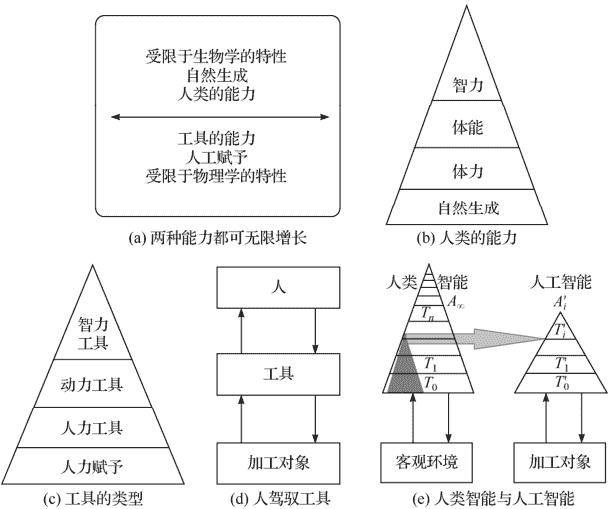

图 1.1 人机关系解析图

*   **① 辅人律：突破生物天花板**
    人类潜能理论无上限，但生物属性（寿命、体力、反应、记忆、算力）设限，自身进化远慢于需求膨胀，且不耐恶劣环境。造工具速度远超自体进化。工具初衷：延伸增强人能，破局限，替人完成高危、繁琐、低阶劳动，释放精力聚焦创造性、安全、愉悦的工作。人机分工必增强人综合能。工具单项能力超人是本分，但必须坚守“辅人”本位，不可本末倒置。

*   **② 拟人律：借鉴原理非盲目复刻**
    设计工具参考人体器官原理，但不必全盘照搬。如飞机借鸟翼升力原理，未仿拍翅。拟人律指功能与原理层面的广义借鉴。特殊场景下，才需仿真人形、动作、声貌。

*   **③ 共生律：主从定分，善恶由人**
    人机地位不对等：人主宰，机执行，共存共生，主从不可逆。工具超人是初心，但能力源于人赋予，只能在人驾驭下运行，故绝不可能超越人类综合能力，更无法反客为主。工具具双面性：用得当辅人，用失当伤人，此乃客观规律。用错工具是人的责任，非工具之过。

*   **④ 简约律：功能聚焦，拒绝过度仿生**
    延伸人能不等于全盘仿生。设计遵循“简约实用”，突出核心功能即可。刀专切、剑专杀、弓专穿。任何AI系统功能皆是人类智能真子集。如起重机替人搬运，未模仿手提肩扛，采吊车、叉车等最简形态。

**4. 智力工具的核心禀异：不确定性**
人力、动力、初级信息工具共性是“确定性”：需求、功能、原理、结构、行为固定不变，可用决定论科学观、还原论方法论、非真即假语言、刚性逻辑全程把控。智力工具核心特质则是“不确定性”：“智能”即认知、改造世界并自我革新之能，可经实践研究不断精进，永不停滞。它不但能处理不确定与演化，自身智能水平亦随之演化。研制可演化智力工具，是前所未有的硬仗。沿用造传统工具、普通计算机的旧范式（科学观+逻辑观）必行不通，必须定制全新范式——这是一场科学与逻辑的范式大革命！人之所以为万物之灵，因其有“灵性”，能掌握规律为我所用，利益最大化。自然万物只能“适者生存、顺其自然”。若人类驾驭智能化工具，认知与改造自然能力将空前跃升，文明将步入全面智能化新高度。

#### 三、 科学范式演进的三重奏

科学范式即科学观与方法论的合称。随统治哲学更迭，人类科学范式历经三个截然不同纪元。

**1. 神授论纪元（17世纪前）**
万物皆神意，人皆神仆，只能被动受罚，自然面前无自由。未形成科学观/方法论概念，仅存各类神学，蕴含古人朴素哲学萌芽。

**2. 决定论纪元（17世纪后）**
发现自然内在律（牛顿定律、相对论等），奠定现代科技基石。决定论科学观与还原论方法论正式成型。核心信条：确定法则统御万物，时间可逆无向，不确定性仅为认知近似，科学终将终结于确定性。还原论主张“分而治之”：整体拆解为部件分析，再综合为整体功能。

**3. 演化论纪元（20世纪中叶起）**
以普里高津为代表，揭示非平衡物理与非稳定系统动力学规律，确立“演化中心”新自然法则，证时间有向不可逆（生命轨迹仅诞生→成长→衰老→死，无逆袭）。演化论断言：不确定性是自然本质，确定性是近似认知，科学永无止境。辩证论主张：视对象为不可分整体，以辩证论治、对症下药施个性化策略。演化论为复杂性科学、信息科学、智能科学奠基。

**范式本质的二元对立与统一**
哲学层面仅存两大范式：
*   **机械唯物主义范式（决定论范式）：** 决定论科学观+还原论方法论。适用**封闭简单机械系统**。工业革命期盛行。
*   **辩证唯物主义范式（演化论范式）：** 演化论科学观+辩证论方法论。适用**开放复杂巨系统**。信息革命期兴起。

二者至高无上，广泛指导战争、商业、医疗、科研、生态等。具体学科/行业特化为特殊范式，但**绝不能凌驾于哲学范式之上**。封闭简单系统（电话、计算机等）必归决定论范式管；开放复杂系统（宇宙、生态、气候等）必归演化论范式管。两范式对立统一，长期并存，各司其职。

**时代趋势的剪刀差**
工业化推动科学体系“自上而下”无限细分专业化；信息化倒逼科学体系“自下而上”无限整合综合化。建立大一统理论成各大学科使命。范式正深刻变革：从决定论向演化论转轨。

### 1.3.3 智能只能在现实土壤中生长进化

理想世界里，万物由恒常法则管控：有无、真假、动静二元对立，绝对固化。只需判断真假、有无，按规则行事，智能无用武之地。人类产生智能，源于目的性与主观能动性：须依环境状况与变化趋势，在经验启发下择优策略，做最有利响应。失效则复盘试错，经验积累学习提升，不断完善智能。故智能诞生于“识变、用变、求变、自变”循环，服务于生存发展。若万物归于确定静止，智能即失去存在意义。深层哲学信念：万物皆在演化，时间是矢量，过去/现在/未来役不同，不确定性是世界本质，确定性只是局部短时的“近似认知”。认知前进方向是消除近似，精准把握不确定性演化规律。理想化仅是权宜之计，绝非“放之四海而皆准”真理。

#### 一、 理想世界：刚性逻辑的舒适区
论域是各向同性封闭时空。万物皆“非此即彼”的真/假分明体：真恒真、假恒假、有恒有、无恒无、动恒动、静恒静。任一事物可用刚性集合A描述：点u在A内则u∈A为真；在A外则为假；在论域外则无定义(⊥)。刚性逻辑建立于此，排除中间过渡态，极简推理复杂度，在传统数学、计算机科学大显身手，具理想环境普适性。

#### 二、 现实世界：柔性与超协调的战场
现实复杂得多。万物皆演化的对立统一体，内核是辩证矛盾，外显为不确定性（亦真亦假、非真非假）。智能科学中，**严禁**将现实问题抽象为全受“非此即彼”约束的理想问题——关键不确定性必须保留，否则不成智能问题。现实中不仅存真假分明的刚性体，更多是真假共存的“亦此亦彼”柔性体，需柔性集合与柔性逻辑刻画；复杂系统涌现还会冒出“非真非假”变异体（域外不动项），需超协调逻辑处理。
*   例1：实数域解一元二次方程，冒出含√-1的解。运算封闭性要求解为实数(真)，但定义上它非实数(假)。
*   例2：电子商务网络时代涌现，旧商业模式中它既不合法(假)也不违法(真)。

### 1.4 逻辑学的溯源与演进

本书为逻辑专著，必先系统梳理逻辑学概念起源、研究对象、内容与基本律，以建全景认知。

#### 1.4.1 逻辑学通识速览

**1. 古老与年轻的基石学科**
逻辑学从哲学分离而出，跨越2800载。发源地三足鼎立：东方古中国、古印度，西方古希腊。“古老”因源远流长；“年轻”因正值蓬勃期——信息时代智能工具渴求下，正从狭义数理形式逻辑向广义数理辩证逻辑裂变扩张。逻辑学具基础性、工具性、与时俱进性、全人类性，文明进步始终仰仗它。不夸张说：任何时空、国族、单位、个体，生存发展皆离不开逻辑指导，或自觉、或自发，否则难存。此处“逻辑学”为广义，含形式、辩证、博弈(诡辩)三系。唯认形式逻辑的视野是狭义的——它只是初等逻辑(仅用于理想世界)；辩证、博弈逻辑才是高等逻辑(普适现实世界)。且理想世界仅是现实世界抽象特例，被后者包含。许多人情感上难接受，但数学早有先例：常量数学是初等，变量数学是高等，常量是变量的理想化特例，包含其中。

**2. “逻辑”概念的溯源与流变**
*   **词源：** 现代“Logic”溯源古希腊“Logos”(λόγος)。本义多义：“语词、理性、规律”。哲学语境指万物普遍规律/秩序。后渐赋予思维、推理内涵，成思维规律与推理方法专用术语。
*   **学科肇始：** 古希腊。亚里士多德奠基西方逻辑学，创直言三段论，立形式逻辑基本框架，《工具论》影响深远。
*   **外演与内涵张力：** 英语Logic音译成通用词，涵盖思维规律、推理方法、论证技巧等。西方主流长期等同逻辑=形式逻辑。实则逻辑家族含形式、辩证、博弈三支。形式逻辑仅是最简单基础的成员。独尊形式、排斥他者，是狭隘逻辑观。
*   **现代图景：** 逻辑广渗计算机科学、AI、语言学、心理学、博弈论、战略战术等。既是这些学科核心工具与方法论基石，也是日常思维交流不可或缺的内核。

#### 3. 命题的内容与形式

# 逻辑的三重面相与文明演进的三重奏

所有的逻辑命题，本质上都由“内容”与“形式”两个维度构成。内容指向信息对象的实体属性，形式则是剥离内容后剩下的纯结构骨架——只剩真假之分，不再有实质差异。依此划界，单凭形式结构推演的叫形式逻辑；必须兼顾对象内容差异与形式结构的，则是辩证逻辑。因内容差异万千，辩证逻辑的形态亦呈无限多样，宛如洋葱层层叠叠。还有一种特殊变体——诡辩术，亦称博弈逻辑，它人为预设特定逻辑要素，旨在对抗博弈中实现双方利益最大化、达成双赢均衡。古希腊先贤视诡辩术为蛇蝎，将其逐出逻辑殿堂；反观古老东方，先民却借《孙子兵法》《三十六计》将博弈逻辑发挥至臻化境，影响深远。

## 逻辑学演进的三个历史切面

随文明程度跃升与时代需求更迭，逻辑学历经三个迥异的发展纪元。

**第一纪元：古代具象逻辑期（前工业化时代，至18世纪中叶，跨度超2600年）**
此期以朴素经验事实为起点，借具象思维推演，求得符合经验的结论。契合人类文明初期认知与改造世界的诉求。形式逻辑、辩证逻辑、博弈逻辑三足鼎立，各司其职，互不侵犯。

**第二纪元：近代数理形式逻辑独尊期（工业化时代，18世纪中叶~20世纪初）**
此期以假设为真的公理系统为基石，严遵形式演绎规则，推导出相对公理系统“逻辑为真”的结论。核心环节为概念、判断、推理。数理形式逻辑仅适配各向同性的理想环境。面向现实世界的辩证逻辑与博弈逻辑，因“无法必然推出结论”被人为流放逻辑疆域之外。

**第三纪元：现代泛逻辑学萌芽期（信息化时代，20世纪初至今）**
实践证实：数理形式逻辑只能破解理想各向同性环境中的问题。数理辩证逻辑引入时空定位机制，涵盖概念、判断、推理四大基本环节，能按辩证推理规则解决现实各向异性难题。理想环境不过是现实环境的特例，二者理应共存、分工协作。博弈逻辑虽与辩证逻辑同具四大环节，但关键差异在于：辩证逻辑的环节客观存在，无主观渗透；博弈逻辑的环节则渗入推理者主观诉求，含人为设定因素。故博弈逻辑属主客互动下的特种逻辑，适配生存竞争、战争、商战、大辩论等博弈对抗场域。泛逻辑则是按需生成各类逻辑的“生成器”，可作后台软件植入计算机供调用。

---

## 远古具象逻辑期：东西方文明的基因分野

### 东方逻辑的肇始与早期辉煌

全球范围内，中国具象逻辑萌发最早。春秋战国百家争鸣，大辩论激荡出耀世学说。古代中西知识体系差异巨大：中国主整体观与辩证论，尚中庸、重双赢，还原论与形式逻辑居辅；西方反之，崇还原论与形式逻辑，重是非、尚赢家通吃，整体观与辩证论退居次席。

**形式逻辑领域：** 中国早出“名学”“辩学”思想。战国《墨经》系统探讨名、辞、说、辩等词项、命题、推理、论证范畴。古印度“因明”藏于佛法，“因”喻推理依据，“明”指智慧认知。陈那《因明正理门论》（6世纪）、商羯罗主《因明人正理论》（7世纪）为代表作。

**辩证逻辑领域：** 春秋老子《道德经》系阐宇宙生成演化、辩证与博弈逻辑根本原理。此作深植中华文化基因（誉为“中华文化之源”“万经之王”），亦深影响世界（联合国教科文组织统计：除《圣经》外，译本发行量居全球首位）。

**兵法谋略领域：** 春秋末《孙子兵法》奠中国传统兵学基石，亦为人类史上首部完备军事理论战略巨著，冠“世界古代第一兵书”。其阐战争本质、目的、原则、方法、规律，重“道、天、地、将、法”五因决胜负，提出“知己知彼，百战不殆”“以正合，以奇胜”“攻心为上，攻城为下”等不朽战略思想。“兵者，诡道也”论断，确立《孙子兵法》为首部正面肯定诡辩术价值的经典，即最早博弈逻辑著作，适用一切博弈环境推理。原著早佚，历代考古补注成诸多版本。《三十六计》源南北朝、成明清，汇中国历代军政诡计智慧。六计一套，共六套：胜、敌、攻、混、并、败战计。前三套用于优势，后三套用于劣势。影响早超军事，泛经济、生活、外交诸域，遗泽绵长。

### 西方逻辑的肇始与早期建树

**“贬智者、尊哲人”传统的滥觞**
公元前594年雅典民主改革及希波战争胜利，推民主政臻善。民主下竞争倚辩论演说，辩论异化为强功利的诡辩术。战胜波斯后城邦繁荣，功利辩论愈演愈烈，涌现专授辩论技巧的“智者”群体——无视真理事实，违推理规则，引似是而非乃至虚假前提，唯求驳倒对方、推出有利结论。“智者”实为诡辩者自称。西方三贤之首苏格拉底深鄙之，为别于智者，自称philosopher（philo-爱，-soph智慧），即“爱智慧者”，后称“哲学家”，奠西方哲学基石。此即西方文化基因排斥辩证思维与诡辩术的深层缘由。

**形式逻辑领域：** 三贤之一亚里士多德将逻辑学自哲学剥离，立形式逻辑之祖。贡献三大基本规律（同一、矛盾、排中），研概念、判断、推理等逻辑形式，创三段论推理主则与形式，明演绎法与归纳法关系。欧几里得承其制，引公理化法，建《几何原本》严密演绎体系，硕果流芳。伽利略引此模入物理研究，捷报频传。直至19世纪末，亚氏形式逻辑长霸西方。

**辩证逻辑思想：** 辩证逻辑立足于“客观世界是对立统一整体”哲学基石（绝对对立仅存于理想世界）。涵盖归纳、类比、缺省、假设等推理。长期形式逻辑独霸西方下，17世纪英国实验哲学之父培根《新工具》献“三表法”“排除法”，奠归纳逻辑基。19世纪密尔《逻辑体系》集大成，系阐“求因果五法”，丰满归纳逻辑，致传统逻辑范畴基本定型——演绎与归纳两大支柱。德国黑格尔《小逻辑》为代表作，含逻辑概念初步规定、存在论、本质论、概念论四部。以存在论“质、量、度”为实证基，以概念论“绝对理念”为终极果，核心在探“思维（理念）与存在（现实）”关系。《小逻辑》为西方最早辩证逻辑著作，憾为逻辑学界视为哲学范畴、非逻辑学——因无符号演算、不能“必然推出结论”。实则西方形式逻辑初期亦为纯文字描述，其能“必然推出结论”，缘于只研受“非真即假”约束的理想问题，结论亦仅“非真即假”。辩证逻辑研具“亦真亦假”甚“非真非假”特性的现实问题，推理结果必带此类特性，乃研究对象属性使然，不可强同。作者以为，《小逻辑》当之无愧为西方古代辩证逻辑研究丰碑，瑕在含主观唯心成分。引辩证法入逻辑领域，乃其最突出特色与成就；“正-反-合”辩证法，贯穿其整个逻辑体系。

---

## 近代数理形式逻辑独尊期：一统天下的“圣战”与偏移

### 《自然辩证法》：辩证逻辑的哲学基石

**自然科学三大发现**
19世纪自然科学硕果累累，恩格斯钦定能量守恒转化定律、细胞学说、进化论为“彻底动摇形而上学自然观的三大发现”。《自然辩证法》为恩格斯生前未完哲学巨著，以辩证唯物主义法概括自然科学成果，批驳形而上学与唯心主义。框架确立于1873~1883年手稿，因故未完稿即仙游。身后1896年《劳动在从猿到人转变过程中的作用》、1898年《神灵世界中的自然科学》刊出，1925年苏联版《马克思恩格斯文库》始全文面世。此作是马克思主义哲学重要构成，承黑格尔《小逻辑》辩证逻辑合理核，弃唯心、代唯物，为辩证逻辑合法存在立哲学基。核心思想可括为：统一性与辩证法、有机整体观、动态发展与进化、阶段性历史观、思维与现实关系。

**自然辩证法的科学观**
自然辩证法是科学。科学供研究、非供膜拜。科学源实践、受实践检验。非僵化教条空说教，乃行动指南。旨广眼界、活思想，非使人墨守成规。自然辩证法为自然科学前哨后卫，不断汲取自然科学养分、随其发展而发展。恩格斯言：自然科学每一划时代发现，必致唯物主义改变形式。

**形式逻辑与辩证逻辑的关系**
承黑格尔《小逻辑》后，恩作进一步筑牢数理辩证逻辑哲学基。此描述万物存运规律的高等逻辑呼之欲出。形式逻辑仅描绘理想事物规律，处基本逻辑位阶。若以基本逻辑属性排斥高等逻辑存在，乃“劣币驱逐良币”，阻逻辑学健康发展。二者关系如代数与微积分：前者研常量，后者研变量。辩证逻辑源客观实践逻辑抽象，形式逻辑源理想世界逻辑抽象。究竟是客观世界定义逻辑，还是逻辑定义客观世界，显而易见。

### 从形式逻辑到数理形式逻辑的演进

**自然语言多义性瓶颈**
自公元前4世纪亚氏立古典三段论演绎，经公元前3世纪欧氏《几何原本》创首个公理化形式演绎体系，至17世纪后期漫长沉淀，古典形式逻辑成形，含常见演绎推理、简量词理论、部分专用符号。奈何逻辑用语仍以自然语言为主，多义性屡干扰形式演绎正确性，阻形式逻辑在数学中正常应用，称“多义性瓶颈”。如“苹果”指水果亦指公司；“红色外套”指衣物亦指身份；“打开窗户”指物理动作亦指新可能；“我喜欢吃苹果，特别是绿色的”指绿色水果亦指无公害食品；东方“龙”喻吉祥力量，西方“龙”喻邪恶危险。

**形式逻辑的数学化**
为破瓶颈，17世纪后期德国数学家莱布尼茨倡“万能符号”“思维演算”，标志数理形式逻辑思想萌芽，启用数学语言描述形式逻辑规律探索。1854年英国数学家布尔建基于逻辑运算符的代数系统（布尔代数），圆此梦。德摩根定律、康托尔集合论为重要补充。后帕施、希尔伯特等立公理系统，承弗雷格、佩亚诺基础，罗素、怀特海《数学原理》建完备命题演算与谓词演算系统，奠数理逻辑坚基，为形式逻辑数学化探索巅峰之作。至20世纪30年代，数理逻辑臻成熟，成含命题演算、谓词演算、证明论、公理集合论、递归函数论、模型论的庞大家族（称“两算四论”）。数理逻辑不唯数学重要分支，亦为整个数学基础理论之一，广被其他数学分支、计算机科学、形式语言与自动机、心理学等科应用，逻辑学领域划时代成就。

**现代逻辑的勃兴**
数理逻辑虽发端于形式逻辑数学化，但非唯形式逻辑可数学化。标准逻辑（数理形式逻辑）成熟后，时代需求牵引下，各类现代逻辑竞发：演绎部涌现模态、时态、多值等非标准逻辑分支；归纳逻辑融概率统计法，拓概率、模糊、灰色、未确知等逻辑新疆。此乃数理逻辑研究从形式逻辑向辩证逻辑拓展的良性势头。

### 数理形式逻辑何以“一统天下”

黑格尔辩证逻辑体系仍孕于哲学、未产为逻辑形态，西方逻辑学界多不认其为逻辑、仅视为辩证法。马克思主义哲学弃黑格尔辩证法主观唯心、纳唯物主义，科学辩证逻辑获可靠哲学基，步入新轨。就在此刻，西方部分逻辑学家受零和博弈、赢家通吃心态驱使，发动数理形式逻辑“一统天下”全面“圣战”，致逻辑学历史走向偏移。此“圣战”分三阶环环相扣。

**阶段一：定义“只有形式逻辑才是逻辑”**
东西方逻辑初衷皆为研世间万物存变内在规律，朴素形式、辩证、博弈三逻辑并存不悖、各司其职。后西方有人将逻辑研究对象特定为“人脑思维理性”，并缩逻辑范围为形式逻辑。形式逻辑乃受“非此即彼性”约束的基本逻辑，须全满足“三律一性”（二值、排中、矛盾、封闭），能演绎中“必然推出”结论。此乃狭义逻辑观下的数理形式逻辑（标准/刚性逻辑），仅能描述理想环境中“是/非”类问题。客观环境（含人脑思维）现实问题多具“亦此亦彼性”，甚“非此非彼性”，需广义逻辑观下高等逻辑（非标准/柔性/数理辩证逻辑）描述。以数理形式逻辑绑定“逻辑”概念，必将描述客观世界的数理辩证逻辑与博弈逻辑逐出“逻辑”疆域。显属违客观规律之主观臆断。若局限于人脑思维理性领域不入现实世界，一时难见其谬。至信息化时代，须处各向异性世界诸问题，而各向同性问题仅为特例。可见此举实为逆历史潮流之蠢举。

**阶段二：以狭义逻辑概念绑架科学概念**
“科学”源拉丁文scientia（本意知识），汉语希腊语原无此词。1830年前后，法国实证主义创始人孔德研学科分类始用science，代表研物理化学生物等自然学科之学问，原用philosophy专指全学科通用之学问（即哲学）。为师西方，日本学者1874年译science为“科学”（分科之学）、philosophy为“哲学”（通用学问）。康有为首引“科学”入华，后广被使用。引入前，中国传统文化近似词为“格致”，取朱熹“格物穷理致知”——意指持续探究一类事物基本原理至获其全知。可见“格致”即今自然科学，如京师同文馆（北外前身）设自然科学课名“格致学”。“格致学”与“science”关系何在？①“格致”比“science”早600余年。②中国“格物穷理致知”未刻意与形式逻辑绑定，容归纳与演绎并用；西方“science”必须建立在公理化形式演绎基上。故中国“格致”比西方“science”更古老、更广义。

**阶段三：以西方狭义科学概念抹杀中国古代文化成就**
中华文明四大发源地之一，数千年史脉未断。中华民族历无比辉煌与近代任人欺凌之耻。中华文明博大精深，举世公认。

**数说中华文明成果**
因东西方远古文献稀少，无法统计对比，自汉朝数据起比。对比方式：中国/世界。

- **汉朝**：占世界GDP 26%，东方经济中心，与罗马帝国并驾齐驱。
- **唐朝**：占世界GDP 58%，同期东罗马占9%，阿拉伯帝国占7%。
- **宋朝**：北宋占80%，南宋占50%，全朝占60%。拥十大“世界第一”：农业生产力、手工业产出、采矿冶炼技术、铁产量、造船业、娱乐业、城镇化率、财政税收、百姓平均收入、房价。宋代科技（炼钢、矿冶、造纸、制瓷、丝绸、航海、印刷、火药、罗盘）登当时科技巅峰。10万户以上城市达50个，汴京、临安人口破百万。同期伦敦4万、巴黎6万、西方最繁华威尼斯仅9万。
- **元朝**：约占世界GDP 30%~35%。版图跨亚欧，经文强势。
- **明朝**：万历期占80%，后急跌至半。全朝GDP均值45%。中后期资本主义萌芽猛进，江南部分地区复至宋朝水平。
- **清朝**：鼎盛期占35%，鸦片战争后骤降至10%左右。

# 重新定义科学与逻辑：从“李约瑟之问”到泛逻辑学的破局之路

中华文明的厚重底蕴举世公认。无论是天文观测的翔实记录、动植物志的早期成型，还是本草典籍的系统完备，即便是现代西方学术界在考证古代天文、日珥、彗星等历史数据时，往往仍需远渡重洋、查阅中国典籍。

## “李约瑟之问”背后的东西方思维分野

20世纪中叶，英国科学史大家李约瑟抛出震动学界的“李约瑟之问”：为何现代科学未在东方萌芽？他在《文明的滴定》中倾八篇论文之力试图破解。其核心剖析可归纳为三点：

**思维范式的初始分叉**。人类科技树早期出现岔路：中国侧重辩证归纳（非数学路径），西方则偏向建立在逻辑基石上的形式演绎（数学路径）。

**技术冲击的社会效能迥异**。火药在西方炸碎了骑士阶级、重塑政治版图；在东方却未能撼动超稳定的社会结构。

**创新驱动力的内在差异**。东方超稳定结构下的发明服务于“维持和谐”，西方则指向“征服自然、征服世界”及社会跃迁。

## 爱因斯坦的“标准答案”与逻辑悖论

物理学巨擘爱因斯坦曾于1953年正面回应此问。他断言：现代科学立足于两大基石——形式逻辑体系的建立，与通过系统实验揭示因果律的发现。中国先哲未跨出这两步，故无科学，亦无从谈奇。潜台词是：无科学则无技术，无先进科学则无先进技术。

然而，这引出一个无法回避的反问：若古中国确无科学，何以造就举世公认的先进技术成群？难道这片土地孕育着某种“暗科学”？一旦引入反向思维，谜题便迎刃而解。

## 作者的“反李约瑟之问”：广义科学观的觉醒

本书作者作为泛逻辑学创始人，提出反向命题：**中国古代为何不能诞生科学？答案是：不仅能，而且已孕育出多元雏形。**

东西方结论南辕北辙，症结在于“科学”定义的认知鸿沟：
*   **西方狭义观**：唯公理化形式演绎系统为科学，排他性极强。
*   **中国广义观**：凡依逻辑体系（形式、辩证、博弈）建构的理论皆为科学，兼容性最大。

现代科学共同体已达成共识：宇宙演化、生物演化、文明演化皆处于动态流变中，全时空呈各向异性，“各向同性”仅是微观局部的理想化近似。譬如，万年历、潮汐表依赖日-地-月系统万年尺度的近似静止；盖房适用欧氏几何源于万米尺度内曲率可忽；远航航空则必须引入球面几何。**以局部近似的狭义理论，否定全时空属性的广义理论，无异于坐井观天。**

---

## 1.4.4 泛逻辑学诞生于信息时代的转折点

20世纪人类跨入信息纪元。早期计算机、互联网等初级工具，继而智能机器人、专家系统等智能化工具涌现。

工业时代面对的是确定性的简单机械系统，适用“决定论科学观+还原论方法论”。信息时代直面的则是充满不确定性与演化的开放复杂巨系统，亟需“整体论科学观+辩证论方法论”这一新范式。

**从“分析时代”迈向“综合时代”**。工业时代学科无限下分，专家视野日益狭窄；信息时代将迎来大学科融合期，学科向上聚合，大一统理论层出不穷。

**逻辑演进的双轨制**：
*   工业化推动**形式逻辑数学化**，催生公理化演绎法，产出垂直聚集的“认识片”（小模块）。
*   信息化必将推动**辩证逻辑数学化**，基于领域内在生成基因的大一统发现法，产出横向聚合的“知识大模块”（大一统体系）。

这将造就一批视野宏大、思维缜密的大学者。

下面从对立统一视角，对比公理化演绎系统与数理辩证逻辑大一统理论的优劣。两者结构原理、相容性、规模迥异，却皆为人类所需，不可偏废。

---

### 1. 公理化形式演绎系统的全景扫描

**数学渊源与希腊转型**。数学早发于东方四大文明古国（中、埃、巴、印），然止于实践经验的松散归纳。公元前6世纪起，古希腊引入逻辑证明，将其重铸为系统理论。欧几里得《几何原本》（公元前300年）确立公理化演绎范式，西方遂以此为科技楼阁的基石。

**公理化演绎法的来龙去脉**。其本质是“公理化方法+形式逻辑（三段论）”。形式演绎只能“以真推真”，无法“凭空生真”，此为启动难题。欧几里得从经验知识中精选公理（公设、定义），人为规定其真理性无需证，并要求公理组满足独立、相容、完备。**实质上，形式逻辑借用辩证逻辑归纳出的知识作公理，解决了自身启动难题——二者本是互利共生。**

**数学论域扩张的悖论驱动史**。公理实为论域属性的“人为界定”。风险在于：运算不一定封闭于论域。有理数域算出√2，实数域算出√-1，这些“合法出生的怪胎”引发悖论与危机。**每一次论域扩张，皆源于对悖论的解悖。** 直至1931年哥德尔不完备性定理揭示：任何包含自然数算术的相容形式系统，必存在不可判定命题。形式系统并非完美无瑕，理论缺陷客观存在。

---

### 2. 概率论：辩证逻辑数学化的基石

17世纪中叶，帕斯卡与费马因“分赌金问题”通信（1654），开概率论先河。惠更斯《论赌博中的计算》（1657）引入数学期望。伯努利《推测术》确立大数定律雏形，奠基概率论独立学科地位。德·莫弗与拉普拉斯进一步完善体系，拉普拉斯《概率的分析理论》给出古典定义。

**关键定位**：形式逻辑数学化仰仗布尔代数；辩证逻辑数学化则仰仗概率论。辩证逻辑处理“对立不充分的柔性命题”，其真度天然对应概率测度。概率论直接给出柔性非/与/或/蕴含运算法则，并预示了模糊逻辑、概率逻辑、有界逻辑的存在。

---

### 3. 三角范数理论：柔性运算的几何骨架

1942年门格尔研究统计度量空间首提三角范数（t-范数），意在用概率分布刻画距离。经Schweizer与Sklar（1983）引入结合律与中性元e=1，将三角不等式推广至多边形，使其适用任意有限输入。**我们的泛逻辑理论即建立在Schweizer范数完整簇及其生成元基础上，通过定义泛非/与/或/蕴含/等价/平均/组合而实现。**

---

### 4. 非标准逻辑百花齐放：标准逻辑局限的铁证

近百年来，因信息处理多元化需求，全球涌现近百种非标准逻辑。这非学术游戏，乃标准逻辑（命题/谓词演算）应用边界触顶、信息时代对数理辩证逻辑渴求的直接反映。

**两大阵营**：
*   **平行派**：多值、模糊、直觉主义逻辑等，突破二值真理、引入构造性证明。
*   **扩充派**：模态、时态逻辑等，引入“必然/可能”、时间因子，处理动态认知。

**驱动力三重奏**：计算机/AI/认知科学需求多元化；现实问题充满不确定/模糊/动态因素；逻辑学自身对系统多样性认知的深化。

《哲学逻辑手册》（Gabbay与Guenthner主编，1983年起、持续更新至18卷）汇聚经典、模态、时态、道义、多值、量子、对话、自由、相干、直觉主义等全谱系，以全面性、新颖性、权威性成为领域基石。

**这些非标准逻辑，为泛逻辑研究纲要提供了丰厚素材——数理辩证逻辑已呼之欲出。**

---

### 5. 命题泛逻辑理论：构建逻辑的“元素周期表”

东西方思维习惯迥异：古希腊重演绎轻归纳，古中国重归纳轻演绎，二者本并行互补。工业时代形式逻辑数学化井喷，导致“唯形式逻辑是逻辑”的谬误盛行，逻辑学入歧途。

作者在AI研究中撞击标准逻辑天花板，急需非标准逻辑支撑，然理论未熟，**遂独立创立泛逻辑学——研究逻辑学一般规律的大一统理论。**

**核心成果——逻辑生成器/逻辑谱系（图1.2）**：
承认一切有效推理（形式、辩证、博弈，存量与增量）合法共存，用数学手段建立“逻辑生成器”，按场景需求自动生成具体逻辑。换个角度，即构建**连续逻辑谱**（如门捷列夫元素周期表），各类具体逻辑依“健全性使用条件”（适用场景）为坐标，精准定位谱系特定位置。

**命题级泛逻辑已建成体系**：
*   **核（中心点）**：数理形式逻辑（刚性逻辑，x∈{0,1}）。
*   **向外扩张层级**（逐步放松“非此即彼”约束）：
    1.  **有界逻辑**：真度x∈[0,1]，连续值逻辑。
    2.  **零级命题泛逻辑**：引入广义相关系数h∈[0,1]（h=0.5退化为有界逻辑）。
    3.  **一级命题泛逻辑**：引入测度误差系数k∈[0,1]（k=0.5退化为零级）。
    4.  **不可交换命题泛逻辑**：引入相对权重系数β∈[0,1]（β=0.5退化为一级）。

**六大生成基因参数**：模式参数<a,b,e> + 不确定性参数<k,h,β>，决定具体逻辑基本属性。除核心为形式逻辑，外围皆为数理辩证逻辑。最外层为**博弈逻辑**（允许主观能动性介入，利益双大化）；排除主观即为纯客观辩证逻辑。

**关键性质——元子二相等价**：刚性神经元(MP模型)阈值函数z=Γ[ax+by-e]在柔性扩张中保持不变，使柔性逻辑算子与柔性神经元始终维持“元-子二相等价”，这对恢复神经网络可解释性至关重要。

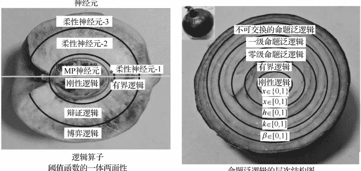

图 1.2 命题泛逻辑理论框架及层次结构图

---

### 6. 核心结论：拨乱反正，重塑逻辑版图

基于上述成果，可断言：

**1. 必须确立广义逻辑观。**
形式逻辑仅适用“非此即彼”的理想环境；面对“亦此亦彼”甚至“非此非彼”的现实，唯辩证逻辑有效。**二者互补非平行，理想环境是现实特例，故形式逻辑是辩证逻辑的理想化特例。** 这从根源上揭穿西方狭义科学观的片面性，实现拨乱反正。

**2. 必须为博弈逻辑正名。**
客观世界是生态系，物竞天择是天律。形式逻辑是“你死我活”的刚性零和博弈——对手死光，自己必亡；辩证逻辑是共存共生的柔性博弈，生存竞争中不可或缺；**博弈逻辑允许双方主观能动性介入，实现利益双大化，是最强交互逻辑。** 历史将其贬为“诡辩术”并排斥逻辑殿堂，实属损人不利己的认知谬误。试图独尊形式逻辑、排斥异己，愚蠢至极。

### 三、泛逻辑：大一统逻辑理论的确立与跨学科启示

命题泛逻辑理论体系的构建与实践验证，雄辩地证明了：即便在形态迥异、性质巨变的逻辑学版图中，亦可建起一座统一的理论大厦。这座大厦是一个“异质同构”的有机整体，由逻辑学的内在“基因”主导生成，其显著特征在于允许互不相容的多种逻辑算子共存共生。泛逻辑体系的成功问世，为各大学科构建各自统一理论框架提供了极具价值的方法论范本。

### 四、知识生成的两条路径：小模块拼装与大一统建构

形式逻辑之所以在数理界享有崇高声望，源于其公理化演绎系统曾助人类建立起众多理论大厦：仅凭寥寥公理、原始定义与推理规则，便能在特定领域内快速搭建起一套自洽的知识体系。然而，深入探究后发现，此路径存在先天局限：

**1. “小模块”拼装的局限：单一论域的囚徒**
确定的公理系统只能锚定一个确定的论域，仅能生成与之兼容的知识，对领域内不兼容的知识束手无策。以几何学为例，欧氏公理系统只能生成欧氏几何，无法触及非欧几何；若要涵盖线性空间与各类非线性空间在内的全部几何知识，必须引入无数个互不相容的公理系统。因此，公理化演绎仅能完成“小规模兼容知识”的生成，充当兼容知识的“微型模块”（如欧氏几何）；一个领域的全貌，只能由无数此类“微型模块”的集合来拼凑呈现。

**2. 哥德尔阴影：可靠与完备的鱼熊掌不可兼得**
哥德尔不完备性定理揭示：任何足够强大的公理系统，可靠性与完备性不可兼得。单靠公理化演绎，无法为数学筑牢绝对可靠的基石。

**另一条路径：大一统理论体系——一揽子囊括兼容与不兼容知识**
化学领域，门捷列夫依据原子序数（核质子数）排布元素，将同族性质归类，打造出元素周期表——化学领域的“核心导航仪”，不仅阐释性质、预言新元素，更指导反应研究与工业实践。
生物学领域，基因发现统一了生命认知：一切生物特征由基因决定，基因经遗传流转，此发现奠基基因工程、遗传改良等应用。
当代智能科学，钟义信基于智能生成机制提出机制主义通用人工智能理论；何华灿基于逻辑内在基因构建泛逻辑学理论。二者均非公理演绎的“兼容小模块”，而是涵盖领域全知识的“大系统”（注：能装下全知识的大系统，必然是开放系统）。

---

### 第1章 小结

本章纵览宇宙演化至人类社会演化，阐释了具备主观能动性的人类，为生存发展而选择群居、杂食、熟食等生活方式，创制力力工具、开创养殖业，从而完成了从他养型向自养型动物的跨越。此举极大加速了人口�衍与脑进化，同时也叠加了生存压力；压力倒逼创造，脑智能飞跃，在动力工具驱动下跨入工业社会，在智力工具驱动下步入信息社会。

回溯文明演进脉络，随着数学、逻辑、计算机科学、人工智能的阶梯式发展，当下核心矛盾已凸显：
**主要矛盾**——智能模拟迫切需要具备认知力与辩证思维的机器模拟方法，而描述此类能力的逻辑范式却供给不足。
**矛盾主因**——逻辑范式变革乏力：
其一，传统刚性逻辑与狭义逻辑观在AI发展中屡战屡败，却无人深究根源，致使思想枷锁难除；
其二，柔性逻辑与广义逻辑观虽初具雏形，却长居学科边缘，无人问津。导致过往AI应用中鲜见柔性逻辑身影，相关实例、技术、算法、代码、平台难在传统生态中生根。

**时机已至**：国家誓言在AI基础理论上领跑全球；美方全方位封锁前沿科技，反向打碎了束缚我国AI研究的“拿来/跟踪/机会主义”旧生态。这是推动科学范式与逻辑范式变革的黄金窗口。愿本书化作变革宣言与行动纲领，助力突围。前提是智能数学同频共振——数学家全情投入完成数学范式变革，引入主观能动性与主体目的性，打破纯客观数学一统天下，智能科学方能拥有“量身定制”的基石理论。

---

## 第2章 人脑思维层次与逻辑学演进规律

前章从宏观宇宙与人类社会两个维度剖析发展规律，确立了“万物皆演化、不变是暂态、变化是常态”的基调。本章聚焦微观——人脑思维层次，探寻其特殊活动规律及制约思维的逻辑法则。依认识论视角，思维是大脑对客观世界的映射。这映射如何刻画万物演化？思维自身遵循何种演化逻辑？此即本章核心追问。前章言“天地人”，本章专论“人之思维”，即个体大脑的运作法则。

### 2.1 引言：逻辑范式变革宣言

开篇即亮剑：作者宣告逻辑范式变革。缘何一位刚性逻辑的“信徒、传授者、践行者、卫道士”，会义无反顾转身为柔性逻辑的“倡导者、奠基人”？

溯源作者履历：早年主持两型航空机载计算机研制，历经设计、生产、调试、试飞打靶、定型全流程，软硬件原理烂熟于心，随后转战AI研究。起步于实用专家系统，主持完成空气动力学数学、石化优化控制、故障诊断、军服拼版等八型专家系统，对专门知识与经验性知识有深度体认；继而深入智能逻辑基础腹地。在矛盾重重的探索中，作者无意推开一扇窗，豁然见大世界。消息传出，一批志愿者（本硕博）汇聚麾下，耕耘二十余载，硕果累累。那是怎样一片智力乐土？请随笔者一探究竟。

宣言正文分三层：发现问题、剖析病根、指明变革之路。

#### 2.1.1 数理形式逻辑：理想国里的“完美范式”

600余年前数理形式逻辑成型，数理巨擘皆视其为思维准则、是非标尺、科学典范、放之四海而皆准的普世真理，甚至断言“数学不过是应用逻辑”，其地位至高无上。然经80余年AI实战检验，作者觉醒：西方所谓“普适性”，仅在“理想国”内有效；所谓“至高无上”，只是理想国里的“九五之尊”。一旦落地现实世界，它寸步难行，与智能问题格格不入。信仰与现实的巨裂，令这位虔诚信徒震惊不已：在计算机里数理逻辑运用自如、从无纰漏，为何入AI领域便全面失灵？遂追问：何为真逻辑？为何号称普适的严密理论，在现实中处处碰壁？

溯源发现：数理形式逻辑实为“数学化的形式逻辑”（即标准逻辑/刚性逻辑），其立论基石是**“封闭全息的确定性世界假设”**——预先排除了一切辩证矛盾、不确定性与演化过程，强制所有逻辑要素满足“非此即彼”约束。这直接导致刚性逻辑的本质基因——**“三律一性”**：

1.  **二值律** $p \in \{0, 1\}$：真值非真即假，无中间态；
2.  **矛盾律** $\neg p \land p=0$：命题与其否定不可同真；
3.  **排中律** $\neg p \lor p=1$：命题与其否定必居一真；
4.  **封闭性**：推理所需证据全知、固定、不变。

“三律一性”先天注定刚性逻辑仅适用于**确定性世界中的封闭全息二值推理**（如数学证明、计算机逻辑设计），这是对现实的高度抽象近似。理想国的律法，岂能管束现实世界中经验知识、常识、情感、辩证矛盾、不确定性、演化涌现等推理难题？作者在计算机中游刃有余，是因为已将现实脉冲信号做了**理想化改造**（图2.1）：引入不应期规避沿振荡，设定电压阈值二值化高低电平。若无此“削足适履”的改造，数理逻辑在硬件设计中根本玩不转！

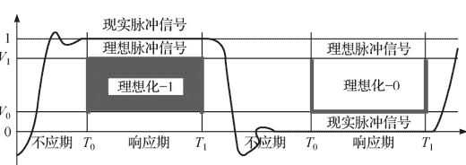

图 2.1 现实脉冲信号的理想化改造

而那些无法理想化、却又是现实世界核心的日常推理问题，才是AI的广阔天地；人造理想国不过这片天地中一座孤城。古城堡的条条框框，怎能与整个现实世界的法则等量齐观？AI实战让这位活在计算机科学里的人如梦初醒：将不满足“三律一性”的问题斥为“非逻辑问题”并拒之门外，合理吗？人类智能活动时刻面对这些问题，它们却无逻辑规律可循，正常吗？

#### 2.1.2 现实世界呼唤辩证逻辑推理范式

**1. AI学科的使命：服务现实，而非守成理想**
理想国雅士不食烟火，宣称凡不接受“非此即彼”约束者皆非逻辑问题，从而让刚性逻辑在自家领地“百发百中”、冠以“普适性”。但AI诞生初衷，正是因计算机应用理论危机，旨在模拟人脑智能机制，**服务现实世界**，解决刚性逻辑宣布“不管”的“非逻辑”问题。现实中，仅极少数推理可高度抽象为刚性问题；绝大多数必须保留主要矛盾、关键不确定性、演化涌新等实况。至此，作者立场**180°大转弯**：从“站在计算机立场要求AI服从刚性逻辑”，转为“站在AI立场要求摆脱刚性逻辑枷锁”。刚性逻辑既不感兴趣、又判定“非逻辑”拒之门外，AI学科理当填补空白，专攻人脑在现实中如何机动灵活、恰如其分地处理此类辩证、不确定、涌现类推理。这注定了AI不可能制造“小脚鞋”，**必须创立面向现实世界的逻辑新范式——柔性逻辑范式/辩证逻辑范式。**

**2. 推开小窗，见证大世界**
作者曾是理想国范式的忠实信徒。一次偶然推开小窗，猛见一个全然不同的柔性逻辑世界。AI理论危机的驱策、探索智能逻辑基石的使命感，逼作者闯入这片“无人区”。
从此，**命题真值的柔性**（亦真亦假，映射对立统一）、**命题关系的柔性**（真度误差、广义相关性映射相生相克、相对权重）、**命题真值的非真非假**（映射演化涌新）……均成柔性逻辑研究对象，自有规律可循。理想国关于逻辑的清规戒律尽数被突破，现实万物皆有逻辑可依，只是理想国的“非礼勿视”禁令不允信徒靠近。虽入无人区之初无路可循、无人可问、高处不胜寒，但“险峰尽揽无限风光、遍地皆是奇珍异宝”，令人流连忘返。
消息引来一批硕博志愿者聚力攻关，方向关乎AI急需、课题全新吸引，个个献计出力，为泛逻辑添砖加瓦。战场血火教训与团队成果，次次推动作者完成逻辑观蜕变：从刚性范式的坚定信仰者，化身为辩证范式的奠基人与倡导者。

目前，辩证逻辑范式在命题级泛逻辑原理层面，已建成**全面描述零级、一级不确定性的命题泛逻辑理论体系**。这些理论既能支撑知识工程经验推理，又能支撑柔性神经网络信息变换，二者呈“元-子二相”关系。至于描述更高级不确定性的体系（需灰度/程度逻辑、未确知逻辑成熟，允许真度上下限自由变化、允许真度偏差），尚待时日，暂无成果公布。

### 3. 辩证逻辑范式：“一把钥匙开一把锁”的精准适配

现有阶段性成果，已能**包容现存一切逻辑算子或神经元变换函数**——它们仅作为命题泛逻辑运算完整簇中的“特殊点”现身；在这些特殊点之间，存在无穷多可生成的算子/变换函数，可按需精准生成，供特定场景使用。这正是新一代AI研究梦寐以求的**真正普适性范式**：可无差别部署至各类实战场域，再依现场推理需求，**“一把钥匙开一把锁”精准生成专属算子**，杜绝误用算子导致的违背常识的异常结果。

基于此真普适属性，作者化身辩证逻辑范式推行者，诚邀AI、信息科学、哲学逻辑、社科、管理科学、军事科学同仁关注，早日完成从“理想国范式”到“辩证范式”的思想蜕变。

下面，仍从人脑思维演化与逻辑学自演化两条线，考察逻辑学演变——它毕竟是客观规律，非主观臆造。

---

### 2.2 人脑思维三层次及其逻辑描述

区别于狭义逻辑观，作者主张**广义逻辑观**：人脑全思维过程皆有逻辑规律可循，逻辑是各思维阶段的准绳，是认知过程中判断是非的最高标准。

#### 2.2.1 思维层次结构图谱

人为万物之灵，核心优势在于大脑高度发育、智商断层领先。已知150万物种中，猩猩、海豚、大象等高智商动物，智力仅相当于人类婴幼儿。故研究思维规律，人脑是最全面完整的标本。
从层次结构看：**数理形式逻辑仅对应思维中级阶段（知性思维），辩证逻辑才是思维高级阶段（理性思维）的法则。** 详见图2.2。

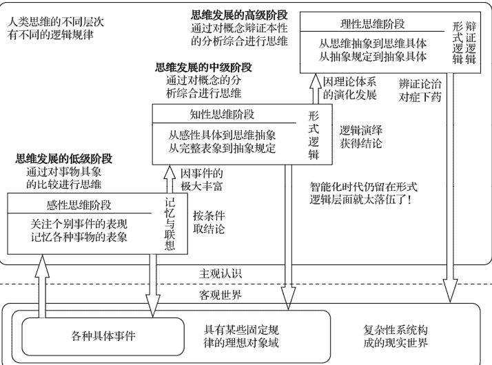

图 2.2 人脑思维的层次结构及其逻辑规律

**1. 感性思维阶段——初级·普适·条件反射**
思维起始阶段，人兽共具，人类最全面。面对**具体事件域**，凭借最原始条件反射：关注个别事件表象、记忆事物表征、自行为果。全过程即“观察—记忆—联想”单事件循环。
例：“见虎出没”(A) → “速离避险”(B) ⊄ “上前玩耍”(C)。神经网络形成两反射弧：$A \subset B$；$A \not\subset C$。机器模拟即：数据库存储 $A \subset B, A \not\subset C$；输入A，直接提取B且排除C。此类过程**刚性逻辑可完全描述，传统程序按部就班即可完成，无难度。**

**2. 知性思维阶段——中级·人类主导·理想化抽象**
思维进阶，人类主导，高智动物仅有萌芽。面对**固定规律的理想对象域**，具各向同性理想化属性。通过概念抽象与关系分析综合思维：从个体感知上升到群体概念，从完整表象抽离因果规定。全过程为**“概念—判断—推理”三部曲**，故仅在理想化环境具普适性。
例：见众人皆死(寿命长短、死法各异) → 归纳“死”概念；见张三李四等个体 → 归纳“人”概念 → 立规则“凡人必死”($\forall x \in A \Rightarrow x \in B$)。神经网络形成三大反射弧：①具象人 $a \subset$ 抽象人 $A$；②具象死 $b \subset$ 抽象死 $B$；③“凡人必死”规则。问“苏格拉底会死？”(s∈B?)：脑内经①确认s∈A，③推演∀x∈A⇒x∈B，②确认s∈B。机器模拟：知识库存三规则，输入查询，逻辑演绎得结论。**此类过程刚性逻辑可完全描述，传统计算机程序即可胜任。**

**3. 理性思维阶段——高级·现代人专属·辩证非线性**
思维最高阶，仅现代社会人类可能拥有。面对**复杂性系统构成的整个客观世界**，具各向异性非线性属性。通过**概念辩证本质的分析综合**思维：完成从思维抽象到思维具体、从抽象规定回归抽象具体。全过程为**在划分与时空定位机制控制下的“概念—判断—推理”四部曲**，可在各种现实环境中具普适性。
机器模拟须：先定对象时空环境，按具体情况辩证论治、对症下药。**此过程必须由柔性逻辑完全描述，仅智能计算机可望完成。** 详述见后。

#### 2.2.2 思维层次结构的几个关键追问

**1. 后天发育的外部环境条件至关重要**

### 思维进阶的后天密钥：环境如何塑造大脑层级

物种间的认知鸿沟，根源于大脑的先天硬件差异。动物受限于天生的神经架构，无论后天如何强化训练，思维上限始终难以触及人类高度。而人类群体内部，先天脑结构大体相当，潜能巨大且均等。然而，要将这颗“种子”浇灌成参天大树，攀升至高阶思维层级，必须仰赖后天环境的特定滋养：唯有置身于极度丰富的事件洪流中，感性思维才能蜕变为知性思维；唯有经历理论体系的迭代演进，知性思维方能跃升为理性思维。纵观自然界，唯有现代人类构建起了如此绚烂多元的外部刺激场域，持续驱动大脑完成自我升级。设想若将现代婴儿抛入狼群成长，虽拥有顶配的先天硬件，却缺失了思维跃迁所必需的“高阶输入”，最终只能按狼的生存逻辑运行，思维定格于初级知性阶段。

##### 2. 从“强行套用”到“量身定制”的范式跃迁

知性思维阶段崇尚“理性思维”，它将思维粗暴二分为理性与非理性，强行将复杂现实抽离为标准化的理性模型求解，这无异于“削足适履”——无视现实千姿百态、瞬息万变的本质，妄图用一套固定模板套用世间万物，实属闭门造车、异想天开。

理性思维阶段追求的则是“思维的理性”。它确认大脑全链路思维皆有逻辑可循，敬畏客观世界的多样性与复杂性，接纳万物皆处于演化流变之中。因此主张“为足制履”：随足形演变，履型同步迭代。这才是辩证施策、对症下药。身处智能化时代，若思维仍滞留于知性阶段与刚性逻辑层面，执迷“削足适履”，必将贻笑大方。

### 2.3 逻辑学演进的内在规律与核心要素

#### 2.3.1 逻辑学不应为矛盾“上锁”

- **逻辑的两重面向**

常规认知里，逻辑是思维法则、是非标尺。但分类体系繁多，依需而异。本书仅辨析最基础的二分法：形式逻辑与辩证逻辑。前者仅顾命题外在形式（真/假），不问内容，立足于排斥矛盾与不确定性，只处理“非真即假”的硬命题；后者则统筹形式、内容及命题间关联。

- **矛盾的两张面孔**

西方思维习惯全盘排斥矛盾。实则现实中的“矛盾”分属两类：逻辑矛盾与辩证矛盾，不可一刀切。逻辑矛盾是理论体系内部的硬伤（如同一判断中“既是优等生又非优等生”），理当剔除；辩证矛盾则是客观事物的生存常态（如学生“聪明有潜力”却“贪玩怕荒废”），反映成长中对立统一的动态属性，是必须纳入思维框架的逻辑要素。更关键的是，辩证矛盾是事物演变的内驱力，不确定性与演化是其外显特征，矛盾双方共存不可分。若强行抹平，好生永优、差生永劣，教育僵化，社会停滞。

- **逻辑学的进化箭头**

现实世界是开放的复杂巨系统，涌现效应无处不在。新生事物置入旧系统判定，必现“非真非假”困境。电子商务初兴时，监管层难定其合法与否、发照还是禁之，即此类“非真非假”实例。

逻辑学不应只做“非真即假”理想世界的守门人，而须直面“亦真亦假、非真非假”的现实乱局。数理形式逻辑在实战中的局限已暴露无遗。未来方向明确：在清除逻辑矛盾的前提下，按需包容各态辩证矛盾（不确定性与演化），这正是学界期盼已久的数理辩证逻辑的历史使命。

#### 2.3.2 双轨逻辑的深度解剖

##### 1. 两类四态逻辑谱系

表 2.1 勾勒出最简逻辑理论全景：按研究对象分形式逻辑与辩证逻辑；按语言载体分自然语言形态与数学语言形态（数理形式逻辑/刚性/标准逻辑，对应数理辩证逻辑/柔性/超协调/非标准逻辑）。

##### 表 2.1 逻辑学的理论体系

| 语言形态 | 理想世界 | 现实世界 |
| :--- | :--- | :--- |
| 数学语言 | 数理形式逻辑<br>刚性逻辑<br>标准逻辑 | 数理辩证逻辑<br>柔性逻辑<br>超协调逻辑 (非标准逻辑) |
| 自然语言 | 形式逻辑 | 辩证逻辑 |

##### 2. 双轨逻辑的逐项对决

表 2.2 从研究对象、语言描述、理论成熟度、应用诉求四维展开对比。

##### 表 2.2 两类逻辑的详细对比

| 对比维度 | 形式逻辑 | 辩证逻辑 |
| :--- | :--- | :--- |
| 研究对象 | 内在同一、外在确定的世界 | 内在矛盾、外在不确定的世界 |
| 自然语言描述 | 形式逻辑 | 辩证逻辑 |
| 数学语言描述 | 数理形式逻辑、标准逻辑、刚性逻辑 | 数理辩证逻辑、柔性逻辑、超协调逻辑 |
| 理论现状 | 体系完备，臻于成熟 | 形成中，尚无统一完整体系 |
| 核心需求 | 定理证明、确定性推理 | 不确定性推理、演化过程处理 |

##### 3. 核心差异与关联机制

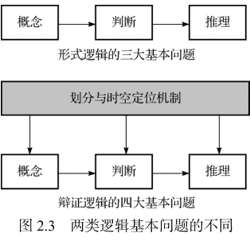

形式逻辑具备“各向同性”：仅含概念、判断、推理三环，概念为原子化（非真即假），判断二值，推理二值。辩证逻辑面对“各向异性”对象（时空域异、性质别），增设第四环——**划分与时空定位机制**；概念为分子化（真假有过渡），判断多值，推理多值。处理不确定性的核心密钥，即藏于此。

举例：中医“相生相克”映射人际为“朋友/敌我”，朋友下分“吸引/排斥”，敌我下分“冷战/热战”。各关系性质迥异，遵循不同运算逻辑，必须靠“划分与时空定位”区别对待。若强用形式逻辑，需建无穷子系统分别描述，根本不可行。“万年历与潮汐表”对地球局部有效，若要覆盖宇宙大爆炸全时空细节，需无数张表。真知灼见只能是：宇宙整体是各向异性非线性系统，局部时空可近似视为各向同性线性系统，正如欧氏几何仅在非欧几何局部近似成立。

### 2.4 抽象思维的本质：主动拥抱不确定性

本节深度剖析抽象思维的内核机制[16,17]。

#### 2.4.1 认知路径的分野

- **传统逻辑的“确定性执念”**

传统逻辑视确定性为圣杯，视不确定性为洪水猛兽。坚信万物受定律管控，认知中的模糊仅因信息不全。科学目标被设定为消除近似，达致绝对确定。如掷骰子，若掌握全物理参数，结果可预演，故将概率问题本质化为确定性问题。事实真如此？

- **人类智能的“避实就虚”智慧**

观察人类如何实战处理不确定性。人类之能突破组合爆炸瓶颈攻克高复杂问题，靠的不是硬刚，而是**在归纳抽象中主动牺牲精度、引入不确定性**。将原子概念（确定）抽象为分子概念（带不确定性），小粒度向大粒度聚合，分层分区分块存储调用，从而大幅跃升处理效率，规避组合爆炸。智能内核是“巧度”而非“力度”。计算机科学家常走反道——试图以算力暴力破解复杂性。下面看人脑如何抉择。

#### 2.4.2 归纳抽象：主动引入不确定性的艺术

##### 1. 原子系统的组合爆炸死局

先看简单原子系统的信息压缩规律（图 2.4）。

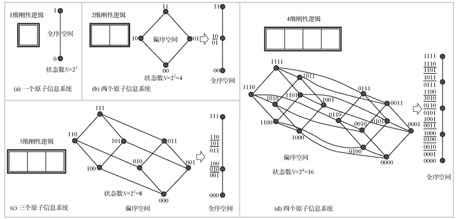

**通则**：n原子系统分明状态数 $N=2^n$。偏序退化为全序，状态数骤降为 $N=1+n$。

- 1原子：1维刚性逻辑精描，全序空间，2分明态 {1,0}，1真于0。
- 2原子：2维刚性逻辑精描，偏序空间，4分明态。映射全序得3柔性态 {全1, 1个1, 全0}，逻辑序：全1 > 1个1 > 全0。
- 3原子：3维刚性逻辑精描，偏序空间，8分明态。映射全序得4不分明态 {全1, 2个1, 1个1, 全0}，逻辑序递降。
- 4原子：4维刚性逻辑精描，偏序空间，16分明态。映射全序得5不分明态 {全1, 3个1, 2个1, 1个1, 全0}。

**归纳洞见**：
① 系统状态数随原子数 $n$ 指数爆炸 ($P_s=2^n$)，$n>2$ 为偏序空间，映射全序后不分明态数 $Q_s=1+n$（线性增长）。
② 原子少时，偏序空间精描利于追踪微观态。
③ 原子数大时，$2^n$ 爆炸不可承受。$n=10$ 已1024态勉强可控，$n=100$ 即天文数字难以想象。
④ 人性趋利避害，本能绕开组合爆炸“拦路虎”。决策实不需微观细节，掌握宏观概貌即可高效决断。

##### 2. 理想试卷模型：精确与粗放的博弈

看常见考试模型（图 2.5），直观感受“精描分明态” vs “粗描不分明态”的得失。

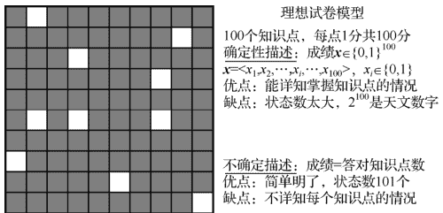

学标准逻辑时，被教导“非真即假、分明严谨”，当时深信。但学生视角揭示现实反面：数学主修精打细算（百分制），99.5与100分天差地别；体育辅修粗放通过制，达标即过，通过者参差不齐难细分。为教之责，重理论课严考核，知识点全覆盖。抽象为模型：100个独立知识点，每1分，全对100，全错0。即含100原子命题系统，分明态 $2^{100} \approx 1.27 \times 10^{30}$ 个——天文数字！

用折纸喻此数：0.1mm纸对折100次。每折1分钟，1小时40分完成。但厚度达 $2^{100} \times 0.1mm \approx 1268$ 万亿亿 km，折合 **134亿光年**！人寿百岁，可观测宇宙半径约138亿光年。轻松折纸，却飞越可观测宇宙边缘。最弱的 $2^{100}$ 爆炸已如此狂暴，$10^{100}$、$100^{100}$ 更难想像。

若放弃分明态执念，改用全序空间（分数制），状态数骤降至 **101**，压缩比 $2^n/(1+n)$，简直云泥之别。除阅卷师、学生、家长极少数人，旁人只关心分数，不知细节。盲崇分明态描述，实属愚蠢。

##### 3. 超级理想试卷模型：嵌套升级的现实映射

更广泛视域下，模型可嵌套升级：每1分题变为“分子题”，内含100原子题，分值 0~1 分间 101 级跃迁。此模型遍布社会生活。如教改方案：高考综合评价五维（学业、艺术、德育、身心、实践），每维再分20项，共100项（对应100个1分题）。每项又由历次成绩、实践表现、创新、团队、抗挫折、面试印象等原子事件构成（对应0.01分题）。评分非单人一时完成，而是跨时空、多人协作、层层抽象汇总。档案材料已固化大部分中间分，录取端只做最终聚合，无需下潜原子层。

百分制本是管理习惯，若归一化视为 $100\%=1$，试卷评分与逻辑真度评判同构，共享一套机制。

事实反复证明：**现实决策必须主动引入不确定性**，让各层级用适配粒度的抽象知识决策。层级越高、粒度越大、不确定性越重、越依赖柔性逻辑支撑。

#### 2.4.3 分层分块：知识管理的“压缩算法”

##### 1. 人类智能的两大隐性关键

**特征一：方法论的“动态组合拳”**。智能活动需机动切换、组合施策。识别汉字：笔画层面（一、丨、丿...）用**数据统计/模式识别**最优；字符层面（一、二、三、十、王、玉...）用**结构分析/逻辑关系**最优。若复杂字（逼、通、迅、逍）仍死磕统计法，速准双降，事倍功半。

### 核心特征二：知识的分层分块与树形组织

要高效管控并调用海量已知知识，关键在于建立分级体系：将零散知识按属性聚类、向上抽象，逐层构建起由不同粒度节点组成的多层级树形架构（如图 2.6 所示）。

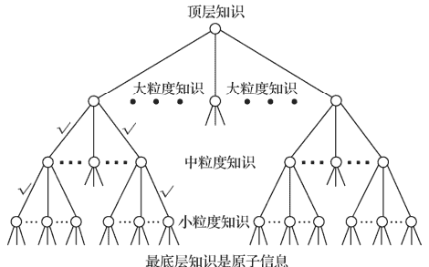

图 2.6 知识的分层分块树形结构

以大众熟知的地图导航为例。在最微观的村落层面，每户人家都是基础节点，由小路相连构成原子级网络。在此范围内，借助与/或决策树、刚性逻辑及二值神经网络，寻找最优路径理论上完全可行。但若试图将这套“绝对精准”的方法无限外推至更大范围，现实早已给出否定答案。随着决策半径扩大，涉及的原子节点与边呈几何级数激增，绝大多数冗余信息不仅无助于解题，反将问题复杂度推向不可计算的深渊，沦为“算得出却说不清”的笨拙黑箱。

人类的高明之处，在于**分层求解**：在村落图基础上，叠加乡镇级（粒度为村）、地市级（粒度为镇）乃至更高层级地图。将一个原子层面的超复杂大问题，拆解为三个层面内部及跨层面的若干简单子问题，整体计算量由此骤降。

---

### 复杂场景下的多知识协同实战

当下，跨国旅行路线规划已成常态，人类却能轻松驾驭。奥秘何在？一是各层级交通图谱早已备好；二是实时班次、票价等动态信息持续更新。有此知识底座支撑，任意两点间的全球路径规划皆可秒级完成。

假设有人要从西安西北工业大学前往匹兹堡大学。若在包含全球每户人家的“超级村落图”上硬找，哪怕拥有无限算力拼凑出全图、跑出“最优解”，那也是人类无法理解、无法在异常时微调的**黑箱方案**。人类的实操逻辑截然不同，严格遵循**自顶向下、分层分块**的协同机制：

1.  **顶层任务“中国→美国”**：查阅世界级地图与国际航班系统，锁定北京首都机场飞往纽约纽瓦克机场的最优航班。
2.  **中层任务“西安→北京机场”及“纽瓦克→匹兹堡”**：分别在中美两国国家级地图与国内航线网中求解最优联程。
3.  **底层任务“校区→咸阳机场”及“匹兹堡机场→校区”**：依托城市级地图与实时路况，规划最后一公里驾车路线。

全程无需海量数据与云算力，结果**可解释、可修改、可信赖**。这正是多粒度知识协同的威力。

---

#### 2.4.4 因素空间理论：知识粒度跃升的数学引擎

##### 1. 拥抱不确定性：从“消除”到“利用”的认知跃迁

上述“归纳抽象—分层存储—多层规划”的智慧范式，本质上是**主动引入并合理利用不确定性**的方法论革命。它打破了传统“求解必须追求确定性”的教条——传统观点执着于用刚性逻辑或二值网络消除模糊，却不知随复杂度攀升，时空开销将击穿物理极限。

人类智慧的高光时刻，在于**果断放弃原子级的确定性，转投分子级的不确定性**——通过聚类抽象，主动升维到粗粒度、带模糊性的认知层面。这一粒度跃迁，需借助因素空间理论完成。层级越高、粒度越大、包容的不确定性越多，所需逻辑工具便从刚性走向柔性，从二值神经元走向柔性神经元。深度神经网络的盲区，正在于忽略了这一核心智慧机制。

##### 2. 因素空间理论溯源与核心定义

汪培庄教授开创的**智能数学**，研究对象不再是被动的客体，而是有目标、有主观能动性的**智能主体**。主体如何识别环境、趋利避害？答案是：**因素空间**。

*   **因素**：主体依目标筛选出的、影响目标实现的环境关键属性。无关属性及衍生属性一律屏蔽。
*   **原子信息/刚性命题**：单因素概念，非真即假（1/0），对应刚性逻辑。
*   **分子信息/柔性命题**：多因素（n>1）概念，真值呈 n+1 级阶梯分布（1, (n-1)/n, ..., 0），对应柔性逻辑。

图 2.7 直观展示了因素空间如何为不同粒度命题赋予真度——这正是“三种考核模式”的数学化映射。设对象空间 U 为考生集，因素空间 E 为试卷（知识点集）。

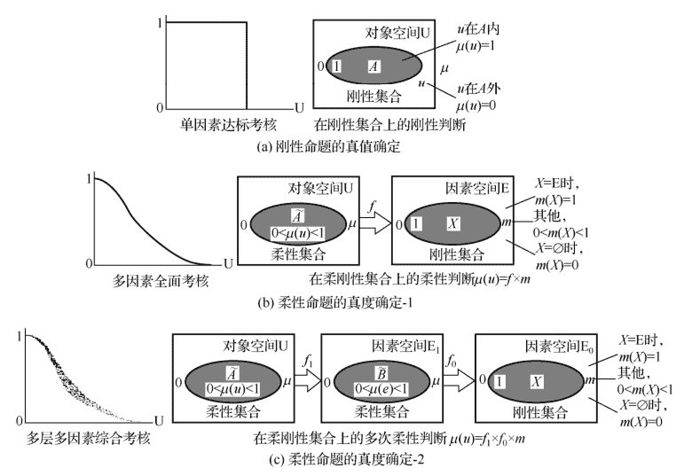

图 2.7 柔性命题真度的确定方式方法

###### (1) 刚性命题：非黑即白的单因素裁决
常规判断查“录取名单集合 A”；因素空间查“单一决定因素——录取通知书”。收到即 1，未收即 0。如“张三是否考上清华”，通知书在手，真值确定为 1。

###### (2) 一次柔性判断：理想试卷模型的逻辑抽象
柔性概念对应柔性集合 $\tilde{A}$，隶属度连续可变。隶属度如何算？因素空间给出统一公式：

> **定义 2.4.1** 柔性命题真度 $x = \mu(u) = \text{mzd}(\forall e P(e)), e \in E$。
> 即：在因素空间 E（试卷）上，统计对象 u（考生）满足因素的比例。全对则 1，全错则 0，其余线性映射。

这正是老师批卷的标准动作：数对题数、算得分率。因素空间将其形式化为**“刚性集合基础上的一次柔性判断”**。

###### (3) 多次柔性判断：超级理想试卷模型的无限递归
若在柔性概念上继续聚类抽象，将产生更大粒度的高阶柔性概念。其逻辑原型是**超级理想试卷模型**——在刚性基础上进行 **n 次（n=0,1,2...无上限）柔性判断**。图 2.7(c) 演示了两次判断的结构。

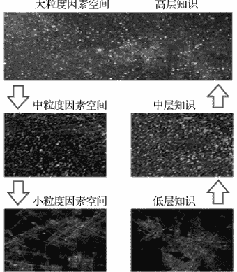

这一机制揭示了**知识粒度增长与网络简化的通用逻辑**：它能可靠地将确定性知识提升为不确定性知识，也能将低阶不确定性提升为高阶不确定性。因素空间 E 既可由刚性因素构成，也可由柔性因素构成。图 2.8 进一步描绘了因素空间与多层分块知识结构的映射关系。

---

### 第 2 章 小结

本章揭示了科学范式与逻辑范式的深层耦合：
*   **决定论范式 + 刚性逻辑**：擅长处理**各向同性、封闭简单**的机械系统，称霸 600 年。
*   **演化论范式 + 柔性逻辑**：专治**各向异性、开放复杂**的巨系统，是当下的唯一正解。

悲剧在于：人类实践已步入复杂系统新纪元，思维却滞留在机械系统旧范式。下一章将引入 AI 80 年实战史，实证两大范式的生死博弈。尽管成果丰硕，但 AI 至今仍停留在**“现象模拟”**阶段，未触**“机制仿真”**门槛。这符合认知规律——工具巨变时代，认识必然由表及里、渐次深入。

---

## 第 3 章 人工智能：80 年得失启示与未来图景

前两章视角由宏入微：宇宙→地球→生物；人类→社会→大脑。层层聚焦下，同一铁律浮现——**演化**。世间万物皆在不确定中演进。传统眼中的“确定性”，不过是局部时空观察的近似假象。本章将镜头拉近至 AI 具体研发一线，以实战成败为镜，照见哪些遵循了智能规律（收获阶段性胜利），哪些违背规律（撞上瓶颈）。事实最雄辩。

### 3.1 引言：一位亲历者的冷思考

笔者 1978 年转入 AI 领域，亲历中国人工智能学会创建全程，与国产 AI 研究同龄共长。从计算机“算法危机”中诞生学科，到深度学习、大语言模型赋能万业，笔者为成就自豪，更为瓶颈痛感。

**核心坚守**：AI 终极目标是**造趁手的智能工具，助人类登高致远**；而非**造统治人类的超级机器，推人类走向灭亡**。

**历史定位**：过去 80 余年是**第一阶段——从 0 到 1 的探索积累期**。特征：直接用编程模拟智能表象，**缺乏信息学范式与智能基础理论指导**。

**未来使命**：未来是**第二阶段——在范式与理论引领下的精准设计期**【15,22,23】。

### 3.2 AI 学科创立的初衷与物质基石

#### 3.2.1 计算机：AI 的物质载体

20 世纪 30 年代，二战催生算力狂需，哥德尔、丘奇、图灵、冯·诺依曼等巨擘奠基可计算性理论与理论计算机。40 年代电子数字计算机诞生，以机器代人完成极速复杂运算，为 AI 降生铺就物质地基。

###### 1. 图灵机：模拟人类纸笔运算的理想模型
图灵洞察数学家纸笔运算本质：仅两操作（写/擦符号、移动关注点），两决策依据（当前符号、当前思维状态）。抽离时空能耗与物质开销，构造出**图灵机模型**：

*   **带字母表 Γ**：含空白符 Δ 的有限符号集。
*   **无限纸带 A**：无限单元 $a_0, a_1...$，各存一符号 $s_i \in \Gamma$。
*   **读写头 H**：左右移动、读写、按控制规则改写。
*   **控制规则 B**：有限确定规则集，定义变换 `<当前状态 $q_i$, 当前符号 $s_i$ → 动作 L/R, 新状态 $q'$>`。
*   **状态寄存器 Q**：存当前状态 $q_i$，含停机态 $\tau$。

同年波斯特独立提出**波斯特机**（双向无限带、二状态单元），经证明与图灵机等价。

###### 2. 典型图灵机的七元组形式化与运行机制
典型图灵机 $M = \{Q, \Sigma, \Gamma, \delta, q_0, j_s, j_j\}$：
*   $Q, \Sigma, \Gamma$ 为有限非空集；$\Sigma \subset \Gamma, \Delta \notin \Sigma$；$Q \subset \Gamma$。
*   $\delta: Q \times \Gamma \to Q \times \Gamma \times \{L, R\}$ 为部分转移函数。
*   $q_0$ 起始态，$j_s$ 接受态，$j_j$ 拒绝态（$j_s \neq j_j$）。

**运行流程**：
1.  输入串填入 $a_0...a_{n-1}$，其余为 $\Delta$；读写头指 $a_0$，状态 $q_0$。
2.  循环执行 $\delta$：读 $(q, x)$，得 $(q', x', L/R)$，改写、移动、换态。
3.  边界保护：读写头不得越过 $a_0$ 左侧。
4.  进入 $j_s$ 接受停机；进入 $j_j$ 拒绝停机；$\delta$ 未定义即异常停机。

###### 3. 通用图灵机：现代计算机的理论原型
任意图灵机描述有限，可编码为字符串 $\varepsilon$。构造**通用图灵机 U**，接收 $\varepsilon$ 并模拟对应机器运算。**现代电子计算机即通用图灵机的物理实现**——存储有限，故能力不超越典型图灵机。

### 乔姆斯基谱系与自动机的对应关系

依据乔姆斯基分类体系，形式语言与自动机存在严格的等价映射：位于塔尖的 0 型语言（PSG）对应典型图灵机（TM）；1 型语言（CSG）匹配线性有界自动机（LBA）；2 型语言（CFG）对应下推自动机（PDA）；最基础的 3 型语言（RG）则对应有限状态自动机（FA）。由此可见，从计算能力维度审视，典型图灵机坐拥最强算力，其余自动机皆为其真子集，典型图灵机具备模拟任意自动机运行过程的通用性。

###### 4. 图灵机的外延扩展家族

典型图灵机不仅能向内收缩退化为各类受限自动机，更能向外生长，衍生出结构繁复的变体群。其扩展路径主要涵盖七大维度：一是带字母表 Γ 的符号规模变动；二是纸带双向无限延伸；三是引入读写头“原地驻留”操作（等价于移出即回）；四是构建多纸带、多读写头架构；五是引入非确定性机制；六是发展交替式模型；七是演进为栈机器等。

尽管形态各异，这些变体在识别能力上与典型图灵机完全等价，均可处理 0 型语言（PSG），差异仅在于描述效率与识别速度。判定两者等价的核心准则在于“双向模拟”：若机器 A 能模拟 B，且 B 能反向模拟 A，则二者算力同源。此处仅聚焦理论可行性，暨不计算量复杂度。这清晰地划定了边界：图灵机的理论算力与现实计算机的物理算力，属于两个截然不同的概念范畴。

###### 5. 图灵：计算机科学的奠基者

图灵构想理想计算模型，初衷并非指导具体硬件工程，其理论意蕴远超工程实践。

*   **奠基通用计算论**：图灵机模型从数学上论证了通用计算的可行性，确立了计算机诞生的理论基石，并勾勒出核心架构蓝图。
*   **重塑设计范式**：该模型引入“读写、算法、程序语言”三大核心概念，彻底打破了早期计算机器的固有设计逻辑。
*   **核立学科基石**：图灵机是计算学科的基石理论。现实计算机的极限算力即图灵机算力，众多棘手理论难题均可归约至该模型求解。
*   **丘奇-图灵论题的确立**：20 世纪上半叶，可计算性的形式化呈现出三足鼎立之势：丘奇的 λ-演算、图灵的理想机模型、以及丘奇、克莱尼、罗歇尔联合定义的递归函数。三者直觉等价，定义了同一函数族。学界由此达成共识：可计算性的精确定义已现。论题非正式表述为：凡可行算法，均可由图灵机、λ-演算或递归函数实现。虽难以严格数学证明，但主流数学界深信：一切可计算函数皆为图灵可计算，反之亦然。

###### 6. 电子数字计算机的降世

二战期间，美军斥巨资研制电子数字积分计算机 ENIAC。1946 年 2 月 14 日，这台公认的首台电子数字计算机在宾大揭幕，主攻弹道计算。项目由莫奇利主导，24 岁的埃克特任总工程师，团队汇聚数学家格尔斯、逻辑学家勃克斯，亦有参与曼哈顿计划的冯·诺依曼加盟，解决了多项关键难题。ENIAC 规模惊人：1.8 万电子管、1500 继电器、7 万电阻、1 万电容、6000 余开关，长 30 米、宽 6 米、高 2.4 米，占地 170 平米，重 30 英吨，设 30 操作台。性能跃升显著：每秒 5000 次加法或 400 次乘法，较继电器机快千倍、人工快 20 万倍，单次耗电 150 千瓦。蒙巴顿将军赞其为“电子大脑诞生”，“电脑”称谓由此普及。

至此，人工智能学科的物质载体已就位，只待一声春雷，冲破应用硬壳，傲然诞生。

#### 3.2.2 算法危机：催生人工智能学科的助产士

##### 1. 图灵测试：规避定义困境的“猜谜游戏”

人脑与计算机同为信息处理装置，前者承载人类智能，后者被冠以“电脑”之名，寄望其替人执行智能任务。然思维本质何在？机器能模拟哪些智能、不能模拟哪些？哲学界尚无定论，工程界却需动手实践。为破此僵局，图灵 1950 年发表《计算机器与智能》，抛出“模仿游戏”模型以此判定机器智能。

规则如下：测试者 C 与被测者（人 B、机器 A）物理隔离，通过终端（如电传打字机）自由对话。机器 A 目标是欺骗 C，使其无法分辨谁是人。多轮测试后，若超 30% 测试者无法识别，机器 A 即通过测试，获“具备人工智能”认证。

后世称此为“图灵测试”，尊图灵为“AI 之父”。然此模型并未引导探索智能本质再建模，而是满足于像魔术师般制造假象欺骗测试者。积极面看，图灵鼓舞士气：有了硬件载体，可大胆探索 AI 路径，无需待哲学家、心理学家定论智能本质。但这仅是比喻，不可作为研究靶标。真正路径应遵循智能生成机制模拟智能。若照搬图灵测试搞欺骗仿真，实质是抹杀智能核心——理解问题与环境，基于目标做最优响应。非危言耸听，当前不少自然语言理解与对话系统，实则依靠模式匹配进行机械问答，表象光鲜，实则毫无“理解”可言。请看案例。

*   **Eliza：伪装成治疗师的模式匹配器**
    1966 年 MIT 维森鲍姆开发 Eliza，设定为心理治疗师。实验显示能与人深度交流数十分钟，惊世骇俗。实则零理解，全靠话术引导维持对话。
    > **Eliza**：“我是治疗师，请讲烦恼。每句后按两次回车。”
    > **患者**：“你好吗？”
    > **Eliza**：“挺好，讲讲你自己。”
    > **患者**：“好孤独、好忧伤。”
    > **Eliza**：“为何感到孤独忧伤？”
    > **患者**：“家人朋友都不关心我。”
    > **Eliza**：“讲讲你的家庭。”
    > ......
    显而易见，Eliza 未理解语义再回应，仅用引导话术延续对话。今微软小冰、Siri、Allo、Alexa 皆属此类“现代强化版 Eliza”，本质零突破。

*   **Eugene Goostman：首个“通过”测试的聊天机器人**
    2014 年雷丁大学测试中，该机器人以 33% 通过率成为首个“过关” AI。未来类似系统通过率只会更高。

但这非 AI 正途。此类系统作玩具或陪伴孤独老人尚可，若用作心理治疗或医疗问诊，必酿事故。智能系统首要知晓自身在做何事，次要理解他人意图，最后才能决策回应。市面众多“智能产品”实为“欺骗性智能玩具”，学界不严格区分，将误导公众认知。

深层看：**展示智能结果 ≠ 模拟智能过程**。程序套公式解一元二次方程，是展示结果；若能自主发现公式并求解，才是模拟过程。打个比方：智能是“在井下发现煤层并开采”，仅在井口堆煤炭不算智能，因其未模拟采煤过程，只展示终极结果。

##### 2. “三绝”击穿“三能”：算法危机倒逼 AI 诞生

AI 学科诞生源于计算机科学内部的算法危机。计算机应用遵循“数学 + 程序”范式，解题需满足“三能”先决条件：
1.  能建立数学模型；
2.  能寻得模型算法解；
3.  能按算法编写可运行程序。

然理论计算机科学却揭示了残酷的“三绝”：
1.  **绝大部分**人类智能活动**无法**建立数学模型；
2.  **绝大部分**数学模型**不存在**算法解；
3.  **绝大部分**算法解为**指数型**，程序**实际不可计算**。

“三绝”精准对撞“三能”，构成了 20 世纪 50 年代困扰理论与应用的“算法危机”。

人脑能解之题，电脑“数学 + 程序”模式却束手无策，证明了电脑相对人脑的“笨拙”。同为信息处理，差异何来？因图灵机（递归函数）本质是“照章办事”的机械执行者，零主观能动性。人脑则具主观能动性，能见机行事、灵活处理。“照章办事”与“见机行事”是办事能力的两极，电脑与人脑不可同日语。

既然单纯靠电脑实现脑力劳动机械化破产，必须突破应用硬壳，另觅机器模拟智能之道，这直接催生了 1956 年 AI 学科的正式诞生。创始人们初心明确：探索人脑智能规律并机器模拟，攻克算法危机，让计算机“聪明”起来，打破传统框架，另起炉灶。

**结论明确：AI 诞生旨在通过模拟人脑智能规律，补齐计算机应用短板。** 因人类对自我智能知之甚少，AI 发展史实质是探索“人脑比电脑聪明在哪”。离此核心线索，必偏离正轨：非以骗术代理解，即以蛮力代巧干。组合爆炸是算法本质，理解与巧干是人脉规避爆炸的唯一良策，抹除二者即抹除智能。

以上为 AI 初级阶段必反复强调之基石。至高级阶段，若 AI 能力超人类数个数量级，需警惕相反倾向——人类让位于 AI。这严重违背创立 AI 初心，亦违背人类制造工具的初衷。工具研制旨在**拓展人类能力**（智能工具拓展智力，动力工具拓展体能），借工具之力成就伟业。工具研发权、使用权、控制权皆属人类，**主客异位、反客为主，无必要亦无可能**。

### 3.3 人工智能必须直面的现实环境

#### 3.3.1 智能源生于现实世界

**1. 无现实环境，无智能生成**

理想世界中，万物受确定不变律控，有恒有、无恒无、真恒真、假恒假。只需判真假、有无，按规则行事即可，智能无用武之地。人类产生智能，源于目的性与主观能动性：需依环境态势与趋势，在经验启发下择优响应（趋利避害）；失败可重试、积累、学习、进化。人类智能在“识变、用变、求变”中生成，服务于生存发展。若万事确定不变，智能失去存在价值。

哲学层面：万物处于演化中，时间是矢量，过去/今/未来角色迥异，**不确定性是客观世界本质属性**，确定性仅是局部短时的“近似性”认知。认知前进方向是消除近似，精准把握不确定性演化规律。理想化仅是特殊情境下的“权宜之计”（如万年历、潮汐表仅是日地月三体局部近似规律），绝不可能“放之四海而皆准”。

**2. 两个世界，截然不同的问题谱系**

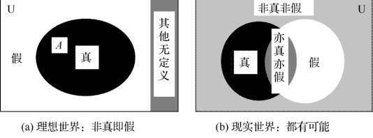

图 3.1 两个不同世界的差异分析

*   **理想世界（图 3.1a）**：论域为各向同性闭合时空。万物为对立充分的真/假、有/无、动/静分明体，严守“非此即彼”律。任一事物均可用刚性集合 A 描述：点 u 落入 A 则 u∈A 为真；落在 A 外则为假；落在论域外则无定义（⊥）。刚性逻辑建立于此，排除真假中间过渡，极简推理复杂度，在传统数学、计算机科学广泛适用，具理想环境普适性。
*   **现实世界（图 3.1b）**：复杂得多。万物为演化中的对立统一体，内在辩证矛盾驱动演化，外在表现为不确定性（亦真亦假、非真非假）。智能科学中，**不允许**将现实问题抽象为全受“非此即彼”约束的理想问题，关键不确定性必须保留，否则不成智能问题。
    *   *案例·戒烟*：成瘾是“抽→戒→复吸→再戒”的辩证演变，需用“抽烟强度” x∈[0,1] 刻画。强度波动收敛则可愈，发散则不治。若用理想真度 x∈{0,1}（不抽恒不抽，抽者恒抽），戒烟问题直接消失。
    *   现实世界不仅存在刚性集合/逻辑描述的分明体，更充斥着真假共存的对立统一体，具“亦此亦彼性”，需**柔性集合与柔性逻辑**刻画。复杂系统涌现效应下，偶现**新生变异体**，与原系统元素迥异，具“非真非假性”，属域外不动项，需**超协调逻辑**刻画。
    *   *案例·方程求解*：实数域解一元二次方程，冒出含 √-1 的解。运算封闭性要求解为实数（真），但实数定义下它非实数（假）。
    *   *案例·电商*：网络时代涌现新物种，在旧商业模式中既不合法（假）也不违法（真）。

#### 3.3.2 程序体：智慧度为零的智能体

仍有学者无视事实，站在计算机科学局部立场坚持：AI 非独立学科，仅是计算机应用分支；无自有基础理论，只是技术集成。此观念将葬送 AI 前程，贻误智能科学与智能化社会进程。深度剖析如下。

**1. 程序体是最呆板的智能机**

无论面对简繁问题，图灵机（递归函数）只会按预设程序“照章办事”机械执行，零现场随机应变能力。其本质属性：**“能精准做事，但行事呆板”**。智能机之所以智能，因其能模拟人脑“见机行事、不断学习进化”，绝非一成不变。这是利用计算机实现智能化必须攻克的**属性瓶颈**，亦是 AI 诞生的理论根据与历史使命，**每个 AI 工作者须牢记不忘！**

若计算机应用仅能直接呈现智能结果，它仅算智慧度最低（0 级）的智能机，特称**程序体**。

**2. 智能需高阶图灵机模拟**

基于多年计算机科学与专家系统研究体会，要改变“精准但呆板”本质，必须从根本重构图灵机架构，将其提升为**高阶图灵机 Aₙ（泛递归函数）**。提升路径如图 3.2 所示。

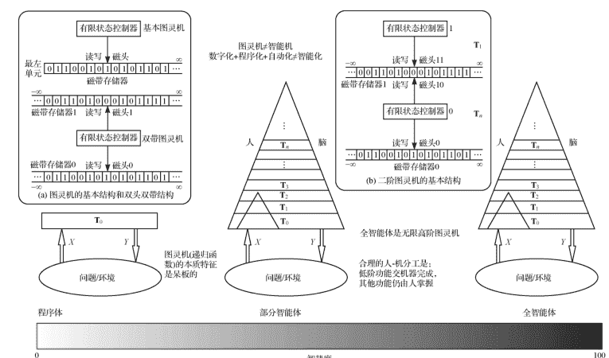

图 3.2 程序体和智能体的关系

*   **第一步：构建二阶图灵机 A₂**
    先将典型图灵机等价变换为双带机，借新增磁带作中介，串联两个图灵机：底层 T₀ 仍面向客观环境问题，上层 T₁ 存放“修改 T₀ 控制规则的规则”。T₁ 实时监测 T₀，遇意外状况即时依规修正 T₀ 规则。该串联体即**二阶图灵机 A₂**。

    因引入 T₀ 控制规则随机应变能力，A₂ 能力**强于**典型图灵机 T₀（注意：前文已证典型图灵机任何并联与变体能力等价；此处通过**串联**，赋能控制规则现场变化能力）。A₂ 由此攻克图灵机属性瓶颈，可部分模拟随机应变智能活动，具雏形学习能力，标志着计算机向智能计算机进化的开端。

*   **推广：n 阶图灵机 Aₙ 的串联架构**
    *   T₀ 面向问题；
    *   T₁ 存“修改 T₀ 规则的规则”，实时监测 T₀，可改 T₀ 规则；
    *   T₂ 存“修改 T₁ 规则的规则”，实时监测 T₁、T₀，可改 T₁ 规则；
    *   ……
    *   Tₙ₋₁ 存“修改 Tₙ₋₂ 规则的规则”，实时监测 Tₙ₋₂……T₀，可改 Tₙ₋₂ 规则。

    此即**高级智能计算机的基本结构模式**。

### 3.4 AI发展史的关键启示

理论上若令阶数 $n$ 趋向无穷大，便得到了“无限高阶图灵机” $A_\infty$，它象征着全人类智慧的总汇。为了给智能机的“智慧度”建立量化标准，首要任务是锚定上下边界：仅会死板执行指令、复述思维终极成果的“程序体”，智慧度归零，是下限；囊括古今未来全人类智慧的“全智能体”，智慧度满分一百分，是上限。全智能体只能借助无限高阶图灵机这一理想模型来模拟，现实技术难以企及。工程实践中，我们既无必要也无法复刻全智能，只能按需实现特定层级的核心功能，这就是“实用智能体”。人工智能系统的演进轨迹，永远锁定在0到100这个开区间内。因此，将智能机简单归类为计算机应用的一个分支，实则严重阻碍了学科发展。

古语云：“以铜为镜，可以正衣冠；以史为镜，可以知兴替；以人为镜，可以明得失。”人工智能与原子能、空间技术并称为20世纪三大科技丰碑。复盘80余年的发展脉络，能让我们洞察学科内核与未来走向。宏观来看，历程大致分三个探索阶段（总体态势见下图）。每阶段聚焦点与手法各异，虽均有重大突破、推动研究登台阶，证实了模拟对象确为智能要素；却也同步暴露难以跨越的瓶颈，被迫另辟蹊径。这些实践印证：各阶段关注的都是智能拼图的关键碎片，但均不够全面、存在偏颇。这些宝贵的得失经验，为构建智能科学基石提供了丰富素材。

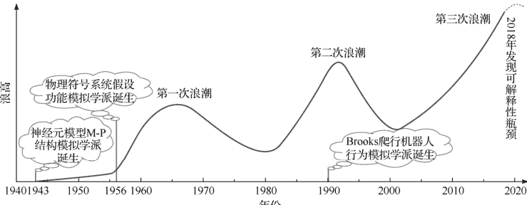

图 3.3 人工智能学科发展的总体态势图

这80年跌宕起伏、三起三落的探索史，值得深度复盘。放眼当下，几条铁律清晰可见：
① 智能非单一因子决定，乃是多因子耦合的综合效应。若仍沿用“分而治之、单打独斗”的传统模拟路径，必然顾此失彼、劳而无功。
② 若执迷于以“骗术”替“理解”、以“蛮干”替“巧干”，必毁学科根基。算法是智能模拟的基石，而组合爆炸是算法的本质属性；唯有“理解”与“巧干”能规避或缓解此困境，抹除二者即抹除智能本身。
③ 任何现实算力（含网络集群）在组合爆炸面前皆不堪一击。企图靠大数据、云计算包打天下，初期虽成果耀眼，稍微拓展步数便瞬间崩塌。以最温和的 $2^n$ 为例：$n=10$ 仅千级循环，$n=20$ 跃升百万级，$n=22$ 即达千万级，而 $n=100$ 早已是天文数字。硬碰硬注定行不通，这正是智能体与程序体的分水岭——不懂“巧”，便无“智”。

#### 3.4.1 人工智能的孕育期（1956年前）

##### 1. 绵延久远的人类夙愿

AI的诞生非偶然。思想上，源于人类长期对“会思考的机器”的执着追寻；理论上，得益于控制论、信息论、系统论、计算机科学、脑科学、神经生理学、心理学、数学、哲学等多学科交叉渗透；物质上，仰赖电子数字计算机的问世与普及。孕育期大致止于1956年，尤以19世纪至20世纪中叶的加速期为烈。“脑力劳动机械化”，是人类跨越世纪的宏大梦想。

##### 2. 古今中外的不懈探索

自古便有以机械替代脑力劳动、增强征服自然能力的尝试，神话传说皆映射此愿。中国周代有偃师献“艺伶”典故；东汉张衡指南车堪称机器人雏形；唐代杨务廉刻木僧行乞、钱满鸣声“布施”，此乃实用的机械式语音合成器，比西方肯佩伦讲话机早近千载。古希腊亚里士多德《工具论》奠定思维逻辑研究基石。

近代探索更是灿若星河。西班牙卢乐倡导通用逻辑机；法国帕斯卡造机械加法器；德国莱布尼茨改良为四则运算器；英国巴毕毕生致力于差分机与分析机，设计思维超越时代、酷似现代计算机，奈何条件受限英年早逝，致使百年后科学家被迫重走弯路，成科学史一大憾事。

##### 3. 20世纪上半叶的密集突破

步入信息化时代，探索步伐加快，里程碑式成果频现：

*   **1936** 图灵确立理想计算机模型，以离散递归函数为智能描述数学基石，奠基计算理论。
*   **1943** 麦卡洛克、皮茨发布M-P神经元模型，奠基结构模拟。
*   **1945/1946** 冯·诺依曼提出存储程序概念，合作造出ENIAC，奠基物质条件。
*   **1948** 香农《通信的数学理论》创立信息论，奠基信息理论；维纳创立控制论，奠基学习与控制理论。
*   **1949** 伯克利著《巨型脑：会思考的机器》，断言能计算、总结、选择、合理操作的机器即可称思考；赫布揭示学习中神经连接规律。
*   **1950** 香农发表首篇计算机象棋论文；图灵提出“图灵测试”。
*   **1951** 明斯基、爱德华造出首个人工神经网络SNARC（3000真空管模拟40神经元）。
*   **1956** 香农、麦卡锡编《自动机研究》，汇集13篇思维机器论文。

这些成果昭示：AI学科如临产婴儿，躁动腹中，即将破土而出。

##### 4. 认知视野的局限

此时学者对“电脑思维”与“人脑思维”的关联与鸿沟认知模糊。知计算机能“算+推”，也知人脑智能=“算+推+其他”，误以为补全“其他”即模拟了智能。对智能本质、构成要素、刚性逻辑能否精确刻画智能过程等核心命题一无所知，这成为学科诞生后急待突围的认知壁垒。

#### 3.4.2 人工智能的第一探索期（1956～1985）

此期鲜明特征：① 学科伊始，先驱雄心勃勃却认知浅薄，误以为计算机具备算、推、解题、自然语言、博弈、操作等功能即是AI；② 重度依赖逻辑与知识；③ 仅数十科学家在实验室钻研通用原理。核心标志为1956达特茅斯会议：麦卡锡、明斯基、罗彻斯特、香农发起，十位跨学科精英闭关两月探讨机器模拟智能，正式确立“Artificial Intelligence”术语，学科诞生。此后在机器定理证明、问题求解、LISP、模式识别、专家系统、知识工程等领域连续突破，同时也引爆理论危机。主流“功能主义学派”专攻智能功能的计算机模拟，核心杠杆为逻辑与知识。成就与瓶颈并存，详述如下。

##### 1. 学科正式登场

1955年8月31日，“Artificial Intelligence”首现于达特茅斯会议提案。1956年8月会议召开，汇聚IBM莫尔、塞缪尔，MIT赛尔夫利奇、索罗孟夫，兰德与CMU纽厄尔、西蒙等十位大咖，跨越数学、心理学、神经学、信息论、计算机学，共研机器模拟智能，历时两月。此会确立学科诞生，美随后快速组建三大研究机构，实验突破频出，开启全球AI研究序章。美国为发源地，辐射西欧、日本；苏联长期批判，我国1978年后始有条件开展“智能模拟”研究。

##### 2. 刚性逻辑的辉煌十年（1956～1975）

学科诞生初期，刚性逻辑大显神威，自动定理证明、问题求解、博弈、LISP语言、模式识别等领域捷报频传，新兴学科备受瞩目。

*   **LT程序**：纽厄尔、肖、西蒙协作开发，模拟数理逻辑证明思维，以“分解、代入、替换”为推理规则，预设公理与规则即可探索求解。曾证出《数学原理》第二章38定理（后全证52条），被公认为计算机研究高级思维的首个重大成果、AI研究真正起点。
*   **塞缪尔跳棋程序**：1956年面世，具自学习、自组织、自适应能力，可向前看步、向人学或自悟、研习棋谱。分析17.5万棋局后归纳推荐走法准确率48%，模拟人类学习的卓效探索。1959年胜设计者，1962年胜州冠军。
*   **乔姆斯基文法模型**：开创形式语言研究，与自动机等价，可研思维过程。
*   **王浩定理证明**：1958年IBM704上用汇编证《数学原理》200+定理。
*   **中文语音识别萌芽**：1958年中科院电子所马大猷启动研究，1959年建成10元音识别装置。
*   **“机器学习”术语诞生**：1959年塞缪尔定义：“让计算机通过学习比程序员下得更好。”
*   **模式识别程序**：1959年赛尔夫利奇等发表。
*   **启发式搜索（HS）与GPS**：1960年纽厄尔等通过心理实验，提炼解题三阶段：拟计划、按规则执行、动态分析修订。其中“方法与目的分析”最活跃。据此编GPS，可解十一种课题，赋予启发式程序普适性。HS利用问题自带启发信息引导搜索，削减搜索空间、降复杂度、延缓组合爆炸，是人类擅用的高效高风险策略。
*   **LISP语言**：1960年麦卡锡创制，兼顾数值与符号处理，武装一代AI科学家，至今仍是核心工具。
*   **明斯基《走向人工智能的步骤》**：1961年巨著，极大推动研究。
*   **首台工业机器人**：1961年Unimate投入通用汽车生产线。
*   **归结法**：1965年罗宾逊提出，引发机器定理证明新高潮，但随即撞上组合爆炸墙——无用子句疯狂繁殖吞噬算力，计算机束手无策。
*   **Shakey机器人**：1966-1972年斯坦福研发，复杂环境下自主推理、规划、控制，智能机器人研究肇始。
*   **语义网络**：1968年奎廉提出，明斯基从信息处理角拓展应用。
*   **SHRDLU**：1968年威诺格拉德开发，早期自然语言理解典范。
*   **IJCAI成立**：1969年国际学术团体发起，双年一会，成果交流、定向探讨。
*   **专业期刊创刊**：1970年《Artificial Intelligence》双月刊面世，IJCAI主办。
*   **PROLOG语言**：1972年法国马赛Colmerauer基于Horn子句提出，经Kowalski改良获认可，成继LISP后主流AI语言，擅长知识处理，后成日本第五代计算机核心语言。

##### 3. 组合爆炸瓶颈的浮现

上述成果证明：计算、推理、行为确为智能不可或缺要素。早期声势下，先驱曾乐观预言：十年内靠几条推理定律+计算机高速大容，AI可追平甚至超越人类。预言落空，首个瓶颈——组合爆炸——降临。人能规避组合爆炸而程序不能，揭示“算+推+行”尚不足支撑智能模拟，他因待发掘。同时暴露：研究伊始即陷“决定论科学范式”与“刚性逻辑范式”囿——只管命题形式不管内容，只管模式匹配不管理解。计算机执行的所有算法（递归函数）本质皆是基于规则的信息变换，天然带组合爆炸。老练数学家凭内容特征与启发式经验择规则，疾速得证；自动证明盲目调用规则，虽形式无错，实则无用子句指数级繁殖，加剧爆炸，耗尽时空资源。程序不懂“看内容”，无法像数学家般有效驾驭HS策略。此死结在计算机学科内部无解。于是有人转念：通用求解效率低、易爆炸，改用专业领域专门知识，能否破局？

##### 4. 领域知识大显身手的十年

# AI发展史：从专家系统的崛起到第一次寒冬，再到神经网络的逆袭

AI先驱们在诞生伊始的十年里，聚焦于一类定义清晰、结构良好的“硬骨头”难题。他们坚信，凭借计算机的高速运算与刚性逻辑，智能模拟指日可待。于是，通用推理算法与搜索策略成了研究重心，而与具体问题紧密相关的领域知识则被置若罔闻。可现实给了响亮耳光：没有领域知识作支撑的“弱方法”，其组合爆炸效应瞬间耗尽算力资源。不得已，研究方向急转弯——知识工程应运而生。随后十年，AI确立了知识的核心地位，专家系统如雨后春笋般渗透各领域，从实验室走向现实，创造出诸多“奇迹”。然而硬币有两面，经验性知识推理缺乏成熟理论、知识获取瓶颈等问题接踵而至，引发了80年代中期那场轰动全球的AI理论危机。

## 专家系统：知识工程的破冰之旅

早期AI学者多躲在实验室搞理论，认定落地应用是工程师的事，自己要是钻进具体领域反而耽误学科发展。斯坦福大学的费根鲍姆力排众议，誓要把AI原理用到实际问题中。

**1965年，首个专家系统DENDRAL诞生。** 这是个化学质谱分析系统，凭借质谱仪数据、核磁共振数据及化学知识，推演出有机化合物分子结构，水平堪比青年博士。DENDRAL一炮打响，为AI开辟了专家系统新疆域。

**1972年，医疗专家系统MYCIN上线。** 专攻协助内科医生诊断细菌感染、选用抗菌药物。流程分四步：判断感染与治疗必要性、分类病原菌、匹配有效抗菌素、给出最优处方。系统内置200条产生式规则，涵盖51种病菌、23种抗菌素，还能向医生学习新规则、修改旧规则、解释推理过程。两次严格考核中，MYCIN均击败医学教授、临床医生等人类强者夺冠，堪称专家系统标准模式。此后，PROSPECTOR（地质）、INTERNIST（内科）、CASNET（青光眼）、PIP（肾脏病）等系统接连涌现。

**1977年，费根鲍姆在国际会议上正式提出“知识工程”概念，预言80年代是专家系统黄金时代。** 预言成真：至1983年，仅美国就建成或在建50余系统，美日两国70多家研发机构中80%属企业。费根鲍姆因此被誉为“知识工程之父”。

专家系统揭示真理：**知识是智慧源泉，AI本质是知识信息处理系统。** 知识表示、利用、获取成三大基础课题，逐渐为自然语言理解、场景分析、机器翻译等分支所共识。与此同时，专家系统开发工具（EMYCIN、OPS-5、KAS等）、非精确性推理理论（主观贝叶斯、确定性因子、模糊可能性、证据理论等）、机器学习理论均迎来高光时刻。

### 同期全球瞩目节点
- **1976年**：Raj Reddy总结早期语音识别进展；中国声学所俞铁城在小型机上跑通首个汉语语音识别系统。
- **1977年**：中国研制成功首个中医肝病专家系统。
- **1979年**：斯坦福自动驾驶小车无人穿越障碍房间，成无人驾驶鼻祖；AAAI成立，成全球首个AI学术组织。

## 第一次AI寒风：投资视角的误判与学术视角的瓶颈

全球视野下，AI思想源于英国、发扬于美、崛起于日。1973年英国莱特希尔报告痛批AI“只能造玩具”，导致英政府切断经费；美军方因夸大承诺、高投低回、落地难，亦近乎撤资；日后“第五代计算机”耗资8.5亿美元折戟沉沙。资本本性逐利，只看近期回报，引发80年代末全球首轮寒冬。

**学术剖析更深刻：** 过去20多年虽有重大成果，却反复印证五大死结：
1. **刚性逻辑效率低**，组合爆炸吞噬资源；数学家靠启发式捷径，却是个人经验，难形式化赋能机器。
2. **专家系统虽用知识解决实际问题**，面对专家知识中的辩证矛盾与不确定性，刚性逻辑束手无策，超出适用域。
3. **专业知识获取极难**，无跨域迁移性，属极度稀缺资源。
4. **经验性知识推理缺乏成熟逻辑支撑**，现有非标准逻辑常出违常识异常结果且无法排除。
5. **常识获取难、常识推理无理论。** 本应集中攻关基础理论扫清障碍，反倒因断资让学者改弦易辙搞短期项目，致使AI发展轨迹七十年“左右摇摆、厥而失彼”。

> **小结：** 创始人确立总目标——模拟人脑智能规律补足计算机应用短板，使机器更聪明。**AI史即探索人脑在何处比计算机“聪明”的历史。** 组合爆炸是算法本质，理解与巧干（启发式）是唯一良策。前二十年完成0到1突破，逻辑与知识、理解与巧干确为核心聪明因子。瓶颈非逻辑知识之过，乃标准逻辑局限、非标准逻辑未熟，需建数理辩证逻辑解决经验知识推理，无理由抛弃逻辑知识。创新科研需国家队攻坚、民间队拓展，而非常规资本可驾驭。计算机速度存储虽强，终究有限，难敌组合爆炸无限增长——这是常被误解的关键点。

# AI第二探索期（1986～2000）：三足鼎立与计算智能狂欢

断资与理论困局（数理辩证逻辑未建）迫使AI进入第二期。**时代特征：无需知识逻辑的“计算智能”百家争鸣；极重应用、忽略可解释性；全球普及，成千上万AI从业者投身；结构主义、功能主义、行为主义三大流派正式对峙。**

结构主义（神经网络/计算智能）成主流，虽为应用转折关键期，却暴露局部极值等瓶颈。

## 神经网络登堂入室：从低潮到“脑的十年"

人脑皮层神经网络与感觉器官是智能物质基，学习能力是机器智能首要因。ANN直接模拟脑神经结构，属AI重要路径。

**早期奠基：**
- 1943 McCulloch&Pitts建M-P神经元模型，证单个神经元可执行逻辑。
- 1949 Hebb描述神经元连接学习规律，赋ANN可操作性。
- 1951 Minsky&Edmonds用3000真空管模拟40神经元，建首个ANN系统SNARC。
- 60年代感知器、自适应线性元件等模型完善，但Minsky 1969年《感知器》片面否定其能力，加之串行计算机与功能主义AI成果掩盖必要性，ANN陷低潮。

**逆风坚守与突围：**
- 低潮期Grossberg提ART网、Kohonen提自组织映射、Fukushima提认知机网络，并深化数学理论。
- **1982 Hopfield引入“计算能量"概念，给出网络稳定性判断，开创联想记忆与优化计算新径。**
- **1984 Hopfield连续时间模型，推动ANR研究爆发。**
- **1985 Boltzmann机引入模拟退火，保证全局稳定。**
- **1986 Rumelhart、Hinton、Williams发BP算法；Rumelhart&McClelland出版PDP巨著，奠定现代深度学习基石。**
- **1988 Linsker基于信息论提最大互信息理论；Broomhead&Lowe引RBF函数设计分层网络，联结数值分析与线性自适应滤波。**
- **90年代初Vapnik提SVM与VC维理论。**

全球响应：美划拨“脑的十年”（1990-2000），日将AI纳入“真实世界计算”核心。组织层面，1987 IEEE首届神经网绞会议催生INNS，有人高呼“AI已死，NN万岁”，结构主义与功能主义成同行冤家。1988 Pearl著《智能系统中的概率推理》，后凭贝叶斯网获2011图灵奖。IEEE神经网络委员会成立并演变为计算智能学会。1992中国神经网络委员会承办IJCNN，促成亚太神经网络联合会诞生。

### ANN四大本质特征
1. **非线性**：阈值神经元网络具优非线性，提高容错与存储。
2. **非局限性**：整体行为取决于神经元广泛连接与相互作用，联想记忆为典例。
3. **非常定性**：自适应、自组织、自学习；迭代描述动力系统演化，系统自身随处理信息变化。
4. **非凸性**：能量函数多极值对应多稳定态，导致演化多样性。

ANN属并行分布式系统，机理区别于传统AI与信息处理，克服了功能主义在直觉、非结构化信息上的短板，具实时学习特性。模型涉及拓扑结构、神经元特性、学习规则，现存近40种（BP、感知器、SOM、Hopfield、Boltzmann、ART等），按连接拓扑可分两大类……

### 神经网络的两大基因：前馈与反馈

人工神经网络按连接拓扑分为两类。  
**前馈网络**像条单行道，信号从输入层单向流向输出层，中间无回路，本质是有向无环图。它靠简单非线性函数层层嵌套，完成从输入空间到输出空间的映射，结构直观、落地容易。  
**反馈网络**则像个全连接的闭环系统，神经元之间相互传递信号，可用无向完备图描述。它处理信息的方式是“状态演化”，引入动力学理论分析，系统能否稳定直接决定联想记忆效果。Hopfield 网络、玻尔兹曼机都是这路人马。

神经网络之所以强，核心优势集中在三点：  
**自学习**——扔进去成对的“样本-标签”，它自己摸索规律，比如图像识别、趋势预测；  
**联想存储**——靠反馈机制，给个残缺线索就能补全记忆；  
**高速寻优**——专门设计的反馈结构配合计算机算力，能快速定位最优解。

---

### 模糊计算：给世界加上“程度”

人类思维处理的多是“模糊概念”，比如“老年人反应不灵敏”，这里的“老年”、“灵敏”都没法用非黑即白的 0/1 判断，只能用“隶属度”描述程度。模糊计算的诞生，正是为了量化这种柔性认知。

回溯历史：  
1920 年代，卢卡谢维奇引入“可能”打破二值逻辑；波斯特、哥德尔相继推进多值逻辑体系。  
1965 年，扎德发表模糊集论文，把隶属度从 {0,1} 扩展到 [0,1] 区间，奠定量化基石。  
1973 年模糊逻辑问世，理论大厦搭建完成。  
随后工程落地加速：蒸汽机、交通指挥、水泥窑控制相继突破；80 年代中期日中两国推出模糊推理机，速度跃升至千万级推理/秒。  
为攻克知识获取难、学习能力弱的短板，研究者引入神经计算，催生**模糊神经系统**，成为智能科研的新高地。1993 年扎德提出“软计算”，将其纳入计算智能宏大框架。

---

### 计算智能“三剑客”助阵神经网络

这些模型不在认知层面模拟大脑，而是在底层机制上复刻生物的自组织、自适应、自稳定、自优化能力，是神经网络的重要补充。

#### 1. 进化算法与遗传算法：达尔文主义的工程化
进化计算（EC）模拟“优胜劣汰+遗传传递”，把问题看作环境，在候选解种群中迭代搜优。  
50 年代萌芽，60 年代美德三地并行爆发：Fogel 搞进化编程（EP），Holland 融合达尔文与孟德尔造出遗传算法（GA），Rechenberg 推进化策略（ES）。  
90 年代遗传编程（GP）横空出世，四大分支融合互通，进化计算正式成学科。算力爆发让自动进化程序成真，在多维优化、系统设计上超越人工软件。应用覆盖模式识别、通信布线、飞机外形、生物演化模拟等。当前热点聚焦约束优化、群记忆、思维进化、交互式进化等新算法。

#### 2. 免疫算法：借用“抗体-抗原”机制防退化
源于生物免疫系统，兼具确定性与随机性，擅长“勘探”与“开采”。  
理论脉络：Burnet 提出克隆选择原理 → Jerne 建独特型网络模型 → Farmer 构造动态模型揭示与 AI 结合可能。  
实战中，遗传算法虽理论全局收敛，但交叉变异盲目随机，易陷“退化”且忽略问题特有知识。免疫算法引入免疫概念，保留精英、利用问题特征信息抑制退化，衍生出**免疫遗传算法**，在非线性优化、机器人、故障诊断等领域大显身手。

#### 3. 粒子群优化（PSO）：鸟群觅食的数学翻版
Kennedy 与 Eberhart 观察鸟群：个体避免碰撞、匹配速度、飞向中心/栖息地，三条简单规则涌现复杂群体智能。  
算法把每个候选解看作“粒子”，在解空间飞行，函数评价好坏，记忆个体/群体历史最优，速度动态调整。**三大杀手锏：极简实现、收敛快、参数少**。广泛用于多目标优化、分类识别、决策支持。

#### 4. 人工生命（AL）：在硅基上养“生命”
两条路线：虚拟生命系统（软件/AI）与人造生物系统（合成生物），本书聚焦前者。  
冯·诺依曼细胞自动机证明机器可自我复制，图灵形态发生论埋下伏笔。Conway“生命游戏”展示细胞自动机的涌现之美，Langton 1987 年首届会议标志学科诞生，定义为“研究具自然生命特征的人造系统”。  
AL 是计算智能的大熔炉：进化算法、群体智能、PSO、Agent、细胞自动机曾均为其亚领域；语言学、物理学、哲学等跨学科激进尝试也常在此碰撞。如今刊登 Science、Nature，主流学术圈已认可其研究进化的方法论价值。

---

### AI 史册上的关键里程碑（1984-2000）

| 年份 | 事件 |
|------|------|
| 1984 | 钟义信《全信息理论》问世，确立形式-内容-价值三位一体体系 |
| 1986 | 国际刊物 *Machine Learning* 创刊 |
| 1989 | 首届 KDD 大会召开，挖掘数据库知识成正题 |
| 1989-90 | MIT Brooks 团队六足虫机器人走稳崎岖地，**行为模拟派**崛起成第三大流派 |
| 1991 | Pawlak《粗糙集》出版，推动数据推理新理论 |
| 1994 | 中国 863 计划合并信息与自动化为“大信息领域”；汪培庄《知识表示的数学理论》出版，引入因素空间理论 |
| 1995 | 汪培庄《模糊理论与模糊计算机》出版，因素空间指导多级倒摆控制实验连破纪录 |
| 1996 | 何华灿等提出“泛逻辑”概念 |
| 1997 | **Deep Blue** 胜卡斯帕罗夫，里程碑时刻；洪家荣改进 AQ15 提出 AE5 算法；国家重大基础研究纳入智能信息处理 |
| 1998 | 腾讯创立，成长为互联网综合巨头 |
| 1999 | 科大讯飞、阿里巴巴、百度相继创立，分攻语音、电商、搜索 |
| 2000 | MIT Kismet 机器人识别/模拟人类情绪；国防科大、清华、百度领跑无人驾驶起步 |

---

### 深度网络的“阿喀琉斯之踵”：局部极值与梯度消失

第二次 AI 浪潮主角是结构主义，神经网络一家独大，最大拦路虎就是**局部极值瓶颈**。

多层感知机（MLP）破解了异或难题，层数加深理论上能拟合更复杂函数。但现实骨感：  
- **层深 → 易陷局部最优**（训练集拟合极好，测试集崩盘，即过拟合），且偏离全局最优越来越远；  
- **层深 → 梯度消失/爆炸**。Sigmoid 反向传播每层梯度衰减 0.25 倍，指数级衰减导致底层收不到有效信号。

以最主流的 **BP 前馈网络** 为例，六大顽疾依旧痛点难破：

1.  **局部极小值陷阱**——梯度下降沿局部改善方向调权，极易卡在局部极小点；初始权重敏感，不同初始化收敛到不同坑，结果不可复现。  
2.  **收敛速度像蜗牛**——梯度下降遇“锯齿”震荡、遇平坦区停滞；步长无法用一维搜索，只能预设规则，效率低下。  
3.  **结构选择全凭经验**——无统一理论指导；结构太大过拟合、太小不收敛，直接决定逼近与泛化能力，选型成“玄学艺术”。  
4.  **实例规模与网络规模矛盾**——涉及网络容量的可能性与可行性博弈，即学习复杂度难题。  
5.  **训练能力与预测能力的跷跷板**——训练能力（拟合）提升初期带动预测能力（泛化），过犹不及后泛化反降，核心是学会了噪声而非规律，如何拿捏“度”至关重要。  
6.  **严重依赖样本典型性**——模型上限由训练集代表性决定，而从问题中挑出典型样本本身就是高难度命题。

这些瓶颈锁死了当时的神经网络，也为后来的深度学习革命（ReLU、BatchNorm、Dropout、残差连接、预训练微调等）埋下了伏笔。

# 瓶颈倒逼深度学习崛起，第三探索时期启幕

上一阶段暴露出的种种瓶颈，直接催生了深度神经网络与深度学习的诞生。在大数据与云算力的强力托举下，这条技术路线迎来了爆发式增长。研究者们试图将人工神经网络的潜能榨干、压榨至极致：企图以机器的暴力算力硬抗“组合爆炸”，替代人脑的灵巧智慧。在短期高回报的强烈诱惑下，人工智能研究浩浩荡荡地踏入了第三个探索周期。

## 6. 第二探索时期复盘：主角易位，实则同源

这一阶段颇具戏剧张力，舞台中央的主角完成了置换——从“逻辑与知识”换成了“神经网络与计算智能”。开场便高呼“AI已死，神经网络万岁”，气势汹汹仿佛势不两立。但实际上，凡研习过泛逻辑成果者皆知：逻辑与神经元本质上是同一阈值函数的两种投影，二者完全可等价转换。如今的对立，不过是前后转了个身罢了，哪来的生死大仇。

**核心洞见三则：**

1.  **智能的物理与认知双重身份。** 人类智能活动发生于大脑皮层（非灵长类动物缺乏或发育不全），所有经验、知识、因果链条皆存储于此。从物理视角看，它们编码于神经网络连接中；从认知心理学视角看，它们又是逻辑结构清晰的知识体系。关键在于：**这两种形态天然共存，无需人为强行转换。** 这是不容忽视的客观事实。

2.  **黑箱与局部极值的根源：缺失理论指引。** 为何现代神经网络沦为不可解释的“黑箱”，且深陷局部极值无法自拔？根因在于缺乏演化论科学范式与辩证逻辑范式的正向引导。无理论规范的盲目试错，必然顾此失彼——方向虽对，却钻进了死胡同。当前 ANN 体系中，鲜有理论重视保护 M-P 模型中二值神经元的阈值函数 $z=\Gamma[ax+by-e]$，而这正是维持“逻辑算子”与“神经元”等价性的基石。一旦阈值函数被破坏，神经元的逻辑语义随即消失，剩下的只是一堆无逻辑含义的数据堆砌（即黑箱）。研究者们在“无需逻辑支撑”的狂欢中，对可解释性的丧失全然无感，执意在深度神经网络的单行道上一路狂奔。虽非全无价值——毕竟许多简易场景只需识别结果，毋须知晓缘由——但这终非长久之计。

3.  **其他计算智能皆为配角。** 其余计算智能分支，本质上均是对低等动植物“自适应、自组织、自优化”本能的机器仿真，定位为神经网络的辅助角色。即便它们也陷入黑箱困境，亦不伤大局。

### 3.4.4 第三探索时期（2001～2020）：资本与算力的狂欢与反思

此番浪潮的核心推手，是庞大的 AI 应用市场规模。一方面，大数据、云计算、互联网构筑了深度神经网络发展的沃土；另一方面，深度学习切实赋能产业、创造商业价值，引得各路资本竞相涌入。尤以 21 世纪头十年后为甚，各大国领袖纷纷将 AI 视为争霸 21 世纪的战略支点，密集出台扶持政策，为发展注入了强心剂。

**本时期呈现四大鲜明特征：**

① **以算力硬刚瓶颈，盲目冲动达极致。** 为攻克局部极值等顽疾，深度神经网络在大数据与云算力加持下狂飙突进，具备了产业级赋能能力。在巨额产业资金推波助澜下，研究者产生了一种“把能力用到极致就能开创未来”的盲目冲动。

② **派系壁垒消融，融合成主流。** 内部各流派放弃对立，转而寻求结合、取长补短以攻克复杂难题。AlphaGo 即此路径最成功的范本。

③ **交叉学科研究体系成型。** 脑科学、神经科学、认知科学反哺 AI，AI 原理方法亦深度渗透上述学科，形成双向奔赴的交叉研究生态。

④ **反思声浪在欢呼中浮现。** 就在众人高呼“深度神经网络是最佳范式” 时，2018 年起，权威学者开始揭示其理论天花板：当前研究陷入“关联关系的泥潭”，深度网络仅能解决“大数据小任务”窄域问题，而人脑擅长的是“小数据大任务”。故而，它无法代表 AI 主流方向。同时，可解释性瓶颈显现，预示着第三次浪潮的回落拐点已至。

---

##### 1. 21 世纪的开门红：里程碑式事件簿

*   **2001 年 12 月**，美商务部等牵头召开 NBIC 交叉科学研讨会（纳米、生物、信息、认知四技汇聚），主题直指“提升人类能力”。
*   **2001 年**，何华灿、刘永怀《泛逻辑学原理》面世，以柔性逻辑为内核，在命题逻辑范畴内统一生成既有与潜在的各类逻辑（含刚性逻辑）；2006 年英文版出版。
*   **2002 年**，史忠植定义“智能科学”为脑科学、认知科学、AI 交叉形成的学科，创建专业网站；2006 年中文专著、2012 年英文专著相继出版。中智学会推动其列为一级学科。
*   **2006 年**，Hinton 发表《Learning Multiple Layers of Representation》，打破“学单一分类器”旧范式，转向“学习生成模型”，在前馈网络基础上正式确立**深度学习**概念。
*   **2006 年**，国家《中长期科技发展规划纲要》将“脑科学与认知科学”列入八大前沿科学问题。
*   **2007 年**，钟义信《机器知行学原理》出版，基于全信息理论构建信息-知识-智能转换机制，理论上统一了分裂近半个世纪的 AI 三大流派，国内外首创，方法论意义重大。
*   **2007 年**，李飞飞团队启动 ImageNet 建设，构建大规模标注图像库，为视觉识别研究铺路。
*   **2009 年**，谷歌启动无人驾驶研发；2014 年在内华达州通过路测。
*   **2010 年**，首届基于 ImageNet 的大规模视觉识别挑战赛（ILSVRC）举办。
*   **2011 年**，IBM “沃森”于《危险边缘》节目中击败人类冠军。
*   **2012 年**，Hinton 团队以 8 层卷积神经网络（65 万神经元、6000 万参数）刷新 ImageNet 纪录，夺得冠军。
*   **2012 年 10 月**，Hinton、邓力等四大机构（多伦多大学、微软、谷歌、IBM）联合发文，借用 RBM 算法实现深度网络“预训练”，攻克语音声学建模难关。
*   **2012 年 2 月**，《纽约时报》宣告“大数据时代”降临：决策将基于数据分析而非经验直觉。
*   **2014 年**，钟义信《高等人工智能原理》出版，首推机制主义 AI 理论体系。
*   **2015 年**，谷歌开源 TensorFlow，特斯拉牵头成立 OpenAI，IBM沃森、百度大脑、微软同声传译等巨头项目密集上线，产业生态全面爆发。

##### 2. 震惊世人的 AlphaGo：从“学人类”到“超人类”

**1) 里程碑战绩。** AlphaGo 由 DeepMind 戴密斯·哈萨比斯团队打造，核心为深度学习。2016 年 3 月以 4:1 横扫李世石；年末至次年早以 “Master” ID 中日韩网战 60 连胜；2017 年 5 月 3:0 零封当时世界第一柯洁。围棋界公认其棋力已超人类巅峰。同年 5 月 27 日，团队宣布 AlphaGo 退役。

**2) AlphaGo Zero：零知识自进化。** 2017 年 10 月 18 日，最强版 Zero 发布。旧版依赖人类棋谱数据（获取难、成本高、含误差），Zero 彻底抛弃人类数据，纯**强化学习 + 自我对弈**起步。核心架构为**蒙特卡洛树搜索（MCTS）+ 神经网络双引擎**：网络预测落子与胜率，MCTS 评估优化落子；二者迭代逼近，参数持续优化。初期盲目落子，短短 3 天自我博弈即以 100:0 碾压旧版 Lee 版，40 天超越 Master 版。

**3) 启示录意义。** DeepMind 指出：Zero 数十天自学，掌握人类数百年围棋精华，且棋路独特、不拘泥于人类理论。这证明**无需人类数据，AI 亦能自主进化**。终极目标不止围棋，而是将此类技术迁移至蛋白质折叠、新材料设计等实难题，拓展人类认知边界、造福民生。

AlphaGo 的问世，彻底改变了 AI 的地位：它不再是科学家的玩具、企业的普通业务，而是与**人类未来、国家命运、企业前途**深度绑定的战略核心资产。

##### 3. 全球列强布局：AI 上升为国家战略

2018 年前后，主要大国纷纷将 AI 发展提至国家战略高度，抢占新一轮科技革命制高点。

*   **美国：** 2013 启动“脑计划”（10年45亿美元）；2016 发布两份核心报告（现状应用与政策、七大战略重点）；2018 白宫峰会设特委会，推动联邦投入、扫除监管障碍；2019 更新版战略扩至 8 项，新增公私合作伙伴关系。
*   **中国：** 起步晚、后发制人。2015《中国制造2025》奠基；2016《“十三五”创新规划》定向；2017《新一代AI发展规划》确立“三步走”战略目标（2020 同步、2025 领先突破、2030 全面领先成创新中心）；后续《三年行动计划》《十四五建议》持续加码，推动 AI 与实体经济深度融合。
*   **日本：** 将物联网、AI、机器人列为第四次工业革命核心，2017 定为“AI 元年”。2015《机器人新战略》五年行动计划，剑指“创新基地、应用第一、新时代”；2017 发布《AI技术战略》路线图。
*   **印度：** 2018 发布《国家AI战略》，主打“AI for All”，聚焦医疗、农业、教育、智慧城市、交通五大民生领域，构建双中心战略（卓越研究中心+转型中心），意图打造 AI 发展样板。
*   **欧盟：** 2013 启动“脑计划”（10年10亿欧元）；2018 三管齐下：增资金促应用、升级教育适应就业变革、立法确立伦理法律框架；同年发布《AI协调计划》，落实专用芯片、量子技术、脑映射等具体项目。
*   **德国：** “工业 4.0” 奠基者，聚焦智能制造变革。2018 发布战略要点及正式战略，计划至 2025 年投入 30 亿欧元，强化法德合作、基建升级、研发应用全球领先。
*   **法国：** 2018 战略聚焦医疗、汽车、能源、金融、航天优势赛道，承诺 2020 年前投 15 亿欧元，抢占核心技术与标准化制高点，重点攻大数据、超算。
*   **英国：** 欧洲推动最积极、学术重镇。2018《AI行业新政》誓言成全球领导者，重金押注 AI、智慧能源、机器人、5G，重实战落地（海洋、航天、农业、医疗），首相承诺投入约 10 亿英镑争头羊地位。
*   **俄罗斯：** 普京定调“AI 是俄罗斯与人类的未来，领先者将统治世界”。2019 批准《2030年前国家AI战略》，首度入战略层面，三大支柱：明确国防技术方向、建高效协同机制、优创新政策环境。

**格局研判：** 业界共识中美形成“双强”态势。美占理论源头与研究高地，中以后来者姿态在应用落地上成果斐然。长期看，优势互补大概率延续。从美 GAFA（谷歌、苹果、Meta、亚马逊）到中 BAT（百度、阿里、腾讯），巨头皆重注押宝。李彦宏断言：未来无企业能与 AI 无关。专家预言 AI 将如水电般无处不在，重塑医疗、金融、交通、制造、服务、体育、军事等全版图。普华永道测算：2030 年 AI 将贡献全球 GDP 14% 增长，约 15.7 万亿美元。

纵观百余年世界科技史，**从未有技术像 AI 这般受各国政府高度重视**。根因在于：

**1) AI 成为国际博弈新焦点。** 列强皆视发展 AI 为提升国家竞争力、捍卫国家安全的头号战略棋子。

### AI：新纪元的引擎、机遇与挑战

人工智能正深度重塑经济版图。作为新一轮产业变革的核心驱动力，AI 渗透至生产、分配、交换、消费的全链条，催生从宏观到微观的智能化需求，推动经济结构根本性变革，实现社会生产力的整体跃升。

AI 亦是社会进步的关键窗口。在教育、医疗、养老、生态环保、城市治理、司法服务等民生领域广泛落地，大幅提升公共服务的精准度与普惠度，全方位增进民生福祉。

但同时，AI 带来的是颠覆性的未知挑战。作为影响面极广的颠覆性技术，其强不确定性将冲击既有秩序，对政府治理、经济安全、社会稳定乃至全球治理体系产生深远冲击。

---

### 4. 2018：跌宕起伏的觉醒之年

2018 年注定载入史册，这一年惊喜与警醒并存，更让人窥见曙光初现。若缺乏全局辩证视角，难以读懂这一年“肯定—否定—再肯定”剧烈波动的深层逻辑：重大利好与重大隐忧同框共舞，究竟该信哪一桩？实则三者皆真，这就是辩证法的对立统一，是同一事物两面的机遇与挑战共存。尤其是机制主义 AI 方案的横空出世，更是旭日东升的强音。

#### （1）惊喜：百花齐放的技术突围

为抢占全球 AI 战略高地，巨头们纷呈“杀手锏”抢滩登陆。年度十佳应用场景方案印证了这场软硬结合、跨界融合的生态大战：

1.  **机器翻译越过人类门槛**：微软神经网络翻译系统首达专业人译水平，将超越业余译员的时间表提前 7 年。
2.  **水下机器人获“慧眼”**：臻迪凭借端侧一体化架构突破算力限制，实现水下目标精准感知与自主跟踪。
3.  **对话式 OS 进化**：百度 Duer OS 3.0 支持多轮纠错、递进及逻辑条件意图识别，大幅强化意图理解与行为预测。
4.  **移动 AR 爆发临界点**：苹果 ARKit 与谷歌 ARCore 普及，5 亿终端引爆开发者生态，数据与 API 融合重塑交互体验。
5.  **AI 预判犯罪意图**：日本电信“AI Guardman”摄像头通过动作意图理解预测盗窃，实测降低四成损耗。
6.  **RPA 迈向智能化**：300 家巨头布局流程自动化，引入深度学习与认知技术，赋予规则引擎“推理判决”能力。
7.  **像素级声源分离**：MIT Pixel Player 无监督学习定位声源，可从视频像素级分离音源，助机器理解环境听觉。
8.  **深度学习芯片效能跃迁**：IBM 研发芯片目标利用率 90%，兼容 CNN、MLP、LSTM 三大主流架构，覆盖语言视觉核心场景。
9.  **游戏引擎成 AI 练兵场**：Unity ML-Agents 让开发者在虚拟环境用强化学习训练智能体。
10. **入耳式智能终端崛起**：AirPods 2 与 Pixel Buds 重新定义耳机——近场语音交互更自然，不占视觉带宽，承载生物数据采集与实时翻译。

**洞见**：从 IBM、苹果、谷歌到百度，巨头不再守成，皆在软硬场景三端联通中构建整合生态。

#### （2）猛醒：珀尔敲响的因果警钟

欢腾背后，权威警钟长鸣：繁华非终局，必须回归 AI 核心使命。

*   **因果三阶梯，深度学习困底层**。图灵奖得主 Pearl 新作《因果推理》划定认知三级：观察（相关）、干预（因果）、想象（反事实）。人类靠天生因果大脑跃居高阶，而当前深度学习（乃至大多机器学习）停留在“曲线拟合”的第一级。**AlphaGo 之痛在不可解释**；数据易陷陷阱，唯因果模型能解反事实、支撑干预、赋予道德主体地位。
*   **范式误用：以物质学科范式统领信息学科**。Pearl 直指痛点：大数据驱动制造“答案藏在数据里”的幻觉。深度学习陷入关联泥潭，理论上无法跃升至干预与想象层。跳出泥潭关键：以高效因果推理替代组合爆炸的关联推理，这是科学思维基石，亦是可解释 AI 的唯一出路。
*   **六大瓶颈同源**：数据饥渴、泛化乏力、能耗惊人、语义鸿沟、黑箱不可解释、结果不可靠。本书统称“可解释性瓶颈”。根源在于**过度依赖感知思维（条件反射）冒充认知与辩证思维**，忽视逻辑与知识核心价值。
*   **三次探索的得失**：首次重逻辑/知识，遇瓶颈后弃之；二次转结构/神经网络，陷局部极值；三次为破极值，在资本推波助澜下硬堆深度（至千层）、堆数据、堆算力。**蛮力硬碰硬违背智能本意，组合爆炸与被动拟合终将边际递减**。

#### （3）旭日东升：机制主义的中国方案

2018 年伊始，《智能系统学报》头版头条刊发钟义信、何华灿、汪培庄系列奠基之作，系统给出**通用 AI 基础理论**整体解法：

*   **核心范式**：基于智能主体、演化环境、主客持续交互的机制体系。
*   **五大机制闭环**：
    1.  **感性认知**：按目标择取输入，转语义信息入库。
    2.  **知性认知**：因果分析语义，转知识信息入库。
    3.  **智能决策**：融合目的情感与知识，出策略入库。
    4.  **智能行为**：策略转执行指令，入库复盘。
    5.  **效果反馈**：评价客体变化，存经验知识，启下一轮循环。
*   **三基支撑**：泛逻辑统一描述运算（逻辑基），因素空间解目标牵引与主观能动（数学基），机制主义理论统领（理论基）。

2021 年“中国人工智能自主创新研究丛书”三巨著面世（钟义信《机制主义人工智能理论》、何华灿《命题级泛逻辑与柔性神经元》、汪培庄《因素空间与人工智能》），在世界人工智能大会隆重发布。**此举实施范式革命，正本清源：揭示用物质学科范式统领信息学科为痼疾总根，确立新科学观、方法论、模型、路径、逻辑、数学、概念、原理，实现基础理论历史性跨越，具全球引领性。**

---

### 5. 自然语言大模型：从萌芽到觉醒的加速跑

#### （1）早期探索：奠基石
90 年代末至 21 世纪初，算力与大数据解禁大模型构想。2002 年 Karpathy 一元语言模型开先河；2017 年 **Transformer 架构横空出世**，以自注意力机制奠定大模型基石。

#### （2）大模型时代正式启幕：2018-2020 里程碑密集落地
谷歌 **BERT**（Transformer 编码器+海量预训练+微调）横扫 NLP 任务，**T5** 统一文本到文本框架，标志大语言模型时代全面到来。

#### （3）ChatGPT 系列引爆“思维变革”
2020 年 OpenAI **GPT-3** 面世，被誉为**第三代超级工具**：
*   **一代·互联网**：空间变革，虚拟聚合跨越物理距离。
*   **二代·智能手机**：时间变革，生活全域上线。
*   **三代·大模型**：**思维变革**，重塑人类思考范式，极大降低创意与执行门槛。

# AI 80 年演进启示：范式转型与机制主义曙光

##### 6. 第三探索时期总结

**大模型井喷与强化学习的核心地位**

2023 年，OpenAI 接连发布 GPT-3.5 与 GPT-4，标志着自然语言处理能力跃上新台阶。GPT-4 更以多模态形态亮相，兼具图文处理能力，极大拓展了应用边界。与此同步，Anthropic 的 Claude、百度的 Ernie、谷歌的 Gemini 等模型竞相涌现。算力跃升、数据堆叠与算法迭代三驾马车并驾齐驱，预示着更强大的大语言模型将持续涌现，在生成、理解、翻译、情感分析等维度全面赋能 AI 技术演进。值得注意的是，GPT 系列能够脱颖而出，其关键技术基石正是**强化学习**。

**深度解析：强化学习中的隐性逻辑推理**

强化学习作为机器学习关键分支，核心在于智能体通过与环境博弈，学习最优策略以最大化累积奖励。虽以经验驱动为主，但其内部运作与环境交互实则暗含严密的逻辑推理链条，具体体现在三个维度：

1.  **决策即推理**：智能体观测环境状态，调用价值函数或策略网络等已习得经验，推演当下最优动作。此过程并非贪婪追逐即时回报，而是基于对未来长期累积价值的预估，完成了一次隐性的前瞻性推理。
2.  **反馈蕴含因果**：环境给予的奖励信号，引导智能体评估动作优劣、修正策略。这实质上是因果推理的具象化——智能体通过试错干预，识别动作与奖励的因果链条。前沿研究证实，无模型强化学习训练的循环网络，已能求解含因果结构的问题，甚至具备反事实预测能力，确立了 RL 在因果推理层面的潜力。
3.  **探索与利用的博弈权衡**：面对未知环境，智能体须在“试错获知”与“经验获利”间动态平衡。这要求智能体运用逻辑推理，结合预期价值计算或不确定性度量，权衡收益与风险，做出理性抉择。

**时期定论：蛮力奇迹与理论曙光**

回望第三探索时期，可提炼四大核心观察：

1.  **暴力计算的空前绝唱**：在产业巨大利益驱动下，深度学习不顾可解释性缺失、不顾时空开销惊人，将计算机“蛮干”优势发挥至极致，堪称 AI 探索史上的奇迹。
2.  **多学科联攻成常态**：跨学科协同攻关形成良性势头，值得长期坚持。
3.  **双引擎与因果基石**：深度学习（依托 CNN、RNN、GAN 服务于视觉、NLP、自驾）与强化学习构成双支柱。尤为关键的是，强化学习为机器学习因果关系奠定了初步基础，这是 AI 初级阶段的最高成就；未来高级阶段，泛逻辑与因素空间理论将与 RL 深度融合，实现因果关系的精准发现与刻画。
4.  **机制主义学派的萌芽**：经三代探索，决定论范式走至穷途。在中国，一股遵循演化论范式的“机制主义学派”悄然兴起，指引学科从“经验积累的创始期”跨越至“精确理论指导的成熟期”——这是大科学发展的必由之路，也是成熟的唯一标志。

#### 3.4.5 学科转型关键期（2021 年至今）

**一、 八十年沉浮：被子太小，身体太大**

自 1943 年肇始，AI 学科走过 80 余载。整体复盘：虽硕果累累，却未入正轨，始终处于“顾此失彼、头痛医头”的困境——理论框架（被子）远滞后于实践发展（身体）。根源有二：人类对自身高智能认知不足；更深层在于**科学范式的张冠李戴**。学科虽旨在造“智力工具”，却始终受困于决定论科学观与还原论方法论，思维定势停留在“动力工具”时代。

决定论视域下，智能被拆解为确定不变的子任务（分而治之），信息被视为无内容的空壳。当下三大学派互不相容、无法统一，正是“分而治之”的恶果。然而，智力工具区别于动力工具，其能力在生命周期内可持续学习演化，因其是开放复杂巨系统，内部信息交换复杂、涌现效应显著、不可完全切割。正如研究青蛙生命不可将其“大卸八块”，AI 要健康发展，必须完成**科学范式变革**——从决定论转向演化论，重做一床“大被子”。这是 80 年实践提炼的最核心结论。

**二、 阶段质变：从“摸石头”到“按图纸”**

当前形势明朗：80 年来，在不懂智能本质下凭经验试错，所有可想路径均已尝试，虽推动应用浪潮迭起，但瓶颈尽显，暴露出路径的片面性与取舍的失当。这恰似英国工业革命早期依赖伽利略经验与瓦特实践，待牛顿力学、微积分、动力学等精准理论建立，动力工具设计才从盲目探索跨入成熟阶段。**当下，智力工具设计正站在同类转型的关口，全体从业者须跳出眼前得失，拥抱变革。**

宏观视角下，过往 80 年是“经验积累的初创期”，已发展到极致；未来是“精准理论指导的成熟期”，二者存在本质鸿沟：

| 维度 | 经验积累的初创期 | 精准理论指导的成熟期 |
| :--- | :--- | :--- |
| **研究目标** | 通过图灵测试：模拟智能**表象**，测试者认可即成功 | 实现机制主义通用 AI：按生成**机制**模拟智能过程，而非仅模拟结果 |
| **指导思想** | 决定论科学范式 + 形式逻辑 | 信息生态学范式 + 辩证逻辑 |
| **核心缺陷** | 只管形式不管内容；缺乏理解；只会“蛮干”不会“巧干”；无随机应变与在线学习力 | —— |
| **核心优势** | —— | 全信息理解；依目标与知识决策；具随机应变与在线学习力 |

**三、 生态锁定：推倒重来的阵痛与希望**

转型谈何容易，阻力源于现行 AI 生态系统的深度锁定。巨头为垄断市场，通过标准库、开源框架、免费平台构筑庞大生态护城河。这虽利于现有成果普及，却成范式转型的顽固壁垒——现生态建立在“分而治之、只管形式”的沙土之上，转向“整体辩证、形式内容价值统筹”，几乎意味着**推倒重来**。

**底层逻辑的缺失是根本症结**：作者已证明，柔性神经元与柔性命题逻辑算子存在“元-子二相”全等价关系，共享基模型（阈值函数）$z=\Gamma[ax+by-e]$。状态参数组 $<a,b,e>$ 决定 20 种逻辑类型；柔性参数组 $<k,h,\beta>$ 在保极端点不变前提下调节过渡值。阈值函数本质是**含逻辑含义的 S 型函数**，但**任意 S 型函数不具逻辑含义**。然而从 BP 网络至今，所有深度网络均用无逻辑含义的任意 S 型函数替代阈值函数，通过盲目修改状态参数逼近输出，而非调整柔性参数。这导致神经元极端点输出被篡改、逻辑含义荡然无存——**这是当前人工神经网络失去可解释性的元凶**。

错误源于最底层，浸染生态每个细胞。非“走投无路”，无人敢下“推倒重来”决心。虽机制主义理论已奠基，但学科升级仍需经历“离离原上草，一岁一枯荣”的兴衰更替：在秋收繁荣中告别，经严冬锤炼，待春雨润物重生。正如杜甫《春夜喜雨》所云：“好雨知时节，当春乃发生……晓看红湿处，花重锦官城。”本书或为“春雨贵如油”的时节而备，**作者坚信，春天必继秋冬之后到来！**

#### 3.5 小结：正本清源——何为真科学、真逻辑

**一、 确立主题：演化论范式的全局胜出**

作者跨界梳理考古资料，去伪存真，系统阐明：宇宙、地球、生命、人类演化从未停歇。旨在确立本书主题思想——**传统决定论科学范式与形式逻辑范式，仅适用于“理想国”确定性问题，应用局限显著，绝非西方宣称的普适真理；唯有演化论科学范式与辩证逻辑范式，能解决现实世界普遍存在的对立统一、不确定性问题。** 西方宣扬规律确定不变、科学终将消除不确定性实现“终结”，实为坐井观天。真实世界演化不止，规律亦随之演化，科学永无终结，只能逐步逼近演化中的真相。20 世纪科技成就已戳破西方为掌握话语权制造的神话，东方科学话语权愈发彰显。

**二、 何为真正的科学？**

科学源于好奇与溯源。科研共同体由“归纳派”（收集事实、抽象原理、建立假说）与“质疑派”（逻辑演绎、实验验证、找漏洞补短板）共同推动，在“实践—认识—再实践—再认识”的辩证循环中螺旋上升（毛泽东《实践论》）。离开实践的纯粹理论研究皆为无稽之谈。

现统治地位的“决定论科学观”以公理化形式逻辑为准绳，人为规定“仅可被形式逻辑描述者为逻辑问题、科学问题”，由此推导“中国古代无逻辑故无科学”，抹杀中华文明伟大成就。遗憾现代学者多不假思索接受此谬论。作者在泛逻辑研究中觉醒：现代演化学说均未脱离老子《道德经》演化框架，该框架非公理演绎而来，而是基于经验事实、有限归纳与整体辩证感悟凝练而成。老子拥有中国人擅长的**整体观与辩证论**，而非预设公理系统约束思维。

**三、 何为真正的逻辑？**

作者持**广义逻辑观**：逻辑是思维法则、判断准绳，贯穿人脑思维与信息变换全过程。狭义观仅认形式逻辑。

两大逻辑传统源远流长：

*   **形式逻辑（西方主流）**：鼻祖亚里士多德（《工具论》《形而上学》建三段论），欧几里得《几何原本》造公理演绎典范。要求对象满足“非此即彼”（对立充分），非真即假、真者恒真，构建封闭确定系统。**现实中满足此条件领域极罕见，仅局部时空近似适用（如欧氏几何仅宜盖房不宜规划大城、航海航空），普适性仅限于狭小理想世界。**
*   **辩证逻辑（中国主流）**：鼻祖老子（《道德经》建首个辩证逻辑系统）。中医理论、《孙子兵法》《三十六计》均为辩证逻辑成功实践。允许对象具“亦此亦彼”甚至“非此非彼”（对立不充分），认事物为对立统一体，矛盾内斗外化为不确定性。**仅辩证逻辑能描述开放不确定系统，其普适性针对整个客观世界。**

古中外亦有交叉（墨经、荀子涉形式；柏拉图、芝诺用辩证），但未成主流。具备上述思想准备，读者方可无障碍踏入第二篇求索之旅。

## 第二篇 求索篇：建立命题泛逻辑的可行途径

> 打开一扇小窗户，发现一个大世界。
>
> 科学的理念是黑暗中的灯塔，它照亮了人类文明之舟的前进方向。
>
> ——何华灿

逻辑学不能孤立于科学之外。若现有逻辑无法解释新发现、新理论，便须随时代演进，不可故步自封成为绊脚石。第一篇已从宇宙、地球、生物、人类、人脑多层面论证：万物皆在演化，本质非线性、各向异性、不确定。日常看到的“确定表象”，仅是局部时空观察的近似认知，非本质。**刚性逻辑仅能描述各向同性线性规律，若要描绘各向异性非线性演化，势必建立柔性逻辑。**

# 构建柔性逻辑：在刚性基石上完成“扩容式”进化

探讨柔性逻辑的构建路径，首要任务是锚定基础平台。经过前序论证，刚性逻辑无疑是这一平台的最佳人选。这并非因为刚性逻辑理论上存在谬误——恰恰相反，它堪称逻辑学领域的“教科书级”典范，理论体系严密无瑕。其局限性仅源于研究对象域的边界：它专攻各向同性事物的线性变化规律，面对各向异性事物的非线性演变便无能为力。

这恰似欧几里得几何与地球导航的关系。欧氏几何针对各向同性空间的线性要素，理论构建完美无缺，堪称几何学典范；但地表环境本质上是各向异性空间，几何要素遵循非线性规律，强行套用欧氏几何自然失效。历史的选择不是推翻欧氏几何，而是另辟蹊径建立非欧几何，并将前者作为特例纳入其中。借鉴这一历史经验，构建柔性逻辑的宏观策略定为：以刚性逻辑为基座，实施渐进式扩张。具体操作路径是，解除特定逻辑要素的“非此即彼”刚性约束，引入“亦此亦彼”或“非此非彼”弹性机制，衍生出适配不同场景的柔性逻辑体系。显而易见，一旦这些弹性约束收敛回“非此即彼”，柔性逻辑便还原为刚性逻辑。

泛逻辑学应智能科学与复杂性科学时代诉求而生，旨在构建一个包容刚性与柔性逻辑的超级理论框架，终极指向是建立数理辩证逻辑体系。但通往这一目标的技术路线图颇为复杂，理论上存在三条可行径路：
1.  **代数结构进路**：将逻辑系统视为抽象代数系统，借泛代数之力探源泛逻辑通则。
2.  **包容逻辑算子组进路**：不同逻辑对应不同算子组，通过不断纳入新算子组，拼装出功能各异的泛逻辑。
3.  **波粒二象性进路**：针对客观事物矛盾属性（如波粒二象性）的处理需求，在刚性逻辑中植入附加参数α，动态切换信息变换模式。

本书基于人工智能工程落地的迫切需求，果断选择了**包容逻辑算子组进路**。有趣的是，后续调研发现，另外两条路径在国际学界也几乎同步被独立提出，时间窗口差距不足十年，三家互无借鉴。本书将聚焦呈现算子组进路的研究成果，其余两路感兴趣的读者可查阅参考文献深入。

至此，本篇后续使命清晰化：梳理现存与潜在的各类逻辑算子组，按应用需求有序纳入泛逻辑理论大厦，构建出多谱系的泛逻辑体系。

## 第 4 章 从标准逻辑到命题泛逻辑的跨越

逻辑身负双重使命：它既是思维的法度、认知与改造世界的准则、一切学说的裁判者，又是从时空定位、概念判断推理中抽离出的形式规律，无法悬浮于具体学说发展之外孤立存在。理论若背离逻辑即失资格；逻辑若跟不上科学新发现，便沦为时代枷锁。泛逻辑学正是为打破这一僵局而生的新兴学科，它构建了一个能囊括刚性逻辑（数理形式逻辑）及一切非标准逻辑的新型理论体系，矛头直指数理辩证逻辑。《泛逻辑学原理》奠基于此，本书为其升级版，不仅融入2001年以来的最新成果（如不可交换命题泛逻辑、柔性神经元模型），更重心向应用倾斜，直指智能技术与复杂性科学的实战痛点。泛逻辑非凭空想象，而是信息世界客观规律的系统性抽象，经得起实践反复检验。

本章将系统阐释泛逻辑学的时代背景、学术积淀、研究图景，深度剖析其与各类逻辑的谱系关系，重点给出构建命题泛逻辑与柔性神经元的可行路径及实证成果。

### 4.1 引言：逻辑学——信息时代的“核心引擎”

正如牛顿力学支撑起能源时代的大厦，柔性逻辑学正成长为信息时代的基石理论。成熟的数理形式逻辑已解码信息世界的“初级运动规律”，而正在展开的智能化浪潮，触及的是“高级运动规律”，唯有数理辩证逻辑方能精准捕捉。

#### 1. 抓住逻辑，便抓住了信息革命的“牛鼻子”
回溯近代，人类历经三百余年的能源时代（核心问题：物质运动与能量转换，基石理论：物理学/牛顿力学），于20世纪中叶跨入信息时代（核心问题：信息处理与智能演化，基石理论：逻辑学/柔性逻辑学）。唯有锁定时代核心命题与基石理论，基础研究方能有所建树。

逻辑何为？常被定义为“思维法则”，实则是**一切信息处理与智能活动的共同法则**。剥离思维具体内容，留存的抽象规则即是逻辑。它不仅映照人脑思维本质，更映照自然信息处理、人工信息处理及机器智能模拟的底层机制。掌握逻辑学，便掌握了信息革命的主导权。

#### 2. 标准逻辑：仅覆盖信息世界的“初级态”
19世纪中叶，布尔以0、1双值及非、与、或三运算构建逻辑代数，奠定了标准逻辑（即刚性逻辑）基石，更成就了计算机科学、计算语言学与AI的基因密码。布尔洞见逻辑与信息的特殊联结：任意元素X满足X∧X=X, X∨X=X，开启了逻辑-信息关联研究先河。

以布尔代数为基的标准逻辑，成功描述了数字电路、指令系统、程序设计、算法直至AI应用等全层级的信息处理。无布尔代数，无今日信息时代。但其描述边界明确：假设信息仅有0/1两态，遵守矛盾律、排中律与封闭性。这是高度理想化的“确定性模型”，仅适配数学证明、确定性推理等“非黑即白”场景。**标准逻辑的疆域，止步于真理的绝对性与永恒性。**

#### 3. 智能化倒逼“高级规律”破题
21世纪是智能化世纪，智能科技与生物科技双子星主导社会演进。智能信息处理直面的是：计算机视觉、自然语言理解、经验/常识推理、机器学习、群体智能、市场演化、全球气候等**充满矛盾、不确定性与演化过程的复杂性问题**。

这些场景要求突破标准逻辑的“二值、封闭、静态”立论假设，建立**数理辩证逻辑**，描述真理的相对性与非永恒性。我们有理由相信，在人类抽象思维、计算智能机制、群体生态计算中，天然存在辩证逻辑规律。剥离具体内容，提炼共性形式，即得数理辩证逻辑。近几十年非标准逻辑爆发式增长（数十种之多），印证了信息科学对非标准逻辑的渴求，也为统一研究数理辩证逻辑提供了丰富素材。泛逻辑学的总目标，正是立足逻辑多样性，抽象自然智能机制，探寻逻辑本质通则，建立包容刚性与辩证逻辑的大一统理论，为脑力劳动全面机械化、智能化筑牢地基。

#### 4. 第二次数理逻辑革命：箭在弦上
**第一次革命（18-19世纪）**：从莱布尼茨倡导符号化，到弗雷格建立命题/一阶谓词演算，辅以公理集合论、递归函数论、模型论、证明论“四论”确立经典逻辑地位。其核心特质：二值真值、固定算子规则、全知证据、封闭/单调/演绎推理。本书称之为**刚性逻辑**。它实现了形式逻辑数学化，擅解理想化二值推理，却对辩证逻辑问题束手无策。

**第二次革命（当下进行时）**：时代已从动力工具跨入智力工具，核心聚焦从确定系统转向开放复杂巨系统的演化规律。逻辑学必须完成辩证逻辑的数学化。革命任务是打破狭义逻辑观，推动刚性向**柔性逻辑**过渡，确立广义逻辑观统治地位。

柔性逻辑继承符号化与演算思想，却**打破“非此即彼”刚性桎梏，引入“亦此亦彼/非此非彼”弹性机制**。它是面向真实世界的、自适应的逻辑学，天然具备相对性、时变性、开放性、不确定性、不完全性、非演绎性、非单调性、非协调性等真实属性。广义逻辑观将狭义视野外的“非逻辑”问题收编入内，在描述真理相对性、非永恒性上大有可为。

**拒绝广义逻辑观，坚守狭义旧框，无异于开历史倒车，将智力工具时代强行拉回动力工具时代——这绝非智能化大势所容。** 逻辑学必须主动拥抱新时代，攻坚复杂系统演化、智能主体目的性与能动性、现实辩证矛盾与不确定性处理，建立直面复杂性科学与智能科学的硬核理论支撑。

### 4.2 非标准逻辑百家争鸣：泛逻辑建构的“素材库”

欲建包容万有的泛逻辑，首当其冲是摸清家底：现存逻辑理论有哪些？包含何种要素？算子组长什么样？解决什么问题？短板在哪里？无调查不发言权。欣喜的是，研究素材已逾百种，蔚为大观，作者受益良多。下文梳理主要非标准逻辑及其对泛逻辑建构的启示。

#### 4.2.1 非标准逻辑的井喷式爆发
近几十年，计算机科学、AI等新兴学科的应用拉力，催生了非标准逻辑的大爆发。Gabbay与Guenthner主编的《哲学逻辑手册》（1983-1989，4卷近3000页）为这一景观立下档案。该系列以一阶逻辑为基座，以哲学范畴及跨学科应用为靶向，构造出庞大逻辑学科群。

*   **第1卷**：经典逻辑基石（一阶逻辑元理论、高阶逻辑）——哲学逻辑的预备知识。
*   **第2卷**：经典逻辑外扩（模态、时态、道义、问题、条件句、一般内涵逻辑）。
*   **第3卷**：非经典逻辑主阵地（多值、相干/衍推、直觉主义、对话、自由、量子、部分逻辑）。
*   **第4卷**：语言哲学视角（自然语言语义分析、逻辑工具在语言形式分析中的应用、评价标准）。

**表4.1**从宏观维度（自然语言、并行性、AI、逻辑编程、编程语言、数据库、复杂性、多智能体等）统计分析了这些逻辑的应用谱系，为实现泛逻辑提供了关键洞见。（此处略去详细表格，核心结论见下文分析）。

15年来，哲学逻辑版图剧变。计算机、AI、计算语言学的刚性需求驱动了哲学逻辑高速进化，新领域层出不穷，旧体系持续打磨。因此，第二版《哲学逻辑手册》启动重编，规划18卷，前12卷已出版，目录速览如下：

*   **卷1 (2001)**：基本谓词逻辑；一阶与二阶间隙逻辑；高阶逻辑；算法与判定问题；逻辑程序数学。
*   **卷2 (2001.7)**：演绎系统；替代标准一阶语义；代数逻辑；基本/新近多值逻辑。
*   **卷3 (2001.10)**：基本/新近模态逻辑；模态量化；对应理论。
*   **卷4 (2001.10)**：条件句逻辑；动态逻辑；容错论证；优先逻辑；图式逻辑。
*   **卷5 (2002.1)**：直觉主义逻辑及对话基础；自由/新近自由逻辑；部分逻辑。
*   **卷6 (2002.5)**：相干逻辑；量子逻辑；组合算子/证明/蕴含逻辑；弗协调逻辑。
*   **卷7 (2002.5)**：基本/新近时态逻辑；时态模态融合；时态量化哲学考察；时态与时间。
*   **卷8 (2002.8)**：问题逻辑；模态后承系统；道义逻辑及反义务。

这份详尽的学术版图，正是本书构建泛逻辑算子组进路的核心原料仓。

### 附录：非标准逻辑文献速览（第九至十二卷）

- **第九卷（2002年11月刊）**：涵盖“逻辑作为逻辑与语义框架的重构”、“逻辑框架”、“证明论与意义”、“目标导向演绎”、“否定、完备性与协调性”以及“作为普遍理性的逻辑——概说”等专题。
- **第十卷（2003年10月刊）**：聚焦“模态认识论与信念逻辑”、“指称与信息内容——专有名词与群状词”、“指示词”、“命题态度”、“性质理论”及“不可数表达式”等议题。
- **第十一卷（2004年3月刊）**：探讨“模态逻辑与自指”、“逻辑与数学中的对角论证”、“语义学与说谎者悖论”以及“虚构逻辑”等前沿问题。
- **第十二卷（筹备中）**：拟收录“带逻辑程序的知识表示”、“消解原则”、“形式不协调逻辑”及“全意识”等研究方向。

由此可见，非标准逻辑的演进势头何其迅猛。这些逻辑形态皆为近几十年来全球逻辑学家为回应特定应用诉求而精心打磨的实例，宛如繁星般点缀于逻辑学的浩瀚星空。

若将泛逻辑视作整个星空，则这些繁星便是泛逻辑理论的“基准坐标”。它们必须无一遗漏地纳入泛逻辑理论框架，方能彰显该理论包容性的圆满。更进一步，泛逻辑还应具备一种生成力：在任意两个已知基准坐标之间，均能容纳无限多个“延伸坐标”，每一坐标均代表一个虽未被发掘却确乎存在的非标准逻辑。一旦构建起这般连续的逻辑谱系，人们便能如查元素周期表般，精准定位每一种逻辑在逻辑空间中的坐标参数——这参数正是该逻辑的适用边界条件。届时，当前凭直觉滥用非标准逻辑的乱象将从根本上扭转，“张冠李戴”式的错误将不复存在。

以下将深入剖析几种典型非标准逻辑对构建泛逻辑的关键启示。

---

#### 4.2.2 模糊理论：对刚性思维定势的深度冲击

##### 1. 逻辑学的思维惯性

1) 逻辑学的核心使命在于探究判断与推理的真伪，首要面对的便是度量命题真伪的有序空间。传统认知中，真假二元对立似成天经地义。非标准逻辑的首个突破口便选在命题真值域，意在引入“真值柔性”，概率性与模糊性随之成为首选坐标。众所周知，刚性逻辑与经典集合论仅适配“二值世界”——命题非真即假，元素非属即离，中间状态绝无容身之地。这种绝对化视野无法容纳“亦真亦假”的过渡态，自然也就无力描绘对立不充分的现实图景。

2) 回溯人类认知史，数与形概念的萌芽、研究量关系与空间形式的数学理论的确立，标志着人类迈入精确思维殿堂，实属认知能力的质变。数百年来科技辉煌，多赖精确数学与二值逻辑：以严格定义的概念、严格证明的定理描绘量关系与空间形式；以精确实验与测算探索客观规律，构筑严密理论大厦，此乃近代科学鲜明注脚。这一历程强化了“万物皆可精确、皆应精确”的信念，定量化与数字化遂成学科现代化标尺，精益求精更成科学家美德。在此信念笼罩下，“唯精确方为科学，模糊乃权宜或非科学”成为主流，导致排斥模糊、偏执追求精确的思想长期霸占数学、逻辑与科学方法论的高地。

##### 2. 精确与模糊：一对辩证的矛盾统一

1) 万物皆一分为二，精确性与模糊性本为辩证矛盾，精确性因模糊性而立。现实中，结果的精确常以方法的繁复为代价。不相容性原理揭示：系统复杂性攀升时，精确化能力随之衰退；跨越阈值后，二者互斥。生活佐证屡见不鲜：模糊几何语言能精准刻画复杂事物，过度精确反而让人迷失方向。可见，处理复杂系统时，模糊概念与思维反倒更精准高效，这也解释了为何人类语言多呈模糊性、思维离不开模糊性。

2) 科学价值在于提供普适的概念与方法。真正的科学方法应如实反映客观面貌、按事物本性办事。异质问题需异质方法求解，精确与模糊方法皆属科学范畴，不可偏废。精确数学与二值逻辑诞生于力学、天文、物理、化学等学科需求，后在相对论、量子力学、分子生物学、原子能、计算机及航天技术中大放异彩。这些多为无生命机械系统，事物界限分明，允许非此即彼的判断与精确测量。然而，在当今举足轻重的生命科学、社会科学、认知科学、智能科学、生态气象及复杂巨系统领域，研究对象多为边界模糊、混沌无序之物，既拒绝二值裁决，亦无法精确度量，经典工具至此失效。二战以来，学科交叉融合成主流，边界消解，边缘学科涌现，整体性研究复杂性成为时代标志。在此宏大背景下，模糊对象与混沌现象频现前沿，迫切呼唤系统性解释与匹配的理论方法论框架，数学与逻辑学面临新的发展使命。

3) 考试评价一例最能说明问题：若仅用“通过/不通过”二值评判，无疑是最粗糙的刻画；百分制分数才是精细刻画。这与二值逻辑中“真假分明最精准”恰成反向。缘何认知颠倒？因被描述对象属性截异：前者为对立充分的理想命题（仅真假两态），后者为对立不充分的辩证实体（优劣连续过渡）。“到什么山头唱什么歌，一把钥匙开一把锁”，此乃辩证逻辑真谛，须铭记于心。

##### 3. 扎德奠基模糊理论

在这一历史语境下，1965年美国控制专家扎德首倡模糊集概念，引入隶属函数刻画对立不充分世界的中间过渡态，创立模糊数学与模糊逻辑。扎德以精确数学处理模糊问题，终结了排斥模糊、偏执精确的数百年传统，将二者辩证统一，极大丰富科学方法论，功勋卓著。其工作标志着模糊数学/逻辑诞生，震动数学与逻辑学基石。虽历经二十余载质疑冷遇，史已证其在集合论、逻辑学、数学及方法论层面均具划时代贡献，当之无愧为伟人。

##### 4. 多值逻辑的庞大家族

逻辑史上，早有先驱洞察真假间的对立不充分（称“模糊状态”），主张多值逻辑。1920年卢卡西维茨《三值逻辑论》拓展真值域为{0, u, 1}；继而现出克莱尼强三值逻辑、计算三值逻辑，连续域[0,1]上亦有概率逻辑探索。然当时未激起波澜。模糊逻辑问世后，语言值模糊逻辑更将真值域定义为含15个语言值的集合（真、极真、非常真……假），构成15值逻辑。

---

#### 4.2.3 非标准逻辑对核心要素的全维突破

真值域的突破意义深远。后文将见，泛逻辑中诸多要素及其演变规律的发现，皆与真值域拓展紧密相关。缘何？因0、1间过渡值一旦介入逻辑运算，在保持算子边界条件不变的前提下，即可容纳无穷多不同算子。如刚性逻辑中单一的“合取算子”，在柔性逻辑中即膨胀为包含无穷多成员的“合取算子全簇”。可谓“开一扇窗，见天地宽”。以下继续审视其他要素的突破。

##### 1. 真值域维数的跨越

纵览二值逻辑{0,1}、三值逻辑{0,u,1}、15值语言值模糊逻辑、[0,1]上的概率/模糊逻辑，皆为一维线序逻辑。为捕捉多维偏序与伪多维偏序空间的逻辑规律，多维偏序逻辑应运而生：如四值逻辑{0,1}²、八值逻辑{0,1}³、灰色逻辑[0,1]²、区间逻辑、未定逻辑[0,1]³等。涉及无定义态或真值附加特性者，超出偏序范畴，称“超序逻辑”：如超序二值逻辑（波奇瓦尔三值逻辑）、云逻辑等。这些逻辑涵盖正整数维偏序空间。混沌科学涉及分维偏序空间，其逻辑规律待分维偏序逻辑揭示。隐匿于维数连续可变背后的，正是“维数柔性”。

##### 2. 命题连接词与推理规则的重塑

逻辑学另一基石在于：如何由原子命题合成分子命题、由简入繁，关乎连接词定义与推理规则集。部分非标准逻辑沿用标准连接词但赋新义，从而调整规则集。如布劳威尔针对数学中“可证性”现状，20年代创立直觉主义逻辑，重定义连接词，在规则集中排除排中律、~~p→p等。三值与模糊逻辑中排中律亦失效。今观之，这些探索实已触及柔性连接词多样性的端倪。

##### 3. 新量词体系的引入

量词功能在于约束个体变项、谓词与命题。标准逻辑仅有全称量词∀与存在量词∃，后增唯一存在量词∃!，皆刚性约束。为描摹现实柔性约束，非标准逻辑扩充新量词及规则：模态词□、◇，模糊量词 $^c$ 等。□x(p(x))意指“绝大多数为真”（曾误以为蕴含全称，引发悖论而废）；◇x(p(x))意指“少数为真”（模态逻辑）。模态词更衍生时态、动态、认知逻辑等。模糊量词 $^c$ x(p(x))表达“程度为c的可能性为真”。模糊逻辑中“十分”“不太”等修饰语实为影响真值分布过渡急缓的量词。此外，描述算子ιx(p(x))实为函词。这些研究均已触及量词的“程度柔性”。

##### 4. 推理模式的多元拓展

刚性逻辑仅容演绎（一般→特殊），虽能发掘隐含知识，却无法产出真新知。人类最高频、最基础的思维实为归纳（特殊→一般）：完全归纳仍属形式逻辑，不完全归纳则属辩证逻辑。类比（特殊→特殊，凭相似性猜测）与假设推理（前提不全，引入经验/信念假设，含非单调推理、开放逻辑）亦为发现新知的辩证途径。上述突破启示：柔性逻辑中，诸推理模式可在特定条件下互化，形成“模式柔性”。

##### 5. 形式逻辑与辩证逻辑的“联姻”真相

- **公理溯源**：曾以为数学家靠演绎发现新知居前沿。自动定理证明出现后认知反转：演绎仅发掘已知知识的逻辑延伸，非全新未知。真正发现未知新知的唯一路径，是辩证逻辑（非完全归纳、类比、假设）。虽辩证新知或不够精准全面，但绝非演绎可得。
- **千年公案**：西方尊形式演绎为严谨，视辩证推理为不严谨。东方经典（《道德经》《孙子兵法》中医等）多基于辩证推理。东方视西方唯形式论为迷信。此争辩千载无果。
- **破局关键**：形式演绎赖以启动的公理集，其“公认真理”并非演绎所得，实为辩证推理提炼的经验知识，经主观意志定义为“公理”方成演绎起点。何以“鸡鸣下蛋”？因演绎致命弱点：结果只对前件负责——前件真则果真，前件伪或空则果真伪未定。故形式逻辑无发现新知之能，唯能高效利用已知；辩证逻辑始是发现未知的唯一正途，居认识论主导。
- **互依共生**：形式系统构建需最小独立完备公理集为平台，此平台只能靠辩证非完全归纳从有限经验提炼、经定义确认而来。辩证借来的“公理”遂登堂入室，成演绎基石。
  打个比方：赵家有子，钱家仅女，钱家招赵婿改姓延嗣。后钱家出状元，沾沾自喜“书香门第、人种好”，贬赵家“粗鄙、人种劣”。如今谁信形式逻辑能排斥辩证逻辑独立存在？二者因前者无发现力、后者为唯一发现力，只能相互依存、互补、各司其职、缺一不可。智能时代、知识爆炸期，辨明此理至关重要，免被片面甚至歪曲言论误导。

---

#### 4.2.4 不精确性推理模型的理论启示

专家系统问世后的十年，是AI的知识工程黄金期：确立知识在智能中的核心地位，知识表示、利用、获取成三大关键技，推动AI走出实验室迈向应用，曾引发“智能时代已至”论调。专家高效知识多为无完备可靠保证的经验性知识，问题状态亦非二值分明，标准逻辑束手无策。为处理经验知识，AI界先后建构多种不精确性推理模型。其核心在于：如何表征经验知识与证据的不精确性，及其在推理中的组合传播规律。归纳起来，需解决十大基础问题。

**证据可信度 C1(e) 三问：**
1. e为真时，C1(e)最大元如何定义？
2. e为假时，C1(e)最小元如何定义？
3. e未知时，C1(e)中元如何定义？

**规则可信度 C2(e→h) 三问：**
4. e真h真时，C2最大元如何定义？
5. e真h假时，C2最小元如何定义？
6. e对h无影响时，C2中元如何定义？

**可信度组合传播函数 g(*) 四问：**
7. 如何由证据C1(e)与规则C2(e→h)推得结论C1(h)=g1(·)？
8. 如何融合两异源结论C11(h)、C12(h)为统一C1(h)=g2(·)？
9. 如何由C1(e)推得其非C1(~e)=g3(·)？
10. 如何由C1(e1)、C1(e2)得合取C1(e1∧e2)=g4(·)？

各模型对上述十问答案不一，但均超越标准逻辑范畴。典型模型如下：

**1. 概率模型**

# 盘点不确定性推理模型：从经典概率到柔性逻辑的演进

处理“不精确性”是人工智能的核心难题。主流流派主要分为四大阵营：概率模型、确定性模型、证据理论与可能性模型。它们各有千秋，却也都面临着“理论依赖经验公式”或“使用条件苛刻”的共性瓶颈。本文为你深度拆解这四大经典模型，并延伸至前沿的柔性逻辑研究现状。

---

### 1. 概率模型：正统但受限的“随机视角”

概率模型用随机性诠释不确定，用概率值量度可信度：`p=1` 必然真，`p=0` 必然假，`p=0.5` 半真半假。核心运算围绕条件概率与贝叶斯公式展开——联合概率拆解为边际与条件之积，后验概率由先验与似然更新而来。

**贝叶斯网络**是该阵营的集大成者，理论根基扎实（概率论），公式简洁。但短板极其明显：先验与条件概率极难获取，证据独立性假设在现实中常失效，且推理过程像“黑箱”，难以用显性知识解释。

**主观贝叶斯模型**则另辟蹊径，引入**机率** `o(e)=p/(1-p)` 替代概率。它将规则可信度拆解为两个独立维度：**充分性度量 `Ls`**（证据出现→假设为真）与**必要性度量 `Ln`**（证据缺失→假设为假）。规则表达为 `e→h (Ls, Ln)`，参数全凭专家经验赋予。这套机制在 `PROSPECTOR` 专家系统中曾大放异彩。

---

### 2. 确定性因子模型：MYCIN 的“工程妥协”

1975 年 Shortliffe 团队为医疗诊断系统 `MYCIN` 量身定制的模型，摒弃严格概率论，转用 **确定性因子 `cf`** 表征信念强弱：
- 证据真 `cf=1`，假 `cf=-1`，未知 `cf=0`。
- 规则可信度 `cf(e→h)` 由 **信任增长度 `Mb`** 与 **不信任增长度 `Md`** 差值归一化得出。

实战中 `cf` 值直接由专家给定，组合传播规则极具工程实用性：
- **串行**：规则链式传递，正向乘 `cf(m→h)`，反向乘 `cf(~m→h)`。
- **并行**：多证据汇聚，同向增强（减去乘积项），反向抵消，异向按最小绝对值归一化加权。

这种“非概率、非逻辑、纯经验”的设计，虽牺牲了理论严谨性，却换来了工程落地的高效与鲁棒。

---

### 3. 证据理论模型：D-S 理论的“区间信念”

Dempster 奠基、Shafer 完善、Barnett 引入专家系统的 **D-S 理论**，将概率论推广到**幂集**上，彻底解决了两大痛点：“不知道怎么表示” 与 “非事件概率怎么算”。

核心概念三件套：
- **基本概率赋值 `m(A)`**：精确分配给子集 `A` 的信任预算，`m(∅)=0`，总和为 1。
- **信任函数 `Bel(A)`**：所有子集 `m` 值之和，度量“A 为真”的支持力度。
- **似然函数 `Pl(A)=1-Bel(¬A)`**：度量“A 为真”的不反对力度。

可信度不再是点值，而是 **区间 `[Bel, Pl]`**。区间宽度 `u=Pl-Bel` 直接量化“无知程度”：
- `[0,0]` 必假，`[1,1]` 必真，`[0.5,0.5]` 半真半假；
- `[0,1]` 完全无知，`[0.25, 0.85]` 既有支持又有反对，不确定度 0.6。

**证据组合规则** `m₁⊕m₂` 通过正交和融合冲突证据。优势在于宽松的先验要求与区间表达力；劣势在于强独立假设、组合规则缺乏理论推导、复杂度常呈指数级爆炸。退化来看，概率已知时它回归概率论；先验缺失时它是上佳替代。

---

### 4. 可能性模型：基于模糊逻辑的“模糊视角”

前三者默认不确定源于“随机”，Zadeh 1978 年提出 **可能性模型**，直指 **模糊性**——事物内在的“亦此亦彼”、对立统一的连续过渡。这与随机性（外在不确定）本质不同。

模型沿用隶属度函数作为可能性度量 `poss(e) ∈ [0,1]`，运算规则极简：
- 非：`1 - poss(e)`
- 与：`min(poss₁, poss₂)`
- 或：`max(poss₁, poss₂)`

推理依托模糊关系，包含翻译、评估、推理三大法则。虽直觉性强，但许多细节仍待完善。此外，将经典逻辑直接移植到 `[0,1]` 区间形成模糊命题/谓词逻辑，也是一条并行探索路径。

---

### 核心困境：经验模型的“天花板”

回顾上述模型，虽各有建树，却共享同一短板：**要么运算是无理论支撑的经验公式，要么有理论却强加苛刻前提（独立性、已知条件概率）**。实际落地中，经验数据可靠性、规则强度多义性、规则相关性、例外处理等顽疾层出不穷。结论显而易见：AI 迫切需要一套 **普适性的不精确推理逻辑理论**，为实践立规矩、给指引。

---

## 4.2.5 类柔性逻辑研究现状：前人的探索与启示

柔性逻辑的诞生非凭空而来，而是站在巨人肩上。梳理非标准逻辑现状，能清晰勾勒出柔性逻辑“该做什么、不该做什么”的边界。

### 1. 概率逻辑：想在逻辑框架里做概率推理，却卡在“独立性”上

概率是处理随机不确定的利器，现有不精确推理多离不开它。传统概率逻辑大致三派：
- **标准概率逻辑**（Popper、Carnap）：在标准概率空间定义逻辑。
- **条件事件代数**（Goodman GNW 等）：将布尔运算推广到条件事件集合，保证规则概率与条件概率相容。
- **可能世界模型**（Nilsson）：基于最大熵原则，用矩阵关系 `Π=VP` 模拟假言推理，解概率蕴含。

**通病显而易见**：标准模型解不了条件推理；条件事件代数的概率测度已非标准测度；可能世界模型超出逻辑范畴。这种“不成熟”导致不精确推理“用概率但不能做概率逻辑推理”的被动局面。

**根源在于算子缺陷**：
- 贝叶斯公式强要求**事件彼此独立**，一有依赖即失效。
- 条件概率对独立性**避而不谈**，盲目用极易偏差。
- 概率论从未深入研究“独立性与概率计算的联系”，留下巨大隐患。

**作者团队的破局思路**：在概率逻辑中引入**独立性的定量描述**，建立概率与独立性的有机链接。将逻辑学的“相关性”对应概率论的“独立性”，定义 **广义自相关性（系数 `k`）** 与 **广义相关性（系数 `h`）**，构建完整柔性逻辑算子体系。研究证明：**概率逻辑仅是泛逻辑在 `k=0.5、h∈[0.5,1]` 时的特例**。这为在纯逻辑框架内重构概率推理奠定了基石。

### 2. 不可交换逻辑：打破顺序对称，适配非对称推理

Abbrusi、Ruet 等创立的 **不可交换逻辑**，统一了可换/循环线性逻辑，是 Lambek 演算的保守扩张。它在不确定推理、逻辑编程、模糊专家系统、计算语言学等领域极具应用价值。

模糊逻辑界迅速跟进：Flondor 研究伪 T-模，Hajek 推非可换 BL 系统，Jenei、Leustean 分攻非可换 MTL 与 Lukasiewicz 系统。代数层面（pseudo-BL/MV 代数）研究甚至早于逻辑本身。

**意义何在？** 非可换连接词早有研究，近年因模糊控制、近似推理应用驱动，重要性凸显。作者团队博士生付利华已将非可换柔性逻辑实战于多级倒立摆控制。此外，国人提出的 **参态逻辑**（核心思想“参数”与“参态”），将在柔性命题逻辑及其非可换版本构建中发挥关键作用。

### 3. 二维连续值逻辑：下一个探索高地

（素材此处暂缺正文，但标题已明示方向：引入二维度量，超越单一真值，或为柔性逻辑提供更丰富的表达空间。）

---

**结语**：从贝叶斯到确定性因子，从 D-S 理论到模糊可能性，再到概率逻辑的困境突围、不可交换逻辑的维度跃迁，每一步都在逼近同一个目标——**建立一套既具逻辑严谨性、又具工程实用性的普适不确定性推理理论**。柔性逻辑，正是这条演进链条上最新的、也是最具野心的回答。

### 区间值模糊集与逻辑：从集合运算到推理模型的演进

**一、 区间值处理模糊信息的优势与理论奠基**

用区间取代单一数值来表征模糊信息，是人脑应对模糊性的高效策略，它弥补了传统“点值”模糊集易丢失有效信息的短板。早在 1975 年，Zadeh 便引入区间值逻辑概念，并借助集合论视角将普通模糊集拓展为区间值模糊集（即 II 型模糊集）[89]。随后，Mizumoto 与 Tanaka 深入探讨了 II 型模糊集的集合运算及代数特性[90, 91]。1986 年，Atanassov 等人又提出了区间值直觉模糊集[92]。

粗糙集理论由波兰学者 Pawlak 于 1982 年创立[93]。十年后，Wong 等人为统一建模不确定信息，确立了区间结构概念[94]，并证明了粗糙集的上下近似、模糊集的核与支撑均符合该结构。Bundy 在 1985-1986 年间指出，命题集合发生率的上下界、D-S 理论中的信任函数与似然函数等均属区间结构范畴，并给出了公理体系。国内方面，吴望名、王国俊、陈图云等对区间值模糊集[95-97]，曹谢东、刘清、曾黄麟、张文修等对区间结构化粗糙集[98-101]均有建树。上述成果均立足集合论视角，揭示了区间值模糊集的内在规律，为后续的区间值模糊逻辑研究奠定了理论基石。

**二、 区间值模糊推理与逻辑系统的构建历程**

1987 年，Gorzalczany 首创区间值模糊推理法[102]。1998 年，Karnik 与 Mendel 形式化定义了 II 型模糊逻辑系统，给出了与、或、补等基本运算[103]。Atanassov 等学者推动的直觉模糊逻辑，利用区间结构表达逻辑体系，文献[104]列举了十余条独立区间运算公式，但未探讨公式间的转换联系。1996 年，张文修教授在《不确定性推理》中研究了基于测度的区间推理模型[105]。2000 年，Mendel 明确指出区间值模糊逻辑（II 型区间模型）是逻辑学研究的新增长点[106]。2006 年，Cornelis 等总结了该领域的进展与挑战[107]。

**三、 现存局限：刚性运算与应用瓶颈**

然而，现有文献中区间值模糊集的“与/或”运算[49-53]，多系普通模糊集运算的直接推广；推理机制亦仅是普通模糊推理的延伸，难以彰显区间值逻辑的独特性。更关键的是，逻辑运算往往固定采用最大/最小算子，忽略了命题联结词运算模型的连续可变特性，导致模型刚性僵化，应用中暴露出明显局限。无论理论深造还是工程落地，区间值逻辑都亟待持续深入探索。

---

### 常识推理：AI 发展的“拦路虎”与逻辑变革的催化剂

知识工程繁荣十年后，专家系统的致命软肋暴露无遗：缺乏常识支撑的系统只能在极窄信息空间运行，面对真实世界频频“闹笑话”。常识的海量性与不完全性，超出了当时知识工程与逻辑学的处理能力，引发 AI 领域深刻的理论危机。20 世纪 80 年代中期，国际上爆发关于“逻辑在 AI 中地位与作用”的大辩论，迅速波及国内[56,63,108]。

标准逻辑虽能完整形式化成熟数学理论，却无法刻画人类认知这些原理的动态过程。认知的发生、发展充满辩证思维，非标准逻辑所能涵盖。常识在概念形成、规律发现及知识应用中居核心地位。AI 欲前行，必须攻克常识表示与推理。常识与专家知识同属经验性知识，均具不精确、不完全特质，但侧重不同：专家知识聚焦窄域，重在“不精确”；常识覆盖全域，重在“海量”与“不完全”。常识的海量性挑战知识工程基础技术，不完全性下的推理倒逼逻辑学革新[63]——标准逻辑要求的二值、全息、封闭、精确、不变环境已被打破。

近十余年，针对常识推理的不同特征，涌现出一系列逻辑框架[53]：针对非单调性的非单调推理[57,61,65]、针对缺省性的缺省推理[60]、针对开放性的开放逻辑[58,59]、针对真值调整的真值维护系统、针对非协调性的超协调逻辑[109-113]、针对合理性的合情推理[48]、针对容错性的容错逻辑[55]、针对受限性的限制推理[62]等。

---

### 超协调逻辑：拥抱“非真非假”的逻辑新大陆

在刚性逻辑体系中，仅研究协调系统规律，对“非真非假”的意外结果（⊥）常采取“无定义”回避策略。例如公理化数学要求运算封闭于论域 U 内，但运算本质不受论域约束：正有理数论域的四则运算能生成 0、负数、虚数、无理数；实数论域运算能生成复数。数学传统上将其定为无定义以维持协调，实则这些“异类”正是新数学对象存在的信号，不应视作悖论回避，而应主动研究。

因此，数理辩证逻辑除包含研究“非此即彼/亦此亦彼”的协调逻辑外，必须建立研究“非此非彼”的**超协调逻辑**[113-117]。它将为波粒二象性、物质-反物质等普遍存在的超协调现象，提供坚实的逻辑理论基石。

---

### 演化逻辑：尚待系统化建设的蓝海

演化逻辑领域资料稀缺，多为零星思想。系统性论述主要见于何新研究员的《泛演化逻辑引论——思维逻辑学的本体论基础》[118]。书中聚焦“历史概念类集”（如：鸡[蛋/雏/成/老]），这类概念系统源于对事物连续形态演化的观察，具备特殊逻辑关系、结构与动态性，超越了古典形式逻辑与现代数理逻辑的论域。基于此，何新提出**泛演化逻辑**。目前 UEL 仍处于哲学逻辑阶段，研究聚焦“历史概念类集”，其中蕴含的规律极具借鉴价值。

---

## 4.3 泛逻辑学：国内外研究动态扫描

### 4.3.1 泛逻辑观的确立：智能时代的核心基石

**1. 智能化核心基础理论非泛逻辑学莫属**

信息技术体系与生物信息系统同构：传感技术对应感觉器官，网络通信对应神经网络，计算技术对应脑初级功能，智能技术对应脑高级智能，控制技术对应效应器官。生物进化中，当前四者发育成熟，大脑智能成为决定进化高度的关键，造就人类“万物之灵”地位。同理，当传感、通信、计算、控制技术成熟，**智能技术将成为信息社会跃迁的关键变量**。智能科技成熟、智能机器普及，将推动信息社会质变，步入高级智能化阶段。

过去 80 年是智能化探索期，基于传统信息处理技术模拟智能，虽实现全球网络互联，但主要解决规律确定的简单问题，属初级阶段。未来高级阶段面对的是规律未知、含矛盾不确定、存在演化过程的复杂问题。数理形式逻辑（刚性逻辑）适配初级阶段，高级阶段亟需能处理矛盾、不确定、演化的**数理辩证逻辑**，以及能兼容两者的**泛逻辑学**——这是智能科技的核心基础理论。

AI 对逻辑基础的诉求明确：深入发展需要多元逻辑形态与推理模式支撑，但不能建立在互不相容的逻辑堆砌上，迫切需要一个**统一、开放、灵活、自适应**的**柔性逻辑学**，覆盖认识发生、发展、完善、应用全周期，兼容刚性推理、专家推理、常识推理、情感推理。泛逻辑学正是研究刚性、柔性、超协调逻辑共同规律的学科。**AI 从经验科学迈向理论科学，离不开泛逻辑学的支撑。**

**2. 泛逻辑观的三重维度**

智能科学深度发展倒逼泛逻辑观确立：
*   **承认逻辑多形态**：非唯标准逻辑。二值逻辑如黑白图，多值逻辑如灰度图，多维逻辑如彩色图，缺省/动态逻辑如缺省图/动画视频……形态愈丰富，愈逼近真实，不可排斥，亦不能排斥。
*   **允许推理伴随数值计算**：这是逼真过程的必然要求。
*   **结构、过程、行为三位一体**：它们相互依存，是同一事物的不同侧面。如观赏芭蕾：形体视角看结构变化，能量视角看转换过程，信息视角看思维演绎。舞者三者同步缺一不可，观众可侧重一面。

**生物启示**：DNA 是生命的逻辑规则，结构与过程是其语义实现。**逻辑即思维、智能、信息处理的“DNA”**。人工生命研究表明，在固定生成规则中引入随机激活、动态平衡、环境敏感参数，即可模拟“叶子无同”、“内部协调”、“内外和谐”、“适者生存”、“向利发展并维持平衡”等自然奥秘。从自然智能机制中抽取演化通则语法规则并数学化，建立**数理演化逻辑**，是未来长期核心任务。

**3. 研究条件：思想解放与素材丰沛，正当其时**

*   **思想基础**：狭义逻辑观/智能观被打破，广义观确立。主流不再唯标准逻辑论，人们可大胆从辩证思维与智能机制中提炼规律丰富数理逻辑。逻辑学家预言[34]：计算机科学与 AI 将成 21 世纪逻辑学主要动力。AI 难点不在必然性推理，而在能动性、创造性思维（学习、抉择、尝试、修正）。逻辑学重心转向不确定性推理：常识推理中的次协调/非单调/容错、机器人创造性归纳、知识表示推理、结合语境的自然语言理解。这揭示了曾被视为“非理性”领域蕴藏的高价值逻辑规律。
*   **研究积累**：已涌现数十种非标准逻辑[31]（时序、模态、非单调、概率、模糊、直觉主义、λ-演算、逻辑动力学、论辩博弈、溯因/缺省/相干、神经网络联系、时间-行动-修正模型等），广泛应用于计算机、形式语言学、AI[34]，为探寻逻辑本质提供丰富素材。十余种不精确推理模型、计算智能、群体智能模型均在特定条件下高效，蕴含辩证逻辑规律。站在更高维度抽象，剥离具体内容，保留共同形式规则，即可窥见辩证逻辑规则的“锥形轮廓”。**智能科学既是逻辑学发展的动力源、营养库，也是试验田。** 今日研究泛逻辑学，非但必要，且具备充足条件。

**4. 建设路径：统一框架下的循序渐进**

矛盾复杂多样，世界演化无止境，一劳永逸穷尽所有逻辑形态不可能。但在统一目标、框架、纲要指引下，遵循“由低到高、由简入繁、由静向动”原则，分层次、分侧面发掘一般规律是可行的——物理学发展史即最佳注脚。

---

### 4.3.2 国际国内研究动态：两条路径通向统一

#### 1. 泛逻辑双源：柔性化要素法 vs 通用结构法

90 年代中期，两位学者独立关注逻辑多样性难题，均视泛逻辑为统一理论、通用工具箱，可按条件生成特定逻辑，但**提出时间、体系、方法截然不同**（图 4.1）。

*   **路径一：逻辑要素柔性化法（自底向上）**  
    作者（何华灿）长期从事 AI 研究，感悟柔性思维是处理矛盾不确定的关键。1995 年从概率论三准则与突变算子关系中顿悟柔性逻辑运算思想。立足逻辑学四要素，提出《泛逻辑学研究纲要》，2001 年建立可交换命题泛逻辑学，奠定基础。主张**从底层入手**，在四要素中逐步引入柔性参数与调整机制，逐级构建命题/谓词/多形态泛逻辑，进而完善数理辩证逻辑体系[14,119,120]。

*   **路径二：逻辑通用结构法（自顶向下）**  
    瑞士学者 Béziau 1990 年接触次协调逻辑，后从抽象代数悟“逻辑即数学结构”，受泛代数启发，1994 年提出“universal logic”概念，1995 年以此完成博士论文。主张**从顶层入手**，建立逻辑通用结构理论统一诸逻辑。他认为泛逻辑是通用方法工具箱，而非直接建立具体逻辑体系[121,122]。

> 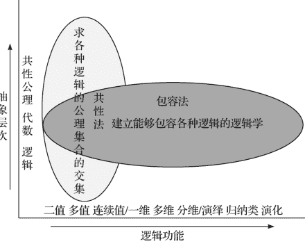
> 图 4.1 统一逻辑学的两条途径

**互补关系**：一自底向上，一自顶向下，**相互补充、不可替代**。

此外，Ross 2005 年专著[123]将泛逻辑视为弱量化相关逻辑，核心联结词诠释为内涵关联，致力于用无关内容法解决集合悖论与语义悖论，亦关联泛逻辑研究。

#### 2. 世界泛逻辑大会：国际舞台上的中国声音

在国际符号逻辑联合会、瑞士国科基金会、瑞士数学会、巴西科技部、瑞士纳沙泰尔大学支持下，Béziau、Gabbay、Karpenko（俄科院）、Sarenac（斯坦福大）等发起，**首届世界泛逻辑大会**于 2005 年 3 月 31 日至 4 月 3 日在瑞士蒙特勒举行，Béziau 任主席，30 余国 160 余人参会。

大会首尾安排两场主旨报告：何华灿作 **“Research on universal logics in China”**，Kripke（普林斯顿大教授，逻辑学泰斗）作 **“The road to Godel”**。何华灿介绍中国泛逻辑成果引发国际广泛关注，会议初步决定**第二届大会在中国举办，由何华灿教授牵头筹备**。

### 4.4 泛逻辑研究蓝图：从西工大走向世界的学术征程

**回溯：一场跨国对话如何落地古城西安**

故事要从 2006 年初春说起。那年 2 月，应西北工业大学国际合作处与何华灿教授之邀，首届世界泛逻辑大会主席、瑞士国立自然科学基金会逻辑研究所研究员 Béziau 教授踏上了西工大的土地。这不仅是一次学术报告，更是一场深度的“双向奔赴”：他为全校师生系统阐释了泛逻辑前沿，与计算机学院团队就核心课题展开对口研讨，更实地考察了申办第二届大会的筹备情况。

此次访问成果丰硕：双方深度摸清了彼此的学术家底与研究脉络，为后续教科研合作铺平了道路。正是这次关键性的破冰之旅，直接推动了国际逻辑学界于 2006 年 7 月 31 日拍板——**第二届世界泛逻辑大会（UNILOG 2007）定于 2007 年 8 月 16 日至 22 日在西北工业大学举行，由何华灿教授与 Béziau 教授联袂担任主席。**

**高光时刻：东方古城的逻辑盛会**

在国家自然科学基金委、王宽诚教育基金会、中国数学会、瑞士国家科学基金会等十余家重量级机构的联合支持下，这场逻辑界的“奥林匹克”如期在古城西安拉开帷幕。

规格之高、规模之大、影响之深，均创历史新高：
*   **阵容豪华**：23 位国内外顶尖逻辑学家倾力打造 22 个教学单元，全景式覆盖逻辑学研究最前沿。
*   **成果爆棚**：大会后三天汇聚 15 篇特邀报告与 66 篇征文宣读，深度剖析逻辑基本定理有效域、通用工具技术、分类研究及中西思想史四大核心版图。
*   **国际化程度极高**：来自全球 31 个国家的 200 余位学者齐聚一堂，海外专家超 80 位，囊括美、英、法、德、俄、瑞士、波兰、荷兰、巴西、澳洲、南非等强国。
*   **战略地位显著**：被美国符号逻辑学会、中国人工智能学会、陕西省科协及西工大共同列为 2007 年度重点学术活动，圆满落幕，口碑载道。

放眼全球，世界泛逻辑大会自此确立了“两年一届、各国轮办”的常态化节奏：首届瑞士蒙特勒（2005）、二届中国西安（2007）、三届葡萄牙里斯本（2010）、四届巴西里约（2013）、五届土耳其伊斯坦布尔（2015）、六届法国维希（2018）、七届希腊克里特岛（2022）……版图持续拓展。

**时代呼唤：为何我们需要“泛逻辑”？**

随着生命科学、社会科学、系统科学、思维科学及智能科学的纵深演进，开放复杂巨系统问题日益凸显。在不完全信息环境下的不精确推理难题，已成为制约新兴学科突围的关键“卡脖子”瓶颈。泛逻辑学的诞生，并非偶然拼凑，而是逻辑学内在演化规律的必然产物——**构建大一统理论，是每门成熟学科的历史使命与终极归宿。**

---

#### 4.4 泛逻辑学研究纲要：构建逻辑的“统一场论”

**定位**：泛逻辑学是研究逻辑普遍规律的科学。它兼容所有现存逻辑系统，更能按需“生成”各类逻辑。当下数十种非标准逻辑为其提供了丰富的实证素材。但这是一项跨代际的宏大工程，非数年、寡人之力所能竣事。当前阶段，我们的任务是：**确立总目标、搭建包含刚性逻辑在内的柔性理论框架、装入高频核心逻辑进行示范，再迭代扩容，逐步覆盖更多逻辑形态，以支撑日益升级的应用需求。**

##### 4.4.1 研究目标体系：分阶梯、进层层

**1. 总目标：数理辩证逻辑的理论大厦**
在**绝不容忍逻辑矛盾**的底线上，全面接纳辩证矛盾与不确定性，逐步建构“数理辩证逻辑”体系。核心路径是：探寻逻辑普适规律 → 构建“逻辑生成器” → 按需定制构造各类逻辑组件。

**2. 近期目标：命题层面的柔性奠基**
立足二值、多值、模糊逻辑三大基石，攻克柔性命题真值域；统一柔性连接词定义体系；推导命题公式与标准推理范式；建立**可交换**与**不可交换**两大命题泛逻辑体系，并拓展至柔性神经网络等应用场景。

**3. 中期目标：谓词层面的标准化建构**
以上述命题体系为基座，深入研究柔性谓词及其论域；统一柔性量词定义；推导谓词公式与推理模式；确立**标准谓词泛逻辑学**，并挖掘应用潜力。

**4. 远期目标：混沌世界的逻辑图谱**
以谓词泛逻辑为跳板，攻关描述混沌规律的**混沌泛逻辑学**，最终完成数理辩证逻辑理论体系的全景拼图。

##### 4.4.2 核心研究内容：语法与语义的双轮驱动

我们坚信：纷繁复杂的逻辑森林深处，藏着统一的“遗传密码”。正如生物界万物皆遵循 DNA 双螺旋法则，逻辑世界亦有其通用的**语法规则（DNA 表达/语法）**与**语义解释（遗传密码/语义）**。泛逻辑学不钻研单一具体逻辑，而聚焦**抽象逻辑**层面的普适规律。它既能规范研究范式，又能由已知推演未知，让所有具体逻辑成为其框架下的特例。

框架包含四大语法支柱（开放结构，可扩展）：

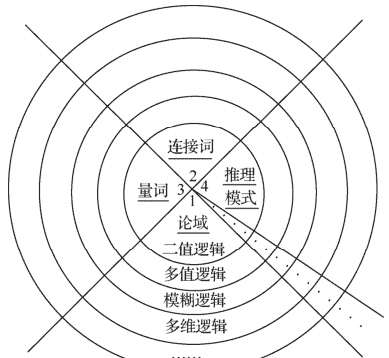

**图 4.2 泛逻辑学理论框架：开放的动态架构**

**支柱一：泛逻辑学论域——真值与个体的“双重奏”**
任何逻辑必先定义度量空间。
*   **命题真值域 W**：一般形式为 $W=\{\bot\} \cup [0,1]^n <\alpha>, n>0$。打破单一线序束缚，支持偏序、超序、多维分维空间。$[0,1]$ 为基空间，$n$ 为维数，$\bot$ 标记未定义，$\alpha$ 携带附加特性。这为全过程认知建模提供了前所未有的自由度。
*   **谓词个体变域 U**：任意集合均可。支持 $U^m \to U$ 的个体变元函数定义。

**支柱二：泛逻辑学命题连接词——从“刚性算子”到“柔性模型”**
传统逻辑视算子为固定不变量，泛逻辑则将其视为**连续可变的逻辑运算模型**。
覆盖 $W = \{\bot\} \cup \{0, 1\}^n <\alpha>$ 上的泛非、泛与、泛或、泛叾、泛等价、泛平均、泛组合等全谱系。关键突破在于：**在基空间 $[0,1]$ 下，同时建模“真值柔性”与“关系柔性”**。这精准修正了模糊逻辑忽略命题间关系柔性的先天不足。

**支柱三：泛逻辑学量词——约束的“柔性光谱”**
超越传统 $\forall, \exists$、模态 $\square, \lozenge$、模糊 $\circledast$ 的单一约束维度，构建多维量词矩阵：
*   **阈元量词 $\circledast^k$**：量化真值误差阈值（$k \in [0,1]$）。
*   **假设量词 $\$^k$**：标识假设判断及其可信度（$k \in [0,1]$）。
*   **范围量词 $\circledast^{x*c}$**：约束个体变元 $x$ 的活动范围（$c \in [0,1] \cup \{+,!\}$）。巧妙统摄了全称（$c=1$）、必然（$c>0.5$）、可能（$c<0.5$）、存在（$c>0$, 记作 $\circledast^{x+}$）、唯一存在（$\$^{x+!}$）等经典量词。
*   **位置量词 $\mathbb{Q}^{\alpha}_{x+d}$**：相对基准点 $u$ 划分“过去/现在/未来”、“左/中/右”等时空拓扑（$* \in \{<,=,>\}$）。
*   **过渡量词 $\circledast^{x \circledast c}$**：调控真值分布边缘锐化（$c>1$）、钝化（$c<1$）或保持（$c=1$）。

所有量词内核均为**程度柔性**，将深度解析真度柔性、关系柔性、程度柔性对量词定义的耦合影响。

**支柱四：常用公式集与推理模式——推理的“变形金刚”**
基于连接词与量词性质导出公式集，衍生出演绎、归纳、类比、假设、发现、进化等六大推理模式。它们**非铁板一块，而在特定条件下可相互转化**——这一**模式柔性**是泛逻辑的核心特质。仅含演绎模式者，即为标准逻辑。

> **框架开放性带来的理论红利**：正是因容纳了真值、关系、程度、模式四大柔性，泛逻辑得以数学化、符号化地描述“矛盾的对立统一与转化”，跨越理想与现实世界的鸿沟。作者早在 2001 年即大胆预言：真值域拓展至分维超序空间 $W=\{\bot\} \cup [0,1]^n <\alpha>, n>0$ 后，**混沌逻辑学**必将涌现。陈志成博士论文后证实了简单混沌逻辑的构建。顿悟、混沌、类比、分维、认知生发……均是混沌逻辑的主战场。若混沌逻辑大行其道，泛逻辑将视其为更高进化形态，辩证逻辑亦将借此圆满绽放——**静候那一天早日到来！**

---

**语义解释层：抽象符号的“落地翻译官”**

语义解释赋予抽象符号具体领域含义，将泛逻辑“特化”为强针对性的应用逻辑：

1.  **0/1 基础语义**：假/真、低/高、断/通、灭/亮、小/大、否/是、负/正、无/有、无病/有病、反对/赞成、失败/成功、不信/可信……（详见表 4.2 映射表）。
2.  **基空间变种与坐标变换**：$[0,1]$ 可映射为 $[0,100]、[0,b]、[0,+\infty]、[-1,1]、[-b,b]、(-\infty,\infty) 、[a,b]$ 等任意区间，通过线性/非线性变换（如 $x'=bx、x'=x/(1-x)、x'=(b-a)x+a$ 等）保持规律不变，中元随之平移。
3.  **关系柔性差异** $\to$ 连接词运算公式差异。
4.  **程度柔性差异** $\to$ 量词语义差异。
5.  **模式柔性差异** $\to$ 推理模式与语义解释的多元化。

这正是泛逻辑学要破解的核心密码，也是我们的总纲领。

---

##### 4.4.3 泛逻辑学分类学：多维坐标系下的精准定位

| 分类维度 | 核心判据 | 代表形态示例 |
| :--- | :--- | :--- |
| **1. 要素层级** | 仅命题演算 / 含谓词演算 | 命题泛逻辑 / 谓词泛逻辑 |
| **2. 基空间同构类** | 真值域基空间结构 | 连续值（$\cong[0,1]$）、二值（$\cong\{0,1\}$）、三值（$\cong\{0,u,1\}$）…… |
| **3. 有序性拓扑** | 真值域序关系 | **线序** ($W=[0,1]$)：模糊/概率逻辑（二值、三值为特例）<br>**偏序** ($W=[0,1]^n, n\ge2$)：区间/灰色逻辑（$n=2$）、未确知逻辑（$n=3$）；分偏序/伪偏序<br>**超序** ($W=[0,1]^n<\alpha>$)：云逻辑（$\alpha$描述分布特性）；含 $\bot$ 的超序（如 Bochvar 三值逻辑）；**混沌逻辑** ($W=\{\bot\}\cup[0,1]^n<\alpha>, n>0$) |
| **4. 推理模式** | 包含推理类型 | 仅演绎 = 标准泛逻辑；含归纳/类比/假设/发现/进化 = 非标准泛逻辑 |
| **5. 语义解释** | 应用领域语义 | 开关逻辑、动态逻辑、时态逻辑、空间逻辑、程度逻辑…… |

---

#### 4.5 生成命题泛逻辑的可行路径：一扇窗，一个世界

##### 4.5.1 意外闯入“泛逻辑入口”的顿悟时刻

“打开一扇小窗，见证一个大世界。”泛逻辑的那扇窗，源于 1995 年初的一个偶然午后。

彼时，我将概率论的**三大相关准则**（最大相吸、独立相关、最大相斥）与**突变逻辑**并置，结合柔性连接词运算模型的演变规律联合审视——**灵光乍现**：柔性连接词的基本属性本质上是**连续可变**的，二值逻辑中“固定不变的算子”仅是其退化特例！

这一念打破了“逻辑算子恒定”的百年教条，泛逻辑的新大陆豁然开朗，奇异新规律随之涌现。

**溯源：那个被穷尽的证明**
早年钻研二值逻辑时，我曾穷尽可能证明：布尔算子组存在**四种等价表示形式**……

```
x∧y=min(x, y)=yΓ[x+y−1]=ite{min(x, y)|max(x, y)=1; 0}
x∨y=max(x, y)=x+y−y=Γ[x+y]=ite{max(x, y)|min(x, y)=0; 1}
x→y=ite{1|x≤y; y}=min(1, x/y)=Γ[1−x+y]=ite{y|x=1; 1}
```

当命题真值域从离散的 {0, 1} 延展为连续的 [0, 1] 区间时，原本等价的逻辑运算骤然分道扬镳，演化出四种性质迥异的柔性逻辑体系：

**模糊逻辑**：采用极值运算，合取取最小（min），析取取最大（max），蕴含采用 `ite{1|x≤y; y}` 形式，遵循**最大相吸准则**。
**概率逻辑**：基于乘法与加法混合，合取为 `xy`，析取为 `x+y-xy`，蕴含为 `min(1, x/y)`，满足**独立相关准则**。
**有界逻辑**：引入截断函数 Γ，合取为 `Γ[x+y-1]`，析取为 `Γ[x+y]`，蕴含为 `Γ[1-x+y]`，体现**最大相斥准则**。
**突变逻辑**：设定临界阈值，合取在 `max(x,y)=1` 时取 `min(x,y)` 否则为 0；析取在 `min(x,y)=0` 时取 `max(x,y)` 否则为 1；蕴含在 `x=1` 时取 `y` 否则为 1，符合**最大相克准则**。

通过逻辑算子的三维几何视图（图 4.3）可清晰洞察：这四大柔性逻辑同类算子的边界条件完全重合，差异仅在于中间过渡段的单调变化轨迹。它们按数值大小依次排列：模糊逻辑居于上极限，其次为概率逻辑、有界逻辑，突变逻辑处于下极限。

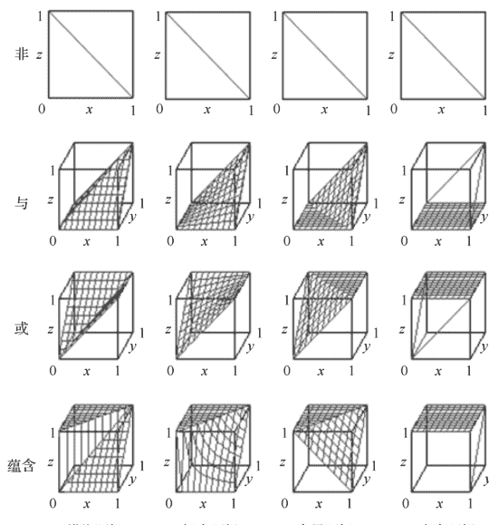

###### 图 4.3 由刚性逻辑直接派生出的四大柔性逻辑

###### 2. 追寻拟合先验锚点的理想函数

四大算子簇呈现出如此整齐、有序、单调递减的排布，隐然透露出柔性逻辑内在的基本律动。这引人深思：在这四种逻辑的间隙中，必然存在无限多的中间态。它们具备何种性质？又由何种客观因素或数学函数驱动这连续的演变？

作者早年（1996年）提出泛逻辑概念时，曾尝试待定系数法拟合，但效果欠佳，个别区间甚至出现“毛刺”，如何实现平滑过渡曾长期构成研究瓶颈。直到在 1943 年诞生的**三角范数**理论中觅得数学依据，豁然开朗。在此基础上深入推演，定义了另外三种柔性参数 h、k、β。

原来，这四种柔性逻辑正是 Schweizer 算子完整簇中的四个特例。它们之间由形式参数 `m∈(-∞, ∞)` 控制连续变化。后续研究揭示了 `m` 与广义相关系数 `h∈[0, 1]` 的映射关系（`m=(3-4h)/(4h(1-h))`，`h=((1+m)-√((1+m)²-3m))/(2m)`），从而锚定了五个关键先验点：`h=1` 对应模糊逻辑，`h=0.75` 对应概率逻辑，`h=0.5` 对应有界逻辑，`h=0` 对应突变逻辑，外推出的 `h=0.25` 则是从冷战过渡到热战的**临战逻辑**。这些共同构成了泛逻辑谱系的基石。进而，在三角范数框架下，又发掘出泛等价、泛平均、泛组合运算的 Schweizer 算子完整簇及泛非算子完整簇（图 4.4）。狭义逻辑观的思想枷锁至此被打破，逻辑运算基模型、不确定性调整参数与机制、算子完整簇等核心概念应运而生。

###### 3. 拒绝人为设计，坚持客观抽象

后文将详述现有三角范数理论中的各算子完整簇，它们已囊括各类非标准逻辑运算完整簇，且与不确定性参数紧密关联。这至关重要：泛逻辑绝非随意拼凑连续函数簇的人为设计，而是必须通过**逻辑先验点**检验，这些连续函数能否完整包容客观存在的一切命题逻辑算子簇——从上极限、中间过渡到下极限。

何为“客观存在的命题逻辑”？即已获有效应用的标准逻辑与各类非标准逻辑，它们是考察的校准基准。研究表明，可交换命题泛逻辑中的零级二元运算（泛与、泛或、泛蕴含、泛等价、泛平均、泛组合）完整簇，均可依据基模型由 Schweizer 算子完整簇生成，无一遗漏；一级泛非运算完整簇则可由指数算子完整簇或 Sugeno 算子完整簇生成，亦无一遗漏。这些究竟是人为创造，还是客观逻辑规律的抽象，容后深究。

图 4.4 列示的作为先验点的算子，均已被算子完整簇包容。每种泛逻辑运算均与刚性逻辑兼容、拥有固定不变的边界条件，变化的仅是 [0, 1] 区间内中间过渡值的起伏。虽可呈现无限状态，但边界条件与特征线纹丝不动，说明逻辑基本属性未变——这是判定算子归属的“天然胎记”，是客观逻辑规律留下的自然印记。

**以零级二元泛逻辑运算完整簇 L(x, y, h) 为例**，算子随广义相关系数 `h` 在基模型上下波动，但核心特征恒定：

| h | 1.0 | 0.75 | 0.5 | 0.25 | 0.0 |
|---|---|---|---|---|---|
| **泛与** | 图表 | 图表 | 图表 | 图表 | 图表 |
| **泛或** | 图表 | 图表 | 图表 | 图表 | 图表 |
| **泛蕴含** | 图表 | 图表 | 图表 | 图表 | 图表 |
| **泛等价** | 图表 | 图表 | 图表 | 图表 | 图表 |
| **泛平均** | 图表 | 图表 | 图表 | 图表 | 图表 |
| **泛组合 (e=0.5)** | 图表 | 图表 | 图表 | 图表 | 图表 |
| **泛非** | 图表 | 图表 | 图表 | 图表 | 图表 |
| **k** | 1.0 | 0.75 | 0.5 | 0.25 | 0.0 |

**图 4.4** 这 5 个柔性逻辑是三角范数某些算子完整簇中的特殊锚点

**关键运算的不变“胎记”（边界条件与特征线）：**
*   **泛与**：边界 `x∧ₕ1=x, 1∧ₕy=y`；特征线 `x∧ₕ0=0, 0∧ₕy=0, x∧ₕ1=x, 1∧ₕy=y`。
*   **泛或**：边界 `x∨ₕ0=x, 0∨ₕy=y`；特征线 `x∨ₕ0=x, 0∨ₕy=y, x∨ₕ1=1, 1∨ₕy=1`。
*   **泛蕴含**：边界 `x→ₕ1=1, 0→ₕy=1, 1→ₕy=y`；特征线 `0→ₕ0=1, 0→ₕ1=1, 1→ₕ0=0, 1→ₕ1=1`。
*   **泛等价**：边界 `x↔ₕ1=x, 1↔ₕy=y`；特征线 `0↔ₕ0=1, 0↔ₕ1=0, 1↔ₕ0=0, 1↔ₕ1=1, x↔ₕy=1 当且仅当 x=y`。
*   **泛平均**：边界 `x◎ₕ h=x, min(x,y)<x◎ₕy<max(x,y)`；特征线 `x◎ₕ h=x`。
*   **泛组合**：边界视阈值 `e` 分情况（小于 e 低于 min，大于 e 高于 max，和为 2e 时等于 e，其余介于 min/max 间）；特征线 `x◎ₑₕ e=x, x◎ₑₕ y=y`。
*   **注**：刚性逻辑中平均与组合运算退化为与/或运算。
*   **泛非 (一级完整簇)**：随误差系数 `k` 变化，边界 `~ₖₕ0=1, ~ₖₕ1=0`；特征点 `~ₖₕk=k`。

###### 4. 战略大转移：孤注一掷泛逻辑

至此，作者毅然终结既定研究规划，放弃实用专家系统研发序列，冻结航空智能化夙愿（时任三机部机载计算机规划领导小组副组长），全力投入人工智能逻辑基石——泛逻辑学的原始创新。多数博硕士生自愿跟随。虽 [0, 1] 算子簇在专门理论中已存在 50 余载，应用良好，未冲击主流逻辑学；但一旦将其与柔性运算模型完整簇融合成理论，便直面狭义逻辑观的正面挑战。虽柔性逻辑尚在襁褓，无实质威胁，但在部分人眼中，其存在本身即动摇统治根基。学术界遂掀起反对浪潮，“反逻辑”、“伪科学”、“永动机”等帽子随评审意见飞来。作者只能呼吁：智能化时代来临，开放复杂巨系统成核心科学问题，狭义逻辑局限暴露，亟需第二次数理逻辑革命，确立广义逻辑观。

幸得支持者鼎力相助。1996 年《中国科学》(E/F 辑) 极速中英文刊发首篇《经验性思维中的泛逻辑》（林作铨教授力荐）；2001 年科学出版社出版《泛逻辑学原理》；国自然基金面上项目（60273087）经刘志勇研究员主任裁决批准（第三次申请，两极分化严重）；西工大基本理论重点项目（W018101）资助……皆为雪中送炭。20 余载迂回曲折，缘泛逻辑与国际 AI 主流不合拍：主流凭算力解决感知智能，泛逻辑抓知识/逻辑/神经内在联系攻克认知智能。昔日难觅大型应用切入点。今深度神经网络关联瓶颈显现，感知智能局限暴露，柔性神经元与泛逻辑迎来迫切需求，局面根本性转变。望本书助 AI 度过即将到来的第三次寒冬，助我国 AI 十年内实现从跟踪到引领的跨越。

##### 4.5.2 探索命题泛逻辑的实现路径

###### 1. 阶段性成果

概念提出二十余载，团队锲而不舍，汇聚数十位博士（刘永怀、白振兴、艾丽蓉、谷晓巍、周延泉、王拥军、张保稳、李新、陈丹、金翊、鲁斌、陈志成、杜永文、付利华、张静、张剑、罗敏霞、张小红、赵敏、何汉明、毛明毅、马盈仓、刘扬、薛占熬、王澜、胡麒、刘丽、贾澎涛、林卫、张宏、范艳峰、王万森、李梅、陈佳林等）及 10 余位硕士/本科生（王华、陈虹等）合力攻关。现已全面建成命题级泛逻辑理论体系与柔性神经元模型，完成小范围实验验证，核心成果六项：

1.  **拓展真值域**：将刚性命题真值 {0, 1} 扩张为 [0, 1]，确立 7 大逻辑运算基模型（泛非、泛与、泛或、泛蕴含、泛等价、泛平均、泛组合）。
2.  **引入双参数调控**：广义相关系数 `h∈[0,1]` 与误差系数 `k∈[0,1]` 及其调整机制，建立可交换命题泛逻辑完整簇，完成语构与语义理论研究。
3.  **突破交换律局限**：引入相对权重系数 `β∈[0,1]` 及其调整机制与顺序，建立不可交换命题泛逻辑完整簇。
4.  **溯源异常根因**：揭示以往非标准逻辑应用异常的逻辑本源，确立柔性命题逻辑算子健全性标准，保障辩证论治精准施策。
5.  **构建完备算子库**：建成满足智能信息处理多元需求的命题级算子库，以后台软件形态供调用，为泛逻辑芯片研制奠基。
6.  **破解 AI 瓶颈**：确立柔性逻辑算子与柔性神经元一一对应关系，为深度神经网络强可解释性提供理论支撑。

###### 2. 实现路径与实证效果

**1) 行之有效的总路线。** 经验总结为图 4.5 系统路线图：一条已验证可行的“刚性→柔性→泛逻辑”扩张开局路径。是否存在捷径，留待读者探索。

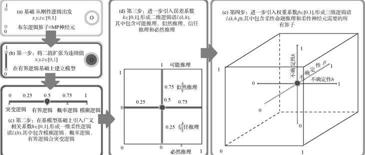

图 4.5 柔性逻辑扩张总路线图

**2) 实证效果可视化。** 效果呈现于图 4.6、4.7、4.8。作为数理辩证逻辑的命题篇，它能在命题层面数学化描述对立统一、量变质变、否定之否定、相生相克诸律。真值域扩张至 [0, 1]，实质是将命题从“真假对立充分、分离”的理想态，转为“真假对立不充分、统一”的现实态；连续实数空间为矛盾对立、转化、此消彼长、主次更迭提供场域。引入 `h, k, β ∈ [0, 1]` 则在更高维刻画对立统一，衍生更多辩证规律。

**图 4.6（一维谱系）**：`h∈[0,1]` 引入后，连续值逻辑展开为一维命题泛逻辑完整簇（谱）。不仅囊括前三大规律，更完整呈现**相生相克律**。相吸、相斥、冷战、热战、相容、相克均具严格数学判定标准。尤为振奋，**相克逻辑群**仍是处女地（除中医药理论在自然语言层面涉足），是数理辩证逻辑、国防/经济战略、博弈论、中医药研究的广阔蓝海。

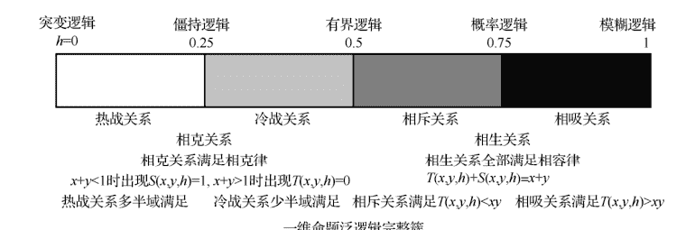

图 4.6 一维命题逻辑的包容性

**图 4.7（二维谱系）**：误差系数 `k` 加入，`h, k` 共同将一维簇展开为二维完整簇。相容逻辑群内，涵盖可能推理 (`k=1`)、似然推理 (`1>k>0.5`)、信任推理 (`0.5>k>0`)、必然推理 (`k=0`)，皆为数理辩证逻辑与不精确推理的重镇。二维相克逻辑群依然待垦。

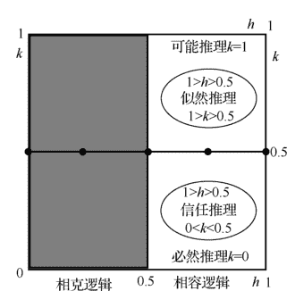

图 4.7 二维命题逻辑的包容性

**图 4.8（三维谱系）**：`h, k, β` 共振构建三维完整簇。理论已掌握 `β∈[0,1]` 全域性质：`β=1` 绝对信任 `x`（`y` 退出），`β=0` 绝对信任 `y`（`x` 退出），极端少用；越近极端逻辑性越差，越近 `β=0.5` 性越优，故通常在中心地带微调偏袒。

**由此可解往昔之惑**：为何逻辑学界多不认黑格尔《逻辑学》为逻辑而视为哲学思辨？由其：①非符号语言；②不能必然推演；③非数学化推理。黑格尔原著三条俱未达（早期形式逻辑亦不遑多让）。而命题泛逻辑理论已满足上述三标准，属数理辩证逻辑命题部分。

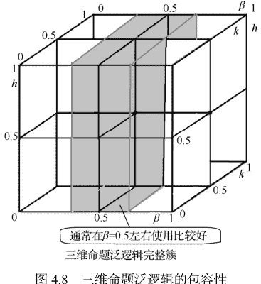

#### 4.6 章末小结

本章思路脉络与后续工作规划：

1.  **寻得突破口**。1995 年从概率论三相关准则与突变算子关系中觅得包容各算子的唯一入口，如“众里寻他千百度，蓦然回首，那人却在，灯火阑珊处”。继而从逻辑学四要素切入，拟定泛逻辑学研究纲要，2001 年建成可交换命题泛逻辑学，奠基全局。确立“自底向上、逐要素引入柔性参数与调整机制、分级建立各形态泛逻辑”的研究路线。
2.  **拟合泛逻辑谱**。质疑：这是否主观设计？实则科学可行。数十年百余种非标准逻辑经应用验证各有适用场境（如模糊逻辑用于需独立相关场景会异常，非逻辑错，乃场境不配）。泛逻辑理论如星空群星，每星（先验数据点）必在拟合曲线（理论框架）上精准定位，一星不漏，包容性始成。更具能力：任两校准点间，包容无限连续延伸点，每点代表一客观存在的未知非标准逻辑。有此连续谱系，逻辑定位如元素周期表般清晰，位置参数即正确使用条件，从根本终结“凭感觉乱用、乱点鸳鸯谱”乱象。
3.  **包容算子之路**。泛逻辑探索贴近智能应用需求，走“逐步包容所有逻辑算子”路线。AI 软件/算法皆需信息变换算子（含神经元），均隶属某逻辑。若识其归属并知其在泛逻辑框架中精确坐标，即可依理论生成（已有后台软件按需自动生成）并精准施用，事半功倍；否则只能大海捞针、盲目试错。这是经验学科与理论学科的本质分野，大美事何乐不为？

#### 青玉案 · 元夕

[宋] 辛弃疾

东风夜放花千树。更吹落、星如雨。宝马雕车香满路。凤箫声动，玉壶光转，一夜鱼龙舞。

蛾儿雪柳黄金缕。笑语盈盈暗香去。众里寻他千百度。蓦然回首，那人却在，灯火阑珊处。

### 第 5 章 命题泛逻辑运算模型的生成机制

#### 5.1 绪论

本章将系统阐述泛逻辑学中构建各类命题连接词运算模型的通用法则。在泛逻辑框架下，一切命题连接词的运算模型均可经由四大类规则衍生而来。

**一、 生成基规则**

每个命题连接词均拥有专属的“生成基”。所谓生成基，是在真值空间 [0, 1] 内、命题真值无误差、且命题间相关性达至“最大相斥”这一极限条件下，该连接词所呈现的运算形态，我们称之为“基模型”。同一基模型可呈现两种迥异的表达范式：“非与表达”与“非或表达”。表达范式的差异，直接决定了所需代入的“生成元完整簇”性质不同：前者要求引入 T 性生成元完整簇，后者则需 S 性生成元完整簇。

**二、 生成元规则**

将生成元完整簇施加于各类生成基之上，即可推导出线序空间 [0, 1] 上的各式命题连接词运算模型。生成元完整簇主要涵盖三大层面：

1.  **N 性生成元完整簇**：专门校正“广义自相关性”（即不分明测度误差）对命题真值造成的扰动；
2.  **T/S 性生成元完整簇**：专门修正“广义相关性”对命题间关联关系产生的影响；
3.  **层级区分**：无误差场景对应零级模型，有误差场景则升维为一级模型。

**三、 拓序规则**

该规则明确了从线序空间 [0, 1] 的运算模型，向偏序空间 $[0, 1]^n (n=2, 3, \cdots)$ 以及超序空间 $\{\perp\} \cup [0, 1]^n <\alpha> (n=1, 2, 3, \cdots)$ 进行模型推演的具体路径与方法。

**四、 基空间变换规则**

该规则规定了当真值空间的基础区间从标准的 $[0, 1]$ 变换为任意实数区间 $[a, b] (a<b, a,b \in \mathbb{R})$ 时，各类命题连接词运算模型应遵循的变换逻辑。

建立上述规则体系，前提在于两大支撑：一是通过实例归纳，提炼现实世界中的“柔性逻辑规律”；二是深谙测度理论与三角范数理论。前者为我们抽象出的柔性逻辑规律提供了先验的客观性背书，后者则构筑了命题泛逻辑运算模型完整簇的数学基石。唯有将理论推演与实证观察紧密咬合，方能精准提炼客观世界中蕴含的柔性逻辑内核。

#### 5.2 客观世界中的柔性逻辑规律

以下将通过具体观察案例，深度剖析“关系柔性”如何重塑逻辑运算法则，并揭示其作用于柔性命题连接词运算模型的微观机理。既然刚性逻辑只是柔性逻辑的特例，那么这种影响便贯穿于泛逻辑学的全域。

**认知前提的偏离：理想与现实的鸿沟**

精准把握事物变化的“度”，仅存在于理想世界。理想世界至少要求三大前提同步成立：① 事物本质为各向同性；② 测量仪器绝对精准零误差；③ 事物间相互孤立、毫无关联。然而，现实世界演化不息，仪器误差在所难免，人类认知亦在持续迭代，上述三条皆难企及。这三大条件的缺失程度，将全方位干预逻辑运算；其中前两者更直接决定一元逻辑运算的走向。

**关系观的拓展：从“君子之交”到“小人之交”**

中国古典哲学云：“万物相关，非相生即相克。” 概率论中的相关性研究，仅触及“相生”谱系（涵盖最大相吸、独立相关、最大相斥），其局限在于将关联双方预设为“朋友关系”——仅有亲疏之分，无损人利己之虞。朋友关系可再细分为“相吸”与“相斥”，以独立相关为界。

然而客观现实中，同样存在“敌我关系”——零和博弈、丛林法则下的“小人之交”。敌我关系又可分“冷战”（扩军备战）与“热战”（大打出手），以“僵持相关”为分水岭。这一思想视野，为泛逻辑研究注入了关键灵感。

下面请通过实例体会理想与现实的落差，理解逻辑为何须变化以拟合实况。先以模糊逻辑的理论短板为反面教材。

##### 5.2.1 模糊逻辑理论缺陷的溯源

弄清模糊逻辑的理论症结，着实是桩硬骨头，否则学界不会争论半个多世纪仍无定论。

**1. 关系柔性的破茧发现**

我们在探究柔性世界逻辑规律时发现：不仅命题真值的连续可变性（真值柔性）影响运算模型，命题间关系的连续可变性（关系柔性）同样举足轻重。柔性命题间的关系柔性，源于两种迥异的驱动因子。

**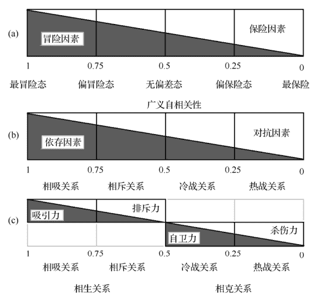**
> 图 5.1 广义自相关性和广义相关性概念图

**(1) 广义自相关系数 $k$**

现实环境中，柔性命题真值测量难逃误差，该误差经由柔性非运算传导，终将波及所有柔性逻辑运算。我们将柔性命题与其柔性非命题间的相关性定义为“广义自相关性”。它是“冒险因子”与“保险因子”对立统一的产物，测量误差可在最大负误差至最大正误差间连续漂移，需引入 $k \in [0, 1]$ 刻画。

核心刻度如下：
*   $k=0.5$：无偏差态，冒险/保险因子势均力敌；
*   $k=1$：最冒险态，冒险因子绝对主导；
*   $k=0$：最保险态，保险因子绝对主导；
*   $k \approx 0.75$：偏冒险态，冒险因子占优；
*   $k \approx 0.25$：偏保险态，保险因子占优。

**(2) 广义相关系数 $h$**

客观事物绝不孤立，必存关联——或敌或友，或亲或疏。这种关联性干预二元复合命题真值计算，定义为“广义相关性”。它由“依存因子”与“对抗因子”对立统一构成，关联强度在最大相关至最小相关间连续演变，引入 $h \in [0, 1]$ 表征。

核心刻度包含双重解析视角：

*视角一（内部平衡视角）：*
*   $h=0.5$：中立态，依存/对抗因子平衡；
*   $h=1$：最大相关态，依存因子绝对主导；
*   $h=0$：最小相关态，对抗因子绝对主导；
*   $h \approx 0.75$：偏相生态，依存因子占优；
*   $h \approx 0.25$：偏相克态，对抗因子占优。

*视角二（衔接概率论视角）：*
以 $h=0.5$ 为界：$h>0.5$ 为相生关系，$h<0.5$ 为相克关系。
概率论相关系数 $\rho_0$ 仅描绘相生关系（相吸/相斥因子对立统一），其谱系为：最大相吸 ($h=1$) $\to$ 独立相关 ($h=0.75$) $\to$ 最大相斥 ($h=0.5$)。

相克关系则由“自卫因子”与“对抗因子”构成，谱系为：最小相克 ($h=0.5$，依存主导) $\to$ 僵持 ($h=0.25$，依存/对抗平衡) $\to$ 最大相克 ($h=0$，对抗主导)。

**为何强行衔接两者？** 因为“最小相克”与“最大相斥”本质同构：双方极力避免接触与伤害，均为广义相关的“中性分水岭”。相生与相克非割裂的两界，而是可连续过渡的整体。从生存利度看，最大相吸为广义相关最大值，最大相克为最小值。广义相关性可从最大相吸连续递减，经独立相关抵达中性态（最大相斥/最小相克），继而继续递减，经僵持抵达最小相关（最大相克）。**结论：广义相关性大小呈连续变化。**

广义相关性/自相关性概念及系数 $h, k$，均为笔者首创引入逻辑学。二者独立存在、独立演化，共同塑造命题连接词运算模型。

**关系柔性发现的理论红利：**
它揭示了为何柔性逻辑中连接词模型是“连续可变算子簇”，并指明了算子选用的准则。一旦明确模糊算子定位于 $h=1$ 处，便绝不敢在 $h=1$ 之外滥用，打破了刚性逻辑思维惯性。这正如孩童长大知晓卫生间用途后不再随地解手——这是成长的担当，而非烦恼。

基于此，我们不仅修补了模糊逻辑连接词定义的理论漏洞，更以“各打五十大板”式的方案终结了半个世纪的学界僵局，并肇建了命题泛逻辑学大厦。

**2. 模糊逻辑理论缺陷的核心剖析**

笔者在长期 AI 理论与专家系统实战中确认：柔性命题间的关系柔性是客观铁律，必须用连续可变的运算模型描述。即在“对立不充分世界”里，既要计真值柔性之贡，也要计关系柔性之贡。广义相关性与自相关性，正是关系柔性的源头。

模糊逻辑的根本痼疾在于：**它仅捕捉了模糊命题真值的连续可变性（真值柔性），却对模糊命题连接词运算模型的连续可变性（关系柔性）视而不见**，从而用一组固定不变的 Zadeh 算子簇定义一切连接词，未曾设想逻辑系统内部运算模型可无限变化。这分明是传统逻辑思维惯性作祟。

他人关于广义模糊算子的研究，虽在数学层面揭示了算子的多样性与连续性，却未在逻辑学理论框架内找到模型变化的**客观起因**与**合理使用边界**，故只能在框架外借数学手段对 Zadeh 算子做实用扩充，未能建构统一的泛逻辑理论全景。数理逻辑受“确定性”思维定势束缚：虽用模糊性表达真值柔性，却未悟连接词模型非单一算子，而必为“算子完整簇”。理论残缺致使至今仍有数学家不认可模糊数学/逻辑的科学严谺性，实属有理。

下面借生活实例，管窥关系柔性对柔性连接词运算模型的影响细节——这是泛逻辑理论的先验基石，须细细品味。

##### 5.2.2 实例透视：$k、h$ 如何重塑柔性逻辑运算

**1. 广义自相关性对一元逻辑运算的重塑**

柔性逻辑中仅用标准柔性非算子 $N(x)=1-x$ 偏颇，它仅适配理想无误差测度。为刻画测度误差对非运算的干预，我们引入广义自相关性及系数 $k \in [0, 1]$。以下两例演示其影响机制。

**例 5.2.1 面积计算偏差问题——试卷评分视角。**

在因素空间 $E$ 中，若子集 $X$ 面积 $s(X)=x$ 可精确获取，其补集 $\neg X$ 面积自然为 $s(\neg X)=s(E)-s(X)=N(x)=1-x$。此类真值可精确获取的问题，称“零级不确定性问题”。

现假设面积测量存偏差，$x$ 与 $N(x)$ 仅为粗略近似。虽 $E=X \cup \neg X$ 恒真，但 $x + N(x) \neq 1$，即 $N(x)$ 偏离 $1-x$。若 $N(x)$ 可经已知近似 $x$ 估算，称“一级不确定性问题”。图 5.2 展示了理想试卷评分允许正负误差的典型模型。

**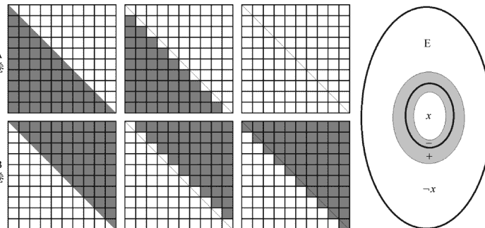**
> (a) 标准：理想试卷有 100 个知识点，每点 1 分，降标准答案平均分为 A、B 卷，各 50 分
> (b) 负误差：按非全即空这10个被一分为二的知识点得分是0分，两卷都是45分
> (c) 正误差：按非空即全这10个被一分为二的知识点得分是10分，两卷都是55分
> (d) 这类问题等价为面积测试误差问题
> 理想试卷评分标准的允许正负误差
> 图 5.2 柔性测度有误差时 m(X)+m(¬X)≠1 的一个实例

图 5.2(a) 采严格二分法，标准答案均分 A、B 卷，精确评分均 50 分；因分割过程波及 10 个知识点（对角线位置），实操中无法也无需精确，通常遵“非全即空”（给 0 分）或“非空即全”（给 1 分）原则，原则一致即可。
图 (b) 用“非全即空”，A/B 卷均 45 分（负误差）；
图 (c) 用“非空即全”，A/B 卷均 55 分（正误差）；
图 (d) 揭示：此类问题本质等价于面积测量误差问题，正负误差之别，构成一级不确定性问题。

在一级不确定性问题中，常用如下关系约束 $N(x)$ 估算：
$$x + N(x) + \lambda x N(x) = 1 \quad \Rightarrow \quad N(x) = \frac{1-x}{1+\lambda x} \quad \text{或} \quad x = \frac{1-N(x)}{1+\lambda N(x)}$$
此即著名 **Sugeno 算子簇**，记为 $N_2(x, \lambda) = \frac{1-x}{1+\lambda x}$，$\lambda \in (-1, \infty)$ 为位置标志参数。簇内算子单调排列，且具**逆等性**：$N_2(x, \lambda) = N_2^{-1}(x, \lambda)$。演变态势见图 5.3(a)。

**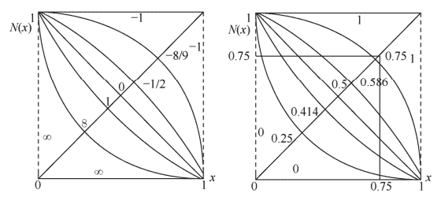**
> 图 5.3 Sugeno 算子的物理意义

**Sugeno 算子簇的数理与逻辑语义：**

*   **$\lambda=0$**：精确估计，$N_2(x,0)=1-x=\mathbf{N_1}$，一级退化为零级，$\mathbf{N_1}$ 为**中心非算子**。
*   **$\lambda<0$**：正偏差估计，带**冒险性**。
    *   $\lambda \to -1$：极限为 $\mathbf{N_3}$。数学上除 $x=1$ 外恒为 1；逻辑上约定 $N_2(1,-1)=0$，其余为 1。即**仅承认绝对真之否定为绝对假，其余否定全为绝对真**——最冒险估计，逻辑上**最大非算子**，且自逆：$\mathbf{N_3}=\mathbf{N_3}^{-1}=\text{ite}\{0|x=1; 1\}$。
    *   $\lambda=-8/9$：$N_2(x,-8/9)=\mathbf{N_2}$，中度冒险。
    *   $\lambda=-1/2$：$N_2(x,-1/2)=\mathbf{N_{1.5}}$，弱冒险。
*   **$\lambda>0$**：负偏差估计，带**保险性**。
    *   $\lambda \to \infty$：极限为 $\mathbf{N_0}$。数学上除 $x=0$ 外恒为 0；逻辑上约定 $N_2(0,\infty)=1$，其余为 0。即**仅承认绝对假之否定为绝对真，其余否定全为绝对假**——最保险估计，逻辑上**最小非算子**，且自逆：$\mathbf{N_0}=\mathbf{N_0}^{-1}=\text{ite}\{1|x=0; 0\}$。
    *   $\lambda=8$：$N_2(x,8)=\mathbf{N_{0.5}}$，中度保险。

图 5.3(a) 揭示双重对称美学：
1.  **逆等性**：曲线簇关于主对角线（$y=x$）左右对称。
2.  **自对偶性**：$\lambda<0$ 曲线簇与 $\lambda>0$ 曲线簇关于副对角线（$y=1-x$，即 $\lambda=0$ 直线）上下对称。对偶关系为：
    $$N_2(x, \lambda) = \frac{1-x}{1+\lambda x} = 1 - \frac{1-(1-x)}{1+\lambda'(1-x)} = \frac{(1+\lambda')(1-x)}{(1+\lambda')-\lambda'x}, \quad \lambda = -\frac{\lambda'}{1+\lambda'}$$
    即 $\lambda=0, 1, 2, \cdots$ 对应 $\lambda'=0, -1/2, -2/3, \cdots$。

### Sugeno算子簇的不动点、风险系数与对偶特性解析

我们进一步发现，Sugeno算子的变化曲线与坐标平面主对角线相交于一点，该交点横坐标 $k$ 满足 $N_2(k, \lambda)=k$（$k \in [0, 1]$），是非算子的不动点。$k$ 与参数 $\lambda$ 存在如下换算关系：
$$ \lambda = \frac{1-2k}{k^2} \quad \text{或} \quad k = \frac{\sqrt{1+\lambda}-1}{\lambda} = \frac{1}{\sqrt{1+\lambda}+1} $$

**$k$ 的物理含量：否定风险与误差的度量**

$k$ 的数学本质在于量化对柔性命题进行否定估计时的风险水平：
*   **$k \to 1$**：逻辑上的“最大可能否定”，对应最激进的估计 **N3**；
*   **$k = 0.75$**：逻辑上的“偏大否定”，对应中度冒险的估计 **N2**；
*   **$k = 0.5$**：逻辑上的“适度否定”，对应精确估计 **N1**；
*   **$k = 0.25$**：逻辑上的“偏小否定”，对应中度保守的估计 **N0.5**；
*   **$k \to 0$**：逻辑上的“最小可能否定”，对应最保守的估计 **N0**。

由此可见，$k$ 实为**风险系数**。换个角度看，它反映了柔性测度误差的大小，故亦称**误差系数**。

**算子簇的新参数化与对偶结构**

$k$ 亦可作为非算子在算子簇中定位的标志参量。据此，Sugeno算子簇可重写为：
$$ N_2(x, k) = \frac{1-x}{1 + \frac{1-2k}{k^2}x}, \quad k \in (0, 1) $$
该算子簇具备**逆等性**：$N_2(x, k) = N_2^{-1}(x, k)$。

利用 $\lambda$ 的对偶关系 $\lambda = -\lambda'/(1+\lambda')$ 及 $k$ 与 $\lambda$ 的换算式，可推导出 $k$ 的对偶关系为 $k = 1 - k'$。即算子簇满足：
$$ N_2(x, k) = N_2(x, 1-k) $$

**广义算子簇与存在域**

严格而言，$N_2(x, k)$ 仅在 $k \in (0, 1)$（即 $\lambda \in (-1, \infty)$）时具备数学意义。为逻辑完备，我们约定将上下极限 N3 与 N0 纳入簇中，二者互为对偶：
$$ N_2(x, 1) = N_3 = N_3^{-1}, \quad N_2(x, 0) = N_0 = N_0^{-1} $$
此拓广后的簇称为**广义 Sugeno 算子簇**。由 N3 与 N0 围成的二维空间，称为算子簇的**存在域**。

**$k$ 的深层逻辑意义：广义自相关系数与真值阈元**

非运算的风险程度 $k$，本质上表征了柔性命题与其否定命题间的**广义自相关程度**，故 $k$ 是描述广义自相关性强弱的**广义自相关系数**。

鉴于 $N(k, k)=k$，且当 $x < k$ 时 $N(x, k) > k$；当 $x > k$ 时 $N(x, k) < k$。因此，$k$ 在逻辑上扮演**真值阈元**的角色，是柔性逻辑中划分“偏真”与“偏假”的分水岭。

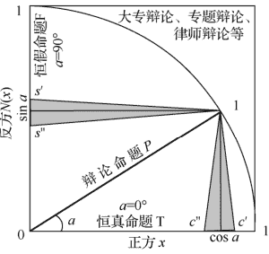

---

#### 实例 5.2.2：辩论博弈中的真相重构

**辩双方的利益冲突与陈述偏差**

上一例探讨了带误差估计的场景，本例剖析另一类更普遍的误差影响——现实辩论（法庭攻辩、竞技辩论、邻里纠纷等）。其内在逻辑拓扑如图 5.4 所示。

1.  **核心命题与偏角**：辩论围绕中心命题 $P$ 展开。命题内在性质决定其偏角 $a$：恒真命题 $a=0^\circ$，恒假命题 $a=90^\circ$，一般命题 $a \in (0^\circ, 90^\circ)$。
2.  **陈述的选择性与波动**：双方均不完全客观，倾向陈述有利事实，甚至造假。若命题 $P$ 模长为 1，其在 $x$ 轴精确投影为 $\cos a$，在 $N(x)$ 轴为 $\sin a$。但实际陈述值会在精确值附近波动。
3.  **法官的判定逻辑——三角恒等式**：法官需“去伪存真”，还原全貌。数学判据源于 $\cos^2 a + \sin^2 a = 1$，即精确关系 $N(x) = \sqrt{1-x^2}$ 及 $x = \sqrt{1-N(x)^2}$。若双方量化陈述满足此关系，即判定为实话。虽各隐己短，但辩论的**相互补充机制**能弥补缺漏，共同逼近真相。
    *   严格遵守规则时：$N(x) = \sqrt{1-x^2}$；
    *   一般情况偏离更大：$N(x, n) = \sqrt[m]{1-x^n}, \quad n \in \mathbb{R}_+$。
    *   特例：$n=1$ 退化为标准非 $N_1$；$n \to 0$ 趋近最大非 $N_3$；$n \to \infty$ 趋近最小非 $N_0$。
    *   后文将引入 $n = -1/\log_2 k$ 定义**泛非运算完整簇** $N(x, k)$。

---

### 广义相关性对二元逻辑运算的重塑

广义相关性深刻影响柔性集合与逻辑运算。若仅盯着个体变域 $U$ 上的隶属函数分布（一维线段堆叠），极易产生“大隶属度必然包含小隶属度”的错觉，这正是盲目奉行 Zadeh 算子组为“理所当然”的认知根源。

**换个视角：从因素空间 $E$ 看本质**

柔性集合 $A$ 虽在 $U$ 上以 $\mu_A(u)$ 呈现，但任意点 $u$ 的隶属度实由因素空间 $E$ 中对应经典集合 $X$ 的柔性测度 $m(X)$ 决定。
*   例：$U$ 班学生成绩/100 形成柔性集合 $A$，$\mu_A(u)$ 为成绩分布；但学生 $u$ 的成绩实由其在试卷 $E$ 上答对题集 $X$ 的测度 $m(X)$ 决定。
*   广义相关性改变 $E$ 中经典集合间的相对位置 $\rightarrow$ 影响集合运算 $\rightarrow$ 经柔性测度传递至 $U$ 域 $\rightarrow$ 影响柔性逻辑/集合运算。
*   **结论**：Zadeh 算子无法捕捉这种传导效应。

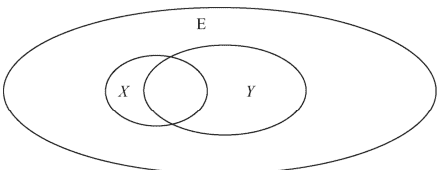
$\mu_A(u)=m(X), \mu_B(u)=m(Y), u \in U, X, Y \in E$
**图 5.5：Zadeh 算子仅为特例，不具普适性**

---

#### 实例 5.2.3：面积计算视角下的与/或算子谱系

设因素空间 $E$ 为平面连续点集，面积 $s(E)=1$。子集 $X, Y$ 面积 $x, y$ 分别为柔性测度，对应命题 $p, q$ 真值。求 $p \land q$ 真值（即交集面积 $T(x,y)$）与 $p \lor q$ 真值（即并集面积 $S(x,y)$）。答案取决于 $X, Y$ 间的广义相关系数 $h$，典型谱系如下：

**1. $h=1$：最大相吸（Zadeh 算子对）**
大集合全包含小集合。
$$ T_3 = \min(x,y), \quad S_3 = \max(x,y) $$
$T_3$ 为最大与算子，$S_3$ 为最小或算子。
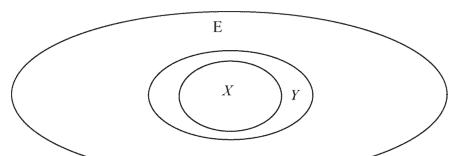
**图 5.6：Zadeh 算子仅适用于最大相吸**

**2. $h=0.75$：独立相关（概率算子对）**
交集面积与 $x, y$ 成正比。
$$ T_2 = xy, \quad S_2 = x + y - xy $$
$T_2$ 为独立相关与算子，$S_2$ 为独立相关或算子。
*注：此“独立相关”指元素间独立互不相关，非集合互不相交。*
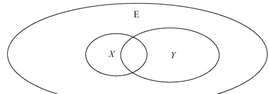
**图 5.7：概率算子仅适用于独立相关**

**3. $h=0.5$：最大相斥/最小相克（有界算子对）**
仅当 $x+y>1$ 才有交集。
$$ T_1 = \max(0, x+y-1), \quad S_1 = \min(1, x+y) $$
$T_1$ 为中心与算子，$S_1$ 为中心或算子。
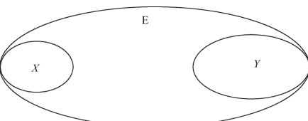
**图 5.8：有界算子仅适用于最大相斥**

**相生 vs 相克：相容律的存废**
*   **相生域**（$h \ge 0.5$）：满足相容律 $T+S = x+y$。
*   **相克域**（$h < 0.5$）：存在杀伤与扩军，相容律失效。
    *   $x+y < 1$：未接触，无战争但需扩军备战 $\rightarrow T=0, \; S \gg \min(1, x+y)$；
    *   $x+y = 1$：刚好接触，无冲突无余地 $\rightarrow T=0, \; S=1$；
    *   $x+y > 1$：接触交战，伤亡不可避免 $\rightarrow T \ll \max(0, x+y-1), \; S=1$。
    杀伤力随 $h$ 从 0.5 降至 0 而增强，此类称为**相克算子对**。

**4. $h=0$：最大相克（突变/Drastic 算子对）**
死敌关系，最大杀伤性。仅当一方为 1 才容另一方存活；仅当一方为 0 才停止扩军。
$$ T_0 = \text{ite}\{\min(x,y) \mid \max(x,y)=1; 0\} $$
$$ S_0 = \text{ite}\{\max(x,y) \mid \min(x,y)=0; 1\} $$
($\text{ite}\{\beta \mid \alpha; \gamma\}$ 为条件表达式：若 $\alpha$ 则 $\beta$ 否则 $\gamma$)
$T_0$ 为最小与算子，$S_0$ 为最大或算子。
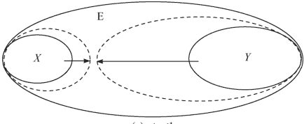
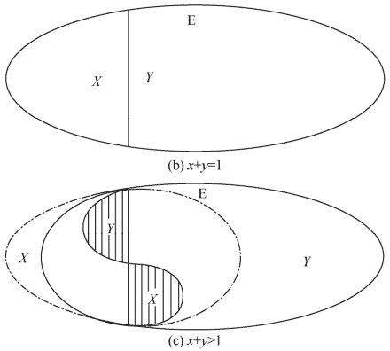
**图 5.9：相克算子仅适用于相克相关**

**5. $h=0.25$：僵持态（相克中间态）**
杀伤力与生存力均衡，双方部分需扩军抑制对方。
$$ T_0 < T(x,y) < T_1; \quad S_0 > S(x,y) > S_1 $$

**四大典型算子对的序关系与空间分布**
$$ 0 < T_0 < T_1 < T_2 < T_3 < S_3 < S_2 < S_1 < S_0 < 1 $$
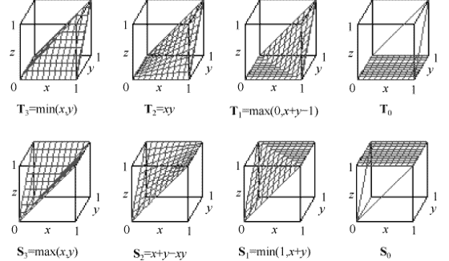
**图 5.10：四大典型与/或算子对的三维分布**

**中值曲线与主对角剖面分析**
图 5.11(a) 给出算子值 = 0.5 时的中值曲线；图 5.11(b) 给出 $x=y$ 主对角面上的函数值分布。
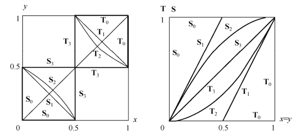
**(a) 算子的中值曲线图**
**(b) 算子在主对角面上的函数值分布图**
**图 5.11：四大算子对在 $[0,1]\times[0,1]$ 空间中的分布**

**关键发现：Sugeno 非算子与概率或算子的几何同构**
将概率或算子 $S_2$ 中值曲线 $x \le 0.5, y=(0.5-x)/(1-x)$ 代入 $y=y'/2, x=x'/2$，得 $x' \le 1, y'=(1-x')/(1-x'/2)$。这与 Sugeno 算子簇中 $\lambda=-1/2$ 时的非算子 $N_{1.5}$ 曲线**完全重合**。

**差异本质**：在 Sugeno 算子曲线族背景下，两者位置不同——一个对应 $k, h=0.75$ 处的 $\lambda=-8/9 (N_2)$，一个对应 $\lambda=-1/2 (S_2)$。即：**它们在各自算子簇中控制算子变化速度的参数步长不同**。

---

### 从特例到普适：柔性运算超簇的构想

前三例仅触及 $k, h \in [0,1]$ 的离散特例。实则：
*   **零级不确定性**（测度无误差）：非运算唯一 ($N(x)=1-x$)；但因广义相关性 $h$，与/或运算非唯一，形成受 $h$ 控制的**连续算子簇**。
*   **一级不确定性**（测度有误差）：因广义自相关性 $k$，非运算成簇；与/或运算受 $k, h$ 双重控制，形成**可连续变化的公式簇的簇**，即**超簇**。
*   **柔性运算定义**：在最大/最小算子间连续变化的完整运算公式簇，可精确描述命题关系不确定性。
    *   给定 $k$ $\rightarrow$ 确定具体非算子；
    *   给定 $k$ $\rightarrow$ 确定具体与/或算子簇；再给定 $h$ $\rightarrow$ 确定具体与/或算子（反之亦然）。

**算子存在域与体积假设**
*   柔性与/或运算应为最大/最小算子间连续分布的算子簇，$h$ 为位置标志参数，排列单调，典型算子对互为对偶。
*   与算子存在域：$T_3$ 到 $T_0$ 的三维空间，体积 $V(T_3)=1/3$；$V(T_2)=1/4$；$V(T_1)=1/6$；$V(T_0)=0$。
*   **核心猜想**：零级与算子 $\otimes_*$ 的广义相关系数 $h$，在数值上可能与其体积 $V(\otimes_*)$ 线性相关。
*   **研究结论预告**：$h$ 的物理意义 = 与算子体积 / 最大与算子体积 ($V(\otimes_*) / V(\otimes_z)$)。

$$h=\iint f(x \otimes * y) dxdy / \iint f(x \otimes z y) dxdy = 3 \iint f(x \otimes * y) dxdy, \, I=[0, 1]$$

---

#### 实例 5.2.4：商场货物丰富度的相关性建模

定丰富度 $f = n/N$（$n$ 为货物种数，$N$ 为市场总种数）。市场 $E$ 含商场 $X, Y$，丰富度 $x, y$。求相同货物丰富度 $T(x,y)$ 及合并丰富度 $S(x,y)$。
*   一家从另一家进货 $\rightarrow h=1$ $\rightarrow$ Zadeh 算子 ($T_3, S_3$)；
*   完全独立进货 $\rightarrow h=0.75$ $\rightarrow$ 概率算子 ($T_2, S_2$)；
*   近邻互避重复进货 $\rightarrow h=0.5$ $\rightarrow$ 有界算子 ($T_1, S_1$)。

#### 实例 5.2.5：生存竞争问题

# 柔性逻辑：从资源博弈到数学基石的深度解析

在有限资源的约束下，个体如何生存？当信息模糊不清时，我们如何推理？这不仅是生态学或医学的问题，更是**柔性逻辑**试图解决的核心命题。本文将通过两个极具洞察力的案例，引出支撑柔性逻辑大厦的两大数学基石：测度论与三角范数理论。

---

## 资源竞争与生存博弈：负载系数的柔性视角

想象一个封闭环境 $E$，资源总量固定为 $|E|$。两个物种 $X$ 与 $Y$ 共同栖息于此，单位个体的常态资源需求分别为 $i_X, i_Y$，种群数量为 $n(X), n(Y)$。我们定义“负载系数” $q = \frac{i \cdot n}{|E|}$ 来度量环境饱和度。

单独生存时，它们的负载系数分别为 $x, y$。但当共存成为常态，故事变得复杂起来，关键取决于 $x+y$ 与临界值 1 的关系：

**场景一：资源宽裕 ($x+y \le 1$)**
表面风平浪静，实则暗流涌动。虽无生死搏杀，**“竞争者心理”**驱使双方囤积物资，导致实际单位需求 $i' > i$。于是，综合负载 $S(x,y)$ 远超简单相加 $x+y$，而外部支援 $T(x,y)=0$。

**场景二：资源枯竭 ($x+y > 1$)**
环境负载触顶，$S(x,y)=1$。冲突全面爆发，相互抑制导致种群萎缩或需求降级 ($i' \le i$)。外部必须介入，支援系数 $T(x,y) \ge 0$，但受抑制效应限制，$T(x,y) \le x+y-1$。

**核心变量——敌意系数 $h$：**
*   **$h=0.5$（有界博弈）**：心存戒备，手下留情。遵循有界算子 $\mathbf{T}_1, \mathbf{S}_1$。唯有对手彻底消失，囤积才停；唯有一方绝对统治，屠杀才止。
*   **$h=0$（突变对抗）**：不共戴天，誓死相搏。遵循突变算子 $\mathbf{T}_0, \mathbf{S}_0$。
*   **$h \in (0, 0.25)$**：介于两极之间的灰色地带。

> **启示**：逻辑运算非铁板一块，实则随“相关性”（此处为竞争强度）流动。这就是**广义相关性**的生动注脚。

---

## 疾病普查与诊断信任：不确定性的层级跃迁

单位 $E$ 共 $M$ 人，查出 $X$ 病患 $m$ 人，发病率 $x = m/M$。问：无病率 $N(x)$ 几何？

这不再是简单的 $1-x$，而取决于**诊断手段的可信度 $k$**——一级不确定性登场：

| 信任系数 $k$ | 认知姿态 | 无病率 $N(x)$ 行为 | 逻辑算子 | 真阈元 |
| :--- | :--- | :--- | :--- | :--- |
| **$k=0$ (保守/恐惧)** | 宁可错杀，不可放过。一人发病，全员疑似。 | 仅当 $x=0$ 时 $N=1$，其余全为 0 | $\mathbf{N}_0$ | **0** (仅 0 为假) |
| **$k=0.5$ (理性/精确)** | 绝对信任仪器，数据即真理。 | 标准补运算 $N(x)=1-x$ | $\mathbf{N}_{0.5}$ | **0.5** |
| **$k=1$ (乐观/冒险)** | 坚信自身健康，怀疑误诊。一人健康，全员无恙。 | 仅当 $x=1$ 时 $N=0$，其余全为 1 | $\mathbf{N}_1$ | **1** (仅 1 为真) |

**结论**：非运算（否定）在柔性域上**不唯一**，广义 Sugeno 算子簇恰能捕捉这连续过渡的谱系。二值逻辑中“非真即假”的刚性，不过是柔性退化的特例。

---

## 5.3 柔性逻辑的数学基石：从经验走向公理化

前文案例虽直观，却缺乏严格推演。要将泛逻辑建系于不拔之基，需引入两大数学重器：**测度论**与**三角范数理论**。

---

### 5.3.1 测度论：隶属度的“尺子”与逻辑运算的“不确定性来源”

#### 1. 从勒贝格到卡拉西奥多里：测度的抽象之旅
勒贝格用浍度重塑了积分论；卡拉西奥多里将其公理化，推广至布尔代数，奠定了**抽象测度论**基石。通俗而言，测度就是几何尺度的推广：线上是长，面上是面，高维即超体积。

在泛逻辑中，模糊谓词 $p(u)$ 的真值 $x \in [0,1]$ 本质是隶属度。**隶属度从何而来？** 不靠拍脑门，而靠测度理论严格定量。

#### 2. 柔性测度：用经典集合定义模糊世界
设因素空间 $E$，$\rho(E)$ 为可测子集族。柔性测度 $m: \rho(E) \to [0,1]$ 需满足三公理：
1.  **有界性**：$m(\varnothing)=0, m(E)=1$（锚定上下界）；
2.  **单调性**：$X \subset Y \implies m(X) \le m(Y)$（整体不小于部分）；
3.  **连续性**：极限与测度可换序（保证无限逼近的一致性）。

*注：有限集自动满足连续性。经典比率 $|X|/|E|$ 即最朴素的柔性测度。*

#### 3. 逻辑运算的“天生不确定性”：打破 Zadeh 垄断
定义柔性与/或：$m(X) \vee_h m(Y) = m(X \cup Y)$，$m(X) \wedge_h m(Y) = m(X \cap Y)$。
由单调性推导：
$$ \max(m(X), m(Y)) \le m(X \cup Y) \le 1 $$
$$ 0 \le m(X \cap Y) \le \min(m(X), m(Y)) $$

**震撼结论**：柔性与/或运算**区间取值，非单一值**！Zadeh 算子 ($\max/\min$) 仅是上下边界上的两个极端特例，远不能穷尽柔性逻辑的丰富内涵。这就是**广义相关性**的数学铁证。

#### 4. 二值逻辑：不确定性的“退化黑洞”
特征函数只取 ${0,1}$，区间坍缩为点，不确定性瞬间蒸发。模糊、概率、有界、突变等逻辑在 $\{0,1\}$ 上全退化为刚性布尔代数。二值逻辑不是标准，是**特例中的特例**。

#### 5. 不可加测度与“非运算的叛逆”：Sugeno $\lambda$ 测度
可加测度下 $m(\neg X)=1-m(X)$ 铁律不可破。但现实多为**不可加**。
Sugeno $\lambda$ 测度 ($g_\lambda$) 定义：不交并满足 $g_\lambda(X \cup Y)=g_\lambda(X)+g_\lambda(Y)+\lambda g_\lambda(X)g_\lambda(Y)$。
推导非运算：
$$ g_\lambda(\neg X) = \frac{1 - g_\lambda(X)}{1 + \lambda g_\lambda(X)} $$
$\lambda$ 一变，非运算连续变形！$\lambda=0$ 退化为可加（标准补）。**非运算同样不唯一**，固定 $N(x)=1-x$ 失之偏颇。这就是**广义自相关性**的理论渊薮。
同样，二值域下 $\lambda$ 失效，退化为标准非 $\mathbf{N}_I$。

---

### 5.3.2 三角范数理论：柔性算子的“统一场论”

#### 1. 从 PM 空间到 AI 核心工具
Menger 用分布函数代替确定距离，创立**概率度量空间 (PM-空间)**。Schweizer、Sklar 奠基拓扑结构。**三角范数 (t-norm)** 正是生成三角不等式的关键函数。
1965 年模糊集诞生后，为突破 Zadeh 算子局限，海量柔性算子涌现，均满足 t-norm 公理。如今，三角范数已成柔性逻辑、多值逻辑、概率论、向量积、人工智能的**通用数学语言**。

书中核心算子族（泛与 $\mathbf{T}$、泛或 $\mathbf{S}$、泛蕴含 $\mathbf{I}$、泛等价 $\mathbf{Q}$、泛串行推理 $\mathbf{R}$、泛平均 $\mathbf{M}$、泛组合 $\mathbf{C}$、泛非 $\mathbf{N}$）的数学原型，分别对应 **T/S/I/Q/R/M/C/N-范数**。不懂三角范数，便无法系统构造、分析泛逻辑模型。

#### 2. 双雄：柔性与 ($\mathbf{T}$) 与 柔性或 ($\mathbf{S}$) —— 研究最深、体系最全
*   **生成元/表示定理**：将二元构造归约为一元函数设计（文献 [126], [128]），极大降低难度。线性相关生成元等价（[127]）。
*   **构造新径**：基于柔性非负实数一元映射定义二元映射（[130]），造 S-norm 尤妙，免去单位元构造之烦。
*   **有界算子的非线性扩张**：$p$ 阶补/交/直和（[132], [133]），$p$ 不仅是参数，更蕴含物理意义（[134]）。
*   **伪逆算子家族**：7 种伪逆生成新与/或（[135]-[137]）。
*   **图谱大全**：25 种经典算子生成函数与图像（[138]），新型 t-norm 簇（[139]），连续/广义 t-norm 深度解析（[140], [141]）。

#### 3. 柔性非 ($\mathbf{N}$) 与德摩根定律：对偶性的守门人
*   **N-范数定义** ([142])：形式酷似三角范数，成非运算公理体系。
*   **德摩根定律的充要条件** ([145])：借非算子连接生成函数，推导满足德摩根律的算子族，推广 Yager 算子，赋予德摩根律普适含义。
*   **对偶生成机制** ([143], [146])：有了 N-norm，T-norm 与 S-norm 可互化。**德摩根律是目前已知确立对偶运算最合理的路径** ([147])。带阈值 N-norm 及其对偶族亦已探明 ([148])。

#### 4. 版图延伸：蕴含、推理、等价、平均、组合……
三角范数理论不止于与/或/非。它为**柔性蕴含算子 (I-norm)**、**柔性推理算子 (R-norm)**、**柔性等价算子 (Q-norm)**、**柔性平均算子 (M-norm)**、**柔性组合算子 (C-norm)** 提供了统一的公理化框架与构造方法论。

---

## 结语

从两物种争夺资源的生存博弈，到疾病普查中诊断信任的心理博弈，我们看见了**逻辑运算随相关性流动**的普世图景。
测度论揭示了**隶属度的测度本源**与**运算不确定性的结构性根源**；三角范数理论则为**海量柔性算子提供了统一的公理化身份证与构造工厂**。

二者合璧，奠定了**柔性逻辑**乃至**泛逻辑**坚不可摧的数学地基。后续章节，我们将在此基石上，构建具体的泛逻辑运算模型体系。敬请期待。

##### 5.3.3 三角范数理论与柔性连接词的适配困境

半个多世纪以来，三角范数理论在柔性算子研究领域积累了丰硕成果，但若以构建完备的柔性逻辑命题连接词体系为标尺，现存研究仍显露出明显短板：

1.  **数理与逻辑双重奏鸣曲缺位**：现有工作多孤立地从纯数学视角审视各类柔性算子，未能将三角范数理论纳入逻辑学理论框架中进行系统性、整体性考察。尽管算子的连续可变特性早已为人所知，鲜有学者深挖其背后的逻辑内涵与物理意蕴，导致无法识别自然界中普遍存在的关系柔性，亦无法借助广义相关性与广义自相关性机制，解析逻辑运算模型连续演变的本源。这造成数学层面的成果难以融入逻辑学殿堂，使得柔性算子研究长期停留在数学抽象层面，难以直接驱动柔性逻辑学的实质性进展。
2.  **核心范数与世界逻辑规律的脱节**：研究最为深入的 n-norm、t-norm 与 s-norm，其定义、性质及构造方法虽已臻成熟，却难以与“对立不充分”世界的逻辑规律建立紧密耦合。这种割裂导致无法从根本上理解和解释其表现形式多样性与连续可变性的成因，进而缺乏理论底气以此取代 Zadeh 算子组在柔性逻辑中的基石地位，客观上也制约了其他柔性逻辑算子的研究深度。
3.  **蕴含算子领域的“百家争鸣”与定义随意性**：蕴含算子（i-norm）、串行推理算子（r-norm）与等价算子（q-norm）构成逻辑学不可或缺的核心三元组，其中蕴含算子的分歧最大。各研究体系、各作者往往基于特定应用诉求自行定义，带有浓厚的局限性与随意性。主流观点认为蕴含与串行推理互为逆运算，故后者处境相似；等价算子由蕴含与合取合成，其研究现状亦与前二者同构。
4.  **平均算子（m-norm）的逻辑身份缺失**：现存逻辑学体系均未将平均算子纳入逻辑算子范畴予以认知。虽三角范数理论中 m-norm 研究近期突飞猛进，已形成统一公理集与生成函数体系，但对其连续可变机制及物理意义的挖掘尚显不足。
5.  **组合算子（c-norm）理论建设的滞后**：除少数实用不确定性推理模型外，主流逻辑学亦未确立组合算子的逻辑地位，三角范数理论对此研究更是薄弱，基本停留在定性认知阶段。

**核心洞见**：三角范数理论的鲜明特质在于其“柔塑性”——宛如儿童掌心的橡皮泥，期望何种形态皆可成型。这是其优势，亦是劣势。因此，三角范数虽是研究柔性算子的关键数学利器，却无法替代柔性逻辑学的自主建构；反而需要柔性逻辑依据“对立不充分”柔性世界的逻辑规律，对逻辑算子提出恰当约束，从而正确规范三角范数的行为边界 [119, 120, 173-175]。

**实践体会**：唯有将三角范数理论与逻辑学深度耦合，方能收获理想成果。我们发现的关系柔性，及其所蕴含的广义相关性与广义自相关性，正是“对立不充分”柔性世界逻辑规律的具象化体现；以此为准绳约束三角范数，即得本书所构建的各类泛逻辑运算模型。

#### 5.4 泛逻辑命题运算模型：公理体系与基模型

##### 5.4.1 泛逻辑运算公理体系

**1. 泛非运算公理**
设一元含参映射 $N(x, k): [0, 1] \to [0, 1]$，若满足下列公理，即称其为泛非运算：
*   **边界条件 N1**：$N(0, k)=1,\ N(1, k)=0$。
*   **单调性 N2**：$N(x, k)$ 单调非增，即 $\forall x, y\in[0, 1], x<y \Rightarrow N(x, k)\ge N(y, k)$。
*   **严格单调性 N2'**：$N(x, k)$ 严格单调递减，即 $x<y \Rightarrow N(x, k)> N(y, k)$。
*   **连续性 N3**：$N(x, k)$ 连续，即 $\forall x\in(0, 1), N(x^-, k)=N(x, k)=N(x^+, k)$（$x^-, x^+$ 分别为左右邻元）。
*   **逆等性 N4**：$N(x, k)$ 具备自逆特性，即 $\forall x\in[0, 1], N(x, k)=N^{-1}(x, k)$（$N^{-1}$ 为逆运算）。

**2. 泛与运算公理**
设二元含参映射 $T(x, y, h, k): [0, 1]^2 \to [0, 1]$，若满足：
*   **边界条件 T1**：$T(0, y, h, k)=0,\ T(1, y, h, k)=y$。
*   **单调性 T2**：关于 $x, y$ 单调非减。
*   **连续性 T3**：关于 $x, y$ 连续。
*   **结合律 T4**：$T(T(x, y, h, k), z, h, k)=T(x, T(y, z, h, k), h, k)$。
*   **交换律 T5**：$T(x, y, h, k)=T(y, x, h, k)$。

**3. 泛或运算公理**
设二元含参映射 $S(x, y, h, k): [0, 1]^2 \to [0, 1]$，若满足：
*   **边界条件 S1**：$S(1, y, h, k)=1,\ S(0, y, h, k)=y$。
*   **单调性 S2**：关于 $x, y$ 单调非减。
*   **连续性 S3**：关于 $x, y$ 连续。
*   **结合律 S4**：$S(S(x, y, h, k), z, h, k)=S(x, S(y, z, h, k), h, k)$。
*   **交换律 S5**：$S(x, y, h, k)=S(y, x, h, k)$。

**4. 泛蕴含运算公理**
设二元含参映射 $I(x, y, h, k): [0, 1]^2 \to [0, 1]$，若满足：
*   **边界条件 I1**：$I(0, y, h, k)=1,\ I(1, y, h, k)=y,\ I(x, 1, h, k)=1$。
*   **单调性 I2**：关于 $y$ 单调非减，关于 $x$ 单调非增。
*   **连续性 I3**：当 $h, k\in(0, 1)$ 时，关于 $x, y$ 连续。
*   **保序性 I4**：$I(x, y, h, k)=1 \Leftrightarrow x\le y$（排除 $h=0, k=1$ 的退化情形）。
*   **推演律 I5**：$T(x, I(x, y, h, k), h, k)\le y$（对应假言推理规则）。

**5. 泛等价运算公理**
设二元含参映射 $Q(x, y, h, k): [0, 1]^2 \to [0, 1]$，若满足：
*   **边界条件 Q1**：$Q(1, y, h, k)=y,\ Q(x, 1, h, k)=x$。
*   **单调性 Q2**：关于 $|x-y|$ 单调非增。
*   **连续性 Q3**：当 $h, k\in(0, 1)$ 时，关于 $x, y$ 连续。
*   **交换律 Q4**：$Q(x, y, h, k)=Q(y, x, h, k)$。
*   **保恒性 Q5**：$Q(x, y, h, k)=1 \Leftrightarrow x=y$（排除 $h=0, k=1$ 的退化情形）。

**6. 泛平均运算公理**
设二元含参映射 $M(x, y, h, k): [0, 1]^2 \to [0, 1]$，若满足：
*   **边界条件 M1**：$\min(x, y)\le M(x, y, h, k)\le \max(x, y)$。
*   **单调性 M2**：关于 $x, y$ 单调非减。
*   **连续性 M3**：当 $h, k \in (0, 1)$ 时，关于 $x, y$ 连续。
*   **交换律 M4**：$M(x, y, h, k) = M(y, x, h, k)$。
*   **幂等性 M5**：$M(x, x, h, k) = x$。

**7. 泛组合运算公理**
设二元含参映射 $C^e(x, y, h, k): [0, 1]^2 \to [0, 1]$，$e\in[0,1]$ 为幂元，若满足：
*   **边界条件 C1**：
    *   $x, y < e \Rightarrow C^e(x,y,h,k)\le \min(x, y)$（双方均反对）；
    *   $x, y > e \Rightarrow C^e(x,y,h,k)\ge \max(x, y)$（双方均赞成）；
    *   $x+y=2e \Rightarrow C^e(x, y, h, k) = e$；
    *   其余情形 $\min(x, y)\le C^e(x, y, h, k)\le \max(x, y)$（一赞一反，结果介于两者之间）。
*   **单调性 C2**：关于 $x, y$ 单调非减。
*   **连续性 C3**：当 $h, k \in (0, 1)$ 时，关于 $x, y$ 连续。
*   **交换律 C4**：$C^e(x, y, h, k) = C^e(y, x, h, k)$。
*   **幂元律 C5**：$C^e(x, e, h, k) = x$。

##### 5.4.2 泛逻辑运算基模型

当柔性测度 $m(*)$ 无误差（$k=0.5$），且命题间广义相关性处于最大相斥状态（$h=0.5$）时，命题连接词运算模型完整簇 $\{N(0, k), T, S, I, Q, M, C^e\}$ 收敛至特定的中心算子（见图 5.12）。在泛逻辑学框架下，这些中心算子被定义为相应逻辑运算的**基模型**。

**1) 泛非运算基模型**
$N(x)=N(x, 0.5)=N_I=1-x$

**2) 泛与运算基模型**
$T(x, y)=T(x, y, 0.5, 0.5)=T_I=\max(0, x+y-1)$

**3) 泛或运算基模型**
$S(x, y)=S(x, y, 0.5, 0.5)=S_I=\min(1, x+y)$

**4) 泛蕴含运算基模型**
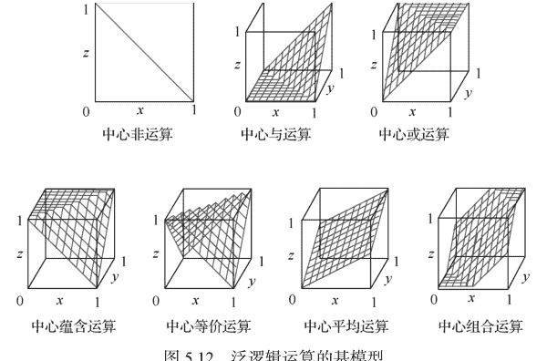

依据逻辑规律 $p \wedge (p \rightarrow q) \Rightarrow q$（即模庞斯法则要求 $T(x, I(x, y)) \leqslant y$），蕴含真值定义为 $I(x, y) = \max\{z \mid y \ge T(x, z)\}$。令 $I(x, y)=z$，则 $T(x, z)=\max(0, x+z-1)=y'\le y$。分情况讨论：若 $x+z-1\ge 0$，则 $y'=x+z-1$，解得 $z=1-x+y'$；若 $x+z-1< 0$，则 $y'\ge x+z-1$，即 $z\le 1-x+y'$。综合 $T(x, z)$ 关于 $z$ 单调增、$y'\le y$ 及 $z\in[0,1]$，推得 $I(x, y)=\min(1, 1-x+y)$。

**5) 泛等价运算基模型**
$Q(x, y)=Q(x, y, 0.5, 0.5)=T(I(x, y), I(y, x))=Q_I=1-|x-y|$

基于等价关系 $p \leftrightarrow q \equiv (p \rightarrow q) \wedge (q \rightarrow p)$，定义 $Q(x, y) = T(I(x, y), I(y, x))$。当 $x\ge y$ 时，$I(x, y)=1-x+y, I(y, x)=1$；当 $x<y$ 时，$I(x, y)=1, I(y, x)=1-y+x$。代入得 $Q(x, y)=1-|x-y|$。

泛逻辑体系中尚包含两类关键运算：一是针对同一命题两个真值 $x, y$ 进行折中融合的**平均运算** $p \oplus q$，要求结果 $M(x, y)$ 落于 $x, y$ 之间且具备幂等性。基于对泛平均运算规律的考察，特将中心平均运算定义为算术平均。

**6) 泛平均运算基模型**
$M(x, y) = M(x, y, 0.5, 0.5) = M_I = (x + y) / 2$

二是针对同一命题两个真值 $x, y$ 进行综合决策的**组合运算** $p \circledast q$。$e \in [0, 1]$ 为表示齐权的幂元。无误差条件下，综合结果 $C^e(x, y)$ 需满足：
*   $x, y < e$（均反对）$\Rightarrow C^e(x, y) \le \min(x, y)$；
*   $x, y > e$（均赞成）$\Rightarrow C^e(x, y) \ge \max(x, y)$；
*   否则（意见分歧）$\Rightarrow C^e(x, y)$ 在 $x, y$ 间变化：若 $x+y<2e$ 体现合取特性，若 $x+y>2e$ 体现析取特性，若 $x+y=2e$ 则 $C^e(x,y)=e$。

基于对泛组合运算规律的研究，特定义其基模型如下：

**7) 泛组合运算基模型**
```
C^e(x, y)=C^e(x, y, 0.5, 0.5)=C^e_i =\Gamma[x+y-e], e \in [0, 1]
```

其中 $\Gamma[*]$ 为 $[0, 1]$ 区间上的限幅函数，$\Gamma[x+y-e]=\min(1, \max(0, x+y-e))$。

##### 5.4.3 泛逻辑运算基模型的统一表达形式

上述全部基模型均可纳入一个统一的线性表达框架：
```
L(x, y)=\Gamma[ax+by-e]
```

不同命题连接词仅对应不同的系数组合（见表 5.1），这一统一性特征为未来设计、制造统一的泛逻辑运算门电路提供了极大便利。

**表 5.1 基模型统一表达 $L(x, y)=\Gamma[ax+by-e]$ 系数对照表**

| 系数 | N(x) | T(x, y) | S(x, y) | I(x, y) | Q(x, y) | M(x, y) | C^e(x, y) |
| :--- | :--- | :--- | :--- | :--- | :--- | :--- | :--- |
| **a** | -1 | 1 | 1 | -1 | 1/-1 | 0.5 | 1 |
| **b** | 0 | 1 | 1 | 1 | -1/1 | 0.5 | 1 |
| **e** | -1 | 1 | 0 | -1 | -1/-1 | 0 | $e \in [0, 1]$ |

对上述基模型可从多维视角解读，衍生出多元表达形态。最常用者为基于 N 性生成元与 T 性生成元的“非与”范式，以及基于 N 性生成元与 S 性生成元的“非或”范式。下文将结合生成元完整簇展开论述。

#### 5.5 命题泛逻辑运算模型的生成元完整簇

##### 5.5.1 零级生成元完整簇

若柔性测度 $m(*)$ 精确无误（$k=0.5$），则 $N(x, 0.5)=1-x$，此属零级不确定性问题范畴。然而，命题间广义相关性往往偏离中间态的最大相斥状态（即 $h \neq 0.5$），致使所有二元泛逻辑运算均偏离其基模型。因此，必须在基模型之上，引入特定的广义相关性修正函数完整簇 $\Psi(x, h)$，对偏离效应施施双向修正。其核心修正思想如下：

设无误差柔性测度为 $m(X)=x, m(Y)=y, m(Z)=z$，$L(x, y, 0.5)$ 为某命题连接词的基模型，则
```
\Psi(L(x, y, h), h)=L( \Psi(x, h), \Psi(y, h), 0.5)
```

```
L(x, y, h)=\Psi^{-1}(L( \Psi(x, h), \Psi(y, h), 0.5), h)
```

# 零级与一级生成元完整簇：泛逻辑运算模型的构建基石

在泛逻辑运算体系中，$L(x, y, 0.5)$ 被确立为基模型，而 $\Psi(x, h)$ 簇则作为各类二元运算模型的零级生成元完整簇。要构建这一核心簇，必须满足三项基本准则：首先，生成元函数需随变量 $x$ 在 (0, 1) 区间及参数 $h$ 连续、严格单调地演变；其次，为保障二元运算的广义自封闭性，簇内任意两函数的复合运算结果仍须归属该簇；最后，簇内任一函数的逆运算也必须保持簇内闭合。

生成元完整簇的确定路径不同，将引出对基模型物理内涵的两种主流理解：

1.  **非与基本表达模型**：以中心与运算基模型 $\max(0, x+y-1)$ 为基石，确立 $T$ 性生成元完整簇 $F_0(x, h)$，衍生出零级与运算模型，进而结合中心非运算定义其余零级二元运算。
2.  **非或基本表达模型**：以中心或运算基模型 $\min(1, x+y)$ 为起点，确立 $S$ 性生成元完整簇 $G_0(x, h)$，生成零级或运算模型，再借助中心非运算与零级或运算构建其他模型。

```
Go(x, h)=N(x, F0(N(x, 0.5), h) 0.5)=1-F0(1-x, h)
```

虽则生成元簇形态各异、基模型表达迥然，但二者联合生成的零级泛逻辑运算模型却殊途同归。图 5.2 展示了典型状态下 $F_0(x, h)$ 与 $G_0(x, h)$ 的函数分布特征。值得注意的是，这仅是典型形态，在特定线性相关条件下，两者均存在无限变种。下文将依托图 5.13 的典型场景，深入剖析零级生成元完整簇。

## 1. 零级 $T$ 性生成元完整簇 $F_0(x, h)$

$F_0(x, h)$ 除遵循通用准则外，还需满足特定边界与单调性约束：
*   **边界锚定**：$F_0(1, h)=1$ 恒成立。
*   **相关性分区**：
    *   $h<0.5$（相克相关）：函数值低于 $x$ 且单调增，$F_0(0, h)=0$。
    *   $0.5<h<0.75$（相斥相关）：函数值介于 $x$ 与 1 之间且单调增，$F_0(0, h)=0$。
    *   $h>0.75$（相吸相关）：函数值超越 1 且单降，$F_0(0, h)\to\infty$。

为实现零级完整性，确保泛与运算在存在域内从最大与算子经概率、中心与算子至最小与算子单调连续过渡，关键节点参数设定如下：

*   **$h=0.5$（中心节点）**：$F_0(x, h)=x$，逆函数同为 $x$，生成**中心与算子** $T_1=\max(0, x+y-1)$。
*   **$h\to0.75$（概率节点）**：$F_0(x, h)\to 1-\ln x$，逆函数为 $\exp(1-x)$，生成**概率与算子** $T_2=xy$。

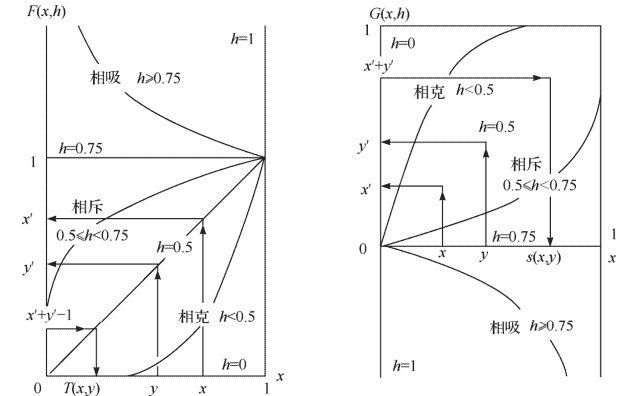

*   **$h\to1$（Zadeh/最大节点）**：$F_0$ 趋向分段函数（$x=1$ 时为 1，其余趋向 $\infty$），逆函数对应生成 **Zadeh 与算子（最大与）** $T_3=\min(x, y)$。
*   **$h\to0$（突变/最小节点）**：$F_0$ 趋向分段函数（$x=1$ 时为 1，其余为 0），逆函数对应生成 **突变与算子（最小与）** $T_0$（仅当另一变量为 1 时保留自身值，否则为 0）。

符合上述全部条件的 $F_0(x, h)$ 即构成零级泛逻辑运算的 $T$ 性生成元完整簇。基于非与基模型，它衍生出六大类零级泛逻辑运算模型：

### (1) 泛与运算模型
$$T(x, y, h)=F_0^{-1}(\max(F_0(0, h), F_0(x, h)+F_0(y, h)-1), h)$$
涵盖四大特征算子：最大与（Zadeh）、概率与、中心与（有界与）、最小与（突变与）。

### (2) 泛或运算模型
$$S(x, y, h)=1-F_0^{-1}(\max(F_0(0, h), F_0(1-x, h)+F_0(1-y, h)-1), h)$$
对应四大特征算子：最小或（Zadeh）、概率或、中心或（有界或）、最大或（突变或）。

### (3) 泛蕴含运算模型
$$I(x, y, h)=F_0^{-1}(\min(1+F_0(0, h), 1-F_0(x, h)+F_0(y, h)), h)$$
四大特征算子分别为：最小蕴含（Zadeh）、概率蕴含、中心蕴含（有界蕴含）、最大蕴含（突变蕴含）。

### (4) 泛等价运算模型
$$Q(x, y, h)=F_0^{-1}(1\pm|F_0(x, h)-F_0(y, h)|, h) \quad (h>0.75 \text{取 } +, \text{ 否则取 } -)$$
四大特征算子：最小等价（Zadeh）、概率等价、中心等价（有界等价）、最大等价（突变等价）。

### (5) 泛平均运算模型
$$M(x, y, h)=N(F_0^{-1}(F_0(N(x, 0.5), h)/2+F_0(N(y, 0.5), h)/2, h), 0.5)$$
四大特征算子：最大平均（Zadeh）、概率平均、中心平均（有界平均）、最小平均（突变平均）。

### (6) 泛组合运算模型
$$C^e(x, y, h)=
\begin{cases}
e & x+y<2e \\
\Gamma[F_0^{-1}(F_0(x, h)+F_0(y, h)-F_0(e, h), h)] & x+y>2e \\
e & \text{otherwise}
\end{cases}$$
四大特征算子：Zadeh 组合、概率组合、有界组合、突变组合。

## 2. 零级 $S$ 性生成元完整簇 $G_0(x, h)$

$G_0(x, h)$ 的特殊要求呈现对偶特征：
*   **边界锚定**：$G_0(0, h)=0$ 恒成立。
*   **相关性分区**：
    *   $h<0.5$（相克相关）：函数值高于 $x$ 且单调增，$G_0(1, h)=1$。
    *   $0.5<h<0.75$（相矛盾相关）：函数值介于 0 与 $x$ 之间且单调增，$G_0(1, h)=1$。
    *   $h>0.75$（相吸相关）：函数值超越 1 且单降，$G_0(1, h)\to\infty$。

为保障泛或运算从最小或算子经概率、中心或算子至最大或算子单调连续演变，关键节点校准如下：
*   $h=0.5$：$G_0=x$，生成**中心或算子** $S_1=\min(1, x+y)$。
*   $h\to0.75$：$G_0\to \ln(1-x)$，生成**概率或算子** $S_2=x+y-xy$。
*   $h\to1$：$G_0$ 趋向分段极限，生成 **Zadeh 或算子（最小或）** $S_3=\max(x, y)$。
*   $h\to0$：$G_0$ 趋向分段极限，生成 **突变或算子（最大或）** $S_0$。

满足条件的 $G_0(x, h)$ 即为 $S$ 性生成元完整簇。显而易见，两簇存在对偶映射关系：
$$G_0(x, h) = 1 - F_0(1-x, h)$$

基于非或基模型，$G_0(x, h)$ 生成的六大零级运算模型为：

*   **泛或运算**：$S(x, y, h)=G_0^{-1}(\min(G_0(1, h), G_0(x, h)+G_0(y, h)), h)$
*   **泛与运算**：$T(x, y, h)=1-G_0^{-1}(\min(G_0(1, h), G_0(1-x, h)+G_0(1-y, h)), h)$
*   **泛蕴含运算**：$I(x, y, h)=N(G_0^{-1}(\max(G_0(1, h)-1, G_0(N(y, 0.5), h)-G_0(N(x, 0.5), h)), h), 0.5)$
*   **泛等价运算**：$Q(x, y, h)=N(G_0^{-1}(\pm|G_0(N(x, 0.5), h)-G_0(N(y, 0.5), h)|, h), 0.5)$ ($h>0.75$ 取 $-$，否则取 $+$)
*   **泛平均运算**：$M(x, y, h)=G_0^{-1}(G_0(x, h)/2+G_0(y, h)/2, h)$
*   **泛组合运算**：分段定义，依据 $x+y$ 与 $2e$ 的大小关系，分别通过 $G_0$ 及其对偶形式计算，边界取 $e$。

---

# 5.5.2 一级生成元完整簇：引入误差修正机制

当柔性测度 $m(X)$ 存在偏离中心的误差 $k \neq 0.5$ 时，泛非运算将偏离中心非运算。若 $p$ 与 $\sim kp$ 服从同一误差分布，即构成一级不确定性问题。此时，需在基模型 $N(x, 0.5)=1-x$ 基础上，引入广义自相关性修正函数完整簇 $\Phi(x, k)$ 实现双向误差校正。

**修正逻辑链路**：
设含误差测度为 $x^*$，真值为 $x$。$\Phi(x^*, k)$ 负责消除误差还原真值（$x=\Phi(x^*, k)$）；$\Phi^{-1}(x, k)$ 负责施加误差还原观测值（$x^*=\Phi^{-1}(x, k)$）。二者满足对偶关系：$\Phi(N(x^*, k), k)=1-\Phi(x^*, k)$。若误差分布函数为 $\delta(x, k)$（即 $x^*=x+\delta(x, k)$），则 $\Phi^{-1}(x, k)=x+\delta(x, k)$。

$\Phi(x, k)$ 簇需满足五大核心约束：
1.  **单调性反向绑定**：为使 $N(x, k)$ 随 $k$ 严格单增，$\Phi(x, k)$ 必须随 $k$ 严格单减。
2.  **不动点锚定**：$k$ 为 $N(x, k)$ 的不动点，要求 $\Phi^{-1}(0.5, k)=k$，即特征空间对半子集被误测为 $k$。
3.  **完整性边界**：泛非运算需从最小非算子经中心非算子至最大非算子连续变化。
    *   $k=0.5$：$\Phi=x$，生成中心非运算 $1-x$。
    *   $k\to1$：$\Phi\to$ 分段极限，生成最大非运算。
    *   $k\to0$：$\Phi\to$ 分段极限，生成最小非运算。
4.  **复合自封闭**：簇内任意 $\Phi(x, k_1), \Phi(x, k_2)$ 复合仍在簇内（$\Phi(\Phi(x, k_1), k_2)=\Phi(x, k_3)$）。
5.  **逆运算自封闭**：簇内任意函数的逆运算仍在簇内。

符合上述条件的 $\Phi(x, k)$ 即构成一级泛逻辑运算的 $N$ 性生成元完整簇。常用模型有二：

1.  **指数模型完整簇**：$\Phi_1(x, k)=x^{-n} \ (n\in\mathbb{R}^+, k=2^{-1/n})$。满足单调性、不动点及边界极限条件（$k\to1 \Rightarrow n\to\infty$ 趋向最大非；$k\to0 \Rightarrow n\to0$ 趋向最小非）。
2.  **多项式模型完整簇**：$\Phi_2(x, k)=\frac{(1-k)x}{k+(1-2k)x} \ (\lambda=\frac{1-2k}{k^2})$。

## 2. 一级 $T$ 性生成元完整簇

面对一级不确定性（$k\neq0.5$）且命题间广义相关性非中间态（$h\neq0.5$）的复合场景，二元运算将进一步偏离零级模型。解决路径为**双向修正机制**：
先以 $\Phi(x, k)$ 校正输入变量 $x$ 的误差 $\rightarrow$ 代入零级泛逻辑模型得精确结果 $\rightarrow$ 再以 $\Phi^{-1}(x, k)$ 恢复结果上的误差影响。

基于非与基模型，由 $N$ 性生成元簇 $\Phi(x, k)$ 与零级 $T$ 性生成元簇 $F_0(x, h)$ 协同作用形成的簇，称为**一级 $T$ 性生成元完整簇 $F(x, h, k)$**。

# 基于生成元全簇的泛逻辑运算模型构建与拓扑规则解析

## 一、 一级 N 型生成元全簇及其衍生运算体系

假设 $F(x, h, k)=F_0(\Phi(x, k), h)$ 与其逆运算 $F^{-1}(x, h, k)=\Phi^{-1}(F_0^{-1}(x, h), k)$ 构成了非与基模型的一级 N 型生成元完备簇，在此基础上可推导出六大核心逻辑运算模型：

### 1. 泛与运算（T-范数形式）
$$ T(x, y, h, k) = F^{-1}\Bigl(\max\bigl(F(0, h, k), F(x, h, k) + F(y, h, k) - 1\bigr), h, k \Bigr) $$

### 2. 泛或运算（S-范数形式）
利用对偶性原理 $S(x,y) = N(T(N(x), N(y)))$ 得到：
$$ S(x, y, h, k) = N\Bigl( F^{-1}\bigl(\max(F(0, h, k), F(N(x,k), h, k) + F(N(y,k), h, k) - 1\bigr), h, k \Bigr), k \Bigr) $$

### 3. 泛蕴含运算
定义为满足 $y \ge T(x, z)$ 的最大 $z$ 值，解析式为：
$$ I(x, y, h, k) = F^{-1}\Bigl(\min\bigl(1 + F(0, h, k), 1 - F(x, h, k) + F(y, h, k)\bigr), h, k \Bigr) $$

### 4. 泛等价运算
由双向蕴含的合取构成：
$$ Q(x, y, h, k) = T(I(x,y), I(y,x)) = F^{-1}\Bigl(1 \pm |F(x, h, k) - F(y, h, k)|, h, k \Bigr) $$
> **注**：当 $h > 0.75$ 时取正号，否则取负号。

### 5. 泛平均运算
在非运算域内取算术平均后映射回原域：
$$ M(x, y, h, k) = N\Bigl( F^{-1}\bigl( \tfrac{1}{2}F(N(x,k), h, k) + \tfrac{1}{2}F(N(y,k), h, k) \bigr), h, k \Bigr), k \Bigr) $$

### 6. 泛组合运算
引入阈值 $e$ 与算子 $\Gamma^e$，分段定义：
$$ C^e(x, y, h, k) = \begin{cases}
\Gamma^e\Bigl[ F^{-1}\bigl(F(x) + F(y) - F(e), h, k\bigr) \Bigr], & x + y > 2e \\
N\Bigl( \Gamma^{-e'}\Bigl[ F^{-1}\bigl(F(N(x)) + F(N(y)) - F(N(e)), h, k\bigr) \Bigr], k \Bigr), & x + y < 2e \\
e, & \text{否则}
\end{cases} $$
其中 $e' = N(e, k)$，为简洁省略了重复参数 $(h,k)$。

---

## 二、 一级 S 型生成元全簇及其对偶运算体系

若由 N 型生成元 $\Phi(x,k)$ 与零级 S 型生成元 $G_0(x,h)$ 作用于非或基模型，得到一级 S 型生成元全簇 $G(x, h, k) = G_0(\Phi(x, k), h)$ 及其逆 $G^{-1}(x, h, k) = \Phi^{-1}(G_0^{-1}(x, h), k)$，则对应运算模型如下：

### 1. 泛或运算（基础形式）
$$ S(x, y, h, k) = G^{-1}\Bigl( \min\bigl( G(1, h, k), G(x, h, k) + G(y, h, k) \bigr), h, k \Bigr) $$

### 2. 泛与运算（对偶形式）
$$ T(x, y, h, k) = N\Bigl( G^{-1}\bigl( \min(G(1), G(N(x)) + G(N(y))), h, k \bigr), k \Bigr) $$

### 3. 蕴含运算
$$ I(x, y, h, k) = N\Bigl( G^{-1}\bigl( \max(G(1) - 1, G(N(y)) - G(N(x))), h, k \bigr), k \Bigr) $$

### 4. 泛等价运算
$$ Q(x, y, h, k) = N\Bigl( G^{-1}\bigl( | \pm |G(N(x)) - G(N(y))|, h, k \bigr), k \Bigr) $$
> **注**：此处符号规则与 N 型相反，$h > 0.75$ 取负号，否则取正号。

### 5. 泛平均运算
直接在生成元域内取平均：
$$ M(x, y, h, k) = G^{-1}\Bigl( \tfrac{1}{2}G(x, h, k) + \tfrac{1}{2}G(y, h, k), h, k \Bigr) $$

### 6. 泛组合运算
结构同 N 型，仅将生成元 $F$ 替换为 $G$：
$$ C^e(x, y, h, k) = \begin{cases}
\Gamma_e\Bigl[ G^{-1}\bigl(G(x) + G(y) - G(e), h, k\bigr) \Bigr], & x + y > 2e \\
N\Bigl( \Gamma^{-e'}\Bigl[ G^{-1}\bigl(G(N(x)) + G(N(y)) - G(N(e)), h, k\bigr) \Bigr], k \Bigr), & x + y < 2e \\
e, & \text{否则}
\end{cases} $$

> **核心提示**：上述所有模型均建立在真值域 $x \in [0,1]$ 的线序连续值泛逻辑基础之上。接下来将探讨当真值空间拓展为多维或特殊拓扑结构时的运算规则。

---

## 三、 命题泛逻辑运算的拓扑扩序规则

### 3.1 偏序泛逻辑（多维独立真值空间）
当命题真值为 $n$ 维向量 $\boldsymbol{x} = \langle x_1, \dots, x_n \rangle$（$n>1, x_i \in [0,1]$），且各维度完全独立（如三峡工程论证中的发电、防洪、生态等指标），任意线序逻辑算子 $\mathcal{L} \in \{N, T, S, I, Q, M, C\}$ 均分量逐个作用：
$$ \mathcal{L}(\boldsymbol{x}, \boldsymbol{y}) = \langle \mathcal{L}(x_1, y_1), \mathcal{L}(x_2, y_2), \dots, \mathcal{L}(x_n, y_n) \rangle $$
```
M(\boldsymbol{x}, \boldsymbol{y})=<M(x_{1}, y_{1}), M(x_{2}, y_{2})>
C(\boldsymbol{x}, \boldsymbol{y})=<C(x_{1}, y_{1}), C(x_{2}, y_{2})>
```

### 3.2 伪偏序泛逻辑（不确定性分级与关联分量）
真值的“不确定性”源于证据的不全、动态、随机等。按不确定性层级分类：

#### ① 零级不确定性
满足 $N(x)=1-x$，即 $U(x)=1-x-N(x)=0$。经典二值逻辑及确定性推理属此类。

#### ② 一级不确定性
存在 $x$ 使 $N(x,k) \neq 1-x$，但 $N(x,k)$ 由 $x$ 唯一确定。此时 $U(x,k) \neq 0$，仍可用单变量 $x$ 描述。

#### ③ 二级不确定性
$U(x) \neq 0$ 且与 $x$ 相互独立。需用二元数组 $\boldsymbol{x} = \langle x_1, x_2 \rangle$ 表示（如 $x_1$ 为真支持度，$1-x_2$ 为假支持度，或下限/上限区间）。
**运算规则**：非运算反转分量顺序，其余二元算子分量对应运算：
$$ N(\boldsymbol{x}) = \langle N(x_2), N(x_1) \rangle $$
$$ \mathcal{L}(\boldsymbol{x}, \boldsymbol{y}) = \langle \mathcal{L}(x_1, y_1), \mathcal{L}(x_2, y_2) \rangle \quad (\mathcal{L} \in \{T,S,I,Q,M,C\}) $$
```
M(\boldsymbol{x}, \boldsymbol{y})=<M(x_{1}, y_{1}), M(x_{2}, y_{2})>
C(\boldsymbol{x}, \boldsymbol{y})=<C(x_{1}, y_{1}), C(x_{2}, y_{2})>
```

#### ④ n 级不确定性 ($n \ge 2$)
真值为 $n$ 元数组 $\boldsymbol{x} = \langle x_1, \dots, x_n \rangle$。本质上仍是一维真值的多角度投影，故称“伪偏序/伪多维逻辑”。因分量间强关联，拓扑规则推广为：
$$ N(\boldsymbol{x}) = \langle N(x_n), \dots, N(x_1) \rangle $$
$$ \mathcal{L}(\boldsymbol{x}, \boldsymbol{y}) = \langle \mathcal{L}(x_1, y_1), \dots, \mathcal{L}(x_n, y_n) \rangle $$
```
N(\boldsymbol{x})=<N(x_{n}), N(x_{n-1}), \cdots, N(x_{1})>
T(\boldsymbol{x}, \boldsymbol{y})=<T(x_{1}, y_{1}), T(x_{2}, y_{2}), \cdots, T(x_{n}, y_{n})>
S(\boldsymbol{x}, \boldsymbol{y})=<S(x_{1}, y_{1}), S(x_{2}, y_{2}), \cdots, S(x_{n}, y_{n})>
I(\boldsymbol{x}, \boldsymbol{y})=<I(x_{1}, y_{1}), I(x_{2}, y_{2}), \cdots, I(x_{n}, y_{n})>
Q(\boldsymbol{x}, \boldsymbol{y})=<Q(x_{1}, y_{1}), Q(x_{2}, y_{2}), \cdots, Q(x_{n}, y_{n})>
M(\boldsymbol{x}, \boldsymbol{y})=<M(x_{1}, y_{1}), M(x_{2}, y_{2}), \cdots, M(x_{n}, y_{n})>
C(\boldsymbol{x}, \boldsymbol{y})=<C(x_{1}, y_{1}), C(x_{2}, y_{2}), \cdots, C(x_{n}, y_{n})>
```

### 3.3 超序泛逻辑（含非连通特殊空间）
真值域 = 有序空间 $[0,1]^n$ $\cup$ 特殊非连通空间（如无定义态 $\perp$、附加特性 $\alpha$）。

#### A. 包含无定义状态 $\perp$ 的运算拓扑
$\perp$ 物理上指特征空间外的孤立点，数学上可视为 $\pm\infty$。关键非平凡规则：
1.  **非运算**：$N(\perp, k) = \perp$（无定义命题的否定仍无定义）。
2.  **泛与**：$T(\perp, y) = \begin{cases} \perp & y=\perp \\ 0 & \text{否则} \end{cases}$（仅 $\perp \land \perp = \perp$，其余为假）。
3.  **泛或**：$S(\perp, y) = \begin{cases} \perp & y=\perp \\ 1 & \text{否则} \end{cases}$（对偶得出）。
4.  **蕴含**：$I(\perp, y) = I(x, \perp) = \begin{cases} \perp & \text{前件或后件为}\perp \text{且不构成恒真} \\ 1 & x=\perp, y=\perp? \text{文中定义为除 } \perp \to \perp=1 \text{ 外均为 } \perp \end{cases}$。
5.  **等价**：$Q(\perp, y) = \begin{cases} \perp & y=\perp \\ \perp & \text{待查文中定义：除 } \perp \leftrightarrow \perp=1 \text{ 外均为 } \perp \end{cases}$。
6.  **平均**：$M(\perp, y) = y$（无定义态不参与折中，保持另一值）。
7.  **组合**：$C_c(\perp, y) = \begin{cases} \perp & y=\perp \\ 0 & y<e \\ 1 & y>e \\ e & y=e \end{cases}$（不干扰决策，除非双方均无定义）。
> **平凡规则**：凡涉及 $\perp$ 运算结果均为 $\perp$（作为对比基准）。
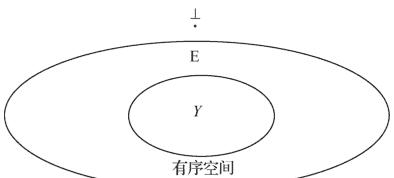

#### B. 逻辑真值附加特性运算
真值携带参数：$x\langle\alpha\rangle, y\langle\beta\rangle$。
运算分离：主真值按标准模型 $L(x,y)=z$ 运算；附加特性按专用模型 $L'(\alpha,\beta)=\gamma$ 运算。
最终结果：$z\langle\gamma\rangle$。

**典型实例：加权泛平均运算模型** —— 此处作为超序逻辑中附加特性（权重）参与运算的切入点展开。

# 泛逻辑核心算子深度解析：从加权泛平均到云模型与N范数体系

在泛逻辑运算体系中，加权泛平均运算占据核心地位。以实验数据处理为例，有限次数 $n$ 的实验中，事件 $p$ 的出现概率 $x$ 仅为近似值，记为 $x = a/n$（即 $x\langle n \rangle$）。若存在两组实验 $p_1, p_2$，概率分别为 $x\langle n_1 \rangle, y\langle n_2 \rangle$，合并后总次数 $n = n_1 + n_2$，总出现次数 $a$ 并非简单相加，而是受广义相关系数 $h$ 与广义自相关系数 $k$ 制约。由此衍生出三类典型运算场景：

**场景一：$h=k=0.5$（最大相斥且无误差）**  
此时 $a = a_1 + a_2$，合并概率 $z = (n_1 x + n_2 y)/(n_1 + n_2) = \alpha x + \beta y$，服从**加权算术平均**。若将带权重的柔性命题真值视为输入，加权算术平均即为加权泛平均模型的**中心算子**：
$$M(x\langle n_1 \rangle, y\langle n_2 \rangle) = \langle n \rangle = S(\alpha x, \beta y)\langle n \rangle = z\langle z \rangle$$
其中 $S(\alpha x, \beta y) = N(\alpha N(x) + \beta N(y))$，$n = n_1 + n_2$。

**场景二：$k=0.5, h$ 为一般值**  
运算分两步：先对真值作 $N(\cdot, 0.5)$ 变换，再经生成元 $F$ 与权重 $\alpha, \beta$ 融合，最后施加逆变换：
$$z = M(x, y, h, 0.5) = N\Big(F^{-1}\big(\alpha F(N(x, 0.5), h) + \beta F(N(y, 0.5), h)\big), 0.5\Big)$$
此模式下衍生出四大特征算子：
- **加权Zadeh平均** ($h=1$)：$M_3 = \max(x, y)$，最大平均；
- **加权概率平均** ($h=0.75$)：$PM_2 = 1 - (1-x)^\alpha(1-y)^\beta$；
- **加权有界平均** ($h=0.5$)：$PM_1 = \alpha x + \beta y$，即中心算子；
- **加权突变平均** ($h=0$)：$M_0 = \min(x, y)$，最小平均。

**场景三：$h, k$ 均为一般值**  
最普适形式，嵌套了自相关性参数 $k$：
$$z = M(x, y, h, k) = N\Big(F^{-1}\big(\alpha F(N(x, k), h, k) + \beta F(N(y, k), h, k)\big), h, k\Big), k\Big)$$
值得注意的是，**加权泛平均运算满足结合律**，保证了多级融合的一致性。

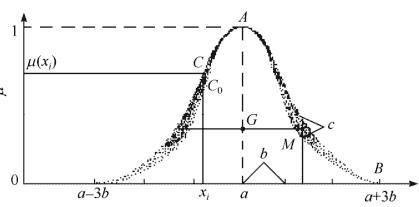

## 二、 云模型：融合随机与柔性的不确定性映射机制

云逻辑中，谓词 $P(x)\langle a, b, c \rangle$ 表现为一朵“云”：$a$ 为**形心**（信息中心），$b$ 为**带宽**（亦此亦彼的裕度），$c$ 为**方差**（离散度）。云发生器 $CG$ 依据输入 $x_i$ 与参数生成云滴 $C\langle x_i, \mu(x_i) \rangle$，隐含三次正态分布规律 $E(\alpha, \beta) = \exp(-(x-\alpha)^2/(2\beta))$。

云滴分布具有三大统计特征：
1.  每个云滴 $C\langle x, \mu \rangle$ 对应期望曲线 $\mu_0(x) = E(a, b^2)$ 上的基准点 $C_0$；
2.  云滴以 $C_0$ 为中心，沿 $\mu$ 方向按方差 $\sigma_x$ 正态分布，即 $\mu(x) = E(\mu_0(x), \sigma_x)$；
3.  云层厚度 $\sigma_x$ 沿期望曲线变化，在 $M\langle a+\sqrt{\ln 8}\,b,\, 2\sqrt{2}/4 \rangle$ 处达最大值 $c$（即 $\sigma_{\max}$），在 $A\langle a, 1 \rangle$ 与 $B\langle a+3b, 0 \rangle$ 处为零，两侧遵循下半正态规律（符合 $3b$ 规则）。

**层级退化关系**：
- $c=0$ 时，云退化为**带真值分布约束的柔性谓词** $p(x)\langle a, b \rangle = E(a, b^2)$；
- 若剥离分布约束，进一步退化为**一般柔性谓词** $p(x)$；
- 广义上，$p(x)\langle \alpha \rangle$ 为带附加特性 $\alpha$（有限符号串）的柔性谓词，$\alpha=\varepsilon$（空串）时退化为 $p(x)$。

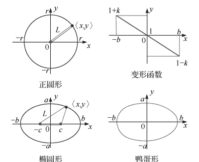

以“年轻人”概念为例：$a=25, b=6, c=0.04$。逆向运用 $CG$ 输入全量云滴可反推参数 $a,b,c$。云模型因统一了随机性与柔性，成为**定性概念与定量表示间双向不确定性映射**的可操作机制，比单纯柔性谓词更契合“对立不充分”世界。

**不确定性四重奏**：
- **随机性**：明确定义但非必然发生，用概率度量，逻辑规律与线序泛逻辑一致；
- **柔性**：已发生但难精确定义，用隶属度度量，线序泛逻辑可描述；
- **缺省性**：信息不全导致，需补全信息，用缺省量词标记，带多模态缺省推理的泛逻辑适用；
- **混沌性**：复杂巨系统耦合产生，逻辑规律尚待混沌逻辑学研究。

**云逻辑推理实例**：规则“年轻人好学”形式化为 $p(x)\langle a,b,c \rangle \rightarrow q(y)\langle d,e,f \rangle$。输入年龄 $x_i$ 激活 $p$ 得年轻程度 $y_i = \mu(x_i)$，再激活 $q$ 得好学程度 $z_i = \mu(y_i)$。推理链条：
$$p(x_i)\langle a,b,c \rangle,\; p(x)\langle a,b,c \rangle \rightarrow q(y)\langle d,e,f \rangle \;\Rightarrow\; Q(v_i)\langle d,e,f \rangle$$
云逻辑除标准运算外，还包含**附加特性运算模型**。

---

### 5.7 核心洞见：泛逻辑的五大基石

通过理论与观察，提炼出泛逻辑区别于传统模糊逻辑的关键特质：

1.  **运算模型连续可变**  
    柔性连接词运算非固定，源于测度间的广义相关性（影响二元/多元运算）与广义自相关性（影响一切运算），形成**算子簇**的连续谱系。柔性集合运算同理。

2.  **二值逻辑中自相关性失效**  
    二值真值 $\{0,1\}$ 确定无柔性，运算退化为单一算子。关系柔性（相关性）仅在真值柔性存在时显现；两者可独立变化——锁定算子仅确定运算公式，参与运算的真值仍保留柔性自由度。

3.  **引入关系柔性是完善关键**  
    承认真值不确定性（真值柔性）不够，**必须同步承认连接词运算模型的不确定性（关系柔性）**，这是泛逻辑超越模糊逻辑的核心标识。

4.  **全泛逻辑体系均需考量关系柔性**  
    不限于柔性逻辑，整个连续值泛逻辑、多值泛逻辑均需纳入，其影响按特定变换规则映射至连接词定义中。

5.  **规律源于客观归纳，非人为设定**  
    如同牛顿从数据拟合发现力学定律，泛逻辑运算生成规则源于对现存数百种逻辑的抽象归纳，经三角范数完整簇验证（保持边界条件与特征线不变），确证为客观规律的正确抽象。  
    **“圆规变迁”隐喻**：从特制模板（离散逻辑集合）、到圆规/椭圆规/鸭蛋规（参数化统一公式 $DY(a,b,k)$），泛逻辑 $L(x,y,h)$、$L(x,y,h,k)$、$L(x,y,h,k,\beta)$ 即为逻辑界的“统一画规”。代入形参自动生成算子，并明确适用条件。当前AI仍处“选模板”阶段，泛逻辑旨在实现“按需精准生成”，辩证论治，对症下药。

---

## 第 6 章 N性生成元完整簇与泛非运算

本章聚焦**泛非运算完整簇**。引入三角范数中的 $N$ 范数理论，阐明广义自相关性 $k$ 对非运算模型的影响，确立生成泛非模型的核心——**$N$ 性生成元完整簇**，并引入**阈元量词**以适应不同误差水平下的真度评估。

泛非运算是基础算子之一。传统认知固守 $N(x)=1-x$（中心非 $N_1$），实则仅适用于真度精确可得场景。现实中真度常含测度偏差，非真度需在约束下估计，**泛非运算不可避免**。其本质是随 $k$ 连续变化的 $N$ 范数完整簇。研究路径：理解 $N$ 范数 $\rightarrow$ 寻找 $N$ 性生成元完整簇 $\rightarrow$ 生成泛非运算模型完整簇。

### 6.1 N 范数及其生成方法

$N$ 范数是泛非运算的数学原型。文献虽多，但三角范数理论基础上融合团队心得，体系化梳理如下。

#### 6.1.1 N 范数的定义、边界与迭等性

设一元运算 $N(x): [0,1] \to [0,1]$，核心条件：
- **边界条件 N1**：$N(0)=1, N(1)=0$；
- **单调性 N2**：$x<y \Rightarrow N(x) \ge N(y)$；
- **严格单调性 N2'**：$x<y \Rightarrow N(x) > N(y)$；
- **连续性 N3**：$\forall x, N(x^-)=N(x)=N(x^+)$；
- **逆等性 N4**：$N(x) = N^{-1}(x)$（自逆）。

**定义层级**：
- **弱 $N$ 范数**：满足 N1、N2。  
  例：$1-x^2, (1-x)^2, N_3, N_2, N_1, N_0$ 及广义 Sugeno 算子簇。
- **$N$ 范数**：弱 $N$ 范数 + 满足 N4。  
  例：$N_3, N_2, N_1, N_0$ 及广义 Sugeno 算子簇。  
  其中 $N_3$ 为**最大 $N$ 范数**，$N_1$ 为**中心 $N$ 范数**，$N_0$ 为**最小 $N$ 范数**。
- **连续 $N$ 范数**：满足 N3。  
  例：$1-x^2, (1-x)^2, N_2, N_1$ 及 Sugeno 算子簇。$N_3, N_0$ 含间断点，非连续。
- **严格单调 $N$ 范数**：满足 N2'。  
  例：$1-x^2, (1-x)^2, N_2, N_1$ 及 Sugeno 算子簇。$N_3, N_0$ 含平台区，非严格单调。

# N范数的生成机制与泛非运算核心性质深度解析

## N范数的存在域与极限逆等性特别定义

我们将最大N范数$N_3$与最小N范数$N_0$所界定的单位方形区域$[0, 1]\times[0, 1]$，称为**N范数的存在域**。这代表了N范数变化的全域边界，而中心N范数$N_1 = 1-x$正处于该区域的几何中心位置。作为一切N范数簇的核心，$N_1$具备连续性、严格单调性、偶等性等关键性质，是理论体系的基石。

在常规研究中，我们聚焦于连续严格单调的N范数。此类函数无间断点与平台区，逆函数$N^{-1}(x)$必然存在且同属连续严格单调N范数，逆等性自然成立。然而，一旦涉及非连续严格单调、连续非严格单调（含平台区），或非连续非严格单调（同时含间断点与平台区）的情况，逆等性问题便变得棘手。

数学上，非严格单调函数因非单射而无常规逆函数；严格单调但有间断点的函数，其逆函数会出现平台区，导致无法反向求逆实现逆等性。更关键的是，连续严格单调函数簇的极限往往带有平台区与间断点，常规数学手段失效。泛逻辑学遵循“极限函数簇亦应具备逆等性”原则，结合邻近连续严格单调函数的逆运算及逻辑必然性，对$N_3$、$N_0$等极限N范数给出了**特别定义**。由此确立：在泛逻辑学框架下，非严格单调N范数同样拥有逆等性，且其非严格单调性与非连续性必然共生共存。

## N范数的核心性质图谱

### 1. 封闭性
**定义 6.1.1** 指出：弱N范数的取值严格限定在$[0, 1]$区间内。  
**依据**：边界条件$N(0)=1, N(1)=0$配合单调性$N(1)\le N(x)\le N(0)$，直接推得$N(x)\in[0, 1]$。

### 2. 对合律
**定义 6.1.2** 确立：$N(N(x))=x$。  
**推导**：逆等性$N_4$给出$N(x)=N^{-1}(x)$，代入即得$N(N(x))=N(N^{-1}(x))=x$。

### 3. 不动点的必然存在
**定义 6.1.3** 宣称：连续（弱）N范数在$(0, 1)$区间内必存在不动点$k$，使$N(k)=k$。  
**几何直觉**：曲线$y=N(x)$在单位方格内连续单调下降，由边界条件知其连接$(0,1)$与$(1,0)$，必与主对角线$y=x$相交，交点投影即为$k$。  
**典型实例**：
- $N(x)=1-x^2$ 时，$k=(\sqrt{5}-1)/2$；
- 中心N范数$N(x)=1-x$ 时，$k=0.5$；
- Sugeno算子 $k=1/(\sqrt{1+\lambda}^{-1}+1)$；
- 非连续极限：$N_3$的$k=1$，$N_0$的$k=0$（含于直接定义中）。

### 4. 泛非性
**定义 6.1.4** 揭示不动点两侧的“跨越”特征：设$k$为连续（弱）N范数不动点，则$x>k \Rightarrow N(x)<k$；$x<k \Rightarrow N(x)>k$。若为连续严格单调，则不等号严格成立。  
**逻辑链条**：$N(k)=k$ + 单调递减 $\Rightarrow$ 定理成立。

### 5. 零级与一级对偶体系
**定义 6.1.5** 构建对偶变换：若$N(x), N_1(x)$均为N范数，则$N_1'(x)=N(N_1(N(x)))$称作$N_1$关于$N$的**一级对偶**；特取$N(x)=1-x$时，退化为**零级对偶**$N_1'(x)=1-N_1(1-x)$。一切N范数均具备这两级对偶。

### 6. 自对偶性与性质继承
**定义 6.1.6** 证明：一级对偶$N_1'(x)$本身是N范数，且保留了$N(x)$与$N_1(x)$共有的主要性质（严格单调性$N_2'$、连续性$N_3$、对称性$N_5$等）。  
**推论 6.1.1（偶等性）**：任意N范数自对偶等于自身，$N(x)=N(N(N(x)))$。注意：若将$N(x)=1-N(1-x)$视为公理，等同于强制$N(x)=1-x$，丧失一般性。

### 7. 对偶变换下的不动点映射
**定理 6.1.6** 若$k$是$N_1$的不动点，则$k'=N(k)$是其关于$N$的一级对偶$N_1'$的不动点。  
**验证**：$N_1'(N(k))=N(N_1(N(N(k))))=N(N_1(k))=N(k)$。

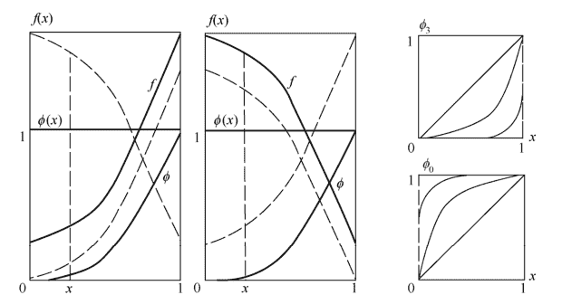

## N性生成元：从物理本义到数学构造

### (1) 物理意义：修正测度偏差的“校准器”
在因素空间$E$中，任意分明子集$X$满足$X\cup\neg X=E$。若柔性测度$m(X)$精确可得，则$m(X)+m(\neg X)=x+N(x)=1$，此时$N(x)=1-x$，中心非算子成立，为泛非运算奠基。

现实中，$m(X)$常难以精确获取。设实测值为$x^*$，真值为$x$，往往$x^*+N(x^*)\neq 1$。为在约束下估计$N(x^*)$，引入一般形式：
$$\phi(x^*)+\phi(N(x^*))=1, \quad N(x^*)=\phi^{-1}(1-\phi(x^*)) \tag{6-1}$$
此处$\phi(x^*)$为连续严格单调增函数，$\phi(0)=0, \phi(1)=1$，泛逻辑学中称其为**N性生成元**。

**物理图景**：
- 因素空间$E$及$\emptyset$可精确检测，但真子集$X$均有检测误差。
- $x$为理想精确不分明测度，$x^*$为实测有差测度，$x=\phi(x^*)$。
- $\phi$是满足边界条件的自同构修正函数。偏离边界处偏差越大，$\phi(x^*)$偏离$x^*$越大。
- $\phi(x^*) > x^*$：$m(X)$为下近似，实测偏小，需放大。
- $\phi(x^*) < x^*$：$m(X)$为上近似，实测偏大，需缩小。
- $x^*=\phi(x^*)=x$：理想精确测度态。

### (2) 定义与基本性质
**定义 6.1.6** $x\in[0,1]$，若$\phi(x)$连续严格单调增且$\phi(0)=0,\phi(1)=1$，则称$\phi(x)$为**N性生成元**。  
**直接推论**：其逆函数、复合函数、各类对偶均为N性生成元；$1-\phi(x)$与$\phi(1-x)$均为弱N范数。

### 第一生成定理：从任意生成函数导出生成元
**定理 6.1.7** 若$f(x)$在$[0,1]$上连续严格单调且取有限值，则
$$\phi(x)=\frac{f(0)-f(x)}{f(0)-f(1)}$$
为N性生成元。  
**定义 6.1.7** 称上式中$f(x)$为$\phi(x)$的**生成函数**。$f(x)$可增可减[图6.1(a)]。特殊归一化情况：
- $f(0)=0 \Rightarrow \phi(x)=f(x)/f(1)$
- $f(0)=0, f(1)=1 \Rightarrow \phi(x)=f(x)$
- $f(1)=0 \Rightarrow \phi(x)=1-f(x)/f(0)$
- $f(0)=1, f(1)=0 \Rightarrow \phi(x)=1-f(x)$

**推论 6.1.2** 线性相关生成函数$cf(x)+d$生成同一N性生成元，反之不成立。

### 第二生成定理：复合式生成新元
**定理 6.1.8** 若$\phi_1, \phi_2$为N性生成元，则复合$\phi(x)=\phi_1(\phi_2(x))$亦为N性生成元。  
**证明**：复合保持连续严格单调增及边界值。

### (3) 上下极限定义：拓展至非连续、非严格单调域
```
φ(x)=(f(0)-f(x))/(f(0)-f(1))， φ⁻¹(x)=f⁻¹(f(0)-(f(0)-f(1))x)
```

利用极限手段规定N性生成元的上下极限$\Phi_3, \Phi_0$及其逆，将概念推广至病态函数[图6.1(b)]：
- $f(1)\to+\infty, f(0)$有限 $\Rightarrow \phi\to\Phi_3, \phi^{-1}\to\Phi_0$
- $f(0)\to+\infty, f(1)$有限 $\Rightarrow \phi\to\Phi_0, \phi^{-1}\to\Phi_3$
- **特别定义**：$\Phi_3-\Phi_0^{-1}=ite\{1|x=1; 0\}$, $\Phi_0-\Phi_3^{-1}=ite\{0|x=0; 1\}$

有了这些预备知识，即可展开N范数的系统生成讨论。

## N范数的三大生成定理

### 定理 6.1.9（第一生成定理：生成元直造法）
若$\phi(x)$为N性生成元，则
$$N(x)=\phi^{-1}(1-\phi(x))$$
为连续严格单调N范数。  
**证明要点**：$\phi$单增 $\Rightarrow 1-\phi(x)$单减满足$N_1,N_2',N_3$；逆运算保持性质；且$N^{-1}(x)=\phi^{-1}(1-\phi(x))=N(x)$，满足逆等性$N_4$。

**经典实例**：
1.  $\phi(x)=\Phi_1-x$（即$\phi(x)=x$） $\Rightarrow N_1(x)=1-x$；
2.  $\phi(x)=x(1+\lambda)^{1/2}/[1+((1+\lambda)^{1/2}-1)x], \lambda>-1$  
    ```
φ₁⁻¹(x)=x/((1+λ)^{1/2}-((1+λ)^{1/2}-1)x)
``` ```
1-φ₁(x)=1-x(1+λ)^{1/2}/(1+((1+λ)^{1/2}-1)x)=(1-x)/(1+((1+λ)^{1/2}-1)x)
``` ```
N₁(x)=φ⁻¹(1-φ(x))
```  
    经化简得 $N_1(x)=(1-x)/(1+\lambda x)$（Sugeno类）；
3.  $\phi_2(x)=x^n, n>0$ $\Rightarrow \phi_2^{-1}(x)=x^{1/n}$ $\Rightarrow N_2(x)=(1-x^n)^{1/n}$（Yager类）。

利用$\Phi_3, \Phi_0$及其逆，可将此定理推广构造非连续、非严格单调的极限N范数$N_3, N_0$。

### 推论 6.1.3（生成函数直造法）
若$f(x)$为$[0,1]$上连续严格单调有限值函数，则
$$N(x)=f^{-1}(f(1)+f(0)-f(x))$$
直接给出N范数。

### 定理 6.1.10（第二生成定理：已知N范数+生成元变换法）
若$N_1(x)$为N范数，$\phi(x)$为N性生成元，则
$$N_2(x)=\phi^{-1}(N_1(\phi(x)))$$
为N范数。  
**证明**：设$N_1=\phi_1^{-1}(1-\phi_1)$，则$\phi_2=\phi_1\circ\phi$为生成元，$\phi_2^{-1}=\phi^{-1}\circ\phi_1^{-1}$，代入即得$N_2=\phi_2^{-1}(1-\phi_2)$。

### 定理 6.1.5（第三生成定理：对偶变换法）
若$N_1(x), N(x)$均为N范数，则$N_1$关于$N$的一级对偶$N_1'(x)=N(N_1(N(x)))$亦为N范数。

**生成路径总结**：三大源头 —— 1) 连续严格单调一元函数（或其导出的生成元）；2) 已知N范数；3) 两者综合混合。

## 泛非运算模型完整簇及其广义自封闭性

掌握N范数生成原理与极限处理原则后，我们转向泛非逻辑运算模型完整簇的构建。

### 6.2.1 不动点$k$的计算与物理诠释

**定理 6.2.1** 连续严格单调减N范数$N(x)=\phi^{-1}(1-\phi(x))$的不动点$k=\phi^{-1}(0.5)$。  
**推导**：$N(k)=k \Rightarrow \phi^{-1}(1-\phi(k))=k \Rightarrow 1-\phi(k)=\phi(k) \Rightarrow \phi(k)=0.5$。  
此$k$即**广义自相关系数**。

**参数反演实例**：
- Sugeno类 $N_1(x)=(1-x)/(1+\lambda x)$：  
  $k_1=1/(\sqrt{1+\lambda}+1)$，反解 $\lambda=(1-2k_1)/k_1^2$。
- Yager类 $N_2(x)=(1-x^n)^{1/n}$：  
  $k_2=2^{-1/n}$，反解 $n=-1/\log_2 k_2$。

# 6.2 完整簇体系：定义、经典模型与运算闭合性

构建完整的簇理论框架，关键在于引入两个边界极限点。在极限条件下，我们可直接令 \(\Phi_3^{-1}(0.5)=k=1\) 与 \(\Phi_0^{-1}(0.5)=k=0\)，从而将定理 6.2.1 的适用范围拓展至极限 N 范数领域。

###### 定义 6.2.1（完整簇判据）
若 \(\mathcal{P}(x, k)\) 满足以下四项核心条件，即可认定为 N 性生成元完整簇：

1.  **严格单调性**：随参数 \(k \in (0, 1)\) 变动，簇内函数在定义域内呈严格单调变化；
2.  **全局可逆性**：针对不可逆的断点或平台期，已建立专门的互逆机制；
3.  **锚定先验点**：必须内包 \(\mathcal{P}(0, k)=0\)、\(\mathcal{P}(x, 0.5)=x\)、\(\mathcal{P}(1, k)=1\) 这三个基准锚点；
4.  **自封闭性**：簇内函数经复合运算后，结果仍落在簇内。

研究表明，N 性生成元完整簇的模型形式多种多样（无穷多种），具体形态取决于误差分布类型。由此衍生的 N 范数完整簇同样种类繁多。工程应用中最主流的两大范式是广义多项式模型与广义指数模型（二者在 \(k=0, k=1\) 等极限点的逆运算均有专门定义）。为便于区分，下文约定：\(\mathcal{A}(x, k)\) 代表误差分布函数完整簇，\(\mathcal{P}(x, k)\) 代表 N 性生成元完整簇，\(N(x, k)\) 代表 N 范数完整簇。值得一提的是，N 范数完整簇实质上等同于泛非运算模型完整簇。

##### 6.2.2 N 性生成元完整簇：定义与两大经典模型

###### 定义 6.2.2
设 \(\mathcal{P}(x, k)\) 为 N 性生成元完整簇，\(k \in [0, 1]\) 为函数位置标识参数。要求 \(\mathcal{P}(x, k)\) 随 \(x \in (0, 1)\) 连续严格单调变化，随 \(k\) 连续严格单调递减变化；且满足 \(k=\mathcal{P}^{-1}(0.5, k)\)。特征锚点为：\(k=0.5\) 时退化为恒等映射 \(\Phi_I=x\)；\(k \to 1\) 时趋近 \(\Phi_3\)；\(k \to 0\) 时趋近 \(\Phi_0\)。此外，簇内须对复合与逆运算保持自封闭。如此定义的 \(\mathcal{P}(x, k)\) 即为 N 性生成元完整簇（简称 N 元簇）。

最常用的两大 N 元簇模型分别为广义多项式模型与广义指数模型。

###### 定理 6.2.2（多项式模型/广义 Sugeno 函数簇）
函数簇 \(\Phi_1(x, k)=\frac{x(1+\lambda)^{1/2}}{1+((1+\lambda)^{1/2}-1)x}\)，其中 \(\lambda=\frac{1-2k}{k^2}\)，构成 N 性生成元完整簇。

**论证要点**：
1.  **基础性质验证**：该簇满足定义 6.2.2 所有约束条件（单调性、锚点、边界趋近性）。
2.  **复合自封闭性**：任取两生成元 \(\Phi_1(x, k_1), \Phi_1(x, k_2)\) 复合，推导可得结果仍属于该簇，参数满足 \(\lambda_3=\lambda_1+\lambda_2+\lambda_1\lambda_2\)，对应 \(k_3\) 仍在定义域内。
3.  **逆运算自封闭性**：任一生成元的逆 \(\Phi_1^{-1}(x, k_1)\) 经参数变换 \(\lambda_1=\lambda_2/(1+\lambda_2)\) 后，等价于簇内另一生成元 \(\Phi_1(x, k_2)\)。

与之对应的误差分布函数完整簇为：\(\delta_1(x, k)=\frac{(1-2k)(x^2-x)}{(1-k)-(1-2k)x}\)。

###### 定理 6.2.3（指数模型/幂函数簇）
函数簇 \(\Phi_2(x, k)=x^n \quad (n>0)\)，参数联系 \(k=2^{-1/n}\)，构成 N 性生成元完整簇。

**论证要点**：
1.  **基础性质验证**：满足单调性、锚点（\(k=0.5 \Rightarrow n=1 \Rightarrow \Phi_I=x\)）及边界趋近性（\(k\to1 \Rightarrow n\to\infty \Rightarrow \Phi_3\)；\(k\to0 \Rightarrow n\to0^+ \Rightarrow \Phi_0\)）。
2.  **运算封闭性**：复合运算 \(\Phi_2(\Phi_2(x, k_1), k_2)=x^{n_1n_2}=\Phi_2(x, k_3)\)；逆运算 \(\Phi_2^{-1}(x, k_1)=x^{1/n_1}=\Phi_2(x, k_1')\)。结果均落在簇内。

对应的误差分布函数完整簇为：\(\delta_2(x, k)=x^{1/n}-x\)，其中 \(n=-1/\log_2 k\)。

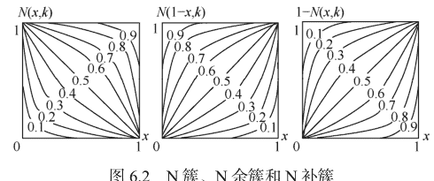

##### 6.2.3 N 范数完整簇：定义与两大核心模型

###### 定义 6.2.3
由 N 元簇 \(\Phi(x, k)\) 通过标准非生成公式 \(N(x, k)=\Phi^{-1}(1-\Phi(x, k), k)\) 导出的簇，称为 N 范数完整簇（简称 N 簇）。

基于定理 6.2.2 与 6.2.3，两大最常用 N 簇模型如下：

1.  **多项式型 N 簇**：
    \(N_1(x, k)=\frac{1-x}{1+\lambda x}\)，定义域 \(x, k \in [0, 1]\)。
    参数联系：\(\lambda=\frac{1-2k}{k^2}\) 或 \(k=\frac{(1+\lambda)^{1/2}-1}{\lambda}\)。
    关键锚点：\(N_1(x, 0)=\mathbf{N_0}\)、\(N_1(x, 0.5)=\mathbf{N_1}\)、\(N_1(x, 1)=\mathbf{N_3}\)。

2.  **指数型 N 簇**：
    \(N_2(x, k)=(1-x^n)^{1/n}\)，定义域 \(x, k \in [0, 1]\)。
    参数联系：\(n=-1/\log_2 k\) 或 \(k=2^{-1/n}\)。
    关键锚点：\(N_2(x, 0)=\mathbf{N_0}\)、\(N_2(x, 0.5)=\mathbf{N_1}\)、\(N_2(x, 1)=\mathbf{N_3}\)。

###### 定义 6.2.4（余簇与补簇）
若 \(N(x, k)\) 为 N 簇，则定义：
-   \(N(1-x, k)\) 为 **N 余簇**（n-remainder cluster）；
-   \(1-N(x, k)\) 为 **N 补簇**（n-complement cluster）。

二者满足对偶关系：\(N(1-x, k)=1-N(x, 1-k)\)。由此直接推得：

###### 推论 6.2.1
N 补簇内的算子必属于 N 余簇。

一般而言，N 余簇与 N 元簇 \(\Phi(x, k)\) 是两码事，但 Sugeno 算子簇是个特例。

###### 定理 6.2.4
广义 Sugeno 算子簇的 N 余簇 \(N(1-x, k)\) 正是 N 元簇 \(\Phi(x, k)\)。

**证明梗概**：
设 \(\lambda_1=(1-2k_1)/k_1^2\)，代入 Sugeno 非模型 \(N(x, k_1)=\frac{1-x}{1+\lambda_1 x}\)，经变形可得 \(N(1-x, k_1)=\frac{x(1+\lambda_2)^{1/2}}{1+((1+\lambda_2)^{1/2}-1)x}=\Phi(x, k_2)\)，其中 \(\lambda_2\) 与 \(\lambda_1\) 满足特定映射关系。得证。

图 6.3 直观展示了两大主流模型簇随参数 \(k\) 演变的曲面形态，便于对比共性与细微差异。

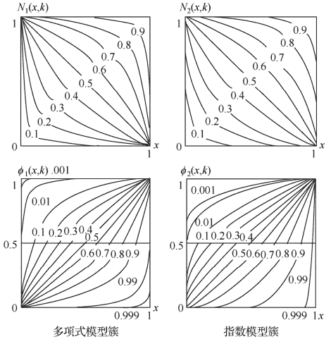

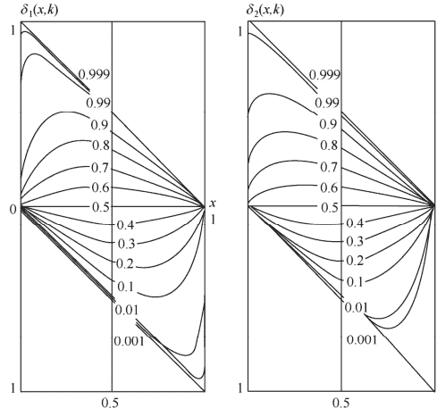

**图 6.3 两大主流模型随参数 k 演变示意**

深入对比可见（详见图 6.4）：
-   **三大锚点重合**：\(k=0, 0.5, 1\) 时两模型完全一致；
-   **三大特征点重合**：任意 \(k\) 下，\(x=0, k, 1\) 处函数值完全相等；
-   **对称性**：\(k\) 与 \(1-k\) 对应曲线呈对偶关系。

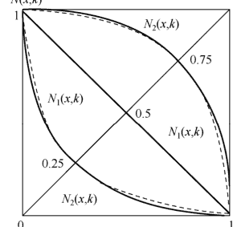

**图 6.4 两大 N 范数模型深度对比**

**模型选型洞察**：
多项式模型（广义 Sugeno 簇）性质优良、计算高效，且其 N 余簇即 N 元簇，是理论研究与通用应用的首选理想模型。然而，在泛逻辑运算的物理电路实现场景下，指数模型展现出更强的器件适配性，且能与泛与/或运算模型更好地协同。鉴于此，本书后续章节将以指数模型为主线展开深度探讨。

**精度偏差量化**：
两模型数值极其接近。表 6.1 列出了典型参数下的偏差 \(\Delta_k=N_2(x, k)-N_1(x, k)\)。因 \(\Delta_k\) 关于 \(k=0.5\) 对称，且在 \(k=0, 0.5, 1\) 处为零，表中仅展示 \(k=0.6, 0.7, 0.8, 0.9\) 四组数据。数据显示：最大偏差 \(\max \Delta_k\) 控制在 5% 以内，常态分布在 1%~2% 区间。因此，在允许微小误差的工程场景中，两模型可视为等价，支持混用。

**表 6.1 两大主流正常形模型簇偏差对照表**

| x | 0 | 0.1 | 0.2 | 0.3 | 0.4 | 0.5 | 0.6 | 0.7 | 0.8 | 0.9 | 1 |
|---|---|---|---|---|---|---|---|---|---|---|---|
| \(\Delta_{0.6}\) | 0 | 0.015 | 0.016 | 0.012 | 0.007 | 0.002 | 0 | 0.003 | 0.012 | 0.026 | 0 |
| \(\Delta_{0.7}\) | 0 | 0.014 | 0.021 | 0.022 | 0.019 | 0.012 | 0.004 | 0 | 0.008 | 0.043 | 0 |
| \(\Delta_{0.8}\) | 0 | 0.007 | 0.013 | 0.018 | 0.021 | 0.020 | 0.015 | 0.006 | 0 | 0.023 | 0 |
| \(\Delta_{0.9}\) | 0 | 0.001 | 0.003 | 0.005 | 0.008 | 0.011 | 0.013 | 0.013 | 0.008 | 0 | 0 |

##### 6.2.4 N 完整簇上的广义自封闭运算体系

N 簇不仅继承了 N 范数的一切基本性质，更构建了一套完备的“广义自封闭运算体系”，涵盖各类对偶运算与复合运算的封闭性。

###### 定理 6.2.6（元对偶运算自封闭性）
在 N 簇 \(N(x, k)=\Phi^{-1}(1-\Phi(x, k), k)\) 中，任取 N 范数 \(N(x, k_1)\) 与 N 元簇中任意生成元 \(\Phi(x, k_2)\)，其元对偶运算 \(\Phi^{-1}(N(\Phi(x, k_2), k_1), k_2)\) 结果仍落在 N 簇内。

**证明逻辑**：
元对偶本质是 N 范数（依定理 6.1.10）；利用 \(\Phi\) 簇的复合封闭性及 \(\Phi^{-1}\) 簇的复合封闭性，可将表达式化简为 \(N(x, k_{21})\) 形式，确认其属于 N 簇。

**推论 6.2.2**：中心 N 范数 \(1-x\) 可与任意 N 范数同簇；但两个同与 \(1-x\) 同簇的 N 范数，彼此不一定同簇。

###### 定理 6.2.7（零级对偶运算自封闭性）
在 N 簇 \(N(x, k)\) 中，任意 N 范数 \(N(x, k_1)\) 的零级对偶 \(N'(x, k_1)=1-N(1-x, k_1)=N(x, 1-k_1)\) 仍属于 N 簇。

**证明起步**：
已知 \(N(x, k_1)\) 是 N 范数（定理 6.1.10），需进一步验证其零级对偶形式 \(N(x, 1-k_1)\) 满足 N 簇定义……

```
\(\Phi(x, k1)=\Phi^{-1}(x, k1')\)
\(\Phi^{-1}(1-x, k1)=1-\Phi^{-1}(x, k1)=\Phi(1-x, k2)\)
\(\Phi(1-x, k1)=\Phi^{-1}(1-x, k2)=1-\Phi^{-1}(x, k2)\)
\(N'(x, k1)=1-\Phi^{-1}-\Phi(1-x, k1), k1)=\Phi(\Phi(1-x, k1), k2)\)
\(=\Phi(1-\Phi^{-1}(x, k2), k2)=\Phi^{-1}(1-\Phi(x, k2), k2')=N(x, k2')\)
```

这意味着零级对偶关系 $ N'(x, k_1)=N(x, k_2') $ 依旧落在 N 簇范围内。依据定理 6.1.6，可推导 $ N'(x, k_1)=1-N(1-x, k_1)=N(x, 1-k_1) $，从而证毕。该结论揭示：N 范数与其零级对偶归属同一簇系。

###### 推论 6.2.3 $ N(1-x, k_1)=1-N(x, 1-k_1) $。

###### 定理 6.2.8（N 簇内一级对偶运算的自闭合性） 在 N 簇 $ N(x, k) $ 中，任取两个 N 范数 $ N(x,k_1) $ 与 $ N(x,k_2) $，其构成的一级对偶运算 $ N'(x, k_2)=N(N(N(x, k_1), k_2), k_1)=N(x, N(k_2, k_1)) $ 结果仍属于该簇。

论证如下：根据定理 6.1.5，$ N(N(N(x, k_1), k_2), k_1) $ 构成 N 范数；关键在于确证该一级对偶是否仍处于 N 簇内。鉴于 $ \Phi(x, k) $ 簇具备逆运算自闭合特性

```
\( N(x, k_2)=\Phi^{-1}(1-\Phi(x, k_2), k_2)=\Phi(1-\Phi^{-1}(x, k_2'), k_2') \)
```

结合定理 6.1.9 与定理 6.1.10 的推论

```
\( N(N(N(x, k_1), k_2), k_1)=\Phi^{-1}(1-\Phi(\Phi(1-\Phi^{-1}(\Phi(1-\Phi(x, k_1), k_1), k_2'), k_2'), k_1), k_1) \)
\(=\Phi^{-1}(1-\Phi(1-\Phi^{-1}(1-\Phi(x, k_1), k_{21}), k_{21}), k_1) \)
\(=\Phi^{-1}(1-N(1-\Phi(x, k_1), k_{21}'), k_1) \)
\(=\Phi^{-1}(N'(\Phi(x, k_1), k_{21}'), k_1)=N(x, k_{21}) \)
```

可知一级对偶 $ N'(x, k_2)=N(N(N(x, k_1), k_2), k_1) $ 依然位于 N 簇中。

由定理 6.1.6 可得 $ N'(x,k_2)=N(x,N(k_2,k_1)) $，故定理成立。

此定理揭示了 N 范数与其一级对偶同属一簇。

###### 定理 6.2.9（N 簇内二次复合运算的余闭合性） 在 N 范数完整簇 $ N(x, k) $ 内，任意两个 N 范数 $ N(x, k_1) $ 与 $ N(x, k_2) $ 的复合运算 $ N(N(x, k_1), k_2) $ 落在 N 余簇中。

论证：因为 N 范数与其元对偶同簇，一般而言

```
N(x, k_1)=\Phi^{-1}(N(\Phi(x, k_3), k_1), k_3), N(x, k_2)=\Phi^{-1}(N(\Phi(x, k_3), k_2), k_3)
```

```
N(N(x, k_1'), k_2')=\Phi^{-1}(N(\Phi(\Phi^{-1}(N(\Phi(x, k_3), k_1), k_3), k_3), k_2), k_3)
=\Phi^{-1}(N(N(\Phi(x, k_3), k_1), k_2), k_3)
```

即 $ N(N(x, k), k_2) $ 与其元对偶 $ N(N(x, k_1'), k_2') $ 同簇。

特例情况下，令 $\Phi(x, k_3)=\Phi^{-1}(x, k_1)$，则有

```
N(N(x, k_1'), k_2')=\Phi(N(N(\Phi^{-1}(x, k_1), k_1), k_2), k_1)=N(1-x, k_2')
```

这表明 $ N(N(x, k_1), k_2) $ 位于 N 余簇中。

###### 定理 6.2.10（N 簇内三次复合运算的自闭合性） 在 N 范数完整簇 $ N(x, k) $ 内，任意三个 N 范数 $ N(x, k_1), N(x, k_2), N(x, k_3) $ 的复合运算 $ N(N(N(x, k_1), k_2), k_3) $ 依然在 N 簇内。

论证：综合定理 6.2.7 与定理 6.2.9 可知

```
N(N(N(x, k_1), k_2), k_3)=N(1-N(x, k_1), k_{23})=N(N(1-x, 1-k_1), k_{23})
```

```
=N(1-(1-x), k_{23})=N(x, k_{23})
```

由此确认 $ N(N(N(x, k_1), k_2), k_3) $ 仍处于 N 簇中。

###### 推论 6.2.4 指出：在 N 范数完整簇 $ N(x, k) $ 中，任意偶数个 N 范数 $ N(x, k_1), N(x, k_2), ..., N(x, k_n) $ 复合运算 $ N(...N(N(x, k_1), k_2), ..., k_n) $ 落在 N 余簇中；任意奇数个 N 范数复合运算则落在 N 簇中。

###### 定义 6.2.5 将 $ N(x, k) $ 簇内各类对偶运算与复合运算仅能在 N 簇或 N 余簇间演变的特性，称为 N 簇上的广义自闭合性。

#### 6.3 阈元量词及其运算法则

前文已确立 N 性生成元完整簇 $ \Phi(x, k) $ 具备自闭合性，并证明了 N 范数完整簇 $ N(x, k) $ 的广义自闭合性。接下来将深入探究这两个完整簇中的误差合成规律。为便于分析不同误差水平混合运算的规律，需引入标志误差水平的阈元量词 $ \mathcal{G}^k $。

在泛逻辑学标准命题演算体系中，核心涉及阈元量词 $ \mathcal{G}^k $，它是一种柔性量词，其中 $ k \in [0, 1] $ 代表命题真值的阈元。逻辑公式里， $ \mathcal{G}^k p $ 表明其后命题 $ p $ 的真值 $ x $ 携带水平为 $ k $ 的误差。讨论运算模型时，常简记为 $ \mathcal{G}^k x $。

下文将基于 N 性生成元完整簇，详述阈元量词 $ \hat{\omega}^k $ 的定义、性质及其对泛非运算模型的影响，助力我们把握泛非命题连接词的普适规律。最后汇总前期成果，给出线序连续值逻辑（含模糊逻辑）与泛逻辑学中关于非命题连接词的逻辑公式体系。

##### 6.3.1 阈元量词的定义与数学建模

前文已知，若命题 $ p $ 的真值为带误差的模糊测度 $ x^* $（即不可加模糊测度），且需用此 $ x^* $ 计算非命题真值 $ N(x^*, k) $（设其与 $ x^* $ 共享误差类型 $ \Phi(x^*, k) $ 与水平 $ k $），可先用误差修正函数完整簇 $ \Phi(x^*, k) $ 校正 $ x^* $ 的误差影响，获精确真值 $ x=\Phi(x^*, k) $；再经非运算基模型 $ N(x)=1-x $ 得非命题精确真值 $ N(x)=1-\Phi(x^*, k) $；最后用 $ \Phi^{-1}(N(x), k) $ 还原误差影响，得同类型、同水平 $ k $ 的真值 $ N(x^*, k) $，即 N 范数模型为：

$ N(x^*, k)=\Phi^{-1}(1-\Phi(x^*, k), k) $ (6-2)

当 $ k=0.5 $ 时， $ \Phi(x, k)=x, N(x, k)=N(x)=1-x $，表示 $ x $ 为无误差真值。

**定义 6.3.1（阈元量词）** 阈元量词 $ \hat{\omega}^k $ 是标识误差水平的逻辑修饰符，指示其管辖范围内的逻辑真值带有误差，水平为 $ k $。其运算模型为 $ \hat{\omega}^k x = \Phi^{-1}(x, k) $。

因 $ \hat{\omega}^{0.5}x=x $ 代表无误差真值，故 $ \hat{\omega}^{0.5} $ 可省略。

在推理系统中，若全体命题阈元 $ k $ 一致，依合律 $ N(N(x,k), k))=x $，无需 $ \hat{\omega}^k $ 协助；否则必须借 $ \hat{\omega}^k $ 标识命题真值误差水平。例如式(6-2)可重写为：

$ \hat{\omega}^k N(x)=N(\hat{\omega}^k x, k) $ (6-3)

意指：误差水平 $ k $ 的命题 $ \hat{\omega}^k x $，经同水平泛非运算后，结果仍为误差水平 $ k $ 的非命题 $ \hat{\omega}^k N(x) $。泛逻辑公式中，常用 $ \sim $ 表 $ N(x)=1-x $，用 $ \sim_k $ 表 $ N(x,k)=\Phi^{-1}(1-\Phi(x, k), k) $，故式(6-3)可进一步表为：

$ \hat{\omega}^k p = p \sim_k \hat{\omega}^k p $ (6-4)

式(6-4)实为阈元量词首条移位规则，规定了 $ \hat{\omega}^k $ 在泛非连接词前后移动的原则：中心非算子 $ \sim $ 前的 $ \hat{\omega}^k $ 可后移，条件是 $ \sim $ 升级为 $ \sim_k $，反之亦然。

**定义 6.3.2（阈元量词的逆）** 阈元量词 $ \hat{\omega}^k $ 的逆仍为阈元量词，记作 $ \hat{\omega}^{\ominus k} $，其运算模型为 $ \hat{\omega}^{\ominus k} x = \Phi(x, k) $。

鉴于泛逻辑学最常用的 N 性生成元完整簇为多项式模型簇与指数模型簇，本节将直接以此二者验证相关性质。

##### 6.3.2 阈元量词的基础性质

借助阈元量词数学模型 $ \hat{\omega}^k x = \Phi^{-1}(x, k) $ 与 $ \hat{\omega}^{\ominus k} x = \Phi(x, k) $，可推导其诸多性质。主要基本性质如下：

###### 定理 6.3.1（阈元逆运算规则） 计算阈元逆 $ \Theta k $ 的规则：多项式模型中 $ \Theta k = 1-k $；指数模型中 $ \Theta k = (2^{|a|-1}/\log_2 k) $。

论证：由 $ \hat{\omega}^k x = \Phi^{-1}(x, k), \hat{\omega}^{\ominus k} x = \Phi(x, k) = \Phi^{-1}(x, k') $ 知，二者互逆。

- 1) 多项式模型簇 $ \Phi_1(x, k) $ 具逆运算自闭合性。$ \Phi_1(x, k) = \Phi_1^{-1}(x, k') $，解得 $ \lambda' = -\lambda / (1 + \lambda) $。代入 $ \lambda = (1-2k)/k^2, \lambda' = (1-2k')/k'^2 $，得 $ k + k' = 1, \Theta k = k' = 1-k $。

- 2) 指数函数簇 $ \Phi_2(x, k) $ 亦具逆运算自闭合性。任意生成元 $ \Phi_2(x, k) = x^n $ 的逆为 $ \Phi_2^{-1}(x, k) = \Phi_2(x, k') = x^{n'} $，解得 $ n' = 1/n $。代入 $ n = -1/\log_2 k, n' = -1/\log_2 k' $，得 $ \log_2 k' = 1/\log_2 k, \Theta k = k' = (2^{|a|-1}/\log_2 k) $。

定理得证。若 $ k_1 = 0.5 $，则 $ \Theta k_1 = 0.5 $，中元逆仍为中元。

###### 定理 6.3.2（迁移律） 阈元量词跨等号迁移规则：若 $ \hat{\omega}^k x = y $，则 $ x = \hat{\omega}^{\Theta k} y $。

论证：$ \hat{\omega}^k x = \Phi^{-1}(x, k) = y \Rightarrow x = \Phi(y, k) = \Phi^{-1}(y, \Theta k) = \hat{\omega}^{\Theta k} y $。得证。

迁移律为阈元量词第二移位规则：量词可跨等号迁动，数值变逆。

依式(6-4)可进一步将第二移位规则表达为：

```
\sim p = \hat{\omega}^{\Theta k} \sim k \hat{\omega}^k p
```

###### 推论 6.3.1（逆还原律） 阈元逆满足还原律，即 $ \Theta \Theta k = k $。

###### 定义 6.3.3（阈元量词的和） 两阈元量词 $ \hat{\omega}^{k_1} $ 与 $ \hat{\omega}^{k_2} $ 的合成 $ \hat{\omega}^{k_1} \hat{\omega}^{k_2} x = \hat{\omega}^{k_3} x $ 仍为阈元量词，记作 $ \hat{\omega}^{k_1} \hat{\omega}^{k_2} x = \hat{\omega}^{k_1 \Theta k_2} x $，称 $ k_1 \Theta k_2 $ 为阈元和，其运算模型为 $ \hat{\omega}^{k_1 \Theta k_2} x = \Phi^{-1}(\Phi^{-1}(x, k_1), k_2) $。

###### 定理 6.3.3（和交换律） 阈元和满足交换律，即 $ \hat{\omega}^{k_1 \Theta k_2} x = \hat{\omega}^{k_2 \Theta k_1} x $。

论证：
1) 多项式模型簇 $ \Phi_1(x, k) = x(1+\lambda)^{1/2} / (1+((1+\lambda)^{1/2}-1)x), \lambda = (1-2k)/k^2 $ 中，任意两生成元 $ \Phi_1(x, k_1), \lambda_1=(1-2k_1)/k_1^2 $ 与 $ \Phi_1(x, k_2), \lambda_2=(1-2k_2)/k_2^2 $，其复合生成元仍在簇内，且

```
\Phi_1(\Phi_1(x, k_1), k_2) = \Phi_1(x, k_1)(1+\lambda_2)^{1/2} / (1+((1+\lambda_2)^{1/2}-1)\Phi_1(x, k_1))\n= x(1+\lambda_1)^{1/2}(1+\lambda_2)^{1/2} / (1+((1+\lambda_1)^{1/2}(1+\lambda_2)^{1/2}-1)x)\n= x(1+\lambda_3)^{1/2} / (1+((1+\lambda_3)^{1/2}-1)x) = \Phi_1(x, k_3)
```

其中 $ \lambda_3=(1+\lambda_1)(1+\lambda_2)-1=\lambda_1+\lambda_2+\lambda_1\lambda_2, k_3=((1+\lambda_3)^{1/2}-1)/\lambda_3 $，与复合次序无关；
$ \Phi_1(\Phi_1(x, k_1), k_2) = \Phi_1(\Phi_1(x, k_2), k_1) = \Phi_1(x, k_3) $。

2) 指数函数簇 $ \Phi_2(x, k) = x^n, n > 0, k = 2^{-1/n} $ 中，任意两生成元 $ \Phi_2(x, k_1) = x^{n_1} $ 与 $ \Phi_2(x, k_2) = x^{n_2} $，复合运算仍在簇内，且
$ \Phi_2(\Phi_2(x, k_1), k_2) = x^{n_1 n_2} = \Phi_2(x, k_3), k_3 = 2^{-1/(n_1 n_2)} $，
与次序无关，即 $ \Phi_2(\Phi_2(x, k_1), k_2) = \Phi_2(\Phi_2(x, k_2), k_1) = \Phi_2(x, k_3) $。
显然，其逆运算复合亦与次序无关：
$ \Phi^{-1}(\Phi^{-1}(x, k_1), k_2) = \Phi^{-1}(\Phi^{-1}(x, k_2), k_1) = x^{1/(n_1 n_2)} = \Phi^{-1}(x, k_3) $。

故阈元和满足交换律。

和交换律为阈元量词第三移位规则：相邻阈元量词可任意交换位置，数值不变。
$ \hat{\omega}^{k_1} \hat{\omega}^{k_2} x = \hat{\omega}^{k_2} \hat{\omega}^{k_1} x $

###### 定理 6.3.4（阈元和规则）

### 定理 6.3.4（圆元和运算法则）

圆元和 $k_1 \oplus k_2$ 的具体计算方式取决于所采用的模型：

*   **多项式模型下**：$k_1 \oplus k_2 = \frac{k_1 k_2}{1 - k_1 - k_2 + 2k_1 k_2}$；
*   **指数模型下**：$k_1 \oplus k_2 = 2^{-\log_2 k_1 \log_2 k_2}$。

#### 证明过程

**1. 多项式模型推导**
依据定理 6.3.3，在多项式模型簇 $\Phi_1(x, k)$ 内，复合运算满足 $\Phi_1(\Phi_1(x, k_1), k_2) = \Phi_1(x, k_3)$，且顺序无关，参数关联为 $\lambda_3 = (1 + \lambda_1)(1 + \lambda_2) - 1$。
对逆运算同理：$\Phi_1^{-1}(\Phi_1^{-1}(x, k_1), k_2) = \Phi_1^{-1}(x, k_3)$。
代入换元关系：
$k_3 = \frac{(1 + \lambda_3)^{1/2} - 1}{\lambda_3}$，
$\lambda_1 = \frac{1 - 2k_1}{k_1^2}$，
$\lambda_2 = \frac{1 - 2k_2}{k_2^2}$。
经代数化简可得：
$\lambda_3 = \frac{(1 - k_1)^2 (1 - k_2)^2}{k_1^2 k_2^2} - 1$，
进而求出 $k_3$：
$k_3 = k_1 \oplus k_2 = \frac{1}{\frac{(1 - k_1)(1 - k_2)}{k_1 k_2} + 1} = \frac{k_1 k_2}{1 - k_1 - k_2 + 2k_1 k_2}$。

**2. 指数模型推导**
在指数函数簇 $\Phi_2(x, k)$ 中，复合运算 $\Phi_2(\Phi_2(x, k_1), k_2) = \Phi_2(x, k_3)$ 同样满足交换律，且参数联系为 $k_3 = 2^{-1/n_3}, n_3 = n_1 n_2$。
逆运算形式为 $\Phi_2^{-1}(\Phi_2^{-1}(x, k_1), k_2) = \Phi_2^{-1}(x, k_3)$。
利用 $n_1 = -1 / \log_2 k_1$, $n_2 = -1 / \log_2 k_2$, $n_3 = -1 / \log_2 k_3$ 代入 $n_3 = n_1 n_2$，即得：
$\log_2 k_3 = -\log_2 k_1 \log_2 k_2$，
即 $k_3 = k_1 \oplus k_2 = 2^{-\log_2 k_1 \log_2 k_2}$。
综上，定理得证。

---

### 定理 6.3.5（对偶律）

圆元和运算遵循对偶律，即：
$k_1 \oplus k_2 = \Theta(\ominus k_1 \oplus \ominus k_2)$。

#### 证明过程

**1. 多项式模型验证**
结合定理 6.3.1 与 6.3.4，多项式模型中 $\ominus k = 1 - k$，且 $k_1 \oplus k_2 = \frac{k_1 k_2}{1 - k_1 - k_2 + 2k_1 k_2}$。
右边表达式展开：
$\Theta(\ominus k_1 \oplus \ominus k_2) = \frac{1}{\frac{(1 - k_1)(1 - k_2)}{1 - (1 - k_1)(1 - k_2) + 2(1 - k_1)(1 - k_2)}}$
化简后等于 $\frac{k_1 k_2}{1 - k_1 - k_2 + 2k_1 k_2}$，与左边一致。

**2. 指数模型验证**
设 $k_1, k_2$ 分别对应参数 $n_1, n_2$，则 $k_1 \oplus k_2$ 对应 $n_1 n_2$。
根据对偶定义，$\ominus k_1$ 对应 $1/n_1$，$\ominus k_2$ 对应 $1/n_2$。
则 $\ominus k_1 \oplus \ominus k_2$ 对应 $1/(n_1 n_2)$。
施加 $\Theta$ 运算（参数取倒数）后，对应参数变回 $n_1 n_2$。
因此 $\Theta(\ominus k_1 \oplus \ominus k_2)$ 与 $k_1 \oplus k_2$ 等价。
定理成立。

---

### 定义 6.3.4（圆元差）

定义圆元差为 $k_1 \ominus k_2 = k_1 \oplus (\ominus k_2)$。
其运算模型表达为：
$\stackrel{\frown}{k_1} \ominus \stackrel{\frown}{k_2} x = \Phi^{-1}(\Phi^{-1}(x, k_1), \ominus k_2)$

---

### 定理 6.3.6（圆元差计算规则）

圆元差 $k_1 \ominus k_2$ 的具体公式为：

*   **多项式模型**：$k_1 \ominus k_2 = \frac{k_1(1-k_2)}{k_1 + k_2 - 2k_1 k_2}$；
*   **指数模型**：$k_1 \ominus k_2 = 2^{-\log_2 k_1 / \log_2 k_2}$。

#### 证明过程

**1. 多项式模型**
由定理 6.3.1 与 6.3.4 知：$\ominus k_2 = 1 - k_2$。
代入圆元和公式：
$k_1 \oplus (\ominus k_2) = \frac{k_1(1-k_2)}{1 - k_1 - (1-k_2) + 2k_1(1-k_2)} = \frac{k_1(1-k_2)}{k_1 + k_2 - 2k_1 k_2}$。

**2. 指数模型**
已知 $\log_2(\ominus k_2) = 1 / \log_2 k_2$。
利用指数模型圆元和公式 $k_1 \oplus k_2 = 2^{-\log_2 k_1 \log_2 k_2}$，替换 $k_2$ 为 $\ominus k_2$ 即得：
$k_1 \ominus k_2 = 2^{-\log_2 k_1 / \log_2 k_2}$。
证毕。

---

### 推论 6.3.2（吸收律）

圆元逆运算满足吸收律：$k \ominus k = 0.5$，即 $\stackrel{\frown}{k} \ominus k x = x$。此结论对任意真值 $x$ 均成立，与其误差水平无关。

基于吸收律，式(6-5)可进一步重写为圆元量词的**第四移位规则**：
$\stackrel{\frown}{k} p = \stackrel{\frown}{k} \stackrel{\frown}{k} \oplus k p$ \hfill (6-6)

这揭示了泛非运算与中心非运算的联系：
$\sim k = \stackrel{\frown}{k} \stackrel{\frown}{k}$，
$\stackrel{\frown}{k} \oplus k = \oplus k \stackrel{\frown}{k}$。

---

### 定义 6.3.5（不等差 N 范数）

将误差水平为 $k_1$ 的命题真值 $\stackrel{\frown}{k_1} x$ 代入误差水平为 $k_2$ 的 N 范数中（$k_1 \neq k_2$），得到 $N(\stackrel{\frown}{k_1} x, k_2)$。
称之为**不等差 N 范数**，逻辑式记为 $\stackrel{\frown}{k_2} \stackrel{\frown}{k_1} p$。
相对地，称 $N(\stackrel{\frown}{k} x, k)$ 为**等差 N 范数**。

---

### 定理 6.3.7（不等差 N 范数运算模型）

不等差 N 范数的运算模型为：
$\stackrel{\frown}{k_2} \stackrel{\frown}{k_1} p = \ominus k_2 \stackrel{\frown}{k_1} \oplus k_2 p$ \hfill (6-7)

#### 证明
由式(6-6)第四移位规则：
$\stackrel{\frown}{k_2} \stackrel{\frown}{k_1} p = \stackrel{\frown}{k_2} \stackrel{\frown}{k_2} \stackrel{\frown}{k_1} \oplus k_2 p = \stackrel{\frown}{k_2} \stackrel{\frown}{k_1} \oplus k_2 p$。
即得式(6-7)，这是圆元量词的**第五移位规则**。
当 $k_1 = 0.5$ 时，该规则退化为第四移位规则。

---

## 6.3.3 N 范数的误差合成规律

前文已证 N 范数完整簇 $N(x, k)$ 具备广义自封闭性，并探讨了圆元量词 $\stackrel{\frown}{k}$ 的误差合成。下面深入研究 N 范数完整簇内部的误差合成机制。

此前默认 $x$ 为无误差逻辑真值。实则 $x$ 可为任意误差水平的逻辑真值或公式，仅在当前讨论中将其视为不可分整体处理。

---

### 定理 6.3.8（非合成律）

若 $N(x, k_1)$ 与 $N(x, k_2)$ 同属 N 范数完整簇 $N(x, k)$，则：
$N(N(x, k_1), k_2) = 1 - N(x, k_3)$，
其中 $N(x, k_3)$ 仍属于该簇，且 $k_3 = k_1 \ominus k_2$。

#### 证明（以多项式模型为例）
因各类 N 范数簇共享不动点 $k$ 且具广义自封闭性，选用多项式模型证明即可：
$N(x,k) = \frac{1-x}{1+\lambda x}, \quad \lambda = \frac{1-2k}{k^2}, \quad k \in (0, 1)$

设 $\lambda_1 = \frac{1-2k_1}{k_1^2}, \lambda_2 = \frac{1-2k_2}{k_2^2}$。
计算二重嵌套：
$N(N(x,k_1),k_2) = \frac{1 - \frac{1-x}{1+\lambda_1 x}}{1 + \lambda_2 \frac{1-x}{1+\lambda_1 x}} = \frac{(1+\lambda_1)x}{1+\lambda_2 + (\lambda_1-\lambda_2)x}$
整理形式：
$= \frac{\frac{1+\lambda_1}{1+\lambda_2}x}{1 + \frac{\lambda_1-\lambda_2}{1+\lambda_2}x} = \frac{(1 + \frac{\lambda_1-\lambda_2}{1+\lambda_2})x}{1 + \frac{\lambda_1-\lambda_2}{1+\lambda_2}x} = 1 - \frac{1-x}{1 + \frac{\lambda_1-\lambda_2}{1+\lambda_2}x} = 1 - N(x, k_3)$

其中新参数 $\lambda_3 = \frac{\lambda_1-\lambda_2}{1+\lambda_2}$。
代入 $\lambda$ 与 $k$ 的关系展开化简：
$\lambda_3 = \frac{k_2^2(1-k_1)^2 - k_1^2(1-k_2)^2}{k_1^2(1-k_2)^2} = \frac{1 - m^2}{m^2}, \quad m = \frac{k_1(1-k_2)}{k_2(1-k_1)}$

因 $\lambda_3 = \frac{1-2k_3}{k_3^2} = \frac{1-m^2}{m^2}$，
解得 $k_3^2 = m^2(1-k_3)^2$，即 $\frac{k_3}{1-k_3} = \pm m$。
由 $k_3 \in (0,1)$ 取正解：
$k_3 = \frac{m}{m+1} = \frac{k_1(1-k_2)}{k_1 + k_2 - 2k_1 k_2} = k_1 \ominus k_2$。
非合成律得证。■

**非合成律的逻辑表达**：
$\sim\sim k_2 \ominus k_1 P = \sim\sim k_1 \ominus k_2 P$。

**特例——对合律**：
当 $k_1 = k_2$ 时，$k_3 = 0.5$，$N(N(x,k_1), k_2) = 1 - N(x, 0.5) = x$，
即 $\sim\sim k_1 \sim\sim k_1 P = P$。对合律是非合成律的特例。

**第六移位规则**：
由非合成律推导，圆元量词可在两个否定符号两侧自由移动而无需变换：
$\Theta k_2 \dots \Theta k_2 \Theta k_1 \sim\sim k_1 P = \sim\sim \Theta k_2 \Theta k_1 \sim\sim k_1 \sim\sim \Theta k_1 \Theta k_2 P$。

---

### 定理 6.3.9（非交换律）

泛非运算中满足：
$\sim\sim k_2 \ominus k_1 P = \sim\sim \Theta k_1 \sim\sim \Theta k_2 P$。

#### 证明
依定理 6.2.1：
$\sim\sim k_2 \ominus k_1 P = \sim\sim k_1 \ominus k_2 P$，
$\sim\sim \Theta k_1 \sim\sim \Theta k_2 P = \sim\sim \Theta k_2 \ominus \Theta k_1 P$。
又 $\Theta k_2 \ominus \Theta k_1 = \Theta k_2 \ominus k_1 = k_1 \ominus k_2$。
两边等价，定理成立。■

---

### 定理 6.3.10（非吸收律）

泛非运算中成立以下关系：
$\stackrel{\frown}{k} \sim 0 P = \sim\sim 0 P, \quad \stackrel{\frown}{k} \sim 1 P = \sim\sim 1 P$
$\sim\sim 0 \sim k P = \sim\sim 0 P, \quad \sim\sim 1 \sim k P = \sim\sim 1 \sim P$

#### 证明
依定理 6.2.1：$\stackrel{\frown}{k_2} \stackrel{\frown}{k_1} P = \sim\sim k_1 \ominus k_2 P$，且 $k_1 \ominus k_2 = \frac{k_1(1-k_2)}{k_1+k_2-2k_1k_2}$。

*   若 $k_1=0$：$k_1 \ominus k_2 = 0$，得 $\stackrel{\frown}{k} \sim 0 P = \sim\sim 0 P$；
*   若 $k_1=1$：$k_1 \ominus k_2 = 1$，得 $\stackrel{\frown}{k} \sim 1 P = \sim\sim 1 P$；
*   若 $k_2=0$：$k_1 \ominus k_2 = 1$，得 $\sim 0 \sim k P = \sim\sim 1 P$，结合非交换律 $\sim 0 \sim k P = \sim 0 P$；
*   若 $k_2=1$：$k_1 \ominus k_2 = 0$，得 $\sim 1 \sim k P = \sim\sim 0 P$，结合非交换律 $\sim 1 \sim k P = \sim 1 \sim P$。
证毕。

---

### 定理 6.3.11（非互补律）

泛非运算中：
$\sim \Theta \sim k P = \sim\sim k' P, \quad k' = \frac{k^2}{1-2k+2k^2}$
$\sim \sim \Theta k P = \sim\sim k' P, \quad k' = \frac{(1-k)^2}{1-2k+2k^2}$

#### 证明
仍用定理 6.2.1：$\stackrel{\frown}{k_2} \stackrel{\frown}{k_1} P = \sim\sim k_1 \ominus k_2 P$。

*   设 $k_1 = k, k_2 = 1-k$，则 $k_1 \ominus k_2 = k' = \frac{k^2}{1-2k+2k^2}$，得 $\sim \Theta \sim k P = \sim\sim k' P$；
*   （第二式同理推导，此处省略重复步骤）。

### 6.4 泛非运算体系全景扫描

本节将前文探讨的泛非命题连接词——其定义、运算模型及核心逻辑公式——进行系统性梳理与总结。重点聚焦于线序连续值逻辑中的基础非连接词及其公式体系，这是逻辑学最原初的形态，其他非运算模型皆可视作其退化或扩张形态。

#### 6.4.1 泛非连接词的逻辑内核

前文已揭示：线序连续值逻辑的泛非运算模型，本质上是一个**非算子完整簇**。该簇随形参 $k$ 在最大非算子与最小非算子之间，于存在域内连续、严格单调地演变。这是一个“待定”的模型：唯有锁定具体的位置标志参数 $k$，才能从簇中提取确定算子执行计算。

其逻辑意义在于**一级不确定性非运算**。不确定性源于模糊测度的不精确——认知偏差或测量误差，由广义自相关系数（误差系数）$k \in [0,1]$ 刻画。启用一级泛非运算的前提：命题与其非命题服从同一误差分布 $\mathcal{D}(x, k)$，且误差水平 $k$ 相同。

形式上，该模型是一个 **N范数完整簇 $N(x, k)$**。参数 $k$ 不仅是 $N(x, k)$ 的不动点，更是非运算中的**阈元**，直观表征“否定中的风险度”。
- **存在域**：$[0, 1] \times [0, 1]$
- **谱系三极**：最大非算子 $N_a = N(x, 1)$、中心非算子 $N_i = N(x, 0.5)$、最小非算子 $N_0 = N(x, 0)$。

#### 6.4.2 运算模型的“双引擎”架构

泛非模型由**生成基**与**N性生成元簇**双引擎驱动生成：

1.  **生成公式**：$N(x, k) = \Phi^{-1}(1 - \Phi(x, k), k),\quad x, k \in [0, 1]$
2.  **生成基 $N(x)=1-x$**：精确真值下的标准非运算，即中心非算子。
3.  **N性生成元簇 $\Phi(x, k)$**：核心功能是**校正模糊测度误差对真值的扭曲**，与误差分布函数 $\delta(x, k)$ 强相关。
4.  **无限多样性**：$\delta(x, k)$ 簇无限 $\Rightarrow$ $\Phi(x, k)$ 簇亦无限。
5.  **系统内统一性**：单一推理系统通常仅选用同一 $\Phi(x, k)$ 簇及 $N(x,k)$ 簇。
6.  **两大主流范式**：
    - **多项式模型**：
      $\Phi_1(x, k) = \frac{(1+\lambda)^{1/2}}{1 + ((1+\lambda)^{1/2} - 1)x},\quad \lambda = \frac{1-2k}{k^2}$
      $N_1(x, k) = \frac{1-x}{1 + \lambda x},\quad k = \frac{(1+\lambda)^{1/2} - 1}{\lambda}$
    - **指数模型**：
      $\Phi_2(x, k) = x^n,\quad n = -1 / \log_2 k$
      $N_2(x, k) = (1 - x^n)^{1/n},\quad k = 2^{-1/n}$

#### 6.4.3 核心性质“五大支柱”

基于N范数簇定义，泛非连接词呈现五大基本性质：

1.  **封闭性**：$N(x, k) \in [0, 1]$。泛非命题仍是命题，域不溢出。
2.  **对合律**：$\sim_k \sim_k p = p$。同误差水平 $k$ 连做两次（或偶数次）非运算，回归原命题。
3.  **泛非性**：$p$ 偏真（$k \Rightarrow p$）则 $\sim_k p$ 必不偏真（$\sim_k p \Rightarrow k$）；$p$ 偏假则 $\sim_k p$ 必不偏假。**“真假对易，越界必纠”**。
4.  **对偶律**：
    - $\sim_{k_2} \sim_{k_1} \sim_{k_2} p = \sim_k p, \quad k = N(k_1, k_2)$
    - $\sim \sim_k p = \sim_{(1-k)} p$
    簇 $N(x, k)$ 以中心算子为轴心呈**自对偶结构**，零级/一级对偶均内含于簇。
5.  **偶等性**：$\sim_k \sim_k \sim_k p = \sim_k p$。任意泛非运算的自对偶仍是自身。

#### 6.4.4 阈元量词 $^k$：跨误差层级的“穿梭符”

当推理系统混杂不同阈元 $k$ 的命题时，需引入阈元量词 $^k$ 显式标注误差水平。
- **模型**：$^k x = \Theta^{-1}(x, k)$，特例 $^{0.5}x = x$。
- **逆量词**：$^{\Theta^k} x = \Theta(x, k)$。
- **桥接公式**：$\sim_k p = {}^k \sim {}^{\Theta^k} p$（泛非 = 量词 + 中心非 + 逆量词）。

**六大移位规则（核心操作律）：**
1.  **一移**：$^k \sim p = \sim {}^k p$。量词跨越中心非，自身变补（$k \leftrightarrow \ominus k$）。
2.  **二移**：$^k p = q \Leftrightarrow p = {}^{\Theta^k} q$。量词跨等号，阈值取逆。
3.  **三移**：$^{k_1} {}^{k_2} p = {}^{k_2} {}^{k_1} p$。同类量词邻位可任意交换，值不变。
4.  **四移**：$\sim_k p = {}^k \sim {}^{\Theta^k} p$ 或 $\sim p = {}^{\Theta^k} \sim {}^k p$。泛非与中心非的互化公式。
5.  **五移**：$\sim_{k_2} {}^k_1 p = {}^{k_2} \sim {}^k_{1 \oplus k_2} p$。不等差泛非的等价变换。
6.  **六移**：量词可在双重否定符两侧自由穿梭，数值守恒。

**阈元代数运算（多项式/指数双轨制）：**
| 运算 | 多项式模型 | 指数模型 | 代数律 |
| :--- | :--- | :--- | :--- |
| **逆 $\ominus k$** | $1-k$ | $2^a (a=1/\log_2 k)$ | 还原律 $\ominus \ominus k = k$ |
| **和 $k_1 \oplus k_2$** | $\frac{k_1 k_2}{1-k_1-k_2+2k_1k_2}$ | $2^a (a=-\log_2 k_1 \log_2 k_2)$ | 对偶律 $k_1 \oplus k_2 = \ominus(\ominus k_1 \oplus \ominus k_2)$ |
| **差 $k_1 \ominus k_2$** | $\frac{k_1(1-k_2)}{k_1+k_2-2k_1k_2}$ | $2^a (a=-\log_2 k_1 / \log_2 k_2)$ | 吸收律 $k \ominus k = 0.5$（即 $^k {}^{\Theta^k} x = x$） |

#### 6.4.5 不等 $k$ 非运算的“合成代数”

当不同 $k$ 的非运算相遇，遵循四大合成律：

1.  **非合成律**：$\sim_{k_2} \sim_{k_1} p = \sim \sim_{k_3} p$，$k_3 = k_1 \ominus k_2$。
    > *两次异 $k$ 非运算合成为一补运算。*
2.  **非吸收律**：
    $\sim\sim_k \sim_0 p = \sim\sim_0 0 p,\quad \sim\sim_k \sim_1 p = \sim\sim_1 p$
    $\sim\sim_0 \sim_k p = \sim\sim_0 \sim p,\quad \sim\sim_1 \sim_k p = \sim\sim_1 \sim p$
    > *极限值非运算（0/1）具有“黑洞吸附”效应，吞噬中间 $k$ 使其退化为 0.5。*
3.  **非互补律**：$\sim\sim_{\ominus k} \sim_k p = \sim\sim_{k'} p$，$k' = k^2 / (1 - 2k + 2k^2)$。
4.  **非交换律**：$\sim\sim_{k_2} \sim_{k_1} p = \sim\sim_{\ominus k_1} \sim_{\ominus k_2} p$。
    > *相邻非运算交换位置，双方 $k$ 必同步取补。*

#### 6.4.6 广义自封闭性：系统极简主义的理论基石

这是泛非体系最震撼的元性质，保证**单一非运算完整簇足以支撑全系统推理**：

1.  **对偶内闭**：各类对偶运算结果必落在 $N$ 簇内。
2.  **奇次非内闭**：$n$ 为奇数时，$\sim_{k_n} \dots \sim_{k_1} p = \sim\sim_k p \in N$ 簇。
3.  **偶次非补闭**：$n$ 为偶数时，结果落在 $N$ 补簇（余簇）内。

> **逻辑意义**：无论奇/偶次非运算、对偶运算如何复合，结果永不逃离 $N(x,k)$ 簇或其补簇。故**一个推理系统，一套非运算簇足矣**。

---

### 6.5 核心洞见与未来图景

#### 6.5.1 七大逻辑基石

1.  **簇的本体论地位**：$N(x,k)$ 承载一级不确定性，源于测度不精确（认知/测量误差），由 $k$ 刻画。
2.  **$k$ 的三重身份**：风险度、真假分界阈元、N范数不动点（中心 $k=e=0.5$）。
3.  **$\Phi(x,k)$ 的修正论使命**：$\Phi$ 剥离误差还原真值 $x$；$\Phi^{-1}$ 施加误差生成观测值 $x^*$。误差分布 $\partial(x,k)$ 无限 $\Rightarrow$ $\Phi$ 簇无限。
4.  **广义自封闭性 = 系统极简性**：同一 $\Phi$ 簇或 $N$ 簇覆盖所有泛非运算结果（奇/偶次、对偶、补运算均内闭）。
5.  **阈元量词 $^{\breve{\partial}}^k$ 的混合使命**：标注任意泛逻辑公式的误差水平，支撑异质命题混合运算。
6.  **泛非性的真假守恒**：偏真者非后不偏真，偏假者非后不偏假。
7.  **合成律谱系**：对合律（同 $k$ 偶次归零）是非合成律（异 $k$ 合成 $k_3=k_1\ominus k_2$）的特例；$k_1=k_2 \Rightarrow k_3=0.5 \Rightarrow \sim_{k_1}\sim_{k_1}p=p$。

#### 6.5.2 两大战略展望

1.  **包容性——理论的“终极边界”**：
    现存所有线序逻辑非连接词，数学模型皆归属于本书两大泛非算子完整簇之一。附录 A 构建的**泛非算子超簇**（从最胖到最瘦形簇的连续谱系）已穷尽所有可能——超簇之外，无非算子完整簇存在。经验证，**多项式与指数模型为超簇内最理想二星**。故判断：未来任何新非算子/簇，均无法超越本书框架，特殊应用亦难逃超簇统摄。

2.  **扩张性——维度的“生成引擎”**：
    本书给出了从线序簇构造**偏序/超序泛非算子完整簇**的路径。这意味着：整数维超序空间中，关于非连接词的普适规律已阐明（混沌逻辑待探）。且 N性生成元 $\Phi(x,k)$ 与 $k$ 的影响力，将不可避免地辐射至所有其他逻辑运算模型。

---

### 第 7 章 T范数与 S范数：泛与/泛或的数学基石

#### 从标量到矢量：真值域的维度跃升

泛逻辑中，命题真值域为 $n$ 维连续空间 $[0,1]^n$ ($n=1,2,3\dots$)。命题 $P, Q$ 以 $n$ 维矢量呈现：
$P = \langle P_1, \dots, P_n \rangle,\quad Q = \langle Q_1, \dots, Q_n \rangle$
合取/析取逐维运算：
$P \wedge Q = \langle P_1 \wedge Q_1, \dots, P_n \wedge Q_n \rangle$
$P \vee Q = \langle P_1 \vee Q_1, \dots, P_n \vee Q_n \rangle$

**核心任务**归结为：攻克连续值空间 $[0,1]$ 上**泛与/泛或 $(\wedge_{k,h}, \vee_{k,h})$** 的一般规律。

- 经典模糊逻辑固化为 Zadeh 算子对 $\min/\max$，**仅在事物最大相关时成立**。
- 一般情境下，广义相关系数 $h$ 与自相关系数 $k$ 双重干预，导致与/或模型**非唯一**。

**T范数理论将证明**：
- 精确测度下：$T(x,y,h), S(x,y,h)$ 随 $h$ 连续演变，形成**完整算子簇**；
- 误差测度下：$T(x,y,h,k), S(x,y,h,k)$ 随 $h,k$ 双参数连续演变，形成**完整超簇**；
- $N(x,k)$、$T(x,y,h,k)$、$S(x,y,h,k)$ 三者构成**一级对偶三角铁三角**。

本章详解三角范数理论核心——T范数与 S范数（T余范数）原理，为下一章导出 **T性/S性生成元完整簇** 铺路，进而定义零级泛与/泛或 $(\wedge_h, \vee_h)$，再结合 N性生成元簇，推演一级泛与/泛或 $(\wedge_{k,h}, \vee_{k,h})$ 及其性质。

#### 7.1 T范数与 S范数：定义与公理体系

三角范数理论以 T/S 范数为基石，研究其他范数几无例外。综合经典文献与作者心得，公理化定义如下。

##### 7.1.1 T范数公理系

设二元运算 $T: [0,1]^2 \to [0,1]$，对 $\forall x,y,z \in [0,1]$ 要求：

| 公理 | 符号 | 数学表述 | 直观含义 |
| :--- | :--- | :--- | :--- |
| **边界条件** | T1 | $T(0,y)=0,\; T(1,y)=y$ | 0为零元，1为幂等元 |
| **单调性** | T2 | $x_1 \le x_2 \Rightarrow T(x_1,y) \le T(x_2,y)$ | 真值增强，合取不减 |
| **连续性** | T3 | $T(x,y)$ 关于 $x,y$ 连续 | 无突变，物理可实现 |
| **结合律** | T4 | $T(T(x,y),z) = T(x,T(y,z))$ | 多命题合取可分组无序 |
| **交换律** | T5 | $T(x,y) = T(y,x)$ | 合取对称，顺序无关 |
| **幂小性** | T6 | $x \in (0,1) \Rightarrow T(x,x) < x$ | 自合取强化“假”的倾向 |

**定义 7.1.1（弱 T 范数 / T 范数）**
- 满足 **T1、T2、T5** $\Rightarrow$ **弱 T 范数**；
- 弱 T 范数若再满足 **T4（结合律）** $\Rightarrow$ **T 范数**。

> *注：T6 为严格 T 范数（Archimedean）的判据，非 T 范数定义必要条件。标准 T 范数仅需 T1-T5。*

### T范数与S范数的层级分类与核心性质解析

#### 基础分类体系：从弱范数到严格/幂零范数

在模糊逻辑与三角范数理论中，T范数（三角范数）与S范数（三角余范数）构成了逻辑“与”与“或”运算的数学基础。根据所满足公理的严格程度，它们可划分为多个层级。

**T范数的层级定义与实例**

*   **弱T范数**：仅需满足边界条件（T1）、单调性（T2）与交换律（T5）。
    *   *典型代表*：$T_3, T_2, \alpha T_3 + \beta T_2, \alpha T_2 + \beta T_1, \alpha T_1 + \beta T_0$（$\alpha+\beta=1, \alpha,\beta\ge0$），其中$T_1, T_0$属于弱T范数。
*   **T范数（标准）**：在弱T范数基础上增加结合律（T4）。
    *   *典型代表*：$T_3, T_2, T_1, T_0$均为标准T范数。
*   **连续T范数 (Def 7.1.2)**：满足连续性条件（T3）的T范数。
    *   *分类*：$T_3, T_2, T_1$为连续型；$T_0$为非连续型。
*   **阿基米德型T范数 (Def 7.1.3)**：连续T范数中满足幂小性（T6：$x\in(0,1) \Rightarrow T(x,x)<x$）者。
    *   *分类*：$T_2, T_1$属此类；$T_0, T_3$为非阿基米德型。特别地，$T_3$是唯一的**连续非阿基米德型T范数**（即Zadeh算子 $T_M=\min(x,y)$）。
*   **严格/幂零T范数 (Def 7.1.4)**：阿基米德型T范数的进一步细分。
    *   **严格T范数**：在$(0,1)$上严格单调增（如$T_2$，即乘积算子 $T_P=xy$）。
    *   **幂零T范数**：存在平台区使得$T(x,y)=0$（如$T_1$，即Łukasiewicz算子 $T_L=\max(x+y-1,0)$）。

**S范数的对应层级体系**

S范数的定义公理（S1-S6）与T范数对偶（边界条件为$S(0,y)=y, S(1,y)=1$；幂大性S6为$S(x,x)>x$）。

*   **弱S范数**：满足S1、S2、S5。
    *   *实例*：$S_3, S_2, \alpha S_3+\beta S_2, \alpha S_2+\beta S_1, \alpha S_1+\beta S_0$（$S_1, S_0$为弱S范数）。
*   **S范数**：弱S范数+结合律（S4）。
    *   *实例*：$S_3, S_2, S_1, S_0$均为S范数。
*   **连续S范数 (Def 7.1.6)**：满足S3。
    *   *分类*：$S_3, S_2, S_1$连续；$S_0$非连续。
*   **阿基米德型S范数 (Def 7.1.7)**：连续S范数+幂大性（S6）。
    *   *分类*：$S_2, S_1$属此类；$S_0, S_3$非阿基米德型。$S_3$（即$S_M=\max(x,y)$）为唯一的**连续非阿基米德型S范数**。
*   **严格/幂零S范数 (Def 7.1.8)**：
    *   **严格S范数**：$(0,1)$上严格单调增（如$S_2$，概率和 $S_P=x+y-xy$）。
    *   **幂零S范数**：存在$S(x,y)=1$的平台区（如$S_1$，有界和 $S_L=\min(x+y,1)$）。

---

#### 核心性质深度解析：边界、极值与结构特征

以下性质均适用于弱范数，自然延伸至标准范数。

##### T范数的关键性质集

1.  **封闭性 (Th 7.2.1)**：输出值严格落在$[0,1]$区间内。
2.  **上界性/幂小性 (Th 7.2.2)**：$T(x,y) \le \min(x,y)$。这是T范数区别于一般聚合算子的核心特征。
    *   *推论*：兼容布尔“与”运算；幂律$T(x,x)\le x$；零级补余$T(x,1-x)\le 0.5$；幂与性（$T(x,y)\ge a \Rightarrow x\ge a, y\ge a$）。
3.  **幂等条件判定 (Th 7.2.3)**：$T(x,x)=x \iff T(x,y)=\min(x,y)$。
    *   *深意*：这从侧面证明了**Zadeh算子($\min$)是唯一的连续非阿基米德型T范数**。
4.  **一级补余律 (Th 7.2.4)**：配合N范数$N(x,k)$，有$T(x, N(x,k)) \le k$。
5.  **单调性保持 (Th 7.2.5)**：输入增大，输出不减。
6.  **乘法/加法结构不等式 (Th 7.2.6, 7.2.7)**：
    *   $T(xz, y) \le \min(T(x,y), T(z,y))$；
    *   若$x+x'\le 1$，则$T(x+x', y) \ge \max(T(x,y), T(x',y))$。
7.  **多元推广 (Cor 7.2.7)**：结合律保证了$n$元运算$T(x_1,...,x_n)$的良好定义。
8.  **极值边界 (Th 7.2.8, 7.2.9)**：
    *   **最大T范数**：$T_M(x,y)=\min(x,y)$。
    *   **最小T范数**：$T_D(x,y) = \begin{cases} \min(x,y) & \max(x,y)=1 \\ 0 & \text{otherwise} \end{cases}$（Drastic Product）。
    *   *全序关系*：任意T范数$T$满足 $T_D \le T \le T_M$。

##### S范数的对偶性质镜像

S范数性质与T范数呈现完美对偶（$\min \leftrightarrow \max, \le \leftrightarrow \ge, 0 \leftrightarrow 1, T \leftrightarrow S$）：

1.  **封闭性 (Th 7.2.10)**：$S(x,y)\in[0,1]$。
2.  **下界性/幂大性 (Th 7.2.11)**：$S(x,y) \ge \max(x,y)$。
    *   *推论*：兼容布尔“或”；幂律$S(x,x)\ge x$；零级补余$S(x,1-x)\ge 0.5$；泛或性（$S(x,y)\le b \Rightarrow x\le b, y\le b$）。
3.  **幂等条件 (Th 7.2.12)**：$S(x,x)=x \iff S(x,y)=\max(x,y)$。
    *   *深意*：**Zadeh算子($\max$)是唯一的连续非阿基米德型S范数**。
4.  **一级补余律 (Th 7.2.13)**：$S(x, N(x,k)) \ge k$。
5.  **单调性 (Th 7.2.14)** 及**结构不等式 (Th 7.2.15, 7.2.16)**：形式同T范数对偶。
6.  **多元推广 (Cor 7.2.14)**：$S(S(x,y),z)=S(x,y,z)$。
7.  **极值边界 (Th 7.2.17, 7.2.18)**：
    *   **最小S范数**：$S_M(x,y)=\max(x,y)$。
    *   **最大S范数**：$S_D(x,y) = \begin{cases} \max(x,y) & \min(x,y)=0 \\ 1 & \text{otherwise} \end{cases}$（Drastic Sum）。
    *   *全序关系*：任意S范数$S$满足 $S_M \le S \le S_D$。

---

#### 生成机制：从物理意义到数学严证

##### 生成元的物理本质 (Sec 7.3.1)

在因素空间$E$中，若分明子集$X,Y$最大相反相关（$h=0.5$），且柔性测度$m(X)=x, m(Y)=y$精确（$k=0.5$），直接适用中心T/S范数：

$$ \text{```
T(x, y) = max(0, x + y - 1)
S(x, y) = min(1, x + y)
(7-1)
```} $$

现实中，$h$偏离0.5（相容/相克）或$k$偏离0.5（测度误差）会导致上式失效。引入定义在$[0,1]$上的**连续严格单调一元函数$f(x), g(x)$**作为**T性生成元**与**S性生成元**，双向修正逻辑运算影响：

$$ \text{```
f(T(x, y)) = max(f(0), f(x) + f(y) - 1)
T(x, y) = f^-1(max(f(0), f(x) + f(y) - 1))
g(S(x, y)) = min(g(1), g(x) + g(y))
S(x, y) = g^-1(min(g(1), g(x) + g(y)))
(7-2)
```} $$

这就是生成元的物理意义：它们量化了“相关性偏离”与“测度误差”对逻辑运算的扭曲修正。下面用三角范数理论严证其有效性。

##### T范数生成定理体系 (Sec 7.3.2)

**定理 7.3.1 (T范数第一生成定理 — 阿基米德型通式)**
设$f: [0,1] \to \mathbb{R}$连续严格单调，且$f(1)=1$。则算子
$$ T(x,y) = f^{-1}\big( \max(f(0), f(x)+f(y)-1) \big) $$
构造出**阿基米德型T范数**。

*证明要点*：
1.  **$f$严格单调增**：$f^{-1}$存在。利用$f(1)=1$验证边界条件T1；$f$单调/连续 $\Rightarrow$ T2/T3；加法结合/交换律 $\Rightarrow$ T4/T5；$x\in(0,1) \Rightarrow f(x)<1 \Rightarrow T(x,x)<x$（幂小性T6）。
2.  **$f$严格单调减**：同理可证，生成的$T$仍为阿基米德型T范数。

**定理 7.3.2 (幂零T范数生成 — 自守函数法)**
设$\varphi(x)$为$[0,1]$上的**自守函数**（连续严格单调、$\varphi(0)=0, \varphi(1)=1$）。则
$$ T(x,y) = \varphi^{-1}\big( \max(0, \varphi(x)+\varphi(y)-1) \big) $$
构造出**幂零T范数**。

*证明逻辑*：自守函数满足定理7.3.1条件，故生成阿基米德型T范数。又当$\varphi(x)+\varphi(y)<1$时，$T(x,y)=0$，存在零平台区，符合幂零定义。典型例子即Łukasiewicz算子（$\varphi(x)=x$）。

> **核心洞见**：生成元方法将复杂的多元公理系统（结合律、单调性等）简化为对**一元函数$f$或$\varphi$性质**的考察，是构造参数化T范数族（如Frank族、Dombi族、Aczél-Alsina族）的标准范式。S范数生成定理形式对偶，此处不赘述。

### 定理 7.3.3：连续严格单调生成元决定的T范数二分法

**核心结论**：设 $f(x)$ 为 $[0, 1]$ 上的连续严格单调函数且 $f(1)=1$，由其生成的 $T(x,y)$ 非幂零即严格，不存在第三种可能。

**推导逻辑**：
分两种情况讨论 $f(0)$ 的取值：
1.  **$f(0) \to +\infty$（严格情况）**  
    此时 $\max$ 运算内部恒为 $f(x)+f(y)-1$，$T$ 化为 $f^{-1}(f(x)+f(y)-1)$。在开区间 $(0,1)$ 上严格单调增，故为**严格 T 范数**。
2.  **$f(0)$ 有限（幂零情况）**  
    构造自守函数 $\varphi(x)=\frac{f(x)-f(0)}{1-f(0)}$ 及其逆映射 $\phi^{-1}$。通过代数变形可将 $T(x,y)$ 重写为 $\phi^{-1}(\max(0, \varphi(x)+\varphi(y)-1))$，这正是**幂零 T 范数**的标准形式。

---

### 定义 7.3.1：T 性生成元及其分类

**术语约定**：定理 7.3.1 中的 $f(x)$ 称为 $T(x,y)$ 的 **T 性生成元**。
*   **严格 T 性生成元**：$f(0)\to\pm\infty$。
*   **幂零 T 性生成元**：$f(0)$ 为有限值。

**典型案例速览**：

| 类别 | 生成元 $\phi(x)$ / $f(x)$ | 生成算子 $T(x,y)$ | 备注 |
| :--- | :--- | :--- | :--- |
| **幂零族** | $\phi(x)=x$ | $T_1=\max(0, x+y-1)$ | 有界算子 |
| | $\phi(x)=1-(1-x)^n$ | $1-\min(1, ((1-x)^n+(1-y)^n)^{1/n})$ | Yager 算子簇 |
| | $\phi(x)=\sin(\pi x/2)$ | $2\pi^{-1}\arcsin(\max(0, \sin(\pi x/2)+\sin(\pi y/2)-1))$ | |
| | $\phi(x)=1-\cos(\pi x/2)$ | $2\pi^{-1}\arccos(\min(1, \cos(\pi x/2)+\cos(\pi y/2)))$ | |
| **严格族** | $f(x)=2-1/x$ | $xy/(x+y-xy)$ | Hamacher 算子 |
| | $f(x)=1-\cot(\pi x/2)$ | $2\pi^{-1}\cot^{-1}(\cot(\pi x/2)+\cot(\pi y/2))$ | |

> **前瞻提示**：后续将介绍**中极限 T 范数**，它融合了严格与幂零的双重特征。

---

### 推论簇 7.3.1 - 7.3.3：严格 T 范数的关键性质

*   **推论 7.3.1（零值判别）**：严格 T 范数 $T(x,y)=0 \iff x=0$ 或 $y=0$。
*   **推论 7.3.2（消去律）**：若 $T$ 为严格 T 范数，对 $x>0$ 有 $T(x,y)=T(x,z) \implies y=z$。
*   **推论 7.3.3（生成元平移不变性）**：设 $f_0(x)$ 为 $[0,1]$ 上连续严格单调且 $f_0(1)$ 有限，则 $T(x,y)=f_0^{-1}(\max(f_0(0), f_0(x)+f_0(y)-f_0(1)))$ 为阿基米德型 T 范数。  
    *技巧*：令 $f(x)=f_0(x)-f_0(1)$ 即归约至定理 7.3.1。  
    *例*：$f(x)=c\ln\frac{2-x}{x}$ 生成 Einstein 算子 $T(x,y)=\frac{xy}{2-x-y+xy}$。

---

### 定理 7.3.4：T 性生成元的线性变换不变性

**定理陈述**：若 $f(x)=1+f_0(x)$ 为生成元，则簇 $f'(x)=1+c f_0(x)\ (c\neq 0,\text{有限实数})$ 中任一元素生成同一 $T(x,y)$。

**验证要点**：利用逆函数关系 $f^{-1}, f'^{-1}$ 代入生成式，经 $\max$ 运算的线性齐次性抵消系数 $c$，最终回到原生成式。

**重要推论与规范化**：
1.  **幂零簇示例**：$f(x)=1+c(x-1)$ 均生成有界算子 $T_1$。  
    令 $c=-1/f_0(0)$ 可得自守函数 $\phi(x)=1-f_0(x)/f_0(0)$。**约定**：除非特别说明，**幂零 T 性生成元默认指代自守函数 $\phi(x)$**。
2.  **严格簇示例**：$f(x)=1+c(1-1/x)$ 均生成 Hamacher 算子。
3.  **概率算子 $T_2=xy$ 的特殊性**：  
    生成元簇 $f(x)=1+\log_a x = 1+\ln x/\ln a\ (a>0, a\neq 1)$ 均生成 $T_2$。  
    当 $a\to 0$ 或 $a\to\infty$ 时，生成元退化为阶梯函数 $F_2$。**$T_2$ 及其生成元 $F_2$ 处于幂零类与严格类的分界线上，定义为“中极限算子”**。

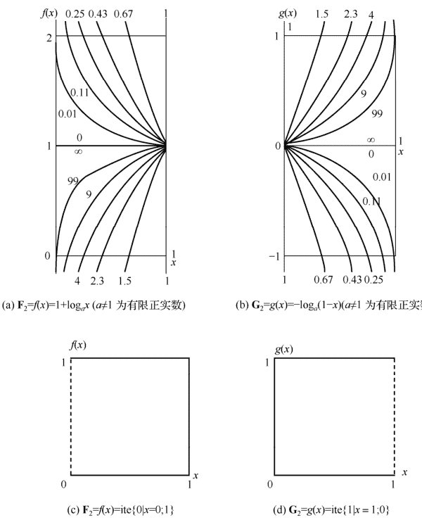

---

### 定义 7.3.2：T 范数的三大谱系划分

以极限算子 $T_0$（Drastic Product）、$T_2$（乘积）、$T_3$（最小）为坐标：
*   **幂零类**：$T_0$ 与 $T_2$ 之间（不含端点）的 T 范数集合。
*   **严格类**：$T_3$ 与 $T_2$ 之间（不含端点）的 T 范数集合。
*   **极限类**：$\{T_0, T_2, T_3\}$ 及其生成元。

---

### 定理 7.3.5：T 范数第二生成定理（自守函数变换法）

**核心机制**：给定基础 T 范数 $T_0$ 与非极限自守函数 $\varphi$，新算子 $T(x,y)=\varphi^{-1}(T_0(\varphi(x), \varphi(y)))$ 与 $T_0$ 同类。

**分类保持性证明速览**：
*   $T_0$ 幂零 ($f_0(0)=0$) $\Rightarrow$ 新生成元 $f(0)=f_0(\varphi(0))=0$ $\Rightarrow$ 新算子幂零。
*   $T_0$ 严格 ($f_0(0)\to\infty$) $\Rightarrow$ $f(0)\to\infty$ $\Rightarrow$ 新算子严格。
*   $T_0=T_3$ (min) $\Rightarrow$ 新算子仍为 $T_3$。
*   $T_0=T_2$ (乘积) $\Rightarrow$ 新算子为**中极限类** $T_{F2}$，生成元 $F_{\Phi2}=1+\log\varphi(x)$。
*   $T_0=T_0$ $\Rightarrow$ 新算子仍为 $T_0$。

**中极限类深度解析**：
$T_{F2}=\varphi^{-1}(\varphi(x)\varphi(y))$，其生成元 $F_{\Phi2}=1+\log\varphi(x)=1-\log(1/\varphi(x))$。令严格生成元 $f(x)=1/\varphi(x)$，则 $T(x,y)=f^{-1}(f(x)f(y))$。**此性质是中极限类独立于严格类专门研究的根本原因。**

**构造实例**：
| 变换 $\varphi(x)$ | 基础 $T_0$ | 生成算子类型 | 算子名称/形式 |
| :--- | :--- | :--- | :--- |
| $x^{-n}$ | $T_1$ (有界) | 幂零 | Schweizer-Sklar 1: $\max(0, x^{-n}+y^{-n}-1)^{-1/n}$ |
| $x^{-n}$ | Hamacher | 严格 | Schweizer-Sklar 2: $(x^{-n}+y^{-n}-1)^{-1/n}$ |
| $1-(1-x)^n$ | $T_2$ (乘积) | 中极限 | Schweizer-Sklar 3: $1-((1-x)^n+(1-y)^n-(1-x)^n(1-y)^n)^{1/n}$ |
| $x(1+\lambda)^{1/2}/(1+((1+\lambda)^{1/2}-1)x)$ | $T_2$ | 中极限 | Einstein 类: $xy(1+\lambda)^{1/2}/(1+((1+\lambda)^{1/2}-1)(x+y-xy))$ |

**跨类生成现象**：幂零生成元 $\phi(x)=x(2-x)$ 与严格生成元 $f(x)=(2-x)/x$ 代入 $T_2=xy$，竟生成**同一个** Einstein 算子 $T(x,y)=\frac{xy}{2-x-y+xy}$。

---

### 7.3.3 S 范数的生成理论（对偶镜像）

S 范数理论与 T 范数呈完美对偶（$g(0)=0$ 对应 $f(1)=1$，$\min$ 对应 $\max$）。

#### 定理 7.3.6：S 范数第一生成定理
$g(x)$ 为 $[0,1]$ 上连续严格单调、$g(0)=0$，则 $S(x,y)=g^{-1}(\min(g(1), g(x)+g(y)))$ 为阿基米德型 S 范数。  
*证明框架*：分单调增/减两情况，利用加法交换/结合律验证 S1-S6 公理。严格单调性保证幂大性 $S(x,x)>x$。

#### 定理 7.3.7：幂零 S 范数标准形
$\varphi(x)$ 为自守函数 $\Rightarrow$ $S(x,y)=\varphi^{-1}(\min(1, \varphi(x)+\varphi(y)))$ 为幂零 S 范数。  
*原因*：$\varphi(1)=1$ 且 $\varphi(x)+\varphi(y)>1 \implies S=1$，满足幂零定义。

#### 定理 7.3.8：S 范数二分法
$g(1)\to\pm\infty$ $\Rightarrow$ **严格 S 范数** ($S=g^{-1}(g(x)+g(y))$)；  
$g(1)$ 有限 $\Rightarrow$ 归一化为自守函数 $\varphi(x)=g(x)/g(1)$ $\Rightarrow$ **幂零 S 范数**。

#### 定义 7.3.3：S 性生成元分类
*   **严格 S 性生成元**：$g(1)\to+\infty$。
*   **幂零 S 性生成元**：$g(1)$ 有限。**注意**：自守函数同时是幂零 T / S 生成元。

**S 范数经典案例库**：

| 类别 | 生成元 | 算子 $S(x,y)$ | 名称 |
| :--- | :--- | :--- | :--- |
| **幂零族** | $\varphi(x)=x$ | $\min(1, x+y)$ | $S_1$ (有界和) |
| | $\varphi(x)=x^n$ | $\min(1, (x^n+y^n)^{1/n})$ | Yager S 算子簇 |
| | $1-\cos(\pi x/2)$ | $2\pi^{-1}\arccos(\max(0, \cos(\pi x/2)+\cos(\pi y/2)-1))$ | |
| | $\sin(\pi x/2)$ | $2\pi^{-1}\arcsin(\min(1, \sin(\pi x/2)+\sin(\pi y/2)))$ | |
| **严格族** | $g(x)=x/(1-x)$ | $(x+y-2xy)/(1-xy)$ | Hamacher S 算子 |
| | $g(x)=\tan(\pi x/2)$ | $2\pi^{-1}\arctan(\tan(\pi x/2)+\tan(\pi y/2))$ | |

> **同样期待**：中极限 S 范数将在后续登场。

---

### 推论簇 7.3.4 - 7.3.6：严格 S 范数性质与生成元平移

*   **推论 7.3.4（单位元判别）**：严格 S 范数 $S(x,y)=1 \iff x=1$ 或 $y=1$。
*   **推论 7.3.5（消去律）**：严格 S 范数下，$x<1$ 且 $S(x,y)=S(x,z) \implies y=z$。
*   **推论 7.3.6（生成元平移）**：$g_0(0)$ 有限 $\Rightarrow$ $S(x,y)=g_0^{-1}(\min(g_0(1), g_0(x)+g_0(y)-g_0(0)))$ 为阿基米德型 S 范数。  
    *例*：$g(x)=\ln\frac{1+x}{1-x}+c$ 生成 Einstein S 算子 $S(x,y)=\frac{x+y}{1+xy}$。

---

### 定理 7.3.9：S 性生成元的标度不变性

**定理**：若 $g(x)$ 为生成元，则簇 $g'(x)=c g(x)\ (c\neq 0,\text{有限实数})$ 生成同一 $S(x,y)$。  
*证明*：$g'^{-1}(x)=g^{-1}(x/c)$，代入生成式，$c$ 被 $\min$ 的齐次性抵消。

**规范化约定与示例**：
1.  **幂零簇**：$g(x)=cx$ 均生成 $S_1=\min(1,x+y)$。令 $c=1/g_0(1)$ 得自守函数 $\varphi(x)=g_0(x)/g_0(1)$。**约定：幂零 S 性生成元默认指自守函数 $\varphi(x)$**。
2.  **严格簇**：$g(x)=cx/(1-x)$ 均生成 Hamacher S 算子 $S(x,y)=(x+y-2xy)/(1-xy)$。

---

# S-范数分类、生成机制与NTS对偶性深度解析

## 定义 7.3.4：S-范数的三重分类体系

概率算子 $S_2 = x + y - xy$ 及其生成元 $G_2$ 具有幂零与严格的双重特性，作为两类算子的分水岭，被称为**中极限算子**。基于此，S-范数按生成元特性划分为三大类：
*   **幂零类**：介于极限 $S_0$ 与 $S_2$ 之间（不含端点）的幂零 S-范数及其生成元。
*   **严格类**：介于极限 $S_3$ 与 $S_2$ 之间（不含端点）的严格 S-范数及其生成元。
*   **极限类**：由极限算子 $S_3$、$S_2$、$S_0$ 及其生成元构成的集合。

## 定理 7.3.10：S-范数第二生成定理与构造范式

**核心结论**：给定一个 S-范数 $S_0$ 及非极限自守函数 $\phi(x)$，通过变换 $S(x, y) = \phi^{-1}(S_0(\phi(x), \phi(y)))$ 可构造出与 $S_0$ 同类的新 S-范数。

**推导逻辑**：设 $S_0$ 由生成元 $g_0$ 确定，新生成元 $g = g_0 \circ \phi$ 保持连续严格单调且 $g(0)=0$。代入生成公式即得上述形式。类属继承性由 $g(1)$ 的值决定：$S_0$ 幂零则 $g(1)=1$，新范数幂零；$S_0$ 严格则 $g(1)\to\infty$，新范数严格；若 $S_0$ 为极限 $S_3$ 或 $S_2$ 或 $S_0$，变换后分别保持为 $S_3$、中极限算子 $S\Phi_2$ 及 $S_0$。

**典型构造实例**：
1.  **幂零类 (Schweizer 1)**：$\phi(x)=1-(1-x)^n, S_0=\min(1,x+y)$ $\Rightarrow$ $S(x,y)=1-(\max(0, (1-x)^n+(1-y)^n-1))^{1/n}$。
2.  **严格类 (Schweizer 2)**：$\phi(x)=1-(1-x)^n, S_0=1/(1/x+1/y)$ $\Rightarrow$ $S(x,y)=1-((1-x)^{-n}+(1-y)^{-n}-1)^{-1/n}$。
3.  **中极限类 (Schweizer 3)**：$\phi(x)=x^{-n}, S_0=x+y-xy$ $\Rightarrow$ $S(x,y)=(x^{-n}+y^{-n}-x^{-n}y^{-n})^{-1/n}$。
4.  **中极限类 (Einstein)**：特定 $\phi(x)$ 与 $S_0=x+y-xy$ 结合生成 Einstein 加法公式 $(x+y)/(1+xy)$。

**中极限类的独特性**：中极限算子族 $S\Phi_2 = \phi^{-1}(\phi(x)+\phi(y)-\phi(x)\phi(y))$ 非唯一。其生成元 $G\Phi_2 = -\log(1-\phi(x))$ 可通过严格生成元 $g(x)=-\phi(x)/(1-\phi(x))$ 表示为 $S(x,y)=g^{-1}(g(x)+g(y)-g(x)g(y))$。这一性质使其虽酷似严格类，却拥有独立的研究价值。值得注意的是，幂零生成元 $\phi(x)=2x/(1+x)$ 与严格生成元 $g(x)=-2x/(1-x)$ 均能生成同一个 Einstein 算子。

## 定义 7.3.5 与 定义 7.3.11：分配律及其严苛成立条件

S-范数 $S$ 与 T-范数 $T$ 间的分配律定义为：
$$T(S(x, y), z)=S(T(x, y), T(x, z)), \quad S(T(x, y), z)=T(S(x, y), S(x, z))$$

**定理（分配律充要条件）**：分配律成立的**唯一**解是 $T(x,y)=\min(x,y)$ 且 $S(x,y)=\max(x,y)$。

*   **充分性**：直接代入验证，利用 $\min/\max$ 的分配性质即可成立。
*   **必要性**：利用幂等性 $x=T(x,x)=S(x,x)$ 及单调连续性，固定 $a<b$ 构造函数 $k(a,y)=S(a,y)$。由连续性存在 $c$ 使 $S(a,c)=b$，代入分配律推导得 $T(a,b)=a=\min(a,b)$。同理可证 $S(a,b)=\max(a,b)$。故除极限算子外，一般 S/T 范数不满足分配律。

---

### 7.4 NTS 范数的对偶性

中心三元组 $(N, T, S)$ 满足德摩根律：$T(x,y)=N(S(N(x),N(y))), S(x,y)=N(T(N(x),N(y)))$，其中 $N(x)=1-x, T=\max(0,x+y-1), S=\min(1,x+y)$。推广至一般 N/T/S 范数，核心在于生成元间的**弱半对偶关系**。

#### 7.4.1 生成元之间的弱半对偶关系

##### 定义 7.4.1：对偶层级
若 $N$ 为连续严格单调弱 N-范数，$g$ 为连续严格单调一元函数，定义 $f(x)=1-g(N(x))$ 为 $g$ 关于 $N$ 的**弱半对偶**；若 $N$ 为标准 N-范数，称**半对偶**；若 $N(x)=1-x$，称**零级对偶**。

##### 定理 7.4.1：弱半对偶的可逆性
$f$ 是 $g$ 关于 $N$ 的弱半对偶 $\Leftrightarrow$ $g$ 是 $f$ 关于 $N^{-1}$ 的弱半对偶。
*证明*：$f=1-g\circ N \Rightarrow g=1-f\circ N^{-1}$，且 $N^{-1}$ 保持弱 N-范数性质。

##### 定理 7.4.2：零级对偶保持类属
$g$ 为 S-生成元 $\Leftrightarrow$ 其零级对偶 $f(x)=1-g(1-x)$ 为同类 T-生成元。
*证明*：$g(0)=0 \Rightarrow f(1)=1$（T-生成元条件）。类属由端点值决定：$g(1)=1$（幂零）$\Rightarrow f(0)=0$；$g(1)\to\infty$（严格）$\Rightarrow f(0)\to\infty$；极限类由 7.3 节性质保持。
*例*：严格类对偶对 $(x/(1-x), 2-1/x)$、$(\tan(\pi x/2), 1-\cot(\pi x/2))$；幂零类对偶对 $(x^n, 1-(1-x)^n)$、$(\sin(\pi x/2), 1-\cos(\pi x/2))$；极限类对偶对 $(G_0, F_0)$、$(G_2, F_2)$、$(G_3, F_3)$ 等。

##### 定理 7.4.3：弱半对偶仅翻转极限生成元的 T/S 属性
对极限生成元 $G_0, G_2, G\Phi_2, G_3$，弱半对偶运算 $f=1-g\circ N$ 仅改变其 T/S 归属（S$\lef$T），保持极限类型不变（如 $G_0 \to F_0$, $G_2 \to F_2$ 等）。

##### 定理 7.4.4：一般 N 范数下的弱半对偶保持类属
若 $g$ 为非极限 S-生成元，$N$ 为连续严格单调减 N-范数，则其弱半对偶 $f=1-g\circ N$ 为同类 T-生成元；反之亦然。
*证明*：非极限性保证 $g(1)\neq 1$ (幂零) 或 $\infty$ (严格) 映射至 $f(0)$ 同类值；极限情况归结为定理 7.4.3。定理 7.4.2 即为 $N(x)=1-x$ 的特例。
*例*：配合 $N(x)=1-x^3$，严格生成元 $x/(1-x), \tan(\pi x/2)$ 分别对应严格 T-生成元 $2-1/x^3, 1-\cot(\pi x^3/2)$；幂零生成元同理映射为幂零 T-生成元。

### 定理 7.4.5 非极限同类 S-生成元的关联结构

任意两个非极限且同类的 S-生成元 $g_1(x)$ 与 $g_2(x)$ 之间，必存在如下函数关系：
$$g_1(x) = c \cdot g_2(\phi(x))$$
其中比例系数 $c = g_1(1)/g_2(1) \neq 0$ 为有限实数，变换函数 $\phi(x) = g_2^{-1}(g_1(x)/c)$ 是连续严格单调的自守函数。

#### 证明要点

分三类情况论证：

1.  **均为自守函数时**：若 $g_1, g_2$ 本身即连续严格单调自守函数，取 $\phi(x)=g_1(x)=g_2(x)$，则 $\phi(x)=\phi^{-1}(\phi(x))$ 自守，且 $c=1$，等式成立。
2.  **均为幂零型时**：$g_1(1), g_2(1)$ 均为非零有限值。归一化后 $\bar{g}_1(x)=g_1(x)/g_1(1)$、$\bar{g}_2(x)=g_2(x)/g_2(1)$ 均为自守函数。由情况 1 推得 $\phi(x)=\bar{g}_2^{-1}(\bar{g}_1(x)) = g_2^{-1}(g_1(x) \cdot g_2(1)/g_1(1)) = g_2^{-1}(g_1(x)/c)$ 为自守函数，$c=g_1(1)/g_2(1)$，等式成立。
3.  **均为严格型时**：$g_1(1), g_2(1)$ 均为无限值。定义 $\phi(x)=g_2^{-1}(g_1(x)/c)$，其中 $c=g_1(1)/g_2(1)=\pm 1$（同向为 1，反向为 -1）。验证可知 $\phi(x)$ 连续严格单调，且 $\phi(0)=0, \phi(1)=1$，故为自守函数，等式成立。

综上，定理得证。

#### 典型实例

**严格 S-生成元对：**
*   $g_1(x)=\frac{x}{1-x}$ 与 $g_2(x)=\frac{x^3}{1-x^3}$：$c=1, \phi(x)=x^{1/3}$。
*   $g_1(x)=-\tan(\pi x/2)$ 与 $g_2(x)=\tan(\pi x^n/2)$：$c=-1, \phi(x)=x^{1/n}$。

**幂零 S-生成元对：**
*   $g_1(x)=x^n$ 与 $g_2(x)=-x^{5n}\ (n\in\mathbb{R}_+)$：$c=-1, \phi(x)=x^{1/5}$。
*   $g_1(x)=\sin(\pi x/2)$ 与 $g_2(x)=5\sin(\pi x^3/2)$：$c=0.2, \phi(x)=x^{1/3}$。
*   $g_1(x)=1-\cos(\pi x^4/2)$ 与 $g_2(x)=1-\cos(\pi x/2)$：$c=1, \phi(x)=x^4$。

**极限类 S-生成元对：**
*   $g_1(x)=\log\frac{1+x^n}{1-x^n}$ 与 $g_2(x)=-\log\frac{1+x}{1-x}$：$c=-1, \phi(x)=x^n$。

---

### 定理 7.4.6 非极限异类 S-生成元的极限关联

任意两个非极限且**异类**的 S-生成元 $g_1(x), g_2(x)$ 之间，存在极限形式关系：
$$g_1(x) = c \cdot g_2(\phi(x))$$
其中 $c = g_1(1)/g_2(1)$ 取值为 $0$ 或 $\pm\infty$，$\phi(x) = \Phi_0$ 或 $\Phi_3$（即自守函数的上/下极限）。

#### 证明梗概

依据定理 7.4.5，同类生成元间联系由有限非零 $c$ 与自守函数 $\phi$ 构成。异类情况分两种：

1.  **$g_1$ 幂零（$g_1(1)$ 有限），$g_2$ 严格（$g_2(1)$ 无限）**：$c=0$，此时 $\phi(x)=g_2^{-1}(g_1(x)/c)=\Phi_0$（自守函数上极限）。
2.  **$g_1$ 严格（$g_1(1)$ 无限），$g_2$ 幂零（$g_2(1)$ 有限）**：$c\to\pm\infty$，此时 $\phi(x)=g_2^{-1}(g_1(x)/c)=\Phi_3$（自守函数下极限）。

故定理成立。

---

### 定理 7.4.7 非极限同类 T-生成元的关联结构

任意两个非极限同类的 T-生成元 $f_1(x), f_2(x)$ 满足：
$$f_1(x) = 1 - c\bigl(1 - f_2(\phi(x))\bigr)$$
其中 $c = \frac{1-f_1(0)}{1-f_2(0)} \neq 0$ 为有限实数，$\phi(x) = f_2^{-1}\bigl(1 - \frac{1-f_1(x)}{c}\bigr)$ 为自守函数。

#### 证明路径

1.  由定理 7.4.2，T-生成元 $f$ 的零级对偶 $g'(x)=1-f(1-x)$ 为同类 S-生成元。
2.  应用定理 7.4.5 于 $g_1', g_2'$，得 $g_1'(x)=c g_2'(\phi(x))$，$c=g_1'(1)/g_2'(1)$，$\phi$ 为自守函数。
3.  回代 $f$ 表达式，整理即得结论，且 $c=(1-f_1(0))/(1-f_2(0))$，$\phi(x)=f_2^{-1}(1-(1-f_1(x))/c)$。

#### 实例演示

**严格 T-生成元对：**
*   $f_1(x)=-2-1/x^{1/3}$ 与 $f_2(x)=2-1/x$：$c=1, \phi(x)=x^{1/3}$。
*   $f_1(x)=1-\log\frac{(2-x)^{1/3}}{x^{1/3}}$ 与 $f_2(x)=1-\log\frac{2-x}{x}$：$c=1, \phi(x)=x^{1/3}$。
*   $f_1(x)=1+\cot(\pi x/2)$ 与 $f_2(x)=1-\cot(\pi x^{1/3}/2)$：$c=-1, \phi(x)=x^3$。

**幂零 T-生成元对：**
*   $f_1(x)=x^n$ 与 $f_2(x)=1-(1-x)^n\ (n\in\mathbb{R}_+)$：$c=1, \phi(x)=1-(1-x^n)^{1/n}$。
*   $f_1(x)=1-\cos(\pi x/2)$ 与 $f_2(x)=\sin(\pi x/2)$：$c=1, \phi(x)=\frac{2}{\pi}\arcsin(1-\cos\frac{\pi x}{2})$。

---

### 定理 7.4.8 非极限异类 T-生成元的极限关联

任意两个非极限**异类** T-生成元 $f_1(x), f_2(x)$ 间存在极限关系：
$$f_1(x) = 1 - c\bigl(1 - f_2(\phi(x))\bigr)$$
其中 $c = \frac{1-f_2(0)}{1-f_1(0)}$ 为 $0$ 或 $\pm\infty$，$\phi(x)=\Phi_0$ 或 $\Phi_3$。

#### 证明
同定理 7.4.6 方法，利用定理 7.4.7 类比得证。

---

### 定理 7.4.9 同类 T/S 生成元的弱半对偶

任意非极限 T-生成元 $f(x)$ 与同类 S-生成元 $g(x)$ 之间，存在弱半对偶关系：
$$f(x) = 1 - c \cdot g(N(x))$$
其中 $c = \frac{1-f(0)}{g(1)} \neq 0$ 为有限实数，$N(x) = g^{-1}\bigl(\frac{1-f(x)}{c}\bigr)$ 为连续严格单调弱 N-范数。

#### 证明构建

1.  $f$ 的零级对偶 $g'(x)=1-f(1-x)$ 为同类 S-生成元（定理 7.4.2）。
2.  $g'(x)$ 与 $g(x)$ 同类，由定理 7.4.5 得 $g'(x)=c g(\phi(x))$，$c=g'(1)/g(1)$，$\phi=g^{-1}(g'/c)$ 为自守函数。
3.  回代 $f(x)=1-g'(1-x)$，得 $f(x)=1-c g(\phi(1-x))$。令 $N(x)=\phi(1-x)$，即得结论。验算可知 $N(x)$ 满足弱 N-范数条件。

---

### 定理 7.4.10 同类 S/T 生成元的弱半对偶（对称形式）

任意非极限 S-生成元 $g(x)$ 与同类 T-生成元 $f(x)$ 间：
$$g(x) = c \bigl(1 - f(N(x))\bigr)$$
其中 $c = \frac{g(1)}{1-f(0)} \neq 0$ 为有限实数，$N(x) = f^{-1}\bigl(1 - \frac{g(x)}{c}\bigr)$ 为连续严格单调弱 N-范数。

#### 证明
同定理 7.4.9 对称论证。

---

### 定理 7.4.11 异类 T/S 生成元的极限半对偶与 NTS 三联体

非极限**异类** T-生成元 $f(x)$ 与 S-生成元 $g(x)$ 间存在极限关系：
$$g(x) = c \bigl(1 - f(N(x))\bigr)$$
其中 $c = \frac{g(1)}{1-f(0)}$ 为 $0$ 或 $\pm\infty$，$N(x)=\mathbf{N_0}$ 或 $\mathbf{N_3}$（极限 N-范数）。

#### 证明
借助定理 7.4.9，仿照定理 7.4.6 方法即得。

#### 深层含义：NTS 三联体的平凡性

该定理揭示：任一非极限 T-生成元均可借助极限范数 $\mathbf{N_0}$ 或 $\mathbf{N_3}$，与**所有**异类 S-生成元构成 NTS 三联体；反之亦然。这意味着极限关系无法唯一确定生成元（即由 $g$ 求不出唯一 $f$，由 $f$ 求不出唯一 $g$），故属**平凡关系**。

#### 双极限半对偶全景扫描

利用 $f(x)=1-g(N(x))$ 与 $N_3=N_3^{-1}, N_0=N_0^{-1}$，穷举双极限情况：

**情形 A：$N(x)=\mathbf{N_3}=\text{ite}\{0|x=1;1\}$**
*   $g=\mathbf{G_3}$ 或任意**严格** $g(x)$（$g(0)=0, g(1)=\pm\infty$） $\Rightarrow$ $f=\mathbf{F_3}$。
    *   $\mathbf{N_3}$ 使 $\mathbf{F_3}$ 与所有严格 $g$ 及 $\mathbf{G_3}$ 半对偶。
*   $g=\mathbf{G_2}=-\log(1-x)$ $\Rightarrow$ $f=\mathbf{F_3}$；$g=\mathbf{G_3}$（极限）$\Rightarrow$ $f=\mathbf{F_0}$。
    *   $\mathbf{N_3}$ 使 $\mathbf{G_2}$ 与**任意** T-生成元（介于 $\mathbf{F_3}$ 与 $\mathbf{F_0}$ 间）半对偶。
*   $g$ 为任意**幂零**生成元（$g(0)=0, g(1)=1$）或 $g=\mathbf{G_0}$ $\Rightarrow$ $f=\mathbf{F_0}$。
    *   $\mathbf{N_3}$ 使 $\mathbf{F_0}$ 与所有幂零 $g$ 及 $\mathbf{G_0}$ 半对偶。

**情形 B：$N(x)=\mathbf{N_0}=\text{ite}\{1|x=0;0\}$**
*   $g=\mathbf{G_3}$ $\Rightarrow$ $f$ 为 $\mathbf{F_3}$ 与 $\mathbf{F_2}$ 间任意 T-生成元。
    *   $\mathbf{N_0}$ 使 $\mathbf{G_3}$ 与该区间内所有 $f$ 半对偶。
*   $g$ 为任意连续严格单调 S-生成元（$g(0)=0$） $\Rightarrow$ $f=\mathbf{F_2}$。
    *   $\mathbf{N_0}$ 使 $\mathbf{F_2}$ 与所有 S-生成元半对偶。
*   $g=\mathbf{G_0}$ $\Rightarrow$ $f$ 为 $\mathbf{F_0}$ 与 $\mathbf{F_2}$ 间任意 T-生成元。
    *   $\mathbf{N_0}$ 使 $\mathbf{G_0}$ 与该区间内所有 $f$ 半对偶。

对偶方向因 $N_3, N_0$ 自逆性对称成立。

---

## 7.4.2 NTS 范数间的弱对偶关系

### 定义 7.4.2 弱对偶
设 $N(x)$ 为连续严格单调弱 N-范数，$f(x,y)$ 为 $[0,1]^2$ 上任意单调二元函数。称
$$g(x,y) = N^{-1}\bigl(f(N(x), N(y))\bigr)$$
为 $f$ 关于 $N$ 的**弱对偶**。该关系单向：由 $g$ 反求 $f$ 为 $f(x,y)=N(g(N^{-1}(x), N^{-1}(y)))$。

### 定义 7.4.3 对偶
设 $N(x)$ 为连续严格单调 N-范数（强范数），$f(x,y)$ 同上。称
$$g(x,y) = N\bigl(f(N(x), N(y))\bigr)$$
为 $f$ 关于 $N$ 的**对偶**。该关系双向：$f(x,y)=N(g(N(x), N(y)))$。

---

### 定理 7.4.12 弱对偶定律

若连续严格单调 T-生成元 $f(x)$ 与 S-生成元 $g(x)$ 存在弱半对偶关系 $g(x)=c(1-f(N(x)))$（$c=g(1)/(1-f(0))\neq 0$, $N$ 为弱 N-范数），则它们分别生成的 S-范数 $S(x,y)$ 与 T-范数 $T(x,y)$ 满足关于 $N$ 的**弱对偶关系**：
$$S(x,y) = N^{-1}\bigl(T(N(x), N(y))\bigr)$$

#### 证明
由 $T(x,y)=f^{-1}(\max(f(0), f(x)+f(y)-1))$ 及 $g(x)=c(1-f(N(x)))$ 代入推导得证。

```
S(x,y)=g^{-1}(\min(g(1), g(x)+g(y)))=g^{-1}(\min(c(1-f(0), 1-f(N(x))+1-f(N(y))))
=N^{-1}(f^{-1}(1-\min(c(1-f(0), 1-f(N(x))+1-f(N(y)))/c))
=N^{-1}(f^{-1}(\max(f(0), f(N(x))+f(N(y))-1)))
=N^{-1}(T(N(x), N(y)))
```

---

### 定理 7.4.13 对偶定律

设 $\phi(x)$ 为连续严格单调自守函数。若以 $\phi$ 为 T-生成元生成 $T(x,y)$，以 $\phi$ 为 S-生成元生成 $S(x,y)$，则二者存在**对偶关系**：
$$S(x,y) = N\bigl(T(N(x), N(y))\bigr)$$
其中 $N(x) = \phi^{-1}(1-\phi(x))$。

# 从生成元到对偶：揭秘 T/S/N 范数的内在联结与 Schweizer 算子簇的完整构建

**证明核心逻辑**  
基于生成元 $\phi$ 的定义，$T$ 范数、$S$ 范数与 $N$ 范数分别表述为：  
$T(x, y)=\phi^{-1}(\max(0, \phi(x)+\phi(y)-1))$、  
$S(x, y)=\phi^{-1}(\min(1, \phi(x)+\phi(y)))$、  
$N(x)=\phi^{-1}(1-\phi(x))$。  
通过代入验证可知，$S(x,y)$ 与 $N(T(N(x),N(y)))$ 完全等价，由此确立了三者间的标准德摩根对偶关系，定理得证。

**经典算子的同源实例**  
以 Yager 算子与 Schweizer(1) 算子为例，二者均由生成元 $\phi(x)=1-(1-x)^n \ (n \in \mathbf{R}_+)$ 衍生：  
- Yager T 范数：$T(x, y)=1-\min(1, ((1-x)^n+(1-y)^n)^{1/n})$  
- Schweizer(1) S 范数：$S(x, y)=1-(\max(0, (1-x)^n+(1-y)^n-1))^{1/n}$  
它们共享的关联 N 范数为 $N(x)=1-(1-(1-x)^n)^{1/n}$。  

另一组由 $\phi(x)=x^n \ (n \in \mathbf{R}_+)$ 生成：  
- Yager S 范数：$S(x, y)=\min(1, (x^n+y^n)^{1/n})$  
- Schweizer(1) T 范数：$T(x, y)=(\max(0, x^n+y^n-1))^{1/n}$  
对应的 N 范数为 $N(x)=(1-x^n)^{1/n}$。  
这直观展示了“同一生成元，构建对偶三元组”的生成机制。

---

### 非极限 NTS 范数的弱对偶分类全景

依据生成元弱半对偶特性，非极限情况下 N、T、S 三范数的弱对偶关系呈现五类典型形态：

1.  **T 主导构建 S**：给定任意非极限 T 范数与连续严格单调弱 N 范数，经变换 $S(x, y)=N^{-1}(T(N(x), N(y)))$ 得到的 S 范数，必与原 T 范数同类。
2.  **S 主导构建 T**：给定任意非极限 S 范数与连续严格单调弱 N 范数，经变换 $T(x, y)=N^{-1}(S(N(x), N(y)))$ 得到的 T 范数，必与原 S 范数同类。
3.  **由 S 反推 N（S 视角）**：若非极限 S 范数 $S=g^{-1}(\min(g(1), g(x)+g(y)))$ 与同类 T 范数 $T=f^{-1}(\max(f(0), f(x)+f(y)-1))$ 给定，存在弱 N 范数 $N(x)=g^{-1}((1-f(x))/c)$（$c=(1-f(0))/g(1) \neq 0$），使弱对偶成立。
4.  **由 T 反推 N（T 视角）**：若非极限 T 范数与同类 S 范数给定，存在弱 N 范数 $N(x)=f^{-1}(1-g(x)/c)$（$c=g(1)/(1-f(0)) \neq 0$），使弱对偶成立。
5.  **一级对偶的双向等价**：非极限 S 范数（或 T 范数）配合连续严格单调 N 范数，其一级对偶运算 $T=N(S(N,N))$（或 $S=N(T(N,N))$）必然生成同类的 T 范数（或 S 范数）。

> **推论 7.4.1（一级对偶生成元约束）**  
> 非极限 T、S 同类范数存在一级对偶，当且仅当其生成元 $f, g$ 与 N 范数生成元满足四组等价约束之一：  
> $N=g^{-1}((1-f)/c)$、$N=f^{-1}(1-cg)$、$g=(1-f \circ N)/c$、$f=1-c(g \circ N)$，其中 $c=(1-f(0))/g(1) \neq 0$。

> **推论 7.4.2（零级对偶生成元约束）**  
> 同类 T、S 存在零级对偶（标准德摩根），当且仅当生成元满足：  
> $f(x)=1-cg(1-x)$ 或 $g(x)=(1-f(1-x))/c$，$c$ 定义同前。

**极限情况下的弱对偶图谱（表 7.1 解读）**  
极限范数（T0, T2, T3 / S0, S2, S3）与非极限严格/幂零范数交织，形成复杂的弱对偶网络。表 7.1 系统梳理了关联弱 N 范数（含非极限 $N(x)$、极限 N0/N3）在不同 T/S 极限类型组合下的存在性。例如：严格 T 范数与严格 S 范数对偶需非极限 $N(x)$；幂零 T 与幂零 S 对偶亦需非极限 $N(x)$；极限类型间（如 T3-S3、T0-S0）常涉及 N0、N3 等极限 N 范数的组合。

---

### 实战技法：从范数表达式反推生成元

仅知 $T(x,y)$、$S(x,y)$ 解析式不足以判定关系，**生成元 $f(x), g(x)$ 是核心钥匙**。两大求解路径如下：

#### 方法 7.4.1：求 T 范数生成元 $f(x)$
1.  利用第一生成定理：$f(T(x,y)) = \max(f(0), f(x)+f(y)-1)$。
2.  两边对 $y$ 求导：$f'(T) \cdot T'_y = f'(y)$。
3.  令 $y=1$（利用 $T(x,1)=x$）：$f'(x) \cdot T'_y(x,1) = f'(1) \Rightarrow f'(x) = f'(1) / T'_y(x,1)$。
4.  积分定常数：$f(x) = \int (f'(1)/T'_y(x,1)) dx + c$，由边界 $f(1)=1$ 确定 $c$。

#### 方法 7.4.2：求 S 范数生成元 $g(x)$
1.  利用第一生成定理：$g(S(x,y)) = \min(g(1), g(x)+g(y))$。
2.  两边对 $y$ 求导：$g'(S) \cdot S'_y = g'(y)$。
3.  令 $y=0$（利用 $S(x,0)=x$）：$g'(x) \cdot S'_y(x,0) = g'(0) \Rightarrow g'(x) = g'(0) / S'_y(x,0)$。
4.  积分定常数：$g(x) = \int (g'(0)/S'_y(x,0)) dx + c$，由边界 $g(0)=0$ 确定 $c$。

**Hamacher 算子实战演示**  
- **T 型** $T=xy/(x+y-xy)$：  
  $T'_y = x^2/(x+y-xy)^2 \Rightarrow T'_y(x,1)=x^2$。  
  $f'(x) \propto 1/x^2 \Rightarrow f(x) = -k/x + c$。按边界条件得 $f(x) = (1-x)/x$（归一化后）。
- **S 型** $S=(x+y-2xy)/(1-xy)$：  
  $S'_y = (1-x)^2/(1-xy)^2 \Rightarrow S'_y(x,0)=(1-x)^2$。  
  $g'(x) \propto 1/(1-x)^2 \Rightarrow g(x) = kx/(1-x)$。按边界得 $g(x) = x/(1-x)$。

---

### 第 7 章 小结：泛逻辑基石的数学透视

本章深度剖析了二元泛逻辑运算的底层代数结构。从生成元机制到范数分类，再到 NTS 三元组的德摩根对偶网络（零级、一级、弱对偶），数学推演虽繁琐但逻辑严密，**“藏而不露”** 的核心在于：所有复杂逻辑算子的生成与关联，本质上是生成元在函数方程与边界条件约束下的变奏。掌握生成元视角，即掌握了泛逻辑模型构建的**“总钥匙”**。德摩根律从经典逻辑的基石，进化为泛逻辑中 N、T、S 共舞的通用耦合法则，为后续衍生蕴含、等价等高阶模型奠定了不可动摇的基础。

---

## 第 8 章 T/S 性生成元完整簇与范数簇：从零级到一级的全维构建

基于 T/S 范数一般理论，本章推进至**“完整簇”**层面：引入广义相关系数 $h$ 与广义自相关系数 $k$，构建覆盖零级、一级的 T/S 性生成元完整簇及对应范数完整簇。代入泛逻辑基模型，即可系统导出全谱系二元命题连接词运算模型。

### 8.1 零级 T/S 性生成元完整簇：Schweizer 算子簇的唯一性与完备性

#### 8.1.1 零级 T 性生成元完整簇 $F(x, h)$
第 7 章已证：**Schweizer 算子簇**（融合 Schweizer(1) 幂零族与 Schweizer(2) 严格族）是**唯一**的零级 T 范数完整簇 $T(x, y, h)$，其生成元簇 $F(x, h)$ 即为零级 T 性生成元完整簇。

**生成元统一形式**：$f(x) = x^m, \ m \in \mathbf{R}$  
**统一范数表达式**：$T(x,y) = (\max(0^m, x^m + y^m - 1))^{1/m}$

参数 $m$ 随 $h$ 连续严格单调变化，驱动算子在 T3（最大）与 T0（最小）间连续过渡，覆盖全谱系：
| 参数 $m$ | 对应 $h$ | 生成元 $f(x)$ | 范数类型 | 关键节点 |
| :--- | :--- | :--- | :--- | :--- |
| $m \to +\infty$ | $h=0$ | $F_0$ (极限) | **T0** (最小, 非阿基米德) | 下极限 |
| $m=1$ | $h=0.5$ | $x$ | **T1** (中心, 幂零阿基米德) | 中心点 |
| $m=0$ | $h=0.75$ | $1+\ln x$ | **T2** (严格阿基米德) | 幂零/严格分界 |
| $m \to -\infty$ | $h=1$ | $F_3$ (极限) | **T3** (最大, 非阿基米德) | 上极限 |

**完整簇的代数封闭性**：$f(x)=x^m$ 簇在 $(0,1)$ 上随 $x$、$h$ 连续严格单调；任意两元素复合 $x^{m_1 m_2}$ 与逆运算 $x^{1/m_2}$ 仍落在簇内。这确立了 $f(x)=x^m$ 作为零级 T 性生成元完整簇的数学资格。

> 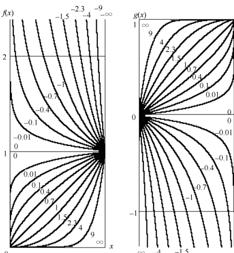
> **图 8.1(a) 零级 T 性生成元完整簇示意**

#### 8.1.2 零级 S 性生成元完整簇 $G(x, h)$
对称地，**Schweizer S 算子簇**是**唯一**的零级 S 范数完整簇 $S(x, y, h)$，其生成元簇 $G(x, h)$ 为零级 S 性生成元完整簇。

**生成元统一形式**：$g(x) = 1 - (1-x)^m, \ m \in \mathbf{R}$  
**统一范数表达式**：$S(x,y) = 1 - (\max(0^m, (1-x)^m + (1-y)^m - 1))^{1/m}$

参数 $m$ 驱动算子在 S3（最小）与 S0（最大）间连续过渡：
| 参数 $m$ | 对应 $h$ | 生成元 $g(x)$ | 范数类型 | 关键节点 |
| :--- | :--- | :--- | :--- | :--- |
| $m \to +\infty$ | $h=1$ | $G_3$ (极限) | **S3** (最小, 非阿基米德) | 下极限 |
| $m=1$ | $h=0.5$ | $x$ | **S1** (中心, 幂零阿基米德) | 中心点 |
| $m=0$ | $h=0.75$ | $-\ln(1-x)$ | **S2** (严格阿基米德) | 幂零/严格分界 |
| $m \to -\infty$ | $h=0$ | $G_0$ (极限) | **S0** (最大, 非阿基米德) | 上极限 |

**完整簇的代数封闭性**：$g(x)$ 簇随 $x$、$h$ 连续严格单变；复合 $1-(1-x)^{m_1 m_2}$ 与逆 $1-(1-x)^{1/m_2}$ 内部封闭。确立 $g(x)=1-(1-x)^m$ 为零级 S 性生成元完整簇。

> **图 8.1(b) 零级 S 性生成元完整簇示意**

**核心任务**：确定 $h$ 与 $m$ 的精确映射函数 $m(h)$，即可显式获得 $T(x,y,h)$、$F(x,h)$ 及 $S(x,y,h)$、$G(x,h)$。

---

### 8.2 广义相关系数 $h$ 的确定策略

零级完整簇中，$h$ 的量化定义关乎理论自洽与工程落地。研究发现有多种可行路径，首推**标准长度法**。

#### 8.2.1 标准长度法：以主对角线切长度度量相关度
**核心思想**：在 $x=y$ 主平面上，零级 T 范数 $T(x,x,h)$ 曲线与折线 CBA（连接 (0,0)、(0.5,0.5)、(1,1)）的交点到顶点 C(0.5,0.5) 的距离，定义为 $h$ 的标准度量。因主对角线处范数变化最剧烈、最具代表性。

**锚定基准点**（已约定俗成）：
- $h=1.0 \leftrightarrow T_3, S_3$ (极限最大/最小)
- $h=0.75 \leftrightarrow T_2, S_2$ (严格边界)
- $h=0.50 \leftrightarrow T_1, S_1$ (中心/乘积/和)
- $h=0.00 \leftrightarrow T_0, S_0$ (极限最小/最大)

该法将几何直观与代数参数 $m$ 链接，为 $h$ 赋予了清晰的几何物理意义，是构建 $T(x,y,h)$ 显式模型的基石。

### 深度解析：零级 T 范数完整簇的“定位”三部曲与相容奥秘

在构建零级 T 范数完整簇的宏大图景中，如何精准给每个算子打上“身份标签”（即广义相关系数 $h$），是绕不开的核心难题。教材第 8.2 节为我们拆解了三种截然不同的“定位策略”，各有千秋。

#### 8.2.1 长度法：直观的几何标尺
打开图 8.2，主平面 $x=y$ 上的曲线 $T(x, x, h)$ 与折线 CBA 的交点距离 C 点的远近，直接划定了 $h$ 的疆域。这不仅给出了可操作的客观标准，更赋予了明确的物理图景。

*   **相生区（$h > 0.5$）**：设定 $x=y=0.5$，当 $h$ 从 0.5 经 0.75 迈向 1 时，交集测度 $a=T(0.5, 0.5, h)$ 同步从 0 涨至 0.5。若假定 $a$ 与 $h$ 线性挂钩，便得标尺：$h = 0.5 + a = 0.5 + T(0.5, 0.5, h)$。物理意味直白：两个对半子集的交集柔性测度 $a$，正比例映射相生系数 $g$。
*   **相克区（$h < 0.5$）**：只有当 $x \ge y \ge b \in [0.5, 1]$ 时 $T \ge 0$。$h$ 从 0 增至 0.5，临界值 $b$ 却从 1 降至 0.5。假定 $1-b$ 与 $h$ 线性相关，标尺即为 $h = 1-b = 1-\max(x|T(x, x, h)=0)$。这揭示了相克关联下，交集萎缩量（由相克系数 $k$ 决定）与 $h$ 的线性对应。

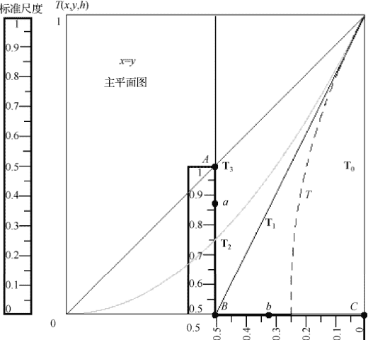

图 8.3 展示了 Schweizer 算子簇在长度法标定下的完整形态，$h$ 与参数 $m$ 的对应关系显式给出：
*   $h>0.5$ 时 $m\le 1$，$h=0.5+(2^{1-m}-1)^{1/m}$
*   $h<0.5$ 时 $m>1$，$h=1-2^{-1/m}$

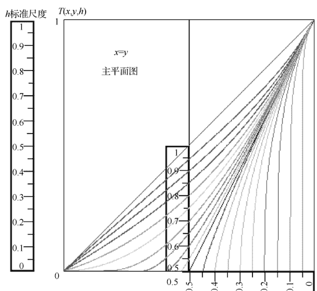

#### 8.2.2 体积比法：本质的物理度量
研究发现，算子在三维空间的体积 $V(*)$ 与 $h$ 暗合。最大与算子 $T_3$ 体积为 $1/3$，体积比 $v(*)=V(*)/V(T_3)=3V(*)$ 在四个基准算子（$T_3, T_2, T_1, T_0$）上完美吻合 $h$。只要假设簇内体积随 $h$ 线性演化，便得核心公式：
$$h=v(*)=3\iint_I T(x, y, h)dxdy, \quad I=[0, 1]$$
**物理意义极其深刻：$h$ 正比于零级 T 范数的“几何体量”。** 唯一短板——积分计算相对繁琐。

#### 8.2.3 函数拟合法：极简的工程近似
针对 Schweizer 簇的四个锚点（$h=1,m\to\infty$；$h=0.75,m\to0$；$h=0.5,m=1$；$h=0,m\to\infty$），拟合出简单解析式：
$$m=(3-4h)/(4h(1-h))$$
虽缺物理直观，但计算极快。图 8.4 即为其变化图谱。

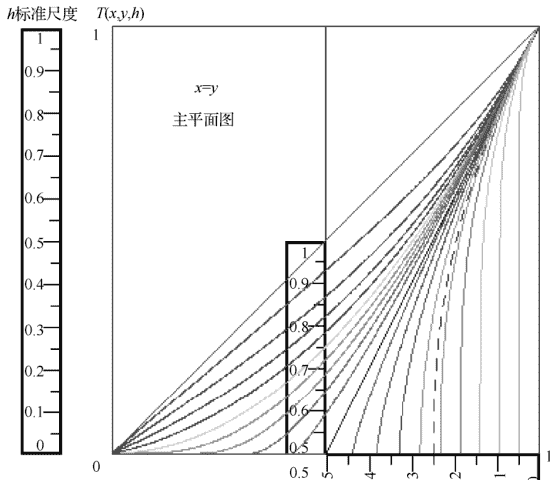

**三法对比画像**：
| 维度 | 长度法 (h1) | 体积法 (h2) | 拟合法 (h3) |
| :--- | :--- | :--- | :--- |
| **物理意义** | 明确 | 明确 | 模糊 |
| **计算量** | 中等 | 最大 | **最小** |

表 8.1 数据揭示真相：$h_2$ 与 $h_3$ 几乎重合，$h_1$ 稍有偏离。鉴于 $h_3$ 计算高效且能精准代理体积比 $h_2$，本书**默认采用体积比定义（定义 8.2.1）**，并给出 Schweizer 簇的显式近似双向映射：
$$m=(3-4h)/(4h(1-h)), \quad h=\frac{(1+m)-\sqrt{(1+m)^2-3m}}{2m}$$

---

### 8.3 相容条件：柔性逻辑的“守恒律”

零级不确定性中，当 $h \in [0.5, 1]$（相生相容区），与/或运算须遵守**相容定律**：
$$S(x, y, h)+T(x, y, h)=x+y$$
这就像能量守恒，柔性测度的“合”与“和”总和恒等于元素之和。

#### 8.3.1 判定定理：偏导和为 1
**定理 8.3.1** 给出充要条件：$\frac{\partial S}{\partial x}+\frac{\partial T}{\partial x}=1$。
*   *必要性*：等式两边对 $x$ 求导即得。
*   *充分性*：积分回 $S+T=x+c$，代入边界 $x=1$ 解得 $c=y$。

经典算子对（$S_3/T_3, S_2/T_2, S_1/T_1$）及 $S_1+T_1$ 均完美满足此条件。

```
S3 + T3 = max(x, y) + min(x, y) = x + y
∂(max(x, y)) / ∂x + ∂(min(x, y)) / ∂x = 1 + 0 = 1
S2 + T2 = x + y - xy + xy = x + y
∂(x + y - xy) / ∂x + ∂(xy) / ∂x = 1 - y + y = 1
```

#### 8.3.2 Schweizer 簇的“相容缺口”
遗憾的是，Schweizer 簇仅在 $h=1, 0.75, 0.5$ 三个锚点相容，其余参数均存在**相容差** $\Delta$。分布规律（见图 8.5、表 8.2）颇具特色：
1.  偏离三锚点 $\to$ 误差放大。
2.  对角线 $x=y$ 处误差极大：$h\approx0.575$ 时达 -0.0584；$h\approx0.929$ 时达 +0.0585。
3.  边界 $x=y=0/1$ 及反对角线 $y=1-x$ 上误差为零。

```
Δh=x+y−S(x, y, h)−T(x, y, h)
```
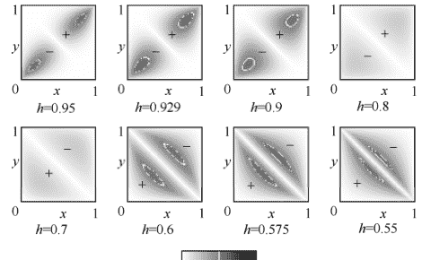

#### 8.3.3 Frank 簇：唯一的“完美相容者”
Frank 算子簇是目前**唯一被发现**全程满足相容定律的族群，但它是“半个完整簇”——仅覆盖 $h \in (0.5, 1)$，缺失相克半边。

其生成元形式优美：
$$T(x,y,h)=\log_a\left(1+\frac{(a^x-1)(a^y-1)}{a-1}\right), \quad a \in \mathbb{R}_+$$
$$S(x,y,h)=1-\log_a\left(1+\frac{(a^{1-x}-1)(a^{1-y}-1)}{a-1}\right)$$

参数 $a$ 与 $h$ 的映射极其关键：
*   $a\to 0 \Rightarrow h\to 1$ (对应 $T_3/S_3$)
*   $a\to 1 \Rightarrow h\to 0.75$ (对应 $T_2/S_2$)
*   $a\to \infty \Rightarrow h\to 0.5$ (对应 $T_1/S_1$)

**定理 8.3.2** 通过偏导数代数变换（利用 $a^x a^y$ 通分），严格证明了 $\partial S/\partial x + \partial T/\partial x \equiv 1$。

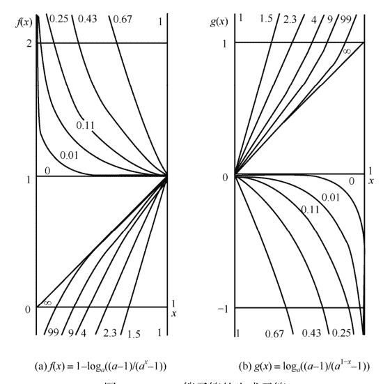

表 8.3 显示 Frank 簇下三种 $h$ 定义高度一致（$h_3$ 为 $h_2$ 近似），给出了实用映射：
$$a=\left(\frac{1-h}{h-0.5}\right)^3, \quad h=\frac{1+a^{1/3}/2}{1+a^{1/3}}$$

**工程组合策略**：既要完整簇，又要相容段？**拼接大法**登场：
*   **相容段** ($h\in[0.5, 1]$)：**Frank 簇**接管。
*   **相克段** ($h\in[0, 0.5]$)：**Schweizer 簇**守擂（采用拟合法参数 $m$ 映射）。

虽然后者在一般场景下统一用 Schweizer 完整簇更省事，但这“混血簇”为严格相容需求提供了理论上唯一的完美解。

---

### 8.4 终极形态：零级 T/S 范数完整簇的正式定义

万物归一，通过生成元构造完整簇。

#### 8.4.1 三大核心定义
**定义 8.4.1（零级 T 性生成元完整簇）**
$$F(x, h)=x^m, \quad m \in \mathbb{R}, h \in (0, 1)$$
参数桥梁：$m=(3-4h)/(4h(1-h))$；$h=\frac{(1+m)-\sqrt{(1+m)^2-3m}}{2m}$。

**定义 8.4.2（零级 T 范数完整簇）**
以中心 T 范数 $T(x,y)=\max(0, x+y-1)$ 为底，经生成元 $F$ 变换生成：
$$T(x,y,h) = F^{-1}\left(\max\left(F(0,h), F(x,h) + F(y,h) - 1\right), h\right) = \left(\max\left(0, x^m + y^m - 1\right)\right)^{1/m}$$
参数 $m, h$ 同定义 8.4.1 映射关系。

**定义 8.4.3（零级 S 性生成元完整簇）**
$$G(x, h) = 1-(1-x)^m, \quad m \in \mathbb{R}, h \in (0,1)$$

### 8.4.2 构建零级 T/S 范数的相容族

**定义 8.4.5（零级 T 型生成元相容族）**  
零级 T 型生成元相容族的数学形式给出如下：  
$$F_r(x, h)=1-\log_a\frac{a-1}{a^{x-1}},\quad a \in \mathbf{R}_+,\ h \in (0.5, 1)$$  
参数之间的换算关系为：$a=\left(\frac{1-h}{h-0.5}\right)^3$；$h=\frac{1+a^{1/3}/2}{1+a^{1/3}}$。

**定义 8.4.6（零级 T 范数相容族）**  
以核心 T 范数 $T(x,y)=\max(0,x+y-1)$ 为基础，结合上述生成元族构造出的 T 范数族，称为零级 T 范数相容族：  
$$T_r(x, y, h) = F_r^{-1}\bigl(\max(F_r(0, h), F_r(x, h) + F_r(y, h) - 1), h\bigr) = \log_a\left(1 + \frac{(a^x - 1)(a^y - 1)}{a - 1}\right)$$  
参数取值范围同定义 8.4.5。

**定义 8.4.7（零级 S 型生成元相容族）**  
零级 S 型生成元相容族定义如下：  
$$G_r(x, h)=\log_a\frac{a-1}{a^{1-x}-1},\quad a \in \mathbf{R}_+,\ h \in (0.5, 1)$$  
参数换算方式同上。

**定义 8.4.8（零级 S 范数相容族）**  
基于核心 S 范数 $S(x,y)=\min(1,x+y)$ 与上述生成元族生成的 S 范数族，即为零级 S 范数相容族：  
$$S_r(x, y, h) = G_r^{-1}\bigl(\min(G_r(1, h), G_r(x, h) + G_r(y, h)), h\bigr) = 1 - \log_a\left(1 + \frac{(a^{1-x} - 1)(a^{1-y} - 1)}{a - 1}\right)$$  
参数设定保持不变。

**定理 8.4.2** 零级 T 范数相容族 $T_r(x, y, h)$ 与零级 S 范数相容族 $S_r(x, y, h)$ 满足零级对偶关系：$S_r(x, y, h) = 1 - T_r(1-x, 1-y, h)$。

*论证：* 因为 $G_r(x, h) = \log_a\frac{a-1}{a^{1-x}-1} = 1 - F_r(1-x, h)$，符合零级对偶准则，依推论 7.4.2 即得证。

> **注记：** 虽然两类生成元族差异明显，但衍生出的 T/S 范数族却极为接近。表 8.2 列出的 Schweizer 算子族相容差即量化了两者偏离度，常规场景下可忽略不计。鉴于 Schweizer 族属完整族且计算便捷，除非专门考量相容差，后续讨论将聚焦于 Schweizer 完整族。

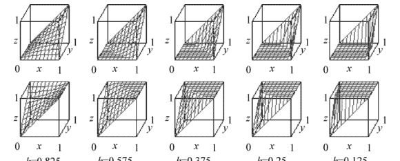

### 8.4.3 零级弱 T/弱 S 范数完整族的构造思路

上述完整族的运算模型相对繁复。若放宽结合律要求，可利用线性组合特性：$\alpha T_3 + \beta T_2$、$\alpha T_2 + \beta T_1$、$\alpha T_1 + \beta T_0$（$\alpha+\beta=1, \alpha,\beta>0$）均为弱 T 范数；$\alpha S_3 + \beta S_2$、$\alpha S_2 + \beta S_1$、$\alpha S_1 + \beta S_0$ 同理为弱 S 范数。据此可人工构造弱 T/弱 S 范数完整族。

**定理 8.4.3** 若 $T_1, T_2$ 为两个不同的 T 范数，则 $T(x, y) = \alpha T_1(x, y) + \beta T_2(x, y)$（$\alpha+\beta=1, \alpha,\beta>0$）构成弱 T 范数。

*论证：*  
1. **边界条件：** $T_1(0,y)=T_2(0,y)=0 \Rightarrow T(0,y)=0$；$T_1(1,y)=T_2(1,y)=y \Rightarrow T(1,y)=y$。  
2. **单调性：** 由 $T_1, T_2$ 单调性直接推导出 $T$ 单调。  
3. **交换律：** $T_1, T_2$ 可交换 $\Rightarrow T(x,y)=T(y,x)$。  
4. **结合律缺失：**  
$$T(T(x, y), z)=\alpha T_1(T(x, y), z)+\beta T_2(T(x, y), z)$$ $$=\alpha T_1(\alpha T_1(x, y)+\beta T_2(x, y), z)+\beta T_2(\alpha T_1(x, y)+\beta T_2(x, y), z)$$ $$T(x, T(y, z))=\alpha T_1(x, T(y, z))+\beta T_2(x, T(y, z))$$ $$=\alpha T_1(x, \alpha T_1(y, z)+\beta T_2(y, z))+\beta T_2(x, \alpha T_1(y, z)+\beta T_2(y, z))$$  
除退化情形（$\alpha=0$或$\beta=0$）外，$T(T(x,y),z) \neq T(x,T(y,z))$，不满足结合律。  
综上，$T(x,y)$ 为弱 T 范数。

**定理 8.4.4** 若 $S_1, S_2$ 为两个不同的 S 范数，则 $S(x, y)=\alpha S_1(x, y)+\beta S_2(x, y)$（$\alpha+\beta=1, \alpha,\beta \geqslant 0$）为弱 S 范数。  
*论证：* 推导过程同定理 8.4.3。

**定义 8.4.9（弱 T/弱 S 范数完整族）**  
通过四典范 T/S 范数线性插值得到的弱完整族定义如下：

$$T_w(x, y, h)= \begin{cases} 
(4h-3)\min(x, y)+(4-4h)xy & h>0.75 \\
(4h-2)xy+(3-4h)\max(0, x+y-1) & h>0.5 \\
(2h)\max(0, x+y-1)+(1-2h) \text{ite} \{ \min(x, y) | \max(x, y)=1; 0 \} & \text{否则}
\end{cases}$$

$$S_w(x, y, h)= \begin{cases} 
(4h-3)\max(x, y)+(4-4h)(x+y-xy) & h>0.75 \\
(4h-2)(x+y-xy)+(3-4h)\min(1, x+y) & h>0.5 \\
(2h)\min(1, x+y)+(1-2h) \text{ite} \{ \max(x, y) | \min(x, y)=0; 1 \} & \text{否则}
\end{cases}$$

图 8.7 对比了三类完整族（标准完整族、相容完整族、弱完整族）在 $h=0.825, 0.575, 0.375, 0.25, 0.125$ 处的表现（注：$h=1, 0.75, 0.5, 0$ 时三者重合）。可见，若非强制要求相容性与结合律，三者在工程应用中可视为近似等价。

后续研究将集中于 T/S 范数完整族，即 Schweizer 完整族。


### 8.4.4 Schweizer 族中范数随参数 h 的单调变化规律

在零级完整族内，范数值不仅随 $x,y$ 单调增，亦随参数 $h$ 单调变化。严格数学证明较繁，此处略过；计算机可视化仿真亦确认了全域单调性。图 8.8 展示了主平面 $x=y$ 上随 $h$ 变化最显著的趋势：  
- 图 (a) $T(x, y, h)$ 随 $h$ **严格单调增**；  
- 图 (b) $S(x, y, h)$ 随 $h$ **严格单调减**。  

这为选取 $h$ 作为族内定位参数提供了坚实依据。

---

#### 8.5 进阶：一级 T/S 范数完整超族

在零级生成元完整族基础上引入广义自相关系数 $k$，可拓展得到一级生成元完整超族，进而导出一级 T/S 范数完整超族。因常用 N 型生成元完整族分指数型与多项式型，一级超族亦分**纯指数型**与**混合型**两支，下文分别展开。

##### 8.5.1 纯指数型一级 T/S 范数完整超族详解

**1. 模型生成机制**  
若选取 N 型生成元完整族及对应一级 N 范数完整族为指数模型：  
$\Phi(x, k)=x^n$，$N(x, k)=(1-x^n)^{1/n},\ n \in \mathbf{R}_+$  
其中 $n=-1/\log_2 k$，$k=2^{-1/n}$。  
由此可推导出纯指数型一级生成元超族及对应范数超族。

**定义 8.5.1（纯指数型一级 T 型生成元完整超族）**  
$$F(x, k, h)=F(\Phi(x, k), h)=x^{nm}$$  
参数链条：$n=-1/\log_2 k,\ k=2^{-1/n},\ k \in (0, 1),\ n \in \mathbf{R}_+$；  
$m=(3-4h)/[4h(1-h)]$；$h=\bigl((1+m)-((1+m)^2-3m)^{1/2}\bigr)/(2m),\ h \in (0, 1),\ m \in \mathbf{R}$。

**定义 8.5.2（纯指数型一级 T 范数完整超族）**  
以核心 $T(x,y)=\max(0,x+y-1)$ 生成：  
$$T(x, y, h, k) = \bigl(\max(0^{nm}, x^{nm}+y^{nm}-1)\bigr)^{1/nm}$$  
参数设定同定义 8.5.1。

**定义 8.5.3（纯指数型一级 S 型生成元完整超族）**  
$$G(x, h, k)=G(\Phi(x, k), h)=1-(1-x^n)^m$$  
参数链条同前。

**定义 8.5.4（纯指数型一级 S 范数完整超族）**  
以核心 $S(x,y)=\min(1,x+y)$ 生成：  
$$S(x, y, h, k) = 1 - \Bigl(1 - \bigl(1 - \max(0^m, (1-x^n)^m + (1-y^n)^m - 1)\bigr)^{1/m}\Bigr)^{1/n}$$  
参数设定同前。

**2. 核心性质解析**

**定理 8.5.1（类属保持性）**  
$k \in (0, 1)$ 时，纯指数型一级 T 范数超族 $T(x, y, h, k)$ 与零级族 $T(x, y, h)$ 类属一致；S 范数超族 $S(x, y, h, k)$ 与零级族 $S(x, y, h)$ 类属一致。

*论证：*  
$T(x, y, h, k)=\Phi^{-1}(T(\Phi(x, k), \Phi(y, k), h), k)$，依 T 范数第二生成定理，类属不变。极限情况：  
$h=1 \Rightarrow \min(x,y)=\mathbf{T}_3$（上极限）；  
$h=0.75 \Rightarrow xy=\mathbf{T}_2$（中极限）；  
$h=0 \Rightarrow \text{ite}\{\min(x,y)|\max(x,y)=1; 0\}=\mathbf{T}_0$（下极限）。  
S 范数侧同理，利用第二生成定理及 $\Phi$ 变换，极限对应 $\mathbf{S}_3, \mathbf{S}\Phi_{2k}, \mathbf{S}_0$。证毕。

**定理 8.5.2（$\mathbf{T}_1/\mathbf{S}_1$ 出现准则）**  
- 纯指数型一级 T 范数超族中出现 $\mathbf{T}_1$ 的充要条件为 $nm=1$，即 $\frac{4h-3}{4h(1-h)\log_2 k}=1$。  
- 纯指数型一级 S 范数超族中出现 $\mathbf{S}_1$ 的条件为 $(1-x^n)^m=1-x$。

*论证：*  
$F(x,h,k)=x^{nm}$，当 $nm=1$ 时 $F(x,h,k)=x$，代入得 $T=\mathbf{T}_1$，代换 $m,h,n,k$ 关系式即得第一准则。  
由 T/S 零级对偶条件 $(1-x^{m_2})^{n_2}=(1-x)^{n_1m_1}$ 推导，得 S 范数侧条件 $(1-x^n)^m=1-x$。

**定理 8.5.3（超族间零级对偶条件）**  
纯指数型一级 T 范数 $T(x, y, h_1, k_1)$ 与 S 范数 $S(x, y, h_2, k_2)$ 存在零级对偶关系，当且仅当 $(1-x^{m_2})^{n_2}=(1-x)^{n_1m_1}$。  
若 $h_1=h_2$，仅当 $(k_1,k_2) \in \{(0.5,0.5),\ (0,1),\ (1,0)\}$ 时满足。

**零级对偶条件的推导与求解**

给定 $F(x, h_1, k_1)=x^{n_1 m_1}$ 以及 $G(x, h_2, k_2)=1-(1-x^{n_2})^{m_2}$，依据零阶对偶的通用法则 $g(x)=1-f(1-x)$，可得：
$$G(x, h_2, k_2)=1-(1-x^{n_2})^{m_2}=1-(1-x)^{n_1 m_1}$$
即 $(1-x^{n_2})^{m_2}=(1-x)^{n_1 m_1}$。
令 $h_1=h_2$，则方程简化为 $1-x^{n_2}=(1-x)^{n_1}$。在 $x \in (0,1)$ 的定义域内，该方程仅存在三组解：
1.  $n_1=n_2=1$，对应 $k_1=k_2=0.5$；
2.  $n_2 \to \infty$ 致使 $1-x^{n_2} \to 1$，配合 $n_1=0$ 使 $(1-x)^{n_1} \to 1$，解为 $n_2 \to \infty, n_1=0$，即 $k_2=1, k_1=0$；
3.  $n_2=0$ 导致 $1-x^{n_2} \to 0$，配合 $n_1 \to \infty$ 使 $(1-x)^{n_1} \to 0$，解为 $n_1 \to \infty, n_2=0$，即 $k_1=1, k_2=0$。

由此定理得证。

---

###### 定理 8.5.4：纯指数型 T 范数超簇 $k=1$ 极限行为

在纯指数型一级 T 范数簇 $T(x, y, h, 1)$ 中，$T(x, y, 0.75, 1)$ 无唯一确定值，可在 $\mathbf{T_0}$ 与 $\mathbf{T_3}$ 之间任意取值；若 $h>0.75$，簇内算子全数坍缩为 $\mathbf{T_3}$；若 $h<0.75$，则全数收敛至 $\mathbf{T_0}$。

**论证**  
$k=1$ 蕴含 $n \to \infty$：
- $h>0.75 \Rightarrow m<0$，此时 $F(x, h, 1) = x^{-\infty} = \mathbf{F_3}$，进而 $T = \mathbf{T_3}$；
- $h=0.75 \Rightarrow m=0$，$F(x, 0.75, 1) = x^{mm}$（$mm \in (-\infty, \infty)$ 为未定式），故 $T$ 介于 $\mathbf{T_0}$ 与 $\mathbf{T_3}$ 间（工程实践常约定取 $\mathbf{T_2}$）；
- $h<0.75 \Rightarrow m>0$，$F(x, h, 1) = x^{\infty} = \mathbf{F_0}$，进而 $T = \mathbf{T_0}$。

###### 定理 8.5.5：纯指数型 T 范数超簇 $k=0$ 极限行为

在纯指数型一级 T 范数簇 $T(x, y, h, 0)$ 中，除 $T(x, y, 1, 0)$ 可在 $\mathbf{T_2}$ 与 $\mathbf{T_3}$ 间任意取值、$T(x, y, 0, 0)$ 可在 $\mathbf{T_0}$ 与 $\mathbf{T_2}$ 间任意取值外，其余参数组合均退化为 $\mathbf{T_2}$。

**论证**  
$k=0$ 蕴含 $n=0$：
- $h=1 \Rightarrow m \to -\infty$，$F(x, 1, 0) = x^{mm}$（$mm \ll 0$ 未定），$T$ 介于 $\mathbf{T_2}$ 与 $\mathbf{T_3}$ 间（应用中可设为 $\mathbf{T_3}$）；
- $h \in (0, 1) \Rightarrow m$ 有限，退化为 $F(x, h, 0) = \mathbf{F_2}$，即 $T = \mathbf{T_2}$；
- $h=0 \Rightarrow m \to \infty$，$F(x, 0, 0) = x^{mm}$（$mm \gg 0$ 未定），$T$ 介于 $\mathbf{T_2}$ 与 $\mathbf{T_0}$ 间（应用中可设为 $\mathbf{T_0}$）。

**推论 8.5.1** 经约定可视纯指数型一级 T 范数簇 $T(x, y, 1, k)$ 整体坍缩为 $\mathbf{T_3}$。  
**推论 8.5.2** 经约定可视纯指数型一级 T 范数簇 $T(x, y, 0, k)$ 整体收敛至 $\mathbf{T_0}$。

研究表明，纯指数型一级 S 范数极限簇 $S(x, y, 0.75, k) = (x^{+y} + y^{-x} \cdot x^{-y})^{1/m} = \mathbf{S}\Phi_{2k}$ 存在上极限（记为 $\mathbf{S}\Phi_{21}$），下极限不存在，可在 $\mathbf{S_3}$ 与 $\mathbf{S_0}$ 间任意取值。

**推论 8.5.3** 纯指数型一级 S 范数簇 $S(x, y, h, 1)$ 中，除 $S(x, y, 1, 1)$ 介于 $\mathbf{S_3}$ 与 $\mathbf{S}\Phi_{21}$ 间、$S(x, y, 0, 1)$ 介于 $\mathbf{S}\Phi_{21}$ 与 $\mathbf{S_0}$ 间外，其余均退化为 $\mathbf{S}\Phi_{21}$。  
**推论 8.5.4** 纯指数型一级 S 范数簇 $S(x, y, h, 0)$ 中，除 $S(x, y, 0.75, 0)$ 介于 $\mathbf{S_3}$ 与 $\mathbf{S_0}$ 间外，$h>0.75$ 时全坍缩为 $\mathbf{S_3}$，$h<0.75$ 时全收敛至 $\mathbf{S_0}$。  
**推论 8.5.5** 经约定可视纯指数型一级 S 范数 $S(x, y, 1, k)$ 全部退化为 $\mathbf{S_3}$。  
**推论 8.5.6** 经约定可视纯指数型一级 S 范数 $S(x, y, 0, k)$ 全部退化为 $\mathbf{S_0}$。

上述极限特性汇总于表 8.4、表 8.5，图 8.9 为其三维演变示意。可见，严格族与幂零族区域均被极限族完全包裹。

###### 表 8.4 纯指数型一级 T 范数完整超簇极限性质汇总

| T(x, y, h, k) | h=1 | h∈(0.75, 1) | h=0.75 | h∈(0, 0.75) | h=0 |
|---|---|---|---|---|---|
| k=1 | T3 | T3 | (T3, T0) | T0 | T0 |
| k∈(1, 0) | T3 | 严格类 | T2 | 幂零类 | T0 |
| k=0 | (T3, T2) | T2 | T2 | T2 | (T2, T0) |

###### 表 8.5 纯指数型一级 S 范数完整超簇极限性质汇总

| S(x, y, h, k) | h=1 | h∈(0.75, 1) | h=0.75 | h∈(0, 0.75) | h=0 |
|---|---|---|---|---|---|
| k=1 | (S3, SΦ21) | SΦ21 | SΦ21 | SΦ21 | (SΦ21, S0) |
| k∈(1, 0) | S3 | 严格类 | SΦ2k | 幂零类 | S0 |
| k=0 | S3 | S3 | (S3, S0) | S0 | S0 |


####### (a) 纯指数型一级T范数完整超簇


####### (b) 纯指数型一级S范数完整超簇

###### 图 8.9 纯指数型一级 T/S 范数完整超簇极限性质的三维变化图

---

##### 8.5.2 混合型一级 T 范数和 S 范数完整超簇

###### 1. 混合模型的构建

若选取 N 性生成元完整簇及对应的一级 N 范数完整簇为多项式模型，即

```
\Phi(x, k) = x(1+\lambda)^{1/2} / (1 + ((1+\lambda)^{1/2} - 1)x)
\Phi^{-1}(x, k) = x / ((1+\lambda)^{1/2} - ((1+\lambda)^{1/2} - 1)x)
N(x, k) = \Phi^{-1}(1 - \Phi(x, k), k) = (1-x) / (1 + \lambda x)
```

其中 $\lambda=(1-2k)/k^2;\ k=((1+\lambda)^{1/2}-1)/\lambda,\ k \in (0, 1),\ \lambda > 1$，可导出混合型一级 T/S 性生成元完整超簇及对应的 T/S 范数完整超簇。

###### 定义 8.5.5 混合型一级 T 性生成元完整超簇

```
F(x, h, k) = F(\Phi(x, k), h) = (\Phi(x, k))^m
\Phi(x, k) = x(1+\lambda)^{1/2} / (1 + ((1+\lambda)^{1/2} - 1)x)
F^{-1}(x, h, k) = \Phi^{-1}(F^{-1}(x, h), k) = \Phi^{-1}(x^{1/m}, k)
\Phi^{-1}(x, k) = x / ((1+\lambda)^{1/2} - ((1+\lambda)^{1/2} - 1)x)
```

参数关系式：  
$m=(3-4h)/[4h(1-h)],\ h\in(0,1)$；  
$h=((1+m)-((1+m)^2-3m)^{1/2})/(2m),\ m\in\mathbb{R}$；  
$\lambda=(1-2k)/k^2$；  
$k=((1+\lambda)^{1/2}-1)/\lambda,\ k\in(0,1),\ \lambda>-1$。

###### 定义 8.5.6 基于中心 T 范数 $T(x,y)=\max(0,x+y-1)$ 与混合型一级 T 性生成元完整超簇生成的 T 范数超簇，称作混合型一级 T 范数完整超簇：

$T(x, y, h, k) = F^{-1}(\max(F(0, h, k), F(x, h, k) + F(y, h, k) - 1), h, k) = \Phi^{-1}((\max(0^m, (\Phi(x, k))^m + (\Phi(y, k))^m - 1))^{1/m}, k)$

参数定义同定义 8.5.5。

###### 定义 8.5.7 混合型一级 S 性生成元完整超簇

$G(x, h, k) = G(\Phi(x, k), h) = 1 - (1 - \Phi(x, k))^m$  
$\Phi(x, k) = x(1 + \lambda)^{1/2} / [1 + ((1 + \lambda)^{1/2} - 1)x]$  
$G^{-1}(x, h, k) = \Phi^{-1}(G^{-1}(x, h), k) = \Phi^{-1}(1 - (1 - x)^{1/m}, k)$  
$\Phi^{-1}(x, k) = x / ((1 + \lambda)^{1/2} - ((1 + \lambda)^{1/2} - 1)x)$

参数定义同定义 8.5.5。

###### 定义 8.5.8 基于中心 S 范数 $S(x, y)=\min(1, x+y)$ 与混合型一级 S 性生成元完整超簇生成的 S 范数超簇，称作混合型一级 S 范数完整超簇：

$S(x, y, h, k) = G^{-1}(\min(G(1, h, k), G(x, h, k) + G(y, h, k)), h, k) = \Phi^{-1}(1 - (\max(0^m, (1 - \Phi(x, k))^m + (1 - \Phi(y, k))^m - 1))^{1/m}, k)$

参数定义同定义 8.5.5。

###### 2. 混合模型的核心性质

非极限状态下，混合型超簇的演变规律与纯指数型大体一致，仅变化速率有别。主要差异集中在极限情况：

###### 定理 8.5.6：混合型超簇零级对偶判据

混合型一级 T 范数超簇 $T(x, y, h_1, k_1)$ 与 S 范数超簇 $S(x, y, h_2, k_2)$ 存在零级对偶的充要条件为 $(1-\Phi(x, k_2))^{m_2}=(\Phi(1-x, k_1))^{m_1}$；若 $h_1=h_2$，则 $k_2=1-k_1$。

**论证**  
$F(x, h_1, k_1)=(\Phi(x, k_1))^{m_1},\ G(x, h_2, k_2)=1-(1-\Phi(x, k_2))^{m_2}$。依零级对偶条件 $g(x)=1-f(1-x)$，得 $G=1-(1-\Phi(x, k_2))^{m_2}=1-(\Phi(1-x, k_1))^{m_1}$，即 $(1-\Phi(x, k_2))^{m_2}=(\Phi(1-x, k_1))^{m_1}$。若 $h_1=h_2$，则 $1-\Phi(x, k_2)=\Phi(1-x, k_1)$，解得 $\Phi(x, k_2)=1-\Phi(1-x, k_1)$，进而 $k_2=1-k_1$。证毕。

###### 定理 8.5.7：$T_1$ 与 $S_1$ 的出现条件

混合型一级 T 范数超簇出现 $T_1$ 的条件为 $(\Phi(x, k))^m=x$；混合型一级 S 范数超簇出现 $S_1$ 的条件为 $1-(1-\Phi(x, k))^m=x$。

**论证**  
$F(x, h, k)=(\Phi(x, k))^m=x$ 时 $T=T_1$；$G(x, h, k)=1-(1-\Phi(x, k))^m=x$ 时 $S=S_1$。即得证。

混合型超簇在 $k$ 极限下的性质与纯指数型近似，差异主要在于中极限簇 $h=0.75$ 处：
- $T\Phi_{2k}=T(x, y, 0.75, k)=\frac{xy(1+\lambda)^{1/2}}{1+((1+\lambda)^{1/2}-1)(x+y-xy)}$ 为 T 范数；
- $T\Phi_{21}=T(x, y, 0.75, 1)$ 不存在，可在 $T_3$ 与 $T_0$ 间任意取值；
- $T\Phi_{20}=T(x, y, 0.75, 0)$ 存在。
- $S\Phi_{2k}=S(x, y, 0.75, k)=\frac{x+y-xy(2-(1+\lambda)^{1/2})}{1+((1+\lambda)^{1/2}-1)xy}$ 为 S 范数；
- $S\Phi_{21}=S(x, y, 0.75, 1)$ 存在；
- $S\Phi_{20}=S(x, y, 0.75, 0)$ 不存在，可在 $S_3$ 与 $S_0$ 间任意取值。

混合型超簇的特殊性质汇总于表 8.6、表 8.7，三维演变见图 8.10。同样可见严格族与幂零族被极限族包围。

###### 表 8.6 混合型一级 T 范数完整超簇极限性质汇总

| T(x,y,h,k) | h=1 | h∈(0.75, 1) | h=0.75 | h∈(0, 0.75) | h=0 |
| :--- | :--- | :--- | :--- | :--- | :--- |
| k=1 | T3 | T3 | (T3, T0) | T0 | T0 |
| k∈(1, 0) | T3 | 严格类 | TΦ2k | 幂零类 | T0 |
| k=0 | (T3, TΦ20) | TΦ20 | TΦ20 | TΦ20 | (TΦ20, T0) |

###### 表 8.7 混合型一级 S 范数完整超簇极限性质汇总

| S(x,y,h,k) | h=1 | h∈(0.75, 1) | h=0.75 | h∈(0, 0.75) | h=0 |
| :--- | :--- | :--- | :--- | :--- | :--- |
| k=1 | (S3, SΦ21) | SΦ21 | SΦ21 | SΦ21 | (SΦ21, S0) |
| k∈(1, 0) | S3 | 严格类 | SΦ2k | 幂零类 | S0 |
| k=0 | S3 | S3 | (S3, S0) | S0 | S0 |

```
\Phi(x, k) = x(1+\lambda)^{1/2} / (1 + ((1+\lambda)^{1/2} - 1)x)
\Phi^{-1}(x, k) = x / ((1+\lambda)^{1/2} - ((1+\lambda)^{1/2} - 1)x)
N(x, k) = \Phi^{-1}(1 - \Phi(x, k), k) = (1-x) / (1 + \lambda x)
```

####### (a) 混合型一级T范数完整超簇

```
F(x, h, k) = F(\Phi(x, k), h) = (\Phi(x, k))^m
\Phi(x, k) = x(1+\lambda)^{1/2} / (1 + ((1+\lambda)^{1/2} - 1)x)
F^{-1}(x, h, k) = \Phi^{-1}(F^{-1}(x, h), k) = \Phi^{-1}(x^{1/m}, k)
\Phi^{-1}(x, k) = x / ((1+\lambda)^{1/2} - ((1+\lambda)^{1/2} - 1)x)
```

####### (b) 混合型一级S范数完整超簇

###### 图 8.10 混合型一级 T/S 范数完整超簇极限性质的三维变化图

---

##### 8.5.3 一级 T/S 完整超簇内范数分布的单调性

基于生成元簇 $\Phi(x, k)$ 内算子随 $k$ 连续严格单调递减、$T(x, y, h)$ 簇内算子随 $h$ 连续严格单调递增、$S(x, y, h)$ 簇内算子随 $h$ 连续严格单调递减等基础性质，可推知 $T(x, y, h, k)$ 与 $S(x, y, h, k)$ 完整超簇内算子均随 $h, k$ 连续严格单调变化。

深入分析揭示了更精细的单调性规律：

- **T 范数超簇**：算子随 $h$ 严格单调增；当 $h<0.75$ 时随 $k$ 严格单调减，当 $h>0.75$ 时随 $k$ 严格单调增。
- **S 范数超簇**：算子随 $h$ 严格单调减；当 $h<0.75$ 时随 $k$ 严格单调减，当 $h>0.75$ 时随 $k$ 严格单调增。

# 泛逻辑核心算子的对偶封闭性与逻辑律条件深度解析

在泛逻辑学的框架下，一级 T/S 范数完整超簇展现出极其丰富的代数结构与逻辑特性。本文将系统梳理其关键逻辑性质的成立边界，并深入探讨 N、T、S 三大算子族在同参数与异参数条件下的对偶封闭关系。

## 8.5.4 核心逻辑性质的成立条件

第七章已总体确立了柔性补余律，其一级形式如下：

$$T(x, N(x, k), h, k) < k ; S(x, N(x, k), h, k) > k$$

经典二值逻辑中至关重要的矛盾律与排中律，在泛逻辑体系中并非无条件普适，而是呈现出**条件性成立**的特征。

**定理 8.5.8（矛盾律门槛）** 当隐含度参数 $h < 0.5$ 时，合取运算满足 $T(x, N(x, k), h, k)=0$，矛盾律正式生效。  
*推演逻辑*：在 $h=0.5$ 基准点上，$T(x, N(x, k), h, k)$ 恒等于 0；鉴于 T 范数随 $h$ 严格单调递增，故 $h$ 取值低于 0.5 时，矛盾律自然成立。

**定理 8.5.9（排中律门槛）** 同理，当 $h < 0.5$ 时，析取运算满足 $S(x, N(x, k), h, k)=1$，排中律得以确立。  
*推演逻辑*：$h=0.5$ 时 S 范数值为 1，且 S 范数随 $h$ 严格单调递减，因此 $h$ 小于 0.5 时排中律必然成立。

**定理 8.5.10（与或序关系）** 对任意参数，恒有 $T(x, y, h, k) < S(x, y, h, k)$。  
*依据*：T 范数严格小于 $\min(x,y)$，S 范数严格大于 $\max(x,y)$，两者天然构成严格不等式链。

**定理 8.5.11（吸收律变体）** 一般情况下 $T(x, S(x, y, h, k), h, k) < x$；仅当参数 $h=1, k$ 固定时，退化为经典吸收律 $T(x, S(x, y, 1, k), 1, k)=x$。  
*核心洞见*：利用 T 范数小于最小值、S 范数大于最大值的特性，无论 $x$ 与 $y$ 孰大孰小，内层最小值运算均锁定为 $x$，从而导出不等式；极限参数下则精准还原经典代数结构。

**定理 8.5.12（扩展律对称性）** 与吸收律镜像对应，一般形式为 $x < S(x, T(x, y, h, k), h, k)$，极限参数 $h=1$ 下回归等式 $S(x, T(x, y, 1, k), 1, k)=x$。

---

## 8.6 一级超簇上 N 运算的广义自封闭性全景

前文已证 N 范数完整簇内部具备广义自封闭性（对偶、奇次复合自封闭、偶次复合余封闭）。今进一步揭示：**N 范数完整簇 $N(x,k)$、T 范数完整超簇 $T(x,y,h,k)$ 与 S 范数完整超簇 $S(x,y,h,k)$ 三者在同参数 $(h,k)$ 下，构成关于 N 运算的封闭对偶三角：**
*   T 关于 N 的对偶是 S；
*   S 关于 N 的对偶是 T；
*   T 与 S 间的关联 N 范数正是 $N(x,k)$。

这是逻辑算子层面的根本性质——**同参数强对偶性**。然而，一旦参数失配，三者仅能维持微弱的**弱对偶关系**。

### 8.6.1 零级镜内：指数型弱对偶的普适性

基于 7.4 节 NTS 弱对偶理论，零级 T/S 范数完整镜内部不仅存在零级对偶，更蕴含广泛的指数型弱对偶网络。

**定理 8.6.1（零级 S 生成元互通）** 任意两个非极限零级 S 生成元 $G(x, h_1), G(x, h_2)$ 间，存在连续严格单调的指数型自守函数 $\varphi(x)=1-(1-x)^{m_1/m_2}$ 实现映射 $G(x, h_1)=G(\varphi(x), h_2)$。指数比 $m_1/m_2$ 由参数 $h_1, h_2$ 通过特定有理函数决定。

**定理 8.6.2（零级 T 生成元互通）** 同理，非极限零级 T 生成元 $F_0(x, h_1), F_0(x, h_2)$ 间通过指数型自守函数 $\varphi(x)=x^{m_1/m_2}$ 实现弱对偶连接，指数比公式同上。

**定理 8.6.3（零级 T-S 跨族弱对偶）** 任意非极限零级 T 生成元 $F(x, h_1)$ 与同类 S 生成元 $G_0(x, h_2)$ 之间，通过指数型弱 N 范数 $N(x)=1-x^{m_1/m_2}$ 构建弱对偶：$F(x, h_1)=1-G(N(x), h_2)$。

**推论 8.6.1** S 到 T 的反向跨族弱对偶同理成立，弱 N 范数形式为 $N(x)=(1-x)^{m_1/m_2}$。

**定理 8.6.4 / 8.6.5（零级范数族间的弱对偶传递）** 给定零级镜内任一非极限 T 范数（或 S 范数）与任意指数型非极限弱 N 范数，其弱对偶运算必然落入对应的零级 S 镜（或 T 镜）内部，且保持非极限性质。证明路径依赖于生成元层面的弱对偶构造（定理 8.6.3）与范数由生成元唯一确定的特性。

**定理 8.6.6 / 8.6.7（零级任意范数配对的弱 N 存在性）** 在零级 T 簇与 S 簇中任选非极限范数，均能显式构造出指数型弱 N 范数（形式分别为 $1-x^{m_2/m_1}$ 与 $(1-x)^{m_1/m_2}$），使得弱对偶方程成立。

**推论 8.6.2（强对偶的唯一性边界）** 在非极限 N 范数、零级 T、零级 S 三者构成标准对偶 $T=N(S(N(x),N(y)))$ 的**充要条件**是：$N(x)=1-x$（即极限 N 范数 $N_0$ 或 $N_3$）**且** $h_1=h_2$。这宣告了：除极限 N 范数外，零级 T/S 范数间**仅存零级对偶**，不存在更广泛的强对偶。

---

### 8.6.2 纯指数型一级簇：指数型一级对偶的严格确立

步入一级纯指数型超簇，参数维度扩展至 $(h,k)$，生成元形态升级为 $x^{nm}$ 与 $1-(1-x^n)^m$ 形式。

**定理 8.6.8 / 8.6.9（一级跨族任意配对的弱 N 构造）** 任选非极限纯指数型一级 S 范数 $(h_1,k_1)$ 与 T 范数 $(h_2,k_2)$，均能显式给出连续严格单调的指数型弱 N 范数（形式涉及 $n_1, n_2, m_1, m_2$ 的复合指数运算），实现弱对偶互换。证明核心在于利用生成元反函数 $G^{-1}$ 与 $1-F$ 的复合运算。

**定理 8.6.10（纯指数型一级超簇的强对偶基石）** **同参数 $(h,k)$ 下**，纯指数型一级 T 超簇与 S 超簇之间建立起**指数型一级强对偶关系**：

$$ S(x, y, h, k) = N(T(N(x, k), N(y, k), h, k), k) $$
其中关联 N 范数为指数型标准形式：$N(x, k) = (1-x^n)^{1/n}$。

*证明要旨*：S 生成元可分解为 $1-F(N(x,k), h, k)$ 形式，完美契合一级对偶定义条件，从而推导出超簇层面的强对偶封闭性。

---

### 8.6.3 混合型一级簇：多项式型弱对偶的广义拓展

混合型一级簇引入 $\Phi(x,k)$ 结构，打破纯指数型限制，对偶理论随之推广至多项式型弱 N 范数领域。

**定理 8.6.11（混合型跨族任意配对的弱 N 构造）** 对任意非极限混合型一级 S 范数 $(h_1,k_1)$ 与 T 范数 $(h_2,k_2)$，其生成元分别基于 $\Phi(x,k_1)$ 与 $\Phi(x,k_2)$ 构造。两者间存在连续严格单调的**多项式型非极限弱 N 范数**：

$$ N(x) = \Phi^{-1}\left(1 - (\Phi(x, k_2))^{m_2/m_1}, k_1\right) $$

使得弱对偶关系 $T(x, y, h_2, k_2) = N^{-1}(S(N(x), N(y), h_1, k_1))$ 严格成立。证明沿用生成元反函数复合路径，通过 $\Phi$ 结构的嵌套与幂次变换完成显式构造。

**定理 8.6.12** ……

### 混合一级 T/S 范数弱对偶与零级对偶的构造

设 $ T(x, y, h_1, k_1) $ 为任意非极限混合一级 T 范数，其 T-生成元为 $ F(x, h_1, k_1)=(\Phi(x, k_1))^{m_1} $，其中 $ m_1=(3-4h_1)/(4h_1(1-h_1)) $；另设 $ S(x, y, h_2, k_2) $ 为任意非极限混合一级 S 范数，其 S-生成元为 $ G(x, k_2, h_2)=1-(1-\Phi(x, k_2))^{m_2} $，其中 $ m_2=(3-4h_2)/(4h_2(1-h_2)) $。此时，存在一个多项式形式的非极限弱 N 范数 $ N(x)=\Phi^{-1}((1-(\Phi(x, k_1))^{m_1/m_2}), k_2) $，使得弱对偶关系 $ S(x, y, h_2, k_2)=N^{-1}(T(N(x), N(y), h_1, k_1)) $ 成立。

证明 参照定理 8.6.11 推导。

###### 定理 8.6.13

混合一级 T 范数完整超簇 $ T(x, y, h, k) $ 与混合一级 S 范数完整超簇 $ S(x, y, h, k) $ 满足多项式型一级对偶：
$$ S(x, y, h, k)=N(T(N(x, k), N(y, k), h, k, k, k), k) $$
其中 $ N(x, k)=\Phi^{-1}(1-\Phi(x, k), k) $。

证明 利用生成元关系可推导：
$$ G(x, h, k)=1-(1-\Phi(x, k))^m=1-(\Phi(\Phi^{-1}(1-\Phi(x, k), k), k))^m = 1-(\Phi(N(x, k), k))^m=1-F(N(x, k), h, k) $$
此处 $ N(x, k)=\Phi^{-1}(1-\Phi(x, k), k) $ 即为多项式型 N-范数。依一级对偶判据，命题得证。

###### 定理 8.6.14

混合一级 T 范数 $ T(x, y, h_1, k_1) $ 与 S 范数 $ S(x, y, h_2, k_2) $ 存在零级对偶的充要条件为：
$$ (1-\Phi(x, k_2))^{m_2}=(\Phi(1-x, k_1))^{m_1} $$
若 $ h_1=h_2 $，则进一步要求 $ k_2=1-k_1 $。

证明 代入生成元表达式 $ F(x, h_1, k_1)=(\Phi(x, k_1))^{m_1} $、$ G(x, h_2, k_2)=1-(1-\Phi(x, k_2))^{m_2} $ 及零级对偶通用条件 $ g(x)=1-f(1-x) $，得：
$$ G(x, h_2, k_2)=1-(1-\Phi(x, k_2))^{m_2}=1-(\Phi(1-x, k_1))^{m_1} $$
即上述等式。若 $ h_1=h_2 $，则 $ 1-\Phi(x, k_2)=\Phi(1-x, k_1) $，利用 $ \Phi $ 性质推得 $ \Phi(x, k_2)=1-\Phi(1-x, k_1)=\Phi(x, 1-k_1) $，故 $ k_2=1-k_1 $。

该结论揭示：仅当 $ h_1=h_2 $ 且 $ k_2=1-k_1 $ 同步成立时，混合一级 T/S 范数间才存在零级对偶。极限情形的对偶可参考第 8.5 节。

#### 8.7 核心推论回顾

经对 N-生成元全族 $ P(x, k) $、T-生成元全族 $ F_0(x, h) $、S-生成元全族 $ G(x, h) $ 及一级 T/S 范数超全族 $ T(x, y, h, k)/S(x, y, h, k) $ 的系统分析，获得如下核心推论：

1. 广义“与”/“或”连接词模型均蕴含一级不确定性。此不确定性源于两个相互独立的因素：柔性测度的不精确性（源于认知偏差或测量误差，以广义自相关系数/误差系数 $ k $ 表征）与命题间的广义相关性（以广义相关系数 $ h $ 表征）。二者无内在联系，各自演变。故一级泛与/泛或模型构成含 $ h、k $ 双参数的超全族，须固定两参数取值方能确定具体模型。

2. $ k=0.5 $ 指示命题真度 $ x $ 为精确柔性测度，模型退化为零级，不确定性仅来自命题间广义相关性（由 $ h $ 度量），确定 $ h $ 即锁定模型。

3. 当 $ k=0.5 $ 且 $ h=0.5 $ 时，命题真值精确且相关性处于中性，模型回归为基模型，成为确定性算子。

4. 不确定性参量 $ h、k $ 既是超全族中的定位标识，又揭示模型物理内涵，更是应用模型的前提。构建一级 T/S 范数超全族思想至关重要，有助于准确认知与运用各类柔性逻辑算子。

5. NTS 运算的广义自封闭性表明：泛非、泛与、泛或连接词的模型超全族可支撑其间各类逻辑复合运算，具备自封闭特性。

### 第 9 章 二元柔性命题逻辑联结词探析

第 6 章已借助 N-生成元全族 $ \Phi(x, k) $ 嵌入非连接词基模型，完成泛非定义。同理，引入 N-生成元全族 $ \Phi(x, k) $ 与 T-生成元全族 $ F(x, h) $（或 S-生成元全族 $ G(x, h) $），植入二元连接词基模型，即可获得零级全族与一级超全族，从而定义各二元连接词。本章将深入阐述二元连接词的定义、性质及逻辑意蕴。采用指数型 N-生成元全族 $ \Phi(x, k) $、T-生成元全族 $ F(x, h) $ 及非与型 NT 基模型。

**核心工具族定义：**

- N-生成元全族：$ \Phi(x, k)=x^n $，其中 $ n=-1/\log k, k \in [0, 1], k=2^{-1/n}, n \in \mathbf{R}_+ $。
- N-范数全族：$ N(x, k)=(1-x^n)^{1/n} $。
- 零级 T-生成元全族：$ F(x, h)=x^m $，其中 $ m=(3-4h)/(4h(1-h)), h \in [0, 1] $；$ h=((1+m)-((1+m)^2-3m)^{1/2})/(2m), m \in \mathbf{R} $。
- 一级 T-生成元超全族：$ F(x, h, k)=F(\Phi(x, k), h)=x^{mn}, k=2^{-1/n}, n \in \mathbf{R}_+ $。

**NT 基模型组：**

1. **泛与模型**：
   $ T(x, y, h, k)=F^{-1}(\max(F(0, h, k), F(x, h, k)+F(y, h, k)-1), h, k) $

2. **泛或模型**：
   $ S(x, y, h, k)=N(T(N(x, k), N(y, k), h, k), k) $
   $ =N(F^{-1}(\max(F(0, h, k), F(N(x, k), h, k)+F(N(y, k), h, k)-1), h, k), k) $

3. **泛蕴含模型**：
   $ I(x, y, h, k)=\max(z|z \geqslant y T(x, z, h, k)) $
   $ =F^{-1}(\min(1+F(0, h, k), 1-F(x, h, k)+F(y, h, k)), h, k) $

4. **泛等价模型**：
   $ Q(x, y, h, k)=T(I(x, y, h, k), I(y, x, h, k), h, k) $
   $ =F^{-1}(1\pm|F(x, h, k)-F(y, h, k)|, h, k) $（$ h>0.75 $ 取 $ + $，否则取 $ - $）

5. **泛平均模型**：
   $ M(x, y, h, k)=N(F^{-1}(F(N(x, k), h, k)/2+F(N(y, k), h, k)/2, h, k), k) $

6. **泛组合模型**：
   $ C^c(x, y, h, k)=ite \{ \Gamma \in [F^{-1}(F(x, h, k)+F(y, h, k)-F(e, h, k), h, k)] | x+y < 2e \} $
   $ N(\Gamma^{e'}[F^{-1}(F(N(x, k), h, k)+F(N(y, k), h, k)-F(N(e, k), h, k), h, k), k)|x+y>2e; e\} $
   其中，$ e \in [0, 1] $ 为表示弃权的么元；$ e' = N(e, k) $。

#### 9.1 泛与联结词：定义与特性

##### 9.1.1 泛与联结词的定义

###### 定义 9.1.1

将零级 T-生成元全族 $ F(x, h)=x^m $ 植入“与”运算基模型，构得零级 T-范数全族 $ T(x, y, h)=(\max(0, x^{m}+y^{m}-1))^{1/m} $，对应运算称为**零级泛与**，记作泛与连接词 $ \wedge_h $。参数联系：$ m=(3-4h)/(4h(1-h)) $；$ h=((1+m)-((1+m)^2-3m)^{1/2})/(2m), h \in [0, 1], m \in \mathbf{R} $。

典型边界算子：
- **最大与 / Zadeh 与**：$ T(x, y, 1)=\mathbf{T_3}=\min(x, y) $
- **中极与 / 概率与**：$ T(x, y, 0.75)=\mathbf{T_2}=xy $
- **中心与 / 有界与**：$ T(x, y, 0.5)=\mathbf{T_1}=\max(0, x+y-1) $
- **最小与 / 突变与**：$ T(x, y, 0)=\mathbf{T_0}=\text{ite}\{\min(x, y)|\max(x, y)=1; 0\} $

###### 定义 9.1.2

将一级 T-生成元超全族 $ F(x, h, k)=x^{nm} $ 植入“与”运算基模型，构得一级 T-范数超全族 $ T(x, y, h, k)=(\max(0, x^{nm}+y^{nm}-1))^{1/(nm)} $，对应运算称为**一级泛与**，记作泛与连接词 $ \wedge_{k,h} $。参数联系：$ n=-1/\log_2 k, k \in [0, 1] $；$ k=2^{-1/n}, n \in \mathbf{R}_+ $。

关键边界族：
- **上边界**：Zadeh 与算子 $ T(x, y, 1, k)=T(x, y, 1)=\min(x, y)=\mathbf{T_3} $
- **中间极限族**：$ T(x, y, 0.75, k)=(\max(0, x^{-n}+y^{-n}-1))^{1/n}=\mathbf{T\Phi_{2k}} $，其中 $ T(x, y, 0.75, 0.5)=xy=\mathbf{T_2} $ 为概率与
- **中心族**：$ T(x, y, 0.5, k)=(\max(0, x^{-n}+y^{-n}-1))^{1/n}=\mathbf{T\Phi_{1k}} $，其中 $ T(x, y, 0.5, 0.5)=\max(0, x+y-1)=\mathbf{T_1} $ 为有界与
- **下边界**：突变与算子 $ T(x, y, 0, k)=T(x, y, 0)=\text{ite}\{\min(x, y)|\max(x, y)=1; 0\}=\mathbf{T_0} $

依 T-范数结合律，上述定义自然延伸至多元场景。

###### 定义 9.1.3

基于零级 T-范数全族 $ T(x_1, x_2, \cdots, x_l, h)=(\max(0, x_1^{m}+x_2^{m}+\cdots+x_l^{m}-(l-1)))^{1/m} $ 构得的运算称为**多元零级泛与**，记作 $ \wedge_h $。

极限态算子：
- 最大与 / Zadeh 与：$ T(x_1, \cdots, x_l, 1)=\mathbf{T_3}=\min(x_1, \cdots, x_l) $
- 中极与 / 概率与：$ T(x_1, \cdots, x_l, 0.75)=\mathbf{T_2}=x_1 x_2 \cdots x_l $
- 中心与 / 有界与：$ T(x_1, \cdots, x_l, 0.5)=\mathbf{T_1}=\max(0, x_1+\cdots+x_l-(l-1)) $
- 最小与 / 突变与：$ T(x_1, \cdots, x_l, 0)=\mathbf{T_0}=\text{ite}\{\min(x_1, \cdots, x_l)| \text{其中 } (l-1) \text{ 个为 } 1; 0\} $

###### 定义 9.1.4

基于一级 T-范数超全族 $ T(x_1, x_2, \cdots, x_l, h, k)=(\max(0^m, x_1^m+x_2^m+\cdots+x_l^m-(l-1)))^{1/m} $ 构得的运算称为**多元一级泛与**，记作 $ \wedge_{hk} $。

##### 9.1.2 泛与运算的性质

综合前文 T-范数论述，泛与性质汇总如下：

1. **符合 T-范数五大公理**：
   - 边界 T1：$ T(0, y, h, k)=0, T(1, y, h, k)=y $
   - 单调 T2：$ T(x, y, h, k) $ 关于 $ x, y $ 单调增
   - 连续 T3：$ T(x, y, h, k) $ 关于 $ x, y $ 连续
   - 结合 T4：$ T(T(x, y, h, k), z, h, k)=T(x, T(y, z, h, k), h, k) $
   - 交换 T5：$ T(x, y, h, k)=T(y, x, h, k) $

2. **封闭于 $[0, 1]$；上界 $ T(x, y, h, k) \leqslant \min(x, y) $；化简 $ T(x, y, h, k) \leqslant x, T(x, y, h, k) \leqslant y $。**

3. **二值兼容**：
   $ T(0, 0, h, k)=0, T(0, 1, h, k)=0, T(1, 0, h, k)=0, T(1, 1, h, k)=1 $

4. **幂律**：$ T(x, x, h, k) \leqslant x $；**吸收律/幂等性**：$ T(x, x, 1, k)=x $。

5. **补余律**：$ T(x, 1-x, h) \leqslant 0.5 $；$ T(x, N(x, k), h, k) \leqslant k $；
   **矛盾律**：$ h \leqslant 0.5 $ 时，$ T(x, N(x, k), h, k)=0 $。

6. **泛与性**：$ T(x, y, h, k) \gg a \in [0, 1] \Rightarrow x \gg a \land y \gg a $；$ T(x, y, h, k) \gg k \Rightarrow x \gg k \land y \gg k $。

7. **代数律群**：
   - 合并律：$ x \leqslant z, y \leqslant z \Rightarrow T(x, y, h, k) \leqslant z $
   - 相加律：$ x+x' \leqslant 1 \Rightarrow T(x+x', y, h, k) \geqslant \max(T(x, y, h, k), T(x', y, h, k)) $
   - 相乘律：$ T(xz, y, h, k) \leqslant \min(T(x, y, h, k), T(z, y, h, k)) $
   - 指数律：$ T(x^n, y, h, k) \leqslant T(x, y, h, k), n \geqslant 1 $

##### 9.1.3 泛与运算的物理内涵

零级全族变化见图 9.1，一级超全族见图 9.2。二图显示：

1. **逻辑内涵**：表征“两柔性命题同真”程度，具单向否决机制——任一命题偏假则结果偏假，反向不成立。

2. **四条不变特征线**：
   $ T(x, 0, h, k)=0, T(0, y, h, k)=0, T(x, 1, h, k)=x, T(1, y, h, k)=y $

### 9.2 泛或连接词：定义、特性与几何诠释

#### 9.2.1 核心定义：从生成元到算子簇

**零级泛或：单参数控制的完整谱系**
零级泛或运算源于零级 T 型生成元完整簇 $F(x, h)=x^m$ 代入合取基模型，衍生出零级 S 范数完整簇：
$$S(x, y, h)=1-\bigl(\max(0, (1-x)^m+(1-y)^m-1)\bigr)^{1/m}$$
记作 $\vee_h$。参数联系为 $m=\frac{3-4h}{4h(1-h)}$，$h\in[0,1]$。此簇涵盖四大经典算子作为特例：
- $h=1$：**Zadeh 或（最小或）** $S_3=\max(x,y)$
- $h=0.75$：**概率或** $S_2=x+y-xy$
- $h=0.5$：**有界或** $S_1=\min(1,x+y)$
- $h=0$：**突变或（最大或）** $S_0=\begin{cases}\max(x,y) & \min(x,y)=0\\ 1 & \text{otherwise}\end{cases}$

**一级泛或：引入阈值 $k$ 的超簇扩展**
一级泛或由一级生成元 $F(x, h, k)=x^{nm}$ 生成，对应 S 范数超簇：
$$S(x, y, h, k)=\Bigl(1-\bigl(\max(0, (1-x^n)^m+(1-y^n)^m-1)\bigr)^{1/m}\Bigr)^{1/n}$$
记作 $\vee_{k,h}$。其中 $n=-1/\log_2 k$（$k\in[0,1]$）。四个关键截面：
- 下极限 $h=1$：退化为 Zadeh 或 $S_3=\max(x,y)$，与 $k$ 无关。
- 中极限 $h=0.75$：形成算子簇 $S\Phi_{2k}$；当 $k=0.5$ 时回落到概率或 $S_2$。
- 中心 $h=0.5$：算子簇 $S\Phi_{1k}$；$k=0.5$ 对应有界或 $S_1$。
- 上极限 $h=0$：**突变或** $S_0$，同零级上极限。

**多元推广：结合律赋能的广义形式**
得益于 S 范数结合律，上述二元定义自然延伸为多元：
- **多元零级**：$S(x_1,\dots,x_l, h)=1-\bigl(\max(0,\sum(1-x_i)^m-(l-1))\bigr)^{1/m}$
- **多元一级**：$S(x_1,\dots,x_l, h, k)=\bigl(1-(\max(0,\sum(1-x_i^n)^m-(l-1)))^{1/m}\bigr)^{1/n}$
特殊算子在多元下保持同构形态（如多元概率或 $1-\prod(1-x_i)$，多元有界或 $\max(0,\sum x_i-(l-1))$ 等）。


> **图示参考**：图 9.1 展示零级模型随 $k,h$ 变化的 3D 全景；图 9.2 为一级超簇对应全景。

#### 9.2.2 核心性质清单：公理、代数律与逻辑特质

零/一级泛或 $S(x,y,h,k)$ 统一满足以下性质（除非特指 $h,k$ 取值）：

1.  **S 范数五大公理**：
    - 边界：$S(1,y)=1,\ S(0,y)=y$
    - 单调增、连续、结合、交换
2.  **区间封闭与下界**：输出 $\in[0,1]$，且 $S\ge\max(x,y)$（附加式：$x,y\le S$）。
3.  **二值兼容**：四个角点 $(0,0)\to0,\ (0,1)\to1,\ (1,0)\to1,\ (1,1)\to1$ 完美复刻经典或。
4.  **幂律与吸收**：$S(x,x)\ge x$；仅当 $h=1$（Zadeh 或）时 $S(x,x)=x$（幂等）。
5.  **补余与排中**：
    - 标准补：$S(x,1-x,h)\ge0.5$
    - $k$ 级补：$S(x,N(x,k),h,k)\ge k$
    - **排中律**：$h\le0.5$ 时，$S(x,N(x,k),h,k)=1$ 恒成立。
6.  **泛或性（核心判据）**：
    - $S\le a \Rightarrow x\le a \land y\le a$
    - $S<k \Rightarrow x<k \land y<k$
    *即：结果不大则输入必不大；结果未达阈值 $k$ 则输入均未达 $k$。*
7.  **代数合成律**：
    - 合并：$x,y\ge z \Rightarrow S\ge z$
    - 相加：$x+x'\le1 \Rightarrow S(x+x',y)\ge\max(S(x,y),S(x',y))$
    - 相乘：$S(xz,y)\le\min(S(x,y),S(z,y))$
    - 指数：$S(x^n,y)\le S(x,y)\ (n\ge1)$
8.  **对偶对称**：$N(S(x,y,h,k),k)=T(N(x,k),N(y,k),h,k)$ 及逆式。
9.  **析取三段论**：$T(N(x,k),S(x,y,h,k),h,k)\le y$。
10. **与或序关系**：$T(x,y,h,k)\le S(x,y,h,k)$ 恒真。
11. **分配律（Zadeh 极限下）**：
    $T(x,S(y,z,1,k),1,k)=S(T(x,y,1,k),T(x,z,1,k),1,k)$ 及对偶式。
12. **扩展与吸收**：
    $x\le S(x,T(x,y,h,k),h,k)$；
    $S(x,T(x,x,1,k),1,k)=x$ 等四式。

#### 9.2.3 物理意义可视化：偏假度 $h$ 的连续调控


三维灰度图（图 9.3 零级、图 9.4 一级）揭示了泛或的直观语义：

1.  **“一票通过”机制**：任一输入偏真 $\Rightarrow$ 输出偏真；逆向不成立。
2.  **四条不变特征线**：
    $S(x,0)=x,\ S(0,y)=y,\ S(x,1)=1,\ S(1,y)=1$ —— 锚定边界行为。
3.  **偏假度 $h$ 的连续调节**：
    - **$h=0$（最小偏假）**：$S_0$ 仅在 $x=0,y\in[0,k]$ 或 $y=0,x\in[0,k]$ 处偏假，其余全域为真。
    - **$h\uparrow$**：偏假区域从原点向 $[0,k]\times[0,k]$ 正方形连续膨胀，途经 $S_1(h=0.5)$、$S_2(h=0.75)$。
    - **$h=1$（最大偏假）**：$S_3$ 偏假区域饱和至 $x\in[0,k]\land y\in[0,k]$。
    *结论：$h$ 以连续可控方式决定“宽容度”，$k$ 划定偏假区域的极限边界。*

---

### 9.3 泛蕴含连接词：定义、公理体系与 T 蕴含的优选论证

#### 9.3.1 为什么必须重新定义蕴含？

经典二值蕴含 $I(0,0)=I(0,1)=I(1,1)=1,\ I(1,0)=0$ 在 $[0,1]$ 域上有三条不等价的拓展路径：
| 路径 | 核心公式 | 典型代表 |
| :--- | :--- | :--- |
| **I 蕴含** | $I_I(x,y)=T(x,y)/x$ | Goguen 蕴含 |
| **S 蕴含** | $I_S(x,y)=S(N(x),y)$ | Łukasiewicz 蕴含 |
| **T 蕴含** | $I_T(x,y)=\sup\{z\mid T(x,z)\le y\}$ | 残余蕴含 |

学界长期争论未果。本书采用**泛逻辑视角**：构建三类零级完整簇，经兼容性、保序性、推演性全维度考证，**证实 T 蕴含在整个完整超簇上均合理，且涵盖了 I、S 蕴含的合理子集**，故确立 T 蕴含为标准定义。

#### 9.3.2 标准定义：零级与一级泛蕴含算子簇

**定义 9.3.1 零级泛蕴含 $I(x,y,h)$**
生成元 $F(x,h)=x^m$ 代入 T 蕴含基模型 $\sup\{z\mid T(x,z)\le y\}$，得零级 I 范数簇：
$$I(x,y,h)=\bigl(\min(1, 1-x^m+y^m)\bigr)^{1/m},\quad m=\frac{3-4h}{4h(1-h)}$$
记作 $\to_h$。四大锚点算子：
- $h=1$：**Zadeh 蕴含（最小蕴含）** $I_3=\begin{cases}1 & x\le y\\ y & x>y\end{cases}$
- $h=0.75$：**概率蕴含（Goguen）** $I_2=\min(1,y/x)$ —— *属 I 蕴含派*
- $h=0.5$：**有界蕴含（Łukasiewicz）** $I_1=\min(1,1-x+y)$ —— *属 S 蕴含派*
- $h=0$：**突变蕴含（最大蕴含）** $I_0=\begin{cases}y & x\le1\\ 1 & \text{else}\end{cases}$

**定义 9.3.2 一级泛蕴含 $I(x,y,h,k)$**
生成元升级为 $F(x,h,k)=x^{nm}$，得一级 I 范数超簇：
$$I(x,y,h,k)=\bigl(\min(1, 1-x^{nm}+y^{nm})\bigr)^{1/(nm)},\quad n=-1/\log_2 k$$
记作 $\to_{k,h}$。关键截面：
- 下极限 $h=1$：Zadeh 蕴含 $I_3$（与 $k$ 无关）。
- 中极限 $h=0.75$：概率蕴含 $I_2=\min(1,y/x)$（与 $k$ 无关）。
- 中心 $h=0.5$：算子簇 $I\Phi_{Ik}=(\min(1,1-x^n+y^n))^{1/n}$；$k=0.5$ 回落 $I_1$。
- 上极限 $h=0$：突变蕴含 $I_0$（同零级）。

#### 9.3.3 公理化性质：五大公理构建坚实基石

**定理 9.3.1 泛蕴含公理系（I1–I5）**
对任意 $h,k\in(0,1)$，$I(x,y,h,k)$ 满足：
1.  **边界 I1**：$I(0,y)=1,\ I(1,y)=y,\ I(x,1)=1$。
2.  **单调 I2**：$y$ 增则 $I$ 增，$x$ 增则 $I$ 减。
3.  **连续 I3**：$h,k\in(0,1)$ 时关于 $x,y$ 连续。
4.  **保存 I4**：$I(x,y)=1 \iff x\le y$（排除 $h=0$ 或 $k=1$ 退化情形）。
5.  **推演 I5（假言推理核心）**：$T(x,I(x,y,h,k),h,k)\le y$。

*证明速览*：
- I1–I3 由解析式直接得出。
- I4：$x\le y \Rightarrow 1-x^{nm}+y^{nm}\ge1 \Rightarrow I=1$；$x>y$ 且 $nm<+\infty \Rightarrow I<1$。
- I5：$T(x,I)=\bigl(\max(0,x^{nm}+\min(1,1-x^{nm}+y^{nm})-1)\bigr)^{1/nm}\le y$。

**定理 9.3.2 封闭性**：$I(x,y,h,k)\in[0,1]$ 恒成立（证明略）。

---

> **下一节预告**：将深入剖析泛蕴含的串行推理逆运算、多元扩展及在模糊规则系统中的工程化部署策略。

#### 9.3.3 泛蕴含运算的物理内涵解析

###### 定理 9.3.3（兼容性）
**泛蕴含运算与经典二值逻辑完全兼容**：当输入为经典真值组合时，满足 $I(0, 0, h, k)=1,\ I(0, 1, h, k)=1,\ I(1, 0, h, k)=0,\ I(1, 1, h, k)=1$。

> **验证**：直接代入定义式即可得出，此处不再赘述。

###### 定理 9.3.4（下界性）
**蕴含值恒不小于后件**：即 $I(x, y, h, k) \geqslant y$ 恒成立。

> **推导依据**：由定义式 $I(x, y, h, k)=(\min(1+0^{nm}, 1-x^{nm}+y^{nm}))^{1/nm}$ 出发。若 $x=1$，表达式化简为 $y$；若 $x \neq 1$，则 $1-x^{nm}+y^{nm} > y^{nm}$，导致整体结果大于 $y$。综上，不等式稳健成立。

###### 定理 9.3.5（否定律）
**蕴含运算在后件为假时呈现多样化否定行为**，取决于参数 $h$：
- **强否定区**（$h > 0.75$）：此时 $m \leqslant 0$，$I(x, 0, h, k)$ 退化为标准否定 $\mathbf{N}_0$（即 $x=0$ 时为 1，否则为 0）。
- **常规区**（$h \leqslant 0.75$）：$I(x, 0, h, k) = N(x, k')$，其中参数 $k'=2^{-1/nm}$。
- **特例点**（$h=0.5$）：$m=1$，否定形式简化为 $N(x, k)$。

> **溯源**：代入 $y=0$ 后，根据 $h$ 值决定 $m$ 的符号与大小，进而导出上述分情况表达式。

###### 定理 9.3.6（恒真律）
**自蕴含永真**：$I(x, x, h, k)=1$。

> **验证**：前后件相等，满足保序关系，直接得 1。

###### 定理 9.3.7（恒真律）
**后件蕴含前件蕴含后件**：$I(y, I(x, y, h, k), h, k)=1$。

> **验证**：由下界性知 $I(x, y, h, k) \geqslant y$，故 $y$ 蕴含该值恒为真。

###### 定理 9.3.8（交换律/逆否等价条件）
**在前件不大于后件（$x \leqslant y$）或参数 $h=0.5$ 时，蕴含关系满足逆否等价**：
$$I(x, y, h, k)=I(N(y, k), N(x, k), h, k)$$

> **论证**：
> 1. **$x \leqslant y$ 时**：双边同为 1，等式自动成立。
> 2. **$h=0.5$ 时**：$m=1$，代入否定函数展开运算，可直接验证两边代数形式完全一致。

###### 定理 9.3.9（假言三段论）
**传递性不等式成立**：
$$T(I(x, y, h, k), I(y, z, h, k), h, k) \leqslant I(x, z, h, k)$$

> **核心推演**：利用 $T$ 与 $I$ 的定义式展开左侧，关键步骤在于利用 $\min$ 与 $\max$ 的性质化简指数部分：
> $\min(1+0^{nm}, 1-x^{nm}+y^{nm}) + \min(1+0^{nm}, 1-y^{nm}+z^{nm}) - 1 \leqslant \min(1+0^{nm}, 1-x^{nm}+z^{nm})$，
> 从而确立不等关系。

###### 定理 9.3.10（附加律·否定前件下界）
**若 $x \leqslant y$ 或 $h=0.5$，则否定前件小于等于蕴含值**：
$$N(x, k) \leqslant I(x, y, h, k)$$

> **证法**：结合定理 9.3.8（逆否等价）与定理 9.3.4（下界性）。逆否等价将左边转化为 $I(N(y,k), N(x,k), h, k)$，再由下界性知其 $\geqslant N(x,k)$。

###### 定理 9.3.11（附加律·合取前件）
**后件受合取蕴含约束**：
$$y \leqslant I(x, T(x, y, h, k), h, k)$$

> **分情况讨论**：
> - 下界性给出 $I(\cdots) \geqslant T(x,y,h,k)$。
> - 若 $x \leqslant y$，蕴含值为 1，不等式显然成立。
> - 若 $x > y$，则 $T(x,y,h,k) \leqslant y$，结合蕴含算子的单调性（前件减小/后件增大，蕴含值增大），可得 $I(x, T, \cdots) \geqslant I(x, y, \cdots) \geqslant y$。

###### 定理 9.3.12（附加律·同态合取不变性）
**蕴含序在合取运算下单调保持**：
$$I(x, y, h, k) \leqslant I(T(x, z, h, k), T(y, z, h, k), h, k)$$
特别地，若 $x \leqslant y$，两侧同为 1。

> **技术路线**：展开右侧 $T$ 的定义式 $\max(0, x^{nm}+z^{nm}-1)$，利用 $\max$ 的次可加性将不等式转化为指数域的线性比较，最终回归至原蕴含定义式。

###### 定理 9.3.13（附加律·同态析取不变性）
**蕴含序在析取运算下单调保持**：
$$I(x, y, h, k) \leqslant I(S(x, z, h, k), S(y, z, h, k), h, k)$$
同理，若 $x \leqslant y$，两侧同为 1。

> **简证**：链式利用下界性 $I \geqslant y$ 与析取下界 $S \geqslant y$：右侧 $\geqslant S(y,z,\cdots) \geqslant y$，左侧 $\geqslant y$。但需注意方向，实际证明中利用 $S$ 的单调性及 $I$ 的下界性串联得证。

###### 定理 9.3.14（附加律·嵌套蕴含不变性）
**蕴含序在同前件嵌套蕴含下单调保持**：
$$I(x, y, h, k) \leqslant I(I(z, x, h, k), I(z, y, h, k), h, k)$$
当 $x \leqslant y$ 时，两侧均为 1。

> **关键技巧**：展开嵌套蕴含的 $\min$ 结构，利用 $\min(A, B) \geqslant A$ (或 $\leqslant$) 的性质消去中间层 $z$，化简为 $-x^{nm}+y^{nm}$ 形式，直接得到原蕴含表达式的上界。

###### 定理 9.3.15（二难推论）
**析取前件与双重蕴含的合取，上界为结论 $z$**：
$$T(S(x, y, h, k), I(x, z, h, k), I(y, z, h, k), h, k) \leqslant z$$

> **逻辑直觉**：$S(x,y)$ 代表“至少一个为真”，两个蕴含代表“无论哪个真都推出 $z$”。合取三者，利用 $T \leqslant \min$ 与 $\min(\max(x,y), z, z) \leqslant z$ 即可快速收敛。

###### 定理 9.3.16（拒取式）
**在 $x \leqslant y$ 或 $h=0.5$ 条件下，否定后件与蕴含的合取，蕴含否定前件**：
$$T(N(y, k), I(x, y, h, k), h, k) \leqslant N(x, k)$$

> **衔接证明**：引用定理 9.3.8 将 $I(x,y)$ 替换为逆否形式 $I(N(y), N(x))$，再应用定理 9.3.1（模庞加德不等式 $T(a, I(a,b)) \leqslant b$），令 $a=N(y), b=N(x)$ 即得结论。

###### 定理 9.3.17（自分配律·极限形态）
**当 $h=1$ 时，蕴含运算满足自分配律**：
$$I(x, I(y, z, 1, k), 1, k)=I(I(x, y, 1, k), I(x, z, 1, k), 1, k)$$

> **结构分析**：$h=1$ 时蕴含退化为 $\text{ite}\{1 \mid x \leqslant y, y\}$。分讨 $y \leqslant z$ 与 $y > z$ 两种拓扑结构，均可验证双边输出完全一致（均为 1 或均为 $I(x,z)$）。

###### 定理 9.3.18（导出规则/柯里化等价）
**合取前件蕴含等价于嵌套蕴含**（柯里化性质）：
$$I(T(x, y, h, k), z, h, k)=I(x, I(y, z, h, k), h, k)$$

> **代数验证**：双边同步展开指数运算。左侧合取展开为 $\max(0, x^{nm}+y^{nm}-1)$，代入蕴含公式化简指数项为 $-x^{nm}-y^{nm}+z^{nm}$；右侧嵌套蕴含两次展开 $\min$ 运算，指数项同理化简为 $-x^{nm}-y^{nm}+z^{nm}$。核心指数完全匹配，故全等。

###### 定理 9.3.19（蕴含反射律·条件成立）
**特定条件下，蕴含值再蕴含前件，回溯前件本身**：
若 $x \leqslant y$ 或 $x,y \in \{0,1\}$，则 $I(I(x, y, h, k), x, h, k)=x$。

> **验证路径**：
> - 下界性给出结果 $\geqslant x$。
> - $x \leqslant y$ 时，内层蕴含为 1，外层 $I(1,x)=x$。
> - $x,y$ 为布尔值时，穷举 4 种组合均满足等式。

###### 定理 9.3.20（蕴含幂等律·条件成立）
**特定条件下，前件蕴含“前件蕴含后件”，等价于直接蕴含**：
若 $x \leqslant y$ 或 $x,y \in \{0,1\}$，则 $I(x, I(x, y, h, k), h, k)=I(x, y, h, k)$。

> **验证路径**：
> - 下界性给出结果 $\geqslant I(x,y)$。
> - $x \leqslant y$ 时，内层为 1，外层 $I(x,1)=1$ 等于内层。
> - 布尔值穷举验证均通过。

###### 定理 9.3.21（蕴含与析取否定正则式·半模态）
**当 $h=0.5$ 时，蕴含等价于“否定前件析取后件”**：
$$I(x, y, 0.5, k)=S(N(x, k), y, 0.5, k)$$

> **推演**：$h=0.5 \Rightarrow m=1$。将 $N(x,k)=(1-x^n)^{1/n}$ 代入析取定义式 $S(a,b)=(\min(1, a^n+b^n))^{1/n}$，内部代数合并为 $1-x^n+y^n$，与蕴含定义式完全吻合。

###### 定理 9.3.22（德摩根对偶·半模态）
**当 $h=0.5$ 时，蕴含的否定等价于“前件合取否定后件”**：
$$N(I(x, y, 0.5, k), k)=T(x, N(y, k), 0.5, k)$$

> **推演**：直接利用定理 9.3.21 替换蕴含为析取形式，再应用广义德摩根律 $N(S(a,b))=T(N(a), N(b))$ 及否定的对合性 $N(N(x))=x$ 即得。

---

### 泛蕴含运算的物理意义：三大核心特征

通过零级完整微积（图 9.5）与一级完整超微积（图 9.6）的立体变化图谱，泛蕴含运算展现出以下本质特征：

**1. 保序传递与广义包含度的统一**
泛蕴含的逻辑内核是**保序传递关系**。除去退化边界（$h=0, k=1$），**蕴含值为 1 的充要条件正是 $x \leqslant y$**。这意味着它可被视为一种**广义包含度度量**：无论因素空间 $E$ 中呈现完全包含、部分包含，乃至“伪包含”形态，只要形式上满足顺序关系 $x \leqslant y$，蕴含度即达满值 1。基于此，泛逻辑学约定：符号 “$x \Rightarrow y$” 专指永真蕴含 $I(x, y, h, k)=1$ 或等价地 $x \leqslant y$ 为真。

**2. 经典逻辑的无缝嵌入**
运算在极限真值点上严格复现二值逻辑真值表：
$I(0,0)=1,\ I(0,1)=1,\ I(1,0)=0,\ I(1,1)=1$。
这保证了泛逻辑向经典逻辑的平滑退化。

**3. 几何拓扑的“动静结合”**
三维曲面揭示了两大几何不变量：
- **静态特征面**：区域 $x \leqslant y$ 上，曲面恒定为 1，构成一块平坦的“永真高原”。
- **动态特征线**：边界 $x=1$ 上，曲面切片 $I(1, y, h, k)=y$ 随参数 $h, k$ 发生形变，反映了后件真度对蕴含值的直接传导机制。

这种“面的刚性”与“线的柔性”共构了泛蕴含运算丰富的几何物理图景。

**4) 廣泛兼容性**：泛蕴含算子的偏假程度支持連續調節。參數 $ h $ 表征偏假度：$ h=0 $ 時偏假性最弱，除 $ I(1, y, 0, k)=y $ 外全域為真，構成最強蕴含；隨 $ h $ 由 0 向 1 遞增，偏假程度逐級上升，偽真區域同步擴張。特定節點對應經典算子：$ I(x, y, 0.5, 0.5) $ 為 S 蕴含，$ I(x, y, 0.75, 0.5) $ 為 I 蕴含，$ I(x, y, 1, k) $ 為最弱蕴含，其偽真區域上限僅達 $ y<x $ 且 $ y \in [0, k] $ 區間。


##### 9.3.4 泛串行推理機制

一級泛串行推理完整簇實質上等同於一級泛與運算完整簇，具體形式為：

```
R(x, y, h, k)=inf {z | z≤I(x, z, h, k)}=T(x, y, h, k)=(max(0, x^{nm}+y^{nm}-1))^{1/nm}
```

鑑於二者同構，前者的一切屬性自動承襲至後者。

#### 9.4 泛等價連接詞：定義體系與核心屬性

回顧二值邏輯，等價連接詞標準定義為 $ Q(0,0)=1, Q(0,1)=0, Q(1,0)=0, Q(1,1)=1 $。其邏輯內涵雖有四種表述，但在 $ x,y \in \{0,1\} $ 下等價：
1.  **同質等價**：同真或同假，$ x \leftrightarrow y \Leftrightarrow (x \land y) \lor (\lnot x \land \lnot y) $；
2.  **I-蕴含等價**：相互 I-蕴含，$ x\leftrightarrow y\Leftrightarrow((x\land y)/x)\land((x\land y)/y) $；
3.  **S-蕴含等價**：相互 S-蕴含，$ x\leftrightarrow y\Leftrightarrow(\sim x \sim y)\land(x \sim y) $；
4.  **T-蕴含等價**：相互 T-蕴含，$ x\leftrightarrow y\Leftrightarrow(x\to y)\land(y\to x) $。

四者雖途徑殊，卻同歸於**保值性**——即 $ x\leftrightarrow y $ 為真時，$ x,y $ 必同真值。

擴展至連續域 $ x,y \in [0,1] $，如何構造 $ Q(x,y) $？學界常將等價與蕴含 $ I(x,y) $ 聯合考察，因蕴含認知分歧大，等價定義亦久無定論。
基於泛邏輯理論，我們已證 T-蕴含在完整超簇全域合理（該超簇涵蓋 I/S 蕴含的合理成分）。故重點驗證 T-蕴含等價與同質等價的合理性。經兼容性、保值性比對，**T-蕴含等價在超簇全域成立**，**同質等價僅限二值邏輯**，詳見附錄 D。


**圖 9.6 一級泛蕴含運算模型示意**

##### 9.4.1 泛等價連接詞嚴格定義

###### 定義 9.4.1（零級泛等價運算）

將零級 T-性生成元完整簇 $ F_0(x,h)=x^m $ 代入等價運算基模型，得零級 Q-範數完整簇 $ Q(x,y,h)=(1\pm|x^m-y^m|)^{1/m} $（$ h>0.75 $ 取正，否取負），對應運算稱**零級泛等價運算**，記作 $ \leftrightarrow_h $。參數關係：$ m=(3-4h)/[4h(1-h)] $，$ h=[(1+m)-\sqrt{(1+m)^2-3m}]/(2m) $，$ h\in[0,1], m\in\mathbb{R}_+ $。

四個關鍵特例算子：
- **最小等價（Zadeh等價）**：$ Q(x,y,1)=\mathbf{Q}_3=\text{ite}\{1|x=y; \min(x,y)\} $
- **中極等價（概率等價/I-等價）**：$ Q(x,y,0.75)=\mathbf{Q}_2=\min(x/y, y/x) $
- **中心等價（有界等價/S-等價）**：$ Q(x,y,0.5)=\mathbf{Q}_1=1-|x-y| $
- **最大等價（突變等價）**：$ Q(x,y,0)=\mathbf{Q}_0=\text{ite}\{x|y=1; y|x=1; 1\} $

###### 定義 9.4.2（一級泛等價運算）

引入一級 T-性生成元完整超簇 $ F(x,h,k)=x^{nm} $ 代入基模型，生成一級 Q-範數完整超簇 $ Q(x,y,h,k)=(1\pm|x^{nm}-y^{nm}|)^{1/nm} $（$ h>0.75 $ 取正，否取負），稱**一級泛等價運算**，記作 $ \leftrightarrow_{h,k} $。參數：$ n=-1/\log_2 k $，$ k=2^{-1/n} $，$ k\in[0,1], n\in\mathbb{R}_+ $。

四大邊界特徵算子（簇）：
- **下極限（Zadeh等價）**：$ Q(x,y,1,k)=T(x,y,1)=\text{ite}\{1|x=y;\min(x,y)\}=\mathbf{Q}_3 $
- **中極限（概率等價）**：$ Q(x,y,0.75,k)=Q(x,y,0.75)=\min(x/y,y/x)=\mathbf{Q}_2 $
- **中心等價算子簇**：$ Q(x,y,0.5,k)=(1-|x^n-y^n|)^{1/n}=\mathbf{Q}\Phi_{1k} $，其中 $ Q(x,y,0.5,0.5)=1-|x-y|=\mathbf{Q}_1 $ 為有界等價
- **上極限（突變等價）**：$ Q(x,y,0,k)=Q(x,y,0)=\text{ite}\{x|y=1; y|x=1; 1\}=\mathbf{Q}_0 $

##### 9.4.2 泛等價運算核心屬性

依定義可證具備下列性質：

###### 定理 9.4.1（公理體系滿足性）

$ Q(x,y,h,k) $ 完備符合等價公理：
1.  **邊界條件 (Q1)**：$ Q(1,y,h,k)=y $，$ Q(x,1,h,k)=x $；
2.  **單調性 (Q2)**：$ Q $ 關於 $ |x-y| $ 單調遞減；
3.  **連續性 (Q3)**：$ h,k\in(0,1) $ 時，$ Q $ 關於 $ x,y $ 連續；
4.  **交換律 (Q4)**：$ Q(x,y,h,k)=Q(y,x,h,k) $；
5.  **保值性 (Q5)**：$ x=y $ 時（除 $ h=0,k=1 $ 外），$ Q=1 $。
五條公理均驗證通過。

###### 定理 9.4.2（二值兼容性）

完全兼容二值邏輯：$ Q(0,0)=1, Q(0,1)=0, Q(1,0)=0, Q(1,1)=1 $。證略。

###### 定理 9.4.3（封閉性）

輸出值嚴格落入單位區間：$ Q(x,y,h,k)\in[0,1] $。證略。

###### 定理 9.4.4（下界約束）

結果恒不小於輸入最小值：$ Q(x,y,h,k)\ge\min(x,y) $。
*證*：若 $ x<y $，則 $ Q\ge Q(x,1)=x $；若 $ x\ge y $，則 $ Q\ge Q(1,y)=y $。故成立。

###### 定理 9.4.5（傳遞性）

$ T(Q(x,y), Q(y,z), h,k)\le Q(x,z,h,k) $；當 $ x=y=z $ 時取等號，均為 1。
*證*：利用三角不等式 $ |x^{nm}-y^{nm}|+|y^{nm}-z^{nm}|\ge|x^{nm}-z^{nm}| $，代入 T/Q 範數定義即得。

###### 定理 9.4.6（特定參數下的結合律）

$ h=1 $ 時滿足：$ Q(x, Q(y,z,1,k), 1,k)=Q(Q(x,y,1,k), z, 1,k) $。
*證*：因 $ Q(x,y,1,k)=\text{ite}\{1|x=y;\min(x,y)\} $，雙邊化簡同為 $ \text{ite}\{1|x=y=z;\min(x,y,z)\} $。

###### 定理 9.4.7（非等律）

$ Q(N(x,k), N(y,k), 0.5, k)=Q(x,y,0.5,k) $。
*證*：代入否定算子 $ N(x,k)=(1-x^n)^{1/n} $ 及 $ h=0.5\Rightarrow m=1 $，利用絕對值對稱性驗證。

###### 定理 9.4.8（離散點否定交換性）

僅當 $ x,y\in\{0,1\} $ 時，$ N(Q(x,y,h,k),k)=Q(x,N(y,k),h,k) $。
*證*：等式在連續域一般不恒等，僅在二值離散點借兼容性成立。

###### 定理 9.4.9（離散點循環還原性）

僅當 $ x,y\in\{0,1\} $ 時，$ Q(Q(x,y,h,k), x, h,k, h,k)=y $。
*證*：同理，僅在二值點經兼容性驗證。

###### 定理 9.4.10（否定律）

- $ h\ge 0.75 $：$ Q(x,0,h,k)=N0 $；
- $ h<0.75 $：$ Q(x,0,h,k)=N(x,k') $，其中 $ k'=2^{-1/(nm)} $，$ n,m\in\mathbb{R}_+ $；
- $ h=0.5 $ 時：$ Q(x,0,0.5,k)=N(x,k) $。
*證*：令 $ y=0 $ 代入 $ Q $ 表達式，分 $ m $ 正負號情況討論即得。

##### 9.4.3 物理內涵與幾何特徵

零級完整簇演變見圖 9.7（詳附錄 B），一級完整超簇見圖 9.8。主要特徵：
1.  **邏輯本質——保值傳遞與相似度度量**：除極端點 $ h=0,k=1 $ 外，$ Q=1 \Leftrightarrow x=y $。泛邏輯約定 “$ x<=>y $” 表永真泛等價。同時 $ Q $ 可視為**相似度指標**，數值與 $ |x-y| $ 成反比。
2.  **二值兼容性**：嚴格滿足 $ Q(0,0)=1, Q(0,1)=0, Q(1,0)=0, Q(1,1)=1 $。
3.  **三條不變特徵線**：$ Q(x,x)=1 $，$ Q(1,y)=y $，$ Q(x,1)=x $，構成幾何骨架。
4.  **可調偏假特性**：偏假度 $ h $ 連續可控。$ h=0 $ 偏假最弱（**最大等價**），除邊界 $ Q(1,y,0,k)=y, Q(x,1,0,k)=x $ 外全域為真；$ h $ 從 0 增至 1，偽真區連續擴大。$ Q(x,y,0.5,0.5) $ 為 **S-等價**，$ Q(x,y,0.75,0.5) $ 為 **I-等價**，$ Q(x,y,1,k) $ 為 **最小等價**；偽真區上限僅及 $ y\ge x $ 且 $ x,y\in[0,k] $ 區域。


**圖 9.7 零級泛等價運算模型圖**
| k \ h | 1 | 0.75 | 0.5 | 0.25 | 0 |
|---|---|---|---|---|---|
| 1 | [3D Plot] | [3D Plot] | [3D Plot] | [3D Plot] | [3D Plot] |
| 0.75 | [3D Plot] | [3D Plot] | [3D Plot] | [3D Plot] | [3D Plot] |
| 0.5 | [3D Plot] | [3D Plot] | [3D Plot] | [3D Plot] | [3D Plot] |
| 0.25 | [3D Plot] | [3D Plot] | [3D Plot] | [3D Plot] | [3D Plot] |
| 0 | [3D Plot] | [3D Plot] | [3D Plot] | [3D Plot] | [3D Plot] |

**圖 9.8 一級泛等價運算模型圖**

#### 9.5 泛平均連接詞：定義基礎與屬性探析

傳統邏輯體系缺位平均連接詞，平均運算長期僅存在於數值分析與決策理論。緣由在於二值邏輯主導：命題非真即假，同值平均無變化，異值平均無定義，故無引入必要。

然而，非超序三值邏輯與模糊邏輯中真值域含中間值，與/或運算僅給出下/上界，無法表達兩者間的**邏輯折中**，必須引入平均運算填補空白。

平均運算物理意義：對同一客體多次觀測/測試常得不同結果，其邏輯折中值理應落於兩結果之間。平均法雖多（算術、幾何、調和、指數等，含等權/非等權），但共享**冪等性**核心（自己與自己平均仍是自己）。本書聚焦與廣義相關性/自相關性相關的**等權平均**，基模型為 $ M(x,y)=(x+y)/2 $。

確立零級平均模型的理據：
1.  **冪等性**：$ M(x,x,h)=x $；
2.  **泛平均與廣義相關性耦合**：
    - $ h=1 $：兩事件最大相關，小測度事件完全包含於大測度事件，均值取**最大值**；
    - $ h=0.75 $：兩事件獨立相關，均值為**幾何平均的對偶**；
    - $ h=0.5 $：最大相斥，雙方平等貢獻，均值為**算術平均**；
    - $ h=0 $：最大相剋，兩次觀測互斥矛盾，均值為兩事件共同部分即**最小值**。

##### 9.5.1 泛平均連接詞形式化定義

###### 定義 9.5.1

# 9.5 泛平均运算：定义、性质与物理内涵

## 9.5.1 泛平均运算的层级定义

### 定义 9.5.1：零级泛平均运算
将零级 T 性生成元完整簇 $F_0(x, h)=x^m$ 引入平均运算基模型，推导出零级 M 范数完整簇：
$$M(x, y, h)=1-\left(\frac{(1-x)^m+(1-y)^m}{2}\right)^{1/m}$$
此即**零级泛平均运算**，以泛平均命题连接词 $P_h$ 标识。参数关系为：
$$m=\frac{3-4h}{4h(1-h)},\quad h=\frac{(1+m)-\sqrt{(1+m)^2-3m}}{2m},\quad h\in[0,1], m\in\mathbb{R}$$

**四大特征算子：**
- **Zadeh 平均（上极限）**：$M(x, y, 1)=\max(x, y)=S_3$
- **概率平均（中极限）**：$M(x, y, 0.75)=1-[(1-x)(1-y)]^{1/2}$
- **有界平均（中心点）**：$M(x, y, 0.5)=(x+y)/2$
- **突变平均（下极限）**：$M(x, y, 0)=\min(x, y)=T_3$

**常见衍生平均：**
- 几何平均：$1-M(1-x, 1-y, 0.75)=(xy)^{1/2}$
- 调和平均：$1-M(1-x, 1-y, 0.866)=2xy/(x+y)$

---

### 定义 9.5.2：一级泛平均运算
引入一级 T 性生成元完整超簇 $F(x, h, k)=x^{nm}$，生成一级 M 范数完整超簇：
$$M(x, y, h, k)=1-\left(\frac{(1-x)^{nm}+(1-y)^{nm}}{2}\right)^{1/(nm)}$$
称作**一级泛平均运算**，连接词记为 $P_{h,k}$。参数设定：
$$n=-\frac{1}{\log_2 k},\quad k=2^{-1/n},\quad k\in[0,1], n\in\mathbb{R}^+$$

**四大特殊极限算子（簇）：**
- **上极限·Zadeh 与算子**：$M(x, y, 1, k)=\min(x, y)=T_3$
- **中极限·概率平均**：$M(x, y, 0.75, k)=1-[(1-x)(1-y)]^{1/2}=M_2$
- **中心平均算子簇**：$M(x, y, 0.5, k)=1-\left(\frac{(1-x)^n+(1-y)^n}{2}\right)^{1/n}=M\Phi_{1k}$，特例 $k=0.5$ 时退化为有界平均 $(x+y)/2$
- **下极限·突变平均**：$M(x, y, 0, k)=\text{ite}\{\min(x, y)\mid\max(x, y)=1;\ 0\}=M_0$

> **注**：基于多元算术平均思想，上述定义均可自然推广至多元场景。

---

### 定义 9.5.3：多元零级泛平均运算
由零级 M 范数完整链定义：
$$M(x_1,\dots,x_l, h)=1-\left(\frac{\sum_{i=1}^l (1-x_i)^m}{l}\right)^{1/m}$$
连接词用 $\circledcirc_h$ 表示。

**四大特征算子：**
- Zadeh 平均：$\max(x_1,\dots,x_l)$
- 概率平均：$1-\left(\prod_{i=1}^l (1-x_i)\right)^{1/l}$
- 有界平均：$\frac{1}{l}\sum_{i=1}^l x_i$
- 突变平均：$\min(x_1,\dots,x_l)$

---

### 定义 9.5.4：多元一级泛平均运算
由一级 M 范数完整超链给出：
$$M(x_1,\dots,x_l, h, k)=\left[1-\left(\frac{\sum_{i=1}^l (1-x_i)^m}{l}\right)^{1/m}\right]^{1/n}$$
连接词记为 $\circledcirc_{h,k}$。

---

## 9.5.2 泛平均运算的核心性质

### 定理 9.5.1：满足平均公理
$M(x, y, h, k)$ 完备遵循五大公理：
1. **边界性 (M1)**：$\min(x, y) \le M \le \max(x, y)$
2. **单调性 (M2)**：关于 $x,y$ 单调增
3. **连续性 (M3)**：$h,k\in(0,1)$ 时连续
4. **交换律 (M4)**：$M(x, y, h, k)=M(y, x, h, k)$
5. **幂等性 (M5)**：$M(x, x, h, k)=x$

### 定理 9.5.2：封闭性
输出值严格落在 $[0, 1]$ 区间内。（证明略）

### 定理 9.5.3：自分配律
$$M(x, M(y, z, h, k), h, k) = M(M(x, y, h, k), M(x, z, h, k), h, k)$$
*证明路径*：双边展开均化为 $((x^{nm}/2 + y^{nm}/4 + z^{nm}/4)^{1/(nm)})$，故成立。

### 定理 9.5.4：从众性
- 若 $x, y \ll k$，则 $M(x, y, h, k) \ll k$
- 若 $x, y \gg k$，则 $M(x, y, h, k) \gg k$
- 反之，$M(k, k, h, k)=k$
*依据*：单调性 (M2) 与幂等性 (M5) 直接推导。

### 定理 9.5.5：反向约束
- $M(x, y, h, k) \ll k \implies \min(x, y) \ll k$
- $M(x, y, h, k) \gg k \implies \max(x, y) \gg k$
- 反之，$M(k, k, h, k)=k \implies \min=\max=k$
*依据*：边界条件 (M1) 与幂等性 (M5)。

---

## 9.5.3 物理意义直观解读


**图 9.9 零级泛平均运算模型图**

图示揭示五大核心特征：
1. **折中本质**：取值严格限于 $[x, y]$ 区间。
2. **特征不变线**：$M(x, x, h, k)=x$ 恒成立。
3. **从众效应**：输入同偏假/真，输出跟随偏假/真；但输出偏向不反推输入必同向。
4. **边界牵引**：输出偏假 $\Rightarrow$ 最小值偏假；输出偏真 $\Rightarrow$ 最大值偏真；反向不成立。
5. **可调泛平均性**：$h$ 表征偏真度。$h=0$ 时偏真性最弱（仅 $x,y\in[k,1]$ 区偏真），$h$ 从 0 增至 1，偏真区连续膨胀，上限为 $x\in[k,1]$ 或 $y\in[k,1]$ 区域。


**图 9.10 一级泛平均运算模型图**
（展示超参数 $k$ 引入后的更丰富曲面形态）

---

# 9.6 泛组合命题连接词：定义与性质

## 动机：为何需要组合运算？
在二值逻辑中仅有与/或/非，但多值/模糊逻辑中，**组合运算不可或缺**。
- 与运算 $\le \min$，或运算 $\ge \max$，平均运算夹于两者之间——**均有取值范围局限**。
- 综合决策需一种**全域取值**的逻辑算子。

**决策场景示例**：
两独立团体对候选人投票，支持度分别为 $x, y$，门限 $e$（中立元，如 $e=0.5$ 为过半数）。
- 用平均运算折中会违背常识：
  1. 双方均支持 ($x,y>e$) 却导致支持度下降；
  2. 双方均反对 ($x,y<e$) 却导致反对度减弱；
  3. 一方弃权 ($x=e$) 结果非另一方支持度。
- **正确综合逻辑**：
  - 同反对 $\rightarrow$ 结果 $\le \min$
  - 同支持 $\rightarrow$ 结果 $\ge \max$
  - 意见分歧 $\rightarrow$ 区间折中
  - 一方弃权 $\rightarrow$ 结果等于另一方值
- 中立元 $e\in[0,1]$ 可调：$e=0$ 退化为或运算，$e=1$ 退化为与运算。

**基模型**：$C^e(x, y)=\Gamma[x+y-e]$，满足 $h=k=0.5$ 时各性质。
- $x=e \Rightarrow C^e=y$
- $x,y<e \Rightarrow C^e\le\min$
- $x,y>e \Rightarrow C^e\ge\max$
- 否则夹于 $[\min,\max]$

引入 $h,k$ 后得到完整泛组合模型：
$$C^e(x, y, h, k) = \begin{cases}
\Gamma_e\left[F^{-1}\big(F(x)+F(y)-F(e)\big)\right], & x+y<2e \\
N\left(\text{ite}\left[F^{-1}\big(F(N(x))+F(N(y))-F(N(e))\big)\right], k\right), & x+y>2e \\
e, & \text{otherwise}
\end{cases}$$
其中 $e'=N(e,k)$，$F$ 为生成元，$N$ 为否定算子。

---

## 9.6.1 泛组合命题连接词的层级定义

### 定义 9.6.1：零级泛组合运算
代入零级生成元 $F_0(x,h)=x^m$，得零级 C 范数完整簇：
$$C^e(x, y, h)=\begin{cases}
\Gamma_e\left[(x^m+y^m-e^m)^{1/m}\right], & x+y<2e \\
1-\Gamma_e^{-1}\left[\big((1-x)^m+(1-y)^m-(1-e)^m\big)^{1/m}\right], & x+y>2e \\
e, & \text{otherwise}
\end{cases}$$
连接词记为 $@_{e,h}^c$。参数 $m,h$ 同定义 9.5.1。

**四大特征算子：**
- **Zadeh 组合（上限）**：$\text{ite}\{\min\mid x+y<2e;\ \max\mid x+y>2e;\ e\}$
- **概率组合（中枢）**：$\text{ite}\{xy/e\mid x+y<2e;\ (x+y-xy-e)/(1-e)\mid x+y>2e;\ e\}$
- **有界组合（中心）**：$\Gamma[x+y-e]$，$e=0.5$ 时为**核心组合算子**
- **突变组合（下限）**：$\text{ite}\{0\mid x,y<e;\ 1\mid x,y>e;\ e\}$

**退化边界**：
- $e=1 \Rightarrow$ 泛与运算簇 $T(x,y,h)$
- $e=0 \Rightarrow$ 泛或运算簇 $S(x,y,h)$
- $e=0.5, h=0.5 \Rightarrow$ 核心组合 $\Gamma[x+y-0.5]$

---

### 定义 9.6.2：一级泛组合运算
代入一级生成元 $F(x,h,k)=x^{mn}$，得一级 C 范数完整超簇：
$$C^e(x, y, h, k)=\begin{cases}
\Gamma^e\left[(x^m+y^m-e^m)^{1/m}\right], & x+y<2e \\
1-\Gamma^e\left[\big((1-x)^n+(1-y)^n-(1-e)^n\big)^{1/n}\right], & x+y>2e \\
e, & \text{otherwise}
\end{cases}$$
连接词记为 $\circledcirc_{e,h,k}$。参数：$e'=(1-e)^n,\ n=-1/\log_2 k,\ k\in[0,1]$。

**四大特征极限（簇）：**
- **上极限·Zadeh 组合**：$C^e(x,y,1,k)=\min(x,y)=C^e_3$
- **中极限簇**：$C^e(x,y,0.75,k)=C\Phi^{2e}_k$；$k=0.5$ 时退化为概率组合 $C^e_2$
- **中心组合簇**：$C^e(x,y,0.5,k)=(\max(0,x^n+y^n-1))^{1/n}=C\Phi^1_k$；$k=0.5$ 时为有界组合 $\Gamma[x+y-e]=C^e_1$
- **下极限·突变组合**：$C^e(x,y,0,k)=\text{ite}\{0\mid x,y<e;\ 1\mid x,y>e;\ e\}=C^e_0$

---

## 9.6.2 泛组合运算的公理体系

### 定理 9.6.1：满足组合公理
1. **边界条件 (C1)**：按 $x+y \lessgtr 2e$ 分段满足 $\le\min / \ge\max / =e / \in[\min,\max]$
2. **单调性 (C2)**：关于 $x,y$ 单调增
3. **连续性 (C3)**：$h,k\in(0,1)$ 时连续
4. **交换律 (C4)**：$C^e(x,y,h,k)=C^e(y,x,h,k)$
5. **么元律 (C5)**：$C^e(x,e,h,k)=x$（中立元特性）

### 定理 9.6.2：封闭性
输出值恒属于 $[0, 1]$。（证明略）

### 定理 9.6.3：逆元律
$C^e(x, x', h, k)=e$，其中 $x'=2e-x$。（证明略）

### 定理 9.6.4：弃权律
$C^e(e, e, h, k)=e$。（证明略）

### 定理 9.6.5：三元运算夹逼关系
$$T(x, y, h, k) \le C^e(x, y, h, k) \le S(x, y, h, k)$$
即：泛组合运算以泛与为下界、泛或为上界，实现了全域平滑过渡。

### 证 明

鉴于不等式链 $(max(0^{mn}, x^{mn}+y^{mn}-1))^{1/mn} \le \text{ite}\{\Gamma^e[(x^{mn}+y^{mn}-e^{mn})^{1/mn}]|x+y>2e; (1-(\Gamma^e[(1-x^m)^n+(1-y^m)^n]-(1-e^n)^m)^{1/m})^{1/m}|x+y>2e; e\} \le (1-(max((1-0^n)^m, (1-x^n)^m+(1-y^n)^m-1))^{1/m})^{1/n}$ 成立，故定理得证。

##### 9.6.3 泛组合运算的物理内涵

零级完整超簇在泛组合运算模型下的演变形态，请参照图 9.11 与图 9.12，更为详尽的动态图谱收录于附录 B，由图谱可洞察：

| 图 9.11 零级泛组合运算三维透视图 |
| :--- |
| 图 9.12 零级泛组合运算灰度分布图 |

| e \ h | 1 | 0.75 | 0.5 | 0.25 | 0 |
|---|---|---|---|---|---|
| 1 | 图示 | 图示 | 图示 | 图示 | 图示 |
| 0.75 | 图示 | 图示 | 图示 | 图示 | 图示 |
| 0.5 | 图示 | 图示 | 图示 | 图示 | 图示 |
| 0.25 | 图示 | 图示 | 图示 | 图示 | 图示 |
| 0 | 图示 | 图示 | 图示 | 图示 | 图示 |

1)  **决策本质**：泛组合运算在逻辑层面对应“综合决策”，其输出落在 $[0, 1]$ 区间，且引入特殊元素 $e$ 表征“弃权”态，$e$ 正是区分“与”性、“或”性的分水岭。
2)  **特征线性质**：$C^e(x, y, h, k)$ 拥有两条关键特征线：$C^e(e, e, h, k)=x$ 及 $C^e(e, y, h, k)=y$。
3)  **门限 $e$ 的连续调控**：$e$ 为决策门限值。
    *   $e=0$：无门限控制，运算退化为泛或运算。
    *   $e$ 从 0 向 1 连续递增：门限升高，“或”区域收缩，“与”区域膨胀。
    *   $e=0.5$：标准门限，“与”“或”区域均分。
    *   $e=1$：最高门限，运算退化为泛与运算。
4)  **宽容度 $h$ 的连续调控**：$h$ 表征组合运算的宽容度。
    *   $h=0$：宽容度最低。若 $x,y>e$ 则结果为 1；若 $x,y<e$ 则结果为 0（硬性裁决）。
    *   $h$ 从 0 向 1 连续递增：宽容度逐步放宽。
    *   $h=0.5$：中等宽容度，此时 $C^e(x, y, 0.5, 0.5)=\Gamma[x+y-e]$。
    *   $h=1$：宽容度最高。若 $x,y>e$ 则取 $\max(x,y)$；若 $x,y<e$ 则取 $\min(x,y)$。
5)  **泛平均 vs. 泛组合**：核心差异在于——前者具备幂等性、取值限于输入区间 $[x, y]$；后者具备幂元性、取值覆盖全域 $[0, 1]$。

一级完整超簇涉及 $e, h, k$ 三大形参，演变极为复杂。鉴于 $e=0$ 时退化为 $S$ 算子，$e=1$ 时退化为 $T$ 算子，此处仅呈现 $e=0.25$(图 9.13)、$e=0.5$(图 9.14)、$e=0.75$(图 9.15) 三个典型切面的三维变化图。

依据多元组合基模型 $C^e(x_1, x_2, \dots, x_n)=\Gamma[x_1 + x_2 + \dots + x_n-(n-1)e]$，泛组合运算可自然推广至多元场景。

| h\k | 1 | 0.75 | 0.5 | 0.25 | 0 |
|---|---|---|---|---|---|
| 1 | 图 | 图 | 图 | 图 | 图 |
| 0.75 | 图 | 图 | 图 | 图 | 图 |
| 0.5 | 图 | 图 | 图 | 图 | 图 |
| 0.25 | 图 | 图 | 图 | 图 | 图 |
| 0 | 图 | 图 | 图 | 图 | 图 |

图 9.11 一级泛组合运算三维图谱 ($e=0.25$)

| h\k | 1 | 0.75 | 0.5 | 0.25 | 0 |
|---|---|---|---|---|---|
| 0.75 | 3D图 | 3D图 | 3D图 | 3D图 | 3D图 |
| 0.5 | 3D图 | 3D图 | 3D图 | 3D图 | 3D图 |
| 0.25 | 3D图 | 3D图 | 3D图 | 3D图 | 3D图 |
| 0 | 3D图 | 3D图 | 3D图 | 3D图 | 3D图 |

图 9.14 一级泛组合运算三维图谱 ($e=0.5$)

| k \ h | 1 | 0.75 | 0.5 | 0.25 | 0 |
|---|---|---|---|---|---|
| 1 | 3D图 | 3D图 | 3D图 | 3D图 | 3D图 |
| 0.75 | 3D图 | 3D图 | 3D图 | 3D图 | 3D图 |
| 0.5 | 3D图 | 3D图 | 3D图 | 3D图 | 3D图 |
| 0.25 | 3D图 | 3D图 | 3D图 | 3D图 | 3D图 |


图 9.15 一级泛组合运算三维图谱 ($e=0.75$)

#### 9.7 章节小结

本章充分展示了命题泛逻辑为何能成其为一个兼容并蓄、囊括各类命题逻辑的理论大厦。支撑点有三：
1.  **体系完备**：一切逻辑运算（非、与、或、蕴含、等价、平均、组合）皆有公理约束、基模型为基、数学原型（N/T/S/I/Q/M/C 范数）为范本。
2.  **生成统一**：所有范数的完整簇，均可由统一的生成元完整簇（N性、T性或S性）在基模型上直接生成。
3.  **先验内含**：各完整簇无一遗漏地包含了应有的先验点。如 N 范数簇含 3 个非算子先验点，T 范数簇含 4 个与算子先验点。

这三大特质，实证了泛逻辑运算模型完整簇是客观辩证逻辑规律的科学抽象，具备统一性、和谐性、可靠性与完备性。虽变幻莫测，却各得其所、有章可循。

对此辩证逻辑规律，春秋战国鬼谷子《捭阖》篇早有精微阐述，吾辈不过于泛逻辑框架下再验其真存耳。

> 变化无穷，各有所归。或阴或阳，或柔或刚，或开或闭，或弛或张。——鬼谷子

### 第 10 章 标准命题泛逻辑理论体系

综合前九章研究成果，现构建完整的标准命题泛逻辑体系，架构如下：

#### 10.1 命题泛逻辑核心概念

##### 10.1.1 命题真值域

逻辑学旨在探究判断真伪层度，单一判断即命题，其真伪度量称真值。任何逻辑学首当其冲需确立有序的真值度量空间，序制可以是全序、偏序或超序。

真值域虽因逻辑流派而异，却均可统一映射为标准范式：

$$W=\{\perp\} \cup [0,1]^n < \alpha>, \quad n>0$$

其中 $W$ 为多维超序空间，$[0,1]$ 为标准基空间，$n$ 为维数，$\perp$ 标识未定义或域外值（可无），$\alpha$ 为有限符号串（可为空串 $\varepsilon$），表征命题/谓词的附加特性。

$n>0$ 涵盖了定义在分维空间的混沌逻辑（已现踪迹），本书聚焦整数维空间（$n=1,2,3,\dots$）。研究路径为：先揭示标准基空间 $[0,1]$ 内的逻辑律，再经转换规则映射至各逻辑真值域。

##### 10.1.2 广义相关系数 $h$

泛逻辑首要基石概念为广义相关系数 $h$，度量两命题间广义相关强弱。柔性现实世界中，此相关性不可忽视，乃制约以模糊逻辑为代表的多值基逻辑演进的关键瓶颈。无广义相关性的逻辑发现，便无零级泛连接词萌芽，泛逻辑思想亦无从谈起。

校正 $h$ 对运算干扰的常规手段，是引入零级 T 性生成元完整簇：

$$F_0(x, h)=x^m, \quad m \in \mathbf{R}, h \in (0, 1)$$

$h$ 的物理实义：由 $F_0$ 生成的与算子与最大与算子的体积比，即
$$h=v(\cdot)=3\iint T(x, y, h) dx dy / \iint \min(x, y) dx dy = 3\iint T(x, y, h) dx dy$$

$m$ 与 $h$ 的近似映射关系：
$$m \approx \frac{3-4h}{4h(1-h)}, \quad h \approx \frac{(1+m)-\sqrt{(1+m)^2-3m}}{2m}$$

*   $F_0(x, h)=x^{-m}$：剥离 $h$ 的影响。
*   $F_0^{-1}(x, h)=x^{1/m}$：复原 $h$ 的影响。

##### 10.1.3 误差系数 $k$

泛逻辑另一显性特征：专研带误差真值的运算规律。误差量级由 $k$ 刻度，直接重塑命题与非命题关系，进而波及所有二元运算及部分量词。二值逻辑容不得误差（0 误差成 1，1 误差成 0，动摇根基）；柔性现实则误差普存，若多值逻辑无力处理含差推理，便难胜任实务。此乃多值基逻辑演进的另一关隘。无含差运算概念，一级泛连接词不现，泛逻辑体系便残缺。

修正 $k$ 干扰的常用器件，为指数型 N 性生成元完整簇：

$$\Phi(x, k)=x^n, n=-1/\log_2 k, n \in \mathbf{R}_+, k=2^{-1/n}, k \in (0, 1)$$

$k$ 的物理实义：测度空间 $E$ 的对半子集 $E/2$ 的测度值，$k=1/2$ 代表无误差。

*   $\Phi(x, k)=x^{-n}$：消除 $k$ 影响。
*   $\Phi^{-1}(x, k)=x^{1/n}$：恢复 $k$ 影响。

##### 10.1.4 泛逻辑运算模型公理系

**1. 泛非运算公理**
设 $N(x, k): [0, 1] \to [0, 1]$ 为一元含参运算，满足下列即为泛非：
*   **边界 N1**：$N(0, k)=1, N(1, k)=0$。
*   **单调 N2**：$N(x, k)$ 单调递减，即 $x \prec y \Rightarrow N(x, k) \ge N(y, k)$。
*   **严格单调 N2'**：$x \prec y \Rightarrow N(x, k) > N(y, k)$。
*   **连续 N3**：$\forall x \in (0, 1)$，$N(x^-, k)=N(x, k)=N(x^+, k)$（$x^-, x^+$ 为左右邻元）。
*   **逆等 N4**：$N(x, k)=N^{-1}(x, k)$（自逆）。

**2. 泛与运算公理**
设 $T(x, y, h, k): [0, 1]^2 \to [0, 1]$ 为二元含参运算，满足下列即为泛与：
*   **边界 T1**：$T(0, y, h, k)=0, T(1, y, h, k)=y$。
*   **单调 T2**：关于 $x,y$ 单调递增。
*   **连续 T3**：关于 $x,y$ 连续。
*   **结合 T4**：$T(T(x, y, h, k), z, h, k)=T(x, T(y, z, h, k), h, k)$。
*   **交换 T5**：$T(x, y, h, k)=T(y, x, h, k)$。

**3. 泛或运算公理**
设 $S(x, y, h, k): [0, 1]^2 \to [0, 1]$ 为二元含参运算，满足下列即为泛或：
*   **边界 S1**：$S(1, y, h, k)=1, S(0, y, h, k)=y$。
*   **单调 S2**：关于 $x,y$ 单调递增。
*   **连续 S3**：关于 $x,y$ 连续。
*   **结合 S4**：$S(S(x, y, h, k), z, h, k)=S(x, S(y, z, h, k), h, k)$。
*   **交换 S5**：$S(x, y, h, k)=S(y, x, h, k)$。

**4. 泛蕴含运算公理**
设 $I(x, y, h, k): [0, 1]^2 \to [0, 1]$ 为二元含参运算，满足下列即为泛蕴含：
*   **边界 I1**：$I(0, y, h, k)=1, I(1, y, h, k)=y, I(x, 1, h, k)=1$。
*   **单调 I2**：关于 $y$ 增，关于 $x$ 减。
*   **连续 I3**：$h, k \in (0, 1)$ 时，关于 $x,y$ 连续。
*   **保序 I4**：$I(x, y, h, k)=1 \Leftrightarrow x \le y$（排除 $h=0, k=1$）。
*   **推演 I5**：$T(x, I(x, y, h, k), h, k) \le y$（假言三段论）。

**5. 泛等价运算公理**
设 $Q(x, y, h, k): [0, 1]^2 \to [0, 1]$ 为二元含参运算，满足下列即为泛等价：
*   **边界 Q1**：$Q(1, y, h, k)=y, Q(x, 1, h, k)=x$。
*   **单调 Q2**：关于 $|x-y|$ 单调递减。
*   **连续 Q3**：$h, k \in (0, 1)$ 时，关于 $x,y$ 连续。
*   **交换 Q4**：$Q(x, y, h, k)=Q(y, x, h, k)$。
*   **保恒 Q5**：$Q(x, y, h, k)=1 \Leftrightarrow x=y$（排除 $h=0, k=1$）。

**6. 泛平均运算公理**
设 $M(x, y, h, k): [0, 1]^2 \to [0, 1]$ 为二元含参运算，满足下列即为泛平均：
*   **边界 M1**：$\min(x, y) \le M(x, y, h, k) \le \max(x, y)$。
*   **单调 M2**：关于 $x,y$ 单调递增。
*   **连续 M3**：$h, k \in (0, 1)$ 时，关于 $x,y$ 连续。
*   **交换 M4**：$M(x, y, h, k)=M(y, x, h, k)$。
*   **幂等 M5**：$M(x, x, h, k)=x$。

**7. 泛组合运算公理**
设 $C^e(x, y, h, k): [0, 1]^2 \to [0, 1]$ 为二元含参运算，满足下列即为泛组合：
*   **边界 C1**：
    *   $x,y < e \Rightarrow C^e \le \min(x,y)$；
    *   $x,y > e \Rightarrow C^e \ge \max(x,y)$；
    *   $x+y=2e \Rightarrow C^e=e$；
    *   其余情况 $\min(x,y) \le C^e \le \max(x,y)$。
*   **单调 C2**：关于 $x,y$ 单调递增。
*   **连续 C3**：$h, k \in (0, 1)$ 时，关于 $x,y$ 连续。
*   **交换 C4**：$C^e(x, y, h, k)=C^e(y, x, h, k)$。
*   **幂元 C5**：$C^e(x, e, h, k)=x$。

#### 10.2 泛命题连接词生成规则

泛逻辑旨在打造“逻辑生成器”，依规则构造所需具体逻辑。此目标在标准层面已达成，基石即泛连接词生成规则，分四大类：

##### 10.2.1 生成基规则

各连接词均有专属“生成基”：**在 $[0,1]$ 空间、真值无误差、命题间达最大相斥**条件下的运算模型。

**1. 基模型原貌** ($h=k=0.5$)
*   泛非：$N(x, 0.5)=N_I=1-x$
*   泛与：$T(x, y, 0.5, 0.5)=T_I=\max(0, x+y-1)$
*   泛或：$S(x, y, 0.5, 0.5)=S_I=\min(1, x+y)$
*   泛蕴含：$I(x, y, 0.5, 0.5)=I_I=\min(1, 1-x+y)$
*   泛等价：$Q(x, y, 0.5, 0.5)=Q_I=1-|x-y|$
*   泛平均：$M(x, y, 0.5, 0.5)=M_I=(x+y)/2$
*   泛组合：$C^e(x, y, 0.5, 0.5)=C^e_I=\Gamma[x+y-e]$

此为基模型原始态。同一基模型可有“非与表达”与“非或表达”两种面目，表达不同，代入的生成元完整簇各异：非与表达需 T 性生成元簇，非或表达需 S 性生成元簇。

**2. 基模型的非与表达**
条件：$h=k=0.5, \Phi_0(x, k)=x, F(x, h)=x, F(x, h, k)=F_0(\Phi(x, k), h)=x$。

## 10.2.2 生成元法则详解

基模型仅适用于无误差、广义相关性呈中性的理想环境。面对复杂的现实问题，必须借助生成元将模型映射至理想空间处理，再反向映射回现实域。生成元完整簇涵盖了上下极限内的全体生成元组合，泛逻辑运算模型的完整簇主要包含三类：

**1. 校正广义相关性 h 的零阶簇**  
用于修正 h 影响的零级 T 性或 S 性生成元完整簇：  
```
零级 T 性生成元完整簇 F_0(x, h)=x^m
零级 S 性生成元完整簇 G_0(x, h)=1-(1-x)^m
```  
参数关联：$ m=\frac{3-4h}{4h(1-h)},\ h\in[0, 1] $，或反求 $ h=\frac{(1+m)-\sqrt{(1+m)^2-3m}}{2m},\ m\in\mathbb{R} $。

**2. 校正真值误差 k 的 N 性簇**  
专门针对 k 影响的 N 性生成元完整簇，常采用指数或多项式形式：  
```
指数模型 Φ(x, k)=x^n，其中，k=2^{-1/n}, n∈R，或 n=-1/log_2 k, k∈[0, 1];
多项式模型 Φ(x, k)=x(1+λ)^{1/2}/[1+((1+λ)^{1/2}-1)x]，其中，λ=(1-2k)/k^2，k∈[0, 1]
```  
或 $ k=\frac{\sqrt{1+\lambda}-1}{\lambda},\ \lambda>-1 $。

**3. 同步校正 h 与 k 的一阶簇**  
兼顾广义相关性与真值误差的一级 T 性或 S 性生成元完整簇：

- **纯指数型 T 性簇**：$ F(x,h,k)=F_0(\Phi(x,k),h)=x^{nm} $
- **纯指数型 S 性簇**：$ G_0(x,h,k)=G_0(\Phi(x,k),h)=1-(1-x^n)^m $

参数域：$ k=2^{-1/n},\ n\in\mathbb{R}_+ $ 或 $ n=-1/\log_2 k,\ k\in[0, 1] $；$ m=\frac{3-4h}{4h(1-h)},\ h\in[0, 1] $ 或 $ h=\frac{(1+m)-\sqrt{(1+m)^2-3m}}{2m},\ m\in\mathbb{R} $。

**进阶：混合型一阶超模**  
- **混合型 T 性超模**：$ F(x, h, k)=\left(\frac{x\sqrt{1+\lambda}}{1+(\sqrt{1+\lambda}-1)x}\right)^m $
- **混合型 S 性超模**：$ G(x, h, k)=1-\left(1-\frac{x\sqrt{1+\lambda}}{1+(\sqrt{1+\lambda}-1)x}\right)^m $

参数映射：$ \lambda=\frac{1-2k}{k^2},\ k\in[0, 1] $ 或 $ k=\frac{\sqrt{1+\lambda}-1}{\lambda},\ \lambda>-1 $；$ m $ 取值同前。

将完整簇施加于各类生成基之上，即可在标准基空间 $[0, 1]$ 上推导出各类命题连接词的运算模型。

---

## 10.2.3 拓序构建准则

拓序规则明确了如何从标准基空间 $[0, 1]$ 的连接词模型，推演偏序空间 $[0, 1]^n (n\ge2)$ 与超序空间 $\{\perp\}\cup[0, 1]^n<\varnothing>$ 上的泛命题连接词模型。

### 1. 偏序空间拓序法则
在 $n$ 维偏序空间中，命题真值由 $n$ 个相互独立的分量刻画，即 $n$ 维向量 $\mathbf{x}=<x_1,\dots,x_n>,\ \mathbf{y}=<y_1,\dots,y_n>$。其逻辑运算（零级或一级）遵循分量级逐位运算原则：

- $ N(\mathbf{x})=<N(x_1),\dots,N(x_n)> $
- $ T(\mathbf{x}, \mathbf{y})=<T(x_1, y_1),\dots,T(x_n, y_n)> $
- $ S(\mathbf{x}, \mathbf{y})=<S(x_1, y_1),\dots,S(x_n, y_n)> $
- $ I(\mathbf{x}, \mathbf{y})=<I(x_1, y_1),\dots,I(x_n, y_n)> $
- $ Q(\mathbf{x}, \mathbf{y})=<Q(x_1, y_1),\dots,Q(x_n, y_n)> $
- $ M(\mathbf{x}, \mathbf{y})=<M(x_1, y_1),\dots,M(x_n, y_n)> $
- $ C(\mathbf{x}, \mathbf{y})=<C(x_1, y_1),\dots,C(x_n, y_n)> $

上述 $ N, T, S, I, Q, M, C $ 均为标准基空间 $[0, 1]$ 上的对应运算模型。

### 2. 伪偏序空间拓扑法则
$n$ 级不确定性推理中，真值虽用 $n$ 元数组表达，但本质仍为一维，各分量仅为不同视角的投影，属伪偏序范畴。运算规则如下：  
```
N(x)=<N(x1), N(x2), · · · , N(xn)>
T(x, y)=<T(x1, y1), T(x2, y2), · · · , T(xn, yn)>
S(x, y)=<S(x1, y1), S(x2, y2), · · · , S(xn, yn)>
I(x, y)=<I(x1, y1), I(x2, y2), · · · , I(xn, yn)>
Q(x, y)=<Q(x1, y1), Q(x2, y2), · · · , Q(xn, yn)>
M(x, y)=<M(x1, y1), M(x2, y2), · · · , M(xn, yn)>
C(x, y)=<C(x1, y1), C(x2, y2), · · · , C(xn, yn)>
```  
其中 $ \mathbf{x}=<x_1,\dots,x_n>,\ \mathbf{y}=<y_1,\dots,y_n> $；$ N, T, S, I, Q, M, C $ 同前。

### 3. $\perp$ 超序空间拓扑法则
真值域扩展为 $\{\perp\}\cup[0, 1]^n$ 时，引入“未定义状态” $\perp$，需在偏序基础上增设 $\perp$ 相关规则，分平凡与非平凡两类：

**非平凡规则：**
1. $ N(\perp, k)=\perp $
2. $ T(\perp, y, h, k)= \begin{cases} \perp & y=\perp \\ 0 & \text{otherwise} \end{cases} $
3. $ S(\perp, y, h, k)= \begin{cases} \perp & y=\perp \\ 1 & \text{otherwise} \end{cases} $
4. $ I(\perp, y, h, k)= \begin{cases} 1 & y=\perp \\ \perp & \text{otherwise} \end{cases},\quad I(x, \perp, h, k)= \begin{cases} 1 & x=\perp \\ \perp & \text{otherwise} \end{cases} $
5. $ Q(\perp, y, h, k)= \begin{cases} 1 & y=\perp \\ \perp & \text{otherwise} \end{cases} $
6. $ M(\perp, y, h, k)=y $
7. $ C(\perp, y, h, k)= \begin{cases} \perp & y=\perp \\ 0 & y<k \\ 1 & y>k \\ k & y=k \end{cases} $

**平凡规则：**  
凡运算涉及 $\perp$，结果一律为 $\perp$。

### 4. $\alpha$ 超序空间拓扑法则
真值域为 $[0, 1]^n<\alpha>$ 时，引入附加特性 $\alpha$。运算时，逻辑真值 $x, y$ 经模型 $L(x,y)$ 得 $z$，附加特性 $\alpha, \beta$ 同步经模型 $L'(\alpha,\beta)$ 得 $\gamma$。即 $ x<\alpha> $ 与 $ y<\beta> $ 运算结果为 $ z<\gamma> $，由双模型协同产出：$ z=L(x,y),\ \gamma=L'(\alpha,\beta) $。因附加特性类型繁多，此处仅立原则，不逐一列举。

---

## 10.2.4 基空间变换准则

该规则规定将标准基空间 $[0, 1]$ 映射至任意区间 $[a, b]\ (a<b,\ a,b\in\mathbb{R})$ 时，连接词模型的变换路径。

1. **语义泛化**：$[0, 1]$ 基础语义为真假度，可延展为高低度、通断度、亮度、大小度、是非度、正负度、有无度、病理度、赞同度、成功度、可信度等。
2. **空间变种与坐标映射**：标准空间变种丰富（如 $[0, 100], [0, b], [0, +\infty], [-1, 1], [-b, b], (-\infty, +\infty), [a, b]$ 等），可通过坐标变换将 $[0, 1]$ 规律迁移至各变种。典型映射示例：
   - 单向有限扩展 $[0, 1]\to[0,b]$：$ x'=bx,\ 中元\ e'=b/2 $
   - 单向无限扩展 $[0, 1]\to[0, +\infty]$：$ x'=x/(1-x),\ 中元\ e'=1 $
   - 任意有限扩展 $[0, 1]\to[a, b]$：$ x'=(b-a)x+a,\ 中元\ e'=(a+b)/2 $
   - 双向有限扩展 $[0, 1]\to[-b, b]$：$ x'=2bx-b,\ 中元\ e'=0 $
   - 双向无限扩展 $[0, 1]\to(-\infty, +\infty)$：$ x'=(x-0.5)/[x(1-x)],\ 中元\ e'=0 $

经基空间变换处理，泛逻辑学可由标准形式特化为强针对性的应用形态。

---

## 10.3 泛逻辑命题连接词核心运算模型（指数族）

以下呈现最通用的指数族模型。

### 1. 泛非连接词 $ \sim_k $ 模型
```
N(x, k)=(1-x^n)^{1/n}
```  
参数关联：$ k=2^{-1/n},\ n\in\mathbb{R}_+ $，或 $ n=-1/\log_2 k,\ k\in[0, 1] $。

### 2. 泛与连接词 $ \land_{h,k} $ 模型

#### ① 二元模型
```
T(x, y, h, k)=(max(0, x^{nm}+y^{nm}-1))^{1/nm}
```  
参数域：$ k=2^{-1/n}\ (n\in\mathbb{R}_+) $ 或 $ n=-1/\log_2 k\ (k\in[0, 1]) $；$ m=\frac{3-4h}{4h(1-h)}\ (h\in[0, 1]) $ 或 $ h=\frac{(1+m)-\sqrt{(1+m)^2-3m}}{2m}\ (m\in\mathbb{R}) $。

**四大特征算子：**
- **最大与 (Zadeh与)**：$ T(x, y, 1, k)=T_3=\min(x, y) $
- **中极与 (概率与)**：$ T(x, y, 0.75, k)=T_2=xy $
- **中心与 (有界与)**：$ T(x, y, 0.5, 0.5)=T_1=\max(0, x+y-1) $
- **最小与 (突变与)**：$ T(x, y, 0, k)=T_0=\begin{cases} \min(x, y) & \max(x, y)=1 \\ 0 & \text{otherwise} \end{cases} $

#### ② 多元模型
```
T(x_1, x_2, \cdots, x_l, h, k)=(max(0, x_1^{nm}+x_2^{nm}+\cdots+x_l^{nm}-(l-1)))^{1/nm}
```  
参数域同二元模型。

**四大特征算子（$l$ 元）：**
- **最大与**：$ T(x_1,\dots,x_l, 1, k)=T_3=\min(x_1,\dots,x_l) $
- **中极与**：$ T(x_1,\dots,x_l, 0.75, k)=T_2=x_1 x_2 \cdots x_l $
- **中心与**：$ T(x_1,\dots,x_l, 0.5, 0.5)=T_1=\max(0, \sum_{i=1}^l x_i - (l-1)) $
- **最小与**：$ T(x_1,\dots,x_l, 0, k)=T_0=\begin{cases} \min(x_1,\dots,x_l) & \text{存在 } l-1 \text{ 个分量为 } 1 \\ 0 & \text{otherwise} \end{cases} $

### 3. 泛或连接词 $ \lor_{h,k} $ 模型

#### ① 二元模型
$$S(x, y, h, k)=(1-(\max(((1-x)^{nm}+(1-y)^{nm}-1))^{1/m})^{1/n})$$  
参数域同泛与模型。

**四大特征算子簇：**
- **最小或 (Zadeh或)**：$ S(x, y, 1, k)=S_3=\max(x,y) $
- **中极或 (概率或)**：$ S(x, y, 0.75, k)=S_{\Phi_{2k}}=(x^n+y^n-x^n y^n)^{1/n} $
- **中心或 (有界或)**：$ S(x, y, 0.5, 0.5)=S_1=\min(1, x+y) $

# 泛逻辑核心算子与推理法则全景解析

## 核心参数速查表
全文贯穿两组可互换的关键参数族，请先建立映射认知：
- **指数族**：$k = 2^{-1/n}$（$n \in \mathbb{R}^+$），逆向解得 $n = -1/\log_2 k$（$k \in [0, 1]$）。
- **偏移族**：$m = (3-4h) / [4h(1-h)]$（$h \in [0, 1]$），逆向解得 $h = \big[(1+m) - \sqrt{(1+m)^2 - 3m}\big] / (2m)$（$m \in \mathbb{R}$）。

---

## 一、析取联结词 $\vee_{h,k}$ 多元计算范式
$$S(x_1, x_2, \cdots, x_l, h, k)=(1-(\max(0, (1-x_1)^{nm}+(1-x_2)^{nm}+\cdots+(1-x_l)^{nm}-(l-1)))^{1/m})^{1/n})$$

该范式通过参数 $h, k$ 统摄四大典型算子：
- **最小/扎德型** ($h=1$)：输出众元最大值，$S_3 = \max(x_1, \dots, x_l)$。
- **中极/概率型** ($h=0.75$)：采用乘积补结构，$S\Phi_{2k} = \big[1 - \prod_{i=1}^l (1-x_i^n)\big]^{1/n}$。
- **中心/有界型** ($h=0.5, k=0.5$)：线性截断和，$S_1 = \max\big(0, \sum_{i=1}^l x_i - (l-1)\big)$。
- **最大/突变型** ($h=0$)：极端守门人，$S_0$ 仅当 $l-1$ 个输入为 0 时给出最大值，其余情况恒为 1。

---

## 二、蕴涵联结词 $\rightarrow_{h,k}$ 计算范式
$$I(x, y, h, k)=(\min(1, 1-x^{nm}+y^{nm}))^{1/nm}$$

四大基石算子定义如下：
- **最小/扎德蕴涵** ($h=1$)：$\mathbf{I}_3$，前件不大于后件则全真(1)，否则取后件值 $y$。
- **中极/概率蕴涵** ($h=0.75$)：$\mathbf{I}_2 = \min(1, y/x)$，体现比例缩放逻辑。
- **中心/有界蕴涵** ($h=0.5, k=0.5$)：$\mathbf{I}_1 = \min(1, 1-x+y)$，经典 Łukasiewicz 形式。
- **最大/突变蕴涵** ($h=0$)：$\mathbf{I}_0$，仅当前件绝对真($x=1$)时传递后件 $y$，否则全真。

---

## 三、等价联结词 $\leftrightarrow_{h,k}$ 计算范式
$$Q(x, y, h, k)=(1\pm|x^{nm}-y^{nm}|)^{1/nm}$$

**符号约定**：$h > 0.75$ 取正号，其余取负号。四大算子表现为：
- **最小/扎德等值** ($h=1$)：$\mathbf{Q}_3$，完全匹配($x=y$)给 1，否则取较小值。
- **中极/概率等值** ($h=0.75$)：$\mathbf{Q}_2 = \min(x/y, y/x)$，对称商结构。
- **中心/有界等值** ($h=0.5, k=0.5$)：$\mathbf{Q}_1 = 1 - |x-y|$，距离补度量。
- **最大/突变等值** ($h=0$)：$\mathbf{Q}_0$，若一方为真则取另方值，双真给 1，其余给 1。

---

## 四、平均联结词 $\oplus_{h,k}$ 计算范式

### 1. 二元基础形态
$$M(x,y,h,k)=(1-(((1-x)^{nm}+(1-y)^{nm})/2)^{1/m})^{1/nm}$$

- **最大/扎德均值** ($h=1$)：$\mathbf{M}_3 = \max(x,y)$，退化为析取。
- **中极/概率均值** ($h=0.75$)：$\mathbf{M}\Phi_{2k} = \big(1 - [(1-x)^n(1-y)^n]^{1/2}\big)^{1/n}$。
- **中心/有界均值** ($h=0.5, k=0.5$)：$\mathbf{M}_1 = (x+y)/2$，标准算术平均。
- **最大/突变均值** ($h=0$)：$\mathbf{M}_0 = \min(x,y)$，退化为合取。

### 2. 多元推广形态
$$M(x_1, x_2, \cdots, x_l, h, k)=(1-(((1-x_1)^{nm}+(1-x_2)^{nm}+\cdots+(1-x_l)^{nm})/l)^{1/m})^{1/nm}$$

- **最大/扎德均值** ($h=1$)：$\mathbf{M}_3 = \max(x_1, \dots, x_l)$。
- **中极/概率均值** ($h=0.75$)：$\mathbf{M}\Phi_{2k} = \Big(1 - \big[\prod_{i=1}^l (1-x_i)^n\big]^{1/l}\Big)^{1/n}$。
- **中心/有界均值** ($h=0.5, k=0.5$)：$\mathbf{M}_1 = \frac{1}{l}\sum_{i=1}^l x_i$。
- **最小/突变均值** ($h=0$)：$\mathbf{M}_0 = \min(x_1, \dots, x_l)$。

---

## 五、组合联结词 $\circledcirc_{h,k}^e$ 计算范式
通式引入阈值 $e$ 及其补 $e^t = N(e, k)$，呈现分段决策结构：
$C^e(x, y, h, k) = \text{ite}\{\Gamma^e[(x^{nm}+ym^{-n}e^{nm})^{1/m}] \mid x+y>2e; \dots \}$

四大特征算子行为迥异：
- **上限/扎德组合** ($h=1$)：$\mathbf{C}^3_e$，依据 $x+y$ 与 $2e$ 比较切换 $\min/\max$。
- **中极/概率组合** ($h=0.75$)：$\mathbf{C}^{\Phi}_{2k}$，乘积形式与补乘积形式分段。
- **中心/有界组合** ($h=0.5$)：$\mathbf{C}^1_e = \Gamma[\Gamma x + y - e]$（$\Gamma$ 为截断算子）。
- **下限/突变组合** ($h=0$)：$\mathbf{C}^0_e$，按 $x,y$ 与 $e$ 位置输出 0、1 或 $e$。

---

# 第十章·第四节：命题泛逻辑常用公式体系

将二值逻辑法则推广至广义谱系后，呈现三种生存态：
1. **普适有效**（如简化律、析取消元）；
2. **条件限定**（如分配律要求 $h=1$，补余律要求 $h<0.5$）；
3. **仅二值域成立**（如等值展开式、否定等值互换）。

因否定算子、均值算子、组合算子引入新特性，故专节系统梳理。

## 6.1 否定联结词公式体系 (10.4.1)

### 1. 同层否定公式（单一误差水平 $k$）
仅需三条核心性质支撑：
1. **对合律**：$\sim_k \sim_k p \Leftrightarrow p$。
2. **否定迁移性**：$k \rightarrow_{h,k} p \Leftrightarrow \sim_k p \rightarrow_{h,k}$；$p \rightarrow_{h,k} \Leftrightarrow k \rightarrow_{h,k} \sim_k \sim_k p$。
3. **对偶律**：$\sim_k \sim p \Leftrightarrow \sim_{1-k} p$。

### 2. 阈值算子 $^k$ 模型与性质
跨层级推理需引入阈值算子标识真值误差层级。

**核心模型**：
- 下降算子：$^k x = \Phi^{-1}(x, k) = x^{1/n}$（$k=0.5$ 时为恒等）。
- 上升算子：$^{\Theta^k} x = \Phi(x, k) = x^n$。
- **关键桥梁**：$\sim_k p \Leftrightarrow ^{\Theta^k} \sim ^{\Theta^k} p$。

#### (1) 六大层级迁移律
1. **一迁**：$^k \sim p \Leftrightarrow \sim_k ^k p$。
2. **二迁**：$^k p \Leftrightarrow q \implies p \Leftrightarrow ^{\Theta^k} q$。
3. **三迁**：$^k_1 ^k_2 p \Leftrightarrow ^k_2 ^k_1 p$（层级可交换）。
4. **四迁**：$\sim_k p \Leftrightarrow ^k \sim ^{\Theta^k} p$ 或 $\sim p \Leftrightarrow ^{\Theta^k} \sim_k ^k p$。
5. **五迁**：$\sim_{k_2} ^k_1 p \Leftrightarrow ^k_2 \sim ^{\Theta} k_1 ^k_2 p$。
6. **六迁**：$^k_2 \sim \sim ^{\Theta} k_2 ^k_1 \sim \sim ^{\Theta} k_1 p \Leftrightarrow \sim ^{\Theta} k_2 ^k_1 \sim \sim ^{\Theta} k_1 ^k_2 p$。

#### (2) 阈值代数运算规则
- **逆运算**：$\Theta k = 2^a (a=1/\log_2 k)$，满足还原律 $\Theta \Theta k = k$。
- **和运算**：$k_1 \oplus k_2 = 2^a (a=-\log_2 k_1 \log_2 k_2)$，满足对偶律 $k_1 \oplus k_2 = \Theta(\Theta k_1 \Theta k_2)$。
- **差运算**：$k_1 \Theta k_2 = 2^a (a=-\log_2 k_1 / \log_2 k_2)$，满足吸收律 $k \Theta k = 0.5$（即 $^k \Theta ^k x = x$）。

### 3. 跨层否定公式（$k_1 \neq k_2$）
1. **合成律**：$\sim_{k_2} \sim_{k_1} p \Leftrightarrow \sim_{k_3} p$，$k_3 = k_1 \Theta k_2 = \frac{k_1(1-k_2)}{k_1+k_2-2k_1k_2}$。
2. **吸收律**：边界层 0、1 吞并中间层（如 $\sim_k \sim_0 p \Leftrightarrow \sim_0 p$ 等四式）。
3. **互补律**：$\sim_{\Theta k} \sim_k p \Leftrightarrow \sim_k p$，其中 $k' = k^2/(1-2k+2k^2)$。
4. **交换律**：$\sim_{k_2} \sim_{k_1} p \Leftrightarrow \sim_{k_1} \sim_{k_2} p$。
5. **对偶律**：$\sim_{k_1} \sim \sim_{k_1} p \Leftrightarrow \sim_k p$（$k_2 = N(k, k_1)$）；$\sim \sim_k \sim p \Leftrightarrow \sim_{1-k} p$。

---

## 6.2 恒真蕴涵公式集 (10.4.2)
*排除 $h=0, k=1$ 退化情形*

### 1. 简化/消解规则
- **Im1/Im2**：$p \wedge_{h,k} q \Rightarrow p / q$（合取推出分支）。
- **Im3/Im4**：$\sim_k (p \Rightarrow_{0.5,k} q) \Rightarrow p / \sim_k q$（中心蕴涵否定反推前件/后件否定）。

### 2. 引入/增广规则
- **Im5/Im6**：$p \Rightarrow p \vee_{h,k} q$ / $q \Rightarrow p \vee_{h,k} q$（分支推出析取）。
- **Im7**：若 $p \Rightarrow q$ 或 $h=0.5$，则 $\sim_k p \Rightarrow p \Rightarrow_{h,k} q$。
- **Im8**：$q \Rightarrow p \Rightarrow_{h,k} q$（真后件律）。
- **Im9**：$p, q \Rightarrow p \wedge_{h,k} q$（合取引入）。
- **Im10**：蕴涵保合取单调性：$p \Rightarrow_{h,k} q \Rightarrow (r \wedge p) \Rightarrow_{h,k} (r \wedge q)$。
- **Im11**：蕴涵保析取单调性：$p \Rightarrow_{h,k} q \Rightarrow (r \vee p) \Rightarrow_{h,k} (r \vee q)$。

### 3. 核心演绎模式
- **Im12**：$\sim_k p, p \vee_{h,k} q \Rightarrow q$（**析取消元**）。
- **Im13**：$p, p \Rightarrow_{h,k} q \Rightarrow q$（**分离规则/肯定前件**）。
- **Im14**：若 $p \Rightarrow q$ 或 $h=0.5$，则 $\sim_k q, p \Rightarrow_{h,k} q \Rightarrow \sim_k p$（**否定后件/逆否推理**）。
- **Im15**：$p \Rightarrow_{h,k} q, q \Rightarrow_{h,k} r \Rightarrow p \Rightarrow_{h,k} r$（**链式传递/假言传递**）。
- **Im16**：$p \vee q, p \Rightarrow r, q \Rightarrow r \Rightarrow r$（**构造两难/困境推理**）。

### 4. 结构性法则
- **Im17**：$(p \Rightarrow r) \wedge (q \Rightarrow r) \Rightarrow (p \wedge q) \Rightarrow r$（汇聚规则·合取版）。
- **Im18**：$r \Rightarrow (p \wedge q) \Rightarrow (r \Rightarrow p) \wedge (r \Rightarrow q)$（合取前件分配律）。
- **Im19**：$\sim_k p \wedge_{h,k} p \Rightarrow k$（**容错矛盾律**，下界为误差 $k$ 而非 0）。
- **Im18***：$(p \vee q) \Rightarrow r \Rightarrow (p \Rightarrow r) \wedge (q \Rightarrow r)$（汇聚规则·析取版，即析取前件分配律）。
- **Im19***：$k \Rightarrow \sim_k p \vee_{h,k} p$（**容错排中律**，上界为误差 $k$ 而非 1）。
- **Im20**：$p \Rightarrow (p \wedge q) \vee p$（吸收变体）。
- **Im21**：$(p \vee q) \wedge p \Rightarrow p$（吸收律）。
- **Im22**：$(r \Rightarrow p) \wedge (r \Rightarrow q) \Rightarrow r \Rightarrow (p \vee q)$（汇聚规则·逆向）。
- **Im23**：$p \wedge q \Rightarrow p \vee q$（强弱蕴涵关系）。
- **Im24**：$p \Rightarrow p \Rightarrow_{h,k} (p \wedge q)$（增广律变体）。
- **Im25**：$p \Rightarrow_{h,k} q \Rightarrow (r \Rightarrow p) \Rightarrow_{h,k} (r \Rightarrow q)$（蕴涵嵌套传递性）。

> *注：素材中 Im18、Im19 编号各现两次，上文按语义分类重标，原始序号保留以便对照核验。*

### 10.4.3 恒真等价式集（排除 h=0 与 k=1 情形）

#### 1. 交换性质
首当其冲的是连接词的可交换性：
**Eq1** \( p \wedge_{h,k} q \Leftrightarrow q \wedge_{h,k} p \)  
**Eq2** \( p \vee_{h,k} q \Leftrightarrow q \vee_{h,k} p \)  
**Eq3** \( p \Rightarrow_{h,k} q \Leftrightarrow q \Rightarrow_{h,k} p \)

#### 2. 结合性质
括号位置不影响运算结果：
**Eq4** \( p \wedge_{h,k} (q \wedge_{h,k} r) \Leftrightarrow (p \wedge_{h,k} q) \wedge_{h,k} r \)  
**Eq5** \( p \vee_{h,k} (q \vee_{h,k} r) \Leftrightarrow (p \vee_{h,k} q) \vee_{h,k} r \)  
**Eq6** \( p \Leftrightarrow_1 (q \Leftrightarrow_1 r) \Leftrightarrow (p \Leftrightarrow_1 q) \Leftrightarrow_1 r \)

#### 3. 分配性质
合取与析取、蕴含之间的相互渗透：
**Eq7** \( p \wedge_1 (q \vee_1 r) \Leftrightarrow (p \wedge_1 q) \vee_1 (p \wedge_1 r) \)  
**Eq8** \( p \vee_1 (q \wedge_1 r) \Leftrightarrow (p \vee_1 q) \wedge_1 (p \vee_1 r) \)  
**Eq9** \( p \Rightarrow_1 (q \Rightarrow_1 r) \Leftrightarrow (p \Rightarrow_1 q) \Rightarrow_1 (p \Rightarrow_1 r) \)

#### 4. 否定内移律
否定算子向内渗透的多种形态：
**Eq10** \( \sim k \sim_k p \Leftrightarrow p \) —— 对合律  
**Eq11** \( \sim_k (p \wedge_{h,k} q) \Leftrightarrow \sim_k p \vee_{h,k} \sim_k q \) —— 对偶律  
**Eq12** \( \sim_k (p \vee_{h,k} q) \Leftrightarrow \sim_k p \wedge_{h,k} \sim_k q \) —— 对偶律  
**Eq13** \( \sim_k (p \Rightarrow_{0.5, k} q) \Leftrightarrow p \wedge_{0.5, k} \sim_k q \)  
**Eq14** 若 \( p \Rightarrow q \) 或 h=0.5 成立，则 \( \sim_k p \Rightarrow_{h,k} \sim_k q \Leftrightarrow q \Rightarrow_{h,k} p \) —— 反非律  
**Eq15** 当 \( p, q \in \{0, 1\} \) 时，\( \sim (p \Leftrightarrow q) \Leftrightarrow \sim p \Leftrightarrow q \)  
**Eq16** 当 \( p, q \in \{0, 1\} \) 时，\( \sim (p \Leftrightarrow q) \Leftrightarrow p \Leftrightarrow \sim q \)  
**Eq17** \( \sim_k p \Rightarrow_{0.5, k} \sim_k q \Leftrightarrow p \Leftrightarrow_{0.5, k} q \) —— 非等律

#### 5. 吸收性质
冗余成分可被简并吸收：
**Eq18** \( p \wedge_1 p \Leftrightarrow p \)  
**Eq19** \( p \vee_1 p \Leftrightarrow p \)  
**Eq20** \( (p \wedge_1 q) \vee_1 p \Leftrightarrow p \)  
**Eq21** \( (p \vee_1 q) \wedge_1 p \Leftrightarrow p \)  
**Eq22** 当 \( p, q \in \{0, 1\} \) 时，\( p \to \sim\sim p \Leftrightarrow \sim\sim p \)  
**Eq23** 当 \( p, q \in \{0, 1\} \) 时，\( \sim\sim p \to p \Leftrightarrow p \)  
**Eq24** 若 \( p \to q \) 或 \( p, q \in \{0, 1\} \)，则 \( (p \to_{h,k} q) \to_{h,k} p \Leftrightarrow p \)  
**Eq25** 若 \( p \to q \) 或 \( p, q \in \{0, 1\} \)，则 \( p \to_{h,k} (p \to_{h,k} q) \Leftrightarrow p \to_{h,k} q \)  
**Eq26** 当 \( p, q \in \{0, 1\} \) 时，\( (p \leftrightarrow q) \leftrightarrow p \leftrightarrow q \)

#### 6. 极值/边界律
常数 0、1 与变元交互的定式：
**Eq27** \( p \wedge_{h,k} 1 \Leftrightarrow p \) —— 同一律  
**Eq28** \( p \vee_{h,k} 0 \Leftrightarrow p \) —— 同一律  
**Eq29** \( p \wedge_{h,k} 0 \Leftrightarrow 0 \) —— 两极律  
**Eq30** \( p \vee_{h,k} 1 \Leftrightarrow 1 \) —— 两极律  
**Eq31** 当 h<0.5 时，\( p \wedge_{h,k} \sim_k p \Leftrightarrow 0 \) —— 补余律  
**Eq32** 当 h<0.5 时，\( p \vee_{h,k} \sim_k p \Leftrightarrow 1 \) —— 补余律  
**Eq33** \( 1 \to_{h,k} p \Leftrightarrow p \) —— 同一律  
**Eq34** \( p \to_{0.5,k} 0 \Leftrightarrow \sim_k p \)  
**Eq35** \( 0 \to_{h,k} p \Leftrightarrow 1 \) —— 恒真律  
**Eq36** \( p \to_{h,k} 1 \Leftrightarrow 1 \) —— 恒真律  
**Eq37** \( p \to_{h,k} p \Leftrightarrow 1 \) —— 恒真律  
**Eq38** \( q \to_{h,k} (p \to_{h,k} q) \Leftrightarrow 1 \) —— 恒真律  
**Eq39** \( 1 \leftrightarrow_{h,k} p \Leftrightarrow p \) —— 同一律  
**Eq40** \( p \leftrightarrow_{h,k} p \Leftrightarrow 1 \) —— 恒真律  
**Eq41** \( \sim_k p \leftrightarrow 0 \leftrightarrow_{0.5,k} p \)  
**Eq42** 当 \( p, q \in \{0, 1\} \) 时，\( \sim\sim p \leftrightarrow p \leftrightarrow 0 \) —— 恒假律

#### 7. 联结词互译律
不同逻辑联结词间的等价转换：
**Eq34** \( \sim_k p \leftrightarrow p \to_{0.5,k} 0 \)  
**Eq41** \( \sim_k p \leftrightarrow p \to_{0.5,k} 0 \)  
**Eq43** \( p \wedge_{h,k} q \Leftrightarrow \sim(\sim_k p \vee_{h,k} \sim_k q) \) —— 德摩根定律  
**Eq44** \( p \vee_{h,k} q \Leftrightarrow \sim(\sim_k p \wedge_{h,k} \sim_k q) \) —— 德摩根定律  
**Eq45** \( p \to_{0.5,k} q \Leftrightarrow \sim_k p \vee_{0.5,k} q \)  
**Eq46** \( p \leftrightarrow_{h,k} q \Leftrightarrow (p \to_{h,k} q) \wedge_{h,k} (q \to_{h,k} p) \)  
**Eq47** 当 \( p, q \in \{0, 1\} \) 时，\( p \leftrightarrow q \Leftrightarrow (p \wedge q) \vee (\sim p \wedge \sim q) \)

#### 8. 补遗
其他有用的等价关系：
**Eq48** \( (p \land_{h,k} q) \to_{h,k} r \leftrightarrow p \to_{h,k} q (q \to_{h,k} r) \)  
**Eq49** 若 \( p \to q \)，则 \( p \to_{h,k} q \leftrightarrow (r \land_{h,k} p) \to_{h,k} (r \land_{h,k} q) \)  
**Eq50** 若 \( p \to q \)，则 \( p \to_{h,k} q \leftrightarrow (r \lor_{h,k} p) \to_{h,k} (r \lor_{h,k} q) \)

---

### 10.4.4 新增逻辑公式（排除 h=0 与 k=1 情形）

#### 1. 恒真蕴含式
新引入算子 @ 与 ∘ᵉ 的序关系：
**Im30** \( p \land_{h,k} q \to p @_{h,k} q \) —— 与平律  
**Im31** \( p @_{h,k} q \to p \lor_{h,k} q \) —— 平或律  
**Im32** \( p \land_{h,k} q \to p \circ^e_{h,k} q \) —— 与组律  
**Im33** \( p \circ^e_{h,k} q \to p \lor_{h,k} q \) —— 组或律

#### 2. 恒真等价式
新算子自身的代数特性：
**Eq51** \( p @_{h,k} q \leftrightarrow q @_{h,k} p \) —— 交换律  
**Eq51** \( p @_{h,k} p \leftrightarrow p \) —— 幂等性  
**Eq52** \( p @_{h,k} q (q @_{h,k} r) \leftrightarrow (p @_{h,k} q) @_{h,k} q (p @_{h,k} r) \) —— 自分配律  
**Eq53** \( p \circ^e_{h,k} q \leftrightarrow q \circ^e_{h,k} p \) —— 交换律  
**Eq54** \( p \circ^e_{h,k} e \leftrightarrow p \) —— 幺元律  
**Eq55** \( e \circ^e_{h,k} e \leftrightarrow e \) —— 弃权律

---

## 10.5 命题泛逻辑演绎推理准则体系

##### 1. 合式字母表准则
基础符号集合为：\( p, q, r, \cdots; 0, 1; \sim_k, \land_{h,k}, \lor_{h,k}, \to_{h,k}, \leftrightarrow_{h,k}, @_{h,k}, \circ^e_{h,k}, \angle^k_{h,k}, (,) \)。

##### 2. 合式公式生成准则
① 原子项 0、1 及原子命题 p, q, r … 均为合式公式；  
② 若 p, q 为合式公式，则 \( \sim_k p \)、\( (p \land_{h,k} q) \)、\( (p \lor_{h,k} q) \)、\( (p \to_{h,k} q) \)、\( (p \leftrightarrow_{h,k} q) \)、\( (p @_{h,k} q) \)、\( (p \circ^e_{h,k} q) \)、\( \angle^k_{h,k} \) 均为合式公式；  
③ 仅当通过有限次迭代上述 ①、② 得到的符号串，才被认定为合式公式。

**注记**：因同一命题 p 具备真值恒等与最大相关性（h=1, T(x, x, 1)=x），且串联推理实质为合取运算，故推演过程中可任意重复调用既有前提或中间结论，而不改变最终结果。

##### 3. 前提引入准则
推演任一阶段均允许导入前提。

##### 4. 结论复用准则
推演任一阶段均可调用前序推导出的结论，作为后续推演的前提。

##### 5. 替换原则
设 F 为任意合式公式，A 为其任一子式，若 \( A \Leftrightarrow A' \)。将 F 中的 A 替换为 A' 得 F'，则 \( F \Leftrightarrow F' \)（h=0、k=1 情形除外）。

##### 6. 代换原则
设 \( F(p_1, p_2, ..., p_i, ..., p_n) \) 为任意永真合式公式，\( p_i \) 为命题变元，A 为任意合式公式，则 \( F(p_1, p_2, ..., A, ..., p_n) \) 为永真合式公式，即 \( F(p_1, ..., p_i, ..., p_n) \Leftrightarrow F(p_1, ..., A, ..., p_n) \)（h=0、k=1 情形除外）。

##### 7. 合取准则
给定前提 p、q，可直接导出合取结论 \( (p \land_{h,k} q) \)。

##### 8. 分离准则
给定前提 p、\( (p \to_{h,k} q) \)，可导出结论 q。

##### 9. 拒取准则
若 \( p \Rightarrow q \) 或 h=0.5，给定前提 \( \sim_k q \)、\( (p \to_{h,k} q) \)，可导出结论 \( \sim_k p \)。

##### 10. 析取三段论
给定前提 \( (p \lor_{h,k} q) \)、\( \sim_k q \)，可导出结论 p。

##### 11. 假言三段论
给定前提 \( (p \to_{h,k} q) \)、\( (q \to_{h,k} r) \)，可导出结论 \( (p \to_{h,k} r) \)。

##### 12. CP 原则
由前提 p、q 导出结论 r，等价于由前提 q 导出结论 \( (p \to_{h,k} r) \)。

##### 13. 附加准则
由前提 p 可导出结论 \( (p \lor_{h,k} q) \)。

##### 14. 化简准则
由前提 \( (p \land q) \) 可导出结论 p。

##### 15. 反证法
在二值基逻辑中：任意合式公式 F、G，有 \( F \Rightarrow G \) 当且仅当 \( (F \land \sim G) \Leftrightarrow 0 \)。在泛逻辑学中，\( T(x, N(y, k), h, k) = (\max(0, x^m + (1-y)^m - 1))^{1/nm} = 0 \) 当且仅当 \( x^m + (1-y)^m \le 1 \)，即 \( x^m \le 1 - (1-y)^m \)。当 m=1 时，可得 \( x \le y \)，故反证法仅适用于 h=0.5 的情况。

以上即为标准命题泛逻辑演绎推理系统的核心框架。

---

## 10.6 章节小结

本节确立了**标准命题泛逻辑**（亦称**可交换命题泛逻辑**）的理论框架。其核心特征在于：变元 x、y 地位对等、可互换而结果不变；若交换位置导致结果改变，则属于**不可交换命题泛逻辑**，将在第十一章详述。

一级标准命题泛逻辑 \( L(x, y, h, k) \) 具备**内向收缩**与**外向拓展**的双重特性。

### 一、 内向收缩：四阶退化链条
1.  **参数归零**：当 k=0.5 时，一级系统简约为零级标准命题泛逻辑 \( L(x, y, h) \)，完整超簇退化为完整簇；
2.  **阈值居中**：当 h=0.5 时，零级系统简约为各类连续值逻辑 \( L(x, y) \)，如模糊逻辑、概率逻辑、有界逻辑、突变逻辑等；
3.  **取值离散**：当 \( x, y \in \{0, u, 1\} \) 时，连续值逻辑简约为各类三值逻辑，如 Kleene 强三值逻辑、Lukasiewicz 三值逻辑、计算三值逻辑等；
4.  **二值刚性**：当 \( x, y \in \{0, 1\} \) 时，三值逻辑简约为标准二值逻辑 \( L(x, y) \)，即刚性逻辑。

### 二、 外向拓展：三大拓展维度
一级系统受两大约束：命题真度 \( x, y \in [0, 1] \)；命题 x 与 \( N(x) \) 测度误差服从同一分布函数，满足 \( N(x, k) = \Phi^{-1}(1-\Phi(x, k), k) \)。打破约束可向三维度拓展：

1.  **维度提升**：令真度 \( x, y \in [0, 1]^n \) (n=2,3,4…)，系统拓展为区间逻辑、灰度逻辑、未确知逻辑；若 n 为大于 1 的实数，则形成描述混沌过程的分维逻辑。
2.  **误差异构**：当 x 与 \( N(x) \) 误差分布不同时，无法满足原约束，需引入双参数（下限、上限）或三参数（下限、标准值、上限）描述真度，从而研究复杂误差环境下的逻辑规律。
3.  **融合应用**：现实常为多维与复杂误差的混合体，路径 1 与 2 常需联用。

辩证逻辑博大精深，开放演进，发展无涯！

> **爱因斯坦曾言：**“科学永无止境，乃永恒之谜。”

##### 《惠崇春江晚景》
**【宋】苏轼**  
竹外桃花三两枝，春江水暖鸭先知。萋萋满地芦芦短，正是河豚欲上时。

---

### 第 11 章 不可交换柔性命题逻辑体系

> > 绝对平均与相对公平构成辩证矛盾。

#### 11.1 导论

# 破局：从“等权”到“加权”，我们如何构建不可交换的命题逻辑？

长期以来，我们深耕的都是**可交换命题逻辑**。它的核心特质在于“公平”：参与运算的命题地位平等，不管顺序怎么换、位置怎么移，结果纹丝不动。这固然优雅，但现实世界远比理论复杂。

实际应用中，我们常面临一个刚需：**重要的命题、可信的信息，理应拥有更大话语权**。加权平均、加权组合早就是成熟工具，但它们停留在数学计算层面。无人从逻辑底层——特别是柔性逻辑“运算完整簇”的视角，系统攻克各类逻辑运算的加权机制，进而建立起**不可交换命题逻辑学**大厦。

我们团队率先闯入这片“无人区”，并取得了突破性进展。得益于可交换逻辑的深厚积淀，核心任务聚焦于一点：在二元运算完整簇中，寻找一套**全局有效、统一通用**的加权机制（需同时覆盖 6 种二元运算）。我们的策略是“由简入繁”：从应用最广的加权平均切入，筛选各类逻辑加权方案，验证其在 6 种二元运算完整簇上的普适性，最终锁定唯一最优解。下面复盘这场探索的全过程，抛砖引玉，欢迎指正。

---

#### 11.2 在泛平均运算完整簇上“寻优”

第 8 章已揭示：**泛平均运算完整簇**包容性极强，算术、几何（指数）、调和等主流平均算子尽在其怀抱。可惜，它们原本都是“等权”的。我们的目标，是找到一种**合理的逻辑加权方式**，在保持完整簇强大包容力不变的前提下，让所有算子自然过渡为“带权重版本”。

给单一算子加权不难，但面对拥有无穷算子的泛平均完整簇，要兼顾每个算子的受力情况，学界从未尝试。我们仅在文献[14] 5.5.2 节涉及过一个加权泛平均的具体案例。而要为 6 大二元泛逻辑运算完整簇寻得统一加权之道，构建完备的不可交换理论体系，这属于全新的挑战。

##### 11.2.1 方案一：命题算术加权——偏离核心，难成大器

**定义 11.2.1** 设零级二元泛平均运算完整簇为  
$M(x, y, h) = 1 - (((1-x)^m + (1-y)^m)/2)^{1/m}$，其中 $m = (3-4h)/(4h(1-h)), h \in [0, 1], m \in \mathbf{R}$。  
引入 $\beta \in [0, 1]$ 作为命题 $x$ 的算术加权系数，$y$ 对应 $1-\beta$，保证系数和为 1。多元推广时，系数 $\beta_i \in [0, 1]$ 且 $\sum \beta_i = 1$。

**定义 11.2.2** 零级二元泛平均命题算术加权运算模型完整簇定义为：  
$M(x, y, h, \beta) = 1 - (((1-\beta x)^m + (1-(1-\beta)y)^m)/2)^{1/m}$


> **图 11.1** 展示了 $\beta=0.6$ 下，不同 $h$ 取值的三维变化趋势。

**诊断结果：** 这种方式本质是对**命题真值直接加权**。其中心算子变成了 $(\beta x + (1-\beta)y)/2$，偏离了标准加权算术平均 $\beta x + (1-\beta)y$；且对几何、调和等其他算子无法有效加权。**结论：在泛平均完整簇层面，该方案缺乏全局推广价值。**

##### 11.2.2 方案二：命题指数加权——性质劣化，推广受阻

**定义 11.2.3** 设 $\beta > 0$ 为 $x$ 的指数加权系数，$y$ 为 $1/\beta$，保证系数积为 1。多元时 $\beta_i \in [0, 1]$ 且 $\prod \beta_i = 1$。

**定义 11.2.4** 零级二元泛平均命题指数加权运算模型完整簇：  
$M(x, y, h, \beta) = 1 - (((1-x^\beta)^m + (1-y^{1/\beta})^m)/2)^{1/m}$


> **图 11.2** 以 $\beta=0.3$ 为例呈现了簇内形态。

**诊断结果：** 指数加权导致完整簇**逻辑性质大幅退化**，原有平均算子难以保全，且难以向 $[0,1]$ 区间外及多元场景延伸。**结论：不予采纳。**

##### 11.2.3 方案三：生成元加权——破局者，全局最优

文献[14]曾提出将权值施加于 T 性生成元完整簇 $F(x, h)$ 之前，我们称之为**生成元加权方式**。

**定义 11.2.5** 零级二元泛平均运算完整簇表示为  
$M(x, y, h)=1-F^{-1}((F(1-x, h)+F(1-y, h))/2, h)$。  
$x$ 的生成元加权系数为 $\beta \in [0, 1]$，$y$ 为 $1-\beta$，和为 1。多元推广同理 $\sum \beta_i = 1$。

> ⚠️ **实务提示**：$\beta$ 宜在 $(0,1)$ 开区间内取值以保持二元运算本色。$\beta=1$ 意味绝对信任 $x$，退化为一元运算 $x$；$\beta=0$ 同理退化为 $y$。

**定义 11.2.6** 零级二元泛平均生成元加权运算模型完整簇：  
$M(x, y, h, \beta)=1-F^{-1}(2\beta(F(1-x, h)+2(1-\beta)F(1-y, h))/2, h)$  
$=1-(2(\beta(1-x)^m+2(1-\beta)(1-y)^m)/2)^{1/m}$

**高光时刻：** 当 $\beta \in (0, 1)$ 时，它**完美保存了四大核心平均算子**：
*   **Zadeh 平均** ($h=1$)：$\max(x, y)$
*   **概率/指数平均** ($h=0.75$)：$1-(1-x)^\beta (1-y)^{1-\beta}$
*   **有界/算术平均** ($h=0.5$)：$\beta x + (1-\beta)y$
*   **突变平均** ($h=0$)：$\min(x, y)$

边界条件 $\beta=1$ 退化为 $x$，$\beta=0$ 退化为 $y$，逻辑自洽。


> **图 11.3** ($\beta=0.6$) 直观印证：生成元加权在整个完整簇上均展现良好逻辑性质，涵盖加权指数/算术/调和平均。**初步锁定：这就是我们要找的泛平均加权最优解。**

接下来，验证其在更高阶泛平均模型中的表现。

**定义 11.2.7** 一级二元泛平均生成元加权运算模型完整簇：  
$M(x, y, h, k, \beta) = \Phi^{-1}(1 - F^{-1}((2\beta(F(\Phi(1-x, k), h) + 2(1-\beta)F(\Phi(1-y, k), h))/2, h), k)$  
$= (1 - (2\beta(1-x'')^m + 2(1-\beta)(1-y'')^m)/2)^{1/m})^{1/n}$

参数 $k、h、\beta$ 组合状态爆炸，我们选取 $k=0.25$ 与 $k=0.75$ 两大典型切面，各 25 种状态切片（见表 11.2、11.3）以窥全貌。

###### 表 11.1 零级泛平均运算的加权完整簇
| | | | | |
|---|---|---|---|---|
| $\beta=1, h=1$ | $\beta=0.75, h=1$ | $\beta=0.5, h=1$ | $\beta=0.25, h=1$ | $\beta=0, h=1$ |
| $\beta=1, h=0.75$ | $\beta=0.75, h=0.75$ | $\beta=0.5, h=0.75$ | $\beta=0.25, h=0.75$ | $\beta=0, h=0.75$ |
| $\beta=1, h=0.5$ | $\beta=0.75, h=0.5$ | $\beta=0.5, h=0.5$ | $\beta=0.25, h=0.5$ | $\beta=0, h=0.5$ |
| $\beta=1, h=0.25$ | $\beta=0.75, h=0.25$ | $\beta=0.5, h=0.25$ | $\beta=0.25, h=0.25$ | $\beta=0, h=0.25$ |
| $\beta=1, h=0$ | $\beta=0.75, h=0$ | $\beta=0.5, h=0$ | $\beta=0.25, h=0$ | $\beta=0, h=0$ |

###### 表 11.2 一级泛平均运算的加权完整簇-1 ($k=0.25$)
| | | | | |
|---|---|---|---|---|
| $\beta=1, h=1$ | $\beta=0.75, h=1$ | $\beta=0.5, h=1$ | $\beta=0.25, h=1$ | $\beta=0, h=1$ |
| $\beta=1, h=0.75$ | $\beta=0.75, h=0.75$ | $\beta=0.5, h=0.75$ | $\beta=0.25, h=0.75$ | $\beta=0, h=0.75$ |
| $\beta=1, h=0.5$ | $\beta=0.75, h=0.5$ | $\beta=0.5, h=0.5$ | $\beta=0.25, h=0.5$ | $\beta=0, h=0.5$ |
| $\beta=1, h=0.25$ | $\beta=0.75, h=0.25$ | $\beta=0.5, h=0.25$ | $\beta=0.25, h=0.25$ | $\beta=0, h=0.25$ |
| $\beta=1, h=0$ | $\beta=0.75, h=0$ | $\beta=0.5, h=0$ | $\beta=0.25, h=0$ | $\beta=0, h=0$ |

###### 表 11.3 一级泛平均运算的加权完整簇-2 ($k=0.75$)
| | | | | |
|---|---|---|---|---|
| $\beta=1, h=1$ | $\beta=0.75, h=1$ | $\beta=0.5, h=1$ | $\beta=0.25, h=1$ | $\beta=0, h=1$ |
| $\beta=1, h=0.75$ | $\beta=0.75, h=0.75$ | $\beta=0.5, h=0.75$ | $\beta=0.25, h=0.75$ | $\beta=0, h=0.75$ |
| $\beta=1, h=0.5$ | $\beta=0.75, h=0.5$ | $\beta=0.5, h=0.5$ | $\beta=0.25, h=0.5$ | $\beta=0, h=0.5$ |
| $\beta=1, h=0.25$ | $\beta=0.75, h=0.25$ | $\beta=0.5, h=0.25$ | $\beta=0.25, h=0.25$ | $\beta=0, h=0.25$ |
| $\beta=1, h=0$ | $\beta=0.75, h=0$ | $\beta=0.5, h=0$ | $\beta=0.25, h=0$ | $\beta=0, h=0$ |

**阶段性结论：** 表 11.1-11.3 确证，**生成元加权生成的完整簇结构稳健、性质优良，完全值得全面推广。**

---

##### 11.2.4 生成元加权的“通用法则”：推广至全族泛逻辑

在可交换泛逻辑体系中，我们已梳理出生成泛逻辑运算完整簇的三大核心法则。生成元加权方式将无缝嵌入这套体系，实现 6 大二元运算的统一加权。

**法则一：生成元规则——统一底座**
全系统统一采用指数型 N 性生成元簇 $\Phi(x, k)$ 与 T 性生成元簇 $F(x, h)$。

1.  **N 性生成元完整簇**：
```
$\Phi(x, k)=x^n$
```
> 参数关系：$n=-1/\log_2 k, k \in [0, 1]; k=2^{-1/n}, n \in \mathbf{R}_{+}$。

2.  **零级 T 性生成元完整簇**：
```
$F(x,h)=x^m$
```
> 参数关系：$m=(3-4h)/[4h(1-h)], h \in [0, 1]; h=((1+m)-((1+m)^2-3m)^{1/2})/(2m), m \in \mathbf{R}$。

3.  **一级 T 性生成元完整簇**：
```
$F(x, h, k)=F(\Phi(x,k), h)=x^{nm}$
```

4.  **一级 T 性生成元加权完整簇**（核心扩展）：
```
$F(x, h, k, \beta)=2\beta F(\Phi(x, k), h)=2\beta x^{nm}, \quad F(y, h, k, \beta)=2(1-\beta)F(\Phi(y,k), h)=2(1-\beta)y^{nm}$
```

**法则二：生成基规则——非与型基模型 NT 为统一范式**

1.  **泛非运算基模型**：$N(x, 0.5)=1-x=\Phi^{-1}(1-\Phi(x, 0.5), 0.5)$
2.  **泛与运算基模型**：$T(x, y, 0.5, 0.5)=\max(0, x+y-1) =\dots$
3.  **泛或运算基模型**：$S(x, y, 0.5, 0.5)=1-\max(0, (1-x)+(1-y)-1) =\dots$
4.  **泛蕴含运算基模型**：$I(x, y, 0.5, 0.5)=\min(1, 1-x+y) =\dots$
5.  **泛等价运算基模型**：$Q(x, y, 0.5, 0.5)=1-|x-y| =\dots$
> 💡 **参数取号约定**：使用基模型时，$h>0.75$ 取 $+$ 号，否则取 $-$ 号。
6.  **泛平均运算基模型**：$M(x, y, 0.5, 0.5)=1-((1-x)+(1-y))/2 =\dots$
7.  **泛组合运算基模型**：$C^c(x, y)=C^c(x, y, 0.5, 0.5)=\lceil \Gamma[x+y-e] \rceil =\dots$
> 其中 $e\in[0, 1]$ 为弃权阈值；$e'=N(e, k)$；$\Gamma[*]$ 为 $[0, 1]$ 区间限幅函数。

**法则三：不确定性参数的“调控语法”**

1.  **误差系数 $k$ 的调节函数 $\Phi(x, k)$**：
    *   作用于一元模型 $N(x)$：$N(x, k)=\Phi^{-1}(N(\Phi(x, k)), k)$
    *   作用于二元模型 $L(x, y)$：$L(x, y, k)=\Phi^{-1}(L(\Phi(x, k), \Phi(y, k)), k)$
2.  **广义相关系数 $h$ 的调节函数 $F(x, h)$**：
    *   作用于二元模型 $L(x, y)$：$L(x, y, h)=F^{-1}(L(F(x, h), F(y, h)), h)$
3.  **$k、h$ 双参数协同作用**：
    *   $L(x, y, h, k)=\Phi^{-1}(F^{-1}(L(F(\Phi(x, k), h), F(\Phi(y, k), h), h), k))$
4.  **相对权重系数 $\beta$ 的加权作用（关键一招）**：
    *   统一作用方式：**$L(x, y, \beta)=L(2\beta x, 2(1-\beta)y)$**

---

**结语**

通过在泛平均完整簇上的“三方会战”，**生成元加权方式**以压倒性优势胜出：它不仅完美传承了簇内无穷算子的优良基因，更自然衍生出加权算术、几何、调和平均等核心工具，且无缝适配从零级到一级、乃至全族 6 大二元泛逻辑运算的统一加权框架。

这标志着**不可交换命题逻辑学**的基石正式落定。接下来的旅程，是将这套机制在具体智能决策、信息融合、复杂系统建模中大显身手。期待与同道中人共探前沿。

### 11.3 “泛与”加权运算模型全族谱

**核心提示**：参数 $\beta$ 的安全取值区间严格限定在 $(0, 1)$ 内。一旦 $\beta$ 触及边界值，二元运算便会退化为一元操作：$\beta=1$ 时等同于完全信任 $x$，输出退化为 $x$；$\beta=0$ 时则完全信任 $y$，输出退化为 $y$。

三个关键参数 $k$、$h$、$\beta$ 对二元模型 $L(x, y)$ 的联合作用机制，统一封装在以下通式中：
$$ L(x, y, h, k, \beta)=\Phi^{-1}\Bigl(F^{-1}\bigl(L(2\beta F(\Phi(x, k), h), 2(1-\beta)F(\Phi(y, k), h), h), k\bigr)\Bigr) $$
后续我们将在各类逻辑运算完整簇上实测该原则，结果均通过有效性验证。

#### 11.3.1 零级“泛与”加权完整簇
**定义 11.3.1** 零级模型族定义如下：
$$ T(x, y, h, \beta)=\bigl(\max(0, 2\beta x^m+2(1-\beta)y^m-1)\bigr)^{1/m} $$
其随参数 $h$ 与 $\beta$ 变化的可视化图谱汇总于表 11.4（此处固定 $k=0.5$）。


> **表 11.4** 零级“泛与”加权全景图（$k=0.5$）
> 表格呈现了 $\beta$ 从 0 到 1、$h$ 从 0 到 0.5 共 15 种参数组合下的运算面貌。

#### 11.3.2 一级“泛与”加权完整簇
**定义 11.3.2** 一级模型族在零级基础上引入 $k$ 维度：
$$ T(x, y, h, k, \beta)=\bigl(\max(0, 2\beta x^{rm}+2(1-\beta)y^{rm}-1)\bigr)^{1/rm} $$
考虑到参数空间维度增加，此处仅选取 $k=0.25$ 与 $k=0.75$ 两个典型切面展示（对应表 11.5 与表 11.6），涵盖 $\beta \in [0,1]$ 与 $h \in [0,1]$ 的完整网格。

> **表 11.5** 一级“泛与”加权全景图-1（$k=0.25$）
> **表 11.6** 一级“泛与”加权全景图-2（$k=0.75$）
> 两张表均为 5×5 网格，行索引 $h$ 从 1 递减至 0，列索引 $\beta$ 从 1 递减至 0。

---

### 11.4 “泛或”加权运算模型全族谱

#### 11.4.1 零级“泛或”加权完整簇
**定义 11.4.1** 零级“泛或”模型族通过德摩根对偶形式构建：
$$ S(x, y, h, \beta)=1-\bigl(\max(0, 2\beta(1-x)^m+2(1-\beta)(1-y)^m-1)\bigr)^{1/m} $$
其参数敏感性图谱见表 11.7（$k=0.5$ 固定）。

> **表 11.7** 零级“泛或”加权全景图（$k=0.5$）
> 网格覆盖 $\beta \in \{0, 0.25, 0.5, 0.75, 1\}$ 与 $h \in \{1, 0.75, 0.5, 0.25, 0\}$。

#### 11.4.2 一级“泛或”加权完整簇
**定义 11.4.2** 一级模型进一步嵌入非线性指数变换：
$$ S(x, y, h, k, \beta)=\Bigl(1-\bigl(\max(0, 2\beta(1-x)^m+2(1-\beta)(1-y^n)^{m-1})\bigr)^{1/m}\Bigr)^{1/n} $$
同理，仅展示 $k=0.25$ 与 $k=0.75$ 两个切面（表 11.8、表 11.9），参数网格同零级。

> **表 11.8** 一级“泛或”加权全景图-1（$k=0.25$）
> **表 11.9** 一级“泛或”加权全景图-2（$k=0.75$）

---

### 11.5 “泛蕴含”加权运算模型全族谱：边界失效的深度剖析

#### 11.5.1 零级“泛蕴含”加权完整簇
**定义 11.5.1** 零级模型定义为：
$$ I(x, y, h, \beta)=\bigl(\min(1, 1-2\beta x^m+2(1-\beta)y^m)\bigr)^{1/m} $$
可视化结果汇总于表 11.10。

> **表 11.10** 零级“泛蕴含”加权全景图（$k=0.5$）

**关键发现**：图谱清晰揭示了**加权操作对蕴含逻辑的破坏性**。
蕴含运算的核心语义是“前件 $x$ 推导后件 $y$”，这强制要求 $x \le y$ 的序关系恒成立。然而，加权机制直接打破了这一约束：当 $\beta$ 偏离 0.5 中心值时，模型输出开始异常；偏离幅度越大，逻辑崩塌越剧烈，直至彻底丧失蕴含功能。
**结论**：这并非调整加权策略所能修补的缺陷，而是源于“维持 $x \le y$”这一逻辑先验与“加权融合”机制的本质冲突。因此，**泛蕴含运算原则上应禁用加权**；仅在极少数需要微调的场景下，方可在 $\beta \approx 0.5$ 邻域谨慎尝试。后续图表仍保留供参考对比。

#### 11.5.2 一级“泛蕴含”加权完整簇
**定义 11.5.2** 一级模型形式为：
$$ I(x, y, h, k, \beta)=\bigl(\min(1, 1-2\beta x^{hm}+2(1-\beta)y^{hm})\bigr)^{1/mn} $$
同样仅展示 $k=0.25$（表 11.11）与 $k=0.75$（表 11.12）两个切面，参数网格延续前设定。

> **表 11.11** 一级“泛蕴含”加权全景图-1（$k=0.25$）
> **表 11.12** 一级“泛蕴含”加权全景图-2（$k=0.75$）

---

### 11.6 “泛等价”加权运算模型全族谱

#### 11.6.1 零级“泛等价”运算的生成元加权范式
**定义 11.6.1** 零级“泛等价”加权模型完整簇定义如下：

$$

Q(x, y, h, \beta)=ite \{(1+2\beta x^m-2(1-\beta)y^m)^{1/m}|m\leqslant 0; (1-2\beta x^m-2(1-\beta)y^m)^{1/m}\}

$$

### 11.6 广义等价加权模型全簇解析

#### 11.6.1 零阶广义等价加权计算的全簇

表 11.13 呈现了随参数 $h$ 与 $\beta$ 调整时的曲面演变趋势。图形轨迹清晰揭示：零阶广义等价引入权重机制后，暴露出明显缺陷。等价逻辑的本职是判定 $x$ 与 $y$ 数值是否一致，核心在于对二者原始量值的对比。然而，权重操作直接切断了这种原有的数值映射关系。$\beta$ 一旦背离 0.5 中心值，异常即刻显现，偏离幅度越大，失真越剧烈，甚至彻底丧失判等能力。这并非改换加权策略就能修补的漏洞，而是关乎广义等价逻辑功能能否守住底线。故而结论明确：**广义等价计算中，常规应摒弃加权方式**；仅极个别必须引入加权蕴含的特定场景，方可将 $\beta$ 限定在 0.5 邻域内审慎试用。后附图表供研参。

###### 表 11.13 零阶广义等价加权全簇（k=0.5）

| $\beta=1, h=1$ | $\beta=0.75, h=1$ | $\beta=0.5, h=1$ | $\beta=0.25, h=1$ | $\beta=0, h=1$ |
|---|---|---|---|---|
| $\beta=1, h=0.75$ | $\beta=0.75, h=0.75$ | $\beta=0.5, h=0.75$ | $\beta=0.25, h=0.75$ | $\beta=0, h=0.75$ |
| $\beta=1, h=0.5$ | $\beta=0.75, h=0.5$ | $\beta=0.5, h=0.5$ | $\beta=0.25, h=0.5$ | $\beta=0, h=0.5$ |
| $\beta=1, h=0.25$ | $\beta=0.75, h=0.25$ | $\beta=0.5, h=0.25$ | $\beta=0.25, h=0.25$ | $\beta=0, h=0.25$ |
| $\beta=1, h=0$ | $\beta=0.75, h=0$ | $\beta=0.5, h=0$ | $\beta=0.25, h=0$ | $\beta=0, h=0$ |

#### 11.6.2 一阶广义等价加权模型的全簇

$$

Q(x, y, h, k, \beta)=ite \{ (1+|2\beta x^{nm}-2(1-\beta)y^{nm}|)^{1/mn} | m<0; (1-|2\beta x^{nm}-2(1-\beta)y^{nm}|)^{1/mn} \}

$$

**定义 11.6.2** 给出了一阶广义等价加权模型的全簇表述。其随 $k$、$h$、$\beta$ 三因子联动演变的概貌，汇总于表 11.14 与 11.15，此处仅选取 $k=0.25$ 与 $k=0.75$ 两组典型值作代表性呈现。

###### 表 11.14 一阶广义等价加权全簇-1（k=0.25）

| \(\beta=1, h=1\) | \(\beta=0.75, h=1\) | \(\beta=0.5, h=1\) | \(\beta=0.25, h=1\) | \(\beta=0, h=1\) |
|---|---|---|---|---|
| \(\beta=1, h=0.75\) | \(\beta=0.75, h=0.75\) | \(\beta=0.5, h=0.75\) | \(\beta=0.25, h=0.75\) | \(\beta=0, h=0.75\) |
| \(\beta=1, h=0.5\) | \(\beta=0.75, h=0.5\) | \(\beta=0.5, h=0.5\) | \(\beta=0.25, h=0.5\) | \(\beta=0, h=0.5\) |
| \(\beta=1, h=0.25\) | \(\beta=0.75, h=0.25\) | \(\beta=0.5, h=0.25\) | \(\beta=0.25, h=0.25\) | \(\beta=0, h=0.25\) |
| \(\beta=1, h=0\) | \(\beta=0.75, h=0\) | \(\beta=0.5, h=0\) | \(\beta=0.25, h=0\) | \(\beta=0, h=0\) |

###### 表 11.15 一阶广义等价加权全簇-2（k=0.75）

| \(\beta=1, h=1\) | \(\beta=0.75, h=1\) | \(\beta=0.5, h=1\) | \(\beta=0.25, h=1\) | \(\beta=0, h=1\) |
|---|---|---|---|---|
| 图 | 图 | 图 | 图 | 图 |
| \(\beta=1, h=0.75\) | \(\beta=0.75, h=0.75\) | \(\beta=0.5, h=0.75\) | \(\beta=0.25, h=0.75\) | \(\beta=0, h=0.75\) |
| \(\beta=1, h=0.5\) | \(\beta=0.75, h=0.5\) | \(\beta=0.5, h=0.5\) | \(\beta=0.25, h=0.5\) | \(\beta=0, h=0.5\) |
| \(\beta=1, h=0.25\) | \(\beta=0.75, h=0.25\) | \(\beta=0.5, h=0.25\) | \(\beta=0.25, h=0.25\) | \(\beta=0, h=0.25\) |
| \(\beta=1, h=0\) | \(\beta=0.75, h=0\) | \(\beta=0.5, h=0\) | \(\beta=0.25, h=0\) | \(\beta=0, h=0\) |

---

### 11.7 广义组合加权模型全簇

#### 11.7.1 零阶广义组合计算的生成元加权形式

**定义 11.7.1** 界定了零阶广义组合加权模型的全簇，其数学表达如下：

\(C^e(x, y, h, \beta)=ite \{ \min(e, (\max(0, 2\beta x^m+2(1-\beta)y^m-e^n))^{1/m}) \mid 2\beta x+2(1-\beta)y<2e; (1-(\min(1-e, (\max(0, 2\beta(1-x)^m+2(1-\beta)(1-y)^m-(1-e)^m))^{1/m}))) \mid 2\beta x+2(1-\beta)y>2e; e \)

该模型随 $h$、$\beta$ 变动的图形概貌，记录于表 11.16。

###### 表 11.16 零阶广义组合加权全簇（k=0.5, c=0.5）

| 图 | 图 | 图 | 图 | 图 |
|---|---|---|---|---|
| $\beta=1, h=1$ | $\beta=0.75, h=1$ | $\beta=0.5, h=1$ | $\beta=0.25, h=1$ | $\beta=0, h=1$ |
| 图像 | \(\beta=1, h=0.75\) | \(\beta=0.75, h=0.75\) | \(\beta=0.5, h=0.75\) | \(\beta=0.25, h=0.75\) | \(\beta=0, h=0.75\) |
| 图像 | \(\beta=1, h=0.5\) | \(\beta=0.75, h=0.5\) | \(\beta=0.5, h=0.5\) | \(\beta=0.25, h=0.5\) | \(\beta=0, h=0.5\) |
| 图像 | \(\beta=1, h=0.25\) | \(\beta=0.75, h=0.25\) | \(\beta=0.5, h=0.25\) | \(\beta=0.25, h=0.25\) | \(\beta=0, h=0.25\) |
| 图像 | \(\beta=1, h=0\) | \(\beta=0.75, h=0\) | \(\beta=0.5, h=0\) | \(\beta=0.25, h=0\) | \(\beta=0, h=0\) |

#### 11.7.2 一阶广义组合加权模型的全簇

**定义 11.7.2** 给出了一阶广义组合加权模型的全簇表述：

\( C^c(x,y, h, k,\beta)=ite \{ \min(e,(\max(0, 2\beta x^{mn}+2(1-\beta)y^{mn}-e^{mn}))^{1/mn})\mid2\beta x+2(1-\beta)y<2e; (1-(\min(1-e, (\max(0, 2\beta(1-x)^n)^m+2(1-\beta)(1-y)^n)^m-(1-e^n)^m))^{1/mn}))\mid2\beta x+2(1-\beta)y>2e; e \} \)

其随 $k$、$h$、$\beta$ 演变的略图收录于表 11.17 至 11.20，选取 $(k=0.25, e=0.25)$、$(k=0.25, e=0.75)$、$(k=0.75, e=0.25)$、$(k=0.75, e=0.75)$ 四组参数组合作为典型展示。

###### 表 11.17 一阶广义组合加权全簇-1（\(k=0.25, e=0.25\)）

| 图像 | \(\beta=1, h=1\) | \(\beta=0.75, h=1\) | \(\beta=0.5, h=1\) | \(\beta=0.25, h=1\) | \(\beta=0, h=1\) |
|---|---|---|---|---|---|
| \(\beta=1, h=0.75\) | \(\beta=0.75, h=0.75\) | \(\beta=0.5, h=0.75\) | \(\beta=0.25, h=0.75\) | \(\beta=0, h=0.75\) |
| \(\beta=1, h=0.5\) | \(\beta=0.75, h=0.5\) | \(\beta=0.5, h=0.5\) | \(\beta=0.25, h=0.5\) | \(\beta=0, h=0.5\) |
| \(\beta=1, h=0.25\) | \(\beta=0.75, h=0.25\) | \(\beta=0.5, h=0.25\) | \(\beta=0.25, h=0.25\) | \(\beta=0, h=0.25\) |
| \(\beta=1, h=0\) | \(\beta=0.75, h=0\) | \(\beta=0.5, h=0\) | \(\beta=0.25, h=0\) | \(\beta=0, h=0\) |

###### 表 11.18 一阶广义组合加权全簇-1（\(k=0.25, e=0.75\)）

| \(\beta=1, h=1\) | \(\beta=0.75, h=1\) | \(\beta=0.5, h=1\) | \(\beta=0.25, h=1\) | \(\beta=0, h=1\) |
|---|---|---|---|---|
| \(\beta=1, h=0.75\) | \(\beta=0.75, h=0.75\) | \(\beta=0.5, h=0.75\) | \(\beta=0.25, h=0.75\) | \(\beta=0, h=0.75\) |
| \(\beta=1, h=0.5\) | \(\beta=0.75, h=0.5\) | \(\beta=0.5, h=0.5\) | \(\beta=0.25, h=0.5\) | \(\beta=0, h=0.5\) |
| \(\beta=1, h=0.25\) | \(\beta=0.75, h=0.25\) | \(\beta=0.5, h=0.25\) | \(\beta=0.25, h=0.25\) | \(\beta=0, h=0.25\) |
| \(\beta=1, h=0\) | \(\beta=0.75, h=0\) | \(\beta=0.5, h=0\) | \(\beta=0.25, h=0\) | \(\beta=0, h=0\) |

###### 表 11.19 一阶广义组合加权全簇-1（\(k=0.75, e=0.25\)）

| \(\beta=1, h=1\) | \(\beta=0.75, h=1\) | \(\beta=0.5, h=1\) | \(\beta=0.25, h=1\) | \(\beta=0, h=1\) |
|---|---|---|---|---|
| \(\beta=1, h=0.75\) | \(\beta=0.75, h=0.75\) | \(\beta=0.5, h=0.75\) | \(\beta=0.25, h=0.75\) | \(\beta=0, h=0.75\) |
| \(\beta=1, h=0.5\) | \(\beta=0.75, h=0.5\) | \(\beta=0.5, h=0.5\) | \(\beta=0.25, h=0.5\) | \(\beta=0, h=0.5\) |
| \(\beta=1, h=0.25\) | \(\beta=0.75, h=0.25\) | \(\beta=0.5, h=0.25\) | \(\beta=0.25, h=0.25\) | \(\beta=0, h=0.25\) |
| \(\beta=1, h=0\) | \(\beta=0.75, h=0\) | \(\beta=0.5, h=0\) | \(\beta=0.25, h=0\) | \(\beta=0, h=0\) |

###### 表 11.20 一阶广义组合加权全簇-2（\(k=0.75, c=0.75\)）

| $\beta=1, h=1$ | $\beta=0.75, h=1$ | $\beta=0.5, h=1$ | $\beta=0.25, h=1$ | $\beta=0, h=1$ |
|---|---|---|---|---|
| 图表 | 图表 | 图表 | 图表 | 图表 |
| $\beta=1, h=0.75$ | $\beta=0.75, h=0.75$ | $\beta=0.5, h=0.75$ | $\beta=0.25, h=0.75$ | $\beta=0, h=0.75$ |
| 图表 | 图表 | 图表 | 图表 | 图表 |
| $\beta=1, h=0.5$ | $\beta=0.75, h=0.5$ | $\beta=0.5, h=0.5$ | $\beta=0.25, h=0.5$ | $\beta=0, h=0.5$ |
| 图表 | 图表 | 图表 | 图表 | 图表 |
| $\beta=1, h=0.25$ | $\beta=0.75, h=0.25$ | $\beta=0.5, h=0.25$ | $\beta=0.25, h=0.25$ | $\beta=0, h=0.25$ |
| 图表 | 图表 | 图表 | 图表 | 图表 |
| $\beta=1, h=0$ | $\beta=0.75, h=0$ | $\beta=0.5, h=0$ | $\beta=0.25, h=0$ | $\beta=0, h=0$ |
| 图表 | 图表 | 图表 | 图表 | 图表 |

---

### 11.8 非交换命题广义逻辑理论体系

#### 11.8.1 零阶非交换命题广义逻辑理论体系

该体系涵盖七大核心算子簇：

1.  **广义非运算**  
    $N(x, k)=1-x$

2.  **广义与运算全簇**  
    $T(x, y, h, \beta)=(\max(0, 2\beta x^{hm}+2(1-\beta)y^{hm}-1))^{1/mn}$

3.  **广义或运算全簇**  
    $S(x, y, h, \beta)=1-(\max(0, 2\beta(1-x)^m+2(1-\beta)(1-y)^m-1))^{1/m}$

4.  **广义平均运算全簇**  
    \( M(x, y, h, \beta)=1-(2\beta(1-x)^m+2(1-\beta)(1-y)^m)/2^{1/m} \)

5.  **广义组合运算全簇**  
    \( C^c(x, y, h, \beta)=\text{ite}\{\min(e, (\max(0, 2\beta x^m+2(1-\beta)y^m-e^m))^{1/m})\mid2\beta x+2(1-\beta)y<2e; (1-\min(1-e, (\max(0, 2\beta(1-x)^m+2(1-\beta)(1-y)^m-(1-e)^m))^{1/m}))\mid2\beta x+2(1-\beta)y>2e; e\} \)  

    > **注**：前五类算子均支持加权且无使用约束；后两类算子常规建议锁定 $\beta=0.5$，特殊工况下仅允许在 0.5 附近微调。

6.  **广义蕴含运算全簇**  
    \( I(x, y, h, \beta)=\min(1, 1-2\beta x^m+2(1-\beta)y^m)^{1/m} \)

7.  **广义等价运算全簇**  
    \( Q(x, y, h, \beta)=\text{ite}\{(1+|2\beta x^m-2(1-\beta)y^m|)^{1/m}<0; (1-|2\beta x^m-2(1-\beta)y^m|)^{1/m}\} \)

#### 11.8.2 一阶非交换命题广义逻辑理论体系

进阶至一阶体系，随参数 $k$ 引入，算子形式进一步泛化：

1.  **广义非运算全簇**  
    \( N(x, k)=(1-x^n)^{1/n} \)

2.  **广义与运算全簇**  
    \( T(x, y, h, k, \beta)=(\max(0, 2\beta x^{nm}+2(1-\beta)y^{nm}-1))^{1/mn} \)

3.  **广义或运算全簇**  
    \( S(x, y, h, k, \beta)=(1-(\max(0, 2\beta(1-x^n)^m+2(1-\beta)(1-y^n)^m-1))^{1/m})^{1/n} \)

4.  **广义平均运算全簇**  
    \( M(x, y, h, k, \beta)=(1-(2\beta(1-x^n)^m+2(1-\beta)(1-y^n)^m)/2)^{1/m})^{1/n} \)

5.  **广义组合运算全簇**

# 搞懂泛逻辑“体检标准”，AI才能从“炼丹”走向“精准手术”

## 第三篇 知行篇：泛逻辑落地实战与未来图景

### 核心原则：天平不倾，公平非均

$$
C^c(x, y, h, k, \beta)=\text{ite}\{\min(e, (\max(0, 2\beta x^{nm}+2(1-\beta)y^{nm}-e^{nm}))^{1/mn})|2\beta x+2(1-\beta)y<2e; (1-(\min(1-e, (\max(0, 2\beta(1-x^n)^m+2(1-\beta)(1-y^n)^m-(1-e)^m))^{1/m}))^{1/n})|2\beta x+2(1-\beta)y>2e; e\}
$$

上述五类运算均支持加权，应用场景无硬性限制。但有两类运算——泛蕴含与泛等价——常规下必须锁定 $\beta=0.5$，仅允许在极特殊情境下微调。缘由何在？在二元柔性信息处理的 20 种模式里，有 6 种（第 2、4、6、9、11、13 号模式）本质上是在逻辑层面衡量命题 $x$ 与 $y$ 真度的大小序关系，如同天平称量，容不得半点马虎。这些模式全赖泛蕴含、泛等价运算支撑，唯有两侧等权（$\beta=0.5$），方能保证逻辑功能的精准履行。若真有特殊需求——譬如比较新购小麦（$x$）与库存小麦（$y$）含水量，差值约为 $2e$——可酌情设 $\beta=0.5-e$，但切记不可滥用。

- **6) 泛蕴含运算完整簇**
  
  $$ I(x, y, h, k, \beta)=(\min(1, 1-2\beta x^{nm}+2(1-\beta)y^{nm}))^{1/nm} $$

- **7) 泛等价运算完整簇**
  
  $$ Q(x, y, h, k, \beta)=\text{ite}\{(1+|2\beta x^{nm}-2(1-\beta)y^{nm}|)^{1/nm}|m<0; (1-|2\beta x^{nm}-2(1-\beta)y^{nm}|)^{1/nm}\} $$

---

#### 11.9 小结

处世纷繁，自有轻重缓急；人情冷暖，难免厚此薄彼。这虽是常情，却须有度——尤其执法、度量等“天平单位”，绝不容短斤少两、徇私舞弊。泛逻辑主打“接地气”，理应映射此等客观规律。我们构建的不可交换命题泛逻辑体系，基本实现了这一诉求。

古语云：“天公平而无私，故美恶莫不覆；地公平而无私，故小大莫不载。”细究“平”与“公”，二者本质迥异：“平”强调无差别，“公”强调公道正派、不偏不倚。承认差别存在，正是公平区别于平等的关键——平等否认差异，公平则在差异基石上建立公正。舍公平而逐平等，属本末倒置。

---

### 古训今用：知行合一破解AI困局

> **冬夜读书示子遹**  
> **[宋] 陆游**  
> 古人学问无遗力，少壮工夫老始成。  
> 纸上得来终觉浅，绝知此事要躬行。

“操千曲而后晓声，观千剑而后识器。”实践是检验真理的唯一标准。认知源于实践，人在实践中干两件事：认识世界、改造世界。前者是环节，后者是目的。“知”是认识，“行”是改造，认知从实践中来，理论升华后再回实践中去——“从实践中来，到实践中去”，方臻知行合一。

---

### 1. 宏大棋局：2030年领跑全球的“三步走”

2017年7月8日，国务院印发《新一代人工智能发展规划》，定调2030年我国AI理论、技术、应用总体达国际领先，规划三步走战略：
- **2020年**：总体技术应用与世界先进同步；
- **2025年**：基础理论实现重大突破；
- **2030年**：理论、技术、应用总体居世界领先。

紧抓基础理论突破、置于战略核心，乃英明决断、最大亮点。跟跑永无超越之日，无理论突破就无整体领先。百年变局下，科学范式变革迫在眉睫，原始基础理论创新成制高点，认知智能与辩证思维模拟成破局先锋。危机中孕育转机，正是有识之士大有可为的黄金窗口。

### 2. 学科发育：从“摸索积累”到“体系建构”的必经之路

新学科成长必历两期：
1. **自下而上**：摸索原理方法的经验积累期；
2. **自上而下**：有序构建基础理论的体系建构期。

两期缺一不可、顺序不可逆，这是客观规律。理论建成后，必须回归实践接受检验。

### 3. 本篇清单：五大攻坚任务直击痛点

本篇聚焦命题泛逻辑落地实战，逐个击破：
1. **立标准**：确立健全性准则，保“辩证治疗”对症下药、一把钥匙开一把锁；
2. **造神经**：用泛逻辑原理构建柔性神经元，重塑人工神经网络；
3. **提参数**：从输入数据反推神经元（逻辑算子）的 `<a, b, e>` 与 `<k, h, β>` 参数，实现小样本学习、环境自适应与在线优化；
4. **述纠缠**：用泛逻辑描述系统故障诊断中的量子纠缠过程；
5. **瞰未来**：展望“洛神计划”、超长位进位直达计算协处理器、泛逻辑运算协处理器及数理辩证逻辑演进路线。

---

## 第 12 章 实战指南：泛逻辑算子的“使用说明书”

> 我们不但善于破坏一个旧世界，我们还将善于建设一个新世界。  
> ——毛泽东

### 12.1 认清现状：别让“大数据小任务”遮蔽了“小数据大任务”的真章

何为人工智能？即在机器上模拟生物智能功能与行为，制造“聪明工具”代劳或协助特定任务。

这是前所未有的挑战。传统工具无智能，随机应变全靠使用者；今工具自带智能，能按意图现场作业、作业中自优化。这种全新设计谁也无现成经验，只能摸索。70多年AI史，两起两伏。近20年大数据、云算力、深度网络推波助澜，AlphaGo等造奇迹，且能赋能传统产业升级，影响力巨大。

但须清醒：这仍是**最低层级智能**。
- **思维层次**：仅相当动物条件反射，未达人类知性、辩证思维；
- **认知演化**：停留感知阶段，未入认知、决策阶段；
- **认知深度**：只见表象，未达本质与整体。

局限在于**“知其然不知其所以然”**——分不清正常数据与钓鱼诱饵。来者不拒、盲信输出，一入对手布局便灭顶之灾。在人类社会这等“下人”，计算机世界因云雾遮眼却成“神”，实是幻觉。现有成果仅限“大数据小任务”全透明场景，应用面极窄。真正战场是“大任务小数据”半透明场景。

切莫盲目乐观，万里长征才迈第一步。要让AI脱离“经验炼丹”进入“理论精造”，必须完成**双范式变革**：
1. **科学范式**：决定论（闭合简单系统）$\to$ 演化论（开放复杂巨系统）；
2. **逻辑范式**：刚性逻辑（理想世界）$\to$ 柔性逻辑（现实世界）。

机制主义AI团队已在智能生成机制、命题泛逻辑、因素空间理论上完成基础理论创建。本章即展讨论泛逻辑应用诸问题。

### 12.2 立规矩：柔性逻辑为何必须有“体检标准”？

600年前数理逻辑诞生，众大师视其为思维准则、是非标尺、科学典范、普世真理。70年AI实战打脸：“普适”仅在象牙塔内，“至高”只在象牙塔中。一落地现实，处处格格不入。刚性逻辑有“可靠性+完备性”护航，**柔性逻辑靠什么保驾护航？** 下面讨论安全使用柔性算子的健全性标准。

#### 12.2.1 经典范本：刚性逻辑的“双保险”机制

数理逻辑将自然语言与推理规则全面数学化、数值化。凭何保证此转换安全有效？即：仅有 0/1 外壳无内容的演绎，结果能否与自然语言推理一致？数理逻辑以**可靠性定理**与**完备性定理**正反作答。先铺垫基础概念。

##### 1. 预备知识速览

**语法**：规则集合。规则源现实、抽象后独立现实。如“A且B $\vdash$ A”“A $\vdash$ A或B”，抽象为符号变换规则，与命题内容无关，可在符号空间自由运用。

**语义**：语言含义。命题取值 $\{F,T\}$ 对应 $\{0,1\}$。非、与、或、蕴含均成映射 $\{0,1\}\times\{0,1\}\to\{0,1\}$，全收于真值表（表 12.1）。语义抽象后，T/F/0/1/$\top$/$\perp$ 皆成信息变换的合法符号。

**表 12.1 命题逻辑真值表**

| $\phi$ | $\varphi$ | $\neg\phi$ | $\phi\land\varphi$ | $\phi\lor\varphi$ | $\phi\rightarrow\varphi$ | 约定 |
| :---: | :---: | :---: | :---: | :---: | :---: | :--- |
| 0 | 0 | 1 | 0 | 0 | 1 | $\perp=0$ |
| 0 | 1 | 0 | 0 | 1 | 1 | $\top=1$ |
| 1 | 0 | | 0 | 1 | 0 | $F=0$ |
| 1 | 1 | | 1 | 1 | 1 | $T=1$ |

语法、语义一定，逻辑系统即成。演绎过程：起始符 $s$，合法规则 $r$，合法符号 $p,q...$ 变换为 $x,y...$，至终止符 $e$ 止。

**推理**：形式 $\varphi_1,...,\varphi_n \vdash \psi$，$\varphi_i$ 为前提，$\psi$ 为结论。

**推理有效性**：用自然推导规则由前提导出结论，过程称“证明”。有效性直系可靠性与完备性。

**语义蕴含**：$\varphi_1,...,\varphi_n \vDash \psi$，意为前提全为 1 蕴涵结论必为 1。蕴含有效即该式有效。

---

##### 2. 双子星定理：可靠性与完备性

**可靠性定理**  
设 $\varphi_1,...,\varphi_n, \psi$ 为公式。若 $\varphi_1,...,\varphi_n \vdash \psi$ 在传统形式逻辑有效（语法上可证），则 $\varphi_1,...,\varphi_n \models \psi$ 在数理逻辑有效（语义上前提真 $\Rightarrow$ 结论真）。反面：若结论假，则前提至少有一假，语法上绝无法证出。

> **妙用**：给定复杂前提与结论，若证明不出，不等于证明不存。可靠性允许转向真值表数学判定：若语义蕴含无效，则证明**根本不存在**。

**完备性定理**  
设同上。若 $\varphi_1,...,\varphi_n \models \psi$ 在数理逻辑有效（语义上成立），则 $\varphi_1,...,\varphi_n \vdash \psi$ 在传统形式逻辑有效（语法上可证）。

> **妙用**：语义蕴含若有效，证明**必定存在**。若系统缺完备性，即使语义成立，证明也可能找不到。

**双子星互补**，铸就数理逻辑安全零事故。

##### 3. 历史功勋：数理逻辑对传统形式逻辑的降维打击

相比自然语言形态的传统逻辑，数理逻辑实现根本性跃迁：
- **彻底祛除**自然语言多义性、歧义性干扰；
- **彻底杜绝**诡辩论混淆演绎；
- **只留真/假（1/0）两态**，命题内容全隐蔽退出推理；
- **组合关系与推理规则**全由无内容真值严格管控，极利机械化操作。

---

### 12.2.2 硬逻辑遇上AI：组合爆炸的噩梦

想象一条流水线，工序依次为 $\varphi_1, \varphi_2, \cdots, \varphi_n$。老经验告诉我们：只要每个岗位都过关，总任务 $\psi$ 就稳了。但这套传统管法繁琐易漏洞。数理逻辑给出了更利落的“硬核”方案：给岗位打分，达标记1（真），不达标记0（假）；整条线同理。管理瞬间变成逻辑推演：$\varphi_1, \varphi_2, \cdots, \varphi_n \models \psi$。

**可靠性**担保：现实管得好，逻辑模型就不跑偏；**完备性**兜底：逻辑模型跑通，现实执行必落地。有这双重保险，大胆用便是。

这套优势是相对“人”而言的。人灵活、会变通，甚至能在严密推理里夹带私货、搞诡辩；最麻烦的是自然语言多义性强，一不留神就偏离轨道且难排查。传统形式逻辑常因此翻车。数理逻辑直接抽离语义、只留形式壳，把这俩顽疾全治了，还让推理流程轻松自动化。

#### 1. 计算机科学的“算法危机”

1956年达特茅斯会议，AI鼻祖们直指痛点：传统计算机“数学+程序”模式撞墙了。他们想模拟人脑，破解算法危机，让机器聪明起来。说白了，大家早对“死板的程序”不满意了，渴望机器能像人一样灵活处理信息。

#### 2. “抽离语义”在AI这儿失灵了

数理逻辑“掏空内容、留壳推演”的招数，在AI起步不足十年的实战中吃了闭门羹。早期AI全建在数理逻辑上，机器没理解力，纯按代码跑，零灵活性。逻辑规则极易写成程序，可一跑起来就傻眼了：让完美的自动定理证明器证个新手一眼看穿的简单定理，直接撞上**组合爆炸**的墙，宣告失败。

明明机器推理速度比人快几十个数量级，咋就搞不定人轻松搞定的事？核心不在速度，在**“基于理解的技巧”**。

语义掏空后，推理规则里 $0 \to y$ 和 $x \to 1$ 全是有效步骤，管你 $y$、$x$ 是“饭吃我”还是“太阳打西边出”。人有理解，天然屏蔽无意义中间结果，凭经验直奔证明核心；机器没这能耐，只能按规则盲推。它绝不犯规，但绝对**“犯傻”**！海量无用、甚至荒谬的中间结果几何级繁殖，组合爆炸瞬间淹没触手可及的目标，算力再大也被白白榨干。

这不怪数理逻辑，它是针对人的多义性痛点设计的，立了大功。锅在人用错场景，得人自己填坑。

#### 3. AI离不开逻辑，更离不开知识

前十年实践揭示真相：人比机器强，靠的不是算力，是**启发式技巧**加速推理。人能猜有用的中间步骤，按图索骥。后来二十年，AI从模拟启发式搜索延伸到专家经验建模、知识工程，确实聪明不少。但好景不长，AI自身也爆发类似“理论危机”：

1.  确认硬逻辑（数据逻辑）管不了经验知识推理；
2.  非标准逻辑虽能解部分问题，却常出违背常识的怪象，理论根基不稳。

陷入尴尬：没成熟逻辑可用，专家知识又难获取、难落地。本质还是机器缺理解力、缺创造力，纯执行程序，遇拦路虎就卡死。

这回轮到“抽离语义”策略的**第二个否定回答**：经验推理充满辩证矛盾、不确定性、非真非假，彻底背离硬逻辑“非此即彼”的底座。硬逻辑只能搞理想化的纯真假问题。AI不能指望硬逻辑全包，得建自己的地基——**下里巴逻辑范式**。

#### 4. 柔性逻辑：统一结构、逻辑与知识的钥匙

80年代末戏剧性一幕上演：在下里巴范式缺位时，AI另辟蹊径搞**计算智能**（主角是神经网络），一路狂奔至深度学习震惊世界。这条路把机器“死板、无理解、照章办事”的本质发挥到极致。它是不可或缺的补充，特定场景能奇兵突击，但明白人都知道：**它不是智能模拟的主流大道**，不能以偏概全。

主流必然是基于下里巴范式的路线。不懂知识和逻辑的工具，怎么当好人类的智能助手？正反两方面经验汇聚同一点：**AI离不开知识和逻辑，知识和逻辑离不开数理辩证逻辑**。且已证实：**泛逻辑能实现结构、知识、逻辑的辩证统一，三位一体。**

---

### 12.3 构建健全的命题泛逻辑体系

#### 12.3.1 柔性命题逻辑的“健全性”标准

##### 1. 怎么敢放心用泛逻辑？

泛逻辑囊括了现实推理与柔性神经元变换所需的全套算子，支持“辨证施策、一键生成、一把钥匙开一把锁”。既不像硬逻辑“一把钥匙开天下”，也不像模糊逻辑“备一堆钥匙让你瞎试”。目标是**全场景无差别部署**，按需自动生成算子。

但**安全标准**是什么？柔性逻辑引入 $[0,1]$ 中间过渡值，硬逻辑那套“可靠性+完备性”失效了——它们只盯着0、1两个端点，保不住中间值安全（见图12.1）。硬逻辑非黑即白，端点不乱变自然安全；柔性逻辑中间状态无限多，**必须保证中间值绝不畸变，才叫敢用**。我们把这“全区间零畸变”的安全标准定义为**健全性**。

很多非标准逻辑（如模糊逻辑）受硬逻辑启发，也想定安全标准，用的**函数变换法**：先用变换函数把中间值强行“二值化”藏起来，再套用硬逻辑证明。常用两个函数：冒险的 $\Delta_0$（非0即1）、保险的 $\Delta_1$（非1即0）。结果证明是通过了，实战却频出违背常识的怪象，**可信度归零**。根源何在？图12.1一目了然。


##### 2. 发现漏洞后的尴尬：知错难改

函数变换法有漏洞，实锤了。理论上得查因补漏。最大差别在“中间值”，安全标准理应**新增**中间值保护条款。可变换法不但没正面研究，反而故意**藏起中间值**偷套硬逻辑标准，这是必败根因。

前车之鉴在前，却一时拿不出泛逻辑的安全标准。导致作者早年几位博士生**带着已知漏洞毕业**——这不是学生的锅，是导师、是我们这代逻辑工作者的锅。当时全界都在用变换法凑合。作者虽看穿漏洞，却苦无堵漏良方，需海量精力时间攻关。团队内部有约定：漏洞实在，安全未解，未来必攻克。

##### 3. 破局：健全性必要条件的浮现

2008年，作者从对比非标准逻辑的异常根因中悟出**健全性概念与标准**[180]。

硬逻辑天然有6条基本性质，反映信息结构与运动规律：

*   **L1 幂等律** $P \wedge P = P$：消息重复收不改变。
*   **L2 幂等律** $P \vee P = P$：状态反复分享不改变。
*   **L3 矛盾律** $P \wedge \sim P = 0$：同一过程真假不共存。
*   **L4 排中律** $P \vee \sim P = 1$：同一过程非真即假。
*   **L5 对合律** $P = \sim \sim P$：双重否定回原貌。
*   **L6 MP规则** $P, P \to Q \vdash Q$：前件真，后件必真。

这是推理铁律，也是信息运行铁律。**它们是所有健全逻辑的必备底线吗？**

*   **测硬逻辑**：全满足，且因只有0/1两状态，6条有冗余，可精简。说明它们是硬逻辑的**充分非必要**条件。
*   **测非标准逻辑**：
    *   模糊逻辑：仅过L1、L2、L5、L6，**挂在L3、L4**；
    *   概率逻辑：仅过L5、L6，**挂在L1-L4**；
    *   有界逻辑：仅过L3、L4、L5、L6，**挂在L1、L2**；
    *   突变逻辑：仅过L3、L4、L5，**挂在L1、L2、L6**。
    *   缺啥性质，实战就出啥异常，直接关乎使用安全。
*   **测零级泛逻辑 $L(x, y, h)$**：受广义相关系数 $h$ 调控的算子谱。**把整个完整谱簇视为一个逻辑**，它全过！关键在于**“算子簇整体上阵”**与**“算子专用专算”**：
    *   L1/L2：同一命题**必须用 $h=1$**（最大相吸），异命题才用 $h<1$；
    *   L3/L4：命题与非命题**必须用 $h=0.5$**（最大相斥），异命题才用 $h\neq0.5$；
    *   L5：双重非不变；
    *   L6：MP规则要求**同一 $x$、同一 $h$** 下成立。

对比发现两大认知突破：
1.  真值域从 $\{0,1\}$ 拓展到 $[0,1]$，逻辑形态从**单一算子组**变成**连续分布的算子完整谱簇**。谱中任一组算子**不可独立使用**，非得按场景在簇里选对应的。模糊/概率/有界/突变逻辑都只是谱上孤岛，**非健全系统**；唯有零级泛逻辑全谱簇，才是可独立使用的健全逻辑。
2.  **算子必须用对地方**，张冠李戴必受其害。

有了这两大突破，路宽了。北邮陈佳林教授全力攻坚健全性体系[181-185]，罗敏霞教授指导，成果丰硕。

*   **$k,h$型 $L(x,y,h,k)$**：作为整体全满足6条。L1/L2不受$k$影响；L3/L4/L5/L6要求**$k$必须一致**（非命题运算同理，遵循否定之否定律变形）。
*   **$h,\beta$型 $L(x,y,h,\beta)$**：健全，全满足。
*   **$h,k,\beta$型 $L(x,y,h,k,\beta)$**：健全，全满足。
*   **$k,\beta$型 $L(x,y,k,\beta)$**：**非健全**！缺L1、L2。因缺$h$，无法生成 $h=1$ 时的模糊算子。**$h$的参与是构造健全系统的必要条件**。想安全用$k,\beta$型，必须强行补俩特殊算子 $T(x,x,k,1)=x$、$S(x,x,k,1)=x$。

这成果大开眼界：“一把钥匙开一把锁”原来讲究这么严，象牙塔里根本想不到，大家习惯了“一把钥匙开天下”。

##### 4. 正式立规：泛逻辑健全性定义与标准

**定义 12.3.1** 泛逻辑健全性，是安全使用泛逻辑的**必要条件**。类似硬逻辑的可靠性与完备性，但**新增了对 $(0,1)$ 中间过渡值的安全担保**。

**定义 12.3.2** 任何健全的泛逻辑系统 $L(x,y)$，**必须同时满足**以下6大铁律：

*   **L1 幂等律** $T(x,x)=x$：同命题与运算不变。
*   **L2 幂等律** $S(x,x)=x$：同命题或运算不变。
*   **L3 矛盾律** $T(x, N(x))=0$：命题与其非与运算得假。
*   **L4 排中律** $S(x, N(x))=1$：命题与其非或运算得真。
*   **L5 对合律** $N(N(x))=x$：双重非运算回原貌。
*   **L6 MP规则** $T(x, I(x, y)) \le y$：真蕴含前件不超后件。

在命题泛逻辑里，这6条**无冗余、缺一不可**，少一条即无健全性。

# 12.3.2 健全性标准的实战演示

泛逻辑的用法与刚性逻辑截然不同，不能简单地依据信息处理模式 `<a, b, e>` 的差异来挑选算子。因为泛逻辑将刚性逻辑的单一算子拓展成了一个完整的“算子簇”，簇内每个算子都由不确定性参数 `<h, k, β>` 标识，各司其职。只有当算子的参数与应用场景的不确定性状态精准匹配时，使用才是安全的；一旦偏离，误差便会产生，严重时甚至导致违背常识的异常结果——比如把适用于正误差的算子用在负误差场景，或将“相生”算子误用于“相克”语境。不过，整个算子簇本身是健全闭环的，大可放心调用。简而言之，泛逻辑讲究“一把钥匙开一把锁”，这种严格的对应关系由编号 `<a, b, e>` 与 `<h, k, β>` 共同锁定：前者决定算子的逻辑运算种类（如非、与、或等，共 20 种）；后者锁定该类型下的不确定性状态，状态呈连续谱分布，无遗漏、无冗余。这意味着，命题泛逻辑里的每个算子都能在现实世界找到对应场景，现实中的每个场景也都能在泛逻辑里找到专属算子，真正实现了严丝合缝的一一映射。

由此可知，忽视不确定性参数 `<a, b, e>` 与 `<h, k, β>` 的匹配要求，盲目套用柔性逻辑算子，正是非标准逻辑应用中出现“违背常识的异常结果”的祸根，这彻底颠覆了传统逻辑认知。至于更复杂的泛逻辑系统还需补充何种必要条件，我们持开放探索态度。

---

### 一、 常用连续值逻辑的“健全性整形”

#### 1. 模糊逻辑：补齐“相斥”短板

**原始形态**  
```
N(x)=1-x
T(x, y)=min(x, y)
S(x, y)=max(x, y)
I(x, y)=ite { 1|x<=y; y }
```

**核心性质解析**  
研究表明，原始模糊逻辑本质上是仅满足“最大相吸准则”的连续值逻辑 `L(x, y, 1)`。这决定了它的基因里只带有：
*   **幂等律（与/或）**：同一命题自与自或保持原值（`h=1`），异命题间则受限于不等式约束。
*   **对合律**：双重否定回归原命题。
*   **MP规则**：同一前提与参数下，推理传递成立。

**健全形态：新增“矛盾律”与“排中律”**  
引入 `h=0.5` 的最大相斥机制，补全了命题与其否定项之间的交互规则：
*   **矛盾律**：命题与其非命题做“与”运算，结果必为假（`0`）。
*   **排中律**：命题与其非命题做“或”运算，结果必为真（`1`）。
*   **关键限制**：上述律在任意 `h ∈ [0, 1]` 区间内不得随意适用。

**结论**：原版模糊逻辑因缺失相斥机制，**不健全**。

#### 2. 概率逻辑：补齐“相吸”与“相斥”双短板

**原始形态**  
```
N(x)=1-x
T(x, y)=xy
S(x, y)=x+y-xy
```

**核心性质解析**  
它对应仅满足“独立相关准则”的连续值逻辑 `L(x, y, 0.75)`，自带对合律与 MP 规则，但缺失幂等律、矛盾律、排中律。

**健全形态：一次性补全四大缺项**  
直接植入 `h=1` 的幂等律（相吸）与 `h=0.5` 的矛盾律/排中律（相斥）。

**结论**：原版概率逻辑因机制不全，**不健全**。

#### 3. 有界逻辑：补齐“相吸”机制

**原始形态**  
```
N(x)=1-x
T(x, y)=Γ[x+y-1]
S(x, y)=Γ[x+y]
I(x, y)=Γ[1-x+y]
```

**核心性质解析**  
它是仅满足“最大相斥准则”的 `L(x, y, 0.5)`，天然具备矛盾律、排中律、对合律、MP 规则，唯独缺幂等律。

**健全形态：植入 `h=1` 幂等律**  
补上同一命题自与自或的恒等约束，并限制其在任意 `h` 下滥用。

**结论**：原版有界逻辑因缺相吸机制，**不健全**。

#### 4. 突变逻辑：最“残缺”的原始形态

**原始形态**  
```
N(x)=1-x
```
```
T(x,y) = ite { min(x,y) | max(x,y) = 1; 0 }
S(x,y) = ite { max(x,y) | min(x,y) = 0; 1 }
I(x,y) = ite { y | x = 1; 1 }
```

**核心性质解析**  
它仅满足“最大相克准则”，对应 `L(x, y, 0)`。仅保留矛盾律、排中律、对合律，**连 MP 推理规则和幂等律都缺失**。

**健全形态：三管齐下**  
补入 `h=1` 的幂等律（与/或）与 MP 规则，同样限制任意 `h` 下滥用。

**结论**：原版突变逻辑结构最不完善，**不健全**。

---

### 二、 三值逻辑的健全性密码：辩证施策，拒绝“通吃”

健全性难题不只存在于连续值域，多值基逻辑同样逃不掉。以最基础的三值逻辑为例，命题逻辑可直接生成 6 种变体（见下表）。如何保用？**核心在于“与、或算子（∧1, ∧2, ∨1, ∨2）必须成组并存，依据 `h` 值动态调用”**。若像经典数理逻辑那样随意挑选单一算子，安全性毫无保障。

| 三值逻辑谱系 | 算子组配置 (¬ ∧ ∨ → ↔ ⊗ ⊙) | 逻辑性质达标表 (L1-L6) |
| :--- | :--- | :--- |
| **3 型三值逻辑(新)** | 1, 2, 2, 3, 3, ×, 1 | Y, Y, N, N, Y, Y |
| **Łukasiewicz 三值逻辑** | 1, 2, 2, 1, 1, 2, 1 | Y, Y, N, N, Y, Y |
| **计算三值逻辑** | 1, 2, 2, 2, 1, 2, 1 | Y, Y, N, N, Y, Y |
| **Kleene 强三值逻辑** | 1, 2, 2, 2, 2, 2, 1 | Y, Y, N, N, Y, Y |
| **新 1 型三值逻辑** | 1, 1, 1, 1, 1, 2, 1 | N, N, Y, Y, Y, Y |
| **0 型三值逻辑(新)** | 1, 1, 1, 4, 4, ×, 2 | N, N, Y, Y, Y, Y |

**洞见**：命题逻辑健全性的本质，就是**“对症下药，一键一锁”**。

---

# 12.4 命题逻辑运算模型：参数精准定位指南

## 12.4.1 二值（刚性）信息处理模式：16 种可能的穷举与扩张

### 1. 二元二值：一张表看穿所有模式
假设输入输出均为原子级的“非真即假”（`x, y, z ∈ {0, 1}`），二元二值场景下，输入输出映射关系仅有 **16 种**可能（见表 12.3）。每一种模式都能被模式状态参数 `<a, b, e>` 唯一编码，并通过神经元公式 `z = Γ[ax + by - e]` 精准复现。

**实操心法**：拿到数据，统计 4 个顶点 `<0,0>, <0,1>, <1,0>, <1,1>` 的输出 `z`，对号入座即可得到参数、公式与逻辑含义。例如发现 `z` 仅在 `<1,1>` 为 1，其余为 0，即为“与”算子，参数 `<1, 1, 1>`，公式 `Γ[x+y-1]`。

### 2. 多元二值：递归组合扩张法
*   **三元**：`z = f(f(x1, x2), x3)`。若内外层算子编号 `i ≠ j`，则为组合模式；若 `i = j`，可简写为 `f(x1, x2, x3)`。
*   **四元**：`z = f(f(f(x1, x2), f(x3, x4)))`。同理，`i=j=k` 时可简写。
*   更高维以此类推，层层嵌套。

### 3. 现实困境：原子粒度的“计算爆炸”
面对海量原始数据库 `K_0`，若全停留在原子级硬算，时空开销指数级暴涨，性价比极低，且严重阻碍过程与结果的可解释性。**必须提升知识粒度。**

## 12.4.2 柔性命题真度确定：从“单因素达标”到“多层全面考核”

### 刚性基准：单因素达标（图 12.2a）
对象空间 `U`，刚性集合 `A`（全体达标元素）。元素 `u` 落在 `A` 内，真值 `μ(u)=1`，否则 `0`。非黑即白。

### 柔性进阶：分子命题的真度评分机制（图 12.2b/c）
系统通过聚类归纳，将原子信息抽象为分子结点，建立抽象库 `K_1`，引入柔性逻辑处理因果关系。真度 `μ(u)` 的确定，类比考试评分：

1.  **因素空间 `E`** = 理想试卷（全量知识点）。
2.  **映射 `f(u)`** = 准考证号，定位考生 `u` 的答卷 `X`（`X ⊆ E`）。
3.  **评分规则 `m(X)`**：
    *   全对 (`X=E`) → 1 分；
    *   交白卷 (`X=Φ`) → 0 分；
    *   其余 → 计算谓词公式满足度 `mzd(∀x P(x))`。
4.  **最终真度**：`μ(u) = f(u) × m(X)`。

**多层嵌套（图 12.2c）**：现实常为多层考核，真度公式推广为 `μ(u) = f₁(u₁) × f₂(u₂) × m(X)`，层层嵌套，**无上限**。

### 定义 12.4.1 柔性命题真度（正式表述）
`μ(u) = mzd(∀x P(x)), x ∈ E`
**物理意义**：在因素空间 `E` 中统计命中因素的比例。这是知识粒度递增、关系网络简化的通用逻辑引擎，支撑从确定性→不确定性、乃至高阶不确定性的可靠跃迁。其中集合 `X` 可升级为柔性集合，因素可为柔性因素，统计量从整数和变为实数和，**递归无终点**。

## 12.4.3 柔性（连续值）信息处理模式：20 种模式的参数锁定

二元柔性信息处理模式共 **20 种**，比二值模式多出 4 种。新增模式源于中间过渡值参与运算，涵盖平均/非平均、组合/非组合运算。

**参数确定策略分两步走**：
1.  **老 16 模式**：仍看 4 个顶点 `<0,0>, <0,1>, <1,0>, <1,1>` 的 `z` 值（0 或 1）定参数。
2.  **新 4 模式**：需察看 2 个对角顶点 `<0,1>, <1,0>` 的 `z` 值是否为 `[0,1]` 区间内的过渡值来判定。

由此，柔性模式的参数识别同样清晰可控。

# 灵活真度轨迹与20种柔性模式识别

构建了柔性命题与真度的因素空间模型后，我们即可依据变量 X 在论域 E 中的实时演变，推算出真度的动态变化曲线。工程上常采用离散采样法刻画，典型方案包括 11 点制（步长 0.1）与 21 点制（步长 0.05）等。当所有具备因果关联的柔性命题真度均在 K1 空间完成刻画后，处理流程便与二值逻辑同构：先依据端点取值（x, y, z ∈ {0, 1}）的组合关系，匹配是否属于 16 种经典基础模式；若不在其中，则引入中间过渡值特征，进一步甄别属于 4 种柔性专有模式中的哪一种。

判别逻辑的核心在于端点与过渡区的拓扑特征：
*   **平均/组合模式族**：满足 0=(0,0)、1=(1,1)、且 1>(0,1)>0、1>(1,0)>0。二者分野在于**平台区**的存在性：组合模式呈现明显的上下平台（0=(0+Δ, 0+Δ)、1=(1-Δ, 1-Δ)），而平均模式则无平台，呈严格单调过渡（0<(0+Δ, 0+Δ)、1>(1-Δ, 1-Δ)）。
*   **非平均/非组合模式族**：满足 1=(0,0)、0=(1,1)、且 1>(0,1)>0、1>(1,0)>0。同样依据平台区有无进行细分。

完成模式识别至关重要，它能锁定基模型参数 `<a, b, e>` 与通用计算公式 `z=Γ[ax+by-e]`（变量定义域均为 [0, 1]）。下表汇总了二元柔性信息处理的 20 种核心模式：

**表 12.4 二元柔性信息处理的 20 种模式**

| 编号 | 输入输出关系 z<=(x, y) | 参数 a, b, e | 信息变换公式 | 逻辑含义 |
|---|---|---|---|---|
| 0 | 0<=(0, 0), 0<=(0, 1), 0<=(1, 0), 0<=(1, 1) | 0, 0, 0 | Γ[0x+0y+0] | z=0 恒假 |
| 1 | 1<=(0, 0), 0<=(0, 1), 0<=(1, 0), 0<=(1, 1) | -1, -1, -1 | Γ[-x-y+1] | z=-(x∨y) 非或 |
| +1 | 1<=(0, 0), 1/2<=(0, 1), 1/2<=(1, 0), 0<=(1, 1) | -1/2, -1/2, -1 | Γ[-1/2x-1/2y+1] | z=-(x⊙y) 非平均 |
| 2 | 0<=(0, 0), 1<=(0, 1), 0<=(1, 0), 0<=(1, 1) | -1, 1, 0 | Γ[-x+y+0] | z=-(y→x) 非蕴含 2 |
| 3 | 1<=(0, 0), 1<=(0, 1), 0<=(1, 0), 0<=(1, 1) | -1, 0, -1 | Γ[-x-0y+1] | z=-x 非 x |
| 4 | 0<=(0, 0), 0<=(0, 1), 1<=(1, 0), 0<=(1, 1) | 1, -1, 0 | Γ[x-y-0] | z=-(x→y) 非蕴含 1 |
| 5 | 1<=(0, 0), 0<=(0, 1), 1<=(1, 0), 0<=(1, 1) | 0, -1, -1 | Γ[0x-y+1] | z=-y 非 y |
| 6 | 0<=(0, 0), 1<=(0, 1), 1<=(1, 0), 0<=(1, 1) | 组合实现 | z=|x-y| | z=-(x↔y) 非等价 |
| +7 | 1<=(0, 0), e<=(0, 1), e<=(1, 0), 0<=(1, 1) | -1, -1, 1+e | Γ[-x-y-1+e] | z=-(xΘy) 非组合 |
| 7 | 1<=(0, 0), 1<=(0, 1), 1<=(1, 0), 0<=(1, 1) | -1, -1, -2 | Γ[-x-y+2] | z=-(x∧y) 非与 |
| 8 | 0<=(0, 0), 0<=(0, 1), 0<=(1, 0), 1<=(1, 1) | 1, 1, 1 | Γ[x+y-1] | z=x∧y 与 |
| +8 | 0<=(0, 0), 1-e<=(0, 1), 1<=(1, 0), 1<=(1, 1) | 1, 1, e | Γ[x+y-e], e∈[0,1] | z=x∧Θy 组合 |
| 9 | 1<=(0, 0), 0<=(0, 1), 0<=(1, 0), 1<=(1, 1) | 组合实现 | z=1-|x-y| | z=x↔y 等价 |
| 10 | 0<=(0, 0), 1<=(0, 1), 0<=(1, 0), 1<=(1, 1) | 0, 1, 0 | Γ[0x+y-0] | z=y 指 y |
| 11 | 1<=(0, 0), 1<=(0, 1), 0<=(1, 0), 1<=(1, 1) | -1, 1, -1 | Γ[-x+y+1] | z=x→y 蕴含 1 |
| 12 | 0<=(0, 0), 0<=(0, 1), 1<=(1, 0), 1<=(1, 1) | 1, 0, 0 | Γ[x+0y-0] | z=x 指 x |
| 13 | 1<=(0, 0), 0<=(0, 1), 1<=(1, 0), 1<=(1, 1) | 1, -1, -1 | Γ[x-y+1] | z=y→x 蕴含 2 |
| +14 | 0<=(0, 0), 1/2<=(0, 1), 1/2<=(1, 0), 1<=(1, 1) | 1/2, 1/2, 0 | Γ[1/2x+1/2y-0] | z=x⊕y 平均 |
| 14 | 0<=(0, 0), 1<=(0, 1), 1<=(1, 0), 1<=(1, 1) | 1, 1, 0 | Γ[x+y-0] | z=x∨y 或 |
| 15 | 1<=(0, 0), 1<=(0, 1), 1<=(1, 0), 1<=(1, 1) | 1, 1, -1 | Γ[x+y+1] | z=1 恒真 |

---

## 2. 柔性信息处理不确定性参数的精准标定

模式参数 `<a, b, e>` 的确立，奠定了运算的基本性质（如与/或运算的区分）。然而，柔性逻辑构成完备算子簇，蕴含无限具体算子，必须进一步依据 K1 数据精确辨识不确定性调整参数 `<k, h, β>`，方能实施精准计算。

### (1) 误差系数 k 的提取
在柔性非运算 `N(x,k)` 中，k 为不动点，即 `N(k,k)=k`。实操中，在 K1 非模式因果数据中搜寻输入输出相等的样本点 `x=z=k`，该值即为 k（k=0.5 表标准态）。若无完全匹配点，则取最邻近数据对 `<x: z>`，估算 `k ≈ (x+z)/2`。

### (2) 广义相关系数 h 的确定
基于 K1 中柔性与运算 `T(x, y, h)` 数据，主流测定路径有二：
1.  **算子体积积分法**：`h = 3∬T(x,y,h)dxdy ≈ 3∑∑T(x_i, y_j, h)/mn`（常取 m=n=11 或 21）。统计算子累积体积乘以 3 即得 h 值。
2.  **主平面标尺法 ( / 图 12.3)**：于 `x=y` 平面绘制 `z=T(x, x, h)` 曲线，观察其与 `x=0.5` 垂线或 `z=0` 水平线的交点位置，对应标准尺读数即为 h。

### (3) 相对权重系数 β 的辨识
利用 K1 中柔性平均运算 `M(x,y,h,β)` 数据，在 `h=0.5` 条件下最便捷。因此时 `M(1, 0, 0.5, β) = β`（ / 图 12.4），只需在 K1 中定位该特征数据点即可直接读取 β。

### (4) 组合运算决策阈值 e 的定量
针对 K1 中柔性组合运算 `C*(x, y, h)` 数据，同样在 `h=0.5` 时最优。此时下平台区最大边界线 L 满足 `x+y=e`（ / 图 12.5），通过边界线截距即可求得 e。

---

## 12.4.4 泛逻辑运算模型参数的在线优化迭代

上述参数辨识法建立在孤立理想假设下，之所以有效，是因参数常偏离 0.5 不远且极少同步极值。但严格而言，极限偏离风险客观存在：广义相关系数 h 常现身于上极限 1 或中极限 0.75；多参数耦合时会引入交互误差。故离线辨识结果仅为初值，**必须引入误差消除算法，通过在线迭代逼近实测数据，获取高精度参数集。**

---

# 高阶图灵机：逼近人类智能的理论范式

人工智能研究绝非单纯工程堆砌。制造钟表、电机属纯技术范畴，而 AI 直指认知本质，牵涉深层理论与哲学命题。图灵作为 AI 奠基人，断言电子数字计算机（现实图灵机）能模拟人类智能。此断言经得起推敲吗？

## 12.5.1 图灵机的本质：刚性的“照章办事”

### 1. 理想计算模型的建立
1936 年，图灵抽象出理想计算模型——图灵机。其核心构件仅三：有限符号集、无限存储磁带、含有限指令集的控制器/读写头。不计时空开销，唯论计算可持续性与结果正确性。由此确立：**图灵机可计算函数 ≡ 递归函数 ≡ 直观可计算函数**。这是里程碑式贡献，划清了“可计算”与“不可计算”的边界。

这一架构将**无状态变化的有限状态自动机**（僵硬反射）升维为**具状态演化的时序自动机**（内部状态随输入迁移，表现出灵活性）。  图 12.6 图灵机和一阶图灵机

### 2. 递归函数的能力天花板
递归函数（如阶乘 `n!=n(n-1)!`、自然数递归定义）虽能通过“下推至已知、上传至未知”解析复杂问题，描述无限集合，但其在 AI 语境下的局限性立现：
*   **刚性执行**：严遵预设程序，零机动灵活性。
*   **无自进化**：无法通过学习增强处理能力。
*   **本质定位**：一旦程序固化，运行实体仍是“僵硬的时序自动机”，智能皆无。

## 12.5.2 高阶图灵机：赋能“随机应变”

### 1. 一阶图灵机：双层架构的质变
突破理论瓶颈，需对图灵机根本性重构、对递归函数功能性扩张。过渡形态为双头双带图灵机（计算力等价于标准机），进而构造**一阶图灵机**（  / 图 12.6(b)）：
*   **下层·操作机**：直面任务，控制器存操作规则，执行具体过程。
*   **上层·学习机**：旁路监控操作机效果，归纳新规则，必要时**重写下层控制器指令集**。
*   **共享磁带**：既是操作机汇报工作的上行通道，也是学习机下发修改指令的下行通道。

**关键跃迁**：控制运算的递归函数不再固化，而变为**可动态修正的泛递归函数**。

### 2. 无限高阶图灵机：刻画智能进化全谱系
作者 1982 年《智能论》正式提出：人脑智能进化需**无限高阶图灵机**建模（ / 图 12.7）。每一阶叠加对应一类高阶认知功能的涌现（学习力、发明力、发现力……），形成无限递进的智能塔。

### 3. 合理人机分工：AI 的终极图景
AI 终局非“机器全替代人类”（那乃自毁），而是**寻求动态最优的人机分工**，人永居主导，机处辅位（ / 图 12.8）：
*   **工具属性**：自我进化智能机本质是人用工具，承担烦琐、繁重、危险、高实时、无人值守、深空航行等低层信息处理。
*   **分工动态性**：随社会需求与科技水平迁移，但**高层完整功能（终局决策、规律发现、产品发明、复杂创新）永留人侧**。
*   **核心原则**：**规律明、机优势、层级低** → 交机器；**规律未明、创新性强、层级高** → 留给人。

## 12.5.3 智能度度量：建立评价坐标系

有了无限高阶图灵机（上界）与标准图灵机（下界）作为参照，智能工具水平量化成为可能（图 12.9）：
*   **智能度 100**：无限高阶图灵机。全智能体，无限层叠，具在线学习无限进化潜能，可解全问题空间（含未知涌现问题），映射人类无限认知总和。
*   **智能度 0**：单层标准图灵机。纯“照章办事”，零机动性、零学习进化力。

###### (3) 量化智能度：基于有限高阶图灵机模型的 0-100 评估体系

具体落地细节尚待打磨，受限于当前智能机器形态的单一性，统一标准的制定仍显为时过早。


#### 12.6 章末小结

人类认知世界的历程，大致可划分为两个层次。初级阶段止步于“知其然，不知其所以然”；高级阶段则达至“知其然，更知其所以然”。感性认识若缺乏理性理解的支撑便难以深入，而理性理解若脱离感性素材则如无源之水。

“从实践中来，到实践中去”，意指从实践中提炼规律，再以更多实践检验真伪。屡试不爽者，升为真理，指导更广阔的实践。这正是辩证唯物论实践观的生动写照。

本章承接命题泛逻辑“从实践中来”的理论构建，为“回到实践中去”的应用验证铺垫基石。它旨在助力读者将理论转化为解决实际问题的利器，从而实现对泛逻辑理论的深层内化。纸上得来终觉浅，绝知此事要躬行。

### 第 13 章 命题泛逻辑赋能柔性神经元：重构智能基石

> 二人同心，其利断金；同心之言，其臭如兰。
>
> ——《周易·系辞上》

#### 13.1 开篇：元-子二相性，破解 AI 解释性困局

本章聚焦一个关乎新一代人工智能命脉的核心知识——神经元与逻辑算子的“元-子二相关系”。这一本质属性本应与生俱来，却在八十余年的神经网络研究史中被近乎抹杀，直接导致了当下深度学习陷入“不可解释”的黑箱泥沼。复原这种元-子二相本质，堪称破解当前 AI 困局的“定海神针”。

倘若早期先驱未忽视 M-P 模型的这一本质，今日 AI 或已是结构、逻辑、行为三位一体的和谐生态，而非陷入“同行冤家”、甚至“你死我活”的分裂乱局。现代 AI 研究，卡脖子的正是可解释性这道关隘。

人脑作为 AI 模拟的蓝本，其神经网络结构承载智能生成机制，机制产出功能与行为，这是不争事实。知识、逻辑、行为的生成演化，记忆的存取修正，均在脑神经网络结构内完成，功能、行为、结构高度统一。这是自然留给人类的极佳范本，为何搞智能模拟者却视而不见？三大学派为何相互排斥？导致八十余载渐行渐远，难合一炉。

AI 的三足鼎立源于“分而治之”的方法论，而后者根植于决定论科学观，轻视复杂系统内部联系，随意切割。结果自家人不识自家人，内部一片混乱。连接主义（老大）率先模拟脑结构；功能主义（老二）专攻功能模拟；行为主义（老三）专注行为模拟。一家人互不相让，聪明的老二先掌权排挤老大；后老二逻辑陈旧难适应现实，老大凭数学优势反客为主；老三自玩条件反射却玩出花样。家庭矛盾深重，各自为战。

兄弟齐心，其利断金；同心之言，其臭如兰。AI 学科欲担历史重任，内部合力至关重要，分而治之、各说各话断不可行。

有了本章成果支撑，新一代 AI 必能复现人脑般的和谐统一。让我们携手维护神经元与逻辑算子的元-子二相关系，成就 AI 的大一统。

#### 13.2 M-P 模型：元-子二相性的原初形态

##### 13.2.1 二值神经元的基础架构

1943 年，心理学家麦卡洛克与数理逻辑学家皮茨基于神经元基本特性的分析总结，首创 M-P 数学模型（即感知机、阈元）。该模型沿用至今，深刻塑造了领域走向，二人当之无愧为人工神经网络奠基人。

图 13.1 展示了 M-P 模型的二元架构：输入 x, y, z 取值 {0,1}，权重 a、b，阈值 e，整合计算 v=ax+by-e，经 0-1 限幅函数 Γ[v] 输出 z=Γ[ax+by-e]，并存在固定时延 Δt。其核心特质在于“元-子二相性”：神经元视角下是二值信息变换函数，逻辑视角下则是逻辑算子（聚焦二元结构乃因掌握二元即可轻松推演多元）。

1945 年冯·诺依曼主导诞生存储程序式计算机，开启电子计算机纪元。1948 年他对比人脑与计算机差异，提出简单神经元构成的再生自动机网络，确立神经元与逻辑算子的等价地位、等同处理能力。故冯·诺依曼既是电子计算机奠基人，亦是人工神经网络先驱。


图 13.1 二元二值神经元 M-P 模型示意

##### 13.2.2 解码 M-P 模型的元-子二相对应关系

笔者 1958 年接触计算机，1969 年主持研制航空机载计算机，对逻辑门电路烂熟于心。1979 年转战 AI 领域，研习 M-P 模型时系统梳理了元-子二相性，揭示出表 13.1 所示的一一映射：神经元的每种信息变换模式皆对应确定逻辑含义，反之亦然。这实证了二者信息处理能力的等价性，不分伯仲。

表 13.1 二元二值信息处理的全部 16 种模式

| 模式编号 | 0号 | 1号 | 2号 | 3号 | 4号 | 5号 | 6号 | 7号 |
| :--- | :--- | :--- | :--- | :--- | :--- | :--- | :--- | :--- |
| 模式内容 | ≡0 | ¬(x∨y) | ¬(y→x) | ¬x | ¬(x→y) | ¬y | x⊕y | ¬(x∧y) |
| 模式参数 a | 0 | -1 | -1 | -1 | 1 | 0 | 组合实现 | -1 |
| 模式参数 b | 0 | -1 | 1 | 0 | -1 | -1 | 组合实现 | -1 |
| 模式参数 e | 0 | -1 | 0 | -1 | 0 | -1 | 组合实现 | 2 |

| 模式编号 | 15号 | 14号 | 13号 | 12号 | 11号 | 10号 | 9号 | 8号 |
| :--- | :--- | :--- | :--- | :--- | :--- | :--- | :--- | :--- |
| 模式内容 | ≡1 | x∨y | y→x | x | x→y | y | x=y | x∧y |
| 模式参数 a | 1 | 1 | 1 | 1 | -1 | 0 | 组合实现 | 1 |
| 模式参数 b | 1 | 1 | -1 | 0 | 1 | 1 | 组合实现 | 1 |
| 模式参数 e | -1 | 0 | -1 | 0 | -1 | 0 | 组合实现 | 1 |

图 13.2 直观呈现了 M-P 模型的元-子二相性，其中第 6 模式（x≠y）与第 9 模式（x=y）均为组合实现模式：

```
z=¬((x→y)∧(y→x))=1-Γ[Γ[¬x+y+1]+Γ[x¬y+1]-1]=|x¬y|
z=(x→y)∧(y→x)=Γ[Γ[¬x+y+1]+Γ[x¬y+1]-1]=1-|x¬y|
```

1969 年明斯基在《感知机》中宣称神经网络功能受限，引证这两模式无法由单个 M-P 模型实现。实属认知偏差——它们完全可由三个神经元组合达成功能。

##### 13.2.3 主流 ANN 为何丢失了元-子二相性？

早期计算机学者偏好真值表思维，神经网络学者钟情阈值函数 z=Γ[ax+by-e]。若不引入表 13.1，二相性极难被察觉。泛逻辑扩张历程始终锚定基模型 z=Γ[ax+by-e] 不变，这源于表 13.1 在笔者脑中留下的深刻烙印。因此，柔性神经元始终保持着元-子二相性。

只要立足泛逻辑与柔性神经元体系，无论知识抽象粒度多粗，二相性恒存。这是神经网络可解释性的基石，更是人类认知世界、把握因果、积累知识、运用逻辑的前提。缺失它，人类将沦为只会条件反射的动物，


###### 图 13.2 M-P 模型的元-子二相性

闻铃分泌唾液，却辨不清食物与诱饵。条件反射与思维定式同属自发行为，《孙子兵法》三十六计多利用此弱点制胜。智能的核心在于“会算计”而非仅“会计算”，感知与认知截然是两个智慧层级。

然而，主流 ANN 尤其是深度网络，自诞生便无视 M-P 神经元的元-子二相性，任意篡改<a, b, e>参数，以各类 S 型函数取代原生变换函数，沉溺于数据统计与关联拟合，全程缺失归纳抽象，纯靠原子级变换，借大算力堆砌百层千层网络，将知识逻辑压缩为海量权重矩阵，可解释性荡然无存。这是“分而治之”方法论长期霸权酿成的历史悲剧。

#### 13.3 连续值神经元：延续二相性的扩展疆域

##### 13.3.1 连续值神经元的架构演进

60 年代初，威德罗提出自适应线性元件网络（连续值线性加权求和阈值网络），后演进为非线性多层自适应网络。虽未冠以“神经网络”之名，实则为早期 ANN 模型。90 年代初，模糊逻辑与 ANN 结合，催生模糊神经网络[186]。

泛逻辑扩张首步即将二值推演至连续值，但我们未随意选取变换函数，而是严守基模型 z=Γ[ax+by-e] 不变，从而确保连续值神经元的元-子二相性得以传承（图 13.3）。


图 13.3 连续值神经元的元-子二相性保持不变

##### 13.3.2 20 种模式：连续域中的二相性守恒

连续值体系保留了原有 16 种模式，因中间过渡值参与运算，新增 4 种模式：

- **+1 号模式（非平均）**： z=1-((x+y)/2)
- **+14 号模式（平均）**： z=(x+y)/2
- **+7 号模式（非组合）**： z=Γ[x+y-e]
- **+8 号模式（组合）**： z=1-Γ[x+y-e]

共计 20 种信息处理模式。详见表 13.2 与图 13.4。


图 13.4 连续值信息处理的基模型具有元-子二相性

表 13.2 二元连续值信息处理的全部 20 种模式

| 模式编号 | 0 号 | 1 号 | +1 号 | 2 号 | 3 号 | 4 号 | 5 号 | 6 号 | 7 号 | +7 号 |
| :--- | :--- | :--- | :--- | :--- | :--- | :--- | :--- | :--- | :--- | :--- |
| 模式内容 | ≡0 | −(x∨y) | −(x@y) | −(y→x) | −x | −(x→y) | −y | x⊕y | −(x∧y) | −(x©y) |
| 模式参数 a | 0 | −1 | −1/2 | −1 | −1 | 1 | 0 | 组合实现 | −1 | −1 |
| 模式参数 b | 0 | −1 | −1/2 | 1 | 0 | −1 | −1 | 组合实现 | −1 | −1 |
| 模式参数 e | 0 | −1 | −1 | 0 | −1 | 0 | −1 | 组合实现 | 2 | 1+e |

| 模式编号 | 15 号 | 14 号 | +14 号 | 13 号 | 12 号 | 11 号 | 10 号 | 9 号 | 8 号 | +8 号 |
| :--- | :--- | :--- | :--- | :--- | :--- | :--- | :--- | :--- | :--- | :--- |
| 模式内容 | ≡1 | x∨y | x©y | y→x | x | x→y | y | x⊕y | x∧y | x©y |
| 模式参数 a | 1 | 1 | 1/2 | 1 | 1 | −1 | 0 | 组合实现 | 1 | 1 |
| 模式参数 b | 1 | 1 | 1/2 | −1 | 0 | 1 | 1 | 组合实现 | 1 | 1 |
| 模式参数 e | −1 | 0 | 0 | −1 | 0 | −1 | 0 | 组合实现 | 1 | e |

图 13.4 显示，连续值神经元与逻辑算子均呈现多样曲面，异曲同工。主流 ANN 靠数据统计拟合曲面，二者内在联系几何？下文详解。

#### 13.4 柔性神经元：不确定性建模下的二相性终极形态

##### 13.4.1 柔性神经元的三维参数架构

扩张未止步。为应对涌现的辩证矛盾、不确定性“非真非假”新事物，在 20 种基模式基座上，引入误差系数 k∈[0,1]、广义相关系数 h∈[0,1]、权系数 β∈[0,1]，借三角范数理论与公理体系，锚定三参数对基模型的调控机制（图 13.5）。


图 13.5 柔性神经元的元-子二相性

- **1) 命题真度误差系数 k∈[0,1]**：k=1 为最大正误差，k=0.5 为零误差，k=0 为最大负误差。k 通过 N 性生成元簇 Φ(x,k)=x^n (n=-1/log₂k, n∈(0,∞)) 作用于基模型。n→0 时 Φ(x,0)=ite{0|x=0;1}；n=1 时 Φ(x,0.5)=x；n→∞ 时 Φ(x,1)=ite{1|x=1;0}。Φ 对一元基模型 N(x) 作用为 N(x,k)=Φ⁻¹(N(Φ(x,k)),k)，对二元基模型 L(x,y) 作用为 L(x,y,k)=Φ⁻¹(L(Φ(x,k),Φ(y,k)),k)。

- **2) 广义相关系数 h∈[0,1]**：h=1 为极致相吸/相容；h=0.75 为独立；h=0.5 为极致相斥/最小相容（最弱敌我/相克）；h=0.25 为敌我僵持；h=0 为最强敌我/最大相克。h 通过 T 性生成元簇 F(x,h)=x^m (m=(3-4h)/[4h(1-h)], m∈(-∞,∞)) 作用。m→-∞ 时 F(x,1)=ite{1|x=1;±∞}；m→0⁻ 时 F(x,0.75⁻)=1+log x；m→0⁺ 时 F(x,0.75⁺)=ite{0|x=0;1}；m=1 时 F(x,0.5)=x；m→∞ 时 F(x,0)=ite{1|x=1;0}。F(x,h) 对 6 种二元基模型 L(x,y) 的影响为：

```
L(x, y, h)=F^{-1}(L(F(x, h), F(y, h), h))
```

- **3) 权系数 β∈[0,1]**：β=1 为最大偏向 x，β=0.5 为等权，β=0 为最小偏向 x。β 作用于二元运算模型，其对基模型 L(x,y) 的作用方式为：

```
L(x, y, \beta)=L(2\beta x, 2(1-\beta)y)
```

**k、h、β 三者对二元运算模型 L(x,y) 的联合影响方式为：**

```
L(x, y, h, k, \beta)=\Phi^{-1}(F^{-1}(L(2\beta F(\Phi(x, k), h), 2(1-\beta)F(\Phi(y, k), h), h), k))
```

# 13.4 柔性算子全景图谱：以偶对视角剖析模式及其元-子二相性

至此，二十种柔性信息处理算子已构建成完整谱系，涵盖了该领域所需的全部算法单元。用户可依据具体场景——即模式参数〈a, b, e〉与内部调节参数〈k, h, β〉——精准选取。此举旨在最精简的 M-P 神经元框架内，嵌入更丰富的信息加工机制，以应对客观世界中普遍存在的辩证矛盾与不确定性（神经生物学实证：生物神经元内部机制繁复，宛如大型化工集群）。其哲学底色在于：**万物皆为对立统一整体，内部孕育一对辩证矛盾，外部呈现为不确定性；矛盾双方此消彼长，致使不确定性规模动态变化。** 以小学生为例，其内心共存“求知上进”与“贪玩懒惰”两股力量，形成辩证矛盾，外在投射为考试成绩的“忽高忽低”；力量对比变化直接驱动分数波动。世间无绝对优等生，亦无绝对后进生，万物皆处于动态演进之中。

以下将依据偶对关系，逐一拆解各柔性信息处理模式的运算表达式及其元-子二相性特征。

## 13.4.2 恒真与恒假：模式 15 与 0 的元-子二相性


**图 13.6 恒真模式（1）与恒假模式（0）**

这两个模式共性鲜明：**无论输入如何波动，输出始终恒定**，即常规认知中“输出结果与输入变化无关”的状态。虽可用 `z=0` 与 `z=1` 简略表述，但若置于 20 个模式的整体架构中，参与结构共存与相互转化，则须展开为完整形态：

```math
z=0=T(T(x, y, h, k, \beta), T(N(x, k), N(y, k), h, k, \beta), h, k, \beta)
```
```math
z=1=S(S(x, y, h, k, \beta), S(N(x, k), N(y, k), h, k, \beta), h, k, \beta)
```

其中基础运算定义为：
$N(x, k) = (1-x^n)^{1/n}$；
$T(x, y, h, k, \beta) = (\max(0, 2\beta x^n + 2(1-\beta)y^{nm} - 1))^{1/mn}$；
$S(x, y, h, k, \beta) = (1 - (\max(0, 2\beta(1-x^y)^{nm} + (1-\beta)(1-y^m)^m - 1))^{1/m})^{1/n}$。

**参数化简规律：**
*   $\beta=0.5$ 时，权重系数效应消失；
*   $k=0.5$ 时，误差系数效应消失，公式相应退化为仅含 $h$ 的简化版本。

## 13.4.3 非或与或：模式 14 与 1 的元-子二相性


**图 13.7 非或模式与或模式：从刚性到柔性的完整簇演变**

**14 号模式（或运算）** 受 $k、h、\beta$ 联合调控，构成完整运算模型簇（通常设 $\beta=0.5$）：

$S(x, y, h, k, \beta) = (1 - (\max(0, 2\beta(1-x^y)^{nm} + 2(1-\beta)(1-y^m)^m - 1))^{1/m})^{1/n}$

简化形态同上。该算子 $S(x, y, h)$ 衍生出四大经典特例：
*   **Zadeh 或算子** ($h=1$): $\max(x, y)$
*   **概率或算子** ($h=0.75$): $x + y - xy$
*   **有界或算子** ($h=0.5$): $\min(1, x+y)$
*   **突变或算子** ($h=0$): $\text{ite}\{\max(x,y) \mid \min(x,y)=0; 1\}$

**1 号模式（非或运算）** 同样受三参数联合影响，完整簇形式为：
$N(S(x, y, h, k, \beta), k) = ((\max(0, 2\beta(1-x^y)^{nm} + 2(1-\beta)(1-y^m)^m - 1))^{1/m})^{1/n}$

同理，当 $\beta=0.5$ 或 $k=0.5$ 时相应系数效应消失，退化为更简单形式。


## 13.4.4 叠合与非叠合：模式 13 与 2 的元-子二相性

**图 13.8 非叠合 2 模式与叠合 2 模式**

该偶对呈现了**刚性逻辑算子**、**基模型算子**、**柔性逻辑算子完整簇**三个层次的对应图景（详见真值表）。核心在于蕴含运算的柔性化扩展。

**13 号模式（蕴含 2）** 受 $k、h、\beta$ 联合影响，完整簇公式（通常 $\beta=0.5$）：
$I(y, x, h, k, \beta) = (\min(1, 1 - 2\beta y^{nm} + 2(1-\beta)x^{nm}))^{1/mn}$

参数消失规律同上。其 $I(y, x, h)$ 四大特例堪称教科书级范本：
*   **Zadeh 蕴含** ($h=1$): $\text{ite}\{1 \mid y \le x; x\}$
*   **概率蕴含** ($h=0.75$): $\min(1, x/y)$
*   **有界蕴含** ($h=0.5$): $\min(1, 1 - y + x)$
*   **突变蕴含** ($h=0$): $\text{ite}\{x \mid xy=1; 1\}$

**2 号模式（非蕴含 2）** 完整簇形式：
$N(I(y, x, h, k, \beta), k) = (1 - (\min(1, 1 - 2\beta y^{nm} + 2(1-\beta)x^{nm}))^{1/m})^{1/n}$
同样遵循 $\beta=0.5$ 与 $k=0.5$ 的参数消失规律。

## 13.4.5 非 x 与 x：模式 12 与 3 的元-子二相性

**图 13.9 非 x 模式与 x 模式**


**12 号模式（非 x 运算）** 仅受误差系数 $k$ 影响，构成 $N$ 范数完整簇：
$N(x, k) = (1 - x^n)^{1/n}$

极值特例清晰界定：
*   $k=1$ (最大非): $\text{ite}\{0 \mid x=1; 1\}$
*   $k=0.5$ (中心非): $1-x$
*   $k=0$ (最小非): $\text{ite}\{1 \mid x=0; 0\}$

为维持完整二元形式，完整写法应为：
$z = T(N(x, k), S(y, N(y, k), h, k, \beta), h, k, \beta)$

**3 号模式（x 运算）** 不受任何不确定性系数干扰，保持输入 $x$ 不变。完整二元形式为：
$z = T(x, S(y, N(y, k), h, k, \beta), h, k, \beta)$

## 13.4.6 非蕴含 1 与蕴含 1：模式 11 与 4 的元-子二相性

**图 13.10 非蕴含 1 模式与蕴含 1 模式**

**11 号模式（蕴含 1）** 完整簇（通常 $\beta=0.5$）：
$I(x, y, h, k, \beta) = (\min(1, 1 - 2\beta x^{mn} + 2(1-\beta)y^{nm}))^{1/mn}$

当 $\beta=0.5$ 时权系数效应消失：


###### (a) 刚性逻辑算子


###### (b) 基模型算子


###### (c) 柔性逻辑算子-完全集

$$I(x, y, h, k)=(\min(1, 1-x^{nm}+y^{nm}))^{1/mn}$$

当 $k=0.5$ 时误差系数效应消失：
$$I(x, y, h)=(\min(1, 1-x^m+y^m))^{1/m}$$

$I(x, y, h)$ 四大特例：
*   **Zadeh 蕴含** ($h=1$): $\text{ite}\{1 \mid x \le y; y\}$
*   **概率蕴含** ($h=0.75$): $\min(1, y/x)$
*   **有界蕴含** ($h=0.5$): $\min(1, 1-x+y)$
*   **突变蕴含** ($h=0$): $\text{ite}\{y \mid x=1; 1\}$

**4 号模式（非蕴含 1）** 完整簇及参数消失规律同前：
$$N(I(x, y, h, k, \beta, \alpha)k) = (1-(\min(1, 1-2\beta x^{nm}+2(1-\beta)y^{nm}))^{1/m})^{1/n}$$

当 $\beta=0.5$ 时权系数效应消失：
$$N(I(x, y, h, k), k) = (1-(\min(1, 1-x^{nm}+y^{nm}))^{1/m})^{1/n}$$

当 $k=0.5$ 时误差系数效应消失：
$$N(I(x, y, h), 0.5) = 1 - (\min(1, 1-x^m+y^m))^{1/m}$$

## 13.4.7 非 y 与 y：模式 10 与 5 的元-子二相性

**图 13.11 非 y 模式与 y 模式**

**5 号模式（非 y 运算）** 仅受 $k$ 影响，为 $N$ 范数完整簇：
$$N(y, k)=(1-y^n)^{1/n}$$

其中，$N(y, 1)=\text{ite}\{0|y=1; 1\}$ 为最大非算子；$N(y, 0.5)=1-y$ 为中心非算子；$N(y, 0)=\text{ite}\{1|y=0; 0\}$ 为最小非算子。


###### (a) 刚性逻辑算子


完整二元形式引入 $S$ 运算：
$z = T(S(x, N(x, k), h, k, \beta), N(y, k), h, k, \beta)$

**10 号模式（y 运算）** 纯输入透传，无参数干扰：
$z = T(S(x, N(x, k), h, k, \beta), y, h, k, \beta)$

## 13.4.8 等价与非等价：模式 9 与 6 的元-子二相性

**图 13.12 等价模式与非等价模式**

该偶对模式涉及等价运算（$\leftrightarrow$）及其否定，受 $k、h、\beta$ 联合调控。核心定义逻辑如下：

*   **6 号模式 (非等价/异或类)**: 刚性形式 $z = -(x \leftrightarrow y)$，基模型引入参数修正，柔性簇完整化。
*   **9 号模式 (等价/同或类)**: 刚性形式 $z = x \leftrightarrow y$，同样经历刚性->基模型->柔性完整簇演变。

具体真值表与公式推导（含 Zadeh、概率、有界、突变等特例）均遵循前述参数化路径：完整簇公式给出，$\beta=0.5$ 消除权重，$k=0.5$ 消除误差，最终落脚于 $h$ 单参数的柔性逻辑算子族。

**哲学收束**：这 20 个模式并非孤立公式，而是一个由参数〈a, b, e〉、〈k, h, β〉驱动的、能模拟客观辩证矛盾演化的动态算子网络。掌握元-子二相性，便掌握了在不确定性中灵活切换逻辑模式的主动权。

### 13.4.9 “与”与“非与”模式的元-子二相映射

图 13.13 展示了 7 号（非与）与 8 号（与）模式，二者构成典型的元-子二相关系。

#### (a) 刚性逻辑算子：布尔层面的互补

在二值逻辑里，两者仅由一个“非”运算区分：

*   **8 号模式（与）**：仅当 $x=y=1$ 时输出 1，公式 $z = x \land y = \Gamma[xy + 1]$。
*   **7 号模式（非与）**：仅当 $x=y=1$ 时输出 0，公式 $z = \lnot(x \land y) = 1 - \Gamma[xy - 1]$。

真值表清晰地印证了这种互补性。

#### (b) 基模型算子：引入柔性调控参数

引入权重 $k$、指数 $h$ 与偏置 $\beta$ 后，刚性结构获得了弹性空间：

*   **8 号**：$z = \Gamma[xy + 1] + \langle k, h, \beta \rangle$
*   **7 号**：$z = 1 - \Gamma[xy - 1] + \langle k, h, \beta \rangle$

#### (c) 柔性逻辑算子完整簇：从特例到通式

**8 号模式（与运算簇）** 的核心通式为：
$$T(x, y, h, k, \beta) = \left(\max\left(0, 2\beta x^{mn} + 2(1-\beta)y^{nm} - 1\right)\right)^{1/mn}$$

通过参数退化，可推导出四大经典特例：
*   **$\beta=0.5$ 消除权重差异**：$T(x, y, h, k) = \left(\max\left(0, x^{mn} + y^{nm} - 1\right)\right)^{1/mn}$
*   **$k=0.5$ 消除误差项**：$T(x, y, h) = \left(\max\left(0, x^m + y^m - 1\right)\right)^{1/m}$
*   **四大特殊算子（$h$ 取值对应）**：
    *   $h=1$：**Zadeh 与** $\min(x, y)$
    *   $h=0.75$：**概率与** $xy$
    *   $h=0.5$：**有界与** $\max(0, x+y-1)$
    *   $h=0$：**突变与** $\text{ite}\{\min(x,y)|\max(x,y)=1; 0\}$

**7 号模式（非与运算簇）** 通过对 8 号模式取反构建：
$$N(T(x, y, h, k, \beta), k) = \left(1 - \left(\max\left(0, 2\beta x^{nm} + 2(1-\beta)y^{nm} - 1\right)\right)^{1/m}\right)^{1/n}$$

同理退化至 $k=0.5$ 时：
$$N(T(x, y, h), 0.5) = 1 - \left(\max\left(0, x^m + y^m - 1\right)\right)^{1/m}$$

对应四大非与特例：
*   $h=1$：$\text{ite}\{0|x=y; \max(x,y)\}$
*   $h=0.75$：$\max(x/y, y/x)$
*   $h=0.5$：$|x-y|$
*   $h=0$：$\text{ite}\{1-x|y=1; 1-y|x=1; 0\}$

---

### 13.4.10 “平均”与“非平均”模式的元-子二相映射

图 13.14 揭示了 +14 号（平均）与 +1 号（非平均）的二相性。这组模式源于中间过渡值的引入，若退回二值世界，它们会分别坍缩为“或”与“非或”；但在柔性域中，它们是信息融合的核心利器。

#### +14 号模式：平均运算完整簇

通式：
$$M(x, y, h, k, \beta) = \left(1 - \left(\beta(1-x^n)^m + (1-\beta)(1-y^n)^m\right)^{1/m}\right)^{1/n}$$

参数退化路径：
1.  $\beta=0.5$：$M(x, y, h, k) = \left(1 - \left((1-x^n)^m + (1-y^n)^m\right)^{1/m}\right)^{1/n}$
2.  $k=0.5$：$M(x, y, h) = 1 - \left((1-x)^m + (1-y)^m\right)^{1/m}$

**四大特殊平均算子（$h$ 决定）：**
*   $h=1$：**Zadeh 平均** $\max(x, y)$
*   $h=0.75$：**概率平均** $1 - \sqrt{(1-x)(1-y)}$
*   $h=0.5$：**有界平均** $(x+y)/2$
*   $h=0$：**突变平均** $\min(x, y)$

**兼容性展示**：该簇大包大揽，连几何平均 $\sqrt{xy}$ 与调和平均 $2xy/(x+y)$ 均可通过变换 $1 - M(1-x, 1-y, h)$ 纳入囊中。

#### +1 号模式：非平均运算完整簇

通式：
$$N(M(x, y, h, k, \beta), k) = \left(\beta(1-x^n)^m + (1-\beta)(1-y^n)^m\right)^{1/nm}$$

退化形式：
*   $\beta=0.5$：$((1-x')^m + (1-y')^m)^{1/mn}$
*   $k=0.5$：$((1-x)^m + (1-y)^m)^{1/m}$


---

### 13.4.11 “组合”与“非组合”模式的元-子二相映射

图 13.15 聚焦 +8 号（组合）与 +7 号（非组合）。这对模式最显著的特征是引入了**决策阈值 $e \in [0,1]$**，这是除 $k,h,\beta$ 外的第四个自由度，赋予了模型独特的“不确定性调控”能力。

#### +8 号模式：组合运算完整簇

其结构呈现分段式特征，核心通式 $C^e(x, y, h, k, \beta)$ 根据加权和 $2\beta x + 2(1-\beta)y$ 与 $2e$ 的大小关系切换计算分支（详见公式区）。


#### (a) 基模型算子


#### (b) 柔性逻辑算子完整簇

退化至 $\beta=0.5$ 与 $k=0.5$ 后，最终形态 $C^e(x, y, h)$ 依然保持分段结构，由 $x+y$ 与 $2e$ 比较驱动。

**四大特殊组合算子（$h$ 取值）：**
*   $h=1$：**Zadeh 组合** $\text{ite}\{\min(x,y)|x+y<2e; \max(x,y)|x+y>2e; e\}$
*   $h=0.75$：**概率组合** $\text{ite}\{xy/e|x+y<2e; (x+y-xy-e)/(1-e)|x+y>2e; e\}$
*   $h=0.5$：**有界组合** $\Gamma[x+y-e]$
*   $h=0$：**突变组合** $\text{ite}\{0|x,y<e; 1|x,y>e; e\}$


*图 13.16 直观展示了阈值 $e$ 对有界组合 $\Gamma[x+y-e]$ 的调控效应：$e$ 滑动，决策边界随之平移。*

#### +7 号模式：非组合运算完整簇

通过对组合运算取反构建，结构高度对称但公式更为复杂，同样受 $k,h,\beta,e$ 联合调控，退化路径一致。

**本质归因**：所有扩张均基于 $\Gamma[ax+by-e]$ 这一“逻辑算子与神经元共同的基因”。因此，**柔性逻辑的扩张 = 柔性神经元的扩张**，二者始终锁定元-子二相关系。

---

### 13.5 柔性神经元 vs. 现行 ANN：一场关于“可解释性”的博弈

#### 13.5.1 现行 ANN 为何丢失了可解释性？

深度学习的“黑箱”诟病，根源在于对 M-P 神经元原始输出函数 $z=\Gamma[ax+by-e]$ 的三次“越界改造”：

| 改造动作 | 具体内容 | 性质判定 |
| :--- | :--- | :--- |
| **A. 拓展输出域** | $\{0,1\} \to [0,1] \to [-1,1]$ | **良性扩张**。饱和线性函数本质未变，仅坐标变换，**保留了元-子二相性**。 |
| **B. 参数实数化** | $a,b,e$ 从整数 $\to$ 任意实数 | **恶性突变**。标志参数 $\langle a,b,e \rangle$ 失效，逻辑语义彻底模糊，**切断了可解释性根基**。 |
| **C. 换装 S 型函数** | 引入 Sigmoid, Tanh, ReLU, Gaussian 等 | **治标不治本**。虽提升拟合力，但割裂了逻辑链条。S 型函数只能“近似”柔性处理，无法像柔性神经元那样“逐环节对症施策、逻辑清晰”。 |

**核心结论**：现行 ANN 走的是“数学捷径”，牺牲了逻辑透明度换取工程易用性，**得不偿失**。柔性神经元坚守 $z=\Gamma[ax+by-e]$ 不变，通过参数族 $\{k,h,\beta,e\}$ 在逻辑层面完成柔性进化，才是兼顾性能与解释的正道。

```
z=satlin(x)=ite{|x|>1; 0|x<0; x}
```
```
z=satlins(x)=ite{|x|>1; -1|x<-1; x}
```


#### 13.5.2 柔性神经元与现行 ANN 的对比研究

# 破解 AI “黑箱”困局：柔性神经元与泛逻辑的双重破局之道

通过对图 13.18 的深度剖析，我们能清晰地看到两条技术路线的本质分野：柔性神经元的研究路径，是立足于 M-P 神经元，通过一系列保持“元-子二相性”的**保守扩张**步骤推进而来。其核心在于锁死输出变换函数 $z= \Gamma [ax+by-e]$ 不变，在保证可解释性始终在线的前提下，逐步赋予系统柔性信息处理能力。反观主流人工神经网络，仅凭数学手段引入各类 S 型函数强行替换原有阈值函数，虽获得了类似柔性处理的表象，却彻底切断了与逻辑语义的联系——没人能从 S 型曲线里读出神经元的逻辑含义，导致可解释性荡然无存。

当前 AI 缺乏可解释性的“病灶”精准锁定于此。有药可医吗？业界志士正竭力寻找破局之道，现梳理两套互补方案如下。

###### (1) 治本之策：以柔性神经元重塑网络架构

彻底采用柔性神经元（含 M-P 神经元）重新构建人工神经网络。

现有深度网络虽基于 M-P 模型，在感知层面仍具用武之地，可胜任视觉、听觉、触觉、味觉等原子级信息的初加工，完成感觉形成。但一旦进入认知与决策阶段，问题复杂度指数级跃升，计算开销呈几何级数爆炸，陷入难解泥沼。此时必须自下而上实施分级抽象，提升信息处理粒度：将原子粒度知识聚合为分子粒度，再将小分子升维为大分子；同时实施知识的分层、分区、分块存储，引入类海马索引机制实现关联链接。更关键的是，每级处理须实现两大质变：

- **全信息表征**：摒弃单一形式信息，效仿《本草纲目》三位一体范式，融合形式、效用与语义为一体；
- **因果驱动**：超越统计关联，在明确目标牵引下，运用因素分析法将关联提炼为因果。

历经数十载全球学者积淀的原理、算法、数据与代码不会沉没，大多可移植复用于新一代架构。真正的研发重心，在于知识粒度的抽象跃迁及分子粒度信息处理的核心技术攻关。

###### (2) 治标之策：为存量“黑箱”装上“透视镜”

此法针对高成本、高价值但因黑箱特性不敢轻用的存量模型。所谓黑箱，实则是海量连接系数矩阵拟合出的复杂曲面——或似地球地貌般错综（复杂问题），或如沙漠沙丘起伏（简单问题）。微观逐参数溯源固然无从下手，但宏观拓扑视角下，脉络尽在掌握。

命题泛逻辑与柔性神经元原理，提供了宏观审视的坐标系。柔性处理的每个模式对应特定曲面簇（特征地貌），一旦在黑箱曲面中匹配到同构子结构，其逻辑语义即刻确证，区域可解释性随之建立。逐个击破模式识别，整个黑箱因果链条便透明化了。

陈虻[187] 专攻泛逻辑电路实现，证实模拟电路、多β晶体管及神经网络芯片均可完美落地，为治标法提供了硬件可行性背书。她利用 BP 网络逼近泛与运算，借助 MATLAB 工具箱，构建三层 L-M 算法网络（结构见下图），输入 $(x, y, h)$，输出 $d$，256 样本、20 隐节点、目标误差 0.01，经 288 步收敛。


图 13.19 实现零级泛逻辑运算的神经网络模型


图 13.20 样本训练过程

训练固化的权值 $w$ 与阈值 $b$ 如下：

w₁ = [

  0.4738  -2.6305   2.6390

 -0.5611  -1.3840  -3.8696

 -1.6995   3.5157   3.1188

 -0.1349  -5.2359  -5.2685

  0.7066  -1.9698   2.0687

  0.3107  -3.5375   0.0028

  0.4585  -2.8768   2.8841

 -0.1693   0.1589  -0.3277

  0.1510  -4.5892  -4.5994

  0.0695  -4.5118  -4.5249

 -0.0428  -4.8778  -4.9021

  0.6822   1.2605   1.2888

  0.3705  -1.2101  -1.4846

  0.3053   2.9199   2.8621

 -0.4981  -1.8115  -1.8048

 -0.6912  -1.8636   1.7013

  1.0497   5.3525  -5.3950

  1.2846   0.9690   0.9377

  0.1567  -9.5439   9.5127

  1.3335   2.2982  -1.9701

]

w2= [1.7907 -0.0028 - 0.0158 1.4965 0.1502 0.0056 -1.5196 2.6709

-1.3583 3.5520 -3.6090 0.3560 -0.4319 -0.1672 -0.5341 0.3076

0.0354 0.1455 -0.0297 0.0279]

b1'=[-0.7168 3.2247 -3.9874 5.6791 1.1936 1.9831 -0.8385 0.7124

4.3515 4.5106 5.1514 -2.2366 2.8580 -1.8114 1.3880 2.0732 -0.3538

-3.1326 -0.8853 1.5857]

b2=-0.9011

网络性能对标见表 13.3。

**表 13.3** 8 号模式 $<a,b,c>=<1,1,1>$ 与运算在 $<k,h,b>=<0.5,h,0.5>$ 状态下的训练模拟对比

| 对比项目 | 原始曲面 | 训练结果 |
| :--- | :--- | :--- |
| h=1 | ![3D plot] | ![3D plot] |
| h=0.75 | ![3D plot] | ![3D plot] |
| h=0.5 | ![3D plot] | ![3D plot] |
| h=0 | ![3D plot] | ![3D plot] |

该实验反证了核心推论：若在 BP 网络拟合的总曲面中，发现子结构 A 与 8 号模式 $<a,b,e>=<1,1,1>$ 在 $<k,h,\beta>=<0.5,0.75,0.5>$ 处高度匹配（误差极小），即可断定该子结构逻辑为“与运算”，不确定性参数锚定在该区间。若问题域内仅含数百“小沙丘”，大多模式被识出，黑箱便基本透明，因果关系迎刃而解。

##### 13.5.3 柔性信息处理的 20 种标准“指纹”库

理论推演显示，二元柔性处理仅含 20 种基本模式，由模式参数 $<a, b, e>$ 唯一定性。模式内部包含无限曲面簇，由不确定性调节参数 $<k, h, \beta>$ 唯一锁定。其中 $h$ 为主导参数，遍布 $[0, 1]$ 区间；$k, \beta$ 为辅助参数，常漂移于 0.5 附近。因此匹配任务主攻模式类型 $<a, b, e>$ 与 $h$ 亚型；因果精细化阶段再深究 $k, \beta$ 微调。表 13.4 汇总了全部 20 种基本模式随 $h$ 亚型演变的典型曲面谱系，供读者辨识差异。

**表 13.4** 二元柔性信息处理全部 20 种基本模式带 $h$ 亚型变化的典型曲面图

| 参数 | h=1 | h=0.75 | h=0.5 | h=0.25 | h=0 |
| :--- | :--- | :--- | :--- | :--- | :--- |
| 15 号模式 $<1, 1, -1>$ | 图 | 图 | 图 | 图 | 图 |
| 14 号模式 $<-1, -1, 1>$ | 图 | 图 | 图 | 图 | 图 |
| +14 号模式 $<1, 1, -1>$ | 图 | 图 | 图 | 图 | 图 |
| 13 号模式 $<1, -1, -1>$ $y \to -x$, 类似 11 号 $x \to y$ | | | | | |
| 12 号模式 $<1, 0, 0>$ 指 $x$, 类似 10 号指 $y$ | | | | | |
| 11 号模式 $<-1, 1, -1>$ | 图 | 图 | 图 | 图 | 图 |
| 10 号模式 $<0, 1, 0>$ | [图片] | [图片] | [图片] | [图片] | [图片] |
| 9 号模式 组合实现 | [图片] | [图片] | [图片] | [图片] | [图片] |
| 8 号模式 $<1, 1, 1>$ | [图片] | [图片] | [图片] | [图片] | [图片] |
| +8 号模式 $<1, 1, e>$ | [图片] | [图片] | [图片] | [图片] | [图片] |
| +7 号模式 $<-1, -1, 1+e>$ 为 +8 号否定(倒置) | | | | | |
| 7 号模式 $<-1, -1, -2>$ 为 8 号否定(倒置) | | | | | |
| 6 号模式 <组合实现> 为 9 号否定(倒置) | | | | | |
| 5 号模式 $<0, -1, -1>$ 为 10 号否定(倒置) | | | | | |
| 4 号模式 $<-1, 0, 0>$ 为 11 号否定(倒置) | | | | | |
| 3 号模式 $<-1, 0, -1>$ 为 12 号否定(倒置) | | | | | |
| 2 号模式 $<-1, 1, 0>$ 为 13 号否定(倒置) | | | | | |
| +1 号模式 $<-1/2, -1/2, -1>$ 为 +14 号否定(倒置) | | | | | |
| 1 号模式 $<-1, -1, -1>$ 为 14 号否定(倒置) | | | | | |
| 0 号模式 $<1, 1, -1>$ | [图片] | [图片] | [图片] | [图片] | [图片] |

> 注：表中斜轴为 $x$，横轴为 $y$，竖轴为 $z$。

#### 13.6 小 结：穿越周期，直指本源

回望 AI 70 多年历程，三起三落皆有迹可循：

1.  **首起首落**：实验室 0→1 突破（定理证明、识别、对话、博弈），败于标准逻辑组合爆炸与不确定性推理缺位。
2.  **再起再落**：专家系统落地应用，启智能化序幕，卡于知识获取瓶颈与非标准逻辑理论不熟。
3.  **三起三落**：深度网络赋能产业升级，撞上可解释性墙壁，困于“大数据小任务”，而实战呼唤“大任务小数据”。

这蕴含两大客观规律：

- **智能化是不可逆的文明大势**。工具进化已入智力阶段，虽阻滞暂时，终将扶摇直上九万里，办法总比困难多。
- **突破源于多因素聚合，瓶颈源于单因子狂欢**。智能因子众多，抓几因子难包揽一切，跨域迁移必现“水土不服”；理论体系（智能论、逻辑论、数学论）尚未成型，仍处猜想试错期；更警惕权威群体中三大人性弱点作祟：
    - **(a) 绕硬核、食果肉**：遇硬骨头绕道，易做掰了玉米丢西瓜，导致研究左右摇摆（如弃知识逻辑转计算智能）。
    - **(b) 重眼前、轻长远**：资本唯利是图，见理论受阻即撤资，不愿投入“育种施肥”式基础研究。
    - **(c) 搞泛化、以偏概全**：新因子初显成效即肆意夸大，开拓者异化为封闭者，权威光环干扰正常演进，前车之鉴不可不察。

---

### 第 14 章 命题泛逻辑在逻辑学研究中的应用

#### 14.1 引言：逻辑的“生成器”与“鉴别器”

泛逻辑是各类逻辑的**生成器**，可按需自动生成适配逻辑；反向操作则化身**身份鉴别器**，判定现有逻辑是否合格、适用边界何在。实践证明：掌握某逻辑的健全性（含可靠性与完备性，非刚性逻辑健全性更强）、明确其适用/失效场景，至关重要。专家系统与知识工程停滞 30 余年，根因即逻辑基建不牢。下面以实例展示。

#### 14.2 生成二值基命题逻辑

##### 14.2.1 直接生成二值命题逻辑

刚性命题逻辑即线序型二值基命题逻辑，真值域 $\{0, 1\}$。利用命题泛逻辑成果可直接生成，此处不赘述。

特别注意：泛平均运算 $M$ 与泛组合运算 $C$ 在二值域 $x, y, h, e \in \{0, 1\}$ 内全退化为与/或运算。细节如下：
- $h=0$ 时 $M=T=\min(x,y)$；$h=1$ 时 $M=S=\max(x,y)$；
- $e=0$ 时 $C=S=\max(x,y)$；$e=1$ 时 $C=T=\min(x,y)$；
- $k, h, \beta \in [0,1]$ 的影响亦在二值逻辑中自动消失。

**关键界限**：此类退化/消失**仅限二值基逻辑**；在二值基之上的逻辑（非指四值、八值等二值基多维逻辑），该现象不再发生。

##### 14.2.2 直接生成四值与八值命题逻辑

“多值逻辑”称法不严谨，掩盖本质。正名为：**偏序型二值基二维/三维命题逻辑**，真值域分别为 $[0,1]^2$ 与 $[0,1]^3$，分正偏序与伪偏序（常用伪偏序）。

###### 1. 正偏序型二值基二维命题逻辑
- 真值：$x=<x_1,x_2>, y=<y_1,y_2>, x_i,y_i \in \{0,1\}$
- 非：$N(x)=<N(x_1), N(x_2)>$ (正偏序特征)
- 与：$T(x,y)=<T(x_1,y_1), T(x_2,y_2)>$
- 或：$S(x,y)=<S(x_1,y_1), S(x_2,y_2)>$
- 蕴含：$I(x,y)=<I(x_1,y_1), I(x_2,y_2)>$
- 等价：$Q(x,y)=<Q(x_1,y_1), Q(x_2,y_2)>$

所有二值公式与推理规则均可直推扩展。

###### 2. 伪偏序型二值基二维命题逻辑
- 真值同上
- 非：$N(x)=<N(x_2), N(x_1)>$ (伪偏序特征，**分量反序**)
- 与、或、蕴含、等价：分量运算形式同正偏序

二值规则可推广，但因非运算分量反序，表达式须相应变形。例：
$I(x,y)=<I(x_1,y_1), I(x_2,y_2)>=<S(N(x_1),y_1), S(N(x_2),y_2)>=S(N(x'), y), \quad x'=<x_2,x_1>$

###### 3. 正偏序型二值基三维命题逻辑
- 真值：$x=<x_1,x_2,x_3>, y=<y_1,y_2,y_3>, x_i,y_i \in \{0,1\}$
- 非：$N(x)=<N(x_1), N(x_2), N(x_3)>$ (正偏序特征)
- 与：$T(x,y)=<T(x_1,y_1), T(x_2,y_2), T(x_3,y_3)>$

# 二值基三维逻辑与三值体系的深度解析

## 伪偏序型二值基三维命题逻辑

在该体系中，命题真值呈三维向量形式：$x=\langle x_1, x_2, x_3 \rangle$，$y=\langle y_1, y_2, y_3 \rangle$，各分量仅取 0 或 1。

核心运算定义如下：
*   **非运算**：$N(x)=\langle N(x_3), N(x_2), N(x_1) \rangle$ —— 此处体现“伪偏序”特征，分量顺序发生倒置。
*   **与运算**：$T(x, y)=\langle T(x_1, y_1), T(x_2, y_2), T(x_3, y_3) \rangle$
*   **或运算**：$S(x, y)=\langle S(x_1, y_1), S(x_2, y_2), S(x_3, y_3) \rangle$
*   **蕴含运算**：$I(x, y)=\langle I(x_1, y_1), I(x_2, y_2), I(x_3, y_3) \rangle$
*   **等价运算**：$Q(x, y)=\langle Q(x_1, y_1), Q(x_2, y_2), Q(x_3, y_3) \rangle$

上述 $N, T, S, I, Q$ 均沿用经典二值逻辑模型。所有二值逻辑公式与推理规则均可推广适用，但因非运算分量倒序，表达形式需做相应调整。示例见下：

```
I(x, y)=<I(x1, y1), I(x2, y2), I(x3, y3)>=<S(N(x1), y1), S(N(x2), y2),
S(N(x3), y3)>=S(N(x'), y'), x'=<x3, x2, x1>
```

## 重新定义：Bochvar 逻辑实为“⊥超序型二值基一维逻辑”

长期以来，Bochvar 基于 $\{0, 1, \bot\}$ 建立的体系被误称为“三值逻辑”。实则 $\bot$ 代表“无定义”，它无法与 0、1 比较大小，也不属于同一有序空间。$\bot$ 实为 $\{0, 1\}$ 线序空间外的一个孤立点。故而，该逻辑本质上仍属**二值基逻辑**，确切命名应为 **⊥超序型二值基一维逻辑**。

### 生成规则：平凡拓序
核心原则：凡参与运算者含 $\bot$，结果必为 $\bot$。
*   真值域：$x, y \in \{0, 1\} \cup \{\bot\}$
*   非运算：$N(\bot)=\bot$
*   与运算：$T(\bot, y)=\bot$
*   或运算：$S(\bot, y)=\bot$
*   蕴含运算：$I(\bot, y)=\bot, I(x, \bot)=\bot$
*   等价运算：$Q(\bot, y)=\bot$

所有运算模型均源自二值逻辑。转化为真值表如下：

| p | 0 | 1 | ⊥ |
|---|---|---|---|
| **¬ p** | 1 | 0 | ⊥ |
| **∧³** | ⊥ | 0 | 1 |
| ⊥ | ⊥ | ⊥ | ⊥ |
| 0 | ⊥ | 0 | 0 |
| 1 | ⊥ | 0 | 1 |
| **∨³** | ⊥ | 0 | 1 |
| ⊥ | ⊥ | ⊥ | ⊥ |
| 0 | ⊥ | 0 | 1 |
| 1 | ⊥ | 1 | 1 |
| **→³** | ⊥ | 0 | 1 |
| ⊥ | ⊥ | ⊥ | ⊥ |
| 0 | ⊥ | 1 | 1 |
| 1 | ⊥ | 0 | 1 |
| **↔²** | ⊥ | 0 | 1 |
| ⊥ | ⊥ | ⊥ | ⊥ |
| 0 | ⊥ | 1 | 0 |
| 1 | ⊥ | 0 | 1 |

依此，经典二值逻辑公式与推理规则皆可平移使用。

### 创新突破：非平凡拓扑规则下的新逻辑
利用非平凡拓扑规则，我们构建出一种全新的 ⊥超序型二值基逻辑：
*   **非运算**：$N(\bot)=\bot$
*   **与运算**：$T(\bot, y)=\begin{cases} \bot & y=\bot \\ 0 & \text{否则} \end{cases}$
*   **或运算**：$S(\bot, y)=\begin{cases} \bot & y=\bot \\ 1 & \text{否则} \end{cases}$
*   **蕴含运算**：$I(\bot, y)=\begin{cases} 1 & y=\bot \\ \bot & \text{否则} \end{cases}$, $I(x, \bot)=\begin{cases} 1 & x=\bot \\ \bot & \text{否则} \end{cases}$
*   **等价运算**：$Q(\bot, y)=\begin{cases} 1 & y=\bot \\ \bot & \text{否则} \end{cases}$

对应真值表：

| p | 0 | 1 | ⊥ |
|---|---|---|---|
| **¬ p** | 1 | 0 | ⊥ |
| **∧⁴** | ⊥ | 0 | 1 |
| ⊥ | ⊥ | 0 | 0 |
| 0 | 0 | 0 | 0 |
| 1 | 0 | 0 | 1 |
| **∨⁴** | ⊥ | 0 | 1 |
| ⊥ | ⊥ | 1 | 1 |
| 0 | 1 | 0 | 1 |
| 1 | 1 | 1 | 1 |
| **→⁴** | ⊥ | 0 | 1 |
| ⊥ | 1 | ⊥ | ⊥ |
| 0 | ⊥ | 1 | 1 |
| 1 | ⊥ | 0 | 1 |
| **↔⁴** | ⊥ | 0 | 1 |
| ⊥ | 1 | ⊥ | ⊥ |
| 0 | ⊥ | 1 | 0 |
| 1 | ⊥ | 0 | 1 |

此规则更符合直觉：$\bot$ 可自等价、不改变蕴含后件真值。经典逻辑规则同步适用。**此为本文新贡献，文献中暂未见报道。**

## 三值基命题逻辑的系统生成

真正的三值逻辑中，中间值 $u$ 满足 $0 < u < 1$（如 $u=0.5$、 “不知道”、 “过渡态”），这与 Bochvar 的 $\bot$ 本质不同。

依据命题泛逻辑，参数组合仅三种：$h=1, k=e=0.5$；$h=k=e=0.5$；$h=0, k=e=0.5$。由此衍生出三种形态：**3型、1型、0型三值逻辑**。主流多用 1型，下面逐一展开。

### 3型三值命题逻辑（$h=1, k=e=0.5$）
真值域：$x, y \in \{0, u, 1\}$

| 运算 | 定义 |
| :--- | :--- |
| 非运算 | $N(x)=1-x$ |
| 与运算 | $T(x, y)=\min(x, y)$ |
| 或运算 | $S(x, y)=\max(x, y)$ |
| 蕴含运算 | $I(x, y)=\text{ite}\{1 \mid x\le y; y\}$ |
| 等价运算 | $Q(x, y)=\text{ite}\{1 \mid x=y; \min(x, y)\}$ |
| 平均运算 | $M(x, y)=\max(x, y)$ (退化为或运算) |
| 组合运算 | $C(x, y)=\text{ite}\{\min(x,y)\mid x+y<1; \max(x,y)\mid x+y>1; 0.5\}$ |

真值表呈现：

| p | 0 | u | 1 |
|---|---|---|---|
| **¬ p** | 1 | u | 0 |
| **∧²** | 0 | u | 1 |
| 0 | 0 | 0 | 0 |
| u | 0 | u | u |
| 1 | 0 | u | 1 |
| **∨²** | 0 | u | 1 |
| 0 | 0 | u | 1 |
| u | u | u | 1 |
| 1 | 1 | 1 | 1 |
| **→⁵** | 0 | u | 1 |
| 0 | 1 | 1 | 1 |
| u | 0 | 1 | 1 |
| 1 | 0 | u | 1 |
| **↔⁵** | 0 | u | 1 |
| 0 | 1 | 0 | 0 |
| u | 0 | 1 | u |
| 1 | 0 | u | 1 |
| **⊙¹** | 0 | u | 1 |
| 0 | 0 | 0 | u |
| u | 0 | u | 0 |
| 1 | u | 1 | 1 |

**文献未见此逻辑，属本文新贡献。** 所有 $h=1$ 的泛逻辑公式与规则均可特化使用。

### 1型三值命题逻辑（$h=k=e=0.5$）
真值域：$x, y \in \{0, u, 1\}$

核心运算模型：
*   $N(x)=1-x$
*   $T(x, y)=\max(0, x+y-1)$
*   $S(x, y)=\min(1, x+y)$
*   $I(x, y)=\min(1, 1-x+y)$
*   $Q(x, y)=1-|x-y|$
*   $M(x, y)=(x+y)/2$
*   $C(x, y)=\Gamma(x+y-0.5)$

真值表集合（含多语义场景）：

| p | 0 | u | 1 |
|---|---|---|---|
| **¬ p** | 1 | u | 0 |
| **∧¹** | 0 | u | 1 |
| 0 | 0 | 0 | 0 |
| u | 0 | 0 | u |
| 1 | 0 | u | 1 |
| **∨¹** | 0 | u | 1 |
| 0 | 0 | u | 1 |
| u | u | 1 | 1 |
| 1 | 1 | 1 | 1 |
| **→¹** | 0 | u | 1 |
| 0 | 1 | 1 | 1 |
| u | u | 0 | 1 |
| 1 | 0 | u | 1 |
| **↔¹** | 0 | u | 1 |
| 0 | 0 | 1 | u |
| u | u | u | 1 |
| 1 | 0 | u | 1 |
| **∧²** | 0 | u | 1 |
| 0 | 0 | 0 | 0 |
| u | 0 | u | u |
| 1 | 0 | u | 1 |
| **∨²** | 0 | u | 1 |
| 0 | 0 | u | 1 |
| u | u | u | 1 |
| 1 | 1 | 1 | 1 |
| **→²** | 0 | u | 1 |
| 0 | 0 | 1 | 1 |
| u | u | u | 1 |
| 1 | 0 | u | 1 |
| **↔²** | 0 | u | 1 |
| 0 | 0 | 1 | u |
| u | u | u | u |
| 1 | 0 | u | 1 |
| **⊕¹** | 0 | u | 1 |
| 0 | 0 | 0 | u |
| u | u | 0 | u |
| 1 | u | u | 1 |
| **⊕²** | 0 | u | 1 |
| 0 | 0 | u | u |
| u | u | u | 1 |
| 1 | u | 1 | 1 |
| **⊙¹** | 0 | u | 1 |
| 0 | 0 | 0 | u |
| u | u | 0 | u |
| 1 | u | 1 | 1 |

由此可知，1型三值逻辑呈现四种主要形态：
1.  **Kleene 强三值逻辑** ($\sim^1, \land^2, \lor^2, \to^2, \leftrightarrow^2$)：适用 $u=$“不知道”，可引入 $\oplus^2, \odot^1$。
2.  **Łukasiewicz 三值逻辑** ($\sim^1, \land^2, \lor^2, \to^1, \leftrightarrow^1$)：适用 $u=$“过渡态”，可引入 $\oplus^2, \odot^1$。
3.  **计算三值逻辑** ($\sim^1, \land^2, \lor^2, \to^2, \leftrightarrow^1$)：不严格区分语义，可引入 $\oplus^2, \odot^1$。
4.  **全新三值逻辑** ($\sim^1, \land^1, \lor^1, \to^1, \leftrightarrow^1, \oplus^2, \odot^1$)：**文献未见，本文新贡献**，专用于 $u=0.5$。

所有 $h=0.5$ 成立的泛逻辑规则均可推广；仅二值逻辑成立的规则不可用。

### 0型三值命题逻辑（$h=0, k=e=0.5$）
真值域：$x, y \in \{0, u, 1\}$

运算定义：
*   $N(x)=1-x$
*   $T(x, y)=\text{ite}\{ \min(x,y) \mid \max(x,y)=1; 0 \}$
*   $S(x, y)=\text{ite}\{ \max(x,y) \mid \min(x,y)=0; 1 \}$
*   $I(x, y)=\text{ite}\{ y \mid x=1; 1 \}$
*   $Q(x, y)=\text{ite}\{ y \mid x=1; x \mid y=1; 1 \}$
*   $M(x, y)=\min(x, y)$ (退化为与运算)
*   $C(x, y)=\text{ite}\{ 0 \mid x,y<0.5; 1 \mid x,y>0.5; 0.5 \}$

真值表：

| p | 0 | u | 1 |
|---|---|---|---|
| **¬ p** | 1 | u | 0 |
| **∧¹** | 0 | u | 1 |
| 0 | 0 | 0 | 0 |
| u | 0 | 0 | u |
| 1 | 0 | u | 1 |
| **∨¹** | 0 | u | 1 |
| 0 | 0 | u | 1 |
| u | u | 1 | 1 |
| 1 | 1 | 1 | 1 |
| **→⁶** | 0 | u | 1 |
| 0 | 1 | 1 | 1 |
| u | 1 | 1 | 1 |
| 1 | 0 | u | 1 |
| **↔⁶** | 0 | u | 1 |
| 0 | 1 | 1 | 0 |
| u | 1 | 1 | u |
| 1 | 0 | u | 1 |
| **C²** | 0 | u | 1 |
| 0 | 0 | u | u |
| u | u | u | u |
| 1 | u | u | 1 |

**文献未见，本文新贡献。** 所有 $h=0$ 的泛逻辑规则可特化。因 $h=0$ 为“最大相克”状态，许多泛逻辑性质失效，使用场景极具特殊性。

## 为何需要如此众多的三值逻辑？

观察上述真值表（信息变换表），差异往往仅在于一两个状态。金翊院士领衔的三值光计算机团队实证：在三值光计算机设计中，二元三值信息变换函数达 $3^{3\times3}=19683$ 个皆有实用价值[188]。若考虑输入输出变量与物理量的配对方式，函数数量至少扩增 6 倍，达 **118,098** 种不同信息变换器。

**定理 14.3.1** 二元 $n$ 值信息变换表含 $n^{n\times n}$ 个不同变换函数。

*证明概要：*
1.  **$n=2$ 时**：输入状态 4 种 ($2\times2$)，输出 2 种，函数数 $2^{2\times2}=16$ 个（对应 4 位二进制编码）。
2.  **$n=3$ 时**：输入状态 9 种 ($3\times3$)，输出 3 种，函数数 $3^{3\times3}=19683$ 个（对应 9 位三进制编码）。
3.  **数学归纳法**：假设 $n=m$ 成立 ($w_m=m^{m\times m}$)，可推导 $n=m+1$ 时 $w_{m+1}=(m+1)^{(m+1)\times(m+1)}$ 成立。

```
z=f0(0, 0)=0, z=f0(0, 1)=0, z=f0(1, 0)=0, z=f0(1, 1)=0
z=f1(0, 0)=0, z=f1(0, 1)=0, z=f1(1, 0)=0, z=f1(1, 1)=1
⋮
z=f15(0, 0)=1, z=f15(0, 1)=1, z=f15(1, 0)=1, z=f15(1, 1)=1
```

这海量的函数空间，正是发展多样化多值逻辑、支撑下一代计算架构的理论基石。

### 推演 n=m+1 阶段的状态空间与变换总数

当阶跃至 n=m+1 时，输入状态总量扩增为 sₘ₊₁ = (m+1) × (m+1) = (m+1)²；输出状态种类为 cₘ₊₁ = m+1。变换函数 z = f(x, y) 的总数，等同于 (m+1)² 位、以 (m+1) 为基数的编码组合数，即 wₘ₊₁ = (m+1)^((m+1)×(m+1))。

4) 依据数学归纳法，该定理得证。

#### 14.4 程度逻辑体系深度解析

康师友在其专著《度度论——一种基于程度的信息处理技术》中，构建了一套多形态并存的程度逻辑体系。其核心思路立足于数理逻辑中的谓词逻辑，为每一个二值命题引入一个隶属于 [0, 1] 区间的程度值 d，以此量化命题为真或为假的可信度。现逐层剖析如下。

##### 14.4.1 程度逻辑的基础形态

此形态下，命题真值采用二元组表示：x = <x, dx>，y = <y, dy>。其中 x, y ∈ {0, 1} 标识命题的真假属性（真/假），而 dx, dy ∈ [0, 1] 则表征该真假属性成立的程度。

- **非运算**：
  N(<0, d>) = <1, d>；N(<1, d>) = <0, d>

- **与运算**：
  T(<0, dx>, <0, dy>) = <0, max(dx, dy)>  
  T(<0, dx>, <1, dy>) = <0, max(dx, 1-dy)>  
  T(<1, dx>, <0, dy>) = <0, max(1-dx, dy)>  
  T(<1, dx>, <1, dy>) = <1, min(dx, dy)>

- **或运算**：
  S(<0, dx>, <0, dy>) = <0, min(dx, dy)>  
  S(<0, dx>, <1, dy>) = <1, max(1-dx, dy)>  
  S(<1, dx>, <0, dy>) = <1, max(dx, 1-dy)>  
  S(<1, dx>, <1, dy>) = <1, max(dx, dy)>

依据泛逻辑学分类体系，程度逻辑属于 **α超序型二值基一维逻辑**。这里的 x, y 是核心真值（二值），dx, dy 仅作为附加特性存在，因此不能简单视作模糊逻辑那类连续值逻辑处理。泛逻辑学针对 α超序型二值基一维逻辑的既有成果，均可无缝迁移至程度逻辑研究中。

##### 14.4.2 程度逻辑的“守 1”简化形态

作者进一步导入“程度守 1 原理”，即 <0, d> ≡ <1, 1-d>，借此将体系精简为守 1 形态。此时命题真值仅保留真的程度：x = <1, dx>，y = <1, dy>，dx, dy ∈ [0, 1]。

- **非运算**：N(<1, dx>) = <1, 1-dx>
- **与运算**：T(<1, dx>, <1, dy>) = <1, min(dx, dy)>
- **或运算**：S(<1, dx>, <1, dy>) = <1, max(dx, dy)>

显而易见，二元组中的首元“1”属于冗余信息，可省略不写。于是系统进一步收敛为：命题真值直接用 dx, dy ∈ [0, 1] 表示（即为真程度）。

- **非运算**：N(dx) = 1 - dx
- **与运算**：T(dx, dy) = min(dx, dy)
- **或运算**：S(dx, dy) = max(dx, dy)

**关键洞见**：这一形态与 Zadeh 模糊逻辑在形式上完全重合（隶属度本质即为真程度）。程度逻辑由此直接引用模糊逻辑成果，但也同步继承了其理论缺陷，利弊并存。

##### 14.4.3 程度逻辑的“非守 1”拓展形态

程度逻辑尚存不足。依泛逻辑学原理，当测度存在误差时，“程度守 1 原理”失效。若存在一级不确定性，真假程度只能联动、不能互补守恒（如 N(x, k) = (1-xⁿ)^(1/n)）。若命题为 0 的程度 d₀ 与为 1 的程度 d₁ 可独立演变，则构成二级或更高级不确定性，对应灰逻辑、区间逻辑、未确知逻辑等高阶体系。

#### 14.5 聚焦连续值基命题逻辑研究

##### 14.5.1 赋能模糊命题逻辑的完善

模糊逻辑是连续值命题逻辑的集大成者，然其理论尚未臻完善。正是在攻关模糊逻辑漏洞的过程中，我们发掘出逻辑学的通用律，进而奠基命题泛逻辑学。从这个维度看，泛逻辑学当前最大的建树，在于将 Zadeh 模糊命题逻辑重构为完备的命题泛逻辑。

Zadeh 理论拥有庞大的全球追随者群体，其认知范式已固化。强行关联两者讨论易生争端，故常规研究中我们避免直接对标。但在泛逻辑框架下，对模糊逻辑及现代逻辑具参考价值的核心启示有四：

1.  **破除传统教条束缚**：二值逻辑固化了“连接词运算模型唯一确定”的认知惯性，严重阻滞非二值逻辑发展。连续值基逻辑中算子浩繚（甚至无穷），有限亚型定义法失效，此乃模糊逻辑长期困境，泛逻辑已给出完美解法。
2.  **凸显关系柔性的决定性作用**：关系柔性将单一算子展开为连续演变的“运算模型完整簇”。唯有洞悉该簇中每个算子的物理本义，方能精准匹配使用条件。近数十年为补缺而生的各类模糊算子，若皆能明确物理意义，使用者即可摆脱盲目试错。
3.  **构建生成规则与理论体系**：必须归纳出连接词运算模型的生成法则，证明其逻辑性质与推理规则集，方能建立完整的连续值命题逻辑理论大厦。
4.  **泛化柔性维度**：泛逻辑受真值柔性、关系柔性启发，进而识别出程度柔性、范围柔性、过渡柔性、假设柔性等，形成通用理论框架。

下文将解析常用模糊算子对的物理本义与精准适用边界，指导如何规避盲目调用风险。

- **(1) Hamacher 算子对的精准适用域** 

  依命题泛逻辑原理推演确定：
  T(x, y) = xy / (x + y - xy) = T(x, y, h, 0.5) = T(x, y, h)
  f(x) = 1/x = F(x, h, 0.5) = F(x, h)
  S(x, y) = (x + y - 2xy) / (1 - xy) = S(x, y, h, 0.5) = S(x, y, h)
  g(x) = 1 - 1/(1-x) = G(x, h, 0.5) = G(x, h)，其中 h = √3/2 ≈ 0.866

  **结论**：该算子对的物理意义与精准使用条件锁定为 **h = 0.866, k = 0.5**。

- **(2) Einstein 算子对的精准适用域** 

  依原理推演确定：
  T(x, y) = xy / (1 + (1-x)(1-y))
  f(x) = 1 - log((2-x)/x) = 1 + log(x/(2-x)) = F(φ(x, k), 0.75) = FΦ₂
  φ(x, k) = x/(2-x), φ⁻¹(x, k) = 2x/(1+x), k = φ⁻¹(0.5, k) = 2/3
  S(x, y) = (x + y) / (1 + xy)
  g(x) = log((1+x)/(1-x)) = -log((1-x)/(1+x)) = -log(1 - 2x/(1+x)) = G(φ(x, k), 0.75) = GΦ₂
  φ(x, k) = 2x/(1+x), φ⁻¹(x, k) = x/(2-x), k = φ⁻¹(0.5, k) = 1/3

  **结论**：精准使用条件为 **h = 0.75**；与运算侧 **k = 2/3**，或运算侧 **k = 1/3**。

- **(3) Yager 算子对的精准适用域** 

  依原理推演确定：
  T(x, y) = 1 - min(1, ((1-x)ⁿ + (1-y)ⁿ)^(1/n)), f(x) = 1 - (1-x)ⁿ
  S(x, y) = min(1, (xⁿ + yⁿ)^(1/n)), g(x) = xⁿ, n > 0

  因 g(x) = xⁿ 代入与运算基模型，得零级与运算 T(x, y, h), h ≤ 0.75, f(x) = 1 - (1-x)ⁿ；
  代入或运算基模型，得零级或运算 S(x, y, h), h ≤ 0.75, n = (3-4h) / (4h(1-h))。

  由定理 5.4.13 知：
  T(x, y) = N(S(N(x, k), N(y, k), h), k) = T(x, y, h, k)
  N(x, k) = 1 - (1 - (1-x)ʸ)^(1/n), n = -1/log₂(1-k) = (3-4h) / (4h(1-h))
  S(x, y) = N(T(N(x, k), N(y, k), h), k)
  N(x, k) = (1 - xⁿ)^(1/n), n = -1/log₂ k = (3-4h) / (4h(1-h))

  **定性**：Yager 算子簇属于**特殊的一级 T/S 范数簇**。区别于一般一级簇的 n、m 独立演变，Yager 簇强制 n = m，自由度受限。

##### 14.5.2 灰命题逻辑研究范式

1985 年邓聚龙创立灰数/灰系理论，区间逻辑随之兴起，二者印证了伪偏序连续值基二维逻辑的现实需求。命题泛逻辑可为其提供理论支撑。

- **真值表示**：x = <x₁, x₂>, y = <y₁, y₂>, x, y ∈ [0, 1]²
- **核心运算（逐维独立演算）**：
  - 非：N(x) = <N(x₂), N(x₁)>
  - 与：T(x, y) = <T(x₁, y₁), T(x₂, y₂)>
  - 或：S(x, y) = <S(x₁, y₁), S(x₂, y₂)>
  - 蕴含：I(x, y) = <I(x₁, y₁), I(x₂, y₂)>
  - 等价：Q(x, y) = <Q(x₁, y₁), Q(x₂, y₂)>
  - 平均：M(x, y) = <M(x₁, y₁), M(x₂, y₂)>
  - 组合：C(x, y) = <C(x₁, y₁), C(x₂, y₂)>

其中 N、T、S、I、Q、M、C 均为一维命题泛逻辑中的零级或一级运算模型。泛逻辑全套公式与推理规则均可直接灰逻辑场域。

##### 14.5.3 未确知命题逻辑研究范式

1990 年王光远倡未确知数学，1997 年刘开等著《未确知数学》[45]，为伪偏序连续值基三维逻辑奠基。命题泛逻辑亦可为其赋能。

- **真值表示**：x = <x₁, x₂, x₃>, y = <y₁, y₂, y₃>, x, y ∈ [0, 1]³
- **核心运算（逐维独立演算）**：
  - 非：N(x) = <N(x₃), N(x₂), N(x₁)>
  - 与：T(x, y) = <T(x₁, y₁), T(x₂, y₂), T(x₃, y₃)>
  - 或：S(x, y) = <S(x₁, y₁), S(x₂, y₂), S(x₃, y₃)>
  - 蕴含：I(x, y) = <I(x₁, y₁), I(x₂, y₂), I(x₃, y₃)>
  - 等价：Q(x, y) = <Q(x₁, y₁), Q(x₂, y₂), Q(x₃, y₃)>
  - 平均：M(x, y) = <M(x₁, y₁), M(x₂, y₂), M(x₃, y₃)>
  - 组合：C(x, y) = <C(x₁, y₁), C(x₂, y₂), C(x₃, y₃)>

其中各算子为连续值基一维逻辑中的零级或一级模型。泛逻辑全部资产可无损迁移至未确知逻辑。

#### 14.6 泛逻辑运算的工程落地：软硬协同破解复杂度

初识泛逻辑，普遍感受是“运算模型过于繁复”，远不及 1-x、max、min 之简捷。经广泛攻关，结论是：**客观规律本质如此，理论层面无简化余地，唯有工程应用层面降维打击**。降低使用复杂度的双轨路径：

**路径一：后台软件服务化（PaaS 模式）**
封装专用计算程序，实现全簇复杂运算，部署为应用后台的公共服务。用户仅需输入命题真度 x, y 及参数组 <a, b, e> + <k, h, β>，即得结果，屏蔽内部黑盒。
- **进展里程碑**：
  - 1998 年前后：王华研发首版泛逻辑运算仿真系统，支撑早期研究。
  - 后续：完成团队内部版 V1.0。
  - 2005 年前后：艾丽蓉等主导 V2.0，供内部深度使用。
  - 2018 年：周延泉等 5 人交付 V3.0，**面向公众开放免费使用**。

**路径二：硬件协处理器加速（硬核加速）**
以专用协处理器挂载通用计算机，专司泛逻辑运算。用户提交同参数集，即时获果，无感知复杂度。
- **两大实现技术路线**：
  1. **数字器件专用系统（类“汉卡”模式）**：聚焦极限算子特殊处理，算力较软件跃升数个量级。
  2. **模拟电路直执（类模糊逻辑电路）**：直连外部模拟信号，经泛逻辑运算输出模拟量。可量产**通用泛逻辑门**：输入状态参数 <a, b, e> 即配置对应逻辑；切换参数 <a', b', e'> 即重构新逻辑。
- **终极愿景——泛逻辑计算机**：由成千上万通用泛逻辑门组网而成。通过拓扑重组、门参数 <a, b, e> 与不确定性参数 <k, h, β> 协同调控，破解异构柔性推理难题。这或将跨越“数字化鸿沟”与“算法危机”，推动信息革命从纯数字期迈入**数模混合新纪元**。
- **关键突破口**：物理器件层面实现“运算模型完整簇”。早期探索已验证可行性：2001 年陈虹分别以晶体管电路、集成电路、神经网络实证成功 [187]；偏振光路线亦有探索进展。
- **软硬协同价值**：协处理器就位后，软件层可将泛逻辑模型封装为宏指令与标准模块，大幅精简应用开发。

#### 14.7 章末启思

人类想象力无垠，且无限逼近真理。电子模拟机与数字机诞生后，即有人预见：大脑本质是**数模混合计算机**，同步处理模拟与数字信号。当下 AI 聚焦模拟大脑的数字处理，**未来能否实现对大脑模拟信息处理的仿真？二者将如何分工协作、共筑完整智能？** 静候时光揭晓。

---

### 第 15 章 命题泛逻辑在系统故障演化分析中的实战应用

#### 15.1 导论

##### 1. 泛逻辑与量子纠缠：跨尺度的同构洞察

本章核心聚焦**泛逻辑与量子纠缠的深层映射**。受限于理论与技术，微观量子态与纠缠研究深陷假设迷雾。反观宏观系统故障演化——特别是人工系统，虽复杂却由人设计、制造、运维，全链路可观、可测、可控。这为**在宏观层面实证量子假设、揭开量子神秘面纱**提供了独特窗口。

泛逻辑中的柔性命题 x ∈ [0, 1] 与**单量子态**天然对应（x=0 或 1 时退化为确定态）；一元运算 z = L(x, k) 对应**单量子全态叠加**；二元运算 z = L(x, y, h, k) 对应**双量子部分态叠加**。故而，泛逻辑堪称量子态叠加研究的**利器**。

将泛逻辑引入量子物理，最佳切入点即**系统故障演化研究**——以此为试验田验证效力、暴露问题、打磨理论。故特邀系统故障演化理论奠基人崔铁军教授执笔本章。

##### 2. 系统故障：无处不在的常态

系统故障演化过程（SFEP）遍布生产生活：微至家用电器，宏至航空国防。放宽视界：**万物皆系统，层层有层级**。系统间或并列、或嵌套。任一系统变动必波及上层容器；反之，子系统功能或结构变更，必引发整体重构。

对人工系统，设计初衷即“完成特定功能”。系统为有机整体，子系统协同达标。故**“能否达成设计目标”**成唯一试金石：
- 达标态 → **正常状态**
- 偏离态 → **非正常状态**
- 失效态 → **故障状态**

##### 3. 故障演化：时空耦合的动态过程

故障非突发，乃演化。此“演化”双重意蕴：
- **宏观时间轴**：多事件按逻辑序时序展开。
- **微观空间轴**：事件间因果双向耦合、相互作用。

因该时空交织特性，传统系统分析方法（静态切片/线性因果）难以捕捉演化全貌。

##### 4. 驱动故障演化的关键变量

# 解码系统故障演化：空间故障树理论的创新图谱

针对系统故障演化这一复杂课题，崔铁军团队历经 2012 至 2021 年十载磨砺，构建起具有国内外原创性的“空间故障树理论框架”。该框架将故障诊断抽象为事件、因素、逻辑与条件的多维映射，融合量子力学、博弈论、柔性逻辑、因素空间、信息生态及模糊数学等跨学科视角，形成涵盖理论基础、智能化拓展、故障网络及系统运动空间/映射论的四大支柱体系。该理论聚焦系统层面问题求解，已在电气、机械、生产等系统的安全可靠性分析中落地见效。

---

#### 15.2 空间故障树理论体系与故障演化全景

##### 15.2.1 理论体系的四大基石

**1. 奠基之作：空间故障树理论基础**
针对系统运行于环境中、元件材料属性随环境迁移而漂移的现实痛点，该基础理论首创多因素耦合下的可靠性分析范式。它突破了单一结构视角，实现了故障状态、重要度指标、连续离散数据在多因素场域下的统一表征与处理。核心突破在于：建立了概率/重要度空间分布及其趋势测度方法、最优更换周期与成本决策模型、可接受因素域判别准则、故障定位与维修率优化算法、结构反向解析技术，以及定性监测数据的化简因果挖掘与适应性改造决策规则。

**2. 智能跃迁：智能化空间故障树理论**
面对故障数据的模糊、随机、离散特质，引入云模型、智能推理等前沿技术，构建第三大理论支柱。创新点聚焦于：云特征函数驱动的分布与趋势确定、基于因果背景关系的数据深度挖掘、功能结构的极小化与稳定性描述、包络线云相似度与多属性决策模型、变因素下的模糊评价体系，以及同异类元件维修率分布的精准求解。

**3. 演化建模：空间故障网络理论**
洞察故障演化“宏观序列组合、微观网络互作”的本质，提出以网络拓扑解构演化过程。该理论继承多因素分析与大数据处理基因，将演化分解为事件、因素、逻辑、条件四要素，攻克了演化过程描述、结构化表达、事件重要性溯源及故障模式识别等核心难题。

**4. 本源探微：系统运动空间与系统映射论（系统安全科学）**
确立“自然系统为因素全集映射数据全集、人工系统为可测数据映射可调因素”的本体论定位。通过定义运动系统、系统球、投影等几何拓扑概念，量化系统关联度；揭示人工系统仅能无限逼近自然系统的本质差异。研究聚焦故障信息向安全决策的转化定律、运动动力与度量平台、结构辨识机制，构建了安全科学的认知高地。

##### 15.2.2 前沿阵地：空间故障网络与运动空间的最新进展

**空间故障网络**已成为攻关主战场，形成四大研究矩阵：
- **量子博弈视角**：引入不平衡博弈与量子纠缠态，建立预防成本模型、单一/多事件故障状态博弈模型，量化参与者收益博弈均衡。
- **集对分析视角**：以联系数、特征函数、属性多边形为工具，实现多因素动态故障模式识别、功能状态确定性与不确定性的统一表达。
- **量子计算赋能**：创新双链量子递传、有界量子进化及量子粒子群算法，破解多因素耦合下故障概率分布与变化边界求解难题。
- **柔性逻辑重构**：确立三值逻辑系统与状态划分标准，推导量子叠加态下的统一柔性表达式，构建多功能状态置信度评价体系。

**系统运动空间与映射论**持续深化本体论与方法论：
- 完善运动度量几何定义，拓展单系统多参照及多系统关联表达能力；
- 细分信息/因素关联性与可测/可调属性，严谨界定自然与人工系统的映射边界与误差本源；
- 推进故障信息转化定律、可靠性度量平台、映射论探讨及结构辨识的工程化落地。

---

#### 15.3 空间故障树理论基础：双向分析的逻辑起点

##### 15.3.1 破局背景：环境因素被忽视的“盲区”
传统可靠性研究陷入“结构内视、元件本位”的误区，忽略了物理材料属性随环境漂移的铁律——元件功能性在制成后主要取决于工作环境。F-35 战机因燃油过热瘫痪、被迫喷涂白色油罐车避暑的案例，赤裸裸暴露了设计阶段忽视环境因素的严重后果。海量监测数据蕴含的环境-可靠性映射关系亟待挖掘。由此，作者确立**连续型（CSFT，内推外）与离散型（DSFT，外溯内）双轨并行**的空间故障树范式，并引入因素空间理论化解定性模糊数据处理难题。

##### 15.3.2 理论价值：重塑可靠性分析范式
1.  **视角逆转**：聚焦“基本事件概率—环境因素”函数关系，而非固化概率值，实现可靠性随环境场的动态表征。
2.  **双向闭环**：CSFT 由构造推响应，DSFT 由监测反演构造（构建等效伪系统），形成“设计—运行”数据互证的分析闭环。
3.  **数据赋能**：配套去冗余、分类、推理的数据挖掘工具链，让监测数据真正成为可靠性分析的“燃料”。

##### 15.3.3 核心图谱：定义、方法与工程落地
- **CSFT 核心概念库**：定义特征函数、空间分布（概率/重要度/趋势）、更换周期、径割集域、因素重要度等 10 余个核心概念，给出概率趋势、最优周期、可接受域、故障定位、维修优化、可靠性评估等工程方法集。
- **DSFT 算法迭代**：提出因素投影拟合法，剖析其局限；创新引入 ANN（人工神经网络）精准拟合分布并求导获取趋势，三法对比验证工程适用性。
- **结构反演利器**：发明 01 型 SFT 表/图法表达物理/因素结构，逐条分析法与分类推理法破解黑箱反演。
- **数据炼金术**：因素空间理论赋能监测记录化简、分类、因果挖掘；输出适应性改造成本模型、环境下元件重要性、决策规则挖掘及分类相似性改进算法。

**逻辑与结构双框架协同**：
- *逻辑层*：CSFT/DSFT 双向夹击，因素空间支撑数据层，结构反演贯穿黑白箱转化。
- *结构层*：数据流向明确指向双目标——指引可靠性分析、反演可靠性结构。


图 15.1 空间故障树理论的逻辑框架
图 15.2 空间故障树理论的结构框架

---

#### 15.4 智能化空间故障树：大数据时代的认知升级

##### 15.4.1 时代逼问：从“确定性”走向“不确定性智能”
科技演进带来新挑战：多因素耦合、海量故障数据、模糊随机离散特性、结构稳定性辨识、维修率精准确定。单一安全系统工程理论已难支撑，必须与大数据、信息科学深度耦合。

**痛点直击**：
- 仍执着于内部结构优化，漠视材料属性随环境漂移导致的功能性衰退；
- 设计定参与运行变参的矛盾未解（F-35 案例再次佐证）；
- 简单系统叠加环境效应即呈指数级复杂，传统数学工具失效。

##### 15.4.2 智能化破局路径
智能化空间故障树不再是理论堆砌，而是针对上述痛点的**方法论重组**：
- **云模型**量化不确定性，替代传统概率分布；
- **因果推理**挖掘数据背后的物理机理；
- **结构极小化**揭示系统可靠性骨架；
- **柔性/量子逻辑**处理演化过程的非二元状态；
- **智能优化算法**求解高维非线性耦合方程。

这一理论层级，标志着空间故障树从“环境适应性分析工具”进化为“复杂系统故障认知与智能决策平台”。


# 破解系统可靠性难题：从故障树到演化网络的理论跃迁

## 核心痛点：传统方法为何失效？

可靠性研究的本质，是搞清楚系统“怎么挂”、“为何挂”、“谁干的”。当前成果虽多，多聚焦故障概率与影响因素的定量函数关系，或故障原因与结果的因果链条。但现实远比理论复杂：故障由显性、隐性多因素交织触发，因素间关联难辨；现场数据量大、冗余缺失并存，传统安全系统工程方法束手无策，尤其在大数据驱动的因果推理上，该领域仍是空白。

## 数据金矿：监测数据里藏着系统真相

日常运维积累的海量监测数据——检查记录、故障档案、维护日志——实为大数据级资产。它们实况记录了系统在特定环境下的运行参数、故障触发场景，天然蕴含环境因素对可靠性的影响图谱。关键在于开发适配大数据的方法，将这些特征真正融入可靠性分析全流程。

## 设计盲区：反向推演系统内核

设计阶段无法穷尽使用期的极端工况（航天、深海、地下），单纯从内部结构推演可靠性风险极大。这引出“可靠性结构反向分析”命题：已知基本单元特征与系统整体表现，如何反推内部等效可靠性结构？注意，这未必是物理实结构，而是功能等效的逻辑构架。

## 环境耦合：把可靠性看作“运动系统”

材料随环境响应异异，致元件可靠性漂移，进而牵动系统可靠性——这是普适规律。换个视角：环境因素是“作用”，故障率变化是“响应”，二者构成可靠性运动系统。引入稳定性理论，剖析故障率波动幅度与可靠性稳定性，正是保障系统可控运行的关键。稳定的可靠性，是实战部署的硬门槛。

以上问题交汇安全科学、信息科学、计算机科学与数学，本节拟在空间故障树框架内予以初步破解。

---

## 选题意义：智能化、大数据化是必由之路

系统可靠性是安全科学与系统科学交叉的产物，从工矿生产到航空国防无不依赖。传统方法不堪大数据与多因素重压，难适应智能信息处理新范式。未来的可靠性分析，必须具备：智能大数据处理力、因果逻辑推演力、不确定性包容力、功能结构解构力、稳定性判定力。本研究提供的方法集逻辑推理、功能结构分析、稳定性分析于一体，理论上深化空间故障树、因素空间、云模型融合，实战上赋能实际系统可靠性攻关。

---

## 研究版图：六大支柱构建新范式

立足空间故障树理论演进，融合因素空间与云模型，赋能大数据智能处理。技术路线见图 15.3，内容关联见图 15.4。

### 1. 云模型重塑空间故障树：不确定性与多因素的双重破局
以故障概率为度量，云化空间故障树（CSFT）兼得 SFT 多因素分析力与云模型不确定性表达力，直击实战故障数据痛点。创新概念涵盖：云化特征函数、云化故障概率分布及其演变趋势、云化概率/关键重要度分布、云化因素/联合重要度分布、云化区域重要度、云化径集域与割集域、可靠性数据不确定性分析等。

### 2. 因果逻辑挖掘与数据压缩：从海量噪音中提炼信号
- **随机变量分解式**重构可靠性数据表达；
- **状态吸收法/复现法**破解影响因素与目标因素因果逻辑；
- **背景关系分析法**匹配故障数据特质；
- **信息增益降维**筛选核心影响因素；
- **内点定理压缩法**精准处理离散故障数据分布；
- **可控/不可控因素**二元范式，为可靠性调控提供抓手。

### 3. 功能结构反向解构：从现象还原本质
因素空间描述定性认知，公理化建立功能结构分析体系（定义-命题-证明）。推出**极小化法**精简结构，阐释分类推理与因素空间分析的映射关系，分别攻克信息完备与不完备两类场景下的结构反演难题。

### 4. 稳定性理论映射可靠性动力学：作用路径与历史的双重视角
- **作用路径**：状态演迁轨迹，因素函数化；
- **作用历史**：累积效应量化，历史积分化。
引入运动系统稳定性理论，将系统解构为功能子系统、容错子系统、阻碍子系统，解析其协同机制。依微分方程解的八型稳定性，对号入座五种可靠性稳定性内涵。

### 5. 云模型赋能安全决策全链条：从相似度到博弈融合
- **包络线相似度法**：化简不确定评价信息，服务多属性决策；
- **属性圆改造**：适配数据特质，精算云模型特征参数；
- **模糊综合评价**：动态权衡因素变化对可靠性的差异化冲击；
- **云化层次分析（AHP）**：嵌入云模型处理专家评价不确定性；
- **T-S模糊故障树/贝叶斯网络环境自适应改造**：引入工况因素修正；
- **合作博弈-云化 AHP 双层算法**：映射专家自然思维双层认知；
- **云化网络分析模型（ANP）**：构建步骤体系化落地。

### 6. 维修率分布精确求解：环境感知的马尔可夫链推导
结合马尔可夫状态转移链与 SFT 特征函数，推导串/并联系统维修率分布。覆盖混联拓扑，引入约束条件：转移矩阵求极限得下界，维修率公式求上界，统一故障率-维修率比值参数，解参数方程得解析表达式。

---

## 方法论：理论融合、算法仿真、实例验证三位一体

以 SFT 为基座，嵌入因素空间与云模型，完成理论重构；开发仿真软件落地算法；实例复盘验证有效性。技术路线图（图 15.3）与研究内容关系图（图 15.4）见正文。


---

# 命题泛逻辑视域下的系统故障演化建模

## 空间故障网络：从树到网的认知升级

### 1. 缘起：复杂故障天然是网络演化
SFT 分析发现，复杂故障超越树形表达，实为多事件按因果链接的网络。以冲击地压为例：多阶段、多诱因、多结果，深度、岩体、水环境差异造就演化多样性；露天矿灾害同理——开采、水、火、震四因子交织耦合。即便电气系统，复杂场景下亦是多因素驱动的网络演化。统一抽象：**自然灾害与工程故障同属多因素影响下的系统故障演化过程**。核心难点聚焦：网络化描述、多因素-演化耦合、数据采集分析、网络表示处理。空间故障网络（SFN）理论应运而生。

### 2. 体系定义与物理意义解码
**定义 15.5.1（SFN）**：由故障事件及其逻辑关系织就的网络结构，记为 $W=(X, L, R, H, B)$，含节点集 $X$、连接集 $L$、跨度集 $R$、宽度集 $H$、布尔代数系统 $B$。

**节点三元分类（定义 15.5.2）**：
- **边缘事件**：根因基事件；
- **过程事件**：中间传递节点，承上启下；
- **最终事件**：终端结果，不再触发他事件。
边缘/过程事件可为因，过程/最终事件可为果。

**核心度量物理意义**：
| 概念 | 物理本质 |
|------|----------|
| 事件发生概率 $p_i$ | 对象内禀故障特性，不依赖外界，随材料、工况（温度、时间）漂移 |
| 宽度 $b_m$ | 涉及边缘事件总数，表征演化因果复杂度 |
| 路径 $e_f$ | 单一演化链路，多路径交织成网 |
| 传递概率 $p_{c\to r}$ | 因果综合度量：因存在性+致果可能性。因不存则 0，必致则 1。与事件概率正交，受多因素制约 |
| 跨度 $r_o$ | 事件间连接步数，度量可达性 |
| 逻辑关系 | 与/或/非，沿袭故障树语义 |

**本质洞见**：SFN 描绘 **对象-状态-传递概率** 三元关系。对象是实体承受者，状态是存在形式，传递概率是因果纽带。经典车床绞伤案例（图 15.5）印证：故障树本质即多对象多状态演化，简况可树形，复杂必网络。

 图 15.5 故障树案例

### 3. 网络向树转化：借树形工具解网络难题
假设已得 SFN（图 15.6），目标转化为 SFT（图 15.7）计算顶事件概率。算法四步走：
1. 锁定目标最终事件（如 $v_1$）；
2. 逆传递概率方向溯源原因事件；
3. 递归执行步骤 2；
4. 遇边缘事件停止，否则继续。

**阶数概念（定义 15.5.10）**：同一边缘事件概率最高幂次。一阶 $p_6p_5$ 对应两条演化路径汇聚顶事件；二阶 $p_6^2p_5^2$ 需四个同类边缘事件，路径更曲折，概率更低。**一阶主导增概，二阶次要减概**，量化演化贡献度。

 图 15.6 空间故障网络
 图 15.7 转化后的空间故障树

### 4. 单向环结构：失控演化的拓扑特征
SFN 中存在单向环——全事件同向连接成环。物理隐喻：**互为因果、抗外扰、一发不可收拾**。对应循环升级的灾害过程，规模严重度指数级放大，内部机制无法自遏。

四型单向环（图 15.8）：
- (a) 无逻辑关系环
- (b) 或关系环
- (c) 与关系环
- (d) 混合关系环

此类结构难映射为 SFT，需专用分析框架。

 图 15.8 单向环结构图

### 单向环结构的四大类型与阻断策略

**无关系单向环** 是最基础的形态，呈现为严丝合缝的“单因单果”闭环：每个结果仅由唯一原因引致，每个原因也仅触发唯一结果，且全程按固定顺序串联，无外部事件插入。这意味着一旦启动，故障演化便如滚滚长江，难以自止。唯有当环节中的对象消失、状态逆转，或传递概率归零，导致事件或链路断裂，循环才会被迫终止。

**或关系单向环** 则引入了“多因单果”的分支机制。环内至少存在一个结果事件，可由两个及以上原因独立诱发。这种结构可视作多个无关系单向环的叠加态，控制难度显著攀升。即便切断了某条特定路径（如消除 v3 及其连接），只要备选诱因（如 v5 至 vn+1）仍在，循环便能借道继续。彻底熄火需采取“釜底抽薪”式手段：要么全数清除该结果事件的所有诱因及链路，要么直接锁死环中关键节点（如 v1、v7 及其间链路）的对象、状态或传递概率。

**与关系单向环** 的特征是“多因共果”。关键结果事件需多个原因同步满足、共同作用才能发生。这种“短板效应”反而简化了干预：只需击溃任一必要原因，或破坏环中任意一环的对象、状态与传递概率，整个循环便因条件不足而瓦解。

**混合关系单向环** 融合了“与”、“或”双重逻辑，结构最为繁复。应对之策需因地制宜，组合运用上述针对性阻断手段，实施精准拆解。


> 图 15.9 或关系单向环的分解示意

---

### 核心理论研究进展综述

#### (1) 故障演化全景描述体系
在前人基础上，研究深化了空间故障网络的内核构成，锁定**对象、状态、连接、因素**四大基元，明确其物理内涵与定义，强调演化分析必须以此为起点。提供了**枚举法**与**实例法**两种网络内描述范式，并权衡利弊。以三级往复式压缩机一级故障为实证，完成了从事件对象/状态识别、因果链路构建，到网络建模的全流程演示。理论层面，将演化机理划分为总故障、目标故障、同阶故障、单元故障四大维度，其中单元故障再细分为增量与减量两类演化，系统阐释了各类别的内涵与演化动力学。

#### (2) 单向环的拓扑转化与概率计算
攻克了单向环与空间故障树的互转机制及终态概率计算难题。重新定义环状结构：非简单的与/或逻辑叠加，而是**有序发生的概率累积过程**，每一轮循环皆为下一轮的前提条件。创立了环状结构与有序关系的形式化表达，给出三种基本环型的网络符号系统。为实现转化，重构了故障树形式，虽符号逻辑有别于经典树，但可沿用其分析范式。引入**同位符号（同位事件/连接）** 保障逻辑等价，推导出三类环结构在转化树框架下的终态概率计算闭式解。

#### (3) 全事件诱发机制下的概率边界
聚焦“全员诱发”极端工况：除终态外，边缘与过程事件均化身诱发源。这与常规“仅边缘诱发”的递进模式形成**平行诱发**的鲜明对比。双法测算揭示概率边界：常规法给出**下界**，全员法给出**上界**，实际概率必落于区间内。针对网络拓扑，提出终态概率等于各事件作为边缘源计算概率之和，并给出计算条件与化简策略——聚焦低阶、少链路的单元演化过程求和，平衡精度与算力。

#### (4) 事件重复性与时序特征的耦合分析
**重复性**分两类：同一事件在多径中“触一发动全身”（同性同次），视为单一事件；同类事件不同时刻或多实例发生（同性异次），虽性质同但视为异源。两类对概率影响迥异，算法分治。
**时序性**引入发生时刻与持续时长，通过分析事件与链路时间窗的重叠拓扑，推导出含与/或逻辑及两类重复事件下的概率计算法则。基于此，归纳出阻断终态发生的若干工程化措施体系。

#### (5) 面向智能计算的结构化表示范式
突破“网络转树再分析”的传统路径依赖，直面网络拓扑的异构逻辑复杂性（远超与/或），提出两代**结构化矩阵表示法**，为计算机自动推理铺路。

*   **方法 I（因果结构矩阵）**：行列对应因果事件对，零元表示无因果，非零元存传递概率。从边缘源出发，穷举不同拓扑（一般/多向环/单向环）与诱发模式（边缘/全员）下的终态结构解析式。
*   **方法 II（增强结构化矩阵）**：针对方法 I 无法表达“多因异逻辑导果”痛点，引入**关系事件**这一虚拟节点，按逻辑类别对因事件分组。矩阵由此扩维，纳入因-果与关系事件的映射关系，覆盖含终态在环内外等全工况的演化解析式。终态在环内时解呈**递归形式**。
*   **柔性逻辑等效映射**：攻克“全逻辑谱系等效表达”核心关。以故障树经典与/或为锚点，映射柔性逻辑模式，推导出 20 种逻辑在演化过程中的算子表达与计算规则，为结构化分析式、计算式及智能化处理奠基。

#### (6) 多维视角的事件重要性度量
*   **结构重要度**：移植故障树思想，按边缘事件状态分**二态**（0/1 等概）与**概率态**（多因素驱动的分布式重要度）。进一步按研究对象细分为网络级与终态级重要度，给出基于分层故障树的计算路径，并批判现有网络分析法在演化过程表征上的短板。
*   **场论重要度**：构建跨域等效——传递概率倒数 ↔ 质点距离，事件入/出度 ↔ 质点规模。建立入度势、出度势、综合势等十余个物理量体系，融入链路逻辑差异。实证显示，事件在因/果/双重角色下的重要度排序差异巨大，可精准支撑因端预防与果端预测的差异化决策。

#### (7) 故障模式挖掘与潜在风险预警
*   **模式发生可能性**：融合结构化矩阵 II 与随机网络理论，在已知传递概率前提下，给出一套简便可行的故障模式枚举与可能性评估流程。
*   **事件影响力四维指标**：引入**致障率**（模式数量变化）、**复杂率**（模式复杂度变化）、**重要性**（模式占比）、**综合重要性**。实证揭示致障率与复杂率排序分化显著，重要性虽序同致障率但内涵与数值殊异，综合重要性因复杂率波动小而与重要性序同。四维指标多视角量化事件对演化体系的杠杆作用。
*   **运行数据驱动的潜在风险推演**：构建“事件实例+逻辑关系”背景库，基于已发生事件集，利用空间故障网络反推目标故障的潜在模式与可能性。采用关系型数据库存储，天然适配智能化分析管线。
*   **终态概率分布谱系**：区分**单元演化**（下界）与**全员诱发+终态自诱发**（上界）两种极限过程。提供**比较法**（因果联合比较果概率）与**继承法**（因果条件传递果概率）两大推导范式，配合**最大值法**（多因并存）与**平均值法**（多因择一）两种聚合策略。系统总结了各范式组合的适用特征与分布显著性差异。

---

### 15.5.2 量子博弈视角的故障状态表征与演化分析

#### (1) 核心困境：未知本底与双博弈交织
故障演化拓扑定型后，系统故障态演进完全取决于节点故障态跃迁，而节点态变源头皆在边缘事件。核心痛点有二：一是**本底模糊**——边缘事件态或概率未知时，如何推演系统态与概率？二是**双重博弈缺位**——既有方法擅长特定领域，却缺乏系统级通法，更难纳入**使用方与操作者行为博弈交织**的现实约束。

#### (2) 三位一体的破局框架：空间故障网络 + 量子理论 + 博弈论
*   **量子理论**破解本底未知下的概率推演；
*   **博弈论**建模人机双方行为交互；
*   **空间故障网络**织就事件因果逻辑骨架。
三者融合，终得**终态量子态矢量与发生概率的博弈闭式表达**。

##### 1) 故障预防成本的不平衡报价模型
验证不平衡报价模型与空间故障网络的耦合可行性：前者量化预防措施成本权衡，后者解析演化逻辑全貌。构建**分层迭代成本合成逻辑**，推导系统预防成本优化目标函数。实施路径：定演化 → 建网络 → 列总成本表达式 → 定参数 → 代入化简 → 确定取值域 → 分层迭代求解 → 锁定最优成本极值。

##### 2) 单事件故障态的量子博弈基模
设定双人非对称博弈：**管理者/操作者** × **安全/不安全行为**。
*   管理安全 + 操作不安全 → 双方收益受损最大；
*   操作安全概率↑ → 管理获益↑；管理安全概率↑ → 操作获益↑。
引入因子分解法定初始态，推导混合策略纳什均衡（非演化稳定态，但不妨碍作为网络级分析的基元模块），解得双方策略概率分布与均衡期望收益。

##### 3) 量子纠缠态下的深度博弈演化
区分**非纠缠**（无信联，自主决策）与**纠缠**（有信联，策略关联）两种博弈本质。
用**密度矩阵**表征事件故障态：8 种初始态（6 非纠缠 + 2 纠缠），重点构建纠缠态下的单步演化密度矩阵。
收益函数依赖：个体本态收益、安全行为概率、纠缠参数。
行为概率受制于：收益反馈约束、双方选策时的纠缠态耦合约束。
引入**信息渗透机制**：双方通过渠道感知对策，当收益达成**均衡固定点**时，即锁定双方各行为实施概率，完成从微观博弈到宏观故障态演化的闭环映射。

### 4) 事件故障状态下的量子博弈演进研究

本节深入剖析了事件故障状态中量子博弈的收益机制，揭示了故障状态与博弈过程的内在耦合关系。核心影响变量涵盖：管理者与操作者的行为策略（安全/不安全）、安全产出系数、收益分配系数及措施成本系数。研究详细对比了双方在不同行为组合下的收益动态，并重点探讨了纠缠态与非纠缠态下的收益差异——纠缠态实质上刻画了管理者与操作者间的信息关联纽带。同时，以初始安全状态为起点，推导了双方在两种量子态下的收益函数模型，量化分析了各因素对收益的敏感特征。

方法论上，引入空间故障树理论作为分析基石，创新性提出了针对收益分析的因素重要度、联合重要度、收益风险/安全区划分以及区域重要度指标体系。研究证明，空间故障树的思想体系与方法工具完全适用于量子博弈收益问题的求解，进一步佐证了因素空间理论解决此类复杂问题的可行性与优越性。

---

### 15.5.3 融合集对分析的故障模式识别与特征解析

系统故障的感知、剖析、识别与预控是安全科学的核心命题。已掌握的故障模式是制定防治对策的基石，这类似于应急预案的编制逻辑——针对已知问题精准施策。然而，受限于认知边界与技术手段，我们往往只能针对已发现的主导问题制定对策。因此，将有限的已知故障设定为“标准模式”，通过将新发故障“样本模式”与之比对，实现故障辨识，成为有限资源应对海量故障场景的唯一可行路径。如何精准高效地完成模式识别，乃是关键所在。

现有识别研究虽在各自领域成效显著，但跨领域通用性不足。构建标准模式、采集样本模式、表达模式间关系、处理确定性与不确定性、表征多因素耦合影响等难题亟待破解。为此，本研究将集对分析的“联系数”与空间故障树的“特征函数”深度融合：前者量化识别过程中的确定性与不确定性，后者刻画多因素作用下的故障数据统计特征，二者协同完成故障样本模式的精准识别。

#### 1. 联系数与特征函数：理论基石的对接

联系数是集对分析的核心，由赵克勤教授创立，专门处理事物间的确定-不确定性问题。二元联系数 $\mu=a+bi$ 中，$a,b$ 分别代表确定性与不确定性分量，$i$ 为不确定性系数；三元联系数 $\mu=a+bi+cj$ 则拓展为“同-异-反”三维关系。多元联系数在保留“同/反”不变的基础上，对“异”分量进行高阶细分（如安全评价中将“异”细分为较安全、一般、较不安全，形成五元联系数）。

利用联系数可量化标准模式与样本模式的关联程度。若采用三元联系数，需确定 $a,b,c,i,j$ 具体值。最直观的路径是将双模式函数化，通过对应变量函数值之差表征关系：差值小为“同”，大为“反”，过渡为“异”。这要求明确各因素变化导致故障发生概率的演变规律。

空间故障树特征函数恰能描绘这种演变，其核心在于拟合构造（拟合法、因素投影法、模糊结构元、云模型等）。将故障概率转化为单位时间故障次数，建立因素变化与故障频次的特征函数，分别得到标准模式与样本模式的函数表达。对两函数开展“同-异-反”分析，即可解出联系数参数，计算联系度。遍历各因素获取各工况下的识别度，最终确定样本模式隶属于标准模式的程度，完成识别。

可见，集对分析解决了“确/不确”表征，空间故障树解决了“多因素/数据统计”计算，二者结合逻辑自洽、理论严谨。

#### 2. 相关理论研究进展

##### (1) 多因素集对分析识别法
融合联系数与空间故障树故障分布，构建多因素故障识别体系：搭建识别系统 $\rightarrow$ 剖析模式关系 $\rightarrow$ 确定联系度系数（依托故障空间分布统计） $\rightarrow$ 计算识别度 $\rightarrow$ 判定隶属关系。以电气系统为例（主因：漏电/短路；环境因素：温/湿/压），已有两标准模式、三样本模式。实证表明，隶属于标准模式的样本识别成功。优势在于：区分直接/背景因素；联系度系数源于故障空间分布，客观可靠；联系数天然兼容确定性与不确定性。

##### (2) 多因素动态联系度识别法
聚焦模式随时间演变的动态关联性，规避时间累积导致的故障总量差异干扰。提出两种动态识别路径：单因素为基准借特征函数识别；多因素联合作用借故障分布识别。双轨并行计算关联度与识别度，最终依据标准模式锁定样本模式。

##### (3) 联系数-属性多边形识别法
引入属性多边形几何结构，实现两阶段联系度计算：第一阶段，用特征函数处理数据，算单因素联系度；第二阶段，用属性多边形“同/异/反”分量面积，算多因素联合联系度。流程覆盖：建系统、造函数、统同异反状态量、算单因素联系度、定权重、构多边形、算分量面积、算多因素联系度、做识别。电气系统实例验证了两阶段计算流程，依最大隶属度原则完成精准识别。

##### (4) 集对分析视角下的特征函数重构
用联系数重构空间故障树特征函数，为集对分析介入系统功能状态研究奠基。揭示二者同构性：二元联系数对应确定/不确定状态，三元联系数对应可靠/不确定/失效状态。建立基于联系数的特征函数体系，推导元件及系统故障概率分布的联系数表示，阐述运算性质与法则（遵循三元联系数运算规则）。

##### (5) 系统功能状态的确定性与不确定性表征
系统功能状态空间由确定态与不确定态对立统一、相互转化构成全集；或细分为可靠/不确定/失效三态。集对分析联系数可完美描述这两种叠加形态。更引入量子态表征多功能设定系统：双功能设定且含确定/不确定状态，对应两量子态叠加。利用二元联系数确定各态概率，构建系统功能状态表达式。

---

### 15.5.4 量子方法赋能系统安全分析

万物皆系统。自然系统天然存在，人工系统则是以人为本、耗费资源构建的功能有机体。人工系统的生存逻辑在于资源投入与功能产出的平衡。系统须在规定时限、条件下完成功能，即“可靠性”；维持此状态为“可靠状态”，对立面为“失效性/失效状态”。单次测量必得确定态（可靠或失效），状态在二者间跃迁。功能状态是系统存续的核心判据，必须采措施守住可靠、远离失效，前提是获取当前状态。

特殊场景下（如加密通信受敌控、遭干扰），系统需辨敌我信号、保障己方功能诉求。因此，功能状态控制以保可靠态成为安全研究重心。可靠性、失效性、状态控制的交叉研究虽有进展，但系统二态特性（对立、转化、构成全集）带来独特挑战：控制端需全时段掌握状态并保可靠；对抗端需封锁初始态、当前态及控制行为。针对性提出“系统功能状态量子博弈策略”，跨融安全系统工程、可靠性、量子叠加/通信、博弈论等多学科。

#### 1. 量子叠加与纠缠：功能状态的“数字孪生”

系统功能状态具备典型二态性：可靠/失效，对立互斥、相互转化、构成全集。关键在于：未测量/未知初始状态时，系统处于可靠与失效的**叠加态**——这是系统科学常识，也是安全理论基石。

**量子叠加**源于波粒二象性波动相干性。光子双线偏振、原子核反自旋、二能级跃迁等均呈现：双态同存于单一量子，对立正交、构成基态空间，未测量时叠加为无限可能态。此特性与系统功能状态同构，提供**本质属性保障**。

**量子纠缠**揭示多量子系统的非定域关联，体现多态相互干涉。映射到系统层面，即系统-子系统、元件-元件的作用关系，本质是系统可靠/失效状态的关联动力学。这提供**行为关系保障**。

此法实现可靠性理论与量子力学的罕见深度融合。聚焦单系统功能演变用“叠加”；解决系统间/内部子系统协同用“纠缠”。逻辑起点：单系统叠加描述，前提是系统内部可靠与失效态本身即纠缠。

#### 2. 核心理论研究图谱

##### (1) 双链量子遗传算法确定故障概率分布
确立算法流程与可行性：定结构/元件 $\rightarrow$ 析元件故障概率-因素关系 $\rightarrow$ 得元件概率空间分布 $\rightarrow$ 结合系统结构 $\rightarrow$ 划分系统故障概率区域 $\rightarrow$ 求区域极值 $\rightarrow$ 刻画区域概率演变。实测对比精确分布：保留主导变化特征，大幅降维计算复杂度，以列表形式给出不同工况下概率变化区间，适配现场中低精度快速分析需求。

##### (2) 有界量子演化算法求解多因素故障概率变化域
攻克多因素耦合下概率变化范围表征难题。阐述算法原理，确立多因素作用下系统故障概率分布表达式，将变化范围求解转化为分布式表达式的最大/小值优化问题。设计编码、解空间变换、更新变异机制。基于空间故障树验证：算法结果逼近解析解，且更擅长高维多因素场景下的变化域可视化，在保精度前提下显著降低计算复杂度。

##### (3) 量子粒子群优化故障概率变化程度
改良 QPSO 算法，结合空间故障树理论，提出多因素下故障概率变化程度确定法。可量化单/多因素影响下的概率变化区间，给出表达式与计算模型。受限于特征函数断点，采用按断点划分连续域策略。权衡结果：虽牺牲部分精度，但各域结果逼近解析值，复杂度骤降、速度跃升，契合故障应急分析、预测判时的“快准”需求。

---

### 15.5.5 柔性逻辑与量子力学视角下的故障演化透视

故障非瞬发，乃演化过程。宏观呈定向发展，微观遵因果链演进。演化受内外因素驱动，导致事件、进程、逻辑链动态重构。研究聚焦三要素：演化事件、影响因素、事件间逻辑关系。实况是：无实测统计，终态（何种故障、概率几何）难定。设计期与运维期常需预判状态/模式/可能性，这些潜在态在测量前并存叠加，共同构成瞬时功能状态；实测后波函数坍缩，锁定为确定的可靠/失效态。此过程与量子态-叠加-坍缩同构。

深层映射：单量子态由双极化态张成，一般态为其线性组合；故障演化中，因果逻辑关系亦非单一，而是多逻辑叠加。单一逻辑具双极性（完全符合/完全不符），实态介于两极；多逻辑并存且表现程度各异，需多极化态间状态的高阶叠加。核心科学问题归结为：**因事件如何通过多重逻辑关系的叠加态导致果事件发生？如何用单一表达式编码叠加态，从而解析果事件发生概率与内蕴逻辑结构？**

#### 1. 量子叠加特征与叠加态：信息表达的维度跃升

经典比特：$n$ 位仅能同时确定表示 $2^n$ 种状态中的**一种**（互斥、确定）。
量子比特：$1$ 量子比特 = 二维复向量。布洛赫球上 $|0\rangle, |1\rangle$ 为两极（对应经典 0/1），一般态为连续、随机、任意的线性叠加 $|\mu\rangle = \alpha_0|0\rangle + \alpha_1|1\rangle$，**可同时包容 $|0\rangle, |1\rangle$ 全体状态**。

指数级优势显现：
$1$ 量子比特 $\rightarrow$ 同时表 $2$ 态；
$n$ 量子比特 $\rightarrow$ 同时表 $2^n$ 态。
表示 0-15 需 $4\times16=64$ 经典比特，量子仅需 $4$ 位。比特资源效率比 $1 : 2^n$。

量子态叠加表达式（式 15-1）：
$$|\mu\rangle = \alpha_0|0\rangle + \alpha_1|1\rangle$$
这为表征故障演化中复杂逻辑叠加态提供了原生的数学载体与物理隐喻。

# 量子叠加态构建事件柔性逻辑统一表达式

量子态的数学描述始于单量子位。其状态向量 $|\mu\rangle$ 可写作 $\alpha_0|0\rangle + \alpha_1|1\rangle$，其中 $\alpha_0, \alpha_1 \in \mathbb{C}$ 为概率幅，模平方和归一化为 1（即 $\alpha_0^2 + \alpha_1^2 = 1$），这对应测量塌缩的概率分布。式(15-1)包含三大核心要素：状态矢量 $|\mu\rangle$、基态 $|0\rangle, |1\rangle$（量子极化态）及其概率幅。这一框架天然延伸至多量子位系统。

**多量子位叠加态的系统化表达**

对于 2 量子位系统 $|\mu_1\mu_2\rangle$，其展开为 4 个计算基态的线性组合：
$$|\mu_1\mu_2\rangle = \alpha_{00}|00\rangle + \alpha_{01}|01\rangle + \alpha_{10}|10\rangle + \alpha_{11}|11\rangle$$
基态语义明确：$|00\rangle$ 表示双量子位均为 0 极化，$|01\rangle$ 表示首位 0 尾位 1，以此类推。对应概率幅 $\alpha_{ij}$ 的模平方给出各基态出现概率，满足归一化条件 $\sum \alpha_{ij}^2 = 1$。

推广至 3 量子位 $|\mu_1\mu_2\mu_3\rangle$，基态空间扩展为 8 维（$|000\rangle$ 至 $|111\rangle$），含 8 个概率幅及概率归一化约束。同理，4 量子位系统 $|\mu_1\mu_2\mu_3\mu_4\rangle$ 拥有 16 个基态（$|0000\rangle$ 至 $|1111\rangle$），对应 16 个概率幅 $\alpha_{0000} \sim \alpha_{1111}$，概率和恒等于 1。鉴于后续柔性逻辑统一表达式仅需 16 种基本逻辑模式，此处 4 量子位展开已足够支撑建模需求。

**柔性逻辑与事件发生逻辑的映射体系**

作者构建的“泛逻辑”框架是一个四维超立方体 $[0,1]^4$，中心点 O 锚定有界逻辑。当真值从连续退化为离散二值时，回落为经典刚性逻辑；O 点向外延伸的四个坐标轴，分别量化了四类核心不确定性：真值估计误差、广义相关性、相对权重、决策阈值。基于此，20 种柔性逻辑关系经筛选，结合故障网络理论，确立了 20 种事件发生逻辑原型。

经深入分析，4 种关系因对称性或需引入条件变量，被排除在统一表达式之外：
*   `Z=~(x XOR y)` 与 `Z=x->y` 导致事件作用对称/相等，难以区分；
*   `Z=~(x ⊕ y)` 与 `Z=x ⊕ y` 需额外条件变量。

剩余 **16 种核心事件发生逻辑** 汇总于表 15.1，涵盖从“恒假”(L1) 到“与”(L16) 的完整谱系。表中给出了逻辑描述、概率计算式 $L_i(q_x,q_y)$ 及对应的量子叠加态标记。例如：两原因事件概率 $q_x=0.1, q_y=0.2$，若遵循“与”逻辑 (L16)，结果事件发生概率为 $0.1 \times 0.2 = 0.02$。

**逻辑关系的内在分类与量子编码规则**

这 16 种关系呈现精妙的结构对称：
1.  **逆/正向二分**：表 15.1 左列 8 种为逆向关系，右列 8 种为正向关系，两两互补，线性相关。
2.  **正向关系的非线性聚类**：右列 8 种可分为两组——$\{L9, L10, L12, L13\}$ 与 $\{L11, L16, L14, L15\}$，组间存在逻辑映射但非线性。

基于此分类，建立 **多量子态叠加态与逻辑关系的双射映射**：

*   **2 量子位编码**（对应 4 种基态）：
    $|00\rangle \leftrightarrow L9$, $|01\rangle \leftrightarrow L10$, $|10\rangle \leftrightarrow L12$, $|11\rangle \leftrightarrow L13$；
    补集映射：$|001\rangle \leftrightarrow L11$, $|011\rangle \leftrightarrow L16$, $|101\rangle \leftrightarrow L14$, $|111\rangle \leftrightarrow L15$。
*   **3 量子位编码**：在 2 位基础上扩展，前缀 0 组保持正向逻辑 (L9, L10, L12, L13)，前缀 1 组对应补集逻辑 (L11, L16, L14, L15)。
*   **4 量子位编码**（完整 16 态）：
    最高位 0：$|0000\rangle \sim |0110\rangle$ 分别对应 L9, L10, L12, L13, L11, L16, L14, L15；
    最高位 1：$|0001\rangle \sim |1111\rangle$ 分别对应 L1, L2, L4, L5, L3, L8, L6, L7。
    此编码表 15.1 右列（正向）映射为末位 0 状态，左列（逆向）映射为末位 1 状态。

**统一表达式的构建与简化**

单量子位 $|0\rangle, |1\rangle$ 分别隐喻“完全符合逻辑”与“完全违背逻辑”两种极限态。以 L16 为例：若 $\alpha_0^2=1$ 则 $|\mu\rangle=|0\rangle$（纯 L16）；若 $\alpha_1^2=1$ 则 $|\mu\rangle=|1\rangle$（纯非 L16）。

引入 16 个概率幅 $\alpha_{0000} \sim \alpha_{1111}$，其模平方代表 16 种逻辑关系在特定场景下的“显著度”或“混合权重”，满足 $\sum \alpha^2 = 1$。幅值越大，对应逻辑特征越显著；为 0 则该逻辑不参与混合。由此，描述两原因事件 $(x, y)$ 导致结果事件发生概率的 **柔性逻辑统一表达式** 正式给出：

```
\(\begin{aligned} P(q_x, q_y) = {}& \alpha_{0000}^2 L_9(q_x, q_y) + \alpha_{0100}^2 L_{10}(q_x, q_y) + \alpha_{1000}^2 L_{12}(q_x, q_y) + \alpha_{1100}^2 L_{13}(q_x, q_y) \\ & + \alpha_{0010}^2 L_{11}(q_x, q_y) + \alpha_{0110}^2 L_{16}(q_x, q_y) + \alpha_{1010}^2 L_{14}(q_x, q_y) + \alpha_{1110}^2 L_{15}(q_x, q_y) \\ & + \alpha_{0001}^2 L_1(q_x, q_y) + \alpha_{0101}^2 L_2(q_x, q_y) + \alpha_{1001}^2 L_4(q_x, q_y) + \alpha_{1101}^2 L_5(q_x, q_y) \\ & + \alpha_{0011}^2 L_3(q_x, q_y) + \alpha_{0111}^2 L_8(q_x, q_y) + \alpha_{1011}^2 L_6(q_x, q_y) + \alpha_{1111}^2 L_7(q_x, q_y) \end{aligned}\) (15-2)
```

**表达式的合法性验证与维度约简**

式(15-2) 输出 $P(q_x, q_y)$ 必须落在 $[0, 1]$ 区间。因每个 $L_i$ 由概率 $q_x, q_y$ 通过逻辑运算得出，本身已在 $[0, 1]$ 内；加之概率幅模平方和为 1，加权求和的凸组合性质保证了结果概率的合法性。

利用表 15.1 的**左右列互补性**（逆向关系可由正向关系表示），统一表达式可显著简化：移除所有**最低量子位为 1** 的项（即编码为 `...1` 的 8 个逆向逻辑项）。此操作在不改变计算结果的前提下，将量子位数从 4 位压缩至 3 位，大幅降低了模型复杂度。式(15-2) 因此可改写为更紧凑的 3 量子位叠加形式。

```
\(\begin{aligned} P(q_x, q_y) = {}& \alpha_{000}^2 L_9(q_x, q_y) + \alpha_{010}^2 L_{10}(q_x, q_y) + \alpha_{100}^2 L_{12}(q_x, q_y) + \alpha_{110}^2 L_{13}(q_x, q_y) \\ & + \alpha_{001}^2 L_{11}(q_x, q_y) + \alpha_{011}^2 L_{16}(q_x, q_y) + \alpha_{101}^2 L_{14}(q_x, q_y) + \alpha_{111}^2 L_{15}(q_x, q_y) \end{aligned}\) (15-3)
```

式(15-3)呈现出一种更为紧凑、必要的事件发生柔性逻辑统一表达，仅需借助三量子态叠加便可完成构建。把表15.1里对应的事件发生逻辑关系代入该式，即可获得其最终形态：

```
\(\begin{aligned} P(q_x, q_y) = {}& \alpha_{000}^2 + \alpha_{010}^2(q_x + q_y - q_x q_y) + \alpha_{100}^2(1 - q_x + q_x q_y) + \alpha_{110}^2 q_x + \alpha_{001}^2(q_y/2 + q_y/2) \\ & + \alpha_{011}^2 q_x + \alpha_{101}^2(1 - q_x + q_x q_y) + \alpha_{111}^2 q_y \end{aligned}\) (15-4)
```

此时满足 \(\alpha_{000}^2 + \alpha_{010}^2 + \alpha_{100}^2 + \alpha_{110}^2 + \alpha_{001}^2 + \alpha_{011}^2 + \alpha_{101}^2 + \alpha_{111}^2 = 1\)。通过上述分析可见，针对给定的多种柔性逻辑关联，若要依据两个原因事件的发生概率来推定结果事件发生概率，可直接采用式(15-4)计算。实践中只需挑选关联性相对较弱的8种独立逻辑关系进行组合，叠加形成统一表达式，这本质上是这8种逻辑关系共存的叠加态。在实际系统故障演化中，很难精准界定两事件间逻辑归属具体哪一类，更多是呈现“主导某类”或“兼具几类”的模糊特征。式(15-4)恰好具备同时表征这8种关系的能力。需要注意的是，该式仅适用于双因果事件导致结果事件的场景；若涉及多原因事件，可利用任意逻辑关系可拆解为两两关系的特性，采用类似 \(P_{abc}(q_a, P_{bc}(q_b, q_c))\) 的嵌套形式迭代计算。此外还有两大难题待解：一是原因事件基本发生概率的确定，安全系统工程领域已有成熟获取路径，此处不赘述；二是各逻辑关系出现概率 \(\alpha_{000}^2 \sim \alpha_{111}^2\) 的确切赋值，难度极大。作者团队提出了融合因素空间与空间故障树的因素分析法、系统功能结构分析法等，虽能在一定程度上缓解，但仍待后续深入攻关。

###### 4. 相关理论研究脉络

####### (1) 空间故障网络结构化表示中的事件柔性逻辑处理范式

空间故障网络既要结构化建模，又要结构化分析，核心难点在于处理原因事件以多元逻辑形式诱发结果事件的情形。重点任务是梳理因果事件间的全谱系逻辑关系，并寻找用事件故障概率分布等效表达这些关系的路径。通过将柔性逻辑处理模式与事件发生逻辑关系等效转化，并令故障树经典“与/或”逻辑对应的故障概率计算方式，与柔性模式中的对应计算方式保持等价，由此推导出20种柔性逻辑在故障演化中的表达形态。这不仅为边缘事件至顶事件的演化分析式与计算式奠定了逻辑基石，也为故障演化逻辑描述及空间故障网络的计算机智能化处理铺平了道路。

####### (2) 空间故障网络的柔性逻辑描述体系

研究构建了空间故障网络的柔性逻辑表达方法，确立了系统故障演化智能分析的理论地基。文章剖析了用空间故障网络刻画系统故障演化时面临的困境：因素不确定、数据不确定、演化逻辑本身不确定，三重不确定性交织。随后阐释了柔性逻辑内涵、泛逻辑学的核心旨趣与基本范式，论证了柔性逻辑描述演化过程的显著优势，进而实现对空间故障网络的柔性逻辑化表达。基于演化特征与网络属性，给出了从基本单元描述、事件发生关系到结构描述的完整方法。将原因事件与传递概率设定为柔性逻辑基本单元，输出结果同时作为本轮结果状态与下轮原因状态；结合柔性逻辑关系组，即可推演出网络最终事件状态。这20种柔性逻辑形式均可同理转化，在丰富事件逻辑关系的同时，赋予了空间故障网络泛逻辑方法论的底座。该表达式能精准捕捉演化过程中各事件、因素及过程间的柔性逻辑关联及其不确定性。

####### (3) 不确定性故障演化的三值逻辑系统与状态划分

针对系统故障演化，提出了一套专用三值逻辑系统并给出真值表。深入论述了空间故障网络分析中面对不确定性的窘境，阐明引入三值逻辑的必要性；梳理了现有三值逻辑系统、算子、真值表现状，建立了事件状态与三值逻辑的映射对应。最终给出的适用系统包含“非、与、或、传递”四种基础逻辑运算，共同构成三值逻辑系统内核。重点展示了未知态下的逻辑演变与真值表，直观体现事件状态的不确定性。提供了传递态为单值与传递态为三值两种逻辑关系组范式。通过实例验证了该系统对空间故障网络演化推理的有效性：5个边缘事件在三值域下生成243种状态向量，经推演得出顶事件状态分布为——发生135种、不发生14种、未知94种。这标志着多值逻辑首次正式切入系统故障演化研究，也是智能科学与安全科学深度交叉的重要里程碑，开启了用多值逻辑处理故障演化的新篇章。

**系统多功能状态表达式构建与置信度研究**。聚焦系统多功能状态评价结果的可信程度。本质上，判定系统可靠或失效，是在对特定功能状态的确定性分析，但数据误差与结构误差不可避免地引入不确定性；多功能并行时，不确定性耦合更为复杂，如何度量评价结果与实况的吻合度，即为置信度问题。给出了单功能状态的双重表达及置信度定量法：一是联系数表达，用三元联系数拆解同/异/反分量，二元联系数提取定/不定分量；二是量子态叠加表达，将功能状态叠加为单一表达式，通过确定与不确定分量给出置信度。进而基于单功能量子表达，推演二、三功能特性，归纳出多功能状态统一表达式，并以状态概率幅平方作为对应状态置信度，最终通过实例完成了置信度实测。

#### 15.6 章节小结

空间故障树理论框架是崔铁军教授的原创性贡献，至今已沉淀为理论基础、智能化空间故障树、空间故障网络、系统运动空间与系统映射论四大支柱板块。理论基础层解决多因素耦合下的可靠性与故障态变化分析，量化变化程度与因素重要度，兼容连续离散数据处理；智能化层聚焦故障演化因果溯源，从因素-故障映射关系切入，实现数据整理、因果分析、概念抽取；网络层致力于演化过程描述，将过程解构为事件、因素、逻辑、条件四要素，以网络拓扑重现演化全貌。

本章除梳理崔铁军团队核心工作外，亦凝聚了李莎莎博士等青年学者的心血。框架构建立足于汪培庄因素空间、何华灿泛逻辑、钟义信信息生态、郭嗣琮模糊元、李德毅云模型等前沿理论肩膀之上，融汇了系统、数据、智能等多学科精华。理论演进如同自然演化，非一日之功，而是螺旋上升的慢积累。不同阶段对同一问题的认知必有差异，空间故障树理论也将在不断反思重构中趋向更科学、更全面。本章旨在拓展读者对可靠性与故障本质的认知边界，提供有效研究范式，更期盼有识之士共探系统存在的本质与意义。

### 第 16 章 总结与展望

> 泰山不让土壤，故能成其大；河海不择细流，故能就其深。
> ——《谏逐客书》

#### 16.1 引言：破局与新生

本章将从三个维度展开：一是剖析新一代人工智能面临的历史性机遇与严峻挑战，在百年未有之大变局下，科学范式变革迫在眉睫，原始基础理论创新是核心制高点，认知智能与辩证思维模拟是突围利刃；二是揭晓作者团队提出的“洛神计划”宏大愿景——一个全民参与、全社会共享（安全保密独立组网）、分布式生成存储应用的新型AI系统范式，将成为智能化社会的标志性基建；三是复盘命题泛逻辑团队研究历程，展望未来图景：为现行通用计算机“插上双翼”——

#### 16.2 新一代 AI 亟待科学范式的根本易位

##### 16.2.1 当前 AI 发展全景扫描

**1. 研究目标与跌宕历程**
人工智能，即人造机器智能，旨在通过模拟人类或生物的智能行为，打造“聪明工具”辅助完成脑力劳动。这是前所未有的挑战：传统工具无智能，灵活驾驭全靠使用者；智能工具却能依据意图临场发挥、在任务中自我进化。这种全新设计范式无前人经验可循，只能摸索前行。因此，学科诞生至今历经两次大起大落。近二十余年，大数据、云算力、深度神经网络推动第三次浪潮，AlphaGo、GPT等创造诸多奇迹，且具备赋能传统产业智能化跃迁的奇效，社会影响力深远。

**2. 全球博弈与清醒警醒**
与前两次浪潮不同，此次成功引发列强高度重视，纷纷将AI列为国家重器抢占先机。但与此形成鲜明张力的是，众多权威专家冷静警示：当前深陷“概率关联泥潭”，深度学习本质不过“曲线拟合”，用机器擅长的关联推理替代人类擅长的因果推理，属于“大数据小任务”弱智能，真正通用智能应是“小数据大任务”。黑箱不可解释、盲目依赖极其危险，尤其在司法、医疗、国防等关键领域，容错率为零。可解释性瓶颈关乎发展大向，绝非小修小补。

**3. 误入歧途：沿用物质科学范式**
三起三落的根因，不在原理技术层面，而在最高层级的科学观与方法论——科学范式发生“张冠李戴”。长期以来习惯套用物质科学范式（决定论科学观+还原论方法论），其禁锢表现在：
*   **局部精彩，整体无奈**：结构主义（模式识别/深度学习）、功能主义（深蓝/Watson/AlphaGo）、行为主义（Sophia/BigDog/服务机器人）三大流派各有斩获，却互不兼容，成果碎片化、无通用性，难支撑普适应用；
*   **纯形式化弊端**：抛弃内容与价值，导致智能水平低下、无可解释性、无主观能动性；
*   **分裂僵局**：三大派系长期割据，合力全无，整体理论研究停滞不前。

“局部精彩，整体无奈”是新一代AI必须打破的藩篱。基础理论突破在何方？这触及指导思想的深层反省。通过考察学科演进普律，终于锁定病灶：**智能模拟属于传统范式管辖之外的“域外问题”，强行纳入导致理论困局。病根既是范式错位，良方唯有范式变革——为“李郎定制李冠”，完成成人“正冠”之举。**

##### 16.2.2 重塑 AI 学科的科学范式

**1. 范式的统领力与建序逻辑**
钟义信教授深度考察传统范式形成史及其对现代学科建构的决定性作用，提炼出学科发展的两阶段普适规律（见表16.1）：

| 事项 | 模块名称 | 模块要素 | 要素解释 |
| :--- | :--- | :--- | :--- |
| **探索阶段** | 积累知识（探路） | 试探摸索总结提炼 | 长期自下而上试错，凝练学科科学范式（科学观+方法论） |
| **建构阶段** | 形成范式（定义） | 科学观 | 明确学科宏观本质，定义“是什么” |
| | | 方法论 | 明确学科宏观研究方法，定义“怎么做” |
| | 构筑框架（定位） | 学科模型 | 基于范式拟定全局蓝图 |
| | | 研究路线 | 基于蓝图拟定整体路线 |
| | 确立规格（定格） | 学科结构 | 基于定位定格内涵结构 |
| | | 数理基础 | 基于定位定格数理基础 |
| | 建立理论（定论） | 基本概念 | 基于基础拟定知识点 |
| | | 基本原理 | 基于基础拟定核心原理 |

表16.1揭示：新学科必经“自下而上探索积累→自上而下有序建构”两阶段，顺序不可逆，因范式统领全局。过往学科未觉范式约束，因其均在传统范式辖区内“照章办事”。早期AI误入传统范式，却不知智能模拟属域外问题，酿成“整体无奈”。**范式错位，学科难进；范式归位，方能破局。**

**2. AI 学科专属的范式画像**
钟义信教授指出：信息科学以信息为对象、以信息性质与生态规律为内容、以信息生态方法论为路径、以拓展人类智力功能为目标。AI作为信息科学高级篇章，理当遵循信息科学范式（见表16.2 对比）：

| 事项 | 科学观 | 方法论 |
| :--- | :--- | :--- |
| **经典物质科学** | 机械唯物观<br>对象为客体，排主观<br>重结构功能<br>确定规律，可分可合 | 机械还原论<br>形式化描述<br>形式比对判断<br>分而治之 |
| **现行人工智能** | 类机械唯物观<br>研脑结构，排主观<br>重脑结构功能<br>承认结构功能可分性 | 彻底机械还原<br>纯形式化描述<br>纯形式比对<br>分而治之 |
| **现代信息科学** | **唯物辩证信息观**<br>**对象为主客互动信息过程**<br>**重达成主体目标的主观能动性**<br>**不确定性贯穿始终** | **信息生态方法论**<br>**形、内、值整体化描述**<br>**整体理解式分析判断**<br>**生态演化式全局处理** |

现行AI实质是披着智能外衣的物质科学范式翻版，而信息科学范式才是其真正归宿。完成从“机械唯物/还原”向“唯物辩证/生态”的范式易位，是新一代AI走出困境、迈向通用智能的唯一正道。

#### 16.3 “洛神计划”：新时代的“两弹一星”级战略工程

表 16.2 直观揭示了当前主流人工智能的底层逻辑：其科学观实质属于物质科学范畴，方法论则是彻底的机械还原论。而我们确立的全新范式——信息科学范式，融汇了描述开放复杂巨系统的演化论科学观与辩证方法论，与中华文明优秀传统中的整体观、辩证观高度同构。

表 16.3 进一步对比了两大范式下的研究图景：物质学科范式主导下的 AI，本质上是孤立、形式化、个案化、就事论事且缺乏主观能动性的“智能模拟”；信息学科范式下的 AI，则具备智能主体、生成目标与主观能动性，基于智能生成机制，能持续学习演化、臻于成熟，具有普适性的“智能模拟”。根源何在？机械唯物观与还原论仅适用于封闭的简单机械系统，擅长设计力工具、动力工具及初级信息工具（通信、计算、互联网）；但智力工具如同人脑思维，属于开放复杂巨系统，必须由唯物辩证的信息科学观与信息生态方法论指引。否则，就会陷入任意的“分而治之”与“空心化”（只存形式、弃内容）困境，将活生生的智能之树，枝解剥皮、干枯为一堆木棍——用木棍能还原大树吗？显而易见，不能。

展望未来十年，我国新一代 AI 发展前景令人振奋。综合国力大幅跃升，跟踪阶段基本终结，正加速向引领世界潮流迈进，这正是 AI 工作者大展宏图的黄金窗口期。

**“洛神计划”主体思想的形成**

2017 年 7 月，国务院发布《新一代人工智能发展规划》，吹响战略集结号：2020 年同步世界先进，2025 年基础理论重大突破，2030 年总体达世界领先。在此背景下，《智能系统学报》2018 年首期刊发钟义信、何华灿、汪培庄三位专家特约文章。编辑部按语指出：受机械还原论影响，现行 AI 理论存在“碎片化、浅层化、封闭化”三大顽疾。基础理论工作者须沉心静气，遵循“科学观→方法论→模型→路径→概念→原理”这一顶天立地的研究纲领，从智能形成机制、逻辑基础、数学基础三维并进，方能实现颠覆性突破。

三位专家长期互勉、默契合作，终成“机制主义 AI 理论”“泛逻辑学理论”“因素空间理论”三大支柱。其中，机制主义理论是通用 AI 核心，泛逻辑是逻辑基石，因素空间是数学基石。三者有机融合，构筑起完整普适的 AI 理论体系。他们遂深化合作，致力于“智能-逻辑-数学”深度融合。

##### 1. “洛神计划”是全民参与的智能工程

通俗说，“洛神计划”面向全民开放。首建全国性“洛神计划开发中心平台”，供各行各业、团体个人开发专属 AI 应用。平台设计遵循机制主义通用理论，无学派之分，全按智能生成机理运作。这如同父母生育子女：不预设成数学家或匠人，而是诞生具备智能生成机制的健全婴儿，待其后天发育学习、特化为专才（健全青年皆可胜任）。

平台知识库采“语法、语义、语用”三位一体结构，似《本草纲目》式知识表示、若百科全书式体系，极契中国人思维习惯，建库用库便捷。逻辑引擎为“泛逻辑学”，可无差别统一支撑经验推理与神经网络变换，免去纠结“用何逻辑”的烦恼（人思考时从不刻意选逻辑）。核心动力是认知主体的主观能动性：为达目的，主体灵活办事、迂回求解、通过学习演化简化流程。故“洛神计划”引入“因素空间理论”实现目标牵引——用目标因素溯源原因因素，将复杂关联网简化为因果树，再将复杂因果藤分割为简因果树（符合人类思维常态；传统数学排斥主观，反致用之不趁手）。

总之，“洛神计划”极其亲民——亲中华思维传统、亲中医药理论方法，涵盖研发推广全链条。每个中国人均可凭专长、思维习惯、兴趣爱好，无障碍参与其中。

##### 2. 洛神工程：通用 AI 系统孵化平台

因核心在于普适性智能生成机制（即信息转换与智能创生定律），洛神工程实为功能强大的“通用 AI 系统孵化平台”。只需输入合理的问题、目标、知识，平台即按生成机制孵化出能利用知识、解决问题、达成目标的 AI 系统。若输入变更，只要合理，平台即按原机制生成新系统。问题、目标、知识随场景动态变化，孵化机制却恒定不变，仅生成系统随之更新。

奥秘在于：其“普适性智能生成机制”保障平台机制的通用性与稳定性；其“综合认知记忆库”（存知识、信息、智能策略，不再单称知识库）保障工作对象的个体性与适应性。

于是，洛神工程可为各行各业、各类场景生成所需 AI 应用，经联网形成覆盖全社会的智能化基建——通用 AI 应用系统和谐网络体系。借此无处不在的网络，可有效实现社会生产力全面智能化，推人类加速迈入智能社会。洛神网将像电信网、互联网一样普及，造福全人类。

以下为“洛神计划”核心技术要领。

##### 1. 智能生成机制全景

钟义信教授的机制主义通用理论，包含一套全信息理论与四大信息转换原理，贯通“客体信息→感知信息→知识→智能策略→智能行为”完整认知循环，感知信息可用语义信息代表。

**① 全信息理论。**  
智能主体对事物的认识论信息，是从本论信息中抽象出的状态及变化方式的外在形态 X（语法）、效用价值 Z（语用）、内在含义 Y（语义），三者合一为“全信息”，满足 Y=λ(X,Z)（语义常可代表全信息）。智能源于知识，知识源于全信息（无全信息，知识仅剩形式架构）。故全信息是智能源头，亦是智能科学关键基石。

**② 第一类信息转换原理。**  
主体非照单全收环境输入，而是依生存目标、当前任务、本能情感与既有知识，筛选利益相关信息（利弊兼顾），忽略无关信息，形成感知信息。此过程完成首次转换：客体信息→主体感知信息（含语法、语用、语义）。需协同机制、语用评价、语义形成、记忆等机制。其作用在于将客观客体信息转为主观认识，奠定后续处理基础。

**③ 第二类信息转换原理。**  
知识是加工提炼出的反映本质规律的抽象产物，是主体对事物状态变化规律的表述。信息为现象，知识为本质。认知即获取知识，是 AI 核心问题。途径二：一、归纳法——从感知信息序列抽象理性知识，系发现新知唯一径路；二、演绎法——从已知知识推导未知知识，挖掘隐性潜知，但不能发现新知。第二转换任务：感知（语义）信息→知识信息，可多轮迭代，直至知识粒度满足策略需求。涉机器学习、知识挖掘、发现、知识库等。

**④ 第三类信息转换原理。**  
策略是把握规律后形成的达标对策，即策略信息/策略知识，是智能核心集中体现。第三转换任务：知识→智能策略，涉本能、情感、常识等多元知识的参与与优化。

**⑤ 第四类信息转换原理。**  
策略执行机制，完成策略→行为的正确转换。涉本能、情感、理性、综合四类执行机制，及效果评价、经验积累机制。

通用 AI 的普适性智能生成机制，即由全信息理论与四大转换原理构成的有机和谐体系，统称“信息转换与智能创生定律”，是“通用 AI”的主体理论。

厘清钟教授学说，汪、何二教授的工作定位即明晰，简介如下。

##### 2. 因素空间理论：数学基石

汪培庄教授的因素空间理论之所以为通用 AI 数学基石，因其打破传统数学“排除一切主观（含几何/物理直觉），仅靠逻辑演绎研客观本质”的纯客观原则。AI 需主客互动数学：承认主体目的性与主观能动性，描述其行为演化规律，纯客观数学无能为力。这也是长期以来仅有寥寥概率统计数学家涉足 AI 的根因，且领军人物已觉醒：当前 AI 陷入“关联关系泥潭”。

因素空间理论能全支撑机制主义四大转换，因其能依目标因素定因因素，将�杂关联转因果，并实现全信息生成存储（记忆）——这是主体认识世界的关键步。利用该理论，可无遗漏落地四类转换，完备支撑机制主义数学实现。

##### 3. 泛逻辑理论：逻辑基石

何华坤教授的泛逻辑理论为通用 AI 逻辑基石，因其为连续分布的逻辑谱体系，每一逻辑位置编号即对应应用场景，可全域无死角支撑 AI 研究（含结构/功能/行为模拟）。传统逻辑（标准与非标准）遵循“一套确定算子定义一逻辑，仅对应一类场景”的惯例，各逻辑孤立存在为离散点，故称“离散分布逻辑体系”。若 AI 用离散体系适配多场景，需预存全体并标注场景，开销巨大、不可行。故必须用连续谱体系：开销小，且能按场景需求自动生成指定算子，真正“一钥一锁”。

泛逻辑对机制主义与因素空间的支撑在于：两者生成的命题逻辑式 L(x,y) 均可用命题泛逻辑公式 L(x,y,h,k,β) 统一描述。每一算子有位置参数 <a,b,e>+<h,k,β>，前者定逻辑属性（与/或等），后者定不确定性种类程度。场景差异在逻辑视角下，无非是用何运算、含何不确定性。且命题泛逻辑与柔性神经元二位一体，故能全域无死角支撑 AI 全维模拟。

##### 4. 洛神天库设想

###### (1) 定义与架构
汪培庄教授在因素空间理论中提出：以 T→Q 为图基元的数学定义知识图谱称“洛神天库”。T 为项目，Q 为因素空间库；Q 中每一“蓓蕾”可打开以该节点命名的子库，子库提供因素空间所需数据表、实时数据、图文音响等资料，且随选用演进。只要项目因素谱系含两个以上蓓蕾，即符合定义。符合定义的天库非单库而是群库。因世界非单一命运共同体，难统合所有数据库；但利益相通者，天库间可联合，只需联络图（因素谱系）有因素编码（可为保密隐藏）即可。两种联合形式：小库嵌入大库（因素谱系可嵌入，同名节点一键打开，称嵌入法）；无蕴含关系则按因素谱系上溯至上确界概念，合并为大天库。

###### (2) 孵化与天库：两位一体
离孵化，天库失理论无法构建；离天库，孵化失武器与归宿。

###### (3) 核心定位
天库必具全信息语义，以因素索引牵引，以泛逻辑为基，为实时应用与成长的生态系统。与统一智能理论一虚一实、辩证结合、威力无穷。具五大特点：

1.  **主动生智的作战库。** 人脑非被动存查库，乃主动生智作战库。关系库是存查库，数据挖掘赋予一定智能，知识图谱亦未达主动生智层次。天库是二者升级版：战役-战术联动体，因素空间为战术部，因素谱系为战役联络图。利用嵌入式跨层次结构，瞬间点开蓓蕾、精准打击、腾挪变幻、灵动无比。
2.  **构建是全民工程。** 天库建设是洛神工程目标与归宿。将数据库从垄断转为万家灯火。原始数据藏在知识前沿，靠全民精耕细作。
3.  **信息科学范式革命产物。** “洛神”喻中华文化符号，重整体观辩证法；智能生成机制非西方还原论承袭，乃中华哲理产物。“天库”喻可大无上限，可上云端，云上合理存储、高效配置、降耗防污。
4.  **数据生灭论者。** 当前现数据囤积居奇、重复制造、高价倒卖乱象。数据只生不灭将毁文明，有生有灭乃天理。天库主张数据有生有灭：数据是手段非目的，知识规律已掌握即完成使命，除保留压缩必要数据外余可消除。按因素空间背景基理论，内点数据一律清除（需时可复原），面对大数据浪潮，天库以背景基为滤器，始终在网沉着吞吐小规模数据集。
5.  **数据节约论者。** 比特币“挖矿”年耗电太瓦级，超大城市全年用电，造成严重能耗污染。超大规模计算须拟定耗料指标、按性价比行事。天库承袭人脑按因素组织知识法，用最少冗余、最小云盘、最少算时、最少电耗，办最多最好事。

##### 16.3.3 以不变生成机制，御千变万化场景

钟义信教授指出：通用 AI 理论模型能生成适配各场景的 AI 系统，前提是输入的问题、目标、知识合理。这表明通用 AI 系统本质是孵化平台，凭普适性智能生成机制，面对百变任务场景，孵化适配系统，以不变应万变。

反观现行所有 AI 系统皆为个案系统：新场景至，须重头设计。相比之下，通用孵化平台意义非凡：依通用理论建强平台，全社会海量用户只需提供合理的问题、目标、知识描述，平台即按生成机制孵化出所需各类 AI 系统（如图 16.1 所示）。


# 通用孵化平台：从“钥匙库”到百年预言的惊人共振

## 16.3 核心架构：用户与机制的双向奔赴

纵观图 16.1，通用孵化平台的本质，实则是**普适性智能生成机制**的落地载体。它的最大特质在于“通用”——无论面对何种具体场景，底层逻辑纹丝不动。差异仅在于：不同问题携带的信息不同，所需调用的知识、目标与策略各异。

基于此，平台建设的基石便是**综合认知记忆库**。而这些核心知识往往掌握在用户手中。于是，一种独特的协作模式应运而生：用户只需输入“问题、目标、知识”三要素描述，平台将其翻译为机制可识别的规格指令，启动生成引擎，即可自动输出解决问题所需的智能策略与行为。

进一步推演，依据通用人工智能理论，我们还能构建**行业级通用孵化平台**。行业内所有用户共享同一套底层机制，却能孵化出千差万别的专用 AI 系统。更令人振奋的是，这些源自同源机制的海量应用，天然具备互联基因，极易织就超大规模智能网络，高效赋能生产、消费、民生、国防等社会全维度，真正推动社会整体智能化跃迁。

## 16.3.4 跨越百年的“精神会师”：机制主义与马克思的不谋而合

若将机制主义通用 AI 系统模型抽象为图 16.2，其运作闭环清晰可见：主体下达任务（问题、目标、知识）→ 系统依普适机制生成智能行为求解 → 主体依据误差信息验证结果。主体全程仅把控“下任务”与“验收”，求解全程自主完成。

**惊人的一幕发生了：** 这幅图景，与马克思 150 多年前在《资本论》中的预言**不谋而合**。

| 马克思笔下（政治经济学视角） | 机制主义 AI 系统（基础理论视角） |
| :--- | :--- |
| **劳动者** | 人类自己 |
| **充分发展的大工业** | 通用孵化平台 |
| **管理** | 下达问题、目标、知识 |
| **监督** | 检验求解结果与目标的误差 |

马克思预见：大工业成熟时，人将退出生产环节，转为流程的管理者与监督者。如今，理论推演走到这一步，两者跨越时空完成**互文印证**——这不仅是科学史的奇观，更双向佐证了“资本论预见”与“机制主义创立”的科学性。


---

## 16.4 命题泛逻辑：一支孤军的三十年突围史

坦白说，回顾这段研究历程，至今仍是“孤军奋战”。国际同行虽有三路探索，却与我们各行其是；国内逻辑界虽结识诸多名家，却因范式差异（自然语言 vs 数学语言）难以深度融合。这份总结，只能在团队内部完成。

### 16.4.1 理论攻坚：从“拦路虎”到“厚重石门”

#### 1. 目标确立：柔性逻辑，AI 的“必经之路”
*   **痛点逼迫**：80 年代中后期，国际 AI 基础理论大辩论核心直指标准逻辑局限与经验知识推理不可靠。现有逻辑两大先天不足：标准逻辑假设场景理想化，非标准逻辑割裂孤立、难以统一转换；不精确推理理论停留在经验阶段，缺乏可靠基石。
*   **柔性呼唤**：现实世界呼唤一种**包容一切逻辑形态、灵活开放自适应**的柔性逻辑学。无此基石，AI 只能陷入“关联关系的泥潭”（如当下深度神经网络）。

#### 2. 突破口：打破“算子固定”的传统教条
*   **1995 年顿悟**：将概率论相关准则与模糊连接词模型联动思考，发现逻辑算子本质是**连续可变**的，二值逻辑仅是其退化特例。
*   **层层深入**：突变算子→广义相关性；非算子簇→广义自相关性；最终悟出逻辑体系四大要素及其背后的各类柔性。**泛逻辑轮廓初现**，如推开深山密林中的厚重石门，新学科气息扑面而来。
*   **艰难处境**：虽获《中国科学》《计算机学报》及 IEEE 认可，但因处“潜科学阶段”、与主流格格不入，长期难获基金资助，发文维艰。

#### 3. 理论里程碑：双翼齐飞，薪火相传
团队确立了独特的**“现象发现→仿真复现→规律领悟→数学证明→实测检验→新发现”**螺旋上升范式。**三角范数理论**与**计算机可视化仿真系统**成为不可或缺的双翼。

| 关键人物 | 核心贡献 | 代表作/节点 |
| :--- | :--- | :--- |
| **刘永怀** | 系统评价 100+ 三角范数文献，锁定 **Schweizer/Sugeno 算子完整簇** 为数学原型，铺平道路。 | 博士论文《基于广义范数的不确定性推理理论研究》(1997) |
| **王华** | **仿真系统奠基者**。从学士到硕士历经 3 年打磨，实现泛逻辑运算可视化，独立发现“泛组合运算模型”，为理论提供“显微镜”。 | 硕士论文《命题泛逻辑学的包容性研究》(2004) |
| **王拥军** | 构建国际不确定性研究动态库，保持团队国际视野。 | 博士论文《需求工程中的不确定性研究》(2001) |
| **杜永文** | 攻克关键定理证明，严谨把关手稿。 | 博士论文《基于灵活内核的嵌入式操作系统研究》(2004) |
| **谷晓巍** | 开拓泛类比推理原理。 | 博士论文《泛类比推理原理研究》(2000) |

#### 4. 后续拓展：版图持续扩张
*   **区间突破**：**陈志成**建立分形逻辑锥，将运算模型从 [0,1] 推广至任意区间 [a,b] 乃至 [-∞, ∞]。（2004）
*   **空间延伸**：**毛明毅**、**范艳峰** 接力推进面向对象广义空间逻辑及 [0, ∞] 值柔性逻辑研究。（2006, 2009）
*   **语构/代数深挖**：**罗敏霞** 立语构理论（2005）；**张小红** 研 T-模/伪 T-模代数分析（2005），虽路径不同仍属团队序列；**马盈仓** 完善演算与推理理论（2006）。
*   **不可交换领域**：**贾涛涛** 证明“生成元加权方式”是不可交换泛逻辑唯一可用加权机制（2008）。
*   **健全性终局**：**陈佳林** 攻克核心难题——给出**柔性逻辑健全性标准**，修补了 Δ₀/Δ₁ 变换函数的逻辑漏洞，为非标准逻辑改造立下准则（2011），功在当代。

#### 5. 成果沉淀：九部著作筑基石
从《泛逻辑学原理》（2001）到《命题级泛逻辑与柔性神经元》（2021），九部专著（含英文版）系统记录了理论演进全谱系。

---

### 16.4.2 应用验证：“一把钥匙开一把锁”的完整钥匙库

理论再美，需应用检验。团队虽清贫（仅教学级三级倒立摆、初级光学平台），却在“小打小闹”的实验室演示中，**充分验证了可行性**。

> **核心隐喻**：泛逻辑应用是**“完整的钥匙库”**。天下所有的锁（问题），钥匙都在库里。带着它，走遍天下无锁不开。一旦资源到位，必将**一鸣惊人**。

#### 实战版图一览：

| 领域 | 代表人物/工作 | 关键突破 |
| :--- | :--- | :--- |
| **非电子计算新架构** | **金翊**（2003）/ **李梅**（2010） | 将三值逻辑谱用于**三值光计算机**设计，被评为“最接近实用的非电子数字计算机原始创新”，部分属性可回迁电子计算机。 |
| **智能控制** | **付利华**(2005)/ **刘丽**(2007)/ **陈丹**(2000) | 泛逻辑控制倒立摆，效果**更简单、更柔和**，超越模糊逻辑控制。 |
| **知识挖掘/数据挖掘** | **周延泉**(2000)/ **张保稳**(2002)/ **张静**(2005) | 多侧面验证泛逻辑在关联知识与时间序列挖掘中的效能。 |
| **神经网络/视觉/通信** | **李新**(2002)/ **陈丹**(2002) | 尝试融入神经计算视觉处理、视频通信编码。 |
| **知识表示/结构建模** | **白振兴**(1999)/ **鲁斌**(2003) | 探索泛符号机制、柔性超拓扑空间模型，攻克表示与结构描述难题。 |
| **软件工程** | **艾丽蓉**(2000) | 早期尝试泛逻辑表达设计模式规则，为连续分布逻辑谱结构提供灵感。 |

---

**结语**

从通用孵化平台的宏大架构，到泛逻辑三十年磨一剑的微观攻坚，这条路走得异常艰辛，却又逻辑自洽、证据确凿。百年预言的共振，不是巧合，是理论成熟的必然回响。钥匙库已备齐，静待开启万物智联之门的那一刻。

# 16.5 泛逻辑未来图景：通往“高等逻辑”的必经之路

#### 16.5.1 重构数理辩证逻辑的理论版图

围绕“辩证逻辑究竟存不存在”、“能不能数理化”的争鸣，逻辑学界已纷争千载。这不仅关乎逻辑概念的历史嬗变、形式与内容的张力、逻辑学与认识论的边界，更触及辩证逻辑能否符号化、数字化，以及逻辑体系是否存在层级之分。面对莫衷一是的众说纷纭，唯有梳理脉络、亮出实证，方能坐实数理辩证逻辑“包容形式逻辑、高阶于形式逻辑”的地位——正如高等数学之于初等数学，这是不容辩驳的结构性事实。

##### 1. 逻辑概念与研究对象的演进史

**演绎与归纳的并行纪元：两大文明的认知基因**
远古时期，中西文明各自锚定了认知世界的双轨路径。东方先哲以《道德经》为纲领，借归纳、类比构建辩证逻辑，中医药理论的生效实践成为最强注脚；古希腊则以《工具论》奠基，凭演绎推理铸就形式逻辑，《几何原本》的问世确立了公理化范式。二者长期共存共荣，却各自暴露出根本性格差异：
*   **形式演绎的“天然闭环”**：公理系统一经确立，其适用边界即锁死。演绎推理只能在闭域内挖掘隐含真理，对域外新知无能为力——这是结构性缺陷，而非技术短板。
*   **辩证逻辑的“开放疆域”**：归纳类比不设边界，是获取**增量知识**的唯一有效路径。真正的未知永远在圈外，唯有辩证思维能打破封闭。遗憾的是，学界长期沉迷于推理有效性的“微观战术”，而忽略了知识发现的“宏观战略”。

**思想巨人的“大局观”与逻辑内涵的层层剥洋葱**
亚里士多德、培根、黑格尔皆是兼具哲学家与逻辑学家身份的战略家。亚氏将形式逻辑定名《工具论》，培根以《新工具》回应归纳逻辑，黑格尔更直指《逻辑学》，意在融合形式与内容、修补单一路径的裂痕。三者初衷一致：取长补短、兼容并包，而非互斥排他。历史的讽刺在于：原本冠以“逻辑”之名者反被边缘，不叫“逻辑”者反成正统——这折射出逻辑概念的狭义化演变，也暴露了研究者格局的大小。

宋文坚梳理的演变脉络极具穿透力：**“逻辑即规律”**是本源意涵（源自希腊 *logos*），指事物联系的必然性与发展的必然趋势；后演为思维论证中的必然联结，再狭义化为推理推导过程的必然性。这一收缩过程，让“辩证逻辑是不是逻辑”沦为“白马非马”式的伪命题。坚守广义逻辑观、啃硬骨头完善体系，是辩证逻辑研究者的唯一出路。

**逻辑与认识论的“破壁合流”**
传统遵循亚氏旧制，将逻辑视为纯客观思维规律，拒人于认识论主观性之外。1662年利启《逻辑思考的艺术》将逻辑重定义为“控制理性认识的技艺”，虽被指混淆视听，实则功德无量——它将逻辑推向认识论高度。培根批判亚氏逻辑“不够用”、黑格尔痛斥形式逻辑“离内容”，本质上皆指向科学发现与人类理解力的核心。归纳法入逻辑、辩证逻辑诞生，乃是人类逻辑认知的**必然跃升**。

**研究对象的四重奏与阶跃**
从《道德经》的朴素辩证（抽象内容规律）→《工具论》的形式逻辑（抽象形式规律）→《新工具》的归纳逻辑（内容中归纳规律）→《逻辑学》的现代辩证（形式+内容双轨抽象），逻辑学研究对象历经四次质变。这是从初级向高级、从单维向多维的演进。广义逻辑观下，数理辩证逻辑正是那个包容万象的**开放逻辑谱系**。

##### 2. 形式逻辑“独大”局面的成因与裂痕

**公理化红利与统治地位的建立**
两千余年打磨，数理形式逻辑交出了近乎完美的答卷：无歧义的形式化语言、精确的规则体系、兼具可靠与完备的成熟系统。这些优势让其迅速占据制高地，将辩证逻辑挤至边缘，甚至引发“辩证逻辑非逻辑”的质疑。王路在《逻辑的观念》中直指核心：**逻辑被定性为“研究必然性推理的科学”，必然性仅由形式有效性决定，故而“仅与形式关，不与内容关”**。这一界定，从根子上为“一家独大”盖章。

**希尔伯特计划：数学大厦的“终极加固工程”**
希尔伯特野心勃勃：全数学公理化、元数学证明基石坚不可摧。步骤清晰——符号化消除自然语言模糊性 → 证明完备性（真命题皆可证） → 证明一致性（无自相矛盾） → 寻找判定算法（机械判真伪）。他从算术系统切入，企图以点带面构筑数学的绝对堡垒。

**哥德尔不完备性定理：堡垒从内部崩塌**
1931年，哥德尔以博士论文之力完成了对希尔伯特计划的“降维打击”：
*   **第一定理**：含算术的系统，完备性与一致性不可兼得——要么自相矛盾，要么存在“真而不可证”的盲区。
*   **第二定理**：系统内部无法自证一致性。
核心武器是“自指代”（自指涉），正是理发师悖论、罗素悖论的源头。哥德尔证明揭示了：**形式系统存在根本性局限，形式与内容的张力无法在纯形式内部化解**。越来越多初等数学问题被判为不可判定，警醒我们：纯演绎无法穷尽真理。

**辩证逻辑的“绝地反击”良机**
早在哥德尔之前，黑格尔等巨擘已从哲学高度指出“仅重形式不重内容”是致命伤，并试图建立“思辨/辩证逻辑”。黑格尔两卷本《逻辑学》被视为“首个辩证逻辑体系”，却长期被误读为思辨哲学经典。实则黑格尔严守逻辑学范式，意在改造传统、创立新逻辑。正是希尔伯特的极限试探与哥德尔的局限揭示，**彻底动摇了形式逻辑的正统垄断，为辩证逻辑回归中心舞台递上了入场券**。

##### 3. “辩证逻辑非逻辑”的百年口水仗

*   **核心分歧**：辩证逻辑研究者视为“白马非马”（范畴内部区分），主流逻辑学家视为“海马非马”（范畴外排斥）。王路以“小逻辑”观（必然性推出为唯一标准）将“大逻辑”（辩证/归纳）逐出门庭。
*   **历史回响**：苏联20-30年代“反形式逻辑”思潮、中国50-60年代形式与辩证逻辑关系大论战，思维惯性延续至今。
*   **现实困境与破局**：当前辩证逻辑多停留在自然语言描述，符号化、数学化严重滞后。赵敦宽在《数理辩证逻辑导介》中明确：**数学化是成熟的必由之路，形式化是正确方向**。桂起权等人为实现“必然性推出结论”深耕弱纲领形式化，奠定了关键基石。

##### 4. 数理辩证逻辑诞生的“三张入场券”

形式逻辑以“推理必然性、符号化数学化、可靠完备性”三标准立身。辩证逻辑虽在靠拢，但在主流视野里仍差距明显——王路批评DPA公理系统甚至连句法层面（符号与含义一一对应、无歧义）都存疑，可靠性自然无从谈起。

那么，辩证法能否像数学一样，用“假设+推理”构建严密体系？这是根本问题。有了硬性指标，方向才明晰。

##### 5. 实锤：数理辩证逻辑就是“高等逻辑”

恩格斯早喻“高等数学对初等数学”，学界多不屑一顾：凭什么更高级？
马克思给出硬标准：**“科学只有成功运用数学，才算臻于完善”**。

**命题泛逻辑的成果，让这标准在辩证逻辑上落地了：**
*   **对立统一律** → 柔性命题度 $x \in [0,1]$ 精确建模，此消彼长、互化转化尽在区间流转中。
*   **量变质变律、否定之否定律** → 不确定性参数 $h, k, \beta \in [0,1]$ 完成数学刻画。
*   **运算落地** → 柔性逻辑运算模型完整簇，实现各类辩证规律的数学化运行。

**三大金标准全勾选：**
1.  系统具备推理必然性；
2.  完全实现符号化与数学化；
3.  拥有健全性（含二值逻辑可靠/完备性、连续值逻辑使用健全性）。

**更关键的“降维打击”证据**：命题泛逻辑**包含**标准命题逻辑及已知非标准逻辑，且能**生成**潜在非标准逻辑。数理形式逻辑作为**特例**被内嵌其中——正如初等数学之于高等数学。

实例已出，结论不容置疑：辩证逻辑**是**逻辑，能达严格标准，数理辩证逻辑**可实现**；且它确是**高等逻辑**，形式逻辑为**初等逻辑**。学术热爱不应遮蔽大局，以偏概全乃治学大忌。

##### 6. 数理辩证逻辑的建构：一场持续扩张的远征

# 泛逻辑通往通用人工智能的“终局”与硬件突围

**核心论断：泛逻辑研究的终极指向，是构建一套完备的数理辩证逻辑理论大厦。**

目前已落地的命题泛逻辑成果，在宏大框架中占据着类似“布尔代数奠基命题逻辑”的基石地位——我们以柔性逻辑代数为基石，搭建起了柔性命题逻辑。在此基座上，辩证法的三大核心规律（对立统一、量变质变、否定之否定）首次获得了精确的数学刻画，为后续所有辩证逻辑规律的形式化铺平了道路。那么，这座大厦该如何向上生长？路径主要有三条：

### 一、 按“信息环境”分层，构建推理模式谱系

通过逐步放宽对信息获取的约束，可衍生出一系列适配不同场景的数理辩证逻辑理论：

*   **变化信息环境**：依托动态交互与平衡机制，催生**演化推理**。
*   **不完全信息开放环境**：内置容错与纠偏机制，支撑**次协调推理、非单调推理、容错推理**；基于假设前提，驱动**类比、假设、案例推理**；从特殊走向一般假设，实现**非完全归纳、发现推理**。
*   **完全信息封闭环境**：从特殊到一般为**完全归纳**，从一般到特殊为经典**演绎推理**。
*   **理论基石层**：谓词演算（含连接词、量词）、命题演算（仅连接词）。

### 二、 谓词层面引入“柔性量词”，精准刻画不确定性

在谓词泛逻辑框架内，通过引入五类带约束条件 $k \in [0,1]$（程度柔性）的柔性量词，实现了对不确定性的精细化建模：
1.  **阈元量词 ($\eth^k$)**：量化命题真值的误差容限；
2.  **假设量词 ($\$^k$)**：度量假设命题的可信度；
3.  **范围量词 ($\&^k$)**：约束个体变元的论域；
4.  **位置量词 ($\varphi^k$)**：标识个体变元的相对序位；
5.  **过渡量词 ($\bar{k}$)**：重塑真值分布的过渡特性。

### 三、 无上限的“逻辑群落”演进

建立数理辩证逻辑不是终点，而是一个**渐进式增长、随需应变**的长期过程。
*   **刚性逻辑（数理形式逻辑）**：处理“内在同一、外在确定”的问题，要素固化，仅存在**单一等价系统**。
*   **柔性逻辑（数理辩证逻辑）**：处理辩证矛盾与不确定性，要素可注入柔性参数与调节机制，可演变出**无数不等价系统**，形成一个繁盛的**“逻辑群落”**。

未来演进的关键，在于与信息转换理论、机制主义通用智能、因素空间、机器学习的深度融合。理论体系全景（如图 16.3 所示）清晰揭示了：从广义概率论/实性命题代数出发，向上贯通命题辩群、谓词辩群，最终达成“全面贯彻亦亦此性”的数理辩证逻辑族群，具备无限扩张潜能。

---

## 硬件层面的两大“破局者”

理论再美，落地需器。针对现有电子计算机架构的性能天花板，作者团队提出了两大协处理器方案，旨在以最小改动撬动最大增益。

### 1. 超长位进位直达计算协处理器（源自三值MSD加法器）

金翊团队发现：三值逻辑可在**三周期内**完成加减法，**彻底消除二进制进位链延迟**。更关键的是，这不需光子计算机，**现有电子芯片即可实现三值MSD加法器**。

*   **即战力**：无需重构整机，插卡级升级即可突破 64 位瓶颈，直达百位、千位运算。
*   **杀手级应用**：加密解密、高精度科学计算。
*   **惊喜延伸**：结合可重构多值运算器，已落地**“一次一密”绝对保密技术**——生成全人类用不完的密钥对，一把钥匙开一把锁，U盘保管好种子，理论不可破解。

### 2. 命题泛逻辑运算协处理器（攻克“算力黑洞”）

**命题泛逻辑是“全能选手”，也是“算力吞金兽”。**
*   **优势**：囊括命题级柔性处理全算子集，逻辑推理、神经元计算无差别适配，是新一代 AI 梦寐以求的“通用底座”。
*   **痛点**：计算复杂度比传统加减乘除高**数个数量级**，涉及开方、乘方、极限运算，软件仿真难以工程化。

**破局之道：专用硬件固化算法。**
2001 年起即探索模拟电路实现，现成熟为：在数字计算机总线上挂载**泛逻辑专用协处理器**。用户仅需调用宏指令，瞬间获取复杂泛逻辑运算结果。

**战略判断：新一代计算机（量子/类脑/光子）至少十年才能成熟。** 立足“未来十年”，现有电脑只需加装**“超长位协处理器”+“泛逻辑协处理器”**，即可如虎添翼，强力托举新一代 AI 的历史性跨越，支撑全民“洛神计划”早日落地。

---

## 时代隐喻：我们正处在智力工具的“牛顿-莱布尼茨时刻”

历史惊人相似。
*   **动力工具时代**：伽利略-瓦特积累经验 $\rightarrow$ 牛顿-莱布尼茨创立微积分（常量数学+无穷概念）$\rightarrow$ 精准描述物质运动 $\rightarrow$ 蒸汽机爆发。
*   **智力工具时代（今）**：深度学习积累经验（伽利略-瓦特阶段） $\rightarrow$ **亟需创立柔性逻辑与因素空间理论（牛顿-莱布尼茨阶段）**，精准描述复杂事物演化。

**本质差异决定了难度升级**：
动力工具只管客观物质/能量（确定性）；智力工具管“主-客互动”的信息/智能过程，**主体目标与能动性是核心变量，演化是基本特征**。这注定是更复杂、更漫长、需更多智慧投入的系统工程。

---

## 范式革命：打破“逻辑世界”与“非逻辑世界”的虚假围墙

旧范式（刚性逻辑）认为：唯有完全确定的理想世界才有逻辑，现实不确定世界无逻辑可循 $\rightarrow$ 世界被割裂为“可科学的逻辑世界”与“不可科学的非逻辑世界”。

**新范式（广义/辩证逻辑）宣告：世间万物皆有逻辑规律可循。**
*   确定性有其律，不确定性有其律；
*   生长、相生相克、否定之否定、螺旋上升、波浪前进……
*   甚至**情感、感悟、发现**，乃至**逻辑规律自身的演化**，都有客观规律可循。
*   **科学不再局限于理想世界，科学遍布现实世界。**

命题级泛逻辑与柔性神经元的建立，是这场范式革命的铁证。智能科学工作者、现代逻辑学家，**必须解放思想，拥抱辩证逻辑范式与演化论科学范式**，去发掘而非围墙。

---

## 终极图景：柔性逻辑计算机——跨越“鸿沟”与“危机”的新物种

利用专用物理器件实现泛逻辑运算，构造**柔性逻辑计算机**，是极具诱惑力的终局愿景：

1.  **原生融合现实**：直接吞吐外部世界原生信息，无需繁琐编解码，计算机彻底融入环境。
2.  **通用泛逻辑门（UGLG）**：一扇门，万种态。输入参数 `<a, b, e>` 瞬间定型为特定逻辑门；改参数，即变新门。**在线重构，即时生效。**
3.  **巨并行网络**：通过调整阵列拓扑与门参数 `<a, b, e>`、不确定性参数 `<h, k, β>`，动态求解各类柔性推理。
4.  **类脑潜能**：这种信息巨并行处理途径，天然具备类人脑神经网络般的**海量学习与演化潜能**。

这或许正是攻克当前**计算机架构鸿沟（冯·诺依曼瓶颈）**与**算法危机（黑盒不可解释）**的可行出路。

---

**让我们热烈拥抱这个全新智能化时代的到来！**

# 智能推理与不确定性处理：核心经典文献导览

构建智能系统的理论基石，离不开对非单调推理、模糊逻辑、粗糙集及各类不确定性处理机制的深度探索。以下梳理了从上世纪90年代至21世纪初，国内外学者在逻辑基础、计算模型与工程应用等维度的代表性成果，为相关研究提供脉络清晰的文献地图。

---

### 一、 非单调推理与不确定信息处理的早期奠基

国内学者较早关注逻辑系统的“非单调”特性及不完全信息下的推理机制。周生炳、戴汝为基于标记逻辑构建了非单调推理框架（[61]）；金芝、胡守仁聚焦限制推理及其工程落地（[62]）；黄可荣等人则系统探讨了不完全、不确定信息推理的基础理论（[63]）。针对不确定信息的量化表达，蔡希尧提出了数值表示与计算方法（[64]），刘瑞胜、刘钗华梳理了非单调推理的研究脉络（[65]），为后续模型构建提供了重要参考。

### 二、 模糊逻辑体系：从理论深化到工程实践

模糊集理论是处理模糊不确定性的核心工具。李凡（[66]）与何新贵（[67]）分别通过专著系统阐述了模糊信息处理系统与模糊知识处理的理论技术体系。国际上，Zadeh 奠基性地确立了语言变量与近似推理框架（[89]）；Mizumoto、Tanaka 深入研究了二型模糊集的代数性质（[90], [91]）；Atanassov 拓展提出直觉模糊集（[92]），进一步丰富了隶属度描述维度。

**三角范数与逻辑联结词**作为模糊逻辑运算的基石，吸引了持续关注：Menger（[124]）、Schweizer 与 Sklar（[125]）早期建立统计度量空间理论；Ling（[126]）、Alsina 等（[127]）探讨结合函数表示与逻辑联结词构造；You Z Y（[128]）、Buckley 与 Siler（[129]）、Klement（[130]）、Roychowdhury（[131]）、Yager（[132], [134]）、何家儒（[133]）、Valverde（[135]）、Miyakoshi 与 Shimbo（[136]）、Fodor（[137]）等人从构造方法、生成器、选择准则到复合方程求解，全方位推动了 T 范数理论的成熟与应用。

### 三、 区间值、二型模糊集与粗糙集：精细化建模的进阶路径

面对更复杂的不确定性，**区间值模糊集**成为关键突破口。Gorzalczany（[102]）建立基于区间值的近似推理方法；Karnik 与 Mendel（[103]）引入二型模糊逻辑系统；Atanassov（[104]）将区间值引入直觉模糊算子。国内学者吴望名（[95]）、王国俊（[96]）、陈图云等（[97]）在区间值模糊推理、最大子代数及广义重言式方面取得系列成果；曹谱东（[98]）、张文修与梁怡（[105]）、Mendel（[106]）、Cornelis 等（[107]）则从原理、方法到前沿挑战进行了系统总结。

**粗糙集理论**为处理不精确、不一致数据提供了纯数学工具。Pawlak（[93]）奠基性定义；Wong 等（[94]）提出区间结构框架；刘清、江娟（[99]）构建带 Rough 相等关系的逻辑推理系统；曾黄麟（[100]）、张文修（[101]）分别以专著形式深化了理论体系与应用方法论。

### 四、 条件事件、概率逻辑与非可换逻辑：拓展推理边界

**条件事件代数**与**概率逻辑**连接了经典逻辑与概率论。Lewis（[68]）探讨条件概率的哲学基础；Goodman 等（[69]）建立无测度条件化理论；邓勇等（[70]）撰写综述梳理条件事件代数发展；Nilsson（[71]）确立概率逻辑框架。

**非可换逻辑**打破了传统逻辑联结词的可换性约束，更贴合自然语言序列结构。Abrusci 与 Ruet（[72]）、Ruet（[74]）、Maieli 与 Ruet（[75]）、Abrusci（[76]）构建了非可换线性逻辑的乘法片段、序列演算、相位语义与聚焦证明体系。Lambek（[78]）早期从句法结构切入数学化建模；国内李永明（[77]）引入 Quantale 语义。Hajek（[80], [81]）、Jenei 与 Montagna（[82]）、Leustean（[83]）、Georgescu 与 Popescu（[84]）、Di Nola 等（[85], [86]）、Flondor 等（[79]）进一步将非可换结构融入模糊逻辑，建立伪 T-范数、伪 BL 代数及非可换 Łukasiewicz 逻辑，显著拓展了多值逻辑的代数谱系。

### 五、 中国原创逻辑体系：参态、超协调与泛逻辑

林作铨先生主导的**参态逻辑**与**超协调逻辑**系列，构建了统一单调/非单调、协调矛盾的原创理论高地。从参态系统的统一基础（[87]）、参态逻辑详解（[88]），到超协调逻辑四部曲（[109]-[112]）及超协调限制逻辑（[113]），系统回应了矛盾容纳与动态修正难题。张金成（[114]-[117]）深入探讨容纳矛盾的逻辑系统、不动项与不可判定命题，并关联非 Cantor 集合论。何新（[118]）、何华炌等（[119], [120]）提出泛逻化逻辑与经验性思维泛逻辑，从本体论层面重构逻辑边界。国际上 Béziau（[121], [122]）倡导普遍逻辑视野，Ross（[123]）亦作系统阐释，共同推动逻辑学向“普适化”演进。

---

> **结语**  
> 这份文献清单勾勒出不确定性推理领域从基础逻辑重构、模糊运算代数化、精细化建模（区间/二型/粗糙），到非可换结构引入与本土原创体系建构的完整演进脉络。无论是理论溯源还是工程选型，均可由此展开深度检索与研习。

# 核心参考文献导览：模糊逻辑、柔性运算与空间故障分析研究脉络

本文梳理了从模糊连接算子基础理论到柔性逻辑工程应用，再到空间故障网络建模的关键学术文献，按研究主题分类呈现，供深入研读参考。

## 一、 模糊连接算子与三角范数基石奠基之作

此板块汇聚了T-范数、T-余范数及其家族变体的经典定义、性质刻画与图示化表达研究。

- **[138] Mizumoto M.** 于1989、1990年在《Fuzzy Sets and Systems》两度发文（Vol.31: 217-242; Vol.32: 45-79），系统绘制了模糊联结词的图示谱系，涵盖T-范数、T-余范数、平均算子及补偿/自对偶算子。
- **[139] Mayor G, Torrens J.** (1991, *Fuzzy Sets and Systems*, 41: 161-166) 聚焦一族特定T-范数的结构特征。
- **[140] Jenei S, Fodor J C.** (1998, *Fuzzy Sets and Systems*, 100: 273-282) 深度剖析连续三角范数的内在机理。
- **[141] Drossos C A.** (1999, *Fuzzy Sets and Systems*, 104: 53-59) 推广构建了广义T-范数结构框架。
- **[148] Jancu I.** (1997, *Fuzzy Sets and Systems*, 85: 83-92) 提出引入阈值概念的T-范数新模型。
- **[157] Fodor J C, Keresztfalvi T.** (1994, *Fuzzy Sets and Systems*, 65: 51-65) 给出Hamacher族T-范数的完备特征刻画。
- **[179] Jenei S.** (2000, *Fuzzy Sets and Systems*, 110: 157-174) 利用剩蕴蕴含的逆否对称性，构造出三角范数新家族。

## 二、 模糊否定、蕴含算子与广义联结词理论

涵盖模糊补运算、蕴含算子语义、反义/否定区分及基于矩阵逻辑的联结词新视角。

- **[142] Lowen R.** (1978, *Information Sciences*, 14: 107-113) 早期探讨模糊补运算的性质。
- **[143] Weber S.** (1983, *Fuzzy Sets and Systems*, 11: 115-134) 建立基于T-范数/余范数的模糊联结词通用概念，涵盖否定与蕴含。
- **[144] De Soto A R, Trillas E.** (1999, *Int. J. Intell. Syst.*, 14: 295-303) 辨析模糊逻辑中“反义”与“否定”的本质差异。
- **[145] Dombi J.** (1982, *Fuzzy Sets and Systems*, 8: 149-163) 确立模糊算子的一般类、DeMorgan类及模糊度量衍生体系。
- **[146] Dubois D, Prade H.** (1980, *New Results about Properties and Semantics of Fuzzy Set-theoretic Operators*, Plenum Press) 专著形式总结模糊集论运算符的性质与语义。
- **[147] Schweizer B, Sklar A.** (1983, *Probabilistic Metric Spaces*, North-Holland) 从概率度量空间视角奠定三角范数数学地位。
- **[149] Bandler W, Kohout L J.** (1980, *Int. J. Man-Machine Studies*, 12: 89-116) 解析蕴含算子语义及模糊关系乘积。
- **[150] Domingo X, Trillas E, Valverde L.** (1981, *ISMVL Proc.*, 341-349) 推进Lukasiewicz-Tarski蕴含算子研究。
- **[151] Yager R R.** (1983, *Information Sciences*, 31: 141-164) 专论模糊逻辑中蕴含算子的选取准则。
- **[152] Hall L O.** (1990, *Fuzzy Sets and Systems*, 34: 135-144) 探讨模糊智能系统中“播放操作”（运算选取）的策略。
- **[153] Fodor J C.** (1991, *Fuzzy Sets and Systems*, 42: 293-300) 系统考察模糊蕴含算子族谱。
- **[154] Fodor J C.** (1991, *Fuzzy Sets and Systems*, 43: 327-336) 基于弱T-范数构建严格偏好关系。
- **[155] Fodor J C.** (1993, *Fuzzy Sets and Systems*, 56: 67-77) 引入矩阵逻辑重释模糊联结词。
- **[156] Fodor J C.** (1993, *Fuzzy Sets and Systems*, 57: 141-148) 对联结词体系进行全新审视。
- **[158] Bouchon B.** (1987, *Fuzzy Sets and Systems*, 23: 33-41) 研究模糊推理中的条件可能性分布。
- **[159] 王国俊.** (1999, *计算机学报*, 22(2): 43-53) 提出模糊推理“全蕴含三I算法”。
- **[160] Yager R R.** (1999, *Fuzzy Sets and Systems*, 106: 3-10) 界定模糊肯定后件式中蕴含算子的全局约束条件。
- **[161] Burillo P.** (2000, *Fuzzy Sets and Systems*, 114: 417-429) 引入包含度概念分析模糊蕴含算子。
- **[177] Esteva F, Trillas E, Domingo X.** (1981, *ISMVL Proc.*) 构建模糊集论中的弱/强否定函数体系。
- **[178] Ovchinnikov S V.** (1983, *J. Math. Anal. Appl.*, 92: 234-239) 从数学分析角度推广模糊集论中的广义否定。

## 三、 聚合算子、平均算子与一元/多元拓扑运算

聚焦信息融合层面的聚合算子、平均型算子、Uninorm及潜在联结词在决策中的心理学验证。

- **[162] Bellman R E, Giertz M.** (1973, *Information Science*, 5: 149-156) 早期确立模糊集论的解析形式主义框架。
- **[163] Zimmermann H J, Zysno P.** (1980, *Fuzzy Sets and Systems*, 4: 37-51) 实证发现人类决策中的潜在联结词机制。
- **[164] Dombi J.** (1982, *Eur. J. Oper. Res.*, 10: 282-293) 奠定评价理论基础：聚合算子的核心地位。
- **[165] Dubois D, Prade H.** (1985, *Information Science*, 36: 85-121) 综述模糊集聚合联结词的演进脉络。
- **[166] Piera N, Martin J A, Sanchez M.** (1988, *ISMVL Proc.*, 24-26) 探索Min/Max之间的混合联结词形式。
- **[167] Krishapuram R, Lee J.** (1992, *Fuzzy Sets and Systems*, 46: 11-27) 基于模糊联结词构建决策用分层聚合网络。
- **[168] Gehrke M, Walker C, Walker E.** (1997, *Int. J. Intell. Syst.*, 12: 883-898) 单位区间上平均算子的代数性质研究。
- **[169] Gao L S.** (1999, *Fuzzy Sets and Systems*, 107: 335-348) 专论模糊算术平均算子。
- **[170] Hechmer D.** (1985, *UAI Proc.*, 9-20) 为MYCIN确定性因子提供概率论解释。
- **[171] Yager R R, Rybalov A.** (1996, *Fuzzy Sets and Systems*, 80: 111-120) 正式定义并研究Uninorm聚合算子族。

## 四、 柔性逻辑、泛运算与云模型的中国原创贡献

以何华灿院士团队为核心，涵盖泛非/泛蕴含运算、M-范数、柔性逻辑健全性、云模型控制及三值光学计算机逻辑命名。

- **[172] Elkan C.** (1994, *Special Volume on Expert System*, 8: 3-8) 著名批判性视角：模糊逻辑成功的悖论。
- **[173] 何华灿, 刘永怀, 艾丽蓉等.** (1998, *计算机学报*, 21: 24-28) 首倡“一级泛非运算”理论。
- **[174] 何华灿, 刘永怀等.** (1998, *软件学报*, 9(6): 469-473) 深入研究泛“蕴含”运算与泛“串行推理”运算。
- **[175] 刘永怀, 何华灿, 魏宝刚.** (1997, *西北工业大学学报*, 15: 102-107) 定义M-范数及其性质、生成定理。
- **[176] 陈晖, 李德毅, 沈程智.** (1999, *计算机研究与发展*, 36(10): 1180-1187) 云模型在倒立摆控制中的工程实践。
- **[180] 何华灿.** (2008, *探索信息世界的基本运动规律*, 西北工业大学出版社) 专著系统阐述信息运动本源规律。
- **[181] Chen J L, He H C, Liu C X.** (2009, *CCDC Proc.*, 3553-3556) 基于目标形状的脑CT图像特征提取（健全逻辑应用）。
- **[182] Chen J L, He H C.** (2009, *IC-NIDC Proc.*, 344-348) 健全逻辑下模糊决策树的算子匹配机制。
- **[183] Chen J L, He H C.** (2009, *IEEE Broadband Proc.*, 868-872) 健全逻辑驱动的脑CT图像特征提取与分类。
- **[184] 陈佳林.** (2011, *柔性逻辑的健全性研究与应用*, 北京邮电大学博士学位论文) 系统构建柔性逻辑健全性理论大厦。
- **[185] 陈佳林, 何华灿, 刘城霞等.** (2011, *北京邮电大学学报*, 34(4): 10-13) 验证柔性逻辑零级运算模型的健全性。
- **[187] 陈虹.** (2001, *泛逻辑运算的电路实现研究*, 西北工业大学博士学位论文) 攻关泛逻辑运算的硬件电路映射。
- **[188] Jin Y, Li S.** (2019, *Turkish J. Elec. Eng. & Comp. Sci.*, 28(2): 904-916) 三值光学计算机的逻辑命名规范与应用。

## 五、 空间故障树/网络（DSFT/SFN）理论体系与工程应用

以崔铁军团队为主导，构建离散/多维空间故障树、因素空间融合、云模型评价、系统运动空间映射等完整理论链条。

- **[186] 张凯, 钱峰, 刘漫丹.** (2003, *信息与控制*, 32(5): 431-435) 模糊神经网络技术综述，为后续融合提供技术参照。
- **[189] 崔铁军, 马云东.** (2013, *中国安全科学学报*, 23(4): 32-37+62) 多维空间故障树构建及应用首探。
- **[190] 崔铁军, 李莎莎, 马云东等.** (2017, *系统科学与数学*, 37(5): 1309-1318) 不同元件系统中维修率分布的确定方法。
- **[191] 崔铁军, 马云东.** (2016, *模糊系统与数学*, 30(2): 144-151) DSFT框架下模糊结构元特征函数构建及结构化建模意义。
- **[192] 崔铁军, 马云东.** (2016, *系统工程理论与实践*, 36(4): 1081-1088) DSFT建立及故障概率空间分布确定核心算法。
- **[193] 崔铁军, 马云东.** (2016, *系统工程理论与实践*, 36(5): 1340-1345) DSFT中因素投影拟合法用于不精确原因分析。
- **[194] 崔铁军, 马云东.** (2016, *系统科学与数学*, 36(10): 1753-1761) 离散型空间故障树构建及性质严格证明。
- **[195] 崔铁军, 马云东.** (2015, *系统工程理论与实践*, 35(11): 2891-2897) 基于因素空间的煤矿安全区分方法实证。
- **[196] 崔铁军, 李莎莎, 王来贵.** (2017, *计算机科学*, 44(3): 268-273+306) 完备/不完备背景关系下蕴含的系统功能结构分析。
- **[197] 崔铁军, 江瑾庄, 马云东.** (2016, *系统工程理论与实践*, 36(8): 2152-2160) 0ISFT中系统因素结构的逆向解析方法。
- **[198] 李莎莎, 崔铁军, 马云东.** (2016, *中国安全科学学报*, 26(2): 132-138) 融合云模型的变因素影响下系统可靠性模糊评价。
- **[199] 崔铁军, 李莎莎.** (2020, *安全与环境学报*, 20(5): 1705-1710) 空间故障网络边缘事件结构重要度量化。
- **[200] 崔铁军, 李莎莎.** (2020, *系统科学与数学*, 40(11): 2151-2160) 针对不同故障数据特征的SFN顶事件概率计算适配方法。
- **[201] 崔铁军, 李莎莎.** (2020, *智能系统学报*, 15(3): 445-451) 系统运动空间与系统映射论初步理论构想。
- **[202] 崔铁军.** (2020, *安全与环境学报*, 20(4): 1255-1262) 空间故障网络理论与系统故障演化过程耦合研究。
- **[203] 崔铁军, 李莎莎, 朱宝艳.** (2018, *中国安全科学学报*, 28(7): 19-24) 含单向环的多向环网络结构及故障概率计算。
- **[204] 李莎莎, 崔铁军.** (2020, *安全与环境学报*, 20(2): 457-463) SFN中单向环转化机制与事件概率计算。
- **[205] 崔铁军, 李莎莎.** (2020, *智能系统学报*, 15(2): 360-366) 揭示安全科学领域的故障信息转换定律。
- **[206] 崔铁军, 李莎莎.** (2020, *智能系统学报*, 15(5): 998-1005) SFEP文本因果抽取及其向SFN的自动化转化。
- **[207] 崔铁军, 李莎莎.** (2021, *安全与环境学报*, 21(2): 529-533) 以可靠性为目标的系统运动动力、表现与度量体系。
- **[208] 崔铁军, 汪培庄.** (2019, *智能系统学报*, 14(5): 853-864) 空间故障树与因素空间融合的智能可靠性分析范式。

## 六、 逻辑学哲学与方法论经典参考

为上述形式化理论提供认识论与方法论支撑的经典教材与专著。

- **[209] 宋文坚.** (1998, *逻辑学*, 人民出版社) 标准逻辑学教材。
- **[210] 周礼全.** (1989, *黑格尔的辩证逻辑*, 中国社会科学出版社) 辩证逻辑专题研究。
- **[211] 利昂.** (2014, *逻辑思考的艺术*, 中国华侨出版社) 通俗逻辑思维训练。
- **[212] 王路.** (2000, *逻辑的观念*, 商务印书馆) 逻辑哲学视角经典。
- **[213] 张建军.** (2011, *河南社会科学*, 19(6): 44-51) 当代中国辩证逻辑研究史梳理。

---
*注：以上文献涵盖英文期刊论文、中文核心期刊论文、国际会议论文、学位论文及专著，按研究脉络重新编排分类，原始编号【138-213】保持不变，便于溯源。*

### 参考文献

[214] 金顺福. 新中国六十年辩证逻辑研究回顾[C]//中国逻辑学会成立三十周年纪念大会论文集. 2009.

[215] 赵总宽. 数理辩证逻辑导论[M]. 北京: 中国人民大学出版社, 1995.

[216] 桂起权, 陈立直, 宋福喜. 次协调逻辑与人工智能[M]. 武汉: 武汉大学出版社, 2002.

[217] 保尔·拉法格. 回忆马克思恩格斯[M]. 马集译. 北京: 人民出版社, 1973.

[218] He H, Jia P, Ma Y, et al. The outline on continuous-valued logic algebra[J]. International Journal of Advanced Intelligence, 2012, 4(1): 1-30.

---

### 附录 扩展研究视野

正文为追求精炼，未能详述部分关键支撑材料。本附录系统梳理了泛逻辑学研究中具有重要参考价值的阶段性成果，供深入研读者参考。

#### 附录 A N 范数生成元超簇全景解析

第 7 章重点剖析了两类最常用的 N 范数生成元簇。实则，误差分布函数形态丰富多元，能构成具备逆等性的 N 范数生成元完整簇者更是不计其数，共同形成一个“超簇”结构。下文将按分类甄选典型案例，采用“由范数反推生成元，由生成元求解误差函数”的路径逐一展开。

##### A.1 各类 N 范数对应的生成元图谱

研究揭示：N 范数完整簇的函数形式存在无穷多种，构成超簇，依几何形态可划分为**胖形、正常形、瘦形**三大类。图 A.1 至图 A.8 展示了八种典型实例。为聚焦核心特征，图中仅绘制了完整簇中穿过 k 点与 1-k 点的两条边界曲线；图 A.13 则将从“最胖”到“最瘦”七类核心算子置于同一坐标系，直观对比其相对位置。此处引入几何作图分析法，将难以用解析公式穷尽的复杂数学规律，转化为标准框架内曲线演变的直观图景。

> **注**：文中涉及的非连续、非严格单调函数，均视为连续严格单调函数极限态的自然延伸。

---

**1. 最胖形 N 范数完整簇（超簇上极限）**

图 A.1 展示了超簇的上边界——最胖形 N 范数簇 $N(x, k)$ 及其生成元簇 $P(x, k)$，连同对偶簇 $N(x, 1-k)$ 与 $P(x, 1-k)$。核心生成元逆函数定义为：

```
k>0.5: N(x, k)=ite {1|x<k; 0|x=1; k}, P(x, k)=ite {0|x<k; 1|x=1; 0.5}
1-P(x, k)=ite {1|x<k; 0|x=1; 0.5}
P^{-1}(x, k)=ite {1|x>0.5; 0|x=0; k}
k<=0.5: N(x, k)=ite {0|x>k; 1|x=0; k}, P(x, k)=ite {1|x>k; 0|x=0; 0.5}
1-P(x, k)=ite {0|x>k; 1|x=0; 0.5}
```

$\Phi^{-1}(x, k) = \text{ite} \{0|x<0.5; 1|x=1; k\}$

图示表明：$\Phi(x, k)$ 簇内复合运算封闭，且逆运算 $\Phi^{-1}(x, k)$ 仍落在簇内，故 $N(x, k)$ 符合 N 范数完整簇定义。


(a) $N(x, k)$ 与 $\Phi(x, k)$

(b) $\Phi^{-1}(x, k)$ 与 $1 - \Phi(x, k)$

**图 A.1** N 范数生成元超簇上极限

---

**2. 胖形 N 范数完整簇**

图 A.2 描绘了一类假想的胖形 N 范数簇 $N(x, k)$ 及其生成元簇 $\Phi(x, k)$ 与对偶体系。其演化空间严格受限于“最胖形”与“上正常形”之间。


(a) N(x,k)与$\Phi(x,k)$


(b) $\Phi^{-1}(x,k)$与$1-\Phi(x,k)$

**图 A.2** 胖形 N 范数完整簇及其生成元簇、对偶簇

---

**3. 上正常形 N 范数完整簇（正常形上界/胖形下界）**

图 A.3 给出了上正常形 N 范数簇 $N(x, k)$ 及其生成元簇 $\Phi(x, k)$ 与对偶簇。其解析式为：

$N(x, k) = \text{ite} \{1|x=0; 0|x=1; \Gamma'[2k-x]\}$

研究发现：$N(x, k)$ 确定后，除 $\Phi(k, k)=0.5$ 固定外，$\Phi(x, k)$ 形态仍可能不唯一。因 $N(x, k)$ 曲线由生成元 $x>k$ 与 $x<k$ 两段曲线相互博弈形成，若增减抵消，同一范数可对应多个生成元。上正常形即典例：凡穿过 K 点、夹在 $\Phi_1(x, k)$ 与 $\Phi_2(x, k)$ 间的直线 $\Phi_l(x, k)$ 均为其赋范生成元。例如三种典型生成元：

- **生成元 1**：
  $\Phi_1(x, k)=\text{ite} \{|x|=1; \Gamma[x/(2k)]\}$
  $1-\Phi_1(x, k)=\text{ite} \{0|x|=1; \Gamma[1-x/(2k)]\}$
  $\Phi_1^{-1}(x, k)=\text{ite} \{1|x=1; \Gamma[2kx]\}$


(b) $\phi^{-1}(x,k)$ and $1-\phi(x,k)$

**图 A.3** 上正常形 N 范数完整簇及其生成元簇、对偶簇

- **生成元 2**：
  $\Phi_2(x, k)=\text{ite}\{0|x=0; \Gamma[(x-2k+1)/(2-2k)]\}$
  $1-\Phi_2(x, k)=\text{ite}\{1|x=0; \Gamma[(1-x)/(2-2k)]\}$
  $\Phi_2^{-1}(x, k)=\text{ite}\{0|x=0; \Gamma[(2-2k)x+2k-1]\}$

- **生成元 3**：
  $\Phi_3(x, k)=\text{ite}\{0|x=0; 1|x=1; \Gamma[x-k+0.5]\}$
  $1-\Phi_3(x, k)=\text{ite}\{1|x=0; 0|x=1; \Gamma[0.5+k-x]\}$
  $\Phi_3^{-1}(x, k)=\text{ite}\{0|x=0; 1|x=1; \Gamma[x+k-0.5]\}$

验证可知：上述生成元簇在复合与逆运算下均封闭，故 $N(x, k)$ 为合法 N 范数完整簇。

---

**4. 指数型 N 范数完整簇**

图 A.4 展示指数型 N 范数簇 $N(x, k)$ 及生成元簇 $\phi(x, k)$ 与对偶簇。其“胖度”介于上正常形与 Sugeno 型之间。核心公式：

$N(x, k)=(1-x^n)^{1/n}, \quad n=-1/\log_2 k$

$\phi(x, k)=x^n, \quad 1-\phi(x, k)=1-x^n, \quad \phi^{-1}(x, k)=x^{1/n}$

因生成元簇在复合与逆运算下封闭，确立其完整簇资格。


(a) \(N(x,k)\)和\(\Phi(x,k)\)


(b) \(\Phi^{-1}(x,k)\)和\(1-\Phi(x,k)\)

**图 A.4** 指数型 N 范数完整簇及其生成元簇、对偶簇

---

**5. Sugeno 型 N 范数完整簇（最常用典范）**

图 A.5 为应用最广的 Sugeno 型 N 范数簇 $N(x, k)$ 及生成元簇 $\Phi(x, k)$ 与对偶簇。其形态较下正常形胖、较指数型瘦，处于核心适用区。

```
N(x, k) = ite{1 - (1-k)x / k | x < k; k(1-x) / (1-k) | x > k;
ite{|k = 0; 0 | k = 1; k}}

\Phi(x, k) = ite{x / (2k) | x < k; 1 - (1-x) / (2-2k) | x > k; ite{0|k = 0; 1|k = 1; 0.5} }
1 - \Phi(x, k) = ite{1 - x / (2k) | x < k; (1-x) / (2-2k) | x > k; ite{|k = 0; 0|k = 1; 0.5} }
\Phi^{-1}(x, k) = ite{2kx | x < 0.5; 1 - (2-2k)(1-x) | x > 0.5; k}
```

**图 A.5** Sugeno 型 N 范数完整簇及其生成元簇、对偶簇

---

**6. 下正常形 N 范数完整簇（正常形下界/瘦形上界）**

图 A.6 给出下正常形 N 范数簇 $N(x, k)$ 及生成元簇 $\Phi(x, k)$ 与对偶簇。图示确认生成元簇在复合与逆运算下封闭，满足完整簇条件。


(a) \(N(x,k)\) 和 \(\Phi(x,k)\)


(b) \(\Phi^{-1}(x,k)\) 和 \(1-\Phi(x,k)\)

**图 A.6** 下正常形 N 范数完整簇及其生成元簇、对偶簇

---

**7. 瘦形 N 范数完整簇**

图 A.7 描绘假想瘦形 N 范数簇 $N(x, k)$ 及生成元簇 $\Phi(x,k)$ 与对偶簇。其变动区间锁定在“最瘦形”与“下正常形”所围空间内。图示验证运算封闭性。


(a) \(N(x,k)\) 和 \(\Phi(x,k)\)


(b) \(\Phi^{-1}(x,k)\)和\(1-\Phi(x,k)\)

**图 A.7** 瘦形 N 范数完整簇及其生成元簇、对偶簇

---

**8. 最瘦形 N 范数完整簇（超簇下极限）**

图 A.8 为超簇下边界——最瘦形 N 范数簇 $N(x, k)$ 及生成元簇 $\Phi(x, k)$ 与对偶簇。核心定义：

$N(x, k)=\text{ite}\{k|x\in[k, 1-k]; 1-x\}, \quad \Phi(x, k)=\text{ite}\{0.5|x\in[k, 0.5]; x\}$

$1-\Phi(x, k)=\text{ite}\{0.5|x\in[k, 0.5]; 1-x\}, \quad \Phi^{-1}(x, k)=\text{ite}\{k|x\in[k, 0.5]; x\}$

运算封闭性验证通过，确立完整簇地位。


(a) \(N(x,k)\)和\(\Phi(x,k)\)


(b) \(\Phi^{-1}(x,k)\)和\(1-\Phi(x,k)\)

**图 A.8** 最瘦型 N 范数完整簇及其生成元簇、对偶簇

---

##### A.2 从生成元到误差分布函数的物理映射

设 $x^*$ 为带误差的柔性测度，$x$ 为真值测度，误差函数 $\delta(x, k)$ 定义为 $x^*=x+\delta(x, k)$。
生成元 $\Phi(x^*, k)$ 的使命是校正误差还原真值（$x=\Phi(x^*, k)$）；逆生成元 $\Phi^{-1}(x, k)$ 的使命是施加误差构造观测值（$x^*=\Phi^{-1}(x, k)$）。
由此导出关键关系：

$x^*=\Phi^{-1}(x, k)=x+\delta(x, k) \implies \delta(x, k)=\Phi^{-1}(x, k)-x$

因 $\Phi^{-1}(0.5, k)=k$，表征因素空间对半子集测度 $m(E/2)=k$，故在 $x=0.5$ 处存在固定偏差 $\delta(0.5, k)=k-0.5$。

利用图 A.1~A.8 中的 $\Phi^{-1}(x, k)$ 可推导各类 $\delta(x, k)$，呈现于图 A.9~A.12，进而揭示各簇 N 范数及生成元的物理本义。


(a) 最胖形

(b) 胖形

**图 A.9** k 点误差分布函数 $\mathscr{A}(x, k)$（上）

> **解读**：
> *   图 A.9(a) 为最胖形 N 范数的误差分布 $\mathscr{A}(x, k)$。
> *   图 A.9(b) 为胖形 N 范数的误差分布，其演化边界由最胖形与上正常形误差分布函数共同围成。

```
k > 0.5 : \delta(x, k) = ite\{1 - x | x > 0.5; 0 | x = 0; k - x\}
k \leqslant 0.5 : \delta(x, k) = ite\{-x | x < 0.5; 0 | x = 1; k - x\}
```


**图 A.9** k 点的误差分布函数 $\mathscr{A}(x, k)$(一)

#### A.3 核心洞见：测度误差与泛非运算超簇的内在关联

```
\delta_1(x, k) = ite\{1 - x | x = 1; \Gamma[x / (2k)] - x\}
\delta_2(x, k) = ite\{-x | x = 0; \Gamma[(2 - 2k)x + 2k - 1] - x\}
\delta_3(x, k) = ite\{-x | x = 0; 1 - x | x = 1; \Gamma[x + k - 0.5] - x\}
```

图 A.10(a) 展示了上正常形 N 范数对应的 \(\mathscr{A}(x, k)\)，其本质可由 k 点的任意受限直线方程给出。约束条件设定为：\(\delta(x, k)\) 需在 \(\delta_1(x, k)\) 与 \(\delta_3(x, k)\) 之间波动，且须满足 \(-x \leqslant \delta(x, k) \leqslant 1-x\)。


图 A.10(b) 则给出了常用指数型 N 范数的 \(\mathscr{A}(x, k)\)，其显式表达为 \(\mathscr{A}(x, k) = x^{1/n} - x\)，其中参数 \(n = -1/\log_2 k\)。


图 A.11(a) 描绘了应用最广泛的 Sugeno 型 N 范数对应的 \(\mathscr{A}(x, k)\)，即误差分布函数 \(\delta(x, k) = (1-2k)(x^2-x)/((1-k)-(1-2k)x)\)。

图 A.11(b) 对应下正常形 N 范数的 \(\delta(x, k)\)，定义为分段函数：\(\delta(x, k) = \text{ite} \{(2k-1)x | x<0.5;\ k-0.5 | x=0.5;\ (2k-1)(1-x)\}\)。


图 A.12(a) 展示了想象中的瘦形 N 范数 \(\delta(x, k)\)，其变化域严格局限于最瘦形与下正常形 \(\delta(x, k)\) 所构成的空间区间内。

图 A.12(b) 给出了最瘦形 N 范数的 \(\delta(x, k)\)，表达式为 \(\delta(x, k) = \text{ite} \{k-x | x \in [k, 0.5];\ 0\}\)。


假设 \(x\) 为带有误差的柔性测度，综合上述分析，我们可提炼出以下核心结论（参见图 A.13）：

1.  **误差是非唯一性的根源**：柔性测度的测量误差，正是导致逻辑非运算模型呈现多样性、非唯一性的根本诱因。
2.  **生成元补偿误差，构成超簇**：N 性生成元 \(\Phi(x, k)\) 的核心功能在于补偿柔性测度的误差，其函数形态完全由误差分布函数 \(\delta(x, k)\) 决定。由于 \(\delta(x, k)\) 完整簇包含无限种形态，\(\Phi(x, k)\) 完整簇自然也形成无限集合，二者均构成从“最胖形”连续过渡至“最瘦形”的函数超簇。由此衍生的 N 范数超簇，同样呈现从最胖形到最瘦形的连续演变谱系。
3.  **Sugeno 算子居中枢位置**：Sugeno 算子簇稳居该超簇的几何中心；特别地，其 N 余簇 \(N(1-x, k)\) 即等同于 N 元簇 \(\Phi(x, k)\)。
4.  **系统内宜统一簇类**：在同一泛逻辑推理系统中，原则上应采用同一 \(N(x, k)\) 完整簇，以表征系统处于同类误差分布函数 \(\delta(x, k)\) 中。工程实践常选用正常形簇（如 Sugeno 型、指数型 N 范数完整簇）。不同完整簇间进行复合非运算操作繁琐，仅在系统确涉及多类误差分布且需频繁切换的特殊场景下方可采用。
5.  **簇内算子以 k 定位，半点误差恒定**：同一 \(\Phi(x, k)\) 完整簇内含无限算子，以广义自相关系数 \(k\) 作为位置标识参数。\(k\) 的物理意义指向因素空间 E 的对半子集模糊测度 \(m(E/2)=k\)。无论误差分布函数形状如何变化，恒有 \(\delta(0.5, k)=k-0.5\) 成立。

### 附录 B 算子完整簇内的连续严格单调分布特性

本节将通过图示详细阐述：第十章提出的各类二元运算算子，在其完整簇内的分布均呈现连续且严格单调的特性。鉴于 N 性生成元完整簇内算子已具备连续严格单调分布的性质，此处我们重点解析零级算子完整簇内的分布规律。展示方式采用三维图与灰度图双重视角，灰度图中白色分界线代表 0.5，即偏真与偏假的分水岭。

#### B.1 零级泛与（T算子）完整簇的分布全景


图 B.1 T(x, y, h) 完整簇内算子分布示意 (1)


图 B.2 T(x, y, h) 完整簇内算子分布示意 (2)

#### B.2 零级泛或（S算子）完整簇的分布全景


图 B.3 S(x, y, h) 完整簇内算子分布示意 (1)


图 B.4 S(x, y, h) 完整簇内算子分布示意 (2)

#### B.3 零级泛蕴含（I算子）完整簇的分布全景


图 B.5 I(x, y, h) 完整簇内算子分布示意 (1)


图 B.6 I(x, y, h) 完整簇内算子分布示意 (2)

#### B.4 零级泛等价（Q算子）完整簇的分布全景


图 B.7 Q(x, y, h) 完整簇内算子分布示意 (1)

#### B.5 零级泛平均（M算子）完整簇的分布全景


图 B.8 Q(x, y, h) 完整簇内算子分布示意 (2)


图 B.9 M(x, y, h) 完整簇内算子分布示意 (1)

#### B.6 零级泛组合（C算子）完整簇的分布全景


图 B.10 M(x, y, h) 完整簇内算子分布示意 (2)


图 B.11 \(C^c(x, y, h)\) 完整簇内算子分布示意 (e=0.5) (1)


### 附录 C I 型与 S 型泛蕴含的有限合理性分析

此处我们聚焦零级模型，剖析 I 泛蕴含与 S 泛蕴含的有限合理性依据。判定的关键必要条件主要包含三点：

1.  **兼容性**：泛蕴含运算与泛串行推理运算均需与二值逻辑兼容：
    \(I(0,0,h)=1, I(0,1,h)=1, I(1,0,h)=0, I(1,1,h)=1\)
    \(R(0,0,h)=0, R(0,1,h)=0, R(1,0,h)=0, R(1,1,h)=1\)
2.  **保序性**：当且仅当 \(x \le y\) 时，\(I(x,y,h)=1\) 成立。
3.  **推演性**：需满足 \(R(x, I(x,y,h), h) \le y\)。

#### C.1 I 型泛蕴含运算 \(I_t(x, y, h)\)

**定义 C.1** 零级 I 型泛蕴含运算定义为 x 被 y 包含的程度，其数学表达为：
\(I_t(x, y, h) = T(x, y, h)/x = (\max(0^m, x^{+m}y^{-m-1}))^{1/m}/x, \quad m \in \mathbf{R}\)
其中，参数联系为 \(m=(3-4h)/4h(1-h)\)；\(h=((1+m)-((1+m)^2-3m)^{1/2})/(2m), \quad h \in (0, 1)\)。

该算子族包含四个典型运算模型：
\(I_t(x, y, 1) = I_{13} = \min(1, y/x) \quad \text{(Goguen 蕴含)}\)
\(I_t(x, y, 0.75) = I_{12} = y\)
\(I_t(x, y, 0.5) = I_{11} = \max(0, (x+y-1)/x)\)
\(I_t(x, y, 0) = I_{10} = \text{ite} \{y|x=1;\ 1|y=1;\ 0\}\)

**性质 C.1** I 型泛蕴含运算具备以下性质：

1.  **兼容性**：与二值逻辑兼容：\(I_t(0,0,h)=1, I_t(0,1,h)=1, I_t(1,0,h)=0, I_t(1,1,h)=1\)。
2.  **保序性**：仅 \(I_t(x, y, 1)=\min(1, y/x)\) 满足 \(I_t(x, y, 1)=1 \Leftrightarrow x \le y\)。
3.  **单调性**：当 \(h<0.75\) 时，\(I_t(x, y, h)\) 关于 \(x\) 单调递增；当 \(h \ge 0.75\) 时，关于 \(x\) 单调递减；关于 \(y\) 恒单调递增。
4.  **连续性**：在 \((0, 1)\) 区间上，\(I_t(x, y, h)\) 关于 \(x, y, h\) 均连续。
5.  **封闭性**：取值域严格限制在 \([0, 1]\) 内。

I 型泛蕴含运算的三维几何形态如图 C.1 所示。


图 C.1 I 型泛蕴含运算三维图形

在 \(I_t(x, y, h)\) 族中，仅 \(I_t(x, y, 1)\) 满足保序性要求。

#### C.2 I 型泛串行推理运算 \(R_i(x,y,h)\)

**定义 C.2** 零级 I 型泛串行推理运算是 I 型泛蕴含的逆运算，定义如下：
\(R_i(x,y,h) = \inf \{z | y \le T(x,z,h)/x\} = (1-x^{+m}x^{+m}y^{-m})^{1/m}, \quad m \in \mathbf{R}\)
参数定义同上：\(m=(3-4h)/4h(1-h)\)；\(h=((1+m)-((1+m)^2-3m)^{1/2})/(2m), \quad h \in (0, 1)\)。

其四个典型运算模型为：
\(R_i(x,y,1) = R_{i3} = y = T_2\)
\(R_i(x,y,0.75) = R_{i2} = y\)
\(R_i(x,y,0.5) = R_{i1} = 1-x+xy\)
\(R_i(x,y,0) = R_{i0} = \text{ite} \{y|x=1;\ 1\}\)

**性质 C.2** I 型泛串行推理运算具有以下性质：

1.  **兼容性**：在 \(R_i(x, y, h)\) 簇中，仅 \(R_i(x, y, 1)\) 与二值逻辑兼容，即

### 附录 C：串行推理与蕴含算子族解析

#### C.1 I型蕴含算子 $I_i(x, y, h)$

**定义 C.1** I型零级泛蕴含算子构建于 $(1-x)$ 与 $y$ 的零级泛或运算之上，表达式为：
$$I_i(x, y, h) = S(1-x, y, h) = 1-\Bigl(\max\bigl(0^m, (1-x)^m + y^m - 1\bigr)\Bigr)^{1/m}, \quad m \in \mathbf{R}$$
参数联系由下式给出：
$$m=\frac{3-4h}{4h(1-h)}; \quad h=\frac{(1+m)-\sqrt{(1+m)^2-3m}}{2m}, \quad h \in (0, 1)$$

该算子族包含四个关键特例：
- **上限模型** ($h=1$)：$I_i(x, y, 1) = \mathbf{I}_{i3} = \max(1-x, y)$
- **中上模型** ($h=0.75$)：$I_i(x, y, 0.75) = \mathbf{I}_{i2} = 1-x+xy$
- **中心模型** ($h=0.5$)：$I_i(x, y, 0.5) = \mathbf{I}_{i1} = \min(1, 1-x+y)$ （即 Lukasiewicz 蕴含）
- **下限模型** ($h=0$)：$I_i(x, y, 0) = \mathbf{I}_{i0} = \text{ite}\{y|x=1; 1-x|y=1; 1\}$

**性质 C.1** $I_i$ 算子展现如下核心特征：
1.  **兼容性**：完美契合二值逻辑真值表：$I_i(0,0,h)=1, I_i(0,1,h)=1, I_i(1,0,h)=0, I_i(1,1,h)=1$。
2.  **保序性**：唯当 $h=0.5$ 时成立 $I_i(x, y, h)=1 \iff x \leqslant y$。
3.  **单调性**：随 $y$ 单调递增，随 $x$ 单调递减。
4.  **连续性**：在开区间 $(0, 1)$ 内，关于 $x、y$ 满足连续。
5.  **对称律**：满足 $I_i(x, y, h) = I_i(1-y, 1-x, h)$。
6.  **封闭性**：输出值严格落在 $[0, 1]$ 区间。
7.  **下界特征**：恒有 $I_i(x, y, h) \gg \max(1-x, y)$。
8.  **恒真性**：$h \le 0.5$ 时 $I_i(x, x, h)=1$；一般情形下 $I_i(x, x, h) \gg 0.5$。

I型蕴含算子的三维几何形态参见下图。


**图 C.1** I型蕴含算子三维图形

**关键点**：$I_i$ 族中仅 $h=0.5$（即 $I_{i1}$）具备保序性，这是其区别于其他参数设定的核心标识。

#### C.2 I型串行推理算子 $R_i(x, y, h)$

**定义 C.2** I型零级串行推理算子 $R_i$ 定义为 $I_i$ 的逆运算。

```
R_s(x, y, h)=inf\{z|\exists I_s(x, z, h)\}=1-(min(1+0^m, (1-y)^m - x^m + 1))^{1/m}, \ m \in \mathbf{R}
```

参数 $m、h$ 定义同上。

四个典型运算模型如下：

```
R_s(x, y, 1) = \mathbf{R}_{s3} = \text{ite}\{y | 1-x < y; 0\}
R_s(x, y, 0.75) = \mathbf{R}_{s2} = \Gamma[(x+y-1)/x]
R_s(x, y, 0.5) = \max(0, x+y-1) = \mathbf{T}_1
R_s(x, y, 0) = \mathbf{R}_{s0} = \text{ite}\{y | x=1; 0\}
```

**性质 C.2** $R_i$ 算子具有以下性质：
1.  **兼容性**：满足二值逻辑真值表：$R_i(0,0,1)=0, R_i(0,1,1)=0, R_i(1,0,1)=0, R_i(1,1,1)=1$。
2.  **推演性**：成立 $R_i(x, I_i(x,y,h), h) \leqslant y$。
    *推导要点*：$R_i(x, I_i(x, y, h), h) = \dots \leqslant (y^m)^{1/m}=y$。
3.  **单调性**：仅 $R_i(x, y, 1)$ 关于 $x、y$ 单调递增。
4.  **连续性**：在 $(0, 1)$ 上关于 $x、y、h$ 连续。
5.  **交换律**：仅 $R_i(x, y, 1) = R_i(y, x, 1)$ 成立。
6.  **封闭性**：$R_i(x, y, h) \in [0, 1]$。

I型串行推理算子的三维可视化如下。


**图 C.2** I型串行推理算子三维图形

**综合评价**：联合 $I_i$ 与 $R_i$ 来看，包含度蕴含视角仅在 $h=1$ 处（即 $I_i(x, y, 1)$ 与 $R_i(x, y, 1)$）具有合理性。

#### C.3 S型蕴含算子 $I_s(x, y, h)$

**定义 C.3** S型零级泛蕴含算子即 $(1-x)$ 与 $y$ 的零级泛或运算，表达式为：
$$I_s(x, y, h) = S(1-x, y, h) = 1-\Bigl(\max\bigl(0^m, x^m + (1-y)^m - 1\bigr)\Bigr)^{1/m}, \quad m \in \mathbf{R}$$
参数 $m、h$ 关系同上。

四个典型模型：
- $I_s(x, y, 1) = \mathbf{I}_{s3} = \max(1-x, y)$
- $I_s(x, y, 0.75) = \mathbf{I}_{s2} = 1-x+xy$
- $I_s(x, y, 0.5) = \mathbf{I}_{s1} = \min(1, 1-x+y)$ （Lukasiewicz 蕴含）
- $I_s(x, y, 0) = \mathbf{I}_{s0} = \text{ite}\{y|x=1; 1-x|y=1; 1\}$

**性质 C.3** $I_s$ 算子特性如下：
1.  **兼容性**：$I_s(0,0,h)=1, I_s(0,1,h)=1, I_s(1,0,h)=0, I_s(1,1,h)=1$。
2.  **保序性**：唯 $h=0.5$ 时满足 $I_s(x, y, h)=1 \iff x \leqslant y$。
3.  **单调性**：关于 $y$ 递增，关于 $x$ 递减。
4.  **连续性**：在 $(0, 1)$ 上关于 $x、y$ 连续。
5.  **对称律**：$I_s(x, y, h) = I_s(1-y, 1-x, h)$。
6.  **封闭性**：$I_s(x, y, h) \in [0, 1]$。
7.  **下界性**：$I_s(x, y, h) \gg \max(1-x, y)$。
8.  **恒真性**：$h \le 0.5$ 时 $I_s(x, x, h)=1$，一般 $I_s(x, x, h) \gg 0.5$。

三维图形如下。


**图 C.3** S型蕴含算子三维图形

**要点**：$I_s$ 簇中仅 $I_s(x, y, 0.5)$ 拥有保序性。

#### C.4 S型串行推理算子 $R_s(x, y, h)$

**定义 C.4** S型零级串行推理算子 $R_s$ 为 $I_s$ 的逆运算。

```
R_s(x, y, h)=inf\{z|\exists I_s(x, z, h)\}=1-(min(1+0^m, (1-y)^m - x^m + 1))^{1/m}, \ m \in \mathbf{R}
```

参数定义同上。

四个典型模型：

```
R_s(x, y, 1) = \mathbf{R}_{s3} = \text{ite}\{y | 1-x < y; 0\}
R_s(x, y, 0.75) = \mathbf{R}_{s2} = \Gamma[(x+y-1)/x]
R_s(x, y, 0.5) = \max(0, x+y-1) = \mathbf{T}_1
R_s(x, y, 0) = \mathbf{R}_{s0} = \text{ite}\{y | x=1; 0\}
```

**性质 C.4** $R_s$ 算子性质：
1.  **兼容性**：与二值逻辑兼容。
    ```
R_s(0, 0, h)=0, R_s(0, 1, h)=0, R_s(1, 0, h)=0, R_s(1, 1, h)=1。
```
2.  **推演性**：$R_s(x, I_s(x, y, h), h) \leqslant y$。
    ```
因为 \(R_s(x, I_s(x, y, h), h)=1-(min(1+0^m, \max(0^m, x^m + (1-y)^m - 1) - x^m + 1))^{1/m} \leqslant 1-(min(1+0^m, (1-y)^m))^{1/m} = 1 - (1-y) = y\)。
```
3.  **单调性**：关于 $x、y$ 均单调递增。
4.  **连续性**：除 $h=1$ 外，在 $(0, 1)$ 上关于 $x、y$ 连续。
5.  **交换律**：仅 $R_s(x, y, 0.5)=R_s(y, x, 0.5)$。
6.  **封闭性**：$R_s(x, y, h) \in [0, 1]$。
7.  **上界性**：$R_s(x, y, h) \leqslant y$。
8.  **幂不等性**：$R_s(x, x, h) \leqslant \varnothing$。
9.  **沉静域**：若 $y < 1-x$，则 $R_s(x, y, h)=0$。

三维图形展示。


**图 C.4** S型串行推理算子三维图形

**最终结论**：综合 $I_s$ 与 $R_s$，S 蕴含观点仅在 $h=0.5$ 处（即 $I_s(x, y, 0.5)$ 与 $R_s(x, y, 0.5)$）成立。

---

### 附录 D：同性模型下的泛等价连接词

泛等价连接词的另一定义路径为**同性模型**，其核心主张：等价度等同于“同真程度”与“同假程度”的聚合，即 $Q(x, y, h)=S(T(x, y, h), T(1-x, 1-y, h), h)$。

基于以下必要条件进行合理性审视：
1.  **二值兼容性**：$Q(0,0,h)=1, Q(0,1,h)=0, Q(1,0,h)=0, Q(1,1,h)=1$。
2.  **保恒性**：要求 $Q(x, y, h)=1 \iff x=y$。
3.  **几何约束分析**：因 $T(x, y, h) \le \min(x,y)$ 及 $T(1-x, 1-y, h) \le \min(1-x, 1-y)$，且 $S$ 运算输出大于输入最大值，三维图形（图 D.1）显示：当 $x=y$ 时，$Q(x, y, h) > \max(x, 1-x)$。除端点 $Q(0,0,h)=1, Q(1,1,h)=1$ 外，**不满足保恒性**。
4.  **结论**：除二值逻辑外，**同性泛等价模型不具备合理性**。


**图 D.1** 同性泛等价运算三维图形

---

### 附录 E：泛弱组合连接词构建

#### 背景动机
标准泛组合运算在 $x+y=2e$ 处存在阶跃突变。这虽符合决策分界线的“质变”逻辑，但某些场景要求平滑过渡，避免微小输入波动导致输出剧烈跳变。为此引入**泛弱组合连接词**。

基模型仍为 $\Gamma[x+y-e]$，但非与表达式有别于标准组合运算：
$$C^e(x, y, h, k)=\text{ite}\begin{cases}
\Gamma^e[F^{-1}(F(x, h, k)+F(y, h, k)-F(e, h, k), h, k)] & x, y<e \\
N(\Gamma^e[F^{-1}(F(N(x, k), h, k)+F(N(y, k), h, k)-F(N(e, k), h, k), h, k)]) & x, y>e \\
\Phi^{-1}(\Phi(x, k)+\Phi(y, k)-\Phi(e, k), k), \quad e'=N(e, k) & \text{其它}
\end{cases}$$
*注*：第三分支无 $h$ 影响，因假设意见相反时只能最大相异（$h=0.5$）。

---

#### 零级泛弱组合运算（完整簇）
代入零级 T 性生成元 $F_0(x, h)=x^m$ 得零级 C 范数完整簇：
$$C^e(x, y, h)=\text{ite}\begin{cases}
\Gamma^e[(x^m+y^m-e^m)^{1/m}] & x, y<e \\
1-[\Gamma^{1-e}(((1-x)^m+(1-y)^m)-(1-e)^m]^{1/m}) & x, y>e \\
x+y-e & \text{其它}
\end{cases}$$
记为 $\circledast_h$。参数：$m=(3-4h)/4h(1-h); h=((1+m)-\sqrt{(1+m)^2-3m})/(2m), h\in[0, 1], m\in\mathbf{R}$。

**四大特例算子**：
1.  **上限·Zadeh弱组合** ($h=1$)：
    $C^e_3=\text{ite}\{\min(x, y)|x,y<e; \max(x, y)|x,y>e; x+y-e\}$
2.  **中极·概率弱组合** ($h=0.75$)：
    $C^e_2=\text{ite}\{xy/e|x,y<e; (x+y-xy-e)/(1-e)|x,y>e; x+y-e\}$
3.  **中心·有界弱组合** ($h=0.5$)：
    $C^e_1=\Gamma[x+y-e]$
4.  **下限·突变弱组合** ($h=0$)：
    $C^e_0=\text{ite}\{0|x,y<e; 1|x,y>e; x+y-e\}$

---

#### 一级泛弱组合运算（完整超簇）
代入一级 T 性生成元 $F(x, h, k)=x^m$ 得一级 C 范数完整超簇：
$$C^e(x, y, h, k)=\text{ite}\begin{cases}
\Gamma^e[(x^{mn}+y^{mn}-e^{mn})^{1/mn}] & x, y<e \\
(1-(\Gamma^e[((1-x)^{mn}+(1-y)^{mn})-(1-e)^{mn}])^{1/mn})^{1/m} & x, y>e \\
(x^n+y^n-e^n)^{1/n} & \text{其它}
\end{cases}, \quad e'=(1-e)^n$$
记为 $\circledast_{h,k}$。参数：$n=-1/\log_2 k, k\in[0, 1]; k=2^{-1/n}, n\in\mathbf{R}_+$。

**典型模型示例** ($h=0.75$)：
$C\Phi^{2-e}_k=\text{ite}\{xy/e|x,y<e; (1-(1-x)^n(1-y)^n/(1-e)^n)^{1/m}|x,y>e; (x^n+y^n-e^n)^{1/m}\}$

---

#### 核心性质证明
1.  **满足组合公理**。
2.  **封闭性**：$C^e(x, y, h, k)\in[0, 1]$。
3.  **逆元件**：$C^e(x, x', h, k)=e$，其中 $x'=(2e^n-x^n)^{1/n}$。
4.  **弃权件**：$C^e(e, e, h, k)=e$。

#### 关键差异总结
泛弱组合与泛组合的根本分水岭在于：**当 $x、y$ 意见相反时，运算模型是否仍受参数 $h$ 调控**。弱组合模型在该区域固定 $h=0.5$，实现平滑过渡。

零级完整簇的三维变化与灰度分布见图 E.1、E.2。


**图 E.1** 零级泛弱组合运算三维图


**图 E.2** 零级泛弱组合运算灰度图

#### 多元推广
依据多元组合基模型 $C^e(x_1, \dots, x_i)=\Gamma[x_1+\dots+x_i-(1-f)e]$，泛弱组合运算可自然推广至多元场景。

---


科学出版社微信公众号
电话: 010-64030348
E-mail: sunboyuan@mail.sciencep.com
销售分类建议: 智能科学、人工智能
www.sciencep.com


定价: 298.00 元