# 国内首部本科级人形机器人教材面世：从“实验室走向应用”的技术全景图

## 前言

人形机器人，作为仿生机器人的“皇冠明珠”，凭借拟人形态与动作能力，正打破专用机器人的场景边界。它们能自然融入人类社会，实现多模态交互，正逐步从科研样机进化为新质生产力的核心载体，重塑工业制造、医疗康复、家庭服务等版图。

为回应这场前所未有的技术变革、储备创新人才，北京工业大学、山东大学联手杭州宇树科技，历时打磨推出《人形机器人技术基础与应用》。这不仅是国内首部面向本科生的系统性教材，更是新工科建设的“纲领性”参考书。全书以“系统、前沿、实用、跨学科融合”四大特色，构建起从底层原理到落地实战的完整知识体系：

*   **全景覆盖**：9章内容串联运动学/动力学、ZMP与MPC经典控制、深度强化学习前沿算法、SLAM导航、多传感器融合、视觉感知、本体机构设计等核心硬核技术。
*   **理论联战**：引入宇树G1实机案例，手把手拆解仿真环境搭建、平衡站立、复杂地形行走跳跃的控制实现。
*   **名家执笔**：左国玉、张伟统稿，王兴兴（宇树创始人）亲撰实战章，多位一线专家分章攻坚，确保学术深度与工程落地双重保障。

诚然，前沿领域迭代极快，书中或有疏漏，恳请同道批评指正。愿此书成为青年学子投身具身智能浪潮的阶梯。

---

## 第1章 绪论：重新认知人形机器人

本章将从概念溯源、全球竞争格局、系统解剖、关键技术版图到应用前景，为你拆解人形机器人的“全身CT”。

### 1.1 为什么是人形机器人？——五大核心逻辑

人形机器人非简单的“拟人秀”，其不可替代性源于五大底层逻辑：

**1. 通用性破局者：打破“专用陷阱”**  
传统机器人“专机专用”，换场景就得换产线。人形机器人凭借类人躯干、双臂双腿，天然适配人类建成环境（门把手、楼梯、工具），无需改造基建即可切换“拧螺丝、搬箱子、倒水、陪聊”全模式任务，是真正的**通用操作平台**。

**2. 交互的“原生界面”：零学习成本**  
人类进化出的交互协议（语音、表情、肢体语言、眼神）最适配人形载体。在养老陪护、特教辅助、家庭服务等高频交互场景，人形机器人自带“信任感”与“亲和力”，绕过冷冰冰屏幕交互的认知门槛。

**3. 社会融入的“原住民”**  
从商场导购、机场安检到灾害救援，人形机器人能复用人类通道、交通工具、操作界面。在危险环境中，它们是人类的“化身分身”，以肉身规避人员伤亡。

**4. 技术皇冠的“催化剂”**  
研制人形机器人，等于同时攻克：具身大脑（多模态大模型/决策）、小脑（实时全身控制/柔顺交互）、本体（高功率密度关节/灵巧手/触觉皮肤）、感知（多模态融合）。单点突破拉动全产业链跃迁——材料学、制造业、AI算法同频共振。

**5. 社会刚需的“破局键”**  
面对老龄化加剧、蓝领缺工、高危作业痛点，人形机器人非“可选项”，而是“必选项”。它们将填补劳动力缺口，承担高风险任务，托起“银发经济”与“黑灯工厂”双重天花板。

---

### 机器人不只是“铁疙瘩”：系统解剖与性能坐标

人形机器人是**“腰部平衡核+头部感知脑+下肢移动腿+双臂操作手”**的协同体。四大子系统高频耦合，支撑捧、滚、走、爬、跳等多模态运动，赋予动态非结构化环境作业能力。

衡量其优劣，核心看两大指标：
*   **智能水平（大脑/小脑）**：环境感知→任务决策→运动规划→控制优化的自主闭环能力。智能上限决定任务上限。
*   **类人运动水平（本体/控制）**：步态自然度、操作灵巧度、柔顺交互性。越像人，越易被环境接纳、被人类信任。

---

### 三十年河东：三代演进史

| 阶段 | 时间跨度 | 核心特征 | 代表能力 |
| :--- | :--- | :--- | :--- |
| **1.0 蹒跚学步期** | 20世纪70s-90s | 机械设计+静态/准静态走 | 仅能平地慢行，无感知智能，实验室Demo |
| **2.0 感知觉醒期** | 20世纪末-21世纪初 | 传感器集成+动态平衡+初级决策 | 动态行走、避障、简单人机交互，具雏形应用潜力 |
| **3.0 具身智能期** | 21世纪至今 | **多模态大模型+具身智能+高性能本体** | **多模态感知融合、语义级决策、复杂技能自学习、长时自主作业** |

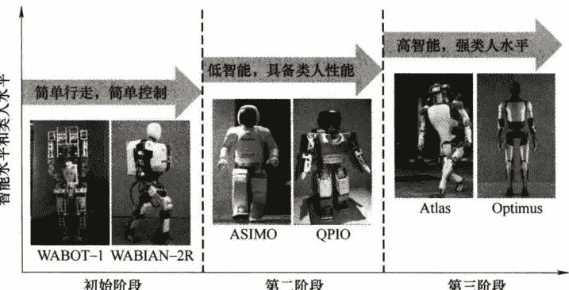

> **图示回顾**：从早期笨拙的平衡实验，到如今能跑酷、叠衣服、推理决策的“硅基生命”，人形机器人完成了从“机械铁疙瘩”到“具身智能体”的质变。当前，医疗、服务、教育、娱乐等领域已见规模化试点身影，它们正成为人类社会不可或缺的“硅基伙伴”。

---

### 1.2 全球竞争格局：中美日三足鼎立，各有杀手锏

人形机器人虽无统一标准、百花齐放，但技术高地长期由**美、日**双强把持，形成鲜明双流派：日本深耕“机构学/运动控制/人机共生”，美国领跑“AI大脑/自主决策/商业化落地”。他国多沿两派技术树创新。我国近年凭借完整产业链、海量场景、资本涌入，正高速追赶，形成“中美日三足鼎立”新格局。

#### 1.2.1 国外篇：两大流派巅峰对决

**【日本流派：极致机构与共生美学】**  
*起步最早、底蕴最厚、流派最全，贯穿“学术-国策-产业”三条线。*

*   **学术源头·早稻田大学**：
    *   **WABOT-1 (1973)**：公认**世界首款真人形机器人**。静态步行(步幅15mm/周期45s)、视触觉感知、简单抓取、语音交互——奠定现代人形机器人“标配”雏形。
    *   **WABOT-2 / KOBIAN**：动态平衡突破、手臂自由度增强、**情感表达具象化**（喜怒哀乐面部动作），开启“情感计算”赛道。
    *   **WABIAN系列**：专攻拟人步态与动态稳定性，逼近人类行走动力学。

*   **国家队·产业技术综合研究所(AIST) + HRP系列**：
    *   **HRP-2**：成人尺寸、稳定行走/舞蹈/人机协作搬运、**摔倒自主起身**（里程碑突破）。
    *   **HRP-3/4**：防尘防漏适应恶劣环境、柔顺交互升级，向工业级靠拢。

*   **仿生极客·东京大学/大阪大学/京都大学**：
    *   **Kenshiro/Kojiro**：骨骼肌肉分布级仿生，复刻人体关键肌群功能，极致生物学现实感。
    *   **Actroid/Erica**：硅胶皮肤+微表情控制+自然语言/情感识别，挑战“恐怖谷”极限，主攻社交陪伴赛道。

*   **产业标杆·本田/索尼**：
    *   **ASIMO (2000-2022)**：26自由度液压/电驱混合，**商业化运营标杆**——跑跳踢球倒茶、声姿识别、记忆辨识，陪伴人类22年光荣“退休”。
    *   **SDR-4X (索尼)**：38自由度娱乐型、“顺势倒下”保护机制、高频自然交互，探索消费级路径。

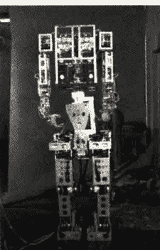 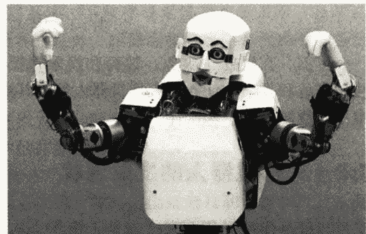 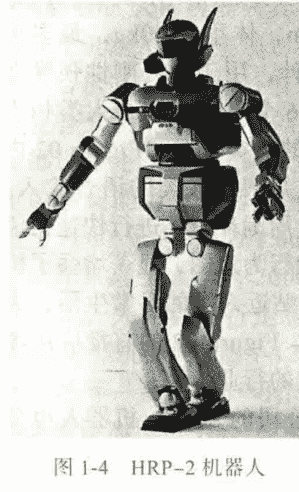 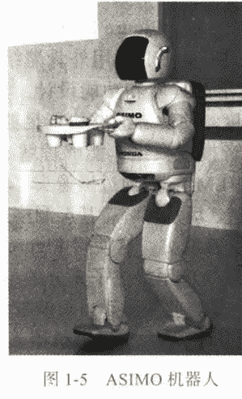 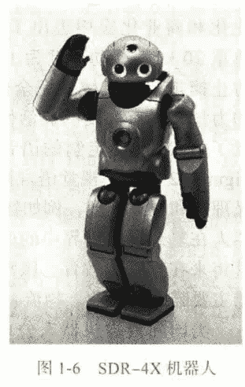

**【美式流派：硬核运动性能+AI大脑+商业化闭环】**  
*起步晚但势头猛，以“体能怪兽”著称，近年全面拥抱大模型，直指量产落地。*

*   **波士顿动力·Atlas (液压/电驱双迭代)**：
    *   1.5m/80kg/28自由度，配激光雷达+立体视觉+IMU。
    *   **运动力天花板**：跑酷、后空翻、体操套路、推箱子搬运——用“暴力美学”重新定义机器人物理极限。2024年老款退役，新一代电驱版蓄势待发。

*   **特斯拉·Optimus (Gen-1/Gen-2快速迭代)**：
    *   1.73m/57kg/28自由度(14旋转+14线性)、**成本压至2-3万美元**——杀手锏是**复用FSD自动驾驶全栈**(视觉/融合/深度学习) + **极致垂直整合供应链**(空心杯电机/行星齿轮/绳驱/力传感器一体化手)。
    *   定位：重复性/危险任务通用工人，工厂实测→千万级量产野心。

*   **Figure AI·Figure 01/02**：
    *   OpenAI大模型加持，端到端神经网络驱动语义推理+精细操作，主打“开箱即用”的商业化部署速度。

> **核心对比**：日系重“身”(机构/控制/共生)，美系重“脑”(AI/决策/规模化)。中国正走“脑身融合+供应链降本+场景狂飙”第三条路。

---

*(正文未完，后续将深度拆解：运动学建模、ZMP/MPC/强化学习控制三代技术路线PK、SLAM导航实战、多模态感知融合、灵巧手/本体机构设计秘籍、宇树G1实战复盘……敬请期待)*

2024 年 8 月，美籍初创独角兽 Figure AI 重磅推出第二代通用人形机器人 Figure 02，其问世不仅是 AI 领域的又一座里程碑，更标志着通用人形机器人正式向工业化、规模化商用迈出了关键一步。Figure 02 身高 1.68 米、体重 60 千克，最大负载 20 千克，移动速度达 1.2 米/秒。它采用外骨骼架构强化刚性与抗冲击性，配备完全复刻人手尺寸与功能的 16 自由度灵巧手，兼具人类级别的力量与灵活性，可覆盖海量人类作业场景。大脑层面，Figure 02 内置 OpenAI 定制的语音推理大模型，实现自然语音交互；搭载视觉语言模型（VLM），赋予机器人“看懂世界”的能力——从物体识别、场景理解到意图洞察，极大强化了其在非结构化环境下的生存与协作技能，为切入家庭、教育、医疗等民用领域奠定基础。首批落地聚焦制造、物流、仓储、零售等“用工荒”重灾区。

国际赛道上，阿吉力的 Digit 与汉森的 Sophia 分别在动态运动与拟人表情交互上树立标杆。欧洲亦捷报频传：英国 Engineered Arts 打造的 Ameca 拥有极致微表情与流畅对话能力；意大利 IIT 的 iCub 以童体仿生实现复杂操作与认知学习；西班牙 PAL Robotics 的 REEM 则主攻自主导航与自然人机协作。

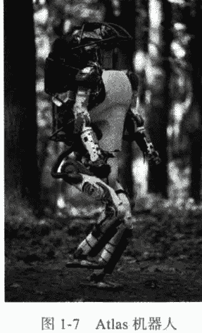

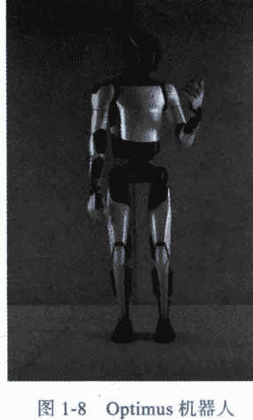

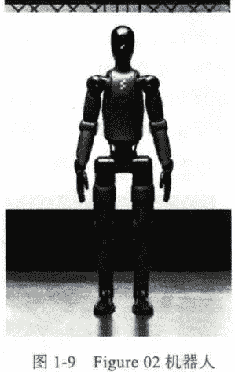

#### 1.2.2 国内研发历程与产业突围

国内人形机器人起步相对滞后，1985 年起高校接力攻关，积厚成势。

国防科大率先破冰，20 世纪末诞生国产首台类人双足机器人“先行者”（高 1.4m、重 20kg），掌握前进、后退、侧行、转弯等基础步态；后续 Blackmann 拥有 36 自由度，液压驱动双足平台更将极速推至 2.5 m/s。哈工大深耕 HIT 系列，轮腿复合的 WLR 液压驱动极速破 15 km/h，能跃 0.5m 障碍、越野坡；类 Atlas 的 HIT Humanoid（高 1.6m、重 60kg、21 自由度）展现高阶运动天赋。北理工 2000 年起探索，率先实现无缆自主行走，汇童 BHR-6（高 1.65m、重 55kg、26 自由度）跑速 7 km/h、跳高 0.5m、原地跳远 1m、攀 20cm 阶跨 30cm 障，动作精细度达标。清华、浙大、上交大、山东大、北航、北工大及中科院自动化所、合肥物质院等持续发力，共筑技术高地。

政策红利释放下，近年国产人形机器人工程化水平跃居世界第一方阵，宇树科技领衔的一批硬核企业强势崛起。2023 年，宇树 Unitree H1 横空出世——全球首款全尺寸电驱原地后空翻人形机器人。H1 高 1.8m、重 47kg、极速 3.3 m/s，搭载 360° 全景深度感知与自研 M107 关节电机（峰值扭矩 360 N·m），融合全身控制、MPC 与强化学习，解锁小步快跑、双脚离地跳跃、上下台阶等硬核技能。2024 年低成本 G1 面世，让商用落地触手可及。

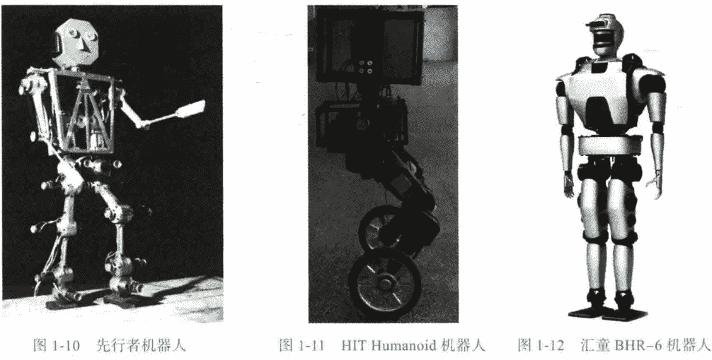

傅里叶智能 GR-1 以高仿生躯干与拟人运动控制著称，全身至多 44 自由度、关节峰值扭矩 230 N·m、步行 5 km/h、负载 50 kg，自研 FSA 一体化执行器保障灵活与爆发力，实现快速行走、敏捷避障、稳健爬坡、抗干扰。2024 升级款 GR-2 增高至 1.75m、重 63kg、自由度激增至 53 个，单臂负载 3 kg、单手自由度增至 12 个，最大程度还原人手自然运动，攻克高难度精细操作。

2024 年，腾讯 Robotics X 实验室发布“小五”，以独创四腿轮足复合形态征服复杂地形，融合多模态交互、大面积触觉皮肤与实时感知规划，具备敏锐环境感知、精准定位避障、安全物理交互能力。养老院实测中，“小五”完成取快递、抱离床等任务，直击银发经济刚需。优必选、小米、乐聚、智元、星动纪元、千寻智能等劲旅并进，共同抬升中国在全球人形机器人版图中的战略坐标。

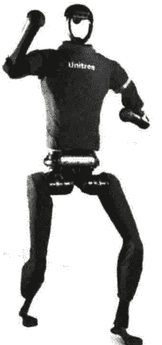

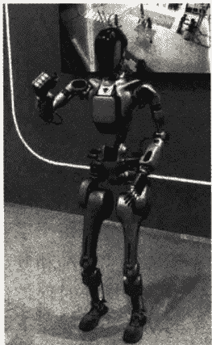

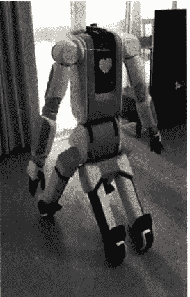

### 1.3 系统架构与核心技术拆解

#### 1.3.1 系统架构全景

区别于常规机器人，人形机器人系统构成跨越功能、物理、仿生三大维度。

**一、 功能结构视角：六大核心子系统协同**

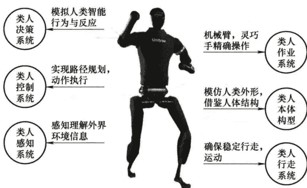

1. **类人本体构型**：以人体进化智慧为蓝本，集成头部（感知交互中枢：视觉、测距、语音）、双臂（多关节高自由度+多模传感，主攻精细作业）、腰部（支承传动枢纽，赋能复杂体态）、下肢（髋膝踝多关节驱动+压力/惯性传感，复刻人类步态）四大模组。
2. **类人决策系统（“大脑”)**: 融合感知、推理、决策、执行全链路 AI 技术栈。感知层多源数据对齐；推理决策层担负路径规划、动作控制、任务调度、模型预测；执行层通过运动规划与实时反馈闭环，保障物理世界作业安全高效，持续进化环境适应力。
3. **类人控制系统（“小脑”)**: 对标人类小脑功能，统筹 PID、模糊逻辑、强化学习等多策略，实时修正关节角度与轨迹，兼顾精准稳定与环境鲁棒性。作业端引入逆运动学解算末端位姿、动态路径规划规避障碍，实现高效安全导航。
4. **类人感知系统（“五官与皮肤”）**:
   - **视觉（“眼”）**：高清相机+深度传感器+CV 算法（图像处理、特征提取、目标识别），提取高阶语义，识人、知物、懂动作、读环境。
   - **听觉（“耳”）**：麦克风阵列+DSP+声纹/语音识别+NLP，解码指令意图，支撑自然语音交互。
   - **语音合成（“口”）**：TTS 技术输出拟人自然语音，配合识别闭环，实现多场景对话服务。
   - **触觉皮肤**：仿生感知压力、温度、触觉，筑牢人机交互安全防线。
5. **类人行走系统**：双足运动是核心护城河。髋膝踝多伺服驱动提供自由度；步态生成、平衡控制、动态调节三大算法协同，配合 IMU、力传感、视觉多源融合反馈，实现低能耗、高稳定、自然步态与全地形适应（走爬跳跌滚），并具备路径规划与动静态避障能力。
6. **类人作业系统（“灵巧手”）**：多指独立运动+力触觉传感阵列，灵活适配异形物体；运动规划优化轨迹、动作控制实时调力、反馈调节修正姿态，三位一体保证抓取精度、操作稳定性与交互自然度，攻克精细装配、工具使用等高阶任务。

**二、 物理结构视角：六大硬件支柱**

1. **本体架构**：骨架、机身、关节总成一体化设计，平衡仿生运动性能与结构强度/效率。
2. **动力传动系统**：电机-传感器-减速器深度集成，为全身关节输出精准强劲动力，适配多工况。
3. **供能系统**：电池组+电源转换模块，承诺稳定、持久、高功率密度供能，支撑全天候作业。
4. **通信系统**：无线（Wi-Fi/蓝牙/5G/4G）与有线（USB/RS232/RS485/CAN/以太网）双轨并行，保障信息高吞吐、低延迟交换，赋能远控与集群协作。
5. **控制操作系统**：统管硬件资源调度、任务分发、文件网络服务，ROS 等中间件生态加持，推动智能自主化进程。

##### 3. 仿生视角下的人形机器人系统架构

若从拟人仿生的维度剖析，人形机器人对标人类生理机能，可拆解为大脑、小脑、脊髓、感官系统、肌骨系统、神经网络及能量循环系统七大功能模块（如图 1-17 所示），各模块一一映射人体核心机能。

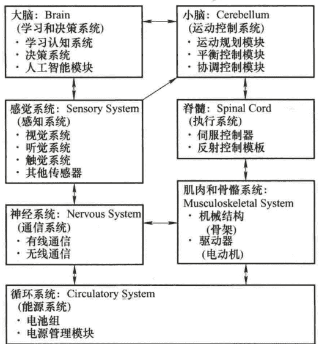

图 1-17 人形机器人系统的仿生结构组成

- **核心决策中枢——大脑**
  作为学习与决策核心，大脑复刻人类高阶认知功能。认知学习单元攻克语音识别、自然语言理解等难题；决策规划单元依托感知信息输出任务指令；AI 模块（深度/强化学习）赋能环境感知与模式识别。大脑经感官系统获取数据，经分析决策后，向小脑与脊髓下达控制指令。

- **精细运动中枢——小脑**
  聚焦运动控制与协调，小脑复刻人类小脑机能。运动规划模块生成路径与动作序列；平衡控制模块防跌倒；协调控制模块统筹多关节协同。小脑接收大脑指令，与脊髓执行层紧密配合，保障动作精准流畅。

- **基础执行层——脊髓**
  对标脊髓反射机能，承担底层运动执行与简单反射。伺服控制器驱动关节电机实现精准动作；反射模块处理避障、保持姿态等本能反应。脊髓执行小脑指令，直接驱动硬件动作。

- **感知接口——感觉系统**
  充当机器人“五官”与本体感知器。视觉模块（相机/激光雷达）捕捉 3D 环境信息；听觉模块（麦克风阵列）实现拾音定位；触觉模块感知接触压力；IMU 传感器监测自身姿态运动。该系统为大脑认知与 AI 决策提供原始数据支撑。

- **硬件本体——肌肉与骨骼系统**
  骨架采用金属/高强度工程塑料，提供支撑承载；驱动器（伺服/步进电机）模拟肌肉输出动力，驱动关节完成步态姿态控制，受小脑规划与脊髓执行管控。

- **通信总线——神经系统**
  模拟神经网络实现信息高速流转。有线以太网保障高吞吐传输；无线 Wi-Fi/蓝牙支撑远程交互。贯通全身子系统，打通数据“经络”。

- **能量心脏——循环系统**
  对标血液循环，为全身供能。电池组输出电能，电源管理模块负责能量调度分配，保障各子系统稳定运行。

各子系统分工明确又高度协同，宛如人体器官协作，共同支撑人形机器人的智能行为与运动控制，赋予其高效灵活的作业能力。

### 1.3.2 核心技术攻关方向

遵循仿生架构逻辑，关键技术突破聚焦“大脑”“小脑”“肢体”三大维度：构建基于 AI 大模型的“大脑”强化感知决策交互；打造运动控制“小脑”完善算法库与网络架构；攻克仿生肢体（机械臂/灵巧手/腿足）的轻量化骨架、高强本体、高精传感技术。具体发力点如下：

#### 1. 步态稳控技术
行走稳定性是核心命题。足底支撑面积小、重心高的特性使抗干扰极具挑战。如何在高能效、高速度下实现稳健行走，始终是学术界攻关焦点。

#### 2. 学习与智控技术
支撑复杂任务自主执行的核心能力。融合高仿真机械结构与前沿控制算法，赋能抓取、操作、精细装配、行走等多元任务。

#### 3. 导航与运动规划
自主作业的关键技术链，涵盖定位、导航、路径与运动规划。路径规划解决“怎么走”，运动规划解决“怎么动”，缺一不可。

#### 4. 环境感知技术
自主交互的前置条件。融合多模传感器与智能算法，实现环境信息获取、处理与语义理解，让机器人“读懂”周围物体与场景。

#### 5. 机构设计技术
复杂运动功能的物理基石。突破轻量化骨架、高强紧凑结构、高精度集成传感等硬核指标，夯实本体性能上限。

#### 6. 自然人机交互
落地应用的关键入口。涵盖语音/姿态/情感识别等多模态感知，配合友好 UI 设计，打通人机自然沟通“最后一公里”。

#### 7. 大模型与具身智能融合
多模态大模型融合数据流，大幅提升意图理解与智能化水平。具身智能以大模型为基座，让机器人具备类人感知、环境适应、自主学习与交互进化能力，实现从“认知智能”向“身体智能”跨越。

### 1.4 落地场景与未来图景

#### 1.4.1 典型应用版图

凭借高拟人形态、自主作业与自然交互优势，人形机器人已渗透多元领域：

- **工业制造：** 柔性装配利器。多关节灵活性适配复杂狭小空间，超越传统自动化刚性；人机协作天然安全高效，重塑产线生态。
- **家庭服务：** 从清洁家务到养老陪护、教育辅助、安防守护，全方位融入家庭生活，化身多功能居家伙伴。
- **军事国防：** 战场多面手。搭载武器精打、搬运维修、极端环境排爆侦查，规避人员伤亡；未来将进化为具备自主决策的智能作战单元。
- **航天探索：** 太空“替身”。空间站外部维护实验、行星表面勘测采样，以低成本、高耐受、强连续性优势分担航天员负荷。
- **物流运输：** 搬运分拣主力。耐疲劳、零情绪、高精度、强环境适应性，解决恶劣工况下人力痛点，大幅提升作业质效。
- **泛领域延伸：** 农业、建筑、文旅、科研等领域潜力待释放，技术迭代将持续拓展应用边界。

#### 1.4.2 演进趋势研判

近年“大脑/小脑/肢体”技术突破驱动智能化跃升。展望未来，多模态大模型、具身智能、新材料将持续领航进化：

**1. 多模态大模型深度赋能**
NLP 与深度学习突飞猛进，VLM、VLA 等模型演进显著增强泛化与思维链能力。语音决策驱动运动控制，推动机器人从“会思考”向“会干活”跨越，自然高效完成复杂任务。

**2. 具身智能重塑能力边界**
赋予机器人在复杂环境中高阶认知行动力。医疗手术更精准、服务交互更自然、救援处突更高效。多模感知融合打造类人环境理解力，全面跃升任务执行效能。

**3. 非结构化环境下的认知与运动突破**
移动灵活性大幅跃升。先进 SLAM、智能规划决策算法，赋能精准走跑跳与自适应行为调整，拓展救援、医疗、工业等非结构化场景应用半径。

**4. “感”与“觉”系统进阶**
超越单一传感器堆砌，构建多模感知融合网络。视觉（相机/激光雷达）、触觉（深度/触觉传感器）协同，智能芯片驱动空间多模感知，实现复杂环境自主导航、物体识别与安安全交互。

**5. 高感知触觉灵巧手**
交互自然度的关键。仿生手部结构+高精触觉阵列+先进控制算法，实现形状质感温度精准感知与稳定操控。制造工艺、材料科学、微型化技术协同突破，驱动手部向精密耐用、紧凑灵活演进。

**6. 轻量化材料与结构优化**
能源动力是续航基石，材料与软体技术决定灵活度。轻量化提升机动性与能效；高效电池、能量回收、节能执行器延长续航；PEEK、弹性体、水凝胶等软性材料兼顾减重与安全；3D 打印仿生结构增强敏捷合规性；模块化架构降本增效，全维度提升性能与可持续性。

---

### 思考与实践题

1.  定义人形机器人，阐述发展动因。
2.  ASIMO 与 Atlas 皆为技术丰碑却相继退场，你如何解读？
3.  基于全球发展态势，如何判断国内人形机器人前景？
4.  列举人形机器人三大系统构成范式，详述仿生视角下子系统协作关系。
5.  简析大模型、生成式 AI、具身智能内涵，具身智能如何在人形机器人落地？
6.  概括人形机器人核心关键技术体系。
7.  预测人形机器人未来将深度渗透哪些新赛道？
8.  面对 AI 与机器人技术狂飙带来的机遇与伦理挑战，你的观点是什么？

---

## 第 2 章 人形机器人运动学与动力学

### 导读

运动能力是人形机器人执行复杂任务的基石。本章系统梳理运动学与动力学分析基石：刚体旋转描述、旋转表示法、齐次变换；深入讲解运动学建模——连杆坐标系与变换矩阵、正/逆运动学、微分运动学；最后剖析动力学建模主流路径——牛顿-欧拉法与拉格朗日法。

### 核心知识图谱

- 刚体旋转、旋转表示与齐次变换矩阵
- 人形机器人运动学建模
- 人形机器人动力学建模

### 2.1 数学建模基石

机器人本质是连杆通过关节串联的刚体链：含一固定/浮动基座与至少一个动链。基座连接末端执行器，中间由多连杆关节支撑。连杆间及与作业对象的相对运动关系，构成运动学研究核心。研究运动首需确立刚体在空间坐标系下的位姿（位置+姿态）。

机械臂作为核心本体，典型链式连杆机构可视为运动链。描述刚体位姿，先建坐标系：点位用 3×1 向量表示；建立与刚体固连的连杆坐标系，轴原点固连前一关节轴线。相对前一坐标系，当前姿态（刚体旋转）用 3×3 旋转矩阵描述。引入齐次变换矩阵，可统一表达相对位置与姿态。

#### 2.1.1 刚体旋转数学描述

- **位置向量定义**
  代数运算要求向量同一坐标系下。建立基准直角坐标系 {0}（见图 2-1），空间任意点 P 位置用列向量 $^0\mathbf{P}$ 表示：

$$^0\mathbf{P} = \begin{bmatrix} p_x \\ p_y \\ p_z \end{bmatrix}$$

式中 $p_x, p_y, p_z$ 为点 P 在 {0} 下坐标分量，左上标 0 标识参考系。除直角坐标系，球/柱坐标系亦可描述点位。

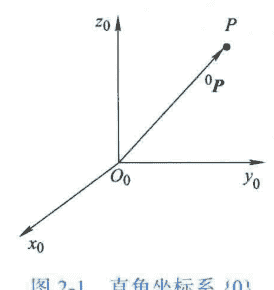

- **旋转矩阵构建**
  为表达两刚体相对位姿，各刚体附带坐标系，定义系间几何关系。先研平面旋转，再推广三维。

  **(1) 平面旋转缺陷**
  如图 2-2，坐标系 {1} 由 {0} 旋转 $\theta$ 得来。仅用角度 $\theta$ 表姿态有两大弊端：一、映射在 $\theta=0$ 处不连续（$\theta=2\pi-\varepsilon$ 时微小转动致 $\theta$ 突变）；二、难以推广至三维。

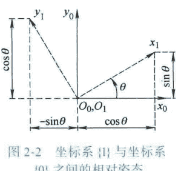

  **(2) 轴向量法表姿态**
  更鲁棒的方式：指定 {1} 各轴在 {0} 下的坐标向量，即

$$^0_1\mathbf{R} = [^0\mathbf{x}_1 \quad ^0\mathbf{y}_1]$$

# 核心概念：旋转矩阵的定义与核心性质

公式里的 $^0\mathbf{x}_1$ 与 $^0\mathbf{y}_1$，分别代表单位向量 $x_1$、$y_1$ 在基坐标系 $\{0\}$ 下的坐标投影。这类矩阵 $^0_1\mathbf{R}$，专业术语叫**旋转矩阵**。下面我们深入剖析它的一系列关键特质。

## 二维平面下的构建逻辑

如图 2-2 所示，二维空间里推导 $^0_1\mathbf{R}$ 的各项元素非常直观：

$$^0\mathbf{x}_1 = \begin{bmatrix} \cos\theta \\ \sin\theta \end{bmatrix}, ^0\mathbf{y}_1 = \begin{bmatrix} -\sin\theta \\ \cos\theta \end{bmatrix}$$

进而可得：

$$^1_0\mathbf{R} = \begin{bmatrix} \cos\theta & -\sin\theta \\ \sin\theta & \cos\theta \end{bmatrix} \quad (2-2)$$

**关键约定：** 本书采用**左上角标**标识参考坐标系。也就是说，矩阵 $^1_0\mathbf{R}$ 的列向量，本质上是坐标系 $\{1\}$ 的各轴单位向量，在参考系 $\{0\}$ 中的坐标表达。

前文我们用角度 $\theta$ 的三角函数形式推导了 $^1_0\mathbf{R}$ 的元素。其实还有另一条路径——**投影法**：将坐标系 $\{1\}$ 的各轴投射到参考系 $\{0\}$ 的轴上，从而建立旋转矩阵。这招的优势在于能平滑过渡到三维空间。利用两个单位位置向量的点积等于其中一个在另一个上的投影这一几何事实，我们可以得到：

$$^0\mathbf{x}_1 = \begin{bmatrix} \mathbf{x}_1 \cdot \mathbf{x}_0 \\ \mathbf{x}_1 \cdot \mathbf{y}_0 \end{bmatrix}, ^0\mathbf{y}_1 = \begin{bmatrix} \mathbf{y}_1 \cdot \mathbf{x}_0 \\ \mathbf{y}_1 \cdot \mathbf{y}_0 \end{bmatrix}$$

将这些投影组合在一起，即得到旋转矩阵：

$$^1_0\mathbf{R} = \begin{bmatrix} \mathbf{x}_1 \cdot \mathbf{x}_0 & \mathbf{y}_1 \cdot \mathbf{x}_0 \\ \mathbf{x}_1 \cdot \mathbf{y}_0 & \mathbf{y}_1 \cdot \mathbf{y}_0 \end{bmatrix}$$

由此可见，$^1_0\mathbf{R}$ 的每一列，实际上给出了坐标系 $\{1\}$ 的坐标轴相对于 $\{0\}$ 的**方向余弦**。比如第一列 $[\mathbf{x}_1 \cdot \mathbf{x}_0 \quad \mathbf{x}_1 \cdot \mathbf{y}_0]^\text{T}$，就精确描述了 $\mathbf{x}_1$ 在 $\{0\}$ 中的朝向。值得注意的是，这些方程右边的定义基于几何实体本身，而非其坐标数值。对照图 2-2 可知，投影法给出的结果与式 (2-2) 完全一致。

若需反向描述——即以 $\{1\}$ 为参考系，表达 $\{0\}$ 相对于 $\{1\}$ 的姿态，旋转矩阵写作：

$$^0_1\mathbf{R} = \begin{bmatrix} \mathbf{x}_0 \cdot \mathbf{x}_1 & \mathbf{y}_0 \cdot \mathbf{x}_1 \\ \mathbf{x}_0 \cdot \mathbf{y}_1 & \mathbf{y}_0 \cdot \mathbf{y}_1 \end{bmatrix}$$

因向量点积满足交换律（$\mathbf{x}_i \cdot \mathbf{y}_i = \mathbf{y}_i \cdot \mathbf{x}_i$），可得：

$$^0_1\mathbf{R} = (^1_0\mathbf{R})^\text{T}$$

**几何视角：** $\{0\}$ 相对于 $\{1\}$ 的姿态，是 $\{1\}$ 相对于 $\{0\}$ 姿态的**逆**。
**代数验证：** 利用坐标轴互相正交的性质，易证：

$$(^1_0\mathbf{R})^\text{T} = (^1_0\mathbf{R})^{-1}$$

$^1_0\mathbf{R}$ 的列向量模长为 1 且两两正交，这类矩阵称为**正交矩阵**。同时可知 $\det ^1_0\mathbf{R} = \pm 1$。若限定右手坐标系，则行列式恒为 1。惯用 $SO(n)$ 表示这类 $n \times n$ 矩阵的集合，即 $n$ 阶**特殊正交群**。

对任意 $R \in SO(n)$，以下性质恒成立：

- 1) $R^T = R^{-1} \in SO(n)$。
- 2) $R$ 的列向量构成一组标准正交基。
- 3) $\det R = 1$。

为了直观理解“逆”的几何意义，回到二维：对应转角 $\theta$ 的旋转矩阵，其逆矩阵等价于转角为 $-\theta$ 的旋转矩阵，计算如下：

$$

\begin{bmatrix} \cos(-\theta) & -\sin(-\theta) \\ \sin(-\theta) & \cos(-\theta) \end{bmatrix} = \begin{bmatrix} \cos \theta & \sin \theta \\ -\sin \theta & \cos \theta \end{bmatrix} = \begin{bmatrix} \cos \theta & -\sin \theta \\ \sin \theta & \cos \theta \end{bmatrix}^T

$$

## 进阶：三维空间中的旋转矩阵

上述投影技术完美延伸至三维。将坐标系 $\{1\}$ 的三个坐标轴投射到 $\{0\}$ 中，得到的旋转矩阵为：

$$

{}_0^1\mathbf{R} = \begin{bmatrix} x_1 \cdot x_0 & y_1 \cdot x_0 & z_1 \cdot x_0 \\ x_1 \cdot y_0 & y_1 \cdot y_0 & z_1 \cdot y_0 \\ x_1 \cdot z_0 & y_1 \cdot z_0 & z_1 \cdot z_0 \end{bmatrix}

$$

同二维一样，该矩阵正交、行列式为 1，属于 $SO(3)$ 群。

### 例 2.1：绕 $z$ 轴的基本旋转
假设 $\{1\}$ 绕 $z_0$ 轴旋转 $\theta$，求变换矩阵 ${}_0^1\mathbf{R}$。遵循右手定则（正向为绕 $z$ 轴正方向的“右旋螺纹”旋转），从图 2-3 读取点积结果：

$x_1 \cdot x_0 = \cos \theta,\quad y_1 \cdot x_0 = -\sin \theta$
$x_1 \cdot y_0 = \sin \theta,\quad y_1 \cdot y_0 = \cos \theta$
$z_1 \cdot z_0 = 1$

其余点积均为 0。因此旋转矩阵呈现简洁形式：

$$

{}_0^1\mathbf{R} = \begin{bmatrix} \cos \theta & -\sin \theta & 0 \\ \sin \theta & \cos \theta & 0 \\ 0 & 0 & 1 \end{bmatrix}

$$

此矩阵称为**基本旋转矩阵（绕 $z$ 轴）**，常用符号 $R_{z,\theta}$ 代替 ${}_0^1\mathbf{R}$。它具有如下代数性质：

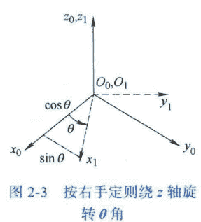

$R_{z,0} = I$（零角度即单位阵）
$R_{z,\theta}R_{z,\phi} = R_{z,\theta+\phi}$（旋转角度可加性）

由式 (2-4)、(2-5) 推得逆矩阵性质：

$(R_{z,\theta})^{-1} = R_{z,-\theta}$

同理，绕 $x$ 轴、$y$ 轴的基本旋转矩阵分别为：

$R_{x,\theta} = \begin{bmatrix} 1 & 0 & 0 \\ 0 & \cos\theta & -\sin\theta \\ 0 & \sin\theta & \cos\theta \end{bmatrix}$

$R_{y,\theta} = \begin{bmatrix} \cos\theta & 0 & \sin\theta \\ 0 & 1 & 0 \\ -\sin\theta & 0 & \cos\theta \end{bmatrix}$

它们同样满足类似上述的结构性质。

### 例 2.2：数值实例演示
如图 2-4 定义坐标系 $\{0\}$ 与 $\{1\}$ 的相对姿态。将 $x_1, y_1, z_1$ 投射到 $x_0, y_0, z_0$ 上，得其在 $\{0\}$ 中的坐标：

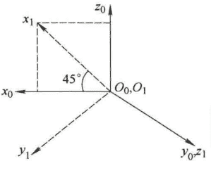

${}^0x_1 = \begin{bmatrix} \frac{1}{\sqrt{2}} \\ 0 \\ \frac{1}{\sqrt{2}} \end{bmatrix},\ 
{}^0y_1 = \begin{bmatrix} \frac{1}{\sqrt{2}} \\ 0 \\ \frac{-1}{\sqrt{2}} \end{bmatrix},\ 
{}^0z_1 = \begin{bmatrix} 0 \\ 0 \\ 1 \end{bmatrix}$

旋转矩阵 ${}^0_1R$ 由这些列向量拼接而成，直接给出了 $\{1\}$ 相对于 $\{0\}$ 的姿态：

${}^0_1R = \begin{bmatrix} \frac{1}{\sqrt{2}} & \frac{1}{\sqrt{2}} & 0 \\ 0 & 0 & 1 \\ \frac{1}{\sqrt{2}} & \frac{-1}{\sqrt{2}} & 0 \end{bmatrix}$

---

# 实战视角：旋转矩阵的“三重身份”解析

## 1. 旋转变换：坐标换系 vs 向量旋转

图 2-5 展示了一个带动坐标系 $\{1\}$ 的刚体 $S$。已知点 $p$ 在 $\{1\}$ 下的位置向量 ${}^1p = [u\ v\ w]^T$，如何求其在固定参考系 $\{0\}$ 下的坐标？

$$p = ux_1 + vy_1 + wz_1$$

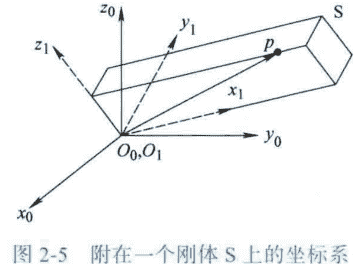

换个角度，直接将点 $p$ 投射到 $\{0\}$ 的轴上：

$${}^0p = \begin{bmatrix} p \cdot x_0 \\ p \cdot y_0 \\ p \cdot z_0 \end{bmatrix}$$

联立上述两组方程，可得：

$${}^0p = \begin{bmatrix} (ux_1 + vy_1 + wz_1) \cdot x_0 \\ (ux_1 + vy_1 + wz_1) \cdot y_0 \\ (ux_1 + vy_1 + wz_1) \cdot z_0 \end{bmatrix}

= \begin{bmatrix} ux_1 \cdot x_0 + vy_1 \cdot x_0 + wz_1 \cdot x_0 \\ ux_1 \cdot y_0 + vy_1 \cdot y_0 + wz_1 \cdot y_0 \\ ux_1 \cdot z_0 + vy_1 \cdot z_0 + wz_1 \cdot z_0 \end{bmatrix}

= \begin{bmatrix} x_1 \cdot x_0 & y_1 \cdot x_0 & z_1 \cdot x_0 \\ x_1 \cdot y_0 & y_1 \cdot y_0 & z_1 \cdot y_0 \\ x_1 \cdot z_0 & y_1 \cdot z_0 & z_1 \cdot z_0 \end{bmatrix} \begin{bmatrix} u \\ v \\ w \end{bmatrix}$$

代入旋转矩阵 ${}_1^0R$ 定义：

$${}^0p = {}_1^0R^1p \quad (2-9)$$

**结论 1（坐标变换）：** 旋转矩阵 ${}_1^0R$ 不仅表达姿态，还能把点从参考系 $\{1\}$ 的坐标**变换**到参考系 $\{0\}$。即：${}^0p = {}_1^0R \, {}^1p$。

---

**另一个维度：表示刚体运动。**
图 2-6a 方块端点在 $P_a$。图 2-6b 绕 $z_0$ 轴旋 $\pi$ 后，同一端点移至 $P_b$。若知 $P_a$ 坐标及绕 $z_0$ 的旋转矩阵，即可推导 $P_b$。

想象固连在方块上的坐标系，初始与 $\{0\}$ 重合，旋转后变为 $\{1\}$。此时有：

$${}_1^0R = R_{z, \pi} = \begin{bmatrix} -1 & 0 & 0 \\ 0 & -1 & 0 \\ 0 & 0 & 1 \end{bmatrix}$$

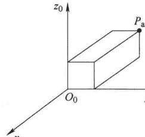

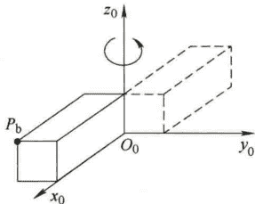

在局部系 $\{1\}$ 中，端点坐标为 ${}^1p_b$。利用式 (2-9) 旋转矩阵换算到 $\{0\}$：

$${}^0p_b = {}_1^0R {}^1p_b = R_{z,\pi} {}^1p_b$$

关键点：${}^1p_b$ 是相对于方块自身定义的，**随体旋转不变**。旋转前端点在 $P_a$，故 ${}^1p_b = {}^0p_a$。代入得：

$${}^0p_b = R_{z,\pi} {}^0p_a$$

**结论 2（向量旋转算子）：** 此公式展示了旋转矩阵作为**旋转操作符**的用法。若点 $P_b$ 由 $P_a$ 经旋转矩阵 $R$ 旋转得到，则在参考系下：

$${}^0p_b = R {}^0p_a$$

同理适用于向量的旋转。

### 例 2.3：向量旋转实操
图 2-7 中，向量 $v$ 在 $\{0\}$ 下坐标 $v_0 = [0\ 1\ 1]^T$，绕 $y_0$ 轴转 $\pi/2$ 得 $v_1$，坐标计算如下：

$${}^0v_1 = R_{y,\pi/2} {}^0v \quad (2-10)$$

$${}^0v_1 = \begin{bmatrix} 0 & 0 & 1 \\ 0 & 1 & 0 \\ -1 & 0 & 0 \end{bmatrix} \begin{bmatrix} 0 \\ 1 \\ 1 \end{bmatrix} = \begin{bmatrix} 1 \\ 1 \\ 0 \end{bmatrix} \quad (2-11)$$

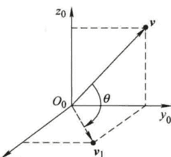

---

## 总结：一个矩阵，三种语义

旋转矩阵 $R \in SO(3)$（或 $SO(2)$）在机器人学与刚体动力学中扮演三种截然不同但数学等价的角色：

1.  **坐标变换算子：** 连接同一点 $P$ 在两个不同参考系下的坐标表示。
2.  **姿态描述符：** 刻画移动坐标系相对于固定基坐标系的朝向（列向量即移动系轴在基坐标系下的投影）。
3.  **旋转操作符：** 在**同一固定坐标系**内，将向量 $v$ 旋转得到新向量 $v_1$。

具体的物理含义，需结合上下文语境来界定。

# 玩转机器人姿态：从坐标变换到欧拉角的通关秘籍

搞机器人、做视觉、写仿真，绕不开的一个硬核坎儿就是**旋转表示**。别看旋转矩阵长得吓人（9个元素），其实它心里住着个“极简主义者”——只有3个自由度。今天咱们不背公式，换个视角，把坐标系变换、旋转叠加、欧拉角反解这些核心逻辑捋得明明白白。

---

## 坐标系视角：旋转矩阵其实是“换基”操作

你可以把一个坐标系想象成一组**基向量**（沿三轴的单位向量）。这么说，旋转矩阵不就是干坐标变换的嘛？它的本质就是把一套基向量“换”成另一套。

对于同一个线性变换，在不同坐标系下的“长相”（矩阵表示）不一样，但灵魂是一样的。它们靠**相似变换**串联：

> 假设变换在 $\{0\}$ 系下长相是 $\boldsymbol{A}$，在 $\{1\}$ 系下是 $\boldsymbol{B}$，中间靠坐标变换矩阵 $ _1^0 \boldsymbol{R}$ 搭桥：
> $$ \boldsymbol{B} = (_1^0 \boldsymbol{R})^{-1} \boldsymbol{A} \, _1^0 \boldsymbol{R} $$
> **$$\boldsymbol{B} = ( _1^0 \boldsymbol{R})^{-1} \boldsymbol{A} _1^0 \boldsymbol{R} \qquad (2-12)$$**

特别地，如果 $\boldsymbol{A}$ 本身就是个旋转，$\boldsymbol{B}$ 肯定也是旋转。结论：**相似变换能让同一个旋转在不同坐标系里自由切换表达。**

### 实战演练：换个系看旋转
已知 $\{0\}$ 到 $\{1\}$ 的变换矩阵：
$$ _1^0 \boldsymbol{R} = \begin{bmatrix} 0 & 0 & 1 \\ 0 & 1 & 0 \\ -1 & 0 & 0 \end{bmatrix} $$
在 $\{0\}$ 里绕 $z$ 轴转 $\theta$ 是 $\boldsymbol{A} = \boldsymbol{R}_{z, \theta}$。那在 $\{1\}$ 里长啥样？
**$$\boldsymbol{B} = ( _1^0 \boldsymbol{R})^{-1} \boldsymbol{A} _1^0 \boldsymbol{R} = \begin{bmatrix} 1 & 0 & 0 \\ 0 & \cos \theta & \sin \theta \\ 0 & -\sin \theta & \cos \theta \end{bmatrix}$$**
算下来发现：$\boldsymbol{B}$ 本质还是绕 $z_0$ 轴转，只是用 $\{1\}$ 的坐标把它“重写”了。

---

## 旋转叠加：搞清“当前系”vs“固定系”，顺序别搞反

这是大坑区！位置矢量加法满足交换律，旋转**不满足**。叠加顺序直接决定最终姿态。

### 场景一：接力赛——绕“当前坐标系”转（后乘）

三个系 $\{0\}, \{1\}, \{2\}$ 接力传递坐标：
$$ ^0p = _1^0 \boldsymbol{R} \, ^1p, \quad ^1p = _2^1 \boldsymbol{R} \, ^2p $$
代入得总变换：
$$ ^0p = (_1^0 \boldsymbol{R} \, _2^1 \boldsymbol{R}) \, ^2p $$
**$$^0p = _1^0 R_2^1 R^2 p \quad (2-16)$$**
对比得叠加法则：
$$ _2^0 \boldsymbol{R} = _1^0 \boldsymbol{R} \, _2^1 \boldsymbol{R} $$
**$${}_2^0 R = {}_1^0 R_2^1 R \quad (2-17)$$**

**物理画面**：三系起始重合。
1. 拿 $_1^0 \boldsymbol{R}$ 绕 $\{0\}$ 转动 $\{1\}$（此时 $\{1\},\{2\}$ 重合）。
2. 拿 $_2^1 \boldsymbol{R}$ 绕 **当前** $\{1\}$ 转动 $\{2\}$。
最终 $\{2\}$ 相对 $\{0\}$ 的姿态就是左边乘右边。

> **例**：先绕当前 $y$ 转 $\phi$，再绕当前 $z$ 转 $\theta$。
> 矩阵 $R = \boldsymbol{R}_{y,\phi} \boldsymbol{R}_{z,\theta}$。
> **$$R = R_{y,\phi} R_{z,\theta} = \begin{bmatrix} \cos\phi & 0 & \sin\phi \\ 0 & 1 & 0 \\ -\sin\phi & 0 & \cos\phi \end{bmatrix} \begin{bmatrix} \cos\theta & -\sin\theta & 0 \\ \sin\theta & \cos\theta & 0 \\ 0 & 0 & 1 \end{bmatrix} = \begin{bmatrix} \cos\phi\cos\theta & -\cos\phi\sin\theta & \sin\phi \\ \sin\theta & \cos\theta & 0 \\ -\sin\phi\cos\theta & \sin\phi\sin\theta & \cos\phi \end{bmatrix} \quad (2-18)$$ 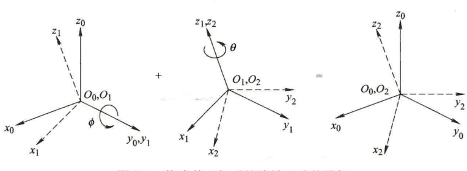**
> **警示**：顺序一换（先 $z$ 后 $y$），结果 $R'$ 完全不同！**$$R' = R_{z,\theta} R_{y,\phi} = \begin{bmatrix} \cos\theta & -\sin\theta & 0 \\ \sin\theta & \cos\theta & 0 \\ 0 & 0 & 1 \end{bmatrix} \begin{bmatrix} \cos\phi & 0 & \sin\phi \\ 0 & 1 & 0 \\ -\sin\phi & 0 & \cos\phi \end{bmatrix} = \begin{bmatrix} \cos\theta\cos\phi & -\sin\theta & \cos\theta\sin\phi \\ \sin\theta\cos\phi & \cos\theta & \sin\theta\sin\phi \\ -\sin\phi & 0 & \cos\phi \end{bmatrix} \quad (2-19)$$**

### 场景二：定海神针——绕“固定坐标系”转（左乘）

很多时候我们要绕世界坐标系 $\{0\}$ 的轴转：先绕 $x_0$，再绕 $y_0$（不是动过的 $y_1$）。这时候**叠加顺序反转**——**左乘**新旋转。

推导逻辑：把“绕固定轴转”翻译成“绕当前轴转”的等价形式（利用相似变换），发现新矩阵得**左乘**在旧矩阵前面。
$$ ^0_2 \boldsymbol{R} = \boldsymbol{R} \, ^0_1 \boldsymbol{R} \quad \text{(2-20)} $$

> **例**：先绕固定 $y_0$ 转 $\phi$，再绕固定 $z_0$ 转 $\theta$。
> 第二步等价于在 $\{1\}$ 系下做相似变换，最后合成：
> $$ R = \boldsymbol{R}_{z,\theta} \boldsymbol{R}_{y,\phi} $$
> **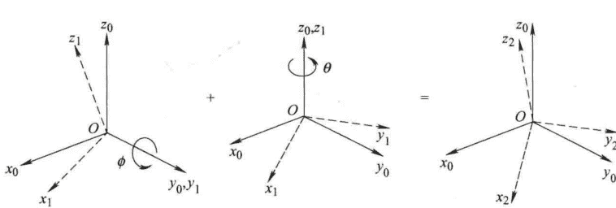**
> **顿悟时刻**：对比当前系叠加（式2-18），基本旋转矩阵一样，**乘法顺序恰好相反**！

### 万能速查表：混合操作怎么乸？

| 旋转类型 | 动作 | 矩阵更新规则 |
| :--- | :--- | :--- |
| **绕当前系** | 后乘 | $ ^0_2\boldsymbol{R} = ^0_1\boldsymbol{R} \, ^1_2\boldsymbol{R} $ (2-22) |
| **绕固定系** | 左乘 | $ ^0_2\boldsymbol{R} = \boldsymbol{R} \, ^0_1\boldsymbol{R} $ (2-23) |

> **实战例 2.7**：一连串混合拳：
> 1. 绕当前 $x$ 转 $\theta$ → **右乘** $\boldsymbol{R}_{x,\theta}$
> 2. 绕当前 $z$ 转 $\phi$ → **右乘** $\boldsymbol{R}_{z,\phi}$
> 3. 绕固定 $z$ 转 $\alpha$ → **左乘** $\boldsymbol{R}_{z,\alpha}$
> 4. 绕当前 $y$ 转 $\beta$ → **右乘** $\boldsymbol{R}_{y,\beta}$
> 5. 绕固定 $x$ 转 $\delta$ → **左乘** $\boldsymbol{R}_{x,\delta}$
>
> 最终：$\boldsymbol{R} = \boldsymbol{R}_{x,\delta}\boldsymbol{R}_{z,\alpha}\boldsymbol{R}_{x,\theta}\boldsymbol{R}_{z,\phi}\boldsymbol{R}_{y,\beta}$ **(2-24)**
>
> **口诀**：当前系排队右乘，固定系插队左乘。

---

## 旋转的“身份证”：三参数表示法

旋转矩阵 9 个数，6 个约束（列向量单位正交），实打实就 **3 个自由度**。用三个独立变量给旋转发“身份证”，主流有三派：
1.  **欧拉角** —— 经典三连转
2.  **RPY (Roll-Pitch-Yaw)** —— 工程最爱
3.  **轴角** —— 几何意义最直观

### 欧拉角：ZYZ 三部曲

固定系 $\{0\}$，动系 $\{1\}$。用三角 $(\phi, \theta, \psi)$ 走三步：
1.  绕 $z_0$ 转 $\phi$ → 系 $\{a\}$
2.  绕 **当前** $y$ 转 $\theta$ → 系 $\{b\}$
3.  绕 **当前** $z$ 转 $\psi$ → 终点 $\{1\}$
**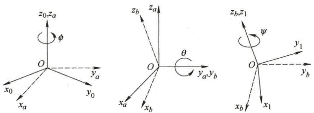**

矩阵乘积：
$$ \boldsymbol{R}_{ZYZ}(\phi, \theta, \psi) = \boldsymbol{R}_{z,\phi} \boldsymbol{R}_{y,\theta} \boldsymbol{R}_{z,\psi} $$
**$$

\mathbf{R}_{ZYZ} = \mathbf{R}_{z,\phi} \mathbf{R}_{y,\theta} \mathbf{R}_{z,\psi} = \begin{bmatrix} \cos \phi & -\sin \phi & 0 \\ \sin \phi & \cos \phi & 0 \\ 0 & 0 & 1 \end{bmatrix} \begin{bmatrix} \cos \theta & 0 & \sin \theta \\ 0 & 1 & 0 \\ -\sin \theta & 0 & \cos \theta \end{bmatrix} \begin{bmatrix} \cos \psi & -\sin \psi & 0 \\ \sin \psi & \cos \psi & 0 \\ 0 & 0 & 1 \end{bmatrix}

$$ $$

= \begin{bmatrix} \cos \phi \cos \theta \cos \psi - \sin \phi \sin \psi & -\cos \phi \cos \theta \sin \psi - \sin \phi \cos \psi & \cos \phi \sin \theta \\ \sin \phi \cos \theta \cos \psi + \cos \phi \sin \psi & -\sin \phi \cos \theta \sin \psi + \cos \phi \cos \psi & \sin \phi \sin \theta \\ -\sin \theta \cos \psi & \sin \theta \sin \psi & \cos \theta \end{bmatrix} \tag{2-27}

$$**

#### 核心难题：矩阵 $\to$ 角度（逆运动学必考）

给 $\boldsymbol{R} = (r_{ij})$，求 $(\phi, \theta, \psi)$。分两种情况：

**通用情况（$r_{13}, r_{23}$ 不全零，即奇点外）：**
从矩阵元素反推：
$$ \cos\theta = r_{33}, \quad \sin\theta = \pm\sqrt{1-r_{33}^2} $$
$\theta$ 有两解（肘上/肘下）：
$$ \theta = \text{Atan2}(r_{33}, \sqrt{1-r_{33}^2}) \quad \text{或} \quad \text{Atan2}(r_{33}, -\sqrt{1-r_{33}^2}) $$
**(2-29)(2-30)**

选定 $\theta$ 后（假设取正 $\sin\theta$）：
$$ \phi = \text{Atan2}(r_{13}, r_{23}) \quad \text{(2-31)} $$
$$ \psi = \text{Atan2}(-r_{31}, r_{32}) \quad \text{(2-32)} $$
**$$

\mathbf{R} = \begin{bmatrix} \cos \phi \cos \theta \cos \psi - \sin \phi \sin \psi & -\cos \phi \cos \theta \sin \psi - \sin \phi \cos \psi & \cos \phi \sin \theta \\ \sin \phi \cos \theta \cos \psi + \cos \phi \sin \psi & -\sin \phi \cos \theta \sin \psi + \cos \phi \cos \psi & \sin \phi \sin \theta \\ -\sin \theta \cos \psi & \sin \theta \sin \psi & \cos \theta \end{bmatrix} \tag{2-28}

$$**

> **避坑指南**：
> *   $\text{Atan2}(y, x)$ 必须用双参数版，才能锁定正确象限。
> *   当 $\sin\theta = 0$（即 $r_{33} = \pm 1$，$z$ 轴重合），发生**万向节死锁**，$\phi, \psi$ 无法唯一确定，只有 $\phi \pm \psi$ 确定。工程上通常避开或切换表示法。

---

### 结语

从基向量换底，到当前/固定系叠加的左右乘法则，再到欧拉角的正反解，**旋转的核心逻辑就三点**：
1.  **本质是正交变换**（保长、保角）。
2.  **叠加看参考系**（当前系右乘、固定系左乘）。
3.  **参数化只需三量**，但要警惕奇异点。

下期咱们聊聊 **RPY 角** 怎么把欧拉角的“死锁”绕开，以及 **轴角/四元数** 怎么在插值和优化里大杀四方。关注不迷路，下篇见！

##### 欧拉角奇异性分析

采用公式 (2-30) 确定的 $\theta$ 值时，会有 $\sin\theta < 0$，此时对应角度计算为：

$ \phi = \text{Atan2}(-r_{13}, r_{23}) \tag{2-33} $

$ \psi = \text{Atan2}(r_{31}, -r_{32}) \tag{2-34} $

由此可知，依据 $\theta$ 正负符号不同，将出现两组解。

另一种情形是 $r_{13} = r_{23} = 0$。此时 $\boldsymbol{R}$ 为正交阵，推得 $r_{33} = \pm 1$ 且 $r_{31} = r_{32} = 0$，矩阵 $\boldsymbol{R}$ 形如：

$ \boldsymbol{R} = \begin{bmatrix} r_{11} & r_{12} & 0 \\ r_{21} & r_{22} & 0 \\ 0 & 0 & \pm 1 \end{bmatrix} \tag{2-35} $

若 $r_{33} = 1$，则 $\cos\theta = 1$，$\sin\theta = 0$，即 $\theta = 0$。代入式 (2-27) 可得：

$$

\begin{bmatrix} \cos\phi\cos\psi - \sin\phi\sin\psi & -\cos\phi\sin\psi - \sin\phi\cos\psi & 0 \\ \sin\phi\cos\psi + \cos\phi\sin\psi & -\sin\phi\sin\psi + \cos\phi\cos\psi & 0 \\ 0 & 0 & 1 \end{bmatrix} = \begin{bmatrix} \cos(\phi+\psi) & -\sin(\phi+\psi) & 0 \\ \sin(\phi+\psi) & \cos(\phi+\psi) & 0 \\ 0 & 0 & 1 \end{bmatrix}

$$

因此，$\phi$ 与 $\psi$ 的和为：

$ \phi + \psi = \text{Atan2}(r_{11}, r_{21}) - \text{Atan2}(r_{11}, -r_{12}) \tag{2-36} $

因此时仅能求得和值，解不唯一，存在无限多组。通常约定令 $\phi = 0$。若 $r_{33} = -1$，则 $\cos\theta = -1$，$\sin\theta = 0$，即 $\theta = \pi$。式 (2-27) 此时变为：

$$

\begin{bmatrix} -\cos(\phi-\psi) & -\sin(\phi-\psi) & 0 \\ \sin(\phi-\psi) & \cos(\phi-\psi) & 0 \\ 0 & 0 & -1 \end{bmatrix} = \begin{bmatrix} r_{11} & r_{12} & 0 \\ r_{21} & r_{22} & 0 \\ 0 & 0 & -1 \end{bmatrix} \tag{2-37}

$$

解表达为：

$ \phi - \psi = \text{Atan2}(-r_{11}, -r_{12}) \tag{2-38} $

同理，同样有无限组解。

##### (2) RPY 姿态角（滚转-俯仰-偏航）

旋转矩阵 $\boldsymbol{R}$ 亦可通过绕基坐标轴 $x_0$、$y_0$、$z_0$ 的序列旋转来构建。如图 2-11 所示，这三次旋转分别对应滚转、俯仰、偏航三个角度，我们用 $\phi$、$\theta$、$\psi$ 依次标记。

规定旋转序列为 $x - y - z$，即先绕 $x_0$ 轴滚转 $\psi$，继而绕 $y_0$ 轴俯仰 $\theta$，末了绕 $z_0$ 轴偏航 $\phi$。因变换均相对定系依次执行，总矩阵为各步乘积：

$ \mathbf{R} = \mathbf{R}_{z, \phi} \mathbf{R}_{y, \theta} \mathbf{R}_{x, \psi} = \begin{bmatrix} \cos \phi & -\sin \phi & 0 \\ \sin \phi & \cos \phi & 0 \\ 0 & 0 & 1 \end{bmatrix} \begin{bmatrix} \cos \theta & 0 & \sin \theta \\ 0 & 1 & 0 \\ -\sin \theta & 0 & \cos \theta \end{bmatrix} \begin{bmatrix} 1 & 0 & 0 \\ 0 & \cos \psi & -\sin \psi \\ 0 & \sin \psi & \cos \psi \end{bmatrix} $

$ = \begin{bmatrix} \cos \phi \cos \theta & -\sin \phi \cos \psi + \cos \phi \sin \theta \sin \psi & \sin \phi \sin \psi + \cos \phi \sin \theta \cos \psi \\ \sin \phi \cos \theta & \cos \phi \cos \psi + \sin \phi \sin \theta \sin \psi & -\cos \phi \sin \psi + \sin \phi \sin \theta \cos \psi \\ -\sin \theta & \cos \theta \sin \psi & \cos \theta \cos \psi \end{bmatrix} \tag{2-39} $

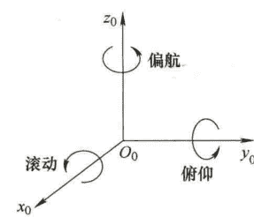

图 2-11 滚转、俯仰与偏航角示意

值得注意的是，该变换既可视为定系下的“偏航-俯仰-滚转”操作，亦等价于动系（当前坐标系）下按“滚转-俯仰-偏航”顺序旋转，两者推导出的矩阵形式与式 (2-39) 完全一致。

对于已知旋转矩阵，其对应的三个 RPY 角 $\phi$、$\theta$、$\psi$ 的求解思路，与前文推导欧拉角的方法如出一辙。

##### (3) 轴角表示法

实际旋转未必绕主轴进行，我们更关注空间任意轴线的转动。这不仅是一种紧凑的描述方式，也为旋转矩阵提供了另一种参数化途径。设单位向量 $\boldsymbol{k} = [k_x \quad k_y \quad k_z]^T$ 定义了基座标系 {0} 下的一个旋转轴，我们要推导绕该轴旋转角度 $\theta$ 的矩阵 $\boldsymbol{R}_{k, \theta}$。

推导方法有很多，其中一种思路利用相似变换：旋转 $\boldsymbol{R} = \boldsymbol{R}_{z, \alpha} \boldsymbol{R}_{y, \beta}$ 可使世界坐标系 $z$ 轴与向量 $\boldsymbol{k}$ 对齐。于是，绕轴 $\boldsymbol{k}$ 的旋转可写为：

$ \boldsymbol{R}_{k, \theta} = \boldsymbol{R} \boldsymbol{R}_{z, \theta} \boldsymbol{R}^{-1} \tag{2-40} $

$ = \boldsymbol{R}_{z, \alpha} \boldsymbol{R}_{y, \beta} \boldsymbol{R}_{z, \theta} \boldsymbol{R}_{y, -\beta} \boldsymbol{R}_{z, -\alpha} \tag{2-41} $

参照图 2-12 几何关系，角度参数满足：

$ \sin \alpha = \frac{k_y}{\sqrt{k_x^2 + k_y^2}} \quad \cos \alpha = \frac{k_x}{\sqrt{k_x^2 + k_y^2}} \tag{2-42} $

$ \sin \beta = \sqrt{k_x^2 + k_y^2} \quad \cos \beta = k_z \tag{2-43} $

式（2-42）、式（2-43）利用了 $\boldsymbol{k}$ 为单位向量的性质。将它们代入式（2-41）并展开计算，可得：

$$

\boldsymbol{R}_{k,\theta} = \begin{bmatrix} k_x^2 \text{versin}\theta + \cos\theta & k_x k_y \text{versin}\theta - k_z \sin\theta & k_x k_z \text{versin}\theta + k_y \sin\theta \\ k_x k_y \text{versin}\theta + k_z \sin\theta & k_y^2 \text{versin}\theta + \cos\theta & k_y k_z \text{versin}\theta - k_x \sin\theta \\ k_x k_z \text{versin}\theta - k_y \sin\theta & k_y k_z \text{versin}\theta + k_x \sin\theta & k_z^2 \text{versin}\theta + \cos\theta \end{bmatrix} \tag{2-44}

$$

其中，$\text{versin}\theta = 1 - \cos\theta$。

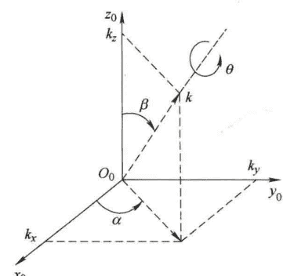

图 2-12 任意轴旋转示意

事实上，任意旋转矩阵 $\boldsymbol{R} \in SO(3)$ 均可等效为绕某空间轴线 $\boldsymbol{k}$ 转过角度 $\theta$ 的单次旋转，即：

$ \boldsymbol{R} = \boldsymbol{R}_{k,\theta} \tag{2-45} $

这里 $\boldsymbol{k}$ 是定义旋转轴的单位位矢，$\theta$ 是绕轴旋转角。数对 $(k, \theta)$ 称为 $\boldsymbol{R}$ 的**轴角表示**。给定任意旋转矩阵 $\boldsymbol{R}$（元素为 $r_{ij}$），其对应的旋转角 $\theta$ 与旋转轴 $\boldsymbol{k}$ 计算公式为：

$$

\theta = \cos^{-1} \left( \frac{r_{11} + r_{22} + r_{33} - 1}{2} \right)

$$

$$

\boldsymbol{k} = \frac{1}{2 \sin \theta} \begin{bmatrix} r_{32} - r_{23} \\ r_{13} - r_{31} \\ r_{21} - r_{12} \end{bmatrix} \tag{2-46}

$$

式（2-46）可通过直接处理式（2-44）矩阵元素获得。轴角表示具有非唯一性：绕 $-k$ 轴转 $-\theta$ 与绕 $k$ 轴转 $\theta$ 效果相同，即

$ \boldsymbol{R}_{k,\theta} = \boldsymbol{R}_{-k,-\theta} \tag{2-47} $

若 $\theta = 0$，则 $\boldsymbol{R}$ 为单位阵，此时旋转轴未定义。

**例 2.8** 假设 $\boldsymbol{R}$ 由三次旋转复合：先绕 $z_0$ 转 $90^\circ$，再绕 $y_0$ 转 $30^\circ$，最后绕 $x_0$ 转 $60^\circ$，则有

$$

\boldsymbol{R}=\boldsymbol{R}_{x, 60} \boldsymbol{R}_{y, 30} \boldsymbol{R}_{z, 90}=\left[\begin{array}{ c c c }0 & -\frac{\sqrt{3}}{2} & \frac{1}{2} \\ \frac{1}{2} & -\frac{\sqrt{3}}{4} & -\frac{3}{4} \\ \frac{\sqrt{3}}{2} & \frac{1}{4} & \frac{\sqrt{3}}{4}\\

\end{array}\right]

$$

$ \tag{2-48} $

可见 $\text{Tr}(\boldsymbol{R})=0$，由式（2-46）得等效旋转角为

$$

\theta = \cos^{-1}\left(-\frac{1}{2}\right)=120^\circ

$$

$ \tag{2-49} $

式（2-46）给出的等效旋转轴为

$$

\boldsymbol{k}=\left[\frac{1}{\sqrt{3}} \quad \frac{1}{2\sqrt{3}}-\frac{1}{2} \quad \frac{1}{2\sqrt{3}}+\frac{1}{2}\right]^T

$$

$ \tag{2-50} $

轴角法用四个量（轴向量三分量 + 旋转角）描述旋转。但因 $\boldsymbol{k}$ 是单位向量，仅有两个独立分量，故该表示实质仅需三个独立变量。可用单一向量 $\boldsymbol{r}$ 编码等效轴角：

$$

\boldsymbol{r}=\left[r_x \quad r_y \quad r_z\right]^T=\left[\theta k_x \quad \theta k_y \quad \theta k_z\right]^T

$$

$ \tag{2-51} $

**注意：** 向量 $\boldsymbol{r}$ 的模长即等效角 $\theta$，方向即等效轴 $\boldsymbol{k}$。

需特别留意：式（2-51）**不意味着**可用向量加法叠加两个轴角坐标，因为那将暗示旋转满足交换律，而一般情况下旋转是不交换的。

### 2.1.3 刚体运动与齐次变换

#### 1. 刚体运动

刚体运动定义为有序对 $(\boldsymbol{d}, \boldsymbol{R})$，其中 $\boldsymbol{d} \in \mathbb{R}^3$ 为位移，$\boldsymbol{R} \in SO(3)$ 为旋转。全体刚体运动构成的群称为**特殊欧几里得群**，记作 $SE(3)$，即 $SE(3)=\mathbb{R}^3 \times SO(3)$。

刚体运动是纯平移与纯旋转的复合。设旋转矩阵 $ {}_0^1\boldsymbol{R} $ 描述坐标系 $\{1\}$ 相对于 $\{0\}$ 的姿态，$\boldsymbol{d}$ 为从 $\{0\}$ 原点指向 $\{1\}$ 原点的向量。若点 $P$ 刚性连接于 $\{1\}$，其局部坐标为 $^1\mathbf{p}$，则 $P$ 在 $\{0\}$ 下的坐标为：

$${}^0\mathbf{p} = {}_1^0\mathbf{R}^1\mathbf{p} + {}^0\mathbf{d}$$ $ \tag{2-52} $

现考虑三个坐标系 $\{0\}$、$\{1\}$、$\{2\}$。设 $\boldsymbol{d}_1$ 为 $\{0\}$ 原点到 $\{1\}$ 原点的向量，$\boldsymbol{d}_2$ 为 $\{1\}$ 原点到 $\{2\}$ 原点的向量。若点 $P$ 固连于 $\{2\}$，局部坐标为 ${}^2\mathbf{p}$，则通过式 (2-53)、(2-54) 可求得 $P$ 在基座标系 $\{0\}$ 下的坐标：

$${}^1\mathbf{p} = {}_2^1\mathbf{R}^2\mathbf{p} + {}^1\mathbf{d}_2$$ $ \tag{2-53} $

以及

$${}^0\mathbf{p} = {}_1^0\mathbf{R}^1\mathbf{p} + {}^0\mathbf{d}_1$$ $ \tag{2-54} $

将这两式复合可定义第三个刚体运动，将式 (2-53) 代入 (2-54) 得：

$${}^0\mathbf{p} = {}_1^0\mathbf{R} {}_2^1\mathbf{R}^2\mathbf{p} + {}_1^0\mathbf{R}^1\mathbf{d}_2 + {}^0\mathbf{d}_1$$ $ \tag{2-55} $

因为 ${}^0\mathbf{p}$ 与 ${}^2\mathbf{p}$ 的关系同样是刚体运动，故可用同类形式表示：

$${}^0\mathbf{p} = {}_2^0\mathbf{R}^2\mathbf{p} + {}^0\mathbf{d}_2$$ $ \tag{2-56} $

对比式 (2-55) 与式 (2-56)，可得复合规则：

$${}_2^0\mathbf{R} = {}_1^0\mathbf{R} {}_2^1\mathbf{R}$$ $ \tag{2-57} $

$${}^0\mathbf{d}_2 = {}^0\mathbf{d}_1 + {}_1^0\mathbf{R}^1\mathbf{d}_2$$ $ \tag{2-58} $

# 齐次变换与人形机器人运动学建模

#### 坐标变换的矩阵化表达

式 (2-57) 与式 (2-58) 揭示了姿态变换可通过矩阵相乘直接叠加，而原点位置向量在基座标系 {0} 下的坐标，等于首段向量 ${}^0\mathbf{d}_1$ 与次段向量在 {0} 系下的投影 ${}_1^0\mathbf{R}^1\mathbf{d}_2$ 之和。

#### 2. 齐次变换：刚性运动的统一代数语言

面对长串刚性运动的级联，直接套用式 (2-55) 计算繁琐。引入矩阵形式可将位姿叠加简化为矩阵乘法，与旋转矩阵的复合逻辑一脉相承。

对比式 (2-57)、(2-58) 与以下矩阵结构，即可得到统一表示：

$$

\begin{bmatrix}

{}_1^0\mathbf{R} & {}^0\mathbf{d}_1 \\

\mathbf{0} & 1

\end{bmatrix}

\begin{bmatrix}

{}_2^1\mathbf{R} & {}^1\mathbf{d}_2 \\

\mathbf{0} & 1

\end{bmatrix}

=

\begin{bmatrix}

{}_1^0\mathbf{R} {}_2^1\mathbf{R} & {}_1^0\mathbf{R}^1\mathbf{d}_2 + {}^0\mathbf{d}_1 \\

\mathbf{0} & 1

\end{bmatrix}

$$ (2-59)

其中 $\mathbf{0}$ 为零行向量 $[0\ 0\ 0]$。这表明任意刚性运动均可对应一个 4×4 矩阵，即：

$$ T = \begin{bmatrix} R & d \\ 0 & 1 \end{bmatrix}, R \in SO(3); d \in \mathbb{R}^3 $$ (2-60)

式 (2-60) 定义的矩阵称为**齐次变换矩阵**。本质上，齐次变换就是刚性运动的矩阵化表达。用 $SE(3)$ 表示刚性运动群，等价于所有形如 (2-60) 的 4×4 矩阵构成的集合。

利用旋转矩阵 $R$ 的正交性，逆变换矩阵 $T^{-1}$ 易得为：

$$ T^{-1} = \begin{bmatrix} R^T & -R^T d \\ 0 & 1 \end{bmatrix} $$ (2-61)

为适配矩阵乘法运算，需将向量 $^0p$、$^1p$ 增广为齐次坐标（补 1 为第 4 分量）：

$$ ^0P = \begin{bmatrix} ^0p \\ 1 \end{bmatrix} $$ (2-62)
$$ ^1P = \begin{bmatrix} ^1p \\ 1 \end{bmatrix} $$ (2-63)

$^0P$、$^1P$ 分别为 $^0p$、$^1p$ 的齐次表示。此时坐标变换等价于矩阵方程：

$$ ^0P = {}_1^0T {}^1P $$ (2-64)

$SE(3)$ 的生成元——基本齐次变换矩阵集为：

$$ Trans_{x,a} = \begin{bmatrix} 1 & 0 & 0 & a \\ 0 & 1 & 0 & 0 \\ 0 & 0 & 1 & 0 \\ 0 & 0 & 0 & 1 \end{bmatrix}, Rot_{x,a} = \begin{bmatrix} 1 & 0 & 0 & 0 \\ 0 & \cos \alpha & -\sin \alpha & 0 \\ 0 & \sin \alpha & \cos \alpha & 0 \\ 0 & 0 & 0 & 1 \end{bmatrix} $$ (2-65)
$$ Trans_{y,b} = \begin{bmatrix} 1 & 0 & 0 & 0 \\ 0 & 1 & 0 & b \\ 0 & 0 & 1 & 0 \\ 0 & 0 & 0 & 1 \end{bmatrix}, Rot_{y,\beta} = \begin{bmatrix} \cos \beta & 0 & \sin \beta & 0 \\ 0 & 1 & 0 & 0 \\ -\sin \beta & 0 & \cos \beta & 0 \\ 0 & 0 & 0 & 1 \end{bmatrix} $$ (2-66)
$$ Trans_{z,c} = \begin{bmatrix} 1 & 0 & 0 & 0 \\ 0 & 1 & 0 & 0 \\ 0 & 0 & 1 & c \\ 0 & 0 & 0 & 1 \end{bmatrix}, Rot_{z,\gamma} = \begin{bmatrix} \cos \gamma & -\sin \gamma & 0 & 0 \\ \sin \gamma & \cos \gamma & 0 & 0 \\ 0 & 0 & 1 & 0 \\ 0 & 0 & 0 & 1 \end{bmatrix} $$ (2-67)

分别对应绕 $x,y,z$ 轴的平移 $a,b,c$ 与旋转 $\alpha,\beta,\gamma$。

最通用的齐次变换矩阵形如：

$$ {_1^0}T = \begin{bmatrix} n_x & s_x & a_x & d_x \\ n_y & s_y & a_y & d_y \\ n_z & s_z & a_z & d_z \\ 0 & 0 & 0 & 1 \end{bmatrix} = \begin{bmatrix} \boldsymbol{n} & \boldsymbol{s} & \boldsymbol{a} & \boldsymbol{d} \\ \boldsymbol{0}^T & 1 \end{bmatrix} \quad (2-68) $$

列向量 $\boldsymbol{n},\boldsymbol{s},\boldsymbol{a}$ 分别为坐标系 {1} 的 $x_1,y_1,z_1$ 轴在 {0} 中的方向余弦；$\boldsymbol{d}$ 为原点 $O_1$ 在 {0} 中的位置矢量。

$3\times3$ 旋转矩阵的左乘/右乘法则（定坐标系/动坐标系）完全适用于 $4\times4$ 齐次变换。已知 ${_1^0}T$，若后续运动 $T\in SE(3)$ 相对**当前（动）坐标系**执行，则总变换为 ${_2^0}T = {_1^0}T\, T$；若相对**固定（基）坐标系**执行，则为 ${_2^0}T = T\, {_1^0}T$。

> **例 2.9** 齐次矩阵 $T$ 编码操作序列：绕当前 $x$ 轴转 $\alpha$ → 沿当前 $x$ 轴平移 $b$ → 沿当前 $z$ 轴平移 $d$ → 绕当前 $z$ 轴转 $\theta$。按动系右乘顺序相乘得：
> $$T = Rot_{x,\alpha}\, Trans_{x,b}\, Trans_{z,d}\, Rot_{z,\theta} = \begin{bmatrix} \cos\theta & -\sin\theta & 0 & b \\ \cos\alpha\sin\theta & \cos\alpha\cos\theta & -\sin\alpha & -d\sin\alpha \\ \sin\alpha\sin\theta & \sin\alpha\cos\theta & \cos\alpha & d\cos\alpha \\ 0 & 0 & 0 & 1 \end{bmatrix}$$

---

### 2.2 人形机器人运动学：从几何到控制的基石

机器人运动学专注于运动的几何关系——位置、速度、加速度及高阶导数，暂不涉及力/力矩。它是动力学建模、轨迹规划与位置控制的核心基础。

运动学包含**正/逆运动学**两大问题：
- **正运动学**：给定关节角，求末端位姿。解唯一且求解直接。
- **逆运动学**：给定目标位姿，求关节角。属非线性超越方程组，常存在多解/无解，涉及解的存在性、唯一性及数值/解析求解策略。

运动学模型的核心任务：建立连杆、关节拓扑与坐标系，最终确立末端执行器位姿。

#### 2.2.1 运动学建模概述

机械臂（操作臂）是人形机器人本体核心，典型结构为**开式运动链**：基座 (Link 0) → 连杆 1 → … → 连杆 n → 末端执行器。关节分**移动关节**（棱柱副，沿轴平移）与**旋转关节**（转动副，绕轴转动），均具 1 自由度。球关节(3 DOF)可拆解为 3 个转动关节+零长连杆。空间位姿需 6 DOF（3 位置 + 3 姿态），故操作臂通常至少含 6 关节。

##### 1. 连杆几何与四参数描述

连杆连接两关节，其几何特征由两相邻关节轴线的**公共法线**决定（见图 2-13）：

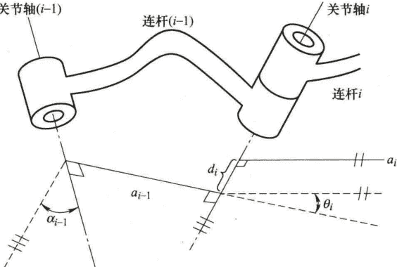

- **连杆长度 $a_{i-1}$**：关节轴 $i-1$ 与 $i$ 的公共法线段长。平行轴有无限公垂线，异面仅一条，相交则退化为点。
- **连杆转角 $\alpha_{i-1}$**：绕公垂线将轴 $i-1$ 旋转至与轴 $i$ 平行的角度（右手定则，公垂线指向轴 $i$ 为正）。
- **连杆偏距 $d_i$**：关节轴 $i$ 上的两条公垂线（长度分别为 $a_{i-1}, a_i$）间的距离，刻画连杆 $i$ 相对 $i-1$ 的轴向偏置。
- **关节角 $\theta_i$**：关节轴 $i$ 上两公垂线的夹角，反映连杆 $i-1$ 与 $i$ 在该关节处的相对旋转。

$d_i, \theta_i$ 均有符号。**关节类型决定变量**：
- 转动关节：$d_i$ 固定，$\theta_i$ 为关节变量；
- 移动关节：$\theta_i$ 固定，$d_i$ 为关节变量。

##### (2) D-H 参数法：建立连杆坐标系的标准范式

**Denavit-Hartenberg (D-H) 参数** 以 4 个标量 $(a_{i-1}, \alpha_{i-1}, d_i, \theta_i)$ 完整描述连杆 $i-1$ 与关节 $i$ 的相对位姿。每关节 3 个常数 + 1 个变量，构建 4×4 齐次变换矩阵 ${}^{i-1}_iT$，级联求得基座到末端的总变换 ${}^0_nT$。

**连杆坐标系 {i-1} 定义规则（见图 2-14）**：

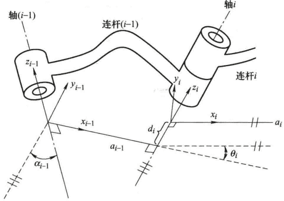

- **原点**：轴 $i-1$ 与轴 $i$ 公垂线的交点（相交则为交点；平行则选取使 $d_i=0$ 的点）。
- **$z_{i-1}$ 轴**：共线于关节轴 $i-1$，正向任选但建议全身一致。
- **$x_{i-1}$ 轴**：沿公垂线指向轴 $i$；轴线相交时垂直于两轴平面（与 $z_{i-1}\times z_i$ 共线）。
- **$y_{i-1}$ 轴**：右手法则确定。
- **零位约定**：关节变量为 0 时，{0} 与 {1} 重合；末端 {n} 原点及 $x_n$ 方向任选，以简化参数为准。

**逐步建系流程**：
1.  绘出所有关节轴延长线。
2.  对相邻轴 $(i-1, i)$ 求公垂线，定原点。
3.  $z_{i-1}$ 顺轴 $i-1$。
4.  $x_{i-1}$ 顺公垂线指向轴 $i$（相交时垂直两轴面）。
5.  右手制得 $y_{i-1}$。
6.  零位对齐 {0} 与 {1}；{n} 任意选取以消零参数。

参数符号约定：$a_{i-1}\ge 0$；$\alpha_{i-1}, \theta_i$ 按右手螺旋规则定正负；$d_i$ 沿 $z_i$ 正向从 $x_{i-1}$ 垂足至 $x_i$ 垂足为正。

### 坐标系建立的非唯一性与变换矩阵构建

需特别指出的是，依据前述规则建立的连杆坐标系并非唯一确定。首先，当 $z_{i-1}$ 轴与关节轴 (i-1) 重合时，其正方向有两种选取方式。再者，若关节轴相交（即 $a_{i-1} = 0$），因 $x_{i-1}$ 轴垂直于 $z_{i-1}$ 与 $z_i$ 所在平面，故 $x_{i-1}$ 轴指向亦有两种可能。当关节轴 (i-1) 与关节轴 i 平行时，坐标系 { i-1 } 原点位置可任意指定（通令 $d_{i-1} = 0$ 处为佳）。此外，平动关节的坐标系选取同样存在任意性。

基座坐标系记为 {0}，末端为 {n}。按上述规则，{0} 与 {n} 的 x 轴确立方案有无数种，通常遵循“参数归零多、观测便利性强”的原则；中间坐标系 z 轴通常有两种指向，z 轴相交时 x 轴也有两种选择。但只要基座与末端坐标系定义固定，中间环节定义如何变化，最终推导出的机器人运动学方程必然一致。

#### 变换矩阵的推导步骤

完成全身连杆坐标系布设后，可通过两次旋转、两次平移的序列，构建相邻坐标系 { i-1 } 与 {i} 的相对位姿关系（见图 2-14）：

1.  绕 $x_{i-1}$ 轴转动 $\alpha_{i-1}$，使 $z_{i-1}$ 旋至 $z_R$ 并与 $z_i$ 方向一致，坐标系 { i-1 } 过渡为 { R }。
2.  沿 $x_{i-1}$ (或 $x_R$) 轴平移 $a_{i-1}$，将坐标系移至轴 i 上，{ R } 过渡为 { Q }。
3.  绕 $z_Q$ (或 $z_i$) 轴转动 $\theta_i$，{ Q } 过渡为 { P }。
4.  沿 $z_i$ 轴平移 $d_i$，{ P } 最终与连杆 i 的坐标系 { i } 重合。

该相对关系可用 4 个齐次变换矩阵描述。依据坐标变换链式法则，{ i-1 } 到 { i } 的变换矩阵可写为：

```
${}_i^{i-1}T = {}_R^{i-1}T_Q^T T_P^Q T_i^P$
```

---

##### 2. 运动学结构建模

典型仿人机器人骨架结构如图 2-15 所示：双腿各 6 自由度、双臂各 7 自由度、躯干 2 自由度、头部 2 自由度。实体机器人关节均为单自由度旋转副 (R关节)。建模时常采用等效多自由度关节：髋、肩、腕处的 3R 串联等效为球关节 (3 DOF)；踝、躯干、颈部的 2R 串联等效为万向节 (2 DOF)。假设所有连杆为刚体，通过建立在连杆上的坐标系位姿即可描述连杆状态。单自由度模型常用 D-H 参数法；多自由度模型则将连杆坐标系建在某一连接关节上。

**树形拓扑与浮动基座**
“骨盆”连杆在运动链中地位特殊。仿人机器人运动链可表示为树形结构（图 2-16）：实心点为支链局部根，圆圈为关节。骨盆是全局根连杆，通过虚拟 6 自由度关节连地面，体现“浮动基座”特性——基座像自由刚体在 3D 空间运动。根节点分叉为双腿与躯干；躯干作为局部根再分叉为双臂与头部；手臂末端为手，手再分叉为手指。图 2-16 表示仅全局根着地的生成树，但实际常有一或多足接地（如双足静立），形成闭链，导致运动链拓扑结构动态变化。

**关键参考坐标系**
图 2-15 中三大参考系作用各异：
*   **{W}**：固连地面，为惯性系。
*   **{B}**：固连基座（根）连杆。
*   **{T}**：固连躯干，作为手臂/头部支链的“局部根”。
*   **末端坐标系 {ej}**：$e \in \{F, H\}$（足/手），$j \in \{r, l\}$（右/左）。机器人主要通过末端与环境交互：手指抓取微物，手臂末端搬运大物，足部实现移动，头部获取视野。本书重点聚焦足部运动与手臂操作，强调 {F} 与 {H} 的运动分析与控制。

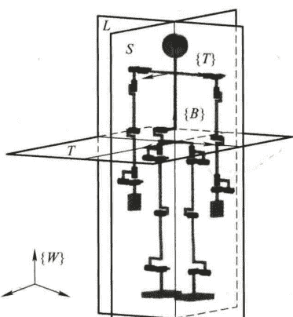
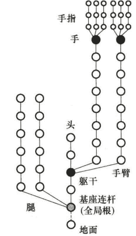

> **图 2-15** 一般的仿人机器人骨架结构图  
> **图 2-16** 运动链树形连接图

**平面简化模型**
平面模型利于运动分析与生成。可依人体解剖三基本平面构建（图 2-15）：
*   **矢状面 (S)**：垂直地面的 xz 平面，分左右身。
*   **冠状面 (L)**：垂直地面的 yz 平面，分前后身。
*   **横切面 (T)**：水平 xy 平面，分上下身。
实测发现，行走或抗扰平衡时，三维运动常分解为平面内运动。矢状面内关节均为 1 DOF 转动副；冠状面与横切面内，肘膝关节因肢体长度视觉变化，常建模为移动副。此特性配合倒立线性摆等简化模型，极大便利了分析与生成。

---

### 2.2.2 正运动学求解

确立全身连杆坐标系及 D-H 参数后，先推导相邻连杆坐标变换通式，再按序相乘，即得机械臂正运动学方程。

**相邻坐标系变换序列（标准 D-H 流程）**
对特定机器人，按建立好的关节坐标系，通过两次旋转、两次平移建立 { i-1 } 与 {i} 对应关系：

1.  { i-1 } 绕 $z_{i-1}$ 转 $\theta_i$，沿 $z_{i-1}$ 平移 $d_i$，使 $x_{i-1}$ 与 $x_i$ 平行，得中间系 { i-1' }（轴 $x'_{i-1}, y'_{i-1}, z'_{i-1}$，原点 $O'_{i-1}$）。
2.  { i-1' } 沿 $x'_{i-1}$ 平移 $a_{i-1}$，使 $O'_{i-1}$ 与 $O_i$ 重合；再绕 $x'_{i-1}$ 转 $\alpha_{i-1}$，使 $z'_{i-1}$ 与 $z_i$ 重合。

经上述变换，{ i-1 } 与 {i} 重合。用 4 个齐次变换矩阵描述连杆 i 相对连杆 (i-1) 的位姿，称 T 矩阵或连杆变换矩阵，记为 $^{i-1}_i T$。遵循左乘原则，其表达式为：

```
{}^{i-1}_i T = R_z(\theta_i)Trans(0,0,d_i)Trans(0,0,a_{i-1})R_x(\alpha_{i-1}) \quad (2-69)
```

展开计算得 $^{i-1}_i T$ 一般式：

```
{}^{i-1}T = \begin{bmatrix} \cos \theta_i & -\sin \theta_i & 0 & a_{i-1} \\ \sin \theta_i \cos \alpha_{i-1} & \cos \theta_i \cos \alpha_{i-1} & -\sin \alpha_{i-1} & -\sin \alpha_{i-1} d_i \\ \sin \theta_i \sin \alpha_{i-1} & \cos \theta_i \sin \alpha_{i-1} & \cos \alpha_{i-1} & \cos \alpha_{i-1} d_i \\ 0 & 0 & 0 & 1 \end{bmatrix} \quad (2-70)
```

可见，相邻坐标系变换矩阵是关节变量 $q_i (i=1..n)$ 的函数：转动关节取 $\theta_i$，移动关节取 $d_i$。

**正运动学方程**
求出各相邻变换矩阵 $^{i-1}_i T (i=1..n)$ 并按序相乘，得末端系 {n} 相对基座系 {0} 的变换矩阵 $^0_n T$，即正运动学方程：

```
\(^0_n T = {}^0_1 T {}^1_2 T {}^2_3 T \cdots {}^{n-1}_n T = {}^0 T(\theta_1) {}^1 T(\theta_2) {}^2 T(\theta_3) \cdots {}^{n-1} T(\theta_n)\)
```

$^{i-1}_i T$ 为关节变量 $q_i$ 的函数。若基末关系已知且关节变量可测，则末端在笛卡尔空间的位姿即可由 $^0_n T$ 计算得出：

```
\(^0_n T = \begin{bmatrix} r_{11} & r_{12} & r_{13} & p_x \\ r_{21} & r_{22} & r_{23} & p_y \\ r_{31} & r_{32} & r_{33} & p_z \\ 0 & 0 & 0 & 1 \end{bmatrix} = \begin{bmatrix} \mathbf{R}_{3x3} & \mathbf{P}_{3x1} \\ \mathbf{0}_{1x3} & 1 \end{bmatrix}\) (2-71)
```

其中，子矩阵 $\mathbf{R}_{3\times3}$ 为基座到末端的旋转矩阵，三列分别为末端 x、y、z 轴在基座系下的单位向量（姿态）；$\mathbf{P}_{3\times1}$ 为末端相对基座的位置向量。基于 D-H 参数的齐次变换矩阵 $^0_n T$ 推导与求解，可完整解析机器人正运动学。

---

### 2.2.3 逆运动学分析

为使机器人达成期望位姿，需通过逆运动学求解各关节角度。本节梳理求解逆运动方程的通用步骤。

#### 1. 关节空间与工作空间
*   **关节空间**：$n$ 自由度机械臂的所有连杆位姿由 $n$ 个关节变量确定，构成 $n \times 1$ 关节向量，其全体组成关节空间。
*   **工作空间 / 笛卡尔空间 / 任务空间**：末端执行器参考点可达区域。若位位置用正交轴测量、姿态按空间描述规范测量，该空间称笛卡尔空间。

#### 2. 逆运动学的多解性与可解性
正运动学解决“关节空间 $\to$ 操作空间”，逆运动学解决“操作空间 $\to$ 关节空间”，工程意义更重。解的存在性取决于工作空间；解的多重性表现为三类：

| 情况 | 成因与特征 |
| :--- | :--- |
| **无解** | 目标超出臂长；自由度 < 6 无法覆盖全空间位姿；关节物理限位 (<360°) 导致不可达。 |
| **唯一解** | 机械臂仅能从单一姿态到达目标。 |
| **多解** | 多姿态可达同一目标。如无限位 6 自由度臂常有 16 解。需按准则择优：① 关节空间最短行程；② 避障可行性。 |

**多解筛选实例（三连杆臂，图 2-17）**
实/虚线分别代表一组解。筛选遵循三原则：

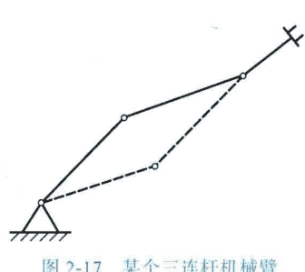

1.  **关节限位筛选**  
    若解得 $\theta_i$ 两值，如：
    ```
θ′i = 35°, θ″i = 35° + 180° = 215°
```
    已知关节范围 $\pm 130^\circ$，应选 $\theta_i = \theta'_i = 35^\circ$。

2.  **最短行程 / 连续性原则**  
    选取使各关节运动量最小、最接近上一时刻的解。  
    假设两解仍为：
    ```
θ′i = 35°, θ″i = 215°
```
    关节范围 $\pm 260^\circ$，上一采样时刻 $\theta_i(n-1)=170^\circ$，则：
    ```
Δθ′i = θ′i - θi(n-1) = 35° - 170° = -135°
```
    ```
Δθ″i = θ″i - θi(n-1) = 215° - 170° = 45°
```
    $\Delta\theta''_i$ 更小，故选 $\theta_i = \theta''_i = 215^\circ$。

3.  **避障原则**  
    如图 2-18，A 点至 B 点。无障碍时选上虚线解（行程最短）；有障碍物干涉上虚线路径时：
    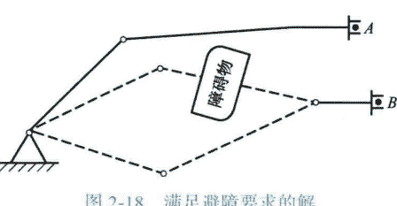
    必须弃用上解，改选下虚线对应的避障解。

#### 3. 逆运动学方程求解通法
从 $^0_n T$ 入手求关节角。已知 $^0_n T$ 数值元素，左乘 $^n_1 T^{-1}$ 消去首角度，提取含目标角度正弦、余弦的元素求解，再利用齐次变换矩阵逆矩阵性质逐步移项，解出全体关节角。

以 6 轴为例：
$$
^0_6 T = \begin{bmatrix} r_{11} & r_{12} & r_{13} & p_x \\ r_{21} & r_{22} & r_{23} & p_y \\ r_{31} & r_{32} & r_{33} & p_z \\ 0 & 0 & 0 & 1 \end{bmatrix} = ^0_1 T(\theta_1) ^1_2 T(\theta_2) ^2_3 T(\theta_3) ^3_4 T(\theta_4) ^4_5 T(\theta_5) ^5_6 T(\theta_6)
$$

逐级左乘逆矩阵分离：
$$
\begin{aligned}
^0_1 T^{-1} ^0_6 T &= ^1_6 T \\
^1_2 T^{-1} ^1_6 T &= ^2_6 T \\
^2_3 T^{-1} ^2_6 T &= ^3_6 T \\
^3_4 T^{-1} ^3_6 T &= ^4_6 T \\
^4_5 T^{-1} ^4_6 T &= ^5_6 T
\end{aligned}
$$

---

### 2.2.4 微分运动学基础

微分运动学服务于瞬时运动分析与生成。连杆视为刚体，若基座瞬时运动已知，全身瞬时运动由关节运动速率唯一确定（速率源自编码器等传感器）。据此可算任意连杆（如末端）的瞬时运动，这对行走、手部操作、全身避障重构至关重要。控制层面，任务空间前馈/反馈指令基于末端瞬时运动生成，再经（逆）微分运动学映射为关节指令。微分运动学还是动力学建模基石，涵盖一阶（速度）与二阶（加速度）关系。

#### 1. 运动旋量、空间速度与空间变换
连杆瞬时运动由特征点 $P$ 处的线速度 $v_p \in \mathbf{R}^3$ 与角速度 $\omega \in \mathbf{R}^3$ 完全刻画。这些几何向量需进行内/外积运算，下文均用坐标形式表达。给定 $a, b \in \mathbf{R}^3$，内积记 $a^T b$，外积记 $[a^\times] b$。若 $a = [a_x, a_y, a_z]^T$，则

### 空间矢量代数与微分运动学基础

#### 斜对称矩阵与空间速度表示

向量 $\boldsymbol{a}$ 对应的叉乘算子 $[\boldsymbol{a}^\times]$ 可写作如下斜对称矩阵形式：

$$
[\boldsymbol{a}^\times] = \begin{bmatrix} 0 & -a_z & a_y \\ a_z & 0 & -a_x \\ -a_y & a_x & 0 \end{bmatrix}
$$

这类矩阵的核心性质满足 $[\boldsymbol{a}^\times] = -[\boldsymbol{a}^\times]^{\text{T}}$。

线速度与角速度的斜对称形式 $[\boldsymbol{\omega}^\times]$ 隶属于 $SO(3)$，二者结合构成了特殊欧几里得群 $SE(3)$ 的李代数元素。我们可用一个 6 维向量 $\mathcal{V} \in \mathbb{R}^6$ 来参数化该元素，该向量堆叠了线速度与角速度分量。给定齐次坐标下的位姿 $\boldsymbol{X}$，刚体在惯性系中的运动状态可从 $\dot{\boldsymbol{X}}\boldsymbol{X}^{-1}$ 或 $\boldsymbol{X}^{-1}\dot{\boldsymbol{X}}$ 中提取。前者描述的是**空间速度**（惯性系观测），后者对应**体速度**（体坐标系观测）。

为摆脱特征点选取的依赖，常将速度表示为矢量场形式：$\mathcal{V} = [\boldsymbol{v}_O^T, \boldsymbol{\omega}^T]^T$。此处 $\boldsymbol{v}_O$ 代表刚体上瞬间与固定坐标系原点 $O$ 重合的虚拟点速度。据此，任意点 $P$ 的空间速度 $\mathcal{V}_p = [\boldsymbol{v}_p^T, \boldsymbol{\omega}^T]^T$ 可通过以下关系获得：

$$
\boldsymbol{v}_p = \boldsymbol{v}_O - [\boldsymbol{r}_{PO}^\times] \boldsymbol{\omega} \tag{2-72}
$$

其中 $\boldsymbol{r}_{PO}$ 为从 $O$ 指向 $P$ 的位置矢量。空间速度连同空间变换、空间力、空间惯性等，共同构建了**空间代数**框架。这一源自螺旋理论的 6D 矢量（即旋量/双矢量）因表达简洁而被广泛采纳，但在工程实现时须注意其量纲不均匀性带来的数值问题。

#### 坐标变换与伴随映射

刚体的瞬时运动可在笛卡尔坐标系下描述。基于螺旋理论，引入普吕克坐标系下的 6 个基矢量，$\mathcal{V}_p$ 即为点 $P$ 在该坐标系下的空间速度表示。例如，相对基座系 $\{B\}$ 的手部空间速度记作 $\boldsymbol{v}_{\mathcal{H}_j}$。

工程中常需将某点在某坐标系下的速度变换到另一坐标系。设世界系为 $\{W\}$，基座系为 $\{B\}$，点 $P$ 的空间速度变换公式为：

$$
^W\mathcal{V}_p = {}_B^W \mathcal{R} \, ^B\mathcal{V}_p
$$

其中空间旋转变换矩阵为：

$$
^w_B \mathcal{R} = \begin{bmatrix} ^w_B R & \mathbf{0}_3 \\ \mathbf{0}_3 & ^w_B R \end{bmatrix} \in \mathbb{R}^{6 \times 6} \tag{2-73}
$$

$^w_B R$ 为将矢量从 $\{B\}$ 旋转到 $\{W\}$ 的 $3\times3$ 旋转矩阵。

另一常用操作是求同一坐标系下不同点的速度关系。已知点 $O$ 速度求点 $P$ 速度，利用空间平移变换：

$$
^B \mathcal{V}_p = {}^B \mathcal{T}_{\leftarrow PO} {}^B \mathcal{V}_O \tag{2-74}
$$

$$
^B \mathcal{T}_{\leftarrow PO} = \begin{bmatrix} E_3 & -[^B \boldsymbol{r}_{PO}^\times] \\ \mathbf{0}_3 & E_3 \end{bmatrix} \in \mathbb{R}^{6 \times 6} \tag{2-75}
$$

$E_3$ 为三阶单位矩阵。式 (2-72) 即可由此导出。**关键提示**：平移变换 $\mathbb{T}$ 不改变参考坐标系，这从式 (2-74) 同侧的左上角标 $\{B\}$ 即可看出。若所有量均在世界系表达，坐标系标记常省略。

组合旋转与平移，可实现跨坐标系、跨作用点的速度变换：

$$
^w \mathcal{V}_p = {}^w_B \mathcal{R} \, {}^B \mathcal{T}_{\leftarrow PO} \, {}^B \mathcal{V}_O = {}^w_B \mathcal{X}_{PO} \, {}^B \mathcal{V}_p \tag{2-76}
$$

组合变换 $\mathcal{X}$ 称为**伴随变换**，记作 $Ad_{\mathcal{X}}$，亦称普吕克变换，显式形式为：

$$
^w_B \mathcal{X}_{PO} = \begin{bmatrix} ^w_B R & \mathbf{0}_3 \\ \mathbf{0}_3 & ^w_B R \end{bmatrix} \begin{bmatrix} E_3 & -[^B \boldsymbol{r}_{PO}^\times] \\ \mathbf{0}_3 & E_3 \end{bmatrix} = \begin{bmatrix} ^w_B R & -^w_B R[^B \boldsymbol{r}_{PO}^\times] \\ \mathbf{0}_3 & ^w_B R \end{bmatrix} \tag{2-77}
$$

伴随变换的逆运算用于坐标系逆向变换：

$$
\mathcal{X}^{-1} = \mathcal{T}^{-1} \mathcal{R}^{-1} = \begin{bmatrix} E & [\boldsymbol{r}^\times] \\ 0 & E \end{bmatrix} \begin{bmatrix} R^T & 0 \\ 0 & R^T \end{bmatrix} = \begin{bmatrix} R^T & [\boldsymbol{r}^\times] R^T \\ 0 & R^T \end{bmatrix} \tag{2-78}
$$

例如 $^w_B \mathcal{X}^{-1} \equiv {}^B_w \mathcal{X}$。

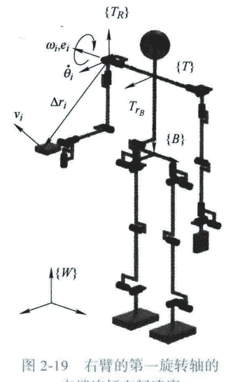

---

### 正微分运动学

机械臂、腿足等运动支链的正运动学问题定义为：**已知关节位置 $\theta$ 与速度 $\dot{\theta}$，求末端连杆的空间速度**。末端运动在支链局部根坐标系中描述，由各驱动关节运动率决定。

#### 1. 雅可比矩阵的几何构造

先考虑仅含单自由度旋转关节的 $n$ 关节串联机构。关节角向量 $\theta \in \mathbb{R}^n$ 确定构型。末端空间速度 $\mathcal{V}_n$ 是各关节贡献的线性叠加：

$$
\mathcal{V}_n = \sum_{i=1}^n \mathcal{V}_i, \quad \mathcal{V}_i = \mathcal{J}_i(\theta) \dot{\theta}_i \tag{2-79}
$$

其中 $\mathcal{J}_i(\theta)$ 为第 $i$ 关节以单位速度运动（其余锁死）时产生的末端空间速度，由几何关系决定：

$$
\mathcal{J}_i(\theta) = \begin{bmatrix} \boldsymbol{e}_i(\theta) \times \Delta \boldsymbol{r}_i(\theta) \\ \boldsymbol{e}_i(\theta) \end{bmatrix} \tag{2-80}
$$

$\boldsymbol{e}_i$ 为关节旋转轴单位向量，$\Delta \boldsymbol{r}_i = \boldsymbol{r}_E - \boldsymbol{r}_i$ 为从关节 $i$ 到末端特征点的位置矢量（相对参考系 $\{T_R\}$）。图 2-19 以右臂第一轴为例演示了该几何关系。

式 (2-79) 适用于支链上任意连杆 $k$ 的速度计算：若 $j \le k$ 则累加 $\mathcal{V}_j$；若 $k < j \le n$ 则贡献为零。

紧凑矩阵形式为：

$$
\mathcal{V}_n = J(\theta) \dot{\theta} \tag{2-81}
$$

$J(\theta) = [\mathcal{J}_1, \dots, \mathcal{J}_n] \in \mathbb{R}^{6 \times n}$ 即为该支链的**几何雅可比矩阵**。式 (2-81) 给出了速度级正运动学的唯一解，是运动分析与反馈控制的核心基础。

#### 2. 多自由度关节建模

仿真与规划中常涉及球副（S）、万向节（U）、浮动基座（6-DOF RB）等多自由度关节。设关节坐标 $\mathfrak{I}_i \in \mathbb{R}^{\eta_i}$，自由度 $\eta_i = 6 - c_i$（$c_i$ 为约束数）。连杆 $i$ 相对于父连杆 $p(i)$ 的微分运动关系为：

$$
{}^i\mathcal{V} = {}_{p(i)}^i \mathcal{X} \, {}^{p(i)}\mathcal{V} + {}_i \mathcal{B}_m(\mathfrak{I}_i) \dot{\mathfrak{I}}_i \tag{2-82}
$$

矩阵 ${}_i \mathcal{B}_m \in \mathbb{R}^{6 \times \eta_i}$ 由关节运动方向基矢量组成，通常依赖关节构型；若在连杆 $i$ 自身坐标系下表达，$\mathcal{B}_m$ 为常数矩阵。典型关节的 $\mathcal{B}_m$ 形式如下：

$$
\begin{aligned}
{}_i\mathcal{B}_m(\mathfrak{I}_S) &= \begin{bmatrix} \mathbf{0}_{3\times3} \\ E_3 \end{bmatrix}, \quad
{}_i\mathcal{B}_m(\mathfrak{I}_U) = \begin{bmatrix} \mathbf{0}_{3\times2} \\ \begin{matrix}1&0\\0&1\\0&0\end{matrix} \end{bmatrix}, \quad
{}_i\mathcal{B}_m(\mathfrak{I}_{RB}) = E_6
\end{aligned} \tag{2-83}
$$

上述采用相对身体固定轴旋转参数化。若改用相对坐标轴旋转（如 3R 串联等效球副），$\mathcal{B}_m$ 将变为构型相关非常数矩阵，但物理对应更直接。

利用 (2-82) 递推，末端速度在躯干系 $\{t\}$ 下的表达为：

$$
{}^t \mathcal{V} = \sum_{i}^n ( {}_t^i \mathcal{X} \, {}^i\dot{\mathcal{V}} )
$$

#### 3. 瞬时运动参数化与解析雅可比

空间速度 $\mathcal{V}$ 的角速度部分不可积，故 $\mathcal{V}$ 本身非广义坐标导数。引入 $SO(3)$ 局部参数化（如欧拉角）可建立映射。以世界系 $\{W\}$ 下 $ZYX$ 欧拉角 $(\phi, \theta, \psi)$ 为例：

$$
\boldsymbol{\omega} = \boldsymbol{A}_{ZYX}(\phi, \theta) \begin{bmatrix} \dot{\phi} & \dot{\theta} & \dot{\psi} \end{bmatrix}^T \tag{2-84}
$$

$$
\boldsymbol{A}_{ZYX} = \begin{bmatrix} 0 & -\sin\phi & \cos\phi\cos\theta \\ 0 & \cos\phi & \sin\phi\cos\theta \\ 1 & 0 & -\sin\theta \end{bmatrix}
$$

末端 6D 位姿 $\mathcal{X}$ 的导数则为：

$$
\dot{\mathcal{X}} = \mathcal{X}_{ZYX}(\phi, \theta) \mathcal{V} = \mathcal{X}_{ZYX}(\phi, \theta) J(\theta) \dot{\theta} \tag{2-85}
$$

其中 $\mathcal{X}_{ZYX} = \text{diag}[E_3, \boldsymbol{A}_{ZYX}^{-1}] \in \mathbb{R}^{6 \times 6}$。当 $\det \boldsymbol{A}_{ZYX} = \cos\theta = 0$ 时出现奇异，这是欧拉角最小参数化的固有缺陷，可通过四元数等冗余参数化规避。球副与刚体关节的相对旋转模型同存此问题。

```
$J_a(\theta)=\frac{\partial \varphi(\theta)}{\partial \theta}$
```

由此定义**解析雅可比矩阵** $J_a$ 与几何雅可比 $J$ 的区别：

$$
J_a = \frac{\partial \mathcal{X}}{\partial \theta} = \mathcal{X}_{ZYX} J \quad \Rightarrow \quad J_a \neq J
$$

在运动学、运动静力学及动力学推导中，采用几何雅可比 $J$（本质为关节-空间速度映射）往往能获得更简洁的符号表达。

---

### 逆微分运动学

运动学控制广泛应用于仿人机器人，核心在于利用微分运动关系。逆微分运动学问题定义为：**已知关节角 $\theta$ 与末端空间速度 $\mathcal{V}_n$，求关节速度 $\dot{\theta}$**。求解需满足两个前提条件：

1.  **雅可比满秩**：当前构型 $\theta$ 下的雅可比矩阵 $J(\theta)$ 必须满秩，否则存在不可控方向或冗余度问题。

### 核心判据：雅可比矩阵可逆的两大前提

要让雅可比矩阵 $J(\theta)$ 拥有逆矩阵，支链必须同时满足两个硬性指标：
1.  **秩满足条件**：雅可比矩阵的秩 $r(J(\theta))$ 必须等于末端连杆的自由度数（通常记为 6，即全空间运动）；
2.  **关节数匹配**：支链的关节总数 $n$ 必须严格等于该自由度数。

以人形机器人的肢体（手/脚）为例，其末端最大自由度为 6，因此要求 $r(J)=6$ 且 $n=6$；而用于点接触抓取的手指支链，自由度为 3，则对应 $r(J)=3$ 且 $n=3$。下文将以通用的 6 自由度情形为基准展开分析。

**非奇异与非冗余的定义**
当上述条件全满足时，式 (2-81) 可直接求解关节速度，给出逆运动学的唯一解：
```
$\dot{\theta} = J(\theta)^{-1}\mathcal{V}$
```
我们称这类雅可比矩阵满秩的构型为**非奇异构型**；关节数恰好等于自由度、无多余自由度的支链，称为**运动学非冗余支链**。

**奇异与冗余的挑战**
一旦上述任一条件失效，逆解求解便需格外谨慎：
*   **奇异构型**：存在特定构型 $\theta_s$ 导致雅可比矩阵秩亏 ($r(J)<6$)。无论支链拥有多少关节，均可能陷入奇异构型。
*   **运动学冗余**：当关节数 $n > 6$ 时，式 (2-81) 成为欠定方程，关节速度存在无穷多组解，此类支链称为**运动学冗余支链**。

---

### 加速度级微分运动学与坐标系变换

对式 (2-81) 进行时间微分，即可得到二阶（加速度级）正向微分运动学：
```
$\dot{\mathcal{V}} = J(\theta)\ddot{\theta} + \dot{J}(\theta)\dot{\theta}$
```
对应的逆问题求解表达式为：
```
$\ddot{\theta} = J(\theta)^{-1}(\dot{\mathcal{V}} - \dot{J}(\theta)\dot{\theta})$
```

至此，推导均基于支链局部根坐标系。但在工程应用中，常需统一坐标系。如图 2-19 所示，手部空间速度常表示在固连于躯干的通用臂坐标系 {T} 中。其一阶微分关系可写作：
```
${}^T\mathcal{V}_{H_j} = \boldsymbol{J}(\theta_{H_j})\dot{\theta}_{H_j} \quad (2-89)$
```
足部微分运动关系则更适合表达在基座坐标系 {B} 中：
```
${}^B\mathcal{V}_{F_j} = \boldsymbol{J}(\theta_{F_j})\dot{\theta}_{F_j} \quad (2-90)$
```

为便于全身控制与分析，通常需将所有关系统一到同一参考系（如基座系 {B} 或惯性系 {W}）。利用旋转算子，手部在基座系中的空间速度易于获得：
```
${}^B\mathcal{V}_{H_j} = {}^B\mathcal{V}_T + {}_T^B\boldsymbol{R}^T\mathcal{V}_{H_j} = {}^B\mathcal{V}_T + {}_T^B\boldsymbol{R}\boldsymbol{J}(\theta_{H_j})\dot{\theta}_{H_j} \quad (2-91)$
```
式中 ${}^B\mathcal{V}_T$ 为躯干坐标系空间速度，由躯干关节角及速度决定。同理，手部在惯性系中的速度为：
```
${}^W\mathcal{V}_{H_j} = {}^W\mathcal{V}_B + {}_B^W\boldsymbol{R}^B\mathcal{V}_T + {}_T^W\boldsymbol{R}^T\mathcal{V}_{H_j} = {}^W\mathcal{V}_B + {}_B^W\boldsymbol{R}^B\mathcal{V}_T + {}_T^W\boldsymbol{R}\boldsymbol{J}(\theta_{H_j})\dot{\theta}_{H_j} \quad (2-92)$
```
此处 ${}^W\mathcal{V}_B$ 为基座空间速度。站立/行走时可由腿部关节状态推导；若机器人跳跃或奔跑（双腿暂时离地），则可借助 IMU（如陀螺仪）直接测定基座速度。

---

## 2.3 人形机器人动力学建模

### 2.3.1 动力学核心视角

运动学仅关注末端位姿与基座的几何映射（涉及关节位姿、线/角速度），**不涉及驱动力**。动力学则研究“力致运动”的规律：
*   **正动力学**：已知关节力矩 $\tau$，求轨迹 $q, \dot{q}, \ddot{q}$（仿真核心）。
*   **逆动力学**：已知期望轨迹 $q, \dot{q}, \ddot{q}$，求驱动力矩 $\tau$（控制核心）。

对于典型 6 关节串联机器人，关节角矢量记为 $q$，其动力学模型可表示为：
```
$\boldsymbol{q} = [\theta_1 \quad \theta_2 \quad \theta_3 \quad \theta_4 \quad \theta_5 \quad \theta_6] \quad (2-93)$
```
建模主流路径有二：**牛顿-欧拉法**（矢量力学，基于力/加速度平衡）与 **拉格朗日法**（分析力学，基于能量原理）。两者均可化简为状态空间方程。下文分述。

---

### 2.3.2 牛顿-欧拉递推法详解

#### 1. 刚体加速度推导
设固定系 {A}，动系 {B} 固连刚体，质点 $^B\boldsymbol{Q}$ 在 {B} 中位置固定。{B} 相对 {A} 的位姿由 $^A\boldsymbol{P}_{BORG}$ 与 $_B^A\boldsymbol{R}$ 描述。质点在 {A} 中的线速度为：
```
\(^A\boldsymbol{V}_Q = {}^A\boldsymbol{P}_\text{BORG} + {}^A\boldsymbol{R}_B{}^B\boldsymbol{V}_Q\) (2-94)
```
*(前提：{A} 与 {B} 相对姿态恒定)*
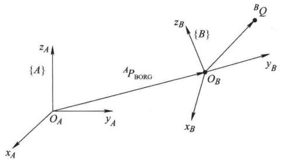
对速度求导得线加速度（常用于转动关节连杆）：
```
\(^A\dot{\boldsymbol{V}}_Q = {}^A\dot{\boldsymbol{V}}_\text{BORG} + {}^A\boldsymbol{\Omega}_B \times ({}^A\boldsymbol{\Omega}_B \times {}^B\boldsymbol{R}\boldsymbol{Q}) + {}^A\dot{\boldsymbol{\Omega}}_B \times {}^B\boldsymbol{R}\boldsymbol{Q}\) (2-95)
```
角速度合成与角加速度同理。设 {C} 相对 {B} 角速度为 $^B\boldsymbol{\Omega}_C$，则 {C} 相对 {A} 角速度及加速度为：
```
\(^A\boldsymbol{\Omega}_C = {}^A\boldsymbol{\Omega}_B + {}^A\boldsymbol{R}_B{}^B\boldsymbol{\Omega}_C\) (2-96)
```
```
${}^A\dot{\boldsymbol{\Omega}}_C = {}^A\dot{\boldsymbol{\Omega}}_B + {}_B^A\boldsymbol{R}{}_B\dot{\boldsymbol{\Omega}}_C + {}^A\boldsymbol{\Omega}_B \times {}_B^A\boldsymbol{R}{}_B\boldsymbol{\Omega}_C$ (2-97)
```

#### 2. 质量分布与惯性张量
转动关节下，用惯性张量描述质量分布。在刚体建立坐标系 {A}，其惯性张量为 $3\times3$ 对称矩阵：
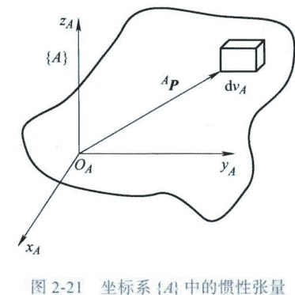
```
${}^A\mathbf{I} = \begin{bmatrix} I_{xx} & -I_{xy} & -I_{xz} \\ -I_{xy} & I_{yy} & -I_{yz} \\ -I_{xz} & -I_{yz} & I_{zz} \end{bmatrix}$ (2-98)
```
六个独立元素定义如下（$\rho$ 为密度，$dv$ 微分体积）：
$I_{xx} = \iiint_V (y^2 + z^2)\rho dv$ (2-99)
$I_{yy} = \iiint_V (x^2 + z^2)\rho dv$ (2-100)
$I_{zz} = \iiint_V (x^2 + y^2)\rho dv$ (2-101)
$I_{xy} = \iiint_V xy\rho dv$ (2-102)
$I_{xz} = \iiint_V xz\rho dv$ (2-103)
$I_{yz} = \iiint_V yz\rho dv$ (2-104)
对角项 $I_{xx}, I_{yy}, I_{zz}$ 称**惯量矩**；非对角项称**惯量积**。主轴坐标系下惯量积为零，对应的惯量矩为**主惯量矩**。

#### 3. 递推求解动力学方程
视连杆为刚体，已知质心位置与惯性张量。牛顿-欧拉方程联立力/力矩与惯量/加速度：
*   **牛顿第二定律**（质心力 $F$ 与线加速度）：
```
F = m\dot{v}_c
```
*   **欧拉方程**（质心力矩 $N$ 与角运动）：
```
$N = {}^I\boldsymbol{I}\dot{\omega} + \omega \times {}^I\boldsymbol{I}\omega$
```
（注：${}^I\boldsymbol{I}$ 为质心系 {C} 下惯性张量）

**两步递推流程**：
**Step 1：向外递推（运动学→动力学）**  
已知 $q$，从基座向末端递推各连杆 $\dot{q}, \ddot{q}$，代入牛顿-欧拉方程得各连杆质心受力/力矩。6 转动关节的具体递推公式为：
```
{}^{i+1}\omega_{i+1} = {}_i^{i+1}R {}^i\omega_i + \dot{\theta}_{i+1} {}^{i+1}Z_{i+1} \qquad (2-107)

{}^{i+1}\dot{\omega}_{i+1} = {}_i^{i+1}R {}^i\dot{\omega}_i + {}_i^{i+1}R {}^i\omega_i \times \dot{\theta}_{i+1} {}^{i+1}\hat{Z}_{i+1} + \ddot{\theta}_{i+1} {}^{i+1}\hat{Z}_{i+1} \qquad (2-108)

{}^{i+1}v_{i+1} = {}_i^{i+1}R \left[ {}^i\omega_i \times {}^iP_{i+1} + {}^i\omega_i \times ( {}^i\omega_i \times {}^iP_{i+1} ) + {}^i\dot{v}_i \right] \qquad (2-109)

{}^{i+1}v_{c_{i+1}} = {}_i^{i+1}R \left[ {}^{i+1}\dot{\omega}_{i+1} \times {}^iP_{c_{i+1}} + {}^{i+1}\omega_{i+1} \times ( {}^{i+1}\omega_{i+1} \times {}^{i+1}P_{c_{i+1}} ) \right] + {}^{i+1}\dot{v}_{i+1} \qquad (2-110)

{}^{i+1}F_{i+1} = m_{i+1} {}^{i+1}\dot{v}_{c_{i+1}} \qquad (2-111)

{}^{i+1}N_{i+1} = {}^{c_{i+1}}I_{i+1} {}^{i+1}\dot{\omega}_{i+1} + {}^{i+1}\omega_{i+1} \times {}^{c_{i+1}}I_{i+1} {}^{i+1}\omega_{i+1} \qquad (2-112)
```
($i=0,1,2,3,4,5$，可解出全部连杆受力/力矩)

**Step 2：向内递推（力矩回传）**  
关节驱动力矩实为作用在连杆上的力/力矩投影。从末端向基座反向递推：
```
{}^i f_i = {}_i^{i+1}R {}^{i+1}f_{i+1} + {}^i F_i \qquad (2-113)

{}^i n_i = {}^i N_i + {}_i^{i+1}R {}^{i+1}n_{i+1} + {}^i P_{c_i} \times {}^i F_i + {}^i P_{i+1} \times {}_i^{i+1}R {}^{i+1} f_{i+1} \qquad (2-114)
```
```
\(\tau_i = {}^i\boldsymbol{n}_i^\mathrm{T}\hat{\boldsymbol{Z}_i}\) \hfill (2-115)
```
($i=6,5,4,3,2,1$，式 (2-113)~(2-115) 即为最终动力学方程)

**重力补偿技巧**：  
递推计算力时用到质量与加速度。令线加速度初始值设为 $g$（大小等于重力加速度、方向向上），等效于引入重力场，无需额外项即可融入重力影响。
初始角速度、角加速度、线加速度设定为：
```
\(^0\boldsymbol{\omega}_0 = \begin{bmatrix} 0 \\ 0 \\ 0 \\ 0 \end{bmatrix}, \quad ^0\dot{\boldsymbol{\omega}}_0 = \begin{bmatrix} 0 \\ 0 \\ 0 \\ 0 \end{bmatrix}, \quad ^0\dot{\boldsymbol{v}}_0 = \begin{bmatrix} -g \\ 0 \\ 0 \end{bmatrix}\) \hfill (2-116)
```

---

### 2.3.3 拉格朗日法：基于能量的建模路径

#### 1. 状态空间方程形式
通过归纳简化，动力学方程可写成紧凑的状态空间形式。忽略摩擦时，其标准结构为：

```
\(\tau = \boldsymbol{M}(q)\ddot{\boldsymbol{q}}+\boldsymbol{V}(q,\dot{q})+\boldsymbol{G}(q)\) \hfill (2-117)
```

公式 (2-117) 专门适配前文反复剖析的六轴（全为转动副）机械臂。其中 $\boldsymbol{M}(q)$ 代表机械臂的 $6\times 6$ 惯性矩阵，呈角对称结构；矩阵内非零元素的数值随关节角 $q$（即 $\theta_1 \sim \theta_6$）变化而变化，直观反映作用在机械臂上的惯性力大小。$\boldsymbol{V}(q,\dot{q})$ 为 $6\times 1$ 离心力与科里奥利力矩阵，其非零元素由关节角 $q$ 与关节角速度 $\dot{q}$ 共同决定。$\boldsymbol{G}(q)$ 则是 $6\times 1$ 重力矩阵，汇总各连杆重力效应，非零元素仅与关节角 $q$ 相关。上述分析均基于“理想工况”，即暂不考虑关节摩擦等非理想因素。

鉴于离心力与科氏力矩阵 $\boldsymbol{V}(q,\dot{q})$ 同时依赖连杆位置与速度状态，该方程常被称为“状态空间方程”。

- **2. 基于拉格朗日法的动力学递推**

牛顿-欧拉法借助牛顿定律与欧拉方程求解连杆受力进而得出动力学方程；拉格朗日法则转换视角，从能量层面切入。二者针对同一机器人推导出的动力学方程在数学本质上完全等价。

推演伊始，先对动能建模。第 $i$ 根连杆的动能表达为：

$$k_i = \frac{1}{2} m_i {}^0v_{C_i}^T {}^0v_{C_i} + \frac{1}{2} {}^i\omega_i {}^C I_i {}^i\omega_i$$

等号右侧两项分别对应连杆质心处线速度与角速度贡献的动能。全机械臂总动能为各连杆动能之和：$k = \sum_{i=1}^n k_i$。

动能可与惯性矩阵 $\boldsymbol{M}(q)$ 建立显式联系。以六关节机器人为例，六连杆总动能可写成：

$$k(q, \dot{q}) = \frac{1}{2} \dot{q}^T \boldsymbol{M}(q) \dot{q}$$

力学常识告诉我们物体总动能恒为正值，故惯性矩阵 $\boldsymbol{M}(q)$ 必为正定矩阵。

接下来分析势能。第 $i$ 连杆势能记为：

$$u_i = -m_i {}^0g {}^0P_{C_i} + u_{\text{ref}_i}$$

式中 ${}^0g$ 为 $3\times1$ 重力加速度矢量，${}^0P_{C_i}$ 为第 $i$ 连杆质心位置矢量；引入常数 $u_{\text{ref}_i}$ 使势能最小值归零。全机械臂势能 $u = \sum_{i=1}^n u_i$。由于 ${}^0P_{C_i}$ 随关节角变化，整体势能可视为关节位置的标量函数 $u(q)$。

获得动能与势能后，构造拉格朗日函数：

$$L(q, \dot{q}) = k(q, \dot{q}) - u(q)$$

由拉格朗日方程导出驱动力矩：

$$\frac{d}{dt} \frac{\partial L}{\partial \dot{q}} - \frac{\partial L}{\partial q} = \tau$$

针对机械臂亦可展开为：

$$\frac{d}{dt} \frac{\partial k}{\partial \dot{q}} - \frac{\partial k}{\partial q} + \frac{\partial u}{\partial q} = \tau$$

综上，通过计算动能、势能并代入拉格朗日函数整理，即可得到机器人动力学方程——这就是拉格朗日法的推导全貌。

### 思考题与习题

- 1. 证实旋转不改变两点间距离：$\|p_1 - p_2\| = \|Rp_1 - Rp_2\|$，$p_1,p_2$ 为点坐标，$R$ 为旋转矩阵。
- 2. 若 $R^T R = I$，证 $R$ 的列向量单位正交。
- 3. 同前提下证：
  - 1) $\det R = \pm 1$；
  - 2) 右手系下 $\det R = 1$。
- 4. 验证式 (2-4) ∼ (2-6)。
- 5. 推导式 (2-7) 与 (2-8)。
- 6. 写出下列旋转序列对应的最终旋转矩阵乘积形式（无需展开计算）：
  - 1) 绕世界 $x$ 轴转 $\phi$；
  - 2) 绕当前 $z$ 轴转 $\theta$；
  - 3) 绕世界 $y$ 轴转 $\psi$。
- 7. 类似题 6，序列为：
  - 1) 世界 $x$ 轴 $\phi$；
  - 2) 当前 $z$ 轴 $\theta$；
  - 3) 当前 $x$ 轴 $\psi$；
  - 4) 世界 $z$ 轴 $\alpha$。
- 8. 坐标系 $\{1\}$ 由 $\{0\}$ 经：绕 $x$ 轴 $\pi/2$ → 绕固定 $y$ 轴 $\pi/2$ 得到。求叠加旋转矩阵 $R$ 并绘制初末坐标系。
- 9. 已知 $^2_1 R$ 与 $^1_3 R$（矩阵见原文），计算 $^3_2 R$。
- 10. 验证式 (2-61)。
- 11. 计算以下操作对应的齐次变换：$x$ 轴平移 3 → 绕当前 $z$ 轴 $\pi/2$ → 绕固定 $y$ 轴平移 1。绘制坐标系并求原点 $O_1$ 在初始系下坐标。
- 12. 图 2-22 为平面三连杆（RRR/3R）机械臂，请建立连杆坐标系并给出 D-H 参数。

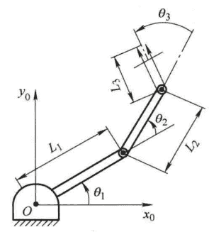

- 13. 依据表 2-1 所列平面三连杆 D-H 参数（见下表），推导 RRR 机构运动学方程。

| 连杆 | $\alpha_{i-1}$ | $a_{i-1}$ | $d_i$ | $\theta_i$ |
|---|---|---|---|---|
| 1 | 0 | 0 | 0 | $\theta_1$ |
| 2 | 0 | $L_1$ | 0 | $\theta_2$ |
| 3 | 0 | $L_2$ | 0 | $\theta_3$ |

- 14. 平面三连杆正运动学如图 2-23 及矩阵所示，请求其雅可比矩阵。

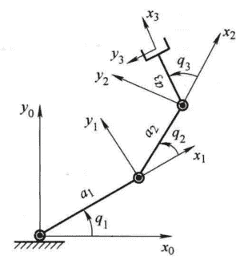

- 15. 简述机器人动力学建模的核心概念与主流方法。

## 第 3 章 人形机器人行走控制基础

### 导读

行走是人形机器人最基础也最关键的技能。本章首先剖析稳定性判据（ZMP 为核心），继而介绍典型倒立摆模型与 ZMP 步态规划，最后覆盖混合零动力学、模型预测控制（MPC）及全身控制等主流走控算法。

### 本章知识点

- ZMP 稳定性分析
- ZMP 步态规划
- 模型预测控制

### 3.1 概述

稳定行走是人形机器人研究的核心痛点。因足地接触面积小、重心高，保持平衡极具挑战。如何在兼顾能效与速度的前提下实现鲁棒行走，始终是领域内的核心追求。建立有效的稳定性判据正是破题之钥。零力矩点（ZMP）判据应用最广：ZMP 定义为地面上一点，机器人惯性力与重力关于该点的水平力矩分量为零。若 ZMP 落在支撑脚与地面接触形成的凸多边形支撑区内，运动稳定；反之则失稳。平衡时 ZMP 与压力中心（CoP）等价。注意：ZMP 判据仅适用于平足全驱动人形机器人，点足/圆足因接触面极小不再适用。

步态规划是任务执行的基石。基于 ZMP 的轨迹设计主流分两类：一类预设 ZMP 轨迹，按简化模型反解质心轨迹，结合足地约束得足端轨迹，再经逆运动学解出关节轨迹；另一类不预设 ZMP，而是生成候选关节轨迹，正解对应 ZMP 并挑选稳定性裕度最大者作为最终轨迹。除 ZMP 体系外，基于落脚点/捕获性的规划也常用：先按运动状态算期望落脚点，再反向规划关节轨迹。

真实环境中难免存在模型失配与未知扰动（外力、地面变化、伺服误差等）。若盲目执行离线轨迹而不实时修正，极易倾覆。因此必须融合当前状态与环境信息，在线调整轨迹或驱动力矩，保证稳定完成目标——这便是人形机器人运动控制的核心价值。

### 3.2 稳定性分析

人形机器人单双脚交替支撑、重心高，规控不当极易跌倒。稳定性是行走的前提，稳定性判别则是运动研究的重要课题。

此处“稳定性”指：运动过程中不跌倒，受扰动后能回归原态。扰动源涵盖内部（驱动误差、结构微变）与外部（崎岖地面、物体接触）。理想机器人应在扰动下保持平衡并逐渐恢复步态，但受限于机械结构与控制算法，抗扰能力有上限；扰动过大仍会导致跌倒。稳定性判据既是衡量指标，也是步态规划与控制设计的准则，地位至关重要。

#### 3.2.1 ZMP 稳定性判据

##### 1. ZMP 定义

零力矩点（ZMP）为理论构造点：机器人足底垂直接触力产生的力矩，与所有地面相关外力、外力矩之和在此点为零。该点通常落在足底投影区内。ZMP 位置直观反映质量分布与运动状态的平衡程度，是稳定性评价的核心指标。

##### 2. ZMP 数学表达与计算

ZMP 位置可通过动力学方程与运动学参数求得。基础公式为：

```
P_{ZMP} = \frac{\sum(z_i \times F_{xi}) - \sum(x_i \times F_{zi})}{\sum F_{zi}}
```

式中 $P_{ZMP}$ 为 ZMP 坐标，$x_i,z_i$ 为接触点水平/竖直坐标，$F_{xi},F_{zi}$ 为对应方向力。

将人形机器人视作 $n$ 刚体链。设 $O$ 为定参考系原点，$C_i$ 为第 $i$ 刚体质心，$G_i,F_i$ 分别为重力与等效惯性力，$H_i$ 为动量矩。地面反力等效为作用于 ZMP 处的合力 $R$ 与力矩 $M$。图 3-1 给出示意。由 ZMP 定义，$M$ 水平分量为零。引入达朗贝尔原理，在参考系下列受力平衡与对 ZMP 力矩平衡方程：

```
R + \sum_{i=1}^n G_i + \sum_{i=1}^n F_i = 0
```

```
OZ \times R + \sum_{i=1}^n OC_i \times (G_i + F_i) + M + \sum_{i=1}^n \dot{H}_i = 0
```

```
OC_i = OZ + ZC_i
```

代入整理得：

```
\sum_{i=1}^n ZC_i \times (G_i + F_i) + M + \sum_{i=1}^n \dot{H}_i = 0
```

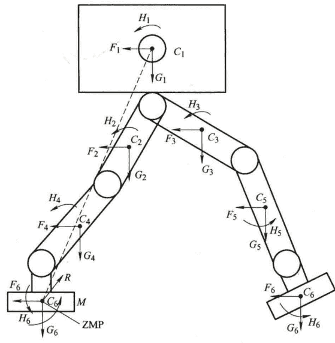

图 3-1 人形机器人 ZMP 示意图

考虑 $M$ 水平分量为零，式 (3-5) 水平分量表达为：

```
\(\left[ \sum_{i=1}^n Z C_i \times (G_i + F_i) + \sum_{i=1}^n \dot{H}_i \right]_h = 0\)
```

下标 $h$ 标识水平分量。坐标系 $\{r\}$ 定义：$x$ 右、$y$ 前、$z$ 上。式 (3-6) 给出 ZMP 数学表达及水平地面坐标计算公式。进一步变形得标量计算形式：

```
\(x_{\text{ZMP}} = \frac{\sum_{i}^n m_i (\ddot{z}_i + g)x_i - \sum_{i}^n m_i \ddot{x}_i z_i - \sum_i I_{iy} \dot{\Omega}_{iy}}{\sum_{i}^n m_i (\ddot{z}_i + g)}\)
```

```
\(y_{\text{ZMP}} = \frac{\sum_{i}^n m_i (\ddot{z}_i + g)y_i - \sum_{i}^n m_i \ddot{y}_i z_i - \sum_i I_{ix} \dot{\Omega}_{ix}}{\sum_{i}^n m_i (\ddot{z}_i + g)}\)
```

式中，$m_i$ 为第 $i$ 部分质量，$g$ 重力加速度，$I_{lx},I_{ly}$ 为绕 $x,y$ 轴转动惯量，$\ddot{\Omega}_{ix},\ddot{\Omega}_{iy}$ 为质心绕 $x,y$ 轴绝对角位移，$(x_i,y_i,z_i)$ 为质心固定系坐标，$(x_{\text{zmp}},y_{\text{zmp}})$ 为 ZMP 固定系坐标。

具备以下条件即可求解 ZMP 位置：

- 1) 足部力/力矩传感器能检测支撑反力大小、方向与作用点。

### 3.2.1 零力矩点判据：应用实务与边界条件

#### 三大工况求解零力矩点
依据已知信息差异，零力矩点（ZMP）定位主要分三类场景：
1.  **外部载荷明确**：掌握作用于本体的外力及其施力点，直接推导竖直合力作用点坐标。
2.  **全身惯性参数已知**：明确各连杆转动惯量、线加速度与角加速度（前提为本体处于动态平衡态），代入公式 (3-7) 求解。
3.  **踝部集成六维力矩传感器**：直接读取地面反作用力数据，反演竖直向等效作用点，精准锁定位置。

#### 稳定域量化：裕度与有效核心区
**支撑凸包区域**由支撑脚与地面接触形成。**稳定余量**量化行走稳健程度的核心指标——即零力矩点至凸包边界的最短距离（见图 3-2）。

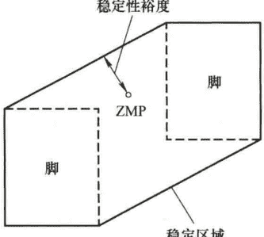

> **核心逻辑**：零力矩点越贴近区域几何中心，余量越大，抗扰动能力越强。极限工况下，零力矩点落于边界（仅靠脚尖/脚跟支撑），微小扰动即致倾覆。

但盲目追求“零力矩点居中”弊端显著：步长受限、动作幅度压缩、能耗激增。故引入**有效稳定核心区**——凸包内部的“安全子域”。定义严谨：区内任意零力矩点的余量，均能覆盖外界扰动引致的位移量。

数学描述见式 (3-9)：
$\Omega = \{(x_{zmp}, y_{zmp}) | d_s(x_{zmp}) \geqslant d_v(x_{zmp}), d_s(y_{zmp}) \geqslant d_v(y_{zmp})\}$

其中 $d_s$ 为 x/y 方向稳定余量，$d_v$ 为扰动导致的位移量（见图 3-3）。

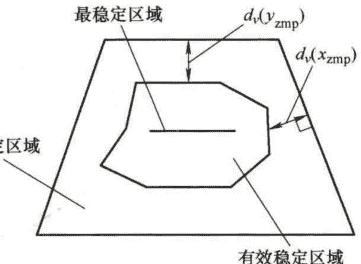

**扰动位移量计算**：已知各部分受扰力 $T_i$、位置矢量 $S_i$、扰动力矩 $N_i$，代入式 (3-10)、(3-11) 即得 x/y 方向 $d_v$。

**实战三色预警机制**：
- 🟢 **安全区（有效核心区内）**：抗扰动免疫，无需调姿态，持续稳行。
- 🟡 **过渡区（凸包内但核心区外）**：无扰动时稳，遇扰动即失稳，需主动调姿态拉回安全区。
- 🔴 **危险区（凸包外）**：随时倾覆，必须紧急干预，强行将零力矩点拽回凸包甚至核心区。

#### 关键辨析：易混淆概念与适用边界
**辨析一：零力矩点会越出支撑凸包？**
**不会。** 零力矩点定义建立在“动态平衡（足底不相对旋转）”基础上。一旦算出位置在外，实为足掌已翘起准备绕边旋转，实际作用点卡在边缘，**零力矩点概念已失效**。工程上坐标计算完毕须与凸包比对，超界即判定为“即将绕边失稳”。

**辨析二：零力矩点等同压力中心？**
**平衡态重合；失稳态分道扬镳。** 失稳时零力矩点消失，压力中心滞留边缘。结论：零力矩点可表征动态平衡，压力中心不能。

**辨析三：判据适用性边界——三类场景直击失效：**
1.  **点足/微小接触面**：判据针对“防翻”，接触面过小无法构成防翻支撑，判据失效。
2.  **允许足底旋转的欠驱动步态**：足掌主动抬起行进，判据前提“不相对旋转”不满足。
3.  **需防滑移/平动工况**：判据仅管“防旋转”，不管“防平移”。摩擦力不足需另寻他法。
*补充：非平地、肢体与环境交互时，判据同样不适用。*

---

### 3.2.2 备选稳定性度量：李雅普诺夫法与落脚点估计

#### 李雅普诺夫判据：构造能量函数验证平衡
植根于控制理论体系，专治复杂系统平衡分析。核心范式：**构造“广义能量函数”（李雅普诺夫函数）**，满足两大铁律：
- **正定特性**：除平衡点外，局部区域内处处大于零（似势能井）。
- **能量耗散律**：随时间导数 $\le 0$（系统不产生能量，仅耗散）。

**实施三步走**：
1.  建立系统状态方程（动力学模型）。
2.  结合物理特性设计能量函数（考验功力）。
3.  求导证非正（数学收尾）。

#### 落脚点估计器（FPE）：着地位置的前瞻判断
Wight 团队提出。**核心前提**：摆动腿触地前后，系统角动量守恒。**核心逻辑**：寻找着陆点，使碰撞后机械能等于最大势能（质心最高点动能为零，实现静止站立）。

基于简化模型（质心集中髋部、腿等效为无质量刚杆、足视为质点），推导流程见下：

$$mL(v_x \cos \varphi + v_y \sin \varphi) + I\dot{\theta}_1 = (mL^2 + I)\dot{\theta}_2$$
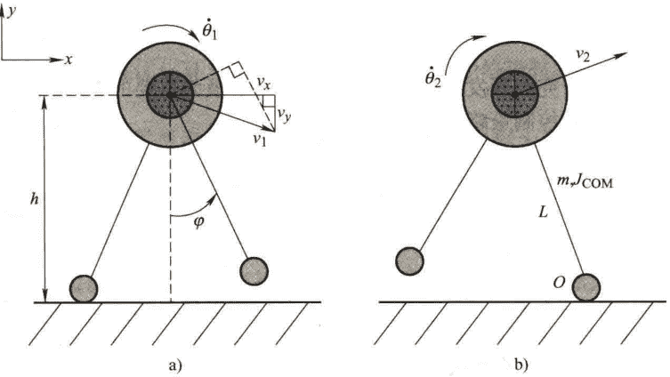

图 3-4 简化双足行走模型

$$\dot{\theta}_2 = \frac{mh(v_x \cos \varphi + v_y \sin \varphi)\cos \varphi + I\dot{\theta}_1 \cos^2 \varphi}{mh^2 + I \cos^2 \varphi}$$
$$\frac{1}{2}(mL^2 + I)\dot{\theta}_2^2 + mgL \cos \varphi = mgL$$
$$\frac{\left[mg(v_x \cos \varphi + v_y \sin \varphi)\cos \varphi + I\dot{\theta}_1 \cos^2 \varphi\right]^2}{mh^2 + I \cos^2 \varphi} + 2mgh \cos \varphi(\cos \varphi - 1) = 0$$

根据几何关系，得摆动腿落地点相对质心水平位置：

$$\mathrm{FPE}(\varphi) = h \tan \varphi$$

**判读准则**：
- 实际落点位于 FPE **前方** → 无需主动减速，单步内达成静止站立，稳。
- 实际落点位于 FPE **后方** → 需多步缓冲才能停稳，风险较大。

**前提苛刻**：角动量守恒、腿长/惯量/机械能全程不变。

**演进形式——捕获点**：Koolen 等人引入生存理论，对 FPE 做“捕获性”扩展，给出双足系统“能否最终站稳”更完备、更实用的判定框架。

---

### 3.3 步态规划：从倒立摆到前瞻控制

#### 3.3.1 倒立摆模型：行走平衡的“最小物理原型”
单质点 + 无质量杆 + 可动底座。抽象机器人“单腿支撑+躯干摆动”的本质动力学。
**数学本质**（式 3-17）：

$$ml^2\ddot{\theta} = mgl \sin\theta + u$$

式中，$m$ 为质量，$l$ 为杆长，$\theta$ 为偏离竖直角度，$g$ 为重力加速度，$u$ 为控制力矩输入。

#### 3.3.2 ZMP 步态规划：轨迹设计的“总纲”

**核心逻辑链**：期望步长/周期 $\rightarrow$ 期望零力矩点轨迹 $\rightarrow$ 质心运动轨迹 $\rightarrow$ 全身关节轨迹。
**核心工具：前瞻控制**。上世纪 60 年代控制技术，离散化后成步态规划标配。核心思想：**依据未来零力矩点参考轨迹，反算当前质心运动，使实测零力矩点紧跟期望、永不越界。**

##### 零力矩点轨迹生成：两大抓手
1.  **基准曲线设计**：绘制平滑曲线，贴合支撑脚几何中心演变。
2.  **曲线优化迭代**：引入算法打磨轨迹，降峰值力矩/力需求，提能效。

##### 三维线性倒立摆模型（3D-LIPM）：前瞻控制的数学基座
模型假设：质心锁定在高度 $z_c$ 的水平面内运动（$z=z_c$ 恒定）。
**动力学方程**见 $$\ddot{y} = \frac{g}{z_c}y - \frac{1}{mz_c}\tau_x$$, $$\ddot{x} = \frac{g}{z_c}x + \frac{1}{mz_c}\tau_y$$。
**零力矩点坐标定义**见 $$p_x = \frac{\tau_y}{mg}$$, $$p_y = \frac{\tau_x}{mg}$$。
**消去力矩耦合**，得核心映射关系 $$\ddot{y} = \frac{g}{z_c}(y - p_y)$$, $$\ddot{x} = \frac{g}{z_c}(x - p_x)$$，整理为 $$p_x = x - \frac{z_c}{g}\ddot{x}$$, $$p_y = y - \frac{z_c}{g}\ddot{y}$$。

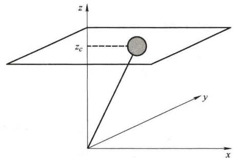

图 3-5 三维空间倒立摆模型

> **物理意味**：式 (3-24)、(3-25) 直白揭示——**给定质心轨迹，零力矩点形态即定；反推期望零力矩点形态，质心运动即定。**

##### 质心轨迹反算：构造标准控制形式
定义水平加速度导数（Jerk）为控制输入 $u_x, u_y$（见 $$u_x = \frac{d}{dt} \ddot{x} \quad (3-26)$$, $$u_y = \frac{d}{dt} \ddot{y} \quad (3-27)$$）。
将映射方程改写为标准状态空间表达（见 $$\frac{d}{dt} \begin{bmatrix} x \\ \dot{x} \\ \ddot{x} \end{bmatrix} = \begin{bmatrix} 0 & 1 & 0 \\ 0 & 0 & 1 \\ 0 & 0 & 0 \end{bmatrix} \begin{bmatrix} x \\ \dot{x} \\ \ddot{x} \end{bmatrix} + \begin{bmatrix} 0 \\ 0 \\ 1 \end{bmatrix} u_x \quad (3-28)$$），直接送入前瞻控制器/模型预测控制（MPC）求解器，**实时生成稳健的质心/关节轨迹**。

$$\frac{d}{dt} \begin{bmatrix} y \\ \dot{y} \\ \ddot{y} \end{bmatrix} = \begin{bmatrix} 0 & 1 & 0 \\ 0 & 0 & 1 \\ 0 & 0 & 0 \end{bmatrix} \begin{bmatrix} y \\ \dot{y} \\ \ddot{y} \end{bmatrix} + \begin{bmatrix} 0 \\ 0 \\ 1 \end{bmatrix} u_y \quad (3-29)$$

$$p_x = \begin{bmatrix} 1 & 0 & -\frac{z_c}{g} \end{bmatrix} \begin{bmatrix} x \\ \dot{x} \\ \ddot{x} \end{bmatrix} \quad (3-30)$$

$$p_y = \begin{bmatrix} 1 & 0 & -\frac{z_c}{g} \end{bmatrix} \begin{bmatrix} y \\ \dot{y} \\ \ddot{y} \end{bmatrix} \quad (3-31)$$

方程组（3-28）至（3-31）定义的动态模型，输入为质心加加速度（即加速度导数），输出为零力矩点（ZMP）坐标，这构成了用于跟踪参考 ZMP 轨迹的步态生成器核心。值得注意的是，在人形机器人行走切换支撑腿的瞬间，ZMP 位置往往会发生剧烈跳变。然而，质心位置的调整不能滞后于这一突变，而必须提前启动平滑过渡。换言之，生成质心轨迹时，必须纳入对未来 ZMP 走向的前瞻预判。这种依据未来 ZMP 变化趋势反推当前质心运动的策略，正是预观控制轨迹生成的精髓所在，如图 3-6 所示。

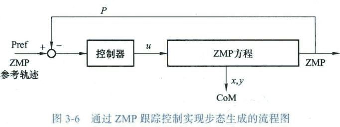

对方程（3-28）与（3-30）实施离散化处理，设采样周期为 T，可得 x 向离散系统方程：

\( x(k+1) = Ax(k) + Bu_x(k) \quad \text{(3-32)} \)

\( p_x(k+1) = Cp_x(k) \quad \text{(3-33)} \)

其中状态向量 \( x(k) = \begin{bmatrix} x(kT) \\ \dot{x}(kT) \\ \ddot{x}(kT) \end{bmatrix} \)，控制输入 \( u_x(k) = u_x(kT) \)，输出 \( p_x(k) = p_x(kT) \)；\( k \) 为正整数索引。

系统矩阵定义为：
\( A = \begin{bmatrix} 1 & T & T^2/2 \\ 0 & 1 & T \\ 0 & 0 & 1 \end{bmatrix} \)；
\( B = \begin{bmatrix} T^3/6 \\ T^2/2 \\ T \end{bmatrix} \)；\( C = \begin{bmatrix} 1 & 0 & -\frac{z_c}{g} \end{bmatrix} \)。

y 轴遵循同构形式。

依据预观控制理论，构建评价跟踪性能的指标函数：

\( J = \sum_{i=k}^{\infty} [Q_e e(i)^2 + \Delta x^T(i) Q_x \Delta x(i) + R \Delta u_x^2(i)] \quad \text{(3-34)} \)

式中，\( e(i) = p_x(i) - p_x^{ref}(i) \) 表示 ZMP 跟踪偏差，\( p_x^{ref}(i) \) 为第 \( i \) 时刻期望 ZMP 的 x 坐标；
\( \Delta x(i) = x(i) - x(i-1) \) 为状态增量；\( \Delta u_x(i) = u_x(i) - u_x(i-1) \) 为输入增量；
\( Q_e \)、\( R \) 为正权重系数，\( Q_x \) 为 3×3 半正定矩阵。

假设每个采样瞬间均可前瞻 \( N_L \) 步的 ZMP 参考轨迹，则使指标 \( J \) 极小化的最优控制律表达为：

$$u_x(k) = -G_i \sum_{i=0}^k e(k) - G_x x(k) - \sum_{j=1}^{N_k} G_p(j) p_x^{ref} (k + j) \quad (3-35)$$

其中增益矩阵 \( G_i, G_x, G_p \) 由权重 \( \boldsymbol{Q}_e, \boldsymbol{Q}_x, \boldsymbol{R} \) 及离散系统矩阵（3-32）、（3-33）联合求解得出。

采用预观控制规划步态，工程落地流程如下：

1.  **设定基准**：依据期望步长、周期，确定目标 ZMP 轨迹；
2.  **定义权重**：明确评价函数 \( J \) 中各项权重系数；
3.  **配置前瞻**：设定可预观的 ZMP 参考时长，并以此解算最优控制器增益；
4.  **滚动优化**：代入控制律计算质心加加速度，积分更新质心轨迹；结合踝关节轨迹反解全身关节运动，进而更新 ZMP，循环迭代直至收敛。HRP-2 机器人即采用此法，成功生成平滑质心轨迹，实现对期望 ZMP 的高精度跟踪。

#### 3.3.3 步态规划的多元路径

除零力矩点（ZMP）主流范式外，人形机器人步态规划尚存多元技术路线，各具优势、适配不同场景。

##### 1. 基于稳定性裕度的规划策略

该流派与“先定 ZMP 再反解关节”截然不同，其核心逻辑是：**优先依据地面环境（起伏、障碍物）规划足端轨迹，再在参数可行域内搜索稳定性裕度最大的躯干轨迹作为终解。**

具体实施上，方法利用机器人上体位移、步长、步速等信息，借助三次样条插值生成全身关节运动；由关节运动正解得各连杆（躯干、大腿、小腿等）速度、加速度，进而求出 ZMP 轨迹；最后依 ZMP 稳定判据验证稳定性。通过参数扫描对比不同候选轨迹的稳定性裕度，择优选出最终运动轨迹。

模型建模与坐标约定参考图 3-7：机器人右侧为 \(x\) 轴正向，前进向为 \(y\) 轴正向，\(z\) 轴竖直向上。

足端轨迹用向量 \( \boldsymbol{X}_a=[x_a, y_a, z_a, \theta_a]^{\mathrm{T}} \) 描述（含踝关节位姿与脚面倾角）；髋关节/躯干轨迹用 \( \boldsymbol{X}_h=[x_h, y_h, z_h, \theta_h]^{\mathrm{T}} \) 表示（含位置与躯干倾角）。规划遵循“先脚后身”原则：先确定双足尤其是踝关节轨迹以适应地面，再规划髋关节运动。踝、髋关节运动示意见图 3-8。

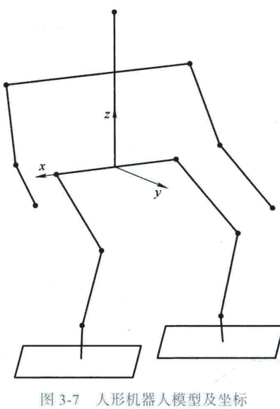

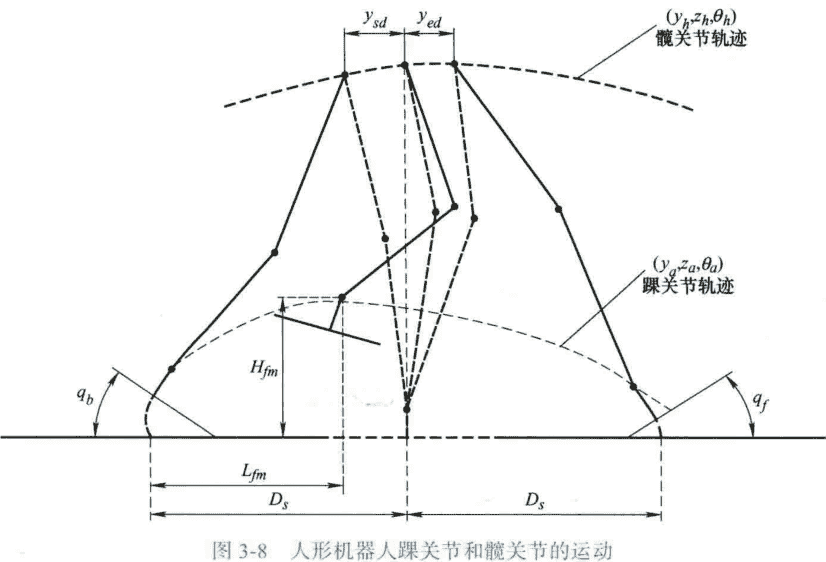

##### （1）三次样条插值原理

规划关节轨迹时，仅给定关键时刻（如步周期首尾）状态，需插值得全程曲线。为保证位置、速度连续，高次多项式插值不仅阶数高、算力大，且易产生龙格现象。三次样条插值凭借“分段低次、全局光滑”特性成为最优选择。

数学定义上，区间 \( [a,b] \) 上节点 \( a = t_0 < t_1 < \dots < t_n = b \) 处的三次样条函数 \( S(t) \) 需满足：
1.  全局拥有连续一、二阶导数；
2.  各子区间 \( [t_j, t_{j+1}] \) 上为三次及以下多项式；
3.  过给定节点函数值 \( f_j = f(t_j) \)；

$$S(t_j) = f_j (j=0, 1, \cdots, n) \quad (3-36)$$

为满足步态周期连贯性，\( S(t) \) 还需额外约束：

$$\left\{ \begin{array}{l} S_{j-1}(t_j) = S_j(t_j) \\ S'_{j-1}(t_j) = S'_j(t_j) \\ S''_{j-1}(t_j) = S''_j(t_j) \end{array} \right. \quad (3-37)$$

因每段为三次多项式 \( S_j(t) = a_j + b_j(t-t_j) + c_j(t-t_j)^2 + d_j(t-t_j)^3 \) ，共 \( 4n \) 个待定系数。上述条件提供 \( 4n-2 \) 个方程，需补两个边界条件始得唯一解。常见三类边界条件：

$$S(t) = S_j(t) = a_j + b_j t + c_j t^2 + d_j t^3, t \in [t_j, t_{j+1}] (j=0, 1, \cdots, n-1) \quad (3-38)$$

*   **一类（夹持边界）**：指定端点一阶导数 \( \dot{S}(t_0), \dot{S}(t_n) \)；
    $$\dot{S}(t_0) = \dot{f}_0, \dot{S}(t_n) = \dot{f}_n \quad (3-39)$$
*   **二类（自然/指定曲率边界）**：指定端点二阶导数 \( \ddot{S}(t_0), \ddot{S}(t_n) \)；特殊地，二阶导设为零称“自然边界”；
    $$\ddot{S}(t_0) = \ddot{f}_0, \ddot{S}(t_n) = \ddot{f}_n \quad (3-40)$$
*   **三类（周期边界）**：针对周期函数，要求函数值及一、二阶导数在端点周期匹配；
    $$S^{(j)}(t_0) = S^{(j)}(t_n) (j=0, 1, 2, \cdots) \quad (3-41)$$
    对应解称为周期性样条函数。

令步长 \( h_j = t_{j+1} - t_j \)，经推导可得 \( S(t) \) 的矩阵多项式形式：

$$S(t) = \frac{M_j}{6h_j}(t_{j+1}-t)^3 + \frac{M_{j+1}}{6h_j}(t-t_j)^3 + \left(f_j - \frac{M_j h_j^2}{6}\right)\frac{t_{j+1}-t}{6} + \left(f_{j+1} - \frac{M_{j+1} h_j^2}{6}\right)\frac{t-t_j}{6} \quad (3-42)$$

其中二阶导向量 \( \boldsymbol{M} = [M_0, \dots, M_n]^{\mathrm{T}} \) 由三对角线性系统求解：

$$\left\{ \begin{array}{l} 2M_1 + b_1 M_2 = d_1 \\ \frac{h_{j-1}}{6} M_{j-1} + \frac{h_j + h_{j-1}}{3} M_j + \frac{h_j}{6} M_{j+1} = \frac{f_{j+1} - f_j}{h_j} - \frac{f_j - f_{j-1}}{h_{j-1}} \\ (j=1, 2, \cdots, n-1) \\ a_n M_{n-1} + 2M_n = d_n \end{array} \right. \quad (3-43)$$

系数矩阵与常数项构造见：

$$\begin{cases} a_j = \frac{h_{j-1}}{h_j + h_{j-1}} (j=1, 2, \cdots, n-1) \\ b_j = 1 - a_j (j=1, 2, \cdots, n-1) \\ c_j = \frac{f_{j+1} - f_j}{h_j} (j=0, 1, \cdots, n-1) \\ d_j = \frac{6(c_j - c_{j-1})}{h_j + h_{j-1}} (j=1, 2, \cdots, n-1) \end{cases}$$

针对机器人起止静止（速度为零）工况，适用一类边界条件 \( \dot{S}(t_0)=0, \dot{S}(t_n)=0 \)，解析解简化为：

$$\begin{cases} b_1 = a_n = 1 \\ d_1 = \frac{6(f_2 - f_1)}{h_1} \\ d_n = -\frac{6(f_n - f_{n-1})}{h_{n-1}} \end{cases}$$

##### （2）足部轨迹规划实务

足部轨迹直接受地面约束。设步周期 \( T_c \)，第 \( K \) 步对应时段 \( [KT_c, (K+1)T_c] \)。以右脚为例分析（左脚仅相位延迟 \( T_c \)）。单步定义：从左脚跟触地始，至右脚跟再次触地止。双支撑相 \( T_d \) 即从步始至右脚尖离地，见图 3-9。

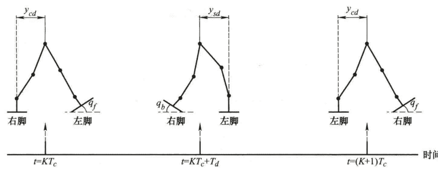

设右脚离地、落地倾角分别为 \( q_b, q_f \)。因 \( t=KT_c \) 与 \( t=(K+1)T_c \) 全掌着地，脚面角约束为：

$$\theta_a(t) = \begin{cases} q_s(K), t = KT_c \\ q_b, t = KT_c + T_d \\ q_f, t = KT_c + T_c \\ q_e(K), t = (K+1)T_c + T_d \end{cases} \quad (3-46)$$

进而得到踝关节角约束：

$$y_a(t) = \begin{cases} KD_s, t = KT_c \\ KD_s + l_{af}(1 - \cos q_b) + l_{an} \sin q_b, t = KT_c + T_d \\ KD_s + L_{fm}, t = KT_c + T_m \\ (K+2)D_s - l_{ab}(1 - \cos q_f) - l_{an} \sin q_f, t = KT_c + T_c \\ (K+2)D_s, t = (K+1)T_c + T_d \end{cases} \quad (3-47)$$

$$z_a(t) = \begin{cases} h_{gs}(K) + l_{an}, t = KT_c \\ h_{gs}(K) + l_{an} \cos q_b + l_{aj} \sin q_b, t = KT_c + T_d \\ H_{fm}, t = KT_c + T_m \\ h_{gc}(K) + l_{an} \cos q_f + l_{ab} \sin q_f, t = KT_c + T_c \\ h_{ge}(K) + l_{an}, t = (K+1)T_c + T_d \end{cases} \quad (3-48)$$

式中 \( KT_c + T_m \) 为摆动脚最高点时刻；\( q_s(K), q_e(K) \) 为支撑脚面倾角（平地上为零）；\( (L_{fm}, H_{fm}) \) 为摆动脚最高点坐标；\( D_s \) 步长；\( l_{an}, l_{af}, l_{ab} \) 分别为踝高、踝至脚尖/脚跟距离；\( h_{gs}, h_{ge} \) 为步首尾地面高度（平地为零）。

结合 \( t = KT_c \) 及 \( t = (K+1)T_c + T_d \) 全掌着地条件，得位置约束：

$$\begin{cases} \dot{\theta}_a(KT_c) = 0 \\ \dot{\theta}_a((K+1)T_c + T_d) = 0 \end{cases} \quad (3-49)$$

$$\begin{cases} \dot{y}_a(KT_c) = 0 \\ \dot{y}_a((K+1)T_c + T_d) = 0 \end{cases} \quad (3-50)$$

$$\begin{cases} \dot{z}_a(KT_c) = 0 \\ \dot{z}_a((K+1)T_c + T_d) = 0 \end{cases} \quad (3-51)$$

综合式（3-47）至（3-51）约束，施以三次样条插值，即可解出踝关节 \( y_a(t), z_a(t), \theta_a(t) \) 的三次多项式表达。调节 \( q_b, q_f, q_s, q_e, L_{fm}, D_s \) 等参数，即可生成适应不同地形的足部运动族。

# 应对复杂地形：人形机器人步态生成的核心技术解析

## 跨越障碍物：足部轨迹的智能规划策略

当人形机器人面对台阶、坑洼等非平坦地面时，足部落点的约束条件远比平地复杂。以迈左腿上台阶为例，我们来拆解足部运动轨迹是如何生成的。为简化模型，设定足掌始终与地面保持平行（即 $\theta_a(t) = 0$）。规划核心在于同时满足前后（y向）与垂直（z向）的位置约束，确保不磕碰台阶边沿。

参考图 3-10 所示运动参数，足部位置需遵循以下几何约束：

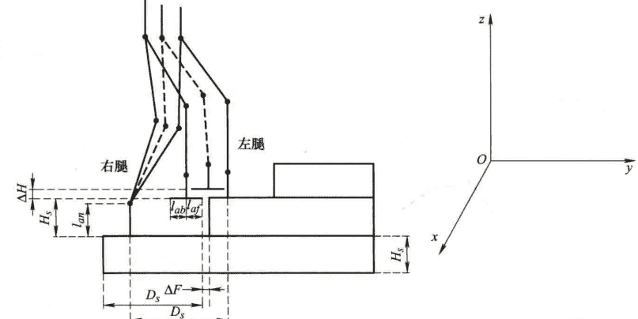

图 3-10 人形机器人上台阶运动参数示意

$$y_a(t) = \left\{\begin{array}{l} KD_s,t = KT_c \\ KD_s+D_s-l_{ab}-l_{af}-\Delta F,t = KT_c+T_s \\ KD_s+D_s-l_{ab},t = KT_c+T_m \\ (K+1)D_s,t = (K+1)T_c \end{array}\right. \quad (3-52)$$

$$\left\{\begin{array}{l} l_{an},t = KT_c \\ l_{an}+H_s,t = KT_c+T_s \\ l_{an}+H_s+\Delta H,t = KT_c+T_m \\ l_{an}+H_s,t = (K+1)T_c \end{array}\right. \quad (3-53)$$

其中，$l_{ab}$、$l_{af}$ 分别代表踝关节至脚后跟、脚尖在 y 向的距离；$l_{an}$ 为足底至踝关节的垂直高度；$H_s$ 与 $D_s$ 分别对应台阶高度与宽度（即步长）。为规避碰撞，当足部逼近台阶沿（$T_s$ 时刻）时，须强制脚尖在 y 向预留安全间距 $\Delta F$，同时足底高度需超出台阶面 $\Delta H$。通过调节 $\Delta F$、$\Delta H$ 等参数，即可生成形态各异的足部轨迹族。

## 腰部轨迹：稳定性与平滑性的平衡艺术

本文定义的“腰部”即双髋关节连线中点。从稳定性考量，可假设躯干俯仰角 $\theta_h(t)$ 恒定，直立时取 $0.5\pi$。垂向位置 $z_h(t)$ 对零力矩点（ZMP）影响微弱，故可设为定值或限定波动范围。设单支撑相髋高为 $H_{hmax}$，双支撑相为 $H_{min}$，则 $z_h(t)$ 约束为：

$$z_h(t) = \begin{cases} H_{min}, t = KT_c + 0.5T_d \\ H_{max}, t = KT_c + 0.5(T_c - T_d) \\ H_{min}, t = (K+1)T_c + 0.5T_d \end{cases} \quad (3-54)$$

同样，利用三次样条插值可获满足上式且二阶导数连续的平滑轨迹。

前进方向（y向）的腰部运动 $y_h(t)$ 是稳定性的关键驱动因子。区别于反推 ZMP 的传统路径，本节采用“生成-筛选”策略：
1.  **批量生成** 一组平滑的 $y_h(t)$ 候选轨迹；
2.  **优中选优**，锁定稳定性裕度最大者作为最终输出。

一个完整行走周期可拆解为：启动加速期、匀速巡航期、制动停止期。聚焦稳定行走期的单步周期，$y_h(t)$ 又分单/双支撑两相。设单支撑起止时刻髋关节相对支撑脚踝的 y 向距离为 $y_{sd}$、$y_{ed}$，则有：

$$y_h(t) = \begin{cases} (K+1)D_s - y_{sd}, t = KT_c + T_d \\ (K+1)D_s + y_{ed}, t = (K+1)T_c \\ (K+2)D_s - y_{ed}, t = (K+1)T_c + T_d \end{cases} \quad (3-55)$$

为保证周期性平滑过渡，还需施加边界约束：

$$\begin{cases} \dot{y}_h(KT_c) = \dot{y}_h((K+1)T_c) \\ \ddot{y}_h(KT_c) = \ddot{y}_h((K+1)T_c) \end{cases} \quad (3-56)$$

经三次样条插值，得满足式（3-55）、式（3-56）的 $y_h(t)$ 解析式：

$$y_h(t) = \begin{cases} KD_s + \frac{D_s - y_{ed} - y_{sd}}{T_d^2 (T_c - T_d)} [(T_d + KT_c - t)^3 - (t - KT_c)^3 - T_d^2 (T_d + KT_c - t) + T_d^2 (t - KT_c)] + \frac{y_{ed}}{T_d} (T_d + KT_c - t) + \frac{D_s - y_{sd}}{T_d} (t - KT_c), t \in (KT_c, KT_c + T_d) \\ KD_s + \frac{D_s - y_{ed} - y_{sd}}{T_d (T_c - T_d)^2} [(t - KT_c - T_d)^3 - (T_c + KT_c - t)^3 - (T_c - T_d)^2 (T_c + KT_c - t) - (T_c - T_d)^2 (t - KT_c - T_d)] + \frac{D_s - y_{sd}}{T_c - T_d} (T_c + KT_c - t) + \frac{D_s + y_{ed}}{T_c - T_d} (t - KT_c - T_d), t \in (KT_c + T_d, (K+1)T_c) \end{cases} \quad (3-57)$$

令 $y_{sd}$、$y_{ed}$ 在可行域内遍历（如式 3-58 所示），依式（3-57）可得一族候选轨迹。最终通过穷举搜索，寻找使 y 向稳定性裕度 $d_{yzmp}$ 极大化的参数组合（式 3-59）。因仅涉及两变量，搜索效率极高。结合启停零速度边界条件（式 3-60），再次插值即得完整轨迹。

侧向（x向）规划逻辑同理，仅以 x 向稳定性裕度为优化目标。得益于 ZMP 在 x、y 向解耦特性，两向轨迹可独立规划、互不干扰，通常先定 y 向、后定 x 向。

综上，基于 ZMP 裕度的步态生成流程链条清晰：
**环境感知 → 足部轨迹规划（满足地形约束） → 腰部轨迹规划（最大化稳定性裕度+关节限位） → 逆运动学解算 → 关节指令。**
流程图见下：

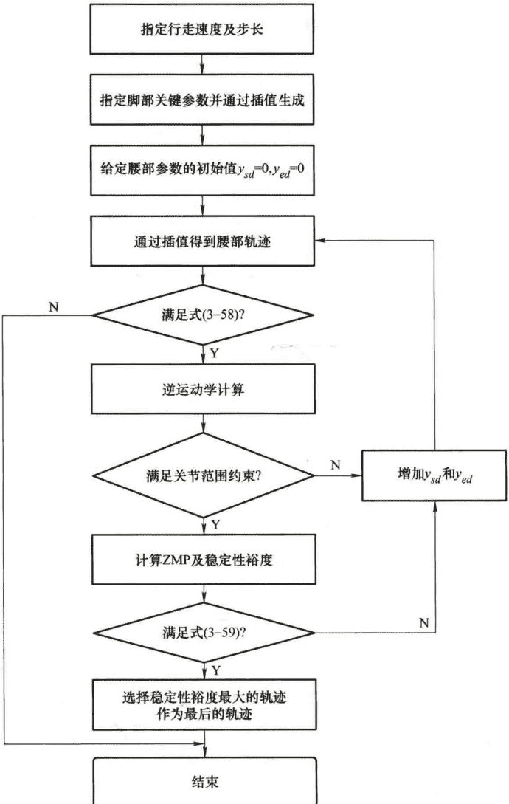

图 3-11 基于 ZMP 稳定性裕度的步态生成全流程

## 数据驱动新范式：机器学习赋能步态规划

机器学习为应对非结构化环境提供了数据驱动的新思路，其核心优势在于从海量数据中自动挖掘模式，免去人工逐步编码动作细节。主要技术路线三足鼎立：

*   **监督学习**：以带标签的传感器数据（步态-效果对）训练模型，实现特定工况下的步态预测。
*   **强化学习**：机器人在仿真或实机中通过“试错-奖励”循环，自主进化出最大化累积回报的步态策略。
*   **无监督学习**：从无标签原始数据中提取步态内在结构，辅助聚类分析或降维建模。

工程落地遵循标准管线：**多源数据采集（视觉/IMU/力觉/环境反馈） → 特征工程 → 模型训练（神经网络/决策树等） → 实测评估与迭代优化**。虽前景广阔，但模型泛化能力与大数据处理效率仍是当前突破的关键瓶颈。

# 行走控制：从经典到前沿的技术演进

## 模型预测控制（MPC）：应对不确定性的利器

人形机器人高维、非线性、欠驱动特性使得动态稳定行走极具挑战。传统 ZMP 与 SLIP 模型虽能实现基础稳定，但在工厂、户外等非结构化场景下，面对高稳定性与灵活性要求显得力不从心。MPC 凭借**多变量协同、显式约束处理、滚动优化抗扰动**三大优势，成为当前主流选择。

### MPC 核心思想：像下棋一样“预判”未来

MPC 本质是基于模型的滚动优化控制。如图 3-12，其核心循环为：依据当前状态，利用模型预测未来演化 $y_k$，在约束集内求解最优控制序列 $u_k$，仅执行第一步，随即更新状态重复该过程。预测模型既可为物理机理模型，亦可为数据驱动的黑箱模型。


生活中的下棋正是 MPC 思想的直观隐喻：棋规即模型，落子前推演数步后续局面，权衡利弊定当下最优一着。

### 单刚体模型：实时性与精度的“黄金平衡”

全身动力学模型虽精确，但维度灾难导致在线求解算力负载过重，且对参数辨识极其敏感。利用“躯干重、腿轻”特性，忽略腿部非线性惯性力，将机器人抽象为**单刚体模型**（SRBM），可大幅降阶并保留核心动力学特征。

如图 3-13，SRBM 在世界坐标系下的质心动力学方程为：


$$
\ddot{p}_c = \frac{\sum_{i=1}^n f_i}{m} - g \quad (3-61)
$$

$$
\frac{d}{dt}(I\omega) = \sum_{i=1}^n [(p_i - p_c) \times f_i + \tau_i] \quad (3-62)
$$

$$
\dot{R} = \hat{\omega} R \quad (3-63)
$$

式中：$m$ 总质量，$I$ 惯量张量，$g$ 重力，$p_c$ 质心位置，$p_i$ 第 i 足端位置，$f_i$、$\tau_i$ 为足端合力/合力矩。足底接触模式（点/线/面）决定 $\tau_i$ 维度。

旋转用 Z-Y-X 欧拉角 $\Theta=[\phi,\theta,\psi]^T$ 参数化，旋转矩阵 $R=R_z(\psi)R_y(\theta)R_x(\phi)$。角速度与欧拉角导数映射关系为式（3-65）。行走中横滚 $\phi$、俯仰 $\theta$ 均近零，可线性化简化为式（3-66）及矩阵形式（3-67）：

$$
\begin{bmatrix} \dot{\phi} \\ \dot{\theta} \\ \dot{\psi} \end{bmatrix} \approx \boldsymbol{R}_z(\boldsymbol{\psi})^T \boldsymbol{\omega} \quad (3-67)
$$

在此假设下，$\boldsymbol{\omega}$ 与 $\boldsymbol{I}\boldsymbol{\omega}$ 近似同向，角动量微分方程进一步简化为：

$$
\boldsymbol{I}\dot{\boldsymbol{\omega}} + \boldsymbol{\omega} \times \boldsymbol{I}\boldsymbol{\omega} \approx \boldsymbol{I}\dot{\boldsymbol{\omega}} \quad (3-68)
$$

这一系列近似在保证工程精度的前提下，为 MPC 的实时求解扫清了算力障碍。

### 小角度假设下的线性化建模与MPC求解全流程

在横滚角 $\phi$ 与俯仰角 $\theta$ 均接近零的工况下，单刚体动力学模型可大幅简化，化为式（3-69）所示的线性状态空间形式。系统输入向量定义为 $\boldsymbol{u} = [\boldsymbol{f}_1 \boldsymbol{f}_2 \tau_1 \tau_2]^T$，对应的系统矩阵 $\boldsymbol{A}$ 与输入矩阵 $\boldsymbol{B}$ 分别列于式（3-70）与式（3-71）。

$$
\frac{d}{dt} \begin{bmatrix} \boldsymbol{\Theta} \\ \boldsymbol{p}_c \\ \boldsymbol{\omega} \\ \dot{\boldsymbol{p}}_c \end{bmatrix} = \boldsymbol{A} \begin{bmatrix} \boldsymbol{\Theta} \\ \boldsymbol{p}_c \\ \boldsymbol{\omega} \\ \dot{\boldsymbol{p}}_c \end{bmatrix} + \boldsymbol{B}\boldsymbol{u} + \begin{bmatrix} 0_{3\times 1} \\ 0_{3\times 1} \\ 0_{3\times 1} \\ \boldsymbol{g} \end{bmatrix} \quad (3-69)
$$

$$
\boldsymbol{A} = \begin{bmatrix} 0_{3\times 3} & 0_{3\times 3} & \boldsymbol{R}_z(\boldsymbol{\psi})^T & 0_{3\times 3} \\ 0_{3\times 3} & 0_{3\times 3} & 0_{3\times 3} & \boldsymbol{1}_{3\times 3} \\ 0_{3\times 3} & 0_{3\times 3} & 0_{3\times 3} & 0_{3\times 3} \\ 0_{3\times 3} & 0_{3\times 3} & 0_{3\times 3} & 0_{3\times 3} \end{bmatrix} \quad (3-70)
$$

$$
\boldsymbol{B} = \begin{bmatrix} 0_{3\times 3} & 0_{3\times 3} & 0_{3\times 3} & 0_{3\times 3} \\ 0_{3\times 3} & 0_{3\times 3} & 0_{3\times 3} & 0_{3\times 3} \\ \boldsymbol{I}^{-1}(\boldsymbol{p}_1 - \boldsymbol{p}_c) & \boldsymbol{I}^{-1}(\boldsymbol{p}_2 - \boldsymbol{p}_c) & \boldsymbol{I}^{-1} & \boldsymbol{I}^{-1} \\ \frac{1_{3\times 3}}{m} & \frac{1_{3\times 3}}{m} & 0_{3\times 3} & 0_{3\times 3} \end{bmatrix} \quad (3-71)
$$

利用小角度近似，世界坐标系下的转动惯量矩阵 $\boldsymbol{I}$ 与机身体系下的 $\boldsymbol{I}_B$ 关系简化为仅与偏航角 $\psi$ 相关的旋转变换，即式（3-72）。

$$
\boldsymbol{I} = \boldsymbol{R}_z(\boldsymbol{\psi}) \boldsymbol{I}_B \boldsymbol{R}_z(\boldsymbol{\psi})^T \quad (3-72)
$$

为构建标准线性系统，将重力加速度 $\boldsymbol{g}$ 增广为状态量，定义完整状态向量 $\boldsymbol{x} = [\boldsymbol{\Theta} \ \boldsymbol{p}_c \ \boldsymbol{\omega} \ \dot{\boldsymbol{p}}_c \ \boldsymbol{g}]^T$，从而得到连续时间线性模型：

$$
\dot{\boldsymbol{x}} = \boldsymbol{A}_c \boldsymbol{x} + \boldsymbol{B}_c \boldsymbol{u} \quad (3-73)
$$

采用前向欧拉法离散化，步长为 $T$，可得离散时间模型：

$$
x_{i+1} = A_{d,i}x_i + B_{d,i}u_i \quad (3-74)
$$

其中矩阵近似计算为：
$$
A_d = e^{A_c T} \approx I + TA_c \quad (3-75)
$$
$$
B_d = \int_0^T e^{A_c \tau} d\tau B_c \approx TB_c \quad (3-76)
$$

---

#### 3. 模型预测控制问题构造与求解

离散模型的矩阵仅依赖于当前偏航角与支撑足相对位置，故可基于实时测量值在线更新预测模型。利用当前状态与未来输入序列，可递推预测时域 $k$ 内的状态演化。MPC优化问题由代价函数、预测模型、约束条件三要素构成，数学形式见式（3-77）。

$$
\begin{aligned}
\min_{x,u} \sum_{i=0}^{k-1}(x_{i+1}-x_{i+1,r})^T Q_i(x_{i+1}-x_{i+1,r}) + u_i^T R_i u_i \\
s.t. \quad x_{i+1} = A_{d,i}x_i + B_{d,i}u_i \quad (i=0, \cdots, k-1) \\
c_i^- \leqslant C_i u_i \leqslant c_i^+ \quad (i=0, \cdots, k-1) \\
D_i u_i = 0 \quad (i=0, \cdots, k-1)
\end{aligned} \quad (3-77)
$$

**优化目标**为在约束下最小化代价函数。代价函数包含两项：主项为轨迹跟踪误差（权重 $Q_i$），辅项为控制输入幅值正则化（权重 $R_i$），防止输入过大。实际调参时，需结合状态/输入量纲及任务特性对 $Q_i, R_i$ 进行针对性缩放。

**约束条件**分为等式与不等式：
- **等式约束**：依据步态规划，强制摆动腿足端力/力矩为零。
- **不等式约束**：针对支撑腿，包含法向力、力矩上下界（式 3-78）防关节超限，以及摩擦锥约束（式 3-79）防打滑。

$$
\begin{aligned}
0 \leqslant F_{\min} \leqslant F_{iz} \leqslant F_{\max} \\
\tau_{x\min} \leqslant \tau_{ix} \leqslant \tau_{x\max} \\
\tau_{y\min} \leqslant \tau_{iy} \leqslant \tau_{y\max} \\
\tau_{z\min} \leqslant \tau_{iz} \leqslant \tau_{z\max}
\end{aligned} \quad (3-78)
$$

$$
\begin{aligned}
-\mu F_{iz} \leqslant F_{ix} \leqslant \mu F_{iz} \\
-\mu F_{iz} \leqslant F_{iy} \leqslant \mu F_{iz}
\end{aligned} \quad (3-79)
$$

---

#### 从MPC到标准二次规划（QP）的转化

求解时，将时域内状态与输入分别堆叠为超级向量：
$X=[x_1^T \cdots x_k^T]^T \in R^{13k}$，$U=[u_1^T \cdots u_k^T]^T \in R^{6nk}$。
利用动力学递推，可将状态统一表示为当前状态 $x_0$ 与输入 $U$ 的线性映射（式 3-80），其中 $A_{qp}$ 仅含 $A_{d,i}$，$B_{qp}$ 含 $A_{d,i}, B_{d,i}$。

$$ X = A_{qp}x_0 + B_{qp}U \quad \text{(3-80)} $$

代入代价函数并展开整理（式 3-81），参考轨迹堆叠为 $y$，权重矩阵为 $Q, R$。常数项不影响优化，核心为关于 $U$ 的二次型。

$$
\begin{aligned}
J &= \sum_{i=0}^{k-1}(x_{t+1}-x_{t+1,r})^T Q_t(x_{t+1}-x_{t+1,r}) + u_t^T R_t u_t \\
&= X^T Q X + U^T R U \\
&= (A_{qp}x_0 + B_{qp}U - y)^T Q(A_{qp}x_0 + B_{qp}U - y) + U^T R U \\
&= U^T(B_{qp}^T Q B_{qp} + R)U + 2(A_{qp}x_0 - y)^T Q B_{qp} U \\
&\quad + (A_{qp}x_0 - y)^T Q(A_{qp}x_0 - y)
\end{aligned} \quad \text{(3-81)}
$$

标准 QP 形式为（式 3-82）：
$$
\begin{aligned}
\min_z \ \frac{1}{2} z^T H z + g^T z \\
s.t. \quad A_{neq} z \leqslant b_{neq} \\
c \leqslant z \leqslant d
\end{aligned} \quad \text{(3-82)}
$$

对号入座，MPC 问题转化为标准 QP 的核心参数为（式 3-83, 3-84）：
$$
H = 2(B_{qp}^T Q B_{qp} + R) \quad \text{(3-83)}
$$
$$
g = 2B_{qp}^T Q(A_{qp}x_0 - y) \quad \text{(3-84)}
$$

约束部分（式 3-78, 3-79）转标准形式较直观，此处不再赘述。至此，人形机器人 MPC 问题已转化为标准 QP。工程上可调用 OSQP、OOQP 等开源求解器，注意不同求解器数据结构差异。采用**循环滚动策略**，仅执行最优解序列的第一个控制输入，下一时刻重新求解。


---

### 3.4.2 全身控制：从任务优先级到数学实现

#### 1. 核心思想：任务分层与冗余利用

控制目标的侧重点随任务类型动态变化：焊接、切割需极致**位置精度**；天文望远镜指向则极其看重**姿态精度**（位置微偏无伤大雅，角度偏差会导致目标丢失）。

**全身控制（WBC）** 的使命是统筹全身可驱动关节，实现整体行为最优。复杂任务常拆解为多个子任务，并按重要性排序：
- **高优先级**：平衡维持、关键点精准定位（如支撑足位置）——**硬约束，必须满足**。
- **低优先级**：姿态美观、冗余关节舒适度优化——**软约束，在不干扰高优任务前提下尽力而为**。

*例*：双足行走时，身体平衡与落脚点稳定是“头等大事”，摆臂维持动量或交互是“次要任务”。WBC 通过严格的优先级机制，保证核心任务零妥协，同时灵活处理次要任务，赋予机器人在复杂环境中稳健、灵活运行的能力，现为四足/双足机器人标配。

---

#### 数学基石：雅可比映射与零空间投影

运动学层面，任务空间 $x$ 与关节空间 $q$ 非线性映射 $x=f(q)$；速度层面则为线性映射 $\dot{x} = J\dot{q}$（式 3-85），$J$ 为雅可比矩阵。

$$ x = f(q), \quad \dot{x} = J\dot{q} \quad (3-85) $$

当关节自由度 $>$ 任务维度时（如平面 3R 机械臂控制 2D 末端位置），机器人具备**运动学冗余**：同一末端速度对应无数关节速度解。

**冲突场景**：若新增任务“锁定关节 $q_1$”，可能与“末端跟踪”互斥。WBC 解法：任务分级——末端跟踪（P1），关节锁定（P2）。**核心原则**：优先完美执行 P1；在 P1 满足的前提下，利用冗余自由度最大化完成 P2。

---

#### 零空间投影机制

定义雅可比零空间投影矩阵 $N = J(N)$，满足 $J N = 0$（式 3-86）。$N$ 可由右逆矩阵 $J^\dagger$（满足 $J^\dagger J = I$）构造：

$$ N = I - J^{\dagger}J, \quad J^{\dagger} = J^{T}(JJ^{T})^{-1} $$

关节速度解解耦为两部分（式 3-88）：
$$ \dot{q} = J^{\dagger}\dot{\boldsymbol{x}} + N\dot{q}_{\forall} $$
- $J^{\dagger}\dot{x}$：完成主任务的**特解**（最小范数解）。
- $N\dot{q}_{\forall}$：落在零空间内的**通解**（$\dot{q}_{\forall}$ 任意），不影响任务空间速度。

**验证**：$J\dot{q} = JJ^{\dagger}\dot{x} + JN\dot{q}_{\forall} = I\dot{x} + 0 = \dot{x}$。

**物理意义**：零空间投影 $N$ 如同“过滤器”，剔除所有干扰主任务的关节运动分量，保留纯粹的内部运动自由度。WBC 正是利用此机制，在高优任务“零干扰”前提下，安排低优任务。

---

#### 2. 带优先级的多任务全身控制框架

假设存在 $n_t$ 个任务，优先级按索引 $i$ 递减（$i=1$ 最高）。第 $i$ 任务工作空间位置 $\boldsymbol{x}_i$，雅可比 $\mathbf{J}_i$，零空间 $\mathbf{N}_i$。

记 $\dot{\mathbf{q}}_{i-1}$ 为满足前 $i-1$ 个任务的关节速度。将前 $i-1$ 任务雅可比垂直堆叠，构成**聚合任务雅可比** $\mathbf{J}_{i-1}^A$（式 3-89）：

$$
\begin{bmatrix} \dot{\mathbf{x}}_1 \\ \vdots \\ \dot{\mathbf{x}}_{i-1} \end{bmatrix} = \begin{bmatrix} \mathbf{J}_1 \\ \vdots \\ \mathbf{J}_{i-1} \end{bmatrix} \dot{\mathbf{q}}_{i-1} \quad \Rightarrow \quad \dot{\mathbf{x}}_{i-1}^A = \mathbf{J}_{i-1}^A \dot{\mathbf{q}}_{i-1}
$$

同理，利用聚合雅可比可构造前 $i-1$ 任务的**聚合零空间矩阵** $\mathbf{N}_{i-1}^A$。第 $i$ 任务的关节速度贡献必须落在此零空间内，以确保不破坏高优任务。递推求解即可得到满足全优先级链的关节速度指令。

### 核心公式推导：从速度级到加速度级的层级全身控制

让我们先定义前 $i-1$ 个任务组合而成的超级任务 $A_{i-1}$ 对应的零空间投影矩阵：

$$\mathbf{N}_{i-1}^A = \mathbf{I} - (\mathbf{J}_{i-1}^A)^\dagger \mathbf{J}_{i-1}^A$$

假设我们已经算出了能按优先级完成前 $i-1$ 个任务的关节速度 $\dot{\mathbf{q}}_{i-1}$。利用上述零空间矩阵，我们可以通过迭代方式求得包含第 $i$ 个任务在内的关节速度 $\dot{\mathbf{q}}_i$：

$$\dot{\mathbf{q}}_i = \dot{\mathbf{q}}_{i-1} + \mathbf{N}_{i-1}^A \dot{\mathbf{q}}_{\forall}$$

两边同乘雅可比矩阵即可验证该式正确性。接下来的关键是求解 $\dot{\mathbf{q}}_{\forall}$，使其能驱动第 $i$ 个任务空间速度 $\dot{\mathbf{x}}_i$：

$$\dot{\mathbf{x}}_i = \mathbf{J}_i \dot{\mathbf{q}}_i = \mathbf{J}_i (\dot{\mathbf{q}}_{i-1} + \mathbf{N}_{i-1}^A \dot{\mathbf{q}}_{\forall})$$

解得：

$$\dot{\mathbf{q}}_{\forall} = (\mathbf{J}_i \mathbf{N}_{i-1}^A)^\dagger (\dot{\mathbf{x}}_i - \mathbf{J}_i \dot{\mathbf{q}}_{i-1})$$

代回原式并利用性质 $\mathbf{N}(\mathbf{J}\mathbf{N})^+ = (\mathbf{J}\mathbf{N})^+$ 化简，得到最终的速度级递推公式：

$$\dot{\mathbf{q}}_i = \dot{\mathbf{q}}_{i-1} + (\mathbf{J}_i \mathbf{N}_{i-1}^A)^\dagger (\dot{\mathbf{x}}_i - \mathbf{J}_i \dot{\mathbf{q}}_{i-1})$$

从第一个任务递推到第 $n$ 个，即可得到满足所有优先级约束的关节速度 $\dot{\mathbf{q}}_n$。

**为何必须进阶到加速度级？**
上述全是“速度级”控制——任务空间 $\dot{\mathbf{x}}$ 与关节空间 $\dot{\mathbf{q}}$ 均为一阶导数。但足式机器人运动高度动态，纯速度控制往往力不从心，必须引入加速度层面的调节。

对 $\dot{\mathbf{x}} = \mathbf{J}\dot{\mathbf{q}}$ 求导（$\dot{\mathbf{q}}$ 来自传感器反馈，视为已知），得到加速度映射关系：

$$\ddot{\mathbf{x}} = \dot{\mathbf{J}}\dot{\mathbf{q}} + \mathbf{J}\ddot{\mathbf{q}} \tag{3-96}$$

核心在于 $\ddot{\mathbf{x}}$ 与 $\ddot{\mathbf{q}}$ 的映射。沿用速度级思路：将前 $i-1$ 个任务打包为 $A_{i-1}$，已知其对应的关节加速度 $\ddot{\mathbf{q}}_{i-1}$，利用零空间矩阵迭代求解 $\ddot{\mathbf{q}}_i$：

$$\ddot{\mathbf{q}}_i = \ddot{\mathbf{q}}_{i-1} + \mathbf{N}_{i-1}^A \ddot{\mathbf{q}}_{\forall} \tag{3-97}$$

两边同乘雅可比并补上 $\dot{\mathbf{J}}_{i-1}\dot{\mathbf{q}}$ 项可验证：$\ddot{\mathbf{q}}_i$ 与 $\ddot{\mathbf{q}}_{i-1}$ 在高优先级任务空间效果一致。

求解 $\ddot{\mathbf{q}}_{\forall}$ 以实现第 $i$ 个任务空间加速度 $\ddot{\mathbf{x}}_i$ 的控制：

$$

\begin{aligned}

\ddot{x}_i &= \dot{\mathbf{J}}_i \dot{q} + \mathbf{J}_i \ddot{q}_i \\

&= \mathbf{J}_i \ddot{q} + \mathbf{J}_i \left( \ddot{q}_{i-1} + N_{i-1}^A \ddot{q}_\forall \right) \\

\ddot{q}_\forall &= (\mathbf{J}_i N_{i-1}^A)^+ \left( \ddot{x}_i - \dot{\mathbf{J}}_i \dot{q} - \mathbf{J}_i \ddot{q}_{i-1} \right)

\end{aligned}

$$ (3-98)

由此获得加速度级递推公式。同样利用 $\mathbf{N}(\mathbf{J}\mathbf{N})^+ = (\mathbf{J}\mathbf{N})^+$ 可进一步简化。递推至第 $n$ 层，即得兼顾所有优先级的关节加速度 $\ddot{\mathbf{q}}_n$。

$$

\begin{aligned}

\ddot{q}_i &= \ddot{q}_{i-1} + N_{i-1}^A \ddot{q}_\forall \\

&= \ddot{q}_{i-1} + N_{i-1}^A (\mathbf{J}_i N_{i-1}^A)^+ \left( \ddot{x}_i - \dot{\mathbf{J}}_i \dot{q} - \mathbf{J}_i \ddot{q}_{i-1} \right) \\

&= \ddot{q}_{i-1} + (\mathbf{J}_i N_{i-1}^A)^+ \left( \ddot{x}_i - \dot{\mathbf{J}}_i \dot{q} - \mathbf{J}_i \ddot{q}_{i-1} \right)

\end{aligned}

$$ (3-99)

---

### 实战场景：优先级如何落地？

**场景一：狭窄工位上的精密焊接**
机器人需同时处理三级任务：
1.  **最高级（生存线）：保持平衡** —— 一旦失衡，焊件损坏、工具毁坏，甚至跌倒。
2.  **次级（核心业务）：焊枪位姿精准跟踪** —— 直接决定焊接质量。
3.  **最低级（优化项）：手臂运动平滑自然** —— 极端工况下可牺牲平滑度换取焊接质量。

**场景二：人形机器人行走分解**
走路拆解为四级任务（优先级递减）：
1.  **支撑腿防滑移** —— 接触稳定是控制前提，排第一。
2.  **机身姿态（转动）控制** —— 保持躯干不晃，排第二。
3.  **机身位置（平动）控制** —— 维持重心轨迹，排第三。
4.  **摆动腿轨迹跟随** —— 依赖支撑腿，相对不重要，垫底。

确定优先级后，直接套用带优先级的多任务全身控制框架递推计算最终指令。

---

### 另一条主流路线：基于最小二乘的全身控制 (WBC-QP)

上一节的“零空间投影法”虽经典，但工程界更青睐**将控制问题统一建模为线性最小二乘优化**，再叠加等式约束实现严格优先级。这套框架更直观、通用，是当前足式机器人主流选择。

#### 统一数学模型
将 $n$ 个任务写成线性方程组形式：
$$ \mathbf{A}_i \mathbf{x} = \mathbf{b}_i \tag{3-100} $$
$i$ 即优先级（$i=1$ 最高）。同层级任务堆叠进 $\mathbf{A}_i, \mathbf{b}_i$。对应的最小二乘问题：
$$ \min_{\mathbf{x}} \| \mathbf{A}_i \mathbf{x} - \mathbf{b}_i \|_2 \tag{3-101} $$

#### 严格优先级的实现：序列二次规划 (SQP)
假设前 $i-1$ 级已求解得最优解 $\mathbf{x}^*_{i-1}$，计算其误差向量：
$$ \mathbf{c}^*_{i-1} = \begin{bmatrix} \mathbf{A}_1 \\ \vdots \\ \mathbf{A}_{i-1} \end{bmatrix} \mathbf{x}^*_{i-1} - \begin{bmatrix} \mathbf{b}_1 \\ \vdots \\ \mathbf{b}_{i-1} \end{bmatrix} \tag{3-102} $$
$\mathbf{c}^*_{i-1}$ 量化了高优先级任务的完成度：对应元素为 0 则完美完成；非 0 则因与更高级任务冲突而被“妥协”。

第 $i$ 级优化问题构造为**带等式约束的最小二乘**：
$$ \min_{\mathbf{x}} \| \mathbf{A}_i \mathbf{x} - \mathbf{b}_i \|_2 \tag{3-103} $$
$$ \text{s.t. } \begin{bmatrix} \mathbf{A}_1 \\ \vdots \\ \mathbf{A}_{i-1} \end{bmatrix} \mathbf{x} - \begin{bmatrix} \mathbf{b}_1 \\ \vdots \\ \mathbf{b}_{i-1} \end{bmatrix} = \mathbf{c}^*_{i-1} \tag{3-104} $$
**含义明确**：等式约束“冻结”高优先级任务表现，代价函数“尽力”优化当前任务。共 $n$ 个 QP 问题串联求解，标准 QP 求解器可高效处理。

#### 关键一步：如何把物理任务写成 $\mathbf{A}\mathbf{x}=\mathbf{b}$？

**1. 确定优化变量 $\mathbf{x}$**
受动力学方程启发，取核心三变量：
$$ \mathbf{x} = \begin{bmatrix} \ddot{\mathbf{q}} \\ \mathbf{f}_c \\ \boldsymbol{\tau} \end{bmatrix} \tag{3-105} $$
即：关节广义加速度、接触力堆叠向量、驱动力矩。

**2. 动力学一致性约束（通常最高优先级）**
$$ \mathbf{H}\ddot{\mathbf{q}} + \mathbf{c} = \mathbf{S}^\dagger \boldsymbol{\tau} + \mathbf{J}_c^\dagger \mathbf{f}_c \tag{3-106} $$
整理为标准形式（带帽符号为反馈实测值，优化中视为常数）：
$$ \mathbf{A} = \left[ \hat{\mathbf{H}} \quad -\hat{\mathbf{J}}_c^\dagger \quad -\mathbf{S}^\dagger \right]^\top, \quad \mathbf{b} = -\hat{\mathbf{c}} \tag{3-107} $$

**3. 运动任务：跟踪空间点加速度 $\ddot{\mathbf{w}}^*_i$**
利用二阶运动学映射 $\ddot{\mathbf{w}}^*_i = \mathbf{J}_i \ddot{\mathbf{q}} + \dot{\mathbf{J}}_i \dot{\mathbf{q}}$：
$$ \mathbf{A} = \left[ \hat{\mathbf{J}}_i \quad \mathbf{0} \quad \mathbf{0} \right]^\top, \quad \mathbf{b} = \ddot{\mathbf{w}}^*_i - \hat{\dot{\mathbf{J}}}_i \dot{\mathbf{q}} \tag{3-108, 3-109} $$

**4. 接触力任务：施加指定力 $\mathbf{f}^*_i$**
$$ \mathbf{f}_i = \mathbf{f}^*_i \implies \mathbf{A} = \left[ \mathbf{0} \quad \mathbf{I} \quad \mathbf{0} \right], \quad \mathbf{b} = \mathbf{f}_i \tag{3-110, 3-111} $$

**5. 正则化任务：如最小化总驱动力矩**
$$ \mathbf{A} = \left[ \mathbf{0} \quad \mathbf{0} \quad \mathbf{I} \right], \quad \mathbf{b} = \mathbf{0} $$

---

## 思考与习题

1.  阐述零力矩点（ZMP）稳定性判据的适用范围。
2.  如何理解稳定性裕度？
3.  零力矩点（ZMP）越靠近稳定区域中心，人形机器人姿态越稳定吗？
4.  解释 ZMP 方法在步态控制中的作用，并举例说明。
5.  不规则地形行走时，如何结合 ZMP 与机器学习提升稳定性？
6.  讨论倒立摆模型在平衡控制中的应用及局限性。
7.  比较静态/动态稳定性在步态控制中的优劣。
8.  探讨步态生成的关键参数及其对行走性能的影响。
9.  **计算题**：质量 50kg 机器人，某瞬间重心位于 $(0.2\text{m}, 0.1\text{m})$，求该点 ZMP 位置。
10. **计算题**：重心轨迹 $x(t)=0.2\sin(2\pi t)$, $y(t)=0.1\cos(2\pi t)$，求 1s 内重心最大速度与加速度。

---

# 第 4 章 人形机器人学习控制

### 导读
本章聚焦**深度强化学习（DRL）**在人形机器人运动控制中的应用。不同于传统控制依赖精确模型，DRL 需海量数据驱动策略优化，全流程围绕“高效学习”与“可靠数据获取”展开。内容脉络：DRL 基础算法 $\rightarrow$ 观测/动作/奖励设计实战 $\rightarrow$ 仿真配置与 Sim2Real 关键技巧 $\rightarrow$ 落地完整流程构建。

### 本章知识点
- 深度强化学习基本概念
- 代表性 DRL 算法解析
- 运动控制算法设计实战
- 动力学仿真配置与优化

---

### 4.1 强化学习基础

强化学习（Reinforcement Learning, RL），又称再励/增强学习，源于对人类试错学习行为的模仿。近年来，算力与存储的爆发式增长催化了 AI 技术跃迁。机器学习作为通往 AI 的核心路径，强调让机器通过“学习”获取能力，而 RL 是其中极具潜力的一派。它与监督学习、无监督学习、深度学习交叉融合，衍生出**深度强化学习（DRL）**。从围棋博弈、游戏 AI 到自动驾驶、机器人控制、工业生产，RL 已深度重塑生产生活。

#### 4.1.1 核心范式：智能体与环境的博弈

RL 研究核心问题：**智能体（Agent）如何在复杂、不确定的环境（Environment）中最大化累积奖励。**

如图 4-1 所示，RL 闭环由两部分构成：智能体与环境。交互流程如下：
1.  智能体感知当前**状态**。
2.  基于状态输出**动作**（即决策）。
3.  动作施加于环境，环境转移至**下一状态**，并反馈即时**奖励**。
4.  智能体以“经验数据”（而非监督学习的标注数据）为教材，不断优化策略，追求长期奖励最大化。

**本质区别**：监督学习靠“人工标签”教做题；强化学习靠“环境反馈”练内功。


##### 1. 马尔可夫决策过程

# 核心范式：智能体与环境的博弈

强化学习（RL）探讨的核心，是智能体如何通过与环境的持续互动来学会决策。这里的“环境”并非狭义的自然界，而是高度抽象、与任务强相关的交互场域。如图 4-1 所示，机器人（智能体）不断向环境输出动作，环境接收后演进至下一时刻，反馈新的观测状态与即时奖励。这个循环往复的过程，本质上是一个**序列决策**过程。

*   **状态（State）**：智能体在环境中的瞬时全貌描述，是环境与自身条件的抽象总和。
*   **动作（Action）**：智能体基于当前状态做出的抉择，驱动状态从 $s_t$ 跃迁至 $s_{t+1}$。
*   **目标**：从海量交互轨迹中习得策略，使**累积奖励期望最大化**。

这一框架通常用**马尔可夫决策过程（MDP）**建模：未来状态的条件概率仅取决于当前状态与动作，与过往无关。

$$p(s_{t+1}|s_t,a_t,\cdots,s_0,a_0) = p(s_{t+1}|s_t, a_t) \quad (4-1)$$

通俗讲，当前状态已压缩足够的历史信息，决策无需回溯过往。当前主流的人形机器人学习控制，多以 MDP 为基石。需区分：**状态**是世界的全量描述（无信息隐藏），**观测**往往是状态的部分投影（可能缺失信息）。在深度 RL 中，二者通常用实值向量、矩阵或高阶张量表示。

---

### 奖励信号：定义“优”的标尺

引入奖励（Reward）是为了量化期望行为。它是环境返回的标量反馈，评价智能体单步策略的优劣。RL 的终极使命，即寻找一系列动作，最大化**折扣累积奖励期望**：

$$G_t = r_{t+1} + \gamma r_{t+2} + \cdots = \sum_{k=0}^{\infty} \gamma^k r_{t+k+1} \quad (4-2)$$

其中 $\gamma \in [0,1]$ 为折扣因子，权衡“当下”与“未来”的收益权重。

---

## 2. 贝尔曼方程与值函数体系

深度 RL 算法通常包含两大核心组件：**策略** 与 **值函数**。

*   **策略 $\pi(a|s)$**：状态到动作的映射函数，是智能体行动的大脑，算法旨在寻得最优策略 $\pi^*$。
*   **值函数 $V_\pi(s)$**：状态评估器，预测从状态 $s$ 出发、遵循策略 $\pi$ 能获得的折扣累积奖励期望。值越大，状态越“肥”。

$$V_{\pi}(s) = E_{\pi} \left[ \sum_{t=0}^{\infty} \gamma^t r_{t+1} \mid s_t = s \right] \quad (4-3)$$

### 贝尔曼方程：值的递归本质

值函数满足递推关系——**贝尔曼方程**，揭示了“当前价值 = 即时收益 + 折扣后的未来价值”：

$$V_{\pi}(s) = R(s) + \gamma \sum p(s_{t+1} \mid s_t) V_{\pi}(s_{t+1}) \quad (4-4)$$

这意味着我们可以通过动态规划（自举）的方式迭代求解值函数，而非蒙特卡洛式的完整轨迹回溯。

### Q 函数：状态-动作的联合视角

$Q_\pi(s,a)$ 进一步细化评估粒度，引入动作维度：

$$Q_{\pi}(s,a)=E_{\pi}\left[\sum_{t=0}^{\infty}\gamma^t r_{t+1} \mid s_t=s, a_t=a\right] \quad (4-5)$$

拥有 Q 函数即拥有了“导航仪”：在任意状态 $s$ 下，贪婪选取 $\arg\max_a Q(s,a)$ 即为最优动作。

---

### 标准 RL 交互循环小结

1.  $t$ 时刻，观测获取状态 $s_t \in \mathcal{S}$。
2.  依策略 $\pi$ 采取动作 $a_t \in \mathcal{A}$。
3.  环境跃迁至 $s_{t+1}$，反馈奖励 $r_{t+1}$。
4.  依据规则（如梯度下降）更新策略/值函数。
5.  循环直至收敛或达标。

---

# 深度强化学习算法：以深度网络逼近核心组件

深度 RL 沿用 RL 理论，但用深度神经网络（DNN）替代传统表格查找或线性拟合，**直接学习 $s \to a$（策略）或 $s \to V/Q$（价值）的端到端映射**，省去了人工特征工程。

---

## 1. 深度 Q 网络：价值估计的深度化

**DQN** = DNN + Q-Learning，典型的**基于价值**算法。

### 从 Q 表到 Q 网
传统 Q-Learning 维护 Q 表，状态空间大时（如百万级）存储与更新极其低效。DQN 用一张网络 $Q(s,a;\theta)$ 拟合状态-动作值函数，输入状态分量，输出全动作空间的 Q 值，**以空间换时间，泛化未见状态**。


> **图 4-2 对比**：Q 学习查表 vs DQN 前向传播。

### 两大工程基石：经验回放与目标网络

**① 经验回放：打破相关性**
DNN 训练需 i.i.d. 数据，但 RL 交互序列高度相关。DQN 引入**经验池**存储五元组 $(s, a, r, s', done)$，训练时**随机小批量采样**。
*   打破时序相关性，缓解过拟合。
*   提高样本复用率，类似监督学习范式。

**② 固定目标网络：稳定训练目标**
用两套同构网络：
*   **评估网（Eval Net）**：参数 $\theta$ 实时更新，负责交互选动作（$\epsilon$-greedy）。
*   **目标网（Target Net）**：参数 $\theta^-$ 定期从评估网硬复制，负责计算 TD 目标 $y$。

> **核心机制**：目标网提供相对静止的“靶子”，评估网向其逼近，再周期性同步，**切断了目标值与当前参数的强耦合**，显著提升收敛稳定性。

### 损失函数与 TD 学习

目标值 $y_j$ 构造（单样本）：

$$y_j = \begin{cases} r_j & \text{终止态} \\ r_j + \gamma \max_{a'} \hat{Q}(s_{j+1}, a'; \theta^-) & \text{非终止态} \end{cases} \quad (4-6)$$

> 注：$\max$ 操作用**下一状态的最大 Q 值**自举估计未来总回报，且用**目标网参数 $\theta^-$** 计算，进一步解耦。

最小化均方 TD 误差：

$$Loss = [y_j - Q(s_j, a_j; \theta)]^2 \quad (4-7)$$

训练目标：让评估网精准拟合全状态-动作对的真实 Q 值，推理时贪婪取最大者即得最优策略。

---

## 2. 策略梯度：直击策略本质

基于价值的方法（DQN 等）有两大短板：
1.  **离散动作依赖**：需遍历全动作空间取 $\max$，连续控制（如机器人关节力矩）无法直接适用。
2.  **确定性贪婪**：天然输出确定性策略，难以建模需要**随机化**的博弈最优解（如石头剪刀布需 1/3 概率混合）。

### 策略网络：直接建模 $\pi_\theta(a|s)$

**策略梯度（PG）** 另辟蹊径：引入独立**策略网络（Actor）**，输入状态，输出动作概率分布。轨迹 $\tau = (s_1, a_1, s_2, a_2, \dots)$ 的发生概率为：

$$p_\theta(\tau) = p(s_1)\prod_{t=1}^T \pi_\theta(a_t|s_t) p(s_{t+1}|s_t, a_t) \quad (4-8)$$

目标：最大化期望累积奖励 $J(\theta) = E_{\tau \sim p_\theta}[R(\tau)]$。

### 梯度推导：对数导数技巧

$$\nabla_\theta J(\theta) = E_{\tau \sim p_\theta} \left[ R(\tau) \nabla_\theta \log p_\theta(\tau) \right] \quad (4-9 \sim 4-13)$$

展开后，梯度指向**“奖励高的轨迹更有可能被采样”**的方向。直观理解：每条轨迹按其总奖励 $R(\tau)$ 加权，拉高沿途 $(s_t, a_t)$ 的动作概率。奖励越高的轨迹，对参数更新的“话语权”越大。

### Baseline 机制：降低方差，加速收敛

实际工程中引入基线 $b(s)$（常取 $V(s)$），构造**优势函数 $A(s,a) = Q(s,a) - V(s)$**：

$$\nabla_\theta J(\theta) \approx E \left[ \nabla_\theta \log \pi_\theta(a|s) \cdot (R(\tau) - b(s)) \right] \quad (4-14+)$$

> **作用**：不改变梯度期望（无偏），但大幅降低方差。只强化“比平均水平好”的动作，抑制“虽正但平庸”的动作更新，训练更稳健。

$$\overline{R_\theta} = \sum_{\tau} R(\tau) p_\theta(\tau) = E_{\tau \sim p_\theta(\tau)}[R(\tau)]$$
$$\nabla \overline{R_\theta} = \sum_{\tau} R(\tau) \nabla p_\theta(\tau) = \sum_{\tau} R(\tau) p_\theta(\tau) \frac{\nabla p_\theta(\tau)}{p_\theta(\tau)}$$
$$= \sum_{\tau} R(\tau) p_\theta(\tau) \nabla \log p_\theta(\tau) = E_{\tau \sim p_\theta(\tau)}[R(\tau) \nabla \log p_\theta(\tau)]$$
$$\approx \frac{1}{N} \sum_{n=1}^N R(\tau^n) \nabla \log p_\theta(\tau^n)$$
$$= \frac{1}{N} \sum_{n=1}^N R(\tau^n) \left[ \sum_{t=1}^{T_n} \nabla \log p_\theta(a_t^n | s_t^n) \right]$$
$$\nabla \overline{R_\theta} \approx \frac{1}{N} \sum_{n=1}^N (R(\tau^n) - b) \left[ \sum_{t=1}^{T_n} \nabla \log p_\theta(a_t^n | s_t^n) \right]$$

---

**结语**：从 MDP 建模、贝尔曼递归，到 DQN 的价值拟合与工程技巧，再到 PG 的策略直优，深度 RL 构建了一套**“感知-决策-评估”闭环**的智能体学习范式，为具身智能与复杂控制提供了核心算法支撑。

# 从AC到PPO：强化学习核心算法与人形机器人控制实战指南

在训练动作网络与评价网络的常规流程中，奖励函数长期维持正值是个常见隐患。这会导致未被采样的动作得不到鼓励，其出现概率逐渐趋近于零，最终反而让那些潜在的优质动作被“误伤”丢弃。破解这一僵局的关键，在于引入基线机制，让奖励信号呈现正负交替的分布。主流做法通常采用状态值函数 $V_\pi(s)$ 作为基线，或者在策略梯度更新时，直接减去一段时间内的奖励均值。

#### 3. 演员评论家算法

强化学习领域有两座“大山”：DQN 与策略梯度。但它们各有短板。DQN 通过拟合 Q 函数为每个状态-动作对打分，进而贪婪选优。可一旦动作空间变高维、变连续，Q 函数估计的难度呈指数级上升，稳定性大打折扣；加上最大化操作易导致过估计，策略震荡、收敛变慢。虽然后来引入目标网络、经验回放缓解了燃眉之急，但高维状态下依然贪婪于数据与算力，工程落地挑战重重。

策略梯度则另辟蹊径，直接优化策略函数，天生适配高维连续控制。它靠最大化期望回报迭代参数，逻辑清晰。但致命伤是梯度估计方差极大，训练极不稳定，样本利用率低；长时程任务下还易陷入梯度消失/爆炸泥沼。

**演员评论家（Actor-Critic, AC）算法**应运而生，它是价值法与策略法的“强强联合”，双网络协同，实现了更稳、更快的策略优化。

架构上分工明确：**演员（Actor）**依策略 $p_\theta$ 选动作；**评论家（Critic）**估算状态值 $V_\varphi$ 或优势函数 $A_p(s,a) = Q_p(s,a) - V_\varphi(s)$ 打分，反馈给演员。演员据此更新 $\theta$，完成闭环。

数学上，AC 的策略梯度写作：
$\nabla_\theta J(\theta) = \mathbb{E}_{p_\theta} [\nabla_\theta \log p_\theta(a|s) Q^{p_\theta}(s,a)]$ (4-15)

对比传统公式（4-9），它摆脱了对完整轨迹 $\tau$ 的依赖，也不必等一局跑完求和 $R(\tau)$ 才能更新。值函数 $Q^{p_\theta}(s,a)$ 的引入，压缩了累积奖励带来的高方差，打破了“全程采样再更新”的瓶颈，大幅提升了训练效率。

评论家端通过最小化时序差分（TD）误差回溯参数 $\varphi$：
$\mathcal{L}(\varphi) = \mathbb{E} \left[ (r + \gamma V_\varphi(s') - V_\varphi(s))^2 \right]$ (4-16)

其中 $V_\varphi$ 为值函数网络，$r$ 即时奖励，$\gamma$ 折扣因子，$s'$ 下一状态。双方在博弈中共进退，最终收敛到稳定高效的策略。

**AC 四大核心优势：**
1.  **降维打击方差**：评论家引入基线，显著压低策略梯度方差，解决纯策略梯度“抖动”顽疾。
2.  **天生爱连续**：演员直接输出动作分布，高维连续空间游刃有余，碾压 DQN。
3.  **样本利用率高**：值函数提供密集反馈，比稀疏的蒙特卡洛回报更高效。
4.  **扩展性强**：双塔架构为后续算法（如 A2C, A3C, PPO）奠定了地基。

#### 4. 近端策略优化算法

前面的算法有个通病：**数据“一次性”**。跑完一条轨迹更新一次，数据即作废，探索经验严重浪费。PPO（Proximal Policy Optimization）正是为此而生，通过一系列工程技巧大幅提升样本复用率与训练稳健度。

想复用旧数据？核心难点在于**分布漂移**。推导时用辛钦大数定律近似（式 4-13），前提是采样分布 $p_\theta$ 与目标分布一致。更新后参数变 $\theta'$，分布变 $p_{\theta'}$，旧数据分布 $p_\theta$ 失效。引入**重要性采样**（IS）可解：用重要性权重 $\frac{p_\theta(\tau)}{p_{\theta'}(\tau)}$ 校正，将旧分布期望转为新分布期望。

$$E_{t \sim p_\theta(\tau)}[f(\tau)] = \int f(\tau) p_\theta(\tau) \mathrm{d}\tau = \int f(\tau) \frac{p_\theta(\tau)}{p_{\theta'}(\tau)} p_{\theta'}(\tau) \mathrm{d}\tau = E_{t \sim p_{\theta'}(\tau)} \left[ f(\tau) \frac{p_\theta(\tau)}{p_{\theta'}(\tau)} \right]$$ (4-17)
可以得到
$$\nabla \overline{R}_\theta = E_{t \sim p_\theta(\tau)} [R(\tau) \nabla \log p_\theta(\tau)]$$ (4-18)
$$= E_{t \sim p_{\theta'}(\tau)} \left[ \frac{p_\theta(\tau)}{p_{\theta'}(\tau)} R(\tau) \nabla \log p_\theta(\tau) \right]$$ (4-19)

这样就能随时拿历史数据更新新策略，不再强制 on-policy。

但 IS 有副作用：新旧策略若差距过大，权重方差爆炸，梯度失控。引入 **KL 散度** 作惩罚项约束步长：
$$J(\theta) = \sum \left[ \frac{p_\theta(a_t | s_t)}{p_{\theta'}(a_t | s_t)} A^{\theta'}(s_t, a_t) \right]$$ (4-20)
$$J(\theta) = \sum \left[ \frac{p_\theta(a_t | s_t)}{p_{\theta'}(a_t | s_t)} A^{\theta'}(s_t, a_t) \right] - \lambda KL[\theta, \theta']$$ (4-21)

其中 $\lambda$ 为自适应权重：KL 过大则增 $\lambda$ 重罚，过小则减 $\lambda$ 放宽。
如果 $KL(\theta, \theta') > KL_{\min}$，则增加 $\lambda$ (4-22)
如果 $KL(\theta, \theta') < KL_{\min}$，则减小 $\lambda$ (4-23)

此外，PPO 还有一招**硬核裁剪**，直接钳制重要性权重，双重保险护航梯度稳定：
$$J(\theta) = \sum_{(s_t, a_t)} \min \left[ \frac{p_\theta(a_t|s_t)}{p_{\theta'}(a_t|s_t)} A^{\omega}(s_t, a_t), clip \left( \frac{p_\theta(a_t|s_t)}{p_{\theta'}(a_t|s_t)}, 1-\epsilon, 1+\epsilon \right) \cdot A^{\omega}(s_t, a_t) \right] \quad (4-24)$$

#### 4.1.3 机器人的强化学习控制框架

机器人控制本质是：感知状态 $\to$ 决策动作 $\to$ 执行 $\to$ 环境反馈新状态与奖励 $\to$ 优化策略。无人车控油门方向，机械臂驱关节，人形机器人则在维持平衡的前提下协调全身自由度。深度强化学习（DRL）聚焦于“交互-学习”闭环的效率与精度。

如图 4-1 所示，智能体与环境交互的标准回路中，奖励仅用于离线训练更新参数，实控时不参与前向推理。图 4-3 展示了人形机器人典型的 DRL 运动控制框架，本质仍是反馈控制，但核心模块由**信号处理**、**DRL 算法核心**、**数据转换**三件套组成，将观测值映射为电机指令。


区别于传统控制，此框架新增了观测预处理与动作后处理；且因训练/测试场域不同（Sim2Real），交互的动作、观测、奖励定义均有差异。无模型 DRL 不需机器人动力学参数，纯靠 $(s, a, r)$ 三元组建模任务。因此算法层面通用性极强，但工程落地看的是具体任务下的观测空间、动作空间与奖励函数设计。目前主流皆采用**价值估计+策略优化**的混合架构（即 AC 族）。

### 4.2 人形机器人运动控制算法设计

当前人形机器人 DRL 以无模型为主，不同任务的本质区别，归结为**观测空间、动作空间、奖励函数**的差异化设计。即使算法、数据流一致，空间与函数的微调也能导向完全不同的行为策略。本节以小车倒立摆为切入点，梳理任务建模范式，再剖析腿足机器人常见算法设计思路，最后聚焦状态/动作选择优化与奖励函数工程。

#### 4.2.1 基础强化学习任务示例

强化学习重“知行合一”，光懂数学推导不够，必须上手跑通任务。前文将要素笼统抽象为状态、观测、动作、奖励、终止信号，实战中必须落地到具体物理量。先介绍业界标准基准——**OpenAI Gym**。

2016 年发布的 Gym 统一了 RL 任务接口，从经典控制到 MuJoCo 复杂仿真一网打尽，成为了科研、教学、工业对齐的“通用语言”。

以 **CartPole（小车倒立摆）** 为例（效果见图 4-4）：


*图 4-4 小车倒立摆效果*

**状态空间（4 维向量）：**
1. 小车水平位置
2. 小车水平速度
3. 摆杆夹角（相对竖直）
4. 摆杆角速度

**动作空间（离散，二选一）：**
*   0：向左施加定值力
*   1：向右施加定值力

**奖励函数**：每步存活给 +1，鼓励累积回报最大化（即坚持越久越好）。

**终止条件（任一触发即停）：**
1.  摆角超 $\pm 12^\circ$（倒了）
2.  小车位置超 $\pm 2.4$（跑偏了）
3.  达 200 步上限（防止无限循环，保证数据多样性）

映射到代码：状态 $s$ 为 `float32[4]`，动作 $a$ 为 `int` (0/1)，奖励为存活步数，`done` 标志位置真则重置环境。塞入 DRL 训练循环，智能体即可自学稳摆策略。

**注意**：任务建模非唯一。奖励可改为“惩罚角度偏移”或“惩罚位置偏移”，甚至组合。**精妙的奖励塑形往往能决定训练成败**，复杂任务中尤为关键。

#### 4.2.2 人形机器人观察值空间设计

机器人硬件异构（关节编码器、IMU、触觉、相机、雷达、GPS...），原始数据维度、量纲、噪声特性天差地别。最简方案是**“盲行”**：仅靠本体感知（关节角/速、躯干姿态/角速、末端接触）完成状态估计与控制；进阶方案融合视觉/激光，引入外部环境信息，数据维度激增，对网络架构与预处理提出新要求。

**直接喂原始传感器数据入网络？实战中大概率训不收敛。**
核心痛点：**多源异构数据量纲不一，敏感区间各异。**
首要工程步骤：**归一化**，将所有信号映射至统一数值区间，便于后续统一处理。常用六大手段：

1.  **Min-Max 归一化**
    ```
\(x' = \frac{x - \min(x)}{\max(x) - \min(x)}\) (4-25)
```
2.  **均值归一化**
    $$x' = \frac{x - mean(x)}{max(x) - min(x)}$$ (4-26)
    *$mean(x)$ 为样本均值。*
3.  **Z-Score 标准化**
    $$x' = \frac{x - \mu}{\sigma}$$ (4-27)
    *映射至实数域，$\mu, \sigma$ 为均值、标准差。*
4.  **对数归一化**
    $$x' = \frac{lg x}{lg max(x)}$$ (4-28)
5.  **反正切归一化**
    $$x' = arctan(x) \frac{2}{\pi}$$ (4-29)
    *输出强制压缩至 $[-1, 1]$。*
6.  **小数定标标准化**
    $$x' = \frac{x}{10^j}$$ (4-30)
    *同样映射至 $[-1, 1]$，$j$ 为使 $\max(|x'|) < 1$ 的最小整数。*

选对归一化方式，是让高维异构观测“听话”的第一步。后续我们将深入动作空间与奖励函数的设计艺术。

# 4.2 核心模块设计：观测、动作与奖励

### 归一化策略：因地制宜，稳健为先

数据预处理的首选方案取决于数据边界的稳定性。若最大最小值固定不变，**Min-Max 归一化**与**均值归一化**是首选；但若边界随新数据漂移，或存在极端异常值，这两类方法会导致结果剧烈波动，训练极不稳定。反之，**Z-Score 标准化**将数据映射为均值 0、方差 1 的分布，虽改变数据尺度但保留分布形态，天然适配边界不定、含噪声的场景。面对量级跨度巨大的非线性数据，对数、反正切等非线性映射往往能收奇效。

### 观测空间构建：从“喂数据”到“投好料”

**关节本体感知：定制化的“标准动作”**
机器人出厂即锁定关节角度/速度物理上限，这为盲行任务定下了基调：**物理截断 + Min-Max 映射至 [-1,1] 或 [0,1]**。一旦引入视觉等异构传感器或切换任务，归一化策略需按数据特质“私人订制”，核心原则只有一条——让**信息增量最大、判别度最高**的特征占据标准化区间核心位置。

**网络入口：全连接的“标配”与 特征工程的“外挂”**
标量/向量观测天然适配全连接层 (FC)。但“直喂原始值”往往是下策，高手都在做“特征显化”：
*   **状态估计器**：融合关节与躯干态，反解速度位置；
*   **残差编码**：指令与实测之差（如图 4-5），能极大放大细微差异，降低网络提特征的负担；
*   **任务先验注入**：相位、频率等关键参数显式输入。


图 4-5 关节残差图示


图 4-6 典型状态观测与网络架构

> **残差为何有效？** 原始指令/响应隐含残差信息，但显式构造残差（响应 1/2 对指令作差）能显著拉开信号间隙，让关键特征“跳”进网络视野，加速收敛、降低难度。虽非强制，但在算力与工期双重约束下，寻找网络“易消化”的特征形式是必修课。

**高维感知：卷积降维是王道**
图像、点云丢给 FC 参数爆炸且丢特征。**CNN 降维提特征 + FC 融合决策**（图 4-7）是公认的高效范式，兼顾精度与推理速度。


图 4-7 带 CNN 的观测网络架构

### 两阶段训练：特权蒸馏，破解“盲人骑瞎马”

实机部署面临状态估计不准（传感器噪声、建模误差、环境干扰）的硬伤，直接训练常陷“低效或失败”泥潭。**Teacher-Student 两阶段范式**精准破局：

*   **阶段一（教师网络）**：仿真器赋予**全知视角**（地形高程图、接触状态、精准本体），FC 编码器 + 动作网络，RL 极速收敛至高性能。缺点：实机无特权信息，不可部署。
*   **阶段二（学生网络）**：仅以**实机可获观测**（含历史序列）为输入，时序网络（TCN/RNN/LSTM）编码历史推断隐状态（接触/滑动等），**监督学习模仿教师动作**。动作网络冻结参数，复用阶段一成果。


图 4-8 两阶段训练流程

部署时仅需**学生编码器 + 共享动作网络**，轻量高效，实现从“特权全知”到“ partial 观测鲁棒执行”的跨越。

### 自适应参数编码：显式建模物理不确定性

域随机化虽能增强鲁棒性，但代价是样本效率骤降、训练极难收敛。**显式编码物理参数**（摩擦、载荷等）成替代方案：基础策略管步态生成，自适应模块管环境辨识（系统辨识式编码），双模块协同实现实时自适应（图 4-9）。训练流程似两阶段蒸馏，编码目标与方式大变；部署同理，仅保留学生编码器与动作网络。


图 4-9 自适应参数编码网络架构

> **启示**：传统控制与学习控制非此即彼，工程落地常是**模块化混搭**——可靠的用经典，复杂的用学习，强强联合。

### 分层控制框架：轨迹生成器托底，高层策略“指挥”

引入轨迹生成器（CPG/MPC 等）约束底层运动基元，高层 RL 仅输出**轨迹参数**（频率、幅值、步高）或**残差修正量**（图 4-10），不直接输出关节指令。


图 4-10 融合轨迹生成器的网络架构

优势显性：底层兜安全、保稳定；高层降频决策（异步传输轨迹参数）、省算力、观测维度极简（只需误差累积、稳定性裕度等融合量）。简化任务可裁剪残差输出，纯靠轨迹生成器跑通基线，再逐步放开上限。

---

### 4.2.3 动作空间设计：输出端的“翻译官”与“减震器”

人形机器人标配旋转关节 + 伺服电机（位置/速度/力矩三模式）。物理结构锁定关节行程与力矩上限（表 4-1），神经网络输出通常压缩在 `tanh` 固有的 `[-1, 1]`，**动作空间设计本质上是“逆归一化”映射工程**。

| 关节名称 | 限位角度 / rad | 限位力矩 / N·m |
| :--- | :--- | :--- |
| 右腿偏航关节 | -0.43 ~ 0.43 | -200 ~ 200 |
| 右腿滚动关节 | -0.43 ~ 0.43 | -200 ~ 200 |
| ... | ... | ... |
| 左手肘关节 | -1.25 ~ 2.61 | -40 ~ 40 |

**表 4-1 典型关节物理边界速查**

```
\(x' = x[\max(x) - \min(x)] + \min(x)\)
```
（逆归一化映射公式）


图 4-11 端到端基础网络结构

**三大输出模式，层层递进：**

1.  **位置模式（PD 协同）**：网络出目标角度 $\hat{p}$，PD 控制器转力矩 $\tau = K_p(\hat{p}-p) - K_d \dot{p}$。初期训练稳（定角不易倒），但位置→电流映射非统一，需调参。$K_p$ 过大致振荡（图 4-12）。
    ```
\(f = K_p(\hat{p} - p) + K_d(\widehat{\dot{p}} - \dot{p})\)
```
    
    图 4-12 $K_p$ 过大导致振荡示意

2.  **增量式位置控制（平滑派）**：网络输出**角度增量** $\Delta \hat{p}$，叠加上周期目标角得新指令。输出幅度小、波动温和、机械磨损低、部署友好、收敛快（图 4-13）。
    
    图 4-13 增量式输出网络结构

3.  **轨迹生成器协同模式（参数派）**：网络双头输出——轨迹参数（频率/幅值/步高）+ 关节残差修正（图 4-14）。轨迹器靠谱时可砍掉残差头，极简部署；任务复杂时保留残差突破性能上限。
    
    图 4-14 策略优化轨迹生成器输出结构

**设计黄金法则**：**动作空间越大、任务序列越长 → 学习指数级变难**。验证框架可行性时，先**缩空间、短任务**；跑通后再**渐进式扩容、拉长链路**。

---

### 4.2.4 奖励函数设计：RL 的“灵魂画师”与“避坑指南”

奖励函数直击梯度方向、决定成败，却无通用自动设计方法，全靠**经验 + 启发式工程**。

**核心痛点：稀疏奖励 = 训练瘫痪**
仅终态给奖，中间全 0？Q 值回传太慢，智能体在茫茫状态空间毫无反馈，根本学不会复杂任务。**必须稠密化**：过程奖励、引入外部知识、任务分解。

**常用奖励造型工具箱：**

*   **范数族（$L_p$ Norm）**：几何直觉强，等高线随 $p$ 变化（菱形→圆→方），以 0 为对称中心平移即可（公式 4-33，图 4-15）。
    
    图 4-15 不同 p 值下的二元范数等高线
*   **指数族（Exp）**：自然指数最常用，非线性放大敏感区梯度（图 4-16），常配合负范数构造 `exp(-||x||)` 类奖励。
    
    图 4-16 指数函数曲线示意
*   **反三角族（Arctan 等）**：`atan` 饱和特性天然限幅，梯度平滑不爆炸（图 4-17）。
    
    图 4-17 反正切函数曲线示意

**设计三原则：**
1.  **连续可导**：保证梯度流通；
2.  **敏感区梯度大**：让网络关注“关键变化量”；
3.  **软约束 vs 硬安全**：奖励约束姿态/速度/步态属“软引导”，**安全红线（关节限位、力矩上限）必须硬编码在环境或动作映射层**，不能指望奖励函数兜底。

**实战心法**：奖励设计是**“雕刻损失地形”**的过程。没有标准答案，只有结合任务物理特性、训练现象（如奖励作弊、模式崩塌）不断微调的迭代循环。

## 4.2.5 人形机器人复位策略详解

在循环技能训练中，任务本质可建模为无限时长的马尔可夫决策过程，但实际仿真训练受限于有限时段。每个回合要么在固定时长后结束，要么触发特定终止条件后强制复位。针对运动控制任务，常见的提前终止触发机制主要包括三类：跌倒检测（躯干或非足底肢体触地）、倾覆判定（姿态剧烈偏离或关键连杆高度低于阈值）、自碰撞保护（任务中不应接触的连杆发生碰撞导致卡死）。这些终止机制不仅能通过负奖励惩罚不良行为，还能作为数据分布调控手段——避免训练初期数据被“原地挣扎”这类无效样本主导，类似于解决监督学习中的类别不平衡问题。图4-18直观展示了上臂自碰撞、身体倾覆、腿部触地跌倒三种典型终止场景。


复位的具体实现细节高度依赖于仿真平台、任务类型、网络架构及算法选型。主流仿真器通常提供面向强化学习的标准化复位接口，但部分环境仍需手工编写逻辑。运动控制任务的复位核心在于：重置连杆位姿、线/角速度，妥善处理惯性防止动量延续；根据传感器类型清零或填充目标值；清理经验回放池与具备记忆模块的网络隐状态，防止跨回合数据污染。

初始状态分布的设计直接影响学习效率。最简单的固定初始化（如参考动作起始帧）会迫使策略按顺序掌握技能——必须先学会起跳才能练习落地，这在后空翻等稀疏奖励任务中极易陷入“跳得好反而奖励低”的探索困境。引用状态初始化（RSI）通过从专家轨迹中采样任意时刻状态作为起始点，打破了时序依赖，让智能体早期就能接触高奖励区域（如空中翻转姿态），相当于开辟了一个从参考动作获取信息的“直通车”通道。图4-19演示了该复位范式。实践证明，RSI不仅显著提升空翻、跳跃、翻滚等高难度动作的成功率，对跌倒恢复、稳健行走等基础任务也能大幅加速收敛。


## 4.3 仿真动力学配置与仿真实差消除

传统控制依赖简化模型，天花板受限；深度强化学习虽可直接优化全身模型，但海量数据采集必须在仿真中完成。策略在仿真完美表现不代表实机可用，因此必须从模型参数标定与环境随机化两个维度缩小Sim2Real鸿沟。

### 4.3.1 机器人物理参数标定：在精度与速度间博弈

训练往往需千小时级数据，常采用“仿真加速+多实例并行”提速。碰撞检测是计算瓶颈：精准三角网格虽真实但极慢，工程上普遍用长方体、球体、胶囊体等基础几何体组合近似（图4-20）。原则是：非高频接触链路（如大腿、躯干）大胆简化、甚至允许连杆间留隙；高频交互链路（如足端）必须保留网格或高精度几何体。视觉渲染与碰撞几何可解耦，碰撞模型以“够用且最简”为准则。


关节动力学参数（阻尼、摩擦、刚度等）难以从厂商手册直接获得，标准流程是：实机与仿真下发同一控制指令（阶跃、正弦、任务轨迹），对比关节响应曲线反推参数（图4-21）。关键现象包括：阻尼过大导致响应迟滞/欠调，过小引发超调震荡（图4-22）；静摩擦直接决定稳态误差，二者近似成正比（图4-23）。除手工调参外，亦可引入神经网络拟合响应函数或采用经典系统辨识法自动化该过程。


### 4.3.2 域随机化：让策略在“万变”中寻找“不变”

仿真与现实的动力学分布天然错位（$p^* \neq \hat{p}$），且策略易过拟合仿真特有物理漏洞。域随机化（DR）的核心思想：不在单一确定性模型上训练，而是在参数分布$\rho_\mu$上最大化期望回报，迫使策略学会鲁棒适应（公式```
\( E_{\mu \sim \rho_\mu} \left[ E_{\tau \sim p(\tau | \mu)} \left[ \sum_{t=0}^{T-1} r(s_t, a_t) \right] \right] \quad (4-34) \)
```）。

随机化覆盖面通常包括：质量/惯量/尺寸、关节阻尼/摩擦/PID增益/限位/延迟、外力扰动；涉视觉任务时扩展至纹理/光照/相机内外参/图像噪声。若现实参数落在随机化分布支撑集内，零样本迁移理论可行（图4-24示意）。

```
\( E_{\mu \sim \rho_\mu} \left[ E_{\tau \sim p(\tau | \mu)} \left[ \sum_{t=0}^{T-1} r(s_t, a_t) \right] \right] \quad (4-34) \)
```


需区分两类随机化时效性：物理参数通常**回合级恒定**（体现环境差异），而观测噪声（编码器/IMU高斯噪声+漂移，图4-25）**步级独立**（体现传感器高频特性）。此外，地形随机化（凹陷、阶梯、斜坡、起伏地形，图4-26）常配合课程学习逐步升级难度，是行走任务迁移成功的关键。


## 4.4 实战案例：站立与行走任务框架搭建

以两个基础运动任务为例，落地前文理论构建最小可行性强化学习框架。

### 1. 站立任务：稳态维持的基础范式

- **模型与场景**：标准人形模型，初始站姿，平地环境。
- **终止条件（任一触发即复位）**：
  1. 稳站10秒（成功上限）；
  2. 躯干滚转/俯仰超0.5rad；
  3. 发生自碰撞；
  4. 非足底链路触地（跌倒）。
- **复位策略**：随机偏航角的标准站姿，增强朝向鲁棒性。
- **观测空间（均归一化）**：躯干姿态、躯干角速度、上一步关节指令、关节位置偏差、关节角速度。
- **动作空间**：神经网络输出映射为目标关节角度。

#### 2. 行走任务

行走任务的复杂度显著上升，其核心目标在于驱动机器人沿特定方向平移或旋转，且在运动全程保持动作的协调性与稳定性。为此，引入了**虚拟相位**与**虚拟频率**机制：虚拟相位依据 $\phi = \phi + 2\pi f \Delta t$ 迭代更新，虚拟频率由神经网络直接输出。这两个量均纳入神经网络的观测维度，并在奖励函数中引导机器人依相位节奏生成周期性步态。行走任务的基础训练框架主要包含以下模块：

- **1) 机器人模型**：采用标准模型，初始姿态设定为标准站姿。
- **2) 训练场景**：在平坦地面上开展训练。
- **3) 回合终止判据**：满足任一条件即终止当前回合并重置机器人：
    ① 行走时长达 10 秒；
    ② 躯干滚转或俯仰角超出 0.5 rad；
    ③ 机器人连杆发生自碰撞；
    ④ 机器人跌倒（除双脚外的连杆接触地面）。
- **4) 重置状态分布**：随机偏航角下的标准站姿。
- **5) 观测空间构建**（均经最小-最大归一化处理）：
    ① 运动指令；② 躯干姿态；③ 躯干角速度；④ 上一时刻关节指令；⑤ 关节残差；⑥ 关节角速度；⑦ 运动虚拟相位；⑧ 运动虚拟频率。
- **6) 动作空间定义**：神经网络输出经缩放后映射为各关节目标角度及运动虚拟频率。
- **7) 奖励函数设计**：基础奖励项 ($r_1 \sim r_{10}$) 与站立任务结构相似，旨在约束机器人平稳移动：
    ① $r_1 = \exp[-k_1(\hat{h}_c - h_c)^2]$（躯干高度跟踪）；
    ② $r_2 = \exp[-k_2(\hat{v}_c - v_c)^2]$（躯干线速度跟踪，$\hat{v}_c$ 为期望速度）；
    ③ $r_3 = \exp[-k_3(\hat{\omega}_c - \omega_c)^2]$（躯干角速度跟踪，$\hat{\omega}_c$ 为期望角速度）；
    ④ $r_4 = \exp(-k_4\theta_c^2)$（躯干姿态约束，排除偏航角）；
    ⑤ $r_5 = -\|\omega_j\|_2$（抑制关节角速度）；
    ⑥ $r_6 = -\|\theta_{now} - \theta_{last}\|_2$（平滑关节指令变化）；
    ⑦ $r_7 = -\|\text{error}_a\|_2$（动作误差惩罚）；
    ⑧ $r_8 = -\|\theta_{now}\|_2$（关节指令幅度正则化，倾向零位即站立姿态）；
    ⑨ $r_9 = -\|\theta_{foot}\|_2$（足部姿态约束，排除偏航角）；
    ⑩ $r_{10} = -\|\text{abs}(p_{foot,l,y} - p_{foot,r,y}) - \widehat{p_{foot,y}}\|_2$（双脚侧向间距跟踪）。
    **变量说明**：$\hat{h}_c, h_c$ 为期望/实际躯干重心高度；$v_c, \hat{v}_c$ 为实际/期望躯干速度；$\omega_c, \hat{\omega}_c$ 为实际/期望躯干角速度；$\theta_c$ 为躯干非偏航姿态；$\omega_j$ 为关节角速度；$\theta_{now}, \theta_{last}$ 为当前/上一时刻关节指令；$\theta_{foot}$ 为足部非偏航姿态；$p_{foot,l/y}, p_{foot,r/y}$ 为左右脚侧向位置；$\widehat{p_{foot,y}}$ 为期望双脚间距；$\alpha, k$ 为比例超参数。

仅靠上述基础奖励难以实现可靠的协调行走，必须引入辅助奖励项 ($r_{11} \sim r_{14}, r_9'$) 强化步态结构：
    ① $r_{11} = \sum[h_{\text{support,stance}}]$：支撑相触地一致性计数（虚拟相位指示支撑相时真实触地）；
    ② $r_{12} = \sum[h_{\text{swing}} > \widehat{h_{\text{swing}}}]$：摆动相抬脚高度达标计数（$h_{\text{swing}}$ 为实时高度，$\widehat{h_{\text{swing}}}$ 为期望高度）；
    ③ $r_{13} = -\|v_{\text{foot,y}}\|_2$：抑制足部侧向速度；
    ④ $r_{14} = \|v_{\text{foot,x,swing}}\|_2$：鼓励摆动相足部前向推进速度；
    ⑤ $r_9' = -\|f\|_2$：正则化虚拟频率幅值。
**最终总奖励**：$r = \sum_{n=1}^{14} \alpha_n r_n$。整体设计不仅驱动机器人平稳位移，更显式地强制双足运动的协调性与鲁棒性。

### 思考与练习

1.  强化学习中环境、状态、动作、奖励与策略的定义是什么？不同任务下它们有何差异？
2.  为何存在两类值函数？其适用范围有何区别？
3.  本章涵盖哪几类深度强化学习算法？各自特点为何？引入基于策略的方法的动因是什么？
4.  重复利用训练数据的必要性何在？PPO 为实现这一点做了哪些算法层面的改进？
5.  列举三种数据归一化手法，并阐述其适用场景与注意事项。
6.  面对多样的神经网络架构，工程应用中应如何选型？
7.  深度强化学习奖励常采用范数形式，请绘制不同阶范数及其导数的图像特征。
8.  模型参数对系统响应影响显著，请自行调参以体会参数对控制效能的作用。
9.  基于强化学习的人形运动控制多在仿真中完成，仿真模型应如何搭建？请自建模型验证参数性能。
10. 仿真环境可配置多样地形以丰富数据，除文中所列外，尚有哪些地形可供测试？请自行配置并训练验证。

## 第 5 章 人形机器人导航技术解析

### 章节导读

人形机器人导航融合了同步定位与建图（SLAM）、定位技术及路径规划技术，旨在让机器人在未知或动态环境中构建地图、确认自位，并规划最优路径以实现导航控制。本章将先阐述 SLAM 基础原理与算法，并结合实例展示其在人形机器人中的应用；继而剖析全局与局部路径规划的异同及实现路径；最后通过多个落地案例，演示导航技术在不同场景下的实战表现。

### 核心知识点

- 人形机器人导航综述
- 同步定位与建图（SLAM）
- 人形机器人路径规划
- 人形机器人导航应用实战

### 5.1 导航综述

人形机器人导航是核心研究课题之一，聚焦于如何在已知或未知环境中从起点抵达终点。经典导航范式主要分三类：**启发式导航** 基于图搜索与启发式函数，适配静态环境规划；**端到端导航** 借助深度学习与强化学习，直连传感器输入至控制输出；**其他方法** 包含贝叶斯定位与行为学策略，在特定场景下表现优异。深入理解这些范式，有助于掌握机器人在多环境下自主导航的核心策略。导航能力是机器人适应现实环境的前提，故系统学习经典方法极为必要。

Durrant-Whyte 与 Leonard 指出，自主导航需解决三大基础问题：**定位**（精确获取位姿）、**建图**（融合传感器数据生成一致性地图）、**路径规划**（基于地图计算最优路径）。早期定位与建图独立研究，后发现两者强耦合：建图需知位姿，定位又依赖地图。为破解这一“鸡生蛋、蛋生鸡”的循环依赖，SLAM 理论应运而生。图 5-1 直观展示了导航三要素及其融合关系：定位与建图耦合为 SLAM，SLAM 再与路径规划融合形成主动 SLAM 理论。


移动机器人自主导航指机器人依托自载或环境传感器，在特定场景下依据路径最短、耗时最少或能耗最低等准则，实现从起点至目标点的移动技术。依据传感器类型与应用场景差异，导航方式可划分为以下五类：

- **(1) 惯性导航**  
  早期普及方案。依靠加速度计、陀螺仪测量加速度与角速度，经积分解算得位置、速度。优势在于自主性强、免受外界干扰，广泛用于军工、航天的三维定位。劣势是制造误差与温漂导致累积误差，单用不可靠，常需融合 GPS、里程计修正。

- **(2) 卫星定位导航**  
  GPS 等系统为主流。利用卫星信号提供高精度三维坐标。短板在于动态环境易掉星、室内信号微弱、实时控制响应不足。北斗系统在此基础上完善，具备区域定位能力，在陆海空多领域广泛落地。

- **(3) 光学与磁感导航**  
  早期 AGV 常用。通过铺设发光/反光材料、通电导线或磁带，配合车底光电/电磁传感器检测偏差以纠偏。依赖环境改造，灵活性受限。

- **(4) 激光导航**  
  基于激光测距原理（飞行时间/相位差）。激光雷达可快速精准获取三维坐标，抗干扰强、精度高、稳定性好，广泛服役于交通、勘探、防灾等领域。受天气影响较大，成本相对较高。

- **(5) 视觉导航**  
  通过摄像头实时采集环境图像确定位姿与导航参数。早期依赖人工标志/路标，设备简易、成本低。但在复杂不确定环境中，识别精度与定位效果大打折扣。

#### 5.1.1 SLAM 核心理论

SLAM 描述：在未知环境中，机器人能否同步确定自位并构建一致性环境地图。攻克 SLAM 被视为移动机器人领域的关键拦路虎，因其赋予了机器人真正的自主导航能力，长期是研究热点。

实战中，预置地图往往不可得（即使有建筑图纸，家具摆设也会导致差异）。动态构建场景地图是机器人环境适应性的基石。然而，精准建图面临六大核心挑战：

1.  **定位与建图同步进行**：里程计误差随运动累积，导致位姿不确定性膨胀甚至丢失。无初始地图与精准位姿前提下，同步完成双重目标难度极高。
2.  **高维状态空间**：地图定义于连续空间，维度无限。即便离散化为网格，变量规模常达 $10^5$ 量级，后验概率计算极具挑战。
3.  **大规模建图**：环境尺度远超感知半径时，建图难度指数级上升。
4.  **传感器与执行器噪声**：噪声放大误差，噪声越大建图越难；无噪声假设下问题将大幅简化。
5.  **感知模糊性**：相似场景下传感器数据高度相似，致使机器人难以判别自身是否移动（如长走廊、重复纹理）。
6.  **闭环检测**：构建含回路环境地图极难。机器人回到起点时，里程计漂移导致地图首尾难以闭合，产生闭环误差与地图不一致。

#### 5.1.2 定位技术详解

定位即在给定地图下估计机器人位姿，是机器人感知的基石，几乎所有任务的前提。本质上是**坐标变换**问题：地图处于全局坐标系，机器人自带局部坐标系，定位旨在建立二者映射关系，使机器人能在自坐标系下描述周围环境。

受限于传感器噪声与单一传感器局限性（如激光雷达难辨走廊），位姿估计必须融合多源噪声数据。根据初始位姿已知性与环境动态性，定位问题可拆解为四大维度：

- **(1) 局部 vs 全局定位**  
  已知初始位姿称“位姿跟踪”，不确定性仅源于运动误差，局限于真实位姿邻域。初始位姿未知称“全局定位”，需同时完成初始化与跟踪。“绑架问题”（机器人被瞬移至他处）常用于考验算法从全局定位失败中恢复的能力。

- **(2) 静态 vs 动态环境**  
  静态环境除机器人外无其他动态物体；动态环境存在行人、移动家具、开合门等干扰，定位复杂度显著上升。

- **(3) 被动 vs 主动定位**  
  被动定位下运动由外部模块控制，定位模块仅观测环境；主动定位下定位模块可主导运动策略，主动降低定位不确定性与成本。

- **(4) 单机 vs 多机定位**  
  单机定位最普遍，仅需自采传感器数据。多机定位除单机逻辑外，还需处理机器人间通信与协同定位。

此外，对称环境等特性也会增加难度。定位手段多元，涵盖 GPS、航位推算、测距传感器（超声波、声呐、激光雷达）、视觉、射频技术（RFID、蓝牙、Wi-Fi）等。

#### 5.1.3 路径规划策略

路径规划是导航关键环节，目标是求得满足运动学约束、规避障碍的最优路径。依据环境信息掌握程度，分为**全局路径规划**（先验完备信息，静态规划）与**局部路径规划**（实时传感器信息，动态规划）。

**全局路径规划**：掌握全量环境信息，基于完整地图规划。常用算法：
- **Dijkstra 算法**：经典最短路算法，从起点向外层层扩展更新最短距离。保证最优，但搜索空间大、时间复杂度高。
- **A* 算法**：启发式搜索，融合实时代价与启发式估价（$f=g+h$），定向搜索最短路。较 Dijkstra 在时空效率上优势显著。

**局部路径规划**：依赖实时感知获取局部障碍分布，规划当前节点至子目标的局部最优路径。主流算法：
- **动态窗口法（DWA）**：在速度-加速度可行窗口内采样评分，选取最优速度组合驱动机器人。可实时避障、生成安全轨迹。
- **人工势场法（APF）**：构造目标引力场与障碍斥力场，合力驱动机器人趋目避隐。缺陷在于易陷入局部极小值、窄通道震荡及目标不可达问题。

除了常规的路径规划手段，蚁群算法、神经网络等新型智能算法也已引入机器人导航领域。借助对自然行为的仿真与机器学习技术的赋能，这些算法能更从容地应对复杂环境下的导航挑战。

### 5.2 SLAM

建立了对人形机器人导航技术的初步认知后，本节将深入剖析 SLAM 相关核心内容。定位、导航与建图构成了现代机器人技术的“铁三角”，共同赋予人形机器人在未知或复杂场景中自主行动、完成任务的能力。为透彻理解这三大支柱，我们不妨结合一个实战案例展开。

以智能仓储机器人为例，其核心使命是在仓库内自主搬运、存储货物。这一流程中，定位与建图技术扮演了关键角色。机器人搭载激光雷达等感知装备，可实时扫描周边环境，依据采集数据构建仓库地图。这张地图不仅还原了几何结构，还标注了货物堆放位置等语义信息。凭借精准地图，机器人能实现自我定位并规划最优路径，从而达成高效作业。

SLAM 系统架构如图 5-2 所示。以视觉 SLAM 为切入点，流程起始于相机采集图像。视觉里程计通过连续帧间的特征匹配，估算相机位姿，奠定局部建图与探索的基石。然而，受限于传感器噪声、环境变动等因素，纯视觉里程计难免产生漂移。为提升精度，系统引入后端优化机制，通过调整位姿测量值修正地图，消除累积误差，保障整体一致性。同时，建图模块持续维护全局地图，支撑长周期导航与环境认知。

SLAM 的数学建模是核心所在，主流路线分为滤波器法与非线性优化法。早期以扩展卡尔曼滤波（EKF）为代表的滤波器模型凭借对噪声与不确定性的有效处理占据主导；随着精度要求攀升，基于非线性优化的方法因能从全局观测一致性入手，显著提升精度与鲁棒性，逐渐成为主流。此外，回环检测是 SLAM 的另一关键拼图，它让系统识别“曾到访过”的场所，形成闭环轨迹以校正长期漂移，确保地图长久可用。


#### 5.2.1 SLAM 的基础知识

SLAM 指移动主体在未知环境中同步完成自我定位与地图构建的过程。它是机器人实现自主导航、环境感知的基石技术。通俗而言，SLAM 旨在让机器人在陌生环境中“摸清底细”的同时“知晓自己在哪”，并实时输出环境地图。该过程可拆解为两大核心环节：

- **(1) 定位**  
  机器人依据传感器（激光雷达、相机、IMU 等）数据，在已知地图中通过匹配推算当前位姿。

- **(2) 建图**  
  机器人利用传感器观测未知环境，经算法融合观测数据，逐步生成环境地图。

该技术广泛赋能自主移动机器人、自动驾驶、无人机等领域。按传感器分类，主流分为激光 SLAM 与视觉 SLAM，两者各有优劣、适配不同场景。

**激光 SLAM** 依托激光雷达感知建图。雷达发射激光束并接收回波测距，获取高精度三维点云。其流程涵盖：数据采集→特征提取匹配（估计运动）→位姿估计（ICP 等算法）→地图融合构建→闭环检测与图优化修正误差。得益于激光测距的高精度与抗光照干扰特性，激光 SLAM 鲁棒性强；随雷达成本下探，已成扫地机、仓储机器人等成熟产品的首选方案。

**视觉 SLAM** 则借助单目、双目或 RGB-D 相机获取视觉信息，通过图像处理与 CV 技术提取跟踪特征点（如 ORB），利用 PnP 或视觉里程计（VO）估计位姿，构建稀疏/稠密点云地图，并通过闭环优化修正漂移。摄像头成本低、图像含丰富纹理语义信息，利于场景理解，使视觉 SLAM 成研究热点并切入低成本落地场景。短板亦明显：易受光照剧变、动态遮挡、弱纹理环境影响，导致鲁棒性下降。

#### 5.2.2 SLAM 算法

在未知环境建模机器人运动与观测时，首要任务是建立恰当的运动数学模型。设携带相机的机器人在时刻 $t=1,2,\dots,k$ 处位姿分别为 $x_1,x_2,\dots,x_k$，位移为 $\Delta x = x_k - x_{k-1}$。传感器提供里程计、加速度、角速度等数据推断运动状态。运动模型描述为：在控制输入 $u_k$ 与噪声 $w_k$ 作用下，位姿 $x_k$ 由前一状态 $x_{k-1}$ 预测得出：

$$x_k = f(x_{k-1}, u_k) + w_k \tag{5-1}$$

其中 $f$ 为运动模型。环境中存在路标集合 $\{y_1,\dots,y_m\}$，时刻 $k$ 位姿 $x_k$ 下观测路标 $y_i$ 的观测方程为：

$$z_{k,i} = h(y_i, x_k) + v_{k,i} \tag{5-2}$$

$z_{k,i}$ 为观测值，$h$ 为观测模型，$v_{k,i}$ 为观测噪声。联立 (5-1)(5-2) 得 SLAM 联合公式：

$$\begin{cases} x_k = f(x_{k-1}, u_k, w_k) \\ z_{k,i} = h(y_i, x_k, v_{k,i}) \end{cases} \tag{5-3}$$

SLAM 问题即在给定观测 $z$ 与控制 $u$ 下，估计轨迹 $x_k$ 与地图 $y_i$，本质为状态估计问题。早期以 EKF 为主，现基于图优化的方法已成主流。

视觉里程计靠帧间特征匹配给出短时位姿与地图，但误差随时间累积。后端优化应运而生，核心为集束调整，分局部 BA（优化近期关键帧与共视点，快速纠偏）与全局 BA（优化全量关键帧与地图点，追求全局一致性，计算量大，通常在回环触发或需全局校准时执行）。位姿图优化则简化为仅优化关键帧位姿（节点），以相对位姿约束为边，牺牲部分精度换取高效率，适配实时与大规模场景。

##### 1. BA 优化

BA 本质是通过调整相机位姿 $(R,t)$ 与空间点 $P$ 坐标，最小化重投影误差，求得最优 3D 结构与相机参数。SLAM 中全局 BA 优化全量变量，局部 BA 优化当前关键帧及共视帧。求解代价函数流程如下：

1.  空间点 $P$ 经位姿变换至相机系：$P' = RP + t = [X' Y' Z']^T$
2.  归一化坐标：$P_c = [u_c v_c 1]^T = [X'/Z', Y'/Z', 1]^T$
3.  畸变校正（参数 $k_1,k_2$）：
    $$\begin{cases} u'_c = u_c(1+k_1r_c^2+k_2r_c^4) \\ v'_c = v_c(1+k_1r_c^2+k_2r_c^4) \end{cases}$$
4.  内参投影至像素平面：
    $$\begin{cases} u_s = f_x u'_c + c_x \\ v_s = f_y v'_c + c_y \end{cases}$$
5.  上述世界系→像素系映射抽象为观测方程：$z = h(x, y)$ \tag{5-8}

式中 $z$ 为实测值，$x$ 为相机位姿（李群 $T$ 表示），$y$ 为空间点 $P$。重投影误差为实测与投影之差。引入多时刻观测误差，构建整体代价函数：

$$e = z - h(T, P)$$

$$\frac{1}{2} \sum_{i=1}^m \sum_{j=1}^n \|e_{i,j}\|^2 = \frac{1}{2} \sum_{i=1}^m \sum_{j=1}^n \|z_{i,j} - h(T_i, P_j)\|^2$$

旨在联合优化所有位姿与路标。优化关键在于沿目标函数梯度下降方向迭代求解。引入增量 $\Delta x$，转化为可迭代形式：

$$\frac{1}{2}\|f(x + \Delta x)\|^2 \approx \frac{1}{2} \sum_{i=1}^m \sum_{j=1}^n \|e_{i,j} + F_{ij} \Delta \xi_i + E_{ij} \Delta P_j\|^2$$

式中 $\xi$ 为李代数位姿，$F_{ij}, E_{ij}$ 为代价函数对机器人位姿与路标点的偏导。定义位姿变量向量 $x_c \in R^{6m}$、路标变量向量 $x_p \in R^{3n}$，公式简化为：

$$\frac{1}{2}\|f(x + \Delta x)\|^2 = \frac{1}{2}\|e + F \Delta x_c + E \Delta x_p\|^2$$

$E, F$ 为由各误差项偏导组成的全局雅可比矩阵。常用高斯-牛顿法求解，涉及线性增量方程：

$$H \Delta x = g$$

矩阵 $H$ 维度极高，直接求逆代价巨大。利用其稀疏特性，采用稀疏矩阵技术高效求解：

$$H = J^T J = \begin{bmatrix} F^T F & F^T E \\ E^T F & E^T E \end{bmatrix}$$

稀疏结构规避了全矩阵运算开销，大幅加速优化。

##### 2. 位姿图优化

BA 联合优化虽精准但耗时，且临近收敛时特征点位移微小。可简化为仅优化关键帧位姿，构建位姿图。节点 $T_1,\dots,T_n$ 为相机位姿，相邻节点间相对运动以李代数表示：

$$\Delta \xi_{ij} = \xi_i^{-1} \circ \xi_j = \ln(T_i^{-1} T_j)^\vee$$

亦可写作相对变换 $T_{ij} = T_i^{-1} T_j$ \tag{5-16}。运动误差定义为：

$$e_{ij} = \Delta \xi_{ij} - \ln(T_{ij}^{-1} T_i^{-1} T_j)^\vee \tag{5-17}$$

为最小化误差，对 $\xi_i, \xi_j$ 施加左扰动 $\delta \xi_i, \delta \xi_j$，误差函数变为：

$$\hat{e}_{ij} = \ln\{T_{ij}^{-1} T_i^{-1} \exp[(-\delta \xi_i)^\wedge] \exp(\delta \xi_i^\wedge) T_j\}^\vee \tag{5-18}$$

利用伴随性质 $\exp(\xi^\wedge) T = T \exp\{ [Ad(T^{-1})\xi]^\wedge \}$ 将扰动移至右侧，推导右乘形式雅可比：

$$\hat{e}_{ij} = \ln(T_{ij}^{-1} T_i^{-1} T_j \exp\{ [-Ad(T_j^{-1})\delta \xi_i]^\wedge \} \exp[Ad(T_j^{-1}) \delta \xi_i] )^\vee$$
$$\approx \ln(T_{ij}^{-1} T_i^{-1} T_j \{ I - [Ad(T_j^{-1})\delta \xi_i]^\wedge + Ad(T_j^{-1}) \delta \xi_i \} )^\vee$$
$$\approx e_{ij} + \frac{\partial e_{ij}}{\partial \delta \xi_i} \delta \xi_i + \frac{\partial e_{ij}}{\partial \delta \xi_j} \delta \xi_j \tag{5-20}$$

按李代数求解法则，得 $T_i, T_j$ 的雅可比矩阵分别为：

### 5.2.3 SLAM 经典实例

多传感器融合技术日趋成熟，激光与视觉 SLAM 的融合已成主流方向。此类方案汇聚多源感知数据，配合高效融合策略，实现信息互补，极大拓展了 SLAM 在复杂动态场景下的适用边界。下文选取激光、视觉两大阵营的代表性框架——Cartographer 与 ORB-SLAM3，做简要介绍。

##### 1. Cartographer：激光 SLAM 的工程典范

Cartographer 出自 Google，是一套基于图优化的激光 SLAM 系统，面向移动机器人实时定位与建图。它兼容 2D/3D 场景，支持跨平台部署，并能接入激光雷达、IMU、里程计、GPS、路标等多模态传感器，是当前落地应用最广、生态最完善的激光 SLAM 方案之一，广泛服务于扫地机、仓储 AGV 等服务机器人。


图 5-3 Cartographer SLAM 流程图


图 5-4 Cartographer 室内建图效果

其核心架构采用“子图拼接”思想：将环境切分为局部区域分别建模优化，有效规避动态物体干扰。前端利用传感器数据实时构建局部子图，后端负责全局统一优化，输出一致性地图。

**核心优势：**
*   **高精度**：先进算法加持，复杂环境下依然保持优异定位建图精度。
*   **实时性**：满足移动机器人在动态场景下的即时响应需求。
*   **开源生态**：代码完全开放，便于二次开发与定制化集成。

简而言之，Cartographer 以高效、可靠的工程化表现，成为推动激光 SLAM 技术普及的关键力量。

##### 2. ORB-SLAM3：视觉 SLAM 的集大成之作

ORB-SLAM3 由西班牙萨拉戈萨大学开源，是 ORB 系列的第三代里程碑版本。它打破相机类型限制，兼容单目、双目、RGB-D 及针孔/鱼眼模型，集视觉、视觉惯性、多地图于一体，构建了极具通用性的 SLAM 框架。


图 5-5 ORB-SLAM3 系统架构

系统基于 ORB 特征（Oriented FAST and Rotated BRIEF），凭借旋转不变性与极速计算优势，配合光流跟踪，实现相机位姿与环境地图的实时估计。

**较前两代的关键进化：**
*   **闭环检测重构**：新算法大幅提升回环识别准确率与鲁棒性。
*   **增量式优化**：引入在线优化机制，地图与轨迹实时更新，显著增强实时性与稳健性。
*   **多相机支持与易用性**：原生适配多目系统，配置更灵活，交互更友好。


a) 特征点提取界面

b) 点云地图构建界面

图 5-6 ORB-SLAM3 运行可视化

综上，ORB-SLAM3 凭借高效、稳健、易用的特性，成为视觉 SLAM 领域的标杆工作，为移动机器人、AR 等应用提供了强有力的技术支撑。

### 5.3 机器人路径规划：导航核心环节

路径规划是机器人导航系统的“大脑”，旨在确定从起点到目标点的最优轨迹。本节将体系化梳理该领域核心概念与主流范式。路径规划不仅关乎能否“走到”，更直接决定行驶安全。理想的自主导航体需具备四大基本功：感知（获取环境）、定位（确认自我）、避障（规避风险）、优化（求最优解）。

现实环境分静态与动态，在未知或半已知动态场景下规划，因移动障碍物的形态、行为及扰动的不可预测性，极大增加了建图与决策难度，也是当前自动驾驶与机器人领域的研究热点。解决此题要求系统能感知动态障碍、预测运动意图、规划规避路径。

路径规划的基石在于**地图建模**与**算法实现**的协同匹配。地图模型需适配算法特性以简化求解，同时算法复杂度与实时性也是选型关键。

*   **全局规划**：依赖已知静态地图（代价地图），在宏观视角寻找全程最优可行路径。
*   **局部规划**：基于实时传感感知构建动态局部地图，微观层面解决“当前点到下一点”的安全通行。

两者本质同为寻路，但局部规划更受实时环境（动态/未知障碍）制约。工程上两类算法常互相借鉴、融合迁移。

#### 5.3.1 全局路径规划：已知环境下的宏观决策

全局规划的前提是获取环境全量信息，核心载体是**代价地图**。它基于二维占用栅格图生成，标识可通行区域，并随传感器数据动态更新；同时引入机器人尺寸膨胀机制，防止路径穿越狭窄缝隙。代价地图本质是特殊图结构，使得图搜索算法成为全局规划的主流工具。


图 5-7 仿真环境与占用栅格地图

**代价地图构建三部曲：**

1.  **静态层初始化**：以占用栅格图为底本（黑=占用/高代价不可达，浅灰=自由，深灰=未知），生成基础代价层。即使传感器盲区（如单线激光雷达侧后方），也能利用先验地图补全。
    
    图 5-8 代价地图静态层

2.  **障碍物层叠加**：融入实时传感数据（如新增圆柱体障碍），动态刷新局部代价。
    
    a) 新增圆柱障碍  b) 代价地图变化  c) 纯障碍物层效果
    图 5-9 障碍物层更新过程
    *完整代价地图 = 静态层 ⊕ 障碍物层。*

3.  **膨胀层设置**：针对激光稀疏导致的“虚假缝隙”及贴墙行驶风险，在障碍物外沿按衰减系数扩展代价梯度。关键参数：机器人半径、膨胀半径、代价衰减系数。膨胀半径限定最大影响范围，衰减系数控制代价下降速率。
    
    a) 膨胀半径0.4m/衰减10  b) 膨胀半径1.0m/衰减10  c) 膨胀半径1.0m/衰减2
    图 5-10 膨胀层参数影响对比

完成地图构建，配合图搜索算法即形成全局规划器。主流算法速览：

##### 1. 遗传算法：进化论视角的随机搜索
1975 年 Holland 教授借鉴自然选择与遗传机制（选择、交叉、变异）提出。将路径编码为个体，通过种群迭代逼近全局最优。
*   **长处**：易与其他算法融合，全局搜索能力强，实现相对简单，抗干扰。
*   **短板**：收敛慢、耗时长，易早熟陷入局部最优，**不适合在线实时规划**。

图 5-11 遗传算法流程

##### 2. RRT 与 RRT-Connect：高维空间的随机探索者
LaValle 1998 年提出，通过随机采样生长树状结构探索空间，天然适配高维规划（无人机、机械臂），ROS 中 OMPL 库已集成。
*   **基本流程**：初始化环境/起终点 → 随机采样扩展树 → 碰撞检测筛选有效边 → 终止条件判定（距终点阈值或迭代上限）。
*   **痛点**：随机性强导致路径抖动、非最优、耗时波动大。
*   **经典改进 RRT-Connect**：双向生长（起点+终点同步扩展），树连接即达成，效率大幅跃升。

图 5-12 RRT 与 RRT-Connect 2D 搜索对比

##### 3. Dijkstra 算法：无启发式的广度优先保底
经典单源最短路算法。以起点为中心，贪婪选取当前距离最小的未访问顶点松弛邻居，直至覆盖全图或达终点。
*   **机制**：维护已确定最短路集合 S 与待定集合 U，循环“取最小、入 S、更新 U”。

图 5-13 带权有向图示意
*   **局限**：无向盲目遍历，时间复杂度 $O(n^2)$，大规模栅格图下算力内存压力大，嵌入式平台难以胜任。

##### 4. A* 算法：启发式搜索的工业标准
在 Dijkstra 基础上引入启发函数 $h(n)$，构建评价函数 $f(n) = g(n) + h(n)$：
*   $g(n)$：起点到当前顶点实耗代价（已知）。
*   $h(n)$：当前顶点到终点估算代价（启发式，如曼哈顿/欧氏距离）。
*   $f(n)$：经当前顶点的总估价。

核心逻辑：优先展开 $f(n)$ 最小的顶点，**引导搜索朝目标方向收敛**，大幅剪枝提效。若 $h(n)$ 可接受（不高估真实代价），A* 保证找到最优解，是栅格地图全局规划的首选基石。

$$f(n) = g(n) + h(n) \tag{5-23}$$

### A* 算法原理与流程解析

A* 算法在启发式搜索时，通常采用曼哈顿距离来估算代价。该距离度量方式为两点在水平与竖直方向距离之和。

算法执行的核心步骤如下：

1.  **初始化**：将起始节点置入开放列表。
2.  **选取当前节点**：从开放列表中挑选 f(n) 值最小的节点作为当前节点，并将其转移至关闭列表。
3.  **遍历邻居节点**（常为 8 邻域）：
    *   若邻居为障碍物或已在关闭列表中，直接跳过。
    *   若邻居不在开放列表，则加入并设置父节点为当前节点，同时计算并记录其 f、g、h 值。
    *   若邻居已在开放列表，则对比经当前节点到达该邻居的 g 值与原有值；若新路径更优（g 值更小），则更新父节点、g 值与 f 值。
4.  **终止判定**：循环执行步骤 2 与 3，直到目标节点进入关闭列表（路径找到），再通过父节点回溯生成最优路径；若开放列表为空仍未觅目标，则路径不存在。

A* 通过融合实测距离 g(n) 与估算距离 h(n)，实现了高效的最短路径搜索。图 5-14 展示了搜索过程：黑色粗线框为障碍，实心点为起点，空心点为终点，灰色区域为搜索范围，灰色线段为最优路径。


图 5-14 A* 算法的搜索范围与最优路径


图 5-15 Dijkstra 与 A* 算法搜索对比

得益于对实际代价与启发代价的双重考量，A* 能更智能地聚焦搜索方向，显著提升效率。图 5-15 直观对比了两者差异：Dijkstra 算法（a 图）无目标方向感知，呈盲目外扩，搜索范围巨大；A* 算法（b 图）自始至终朝目标推进，搜索区域大幅收敛，耗时大幅降低。虽在特定启发函数设计下 A* 路径质量可能不如 Dijkstra，但工程实践中，全局规划常以计算效率换取路径平滑度与长度的微小妥协，更契合机器人导航的实时性需求。

#### 5.3.2 局部路径规划

局部路径规划基于全局路径框架，负责生成从当前姿态到目标点的即时运动指令（如速度指令）。机器人运行时需持续感知环境、规避障碍、跟踪轨迹，局部规划模块即依据实时状态、目标位置及周边障碍信息，输出安全高效的局部轨迹。

该模块不掌握全局全貌，侧重利用传感器获取的局部信息实现实时避障。传感器可捕捉障碍物形态与位置，规划过程需结合环境搜索，持续采集并更新环境模型。这要求算法具备高计算效率、低模型误差及强抗噪能力，以保障实时反馈与环境校正的准确性。但缺乏全局视野指引易陷入局部最优，导致路径不完整或非全局最优。主流局部规划算法包括人工势场法与动态窗口法。

##### 1. 人工势场法

1986 年，Khatib 首创此法。其核心在于构建虚拟力场：目标点产生引力吸引机器人，障碍物产生斥力排斥机器人，合力决定机器人移动方向。机器人沿势能下降最快方向运动，最终抵达目标。三维空间可类比地形起伏，起点与障碍处势能高（山峰），终点势能低（山谷），机器人如球体沿坡滚向终点并自动绕过障碍。


图 5-16 人工势场法示意图　　图 5-17 重力势场示意图

该法模拟自然电场/重力场原理，优势在于反馈控制思想，实时性与稳定性俱佳，利于底层实时控制；劣势是易陷入局部极小值，且存在目标不可达、振荡等问题。势场函数由引力场与斥力场叠加：

*   **引力场**：目标引力随距离变化，公式见 ```
$$U_{att}(q) = \frac{1}{2} \varepsilon \rho^2(q, \ q_g)$$ (5-24)
```。此时求解引力，即对距离求导，得 ```
$$F_{att}(q) = -\nabla U_{att}(q) = \varepsilon(q_{goal} - q)$$ (5-25)
```。
*   **斥力场**：障碍斥力随距离衰减，超出影响范围 $\rho_0$ 则为零，公式见 $$ U_{rep}(q) = \begin{cases} \frac{1}{2} \eta \left( \frac{1}{\rho(q, q_{obs})} - \frac{1}{\rho_0} \right)^2, & \rho(q, q_{obs}) < \rho_0 \\ 0, & \rho(q, q_{obs}) \geqslant \rho_0 \end{cases} \quad (5-26) $$。斥力公式为 $$ F_{rep}(q) = -\nabla U_{rep}(q) = \begin{cases} \eta \left( \frac{1}{\rho(q, q_{obs})} - \frac{1}{\rho_0} \right) \frac{1}{\rho^2(q, q_{obs})} \nabla \rho(q, q_{obs}), & \rho(q, q_{obs}) < \rho_0 \\ 0, & \rho(q, q_{obs}) \geqslant \rho_0 \end{cases} \quad (5-27) $$。
*   **总势场/合力**：引斥力叠加，总势场见 $$ U(q) = U_{att}(q) + U_{rep}(q) \quad (5-28) $$，总合力见 $$ F(q) = -\nabla U(q) \quad (5-29) $$。

**主要缺陷及改进方向：**
*   **远距离引力过大**：引入系数调节引力，防止冲撞障碍。
*   **目标点邻近障碍**：斥力主导导致无法到达，引入距离因子修正斥力引导入目。
*   **力平衡振荡/局部最优**：引入随机扰动跳出死局。

##### 2. 动态窗口法 (DWA)

ROS 默认局部规划器。核心思想：在速度空间按分辨率采样速度对 $(v, \omega)$，模拟预测各轨迹，依评价函数（目标朝向、速度、障碍距离等）选优执行。其“窗口”机制将可行速度限制在动态可达集合内，兼顾运动学约束与实时避障。

运动模型推导两种近似：
*   **直线近似**：假设微段时间匀速直线，计算简便但精度一般。位移投影得 ```
\begin{cases} \Delta x = v\Delta t\cos(\theta_i) \\ \Delta y = v\Delta t\sin(\theta_i) \end{cases}
```。累加微小位移得  ```
\begin{cases} x = x + v\Delta t\cos(\theta_i) \\ y = y + v\Delta t\sin(\theta_i) \\ \theta_i = \theta_i + \omega\Delta t \end{cases}
```。投射至坐标系得 ```
\begin{cases} \Delta x = v_x\Delta t\cos\left(\theta_i + \frac{\pi}{2}\right) = -v_x\Delta t\sin(\theta_i) \\ \Delta y = v_y\Delta t\sin\left(\theta_i + \frac{\pi}{2}\right) = v_y\Delta t\cos(\theta_i) \end{cases}
```。叠加轨迹得 ```
\begin{cases} x = x + v\Delta t\cos(\theta_i) - v_x\Delta t\sin(\theta) \\ y = y + v\Delta t\sin(\theta_i) + v_y\Delta t\cos(\theta) \\ \theta_i = \theta_i + \omega\Delta t \end{cases}
```。
*   **圆弧近似**：假设微段时间匀速转弯，几何精确但计算量大。圆弧半径 ```
r = \frac{v}{\omega}
```。角速度非零时位姿 ```
\begin{cases} x = x - \frac{v}{\omega}\sin\theta_i + \frac{v}{\omega}\sin(\theta_i + \omega\Delta t) \\ y = y - \frac{v}{\omega}\cos\theta_i - \frac{v}{\omega}\cos(\theta_i + \omega\Delta t) \\ \theta_i = \theta_i + \omega\Delta t \end{cases}
```。ROS 常采用前者权衡效率。

速度采样需满足：机器人物理极限、电机性能、安全停车距离（可达性）。DWA 虽能局部选优，但在复杂环境（如目标被障碍层阻隔）易因评价指标冲突陷入旋转死循环，需参数调优适配场景，实验效果见 。

---

### 5.4 机器人自主导航应用实战

传统 SLAM 依赖人工操作设备建图、规划路径，受限于成本、风险与物理约束。**自主目标驱动探索**应运而生：机器人无先验地图、无人工干预，自主导航至全局目标。这属双重决策难题：宏观选“去哪探索”（全局兴趣点 POI 选择），微观定“怎么走”（无图局部运动策略）。深度强化学习 (DRL) 虽赋予微观高精度决策，但因缺乏全局感易陷局部最优。

本节实例构建**“全局导航 + 局部 DRL 策略”双层框架** ，融合轻量级 DRL 局部策略与宏观 POI 引导，解决目标驱动探索难题。系统不全量建图即可执行动作，实现自主避障、持续建图与精准导航。


图 5-20 自主导航系统总体框架

为实现未知环境下的自主导航与探索，该方法设计双层导航结构：全局层负责从 POI 中选取最优航点并构建地图；局部层基于深度强化学习，从感知中提取特征并输出动作。每步向神经网络输入相对航点极坐标，结合传感器数据计算动作执行，航点间移动同步建图。由此，机器人可在复杂环境中自主导航，并在探索中持续更新地图，提升精度与可靠性。

#### 5.4.1 全局导航：基于 POI 的航点决策

无先验环境下，全局层从激光雷达实时提取 POI 作为中间航点，引导局部策略趋向全局目标，同时支撑建图以应对死胡同。POI 提取双通道：

1.  **间隙检测**：连续激光读数差值超阈值 $\rightarrow$ 识别可通行缺口 $\rightarrow$ 生成 POI。
2.  **自由空间探测**：连续读数超量程（非数值）$\rightarrow$ 标识开阔区域 $\rightarrow$ 生成 POI。

提取示例见下图。机器人维护 POI 内存库，动态评估选取最优航点下发局部层，实现“探索与目标导航并行”。

[PRE*]

图 5-21 环境 POI 提取示例

### 5.4.1 基于信息的距离限制探索（IDLE）策略

这两类方法能助力机器人在陌生环境中高效筛选并确定导航路径。若后续检测发现某兴趣点（POI）紧邻障碍物，系统会将其从记忆中移除，同时避免从已到达区域的激光回波中提取 POI。倘若选定的 POI 作为航点却在多步内无法抵达，该点将被废弃并触发新航点选取。在可用 POI 集合中，采用基于信息的距离限制探索（IDLE）机制来确定时刻 $t$ 的最优航点。IDLE 评估候选 POI 适应度的计算公式为：

```
h(c_i) = \tanh \frac{e^{\left( \frac{d(p_t, c_i)^2}{l_2 - l_1} \right)}}{e^{\left( \frac{l_2}{l_2 - l_1} \right)^2}} l_2 + d(c_i, g) + e^{I_{i,t}} \quad (5-36)
```

其中，索引 $i$ 的候选点 $c$ 得分 $h$ 由三项分量累加而成。机器人当前位姿 $p_t$ 与候选点间的欧氏距离分量 $d(p_t, c_i)$ 经双曲正切函数处理，表达为：

```
d(p_t, c_i) = \tanh \frac{e^{\left( \frac{d(p_t, c_i)^2}{l_2 - l_1} \right)}}{e^{\left( \frac{l_2}{l_2 - l_1} \right)^2}} l_2 \quad (5-37)
```

式中 $e$ 为自然对数底数，$l_1$ 与 $l_2$ 为抑制得分的两级距离阈值，其数值依据 DRL 训练场景的面积规模设定。第二分量 $d(c_i, g)$ 表征候选点与全局目标 $g$ 的欧氏距离。第三项为时刻 $t$ 的地图信息增益得分，记为 $e^{I_{i,t}}$，其中 $I_{i,t}$ 通过式 (5-38) 计算得出：

```
I_{i,t} = \frac{\sum_{w=-\frac{k}{2}}^{\frac{k}{2}} \sum_{h=-\frac{k}{2}}^{\frac{k}{2}} c_{(x+w)(y+h)}}{k^2} \quad (5-38)
```

$k$ 为卷积核尺寸，用于统计候选坐标 $(x, y)$ 周域的信息量，$w$ 与 $h$ 分别代表核的宽高。依据式（5-36），IDLE 得分最小的 POI 将被选作局部导航的最佳航点。

#### 5.4.2 局部导航：神经网络驱动的运动控制

在规划型导航架构中，底层动作执行原本由局部规划器策略完成。本方案改用神经网络运动策略替代该模块。此局部导航策略通过深度强化学习（DRL）在仿真场景中独立训练而成。

如图 5-22 所示，运动策略训练的网络骨架基于双延迟深度确定性策略梯度（TD3）架构。TD3 属于演员-评论家范式，支持连续动作域中的决策输出。局部环境感知依赖机器人前向 180° 视野内的激光扫描数据，该数据与相对于机体坐标系的航点极坐标融合后，构成演员网络的输入状态 $s$。演员网络包含两层全连接（FC）层，各层后接整流线性单元（ReLU）激活，末端连接输出层，输出两个动作维度 $a$：线速度 $a_1$ 与角速度 $a_2$。输出层施加双曲正切（tanh）激活将数值约束至（-1，1）区间。动作下发前，需依据最大线速度 $v_{\max}$ 与最大角速度 $\omega_{\max}$ 进行幅度映射，具体变换为：


$$a = \left[ v_{\max} \left( \frac{a_1+1}{2} \right), \omega_{\max} a_2 \right]$$ (5-39)

受限于激光仅覆盖前方视野，系统不考虑倒退运动，线速度输出仅取正值。状态-动作对 $Q(s,a)$ 的价值由双评论家网络评估。两网络结构同构，但参数更新存在时滞，使权重呈现差异化。评论家网络接收状态 $s$ 与动作 $a$ 作为输入。状态 $s$ 经全连接层与 ReLU 激活输出特征 $L_s$。该特征与动作 $a$ 分别送入两个独立的变换全连接层（TFC），规模分别为 $\tau_1$ 与 $\tau_2$。融合计算方式如下：

$$L_c = L_s W_{\tau_1} + a W_{\tau_2} + b_{\tau_2}$$ (5-40)

其中 $L_c$ 为组合全连接层（CFC）；$W_{\tau_1}$、$W_{\tau_2}$ 分别为 $\tau_1$、$\tau_2$ 的权重矩阵；$b_{\tau_2}$ 为 $\tau_2$ 层偏置项。融合层经 ReLU 激活后，接单神经元输出层给出 $Q$ 值。最终取双网络最小 $Q$ 值作为评估输出，以抑制对状态-动作价值的过估倾向。

奖励函数依据式（5-41）设计：

$$r(s_t, a_t) = \begin{cases} r_g, D_t < \eta_D \\ r_c, \text{检测到碰撞} \\ v - |\omega|, \text{其他情况} \end{cases} \quad (5-41)$$

当前步 $t$ 的奖励 $r$ 取决于三种工况：若当前到目标距离 $D_t$ 小于阈值 $\eta_D$，给予到达正奖励 $r_g$；若检测到碰撞，施加碰撞负奖励 $r_c$；若均未触发，则依据当前线速度 $v$ 与角速度 $\omega$ 给予即时生存奖励。为引导策略朝目标收敛，引入延迟奖励回溯机制：

$$r_{t-i} = r(s_{t-i}, a_{t-i}) + \frac{r_g}{i}, \forall i = \{1, 2, 3, \cdots, n\} \quad (5-42)$$

$n$ 为回溯步数。这意味着抵达目标前的最后 $n$ 步中，到达奖励的归因权重逐步衰减，从而使网络习得一种通用的局部导航策略：在直奔子目标的同时，依据激光输入实时规避障碍。

#### 5.4.3 自主探索与建图闭环

机器人沿航点序列向全局目标推进。抵达目标邻域后，执行精准终点导航。行进过程中，机器人同步开展环境探索与地图构建。借助激光雷达与里程计，机器人实时生成占用网格地图，逐步掌握周边环境全貌。该目标驱动型自主探索算法可使机器人在未知环境中边探索边导航至预设全局目标。其核心逻辑为：持续读取传感数据刷新地图，在地图中发掘新的兴趣点（POI），逐步逼近终点。完整工作流如下：

1.  **多源感知采集**：探索全程中，机器人持续读取搭载传感器数据，典型配置涵盖激光雷达、超声波、视觉相机、里程计等，提供测距、图像、自定位等多维信息。
2.  **网格地图维护**：依据传感数据，机器人以占用网格形式实时更新环境地图。每个栅格标记为占用、空闲或未知。随移动推进，未知区域持续转化为已知并写入地图。
3.  **候选点发掘**：地图更新同步识别新 POI，通常指未探明区域或潜在目标区，依据未知区域边界、前沿或特定特征提取。
4.  **终点到达判定**：机器人实时计算与全局目标的距离。距离小于阈值 $\eta_D$ 时，进一步核对当前坐标是否即为目标点。若吻合，探索任务终结。
5.  **下一航点决策**：若未到终点，则检查距离是否小于容忍阈值。若满足，直接以全局目标为下一航点；否则遍历所有 POI，计算代价函数（综合距离、路径平滑度、避障约束等），选取代价最小者作为下一航点，逐步逼近终点。
6.  **策略动作执行**：根据确定航点，从强化学习算法（如 TD3）获取动作指令。TD3 作为先进的 DRL 算法，能输出高效导航策略，机器人据此调整姿态与速度继续前行。
7.  **闭环迭代**：上述步骤形成感知-建图-决策-控制闭环，机器人每一步重复执行，直至最终抵达全局目标。

---

### 思考与实践题

1.  阐释 SLAM 核心机制，分析其在动态场景下的难点与对策。用 $x_k$、$u_k$、$z_k$ 分别表示机器人状态、控制输入、观测值。
2.  SLAM 如何支撑移动机器人实现自主定位与建图？其核心原理为何？
3.  对比 A* 与 Dijkstra 算法在全局路径规划中的表现，剖析效率与适用场景差异。用代价函数 $f(n) = g(n) + h(n)$ 解析 A* 计算流程。
4.  避障技术对移动机器人导航安全有何关键作用？主流方法有哪些？各自优劣势如何？
5.  实测动态窗口法（DWA）在动态环境下的局部规划性能，分析其在不同速度、障碍密度工况下的表现。
6.  实测 A* 算法在不同地图复杂度下的规划性能，对比其在稀疏与密集障碍环境中的差异。
7.  剖析动态避障中人工势场法的局部极小值缺陷及改进思路。
8.  对比 RRT 与 PRM 算法在机器人路径规划中的应用，讨论优劣与适用场景。
9.  展望机器学习在 SLAM 中的应用前景，介绍一种机器学习方法如何增强 SLAM 定位或建图能力。
10.  依据附录 C 示例程序搭建环境、训练模型、仿真测试，并简要分析该算法特性。

---

## 第 6 章 人形机器人感知系统

### 导读

本章系统梳理人形机器人感知体系：先概述系统架构、分类与演进趋势；继而分内部、外部传感器两大维度，详解编码器、MEMS 惯性器件、视觉、力/触觉、听觉等关键传感器；最后深入多传感器信息融合的概念、价值、架构分类、主流方法及典型落地案例。

### 核心知识点

- 人形机器人感知系统的架构与分类
- 机器人内部传感器原理与应用
- 机器人外部传感器原理与应用
- 机器人多传感器信息融合技术

### 6.1 综述

#### 6.1.1 感知系统的架构与分类

人形机器人感知系统是其认知外部世界与自身状态的核心中枢。机器人的功能落地与性能跃升，高度依赖各类传感器的精准感知与数据反馈——它们是人机环交互的信息入口，也是首要环节。感知系统由软硬件双层构成：硬件涵盖各类传感器、嵌入式主控单元、本体控制器；软件包含传感器数据处理与机器人控制软件。图 6-1 展示了感知系统的硬件全景。


传统机器人传感器配置单一，而人形机器人因复杂交互需求，必须集成多源传感器，大致划分为外部与内部两大类。如图 6-2 所示，外部传感器聚焦环境与物体信息获取：摄像头作为“眼睛”支撑视觉感知（目标位姿估计、障碍检测）；麦克风作为“耳朵”实现听觉感知（语音识别、噪声监测）；触觉传感器作为“皮肤”提供触觉反馈。内部传感器聚焦本体状态：力/力矩传感器与 IMU 充当“身体控制器”，前者感知运动力学状态，保障协作安全与精准控制；后者作为姿态控制核心，获取关节位置、速度、加速度、角度等，支撑站立、行走、转身等姿态感知。


#### 6.1.2 演进趋势：集成、智能、网联化

1.  **集成化与智能化并进**：集成化融合传感器工艺与大规模集成电路技术，利用半导体工艺缩小体积、降低成本、提升性能；智能化则引入微处理器与 AI 算法，赋予传感器数据采集、分析、智能处理的边缘计算能力。
2.  **多源融合成主流**：为规避单一传感器的不确定性、误差与不完整性，人形机器人普遍采用多传感器融合技术，对同源或异源信息综合研判，这是提升环境感知力与环境适应力的关键技术。
3.  **网联化赋能云端协同**：5G 等通信技术凭借低延时、高可靠、海量连接优势，将传感器接入网络，实现云端学习与信息共享，大幅便利机器人与外界的通信、协同、交互。

总体而言，感知系统正向更智能、更高效、更安全、更友好的方向演进，不仅强化操作与交互体验，更为人形机器人跨领域规模化应用奠基。

### 6.2 人形机器人内部传感器

#### 6.2.1 编码器：关节状态的“精密眼”

在本体状态感知中，编码器不可或缺，广泛部署于旋转/直线执行模组及灵巧手，实时监测关节角度、速度、位置，配合伺服回路实现精准控制。其核心原理是将位移（角度）转换为数字脉冲序列进行计量。按原理可分为光电式、磁电式、电感式、电容式等，各有所长：光电式擅长高精度、高分辨率场景；磁电式以环境鲁棒性强、体积小、可靠性高著称。

##### 1. 光电式编码器

基于光电转换原理测量轴旋转角度与速度，是当前主流选择。在人形机器人关节中，通过旋转产生脉冲实现高精度位姿测量。核心部件包括发光元件、旋转光栅（码盘）、固定光栅、光电接收元件。按码盘形式与检测方式分为增量式与绝对式两大类。

**① 增量式编码器**

内部结构见图 6-3。码盘开设等角度缝隙，一侧光源，另侧光栅板配合同尺寸窄缝。码盘与轴同心旋转，每过一缝隙，光电元件检测到一次明暗交替，经电路处理输出三组方波：A、B 相位差 90°，可判方向与速度；Z 相每转一脉冲，提供零位基准。因依据预定起点的增量变化计量，故名增量式。具备低成本、高分辨率优势，适配高速度/位置控制需求。

$$n = \frac{60m}{NT}$$ (6-1)

在控制系统中，增量式编码器常作位置传感器亦可测速。脉冲总数对应位置，单位时间脉冲数反映平均速度。若每转 $N$ 个脉冲，采样时间 $T$ 内计得 $m$ 个脉冲，平均转速计算公式如上。其中 $n$ 为平均转速（r/min），$T$ 采样时间（s），$m$ 为脉冲数（p），$N$ 为每转脉冲数（p/r）。

**② 绝对式编码器**

外观与码盘结构见图 6-4。码盘径向设若干同心码道，每道由透光/不透光扇区间隔组成，码道数即二进制位数。光源一侧，另侧每码道对应一光电元件，受光与否转换为电平信号，拼成二进制码。码道越多分辨率越高。$N$ 位分辨率需 $N$ 条码道。绝对式编码器在绝对坐标系中记录位置，精度高、稳定性强，适配高精度控制场景。断电重启后输出仅取决于码盘机械位置，天然具备数据记忆保持能力。


##### 2. 磁电式编码器

基于电磁感应原理，结构见图 6-5，由磁性传感器、磁盘、信号转换器组成。磁盘多极磁化固定于转轴；传感器（常用霍尔元件）捕捉磁场变化输出电信号；信号处理器转数字信号表征轴位置与方向。相较光电式，磁电式对粉尘、污垢、液体、油脂、振动等严苛工况不敏感，更适配复杂场景下的人形机器人应用。


#### 6.2.2 MEMS 惯性传感器

##### 1. MEMS 惯性传感器概述

# MEMS 惯性传感器：原理与机器人应用解析

MEMS 惯性传感器作为微机电系统（MEMS）的关键分支，专门用于监测物体的加速度、角速度及倾斜角度等运动参数。其核心构成包含陀螺仪与加速度计等模块，通过将两颗或更多惯性测量 MEMS 芯片与专用集成电路（ASIC）封装组合，形成惯性测量单元（IMU）芯片。该芯片能将物体的运动加速度、空间位置及姿态转化为电信号，进而解析出关节的位置、速度、加速度与角度数据。依据内置传感器配置差异，IMU 分为六轴与九轴两类：六轴 IMU 集成三轴陀螺仪与三轴加速度计，可捕捉三维空间的角速度与加速度；九轴 IMU 则在六轴基础上叠加三轴磁力计。IMU 的工作基石在于利用内部传感器估算自身位姿，进而推导搭载机器人的各肢体位姿。其显著优势在于摆脱外部摄像头依赖，但短板是内置传感器存在漂移现象，会制约测量精度。


图 6-6 MEMS 惯性传感器

## 核心器件深度剖析

**MEMS 陀螺仪** 是惯性传感器的基石级核心部件，基于科里奥利效应测量角速率，主攻物体运动角加速度的感知。其工作原理如下：一质量为 $m$ 的物体以恒定线速度 $v$ 运动，因惯性作用，在旋转参考系下受角速度 $^b\omega$ 影响，将在叉乘方向产生科里奥利力 $F_{coriolis}$，计算公式为：

$$F_{coriolis} = -2m^b\omega \times v$$ (6-2)

其中，$v$ 代表物体相对旋转参考系的运动速度矢量；$^b\omega$ 为旋转体系角速度矢量；$\times$ 表示满足右手螺旋定则的矢量叉乘。

工程应用中，物体持续运动且存在旋转角速度时，垂直方向会产生科氏力，最终通过电容量变化映射力的大小，从而解算出旋转角速度。MEMS 陀螺仪核心由微机械芯片、ASIC 芯片及应力隔离封装构成，广泛服务于导航定位、姿态感知、状态监测等领域。对比传统机械陀螺仪，其优势显著：体积微型化、重量轻量化；得益于微细加工工艺，成本效益更优；功耗与损耗均更低，可靠性大幅提升。

**MEMS 加速度计** 专司线加速度感知。其检测装置捕获引致加速度的惯性力，依据牛顿第二定律换算加速度值。原理可简化为质量块-弹簧-指示计模型。按感测机理分为压阻式、电容式、热式等，其中电容式因具备高灵敏度、高精度、低温漂等特性，成为主流选择。

**磁力计** 多作为辅助补充单元。它采用三个相互正交的磁阻传感器，分别检测各轴向地磁场强度，经微控制器运算输出相对磁北极的航向角。其核心材料为具有晶体结构的合金薄膜，对外界磁场敏感，磁场变化引发电阻值波动。磁力计可输出俯仰、横滚、航向三维角度数据。除传统勘探、军事用途外，MEMS 技术推动其小型化、低成本集成化，使其普及至智能手机、平板电脑等消费电子。


单一使用 MEMS 加速度计或陀螺仪，受多种因素干扰，难以保证测量精度。因此，工程实践中通常融合三轴磁传感器、三轴加速度计与三轴陀螺仪，组建六轴或九轴 IMU，以精准确认设备运动状态。

### MEMS IMU 模块在人形机器人中的实战价值

MEMS 工艺打造的芯片兼具低功耗、微型化、智能化、高集成度及量产优势，完美契合人形机器人对传感器小尺寸、低能耗、低成本的苛刻需求，应用前景广阔。当前主流机器人产品普遍采用 IMU 与多传感器融合感知方案：优必选搭载高精度惯性导航传感器；小米 Cyberdog 配备 IMU 协同多传感器实现 SLAM；宇树 H1 集成 IMU、3D 激光雷达与深度相机，实时获取高精度空间数据完成全景扫描。

IMU 是助力人形机器人实现姿态控制、平衡维持、双足运动的最可行方案。其内部三轴陀螺仪与加速度计测量三维角速率与加速度，为机器人平衡控制、姿态调整、导航定位提供核心数据支撑，有效规避视觉遮挡与复杂动作执行难题。应用层面，IMU 惯性数据可辅助修正预设步态、防跌倒、执行惯性稳定控制——通过持续监测姿态位置变化，配合控制算法驱动伺服机构动态调整，确保机器人稳态平衡。特斯拉 Optimus 的瑜伽伸展动作即依赖 IMU 完成平衡与姿态管控。

此外，IMU 还能实现自主惯性导航：对角速率与线加速度随时间积分叠加，机器人可自主推演位置变化，且因不依赖外源信号，具备天然抗干扰特性。

---

# 人形机器人外部感知体系

视觉、力/触觉、听觉传感器构成人形机器人环境交互的“五官”基石。本节将从原理、类型、应用三维度逐一拆解。

## 视觉传感器：机器人的“慧眼”

人类 80% 信息源自视觉，人形机器人亦同。视觉感知系统是机器人认知中枢的核心组件，在复杂三维场景中获取环境信息、执行识别判断。二维图像缺乏空间形貌、几何尺寸、位姿等关键信息，因此主流人形机器人均采用 3D 视觉方案，保障高精度三维信息获取，支撑复杂交互任务。3D 成像技术流程为：仪器采集图像数据 → 分析处理 → 三维重建理论还原物体表面轮廓。当前主流 3D 立体视觉技术路线包括飞行时间法（TOF）、双目视觉法、结构光法、激光扫描法，前三者应用最广。

- **飞行时间法 (TOF)：** 利用信号在两反射面间往返飞行时间测距，代表产品如微软 Kinect-2。
- **双目视觉法：** 从不同视点获取多幅图像重构目标 3D 结构/深度，可经单目、双目、多目实现，代表有 Leap Motion、ZED、大疆等。
- **结构光法：** 近红外激光投射编码结构光至物体，专用红外相机采集，通过算法解算编码图案畸变获取位置深度，代表有奥比中光、微软 Kinect-1、英特尔 RealSense 等。
- **激光扫描法：** 激光雷达发射激光束探测目标位置、速度等特征，获取距离、形状等信息实现探测跟踪识别。


图 6-9 空间三维测量示意图

人形机器人视觉系统由软硬件双系统构成。硬件端涵盖视觉传感器、视觉处理器（嵌入式系统/PC/GPU 服务器）、机器人本体及控制器，嵌入式系统可承担 I/O 采集、运动控制、图像处理识别等核心职能。软件端包含视觉处理软件（预处理、分割、检测、识别、解释）、机器人控制软件等。

行业标杆产品均配备先进机器视觉系统：特斯拉 Optimus 搭载 8 个摄像头实现物体识别、环境理解；波士顿动力 Atlas 采用 “RGB 相机 + TOF 深度 + 激光雷达” 融合方案，凭感知算法观察环境并自主规划行动；优必选部署 “激光雷达 + RGBD 相机 + 四目立体视觉” 组合实现环境感知。

视觉研究不仅关注信息获取，更聚焦处理分析挖掘高价值信息。如抓取系统中，视觉系统检测目标位置、尺寸、抓取位姿辅助执行；移动机器人中，视觉系统构建环境三维模型支撑路径规划与导航。下文将详述视觉传感器成像模型。

人形机器人作业于三维空间，但相机成像将三维世界投影至二维平面，丢失深度信息。本节将建立三维场景与二维图像坐标的映射关系，阐释机器人如何通过视觉获取三维坐标。

相机模型即三维-二维坐标映射模型，其线性模型称小孔成像模型（针孔模型），为忽略镜头畸变的理想模型。模型内含四大坐标系：世界坐标系、相机坐标系、图像物理坐标系、图像像素坐标系。理想条件下，空间点从世界坐标系映射至像素坐标系经历三步坐标变换：

1.  **世界坐标系 ↔ 相机坐标系（刚体变换）：** 空间点 $P$ 世界坐标 $(x_w, y_w, z_w)$ 经旋转平移得相机坐标 $(x_c, y_c, z_c)$：
    ```
[ x_c ]   [ R  T ]   [ x_w ]   [ x_w ]
[ y_c ] = [      ] * [ y_w ] = M_2 [ y_w ]
[ z_c ]   [ 0^T 1 ]   [ z_w ]   [ z_w ]
[ 1   ]           [ 1   ]   [ 1   ]
(6-3)
```
    式中 $R$ 为三阶旋转矩阵，$T$ 为 $3\times1$ 平移矩阵，$0^T$ 为零向量，$M_2$ 为 $4\times4$ 矩阵简化模型。

2.  **相机坐标系 ↔ 图像物理坐标系（透视投影）：** 三维转二维过程称透视投影。依相似三角形原理，虚拟像平面成像点 $(x, y)$ 与相机坐标系对应点 $(x_c, y_c, z_c)$ 关系为：
    $$

\begin{cases} x = f \frac{x_c}{z_c} \\ y = f \frac{y_c}{z_c} \end{cases}

$$
    式中 $f$ 为焦距。齐次坐标形式表达为：
    $$

\begin{bmatrix} x \\ y \\ 1 \end{bmatrix} = \frac{1}{z_c} \begin{bmatrix} f & 0 & 0 & 0 \\ 0 & f & 0 & 0 \\ 0 & 0 & 1 & 0 \end{bmatrix} \begin{bmatrix} x_c \\ y_c \\ z_c \\ 1 \end{bmatrix}

$$
    

3.  **图像物理坐标系 ↔ 图像像素坐标系（离散化）：** 物理坐标系原点 $O$ 在像素坐标系位置为 $(u_o, v_o)$，单位 mm；像素坐标系原点 $O_u$ 在成像平面左上角，单位像素。投影点 $P$ 物理坐标 $(x, y)$ 对应像素坐标为：
    
    $$

\begin{cases} u = u_o + \frac{x}{dx} \\ v = v_o + \frac{y}{dy} \end{cases}

$$
    齐次矩阵形式为：
    $$

\begin{bmatrix} u \\ v \\ 1 \end{bmatrix} = \begin{bmatrix} \frac{1}{dx} & 0 & u_o \\ 0 & \frac{1}{dy} & v_o \\ 0 & 0 & 1 \end{bmatrix} \begin{bmatrix} x \\ y \\ 1 \end{bmatrix}

$$
    式中 $(dx, dy)$ 为单像素在 $x、y$ 轴实际物理尺寸。

联立上述三式，得世界坐标系到像素坐标系的完整映射：
```
\( z_c \begin{bmatrix} u \\ v \\ 1 \end{bmatrix} = \begin{bmatrix} \frac{1}{dx} & 0 & u_o \\ 0 & \frac{1}{dy} & v_o \\ 0 & 0 & 1 \end{bmatrix} \begin{bmatrix} f & 0 & 0 & 0 \\ 0 & f & 0 & 0 \\ 0 & 0 & 1 & 0 \end{bmatrix} \begin{bmatrix} R & T \\ 0^T & 1 \end{bmatrix} \begin{bmatrix} x_w \\ y_w \\ z_w \\ 1 \end{bmatrix} = M_1 M_2 \begin{bmatrix} x_w \\ y_w \\ z_w \\ 1 \end{bmatrix} \quad (6-8) \)
```
其中 $M_1、M_2$ 分别为相机内参矩阵与外参矩阵。内参含焦距 $f、主点 (u_o, v_o)、像素尺寸 (dx, dy)$，随环境不变；外参含旋转 $R$ 与平移 $T$，随相机移动变化。

由式 (6-8) 可知，已知 $M_1、M_2$ 及世界点 $(x_w, y_w, z_w)$ 可求像素坐标 $(u, v)$。求解内外参过程称相机标定，旨在建立三维物点与二维像点映射。基本思想：给定已知世界坐标点及其对应成像坐标，依方程组求解未知参数。在人形机器人应用中，标定精度直接决定视觉作业准确性。

实战中，已知像素坐标 $(u, v)$ 及 $M_1、M_2$ 无法唯一确定三维点 $(x_w, y_w, z_w)$，因 $z_c$ 未知。解决路径有二：一、采用深度视觉相机（如英特尔 RealSense），经深度图与 RGB 图配准直接读取 $z_c$；二、采用双目立体视觉，基于双相机图像获取深度重建三维点。

以下以人形机器人抓取任务为例，阐述从视觉检测到抓取规划的 8 步标准化流程（基于已完成相机标定），见下图：


图 6-12 基于视觉的人形机器人抓取流程

1.  **在线读取深度相机图像数据。**
2.  **识别目标物体，提取像素坐标 $(u,v)$、深度 $z_c$ 与像素角度 $\theta$。**
3.  **由 $(u,v)、z_c$ 反解三维世界坐标 $(x_w, y_w, z_w)$ 并转换至机器人基座标系 $(x_b, y_b, z_b)$；由 $\theta$ 获取物体姿态 $(\alpha_1, \beta_1, r_1)$。**
4.  **结合任务需求与物体姿态，确定末端执行器到达目标点时的目标姿态 $(\alpha_2, \beta_2, r_2)$。**
5.  **运动学逆解：依六维已知量 $(x_b, y_b, z_b、\alpha_2, \beta_2, r_2)$ 计算各关节目标旋转角度。**
6.  **依环境约束与优化目标（避障、最短路径/时间）规划中间关键点（可选）。**
7.  **复用逆解算法计算通过各中间点时的关节角度序列。**
8.  **末端执行器执行抓取动作。**

## 力传感器与触觉传感器：交互的“触觉神经”

### 力传感器

力传感器将力/力矩值转化为电信号，通过测量电信号反推力矩大小。内部通常由力敏元件、转换元件、电路模块组成，可检测张力、压力、应力及扭转力矩。

### 核心力感知：从原理分类到六维力的“标配”地位

**力传感器的“内功心法”与分类**

依据测量原理，机器人领域主流的力传感器主要分为应变式与磁式两大阵营。应变式传感器内部植入应变片，利用导体形变引发电阻值变化，进而精准捕捉负载信息；磁式传感器则借助铁磁材料在磁场作用下的磁致伸缩效应，间接推算转矩。两者各有千秋：应变式凭借结构紧凑、精度高、集成度强的优势，成为机器人应用的“主力军”；磁式虽线性表现优异，却受限于分辨率不足、体积庞大及抗电磁干扰能力弱的短板。综合考量分辨率、线性度、结构可靠性、薄型化及响应速度等硬指标，应变式传感器在关节等核心部位占据统治地位。

若按感知维度划分，力传感器可分为一维、三维与六维。选型逻辑直观：受力方向与作用点固定选一维；方向多变但作用点固定选三维；方向与作用点均在三维空间随机变化，则非六维力传感器莫属。六维力传感器堪称“全能王者”，能同步测量三轴力（$F_x, F_y, F_z$）与三轴力矩（$M_x, M_y, M_z$），为人形机器人力控功能提供全维度触觉底座。其工作机制基于弹性体变形：固定端与加载端相对受力，驱动内部应变计电阻变化，最终输出电压信号。攻克静态性能、动态响应与低维间耦合的平衡难题，是当前研发的核心攻坚点。标准配置下，单台人形机器人手腕、脚踝各部署两颗六维力传感器，全身共计四颗。


人形机器人欲实现类人级的精细协同动作，尤其是在抓取、搬运、操作及环境交互等高阶任务中，对力感知与控制的要求近乎苛刻。六维力传感器凭借高精度、多维度的测量能力，成为赋能精细操作的关键拼图。布局上，关节多采用一维力传感器，而手腕、脚踝等末端执行关节，则标配六维力传感器。


**关键部位的力感知部署策略**

*   **关节力矩传感器：** 部署于减速器输出端，它能将扭转力矩转化为电信号，具备高精度、高频响、长寿命等特质。其价值双重：一是解耦动力学模型，助推基于动力学的位置控制；二是奠定力控制基础。得益于紧贴电机布局，排除了机械惯性干扰，使机械臂能对外部变化做出快速平稳的响应。
*   **手腕部：** 每个手腕配置一颗六维力传感器，实时监测手物交互时的力/力矩，是实现精准抓握、力控装配、触觉反馈的核心保障。
*   **脚踝部：** 行走时感知足地接触力/力矩，为平衡维持、步态规划及复杂地形适应提供关键数据支撑。

##### 2. 触觉传感器：赋予机器人“第二层皮肤”

人类皮肤兼具延展、自愈、高韧性，能感知形状、纹理、温度、压力等多模态信息。仿生此道，诞生了“电子皮肤”（E-skin），通常由电极、介电层、活性功能层、柔性基材构建，衍生出温度、触觉等柔性传感器。在人形机器人落地场景中，触觉需求最迫切、应用最广，故而成为电子皮肤研究的绝对主角。它赋予机器人细腻触感，让交互更自然精细。考虑到覆盖手部、足部乃至全身非规则曲面，触觉传感器必须柔韧可弯折、结构灵活、弯折态下仍保持优异导电响应。为突破单元面积小、受力范围窄的瓶颈，柔性阵列式设计成主流范式。

**触觉传感器的三大核心使命：**
1.  **环境感知：** 识别物体属性、表面纹理与硬度。
2.  **精细操作：** 抓取易碎品等高精任务中，触觉反馈是安全底线。
3.  **人机交互：** 大幅提升交互的自然度与安全性。

按信号转换原理，主流分为电容式、电阻式、压电式，广泛应用于手指感知。

**1) 电容式触觉传感器**
结构上由双电极板夹持介质组成。外力作用下，极板面积或间距变化引发电容值漂移，以此量化外力。其原理结构简洁，拥有优异频响、高灵敏度、宽动态范围，兼顾动静态检测，且结构自带解耦优势。痛点在于采集电路复杂、易受寄生电容干扰。


图 6-15 电容式触觉传感器的基本结构
$$

C = \frac{\varepsilon_0 \varepsilon_r S}{d}

$$

平行板电容公式 $C = \frac{\varepsilon_0 \varepsilon_r S}{d}$ 揭示了核心变量：真空介电常数 $\varepsilon_0$、相对介电常数 $\varepsilon_r$、极板重叠面积 $S$ 及极板间距 $d$。

**2) 电阻式触觉传感器**
基于敏感材料压阻效应，压力导致电阻率变化，通过测量电阻值映射压力大小。结构常含敏感材料、电极、基底三部件，电极夹持敏感材料两端。


柔性阵列化后，兼具柔韧、可折叠、延展、轻量化优势，擅长复杂曲面测量，广泛服役于接触式测量、无损检测、机器人、生物力学等领域。特斯拉 Optimus Gen 2 灵巧手指尖搭载 MEMS 电阻式触觉传感器，实测能稳稳拿捏鸡蛋，验证了精准力控实力。多传感器组网成“触觉皮肤”，分辨率与性能远超单点布局。

**3) 压电式触觉传感器**
核心为压电材料，受力产生表面电荷，经电荷放大器、测量电路放大阻抗变换，输出与外力成正比的电量信号。柔性 MEMS 压电传感器集成于机器人手部，可实现高灵敏触觉。PVDF（聚偏二氟乙烯）凭借柔性好、频响宽、介电常数低、易成膜等特性，成为柔性压电触觉传感器的宠儿。

哈工大研发的仿生压电触觉阵列，采用五层薄膜叠层设计：双层 PDMS 保护层（仿表皮，转换外界刺激）、双层 PVDF 感知层、中间隔离层（防电极串扰信号干扰）。

**电子皮肤的进化路标：**
目标直指高精度集成感测：① 多机械刺激与触觉反馈的实时捕捉；② 多功能融合（温湿度、硬度等）；③ 无线信号传输与人机界面控制。高柔性、可部署、高分辨率、多维力感知的传感器皮肤，配合高效稠密信号处理算法与高精度反馈控制，是当前攻关高地，终局是赋予人形机器人拟人级感知与触摸能力。

#### 6.3.3 听觉传感器：让机器“听懂”人类

声音是人类沟通核心介质，声波经听觉器官、神经传至大脑形成听觉。同理，听觉是人形机器人交互感知的关键一环。为“听懂”人语，机器人需配备声信号接收装置（传声器），具备语音识别与语言理解双引擎。

主流传声器分动圈式与电容式。动圈式基于电磁感应，结构简单好用，但灵敏度低、频响窄、瞬态响应弱；电容式利用膜片振动引起电容变化，频响佳、失真小、灵敏度高、音质优，更适配高阶交互需求。

##### 1. 语音识别（ASR）：从声波到文本的跨越

语音识别技术以语音信号处理、模式识别为基，让机器自动理解人类口述内容。发展史可追溯至 50 年代：贝尔实验室 1952 年攻克 10 个孤立数字识别；60 年代卡内基梅隆大学开启连续语音识别探索；80 年代 HMM（隐马尔可夫模型）凭借描述语音短时平稳性及多知识融合优势称霸；90 年代迎来首波应用小高潮；2011 年 DNN（深度神经网络）在大词汇量连续语音识别中取得突破性进展，彻底取代 GMM-HMM 成为主流建模范式。

ASR 系统流水线包含：预处理（采集模数转换）、特征提取（数字信号转特征向量）、声学模型（特征向量匹配语音单元）、语言模型（语法语言知识约束）、解码器（结果排序纠错补全）。流程分训练与识别双线：先离线训练声学/语言模型，再在线识别时经前端处理、端点检测、逐帧提特征送解码器，在模型与搜索算法加持下输出最优词串。


图 6-17 语音识别流程

当下 ASR 已成熟落地，机器人开发常调用科大讯飞、百度等成熟工具包实现指令采集。

##### 2. 语言理解（NLU）：穿透字面，直达意图

服务场景下，机器人须听懂指令、读懂意图。自然语言因多义、依存上下文、模糊、非系统、强环境相关性，处理难度极大。研究历经三阶段：60 年代关键词匹配（无真语法分析）；70 年代句法语义分析（如自然语言数据库对话）；80 年代走向工程化商用。

现有两大基础路径：**基于规则**（语言学视角构建语义知识库如 WordNet，仅能固定语法分析）与**基于统计**（数学模型从大规模语料学习规律，利用 SVM、CRF 等机器学习技术，词汇向量化建模）。

**大模型时代的范式革命：**
深度学习催生大语言模型（LLM），成为里程碑。统计学习模型不再仅模仿表层规律，而是像人类一样从数据中习得深层特征，真正理解语言逻辑。Google 2017 年发布的 Transformer 奠基地位，衍生出 BERT、GPT 等巨头。OpenAI GPT 专用 Transformer Decoder 擅长生成，GPT-4 现已渗透教育、医疗、客服等全域，重塑效率标杆。


- 打招呼
- 依次抓取香蕉、订书机、水果刀
图 6-18 基于 ChatGPT 的机器人操作实例

### 6.4 机器人多传感器信息融合：打造“超级大脑”的感知中枢

#### 6.4.1 融合本质：1+1>2 的认知升级

机器人在复杂、动态、不确定、未知环境中生存作业，核心仰仗多传感器信息融合（MSIF）。其本质：利用计算技术，按准则自动分析综合多源异构数据，支撑决策与估计。融合价值在于产出更可靠、精准、全面的信息，完善反映被测体特性，消除不确定性，提升可靠性。原理仿生人脑：多层次、多空间的信息互补优化，输出对环境的一致性解释。核心是合理支配多源数据，最终目标是从分离观测中导出更多有用信息，发挥协同优势，跃升系统智能化水平。

#### 6.4.2 分层架构与主流算法全景图

按处理层级，融合分为像素层、特征层、决策层。

*   **像素层融合（低级/数据级）：** 直接处理原始观测数据。
    *   *优势：* 最大程度保留现场信息。
    *   *劣势：* 计算量巨大、要求传感器同质、抗干扰弱。
    *   *典型场景：* 多源图像复合、同质雷达波形拼合。
    

*   **特征层融合（中级/特征级）：** 先提特征，再融合特征向量。
    *   *优势：* 实现信息压缩，产出决策所需特征，利于实时处理。
    *   *常用手段：* 神经网络、K近邻、特征压缩等。
    

*   **决策层融合（高级/符号级）：** 各传感器自行预处理、决策，最后融合决策结果。
    *   *优势：* 容错强、实时性好、传感器依赖低、直指决策目标。
    *   *劣势：* 信息损耗最大。
    *   *常用手段：* 贝叶斯推理、专家系统、模糊集理论。
    
    图 6-21 决策层融合

**融合算法工具箱：** 加权平均法、卡尔曼滤波、多贝叶斯估计、D-S 证据理论、产生式规则、模糊逻辑、神经网络等。展望未来，神经网络与 AI 新技术将在融合领域扮演越来越核心的角色。

*   **(1) 加权平均法：** 信号级最简直观方案。对冗余数据加权平均得融合值。前提是精准分析传感器特性获取权重。
*   **(2) 卡尔曼滤波法：** 低层实时动态冗余数据融合主力。利用测量模型统计特性递推，求解最小均方误差最优估计。若系统为线性动力学模型且噪声符合高斯白噪声，能给出唯一统计最优解。递推特性免去大量存储计算。工程中常用扩展卡尔曼滤波（EKF）应对非线性或非稳态。移动机器人多传感器定位是其经典战场。

# 6.4.3 多传感器信息融合的经典算法与典型应用

## 核心融合算法解析

### (3) 多贝叶斯估计策略
该方法是处理静态环境下多传感器高层决策融合的常规手段。其核心逻辑建立在已知先验概率的基础上：将每个传感器视为独立的贝叶斯推理单元，汇聚各传感器对同一目标的判断结果，实质是将分散的条件概率分布整合为统一的联合后验概率分布，从而输出融合估计值，广泛应用于目标识别领域。不过，该方法的短板显而易见——精准的先验概率往往难以获取。

### (4) D-S 证据理论
作为贝叶斯推理的推广形态，D-S 证据理论构建了识别框架、基本信度分配、信任函数与似然函数等核心概念体系，并依托 D-S 合成规则执行推理。其推理架构呈自上而下的三层结构：
*   **目标合成层**（顶层）：整合独立传感器的观测输出，形成统一决策。
*   **推断层**（中层）：接收传感器原始观测，经推演扩展为目标上报信息。
*   **更新层**（底层）：针对传感器固有的随机误差，将同一传感器在时间上充分、独立的连续多次上报进行预融合，以提升单源数据可靠性，而后再送入上层推理。

### (5) 产生式规则体系
该方法利用符号化规则描绘目标特征与传感器信息的映射关系，引入置信因子量化规则的确定性程度。当推理链路上多条规则触发并形成联合规则时，即完成融合。其核心难点在于：规则置信因子的定义具有强关联性，一旦系统扩容引入新传感器，便需同步补充配套规则，维护成本较高。

### (6) 模糊逻辑推理机制
模糊逻辑属于多值逻辑范畴，引入 [0,1] 区间实数表征真值程度（对应隐含算子前提），支持将融合过程中的不确定性显性化嵌入推理链路。若能系统化建模不确定性推理，即可构建一致性模糊推理体系。

**逻辑推理 vs 概率统计：** 逻辑推理在高层决策（如决策规划）上更贴合人类认知模式，一定程度上规避了概率论的固有困境。但其体系尚不够成熟系统，且因引入大量主观描述，导致信息处理缺乏客观性。
**模糊集合的实战价值** 在于延伸至模糊逻辑：隶属度可作为数据真值的模糊表征。实战中，直接用模糊逻辑编码不确定性，再经多值逻辑推演、模糊演算合并命题，最终落地数据融合。

### (7) 神经网络融合范式
神经网络凭借强鲁棒性、自学习/自组织/自适应三大核心能力，以及拟合复杂非线性映射的本领，天然契合多传感器融合对不确定信息处理的刚需。融合本质上是不确定性推理过程：网络依据输入样本相似性自动确立分类准则（体现为权值分布），并通过学习算法习得知识、构建推理机制。集信号处理与自动推理于一身，高效实现多源信息融合。

---

## 典型应用实战：机器人视触觉融合识别

机器人作业环境多为动态、非结构化、高不确定性场景，极度依赖自主感知能力。单一传感器难以提供完整可靠的环境认知，智能机器人必须部署多传感器阵列，利用冗余与互补特性，实现对环境动态全貌的实时感知与响应。因此，多传感器融合是非结构化环境下机器人的核心使命之一。

**案例：基于贝叶斯决策层融合的视觉-触觉物体识别**

*   **视觉传感器**：依托形状、色彩、尺寸等外观特征分类。
*   **触觉传感器**：依托材质、软硬度等物理属性辨别。

融合流程以概率论为数学基石，将多源不确定信息概率化，经贝叶斯条件概率迭代更新认知。

### 数学建模与推导逻辑

设决策空间为 $A_1, A_2, \cdots, A_m$，构成样本空间 $S$ 的完备划分（互斥、穷尽、概率和为1）。
单传感器观测 $B$ 时，先验 $P(A_i)$ 经贝叶斯公式更新为后验 $P(A_i|B)$。

**双传感器协同（视觉 $B$、触觉 $C$）：**
若假设 $B, C$ 在给定 $A_i$ 下条件独立，即 $P(B \land C|A_i) = P(B|A_i)P(C|A_i)$，则决策层融合公式化简为：
$$ P(A_i|B \land C) = \frac{P(B|A_i)P(C|A_i)P(A_i)}{\sum_{j=1}^m P(B|A_j)P(C|A_j)P(A_j)} $$

**推广至 $n$ 个传感器：**
$$ P(A_i|B_1 \land \cdots \land B_n) = \frac{\prod_{k=1}^n P(B_k|A_i)P(A_i)}{\sum_{j=1}^m \prod_{k=1}^n P(B_k|A_j)P(A_j)} $$

**本质洞察：** 贝叶斯估计即“观测驱动下，先验知识向后验知识的不断修正迭代”。

### 工程落地四步法
1.  **采集**：获取各传感器单元输出的识别候选。
2.  **量化**：计算各单元对不同目标识别结果的不确定度（条件概率）。
3.  **融合**：依据上述公式计算目标识别的联合后验概率。
4.  **决策**：依极大似然准则，锁定融合概率最大者为最终识别结果。

### 视触觉融合实战管线
视觉端：深度神经网络提取色彩/形状特征 $\rightarrow$ 输出类别概率分布。
触觉端：抓取交互感知材质/硬度特征 $\rightarrow$ 输出类别概率分布。
决策端：贝叶斯规则融合两路概率分布 $\rightarrow$ 输出最终物体类别判定。

---

## 章末思考与练习
1.  机器人传感器两大分类及代表传感器？
2.  绝对式 vs 增量式编码器：核心区别？
3.  IMU 可测物理量？人形机器人 IMU 定位作用？
4.  电阻/压电/电容式触觉传感器工作原理对比？
5.  视觉抓取系统中，视觉感知可检测/估计哪些状态量？
6.  语音识别标准流程简述？
7.  多传感器融合按处理层次分哪三类？各自优劣势？
8.  结合本章知识，探讨多种传感器的融合策略与算法选型。

---

# 第 7 章 人形机器人视觉感知技术

## 导读
本章聚焦视觉感知赋能人形机器人智能化的关键路径。先拆解二维/三维数据模态底层原理，再深入目标检测识别、目标追踪、物体位姿估计三大核心任务的解法与经典算法，最后结合机器人智能化演进趋势，梳理视觉感知在各垂直领域的落地图景。

## 本章知识图谱
- 二维图像处理核心基建
- 目标检测与识别
- 目标追踪与状态估计
- 三维点云处理核心基建
- 物体位姿估计
- 人脸检测识别与表情分析
- 行为识别与意图预测
- 环境感知与场景理解

## 7.1 概述
人形机器人需精准感知环境中的物体、人体与场景语义，支撑导航、避障、交互等核心技能。视觉感知以高维信息入口，配合深度学习特征提取，赋予机器人“看懂”视觉输入、进而决策行动的能力，是攻克复杂任务的关键钥匙。如图 7-1 所示，人形机器人可凭借视觉感知灵活操作厨具、完成翻面三明治等高难度操作。


图 7-1 人形机器人操作厨具

人形机器人视觉体系融合 **二维视觉**（擅长识别、读字、纹理色彩分析，低成本、高速度、但无深度）与 **三维视觉**（擅长测深、建模、估位，信息丰富、但高成本、重计算、复杂处理）。二者在感知系统中协同互补，共同构筑全维度环境理解能力，推动机器人智能化跃升。

深度学习模型让机器人像人类一样从视觉流中获取丰富信息，这是实现高阶自主人机交互的基石。视觉感知赋予机器人“感知-理解-交互”闭环能力。随着技术迭代，人形机器人视觉边界将持续拓展，为人类社会释放更多红利。

## 7.2 二维视觉感知技术
二维视觉是计算机视觉的基石分支，旨在从平面图像中提取理解视觉语义，覆盖预处理、特征提取、检测识别、分割、姿态估计全链路。技术路线上，结合图像增强预处理，借卷积神经网络（CNN）等深度模型提取浅层至深层特征，实现精准检测识别；分割技术划分语义区域/实例；姿态估计通过关键点回归解析人体/物体姿态。应用渗透自动驾驶、医疗影像、安防、人机交互、VR/AR 等全域。随深度学习演进，二维视觉正向更智能、高效方向跃迁，重塑千行百业。

### 7.2.1 二维图像数据模态
图像是计算机视觉最基础的数据载体，其表征方式直接决定深度模型性能上限。CNN 通过层层非线性变换，从原始像素中蒸馏丰富特征表征。主流模态包括：

*   **彩色图像**：标准 RGB 三通道，深度学习中表征为三维张量 $(H, W, 3)$，H/W 为高宽。
    ```
Color Image=[R G B]
```
*   **灰度图像**：单通道二维矩阵，像素值 0~255 表征亮度，模型输入表征为 $(H, W, 1)$ 或 $(H, W)$。
    ```
Gray Image = \begin{bmatrix} 12 & 34 & 56 & \cdots \\ 78 & 90 & 123 & \cdots \\ \vdots & \vdots & \vdots & \end{bmatrix}
```
*   **深度图像**：特殊模态，除保留二维平面信息外，每像素编码至相机距离（深度值）。常以灰度或伪彩色呈现，数值大小对应远近。模型中可表征为单通道矩阵 $(H, W)$。
    ```
Depth Image = \begin{bmatrix} 10 & 20 & 30 & \cdots \\ 40 & 50 & 60 & \cdots \\ \vdots & \vdots & \vdots & \end{bmatrix}
```

### 7.2.2 二维图像处理技术基石

#### 1. 图像增强与预处理：模型性能的“隐形助推器”
在深度学习流水线中，增强与预处理是提升性能、加速收敛、抑制过拟合、强化泛化的必修课，广泛服务于分类、检测、分割等任务。

*   **图像增强**：对原图施加几何/光度变换，低成本扩充样本多样性。常用手段：翻转、旋转、缩放、平移、裁剪、颜色抖动、注入高斯/椒盐噪声。
*   **图像预处理**：规范化输入分布，适配模型架构需求。核心操作：尺寸归一化、像素值标准化/归一化。

#### 2. 图像特征提取：从像素到语义的阶梯
神经网络已成计算机视觉核心引擎，广泛赋能自动驾驶、医疗影像等领域。图像本质是像素矩阵（灰度为单矩阵，彩色为 RGB 三矩阵堆叠）。CNN 是处理图像的主力架构，基础组件如图 7-2 所示（手写数字识别范例）：


图 7-2 神经网络图像特征提取流程图解

*   **卷积层**：核心算子。滑动滤波器（卷积核）做内积，提取局部特征生成特征图。
*   **激活函数**：引入非线性（主流 ReLU），赋予网络拟合复杂函数能力。
*   **池化层**：下采样压缩特征图尺寸（最大/平均池化），保留显著信息、扩大感受野、降低计算量。
*   **全连接层**：网络尾部，将扁平化特征图映射至输出空间。

**卷积操作是理解图像的核心**：$N$ 个滤波器并行滑动，产出 $N$ 张特征图（三维张量），分别捕捉边缘、纹理、形状等不同模式。
```
Feature Map =[Filter1  Filter2  ...  Filter N]   (7-1)
```

CNN 呈现**层级化表征**特性：浅层捕捉边缘/角点等低级特征，深层组合语义识别物体类别/位置。这高度仿生人类视觉系统“由低到高、由简到繁”的认知机制。

#### 3. 核心二维视觉任务速览

*   **图像分类**：将输入图像映射至预设类别集合。视觉基础任务，支撑物体识别、人脸识别、场景分类。基准数据集：CIFAR-10、ImageNet。

---

计算机视觉核心任务深度解析：从检测到生成的技术演进

目标检测不仅要搞清“图里有什么”，还要精准锁定“东西在哪儿”。主流算法阵营里，R-CNN 系列以区域为核心，YOLO 走单阶段极速路线，SSD 则兼顾速度与多尺度表现。数据集方面，COCO 凭借丰富标注成为基准测试首选。

图像分割则把任务细化到像素级。语义分割只管“归类”，把所有汽车涂成同一色；实例分割更进一步，给每辆车发独立 ID。二者区别在于：前者不分个体，后者强调“谁是谁”。

图像生成的任务是“从无到有”或“由旧生新”。GAN 与 VAE 是两大基石架构。DCGAN 奠定深度卷积基础，StyleGAN 则凭借风格控制能力生成极逼真人脸，推动生成质量上新台阶。

关键点检测聚焦于结构化定位，如面部五官、人体关节。COCO Keypoints、MPII 等数据集支撑起姿态估计等应用。值得注意的是，关键点已成生成任务的重要条件控制手段，驱动可控生成成为新分支。


图 7-3 人体关键点检测与图像生成实例

#### 7.2.3 目标检测与识别

目标检测与识别是视觉感知的基石，核心在于“定位+分类”：先用边界框圈出目标位置，再判定具体类别。该技术已渗透自动驾驶、安防监控、医疗影像等刚需场景，算法内核多基于 CNN 与 R-CNN 体系，持续迭代大幅增强了机器的视觉理解力。

##### 1. 目标分类算法简介

目标分类是视觉任务的“入门必修课”，旨在将图像内容映射至预设类别库（如人、车、兽），应用场景覆盖图像检索、无人驾驶、智能安防等。


图 7-4 目标分类应用实例

核心难点在于如何提取区分度高的特征。早期依赖 SIFT、HOG 等手工特征配合 SVM 分类，上限受限。深度学习爆发后，CNN 与 Transformer 通过端到端学习实现质变。面对复杂背景、遮挡、多尺度、光照剧变等实战难题，迁移学习、对比学习、生成模型（GAN/Diffusion）等新范式正突破小样本、零样本瓶颈，持续刷新泛化性能上限。

##### 2. 目标检测算法简介

区别于分类的“只管类别”，检测必须输出“类别+坐标”，即边界框。


图 7-5 目标检测的应用实例

应用端，监控靠它抓异常，自驾靠它识障碍物与标志，人脸系统靠它锁定五官区域。算法演进上，传统 Haar+级联分类器让位于深度网络。Faster R-CNN、YOLO、SSD 等 CNN 基模型引入检测头、区域建议网络（RPN），实现精准高效并举。当前痛点集中于小目标、重遮挡、极端尺度、复杂背景，同时视频检测、实例分割、跨域适应成研究新热点。

##### 3. 目标检测算法分类

按演进脉络分：传统手工特征期（Haar/HOG/SIFT + SVM/AdaBoost）与深度学习期。


图 7-6 目标检测发展历程

深度学习阵营按流程划分为两大范式：
*   **一阶段检测器**：YOLO 系列、SSD、RetinaNet、DETR 等。无候选区生成步骤，骨干网直出分类与回归头，端到端单次推理，主打高帧率实时性。
*   **二阶段检测器**：R-CNN 族谱、SPPNet、Faster R-CNN、Mask R-CNN 等。先由 RPN 提候选区，再精细分类回归。虽两步走稍慢，但定位更准，适合高精度场景。

##### 4. 经典算法：R-CNN 家族演进

R-CNN 开创“区域提议+深度特征”范式，流程三步走：选区、提特征、分类回归。


图 7-7 R-CNN 算法流程

具体而言：Selective Search 产出 ~2000 候选区 -> 统一 warp 定尺寸 -> 预训练 CNN (如 AlexNet) 抽特征 -> SVM 分类 + BBox 回归修正坐标。创新虽大幅提精度，但逐张区域过网络算力极高。Fast R-CNN 引入 RoI Pooling 共享卷积计算；Faster R-CNN 再用 RPN 替代 Selective Search，实现全流程端到端，奠定两阶段王者地位。

Faster R-CNN 架构核心在于 RPN 与检测头共享骨干特征。RPN 滑窗生成锚框，二分类筛目标/背景并微调坐标，高效产出高质量候选区。


图 7-8 Faster R-CNN 算法架构

后续 Mask R-CNN 加入像素级分支，实现“检测+分割”多任务统一，拓展应用边界。

#### 7.2.4 YOLO 系列算法：极速进化的单阶段王者

YOLO 将检测重构为回归问题，单网络直出预测，摒弃两阶段繁琐流程，以实时性著称。至 2024 年 5 月已迭代至 v10。

架构上：输入层 -> 卷积特征塔 (Conv+BN+LeakyReLU) -> 全连接层 -> 输出张量 $S\times S\times(B\times5+C)$。每网格预测 B 个框（坐标 xywh + 置信度）及 C 类概率。最终置信度 = 框置信度 $\times$ 类概率，再经 NMS 去冗余。

```
$C = Pr(obj)*IoU_{truth}^{pred}$ (7-2)
```


图 7-9 YOLO 算法架构

IoU 衡量预测框与真值重合度，是训练与评估核心指标。$Pr(obj)$ 表征网格含物概率。


图 7-10 交并比

工作流：分网格 -> 预测框/置信度/类概率 -> 乘积得最终分 -> NMS 留优。


图 7-11 YOLO 算法工作原理

YOLOv1 损失函数权衡坐标回归 (MSE)、尺度敏感度 (宽高用根号 MSE)、置信度 (有物/无物加权)、分类概率，$\lambda$ 系数平衡各项。

```
\mathcal{L}_{loss} = \lambda_{coord} \sum_{i=0}^{S^2} \sum_{j=0}^{B} \mathbb{1}_{ij}^{obj} [(x_i - \hat{x}_i)^2 + (y_i - \hat{y}_i)^2] +\lambda_{coord} \sum_{i=0}^{S^2} \sum_{j=0}^{B} \mathbb{1}_{ij}^{obj} [(\sqrt{w_i} - \sqrt{\hat{w}_i})^2 + (\sqrt{h_i} - \sqrt{\hat{h}_i})^2] +\sum_{i=0}^{S^2} \sum_{j=0}^{B} \mathbb{1}_{ij}^{obj} (C_i - \hat{C}_i)^2 +\lambda_{noobj} \sum_{i=0}^{S^2} \sum_{j=0}^{B} \mathbb{1}_{ij}^{noobj} (C_i - \hat{C}_i)^2 +\sum_{i=0}^{S^2} \mathbb{1}_{i}^{obj} \sum_{c \in classes} [p_i(c) - \hat{p}_i(c)]^2
```

版本迭代史：
*   **v1**：24 层卷积+2 全连接，奠基之作。
*   **v2**：BatchNorm + Anchor Box + 高分辨率输入。
*   **v3**：DarkNet-53 深层骨干 + FPN 多尺度融合，解决小目标难题。
*   **v4**：CSP Darknet-53 + 袋中装技术，工程落地巅峰。
*   **v5**：虽非官方，但工程化最彻底，速度精度平衡最佳，应用最广。
*   **v6-v10**：持续深化骨干、颈部、头部设计，引入无锚框、Transformer、一致性匹配等前沿技术，性能持续破纪录。

评价体系：mAP 为核心指标（各类 AP 平均），Precision/Recall 为基础，Accuracy 仅作辅助参考。

```
准确率 = \frac{\text{真阳性样本数量} + \text{真阴性样本数量}}{\text{全部样本数量}} (7-4)
```
```
精度 = \frac{\text{真阳性样本数量}}{\text{真阳性样本数量} + \text{假阳性样本数量}} (7-5)
```
```
召回率 = \frac{\text{真阳性样本数量}}{\text{真阳性样本数量} + \text{假阴性样本数量}} (7-6)
```

#### 7.2.5 目标追踪与状态估计

##### 1. 目标追踪算法简介

### 目标追踪：从核心原理到经典算法全解析

目标追踪的核心任务是：给定视频首帧目标的位置或边界框，在后续帧中持续锁定其位置与状态（如图 7-12 所示）。算法需综合分析外观、形态、运动特征及背景变化，精准估计目标轨迹。按目标数量划分，主要分为单目标追踪（SOT）与多目标追踪（MOT）两大范式。


图 7-12 目标追踪任务示例

这项技术是视频监控、自动驾驶等领域的“核心引擎”。监控场景下，它实现人员、车辆及异常行为的实时溯源；自动驾驶中，它负责识别周边车辆、行人与障碍物，为感知决策输出关键数据。

深度学习浪潮推动该领域取得质变。CNN、RNN 等模型从图像序列中深度挖掘特征，大幅提升检测跟踪精度。当前主流研究聚焦 MOT，常以 SOT 为基础，引入目标间关联机制实现扩展。主流方案普遍融合卡尔曼滤波、粒子滤波等滤波器，在精度、鲁棒性与算力效率间寻得平衡。

但挑战依然严峻：目标尺度、形变、遮挡、光照等外观剧变；复杂背景、相似目标干扰；以及工业级应用对毫秒级实时性的苛刻要求，持续倒逼算法进化。

##### 2. 两大经典算法深度拆解

- **ByteTrack：实时与精度的平衡大师**
  这是一套高性能检测追踪一体化方案。基于 CNN 特征提取，采用在线学习机制，核心在于三大技术支柱：
  1. **联合训练**：将检测与追踪统一建模，打破任务壁垒，实现特征层面的深度共享与互补；
  2. **跨帧特征编码**：融合追踪特征与检测特征，利用时序一致性强化检测，用检测精度校准追踪；
  3. **在线自适应学习**：随视频流动态更新目标模型，从容应对外观漂移与运动突变。
  ByteTrack 在权威榜单屡获佳绩，已大规模落地智能安防、无人驾驶、智慧交通一线。


- **OC-SORT：经典 SORT 的进化版**
  继承 SORT 轻量化架构（如图 7-13），核心流程为：卡尔曼滤波预测状态 → 匈牙利算法匹配关联。其创新点在于：
  - **优化建模**：将跨帧匹配转化为带约束的优化问题，强制保持轨迹连贯性与身份一致性；
  - **多尺度搜索**：引入尺度估计机制，有效应对目标远近大小变化；
  - **NMS 去冗余**：引入非极大值抑制过滤冗余候选框，锁定高置信度目标。

```
S = [x, y, θ, v_x, v_y, ω] (7-7)
```

##### 3. 目标追踪与机器人状态估计：双向赋能的共生关系

机器人状态估计旨在融合传感器数据（IMU、GPS、LiDAR、视觉）与运动模型，通过滤波器（KF/EKF/UKF）或非线性优化，解算机器人位姿、速度等核心状态变量（如式 PRE2 所示：位置 x,y，朝向 θ，线速度 v_x,v_y，角速度 ω）。


视觉传感器因信息丰富成为关键增量。视觉里程计、SLAM 及**目标追踪**构成视觉状态估计三驾马车。二者深度耦合：
- **追踪助状态估计**：提供动态环境中移动目标的位置、运动信息，服务于避障、跟随、交互决策；
- **状态估计反哺追踪**：自车位姿、速度的精准解算，为目标运动预测提供绝对参考系，补偿自车运动带来的视觉位移干扰。
这种“感知环境+定位自我”的协同闭环，是机器人高阶智能的基石。


---

### 7.3 三维视觉感知：点云处理与位姿估计进阶指南

#### 7.3.1 三维点云：数字孪生的基础数据单元

点云是离散三维点集合 $P = \{P_i\}$，每点含坐标 $(x,y,z)$ 及颜色、法线等属性（如图 7-15）。其应用版图极广：逆向建模重构零件、机器人避障导航、GIS 地形建模、VR/AR 沉浸式场景构建。


图 7-15 点云数据示例

**四大主流获取路径**：
1. **激光雷达**：飞行时间测距，精度高、抗光照强，自动驾驶首选；
2. **结构光**：投射编码光纹，捕捉畸变还原几何，近场高精度扫描利器；
3. **深度相机**：红外结构光或 ToF 技术，兼顾深度与纹理，机器人双眼常客；
4. **摄影测量**：多视角图像匹配重建，无主动发射硬件，成本最低。

**三大几何本质属性** 决定算法设计范式：
- **无序性**：$N!$ 种排列等价，网络必须具备排列不变性；
- **稀疏性**：空间分布不均，密度随设备、材质、距离剧烈波动；
- **变换不变性**：刚体变换（平移/旋转/缩放）不改变物体固有特征描述。

#### 7.3.2 点云深度学习处理：从体素化到原始点集的范式演进

早期受限于无序性，传统手工特征（PFH、NDT）占主导。引入深度学习面临“如何卷积无序点集”难题，催生两大技术路线：

**路线一：体素化 + 3D CNN（VoxNet 范式）**
将空间均匀栅格化为占用网格（二值/密度值），再施以 3D 卷积池化提取局部结构。优点是复用成熟 2D/3D CNN 生态；缺点是分辨率与计算量呈三次方博弈，量化误差难消。

**路线二：直接处理原始点集（PointNet/PointNet++ 范式）—— 现代主流**

- **PointNet（图 7-16）**：开创性地实现**点级独立建模 + 全局聚合**。
  - **T-Net（变换网络）**：输入端/特征端对齐，消除位姿干扰，保证变换不变性；
  - **MLP 逐点提取**：$n \times 3 \to n \times 1024$ 局部特征；
  - **MaxPooling 全局聚合**：获得全局特征向量，天然满足无序性；
  - **任务头**：分割任务拼接全局特征回传逐点分类；分类任务直连全局特征。
  *短板*：缺乏局部邻域建模能力，平移敏感，细粒度特征捕捉弱。


- **PointNet++：层级特征学习的集大成者**
  引入 **Set Abstraction (SA) 模块**（图 7-17），采用“采样-分组-PointNet 编码”迭代范式：
  1. **FPS 采样** 选取质心；
  2. **球查询/KNNG** 构建局部邻域；
  3. **PointNet 编码** 抽取局部几何模式，输出新点（数量减半、特征升维）；
  4. **层层递进**：感受野指数级扩大，逐层抽象从局部几何到全局语义。
  此架构完美继承 PointNet 优势，补齐局部建模短板，奠定点云骨干网标杆地位。


#### 7.3.3 物体位姿估计：从实例到类别的认知跃迁

6D 位姿估计旨在解算物体相对相机的旋转 $R \in SO(3)$ 与平移 $T \in \mathbb{R}^3$（即 $SE(3)$ 变换），是机器人抓取操作的“眼睛”。

**两大任务范式（图 7-18）：**
- **实例级**：已知 CAD 模型 $M$，估计特定物体位姿 $P$。仅限训练集内实例，**泛化受限**。
- **类别级**：无 CAD 模型，估计类别内任意实例的位姿 $P$ 与尺寸 $S$（实为 9DoF）。**零样本泛化**，应用前景广阔。

```
[R|T] = F{[I, M] | θ} (7-8)
```

**实例级主流技术路线图（式 PRE8）：**

| 范式 | 核心逻辑 | 代表细分 | 优劣势 |
| :--- | :--- | :--- | :--- |
| **直接回归** | 图像特征 $\xrightarrow{MLP}$ 位姿参数 | End-to-End CNN | 结构简洁，但高度依赖网络拟合，复杂场景泛化差 |
| **基于匹配** | 建立 **输入观测 $\leftrightarrow$ CAD 模型** 显式对应 $\xrightarrow{PnP/最小二乘}$ 位姿 | **稀疏匹配**：关键点检测 $\to$ 2D-3D/3D-3D 对应 | 可解释性强，关键点定义依赖人工/语义 |
| | | **密集匹配**：逐像素/逐点预测模型坐标 $\to$ 稠密对应 | **精度上限高**，计算量大 |


图 7-19 稀疏匹配和密集匹配方法的区别

**DenseFusion（密集融合，经典密集匹配）**：
双分支提取 RGB/Depth 特征 $\to$ 像素级拼接融合 $\to$ 全局特征回传逐像素 $\to$ 位姿头并行输出 $(R, T, conf)$ $\to$ 选取最大置信度结果 $\to$ **迭代优化模块** 逐步逼近真值。

**类别级里程碑：NOCS (Normalized Object Coordinate Space)**
- **核心创新**：构建**类别级共享规范坐标系**，统一尺度与朝向；
- **流程**：实例分割 $\to$ NOCS 图预测 $\to$ Umeyama 算法对齐相机系 NOCS 与规范 NOCS $\to$ 解算 6D 姿态 + 尺寸；
- **贡献**：发布 REAL275 & CAMERA25 数据集，确立领域标准基准。

```
[R|T|S] = F{[I]|θ} (7-9)
```

**机器人落地三大高价值场景**：
1. **灵巧操作/抓取**：位姿引导末端执行器精准接触；
2. **手-物交互理解**：联合估计手部与物体位姿，解析精细动作语义；
3. **航天在轨服务**：非合作目标捕获、组装维修，极端光照/背景下的高可靠位姿感知。

6D 位姿估计正从“实验室指标竞赛”转向“开放世界鲁棒部署”，类别级方法与大模型融合将是下一个突破口。

# 6D 姿态估计：机器人精准操作的“眼睛”

在机器人作业体系里，6D 物体位姿估计堪称实现高精度、灵活操作的基石技术。工业机械臂借助该技术，能完成抓取、装配、搬运等高难度动作。以汽车制造为例，面对结构复杂的零部件，机器人需精准定位并安装。通过实时感知工件的 6D 位姿，机械臂可即时修正运动轨迹与作用力，保证逐件精准就位，显著提升产能良率，规避人工失误。焊接、喷涂等工序引入该技术后，工艺一致性与产品质量亦大幅跃升。在手—物交互监测领域，该技术通过追踪手部与物体的空间状态，解析抓取、旋转、放置等复杂动作，为 VR/AR 场景注入沉浸式交互体验。此外，人机协作场景下，它保障了人机安全共存，让机器人能柔性响应人类指令。航天领域更是其“主战场”：失重、强光干扰等极端工况下，卫星对接、在轨维修、科学实验全赖高鲁棒性的位姿估计支撑。国际空间站机械臂捕捉货运飞船、小行星探测采样等任务（见示例图），均是典型应用。


图 7-20 6D 物体位姿估计的应用示例

## 3. 核心算法解析

### (1) OnePose：单帧高精度姿态估计

OnePose 算法专攻单帧图像下的物体 6 自由度姿态估计，融合深度学习与几何推理，高效锁定物体三维空间位姿（结构见图）。


图 7-21 OnePose 算法基本结构

其流程分五步走：特征提取 → 关键点检测 → 姿态求解 → 优化校正。首先，深度模型提取能表达形状结构的高阶特征，配合 SIFT 等手段获取 2D 关键点描述符；继而，借助 PnP 等几何方法将 2D 点映射回 3D 空间，解算初始 6D 姿态；最后，引入最小二乘、非线性优化等手段精修姿态，大幅提精度。OnePose 兼具实时性与高精度，对光照、遮挡、杂乱背景抗性强，广泛服务于 AR、机器人导航、自动驾驶、工业自动化等场景。

以关键点描述符提取利器 SuperPoint 为例。这套端到端深度学习框架（结构见图），打破传统“检测+描述”分离范式，统一网络同步产出关键点与描述符，效能双升。核心在于 CNN 直接学习特征，经无监督预训练+监督微调双阶段打磨，鲁棒性与准确性俱佳。


图 7-22 SuperPoint 算法基本结构

架构上，共享编码器输出特征图，分流至关键点编码器（产出概率热力图）与描述符编码器（生成密集描述符图）。共享特征机制极简流程、提效能，极适配实时部署。实战中，SuperPoint 在视觉 SLAM 定位建图、图像配准拼接、运动跟踪等任务中表现亮眼，显著增强系统鲁棒性。

### (2) PnP：2D-3D 几何映射的基石

PnP 算法是 2D 图像点与 3D 空间点匹配求解相机位姿的核心。数学表述为：给定 n 组已知 3D 点 (Xᵢ,Yᵢ,Zᵢ) 及其 2D 投影 (xᵢ,yᵢ)，求相机旋转矩阵 R 与平移向量 t。投影关系遵循标准针孔模型公式：


式中 s 为尺度因子，K 为内参矩阵。

PnP 衍生出 EPnP 等高效变体，广泛活跃于 AR 实时叠加、机器人视觉导航定位规划等核心环节。

## 7.4 视觉感知落地场景全景

### 7.4.1 人脸识别：从级联 CNN 到 MTCNN

人脸检测识别渗透安防、刑侦、社交、医疗、教育、娱乐等全域，深度学习凭借自动特征学习大幅超越传统手法（示例见图）。


图 7-23 基于深度学习方法的人脸检测与识别的示例

常用数据集 PubFig、CelebA、Colorferet、MTFL、FaceDB 等覆盖多场景、多表情、多光照，支撑算法研发测试。级联 CNN 是主流范式，集大成者当属 MTCNN（Multi-Task Cascaded CNN），它将人脸检测与关键点定位融于一体。

MTCNN 由三级子网串联：候选网络 P-Net → 精炼网络 R-Net → 输出网络 O-Net（架构见图），采用“候选框+分类器”策略，兼顾速度与精度。


P-Net 为全卷积网络，快速扫描多尺度候选框并打分（结构见图）。


R-Net 接收 P-Net 框，逐框切图精细分类回归，配合 NMS 去冗余（结构见图）。


O-Net 终局把关，在高质量框基础上输出最终边界框、置信度及五官关键点坐标（结构见图）。


级联架构赋予 MTCNN 多尺度、多任务能力，在检测对齐任务中树立标杆。

### 7.4.2 表情识别：读懂面部的“密码”

表情是情感外露的通用信号。1971 年 Ekman 与 Friesen 定义六大基本情绪——愤怒、高兴、悲伤、惊讶、厌恶、恐惧（示意图）——奠定 FER 研究基石。JAFFE、KDEF、GENKI、RaFD、Fer2013 等数据集涵盖多年龄、性别、肤色、姿态，为算法迭代提供土壤。


深度学习通过层层非线性变换捕获高阶特征，FER 基础流程四步走（流程图）：


图 7-29 基于深度学习的 FER 基本流程


图 7-30 面部标志示例

1. **输入**：实战多源自视频流，训练依托公开数据集。
2. **预处理**：去噪增强为核心。人脸对齐（基于面部标志）消除尺度/平面旋转差异；数据增强（平移、旋转、噪声、对比度）防过拟合；归一化攻克光照（直方图均衡）与姿态（Hassner 3D 纹理参考模型反投影正向化）。
3. **特征提取**：三大主力军——CNN（AlexNet/VGG/ResNet）、RNN（擅长时序长序列）、DBN（RBM 堆叠抽象高阶特征）。
4. **端到端分类**：网络尾部接损失层调节反向传播，直接输出类别概率，打破传统“提取-分类”割裂。

FER 落地广泛：人机交互提体验、服务机器人懂情感、医疗辅助诊断精神疾病、驾驶监测防疲劳。

### 7.4.3 行为识别与预测：洞察未来动作的关键

行为识别预测通过时空特征建模，解析视频中对象意图与未来动作，赋能自动驾驶轨迹预判、安防可疑行为研判、智能零售购物意图洞察，大幅提升系统智能化与安全性。

任务拆解为：**识别**（已完成动作分类）与 **预测**（未完成动作推演），核心差异在于时序信息完整度；共性在于同类动作具固定时序动态模式（如举手即手臂竖直过程）。挑战在于：类间时空特性迥异（持续时长、动作幅度、变化规律），类内因视角、环境差异大。破局关键在于高效时序动态建模。

Kinetics、Something-Something、Charades、Moments in Time 等数据集覆盖人物、人人、动物交互，支撑算法验证。


图 7-31 行为识别与预测示例

深度学习主流路线四大派（架构对比图）：


a) 基于双流架构的方法


b) 基于 RNN 的方法


c) 基于 2D-CNN 的方法

d) 基于 3D-CNN 的方法

图 7-32 4种主要的行为识别与预测方法基本结构

1. **双流网络**：空间流看静态外观，光流流捕动态运动，双流融合强识别。
2. **RNN 系**：天生擅长序列建模，记忆历史服务当下决策，适配长动作序列。
3. **2D-CNN**：单帧特征分类，忽略时间维度。
4. **3D-CNN**：直接卷积时空立方体，原生捕获动态特征，较 2D-CNN 更适配连续动作。

**预测决策全链路**：
- **数据基建**：视觉传感采集 → 标注（动作类型、目标、意图） → 清洗去噪裁剪归一化。
- **特征金字塔**：低级（形状/色/纹理）→ 高级（CNN/LSTM 编码复杂模式）。
- **检测识别**：YOLO/SSD 定位行为时空区间 → 3D-CNN/双流网络分类动作类别。
- **预测决策**：时序建模 ＋ 情境分析（场景/物体/人际关系） → 推演意图目标 → 输出决策（自动驾驶规划/机器人避障）。
- **在线进化**：迁移学习/强化学习驱动模型实时自适应新环境新数据，持久保鲜性能。

#### 7.4.4 环境感知与场景理解：构建机器的“立体视野”

行为识别与预测技术已渗透至自动驾驶、智能安防、机器人导航及健康监测等核心领域，展现出极强的落地价值。以自动驾驶为例，车辆能精准捕捉行人横穿、邻道车辆变道等动态，显著强化行车安全；智能安防领域，巡检机器人凭借异常行为预警构筑公共安全防线；机器人导航则依赖意图识别实现高阶人机协作；健康监测方面，行为分析可量化患者状态，输出定制化医疗方案。这些场景充分印证了该技术的广阔应用版图。

环境感知与场景理解是计算机视觉的基石性课题，旨在通过解析影像数据，构建对周围实体及其关联的全维认知。其典型应用版图如下图所示。该技术栈深度融合 CNN、目标检测网络等深度学习模型，可完成物体识别分类、位置定位、运动估计及关系推理。在自动驾驶中，它支撑道路要素、交通标志及动态参与者的实时感知；在智能家居里，助力机器人解析室内拓扑与物品分布，重塑交互体验。这项技术不仅赋予机器“视觉”，更赋予其对复杂环境的全域洞察，推动智能化向纵深演进。


图 7-33 环境感知和场景理解的常见应用领域

聚焦环境感知层面，系统需借助摄像头、激光雷达等传感器采集原始数据，并将其编码为机器可计算的表征。此过程集成目标检测、物体跟踪、场景分割、姿态估计等核心视觉算子。场景理解层面则要求对感知结果实施高阶推理，以契合用户意图，涵盖语义解析、行为识别、情感计算及知识建模等维度。

当前主流技术路线多采用“三维重建+实例分割”耦合范式，以实现精细化三维场景复刻，示例可见下图。三维重建算法融合 RGB 与深度图，解算物体空间坐标与表面拓扑；实例分割则在三维空间内完成物体实例级分离与类别标注，获取边界信息。进而，通过挖掘场景内部实体的时空关联及跨场景关联，构建整体环境认知图谱。


图 7-34 三维场景重建示例

学术界常用基准数据集包括 NYUv2、Sun RGB-D、SceneNN、Matterport3D 等，提供语义分割、2D/3D 边界框、物体朝向、场景类别、房间布局等多维标注，适配语义分割、目标检测、场景识别等多任务评测。

典型场景理解管线流程如下图所示，核心执行三阶段：


图 7-35 常见的场景理解流程

**首阶：物体检测与语义分割。** 部署 YOLO、Faster R-CNN 等检测器定位物体类别与位置；引入 U-Net、SegNet 等分割网络实现像素级语义划分，提取区域语义特征。

**次阶：场景分类与语义归纳。** 利用 ResNet、VGG 等骨干网络对全局场景定性（如室内/室外、办公/厨房），同时剖析动静态要素交互关系，沉淀整体语义表征。

**终阶：空间拓扑与交互建模。** 引入图神经网络（GNN）建模实体空间位置关系，深度解析人-物、物-物交互逻辑，支撑高阶决策。

场景理解通过视觉技术对图像/视频进行全景解构，使机器人系统具备识别环境要素及其关联的能力。深度学习驱动的场景理解范式，显著跃升了机器对复杂环境的感知上限，有效强化了无人干预下的自主决策质量，落地复杂场景下的自主作业与交互闭环。

### 思考与实战题库

1.  **RGBD 数据多模态转换与分析：** 采集深度相机数据，分别转彩色图、深度图、灰度图，对比三模态优劣特性。
2.  **图像预处理工程实践：** 对彩色图实施 5 种以上增强手段与 5 种以上预处理操作。
3.  **CNN 手写数字识别基石：** 基于 PyTorch 搭建 CNN 完成 MNIST 分类任务。
4.  **ResNet50 迁移学习分类 & 目标检测痛点剖析：** 以 ResNet50 为骨干在 CIFAR-10 上构建分类器；深度解析目标检测精度/鲁棒性影响因子，给出遮挡、尺度、姿态变化的解题思路。
5.  **多目标视频追踪框架搭建：** 以 YOLOv5 + StrongSORT 为基线，构建视频流多目标追踪管线。
6.  **状态估计与感知融合前瞻：** 探讨机器人状态估计在自主导航、环境感知、协作机器人中的核心地位，展望其与感知模块的深度融合演进路径。
7.  **点云数据生成与可视化：** 深度相机采集 RGBD 数据转点云，调用 Open3D 实现三维可视化。
8.  **单目 6D 位姿估计进阶：** 基于 PoseCNN 搭建单帧 RGB 6D 位姿网络，引入位置/方向双损失（L2）训练；思考多视角信息融合如何补偿遮挡与尺度模糊。
9.  **实时人体姿态估计落地：** 搭建 OpenPose，接入摄像头实现实时推理；探讨姿态/动作识别技术在人机交互、运动分析中的机器人应用前景。
10. **骨架动作识别全栈实现：** 选取 OpenPose 或 AlphaPose 作为骨架提取器，自选分类头构建识别框架；针对动作表示、特征提取、分类器设计三大核心问题，给出应对姿态差异、遮挡、噪声的工程对策。

## 第 8 章 人形机器人机构设计：从蓝图到实体的工程哲学

### 导读

本章以系统工程视角切入人形机器人机构设计全链路。流程起于需求定义，经驱动配置、传动选型、运动范畴、强刚度指标确立，将本体解构为腿部、手臂、胸腔三大模块；继而深入关节机构、传动机构、支撑结构详细设计，经结构分析与优化迭代，输出二维工程图与工艺路线，最终经加工、装配、调试闭环，交付完整人形机器人系统。

### 本章核心知识图谱

- 人形机器人设计要点、基础方法论与黄金法则
- 总体方案架构设计
- 本体基础组成与结构拓扑
- 驱动机构设计与选型策略
- 传动机构设计与集成
- 系统级集成机构设计

## 8.1 概述：机构设计的底层逻辑与工具链

人形机器人拟人形态，本质是高自由度、强耦合、非线性的复杂系统。全身自由度分布直接决定运动学/动力学解算、平衡稳定控制的上限；关节与肢体的质量分布、结构刚度更深层制约整机性能边界，故设计初期须统筹兼顾。

针对差异化任务，机构设计呈现高度定制化特征。竞赛级小型人形与特种作业大型人形，在关节拓扑、驱动形式、传感器布局、控制器选型上截然不同。面向家庭、商用、野外等差异化场景，负载、速度、工作空间、精度、续航等实工况指标倒逼设计构造差异化。因此，必须确立“目标导向”设计范式，整机尺寸、关节性能、功耗预算、成本控制均为关键决策变量。

结构设计主线聚焦腿部、手臂、胸腔三大总成，设计侧重各异：
- **腿部（移动总成）：** 聚焦承载冗余、抗冲击韧性、运动响应速度。
- **手臂（作业总成）：** 核心指标为运动精度，重点攻关关节精度、传动刚度、重复定位精度。
- **胸腔（核心枢纽）：** 承载感知中枢、动力源、算力单元，在极限空间/质量包络内追求结构稳态、高刚轻量化平衡。

工具链随工业化迭代日趋完善，覆盖全生命周期：
- **需求分析/参数计算：** MATLAB 等数值计算工具支撑关节配置与指标推演。
- **三维详细设计（核心环节）：** SolidWorks 等 CAD 平台落地零部件建模与装配。
- **结构优化/仿真验证：** ANSYS 等 CAE 工具实施拓扑优化、强刚度/模态/热仿真。
- **运动学/动力学仿真：** Adams、V-rep (CoppeliaSim) 等基于几何/惯量/拓扑数据的动力学求解器验证整机特性。

人形机器人作为智能机器人“皇冠上的明珠”，机构设计遵循五大铁律：

1.  **轻量化与最小运动惯量准则（刚度前提下）。** 腿部高频变工况伴随冲击振动，最小化运动部件惯量可提升平稳度、优化动力学特性。设计须在强刚度约束下极致压降动部质量，优化质心相对转轴布局。
2.  **尺度规划最优化准则。** 满足工作空间前提下，通过尺度优化收敛最小杆长，同步提升刚度与降低惯量。
3.  **刚度设计优先准则。** 刚度权重高于强度。通过杆件截面拓扑、支承/接触刚度强化、载荷路径合理化（减小弯曲变形）、高强材料选用及构型优化，系统性提升整机刚度，夯实稳定性与负载基石。
4.  **可靠性设计准则。** 复杂机构、多环节特性放大可靠性风险。遵循“零件>部件>整机”可靠度递减规律，引入概率设计与系统可靠度综合评定；推行模块化架构，以标准化精简流程、降维维护难度。
5.  **工艺性设计准则。** 高精度、高集成特性要求设计必须可加工、可装配。脱离工艺的结构设计必然导致性能折损与成本失控。

### 8.2 总体方案分析：从需求到架构的推演闭环

#### 8.2.1 设计需求：锚定任务边界

人形机器人是自动化生产力工具，但经济性与实用性强制要求“任务特定化设计”。竞赛小型机与特种大型机在关节谱系、驱动源、感知计算栈上差异巨大。故启动设计前，必须完成四维需求锚定：

1.  **任务与作业指标显性化：** 量化下肢步速、上肢作业精度、整机稳定性边界等核心 KPI。
2.  **工作环境谱系剖析：** 温度极值、介质特性、电磁环境、设备兼容性矩阵等。
3.  **系统功能规格书定稿：** 自由度拓扑、存储容量、定位精度、抓取载荷等硬指标冻结。
4.  **竞品情报与前沿技术扫描：** 全球同类产品技术参数、专利壁垒、供应链成熟度调研。

需求分析强耦合数值计算与多学科知识，输出包含具体方案、关节配置、传动拓扑、传感器布局的技术规格书。此环节容错率极低，通常经历多轮评审迭代方能定型。

#### 8.2.2 系统设计方案：G1 机器人架构复盘

典型全身关节布局拓扑见下图。


图 8-1 人形机器人常见的全身关节布置方案

系统方案包含八大核心参数维度与七步设计方法论，以宇树 G1 为范例展开（系统架构图见下）。


图 8-2 宇树人形机器人 G1 的系统设计方案

**一、 八大核心技术参数定义**

1.  **基本参数画像：** G1 定位中型高动态平台，高 1.27m、重 35kg、23 自由度。本体集成深度相机与 3D 激光雷达，依托 SLAM 实现建图、自主路径/步态规划，支持曲线行走、坡面通行、爬楼梯，峰值步速 2.5m/s。
2.  **自由度拓扑（23 DOF）：** 双臂各 5 DOF（共 10）、双腿各 6 DOF（共 12）、腰部 1 DOF。不含手部开合自由度。自由度冗余度与结构复杂度在此达成平衡。
3.  **工作空间定义：** 以腕部安装基面为基准，排除末端执行器几何干涉，刻画纯本体可达空间。空间形状与死区分析直接关联任务覆盖率；自由度组合决定运动拓扑，关节行程变量决定作业半径。
4.  **速度特性双维度：** *工作速度* 指额定载荷下匀速段 TCP 线/角速度；*最大工作速度* 指末端极限速度。实工况包含启加速、匀速、减停三相，峰值速度与允许加速度共同决定循环节拍，平稳加减速是效率保障。
5.  **承载能力多维表征：** 全工作空间任意位姿下的最大负载，以质量/力矩/惯量张量表征。承载随速度、加速度矢量非线性衰减，行业惯例以高速工况下抓取质量为标称值。
6.  **精度三要素解耦：** *定位精度*（实达位置与指令偏差）、*重复定位精度*（多次回归同一目标的离散度，用标准差度量）、*分辨率*（轴最小位移/角度量子）。三者相互独立，由机械精度（回程差、变形）与电气精度（编码器分辨率、伺服带宽）共同拟合。
7.  **驱动方式演进：** 液压（大功率密度/泄漏风险）、气压（柔顺/噪声大）、电驱（高效/便捷/低成本）。电驱凭借综合性价比成为主流共识。
8.  **控制架构分级：** 非伺服（开环/定序）vs 伺服（闭环）。伺服细分为连续轨迹控制（插补）与点位控制。伺服架构依托大容量存储与高带宽总线，支撑复杂平滑轨迹执行。

**二、 七步系统级设计方法论（G1 实践范式）**

1.  **锚定作业对象与任务谱。**
2.  **量化设计指标体系：**
    - 负载：对标用户需求与竞品标杆。
    - 速度：拆解复合速度与单轴极限角速度指标。
    - 精度：对标头部机型重复定位精度基线。
    - 控制方式：按任务选型遥控/指令控/自主控模式。
    - 工作空间： 对标先进机型确立空间形状与体积。
    - 尺度规划： 基于空间需求反推腿长、臂长、转角，并实施尺度优化收敛最优解。
3.  **运动耦合解耦分析。** 非直驱架构下前级关节运动诱发后级附加位移，需全局建模耦合映射关系，便于控制层解耦补偿。
4.  **整机平衡设计。** 质心锚定几何对称中心，抵消运动惯性力，弱化重力矩扰动，伺服回路负载恒定化，提升控制精度。
5.  **动力学特性建模。** 重力矩平衡后，电机主要对抗转动惯量产生的动态力矩，指导功率谱选型。
6.  **伺服电机精准选型。** 核心约束：同功率下极致轻量化、小尺寸化。利用交流伺服宽域恒转矩特性，仅需额定转速覆盖最大工况转速。同步选型编码器（分辨率/绝对值/多圈）、制动器需求（垂直轴/安全锁死）。
7.  **减速器技术路线抉择。** 四大主流方案对标：
    - **RV 减速器：** 长寿免维、高刚大比、低振高精、效率 0.8+。痛点：重、大。适配大扭矩关节（腰、大腿、肩）。
    - **谐波减速器：** 极致轻小、大比幅、高精度。痛点：疲劳寿命、刚度相对弱、啮合热。适配末端小关节（腕、踝、手指）。
    - **滚珠丝杠直驱/连杆机构：** 线性驱动热点，特斯拉 Optimus 腿部采用，传动效率高、刚度大、易实现直线运动。
    - **行星减速器：** 结构简、比速比宽、性价比高，常用于非核心辅助轴或集成模组。

选型需在扭矩密度、刚度、重量、体积、寿命、成本六维空间寻找帕累托最优解，实现关节级差异化配置。

### 8) 整机结构验证
设计定型后，机器人结构件必须经历强度与刚度的双重考验。在达标的前提下，应优先选用轻量化材料，旨在压缩运动惯量，从而缓解平衡机构的负荷压力。

### 9) 制造装配与联调
设计细节落地为工程图纸时，工艺考量至关重要。鉴于人形机器人异构零件繁多，且亟需降低自重，如何在保证精度的前提下有效抑制加工变形，成为图纸转化阶段的核心课题。

## 8.3 驱动系统设计

### 8.3.1 驱动基础认知
驱动是机器人的动力心脏。主流驱动组件多支持现货采购，特殊需求亦可定制。人形机器人主要采用电动、液压、气动三大驱动路线，可单一使用，亦可混合搭配。选型时需综合权衡负载、效率、精度及作业环境。液压凭借卓越的负重比，主导大负载场景；气动结构简易、成本可控，适配高节拍、轻负载、低精度的点位控制、抓取及吸附作业；电动则擅长中等负载，更是复杂轨迹、严苛精度工况下的首选。

### 8.3.2 驱动类型与特性解析

#### 1. 电机驱动体系
这是当前机器人领域应用最广的驱动形式，核心件涵盖伺服电机、步进电机等。

- **伺服电机**：作为主流执行器动力源，伺服电机能在频繁、剧变工况下精准掌控位置、速度与转矩。其结构虽与常规电机相似，却拥有低惯量、大转矩优势，胜任高加速场合。机器人常用永磁直流与无刷直流两大类。
  - *永磁直流电机*：凭借大转矩、宽调速范围、优良转矩-速度特性及控制兼容性广泛服役。稀土永磁款更能输出强劲转矩与功率，是玩具及爱好者入门首选。
  - *无刷直流电机*：工业机器人主力。以电子换向替代机械换向，根除摩擦火花与磨损，虽制造工艺较复杂、成本稍高，但散热佳、可靠性高。线性无刷电机更凭借低运动惯量、快速响应，占据伺服阀高地。
  - *无铁芯转子电机*：小型机器人常用。环氧树脂封装杯/盘式结构赋予其低电感、低摩擦、无齿槽转矩特性；盘式电机轴向短、换向段多、转矩脉动小。短板在于散热受限，大功率时需严格限占空比或强制风冷。

- **步进电机**：常驻简单小型机器人。功重比较低，但开环控位控速、接口友好、成本低。微步细分可达万级位置精度。开环下靠机械或算法校准，闭环化后性能逼近伺服电机。

#### 2. 液压驱动
以高压油为介质转化机械能，拥有极大驱动力与功重比。系统由油箱、泵站、阀组及执行机构构成。通过调节压力、流量、方向三大阀组实现精控，安全阀把关极限压力。优势在于小惯量下实现大力/大扭矩线性/旋转输出；劣势在于站体庞大、伺服阀昂贵、渗漏维护棘手，故主要服役于大力/大扭矩刚需场景。

#### 3. 气动驱动
原理同液压，介质换为压缩空气。控制易、成本低，主攻简单机械领域。运动多在机械限位间不受控运行，擅长点对点作业。防爆性优于电磁驱动，抗环境温湿度干扰，但能量利用率偏低。小执行器可借厂房气源，大规模用气则需昂贵专用压缩机。系统由压缩、阀门、执行器、管路组成。受限于功率密度，气动鲜用于大力/大扭矩主驱动，却在追求高功重比的灵巧手、人造肌肉上大显身手——通过气囊收放调压模拟肌肉收缩伸展。

#### 4. 前沿/特种驱动
形状记忆合金、双金属片、化学驱动、电活性聚合物、MEMS等，多见于科研探索与特种机器人，难以规模化量产。

### 8.3.3 关节驱动拓扑

关节驱动分**直接驱动**与**间接驱动**两大范式：前者电机输出轴直连关节轴；后者经减速器、钢丝绳、皮带、平行连杆等中介传动。

#### 1. 直接驱动（DD Robot）
电机经机械接口直连关节，无速度/转矩变换。中小型机器人常用伺服/步进电机，但受限于电机高速特性，通常仍需大速比减速器间接驱动，这引入了传动误差、冲击振动、重量尺寸增量等副作用。相比之下，DD机器人优势显著：
- 传动精度高、振动小、刚度好；
- 无机械传动损耗、结构紧凑可靠；
- 峰值转矩大、电气时间常数小、响应快、调速宽；
- 控制性能优异。

全球研发投入巨大，日美已推出高性能机型（如Adept 4自由度视觉DD机器人）。但挑战依存：
- 负载变化、耦合非线性转矩令控制设计剧难；
- 传感器精度需超同减速比间接驱动K倍以上；
- 电机转矩密度（重量/体积）偏低；
- 电机成本高；
- 电机直装关节增加臂重，干扰后续关节，降载降效。

故**直接驱动目前多见于小型人形机器人设计**。

#### 2. 间接驱动
主流方案。因电机输出扭矩远小于关节需求，减速器成标配。又因悬臂结构导致根部关节负荷累积，常用以下远程驱动机构化解：
- **钢丝绳传动**：驱动器与关节分置，分软管式与滑轮式。路径灵活、易构多自由度；软管摩擦大、控制难；滑轮非线性少但装配布线复杂。
- **链条/钢带传动**：远程驱动手段之一。刚性强、传输大，但设计自由度受限，SCARA机器人常采用。
- **平行四边形连杆**：驱动器下沉至臂根，兼具简化坐标变换运算之利。

### 8.3.4 材料选用策略

材料选择须以性能指标为锚，兼顾设计与制造。非简单工业材料堆砌，而需基于对机器人本质与部件功能的深度理解，从设计意图出发定材料特性。本体材料既承担支撑、连接、固定，自身又是运动部件，**轻量化**是核心刚需。精密机器人更看重**刚性**（含静/动刚度）。控振本质是材料内部能量耗散与刚度的博弈，关联抗震特性。区别于传统材料，机器人属伺服机构，运动可控，材料需具备**“被控性”**——这与结构性、轻质性、可加工性同等重要。被控性取决于轻质性、抗震性、弹性；可加工性指成型难易，是关键指标。选材须综合强度、刚度、重量、弹性、抗震、外观、价格。人机共融语境下，服务类机器人外观材料更追求柔软质感与美感。

**常用材料图谱：**
1.  **碳素/合金结构钢**：应用最广。合金钢强度是普通钢4-5倍，高模量、抗变形强。
2.  **铝及铝合金/轻合金**：轻量化首选。虽模量E不高，但密度ρ低，比模量E/ρ可比肩钢材。
3.  **纤维增强金属**：如硼纤维增强铝、石墨纤维增强镁。极高E/ρ，代价是昂贵。
4.  **陶瓷**：性能优异但脆性大、难加工长孔连杆、异材连接需特殊设计。日方已试制小型高精度陶瓷机械臂样机。
5.  **纤维增强复合材料**：极致E/ρ，轻、刚、阻尼大（远超金属）。痛点：老化、蠕变、热膨胀、金属连接难。高速机器人应用日增。叠层工艺允许优化厚度、铺角、截面以榨取最大阻尼。
6.  **粘弹性大阻尼材料**：强化连杆阻尼，改善动态特性的利器。

## 8.4 传动机构设计

### 8.4.1 传动机构概述
传动部件是机器人性能的关键基石。机器人运动离不开能源，更离不开传动机构。其设计优劣直接定义机器人上限。传动机构负责将驱动器动力传递至工作单元，功能覆盖调速、调扭、变换运动形式、动力分配传递。设计涵盖关节型式确定、传动路线选择、部件定位与消隙等环节。

### 8.4.2 传动基础构件

连接运动部件的机构称**关节**，分**转动关节**（回转/摆动）与**直线关节**（直动）。宇树G1腿部关节设计即为典型实例（图8-3）。

#### 1. 转动关节
即关节机器人的核心连接件，承担结构连接与回转运动传递，布局于基座-臂、臂-臂、臂-末端等节点。核心构成：回转轴、轴承、驱动机构。

**转动关节形式谱系**（由驱动连接方式衍生）：
1.  **驱动与回转轴同轴**：直驱回转轴，定位精度高；需小型减速器减重、强化臂部刚性。适配水平多关节机器人。
2.  **驱动与回转轴正交**：大体量减速机构沉箱基座，经内部齿轮/链条传动。适配内部紧凑布局需求。
3.  **外部驱动器驱动臂部**：适配大扭矩回转传动，常用滚珠丝杠、液压/气缸。
4.  **驱动电机内置关节**：即直接驱动形式。

****

**轴承选型**：机器人轴承多用滚动体，主力为薄壁密封球轴承。另开发出**交叉滚子轴承**，可同时承受径向、轴向载荷及倾覆力矩，承载强，成摆动/转动关节常客。

#### 2. 直线关节
由直线运动机构与全程导向的直线导轨组成。

导轨形态多样（滚动导轨、直线电机导轨等），各有千秋。机器人普遍要求：微小/可消除间隙、垂向高刚度、低恒摩擦系数、高阻尼、小尺寸、小惯量。鉴于高速高精刚需，**滚动导轨**凭借结构紧凑、性价比高成为主流。

**滚动导轨分类学**：
- *按轨道*：圆轴、平面、滚道；
- *按滚动体*：球、滚柱、滚针；
- *按循环*：循环、非循环。

**选型指南**：球滚动导轨配中小载荷/低摩擦；滚柱导轨配重载/高刚性。轻载滚柱呈线性硬弹簧特性；滚珠呈非线性，高刚性需预紧。

**主流型式解析**：
1.  **圆轴循环球导轨**：ISO标准化。保持器固定外筒，钢球自如循环。运动轻快、摩擦小、进给精度高、可调间隙（外筒切口+可调轴承座）。廉价高精，宜轻载。
2.  **滚道循环球导轨**：长轨+移动体。按接触分角接触/双圆弧。移动体加工4条滚道内嵌钢球，承受上下左右及周向载荷。螺栓直装、大载荷。振动冲击工况需预紧。
3.  **滚道循环滚子导轨**：长轨+移动体，对向面各开90° V槽，交叉嵌入等径长滚子（交叉滚子）。四向额定载荷一致、承受回转力矩，大载荷高刚性代表。
4.  **滚针导轨**：多形态适配工件。外圈转动，滚针嵌入外圈与轴间导向。外圈球面/圆柱面可选，后者抗大载荷。

**直线电机导轨**：为消除传动间隙等机械误差而生。集成直线电机，轨道直驱。融合滚动导轨与直线电机，**免去滚珠丝杠、齿轮、皮带**等进给机构。电机自带阻力，断电自锁。著名人形机器人LOLA腿部即采用此结构。

### 8.4.3 传动方案设计

传动机构将驱动运动传递至关节/动作端，实现动力高效传递。选型需综合运动学、负载、功率及驱动器布局。设计须平衡**刚度、效率、成本**。正反向频繁、变载工况下，间隙与交变应力侵蚀刚度。高刚度/零间隙往往伴随摩擦损耗增大。额定功率区间效率通常优异。过重增惯性增摩擦；安全系数不足则刚性不足、易磨损、怕过载。

现代机器人联合多种传动机构，传动比关联驱动器转矩/转速/惯量。传动设计、尺寸、布位决定机器人刚度与操作性能。得益于传动机构，现代机器人普遍具备高效、抗过载损伤能力。

**直驱机构**：运动学最简。气/液压直连连杆；电驱用大扭矩低速电机直连连杆，**彻底消除游隙、扭矩平稳**。但驱动器与连杆惯量比小，导致功率大、效率低。

#### (1) 直/斜齿轮传动
提供可靠、密封、易维护的动力传输，适配紧凑、多轴相交关节。大型机器人基座抗高刚度/大扭矩，常用大直径齿轮。多级齿轮+长传动轴可拉大驱动-从动物理距离。

**行星齿轮传动**常集成于紧凑减速电机。需巧思设计、高精度、刚性支撑，在低间隙下兼顾刚度/效率/精度。人形机器人行星减速器关节设计示例见图8-4。

因电机高速小扭、机器人需低速大扭，**行星齿轮与谐波传动**成变速调扭标配。

****

**图 8-4 人形机器人行星减速器关节的设计示例**

#### (2) 谐波传动
机器人领域“当红炸子鸡”，当前人形机器人手臂大多采用。核心为谐波减速器，由**谐波发生器、刚轮、柔轮**三大件构成。

# 机器人核心传动机构与轴系设计深度解析

### 谐波传动：精密与柔性的平衡

谐波减速器的核心部件由波发生器、柔轮与刚轮三部分组成。波发生器通常采用凸轮或偏心轴承结构，刚轮为刚性齿轮，柔轮则是可弹性变形的薄壁齿轮。运作时，刚轮固定不动，电机驱动波发生器旋转，柔轮作为输出端带动负载运动。这种传动方式结构紧凑、体积小巧、重量轻，却能实现大传动比与高精度，承载能力强且具备高阻尼特性。不过，柔轮长期运行易疲劳，扭转刚度偏低，且容易诱发振动。 展示了其结构剖视与工作原理示意。

### 蜗杆传动：自锁特性的低速之选

蜗杆副支持垂直交错或偏置布局，拥有大传动比与紧凑结构，刚度与承载力表现优异，常用于低速机械手关节。其效率较低，但在大速比下具备自锁功能，可在断电时保持关节位置。需注意：手动强行复位机械手时，极易损坏传动副。 给出了典型应用示例。

### 丝杠传动：旋转转直线的高效方案

滚珠丝杠利用循环滚珠在螺母与丝杠间滚动，高效、平稳地将旋转运动转化为直线位移。因易于集成，常封装为紧凑型驱动模块或定制减速组件。中短行程刚性优异，长行程因仅两端支撑刚度下降，可选用高精度丝杠消除间隙。丝杠转速受动态稳定性限制，螺母难以高速运转。低成本场景可选用热塑性螺母配热轧丝杠的滑动副。 为丝杠传动及关节应用实例。丝杠类型多样，机器人专用型需兼具结构紧凑、间隙小、效率高等优势。

### 齿轮齿条传动：长行程直线运动的主力

该机构适配直线甚至曲线轨道的大行程传动。刚度取决于啮合连接质量与行程长度。因齿侧间隙难控，必须严控全行程中心距公差；双齿轮预压可有效减小游隙。相较丝杠，其传动比小、承载能力弱；小直径齿轮接触差易振动，渐开线齿轮需润滑抗磨。典型应用见于大型龙门与履带机器人。 展示相关结构示例。

### 带链传动：平行轴动力传递的柔性选择

适用于平行轴间回转传递或回转转直线。

**同步带传动：** 齿形带与带轮啮合无滑移，初始张力小、轴承负荷低，除动力传递外可用于定位。材质多为氯丁橡胶基体强化玻璃纤维，齿面包裹耐磨尼龙布；轻载用聚氨酯。属低惯性传动，适配电机与大速比减速机连接；配合滑座可实现齿条功能，凭借低惯性与适度刚度，擅长驱动高速轻型滑座。 含示意图。

**滚子链传动：** 技术成熟、噪音低、效率高。高速下滚子冲击链轮噪振大，仅适低速、低惯性关节。链轮齿数少摩擦增大，为求平稳齿数宜大于17且取奇数。 为链传动示例。

### 绳索与钢带传动：有限行程的轻量化专家

**绳传动：** 广泛用于机械手爪开合。钢丝绳高强、多向柔性、尺寸小、可消除间隙。缺点是无预载有间隙，蠕变与夹具松动致不稳，多层缠绕损耗大、易积尘。

**钢带传动：** 两端固定于主从动轮，受摩擦影响小，适配有限行程。优势在于传动比精准、质量轻、惯量小、参数稳定、柔性好、免润滑、高强度。 为钢带传动示例。

### 杆、连杆与凸轮机构：固定动作的可靠执行者

搬运类固定程序机器人大量采用此类机构（）。连杆机构以简结构获大位移；凸轮机构设计灵活、可靠性高、形式多。外凸轮配弹簧高速性能佳；内凸轮需间隙、高速性能稍逊；圆柱凸轮驱动摆杆平面摆动。设计时应选用适应大载荷的修正曲线（如修正梯形、修正正弦）。

### 流体传动：大功率与模块化的结合

分液压与气压。液压输出大惯性力矩；气压精度低但易高速，多用于简易搬运机器人。两者均易做成模块化、小型化机构，如集成伸缩气缸的内装式“移动模块”，或一体化设计配滚动导轨的“后置式模块”。

### 柔性传动：主动安全与柔顺控制的关键

传统机器人追求高刚性以利控制，但意外碰撞易伤人损机。在传动链引入可控定量柔性（串联位移传感器与弹性输出件），可降低结构刚度、提升整体柔顺性。搭配合适控制器，传统位置伺服化身动力驱动器，有效隔离负载惯量，消除异常工况或人机协作中的冲击与急停峰值力。

---

## 8.4.4 传动轴的设计

### 1. 传动轴概述

轴是转动部件的载体，唯有装配于轴上才能实现运动功能。核心作用：确保零件轴向定位精准、防止周向相对滑转、承担轴向载荷。

**按受力分类：**
*   **心轴：** 仅承受弯矩不传扭矩，随部件转或不转。转动受变应力，静止受静应力。
*   **转轴：** 同时承受弯矩与扭矩。
*   **传动轴：** 主要承受扭矩。

**按几何形态分类：**
*   **直轴：** 截面中心共线，含光轴、阶梯轴、实心/空心轴。
*   **曲轴：** 截面中心不共线，多为专用件。
*   **软轴：** 轴线可变，柔性传递回转运动。疲劳强度高、抗应力集中、工艺性好。

### (1) 常用材料及特性

| 材料类别 | 典型牌号 | 典型用途 | 核心特点 |
| :--- | :--- | :--- | :--- |
| **碳钢** | 45、50钢 | 非关键轴 | 低成本、抗应力集中、可热处理 |
| **合金钢** | 40Cr、20Cr | 重磨损轴 | 力学性能优、淬透性好、可热处理，但成本高、敏感性高 |
| **铸铁** | QT600-3 | 曲轴、凸轮轴 | 易成型复杂形、成本低、良好减震耐磨、抗应力集中 |
| **铝合金** | 6061、7075 | 机器人异形轴 | 高比强度、轻量化、铸造与塑性加工性佳 |

### (2) 关键术语速查

*   **轴颈：** 配合轴承部位，尺寸等于轴承内径。
*   **轴头：** 配合轮毂部位，直径对应轮毂内径。
*   **轴身：** 连接轴颈与轴头的过渡段。
*   **轴肩/轴环：** 截面尺寸变化的台阶或凸缘。
*   **轮毂：** 齿轮中心圆柱部，通孔用于套装轴上实现同步或相对转动。

### 2. 机器人轴结构设计实战

设计需结合受力特征与结构诉求，统筹零件连接、分布与工艺。

#### (1) 设计任务
赋予轴各段合理的几何形状与尺寸参数。

#### (2) 核心设计准则

**① 定位与固定：双向锁定是基石**
轴上零件须精准定位、牢靠固定。轴向定位手段：轴肩、套筒、圆螺母、挡圈、轴承端盖。周向固定（传递扭矩）常用键、花键、过盈配合、销。
*   **键连接：** 结构简、装拆易、传扭大、对中要求一般，应用最广。
*   **销连接：** 适用于非关键、低载荷且需轴向锁定件。
*   **轴端组合固定：** 轴端挡板配合轴肩/轴套/锥面实现双向锁死，螺钉压紧端面。轴端加工螺纹孔，结构紧凑，为机器人轴常用范式。

**② 制造与装配工艺：细节成败**
*   **便利性：** 利于加工、零件易装拆、改善应力、弱化应力集中。
*   **键槽对齐：** 不同轴段键槽安排在同一母线，减少装卡次数。
*   **工艺槽预留：** 磨削留砂轮过走槽，车螺纹留退刀槽，过渡圆角、槽尺寸力求统一。
*   **配合优化：** 配合直径取标准值，轴端45°倒角，过盈配合端加导向锥面，装配段不过长。
*   **抗应力集中措施：** 圆角过渡、避开横孔/切口/凹槽；关键部位增设卸载槽、过渡肩、凹切圆角、增大圆角半径、减小过盈配合局部应力。

 展示了机器人轴系设计案例。设计需覆盖轴承、编码器、螺钉、电机转子/定子、谐波减速器支撑等件的定位连接。左图为转子轴（电机高速输出端），在惯量匹配前提下极致轻量化；结构中心对称保障静/动平衡；重点攻关关键部位同轴度、加工装配工艺、整体布局紧凑性。采用分段设计配合整体加工策略，兼顾装配工艺与高精度传动强度。

---

## 8.5 系统集成机构设计

### 8.5.1 机器人系统构成：仿生架构映射

人形机器人集成设计需统筹运动功能、机电布局、传感拓扑、动力配置及制造装配。系统四大核心子系统对标人体结构（）：

1.  **执行机构**（腿/手/腕/臂/腰/基座）≡ **肢体骨架**
2.  **驱动装置**（驱动源+传动机构）≡ **肌肉筋络**
3.  **感知反馈系统**（内/外部传感器）≡ **感官神经** —— 内测位姿速度，外感环境交互。
4.  **控制系统**（主控+关节伺服）≡ **大脑小脑** —— 任务规划、信息处理、指令下发。

**控制系统八大核心功能模块：**
*   **记忆库：** 存轨迹、参数、工艺数据。
*   **示教体系：** 离线编程、在线示教（示教器/拖动）、间接示教。
*   **外设互联：** I/O、通讯、网络、同步接口全覆盖。
*   **坐标系管理：** 关节/绝对/工具/用户自定义四大坐标系切换。
*   **人机交互（HMI）：** 示教器、面板、显示屏。
*   **传感器接口：** 位置/视觉/触觉/力觉标准化接入。
*   **运动伺服核心：** 多轴联动、轨迹跟踪、速加速控制、动态补偿。
*   **安全诊断：** 运行监控、故障保护、自诊断。

### 8.5.2 传感系统设计：多源融合构建智能底座

智能化是大势，传感器是基石。单一传感器信息受限且易受噪声干扰，智能机器人必配多类型、多数量传感器阵列。**多传感器信息融合**融合控制论、信号处理、仿生、AI、统计学理论，消除冗余矛盾、互补不确定性，输出环境一致性感知，赋能科学决策、快速反应、低风险执行，已成智能机器人核心硬技术。

布局设计遵循：依据功能需求精准定位，最大化传感效能。关键传感器布局考量：

| 传感器类型 | 核心功能 | 设计/布局关键点 |
| :--- | :--- | :--- |
| **位置传感器** | 感知关节绝对位置，服务运动控制 | **轴向安装精度**与**动态抖动下的保持精度**是生命线 |
| **力传感器** | 测交互力/力矩（关节力矩/压力、末端六维力） | **受力解耦设计**：力矩传感器与连接件配合，屏蔽非测向干扰力/力矩 |
| **姿态传感器** | 感知本体姿态，服务平衡控制 | **工作稳定性**优先，**安装位置与定位精度**决定上限 |
| **视觉传感器** | 环境感知（头部/胸腔布设） | **视场角覆盖**与**运动过程稳定性**为核心攻关点 |
| **激光雷达** | 前向环境感知（胸前布设） | **感知范围**与**相对地面安装角度**需深度耦合设计 |

### 8.5.3 零部件加工与组装：质量兑现性能的最后一公里

设计落地经加工图纸→零件制造→部件装配→整机样机，加装质量直接定夺运行品质与可靠性。

#### 1. 加工工艺流程标准化

通用步骤：明确功用结构 → 定技术指标（精度/粗糙度/特殊要求） → 选材 → 编工艺 → 排工序 → 执行加工。轴类、套类工艺特性迥异。

**(1) 轴类零件加工范式** ——  为典型图样与技术要求（45钢、调质40-45HRC、C1倒角、沟槽3×1.5）。
*   **功用：** 支撑传动件、传递扭矩、保回转精度。
*   **结构：** 回转体，表面含内外圆柱/锥面、螺纹/花键/键槽/横孔/沟槽。分光/阶梯/空心/异形/花键/曲/凸轮轴等。
*   **精度重点：** 尺寸/形位/粗糙度。支撑轴颈 Ra0.8-0.2μm，配合轴颈 Ra3.8-0.8μm。
*   **基准策略：** 粗车靠外圆；半精车靠外圆+中心孔（一夹一顶）；精磨靠双中心孔（双顶尖）。
*   **工序链：** 锻造→退火→粗车→半精车→车螺纹→铣键槽→淬火+高温回火→粗磨→精磨。

**(2) 套类零件加工要点** ——  为典型图样（短套、铸铁、毛坯φ70棒料）。
*   **特征：** 内外圆柱面、端面、外沟槽为主。
*   **难点：** 内外表面形位精度高，孔壁薄易变形，工作面粗糙度值小。

**(3) 典型机器人零件“全能一刀”法** ——  电机外壳案例（套类件，重同轴度与径向定位）。
*   **策略：** 一次装夹保证相互位置精度。
*   **外圆：** 精车成型。
*   **内孔：** 钻→车→铰 连续工序。

      为相关图示标记位。

# 核心加工与装配工艺要点解析

## 加工策略：同轴度与工序优化

针对着色部位，同轴度设计要求普遍存在，同色系部件间要求尤为严苛。为满足精度指标，带有同轴度公差的特征应极力压缩精加工道数，理想状态下在单道工序内集中完成精加工。

在工艺路线抉择上，回转类零件同轴特征的加工，基于经济性与表面质量考量，车削为首选；若配备高速主轴的高精度加工中心，高速铣削可作为车削的有效替代方案。

设备选型层面，若不计成本，双主轴自动调头车削中心可实现关键内外回转面一次装夹成型；权衡成本与质量后，最终确定采用单主轴车削中心，通过两次装卡完成全加工流程。

## 装配工艺深度剖析

### 装配序列规划
装配顺序需在机构设计阶段前置规划，工艺落地时须细化至单个零件层级，并同步推进专用安装工装的制备。

### 传动定位技术路线
鉴于机器人重复定位精度要求高，设计端需按需匹配定位策略。主流方案涵盖电气开关、机械挡块、伺服三大体系。

**电气开关定位**：借助行程开关（有/无触点）检测位置，触发断电或制动实现锁定。液压关节通过电磁阀切断油路，电机关节激励电磁制动器。优势在于结构简、可靠性高、易维护；短板是受惯性、油温、电控误差干扰，精度仅 ±(3~5)mm。

**机械挡块定位**：终点设物理挡块，关节减速撞块定位。若缓冲良好且保压定位，驱动力压紧挡块或活塞贴缸盖，精度可达 ±0.02mm；若卸压定位则精度下降，幅度取决于缓冲效果与结构刚度。

**伺服定位**：上述两法仅适用定点控制，任意点定位需伺服系统。其通过指令控位移，兼具点位与连续轨迹能力。分开环（无反馈，抗干扰弱、精度低、高精度需降速）与闭环（有反馈、抗干扰强、响应快、易实现任意点定位）两类。

### 传动消隙关键技术
传动间隙（侧隙）源于制造装配误差及热膨胀预留，直接损害重复定位精度与平稳性，给控制系统带来非线性、振动、不稳定风险。虽不可彻底消除，但可通过提精度、设可调机构、加弹性补偿件三大路径缓解。以下介绍工程常用五法：

1. **消隙齿轮**：两半齿宽薄齿轮配弹簧预压，双侧齿廓贴合啮合，侧隙可调。
2. **柔性齿轮消隙**：钟罩形柔性齿轮装配预载变形实现双侧啮合；径向柔性齿轮同理但预载需求更低，减轻结构负担。
3. **对称传动消隙**：双对称分支传动且一支具“回弹”特性。如双谐波减速器对称布置、电机中置双向输出，利用空心轴扭转预载产生弹性状态消隙。代价是增重增体积，仅用于腰旋转等大惯量关节。
4. **偏心机构消隙**：本质为中心距调整机构，针对磨损导致间隙增大最简便有效。
5. **齿廓弹性覆层消隙**：齿面包薄橡胶/层压层，预载下剪切变形吸收相对滑动，彻底消除侧隙。允许用铝合金、石墨纤维增强塑料等轻量材料制齿轮，大幅降重降惯量。

## 系统调试与实战验证

机电安装就位后，经电气布线进入系统联调，分三级推进：

### 单关节标定与零点核验
依托驱动器自带调试软件，逐一核对电机零位、控制参数、限位设定，验证运转正常性。典型案例显示位置跟踪优、误差小、速度电流平稳，为全身协同奠基。


图 8-18 人形机器人关节调试结果示例

### 多关节协同联调
单关节合格后，上位机下发全身指令，考核各关节运行态、全身通信链路、电池供电稳态。常规做法：吊装悬空运行轨迹，校验运动规划是否满足关节行程约束。

### 实地行走与作业实测
需多关节强协同，实测视频记录了宇树G1下肢动态行走与上肢灵巧操作表现。


图 8-19 宇树人形机器人 G1 下肢运动与上肢操作测试

---

# 第 9 章 人形机器人运动控制实践

## 章节导引
本章以宇树G1为载体，串讲运动控制系统全链路：从基础认知、整体架构，到Mujoco仿真搭建与Sim-to-Real落地，终呈平衡站立、行走、复杂地形通过、跳跃四大控制实例。

## 知识图谱
- 运动控制系统全景认知
- 仿真环境系统集成实战
- 典型运动控制算法复现

## 9.1 核心挑战与技术演进

人形机器人凭仿生形态解锁行走、搬运、操作等复合技能，拓展医疗辅助、工业替人等广阔场景。但高阶任务要求全身组件深度协同，倒逼运动控制系统硬核进化。以行走为例，需解决多关节协同、感知驱动策略迭代、未知环境鲁棒应对三大核心难题。本章立足工程实践，拆解系统集成与控制算法设计双主线。

**系统集成**聚焦电机、IMU、视觉、激光雷达等异构硬件融合。早期开发常在仿真先行集成验证，再迁移实体，即Sim-to-Real闭环。仿真器选型关乎效率：Mujoco凭物理保真度、接口丰富度成首选；Gazebo、Pybullet次之。通信中间件上，ROS、DDS、LCM三足鼎立。DDS以实时、可靠、高性能成工业标准，宇树Unitree SDK2即基于DDS构建，覆盖G1/H1全系，统一数据协议，加速开发与迁移。9.2节将实操演示Mujoco+Unitree SDK2仿真集成全流程。


图 9-1 人形机器人系统

人形机器人以高维、强耦合、强非线性、模态切换、静不稳定“五大特征”著称，控制开发极具挑战：

1. **自由度爆炸**：G1例23主动关节（不含手指），全身协同极其复杂。
2. **建模困境**：多刚体浮动基座模型，耦合非线性强，精准建模与策略设计双重考验。
3. **接触不确定性**：行走跳跃中接触模态高频切换，持续处于失稳边缘，对控制器稳健性提出极高门槛。


图 9-2 人形机器人行走控制示例

为释放运动潜能，控制范式已从ZMP、SLIP等简化模型，向MPC、轨迹优化、WBC等全模型方法跃迁：
- **MPC** 前瞻足端接触序列，压缩时域跟踪误差；
- **轨迹优化** 按能量/时间最优指标反解最优控制量；
- **WBC** 融合驱动与动力学特性，按任务优先级分层协调全身运动。
9.3节将逐一拆解上述方法在四大任务中的落地细节。

## 9.2 仿真系统集成实战

### 9.2.1 仿真环境从零构建

#### Mujoco 物理引擎
免费开源、高性能、跨领域通用。支持刚体动力学、接触检测、肌肉/关节建模、实时仿真。模块化设计兼顾扩展性与精度，社区活跃、接口友好，成人形控制开发首选引擎。


图 9-3 Mujoco 仿真器软件界面

适用场景：模型基控制合成、状态估计、系统辨识、机构设计、逆动力学数据分析、强化学习并行采样，亦可作交互仿真/游戏引擎。建议源码编译以获最大灵活性。Ubuntu下部署四步走：

1. 预装C++工具链  
```
sudo apt install build-essential cmake
```
2. 部署编译依赖库  
```
sudo apt install libglfw3-dev libxinerama-dev
sudo apt install libxcursor-dev libxi-dev
```
3. 拉取源码编译安装  
```
git clone https://github.com/google-deepmind/mujoco.git
mkdir build && cd build
cmake ..
make -j4
sudo make install
```
4. 终端启动验证  
```
simulate
```

官方Menagerie仓库提供现成场景，一键加载：  
```
simulate path_to_xml_file/robot.xml
```
其中`robot.xml`为专用场景描述文件。

官方还提供基于Pybind11的Python包，`pip install mujoco`即用。  
```
pip3 install mujoco
```

安装后即可调用C/C++接口跑物理仿真，示例：  
```
#include "mujoco.h"
#include "stdio.h"
char error[1000];
mjModel* mj_model;
mjData* mj_data;
int main(void) {
    // 加载模型
    mj_model = mj_loadXML("hello.xml", NULL, error, 1000);
    // 如果模型为空，退出程序
    if (!mj_model) {
        printf("%s\n", error);
        return 1;
    }
    // 创建一个 mjdata 数据结构类型用于存储仿真过程中的数据
    mj_data = mj_makeData(mj_model);
    // 让仿真持续 10s
    while (mj_data->time < 10) {
        // 进行一步仿真计算，计算结果会存入 mj_data
        mj_step(mj_model, mj_data);
    }
    // 释放内存
    mj_deleteData(mj_data);
    mj_deleteModel(mj_model);
    return 0;
}
```
配套`hello.xml`场景定义如下：

```
<mujoco>
<asset>
<texture type="skybox" builtin="gradient" rgb1="0.9 0.9 0.9" rgb2="1 1 1" width="512" height="3072"/>
</asset>
<worldbody>
<light diffuse="0.5 0.5 0.5" pos="0 0 3" dir="0 0 -1"/>
<geom type="plane" size="1 1 0.1" rgba=".9 0 0 1"/>
<body pos="0 0 1">
<joint type="free"/>
<geom type="box" size=".1 .2 .3" rgba="0 .9 0 1"/>
</body>
</worldbody>
</mujoco>
```

我们首先在场景里生成一个立方体物块，让它从半空中自由下落，效果如图 9-4 所示。


图 9-4 Mujoco 仿真器模拟物块自由下落过程

后续第 9.2.2 节“仿真模型搭建”将深入讲解如何构建更复杂的机器人场景并导出对应的 xml 文件；第 9.2.3 节“机器人系统集成”则会详细说明如何操作 mjData 数据，以获取仿真中的传感器读数并驱动机器人关节运动。

##### 2. 借助 Unitree SDK2 实现高效数据通信

人形机器人系统错综复杂，如何高效采集海量关节电机与传感器数据，是控制应用开发的核心难题之一。虽然后续将详细介绍如何直接调用 Mujoco 仿真器提供的 API 来读取传感器数据、控制电机，但这种方式存在明显短板：不利于控制程序向实体机器人迁移。根因在于仿真器与实体机器人的 API 往往差异巨大，仿真环境下的数据获取与电机控制逻辑，在实体机上通常无法直接复用。因此，引入 ROS、DDS 等数据通信中间件，连接异构 API、统一数据结构，便成为关键一招。如此一来，开发者在编写运动控制算法时，即可轻松在仿真与实体间切换验证，大幅提升研发效能。

Unitree SDK2 是宇树科技面向 G1、H1 等机型推出的开发套件。它不仅提供了简洁易用的通信接口，还针对人形与足式机器人定制了一套专用通信协议。依托 Unitree SDK2，开发者能高效完成从仿真验证到实体部署的全流程闭环。获取途径为宇树官方文档或 GitHub 仓库，安装验证步骤如下：

```
git clone https://github.com/unitreerobotics/unitree_sdk2
cd unitree_sdk2
sudo ./install.sh
mkdir build
cd build
cmake ..
make
```

在两个独立终端分别启动 `test_publisher` 与 `test_subscriber` 程序，若观测到数据在两进程间正常流转，即表明 Unitree SDK2 已安装就绪。

```
./test_publisher
./test_subscriber
```

Unitree SDK2 内置了大量人形机器人开发高频使用的数据结构（如电机状态、IMU 状态等），均定义于 `.idl` 文件中。以 `MotorCmd_.idl` 为例，它规定了电机控制指令所包含的参数字段。

```
#ifndef __unitree_go_msg_motor_cmd_idl__
#define __unitree_go_msg_motor_cmd_idl__
module unitree_go {
    module msg {
        module dds_ {
            struct MotorCmd_ {
                octet mode; // 电动机控制模式
                float q; // 关节目标位置
                float dq; // 关节目标速度
                float tau; // 关节目标转矩
                float kp; // 关节刚度系数
                float kd; // 关节阻尼系数
                unsigned long reserve[3]; // 保留位
            };
        }; // module dds_
    }; // module msg
}; // module unitree_go
#endif // __unitree_go_msg_motor_cmd_idl__
```

借助 Unitree SDK2 提供的 `ChannelPublisher` 与 `ChannelSubscriber` 接口，可快速实现上述数据的发布与订阅。发布示例如下：

```
int main() {
    ChannelFactory::Instance()->Init(0);
    ChannelPublisher<unitree_go::msg::dds_::MotorCmd_> publisher("topic_name");
    publisher.InitChannel();
    while (true) {
        unitree_go::msg::dds_::MotorCmd_ cmd;
        cmd.q() = 0;
        cmd.dq() = 0;
        cmd.kp() = 0;
        cmd.kd() = 0;
        cmd.tau() = 0;
        publisher.Write(cmd);
        sleep(1);
    }
    return 0;
}
```

订阅示例如下：

```
void Handler(const void* msg) {
    const unitree_go::msg::dds_::MotorCmd_* pm = (const unitree_go::msg::dds_::MotorCmd_*)msg;
}
int main() {
    ChannelFactory::Instance()->Init(0);
    ChannelSubscriber<unitree_go::msg::dds_::MotorCmd_> subscriber("topic_name");
    subscriber.InitChannel(Handler);
    while (true) {
        sleep(10);
    }
    return 0;
}
```

##### 3. 数据可视化利器

人形机器人属于高耦合复杂系统，控制器作用下的最终表现，往往是多重因素叠加的结果。仅凭现象难以拆解控制器性能瓶颈与潜在隐患，研发人员必须深入各模块数据才能定位根因。可视化工具能将抽象数据转为直观图形，助力发现模式与异常，从而指导算法迭代。开发中常需两类分析手段：定性分析——如电机扭矩是否越界、接触冲击是否过大、视觉采集是否稳定；定量分析——如行走轨迹跟踪均值误差、单位里程能耗等。以下介绍两款主流工具：

- **1) RViz**。作为 ROS 生态核心组件，RViz 专注于三维物理世界信息的可视化，涵盖激光点云、图像流、三维路径规划等。界面如图 9-5 所示。


图 9-5 RViz 软件主界面

- **2) PlotJuggler**。该工具专为机器人与自动化领域打造，支持实时数据接入与曲线绘制，是时序数据分析的得力助手。界面如图 9-6 所示。


图 9-6 PlotJuggler 软件主界面

#### 9.2.2 仿真模型搭建

仿真模型构建贯穿机器人设计、开发、测试全周期，地位举足轻重。通过虚拟环境验证运动学、动力学表现，可显著降低实体实验的风险与成本。

- **1. 统一机器人描述格式（URDF）**

URDF 是描述机器人模型的工业标准，能完整刻画机器人各组件及其拓扑关系，支撑高保真仿真。一个标准 URDF 文件由三大核心元素构成：

- **1) `<robot>` 元素**。文件根节点，定义整体模型命名空间。
- **2) `<link>` 元素**。对应机器人的物理部件（连杆、传感器等）。
  - 可嵌套定义该部件的视觉模型、碰撞模型、惯性张量矩阵等属性。
- **3) `<joint>` 元素**。定义两个 link 间的连接方式与运动学关系。
  - 涵盖关节类型（旋转/平移）、运动限位（角度/速度范围）等信息。

此外，大量子元素分布在 `<link>` 与 `<joint>` 内部，用于补充完整描述信息。下面引用宇树 G1 人形机器人 URDF 片段为例，其连杆拓扑结构如图 9-7 所示。

```
1 <robot name="g1">
2 ...
3 <link name="pelvis">
4 <inertial>
5 <origin xyz="0 0 -0.07605" rpy="0 0 0"/>
6 <mass value="2.86"/>
7 <inertia ixx="0.0079143" ixy="0" ixz="1.6E-06"
8 iyy="0.0069837" iyz="0" izz="0.0059404"/>
9 </inertial>
10 <visual>
11 <origin xyz="0 0 0" rpy="0 0 0"/>
12 <geometry>
13 <mesh filename="package://g1_description/meshes/pelvis.STL"/>
14 </geometry>
15 <material name="">
16 <color rgba="0.7 0.7 0.7 1"/>
17 </material>
18 </visual>
19 <collision>
20 <origin xyz="0 0 0" rpy="0 0 0"/>
21 <geometry>
22 <mesh filename="package://g1_description/meshes/pelvis.STL"/>
23 </geometry>
24 </collision>
25 </link>
26 <joint name="left_hip_pitch_joint" type="revolute">
27 <origin xyz="0 0.06445 -0.1027" rpy="0 -0.34907 0"/>
28 <parent link="pelvis"/>
29 <child link="left_hip_pitch_link"/>
30 <axis xyz="0 1 0"/>
31 <limit lower="-2.35" upper="3.05" effort="88"
32 velocity="32"/>
33 </joint>
```

```
34 <link name="left_hip_pitch_link">
35 <inertial>
36 <origin xyz="0.001962 0.049392 -0.000941" rpy="0 0 0"/>
37 <mass value="1.299"/>
38 <inertia ixx="0.0013873" ixy="-1.63E-05" ixz="-1E-06"
39 iyy="0.0009059" iyz="-4.24E-05" izz="0.0009196"/>
40 </inertial>
41 <visual>
42 <origin xyz="0 0 0" rpy="0 0 0"/>
43 <geometry>
44 <mesh filename="package://g1_description/meshes/left_hip_pitch_link.STL"/>
45 </geometry>
46 <material name="">
47 <color rgba="0.2 0.2 0.2 1"/>
48 </material>
49 </visual>
50 <collision>
51 <origin xyz="-0.005 0.05 0" rpy="0 1.5707 0"/>
52 <geometry>
53 <cylinder radius="0.05" length="0.06"/>
54 </geometry>
55 </collision>
56 </link>
57 ...
58 </robot>
```

上述片段通过 `<link>` 分别定义了 `pelvis` 与 `left_hip_pitch_link` 两个连杆。以下以 `pelvis` 为例逐节解析：

- **1) `<inertial>` 惯性段解析**：

`<origin xyz="0 0 -0.07605" rpy="0 0 0"/>` 描述 `pelvis` 质心坐标系相对于链接坐标系的位姿：z 轴负向偏移 0.07605 m，姿态保持平行。

`<mass value="2.86"/>` 标明该连杆质量为 2.86 kg。

`<inertia ixx="0.0079143" ixy="0" ixz="1.6E-06" iyy="0.0069837" iyz="0" izz="0.0059404"/>` 给出了基于质心坐标系的惯性张量矩阵，矩阵定义详见式 (9-1)。

- **2) `<visual>` 视觉段解析**：

`<origin>` 同理，定义视觉模型相对链接坐标系的位姿。

`<geometry>` 内的 `<mesh>` 子元素指定几何形状为网格模型，并通过 `filename` 属性指向模型文件路径。


图 9-7 URDF 示例对应的连杆拓扑结构

`<material>` 下的 `<color>` 通过 `rgba` 属性设定颜色（前三位 RGB，末位透明度）。

- **3) `<collision>` 碰撞段解析**：

`<origin>` 定义碰撞模型相对链接坐标系的位姿。

`<geometry>` 中 `<mesh>` 指定碰撞网格及路径。为加速碰撞检测，工程上常用简单几何体（球、盒、胶囊体）近似复杂网格，如示例中 `left_hip_pitch_link` 所示。

- **4) `<joint>` 关节段解析**：

`<joint name="left_ankle_pitch_joint" type="revolute">` 声明一个名为 `left_ankle_pitch_joint` 的旋转关节。

`<origin xyz="0 0.06445 -0.1027" rpy="0 -0.34907 0"/>` 定义子连杆（`left_hip_pitch_link`）坐标系相对父连杆（`pelvis`）的位姿。

`<parent link="pelvis"/>` 指定父连杆为 `pelvis`。

`<child link="left_hip_pitch_link"/>` 指定子连杆为 `left_hip_pitch_link`。

`<axis xyz="0 1 0"/>` 规定绕子连杆坐标系 Y 轴旋转。

`<limit lower="-2.35" upper="3.05" effort="88" velocity="32"/>` 设定关节限位：角度范围 -2.35 ~ 3.05 rad，最大扭矩 88 N·m，最大角速度 32 rad/s。

```
\(\boldsymbol{C}_I = \begin{bmatrix} I_{xx} & -I_{xy} & -I_{xz} \\ -I_{xy} & I_{yy} & -I_{yz} \\ -I_{xz} & -I_{yz} & I_{zz} \end{bmatrix}\)
```

\(\boldsymbol{C}_I\) 为定义于坐标系 \(\{C\}\) 下的惯性张量矩阵，矩阵元素定义为

```
\(\begin{aligned} I_{xx} &= \iiint_V (y^2+z^2)\rho \mathrm{d}v \\ I_{yy} &= \iiint_V (x^2+z^2)\rho \mathrm{d}v \\ I_{zz} &= \iiint_V (x^2+y^2)\rho \mathrm{d}v \\ I_{xy} &= \iiint_V (xy)\rho \mathrm{d}v \\ I_{xz} &= \iiint_V (xz)\rho \mathrm{d}v \\ I_{yz} &= \iiint_V (yz)\rho \mathrm{d}v \end{aligned}\)
```

### URDF 碰撞模型的组合建模技巧

URDF 规范支持在同一连杆下声明多个 `<collision>` 标签，这意味着我们可以把形状复杂的碰撞体拆解为若干基础几何体（如球体、胶囊体、盒子）的组合。这种做法能显著降低碰撞检测的算力开销，却不会牺牲仿真的物理真实感。以宇树 G1 人形机器人的足部为例，其精细模型与简化后的碰撞几何体对比效果可见下图。


图 9-8 宇树 G1 人形机器人足端及其简化碰撞模型

若想深入掌握 URDF 的更多高级用法，建议参考 ROS 相关专业书籍。

##### 2. MJCF：Mujoco 仿真器的原生描述格式

MJCF（MuJoCo XML）是 Mujoco 物理引擎专用的机器人建模语言，基于 XML 语法，擅长描述复杂的多体动力学系统。得益于模块化设计理念，开发者可以从微小的基础模块入手，像搭积木一样逐步构建出高精度、大规模的机器人模型。MJCF 与 URDF 覆盖的功能域大体相当，但在语法表达上更精简，表达能力却更强。下面通过一个空间二连杆机构的实例来直观感受 MJCF 的结构：

```
<mujoco model="2R-link example">
<worldbody >
<body pos="0 0 1">
<joint axis="1 0 0" name="joint0" />
<geom type="capsule" size="0.06" fromto="0 0 0 0 0 -.4" />
<body pos="0 0 -0.4">
<joint axis="0 1 0" name="joint1" />
<geom type="capsule" size="0.04" fromto="0 0 0 .3 0 0" />
</body>
</body>
</worldbody >
<actuator >
<general name="joint0_ctrl" joint="joint0" />
<general name="joint1_ctrl" joint="joint1" />
</actuator >
<sensor >
<jointpos name="joint0_pos" joint="joint0" />
<jointpos name="jointq_pos" joint="joint1" />
</sensor >
</mujoco >
```

代码中，首个关节 `joint0` 与次级关节 `joint1` 的旋转轴分别锚定在世界坐标系的 X 轴与 Y 轴上。`<actuator>` 块配置了两个关节的电机驱动器，`<sensor>` 块则挂载了对应的关节角度测量单元。

尽管 MJCF 特性更丰富，但 URDF 凭借早期的生态积累，在开源动力学库（如 RBDL、Pinocchio）中拥有更广泛的原生支持，依然是当前机器人描述文件的主流标准。为打通两者，Mujoco 官方提供了 `compile` 转换工具。完成 Mujoco 编译安装后，即可通过命令行将 URDF 一键转为 MJCF：

```
compile input.urdf output.xml
```

其中 `input.urdf` 为源文件，`output.xml` 为生成的目标 MJCF 文件。

#### 9.2.3 机器人系统集成：从模型到可运行的仿真系统

完成单体模型构建后，仍需搭建运行环境、配置驱动与感知接口，才能形成闭环的仿真系统。本节将演示如何基于生成的 G1 模型，构建场景、注册执行器与传感器，并编写逻辑实现数据交互与运动控制。

##### 1. 场景环境搭建

上一节已输出 Mujoco 专用的模型文件 `Unitree_G1.xml`。在此基础上，我们需要编写一个场景描述文件（同样采用 XML 格式）来承载机器人实体及其交互环境。以下是一个最小化场景模板：

```
<mujoco model="Unitree G1 scene">
<include file="Unitree_G1.xml"/>
<worldbody >
<light pos="1 0 3.5" dir="0 0 -1" directional="true"/>
<geom name="floor" size="0 0 0.05" type="plane"/>
</worldbody >
</mujoco >
```

关键点解析：`<include>` 指令引入了前序生成的机器人本体描述；`<worldbody>` 下的 `<light>` 定义全局光照；同层级的 `<geom type="plane">` 则生成一个无限大的地面基准面。

将该场景文件加载进 Mujoco 查看器，即可得到如下可视化界面：


图 9-9 人形机器人系统 Mujoco 仿真场景

实际应用中，往往需要引入干扰物。例如在场景中放置一个长方体障碍物，只需在 `<worldbody>` 中追加 `<geom>` 定义：

```
<worldbody >
<geom pos="1.2 0 0.04" type="box" size="0.1 2 0.04" quat="1.0 0 0 0"/>
</worldbody >
```

参数含义：`pos` 设定空间坐标，`type="box"` 指定几何类型为盒子，`size` 为半尺寸（半长、半宽、半高），`quat` 为姿态四元数（此处为单位四元数，即无旋转）。

##### 2. 注册驱动执行器

要在控制层精准驱动关节电机，必须在场景 XML 的 `<actuator>` 段显式声明电机模型，通过 `<motor>` 标签绑定关节并设定物理参数。示例如下：

```
1 <mujoco model="Unitree_G1">
2 <actuator >
3 <motor name="left_hip_pitch_joint" joint="left_hip_pitch_joint" ctrllimited="true" ctrlrange="-88 88"/>
4 ......
5 <motor name="right_six_joint" joint="right_six_joint" ctrllimited="true" ctrlrange="-0.7 0.7"/>
6 </actuator >
7 </mujoco >
```

核心属性：`name` 标识电机实例，`joint` 关联目标关节名，`ctrllimited="true"` 开启输出限幅，`ctrlrange` 设定允许的最大正反转矩（单位 N·m）。

##### 3. 配置感知传感器

MJCF 的 `<sensor>` 体系支持丰富的观测量获取，涵盖关节本征状态、本体惯性测量（IMU）及浮动基座位姿/速度。配置范例如下：

```
1 <mujoco model="Unitree_G1">
2 <sensor >
3 <jointpos name="left_hip_pitch_pos" joint="left_hip_pitch_joint" />
4 <jointvel name="left_hip_pitch_vel" joint="left_hip_pitch_joint" />
5 <jointactuatorfrc name="left_hip_pitch_torque" joint="left_hip_pitch_joint" noise="0.01" />
6 <framequat name="imu_quat" objtype="site" objname="imu" />
7 <gyro name="imu_gyro" site="imu" />
8 <accelerometer name="imu_acc" site="imu" />
9 <framepos name="frame_pos" objtype="site" objname="imu"/>
10 <framelinvel name="frame_vel" objtype="site" objname="imu" />
11 </sensor >
12 </mujoco >
```

分类说明：`<jointpos>`/`<jointvel>`/`<jointactuatorfrc>` 分别对应关节位置、速度、驱动力传感器，需通过 `joint` 属性绑定具体关节；`<framequat>`/`<gyro>`/`<accelerometer>` 组合构成 IMU 数据源；`<framepos>`/`<framelinvel>` 则用于追踪机体质心在世界系下的位姿与线速度。

##### 4. 基于 Unitree SDK2 的仿真-控制双向通信

场景就绪后，便可利用 Mujoco C/C++ API 编写仿真主循环，实现与外部控制器的实时交互。Mujoco 运行时维护两大核心数据结构：`mj_model` 存储静态模型参数（惯性、几何、关节拓扑等），`mj_data` 记录动态仿真状态（位姿、速度、受力、传感器读数等）。通过操作这两个句柄，即可完成“采集传感器 -> 发布话题 -> 订阅指令 -> 下发控制”的完整闭环。简要流程如下：

**（1）仿真器端逻辑框架**
仿真器需并行处理两条数据流：上行采集传感器数据推送给控制器，下行接收控制指令驱动电机。首先搭建基于 Unitree SDK2 的通信骨架：

```
1 #include "mujoco.h"
2 #include "stdio.h"
3 #include <unitree/robot/channel/channel_subscriber.hpp>
4 #include <unitree/robot/channel/channel_publisher.hpp>
5 #include <unitree/common/time/time_tool.hpp>
6 #include <unitree/idl/go2/LowState_.hpp>
7 #include <unitree/idl/go2/SportModeState_.hpp>
8 #include <unitree/idl/go2/LowCmd_.hpp>
9 #define TOPIC_LOWSTATE "rt/lowstate"
10 #define TOPIC_HIGHSTATE "rt/sportmodestate"
11 #define TOPIC_LOWCMD "rt/lowcmd"
12 char error[1000];
13 mjModel *mj_model;
14 mjData *mj_data;
15 unitree_go::msg::dds_::LowCmd_ low_cmd;
16 unitree_go::msg::dds_::LowState_ low_state;
17 unitree_go::msg::dds_::SportModeState_ high_state;
18 const int num_motor = 23; // 电动机数量
19 const int dim_motor_sensor = 3; // 每个电动机的传感器数量，位置、速度、转矩
20 void GetLowState (){
21 // 获取底层电动机状态
22 }
23 void GetHighState (){
24 // 获取高层位置和速度状态
25 }
26 void LowCmdHandler ( const void *msg ) {
27 // 接收电动机指令的回调函数
28 }
29
30 int main ( void ) {
31 // 加载模型
32 mj_model = mj_loadXML ( "scene.xml", NULL, error, 1000);
33 // 如果模型为空，退出程序
34 if ( ! mj_model ) {
35 printf ( "%s\n", error);
36 return 1;
37 }
38 // 创建一个 mjdata 数据结构类型用于存储仿真过程中的数据
39 mj_data = mj_makeData(m);
40 ChannelFactory::Instance()->Init(1, "lo");
41 // 发布底层电动机信息
42 ChannelPublisher<unitree_go::msg::dds_::LowState_> low_state_puber(TOPIC_LOWSTATE);
43 low_state_puber.InitChannel();
44
45 // 发布高层位置速度信息
46 ChannelPublisher<unitree_go::msg::dds_::SportModeState_> high_state_puber(TOPIC_HIGHSTATE);
47 high_state_puber.InitChannel();
48 // 接收控制指令
49 ChannelSubscriber<unitree_go::msg::dds_::LowCmd_> low_cmd_suber(TOPIC_LOWCMD);
50 // 初始化完成后，如果接收到 LowCmd_ 指令就会进入 HighStateHander 回调函数
51 low_cmd_suber.InitChannel(HighStateHander);
52 while ( 1 ) {
53 // 进行一步仿真计算，计算结果会存入 mj_data
54 mj_step(mj_model, mj_data);
55 // 获取仿真数据
56 GetLowState();
57 GetHighState();
58 // 发布仿真数据
59 low_state_puber->Write(low_state);
60 high_state_puber->Write(high_state);
61 }
62 // 释放内存
63 mj_deleteData(mj_data);
64 mj_deleteModel(mj_model);
65 return 0;
66 }
```

**（2）传感器数据上行打包**
Mujoco 将所有传感器读数按 MJCF 声明顺序顺序紧凑存放于 `mj_data->sensordata` 数组中。解析时需严格遵循建模时的传感器排布序列，将原始值映射进 SDK2 定义的 `LowState` 与 `HighState` 结构体，再经 `ChannelPublisher` 发布。关键映射代码片段如下：

```
void GetLowState () {
if ( mj_data ) {
    for ( int i = 0; i < num_motor; i++ ) {
        low_state.motor_state()[i].q() = mj_data->sensordata[i];
        low_state.motor_state()[i].dq() = mj_data->sensordata[i + num_motor];
        low_state.motor_state()[i].tau_est() = mj_data->sensordata[i + 2 * num_motor];
    }
}
low_state.imu_state().quaternion()[0] = mj_data->sensordata[dim_motor_sensor + 0];
low_state.imu_state().quaternion()[1] = mj_data->sensordata[dim_motor_sensor + 1];
low_state.imu_state().quaternion()[2] = mj_data->sensordata[dim_motor_sensor + 2];
low_state.imu_state().quaternion()[3] = mj_data->sensordata[dim_motor_sensor + 3];
low_state.imu_state().gyroscope()[0] = mj_data->sensordata[dim_motor_sensor + 4];
low_state.imu_state().gyroscope()[1] = mj_data->sensordata[dim_motor_sensor + 5];
low_state.imu_state().gyroscope()[2] = mj_data->sensordata[dim_motor_sensor + 6];
low_state.imu_state().accelerometer()[0] = mj_data->sensordata[dim_motor_sensor + 7];
low_state.imu_state().accelerometer()[1] = mj_data->sensordata[dim_motor_sensor + 8];
}
```

（此处展示 IMU 加速度计 Z 轴、高层状态位置/速度前三维的赋值逻辑，`dim_motor_sensor` 为电机级传感器通道总数，用于计算偏移量。）

### 9.3 运动控制工程实践

#### 9.3.1 平衡站立控制实现

站立行走是人形机器人自主移动的基石，融合精密机械、多传感器融合与高阶算法，保障复杂环境下的稳态运动。本节剖析其核心原理与落地路径。驱动模式上，早期本田 ASIMO 走位控路线，而宇树 G1 等新生代机型普遍转向力矩控制（图 9-10）。鉴于力控已成主流，下文以此为主线展开。

架构采用分层范式：上层规划器生成指令，下层全身控制器（WBC）解算执行，框架示意见图 9-11。


- ① CoM：质心
- ② CoP：压心
- ③ QP：二次规划

站立稳态依赖第 3 章所述的全身控制（WBC）。WBC 引入最优化视角，可视为对传统 PID 的进阶重构。讲 WBC 前，先明确“欠驱动”内涵。

##### 1. 欠驱动本质解析

牛顿力学决定机械系统呈二阶动力学特性，状态由位姿与速度矢量确定。通用二阶控制模型为：

\[
\ddot{q} = f(q,\dot{q},u,t) \tag{9-3}
\]

此处 \(u\) 为控制输入，映射关节输出扭矩。若映射 \(f\) 在状态 \(x=(q,\dot{q})\) 与时刻 \(t\) 处为满射——任意期望加速度 \(\ddot{q}\) 均可找到对应 \(u\) 实现——则系统为**全驱动**；反之为**欠驱动**。典型机械臂属全驱动，人形机器人则属欠驱动。全驱动系统控制直观；欠驱动虽可借机械特性拓展设计空间，却对洞察力要求更高。当前欠驱动控制高度依赖优化与最优控制理论，虽模型基优化与学习控制进展迅猛，仍存大量开放问题。

- **(1) 足式平台天然欠驱动**  
  N 关节、N 执行器的足式机器人，若基座不固定，自由度含 N 个内部关节加 6 个描述空间位姿的浮动基自由度。

- **(2) 操作任务易陷欠驱动**  
  全驱动机械臂操作带自由度物体（即便是 6 自由度砖块）时，整体可能转为欠驱动。若达成并维持力闭合，物体自由度受约束匹配手部，系统可视为全驱动；除非被操作物体自带额外自由度（如软体物体）。

欠驱动特性重塑了规控方法论：全驱动臂仅需规划运动学轨迹；欠驱动系统则必须直面动力学。即便全驱动无约束系统，借鉴欠驱动经验亦可提效降繁。

机械臂基座锁定惯性系（固定基），人形机器人基座自由浮动（浮动基）。建议先攻克固定基机械臂控制，再进阶人形。

##### 2. 固定基机械臂 WBC 原理

机械臂属全驱动固定基系统，动力学模型为：

\[
M(q)\dot{v}+c(q,v)=\tau \tag{9-4}
\]

\(\tau\) 为关节扭矩，\(M(q)\) 为惯性矩阵，\(c(q,v)\) 含离心、科里奥利与重力项。控制旨在：给定期望关节加速度轨迹 \(\dot{v}_{des}\)，反解 \(\tau\)。以末端执行器跟踪三维曲线为例，已知期望位姿 \(p_{EE,des}\) 与速度 \(\dot{p}_{EE,des}\)，末端期望加速度经 PD 律得出：

\[
\ddot{p}_{EE,des} = K_p(p_{EE,des}-p_{EE,m})+K_d(\dot{p}_{EE,des}-\dot{p}_{EE,m}) \tag{9-5}
\]

运动学映射给出：\(p=f(q),\ \dot{p}=Jv,\ \ddot{p}=J\dot{v}+\dot{J}v=\ddot{p}_{des}\)，整理得 \(J\dot{v} = \ddot{p}_{des}-\dot{J}v := b\) \tag{9-6}

单任务且 \(J\) 可逆时，可直接求 \(\dot{v}_{des}=J^{-1}b\) 代入动力学解 \(\tau\)。注：此过程在关节加速度空间完成任务映射。

实况多任务并行，上述失效。引入优化视角，重构为二次规划：

\[
\min_{v,\tau} \| \tau \|^2 \quad \text{s.t. } M(q)\dot{v}+c(q,v)=\tau,\ J\dot{v}=b \tag{9-7}
\]

即在动力学与跟踪约束下，求 2-范数最小的关节扭矩 \(\tau\)。优化范式支撑复杂任务协同。

##### 3. 浮动基人形机器人控制原理

人形机器人属欠驱动浮动基系统，动力学方程扩展为：

\[
M(q)\dot{v}+c(q,v)=u+J_c^T(q)f_c \tag{9-8}
\]

\(u\) 为关节扭矩（前 6 维为 0，因浮动基 6 自由度无直接驱动）；\(f_c\) 为外部接触力，\(J_c\) 为对应雅可比。

**接触建模**：针对宇树 G1，每足底设 4 接触点，用多边形摩擦锥近似优化各点受力，遵循库仑定律。图 9-12 展示 G1 足底模型：接触点分布于支撑多边形凸包顶点，每锥由 4 基向量 \(\beta_{c,i}\) 张成凸锥。合法接触力经非负权重 \(\rho_c\) 编码，映射为：


\[
f_c=[\beta_{c,1} \quad \beta_{c,2} \quad \beta_{c,3} \quad \beta_{c,4}]\rho_c \tag{9-9}
\]

##### 4. WBC 任务建模范式

人形任务除末端轨迹跟踪外，含位姿跟踪、动量调节等。统一在关节加速度空间 \(\dot{v}\) 表示为线性约束：

\[
A\dot{v}_{des} = b \tag{9-10}
\]

核心在于构造矩阵 \(A\) 与向量 \(b\)，纳入 QP 代价或约束。

**关节加速度任务**：指定部分关节达期望加速度，\(A\) 为选择矩阵，\(b\) 为目标值：

\[
A=[0 \cdots 0 \ 1 \ 0 \cdots 0], \quad b = \dot{v}_{des} \tag{9-11}
\]

**(1) 空间加速度任务**  
表达两刚体按期望空间加速度相对运动。设刚体 \(k\) 相对 \(j\) 的变换矩阵：

\[
H_k^j(t) = \begin{bmatrix} R_k^j & p_k^j(t) \\ 0 & 1 \end{bmatrix} \tag{9-12}
\]

引入旋量描述相对运动：

\[
T_k^{m,j} = \begin{bmatrix} \omega_k^{m,j} \\ v_k^{m,j} \end{bmatrix} \in R^6 \tag{9-13}
\]

几何雅可比 \(J_k^{m,j}\) 满足 \(T_k^{m,j} = J_k^{m,j} v\)。对时求导整理：

\[
J_k^{m,j} \dot{v} = \dot{T}_k^{m,j} - \dot{J}_k^{m,j} v \tag{9-15}
\]

期望旋量导数 \(\dot{T}_{k,des}^{k,j}\) 常用双测地线 PD 计算（取 \(m=k\)）：

\[
\dot{T}_{k,des}^{k,j} = \begin{bmatrix} K_{P,\omega} \log_{SO3}(R_{k_r}^k) \\ K_{P,v} p_{k_r}^k \end{bmatrix} + K_D \dot{T}_{k_r}^{k,k} + \dot{T}_{k_r}^{k,j} \tag{9-16}
\]

任务最终表述为：

\[
A = J_k^{m,j}, \quad b = \dot{T}_{k,des}^{k,j} - \dot{J}_k^{m,j} v \tag{9-17}
\]

**(2) 质心动量变化率任务**  
调节质心动量变化率至期望值。定义质心动量 \(h = [k; l]^T \in R^6\) \tag{9-18}，\(k\) 为角动量，\(l\) 为线动量，均在质心为原点、姿态与世界系对齐的坐标系下表达。动量与关节速度关系为：

```
h = A(q)v
```

求导整理得：

```
A(q)\dot{v} = \dot{h} - \dot{A}(q)v
```

该任务最终表示为：

---

#### 仿真与控制器交互实现

执行控制指令时，按 MJCF 定义的执行器序列向 `mj_data->ctrl` 赋值即可完成电机转矩下发。该数组为一维结构，每项对应单个电机的目标扭矩。结合 Unitree SDK2 的 Channel Subscriber 机制，数据到达即触发回调，在此处填充 `ctrl` 数组便能闭环控制。

```cpp
void LowCmdHandler ( const void *msg ) {
    const unitree_go::msg::dds::LowCmd_ *cmd = ( const unitree_go::msg::dds::LowCmd_ * )
msg;
    if (mj_data) {
        for (int i = 0; i < num_motor; i++) {
            mj_data->ctrl[i] = cmd->motor_cmd()[i].tau() + cmd->motor_cmd()[i].kp() *
(cmd->motor_cmd()[i].q() - mj_data->sensordata[i]) + cmd->motor_cmd()[i].kd() *
(cmd->motor_cmd()[i].dq() - mj_data->sensordata[i + num_motor]);
        }
    }
}
```

足式机器人底层电机普遍采用含前馈项的 PD 调节器，兼顾转矩与位置模式切换。故仿真侧集成了前馈 PD 控制器，而非直接透传转矩指令。

##### (2) 控制器侧逻辑

控制器侧可直接调用 Unitree SDK2 订阅仿真发布的状态、下发电机指令。下文示例演示如何读取 IMU 与位姿，并使关节持续输出 1N·m 扭矩。

```cpp
#include <unitree/robot/channel/channel_subscriber.hpp>
#include <unitree/robot/channel/channel_publisher.hpp>
#include <unitree/common/time/time_tool.hpp>
#include <unitree/idl/go2/LowState_.hpp>
#include <unitree/idl/go2/SportModeState_.hpp>
#include <unitree/idl/go2/LowCmd_.hpp>
#define TOPIC_LOWSTATE "rt/lowstate"
#define TOPIC_HIGHSTATE "rt/sportmodestate"
#define TOPIC_LOWCMD "rt/lowcmd"

using namespace unitree::robot;
using namespace unitree::common;
void LowStateHandler ( const void *msg ) {
    const unitree_go::msg::dds::LowState_ *s = ( const unitree_go::msg::dds::LowState_ * )
    msg;
    // 输出 IMU 的四元数信息
    std::cout << "Quaternion: " 
    << s->imu_state().quaternion()[0] << " " 
    << s->imu_state().quaternion()[1] << " " 
    << s->imu_state().quaternion()[2] << " " 
    << s->imu_state().quaternion()[3] << " " << std::endl;
}
void HighStateHandler ( const void *msg ) {
    const unitree_go::msg::dds::SportModeState_ *s = ( const unitree_go::msg::dds::
    SportModeState_ * ) msg;
    // 输出机器人的位置信息
    std::cout << "Position: " 
    << s->position()[0] << " " 
    << s->position()[1] << " " 
    << s->position()[2] << " " << std::endl;
}
int main (){
    // 1 和 "lo" 分别为 domain_id 和绑定的网卡，需要与仿真器一致
    ChannelFactory::Instance()->Init( 1, "lo" );
    // 订阅 LowState_ 电动机数据消息
    ChannelSubscriber<unitree_go::msg::dds::LowState_>
    lowstate_suber( TOPIC_LOWSTATE );
    lowstate_suber.InitChannel( LowStateHandler );
    // 订阅 SportModeState_ 高层速度和位置消息
    ChannelSubscriber<unitree_go::msg::dds::SportModeState_>
    highstate_suber( TOPIC_HIGHSTATE );
    highstate_suber.InitChannel( HighStateHandler );
    // 发布 LowCmd_ 电动机控制指令
    ChannelPublisher<unitree_go::msg::dds::LowCmd_>
    low_cmd_puber( TOPIC_LOWCMD );
    low_cmd_puber.InitChannel();
    while ( true ) {
    // 创建一个 LowCmd 指令，给每个关节 1N · m 的前馈转矩
    unitree_go::msg::dds::LowCmd_ low_cmd {};
    for ( int i = 0; i < 20; i++ ) {
    low_cmd.motor_cmd()[i].q() = 0;
    low_cmd.motor_cmd()[i].kp() = 0;
    low_cmd.motor_cmd()[i].dq() = 0;
    low_cmd.motor_cmd()[i].kd() = 0;
    low_cmd.motor_cmd()[i].tau() = 1;
    }
    // 发布指令数据
    low_cmd_puber.Write(low_cmd);
    usleep( 2000 );
    }
    return 0;
}
```

```
A = A(q), b = \dot{h} - \dot{A}(q)v
```

##### 5. 稳立根基：人形机器人站立控制设计

为了让人形机器人实现稳定站立，我们构建了三大核心控制任务：

- 任务一：强制所有接触点加速度归零，确保脚底贴地不动；
- 任务二：设定中心动量变化率，引入比例-微分（PD）调节律，根据质心位置偏差与动量误差计算期望值，公式为 \(\dot{I}_{des} = K_p(\text{CoM}_{des} - \text{CoM}_m) + K_D(0 - I_m / m)\)；
- 任务三：控制腿部以外关节的角加速度，同样采用 PD 策略跟踪期望姿态，即 \(\dot{v}_{des} = K_p(q_{des} - q_m) + K_D(v_{des} - v_m)\)。

站立阶段的全身控制（WBC）最终建模为二次规划（QP）问题。

```
\min_{\dot{v}, u, f_c} \sum_{i \in \text{站立}} (A_i v - b_i)^T W_i (A_i v - b_i) + W_\tau \| \tau \|^2
\text{s.t. } M(q)\dot{v} + c(q, \dot{q}) = u + J_c^T(q)f_c
f_c \in \text{摩擦锥}
u_{min} \leqslant u \leqslant u_{max}
```

求解时采用**带权重的全身控制框架**：将部分任务转化为带权重 \(W_i\) 的目标函数项。这种软约束机制允许同时处理更多任务，有效规避硬约束冲突导致的无解风险，仅保留动力学方程、摩擦锥限制及关节力矩上下界作为硬性约束。最终，宇树 G1 机器人的实体站立测试效果如下图所示。


图 9-13 宇树 G1 人形机器人的站立效果

#### 9.3.2 迈步向前：人形机器人行走控制

##### 1. 行走规划体系架构

在稳定站立的基础上，通过上层步态行为规划赋予机器人行走能力，其控制流程框图如下：


图 9-14 人形机器人行走控制流程框图

##### 2. 核心抽象：线性倒立摆模型

上层规划采用经典的**线性倒立摆模型（LIPM）**。将机器人抽象为质量集中于质心、单一接触点位于压力中心（CoP）的倒立摆。


图 9-15 人形机器人抽象为倒立摆模型

进一步假设摆高 \( z_{fixed} \) 恒定，仅分析水平面动力学。质心水平位置 \( r \) 的运动方程为：
\(\ddot{r} = \omega_0^2(r - \text{CoP})\) ，其中 \(\omega_0 = \sqrt{g / z_{fixed}}\) （公式 9-23）。

引入**瞬时捕获点（ICP）**概念：\( r_{icp} = r + \dot{r} / \omega_0 \)。系统动力学可重写为一阶线性微分方程：
\(\dot{r}_{icp} = \omega_0(r_{icp} - \text{CoP})\) （公式 9-24）。
该方程存在解析解，通过设计合理的中心压力轨迹（即规划落脚点），即可生成期望的 ICP 轨迹。


图 9-16 人形机器人站立与行走步态的时序

##### 3. 步态生成：从落脚点到质心轨迹

步态规划核心包含三要素：质心轨迹、落脚点位置、摆动腿轨迹。

**联合优化质心与落脚点（MPC 层面）：** 基于 LIPM 动力学，结合预设落脚点与步态时序，采用模型预测控制（MPC）规划动态可行的水平质心轨迹。MPC 被构建为**稀疏二次规划**问题，联合优化水平质心位置 \( x_{\text{CoM}} \) 与中心压力 \( x_{\text{CoP}} \) 轨迹。

为简化计算，采用固定步态时序。质心水平动力学离散化为（公式 9-25）：
\(\ddot{x}_{\text{CoM}} = \omega_0^2 (x_{\text{CoM}} - x_{\text{CoP}})\)，
\(\ddot{y}_{\text{CoM}} = \omega_0^2 (y_{\text{CoM}} - y_{\text{CoP}})\)。

在预测窗口 \( T \) 内（积分步长 0.02s），预测未来支撑多边形序列。为保证 CoP 始终落在凸支撑区内，优化变量设为每个支撑阶段中点与末端的两个 CoP 位置（末端点受限于当前与下一支撑多边形的交集），通过线性插值得到 \( N=2K \) 个关键点。联合优化目标函数构建如下：

```
\( z = [x_{\text{CoP,0}} \quad y_{\text{CoP,0}} \quad x_{\text{CoP,1}} \quad y_{\text{CoP,1}} \quad \dots \quad x_{\text{CoP,N}} \quad y_{\text{CoP,N}}]^T \) (9-26)
```

预测窗口末端的质心终态为：

```
\( \xi_T = [x_{\text{CoM,T}}^T \quad \dot{x}_{\text{CoM,T}}^T]^T \) (9-27)
```

将上述规划问题标准化为 QP 形式：

```
\(\min_{z, \xi_T} (A_T \xi_T - c_T)^T W_T (A_T \xi_T - c_T) + (z-c)^T W_c (z-c) + (Fz)^T W_v (Fz)\)
\(\text{s.t.} \quad x_{\text{CoP,0}} = x_{\text{CoP}}^i\)
\(x_{\text{CoM,T}} + A_p z + b_p = x_{\text{CoM}}^i\)
\(x_{\text{CoM,T}} + A_v z + b_v = \dot{x}_{\text{CoM}}^i\)
\(x_{\text{CoP,n}} \in C_n \quad \forall n \in [0, N-1]\) (9-28)
```

**目标函数解读：**
- 第一项：驱动终态捕获点 \( A_T \xi_T \) 逼近最终支撑多边形几何中心 \( c_T \)；
- 第二项：鼓励各阶段 CoP 靠近其约束多边形中心；
- 第三项：惩罚 CoP 速度过大（\( F \) 为差分矩阵），\( W_T, W_c, W_v \) 为对应权重。
**约束条件：** 包含初始状态连续性约束（初始 CoP、质心位置/速度）、离散反向积分矩阵构建的动力学一致性约束、以及 CoP 必须严格落在各自凸多边形 \( C_n \) 内的几何约束。

基于 LIPM 优化得到的 CoM 与 CoP 轨迹示例：


MPC 在每次步态规划更新时滚动求解，预测窗口 \( T = 2\text{s} \)。

**摆动足轨迹生成：** 确定 CoP（落脚点）后，通过插值生成足端摆动曲线。以 G1 为例，足端具备 6 自由度（3 位置 + 3 姿态），分维插值策略如下：

```
\(\begin{aligned} x &= \frac{1}{2}[(1+\cos(\pi t))x_s + (1-\cos(\pi t))x_f] \\ y &= \frac{1}{2}[(1+\cos(\pi t))y_s + (1-\cos(\pi t))y_f] \\ z &= z_{\max} - z_{\max}(2t-1)^2 \end{aligned}\)
(9-29)
```

- **位置插值：** 水平分量保证首尾速度为零；竖直分量采用抛物线拟合。归一化时间 \( t \in [0,1] \) 下的计算公式详见上框。
- **姿态插值：** 采用**球面线性插值（SLERP）**，实现四元数空间的恒角速度平滑过渡。公式为：
```
\(\text{slerp}(q_s, q_f, t) = \frac{q_s \sin[(1-t)\theta] + q_f \sin(t\theta)}{\sin \theta}\) (9-30)
```
其中 \( \theta = \arccos(q_s \cdot q_f) \)。当夹角极小时（如脚掌始终水平），\(\sin \theta \approx 0\)，SLERP 退化为线性插值（LERP）：
```
\(\text{slerp}(q_s, q_f, t) = (1-t)q_s + tq_f\) (9-31)
```

##### 4. 全身协同：行走任务的控制实现

行走控制沿用站立控制的任务框架，扩展为四大任务：

1.  **接触约束：** 所有接触点加速度为 0；
2.  **动量调节：** 中心动量变化率跟踪规划轨迹，\(\dot{\boldsymbol{I}}_{\text{des}} = \boldsymbol{K}_{\text{P}}(\text{CoM}_{\text{ref}} - \text{CoM}) + \boldsymbol{K}_{\text{D}}(\boldsymbol{I}_{\text{ref}} - \boldsymbol{I}/m)\)，引入参考动量 \( \boldsymbol{I}_{\text{ref}} \) 与参考质心 \( \text{CoM}_{\text{ref}} \)；
3.  **姿态保持：** 非腿部关节角加速度 PD 跟踪；
4.  **摆动腿跟踪：** 末端空间加速度参照规划轨迹，融合**双测地线 PD 控制器**处理位姿误差。

行走 WBC 的 QP 问题最终表述为：

```
\min_{v,u,f_c} \sum_{i \in 步态} (A_i v - b_i)^T W_i (A_i v - b_i) + W_\tau \| \tau \|^2 \\ \text{s.t. } M(q)\dot{v} + c(q,\dot{q}) = u + J_c^T(q) f_c \quad (9-32) \\ f_c \in 摩擦锥 \\ u_{\min} \leqslant u \leqslant u_{\max}
```

宇树 G1 实机行走效果演示：


图 9-18 宇树 G1 人形机器人的行走效果

**框架扩展性与模型权衡：** 显而易见，行走与站立的优化问题结构同构，验证了控制框架的强扩展性。本节采用简化的 LIPM 规划，亦可替换为第 3 章的单刚体模型（SRBM）、中心动力学模型，甚至 9.3.4 节的全动力学模型。模型精度越高，轨迹越贴合实机动力学，但计算耗时随之增加。工程实践中需在**模型精度与实时求解速度**间寻找平衡点，按任务需求选型。

##### 5. 工程落地：开源工具链与求解流程

算法落地涉及多刚体动力学/运动学在线计算、QP 构建与求解。得益于开源生态，可高效搭建工具链：

- **Pinocchio：** 高性能多体动力学库（C++ 核心 + Python 绑定，BSD 协议）。实现 Featherstone 算法及其导数计算，是同类库中的佼佼者。
- **CasADi：** 面向数值优化的符号化框架。支持稀疏计算图上的自动微分（正/反模式），可生成 C 代码，并无缝对接 OSQP、IPOPT 等求解器，支持 C++/Python/Matlab。
- **OSQP：** 基于 ADMM 算法的 QP 求解器（C++ 实现 + Python 接口），专为嵌入式实时场景优化。

**典型开发管线：** Pinocchio 计算动力学方程 \(\rightarrow\) CasADi 符号化构建 QP 问题 \(\rightarrow\) OSQP 实时求解控制量。

#### 9.3.3 攻坚克难：复杂地形下的自主行走

真实场景（灾害救援、建筑工地、户外探索）多为非结构化地形。具备复杂地形适应能力，是拓展机器人应用边界的关键。本节以**梅花桩场景**为例，详述轨迹规划与控制方法。


图 9-19 梅花桩场景示例

视觉感知是前置基石：机器人需通过相机/深度传感器实时感知，提取梅花桩的几何特征——中心点 \( p \)、最大内接圆半径 \( r \)、高度 \( h \) 及表面法向量 \( n \)。为保安全，通常选取桩中心作为期望落脚点。

##### 1. 混合整数规划：落脚点与质心的联合优化

**现有方法痛点：** 传统方法基于机身速度积分推算名义落脚点，再就近选取可行点，最优性无保障；质心轨迹多为运动学积分，忽略动力学一致性，易导致跟踪困难。

**本节方案：** 引入**混合整数二次规划（MIQP）**，同步求解离散落脚点选择与连续质心轨迹优化。MIQP 天然融合整数规划（离散决策）与二次规划（连续优化），完美契合“落脚点仅限有限桩位”且“质心轨迹需动力学可行”的双重需求。

**动力学简化建模：** 完整动力学方程为：

```
\(\ddot{H}q+c=S^{T}\tau+J^{T}f\)
```

忽略腿部惯性影响，简化为**质心动力学模型**：

```
\(\begin{bmatrix} m(\ddot{p}-g) \\ \dot{L} \end{bmatrix} = \sum_{i=1}^{N_c} \begin{bmatrix} I_{3\times3} \\ \hat{r}_i - \hat{p} \end{bmatrix}\)
```

其中 \( m, \boldsymbol{p}, \boldsymbol{g}, \boldsymbol{r}_i, \boldsymbol{L} \) 分别为总质量、质心位置、重力、接触点位置、质心角动量。前三行对应牛顿定律（平动），后三行对应欧拉方程（转动）。将平动方程代入转动方程可进一步消项简化。

### 9.3.3 梅花桩行走的轨迹优化与控制架构

**质心动力学建模与轨迹参数化**

机器人的质心动力学方程可写作：

\( \begin{bmatrix} m(\ddot{\boldsymbol{p}}-\boldsymbol{g}) \\ m\hat{\dot{\boldsymbol{p}}}(\dot{\boldsymbol{p}}-\boldsymbol{g})+\dot{\boldsymbol{L}} \end{bmatrix} = \sum_{i=1}^{N_c} \begin{bmatrix} \mathbf{I}_{3 \times 3} \\ \hat{\boldsymbol{r}}_i \end{bmatrix} \boldsymbol{f}_i = \boldsymbol{Gf} \) (9-35)

为便于优化，将质心位置轨迹用高阶多项式参数化表达：

\( \boldsymbol{p}=\boldsymbol{p}_0+\boldsymbol{A}_p \boldsymbol{c} \quad \dot{\boldsymbol{p}}=\boldsymbol{A}_v \boldsymbol{c} \quad \ddot{\boldsymbol{p}}=\boldsymbol{A}_a \boldsymbol{c} \) (9-36)

其中 \(\boldsymbol{c}\) 为轨迹决策变量，\(\boldsymbol{A}_p, \boldsymbol{A}_v, \boldsymbol{A}_a\) 仅取决于采样时刻的系数矩阵。将 (9-36) 代入 (9-35) 并省略高阶微小项与转动项后，得到线性化的近似关系：

\( \begin{bmatrix} m(\ddot{\boldsymbol{p}}-\boldsymbol{g}) \\ m\hat{\dot{\boldsymbol{p}}}(\dot{\boldsymbol{p}}-\boldsymbol{g})+\dot{\boldsymbol{L}} \end{bmatrix} \approx \begin{bmatrix} m\boldsymbol{A}_a \\ m\hat{\dot{\boldsymbol{p}}}_0 \boldsymbol{A}_a + m\hat{\boldsymbol{g}} \boldsymbol{A}_p \end{bmatrix} \boldsymbol{c} + \begin{bmatrix} -m\boldsymbol{g} \\ m\hat{\dot{\boldsymbol{p}}}_0 \end{bmatrix} = \sum_{i=1}^{N_c} \begin{bmatrix} \mathbf{I}_{3 \times 3} \\ \hat{\boldsymbol{r}}_i \end{bmatrix} \boldsymbol{f}_i = \boldsymbol{Gf} \) (9-37)

式 (9-37) 中的所有系数均可由当前机器人状态与环境信息直接计算，从而构建二次规划 (QP) 问题。

**落脚点选择与接触建模**

以图 9-19 场景为例，机器人面临多条路径与落脚点组合。设总规划时长为 \(T\)，采样点数 \(N_s\)，采样间隔 \(\Delta t = T/N_s\)。第 \(i\) 条腿有 \(N_i\) 个候选落脚点，第 \(j\) 个候选点的位置、单位外法向分别为 \(\boldsymbol{r}_{i,j}, \boldsymbol{n}_{i,j}\)。布尔变量 \(b_{i,j,k}\) 表示腿 \(i\) 在第 \(k\) 采样时刻是否踩在候选点 \(j\) 上；\(\boldsymbol{f}_{i,j,k}\) 为对应的地面反作用力；\(c_{i,k}\in\{0,1\}\) 为已知的接触时序（1 表示着地，0 表示摆动）。索引范围：\(1\le i\le 4\)，\(1\le j\le N_i\)，\(0\le k\le N_s\)。

采样时刻 \(k\) 下腿 \(i\) 的足端位置由候选点加权求和给出：

\( \boldsymbol{r}_{i,k} = \sum_{j=1}^{N_i} b_{i,j,k} \boldsymbol{r}_{i,j,k} \quad \text{s.t.} \quad \sum_{j=1}^{N_i} b_{i,j,k} = c_{i,k},\; c_{i,k}\in\{0,1\} \) (9-38)

若处于接触期（\(c_{i,k}=1\)），\(\boldsymbol{r}_{i,k}\) 等于被选中候选点的位置；否则为零向量。约束 \(\sum_j b_{i,j,k}=c_{i,k}\) 保证同一时刻足端仅出现在唯一位置。

为防止打滑，接触力需满足摩擦锥约束：

\( \boldsymbol{D}(\boldsymbol{n}_{i,j}, \mu) \boldsymbol{f}_{i,j,k} \leqslant \boldsymbol{f}_{lim} \) (9-39)

其中 \(\boldsymbol{D}(\boldsymbol{n}_{i,j}, \mu)\) 由接触法向与摩擦系数 \(\mu\) 构造。

**初始状态与优化目标**

轨迹连续性要求加入初始状态约束：

$$\begin{aligned} p(t_s) &= p_0 \\ \dot{p}(t_s) &= v_0 \\ \ddot{p}(t_s) &= a_0 \end{aligned}$$ (9-40)

优化目标通常通过最小化地面反力的二次和来间接优化关节力矩。同时，为使机器人跟随遥控指令，在终止时刻让质心位置逼近期望位置（由遥控速度积分得到）。该目标还能在机器人处于桩阵边缘且收到错误向边缘外指令时，利用动力学约束自然地将轨迹限制在安全区域内。完整目标函数为：

$$J = \omega_1 \| A_p(t_f) - r_{ref}(t_f) \|_2 + \omega_2 \sum_i \sum_j \sum_k \| f_{i,j,k} \|_2$$ (9-41)

式中 \(\omega_i\) 为各项权重。

最终得到的混合整数二次规划 (MIQP) 可用 MOSEK、GUROBI 等求解器高效求出，同步得到质心轨迹与最优落脚点。再经腿部逆运动学即可生成关节期望轨迹。

#### 2. 控制系统框架

图 9-20 展示了宇树 G1 人形机器人梅花桩行走的控制系统框图，主要包含以下模块：


**图 9-20 宇树 G1 人形机器人梅花桩行走控制系统框图**

- **操作指令**：用户或上层系统下发期望运动速度与方向。
- **轨迹规划器**：接收指令后，依据步态确定未来腿部接触时序，融合地形高度图与视觉识别信息构建 MIQP 问题，求解质心与关节轨迹。
- **地形高度图与视觉识别**：提供环境感知，提取梅花桩的位置、尺寸、高度等几何信息。
- **运动控制器**：接收规划轨迹，结合高频状态估计器的实时状态反馈，通过 MPC、WBC 或 NMPC+WBC 等算法输出关节级控制指令。
- **高频状态估计器**：融合视觉定位、码盘、IMU、相机等多源传感器数据，实时估计位置、姿态、线/角速度。
- **传感器套件**：视觉定位、码盘、IMU、相机等常用硬件。

---

#### 9.3.4 机器人跳跃运动优化

跳跃是人形机器人展现复杂动态能力的关键指标，能显著提升越障、快速位移与特定任务完成能力，在救援、娱乐、仓储、工业自动化等领域潜力巨大。

现有跳跃控制方法主要有两类，均存在短板：

- **手工轨迹**：人工设计难以完美贴合机器人动力学特性，复杂动作下往往力有不逮。
- **单刚体模型优化**：忽略关节角度、速度、力矩及地面摩擦等约束，导致优化轨迹在实机上难以执行。

为突破上述瓶颈，主流研究转向**基于平面全身动力学模型的多阶段离线轨迹优化**，其核心优势在于：

1. **平面全身动力学模型**：跳跃动作在矢状面近似对称，平面模型大幅降低 3D 全身动力学的计算复杂度，同时保留关节级约束（角度/速度/力矩/摩擦），保证轨迹物理可行性。
2. **多阶段优化框架**：跳跃包含起跳、腾空、落地三阶段，接触状态与动力学模型各异，阶段间存在动力学转换。多阶段优化将全过程视为统一问题，保证整体最优或局部最优。

##### 1. 多阶段离线轨迹优化的一般形式

一个标准的多阶段优化问题包含以下要素：

- **优化目标**  
  $$J = \sum_{p=1}^{P} J^{(p)} = \sum_{p=1}^{P} [\Phi^{(p)}(\boldsymbol{x}^{(p)}(t_0), t_0, \boldsymbol{x}^{(p)}(t_f), t_f; \boldsymbol{s}^{(p)}) + L^{(p)}(\boldsymbol{x}^{(p)}(t), \boldsymbol{u}^{(p)}(t), t; \boldsymbol{s}^{(p)}) \mathrm{d}t]$$

- **动力学约束**  
  $$\dot{\boldsymbol{x}}^{(p)} = \boldsymbol{f}^{(p)}(\boldsymbol{x}^{(p)}, \boldsymbol{u}^{(p)}, t; \boldsymbol{s}^{(p)}) \quad (p = 1, \cdots, P)$$

- **边界约束**  
  $$\phi_{\min} \leqslant \boldsymbol{f}^{(p)}(\boldsymbol{x}^{(p)}(t_0), t_0^{(p)}, \boldsymbol{x}^{(p)}(t_f), t_f^{(p)}; \boldsymbol{s}^{(p)}) \leqslant \phi_{\max} \quad (p = 1, \cdots, P)$$

- **路径约束**  
  $$\boldsymbol{C}_{\min}^{(p)} \leqslant \boldsymbol{C}^{(p)}(\boldsymbol{x}^{(p)}(t), \boldsymbol{u}^{(p)}(t), t; \boldsymbol{s}^{(p)}) \leqslant \boldsymbol{C}_{\max}^{(p)} \quad (p = 1, \cdots, P)$$

- **阶段连续性约束**  

\(\boldsymbol{P}^{(s)}(\boldsymbol{x}^{(p_i^s)}(t_f), t_f^{(p_i^s)}; \boldsymbol{s}^{(p_i^s)}, \boldsymbol{x}^{(p_r^s)}(t_0), t_0^{(p_r^s)}; \boldsymbol{s}^{(p_r^s)})=0 \quad (p_i, p_r \in [1, \cdots, P], s=1, \cdots, L) \quad (9-46)\)

符号说明：\(\boldsymbol{x}^{(p)}(t)\in\mathbf{R}^{n_p}\)、\(\boldsymbol{u}^{(p)}(t)\in\mathbf{R}^{m_p}\)、\(\boldsymbol{s}^{(p)}\in\mathbf{R}^{s_p}\)、\(t\in\mathbf{R}\) 分别为第 \(p\) 阶段的状态、控制、静态参数与时间；\(n_p,m_p,s_p\) 为对应维度；\(L\) 为连接约束数；\(p_i^s, p_r^s\) 为第 \(s\) 个连接约束左右两侧的阶段编号。

##### 2. 平面简化模型

利用跳跃在矢状面的对称性，仅建立平面模型（图 9-21），规避 3D 全身模型的繁重计算。主要发力关节为髋/膝/踝/肩/肘的俯仰关节。


**图 9-21 宇树 G1 人形机器人侧面示意图与平面简化模型**

定义广义坐标、广义速度与关节力矩：

\(\boldsymbol{q} = (x; z; \boldsymbol{q}_{base}; \boldsymbol{q}_{hip}; \boldsymbol{q}_{knee}; \boldsymbol{q}_{ankle}; \boldsymbol{q}_{shoulder}; \boldsymbol{q}_{elbow}) \\

\dot{\boldsymbol{q}} = (\dot{x}; \dot{z}; \dot{\boldsymbol{q}}_{base}; \dot{\boldsymbol{q}}_{hip}; \dot{\boldsymbol{q}}_{knee}; \dot{\boldsymbol{q}}_{ankle}; \dot{\boldsymbol{q}}_{shoulder}; \dot{\boldsymbol{q}}_{elbow}) \\

\boldsymbol{\tau} = (\tau_{hip}; \tau_{knee}; \tau_{ankle}; \tau_{shoulder}; \tau_{elbow}) \quad (9-47)\)

通过运动学方程可得各连杆质心位置、速度、姿态与角速度，进而计算总动能（平动+转动）与总势能。应用拉格朗日方程导出平面动力学的质量矩阵 \(\boldsymbol{H}\)、非线性项 \(\boldsymbol{c}\)、选择矩阵 \(\boldsymbol{S}\)。结合脚掌几何，求得脚尖与脚后跟雅可比 \(\boldsymbol{J}_{toe}, \boldsymbol{J}_{heel}\)，将足底平面接触简化为两点接触，从而描述跳跃过程中的地面作用力。

##### 3. 优化问题的具体构建

完整跳跃分为三阶段：  
**阶段 1 起跳** —— 关节输出力矩产生垂直/水平推力实现离地；  
**阶段 2 腾空** —— 空中飞行，调整姿态准备着陆；  
**阶段 3 落地** —— 触地冲击，屈腿缓冲并快速稳定。

编号为 \(P=3\)，状态 \(\boldsymbol{x}=[\boldsymbol{q};\dot{\boldsymbol{q}}]\)，控制 \(\boldsymbol{u}=\boldsymbol{\tau}\)。连续约束数 \(L=2\)，分别对应起跳→腾空、腾空→落地。

依据 (9-42)，目标函数含 Mayer 项 \(\Phi^{(p)}(\cdot)\) 与 Lagrange 项 \(\int L^{(p)}(\cdot)dt\)。为实现最优跳跃性能，采用**最小化全过程关节力矩二次和**作为目标：

```
J = \sum_{p=1}^{P} J^{(p)} = \sum_{p=1}^{P} [\| u \|_2^{(p)}(t)] dt
```

> 注：为简化记号，下文若无特殊说明，状态/控制/相关变量均指同一阶段 \(p\) 内的量，省略上标 \(^{(p)}\)。

**动力学约束 (9-43)** 刻画各阶段模型特性。根据接触状态不同，列写对应动力学方程：

```
H\ddot{q} + c = S^{\top}\tau + J_{\text{toe}}^{\top}f_{\text{toe}} + J_{\text{heel}}^{\top}f_{\text{heel}} \quad (p=1,3)

H\ddot{q} + c = S^{\top}\tau \quad (p=2)
```

当脚尖/脚后跟接地时，还需施加**非滑移约束**：接触点加速度为零、速度保持零（初速度为零且加速度为零即隐含速度为零）：

```
J_{\text{toe}}\ddot{q} + \dot{J}_{\text{toe}}\dot{q} = 0 \quad (p=1,3)

J_{\text{heel}}\ddot{q} + \dot{J}_{\text{heel}}\dot{q} = 0 \quad (p=1,3)
```

综合 (9-49) 与 (9-50) 即可得到各阶段的完整动力学约束：

```
\begin{bmatrix} \ddot{q} \\ f_{\text{toe}} \\ f_{\text{heel}} \end{bmatrix} = \begin{bmatrix} H & -J_{\text{toe}}^{\top} & -J_{\text{heel}}^{\top} \\ J_{\text{toe}} & 0 & 0 \\ J_{\text{heel}} & 0 & 0 \end{bmatrix}^\dagger \begin{bmatrix} S^{\top}\tau - c \\ -J_{\text{toe}}\dot{q} \\ -J_{\text{heel}}\dot{q} \end{bmatrix} \quad (p=1,3)

\ddot{q} = H^{-1}(S^{\top}\tau - c) \quad (p=2)
```

**边界条件设定 (9-44)** 界定了机器人在各阶段首尾时刻必须满足的约束关系。已知机器人初始与终止时刻的站立构型 \( q_{\text{start}} \)、\( q_{\text{finish}} \)，且全身关节初始速度均为零，边界条件可具体表述为：

```
x(t_0) = [q_{\text{start}}; 0] \quad (p=1)

x(t_f) = [q_{\text{finish}}; 0] \quad (p=3)
```

**路径约束条件 (9-45)** 规定了在每一个离散采样节点上，机器人状态变量与控制变量需遵循的限制，主要涵盖以下五大类：

*   **关节位置限位**：关节转角不得超出机械结构允许的物理行程；
*   **关节速度上限**：关节运动速率不可超过驱动电机的额定转速；
*   **关节力矩饱和**：输出力矩需控制在电机最大转矩范围内；
*   **接触摩擦锥约束**：足底地面反作用力必须落在地面摩擦系数决定的摩擦锥内部；
*   **全身防碰撞**：除足掌外，机器人其余肢体链接严禁与地面发生干涉。

设 \( q_{min} \)、\( q_{max} \)、\( \dot{q}_{min} \)、\( \dot{q}_{max} \)、\( \tau_{min} \)、\( \tau_{max} \) 分别代表关节位置、速度、力矩的上下界，\( p_{link\_ends\_z} \) 表示所有连杆端点在世界坐标系 Z 轴上的投影（即离地高度），地面摩擦系数为 \( \mu \)，则路径约束的数学描述可汇总为：

```
\( q_{min} \leqslant q(t) \leqslant q_{max} \quad (p=1,2,3) \)
\( \dot{q}_{min} \leqslant \dot{q}(t) \leqslant \dot{q}_{max} \quad (p=1,2,3) \)
\( \tau_{min} \leqslant \tau(t) \leqslant \tau_{max} \quad (p=1,2,3) \)
\( -p_{link\_ends\_z}(t) \leqslant \mathbf{0} \quad (p=1,2,3) \)
\( \mathbf{D}(\mu) \mathbf{f}_{toe}(t) \leqslant \mathbf{0} \quad (p=1,3) \)
\( \mathbf{D}(\mu) \mathbf{f}_{heel}(t) \leqslant \mathbf{0} \quad (p=1,3) \)
\( \mathbf{D}(\mu) = \begin{bmatrix} -1 & -\mu \\ 1 & -\mu \\ 0 & -1 \end{bmatrix} \quad \text{(9-53)} \)
```

**阶段连接约束 (9-45)** 处理了机器人在不同运动阶段切换瞬间的状态传递规律。
*   **起跳至腾空**：状态变量平滑过渡，保持连续性。
*   **腾空至落地**：因发生地面撞击，状态量将产生跳变。假设碰撞瞬时完成且为完全非弹性碰撞，则广义坐标位置不变，广义速度突变，且碰撞瞬间足尖与足后跟速度归零。

```
\( \mathbf{H}(\dot{\mathbf{q}}^+ - \dot{\mathbf{q}}) = \mathbf{J}_{toe}^T \mathbf{f}_{toe} + \mathbf{J}_{heel}^T \mathbf{f}_{heel} \quad (p=2, t=t_f) \)
\( \mathbf{J}_{toe} \dot{\mathbf{q}}^+ = 0 \quad (p=2, t=t_f) \)
\( \mathbf{J}_{heel} \dot{\mathbf{q}}^+ = 0 \quad (p=2, t=t_f) \quad \text{(9-54)} \)
```

据此推导，落地后机器人关节速度突变后的取值 \( \dot{\mathbf{q}}^+ \) 计算公式为：

```
\( \begin{bmatrix} \dot{\mathbf{q}}^+ \\ \mathbf{f}_{toe} \\ \mathbf{f}_{heel} \end{bmatrix} = \begin{bmatrix} \mathbf{H} & -\mathbf{J}_{toe}^T & -\mathbf{J}_{heel}^T \\ \mathbf{J}_{toe} & \mathbf{0} & \mathbf{0} \\ \mathbf{J}_{heel} & \mathbf{0} & \mathbf{0} \end{bmatrix}^\dagger \begin{bmatrix} \mathbf{H} \dot{\mathbf{q}} \\ \mathbf{0} \\ \mathbf{0} \end{bmatrix} \quad (p=2, t=t_f) \quad \text{(9-55)} \)
```

由此，腾空阶段向落地阶段过渡的连续性约束条件可写作：

```
\( \dot{\mathbf{q}}^+ = \dot{\mathbf{q}}^{(3)}(t_s) \quad \text{(9-56)} \)
```

完成上述建模后，借助成熟的非线性优化求解器（如 GPOPS、PSOPT、CASADI 等），将问题按接口标准封装，即可求得完整的跳跃运动轨迹。

如图 9-22 与 9-23 所示，仿真任务设定为：G1 机器人从左侧初始站立姿态出发，通过跳跃跨越中间宽 1.25 米的沟壑，最终稳定落地于右侧目标站立姿态。


##### 图 9-22 宇树 G1 人形机器人跨越 1.25m 沟壑的轨迹优化结果


##### 图 9-23 宇树 G1 人形机器人跨越 1.25m 沟壑的仿真演示示意图

##### 4. 控制器设计

非线性轨迹优化输出的结果包含了跳跃全过程各时刻的关节位置、速度、加速度及力矩等完整数据。基于这些数据，可构建一个结构紧凑、计算高效的控制器：将优化得到的力矩作为**前馈补偿**，承担主要能量输出；将优化轨迹中的关节位置与速度作为**期望参照**，引入关节级 PD 反馈回路修正跟踪偏差，从而实现高精度执行。关节力矩指令合成公式如下：

```
\(\tau = \tau_{feed\_forward} + k_p q_{error} + k_d \dot{q}_{error}\) (9-57)
```

进一步地，还可引入 MPC（模型预测控制）、WBC（全身控制）、NMPC+WBC 融合架构，或基于强化学习的模仿学习（RL mimic）等先进策略，进一步提升轨迹跟踪的鲁棒性与精度。

### 思考题与习题

1.  **系统辨析**：判断下列系统是否属于欠驱动系统，并给出理由。
    *   自行车
    *   火箭
    *   机器鱼
    *   扑翼机器人
    *   倒立摆
    *   宇树 Go2 机器狗

2.  **工具链搭建**：下载安装并研习主流机器人软件库，熟悉其 API 文档。
    *   MuJoCo：https://github.com/google-deepmind/mujoco
    *   Pinocchio：https://github.com/stack-of-tasks/pinocchio
    *   CasADi：https://github.com/casadi/casadi
    *   OSQP：https://github.com/osqp/osqp
    *   MeshCat：https://github.com/meshcat-dev/meshcat-python

3.  **建模与可视化实战**：使用 Pinocchio 加载 G1 机器人 URDF 模型（模型源：https://github.com/unitreerobotics/unitree_ros/tree/master/robots/g1_description），利用 MeshCat 完成可视化渲染，并计算机器人总质量。

4.  **简化模型推导**：推导 G1 机器人平面简化倒立摆模型的动力学方程 \( r = \omega_0^2(r - \text{CoP}) \)。

5.  **摩擦锥近似计算**：在设计 G1 站立控制器时，若采用四边形锥近似圆锥摩擦模型，请计算四个基向量 \( \boldsymbol{\beta}_{c,i} \) ( \( i \in \{1,2,3,4\} \) )。

6.  **落脚点规划约束转化**：人形机器人行走需实时规划落脚点使二维 CoP 满足 \( \text{CoP} = \mathbf{C} \) （\( \mathbf{C} \) 为平面凸多边形）。该条件可等价转化为二次规划的线性不等式约束 \( A_x \leqslant b \)。已知多边形顶点 \( C = \{(0,1),(1,0),(0,-1),(-1,0)\} \)，请给出 CoP 落在多边形内的线性不等式约束矩阵。

7.  **QP 问题建模求解**：人形机器人控制核心常归结为二次规划（QP）。请使用 CasADi 建模并调用 OSQP 求解以下 QP 问题：
    \[ \min \quad \frac{1}{2} \boldsymbol{x}^\mathrm{T} \begin{bmatrix} 4 & 1 \\ 1 & 2 \end{bmatrix} \boldsymbol{x} + \begin{bmatrix} 1 \\ 1 \end{bmatrix}^\mathrm{T} \boldsymbol{x} \]
    \[ \text{s.t.} \quad \begin{bmatrix} 1 \\ 0 \\ 0 \end{bmatrix} \leqslant \begin{bmatrix} 1 & 1 \\ 1 & 0 \\ 0 & 1 \end{bmatrix} \boldsymbol{x} \leqslant \begin{bmatrix} 1 \\ 0.7 \\ 0.7 \end{bmatrix} \]

8.  **模型选型深度思考**：行走控制常采用简化倒立摆模型（LIPM）。请论述选择该模型的原因，阐述 LIPM 与 ZMP（零力矩点）的联系，并列举其他常用动力学模型（参考文献：Wensing et al., *Optimization-Based Control for Dynamic Legged Robots*, IEEE Trans. Robotics, 2024）。

9.  **跳跃轨迹离线规划建模**：结合图 9-21b 的 G1 平面简化模型，给出该模型的动力学方程。

10. **强化学习仿真训练**：随着 GPU 算力提升，强化学习在人形机器人控制中应用广泛。请安装通用机器人学习平台 Isaac Lab（https://github.com/isaac-sim/IsaacLab），并完成自带宇树 H1 机器人在 Isaac Sim 中不平地形稳定行走的训练任务。

## 附录

### 附录 A 常用符号对照表

| 符号 | 物理含义 |

|---|---|

| ${}^0P$ | 参考坐标系 \(\{0\}\) 下的点位置向量 |

| ${}_0^1R$ | 坐标系 \(\{1\}\) 相对 \(\{0\}\) 的旋转矩阵（\(3\times3\)） |

| \(R_{z,\theta}\) | 绕 Z 轴旋转 \(\theta\) 的基本旋转矩阵 |

| \(SO(n)\) | \(n\) 阶特殊正交群 |

| \(R_{ZYZ}\) | ZYZ 欧拉角变换矩阵 |

| \(SE(3)\) | 特殊欧几里得群 |

| \(T\) | 齐次变换矩阵 (\(4\times4\)) |

| \(a_i\) | 连杆长度 |

| \(\alpha_i\) | 连杆扭角 |

| \(\theta_i\) | 关节角 |

| \(d_i\) | 连杆偏距 |

| \(\sigma_i\) | 关节类型标识 (1: 移动关节, 0: 转动关节) |

| \(v\) | 线速度 |

| \(\omega\) | 角速度 |

| \(\mathcal{V}\) | 6D 速度矢量 (线速度+角速度，即旋量) |

| \(\mathcal{R}\) | 空间旋转算子 |

| \(\mathcal{T}\) | 空间平移算子 |

| \(\mathcal{X}\) | 空间复合变换算子 |

| \(J\) | 雅可比矩阵 |

| \(q\) | 关节角矢量 |

| \(I\) | 惯性张量 |

| \(F\) | 作用力 |

| \(N\) | 力矩 |

| \(M(q)\) | 广义惯性矩阵 |

| \(()^\vee\) | 李代数元素 \(\to\) 向量 映射 |

| \(()^\wedge\) | 向量 \(\to\) 李代数元素 映射 |

| Ad(T) | 李群伴随映射 |

| V(q, \(\dot{q}\)) | 科里奥利/离心力矩阵 |

| G(q) | 重力项向量/矩阵 |

| \(k_i\) | 连杆动能 |

| \(u_i\) | 连杆势能 |

| \(m_i\) | 连杆质量 |

### 附录 B 特殊三角函数速查

#### B.1 双参数反正切函数 `atan2`

标准 `arctan` 值域仅 \( (-\pi/2, \pi/2) \)。为覆盖全圆角度，定义 `atan2(y, x)` (或 `atan2(x, y)` 视库而定，此处遵循素材定义)，对所有 \( (x,y) \neq (0,0) \) 定义，返回唯一角度 \( \theta \) 满足：

```
\(\cos \theta = \frac{x}{(x^2 + y^2)^{\frac{1}{2}}}, \sin \theta = \frac{y}{(x^2 + y^2)^{\frac{1}{2}}}\)
```

该函数利用 x、y 符号自动判定象限。例：`atan2(1,-1) = -\pi/4`，`atan2(-1,1) = +3\pi/4`。注意 \( x=y=0 \) 时无定义。

#### B.2 常用三角恒等式

**诱导公式**

```
\(\sin(-\theta) = -\sin \theta \quad \sin\left(\frac{\pi}{2} + \theta\right) = \cos \theta\)
\(\cos(-\theta) = \cos \theta \quad \tan\left(\frac{\pi}{2} + \theta\right) = -\cot \theta\)
\(\tan(-\theta) = -\tan(\theta) \quad \tan(\theta - \pi) = \tan(\theta)\)
```

**倍角公式**

```
\(\sin(x \pm y) = \sin x \cos y \pm \cos x \sin y\)
\(\cos(x \pm y) = \cos x \cos y \mp \sin x \sin y\)
```

$$\tan(x \pm y) = \frac{\tan x \pm \tan y}{1 \mp \tan x \tan y}$$

**余弦定理**

三角形边长 \( a, b, c \)，\( \theta \) 为对边 \( c \) 的夹角，则：

$$c^2 = a^2 + b^2 - 2ab \cos \theta$$

### 附录 C 自主导航系统部署指南 (基于第 5 章)

系统运行环境：Ubuntu 20.04 (安装略)，核心依赖：ROS Noetic、PyTorch、TensorBoard。以下命令均在 Ubuntu 终端执行。

#### 1. 核心依赖安装

*   **(1) ROS Noetic 部署**
    ```
$ wget http://fishros.com/install -O fishros && . fishros
```
*   **(2) PyTorch 部署**
    ```
$ pip3 install torch torchvision torchaudio
```
*   **(3) TensorBoard 部署**
    ```
$ pip3 install tensorboard
```

#### 2. 导航系统编译与训练流程

*   **(1) 获取源码**
    ```
$ cd~
```
    ```
$ git clone https://github.com/reiniscimurs/DRL-robot-navigation
```
*   **(2) 工作区编译**
    ```
$ cd~/DRL-robot-navigation/catkin_ws
```
    ```
$ catkin_make_isolated
```
*   **(3) 终端环境配置与启动**
    ```
$ export ROS_HOSTNAME=localhost
```
    ```
$ export ROS_MASTER_URI=http://localhost:11311
```

```
$ export ROS_PORT_SIM=11311
```
```
$ export GAZEBO_RESOURCE_PATH=~/DRL-robot-navigation/catkin_ws/src/multi_robot_scenario/launch
```
```
$ source~/.bashrc
```
```
$ cd~/DRL-robot-navigation/catkin_ws
```
```
$ source devel_isolated/setup.bash
```

**四、启动训练流程**

```
$ cd~/DRL-robot-navigation/TD3
```
```
$ python3 train_velodyne_td3.py
```

**五、借助 TensorBoard 追踪训练状态**

```
$ cd~/DRL-robot-navigation/TD3
```
```
$ tensorboard --logdir runs
```

**六、中途终止训练**  
若需在收敛前强制结束，请按下述指令操作：

```
$ killall -9 rosout roslaunch rosmaster gzserver nodelet robot_state_publisher gzclient python python3
```

### 三、模型验证与可视化呈现

训练结束后，可按以下方式对模型进行验证：

```
$ cd~/DRL-robot-navigation/TD3
```
```
$ python3 test_velodyne_td3.py
```

图 C-1 直观呈现了 Gazebo 仿真场景的整体布局。


##### 图 C-1 Gazebo 仿真场景全貌图

机器人的视觉感知与导航控制界面请参考图 C-2。


- a) 机器人视觉画面  
- b) 导航控制面板  

##### 图 C-2 机器人视觉与导航交互视图

## 文献索引

- [1] 伯杰伦，塔尔博特. 仿人机器人原理与实战 [M]. 王伟，魏洪兴，刘斐，译. 北京：机械工业出版社，2015.
- [2] 涅切夫，绀野笃志，辻田彻平. 仿人机器人建模与控制 [M]. 姜金刚，吴殿昊，王开瑞，等译. 北京：机械工业出版社，2022.
- [3] 梶田秀司. 仿人机器人 [M]. 管贻生，译. 北京：清华大学出版社，2007.
- [4] 黄强，黄岩，佘张国. 仿人机器人基础理论与技术 [M]. 北京：北京理工大学出版社，2021.
- [5] 陈启军，刘成菊. 双足机器人行走控制与优化 [M]. 北京：清华大学出版社，2016.
- [6] 陈恩，付成龙. 仿人机器人理论与技术 [M]. 北京：清华大学出版社，2010.
- [7] 肖南峰. 仿人机器人 [M]. 北京：科学出版社，2008.
- [8] 融亦鸣，朴松昊，冷晓瑆，等. 仿人机器人建模与控制 [M]. 北京：清华大学出版社，2021.
- [9] 靳莹瑞. NAO 机器人控制及轨迹规划理论与实践 [M]. 北京：中国纺织出版社，2022.
- [10] 立德智库. 人形机器人产业研究报告 [R]. 北京：北京立德融创智能机器人技术研究院，2024.
- [11] 斯庞，哈钦森，维德雅萨加. 机器人建模和控制 [M]. 贾振中，徐静，付成龙，译. 2 版. 北京：机械工业出版社，2023.
- [12] 杨辰光，程龙，李杰. 机器人控制：运动学、控制器设计、人机交互与应用实例 [M]. 北京：清华大学出版社，2020.
- [13] MNIH V, KAVUKCUOGLU K, SILVER D, et al. Playing atari with deep reinforcement learning[DB/OL]. (2013-12-19) [2024-09-17]. https://arxiv.org/abs/1312.5602.
- [14] SUTTON R S, MCALLLESTER D, SINGH S, et al. Policy gradient methods for reinforcement learning with function approximation[C]// Conference on Neural Information Processing Systems (NIPS). Denver: NIPS, 1999: 1057-1063.
- [15] 王琦，杨毅远，江季. EASY RL 强化学习教程 [M]. 北京：人民邮电出版社，2022.
- [16] SCHULMAN J, WOLSKI F, DHARIWAL P, et al. Proximal policy optimization algorithms[DB/OL]. (2017-08-28) [2024-09-17]. https://arxiv.org/abs/1707.06347.
- [17] PENG X B, ABBEEL P, LEVINE S, et al. Deepmimic: Example-guided deep reinforcement learning of physics-based character skills[J]. ACM Transactions on Graphics, 2018, 37 (4): 1-14.
- [18] SHENG J, CHEN Y, FANG X, et al. Bio-inspired rhythmic locomotion for quadruped robots[J]. IEEE Robotics and Automation Letters, 2022, 7 (3): 6782-6789.
- [19] MAC T T, COPOT C, et al. Heuristic approaches in robot path planning: a survey[J]. Robotics and Autonomous Systems, 2016, 86: 13-28.
- [20] CHIB P S, SING P. Recent advancements in end-to-end autonomous driving using deep learning: a survey[J]. IEEE Transactions on Intelligent Vehicles, 2024, 9 (1): 103-118.
- [21] FOX D, BURGARD W, et al. The dynamic window approach to collision avoidance [J]. IEEE Robotics & Automation Magazine, 1997, 4 (1): 23-33.
- [22] FUENTES-PACHECO J, RUIZ-ASCENCIO J, et al. Visual simultaneous localization and mapping: a survey [J]. Artificial Intelligence Review, 2015, 43 (1): 55-81.
- [23] XIE S K, SONG R, et al. Circular accessible depth: a robust traversability representation for UGV navigation[J]. IEEE Transactions on Robotics, 2023, 39 (6): 4875-4891.
- [24] 高翔，张涛，等. 视觉 SLAM 十四讲: 从理论到实践 [M]. 北京：电子工业出版社，2017.
- [25] CIMURS R, SUH I H, et al. Goal-driven autonomous exploration through deep reinforcement learning[J]. IEEE Robotics and Automation Letters, 2022, 7 (2): 730-737.
- [26] 吴帅帅，高国伟，刘硕。高灵敏度柔性电子皮肤的研究与应用进展 [J]. 传感器与微系统, 2023, 42 (7): 1–5, 22.
- [27] 史晓立。面向协作机器人人机交互的双编码器伺服系统研究 [D]. 上海: 上海交通大学, 2020.
- [28] 王俊博，高国伟。压电式触觉传感器的优化与应用的研究进展 [J]. 微纳电子技术, 2023, 60 (2): 165–174.
- [29] 徐洋。基于仿生触觉传感器的多信息感知系统研究 [D]. 长春: 吉林大学, 2019.
- [30] 崔少伟，魏俊杭，王睿，等。基于视触融合的机器人抓取滑动检测 [J]. 华中科技大学学报（自然科学版）, 2020, 48 (1): 98–102.
- [31] 张松。柔性三维力电容式触觉传感器的设计与研究 [D]. 天津: 河北工业大学, 2020.
- [32] 孙明。面向机器人智能皮肤的电容式柔性触觉传感器研究 [D]. 苏州: 苏州大学, 2019.
- [33] 王宏民，梁靖斌，李江源，等。机械手触觉技术研究发展综述 [J]. 传感器世界, 2021, 27 (12): 1–9.
- [34] 王良泽。基于压阻效应的柔性三维力触觉传感器的研究 [D]. 哈尔滨: 哈尔滨工业大学, 2016.
- [35] 江都。基于视觉和触觉感知的机械手自适应抓取研究 [D]. 武汉: 武汉科技大学, 2022.
- [36] REDMON J, DIVVALA S, GIRSHICK R, et al. You only look once: Unified, real–time object detection[C]//Proceedings of the IEEE Conference on Computer Vision and Pattern Recognition (CVPR). Las Vegas: IEEE, 2016: 779–788.
- [37] GIRSHICK R, DONAHUE J, DARRELL T, et al. Region–based convolutional networks for accurate object detection and segmentation[J]. IEEE Transactions on Pattern Analysis and Machine Intelligence, 2016, 38 (1): 142–158.
- [38] GIRSHICK R. Fast R-CNN[C]//Proceedings of the IEEE International Conference on Computer Vision (ICCV). Santiago: IEEE, 2015: 1440–1448.
- [39] MATURANA D, SCHERER S. VoxNet: A 3D convolutional neural network for real–time object recognition[C]//IEEE/RSJ International Conference on Intelligent Robots and Systems (IROS). Hamburg: IEEE, 2015: 922–928.
- [40] QI C R, SU H, MO K, et al. PointNet: Deep learning on point sets for 3D classification and segmentation[C]//Proceedings of the IEEE Conference on Computer Vision and Pattern Recognition (CVPR). Honolulu: IEEE, 2017: 652–660.
- [41] SUN J, WANG Z, ZHANG S, et al. OnePose: One–shot object pose estimation without CAD models[C]//Proceedings of the IEEE/CVF Conference on Computer Vision and Pattern Recognition (CVPR). New Orleans: IEEE, 2022: 6825–6834.
- [42] ZHANG K, ZHANG Z, LI Z, et al. Joint face detection and alignment using multitask cascaded convolutional networks[J]. IEEE signal processing letters, 2016, 23 (10): 1499–1503.
- [43] LI S, DENG W. Deep facial expression recognition: a survey[J]. IEEE transactions on affective computing. 2018, 13: 1195–1215.
- [44] 王栋。视频数据中的人物行为识别与预测 [D]. 西安: 西北工业大学, 2020.
- [45] 林佩珍。基于单视图的室内场景三维理解 [D]. 深圳: 中国科学院深圳先进技术研究院, 2022.
- [46] RIVIN E I. Mechanical design of robots[M]. New York: McGraw–Hill, 1988.
- [47] 黄志坚。机器人驱动与控制及应用实例 [M]. 北京: 化学工业出版社, 2016.
- [48] CECCARELLI M. Fundamentals of mechanics of robotic manipulation[M]. Cham: Springer, 2022.
- [49] GUPTA K C. Solution manual for mechanics and control of robots[M]. Berlin: Springer Science & Business Media, 1997.
- [50] 曹胜男，朱冬，祖国建。工业机器人设计与实例详解 [M]. 北京: 化学工业出版社, 2019.
- [51] LOHMEIER S, BUSCHMANN T, ULBRICH H. System design and control of anthropomorphic walking robot LOLA[J]. IEEE/ASME Transactions on Mechatronics, 2009, 14 (6): 658–666.
- [52] 周玉林，高峰。仿人机器人构型 [J]. 机械工程学报, 2006 (11): 66–74.
- [53] 明仁雄，范志雄，万会雄。液压与气压传动学习指导 [M]. 北京: 国防工业出版社, 2020.
- [54] 郭彤颖，安冬，等。机器人系统设计及应用 [M]. 北京: 化学工业出版社, 2016.
- [55] 项建峰，周丽娇，周新妹，等。机器人的设计与制作 [M]. 北京: 电子工业出版社, 2020.
- [56] 吴鹿鸣，罗大兵，张祖涛，等。机械设计基础 [M]. 北京: 科学出版社, 2020.
- [57] 姜金刚，王开瑞，赵燕江，等。机器人机构设计及实例解析 [M]. 北京: 化学工业出版社, 2022.
- [58] 李慧，马正先，逢泼。工业机器人及零部件结构设计 [M]. 北京: 化学工业出版社, 2017.
- [59] 龚振邦，汪勤憨，陈振华，等。机器人机械设计 [M]. 北京: 电子工业出版社, 1995.
- [60] 克雷格。机器人学导论 [M]. 傅超，王伟，译。4 版。北京: 机械工业出版社, 2018.
- [61] 张龙，张庆，祖莉，等。空间机构学与机器人设计方法 [M]. 南京: 东南大学出版社, 2018.
- [62] 孙宏昌，邓三鹏，祁宇明，等。机器人技术与应用 [M]. 北京: 机械工业出版社, 2017.
- [63] 闫邦椿。机械设计手册：第 5 卷 [M]. 6 版。北京: 机械工业出版社, 2018.
- [64] 熊有伦。机器人技术基础 [M]. 武汉: 华中理工大学出版社, 1996.
- [65] 韩建友，邱丽芳。机械原理 [M]. 北京: 机械工业出版社, 2017.
- [66] 清华大学工程图学及计算机辅助设计教研室，刘朝儒，吴志军，等。机械制图 [M]. 5 版。北京: 高等教育出版社, 2006.
- [67] 蒋森春。机械加工基础入门 [M]. 2 版。北京: 机械工业出版社, 2014.

## 人形机器人技术：基础与应用


责任编辑：吉玲　封面设计：张静


ISBN 978-7-111-77270-5  
定价：63.00 元