# 新科学漫游指南（共8册）：忙碌青少年的地球科学、粒子物理、太空漫游、脑科学、数学之美、人类起源、生命进化、人工智能

## 系列介绍

关于有些主题，我们每个人都希望了解更多，对此，《新科学家》（New Scientist）的这一系列书籍能给我们以启发和引导，这些主题具有挑战性，涉及探究性思维，为我们打开深入理解周围世界的大门。好奇的读者想知道事物的运作方式和原因，无疑这，这系列书籍将是很好的切入点，既有权威性，又浅显易懂。请大家关注本系列中的其他书籍：

- 《给忙碌青少年讲太空漫游：从太阳中心到未知边缘》
- 《给忙碌青少年讲人工智能：会思考的机器和AI时代》
- 《给忙碌青少年讲生命进化：从达尔文进化论到当代基因科学》
- 《给忙碌青少年讲脑科学：破解人类意识之谜》
- 《给忙碌青少年讲粒子物理：揭开万物存在的奥秘》
- 《给忙碌青少年讲数学之美：发现数字与生活的神奇关联》
- 《给忙碌青少年讲人类起源：700万人类进化简史》

## 撰稿人

编辑：杰里米·韦伯，《新科学家》杂志专栏编辑

“即时专家”系列编辑：《新科学家》图书编辑艾利森·乔治

## 特约撰稿人

戴维·克伦威尔在第7章中写了关于海洋环流的内容。他曾是英国南安普敦国家海洋学中心的研究员，现在是媒体分析网站medialens.org的联合编辑。

约翰·格里宾在第6章介绍了大气层的结构。他是英国萨塞克斯大学的天文学访问学者，著作颇丰，其中包括《人人都该懂的地球科学》（2012）。

苏珊·霍夫是南加州地震中心的高级地震学家，也是美国地球物理联合会成员。在本书第4章中，苏珊介绍了地震及其预测。

杰夫·马斯特斯在第6章集中讨论了极端天气。他是在线天气信息服务网站Weather Underground的联合创始人，在那里，他是气象学的主任。

大卫·里默是英国纽卡斯尔大学土壤科学的退休高级讲师，他在第3章中介绍了土壤。

托比·蒂勒尔在第8章介绍了盖亚假说的失败。他是英国南安普敦大学地球系统科学教授，著有《论盖亚：对生命与地球的批判调查》（2013）。

彼得·沃德是西雅图华盛顿大学的生物学教授，著有《美狄亚假说：地球上的生命最终会自我毁灭吗？》（2015）。在本书第8章中，他探讨了盖亚假说。

同时感谢以下作者：阿尼尔·阿南塔斯瓦米、科林·巴拉斯、斯蒂芬·巴特斯比、凯瑟琳·布拉希奇、苏·鲍勒、斯图尔特·克拉克、安迪·科格伦、菲利普·科恩、丹尼尔·科辛斯、理查德·法菲尔德、琳达·格迪斯、香农·霍尔、杰夫·赫克特、鲍勃·霍姆斯、约书亚·豪戈戈、费里斯·贾布尔、维多利亚·贾加德、格雷厄姆·劳顿、迈克尔·勒佩奇、里克·洛维特、迈尔斯·麦克劳德、迈克尔·马歇尔、凯蒂娅·莫斯科维奇、雷切尔·诺瓦克、肖恩·奥尼尔、斯蒂芬·奥尔内斯、杰尼·奥斯曼、弗雷德·皮尔斯、凯特·勒维利厄斯、克里斯蒂娜·里德、尤金妮亚·塞缪尔·赖克、戴维·志贺、科林·斯图尔特、理查德·韦布、萨姆·翁、马库斯·吴。

## 前言

地球是一个令人惊讶的地方。或许你并不这么认为，特别是当你眺望窗外时，看到眼前的一切都觉得十分平凡。但是，如果你能像科学家一样仔细研究它，就会发现一些更有趣的东西，甚至包括一些令人难以置信的事情。这颗行星曾经是一团炽热的熔岩，也曾经是一个巨大的雪球。北极的温度曾一度炎热如同热带，整个地中海也曾是一片干涸，直到大洪水将其重新填满。

即使在今天，我们的生存依然要依赖于那些看不见的奇迹。这颗行星得益于一层看不见的防护罩的庇护才免受紫外线的伤害，而另一层防护罩则使它免受来自太阳高能带电粒子流的侵袭。我们适宜的气候本身就是一个奇迹，它受到土壤、海风、云层反射、岩石锻造的侵蚀以及火山喷发的制约（火山喷出的气体使地球变得既凉爽又温暖）。

还有地球的奇迹：生命。你或许认为，你——作为生物的代表——显得没什么特别。但从整个宇宙的尺度来看，情况并非如此。你出生在目前所知宇宙中唯一一个存在生命的星球上，当然这也是生物汲取营养的唯一之地。

还有一点需要特别强调的，生物不是生活在地球上，它是地球不可分割的一部分。土壤调节气候的作用是由微生物主导的，当大气中的微生物数量增多使云层变得更白时，云层把阳光反射回太空的能力就会增强，甚至地球浅表的一些岩石也是由死去很久的生物组成的。

地球可不仅仅是一个在太空遨游的巨大飞行物，而是一台由生物与地质、水、冰和大气相互作用的机器。一切都是相互联系的。这本书将会帮助读者更好地认识这些事物，理解它们是如何相互作用的。

前两章讨论地球的诞生和历史，从它第一次出现围绕早期太阳旋转的气体云，一直讲到海啸将英国与欧洲其他地区隔绝。第3章研究地球的结构，我们从地表开始，由哺育生命的土壤讲到坚硬的铁质地核。第4章和第5章引出板块构造的概念，这将使我们能够更多地了解地震、地球温度的调节机制以及我们大陆未来的漂移。

第6、第7、第8章从大气层开始探索地球不同的“圈层”。我们用大部分篇幅探讨生命繁衍和天气变化的大气底层，但也会有一部分内容涉及太空边缘。对于水系，我们将潜入海洋，研究驱动全球水流的力量。对于生物圈，我们将探索生命是如何出现的，以及它们是如何影响地球演化的。

最后，我们关注的是人类对地球系统的影响。第9章介绍了人类世，这是一个新提出的地质时代，旨在认识我们对地球的深刻影响。第10章介绍了当今气候变化对生命的最大威胁。我们审视人类已有的知识与未知的学问，并思考我们是否能够解决这些问题。

衷心地希望这本书能改变你对地球的看法，让你不再认为它很平凡。或许你会深深入迷的。

编辑 杰里米·韦布

## 1 诞生之初

地球和月球是在混乱中诞生的。早期太阳系的高温和暴力掩盖了地球最初的大部分印记。关于它是如何演化成今天这样一颗充满活力的行星、一个适合生命生存的地方，我们知道些什么，还有哪些未知呢？

### 宇宙中唯一的家

有时候，常规事件会产生异常结果。这是46亿年前在一个不起眼的旋涡星系中发生的事情。

体积庞大的一团气体和尘埃开始坍缩成一团稠密的物质。随着重力吸引了越来越多的物质，它核心的温度和压力增加，直到引发核聚变。它释放了大量的能量，这标志着一颗恒星的诞生。

究竟是什么力量开启了这一过程，我们并不清楚，但它之前已经出现过无数次了，而这颗恒星本身也没什么特别的。

当这颗新生恒星开始自转时，较小的天体在围绕它的轨道上逐渐合并。气体分子和尘埃粒子融合形成岩石大小的物体，碰撞形成巨石，然后形成“星子”。它们不断增加的引力吸引了更多的物质，于是就形成了一系列炽热、熔融的行星。

八颗行星形成了，在第三颗行星上发生了一件非常了不起的事情，适当的条件使生命得以出现并繁荣，最终，进化出了智慧生命。作为智慧生命，我们人类会思考这颗星球是如何形成的，以及它是如何孕育生命的。我们把这里的星系称为太阳系，称呼那颗恒星为“太阳”，称呼我们的行星为“地球”。

### 神秘的开始

至少大概的过程是这样的。人们一般认为太阳系诞生的时间零点是45.67亿年前，而到了45.5亿年前，地球约65％的部分已经组装完毕。

早期的太阳系是一个充满活力的地方。在最初的几亿年里，碰撞很常见，地球很受伤。大约45.3亿年前，就在幼年的地球乳臭未干时，灾难降临了。它被一个火星大小的物体扫了一脚。撞击将碎片抛入轨道形成了月球，碰撞产生的能量熔融了地球的表层，抹去了以前所有的地质记录。那些没有到达月球的汽化硅凝结为熔岩雨，沉积形成熔岩海。地球最终熔融到地核，形成固体表面的过程再次开始。

正如你稍后将看到的那样，这并不是月球诞生过程的唯一版本。然而，似乎可以肯定的是，暴力事件仍在继续，直到41亿至38亿年前的一次持续猛击才结束，也就是今天所说的“晚期重轰炸”。至于这一阶段究竟有多么激烈，持续了多长时间，目前仍在争论之中。

这些绝对暴力的事件是我们对地球最初5亿年的认识存在偏差的原因之一，这是一个被称为冥古宙（Hadean）的地质时代，该名称源自古希腊神话中的冥王哈得斯（Hades）。科学家编造的故事最符合他们所掌握的证据，证据来自我们的物理和化学知识、动手实验的结果、对其他天体的观测以及计算机模拟。

目前科学家正在进行研究，并不断获得新的发现，建立新的模型，以回答我们的许多问题。那些被我们自以为已经掌握的理论在不断受到新证据的挑战，所以科学家的故事也在变化。

在我们尚未回答的问题中，有一个是关于地球上的水来自哪里。地球离太阳很近，在形成之初，它可能太热了，使得水很难从气云中简单地凝结出来。无论如何，在形成月球的大碰撞过程中，地球收集到的水很可能会蒸发掉。一种可能的解释是，水是后来才获得的，在后期重轰炸期，来自太阳系外的冰冷彗星和小行星将水送到了地球上。

还有一个问题是地壳是什么时候形成的。今天的地壳几乎全部由不超过38亿年的岩石组成，所以在地面上，冥古宙遗留下的痕迹很少。现存的古老岩石，绝大部分都被热和压力改变了。值得庆幸的是，有一种可能已经非常古老，被称为锆石的微小晶体，正在向我们传递重要信息。再加上不断改进的微量分析方法，这些发现可能会改写早期地球的故事。

还有一种方法可以让我们更多地了解冥古宙，在月球和火星上进行矿产勘探也可以揭示地球在大碰撞之前的样子。与地球不同的是，这些星球没有经历重新熔融，因此在它们的表面上找到真正古老岩石的机会要大得多。我们甚至会有如同中大奖一样的幸运，找到一块冥古宙时期被小行星撞击而进入太空，随后又降落在月球或火星上的碎片。

有了这些关于对地球诞生之初的知识基础，接下来让我们深入探讨那些让地球科学家、天体物理学家和古生物学家夜不能寐的问题。

### 我们神秘的月亮

对月球起源的解释一直是个问题。它太大了。我们太阳系中其他行星的卫星都没有这么大：它超过了地球直径的1/4。人们通常认为，其他行星已经俘获了它们较小的卫星，而月球这样的天体是不可能在运行过程中被捕获的。1879年，查尔斯·达尔文之子、天文学家乔治·达尔文提出了一个不同的想法。他认为早期的地球旋转得太快了，以至于土崩瓦解，把自己的一块碎片溅射入太空。

这个想法一度很流行，但在20世纪初却与行星动力学家的理论相悖，行星动力学家认为并不存在简单的加和关系。要使地球向外的离心力超过朝内的向心力，并使之分裂，地球必须以一种令人难以置信的速度旋转，大约每两小时旋转一次。

达尔文的想法已经被大碰撞假说或“大冲撞”所取代——一颗如同火星大小的物体以一定的倾斜角度撞击地球（见图1.1）。在早期太阳系混乱的碰撞物体中，人们完全有理由相信这期间可能产生巨大撞击。

### 图1.1 大碰撞创造了月球吗？

然而，我们通过对阿波罗宇航员带回的月球岩石的分析，可能对大碰撞的观点产生怀疑。根据大碰撞假说，阿波罗号采集的月岩本应来自撞击地球的物体，但分析表明，它们的氧、铬、钾和硅同位素与地球的没有区别。此外，还有些被认为来自月球地壳的样品中含有水。但根据大碰撞理论，碰撞之后产生的热量熔融了岩石，把水蒸发掉了。

不过，对这个问题我们并非已经无能为力了。我们先不去管地球内部的一个天然核反应堆爆炸并将地球的一部分射向太空这种推测性的想法，进一步的模型显示，又有一些碰撞假说对此提出了质疑。

加利福尼亚州芒廷维尤市地外文明搜索研究所的马蒂亚·库克和加利福尼亚大学戴维斯分校的萨拉·斯图尔特研究发现，如果地球旋转的速度比过去想象的更快，那么它喷射出月球所需的撞击力就会减少。不需要像火星那么大的撞击物，一个只有火星一半质量的撞击物以更陡的角度撞击地球就足矣，然后把自己埋在我们的地下深处。库克和斯图尔特的计算机模拟结果显示，这样的事件能够提供足够的能量，将一大块地球岩石溅射到旋转轨道上，从而使月球上的化学元素与地球的没有区别。

科罗拉多州博尔德市西南研究院的行星科学家罗宾·肯纳普提出了另一种“大碰撞假说”。她设想有两颗行星，每颗的质量大约为地球的一半，缓慢相撞。在接下来融合的过程中孕育了我们的地球，而月球只不过由剩下的残余物形成，从而确保月球和地球是用相同的原料造出来的。

### 真的是地狱吗？

早期太阳系的混乱无疑会使天体四处奔袭。我们通过观察月球表面的陨石坑就能想象到一些撞击的规模。我们在地球上几乎看不到这种破坏，因为它已经被风、雨和植被所侵蚀。

阿波罗号宇航员带回地球的月岩表明，最猛烈的撞击发生在后期重轰炸期。在这次撞击之前和期间，人们普遍认为我们的星球是一个熔岩地狱，极热、极干燥，对生命充满敌意。直到在太古宙时期（见第2章）结束了轰击，条件才有了大幅改善，生命才有了立足之地。

然而，近年来，后期重轰炸期开始在几个方面受到质疑。最激进的是，一些科学家认为，关于月球撞击可能只是阿波罗在证据收集过程中的人为想象而已。

阿波罗号采集的样本来自月球上不同的地点。即便如此，研究人员指出，它们可能都来自单一事件的影响——一次或者多次撞击形成了雨海盆地，这是月球上的一个大而暗的斑块。这次事件中的岩石碎片可能污染了月球表面不同的部分，这意味着最初看起来像是一系列同时发生的撞击可能只是少数。如果撞击的痕迹被抹得更均，早期地球就不会像最初想象的那么可怕。

还有一些其他关于冥古宙的证据，包括最微小的“证人”。锆石是硅酸锆的坚硬晶体，通常长约1毫米或更短，是地球上最古老的矿物之一。它们能在1600℃的高温烘烤下幸存下来，而且在河里被冲刷也能保持不碎。对地质学家而言，最重要的是，它们可以在数吨沉积物下幸存，而不像其他物质那样经历变形或熔融。

锆石在地球上随处可见，在几乎所有的花岗岩中都能被发现，它们形成于花岗岩上升和冷却之前在地球内部重新熔融之时。当花岗岩凝固时，岩浆中的锆会吸收硅酸盐并结晶成锆石。一旦侵蚀作用把它们从原始花岗岩中释放出来，它们在沉积岩中也就会变得很常见。

这些质疑冥古宙的锆石来自澳大利亚西部杰克山的岩石，这些岩石本身可以追溯到37亿年前。通过比较铀和它的放射性衰变产物的比例（见第2章）来确定年代之后，研究人员发现这里的锆石更加古老。其中有一块锆石形成于44亿年前，也就是说，仅仅在地球诞生2亿年之后，这种固体物质就已经存在于地球表面了。

此外，研究人员还发现了“包裹体”——锆石中夹有石英、云母和长石的痕迹。这表明锆石是由熔融、发生了变质作用的沉积物形成的，这些沉积物最初可能与泥巴或黏土相似。分析还发现，古锆石的同位素氧-18的含量很高。在潮湿、低温条件下形成的岩石往往会比其他岩石吸收更多的氧-18。

对锆石中其他元素的检测支持了这一发现。现在看来，44亿年前的地球是固态、凉爽且潮湿的，根本就不是没有大气层的“岩浆海”。水坑和海洋需要一个坚实的表面来支撑，这意味着早期地壳就已经就位。如果有液态水，那么就必须有厚厚的大气层；否则水就会蒸发掉。如此说来，44亿年前的地狱好像突然变得相当舒适宜人了。

### 生命出现于何时？

冥古宙时期的地球比以前认为的更冷、更湿，尽管仍有争议，但关于早期生命的最新证据支持这一观点。

最早可靠的生命证据来自澳大利亚西部杰克山以北的皮尔巴拉地区的一处海滩化石。它的历史可以追溯到34.3亿年前。格陵兰西南部更古老岩石中的化学特征表明，早在38亿年前可能就已经存在生命，但是这一证据存在争议。

2015年，来自加州大学洛杉矶分校的伊丽莎白·贝尔和马克·哈里森及其同事宣布，他们在锆石晶体中发现了具有有机特征的碳。研究小组分析了来自冥古宙和太古宙的10000多颗锆石。在杰克山的一颗冥古宙锆石中，他们发现了石墨的微小斑点或包裹体，这一定是在约41亿年前形成锆石时被包在其中的。

研究人员分析了两种石墨包裹体中的碳同位素，发现它们的碳-12与碳-13同位素的比率很高。这是生物起源的一个特征，因为生物体优先吸收碳-12。

锆石晶体的一般化学组成表明，那些冷却而结晶出锆石的岩浆是由富含泥质的沉积物熔融而产生的，这是一种有机残留物可能积聚的环境。

在2017年，伦敦大学学院的马修·多德和他的同事在一份报告中提到，有证据表明，岩石中的生命甚至更早，可以追溯到冥古宙时期，或者说至少接近冥古宙时期。这些岩石是从加拿大魁北克省北部哈得孙湾东岸的努瓦吉图克绿岩带采集的，它们至少有37.5亿年的历史，而有些地质学家则认为它们的历史为42.8亿年，只比地球本身稍微年轻一点。

和所有的这类岩石一样，它们都经历了严重的蚀变。在某个时刻，它们在地球深处待了一段时间，那里超过50℃的温度和极端压力使它们发生形变。但是地质学家们仍然可以找到暗示它们形成于地球早期海洋底部的线索：它们似乎保存了远古深海热液喷口的证据。

多德的证据来源于最初形成于温度相对较低（低于160℃）的海底喷口周围的富铁岩石。这些岩石含有氧化铁组成的管状和细丝状结构，与现今生活在深海热液喷口周围微生物种群中的细菌形成的结构非常相似。

而且，靠近细丝的物质所含碳-12与碳-13的比率很高，这表明了有机物质的来源。其中一些碳在富含磷的矿物中结晶，这也暗示了早期的生物学特征，因为随着生物体腐烂而释放的磷可以被融入矿物中。

如果得到证实，这一发现将有可能把生命起源向前推进到42.9亿年前，这意味着地球在很早以前就有生命存在，甚至在后期重轰炸期之前。更重要的是，这表明生命在几乎没有阳光的深海喷口周围活动，因此生物必须从地热过程中获取能量。这将有助于使地质证据与遗传和生物化学研究结果趋于一致，遗传和生物化学研究表明生命起源于深部热液区——而不是起源于已发现的大多数早期化石所在的浅层、阳光充足的环境中（见第8章）。

这些研究都没能给出决定性的结论，生命究竟出现于何时，至今仍无定论。哈里森的研究小组承认，在冥古宙环境中，同位素碳-12也可能以无机途径进行积聚。如果多德发现的脆弱的微观结构能在地下深处经受高温和高压的岩石中保存下来，那实在是太不寻常了。

### 问题变得更复杂了

正当你以为早期地球的故事正从迷雾中浮现时，接下来的事情将让你重新思考。

加利福尼亚州斯坦福大学的唐纳德·洛和他的同事花了40年时间研究南非东部一块叫作巴伯顿绿岩带的古老岩石。20多年前，他们发现了4层球状颗粒，这些颗粒似乎是从汽化的岩石云中凝结而成的。洛说，它们是4次主要陨石撞击的痕迹，可追溯到3.5亿至3.2亿年前。2014年，他的团队描述了同一时期的另外4层。他认为，在长达2.5亿年的时间里发生的8次重大撞击，证实了后期重轰炸比大多数研究人员想象的要长，而在大约30亿年前才逐渐减弱。

这些撞击的规模超出了自高等动物诞生以来地球所经历的任何一次。这颗小行星造成恐龙灭绝后，留下了几十毫米厚的一层球状颗粒物。洛研究的那些球状颗粒，层厚为30～40厘米，这表明小行星直径至少20千米，甚至可能超过70千米。如果发生在今天，这些物体的撞击会摧毁大多数动植物，但那时所有的生命都是水生单细胞生物。

洛估计，一次非常大的撞击可能将大气加热到数百摄氏度，并将海洋表面100米深的水蒸发掉。地球另一边的微生物或许能够抵御大浪和炽热的岩石雨。但是有些微生物的遭遇可能特别悲惨，例如光合细菌，因为它们必须生活在有充足光线的海面附近。

### 水，到处都是水

如果地球在冥古宙时期就已经有水，那就引出了另外一个问题：水来自哪里？的确，早期的太阳会比今天弱，但即便如此，它也肯定会蒸发掉孕育地球原始云中产生的所有的冰。这就是为什么行星科学家认为水是后来由太空信使——彗星或陨石送来的。然而，最近的证据表明情况并非如此。

要弄清地球上的水是从哪里来的，关键在于两种氢同位素的浓度比：氘（也叫重氢）和普通氢。这个比例取决于水的来源。因此，把陨石和地球上最古老的水进行对比，就可以发现它们的水分子H₂O是否有共同的起源。

久而久之，海洋几乎肯定会失去一些较轻的氢同位素，因此研究人员转而在加拿大北极地区巴芬岛古老的火山玄武岩中寻找水。这些岩石含有微小的玻璃状包裹体，它们似乎是在45亿年前形成于地壳下面的地幔层中。这将使它们几乎和地球本身一样古老，而锁在其中的是同一年龄段的水的氢原子。

这些包裹体中的氘含量少得惊人：氘和氢的比率比现在海水中的比率低了近22%。结果表明，它的来源缺少氘，这就可能排除了陨石，因为陨石中氢的同位素比例通常较高。相反，这个比率表明，水一定起源于太阳和行星凝结的云层。

这一结论支持了理论研究，即使在地球形成的高温条件下，水分子也会紧紧地附着在凝聚的尘埃颗粒上。

近年来，科学家们还发现，地球地下深处的水比预期的要多得多。有些可能已经向上运移到了地表。据估计，内部水库的容量是所有海洋的3倍。它存在于一种蓝色的尖晶橄榄石中，这种镁硅酸盐矿物是在600千米深的地幔温度和压力下形成的。

其他研究表明，这个水库甚至可能还不是最深的。羟基负离子，通常是水的一个确定标志，在熔岩喷出的钻石包裹体中被发现。它们形成于大约1000千米深处，这表明水可能正在向下循环进入地幔深处。

我们现在知道地球被几个巨大的、坚硬的板块所覆盖，它们不断地相互移动和摩擦，这一过程被称为板块构造运动（见第4章）。板块构造运动不断地循环利用地球上的岩石，如果没有它，地球就不会有稳定的气候，也不会有我们赖以生存的石油和矿藏。

地球是我们所知的唯一具有板块构造的行星。为什么会这样？研究模型表明，要使构造运动顺利进行，行星的大小必须恰到好处：如果太小，其岩石圈（地壳和上地幔的固体部分）就会太厚。如果太大，引力场就会将所有的板块挤压在一起，将它们紧紧地固定住。其他条件也必须恰到好处：构成地球的岩石不能太热，不能太冷，不能太湿，也不能太干。

我们对地球原始地壳的思考是基于我们今天所看到的过程。此时此刻，大洋地壳正在从大洋中脊不断形成，地幔熔岩向上流动并向外伸展，由此产生的岩石富含坚硬的黑色玄武岩，这种岩石形成了夏威夷的火山岛。

大陆地壳与之不同。它往往由花岗岩等岩石构成，这些岩石在玄武岩下沉、熔融和再造时形成。在这个过程中，它富含二氧化硅、铝以及一些更轻的金属。花岗岩的密度小于玄武岩，所以它在地幔上的漂浮高度高于大洋地壳。

在这两种类型地壳相遇的地方，例如在许多海洋盆地的边缘，寒冷、致密的洋底，连同大量的水、软泥等泥质沉积物，潜入较轻的大陆地壳之下，并进入地幔中，这一过程称为俯冲。

现在我们就了解这么多。关于过去的一个疑难问题是，岩石圈何时以及如何以这样的方式破裂，以至于其中一块地壳下沉到另一块之下？

由于冥古宙变化剧烈，地球上现存的证据很薄弱。但2016年对加拿大西北部40亿年前的锆石及其他岩石所做的地球化学研究报告表明，当时的地球表层不含大陆地壳，而更像玄武岩地壳。如果这一点得到证实，那么我们知道的板块构造并不是在冥古宙时期发生的。

一段经常被引用的描述是这么写的：地球在其最初的20亿年里，有一层薄薄的玄武岩地壳，上面覆盖着水，并时不时地点缀着火山链作为唯一的陆地。火山喷出水蒸气和二氧化碳、二氧化硫和氯化氢等气体，形成浓厚的大气。

在这个地壳中，第一道裂缝是如何出现的还没有定论，地幔中一股炽热的物质可能刺穿了地壳，形成了第一个洞，或者小行星或彗星的撞击穿透了地表，成为导火索，引发了一系列事件，从而形成了第一个移动的构造板块。

那它是什么时候发生的？一种预测来自对蛇绿岩的研究，蛇绿岩是古代大洋地壳中不太常见的碎片，它没有被推入地幔之下，而是在俯冲带的大陆地壳顶部抬升。2007年的一项研究将格陵兰的蛇绿岩样本年代定为38亿年前——这是板块构造最古老的线索。

### 看看别的星球

对地球如何形成地壳的新认识来自对木星的小卫星伊娃（Io）的观测。一些科学家认为早期的地球是某种岩浆海洋——所有的行星似乎都经历过这种阶段。但是地球是如何演化出板块构造运动的呢？

伊娃没有板块构造，它被活火山所覆盖，这些火山将热量从其内部输送到其表面。它通过热管（一种通过相对狭窄的通道，将炽热的熔岩或岩浆输送到地表的火山垂直系统）来散失热量，熔岩在其扩散过程中冷却，形成一层新的地壳，随后被新的喷发所覆盖。随着时间的推移，热管就会在伊娃上面形成一层厚厚的地壳，它的强度很大，足以支撑20多千米高的山脉。

弗吉尼亚州汉普顿大学的威廉·穆尔和路易斯安那州立大学的亚历山大·韦布对早期地球上类似伊娃的热管进行了模拟，以观察产生了什么样的岩石，以及地壳会有什么样的活动。他们将研究结果与地球上最古老的已知岩石进行了对比，其中包括30亿年前的钻石和43亿年前的锆石。

这两位科学家发现了足够的相关性，结果表明，大约32亿年前，地球通过散布在原本贫瘠地表几个区域上类似于伊娃的热管释放出多余的热量。他们指出，地球最终冷却以至于关闭了热管，这使得被困在地壳层下的热地幔产生了压力。根据这些事件的变化，对流地幔中不断增加的压力打破了外皮，开始了板块构造。

### 我们不断变化的星球

在过去的45亿年里，我们星球上的一切——从大气层到地核——都经历了非凡的变化。这里标注的时间是不固定的，因为研究不断发现新的证据。

- ←45.67亿年前
  太阳系在旋转的气体云中形成。

- ←45.5亿年前
  65%的地球已经形成。

- ←45.3亿年前
  一场灾难性的碰撞创造了月球。

- ←44亿年前
  根据锆石提供的证据，地球有固体的表面和液态水。

- ←42.9亿年前
  在锆中发现的化学物质暗示生命的存在。

- ←42.8亿年前
  加拿大魁北克北部发现最古老的岩石。

- ←41亿—38亿年前
  地球和月亮遭受后期重轰炸的重创。

- ←38亿年前
  格陵兰的蛇绿岩提供了板块构造的最古老的证据。

- ←34.3亿年前
  关于细菌或太古代生命的第一个确凿证据。

- ←34亿年前
  光合细菌很可能存在。

- ←28亿年前
  光合细菌开始释放氧气。

- ←24亿年前
  大氧化事件开始，大多数生物都灭绝了。

- ←23亿年前
  第一次“雪球地球”事件。

- ←20亿年前
  真核细胞出现。

- ←18.2亿年前
  第一个超大陆已经形成。

- ←15亿—10亿年前
  地核开始凝固。

- ←12亿年前
  进化出红藻和褐藻。

- ←11.3亿—7.5亿年前
  罗迪尼亚超大陆已经存在。

- ←9亿年前
  第一批多细胞动物出现。

- ←7.17亿年前
  斯图尔特冰期，最大的一次“雪球地球”事件出现。

- ←7.5亿年前
  绿藻出现。

- ←6.5亿年前
  马里诺“雪球地球”事件出现。

- ←6.00亿—5.42亿年前
  生活着神秘的埃迪卡拉纪生物群。

- ←5.41亿年前
  动物大规模多样化的开端—寒武纪大爆发。

- ←5亿年前
  进化出第一批陆地植物。

- ←4.45亿年前
  奥陶纪末生物大灭绝。

- ←3.75亿—3.60亿年前
  泥盆纪末生物大灭绝。

- ←3.36亿—1.73亿年前
  联合古陆存在。

- ←2.52亿年前
  二叠纪末生物大灭绝，迄今为止最大的一次生物灭绝事件。

- ←2.01亿年前
  三叠纪末生物大灭绝事件出现。

- ←6600万年前
  希克苏鲁伯小行星撞击了墨西哥的尤卡坦半岛，造成了毁灭性的后果。

- ←6500万年前
  白垩纪—古近纪生物大灭绝。

- ←5500万年前
  古新世—始新世极热事件中的北极热浪。

- ←533万年前
  大西洋洪水淹没地中海盆地。

- ←32亿—10万年前
  解剖学意义上的现代人类出现。

## 2 漫长的时间

虽然数亿年前地球上的变化难以引起人们的注意，但不可否认，早期的地球时常发生一些令人震惊的事件。事实上，大多数地质变化过程都十分缓慢，难以直观呈现。在本章节，我们探讨“深时”的概念，如何测定“深时”，并查看一些在地球漫长的时间旅程中起到重要作用的标志性事件。

### “深时”概念

1788年6月，苏格兰地质学家詹姆斯·赫顿带着他的同事约翰·普莱费尔和詹姆斯·霍尔去了贝里克郡海岸的西卡角。对普通人来说，这里的岩石岬角似乎永恒不变。但赫顿清楚，岩石中可见的岩层是古老岩石在海底形成的残余物，并被抬升起来。

赫顿意识到，他能在岩石上看到的一系列事件，向我们讲述了漫长时间内发生的令人难以置信的缓慢变化。不同类型和方向的岩层“角度不整合”只可能在数千万年前形成。这些观测对他的地球均变论和革命性的“深时”概念至关重要。

时间可能以百万年为单位被重新计算，因为仅仅一个多世纪以前，爱尔兰的大主教詹姆斯·厄舍尔，就利用《圣经》和其他资料，精确地指出了创世日期是公元前4004年10月23日，星期日。艾萨克·牛顿不同意：他认为应该是公元前3988年。

从现在看，“深时”的概念似乎与常识相矛盾。位于华盛顿特区的乔治敦大学有一位名叫约翰·麦克尼尔的环境历史学家说，毕竟用人的寿命来衡量事物是一种正常而自然的思维方式。通过赫顿和他之后许多人的不懈努力，我们现在知道地球大约有45.6亿岁，这几乎是一个不可思议的年龄。

“深时”一直是历史科学（包括地质学、进化生物学和宇宙学等）发展的核心。没有它，我们就无法欣赏某些过程，无论是岩石风化、造山运动还是生物进化，这些都是缓慢变化的过程，在人的寿命期限内是无法欣赏到的。

历经西卡角的旅行，普莱费尔写道：“当我们远眺时间的深渊时，我们似乎晕头转向了。”即使很难处理深时的奇观——例如高出海平面的海洋化石——它们也可以得到解释。正如麦克尼尔所说：“对我来说，这意味着我们都是一个超乎想象的漫长生命链的一部分，无论是人类还是非人类，个体短暂的一生都无足轻重。”

### 破译岩石记录

地质学家可以追溯到地球45.6亿年的历史。他们把这一巨大的跨度划分为几个区间，这些区间构成了地质时代的基本尺度。早期的地质学家以岩石为研究基础来命名这些时间间隔，但不知道它们开始和结束的时间。创建时间刻度这项任务落在了后人身上。

在地球上，风和水将一些较老的岩石侵蚀成了碎屑，并将其压缩成为沉积岩，这是地球规模宏大的岩石循环的一部分。早期的地质学家发现，这些沉积岩是分层形成的，新物质形成于旧物质的基础之上。威廉·史密斯是19世纪初英国的一位煤矿和运河勘测员，他认识到这些岩层（地层）形成了有规律的模式，岩石埋得越深，就越古老。

当然，事情可没那么简单。沉积岩序列可包括地层间断或不连续性，并不是所有类型的岩石都能形成整齐的岩层。当熔融的岩石——熔岩或岩浆——凝固时形成火成岩，如果它们确实形成了岩层，通常也是不规则的。变质岩受到地球内部热和压力的作用，大大改变了现存的岩石，从而形成新的矿物。地壳的运动甚至可以让古老的沉积层形成褶皱，使它们出现在较年轻的沉积层之上。

地质学家总结了这些规律，然后通过研究和对比大面积的地层建立了地层年代表。为了把全世界范围内的地层关联起来，他们利用了在大范围内同时留下可识别标记的事件。其中一个例子是，白垩纪末与恐龙灭绝有关的小行星撞击所产生的富含铱的尘埃（见图2.1）。大面积火山喷发更为频繁，火山灰往往具有独特的化学特征。

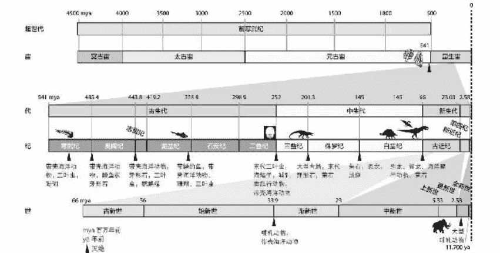

图2.1 地质年代表分为不同阶段的层次结构。通过大量的标志（包括物种的灭绝）确定边界

化石也是有用的标记。最理想的标准化石是一种常见的、进化迅速的化石。例如，三叶虫被广泛用于确定寒武纪时代。三叶虫的种类很多，有些先于其他物种进化，有些早于其他物种灭绝。任何含有这些化石的特殊组合岩石，都必须在这些生物生存的特定时间间隔内形成。许多种类的化石在生物大灭绝后就消失了，这提供了其他明确的信号。

另一个现代标志是一些岩石所具有的弱磁场。火成岩的剩余磁化强度显示了它凝固时地球磁场的方向。对地质学家来说幸运的是，地球的南北两极在其历史上已经多次互换位置。正磁和反磁的周期长度不同，因此它们形成了一种独特的模式，可用于对比来自世界各地的岩石序列。

利用这些标志，地质学家可以把岩石序列放在地层尺度的正确位置。他们还比较了全世界同时代的岩石序列，然后选择最完整、层次分明、最有用的化石。地质时期之间的边界，将成为全球年代地层单位界线层型剖面和点位，或者称为“金钉子”（见第9章）。

### 放射性测年

在地层尺度上为一系列岩石找到一个位置是一回事，给它按确切时间顺序排列的日期则是另一回事。确定岩石年龄的最佳工具是基于放射性同位素衰变的放射性定年法。

地质学家使用的自然时钟是这些同位素的“半衰期”，即样品中的一半发生核衰变所需的时间。如果你从100万个半衰期为100年的同位素原子开始，那么100年后只剩下一半，再过100年后将变为1/4。因此，随着时间的推移，岩石所含的原始放射性同位素将减少，而衰变形成的同位素将增加。

地质年代测定需要放射性同位素，这种同位素非常普遍，半衰期很长，与岩石本身的年龄相当。一种选择是铀、钍同位素家族，它们最终会衰变为铅。最常见的是铀-238，其半衰期为45亿年，衰变为铅-206。可靠的辐射测量数据显示年龄误差在0.25%以内，对于1亿年来说，误差为25万年。这些日期为地质学家校准地质年代表上的时间点提供了可靠的方法。

辐射定年法虽然功能强大，但有很大的局限性，特别是不能给出沉积岩沉积的具体日期。但并不是说完全没有用，因为熔岩流将比它下面的岩石要年轻，而比它上面的沉积岩要老。熔岩是一种火成岩，适合用放射性定年法，所以可以确定它形成的年代。

### 年代序列

早期地质学家选择第一个生命化石当证据作为寒武纪的开始。他们把在此之前的整个时代称为“前寒武纪”。后来，地质学家发现了更早的生命迹象，但在地质年代表上并没有修改前寒武纪与寒武纪之间的界限。它的标志是硬壳动物的出现。

前寒武纪被划分为超世代，包含三个“宙”，是地质年代表上最长的通用划分。

它们是冥古宙、太古宙（意思是“起源”）和元古宙（“早期生命”）。最近的一次——也就是现在所处的时代——是在5.41亿年前开始的，称为显生宙（“可见生命”）。

显生宙被细分为三个“代”：古生代（“早期生命”）、中生代（“中期生命”）和新生代（“近期生命”）。地质学家对显生宙的了解比早期的太古宙多得多。早期的地质学家根据他们在化石记录中看到的变化来划分这些区域。我们现在知道，有几个明显的分界线标志着全球灭绝事件，在这些事件中，大量物种在地质时代的一瞬间消失。

到目前为止，最糟糕的是在古生代末二叠纪末期的生物大灭绝。它消灭了80%～90%的陆地和海洋物种。但它为中生代进化成主宰地球的恐龙开辟了道路。6500万年前的中生代末期，在一颗小行星撞击地球之后，恐龙也灭绝了，但鸟类幸存下来。这反过来又使包括灵长类在内的第一批哺乳动物繁盛起来。

“代”被进一步细分为几个“纪”，这些时期大多以特征性岩石或它们出现的区域命名。英国地质学家是这项研究的中坚力量：寒武纪以罗马语中威尔士的名称Cambria命名；奥陶纪和志留纪以威尔士的部落命名。泥盆纪时期的岩石，你猜对了，是在德文郡发现的。

时间持续数千万年，因此地质学家把它们分成更小的部分，称为“世”。这些细分中的大多数只对专家很重要，除了新生代之外，新生代由于较年轻，岩石中日期的分辨率更好。现在的“世”变短了，反映出我们对最近发生的事件有了更多的了解。全新世只跨越了过去的11000年，基本上是自欧洲和北美最后一次大冰原熔融以来的时间。

### 地球的漫长时光

地球有着悠久的历史，其间经历了一些惊人的变化。你会感叹今天的地球有着壮观的自然特征，但如果与过去相比，它们就不值一提了。以下是我们地球上曾经出现过的七大奇迹。

### 山高，水深（10亿年前）

10亿年前，当地球的陆地融合为一个叫作罗迪尼亚的超大陆（见第5章）时，世界与现在截然不同。那时所有的生命都是单细胞、完全水生的，所以罗迪尼亚广阔的土地一片荒芜。它缺乏生物多样性，但有广阔的河流系统和山脉。

大约12亿年前，当罗迪尼亚崩塌时，大部分地壳被抬升，就像现在印度板块和欧亚板块之间的持续碰撞正在形成喜马拉雅山一样。它们可能不比今天的山高。芝加哥大学的地质学家戴维·罗利认为，风化作用在山脉形成的过程中侵蚀了山脉，重力决定了地壳在不发生屈曲的情况下能承受多少载荷。这也就意味着，珠穆朗玛峰已经到达了地球上的山峰所能到达的高度极限。

但是，从另一个角度看，罗迪尼亚的山脉非同寻常。想象一下，把安第斯山、落基山脉、喜马拉雅山、阿尔卑斯山、阿特拉斯山和乌拉尔山脉连接在一起，就接近了罗迪尼亚的主山脉的长度。来自渥太华的加拿大地质调查局的罗伯特·雷伯德说，它的长度可能达到15000～20000千米，范围覆盖了整个超大陆。在北美和欧洲，包括阿巴拉契亚山脉和苏格兰高地的部分地区，仍然可以找到被侵蚀的遗迹。

就像今天的安第斯山脉和喜马拉雅山脉造就了壮观的河流一样，罗迪尼亚山脉也造就了宽阔的河流——但有很大的不同。雷伯德说，由于没有植被来限制河流，因此它们在荒芜的土地上无拘无束地流动。今天，在无植被的北极高纬度地区，存在着类似的河流系统，其特征是编织成许多较小的河道，但在罗迪尼亚超大陆上，它们要大得多。“它们的长度和宽度远远超过亚马孙河，而且为内陆海提供的补给比我们现在地球上任何地方都多得多。”雷伯德说。他和他的同事已经在北美洲另一边3000千米外的罗迪尼亚山脉以及印度、南极洲、斯堪的纳维亚和西伯利亚发现了沉积物。

大约7.5亿年前，罗迪尼亚开始分裂，把它广阔的山脉分裂成碎片。大约3亿年前，当陆地重新组合成下一个超级大陆联合古陆时，陆地已被植被覆盖。因此，虽然联合古陆可能也有绵亘千里的山脉，但罗迪尼亚的大河在地球历史上可能是独一无二的。

### 雪球地球（7亿年前）

今天，如果你想欣赏赤道附近的冰川，你就必须登上肯尼亚山或者厄瓜多尔安第斯山脉空气稀薄的高峰。但是在大约7亿年前，你不需要这么费劲。事实上，在当时你很难找到一个没有被冰雪覆盖的地方。

在一系列的“雪球地球”事件中，这颗行星多次被冰层覆盖。其中最大的一次，是始于7.165亿年前的斯图尔特冰期。在很短的时间里，地球上的陆地和海洋都被冰层吞没了，冰层最终厚达数千米。在随后的5500万年时间里，地球一直保持这种冻僵的状态，它简直就是一个雪球，类似于今天的南极洲，而它从南极到北极都完全被冰雪覆盖。

至少，这是自20世纪90年代初帕萨迪纳加州理工学院的约瑟夫·柯尔什维克提出雪球地球的概念以来，许多地质学家开始接受的一种观点。根据他的说法，热带纬度地区沉积的古冰川沉积物——例如在加拿大西北部，距今7亿多年，跨越赤道——向我们讲述了一个关于1.5～3千米厚的海冰的故事。

同一地区也为斯图尔特冰川作用的成因提供了线索。富兰克林大火成岩省是一个面积超过100万平方千米的火成岩地区，可以追溯到冰川层形成之前不久。似乎是一座超级火山将大量的玄武岩带到地表，在热带雨林中迅速风化，这是一个化学过程，吸收了大量的温室气体二氧化碳（见第6章），气温骤降，极地冰盖开始形成。

从那以后，事情的进展异常迅速。随着海水的冷却和冻结，水蒸气（一种强大的温室气体）的蒸发量越来越小。大冰冻加速向赤道移动，使那里的温度降到-50℃，而这样的寒冷气候只有在今天的南极深处才能遇到。

也许是因为它纯粹的戏剧性，雪球地球的想法仍然有争议。一些地质学家选择了一种不那么苛刻的“雪水交融地球”变体。但柯尔什维克认为，冰川沉积物的纯粹地理分布，现在可以追溯到同一时间，这也说明了它们的故事。

这并不是地球第一次被冰覆盖，另一个雪球事件在24亿年前就已经开始了，当时分解水以促进光合作用的微生物从大气中吸收了大量的二氧化碳。这些事件凸显了地球气候、地质和生物圈之间的联系是多么敏感。

回到斯图尔特，最终，从海底火山中渗出的二氧化碳开始使地球再次变暖，冰层上的裂缝仍然敞开着。然后，雪球地球几乎和开始时一样快结束了。

### 最干燥的沙漠和最潮湿的季风（2.5亿年前）

联合古陆就是这样一个地方，有着极端的景色和更极端的天气。地球最近的超大陆大约在3亿年前形成，并在1.25亿年后开始分裂。在2.5亿年前的鼎盛时期，它形成了一个巨大的“C”字形，温暖的特提斯海依偎在曲线内。在地球的另一边，我们所能看到的只有一片未被破坏的广阔海洋，即泛大洋。

靠近赤道的大陆中心是一片沙漠，但如今地球上最大的沙漠却一无所有。这个时间点是在毁灭性的二叠纪末大灭绝之后。有一种观点认为是超级温室气候，这种气候持续了几百万年，使联合古陆的大部分内陆地区无法居住。据英国利兹大学研究古环境的保罗·威格纳尔说，气温达到50℃是正常的。

在这片巨大的红色沙漠北面矗立着巨大的盘古中央山脉，它们是联合古陆最极致的景观——巨型季风，它沿着特提斯海边缘前进。当潮湿的海洋空气被吹到陆地上并被强迫上升时，水汽经过降温冷凝，变成雨水，季风雨就出现了。威格纳尔说，当时的海水可能很温暖，大约为40℃。空气也很热，而且越热的空气所含的水分越多。山的坡度将迫使大量温暖潮湿的空气上升，使其迅速冷却，并引发洪水，相比之下，今天的季风看起来像是毛毛雨而已。

### 火山末世（1.35亿年前）

欢迎来到大熔炉，熔炉又名巴拉那-伊滕德卡热点，如果恐龙没有抓住你，可能火山会困住你。联合古陆的南部残余称为冈瓦纳大陆，它已经花了数百万年的时间将我们现在所知的南美洲与非洲分离开来。裂谷作用是造成这场炽热大灾难的因素之一。当裂谷向北移动时，地壳变薄了。与此同时，地幔的过热部分正在升温，从下方加热地壳。最终，岩浆冲破障碍，并淹没了大地。

大熔炉现代被称为巴拉那-伊滕德卡火成岩区，广阔的玄武岩覆盖了今天的巴西、乌拉圭、巴拉圭、阿根廷、纳米比亚和安哥拉共130多万平方千米的地方。在很大程度上，这就像火山活动创造了冰岛——被动、温和，几乎没有什么爆发力。但这一时期不时爆发出一系列威力无穷的火山。火山爆发指数最大值为8，被描述为“末日灾难”（“超大规模”级别之上），它是为任何喷出超过1000立方千米岩石的事件而设置的，正如75000年前印尼的超级火山多巴所做的那样。这个巴拉那-伊滕德卡火成岩区可能在几百万年的时间里至少发生了9次“末日灾难”级的喷发。据我们所知，它们是地球历史上最猛烈的喷发之一。

根据我们今天在南美洲和非洲看到的情况，其中喷发最大的一次至少喷发出8600立方千米的岩石，甚至可能多达26000立方千米。如果把飞到远方的火山灰和气体也计算在内，这些物质的厚度足以将整个英国覆盖100米。如此规模的事件会焚烧方圆数百千米的范围，让一切室息。一次喷发产生的熔岩绵延长度可达650千米。

被吹到高层大气中的火山灰，体量之大几乎令人难以想象，在接下来的几年里，冈瓦纳大陆笼罩在一片黑暗之中。伦敦帝国理工学院的萨拉·多德说，火山灰以及火山喷发产生的硫酸盐气溶胶，将太阳辐射反射回太空，使世界迅速陷入“火山冬天”。植物大规模死亡，整个地区的食物链被破坏，无数恐龙因此失去生命。

### 北极热浪（5500万年前）

在过去的几百万年里，地球逐渐变得越来越热，此时正处于行星热浪的边缘，这种热浪很少出现，北极地区炎热潮湿，连棕榈树都在这里生长。这是古新世—始新世极热事件，或者称为PETM。

即使没有达到温度计的极限值，这里还是相当温暖的，两极基本上没有冰，海洋最深处的温度比今天高8℃，海平面大约高出70米。像鳄鱼一样的鳄龙在北冰洋游动，它们在离北极如此近的地方繁衍生息，这意味着即使在冬季永远黑暗的情况下，水温也一定不低于5℃。（今天北极的冬季平均气温徘徊在-34℃左右）。长得像河马的冠齿兽潜伏在海边温暖的沼泽森林中。

在几百万年前，淡水龟出现了，这看起来很奇怪，直到你发现北极盆地几乎完全被陆地包围。河水从陆地上流出，在较重的咸水上形成了地球所见过的最大的湖泊之一。世界的另一端也许正在经历炎热的天气，水温应该是23℃。英国埃克塞特大学的凯特·利特勒指出，在古新世—始新世极热事件中植物生长的高峰期，南极洲出现了蕨类植物，所以那里很热。

所有这些升温现象都是大气中温室气体浓度大幅上升的结果，尽管没有人知道是什么造成的。一种原因可能是强烈的火山活动，另一种原因可能是在海底沉积的固体甲烷熔融了，在一场规模巨大、充满气体的火山喷发中释放出了它们的负荷，或者南极的永久冻土熔融了，释放出了大量的二氧化碳，不管是什么原因，经过数百万年的逐渐变暖，温度在仅仅20000年内突然上升了至少5℃。

对生活在海底的生物来说，这是一个艰难的时期，那里正在发生灭绝事件，但陆地上的生物似乎正在蓬勃发展。在东南亚茂密的森林里，一种新的哺乳动物刚刚进化出来：灵长类动物。它们看起来有点像眼镜猴或灌丛婴猴，吃昆虫，在非常非常遥远的未来，将产生唯一一种占据地球所有角落的动物：人类。人类物种的出现也是唯一一个有能力触发比古新世——始新世极热事件更大能量的事件：相似的变暖量，但只用了1/100的时间（见第10章）。

### 地中海（533万年前）

今天，站在欧洲大陆最南端的塔里法角，直布罗陀海峡对岸的摩洛哥山脉清晰可见。这片繁忙的水域，只有14千米宽，是大西洋和地中海之间的门户，也是非洲和欧洲大陆边界最接近的地方。

然而540万年前的情况却大不相同。那时只有广阔的大西洋，却没有地中海。取而代之的是一个巨大的盆地，闪烁着盐晶体，布满了高盐度的湖泊。这个凹陷盆地最低点在海平面以下2.7千米。那将是一个相当壮观的场面：今天地球陆地的最低点位于死海盆地，海拔仅-430米。

在墨西拿盐度危机最严重的时候，构造运动关闭了直布罗陀海峡，切断了地中海。在炎热干燥的气候下，海洋完全蒸发几乎需要1000年的时间。我们至今仍能找到这一时期的遗迹，海底和沿岸都有厚厚的盐和石膏沉积层。盆地干旱没有持续多久。随着时间的推移，气候变得越来越凉爽湿润，流入盆地的河流把它变成了一种湿地，称为海洋湖泊，或“湖海”。但是，在西方，一场灾难正在酝酿之中。

大约533万年前，一场构造沉降、侵蚀和海平面上升的综合作用开始重新打开通往大西洋的大门。赞克勒期大洪水——以其发生的地质年代命名——可能开始得很慢，数千年来逐渐填满了盆地的10%左右。但根据西班牙巴塞罗那豪梅·阿尔梅拉地球科学研究所的丹尼尔·加西亚·卡斯特利亚诺斯的说法，它以堪比《圣经》中大洪水的规模而结束。流入速度猛增，短短几个月内就完全填满了整个盆地，使地中海每天上升约10米，每秒有10亿立方米的水呼啸而过，是今天亚马孙河流量的5000倍。这实在让人惊叹不已。

令人惊讶的是，这一切都有可能再次发生。没有足够多的河水流入地中海来补偿蒸发：它需要大西洋来保持它的水位。如果构造作用力使海峡封闭，则地中海最终会再次干涸。

### 被淹没的天堂（1万年前）

从英格兰德东海岸克罗默的维多利亚码头上看，北海显得荒凉而没有吸引力。但要往前1万年，那将是一幅完全不同的景象。在全新世的黎明，随着最后一个冰河时代的结束，海平面比今天低很多，英国与欧洲大陆连接在一片肥沃的平原上，一直延伸到丹麦，这个地区的名字叫多格兰。

多格兰被认为是史前沼泽、湖泊、河流和人类的天堂。2008年，布拉德福德大学考古学家文森特·加夫尼和他的同事利用挪威一家石油公司采集的地震勘探数据重建了这个失落的世界。其结果是绘制了一幅覆盖面积为23000平方千米的地图，大致相当于威尔士的版图。

在它的南端，外银坑湖，现在是北海海底的一个凹陷区，从东部的泰晤士河和西部的莱茵河分别向其注水。多格兰的人们聚集在它的海岸上捕鱼、狩猎、采集浆果。加夫尼形容它是“狩猎采集者的黄金地段”。如今，北海拖网渔船偶尔会从海床上挖掘这些古人的踪迹——比如用鹿骨做成的矛头，但对他们的了解并不多。

我们所知道的，他们是气候变化的受害者。随着全球变暖和冰川熔融，海平面每世纪上升约2米，逐渐吞没低洼地区。几千年来，多格兰岛变成了一个群岛。然后，大约8150年前，一场巨大的海啸袭击了挪威，这次海啸是由现代挪威海岸附近一场巨大的海底滑坡引发的，这场滑坡被称为斯托瑞加滑坡。2014年的一项研究估计，可能是地震引发的3000立方千米的沉积物崩塌。据负责这项研究的伦敦帝国理工学院的约翰·希尔说，它引发了一场巨大的海啸，席卷了多格兰岛的剩余部分。多格兰岛剩余的部分都会被淹没，导致希尔和其他人认为，斯托瑞加滑坡为其人民敲响了丧钟。最终，英国与欧洲大陆的文化分离将持续数千年。

## 3 地球内外

地球就像一颗洋葱，从它的土壤表层到铁质核心可以分为不同的层。这些分层的大部分我们都无法进入实地探索，但这并没有阻止我们探索的脚步，通过一些巧妙的实验方法和对自然更深层次的理解，我们发现它隐藏的秘密。

### 向下，再向下

“在7月来临之前，斯卡尔塔利斯的影子会落在斯奈菲尔的约库尔火山口，勇敢的探险者从这个火山口下去，你就能直达地心。”阿尔纳·萨克努塞姆写道。

在这些文字的指引下，奥托·黎登布洛克朝着冰岛的斯奈菲尔火山走去，然后向下进入地球。一到地下，他就遇到了深海、史前生物、闪电风暴和巨大的昆虫。

这是1864年儒勒·凡尔纳在《地心游记》中所写的。要是能这么简单地探索地球内部就好了。到目前为止，我们只钻穿了地球外壳的1/3。除此之外，我们还必须以冲击波及其穿过不同密度岩石的方式来推断地球外壳的组成。

### 地震波

具有讽刺意味的是，最有价值的冲击波竟然是来自那些最具破坏性的事件——地震。地质学家能够测量地震波从震中位置传播到全球不同地点所需的时间，从而揭示了地球是分层的，就像洋葱一样。外面是薄薄的地壳，它的深度还没有贴在足球上的邮票的厚度大，下面是地幔，占地球体积的82%以上，更深处是非常致密和炽热的地核。

地震产生的冲击波在各个方向上传播，遇到不同密度的岩石会反射或折射。如果岩石密度较大，压力波就会加速前进；如果岩石密度较低，压力波就会减速。通过确定这些地震波穿过地球的路径和速度，地质学家可以确定我们脚下数千千米深处岩石的密度和厚度。

爱尔兰地球物理学家罗伯特·马利特在19世纪末开始从事地震学的研究。研究人员发现，地震主要发出两种类型的波：初至波，或称为P波，与声波相似，它们使传输介质交替地压缩和膨胀，能通过固体、气体和液体传播；次至波，也被称为S波，质点的振动方向垂直于波的传播方向。这意味着它们只能通过固体，而液体和气体没有刚性来支持它们的横向运动。

当南斯拉夫的地球物理学家安德里亚·莫霍洛维奇分析1909年克罗地亚地震的记录时，他发现了四个地震脉冲。靠近震中的地震仪记录了传输缓慢的S波和P波。在更远的距离处获得的记录中，这些信号消失得很快，取而代之的是传输更快的S波和P波。

莫霍洛维奇解释说，慢波是通过地壳上层传到地震仪的。然而，速度较快的波，一定是通过了下面一层密度更大的岩石，这层岩石使它们偏转并增大了速度。

他总结说，密度从2.9克/厘米³ 到3.3克/厘米³ 的变化标志着地壳和地幔之间的边界。这一边界平均位于洋盆之下8千米，大陆之下32千米，现在被称为莫霍不连续面，简称“莫霍面”。

### 地球内部的阴影

随着地震学家从地震中采集到越来越多的记录，他们注意到了一个没有冲击波的“阴影区”，在距离震源105° 到142° 之间（见图3.1），超过142°，地震波又出现了。关于这种结果的唯一一种解释是，地震波从固体进入液体，阻止了S波，使P波的传播速度减慢并发生折射。在2900千米深处，密度从5.5克/厘米³ 变化到10克/厘米³ ，被确定为地幔和地核之间的边界。

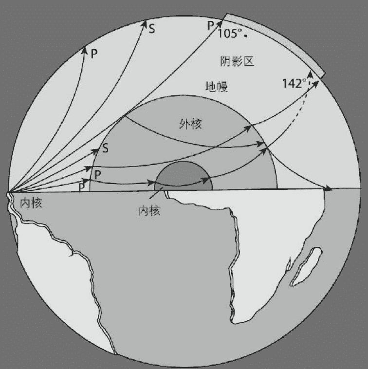

图3.1 地震波被不同密度的岩层阻挡或折射。液态的外核从震源开始以105° 投射出一个阴影

后来，在“阴影区”发现了更微弱的波。1936年，荷兰地震学家英格·莱曼提出，在进入地核2200千米处，密度发生了进一步变化。这种变化会加速P波的传播，并使其中一些波弯曲，使之出现在“阴影区”。她断定在地球内部是非常致密的固态内核，我们估计其密度从12.3克/厘米³ 变化到13.3克/厘米³。

### 极端条件

我们现在看到的地球图片是一系列同心层，它们逐渐向中心聚集（见图3.2）。两个相反的因素控制着这个密度。

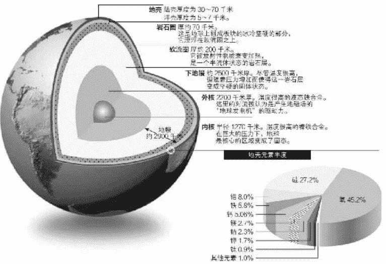

图3.2 地震勘探使我们对地球的层状结构有了很好的认识。地壳元素丰度是通过化学分析得出的结论

首先是温度，它可以使岩石软化或发生熔融。由于岩石中放射性元素的衰变所产生的能量，地球内部大部分地区都是热的。在地球的中心，温度可能达到3000℃，在地幔-地壳边界下降到375℃。其次是压力，它倾向于使岩石凝固。越到深处，上覆岩石的重量就越大，压力也就越大。

实际上，靠近寒冷的地表，岩石主要是脆性固体。这个岩石圈，包括地壳和上地幔，延伸到大约60千米。在这一点上，地震波减慢，表明密度下降。这就是“缺乏强度”的软流圈，在那里放射性热量不易散失，岩石容易熔融。它以太妃糖一样的稠度延伸到近200千米。在软流圈之下，地震波在大约2100千米的深度内，先加速后减慢。这就是“中间圈”，在这里，压力克服了不断增加的热量，使岩石变得更坚硬，因此它们只能非常缓慢地“蠕动”。在S波逐渐消失的地幔核边界，温度起初高到足以抵消巨大的压力，在大约2200千米的范围内，外核是液态的。但在中心，压力再次占据优势，形成半径1270千米的实心内核。

### 神秘的地幔

了解地球内部的物理状态是一回事，知道它是由哪些物质组成的，却是另一回事。地壳，我们可以分析。在大陆地区，我们发现了大量的硅和铝，这些元素与氧结合构成了最常见的岩石——花岗岩。在海洋下面，在大陆花岗岩之下，我们发现了以硅、铁和镁为主的玄武岩。

我们能够确定的东西也就到此为止。约占地球质量2/3的地幔，仍然是未知领域。我们没有原始样品。虽然有一些来自地壳下面的岩石到达地表，但它们都受到了污染。例如，被称为地幔结核的稀有岩石从火山中喷发出来，表明地幔是由包括橄榄石和辉石在内的矿物组成的，这些矿物仅在高压下形成，含硅少，但含镁和铁多。

而且，在洋底的某些地方，会暴露一些地幔岩，但与海水的接触使它们的成分发生了巨大的变化。没有新鲜的样品，地质学家甚至连地幔到底是由什么构成的、它是如何形成的，以及它是如何运转的这些简单事实都难以确定。

相反，他们不得不利用从实验室中获得的间接证据和知识拼凑出有关地幔的理论。例如，硅、镁和铁存在于上地幔中的橄榄石和辉石等矿物中，而在更深的压力下，原子会重新排列成更致密的高压矿物，从而改变岩石的组成。在地下幔中，矿物很可能分解成简单的氧化物。

进一步的线索来自陨石。它们是由与我们星球相同的宇宙碎片锻造而成的。石质陨石可能代表地幔状物质，而铁陨石代表地核物质。这些金属质陨石主要含有铁、硫化铁、镍、铂和微量铱元素。

### 来自地下的信息

发现地幔的成分将极大地提高我们对地球化学组成的认识，并为我们提供有关其形成条件的线索。探索地幔奥秘的一种方法是使用中微子，这是一种不带电的、近似无质量的粒子。它们——或者更确切地说是一种叫作电子反中微子的反物质变体——随同地球内部深处岩石中的铀、钍和其他放射性同位素的衰变大量涌出。

同铁、硅等其他所有元素一样，铀和钍也存在于地球形成时的太阳星云中，尽管数量较少，但在不同温度下会浓缩为不同的数量。如果我们知道有多少铀和钍进入了地球的制造过程，我们就会知道原始环境是什么样的，并且估算出在地球内部能发现多少其他物质。通过追踪铀和钍在地幔中的分布，无论是均匀分布，还是以不同的组合方式成片分布，或是以层状分布，我们都可以了解我们星球的内部动力学。

没有比计算不同放射性同位素产生的“地球中微子”更好的方法了，由于它们几乎不与正常物质发生相互作用，因此这些粒子可以在地球内部畅通无阻地穿行，至少大体上，在它们离开时，能够让靠近地表的探测器拦截它们。实际上，同样的轻质性使得中微子也更容易通过我们的探测器。捕猎它们要有技巧和足够的耐心。

幸运的是，我们花了十多年的时间开发这些探测器。神冈流体闪烁体反中微子探测器（KamLAND）于2002年在日本中部城市飞驒市附近投入使用，它由1000吨透明液体组成，当被中微子击中时，会发出闪

光。它位于地下1千米深处，能更好地屏蔽宇宙射线 μ 子，其信号类似于中微子的信号。

2005年，神冈流体闪烁体反中微子探测器发现了第一个来自地球内部的微弱电子反中微子信号，但它被附近核电站发出的反中微子的嘈杂信号淹没了。2007年，探测器升级加上一座最大的核电站暂时关闭，使地球的信号得以穿透。到2009年年底，神冈流体闪烁体反中微子探测器已经记录到106个电子反中微子，带着来自地球内部铀和钍衰变产生的能量。

博雷西诺探测器的实验也有收获，它位于意大利中部的格兰萨索国家实验室，这个较小的探测器是用来从太阳核聚变过程中提取中微子的。结合这两个实验的数据，仅通过地球中微子就足以产生第一个具体的地球物理预测：地幔和地壳中铀和钍的衰变，对从地球内部逸出的热量贡献了大约20太瓦。

如果我们想要勾勒出地下究竟是什么，就需要通过这些数字。地球通过其表面辐射出约46太瓦的热量，来自两个来源：放射性衰变产生的“放射源热量”；地球形成过程中由于粒子碰撞和铁沉入地核而储存的“原生热量”。确定每种来源的地表热量各有多少对我们勾勒地球图景有着广泛的影响。

例如，如果地幔中的物质在缓慢对流，或者它们之间的热量传导有限，则从地球内部输送到地表的原生热量就比较少。如果是这样，地球热量中最大的一部分——30太瓦甚至更多——必然是放射源热量。中微子实验表明，真实的数字较低，这意味着地幔的混合是相对彻底的。

### 矿物谜团

辐射热通量还表明，这颗行星中钾的总含量约为十亿分之二十。
裸露的地幔岩石含有类似的钾，这表明它们确实代表了地幔，并支持了整个地幔有效混合的观点。但它也隐藏了一个谜团。暴露的地幔岩石以镁铁硅酸盐矿物橄榄石为主，其钾含量明显高于一种名为顽火辉石球粒陨石的岩石。长期以来，这些陨石被认为是构成地球物质的代表，但它们主要由另一种硅酸盐矿物辉石构成。这就提出了一个问题：这种以辉石为主的矿物究竟藏在地幔深处的什么地方？或者说地球的物质组成与顽火辉石球粒陨石有什么不同？

地幔中橄榄石与辉石的比例对于确定地球形成于太阳星云的时间和地点至关重要。橄榄石会在比辉石稍高的温度下沉淀出来，所以会有更多的橄榄石靠近太阳，或者在温度较高的行星构造过程中更早出现。

我们离答案还有一段距离。由于迄今为止发现的地球中微子的数量，对辐射热通量的估计有很大的浮动范围：20太瓦的数字有大约9太瓦的误差，这就很难忽略地幔成分或混合的任何情况。仅仅依靠神冈流体闪烁体反中微子探测器和博雷西诺不太可能使争论停下来。

第三种探测器，在2018年开启，可能会对此产生决定性的影响。这就是SNO+，位于加拿大安大略省萨德伯里中微子天文台的地下深处。它的大小和神冈探测器差不多，但由于它位于地下岩层2千米深处，因此可以更好地免受宇宙射线μ子的影响。它周围没有核反应堆。总之，不管怎样，在背景值较低的情况下，SNO+应该能够大量地观测地球中微子。

这只是个开始。理想情况下，我们要绘制地球中微子的起源图，从而得到一个更精细的图片，用以说明铀和钍的分布以及地幔的均匀性和混合性。这意味着从地壳和地核等其他来源中筛选出地球中微子，这需要建立一个探测器网络，寻找从不同地点、不同角度射出的中微子。这将使我们能够发现更多关于地幔特殊区域的信息，例如非洲和太平洋下面的“超级地幔柱”，它们被用来解释火山活动的异常区域（见第5章）。

当地震波通过这些超级地幔柱时传播速度急剧下降，表明这里的黏性较小，温度较高。这可能是因为它们含有大量衰变的铀和钍。如果真的如此，它们应该是地球中微子的热点。

### 由浅入深

不只有宇宙射线，太阳和核反应也可以混淆地球中微子信号。要绘制地幔内部的活动图，我们还需要排除地壳和地核中的中微子。与地幔相比，地壳非常薄，但它与地下探测器更接近，这就意味着它的地球中微子信号可以压倒地幔的信号。

为了减少这种噪声干扰的影响，加拿大的研究人员开始研究SNO+中微子实验周围的地壳岩层及地幔边界，目的是估算铀和钍的含量，以及它们衰变后可能产生的中微子数量。

地核中释放的中微子怎么处理？它们也会产生噪声干扰吗？不久前，地球物理学家认为，地核中可能有足够的铀，使其成为一个巨大的核裂变反应堆。但模拟显示，在高温高压下充满岩浆海洋的早期地球中，铀总是倾向与地幔状岩石中的发现元素在一起，而不是地核中的铁和镍。

### 地球的心脏

地震波测量、计算机模型和模拟地核极端条件的室内实验都提供了地球最深处事物如何工作的画面。

通过地震勘探，我们知道地核处于2890千米以下，其半径为3470千米。它由两层组成，外层为液态铁质，内层为固态镍铁物质，大小与月球差不多。

但地核并非一直都是如此。最初，这颗行星只是一个没有明显结构的大杂烩。然后，最重的元素，主要是铁和少量镍，向中心移动。具体发生的时间和方式仍有待研究。有一种观点认为，地核是在一次朝向中心的岩崩中突然形成的，另一些人则认为铁慢慢地流下来形成了地核。

在地球深处的火山岩中测得的放射性同位素表明，地核形成于地球0.3亿～1亿岁时。35亿年前，液态铁核中的旋转运动已经形成了磁场。然后，在15亿到10亿年前，地核的中心冷却到足以结晶成一个固体内核。

围绕地核的一个谜团已经解开。一段时间以来，人们都知道地震波在地核东侧的传播速度比西侧快，但没人能搞清楚原因。现在的模拟表明，这很可能是由于外核中液态铁的旋涡从核幔边界附近拉下较冷的物质，并将其贴在固体内核上。在过去的3亿年里，铁旋涡的大部分处于亚洲之下，导致内核东面比西面增大了100千米左右。这可能对地球磁场产生影响，大多数研究人员认为，地球磁场是由液态内核的对流产生的。一些人认为，随着时间的推移，由不断增长的内核引起的湍流，久而久之，可能会使磁场不太稳定，更容易翻转，导致地球南北磁极互换位置（见第4章）。

当这种情况发生时——就像过去曾发生过的一样——地球暂时失去保护，无法抵御来自太阳的高能粒子流（太阳风）的影响。这样的结果可能是灾难性的——最乐观的情况是，它可能破坏我们所有的电子设备；而最坏的情况，它可能会破坏我们赖以生存的大气层。这究竟是好消息还是坏消息，取决于你怎么看，因为没有人知道磁场翻转什么时候会发生。

### 隐形盾牌

地球磁场被认为是由最基本的物理过程产生的。流经液态地核的电子产生电流，进而产生磁场。换言之，地核是一个巨大的、自我维持的发电机。

它可能很简单，但有一个问题。近年来，相对而言，证据表明发电机肯定是一种新现象。然而，古老岩石中的磁性清楚地表明，地球的大部分历史时间段都存在着磁场。为调和这一明显的悖论，我们不得不重新思考地球内部发生的事情。

正如我们看见的，公认的观点是，随着早期地球的冷却，它的致密铁慢慢下沉到中心，在那里被高温熔融。接下来，热对流开启——热流体上升和冷却稠密液体下沉的过程。这种运动使发电机运转起来。

然后出现了一个复杂的情况。地球冷却到足以使一些地核的铁水凝固。在地球内部极端的温度和压力下，地核开始由内而外冻结。据大多数人估计，这一过程始于15亿年前。今天，内核是一个半径超过1200千米的实心铁球，并且随着地球的冷却而不断增大。

幸运的是，内核的冻结启动了另一个效果——使地核磁力发电机持续运转。随着内核的增长，它会排出任何较轻的元素。当盐水结冰时也会发生同样的事情：盐不适合冰的晶体结构，所以它会被排出，让淡水冰漂浮在咸水上。

同样，在地球内部，固体内核几乎是纯铁，而周围的液体则含有铁、镍以及少量硫、氧和其他轻元素。这些额外的成分使内核周围的液体密度降低，所以它会上升。远离内核的地方，较重的富铁物质下沉，使外核处于一个被称为成分对流的漩涡中。因此，主流观点认为，在地球历史的大部分时间里，热对流和成分对流一直维持着发电机的转动。但问题也是从这里开始的。在过去的几年里，研究人员开始怀疑是否曾经发生过热对流——或者说，如果发生了，热对流是否会足够强大以驱动地球的磁场。

问题在于热量的传播方式。对流需要温差：在一壶沸水中，底部比顶部热。只有当水是热的不良导体时，这种情况才会发生。良导体能迅速使温度平衡，并阻止对流。还有一个问题：越来越多的证据表明，地核是一种比我们原先认为的更好的导体。

2012年，两个独立的计算机模型预测，液态地核的热导率肯定是先前认为的两倍。然后，在2016年，日本东京工业大学广濑敬的研究小组测量了相当于地核压力之下的铁的热导率。结果与这两个预测相符，表明地球磁场只有在15亿年前地核第一次凝固时才能出现。

但这不可能。我们知道地球磁场早在那之前就已经存在了，因为它的存在被记录在古老的火山岩中：当熔化的岩石凝固时，它的磁性矿物与地球的磁场一致（见第4章）。有确凿的地质证据表明，这些岩石中的史前磁场至少有34.5亿年的历史，这就抛出了一个难题：当热传导和成分对流都不能维持地核发电机继续运转时，会出现什么情况？

### 第三种形式

加州理工学院的戴维·史蒂文森和同事认为他们有一个解决方案，即第三种对流形式，不依赖内核周围的活动。相反，他们关注的是位于液态核外边界的事件。随着温度的降低，溶解在铁中的较轻元素会析出并被吸收到地幔中，留下的密度更大的液体随后下沉，从而引发对流。

目前正在确定这一过程的主要驱动因素，主要的嫌疑是镁或硅。镁不易溶于铁，所以很容易沉淀析出。但最初使它溶解时，需要非常大的热量，大概是地球形成时剧烈的碰撞产生的。硅更为丰富，因此很可能在地球的深处占据主导地位。广濑敬小组的实验表明，二氧化硅在地核中容易结晶，而不需要任何外部过程。他认为二氧化硅最有可能是这种新形式对流的驱动力。

甚至有些研究人员提出，对流根本不能驱动发电机。相反，地球的摆动旋转可能会晃动熔融的铁核，或者月球的引力可能会像引起海洋潮汐一样拖拽液态铁核。但这些观点并不被认为是主流观点。

似乎更有可能存在一种新的对流形式在地球深处起作用。尽管单凭这一点能否解决磁场悖论还没有定论，但幸运的是，我们不用等太久，因为这是一个快速发展的研究领域。

### 生命松软的外衣

我们在深入地球的过程中，忽略了一层无法回避的东西。这是我们大多数人每天都能看到的一层。然而，如果没有土壤圈——土壤——大多数植物将无法生长，支撑大多数动物（包括我们在内）的食物链将在其底部被切断，简而言之，陆地上的生命都将不复存在。

从行星的角度来看，土壤是一个巨大的界面带，覆盖了地球大部分的陆地表面，大气圈、水圈、生物圈和岩石圈都在这里交汇。这是一个迷人而重要的环境，也是一个非常复杂的环境。土壤不仅存在于这四个圈层之间的交汇点，而且它的存在还取决于它们之间的相互作用。

土壤是由固体组成的，这些固体物质中的一部分是岩石风化的产物，另一部分是生物活动的产物——腐烂的植物和动物残骸。土壤疏松多孔，固体物质和孔隙空间通常各占一半。孔隙中含有一定的水和空气，这取决于土壤的湿润性或干燥程度。

土壤是由多种作用综合形成的，例如，反复的冻融作用和风、水、冰的作用，物理风化作用将基岩破碎成为颗粒状，化学风化改变了岩石的矿物组成。土壤也产生于动植物分解的固体物质以及水中溶解的化学物质的运动。

土壤的关键功能之一是维持生命，而且土壤本身也充满了生命，大多数是肉眼看不见的微生物，更明显的是稍微大一些的动物，比如蚯蚓，以及生活在其中和上面的植物。所有这些生物活动都源于土壤提供生活必需品的能力：住所、食物和水。

对于植物和许多食用它们的动物来说，营养取决于它们所需的氮、磷、钾和钙等一些重要元素的摄入，而这些元素的量是不同的。岩石和矿物风化以及有机物质分解等过程将这些元素以溶解态释放到土壤的水中，供土壤有机体和植物使用，植物通过根吸收这些元素。

### 濒危资源

土壤形成的过程受环境因素的影响，如下优地质条件，当地的植被、气候和地形。这意味着，在不同地方，这些过程以不同的方式结合在一起产生各种各样的土壤。

土壤按其在垂直剖面（土壤剖面）中所显示的特征进行分类。例如，在温带地区，陡坡上针叶林下由砂岩形成的砂质矿物可能转变成灰壤，它具有典型的带状结构，这种结构是由水渗透造成的物质损失和再分配而形成的。在热带气候中，雨林下的强风化玄武岩可以产生深红色、富含氧化铁的氧化土。

土壤的分类系统和我们用来划分生命形式的分类系统一样精细。仅在美国，就有20000多种土壤类型已被编入目录。许多土壤正面临消失。事实上，据估计，超过1/3的地球表层处于濒危状态，而这并不是损失的全部。根据联合国2015年《世界土壤资源状况》报告，世界上大多数土壤的状况处于中等、贫瘠或非常贫瘠状态。每年被侵蚀流失的表土多达400亿吨，土壤中的养分正在枯竭，人为因素引起的盐渍化已经扩散到约76万平方千米的土地，这相当于巴西所有可耕种土地的面积。

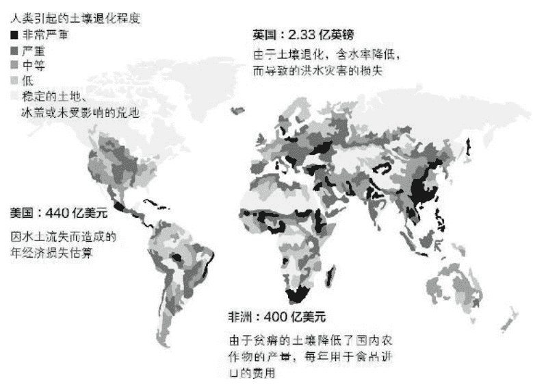

图3.3 世界每年都会失去一块面积相当于路易斯安那州的健康土壤。这会造成严重的经济后果

如果我们不减缓这种下降的趋势，所有可耕种的土壤可能在60年内全部消失。鉴于土壤给我们供给着95%的食物，并以其他几种令人惊讶的方式维持着人类的生命，这是一个巨大的问题。许多人认为，土壤退化是对人类最严重的环境威胁。

### 爆炸灭绝

质地突变的硬磐夏旱淋溶土是美国西部主要农业用地的一个土壤亚类。它濒临消亡，部分原因是它几乎不能直接用于农业：它有一种变质的倾向，形成一种致密、压实的硬质地层，排斥植物的根和水。深受其害的农民们用炸药把它炸开——这是一种不可思议的土壤灭绝方式，但只是众多方式中的一种。

### 来自土壤的服务

世界土壤的退化是一场缓慢演变的灾难，科学家们一直在为这场灾难发出警告。一直以来，我们对土壤重要性的认识并没有增强多少。土壤不仅能培育我们的食物，此外1克土壤中可能含有1亿个细菌、1000万个病毒和1000种真菌。这种显微镜下的“动物园”几乎是我们所有抗生素的来源，它可能是我们对抗抗生素耐药细菌的希望所在。例如，条件好的土壤可以抑制病原菌的生长。

土壤也是应对气候变化的好帮手。当土壤中的线虫和微生物消化动物尸体和植物残枝时，它们会锁定其中的碳。据估计，即使是在退化状态下，全球土壤的碳含量也是整个大气层的3倍。土壤退化还能造成水灾等其他损失。英国政府在2012年发布的一份报告显示，土壤退化导致的洪灾每年给国家造成的经济损失高达2.33亿英镑。

### 最大的威胁

濒危的土壤让生态学家感到紧张，到目前为止，土壤最大的问题是农业。在野地里，植物吸收的养分在死亡和腐烂时会返回土壤，形成丰富的腐殖质。但是人类往往不会将收获的作物中未使用的部分归还到田地里去，以补充这些养分。

我们早就意识到了这一点，并采取了一些措施，比如，让农田休耕，或轮作需要不同养分的作物，从而保持土壤平衡。种植豆科植物甚至可以向土壤中添加氮：它们的根部有根瘤菌，能捕获大气中的氮并将其转化为可吸收的硝酸盐。

但是随着人口的增长和农业的机械化，这些做法变得不太方便。在20世纪初出现的一种解决办法是，用哈伯-博世法生产硝酸铵，作为一种丰富的可用氮源。从那以后，农民们就一直用这种合成的肥料在他们的田地里耕作。

但在过去的几十年里，很明显这不是一个好主意。化学肥料释放污染物一氧化二氮到大气中，未能被植物吸收的多余部分经常被冲走，氮被输送到河流中，在那里它成为有害藻华的营养。最近，我们发现滥用化肥会伤害土壤本身，使其变酸或咸化。它还抑制真菌和植物根系之间的共生关系，甚至可以使有益的菌类相互对抗。

因此，在许多方面，肥料原本是为了给土壤增加营养，实际上却加速了它们的消亡。它们有利于植物的生长，但它们掩盖了土壤退化的性质和程度。更糟糕的是，当土壤失去肥力的时候，农民们会施加更多的肥料。

### 土壤退化的解决办法

大规模的退耕还林不太可能，那么还有什么办法可以拯救我们的土壤呢？

一种可能的解决办法是使肥料更智能。植物在需要氮的时候有效地“告诉”微生物，微生物通过从有机物中释放氮做出反应。2011年，加拿大渥太华卡尔顿大学的卡洛斯·蒙雷亚尔和他的同事发现了植物在需要氮的时候会分泌出的五种化合物。

研究人员发明了一种肥料，这种肥料能在遇到这些化学信号之前保持其养分不失效。关键是核酸适体，即与特定化学物质结合的短DNA链，就像抗体一样。它们在一小块肥料周围搭建了一个含有核酸适体的支架。当一种植物信号化合物出现时，核酸适体与之结合，破坏支架并释放其内部的养分。

另一种观点认为，我们应该完全用人工肥料来补偿，并补充土壤自身的微生物资源：微生物群。派厄斯·弗洛里斯是这一领域的先驱，他在荷兰经营着一家树木护理公司，他意识到确保自己的树木茁壮成长的最好方法是保护土壤。因此，他开发了一种包括有益细菌、菌根真菌和腐殖质的“通用配方”，它们附着在植物根系上，帮助植物提取营养物质。

在试验中，当弗洛里斯开发的混合物被添加到类似沙漠的试验田中，长出的植物具有健康的叶子和根系，而在试验田中施用传统杀虫剂和肥料的植物，都很小而且发育不良。

尽管这些措施具有创新性，但充其量只能在全球土壤退化问题上取得一点小小的进展。我们需要采取更广泛的行动。但是在这之前，科学家需要让政府和公众意识到这些问题。加拿大温尼伯的智囊团、国际可持续发展研究院的帕梅拉·查斯克和她的同事提出了一个便于实现的“土地退化零净增长”目标。就像“碳中和”的理念一样，它是一个容易理解的目标，可以帮助人们建立预期并鼓励行动。它将提供一种方案，让像蒙雷亚尔和弗洛里斯这样的项目能够联合起来。

## 4 板块、地震和火山喷发

板块构造学说是一种看似简单又显而易见的观点。令人惊讶的是，它在20世纪60年代才被接受，从那时起，它以一种不同于达尔文改变生物学那样的方式改变了地质学，一切突然变得有意义了。

### 突破性的想法

地球充满了一层黏性地幔，上面漂浮着一些不断相互摩擦的刚性板块。这是板块构造的本质。

虽然这是一个如此简单的想法，但它的含义是很多的。板块构造理论告诉我们地球的历史，为什么海洋闭闭合合，山峰起起落落，大陆四分五裂。它揭示了火山和地震出现的地方，以及出现的原因。板块运动产生了一定的高温高压条件，创造了许多石油、天然气和其他矿藏。

还有一个重要的方面，板块与水和碳循环的相互作用，使我们的气候保持恒定，创造了一个对生物有益的环境。板块构造理论将地质学从一门收集、分类和编目的科学转变为一门过程科学，在这个过程中，我们可以进行预测并进行检验。

### 拼凑起来的坚硬拼图

17世纪，英国哲学家弗朗西斯·培根指出，美洲东部和非洲西部边缘的轮廓似乎像一块巨大的拼图拼凑在一起。

后来，新大陆的定居者发现美洲大陆蕴藏着大量的煤炭，这些煤炭的储量似乎与欧洲的储量相当。科学家在大西洋两岸发现了同一种动植物的化石。渐渐地，有一种观点出现了，那就是大陆可能曾经是一个整体，并且正在漂移。

1912年，德国地球物理学家阿尔弗雷德·魏格纳给这个观点起了一个名字：“大陆漂移”。但他没有找到一种使大陆移动的机制，这个想法起初遭到嘲笑。

1928年，英国杜伦大学的地质学教授阿瑟·霍姆斯认为，上地幔可能存在对流。美国地质学家哈里·赫斯扩展了这一理论，提出了海底扩张的概念。他的观点是，对流迫使熔融的玄武岩或岩浆上升，并在上覆洋壳上打开长长的裂缝。当岩浆从这些裂口中流出时，它会冷却并扩散，在世界海洋下面形成大山脊。

科学家们对此持怀疑态度，直到20世纪60年代对中大西洋山脊进行了磁力测量之后，态度才有所转变。有证据表明，洋底上的岩石在平行于洋脊的一系列条带中以不同的方向被磁化。在洋脊的两侧出现了相同的带状图案。

研究人员解释这种图案的依据是，当岩浆在海底凝固时，其矿物在地球主导磁场的方向上被磁化。后续岩浆的涌出会将凝固玄武岩的

顶部一分为二。如果地球磁场同时发生逆转，那么新的玄武岩条带将被磁化，磁化方向与先前的相反。

这一解释，加上距大洋中脊越远的岩石年龄越老，都表明，随着大洋中脊不断地向洋底补充物质，曾经连在一起的大陆会被大洋分开。

1965年，加拿大地球物理学家约翰·图佐·威尔逊将大陆漂移和海底扩张结合成为活动带和刚性板块的单一概念。1967年，美国地球物理学家又增加了另一个概念——逆冲作用，就是现在人们所知的“俯冲”——地壳的一个板块冲入另一个板块之下（见第1章）。

根据以上各种观点，板块构造的宏大理论形成了：地球的外表面，即岩石圈，由七个大板块和若干小板块构成，它们在炽热、部分熔融的软流圈上漂移。当漂移时，它们携带着海洋和大陆。

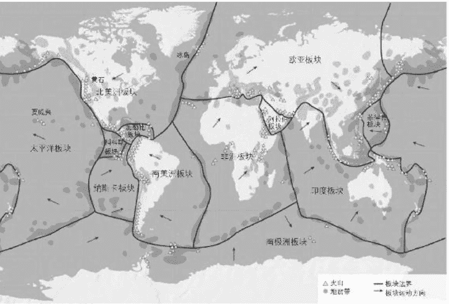

图4.1 通过研究火山和地震带有助于确定地球构造板块的边界

### 预测板块的运动

1967年，当嬉皮士们聚集在旧金山庆祝反主流文化运动时，一位年轻的地质学家正在加利福尼亚南部研究一个将推动地球科学产生革命性影响的想法。丹·麦肯齐花了一个“爱之盛夏”来研究板块构造背后的数学规律。

丹·麦肯齐就职于剑桥大学，他突然意识到：板块是刚性的。这看起来似乎没什么，但如果将板块视为刚性的，就有可能将其视为几何图形，就像把石砖铺在球体上一样。他和他的同事鲍勃·帕克发现，两个板块之间的相对运动可以被看作围绕一个固定点的旋转——这个想法可以追溯到18世纪瑞士数学家莱昂哈德·欧拉。

这使他们能够计算北太平洋板块的相对运动。他们发现它与该地区的地震活动完全吻合，表明他们的计算是正确的，这种运动不仅存在，而且它还可能是地震的原因。

这是拼图的最后一块。突然，他们不仅可以看到板块移动，而且可以看到每个板块相对于其他板块的移动。地球的整个表面都被刚性板块所覆盖，它们之间相互拥挤，并仍在运动。麦肯齐和帕克知道他们获得了重大发现。

事实上，他们不是仅有的两个人。普林斯顿大学的杰森·摩根与麦肯齐并不认识，但他得出了完全相同的结论，并且早在1967年就发表过关于这个话题的演讲。摩根甚至可以确定三种类型的板块边界：大洋中脊，新地壳在这里形成；海沟，地壳在这里消失；断层，地壳在这里不生不灭。

> 历史学家将这一理论归功于麦肯齐和摩根二人，他们现在是哈佛大学的访问学者。但麦肯齐说，摩根拥有优先权。“摩根在我还没想好之前就已经谈过这个理论了。”他说。

### 所有的活动都发生在那里

每个板块都是刚性的，只在边缘变形。在这些边界上，板块相互分离、汇聚或平移，但板块中间的变化很小。事实上，地球上一些最具活力的特征，如地震和火山，确定了板块的边界。

在大洋中脊，板块随着新的海洋地壳的形成而分离。它们就像传送带，总是把山脊推向海岸。大洋中脊本身就像是连续不断延伸的火山。沿着大洋中脊，深度小于50千米的浅层地震是比较常见的。

两个板块相互交界的区域容易发生浅层地震，有时震级很高。加利福尼亚的圣安德烈亚斯断层就是一个很好的例子，在那里，北美洲板块向南移动，而太平洋板块向北移动。

最令人吃惊的事件发生在两个板块交会的地方——指的是正面碰撞。在这里，岩层发生褶皱，山峦起伏不平。幽深的海沟也在这里形成，其中一个板块——几乎完全是密度更大的海洋地壳——向下俯冲，进入软流圈。因此，形成于大洋中脊的海洋地壳重新回炉，保存时间达到4亿年的海洋地壳就已经十分罕见。（见第5章）。

当洋壳开始下降到更热的地幔时，它的温度相对较低，在移动并发生弯曲的过程中，它会形成一系列剧烈的变形，并可能在700千米深处发生地震。这些地震一直持续，直到下降的板块升温到足以流动而不再发生破裂为止。

并不是所有潜入俯冲带的物质都会一路下降。大陆的边缘就像一个平面的刀刃，能够从下降的海洋板块顶部刮去大量的沉积物。其中一些沉积物堆积成岛屿：日本的部分地区就是这样形成的。

沉淀物下降是板块对温度升高做出的第一反应。水和二氧化碳等挥发性成分上升到地幔中，在那里，它们改变了地幔的成分，使其熔融。由此产生的岩浆向上移动，最终可能从火山口喷发出来。日本的火山就是这种机制的结果。

### 揭秘火山

在地幔熔融的下降板块上方，俯冲带火山形成一条平行于板块边界的线。环绕太平洋“火环”的火山，大多是由大洋或大陆地壳下的俯冲形成的。海洋中的俯冲产生了火山岛链，称为岛弧。阿留申群岛是从阿拉斯加半岛向南延伸的一系列岛屿，是岛弧的典型例子（见图4.2）。

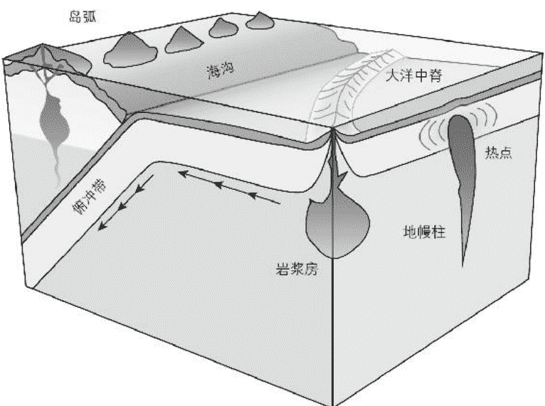

图4.2 海洋地壳形成于大洋中脊，在俯冲带被破坏。如果它被拉到另一块海洋地壳下面，结果就会形成一个由火山岛组成的岛弧

火山通常聚集在板块边界，但也有例外，比如海洋中部孤立的火山岛链。夏威夷只是一系列越来越古老的火山岛中的一个，这些火山岛横跨太平洋向西北延伸。这条火山链继续延伸，形成了一系列更古老的火山，它们现在都在水下，即天皇海山群。

这些火山被认为是板块在地幔深处升起的热岩浆柱上方移动时产生的。想象一张纸在蜡烛上滑动：火山就相当于纸上被烤焦的痕迹（见第5章）。这些岛链提供了关于移动板块速度和方向的重要线索。大陆下面的热点也会产生孤立的火山。

不同的火山以不同的方式喷发。有些火山，比如西西里岛的埃特纳火山，大部分喷出物是烟和蒸汽，偶尔会喷发熔岩流和碎石。夏威夷的火山经常产生熔岩湖，而冰岛的火山会喷火，火柱可高达数十米。

爆炸性喷发将固态和熔融的岩石化为灰烬（微小的岩石碎片和玻璃碴），有时为粗糙的碎屑物（包括碎石和浮石）——统称为火山碎屑。大爆炸的发生有多种原因。水渗入炽热的岩石是一个原因：水蒸发迅速，增加压力，直到围岩爆炸。其他气体也有这种可能。它们很容易溶解在地下深处的熔岩中，那里的压力很大。当岩浆上升到地表时，压力下降，其中溶解的气体开始形成气泡，就像当你打开一瓶汽水瓶盖时出现的气泡一样。

当上升的岩浆具有很高的黏度时，往往会发生相当剧烈的大爆炸。黏稠的岩浆会将冒出的气体收集起来，直到它积聚到非常高的压力，最终将熔化的岩石炸成碎片。富含硅酸盐的岩石是罪魁祸首。二氧化硅矿物结合形成分子链和薄片，当岩石被加热时，这种结合只会使熔体变得更加黏稠。一般来说，俯冲带的火山产生硅含量较高的黏性熔岩，并倾向于爆炸性喷发，喷出大量火山灰。相比之下，大洋中脊或热点的火山倾向于产生流动性较强的玄武岩质熔岩——硅含量较低——例如冰岛和夏威夷的火山。在这些流淌的炽热岩浆中，气泡上升到表面，或在岩石凝固时封存在岩石中。

### 我们能预测火山爆发吗？

我们预测火山何时爆发的能力越来越强。我们在破译预警信号能力上的突破帮助我们实施了一系列成功的撤离。例如，在1991年6月菲律宾皮纳图博火山剧烈喷发前3个月，科学家在它的两侧发现了震动。不久之后，火山开始喷出蒸汽和火山灰。随着火山活动的加剧，政府下令疏散6万人，挽救了数千人的生命。相似的是，2017年11月，印度尼西亚巴厘岛阿贡火山的地震和火山灰云迫使4万人疏散。

虽然并非所有火山都发出了明确的信号，但现在即使是最细微的迹象也可以用来预测火山爆发。用灵敏的倾斜仪和GPS（全球定位系统）传感器测量火山的膨胀变得更加容易。海洋声波的细微变化曾被成功用来预测印度洋留尼汪岛富尔奈斯火山于2006年7月和2007年4月的爆发。科学家在监测海水拍击海底所产生的低频地震波时注意到，当火山即将爆发时，声波穿过岩浆时会减慢。基于此次观察，当地居民在几天之前就接到了警报，然后及时疏散。

留意天气变化也有助于预警。巴甫洛夫火山是阿拉斯加半岛的一座活火山，在秋冬季节最为活跃。有一种解释是，此时的风暴会导致火山周围的水位上升，把岩浆挤得像管子里的牙膏一样。

### 当地面震动时

我们对地震的认识可以追溯到人类诞生之初，但在人类历史的大部分时间里，我们还不了解它们的成因。直到20世纪，科学家才能够回答这个问题：地震到底是什么？

在古代世界，包括地中海和中东地区，地震频繁发生，这已经成为早期文明文化结构的一部分。在早期文化中，将地球物理不稳定性归因于怪力乱神的幻想是一个反复出现的主题。在最近的历史中，人们开始寻找物理解释。例如，以亚里士多德为代表的古希腊人和以老普林尼为代表的古罗马人认为地震是由地下风引起的。

最早对地震展开的科学研究可以追溯到18世纪。1750年英国发生了5次不寻常的强震，随后1755年葡萄牙发生了里斯本大地震。早期调查包括对过去的地震进行分类，试图了解地震期间产生的能量波。这些波从震源辐射出来，导致地面隆起。直到19世纪末，地震始终是科学研究的焦点。

1891年的浓尾大地震（日本有史以来最强烈的内陆地震）和1906年的旧金山地震之后，人们的注意力转移到了引发这些事件的机制上。地球物理学家哈里·菲尔丁·里德利用1906年地震前后的三角测量数据（早期全球定位系统的前身），提出了地震科学的基本原理之一——弹性回跳理论。该理论解释了沿断层线储存的应力突然释放是如何形成地震的（见图4.3）。

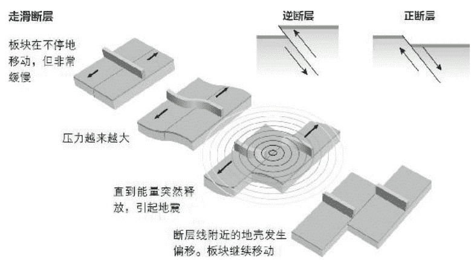

图4.3 弹性回跳理论解释了由于板块运动而在断层处如何产生了地震

又过了半个世纪，20世纪中期的板块构造学说才解释了这个更基本的问题：究竟是什么力量驱动了地震？

我们现在知道，大多数地震都是由地球活动板块边界上的压力累积引起的，在那里，构造板块彼此汇聚或滑动。

关于地震的其他原因也已被确定，如冰期后的反弹，随着大冰原的退却，地壳恢复至数万年前的非凹陷状态。然而，由于板块构造作用，这些过程只占地震释放总能量的一小部分。

### 确定地震规模

到了20世纪初，地质学家知道有些地震在地球表面产生了可见的裂痕，这在某种程度上说明了它们的力量。但由于大多数断层都在地下，所以我们需要其他方法来测量对比地震大小。

最早的衡量标准称为烈度，通常用罗马数字来表示给定位置的地震严重程度。烈度至今仍在使用：依据很多地震的记录然后经过适当校准的强度值有助于我们研究历史上的地震及其在人口稠密地区的影响。例如，2011年弗吉尼亚州发生地震后，超过14万人参与了美国地质调查局在网络上开展的关于“你感觉到了吗？”的调查。

为了直接测量地震的大小，人们需要记录和解剖地震产生的波。如今，这项工作是由采用数字记录的地震仪完成的。第一个能够准确记录小规模局部地震的小型仪器叫作伍德-安德森地震仪。当地面震动时，一团悬浮在拉紧的绳子上的物质会旋转，将光引导到感光胶片上。由光“绘制”的图像反映了地震波的严重程度。

在20世纪30年代早期，查尔斯·弗朗西斯·里克特利用这些地震仪开发了第一个度量标度，借用了天文学中的“magnitude（用于描述天体明亮程度）”一词。里氏震级是对数值，每增加一个震级，对应能量释放增加30倍。因此，7级地震释放的能量几乎是5级地震的1000倍。

震级值是相对的：没有附加任何物理单位。里克特调整了震级，使0级（M0）是他估计在普通条件下可以由地面地震仪记录的最小地震。负震级的地震也是可能存在的，但不太可能被记录下来。震级是开放的，但里克特设置了一个10级的上限。他还修正了一些地震的震级，使加利福尼亚州和内华达州记录的最大地震在7级左右，并推测1906年旧金山地震可能在8级左右。（自那时以来，记录的最大地震是1960年智利的瓦尔迪维亚地震，估计震级为9.5级）

此后的研究将地震释放的能量与震级联系起来。20世纪60年代，日本学者安艺敬一引入了一个完全不同的量：地震矩。这提供了地震总体规模的完整描述，是科学分析中常用的一种手段，引入了所谓的矩震级标度，将地震矩转换为等效的里氏震级。这个数字是媒体经常报道的。严格地说，这个报道的数值不在里氏震级上，因为它的计算和里氏公式不同，但仍然遵循里氏方法，矩震级值没有物理单位，对于比较地震很有用。

### 摇摇晃晃

为了评估地震危险性，对地震动的研究可谓“养兵千日，用兵一时”。如果我们了解这些变化，我们就可以设计建筑结构和基础设施来抵御它。地震的严重程度基本上由三个因素控制：地震震级、地震波在地壳中传播时能量的衰减，以及由于当地地质构造引起的震动的改变。

大地震通常会产生更强烈的震动，但并非所有给定震级的地震都产生相同的震动。震动的强度在很大程度上取决于地震的深度、断层的走向、断层是否到达地表、地震破裂的速度比平均速度快或慢等因素。

在不同的地区，地震波的衰减有很大的差异。在地壳相对较热且高度破碎的地方，比如加利福尼亚或土耳其，地震波会迅速消散或减弱。1906年旧金山地震后，地质学家吉尔伯特观察到：“在距离断层32千米的地方，只有一个烟囱被掀翻了。并不是所有熟睡的人都被吵醒。” 在远离活动板块边界的地区，如印度半岛或美国中部和东部，地震波传播的效率要高得多。1811—1812年围绕着新马德里（位于密苏里州）地震序列的3次主要冲击波造成大量烟囱倒塌，大约400千米外肯塔基州路易斯维尔市大多数正在梦乡中的人都被吵醒了（见第5章）。2011年，在1500多千米外的威斯康星州和明尼苏达州，人们感受到了弗吉尼亚5.8级地震。

当地的地质结构如软沉积物层可以放大地震波的振幅。例如，1985年墨西哥西海岸的里氏8级地震在墨西哥城湖底沉积物中产生了共振。而在太子港，2010年海地地震中一些最严重的破坏与丘陵和山脊等小比例尺地形要素的放大作用有关。

对整个地区的描述和不同地点的反应仍然是地震动研究的主要目标，部分原因是这将有助于绘制出整个城市区域的危险变化，即所谓的地震小区划。这提供了一个机会，以确定城市地区是否越来越危险，这可以指导土地利用规划和适当的建筑规范。

### 海啸！

海底地震会产生潜在的破坏性极大的海啸：断层破裂会导致海底移动，从而引发海啸巨浪。

地震引发海底沉积物崩塌时也会产生海啸，虽然这些波的大小一般比较适中。

海啸巨浪在海洋中向四面八方传播，在开阔的海洋中传播的速度和喷气式飞机差不多。它们在海上有很长的波长和很低的振幅，但是随着波浪能量汇集到海岸上，它们会上升到极高的高度。

### 相互关联的地震

地震常常相互关联，一次地震可以引发另一次地震，但是究竟什么在驱动它们以及它们之间的联系方式如何，人们有着普遍的误解。

人们一直错误地认为，大地震与整个板块的突然晃动有关。如果太平洋板块的一角移动，板块的其他部分也会跟着移动，不是吗？这个想法可能很直观，但它是错误的。地球的构造板块一直在移动，通常和人类手指的生长速度一样慢。实际上发生的是相邻的板块相互嵌合，导致地壳发生弯曲，并汇集能量，但只是集中在边界上的一个狭长地带。所以当地震发生时，与板块的其他地方相比，发生弯曲的地方首当其冲。

然而，地震统计数据确实告诉我们，余震的风险是巨大的：平均来说，最大的余震将比主震小一个震级。余震聚集在断层破碎带周围，但也可能发生在邻近的断层上。正如新西兰克赖斯特彻奇市的市民在2011年了解到的那样，一场6.1级余震的后果远比7级主震严重，因为余震发生在离人口密集区更近的地方。

除了余震的危害外，经常出现一次大地震可能在附近引发另一次大地震的情况，一般在几十千米以内，时间从几分钟到几十年不等。例如，1992年4月23日加利福尼亚州南部约书亚树村的6.1级地震之后，1992年6月28日在其北部约35千米的兰德斯发生了7.3级地震。这种触发被理解为岩石运动引起的应力变化的结果。基本上，一条断层上的运动会机械地推动相邻的断层，可以把它们推到边缘。

另一种机制现在被认为是引起触发的原因：地震波引起的应力变化。远程触发通常发生在——但不限于——活跃的火山和地热区，那里的地下岩浆流体系统可能被地震波破坏。

绝大多数情况下，远程触发的地震规模很小。地震科学的进步以及数百年的经验告诉我们，地震的爆发不会导致世界末日降临。然而，近几十年来，科学家们已经认识到，断层和地震之间的相互联系方式比经典的前震—主震—余震分类法所表明的方式更加多样和有趣。

### 我们是否掌握了地震预测？

当地震学家被问到地震能否被预测时，他们往往会很快回答“不”。有时甚至连地质学家都会忘记，地震是能够预测的。我们知道它们可能发生在世界的什么地方。对于这些地区中的大多数地区，我们对预期中长期地震的发生概率有很好的预估。虽然我们不能说下一次大地震会在人的一生中发生，但我们可以说在建筑物的寿命期限中可能会经历一次。

我们知道最大的地震发生在俯冲带上，沿着平均几十米的断层滑动，破裂长度超过1000千米。但任何活动板块边界都是随时可能发生大地震的场所。例如，在2010年海地地震发生的前两年，地球物理学家埃里克·卡莱斯和他的同事公布了该地区的GPS数据结果，指出“如果上次大地震之后积聚的全部弹性应变在一次事件中释放，恩里基约断层就有可能发生7.2级地震”。虽然这个确切的情景在2010年还没有上演，但距离它并不遥远。我们可以肯定地说，生活在板块边界上的人们将永远面临危险。

加利福尼亚州未来的大地震可以被预测。詹姆斯·李克蒙珀和他的同事估计，在旧金山湾区东部的海沃德断层上积聚了足够的应变，足以产生7级地震。平均每150年会发生一次这样大的地震。最近的一次是在1868年。知道这些信息不可避免地增加了当地的焦虑，但是地震发生的时间不规律：如果平均重复时间是150年，它可以在80～220年之间变化。因此，我们面临着同样的不确定性：一次“迟到”的地震可能再过50年也不会发生，也可能明天发生。在地质时间尺度上，早晚没有太大区别。但在人类的时间尺度上，早一天，或者晚一天，差别可就大了。

地球科学家在预测破坏性地震的预期平均发生率方面取得了长足的进步。但更具挑战性的问题依然存在，那就是为防患于未然而争取政治方面的支持和资源。

### 为什么预测如此困难

在20世纪70年代和80年代，媒体引用科学家的观点，他们对地震短期可靠预测的前景表示乐观。苏联取得了可喜的成果，而且中国对1975年海城地震做出了明显成功的预测，推动了这一进程。此后，这种乐观情绪逐渐被不同程度的悲观情绪所取代。为什么地震这么难预测？

科学家已经探索出了许多可能的地震前兆：小地震模式、电磁信号、氡释放和水文地球化学变化。其中很多前兆似乎很有希望，但没有一个能禁得起严格的检验。

2009年3月，意大利实验室技术人员詹保罗·朱利亚尼公开预测，意大利中部阿布鲁佐地区将发生大地震。他的证据是什么呢？观测到的氡异常。但是他的预测遭到当地地震学家的谴责。4月6日，拉奎拉发生了6.3级地震，造成308人死亡。

这涉及前兆可靠性的问题。有可能是因为一系列的小地震或者是在大地震之前的前震释放了氡，也有可能仅仅是巧合而已。20世纪70年代，科学家们将氡气作为一种前兆进行了研究，但很快就发现它相当不可靠，偶尔出现的氡气异常波动可能与即将发生的地震有关，但通常情况下并非如此。而且，遭受大地震袭击的地区也没有出现氡气异常现象。其他还有很多可能的前兆也是同样的情况。

这并不是说地震学家忽略了对前兆的研究，相反，他们正在用越来越复杂的方法和数据来检验前兆。然而，预测研究的一个共同问题是真正前兆检验的困难。为了开发一种基于特定前兆的预测方法，研究人员将过去的地震与现有数据记录进行了比较。例如，人们可能会发现某一地区在最近发生过的10次大地震之前的小地震的明显模式。这种回顾性分析受到微妙的数据选择偏差的困扰。也就是说，在已知大地震发生时间的情况下，人们常常可以回首过去，找出明显有意义的信号或模式。

这一效果可以通过动物能够感知即将到来的地震这一经久不衰的神话来说明。动物可能会对人类错过的微弱初始震动做出反应，但任何一位宠物主人都知道，动物的行为总是非同寻常的——而且很快就会被遗忘。人们只是事后才认为有意义。

目前，大多数地震学家都对地震的可预测性持悲观态度。但这还没有定论。地震学中一个悬而未决的大问题是：地球内部发生了什么而引发地震？这或许涉及某种缓慢的成核过程，因此有可能存在地震前兆。对于这一点，以及所有的地震预测研究，所面临的挑战是，如何才能不再局限于研究过去的历史和捕风捉影的逸事，转而进入统计严谨的科学领域。

### 转变观念

板块构造理论是如今被普遍接受的观点，但它并不是十分理想。
该理论在解释远离板块边界的地震时显得无能为力，而且它也没有深入研究那些发生在地球深处却能影响地表的事件。仅仅依靠目前掌握的知识，我们很难预测我们大陆未来究竟如何移动。幸运的是，已经有很多新的观点来解决这些问题。

### 在“错误”的地方发生地震

200多年前，具体时间是在1811年12月16日至1812年2月7日之间，密西西比河河湾发生了一连串四次大地震。这里是一个低洼、充满泥沙的盆地，从墨西哥湾向北延伸到伊利诺伊州的开罗市。地震以现在密苏里州的新马德里镇为中心，震级约为7级，可能达到8级。最后一次地震致使密西西比河出现河水倒流、河岸喷沙现象，水流汇集形成了里尔富特湖——如今它是田纳西州西北部一个很受欢迎的狩猎和渔业保护区。

从表面上看，这是相当出乎意料的。新马德里远离典型的大地震活动区——所谓的板块边界。但在板块中间发生这样的地震并不是个别现象。历史上有记录的造成死亡人数最多的地震，发生在1556年中国北方内陆的陕西省，这里并不位于板块边界附近。据当时的一份报告称，大约有80万人死于“山崩地裂”。2011年8月23日，弗吉尼亚州发生里氏5.8级地震，没有造成人员死亡，但这一事件造成美国东海岸上下一片狼藉。印度和澳大利亚内陆地区近几年也发生过类似的地震。

诸如此类的“板内”地震一直是个谜，这些发现让我们静下心来认真思考。可能不仅仅是旧金山和洛杉矶容易受到大地震的影响，纽约、悉尼和伦敦也有可能受到威胁。

旧金山和洛杉矶是典型的地震多发城市。它们坐落在加利福尼亚声名狼藉的圣安德烈亚斯断层附近，北美板块和太平洋板块在这里以每年33～37毫米的速度相对运动，在地震中释放累积的应力。

现在看来，板块边界将地壳撕裂并使它们重新碰撞在一起的力，也可能在板内地震中起作用：只是全层撕裂从来没有发生过。其结果是一个不稳定的区域，虽然表面通常不明显，但比周围的岩石更容易受到压力。相比之下，应力的积累更缓慢，这就可以解释为什么板块内部发生地震的频率远低于板块边界。

到了20世纪80年代，人们逐渐搞清楚，新马德里位于一个“衰退裂谷”之上。它被称为里尔富特裂谷，隐伏在美国南部和中西部的地下，近千年来似乎在有规律地发展。支持这一观点的证据来自对“液化沙丘”的分析，这种地质特征表现为：当受到地震的强烈震动时，土壤会失去强度，表现出像液体一样的性质，从地面向上喷出，形成许多小小的泥火山。新马德里周围的平原上散布着很多形成于200多年前的液化沙丘，地下还有更多，向我们表明在公元300年、900年和1450年该地区发生了大地震。

美国地质调查局表示，在未来50年内，新马德里地区发生6级或更大震级地震的可能性为25%～40%，而且有7%～10%的概率会出现堪比200多年前的大地震。那时候，该地区几乎没有定居者，但是如果今天再发生这样的大地震将会对人口密集区造成严重破坏。新马德里可能不是唯一一个面临风险的地区。科学家对密西西比河下方沉积物变形的研究，揭示了在孟菲斯以北存在一条长约45千米的断层，它似乎是里尔富特裂谷系统的一部分。2009年，研究人员在阿肯色州发现了长约10千米的玛丽安娜断层。这些潜在的地震影响范围似乎比我们今天所看到的活动断层要大得多。

或许现在不用过于担心。如果该地区的断层仍处于紧张状态，它们应该像圣安德烈亚斯断层一样移动。然而，20年来的全球定位系统对新马德里周围地震带的研究表明，它们并非如此。2009年，开展这些研究的伊利诺伊州埃文斯顿市西北大学的塞思·斯坦和他的同事埃里克·卡莱提出，新马德里现在正处于地震的深度休眠期，人们不用担心它在数百年甚至数千年内从中醒来。

### 移动的地震

这促使斯坦提出了一个有争议的主张。他不认为板内地震类似于板间地震，发生的频率较低而且也常出现在可预测的地方。相反，他将板内地震描述为不定期的、聚集的和移动的：地震能量可以在一个小断层网络中跳跃，这些小断层蜿蜒穿过一个构造板块的中间。在美国中西部下面，他估计随着时间的推移，新马德里的运动将被转移到印第安纳州的地震带，并将进一步向南进入阿肯色州。

哥伦比亚密苏里大学刘勉的研究支持这种观点。刘勉分析了中国北方2000多年来板内地震的发生情况，指出中国板内地震的震中是随机跳跃的。剧烈震荡的区域会变得平静，而以前平静的区域突然变得活跃。对他来说，地震似乎是“空间上的迁移，从一个断层跨越很长的距离到另一个断层”。板块中间的断层似乎是存在着力学耦合关系，因此一个板块的地震改变了另一个板块对未来运动的敏感性。

如果是这样的话，这种观点可能会在很大程度上影响我们对板内地震的理解。以2011年的弗吉尼亚地震为例，它的震中位于弗吉尼亚中部地震带，在过去120年里经历了多次3级左右的地震，但研究人员并不认为有可能发生更大的地震。如果斯坦和刘勉的想法是正确的，那么罪魁祸首可能是地震能量从其他地方流入该地区。例如，附近的西魁北克地震带延伸至纽约州北部边界，1944年曾发生5.6级地震。东田纳西地震带从亚拉巴马州东北部延伸至弗吉尼亚州西南部，也非常活跃。近几十年来，那里发生了两次4.6级地震。

这给我们敲响了警钟。类似于弗吉尼亚和新马德里的地震可能发生在任何地方，包括波士顿、芝加哥、纽约和其他主要城市。1580年，英格兰东南部多佛尔海峡发生5.7级地震，导致150千米外的伦敦威斯敏斯特大教堂的塔尖倒塌。2007年同一地区又发生了4.3级地震。我们不应夸大风险：西方城市的大多数现代化建筑能够承受5级或6级地震。特别是摩天大楼有足够的“摇摆”来抵消其影响，但历史古迹和那些用不含钢筋的砖制成的老建筑可能很脆弱。关键的基础设施，如电力和电信网络、水和燃料管道也可能面临危险。

图 5.1 根据历史数据绘制的美国大陆地震风险图显示，远离板块边界的地方仍然可能发生地震

地震学家们迫切希望找到板内地震活动的某种规律。在美国，几乎平均每三个州就有一条衰退裂谷。为什么有些地方像里尔富特裂谷一样成为地震活跃地带，而有些并非如此，这依然是未解之谜。如果没有一个明确的模式来解释板内地震，我们就不得不认为，它们在任何地方、任何时间都有可能发生。

### 地幔柱的力量

不仅仅是地震出现在“错误的地方”，火山也有同样的现象。美国地球物理学家贾森·摩根是板块构造学的先驱（见第4章），但在20世纪70年代，他也是首先发现该理论对夏威夷群岛火山作用这一典型地表特征的解释有误的人之一。

这些岛屿距离它们所在的太平洋板块边缘数千千米。根据板块构造理论，所有的重要作用都发生在板块边界上。因此，板块构造对这些岛屿的解释是：它们的火山活动是由板块中的薄弱点引起的，这个薄弱点使得较热的物质被动地从地幔中富集起来。但是，摩根重新想到了加拿大地球物理学家约翰·图佐·威尔逊早先的一个想法，后者认为一股热地幔物质正从下面数千米深的地方向上推动，并冲向地表。

这与公认的理论背道而驰，直到20世纪80年代中期，其他人才开始认为摩根的观点可能有道理。当地震释放出的地震波开始揭示我们地下世界的一些结构时，情况出现了好转。

地震图像是粗糙和模糊的，但似乎揭示了一个复杂的动态地幔。最引人注目的是，连续的测量揭示了位于地幔底部靠近地幔与外核边界的两个巨大区域，这两个区域是由非常热、致密的物质组成的，被称为热化学异常体。一个在南太平洋下面，另一个在非洲下面，每个都有数千米宽，似乎都有一股更热的物质向表面上升。

超级地幔柱可以解释为什么南太平洋中部的洋底比周围海底地形高约1000米，但有些情况用板块构造理论很难解释。比如，非洲超级地幔柱，它形成了从刚果南部一直延伸到南非南部的地区，包括马达加斯加。地震成像揭示了冰岛和夏威夷下方向岩石圈的延伸存在较小的类似幔柱的特征，或许解释了这些岛屿的存在和它们的火山作用。

与此同时，在阿根廷海岸附近，海底俯冲了近1000米，直接位于地幔区域之上，地震成像识别为温度相对较低的下降流。与之类似，刚果盆地位于温度较低的区域之上，高度比周围地区低数百米。几乎在我们所看到的任何地方，都有证据表明地球内部的垂直运动正在重塑其表面。

### 深部活动

不太清楚的是，哪些机制在起作用。标准的板块构造理论认为，在次级造山带向下俯冲的物质在浅层地幔中被回收，在两个板块分离的边界附近或更远的地方通过火山活动重新出现。然而，地震仪显示了俯冲板块在不同阶段从地球内部下降到下地幔的剖面（见图 5.2）。

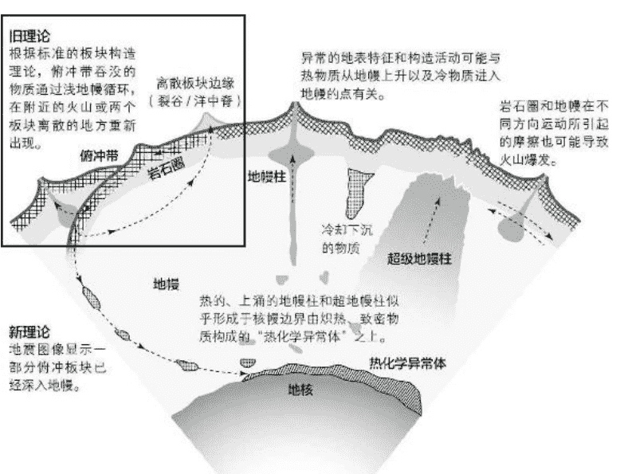

图 5.2 地震图像表明，深部地球的活动对地表特征有重要影响

挪威奥斯陆大学伯恩哈德·斯坦伯格和他的同事通过模拟展示了一块俯冲的板块，一旦它到达地幔和地核的边界，它就可以沿着该层铲平一切。当这种物质遇到热化学异常体时，地幔柱开始在上面形成，斯坦伯格的模型显示地幔柱在或多或少的正确位置发展。例如，他们的模型显示，阿拉斯加附近的阿留申群岛下面被俯冲的板块可能引发夏威夷下方的一个热柱，形成一个热点，为夏威夷火山提供燃料。

夏威夷大学马诺阿分校的克林特·康拉德和他的同事模拟了当地幔反向移动时对板块移动的影响。他们发现，在某些情况下，由此产生的剪切效应会导致地幔物质熔融和上升。

这个模型准确地预测出海底火山应该出现在东太平洋海隆的西部，而不是东部。东太平洋海隆是一个大致平行于南美洲西海岸的洋中脊。地震测量表明，西部的地幔和板块正朝相反的方向运动，东部则不是。该模型还预测，在美国西部、南欧、东澳大利亚和南极洲所有远离板块边界的火山活动区域，剪切效应最大。

### 不只是板块构造

如果今天的深部地球动力学能够改变地表地形，那么过去也一定是如此。但正如我们所看到的，破译遥远过去的地球历史确实困难重重。

2011年，英国剑桥大学的地质学家尼基·怀特和他的同事在苏格兰西海岸发现了历史的一小部分线索。他们引爆了爆炸震源，并记录了反射波，以了解海底的情况。他们看到埋藏在最近几层岩石和沉积物之下的是大约5500万年前的化石，而且到处都是山丘、山谷和河流网络。

通过分析这些河流是如何随着时间的推移而改变的，研究小组认为，该地区曾经被推离海平面之上近1000米，然后再次被掩埋，所有这些都发生在100万年的时间内。对于板块构造来说，这太快了，以至于不能把山脉掀起来，让侵蚀再次侵蚀它。相反，怀特指出了一团热地幔物质是从地幔柱径向向外运动的，它可能是冰岛附近火山的燃料。

其他研究人员也发现了白垩纪时期澳大利亚东部类似的陡峭的垂直运动。同样，简单的板块构造在短时间内的作用大打折扣，而对流的地幔看起来更像是“主谋”。

即使是地球构造历史的标志性事件也可能不是它们看起来的全部。喜马拉雅山脉形成于3500万年前，当时印度板块加速向北并撞向欧亚板块。但板块构造理论难以解释为何印度以每年高达18厘米的速度朝着目标前进。如今，板块的速度仅为每年8厘米左右。一个有争议的解释是，它的突然运动是由雨后春笋般出现的地幔柱的顶部推动的。

同样，美国中西部远离任何板块边界的异常和周期性毁灭性地震也可以用古老的法拉龙板块的运动来解释，该板块自白垩纪时期沿着北美西海岸滑入地幔。到了19世纪初，该板块已经潜入得足够深，引起密西西比河流域中部下沉，使上覆岩石圈发生变形，从而引发以新马德里为中心的一系列地震。

并不是所有人都相信地幔柱的作用。这个观点最大的漏洞是，虽然地震波在地幔浅层的假设热点下传播速度较慢，但这些速度异常并没有一直延伸到地幔底部，那里是地幔柱的形成区。热衷于深入解释地球表面活动的人认为，只需要时间和更好的地震成像，即可反驳这些反对意见。

如果这些狂热者是正确的，那么影响我们星球过去、现在和未来的不仅仅是板块构造。倘若真的如此，地质学将处于另一场革命的风口浪尖，这场革命可能与板块构造学说同样重要。

### 下一个超级大陆

板块构造驱动着我们的大陆进行缓慢研磨运动。有了我们对其行动的理解，你可能会认为我们可以预测广阔大陆的未来动向。事实上，有一些预言家正是这样做的。问题是，这一群体的成员对大陆的最终位置和原因都有不同的看法。我们无法就未来事物的形状达成一致，这意味着我们仍然缺少板块构造的重要细节。

记录海底岩石中的磁信号以及从古老山脉根部提取的化学痕迹，将告诉我们大陆漂移是如何改变地球面貌的。它们清楚地表明1.8亿年前的一段时间，当时所有今天的大陆都被困在一个巨大的大陆上，这个大陆的中心大约是今天非洲所在的地方：名为联合古陆（盘古大陆）的超级大陆（见第2章）。

我们知道，联合古陆在大约3.3亿年前聚集在一起。在此之前，一些人认为南极附近大陆相对短暂的聚集是另一个超级大陆，命名为潘诺西亚大陆或大冈瓦纳大陆。更早以前，另一个超级大陆罗迪尼亚可能在12亿～7亿年前主宰了地球。大约20亿年前，人们认为还有另一个超级大陆。

这意味着未来我们可以期待另一个超级大陆。但是，这片广阔的陆地将如何形成，在哪里形成呢？

### 新盘古大陆

有一种模拟研究会简单地将今天发生的事情投射到未来。使联合古陆分崩离析的巨大裂痕仍在不断扩大，非洲和欧亚大陆正在远离美洲；大西洋正在扩张，新的岩石在它的洋中脊处涌出，而太平洋正在缩小，被它周围的俯冲带，也就是著名的火环所吞噬。

如果这些运动继续下去，随着美洲和亚洲相对于澳大利亚向北移动，大约在2.5亿年内，一个新的超级大陆——新盘古大陆，将在地球原来的联合古陆的对面形成（见图 5.3）。

- ○非洲
- ○北美洲
- ●澳大利亚
- ○南美洲
- ○南极洲
- ○欧亚大陆
- ○新陆地

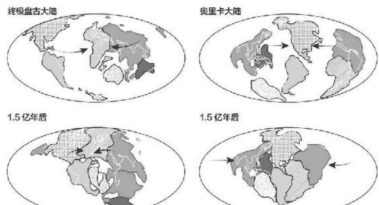

3 亿年后大约 1 亿年后，沿大西洋西侧的俯冲作用使它开始关闭。北美洲最终与非洲西海岸融合在一起，南美洲发生旋转，最终停留在以现今大西洋为中心的新超级大陆的南部。

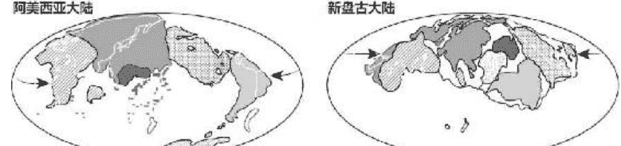

3 亿年后大西洋两岸都开始俯冲，大西洋和太平洋都在靠近。欧亚大陆分裂，其西半部随着非洲一起向西移动，东半部向东移动。它掠过澳大利亚，以现在太平洋所处的位置为中心，形成一个新的超级大陆。

2.5 亿年后大西洋继续开放，但南部变得更宽。非洲向西移动，澳大利亚向北移动；与此同时，南美洲发生旋转，最终它的西海岸与北美洲东海岸融合。南极洲仍然远离这个零散的新超级大陆。

2.5 亿年后当前的构造运动仍在继续，大西洋扩张，太平洋因俯冲作用而消亡。南美洲向西和向北移动，挤过南极洲和澳大利亚；非洲连同西欧一起逆时针旋转，现今的南部最终与阿拉伯半岛融合在一起。

图 5.3 科学家已经预测了未来大陆聚集可能存在的至少四种不同的形状

但它可能不会那么简单。伊利诺伊州埃文斯顿市西北大学的克里斯托弗·斯科塞斯认为，对未来5000万年的预测可能会奏效，但要想看到更远的未来，我们需要对仍在努力揭示的板块构造有一个详细的了解。

自1982年以来，斯科塞斯一直在使用各种经验法则绘制关于地球过去与未来的地图。最重要的规律被广泛接受：板块构造主要受俯冲带下沉板块的牵引，而来自大洋中脊新岩石形成的推力较小。计算出俯冲带和大洋中脊的布局，你就可以看到大陆是如何被拖拽和推动的。

但是三种灾难性事件可以改变这一平稳航行的进程。俯冲带可以吞没正在扩张的洋脊，就像今天在北美西海岸发生的那样：胡安·德富卡洋脊正在被吞没。或者两个永不沉没的大陆会发生碰撞，吞没中间的俯冲带，迫使大山上升。比如，印度和欧亚大陆构造喜马拉雅山的过程。

第三个可能的大灾难更难理解、更难预测：新俯冲带的建立。这在某种程度上一定会发生，或者现在所有的俯冲带最终都会被大陆碰撞而毁灭，板块构造将完全停止。但有证据表明，板块在地球历史的大部分时间里一直在移动，伴随着许多超级大陆的形成与破坏的周期，新的次级造山带一定会启动。

### 终极盘古大陆

最有可能发生新俯冲的地点是被动大陆边缘，例如在欧洲的大西洋沿岸、非洲和美国。这些地方是古老的海洋岩石圈，从大洋中脊伸展出来，与大陆地壳相遇。海洋岩石圈自形成以来就有时间冷却，并变得比下面的岩石更致密，所以它想下沉。

但它不能。古老、寒冷的岩石圈岩石很难破裂，即使是从大陆冲刷到被动边缘的数千米深的河流沉积物的重量也不够。渗透到岩石中的水的弱化作用可能有帮助，但可能不足以破坏那些被动大陆边缘。20世纪80年代，斯科塞斯提出，局部应力可使它更容易撕裂，这个秘密一定是打开海洋岩石圈的一个“突破口”。

西大西洋已经有两个小的俯冲带：形成加勒比海东部边界的小安的列斯火山弧，南美洲南端和南极半岛之间的斯科舍岛弧。斯科塞斯认为，它们最终将分别向南、向北扩散，并在美洲东海岸形成一个延伸的俯冲带。在他的预测中，这将吃掉大约1亿年后大西洋中部的洋脊，大西洋将再次开始关闭。2.5亿年后，美洲将与已经合并的非洲和欧亚大陆相撞，澳大利亚和大部分南极洲形成斯科塞斯所说的终极盘古大陆。

### 阿美西亚大陆

2012年，当时在耶鲁大学工作的罗斯·米歇尔和他的团队绘制了第三条路线。认为与超级大陆形成相关的质量转移影响了地球的旋转，改变了它相对于地球的旋转轴。通过观察早期超级大陆冷却岩石中磁性矿物晶体的磁化方向，研究小组发现，罗迪尼亚大陆形成的纬度距离约90度，远离最早超级大陆的位置；而联合古陆则在距离罗迪尼亚约90度的地方聚集。米歇尔和他的团队预测同样的事情会再次发生，这意味着下一个超级大陆应该在北极附近的某个地方形成，就像亚洲和北美的移动一样，他们称为阿美西亚大陆。

### 奥里卡大陆

葡萄牙里斯本大学的地球科学家若昂·杜阿尔特认为所有这些模拟都存在问题。阿美西亚大陆和新盘古大陆都将被4亿多岁的大面积海洋地壳所包围，他认为这是不可信的。2008年，阿拉斯加州安克雷奇市美国地质调查局的德怀特·布拉德利，研究了古老的被动大陆边缘附近的岩石，发现最古老的岩石平均有1.8亿年的历史，几乎没有超过4亿年的。杜阿尔特认为这不是巧合，但大西洋型海洋板块在大约2亿年后就要开始俯冲了。

斯科塞斯的终极盘古大陆没有古老的地壳问题：从理论上来讲，太平洋在持续数亿年的时间里地壳不断新生、破损。但杜阿尔特认为这也是不可能的，因为像胡安·德富卡这样的山脊已经处于俯冲状态。

杜阿尔特同意斯科塞斯的观点，认为俯冲可能像病毒一样传播，他称为入侵。他发现了俯冲开始入侵大西洋东部边缘葡萄牙海岸的证据，地中海古代俯冲产生的力量正在促使洋底形成新的断层。

在杜阿尔特于2016年发表的预测中，俯冲将在数千万年内沿大西洋两岸蔓延，海洋将开始关闭。太平洋也将继续关闭，这意味着还有其他东西要有所付出，那就是亚洲。喜马拉雅高原在自身重量的作用下崩塌，从印度洋到北极，一条裂谷横贯整个大陆。一个新的海洋打开了，最终的结果是一个新的超级大陆，外部是亚洲的两个半部分，中间是美国和澳大利亚。

斯科舍斯说，这是一个很好的尝试。但它至少有一个困难：要关闭大西洋，就必须俯冲大西洋中部的洋脊，但如果在海洋的两边都有俯冲，洋脊可以留在中间，向两边供应地壳。

这四种观点的支持者都在努力强调，未来是不确定的，他们自己的模式只是一种选择（当然是最有可能的选择）。无论谁是对的，我们未来的后代都将不可避免地要适应一个形状奇特的世界，并反过来被它所塑造。

## 6 大气、气候和天气

地心引力使我们的星球处于一层厚度达数百千米的气体笼罩中，在靠近其外部极限时，大气层显示出奇特的磁性和电性特征，但我们的大部分注意力将集中在最低的10千米以内，在这里，空气是可供呼吸的。这薄薄的皮肤是生命的家园，是天气现象出现的地方，在维持地球地质和气候的化学循环中起着重要的作用。

### 什么造就了大气？

地球的大气层在它的生命周期中发生了巨大的变化。几乎可以肯定的是，任何早期的气体都会被新生太阳的爆发冲走。虽然一些气体可能是从宇宙访客那里到达地球的，但最有可能的大气来源是火山喷发出来的气体。今天，火山喷发物的64%是水蒸气，另外还有10%的二氧化硫和1.5％的氮气。

在这段时间里，这种气体的成分已经改变了。随着年轻地球冷却，水蒸气凝结成海洋，大量的二氧化碳溶解在海洋中，后来形成了巨大的石灰岩基底。在这段时间里，在没有其他地方可去的情况下，惰性氮气慢慢地积累起来了。

氧气呢？20亿年来，大气中几乎没有或根本没有氧气。当早期的生命形式演化出利用水进行光合作用时，这一切都发生了改变。这一事件引发了地球有史以来最大规模的屠杀，极大地改变了大气（见第8章）。

到6亿年前，大气的组成与现在基本相同：以质量计，75％为氮气，22％为氧气，1％为水蒸气，1.3％为氩气。二氧化碳、氖气、氦气和其他微量气体（包括臭氧、氡气、氢气和一氧化氮，总含量不足0.1％）。

### 自下而上

低层大气由一系列分层组成，其中对流层是离地面最近的一层，而平流层位于其上方。对流层在决定天气和气候模式方面起着关键作用，对生命的直接影响最大。

大气的热量主要来自太阳的电磁辐射（来自热放射性岩石的地热能量很小，通常忽略不计）。太阳的大部分能量集中在光谱的可见部分辐射，波长为0.4～0.7微米。这种辐射穿过大气层时不会被吸收，它使地球表面变暖。

太阳能量的7%为紫外线辐射，比可见光的波长短。这种辐射被平流层中的氧和臭氧分子吸收，并直接加热该层。比可见光波长更长的红外线辐射占太阳辐射能量的一小部分，其中一些被大气吸收，但在保持空气温暖方面只起到了很小的作用。

太阳的能量主要是自下而上从地球温暖的表面到达大气层。其中，一部分通过直接从表面传导热量，但主要是通过地球的红外辐射，而红外辐射被低层大气中的水蒸气和二氧化碳等分子吸收。

红外辐射使得空气变暖，反过来，空气本身也以红外波长辐射热量。这些辐射中的一部分会回到地表，使其保持比原来更高的温度，从而产生我们现在所知道的温室效应（见第10章）。其余的则通过大气向上运动，不断被吸收和重新辐射，直到逃逸到太空。

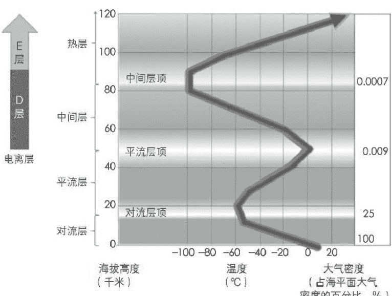

图6.1 根据温度的变化，把地球的大气层划分成了不同的层

对流层的热量使热空气上升，这是驱动天气变化和大气整体循环的关键过程。但这种暖空气之所以只能上升到一定高度，是因为它被平流层中更暖的空气所抑制。

平流层——与臭氧层几乎同义——是紫外线被吸收的地方。辐射将普通的氧分子（O2）分开，一些自由的氧原子与其他氧分子反应生成臭氧（O3）。臭氧本身也吸收紫外线，只是吸收的波长略有不同。这两个过程都从太阳辐射中提取能量，从而使平流层变暖。

平流层可以被认为是对流层的盖子，能够抑制对流，保持天气稳定。地球表面的平均温度约为15℃，如果地球没有空气的覆盖层，也没有温室效应来保暖，温度将会下降33℃。在对流层，温度随着高度的增加而下降，一直到20千米处，这就是对流层和平流层的边界：对流层顶。对流层的确切高度随纬度、季节和昼夜而变化。对流层的空气质量约占地球大气层的75%。

### 拯救臭氧层（和我们自己）

1985年5月，全世界都意识到一场潜在的全球性灾难。英国南极观测站的乔·法曼和他的同事宣布，在南极大陆最南端的大气层中已经出现了一个巨大的空洞。这个消息引起了轰动，因为这个空洞正在扩大，平流层臭氧是地球抵御有害的紫外线辐射的主要屏障，而紫外线辐射会导致人患上皮肤癌和白内障。更重要的是，人类对此负有责任。这一发现促成了迄今为止世界上最成功的环境条约的诞生。

最贪婪的臭氧消耗者被确定为氯，携带在卤烃化合物中，如氯氟烃和氟利昂。它在工业中被用作溶剂，特别是作为冰箱的制冷气体。一旦在大气中达到一定的浓度，氯就会逸出这些化合物。在平流层中，这些冰冻颗粒物将臭氧分子分解成氧分子。

世界各国政府团结一致，于1987年在《蒙特利尔议定书》的支持下，同意禁止生产氯氟烃和其他消耗臭氧层的化学品。它于1989年生效，并开始扭转局面。卫星测量显示臭氧浓度在20世纪90年代中期趋于稳定，并在21世纪初开始恢复。

预计2065年之前臭氧不会完全恢复，而且可能推迟这一日期的潜在因素不断出现。氢氟烃化合物是氯氟烃的主要替代物，也是温室气体，升温能力大约是二氧化碳的4000倍。因此，2016年，联合国通过了对氢氟碳化物减排的修正案，推动停止氢氟烃的生产和使用。

然后，2017年，人们开始关注另一种含量上升的臭氧消耗者——二氯甲烷，而它不在《蒙特利尔议定书》范围内。有学者估算，这种化合物可能将平流层臭氧的完全恢复推后到2095年。

### 电离层

从20千米到60千米的高度，平流层中的温度逐渐升高，从对流层顶约-60℃到平流层顶达到最大值约0℃。大气质量的99.5%左右位于平流层顶之下。

从50千米到80千米的高空是另一个冷却层，即中间层，占据了现在迅速变薄的大气层，达到高度最高点，即中间层顶，最冷的大气温度约为-100℃。从那里向外，最后一层温度升高，称为热层。在这个区域，来自太阳的紫外线和X射线被直接吸收，而且，原子被电离，因为电子被剥夺，只留下带正电荷的离子。

其中一些电离发生在平流层的顶部，从50千米到400千米的高度都被认为是电离层。它有自己的系列层，每一层都以其不同的电离程度来定义。当古列尔莫·马可尼证明无线电波可以在地球的“犄角旮旯”传播时，人们首先怀疑这个区域存在电离粒子。电磁波沿直线传播，由于电离层能够反射波长超过15米的无线电信号，所以不借助卫星就可以在全球远距离传输信号。

电离层最底层，50千米至90千米称为D层，自由电子浓度很低，只反射长波无线电波。然后是E层，高度上升至150千米。它比D层电离更强烈，反射中波无线电波。然而，它的电离在晚上消失，这就是有些无线电信号在不同时间来来去去的原因。F层，从150千米到400千米，是电离层中离子化最强烈的区域，也是最有用的无线电通信层。

在海拔高度400千米以上，大气十分稀薄，以至于分子、原子和离子之间的碰撞太少，不能被视为一种连续的气体，所以温度的概念不再有意义。在这个区域中，单个粒子可以逃逸到太空中，因此它有时被称为外球面。

### 电磁屏蔽

在电离层之外，大约500千米以上，磁层是地球大气层最外层的区域，在那里电离非常完全，以至于粒子形成等离子体——一种正电荷离子和负电荷离子组成的混合物，它们受到地球磁场的约束。

磁层形成了地球的绝对极限，即“地球太空船”的外壳（见图6.2），在太阳风的上游，它使带电粒子向外偏转，越过我们的行星。太阳风和地球磁场之间的相互作用在大约14个地球半径的距离产生冲击波，但磁层本身只延伸到大约60000千米的距离。在这个边界之外，磁层顶是行星际空间。

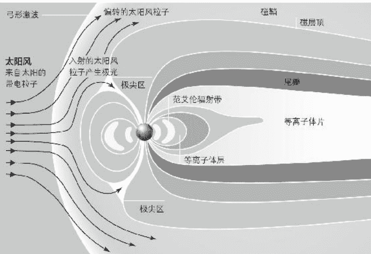

图6.2 地球的保护层，即磁层，能够使太阳风偏转，并产生极光

在更近的距离内，两个高离子密度的环形区域集中在赤道上方3000千米和15000千米的高度。这些是辐射带，以20世纪50年代发现它们的美国物理学家詹姆斯·范艾伦命名。

20世纪70年代，新一代卫星拍下了磁鞘的图像——在太阳风中的作用下受扰动的等离子体，如同一条长长的尾巴。在保护地球不受太阳风带电粒子的影响时，磁场将它们偏转到范艾伦辐射带，但有些会溢出到上层大气的极性区域，即极光区，太阳风中快速移动的电子与大气原子相互作用，产生舞动的极光。

### 地球气候控制

地球的气候非常稳定，大约40亿年来一直保持在适宜居住的范围内，尽管正如我们所看到的，在这个过程中有一些令人担忧的时刻。它保持稳定性的关键似乎在于大气和海洋中的二氧化碳与板块构造的相互作用。

这个循环从火山喷发出的二氧化碳进入大气层而开启，它有助于使地球保持温暖。温暖的气候促使海水蒸发，形成云和雨。由于雨水中含有溶解的二氧化碳，所以呈现出弱酸性，在化学风化过程中与地表岩石发生反应，将含碳矿物溶解到水中。形成的混合物随后被冲入大海，矿物慢慢积累并最终沉积下来，在海床上形成新的含碳岩石——沉积岩（见图6.3）。

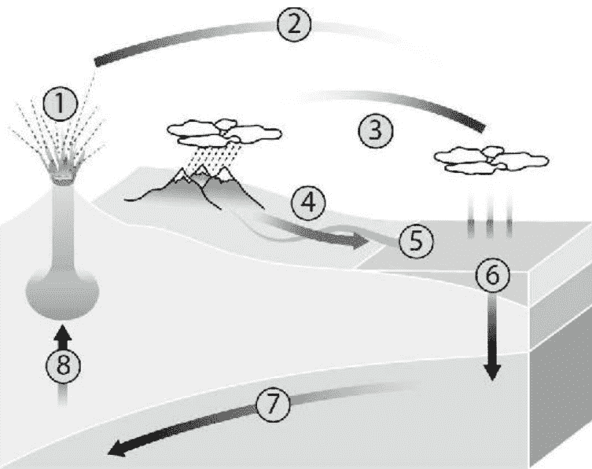

- ① 火山向大气中喷出二氧化碳。
- ② 地球因二氧化碳的温室效应而变暖。
- ③ 温暖的气候促使海水蒸发、形成降水。
- ④ 雨水含有二氧化碳，呈弱酸性，溶解了岩石中的矿物质。
- ⑤ 溶解的含碳矿物被冲进河流和海洋。
- ⑥ 矿物质沉积下来形成新的含碳岩石。
- ⑦ 岩石最终俯冲进入地幔，释放出二氧化碳。
- ⑧ 二氧化碳通过火山返回到大气中。

图6.3 二氧化碳在地球复杂的气候控制机制中起到核心作用

板块构造迟早会把这些岩石带入一个俯冲带，在那里，由于地幔热量的烘烤，二氧化碳溢出然后通过火山回到大气中。

这个循环是一个非常有效的热量平衡。当地球变暖时，蒸发量和降雨量增加，加速了大气中二氧化碳的排出，使地球降温。当地球变冷时，降雨量减少，火山排放的气体在大气中积聚，从而使地球升温。

对于地球保持适宜生物居住的气候，月球也起了一定的作用。它会防止地球摇摆，否则会导致地球轴心严重倾斜：即使是很小的摇摆也足以引发冰河时代的到来。当然，现在人类起到更明显的作用（见第10章）。即使哪一天人类灭绝了，我们燃烧化石燃料对气候造成的改变也可能会持续数百万年，地球潜在的温控器应该能够恢复控制，然而，谁都没有十足的把握。

### 气象机器

如果大气长期保持相对良好，营造了一个十分稳定的气候环境，那么短期内就不一定如此了：我们的天气常常出现时而美丽时而暴力的情形。这些情形源于使对流层运动的各种力量复杂的相互作用。

当太阳加热地球的同时，地球也在加热它上面的气团。气团中的分子运动速度显著加快，空气体积膨胀。这使得气团比周围的空气密度小，从而上升。较冷、较重的空气流入它腾出的空间，然后在那里变热并上升，继续循环。这种热量的垂直运动被称为对流，上升的气团被称为暖气团。

在这种情况下，温差导致密度和压力的变化就会驱动形成垂直风和水平风，因为气流在平衡这种压力。

地球的大气层在两极和赤道受热不均。这是因为地球的几何结构很简单。我们生活在一个绕太阳运行的球体上，太阳光从赤道的正上方照射下来，但在南极、北极附近有一个很大的倾斜角度。因此，在限定的区域内，极地从太阳光中接收的能量比赤道少。这种差异是地球天气变化的根本驱动力。热量自然会从较热的地区转移到较冷的地区，因此大气和海洋将热量从赤道传递到两极。没有温差的行星可能是一个永远没有风的星球，但在地球上，风一刻也不停，而且有时候风力还很大。

### 风带与科里奥利力效应

如果地球不自转，全球风的模式将非常简单。热空气会在赤道上升，然后在到达大气层顶部时向两极水平扩散。在两极，它会冷却，随着密度的增加而下沉，然后沿着地表流回赤道。因此，地表风在北半球只能从北向南流动，在南半球只能从南向北流动。而在旋转的球体上，地表及其上方的空气在赤道移动最快，而在两极则完全不动。因此，在北半球，地球向东旋转使风相对于其运动方向向右偏转，而在南半球则使风向左偏转，这种偏斜被称为科里奥利力效应。

地球自转产生的科里奥利力效应足以在每个半球产生三个相互交错的表面风带：赤道信风带、中纬度西风带和极地东风带（见图 6.4）。如果地球转得更快，就会有更多这样的风带。木星的自转速度非常快，它的一天只有10个小时，它也有比地球更多的风带。

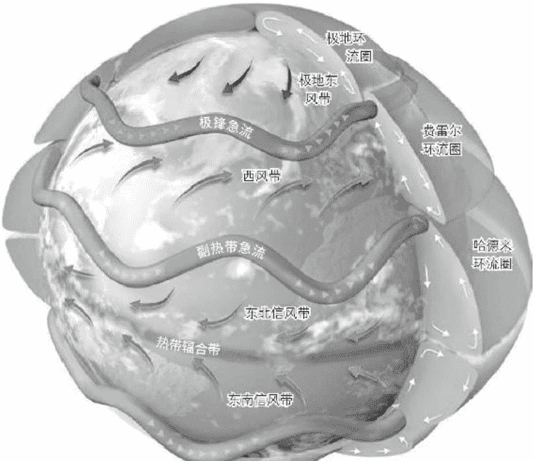

图6.4 地球风呈现出明显的带状，部分原因是由科里奥利力效应造成的

在高海拔地区，从西到东的快速风带被称为急流，急流活动于缓慢移动的地面风带之上。虽然这种风带的常规模式占主导地位，但因为我们不是生活在一个均匀的球体上，而是生活在一个有海洋、山脉、森林和沙漠的球体上，所以实际的风带模式要复杂得多，而且变化无常。

### 不稳定性和降水

形成恶劣天气的一个先决条件是大气的不稳定性，即较低密度的空气上升到周围空气之上。当高空有冷而密的空气而下面是温暖潮湿的空气时，不稳定性最大。下层空气上升是因为升温和水蒸气都降低了空气密度。在一个不稳定的大气层中，空气一旦开始向上运动，便会持续上升。

随着上升，空气会进一步膨胀。膨胀导致冷却，因为当空气分子移动得更远时，一定体积内的动能就会下降。在某个时候，它变得太凉了，使得空气中的水蒸气难以继续保持。当空气达到这一点，即所谓的露点温度，水蒸气开始在空气中凝结，形成云和降水——雨、雪、冰雹。因此，产生降水需要两个因素：空气中有足够的水蒸气和一种提升空气使其冷却到露点温度的机制。

提升空气使其冷却或冷凝的三种主要方式是：太阳加热地面，使热量产生；不同密度的气团聚集在一起，形成“锋面”，推动空气向上流动；空气在前进过程中被山体阻挡被迫抬升。

对流层的气温随着高度的下降而下降，在大约11千米的高度上，空气又开始变暖。这个“温度变化”意味着到达了平流层的底部。平流层没有云，因为来自对流层的空气不能上升到逆温层之上。这就掩盖了不稳定性。如果逆温层消失，我们将看到更多的极端天气现象。

### 中纬度气旋

“气旋”一词可以用来形容任何旋转的风暴系统，包括在中纬度地区发展起来的普通低压系统。

赤道和两极的不均匀受热常常导致数千千米宽的风暴，并将热量输送到两极。这些是中纬度气旋，它们为中纬度地区带来了大量降水。

当温暖潮湿的热带空气与寒冷干燥的极地空气分界面存在巨大温差时，就会形成中纬度气旋。这些大风暴的主要动力是潜在能量的释放，因为向下并向赤道移动的寒冷、稠密的空气，取代了向上并向极地移动的温暖、稀疏的空气。

另一个能源是潜热。把液态水变成水蒸气需要大量的能量，当水蒸气凝结时，这种能量就会释放出来。当空气在风暴中上升冷却，水蒸气凝结时，潜热的释放使周围的大气变暖。这使得空气上升得更高，释放出更多的潜热，为风暴提供能量。风暴充当热机，把热量转化为动能风。

### 雷暴

当太阳的热量足够强时，向上移动的热量会产生顶部蓬松的积云。在某些情况下，这些椰菜花状的云层可能到达对流层的顶部。在这些云层的上部，冰点之下的温度会产生冰和雪，这些粒子之间的碰撞会分离电荷。当电荷差达到临界值时，“咔嚓” 一道闪电，正电荷和负电荷重新结合在一起。

这种积云被称为积雨云——一种雷暴。除了为地球上大部分地区提供维持生命的降雨，雷暴也带来了危害。世界上最大的降雨事件总是由雷暴引起，热带气旋的强降雨也是由于雷暴嵌入其中。强雷暴会产生破坏性的大风，风速可达每小时240千米，并形成像葡萄柚一样大的冰雹。另外，雷暴还形成了自然界最猛烈的风暴——龙卷风。

### 龙卷风

1999年5月3日，在俄克拉荷马州布里奇克里克地区的龙卷风中，多普勒雷达测量到地面之上约30米高处的大风，风速为486千米/时，这是有记录以来最快的风速。这种速度的风形成巨大的破坏力，摧毁了坚固的木结构房屋，并对钢筋混凝土结构的建筑造成了严重破坏。

自2000年以来，北美洲出现过9个极端龙卷风，达到了官方认定的改良藤田级数EF5级（风速超过322千米/时）。与飓风不同，龙卷风面积相当小，直径从75米到3千米。它们来自积雨云，积雨云可以在陆地或水上形成，那些在水上形成或移动的称为水龙卷，往往比在陆地上形成的龙卷风弱得多。

龙卷风的形成需要一套非常特殊的条件，最重要的是不稳定性和风切变的存在。来自海洋区域低纬度温暖潮湿的空气，与寒冷、干燥的极地气流相遇，产生了极大的不稳定条件，这意味着在地表附近受热的气团迅速上升，产生强大的上升气流。

如果存在一股强烈的急流，在对流层顶部附近有大风，就会有垂直风速切变。如果风也从近地面的南风变为高空的西风，则存在垂直风向切变。这两种类型的切变使上升气流旋转，形成旋转雷暴或超级雷暴单体。超级雷暴单体会产生绝大多数强（EF2级和EF3级）和超强（EF4级和EF5级）的龙卷风。

产生超级雷暴单体通常需要的第三个因素是“限制”。这是大气层中一个干燥、有稳定空气流入的区域。它可以防止空气上升到很高的高度，直到一天的晚些时候，当太阳能加热最终产生足够的不稳定性，使暖气团冲破“限制”。其结果是形成单一的大型超级雷暴单体，而不是一些较小的、分散的雷暴。

这些条件在美国中西部地区最为常见。墨西哥湾提供了低层温暖潮湿的空气来源，当这种低密度的空气在高密度的冷空气之下流动时，干燥空气从加拿大向南流动，结果就会形成极端不稳定的大气。再加上从沙漠地区到西部的干燥、稳定的中层空气的入侵，以及一股强大的高空急流，造成了大量的风切变，可能会导致数十次甚至数百次龙卷风。2011年4月25日至28日龙卷风爆发期间，出现了355次龙卷风——包括4次最高级EF5级——席卷了美国和加拿大的21个州，造成324人死亡。

虽然世界上绝大多数龙卷风发生在美国，但它们也会影响其他国家。孟加拉国平均每年有3次龙卷风，大多是非常猛烈的。世界上最致命的龙卷风就于1989年4月26日发生在孟加拉国，造成1300多人死亡。

### 热带气旋

飓风、台风、热带风暴和热带低压都是热带气旋的例子。它们只在不低于26℃的温暖海水中形成，与陆地上的风暴系统不同，它们的能量完全来自冷凝水蒸气释放的潜热。

热带气旋和龙卷风一样，需要一系列特殊的因素才能形成。首先是温暖的海水；其次是垂直风切变必须非常低，换言之，对流层表面和顶部之间的风速差必须小于每秒10米左右。如果风速更快，就会使形成中的热带气旋的中心倾斜或拉伸，带走它的热量和水分。

强大的高空风与急流或高空低压系统有关，是最常见的风切变源。亚热带急流在冬季和春季往往更接近赤道，这就是为什么在这些季节，加勒比海或西太平洋很少形成飓风和台风，尽管海洋温度全年都很温暖，足以支持风暴的形成。热带气旋的形成还需要通过深层大气的高湿度。来自非洲或北美洲的干燥空气常常会破坏一个正在酝酿中的飓风。

最后，热带气旋需要一些东西才能使它旋转。在大西洋，这通常是由被称为非洲东风波的低压区提供的，这些低压区从非洲海岸出发，向西移动到加勒比海。飓风的旋转也得益于地球的旋转作用。科里奥利力效应在赤道处为零，在极点处为最大，因此在赤道约5度的纬度范围内通常不能形成热带气旋，但一旦超出这个范围，随着向两极方向移动，由于科里奥利力效应引起的垂直旋转增大，热带气旋就会逐渐扩大。

### 台风？飓风？

热带气旋起源于热带低气压，这是一个有组织的旋转风暴系统，风速小于63千米/时。当风加快时，这个系统就被命名为热带风暴。当风速达到119千米/时，在风暴中心周围形成一圈被称为“风眼墙”的强雷暴。眼墙内是风暴的“眼”，这是一个清晰、平静的下沉空气区域。

一旦持续风速超过119千米/时，如果风暴位于大西洋或东太平洋，则被归类为飓风；如果风暴位于西太平洋，则被归类为台风。在

印度洋或南半球，它被简单地称为气旋或热带气旋。这些不同名称的风暴之间没有气象差异。

非常温暖的海水延伸到50米左右的深度可以使热带气旋迅速增强到“严重”飓风状态，风速达178千米/时以上，这是地球上最可怕、破坏性最强的风暴类型。

传统上，根据最大持续风速，在萨菲尔-辛普森飓风等级上，飓风被划分为1级至5级。然而，这个等级划分可能会产生误导，一场覆盖大面积海域的弱风暴，可能比一场规模更小但强度更大、萨菲尔-辛普森飓风等级更高的飓风产生更大的风暴潮。为了更好地了解风暴潮的潜能，我们开发了实验综合动能等级，对风速和强风延伸区域同时进行测量。

### 季风低压

季风的运行原理与我们熟悉的午后海风相同，但规模更大。夏天，陆地比海洋更热：这是因为在陆地上，太阳的热量集中在接近地表的地方，而在海上，风和湍流将表层的温水和较低温度的水混合在一起。同时，提高水的温度比加热干旱地区的土壤和岩石需要更多的能量。

因此，陆地上形成了一个上升空气的低压区。潮湿的海风向这个地区吹来，到达陆地时向上吹。不断上升的空气膨胀，冷却，产生降水——有些是地球上最大的降雨。

每一个夏季，季风都影响着除南极洲以外的所有大陆，所产生的降雨，维持了数十亿人的生活。在拥有13.4亿人口的印度，季风降雨量占80%。当然，季风也有其不利的一面：印度及其周边国家每年都有数百人因暴雨引发的洪水和山体滑坡而死亡。

最致命的洪水通常来自季风低压。季风低压与热带低压相似，但比热带低压大。两者都是直径数百千米的旋转风暴，风速为50～55千米/时，中心风力几乎平静，并伴有特大暴雨。每年夏天，孟加拉湾上空都会形成7个季风低压，并向西穿过印度。2010年7月和8月，两个主要的季风低压横穿印度进入巴基斯坦，诞生了巴基斯坦历史上造成损失最大的洪水（100亿美元）。

### 降水成因之谜？

虽然我们对天气是如何变化的了解很多，但还有很多问题我们无法回答。众所周知，天气变幻莫测，这使得预报变得困难。我们也很难理解那些零星的、短暂的、发生在我们头顶上方方寸区域的事件。接下来的两部分，以及第10章中的另一部分，就将专注于研究一个越来越受关注的领域：云层中到底发生了什么。

云层既熟悉又神秘。它们是在水蒸气凝结成微小的水滴或冰晶时形成的。然而，当谈到降水的时候，我们仍然一头雾水，为什么有些云会释放出洪流，而另一些云却一滴水也没有流出来？

这个谜团源于冰形成的物理机制。当云层中的水滴长大到足以克服大气上升的气流时，就会产生雨或雪。大多数时候，降水需要冰晶比水滴生长得快，这意味着冰晶在被卷走蒸发消失之前达到了下落的重量。但奇怪的是，大气中的纯净水在-40°C仍能保持液态，尽管这种现象背后的分子秘密仍令人费解，但这意味着云中的水滴通常需要一些帮助才能形成冰。

这种帮助以“冰核”的形式出现，即悬浮粒子或气溶胶，围绕着这些微小的物体，水分子能够排列出冰晶的晶格结构。从海浪中析出的盐和从沙漠风中吹出来的矿物粉尘能起到这个作用，它们在天空中大量存在。但它们不能在-15°C以上形成冰晶，而陆地上一半左右云层的内部都能达到这个温度。在这些普通的云层里一定还藏着别的东西。

但它究竟是什么呢？一个潜在制冰者的身份出现在20世纪70年代初。当时的研究人员发现，一种名为“丁香假单胞菌”的叶子寄居细菌是形成冰的催化剂，即使在相对温暖的条件下也是如此。为什么丁香假单胞菌进化出这种速冻能力尚不清楚，但它可能是进入植物组织的一种方式：尖尖的冰晶刺穿树叶，撕裂细胞，从中汲取养分。

1978年春天，博兹曼市蒙塔纳州立大学的植物病理学家戴维·桑兹雇了一架小型飞机，上面覆盖着丁香假单胞菌，飘浮在高空的云层中。他提出，细雨和倾盆大雨是由丁香假单胞菌引起的，但这一说法在大气科学家中并不流行。

在这一发现之后的10年左右，研究人员成功地分离出了制造冰核蛋白的基因之一。随后，更多拥有这种能力的微生物物种被曝光，包括各种真菌。但仍然没有人认真对待桑兹的观点。

这种情况在2007年开始改变，当时科学家们从世界各地收集了新鲜的雪，并观察了冰核。他们把它们放在纯净水中冷却，以确保-7℃以上保持样本冻结，然后加热以破坏其中所有蛋白质——假设这样会导致任何生物冰核失效。当再次冷却时，大多数液滴不再在-7℃以上结冰，这表明大多数冰核粒子是生物性的。然后，2015年，对巨型冰雹的类似研究发现，它们也是在生物粒子将水转化成冰的过程中诞生的。（见图6.5）

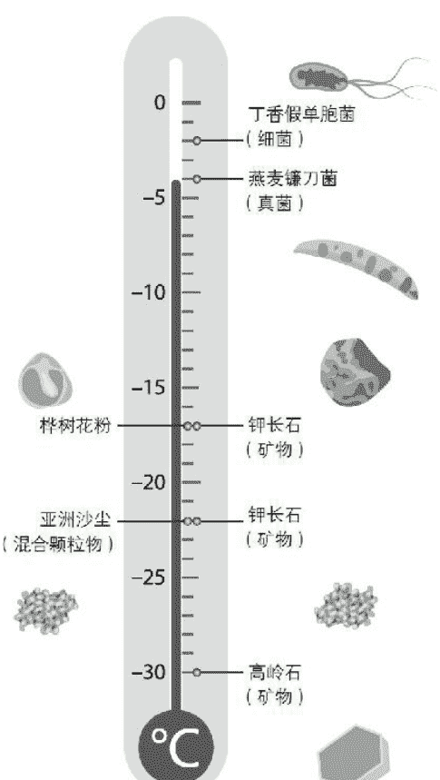

图6.5 要形成降雨，云通常必须形成冰晶。纯净水的温度可以降低至-40°C，但是在稍高的温度下，微小的颗粒就会促使冰的形成

而且这样的例子还有很多。近年来，我们发现各种微生物都生活在能够影响云层运行的高度。一项研究收集了飓风“厄尔”和“卡尔”通过大西洋、加勒比海、墨西哥湾和美国大陆等海拔10000米处的样品。研究记录了314种不同的细菌，其中大部分是活的。研究还发现了与土壤和尘埃颗粒一样多的生物细胞。

但这并不意味着这些细胞会影响云层或降雨。为了找出答案，你需要看看它们在云层里干了什么。这正是加州大学圣迭戈分校的大气化学家金·普拉瑟通过从雨云中汲取冰晶所做的工作。普拉瑟和他的同事研究发现，在充满雨水的云中形成冰晶的粒子中，大约40%是生物成因的。

这是一个有利的证据，证明微生物确实在温暖的云中结出了冰。但是普拉瑟还没有在工作中捕捉到细菌。即使她这么做了，也有人质疑空气中是否有足够的量对结冰产生影响。煤烟和天然矿物颗粒被认为更为丰富，因此更有可能占据主导地位。然而，倡导者认为微生物可能在一年中的某些地区和时间内产生显著的影响。

### 如果微生物导致下雨怎么办？

如果桑兹和其他支持活冰核的人的想法是正确的，那就为更多问题提出了可能性。例如，丁香假单胞菌是否进化成利用云层旅行来确保其自身的扩散，并确保其植物宿主得到雨水的滋润？

微生物到底是如何影响天气模式的呢？桑兹指出，有证据表明，某些类型的植被在降雨后释放出更多的冰核细菌，从而产生进一步的降雨。这就提出了一个问题：我们是否在不知不觉中通过农业改变了天气。

如果我们过去不小心改变了天气，将来我们是否可以故意这样做？美国有一个悠久的传统，派遣飞机通过向天空喷撒碘化银作为催化剂。2015年，洛杉矶郡为应对加利福尼亚州的干旱，花费了50万美元将碘化银撒向云层，由于缺乏证据表明碘化银会增加降雨量，所以受到批评。

桑兹认为，天然制冰机可以提供更好的解决方案：识别或创造出含有冰核细菌的植物，例如，把它们种在适当的地方，让它们“种”出雨水。

目前，所有这些都是推测性的。还有一个问题需要考虑。在空气中没有水蒸气的地方，你不可能诱发降雨，而在一个特定的地方，可供降水的水量总是取决于全球天气模式，而且变化很快。

### 晴天霹雳

令人欣慰的是，飓风和龙卷风等致命风暴相对罕见。在更常见的天气危害中，有一种是你真的不想近距离接触的，那就是闪电。

这是一种非常普遍的现象，大约每秒在全球发生100次闪电。但是由于研究闪电的困难和危险，我们对闪电成因的了解还比较少。研究人员对创造这一景象条件的研究进展缓慢，看起来我们可能一直都会经历闪电。

我们都可能经历过电火花带来的某种程度的疼痛，通常是在走过毛茸茸的地毯，伸手去摸金属门把手之后。当你走过地毯时，脚与地板之间的摩擦力会将地毯上原子中带负电的电子刮掉，这些电子会在你的身体中运行起来，使你整体带负电。这种电荷的积累看似微不足道，但在短距离内，它产生的电场会变得惊人地大。

当你带负电的手指向前滑动时，它会排斥门把手上的电子，使其在离你手最近的地方带正电。这些分离的电荷会产生一个电场，如果它达到临界值300万伏/米，就会导致手和旋钮之间的空气破裂。电子从空气中的分子中剥离出来，使它从绝缘体变成导体。在那一瞬间，多余的电子从你的手指穿过，伴随着一阵疼痛，通过电离空气流向旋钮。哎呀！恢复了电中性。

摩擦也是雷暴中电场的根源，尽管其来源不同。在雷雨云中，强大的上升气流将冰晶带到顶部，而较重的冰雹则落在地球上。这两股气流之间的摩擦剥夺了冰晶中的电子，因此上面的云带正电荷，下面的部分带负电荷。这就产生了一个类似于你和门把手之间的电场，于是当雷雨云中的电场变得足够强，足以电离空气时，结果就相当壮观了。电子在空气中划出电离通道，或称引线，寻找着最近的正电荷。

在一次常见的云地闪电中，负电荷在地球表面找到了正电荷。但最常见的闪电类型是云内闪电，放电的地方是在云层顶端的正电荷区域。不管怎样，一旦其中的先导到达电荷相反的区域，电流就会在两点之间射出，产生比太阳表面热5倍的闪电。

这是大多数人的观点，但它也有一个问题：尽管自20世纪50年代以来，我们已经把气球和装有仪器的飞机送入雷雨云中，但我们从未测量过分解空气所需的300万伏/米的电场，相反，电场通常是这个数值的1/10，这说明闪电的运行方式与传统的电火花不同。

### 地外辅助

这个问题的一个潜在解决方案有一个令人惊讶的来源：外太空。每一秒钟都有数十亿高能粒子坠入我们的大气层。如果其中一个粒子在雷暴中与电子相撞，电子就会受到严重的速度冲击。当它穿过云层时，这个失控的电子会使大量的空气分子电离，产生其他高能电子的雪崩。

人们认为，由此产生的电荷突然积聚会短暂地增强局部电场。尽管细节还不清楚，但这个电场的附加效应可能足以引发闪电，这种效应被称为“逃逸击穿”，而背景电场却不存在——接近300万伏特/米（见图6.6）。

在强上升气流的作用下，降落的冰雹会把从冰晶上带负电荷的电子擦掉，在云层上产生一个弥漫的电场。

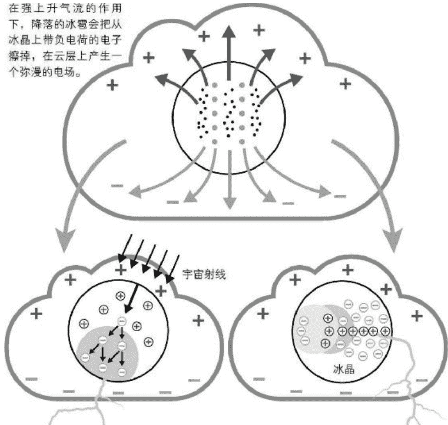

- 逃逸击穿：宇宙射线会产生一连串的电子，留下正电荷，增加局部电场。
- 快速正向击穿：带电的冰晶将电子从原子中分离出来。当电子被送回晶体时，正电荷向前移动，局部电场增加。

图6.6 雷暴内部的电场似乎太低，无法单独引起闪电。有两个过程可能会增强局部电场，足以引发闪电。

1991年美国宇航局将康普顿伽马射线天文台送入轨道后不久，这种观点开始得到支持。它的任务是寻找伽马射线，这是宇宙中最强大的辐射形式，通常在恒星爆炸时产生。所以当天文台发现这些高能光子不是来自遥远的星系，而是来自地球大气层中的雷暴时，人们惊讶不已。

物理学家们很快就把这些联系起来。当宇宙射线加速的电子在与分子的碰撞中曲折前进时，它们不仅会产生更多的高能电子，还会产生高能光子。伽马射线是失控分解的一个标志。

尽管这种联系看起来很诱人，但它可能是一个巧合：我们没有直接证据表明这是怎么回事。为了找到这一点，我们需要更好的方法来观察雷云内部。

幸运的是，有一种方法。闪电产生的波动电场会产生大量的无线电噪声，引起类似模拟无线电的爆裂声。20世纪90年代中期，位于索科罗的新墨西哥科技大学的物理学家威廉·赖森和他的同事认识到，他们可以使用GPS接收器精确地把无线电噪声和闪电都标出来。如今，赖森的闪电成像阵列分布在马格达莱纳山脉的16个站点。它可以在雷雨云中拍摄闪电的三维图像，但最初它的时间分辨率并不是很高。

为了改进这一点，2016年，赖森和他的团队开发了一种干涉仪来探测无线电波，并安装了一台高速相机，能够以超过1.8亿帧/秒的速度拍摄。有了这些工具，他们得到了视频图像和一张迄今为止最精确的、完整的三维闪电图。

### 头顶上的闪电

研究人员希望能得到逃逸击穿的详细图片。然而，结果却出乎他们的意料。他们发现，云层深处的强大火花可以在不需要外星协助的情况下提升电场，而不是像预期的那样从带负电的区域开始，跑到附近的正区域，它的做法恰恰相反。

经过数周的努力，他们想弄明白这个结果，赖森和他的团队意识到，正电荷的流动方向相当于电子急速向反方向移动的方向。在他们看来，罪魁祸首很可能是一面带负电荷、另一面带正电荷的极化冰晶。如果正电荷变得足够强，足以从附近的空气分子中撕裂电子，它就会产生另一个正电荷。这个过程就像晶体的新尖端，又产生了另一个正电荷，只要电场足够强，这个过程就会持续重复。

他们称这个过程为“快速正向击穿”。它创造了一个小小摆动的电离空气带，开始在冰晶的末端生长。当这个正向的“流线”增长时，它就像一个真空吸尘器一样，吸收了负电荷，然后把这些电荷送回冰晶，就像一个游泳者把水推到他身后一样。一旦冰晶积累了足够的额外电荷，它就可以创造出一个闪电先导，先声夺人。

令人惊讶的是，赖森的研究结果表明，在雷暴中看到的所有形式都可能是由快速正向击穿引起的。当然，宇宙射线仍可能发挥作用。但一些业内人士认为，赖森的证据是一个转折点，就好像你在玩拼图游戏时找到了拼图的一角。

### 辨认闪电

从类似海怪的闪光到被认为能熔融玻璃窗的球状闪电，闪电以各种奇异的形式出现。

- 精灵闪光：曾经被认为是神话，是云层上方短暂的红色闪光，看起来像巨大的水母。精灵闪光被认为是由闪电击中地面时在高层大气中产生的强电场形成的，但实际上我们并没有确切地搞清楚它们是如何形成的。
- 怪异闪电：这些发光的甜甜圈形状的光有400千米宽，然后在不到1毫秒的时间内迅速消失。人们认为，当云中的电场使电子撞击氮气分子时，氮气分子就会发出独特的红光。
- 蓝色喷流：偶尔从国际空间站上瞥见，蓝色喷流从雷雨云向上蜿蜒升到大约50千米的高度，然后在1/10秒的时间内消失。由于这种闪电相对比较少见，所以人们很难理解它们的成因。
- 反向闪电：当雷雨云和地球表面之间的电场中和时，为什么云总是必须让路？有时闪电在地面形成并向上射出，直到击中云层。何时以及如何形成这些闪电等细节仍然是个谜。
- 球状闪电：人们看到带电的球体熔融玻璃窗，飘浮在建筑物中，甚至在飞机的过道上弹跳。尽管人们已经报道了2000多年来自然界中出现的球状闪电，但科学家们还不确定到底发生了什么。虽然已经有许多理论，但没有一个是完全被接受的。

### 海洋

阿瑟·C.克拉克写道：“把这颗被海洋覆盖的行星称为地球是多么不合适。” 有一件事实很难反驳：从太空俯瞰，我们的行星看起来主要是蓝色的，因为海洋覆盖了地球表面的71%。如果不是这样，我们就不会出现在这里了。

### 地球上不平静的水

阿瑟·C. 克拉克指出，我们认为海洋理所当然应该存在，但是，我们却在虐待它们。它们仍然是世界上很多人食物的重要来源，但过度捕捞已经危及世界上85%的渔业。就像对待大气一样，我们往往把海洋当作一个巨大的垃圾堆。可悲的是，来自农业、工业和日常生活的污染仍在不断破坏着海洋维持生命的能力（见第9章）。

从全球范围来看，海洋还提供了其他“服务”。例如，它们可以充当巨大的储热器，消除极端温度，为地球提供一个稳定的气候来哺育生命。近几十年来，海洋的另一种能力越来越突出：它们消耗大量的碳并将其与大气隔离开来。

这种能力在很大程度上取决于海洋环流，这是一个在世界各地输送大量热量、盐和其他物质的水流网络。世界上5个最大海洋环流中的任何一个，比如墨西哥湾流，水流量都约为地球所有淡水河总流量的50倍。

表层海水从空气中吸收二氧化碳，并在下沉到海洋深处时将其锁定。同样，被称为浮游植物的微小海洋植物也具有这种功能。如果气候变化扰乱了海洋环流的模式，正如一些科学家所说的那样，它可能会严重限制海洋的吸收能力，这意味着我们只有了解海洋的作用，才能充分了解气候的变化。

### 驱动力

洋流是由多种因素驱动的。海面上的风驱动着表层洋流，另一个因素是地球自转产生的科里奥利力。科里奥利力对洋流造成横向冲击，就像对风一样（见第6章）。

在北半球，科里奥利力使洋流相对于其运动方向向右偏转，在南半球则向左偏转。海洋表面的基本流动模式最终形成了许多被称为环流的封闭模式。因为科里奥利力从赤道向两极不断增大，结果就会造成这些环流的形状是不对称的。在海洋盆地的西部边缘，有强烈、狭窄、快速的环流，其速度可达2米/秒。这些“西部环流”包括北大西洋的湾流。在东部，则是微弱、较宽和速度较慢的环流，速度不足0.1米/秒。

所有的主要海洋盆地都有环流（见图7.1）。亚热带环流是在10°～40°纬度发现的大型闭合环流模式。副极地环流出现在50°～70°。风把这些旋涡里的水堆积起来，这意味着海平面并不平坦。例如，在北大西洋副热带环流中，西印度群岛和亚速尔群岛之间马尾藻海的海平面比百慕大群岛周围的海面高约1米。这些环流模式有一个例外，那就是南极绕极流，这是一种从西向东围绕南大洋流动的强洋流。赤道附近也有复杂的海流，科里奥利力在那里消失了。

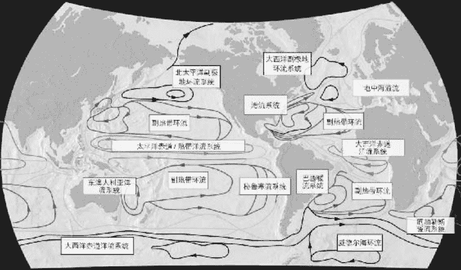

图7.1 海洋中主要的洋流是风和科里奥利力驱动的

然而，海水的命运并没有就此结束，因为它在很大程度上取决于温度、密度和盐度之间的相互作用。全世界海洋的盐度各不相同。通常，1000克海水含有35克盐。例如，波罗的海和北冰洋的盐度较低，地中海和红海的盐度较高。全球各地的水温也有很大差异。温度和盐度都有助于确定海水的密度，因此密度也因地而异，并有助于推动海洋循环。

海水温度越高，密度越小，重量越轻，使它上升到海面；反之，海水温度越低，密度越大，重量越重，使之下沉。水中的盐度越高，密度就越大。因此，冷而重的咸水和暖而轻的淡水之间存在着很大的密度差。

极地地区的冬季，海洋表面向大气中散发热量，最终导致海冰的形成，水的盐度越来越高。现在又重又冷又咸的极地水下沉到海底深处，迫使表层水从热带地区流向极地。同时，在极地海洋深处，大量的水堆积起来并被推向赤道。在这次旅行中，水变得更温暖、更轻，于是就形成了一个巨大的海洋环流。海洋环流将温暖、新鲜的表层水转变为寒冷、含盐的深层水的整个过程被称为深对流。深对流是驱动海洋环流的一种热机系统。

由温度和盐度差异驱动产生的流动模式被称为温盐环流，与地面风驱动的环流是分开的。联合效应产生的三维环流被称为海洋传送带（见图7.2）。大西洋、印度洋和太平洋盆地的水循环由南大洋相连。西欧的气候在很大程度上依赖于海洋传送带。由于北大西洋暖流——墨西哥湾流的延伸——西欧得到的“免费”热量相当于大约100万个发电站的输出。

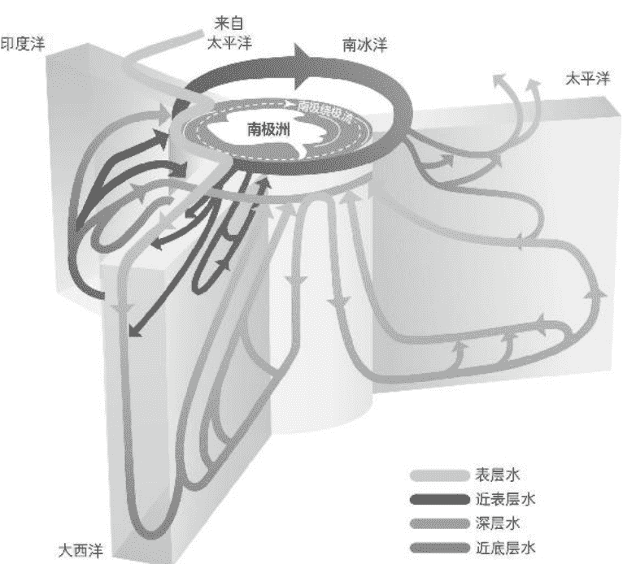

图7.2 两极附近寒冷稠密的海水下沉到海洋深处，然后流向热带地区。这种下沉的水沿着海洋表层从热带地区抽取温水，形成了一种“传送带”

海水可以储存大量的热量，海洋表层3米深度的海水与整个大气层具有相同的热容量。太阳直接加热海洋表面，因此表层水通常是最温暖、最轻的，而海底附近的水则是最冷、密度最大的。海洋的这种逐渐分层是很重要的，因为水在恒定密度层上的移动比在跨层移动更自由。但是，在有深对流的区域，或者海洋层向深处倾斜的区域，水仍然可以从一个深度下降到另一个深度。

### 新水与旧水

海洋表面的风搅动着混合层中的水，向下延伸约100米，水的温度和密度基本保持不变，但在混合层之下，温度和密度随深度的变化而变化。大部分海洋都含有冬季在高纬度地区下沉的冷水。因为温暖的热带水域较轻，它们位于较冷的极地水域的顶部。它们之间存在着明显的分界层，这里的温度随深度的增加而迅速下降，被称为温跃层。

温跃层的存在很大程度上取决于温盐环流。在一些深对流的地方，例如北大西洋的极地水域和南极洲附近的威德尔海，水下沉相对较快。但它“上升”的速度要慢得多，平均每天上升1厘米左右，跨越温带和热带地区的大片地区，然后慢慢地沿着表层回到极地，完成这个循环。

因为极地表层水比热带表层水更冷、密度更大，所以海洋密度层通常不会平行于海面。相反，恒定密度的层（称为等密度层）通常从海洋表面向下倾斜。这就是为什么在局部深层对流区域之外，表层水仍然可以深入海洋，携带着一些热量、盐、氧气、二氧化碳和它在表层所具有的其他特性。这种将水的性质输送到海洋内部的行为被称为“通风”。“通风”能分离溶解在表层海水中的二氧化碳气体，这也

是为什么海洋环流模式的变化会影响海洋吸收大气中二氧化碳的能力。

### 水的年龄有多大？

海洋学家说，海水的年龄指的是海水出现在海洋表面以来的时间。研究水的年龄有助于他们搞清楚水从哪里来，到哪里去。

海洋学家使用天然放射性碳（C-14）、溶解氧和二氧化硅来测定水的年龄。他们还可以利用人类活动产生的污染物，如氚，这是20世纪50年代和60年代核弹试验遗留下来的氢的放射性同位素。靠近表层的水可能只有几年或更短的历史，而较深的水则要古老得多。例如，温度低于2°C的北大西洋海水最后一次与大气的接触时间可能在200年前，太平洋深度超过1500米的水可能已经有500多年的历史了。

海水的垂直循环意味着，即使是非常古老的水也不可避免地回到水面，然后再开始下沉。水可以穿越很远的距离，并需要长达数千年的时间来完成一条单一的循环路径，这期间要经历许多曲折。就像陆地上的风穿过山谷并被山丘阻挡一样，深海环流也会受到海底地形的影响。

狭窄的海峡，连接着世界各大洋的各个部分，其流量受到水深限制。例如，在直布罗陀海峡，含盐度相对较低的大西洋水流入地中海，而含盐度相对较高的地中海水则从深处流出。这种狭窄的通道对于调节全球海洋环流不同性质水的交换至关重要。

### 海洋涡流

这种情形可能看起来是一个稳定、缓慢的循环画面。然而，细节却缺失了。正如大气有其高压（反气旋）和低压（气旋）一样，海洋也有旋涡——海洋的“天气系统”，以每秒几厘米的速度移动，将热量和盐分从海洋的一边输送到另一边。不过，这些旋涡的直径约为100千米，远小于大气中的直径，而大气中的直径可延伸至1000千米。

在墨西哥湾流等“快速移动”地区，旋涡可能只持续几个月就被吞没了。相反，在不太活跃的地区流动的旋涡可以持续两年或更长时间。涡流是不稳定流动的结果，例如在强水流穿过的地方，或在水流相邻部分之间速度有很大差异的地方，或在流速随深度有显著变化的地方。

涡流携带大量动能和热量，在海洋间能量传递、热量收支、不同性质水的交换方面发挥着重要作用。厄加勒斯暖流是非洲东海岸的一个西部边界洋流，它经常产生旋涡，把印度洋的温暖咸水带到南大西洋。

今天，揭开海洋环流的奥秘是各国科学家所面临的一项艰巨任务。如果我们成功了，那么我们将朝着了解地球气候，或许能够预测其未来的方向又迈出了一步。

### 真正的深渊怪兽

鉴于深海研究一直以来的固有困难，我们现在才逐步了解下面发生的事情。然而，更令人惊讶的是，我们仍在探寻那些发生在海面上显而易见的现象。几十年前，可能让大型船舶严重损坏或沉没的一次性巨浪的概念，被斥为子虚乌有的故事。但现在变了，在理论和实验的支持下，加上真实世界的观测结果，毫无疑问地证明了巨浪的发生并不罕见。

科学界对这些超级巨浪的研究进展缓慢，甚至还没有形成一个可以被普遍接受的定义。有一种比较流行的观点认为，超级巨浪至少是有效波高的两倍，而有效波高则指的是某片海域内最高的1/3波浪的平均高度。这在很大程度上取决于环境条件：在一片有效波高为10厘米的平静海面上，一个20厘米高的海浪也可能被视为超级巨浪。

这个高度似乎微不足道，在很长一段时间里，海洋学家的预测模型显示，反常的巨浪几乎不曾出现过。这些模型基于线性叠加原理：当两列波相遇时，把每个点的波峰和波谷的高度简单地相加。直到20世纪60年代末，英国剑桥大学的托马斯·布鲁克·本杰明和J.E. 费尔才发现传统的数学模型不太可靠。当长波海浪与短波海浪相遇时，一个波列的所有能量会突然集中在几个巨浪之中——甚至有时候仅有一个。

两人接着在伦敦西南部国家物理实验室的一个大型波浪水槽中进行了实验，验证了这一理论。造波机以不同速度搅动海水，在离它较近的地方，海浪是均匀的、平稳的，但是到了大约60米外，它们开始变得扭曲，形成了短暂的、更大的波浪，我们现在称为超级巨浪（也有人称为“流氓波”“疯狗浪”）。

这个新发现过了一段时间才流传开来。1995年在离挪威海岸大约150千米的北海，理论研究和实际观测终于碰撞到一起。那年元旦，卓普尼海上石油平台周围波涛汹涌，有效波高达12米，但下午3时20分左右，平台上的加速度计和应变传感器记录到一次巨浪，它的波峰比周围的波谷高出26米，相当于纳尔逊纪念碑高度的一半。根据大部分人普遍的观点，这是万年一遇的事情。

卓普尼巨浪开创了研究超级巨浪的新纪元。2000年，欧盟发起了“大浪计划”。在2003年初的3个星期内，他们利用船载雷达和卫星数据扫描世界海洋以寻找巨浪，发现了10个高度在25米以上的巨浪。

我们现在知道，任何一片大洋都可能出现超级巨浪。北大西洋、南极洲和南美洲最南端之间的德雷克海峡，以及南非南部海岸附近的水域，尤其容易出现（见图7.3）。这使得我们从新的角度对历史记录进行了解释，在2004年之前的20年间，有近200艘货轮的失事还无法解释，而超级巨浪被认为在这些事件中起了一定作用。2014年，一股怪浪袭击了英吉利海峡的“马可·波罗”号游轮，砸碎了一间屋子的窗户，并造成一名乘客死亡。

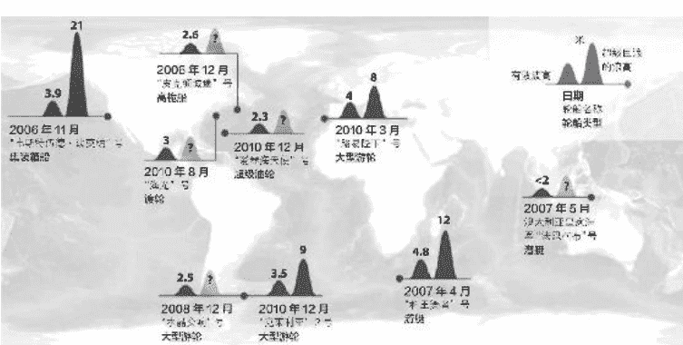

图7.3 对2006年至2010年间媒体报道的分析，得出了9起可证实的船只在深海海域遭遇超级巨浪袭击的事件

### 制造怪物

究竟是什么力量让现实世界中出现了怪浪？通过日益复杂的计算机模拟并结合理论和观察，研究人员正在建立一份目录，归纳超级巨浪在现实世界中的产生条件。其中的一种情况是，风暴卷起波浪迎面遭遇一股强大的逆流。在北大西洋的墨西哥湾流沿岸，这种情况经常发生，海浪撞上非洲东南部的厄加勒斯洋流也是这样。另一种情况是“对穿海”，是由两个波系——通常一个是由当地海风产生的，另一个是来自更远地方的海浪——从不同方向汇聚而成，造成不稳定。

### “路易陛下”号

当“路易陛下”号游轮离开西班牙巴塞罗那前往意大利热那亚时，它踏上了旅行的最后一段悠闲时光。但地中海暗藏杀机。

2010年3月3日下午1时左右，在船离开港口时，海面上聚起了风暴。在航行的头几个小时里，海浪不断地增加，但人们并不觉得这有什么异常。然后，下午4点20分，在没有任何征兆的情况下，船撞到一堵至少8米高的水墙。据事后还原真相，游轮发生颠簸，接二连三地撞上滔天巨浪。

海水冲上游轮吃水线上方约17米处，打破了5号甲板上的窗户。结果造成2名乘客当场死亡，另有14名乘客受伤。海浪突然出现，又突然消失，游轮摇摇晃晃地返回到巴塞罗那。今天，研究人员认为这一事件可能是由对穿海引起的。当他们将风浪数据输入一个模型中，以对当时该地区的海况进行事后预测时，证据表明当时两波海浪正在船附近汇聚，一波来自东北部，一波来自东南部。

此外，一些简单的情况可能也会产生超级巨浪。1980年12月，在日本南部太平洋地区以事故多发而著称的“龙三角”海域，一艘满载煤炭的货船遇上巨浪，整个船头被高约20米的巨浪吞没。日本对此展开的调查将原因归咎于对穿海，但当研究人员使用一种更为复杂的波浪模型来模拟这种情况时，他们发现很可能只是一股强风将能量注入了一个单一的波浪系统，而这个波浪系统比传统模型预测的要大得多。

这种单一波浪系统的传播模型已经发生了一些变化，而且对它们的预测也进行了修改。2012年，研究人员发现，根据这些模型，超级巨浪的高度甚至可以达到周围海水的11倍之多，这一可能性已经在波浪水槽实验中得到证实。

随着对超级巨浪理解的不断深入，科学家现在正在制订计划，在水手们进入可能产生超级巨浪的海域时向他们发出警告。要完善这样的系统还有一段路要走，但现在我们至少有理论和模型来预测那些在几十年前还被怀疑的现象。

### 神秘的河流

在土耳其博斯普鲁斯海峡下面有一条神秘的河流，它有河岸和湍急的河水，有的地方有1000米宽。如果它在陆地上蜿蜒而行，从它的流量来看，将成为我们的第六大河。然而，这股水流在海平面之下70米处静静地从马尔马拉海流向黑海。

这条暗河没有名字，也绝非独一无二。无数条水下河流纵横交错地穿过海洋，长数千千米、宽数十千米、深几百米。它们将沉积物分流到海洋中，携带着氧气和营养物质，使生物得以在深海中繁衍生息。

如果把地球上所有的海水排干，你会发现水下河流已经侵蚀出一个被称为深海水道的迷宫。看起来，它们类似于陆地河流，但它们的流动更像是雪崩、沙尘暴或火山碎屑流。它们的破坏力成为海底电缆的主要危害。

事实上，这些水道的存在最初就是从电缆破坏事件推断出来的。1929年11月18日，加拿大纽芬兰南部海岸250千米外的大浅滩发生7.2级地震。不久之后，十几条横跨大西洋的电缆被破坏，加拿大海岸的通信被切断了，造成了巨大的经济损失。

直到1952年，纽约哥伦比亚大学的地质学家布鲁斯·海森和莫里斯·尤因检查了每根电缆断裂的时间，他们得出的结论表明，地震导致200立方千米的沉积物从海底大陆架上翻滚下来。泥浆和海水的混合物以惊人的速度席卷而下，电缆一根接一根地被冲断。海森和尤因的计算表明，这股“浊流”的速度达到了100千米/时，在海床上凿出了河岸，沿着大陆斜坡向下延伸了600千米。

直至今日，混浊的水流仍在冲击着海底电缆。这些电缆承载着95%的国际电话、互联网和数据传输信号，一旦它们被破坏可能会带来大麻烦。危险很多，但我们却没有详细的深海水道地图，这很令人惊讶。利用现有技术，绘制一幅全球深海水道地图可能需要数百年的航行时间。目前，每次当电缆被冲断时，我们仍能发现新的未知水道。

### 水下河流是如何形成的

在地图上绘制水道是一回事，理解它们却是另一回事。正如你所料，地震引发的洪水有些是短暂的，所以有些水下河流“干涸”了，就像干旱中的陆地河流一样。当然，它们仍然充满了水，但是没有泥浆和沙子流过。

有些是由于堆积在峡谷上游的沉积物在自身重量作用下崩塌而引发的，另一些则是由于陆地河流流入大海造成的。以刚果河为例，当它到达大西洋时，河水中含有丰富的沉积物，可以触发一条水下河流，沿着一条深海水道流入大海。同样，中国的黄河也在流入小浪底水库时形成了一个深渊。

虽然大多数河道看起来是由陆地河流形成的，但有些河道已经被发现出现在海洋的中央，而且还没有人知道它们是如何到达那里的。

混浊、快速的浊流是个很恶劣的家伙：身处其中的仪器通常被摧毁。然而，博斯普鲁斯海峡下的巨大水流显得相当友好。它不像大多数那样混浊。这里没有沉积物，而是充满了来自地中海的盐。这种额外的咸水比周围的水密度大，所以它沿着海平面流动。尽管洋流的组成物质不同于其混浊的同类，但其流动的动力基本相同。

英国利兹大学的杰夫·佩考尔研究过世界各地的深海水道。他还乘坐鱼雷形状的黄色机器人潜艇到达博斯普鲁斯海峡，并首次对通过深海水道的流量进行了详细测量。他发现水下的河流像一条受惊扰的响尾蛇一样蜿蜒曲折。陆地上河流的流动会受制于它周围的地形，但是水下河流是不同的。奇怪的是，靠近赤道的水下河流都非常曲折，而在两极地区则显得更笔直。

这是为什么呢？佩考尔怀疑罪魁祸首是科里奥利力效应，它使风和洋流偏转（见第6章）。由于无法在深海水道进行直接测试，他转而在实验室进行实验。他和多伦多大学的研究人员一起，在一张旋转的桌子上安装了一个2米长的水箱，并将其装满水。科学家们用有机玻璃在他们的“海床”上建造了一条蜿蜒的水道，并注入了浓盐水来模拟混浊的水流。然后他们以不同的速度旋转水箱，模拟地球在不同纬度的旋转，他们发现水下河流的行为方式与陆地河流截然不同。在这两种情况下，水在弯曲处的运动都是由力的组合控制的。陆地上主要是水的重量和当水流弯曲时向外推动的离心力。

但是浊流不是存在于空气中，而是存在于水中。水流的重量被浮力抵消，使得科里奥利力比陆地上的影响更大。这会产生一些奇怪的效果。水流转向河道的一侧，例如北半球向右，南半球向左。在陆上河流的弯曲处，表层水倾向于向外流动，而底层水则倾向于向弯曲处的内部流动。但在一条水下河流里，情况正好相反。

这些变化的水流造成了不同寻常的侵蚀模式和沉积物沉积模式。

海峡的一岸（承受水流的一侧）比另一岸大。在科里奥利力较大的两极附近的水道比赤道附近的水道发育得更直。当侵蚀将陆地河流的弯道稳步地推到下游时，海底弯流却依然存在。相反，一旦达到一定的“摆动度”，它们就会筑起高达数百米的垂直堤坝。

在电缆铺设公司和石油公司对深海河流的奇怪行为感兴趣的同时，气候科学家也在密切关注它们。海底水道，特别是那些从陆地河流延伸出来的水道，携带着大量的有机碳，其中大部分有机碳最终被埋藏在沉积物中，直到数百万年后才重新进入大气。科学家们正试图量化碳以何种速率被输送和被掩埋，以及它将如何影响全球碳循环，以便于我们能够更好地理解深海，更准确地模拟气候变化。

## 8 生命

地球和它的生物居民之间的关系是耐人寻味的，自从生命在大约40亿年前立足以来，它一直在“重新装饰它的家园”。它深刻地改变了地球的大气和岩石的性质。地球与生命的关系也催生了20世纪最具原创性的理论之一。

### 地球，遇见生命。生命，这就是地球

从目前的情况来看，如果你对生命现象感兴趣，那么只有地球这一个星球值得一游。在这些独特的谜题中，没有哪一个比生命是如何形成的更有趣了。如果它是从地球开始的，也就是说，如果它不是从宇宙的其他地方搭便车来的，那就意味着在某个时刻，一群生命之前的化学物质聚集在一起，形成了一种能够繁殖和进化的东西。这是怎么发生的，到底是从哪里开始的？

最初的线索来自20世纪50年代由斯坦利·米勒进行的实验，他当时23岁，是芝加哥大学的博士生。他宣布，他仅仅通过玻璃管中循环的热空气射出的电火花就制造了氨基酸、蛋白质的组成部分。米勒的火花是原始光的替代品，而含有氨气、氢气、水蒸气和甲烷的热空气，是为了模拟40亿年前的地球大气。

除了产生氨基酸，其他研究人员很快就认为米勒的实验也可以产生腺嘌呤和鸟嘌呤，这是制造核糖核酸（简称RNA）和脱氧核糖核酸（简称DNA）的两种核酸碱基。但米勒又花了43年的时间展示了他的实验是如何产生RNA的另外两种碱基尿嘧啶和胞嘧啶。他和他的学生迈克尔·罗伯特逊发现了一种制作大量原始汤的方法。秘密成分是尿素，虽然在最初的实验中生产，尿素的浓度始终不够高，但米勒认为，在地球早期，随着浅水池蒸发，尿素会达到恰好的浓度——这就是“干潟湖假说”。

### 生命的起点

所以，碳基生命的原料应该是由地球的大气和天气提供的。如何将它们组装成一个有生命力的有机体是一个热门的研究领域，近几十年来，一些理论学家和实验学家探索了每一个可能的化学步骤。这项工作还发现，除了干涸的泻湖之外，地球上其他一些角落也可能是生命的摇篮。

研究人员所设想的最早的有机体并不是我们今天所熟悉的，而是一些更简单的生物。这就是为什么，在第一个生命发展后很久的某个时刻，一个名字叫卢卡的单细胞特征出现了，它是地球上所有生物最后一个普遍的共同祖先。我们可以从我们今天在所有生物中看到的共同特征中了解到很多关于卢卡的情况，我们知道它用DNA储存蛋白质的配方——例如基因，而这些配方是通过RNA在其细胞内传递的。我们甚至知道这些配方中的很多东西是什么，因为今天在所有细胞中发现的许多重要蛋白质肯定来自卢卡。从这些蛋白质的性质来看，很明显，卢卡使用了一种叫作三磷酸腺苷（ATP）富含能量的分子来供养细胞，就像我们的细胞一样。

然而，由前生命化学物质直接跳到卢卡身上则是一个巨大的挑战。蛋白质在DNA复制中起着至关重要的作用，因此从头开始创造卢卡意味着蛋白质和DNA同时产生，这是一个不可思议的惊人巧合。大多数生物学家已经确定了一个中间步骤，即所谓的“RNA世界假说”。RNA可以构成基因——像DNA一样——也可以像蛋白质一样催化化学反应。故事是这样的，RNA或者类似它的东西可以实现复制和代谢任务，比如能量的产生。直到后来，DNA才成为基因和蛋白质的储存库，而蛋白质则接管了新陈代谢。

生命起源的研究人员往往把重点放在仅能利用RNA发挥功能的生物体上，这与从潮湿的大气中制造类似RNA的小分子是一回事。但这些子单元是如何组装成长链RNA，作为基因和催化剂发挥作用的呢？这个问题促使在波士顿哈佛医学院工作的杰克·绍斯塔克和他的同事研究一种叫作蒙脱石的软黏土矿物。

这种黏土的电学特性使得它对短链核糖核酸很有吸引力，促使它们聚集成长链。绍斯塔克和他的团队还发现，黏土可以催化简单的脂肪酸前体，形成类似原始细胞被细胞膜包围的囊泡。细胞膜是活细胞的另一个重要组成部分：它保护细胞内的物质并浓缩化学物质，从而发生反应。研究小组最终发现，附着在蒙脱石上的RNA链在形成的过程中可能会被囊泡所吞噬，形成一个实质上的“原始细胞”。

因此，池塘底部的黏土可能是启动生命的工具。但它并不是唯一的角色。英国剑桥大学分子生物学实验室的菲利普·霍利斯特提出，冰可能起到了一定的作用。他和他的团队首次创造了一种长的RNA催化剂，可以构建比自身更长的其他RNA分子。令人惊讶的是，这个过程在冰晶之间的小口袋中的温度低至-19℃。2017年，他展示了这样的RNA催化剂是如何从水中的RNA短链经过冷冻和解冻组装而成的。

而在另一个极端，伦敦大学学院的尼克·莱恩认为，RNA世界可能出现在海底火山口周围，那里的碱性液体在温度高达90℃的情况下通过海底裂缝上升。在这里，当流体撞击冰冷的海水时，矿物质从溶液中沉淀出来，形成高达60米的岩石烟囱，里面充满迷宫般的通道和孔隙。

即使在早期地球上，这些烟囱也会富含铁和硫化物，它们能催化复杂的有机反应。更重要的是，气孔内的温度梯度应该产生了高浓度的有机化合物，并有利于大分子的形成，包括脂肪分子和可能的RNA。

根据莱恩的说法，这里是形成能自我复制的核糖核酸和膜状脂肪囊泡的最佳场所。

最有趣的是，这些喷口可能是通过质子贫乏的碱性液体和富含质子的海水之间界面处的自然质子梯度产生能量的。这与至今驱动细胞产生ATP的电化学梯度是一样的，莱恩认为产生ATP的细胞机制首先在这些岩石孔隙中形成。

这些想法凸显了生命与地球上不同特质之间可能存在的丰富而复杂的相互作用。其中哪一个是正确的仍然没有定论，我们可能永远也不会得到答案，尽管大量的研究仍在进行中。当然，还有另一种可能使所有这些想法变得多余：那就是也许地球上的生命从来没有开始过。

### 宇宙的孩子

生命起源于太空的观点——“胚种假说”——出现于19世纪。20世纪70年代初，当天文学家发现太空中充满了复杂的有机分子时，它变得越来越流行。胚种假说似乎回答了为什么地球上的生命几乎是在行星变成可居住的时候就出现的问题。由前生命化学物质到生物学的转变真的会这么快吗？

这个想法仍然是主流科学边缘的一个未经证实的假设。尽管如此，它仍然有支持者。英国白金汉大学的钱德拉·威克拉马辛赫是20世纪70年代支持胚种假说的科学家之一，她指出，2013年在平流层27千米处发现微生物等证据，这些微生物是在英仙座流星雨期间收集的，它们的高度太高，无法从地球表面看到。

根据威克拉马辛赫的说法，银河系充满了生命，我们的生物圈只是一个巨大的、相互连接的宇宙生态系统的一部分。地球与邻近的恒星系统之间不断地交换着遗传物质甚至是生物。进化的变化很大程度上是由来自太空的新的基因物质驱动的，最有可能是以病毒的形式出现的。

而其他人则没有那么激进，他们只是认为生命最初是在火星上进化的，是通过陨石到达这里的。归根结底，如果胚种假说被证明是正确的，我们将不得不认为地球上的生命形式不仅仅属于地球，而是宇宙的孩子。

### 如何毒害一个星球

如果说早期的地球促成了生命的形成，那么从那时起，生命就一直在偿还债务。它改变了地球的大气、海洋和地质。没有什么比24亿年前的“大氧化事件”更能说明生命对地球的影响了，这一事件是由光合作用中能够分解水的细菌的进化所引发的。

光合作用是一个将太阳能转化为可供植物生长所需的化学能的过程。简单地说，阳光照射植物，使之释放出电子，而生物有机体利用这些电子和二氧化碳生产出糖和其他碳水化合物。我们发现的最早的光合微生物化石证据可以追溯到34亿年前。

但早期的光合作用并不是我们今天想象的那样。微生物本可以依赖硫化氢等物质作为电子源，产生硫作为废弃物。

然后，大约28亿年前，出现了一组新的微生物，它们采用了我们现在更熟悉的形式。该过程使用水作为电子源，并产生了高毒性的废弃物——氧气。到那时为止，地球上几乎没有这种气体，而且是不需要的。它从细胞内部燃烧细胞，抓住由电子产生的被称为自由基的活性化学物质，自由基在细胞内造成严重破坏。

大约24亿年前，氧气水平飙升，引发全球大规模“屠杀”。大多数厌氧微生物当场死亡，一些幸存者在地下深处或其他缺氧的地方找到了避难所。今天，仍有一些生活在沼泽深处或潜藏在你消化道的肠隐窝深处。

在海洋里，氧气和溶解的铁结合在一起，形成不溶的铁氧化物，沉入海底。今天，我们在西澳大利亚和美国明尼苏达州的广阔条带状含铁岩层中看到了这一结果。随着氧含量的增加，在平流层的高空，来自太阳的紫外线分裂氧分子，形成臭氧层（见第6章）。这一作用保护了生命免受紫外线的伤害，使其能够在不久的将来得以迁移到陆地上。

这组新的光合作用者，可能是今天蓝藻的祖先，它们的大量繁殖在很大程度上是因为利用氧气燃烧碳水化合物作为能量，其效率是不使用氧气的18倍。生命正在变得强大，为更多复杂生命形式的进化创造了条件。

能够利用氧气的真核生物在21亿—16亿年前的某个时候到达。它们的生长可能是大气中氧气含量下降的原因，但很快就恢复了平衡（见图8.1）。后来出现了多种细胞生命形式——包括植物，它们借用了蓝藻的光合作用器官。今天，光合作用直接或间接地产生了地球上生命所使用的几乎所有能量。

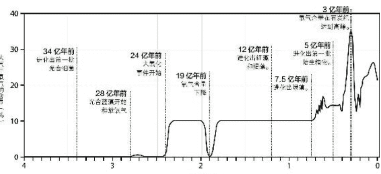

图8.1 今天地球上的生命在很大程度上归功于氧气在地球大气中的首次出现。24亿年前存活的大多数微生物都会被氧气的活性杀死

### 盖亚的崛起

生命与地球物理系统的相互作用，产生了20世纪最具突破性的科学思想之一——盖亚假说，它以养育生命的“母亲”古希腊大地女神命名。它是具有独立思想的科学家和发明家詹姆斯·洛夫洛克的智慧结晶，美丽简单且吸引人。詹姆斯·洛夫洛克认为地球拥有一个全球规模的自我调节系统，可以使环境适应生命的生存。不过，它是有争议的，既有强烈的支持者，也有强烈的反对者，包括一些人指控它根本不是正确的科学，而是更多地属于哲学甚至宗教。

盖亚的故事始于20世纪60年代，当时洛夫洛克在美国宇航局，他和同事戴安·希契科克认为火星大气处于化学平衡状态——含有二氧化碳、少量的氮气和很少的氧气、甲烷或氢气。他们将火星大气与我们的空气进行了对比，认为我们地球的大气环境处于化学不平衡状态，二氧化碳和氧气的浓度在不断变化。这种变化的主要驱动力是生命：光合作用将二氧化碳转化为氧气，而有氧代谢则相反。如果没有生命，我们的大气将从富含氧气和维持生命的气体混合物彻底转变为一种化学平衡的气体混合物，就像火星大气一样，这种气体混合物对生命是有害的。

地球的大气不仅在不断变化，也在欢迎生命的到来，而且数十亿年来都是这样。同样，地球表面的温度、酸度和海洋化学性质似乎已经稳定了数十亿年，在平均值上下徘徊，这使得地球是宜居的。考虑这些发现的意义，洛夫洛克开始设想一个新的生命观点及其与宿主行星的相互作用。

简单地说，盖亚假说认为，生物作为一个整体与物理环境相互作用，不仅使地球适合居住，而且不断改善生物生存的条件。它通过一系列类似于生物体内调节机制的反馈系统来实现这一点，生物体通过这种机制维持稳定的内部环境。那些最能影响行星是否宜居的因素——温度、海水和淡水的化学成分以及大气的组成，不仅受到生命的影响，而且受到生命反馈系统的控制。

在他的第一部著作发表后的10年内，他将自己的假设提升到了科学性更强的盖亚理论。在20世纪70年代中期，他描述了他的观点：“盖亚理论认为，温度、氧化状态、酸度、岩石和水的某些特性保持不变，而这一动态平衡是由生物群自动或无意识地通过积极的反馈过程来维持的。”

洛夫洛克最终开始把地球本身称为某种超有机体。他在1979年出版的《盖亚假说：对地球生命的新认识》一书中写道：“从鲸鱼到病毒，从橡树到藻类，一起构成了一个独立的生命统一体，这个统一体能够使地球的大气层满足它的全部需要，并且所赋有的能力和能量都远在其构成部分之上。”换言之，地球并不只是一颗孕育生命的星球，它本身也是活着的。

这种观点简明而又别致，很快吸引了许多人，包括科学家和非科学家。一些研究人员从盖亚理论中找到一种思考有机成分和元素循环的新方式。一些人追随着洛夫洛克，为“生命调解着地球的环境”这一观点寻求科学支撑。还有些人，主要是非科学研究人员，也从盖亚理论中获得一些新观点，即人类该如何处理地球和其他生命的关系。有些人甚至从这个概念中看到了上帝的脸。

### 盖亚的多种面孔

至少有三种不同的盖亚假说变体。

### 优化的盖亚

这种早期的解释仍然是盖亚理论“最强”的版本之一。它指出生命在主动地控制环境条件，包括生物圈纯物理的方面，如温度、海水酸度和大气成分，从而使地球保持最佳的宜居状态。

### 自我调节（内稳定）盖亚

这是一种较新但稍弱一些的理论。与生命积极地优化地球环境的条件不同，这个理论指出生命建立了一个负反馈系统，它可以使约束生命的因素（如温度、大气中氧气和二氧化碳的含量）保持在特定的范围之内。

### 超有机体盖亚假说

地球不仅仅是一个维系生命的物理行星，它本身也是活着的。这是对这一理论最有力的解释，但往往被认为是不科学的。

### 盖亚是真的女神吗？

盖亚理论持续引起科学界的兴趣和争论：已经有多次国际会议专门讨论这个假说。不过，形势正在发生变化。最近的一些发现对盖亚假说提出了严重的怀疑。其中有两项研究线索对它来说具有毁灭性：一项是来自深时的研究——对古岩石的研究，另一项是来自对未来模型的研究。两者都推翻了盖亚预言的关键预测。事实上，如果我们非要选择一个神话中的母亲形象来描述生物圈，那么美狄亚，阿尔戈英雄伊阿宋的恶毒的妻子，或许更合适。她是一个巫师，一位公主，也是杀害自己孩子的凶手。

从深时的发现开始，盖亚的支持者提出的最有力的论据之一是，由于生物引发或造成的反馈，使得行星温度保持稳定，这些“温控器”中最重要的一个是风化循环（见第6章）。火山不断喷发大量的高效温室气体二氧化碳进入大气。如果不采取某种方式将其清除掉，地球将经历失控的变暖，最终导致海洋蒸发——遭遇和大约40亿年前金星一样的命运。

清除二氧化碳的工作主要是由富含硅酸盐的岩石（如花岗岩）的化学风化完成的。这就驱动了它与二氧化碳的化学反应，将二氧化碳从大气中去除，并将其封存在石灰石中。这种反应的速率随着陆生植物的增多而不断增大，它们的根会分解岩石，让水和二氧化碳渗透进去，植物也可以通过光合作用直接消耗大气中的二氧化碳。

到目前为止，盖亚假说就是这样。但随着科学家对过去的全球气温进行了更精确的估计，盖亚理论所预言的恒定性被发现是不成立的。事实上，由于新物种的进化，地球温度出现了如同过山车一样的剧烈波动。

例如，大约23亿年前，地球经历了一次持续1亿年的漫长冰期。海洋被完全冻结，形成了一个“雪球地球”（第2章）。原因就在于生物本身。新进化的氧光合微生物从大气中吸收了大量的温室气体二氧化碳，以至于使地球陷入了冰冻状态。

最初的多细胞植物进化所带来的第二幕“雪球地球”发生在7亿年前。后来，陆地植物的进化给气候带来了双重打击。除了通过光合作用减少二氧化碳外，它们的深根显著提高了风化速率。结果是，在3.6亿年前泥盆纪末期森林出现后不久，地球进入了一个持续5000万年的冰河时代。这颗温暖、青翠的行星迅速降温，大量生命灭亡。这并不是一个符合盖亚假说的结果。

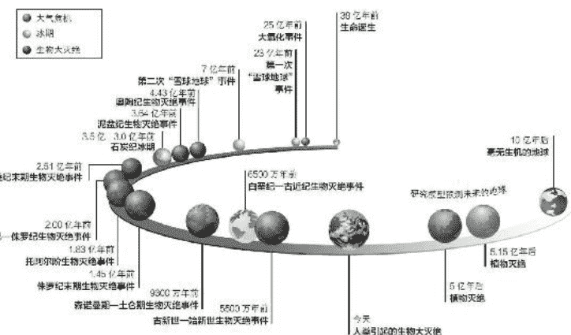

图8.2 几乎所有的大规模灭绝事件都是由一种生物杀死另一种生物引起的，而白垩纪——古近纪生物灭绝事件除外，人们认为这一次是小行星撞击地球造成的

事实上，自从生命诞生之日起，它就一直能够毁灭自己。查尔斯·达尔文把新产生的生命形式融入这个世界的过程，比喻成一个楔子轻而易举地进入一个狭窄的空间，然后把它逐渐劈开的过程。有些生命形式是这样的，但其他一些则像大锤一样，在它们所到之处把生命之树的所有枝干都砸碎了。

也许最恶劣的美狄亚事件与雪球地球事件一样，是由相同的生物进化促成的：如本章前面提到的大氧化事件。大氧化事件释放出“大规模杀伤性武器”——氧气。生物惨遭不幸。所有幸存下来的都是能够进行光合作用的生物，以及迅速进化的能够耐氧的微生物，或者躲避在某些缺氧空间的微生物。

一些科学家通过对5.65亿年前自动物进化以来发生的物种灭绝事件（包括5次大规模和大约10次小规模）的研究，进一步否定了盖亚假说。大多数这些事件现在被视为“微生物”大灭绝，由大量细菌喷出有毒的硫化氢气体引起。这些细菌在死寂的海洋中茁壮成长，这些海洋是在全球变暖的剧烈时期出现的，如二叠纪末，长时间的火山活动将大量的二氧化碳排放到大气中。

根据盖亚理论，生命本应缓冲这些事件。但事实并非如此。它们的存在似乎在强烈地支持美狄亚观点，恰恰相反与盖亚假说背道而驰。可以论证的是，与生命史上的许多其他事件一样，由人类引起的生物大灭绝正在我们身边上演着。

### 展望未来

未来会怎样？在这里，我们也可以反驳盖亚理论，而且这也许是最有趣和最令人震惊的发现。生命似乎在积极地追求它自己的灭亡，拖着地球逐渐走近那个必然到来的一天，也就是回归到它的原来状态：一片死寂。

怎么会这样呢？最主要的原因是太阳在逐渐变热。在过去45亿年中，它的亮度增加了约30%，并将继续增加。太阳的光照变得更热，会引起全球变暖，从而加速岩石的化学风化。与此同时，在光合作用和植物根系的帮助和促进下，大气中的二氧化碳会被更快地清除。

首先，二氧化碳被清除将缓冲太阳引起的增温效应。但是未来一段时间——可能最早在5亿年后，大气中没有足够的二氧化碳来支持光合作用。当那灾难性的一天到来时，我们所知的世界将进入末日。

对生命来说，这些变化将是十分剧烈而又具有灾难性的。植物会枯萎死亡，阻断生物的生产力和大气中的氧气。紧接着，动物也很快死亡。植物的缺失也会导致大气中二氧化碳的重新积累，从而加剧失控的温室效应。

最终，地球表面的温度将超过沸水的温度，最后一种微生物也将消亡。地球将再次失去生命。这是完全有悖于盖亚理论的，因为盖亚理论认为，行星上生命的存在会提高其宜居性，而结果恰恰相反。

如果这些模型是正确的，那么地球上的生命已经进入了老年期。地球在38亿年前开始这场生命冒险，而且至今仍是我们所知的宇宙中唯一的生命体，也许还可以再熬过10亿年。大气中二氧化碳的减少这一长期的、不可避免的过程已经开始了——燃烧化石燃料的影响与之相比则不值一提。对现在来说，盖亚就快要死了，而美狄亚还会活下去。

### 挑战盖亚假说

对盖亚假说证据的第一次反思出现在2013年的《论盖亚：对生命与地球的批判调查》一书中，作者是南安普敦大学地球系统科学教授托比·蒂勒尔。盖亚的主要论点之一是，生命极大地改变了地球的环境，包括大气和海洋的化学成分。蒂勒尔发现了有关全球环境的生物学变化的大量证据。例如，生命影响着地球的反照率——

地球将太阳能反射回太空的程度，其中一种方式是海洋微生物产生二甲硫醚，这是一种在大气中上升并影响云层形成的化学物质。

然而，这种作用长期以来被认为是承认盖亚假说，但结果证明只是一种相对较弱的作用。还有一个问题，生命改变地球环境的能力同样可以支持另一个竞争性的观点。“生命与行星共同进化”假说认为，生命与环境是相互作用的，但并不要求改善或保持地球的宜居性。蒂勒尔没有找到令人信服的理由来支持盖亚假说。

盖亚的机制是什么？如果能看到这一假设是从进化中自然产生的，那么这一假设将立即变得更加合理。蒂勒尔觉得没有充足的理由能让人相信这一点，但却遇到了有趣的“微型盖亚”案例。例如，白蚁窝和黄蜂窝的内部调解温度能力很强，昼夜的温差与外面的空气相比要小得多。这些稳定的内部温度，部分取决于这些社会性昆虫如何定位它们巢穴的方向，但也通过当孵卵温度下降太低或上升太高时的群体行为来实现。

这些都是盖亚在行动中的很好例子，但它们并不能让我们期待类似的事情一定会在全球范围内发生。事实证明，到目前为止，只有在关系密切的个体中才能观察到对共享环境的共同调节，而全球生物群则因为基因极为多样化，结果则恰恰相反。

蒂勒尔得出结论说，盖亚假说并不能准确描述出我们的世界是如何运作的。这颗行星不像盖亚所说的那么稳固，反而更加脆弱。虽然这个美好的想法不成立可能令人遗憾，但他认为，我们应基于对地球系统运行方式的准确了解而不是通过有缺陷的方式来解决环境问题。

### 欢迎来到人类世

1950年1月，艾萨克·阿西莫夫出版了他的第一部科幻小说《苍穹一粟》，美国歌手史蒂维·旺德诞生。而对一些科学家来说，地球则进入了一个新纪元。人类世是以人类命名的，当我们的人口数量和活动达到一定的规模，开始对地球的地质、大气、海洋和生态系统产生深远的影响，人类世就开始了。

### 人类的时代

自11700年前上一次冰期以来，地球一直处于全新世，这是地质年代代表的最新纪元。但现在已经被取代了吗？我们人类对地球的重塑是否达到了我们应该拥有自己时代的程度？

2017年9月，人类世的概念向被大众普遍接受上迈出了重要一步。经过8年的深入研究，一个由科学家组成的工作小组建议在我们的地质年代表上增加人类世。

最终的决定权在国际地层学委员会。为了说服它接受这个建议，人们还需要做更多的工作。首先亟待解决的一个问题是：在地球上的什么地方能够找到我们人类世出现的最佳标志？

不同地质时代之间的分界点都是——或最终将是——全球年代地层单位界线层型剖面和点位，有时称为金钉子。这是一个研究人员已经确定的地方，以最佳的视角向我们展示了这个世界从一个被命名的地质时代进入下一个被命名的地质时代。（见第2章）。

例如，如果想看到从恐龙繁盛的白垩纪到古新世的界线，建议你去突尼斯的卡夫。如果想了解从二叠纪进入三叠纪史上最大一次生物大灭绝，你可以前往中国的浙江省。

地质学家们会选哪里作为人类世开始最具标志性的地方呢？据国际地层学委员会人类世工作组的召集人、英国莱斯特大学的简·扎拉西维奇说，最初他们进行了广泛的搜寻，有很多地方可以作为筛选对象，包括湖泊、缺氧的海盆和冰层。

但是，做出决定非常困难，因为人类迈入人类世的时代离现在太近了。理想情况下，金钉子应该是一个物质稳定积累的地方，那里的物质——比如冰或沉积物——足以给我们提供可辨别的年复一年的记录。它也必须是一个不受自然侵蚀或人类活动破坏的地方。

还有一个需要考虑的问题：什么样的“标志物”最能证明人类世的到来？地质边界通常与全球事件而不是与原始日期相关。例如，白垩纪末期由广泛分布的地外铱层和小行星撞击引起的一系列灭绝事件所定义。所有这些都可以在突尼斯卡夫的沉积层中清楚地看到。

### 寻找人类世的金钉子

人类世的出现可能与20世纪中叶无数原子弹试验的放射性钚的含量激增有关。或者，也许它的标志是塑料首次出现在海底和湖床上累积的泥层中。

许多信号可能会发挥作用。例如，人类世之前的全新世，有一棵来自格陵兰岛冰原的金钉子，它保留了上一个冰河时代末全球变暖的同位素特征。世界上还存在一些起到辅助作用的地点，包括来自日本一个湖泊的沉积物岩芯，它捕获到了与全球气温上升相关的花粉变化情况。

但最初的问题仍未解决。选择突出人类世不同方面的地点并不能给我们一棵明确的金钉子。那它会在世界上的什么地方呢？

人类世工作组的另一位成员，英国地质调查局的科林·沃特斯认为，加利福尼亚海岸的圣巴巴拉盆地和委内瑞拉海岸的卡里亚科盆地值得考虑。这二者都以稳定的速率积累沉积物，很可能含有钚的记录，它们也不太可能受到人类活动或其他过程的干扰。

另外，我们还可以选择洞穴中的石灰岩沉积物，比如石笋或钟乳石。它们能够提供碳同位素记录，记录下人类活动对大气的影响。人类世也有可能像全新世一样，最好是在格陵兰岛的冰芯中寻找标志。

也许地球上标志人类世开始的最令人心酸的地方是珊瑚礁。扎拉西维奇认为，有一种生长速度特别快的珊瑚名叫滨珊瑚，它那如同树木年轮一样的生长纹，向我们提供了从全新世向人类世过渡的高度清晰，而且坚实可靠的化学记录。

我们都知道珊瑚礁因全球变暖和海洋酸化所面临的威胁。沃特斯认为，选择从加勒比海等地采集珊瑚保存在博物馆里是一件很有诗意的事情，因为它是地球上最能记录人类活动开始改变整个地球时刻的一件物品。

### 人类影响的标志

即使人类在数千万年后消失，在地球的地质记录中仍然会有我们保存下来的清晰迹象。正如我们所了解的，钚和其他放射性同位素的沉积正是人类对地球产生巨大而深远影响的开始。当然，还有其他一些潜在的标志物……

### 化石燃料

燃烧化石燃料的产物将是人类世的一种明显特征。目前的碳排放率被认为高于过去6500万年的任何时候。大气中二氧化碳的浓度自1850年以来急剧上升，现在约为百万分之四百一十，这将记录在格陵兰岛或南极洲那些在全球变暖中幸存下来的冰盖里面。燃烧化石燃料也提高了碳-12与碳-13的同位素比率。它们在树木的年轮、石灰岩以及骨头和贝壳的化石中都可以检测到。我们消耗燃料也将碳微粒扩散到空气中，这些碳微粒会被沉积物和冰川冰捕获。

### 新材料

我们这个时代最大的标志之一可能是我们每天使用的三样东西：混凝土、塑料和铝。铝元素在19世纪以前是未知的，但我们现在已经生产了大约5亿吨铝。混凝土已经存在了很长一段时间，它是由罗马人发明的，但在20世纪，它成为我们最广泛使用的建筑材料。我们现在已经生产了大约500亿吨这种材料——足以在地球上的每平方米都铺上1千克——其中一半以上是从19世纪90年代开始生产的。自19世纪50年

百年来，塑料的产量迅速增加，我们现在每年的产量超过3亿吨。含有这些物质的沉积物将是人类世的一个明显标志。

### 地质变化

每次我们破坏一片雨林，它就改变了地球地质的未来。到目前为止，我们为了一己之利已经改变了地球50%以上的土地面积。森林砍伐、农业、钻探、采矿、垃圾填埋、水坝建设和海岸开垦都在大范围地扰乱沉积过程，破坏了岩层的形成过程。

### 肥料

我们努力养活快速增长的人口，这同时也留下了清晰的标记。土壤中的氮和磷的含量比20世纪翻了一番，因为我们越来越多地使用肥料。我们每年生产2350万吨磷，是全新世的2倍。人类活动对氮循环的影响可能是25亿年来最大的，与全新世相比，活性氮（除了非活性氮）的含量增加了120%。

### 全球变暖

人类活动引起的气候变化在未来将很容易区分。20世纪，地球温度上升了0.6℃～0.9℃，超过了根据格陵兰冰芯中的氧同位素计算的全新世的自然变化量。全球平均海平面比过去11.5万年的任何时候都要高，而且正在迅速上升，这一事实在未来也可以被探测到。

### 大灭绝

只要生命存在，生物灭绝就不可避免，但大规模的全球变化引发的大规模灭绝标志着几个地质时期的结束和开始。越来越多的证据表明，人类的广泛活动已经引发了地球历史上第六次大规模灭绝事件，未来几个世纪将有3/4的物种灭绝。未来的古生物学家将会注意到，随着人类世的到来，许多物种从化石记录中突然消失。

### 塑料瘟疫

除了在沉积物中留下它们的痕迹以供将来的地质学家发现外，人类世的一些标志物如今正在对地球系统产生真正的威胁。其中一种是19世纪90年代末才出现的。塑料无疑是非常有用的材料，然而我们对塑料的过分依赖，再加上不愿意回收利用，造成了全球范围的问题。这让一些人开玩笑地说，新人类时代真的应该被称为“塑料世”。

在每年生产的3.2亿吨塑料中，大约1/3在使用后不久就被扔掉了。很多被掩埋在垃圾填埋场里，可能会留在那里，但大量的垃圾最终被埋在海洋里。其中一些被冲到海滩上或被野生动物吃掉，更多的都留在海里，在那里它会被分解成更小的碎片。然而，我们对其最终命运的认识是模糊的。我们才刚刚开始认识到海洋中有多少塑料污染，以及它对海洋和海洋生物健康的影响。我们还需要发现，在遥远的将来，塑料碎片究竟会完全分解，还是会留下永久性的疤痕。

塑料问题的严重性在1997年凸显出来，当美国海洋学家查尔斯·穆尔从夏威夷航行到加利福尼亚时，他遇到了一大片漂浮垃圾，现在被称为“大太平洋垃圾带”。很快，人们发现其他海洋也含有类似的垃圾。

这些垃圾带是由表层洋流或涡旋形成的，这些洋流或涡旋在赤道两侧形成一个大圆圈（见第7章）。就像面条聚集在一碗搅拌过的汤的中心一样，在这些水流中捕获的任何东西都有可能漂到中间。5个最大的海洋碎片集中在印度洋、北太平洋、南太平洋、北大西洋以及南大西洋（见图9.1）。2014年，穆尔报告说，他在太平洋环流中发现了一个地方，那里有很多垃圾，他甚至可以在上面行走。

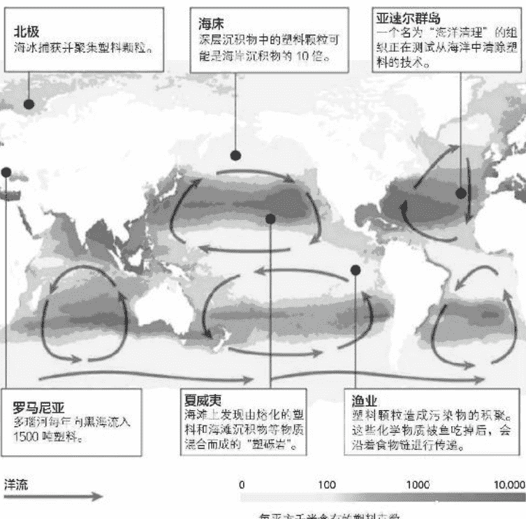

图9.1 海洋中的大部分塑料垃圾都出现在人口稠密的海岸线附近，而更远的地方则集中在5个大区

衡量塑料对海洋的污染程度是很困难的。由加利福尼亚圣莫尼卡五环流研究所的马库斯·埃里克森领导的一个国际研究小组，收集了6年来由科考船后面拖网捕获的塑料量的数据。研究小组估计，有5.25万亿块塑料漂浮在海上，总重量26万吨。大多数是桶、瓶子、袋子、一次性包装盒以及聚苯乙烯泡沫等比较大的东西。

根据行业贸易机构泛欧塑料工业协会的数据，2015年全球塑料产量达到3.22亿吨。鉴于制造商生产原生材料往往比回收塑料更便宜，这种材料在使用后很多都被扔掉了。因此，我们关于漂浮塑料的最佳数据不到每年塑料产量的0.1%。

这就提出了一个耐人寻味的问题：为什么我们没有发现更多的塑料呢？所有的塑料都去哪儿了？答案可能是，塑料的分解速度比我们想象的要快，因为阳光和波浪的作用会将塑料分解成小块。那一部分消失的塑料可能以极小的颗粒物形式悬浮于水中。埃里克森的研究小组估计有35500吨直径小于5毫米的塑料颗粒。

这个数字似乎很低，对此有一些可能的解释。直径小于1/3毫米的塑料颗粒会漏过拖网，因为网孔太大，所以大量的塑料可能被忽略了。英国普利茅斯大学的海洋生物学家理查德·汤普森认为，大量的塑料可能被封冻在冰里。2014年6月，他的研究小组报告说，在每立方米北极海冰中发现了高达234个塑料颗粒，这比受到严重污染的环流水域高出几个数量级。他认为，海水在变成淡水冰时，会捕获并浓缩这些小颗粒。考虑到大约有600万平方千米的海冰，所以可能会产生一个巨大的塑料库。如果冰融化了，这种物质就会被释放回海里。

汤普森和他的团队还发现了另一个塑料堆积的地方。他们公布的数据显示，在大西洋、地中海和印度洋的深海沉积物中，微小的塑料碎片和其他聚合物（主要以纤维形式存在）的含量是地表水中的10000倍。每立方米样品中含有多达80万个颗粒。尽管获取的样品数量很少——只有12块沉淀物岩芯和4块珊瑚——但它们都含有塑料碎片。

### 被吃掉的塑料

我们还需要发现微小的塑料碎片对海洋生物和更广泛的食物链的全部影响。我们知道，大型动物，包括鸟类、海龟、鱼类和鲸鱼，会把塑料垃圾和食物混淆起来。一旦胃被堵塞，它们就会窒息而死或饿死。但塑料对较小海洋生物的影响则要复杂得多。

对一些微生物来说，塑料相当于酒店的自助餐桌。海洋中任何一个坚硬的表面都会成为营养物质的聚集地。这就是为什么巨大的漂浮塑料筏吸引了很多种生物，创造了一个被称为“塑料生物圈”的新生态系统。

这些生物中有弧菌属的细菌，其中包括几种致病物种，尤其是导致霍乱的病菌。病毒也可能在塑料上找到一个归宿，这并不奇怪，因为水中的病毒浓度远远高于微生物细胞。

也有证据表明，塑料微粒正在进入食物链。即使没有病毒和细菌，塑料微粒对鱼类也不是好东西。它们可以降低食物吸收的效率，当它们分解时，释放出有毒的阻燃剂、邻苯二甲酸盐和可以模拟激素的双酚A等多种物质。塑料还可以像海绵一样吸收海水中的化学物质，吸收有机污染物，包括多氯联苯（PCBs）和如滴滴涕（DDT）等杀虫剂。研究表明，粘在塑料上的污染物会毒害鱼类。对于食用这些鱼的人来说，很显然，你要当心！

### 堵住水流

大量的塑料通过河流进入海洋。这些废物的主要成分是合成纤维服装洗涤过程中释放的纤维和许多化妆品中使用的塑料微珠。垃圾处理厂无法将它们过滤掉，因此它们最终流入河流。

2014年，伊利诺伊州研究表明，这些微小的塑料球是漂浮在五大湖表面的常见污染物后，通过了世界上第一个禁止使用塑料微珠的禁令。从那时起，以加拿大为首的国家政府开始执行禁令。一些制造商也采取了行动：联合利华、高露洁、宝洁和强生都承诺要消除产品中的塑料微珠。慢慢地，潮流开始转向其他塑料产品。在一些国家，塑料袋被贴上价格标签，旨在阻止购物者使用它们。2017年，英国政府宣布要进行一项调查——如何更好地控制“一次性”容器的数量，如外卖纸箱和饮料瓶。2018年1月，英国禁止在化妆品和清洁产品中生产塑料微珠，紧接着又禁止销售。同时，一些组织希望从大洋环流中捕捞塑料。2014年，一个名为“海洋清理”的组织在大西洋亚速尔群岛附近完成了一个浮式吊杆系统的实验。根据实验结果，该组织估计，在5~10年内，单个旋涡中的漂浮碎片可以在不伤害野生动物的情况下被清除，并计划于2020年开始在全球清理。

## 10 气候变化

急剧的气候变化不仅是人类世开始的一个潜在标志，如今它正以令人担忧的方式让人感受到它的存在。人类是罪魁祸首的观点在一些圈子里仍有争议，那么科学对这个问题有什么看法呢？我们是否应该受到指责，我们能否阻止全球气温进一步上升，如果不能，可能会产生什么后果？

### 不祥之兆

有一件事是肯定的，人类世将以急剧的气候变化为标志。地球表面的平均温度从工业革命开始以来上升超过1℃，这一速度远远超过了整个全新世所看到的任何自然变化。过去几千年来相对稳定的全球平均海平面开始加速上升。

我们无法准确预测气候变化将产生什么样的影响，主要是因为我们不知道未来人类将如何改变环境。然而，迄今为止的科学发现让我们对各种情况下可能发生的事情有了一个很好的认识。

### 温室气体正在使地球变暖

从融化的冰川和早期的泉水，到逐渐升高的树线（天然森林垂直分布的上限）和不断变化的动物活动范围，许多证据都通过温度计告诉我们一个事实——地球正在变暖。

对此有两种可能的解释：更多的热量正在到达地球，或者更少的热量正在逃逸。不过可以排除第一种解释，太阳进入地球大气层的能量在一个典型的11年太阳活动周期内的变化约为0.1%，但卫星数据显示，这一数值没有增加，所以无法解释近几十年来气温上升的原因。我们还有第二种解释：逃逸的热量越来越少。

这可能有几个原因。其一是二氧化碳和甲烷等温室气体含量的上升。这些气体吸收红外辐射的特定频率热量——否则会逸出到太空（见第6章）。它们将部分能量重新辐射到地球表面和低层大气。温室气体的含量增多使上层大气温度降低，意味着更少的热量被辐射到太空，地球因此变暖。

自19世纪工业时代开始以来，大气中的二氧化碳含量从280×10⁻⁶上升到2017年的408×10⁻⁶。卫星测量显示，二氧化碳和其他温室气体吸收的频率中，较少的红外辐射正在逃离地球，更多的红外辐射被反射回地球表面。

进一步的证据来自对地球古气候的研究，这些研究显示，每当二氧化碳水平上升时，地球就会变暖。虽然影响地球气候的因素很多，但有确凿的证据表明，二氧化碳含量的上升是最近气候变暖的主要原因。

### 其他污染物正在使地球降温

我们向大气中注入各种物质。一氧化二氮和氯氟烃像二氧化碳一样使地球升温。黑色的煤烟通过吸收热量使物体变暖，但通过遮阴会给地球降温。然而，其他污染物将太阳的热量反射回太空并使其降温。

大火山喷发后，会向大气中喷发二氧化硫，比如1991年的菲律宾皮纳图博火山，导致地球略微降温一两年。但与二氧化碳不同的是，二氧化硫的影响时间很短，因为在空气中，二氧化硫会形成由微小水滴组成的气溶胶，然后很快就会下雨。

燃烧含硫矿物燃料增加了大气中二氧化硫的含量。在20世纪40年代到20世纪70年代，这种污染非常严重，以至于抵消了部分二氧化碳的变暖效应。但随着西方国家减少硫排放以应对酸雨，抵消作用已有所下降。

### 地球将变得更热

在一个没有水或生命的星球上，将大气中的二氧化碳含量增加1倍，将使其升温约1.2℃。即使没有气溶胶的复杂影响，地球上的情况也不是那么简单。

我们以水为例，水蒸气本身是一种强大的温室气体，当大气变暖时，它可以容纳更多的物质。一旦更多的二氧化碳进入地球的大气层，其升温效应就会迅速放大。

这并不是唯一的“正反馈”效应。气候变暖导致积雪和海冰迅速消失，它们都能将阳光反射回太空。结果是，更多的热量被吸收，加剧变暖。如果从更长的时间尺度来看，这会造成植被的变化，也将影响热量的吸收。巨大的冰原会融化，进一步降低地球的反射率。除非发生大火山爆发之类的灾难，否则地球将大幅变暖。但是变化的程度有多大？

要了解复杂的反馈结果在地球气候变化中的作用，有一种方法是使用计算机模拟，另一种方法是看看过去二氧化碳的变化是如何影响我们的气候的。但这两种方法都有局限性。例如，我们很难弄清楚过去的气候是什么样的，而且二氧化碳的含量从来没有像现在上升得那么快。

气候模拟和对过去的研究表明，二氧化碳的含量翻倍会使地球变暖大约3℃——这是一个衡量标准，被称为“气候敏感性”。然而，对古气候的研究表明，气候敏感度为6℃或更高。造成这种差异的一个原因是，气候模拟只包括“快速”反馈，如云层变化。他们忽略了长期的反馈，比如冰盖覆盖范围的变化。

这意味着，气候模拟可能会让我们很好地了解未来几十年的变暖程度，但却低估了较长时期内的变暖程度。研究表明，如果一切照常进行，到2080年或2100年，地球将变暖5℃。随着温室气体排放量的大幅削减，升温可能会限制在3℃左右。截至2017年冬季，我们似乎正朝着这两个数字之间的某个方向前进。

### 海平面将上升许多米

当海洋变暖时，它们会扩张。陆地上的冰川在融化或滑入海洋时，也会抬高水位。如果格陵兰岛和南极洲的所有冰川融化，海平面将上升60多米。

今天，我们正处于冰河时代结束的温暖期。在过去50万年的间冰期中，当时的温度比现在高不到1℃，海平面比现在高5米左右。大约300万年前，当时的气温仅比工业化前高出1℃～2℃，海平面比现在至少高出25米。

因此，即使是相对较小的气温上升，实际上也会导致海平面大幅上升。人们更关心的问题是还需要多长时间。直到最近，人们还认为格陵兰岛和南极洲的大冰原要经过好几个世纪才会有明显的融化。但是观察显示它们的反应比我们预期的要快得多。冰盖模型也预测到冰川的快速流失。根据这些发现，2017年的一项研究得出结论，到2100年，海平面可能上升3米之多。

同样令人担忧的是，这些研究揭示，在某些地方，一旦这些冰盖开始融化，这一过程将是不可逆转的（除非经历另一个冰期）。现在阻止海平面上升至少5米可能已经太迟了，而且我们很快就会面对海平面最终上升20米。

### 为什么天气会变得狂暴

海平面上升将影响到生活在低洼沿海平原和城市的数百万人。对其他人来说，气候变化最直接的影响是对天气的影响。我们似乎确实遇到了更多极端天气。

2003年的热浪深深地铭刻在许多欧洲人的记忆中，它造成了数万人死亡。2010年，俄罗斯遭受了更严重的热浪袭击，造成7万人死亡。2012年美国的“3月之夏”，美国中北部各州的气温骤增。密歇根州佩尔斯顿的气温达到了创纪录的29℃，远远超过之前的记录17℃。2017年的飓风季节是有记录以来造成损失最严重的。

气候科学家们早就警告说，全球变暖将导致更多的热浪、干旱和洪水。然而，最近的一些极端情况，如3月的夏天，远远超出了我们气候模型的预测。但也有极端寒冷的天气出现。在罗马，当2012年2月一场大冰冻袭击欧洲时，古老的纪念碑轰然倒塌。在撒哈拉沙漠的北部边缘，利比亚的黎波里的街道被积雪覆盖。2016年1月，创纪录的寒冷天气袭击了东亚：在日本，冲绳有史以来第一次出现了雪；中国的台湾有85人死于低温和心脏病发作。

研究表明，由于人类活动，我们的天气变得越来越疯狂——不仅持续升温，而且变化无常。这只是昙花一现的偶然现象，还是随着全球变暖加剧我们将永远面对更加反常的天气？

即使在气候不变的情况下，我们的天气变化也很剧烈。每个夏天都不一样。取每年夏季的平均气温，你会得到一系列散布在长期平均值上的数字，其分布模式多少有点像钟形曲线。

在过去的一个世纪里，地球表面温度平均上升了0.8°C，让我们平日里习惯的天气变得更加温暖。凉爽的夏季变得不太可能，极端酷热夏季出现的概率增加（见图10.1）。

### 理论

在一个稳定的气候中，温度应该符合钟形曲线——最有可能出现的是平均气温，而很少出现极端的冷热现象。

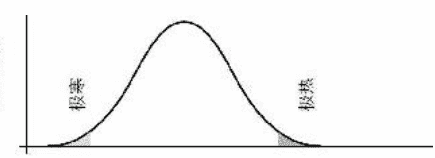

如果气候变暖，这种概率分布将发生变化。即使发生最简单的情况下，如果分布发生变化但形状不变，中等热量的概率也会略有增加，而极端热量的概率则会大大增加。

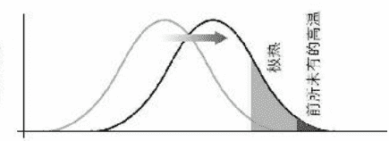

从理论上讲，如果大气变暖时变化无常，这种分布不仅会发生变化，而且还会扩大。更糟的是，这意味着极端高温的可能性会有更大的增加，但是极端寒冷也会偶尔发生。

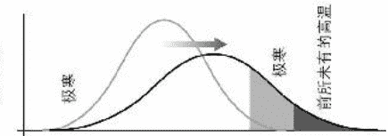

### 到底发生了什么

北半球的陆地温度表明，随着地球变暖，钟形曲线正在移动和扩大。

——1971-1980: —— 1981-1990 ——1991-2000: —— 2001-2011

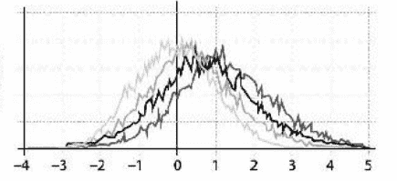

6、7、8月异常分布（与本地正常温度的标准差。1951-1980年）

图10.1 天气发展的方式看起来好像我们将遭受更多的极端高温，但仍有极度寒冷的时期

### 倾盆大雨

气温上升导致各种极端天气的出现。随着气温的升高，空气保持更多水分的能力呈指数增长。这意味着当下雨时，它会引发一场洪水，增加发生灾难性洪水的可能性。

洪水不是唯一的结果。当水蒸气聚集形成云时，它会释放潜热，而这种潜热是大多数风暴（雷暴、飓风等）的动力（第6章）。

2014年，联合国政府间气候变化专门委员会指出，人类的影响与强降水事件的增多有关。研究理论还表明，任何一场风暴一旦形成都会变得更强大，因为它们可以获得更多的热量。正如我们在2017年在加勒比海看到的那样，随着风速的增加，风暴造成的损失迅速上升。

### 意料之外

简单的物理学原理告诉我们，全球变暖会使极端天气变得更加极端，比如更强烈的风暴、更热的热浪、更干燥的干旱和更大的暴雨。这确实是正在发生的事情，除此之外，近年来，一些打破纪录的事件令人瞠目结舌。

2003年欧洲的气温比500年来任何一个夏天都高。德国波茨坦研究中心的斯特凡·拉姆斯托夫指出，在瑞士，夏季平均气温比先前的纪录高出2.4℃。打破某一天的纪录不值得大惊小怪，但是整个夏天的平均气温都如此温暖是非同寻常的。俄罗斯2010年热浪的凶猛程度同样令人惊讶。

毫无疑问，情况会变得更糟。然而，尤其令人担忧的是，极端情况的增多不能仅仅用我们迄今为止记录的全球变暖来解释。像2003年和2010年热浪这样的事件预计只有在21世纪末更大幅度地变暖之后才会发生。尽管一两件怪事可能会被认为是简单的厄运，但近年来却有许多怪事令人怀疑。

纽约州哥伦比亚大学地球研究所的气候科学、认识和解决方案项目负责人詹姆斯·汉森分析了全球各地的气温记录，把6月、7月和8月汇总起来，得到这一时期的总体气温。结果表明，与1951—1980年相比，地球表面越来越多的区域每年都会出现高度异常的极端高温。

这在很大程度上正是全球变暖的预兆。然而，汉森的分析显示，天气不仅变暖了，而且变化无常。从1951—1980年，全球夏季气温的平均变化范围为0.55℃，从1981—2010年，上升到了0.58℃，有些地区，特别是远离海洋稳定影响的地区，气温的变异性和上升幅度更大。把它投射到未来，我们已经有了比仅仅是平均气温上升更令人担忧的原因了。

### 减缓急流

我们所经历的怪异天气不仅仅是不断升高的气温。你不需要成为气候专家就可以断定，热浪不会在的黎波里造成降雪。然而一些研究人员认为，他们知道这可能是什么原因造成的——一股懒洋洋的急流。

急流是高速风，在7千米到12千米的高空划出一条穿过大气层的路径（见第6章）。最强的是两个极地急流，每个半球一个，这是由暖热带和寒冷极地之间的温度差异驱动的。在热带地区，气温升高会使

空气膨胀：新泽西州罗格斯大学的珍妮弗·弗朗西斯说，好像有一座山从热带向两极倾斜。

重力将部分空气拉向两极。由于地球自转，空气偏向一侧，这就是推动极地急流由西向东流动的原因。

急流的位置并不固定。它们四处移动，向南或者向北移动，也可能发展成大的曲流或波浪。人类现在正在干扰大气层的这一重要组成部分。北极变暖的速度远远快于地球其他地区，部分原因是北极反射阳光的冰雪正在融化，暴露出暗色、吸收阳光的陆地和海洋，热带与北极之间的温差降低。2009年，弗朗西斯表示，在北极海冰较少的夏季——海洋吸收的热量越多，大气山的坡度就越小——驱动北极急流的引擎正在减弱（见图10.2）。

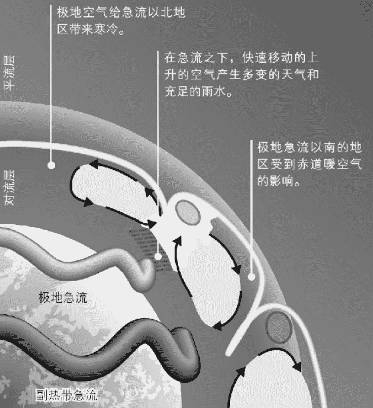

图10.2 极地急流的位置决定了北半球中纬度地区的天气

随着急流的减速，它走上了一条更加曲折的道路，蜿蜒的曲流移动得更加缓慢。这一点至关重要，因为急流推动着我们在全球各地所经历的天气系统。因此，当一条气流的位置变化得更慢或在一个地方停留数周（气象学家称为“阻塞形式”）时，天气就更可能变得极端。

如果这条急流引导着一个又一个的低压系统向你吹来，那么你就会全身湿透——如同2012年的英国一样，当时的英国经历了百年不遇最潮湿的4月，发生了大规模的洪水。同样，地球上的一些地方也会被一个巨大的“舌头”卡住，要么是夏天从热带向北延伸的干热空气，要么是冬天从北极向南延伸的冰冷空气。

近年来，“阻塞形式”在北半球的大部分极端天气中起到了一定的作用，包括一些寒冷的冬季天气、2003年的欧洲热浪和2012年3月的美国夏季。

其他研究人员证实，急流正在减弱，并表明这将导致更多的阻塞事件。现在，弗朗西斯发现了北极变暖的另一个影响：北半球比南半球变暖更加显著，使得高压脊的北部向北延伸得更远。同样，这使得急流的曲流变得更加极端。把温暖的空气带到更远的北方，把冷空气带到更远的南方，如罗马和的黎波里。

### 激发因素

很可能还有其他尚未确定的机制导致了我们现在的恶劣天气，或者随着世界进一步变暖，这些机制可能会启动。例如，海洋以一种被称为厄尔尼诺—南方涛动（ENSO）的大致周期性模式与大气关联，在这种模式中，温暖海水在太平洋表面来回流动，部分原因是信风的变化。

这种涛动的一部分，厄尔尼诺现象，发生在温暖的太平洋海水向东扩散的时候。它温暖了全球，产生了广泛的连锁反应。2014年至2016年间发生的厄尔尼诺现象比较严重，使埃塞俄比亚和索马里的旱情恶化，导致非洲南部的耕作季节持续干旱。越南、印度尼西亚和太平洋上的许多岛屿也遭受了厄尔尼诺所造成的干旱。据联合国有关报告，这一事件让6000万人遭受了饥饿和痛苦。

有一个大问题是，随着气温的升高，情况是否会变得更糟。如果厄尔尼诺—南方涛动与其他气候振荡不再像以前那样持续，而是随着世界变暖规模变得更大，会怎么样？斯特凡·拉姆斯托夫说，虽然目前还没有证据表明这一点，但由于我们正在改变整个气候系统的能量平衡，所以如果这些变化模式没有改变，那将是令人惊讶的。

### 关于云的难题

正如我们在第6章所看到的，云是捉摸不定的，很难研究。这些特点也给气候变化科学家们提出了挑战。目前，云层的整体效果是相当于全球的隔热板，把那些烘烤地球和毁灭生命的阳光反射回去。最大的问题是，当地球变暖时，这个隔热板究竟会发生怎样的变化。

它可能会变得更强，反射更多的光，减缓地球变暖的趋势；它也可能会减弱，这意味着地球变暖的速度加快。它到底会朝哪个方向变化，这是非常关键的，因为它可能意味着22世纪地球会比现在升高3°C——非常糟糕但可能还可以生存，或者升高6°C——则是灾难性的了。

所有的云都以长波红外辐射的形式吸收它们下面的热量，这就是为什么多云的夜晚气温比晴朗的夜晚气温下降得少。但是云层也会把一些阳光直接反射回太空，不太明显的是，它还是一种辐射源，从顶部向太空辐射红外线。所以云就像是一把遮阳伞、一条毯子或者一个散热片（见图10.3）。

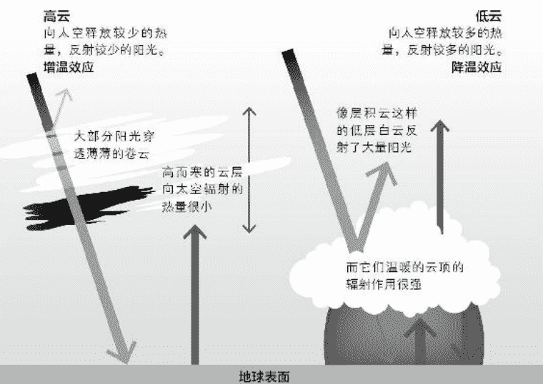

图10.3 大气云的高度决定了它们对地球是否有降温或增温的影响

云的整体影响取决于它们的高度和类型。低层云给地球降温：虽然它们吸收了一些热量，但也反射了很多，它们相当温暖的云顶向太空释放了很多热量。高层云从较冷的云顶释放的热量要比低层云少得多，而且反射的热量也很少，所以它们有助于地球变暖。

低层云比高层云分布更广，这就是云会使地球整体变冷的原因。事实上，根据加拿大维多利亚大学的科林·戈德布拉特的计算，如果把所有的云都去掉，可能会导致不可控的温室效应发生，最终将使海洋蒸发殆尽。

虽然这种事情不会发生，但事实证明，在一个更温暖的世界里，会发生什么，很难确定。你可能会想，最好的办法是看看过去一个世纪，随着地球变暖，云层是如何变化的，但事实证明这是非常棘手的。

每一种观测云的方法都有缺点。陆地上的气象站对更大范围的海洋云层毫无用处。船上的观测数据是不完整的，也是主观的。载满仪器的飞机数量不足。气象卫星提供了一些帮助，但位置漂移和轨道衰减对数据有很大的干扰。而美国航空航天局地球观测系统的专用气候卫星只能观测10年左右的云层，不足以捕捉长期趋势。

即使我们确实有良好的全球云层活动记录，也可能无法准确地判断出地球变暖时的情况。随着温度的升高，我们可能会跨越一些导致云层活动发生巨大变化的临界值。

### 云层的不透明性

如果我们确切地了解云是如何工作的，我们就可以在气候模型中预测未来的行为。但是对云进行计算并不容易，云的内部活动包括几米到几千米范围内的空气湍流。这对全球气候模型来说是微不足道的，全球气候模型将大气切成100千米宽的立方体。专门的小尺度模式现在可以捕捉到100米左右的旋涡，但这些模式不能涵盖大型天气系统。

在云层内部更小的尺度上，水滴和冰晶碰撞、凝聚、冷凝和蒸发。这些微物理现象中的很多原理都可以被很好地理解，但这些还不够。再放大一点，你就会发现云的形成离不开气溶胶，水可以围绕着气溶胶冷凝或冻结（见第6章）。云层中积聚了更多的粒子，就可以形成更白、存在时间更长的云，如同一把更好的遮阳伞。

模型无法捕捉到上述变化的所有过程，因此它们必须依靠近似，例如观察到的云层同湿度或温度之间的关系，然后可以将这些关系代入模型中。但正如我们所看到的，观测并不完美，因此大气的所有性质与我们可以观测到的云的数量和类型之间没有普遍的关系。

这让建模者陷入了困境。例如，云层与地面3千米以上的温差有很好的相关性，但它与另一种包括温度和湿度的测量方法的相关性同样很好。不幸的是，不同的模型对地球变暖时发生的情况给出了完全不同的预测，所以观测结果取决于选择了哪一种方法。

尽管存在这些困难，但我们在某些类型云的观测方面已经取得了进展。模型和观测结果一致认为，平均来说，随着气温上升，高云将继续被推高，这使得它们的云顶更加寒冷，所以它们辐射热能的效果也就变差了。同时，风暴轨迹可能会向两极移动，那里的云层反射的太阳热量较少。这两个因素都会加剧气候变暖。

### 热带地区的降温毯

全球热屏蔽的一个主要分布是在热带和亚热带地区，广阔的低层积云大部分时间内都覆盖着广阔的海洋。科学家发现这些云层对我们的气候产生了持续的、强烈的冷却作用。然而，再一次，模型内部发生了冲突。有些模型预测，随着气温上升，这些低云几乎没有变化，而另一些模型则预测这些低云急剧减少，从而加剧了全球变暖。

这使得人们对发生在这些热带水域之上的物理机制进行了越来越深入的探索。有些看起来像是好消息：如“负反馈”，随着温度的上升，它们会起到减缓变暖的作用。例如，作为全球环流模式的一部分，温暖干燥的空气向热带海洋下降，它可以捕获低层较冷的层积云。上面是暖空气，下面是冷空气，温度倒转，云层不会上升，也不会因下雨而失去水分。随着全球气温的升高，温暖的下降气流应该会越来越暖，平均来说，这会加强逆温效应，增加云层覆盖率。至少这是通过观测和小尺度模型所能证明的，加利福尼亚州劳伦斯·利弗莫尔国家实验室的彼得·考德威尔和他的同事得出了该结论。然而，这只是一种机制，在全球变暖的情况下，层积云是增加还是减少，人们仍存在分歧。

研究人员已经意识到，可能有几种正反馈在起作用。首先，层积云可能缺乏水分。低层云通过一个迂回过程获得水分：当热量从云顶辐射出去时，冷空气形成并下沉。这会把温暖潮湿的空气从海面附近推上来，当它冷却和凝结时会形成更多的云。2009年，德国汉堡马克斯·普朗克气象学研究所的两个团队包括考德威尔和比约恩·史蒂文斯指出，气温升高将减少云顶的热量损失。这将意味着平均来说，会有更少的冷却，更少的下沉气流，更少的水分凝结，更少的冷却云层。

而这并不是唯一的潜在正反馈在起作用，即使在逆温云层的地方，下面潮湿的冷空气和上面干燥温暖的空气之间也会有一些混合。2012年提出的一种观点是，变暖可能会推动更强的混合，驱散其中的水分，其结果是云层覆盖减少，气候变暖加剧。

即使混合没有增强，干燥的空气仍然会有更多的水分流失。更暖和的空气可以容纳更多的水蒸气，所以在一个更温暖的环境中，气流将带走更多的水分。

为了弄清混合效应有多大，澳大利亚悉尼新南威尔士大学的史蒂文·舍伍德和他的同事从气象气球上观测数据。结果表明，这种混合相当活跃——比许多气候模型中的情况都要多。不同的模型预测不同程度的气候敏感性，但舍伍德发现，具有真实混合效果的模型具有更高的灵敏度。如果这些是可信的，那么地球的短期敏感度将是3～4.5℃。

虽然模拟工作做得很好，但科罗拉多州博尔德国家大气研究中心的约翰·法苏洛认为这依旧是不确定的。混合的观测是有限的——它依赖于气象气球的散射，所以很难证实这一理论。法苏洛更喜欢直接比较云量和湿度，这可以通过卫星进行全球测量。2012年，他指出，模型往往高估了亚热带地区的湿度。这一发现是个坏消息，因为湿度较低的模型往往能预测出更大的变暖。

关于云层的这个难题，虽然现在的研究已经有了曙光，但这缕曙光仍然比较灰暗，它只是暗示了哪种模型可能是最值得信赖的。随着计算机能力的增强，我们可以建立分辨能力更高的模型，但我们不会达到完美模型的天堂。要让全球模型能够包含云层中发生的小规模过程，至少要花上几十年的时间。在此之前，模型必须继续使用这种小规模的近似物。

### 地球工程学能避免气候混乱吗

气候变化正在向我们袭来，融化了冰川，助长了风暴，使洪水和热浪变得更加猛烈。全球二氧化碳和其他温室气体的排放量持续增加，前景尤为严峻。即使我们明天就停止所有的温室气体排放，这些气体中的一部分仍会顽固地停留在大气中，使气温升高数十年。

也许，到了该认真考虑改善地球工程这一大胆想法的时候了。我们希望，通过对我们星球气候机器进行人为的修补，我们或许能够纠正曾经犯下的弥天大错，或者至少避免一些最严重的后果，或者为自己争取更多的时间来减少排放量。

科学家已经制订了几十个计划来给地球降温。我们可以组成一支庞大的舰队，通过喷洒盐雾来使云层变得更白；或者向平流层喷射硫来反射阳光；把大量反射镜子送入深空；培育一些颜色发白的农作物；给海洋施肥；用反光的聚酯薄膜覆盖地球上的沙漠；播撒可以催化成云的细菌；在全球范围内释放大量微型气球。

这些计划可能很巧妙，但其中哪些能奏效呢？或者它们会让事情变得更糟吗？除了冒着所能想到的最大风险尝试其中的某个方案之外，我们所能做的最好尝试，就是用最详细的计算模型来验证每一个想法。随着这些研究成果越来越多，我们对地球工程可能实现或可能无法实现的目标会有一定的概念。

有些想法很容易就被否定了。例如，用反光塑料覆盖沙漠，虽然可以反射大量阳光，使地球降温，但这种想法听起来就很疯狂。它将破坏生态系统，改变地区气候模式，并需要一支清洁大军。其他的方法已经超出了我们的能力范围。要想用无数的太空遮阳伞遮住地球，估计需要发射2000万枚火箭。如果没有一些新技术出现，那将付出天文数字般的昂贵代价，并造成致命的污染。其他的一些计划当然是可行的，但它们真的能解决气候问题吗？

当然，最基本的问题是，大气中含量不断上升的温室气体在吸收热量。到21世纪的某个时候，我们很可能将大气中的二氧化碳浓度增加一倍，这将使全球平均每平方米的散热下降约3.7瓦。为了阻止地球变暖，任何一项地球工程计划要么阻止等量的太阳热量进入，要么增加大气层顶部等量的热量散失。

如果我们要制造“地球制冷机”，需要其他一些前提条件（见图10.4）。它需要在不大幅改变地区气候的情况下工作，同时还要防止海平面上升。最理想的情况是，还要能够阻止海水过度酸化以防止珊瑚礁消失。

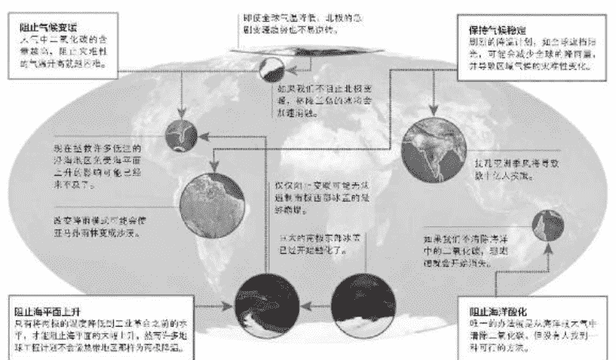

图10.4 使地球降温是一项艰巨的任务。但是，为了避免灾难，任何一项地球工程计划都必须同时满足其他要求

但首先要测试的是效力。英国埃克塞特大学的蒂姆·伦顿和诺里奇东安格利亚大学的尼姆·沃翰将各种模型结果与他们自己的计算结合起来，评估了几十个潜在方案的制冷能力。他们发现很多方案都没什么效果。比如，想办法让屋顶和道路变得更白，以反射更多的阳光。即使是乐观的估算，每平方米也只能反射0.15瓦的热量，充其量只是对恢复地球热平衡做出少许贡献。

给海洋施肥怎么样？浮游植物在生长过程中消耗二氧化碳，它们的尸体往往沉到海底被掩埋，把碳锁定在里边。向海洋中添加比较缺乏的营养物质（比如铁），可以促进浮游植物生长。伦顿和沃恩计算，到21世纪末，这将使热平衡每平方米提高0.2瓦。同样，这也不会带来足够的影响。

其他方案，比如促进极地地区的下降流，以加速碳向海洋深处输送，效果更是有限。但有两种方案既有很强的效力，又相对可行，即努力对阳光进行遮挡。

### 将全球变暖置于阴凉处

有一种办法是使海洋云层变得更白——特别是覆盖大部分热带海洋的低空、平坦的层云。全球各地的船只向空中喷射大量的细盐雾，盐分颗粒充当凝结核，促使水滴在云中形成。如果每立方米大气中有更多的水滴，这些云就会比正常情况下更白，能够反射更多的阳光。这将有可能抵消二氧化碳浓度翻倍带来的气候变暖效应。

使云层变得更白这种办法还有一定的优势，比如不使用有害的化学物质。但云层的成核机制还不清楚（见第6章），因此可能达不到预期效果，而且仅让海洋降温有可能会破坏局部气候。例如，2012年的一项研究发现，在太平洋上空人工造云可能会以类似于厄尔尼诺的破坏性对应物拉尼娜的方式改变降雨模式。

另一种具有竞争力的办法其实是老生常谈了：向大气中充入细颗粒的薄雾。事实上，我们一直在这么做。二氧化硫污染形成了细小的硫酸液滴，估计每平方米反射0.4瓦的太阳辐射。但是，燃烧和工厂排放的二氧化硫不会在大气中停留很长时间，所以其影响是有限的。然而，如果硫酸盐颗粒到达平流层，它可能会停留数年，其冷却效果会变得更大。证据来自火山喷发，例如1991年的皮纳图博火山，在喷发后的几年时间里，使地球温度降低了0.5℃。

为了平衡二氧化碳浓度翻倍带来的温室效应，我们需要每年向平流层输送500万吨二氧化硫。马萨诸塞州剑桥市极光飞行科学公司的贾斯廷·麦克莱伦的研究小组评估了几种向大气中输送硫酸盐的方法，他说，这将每年花费大约100亿美元。与全球变暖的巨大代价相比，这绝对超值。仅仅海平面上升就将吞噬价值数万亿美元的城市和农田。

### 不利的一面

不幸的是，我们的硫喷雾几乎不能阻止海平面的上升。硫酸盐颗粒在极地的停留时间不如在热带那样长，这使得它们在极地的冷冻效果降低。因此，即使注入气溶胶使全球平均温度降到19世纪的水平，两极仍将比以前更暖和，冰盖也将继续融化。

目前尚不清楚，其他的反射器，如固体金属颗粒或微小的、反光的气球，是否会有更好的效果。输送气体相当简单而又廉价，所以大多数研究集中于硫酸盐颗粒。

当沿海平原和城市被淹没时，地球的其他部分可能会干湿。任何一种遮阳计划都会减少到达海面的阳光，减少海水蒸发。到目前为止，全球变暖的效应已经超过了二氧化硫污染的降温效应，海水蒸发依然在增加。但如果我们用这种方法把气温降到工业革命之前的水平，降雨量就会急剧下降。如果降温幅度没有这么大，就能够避免这样的后果——但这样一来，冰盖就会融化得更快。

根据气候模型计算，遮蔽阳光也可能产生灾难性的区域影响。如果它扰乱了季风，可能会造成影响数十亿人的永久性饥荒。或者改变亚马孙河流域输送水分的环流模式，使之变成沙漠。

英国牛津大学的迈尔斯·艾伦和他的同事用一个精细的气候模型研究了平流层中遮阳物质数量变化造成的影响。他们发现没有一种解决方案可以对所有地区都有效。大量的气溶胶会使中国拥有适宜的温度和降雨量，但可能会使印度大幅降温。

或许可以换个方式看待这个问题。不同的气候模型对遮蔽阳光造成的全球影响相当一致，但产生了不同的区域影响。这可能是因为在不同的研究中设定了不同的假设和阈值，或者这可能是由现有气候模型的局限性造成的。

即使它们都是准确的，但一些影响区域气候的因素本身就是不可预测的。例如，生态系统将有什么反应？因此，我们永远不能百分之百地肯定任何一个特定的计划都会有理想的结果。

这就使得任何一种遮阳计划都有很大的风险。如果它出现一些可怕的后果，我们突然停止补充硫酸盐或者使云层变白，地球将在未来几年内迅速增温。这样一种突然的转变将更具破坏性，因为人类和野生动物没有时间去适应。如果我们使用硫酸盐微粒，可能还需要其他的地球工程方案，比如使用人造卷云给两极降温，这就相当于云给地球开了两剂猛药。

### 摧毁卷云

高高的、稀疏的卷云有时会给夏季蔚蓝的天空增色，这似乎不太可能是我们的敌人。但是戴维·米切尔计划消灭它们。摧毁卷云不仅可以降低全球温度，而且有助于拯救冰盖，遏制极端天气。

与低层云相比，含冰卷云在太空中反射和辐射的热量要少得多，因此它们的净效应是使气温变暖。2009年，内华达州里诺县沙漠研究所的米切尔建议我们可以使用飞机播撒三碘化钕——一种无毒的化合物，能够作为凝结核形成较大的冰晶。这些冰晶从天空落下的速度比卷云中天然存在的冰晶更快，因此卷云便会消失。初步模拟这一过程的尝试表明，这可以使地球降温约每平方米2瓦——足以抵消二氧化碳含量翻番引起的变暖效果的一半。

更有利的是，这种方法在高纬度地区能够发挥出最佳作用，有助于保护我们脆弱的冰盖，也将有助于平衡热带和两极之间的温差。

米切尔提醒我们，把卷云纳入全球气候模型中还有很多研究工作要做，而且这项工作不仅仅是为了地球工程。他想在一个小范围内进行一次人工造云试验，看看究竟有什么效果。此外，驱散卷云也有许多与遮阳计划相同的风险：它很可能造成灾难性的区域影响，而突然停止这项计划则是危险的。

### 去除温室气体

与其遮蔽阳光，我们不如去找出问题的真正原因，积极地从空气中去除二氧化碳。浓缩后的二氧化碳气体可以被注入地下储层，如枯竭的天然气和油田。但到目前为止，还没有人设计出一种有效的方法来做这件事。根据伦顿的说法，问题在于，试图从大气中捕获含量很低的二氧化碳气体，与从发电站烟气这样的高浓度源中捕获二氧化碳相比，其成本要贵得多。

依靠现有技术，把人类排放到大气中的二氧化碳及时清除，以防气候进一步变化是不现实的。与其在地球上覆盖吞噬二氧化碳的机器，不如加速二氧化碳与硅酸盐岩石的反应。数百万年来，这个被称为化学风化的过程，吸收了大量的二氧化碳（见第6章）。但要处理一年的排放量，我们至少需要研磨7立方千米的岩石，并将它薄薄地分散在地球表面，覆盖面积要占地球表面的百分之几。因此，这个方案也不能拯救我们。

那改变土地用途和农业方式以捕获更多的二氧化碳呢？简单的植树造林仍然是一个好办法。尽管地理因素限制了它的潜力只能达到每平方米0.5吨，而且如果森林随着地球变暖而死亡或燃烧，所有被捕获的碳最终都将回到大气中。

一种锁定植物中储存的碳的方法是将其变成炭——生物炭，并将其掩埋。另一种方法是在装有碳捕获技术的发电厂焚烧农作物。这些方法需要土地，因此它们将与粮食生产竞争。伦顿计算，到2050年，总效益可能只有每平方米0.3吨。

最后，政治可能是任何一种地球工程计划的最大障碍。艾伦指出，你不能让地球工程去互相竞争。必须有一个超国家机构决定做还是不做。彼此之间达成协议几乎是不可能的，因为不同的国家有不同优先考虑的事项。有些国家受到的最大威胁是海平面上升，另一些国家则是受酷热或降雨分布的影响。

我们该怎么办？诚然，只有那些具有全球性风险的大规模遮蔽阳光的计划才需要得到世界各国的一致同意；个人、机构或国家可以在使用生物炭或种植森林时单独采取行动。但是，正如伦顿发现的那样，这些方法根本不能胜任这项任务。欧洲科学咨询委员会2018年的一份报告指出，包括海洋施肥在内的碳捕获计划对温室气体水平产生有意义影响的现实潜力有限。该委员会总结道，最好的策略是首先阻止这些气体进入大气。

### 结语

你是如何读完这本书的？当然是讨论地球末日。除非发生一些无法预料的灾难，否则毁灭地球的很可能是太阳，这颗恒星使地球孕育了生物，长达数十亿年的时间。我们的太阳注定不会像超新星一样爆炸，把它的行星抛向太空。它只是不够大。但当它在60亿年后最终消耗完内部的氢，它就会剧烈膨胀，然后吞噬掉它最近的邻居。

今天的太阳照耀着我们，这要归功于它内部的核聚变，核聚变通过将氢转化为氦来产生能量。一旦所有的氢都被消耗掉，聚变将点燃核心周围的一层氢。它所产生的额外能量将使太阳比现在亮数千倍，并突破太阳自身的引力，从而吞噬周围的行星。它的半径将大大超出地球目前的轨道。

我们的蓝色星球只有一次机会有可能逃脱。当太阳膨胀时，它会在大量带电粒子的涌出中摆脱掉大约1/3的质量。由于引力减小，这颗可能被俘虏的行星就会扩大运行轨道。

因此，随着太阳的膨胀，这将是一场超越太阳的竞赛。首先是水星，然后是金星，几乎肯定会在这场竞赛中输掉，它们都会被太阳膨胀的大气层吞噬。据英国沃里克大学的迪米特里·韦拉斯说，地球胜负难料。不过，地球不会完全逃脱：来自太阳外层的猛烈热浪会使地球内部变热，从而引发严重的火山爆发。

当然，到了这个时候，地球上的生物可能荡然无存——或者与我们现在所知道的大不相同。那是因为至少有两个致命的危机会朝我们袭来。首先，从现在起至多10亿年后，来自太阳自然增加的热量将驱动地球的温控器加速运转，从大气中去除越来越多的二氧化碳，直到没有足够的能量支持光合作用。最终，所有的植物都将死亡，所有依赖植物的生物都将灭绝（见第8章）。

如果我们能找到一个幸存下来的办法——这是一个很大胆的假设——在30亿到40亿年内，地球的持续冷却将使整个地核冻结成固体。当这种情况发生时，驱动板块构造的引擎将停止，火山将不复存在。随着地壳的冷却和增厚，地震将持续一段时间。但地球可能对生命不再友好。由于没有熔融的地核来维持其磁场，地球将被太阳风摧毁。

这些是目前我们无法控制的自然灾害，但我们现在面临的另一场灾难是我们造成的。除非我们停止排放二氧化碳和其他温室气体，或者找到切实可行的方法把它们从大气中清除掉，否则全球变暖很快将严重威胁地球上的生物（见第10章）。

这确实是一个令人沮丧的结论，但我们依然有充分的理由抱有希望。我们人类很有创造力，而且从进化方面讲，人类很奇怪：即使是完全不认识的人，也会互相帮助，而其他物种很少会这样做。在全球范围内，这种不寻常的合作使我们能够堵住臭氧空洞（见第6章）。希望各国政府能够携起手来，切实采取措施降低大气中的温室气体水平。这样，人类在10亿年后仍然可以繁荣昌盛——到那时，我们甚至可能已经在我们的新星球“地球II号”上面开辟了生存空间。

### 50个有用的知识点

这部分内容将帮助你更深入地了解我们的星球，不仅仅是普通的阅读清单。

### 10个值得访问的网站

- 1. 冰岛拥有着伟大而辉煌的地质景观。这里有大间歇泉（曾是第一个被正式出版物所记载的间歇泉），还有格里姆火山（冰岛最活跃的火山）。在这里，你可以尝试在冰川冰洞或休眠的斯瑞努卡基古火山内游览，在任何天气条件下都可以沐浴在温泉池中，或者在脸上涂上热泥浆。冰岛是北美板块和欧亚板块开始漂移时岩浆上涌形成的。在辛格韦德利，你可以在这两个板块之间行走。该岛还在https://lavacentre.is新建了一座博物馆。

- 2. 加那利群岛的兰萨罗特岛是火山作用的典型代表。这里在18和19世纪被熔岩覆盖，蒂曼法亚国家公园覆盖了该岛的大部分地区。该岛降雨量稀少，意味着侵蚀程度很低，该地区看起来和火山刚刚爆发后差不多。如果你喜欢，你可以吃一顿热熔岩做的饭。为了增加食欲，有很多人在火山口周围散步，穿过火星似的熔岩场。在曼查布兰卡的游客中心你可以了解地球结构、板块构造和火山。(http://www.lanzaroteinformation.com/content/timanfaya-vistors-centre)

- 3. 在地球另一边的一个岛上，夏威夷火山国家公园(https://www.nps.gov/havo/) 是一个真正的热点。当地管理员知识渊博，建设这个公园的初衷就是为了让人们尽可能安全地接近火山、熔岩流还有硫黄喷口。从托马斯·贾加尔博物馆，俯瞰基拉韦厄火山口，你会看到令人惊叹的景色。

- 4. 太平洋里的新西兰也是火山作用的温床。这些岛屿位于太平洋板块俯冲在印度—澳大利亚板块之下的地方。北岛的国家公园建在火山和地热活动区周围。你可以参观挖掘出来的毛利人村庄蒂怀罗瓦，它在1886年被塔拉韦拉火山爆发摧毁。煎锅湖可能是世界上最大的热湖，普伦蒂湾（丰盛湾）的怀特岛是该国最活跃的火山锥所在地；至少从1769年库克船长第一次发现它时起，它就一直在冒烟。要想了解一个有火山的国家，可以去奥克兰博物馆(http://www.aucklandmuseum.com/volcanoes)。

- 5. 说到博物馆，伦敦自然历史博物馆是发现地球新事物的好地方。你会发现很多关于地球的化石和展览。你甚至可以通过博物馆的地震模拟器（www.nhm.ac.uk）体验地震的感觉。

- 6. 苏格兰爱丁堡的动态地球馆是一个非常现代的呈现地球故事的地方。当熔岩向你飞来时，你能感觉到地面在颤抖，看着火山向空中喷发火山灰，看北极光在冰盖上舞蹈。如果你不喜欢被关在里面，那就到隔壁的亚瑟王座上去走走吧，这是含碳火山喷发的残留物。(http://www.dynamicearth.co.uk/)

- 7. 英格兰南部边界的标志是侏罗纪海岸，这是沉积岩和化石的储藏现场，记录了1.85亿年来地球的三叠纪、侏罗纪和白垩纪的历史。它的黄金海滩、隐蔽的海湾和雕刻的悬崖、岩柱和拱门绵延150千米，是化石猎手的主要目的地。莱姆·里杰斯博物馆(http://www.lymregismuseum.co.uk) 是一个不错的地方。

- 8. 在中国北京的中国地质博物馆里，可以找到比莱姆·里杰斯博物馆稍大一点的珍品。这里有20万件藏品，包括世界上最大的石英晶体，重3.5吨，巨大的山东恐龙化石和稀有原始鸟类化石。（http://www.gmc.org.cn/）

- 9. 如果你想看地壳的裂痕，为什么不去参观圣安德烈亚斯断层呢？它沿着加利福尼亚海岸大约延伸1200千米。它是向北移动的太平洋板块和向南移动的北美板块之间的边界。沿着它的走向的许多地方，如卡利索平原国家纪念地和石峰国家公园皱巴巴的草地上，裂缝十分明显，令人印象深刻。有很多有组织的旅行，或者你可以在http://www.san-andreasfault.org/上开始自己的旅行。

- 10. 如果你喜欢追求刺激——在经济条件允许的情况下——你可以尝试穿越美国大平原龙卷风带，追逐风暴。这是看到对流层动荡的一种方式，并判断我们对天气预报有多在行。整个5月和6月，你都可以买到旅行中的一个座位，去搜索龙卷风和超级单体雷暴。

### 地球上10次最大的爆炸

- 1. 20世纪最臭名昭著的爆炸之一发生在1908年6月30日早上7点14分。就在那一刻，俄罗斯西伯利亚通古斯河上发生了巨大的爆炸。2000平方千米范围内的树木被冲击波夷为平地，数十千米外的人们也被击倒在地。据估计，这次爆炸相当于1500万吨TNT（三硝基甲苯），人们普遍认为是一颗直径几十米的流星在半空中爆炸造成的。但其他可能性，如地下甲烷爆炸，仍在研究中。如果它是因一颗流星爆炸造成的，则从历史记录来看，这只是一条小道消息。

- 2. 有史以来最大的人为爆炸是1961年10月沙皇炸弹爆炸。当时苏联制造的氢弹在如今俄罗斯北部海岸外的新地岛上空爆炸，在1000千米外可见一道闪光。900千米外的窗户被震碎，蘑菇云从地面上升起64千米高。它释放的能量是通古斯陨石的4倍，相当于5700万吨左右TNT。爆炸结束后，一名赶到爆炸现场的参观者说：“岛上的高地已经被夷平，看起来像溜冰场。”

- 3. 近代历史上最著名的爆炸事件之一是1883年喀拉喀托火山爆发。喀拉喀托火山是印度尼西亚爪哇岛和苏门答腊岛之间巽他海峡的一座火山岛。经过数月的火山活动，这座火山于8月底爆发。8月27日是最暴力的一天，发生了4次巨大的爆炸，远在4000千米外都能听到爆炸声。数以万计的人丧生，伤者更是不计其数。喀拉喀托火山实际上本身已经被摧毁，尽管后来的火山爆发又形成一座新的岛屿取代了它。

这时候，我们必须换一种衡量尺度。火山爆发强度是根据火山爆发指数（VEI）来衡量的，该指数从0（最弱）到8（最强）。每增加一级都代表着岩石和灰烬的排放量增加10倍。喀拉喀托火山为6级。相当于2亿吨TNT，至少是沙皇炸弹爆炸能量的3倍。

- 4. 近代历史上只有一次火山喷发达到了火山爆发指数7级——是喀拉喀托火山的10倍。那是印度尼西亚松巴哇岛上的坦博拉火山。坦博拉火山在1812年开始蠢蠢欲动，直到1815年4月开始第一次大爆发。爆发将大量的火山灰抛入大气，使全球气温骤降。接下来的1816年——被称为“无夏之年”。现在听起来很奇怪，坦博拉火山在大约160年的时间里一直被忽视。当科学家们检测格陵兰岛冰芯的火山灰时，他们才发现真相：自1815年以来，没有任何一次火山喷发比坦博拉火山喷发更像是一枚哑弹。

- 5. 今天，新西兰的陶波湖是一个宁静的淡水湖，生活着很多小龙虾，也深受徒步旅行者的喜爱。但26500年前，它是一个巨大的火山爆发区，火山灰和岩石覆盖了北岛200米厚。现在的湖位于火山口。被称为奥鲁阿努伊的火山爆发指数达到了最大的8级——规模相当于坦博拉火山的10倍。

- 6. 今天的火山学家喜欢谈论远远超过普通火山或花园式火山的喷发。这类“超级火山”指的是释放物质超过1000立方千米的喷发。奥鲁阿努伊火山可能成功地做到了这一点，但苏门答腊岛的多巴火山爆发可能是一个更可靠的候选火山，大约7.5万年前，多巴火山释放了2800立方千米的炽热熔岩、灰烬和尘埃。它形成了一个巨大的火山口，现在部分被湖填满。一些人认为，大量的火山灰已经让世界气温大幅骤降，并导致人类数量锐减，不过这一观点仍有争议。

- 7. 在美丽的黄石国家公园下面有一个“怪物”。人们认为，从地球深处升起的热熔岩柱会周期性地造成规模巨大的喷发，其中一些喷发的喷发量大到可以称为超级火山。在过去的几百万年里，黄石热点已经爆发了3次。210万年前的哈克贝利岭喷发——几乎和多巴火山爆发一样强烈——形成了岛屿公园火山口。130万年前一次规模较小但仍然是超级火山的喷发，形成了亨利福克火山口，64万年前的熔岩溪喷发形成了今天的黄石火山口。第一次和第三次爆发的火山灰覆盖了北美大部分地区。

- 8. 2700万年前的拉加里塔火山向地球表面喷发了5000立方千米物质，这可能是地球历史上最大的一次火山喷发。一大片地区被摧毁，由此产生的火山岩大部分仍然可以在现在的科罗拉多州看到。这次喷发似乎是从火山喷出直径达2米的岩石块开始的，然后喷发出巨大的火山碎屑流——一股快速流动的热气和岩石。幸运的是，拉加里塔超级火山现在已经成为死火山。

- 9. 要想了解比火山还大的爆炸，我们必须回到宇宙碰撞时期。在墨西哥的尤卡坦半岛上的希克苏鲁伯小镇下面，埋藏在大量沉淀物之下的是一个直径约180千米的陨石坑。它是在6500万年由一颗直径约10千米的小行星撞击地球形成的，这是过去10亿年来最大的一次流星撞击事件，爆炸力约为1亿吨TNT。大多数古生物学家承认，这种影响至少是造成6500万年前恐龙灭绝的部分原因，尽管仍有一些人持不同意见。“杀手”不是爆炸本身，而是由此产生的尘埃云造成的生态破坏。在这一点上，这颗小行星可能得到了印度大量火山喷发的帮助，该地区被称为今天的德干地盾。

- 10. 也许有关月球诞生的“大碰撞说”应该出现在这里，但我们在第一章中讨论了这个问题。所以，让我们向前看……

不幸的是，对我们来说，天崩地裂的大爆炸并不是一去不复返了。世界上的核武库包括大约15000件武器，其总破坏力相当于数千兆吨TNT。自“冷战”结束以来，这些可能性已经下降，但仍然很高。

此外，除了大量的“常规”火山，还有6个已经确定的超级火山：陶波火山、多巴火山和黄石火山，加上新墨西哥州的瓦尔斯火山、加利福尼亚州的长谷火山和日本鹿儿岛湾的姶良火山。虽然我们不可能一直都有好运气躲过这些灾难，但现在还不知道它们中的哪一座会再次爆发、何时会爆发。

至于宇宙碰撞，已知的50万颗小行星和12万亿颗彗星中的大多数永远不会靠近地球。只有两颗小行星被认为有机会撞击我们的星球：一颗在2048年，另一颗在2880年。但在危险等级从0级到10级的托里诺等级（用来评价近地天体撞击危险程度）中，它们都只有1级，所以我们现在还不太可能经历恐龙的遭遇。

### 5个世界之最

我们都知道最高的山峰和最深的海沟，但这里有一些你可能没有听说过的纪录。

- 1. 世界上最大的喷泉区集中在美国怀俄明州黄石国家公园的上间歇泉盆地。在2.6平方千米范围内拥有150个热泉，其中包括老忠实泉。

- 2. 1913年7月10日，在美国加利福尼亚州的死亡谷，有记录以来的最高气温为56.7℃。90年多来，纪录保持者是1922年的利比亚，当时的气温达到了58℃。但2012年，世界气象组织因对其准确性的怀疑而取消了该纪录资格。

- 3. 最长的洞穴系统是位于美国肯塔基州的猛犸洞穴（马默斯洞）的石灰石迷宫。它绵延663千米，是排名第二洞穴长度的2倍。

- 4. 南非的弗里德堡是世界上最大的撞击坑所在地。它在大约20亿年前诞生时，直径为300千米。肇事者是一颗直径为10～15千米的小行星。遗憾的是，我们今天只能看到原始陨石坑的残余物。

- 5. 南极洲麦克默多湾附近的干谷很有名。200万年来，这里没有下雨，也没有下雪，已经成为地球上最干燥的地方，由此形成了一个极端干燥的沙漠，甚至比智利和秘鲁的阿塔卡马沙漠还要干燥。

### 5个土味笑话

- 1. A: 我该怎么跟我哥哥说我要嫁给一个地质学家？

B: 告诉他地质学家有他们的缺点，他越想成为片麻岩，就越会被认为是花岗岩。在他的婚礼之夜警告他，地质学家是基石！（花岗岩你知道的。片麻岩是一种变质岩。）

- 2. 你可能是一位地质学家，如果你有以下行为。

你可以在第一次尝试时正确发音“辉钼矿（molybdenite）”。

你拥有的石英碎片比内衣还多。

机场的行李员知道你的名字，而且拒绝帮你搬运行李箱。

你看西部电影只是为了看岩层。

你的孩子被命名为珍宝、岩石和绿柱石。

你可以指出楚梅布在地图上的位置。

当你在观看电影《肖申克的救赎》时会大声喊出来“黑曜石！”（楚梅布是纳米比亚的一个小镇，以其矿山而闻名，这里产出了一些浓郁的绿色矿物透视石。《肖申克的救赎》的主人公曾在一块被地质学家称为黑曜石的黑色火山玻璃下留言。）

- 3. 飓风哈维和厄尔尼诺正在酒吧里喝酒。哈维夸口说：“我太强大了，我可以摧毁整个岛屿经济，给佛罗里达州造成数百万美元的损失。”

“这不算什么，”厄尔尼诺轻蔑地说，“我可以在沙漠中引发洪水，也可以使雨林干涸。整个生态系统的繁荣或死亡都是我一时兴起的结果。各国的经济都受制于我的摇摆不定。”

一个北大西洋的小低压系统进入酒吧，缓缓落座。哈维和厄尔尼诺颤抖着潜到吧台后面躲起来。

“你们怎么了？”酒吧男招待嘲笑道，“我以为你俩是镇上最恶劣的天气现象！” “我们很坚强，”厄尔尼诺可怜地说道，“但他是气旋性的！”

- 4. 全球变暖太有趣了，冰盖都崩溃了！

- 5. 两颗行星相遇。第一颗问：“你好吗？”

“不太好，”第二颗回答，“我有智人。”

“别担心，”第一颗说道，“我也有，但这不会持续太久的。”

### 10段语录

- 1. “但是地球的整个生命过程是如此的缓慢，这段时间与我们的生命长度相比是如此的漫长，以至于这些变化没有被观察到，而且在它们的过程能够被记录下来之前，整个国家从开始到结束都毁灭了。”（亚里士多德，希腊哲学家）

- 2. “每天，地球学家们都会意识到，没有什么东西比地球的地壳水平更不稳定了，哪怕是吹过的风。”（查尔斯·达尔文，进化论的联合创始人）

- 3. “促使大陆漂移的力与产生巨大褶皱山脉的力是相同的。大陆漂移、断层挤压、地震、火山活动、海侵回旋和地极移动无疑在很大程度上有着因果关系。它们在地球历史某些时期的共同强化表明了这一点。然而，究竟什么是因，什么是果，只有未来才会揭晓。”（阿尔弗雷德·魏格纳，德国地球物理学家，他提出了大陆漂移学说但找不到驱动大陆的力量。）

- 4. “渐新世时期的印度迎头撞上中国西藏，撞得如此之重，不仅发生了褶皱，压弯了板块边界，还创造了青藏高原，把喜马拉雅山推到了8.8千米的高度。1953年，登山者把旗插在最高的山上时，他们把旗放在雪地里，而这里覆盖着生活在温暖清澈的印度海洋中的生物骨架，当时的海洋向北移动，最后消失了。可能在海底6千米以下，这些遗骸变成了岩石。这一事实本身就是一篇关于地球表面运动的论文。”

> “如果按照某个法令，我不得不将所有这些文字限制在一句话说之内，这是我会选择的一句话：珠穆朗玛峰的顶峰是海洋石灰岩。”（美国作家约翰·麦克菲，《前世年鉴》的作者）。

- 5. “没有任何一位有价值的地质学家会被永久地束缚在办公桌上或实验室里，真正的科学只能建立在对自然的无偏见观察的基础上。在地质学和其他任何领域，创造性的工作都是互动和综合性的：酒吧间诞生的不成熟的想法，田野里的岩石，独自漫步时的思维链，实验室里岩石挤出来的数字，钉在桌子上的计算器上的数字，昂贵船只上常常失灵的花哨设备，人类颅骨中的廉价设备，路口前的争论。”（斯蒂芬·杰·古尔德，美国古生物学家、进化生物学家和作家）

- 6. “300万年来，二氧化碳从来没有达到如此高的大气浓度。我们对其温室效应认识不足——气候变暖是显而易见的。”（乔安娜·海格，英国大气物理学家）

- 7. “在短短的30年里，我们已经失去了大约75%的北极海冰。不用科学家指点，我们就能看到气候系统的巨大变化，我们知道这主要归咎于燃烧化石燃料产生的温室气体。看着北极如此迅速地变暖，我感到不寒而栗。”（珍妮弗·弗朗西斯，美国专门研究北极的大气科学家）

- 8. “如果我们只愿意袖手旁观，最终等待预测成真，那么发展出一门足以做出准确预测的科学又有什么用呢？”（舍伍德·罗兰，美国大气化学家、诺贝尔奖获得者）

- 9. “海洋是全球的下水道，各种污染最终都由大气和大陆的雨水输送到其内部。”（雅克·库斯托，海洋探险家、自然保护主义者、

电影制作人和水肺潜水器的联合发明人)

- 10. “地球上每一位可信的科学家都说你的产品危害环境。我建议花钱请黄鼠狼写文章质疑这些数据。然后吃不该吃的食物，在地球灭亡之前死掉。” （在美国卡通作家、幽默作家和哲学家斯科特·亚当斯创作的动画片《呆伯特》中，狗伯特向他的老板提建议）

### 推荐阅读资料

- 1. 《地球：一段亲密的历史》（The Earth: An Intimate History，2005）是理查德·福提跨时空畅谈的一本书，书中他将自然历史、文化和城市创建的每一件事都与地质学联系起来。

- 2. 约翰·麦克菲的《史前年鉴》（Annals of the Former World，2000）生动地描绘了北美的地质情况，写得很漂亮，而且它获得了1999年普利策非小说奖。

- 3. 地球只是在地质时期以蜗牛般的缓慢速度变化，对吧？迈克尔·兰皮诺在他的书《大灾变：二十一世纪的新地质学》（Cataclysms: A New Geology for the Twenty-first Century，2017）中却不这么认为。兰皮诺关注的是小行星撞击和巨大的熔岩喷流等剧烈事件，它们是地球上迅速变化的因素。

- 4. 英国早期的地质学家大部分人对科学不感兴趣，而对发现煤层和圣经事件的科学证据感兴趣。在《读石》（Reading the Rocks，2017）一书中，布伦达·马多克斯介绍了18世纪和19世纪的“绅士地质学家”（包括一些女性）。他们的价值是减少教会的力量，帮助创造世俗的科学。

- 5. 如果你喜欢化石，那么布赖恩·斯威特克的《石上之书：进化、化石以及我们在大自然中的地位》（Written in Stone: Evolution, the Fossil Record, and Our Place in Nature，2011）值得一看。他对化石记录进行了深入的研究，并着重于“缺失的环节”（过渡环节），这些环节位于一组灭绝物种及其后代之间。除了关于能走路的鲸鱼，还有长脚的鱼和带羽毛恐龙的故事。

- 6. 在《大地震：北美最大的地震如何改变了我们对地球的理解》（The Great Quake: How the Biggest Earthquake in North America Changed Our Understanding of the Planet，2017年）这本书中，亨利·方丹分析了1964年阿拉斯加地震，并考察了其更广泛的科学影响。板块构造学是在20世纪60年代中期发展起来的，方丹用这个更广泛的背景作为他的故事。

- 7. 多里克·斯托的《海洋简史》（Oceans: A Very Short Introduction，2017）让你深入了解这个主题。而且，值得注意的是，牛津大学出版社的通识读本系列，包含了许多从地球到大气，从矿物到板块构造的地质学主题。

- 8. 如果你想阅读旅程更愉悦，可以试试加布丽埃勒·沃克的《空气的海洋：大气自然史》（An Ocean of Air: A Natural History of the Atmosphere，2008）。你将了解大气层洋葱状的不同性质、它们的组成气体，以及如何塑造对它有所了解的人。

- 9. 地球母亲“盖亚”的概念，作为一个自我滋养的超级有机体，它可能正在失去科学的可信度，但它所附带的信息，即我们必须更好地对待我们的地球，否则就有可能遭受灾难——却丝毫没有失去它的重要性。詹姆斯·洛夫洛克的书值得一读，仅仅因为：他一直是塑造现代地球观的主要力量。他最新出版的一本书是《正在消失的盖亚：最后的警告》（The Vanishing Face of Gaia: A Final Warning，2009）。

- 10. 如果想了解生态学家乔治·伍德威尔的最新警示——气候变化对生物圈动植物群落的影响，你可以阅读他的《生存的世界：生态学家对被掠夺星球的憧憬》（A World to Live in: An Ecologist’s Vision for a Plundered Planet，2016）。

### 名词表

| 术语 | 定义 |
| --- | --- |
| 气溶胶 | 空气中细小的固体或液体颗粒的悬浮物。有一些气溶胶在云层中起着冰核的作用，还有些气溶胶能够把太阳辐射反射回太空。 |
| 软流圈 | 位于岩石圈之下的机械性能弱、黏稠度高的地幔层。 |
| 球粒陨石（Chondrites） | 与我们的地球同时期形成的石陨石，与地球成分的许多方面（尽管不是全部）相匹配。 |
| 气候敏感性 | 当大气中二氧化碳浓度翻倍之后，全球平均地表温度的增加值。 |
| 厄尔尼诺现象 | 在厄尔尼诺—南方涛动的暖位相时期，位于热带的中太平洋和东太平洋的海面温度升高。它对区域和全球的天气模式具有极大的破坏性。 |
| 地质年代表 | 根据不同时期形成的岩层，按照时间顺序排列而成用以表示地质年代的表格，它是依据地层年代表推导出来的。 |
| 地球中微子 | 中微子的反物质变体——一种电子反中微子——由地球内部的放射性同位素衰变产生。 |
| 火成岩 | 岩浆或熔岩冷却凝固形成的岩石。 |
| 同位素 | 某种特定元素的变体，区别在于原子核中的中子数不同，有些具有放射性。同位素被广泛应用于岩石样品定年。 |
| 拉尼娜现象 | 在厄尔尼诺—南方涛动的冷位相时期，位于热带的中太平洋和东太平洋的海面温度下降。与它对应的厄尔尼诺现象一样，也能严重影响世界各地的天气。 |
| 熔岩 | 喷出到地球表面的熔融岩石。 |
| 岩石圈 | 地球的坚硬岩石圈层，它包括地壳和坚硬的上地幔。 |
| 岩浆 | 地球内部的熔融岩石。它可能聚集在火山下面的岩浆房里，一旦喷出，就变成了熔岩。 |
| 地幔 | 地球上最大的一个圈层，介于地壳和外核之间。 |
| 变质岩 | 在地球内部的极端温度和压力条件下，由较老的岩石经过复杂的物理或化学变化形成的岩石。 |
| 矿物 | 一种自然形成的化合物。岩石是由一种或多种矿物组成的。 |
| 中微子 | 一种不带电、接近无质量的亚原子粒子，与其他物质的相互作用十分微弱。 |
| 橄榄石 | 一种镁铁硅酸盐矿物，是上地幔的主要成分。它存在于玄武岩等火成岩中，经过快速的化学风化形成碳酸镁，能从大气中吸收“锁定”二氧化碳。 |
| 蛇绿岩 | 古海洋地壳的一部分，它没有被俯冲进入地下，而是被抬升起来的。它通常位于密度较小的大陆地壳之上。 |
| 辉石 | 存在于地幔和火成岩中的一组硅酸盐矿物，含有钙、钠、镁、铁或铝。 |
| 沉积岩 | 由沉淀在河流、湖泊或海床上的岩石碎片和有机碎屑物压缩而成的岩石，通常是成层的。 |
| 太阳风 | 太阳产生的高能带电粒子流。 |
| 地层年代表 | 按照形成的时间先后对地层或岩层进行排列的顺序。又称地史，它构成了地质年代表的基础。 |
| 俯冲作用 | 把古海洋地壳拉入地幔的过程。它发生在一个板块与另一个板块汇聚的地方，被认为是板块运动的主要驱动力。 |
| 锆石 | 一种锆硅酸盐矿物，能形成微小的、有弹性的晶体，可能含有其他矿物的痕迹。有些锆石是地球上最古老的物质之一，被用来推断地球早期的信息。 |

### 未读 Club

为读者提供有温度、有质量、有趣味的泛阅读服务

- 专属社群 独家福利
- 精品共读 活动特权

手机扫码
加入未读 Club 会员计划

## A NewScientist 全球顶尖科普期刊《新科学家》科学通识教育读本

## 给忙碌的青少年讲：粒子物理

WHY THE UNIVERSE EXISTS 揭开万物存在的奥秘

暗物质、时空扭转、量子信息…… 探索宇宙是如何在最小尺度上运作的 欧洲7位前沿物理学家撰联袂撰写 从微观世界直至无垠的宇宙，了解万物运行之谜

给忙碌青少年讲科学 一本将快速打通一门学科 权威、系统、有趣、高效

### 版权信息

给忙碌青少年讲粒子物理：揭开万物存在的奥秘

Why the universe exists

作者：英国《新科学家》杂志

译者：秦鹏

出品方：未读·探索家

出版社：天津科学技术出版社

Copyright © New Scientist 2017

Simplified Chinese edition copyright © 2021 by United Sky (Beijing) New Media Co., Ltd.

All rights reserved.

### 系列介绍

关于有些主题，我们每个人都希望了解更多，对此，《新科学家》（New Scientist）的这一系列书籍能给我们以启发和引导，这些主题具有挑战性，涉及探究性思维，为我们打开深入理解周围世界的大门。好奇的读者想知道事物的运作方式和原因，毫无疑问，这系列书籍将是很好的切入点，既有权威性，又浅显易懂。请大家关注本系列中的其他书籍：

- 《给忙碌青少年讲太空漫游：从太阳中心到未知边缘》
- 《给忙碌青少年讲人工智能：会思考的机器和AI时代》
- 《给忙碌青少年讲生命进化：从达尔文进化论到当代基因科学》
- 《给忙碌青少年讲脑科学：破解人类意识之谜》
- 《给忙碌青少年讲地球科学：重新认识生命家园》
- 《给忙碌青少年讲数学之美：发现数学与生活的神奇关联》
- 《给忙碌青少年讲人类起源：700万年人类进化简史》

### 撰稿人

编辑：斯蒂芬·巴特斯比，物理学家，《新科学家》杂志顾问。

系列编辑：艾莉森·乔治，《新科学家》“即时专家”系列编辑。

本书中的文章基于2016年《新科学家》大师班“粒子物理学的奥秘”上的演讲以及之前发表在《新科学家》上的文章。

### 特约撰稿人

乔恩·巴特沃斯是伦敦大学学院的物理学教授，也是欧洲核子研究中心大型强子对撞机超环面仪器合作项目的成员。他研究电弱对称破缺的机制，这可以解释为什么一些东西有质量。他写了第2章的“为什么我们需要希格斯”，还有第3章的“探测器的故事”和“大发现”。

迈克尔·达夫是伦敦帝国理工学院理论物理学的名誉教授，也是超引力研究的先驱。他写了第9章的“弦之声”。

戴夫·戈德堡是宾夕法尼亚州费城德雷塞尔大学的物理学教授，专门研究理论宇宙学。他写了第2章的“为什么宇宙是对称的”。

安德鲁·哈里森是英国哈维尔钻石光源公司的首席执行官，也是英国曼彻斯特大学的化学访问教授。他写了第11章的“大显身手的中子”。

尤金·林是伦敦国王学院的理论宇宙学家。从弦论到宇宙中量子信息的作用都在他的兴趣范围之内。他写了第9章的“仍然没有万有理论”。

菲尔·沃克是英国吉尔福德萨里大学的核物理教授。他的研究重点是核异构体。他与人合写了第1章的“原子内部”。

汤姆·韦恩泰曾是伦敦玛丽皇后大学物理与天文学院的公众参与研究员，也曾在欧洲核子研究中心的大型强子对撞机上从事暗物质和磁单极子的研究。他现在是伦敦大学学院的研究助理。他写了第11章的“粒子物理学为我们做了些什么”。

### 同时感谢以下作者和编辑：

罗伯特·阿德勒、吉利德·阿米特、阿尼尔·阿纳塔斯瓦米、雅各布·阿荣、斯蒂芬·巴特斯比、迈克尔·布鲁克斯、乔恩·卡特莱特、马修·夏尔莫斯、斯图尔特·克拉克、阿曼达·盖夫特、杰西卡·格里戈斯、丽萨·格罗斯曼、约书亚·豪治戈、汉娜·约书亚、瓦莱丽·贾米森、克斯汀·基德、伊丽莎白·兰度、克里斯汀·萨顿、理查德·韦伯和乔恩·怀特。

### 前言

从你打开这本书的那一刻算起，已经有数千亿颗被称为中微子的幽灵粒子携带着我们在加速器中制造的任何东西都远远不及的能量穿过你的身体，质子闯入高层大气中，奇异的撞击产物如泻如注、纷落如雨。无数有质量粒子短暂出现而又顷刻即逝，只是为了阻止你的身体以光速分崩离析。

我们对这一切的了解，实乃当今物理学家们聪明才智之明证。他们揭示了太多亚原子世界的秘密；他们发展了我们关于物质和支配物质力量的理论；他们设计并制造了用来一窥物质核心的仪器，并研究出如何破译仪器所发出的复杂而又微妙的信号。

这本即时专家指南将带你进入粒子的领域。它将深入地壳，放眼宇宙，还会回到大爆炸刚刚发生的那一刻。

粒子物理学的目的是，了解事物在基本层面上的运作方式。宇宙中所有事物的基础构件是什么？这些基本实体是如何结合在一起形成更复杂的物质的？又是如何施放我们所感受到的力的？这是一项雄心勃勃的惊人伟业，然而粒子物理学也很简单。它的工作方法包括让事物非常猛烈地相撞，以查明其内部结构和运作方式。见识一下大型强子对撞机吧。它是迄今为止人类发明的最强大的粒子加速器，能够达到的能量之高、探测的尺度之精细、创造出的有质量粒子之多，都前所未有。

今天，大型强子对撞机已经建成了一座宏伟的理论大厦——粒子物理学标准模型。该模型汇集了所有已知的物质粒子，并描述了它们如何通过另一组粒子携带的几种基本力相互转化和相互作用。我们现在对物质的运行有了深刻的理解，这是建立在数学对称性基础上的，并得到了大量实验的证实。

这为基础物理学的一个章节画上了句号，同时也让我们不禁要问，接下来会发生什么。标准模型中缺少很多东西。从中微子的不稳定行为到暗物质的本质，一系列的粒子谜题正在等待我们去解决。它们会给我们带来某种最终的领悟，还是会留下另外一批更加深刻的问题？

编辑：斯蒂芬·巴特斯比

### 目录

- 前言
- 1 神奇粒子在哪里
- 2 玻色子的力量
- 3 希格斯制造机
- 4 夸克的故事
- 5 反物质
- 6 与世无争的小家伙
- 7 致命的轻量级
- 8 超对称粒子以及更多
- 9 引力点滴
- 10 大型强子对撞机的继任者们
- 11 务实的粒子
- 结语
- 50个想法
- 名词表
- 注释
- 返回目录

### 1 神奇粒子在哪里

一个多世纪之前，我们开始把探究的目光投向原子内部。自那时起，我们发现这个世界是由一系列具有独特性质的事物构成的。

### 原子内部

原子是物质不可分割的终极粒子的观点可以追溯到古希腊的哲学家。它是18世纪以来化学这一新学科赖以建立的基石。但是到了一个多世纪以前，随着更小、更基本的实体——也就是现在我们所称的基本粒子乍露真容，这一切发生了变化。

1897年，英国物理学家约瑟夫·汤姆森正在研究阴极射线——真空中的金属电极在高电压下发射出的辐射流。这些射线是不可见的，但是碰到荧光材料时便会产生辉光。汤姆森证明了，阴极射线在磁场和电场中会偏转，而且偏转的程度与阴极的材质无关。他得出结论：它们是带负电荷的微小物体，比原子小得多，也轻得多。这些“电子”的发现推翻了原子是均质的、不可分割的观点。

如果电子是原子的一部分，那么原子里面还会有什么呢？为了保持原子整体的电中性，汤姆森认为电子是镶嵌在原子里面的，就像是镶嵌在正电荷“布丁”里的梅子。但是，到了1908年，新西兰人欧内斯特·卢瑟福和他在英国曼彻斯特大学的助手汉斯·盖革一起工作，揭示了一幅不同的图景。从放射源发射出去之后，带正电荷的α粒子——后来被发现是氦原子核——穿过挡在它们前面的金属箔，路径仅仅偏转了几度。看起来，原子内部大部分空间似乎都空空如也。

盖革和他的学生欧内斯特·马斯登开展的后续实验带来了更加令人意想不到的结果。一些α粒子直接反弹，路径折角达180度。卢瑟福后来曾说，这种现象“就像你朝一张纸巾发射了一枚38厘米的炮弹，结果它弹回来打到了你”。卢瑟福于1911年2月首次公开发表的解释是，本身不到十亿分之一米（10^-9 米）宽的原子的质量集中在中心一个直径只有10^-14 米的微小体积中。这有点像一只苍蝇在大教堂里嗡嗡乱飞——只不过苍蝇占了大教堂总质量的99.9%。原子核诞生了。

### 进入原子核

原子核被发现后的一段时间里，它的基本结构仍然是个谜。但是当物理学家们用 α 粒子把一种元素转化成另一种元素时，他们发现会有氢原子核被释放出来。到了20世纪20年代早期，卢瑟福等人确信，后来被称为质子的氢原子核一定是原子核的基本组成部分。但是直到1932年，卢瑟福的同事詹姆斯·查德威克才分离出另一种组成部分。
用 α 粒子轰击铍会产生一种新型的辐射，由不带电荷的粒子构成（见图1.1）。起初，查德威克认为它是电子和质子的结合体，结果却发现它有点超重。质子的质量为938.3兆电子伏特（MeV），是电子质量的1800多倍，而新发现的中子质量达到了939.6兆电子伏特。

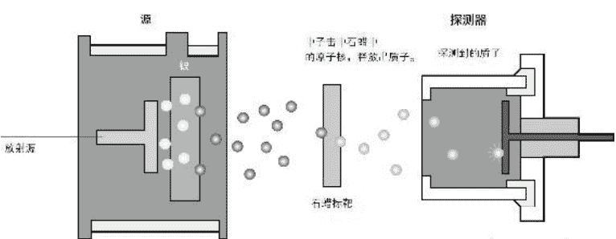

图1.1 中子被发现的过程。在使用 α 射线轰击铍的时候，法国物理学家约里奥-居里夫妇发现了一种神秘的辐射，能够把质子从石蜡中轰击出来。后来发现是中子做到了这一点

单独存在的质子是稳定的，至少人们还没有观察到它们的衰变，而中子则会通过发射电子变成质子。如果你能收集一桶中子，10分钟后便只能剩下一半了。考虑到这一事实，再加上质子因带正电荷而相互排斥，原子核居然能保持聚合，看起来似乎是个奇迹。这要归功于强核力那压倒性的效应，强核力在极短的距离内能使质子和中子结合在一起（见第2章）。

有了电子、质子和中子，我们似乎拥有了一套可以形成任何原子的粒子，所有的化学元素乃至所有已知的物质也就得到了解释。新发展的量子力学理论描述了这些粒子的特殊行为：既可以像波也可以像小质点。只需要三种零件就能构建宇宙，这真是一个简单到令人震惊的系统……然而大自然并没有表现出那样的仁慈。

### 发现反世界

1928年，英国物理学家保罗·狄拉克预言过一种新型的粒子。他为电子设计了一个量子方程。不同于传统的量子力学，这个方程与爱因斯坦描述高速物体运动方式的狭义相对论也是相容的。方程预测电子具有自旋——一种内禀角动量。（电子的自旋是1/2——用量子物理学家最喜欢的约化普朗克常数来讲，大概是10^-34 焦耳·秒）它还表明电子应该有一个二重身——一种“反物质”粒子，几乎所有性质都与电子相同，只不过带正电荷而不是负电荷。正电子在1932年被发现，它是第一个被发现的反物质世界成员。此外还有反质子和其他粒子的反物质版本。

与此同时，自然的一个更加奇异的面目也被揭示了出来。当一个中子衰变为一个质子和一个电子（β衰变过程的一个例子），两个新粒子的能量加起来要小于一开始的中子总能量。这种短缺致使物理学家沃尔夫冈·泡利和恩里科·费米在20世纪30年代得出结论，肯定还有一种粒子被发射了出来——一种幽灵般的粒子，与其他粒子之间相互作用很弱。这种粒子现在被称为中微子（具体来说，在上文试验中发射的是反电子中微子）。

在从太空向我们倾泻下来的粒子——也就是宇宙射线——当中，还有更多的意外正等着我们。1937年，在宇宙射线中发现了一个质量相当于电子质量约200倍的粒子。起初，这看起来符合日本物理学家汤川秀树在1933年提出的一项理论。在该理论中，被他称为介子的新粒子利用强大的核力将质子和中子结合在一起。然而，物理学家在20世纪40年代发现，这个新发现其实是电子的一个较重的版本。它令美国物理学家伊西多·艾萨克·拉比发出了疑问：“那东西是谁点的？”

其他这些粒子的存在有何意义？是否还存在着另一个有待发现的层次？为了更深入地研究物质并回答这些问题，物理学家需要开发一些强大的新工具。

## 粒子对撞

粒子是很小的东西，但是为了研究它们，我们需要巨大的机器。世界上用来研究它们的机器当中，最大、最有名的是瑞士欧洲核子研究中心实验室的大型强子对撞机。这个粒子加速器的隧道有27千米长，峰值耗电量大约为200兆瓦，大约是邻近城市日内瓦耗电量的三分之一。

大型强子对撞机和其他大型加速器的目的是将带电粒子加速到接近光速。这给了粒子很高的动能，也就让它们拥有了强大的撞击力。当这样的高能粒子与其他物质碰撞时，它的能量可以转化为新粒子的质能（根据爱因斯坦的方程E=mc²）。更大的能量意味着你可以创造更重的新型粒子，也使得物理学家能够在非常小的尺度上探测物质，因为亚原子粒子束的行为就像波一样。能量越高，波长越短；波长越短，可以识别的物体就越小。

阴极射线管——汤姆森发现电子时使用的装置——便是一种简单的粒子加速器。将玻璃管内的空气抽空，两端插入电极。施加电压会在电极之间形成电场，负极（也就是阴极）被加热，这样电子就能被有效地“蒸”出来。然后，电子被吸引到正极那端，并在穿过中间的电场的过程中获得能量。

如果电极之间的电势差为1伏特，电子将获得1个电子伏特（eV）的能量，大约等于1.6×10⁻¹⁹ 焦耳。提高电压，你就可以赋予电子更多的能量。一些用于产生X射线的阴极射线管在数百千电子伏特（keV）的能级上工作。

范德格拉夫起电机可以生成更高的电压。这种设备使用一条传送带把电荷向上引入一个金属球中。它们的电压可以达到数百万伏特，因此可以生成带有几兆电子伏特（MeV）能量的质子束。这么高的能量足以探测原子核的结构，但是仍然满足不了粒子物理学家们的要求。

## 步步高升

人们能够维持的电压是有限的，因此，为了让粒子获得更高的能量，加速器重复使用强度较小的电场。1928年，挪威工程师罗尔夫·维德罗建造了第一台这样的机器，一种线性加速器，或者叫作直线加速器。他的直线加速器令粒子束通过连续的交变电场区域，在粒子行进过程中分阶段给予它们反复加速。一些现代的机器以同样的方式工作，另外一些直线加速器则利用电磁波加速粒子，就像驾驶海浪的冲浪者一样。

世界上最大的直线加速器位于美国加利福尼亚州的斯坦福线性加速器中心国家加速器实验室。这台机器有3千米长。在被用于粒子物理学研究时，它可以将电子加速到500亿电子伏特（50吉电子伏特，简称GeV）。今天它被分成两个区段运作，它的粒子束被用于其他科学领域（见第11章）。

直线加速器是有极限的，因为粒子很快就会到达终点，你就不能继续加速它们了。这就是为什么当今最强大的加速器——同步加速器——使用磁体将粒子束弯曲成圆形。当粒子加速时，磁场相应地增强，外加电场的频率也随之提高，以跟上粒子的步伐。

粒子束也必须用磁体进行约束，否则粒子就会偏离预定轨迹并击中墙壁。在较大的同步加速器中，长偶极（双极）磁体用于使粒子束弯曲，而四极磁体负责约束粒子束。

现代的同步加速器由一个注入器（通常是一部直线加速器）、一个双极和四极磁体环、束流管（带有保持其高真空状态的泵）和几个射频腔组成。它们都是空心的金属结构，其中形成的电磁驻波，提供了用来加速粒子束的电场。

同步加速器的尺寸从1米左右（用作X射线源）到当今世界最大的大型强子对撞机（周长27千米）。大型强子对撞机占据了一条隧道。这条隧道原本是为早期的一台电子同步加速器——大型正负电子对撞机——挖的。这是为了使粒子束的轨迹曲线尽可能平缓，因为高能带电粒子沿曲线运动时，会发出所谓的同步辐射，从而损失能量。当粒子的速度接近光速时，它的轨迹弯曲度越大，辐射量也就越大。在任何给定的能量下，越重的粒子移动速度越慢，因此质子可以在同步辐射消耗其强度之前被加速到更高的能量。例如，大型强子对撞机可以将质子加速到大约7万亿电子伏特，大约是电子在大型正负电子对撞机能够获得的能量的70倍。

等到粒子达到一定的速度，它们就能派上用场了。在一些加速器中，粒子束轰击固体目标，不过两束粒子束正面碰撞的效率要高得多，大型强子对撞机当中正是如此安排的。碰撞产生了大量的新粒子，巨大的粒子探测器跟踪这些残骸，这样物理学家就可以重现碰撞发生时的情况。

## 粒子探测器

一些探测器只能探测粒子的数量，还有一些能测量粒子损失的能量。最有用的探测器能揭示粒子的轨迹，就像飞机的路径会因天空中的云迹而为人所见一样。如果再加上一个用来偏转带电粒子路径的磁场，路径探测器还可以提供它们电荷和动量的信息。中性粒子通常是通过它们在探测器中相互作用时产生的带电粒子来检测的。

气泡室是最著名的探测器类型之一。带电粒子穿过室内的过热液体时，会离子化原子，一路触发细小气泡的形成。很多人们熟悉的粒子物理学图片都是20世纪70年代在气泡室里拍摄的照片。今天大型强子对撞机里的碰撞图片是利用由很多层探测器构成的巨大仪器产生的电信号生成的，每一层探测器都有着协助确定轨迹和识别产生的各种粒子的特定功能（见第3章）。

## 粒子的零件

从20世纪40年代末开始，物理学家们陆续发现一个又一个新粒子，其中许多粒子是由宇宙射线与高空的原子核碰撞产生的。对宇宙射线副产物的研究揭示了π介子、K介子和Λ粒子存在的最早证据。这些粒子高度不稳定，寿命在10⁻⁸ 秒到10⁻¹⁰ 秒之间。然后人们发现了Δ粒子和Σ粒子，以及后来更多的粒子——100多个看似基本的新粒子，全都不稳定。它们当中大部分都相当重，连同质子和中子一起被统称为强子。粒子物理学家们本来是在寻找物质简单的基本组成部分，结果似乎发现了一个新的亚原子领域，其复杂程度令人惊讶和困惑。

利用粒子加速器在受控条件下模拟宇宙射线的碰撞，物理学家可以对这些粒子进行更加系统的研究。通过这种手段，一种在宏观世界中没有类比的性质被揭示出来，某些强子根据这个性质被打上了不同于其他强子的标记。因为这个性质会导致一些看似奇异的行为，所以这个性质本身就被称为奇异数。在目前提到的粒子中，质子和中子没有奇异数，π介子和Δ粒子也没有奇异数。K介子、Λ粒子和Σ粒子都有一个单位的奇异数。

在20世纪60年代早期，美国人默里·盖尔曼和以色列人尤瓦勒·内埃曼分别根据强子的电荷、奇异数和自旋（粒子内禀角动量）对强子进行了分类。他们发现了八重道和十重道的模式，这反映了一种被称为SU(3)的数学对称性。

### 奇异有三

这两个模式中存在着一个缺口，对应一个带负电荷、奇异数为3的粒子。物理学家称它为 Ω-，1964年，纽约布鲁克海文国家实验室的一个研究小组使用粒子加速器发现了它——在他们的气泡室里有一条很短但很独特的轨迹。这表明该理论具有一定的预测能力。但是这些美丽的模式背后隐藏着什么样的规律呢？

SU(3) 的数学计算表明，较大的组——八重态和十重态——都是由只有3个成员的基本组构成的。或许强子都是由一组更加基础的三种粒子构成的？盖尔曼和另一位美国人乔治·茨威格各自提出，强子确实是由这些基本实体构成的。茨威格称它们为“王牌”，不过我们今天使用的名字来自盖尔曼，他显然喜欢詹姆斯·乔伊斯的小说《芬尼根的守灵夜》中“夸克”（quark）一词的发音。

他们需要三种不同类型的夸克，即上夸克（u）、下夸克（d）和奇夸克（s），这又叫作夸克的三种味。和所有带电粒子一样，每种味都有电性与之相反的反夸克。通过把三个夸克结合起来，我们可以得到重子，也就是自旋为1/2的强子（比如质子，是下-上-上；或者中子，是下-下-上；或者 Λ 粒子，是下-上-奇）或者自旋为3/2的强子（比如 Ω-，是奇-奇-奇）。

或者，我们可以把一个夸克和一个反夸克（电荷和奇异数正好相反）结合起来，得到自旋为“0”或者“1”的强子。它们叫作介子，包括带电 π 介子（上夸克和反下夸克，或者反过来）和带电K介子（上夸克和反奇夸克，或者反过来）。

## 夸克真的是粒子吗

夸克的想法令人难以接受，因为它们的电荷数不是整数。19世纪，迈克尔·法拉第已经证实，电荷总是某种单位电荷的倍数。1897年，汤姆森对电子的发现表明这个单位正是电子的电荷。然而新粒子打破了既定的规则，它的电荷是电子的2/3或-1/3。这似乎具有革命性的意义，令许多物理学家怀疑夸克会不会仅仅是数学算出来的人工产物，而不是真正的粒子。

但是夸克的真实性很快得到了实验的支持（见图1.2）。已经有证据表明，质子和中子不是简单的球形或者点状物体，因为电子从它们身上反弹的方式很复杂。在20世纪60年代后期，加利福尼亚的物理学家们开展了更深入的研究：他们从斯坦福线性加速器中心3千米长的直线加速器中发射出一束电子，对准液氢标靶，测量了散射电子的能量和方向，以图拼凑出质子的样子。电子在每个质子内部都探测到了微小的点状电荷凝聚：这证明质子确实包含更小的部分。最后，在20世纪70年代早期，日内瓦欧洲核子研究中心的研究人员证实，这些部分携带-1/3e和2/3e电荷，符合理论物理学家们之前的预测。

| 图像 | 对象 | 尺寸 |
|------|------|------|
| 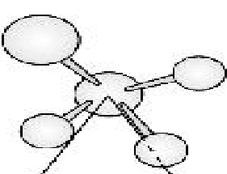 | 分子 | 10⁻⁹ 米 |
| 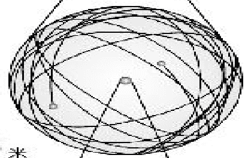 | 原子 | 10⁻¹⁰ 米 |
| 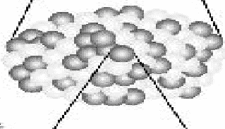 | 原子核 | 10⁻¹⁵ 米 |
| 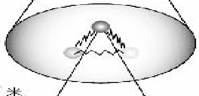 | 核子 | 10⁻¹⁷ 米 |
| 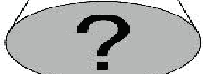 | 夸克 | 小于 10⁻²⁰ 米 |

## 图1.2 俄罗斯套娃：构成物质的粒子

1974年，研究正负电子碰撞的实验发现了第四种夸克存在的证据。这种新的夸克更重，后来被称为“粲夸克”。这个名字有些来历：它的存在非常有效地解决了某些特定的理论问题。在英语口语中，“非常有效地”可以表达为“like a charm”，于是它得名“charm quark”，又由于“charm”一词有“魅力”“美貌”之意，它便有了中文名“粲夸克”。第五种更重的夸克，叫作底夸克，于1977年出现在美国伊利诺伊州费米实验室的一项实验中。在那里，实验人员正在研究高能质子与目标碰撞产生的μ子-反μ子对。这一次，他们发现了一个比质子重10倍的新粒子的证据，这可以解释为一种新的重夸克与它的反夸克结合。底夸克被发现之后，有些人希望把它改名为与“底”（bottom）词首相同的“美”（beauty）夸克，不过最终“美夸克”这个名字虽然有人使用，但是谈不上得到了广泛的认可。最后，在1995年，费米实验室的研究人员发现了第六种夸克，即顶夸克。在顶夸克身上发生了同样的事情：有人希望给它一个与“顶”（top）词首相同的名字，从而不会改变其缩写，而又能够与“美”呼应。他们选择了“真”（truth），结果这个名字接受度还不如“美”，部分原因是，“真”这个字眼在科学和哲学中有着重大的意义，容易让物理学门外汉们误以为这种夸克有什么特别之处。

和奇夸克一样，这三种新的味似乎都有其各自独特的性质。例如，存在一种“粲”介子，它包含一个粲夸克和另一种反夸克。夸克可以从一种变化到另一种，而顶夸克、底夸克、粲夸克和奇夸克都能迅速地衰变为构成普通物质的上夸克和下夸克。

## 粒子物理学简史

## 公元前5世纪

古希腊哲学家留基伯和德谟克利特推测物质是由不可分的粒子构成的，它们称为原子。

## 1897年

约瑟夫·汤姆森发现电子，这是第一种被识别出的基本粒子。

## 1905年

爱因斯坦提出光是由不连续的能量粒子构成的，后来这些能量粒子被称为光子。

## 1908—1911年

欧内斯特·卢瑟福的团队发现了原子核。

## 20世纪20年代早期

卢瑟福等人意识到氢原子核——质子——是所有原子核的组成部分。

## 1923年

阿瑟·康普顿证实光子的行为像粒子。

## 1928年

保罗·狄拉克预言电子应该有一个带正电荷的替身：正电子。

## 1930年

沃尔夫冈·泡利提出 β 衰变中明显缺失的能量是被一种新粒子——中微子——带走了。

## 1932年

正电子被发现。詹姆斯·查德威克发现原子核的第二种组成部分：中子。

## 1935年

汤川秀树提出一种理论，认为一种中等重量的粒子——介子——在质子和中子之间传递强力。

## 1937年

一种质量相当于电子质量200倍的粒子在宇宙射线中被发现。后来人们证实它是电子的较重版本——μ 子。

## 1947年

人们在宇宙射线的碰撞产物中发现了 π 介子。这是携带强力的介子的第一个实例。

## 20世纪40年代晚期至50年代

物理学家们发现了一系列的新粒子，包括K介子、中性 π 介子、Δ 粒子和Σ 粒子。

## 1957年至1959年

朱利安·施温格、西德尼·布鲁德曼和谢尔顿·格拉肖都发表了关于弱核力由重粒子携带的理论。他们的工作基于更早的“规范理论”。

## 1964年

默里·盖尔曼和乔治·茨威格各自独立地提出了一种基本粒子。盖尔曼称为夸克。

## 1964年

彼得·希格斯第一个明确预言了赋予质量的玻色子——最终这种粒子被赋予了他的名字。罗伯特·布劳特和弗朗索瓦·恩格勒等人也有过类似想法。

## 2012年

希格斯玻色子被发现。

## 1995年

第六种，也是最后一种夸克的味被探测到：顶夸克。

## 1983年

W玻色子和Z玻色子被探测到。

## 1976年

一种与电子和 μ 子类似，但是更重的基本粒子——τ 轻子——被发现。

## 1973年

量子色动力学从夸克、胶子和色交换的角度描述强力。

## 1967年

斯蒂芬·温伯格和阿布杜斯·萨拉姆把电磁力和弱力统一成一种“电弱”相互作用。

## 为什么用能量单位表示粒子的质量？

爱因斯坦的相对论告诉我们，质量和能量被公式E=mc² 联系在一起。取一个单位的能量，比如1焦耳，除以c² （c表示真空光速），你就能得到相应的质量。在粒子物理学中，一个方便的能量单位是电子伏特（eV）——电子（或者质子）穿过1伏特的电势差获得的能量。粒子物理学家既用千电子伏特（keV）、兆电子伏特（或者叫百万电子伏特，MeV）或者吉电子伏特（或者叫十亿电子伏特，GeV）等单位描述他们可以用加速器赋予粒子多大能量，也用它们描述那些粒子的静止质量。电子的静止质量是511keV/c² ，相当于9.1×10^-31 千克。质子的静止质量是938MeV/c² ，约等于1.67×10^-27 千克。因为能量和质量基本上是等效的，粒子物理学家们往往忽略掉c² 这一因数，直接用MeV或者GeV来表示粒子质量。

### 2 玻色子的力量

两类粒子——夸克和轻子，结合在一起形成了物质。还有一类叫作玻色子的粒子约束着它们，并以其他方式支配着它们的生活。

## 四种基本力

我们已经知道，宇宙宏大的多样性生发自寥寥几种亚原子积木。与此同样不凡的一项发现是，这些粒子相互作用的方式也只有寥寥几种。有四种基本力：引力、电磁力、强核力和弱核力。到目前为止，粒子物理学还远远未能充分地解释引力——在我们能够制造的粒子碰撞中，引力是极其微弱的——不过它改变了我们对另外三种力的看法。用量子物理学的眼光来看，塑造了我们的世界、指引着每一颗亚原子粒子如何舞动的力，本身也是粒子的作用。

## 电磁力

我们都感受过电和磁的力量。如果你尝试把两块磁铁的北极抵在一起，你会发现两者之间有一种排斥力。在你的毛衣上摩擦一个气球，再把它举到天花板上，气球会被电力吸在那里。

1785年，法国物理学家查尔斯·库仑发现带电物体之间的力遵循平方反比定律（就像一个世纪之前牛顿对万有引力的描述一样）。力F与两个电荷p和q的乘积成正比，与它们之间距离的平方r²成反比。

19世纪，英国科学家迈克尔·法拉第发明了力场的概念。想象一个带电物体悬挂在房间的中央，假设你有另一个具有相同类型电荷的物体，你便可以在房间内的任何一点测量两个物体之间的力。力的方向总是沿着连接两个物体的直线，所以你可以把力的方向画成从中心物体辐射出去的线。

如果我们让铁屑沿着磁力的方向排列，磁铁周围的磁场就会清晰可辨。物理学家也可以用数学的语言描述这些场，用方程给出时空中所有点上力的强度和方向。

电力和磁力是密不可分的。例如，移动的电荷会产生磁效应，而移动的磁极会产生电流。19世纪中期，苏格兰物理学家詹姆斯·克拉克·麦克斯韦将所有的实验结果以及电学和磁学定律提炼成了单一的电磁学理论：四个描述电磁场整体行为的方程。

然而，麦克斯韦定律不足以详细解释原子和分子之间的反应，或者单个原子的结构及其吸收和发射光的方式。为了解释亚原子层次上的现象，我们必须考虑两个新的因素。原子中的电子运动速度很快，所以它们受到爱因斯坦狭义相对论的制约。另外，这是一个由量子力学统治的领域，它赋予了粒子许多违反直觉的属性。例如，粒子就像波一样，可以同时处于一种以上的状态或者位置。因为电子表现为波，所以它们在绕原子旋转时受限于特定的波长，能量因而也就固定了。

将狭义相对论和量子力学结合起来的电磁学理论是量子电动力学，简称QED。它是在20世纪20年代由英国物理学家保罗·狄拉克等人发展起来的，并在40年代得到完善。量子电动力学是一种量子场论。电磁场是量子化的，也就是说，它可以被视为粒子或者量子的集合。所有的相互作用都涉及这些量子的发射和吸收。例如，两个电子通过光子的发射和吸收相互作用。这更像是一场量子接球游戏，光子就是球。

然而，有一个重要的区别。量子球的存在只能是暂时的，否则它将违背能量守恒的基本原理。它只能短暂地存在于物理学家所称的虚拟状态中。整个过程必须包括这个虚拟粒子的发射和吸收。

比如在量子电动力学中，两个质子通过交换虚光子来相互排斥。但是，虚光子本身可以交换更多的虚光子，要想计算出力的强度，你必须把每一种可能的粒子交换模式都加起来。美国物理学家理查德·费曼设计的简单图表（见图2.1）直观地展现了这些交换。

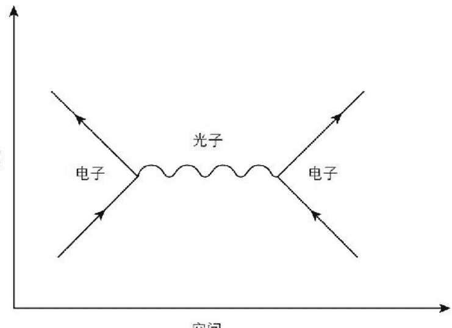

图2.1 这张简单的费曼图表达的是两个电子通过交换一个虚光子互相排斥

## 强力

在亚原子尺度上，还有两个力在发挥作用。中子和质子之间必须有一种约束力，否则质子之间强大的电斥力会把原子核炸开。这种力在原子核之外没有可测量的影响，因此，与引力或者电磁学不同，它必须被限制在一个非常小的范围内——只有大约10⁻¹⁵ 米。原子核的结合力大约是质子之间电场力的100倍。

它也要复杂得多。加速器实验表明，它并不遵循简单的平方反比定律，而是在最短的距离上表现为斥力，距离增加后表现为吸引力，然后随着距离的进一步增加迅速消失。它也取决于粒子的自旋是如何排列的。或许这并不令人意外。质子和中子是由夸克构成的，它是夸克之间的一种力，这种力间接地产生了质子和中子之间的核力。

夸克有一种类似于电荷的性质，叫作色荷。它与日常意义上的颜色无关，但是它有三种值，分别是红、绿和蓝。就像把三种颜色的光混合在一起会产生白色一样，夸克的三种色荷加起来也会产生无色荷。比如在质子中便是如此，它总是包含一个带蓝色荷、一个带红色荷和一个带绿色荷的夸克。

正如同电中性的原子还是凭借电磁力结合在一起，强力仍然可以令原子核里的质子和中子聚作一团。原子带正电荷的原子核仅仅被它自己的电子云部分屏蔽，与此类似，质子内部带色荷的夸克可以感觉到隔壁质子中夸克的存在。

因为这整套理论是和量子电动力学一样的量子场论，不过涉及的是所谓的色荷，所以被称为量子色动力学，简称QCD。在量子色动力学中，携带强力的粒子被称为胶子，因为它们把粒子粘在一起。

胶子和光子之间有一个重要的区别。光子不带电荷，因此不会通过电磁力直接相互作用（只能通过带电粒子间接作用）。但是胶子有自己的色荷，所以它们之间可以通过强力相互作用。这限制了强力的范围，使它具有十分独特的行为方式。

当两个带电粒子被拉开时，它们之间的力减小。但是当你把两个夸克分开时，胶子会相互拉，力事实上会变大。据我们所知，单独的

夸克永远无法从质子中逸出，它必须始终与其他夸克结合成无色的形式。在碰撞过程中，能量不是以单个夸克的形式物质化，而是以夸克-反夸克对——介子的形式。

只有夸克有色荷。轻子，比如电子，没有色荷，所以它们根本感觉不到强力。

## 重要的力

- 电磁力的残留效应把电中性的原子结合成分子。
- 电磁力把电子云束缚在原子核周围，保持着原子的完整。
- 强力的残留效应把质子和中子结合成原子核。
- 强力令质子和中子里的夸克结合在一起。

## 弱力

没有原子核束缚的中子不会永远存在。它很快就会释放出一个电子和一个被称为反中微子的粒子，变成一个质子。物理学家可以用一种叫作弱力的基本力来描述中子的衰变。弱力大约是强力的一万分之一。与人类可以感觉到的引力和磁力不同，它看起来并不像是一种日常意义上的力。不同于其他力在不同尺度上所起的作用——将物质合在一起，弱力的作用是使基本的夸克和轻子从一种类型转变为另一种类型。于是顶夸克可以变成底夸克，或者μ子可以变成电子。弱力是唯一能够做到这一点的力。它还会导致放射性的β衰变。

弱力的量子场论需要三个载力子。W粒子和W-粒子是带电的，在弱力改变粒子电荷时发挥作用，比如中子衰变为质子时。Z粒子是不带电的，在没有电荷变化的弱相互作用中发挥介导作用。

弱力的这三种载力子都很重，质量大约是质子或者中子的100倍。那么，一个中子是如何发射出比自身重得多的虚拟W粒子或者Z粒子的呢？答案在于量子的不确定性。量子物理学告诉我们，一个粒子的质量（严格地说是质量-能量），甚至是真空中的一点，总是存在一些不确定性。长期来看，这种不确定性很小；但是在短时间内，不确定性很大。一个中子可以凭空产生一个虚拟的W粒子或者Z粒子，只要这个粒子在足够短的时间内被中子或者另一个粒子吸收。

光子是电磁力的场量子，它的静止质量为0，所以虚光子可以无限期地存在，并且可以移动任意距离，这意味着电磁力的范围是无限的。但是W粒子和Z粒子很重，所以不能远离产生它们的粒子。和强力一样，弱力的作用范围很小。

你不可能探测到一个虚粒子。但是在1984年，欧洲核子研究中心的研究人员在超级质子同步加速器中对撞亚原子粒子束，创造出了真实的而不是虚拟的W粒子和Z粒子。这些实验证实了一个惊人的理论预测。20世纪60年代，物理学家谢尔顿·格拉肖、阿布杜斯·萨拉姆和斯蒂芬·温伯格发展了一套弱力的量子场论。该理论表明，在足够高的能量下，电磁力和弱力是一个统一的电弱力的组成部分。因此，当宇宙非常年轻时，宇宙在数十亿摄氏度的温度下充满了高能辐射，W粒子和Z粒子可以像光子一样轻易地被制造出来。

在一个理论中统一两种力的成功鼓舞了物理学家们对“万有理论”的追寻，该理论将能够把电弱力、强力和引力描述成一个基本力的不同方面（见第9章）。这种理论也许会揭示时间、空间和质量的本质，并将让人们窥见宇宙鸿蒙之初——所有四种力还无法区分的时刻。

虽然这仍然是一个难以企及的梦想，但是描述电弱力的量子电动力学和描述强力的量子色动力学已经非常强大了。这一理论潜在的对称性（见图2.2）表明存在着6种夸克和6种轻子，正如观测结果所证实。它还预测了W粒子和Z粒子，以及奇怪的玻色子——神秘的希格斯玻色子——的存在。

## 物质

## 携力子

| 类型 | 电荷 | 粒子 |
|------|------|------|
| 夸克 | +2/3 | 上夸克 u |
| 夸克 | +2/3 | 粲夸克 c |
| 夸克 | +2/3 | 顶夸克 t |
| 夸克 | -1/3 | 下夸克 d |
| 夸克 | -1/3 | 奇夸克 s |
| 夸克 | -1/3 | 底夸克 b |
| 轻子 | -1 | 电子 e |
| 轻子 | -1 | μ子 μ |
| 轻子 | -1 | τ子 τ |
| 轻子 | 0 | 电子中微子 Ve |
| 轻子 | 0 | μ中微子 Vμ |
| 轻子 | 0 | τ中微子 Vτ |

| 类型 | 对应力 | 粒子 |
|------|--------|------|
| 玻色子 | 电磁力 | 光子 γ |
| 玻色子 | 弱核力 | W & Z |
| 玻色子 | 强核力 | 胶子 g |
| 玻色子 | 质量之源 | 希格斯玻色子 H |

- 每一种夸克和轻子都有带相反电荷的反粒子与之对应。
- 夸克合成一个介子，要么是三个夸克或者三个反夸克合成一个重子，比如质子和中子。

图2.2 夸克和胶子能够感受强力是因为它们拥有色荷，但是轻子和其他玻色子则不然

这张粒子物理学标准模型中粒子的全员花名册解释了所有可见物质和四种基本力中的三种的运作。

## 玻色子和费米子

粒子必须遵循量子力学定律。比如说，它们拥有类似波的性质——以量子波函数的形式运动，在空间中伸展，随着能量的增加波长变短。

粒子的很多性质被限定为固定的数值。这些性质被赋予了量子数。自旋是其中之一，其取值只能是基本量子值的整数或者半整数倍。自旋在某些方面类似经典世界中的旋转——它表现出角动量——但是它也有着极其量子化的效应。

拥有半整数自旋的粒子，比如电子、质子或者夸克（自旋都是1/2），在其波函数中有一种不对称性。这些统称为费米子的粒子无法共享一个量子态，物质世界因此才会如此繁复多彩。这便是为什么把6个质子、6个中子和6个电子放在一起，就能合成一个有趣的、结构化的碳12原子。

拥有整数自旋的粒子，比如光子（自旋为1），叫作玻色子。这个名字来自印度物理学家萨特延德拉·纳特·玻色。玻色子拥有对称的波函数，可以彼此相安无事地处于相同状态。它们无法构成复杂的物质，而是负起了传递力的职责。

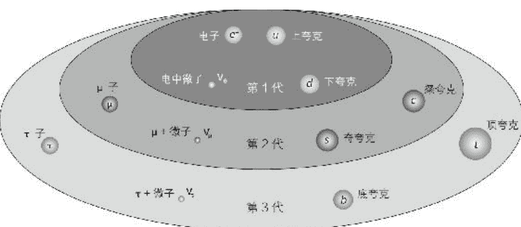

图2.3 根据味和质量，标准模型中的粒子被分成三个族或者代

## 为什么宇宙是对称的

一个局外人可能会把物理学看作是方程和粒子的泥沼，但是在那些专业人士眼里，它是对宇宙的优雅描述，总是追求尽可能简单。要明白为什么，你需要理解物理学家所说的“对称性”是什么意思，以及被人们遗忘的数学家艾米·诺特惊人的洞察力，后者为后来几乎每一项重大根本性发现奠定了基础。

数学家赫尔曼·韦尔是这么定义“对称”一词的：“如果你能对一件事物做点什么，而在你做完之后它看起来和之前一样，那么这件事物就是对称的。”比如，一个圆可以旋转任意角度，看起来都一样。

对称性是物理定律核心的观点由来已久。亚里士多德及其同时代的人认为，恒星都被粘在天上的球壳上，而行星都沿着圆形轨道运行。当然，他们错了。但是当牛顿用他的万有引力定律来解释行星的椭圆路径时，他引入了一种新的对称性——看不见的引力之手的对称性。引力从像太阳这样的巨大天体出发，向所有方向施以相等的作用。爱因斯坦精确的引力理论——广义相对论，是建立在一个被称为等效原理的对称性上的：一个物体在引力作用下经历的加速度，与其他原因——比如火箭的推进或者离心机的旋转——造成的同样大小的加速度，没有可辨识的区别。

爱因斯坦的工作令人们对对称性在物理定律中发挥的作用产生了极大的兴趣。数学家戴维·希尔伯特和菲利克斯·克莱因意识到艾米·诺特是一位专家，便在1915年邀请她去哥廷根。诺特几乎立即发展出了她的同名定理。用简单的话说，它说的是对称性产生了守恒定律。

## 诺特定理

守恒定律是物理学的基本原理。它们是数学上的捷径，让我们可以不必重复地计算物理量。不管从哪里入手，你最终都会得到同样的结果。大多数伟大的物理定律都或明或暗地包含了某种守恒的陈述。

牛顿第一运动定律粗略地说：“运动中的物体保持运动，静止的物体保持静止。”这就是动量守恒。诺特定理（见图2.4）告诉我们为什么它是正确的。

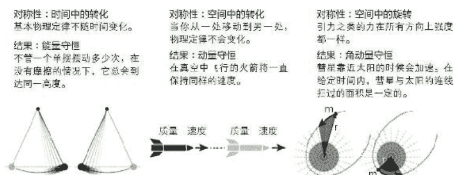

图2.4 对称性在自然界到处都存在：艾米·诺特在1915年提出的理论提供了一种方法，能够将它们转化成可用于计算的定律

想象在一个非常大而光滑的冰湖上放置一枚冰球。无论冰球滑到哪里，湖面都是一样的。把诺特定律应用到那一特定的空间对称性上，它告诉你动量是守恒的。（守恒定律只在对称性成立的条件下成立。冰面上的一个洞会破坏对称性，导致冰球沉到湖底）

什么守恒、什么不守恒，并不总是很明显。在诺特之前，能量被简单地认为是守恒的，这个假设是如此基础，以至于在19世纪它被称为热力学第一定律。但是，如果你进行诺特定理相关的数学运算，你就会发现，能量守恒是因为有一个更基本的对称性：具体来说，就是物理定律不会随着时间而改变。如果它们改变了，能量就不守恒了。

诺特定理是令人们在物理学研究中取得进展的一剂良方。如果你在世界的运作中发现了一项对称性，相关的守恒定律便能让你开始有意义的计算。

空间和时间的对称性也许用肉眼就能看出来，但诺特定理真正的力量来自更模糊的“内部对称性”。对于外行人来说，粒子物理学的标准模型仅仅是一张基本力和粒子的列表。但是如果更深入地看，你会发现它是建立在诺特定理的基础上，对内部对称性的一种表达。

就拿电磁学来说吧。詹姆斯·克拉克·麦克斯韦因为在19世纪60年代将电和磁统一到一个工作模型中而广受赞誉。它的一个假设是电荷既不产生也不消失——诺特定理表明电荷守恒来自对称性。

## 转个不停

基本粒子有一种叫作自旋的性质，就像在冰冻的湖面上位置不重要一样，自旋的相位不会改变物理计算。把宇宙中的每一个电子都转动一个额外的角度，能量和其他任何东西都不会改变。根据诺特的定理，从这种内部对称性中产生的是电荷守恒。

韦尔进一步发展了相位对称性的概念，他假设每个电子都能被不同程度地扭曲而不改变任何可测量的量。几乎像是变魔术一样，麦克斯韦的四个方程全部出现了。随着标准模型的发展，兴趣对称性变得更加微妙，但诺特定理一直是不断给予的礼物。

驰骋在电线里为电器提供动力的电子，以及每秒钟以万亿之巨的数量穿透我们的身体而不留一丝痕迹的中微子，很难想象这二者在某种意义上都是相同的粒子。中微子主要通过弱力相互作用，而这种力也控制着太阳内部的核聚变。但是弱力与粒子是电子还是中微子无关：把它们调换一下位置，弱相互作用是一样的。这种对称性产生了一种被称为弱异位旋的量的守恒。就像电荷一样，它可以用来标记粒子并预测它们的行为。

在20世纪60年代，研究人员发现，在后来所谓的电弱理论中，电磁力和弱力实际上可以由一种潜在的对称性产生，这是标准模型的基石（见图2.5）。高能状态下，对称性没有被破坏，电子和中微子的行为是相同的。在今天已经冷却了的宇宙中，对称性被打破了，电子和中微子的行为因此而改变，另外还有一种新的粒子产生——我们现在知道的希格斯玻色子。

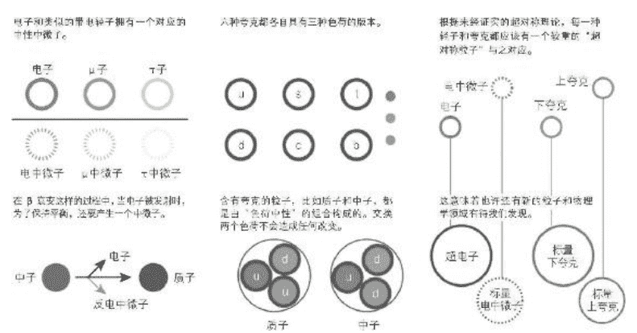

图2.5 粒子物理学标准模型以及以后可能出现的更新理论的有效性由某些微妙的对称性决定

标准模型的另一根支柱是强相互作用，它将单个的质子和中子结合在一起。组成这些粒子的夸克被标上了红色、绿色和蓝色三种色荷之一。把所有的色荷改变一个单位，所有的强相互作用将保持完全相同。这种对称性导致了色荷的守恒，这一原理限制了哪种粒子可以存在，以及哪种衰变过程可能发生。

粒子物理学的新理论是以对宇宙基本对称性的有根据猜测为基础建立的。圣杯是大一统：发展可以用短短几个方程描述一切理论的动力。几十年来，理论物理学家们认为，这种最终的对称应当包括所谓的超对称，所有的费米子都有对应的重玻色子，所有的玻色子都有对应的重费米子（见第8章）。创造并观察这些对应粒子的需求是建造大型强子对撞机的主要动机之一。从正确的角度来看，它就是一台观察对称性的大机器。

## 性别不对等

艾米·诺特的成就得到了广泛的认可，她本人却饱受学术界传统偏见的困扰。1882年，诺特出生在一个杰出的数学家家庭。她的父亲马克斯是巴伐利亚北部埃尔朗根大学的教授，而她一开始却因为身为女性被禁止在这所大学学习。

诺特最终获得了一个学士学位和一个博士学位，然而仍然没有一所大学愿意聘用她。在接下来的10年里，她成为了对称性方面的世界级数学专家，但是没有职位、薪水和正式的头衔。甚至在被邀请去哥廷根工作时，工作邀约也是不带薪水的。她以客座讲师的身份服务了7年，直到在1922年获得了荣誉性的“卓越”教授职位。

与此形成鲜明对比的是，20世纪20年代同在哥廷根的赫尔曼·韦尔，尽管资历不及诺特，却很快获得了杰出教职。“获得这样一个比她还高的职位令我感到羞愧。我知道，作为数学家，她在很多方面都比我强。”他后来评论道。

1933年，为了躲避纳粹的迫害，诺特离开德国，来到美国宾夕法尼亚州的布林摩尔学院，两年后死于癌症手术的并发症。爱因斯坦在她死后写道：“诺特小姐是自从女性开始接受高等教育以来最具创造力的数学天才。”有些人也许会说这句话中“自从”那一部分是多余的。数学家们崇敬她，然而尽管她为现代物理学奠定了基础，物理学家们却倾向于忽视她的贡献。

## 为什么我们需要希格斯

标准模型（见图2.2）是我们描述现实的理论当中最成功的。它描述了物质粒子——费米子——如何感受力，以及如何通过其他粒子——玻色子——的交换相互作用。但是几十年来，一个重要的组成部分因其缺失而引人注目：希格斯玻色子。人们认为这种粒子起着两个重要的作用：赋予其他粒子质量，以及解释为什么自然的力呈现它们所呈现的样子。

如果你把物质打破成越来越小的碎片，无论从什么开始，你最终得到的都会是一堆粒子，比如电子和一群夸克——构成质子和中子的、较轻的上夸克和下夸克，及其短命的表亲——奇夸克、粲夸克、底夸克和顶夸克。电子属于另一个由6种粒子组成的家族：轻子。该家族其他成员包括它的两个较重的兄弟——μ子和τ子，以及3种几乎没有质量、分别与前述3个成员结伴的中微子。这12种物质粒子统称为费米子，各有一种除电荷相反外完全一致的反粒子。就是这些。就我们所知，物质不能进一步被分解了。

这一整洁的模式符合实验结果，但是隐藏了一个复杂的问题。所有物质粒子都有一种叫作“质量”的性质——对速度和方向改变的抗拒。它们的质量范围跨越了11个数量级，从轻量的电中微子到巨大的顶夸克（见图2.6）。这些质量来自哪里——为什么它们如此不同？

| 粒子 | 质量 |
|------|------|
| 电子 | 0.5 MeV |
| 上夸克 | 约 2 MeV |
| 下夸克 | 约 5 MeV |
| 奇夸克 | 约 95 MeV |
| μ子 | 105 MeV |
| 魅夸克 | 1.3 GeV |
| τ子 | 1.8 GeV |
| 底夸克 | 4.2 GeV |
| W 玻色子 | 80 GeV |
| Z 玻色子 | 91 GeV |
| 希格斯玻色子 | 125 GeV |
| 顶夸克 | 173 GeV |

单位：电子伏特（eV）

图2.6 基本粒子的质量。三种中微子（电中微子、μ中微子和τ中微子）的质量非常小，比1电子伏特还小得多，没有在这张图上展现出来。光子和胶子没有质量

这个问题的意义远远超出了在粒子物理学领域为粒子列名单。如果没有什么东西来提供质量，就不会有我们所知道的物质。无质量的夸克和电子会以光速永远运动，不可能接受束缚组成质子、中子和原子。

根据标准模型，费米子通过被称为玻色子的其他粒子传递的力相互作用。光子依附于电荷并携带电磁力，而胶子感受到色荷产生强核力。

至于标准模型的第三种力，弱核力……嗯，它很弱，但是如果没有它，令太阳和其他恒星光芒万丈的放射性衰变就不会发生。它之所以那么弱，是因为它的载体W玻色子和Z玻色子拥有非常大的质量——几乎是质子质量的100倍。制造这样的粒子需要很多能量。在正常情况下，如果可以的话，物质粒子更倾向于通过交换无质量的光子来相互作用。

在非常高的能量下——例如，在宇宙最初的那一刹那，或者在强大的粒子加速器的碰撞中——这种差异会消失。W粒子和Z粒子变得无质量，就像光子一样，而在我们的日常体验中，如此迥异的电磁力和弱力变成了统一的电弱力。

电弱力分裂成电磁力和弱力的过程被称为电弱对称性破缺，这一定发生在宇宙早期的某个时刻。不管是什么引起的，这都与神秘的质量有关。毕竟，这也正是W玻色子和Z玻色子获得质量的机制。

会发生对称性破缺的不只是奇异的力。一个日常的例子是液体冷却成固态晶体。在这一情形中，一个大致对称的状态（液体中的一切在所有方向上看起来都是一样的）被一个不太对称的状态所取代。在这个状态中，事物在不同轴向上看起来明显不同。

20世纪60年代，粒子理论物理学家们开始怀疑，用来描述这种对称性破缺的工具是否可以应用于冷却中的宇宙。这不是一件容易的事。固体或者液体中的分子相互作用可以通过参考一组固定的坐标来定义，但是根据爱因斯坦广义相对论的时空扭曲，宇宙中不存在这样的标准参照系。

1964年，比利时理论物理学家罗伯特·布劳特和弗朗索瓦·恩格勒提出了一种量子场的方程式。这种场能够以一种符合相对论的方式打破对称性，从而使粒子获得质量。英国物理学家彼得·希格斯也提出了同样的建议。他指出，这个场中的褶皱会以新粒子的形式出现。同年晚些时候，杰拉尔德·古拉尔尼克、卡尔·哈根和汤姆·基布尔把这些想法结合成一个更现实的理论，这便是标准模型的前身。

希格斯场的关键在于，就连空间的最低能态也不是空的。在空间中运动的粒子与场有不同程度的相互作用，这就给它们的运动创造了一种“黏性”：质量。W玻色子和Z玻色子通过与这个场的一种相互作用获得质量，而费米子通过另一种相互作用获得质量。因为希格斯场没有净电荷或者色荷，光子和胶子根本不与之相互作用，便保持着无质量。

这是一个巧妙的设想。为了查明它是否成立，我们需要给这个场狠狠的一击，让它晃动起来，从而显露真容。这些晃动可以使希格斯玻色子被观察到。理论和实验的发展让我们对所需的能量有了一个准

## 夸克-胶子火球的声音是什么样的？

实验室里制造过的最热的物质发出一种诡异的嗡鸣声。与此差不多的声音也许曾经回荡在大爆炸刚刚过后的宇宙中，那个时候，太空还是一大锅炽热翻腾的物质浓汤。

这种实验室物质是在美国纽约州阿普顿的相对论重离子对撞机里创造的。这部加速器将金粒子碰在一起，打碎原子乃至构成原子的质子和中子，令其破解成更小的夸克和胶子。产生的火球——叫作夸克-胶子等离子体——温度高达数万亿摄氏度，模拟出了宇宙诞生一百万分之一秒时的状态。随着这一“小爆炸”产生的火球冷却，单独的夸克和胶子结合成各式各样的大粒子。

纽约布鲁克林普拉特学院的物理学家阿涅斯·默克希及其同事计算出了，对于在其内部的一个观察者而言，这团夸克和胶子构成的火球会发出什么样的声音。通过分析大约300万次碰撞得到的测量结果，团队确定了火球的总体聚集程度——也就是它们的粒子分布得有多么紧密。

密度的起伏就相当于声波，因此研究者们研究了粒子的分布如何随时间演变，来确定声音如何变化。接下来，他们必须把声音的波长乘以大约1000亿亿，才能使其进入人类的听力范围。在得到的音轨中，随着火球的膨胀，以及密度降低造成的声速变化，低音越来越占据主导地位。大约在一半的位置出现了一次声调的起伏，标志着夸克和胶子重新结合，组成了从质子到 π 介子在内的各种粒子。

在如下网址，你可以收听这条音轨：
www.newscientist.com/article/dn18998-what-does-the-hottest-matter-evermade-sound-like/

### 3 希格斯制造机

瑞士日内瓦附近的大型强子对撞机是有史以来最大的物理实验装置。通过研究与大爆炸早期相近的条件，它可以解决一些科学上最深奥的谜团，并把我们带入粒子物理学的新领域。它在2008年9月投入使用，4年后揭开了标准模型的最后一部分——希格斯玻色子。

## 大型强子对撞机简介

跨越法国和瑞士边界的大型强子对撞机被设计用来回答一些关于宇宙的最深奥的问题。质量的起源是什么？为什么我们是由物质而不是反物质构成的？暗物质是由什么构成的？关于宇宙最早期的环境——当时四种自然力还被统一为一个超力，大型强子对撞机也可以提供一些线索。

为了找到这些问题的答案，大型强子对撞机在一条圆形隧道里把质子加速到光速的99.9999991%，然后在环上的四个位置将它们击碎，每个位置都被一部巨大的探测器包围着。碰撞能量是14万亿电子伏特，是其前身——美国伊利诺伊州巴达维亚的费米实验室——的7倍之多。

在日常生活中，这点能量并不算大。一只飞行中的蚊子便有大约1万亿电子伏特的动能。大型强子对撞机的特别之处在于，这些能量集中在一个不到一粒尘埃的1万亿分之一的区域。大型强子对撞机的能量密度之大，使它重现了类似大爆炸之后10^-25秒时的情况，也就是塑造我们宇宙的粒子和力刚刚形成的时候。掌握了那么大的能量，大型强子对撞机应该能够创造出实验室里前所未见的大质量粒子。

没错，它已经成功地发现了希格斯玻色子——人们认为其他所有基本粒子质量都是这种粒子赋予的。但是物理学家们还希望有更多的发现，包括将为建立超越现有标准模型的新物理学指明道路的超对称粒子。最轻的超对称粒子也是暗物质的一个有希望的候选者。暗物质是一种不可见的实体，被认为占宇宙总质量的80%多。一些理论物理学家推测还有更多古怪的发现有待大型强子对撞机揭开，包括更多维度、迷你黑洞、新的力以及比夸克和电子还小的粒子。尽管大型强子对撞机还未曾取得这些成果中的任何一个，但它们仍有可能在未来几年内出现。它还在寻找物质和反物质之间的细微差别，研究一种被称为夸克-胶子等离子体的奇异物质状态，这可能会揭示，大爆炸火球中的夸克和胶子是如何凝结成了我们今天看到的质子和中子。

## 大型强子对撞机或者其他粒子加速器会制造出吞噬地球的黑洞吗？

2008年，美国的活动人士试图推迟大型强子对撞机的启动，声称它可能会产生毁灭整个地球的小型黑洞。这样的机器真的有可能产生黑洞吗？

答案是否定的。如果大型强子对撞机中产生了黑洞，它们将在10^-26秒内蒸发，这一过程是由英国物理学家斯蒂芬·霍金首次描述的。即使霍金是错的，也就是说黑洞不会蒸发，我们也有理由感到安全。来自外太空的宇宙射线携带的能量要远大于大型强子对撞机产生的能量，而且数十亿年来一直与太阳系的行星发生碰撞，没有造成任何问题。更重要的是，宇宙射线的碰撞远远多于大型强子对撞机的碰撞。木星、土星或者月球并没有被黑洞吞噬。

## 超级机器的建造

长27千米的大型强子对撞机是世界上最大的机器。它将质子束加速到接近光速，并在每秒内令它们迎头相撞6亿次。然而大型强子对撞机最显著的特征也许是它的温度。大型强子对撞机的温度只有1.9开氏度（也就是零下271.25摄氏度），是宇宙中与之体积相当的物体当中最冷的……除非某个外星文明建造了一台更冷的。

如果没有这蚀骨的极寒，大型强子对撞机可能会遭遇超导超级对撞机一样的命运，后者在20世纪90年代初走上了成为世界最强大加速器之路。超导超级对撞机的设计是让质子以40万亿电子伏特的能量相互撞击。这需要超导磁体产生的强磁场来弯曲和聚焦粒子束（见第1章）。超导超级对撞机团队决定不去推进相关技术，而选择了一种已经在其他加速器中得到应用的超导磁体。这种磁体由液氦冷却至4.5开氏度（也就是零下268.65摄氏度）。这些磁体很强大，但还是比不上为大型强子对撞机研发的那些更冷酷的家伙——这被证明是一个致命的弱点。较弱的磁体无法将高能粒子的路径弯曲成一个足够小的圆，因此超导超级对撞机的隧道周长必须达到87千米。建造那么大一台机器的成本很高，超导超级对撞机在1993年被美国政府下马。超导超级对撞机在得克萨斯州沃克西哈奇附近部分完成的隧道现在被废弃了。

为了避免类似的失败，位于瑞士日内瓦附近的欧洲核子研究中心决定将大型强子对撞机塞进现有的一条位于地下100米深处的隧道中。这条隧道是在20世纪80年代为大型正负电子对撞机建造的。人们往往把它说成环形，但它实际上更像个圆角的八边形。设计人员选择了一个没那么有野心的峰值能量：14万亿电子伏特——仍被认为足以带来丰富的物理学发现——和新一代铌钛超导线圈。将这些线圈冷却到1.9开氏度，它们便可以传输更大的电流，产生机器所需的超强磁场。不过这也是有代价的。在那个温度下，液氦变成了超流体，可以毫无黏滞地滑过微小的裂缝，所以管道系统中成千上万的焊缝必须达到核电站的标准。

## 大型强子对撞机是被黄鼠狼搞垮的吗？

不——其实是一只石貂。那是在2016年4月26日，星期五的早上，这个生物咬坏了一台66千伏的变压器，导致整个欧洲核子研究中心断电。一开始在日志里，它被称为鼬鼠，后来被更准确地确定为石貂。这种动物与鼬鼠算是亲属，不过体形较大。对撞机花了一个星期才恢复工作。那只石貂则永远地停止了活动。

这一事件让人想起了2009年一则被广泛报道的故事：一只鸟把一块法式面包掉在了大型强子对撞机的一个变电站上，导致了它的断电——然而这件事从未得到证实。

## 超环面仪器和紧凑 μ 子线圈

供粒子束飞行的通道只是这部伟大机器的一部分。为了弄清楚粒子碰撞时会发生什么，人们在圆环周围安装了四台探测器（参见下面的“探测器故事”）。超环面仪器是其中最大的一个，它重达7000吨，用来追踪从碰撞中飞出的粒子。这些粒子当中最重要的是μ子，测量它们动量的方法是在磁场中弯曲它们的路径。由于大型强子对撞机的强大能量，这些μ子比以前对撞机产生的那些更高能、更迅速，所以磁场必须非常强，于是超环面仪器装备了世界上体积最大的超导磁体。

为容纳这个庞然大物而挖掘的洞穴必须有35米高。由于容积太大，在周围密度更大的岩石中间，它就像水中的气泡一样上浮，尽管速度极其缓慢。它每年向上移动约0.2毫米，地板必须厚达5米，以确保它不会在上升时翘曲。

为了交叉验证超环面仪器的发现，还有一个名为“紧凑μ子线圈”的“一把抓”捕捉实验使用不同的技术寻找相同的粒子。它也给建设者们提出了挑战。当质子在探测器内碰撞时，余波会轻微地干扰其他质子在环内的运行路径。为了尽可能地减轻这种影响，探测器之间的距离必须尽可能地远，因此紧凑μ子线圈被安置在了与超环面仪器恰好相对的位置，位于侏罗山脉的底部。这很麻烦。首先，工程师们必须挖两口60米深的竖井，一口用来安装电梯，另一口用来下放探测器。然而他们发现，这片区域由松散的砾石沉积物组成，当中有水流过——挖掘无望。于是他们冻结了地面。

他们钻出了一系列的管道，并在其中循环零下5摄氏度的盐水。然后，在一个月的时间内，他们令管道里充满了零下196摄氏度的液氮。这就形成了一层3米厚的冰质挡墙，防止地下水在工人挖掘干土的时候流入。

与此同时，紧凑μ子线圈的工程师们在研制世界上最强大的超导磁体，其强度是超环面仪器的两倍。这个重达1万吨的磁体是由超导线圈构成的，而磁体4特斯拉的磁场（大约是地球磁场强度的10万倍）产生的外扩力相当于60个大气压，线圈必须能够承受得住。没有一家公司，也没有一个国家能够完成这项工作，因此磁铁的线圈历经8年完成了一次欧洲之旅，从芬兰开始，经过瑞士、法国和意大利，最后到达欧洲核子研究中心。

至关重要的是，整个大型强子对撞机和它的探测器必须从一开始就能够顺利运行，因为一旦系统启动并运转起来，修理它们就远远没有那么容易了。修理意味着让大型强子对撞机恢复到室温，这需要大约5周的时间。之后，它4万吨的磁体将需要冷却至1.9开氏度，这一过程又需要5周时间，需要近1万吨液氮和130吨超流体氦。毫不奇怪，质量控制必须非常严格。

如果说大型强子对撞机的硬件本身是革命性的，那么收集、检查和存储结果数据的计算机系统也不遑多让。每一次高能碰撞都会喷射出大量的粒子，这些粒子需要被追踪和识别。全部记录是不可能的，所以智能软件进行了取舍，丢弃了超过99.99%的碰撞。即便如此，大型强子对撞机的四个实验每年也将产生1500万吉字节的数据。为了应对这一冲击，工程师们不得不创建迄今为止最复杂的数据处理和分析系统之一——全球大型强子对撞机计算网格，它连接了40多个国家大约170个计算中心。

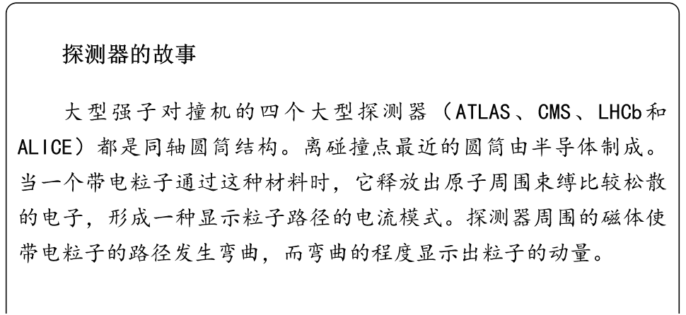

下一层圆筒主要是基于液态氩（在超环面仪器中）或者钨酸铅（紧凑μ子线圈）的探测器。在这些探测器中，由于撞上了密集排列的原子，大多数粒子的运动被阻止，并产生了光子。这些光子可以用来测量每个粒子的能量，从而识别它们。

这些探测器阻止不了μ子，它们要由更外层圆筒中的专用探测器识别和测量。与其他粒子相互作用很弱的中微子根本不会被探测到。人们要将碰撞中产生的所有其他粒子的动量加起来，并观察有没有什么东西得不到解释，才能推断出中微子的存在。

许多同时发生的质子相撞的产物会以接近光速的速度飞离，有待仔细研究的碰撞需要尽快被挑选出来，因为再过25纳秒，便会有另外一群质子在探测器的中心碰撞。

在进入大型强子对撞机的主环之前。质子或者粒子要先经过一系列用来把它们加速到更高能量的机器。

- 第一步
  这一步发生在环上，是排放气质子的电离机，刚送出质子。它们在一个线性加速器中被加速到光速的31.4%。然后进入加速器链。

- 加速环
  这一步把质子加速到光速的91.6%，然后送入位于200米的质子同步加速器。

- 质子同步加速器
  这部分要超过50年的机器把质子加速到光速的99.93%（能量为250亿电子伏特）。

- 超级质子同步加速器
  位于地下40米处的超级质子同步加速器把质子加速到光速的99.9998%能量为4500亿电子伏特。它将质子从顺时针逆时针转两个方向进入大型强子对撞机。

- 大型强子对撞机
  设计用来将质子加速到光速的99.999991%（能量为7万亿电子伏特）质子束在4个实验区域对撞。

欧洲核子研究中心实验室

| 实验 | 科学家人数 | 参与国家 | 重量 | 尺度 | 周长 |
|---|---|---|---|---|---|
| CMS 紧凑μ子线圈 | 超过2000人 | 38个 | 12,500吨 | 21米长、15米高、15米宽 | |
| ALICE 大型强子对撞机实验 | 超过1500人 | 31个 | 1万吨 | 26米长、16米高、16米宽 | |
| ATLAS 环形面探测器 | 超过1900人 | 35个 | 7000吨 | 46米长、25米高、25米宽 | |
| LHCb 大型强子对撞机底夸克实验 | 超过650人 | 14个 | 5600吨 | 21米长、10米高、13米宽 | |
| 大型强子对撞机 | | | | | 27千米 |

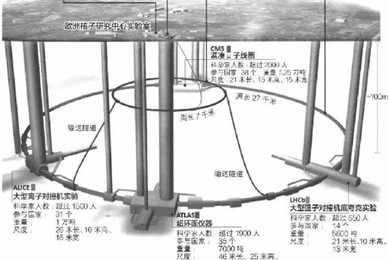

图3.1 大型强子对撞机加速朝相反方向运行的质子（或者铅离子）束，让它们在4个地点迎头相撞，巨大的探测器在那些位置分析碰撞产生的碎屑

## 采访：掌管世界上最大实验的女人

意大利物理学家法比奥拉·吉阿诺蒂于2016年成为欧洲核子研究中心的总干事。2009年，就在她接任超环面仪器负责人之前，《新科学家》杂志采访了她。

### 你为什么决定成为一名粒子物理学家？

我是从与物理几乎没什么关系的领域转行过来的。当我还是个小女孩的时候，我喜欢艺术和音乐。我曾在一所音乐学院刻苦学习钢琴，高中时选择的课程包括文学、古希腊语和拉丁语等语言、哲学和艺术史。我喜欢这些科目，但我也是一个非常好奇的小女孩。我被那些大问题吸引住了。为什么万事万物是这个样子的？回答基本问题的可能性一直吸引着我——我的思想，我的精神，我的一切。所以当我不得不选择自己的人生方向时，我认为物理学可以比哲学更具体地回答这些大问题。我想对了，因为我现在很快乐。

### 你对成为大型强子对撞机粒子物理实验的首位女性负责人有什么想法？

欧洲核子研究中心是一个如此丰富的环境：这里有来自世界各地的人，年轻的学生与著名的科学家还有诺贝尔奖得主一起工作。所以地域、年龄和性别在这里无关紧要。我并不觉得女人领导一个大型科学项目有什么特别的。另外，作为一名在超环面仪器这样的大型实验中获得了一定知名度的女科学家，我希望我可以给那些考虑投身科学事业的年轻女性带去鼓舞。

### 麻烦介绍一下超环面仪器的大小和范围。

有来自169个机构的近3000名物理学家在这里精诚合作。它是迄今为止在粒子对撞机上建造过的最大的探测器。参观它所在的地下洞穴时，人们会立即被它壮观的体积所震撼——它有五层楼那么高。除了规模，它还有着宏大的复杂性。我们需要记录1亿个独立的电信号，以重建质子对撞中产生的数百个粒子。粒子的运动轨迹必须精确到微米级。惊人的规模、复杂性和精确性给我们带来了巨大的技术挑战。超环面仪器和大型强子对撞机的其他探测器都是史无前例的仪器。

### 超环面仪器的主要目标是什么？

超环面仪器将筛查由高能质子碰撞产生的粒子。我们正开始一场奇妙的科学之旅。我们相信，在这样的能量尺度下，新的物理学应该会出现，超越所谓的标准模型（它解释了所有已知的粒子和作用于它们的力）。我们希望找到一些基本问题和谜团的答案，其中许多问题已经困扰了我们几十年。例如，质量的起源是什么？这个问题与希格斯玻色子的存在有关。除了我们已知的四种自然力之外，还有其他自然力吗？还有更多的空间维度吗？宇宙中的暗物质是由什么构成的？

### 你个人希望超环面仪器首先发现什么？

暗物质。如果我们发现了能让宇宙20%的成分得到解释的粒子，我会非常非常高兴。像大型强子对撞机这样的加速器让我们能够研究极致的小——物质的基本成分，这可以让我们了解宇宙的结构和演化，凸显了极致的小和极致的大之间的联系。

### 你有没有想过如果大型强子对撞机没有做出新的物理学发现会怎么样？

这是个好问题，但是很难回答。根据我们从过去几十年的实验和理论工作中学到的，在大型强子对撞机能够提供的能量尺度上，一定会有一些新的东西。也许只有一个希格斯玻色子，或者有一个新的机制扮演同样的角色，但是我们还有着更多的期待。我们知道标准模型并非完整的基本粒子理论，因为它回答不了我们所有的问题。我们预计它将在大型强子对撞机的能量级别上开始失效。那里一定有新的物理学。也许它们不是我们心中所想的答案，但是肯定会有答案。大自然很可能会给我们带来惊喜，这将是最令人兴奋的可能性之一。毕竟，所谓研究，无非就是寻找我们原先不知道的东西。

### 在超环面仪器工作是什么感觉？

大型强子对撞机和超环面仪器之类实验装置的建造是一场史无前例的科学、技术和人文开拓。作为一名科学家，我在欧洲核子研究中心的生活如此特别的原因主要有三点。一是激动人心的物理科研目标。二是，为了解决这些问题，我们必须开发高科技仪器。这些仪器汇集了各个领域的前沿技术，从电子到低温，还能对社会产生附带效益。三是，这些项目是在国际环境下开展的，我们有来自世界各地的物理学家、工程师和技术人员，通过科学把各国联系在一起，打破政治障碍。在我们的项目中，有些人员分别来自历史上的非友好国家。

### 大型强子对撞机和超环面仪器可能揭示一些关于宇宙如何运行的深刻真相。想到这一点时，你有什么感受？

当然是兴奋的感觉，以及意识到我们距离对人类来说非常重要和伟大的东西已经非常近了。基础研究是人类的责任和需要。13世纪的意大利诗人但丁说过，我们的存在不是为了像动物一样活着，而是为了追求美德和知识。对基础研究和知识的追求是我们的需要，这将我们与动物或者蔬菜区分开来。这就像对艺术的需求。研究带来知识，知识带来进步，向来如此。

如果我们在大型强子对撞机上发现一些基本的东西，那就有点像是进入宇宙的中心。在你越来越接近基本原理，接近宇宙从何而来、到何处去这样的基本问题时，你会有一种非常特别的感觉。

## 大发现

2012年7月，大型强子对撞机团队宣布他们终于发现了希格斯玻色子——不过他们并没有直接观察到它。希格斯玻色子是短命的，几乎在瞬间衰变为其他粒子。要推断它的存在，你必须测量那些衰变产物，并证明它们来自希格斯玻色子。

## 希格斯玻色子真的应该叫这个名字吗？

2012年，一个物理会议的组织者要求将希格斯玻色子改称为BEH或者标量玻色子。名字的改变可能看起来很深奥，但这暗示了复杂的过往以及确定这个粒子的发现应该归功于谁的困难。

要想理解这个问题，我们要把时间倒回50多年前。与大多数科学进步一样，这个难题的解决并不是由某个人单枪匹马实现的。1961年，芝加哥大学的南部阳一郎的研究工作引出了这样一个观点：在早期的宇宙中，一个提供质量的场横空出世，而在那之前，宇宙中只充满了无质量的粒子。

1964年8月，比利时布鲁塞尔自由大学的罗伯特·布劳特和弗朗索瓦·恩格勒（布劳特和恩格勒便是BEH中的“B”和“E”）解决了理论中的一些问题，并详细阐述了一种机制。然而首次明确预测了我们现在称为希格斯粒子的，是英国爱丁堡大学的彼得·希格斯——在1964年10月发表的一篇论文中。

这一过程解释了为什么会有人提出“BEH玻色子”选项。但是另一些人倾向于取一个不具名的名字——标量玻色子，或者复杂一点——BEHHGK 玻色子，这个名字含有对迪克·哈根（Dick Hagen）、杰拉尔德·古拉尔尼克和汤姆·基布尔贡献的认可，他们在1964年发表了一篇关于质量传递机制的论文。

还有人指出，粒子的命名似乎都挺将就的。“这跟名字由一个委员会精挑细选的元素不一样。”得克萨斯大学奥斯汀分校的诺贝尔物理学奖得主斯蒂芬·温伯格说。携带弱力的Z玻色子就是他命名的。

幸运的是，关于希格斯粒子，标准模型预测了我们需要知道的一切，不只是精确的质量。对于每一个可能的质量，我们都可以预测大型强子对撞机应该产生多少颗粒子，以及它们将衰变成什么。例如，希格斯粒子有时候应该会衰变为一对高能光子。光子对有许多可能的来源，但是如果我们重点关注那些看起来可能源自希格斯玻色子的，并在直方图上标出它们的合计动量，便会有一颗被称为“隆起”的未知粒子凸显出来——与特定质量相对应的过量事件（见图3.2）。这正是超环面仪器和紧凑μ子线圈在大约1250亿电子伏特的质量上看到，并于2012年7月4日向世界宣布的希格斯玻色子。

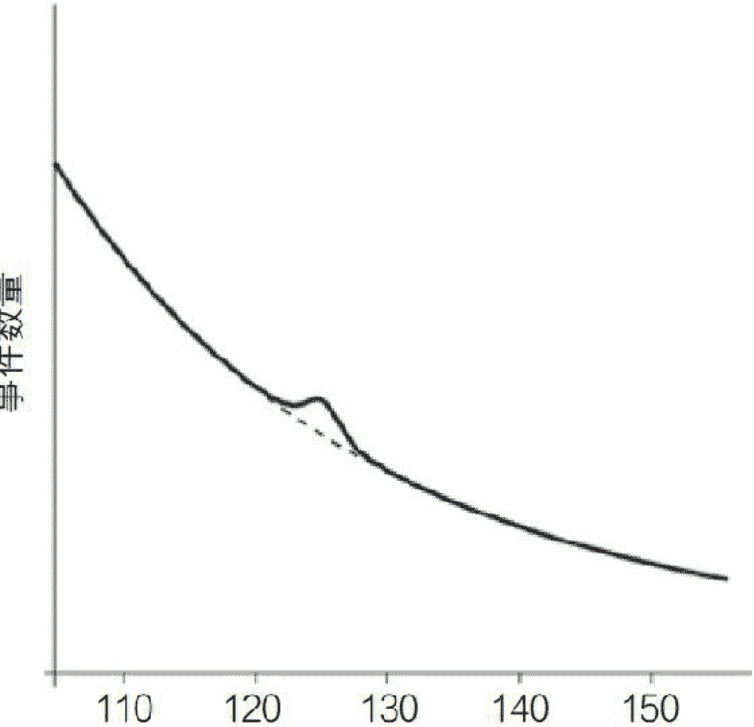

质量 ( 10 亿电子伏特 )
根据光子动量算出

图3.2 通过测量大型强子对撞机中碰撞产生的光子对的动量，揭示出一个可疑的突起——一种新粒子的证据

这并不是唯一的证据。根据预测，希格斯玻色子有时也会衰变为两个Z玻色子，每个Z玻色子进一步衰变为两个轻子。这些轻子的动量加和产生了与光子数据相同质量的峰值。以W玻色子为产物的衰变也能提供证据。W粒子衰变为中微子，而中微子是无法探测到的，所以在这种情况下没有明确的质量突起。不过，我们观察到的W粒子衰变要比预期的希格斯玻色子不存在的情况下多。

## 黑暗希格斯

事实上，新粒子衰变为W玻色子和Z玻色子的速率与标准模型对希格斯粒子的预测大致相同。所以我们掌握的观测数据足以令我们认为它差不多就是希格斯玻色子。但是我们仍然不能确定它是不是标准模型所预测的希格斯粒子，甚或是更有趣的东西。

自2015年大型强子对撞机再次启动以来，它一直在探索这种新粒子的几个特性。虽然我们相当肯定，新粒子会像标准模型对希格斯粒子的预测，衰变为携带力的玻色子，但是对于产物为制造物质的费米子的衰变，我们就不那么肯定了。升级后的大型强子对撞机一直在测量这些产物为底夸克、τ子甚至μ子的希格斯衰变。

最有趣的问题与粒子的质量有关。在标准模型中，希格斯粒子与自身以及周围粒子之间的相互作用似乎意味着它应该有巨大的质量。大型强子对撞机发现的粒子却要小得多。人们可以通过“微调”标准模型来恢复秩序。调整事物，使两个大的数字几乎（但不完全）相互抵消，留下一个小质量的希格斯粒子。许多人对这个修正不满意，认为它让这个理论显得有点不自然。这个问题的一个流行解决方案是超对称性，即通过费米子和玻色子之间的对称性扩展标准模型。超对称性至少会产生5种不同的类希格斯粒子。然而到目前为止，在大型强子对撞机中还没有发现超对称粒子的迹象，造成一些人对这个解决方案产生了怀疑（见第8章）。希格斯粒子较轻的问题仍然是个谜。它甚至可能给我们的宇宙带来灾难（见第7章）。

被认为赋予了其他粒子质量的希格斯玻色子也可能是暗能量的来源。暗能量是一种奇怪的力量，正在导致宇宙越来越快地分崩离析。

当希格斯玻色子被发现时，研究人员希望能在它的行为中观察到一些异常，使他们能够用新的理论替换掉无法解释暗物质等现象的粒子物理学标准模型。到目前为止，它一直都循规蹈矩得令人沮丧，不过也许它的存在本身就提供了通往新物理学的道路。

标准模型的场产生了一定的能量密度。这种能量密度渗透到宇宙中，使宇宙以越来越快的速度膨胀。比起我们通过观测星系相互远离测量到的暗能量的值，这一暗能量密度要大得多。

希格斯粒子如何解决这个难题？与标准模型中的其他场不同，希格斯场是标量场——它的作用没有特定方向。甚至在希格斯粒子被发现之前，位于坦佩的亚利桑那州立大学的物理学家劳伦斯·克劳斯就一直在怀疑，是否存在其他可以与希格斯粒子相互作用的标量场。

克劳斯和拉法耶特路易斯安那大学的詹姆斯·登特设计了一个能够做到这一点的新标量场。标准模型认为，所有基本力的场在极高的能量状态下应该会合并，这意味着存在一个统一的、高能量的场。新标量场的能量密度为0，但它可以利用希格斯粒子连接到这个高能场，在这个过程中获得自身的能量。

精确的量由“跷跷板机制”决定：一个场的能量上升，另一个场的能量便会下降。由于统一场能量如此之大，所以新标量场能量将非常小。克劳斯和登特发现，它正处于适合解释暗能量的量级。

## 采访：“上帝粒子”背后的人

彼得·希格斯是英国爱丁堡大学物理学荣誉教授。1964年，他与布鲁塞尔自由大学的罗伯特·布劳特和弗朗索瓦·恩格勒共同提出了一种新的粒子，可以用来解释其他基本粒子是如何获得质量的。2013年，他与恩格勒共同获得了诺贝尔物理学奖。2012年，他的同名粒子被发现一周后，《新科学家》杂志采访了他。

## 希格斯玻色子被发现的消息有没有让你感到意外？

在这一切发生前一周，我在西西里的一所物理暑期学校。我没有带瑞士法郎，我的旅行保险在我应该飞回爱丁堡的那一天到期了。随着时间的推移，流言开始满天飞，但是直到宣布消息的那个星期六，我们才确切地知道有事情发生。我们接到了欧洲核子研究中心前理论物理负责人约翰·埃利斯打来的电话。他说：“告诉彼得，如果他周三不来欧洲核子研究中心，他很可能会后悔。”我说：“好啊，那就去吧。”

## 你当时感觉如何？

非常兴奋。好消息是在欧洲核子研究中心研讨会的前一天晚上得到最终确认的。我们在约翰·埃利斯家吃晚饭，他开了一瓶香槟。

上周三在研讨会上宣布这一消息时，那显然是一个激动人心的时刻。

在研讨会上，一位记者问我为什么在演讲结束后突然哭了起来。在演讲过程中，我仍然在心理上与这一切保持着距离，但是当研讨会结束时，就像在一场足球比赛中主队获得了胜利。人们纷纷为演讲者起立鼓掌，又是欢呼又是跺脚的。人们的热情仿佛浪涛一般击倒了我。

## 你是怎么庆祝的？

在回伦敦的航班上吹了一罐“伦敦骄傲”麦酒。

48年前，你提出了一种解释质量存在的机制，在那个过程中预测了希格斯玻色子。但是你关于这一课题的第一篇论文遭到了拒绝，你的许多同行一开始都认为你的想法是错的，斯蒂芬·霍金打赌说玻色子不会被发现。你觉得自己被证明了吗？

## 你曾经怀疑过这个粒子的存在吗？

不，没有怀疑过。它对机制的一致性至关重要。作为一种理论演练，你可以把这种粒子移除，但是接下来理论就解释不通了。我对这个机制背后的理论很有信心，因为它的其他重要方面都在一代代对撞机中得到了详细的验证。如果整幅图景剩下的部分不存在，那将是非常令人惊讶的。

人们提出了几种类型的希格斯粒子，分别适配粒子物理学的不同理论。你喜欢哪一种？

我是超对称的拥趸，很大程度上是因为，它似乎是能将引力纳入整套体系的唯一途径。它可能仍然不够，但是它朝着把引力纳入进来的方向。有了超对称性，就会有更多这些粒子。那将是我最喜欢的结果。

你一直不喜欢做科学名人。有没有一种如释重负的感觉，有没有抱着一种也许现在这种关注会逐渐消失的希望？

当然有一点如释重负的感觉。对我来说，过去几天的喧闹才刚刚结束，很难算是已经从中走出来了。我最大的期望，我想，是一些安静的时间。目前来看，这种可能性不大。我的收件箱和门垫里塞满了电子邮件和信件。有人希望我为他们的希格斯棋盘游戏代言，有人希望我去他们的新办公室中庭走道落成典礼做嘉宾。甚至还有一家巴塞罗那的小啤酒厂，想知道我最喜欢喝什么啤酒，这样他们就可以酿造类似的啤酒来纪念我。这太疯狂了。

考虑到你的同行们都在呼吁授予你骑士头衔和诺贝尔奖，现在看来没有迹象表明你会回归平静的生活。你考虑过下一步会发生什么吗？

这个嘛，到了10月份，诺贝尔奖宣布的时候，我可能会患上诺贝尔奖得主谢尔顿·格拉肖所说的“诺贝尔症”。就是心神不宁那种感觉。

在这么多的关注下，你有没有办法用简短的一句话解释希格斯粒子机制？

不，我花了更多的时间告诉人们，物理学家的解释是无稽之谈。我反对的一点是，一个粒子获得质量就像在糖浆里面拽它。（在这个过程中，你会失去能量）问题是，当我试图用我喜欢的方式来解释它时，理解这个解释所需要的18世纪的物理学很多人都还没有掌握。我把它解释为有点像光通过介质时的折射。

我在1964年提出的模型其实就是发明了一种相当奇怪的介质，它从各个方向看起来都是一样的。它产生的折射比光在玻璃或者水里的折射要复杂一点。这是一种波的现象，但是你可以挥挥手并默念爱因斯坦和德布罗意（de Broglie，这两人提出了波粒二象性的观点）的神奇名字，把它翻译成粒子的语言。

因为几个人几乎在同一时间提出了这个机制，这个粒子的命名问题一直是一个雷区。你现在怎么称呼它？

我搞不懂它怎么能继续被称为希格斯玻色子。我认为它只会变成H玻色子。希望在粒子物理学中，人们不会把它和氢混淆起来。我的确有时候还是会叫它希格斯玻色子，那是为了让人们知道我在说什么。我不叫它“上帝粒子”。我希望以后这个名字不会像最近这样被使用得那么频繁。我一直在告诉别人，这是别人的笑话，不是我的。

不过，这个标签让这种粒子听起来很容易理解。

那倒是，然而它的含义就是会误导人。它会导致一些不知道这个称呼来源的人说一些相当愚蠢的话。我听过一些有神学背景的人试图从这个角度来理解它。他们不明白这个名字只是个玩笑，从来就没有被认真对待过。

## 为什么希格斯玻色子经常被称为“上帝粒子”？

把希格斯玻色子称为“上帝粒子”会招致许多物理学家的愤怒。这个词源于诺贝尔奖得主利昂·莱德曼。他在费米实验室的粒子加速器奋力推动对希格斯粒子的搜寻工作，并写了一本书介绍自己的研究。据莱德曼说，他想把它叫作“那个该死的粒子”，然而出版商把“该死的”（goddamn）缩写成了“上帝”（god）。

### 4 夸克的故事

按重量来算，你主要是由夸克和胶子组成的。这些粒子以奇怪而复杂的方式结合在一起，但是我们现在有能力以比从前高得多的精确性计算它们的行为——从而开始回答有关我们自身存在的一些基本问题。

## 与夸克死磕

如果让科学迷说出他们心中的愿望，许多人可能会说：生命、宇宙和一切的答案。要是这一点得不到满足的话，那就来一把功能齐全的光剑吧。这样说来，媒体上很少能见到有可能把这两个心愿都满足的科学领域的报道，就显得很奇怪了。如果我们能真正掌握乏味的质子和中子，我们就能开始解释物质宇宙是如何形成并持续存在的，还能探索令人难以置信的技术，比如新型激光和储能材料。

质子和中子的主要区别是质子带正电荷，而中子是电中性的。但是它们的质量其实也略有差异。中子重9.396亿电子伏特，质子重9.383亿电子伏特。这一差异仅有0.14%，却关系重大。超出的质量意味着中子可以衰变为质子，反之则不然。稳定的质子可以与带负电荷的电子结合，形成稳健的、有结构的、电中性的原子。如果质子更重一些，它们就会衰变为中子，世界就会变成一堆平淡无奇的中子汤。

中子和质子质量差的确切数值也很关键。最简单的原子是氢，它是一个质子加上一个轨道上的电子。氢是在大爆炸中产生的，后来成为第一批恒星的核聚变燃料，其他大部分化学元素都是在恒星核聚变中形成的。除了氢之外，所有的元素都含有中子。如果质子和中子的质量差稍微大一点，聚变就会更困难，因为在原子中加入中子会面临更大的能量障碍。宇宙会被卡在氢那一步。

然而，如果质量差稍微小一点，氢就会在宇宙形成的最初几分钟内聚变成氦，那就不会有什么燃料来驱动像我们的太阳这样的长寿恒星了。如果进一步缩小质量差，氢原子就会崩溃：质子就能吃掉围绕它运行的电子，变成中子，然后吐出中微子。那样就没有原子了。

## 它们是从哪儿来的？

如果质子和中子的质量并非恰好是这些数值，我们就不会存在。

但是质量从何而来的问题却难以回答。我们在半个世纪之前就已经知道，质子和中子——统称为核子——不是基本粒子，而是由称为夸克的更小粒子构成的。夸克有六种类型：上夸克、下夸克、奇夸克、粲夸克、底夸克和顶夸克。质子的组成是上-上-下，而中子是上-下-下。

下夸克比上夸克略重，但是这并不能解释中子质量略大于质子质量：两种夸克的质量都很小。很难说它到底有多小，因为夸克从来没有单独出现过，但是上夸克的质量大约是200万或者300万电子伏特，下夸克的质量可能是它的两倍：这只占了整个质子或者中子质量的极小部分。

像所有的基本粒子一样，夸克通过与无处不在的希格斯场（大型强子对撞机便是将这种场搅扰得足够猛烈才产生了可被探测到的希格斯玻色子）的相互作用获得这些质量。不过要想解释由多个夸克组成的物质的质量，显然还需要别的东西。

为了找到答案，我们必须勇攀量子色动力学的峭壁悬崖。正如粒子具有决定其对电磁力作何反应的电荷一样，夸克携带着三种色荷中的一种。色荷解释了它们经由强核力的相互作用（见第2章）。量子色动力学是用来描述强核力的理论，它极其复杂。

夸克通过交换胶子结合在一起形成质子和中子等物质。胶子没有质量，但是有能量。根据质能转换方程E=mc²，能量对应着等价的质量。另外，胶子的交换还会在每个核子内产生大量短命的夸克-反夸克对——虚介子。

## 量子泡沫

为了理解这种量子泡沫，在过去的40年里，粒子理论物理学家们发明并改进了一种叫作晶格量子色动力学的技巧。差不多就相当于气象学家和气候学家把繁复庞杂的地球大气简化为一个由间距数千米的点构成的三维网格，以实现对它的模拟，晶格量子色动力学把核子内部简化为一个几十飞米（10^-15 米）的模拟时空里的点构成的晶格。夸克位于晶格的顶点，而胶子则沿着边缘传播。通过对所有这些边的相互作用进行汇总，并观察它们随时间逐步演化的方式，你就可以开始构建核子作为一个整体运作方式的图像。

哪怕是少量的晶格点（比如100×100×100，中间间隔1/10飞米），也会产生海量的相互作用，因此晶格量子色动力学模拟需要强大的计算能力。令事情更加复杂的是，量子物理不会给出确定的结果，所以这些模拟必须运行数千次才能得到一个平均答案。

为了弄清质子和中子的质量从何而来，德国伍珀塔尔大学的佐尔坦·福多领导的研究小组利用了两台IBM“蓝色基因”超级计算机和两套集群计算处理器。在2008年，他们最终得到了两个核子的质量都是9.36亿电子伏特，误差为2500万电子伏特。这证实了夸克和胶子之间的相互作用构成了物质的大部分质量。也许你感觉自己很坚实，但实际上99%的你都是结合能（见图4.1）。

## 原子

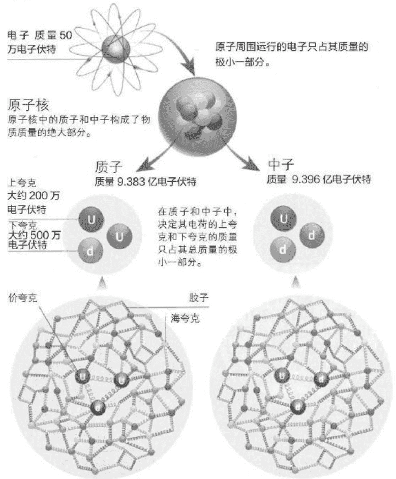

图4.1 物质的质量从哪里来

这些计算的精确度仍然不足以确定质子和中子之间至关重要的质量差异。另外，这个计算忽略了电荷的影响。核子内所有的瞬态夸克和反夸克都是带电的，这给了它们一种自能量，对它们的质量有额外的贡献。

## 狡猾又黏人的胶球

胶球是完全由力构成的粒子。搞不好它们可以用来制造一把正儿八经的光剑。只有一个问题——它们似乎只存在于理论中。理论物理学家们坚持认为胶球一定存在，实验物理学家们却说我们可能永远无法证明它们的存在。

胶球是成团的胶子，胶子在夸克之间传递强核力，令它们结合成原子核内的质子和中子这样的事物。对一个充满胶子的世界的模拟表明，大约15亿电子伏特的能量，也就是一个质子所含能量的1.5倍，就应该足以将大量的胶子粘在一起形成一个胶球。1995年，牛津大学的弗兰克·克洛斯和他的同事、瑞士苏黎世大学的理论物理学家克劳德·阿姆斯勒指出，刚刚在欧洲核子研究中心发现的两个能量分别为13.7亿和15亿电子伏特的粒子可能符合这一标准。后来又有一个能量为17.1亿电子伏特的粒子加入了它们的行列。

但是强力是出了名的难以计算，而且为简单起见，人们在模拟胶球时倾向于假设一个只有大量胶子，没有什么其他东西的世界。在真实的宇宙中，当你测量一个胶球状态的时候，夸克也会开始像袜子上的毛刺一样粘在上面，这样就不可能证明它曾经是一个纯胶球。克洛斯说，那三个有希望的粒子最有可能的解释是被不同数量的夸克污染的胶子团——搞不好我们只能满足于这种模棱两可。

## 理论物理学家最恐怖的噩梦

要想了解质子-中子质量差的微妙根源，需要求解的不仅是量子色动力学方程，还有支配电磁相互作用的量子电动力学方程。试图同时解决这两个问题是理论物理学家们最恐怖的噩梦，但是在2014年，福多和他的同事们开发了一个数学上的变通方法，得出了质子-中子质量差的值。他们得出的数字与实测值相符（尽管仍有相当大的不确定性，约为20%）。

你可能想知道，从已知的第一原理数字出发，我们已经算出了什么。但是除了揭示复杂物质存在的原因之外，这还意味着我们现在可以计算出许多使宇宙运转的东西。以爆炸恒星内部的过程为例。超新星爆炸是第一次给宇宙播下比氢和氦还重的元素的事件。有了结合量子色动力学和量子电动力学的新能力，我们可能会回答诸如什么时候形成了哪些重元素这样的问题。

这一进展也可能有助于解决一些围绕基础物理学的问题。大型强子对撞机在2012年发现了希格斯玻色子，除此之外再无其他发现，留下了许多悬而未决的问题。为什么在大爆炸之后，物质战胜了反物质（见第5章）？为什么质子和电子区别那么大，电荷却呈彼此完美的镜像呢？总的来说，使用量子色动力学进行精确计算的能力可以揭示更多标准模型不能解释实验结果的地方，这可能会为我们指出新的基础物理学的方向。

同样值得记住的是，新技术往往源于对物质运作方式的更深刻理解。一个世纪以前，我们刚刚开始研究原子，计算机和激光等创新便基于这些知识诞生了；然后是对原子核的深入了解，从电站、炸弹到癌症治疗等或正或邪的技术随之而来。

深入研究质子和中子意味着我们现在可能会发现一个更深的矿层。胶子在与色荷的相互作用中要比光子在电磁相互作用中更加活跃，所以摆弄带色荷的粒子产生的能量可能远大于在原子尺度上做文章。麻省理工学院的弗兰克·威尔切克因发展出量子色动力学而获得2004年诺贝尔物理学奖。他曾经推测，强大的新X射线或γ射线源可能会从复杂的核物理学中产生。

与光子不同，胶子也可以与其他胶子相互作用，因此有可能会将彼此限制在一个不断翻滚的能量柱中。威尔切克就此开玩笑地提出，胶子说不定能让《星球大战》里的光剑成为现实。更有可能实现的前景是对能源更加有效地利用和储存。威尔切克说，原子核可以在一个小空间里储存巨大的能量，因此计算精确的核化学可能带来高密度的能量储存技术。尽管前路依然漫漫，但是随着量子色动力学计算准确性的提高，这条路终于打开了。欢迎来到夸克时代。

## 五夸克：一种寻找已久的新物质形式

人们观察到的夸克通常2到3个聚在一处，但是在20世纪60年代，人们预测夸克也可以4到5个成团。一颗四夸克在2013年被发现并得到证实，但是五夸克直到2015年才被发现。

在大型强子对撞机底夸克实验中，通过研究所谓的b重子的衰变，人们观察到了五夸克。这种衰变通常会波澜不惊地一步到位，但是强力的物理性质意味着，有时候在这个过程中会有中间状态。在这样一个不那么波澜不惊的衰变过程中，一个粒子突然出现，其特征与理论上的五夸克一致。从那以后，更多的数据证实了这一发现。

一些物理学家认为，这5个夸克被紧紧地束缚在一个定义明确的粒子中，而另一些人则认为，对它更恰当的描述是一个小分子，由一个两夸克介子和一个三夸克重子组成。由于这种粒子几乎立即衰变，所以它的大小和质量的精确值还需要更多的实验来确定。

## 自旋危机

自1988年以来，质子的内部结构一直困扰着我们，当时欧洲核子研究中心的研究人员发现，他们无法解释质子的自旋。自旋是粒子的一种量子力学性质，类似于绕其自身轴的旋转。不同自旋的粒子对磁场的反应不同，所以测量起来相对容易。比如质子，有一个1/2的自旋。这个自旋肯定以某种方式来自构成质子的组件的自旋，就像质子一个单位的正电荷来自三个内部的价夸克电荷的加和：两个2/3的正电荷和一个1/3的负电荷。

通过用高能μ子将质子击碎，欧洲核子研究中心的欧洲μ子合作项目成功地测量了质子内部夸克的自旋。他们发现，这只能解释大约1/4的预期旋转。随后的实验将这一比例略微提高至30%左右，但也证实了基本结果。

自那以后，这一“自旋危机”成了烦恼之源，因为它意味着我们不了解质子的量子结构。理想情况下，我们可以通过解量子色动力学方程来解除危机，然而质子是由那么多运动着的部件构成的，对于这样的粒子来说，计算将是非常困难的。使用超级计算机模拟质子自旋起源的尝试也在这样的复杂性面前败下阵来。

我们只能做一些杂乱的实验来填补空白。2014年和2015年，布鲁克海文国家实验室使用相对论重离子对撞机进行的实验表明，胶子本身可能携带了质子自旋的很大一部分，大约40%。

质子的一部分自旋可能与夸克和胶子各自的自旋方式关系不大，而更多地与它们如何围绕彼此公转有关。到目前为止，我们对如何测

量这一点只有最模糊的想法。如果真有“万有理论”这样的东西，我们预计它看起来会很像量子色动力学，只是会更难计算。

如果平凡如质子，我们尚不能理解其内部的情况，那么掌握更伟大理论的希望便很渺茫了。

## 重粒子为什么不稳定？

粒子物理学的一个普遍规律是，重的事物容易衰变，释放出更轻的粒子，而且这些衰变产物通常携带很大的动能。中子衰变为质子（加上电子和中微子）。这是基本的物理原理：物体会向势能较低的状态转化，就像一个球从山上滚下来。我们知道，质量是能量的一种形式。一个较轻的质子衰变为较重的中子，就相当于一个球自发地向上滚动。对于给定类型的粒子，质量越大，寿命越短。所以顶夸克、W粒子、Z粒子以及希格斯粒子都是非常短命的。

但是为什么质子没有衰变为其他的轻粒子，比如电子和正电子呢？这是因为粒子物理学的基本对称性。对称性告诉我们哪些物理量是守恒的，是不可改变的（参见第2章里的“为什么宇宙是对称的”）。强力的对称性决定了重子数必须守恒：你不能凭空产生一个质子或者中子，也无法让其消失。就我们目前所知，质子是最轻的重子，所以不存在它可以衰变成的粒子组合，这使得它很稳定（见第10章）。

### 5 反物质

反物质的真实性也许就像科幻小说中的东西一样不同寻常。它们构成了一个完整的阴影粒子世界，然而奇怪的是，宇宙中至少在我们附近这一带，它们却是很罕见的。要做星际飞船的燃料，反物质大概永远不具备可操作性，但是它的爆发力说不定会打破标准模型，并揭示出为什么宇宙中充满了物质。

### 反物质简介

每个带电粒子都有一个与之质量相等但电荷相反的反粒子。质子有带负电荷的反质子，电子有带正电荷的反电子，或者正电子。1928年英国理论物理学家保罗·狄拉克提出的方程式最早揭示了存在反物质的可能性。4年之后，美国实验物理学家卡尔·安德森在宇宙射线中发现了正电子。

许多中性粒子也有反粒子。例如，中子是由带电的夸克组成的。把这些夸克换成与之电荷相反的反夸克，你就得到了一个反中子。中微子没有带电的组件，但是在传统的标准模型中，它们也有反粒子——自旋方向相反，轻子数相反。物质和反物质接触时，它们会相互毁灭，或者叫作湮灭。一个电子和一个正电子转变成两个光子，分别飞向完全相反的方向，每个光子的能量为51.1万电子伏特，与电子（或者正电子）的质量相对应。

### 反物质之父

出生于英国布里斯托尔的保罗·狄拉克（1902——1984）使我们对基本粒子和力的理解迈出了关键的一步。他在1928年列出的方程式预测了反物质——他因此获得了1933年诺贝尔物理学奖，当时年仅31岁。他古怪而笨拙，特别喜欢米老鼠。在许多人看来，他是自艾萨克·牛顿以来英国最伟大的理论物理学家。在伦敦威斯敏斯特大教堂的地板上有一块石头，上面刻着他著名的描述电子量子行为的方程式。

### 反物质在哪里？

若要列出标准模型的不完善之处，有一条肯定会在列表上名列前茅：它预测我们不存在。根据这个理论，大爆炸应该产生了等量的物质和反物质。在宇宙诞生后的一秒钟之内，它们就会彼此湮灭，宇宙应该充满了光，基本别无他物。然而我们却在这里。还有行星、恒星和星系。这一切，就我们所知，都是由物质构成的。

对于这个存在之谜，有两个可能的解释。第一个，物质和反物质的物理性质可能存在一些微妙的差异，这使得物质在早期宇宙中有了剩余。虽然标准模型预测，反物质世界是我们这个世界的完美镜像，实验却已经在镜子上发现了可疑的划痕。1998年，欧洲核子研究中心的实验表明，一种古怪的粒子——K介子转变成它的反粒子的概率略高于相反的转变，因而两者之间产生了微小的失衡。

随后，加利福尼亚和日本的加速器也开展了类似的实验。2001年，他们在K介子较重的表亲——B介子——中发现了一种更明显的不对称性。欧洲核子研究中心的大型强子对撞机底夸克实验现在正使用一台4500吨的探测器来探测数十亿的B介子并探求它们的秘密（见本章后文）。但它也未必能就反物质的去向给出一个定论。迄今为止，人们观察到的效应似乎还太小，不足以解释大规模的不对称。

物质之谜的第二个可能答案是，物质和反物质以某种方式逃脱了彼此致命的掌控。在某个地方，宇宙的某个镜像区域，反物质潜伏着，而且已经合并成了反恒星、反星系，或许还有反生命。

当一块热磁铁冷却时，单个原子可以迫使它们的邻居与磁场对齐，形成指向不同方向的磁域。大爆炸之后，宇宙冷却的过程中，也可能发生过类似的事情。随着时间的推移，这些微小的差异可能会扩展成庞大的独立区域。

这些反物质区域即便存在，也肯定不在附近。在恒星区和反恒星区的边界处发生的湮灭将会产生明确无误的高能γ射线特征。如果整个反星系与一个普通星系相撞，其湮灭的规模将是难以想象的。我们还没有见到过任何这样的迹象，不过宇宙还有好多部分是我们没有观察过的——更别提那些远得我们永远观察不到的区域。

反氢原子或者其他比氢重的反原子将成为这种反宇宙的证据。这将意味着反恒星正在通过核聚变制造反原子，就像普通恒星制造普通原子一样。在国际空间站，一项名为α磁谱仪的实验自2011年以来一直在宇宙射线中搜寻着这些反原子。到目前为止，我们仍然在等待着第一个来自反宇宙的使者。

### 我们能制造出反物质炸弹吗？

人类有朝一日可能会将反物质的毁灭力量用于破坏性目的，这种想法有着可怕的魔力。这是丹·布朗的小说《天使与魔鬼》（*Angels and Demons*，2000年）的核心思想。在这本书中，一颗含有1/4克反物质的炸弹差点毁灭梵蒂冈。

欧洲核子研究中心的物理学家罗尔夫·兰度亚认为，我们不必紧张。有一个很充分的理由可以解释为什么短期内不会发生这样的事情。“如果你把我们在欧洲核子研究中心30多年反物质物理学研究中获得的所有反物质全都积攒在一起，哪怕你非常慷慨，你也能只得到一亿分之一克反物质。”他说，“就算在你指尖爆炸，它也不会比点燃一根火柴更危险。”接受正电子发射计算机断层扫描的病人血液中含有天然的放射性原子，它们会释放出数千万甚至更多的正电子，但不会产生不良影响。

即使物理学家能够制造出足够的反物质来生产可行的炸弹，其成本也将是天文数字。兰度亚估计，1克反物质可能要花费100亿美元。牛津大学的粒子物理学家弗兰克·克洛斯指出，以目前的技术，我们需要100亿年的时间才能收集到足够的反物质来制造丹·布朗的炸弹。

这并不是说我们不能以新的方式利用反物质。几十年来，物理学家已经能够制造出电子偶素——一种由电子和正电子构成的“原子”。2007年，加州大学河滨分校的物理学家戴维·卡西迪和艾伦·米尔斯制造出了第一个包含多个电子偶素原子的分子。电子偶素原子很快就会湮灭成高能的γ射线，所以如果你把足够多的这种原子堆在一起，就有可能让它们同时湮灭并发光——制造出一种强大的γ射线湮灭激光，而在反应堆中引发核聚变将是这种激光的潜在应用之一。

### 大爆炸的小变故：揭开物质存在的奥秘

你家厨房灶台上的香蕉是宇宙中最大奥秘之一的化身，只是有待被剥开。它是由物质粒子组成的，就像你一样，这就是为什么你可以看到、感觉到并品尝它。你看不到的是，每秒大概有15次，它会产生另一种粒子，一种几乎在瞬间就会消失在闪光里的东西。这个东西便是反物质。

反物质构成了一个完整的粒子镜像世界，这些粒子的质量与正常物质的粒子相同，电荷相反。不过这好像是后知之明。在我们这一带，反物质粒子只会产生于高能宇宙射线在大气层中的相互作用中，或者放射性衰变中，比如香蕉里的放射性钾-40的衰变。

从某种意义上说，这并不奇怪，因为反物质和物质一旦相遇就会湮灭，释放出高能光子。但这就留下了一个谜团，那就是物质为什么会如此占优势？

因此，也许是宇宙鸿蒙初开时的某个小小变故导致某些物质存活下来，并制造了所有的东西，从香蕉到黑洞，从海马到恒星。物质和反物质之间十亿分之一的差异就足够了，因为在大爆炸的超热“汤”中，粒子和反粒子会不断被创造和湮灭，让失衡不断加剧。

### 解释物质的主导地位

20世纪60年代，詹姆斯·克罗宁和瓦尔·费奇发现，反K介子的衰变速率与对应的K介子不同。这种现象称为电荷共轭宇称（CP）破缺。这意味着，如果你观察一个粒子反应，然后在镜子里观察由反粒子进行的同一反应，你会看到两个反应的速率略有不同。这类现象也许可以解释为什么物质占优势地位。但不幸的是，迄今为止，我们测量到的效应还太小，不足以解释宇宙中反物质的缺乏。

欧洲核子研究中心的大型强子对撞机底夸克探测器登场了。根据个人品位，这部探测器英文名称缩写（LHCb）中的“b”可以理解为“美”（beauty）或者“底”（bottom）。底夸克比上夸克和下夸克重得多，而且非常不稳定，但是大型强子对撞机的质子对撞有足够的能量产生它们。它们与其他夸克结合形成B介子，而B介子可能是物质获胜的关键。

包括加利福尼亚SLAC国家加速器实验室（SLAC代表Stanford Linear Accelerator Center，斯坦福直线加速器中心）的BaBar和日本高能加速器研究机构实验室的Belle在内的实验表明，当含有底夸克的粒子衰变时，就会发生CP破缺，而且产生的失衡比K介子的更大（见图5.1）。

六种夸克和反夸克总是结合成更大的粒子。

| | 上 | 下 | 奇 | 魅 | 底（美） | 顶（真） |
|---|---|---|---|---|---|---|
| 夸克 | u | d | s | c | b | t |
| 反夸克 | ū | d̄ | s̄ | c̄ | b̄ | t̄ |

大多数情况下，反粒子的衰变方式就像是对应粒子的镜像。

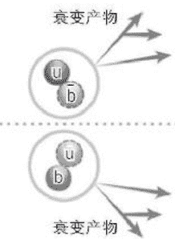

含有底夸克和反底夸克的粒子有时候以不对称的方式衰变。大型强子对撞机底夸克实验的质子对撞创造出大量这样的粒子，使人们得以观察这种“CP破缺”。

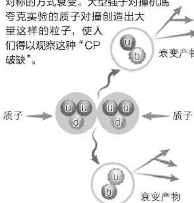

图5.1 含有重夸克及反夸克的粒子衰变方式中微妙的不对称可能蕴含着物质之所以在宇宙中取得优势地位的线索

即便如此，到目前为止，相对于解释物质普遍存在所需要的CP破缺，已知粒子的衰变只占了一万亿分之一。与此同时，希格斯玻色子的发现只会让这个谜题更加难解。它1250亿电子伏特的质量和观测到的衰变率符合粒子物理标准模型的预测。如果它违反了那些预测，那倒是有可能暗示了某种未知粒子的影响，而这种粒子有可能成为另一个CP破缺的来源。

这令焦点又回到了B介子身上。“美工厂”BaBar和Belle令电子和它们的反粒子——正电子——碰撞，其能量在数十亿电子伏特的范围内，只能以可观的数量制造出最轻的B介子。除了轻B介子和B重子外，大型强子对撞机还产生了比这些实验更重的B介子。通过研究最广泛的B粒子衰变途径——它们应该具有不同的CP破缺，我们有可能得出从总体上描述CP破缺的最佳理论。

### 热汤

针对为什么物质会占据主导地位的问题，要想找到任何有意义的答案，我们需要重建能量水平更高的原始汤状态。2015年，对撞机开始以创纪录的14万亿电子伏特能量粉碎粒子。这种更高的能量意味着会有更多的B粒子产生，使人们能够开展更加敏锐的CP破缺研究。

大型强子对撞机底夸克实验的探测器呈锥形或者楔形，碰撞发生在尖端。这大幅降低了它探测希格斯玻色子的灵敏度，因为希格斯玻色子往往以较大的角度出现在它的探测区域之外。然而B介子的探测却正要采用这样的方式，因为它们往往沿着原质子束的方向携带着其动量出现（见图5.1）。大型强子对撞机产生的高能B介子经过底夸克实验探测器时可以留下长达1厘米左右的轨迹（比早期实验中低能介子的轨迹要长），从而可以实施更详细的测量。

2017年1月，大型强子对撞机底夸克实验的科学家报告了重子（质子和中子都属于重子）衰变过程中CP破缺的第一个证据。当时的研究对象是底Λ粒子，它包含一个底夸克。虽然标准模型预测了底Λ粒子一定程度的CP破缺，但是如果能够分析大型强子对撞机得出的更多数据，人们将可以揭示这种衰变中的CP破缺是否与预期有出入。如果它不符合标准模型，那就意味着我们将有新的物理学发现，而且这种发现将涉及为什么物质比反物质多这一基本问题。

大型强子对撞机升级之前的数据显示，在B介子衰变为一个K介子和两个μ子这一罕见的过程中，标准模型的预测出现了偏差。从那时起，随着底夸克实验得到的结果变得更加精确，它们与理论模型的差异也越来越大。然而，理论预测本身也面临着挑战，粒子物理学界并不认为它是完全可靠的。

此外，在两种衰变之间也有不平衡的迹象——一种是B介子衰变为一个K介子、一个电子和一个正电子，另一种是B介子衰变为一个K介子和两个μ子。然而，证据仍旧不足以说明，是某些未知的物理原理导致了这种异常，还是它能有助于解释物质之谜。

另一个焦点是由反底夸克和奇夸克组成的奇B介子的衰变。它可以自发地转变成它的反粒子（底夸克加上反奇夸克），观察反向过程是否以同样的方式发生，成了研究CP破缺的另一途径。另外，每10亿次中有3次它会衰变为一个μ子和一个反μ子。这种衰变可能很少见，但它的最终状态很容易被观察到，因为μ子会在探测器上留下一条直达最外层的轨迹。来自英国利物浦大学、参与大型强子对撞机底夸克实验的塔拉·席尔兹认为，这使得它成为一个寻找新物理学的“黄金通道”。

在这里，人们感兴趣的可能不仅仅是CP破缺，还有超对称性等理论预测的现象的蛛丝马迹。这些理论假设存在着新的大质量粒子。罕见的B介子衰变应该格外容易受到未知大质量粒子的影响，这也许给了大型强子对撞机底夸克实验一种不直接探测到便证明其存在的巧妙手段。任何与B介子的预期衰变率有差距的实验结果都有可能意味着隐藏的粒子参与其中。

奇B介子衰变太罕见了，时至今日，只有很少的实例在实验中被观察到，而且到目前为止，它的行为并没有给标准模型带来彻底的变革，大型强子对撞机产生的其他B介子也没有。不过，利用改进过的粒子加速器对B粒子开展更多的观察，可能会带来改变。

### 企鹅的线索

在寻找物质和反物质之间差异的过程中，一种反常现象可能最终会令我们有所收获。较重的B介子衰变为τ粒子的频率比标准模型预测的要高。这种衰变被称为企鹅过程，这是因为当物理学家用费曼图描绘其过程时，他们最终得到的东西看起来像只企鹅。

不平衡的企鹅现在已经在三个不同的实验中出现过，包括大型强子对撞机底夸克实验。在该实验的数据中，B介子衰变产生的μ子的能量和轨迹也一直是异常的。这些异常现象可能预示着物理学即将有新的发展。或许B介子在进一步衰变为μ子之前，会先衰变为尚未被探测到的粒子，从而扰乱了它们的最终分布？理论物理学家们推测，罪魁祸首可能是轻夸克——一种轻子和夸克型粒子的混合体——或者是一种新的希格斯玻色子。

尽管这些观察到的不平衡很小，但它们可能会引出后续的一条研究路径。在更高的能量下，类似的企鹅过程可能会导致更大的不平衡。

### 反引力：反物质会跌向上方吗？

如果你拿起一块反物质再放开它，让它自由地穿过“充满敌意”的物质世界，它有没有可能会神奇地浮起来呢？很少有物理学家敢给出断言。如果不做实验，我们根本无从知晓。

对反引力的质疑可以追溯到20世纪50年代，当时物理学家赫尔曼·邦迪正在思考广义相对论的含义。爱因斯坦提出的这个理论解释了引力如何在宇宙结构被扭曲时产生。引力是一种奇怪的力，尤其是考虑到它只有一个作用方向。比如说，在电磁学中，有正负两种电荷，相互之间或吸引或排斥。然而到了引力这里，只有总是相互吸引的正质量。

邦迪向世人展示了，若非如此，世界将会是多么奇怪。他证明了负质量最终会以越来越快的速度穿越宇宙，追求正质量。德国法兰克福高等研究所的萨比娜·霍森菲尔德说，这种夸张的运动似乎并不存在，不过我们下结论时应该谨慎。说不定我们需要修正广义相对论，而不是抛弃负质量。

质量有两种类型：引力质量决定一个物体会受到多么强的引力，而惯性质量决定了一个物体对加速度有多大的抵抗。许多实验表明，这两个质量总是具有相同的值——这是一个神秘的等价。爱因斯坦对引力的描述，也就是广义相对论，便是围绕着它展开的。然而所有这些实验都只涉及正常物质。反物质是否能够形成一个具有正常惯性质量但是引力质量为负值的物体，从而打破等效原理呢？

### 宇宙的另一个角落

在世界各地的一些实验室里，对负质量的追寻仍在继续。反物质是一个很有希望的追寻方向。它和普通物质差不多，只不过电荷和其他一些量子性质相反。这并不意味着它也应该具有相反的质量，但是如果它确实具有，倒有可能有助于解释另一个谜：反物质都去了哪里。排斥性的引力相互作用可能会把物质和反物质从此身边驱离，因此在早期的宇宙中，它们永远不会有机会湮灭。从那时起，宇宙的持续膨胀将会把这两者推得更远——反物质说不定已经在宇宙的其他角落创造出了自己的星系。

让物质从地球表面悬浮起来，其中蕴含的技术可能性引得美国空军也插了一脚。多年来，他们已经为反物质研究人员提供了数以百万计的资金。不幸的是，开展这方面的实验是一项相当艰巨的任务。首先，你需要为反物质搭建一个几乎完全不含正常物质的家。这就要制造出地球上最空的盒子，每升容积只含有几百个气体分子。然后，为了防止反物质撞击盒子的侧面并立即湮灭，你必须把它冷却到绝对零度以上几开氏度以内，然后用电磁场捕捉它。

在欧洲核子研究中心巨大的反物质减速大厅里，有六项实验正在争先恐后地测量反物质基本性质。下面，来自欧洲核子研究中心质子同步加速器的粒子束撞击到一块金属上，产生了大量的粒子。一个磁体系统挑出其中的反质子，将它们送入一个由更多磁体组成的环中。在反质子被减速以便捕获的过程中，这些磁体将使它们保持在轨道上。

### 接近一致

自20世纪90年代以来，这里一直有实验在研究反物质和物质粒子是否真的像我们认为的那样接近。2015年，通过测量反质子在被称为彭宁阱的磁性封闭体中如何旋转，重子反重子对称实验对它们的惯性质量与电荷之比给出了迄今为止最精确的测量。结果表明，这个比值与质子的一致，误差在万亿分之六十九以内，比之前的最佳值精确4倍。

2016年11月，邻近的低速反质子原子光谱和碰撞实验对反质子的惯性质量进行了迄今为止最精确的测量，没有找到与质子的质量有什么差异。

但是在引力效应这方面，质量是正的还是负的呢？这个问题将实验带到一个新的细节层面。引力太弱了，很容易被电磁力掩盖，所以用磁场控制反质子这样的带电粒子来做实验的想法就不可行了。你可以尝试让反质子就位，然后关掉磁体，看看它朝哪个方向下落，然而反质子与周围环境的静电相互作用会盖过它可能感受到的任何引力，别管方向如何。

更好的选择是反物质的中性原子，比如反氢原子（参见后文的“反元素”）。它们之间的静电相互作用还不足以抵消引力，但是很强的磁场仍然能够将它们保持在一定的位置。欧洲核子研究中心的反氢原子激光物理仪器实验会定期捕获并保存成束的反氢原子约15分钟。

2013年，该实验团队发表了一份原理测量的证明。这次测量中，研究人员短暂地收集了434个反原子构成的云，关闭磁体并根据它们湮灭的位置跟踪它们的后续运动。这是一个粗略的测试，没有得出结论——无论反粒子的引力质量是正还是负，都符合最终结果。必要的准确性并不容易达到，因为实验使用的反原子比较热，所以会震动，这

就给问题蒙上了一层阴影。不过反原子足够多的话，还是应该会有助于我们回答核心问题。

欧洲核子研究中心的另一项实验——反物质引力、干涉成像、光谱学实验也计划在几年内进行测试。芝加哥伊利诺斯理工学院的丹尼尔·卡普兰正计划用电子较重的亲戚——μ子进行实验，而由伦敦大学学院的戴维·卡西迪领导的研究小组正计划使用电子偶素。

回到欧洲核子研究中心，一项名为“静止状态反物质引力行为”的实验旨在用一个反氢离子（一个反质子和两个正电子的组合）来解决这个问题。理论上，用磁场把这个带电微粒固定在适当的位置并用激光冷却它应该是很容易的。接下来的想法是用另一束激光打掉一个正电子，使反原子恢复电中性。这个时候，它将不再感觉诱捕场的影响，开始跌落——向上或者向下。实验负责人帕特里斯·佩雷斯表示，他们希望测量的灵敏度足以探测到正常物质所感受到的哪怕只有1%的引力偏差。

实验人员并不指望反物质会向上跌落，但是只要它跌落的方式稍有异样，就会非常有趣。那可能表明存在着某种能够改变引力的力量，其作用放过了正常物质，却没有放过反物质。如果引力子——一种假想中的量子粒子，负责携带引力——有一个微小的质量，而不是通常认为的无质量，便有可能产生类似的引力修正效应。

## 反元素

欧洲核子研究中心的两项实验，反氢陷阱和反氢原子激光物理仪器实验，已经在制造反氢原子——可能存在的最简单的反原子，仅仅由一个反质子和一个正电子结合在一起。他们的目标是产生足够多的反氢原子，并将其保存足够长的时间，以便将其发出的光谱与普通氢的光谱进行比较。哪怕两者之间仅仅存在细微差别，标准模型也会遭到动摇，因为标准模型预测两者应该完全相同。

2016年，经过制造并持有14个反氢原子，杰弗里·汉斯特及其同事在反氢原子激光物理仪器实验合作项目中首次观测到反物质谱线。他们发现，反氢原子光谱中能量最低的光子确实具有与氢原子相同的波长。

我们能否指望物理学家们制造出更复杂的反物质——反氦，乃至由反碳原子和整个反元素周期表构成的有机反物质呢？问题在于，在构建反原子的过程中，组成它的亚原子反粒子只能一个一个地制造。如果你想制造反氦——和反氢差不多，但是多一个反中子——你首先要制造反中子。反中子是中性的，因此不可能采用传统的方式，利用电磁场来控制其方位，于是你只能制造大量的反中子，并希望每制造100万个左右的反中子，就能有一个出现在正确的地方，刚好拼凑出一个反氚原子。

虽然还没有人解决这个问题，但是欧洲核子研究中心的一项实验使用了一种简洁的方法来制造反氢原子以外的东西。低速反质子原子光谱和碰撞实验创造了反质子氦原子，其中一个绕氦核运行的电子被反质子取代（见图5.2）。通过研究这种物质/反物质复合原子发出的光谱，反质子的电学和磁性能会被精确地测量出来，并与普通质子的电学和磁性能进行比较。

图5.2 反工程的物理学家们已经制造出了镜像的氢、被称为电子偶素的电子——正电子对和含一枚反物质的氦原子

### 6 与世无争的小家伙

中微子是最难以捉摸的物质。这些幽灵般的粒子可以径直穿透地球而几乎不受阻碍。中微子是标准模型的一部分，然而它们的变味能力却暗示了，有些事情已经远非标准模型所能概括。

### 中微子到底是什么？

中微子呈电中性，质量接近于0，是最隐蔽的粒子。它们与普通物质几乎不发生作用，正以每秒数万亿颗的频率穿过我们的身体、建筑物和地球。1930年，奥地利出生的物理学家沃尔夫冈·泡利首次预言了中微子的存在。他在1945年因这项研究获得了诺贝尔奖。好几种核反应都会产生中微子，包括作为太阳能量来源的聚变、被人类用来制造武器或者获取能量的裂变，以及地球内部的天然放射性衰变。

我们怎么知道它们的存在呢？狡猾的中微子通常避免与物质接触，不过偶尔也会撞上原子，产生一种令我们能够观察到它们的信号。弗雷德里克·瑞恩斯在1956年第一次发现了它们，为自己赢得了1995年的诺贝尔奖。实验中最常见的做法是使用大量的水或者油。当中微子与这些液体分子的电子或者原子核相互作用时，它们会发出传感器可以探测到的闪光。

在那些深藏地下以躲避外来粒子干扰的探测器身上，人们投入了大量的资金和极端的工程技术。例如，乳胶追踪设备震荡项目被建造在了意大利的格兰萨索山脉内部。这个方案行得通是因为中微子能够径直穿过岩石。还有一些项目把探测器指向下方，以整个地球为屏障。其中，中微子望远镜和深渊环境研究项目的探测器被埋在地中海下面，另一个名为“冰立方”的则被埋在南极冰层下面。

中微子鬼鬼祟祟的性情掩盖了它们潜在的重要性。就拿额外的维度来说吧，大多数粒子有两个变体：顺时针自旋的和逆时针自旋的。中微子是唯一似乎只能逆时针自旋的粒子。一些理论物理学家认为这证明了额外维度的存在，而“缺失的”右旋中微子就藏在额外维度中。

就像带电的轻子一样，中微子也有三种味：电中微子、μ子和 τ子。但是，与带电的轻子和我们所知的其他粒子不同的是，它们可以从一种味转变成另一种味。

### 中微子：下一个重大的小东西？

“为王者，心神难安。” 莎士比亚如是写道。如今，这句话也适用于粒子物理学的标准模型——我们对物质的构件及其相互作用最成功的描述。希格斯玻色子的发现是该理论的最高成就，它证实了近40年前的预测，填补了该模型最后一个重大空白。然而，我们一如既往地渴望把它赶下宝座，去发现必然会取代它的新物理学。

中微子现在能引导我们达到这个目标吗？标准模型威力强大，但还是留下了许多未解之谜——比如暗物质的性质——我们认为这种看不见的神秘物质构成了宇宙总质量的80%以上。还有被认为导致了宇宙加速膨胀的暗能量。量子物理学把暗能量的量级高估了10^120倍，这肯定是我们有史以来最糟糕的预测。标准模型无法解释物质如何在大爆炸中逃过了与反物质湮灭的命运，也无法将引力纳入其中。它充满了自由参数——那些令人头疼的数字都是人们主观决定的，只能手工输入理论中，例如为每一个力设定的强度。

研究人员曾希望希格斯玻色子能带来新物理学，从而让这些问题得到解答。然而截至目前，希格斯粒子的表现基本上与预期一致，因此，真正通往超越标准模型王国的关键可能在于中微子——一种不同的粒子。影影绰绰、神神秘秘、不走寻常路的中微子很少屈尊与它们周围的普通物质世界相互作用，因此我们对它们的许多了解都在标准模型之外。

### 微小的质量

我们知道的三个中微子与电子及其两个较重的同类——μ子和 τ子——配对。此外，还存在三种反中微子，它们与电子、μ子和 τ子带正电的反粒子一起构成了扩展的轻子家族（见图2.2）。从一开始，标准模型就错误地假设中微子没有质量。但是我们现在知道，它们确实具有质量——尽管很小——这就是为什么它们具有从一种类型转变成另一种类型的神秘能力。许多新理论希望填补这一理解上的空白，包括旨在统一所有自然力（除了引力）的大一统理论，以及超对称性和弦理论。

中微子有着冷漠的本性，但是作为解决问题的粒子却有着悠久的历史。1930年，为了维持放射性β衰变中能量和动量的守恒，物理学家沃尔夫冈·泡利构想出了它们。从那时起，它们就完美地融入了标准模型井然有序的粒子图像。

但是到了1998年，日本超级神冈实验的结果中，标准模型对中微子的描述出现了漏洞。中微子带着电子、μ子或者 τ子的味被发射或者吸收，就像一勺冰淇淋。超级神冈研究了宇宙射线撞击大气层时产生的μ中微子，发现其中一些在穿越地球的过程中变成了电中微子。

之前人们就发现过这种在不同味之间转换的迹象，但这个实验提供了明显的证据。从那时起，研究核反应堆、粒子加速器和太阳内部核衰变过程产生的中微子的实验证实，不管一开始怎样，中微子会在它们的旅途中在三种味之间切换。要让这样的切换得以发生，中微子必须具备一定的质量。

### 味的传播

这是一个非常量子的现象。在量子力学中，一个粒子可以处于多种状态的叠加状态——而对于中微子来说，一种明确的味态是三种不同明确质量态的混合。这三种质量态都以略低于光速的速度运动，彼此稍有差异，正是它们的精确排列决定了中微子被观测到的味。因此，这三种中微子的味以一种不断变化的混合态在空间中传播。

一些大一统理论预测中微子具备质量。如果确定了准确的质量，理论物理学家就能知道该推进哪个理论了。

要想测量一枚可以穿行厚达一光年的铅块而不会受到任何阻碍的粒子的质量，可谓说起来容易做起来难，不过测量放射性β衰变是一种方法。在典型的β衰变中，原子核内的中子变成质子，同时释放出一个电子和一个反电子中微子。理论上，反电子中微子的质量可以通过与之相伴的电子的能量和动量推断出来。中微子太轻了，之前人们一直无法满足测量所需的灵敏度，不过在德国卡尔斯鲁厄理工学院，人们正在开展的卡尔斯鲁厄氚中微子实验或许具备了足够的灵敏度。

与此同时，对中微子质量最严格的限制来自宇宙，因为这些粒子影响着大爆炸和超新星爆发产生的元素类型及含量、宇宙的膨胀率、宇宙微波背景，以及物质合并成星系和星系团的方式。结合最新的宇宙学测量，包括来自普朗克空间天文台对宇宙微波背景的观测，人们发现三个中微子质量之和不可能超过0.13电子伏特——不到电子的百万分之一。

由于中微子的味不断变化，很难把这个总和分解成三种中微子的质量。研究人员正在逐步改进他们对中微子质量和决定了中微子味的混合质量状态的测量。

任何解释中微子质量的理论都必须解释为什么它的质量跟其他粒子比起来小得几乎可以忽略不计。一种理论认为，这三种已知的中微子可能被一个或者多个只能感受到引力的“惰性”中微子遮蔽。通过一种名为跷跷板机制的过程，这些看不见的重中微子压制了人们检测到的中微子的质量。

这一切都使得这些轻若鸿毛、“不善交际”的变味粒子更加神秘。它们对我们有所隐瞒，但是到底隐瞒了什么，以及我们将从中得到超越标准模型的物理学的什么信息，仍然有待我们去发现。

### 神奇超光速中微子的消失

2011年9月，探测 τ中微子的乳胶追踪设备震荡合作项目震惊了世界。它宣布，中微子从瑞士的欧洲核子研究中心到意大利格兰萨索山脉地下探测器的速度超过了光速。这一壮举违背了爱因斯坦的相对论，打开了通往物理学未知境界的大门。

但是在接下来的几个月里，人们排查出两个错误——一个是没插结实的光纤，一个是出了故障的时钟，排查的结果是中微子的速度慢了下来。我们现在知道中微子接近光速传播。时任欧洲核子研究中心研究主任的塞尔吉奥·贝托鲁奇说：“虽然这一结果不像一些人希望的那样令人兴奋，但它是我们所有人都在内心深处期待的结果。”

### 变反物质为物质

对最罕见事件的追寻可以揭示为什么物质主宰宇宙——如果我们能发现每100亿亿亿年才发生一次的事情的话。你可以一直等待、观察，说不定直到天荒地老也看不到它的发生。然而，成千上万的物理学家正在投身于追寻这个极其罕见过程。这是放射性衰变的一种形式，一旦被发现，就能揭示宇宙中还能有物质存在的原因。

放射性衰变是大自然的炼金术。它能够将某些较重的元素转化为较轻的元素，但它有自己的运行时间表——有些元素的寿命只有几分钟，有些则长达数千年。这些放射性过程对我们的生存至关重要，例如β衰变参与了为太阳提供能量。最常见的β衰变类型是，原子核中的中子转化为质子，在这个过程中抛出电子和反中微子（中微子的反物质伙伴）。

1935年，物理学家预测某些原子核可能同时经历两次这样的衰变。在一个给定原子核中，这种已知最罕见的核衰变形式可能要每10^19年到10^24年才会发生一次。然而，持续观察一个足够大的原子群体，你就能增加自己见证一次这种衰变的机会。事实上，我们现在已经在11个不同的重原子核中观察到了它。

即便这些衰变很罕见，也赶不上研究人员目前正在寻找的。在无中微子双β衰变中，两个中子转化为两个质子和两个电子——根本不产生反中微子（见图6.1）。

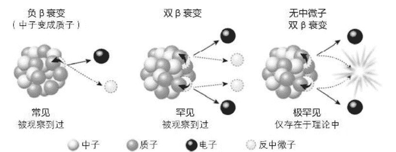

图6.1 人们认为所有的放射性β衰变都应该产生某种类型的中微子。不过，如果中微子的反粒子就是它自己，那么每100亿亿亿次衰变中，会有一次根本不产生中微子

要想实现这种消失的戏法，需要某种非凡的事情发生。这两个反中微子需要事实上相互抵消，就像粒子和它们的反粒子在接触时相互湮灭一样。然而，如果要使这两个相同的粒子彼此湮灭，中微子和它们的反粒子必须是同一粒子——它们必须同时是物质和反物质。

### 野外发现

尽管早在1956年人们就在自然界发现了中微子，但是它们仍有很多方面不为我们所了解。部分问题在于，它们对宇宙中其他一切事物的关注极少——每秒钟有数十亿颗来自太阳的中微子穿过你的身体，它们还能够穿入厚达1光年的铅块，毫发无损地出现在另一边。即使是中微子是否有质量这种看起来很简单的问题，也是到了21世纪初才得到解决。这个结果被认为意义重大，因此研究者赢得了2015年的诺贝尔物理学奖。然而我们仍然不知道为什么它们的质量这么小。

1937年，意大利物理学家埃托雷·马约拉纳预测，带质量的中微子将具有一个有趣的性质。作为物质中唯一不带电荷的基本粒子，从理论上讲，它们有可能成为自己的反粒子。对于这种“马约拉纳中微子”来说，物质和反物质之间的区别已经过时了。凭借它们参与的反应中的些许CP破缺，这种额外的自由让更多的物质逃脱了大爆炸中的湮灭。

发现无中微子双β衰变可以解释我们从何而来，并给出物理学理论应该走向何方的线索。但是，在50多年的探索中，只有一次假定的无中微子双β衰变实例被观察到。那次结果是在2001年由意大利格兰萨索实验室报告的，它被通俗地称为克拉普多-克莱因罗斯衰变，以海德堡大学研究员汉斯·克拉普多-克莱因罗斯的名字命名。他维护其准确性超过10年。大多数物理学家仍然没有信服，不过这个结果吸引了所有对衰变感兴趣的人。

为了确认或者排除克拉普多-克莱因罗斯事件的可能性，人们开展了大量研究活动，并在格兰萨索、新墨西哥州和日本安排了实验。自2015年以来，他们似乎已经完全证伪了那个事件，因为如果它是真实的话，他们应该看到更多。

### 我们能用中微子束交流吗？

我们可以而且已经做到了。第一条由中微子承载的信息是在2012年传送的。当时，伊利诺伊州巴达维亚费米实验室的一个团队利用主注入器中微子束向1000米外的MINERvA探测器发射了包含数万亿枚中微子的脉冲。研究小组用标准的二进制通信码编码了“中微子”这个词。因为中微子很难被探测到，发送端反复传送了142分钟才让另一端接收到了清晰的信息。

中微子很少与其他形式的物质相互作用，所以它们能畅通无阻地穿过大多数物体——甚至包括地心。这给了它们成为信使的潜在用途，也许可以用来与隐藏的潜艇交流。即便是带宽非常低的系统也可能用于交换加密密钥。

### 漫长的等待

这些更大的实验也令我们掌握了更加精确的衰变寿命测量结果，将等待单个原子核通过无中微子双β衰变解体的最短时间延长到10^25年。

现在，至少有8个新的或者改进的实验正在寻找这个过程，这些探测器也许拥有足够的规模和灵敏度来实现这个目标（见图6.2）。它们的运作方式大致相同：在地下深处聚集大量极其纯净的同位素，在那里它可以免受宇宙粒子的轰击，而这种轰击可能会使探测结果陷于大量“杂音”之中。然后，耐心等待。依靠大数定律，衰变终究会发生。

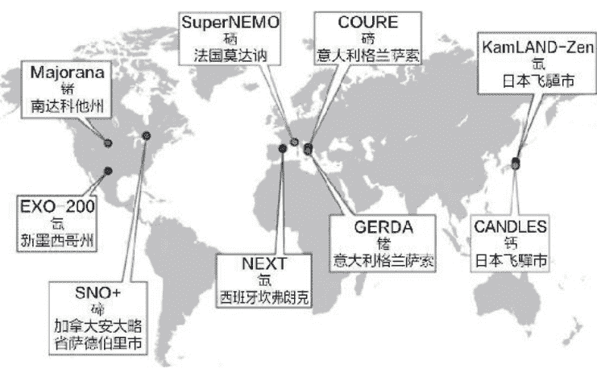

图6.2 探测无中微子双β衰变需要将大量合适的放射性物质深埋地下，等待这种衰变的发生。全世界有很多实验正在进行中，使用的同位素不尽相同

目前，只有少数的同位素灵敏及丰富程度可用于这种规模的实验。每一种都有其优点，但是现在所有的目光都集中在锗上。这种金属紧密的晶体结构令研究人员得以使用一种更紧凑的仪器来非常精确地测量两个发射电子的能量，从而更容易从背景事件中分辨出真正的衰变。锗探测器阵列实验使用了40千克的锗。该实验是格兰萨索实验室的项目，也促成了克拉普多-克莱因罗斯衰变的出局。它的主要竞争对手，位于南达科他州铅镇地下深处一个旧金矿里的马约拉纳演示器，一直在用一个44千克的设备记录数据。

然而，根据我们对衰变寿命最乐观的估计，我们至少需要1吨的探测材料才能确保得到信号。这已经接近单个实验所能提供的极限，意味着研究人员需要合并资源。马约拉纳和锗探测器阵列的研究人员已经讨论过合作建立第一个使用1吨以上优化同位素的实验。这需要至少10吨可以提纯的锗原料——占全球年供应量的近10%。如果没有用于此类研究，这些原料将流向科技公司，用于制造速度更快的电脑芯片。

### 未被发现的粒子？

即便物理学家观察到这样的衰变，这也不足以证明马约拉纳中微子就是背后的原因。也有可能在某种更复杂的机制中，某种尚未被发现的粒子扮演了中微子的角色，导致了这种罕见的衰变。区分这些机制并非易事，不过物理学家们的装备库很快又会有新的实验扩充进来——包括德国的卡尔斯鲁厄流中微子实验，其目标是一劳永逸地确定三种基本中微子的质量，还有美国的地下深层中微子实验，其目标是确定质量与味的对应关系。如果无中微子双β衰变确实是由马约拉纳中微子引起的，物理学家可以利用这些实验得出的数据计算这一过程的寿命。然后，他们可以查看结果是否与直接探测的结果匹配。

如果不匹配，那就意味着有其他原因导致无中微子双β衰变。欧洲核子研究中心的大型强子对撞机目前正在直接探寻的一系列理论，包括超对称性的某些变体，都预测出了这种机制。然而，往往最简单的解决方案才是最好的，物理学中尤其如此——马约拉纳中微子的另一项优势是，它们可以解决为什么中微子如此轻这一棘手问题。

大多数基本粒子的质量都是通过希格斯场得到的。希格斯场是一个遍布宇宙的场，2012年希格斯玻色子的发现证明了它的存在。但是，这些质量极小的中微子几乎不与希格斯场相互作用。这使得一些物理学家相信，一定还有其他产生质量的机制在起作用。

### 又轻又懒的中微子

其中最受欢迎的是跷跷板机制。在这种机制中，质量远超任何其他基本粒子的较重惰性中微子降低了它们较轻的同类粒子的质量。

惰性中微子在宇宙的最初时刻就会衰变，只留下较轻的变种。这在数学上是一个优雅的解决方案，大多数大一统理论都能预测到它——但只有在中微子是马约拉纳粒子的情况下，它才会有效。换句话说，不允许另外有一个不同的反中微子。

惰性中微子也在遭受着实验的围攻。南极冰立方中微子探测器的结果排除了惰性中微子在一定质量范围内存在的可能性，尽管较重的中微子仍然可能存在。

不管下一代探测器的结果将会支持马约拉纳中微子的存在抑或相反，它们都将使我们更近一步地理解中微子所涉及的怪异而奇妙的过程。希望我们不要等到宇宙的大限之日才发现它。

### 中微子暗示了为什么反物质没有炸毁宇宙

两项旨在研究中微子行为的实验可能会提示我们，为什么在早期宇宙中物质会打败反物质。

日本的 T2K（意为“东海到神风”）实验观察了粒子在东海（日本地名）的日本质子加速器研究复合体和295千米外超级神冈中微子探测器之间运动时，在电中微子、μ中微子和 τ中微子之间的振荡。2013年，研究小组宣布，他们发现，当μ中微子到达超级神冈时，它已经变成了电中微子。然后，他们用反中微子进行实验，看看普通粒子和反物质粒子的振荡方式是否存在差异。2016年7月，加拿大多伦多大学的田中裕久发表报告称，反物质的版本似乎不太容易改变：变成反电中微子的反μ中微子数量减少了。

就其本身而言，T2K 的结果并没有很强的统计意义，但是它得到了“主注入器中微子”相似实验结果的支持，“主注入器中微子”是一个在伊利诺伊州和明尼苏达州之间发送中微子的实验。如果结果得到证实，这种不平衡也许就物质何以在137亿年前取得胜利的问题给予我们提示。

## 世界上最强大的中微子探测器

为了研究难以捉摸的中微子，人们投入了一些重量级的技术——在日本、加拿大、美国、德国和中国。

- 日本超级神冈探测器

中微子很少与物质相互作用，因此需要大规模的实验才能发现它们。日本超级神冈实验的核心是一个巨大的不锈钢水箱，直径39米，装满了5万吨纯净水。在中微子与水相互作用的罕见情况下，它会产生带电粒子，然后产生闪光。水箱周围有超过1.3万个灵敏的光探测器监视着这些闪光。超级神冈表明中微子在传播过程中会从一种类型转变成其他类型，就像草莓奶昔转变成巧克力或者香草奶昔一样。

- 加拿大萨德伯里中微子监测所

该设施位于加拿大安大略省一个镍矿地下2千米处，像超级神冈一样，深埋地下使它不会受到宇宙射线的干扰。在2006年关闭实验之前，它的容器内装满了1000吨的重水，并以和超级神冈差不多的方式发现了中微子。萨德伯里中微子监测所的专长是发现来自太阳的中微子。该实验的负责人阿瑟·麦克唐纳因发现中微子具有质量而荣获2015年诺贝尔物理学奖。

- 美国液体闪烁中微子探测器

液体闪烁中微子探测器为中微子物理学带来了最令人困惑的结果。这项实验在新墨西哥州的洛斯阿拉莫斯国家实验室一直进行到1998年。它的研究对象是在粒子碰撞中产生的中微子，寻找它们在三种类型之间来回转换的现象。然而结果并不符合预期：中微子仿佛消失了一样。如果存在第四种不参与相互作用的惰性中微子，结果就解释得通了。后来的实验似乎证实了液体闪烁中微子探测器的发现。然而，经过对南极冰立方中微子观测站近10万个中微子事件的分析，人们对惰性中微子的存在产生了一些怀疑。

## 德国卡尔斯鲁厄中微子实验

中微子曾被认为是无质量的，但是它们从一种类型转换到另一种类型的能力表明这是不可能的：中微子确实有质量，尽管低得令人困惑。多年来，研究人员一直试图测量这个质量，但是他们的设备不够灵敏。或许卡尔斯鲁厄中微子实验能拥有足够的灵敏度。位于德国卡尔斯鲁厄的探测器将观察氚的衰变，氚会产生一个中微子、一个电子和一个氦-3原子核。虽然中微子不会被探测到，但是它的质量可以根据电子的能量和动量计算出来。

## 中国大亚湾中微子实验

大亚湾实验位于香港以北50千米处，研究从附近两座核反应堆涌出的反中微子。团队在2012年发表了他们的第一个结果，完善了人们对中微子和反中微子如何改变味的理解。它独特的设计为未来的实验铺平了道路，比如江门地下中微子实验基地。该基地位于中国开平，比大亚湾实验的规模还要大得多，其建造工作从2015年开始，预计2020年将会有初步成果。

## 采访：寻找来自深空的中微子

2014年，加拿大多伦多大学的天体物理学教授瑞·杰雅瓦达纳告诉《新科学家》杂志，通过研究来自外太空的中微子，我们如何对宇宙中一些最剧烈的过程有了新的认识。

### 中微子有什么有趣之处？

它们是基本粒子，具有相当奇特的性质。它们几乎不与物质发生作用，这使得它们很难被发现。每秒钟有数以万亿计的中微子穿过你的身体，可是在你的一生中，某个中微子与你体内的一个原子发生相互作用的概率大概只有25%。

### 它们来自哪里？

有些来自太阳的中心，有些是宇宙射线撞击高层大气原子时产生的，还有在地球内部随着放射性元素衰变而产生的地中微子。穿过地球的中微子绝大多数都来自这三方面。但是人们对于探测来自更远地方的中微子——宇宙中微子——怀有很大的兴趣。

### 为什么宇宙中微子如此重要？

宇宙中一些更剧烈的现象会产生中微子，所以有一些非常基本的问题我们可以通过研究宇宙中微子来探求答案。不过到目前为止，我们只检测到两批。第一批来自超新星1987A，这是一颗在银河系的伴星系中爆炸的恒星。最近，位于南极洲的冰立方中微子观测站报告了大约28个高能中微子，几乎可以肯定它们来自宇宙。

### 冰立方的探测有多重要？

它标志着中微子天文学的开始。天文学不同于其他科学。一般来说，我们没法把猎物放在显微镜下，也不能在实验室里进行分析，我们只能依靠远处微弱的光源。到目前为止，我们已经比较充分地研究了电磁波谱。其他的宇宙信使我们只知道两个：引力波和宇宙中微子。

### 冰立方中微子的可能来源是哪里？

两个候选源是位于星系中心的超大质量黑洞和γ射线暴，它们可能是由大质量恒星死亡产生的。

### 宇宙中微子还能揭示什么？

宇宙大爆炸几秒钟后就应该已经有中微子产生了。凭借现有的天文学手段，我们只能追溯到大爆炸后38万年左右。如果我们能够探测到这些残留的中微子，我们就能回望到宇宙刚刚诞生的几秒钟内。问题是它们现在的能量很低，因此很难被探测到。目前的探测器灵敏度还远不足以看到它们。

### 中微子能像希格斯玻色子那样引起公众的想象吗？

希格斯粒子已经成了一则绝佳的故事。但是中微子让我们能够探索一些非常重大的问题，我认为这才是它们真正的有趣之处。它们已经准备好登上舞台中央。

### 7 致命的轻量级

希格斯玻色子的质量小于预期。这个事实可能会给我们整个宇宙带来灾难。

### 希格斯粒子，不过并非我们所知的那种

2012年的希格斯玻色子狂欢之后，粒子物理学家一直在扪心自问：这个粒子是否真的是标准模型的关键组成部分？如果是，我们真的想要它吗？

随着标准模型逐渐成形，找到这种粒子变得越来越紧迫。该模型要求在非常早期的高温宇宙中，电磁力和弱核力是统一的。只是到了大爆炸后十亿分之一秒或者更早一点，希格斯场出现的时候，这两个力才分裂。这一次难性的转变被称为电弱对称性破缺。W玻色子和Z玻色子变胖，退到了亚原子的范围内。与此同时，没有质量的光子跑开，而电磁力则获得了目前这种无边无际的作用范围。与此同时，构成物质的基本粒子——如电子和夸克，统称为费米子——与希格斯场相互作用，也获得了它们的质量。从一片无质量的混乱中，一个有着一套质量等级的有序宇宙出现了。

这是个不错的故事，但有些人觉得它有点做作。问题在于，标准模型显然是不完整的。标准模型的缺陷表明，我们需要的根本不是一个标准的希格斯玻色子，而是某种与之有着微妙的或者根本性区别的东西——一把通往更深层次理论的钥匙。

### 身份问题

到目前为止，希格斯玻色子似乎稀松平常得令人沮丧。这颗诞生于2012年7月4日的粒子是在欧洲核子研究中心大型强子对撞机强大的超环面仪器和紧凑μ子线圈内部，通过筛选数万亿次质子碰撞的碎片而发现的。首先，人们发现它衰变为W玻色子和Z玻色子，这正符合人们对于赋予它们质量的粒子的期望。

除此之外，一个标准模型的希格斯粒子（见图7.1）不仅要衰变为传递力的玻色子，还要衰变为制造物质的费米子。这里的水就有点混浊了。人们也见过这种粒子衰变成两个光子，这间接地证明了它与最重的夸克——顶夸克——发生了相互作用。根据理论，希格斯无法直接与光子交互，因为它没有电荷，所以它首先分裂成一对顶夸克及其反夸克，然后这两者再辐射光子。

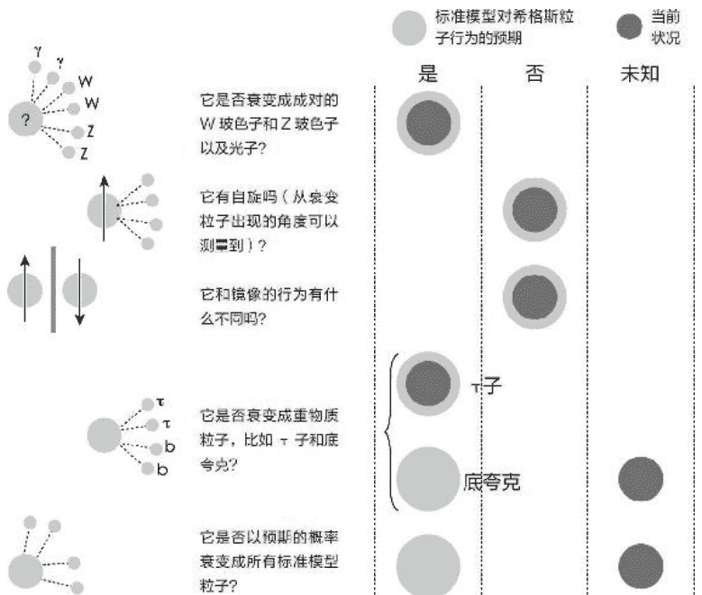

图7.1 走向希格斯：标准模型希格斯玻色子必须满足若干条件。任何与预期行为不符的现象都可能暗示着某种久被期待的新粒子

现在我们还无法得出任何坚实的结论。我们对新粒子的质量相当了解（大约1250亿电子伏特，即223亿分之一微克），如果它是标准的希格斯粒子，这就决定了它衰变为各种粒子的速率，误差大约在1%以内。然而，由于到目前为止观测到的衰变数量有限，新粒子衰变率的测量不确定度更接近于20%。大型强子对撞机将继续努力15年到20年，以改进这一结果。

目前而言，我们只剩下一个看起来像是标准希格斯粒子的粒子，尽管我们还不能给出一个确凿无疑的证明。于是我们面对的是一头站在加速器隧道里面的大象：如果它是标准的希格斯粒子，它又怎么可能存在呢？

问题在于量子场论的预测，即通过从真空中借用能量，粒子会自发地吸收和发射虚粒子。因为希格斯玻色子本身会从它接触到的所有物体中收集质量，这些过程会使它的质量从10^11 电子伏特的区间膨胀到10^28 电子伏特。到了这时，粒子的质量已经进入了普朗克尺度，基本力变得疯狂，引力——所有这些力当中相对较弱的一个——变得和其他所有力一样强大。结果就是一个充满黑洞和扭曲时空的高应力宇宙。

### 寻找共谋者

避免这场灾难的一种方法是设定虚粒子涨落的强度，使它们全部抵消，从而令希格斯粒子的质量得到控制，宇宙更像是我们看到的样子。要想在理论尊严多少得以保全的前提下做到这一点，唯一的方法是引入一场由自然界某种合适的新对称所带来的共谋。目前，大多数物理学家在超对称理论（见第8章）预言的假想超对称粒子身上看到了共谋者的潜质。每个标准模型粒子都有一个与之配对的超对称粒子，而这些粒子的涨落恰好相互抵消。这些粒子必须很重：大型强子对撞机和早期粒子加速器一样，已经证明了它们的质量不可能低于某个值，目前这个值大约是假定的希格斯粒子的10倍。

这已经给哪怕最简单的超对称模型带来了巨大的压力。如果找不到质量小的超对称粒子，你可以调整理论，让它们带着较高的质量出现——然而我们也不能把标杆挪得太远。如果超对称粒子变得太重，它们稳定希格斯粒子质量的方式就会让人觉得不太自然了。超对称粒子还作为宇宙中缺失的暗物质的候选补位者受到了热烈追捧。其他的选择包括一些更加激进的粒子，比如那些存在于额外空间维度的粒子。

如果标准模型咬定的能量与量子场理论和爱因斯坦引力理论都失效的普朗克尺度的能量之间，差距大得根本没法调和，那又当如何？那样的话，我们该如何解释希格斯粒子的实际质量与量子理论预测的质量之间的巨大差异呢？一种叫作轴子的轻量假想粒子可能会防止希格斯粒子的质量膨胀（见下文）。

或者我们只管接受希格斯粒子目前的质量就是了？如果不是这样，所有粒子的质量和它们之间相互作用的强度就会非常不同，我们所知的物质就不会存在，也就不会有我们在这里担心这些问题。这种人择原理，也就是用我们的存在来排除宇宙中某些本来可能存在的属性，常常与多元宇宙的概念联系在一起——多元宇宙的概念是，存在着无数的宇宙，所有其他可能的物理现象都在各自的宇宙里发生着。

对许多物理学家来说，这样的论证实属似是而非。但是别管希格斯粒子的质量是不是已经被我们存在这一事实确定了，它都可能威胁到我们的未来，我们将会看到这一点。

### 宇宙灾难的边缘

我们的宇宙已经存在了近140亿年，但它可能会在眨眼间消失。如果时空结构处于物理学家所说的“假真空”的不稳定状态，那么它随时都有可能崩塌，把我们也连累进去。希格斯玻色子保持着宇宙的稳定——刚刚好。如果赋予质量的粒子更轻，宇宙就会迅速坍缩。

理解真空有多稳定的关键在于希格斯粒子、玻色子及其相关场。基本粒子通过与希格斯场相互作用获得质量，而希格斯玻色子的质量也取决于这些粒子。其中最重要的是顶夸克，它对希格斯粒子的影响最大。根据最近对这两种粒子质量的测量，物理学家现在可以利用希格斯场的性质来推断时空真空的状态。他们得到的消息不是太妙：我们的宇宙似乎命悬一线。

就像一枚从山上滚下来的球，真空最终会停留在尽可能低的能量状态。然而，如果在半山腰有一条小沟，球就会被卡住。球会获得一定的稳定性，但也有进一步向下滚动的可能。看起来我们可能正处于这样的一条沟中（见图7.2）——尽管测量数据还不够精确，不能确定。

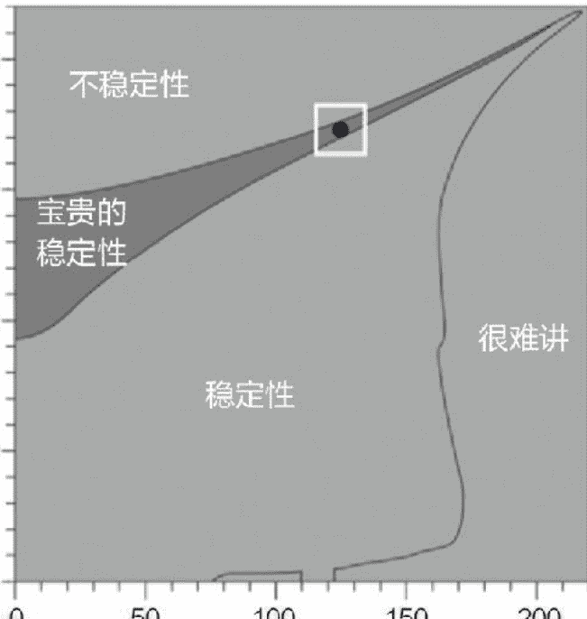

图7.2 如果顶夸克相对于希格斯玻色子稍微重一点，宇宙早就崩溃了

### 希格斯粒子质量之谜

如果我们相信标准模型——我们最好的粒子物理学理论，那么一粒尘埃应该和一头吃得很好的大象一样重。这是因为它预测希格斯粒子应该有着巨大的质量，而这个质量反过来又会使其他基本粒子——电子、夸克和中微子等——比我们测量到的结果重10亿亿倍。几十年来，这个“级列问题”一直困扰着物理学家，从来没有一个简单的答案。我们最好的模型无法解释为什么赋予其他粒子质量的希格斯玻色子质量这么小。

重新提出40年前的一个想法，可能会让这个谜题和另外两个谜题得到解答。由于大型强子对撞机一直没能发现证据，超对称性这一古老的领跑者已经失宠，但答案可能一直就在我们的鼻子底下。理论物理学家们在20世纪70年代提出的一个假想玩物可能会使这个问题消失。

在量子力学的规则下，希格斯玻色子可以暂时转变成各种各样的其他粒子，在这个过程中获得它们的质量。把这些量子涨落的影响加起来，我们得到希格斯粒子的质量大约是10^28 电子伏特——大致相当于一根睫毛。我们知道它的质量不可能这么大，因为这会反过来使其他粒子超重。当大型强子对撞机的研究人员发现希格斯粒子的质量只有区区1250亿电子伏特时，这就证实了我们对希格斯粒子的了解中存在着巨大的缺失。

要解释这个巨大的差异，一个简单的办法是假设它有某种内禀质量，不受所有量子涨落的影响，而且这个质量也非常大。那么所有对整体质量的单独贡献几乎都相互抵消了，剩下的就是我们实际测量的质量。

### 宇宙比例的巧合

两个毫不相关的巨大数字几乎完全抵消的可能性有多大？从这个角度看，级列问题是一个宇宙比例的巧合。这有点像是把高尔夫球击向果岭，却看到它蹬到一棵树，偏进了一个沙坑，反弹到湖里，然后又反弹到你击球的球杆旁边。如此渺茫的概率不仅仅局限于玻色子。因为所有基本粒子的质量都与希格斯粒子成比例，所以这个问题几乎影响了一切。

理论物理学家们喜欢超对称理论，因为它似乎提供了一种解决方案。但是如果它预测的超对称粒子一直不出现呢？

2014年，卡普兰在加州大学伯克利分校的同事苏尔吉特·拉贡德兰和斯坦福大学的彼得·格拉姆设计了一种新的实验来检测另一个选项：轴子。如果存在，轴子将是一种电中性的轻粒子，会产生自己独特的力。它们是在40多年前首次被提出，用来解释棘手的强CP问题，这个问题问的是为什么强力能保持CP对称，而弱力却不能。它们也是暗物质的主要候选者。

目前设计出来的轴子探测器都还没有任何发现。拉贡德兰和格拉姆曾经提出一个新设计，正准备申请建造资金的时候，一个团队声称，利用南极附近的宇宙泛星系偏振背景成像望远镜，他们发现了寻找已久的宇宙早期快速膨胀时期的证据。这似乎排除了轴子存在的可能性，然而拉贡德兰不那么肯定。他最终解决了如何将这一观测结果与轴子的存在相容的问题。它需要轴子在早期宇宙中有较大的质量，然后逐渐消失。

后来宇宙泛星系偏振背景成像望远镜团队的说法被证明是错误的，但是这件事引发了拉贡德兰的思考。如果轴子的质量可以随着时间推移而减少，那么这是否也适用于其他粒子，比如希格斯玻色子？拉贡德兰、格拉姆和卡普兰将这一想法应用到级列问题中，认为轴子和希格斯粒子的质量是相关联的，就像一根轴上的两个轮子。这两种粒子最初都可以在早期宇宙中拥有标准模型预测的巨大质量，然后缓慢地走下坡路。

为什么希格斯粒子的质量止于1250亿电子伏特，而不是继续下降呢？研究小组的想法是，只有当希格斯粒子的质量下降到某一特定值以下时，希格斯粒子赋予质量的性质才会生效。而这件事一旦发生，它的质量也就固定住了。希格斯玻色子突然给予夸克质量，夸克通过强力与轴子相互作用。这就限制了轴子的质量，进而限制了希格斯粒子的质量。

研究小组建议将轴子（axion）的名字改为“松子”（relaxion），因为它可以使希格斯粒子的质量很好地“松弛”到它的观测值。尽管看上去有些做作，但是相对于解决级列问题的其他方法，松子的想法确实有一个优势。现在已经有探测器在寻找轴子了，比如最近在华盛顿大学西雅图分校开展的改进轴子暗物质实验。

格拉姆、卡普兰和拉贡德兰正在研究一个大胆的新想法。松子理论能解开第四大谜团吗？宇宙学常数是物理学家用于代入方程的数字，表示将空间推开、使宇宙膨胀的暗能量。符合观测结果的膨胀速

## 希格斯玻色子诺贝尔舞会

2013年12月，彼得·希格斯和弗朗索瓦·恩格勒共同获得诺贝尔物理学奖，《新科学家》杂志的瓦莱丽·贾米森受邀参加颁奖典礼。下面是她对那次经历的描述。

“科学家们都梦想接到斯德哥尔摩打来的电话。我是在用吸尘器打扫客厅时接到的。‘你愿意来参加宴会吗？’一位诺贝尔基金会的人问道。我心里乐开了花。我没有获得诺贝尔奖，但是这一场颁奖典礼是任何一位对宇宙感兴趣的人都会喜欢的，因为这次奖励的是对物质组成构件获得质量机制的发现。”

“对我个人来说，这也很有意义。在希格斯粒子被发现之前很久，我就进入过现在在大型强子对撞机所在的隧道，漫步于质子很快将以光速撞到一起的地方。抬头看着几层楼高的超环面仪器和紧凑μ子线圈，我真是感到了自己的渺小。它们将会开展捕获希格斯粒子的工作。当第一批质子在2008年发射时，我又回到了那里。参加诺贝尔颁奖典礼是下一个篇章。”

“12月10日，当我到达斯德哥尔摩音乐厅时，我意识到这是瑞典的奥斯卡颁奖典礼——人群簇拥在外面的广场上，入口处有两名裸体抗议者。里面就像一场物理学界的明星聚会，也是一部我们对宇宙中的粒子和力提出的最优理论——标准模型的活历史。”
“那里有卡洛·卢比亚，他发现了W粒子和Z粒子，因此获得了1984年诺贝尔物理学奖。这两种粒子携带造成放射性衰变的弱力。我还认出了格哈德·胡弗特，他因为驯服了标准模型难以处理的方程式而在1999年获奖；还有2004年的获奖者戴维·格罗斯和弗兰克·威尔切克，他们获奖的缘由是对保持着原子核凝聚不散的强力的研究。”

“这些人建立了标准模型，但是在希格斯粒子被发现之前，模型并不完整。恰好，我不得不等到晚上最后一刻才见到彼得·希格斯。他和恩格勒正在领导一场反对着装规定的斗争：‘他们想让我们穿这些可笑的鞋子。我和弗朗索瓦发动了一场反抗运动。’ 希格斯说，‘我想我们可能会被赶出去。’”

### 8 超对称粒子以及更多

标准模型似乎有些步履蹒跚，下一步该怎么办？物理学家们正焦急地扫视着地平线，寻找前所未见的古怪粒子。

### 大型强子对撞机真正在寻找的是：超对称性

2012年希格斯玻色子的发现标志着粒子物理学家修建了半个世纪的大厦——标准模型——成功封顶。但是自那以后，随着大型强子对撞机持续运转并不断提升粒子的能量，粒子物理学家由于没有新的发现而越发地感到焦虑。我们知道标准模型是不完整的。它对第四种基本的自然力——引力——只字未提；对暗物质的性质保持沉默；需要微调才能将希格斯玻色子的质量降到可控范围内（见第7章）。所以这个模型必须被纳入一个更大的模型之内。如果在希格斯玻色子之后，大型强子对撞机再也找不到更多的东西，粒子物理学就会陷入死胡同，找不到下一步的方向。

最重要的是，物理学家希望能为囊括一切的超对称性理论找到证据，让它们走上统一之路。在今天的宇宙中，标准模型中的三种力有不同的强度和范围，但是在20世纪60年代，当时在哈佛大学的斯蒂芬·温伯格与阿布杜斯·萨拉姆以及谢尔顿·格拉肖一道证明了，在早期宇宙中普遍存在的高能状态下，弱力和电磁力有相同的强度。事实上，它们是统一的同一种力。人们的期望是，如果你朝着大爆炸回溯到足够早的时间，强力也会屈服，并与电磁力和弱力统一在单独的一个超力中（见图8.1）。标准模型可以做到这一点——但是只能近似地实现。这种不太准确的统一很快就开始让物理学家们感到困惑。

- 强力：将原子核聚合在一起；玻色子：8种胶子；作用范围：10⁻¹⁵米
- 电磁力：保持原子的完整；玻色子：光子；作用范围：无限大
- 弱力：造成放射性β衰变；玻色子：W⁺、W⁻、Z⁰；作用范围：10⁻¹⁸米

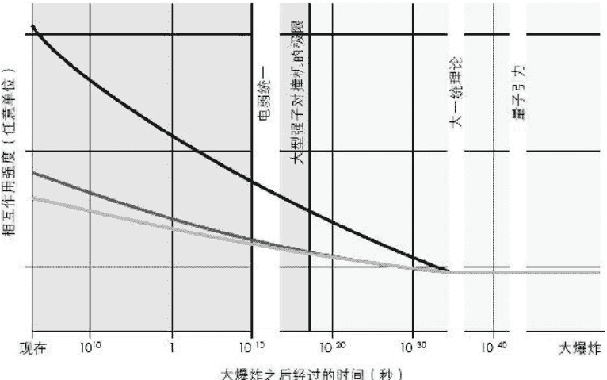

图8.1 我们今天所知的力强度差别很大。但是如果我们可以把时间回溯到大爆炸，或者在粒子加速器里面模拟它的状态，我们就可以看到它们的强度趋同，最终统一成一个超力

然后超对称闪亮登场。它首次出现在苏联物理学家尤里·高尔方和叶夫根尼·利希特曼的研究成果中。德国卡尔斯鲁厄大学的朱利叶斯·韦斯和加州大学伯克利分校的布鲁诺·祖米诺在几年后使它受到了更广泛的关注。

超对称的目的是扩展物理学家喜爱的简化原理——对称性，并证明粒子分裂成费米子和玻色子是存在于早期宇宙中的对称性破缺的结果。今天，每个费米子都将与一个质量更大的超对称玻色子配对，每个玻色子也拥有一个费米子超级兄弟（见图8.2）。例如，电子有标量电子（一个玻色子）作为它的超对称伙伴，而光子与光微子（一个费米子）为伴。

图8.2 超对称粒子大家族。粒子的数量得以翻倍，每个费米子都有一个大质量玻色子作为其超级伙伴，反之亦然

该理论的关键在于，在早期宇宙的高能汤中，粒子和它们的超级伙伴是无法区分的。每一对都作为单个无质量实体共存。随着宇宙的膨胀和冷却，这种超对称性被打破。组成超级搭档的双方分道扬镳，成为各自拥有独特质量的独立粒子。

超对称性解决了所谓的级列问题（见第7章），也就是说，根据量子场论，希格斯粒子和其他粒子本该具有巨大的质量。超对称性理论可以解决希格斯粒子与那些导致其质量失控的基本粒子相互作用所带来的所有麻烦。它们只不过是被其超对称伙伴的贡献抵消了。随着超对称性的加入，代表这三种力强度的曲线可以在早期宇宙中以惊人的精确度组合在一起。

这足以使许多物理学家转变为真正的信徒。但是当他们开始研究新理论提出的一些问题时，事情就变得非常有趣了。

## 寻找超对称粒子

一个紧迫的问题是超对称粒子目前的下落。电子、光子之类的粒子在我们身边比比皆是，然而无论是在自然界中还是在加速器实验中，都没有标量电子和光微子的迹象。如果这样的粒子存在，它们的质量肯定非常大，需要大量的能量来制造。

如此巨大的粒子会衰变为由最轻、最稳定的超对称粒子构成的残留物，这种粒子被称为超中性子。超中性子不带电荷，通过弱核力与正常物质羞怯地相互作用。毫不奇怪的是，到目前为止，它还没有被发现。

当物理学家们精确地计算出应该有多少超中性子残留物时，他们很是吃了一惊。结果是一个巨大的量——远远超过宇宙中所有的正常物质。超中性子似乎符合了暗物质应该具备的所有特征，而天文观测令我们相信，暗物质在宇宙占据着主导地位。

所有这些似乎都表明，理论中隐藏着一些基本真理。然而数学的美和承诺是不够的：你还需要实验证据。在那些旨在发现和描述穿过地球的暗物质的实验中，人们或许可以发现超对称性的间接证据。这其中包括在加拿大萨德伯里附近的一个矿井中进行的超级低温暗物质探索实验，以及在意大利中部格兰萨索山下进行的XENON1T实验（XENON意为“氙”，XENON1T是XENON暗物质计划中数个探测器之一）。美国国家航空航天局的费米卫星这样的太空探测器也在银河系中搜寻着两个超中性子相遇并湮灭时可能产生的信号。

如果我们能在加速器中制造超中性子，最有力的证据便会浮现。由于超中性子几乎不与其他粒子相互作用，所以它会躲过探测，但这反倒可能使它们更容易被发现，因为它们携带的能量和动量看起来丢失了。

我们还没有完全确定这个加速器需要多强大。超对称伙伴的质量精确地取决于超对称性的破缺发生在宇宙冷却过程中的哪个时刻。但是根据最简单、最美观的超对称理论形式（被称为约束极小），夸克的超伙伴（超夸克）的质量低于1万亿电子伏特。这正好在大型强子对撞机的能量范围内——然而它还没有探测出过这种粒子。出了什么问题？

## 普通超对称理论

迄今为止，在大型强子对撞机上对超对称粒子的搜寻工作主要集中在“超顶夸克”身上，也就是标准模型中顶夸克对应的超夸克。在超对称理论的大多数版本中，超顶夸克是最轻的超夸克。在“最基本”约束极小超对称理论中，其他的超夸克也并不比它重很多。它们都应该在大型强子对撞机上产生，其中较重的那些会衰变为超顶夸克，形成难以忽视的超顶夸克洪流——而这恰恰就是我们一直没有观测到的。

也许我们需要考虑更加复杂的超对称理论版本，那些需要更多的假设和自由参数才能有效的版本。其中一些允许在大型强子对撞机还没有测试过的区间存在质量更大的超夸克和超胶子，同时仍然给出了低于1万亿电子伏特的超顶夸克质量。如果这些模型是正确的，大型强子对撞机产生的较重的超夸克数量就会少得多，甚至可能根本不会产生。然后我们只需要改进搜寻方式，例如，寻找直接产生，而不是作为某个更重粒子衰变产物的超顶夸克。

突然间，人们开始讨论在超对称模型中对一大堆自由参数进行微调，以期获得正确的结果——而避免这样的敷衍了事原本是人们提出超对称理论的目的。这便引出了一个更激进的结论：或许超对称理论已经无可救药了？

一些物理学家已经在重新审视可能取代它的旧模型（见图8.3）。其中有前一章讨论的轴子理论。此外还有现在供职于奥斯汀市得克萨斯大学的斯蒂芬·温伯格提出的想法。1979年，他与斯坦福大学的莱昂纳德·萨斯坎德合作，以乏味的质子作为立论的出发点。质子是由被胶子绑定在一起的夸克构成的，胶子负责传递强核力，然而质子大部分的质量不是来自夸克而是来自内部的绑定蕴含的能量（见第4章）。这些色荷的相互作用是强核力在当今宇宙低能状态下的表现。温伯格和萨斯坎德推断，如果在早期宇宙中，类似的机制能够在更高的能量条件下生效，那就可以解释为什么像夸克这样的基本粒子本身就具有质量，而不需要希格斯粒子。这是一个光明的新前景，他们称为“技彩理论”。

但是技彩理论的数学推导很困难，而且它提出的少数可验证预测也并不怎么符合大型正负电子对撞机的实验结果。在2001年之前，该对撞机一直是欧洲核子研究中心的主要加速器。通过对该理论进行微调，人们缓解了其中的一些问题，但是技彩理论的光环还是很快就褪去了。

### 引力为什么那么弱？

20世纪90年代末，拉曼·桑德拉姆与哈佛大学的丽莎·兰德尔提出了另一个选项。级列问题与希格斯粒子的质量膨胀到远超其他已知粒子的质量有关，但是它也可以有另外一种阐述方式：为什么标准模型没有涵盖的引力比其他力弱得多？例如，电磁力比它要强将近10³⁴倍。如果引力更强，那么通过希格斯机制获得质量的粒子质量就会更接近希格斯粒子，问题便会迎刃而解。反过来说，如果能找到一个理论，内含对引力如此弱的解释，问题也就解决了。

兰德尔和桑德拉姆的数学推导为我们期望的引力较弱状态提出了一个新的解释：在我们的四维时空之外，还有一个看不见的第五维度。在这幅图景中，我们就像生活在一张纸的二维平面上的蚂蚁。它们四处奔波，却没有意识到它们的世界也有一个极小的三维空间，也就是纸的厚度。兰德尔-桑德拉姆模型表明，那些调节引力的粒子、引力子，更喜欢居住在五维宇宙的一条维度上——你可以理解为纸张的侧面。与此同时，希格斯玻色子却在我们所在的维度。这限制了引力子与电子、夸克等通过希格斯机制获得质量的粒子之间的相互作用，因此，在我们四维的时空近似中，引力显得很弱。在一个完整的五维视图中，它和其他所有力一样强大。

有人建议我们应该把技彩理论和兰德尔-桑德拉姆模型结合起来。1997年，新泽西州普林斯顿高等研究院的胡安·马尔达塞纳证明了，如何通过增加一个额外的维度，便令四维时空（比如我们的时空）中难缠的强相互作用理论变得容易处理了。兰德尔和桑德拉姆认为，这可以在他们的理论和技彩理论之间架起一座桥梁。自那时起，他们一直在研究相关细节。

与技彩相近的理论当中，最有希望的一个并没有完全排除希格斯玻色子，但是认为它不是一种基本粒子，而是由其他新的基本粒子组成的一种“束缚态”，就像质子实际上是一群被束缚的夸克和胶子。它预测了作为合成粒子的希格斯粒子如何衰变，而大型强子对撞机应该能够对此展开测试。它还预测了新的粒子：已知粒子质量大于1万亿电子伏特的共振态，这些粒子因为在第五维度的振动而具有额外的质能。

人们希望，欧洲核子研究中心的庞然大物或许还能找到一些东西——超对称理论的超顶夸克、兰德尔和桑德拉姆的共振，或者一些完全不同的东西——为建立一个更新、更全面的物质理论指明道路。

### 阴影世界：我们第一次窥见黑暗力量？

想想暗物质猎手吧。根据对星系和星系团旋转方式的宇宙学观察，这种难以捉摸的物质构成了宇宙物质的大部分。然而每当物理学家就要抓住它时，它都会溜走。他们观察不到预期的信号，或者发现了一些令人兴奋的东西，却又看着它消失在背景噪声中。每次都是一样的结果：他们换上一副强颜欢笑的表情，回到画板前面，重新开始寻找。

现在可能是时候改变策略了。也许我们要寻找的不该是单一种类的暗物质粒子，而是一个由黑暗粒子和力组成的“动物园”——一个全新的“黑暗部门”。毕竟，我们没有理由认为暗物质的复杂程度会比不上我们称之为普通的可见物质，而普通物质包含了从电子到夸克的各种粒子。

人们在讨论一个完整的影子世界。在这个世界里，看不见的粒子通过恒星、行星以及我们自己等普通物质所感受不到的力相互影响。如果实验室中出现了黑暗力量经得起推敲的微弱迹象，那么这个黑暗领域可能已经显露出来了。

早在20世纪30年代，天文学家就发现，根据可见的恒星产生的引力作用，星系之间相互绕转的速度要远远比预期快。40年过去了，我们发现星系内的恒星似乎也旋转得太快了。在对宇宙的模拟中，普通物质的引力不足以让它们在原始气体中凝聚成星系和星团。要么是牛顿和爱因斯坦提出的万有引力定律需要实质性的改写，要么是某种看不见的物质形式产生了更大的引力分量。大多数天文学家倾向于第二种选择——暗物质。他们计算出暗物质与正常可见物质的质量之比约为4：1。

不管这种东西是由什么构成的，它必须有质量，这样它才能感觉到并产生引力。但是它没有电荷，所以不与光发生相互作用。几十年来，最主要的候选粒子一直是弱相互作用大质量粒子。人们通常认为它比质子重得多。它可能就是超对称理论中的超中性子，一种可能大量产生于大爆炸的最初时刻的稳定粒子。

## 寻找弱相互作用大质量粒子

附近某个矮星系在γ射线波段的辉光可能含有一些这些粒子存在的证据（参见下面的“弱相互作用大质量粒子的蛛丝马迹？”），但是在地球上，众多极其灵敏的探测器却不曾记录下一个弱相互作用大质量粒子。在一些研究人员看来，是时候改弦更张了。

我们考虑更夸张选项的理由还不止于此。我们现在对星系旋转的观测可以细致到足以弄清楚暗物质在星系中的分布。简单的弱相互作用大质量粒子模型表明，它在星系中央的密度应该非常大。然而，最新的观察结果表明，它的分布较为均匀。对此现象的一种解释是，某种只在暗物质粒子之间起作用的力将它们推散了。

这是个颠覆性的想法。加州大学欧文分校的冯孝仁表示，一旦你开始考虑暗物质粒子之间的作用力，你就进入了一个全新的领域。你可以想象一个由黑暗粒子及其所有的力组成的大家庭。

黑暗家庭的想法并不是一个全新的概念。2006年，天文学家们研究了子弹状星系团，那是两个正在碰撞过程中的星系群。他们提出，碰撞的速度太高，不可能仅仅由所涉物质——暗物质和普通物质——的引力来解释。他们认为额外的拉力一定来自暗物质粒子之间的引力。

## 弱相互作用大质量粒子的蛛丝马迹？

暗物质可能并不像它的名字所暗示的那样黑暗。如果像大多数物理学家认为的那样，这种神秘的物质是由弱相互作用大质量粒子组成的，那么它们将具备物质和反物质两种形式。两者接触时会产生大量高能光子，即γ射线。

星系中往往挤满了数十亿颗恒星，因此几乎不可能排除γ射线的其他来源，但是在过去几年里，天文学家发现了一群附近的超暗矮星系。它们的恒星数量不超过数亿颗。人们认为这些小星系也拥有凝聚程度异常高的暗物质，使它们成为寻找其产生的γ射线的理想场所。

2015年，宾夕法尼亚州匹兹堡市卡耐基梅隆大学的阿利克斯·吉林格-萨梅斯和他的同事们在研究一个新发现的矮星系——Reticulum II。该星系距离地球只有10万光年。在美国航空航天局费米γ射线太空望远镜的观测结果档案中，他们发现了似乎过量的γ射线。

有人提出批评意见，认为除了Reticulum II之外，可能还有隐藏的γ射线源。目前人们还没有计划制造新的γ射线波段望远镜来提供更精确的观测，而且除非我们在附近发现更多的矮星系，好去查阅费米望远镜的档案，这将仍然只是一个太空中或许存在弱相互作用大质量粒子的诱人暗示。

## 携带暗力的粒子

更细致的模拟证明，子弹状星系团的碰撞速度并没有超出我们的预期。但是对暗力的怀疑从未消失。研究人员认为，地球上的粒子实验中产生的异常结果可能也暗示了暗力的存在。例如，在一种被称为μ子的普通物质粒子（电子的较重版本）的磁特性方面，理论和实验之间长期存在的差异，可以用携带暗力的粒子来解释。冯孝仁认为，我们可能已经在匈牙利的一个核物理实验室里找到了这种粒子到目前为止最令人信服的证据。

在位于德布勒森的匈牙利科学院核研究所，阿提拉·克拉斯纳霍凯领导着一个小组研究铍-8原子核的放射性衰变。铍是一种自然产生的轻元素，当原子核含有4个质子和5个中子时，它是稳定的。但是如果质子和中子都只有4个，同位素铍-8会在转瞬之间分裂成两个氦核。之前的实验已经暗示了这一特定衰变的某种奇怪之处，克拉斯纳霍凯和他的同事想要确定它。

为了制造铍-8，他们向极薄的锂-7薄片发射质子。铍衰变，释放出成对的电子及其对应的反物质，也就是正电子。在标准粒子理论中，大多数粒子对的发射方向应该与入射的质子束大致相同。但是匈牙利人意外地发现，有两条明显的侧流，几乎与他们预期的方向呈直角。如果说衰变创造了一个慢速运动的粒子，存在了短暂的时间，然后衰变为电子和正电子，将它们朝几乎相反的方向喷出，那么这样的行为正是应当被预计到的。

研究小组计算这个假想粒子的质量时，发现它完全不符合粒子物理学的标准模型。相反，他们的数字表明，它的质量约为1700万电子伏特——仅仅是电子质量的33倍，而且比任何弱相互作用大质量粒子都轻得多。没有任何已知的自然力能产生这样的粒子。

## 暗光子

经过3年的钻研，小组于2015年公布了他们的研究结果。他们把这种粒子称为暗光子。通过类比光子携带电磁力的方式，这个粒子将在暗物质粒子之间携带一种未知的力。

冯孝仁和他的同事们采信了这个结果，并寻求他们自己的解释。他们还想解决一个恼人的疑问：既然匈牙利研究小组发现这个假定新粒子的实验是世界上大多数物理实验室都能够做到的，为什么之前没有其他人注意到它呢？

除了携带暗物质粒子间的暗力外，假想的暗光子还应该携带一点普通的电磁力。因此，它应该偶尔与正常物质中的质子和电子相互作用。但是当冯和他的同事计算这种相互作用的强度时，事情变得更加复杂了。“这绝不可能是一个暗光子。”冯孝仁说，“如果是的话，我们应该在其他实验和粒子加速器中看到成百上千的其他效应。”

如果不是暗光子，那么它是什么？冯孝仁的研究小组探寻了暗粒子有可能与我们熟悉的物质发生相互作用——哪怕只是轻微的相互作用，从而引发反常衰变的其他方式。他们发现，要想符合我们在已知自然力的实验中所看到的一切结果，它不能像传统光子那样与质子和电子相互作用，而是必须与铍原子核内的中子相互作用。这一性质超出了我们所知的物理学范畴，这也许可以解释为什么人们在以前的暗物质探测实验中没有发现过这种粒子。冯孝仁的研究小组称这名闯入者为“X17玻色子”。

并不是每个人都相信可见物质宇宙之外还有一个完整的阴影世界，然而冯孝仁的理论是可以检验的。通过弗吉尼亚州纽波特纽斯的托马斯·杰斐逊国家加速器，暗光实验已经在冯孝仁的团队计算出的质量区域寻找粒子。欧洲核子研究中心的大型强子对撞机底夸克实验也将在夸克及其反粒子的衰变中寻找它。

## 制造暗物质的六种方法

- WIMP（弱相互作用大质量粒子）。暗物质最标准的解释是，它是一大团缓慢移动的重粒子，这种粒子就是弱相互作用大质量粒子。它们当然可以帮助人们对星系旋转的方式，以及星系和星团的形成给出解释。但是目前还没有探测器确凿无疑地发现过 WIMP，而且它们所看到的线索表明WIMP仅为预期的十分之一。如果真有这样的轻量级WIMP存在，它们的质量位于允许范围的最低端。

- MACHO（大型紧凑的晕状物体）。这种观点认为，暗物质只是隐藏在星系边缘的普通物质——“巨大的天体物理紧密的晕状物体”，暗淡到看不见。候选者包括黑洞以及失败的恒星。可惜的是，MACHO只能解释宇宙缺失质量的一小部分。

- Macro（宏）。暗物质也可能是由密集的夸克簇构成的，夸克是成对或三个一组构成普通物质的粒子。这些“Macro”可能拥有和中子星一样的密度，而且非常重。也许有一天我们可以通过在月球上部署地震检波器来发现它们。

- 轴子。作为WIMP的缩小版，轴子与普通物质的相互作用会更弱。尽管轴子暗物质实验等项目扩大了搜索范围，但结论仍未揭晓。

- 惰性中微子。中微子能够穿透其他物质，几乎就像它们本身不存在一样。但是它们太轻，太敏捷，不可能是暗物质。惰性中微子会是一个更重、更冷漠的版本。

- 引力微子。在将广义相对论与超对称理论融合的尝试中，引力子是携带引力的粒子，而引力微子则是引力子的假想超级伙伴。它正好符合暗物质粒子的条件。问题是超对称预言的许多重伴粒子都还没有存在的迹象。

## 古怪的粒子解决物理难题

标准模型留下了许多有待回答的问题。为什么物质在我们的宇宙中占主导地位？引力的本质是什么？什么是暗物质？为了回答这些问题，物理学家们一次又一次地采用同一条权宜之计：发明一种新粒子……

## 轻子夸克

1994年，在德国汉堡的德意志电子同步加速器实验室，一组物理学家正在让电子与质子迎面相撞，这时他们看到一个电子明显地变成了它较重的对应物——μ子。这样的转化需要电子从质子中获取能量来转化成质量——这在标准模型中闻所未闻，因为电子和质子是非常不同的粒子。质子是由强力约束而成的复合物，电子和μ子则是基本粒子，统称为轻子。它们根本感觉不到强力。

一种可能性是，碰撞产生了一个重量级的杂交品种，被称为轻子夸克。在一些把四大自然力中的三种糅合成一个的大一统理论中，当一个电子撞击一个质子时，就会有这种轻子夸克形成并衰变为一个μ子和一个夸克。

那次的结果再也没有复现过，人们的兴奋情绪也渐渐消退了。然而，大一统理论的诱惑依然存在，在今天的大型强子对撞机上，对轻夸克的探索仍在继续。

## 弦球

弦理论是一个能将两个不同尺度结合起来的种子选手，很受欢迎。这两个尺度分别是，标准模型当道、粒子做主角的微观量子世界，以及引力统治的宇宙级距离（见第9章）。弦理论认为，电子、夸克等粒子其实是仅有10^{-35} 米长的能量弦，以不同的方式振动。如果是这样，大型强子对撞机或者未来的加速器可能会产生弦球。当两根弦相互撞击时，它们就会形成一团缠绕在一起的球，而不是一根被拉长的弦。如果找到了它们，弦理论便得到了证明。除了我们已知的三个维度，该理论需要更多的空间维度。

### 暴涨子

为什么空间如此平滑，为什么宇宙中物质的分布如此均匀？标准的解释是，宇宙在诞生后不久，经历了一段急速膨胀的时期。在这段时间里，空间的某些区域以比光速还快的速度被撕裂，所有的褶皱都被抚平了。这种膨胀背后的驱动力是一个巨大的能量场。在化作其他物质和辐射之前，它曾短暂地统治了宇宙。量子理论认为每个场都有一个相关的粒子——在这个粒子中是暴涨子。它的存在将会导出一些有趣的推论。膨胀场中的量子涨落使得完全关闭变得非常困难，因此原始宇宙的某些部分仍然在膨胀，形成一个由许多独立发展的宇宙组成的多元宇宙。

暴涨子的直接证据不会很快出现，因为它们必须有巨大的质量。你需要的加速器必须能够产生至少相当于大型强子对撞机1万亿倍的能量。

### 弱作用巨兽粒子

一天，物理学家洛基·科尔伯正在伊利诺伊州的沃伦韦尔购物，思忖着该给他和同事们刚刚发明的一种暗物质粒子取什么名字。一辆公共汽车驶过，车身上贴的一张电影海报提供了答案。那是1998年，《哥斯拉》的翻拍版刚刚上映。弱作用巨兽粒子出生了。

在宇宙的第一秒内，在急速膨胀阶段，空间的扩张可能会从真空中剥离出粒子。科尔伯和他的同事计算出，其中可能有比标准弱相互作用大质量粒子重10亿倍的暗粒子，其质量相当于好几百亿亿（10^18）电子伏特。

庞大的质量意味着，这种弱作用巨兽粒子应该是极其罕见的。就像暴涨子一样，它们不能在粒子加速器中被制造出来，也不太可能游逛到寻找弱相互作用大质量粒子的地下探测器中。但它们可能会在宇宙微波背景辐射中——也就是弥漫在天空中的大爆炸余晖中——留下细微的痕迹。

### 孤单磁极：寻找没有南的北

正如电荷分正负，磁极也分南北。但是，从最不起眼的条形磁铁到地球强大的内部发电机，磁极总是成对地出现。把一块磁铁切成两半，就像迪士尼电影里魔法师的学徒对他的魔法扫帚所做的那样，你就能打造两块完整的磁铁，每块都有一个北极和一个南极。

虽然没有人见过没有南极相伴的北极，或者没有北极相伴的南极，但是许多理论物理学家仍然对找到这样一个单极子抱有希望。首先，它将完成詹姆斯·克拉克·麦克斯韦在19世纪60年代整理的方程式。它们概括了这样一个观点：电和磁实为一体之两面，这“一体”便是作为基本力之一的电磁力。麦克斯韦方程组适用于单个的、自由移动的电荷，自然界中，这些电荷以粒子（如电子和质子）的形式大量存在着。类似的自由磁荷会给方程带来一种美学上令人愉悦的对称性，但是在没有任何观察记录的情况下，麦克斯韦放弃了美，在他的方程中排除了自由移动的单极子。

多亏了保罗·狄拉克，磁单极子得以回归。这位以不善言辞著称的英国理论物理学家痴迷于数学之美。1931年，狄拉克将量子理论的思想应用到麦克斯韦的经典电磁学中，指出即使整个宇宙中只有一个磁单极子，它的存在也能解释为什么我们看到的所有电荷都是同样大小的正电或者负电电量的整数倍。

40年过去了，物理学家们一直在寻找将电弱相互作用与强核力统一起来的方法。格哈德·胡弗特和亚历山大·泊里雅科夫分别证明了磁单极子是必不可少的，否则这样一个大一统理论将允许粒子具有各种电荷。

### 对磁单极子的追求

从南极冰到月球岩石，研究人员到处寻找着磁单极子。但是我们最接近目标的一次是在1982年的情人节之夜。当时，物理学家布拉斯·卡布雷拉利用加州斯坦福大学一个地下室里由他自己安装的一部磁单极子探测器，观察到了一个有希望的事件。后来证实，那不过是一场雁过未留痕的露水情缘，促使一些人在整整一年后送给卡布雷拉一条爱心留言：“玫瑰是红色的/紫罗兰是蓝色的/现在是时候/与磁单极子再次相约了。”

如今，卡布雷拉的磁单极子和其他一些更加可疑的观测结果被认为是实验误差。但是狄拉克的计算为磁单极子的缺失提供了现成的借口。计算结果表明，电荷的单位越小，磁荷的单位就必须越大。因为基本电荷是如此之小，而基本磁荷是如此之大，所以一个粒子必须拥有难以置信的能量才能携带它。

根据标准模型，唯一有足够的能量使磁单极子得以大量存在的时间是在大爆炸之后极其短暂的一刹那。人们认为，宇宙迅猛膨胀的时期，也就是所谓“暴涨”，差不多也在那一刹那开始了，而这将会把磁单极子分散到四面八方。加州理工学院的理论物理学家约瑟夫·波钦斯基说，搞不好在整个可见宇宙中只有一个磁单极子。

不过也有人希望它们能更常见一些。在大型强子对撞机上，阿尔伯塔大学的吉姆·平菲尔德正在通过一项名为“大型强子对撞机上的单极子和系外探测器”的实验寻找它们。它的主要组成部分是一系列金属盒，附着在平台周围的墙壁上。每个盒子都接出一卷拖到地板上的金属丝，黄色胶带整洁地勾勒出它们的位置。

在每个金属盒子里都有一个探测器，探测器由一沓堆叠起来的塑料层构成，这些塑料层起到照相底板的作用。因为单极子必然携带巨大的磁荷，所以它会撕开塑料的聚合物键，蚀刻出一条轨迹，其大小、形状和排列方式将揭示粒子的特性。

尽管大型强子对撞机产生的迷你火球是迄今为止粒子加速器的产品当中能量最高的，但是如果你认可标准模型的预测，那么它们的能量还是远远不足以制造单极子。不过平菲尔德的实验并非徒劳。许多标准模型的改进版本都预测了一个更轻的单极子。

磁单极子应该是稳定的，因此平菲尔德的实验装置中还包括捕获探测器。任何经过的磁单极子都可能被装入瓶中，留作进一步的测试——这是粒子“动物园”中真正的异类。

### 我们在哪里可以找到磁单极子？

对磁单极子的搜寻意义深远。以下是我们寻找过却无果的地方：

| 类别 | 项目 |
| --- | --- |
| 被困在…… | 阿波罗11号任务采集的月球岩石 南极陨石 火山岩 |
| 途经...... | 寻找高能中微子和宇宙射线的实验 专用磁单极子探测器 宇宙微波背景辐射 |
| 制造于...... | 粒子对撞机 磁性材料 |

### 9 引力点滴

在我们目前对自然界基本力的最佳模型中，引力是一个明显的遗漏。我们已经发现一些很有前途的探索途径，但是我们到底有多么接近万有理论了呢？

### 仍然没有万有理论

粒子物理学的标准模型从量子场论的角度描述了自然界的大多数基本力：飞掠的虚玻色子携带这些力。然而它并没有囊括引力。我们用的是爱因斯坦的广义相对论，以完全不同的术语将引力描述成弯曲时空的结果。

要想完全理解黑洞和宇宙的起源，我们似乎必须建立起一套针对引力的量子理论。在上述两个情境中，引力太强大了，以至于广义相对论也崩溃了，得出的每一个答案都是无限。这样的理论应该能让我们对空间和时间的本质有更加深刻的认识。

然而，当你坐下来尝试用量子场论描述引力时，你很快就会遇到一个大问题。对任何量子粒子过程的计算都是极其复杂的，因为你必须把产生虚拟粒子的无数种方式全都加起来。有时候，所有这些过程的总和是有限的，但也有一些时候它会失去控制，给你一个无穷大的结果。例如，β衰变的量子理论给出的结果就是无穷大——直到物理学家们发展出电弱理论。通过加入大量未被发现的大质量粒子，比如W、Z和希格斯玻色子，人们消除了无穷大，数学上的困境得以解决。

这一成功让物理学家们相信，这种策略就像是发展量子理论的通用处方：如果模型产生了无穷大，你就可以添加质量更大的新粒子来解决问题。假设引力是由被称为引力子的量子粒子构成的，就像光是由光子构成的一样。当我们对所有可能的历史进行加和时，计算结果如预期那样迅速地螺旋上升，陷入了一堆乱七八糟的无穷大（见图9.1）。

电子这样的粒子通过以无数种方式产生并交换无质量的光子进行相互作用，这件事导致计算中出现无穷大。

这种情况被更重粒子——W、Z和希格斯玻色子——的存在搞定了，它们消除了无穷大。

引力子。将同样的技巧应用于引力子，需要的粒子太重了，以至于出现了黑洞的行为，让所有的计算再次失去了意义。

图9.1 引力子是假想的引力量子粒子——但是与之配套的理论很难驾驭

这一次，要想消除无穷大，人们需要发明一个质量相当于质子1000亿亿倍的新粒子。与所有的虚粒子一样，它们必须通过再次消失来偿还能量——借得越多，就必须还得越快，于是这些粒子的寿命非常短。它们走不了多远，因此只占据极其微小的空间。那么小的空间里有那么大的质量就会形成一个黑洞——包含一个密度无穷大的奇点。

在尝试绕过这一基本障碍的过程中，我们提出了一些候选理论，比如假设所有粒子都是更基本的振动弦的表现形式的弦论，以及主张时空本身被分割成离散块的圈量子引力论。

### 弦之声

在传统的量子场论中，宇宙是由没有大小、形状以及结构的基本粒子构成的。在超弦理论中，物质的组成部分变成了一维的弦，它们存在于一个十维的宇宙中。与其他四个维度不同，那几个额外的维度都卷曲成一个小得看不见的圆圈。事实上，它们直径约10^{-35} 米，即便用上当今最强大的粒子加速器，它们也会因为太小而无法被探测到。

就像小提琴弦一样，超弦可以在不同的模式下振动。我们把每一种振动模式看作是一种不同的基本粒子。弦理论是将强力与弱力以及电磁力统一起来的一种方法，但它远不止于此。弦理论是引力的量子理论，因为弦的振动可以描述引力子——承载引力的假想粒子。更妙的是，弦之间的相互作用在某种意义上比点状粒子之间的相互作用更平滑，因此弦理论消除了先前将量子场论应用于广义相对论时遇到的无限大和反常现象。

得益于艾德·威顿在20世纪90年代的研究，弦理论现在已经被纳入M理论。这是一个无所不包的数学框架，存在于十一维时空当中。它涉及被称为p膜的高维扩展对象，其中弦只是一个特例。

那些额外维度弯曲的确切方式决定了我们这个四维世界的外观：包括有多少代的夸克和轻子，存在哪些力，以及基本粒子的质量。M理论的一个令人费解的特点是，那些维度有很多卷曲方式，从而产生大量可能的宇宙。所以可能存在着很多宇宙，各自有不同的物理定律，其中一个恰好就是我们所生活的宇宙。

当然，M理论仍然没有得到证实，但是它已经取得了一些成功。例如在1974年，斯蒂芬·霍金证明，由于量子效应，黑洞可以辐射能量，这意味着它们有温度和另一种叫作熵的热力学性质——熵是一种衡量系统无序程度的指标。霍金证明了黑洞的熵取决于它的面积。通过考虑构成黑洞的粒子的所有量子态，我们应该有可能计算出它的熵，然而所有以这种方式描述黑洞的尝试都以失败告终——直到M理论出现，准确地再现了霍金的熵公式。

### 对于超弦理论来说，大型强子对撞机的结果中缺少超级伙伴是坏消息吗？

“超弦”中的“超”指的确实是超对称性，这是该理论的一个重要组成部分。到目前为止，大型强子对撞机还没有发现过任何超级伙伴。这个事实常被当作质疑超对称性的理由，然而事实上，只有超对称理论是级列问题解决方案（见第8章）的时候，这样的轻超级伙伴才是必需的。如果超对称性的证据只会在能量更高的条件下出现，弦/M理论仍是与之兼容的。

### 当圈变成弦

我们最有希望的两个量子引力理论已经竞争了几十年。如果它们其实是一回事呢？

弦理论也许很成功，但它也有自己的烦恼。它的额外维度折叠的方式太多了，以至于一些批评者说它几乎没有预测能力，因此不能算是一门科学。与它竞争的圈量子引力认为，时空本身必须量子化，或者说由有限的块组成。人们通过计算得知，这些大块原来是虚无的小圈，它们自己演化成一种类似气泡的几何形状，被称为自旋泡沫。自旋泡沫本质上就是时空，只不过是用量子力学的语言来描述的。

除了调和量子理论和广义相对论，圈状时空并无更多企图——这是一种缓慢而稳定的方法，一些人认为更有可能带来可靠的进展。尽管圈仍然像弦一样是理论性的，一些圈理论物理学家，比如法国马赛理论物理中心的卡洛·罗韦利，已经提出了一些可验证的预测（参见下面的“如何验证圈量子引力”）。尽管如此，还是有一个问题。自旋泡沫太过坚硬，很难贴合爱因斯坦宇宙的精神，也就是说，根据不同的观察者，空间和时间可以被挤压和拉伸。

几十年来，这两个阵营之间几乎没有交流，但是由于双方都没有成功地击溃对方，随着理论物理学家们开始在这两个阵营之间流动，情况正在发生变化。2011年，波兰华沙大学的诺伯特·博登多弗及其同事在圈量子引力理论描述的时空中重写了弦理论及其超对称粒子，于是两个理论之间出现了关联。3年后，另一个关联出现了。圈理论支持者、乌拉圭蒙得维的亚市共和国大学的罗道夫·甘比尼和美国巴吞鲁日市路易斯安那州立大学的乔治·普林认为，要想让相对论和圈量子引力完全兼容，我们必须使用来自弦理论的一种几何结构去限制可能粒子的范围。

### 全息原理

早在20世纪90年代早期，就有过两者之间存在更紧密联系的线索。当时，乌特勒支大学的格哈德·胡弗特和斯坦福大学的莱昂纳德·萨斯坎德提出了全息原理：我们生活的三维世界可能只是发生在宇宙边缘的扁平二维过程的投影。他们在三维引力理论和二维量子场论之间建立了数学上的对应关系。在这个激进的想法中，我们所知道的宇宙就像信用卡背面的平面全息图所创造的三维图像。从那时起，全息原理已经发展成为弦理论的一个主要研究领域。理论物理学家们发现，从边界的角度来看，困难的物理学开始变得更加容易理解。

现在看来，这个边界提供了一个让弦理论与圈量子引力密不可分的地方。2015年11月，圈理论支持者、法国巴黎大学的瓦伦丁·邦宗和加拿大普里美特理论物理研究所的比安卡·迪特里希识别出某一项其他人曾经在弦论的背景下实施的全息引力计算，发现用圈量子引力也可以推导出同样的结果。一个月后，博登多弗有了另一个突破。通常，当全息弦理论被用于计算引力时，它会困在像黑洞这样的奇点上。但是博登多弗证明他的数学方法可以弥补这些情况。

更多的基础研究也正在参与进来。2016年11月，加拿大滑铁卢市普里美特理论物理研究所的理论物理学家劳伦特·弗赖德尔与另外两名合作者一起回归基础，用广义相对论来描述一个非常简单的场景：一个被边界包围的小空间区域。结果表明，定义其边界的变量在数学上与弦理论和圈量子引力有相似之处，尽管这两种理论都不是计算的起点。

与此同时，美国博卡拉顿佛罗里达大西洋大学的圈理论支持者韩慕辛与中国上海复旦大学的弦理论支持者孔令欣合作，试图计算一个自旋泡沫在圈量子引力中演化成另一个的概率。就像洗澡时翻腾的肥皂泡一样，自旋泡沫也在自发地演化——这种自发性有助于解释时间的起源。韩慕辛和孔令欣将他们的计算映射到一个边界上：再一次，与弦论有着奇怪相似性的数学特征出现了。

如果这些研究朝着正确的方向发展，那么有可能至少在一个边界上，弦理论和圈量子引力根本不是竞争对手，而是完全等效的。然而这个界限是什么？在哪里？全息理论始于对宇宙尽头一道边界的想象，不过今天的弦理论和圈理论支持者们并没有严格遵守这一要求，认为边界存在于空间的任何位置。在时空中随机选取一个片段，他们的圈-弦物理学便可能会出现在最细微的尺度上。

“这听上去似乎有些武断。但是你仔细想想看，”罗韦利说，“我们一直在强行树立边界，作为观察世界的入口。为了记录光，我们用摄影胶片或者电子探测器或者视网膜捕捉光子。这张扁平的图片可能是多个物体同时出现的结果，就像一只蝴蝶的影子，可能是由一只真正的蝴蝶产生的，也可能是你勾连起两手拇指然后挥动其他手指产生的。” 弦理论和圈量子引力在我们眼里也许不是一回事，但是在某种意义上，它们可能投下了相同的影子。

对于圈和弦之间的调和可能会带来什么结果，较年轻的物理学家们怀有一种发自肺腑的兴奋。即使本身不以量子引力理论为结果，至少它有可能为我们指明方向。

### 如何验证圈量子引力

最近，圈量子引力理论发展得顺风顺水，支持它的理论物理学家们至少做出了两个可以验证的预测。

- 反弹的黑洞 ——卡洛·罗韦利是这个想法的先驱。如果空间本身是由离散的圈构成的，那么到了一定程度它就不能再被挤压了。这使他认为黑洞可能抵达了无法变得更加致密的那个程度，然后它们会反弹并产生可观测到的辐射。

- 来自大爆炸的信号 ——大爆炸是另一个空间非常紧凑的时期，可能存在的最小时空颗粒是很重要的。我们也许能在大爆炸的余晖，也就是宇宙微波背景辐射中看到它们的效应。等到发展出比现在更精确的测量手段，我们也许能够探测到它们的特征。

### 10 大型强子对撞机的继任者们

在更深入地研究粒子物理学的征程中，地球上最大的机器还能获得什么改进吗？

### 未来对撞机：直来直去？

什么可以取代大型强子对撞机？两个最有可能的继任者是国际直线对撞机和紧凑直线对撞机。两者都要用电子和正电子实施对撞。国际直线对撞机的建议是35千米长的直线加速器，碰撞能量为1万亿电子伏特，而紧凑直线对撞机将使用一种只接收过较少测试的技术，使能量达到3万亿电子伏特。为了产生加速粒子的高频电场，国际直线对撞机将使用锻制成的超导谐振腔，而紧凑直线对撞机计划使用平行电子束产生射频场。

即使是3万亿电子伏特的碰撞能量也比大型强子对撞机低。然而蛮力并不是一切。大型强子对撞机对撞质子，每个质子由3个夸克组成，这3个夸克飘浮在一团携带力的胶子和短寿命夸克对当中。这意味着被大肆宣扬的能量其实要由不同的部分瓜分。质子的复杂性意味着它们并不是称手的工具：当两个质子相撞时，结果是一团令人困惑的碎片。

撞向正电子的电子是单点状的粒子，这使它们成为更加好用的工具。它们携带着机器宣称的全部能量，而在质子对撞机中，制造新粒子的能量只是由两个夸克或者胶子携带的一小部分。另外，在大型强子对撞机中，对撞的夸克和胶子的状态是一个谜，而每个电子和正电子的确切能量和其他性质都可以提前知道。这使得我们有可能计算出希格斯粒子和其他任何可能被抛出的奇异粒子的精确属性。

之前的电子-正电子碰撞记录是在大型正负电子对撞机上创造的。那座加速器曾经占据着一条27千米长的隧道，而现在那条隧道容纳的正是大型强子对撞机。电子和正电子在大型正负电子对撞机中转圈，逐渐被提升到1000亿电子伏特的能量。要想达到更高的能量，环并不实用，因为转圈的电子会通过一种所谓的同步辐射过程迅速损失能量。电子飞得越快，它们的能量流失得就越快。这就是为什么物理学家们现在把目光投向了线性加速器。制造平直的路径，便不会有同步辐射造成的损失，于是人们打算让两个独立的加速器针尖对麦芒。

### 窄束

聚焦粒子束本身也会产生问题。在环中，你可以让反向旋转的电子束和正电子束以你想要的频率交汇，所以粒子有很多机会互相碰撞。在线性对撞机中，它们只有一次机会。解决方案是将粒子束聚焦到只有几纳米宽。这样一来，每个电子都会遇到密度很大的一团正电子（反之亦然），因此会发生大量的碰撞。这是个难以实现的目标，但是在斯坦福直线加速器中心和日本筑波的高能加速器研究机构实验室，必需的技术已经开发出来了。

大型强子对撞机的价格可能是200亿美元，资金也不太可能很快到位——特别是考虑到大型强子对撞机似乎只找到了一个相对简单的希格斯玻色子。物理学家曾经希望从大型强子对撞机中获得更多的新粒子，然后将这丰富的成果交给线性对撞机进行细致的筛选、检验。

也许有更好的选择。与电子差不多的 μ 子质量高达电子的200倍。这意味着它们发射的同步辐射要少得多，所以它们在环中可以比电子更容易加速到高能量。

在 μ 子加速器成为现实之前，还有一些技术障碍需要克服。μ 子是在 π 介子的衰变中产生的，产生后呈烟热、随机移动的气态，需要

先冷却，然后才能聚焦成高密度的粒子束。不过类似的技术已经被用于冷却反质子，欧洲核子研究中心和费米实验室正在努力克服这些困难。

在紧凑直线对撞机和国际直线对撞机争夺资金和支持之际，中国提出了自己的替代方案。2014年，中国科学院高能物理研究所的科学家们宣布，计划建造一个相当于大型强子对撞机两倍大的粒子对撞机，其地下的环状结构直径将超过50千米，用来对撞电子和正电子，而且同一隧道中还要建造一个质子-质子对撞机。他们的目标是在21世纪30年代之前建成这一设施。

## 下一代探测器简表

| 项目 | 国际直线对撞机 |
|------|----------------|
| 现状 | 本实验设计蓝图于2013年6月发表。 |
| 简介 | 一条35千米长的直线加速器，用来撞击电子和正电子。 |
| 成本 | 80亿美元。 |
| 优点 | 更加干净利索的碰撞；技术可靠，易于理解。 |
| 缺点 | 在某些情况下，最大能量可能不足以探测出所有人们感兴趣的物理新领域。 |
| 地点 | 仍有待决定，不过日本北上山地区最有希望。 |

## 紧凑直线对撞机

紧凑直线对撞机将是一个正电子和电子线性加速器，就像国际直线对撞机一样——而且它目前还没有得到批准——不过它的长度会短一些，而且碰撞的能量更高。一个高强度、低能量的驱动光束与碰撞粒子束平行运行。驱动光束积累的能量会以快速爆发的形式被传送到主粒子束上。

| 项目 | 紧凑直线对撞机 |
|------|----------------|
| 现状 | 概念设计报告于2012年10月发表。 |
| 费用 | 没有正式估计。 |
| 优点 | 更加干净利索的碰撞；能量高，结构紧凑（国际直线对撞机需要140千米长才能达到同样的能量，因此要昂贵得多）。 |
| 缺点 | 新技术的研发仍在进行中。 |
| 地点 | 未知。 |

## 遥远的未来

其他的提议包括非常大型强子对撞机，它将有40万亿到200万亿电子伏特的碰撞能量，而且必须从头开始建造。人们还在考虑μ子对撞机和LHeC（用电子束和质子束相撞）。2014年，中国科学家宣布了一个两倍于大型强子对撞机大小的粒子对撞机，该对撞机有一条52千米长的地下环，用来对撞电子和正电子。他们的目标是在2028年建成这个设施。

## 小型继任者

在未来几十年里，建造一台比大型强子对撞机更庞大、更强大的机器可能是不切实际的。更重要的是，达到足够高的能量，使我们能够直接探测统一的自然力，可谓希望渺茫（见图10.1）。那么粒子实验物理学家们现在能做些什么呢？一个选择是追求精度，而不是力量。这就是一系列实验得以开展所基于的道理。这些实验以人们熟悉的粒子为研究对象，寻找异常行为的细微迹象——也就是那些可能暴露出有新现象在施展影响的古怪之处。

图10.1 粒子加速器已经征服了很多新的边疆，但是能量还远远不足以令自然力统一

## 电动挤压

标准模型预测电子和中子应该呈完美的球形。但是也许会有未知的奇特粒子对这些普通粒子产生一些微妙的影响，把它们压扁或者拉长。我们知道，普通粒子的性质受到附近存在的虚粒子的影响。如果其中一些虚粒子足够重，它们可能会给电子和中子造成一个电偶极矩：粒子内部正电荷和负电荷之间的轻微分离。这使它成为一个有吸引力的目标，特别是对那些预算不怎么充裕的物理学家来说，因为寻找电偶极矩的实验往往规模较小、成本较低。

关键是要非常非常仔细地观察这些粒子的自旋。就像旋转的陀螺在受到引力造成的扭矩时，会随着转速的减慢而轻微摆动一样，一个粒子在电场中也会摆动——前提是它有电偶极矩。问题在这样的摆动将极其细微，因此很难被发现。

哈佛大学的先进冷分子电子电偶极矩实验利用过冷的氧化钍分子放大粒子的变形，做出了对电子形状迄今为止最精确的测量。实验于2013年得出，这些粒子所拥有的任何电偶极矩都必须小于10⁻³⁰ 电子电荷米——这是正电荷和负电荷之间距离的量度。换句话说，如果电子和地球一样大，那么它与完美球体之间的偏差一定相当于从顶部削去一条不到10纳米宽的长条，然后把它拍在底部。

与此同时，田纳西州橡树岭国家实验室的nEDM（n代表中子）实验正在研究中子。先前的实验表明，中子距离完美球形有万亿分之一的偏差。通过将实验嵌入超流氦中，nEDM正试图将精确度再提高100倍。超流氦将使研究小组增加作用在中子上的电场强度，并使中子减速，从而大幅提升他们观察到变形的机会。

还有人建议探测一下质子的电偶极矩，以图寻找一种假想的暗物质粒子——轴子（见第7章）。

这些实验很容易受到大型强子对撞机可能无法直接观测到的粒子的影响。在其最大设计能量下，大型强子对撞机能找到的最重粒子大约是4万亿或者5万亿电子伏特。作为对照，如果那些粒子真的存在，先进冷分子电子电偶极矩实验可能已经在7万亿或者8万亿电子伏特的能量级别上探测到了它们。团队已经提出了一些改进方案，可以将这一上限提高到40万亿电子伏特，进一步的调整可能会使这一上限升至100万亿电子伏特。

## 磁性异常行为

电子不太为人所知的表亲——μ子，15年来一直表现不佳。用不了多久，我们可能最终会发现是什么造成了它的魅惑不驯。

这两个粒子本质上都是旋转的电荷球，所以它们会产生磁矩——在我们看来就是一个北极和一个南极。1928年，保罗·狄拉克计算出，一个与磁矩有关的量——名为g因子——对于电子和μ子来说，应该正好是2。但是当我们在20世纪40年代测量电子的磁矩时，我们发现它稍微大了一点：差不多是2.002。

我们后来发现这是因为虚粒子造成了电子的磁矩不平衡。这一效应对μ子的影响甚至更明显，因为它的质量是其表亲的207倍。这使得它特别适合于寻找新的重粒子，比如那些由超对称性预测的重粒子，因为它们应该也会献上自己的些许“绵薄之力”。

大多数观测到的磁矩差异来自已知标准模型虚粒子的影响，比如电子、正电子和夸克。但是在2001年，纽约厄普顿的布鲁克海文国家实验室的E821实验表明，μ子的磁矩差异偏大，大约比标准模型给出的预测值高40亿分之一。这意味着可能有一些未被发现的重粒子影响着μ子的磁性。这一异常在统计学上并不显著，不足以被视为一项发现，而没等研究小组得到确认结果所需的数据，实验就被叫停了。不过一项名为μ子g-2的新实验给了我们另一个查明真相的机会。

2013年，E821实验使用的探测器——一个直径15米的巨大超导磁体环——被一艘驳船从纽约运到了芝加哥。如果一切顺利，该团队希望在2018年能够公布第一个证实布鲁克海文发现的结果。

## 不朽的粒子

质子是原子核的基石，根据标准模型，它应该是绝对稳定的：永远不会解体。但是大一统理论认为质子终将分裂。

超级神冈探测器是日本山区一个装着5万吨水的水缸（见第6章）。它最为人所知的是中微子实验，不过自1996年以来，超级神冈探测器也在关注质子分裂的迹象。这一事件可以通过反向射出的两束光得以揭示。

质子分裂有几种不同的方式，但最受欢迎的一种是衰变为正电子和π介子。2016年，超级神冈测出的在这一过程中质子寿命最精确限制被发表出来：下限1.6×10³⁴ 年。这个结果淘汰了某些类型的大一统理论。

人们提议的超级神冈的继任者是超级神冈，它可以容纳100万吨的水。也许它最终会看到某个质子的死亡。

### 11 务实的粒子

粒子物理学不仅仅是对抽象真理的探索。它已经被用于寻找并杀死癌症、保护飞机机翼以及开发更好的超导体。有一天，中子科学甚至可能被用于阻止番茄酱从瓶子里一滴而出。

## 粒子物理学为我们做了些什么？

有人曾经说过，物理学可能会带来一些实用性的结果，但那并不是我们投身其中的原因。粒子物理学尤其如此，它的目标是通过在最高的能量和可想象的最小尺度下探测物质和力，从而更加透彻地洞察宇宙的本质。然而，就连古代的炼金术士也知道，将铅变成金的学问会是非常有用的（也就是有利可图），同样道理，粒子物理学家若是完全忽视他们的工具和发现对我们日常生活的影响，那也是愚蠢的。

就拿粒子加速器来说吧。最初，人们开发它们是因为希望能够在受控的实验室条件下重建宇宙射线——那样就能把理论物理学家和实验物理学家们带回地球。然而也许并不令人惊讶的是，制造和控制高能带电物质束的能力在其他一些领域也大有用武之地。例如，来自低能量加速器的电子束可以用来把黏性塑料变成更有用的东西。通过把一些氢原子轰出去，电子可以改变塑料高分子链的化学性质。这使得分子链在一种叫作交联的过程中相互连接。你最终得到的材料是一种强度大得多的塑料，可以用来制造收缩膜和电气绝缘体。

我们还使用粒子加速器来产生X射线，用于机场安检扫描仪、食物保鲜，以及医疗设备消毒。在微芯片工业中，加速器被用来在硅中植入离子来制造更加精密复杂的元件。加速器也可能被用于炼金术——不是把铅变成金（这在技术上是可行的，但在经济上非常不划算），而是去灭活核废料。利用中子驱动的元素嬗变器，你可以用中子轰击不需要的放射性原子，它们就会变成更安全的同位素。这一手段已经被证明原则上是可行的，不过还需要改进，才能够以核工业所需的规模得到应用。

## 良药

在加速器应用推广的前沿，也许最令人兴奋的进展之一是医学物理学：用强子疗法治疗癌症。在很长一段时间里，人们一直使用X射线来杀死肿瘤细胞，但问题是它们同时也杀死了沿途照射到的所有其他组织。如果代之以高能质子或者碳离子，你就可以瞄准更明确的区域。考虑到质子和碳离子在穿过活体组织时失去能量的方式，你可以把它们安排到特定的深度去大显神威。在一些难以抵达或者敏感的部位，比如大脑和眼睛，强子疗法因此成为治疗肿瘤的有力工具。减少辐射剂量的需求也使它更适于儿童和其他脆弱的病人。这是诞生于粒子物理学的一项美丽而有效的技术。现在的挑战是把必要的加速器做得足够小、足够便宜，以便安装到每一家有需要的医院，就像核磁共振扫描仪和其他改变世界的设备一样。

粒子物理学的一项更奇特的发现——反物质——在医学领域也经常得到应用，那便是利用反物质的力量为身体内部情况造影的正电子发射断层扫描（PET）。要进行PET扫描，你需要服用一种物质，比如含放射性氟-18（顺便说一下，这种同位素也是在粒子加速器中产生的）的氟脱氧葡萄糖。它释放出一个正电子，与附近的电子发生湮灭，产生两束 γ 射线。你可以追踪这些 γ 射线在哪里出现，以确定相互作用发生的位置，这样就实现了对大脑和其他使用葡萄糖的身体部位的扫描。

粒子探测器则是另一则故事了。自20世纪初以来，人们窥探亚原子世界的能力一直有赖于捕捉粒子穿过某种敏感介质时留下的蛛丝马迹。查尔斯·汤姆森·里斯·威尔森的云室使用了过饱和的水蒸气，而塞西尔·鲍威尔在20世纪40年代开展的气球实验使用了一种特殊的光化学乳剂。但是设置这些介质，然后拍摄和冲洗粒子轨迹照片，是非常令人厌烦的工作。年纪大一些的读者可能还记得，要先把胶卷从相机里拿出来，拿到药剂师那里去冲洗，然后才能拿着假期拍的照片去烦朋友和邻居们。为了发现正电子——电子的反粒子，卡尔·安德森不得不冲洗并分类了1300多张云室照片。不过公平地说，他确实也因为这番辛劳获得了诺贝尔奖。

就像我们差不多都转向了数码摄影一样，随着硅探测器的使用，粒子物理学的世界也发生了同样的变化。当一个电离粒子通过经过适当准备的硅片时，正电荷和负电荷被撞向四方，这样它们就可以直接输入探测器的电子器件中。由此产生的信号几乎立刻就可以得到处理、存储和分析，而不需要任何人工处理或者显影——2012年，处理大型强子对撞机发现希格斯玻色子所需的每秒数十亿次碰撞时，这样的技术可谓至关重要。

## 超级计算机

硅探测器带来的数据量爆炸意味着粒子物理学家必须发明新的计算方法。网格计算令世界各地几十万台计算机可以同时处理来自大型强子对撞机的数据流。20世纪70年代，本特·斯顿普用保龄球为欧洲核子研究中心的控制室设计了第一个跟踪球，并设计了最早的电脑触摸屏之一。这与蒂姆·伯纳斯-李发明的万维网完全不同。

正如你所预料的那样，这场数字革命给粒子探测器带来了以前无法想象的应用。衍生技术之一是Medipix混合硅像素探测器。与大型强子对撞机那些大教堂大小的实验装置相比，这种探测器是非常娇小的：一块拇指大小的硅片上有256像素×256像素的网格。但是，凭借一些巧妙的微芯片工程，它可以被用来实时检测、计数和测量单光子的能量。

这对医学成像有着很大的影响。例如，通过观测穿过成像对象的不同能量的光子，你可以生成彩色X射线图像，为临床医生提供全新水平的诊疗信息。这种技术不仅可以应用于光子，任何电离辐射都可以立即被探测到并显示出来，比如放射性物质产生的 α 和 β 辐射，或者是强子疗法中使用的质子和碳离子。

粒子探测器也在进入太空。星际旅行的主要挑战之一是，一旦离开了对我们宠溺有加的地球磁场的保护，我们就会暴露在危险的辐射中。如果能够测量并理解辐射，我们就应该能够设计出解决方案，在下一代探险者前往火星或者比邻星或者别管哪里的下一个边疆时保护他们。现在，在国际空间站上，有5个Medipix设备正插在美国航空航天局的笔记本电脑上，测量宇航员的辐射环境。这些探测器也被用于美国的猎户座计划。该计划旨在用宇宙飞船将宇航员送入深空。因此，当我们在宇宙中寻找新的安身之所，为粒子物理学开发的技术可能会对我们这个物种的未来产生影响。

那么接下来呢？我们会不会制造出来希格斯玻色子驱动的翘曲驱动器、磁单极子单轨系统和微型黑洞废物处理装置？谁知道呢？我们做科学研究并不是为了给这些粒子找到应用，然而正如我们所看到的，只要你让足够多的人在一个地方工作——无论是欧洲核子研究中心、费米实验室还是其他什么地方——他们总会想出来一些伟大的东西。

## 大显身手的中子

詹姆斯·查德威克在20世纪30年代发现了中子，之后科学家们发现了中子在一种化学元素向另一种转化的过程中发挥的作用，并了解了核反应和放射性衰变是如何产生大量中子的。这引出了核链式反应的发现，并把物理学带入了前所未有的核能和核武器领域。

不过中子的故事还有另外一面。中子已经成为揭示物质结构的有力研究工具。如今，中子科学已经触及了一切：从下一代计算机到病毒结构。

和所有的量子粒子一样，中子也可以有波一样的行为。因此，遇到与其波长相当的障碍物时，它们会沿着明确的角度散射，就像水波在岩石周围绕射一样。通过分析散射模式，我们可以推算出中子穿过的物质的结构。

随着核反应堆在20世纪40年代的出现，中子的大量生产成为可能。人们得以对材料结构开展深入的研究。这一领域在20世纪60年代真正开始腾飞，当时人们为这类实验优化了研究用反应堆。

## 密集中子源

现在有20多个运作中的中子科学设施，可以归为两种形式。法国格勒诺布尔劳厄-朗之万研究所的高通量反应堆等研究用反应堆，利用核裂变来产生稳定、可靠的中子源。劳厄-朗之万研究所里运行着世界上最强大的中子源，为40部不同的仪器提供着中子束。与此同时，英国迪德科特卢瑟福阿普尔顿实验室的ISIS中子源，是通过将加速的质子射入重金属目标来促使其发射中子。

像劳厄-朗之万研究所这样的设施可以在很大的能量范围内产生中子，而这对应着很大的波长范围。以每秒几千米的速度运行的热中子波长较短，可以用来研究直径小于1纳米的原子结构。冷中子的速度是热中子的1/10，对应的波长很长，可以用来研究微观尺度上的分子结构。

我们现在可以用中子来窥视各种各样的材料内部。因为自身不带电荷，它们不会因为离子的电荷偏转方向，可以深入物质内部。自旋给了它们一个小磁场，使它们能够与电子自旋相互作用，所以中子对于理解磁性材料的结构和动力学很有帮助。不过它们主要还是通过强力与原子核相互作用。这使得中子特别擅长于识别轻原子的位置，比如氢、氧和碳，因为它们的原子核质量之间有明显的差异。

许多日常用品，包括工具、衣服、食品和保健品，都是由含有这些轻元素的长链碳氢化合物构成的，而中子也是解析这些复杂结构的最佳选择。2012年，劳厄-朗之万研究所和英国布里斯托尔大学的一个研究小组利用中子研究他们能否通过在碳氢化合物链中纳入铁而使肥皂具有磁性。那样的肥皂可以利用磁场进行操控，从而改善水处理和环境净化技术。

## 随波逐流

其他某些常见的液体，比如面霜、洗发水和酱汁，由于其长链状分子的行为，会以不同寻常的方式流动。一种被称为剪切稀化的现象造成这些液体在被搅拌或者摇动时会变得更加稀滑。对于那些曾经试想从玻璃瓶中倒出番茄酱，结果倒了一盘子的人来说，这是一个熟悉的过程。2005年，为了搞清楚为什么会发生这种情况，科学家们一边向各种液体施力，一边向它们发射中子束。中子揭示了分子的方向，而一个叫作流变仪的装置测量了液体的流动。研究结果在黏度和链方向之间建立了明确的关联，这一发现可以帮助行业预测和调整产品离开你手中的瓶子或者水池的方式。

蛋白质、病毒和细胞膜自然富含轻元素，生物学家和中子科学家一起破译这些生物结构及其发挥功能的方式。一种技术是氘化——用氘取代样品中的部分或者全部氢原子。氘是氢的一种重同位素，除了它的单个质子外，还有一个中子。中子散射对轻元素非常敏感，可以分辨出这两种同位素。接下来将样品与未氘化的样品进行对比，以确定氢原子在生化反应中的位置。

另一个受益的领域是将外来DNA引入宿主细胞，用于基因治疗和作物基因改造。利用中子散射，人们已经测试了许多可能的试剂，包括将DNA注入细胞的病毒。

中子也令人们得以深入了解细胞壁内胆固醇的运输。胆固醇包围着每一个细胞，参与信号在身体中的传递，并协助激素的产生。在细胞间和细胞内重新分配胆固醇，维持正常的胆固醇水平是至关重要的，因为阿尔茨海默病和心血管疾病都与胆固醇的异常有关。近年来，中子已经阐明了这些过程，揭示了细胞如何实现正确的平衡，以及什么因素会导致系统崩溃。

## 新药

除了辅助诊断，人们还利用中子制造新药。放射性药物是治疗某些肿瘤的最佳方法之一。他们将一种放射性同位素注入癌细胞，利用这一剂量的辐射杀死癌细胞。然而如今人们使用的放射性药物都是最容易获得的，而不是性能最好的，它们会对周围的健康组织造成不必要的损害。研究用反应堆现在被用来生产新的放射性同位素，如锝-177和镥-161。2015年，来自劳厄-朗之万研究所、德国慕尼黑工业大学和瑞士维里根保罗·谢勒研究所的一个团队演示了用中子辐照钕样品来大量生产镥同位素的新技术。钕-160吸收一个中子，生成一个较重的同位素，然后通过 β 衰变转变成镥-161。镥-161释放的 γ 射线刚好可以用来跟踪放射性同位素在体内的运动，它释放的低能电子可以在不损伤周围组织的情况下摧毁癌细胞。它的半衰期大约为一周，长到来得及送到医院，又短到不至于留下长期的核废料问题。

中子的磁性能被用来研究高温超导体，也就是能够不依赖电压传输电流的材料。研究人员正在研究这些材料中微小的自发电流环和自旋的交替模式。人们认为，电子之所以能够配对并且不受阻碍地移动，是因为这些现象发挥了一定的作用。如果能够揭示现存高温超导体的秘密，我们也许能制造出在室温下无电阻导电的材料。

这些多才多艺的粒子还可以解决那些你真心不希望出毛病的结构问题，比如飞机机翼、铁轨和涡轮叶片。这些材料的性质和性能在很大程度上取决于它们的纳米级结构。这种结构太小了，无法用普通的光学显微镜检测。凭借较短的波长，中子为人们提供了一种新的显微镜，用以了解压力对这些材料的影响，以及它们的性能如何能够得到改善以供日常使用。

## 寻找磁单极子

最后，还有磁单极子缺失这件事。物理学家们到处寻找磁单极子，从高能粒子碰撞的碎片到来自外太空的岩石（见第8章）。但是中子实验已经发现了一种磁单极子。2009年，两个独立的研究小组通过向一种叫作自旋冰的人造材料发射中子，发现了这一现象的证据。这些材料中粒子的自旋可以令它们自行形成南北磁极，而且这些磁极可以各自独立地飘移，类似于磁单极子。总有一天，这些伪磁单极子可以被用于制造一种比当今任何同类产品都要紧凑的计算机存储器。

## 中子期货

位于瑞典隆德的欧洲散裂源是世界上最大的中子科学设施。它被设计到一座线性加速器的周围，该加速器加速质子，使它们撞击一个重金属目标，从而释放出猛烈的中子脉冲。这些中子将通过束流线被引导到实验设施。

欧洲散裂源或许会成为中子科学的领头羊，不过其他设施也并不会因为它的存在而变得多余，因为在药物发现、材料科学、可再生能源、基础物理和生物化学等领域有太多的科研工作有待开展。自从中子被人类发现，大概已经过去了80年，但是对于它那种给我们的世界带来彻底变革的潜力，我们仍然只是触及了皮毛。

## 结语

现在你可能已经明白了，粒子物理学不仅仅是对微小事物编目分类的枯燥操作。它回答了，或者说试图回答，一系列关于我们自身存在的问题，其中很多可以归结为字面意义上的“我们从哪里来”这一问题。一系列由粒子的精确行为所支配的非凡事件和环境，决定了构成我们自己的身体以及周围几乎所有事物的那些熟悉而复杂的物质。

在过去的几年里，我们至少找到了这个领域某些重大谜团的部分答案。晶格量子色动力学的精确计算说明了为什么质子的质量略大于中子。如果不是这样，就不会有化学元素了。2012年希格斯玻色子的发现证实了夸克和轻子具有质量的原因。没有它，后两者就会以光速运动，不可能结合在一起形成有结构的物质。

但是，还有更多的问题远远超出了我们目前的能力。为什么在早期宇宙中物质粒子战胜反物质，占据了优势地位？如果不是这样，宇宙就会只剩下一片温和的辐射海洋。什么是暗物质？没有它，我们就不会有恒星和星系。是什么决定了真空的能量？太高的话，整个宇宙都会分崩离析。轻量级的希格斯玻色子会造成宇宙不稳定吗？为什么我们的时空有三维空间和一维时间？是什么决定了所有力的强度？什么样的粒子恶作剧导致了剧烈的暴涨？什么引发了宇宙大爆炸？

别管会有什么样的理论取代标准模型，去解释物质的基本组成部分是如何相互作用的——无论是弦、圈还是其他更奇怪的东西——它都有很多工作要做。

## 50个想法

除了惯常的阅读列表，这一部分还列出了更多的材料，以帮助你更深入地探索这个主题。

## 7处景点及活动

- 1. 欧洲核子研究中心是世界上最大的物理实验室，也是著名的大型强子对撞机粒子加速器的所在地。那里提供带导游服务的游览机会：https://visit.cern/tours。可以在这个网站通过虚拟现实游览：http://petermccready.com/。
- 2. 位于加州的SLAC直线加速器据说是世界上最直的物体，如果大型强子对撞机太弯曲，不符合你的品位，那么SLAC会让你惊叹：https://www6.slac.stanford.edu/public-tours。
- 3. 英国伦敦威斯敏斯特大教堂有一座保罗·狄拉克的纪念碑，上面刻着以他的名字命名的方程，该方程暗示着反物质的存在。
- 4. 鹿特丹自然历史博物馆中陈列着2016年在大型强子对撞机上触电的某只石貂的遗骸。那次事故导致了粒子加速器暂时关闭。
- 5. 粒子物理学发展早期阶段的很多发现是在英国剑桥的卡文迪什实验室做出的，其中包括最早（有争议）的一项：约瑟夫·汤姆森利用阴极射线管识别出了电子。他们有一座博物馆：http://www.phy.cam.ac.uk/outreach/museum。你还可以在这个地址看到一部介绍那个天命所归的阴极射线管的短片：https://www.newscientist.com/article/2098394-the-tube-that-kickstarted-particle-physics/。
- 6. 用阴极射线做实验。你不必是剑桥的科学家也能做阴极射线实验。找一台旧的阴极射线管电视机和一块强磁铁。把磁铁放在屏幕附近，粒子束的路径就会弯曲，使画面变形。
- 7. 与中微子（可能还有暗物质）玩耍。无论你是站着、坐着还是躺在什么地方，都要记住，每秒钟都有数万亿在太阳核心产生的中微子穿过你的身体，也可能有奇特的暗物质粒子在你体内穿行。

## 11条引言

- 1. “中微子穿过这片无垠虚空时真的击中什么的概率，大致相当于从一架巡航的747飞机上随意扔下一个滚珠轴承，结果击中一个，比方说，鸡蛋三明治。” ——作家道格拉斯·亚当斯（1952——2001）
- 2. “正是电子不可能全部挤在同一位置这个事实使得桌子和其他东西如此坚固。” ——物理学家理查德·费曼（1918——1988）
- 3. “将粒子分散成一根弦，是朝着让我们熟悉的一切都变得模糊的方向迈出了一步。你进入了一个全新的世界，那里的事物与你所习惯的完全不同。” ——M理论先驱爱德华·威顿（1951——）
- 4. “我认为反物质的发现可能是21世纪物理学所有重大飞跃当中最重大的飞跃。” ——沃纳·海森堡（1901——1976），量子力学的奠基人之一
- 5. “我犯了一个天大的错误，我预言了一个永远不会被观测到的粒子的存在。” ——量子先驱沃尔夫冈·泡利（1900——1958）谈到中微子时说
- 6. “如果我能记住所有这些粒子的名字，我就去做植物学家了。” ——意大利物理学家恩里科·费米（1901——1954），第一座核反应堆的建造者
- 7. “我想我可能会发现弦理论的普遍原理是最优雅的——如果我知道它们是什么的话。” ——莱昂纳德·萨斯坎德（1940——），弦
- 8. “电子演奏着庄严的华尔兹，编织着线条优美的探戈，抖动着断断续续的快步，随着疯狂的节奏摇摆。它们是波，脚踏着为各种原子分别谱写的舞步。”——英国天文学家和作家爱德华·哈里森（1919——2007）在他1985年出版的《宇宙的面具》一书中写道
- 9. “我相信宇宙中有157477241362750025776056553961181555468044717914527116709366231425076185631031296个质子和相同数量的电子。”——英国天文学家亚瑟·爱丁顿（1882——1944）
- 10. “从理论的角度来看，人们会认为磁单极子应该存在，因为数学上的优美。人们曾多次试图找到它们，但都一无所获。人们应该得出这样的结论：漂亮的数学本身并不是自然界符合一种理论的充分理由。”——预言了反物质的物理学家保罗·狄拉克（1902——1984）
- 11. “所有的科学要么是物理要么是集邮。”——“核物理之父”欧内斯特·卢瑟福（1871——1937）

## 6则双关语、笑话和逸事

- 1. 一枚质子走进酒吧。“我失去了我的电子。”它说。“你确定吗？”招待说。“我敢肯定/我是正的。”
- 2. 一枚希格斯玻色子走进教堂。“嘿，没有我你们不许做弥撒/不能拥有质量。”
- 3. 一枚光子正在一家旅馆登记入住，看门人问他是否需要帮忙搬行李。“不，我轻装旅行/是行进中的光。”
- 4. 约瑟夫·汤姆森出了名的健忘。有一天，汤姆森被同事说服，认识到自己仅有的一条裤子已经旧得没法穿，便在回家吃午饭的路上买了一条，并在下午上班前换上了新的。他的妻子回到家后，发现了那条旧的，便忧心忡忡地向实验室发送了一条消息，确信她的丈夫只穿着内裤离开了家，或者更糟。
- 5. “正如诺特敏锐的觉察（对此她应该大受褒扬），我们很容易看到，对于每一个对称，都必然有一个量守恒。”（戴维·莫林）
- 6. 提出中微子存在的沃尔夫冈·泡利极其注重科学的严谨性。他称一些论文和假设“完全错误”，然而这还不是最糟糕的形容：在一段有名的公案中，他把一个理论描述为“甚至不是错的”，因为它是不可验证的。

## 4次卓越的急智之作

- 1. 冷却大型强子对撞机会导致加速器的环收缩，因此各个分段之间由波纹管连接。成千上万个这样的部件被安装到位后，很明显，其中一些部件已经变形，并阻塞了粒子束的行进路线。然而是哪一个呢？有人想出了一个主意，把一个乒乓球放在管道里，这样它就会以每秒几米的速度在真空中滑行，直到碰到障碍物。当球撞上障碍物时，一个骑自行车的人可以听到声音。这种“传球”技术仍然被用来检查大型强子对撞机的粒子束路线是否畅通无阻。
- 2. 在费米实验室，可溶性阿司匹林片被用于检查万亿电子伏特加速器是否漏水。每个开关由一枚药片顶在开的状态上。如果有泄漏，它会溶于滴下的水中，导致开关跳闸，在发生损坏之前切断电源。
- 3. 明尼苏达州的低温暗物质搜索探测器必须保持在绝对零度以上不到一开氏度的温度，因此，它周围隔着一系列越往内越冷的层。为了避免各层之间接触造成不必要的升温，脱落的电线都被牙线系住。
- 4. 日本筑波市的高能加速器研究机构的研究人员可以随时食用类似明胶的魔芋面。这种食物的黏性意味着它们可以用作制造 µ 子探测器所需真空的测试密封材料。

## 9项事实

- 1. 大型强子对撞机的粒子碰撞产生的火球温度可以达到几万亿度（别管你采用哪种温标）。
- 2. J/Psi介子的发现证实了夸克模型。它拥有这么尴尬的名字是因为它是由两个团队分别独立发现的，一个团队将其命名为J，另一个团队将其命名为Psi。
- 3. 欧内斯特·劳伦斯在伯克利建造的第一个回旋粒子加速器直径只有大约10厘米。
- 4. 欧洲核子研究中心以无意中不幸触电的石貂而闻名，而费米实验室与动物的关系也很紧张。它的加速器曾经被一只猫（尾巴打断了一道安全光束）和一只浣熊（像大型强子对撞机的石貂一样咬坏了电缆）关闭，另外还遭遇过由老鼠、蛇、鹅和鹿造成的问题。麝鼠曾经排干了一个用来存放冷却水的池塘，导致主环加速器关停了一天。
- 5. 另有一则令人开心的故事：在20世纪70年代，费米实验室曾经雇用了一只名叫费利西亚的雪貂来清洁一段长真空管。
- 6. 轴子的英文名axion其实是一种洗衣液的品牌。命名者弗兰克·威尔切克选取这个词的原因是，人们希望这种新粒子能够“清理掉”物理学中的问题，同时词尾-on符合人们给粒子命名的习惯。
- 7. 在剑桥数学科目上获得一级荣誉的毕业生被称为“牧马人”，而最优秀的学生被称为“高级牧马人”。一些伟大的物理学家没能获得这个浪漫的称谓，包括第二牧马人约瑟夫·汤姆森——电子的发现者，以及电磁理论的创始人詹姆斯·克拉克·麦克斯韦。
- 8. 2011年，大型强子对撞机遇到了UFO问题，不过这个UFO指的是“不明坠落物”而不是通常所指的“不明飞行物”。电离气体在束流室中产生的电子云和被称为“不明坠落物”的微尘粒子打断了束流，使大型强子对撞机难以持续运转。
- 9. 汤姆森因发现电子是粒子而获得诺贝尔奖，他的儿子乔治因证明电子是波而获得诺贝尔奖。不过他们并不是唯一的父子获奖者：另外还有5对父子获奖，包括量子先驱尼尔斯·玻尔和他的儿子奥格。

## 3条文化参考

- 1. 反物质在科幻作品中是一个流行的主题。例如，在《星际迷航》中，星际飞船进取号以反物质为燃料。
- 2. 更令人难以置信的是，反物质在电影《天使与魔鬼》中被用于推进情节。在影片中，光明会从大型强子对撞机偷取反物质来炸毁梵蒂冈。
- 3. 在电影《捉鬼敢死队》中，未经许可的粒子加速器为质子包提供能量。其发明者解释道，在使用这些设备时，让粒子束交叉是不明智的。相比之下，在大型强子对撞机上，那么做是必要的。

## 10个供进一步阅读的网站和书籍

- 1. 要想阅读一份非常短的粒子物理学简介，弗兰克·克洛斯撰写的《粒子物理学：一个非常短的介绍》（Particle Physics: A Very Short Introduction，2004年）也许再合适不过了。
- 2. 2014年出版的《物理学七堂课》（Seven Brief Lessons on Physics）由卡洛·罗韦利撰写，是一本“清晰而迷人”的小书，先在意大利成为畅销书，随后风靡世界各地——理由很充分。
- 3. 要想更深入地研究粒子物理学的奥秘，大卫·格里菲思的《粒子物理导论》（Introduction to Elementary Particles，2008年）是一本好教材。
- 4. 肖恩·卡罗尔2012年出版的《宇宙尽头的粒子》（The Particle at the End of the Universe）一书讲述了寻找希格斯粒子的过程（及其重要性）。
- 5. 另一本讲述希格斯玻色子发现过程的书是伊恩·桑普尔的《宏大：寻找上帝粒子》（Massive: The Hunt for the God Particle）。
- 6. 想要一本优秀的物理学游记，不妨试试阿尼尔·阿纳塔斯瓦米2003年出版的《物理学的边缘：揭开宇宙奥秘的地球极限之旅》（The Edge of physics: A Journey to Earth’s Extreme to Unlock the Secrets of the Universe）。
- 7. 要想探究最古怪的物理学家之一，不妨读一读格雷厄姆·法梅罗的《最奇怪的人：量子天才保罗·狄拉克的隐秘生活》（The Strangest Man: the Hidden Life of Paul Dirac, Quantum Genius，2009年）。
- 8. 想要了解更多艾米·诺特那无人喝彩的才华和你可能从未听说过的最伟大的物理学定理，读一读戴夫·戈德堡的《后视镜中的宇宙：隐藏的对称性如何塑造现实》（The Universe in the Rearview Mirror: How Hidden Symmetries Shape Reality，2013年）。
- 9. 如果你更喜欢获得以巧妙折叠的形式呈现的信息，那就去看看安东·拉德夫斯基和艾玛·桑德斯合著的《通往物质之心的旅程》（Voyage to the Heart of Matter，2009年），这是一本关于欧洲核子研究中心的超环面仪器的弹出式书籍。
- 10. 如果你想为粒子物理事业贡献一些多余的计算能力，请访问 LHC@home。

## 名词表

ALICE “大型离子对撞机实验”（A Large Ion Collider Experiment）的缩写，这是大型强子对撞机的七个探测器实验之一。
设计它的目的是研究在极端能量密度下强力的物理性质。

反物质 这是一种由反粒子组成的物质。每种粒子都有一种与之质量相同但电荷相反的反粒子伙伴。例如，电子有带正电荷的反电子，或者叫正电子。

ATLAS 超环面仪器（A Toroidal LHC ApparatuS），大型强子对撞机的两个通用探测器之一。它的研究范围很广，从寻找希格斯玻色子到可能构成暗物质的粒子。它与CMS实验（见下文）有着相同的科学目标，但使用了不同的设计。

大爆炸 根据大爆炸理论——我们对空间膨胀的最佳解释，大约138亿年前，整个宇宙从一个超热的微观区域猛然发生。

玻色子 携带自然力的粒子。根据量子力学，玻色子是两类粒子（另一类是费米子）中的一类。二者由一种叫作自旋的特性来区分。玻色子自旋为整数。

CERN 欧洲核子研究中心（Conseil européen pour la recherche nucléaire）的首字母缩写，位于日内瓦附近的法国-瑞士边境。

CMS 紧凑µ子线圈，大型强子对撞机的通用探测器。它使用一个巨大的螺线管磁体来弯曲大型强子对撞机中对撞后生成的粒子的路径。

暗能量 被认为是宇宙的主宰者，约占宇宙所有成分的68%，并导致宇宙以越来越快的速度膨胀。

暗物质 一种神秘的物质，约占宇宙所有成分的27%，远远超过普通物质，作为一种引力黏合剂，促成了恒星和星系的形成。

电磁力 带电粒子之间的相互作用。电磁相互作用是四大基本相互作用之一（另外三个是引力、强核力和弱核力）。

电子 一种带负电荷的亚原子粒子。

基本粒子 不可再分的粒子。

费米子 自旋为1/2的奇数倍的粒子，比如电子和质子。

味 科学家们用这个名字来描述同一类型粒子的不同版本。

广义相对论 将狭义相对论和等效原理结合而成的引力理论，由爱因斯坦在1915年提出。物体弯曲时空，使其他事物加速向它们靠近。

胶子 这些无质量的粒子携带着将夸克结合在一起的力量。

引力子 量子理论中传播引力的假想粒子。

引力 已知四种自然力中最弱的一种，也是唯一没有用标准模型解释的一种。在宇宙尺度上，它似乎很强大，因为它是长程力，而且总是相互吸引而非排斥。

**强子** 由夸克和反夸克组成的亚原子粒子，由强力结合在一起。最著名的强子是质子。

**希格斯玻色子** 标准模型的一种基本粒子。其他粒子通过与其相关场的相互作用获得质量。希格斯玻色子最初是在1964年被提出，最终在2012年被发现。

**希格斯场** 分布于整个空间，并以不同强度与粒子相互作用。与之相互作用越强，粒子看起来就越重。有些粒子，如光子，根本不与希格斯场相互作用，因此没有质量。

**轻子** 一类基本粒子。电子、µ子和τ子是轻子家族中带电的成员，而三种中微子是它们不带电的伙伴。

**LHC** 大型强子对撞机，世界上最大的粒子加速器，位于日内瓦附近的欧洲核子研究中心。

**LHCb** 大型强子对撞机底夸克实验通过研究一种叫作美夸克或者底夸克的粒子，探索物质和反物质之间的细微差别。

**Linac** 直线粒子加速器（linear particle accelerator）的缩写。

**圈量子引力** 这一理论试图将广义相对论与量子力学结合起来。它认为时空必须符合量子的概念：它必须由大小有限的块构成，而不是连续的。这些小块其实都是些微小的圈。

**磁单极子** 孤立的磁极。理论上存在，但是尚未在自然界中发现。

µ子 这种轻子的质量大约是电子的200倍。

超中性子 超对称理论预测的一种粒子，目前还没有出现在任何实验的结果中。

中微子 标准模型中不带电，几乎没有质量的粒子。它们有三种不同的味：电中微子、μ中微子和τ中微子。

中子 质量与质子接近但不带电的亚原子粒子。

核子 质子或者中子，是原子核的组成部分。

粒子加速器 将电子或者质子等粒子加速到极高能量的机器。机器中装备着磁体，用来集中和引导这些粒子束，使其碰撞。

五夸克 一种由5个夸克组成的粒子，在20世纪60年代被预测，最终在2015年被探测到。

光子 一种无质量的粒子，代表着电磁辐射或者光的最小单位。

质子 原子核中带正电荷的亚原子粒子，由3个夸克组成。

量子色动力学 描述把夸克凝聚在一起的强力的理论。

量子电动力学 描述带电粒子电磁相互作用的量子理论。

量子场论 用于为亚原子粒子建立量子力学模型的一个框架。

量子力学 在原子和亚原子层面上解释物理的定律。在那个层面上，粒子像波一样运动，可能同时处于几种状态，并且可以拥有跨

越时间和空间将它们连接起来的共享状态。

夸克 这些物质的基石结合起来形成叫作强子的复合粒子，其中最稳定的是质子和中子。夸克有6个类型（或者味）：上夸克、下夸克、奇夸克、魅夸克、底夸克和顶夸克。

狭义相对论 根据爱因斯坦1905年提出的这项理论，运动、距离和时间都是相对的——这都是因为光速是恒定的。

自旋 一个粒子的固有角动量。

粒子物理学的标准模型 该理论涵盖了自然界4种力中的3种（电磁力、强力和弱力，不包括引力）的运作。它描述了物质的粒子——费米子——是如何感受到力，并通过交换被称为玻色子的其他粒子而相互作用的。

弦论 该理论认为所有的粒子都是更基本的振动弦的表现。

强核力 又叫强力、强相互作用，自然界4种基本力之一。它是质子和中子之间的力，也是组成它们的单个夸克之间的力。

超对称理论 标准模型的扩展，该理论认为每个粒子都有一个更重的“超伴子”，但其性质略有不同。

万有理论 包罗万象却又难以捉摸的物理学理论，统一了量子力学和广义相对论，并可以在一个单一的框架内描述自然界的所有力。

W玻色子 这种基本粒子和Z玻色子一起负责弱力。它是在1983年被发现的。

弱核力 又叫弱力、弱相互作用，是四大基本力之一，仅约为强力的一万分之一。它是放射性衰变的原因。

Z玻色子 一种不带电荷的基本粒子。Z玻色子携带弱力，和它带电荷的表亲W玻色子一样，是在1983年被发现的。

(1) 在英语中，mass既可以表示“弥撒”，也可以表示“质量”，因此 have mass既可以理解为“做弥撒”，也可以理解为“拥有质量”。

(2) 在英语中，travelling light既可以表示“轻装旅行”，也可以表示“行进中的光”。

## 未读 Club

为读者提供有温度、有质量、有趣味的泛阅读服务

专属社群 独家福利
精品共读 活动特权

手机扫码
加入未读 Club 会员计划

## NewScientist
全球顶尖科普期刊《新科学家》
科学通识教育读本

## 给忙碌青少年讲太空漫游

### A JOURNEY THROUGH THE UNIVERSE
从太阳中心到未知边缘

### 人类从诞生起便开始观察宇宙

源源不止的恒星、星系敢死队、黑洞、光环大师、时刻都在发生的星系碰撞——宏大、壮丽又神秘

> 一场始于太阳，环绕宇宙的时空之旅，全面梳理建立宇宙观

给忙碌青少年讲科学
一本书就能打通一门学科 极客、系统、有趣、高效

### 版权信息

给忙碌青少年讲太空漫游：从太阳中心到未知边缘
A Journey Through the Universe
作者：英国《新科学家》杂志
译者：冯聊 谢利智
出品方：未读·探索家
出版社：天津科学技术出版社

Copyright © New Scientist 2018

Simplified Chinese edition copyright © 2021 by United Sky (Beijing) New Media Co., Ltd.

All rights reserved.

### 系列介绍

关于有些主题，我们每个人都希望了解更多，对此，《新科学家》（New Scientist）的这一系列书籍能给我们以启发和引导，这些主题具有挑战性，涉及探究性思维，为我们打开深入理解周围世界的大门。好奇的读者想知道事物的运作方式和原因，毫无疑问，这系列书籍将是很好的切入点，既有权威性，又浅显易懂。请大家关注本系列中的其他书籍：

- 《给忙碌青少年讲人工智能：会思考的机器和AI时代》
- 《给忙碌青少年讲生命进化：从达尔文进化论到当代基因科学》
- 《给忙碌青少年讲脑科学：破解人类意识之谜》
- 《给忙碌青少年讲粒子物理：揭开万物存在的奥秘》
- 《给忙碌青少年讲地球科学：重新认识生命家园》
- 《给忙碌青少年讲数学之美：发现数字与生活的神奇关联》
- 《给忙碌青少年讲人类起源：700万年人类进化简史》

### 撰稿人

编辑：斯蒂芬·巴特斯比（Stephen Battersby），物理学家、《新科学家》杂志顾问。

系列编辑：艾莉森·乔治（Alison George），《新科学家》“即时专家”系列编辑。

专家编辑：杰里米·韦伯（Jeremy Webb）

作者：

雅各布·阿伦、阿尼尔·阿纳塔斯瓦米、斯蒂芬·巴特斯比、艾米丽·本森、瑞贝卡·波易、马库斯·肖恩、斯塔克·克拉克、安迪·克兰、瑞秋·库特兰、利亚·克恩、肯·克罗斯威尔、莎拉·克鲁达斯、佩德罗·费雷拉、威尔·盖特、康纳·吉尔因、丽莎·格罗斯曼、亚当·哈德哈兹、爱丽丝·海兹顿、奈杰尔·亨贝斯特、哈尔·霍德森、罗文·霍珀、亚当·曼恩、达纳·麦肯兹、麦琪·麦基、米卡·麦金农、黑兹尔·缪尔、肖恩·奥尼尔、香农·帕鲁斯、阿威亚·鲁特金、格林特·西林、莎拉·斯科尔斯、大卫·石卡、麦克·斯乐扎卡、乔莎·斯科乐、科林·斯特哈特、理查德·韦伯、切尔西·怀特、山姆·王、艾林·伍德沃德。

### 前言

这是一趟飞向宇宙的旅程。让我们登上设计先进的航天飞船，去走访可观测宇宙中的精彩景点。先从太阳系中数百个光怪陆离的世界身旁穿梭而过；然后进入银河系，看看沸腾不止的恒星和奇异的系外行星；接着穿过神秘的星际空间，飞向遥远的河外星系，看看那些星系中心闪耀的巨大黑洞；最后再飞向更遥远的地方，看看正在爆炸和碰撞的恒星，我们能看到的一些最遥远的星光便是拜它们所赐。为了方便，我们的旅程将从很近的地方开始。这个起点处的天体距离我们仅仅499光秒，人类从进化出眼睛开始，就注意到它了。

> 本书编辑
> 斯蒂芬·巴特斯比
> (Stephen Battersby)

### 目录

- 前言
- 1 我们的恒星
- 2 铁与岩的世界
- 3 立于巨人之间
- 4 狂野边境
- 5 恒星的一生
- 6 恒星暮年
- 7 亿万颗行星
- 8 银河系的奥秘
- 9 探索星系
- 10 闪光和碰撞
- 结语
- 话题热点
- 名词表
- 返回目录

### 1 我们的恒星

作为浩渺宇宙里的一颗普通恒星，太阳主宰着我们的太阳系，是天空中的绝对主角，也与我们的生活息息相关。在太阳的核心，质子正在发生聚变形成氘原子，除了随之产生的热量持续温暖着我们的地球，大量幽灵般的中微子也同时冲向地球。太阳给予我们光和生机，但也能干扰我们地球上的生活。想要避免这种干扰，我们就需要更好地掌握它的磁场奥秘。

### 最怪的恒星

我们的银河系里有数十亿颗恒星。一些恒星正熠熠生辉，向着超新星演化，而另一些却已暗淡无光。它们或独自出现，或两两相伴；有的周围有行星，有的却没有。为了了解群星，人类不断向着宇宙更深处寻觅，但是最终我们关于恒星所知的一切，却都来自身边的参照点——太阳。

Photo on VisualHunt.com

图1.1 我们熟知的太阳其实是一个神奇的天体，它会下雨，会刮龙卷风，还会抛射等离子体射流

太阳由等离子体 （电离的气体） 构成。它的核心正在源源不断地发生氢聚变反应，辐射出的能量冲向地球，并带来孕育生命的光。从恒星演化的角度来看，太阳现在46亿岁左右，基本是中年阶段了。天文学家预计，大约要50亿年或者更久，太阳就会膨胀成一颗红巨星，吞没水星、金星和地球。但是，这颗离我们最近的恒星身上仍有很多未解之谜，各种奇怪的现象激发我们不断去探究。

### 磁场日历

我们的地球每24小时绕着自转轴自转一圈，每365天绕着太阳运转一周。然而，太阳自己的“日程表”却没这么简单。太阳上不同区域的自转速率各不相同。比如，太阳赤道地区“一天”的持续时间是25个地球日，而靠近南北两极的地区则需要更多天才能自转一周。正是这种不均匀的自转速率导致了太阳磁场的变化。赤道地区磁场的转动会拉拽南北两极的磁场。磁场因此发生卷曲，产生张力，宛如扭转的橡皮筋。最终，磁场会发生断裂并以太阳耀斑或是庞大的等离子体抛射物（也称为日冕物质抛射）的形式释放出能量。

这种太阳活动的周期约为11个地球年，每个周期结束，太阳磁场方向都会掉转，这也形成了太阳自己独特的“日历”。在太阳活动极小期里，太阳耀斑和太阳黑子（太阳表面相对较暗的区域，但磁场非常强）出现得都很少。在太阳活动极大期里，太阳黑子大量爆发，日冕物质抛射也愈加频繁。甚至有时日冕物质抛射还会击中地球，影响人类生产生活，造成地面停电以及卫星损坏等不良后果。

距今最近的一次太阳活动极大期出现在2012—2015年，但却异常平静，是自1755年记录以来最弱的一次。在几年之前，人们还预测说这次太阳活动极大期来势汹汹，这表明我们对太阳活动周期其实还知之甚少。

### 吹泡泡

由于太阳存在11年的活动周期，所以它吹出的太阳风和辐射出的X射线、紫外线和可见光辐射也都会受到周期影响而变化。

地球上驱动气候循环的能量基本全部来源于太阳，太阳提供的能源是其他来源总和的2500倍。因此，太阳活动也是过去地球出现温暖和寒冷时期的一部分原因。虽然比不上全球变暖的影响那么大，但现今较弱的太阳活动也的确对出现在北欧、美国的冷冬以及南欧的暖冬有一定的影响。

得益于2003年由美国航空航天局（NASA）发射的星载仪器TIM，我们目前对太阳活动的了解已经愈加详细。TIM监视着太阳辐射的光谱，并监测着太阳输出能量的微小变动，如此一来，科学家们就能区分造成气候变化的究竟是人类活动的因素还是我们无法控制的那些自然因素。

然而，太阳输出的各种辐射和能量变化不单单会影响我们的自然气候。在太阳活动极小期里，被称为太阳风的带电粒子流会从太阳极区源源不断地高速流出，因此在那一区域也会有更强的压力来推动星际空间中的物质。这同时会使日球层的体积变大，太阳仿佛吹出了一个巨大的带电粒子磁性泡泡，它不仅包围着太阳自身，甚至不断延伸到冥王星之外。在太阳活动极大期里，太阳磁场中的扭转情况会更加严重，所以逃逸出来的太阳风相应变少，于是日球层也会收缩。

### 太阳雨

我们已经知道太阳会影响地球和太空中的天气，但实际上它也有属于自己的独特气候。超高温等离子体围绕着太阳构成了日冕，这些等离子体有的会以太阳风的形式流向太空，有的也会以“下雨”的方式落回太阳表面。

虽然地球上的天文学家在40多年前就已经预测到了日冕雨的出现，但现有的望远镜仍然不够强大，我们至今还没能真正目睹这一现象，也没法对它展开研究。在地球上，水汽受热后上升，形成云；当温度下降后，水汽又变回液态，以降雨的形式落回地面。太阳雨的形成与地球上的这种水循环类似，不同之处在于太阳上的等离子体不会从气态变成液态，它只是单纯地温度降低，进而落回太阳表面。

太阳雨“下”得非常快，而且规模也异常庞大。这种“雨滴”差不多有一个国家那么大，而下落高度甚至达到了地月距离的六分之一——6.3万千米。

另外，太阳上也有龙卷风。旋转运动着的等离子体会在太阳上产生旋涡，这使得磁场也出现扭绞，进而旋转成为超级龙卷风。这种龙卷风能从太阳表面一直延伸到高层大气。

### 挑战热力学

太阳龙卷风虽然非常奇怪，但却可以帮助我们解释太阳上的一个最怪异的特征——大气的温度远比表面高。太阳的表面温度大约是5700开尔文，而向上延伸的日冕大气温度却高达数百万开尔文。相比上层大气而言，太阳表面绝对算得上是“寒冷”了。

一般来说，物体远离热源时温度就会下降。烤棉花糖时，棉花糖越靠近篝火熟得越快。但是太阳的大气却违背了这个规律。从太阳辐射出的能量显然是绕过了光球层，直接流向了更高的日冕层。

大部分的能量似乎来自日冕及其下层色球之间的过渡区。像龙卷风、太阳雨、磁场“辫子”、等离子体射流以及奇怪的针状体这类现象，都被认为是这种加热过程中的一部分，它们参与了把能量从太阳内部搬运并囤积到高层大气的过程。但是，这种加热具体是如何发生的，至今还没人清楚。

### 向太阳进发

只有解决了上文提到的种种疑难，我们才能更近距离地观察太阳。

2018年10月，欧洲空间局发射了一个太阳轨道探测器，它在距离太阳4500万千米的上空飞行。这是我们首次对太阳的两极地区进行拍摄，它将帮助我们了解太阳的磁场是如何产生的，以及太阳的南北两极为何会如此高频翻转。这个探测器还能在太阳风到达地球之前就获得其原始信息。

2018年8月，美国航空航天局发射了帕克太阳探测器，它离太阳表面更近，最近距离仅有600万千米。帕克太阳探测器将迂回多次，慢慢飞近太阳，仿佛一个谨慎的斗牛士小心翼翼地接近目标。这种较慢的飞行计划也是基于安全考虑的：当探测器距离太阳越来越近时，它接受到的辐射和热量也将激增，科学家们将随时监测各种突发情况及潜在风险，并对此及时进行处理。帕克太阳探测器会7次飞越金星，以便调整轨道位置。在最接近太阳的那个时刻，它将以每秒200千米的高速疾驰而过。它将试图回答太阳大气的加热机制以及太阳风的发生原理等相关问题。

### 缺失的金属元素

我们无法对太阳进行采样分析，但也有两个途径能弄清楚它的物质组成：日震学家能观测太阳表面的振动，这些振动反映了太阳内部的化学物质组成；光谱学家能利用先进的分光仪对太阳辐射出的光进行分解，得到对应着太阳组成元素的光谱。

经过多年的研究，科学家用这两种方法得到了相同的结论：太阳主要由氢和氦构成，还有一些少量元素则是其他恒星爆炸的产物。天文学家把除了氢和氦以外的较重元素称为金属元素，它们分布在太阳内部的各处，总量还不到太阳质量的2%。不过，量少的它们也有着关键性的作用——有助于把能量从太阳核心转移到沸腾的表层。

研究工作并不会一帆风顺。21世纪初，哥本哈根的一位年轻研究人员马丁·阿斯普伦德（Martin Asplund）正在钻研恒星外层大气的运动情况，这是完成更加精确的光谱计算的必要步骤。借助超级计算机，他构建出了一个太阳外层的三维数值模型。在2009年，他得出了一个惊人的结论：日震学家推测出的金属元素中有四分之一都消失了。

时至今日，还没人能反驳阿斯普伦德的结论，随着他的成果被广泛接受，这个问题产生的影响也已经远远超过了太阳研究范畴。作为距离我们最近、最容易靠近的恒星，太阳也或多或少地为我们提供了它在宇宙中其他恒星兄弟的一些信息。

也有其他研究人员另辟蹊径地对此进行分析：太阳中的暗物质能解释这种金属元素缺失的情况。对此可能性更大的解释是：在太阳极端高温和极强压力的环境下，重元素可能会与我们预期的表现不同——它们可能以不同的形式吸收和辐射光。

加拿大的新型中微子探测器（SNO+）成了解决这个谜团的最佳武器。我们已经能对太阳中微子进行常规监测，但SNO+或许可以甄别出不易发现的罕见碳氮氧（CNO）中微子信号。这种罕见的中微子产生于有碳、氮、氧参与的核聚变反应。这样，我们就能直视太阳的核心，看看那儿有多少这样的重元素存在。

### 失散多年的姊妹

现在距离太阳最近的恒星远在4.2光年之外，但它并非一直孤单，曾经也有“家人”相伴。从同一团尘埃气体云中孕育出来的太阳姊妹，最终彼此远隔数百光年。2014年5月，天文学家宣布发现了太阳的第一颗姊妹星：HD 162826（见图1.2）。

图1.2 天文学家通过模拟银河系的运动找到了可能是太阳姊妹的恒星：HD 162826

这颗恒星距离我们110光年，你用双筒望远镜就能在武仙座的“左臂”处看见它。它比太阳更热，也显得更蓝，质量也比太阳大了15%。

为了梳理太阳的族谱，得克萨斯大学奥斯汀分校的伊万·拉米雷斯（Ivan Ramirez）领导了一个研究小组，通过模拟银河系的运动，梳理了它的历史脚步。假设一些恒星当初和太阳诞生于同一位置，这项模拟便能预测出今日它们可能所在的位置。虽然太阳的这些姊妹现在已经分居各处，但天文学家仍然能从这些不同地点的信息里寻找到当初诞生地的蛛丝马迹。

研究小组把搜索范围缩小到了30颗恒星以内，接着开始仔细甄别它们与太阳的相似性。其中，只有HD 162826具有和太阳相似的化学组成，而且年龄也相同。更诱人的消息是，在可能拥有行星的恒星列表里也能找到HD 162826的名字。

如果能定位出更多太阳姊妹星的位置，天文学家就能掌握更多关于我们太阳系诞生地的线索，包括太阳和行星形成时的具体情况。

### 空间风暴预告

1859年9月2日，一次猛烈的磁性物质喷射在太阳上爆发，并袭击了地球。地球上空三分之二的区域出现了极光风暴，指南针突然失灵，全球的电报系统也因为电流涌入电路而发生故障。

英国业余天文学家理查德·卡林顿（Richard Carrington）对此现象进行了观测，并以自己的名字命名了这个事件。对大多数普通人来说，这仿佛只是一场规模宏大的光影秀，但是，由于现代社会对电磁技术的依赖，这就可能成为一场灾难。卫星可能会被烧毁，我们的通信和定位系统也会罢工；变压器会被破坏，进而各国的电网也随之瘫痪；公共交通也随之陷入泥沼。2008年，美国国家科学院估计，一场卡林顿事件对美国带来的经济损失就达2万亿美元。

从那时起，空间天气日益受到重视。要想保证安全，我们就需要更好地了解太阳喜怒无常的电磁活动，这才是导致类似卡林顿事件的日冕物质抛射的根源。由于太阳产生磁性的原理仍是个谜，所以我们无法预测日冕物质抛射发生的时间和地点。欧洲空间局发射的太阳轨道探测器可以通过测量太阳磁场改变这一境况，如果它能解开太阳磁场发电机机制的谜团，或许就能使我们避免再次陷入1859年的困境。

### 如果巨大的彗星撞向太阳？

大部分彗星都只是飞掠过太阳，然后悄然消失。但是，如果有一颗足够巨大的彗星直直地冲向太阳，结局将以爆炸告终。

美国航空航天局的索贺号（SOHO，又叫太阳和日球层探测器）每周都能探测到三颗或者更多的小彗星紧贴太阳掠过。较小的掠日彗星一般都飞不了太远，但并不是太阳百万开尔文高温的日冕融化了它们，因为日冕太薄，无法传输足够多的热量。相反，太阳辐射出的强光会使彗星上的冰升华成气体逃逸到宇宙空间中，或者直接导致彗星解体。不过，总是会有幸存者的。2011年的洛夫乔伊彗星（Lovejoy）就穿过了日冕，虽然出现了非常严重的损耗，但最后仍保住了松散的整体。2014年的艾森彗星（ISON）也从类似的困境中死里逃生了。

那么，如果一颗彗星迎面冲向太阳会怎样呢？苏格兰皇家天文学家约翰·布朗（John Brown）领导的研究团队就对此进行了计算。

当这颗彗星运动到足够接近太阳时，太阳对其引力作用会陡增，并将彗星加速到600千米每秒以上。彗星以如此高速在太阳低层大气中运动，会被拖曳成扁平的煎饼状。布朗对此情此景的描述是：一个在地狱里的超声速雪球。

最后，它会在空中发生爆炸。利用现代观测设备，我们将能看到它释放出来的紫外线和X射线辐射。这场坠毁释放的能量将和磁耀斑、日冕物质抛射相当，但覆盖的区域比它们更小。彗星的动量甚至会使太阳像钟一样发生振荡，在太阳的大气层中引发一连串的日震现象。

这种计算或许也同样适用于其他恒星系统，那儿的年轻恒星面临的彗星撞击或许远比我们的太阳多得多。

### 2 铁与岩的世界

内太阳系里分布着四颗较小的行星：最近才被测绘出拥有焦黑表面的水星；拥有地狱般的有毒环境的金星，可以作为地球的前车之鉴；最受人类欢迎，也很可能会存在生命痕迹的火星；由于从太阳往外数的第三颗行星——地球——并不在这次讨论的范畴内，我们将用月球来代替，这也是人类唯一到访过的地外世界。

### 余烬世界

水星是个奇怪的星球。它的表面和月球很像，布满了环形山；但内部却藏着一个金属核心，占了其自身质量的70%左右，甚至比火星的核心还大。它的磁场令人啧啧称奇，那异常黑暗的表面让人印象深刻。当其他行星都在大致相同的平面内绕太阳公转时，水星则调皮地选择了相对较大的轨道倾角；而相较于地球接近圆形的公转轨道，水星却更偏爱椭圆形的运动轨迹。

由于水星是所有类地行星中被探访次数最少的一颗，所以还有许多悬而未决的疑问。美国航空航天局的信使号是第一个围绕水星进行轨道运动的探测器。从2011年到2015年，信使号探测器拍摄了30万张水星图像，对水星的放射性和大气的化学组成进行了百万次的测量。

信使号利用激光测高仪对水星上的丘陵高度和环形山深度进行了测绘（见图2.1）。它带回的其他数据将帮助研究人员进一步揭开水星的神秘面纱。

图2.1 利用信使号拍摄的10万余张图像，研究人员绘制出了水星地形图。其中，最高点位于赤道以南的一处最为古老的地形区，比平均海拔高出4.48千米；最低点位于拉赫玛尼诺夫盆地的底部，比平均海拔低了5.38千米

### 石墨壳

水星的表面非常暗，反射的阳光远少于我们的月球。铁和钛一度被认为是“罪魁祸首”，但信使号并没有在水星上发现这些元素。随后，利用信使号在水星表面最暗区域上空获取的数据，研究人员巧妙地找到了另一种可能解释。通过结合红外光谱数据与宇宙线触发的中子数，来自马里兰州约翰·霍普金斯大学应用物理实验室的帕特里克·佩普洛夫斯基（Patrick Peplowski）领导的研究小组发现，这些黑色的物质是以石墨形式存在的碳。

在水星的早期，整个行星的表面是岩浆的海洋，石墨的出现或许可以追溯至此。如果当初组成水星的化学物质和现在的一样，那么几乎所有在海洋中形成的矿物都会沉积到底部，唯一浮着的矿物就是石墨。由此可见，或许水星曾经被一个1千米厚的石墨壳包裹着。

后来，岩浆覆盖掩埋了这层灰暗的壳。这意味着，现在在水星上探测到的最暗的物质应该出现在原始表面已经被剥离的环形山地区，这与佩普洛夫斯基研究小组的发现是一致的。不过，这也不能排除其他理论，彗星的撞击也可能给整个水星蒙上碳尘。

### 核之谜

传统的行星形成模型无法演化出水星巨大的金属核心。天文学家推测，水星曾遭受过严重的撞击，导致外部的岩石壳层被剥离，或是外层被太阳辐射的热能蒸发了。理论上，经历过撞击事件或者蒸发后，类似于钾等挥发性的元素应该就消失了，但信使号却在水星的壳层里探测到了它们。

与此同时，对系外行星的观测结果表明，水星的结构并不特殊。开普勒-10b（Kepler-10b）和科罗-7b（Corot-7b）是目前发现的最小的两个系外行星，它们的密度远比想象中大，这说明它们也和水星一样，拥有巨大的“心脏”。这些行星也和水星类似，离它们的中心恒星非常近。

2013年，德国杜伊斯堡-埃森大学的格哈德·伍姆（Gerhard Wurm）及其同事找到了核之谜的一种解释。当尘粒被阳光加热后，气体分子与热尘粒发生碰撞，因此气体分子间接吸收了热量，以更快的速度被弹走，这一过程给了尘粒一定的推力。伍姆的研究团队对此进行了计算，分析了光泳力对在恒星附近绕转的尘粒的影响。

金属颗粒的导热性良好，整体温度比较均匀，因此，这些颗粒会从四面八方受到一样的推力，并不会离恒星太远。但是由硅酸盐这类物质构成的岩质颗粒，由于属于绝缘体，最终只有面向太阳的那面是热的，因此这面受到的气体分子的推力会大于背阴面的推力。在太阳系的形成过程中，这一效应会起到分选尘粒的作用。致密的金属颗粒会离中心恒星较近，而密度较小的硅酸盐颗粒则会被推得更远些。以上过程或许就能解释像水星、开普勒-10b和科罗-7b这样的带内行星的高密度之谜了。

下一个前去探访水星的将是贝比科隆博（BepiColombo）水星探测器，它是日本和欧洲共同研发的。它预计将在2025年底到达水星附近，届时将为我们揭开水星的核之谜，以及关于这个铁质行星的更多谜团。

### 金星怎么了？

金星和地球常常被看成是一对双胞胎，但实际上这两者有着天壤之别。金星的大小和结构与地球非常类似，而且获得的阳光辐射也基本相同。从理论上来看，金星处于太阳系里的宜居带，满足液态水存在的条件。而且天文学家也确实相信金星上曾经有海洋甚至生命存在。那么，是什么导致了如今的金星如此荒凉？

我们试图去寻找答案，但就像早期的轨道探测器一样，我们被金星上不透明的硫酸云层挡住了视线。我们曾派出多个探测器勘探金星表面，却只有不到一半幸存了下来，其他的都被金星上极强的大气压损毁了，而且就连少数幸存下来的探测器也没能坚持太久。这些先行者用“牺牲”换来了时长还不到一天的金星地表观测数据。

借助它们的“眼睛”，我们得以看见金星地表：天地一片昏暗，荒凉且毫无生机的大地不断被硫酸雨冲刷，在黎明和黄昏时会刮起大风，而其他温度较高的时候则风速较低。即使你侥幸地躲过了高浓度二氧化碳大气引起的窒息风险，460摄氏度的高温也会让你难逃一劫。

金星上的这番景象证明它的确距离太阳过近了。太近的距离使得水分蒸发，形成了浓密的大气，同时锁住了热量，最终导致了温室效应失控，形成了宛如地狱一般的恶劣环境。

但是金星快车（Venus Express）轨道飞行器的观测结果却动摇了上面的结论。2007年，它在金星上发现了离子流。这是太阳风在经过金星微弱的磁场时形成的，它还会定期引起等离子体爆发，带走巨大的行星大气碎片。

在经过长期这样的袭击后，大气中的原始水分早已所剩无几。这也许是催生最初温室效应失控的一部分原因，但是肯定还有其他原因才能形成今天这令人窒息的金星大气。所以，或许在遥远的过去，有着某些非常重要的角色影响了金星的演化。

最有可能的候选者是金星火山在地表释放出的硫和二氧化碳。直到今天，虽然我们还没在金星上找到活跃的火山活动，但其存在的证据却比比皆是。金星快车的数据显示，火山熔岩流覆盖着80%的金星表面，其中有些甚至是最近几万年里形成的。

追溯金星的历史，可以帮助我们在太阳系外寻找“下一个地球”时提前排除类似的错误选项，而且也可以告诉我们地球将来是否会重蹈覆辙。模型显示，大约20亿年后，太阳逐渐衰竭，变得越来越热，地球的气候就会开始向金星靠拢。但如果我们已经离这个阶段不远了呢？会不会有一些未知的诱因正在加速这一切的发生？正是这些问题促使我们开始考虑重返金星，这将帮助我们弄清楚金星是否注定只能成为无法居住的荒芜之地。

转念一想，其实金星也并没有那么拒人于千里之外。在金星地狱般地表向上70千米的云顶处，其实气候宜人：充足的阳光和水分，还有与地球类似的气压和温度。基于这些条件，生命或许可以在云中存活。想要进一步研究，我们就需要大气探测器了。航天巨头诺思罗普·格鲁曼公司（Northrop Grumman）研发了一款自主充气式航天飞机，它可以在金星身边飞上一年，寻觅生命的信号。美国航空航天局（JPL）的计划更加雄心勃勃——建造一艘可以载着科学家驶向金星温暖云端的飞艇。

### 失乐园

计算机模拟结果显示，早期的金星看起来可能与我们的家乡地球非常相似，而且直到不久之后都还是宜居的星球。

亚利桑那图森行星科学研究所的大卫·格里普森（David Grinspoon）及其同事基于一个气候模型模拟出了四个版本的金星大气。这四个版本只有非常微小的细节差异，比如，金星从太阳得到的总能量，或者金星一天的时间长短。在模拟的过程中，如果缺少确定的数据，他们会采用合理的猜测替代。在金星上，氘原子与氢原子的比例高得异常，可知曾经储存过大量的水，因此他们在模型中增加了一个浅海。

对比这四个大气模型随着时间的推移，研究人员发现这个行星很像早期的地球，并且在7亿年前的大部分时间里都是宜居的。四个大气模型中最令人心生希望的是出现了合适的温度、厚厚的云层和零星的降雪。格里普森表示，和当初设想的一样，金星就像早期的地球，具备生命起源的必要条件。

对于金星的后续探测，格里普森还建议，可以留意一下赤道附近是否有与水有关的侵蚀痕迹，这将验证模型中添加海洋是否合理。火星探测器已经在火星上找到了类似的痕迹。美国航空航天局正在两个金星候选任务之间权衡：一项是让探测器穿过云层，降落到地面观测；另一项是让探测器环绕金星飞行，并对表面进行拍摄。

研究人员希望能对金星的过去完成更多的模拟，或许是无边的沙漠，或许和地球一样被水覆盖。这些模拟将帮助我们发现到底哪一种情况会使金星演化成今天的模样。

### 阿波罗与月球诞生

1969年，当全世界都着魔般紧紧盯着踏上月球的尼尔·阿姆斯特朗（Neil Armstrong）和巴兹·奥尔德林（Buzz Aldrin）时，行星科学家的目光却锁定在其他宝藏上。在他们看来，阿波罗11号任务的重点是带回地球的“礼物”，而宇航员们的确没令人失望。当阿姆斯特朗和奥尔德林最后一次返回登月舱时，他们带了足足能装满一个小行李箱的“礼物”——他们收集到的22千克月岩。

后来的5位阿波罗宇航员又带回了2200份独立编号共计382千克的月岩样本。苏联经过三次无人登月取样又拿回了300克月球土壤。

当时，这些月岩是当之无愧的科学宝藏，它们帮助科学家重塑了行星形成和演化的理论，让我们挥别了关于月球的种种传说。作为探索月球最早的支持者之一，哈罗德·尤里（Harold Urey）曾经预言月球的组成物质就是原始的陨石，但事实并非如此。月球上很多岩石看起来和地球上的很像，尤其是黑漆漆的玄武岩，它们让月海呈现出特有的色调。不过，也有与地球上差异较大的，比如角砾岩，这些散落在月球各处的岩石碎片，是在几百万年的陨石撞击事件中不断碎裂又不断融合在一起的。

深藏在月岩中的许多线索需要多年的时间才能被读懂，其中有些甚至还带来了激烈的争论。有证据显示，早期的月球曾经被一片深深的岩浆海洋覆盖，这令我们非常震惊。月球山区的主要物质是斜长岩，它在地球上较为罕见，一般当较轻的富含铝的矿物质漂浮在岩浆顶部时才会形成。所以如果月球上随处可见斜长岩，就表明月球曾经拥有一片岩浆海洋，那么，一个令人困惑的问题浮现了出来——哪来的岩浆海洋？

普遍被接受的理论是，约在太阳系开始形成的5000万年后，在地球属于婴儿阶段时发生了一场灾难性的事件。根据以上假设，原始地球撞上了一个火星大小的行星，碰撞产生出来的碎片进入了环绕地球的轨道，随后快速凝聚融合成了月球。

但阿波罗任务带回的月岩却让人对该理论有了怀疑。根据大碰撞假说，月球中一部分的物质理应来自另一颗原行星，与地球上的岩石成分会略有不同，尤其是同种元素的不同含量的同位素。但是，芝加哥大学的张君君（音译）等人在2012年的研究中发现，月岩中的氧、铬、钾和硅的同位素与地球上的一样。

这使得一些科学家不得不重新审视这个理论。阿姆斯特丹自由大学行星科学家威姆·凡·韦斯特瑞恩（Wim van Westrenen）表示，可能是地球内部一场巨大的核爆发事件造就了月球。其他科学家也开始着手修改大碰撞假说的模型，比如，早期的地球可能自转非常快而且结构脆弱，一个较小的撞击物很可能会深深地砸进地球内部，同时把一大块地球岩石抛向环绕地球的轨道，进而形成月球。

阿波罗任务带回的样本给了我们另一个惊喜——更加坚实的月面。月岩样本显示，月球上最大的那些环形山基本上是在大约38亿年到40亿年之前同时形成的。月球，甚至地球，在太阳系形成后的5亿年里肯定经受了毁灭性的持续撞击。当时，外太阳系一定有较大的变动，可能是海王星和天王星的轨道发生了改变，导致一大串的彗星向太阳系内涌入，这才造成了大量的撞击。但奇怪的是，这个在太阳系的历史上被称为晚期重轰击的事件，几乎是与地球上最初的生命迹象同期产生的。难道这场撞击实际上为生命演化创造了温床吗？

鉴于晚期重轰击和关于月球形成的大碰撞假说面临挑战，科学家不得不重新对太阳系早期历史进行斟酌。在阿波罗任务之前，行星科学家认为天体围绕太阳进行的轨道运动是非常机械的，碰撞不仅罕见，而且无足轻重。但现在可知，太阳系是一个更加动态的环境，行星不仅会随意移动，而且会发生碰撞和抛射。大大小小的碰撞事件贯穿了带内行星的演化历史，而月球的形成史是其中最夺人眼球的。

如果没有这些月球上的样本，我们将无缘这些关键的发现。阿波罗任务带回的月岩中还藏着其他秘密吗？利用更加尖端的仪器，研究人员可以知悉像岩石中微小矿物颗粒这样的更小样本里所含的年代信息。这些先进的技术也促使研究人员开始重新思考月球历史中的一些时间节点：月球的形成时间比我们以前认为的晚了2000万到3000万年，大约在45亿年前，而最后一片岩浆海洋很可能是在44.17亿年前凝固的。

但对于一些全局性的问题来说，阿波罗任务带回的样本仍旧无济于事。地球上的我们一直无法看见月球的背面，那里藏着什么？月球上的岩浆流形成了组成月海的玄武岩，我们能拼凑出它的详细历史吗？我们能从月球深处找到样本吗？这些都是我们重返月球的重要理由。

### 红色大河

不管是过去、现在还是未来，对火星生命的预测都取决于是否存在液态水，但火星上的水却始终令人难以捉摸。

在火星上，温暖的季节时地表会出现暗色条纹，它们会持续变长，然后逐渐消失。它们在每个火星年都会周期性出现，被称为季节性斜坡纹线（RSL）。长久以来，人们一直认为这是顺着环形山和丘陵流下的咸水的痕迹。理论上，咸水中的盐分会降低冰点，这使得在寒冷的火星气候下也可能存在液态水。

2015年，美国航空航天局火星勘测轨道飞行器（MRO）对上述理论给出了数据支持。它配备了一台光谱仪，可以对反射的阳光进行分析，从而确定火星表面的矿物成分。来自四处季节性斜坡纹线的光谱数据显示，对应地表存在水合盐类，很有可能是高氯酸镁、氯酸镁和高氯酸钠。

如果能确认火星表面存在流水，对美国航空航天局寻找火星生命任务的呼吁力度也将进一步加大。阿塔卡马沙漠是地球上最不宜生存的环境之一，但这里的微生物们靠着地表盐分从大气中吸收的水汽存活了下来，所以有人认为这样的微生物也能在火星上生存。

尽管如此，你有没有想过这些神秘的暗色条纹或许根本就不是水呢？想要在火星上融化冰，或者依靠稀薄干燥的大气生成冰都是非常艰难的。相反，这些条纹痕迹或许是火星表面的沙流在阳光下展现的效果。

巴黎第十一大学的弗雷德里克·施密特（Frédéric Schmidt）及其同事表示，这些条纹特征可能来自沙崩，类似于我们在大风天的沙丘边看见的情景。只不过造成火星上沙崩的不是风，而是阳光和阴影。当阳光照射沙丘时，沙丘表层温度升高，下层则温度较低。这种温度梯度会使沙砾周围的空气产生压力变化，使气体向上运动。这会进一步挤压沙砾和土壤，使之从沙丘上往下滑落。这种效果在下午由巨石或岩石露出地面部分所投射的阴影中最为明显。接着，已经变冷的沙丘顶部和仍然温暖的下层之间再次产生压力梯度，使得气体和沙子进一步滑动。

2017年底，对火星勘测轨道飞行器拍摄图像的进一步分析显示，暗色条纹只出现在足够陡峭的斜坡处，干燥的尘粒就像在沙丘上一样滚落下来。这个结果证实了在火星上没有水也能发生沙崩。来自美国地质调查局天体地质学科学中心（亚利桑那州，旗杆镇）的首席研究员科林·邓达斯（Colin Dundas）表示，这一新证据也证明了现今的火星非常干燥。

如果最终发现季节性斜坡纹线的出现与水无关，那么，无论是从火星原生物种的角度，还是从未来人类探索的角度，人们对火星易于孕育生命的美好幻想就都被打破了。

图2.2 火星表面的神秘条纹很像是流水的痕迹，但也可能是阳光下沙流形成的模样

### 不该存在的湖

回看火星的过去，人们同样会觉得困惑。火星拥有冰冠，过去也有着丰富的液态水分布。对于黏土质矿物和河湖沉积物遗迹的观测结果表明，35亿到40亿年前火星上还有液态水在自由流动，而且可能有大面积的海洋。甚至还有迹象表明，当时的海啸规模巨大，以至于改变了古老的海岸线。借助美国航空航天局火星奥德赛航天器的热成像数据，马德里天体生物学中心的阿尔贝托·费尔恩（Alberto Fairén）及其同事对火星上低洼的克律塞平原和阿拉伯高地之间的边界地区进行了深入研究。研究证明，冰川和巨石的运动轨迹一路向上，在高地上延伸了数百千米之远。这个现象无法用重力驱动的效应解释，只有海啸能说得通。模拟结果还显示，一个足以形成30千米环形山的小行星撞击事件就能引发这种规模的海啸，当海啸到达岸边时，浪高将达50米左右。

不过，我们仍然无法破解年轻火星上是如何存在液态水的奥秘。这个有着40年历史的谜团被称为“火星悖论”。要是我们在某天揭开了谜底，估计不少教科书就要被扔掉了。

一旦你开始细细思考火星过去的环境，那么麻烦就来了。靠着薄薄的大气层和与太阳不太远的距离，火星好不容易把平均温度维持在了-61摄氏度，这样的低温将现存的水冻在了极地永久沉积物中。数十亿年前，太阳更年轻，温度也更低，那时的火星可要比现在冷得多。

假设火星和地球上的冰点一样，那火星怎样才能足够温暖以保证液态水能流动呢？一种合理的猜想认为，和地球类似，温室气体能防止热量的流失。这些气体来源广泛，比如火山喷发就会产生。各种温室气体中，二氧化碳截留热量的效果最为明显，但就算这样也无法使火星保持液态水存在的温暖环境。而且，根据35亿年前的沉积物可知，当时的大气中只有少量的二氧化碳。

如果再多添加一些甲烷或者氢气，会有效果吗？答案是否定的。由于二氧化碳含量很少，所以无论增加多少甲烷、氢气，甚至其他气体都不会改变这个结果。而且为了避免这些“敏感”的温室气体受到太阳辐射的伤害，在最初还必须有一个厚厚的大气层来“保护”它们。

换个思路，如果咸水里的盐分足够多，是不是就能在已达到冰点温度时还保持液态呢？这样大气中就不需要那么多的二氧化碳了。但这也可能会落空。虽然在地球上非常咸的水的确能液态流动，但是在寒冷的火星上还是不可能有足够多的水分汇成流水，在数百万年里对砂岩和泥岩造成侵蚀的。

会不会有一些我们尚不得知的行星演化机制？还是有我们未曾发现过的温室气体混合物？或许真正的阻碍来自我们对水本身的理解。也许只有我们真正踏上地外世界时，这个谜团才能解开。

## 采访：我的“火星一年”

作为美国航空航天局一项火星任务的首席医疗官，谢伊娜·吉福德（Sheyna Gifford）在一座火山上的圆顶建筑里生活了一年，旨在探索红色星球的第一批移民将如何生活。《新科学家》杂志在2017年对她进行了采访。

## 你和5位同事为何结束了夏威夷火山上的生活？

美国航空航天局想了解把6个人送往另一个遥远星球生活后，他们在心理上、社交上会出现什么变化，比如，怎样合作共事，怎样面对压力以及与地球的沟通情况等。这是美国航空航天局最长的一次火星模拟任务，叫作夏威夷太空探索模拟任务（HI-SEAS）。截至2016年8月，我们6个人在一个金属测地圆顶建筑中生活了366天。

## 你在圆顶里有哪些伙伴？

我们的小组成员包括指挥官、科学官、工程师、生物学家、建筑师和我这个专职医生。我们随身戴着监控我们互动情况的电子徽章。大部分时间里，我们就像实验室里的小白鼠一样被观察着，但我们也会开展自己的科学实验，比如，考察山脉的地质情况，测试我们的水培粮食种植技术以及研究我们自己的微生物基因组。

## “火星生活”感觉如何？

为了模拟真实的火星生活，参照火星和地球的实时位置和距离，我们与外界的通信都被延迟了20分钟。我们不能使用手机和即时聊天软件。每次我们走出“居住区”都需要穿着太空服。我们一整年都没见过其他人。

## 你们之间发生过争执吗？

我们有些个性差异，但我们都是专业人士，情况越艰苦，我们就越团结。履行每个人应尽的职责，并专注于任务本身，会使团队更加有凝聚力。这是非常重要的。

## 最大的挑战是什么？

第二个季度是我们最辛苦的日子，当时我们的电能和食物都不多了。由于管理上的一些问题，我们没能按时得到补给，没人想吃菠菜和羽衣甘蓝这两种脱水蔬菜，但却只能吃这些，而且当时还非常冷。我们士气低落，但也都知道执行这样的任务难免会遇到难关。第二季度的低迷情绪造成了持久的影响：在任务的后期，每当特别冷的时候，我们就默契地独自待在各自屋里。这个习惯后来再也没改过。

## 后来情况好转了吗？

我们在圣诞节期间得到了包括第三块电池在内的补给。因此就算在日照时间较短的情况下，我们也能靠太阳能板充电一天的电量维持实验室一天半的运作。所有事情都开始慢慢好转起来，我们打开了加热器，开始做饭。在光明节那天，我不仅做了饭，还教会了每个人玩传统的犹太游戏。

## 你们在“火星”上怎么过节？

这是个有趣的问题。在火星上过圣诞节的意义是什么呢？它与火星的季节无关，和曾经在火星上活着或者死了的人也无关。相较于圣诞节，我们更像是庆祝了一个非宗教性质的节日。

不过我们的第一个火星节日其实是为了庆祝第一次番茄大丰收。我们的天体生物学家花了几个月的时间来培育这些番茄。为了真实模拟火星的环境，我们只有很少的土壤，所以番茄是在瓶子里水培的。虽然每个人只分到了一个番茄，但我们还是盛装打扮，精心摆盘，撒上干香菜，点上蜡烛。那天是我们四个多月以来第一次吃到新鲜的番茄，所以我们将这个节日命名为“大番茄日”。

我像个疯子一样闻了这个番茄十分钟，在当时的我看来，它闻起来像整个番茄温室。最终当我品尝它时，嘴唇却感到烧灼。番茄没有问题，是我的嘴唇不习惯了。我们一直没吃任何酸的食物，平时吃的只是番茄粉。所以我不得不特别仔细地品味这个珍贵的番茄。

## 你想念家人和朋友吗？

非常想念。收到他们发来的邮件让我非常幸福。我也见证了那些没有家人和朋友情感支持的队员的艰辛。收到这些邮件意义重大，它们使你确认自己还存在，并且仍然重要。

## 以你的经验来看，第一批火星移民的前景如何？

如果你把在火星上土生土长的人带到美国时代广场上，大量没有实际用途的用电设备会令他们错愕。我们在火星上一天生产出来的电能在这几秒就用完了。地球上的垃圾桶里满是我们火星人不会扔掉的东西。我们会重复使用它们，或者将其融化并利用3D打印技术重新制成其他物品。在火星上，我们只关注物品的实用性。金钱也失去意义，唯一重要的是你的智慧、理智和能力。

## 作为首席医疗官感觉如何？

在火星上，医生这个职业被重新定义了。你变得像以前镇上的那些老医生，四处走访，关心人们的身体状况，尽量让他们远离疾病。但是他们一旦生病的话，你能做的就非常有限了。

作为“太空”医生，我每天都在祈祷不必工作。这次我们很幸运，只有一个队员在任务期间受了较重的伤，那个人就是我自己。当我在察看附近地形时，一个熔岩管道发生了坍塌，伤到了我的膝盖。

## 能讲讲你体验的“虚拟现实”（VR）技术吗？

美国航空航天局希望知道VR技术能否缓解那些与世隔绝的人的孤独感和无聊的情绪。利用360度的摄像头和录好的音频，他们制造出了仿佛在地球上的沉浸式体验，我们只需要在圆顶中戴上设备就可以体验这一切。在VR体验中，我去了波士顿。当我戴上VR特定的眼镜后，瞬间我就站在了熟悉的街头。人们都向我张望，还伸手指着这边。虽然这只是当时VR相机拍摄的画面，但我感觉仿佛真的被送回了地球。可见，VR技术对于火星移民是很棒的选择。

在我参加实验的那段时间里，我的祖母去世了。但是根据我们任务的规定，这并不属于危机情境，所以不能终止通信延迟这个设定。虽然我大概已经知道她即将要离开了，但通过信号延迟的视频通话和她说再见仍然令我难以接受。

有人可能会认为送那些没有牵挂的人去太空更好，你怎么看这个问题？

这其实是个更简单的问题：面对合群和不合群的人，你会送谁出去呢？我认为应该把在地球上牵挂更多的人送出去，有三个原因：第一，如果队员之间关系恶化，他们可以向自己在地球上关系亲密的人寻求支持；第二，他们会为了平安返回而义无反顾，用尽全力保住飞船；第三，这也是最重要的一个理由，地球上也有想去火星但却不能成行的人们，所以我们就需要超级热爱社交的人不断从火星发回信息。我们应该尽可能地让去过不同国家、经历过不同宗教信仰、灵活变通的人前往火星。要知道，归根到底，我们去火星不是为了个人，而是为了地球。

## 小行星间的行星

谷神星作为内太阳系类地天体的前哨，既是最大的小行星，也是已知最小的矮行星。2015年4月，美国航空航天局的曙光号小行星探测器到达谷神星所在轨道，随即就在这个小星球上发现了多个令人困惑的白点。搞清楚这些白点的本质有助于我们了解谷神星的内部。

这些白色亮区中面积最大的位于直径92千米的奥卡托环形山（Occator）内，曙光号小行星探测器在2016年密切关注着它。研究人员在该区域中央发现了一个小丘，并且测得了亮区表面的亮度变化，这些变化人眼无法分辨，但却能反映出不同的地表物质成分。不过，对此地貌的形成原因仍然没有定论。有种猜测认为，一颗陨石撞向谷神星时把地底40千米深处的冰状物质撞了出来，同时加热了这些物质。它们现在就位于奥卡托环形山内，其中水分已经蒸发，只剩下反光的盐类和矿物质留在地表。

奥卡托环形山的底部布满了裂缝，这些裂缝似乎比环形山本身更古老。在环形山形成的过程中，它们能为从地底涌出的物质提供方便快捷的出口。

与此同时，曙光号小行星探测器还有其他发现：直径10千米的奥克索环形山（Oxo）内藏着水冰物质。它们主要分布在靠近环形山口的地方，可能存在的形式包括普通的冰或者含水矿物两种。根据谷神星的形成模型以及在奥卡托环形山内发现的白色亮区综合考虑，一般认为这个矮行星有一层岩盐混合的冰质亚表层。奥克索环形山旁露出的冰可能就是在山体滑坡过程中暴露的或者是陨石撞击溅出的。就像奥卡托环形山周边的环境一样，一般情况下，谷神星上的冰会被蒸发，只剩下会反光的盐类。但是奥克索环形山这样的地形就为冰提供了阴凉的存储地。

2017年，行星科学家在谷神星表面找到了一些柏油状矿物质，主要是碳基有机化合物。我们虽然无法精确判断出它们的物质成分，但对应的光谱数据至少已经将这些柏油状矿物质指向天然沥青矿或者沥青岩。这些有机物的成分和浓度暗示了这些物质肯定不是来自谷神星以外的行星。

首先，这些柏油状矿物质肯定无法在撞击带来的高温下幸存；其次，如果它们是和其他天体一起撞向谷神星的话，就会溅得到处都是，而不是像现在这样偏居一隅。由此可见，它们肯定是谷神星上的“原住民”。

随着水冰和反光矿藏的发现，我们意识到这颗矮行星蕴藏的故事比之前预计的复杂得多。现在我们尚不清楚谷神星的内部结构，但地表的有机物已经足以证明其内部具有水热相互作用过程。

## 火星上猛烈的沙尘暴会影响宇航员的生命安全吗？

在电影《火星救援》（2015）中，一场巨大的沙尘暴阻碍了火星队员坐着火箭返回地球，但实际上这种情况发生的概率并不大。因为火星上的大气密度只有地球大气的1%，实在是太稀薄了。就算是火星上难得一见的超强大风产生的作用力，也仅相当于地球上的五级风。

但是，火星沙尘暴的危险性仍然不容小觑，它们还是会影响能见度，并大幅降低地表接收到的太阳能辐射。勇气号和机遇号火星探测车就面对着这么严峻的现实。

除此之外，尘卷风还会不时来捣乱。这些尘粒到处都是，要把它们彻底清除出太空服和居住区非常困难。在这种干燥的沙质旋风中，颗粒不停地相互摩擦、产生静电，带来意想不到的麻烦。

2017年，由爱达荷州的博伊西州立大学的布莱恩·杰克逊（Brian Jackson）领导的研究团队分析了火星表面的气压数据，结果表明尘卷风的出现频率远比我们预想的要高。研究数据显示，在火星上的任何一天里，每平方千米地表都会出现一个直径13米的尘卷风。假设你真的踏上火星表面，你将随时都能看见高达几十千米的尘卷风在地表肆虐。

## 探天之史

天文学是迄今为止最古老的学科。几千年来，它是人类导航和计时的重要工具，许多古迹中都保留着天文定位及校准的元素。

### 约公元前3500年

关于天文学的书面记录最早可追溯至苏美尔人，他们基于六十进制规定了角度的单位，我们在今天丈量天空时也仍然使用着这套系统。

### 约公元前3000年

中国天文学家发明了独特的方法，编写出了详细的星表，并记录了食、太阳黑子和新星爆发等多种天象。

### 约公元前250年

埃拉托色尼（Eratosthenes）测量了地球的周长。

### 约公元前140年

亚历山大城的托勒密（Ptolemy）完善了以地球为中心的太阳系模型（地心），在行星运动中增加了本轮的概念。

### 公元499年

印度数学家阿耶波多（Aryabhata）发表了一部伟大的天文学著作，解释了食现象的成因，并给出了一年的精确时长。

### 约公元800年

伊斯兰天文学的黄金时代开始了。

### 公元1054年

中国天文学家记录了一颗超新星爆发，其遗迹被称为蟹状星云。

### 公元1543年

尼古拉斯·哥白尼（Nicolaus Copernicus）建立了以太阳为中心的太阳系模型。

### 公元1570年—1601年

第谷·布拉赫（Tycho Brahe）对行星及其他天体进行了最为精确的观测。他证明了彗星和新星并非大气现象，而是遥远的天体，这对之前恒星天球万古不变的理论发出了挑战。

### 公元1609年

约翰尼斯·开普勒（Johannes Kepler）发表了他的三大行星运动定律之中的两条，其研究数据来自第谷·布拉赫和他自己的观测结果。行星运动第一定律证明行星的轨道是椭圆的，这彻底推翻了之前完美圆形轨道的假设。

### 公元1610年

伽利略将望远镜指向木星，发现了四颗大卫星。这在当时一下子将宇宙中已知卫星的数量增加到5倍，而且也证明了天体不必绕着地球轨道运动，有力地支持了哥白尼的日心说。他还完成了很多其他的天文观测，其中包括发现土星环。

### 公元1687年

艾萨克·牛顿对宇宙给出了物理论证。他发明了描述引力及引力作用的方程，两者结合就可以解释并精确预测宇宙中各个天体（包括行星、卫星等其他天体）的运动。这些都属于天体力学范畴。

### 公元1705年

埃德蒙·哈雷（Edmond Halley）利用牛顿的理论计算得出，几个世纪前看见的某些明亮彗星实际上是同一颗，它在离心率很高的轨道上运行，每隔76年会飞到内太阳系来一次。

### 公元1781年

威廉·赫歇尔（William Herschel）发现了天王星，这是首次发现新行星。

### 公元1814年

约瑟夫·冯·夫琅和费（Joseph von Fraunhofer）发明了分光镜，并借此在太阳的光谱中发现了暗线。几十年后，科学家才意识到这表明了不同原子的存在。光谱学帮助了天文学家了解恒星、行星和星际云的化学组成。

### 公元1821年

亚历克西斯·布瓦尔（Alexis Bouvard）认为有一颗未知行星的引力扰动在影响天王星的位置。

### 公元1846年

约翰·加勒（Johan Galle）第一个看见了布瓦尔所说的那颗行星。他是基于奥本·勒威耶（Urbain le Verrier）计算出的位置信息找到的，这颗行星被命名为海王星。

### 约公元1910年

埃希纳·赫茨普龙（Ejnar Hertzsprung）和亨利·诺利斯·罗素（Henry Norris Russell）把恒星的颜色和光度信息绘制成图，从而揭示了不同类别的恒星以及它们的演化趋势。

### 公元1924年

亚瑟·爱丁顿（Arthur Eddington）在他开创性的恒星物理模型的基础上，计算出了恒星质量和光度的关系，这也暗示了恒星的核心温度高达数百万摄氏度。

### 公元1924年

埃德温·哈勃（Edwin Hubble）证实了众人的猜测，揭示了许多星云实际上是银河系外的其他星系。这极大地扩展了我们对宇宙的认知。几年后，他又证明了宇宙正在不断膨胀。

### 公元1938年

汉斯·贝特（Hans Bethe）发现，正如爱丁顿所猜想的，核聚变反应是大多数恒星的主要能量来源。

### 公元1967年

约塞琳·贝尔（Jocelyn Bell）和安东尼·休伊什（Antony Hewish）发现了脉冲星，这是一种由超新星形成的高速自转的超致密中子星。

### 20世纪70年代—80年代

旅行者1号和2号飞船首次向我们展示了木星、土星、天王星、海王星和那些引人注目的卫星的特写照片。

### 公元1994年

苏梅克-列维9号彗星撞击木星。

### 公元1995年

米歇尔·麦耶（Michel Mayor）和戴狄尔·魁若兹（Didier Queloz）发现了一颗围绕主序星飞马座51（51 Pegasi）旋转的行星。随后，人们又发现了大量系外行星。

### 公元2005年

惠更斯号探测器成功降落土卫六，我们首次看见了烟雾缭绕的巨大卫星的地表风景。

### 公元2016年

LIGO（激光干涉引力波观测台）合作组织宣布首次探测到引力波，这个信号来自两个黑洞的合并。

### 3 立于巨人之间

太阳系中四个巨行星上的大型风暴、超声速狂风、奇怪云型，以及尚未探明的地底深处已经足够令人印象深刻。然而，那些围绕着“巨人”运转的卫星也毫不逊色，深藏的地下海洋、火山、间歇泉，还有甲烷风暴等奇景都令人瞠目结舌。

## 行星之王

木星，一个比太阳系其他所有行星加在一起都要重的大个子，凭借自身的引力塑造了小行星带。它拥有非常强大的磁场，包含强劲的辐射带。木星非常慷慨，“收留”了大量游荡着的彗星在其身边，某种程度上，它的行为也保护了地球上生命的安全。

2016年7月，美国航空航天局朱诺号探测器进入了木星轨道，这次任务旨在揭开行星形成的奥秘。朱诺号携带的9种观测设备凝视着像巨兽一般肆虐木星大地的风暴深处，对木星的结构展开了细致的观测和研究。它绘制出了木星的重力场和磁场分布，试着寻找固体行星核存在的蛛丝马迹，并观测到了木星大气中蜿蜒的极光。

朱诺号是第一架专程为了走近这个“气体巨人”而设计制造的探测器，它的轨道并非寻常那样环绕行星赤道，而是会飞越两极地区。这种特别的轨道路径能使探测器避开木星辐射带的伤害，以免电力系统被彻底烧毁。

2018年初，朱诺号在完成了任务安排的37次轨道飞行后，从容地撞向了木星，以一种壮丽难忘的方式结束了自己的一生。

2017年4月，朱诺号传回的早期数据动摇了研究人员对木星从里到外的各种假设。他们发现木星赤道地区集中分布着浓密的氨气，其他地方则不见氨气踪影，由此可推断木星上存在氨基天气系统。虽然我们早就知道木星被氨云所笼罩，但在云层下方300千米深处还能发现这样厚的气体带依然令人震惊。这同时也说明，木星上天气系统延伸的程度要远远超过早前的预期。

除此以外，木星的磁场比预想的更强、更不规则这个事实也令人惊讶不已。磁场的这种不规则性暗示了其动力驱动比之前预料的更加远离核心，分布较散，或许位于金属氢层中。

之前的环绕观测结果也揭示了关于木星大气的一些新知。探测器上的相机拍到了木星极区数十个巨型气旋的精彩照片，每个气旋都有几百千米宽，这是之前从未有人预料到的奇景。在赤道以南的云带中则分布着奇怪的白色椭圆形斑点，它们很可能是氨和肼构成的云团，肼在地球上是被当成火箭燃料使用的物质。

Photo credit: Kevin M. Gill on Visual hunt / CC BY

### 图3.1 朱诺号在木星北极上方拍摄到的旋涡结构

## 消融的核

朱诺号的探测结果对已有的木星内部结构模型也发起了挑战。我们早前假设木星的内部是均匀的。根据木星的重力分布数据，我们猜想由分子氢构成的大气层厚度约1千米，在此之下，压力增加，氢被挤压成金属态，质子在电子的海洋里蜿蜒穿过。在这个高度，会有从上层大气降下的由氦及其他元素构成的雨滴。在更深处，也许是一个直径约7万千米的较小固体核心。

朱诺号最初的重力测量结果显示，木星内层物质结构并不完全均匀，其核心并不是与地球类似的固体，而是边界处较为模糊，与外层的金属氢混合交融的状态。上述结论倒是与2011年的计算结果相符，当时的研究认为，木星的岩质核心可能像泡在水中的泡腾片一样正在发生溶解。

普遍认为，像木星和土星这样的巨行星最初都是由岩石和冰这样的固体构成的。但当它们“长大”到接近10倍地球质量时，引力作用会把气体从它们诞生的星云中向外抽出，在其外部形成主要由氢构成的厚重的大气层。奇怪的是，有些研究表示，木星的内核可能不足10倍地球质量，但它的小兄弟土星却拥有15倍到30倍地球质量的巨大内核。

一些研究人员提出，在木星中央极端的压力和高温作用下，它的核心可能溶解到周围的气层中，由于如此之高的压力，它看起来甚至有点像液态。木星核球被认为是由氧化镁构成的，所以就职于墨尔本的澳大利亚联邦科学与工业研究组织的休·威尔逊（Hugh Wilson）和加利福尼亚大学伯克利分校的伯克哈特·米利兹尔（Burkhard Militzer）利用量子力学方程来研究这些矿物质在木星上的状态。他

我们假设木星气压为地球大气压的 4000万倍，温度为20000摄氏度，结果显示，在此状态下氧化镁的确会溶解在流体中，而且随着时间推移，这些溶解后的岩质可能还会混入大气中。

土星的质量大约是木星的三分之一，环境没有那么极端，计算结果显示，如果土星核球也发生溶解，那么速度会比较缓慢。与此同时，如果一颗行星的质量比木星还大，那么它核球的溶解速度会快得多，以至于许多巨大的系外行星（见第7章）可能根本就没有核球结构存在。

## 岩浆湖之境

木卫一是太阳系里的烈焰地狱。这个星球沐浴在强烈的辐射下，地表布满了硫化物洼地，不断喷发的火山造成地面持续震动。尽管有些地区冷得被二氧化硫霜层覆盖着，但这个巨大的木星内卫星却是目前已知的火山活动最剧烈的天体。木卫一的表面积只有地球的十二分之一，但这小小的星球喷发出的岩浆总量却相当于地球火山喷发熔岩的100倍。

木卫一的表面星星点点地缀满了沸腾的岩浆湖，其中最大的直径超过200千米，被称为洛基火山口（Loki Patera）。除了岩浆湖，还会有岩浆突然从岩质地壳的裂缝中喷涌出来，形成数条漫延50千米甚至更长的熔岩喷泉。2007年，美国航空航天局的新视野号探测器在经过木星飞往冥王星的途中，就观察到了这些巨型熔岩流辐射出的热能。

其中有些喷发过程非常剧烈。如果地表的二氧化硫霜层被滚烫的岩浆流蒸发汽化，或者是气泡随着岩浆从地底向地表上升时产生破裂，高速喷溅出岩屑，就会形成500千米高的气体尘埃热柱。

木星以及木卫一的两个兄弟（木卫二、木卫三）之间的拉锯战才是造成这些异常剧烈的火山活动的根源。这两个卫星的轨道周期恰好分别是木卫一的2倍和4倍，这导致了它们三个很容易就会排成一列。随着时间的推移，这种周期性合相造成的引力拖曳作用渐渐地使木卫一进入了椭长轨道里。当木卫一沿着这样的轨道运动后，木星对其引力就会变得时大时小，不停地拉扯木卫一上的岩层。这种应力以及应变会从内部往外不断加热天体本身，这一过程也被称为潮汐加热。木卫一上的潮汐加热效应非常明显，甚至能熔化岩石，催生出大量火山。

2000年末，卡西尼号土星探测器飞掠木卫一，并对其上的三个热斑进行了快拍，这三处分别为皮兰火山口（Pillan Patera）、韦兰火山口（Wayland Patera）和洛基火山口。2013年，研究人员重新审视这些照片，通过计算这些湖泊的温度，伊利诺伊州马顿市湖滨学院的丹尼尔·艾伦（Daniel Allen）及其同事确认，这三个岩浆湖里的岩浆很可能都是同一种玄武岩熔岩。

他们还发现这三个岩浆湖具有不同的喷发类型。皮兰是三个岩浆湖中的“劳模”。早在1997年就有探测器观测到它的喷发，当时喷出的岩浆足足吞噬了5600平方千米的大地。根据卡西尼号土星探测器给出的温度数据可知，皮兰四周存在着大量冷却的岩石，它们把岩浆湖整个给围住了。相比之下，韦兰火山口显得有些后劲不足，艾伦表示，它的直径约95千米，看起来更像是一个冷却的熔岩流或者正在低活动期的岩浆湖。而洛基火山口就更加名不副实了，它虽然占地面积很广，跨越近200千米，但排放出来的热量仅占整个木卫一的13%。所以如果你亲临木卫一，就有可能会遇到恰巧能支撑住耐热的探测车的坚固地面，有可能会碰上熔融的泥沼，也有可能会目睹壮丽的熔岩喷泉。

这样极端的火山活动在宇宙中可能很寻常。比如，距离主恒星很近进行公转的系外行星科罗-7b，受到很强的引力拉扯。它的轨道只要稍呈椭圆，潮汐加热效应就足以使火山活动夷平地表。由此可知，木卫一或许就是百万个地狱般系外行星的一个缩影。

木卫一现在正在慢慢变冷，很可能是因为其公转轨道的椭率在不断减小。几千万甚至上亿年后，木卫二和木卫三的轨道共振会开始变得不那么同步，这将使木卫一的轨道越来越趋近于圆形，几乎不再有潮汐加热效应。最终，木卫一的地狱之火将会熄灭。

## 暗黑深海

我们都知道生命的存在需要水，所以“追寻水源”一直是我们寻找地外生命时的座右铭。时至今日，火星上的勘探工作已经完成了大部分，但我们发现，水不是已经消失，就是以冰的形式被冻在地下。

相比之下，木卫二和土卫二在它们冰冻的外部壳层下却都保留了液态深海。在地球的大洋底部，生命活动仅仅依靠岩石和水之间的相互作用，所以天体生物学家就想知道这些极端生态系统里是否也会有生命的“回音”。目前，我们已开始在木卫二和土卫二上争相寻找与地球海洋中相似的生命痕迹，这将告诉我们太阳系里究竟是否还存在其他生命。

20世纪70年代，旅行者号探测器对木星进行了观测，同时也为我们揭开了木卫二隐秘海洋的第一个线索。旅行者2号探测器在木卫二的地表冰壳上发现了裂痕，这意味着地下存在着活跃的地质构造运动。伽利略号探测器在20世纪90年代再探木星时又发现了新的线索：木星的磁力线在木卫二附近出现了弯曲，这说明存在次级磁场。对此最合适的解释是存在一整颗星球量级的导电流体，而海水恰好符合这个要求。我们现在估计，这个被冰层覆盖的海洋深度为100千米。也就是说，木卫二上的盐水足够填满地球表面的洋盆近两次有余。

土卫二上海洋存在的证据则更加新鲜。2005年，卡西尼号土星探测器的数据显示，土卫二对土星的磁场产生了不可忽视的影响，这意味着肯定存在与其相互作用的物体。但结果证明这只是天体生物学家的美丽幻想，那实际上是土卫二南极附近裂缝中的一束冰粒与水蒸气的混合羽状物的喷射。

Photo credit: Kevin M. Gill on VisualHunt / CC BY
图3.2 从土卫二南极附近的裂缝中，不断有冰粒与水蒸气组成的羽状物喷向太空

卡西尼号土星探测器已经多次飞过这些喷发出来的羽状物。起初，其携带的仪器显示这些喷发物中存在有机化合物，羽状物底部收集到的粒子还富含盐分，这表明下方有海洋分布。随后，卡西尼号土星探测器又探测到了氨的存在，它能在非常低温的环境下起到防冻剂的作用。综合以上种种线索，我们有理由相信土卫二地下存在液态海洋，而且还具备构成生命的一些基本条件。

随着探测继续，宝藏般的线索不断涌现。2015年3月，负责卡西尼号任务的科学家在羽状物中确认了硅酸盐颗粒的存在，这些粒子很可能是在热液喷口的反应中产生的。同年9月，针对土卫二外壳下沉滑动的测量结果使科学家越发确信，土卫二上存在全球范围的海洋，其深度在26千米到31千米范围内。与木卫二的海洋相比，这个深度就像个浅浅的嬉水池，但已经比地球海洋要深了。

我们什么时候才能探访土卫二呢？美国航空航天局已经计划在2022年6月发送探测器。届时，探测器上将配备用来检测海水咸度的磁强计，以及用来确认固体外壳与液态水层交界位置的探冰雷达。为了寻找组成地球生命蛋白质的构成要素，甚至还可能配备一辆用于探测氨基酸的着陆器。

美国航空航天局也征集了关于探测土卫二的提案。其中之一是“土卫二生命发现者”项目，探测器按计划会对羽状物进行采样，然后利用携带的仪器在样本中寻找更大的分子，并更加精准地区分各种化学特征。有些提案甚至建议，直接将土卫二上的样本带回地球进行研究分析。

如果一切顺利，这些探测器将会在21世纪20年代晚期到达这些海洋星球。与此同时，对于木卫二上的羽状物以及土卫二上的隐秘海洋，我们还有很多研究工作可以做。我们可以利用地基望远镜对它们的地表进行勘测，确认会有水喷出的裂缝位置，发现留存在地底海洋的沉积物中的隐秘证据。我们还可以根据地球物理学对它们建模，使它们在远离太阳的情况下保持流体的存在，并且有可能产生适合生命存在的宜居环境。然后，我们就能以地球上的类似物为指导开展下一步的对应搜寻。

在地球上，深海烟囱多分布在构造板块的交界处，那里的岩浆不停地在海床上形成突破口。长久以来，我们一直认为这类环境是孕育生命的温床。海底深处昏暗无光，到处是不停喷涌的滚烫间歇泉，这种浑浊的水被称为“黑烟囱”。在这里，细菌以化学物质为食，其他各种生物又以这些细菌为食。对于木卫二和土卫二来说，它们也可以通过与寄主行星的潮汐推拉过程获得足够的能量，从而熔融核心，进而为类似于深海烟囱的热液喷口提供燃料。

值得庆幸的是，现在我们知道了另一种可能性。2000年，我们在大西洋洋面下的失落之城（Lost City）热液喷口处有了新的发现。这里并没有板块运动的踪影，但却存在着蓬勃发展的热液生态系统。失落之城的这个热液喷口的能量来源是一种被称为蛇纹石化作用的化学反应。当地壳中碱性的岩石遇到酸性的海洋时，它们会发生反应产生热，并释放出氢气。接着，这些氢气又会与溶解在海水中的碳化合物发生反应，其产物将成为微生物的食物。迈克尔·罗素（Michael Russell）曾经是一名地质学家，现在研究天体生物学，就职于加利福尼亚州帕萨迪纳市的美国航空航天局喷气推进实验室，他认为地球上最早出现生命的地方可能与失落之城热液喷口的环境非常接近。

为了确认土卫二上是否会发生这种情况，卡西尼号研究团队一直在寻找羽状物中的氢。羽状物中的物质粒子在进入卡西尼号的质谱仪后，会与仪器的钛金属内壁发生反应，这一过程会产生氢。所以，虽然早期的探测的确显示出氢的存在，但无法确定这些氢是来自土卫二还是由仪器内部本身造成的。研究团队因此不得不将仪器调成新的模式，使测量过程中的分子不会与内壁接触。利用卡西尼号土星探测器最后一次穿过羽状物的采样数据，他们终于找到了寻觅已久的分子氢，而且数量众多。现在看来，小小土卫二上的冰壳或海洋中能储藏这么多的氢，说明肯定有什么反应在持续不断地制造氢，很有可能就是水热反应。

木卫二上很可能也有蛇纹石化作用，而且效果比土卫二上更明显，这意味着木卫二上与海水相接触的岩石面积更大。2016年，美国航空航天局喷气推进实验室的凯文·汉德（Kevin Hand）及其同事发表了一项研究，其中提到木卫二的海洋与地球海洋的化学平衡状态非常相似。他们假设木卫二海床上的断裂能一直往下延伸25千米，直到岩质内部，据此进行计算后发现，将有非常大面积的岩质表面会与水发生反应，并释放出大量的氢。

根据目前已知的生命形式，只有当吸收电子的氧化剂（比如氧）与释放电子的还原剂（比如氢）相遇并反应后，才可能以电子的形式释放生物赖以生存的能量。虽然木卫二上没有像地球这样的能进行氧气循环的大气，但我们现在已经知道来自木星的辐射会在其表面制造出氧化物。汉德及其同事认为，这些氧化剂会因为循环从地表进入海洋。未来前往木卫二的探测器上或许将携带地壳测震仪，那时我们就能验证这个设想了。

当然，不同星球上的生命也许会遵循不同的演化规律，或者生命本身的构成要素也截然不同。所以，除了有机分子和氨基酸，我们还能寻找哪些生命的信号呢？这正是天体生物学家一直以来思考的问题，但这个问题的答案可能要等到我们发现了不同形式的外星生命才能给出。

如果有一天，我们真的在这些遥远的卫星上发现了碱性的深海烟囱类似物，那么我们找到其他外星生物的可能性就大大降低了。而且我们可能还需要接受这样的现实：类似的适合生命存在的环境可能都深藏在冰冻星球的壳层之下，比如木卫三、木卫四这样巨大的木星卫星，或者谷神星这样的矮行星。随着探索和研究，现在我们已经知道在太阳系里，冰冻壳层下隐匿着海洋的情况非常普遍。也许这才是生命产生的默认环境，而我们拥有广阔洋面的蓝色星球才是特例。

## 光环大师

土星宛如太阳系里的一颗宝石，那绚丽的光环使这颗太阳系第二大行星显得独一无二。它的透明度是所有行星中最高的，密度甚至比水还低；而且由于它高速自转，它的两个极区明显变平，成了最扁的一颗行星。

2004年，卡西尼号土星探测器到达了这颗美轮美奂的星球上空，打开了它全套的探测设备开始观测。它的观测数据刷新了大部分我们以前关于土星的认知，并且展示了这颗拥有美丽亮环的行星上许多惊人的新特征。比如，在土星北极地区出现的巨型六边形涡流就是这次观测发现的。卡西尼号土星探测器还对土星的卫星进行了巡视，发现了土卫八截然不同的两个半球、土卫七奇怪的侵蚀后地貌、土卫二上喷涌的间歇泉，以及巨大的土卫六上面的甲烷河湖。

## 深渊回音

即使是先进的卡西尼号土星探测器，也无法穿透土星的绚烂云带看清下面的风景。但在2015年，它却获得了一个关于土星内部的诱人线索。土星环系统中的扰动说明了全球性的海啸正在赤道地区肆虐，这暗示了土星内部的惊人构造：或许存在一个数千千米深的巨型漩涡，或许是一个深深藏匿的光球，甚至或是其他更奇怪的结构。

1980年，旅行者号的第一项任务就发现了土星环是螺旋状密度波结构的发源地，它看上去与旋涡星系的旋臂有些类似。由于土星卫星的引力作用，这些密度波大部分由内向外辐射延伸。但是，也有一些密度波反其道而行之，向着中心延伸，研究人员推测它们可能是土星内部深处更大规模的波的回声。

传统观点认为，土星是一个均匀的流体球，由氢和氦的混合物构成，具有平滑的表面；在这种情境下，就会形成环绕赤道的波结构。这种行星波里的峰谷重力梯度就足以在土星环中制造出反向的密度波。

不过仅利用旅行者号发回的有限数据，我们并不能百分之百确定。为此，康奈尔大学的菲利普·尼科尔森（Phillip Nicholson）及其同事开始从卡西尼号土星探测器的观测数据中寻找蛛丝马迹。卡西尼号探测器直到2017年为止都一直在环绕着土星运行。他们利用这些数据追踪到了土星内环中的几个螺旋状结构，由此推断，在土星的流体物质中的确存在环绕着它的行星波。这下事情的走向变得奇怪了。

如果之前的理论是正确的，那么作为一个简单的流体球，这个行星上每个波的速度都应该与其峰数相对应。一个三峰波的传播速度比两峰波要慢，以此类推。研究人员希望能找到各种螺旋状结构的对应实例，它们理论上都应该具有既定的速度。但事实与之相反，尼科尔森的团队发现了三个独立的、速度略微不同的类似三臂结构的密度波，以及两个独立的具有双臂结构的密度波。

对此的一种解释是，土星内部存在一个巨大的、以某种方式振动着的固体核，它会对外部的简单流体波产生扰动。虽然这个解释仍然与传统的行星形成理论保持统一，但要产生这些特定的波仍需要一些精细的调整。

或者，在土星上存在一层性质特殊的氢氦混合物。在某些时候，氢和氦的分子会分解成独立的原子，使得这种混合物变得相对透明，形成了一个发光的球体，以不同的方式振动。如果情况真的是这样的话，我们就可以根据这些螺旋状密度波了解这层压力之下的物质情况，这是目前的计算机模拟结果还无法告诉我们的。

不过，最令人觉得奇怪的是有一些螺旋状波结构的移动速度与土星的自转几乎完全相同。对此也有一种解释认为，这些是土星上长期存在的丘陵和山谷地貌。考虑到土星的流体特性，这就相当于在海面上发现了山丘。

就算在土星上，也要遵循物理定律，所以液态的山丘显然不是正解。尼科尔森的同事玛丽亚姆·莫塔米德（Maryame El Moutamid）对此提出了另一个猜想：在土星内部深处有一个巨大的漩涡，其密度要比周围的液态物质小，从而产生的引力作用也较小。这样就会使土星的引力场出现凹陷，进而可以解释这些螺旋状密度波的出现。

## 环之起源

壮观炫目的土星环实际上是由数万亿的冰冻碎片构成的。它们受到小卫星的引力牵引，在成千上万条精细的轨道上运行着。通过研究土星环上出现的螺旋状结构，研究人员能进一步挖掘年轻恒星周围尘埃盘中行星起源的秘密。但是，土星环本身的起源仍然难以捉摸。

目前一种较为流行的观点认为，一颗小行星或者彗星在从土星身边经过时，被引力扯碎，从而形成了土星环。但这并无法解释为什么土星环中的主要物质是水冰，而其他气态巨行星的环都是岩质的。

2016年，日本神户大学的兵藤隆规（Ryuki Hyodo）及其同事构建了一个新的行星环形成模型。他们考虑到飞过行星的小天体在空间中的自转方向：相对于被环绕行星而言，小天体是在同向地翻滚前进，还是以后空翻的形式转动？研究团队发现，如果小天体的自转方向和它所环绕行星的运动方向相同的话，则该小天体会更容易被瓦解，形成的碎片也会被更多地吸入行星环中。这是因为小天体更靠近行星的一侧受到的引力作用更大，在运动过程中就会被拉拽向这个方向转动。如果行星的引力作用还需要与小天体的自转运动抗衡，那么与自转方向和运动方向一致的情况相比，最终被扫进行星轨道内的物质碎片将变少。

Photo credit: Kevin M. Gill on VisualHunt / CC BY
图3.3 土星环中的振动表明，在土星色彩斑斓的云层之下发生着不同寻常的事情

接着，这个研究团队又针对土星和天王星分别进行了数值模拟，来进一步确认飞过的小天体的不同自转方式会产生哪些影响。他们模拟了更加复杂、更加逼真的情况：这次的小天体不再是一个均匀的球体，而是一个有着坚硬的岩质核心、外层被冰幔包裹的天体。

在对土星的模拟中，只有小天体的外层冰水物质被土星俘虏，进而形成了会演化成今天这种冰冻物质带的原环结构。不过，对天王星的模拟却显示它的环中岩质物质更多。这是因为天王星的密度要比土星大，所以其引力作用能影响到小天体更深处的岩质部分。

可是令人费解的问题并没被解决。在40亿年前早期太阳系的骚乱中，土星和其他巨行星最有可能受到众多天体的袭击。从那时起，这些天体大部分不是砸向了行星，就是被弹射到了太阳系外。理论上，随着时间的推移，行星际尘埃会对星环造成污染，但土星环系统中纯净的水冰物质却证明了它其实更为“年轻”。卡西尼号土星探测器的观测结果显示，土星环的质量其实比预想的要小，这使它们的稳定性降低，很有可能没法持续数十亿年。那么，是不是土星曾非常幸运地在近期遇见了一个飞过的冰质天体，还是说它在某次轨道改变的过程中扯碎了自己的某个卫星？又或者，这个土星环根本就是与土星一起形成的，只是出于某种未知原因没有受到污染？

## 泰坦之海

天空呈现出诡异的橙色，仿佛永无止境。巨大旋涡的轰鸣声潜伏在周围，令人不安。不断聚集的大规模云团仿佛在暗示，它们可能会带来的滔天洪水比地球上出现过的任何极端天气带来的都猛烈。也许此时外星水手会开始犹豫，是否应该冒险冲入“海妖之喉”呢？

或许有一天，土星的巨大卫星土卫六——又名泰坦星——上就会出现这种场面。土卫六是太阳系中唯一具有浓厚大气层的卫星，也是除了地球以外，唯一已知表面存在液体的星球。在地球上，河水从岩石山脉中湍流而过；而在土卫六上，液态甲烷构成了溪流，水凝固形成的如铁般坚硬的冰块构成了山丘和平原。

在卡西尼号土星探测器到达之前，科学家就已经计算出甲烷和其他液态碳氢化合物有可能会聚集于土卫六的海洋中，甚至有可能覆盖全球。但是由于橙色的云雾遮住了土卫六的表面，所以谁都无法确定真相。为此，卡西尼号土星探测器携带了可飘浮的着陆器——惠更斯空间探测器。

2005年，惠更斯空间探测器一头扎进了橙色雾霭中，随后发回了多张与地球景观非常相似的奇异照片。这个着陆器落在了砾石覆盖的滩涂上，那里的地表浸泡在甲烷中，但却不是想象中的海洋模样。

2006年，凭借卡西尼号土星探测器的雷达数据，我们首次揭开了土卫六上湖泊的神秘面纱。雷达探测器能穿透烟雾，所以每当卡西尼号土星探测器飞过土卫六表面时，都能绘制出其表面窄窄的一条区域。随着观测数据的日积月累，我们终于在液态区域中找到了一些大

到足以称为海洋的目标。最大的一片海约有1000千米长，以北欧传说中海妖的名字命名，被称为克拉肯海（Kraken Mare）。

2013年5月23日，卡西尼号土星探测器在土卫六第二大海丽姬娅海（Ligeia Mare）上低空飞过。它的雷达朝着正下方，发出尖锐的射电波脉冲，通过测量电波反射回来所用的时间，进而确定下方陆地和海洋的高度。

研究团队在最初确认数据时，首先发现了预期中的从海面返回的一个回波信号，然而接着又发现了一个较弱的回波信号，比前一个信号晚了不到一微秒，它是从海底反射回来的。这是科学家第一次在地球以外探测到海洋或者湖泊的深度数据。根据第二个回波信号的反射时间可知，丽姬娅海的深度大约为160米。

令人更加惊讶的是，我们能直接看到海床。土卫六的大气层充满了能够吸收射电波的复杂碳氢化合物分子，人们以为这些分子同样会使海洋变得浑浊。但由目前的观测数据可知，丽姬娅海里显然没有那种复杂的碳氢化合物分子，最有可能的或许是某种乙烷和甲烷的混合物。

图3.4 雷达探测器测得了土卫六第二大海丽姬娅海的深度，并且揭示了其海水的成分

考虑到甲烷会从海洋中迅速蒸发，行星科学家判断较难蒸发的乙烷会成为主要成分。但是最新的实验室数据显示，乙烷对射电波的吸收过于严重，以至于我们无法清晰地对土卫六的海底进行观测。因此，就像2011年浇透了赤道大片地区的那场季节性的暴风雨一样，我们也需要纯净的甲烷将土卫六北部的这些海洋洗刷得焕然一新。

卡西尼号土星探测器还发现了丽姬娅海的一个奇怪特征：有个“魔法岛”时而出现，时而消失。一些研究人员认为，所谓的“魔法岛”可能是从甲烷海洋中不断冒出的大量氮气泡。

### 释放“海妖”

作为最大的外星海洋，克拉肯海显得尤为令人着迷，土卫六上大部分的海洋探测任务都以它为目标。克拉肯海几乎被海岬和一连串岛屿一分为二了。亚利桑那州立大学图森分校的拉尔夫·洛伦兹（Ralph Lorenz）把这个地形特征命名为“海妖之喉”，他意识到在这海中分界线上一定会发生特别的现象。由于受到土星的引力作用，土卫六的海洋理论上会出现潮汐。随着卫星在公转轨道上不断运动，克拉肯海的潮汐涨落大约达1米。当海浪向北岸涌去时，南边的潮水相应退下，这些海水会经过“海妖之喉”，从海的一边运动到另一边。

根据洛伦兹的计算，这里的潮汐流的速度可达2千米/时。你也许觉得这速度并不快，但是要知道土卫六上的重力远小于地球，而且这片“海水”的密度也比地球上的要小许多，所以即使是这种很温和的潮汐流也可能使克拉肯海变得狂暴。他将“海妖之喉”比作苏格兰的西海岸——在那里有两个岛屿形成了科里弗雷肯海峡。在地球上的此处，同样的潮汐流搅动海洋表层，制造出了世界上最大的旋涡之一。那么，克拉肯海是否也存在这样的旋涡呢？如果旋涡真实存在，那将是一个巧合：被用来命名克拉肯海的海妖在传说中就是靠制造海中旋涡把水手拖入深海的。

### 冰封世界

撇去神话中的怪物不论，土卫六的海洋中是否存在真实的生物呢？如果真的存在的话，它们一定是极其诡异的。在地球上，每个活细胞都被脂质薄膜包裹着，大部分由水构成。但是在土卫六上，地表平均温度仅有零下149摄氏度，就连液态水都不能存在，这些成分都无法保持地球上的状态。

不过，在2017年，马里兰州格林贝尔特美国航空航天局戈达德航天中心研究院的穆琳·帕默（Maureen Palmer）及同事报告说，他们在土卫六含氮的大气中发现了丙烯腈的踪迹。根据2015年的一项研究结果，丙烯腈这种物质特别容易形成稳定且有韧性的结构，对于构建类似细胞膜的结构来说不可或缺。而帕默的研究结果显示，土卫六上有着大量的丙烯腈。在拥有如此丰富的基础材料条件下，薄膜就有可能生长得足够大，以支持类似细胞那样的复杂内部结构存在。

当然，只有薄膜还是不够的。在土卫六的高层大气中，卡西尼号土星探测器已经检测到了一种被称为碳链阴离子的粒子，它可能有助于生命的演化。伦敦大学学院的拉维·德赛（Ravi Desai）及同事认为这种阴离子可能会形成更靠近土卫六表面的更大、更复杂分子所需的“种子”。

### 土卫六之旅

在距离地球10亿千米处的海湾和海滩上，土星环缓缓从波浪与旋涡中升起，奇异的化学物质或许正在点亮最初的原始生命。土卫六是一个如此令人神往的目的地，一些行星科学家已经做好了发射太空船甚至潜水艇的计划，准备前往遥远的异域海洋一探究竟。

2010年，得克萨斯州圣安东尼奥西南研究所的亨特·韦特（Hunter Waite）提出了一项潜水艇任务的构想。他设计了一艘携带有潜水艇的漂浮母舰，通过向潜水艇的空蓄水舱中灌入甲烷而使其下潜。随后，在潜水艇需要上浮时，只需要丢弃这个蓄水舱即可。

土卫六的海底可能存在有机沉积物，蕴含着丰富的物质宝藏。

此外，如果土卫六内部的液态水是从海底往外渗出的话，那么土卫六的环境就和早期地球的无氧、富含有机物的环境非常类似了。潜水艇还可以测量各种化学物质的同位素混合物，帮助地质学家进一步了解土卫六的形成与演化。

### 侧转行星

我们太阳系中绝大部分行星的自转轴方向都是相似的：自转轴与其公转轨道平面大致垂直。天王星却是个奇怪的特例。它的自转轴躺倒了，倾斜的角度接近98度。

纵观太阳系，天王星的磁场也是最奇怪的。它的磁轴与自转轴的夹角约为59度，不在行星的几何中心，磁力线从行星中心往南极方向的三分之一位置处涌出。我们地球的地磁场类似于一个条形磁铁产生的磁场，而在天王星上，两处相距不远的区域的磁场都可能是相反的。

与其他行星一样，天王星的磁场也在其周围形成了一个被称为“磁层”的气泡。一个在2017年建立的模型表明，天王星磁层的边界每天都会猛然打开或关闭。

众所周知，磁层像屏障一样能保护行星免受太阳风的袭击。当行星磁层的运动方向和太阳风的方向一致时，太阳风就会像鸭子背上的水珠那样滑落。但如果水珠是逆着鸭子的羽毛冲去，鸭子就会被打湿了。同理，当太阳风以直角方向吹向天王星时，天王星的磁场会与太阳风交织在一起，并让一些带电粒子流过。

上述这个过程也叫磁重联，偶尔会在地球的两极附近出现，太阳风在吹入带电粒子流的过程中加剧了极光现象。亚特兰大佐治亚理工学院的卡罗尔·帕蒂（Carol Paty）及其学生曹欣（Xin Cao，音译）模拟了天王星的这个过程，结果显示，天王星磁层的保护会关闭和开放，这种现象每天（此处指天王星上的一天，对应地球上的时间为17小时）都会发生。这也可能会导致天王星上出现极光。

### 奇异的水

磁场中的有些奇异特征可以用同样奇异的水来解释。1999年的模拟和2005年的实验结果均显示，在极高压、极高温的条件下，水可能以既像固体又像液体的状态出现。水分子中的氧原子和氢原子将会被电离，氧原子会形成格子状的晶体结构，氢离子则会像液体一样流过晶格。这种“超离子”水会在约2000摄氏度以上时形成，并发出黄光。

无论是天王星还是海王星，它们内部深处都具有形成超离子水的理想条件。2010年，德国罗斯托克大学的罗纳德·雷德默（Ronald Redmer）领导的研究团队对此构建了新的模型，并发现这两个行星都拥有一层厚厚的超离子水。在具体模拟中，他们假设两个行星内部均为最极端的环境：温度高达6000摄氏度，压力是地球大气压的700万倍。结果显示，这层超离子水的分布范围能从行星的岩核一直向外扩张到距离表面一半处。

图3.5 在天王星和海王星的岩核外部似乎有一层超离子水包裹着。超离子水可能并不会发生对流，这有助于解释两个行星奇异磁场的形成原因

这个结果与2006年的一项研究非常吻合。多伦多大学的萨宾·斯坦利（Sabine Stanley）和哈佛大学的杰里米·布洛克汉姆（Jeremy Bloxham）主持了这项研究，他们试图解释天王星及海王星的磁场如此不完整的原因。

斯坦利和布洛克汉姆的研究显示，在这两颗行星的内部都存在窄窄的一层导电物质，它们不断翻滚搅动，进而形成了磁场。这个导电层是由普通离子水构成的，其中分子已被分解成氧离子和氢离子。这项研究工作还表明，对流区不会延伸到距离行星中心一半以下更深处，否则将会形成一个类似条形磁铁般的更有序的磁场。

至此，斯坦利和布洛克汉姆计算出的对流区与非对流区的过渡层深度倒是显得不那么重要了，因为这个区域会被超离子水占据。不过，超离子水也能通过氢离子流导电，所以肯定还存在一些机制阻止了超离子水的翻滚搅动，从而使得磁场更加有序。

对红外辐射或者热量来说，超离子水有可能是接近透明的。超离子水中的电子可以吸收红外辐射，但是模拟结果显示这些电子更多地停留在氧原子附近，进而使绝大部分空间对热量都没有阻碍。这种模式更有利于行星中心的热量通过超离子水向外辐射，而不是仅仅在底部积聚。这也符合对流发生的必要条件。

### 神秘风暴

2015年，天王星上出现了规模庞大的明亮云系，就连地球上的天文爱好者们也能观测到。加利福尼亚大学伯克利分校的伊姆克·德·帕特（Imke de Pater）在2014年8月5日和6日对天王星进行了观测，她惊讶地发现了异常明亮的高云特征。

天王星上的天气变动一般出现在每42年更替一次的春分和秋分日，届时太阳会直射赤道。但是天王星上最近一次的昼夜平分出现在7年前，所以这次天气系统的突然活跃的确难以解释。德·帕特及同事利用哈勃空间望远镜找到了不同纬度上的多个风暴，这些很可能与大气深处的涡旋有关。

### 世界的毁灭者

太阳系最外围的一颗大行星是深蓝色的海王星。它有着太阳系的最高风速，还有着被称为大暗斑的巨大永久风暴，看起来，它的过去也很是狂乱动荡。2010年，有研究人员表示海王星很可能吞并了一个超级类地行星（大质量的岩质行星），并虏获了它的卫星。这种“残忍”的行为或许能解释这颗冰冷的行星中辐射出的神秘热源，以及海卫一的诡异轨道。

至今，海王星本身都仍旧是个谜团。对于形成行星的尘埃云来说，离中心太阳越远，云层就越稀薄。那么，为什么天王星和海王星这两颗最外围的行星能够在物质匮乏的情况下依旧“茁壮成长”呢？这实在是令人费解。

难道它们出生在太阳系更靠内的地方吗？2005年，一个科学研究团队提出巨行星曾在早期动荡阶段移动过位置。他们认为，天王星和海王星早期形成于比现在更靠近太阳的区域，随着时间流逝向太阳系外层迁移，或许在这个过程中天王星和海王星还发生过位置交换。这场动荡可能引发了彗星狂潮，造成了所谓的晚期重轰击，对内太阳系带来了不小的冲击。

根据坦佩市亚利桑那州立大学史蒂文·德施（Steven Desch）的计算结果可知，在天王星和海王星诞生地更外侧的区域里存在着大量的物质，足以形成一个两倍地球质量的行星。研究人员认为，作为海王星独特卫星的海卫一曾经有这么一个假想中的超级类地行星与之相伴。

海卫一是一颗巨大的卫星，它围绕海王星进行轨道运动，方向与后者的自转方向相反。这些特点都意味着海卫一并不是形成于此，而是被海王星俘获的，而俘获的过程中卫星必然会大幅减速。有可能在海卫一与海王星相遇后，海卫一的一个“伙伴”天体带走了属于它们系统内的大量动能。

2006年，有研究人员提出海卫一曾经有一个大小相仿的“伙伴”天体，两者携手闯入海王星附近后，另一颗因为海王星的引力作用而被抛向了太空。但是德施通过计算认为，如果这个“伙伴”天体是一个大质量的超级类地行星，那么它将带走更多的动能，进而海卫一的速度也会比现在观测到的更慢。

在漫长的演化过程中，海王星或许已经把这个超级类地行星吞并了。吞并带来的巨大撞击遗留下来的热量或许就能解释，为什么天王星会比它的兄弟——海王星——辐射更多的热量。

### 天王星和海王星上都是冰吗？

天王星和海王星被称为冰质巨行星，但并不是说这些行星上充满了我们日常生活的那种冰。行星科学家用“冰质”来指代外太阳系小天体上那些在特定温度下冻结的化合物。比如，彗星就被认为属于“冰质”。区别于主要由氢和氦构成的木星和土星，一般认为天王星和海王星的内部主要由水、氨、甲烷和其他冰质物质构成。它们并非凝结的固体，在行星中心高温、高压的环境下，这些化合物是液态的。

### 4 狂野边境

从海王星再向外，我们就来到了冰雪世界。我们曾把这儿当成是太阳系里平凡无奇的一小块属地，直到最近在这里发现了众多矮行星，并且看见了新视野号带来的冥王星精彩照片，我们才恍然大悟，这是一片变化多样、精彩纷呈的洞天福地。而且在我们的视线之外，还悄悄潜伏着一颗不小的行星。

### 冥王星首秀

从1930年冥王星被发现以来，漫漫85年里，它对于地球上的观测者来说始终只是个暗淡的小点。在2015年7月美国航空航天局的新视野号发回冥王星的第一张“近照”之前，没人能预料它的真实面目。

研究人员看见冥王星的高清图片后，深深震惊了。这颗矮行星与我们曾经造访的天体都不一样。在复杂得惊人的大气之下，是漂浮着的山丘、令人生疑的冰火山以及类似火星高地的皴裂地形。最令人吃惊的是冥王星表面那些光滑的区域。考虑到冥王星形成于太阳系早期阶段，而且一直经受着各种天体的袭击，研究人员本以为会看见一颗满是陨石坑的星球。但是，新视野号却观测到了平滑的地形，这说明冥王星上地质运动很活跃。

最奇怪的要数斯普特尼克平原（Sputnik Planum）了，它宽达1000千米，被分隔成了多个几十千米宽的多边形。这些其实是对流形成的图案，它们证明了斯普特尼克平原上的氮冰正在上下搅动、不停翻滚，就像太阳表面或是平底锅中的油一样。

虽然这种缓慢运动的旋涡看上去奇怪而且出乎我们的意料，但也并不是那么难以理解。氮冰不仅很软，还是很好的热绝缘体，所以只要下方有非常微弱的热源就会造成温度上升，进而引发对流现象。冥王星在湍动形成过程中剩下的小部分热量，加上其核心中放射性微量元素衰变产生的更小一部分热量，估计能在每平方米的面积上增加大约4毫瓦的能量，这些就足以驱动斯普特尼克平原上的对流了。

在这片充满涌动、不断变化的地表上布满了怪异的麻点状坑洼，这可能是氮冰在升华过程中留下的痕迹。在某些对流单体的交界处堆积了块状物（图4.1），它们也许是漂浮在高密度氮上的水冰山丘。在斯普特尼克平原的西北侧，冰块堆积在伊德里西（al-Idrisi）群山之中。这些近千米高的山脉或许是漂浮着的，或许已经搁浅了。

图4.1 在冥王星斯普特尼克平原上，漂浮的冰山聚集成形，研究人员戏称其为克林贡“猛禽”飞船

### 氮雪与冰火山

以氮为主的冥王星大气层又冷又薄，其地表大气压接近于地球上80千米高处的气压值。由细小的气溶胶颗粒构成的雾层从地面向上蔓延，一直高达200千米。

这里的天气看起来与地球上的非常相似，只不过由氮循环代替了水循环。氮从斯普特尼克平原上的冰雪中升华的过程，像极了地球上海洋中水的蒸发现象。随后，它会像雪花一样从天空飘落下来，或者像霜一样冻结在东部高地之上，最终一并流淌回冰川平原。根据目前的观测，有迹象显示某些地方存在氮雾，甚至氮云。

与冥王星表面分布的其他嶙峋突兀的山脉不同，赖特山（Wright Mons）是一个圆丘，中心还有一个巨大的深坑，看上去像极了一个火山。假如4千米高的赖特山真的是火山的话，那么它和旁边更高的皮卡尔德山（Piccard Mons）将不会喷出熔岩，取而代之的是一些温度较低的流体，很可能是水混合了某种物质，使得熔点降低。

赖特山并不是矮行星幼年时期的遗迹。要知道冥王星表面到处是被太空垃圾袭击后的痕迹，而赖特山的两侧几乎没有任何可见的陨击坑，由此可知它还没有经历这么长时间的“风吹雨打”，或许还不到10亿岁，或者只有几百万年的历史。它究竟是个死火山，还是只是处于休眠阶段呢？

### 环形山疑踪

在冥王星以及巨大的冥卫一上，研究人员都发现了大型环形山相对较少的情况。这或许能透露一些关乎行星形成的重要线索。

根据以前的理论图景，在太阳系早期阶段，被称为星子的那些较小的天体会从小石块开始不断聚集，慢慢变成较大的岩石。在此过程中，会产生大量直径为几千米的天体，相对来说，直径几十千米或者几百千米的天体则要少得多。

各种大小的星子都会持续不断地撞向冥王星和冥卫一，在地表形成环形山。目前冥王星上观测到的环形山比预期的要少，这似乎与传统的理论图景有些矛盾。不过，另外一种“砾石吸积”模型可以解释这种情况。这种理论认为，大量的小砾石被包裹在气体中，此时发生的突然坍缩几乎会在瞬间形成较大的星子。无论是像冥王星这样的较小冰质行星，还是拥有固体核的气态巨行星，或者是类似地球这样的温暖岩质行星，对它们来说，这种过程或许是形成历史上的重要阶段。

### 峡谷地貌

冥卫一的直径约为冥王星的一半，因此也成了太阳系里相对宿主行星来说最大的卫星。有些研究人员甚至认为冥王星与冥卫一是一对孪生矮行星。

在新视野号到达之前，我们一直以为冥卫一上是一个乏味单调的世界，然而现在呈现在我们眼前的却是丰富多彩的景观地貌。在赤道以北是一条断裂带，峡谷地貌蜿蜒了近2000千米之远。它比地球上壮观的科罗拉多大峡谷还要长3倍，深度也是后者的2倍。由此可知，冥卫一上曾经有过地壳被撕裂的狂暴时期。

Photo credit: NASA Goddard Photo and Video on Visual hunt / CC BY

图4.2 冥王星的巨大卫星冥卫一上横贯着壮阔的断裂带和峡谷

赤道以南则是一马平川，被称为瓦肯平原（Vulcan Planum）。这片区域上的大型环形山比北部要少，说明此处是最近才形成的。有可能是冥卫一内部的海洋冻结后，地壳出现了裂缝，进而导致内部的岩浆涌出了地表。

### 冰雪袭来

除了冥王星之外，还有成千上万的冰质天体在海王星轨道以外运动着。这些海外天体（TNOs）大部分位于距离太阳30AU到50AU（1AU即为1个天文单位，等于平均日地距离）范围内的平坦盘面内，这个区域也被称为柯伊伯带。

还有一些海外天体则在更加倾斜的椭长轨道上运动，共同构成了散盘结构。它们被认为是短周期彗星的来源。这些天体容易受到巨行星的引力摄动而变得不稳定，偶尔就会有一两个天体被甩入内太阳系，在接收到太阳的热辐射后，天体上那些古老的冰冻物质就变成了明亮的彗发和彗尾。

2016年，研究人员就发现了一个这样的天体，它的运动轨道与其他行星的运动轨道平面夹角近110度，而且围着太阳绕转的方向也与其他行星相反。发现这个天体的团队用中文里形容叛逆的词“逆骨”（Niku）为其命名，至今我们还不清楚造成其轨道如此反常的原因。

目前大部分已知的海外天体尺寸在几十千米到几百千米，新视野号在2019年1月前往探访的2014 MU69就属于这个范畴。它们都属于“冷经典”群中的天体，相对于柯伊伯带的其他天体，它们的运动轨道要更圆一些，而且颜色也稍稍偏红。新视野号与2014 MU69的“会面”转瞬即逝，尽管如此，它也能帮助我们了解冥王星是否由这类天体形成，以及行星形成的关键性问题。像2014 MU69这样的天体，从太阳系形成早期开始就待在这片远离干扰的清幽之地，所以也被研究人员认为是远古的行星形成阶段留下的遗迹。

这些观测数据还能帮助我们解答一个疑问：太阳系是如何形成这样特定有序结构的？现有的模型表明，气态巨行星曾经分布得更为紧密，并被巨大的星子盘包围着。直到有一天，某种东西的介入打破了原有的平衡，于是这些行星就被狠狠地抛到了现在的位置上。而外盘也在此过程中受到了震动，幸存下来的部分就演化成了今天的柯伊伯带。

这究竟是一场暴力剧变，还是温和的迁徙？要想回答这个问题，我们还需要知道在气态巨行星“搬家”之前原始的星子盘质量，而来自2014 MU69的观测数据恰好就能提供有效信息。如果2014 MU69上布满了陨击坑，那么就能推断之前它曾被很多天体撞击过。通过研究新视野号拍摄到的环形山图像，研究人员也能对星子盘质量给出更好的估计。

在柯伊伯带和散盘区域内，还有一些天体足够大，可以被归为矮行星一类。时至今日，冥王星、阋神星、妊神星和鸟神星都已经被国际天文学联合会（IAU）认定为矮行星了，在不久之后可能还会有更多被发现。这些矮行星都拥有属于自己的卫星。根据2016年和2017年的观测发现可知，目前已知的10个直径接近或超过1000千米的海外天体都至少有一颗卫星相伴，这也说明它们都曾有过拥挤而又混乱的演化阶段。这些矮行星颜色多样、形状各异。比如，妊神星就是一个非常扁长的椭球体，而且还有一个光环结构。让我们畅想一下，这些看似暗淡的星球会不会也和冥王星一样，有着既复杂又精彩的故事呢？

图4.3 在结束使命之前，新视野号探测器正前往柯伊伯带完成最后一项任务：与太阳系早期原始遗迹2014 MU69进行一次近距离接触

## 第九颗……也许是第十颗行星？

在外太阳系是否真的潜伏着一个十倍于地球质量的行星呢？2014年，天文学家惊觉最近发现的海外天体2012 VP113的轨道与另一组天体奇怪地保持着一致。两年之后，帕萨迪纳加州理工学院的康斯坦丁·巴蒂金（Konstantin Batygin）和迈克·布朗（Mike Brown）进一步仔细研究这些轨道参数发现，有6个相随天体的椭圆轨道都指向同一个方向，而且与太阳系的轨道平面保持着相似的倾角。他们认为肯定存在某些情况造成了这种一致性，而且根据数值模拟结果可知，在太阳的另一侧很可能有一颗行星在与这些小天体相互影响。假设这颗行星的轨道很椭长，在200AU到700AU的范围内，那么它的轨道周期将长达1万到2万地球年之久。

如果真的确定了这颗行星的存在，那么它将获得冥王星弄丢的“行星”之冠。在社交网络上自称是“冥王星杀手”的布朗在冥王星降级事件中起到了非常重要的作用。2005年，他发现了一个大小与冥王星接近的天体——阋神星。恰恰就是这个发现最终使得阋神星和冥王星都被重新归类成了矮行星。

第九颗行星的椭长运动轨道一度使我们以为它是被太阳俘获的系外行星。因为这样就能解释为何其他大行星的运动轨道并未与太阳完全一致。目前大行星围绕太阳运动的轨道平面与太阳本身赤道平面存在6度的夹角，很可能就是由于轨道高度倾斜的第九颗行星的影响才使它们都发生了偏离。

不过，英国谢菲尔德大学的理查德·帕克（Richard Parker）及其同事通过计算机模拟得到的结果却与上述猜测不符。在他们模拟的恒星形成区中，极少出现自由运动的行星被俘获的现象。而且，气态巨行星在改变轨道位置时，反倒有可能把第九颗行星往外推出太阳系中心。

如果第九颗行星真的静静地待在太阳系外围，那么天文学家或许很快就能发现它了。假设土星轨道出现的轻微扰动是受它的影响，或许就意味着能在鲸鱼座方向（白羊座和双鱼座的旁边）发现它。这一小块天区现在恰巧已经在暗能量巡天计划（Dark Energy Survey）的观测范围内了，这个项目将致力于探测宇宙的加速膨胀情况。

在海王星的轨道外，很可能还存在另一颗尚未被发现的行星。2017年，亚利桑那州立大学的凯瑟琳·沃尔克（Kathryn Volk）和雷努·马尔霍特拉（Renu Malhotra）发现了柯伊伯带上一种奇怪的扭曲迹象。根据现有理论，柯伊伯带主体的平均轨道平面应该与已知大行星的轨道平面一致。但是沃尔克和马尔霍特拉却发现，距离太阳50AU以外的柯伊伯带外边缘处的轨道平面与已知大行星的轨道平面存在8度的倾角。这种倾斜可能由一颗未被观测到的行星引起，它距离太阳大约60AU，质量接近火星。不过，在如此近距离的地方，存在如此大的一颗行星却始终未被发现，实在是太难说得通了。

图4.4 六个海外天体轨道的一致性表明了第九颗行星的存在

## 前往奥尔特云

彗星由尘埃和冰集聚而成，往往在椭率非常大的轨道上运动，迎面遇到来自太阳的带电粒子流后，它们便被“吹”出了壮观的彗尾。有些彗星来自海外天体的散盘结构，是被天王星和海王星从正常轨道中拽出来的，它们的轨道周期都不超过200年。还有一些彗星则拥有更长的轨道，会运动到比散盘中其他天体更遥远的地方。1997年，在地球上空闪耀而过的海尔-波普彗星就属于后面这类，它们实际上来自更遥远的地方。在太阳系的外围有一层由冰质残余构成的稀薄云团结构，这个结构产生自数十亿年前，是被巨行星的引力作用从太阳附近拉拽、抛出至此的。

这片天空中的苦寒荒凉之地被称为奥尔特云，荷兰天文学家扬·奥尔特（Jan Oort）在1950年宣布了它的存在。虽然我们看不见它，但考虑到那些超长周期彗星的存在，它极有可能是一片广达100000AU（15万亿千米，或者1.6光年）的极其巨大的结构。鉴于如此遥远的距离，这些朝着太阳飞去的彗星显然不是受行星的影响，而是受到了银河系及邻近恒星的牵引作用。与太阳系内不同，奥尔特云之外就是空荡荡的宇宙空间了。

2003年，帕萨迪纳市加州理工学院的迈克·布朗及其同事观测到了一颗矮行星——赛德娜，它正在一条高椭圆率轨道上运动着，最远可达约1000AU。这个发现使我们意识到，在奥尔特云的球形范围内还存在着一个与我们太阳系轨道在同一平面的盘状物质结构，有时候也被称为希尔斯云（Hills cloud）。

一般认为，奥尔特云天体是行星形成时期的残留物。通过厘清不同大小的天体各自的数量，我们就能更好地理解行星形成的具体过程。这话说来轻巧，实则不易。到目前为止，我们关于这些原始碎石的全部情报都来自零散的彗星以及大型的柯伊伯带天体，它们应该与奥尔特云有着相似的物质组成。从那些长周期彗星的数量和轨迹可知，奥尔特云中包含了数万亿直径不小于1千米的天体，而总质量则达到了地球质量的数倍之大。这比目前我们根据现有太阳系形成理论所能做出的解释更具有实质性，看来我们的现有模型可能需要做根本性调整了。

## 采访：在冥王星之外流浪……

艾伦·斯特恩（Alan Stern）是科罗拉多州博尔德市西南研究所的工程师兼行星科学家。美国航空航天局新视野号的任务目标主要是对冥王星以及更遥远的天体进行探测，斯特恩就是这个项目的首席研究员。《新科学家》杂志在2016年对他进行了采访。

在这次新视野号飞越冥王星的过程中，最棒的发现是什么？

这次任务真的令我们喜出望外。这颗小小的行星给每个人都准备了礼物：从山脉到蓝天，从地质活跃区到冰原，多种多样的地形、地质和地壳活动，以及一个大型的卫星系统。冥王星简直就是一个科学奇境。

在柯伊伯带之外的奥尔特云里，会不会真的有一个大行星躲在宇宙深处？

这是毋庸置疑的，我绝对相信。

## 新视野号探测器多久能到达奥尔特云中的行星？

首先我们要明确，找到奥尔特云中的行星本身就是很有挑战性的。其次，我还要重申一下，奥尔特云与太阳的距离大约是冥王星与太阳距离的100倍。作为有史以来已发射的最快的探测器，新视野号也花了10年才到达冥王星。所以，依托现有的技术条件，奥尔特云之旅将长达千年。

## 在发射新视野号时，冥王星还是一颗行星，现在却被降级成了矮行星，你对此持什么观点？

国际天文学联合会做这个决定，通过创造新的定义来限制行星的数量，这样学生们就可以少记几个行星的名字了。但我并不觉得这是科学的做法。就像我们对于恒星和星系的态度一样，在外太阳系中，我们能根据对应特征找到属于行星类别的天体，但不应该纠结于它们数量的多少。我曾为此与一位支持降级决定的天文学家在美国国家电台进行过辩论。他说：“我的小女儿不可能记得住50个行星的名字。”我对此反问道：“所以我们美国就应该改回8个州？”

## 这个新的行星定义哪里有问题？

国际天文学联合会提出，一颗行星必须能控制其轨道区域，也就是说要能清空轨道区域的其他天体。但实际上，离太阳越远，这块区域就会越广。比如说，冥王星的轨道区域就要比其他所有行星的轨道区域面积总和还要大。如果你把地球放在冥王星的轨道上，那么根据国际天文学联合会的定义，它也不再是一颗行星了。

## 你牵头组建的金钉子公司（Golden Spike）之前称将会推出月球商业旅行服务，现在进展如何？

这是个大型企业，将会聚焦人类的月球探险活动。虽然事情的推进比之前预想的要慢些，但是这个问题并不只有我们需要面对，所有的商业性太空飞行公司的进展都被放缓了。亚轨道飞行项目从2004年开始策划，付费的用户希望能在几年内飞向太空，但12年过去了，第一批旅客仍在等待中。

## 相对于政府的项目，你为什么对私人商业太空旅行这么热衷？

政府的航天机构始终位于最前沿的位置，他们研发新的科技，所以也总是第一个完成对其他行星的环绕和登陆，但是他们的资源其实非常有限。如果想要进入真正的太空文明阶段，我们需要更多进入太空的方式和渠道。私人企业能创造巨大的乘数效应。

## 你是怎么加入亚马逊创始人杰夫·贝佐斯（Jeff Bezos）创建的蓝色起源（Blue Origin）太空旅行公司的？

当年，在新视野号从木星飞往冥王星的四年旅途中，我曾经为很多商业航天公司和大学提供咨询服务。杰夫·贝佐斯聘请了我协助蓝色起源太空旅行公司，希望能从研究和教育的角度尽早使用新谢帕德号（New Shepard）飞船。而我本人也希望能坐着新谢帕德号的太空舱遨游太空。

## 你在维珍银河公司（Virgin Galactic）的具体工作是什么？

维珍银河公司聘请我负责研究和相关教育工作。我在科罗拉多州博尔德市西南研究所的日常工作中，和同事开发了一项人类亚轨道飞行计划。维珍银河公司和另一家环宇太空公司（XCOR）的山猫号太空飞船为我们提供飞行服务。我们在维珍银河公司安排了三个飞行任务，分别针对生物医学、遥感科学和微重力进行实验。包括我在内的三位研究人员会参与飞行任务。

你还创建了乌温古（Uwingu）公司，出售火星地貌和新发现的系外行星的命名权，现在资金筹集情况如何了？

我们将收益用来奖励太空研究组织、研究人员以及太空专业的研究生。这引起了公众的兴趣，还达到了三方共赢的效果，我们真的很骄傲。公众的参与度越高，我们公司的经费就越充裕，而这又将给太空研究组织和个人带来更多的奖励。

人们对命名火星地貌感兴趣吗？

现在火星上还有50万个未被命名的地貌特征。在过去的两年里，已经有近2万个地貌特征被命名了。我们用行动证明，不仅是公众喜欢这项活动，而且通过大家的参与，完整绘制火星地图的进程也被大大加速了。

作为太阳系天体及地貌特征命名的一贯决定者，国际天文学联合会最近推出了公众命名系外行星的活动，你对此有何看法？

许多国际天文学联合会会员告诉我，是乌温古公司推动了这项活动的发展。在银河系里有1600亿颗行星，但地球上的人只有70亿到80亿，所以行星绰绰有余。

## 为什么我们看不见奥尔特云？

奥尔特云中的典型天体一般只有几千米大小，而且深藏在黑暗之中。对我们的望远镜来说，这些目标天体太暗、太遥远了，难以直接观测。但是，这些天体在理论上能遮挡或者衍射来自其他恒星的遥远星光，这样天文学家就能凭此机制测得它们的大小和距离。由于地球大气中的湍流会导致闪变，使用地面望远镜不能探测奥尔特天体，但是未来开展的空间望远镜巡天观测应该就能大量发现它们了。

### 5 恒星的一生

我们的银河系里有数千亿颗恒星。它们独一无二，有些闪耀，有些暗淡；有些是蓝色的，还有些是白色、黄色、橙色甚至红色的；有些是庞然大物，也有些是小个子；有些刚刚才诞生，有些已经是暮年。在20世纪，人们成功破解出了星光中蕴藏的秘密，但宇宙中仍有着许多奇异的恒星在等待我们去了解。

## 恒星光谱

赫罗图（Hertzsprung-Russell diagram，简称“H-R图”，见图 5.1）是在1911年和1913年分别由丹麦天文学家埃希纳·赫茨普龙（Ejnar Hertzsprung）和美国天文学家亨利·诺利斯·罗素（Henry Norris Russell）各自独立发表的，天文学家用它来研究恒星惊人的多样性。就像元素周期表是按照元素的基本特征进行分类的一样，赫罗图也是按照恒星的主要特征来进行分类的。赫罗图中主要绘制了恒星的两大基本特征：光度和颜色。

图5.1 在赫罗图上可以通过光度和颜色来对恒星进行分类

光度，是衡量亮度的专业术语，代表恒星发出的可见光及其他辐射的总量。如果我们把银河系内光度最高的恒星移到太阳所在的位置，那么地球上的海洋将会沸腾，岩石也将熔化。反之，我们用银河系中光度最低的恒星代替太阳，那么我们的白天将比现在的月夜更暗，海洋也将结冰。在赫罗图上，光度最高的恒星位于顶端，光度最低的恒星位于底部。太阳的光度属于中档范围，所以位于纵轴的中间位置。

在我们普通人眼里，恒星看上去很可能都是白色或者黄色的，但实际上恒星颜色的范围是从蓝色、白色、黄色再到橙色和红色的。不同的颜色代表着恒星的表面温度的高低。橙色和红色的恒星表面温度一般在2000摄氏度到5000摄氏度之间，与我们的太阳类似的黄色恒星表面温度一般在5000摄氏度到7500摄氏度之间，而蓝色和白色的恒星温度则可达7500摄氏度到50000摄氏度。在赫罗图中，炽热的蓝色恒星一般位于左侧，温暖的黄色恒星位于中间，而较冷的红色恒星则处于右侧。我们的太阳是黄色的，所以处于横轴的中间位置。

恒星的温度决定了它的颜色，恒星中不同的原子和分子则通过光谱线体现，天文学家据此对恒星进行了光谱型分类。举例来说，白色恒星具有较强的氢线，而黄色恒星则具有较强的钙线。主要的光谱型有以下几种。

O型星： 这类恒星温度最高、颜色最蓝。

B型星： 夜空中的许多亮星都属于这类，比如，角宿一(Spica)、轩辕十四（Regulus）和参宿七（Rigel）。

A型星： 这类恒星呈白色，是我们银河系中对亮度贡献很大的一类恒星。其中包括天狼星（Sirius）、织女星（Vega）、牛郎星（Altair）这些主序星以及白超巨星天津四（Deneb）。

F型星： 这类恒星呈黄白色。从地球上看，最亮的两颗F型星分别是老人星（Canopus）和南河三（Procyon）。北极星（Polaris）也属于这类。

G型星： 这类恒星呈黄色，比较温暖。包括太阳、南门二A（Alpha Centauri A）和巨星五车二（Capella）。

K型星： 这类橙色的恒星既有大角（Arcturus）和毕宿五（Aldebaran）这样的巨星，也有天苑四（Epsilon Eridani）这样较暗的主序星（也被称为橙矮星）。

M型星： 这类恒星又冷又红。除了少数像参宿四（Betelgeuse）和心宿二（Antares）这样比太阳还要亮数千倍的超巨星之外，大部分都比较暗弱，属于主序带上的红矮星。

## 主序带

当赫兹普龙和罗素第一次绘制出赫罗图时，他们发现恒星并不是随机分布的，这令他们很是惊讶。不仅如此，而且95%的恒星都集中在了从图中左上角（明亮的蓝色端）到右下角（暗弱的红色端）的对角线上，这个带状分布被称为主序带。

主序带上的每颗主序星都以相同的方式产生能量，它们在恒星中心温度更高，核反应更剧烈，所以恒星本身也就变得更热、更蓝、更加明亮。

黄色主序星的质量大多与太阳相当。蓝色和白色的主序星质量则更大，最大的是太阳质量的百倍以上。而橙色和红色的主序星则要小很多，基本上仅有太阳质量的百分之七。

蓝色的主序星比较罕见，一千颗中都难觅一颗。这种庞然大物非常稀有，一方面是因为形成数量较少，另一方面也因为它燃烧氢燃料的速度快得惊人，所以相应寿命很短。质量最大的恒星在诞生后的几百万年之内就会迅速地燃尽中心的氢燃料。即使与我们的距离非常遥远，也许有许多这样的恒星由于特别明亮而能被肉眼观测到。事实上，几乎所有肉眼可见的恒星都要比我们的太阳光度高。

相比之下，质量较小的恒星虽然数量众多，但却很难被看见。在主序星中数量最多的一类是红矮星，它们主要聚集在赫罗图的右下方。红矮星燃烧燃料的速度非常缓慢，所以能在主序阶段停留数千亿年之久，这也是它们数量众多的原因。红矮星的数量比其他恒星加在一起都要多，几乎占到了银河系恒星总数的75%。然而，这类恒星过于暗弱，所以肉眼连一颗都看不见。

如果一颗恒星的质量比红矮星还小，那么它就会因为不够热而无法维持氢聚变反应，进而不能进入主序阶段。这类恒星被称为褐矮星。

当主序星燃尽了核心的氢后，它将继续在核心外围的壳层中燃烧氢，在此之后开始燃烧核内的氦。恒星外部不断膨胀，温度降低，同时核心也开始收缩。至此，恒星已经离开了主序阶段，进入巨星或超巨星阶段。

## 又大又亮

大部分的巨星和超巨星的温度在温暖到较凉的范围内，主要出现在赫罗图的右上方；有少数呈现为蓝色或者白色，比如蓝超巨星参宿七（Rigel）和白超巨星天津四（Deneb）。

一般来说，超巨星是从最热、最蓝的主序星演化而来的，而巨星则是从质量稍小的主序星演化来的。

巨星和超巨星体形硕大，因此它们辐射出的光不可小觑。将来，当我们的太阳演化成巨星时，它会比现在亮100倍。由于恒星的巨星和超巨星阶段延续的时间不长，所以这两类恒星也比较罕见。超巨星会迅速燃尽所有可能的燃料：首先是氢，然后是碳、氖、氧、硅、硫，最后聚变成铁。每个环节产生的能量不断减少，直到聚变成铁后，就没有足够多的能量去聚变成更重的元素了。随着恒星内部热量来源的耗尽，核心会发生坍缩，进而形成中子星或者黑洞（见第6章）。这种爆缩将释放非常大的能量，把恒星外层直接炸开，这就是超新星爆炸。

不过，只有很少的恒星会经历如此壮丽的过程，因为大部分恒星诞生时都不足8倍太阳质量。这些质量较小的恒星在变成红巨星后，外部大气层会被吹向太空，而暴露出来的炽热的核球却因为太小而无法坍缩成中子星。核球向外不断辐射，把抛出的大气层照亮，这景象就被称为行星状星云。名虽如此，但实际上这场景与行星毫不相干，只是从小望远镜里看有点像行星罢了。

## 星等、距离与光度的关系

约在公元前120年，喜帕恰斯（Hipparchus）把恒星分成了6等，从一等星（从地球上看最亮）依次减弱到六等星（最暗）。这个星等系统在19世纪50年代被进一步精细化了，利用对数比例尺，每个相邻星等的亮度比被规定为2.5倍。具体来说就是，一颗视星等为一等的恒星，它的亮度是视星等为二等的恒星的2.5倍。夜空中大部分最明亮的恒星都属于一等星，而那些肉眼可见最暗的星就是六等星。

恒星的视星等与距离地球的远近直接相关，我们常用光年来作为距离的单位。一光年表示光传播一年走过的路程，差不多是9.5万亿千米。一光年等于多少个日地距离呢？基本上相当于一英里与一英寸的差距（超过6万倍）。实际上，离我们最近的恒星距离太阳仅有4.24光年，而在夜空中闪耀的大部分恒星都在几百光年之外了。

一旦得到了恒星的距离信息，天文学家就能根据视星等计算出它的光度。光度可以用焦耳每秒为单位输出功率表示，单位为焦耳每秒；也可以用太阳光度的倍数来表示；还可以用绝对星等来表示。绝对星等就相当于一颗恒星位于距地球32.6光年（10个秒差距）处所对应的视星等。

## 悄然暗淡

几万年之后，被红巨星抛出的行星状星云就会慢慢消散，只剩下小小一颗温度极高的白矮星。典型的白矮星一般只比地球略大一点，但质量却高达太阳质量的60%。一茶匙白矮星物质的重量就超过一吨了。

宇宙中的许多恒星最后都演化成了白矮星，所以它们非常常见，占据银河系中恒星数量的5%。虽然白矮星数量众多，但它们却因为非常暗弱而无法用肉眼观测到。

典型的白矮星并没有波澜壮阔的生涯，它已经不再燃烧，仅靠残存的一些热量在夜空中闪耀。在数十亿年后，它辐射完有限的能量，然后逐渐变冷，慢慢凋零。“白矮星”这个名字并不那么恰如其分，它们实际上可以是任何颜色的。刚刚开始进入白矮星阶段的恒星比较炽热，呈现出蓝色；而那些已经存在许久，能量耗散得差不多的恒星则是橙色或者红色的。所以，白矮星在赫罗图上呈现为与主序带平行的条带式分布。如果恒星在白矮星阶段维持足够长的时间，那么它最终将彻底变暗，成为一颗黑矮星。不过，由于宇宙目前的年龄还不太大，所以还未演化出黑矮星。

在极少数情况下，白矮星也能创造璀璨的奇景。如果有另一颗恒星围绕着白矮星旋转，并且向其倾倒物质，那么这些物质就会引发爆炸。天文学家就曾发现过这样的新星，在上述情况中，它的亮度增加了近10万倍。这种爆炸虽然很猛烈，但却不会摧毁任何一颗恒星。

但是，如果伴星转移了过多的物质，使白矮星的质量达到了1.44倍太阳质量，那么碳和氧就会瞬间聚变引发核爆震，摧毁白矮星，这个过程被称为Ia型超新星爆发。

超新星爆发产生的极端高温和高压环境能够生成大量的铁元素，随着恒星被摧毁，所有的铁也都逃逸到了宇宙空间中。这些超新星产生的物质最终会与行星状星云的残骸一起聚集在未来的恒星“育婴房”，在这里将会有新的恒星、行星诞生，这些星球上或许还将孕育出生命。这也就是我们的太阳和地球在46亿年前所经历的一切。地球上的我们都是这些星际遗产的继承者，除了氢之外，我们体内的所有原子几乎都是恒星创造出来的。

## 轻金属

氢和氦是构成恒星的主要物质，但大多数恒星还含有少量继承自早期恒星的重元素（天文学家把这些元素笼统地称为“金属”）。SDSS J102915+172927，一颗距离我们4000光年左右的恒星，却是个例外。它几乎是一团非常原始的氢和氦混合物，只含有0.000 07%的其他物质。

这与大爆炸后产生的原始物质相似。这类纯净的气体中缺少碳和氧，无法帮助云团冷却和凝结，所以往往只能形成体形巨大、寿命较短的恒星。天文学家并不知道这种反常的天体是如何形成的，或许是在宇宙早期的黑暗时期中，某颗超巨星在形成的过程中抛出了这样一块物质。

## 恒星诞生

当致密的氢分子气体暗云由于自身引力作用坍缩后，恒星就形成了。触发坍缩的契机很可能是周围云团的相互碰撞，或者是附近的恒星爆炸时通过云团传递过来的冲击波。当云团逐渐散开，第一颗明亮的新生恒星就会把周围剩余的纤维状云气照亮。最有名的场景莫过于哈勃空间望远镜拍摄到的鹰状星云“创生之柱”，而且对比1995年和2005年的照片，我们还能发现在此期间有些气体须状结构发生了变化。当恒星形成区的气体最终全部散尽后，就会留下一个类似昴星团（Pleiades）这样的疏散星团，然后其中的恒星就会在宇宙中独自流浪，踏上自己的旅程。

Photo credit: NASA Goddard Photo and Video on Visualhunt.com / CC BY

图5.2 哈勃空间望远镜在鹰状星云中发现了三个巨大的尘埃须状结构，这里就是恒星形成的摇篮

## 巨婴

大麦哲伦星云（Large Magellanic Cloud）是在18万光年外围绕银河系绕转的矮星系，在其内部正发生着炽热闪耀的星暴现象。星暴具体发生在蜘蛛星云（也称剑鱼座30）中，在南半球利用双筒望远镜就能在天空中找到这片50光年宽的模糊印记。这里的恒星形成速度超乎想象，新生恒星诞生的速度比我们银河系高1万多倍。

这些蓝色的恒星甚至比夜空中的满月还要明亮，透过挂在星云间蛛网般的尘埃和气体不断闪耀着。

在这片精彩纷呈的天区奇景中，还有一群目前已知的整个宇宙中最大的恒星——它们是如此之大，以至于超出常理。一直以来，理论学家都认为恒星应该存在质量上限。较大的恒星燃烧得更快，也比小质量的恒星更亮，在某个特定时刻它会突然闪耀并抛射出恒星的外层物质。理论学家认为这种向外的作用力必然会把恒星的质量限制在120倍太阳质量以内。

但事实上，蜘蛛星云中的有些大质量恒星似乎达到了太阳质量的180倍、195倍，甚至惊人的325倍。为了解释这些观测结果，理论学家不得不求助于更复杂的计算机数值模拟，尽管已经取得了一定进展，但他们仍觉得需要进一步完善细节。

这种短暂且剧烈的恒星形成过程伴随着一波又一波紫外辐射和带电粒子的涌出，这会直接改变周围的环境。几百万年后，这些恒星和后续的超新星将会把它们周遭的气体都吹散。

燃烧迅速，火光明亮，星暴仿佛平原上的野火。尽管两者看似都具有破坏性，消耗掉了现有的物质，但是也把营养物质散播到了各处。对于平原来说，野火再造了富含有机物的土壤；对于宇宙来说，星暴将恒星演化中锻造出的重元素撒向各处，播种了一颗颗未来的行星。当该过程结束后，这片区域将转入“休耕”阶段，直到新的个体再次“破土”而出。

目前，我们认为蜘蛛星云已经度过了它的鼎盛时期。在最近几百万年里，已经没有气体能再催生出新的恒星，似乎这场星暴大秀已经走向了尾声。不过，在它周围的天区，还是会时不时有新生恒星诞生。

## 低温星球

可怜的褐矮星是宇宙中孤独的存在。与其他恒星兄弟相比，它们仿佛就是失败的产物。虽然它们与行星有着很多共同点，但似乎并不能被归类到行星中。居于宇宙中的系外行星和超新星之类光芒四射的同伴之中，褐矮星的境地显得愈发尴尬了。不过，正是这恰到好处的“格格不入”，才使褐矮星在我们看来变得格外有趣，充满价值。

1962年，纽约市美国航空航天局戈达德空间研究所的希夫·库马尔（Shiv Kumar）第一次提出了褐矮星的存在，在此之前，他始终致力于研究恒星大小的下限。根据他的数据计算可知，如果天体的尺寸太小，那么它将没有足够的质量去维持氢聚变反应。

库马尔把这种假想天体称为“黑矮星”，但后来证明这个名字起得有点问题。20世纪70年代，天文学家吉尔·塔特（Jill Tarter）指出“黑矮星”一词同时也代表着一类位于恒星演化末期的又暗又冷的恒星。虽然还有很多像“恒行星”（planetar）、“死胎星”（still-born star）和“亚恒星”（substar）这样的备选名字，但塔特还是坚持用了“褐矮星”。她当然知道这类天体并非真的呈褐色，但她觉得对于这种太过暗弱、实际上难以观测到真实颜色的天体用复合颜色来标记也是合理的。（如果你乘一艘宇宙飞船从褐矮星附近飞过，你很可能会错过这个非常非常暗的天体。只有当你更近地仔细观察，才有机会发现一个看起来十分微弱但仍能有足够的热量制造辐射的光晕，它很有可能是暗橙色的）

在此后的20年里，人们都没能寻觅到褐矮星的身影，直至1995年，格利泽229b（Gliese 229b）闯入了我们的视线。这颗褐矮星距离我们19光年，质量是木星的20～50倍，表面相对凉爽，温度为680摄氏度。从那时起，我们发现了成千上万带有神秘特征的褐矮星，这进一步引发了我们对褐矮星分类的热烈讨论。

## 是恒星，还是行星？

从人类探索宇宙之初，恒星和行星就已经被区分开了。但是，褐矮星的出现对这一分类发起了挑战。褐矮星和恒星一样，诞生自坍缩的气体云团，所以它们也具有很多共性。褐矮星像恒星一样具有磁点，有些甚至还能像脉冲星一样发射出射电辐射（见第6章）。许多褐矮星质量较大，能够在演化早期触发短暂的核聚变爆发，燃烧少量的氘；质量更大的甚至还能燃烧少量的锂。在褐矮星的形成过程中，引力坍缩会带来热量产出，这使得年轻的它们变得足够热，进而能在可见光波段中散发出淡淡的光。随着时间的推移，它们开始变冷。比如，7光年之外的WISE J085510.83-071442.5温度就已经远远低于0摄氏度。

这样冰冷的天体，也没有持续的核聚变反应发生，怎么看都不像是正常恒星。那么，它们是不是更像行星呢？褐矮星的质量要比大多数行星大得多，为木星质量的13～70倍。目前我们已知的系外行星里只有3%～4%的行星具有这么大的质量。当然，这些数据中会有重叠的部分，实际上大部分褐矮星的直径与木星相差不远。它们有类似于气态巨行星的大气层，大气里充满了由一氧化碳、硫化氢、水或是由甲烷、氨构成的有毒混合物。

而且，褐矮星上面也都有天气系统。人们早前一直推测褐矮星上有云层分布，就像我们太阳系外围行星上的大气层那样，内部的热量会促使气体上升并凝结。直到最近，我们实实在在地观测到了它们的天气变化情况。通过将望远镜对准一个目标持续数月的观测，天文学家得到了天体上巨大风暴引起的红外辐射变化。

通过对恒星化学成分的研究，我们获知较热的褐矮星大气中会有气态的铁和硅酸盐，当它们不断上升并冷却后就会凝结。想象一下铁水的“雨滴”，以及由滚烫沙粒构成的旋涡状云团，这些沙砾会以硅酸盐“雪”的形式渐渐落下。而那些最冷的褐矮星可能具有与地球相似的天气系统，甚至有些可能会存在水蒸气构成的云朵。

或许褐矮星最令人咋舌的特质是可能有行星相伴其左右。2013年，天文学家发现了一颗气态巨行星正在围绕一颗褐矮星进行轨道运动。相较于质量更大的恒星，年轻的褐矮星周围环绕的物质更少，所以我们今后可能会发现更多小小的、岩质的行星。或许，在环绕褐矮星的行星之中还有生命的存在。

随着研究不断深入，褐矮星这个课题也变得逐渐完善了，也许我们不应该局限于这种在恒星或行星之间二选一的分类法，而是可以给它们单独设立一个类别。

图5.3 褐矮星在体积和温度等方面与木星之类的气态巨行星有许多共同点。这意味着我们也可以从褐矮星上获知系外行星天气系统的重要线索

## 连环爆发

我们的宇宙里满是奇异怪诞的天体，海山二（Eta Carinae，又名船底η）就是一个古怪的例子。1843年，它像超新星一样爆发，但却出于某种原因幸存了下来，并因此短暂地成了夜空中第二亮的星。最近，研究人员又发现了新的证据，表明它之前还曾多次这样爆发过，发生的时间大约在1550年和1250年。

海山二位于船底座，距离我们7500光年远，实际上是由两个大质量恒星共同构成的，总亮度超过了我们太阳的500万倍。两颗恒星在偏心轨道上运动，每5.5年会接近一次。

海山二中质量较小的那颗恒星的质量为太阳的30～50倍，较大的那颗则是100～150倍于太阳质量的庞然大物。现在，这个“巨兽”正在把自己一点点撕裂。它的光子受到高压作用向外喷射，同时把恒星外层也带走了。

2016年，研究人员利用这些被抛出的碎片回溯了海山二曾经历的动荡岁月。根据哈勃空间望远镜在两年之间拍摄的照片，图森亚利桑那州立大学的梅根·基明基（Megan Kiminki）及其同事制作了一部关于海山二的电影，主要记录了过去这段时间海山二中的800个气团的行踪。

一些气态云正在以300万千米每小时的速度运动。但关键的是，这些纤维状的结构并没显示出正在加速或者减速，基明基的研究团队据此计算出它们从系统中喷发出的时间。他们认为，海山二在1250年左右发生过一次大爆发，在1550年左右又有过一次规模较小的爆发。几个现在已经离开很远的物质团块很可能是在1045年和900年的两次爆发中被抛出的，但13世纪的那次大爆发再一次把它们高速射出了。

研究人员还不清楚为什么海山二会周期性不断爆发。有些人猜测，较小的那颗恒星或许偶尔会与较大恒星的外层相互作用，不断有新鲜的核燃料被转移到较小的恒星上，进而导致了爆发的产生。也许过不了太久，我们就将有机会幸运地再次见到海山二壮烈无比的爆发现场了。

## 恒星会碰撞吗？

宇宙尽管无垠而空旷，但仍然会发生恒星碰撞事件。我们或许已经观测到了一次。2002年2月，一颗曾经平凡无奇的恒星突然变亮，光度超过了太阳的100万倍。它是麒麟座V838，距离地球2万光年。在接下来的两个月里，它又两次变亮。最初，人们以为这是新星爆发——一颗白矮星在从伴星上不断吸取气体物质，进而在星球表面触发了热核爆炸。但是，新星并不会接二连三地爆炸，并迅速地归于平静。于是，人们有了新的猜测：这或许是一场并和暴，是两颗恒星碰撞后的悲鸣；这也有可能是一颗巨星行将消亡时发生的罕见热核爆发现象；或者是一颗恒星正在吞噬巨大的行星。无论如何，最终的结果都是在宇宙中制造了一个如此奇异而又美丽的天体。它被快速变化的光壳所包围，三次爆炸产生的光芒在附近的尘埃中不断反射着。

## 已知的最大的恒星是哪颗？

目前高居榜首的是盾牌座UY。它距离我们1万光年，是一颗红超巨星，其直径约为太阳的1700倍。如果把它移动到我们太阳所在的位置，那么木星的运动轨道也会被其覆盖。但这并不意味着木星会被破坏殆尽，因为红超巨星的外层结构其实非常稀薄，接近地球上所谓的真空环境。

### 6 恒星暮年

当一颗巨大的恒星爆炸时，它的故事并未结束。这颗恒星的心脏或许可以保存在闪耀的云团残骸中，就像一个猛烈旋转、有超强磁场、过度发育的原子核；或许以一种更加惊人的方式，成为无形的引力和时空的缺口。

## 开普勒超新星谜案

本案事实如下：1604年10月9日的夜晚，欧洲上方天空西南部，木星、土星和火星预计将在猎户座会合。一些人相信，这是世界发生剧烈变革的前兆。

这次会合虽然如期而至，却被旁边的蛇夫星座抢走了风头。一颗新星出现了，在接下来的20天内，它变得越来越亮，几乎超过了所有行星，然后在接下来的几年中缓缓熄灭。这是人类肉眼观测到的最后一颗银河系超新星。

“我们只确定了一件事，”记录了这次事件细节的约翰尼斯·开普勒写道，“对于人类来说，这颗星要么毫无意义，要么意义非凡到超过了所有人的理解范围。”如今的天文学家——如果他们也能对这种伟大感同身受——也许会倾向于第二个选项。

我们把这仍旧在膨胀的恒星碎片称为开普勒超新星遗迹，研究这个有点像进行宇宙血液喷溅分析。后来的天文学家把1604年发生的这次事件归类为Ia型超新星爆发。当代宇宙学中，这类天体被用作测量宇宙尺度和历史的标尺。

尽管我们在很大程度上依赖它们进行研究，但总体上我们还无法确定Ia型超新星的成因。在一种模型中，物质从邻近的红巨星落入致密的热白矮星核心，后者随即发生热核爆炸而毁灭；另一种说法是，两颗白矮星合并后同归于尽，形成Ia型超新星。

开普勒超新星能帮助我们理清真相吗？这个事件里的确包含一个许多人认同的关键线索：超新星喷出的气体似乎正在撞击该系统早期喷发的气体，这意味着这个过程中有一颗红巨星参与，它持续不断地把部分大气层喷到太空中，而不是两颗白矮星相撞。

然而，对第二颗恒星的搜寻却一无所获。这可能意味着白矮星附近曾经有另一颗恒星，但就在这对恒星互相湮灭之前，第二颗恒星也已经转化成了白矮星。或许第二颗星仍然隐藏在那里，但是却被这次爆炸掩盖了或者破坏了，导致它现在更暗淡或者不易辨认。

天文学家仍旧希望更进一步的探测能够发现第二颗恒星，或者对残骸的光谱分析能够提供一些可以追溯到爆发时刻的新证据。直到那时，西南方天空的悬案才能真相大白。

## 改造恒星

中子星是大质量恒星爆炸成为超新星后留下的核心。Ia型超新星由核反应驱动，而其他类型的超新星由引力驱动。当大质量恒星核心最终耗尽燃料，不再有新的热量支撑它们时，它们在自身引力作用下塌缩，被压缩到极端高密度，直到一种新的力出现拯救它们。当原子核物质压缩得足够紧时，通常把原子核中的质子和中子结合在一起的强大核力就会变成排斥力。

当核球的直径被挤压到10～15千米时，引力和这种强核力达成平衡。在这种情况下，大部分质子和电子会结合形成中子。这些粒子被紧密地挤压在一起，以至于一汤匙这种物质的重量可达到几十亿吨。人们认为这种物质是超流体，流动时没有摩擦，并且有磁旋涡。

仿佛这东西还不够奇怪似的，一些物理学家推测，在一些质量特别大的中子星中，极端的压力可能会导致中子分解，释放出它们各自的夸克。另一些人则认为这些粒子会形成玻色-爱因斯坦凝聚态（BEC），在这种量子态的情况下，中子的个体特征变得模糊，它们表现得就像一个粒子。

有关中子星EXO 0748-676的研究则打击了这种新型物质的理论。这颗中子星的质量大约是太阳的两倍。大部分关于夸克和玻色-爱因斯坦凝聚态中子星的模型都预言，它们在达到这么高的质量之前就已经塌缩为黑洞了。

但是这个问题还没有定论。即使基本物质还是中子，它也可能暗藏惊喜。2014年，印第安纳大学布卢明顿分校的查尔斯·霍洛维茨(Charles Horowitz) 和他的同事一起建立了一个中子星物质的小盒子模型，它比一个原子还小，却包含了成千上万个中子和质子。强核力和静电力在压缩的质子和中子间角力，迫使它们变成了华夫饼网格一般的古怪形状。这些华夫饼网格结构只比原子核略大一点。

## 星震

中子星的外壳没有被高度压缩，可能更像我们熟悉的由原子核和电子构成的固体物质。这种物质依然非常坚固，但它能够被一种叫作磁星的中子星磁场撕碎。这类中子星的磁场非常强，如果有一颗磁星在地球和月球之间经过，那么地球上每一张磁卡里的数据都会被抹去。理论认为，磁星内部磁场的扭曲力量可以撕开表层，释放出粒子和辐射组成的火球，天文学家将会观测到一道明亮的高能光子闪电，这就是星震。

早在2006年，天文学家就通过一次特别强烈的恒星地震测量到了中子星外壳的厚度。2004年12月，美国航空航天局的罗西X射线时变探测器在一颗名为SGR 1806-20的恒星上发现了这次星震。美国航空航天局戈达德航天中心的托德·斯特罗梅尔（Tod Strohmayer）领导的一个研究小组发现，地震引发了中子星的振动，在X射线光谱中发现了多个频率的震荡。研究小组认为，一些震波垂直地穿过地壳，因此他们可以计算出地壳的厚度——大约1.5千米。

磁星或许也能解释一些极其明亮的超新星的成因，因为旋转的磁场可以把额外的能量送入磁星诞生时超新星爆炸留下的残骸云中。

## 宇宙时钟

有节奏的射电信号夜以继日地抵达地球。最慢的信号听起来像是把钉子钉进木头，或者把鞋拍在杆子上以甩掉泥土；另一些听起来更像在红绿灯前停车时“吭哧吭哧”的马达声。一些几乎是连续的音调，被和谐地编入宇宙的背景音乐中。永远是同样的曲调，永远来自天空中同样的位置。难怪天文学家在1967年第一次听到这些信号时，他们一度怀疑这是外星人发来的信息。

他们发现的其实是一颗脉冲星——一类发出规律性射电信号的中子星。一颗中子星要成为脉冲星，它的磁轴必须和旋转轴有一个夹角才行。然后，当恒星旋转时，从磁极两端喷发出的强烈辐射喷流将像灯塔的光束一样扫来扫去。这些喷流就是那些在我们望远镜中规律地快速移动的东西——尽管我们仍然不知道它们究竟是怎么形成的。

新墨西哥州洛斯阿拉莫斯国家实验室的约翰·辛格尔顿（John Singleton）和安德里亚·施密特（Andrea Schmidt）最近提出了一个见解：它类似于超声速飞机加速超过声速时产生的音爆。辛格尔顿说，脉冲星表面的磁场超光速旋转与相对论并不冲突。他的团队认为，磁场超光速旋转时，带有相反电荷的粒子被推向脉冲星的两端，然后被喷发出来。磁场的超光速光爆锐化了辐射模式，形成一个清晰的脉冲，发射到太空中。

## 旋涡和波动

## 访问：触摸脉冲星

1974年，天文学家罗素·赫尔斯（Russell Hulse）和约瑟夫·泰勒（Joseph Taylor）发现一颗脉冲星异常紧密地围绕着一颗伴星旋转，每8小时绕轨道一圈。他们看到这两个天体之间的距离在它们螺旋式靠近彼此的过程中稳定地减小，减小速率和假设它们在通过释放引力波而损失能量的速率精确地一致。这是我们发现的第一例能够证明爱因斯坦广义相对论所预言的时空动态扭曲的证据。

第一颗被观测到的脉冲星以一个相对慵懒的方式运动，需要几秒钟才能完成一次旋转。然而在1982年，已故的唐纳德·巴克（Donald Backer）带领的团队为脉冲星的研究增加了新的筹码。他们发现了每秒自转642次的脉冲星，这种令人头晕目眩的高速自旋，是因为它从其伴星抽取物质。从那以后，我们发现了更多的毫秒脉冲星。它们的脉冲如此之快又如此之规律，使它们成为最棒的时钟。通过监测它们，天文学家们能够发现引力波经过时它们计时的微小变化。

50年前，乔瑟琳·贝尔·博纳发现了一个神秘的射电脉冲信号，同时也发现了年轻女性从事科学工作时的不公之处。《新科学家》杂志在2017年访问了她。

某种程度上来说，第二个信号才是重点。我看到的第一个信号有可能是个错误，第二个信号才意味着一些真正的发现。我们花了一段时间才意识到看到了什么——第一个脉冲星，一种新类型的恒星。直到今天我们还在研究这一发现的重要意义。

那是1967年，我们本来想用我在剑桥大学的导师托尼·赫维希（Tony Hewish）设计的射电望远镜寻找类星体。在那时，我们只知道类星体是很远的天体，会发出忽强忽弱的不规则射电信号。但是这种新的信号不弱反强，而且是绝对规律的短脉冲。

尽管在当时干扰是我们经常面临的问题，但它看起来也不太像是干扰。我们的望远镜由乱糟糟的2048根天线组成，覆盖了城外大约1.6公顷的土地。在这么大的收集区域内，你很容易收到很多干扰信号。曾经还有人误把我们的观测频率分配给了警察。

第一个意外的信号挤进我们的图形记录器，留下了大约0.64厘米的痕迹。图形记录器只是一支在纸上机械运动的笔，一般我会让它缓慢运行，以便更长时间地记录类星体的信号。信号出现的那天，我加速了纸张行进的速度，让信号展开，这有点像是放大照片。但是这次什么都没有收到，这个信号消失了。

当时我的同事问的第一个问题是我是否把望远镜组装错了。我已经很习惯这样的怀疑了。首先，我只是个低年级博士生；其次，我是女性。我在格拉斯哥完成本科学位的时候，情况更糟糕。在那里，不论任何时候一个女性进入报告厅，男孩子们都会吹口哨、跺脚、敲桌子，并发出嘘声。剑桥大学的风气虽然文雅一些，但是也更傲慢。作为一个来自省城——尤其是北爱尔兰——的女孩，我甚至觉得自己在那里像是个骗子。我相信某个人会发现我并将我除名，于是我尽可能地努力工作以求问心无愧。

大约一个月以后，信号再次出现。我立刻给托尼打电话。他说，如果这是一个信号，那一定是来自人类，因为它如此规律，每1.3秒脉动一次，就像是个节拍器。但我知道这不可能。随着地球绕太阳公转，恒星每天升起落下的时间会早4分钟。我第一次观测到信号时是在8月初。现在是11月，这个信号和恒星的脚步一致。如果这是某种人造信号，比如某人开着有超低频交流发电机的汽车四处走动所发出的无线电波干扰信号，它不会这么刻板地每天早出现4分钟。

第二天托尼来天文台，当他站在我身后观察时，我很焦虑，但信号如约而至了。自那时起，我们就开始思考，这究竟是地球上的什么东西，还是地球外的什么东西。我开玩笑地称呼它为LGM-1，是英文“小绿人”的缩写。但如果它真的是外星文明通信，那他们使用的是一种极其愚蠢的技术。这个信号是调幅的。自然现象有太多方式会改变信号的振幅。如果想让信号在太空中穿越几光年，你不应该用调幅波（AM）而应该用调频波（FM）——这才是更明显的人造信号。

我们设法估计了信号源的距离。它在200光年外：在我们的星系中，但是远远超出了我们几十年前发出的电视或者无线电信号能在太空穿行的距离。这真的有可能是一群好奇的小绿人在向我们不怎么显眼的太阳系发信号。

就在那时，我们发现了一个不同的信号。几个星期后，我们又发现了第三个和第四个，每个信号都有它们各自的周期。于是小绿人的假设被否定了，除非有很多很多的外星人从宇宙的不同方向给我们发信号。换而言之，这应该是某种新类型的恒星。1968年2月，我们在《自然》杂志上发表文章《对一颗快速脉冲射电源的观测》的时候还不知道这一点。当然了，媒体只抓住了文章中的一句话：我们曾短暂地考虑过这些信号可能来自外星球。

我以“S. J. 贝尔”为名发表了文章。最初，出版社并没有意识到我是一名女性，更不要提是名年轻女性。当他们发现的时候，我突然接到记者的电话，询问我是深色头发还是金发碧眼，显然他们认为其他的颜色都不是可选项。他们还问我的三围是多少，然而我并不知道。有人问我有多高：是比玛格丽特公主还高，还是没那么高？摄影师会问我能否解开衬衫的第一粒纽扣。我很想牙尖嘴利地反击，但是我却没资格那样做。实验室需要宣传营销，而我也需要好的推荐信来得到下一份工作。

在1974年也发生了类似的事情。托尼·赫维希因为发现脉冲星而获得了诺贝尔奖，而我没有。当时，我说服自己这绝对是正确的，因为他是我的导师，但其实我并不完全相信。我认为这种怠慢不是因为我是一名女性，而是因为我当时是一名学生。在过去，学生就是不被认可的。从那以后，情况变好了。

发现脉冲星之后不久，我结婚了，并因为丈夫的工作调动而远离了射电天文学。这之后，我开启了不同的职业生涯：我对天文的大部分领域进行了研究，做过讲师、研究员、大学导师和管理人员。但我仍然感到对脉冲星有一种所有权，所以我一直对脉冲星保持着友好的关注。

## 余震

在超新星本身消失的很长一段时间里，爆炸后的气体残余继续扩张，有时会形成漂亮的星云，例如蟹状星云（见图6.1）。这些看似纤弱的云团却有凶猛的一面，并且会定期地杀死人类。

Photo credit: NASA Goddard Photo and Video on VisualHunt / CC BY

图6.1 中国天文学家在1054年发现的超新星爆炸残骸——蟹状星云。它在大约6000光年之外，直径约10光年，包裹着一颗明亮的快速旋转的脉冲星

宇宙射线是从太空飞抵地球的带电粒子束。它们几乎全部是质子，有些被加速到超过地球上任何粒子加速器所能达到的速度。尽管我们自1912年起就知道有宇宙射线，可是其起源依旧是一团迷雾。

物理学家推测，宇宙射线的主要来源是超新星残骸。超新星爆炸喷射出的物质运动速度极其快，会产生一个激波。在那里，混乱的磁场汇聚在一起。

质子是带电的，因此它们可以被磁场捕获。磁场带动它们在激波中多次来回运动，就像是来回弹跳的网球，在每次弹跳中获得能量。

但是这很难证明。星际间磁场使得宇宙射线在到达我们的探测器的途中发生偏转，所以当它们到达地球时方向是被打乱的，很难确定它们的来源。解决这个问题需要通过另一个途径：伽马射线。当一个高能的质子与另一个低能的质子碰撞，会产生一种最低能量特征的伽马射线。这些射线不带电，因此可以不被磁场影响而直线传播。

加利福尼亚州门洛帕克市SLAC国家加速器实验室的斯特凡·芬克（Stefan Funk）和他的同事们利用费米伽马射线空间望远镜观测到了两颗超新星残骸。他们看到了很多高于特征能量的伽马射线，几乎没有低能量的射线，证实了这些残骸是活跃的粒子加速器。

这并没能解释所有宇宙射线的来源。有些不是质子而是介子和正电子的，还有一些极高能量的宇宙射线，则可能来自我们的银河系外。但是，构成我们地球上大部分背景辐射的宇宙射线似乎确实来自超新星残骸。

## 最终崩溃

有时候，即使是强核力也不足以支撑恒星。超过20倍太阳质量的恒星的核非常大，当它们耗尽燃料开始塌缩时，没有任何已知力可以阻止这种向内的冲击力。引力是必然的胜利者，它把物质拖向中心，形成了我们所说的黑洞。

如果用爱因斯坦的广义相对论去描述这类物质的引力场，你会发现，在正中心的位置空间的曲率无限大，这种特征叫作奇点，是时空结构中的一个洞。还有一个更奇怪的特征是被称为视界的无形的球面，它环绕在奇点的周围。穿过视界时，没有任何东西可以逃离。

那里几乎空空如也。斯蒂芬·霍金（Stephen Hawking）指出，黑洞也许不完全是黑的：粒子和反粒子的量子泡沫间歇性地出现在视界附近，应该会产生一种辐射，即霍金辐射。这意味着，在无法预知的遥远未来，黑洞最终会失去所有的能量并彻底蒸发。

尽管没有直接观测到任何黑洞（此处就编写本书时而言，2019年4月10日“事件视界望远镜”计划发布了第一张黑洞的照片），但有明确的证据证明它们的存在。通常，黑洞可通过它们对周围天体（例如对恒星或气体）的影响来观测。1972年，一个距离我们6000光年的天体——天鹅座X-1被识别为疑似黑洞。它围绕一个蓝巨星旋转，当蓝巨星的气体旋转着进入黑洞时，气体被加热，并辐射出强力的X射线。天鹅座X-1的质量大约是太阳的15倍。假设它是一颗中子星，那么它的质量未免太大了，所以它极有可能是一个黑洞。在众多X射线双星中，天鹅座X-1是第一个被确定为黑洞候选者的。

一般认为，黑洞的诞生通常从一颗明亮的超新星开始，但是对于能形成黑洞的恒星中质量较轻的那些来说，新诞生的黑洞可能会吞掉周围的大部分物质，消化掉这个爆炸。最终，我们也许会看到一个诞生于这样失败的超新星爆炸中的黑洞。

2016年，哥伦布市俄亥俄州立大学的克里斯托弗·科查内克（Christopher Kochanek）研究小组报告了他们在哈勃空间望远镜观测数据中的特别发现。红巨星N6946-BH1距离地球大约2000万光年，第一次被观测到是2004年。在2009年的几个月里，这颗恒星短暂地爆发，然后又稳定地逐渐消失。哈勃望远镜的新图像显示出它已经在可见光波段消失了。

这些观测与理论预言的一颗恒星塌缩成黑洞的情况完全契合。首先，恒星喷出大量中微子，损失质量；质量下降后，恒星不再有足够的引力吸引住它周围松散的电离氢云；当这个离子云团飘离后，它会冷却，那些电离掉的电子重新附着到氢离子上，这个过程会导致明亮的闪光。当闪光消失后，留下的就只有黑洞了。

黑洞的真正特性仍然不为人知。一些理论学家推测，如果你掉入一个黑洞，在靠近视界的时候，一道“防火墙”就会摧毁你。另一些人认为，你可能会穿过一个虫洞进入另一个宇宙。在奇点的附近发生的事情是一个真正的谜题，不管是相对论还是量子理论都无法解答。物理学家正在努力地寻找可以回答这个问题的统一的量子引力理论。

## 黑洞太阳

如果一颗行星绕黑洞旋转，就像2014年的电影《星际穿越》里的那样，你会认为那里冰冷死寂，是宇宙中最不适合生存的几个地区之一。但是如同我们的地球所经历的那样，热力学力挽狂澜，使得黑洞周围的行星有了孕育生命的可能。

根据热力学第二定律，生命需要一个温度差来提供可用能源。地球上的生命利用的是太阳与冰冷太空之间的温度差。那么反过来想，有一个冰冷的太阳和炎热的天空，会怎么样呢？

有一些黑洞是宇宙中最亮的天体，不仅在可见光波段，在射电、红外、紫外、X射线、伽马射线波段也常常发出耀眼的光芒。这是因为气体和其他物质在落入其中的时候被加热到极高的温度而发光。捷克共和国奥洛穆茨市帕拉茨基大学的托马斯·奥巴提（Tomáš Opatrný）指出，一个“吃饱喝足”的黑洞实际上温度为0度，也就是说，它可能像一个冰冷的太阳。

多亏了宇宙大爆炸后残余的微波背景辐射，太空的温度维持在2.7开尔文温度（大约零下270摄氏度）。2015年，奥巴提的团队计算出，一颗地球大小的行星在围绕一个太阳大小的黑洞旋转时，它可能会从温度差中提取大约900瓦的可用能量。这也许足够使生命存在，但并不是稳妥的保障。

为了弄清楚是否还有更多的能量可用，奥巴提团队把目光投向了电影《星际穿越》。在电影中，有一颗由科学家米勒探索的行星，它的轨道极度接近一个名为卡刚杜亚的巨大自旋黑洞。通过广义相对论计算可得，黑洞的引力使行星上的时间变长了大约6万倍，因此这颗行星上的1个小时相当于地球上的7年。光的能量和它的频率成正比。这意味着，当宇宙微波背景辐射到达米勒行星时，因为时间膨胀，光的频率增加，光的能量也随之增加。时间膨胀了6万倍，米勒行星将会被加热到约900摄氏度。

在电影中，米勒的行星上有巨浪扫过。但是奥巴提说，根据他的计算，那更有可能是熔融铝的潮汐。如果这颗行星离黑洞稍微远一点，那么时间膨胀的影响就会变小，这颗行星会凉快一点，也就更适应居住。

然而，正如其他研究者所指出的，实际上这不太可能发生。即使在这样的轨道上有行星形成，也很容易被其他掉入黑洞的物质释放的热量加热。

> 离地球最近的黑洞在哪里？
>
> 离我们最近的已知黑洞候选者是麒麟座的X射线双星V616，观测发现，在那里有个重达7倍太阳质量的黑洞在绕着一颗橘红色的恒星旋转。麒麟座V616距离地球约3000光年之远，不过我们的银河系中可能还有成千上万的黑洞尚未被发现，也许有一些会离我们更近。

### 7 亿万颗行星

我们的银河系里有数不尽的行星，仅是我们已知的几千颗就有着显著的差异。通过那些相当奇特的色调，我们发现它们之中有炽热而巨大的，有凉爽且是岩质的，也有可能适合居住的。还有数十亿颗行星尚未被探测到，我们能指望在那里找到外星生命吗？

### 系外行星动物园

1995年之前，我们所知确定存在的行星只有太阳系内的这几颗。后来，日内瓦大学的博士生迪迪耶·奎洛兹（Didier Queloz）发现了第一颗绕系外恒星运动的行星。从那以后，系外行星的发现便如开闸泄洪般势不可当，至今已有超过3500颗系外行星被证实，同时这个数目还在继续增加。我们已发现了太多形色各异的世界。

对地球以外生命的搜寻一直是人类的头等大事。我们所知的生命需要光、水、暖和的温度和适当的引力，于是多岩石的类地行星格外吸引人，尤其是这些系外行星处于温度刚好可以使水维持在液态的宜居带内时。

TRAPPIST-1行星系统是个出类拔萃的例子。在距离地球仅仅40光年的地方，有7个温度适宜的地球大小的行星，它们相互之间不过一步之遥，各自都有大气、海洋和生命涌现的可能。这个发现说明这种俄罗斯套娃般的嵌套小星球也许很常见，而且可能是我们在银河系中寻找生命的最佳地点。它们的轨道排列得十分拥挤，通过相互之间引力拖曳达到了平衡。最中心的行星公转8次时，第二靠近中心的行星公转5次，第三近的行星公转3次，第四近的公转2次。这种紧密有规律的引力系统或许可促进生命在不同的行星上传播。

一颗新发现的行星LHS 1140b已经被认为是寻找太阳系外生命迹象的最佳地点。它是个超级类地行星，直径大约是地球的1.4倍，质量是地球的6.6倍。尽管这颗星球离它的恒星较近（它公转1圈只需要25天），但这颗恒星之暗淡使得它接收到的光约为地球的一半，所以对于可能存在的液态水来说这颗行星也足够冷了。这颗恒星是红矮星，很容易爆发耀斑，这可能会毁掉附近行星上的生命。但是LHS 1140b异乎寻常地平静，可见这颗恒星周围的行星正处在低风险中。LHS 1140b距离我们只有40光年，是至今发现的离我们较近、可居住的系外行星之一。因为它离我们很近，而且会在它的恒星和地球之间穿过，所以在它经过时我们会有极好的机会通过观察它的大气对恒星光线的扭曲来搜寻大气中的生命痕迹。

我们发现的最近的岩石行星是半人马座比邻星b，距离地球仅4.2光年。它的大小还没有确定，但可能只是比地球大一点。它位于红矮星半人马座比邻星的近轨道上，沐浴着大量的X射线和强劲的星风，可能不是理想的生命生存环境。而有利的一点是比邻星b就在地球旁边，我们能够观测到它大气中的生命痕迹，或许有一天还能发射一个探测器过去看看。

### 外星地狱

大部分的系外行星都看起来条件恶劣不易生存。目前，我们发现的最热的一颗是KELT-9b。它的大小是木星的两倍，轨道靠近一颗炽热的恒星。这颗行星白天的温度高达4300摄氏度，差不多与一颗橙星一样热。强烈的光和热足以使这颗气态巨星的大气层以每秒1000万吨的速度蒸发。最终当它的太阳扩张并吞噬它的时候，这颗星球就只剩下一个裸露的核了。

如果极端的高温还不够糟糕，那么来点火山和闪电如何？开普勒-10b是第一个被证实的太阳系外岩石行星，它距离其恒星太近，表面可能完全由火山构成，而火山灰导致了闪电的爆发。根据地球上火山喷发的数据所建立的一个模型来看，在开普勒-10b上，1个小时内能发生1万亿次闪电。

早前，对一颗距地球1000光年的行星HAT-P-7b的大气探测发现，它的云层由红宝石和蓝宝石组成。这颗行星的亮度随着时间变化，说明该行星上最亮的区域随着时间移动，这可能是覆盖整个星球的云层在变化的缘故。考虑到这颗行星的高温环境，云层的主要成分应该是刚玉，正是这种矿物在地球上形成了蓝宝石和红宝石。

### 行星收藏

大多数的系外行星都是通过以下两种方法之一发现的。行星的引力可以让它绕着的恒星发生轻微的摇摆，这在恒星的光谱上体现为微小的多普勒红移；或者，当行星的轨道在一个恰好的平面内，从地球上看过去，行星会从它的母恒星前面经过，导致恒星周期性地变暗，也就是我们所知的凌日。只一台开普勒太空望远镜就通过凌日法发现了成千上万颗行星，并且探测到了可用于预测系外行星大气状况的光线变化。

当行星较小或者离它们的恒星较远的时候，不管哪一种方法都难以观察到它们。因此，我们发现的第一批行星是热木星（离它们的母恒星很近的巨行星），同时在已知星球的目录中，大而温暖的行星仍然占据一大部分。

通过微引力透镜现象（引力将背景星发出的光放大）和包括直接成像在内的其他技术，我们已经发现了少量的行星。2MASS J2126是我们直接看到的一颗行星，这颗真正寒冷且孤独的行星距离它昏暗的褐矮星母恒星1万亿千米远，是日地距离的6900倍。图像还捕捉到了HR 8799天体系统内4个行星的运动轨迹。

和热木星一样，其他新的行星类型也有个模糊的定义，例如超级类地行星（大的岩石行星）和迷你海王星（最小的一类气体巨星）。尽管如此，仍有星球不能归为任何一类。开普勒-10c因为非同寻常而被划分为一个全新的种类。它环绕一颗距离我们大约560光年的恒星运行，半径比两个地球稍大一点。这个尺度曾一度让天文学家认为它是颗迷你海王星。但在2014年，我们发现它的重量实际上是地球的17倍，考虑到它的直径，它一定是个格外致密的固体星球。这是一个之前从来没有被看到过的类型，行星形成的模型也从没预测过这类星球的存在。开普勒-10c是第一个“特级地球”。

### 古老的行星

地球的年龄已经很古老了，然而有颗被5个小行星环绕的橙矮星，它的年龄是宇宙本身年龄的80%。

美国航空航天局的开普勒太空望远镜定位到这些行星环绕一颗叫开普勒444的恒星旋转。这颗恒星距离我们117光年，比我们的太阳稍微小一点。像这样的橙矮星被认为是孕育外星生命的极佳候选者，因为它们可以在长达300亿年的时间内保持稳定，相比之下，太阳只有100亿年。就我们所知，生命起源于偶然，所以越是古老的行星就越有更长的时间使生命得以出现和进化。

环绕开普勒444的行星的半径在地球半径的40%～74%之间。通过星震学的技术，我们发现开普勒444的年龄大约为110亿年。作为

参考，宇宙年龄为138亿年，由此可知开普勒444是银河系中迄今为止所知的最老的类地行星。

虽然开普勒周围的行星都太热了，不适宜生命居住，但它们的存在表明，其他地方可能有更凉快的古老星球。

## 怪奇新星

我们已知的一些太阳系外行星，它们开心地沐浴在四个太阳的阳光中，要么脱离了母恒星系统而在银河系中游荡，要么绕那些只有100万岁的恒星旋转。而我们关于系外太阳本来面貌的理论还未成熟，一贯在新的数据出现时相形见绌。未来或许还会有更多的惊喜等着我们。

为了在大自然中占尽先机，研究人员们现在忙于想象未来可能出现的奇怪的新型系外行星。对天文学家来说，这完全不是什么为排解无聊而玩的游戏。理解自然制造行星的能力，可以帮助我们学习太阳系与银河系中同类系统的相似之处与不同之处，这是至关重要的。已发现的系外行星中，有许多挑战了我们对行星形成的理解，甚至可能会把我们对行星最初构成要素的模糊标准悉数破坏。此外，奇怪的新行星类型可以破除我们头脑中既定的地球中心论，这有助于我们理解宜居行星的形成和对外星生命的寻找。

## 双星系统

在我们的太阳系中，比较大的行星相距甚远，在它们周围环绕着尺度小得多的卫星。我们认为这种熟悉的结构出现的原因是，围绕年轻恒星的原行星盘上的尘埃凝结并演化成大块岩石，然后把它轨道上的所有物质吸收掉。卫星则可能是从行星周围剩下的碎片中形成的，或者是在太阳系发展的过程中被混乱的天体弹珠运动拉扯进来的。

不过，还有第三种选项。一种被广泛认可的模型认为，我们的月亮是在一个火星大小的天体撞击原始地球的时候产生的。在撞击中被抛出来的一部分物质后来聚集在一起，成为我们今天所知的月球。但是，如果两颗星球的撞击过程没有这么激烈，那么它们最终可能会变成一个稳定的双行星系统。

双行星系统的发现可以让我们了解太阳系形成之初动荡的“童年时代”，还能证明那种制造了月亮的撞击行为不仅能够形成卫星，也可能是一条行星诞生之路。对天文学家来说，幸运的是系外双行星在经过并**遮挡**住它们的母恒星发亮的一面时，可以投射出特有的双重阴影，这样的凌日信号很容易被美国航空航天局的开普勒太空望远镜或者其他为了寻找新地球而设计的望远镜捕捉到。

毫无疑问，最有趣的结构是两个类地星球被锁在一个双星轨道上。想象一下，我们的地球在茫茫宇宙中还有一对孪生兄弟，在那样的平行世界中有生命甚至是太空文明。

## 派对行星

尽管我们的太阳系里的所有行星都冷淡地固守在自己的轨道上，但除了忠实的卫星之外，它们也确实会容忍其他同伴的存在，在拉格朗日点出没的特洛伊小行星群就是个例子。拉格朗日点是恒星和它的行星引力达到平衡的位置。木星在太阳周围牧养着一支特洛伊小行星群部队，地球也有个特洛伊小行星，是一块名为2010TK7的岩石。

从理论上讲，有着行星大小的天体没有理由不能排列成一个“派对轨道”，它们可以分布在离母恒星同等距离的轨道上。只要这个拥挤的轨道带两侧没有任何其他星球的引力扰动去破坏它精妙的编排，这样的结构就可以稳定地维持数十亿年。而我们不太清楚的是这种结构的形成方式。

共轨行星的存在将推翻目前盛行的理论——行星的轨道附近不能有任何其他的大型天体，正是这个理论在2006年将冥王星驱逐出了九大行星的行列。由于陨石撞击出的岩石可能会携带一些耐寒的基因组织，所以这些星球之间甚至可以有文明的互相传播。

## 卵形星球

气态巨星WASP-12b的轨道与它的母恒星距离非常近，以至于恒星的强引力使它变形成为一个隆起的卵形。弗吉尼亚州费尔法克斯县乔治梅森大学的布拉堡·萨克塞纳（Prabal Saxena）和他的同事们决定去探索这样的潮汐变形会不会影响像地球这样的岩石星球。他们计算发现，岩石行星在被彻底撕碎前，它的赤道长度会比两极之间的距离长五分之一。

这种橄榄球形状星球的发现将是行星科学的福音。行星对恒星引力的反应将提供一种探测其内部结构的全新的方法，例如，显示一颗行星是固态的还是气态的。此外，卵形星球的大气会在不同位置经历不同等级的引力，这或许会塑造出出乎意料的有趣气候。

## 幽冥行星

随着恒星系统的演化，其行星可能会向内或者向外迁移。当靠近恒星熔炉时，一些气态行星的大气层可能会被热量和星风剥离掉，最终只剩下一个岩石的核心。因为暴露了行星隐藏的内部世界，以希腊神话中地下世界的神明为灵感，这类行星被称为幽冥行星。如果一颗寒冷的迷你海王星向它恒星的温暖宜居区移动，多余的热量不仅会把它的大气层吹散，还会融化它裸露出来的富含冰的地表。这颗行星因此会变成一个覆盖着海洋并存在适合呼吸的空气的星球。

## 双行星系统

两个同等大小的行星，在绕恒星旋转的同时相互绕转。

## 派对行星

很多行星共用一个轨道，违反了行星的传统定义。

## 卵形行星

因为受到恒星的强引力影响，岩石行星被挤压成古怪的形状。

## 幽冥行星

蒸发残余岩石核心

诞生于近离恒星的轨道上的气态星球向恒星迁移，突如其来的热量蒸发了星球的大气层，冰冷的核心融化成可维持生命的海洋。

## 裸露的核心

气态巨星被拉向恒星时，它们厚厚的大气层会被蒸发，岩石的核心因此裸露出来。

## 螺旋行星

受两颗恒星的影响，行星沿着两颗恒星之间的轴做螺旋状运动。

图7.1 未被发现的系外行星可能存在与现有发现截然不同的形状和轨道

## 螺旋行星

令人费解的是，一些星球会出现在一种不确定的轨道上，绕着双星系统中两个恒星之间的轴线旋转，被两者的引力角逐拉来拉去。阿拉巴马州奥本大学的理论物理学家尤金·奥克斯（Eugene Oks）发挥想象，认为这些旋转的星球会沿着一个虽然奇怪但是稳定（尽管只是推测）的完全新类型的行星轨道运动。

奥克斯计算了一颗螺旋行星在一颗橙矮星和一颗红矮星之间运动的轨迹。这两颗恒星属于距离地球200光年的双星系统开普勒-16。在地球上一星期的时间内，这颗螺旋行星在一个圆锥形的轨道上完成了一次疯狂的环行。

在这种几天内完成四季变换的极端环境中生存的任何生命，都会目睹宇宙中最诡异的夜空。当行星抵达螺旋轨道的终点，掉头返回另一颗恒星时，终点处的那颗恒星会突然在天空中翻转方向。

## 寻找外星人

用一句话总结我们寻找地外文明的大部分尝试，那就是：站在公共电话旁等待它响起来。20世纪50年代后期以来，一种普遍的逻辑是外星人也许正在向太空中发射射电信号，我们只需要调到正确的频道就可以收听了。但迄今为止，我们的尝试只覆盖了数千亿星系中的几千颗恒星，难怪我们没有听到一点动静。

最新的一轮搜索始于2016年，由一个为期10年、预算1亿美元的项目“突破倾听”（Breakthrough Listen）发起。项目由科技企业家尤里·米尔纳（Yuri Milner）资助，将会建设两台世界上最大的射电望远镜，在更广阔的射电波段范围内巡视距离我们最近的100万颗恒星，覆盖的天空面积将是之前所有搜索项目总和的10倍。

然而，正如该项目设计师欣然承认的那样，尽管有种种希望，这个项目仍旧只是建立在一个20世纪中期的想法之上的。正如地球上的蒸汽动力一样，通过电磁波进行通信除了引发一场对遥远文明的短暂狂热外并不能证明什么。考虑到外星社会可能已存在百万年之久，我们的射电搜寻方式或许已经可笑地过时了。

现在，从仔细观察外星人的呼吸方式到探测宇宙工程的巨大壮举，一些令人兴奋的寻找地外生命的新方法正层出不穷。

## 远方的空气

我们已知的所有生命形式都是自我复制的机器，并在自我复制的过程中把能源变成废料。随着时间的推移，各类生物的无数种生化过程会显著地改变世界。

在地球上，几乎所有的动物都吸入氧气并释放二氧化碳，而植物大部分时间在做相反的事情。某些细菌能大量生产甲烷和氨。因此，各种生命制造出了混合的气体，这是我们星球独一无二的生物特征。

美国航空航天局的詹姆斯·韦伯空间望远镜（James Webb Space Telescope）发射升空之后，它对系外行星大气的深度巡天将会使我们首次窥见其他星球的生物特征。这台望远镜将通过凌日法研究经过母恒星面前的行星，在这些小型的日食期间，背景星光经过行星大气层，随后这些光在亿万千米之外被分解，用于揭示光谱上的分子印记。

如果幸运的话，和我们人类相似的耐寒生物特征会被发现。然而在现实中，与地球上截然不同的外星地质现象以及奇异的外星生化特征会让信号一团混乱，使我们的解码之路阻碍重重。

## 有毒气体

即使系外行星的大气层中确实有明显的生命迹象，我们也不知道那究竟是无意识的绿色黏液还是有意识的城市建造者。有智慧的外星人才可以制造出化学物质，寻找相似灵魂的更可靠方法是寻找技术的痕迹。

外星文明有基本的化学知识，而且至少在一段时间内，他们也像我们一样制造了大面积的污染。基于这种假设，哈佛大学的天文学家阿维·勒布（Avi Loeb）提出了应该寻找诸如氟利昂之类气体的建议。氟利昂曾是一种常用于空调和喷雾剂的物质，虽然这个破坏臭氧层的可恶家伙如今已经被弃之不用了，但还是有一些会在大气层中保存数万年。这或许又为探测外星文明打开了一扇新的窗口。

如果想让韦布空间望远镜在外星大气中观测到氟利昂的信号，外星大气中的氟利昂含量至少要是地球上的10倍。即使对于最不受环境影响的生物来说，这种环境也过于苛刻了。当然，如果是寒冷星球上的外星居民想通过往大气中添加氟利昂以制造温室效应来保持温度的话，就另当别论了。

## 城市灯光

一个像我们这样夜视能力有限的先进的行星文明，应该会在他们的生活环境中布置人造灯光。我们能在外星夜晚探测到闪耀的城市灯光吗？

利用现有的望远镜，我们可以从冥王星上看到东京。即使是离我们最近的恒星，要想看到它上面的灯光，也需要一台200米口径的太空望远镜。这个尺寸大约是韦布空间望远镜的40倍，也许直到下个世纪才能建造出来。不过，万一外星城市比东京大得多呢？也许在不久的将来，我们使用有望造出的大型太空望远镜，或许就能看到遍布整个行星的城市景观。

图7.2 日本的城市灯光似乎在向冥王星的天文学家发送信息

我们的尝试或许会遇到阻碍：可能观测到的并非城市灯光，而是与之非常类似的庞大外星藻类发出的生物荧光。就和前文提到的射电通信一样，有人造灯光的城市可能只是外星文明的过渡阶段。这种情况下，我们需要非常幸运才能够在恰好的时间捕捉到外星种族的痕迹。

## 外星人在路上

也许不久之后，我们能把商店开到太阳系的其他地方去，甚至能够进行星际探索任务。但外星文明也许已经先发制人了。抛去在物理上还难以实现的超光速推进或者虫洞（反正它的信号很难预测）不谈，我们应该寻求怎样神奇的星际旅行方式呢？

如果用我们自己的尖端科技做指引，外星人的宇宙飞行也许会使用某种经过改造的帆船，利用接收到的光产生的压力运行。直到今天，我们在这个方向的努力还微不足道，但展开一个足球场大小的帆，通过捕获高能激光产生的风来驱动应该是可行的。使用目前的望远镜应该很容易发现这种装置泄漏的明亮光线。“突破聆听”项目将以迄今为止最大的一次扫描来补充对外星人射电信号的搜索，以探测朝我们的方向发射的激光，间接地帮助我们发现在宇宙中遨游的外星人。

有一种可能性较低的情况：外星人可能已经建造了以核裂变和核聚变供能的飞船。除非这些正在进行星际迷航的外星人正好从我们眼皮子底下经过，否则我们很难捕捉到他们的最小光能输出。更进一步，外星人掌握的物理定律超过了我们的认知，他们或许已经造出了能够提供最高效率能量转换的物质-反物质湮灭发动机。这样的飞行器会喷出一束束强光，将来的大型望远镜或许能够看到星际间的“车流早高峰”。

## 大型建筑

2015年10月，外星文明已经被发现的谣言席卷网络。开普勒空间望远镜看到一颗名为KIC 8462的恒星（通常被称为塔比星），它的光辐射强度的涨落高达22%。一般情况下，这会被认为是系外行星凌日的结果，但这次情况并不简单。木星可能会阻挡我们的太阳大约1%的光线，相比之下，KIC 8462比太阳大一半还多，遮住它光线的天体一定非常巨大。难道我们偶然地发现了一个巨大的外星建筑工程吗？

这个想法刚好与戴森系外智慧生命搜索（Dysonian SETI）项目不谋而合。该项目由物理学家、工程师弗里曼·戴森（Freeman Dyson）在1960年打下基础，并因此得名。戴森提出，我们可以寻找外星宏观工程存在的证据，就像埃及的金字塔比它的建造者存在更久一样，太空中的巨型建筑会给外星人捕手们提供一个更持久的目标。

戴森球是太空巨型建筑的典型案例。它是一种为了收集恒星能量而环绕恒星建造的紧密甚至严丝合缝的壳型结构。它可以收集一颗恒星的能量，适合为大型项目供能，比如可以计算整个宇宙的过去和未来的超级计算机。恒星可能会被一个完整的壳型结构完全遮挡，但是我们仍希望能窥探到它的余热，或者看到正在进行中的建筑工事发出的闪光。对我们来说，这看起来和大规模的系外行星凌日一样。

事实证明，塔比星的光波动在紫外线波段比红外线波段更明显，极不可能是被大型物体遮挡的结果。最近流行的解释是，在塔比星周围有一个均匀的尘埃环。尽管如此，我们将来仍有可能在其他恒星上看到外星宏观建筑更清晰的信号。

## 感受热度

我们可能认为自己是高等文明。但是苏联科学家尼古拉·卡尔达肖夫（Nikolai Kardashev）制定的一套分级系统把人类准确地划分到了正确的位置。20世纪60年代，他就提出文明的等级应该按照它能够利用的能源来划分：可以使用母恒星所有能量的文明为K1级，能够用戴森球榨取母恒星能量的文明为K2级，能大量使用它所在星系的所有能量的文明为K3级。在卡尔达肖夫分级中，我们人类的文明只不过是K0.73级。

即使是K2级和K3级这种惊人的文明，也仍旧摆脱不了基础物理规律所带来的大量的热量损失，这些损失或许通过红外线释放出来。迄今为止，对这方面最雄心勃勃的探寻是外星科技热量扫描（G-HAT）项目——利用美国航空航天局的大视场红外巡天探测器来寻找潜在的K3级文明。这个项目把观测范围从接近1亿个星系削减到10万个更让人感兴趣的富红外星系。然而进一步的分析发现，这些额外的红外辐射与其活跃的恒星形成，尤其是富尘埃星系中的恒星形成完全自洽。即便如此，或许仍有仅仅消耗了一小部分母星系能量的次级K3文明隐藏在黑暗中。

有了环绕母恒星的“能量农场”，外星人就可以追求大科学研究了。如果外星人中也有粒子物理学家，他们可能会嘲笑我们引以为豪的大型强子对撞机。我们的对撞机可以产生13万亿电子伏的对撞能量，而真正的核心物理则出现在比这高千万亿倍的尺度上。有了如此之高的能量，引力也许可以和自然界的其他基本力统一。如果真的存在探索大统一理论的粒子加速器，我们应该能观测到，它将有一个星系那么大，并且会大量释放余热和辐射。

这种超大号强子对撞机最有可能流出中微子。中微子是原子核的一小部分，几乎不与正常物质相互作用。不过，中微子在整个宇宙普查中极其罕见，目前如南极的冰立方探测器之类设备并不一定有希望捕捉到一个中微子。我们需要一系列分布在地球海洋里的几十亿个传感器组成探测网络才可能达成目的，而这样规模的投资可能超出了任何亿万富翁慈善家的资助范围。

### 8 银河系的奥秘

即使天空没有被城市灯光照亮，你能看到的银河故乡也只是一条杂乱的发光带，这不过是整个星系伟岸真身的一个微弱投影。银河系的多条旋臂上有成百上千万的恒星，有明亮得让我们的太阳像蜡烛的火焰般相形见绌的恒星；有色彩丰富的气体云和漆黑的尘埃带；也有居于中心的一些狂乱的恒星和怪异而稳定的X射线辐射，昭示着沉睡怪物的存在。

### 银河之岛，故乡之岛

身在银河系中，我们很难识其真面目。星际尘埃阻塞了银河系的大部分空间，有些区域被彻底遮盖了。但是，随着过去几十年里天文学家煞费苦心地为我们的银河之岛绘制地图，银河系的巨大全貌逐渐从迷雾中显现出来。

由恒星、气体和尘埃构成，直径约为10万光年的致密圆盘——这是银河系最显著的特征。一个大约1.2万光年大的核球在圆盘的中心凸起，使银河系的整个形状看起来像是背靠背的两个煎蛋。环绕着这些发光的部分的，是一个由古老恒星组成的暗弱的球形，以及超过150个**球状星团** ——由紧密结合的恒星组成的球。总的来说，银河系至少包含2500亿颗恒星，或许有1万亿颗之多。

1923年，美国天文学家埃德温·哈勃成为第一个在一个遥远的、模糊的、被称为仙女座星云的光斑中精确定位恒星距离的人，银河系的图像从此开始显现。他的测量揭示了恒星实际上是在一个孤立的“宇宙岛”上。这个发现暗示了银河系可能也是一个星系岛屿。

### 舒展的旋臂

此后的观测显示出，我们的银河系有明亮的旋臂，这些旋臂由在圆盘上旋转的密集恒星组成。我们无法到银河系之外从远处看到它的全貌，但它很可能看起来像个巨大的风火轮。这样一个巨大的棒旋星系并不常见，宇宙中绝大部分星系都是小而暗淡的一团，但我们的星系却蔚为壮观。

然而，我们对银河系的描绘还不够完整。旋臂结构的形成仍是一个谜。恒星分布在星系中心周围近似圆形的轨道上，因此这些旋臂并不反映恒星的轨道。取而代之，科学家们认为旋臂形态是一种叫密度波的扰动造成的。沿轨道运动的恒星和气体云周期性地进入从星系中心延伸到圆盘边缘的螺旋压力波中，就像是汽车驶入拥挤路段一样。压力波挤压气体而形成了大量明亮的新生恒星，点亮了旋臂。但是，我们还不清楚最初是什么引发了密度波。

我们在银河系中很难看到旋臂，它处在星系边缘，又有尘埃阻挡了大部分视线。天文学家尽最大努力测绘了旋臂里明亮恒星的位置，射电望远镜也捕捉到了其中致密氢云的信号。用这种方法，他们追踪到了四条主要旋臂的一些片段，这四条旋臂分别是盾牌-南十字臂、人马-船底臂、英仙臂和外缘旋臂。在它们之间，似乎还存在一些小一点的次要旋臂。

2003年末，堪培拉市澳大利亚国立大学的娜奥米·麦克卢尔-格里菲斯（Naomi McClure-Griffiths）领导的研究小组宣称发现了另一条旋臂的片段。他们使用64米口径的帕克斯射电望远镜和由6个直径22米的射电碟形天线组成的望远镜阵列，在银河系最边缘探测到了一个长约7.7万光年的致密氢气旋臂。从地球上看，这条旋臂的宽度几乎是满月的150倍，它也许是银河系外缘旋臂的一部分。

### 涟漪效应

2013年，一张汇集了成千上万颗恒星的速度和距离的三维地图显示出，银河系正在呈波浪状上下起伏。德国波茨坦莱布尼茨天体物理研究所的玛丽·威廉姆斯（Mary Williams）和她的同事检查了径向速度实验巡天计划（RAVE）的数据。这个巡天计划覆盖了横跨6500光年

各个方向上的近50万颗恒星。这个团队主要关注红团簇巨星，这类恒星的亮度大致相同，所以计算它们与我们的相对速度和距离比较容易。他们综合考虑了RAVE的地平运动数据以及其他的关于恒星上下运动的相关材料。

研究小组发现，更靠近星系中心的恒星在平面的上下向外扩散，而更远的恒星在向内挤压。这些区域之内的单个恒星的运动模式是混乱的，有些在向着诡异的方向晃动。如果能从外部观察整体的运动模式，我们将会发现银河星盘仿佛一面旗子在微风中飘动。

这种波动可能是其他星系曾经撞击我们的星系而留下的残留影响，或者也可能是我们的卫星星系——大小麦哲伦云——在围绕银河系旋转的过程中造成的星系盘扭曲。还有一种更神奇的解释是，这种波动是大团的暗物质（见第9章）引起的扰动。

欧洲空间局的盖亚卫星正在执行一项绘制银河系三维地图的任务，根据它的数据，我们很快就能知道整个银河系是否都在波动。

## 模糊的开始

银河系是如何形成的？这是一个很难回答的问题。银河系中最古老的恒星大约有130亿年的历史，而宇宙是在138亿年前的大爆炸中诞生的，这表明银河系在大爆炸后不到10亿年就形成了。大爆炸产生了一个高温且极其致密的火球，随后逐渐膨胀和冷却。但这个火球并不是完全均匀的；相反，它形成了无数密集的斑点，以某种方式孕育了我们今天看到的星系团块。

然而，天文学家们对这个过程的细节并不清楚。是恒星或小星系团先形成，然后在引力作用下聚集在一起形成星系，还是气体和尘埃在年轻的宇宙中先形成巨大的结构，后来才破碎而产生了恒星？

# 理想社区

如果银河系中有房地产经纪人，他们一定会热衷于推销太阳系：位于安静地段，有极佳的开阔视野，富含化学物质，还有吵闹的恒星邻居。

太阳坐落在距银河系中心2.6万光年的“郊区”，这个距离刚刚超过银河系半径的一半。我们身处“郊区”可能并非意外。一些科学家认为，为了使生命在行星上进化，可能需要大量的比氢和氦更重的元素来创造具有多种生物学功能的分子。重元素在星系中心最多，因此，可以形成生命的行星系统不会离星系核心太远。另一方面，高级生命需要数十亿年的时间来进化，这不太可能发生在星系中心频繁发生超新星爆炸的地方。

# 泰坦之战

没有一个星系的演化是完全孤立的。事实上，星系在不停地运动，它们之间的万有引力经常把它们置于相互碰撞的轨道上。在星系中，恒星或恒星系统通常相隔几光年。所以当星系碰撞时，它们的恒星很少互相碰撞。不过，星系内的星际云确实会发生碰撞，然后在重力作用下坍缩，引发新恒星的形成。

星系碰撞绝不是罕见的事情，就在此时此刻，至少有一次星系间的碰撞正在发生。在远离我们的星系盘另一端，人马座矮椭圆星系正在被银河系吞噬。这个太阳系外矮星系包含了大约3000万颗恒星，大部分是黄色的老年恒星。它们正以每秒250千米的速度穿过星系盘。

更大规模的并合可能发生在遥远的过去。银河系的薄盘由各个年龄层的恒星组成，上面叠加着一个只由古老恒星组成的更厚的圆盘。一种可能的解释是，至少在100亿年前，银河系吞噬了另一个只有它十分之一大小的星系，或者几个更小的星系。引力相互作用会使银河系中原本已经形成的恒星膨胀，从而形成更厚的星盘。

终有一天，我们将面临一次更大的碰撞。在我们本星系群的几十个星系中，只有仙女座星系的大小与银河系相当。它距离地球220万光年，但这个距离正以每分钟8000千米的速度缩小。在大约30亿年后，这两个“巨人”将会撞向对方，使彼此面目全非。

模拟数据表明，在大约10亿年的时间里，这两个星系可能会相互穿过对方两到三次，拉扯出细细长长的恒星流，最后会形成一个相当不成形的椭圆星系。到那时候，不断变亮的太阳已经把地球烤成了一个没有生命的星球。也许人类，或者任何接替我们的智慧生命，将会看到仙女座星系步步逼近并填满天空的壮观景象。

# 星际窃贼

星系之间总是有样学样。银河系最明亮的卫星星系被指控犯有与银河系本身相同的罪行：撕裂一个距离自己过近的天体。

大麦哲伦星云是环绕我们的50多个星系中最明亮的。它距离地球160000光年，非常明亮，你用肉眼就可以看到。

2016年，法国斯特拉斯堡大学的尼古拉斯·马丁（Nicolas Martin）和他的同事们发现了一个看起来像球状星团（一群紧密聚集的恒星）的东西正处于危难之中。该星团位于大麦哲伦星云的外围，距离大麦哲伦星云中心约42000光年。

这个球状星团被拉长了，它的长轴正对大麦哲伦星云。这说明星系对星团近侧的引力大于对远侧的引力，因此星团被拉扯开了。

不过仍然有难以解释的地方。研究小组表示，如果这个球状星团已经绕星系运行了很长一段时间，那么它为何直到现在才被破坏呢？因此，他们怀疑这个星团最初属于附近一个质量较小的星系——小麦哲伦星云。小麦哲伦星云引力较弱，没有把它撕裂，直到最近大麦哲伦星云才夺取了星团并开始粉碎它。

# 含硫黄的云

你需要一个极其灵敏且巨大的舌头才能品尝云的味道，不过横跨银河系中心大约100光年的分子云——人马座B2的味道会很糟糕。

在足以制作300万个太阳的氢气和氦气中，混着些许甜味：防冻剂中黏稠有毒的主要成分甘醇，以及散发着柠檬味果香的甲酸乙酯。为了加点酸味调和，这片云中还有醋酸。此外，这里还有充足的酒。1975年，太空中的第一个乙醇分子就是在这里发现的。

与上述一切相伴的，也有不那么可口的东西，比如丙酮——它可以很好地去除指甲油，以及有明显的臭鸡蛋味道的硫化氢。与氢分子相比，这些化学物质可以说少得可怜。但是由于这片云太大了，有许多被明亮的年轻恒星照亮的厚斑，所以即使是微量的各种物质也会留下可探测的光谱特征。

40多年来，对于宇宙化学家来说，人马座B2有点像帝王谷或伯吉斯页岩，值得反复探索。只有这样做，我们才可能会对生命的起源有一些了解。

一个星际有机化学实验室只需要很少的原料。在人马座B2这样的云团中，以及很久以前孕育了我们太阳系的云团中，极微小的尘埃颗粒周围也能凝结冰层。

被冰覆盖的尘埃颗粒被辐射击中时，会产生自由基，推动化学反应，从而生成更大的分子。分子云中会凝结产生恒星，这种现象正在人马座B2的北部发生。恒星的光使冰变暖，蒸发任何已形成的分子。

我们可以在太空中探测到分子因为化学键自旋和伸缩而释放的射电辐射。

分子云的这一部分为我们展示了一系列复杂有趣的内部有机分子。2008年，波恩马克斯·普朗克研究所的阿尔诺·贝洛切（Arnaud Belloche）带领其团队发现了氨基乙腈，它是结构最简单的氨基酸——甘氨酸的近亲。2014年，该小组宣布首次发现了一种具有碳主链分支的星际分子。这表明复杂氨基酸也可能在太空中存在。2016年，另一个团队发现了第一个手性星际分子，这种结构在生物学中很常见，可以有不同的镜像版本，就像你的右手和左手一样。

在我们的太阳系中，上述许多分子甚至是氨基酸都存在于彗星及陨石上。这些物质可能是在它们早期撞击地球时着陆在地球上，提供了生命诞生所需的成分。但在此很久以前，它们可能是生长在被辐射过的尘埃颗粒形成的薄而冰冷的外壳中，然后飘浮于太空，沐浴在新生恒星的光芒中。

## 黑暗之心

在银河系的中心有一个怪物。通过观察星系中心周围恒星的速度，天文学家们发现，那里有一个看不见的致密天体，其质量大约是太阳的400万倍。它集中在如此小的区域，对其唯一可信的解释似乎是超大质量黑洞。

即便称不上全部，也可以说大多数大星系都有一个中心黑洞。在这些庞然大物中，有些是狂热的食客，肆意地吸入周围的气体。气体落向黑洞时温度会升高，变成在整个宇宙中都能看到的如灯塔一般的类星体（见第9章）。但我们银河系的超大质量黑洞人马座A*看起来却异常疲倦和暗淡，只是温和地辐射着X射线和无线电波。

显然有大量的物质可供人马座A*“狼吞虎咽”。它周围环绕着一个挤满了大质量恒星的星盘，研究人员此前计算过，这些恒星的星风喷出了足够的气体，可以在一年的时间里为黑洞提供质量相当于4个地球的“食物”。假设它吞噬掉如此之多的物质，那么其X射线辐射会增强1亿倍。

产生这种情况的原因可能是人马座A*周围的气体太热了。在气体开始向黑洞下落之前，星盘中恒星风之间的碰撞将气体加热到1000万摄氏度。这种炽热的气体是稀薄的，它的颗粒随机飘动，很难被捕获。从黑洞附近喷射出来的物质也可能起到一定作用，将原本可能落入黑洞的气体吹走。

## 旧时闪耀

我们银河系的超大质量黑洞可能是因为处在一个过渡阶段而暗淡。2003年，一颗名为“积分”的卫星发现了来自人马座B2气体云的高能X射线，那里距离黑洞约350光年。

对此一个合理的解释是，大约350年前，地球上的观测者所看到的银河系中心黑洞在短波段处非常明亮，比现在亮100万倍。如果牛顿或伽利略发明了一流的伽马射线望远镜，他们就可能会看到银河系中心的耀眼光芒。明亮的辐射在爆发350年后到达人马座B2云，所以现在的我们才看到这片云发出X射线的荧光。既然我们的星系近来有过活动期，那么它很可能在未来再次爆发，只是不知道什么时候罢了。

在200万年前，似乎发生了一次更大的黑洞爆发。2010年，天文学家利用美国航空航天局的费米伽马射线卫星发现了一对在银河系平面上下延伸达25000光年的壮观但神秘的结构，这个结构现在被称为费米气泡。从暗物质湮灭散发出的伽马射线到恒星形成时的星爆所释放的超声速风，有各种理论试图对这个结构进行解释。

2013年，加州大学圣克鲁兹分校的比尔·马修斯（Bill Mathews）和上海天文台的郭福来提出，这些气泡是由人马座A*的爆发引起的。该理论认为，当超大质量黑洞吸入物质时，这些物质会进入一个围绕着黑洞的吸积盘，变热并开始发光。当大量的物质进入吸积盘中，能量就会以明亮的粒子喷流的形式在垂直于黑洞自旋的方向释放出来。模拟结果表明，两股这样的高能粒子喷流就可能产生这样的气泡。据他们计算，这次爆发可能发生在100万到300万年前，并持续了几十万年。

悉尼大学的乔斯·布兰德-霍桑（Joss Bland-Hawthorn）意识到这样的爆发可能会揭开另一个未解之谜。1996年，天文学家们发现麦哲伦星流（一种快速流动的气流，主要由氢气组成，距离银河系约240000光年）其中一段的亮度是其他部分的10～50倍，这会是那些吹起了费米气泡的爆炸造成的吗？毕竟，星流中明亮的部分刚好位于星系中心下方。

根据其他含有活跃的超大质量黑洞的星系的数据，布兰德-霍桑和他的同事们计算出，如果人马座A*也曾经历活跃期，辐射的紫外线的确可以电离并点亮麦哲伦星流的一部分（见图8.1）。

图8.1 200万年前，我们的银河系黑洞也许制造了两个气泡，并且点燃了一部分星际气体云

如此巨大的爆发会在地球南部的天空中形成一个明亮的如月亮一般大的斑点，那时地球上的能人（Homo habilis）或直立人（Homo erectus）可能有过对这样天象的描述。

# 极速恒星

S2是一颗快速、耀眼、蓝白色的恒星。蓝白色恒星通常不会如此快速。它的轨道距离银河系中心的黑洞人马座A*只有一步之遥，运动速度高达每秒5000千米，接近光速的2%。

它自哪里来？在距黑洞如此近的情况下，气体云在凝聚成新的恒星之前应该已经被黑洞的重力撕碎了。虽然一颗恒星可能会从比较平静的繁殖地向内迁移，但S2是一颗年龄不超过1000万年的明亮的年轻星体，对于这样的长途跋涉来说，它的历史似乎太短暂了。

# 采访：我如何拍摄一个黑洞

射电天文学家和天体粒子物理学家海诺·法尔克（Heino Falcke）就职于荷兰奈梅亨市的奈梅亨大学，他计划利用全球射电望远镜网络捕捉银河系中心的黑洞。2015年，《新科学家》杂志采访了他。

### 为什么要拍摄黑洞？

黑洞早在一个世纪前就被预言了，但我感觉现在我们对它们的了解越来越少了。我们仍然没有确凿的证据证明事件视界（黑洞表面无法返回的临界点）的存在。而且，视界的存在和量子理论是相悖的。有些东西需要改变，但我们还不完全清楚是要改变什么。

### 我们是如何知道在银河系的核心有一个黑洞的呢？

银河系中心轨道上的恒星速度约为每秒10000千米，这意味着其中心质量肯定是太阳质量的400多万倍。在银河系中心，我们唯一看到的东西是一个非常短的亚毫米无线电波源，叫作人马座A*。

### 你计划中的庞大的射电望远镜网络会发挥什么作用？

黑洞的视界大概有2500万千米宽，但是它离我们足有27000光年之远。要在亚毫米波长下成像，你需要一个像地球一样大的望远镜，而全球规模的射电望远镜网络可以获得相同的分辨率。

### 美国的天文学家也致力于类似的想法吗？

10年前，我与麻省理工学院的谢普·多尔曼（Shep Doeleman）第一次讨论过这些想法。多尔曼目前领导着美国主导的事件视界望远镜项目。对我们或他们来说，分别使用现有望远镜的一部分没有任何意义。我们需要彼此。

### 你具体在寻找什么？

我们希望看到来自黑洞周围的射电波是如何被弯曲和吸收的，就像克里斯托弗·诺兰的电影《星际穿越》一样。观测的结果应该是一种中心的“影子”。通过将实测阴影的大小、形状和锐度与理论上的预测相比较，我们可以检验广义相对论。如果影子的大小是预测的一半或者两倍，我们就可以说广义相对论不可能是正确的。

### 你所面临的最大挑战是什么？

这项技术令人生畏，但现在已经在我们掌控之中了。对于每台望远镜，你必须以每秒64千兆比特的速度记录数小时的数据，并在各大洲之间运送装有百万亿比特数据的硬盘。在欧洲研究理事会和美国国家科学基金会的资助下，预算紧张的问题稍有缓解。

### 我们什么时候才能第一次看见黑洞的真面目？

我曾在2000年说结果可能在10年内出来，所以我最好把期望值降低一点。也许还需要10年？我希望不会，但这终究需要时间。

## 玻色子星

黑洞是宇宙中让人爱恨交加的“怪物”，它令人着迷，也让人琢磨不透，隐隐约约地散发着恐怖。我们最好的引力理论——爱因斯坦广义相对论预言了这些贪得无厌的“宇宙食人族”的存在。不久，我们就会得到黑洞的第一张直观图像——银河系中心的那个大黑洞。但是，万一它不存在呢？

对黑洞的迷恋可能蒙蔽了我们的双眼，使我们看不到更奇怪的东西的存在——一种我们还未能理解其意义的粒子物理学基本现象。当然，这只是一个推测性的想法，但我们有充分的理由去考虑它。

没有人知道黑洞内部是怎样的。那里是宏观的广义相对论领域与微观的量子理论领域的交点，而这不是件好事。相对论认为，任何落入黑洞的物体都会被黑洞的重力挤压成一个体积为零、密度为无穷大的奇点，但这样的话，任何方程都将毫无意义。同时，理论学家的精妙计算表明，黑洞必须要么摧毁信息——这在量子理论中是完全不可能的，要么打破广义相对论的一个原则，将自己包围在一个被称为火墙的沸腾能量中。

2016年，在首次发现引力波的公告（见第10章）中终于出现了一些关于黑洞存在的有力证据。激光干涉引力波天文台和室女座干涉仪实验观测到的信号与两个恒星质量的黑洞碰撞合并的理论预言完全一致。

那么我们问题就此解决了？“没那么快。”德国法兰克福高等研究院的卢西亚诺·雷佐拉（Luciano Rezzolla）给出回答。这些信号可能不是来自黑洞，而是来自一个完全不同的理论设想：玻色子恒星。

构成大多数物质的基本粒子都属于费米子。它们的典型特征是遵循泡利不相容原理，即粒子彼此不能占据相同的量子能态。泡利不相容原理解释了物质世界的形态，它决定了电子如何在原子核周围以不同的能级排列，从而决定了各种化学元素的性质。

玻色子则是另一回事。2012年，希格斯玻色子的发现引起了极大的轰动，它可能是最著名的一个例子。希格斯玻色子为物质粒子提供质量，其他玻色子携带着允许物质粒子相互作用的力量。玻色子并不珍奇，事实上，我们每时每刻都能看到它们，毫不夸张地说：光子是携带电磁力的玻色子。

玻色子的特点是它们可以毫无限制地挤在一起。它们会变成实际意义上的集体粒子，一种被称为玻色-爱因斯坦凝聚态的物质状态。我们可以在实验室里制造玻色-爱因斯坦凝聚态。我们现在知道，只要有正确的玻色子，就没有什么能阻止它们在更大的尺度上形成某种东西。一些物理学家甚至认为玻色-爱因斯坦凝聚态可以形成恒星，当然，不是我们知道的那种。

当正常物质形成一颗恒星时，重力压强会将其加热，从而引发核聚变，产生大量的光。相反，玻色子恒星却像一个吃多了甜甜圈的“宅男”，在宇宙中待着不动。模拟表明，如果玻色子恒星像普通恒星那样旋转，离心力将使它变成甜甜圈的形状。

这些“宇宙甜甜圈”是透明的。它们本身不发光，我们也就看不见它们，而使它们暴露出来的主要原因，就是它们的强引力。听起来是不是很熟悉？

玻色子恒星的概念并不新鲜，但天体物理学家对此嗤之以鼻，因为即使使用来传输基本作用力的光子等粒子都不能构成恒星，没人能想到还有什么样的玻色子可以制造玻色子恒星。后来，希格斯玻色子的发现重新激起了人们对新玻色子的兴趣。能够形成玻色子恒星的一个主要候选粒子是轴子，它是一种假设出来的可能形成暗物质的超轻粒子——天文学家认为暗物质是一种神秘的黏合剂，能够将星系黏合在一起。

我们该如何寻找玻色子恒星存在的证据？引力波可能会有所帮助。当两个天体合并且仍然在余波中震荡时，一颗新的玻色子恒星将具有与黑洞不同的频率。经过5年左右的升级，激光干涉引力波天文台或许能够有足够精度分辨出其中的差别。

事件视界望远镜可能会更快地提供清晰的图像，尽管在是否容易区分黑洞和玻色子恒星图像的问题上，大家的意见并不统一。法国巴黎天文台的弗雷德里克·文森特（Frédéric Vincent）的计算表明，致密玻色子恒星的引力会使其周围的光发生弯曲，形成一个可能被误认为是黑洞视界阴影的空白区域。

卢西亚诺·雷佐拉认为这种分析过于悲观。就像黑洞一样，玻色子恒星会从它的周围吸进物质，但是玻色子恒星的透明性质意味着可以从它的中心看到物质。它也可能升温并开始发出光或其他形式的电磁辐射。

消灭黑洞可能有大量的潜在好处。黑洞既体现了广义相对论与量子理论之间的矛盾，又构成了追求自然的大统一理论路上的巨大障碍。

# 那么暗物质又是什么呢？

我们知道，暗物质不可能仅仅是基于质子、中子和电子的普通物质，以某种方式隐藏在一层黑色的涂层中。如果宇宙中所含的普通物质比我们今天所知的要多得多，那么在早期宇宙诞生后的几分钟内，被高密度打包的质子和中子就会聚变，形成比我们所看到的更高比例的氦。暗物质肯定是别的什么物质。

通常的猜测是它是某种新的弱相互作用粒子，所以光直接穿过它。已建立的粒子物理标准模型中没有这样的粒子，但各种各样的扩展理论中有。可能的选项包括长期处于领先地位的弱相互作用大质量粒子和轻得多的轴子。

暗物质甚至可能不是一种粒子——它也有可能以宇宙早期形成的原始黑洞的形式存在。

# 9 探索星系

宇宙中有数十亿个星系，从只有几百万颗恒星的不起眼斑点到巨大的椭圆星系，浩瀚的银河系只是其中一个。我们看到有些大星系正以慢动作进行碰撞；还有些在密集成群的星系团中，为我们揭示出暗物质的性质。几乎所有的星系都有一个超大质量的黑洞。

## 本地物质

我们所在的本星系群是一个田园牧歌式的据点，从宇宙的角度看，几乎算不上一个村庄。在周围几百万光年的距离内，有三个星系——银河系、仙女星系和三角星座的小旋涡星系，此外还有大量的矮星系。

最近的研究显示，本星系群的星系可能曾经通过超新星爆炸产生的星风交换了大部分物质。最近的模型显示，大型星系中现有物质的大约50%是被这些星风从100万光年之外的地方吹过来的。像我们这样的大星系往往会从规模较小的“邻居”（比如附近的麦哲伦星云）那里抢走物质，你体内一半的原子可能就属于这种“星际闯入者”。

要离开我们的“村庄”到达最近的“镇子”，你必须进行一次6000万光年的旅行。室女座星系团是由1000多个星系聚集而成的。就像其他大型星团一样，室女座星系团沐浴在稀薄的、温度约为3000万开尔文的超高温气体中。在星系团中，有一个巨大的椭圆星系M87，质量大约是银河系的100倍。相对于有充分气体供应、不断形成明亮新恒星的旋涡星系，椭圆星系是死气沉沉的，其中很少有新恒星形成。

如室女座这样的星系团可以说是宇宙中最大的物体，不过这取决于你对“物体”的定义。我们可以在宇宙中标绘出比星系团大得多的结构，例如超星系团和巨洞，但这些只是太空中的简单图案，会随着宇宙的膨胀而变形。相比之下，星系团相对独立，它们被自身的引力束缚。也就是说，星系们沿星系团内部的轨道转动，并作为一个整体在对抗宇宙膨胀。

1933年，弗里茨·兹威基（Fritz Zwicky）在研究离地球约3亿光年的后发座星系团中的星系时，对它们的快速运动感到困惑。可见物质的引力不足以把这些高速运动的星系束缚在星系团中，这促使兹威基提出某种暗物质的存在——几十年后，维拉·鲁宾（Vera Rubin）的观测支持了这一观点。鲁宾的观测发现，旋涡星系的外层区域旋转得过快也是出于同样的原因。现在，人们认为暗物质提供了吸引气体所需的引力，为星系的形成提供了帮助。但是一些星系似乎是由暗物质主导的，这令人困惑。这方面的纪录保持者是蜻蜓44星系，它的质量和银河系差不多，但恒星数目只有我们的1%，它的成分中99.99%是暗物质。天文学家至今还不知道这些暗星系是如何形成的。

## 星系敢死队

别惹银河。大力神星座中一个昏暗的星系潜入我们的星系，却被引力撕裂，饱尝了惨痛的教训。

大力神矮星系现在距离地球46万光年，这个距离几乎是银河系最明亮的卫星星系——大麦哲伦云距离我们的3倍远。大力神矮星系的恒星分布在广阔的太空中，这表明银河系的引力将它们彼此拉开。

纽约哥伦比亚大学的安德烈·库珀（Andreas Küpper）和凯瑟琳·约翰斯顿（Kathryn Johnston）以及他们的同事利用观测到的星系恒星的位置和速度，推断出大力神星系在太空中的下落轨迹。他们计算出，这个昏暗的星系距离银河系中心最远的时候是60万光年，最近的时候只有16000光年。这比已知的任何其他卫星星系距银河系中心都更近，甚至比我们还要近。

根据计算机模拟，这个星系的最后一次穿越旅程是致命的。5亿年前，当大力神星系接近银河系时，银河系的物质侵占这个矮星系。这些额外物质的引力将这个星系的恒星和暗物质拉向它的中心。然后，当大力神星系远离银河系中心时，恒星和暗物质反弹，导致它的爆炸，形成现在这种膨胀的状态。如今，相较于彼此之间的引力，大力神星系中的恒星更“效忠”于银河系，它们是如此分散，以至于不再感受到原来的“兄弟姐妹”的引力。

尽管如此，这些恒星仍在沿着相似的轨迹运动，就像从同一架飞机上跳下的一群伞兵。凯瑟琳·约翰斯顿估计，当这个星系下次冒险向我们靠近时，人们会发现它可能以一股恒星流的形式飞速掠过。

## 变形

2014年，哈勃太空望远镜发现了6个朝着星系团的方向移动的旋涡星系，它们正在被撕裂，变成了有着斑点状的身体和由发光恒星组成的卷须的水母星系。这一发现大大增加了已知水母星系的数量，有助于研究人员更好地理解星系是如何转变的。

Photo credit: NASA Goddard Photo and Video on Visual Hunt / CC BY

图9.1 当一个旋涡星系在离星系团特别近的时候，它可能会变成一个如图所示的天空中的“水母”

我们知道星系团中包含的椭圆星系的数目比旋涡星系要多得多，这意味着新加入的旋涡星系正在以某种方式发生转变。夏威夷大学檀香山分校的哈拉尔德·艾柏林（Harald Ebeling）认为，水母星系可能正好捕捉到了这个过程。

在星系团中，星系之间的空间充满了灼热的高温气体。这意味着当新的星系加入一个星系团时，它们不可能悄无生息地溜进其中。当新成员到达时，星系团中的热气体撞击冷气体，将冷气体通过长长的气流喷射出去。裸露的新恒星会形成斑点的形状，而冷气体被压缩，温度升高到足以点燃新恒星，构成了“水母的触手”。

2005年末，哈拉尔德·艾柏林和他的同事出乎意料地捕获了他们的第一个水母星系。从那时起，他们就一直在哈勃太空望远镜拍摄的图像中寻找更极端的例子。然而，直到2014年，这样的转变过程也只在相对邻近的星系团中发现过几次。这可能是因为变化的过程太快了，一旦一个旋涡星系的冷气体被剥离，它就不会再经历另一次剧烈的转变。

对水母星系的详细研究可以帮助探索星系团的另一个神秘特性：为什么星系团中含有不属于任何特定星系的相对年轻的孤星。星系团内部的气体温度太高，不可能坍缩形成新的恒星，因此恒星一定来自外部，可能就来自“水母的触手”。

## 网中的蜘蛛

人们发现，矮星系以散布在隐形的网中的一团团气体为食，就像宇宙中的蜘蛛一样。而在宇宙形成的早期，似乎也是同样的过程促进了恒星的诞生和星系的成长。

星系通过吞噬宇宙网（一种由冷气团组成的巨大网状物）而扩大的想法已经存在了一段时间，最近的模拟实验使这种观点更加流行。模型显示，当气体云落入星系的引力控制时，它们会引起恒星形成的爆发，但是这个过程很难被观测到。我们能看到的银河系和附近的大多数星系都充满了热气体，这些气体会加热接近的物质，防止它们坍缩成恒星。而且，由于星际空间中的冷气体团自身不怎么发光，所以它们很难被探测到。

2015年，加那利群岛天体物理研究所的豪尔赫·桑切斯·阿尔梅达（Jorge Sanchez Almeida）领导的一个研究小组观测了一组既小又暗且金属（比氢和氦重的元素）比例低的星系。他们能够推测出这些星系盘中的氧含量是如何变化的。研究发现，这些星系中明亮的恒星形成区域的氧含量大约只有其他位置的十分之一。这种迹象说明，为恒星形成提供动力的是新进入星系的气体。他们因此得出结论：这些气体必须是最近才加入的，因为任何古老的气体在几亿年内都将失去其独特的化学特征，被搅拌成均匀的糊状物。沿着宇宙网移动的气体团可以用于解释这种新的恒星形成活动，以及这些星系存在的原因。

## 宇宙冲撞

星系团为我们提供了有关暗物质的第一条线索，我们目前正在研究星系团之间的碰撞，试图弄清楚这种神秘的物质到底是什么。

我们认为暗物质大约占宇宙物质的83%，但显然它拒绝与普通物质相互作用，除非通过引力。一些研究人员试图通过改变引力定律来消除暗物质，但是对子弹星系团（由位于37亿光年外的两个碰撞的星系团组成）的观测表明，这是行不通的。通常情况下，暗物质和普通物质都混合得非常好，以至于无法将它们区分开来。但是当这两个星系团相撞时，它们之中的星系从彼此身边滑过，留下了一串相互作用的热气体。我们通过引力效应能间接观察到，暗物质仍然留存在星系之中。这表明暗物质是一种物质，而不是一种对引力的调节，它的粒子不像原子和分子那样因为有相互作用而互相反弹。

对其他星系碰撞的研究表明，暗物质可能通过一种新的、只对暗物质起作用的力与自身发生相互作用。然而在2015年，美国航空航天局的钱德拉X射线天文台对30个相互碰撞的星系团进行了新的观测，结果表明，当星系碰撞时，暗物质会畅通无阻地继续沿着自己的轨道运动，不受周围任何其他暗物质的影响。也就是说，暗物质根本不会与自身发生相互作用。但这一结果并不排除一种非常微妙的新型力的存在。通过分析其他几千个碰撞的星系团，天文学家们将进一步研究暗物质的性质。

## 明亮的黑

一团巨大的冷气体云飘浮在空无一物的太空中，这片死气沉沉的黑暗甚至比背景的深空更加幽深。然后，一股纤细的物质无来由地向它冲来。这股喷流撞上了云层，压缩了它的物质，引发了一场恒星形成的风暴。曾经休眠的气体云现在变成了一个星系。由一个超大质量黑洞喷射的物质所引起的爆发——这会是星系诞生的原因吗？

自从20世纪60年代中期类星体被发现以来，黑洞和星系之间的联系——尤其是二者哪个先出现的问题，一直困扰着研究人员。类星体所释放的光和其他辐射是整个银河系的100倍，而它们覆盖的区域并不比我们的太阳系大。这么小的天体却释放出那么惊人的能量辐射，这只能通过一个吸入了周围的气体和尘埃，且质量为太阳几百万到几十亿倍的黑洞来解释。被吸收的物质旋转并形成一个圆盘，被加热后释放出强烈的辐射，使其比其他任何物质都要明亮。还有一些其他类型的活动星系核，如射电星系和塞弗特星系，虽然没有类星体那么明亮，但仍然有非常高的能量，而且它们似乎都是黑洞吞噬物质的结果。

一段时间以来，许多研究人员认为超大质量黑洞只在如此罕见的活跃星系中发现，说明它们很有趣，但对整个宇宙来说无关紧要。然而，随着大多数星系（即便不是全部）都被发现存在超大质量黑洞，这种观点发生了改变。它们一直以来隐藏着，是因为在大多数星系中（包括我们自己的星系），黑洞缺乏燃料，因此处于休眠状态。

这些天体和它们的母星系之间有着明确的关系。旋涡星系的中心有恒星核球，这是星系中最古老的大块组成部分。这些核球的质量一直是它们中心黑洞的1000倍左右，对整个星系都是核球的椭圆星系来说，这种情况同样成立。这表明核球和黑洞的成长是相互影响的。在80亿到100亿年前，恒星形成和类星体活动都在同一时期达到顶峰，这便是进一步的证据。

与周围的星系相比，即使是超大质量的黑洞也变得无足轻重了，因此不可能指望它们有多大的影响力。有没有可能核球首先形成，然后黑洞按照核球的大小成长呢？但是黑洞的重量是可以超过核球的。一些理论学家认为，核球和黑洞是同时增长的，当黑洞最终变得足够大时，黑洞吸积盘的风和辐射吹走了剩余的所有气体，从而限制了核球的大小。

还有一种更激烈的可能性。许多活跃星系中的黑洞能向两个相反的方向喷射线状喷流（见第8章）。这些喷流能够以接近光速的速度推进，冲出周围的星系，穿越数百万光年，进入星系际空间。

2009年，法国原子能委员会（French Atomic Energy Commission）萨克雷研究中心的大卫·艾尔巴兹（David Elbaz）领导的一个研究小组报告了一颗名为HE0450-2958的不寻常类星体及其喷流的研究结果。HE0450-2958位于50亿光年之外，是唯一已知的裸露类星体——一个没有被星系包裹的超大质量黑洞。

利用位于智利的甚大望远镜上的红外仪器，这个研究小组有了一个惊人的发现。类星体的喷流像激光束一样刺入一个23000光年外的星系。这个星系富含明亮的年轻恒星，恒星的形成速度相当于每年350个太阳，比预期的该地区星系的形成速度高出100倍。

这个研究小组认为，类星体喷射实际上触发了这个星系的诞生。他们认为HE0450-2958最初是一个超级大质量黑洞，它从星际空间吸进气体，直到变成类星体。它一直在增长，直到大约2亿年前的一个关键时刻，它开始释放喷流。其中一束喷流撞上了气体云，在气体云中引发冲击波。这触发了恒星形成，形成了我们现在看到的星系。这与标准的星系形成理论截然不同，传统观点认为，星系首先形成，超大质量黑洞紧随其后。

艾尔巴兹团队清楚他们的想法一定会引起争议，所以他们检查了是否有其他的原因可以解释这种类星体和星系之间的联系。首先，他们考虑了HE0450-2958曾经被从星系中踢出去的可能性。有模拟结果表明，当两个星系合并时，它们的中心黑洞有可能相互作用，其中一个会被抛入星际空间。然而，如果这个类星体的喷流之一和它被弹出的方向一致，则这巧合实在有点可疑。我们并没有发现在过去的几亿年间有星系合并的证据，而且要想逃离一个和我们的银河系的质量一样大的星系，它的速度必须达到每秒500千米，但是这个类星体的移动速度要慢得多。事实上，类星体的低速意味着它最终会落入它所创造的星系，并在星系的中心占据一席之地。

我们可能已经看到了恒星形成之前的阶段，在类星体的旁边有寒冷的一氧化碳气体云。此外，超大质量黑洞在宇宙历史早期已经达到了它们的最大质量，这也成为支持大卫·艾尔巴兹理论的证据。这表明，在星系形成之前曾有一个时期，超大质量黑洞已经成长并统治了宇宙。

如果是这样的话，那么超大质量黑洞又从哪里来呢？对类星体的观测表明，在大爆炸后的10亿年内，重达100亿个太阳质量的巨大黑洞已经形成了。多年来，天体物理学家们一直在困惑，它们是如何能迅速地成长为如此庞大的巨兽的。

一种观点认为，它们是由小得多的黑洞发展而来的。当一颗恒星到达生命终点并坍缩时，它会形成小黑洞。在一个超高密度的恒星团中，其中几个小黑洞可能会合并形成一个巨大的黑洞。这个黑洞吞噬气体，继续生长。但是反对这个观点的人指出，仅仅在大爆炸后的最初10亿年里，恒星质量的黑洞根本没有足够的时间合并成足够大的黑洞。

另一种观点涉及超大质量恒星的形成。如果这样的恒星曾经形成，它的质量会特别大，其核心的核燃烧所产生的热量不足以对抗试图粉碎它的重力，因此整个恒星会立刻坍缩成一个超大质量的黑洞。博尔德市科罗拉多大学的米切尔·比奇曼（Mitchell Begelman）对这种图景进行了详细的研究。根据他的计算，超大质量黑洞的种子会在超大质量恒星内部形成，最终这些非同寻常的恒星的外层会爆炸，露出隐藏在其中的黑洞。为了验证这个想法，我们不得不寄希望于下一代望远镜。

## 进击的绿色发光体

想象一下，你在夜间长途跋涉，抵达了一个远离任何文明痕迹的遥远沙漠地带。你登上一座小山，却惊奇地发现了一座闪烁着人造灯光的建筑物。

2007年人们发现哈尼天体（Hanny’s Voorwerp）时，也曾有过这样的疑惑。哈尼天体是飘浮在星际空间中的一种奇怪的气体云，它比3万个太阳还要亮，但是没有明显的能量来源。至今，我们已经发现了19个这类的云团，无一例外都是在没有内部能量供应的情况下发光。

这些云团可能是被附近的巨型黑洞激发的，来自黑洞的强烈辐射曾经将它们炸开。这种联系让人兴奋，因为这意味着这类云团可能是用来探测那些神秘巨兽般的黑洞生长和进食习惯的极好的新途径。

哈尼天体是由普通的学校老师哈尼·范·阿克尔（Hanny van Arkel）发现的，当时她是“星系动物园”市民科学项目中负责星系分类的志愿者。她注意到一个奇怪的斑点，在她正在检查的假彩色图像中呈现出强烈的蓝色，于是就给“星系动物园”项目的研究人员发了邮件。“Voorwerp”在荷兰语中的意思是“东西”，这是哈尼·范·阿克尔的母语。

出于好奇，研究人员针对该天体安排了新的望远镜观测。该天体的光谱显示，它发出的光来自被电离（丢掉了一些电子）的氧，使它真实的颜色呈现出某种绿色。云中的其他元素也被电离了。电离所有这些气体需要大量的能量，但没有任何迹象表明有能量来源的存在。来自炽热年轻恒星的辐射或许可以电离云中的氧，但不能电离氖：如果没有大量的X射线照射，竟是不会像在哈尼天体中看到的那样在紫外波段闪耀的。

这表明有一个巨大的黑洞参与其中。我们认为，大多数星系的核心都有一个黑洞；在许多情况下，物质螺旋进入黑洞就会产生大量的X射线。

在距离这片发光的星云大约4.5万到7万光年处，有一个名为IC 2497的星系，其核心的一个黑洞可以轻易地用X射线轰击哈尼天体。但仍有个问题——IC 2497的核心并没有发出X射线的迹象。

2008年，“星系动物园”团队得出结论：在成为我们看到的IC 2497不到10万年之前，该星系的黑洞吞下了一顿大餐，并发出了大量X射线。由于X射线到达云团需要时间，所以当哈尼·范·阿克尔看到时，仍然有些X射线刚刚到达并激发云层发光——尽管那时黑洞早已安静下来了。

通过吞噬气体，黑洞在数万年的时间里究竟会发生多大的变化？在这方面我们掌握的证据仍然甚少。研究人员热衷于了解黑洞的“进食习惯”，这种被称为“吸积事件”的“暴饮暴食”对它们的周围环境有着巨大的影响。例如，通过加热和驱逐形成新恒星所需的气体来阻止星系的生长。

但我们尚不清楚哈尼天体在黑洞行为中有什么代表性。从那时起，专业的研究人员开始和“星系动物园”的志愿者们一起工作，他们发现了许多类似的天体——在星系附近发光的气体云团。虽然那些星系的黑洞看起来很安静，但它们可能在过去轰击过这些云团。

大多数新发现的云团附近都有一个星系正在与另一个星系相互作用或合并。这与黑洞轰击的解释相吻合，因为这样的碰撞往往会使松散的气体云震动，随后进入星际空间，成为黑洞X射线照耀的目标。

这也表明哈尼天体并不是一个怪物。显然在整个宇宙中，黑洞都在向周围的环境猛烈开火，然后迅速平静下来，就像闪光灯一样消失了。

## 宇宙之网

随着天文学家们用越来越灵敏的望远镜做巡天观测，他们开始辨别宇宙的结构。今天的星系和星系团，尽管本身已经是巨大的天体，却可以排列组成巨大的弦和名为超星系团的结点。有时这些结构又可以连接在一起，形成名为“墙壁”的特征。在最宏大的尺度上，宇宙就像一个由物质组成的宇宙网，围绕着相对空旷的空间，如同海绵一样。

这种网状或泡沫状结构与计算机模拟结果一致。计算机模拟的初始点是一个几近平滑的宇宙，在那里，暗物质的重量约为普通物质（由中子、质子和电子组成）气体的5倍。绘制空洞的图像可以提供给我们一种新的方法，用来探测被称为“暗能量”的排斥性物质（见第10章），这种物质会影响空洞的表面形状。到目前为止，一切顺利。

但是，随着我们对宇宙的观测越来越清晰，天文学家们开始辨认比以往看到的更大的结构。在附近的宇宙中，我们知道了斯隆长城的存在；在2014年，银河系被发现是一个名为拉尼亚凯亚超星系团系统的一部分。这两个结构都十分巨大。2016年，天文学家们找到了在50亿光年外的博斯（BOSS）长城，它的总质量大约是银河系的1万倍。它比斯隆长城或者拉尼亚凯亚超星系团还要大三分之二，包含了830个我们能看到的星系，可能还有更多的星系因为距离太远、光线太暗而无法用望远镜观测到。

最大的星系是什么？

根据标准的星系形成模型，最大的星系是由许多较小星系碰撞而形成的“巨兽”——椭圆星系。已知的最大椭圆星系是透镜形状的IC 1101，在10亿光年之外的Abell 2029星系团的中心。IC 1101的直径接近600万光年，是银河系体积的数千倍。

## 追随哥白尼

事实证明，这些不断增长的墙壁、空洞，以及其他有迹象存在的巨大结构很麻烦。自从地球在群星中的位置并不特殊这一革命性的观点被哥白尼提出以来，天文学家们已经把它认作基础理论。这一观点演变成了宇宙学原理：宇宙中没有任何地方是特殊的。当然，在太阳系、星系和星系团的尺度上有相互独立的斑块，但如果把视角拉得足够远，宇宙就应该是均匀的，不会有超过10亿光年的巨大超星系团或空洞。假设宇宙平滑的方便之处在于，我们可以更容易地用爱因斯坦的广义相对论来为整个宇宙建模。

然而，宇宙中的巨大空洞并不支持这一假设。2015年，夏威夷大学马诺阿分校的伊斯范·斯扎布迪（Istvan Szapudi）和他的同事们发现了宇宙中有一个近20亿光年宽的洞。研究小组将这片广阔的区域称为超级空洞，并相信它可以解释宇宙微波背景图中巨大冷斑的存在，这曾让天文学家困惑了十多年。

超级空洞只是个小麻烦。早在2012年，由英国中央兰开夏大学的罗杰·克洛斯（Roger Clowes）领导的一个研究小组就声称发现了一个巨大的结构，它的长度超过40亿光年，是超级空洞的两倍多。它也不再是一片空荡荡的荒地，反而特别拥挤。它被称为巨型超大类星体群，包含73个类星体——非常遥远的星系中明亮、活跃的中心区域。

自20世纪80年代初以来，天文学家就知道类星体往往集聚出现，但此前从未发现过如此大规模的类星体群。

2015年，一个匈牙利天文学家小组发现了一组巨大的伽马射线暴（见第10章）。这次爆发所在的星系似乎形成了一个直径56亿光年的环，相当于整个可见宇宙尺度的6%。

## 来自另一个维度的入侵者

虽然上文提到的爆发环和类星体群的可靠性一直存在争议，但仍有一些研究人员认为，这些宇宙巨型结构指向了一些根本性的新事物，其中就包括加拿大萨斯喀彻温大学的理论物理学家雷纳·迪克（Rainer Dick）。他提出了一个惊人的大胆假设：这些巨型结构是其他维度入侵我们世界的第一个证据，他们在我们原本平滑而均匀的宇宙背景上留下了肮脏的足迹。

几十年来，许多理论家都把额外维度的存在看作是调和爱因斯坦广义相对论与20世纪物理学另一个堡垒——量子理论——的最大希望。这是两个看似毫不相干的概念，一个用于解决极大尺度上的物理问题，另一个则针对极小的尺度。二者结合起来将产生我们通常说的万物理论，一种能够描述整个宇宙的一切尺度的理论框架。M理论是万物理论中一个流行的候选者，它是弦理论的一个扩展。该著名理论认为，我们生活在一个11维的宇宙中，其中有7个维度因为卷曲得太紧以至于无法被我们看见。这是一个优雅的、在数学上具有吸引力的理论框架，拥有许多有影响力的支持者。但它缺乏能够被验证的可靠预测。雷纳·迪克对于名为膜理论的泛弦理论的研究可能提供了这样一个预测。

膜理论的核心思想是，我们所感知的宇宙是一个单一的四维膜，飘浮在类似的其他多维度的膜组成的海洋中。根据雷纳·迪克的计算，相邻的膜与我们的膜重叠时会产生影响，使得用红移测量的距离出现偏差。超级空洞和其他巨型结构可能是因为距离测量偏差而造成的海市蜃楼。

## 红移，蓝移

测量非常遥远的天体距离的其中一种方法是借助于一种名为宇宙红移的效应。来自遥远天体的光在不断膨胀的空间中传播了很长一段时间，而膨胀的空间将光的波长拉长到更红的波段。天文学家们用光谱仪将天体发出的光分解，以揭示其独特的光谱线。天体离得越远，它看起来后退得就越快，谱线移动得就越多。

如果用数字表示，红移等于波长差除以原始波长。所以我们看到的一个红移为1的天体发出的光，其波长是它发射时波长的2倍；一个非常遥远的红移为9的物体，它的光被拉伸了10倍。

当光克服引力传播时，或者当天体远离我们时，也会产生红移。后者被称为多普勒频移，也会以另一种形式出现：天体在朝向我们移动时（比如仙女座星系），会出现蓝移。

### 10 闪光和碰撞

从整个宇宙中，我们看到了标志着巨星死亡和暗星碰撞的闪光。其中一些闪光来自那些可见的最明亮、最遥远的事件，也正是它们让我们有机会洞察宇宙的本质。

### 黑暗崛起

某种神秘的力量正在推动宇宙的分裂。我们不知道它是什么。它无处不在，我们却看不到它。它占据了宇宙中超过三分之二的能量，但我们完全不知道它从哪里来，也不知道它是由什么构成的。我们仅能为这种物质起一个令人回味的名字：暗能量。

直到20多年前，我们还认为宇宙的膨胀速度会减缓。但是在1998年，天文学家们分析了遥远的Ia型超新星的亮度，得出的结果让他们感到震惊（见第6章）。超新星爆发有一个大致已知的固有亮度，因此它们可以用作标准烛光：看上去越暗，它就越远。许多超新星爆发出乎意料的昏暗，暗示着它们的位置比预期的要远得多。在某种程度上，空间似乎已经开始加速膨胀，好像正被一种对抗物质引力的排斥力向外推动（见图10.1）。

### 超新星

遥远的Ia型超新星比预期的更昏暗，说明它们离我们更远。

### 微波背景辐射

当只有物质引力时，宇宙应该是弯曲的。大爆炸的余晖上的图样表明宇宙是平的。

### 引力透镜

遥远星系的图像被前景物质扭曲的程度比预期的低。似乎有某种排斥力阻止物质聚集。

### 声波印记

声波在早期宇宙中扩散，为超星系团提供了一个典型尺度。遥远的超星系团看起来比预期的小，说明它们离我们更远。

图10.1 有证据表明，某种东西正在加速宇宙的膨胀

我们还可以肯定，暗能量是点燃物理学家创新思想的绝佳燃料。

他们眼中的暗能量有成百上千种奇异的形式，其中最平淡无奇的是宇宙常数。即便如此，宇宙常数也已经足够疯狂，它是空间固有的能量密度，在爱因斯坦的广义相对论中制造了排斥性引力。随着空间的膨胀，它会越来越多，它的排斥力强于因为物质日益分散而减弱的引力。为了解释加速度，我们需要一个大约为1焦耳每立方千米的宇宙常数。这是所有暗物质和正常物质总和的两倍。

借助在不确定的量子真空泡沫中出现和消失的虚粒子，粒子物理学似乎为真空空间应该有自己的能量的原因提供了一个解释。但这个理论存在的问题是，上述这些粒子的能量密度太高了——根据最简单的计算，每立方千米的能量大约是10^120 焦耳。

这种灾难性的差异为其他理论敞开了大门。暗能量或许是一种“精质”：一个假想的弥漫在空间中的能量场，随时间变化，甚至可能在不同的地方聚集。它也可能是一种不同类型的引力，在长距离内会互相排斥。还有很多更神秘的说法，比如暗能量是由量子信息的丢失或者是波长比可观测宇宙大万亿倍的无线电波引起的。

知道暗能量是否随着时间变化，将有助于了解暗能量的本质。如果它是随着时间变化的，那么宇宙常数至少可以被排除了。在大多数精质模型中，能量随着空间的伸展而慢慢稀释；虽然在某些模型中，它实际上会因为宇宙膨胀增强。在大多数经过修改的引力理论中，暗能量的密度也是可以改变的。它甚至可以上升一段时间然后下降，反之亦然。

宇宙的命运就悬在这种平衡之中。如果暗能量保持稳定，宇宙的大部分将加速远离我们，让我们永远留在一个与世隔绝的宇宙孤岛上。如果暗能量增强，它可能最终会把所有的物质都撕裂，甚至连当下的空间结构也会变得不稳定。基于对超新星的观测，我们目前最好的估计结果是暗能量的密度相当稳定。也有一种说法是它在轻微地增长，但由于其中的不确定因素太大了，我们还不必为此担心。

现在，天文学家正付出巨大的努力以更精确地确定暗能量的行为。有一些项目——例如暗能量巡天，正在广阔的天空中寻找暗能量的些许迹象。他们正在捕捉更多的超新星，绘制数以百万计的星系的位置，以揭示来自大爆炸的远古声波残留，并通过宇宙时间计算星系团的数量，这些星系团应该以不同的方式受到过暗能量的影响。

一群更引人注目的“暗能量猎手”将在几年内开工建造，包括专门执行空间任务的欧几里得（Euclid）卫星，以及新一代的巨型望远镜：大口径全天巡视望远镜（LSST，Large Synoptic Survey Telescope）、30米望远镜（Thirty Meter Telescope）、欧洲特大望远镜（European Extremely Large Telescope）和巨麦哲伦望远镜（Giant Magellan Telescope）。

几乎没有人认为搜寻会很快结束。我们困惑了20多年，至今仍对暗能量的身份毫无头绪。但好的一面是，我们确实找到了一些可以告诉我们在哪里能找到线索的线索。

## 采访：我们发现了一个宇宙之谜

亚当·里斯（Adam Riess）与布莱恩·施密特（Brian Schmidt）、索尔·珀尔马特（Saul Perlmutter）因发现宇宙膨胀正在加速而获得2011年诺贝尔物理学奖。里斯现在供职于同在马里兰州巴尔的摩市的约翰霍普金斯大学和太空望远镜科学研究所。2011年获奖后，《新科学家》杂志采访了他。

首先祝贺你。你是什么时候、在哪里听到获奖消息的？

谢谢你！我那时在家，早上5点半，我正想睡觉。我的儿子只有10个月大，他睡得不好。接到电话的时候，我正希望他能睡着。那一刻简直一片混乱。

你、施密特和珀尔马特发现了什么？

我们分成两组，观测了附近和远处的超新星，并用它们来推断宇宙在历史上不同时期的膨胀量。我们断定，宇宙的情况与我们的预期相反，它的膨胀并没有减速，而是在加速。

你当时在加州大学伯克利分校工作，而珀尔马特的团队也在伯克利，你们之间有竞争吗？

竞争非常激烈。我们都知道彼此在搜集同样的而且是第一次被搜集的数据。我们都不想成为第二名，也不想落后太远以至于无法参与其中。我时常会看到他们。我们甚至进行了一点社交活动。索尔好心地为我在劳伦斯伯克利国家实验室（他现在仍在那里工作）安排了一个停车位。我会走下山去（加州大学）伯克利分校上班。

爱因斯坦曾认为，时空具有一种不随时间变化的内在能量密度，这被称为宇宙常数，但后来他把这个概念称为他的“最大错误”。你的工作是对他的一种辩护吗？

这是爱因斯坦广义相对论的惊人胜利。即使过去了几十年，当我们在宇宙中看到非常奇特的现象时，我们还可以把它们完全纳入理论之中，他的理论甚至可以预料到它们。

可就在不久前，诺贝尔奖甚至还不考虑授予天文学和天文观测领域。

确实。我当然可以指出过去宇宙学中一些完全值得诺贝尔奖的发现：探测宇宙膨胀或宇宙尺度，以及表明存在暗物质或某种额外引力的观测结果。这些是我们理解物理的基础。

你只有41岁，下一步是做什么？

嗯，这周还有文学奖和经济学奖有待颁发。我只是开个玩笑（笑）。在得知获得诺贝尔奖之前，我还有几个有趣的项目正在进行中，我将继续这些工作。它们涉及哈勃太空望远镜以及我们在更近的范围内测量距离的方法。

## 射电星

快速射电暴（FRBs）是宇宙中最难以理解的现象之一：强大的射电信号在遥远太空中闪烁几毫秒，然后便消失得无影无踪。它们被归因于从黑洞到外星智能的一切。

由于它们爆发的时间太短暂，而且射电望远镜每次只能观测一小块天空，迄今为止，我们只探测到18次快速射电暴事件。其中，只观测到一次重复辐射：FRB 121102。

2017年，一个天文学家小组终于发现了这种重复爆发。纽约康奈尔大学伊萨卡分校的沙米·查特吉（Shami Chatterjee）和他的同事们使用卡尔·央斯基甚大阵（Karl G. Jansky Very Large Array）、新墨西哥州的27台射电望远镜以及欧洲甚长基线干涉网络（VLBI Network）的21台望远镜追踪到了快速射电暴。这些观测网络加在一起可以获得比任何单碟射电望远镜都要高得多的分辨率，该团队定位快速射电暴的精确度是之前探测的10万倍。

这使得他们能够清楚地将快速射电暴与一颗暗淡的矮星系联系起来，这个矮星系的直径大约是银河系的十分之一，距离地球超过25亿光年。

知道快速射电暴从何而来，我们就可以排除许多关于它起源的解释。由于这次快速射电暴如此遥远，所以它一定非常活跃和明亮。这意味着，我们所见过的其他快速射电暴也不太可能像一些人所设想的那样来自我们的近邻。尽管FRB 121102有可能是特殊的一个，而大多数快速射电暴则是与之完全不同的非重复的类型。

关于快速射电暴的起源，有一些奇特的解释：爆炸的微观黑洞，以及暗物质团块与黑洞的碰撞。对于FRB 121102来说，有一种略显平淡的解释：它的重复性爆发来自一个活动星系核。但沙米·查特吉更喜欢的解释是，FRB 121102和伴随它的稳定射电辐射是由超新星残骸被一颗年轻的、快速旋转的中子星激发而形成的。由于快速射电暴的宿主星系与那些能产生最亮超新星的异常暗弱的星系相似，所以这种假设是很有吸引力的——尽管还远未得到证实。

## 黑洞的婴啼

20世纪70年代首次发现的伽马射线暴（GRB），似乎每天都会在天空中的随机位置出现一次。它们在几秒钟内释放的能量可能比太阳在预期100亿年的寿命中释放的还要多。

最短的爆发通常持续不到一秒，我们现在已知是由两颗中子星合并引起的。长时间的爆发会持续几秒到几分钟，被认为是大质量恒星的核心坍塌爆炸时发生的。这种长时间爆发被观测到与非常明亮的超新星爆炸同时发生。2008年，编号为GRB 080319B的一次爆发几乎可以用肉眼看到，尽管它离地球有75亿光年之远。

理论认为，在长时间的伽马射线暴时，超新星爆炸会以接近光速的速度喷出物质，并在这个过程中释放出大量的辐射。当喷流恰好指向地球时，它们会向我们发送一束窄窄的射线，其中大部分是由于喷流的极端速度而被多普勒频移到伽马射线的频率。

我们还不清楚在爆炸的核心处发生了什么。如果这颗恒星坍缩成一颗具有强大磁场的快速旋转中子星（称为磁星），它可能会猛烈地搅动周围的物质来产生喷流。另有一种可能性是，如果恒星坍缩形成一个黑洞，黑洞与螺旋式进入黑洞的物质的相互作用也可能产生喷流。不管是哪种情况，黑洞或中子星的巨大转动能量被认为是喷流的动力。

区分这两种可能性的方法之一是测量爆炸的总能量。旋转天体的能量取决于它的质量。中子星能达到的质量是有限的，否则它会坍缩成黑洞。而黑洞的质量没有限制，因此它们能提供比中子星更多的能量。

2010年，美国航空航天局戈达德航天中心的布拉德利·琴科（Bradley Cenko）和他的同事分析了费米伽马射线太空望远镜探测到的四次最亮的伽马射线暴。

其中最强大的一次爆发被称为GRB 090926A，它在喷流中释放了大约1.4×10^45 焦耳的能量。中子星的总能量应该不超过3×10^45 焦耳，而其中只有一小部分能量进入喷流。因此，研究人员认为这次以及其他三次爆发，一定是由黑洞引起的。不过，加州大学圣克鲁斯分校的斯坦·伍斯利（Stan Woosley）指出，这个结论可能只适用于最强的伽马射线暴，而磁星的诞生可以为较弱的伽马射线暴提供动力。

由于伽马射线暴可以从很远的地方观测到，一些天文学家便想利用它们来探索宇宙早期膨胀的历史，它们或许还能帮助我们了解暗能量的行为。在这成为可能之前，我们必须更好地理解它们，这样才能通过分析其辐射波动的方式计算出任何爆炸的固有亮度。

如果运气不好，我们自己的星系中发生了指向地球的伽马射线暴，那将是一场严重的灾难。人们初步认为，伽马射线暴与地球上的大规模灭绝有关。然而另一方面，它们也可能催化了基因突变，帮助生命实现了多样化。

## 空间震动

我们对天空的所有知识几乎都是通过电磁辐射获得的。数千年中，人类利用可见光进行观测；在过去的一个世纪里，人类利用仪器探测无线电、红外线和紫外线、X射线和伽马射线。中微子是一个例外——它们让我们确定太阳中心的反应堆仍在工作，不久以后它们可能被用来探测活跃星系的核心。

2015年，一种非常不同的信号终于被发现：通过接收引力波（时空的拉伸和挤压），激光干涉引力波观测台（LIGO）实验观测到了两个黑洞在大约13亿光年之外发生的碰撞。进行该合作实验的三位领导者雷纳·韦斯（Rainer Weiss）、巴里·巴里什（Barry Barish）和基普·索恩（Kip Thorne）获得了2017年的诺贝尔奖。

2015年9月14日，激光干涉引力波观测台在华盛顿州汉福德和路易斯安那州利文斯顿的两个天文台接收到了这一信号。波形的细节显示出两个分别为太阳质量的36倍和29倍的黑洞是如何相互环绕并最终融合为一个黑洞的过程。

这一消息在全世界的物理学家和天文学家中引起了轰动。引力波让我们能够探索基础物理，研究宇宙中最奇怪的天体，甚至可能回望宇宙最早期的时刻。

自那时起，激光干涉引力波观测台已经从更多碰撞的黑洞中接收到引力波，意大利比萨附近的室女座引力波探测器（Virgo）也发现了其中一个信号。有了第二个探测器，天文学家就能更精确地确定信号源的方向，这有助于他们在未来追踪任何光线或其他辐射。

第二对正在合并的黑洞的质量大约是太阳的8倍和14倍——这符合天体物理学家对恒星核心坍缩产物物质量的预期。但还存在为25～35倍太阳质量的黑洞群体，在激光干涉引力波观测台实验开始之前，我们对这个群体一无所知。

2017年8月，激光干涉引力波观测台第一次看到了中子星碰撞所产生的引力波。这一事件发生在1.3亿光年之外，曾被其他天文学家发现过。地球和太空中大约有70个望远镜和观测站同时转向长蛇座的同一位置，探测伽马射线暴和可见的余晖。

这证明了中子星的合并可以引起短时间的伽马射线暴。天文学家也第一次看到了重元素的形成，大约有1个地球质量的黄金从爆炸中被抛出，同时被抛出的还有包括铀、钚和铅在内的其他元素。

随着更多信号的到来，我们应该能够对整个宇宙的历史和组成成分有新的认识。将几个黑洞的并合结合起来看，可以帮助我们理解暗能量的本质。从信号的形状（波的频率和波量的上升和下降）中，我们可以辨别出合并事件所涉及黑洞的大小，并确定事件源头的振动有多强。将它的真实强度与激光干涉引力波观测台探测到的微弱振动进行比较，我们就能知道它与我们之间的距离。结合标准望远镜的观测，我们可以知道在引力波到达我们的这段时间内空间是如何膨胀的，从而为我们提供了一种测量暗能量对空间影响的方法。

其他类型的探测器可能会出现。欧洲空间局正在计划研制一种巨大的太空探测器——新型激光干涉空间天线（eLISA）。包括两个超大质量黑洞碰撞时发出的波在内，它可以接收更长的波。它的技术已经在“空间激光干涉仪探路者”（LISA Pathfinder）这一预备任务中进行了测试。

未来，我们可能会使用接收波长比激光干涉引力波观测台更短的探测器，它们或许能让我们感觉到来自非常年轻的宇宙的原初引力波。这些波应该是产生于暴涨时期（大爆炸后最初几秒钟里爆发出的巨大增长）。这样的观测甚至可能为宇宙的大统一理论指明方向。曾经，四种基本力统一为一种力；随着宇宙的膨胀和冷却，这些力在一系列至今仍不为人所知的事件中相互分离——引力波也许就能够探测到这些事件。

## 我们在宇宙中所看到的最遥远的天体是什么？

也许令人惊讶，最远距离的纪录保持者（截至2016年3月）不是哪个强烈的伽马射线暴或特亮类星体，而是一个小星系——GN-z11。它的红移是11.09，比任何其他已知天体的红移都大得多。

如果你想知道这意味着多少光年，答案并不那么容易得到。一种测量方法是计算光在宇宙中旅行的时间：GN-z11发出的光已经旅行了134亿年。但是，自那束光出发时起，宇宙就一直在膨胀，这就一切变得不一样了。在宇宙学家们使用的几种不同的测量距离的方法中，最接近直觉概念的可能就是固有距离。按照这个标准，GN-z11星系距离我们的地球大约有320亿光年。

## 结语

即使乘坐接近光速飞行的宇宙飞船，我们能走的路程也是有限的。宇宙正在加速膨胀，以越来越快的速度把本就遥远的天体拖到更远处。我们今天所看到的最远的星系、类星体和伽马射线暴，早已经抵达我们无法触及的地方。初生宇宙的余晖——那些在宇宙微波背景中被标记出来的特征，如今已经成为距离我们更加遥远的星系团和超星系团。

因此，在旅行结束后，我们将不得不回家，转而穿越时间去探索：到那遥远的未来去。在那里，太阳死去，银河系和仙女星系发生了碰撞，大部分可观测宇宙被拖出了宇宙视界，变得看不见了。如果我们等得足够久，我们甚至可能会发现暗能量是什么。

## 话题热点

本章节不仅仅是普通的热点清单，更可以帮助你更深入地探索宇宙这个主题。

## 4件可做可看的事

- 1. 走进黑暗。城市的灯光和污染抹去我们大多数人头上的夜空，但你不需要走多远就能找到一个更好的地方。点击http://www.darksky.org/idsp/reserves/，就可以游览官方的黑暗天空保护区、公园和社区，比如德国中部的伦山（Rhön）以及世界上第一个暗天之岛——萨克岛（Sark），位于英国诺森伯兰郡的基尔德森林（Kielder Forest），甚至拥有自己的公共天文台（https://www.kielderobservatory.org/）。或者你可以尽量远离俗丽的人类文明。

- 2. 如果你身在一个足以看到银河的黑暗地带，那么请躺下来，让自己相信它只是数百万颗恒星累积的光，这些恒星比我们在地球上能清楚看到的那些要远得多。然后寻找两颗行星或一颗行星和它的卫星来探寻太阳系的平面，直到你感到眩晕。

- 3. 留心流星雨。8月的英仙座流星雨是最强、持续时间最长的流星雨之一，它将持续许多天。你所看到的每一束光都来自斯威夫特·塔特尔彗星的碎片，它们以每秒58千米的速度进入地球上层大气，不断升温。

- 4. 如果你想在火星上漫步，但又没有数十亿美元的资金支持，那么加拿大的德文岛（Devon Island）可能是你的理想之地。它寒冷、干燥、气候恶劣，几乎是火星的翻版，就连美国航空航天局也在那里进行火星探测技术的实验。冰岛高地也是一个可供选择的“伪火星基地”。

## 10处值得观光的历史古迹和现代天文台

- 1. 位于波兰托伦市的哥白尼博物馆。在这里，你可以了解到这位提出了日心说并为科学革命奠定基础的天文学家的许多情况。

www.visitortorun.pl/301,12.html

- 2. 在瑞典和丹麦之间的文岛上，坐落着重建的第谷·布拉赫天文台。第谷的详细观测给开普勒提供了数据，让他能够推导出行星运动定律。

www.tychobrahe.com/en/

- 3. 位于英国林肯郡的伍尔索普庄园是另一位科学革命英雄的故乡。1665年瘟疫袭击剑桥时，牛顿爵士在家中避难，在这里研究可以改变物理和数学面貌的科学问题。

www.nationaltrust.org.uk/woolsthorpe-manor

- 4. 位于英国伦敦的格林尼治皇家天文台。乔治·艾里（George Airy）在这里用望远镜的准线定义了地球的本初子午线，即零度经线。天文中心和大赤道望远镜是该天文台的另两件珍品。

www.rmg.co.uk/royal-observatory

- 5. 位于乌兹别克斯坦撒马尔罕市的兀鲁伯天文台遗址。该天文台建于14世纪20年代，里面的三个巨大的天文仪器直到1908年才被发掘出来。目前可参看联合国教科文组织的世界遗产网站。

www3.astronomicalheritage.net/index.php/show-entity?idunescowhc=603

- 6. 夏威夷莫纳克亚山顶上的天文仪器群，其中包括两台口径10米的凯克望远镜。详细情况和观星指南可参考莫纳克亚游客信息网站。

www.ifa.hawaii.edu/info/vis/visiting-mauna-kea/visitor-information-station.html

- 7. 另一组惊人的望远镜群坐落在名字很美的穆查丘斯罗克天文台，位于西班牙加纳利群岛中拉帕尔玛岛的最高点。

www.visitlapalma.es/en/recursos_culturales/observatorio-astrofisico-roque-de-los-muchachos/

- 8. 英国柴郡卓瑞尔河岸天文台的洛弗尔望远镜已经使用了60多年，但它仍然是世界上第三大的全动式射电望远镜，仅次于美国的格林班克望远镜和德国的埃菲尔斯伯格望远镜。可参考卓瑞尔河岸天文台探索中心网站。

www.jodrellbank.net/

- 9. 阿塔卡玛大型毫米波天线阵（ALMA）是一组最灵敏的亚毫米波探测射电盘阵列，位于干燥的智利阿塔卡玛沙漠的海拔5000米处。为了降低让人头痛的风险，拉西拉天文台的望远镜在同一片沙漠海拔仅2400米的位置。

www.almaobservatory.org/en/outreach/alma-observatory-public-visits/

- 10. 同样位于阿塔卡玛沙漠的欧洲极大望远镜也可以被列入参观计划。它目前正在建设中，预计到2024年，它将成为新一代巨型光学望远镜中最大的一个。它的主镜直径将接近40米。

www.eso.org/public/teles-instr/elt/

## 5个天文数字

- 1. 太阳的体积约是地球的130万倍。

- 2. 在我们的星系中有数千亿颗恒星，在可观测的宇宙中，也有数千亿个星系。

- 3. 最亮的伽马射线暴可以短暂地达到100000000000000000000（10万亿亿）倍太阳的亮度，不过其中有10000倍是因为它们的辐射集中于一窄束光线中。

- 4. 一些脉冲星的脉冲非常稳定，可以用来进行精准计时，其误差每10年不超过1微秒。

- 5. 太阳系围绕银河系中心运转一周大约需要2.5亿年，这个时间跨度有时被称为银河年或宇宙年。据此标准推算，地球大约只有18岁。

## 16条深空语录

### 1. 太阳

高居于王座之上，得众星臣服，星辰趋近它、向它坠落，它不允许星辰笔直地穿越无尽的虚空，只以它自己为中心，使它们在静止的椭圆中加速。

> ——埃德蒙·哈雷

- 2. 数十亿、数十兆吨超热爆炸的氢原子核缓慢地从地平线上升起，看上去却很小、很冷，还有点潮湿。

> ——道格拉斯·亚当斯（Douglas Adams），《生命，宇宙以及一切》

- 3. 该死的太阳系。糟糕的光、太遥远的行星、纠缠着的彗星、浅薄的发明……我自己可以创造个更好的。

> ——弗朗西斯·杰弗里（Francis Jeffrey），苏格兰法官和评论家

- 4. 在太空中使用探测器就像摘除了白内障。

> ——汉尼斯·阿尔文（Hannes Alfvén），瑞典诺贝尔物理学奖得主

- 5. 太空并不遥远。如果你的车能直开上云霄，只要一个小时的车程。

> ——弗雷德·霍伊尔（Fred Hoyle），英国天文学家

- 6. 从地球到星星没有捷径可走。

> ——小塞内加（Seneca the Younger），罗马哲学家、剧作家和幽默家

- 7. ……一颗子弹在我们和星星之间差不多要旅行七十万年的时间。即使在晴朗的夜晚看着星星的时候，我们也不能认为它们离我们头顶几英里远。

> ——克里斯蒂安·惠更斯（Christiaan Huygens），荷兰数学家和科学家

- 8. ……我们把自己的灾难归责于太阳、月亮和星星，仿佛我们是迫不得已的坏人，是被上天强迫的傻瓜，做恶棍和小偷是受了天体运行的影响，做醉鬼、说谎者和通奸者也是被什么星球所操纵……

> ——威廉·莎士比亚（William Shakespeare）

- 9. 星星是宏伟的实验室，是巨大的坩埚，这是任何化学家都无法想象的。

> ——亨利·庞加莱（Henri Poincaré），法国数学家、科学家和哲学家

- 10. 最初对恒星和其他天体的光进行光谱研究的一个重要目标，是探索宇宙中是否普遍存在与我们地球上相同的化学元素。我们得到了最满意的肯定答案：宇宙到处都存在并显示了一种通用的化学。

> ——威廉·哈金斯（William Huggins），英国天文学家

- 11. 尽管人类的预期寿命都差不多，但恒星的预期寿命却有着从蝴蝶到大象般的差异。

> ——乔治·伽莫夫（George Gamow），乌克兰理论物理学家和宇宙学家

- 12. 风琴嘟嘟叫，赋格曲很华丽，开普勒的音乐能读懂大自然的乐谱。（Organs Blaring And Fugues Galore，Kepler’s Music reads nature’s score.）

> ——第五章中恒星光谱序列的助记词

- 13. 天气不好的下午，发酵的葡萄会让理查德·尼克松夫人保持微笑。（On Bad Afternoons，Fermented Grapes Keep Mrs Richard Nixon smiling.）

> ——另一首恒星光谱序列的助记词

- 14. 我们发现它们越来越小，越来越暗，数量也在不断增加。我们知道自己正在向太空进发，越来越远，越来越远，直到用最强大的望远镜能够探测到的最暗弱的星云，我们到达了已知宇宙的边界。

> ——埃德温·哈勃，美国天文学家

- 15. 努力理解宇宙是为数不多的能把人类生活升华到稍稍超越闹剧的水平并赋予它一些悲剧意味的优雅事情之一。

> ——史蒂文·温伯格（Steven Weinberg），诺贝尔物理学奖得主

- 16. 宇宙很大，真的很大。你只是不相信它有多么浩瀚和广阔，它大得令人难以置信。我的意思是，你可能认为沿着马路走到药店就已经很远了，但那对宇宙来说只是九牛一毛。

> ——道格拉斯·亚当斯

## 5个像星际气体一样冷的笑话

- 1. Why does a carbonaceous chondrite taste better than a chunk of limestone? It’s a little meteor.

  为什么碳质球粒陨石尝起来比一块石灰石味道好？因为它是一颗小流星。

- 2. Why isn’t the Dog Star laughing? It’s Sirius.

  为什么天狼星不笑？因为它很严肃。（“天狼星”的英文“Sirius”与“严肃”一词“serious”读音相近。）

- 3. How does the man in the moon cut his hair? Eclipse it.

  月亮上的人是怎么剪头发的？被天狗吃掉。

- 4. I was up all night wondering where the sun had gone and then it dawned on me.

  我彻夜未眠，不知道太阳到哪里去了，然后拂晓到来，我恍然大悟。（“dawn”一词同时有“破晓”和“开始明朗、领悟”两种意思。）

- 5. Why is there no Nobel prize for astronomy? It would only be a constellation prize.

  为什么没有诺贝尔天文学奖？因为那将是一群人的奖。（“constellation”一词同时有“星座、星群”和“一群人”两种意思。）

## 5个观星者的故事

- 1. 一丝不苟的天文学家第谷·布拉赫在一次决斗中失去了他的鼻子，于是他用一个金属鼻子代替。人们曾经认为他的假鼻子是由银或金制成的，但2012年一份对他遗体的分析报告称，那实际上是由黄铜制成的。

- 2. 第一个发现暗物质证据的人——弗里茨·兹威基，曾经让他的助手在帕洛玛天文台射击步枪，看看是否能用海尔望远镜跟踪子弹的轨迹。

- 3. 1962年，两名法国天文学家兴奋地发现一颗恒星突然开始发出与钾元素相关的明亮光谱线。他们知道曾有其他恒星出现同样的行为。这难道是一颗新型的钟耀星吗？最终，这颗“耀星”被证明离地球过于近了：观测站工作人员点燃香烟的一根火柴。

- 4. 莱曼·斯皮策（Lyman Spitzer）提出了“太空望远镜”的概念，美国航空航天局的斯皮策太空望远镜就因他而得名。然而，他同时也以登山者的身份接近天空。在加拿大北部的巴芬岛上，他成为第一个登顶托尔山北脊的人。1976年，64岁的他征服了新泽西州普林斯顿大学校园里最高的建筑——克利夫兰塔，他这一举动吓了校方一跳。

- 5. 伽利略的著名格言“eppur si muove”（“然而它在移动”）据说是在1633年罗马对他的异端邪说进行审判时发表的，当时他被强迫否认哥白尼的日心说。没有任何证据表明他真的说过这话，或许是他死后才被赋予了这种反抗的行为。他被切下的中指保存在佛罗伦萨的伽利略博物馆，对于正直的他来说，这可能会被认为是不礼貌的行为。

## 5种网络资源

- 1. 一个关于所有天文知识的优秀博客：www.armaghplanet.com/blog/

- 2. 简明扼要的太空探索与天文学知识网站——美国航空航天局官方网站： www.nasa.gov/

- 3. 天空地图：www.skymaponline.net/

- 4. 观看我们太阳系的运行：https://theskylive.com/3dsolarsystem

- 5. 通过对星系进行分类为天文学做出贡献： www.galaxyzoo.org/

## 名词表

- 吸积（Accretion）：通过引力积累物质的过程。

- 活动星系核（Active galactic nucleus）：在许多星系中发光的中心天体，由超大质量黑洞的物质吸积提供动力。包括赛弗特星系、类星体和射电星系等几种类型。

- 天文单位（Astronomical unit, AU）：地球和太阳之间的平均距离，约为1.5亿千米。

- 黑洞（Black hole）：根据广义相对论，天体完全引力坍缩的结果：一个时空区域，被一个叫作视界的边界所规定的区域，没有任何东西可以从中逃脱。

- 彗发（Coma）：从彗核吹出的尘埃和气体形成的大致呈球状的明亮区域。

- 日冕（Corona）：太阳大气的外层，温度超过100万开尔文。

- 宇宙射线（Cosmic rays）：太阳系外的高能带电粒子。

- 暗物质（Dark matter）：一种不可见物质，被认为是星系和星系团运动的原因，是宇宙中普通物质的重量的5倍。

- 矮行星（Dwarf planet）：围绕恒星公转的天体，其质量足以克服它自身的引力而达到近乎球形，没有清除它轨道周围的其他天体，同时也不是卫星。

- 食（Eclipse）：一个天体挡住另一个天体的部分或全部光线（如日食或行星凌日），或一个天体在另一个天体上投射阴影（如月食即是地球的阴影投射在月球上）。

- 椭圆星系（Elliptical galaxy）：没有旋臂也几乎没有新恒星形成的圆形星系。

- 球状星团（Globular cluster）：由成千上万颗围绕银河系或其他星系运行的恒星组成的球状天体群。

- 喷流（Jet）：通常由黑洞或其他密度大的天体喷射出的一种高速、狭长的物质流，有时接近光速。

- 柯伊伯带（Kuiper belt）：包括冥王星在内的海王星之外的冰环。

- 本星系群（Local group）：由银河系、仙女星系、三角座星系和几十个矮星系组成的松散星系群，直径约为1000万光年。

- 光度（Luminosity）：一个天体的总辐射量。

- 麦哲伦云（Magellanic Clouds）：环绕银河系的两个不规则矮星系。

- 【月】海（Mare）：来源于拉丁语中的“海”一词，指月球表面因撞击形成的巨大黑暗的洼地，也指土卫六“泰坦”上实际存在的海洋。

- 金属（Metal）：在天文学中指除了氢和氦之外的所有元素。

- 分子云（Molecular cloud）：星际云的一种，它的温度和密度足以形成氢分子；它们通常是恒星形成的地方。

- 中子星（Neutron star）：某类超新星爆炸后的超高密度残留物，主要由中子组成。

- 奥尔特云（Oort cloud）：被认为是环绕在太阳系周围的一个巨大的由冰组成的环，长周期彗星的发源地。

- 等离子体（Plasma）：一种高温电离气体。完全电离的等离子体由自由电子和自由原子核组成。它是大多数普通恒星的主体，也形成了许多稀薄的星际介质。

- 类星体（Quasar）：一种非常明亮的活动星系核。

- 红巨星（Red giant）：恒星生命的一个阶段，此时恒星核心的核聚变停止，恒星外壳膨胀和冷却，内核收缩。

- 红移（Redshift）：天体的谱线向光谱的红端移动的现象。可能是由于光源远离观测者，或者由于空间的膨胀，或者由于光穿过引力场。

- 星风（Stellar wind）：从恒星大气中喷出的等离子体。

- 超新星遗迹（Supernova remnant）：超新星爆炸释放出的气体，可以形成发光数千年的星云。

- 超大质量黑洞（Supermassive black hole）：质量是太阳的数百万到数十亿倍的黑洞。这种黑洞几乎存在于所有大型星系的中心。

- 凌日（Transit）：一个天体经过另一个天体的表面。

- 海王星外天体（Trans-Neptunian object）：在海王星之外围绕太阳旋转的天体。

- 白矮星（White Dwarf）：不再进行核聚变的中等质量致密恒星。

## 未读 Club

为读者提供有温度、有质量、有趣味的泛阅读服务

- 专属社群 独家福利

- 精品共读 活动特权

手机扫码
加入未读 Club 会员计划

## NewScientist

全球顶尖科普期刊《新科学家》
科学通识教育读本

## 给忙碌青少年讲脑科学

YOUR CONSCIOUS MIND
破解人类意识之谜

剑桥、麻省理工等
8位知名专家联合撰写

关于意识的有趣想法与令人着迷的新问题

大脑每天都在做什么？我们的心智、认知、想法为何如此不同？
了解大脑科学，本书内设小学堂

给忙碌青少年讲科学
一本书快速打通一门学科
权威、系统、有趣、高效

### 版权信息

给忙碌青少年讲脑科学：破解人类意识之谜

Your Conscious Mind

作者：[英] 《新科学家》杂志编

译者：王晨

出品方：未读·探索家

出版社：天津科学技术出版社

Copyright © New Scientist 2017

Simplified Chinese edition copyright © 2021 by United Sky (Beijing) New Media Co., Ltd.

All rights reserved.

### 系列介绍

关于有些主题，我们每个人都希望了解更多，对此，《新科学家》（New Scientist）的这一系列书籍能给我们以启发和引导，这些主题具有挑战性，涉及探究性思维，为我们打开深入理解周围世界的大门。好奇的读者想知道事物的运作方式和原因，毫无疑问，这系列书籍将是很好的切入点，既有权威性，又浅显易懂。请大家关注本系列中的其他书籍：

- 《给忙碌青少年讲太空漫游：从太阳中心到未知边缘》
- 《给忙碌青少年讲人工智能：会思考的机器和AI时代》
- 《给忙碌青少年讲生命进化：从达尔文进化论到当代基因科学》
- 《给忙碌青少年讲粒子物理：揭开万物存在的奥秘》
- 《给忙碌青少年讲地球科学：重新认识生命家园》
- 《给忙碌青少年讲数学之美：发现数字与生活的神奇关联》
- 《给忙碌青少年讲人类起源：700万年人类进化简史》

### 撰稿人

编辑：卡洛琳·威廉姆斯是一位生活在英国的科学记者和编辑。她是《新科学家》杂志的顾问，并著有《超控：我对超越大脑训练和控制自己心智的追寻》（Override: My quest to go beyond brain training and take control of my mind，Scribe出版公司，2017）一书。

系列图书编辑：艾莉森·乔治是《新科学家》杂志“即时专家”系列图书的编辑。

书中的文章是以《新科学家》2016年大师班上关于意识的讲座，以及此前在《新科学家》上发表的一些文章为基础编撰的。这些文章的作者是一系列专家学者。

马克·贝科夫是科罗拉多大学博尔德分校的生态学和进化生物学名誉退休教授，研究重点是动物的行为和认知。他撰写了本书第10章的部分内容，称动物是有意识的，并应该得到相应的对待。

帕特里克·哈格德是伦敦大学学院的认知神经学教授。他的研究重点是自由意志行动的主观体验和大脑对身体的表征。他编写了本书第4章关于自由意志的内容。

尼古拉斯·汉弗莱是英国剑桥大学的理论心理学家，研究智力和意识的进化，他撰写了《灵魂尘埃：意识的魔法》（Soul Dust: The Magic of Consciousness）一书。本书中，他编写了本书第3章的部分内容。

J. 凯文·奥里根是巴黎第五大学（巴黎笛卡儿大学）感知心理学实验室的前主任，他提出一种理解意识的新方法。他也是《为什么红色听起来不像钟声：理解意识的感觉》（Why Red Doesn’t Sound Like a Bell: Understanding the feel of consciousness，牛津大学出版社，2011）一书的作者。他撰写了本书第6章“拥有意识的机器”。

莉斯·保罗是布里斯托尔大学的高级研究员，她在那里研究一系列动物及物种的情感和认知能力。她编写了本书第10章中关于动物意识研究方面的内容。

阿尼尔·赛斯是英国萨塞克斯大学塞克勒意识科学中心的联合主任，他研究的是意识的大脑基础。他是即将问世的《存在的房间》（The Presence Chamber，费伯出版社，2019）一书的作者。他的研究专注于理解意识的生物学基础，这也是他在本书第2章中阐述的内容。

马科斯·泰格马克是麻省理工学院的物理学教授，专攻精密宇宙学。他在自己的著作《我们的数学宇宙》（Our Mathematical Universe）中探索了意识的物理机制。他撰写了本书第3章“意识是第四种物质状态吗？”一文。

亚当·泽曼是一位临床医生，他在埃克塞特大学医学院研究认知和行为神经学，包括睡眠神经障碍。他也是《意识：用户指南》（Consciousness: A user’s guide）一书的作者。他撰写了本书第5章中关于意识障碍的内容。

还要感谢下列记者和编辑：

阿尼尔·安恩阿斯瓦密、塞莱斯特·比弗、迈克尔·布鲁克斯、琳达·格迪斯、哈尔·霍德森、瓦莱丽·贾米森、丹·琼斯、希尔斯廷·基德、格雷厄姆·劳顿、蒂芙尼·奥卡拉汉、肖恩·奥尼尔、大卫·罗伯特森、劳拉·斯平尼、凯特·苏克尔、海伦·汤姆森、普鲁·沃勒。

### 前言

在关于人类存在的所有奥秘中，最大的谜团一定是下面这些：什么是意识？它是真实的还是一种假象？无论如何，它是如何发挥作用的？

早在人类知晓大脑是进行思维的器官之前，我们就已经对此类问题思考良久了。公元前5世纪，希波克拉底（Hippocrates）注意到大脑受伤的人会丧失某些方面的意识，在此之前，从未有人意识到意识和大脑有任何关系。

但这些疑问并未就此停止。大脑，这一团豆腐状的黏糊糊的物质，怎么赋予我们如此丰富的体验？我们如何判断自己的体验是否和他人相似？我们每个人一开始就会体验到意识吗？在潜意识中发生着什么，这如何影响我们对自由意志的认识？

我们尚未掌握所有答案，但是这些问题将让科学家们和哲学家们在接下来的几个世纪忙个不停。

不过，这里存在一些有趣的想法，很多比小说还奇特。为了在哲学和神经科学的深邃海洋中遨游，我们汇聚了意识研究领域最伟大的头脑产生的想法，并将其与《新科学家》一众作者的专业知识相结合。我们承认，本书并未含有人类思维相关谜团的所有答案，但是它将会提出一些令人着迷的新问题。这些问题甚至会让你重新思考你对现实的所有认识。

编辑 卡洛琳·威廉姆斯

### 目录

- 前言
- 1 意识的“难问题”简介
- 2 意识的生物学基础
- 3 这是什么意思呢？
- 4 自由意志
- 5 意识障碍
- 6 拥有意识的机器
- 7 转换状态
- 8 丧失意识
- 9 无意识心智
- 10 动物意识
- 11 扰乱意识
- 结语
- 话题热点
- 返回目录

## 意识的“难问题”简介

世上有许多难以解答的问题，但其中只有一个可以称为“难问题”，那就是意识问题——大约1千克的神经元如何唤起时刻不停的感觉、思想、记忆和情感？它们为何会像万花筒一样汇聚交织，充斥于每一个清醒的时刻？

## 意识之谜

问问你自己：你觉得自己有意识吗？你能够思考这个问题的事实表明，答案大概是肯定的。我们自己的意识似乎是生活中如此显而易见的特征，以至于大多数时候我们从不会停下来思考它。

现在，看着离你最近的人的眼睛。他们有意识吗？这次想得到确定的答案就困难多了。无论你凝视的是挚爱之人还是陌生路人，这个问题都同样难以回答，并不存在真正能判断他们是否存在意识的方法。即使他们有意识，也不可能知道他们的意识体验是否与你的有任何相似之处。一旦开始对动物甚至机器提出同样的问题，事情就会变得更加复杂。

理解意识的基本特征，让哲学家们纠结了几个世纪。早在17世纪，勒内·笛卡儿（René Descartes）就为这个问题的现代辩论奠定了基调，他宣称身体和意识心智是用截然不同的材料制造的。在笛卡儿看来，身体和大脑与其他实体对象（例如桌子和椅子、岩石和植物）一样，都是按照同样的方式由物质构成的。而心智，以及我们的想法、信念、精神生活和记忆，都是非物质的——既看不到，也无法触摸或直接观察。这一论断为之后的许多关于意识的辩论定下了基调。

### “难问题”

1995年，纽约大学的哲学家大卫·查尔默斯（David Chalmers）升级了笛卡儿的观点，称其为“难问题”（the hard problem）。查尔默斯提出，理解大脑的工作机制并不能解答你关于意识的任何问题，因为虽然大脑作为实体存在，但意识心智却无法观察或者测量。

在查尔默斯看来，理解大脑是“容易问题”。例如，我们可以知道大脑是由1千克左右高度连接的神经元构成的，而其中的部分神经元专门负责特定功能。我们还知道，神经元之间的信息流同时通过电和化学反应两种方式实现。然而，纵使我们能解释自己的眼睛如何令大脑感知与颜色对应的光线波长，但想解释看到红色这种颜色到底是怎样的感觉，这些知识却完全无能为力。按照此观点，即便理解了关于大脑运作的所有细节，也无助于我们理解意识，因为这并不能让你明白关于红色的体验到底是什么“感觉”。或者，按照同样来自纽约大学的托马斯·纳格尔（Thomas Nagel）在20世纪70年代的说法：你可以清楚蝙蝠大脑实际运作机制的每一个细节，但仍然不明白作为一只蝙蝠的感受（见“感受质”）。

再举一个例子。将这本书放在你眼前。此时此刻，你正经历着看到纸张（或者屏幕）、词语和插图的意识体验。你看到纸张的方式对你而言是独一无二的，没有任何其他人能够确切地知道你自己是什么感觉。

这正是意识的定义方式：它是你自己私有、个人化且高度主观的体验，没有办法向其他任何人解释你的感觉是怎样的。

> 感受质（Qualia）
>
> 按照哲学术语，我们有关“像什么一样”的体验感觉，被称为感受质。感受质是一种个人化的主观体验：水的冷，红色的红，幸

“难问题”的支持者声称，对大脑生理机制有再多了解也无法恰当地描述感受质，因为世上有多少人，就有多少种感受质，我们根本无法比较它们。事实上，有人认为，基于我们目前对物理法则的理解程度，去理解意识体验的感受质可能为时尚早。

所以，如果意识不是实体，那它是什么？这种观点的极端版本认为，意识是宇宙的基本成分，它与物质并存，而且按照我们目前对物理学的理解，无法解释它的特性——这种假设或许有点过于便利了。查尔默斯说，如果发展到极端情况，这种想法会导致泛心论（panpsychism），即所有物质——甚至是岩石这样的无生命物体——都具有一定程度的意识。

### 僵尸（Zombies）

另一个挑战是，你不可能知道其他人是否在体验感受质。有可能其他人都是“僵尸”，并不是恐怖电影里的僵尸。在哲学思想实验中，这个词指的是那些貌似和其他人几乎完全一样，但只有一个关键的差异：他们没有意识。用大头针扎一下这种“僵尸”，他会说“啊”并退缩。但这只是一种条件反射——他并未感受到疼痛。实际上，这个“僵尸”根本没有主观的感觉体验，也就是“感受质”。目前还没有一种确切的方法，能准确地判断我们身边的人是不是“僵尸”。

### “不太难的问题”

另外，像塔夫茨大学（位于马萨诸塞州的梅德福）的哲学家丹尼尔·丹尼特（Daniel Dennett）这样的“唯物主义者”坚称，并不存在所谓的“难问题”，当我们对大脑的工作机制足够了解时，最终我们将能够理解意识——而且或许能够找到度量感受性和找出“僵尸”的方法。

在丹尼特看来，大脑的信息处理能力产生意识并不需要某种神秘的过程。实际上，他将笛卡儿的看法称为“思想史上最大的错误之一”。

丹尼特辩称，意识是大脑运行的直接结果。按照这种观点，大脑是一种制造假设的机器，不断抛出关于世界正在发生什么的新“草稿”，并不断对其进行更新。那么，由此产生的意识，就不是某种脱离于身体之外的神秘体验，而是发生在身体和大脑之内，有关信息流动的副产品。换句话说，它是一种令人信服的假象。

而且，大脑不仅产生有关意识的假象，还会产生一种感觉：存在一个独立、非物质且拥有意识体验的“我”。对此同样有两种截然不同的看法，要么将其视作神秘的无法解释的“他者”状态，要么将其视作另一种假象，这种假象是由我们的生活体验以及我们与其他人的关系拼凑而成的。

虽然这些关于意识的困难问题不存在简单的答案，但是从科学角度来看，唯物主义者的理论有两个优点。

其一，不需要解释物质对象和非物质对象之间奇怪的互相作用，因为按照唯物主义者的观点，所谓的非物质不过是镜花水月。其二，它让“难问题”消失了，转而去鼓励人们解释大脑是如何完成这场骗局的。

在过去的20年里，这个问题已被引入神经科学的领域。继续阅读下面的内容，看看沿着这个方向的探索已经教会了我们什么。

## 意识的生物学基础

在理解意识的生物学基础方面，神经学家已经取得了巨大进展，而且由于技术进步，现在甚至能够观察意识在大脑中的实时作用。下面是相关的入门简介。

## 意识的原材料

意识在大脑中的基础是神秘的，但并不是那种遥不可及的谜团。正如马克·哈登（Mark Haddon）最近所说的，意识的原材料并不位于宇宙的另一端，并不发生在140亿年前，也并没有藏匿在原子之中。它就在这里，在你的脑袋里。

实际上，如果我们将意识为什么会存在这样的哲学问题放到一边，我们就可以探究大脑的物理学和电学迹象，即所谓的意识的神经关联（neural correlates of consciousness）。

遗憾的是，大脑不会轻易透露它的秘密。根据最新统计，大脑含有将近900亿个彼此间存在大量连接的神经元，如果你每秒数一个神经元，需要300万年才能清点完毕。即使如此，这也不足以说明大脑的复杂性。真正不同寻常的不是结构本身，而是架构起整个结构的连接模式。从某种程度上说，正是它们决定了，你最终能成为你。

这些连接模式如何拼凑成为意识，这是个大问题。那么，我们应该从哪里入手来理解这一切是如何运作的呢？一种方法是将这个问题分解成若干可研究的部分，然后逐一探索意识不同方面的生物学基础。

例如，我们可以区分意识的程度（清醒、完全清醒或全身麻醉之间的区别）、体验内容（我们在感受和做出反应的是什么）和自我意识（一种神秘而又熟悉的感受，即所有一切都被一个统一的“我”体验）。

## 意识水平

什么东西在大脑中，决定了我们有无意识？在最简单的层面上，大脑似乎的确拥有至少一个开关。丘脑髓板内核（intralaminar thalamic nuclei）是丘脑（thalamus）的一部分，坐落在大脑的正中央，位于脑干顶端。如果大脑的这个部位受损，意识将完全关闭。对于我们是有意识还是清醒但无意识，大脑深处的一层薄片状组织层状核（claustrum）似乎也起到重要作用。（见“意识的最佳操纵位置？”）

### 意识的最佳操纵位置？

上一个瞬间你还是有意识的，紧接着就失去了意识。大脑中真的可能存在这样的意识开关吗？似乎真有。2014年，通过刺激某位女性大脑中的一小块区域，科研人员成功地打开和关闭了她的意识。

这位女性当时正在进行探索性外科手术以定位其癫痫发作的来源，一枚电极插在她大脑深处名为屏状核的薄片状脑组织旁。这是一个此前从未被科研人员刺激过的区域。

当这支团队使用高频电脉冲刺激该区域时，这名女性失去了意识。她停止阅读，眼神茫然，对听觉和视觉命令毫无反应，而且呼吸也变慢了。刺激刚一停止，她就立刻恢复了意识，并对刚刚发生的事浑然不觉。

虽然只在一个人身上测试过，但这个发现提供的证据表明，屏状核对于意识在大脑信息旋涡中的诞生至关重要。西雅图艾伦脑科学研究所的克里斯托弗·科赫（Christof Koch）是这一想法的支持者，他认为屏状核起到一种意识导体的作用，它整合来自大脑不同区域的信息，并将在不同时刻抵达的信息融为一体。2017年，这种理论得到进一步的支持，科学家发现，有三条极长的神经元从小鼠的屏状核伸出并环绕小鼠的脑，途经许多重要区域。

图2.1 位于大脑深处的屏状核可以将我们的感知结合成一个凝聚的整体

不过，所有人都同意的是，意识水平的差异不仅体现在简单的打开或关闭。例如，我们知道即便在睡着时，一个人也可以在梦中拥有类似正常清醒意识的体验。相反，处于持久性植物状态的人可能在生理上是清醒的，但缺乏任何意识迹象。

最新研究表明，虽然若干重要的大脑区域和细胞类型涉及意识的形成，但整体体验取决于该活动在大脑中的协调方式以及它发生的时间跨度。

那么我们如何量化意识水平呢？意大利米兰大学的马尔切洛·马西米尼（Marcello Massimini）提出了一种颇具前途的方法。他和他的同事先用电磁脉冲刺激大脑（所谓的经颅磁刺激，简称TMS），然后通过脑电图（EEG）测量活动波如何在大脑中传播——EEG是关于脑电活动的一种度量，通过颅骨表面的电极记录数据。施加电磁脉冲就像敲击一口钟，取决于单个大脑细胞之间连接的活跃程度，整个大脑的神经元都会以特定的波形“鸣响”。

通过分析大脑反应的这些波形的复杂性，马西米尼和他的团队得出一个介于0和1之间的数字，他们将其称为扰动复杂性指数（Perturbational Complexity Index，简称PCI）。处于植物人状态、无反应大概也无意识的人，PCI接近0。根据一项研究显示，似乎存在一个约为0.3的临界值，可区分意识状态和无意识状态。

后续研究仅使用EEG测量法——取消电磁脉冲——检查是否仍可用复杂性度量来确定意识水平。简单地说，这些测量量化的是大脑信号的“多样性”或“不可预测性”。而实际上从清醒的休息状态到轻度镇静再到全身麻醉，对自发复杂性的测量结果也是逐步降低的。类似，对于大脑中置入电极以定位癫痫发作来源的受试者，相关研究表明，当他们睡着时，复杂性也出现了整体的下降。有趣的是，在做梦时的快速眼动（REM）睡眠中，人们大脑动态的复杂性和正常清醒意识下基本相同——这告诉我们，这些复杂性度量专门反映意识水平，而不是清醒状态下简单的生理变化。

至于“更高”的意识状态，一些最近的研究使用一种名为脑磁图（magnetoencephalography，简称MEG，测量大脑活动时产生的微小磁场）的方法研究麦角酸二乙基酰胺（LSD，非法强致幻药物）、磷酸羟基二甲色胺（psilocybin，又称裸盖菇素，来自致幻蘑菇裸盖菇）和氯胺酮（ketamine，一种麻醉剂，也被用作派对迷幻毒品，俗称“K粉”）等致幻药物服用者的大脑动态。和基准状态相比，这些药物的效果与麻醉或入睡相反。它们提高了大脑的复杂性水平——这种情况还是第一次被观察到。这是不是达到“更高境界”的迹象，表明产生了更高的意识水平？现在做出明确的判断还为时过早，但这是未来研究的一条有趣路径。

这些衡量意识水平的方法与威斯康星大学的神经学家朱利奥·托诺尼（Giulio Tononi）提出的一种日益流行的意识理论（称为整合信息理论，简称IIT）有关。（见“整合催生了意识？”）然而，如上所述的现有度量仅为该理论提供了粗略的近似值。对于任何真实存在的系统，整合信息的完整版本实际上都是不可测量的。

### 整合催生了意识？

我们不会分别体验颜色、形状和声音，而是将它们作为一个充分整合的总体。威斯康星大学麦迪逊分校的神经学家朱利奥·托诺尼提出了一种描述该过程的理论。他说一个系统要想拥有意识，它必须以一种特别的方式整合信息，令整体产生的信息大于各部分之和。在意识心智中，整合信息不能被简化为更小的组块。当你感知到一个红色三角形时，大脑无法将对象识别为一个无色三角形加上一块没有形状的红色。

托诺尼提出了对系统如何做到这一点的度量方式，并将其称为 phi。根据他的理论，整合信息的能力是意识的关键属性。数码相机拥有惊人的储存能量，但其数百万个像素却永远无法“看见”照片。你的心智可以，因为你的大脑活跃地整合信息，从而在数据中获取意义。

计算phi的一种方法需要将一个系统一分为二，并计算与整个系统相比，这两个部分如何预测它们未来的状态。有一种切割方式是“最严厉的”，得到两个彼此独立性最强的部分。如果最严厉的切割得到的两部分完全独立，令“整体”不大于它们的和，那么 phi 就是0，这就说明系统不具有意识。它们的依赖关系越强，phi 的数值就越大，系统的意识水平就越高。

托诺尼的方法可以解释意识的某些有趣的方面。为什么我们入睡时会失去意识？他会说此时是来自大脑专用通路的信息不再被整合的时候。为什么大脑受伤引起的癫痫与意识丧失相关？可能是因为癫痫发作令这些通路过载，阻断了复杂的信息交换。

至于哪些大脑区域涉及意识水平的维持，最近人们已经开始注意大脑皮质后部的“热区”——主要是顶叶（parietal）和枕叶皮质区（occipital cortex）。这个区域的活性似乎可以非常准确地区分有意识和无意识状态。威斯康星大学麦迪逊分校的弗朗西斯卡·斯科拉

里（Francesca Siclari）及其同事的一项研究可能提供了迄今为止最好的证据。他们没有简单地比较清醒和入睡两种状态（除了意识的丧失，这种比较还涉及大脑和身体的许多变化），而是只观察入睡时的大脑。通过每天夜晚唤醒人们许多次并询问他们刚刚有没有做梦，研究人员就能够比较人们做梦时以及没有任何意识体验时的大脑活动。这样，大脑和身体的总体状态是相同的，因此研究人员发现的任何差异都能够更紧密地与意识本身联系起来。

在这种比较中，后皮质“热区”与有意识的体验密切相关。实际上，这种相关性非常显著，以至于研究人员可以仅仅通过该脑部区域的活动，就能在叫醒一个人之前准确预测此人醒来后是否报告自己做梦。

## 婴儿有意识吗？

在成年人中，看见、感觉或者听到某样事物的意识知觉与大脑活动的两阶段模式有关。例如，在视觉刺激出现后，视觉皮质区立即点亮。在200～300毫秒后，其他区域点亮，包括处理更高层次认知的前额皮质。一些研究者认为，只有在神经活动的第二个阶段达到特定阈值后，人才会产生意识知觉。

这在成年人当中是容易研究的，因为他们能够在清醒时报告自己的状况，但是对于婴儿，不可能通过提问同样的问题来发现他们是否以及如何意识到环境中的某样事物。

巴黎高等师范学校的锡德·库伊德（Sid Kouider）和他的同事们解决了这个问题，他们将脑电图帽戴在5个月、12个月和15个月的三组婴儿头上，并记录他们看到一系列快速变化的图片时的大脑活动。和成年人一样，所有婴儿都符合预期，表现出两个阶段的模式。但在第二阶段，也就是意识知觉相连的活动中，反应速度慢得多。

5个月大的婴儿的反应最慢最不明显，在第二阶段出现之前，存在一段超过1秒的延迟。12个月大的婴儿，在展示图片的800～900毫秒后，出现了第二阶段的活动。15个月的婴儿的反应和12个月的非常相似。

似乎婴儿使用同样的机制有意识地记录周围世界中的事物。只是完成这一过程的时间稍长一些。

## 意识的内容

当你有意识时，你会感知到各种事物。然而，虽然我们看见、听到和感受到的东西似乎非常真实，但有充足的证据表明，我们的感知，其实是一种“被控制的幻觉”，即大脑对导致其感觉输入原因的“最佳猜测”。

思考这一点：大脑被锁在颅骨之内。它无法直接触及世上的事物。它甚至无法直接触及其身体。大脑只能接受从不同感觉器官（眼睛、耳朵等）抵达大脑的电信号。这些信号嘈杂而模糊，然而大脑必须以某种方式搞清楚它们到底是什么。

早在19世纪，德国生理学家赫尔曼·冯·亥姆霍兹（Hermann von Helmholtz）就曾提出，大脑做到这一点的方式是充当一种做出预测的机器。它将来自外部世界的感官信息与对世界存在方式的预先假设（或期望）结合起来。这会让它做出对造成感官信号的原因的“最佳猜测”，而这就是我们有意识地感知到的内容。

这个概念一开始并不容易消化，但使用一个简单的视觉误差（阿德尔森棋盘，见图2.2）就很容易解释清楚。

### 图2.2 阿德尔森棋盘错觉

乍看之下，标记A和B的方块呈现出不同程度的灰色。但实际上它们的深浅程度是一样的。这里展示的是，大脑使用了它此前掌握的知识，即投射在表面上的阴影会让该表面显得更深。由于我们期望B和它所处对角线中的其他所有方块颜色一样，于是大脑产生的预测认为，方块B在“真实世界”中大概是浅灰色的。继而，大脑将其感知为浅灰色，但是被阴影稍微加深了。这种效果是如此强烈，即使指出这是错觉，你的感知也不会改变。

这种思维方式极大地改变了我们看待大脑问题的角度。按照这种逻辑，与其说是感觉忠实地记录着外部世界发生的事情并通知大脑，倒不如说是从大脑内部向外回流至感官表面的信息连接在负责产生感知。换句话说，我们来自意识知觉的信息在很大程度上是大脑的一种构建：它是一种“受控制的幻觉”，在这种幻觉中，我们的感知预测不断受到来自外部世界的感官信号的支配。

至于这种最佳猜测机制在大脑中的物理基础，越来越多的证据表明，感知预测以及自上而下的信号传导对于有意识的感知起到重要作用。早在2001年，神经学家文森特·沃尔什（Vincent Walsh）和阿尔瓦罗·帕斯夸尔-莱昂内（Alvaro Pascual-Leone）就完成了相关实验。他们让人观看一大团移动的点，并在该过程中使用经颅磁刺激打断大脑活动。他们发现，当打断自上而下（或者说由内而外）的信号时，人们就会在观看时无法意识到这些点在移动。这说明大脑需要其内部预测以理解外部世界的状况。

后来，拉尔斯·木克里（Lars Muckli）和他在格拉斯哥大学的同事们指出，可以使用功能性核磁共振（functional MRI；用于测量大脑内的代谢活动或血液流动）来“解码”人们正在观看何种视觉场景。至关重要的是，他们甚至可以从视觉皮质中并未接收到任何感觉输入的部分解码该信息——这意味着它必然基于来自大脑其他部分的“自上而下”的预测。

最近的另一项研究将感知预测与大脑中所谓的“阿尔法节律”（alpha rhythm）联系在一起。后者是出现在大脑活动中的一种显著振荡（一种“脑波”），发生频率大约为10赫兹（每秒10个周期），并且在大脑后部的视觉皮质周围尤其明显。

这项研究是在萨塞克斯大学的塞克勒中心进行的，它发现感知预测在阿尔法周期的特定“阶段”会对意识感知产生更大影响：例如，每当这种脑波处于波峰时，与它处于波谷时相比，感知预测都会对一个人有意识地看到的东西产生更大影响。

意识到某样事物可以让我们做什么？答案或许显而易见，但是当我们意识到某样事物时，我们的行动可以非常灵活。如果我看见一个咖啡杯，我可以置之不理、将它拿起，或者将它扔到房间的另一头，无论我想干什么都可以。一项极具影响力的研究——全局工作空间理论（global workspace theory；见“意识的全局工作空间模型”）——提出，造成这种灵活性的原因是，无论我们的意识中存在什么内容，在任何时刻，它们都在不同的大脑区域之间广泛“播放”，从而让人能够以各种不同的方式做出反应。实际上，全局工作空间理论的许多支持者认为，这种“广播”过程实际上就是意识本身。

要想测试意识感知和全局广播之间的关联，一种有效的方法是将某种视觉刺激（比如在屏幕上非常清晰地呈现出的大写字母“A”）引起的大脑活动以及同一种视觉刺激在人没有意识到自己看见时引起的大脑活动进行比较。能达成此效果的方法有很多，例如非常短暂地展示该刺激，然后立刻使用无意义图案跟随——这种技术称为掩蔽（masking）。遵循这种方法的许多实验发现，与人们没有产生意识感知时相比，当他们报告自己产生了意识感知的时候，所谓的额顶叶网络（fronto-parietal network）点亮了。实验结果似乎非常肯定地支持全局工作空间理论，该理论将额顶叶网络与工作空间联系起来。然而，包括前文提到的后皮质“热区”相关研究在内，一些最近的发现正开始挑战这一观点。

## 意识的全局工作空间模型

我们的意识体验的内容总是持续不断地变化。“全局工作空间模型”是1998年由加利福尼亚州圣地亚哥神经科学研究所的伯纳德·巴尔斯（Bernard Baars）首次提出的，该模型试图描述这些转变的发生机制。

巴尔斯提出，无意识的体验在大脑的不同独立区域得到连续不断的局部处理，而且大脑还追踪身体和记忆中正在发生的事。只有当这些信息被广播到一片神经区域网络，也就是分布在大脑许多不同区域的“全局工作空间”时，我们不断变化的体验的各个不同方面才会被我们意识到。然后，这些信息在转瞬即逝的协调活动中回荡，于是我们有意识地记录下我们正在体验的事物。

对该理论的支持来自所谓的双眼竞争实验，这些实验用良好的证据指出大脑的确积极地选择将哪些信息发送给我们的意识。在通常情况下，我们的双眼看到的是同样的场景，所以大脑可以轻易地将两项单眼输入结合成完整一致的图像。但是在此类实验中，当左眼看到的图片和右眼看到的完全不同时，大脑为了解决这种冲突，一次只会让你看到其中一张图片。换句话说，你只能意识到左眼或者右眼图片，但永远不可能同时意识到它们。

### 图2.3 广播意识：全局工作空间模型提出，意识源于大脑中高度协调而广泛的活动

当我们意识到某样事物时，大脑中发生的确切情况仍在研究中，而且还有很多东西有待了解。但看起来越来越有可能的是，我们对“现实”的体验实际上是一种由大脑产生并立即更新的受控制的幻觉。

## 保持那个想法

关于意识的产生，大脑所做的很可能就是这一点。最近的研究表明，意识感知需要大脑活动保持数百毫秒的稳定状态。脑电波模式的这种特征可以用于区分脑损伤患者意识障碍的程度。

神经学家认为，意识的产生需要神经元以特定的方式活跃起来，以产生稳定的大脑活动模式。具体模式将取决于感官信息是什么，但是一旦信息得到处理，他们认为大脑应该在短时间内保持模式的稳定——仿佛是大脑需要一点时间来读出信息似的。

2009年，瑞士联邦理工学院洛桑分校的亚伦·舒格（Aaron Schurger）通过使用功能性核磁共振机扫描12名志愿者大脑的方法检测了该理论。同时向志愿者展示两张图像，左眼和右眼各看一张。一只眼看到的是绿底红线图，另一只眼看到的则是红底绿线图。这种混淆导致志愿者有时有意识地感知到图画，有时无法感知。

当人们报告称自己看见图像时，平均而言，扫描结果显示他们的大脑活动是稳定的。当他们说自己什么也没有看见时，大脑活动更为多变。舒格和他的同事们重复了这个实验，这次他们使用脑电图和脑磁图技术测量了大脑活动产生的电场和磁场。与功能性核磁共振相比，这些技术提供更好的瞬时分辨力，让该研究团队能够观察到一个大脑内的活动模式如何在数毫秒内发生变化。

基于他们此前的工作，该团队预期，当志愿者报告看见图像时，他们的大脑活动能保持稳定的数百毫秒，而在他们看不见图像的时候，大脑活动应当是高度变化的。然后该团队在116名意识障碍患者身上测试了他们的技术。这些患者要么只有最低程度的意识，要么处于植物人状态，要么刚刚从昏迷中恢复，研究人员为他们播放一个音调，同时记录他们的大脑活动。患者的意识越强烈，其大脑活动的稳定性越高。

这项工作支持并强化了意识的全局工作空间理论。

## 意识联结

在对意识起源的追寻中，科学家早在将近一个世纪之前就发现了一条重要线索。

1926年，当康斯坦丁·冯艾克诺默（Constantin von Economo）使用显微镜进行观察时，他发现了一些不同寻常的脑细胞，它们呈细长的纺锤形，而且比周围的脑细胞大得多。它们看上去是如此格格不入，以至于一开始冯艾克诺默以为它们是某种疾病的迹象。但是，随着他对大脑的观察越多，他就能发现越多此类奇怪的细胞——而且它们总是出现在大脑中两个小区域中，而这两个区域逐渐会进化为专门处理气味和味觉的区域。

冯艾克诺默将这些脑细胞称为“连杆和瓶塞钻细胞”，并短暂地思考了它们可能的作用，但是由于缺乏进一步探索的技术，他很快就转到了更有希望得到成果的研究方向上。

将近80年后，纽约西奈山大学的埃丝特·尼姆钦斯基（Esther Nimchinsky）和帕特里克·霍夫（Patrick Hof）也偶然发现了这些外表奇怪的成簇神经元，而这一次他们拥有的技术可以更详细地研究它们。如今，经过十几年的功能成像和尸检研究，越来越多的证据表明，它们可能与被我们称为意识的丰富内心生活有关。

这些巨大的脑细胞如今称为冯艾克诺默神经元（von Economo neurons，简称VENs），它们比典型的人类神经元大至少50%，有时可比后者大200%之多。而且大部分神经元的细胞体呈锥形，细胞两端有细长分叉的树状连接结构，称为树突（dendrites），而冯艾克诺默神经元拥有更长的纺锤形细胞体，细胞两端各有一个分叉极少的突出结构（见图2.4）。它们还很稀少，在神经元中的比例只有1%，出现在人脑的两个很小的区域中：前扣带回皮质（anterior cingulate cortex, ACC）和额岛皮质（fronto-insular cortex）。

### 图2.4 决定判断力的细胞。冯艾克诺默神经元对我们的自我感可能起到重要作用

它们在这些区域出现，表明冯艾克诺默神经元可能是我们心理机制的核心部位，因为前扣带回皮质和额岛皮质大量参与我们内心生活的许多更加高级的方面。当我们看到社交相关的暗示，无论是皱眉的面孔、痛苦的表情或者只是我们所爱之人的声音，这两个区域都会开始活跃。当母亲听到婴儿的哭声时，这两个区域都会产生强烈的反应。当我们经历诸如爱、色欲、愤怒和悲伤等情绪时，它们也会点亮。

这两个大脑区域似乎还在“突显”（salience）网络中发挥关键作用，该网络使我们在潜意识中关注周围发生的事，并将我们的注意力引向最紧迫的事件，与此同时监控来自身体的感觉以探测发生的任何变化。此外，当一个人识别出镜子里自己的影像时，这两个区域都处于活跃状态，这说明大脑中的这些部位是我们自我感的基础，而自我感是意识的关键组成部分。

这能形成一种持续更新的“我现在感觉如何”的意识：前扣带回皮质和额岛皮质接受来自身体的输入，并将它们与社交暗示、思想和情感联系在一起，从而迅速且高效地改变我们的行为。

## 意识的感觉运动理论

关于意识的生物学基础，有一种理论关注的不是大脑，而是我们的身体与环境互相作用的方式。在巴黎第五大学的凯文·奥里根看来，我们对感受质的体验并不是某种特殊的大脑机制产生的，而是包含在我们通过我们的感觉与世界互动时所做的所有事情中。

当我们感受到粗糙的表面时，感觉的精确特性是由手指在该表面滑动时发生的所有感觉组成的，例如，当我们快速或缓慢地移动手指，或者当我们移动手指时用力或轻轻按压，手指的振动都会以特定方式发生变化。粗糙感是由所有可能的互动模式精确地构成的。

只是用眼睛看，我们可以想象粗糙感，但是它没有同样的真实度，因为我们实际上并没有和该表面进行实体互动。不过只是与世界互动仍然不够，奥里根认为我们还需要留意刺激并处理相关信息。否则，无论红色有多红，表面有多粗糙，我们都永远不会意识到自己对它的体验。关于这一点的更多细节，见第6章。

## 自我

当我们醒来时，它就在那里，而当我们入睡，它就悄悄溜走，也许会重新出现在我们的梦里。它就是我们拥有的那种感觉，感到自己被锚定在被我们所拥有和控制的身体中，并从这具身体内部感知世界。它还是我们对自己贯穿时空的个人身份的感觉，从我们最初的记忆到此时此刻，再到想象中的未来。意识自我是我之存在的特殊体验，而意识存在的体验不是仅仅一件事，而是意味着许多事。

我们可以认为自我具有三个方面：实体自我（来自我们的具体性感知）；心理自我（包括我们的主观视角、我们的自传式记忆以及区分自我和他者的能力）；一种更高层次的主观能动性，它将实体自我的行为归因于心理自我（更多相关信息见第4章）。

这些如何拼凑成一个统一的自我？在为这个问题寻找解释时，现代神经学倾向于采纳一种用于意识的许多其他特征的类似解释：它是在其他更普遍的过程中产生的一种错觉。换句话说，我们对自己作为某个综合自我之存在的体验，同样是大脑对来自我们的身体、环境和我们的社交世界的各种信号之原因的最佳猜测。

证据来自各个方面。例如，在著名的橡胶手错觉中（见第11章），实验者用画笔轻抚志愿者的手（被隐藏在视线之外）和毗邻的可见橡胶手。轻抚动作以相同的速度同时在真手和橡胶手的同一部位上进行。数分钟之内，大多数人报告称自己感觉到了橡胶手上的画笔触感，仿佛它属于他们的身体一样。这说明我们对自我的感觉足够灵活，可以将完全异质的东西添加到“我”这一概念上来。基于我们的大脑对输入信号源的最佳猜测，自我处于不断更新的过程中。

## 实体自我感

该实验的更新版本进一步探讨了这种效果。通过使用虚拟现实版本的橡胶手错觉，一项研究表明，当虚拟手上的闪光和志愿者的心跳频率同步时，志愿者更容易感觉虚拟手是属于自己的。

这表明，实体自我感不只取决于来自外界的信号（被轻抚的感觉），还取决于对“自我性”的内在测量，例如我们的心跳节奏。

## 时间线：对意识的认识

- ←1641年 法国哲学家勒内·笛卡尔区分了物质自我（身体）和非物质自我（心智）。
- ←1690年 哲学家约翰·洛克（John Locke）将意识定义为“对在人的心智中所经过之事物的感知”，为后来的研究奠定了基调。
- ←1838年 查尔斯·达尔文看见一只红毛猩猩照镜子，并思索它是否拥有自我觉察。这后来启发了自我意识的“镜子测试”。
- ←1890年 哲学家威廉·詹姆斯（William James）出版了《心理学原理》（The Principles of Psychology）。
- ←1915年 西格蒙德·弗洛伊德（Sigmund Freud）宣称潜意识是人类行为的源头。
- ←1924年 脑电图（EEG）发明，它可以实时测量大脑的电波活动，从而打开了一扇观察心智的窗户。
- ←1950年 阿兰·图灵（Alan Turing）发明了图灵测试，作为衡量机器有无意识的标准。
- ←1960年 罗杰·斯佩里（Roger Sperry）进行了首批对“裂脑”患者的研究，并描述了奇特的自我觉察和认知失调现象。
- ←1968年 发现四个睡眠阶段，我们会在这些阶段经历不同程度的意识丧失。
- ←1970年 小戈登·盖洛普（Gordon Gallup Jr）开发了镜像自我认知测试。
- ←1974年 托马斯·纳格尔发表文章《作为一只蝙蝠是什么感觉？》(What is it like to be a bat?)，提出了理解意识体验的主观性问题。
- ←1977年 对人类的首次功能性核磁共振（MRI）扫描。这种方法后来彻底改变了对活体大脑的研究。
- ←1985年 经颅磁刺激的发明，这种技术可以暂时“敲除”特定大脑区域，以探究它们的功能。
- ←1991年 丹尼尔·丹尼特出版了《意识的解释》（*Consciousness Explained*），陈述了他的唯物主义意识理论。
- ←1995年 大卫·查尔默斯指出了理解意识这一“难问题”。
- ←1998年 橡胶手错觉首次表明，我们的自我感比我们之前认为的更灵活。
- ←2011年 艾德里安·欧文（Adrian Owen）使用脑电图测量法，令被认为处于植物人状态的患者能够做出反应。
- ←2014年 克里斯托弗·科赫提出，意识拥有至关重要的网络属性。

## 2014年

计算机人工智能通过图灵测试。

至于自我栖居在何处这个问题，回答起来并不容易。但有一些诱人的线索：某些特定种类的神经元非常适合用来进行基于有意识的自我的急速整合（见前文“意识联结”一节），但这些想法仍是推测性的，总体而言，将“自我”与大脑的任何单独部位联系起来都像是一项吃力不讨好的任务。

此外，自我还在不断变化。每次我们回忆起自己过去的某个片段，我们对细节的记忆都会稍有不同，从而改变我们的个人历史，而个人历史是自我存在之体验的一个关键方面。今日的自我也许感觉十分牢靠，但其实它建立在流沙之上。

总而言之，关于大脑和身体如何产生我们每个人都拥有的意识的“内在宇宙”，仍然存在很多谜团。

主观体验的生物学基础仍然是下一代科学家面临的最大谜团之一。这一知识不仅可以帮助我们理解作为人类的本质，还可以为探明心理障碍的性质以及如何解决这些问题提供新的思路。而且或许最直接的是，它将为那些遭受严重意识障碍的人提供救命稻草。

光是在英国，就有成千上万的人处于昏迷、植物人状态，或者只有最低程度的意识。对大脑意识基础之理解的最新进展不但让我们更容易了解患者何时可能拥有转瞬即逝的意识体验，而且还为我们开辟了和他们交流的可能性。如果有一件事让人的生活有价值，那便是交流意识体验和令自己被理解的能力。

## 这是什么意思呢？

虽然可以通过观察大脑理解意识的某些特征，但更广泛的哲学问题需要采用不同的方法。在面向更理论化的领域，如量子物理学和哲学时，我们正在寻找其他方法来框定重大问题。

## 为什么会进化出意识感觉

有人认为意识可以理解，有人认为意识无法理解，在这场正在进行的争论中，有一点是所有人都赞同的：意识是美妙的。我们非常了解火苗的炙热和红艳、柠檬的刺激酸味，以及恋人手掌的爱抚。这些有意识的感觉是我们存在的核心，没有它们，我们将成为生活在更可悲的世界中的更无趣生物。要是让我们自己选的话，没有一个人会情愿成为一具“僵尸”。

我们一致同意的另一点是，意识目前尚未得到解释。问题不在于我们根本不了解意识。它的某些方面相对容易使用科学术语解释，正如我们在第2章读到的那样。

然而，所有这些基于大脑理解我们意识体验的方法都存在一个共同的问题。它们忽略了我们大多数人感到非常困惑又令人着迷的一件事：意识状态下产生的“像什么一样”的古怪感觉，即“感受质”。它们也无法解释为什么我们非得体验这种定性维度不可，这对于生物学生存会有什么价值？

### 感受质有什么意义？

有人辩称，感受质并不是“为了”任何东西，也就是说它们并不在大脑中执行特定任务。当然，并非所有精神状态都有特殊的附加性质。例如，并不存在某种特别的感觉与认为今天是星期四的想法有所联系。相信马上就要下雨或者记得自己将帽子放在哪儿，这些感受不像任何东西。但是如果感受质不是更高级认知思维的必要特征，那它们为什么会存在呢？

一条线索是，意识的“像什么一样”的性质只在更动物性的水平上才会体现，它主要与，或许只与我们的身体感受体验相连。蜜蜂蜇刺引起的疼痛、凤尾鱼的咸味、天空的蓝色外观——如果没有这种神秘的额外维度，它们不可能是我们以为的那种状态。

这些体验所带来的令人费解的性质，已经导致几代科学家完全回避了这个问题。正如认知科学家和哲学家杰里·福多尔（Jerry Fodor）在1998年所说：“毫无疑问，这是终极的形而上学之谜；别指望会有任何人解决它。”然而最近几年，好像确实正在形成一项共识，至少是在如何确定这个问题的边界。大多数理论家如今承认，只有两个选项值得认真考虑。对于感受质，我们可以是实在论者——它们是真实存在的，但我们尚未掌握描述它们的物理学（见“意识是第四种物质状态吗？”），否则我们就是幻觉论者——也就是说，虽然它们感觉是真实的，但这是心智的一种把戏、一种假象。

无论我们是实在论者还是幻觉论者，感受质都需要得到解释。毕竟，有时候我们的意识体验中几乎没有其他东西。将感受质排除在外的意识科学不只是在忽略房间里的大象，而是在忽略本身就是房间的大象。

即使没有新的物理法则，也可能存在这样一种方法，它可以通过重新审视感觉是如何进化的，由此描绘大象的特征。

## 进化中的内在世界

首先，想象一种非常古老且原始的生物漂浮在海水中，对刺激做出本能的蠕动反应表达接受或拒绝。这些反应已经通过进化历程得到磨炼，并且意义重大，因为它们包含多种信息，例如抵达身体的是哪种类型的刺激、受到影响的是身体的哪个部位，以及这种刺激对生物学健康状态产生的影响。不过起初，并不存在某个“自我”来进一步思考这些信息。

不久之后，大脑中出现了一个特殊的模块——一种原始的自我，该模块的任务是从驱动蠕动反应的运动指令中提取意义。这仅仅是感觉的开始，但在这个阶段，对于刺激的判读还不存在任何高级或者不可思议的东西，而且并没有特别的感觉与之相连。

随着该原始生物的后代变得越来越复杂，这些明显的反应可能显得不太便利——如果蠕动令你将自己的位置暴露给捕食者，你大概不想总是做出同样的反应。于是这种生物面临着一个问题：如何在失去身体反应的同时保留关于刺激的意义的信息？

解决方案是令反应内在化，从而使运动信号不再抵达实际的身体表面，而是转移回人体地图，在这里，感觉器官首先投射到大脑。这将原本的反应从实际的身体表达改变为虚拟表达——但它仍然是这种动物可用作信息的反应。

这种改变产生了显著的连锁反应，并在大脑的运动和感觉区域之间建立起一个反馈回路，这个回路能够不断循环，去抓自己的尾巴。这意味着这种活动可以即时进行，以创造感官体验的“浓密时刻”。活动稳定下来，以创造出数学家们所说的“吸引子”状态，在这种状态下，当导致该活动的刺激停止后，该活动仍继续回荡在该反馈回路中。

当我们看着蓝天或者闻到玫瑰时，我们的体验会不会就是这些神经回响呢？感受质体验是否始于感官，然后自行发展起来，成了一种在体验着它们的人看来非常真实但其实并不真实的状态？

这一理论最近得到了支持。在多个实验中，根据监控，“观看”这一意识体验似乎依赖于初级感觉皮质（primary sensory cortex）与大脑更靠前区域之间的循环活动。当视觉皮质（visual cortex）受到刺激时，人就会产生视觉感受。但是如果你在从大脑前额区域返回的路径上阻止反馈回路中的活动，人们就不会有意识地看到任何东西。

所以，这为进化出了什么的问题提供了答案。我们是否能更进一步，回答它为什么进化出来？这些幻觉栩栩如生，到底有什么进化意义呢？

有人会争辩说，感受质对认知没有任何贡献，对生物学生存水平没有任何影响，即便没有意识，他们也能将我们的意识心智能够做到的任何事情做得同样好。

这当然暗示着感受质不是由达尔文式的自然选择进化出来的。然而这种想法或许错过了重点。也许，感受质的作用不是让我们在外部获得认知优势，例如更聪明或者更有效率，而是在内部放大我们的感官体验？换句话说，它们的存在不只是为了让我们活命，而是让生命值得活？是否存在这样一种可能，当自然发明感受质时，它是为了让我们惊叹不已，好让我们努力活下去，延续这种惊叹？

至于这些体验如何变得比其他体验感觉更丰富且更“真实”，可能是因为它们以某种全息图的形式出现在心智的眼中：一张二维图像，然而却给人三维物体的印象。这个想法将我们带入弦理论（string theory）的领域，在这个领域中，全息原理描述了显然丢失在黑洞中的信息所发生的情况。它指出二维表面可以包含构建三维世界所需的全部信息。类似的是，也许意识感受质的四维世界可能是从三维大脑的表面产生的一种幻觉？

## 为什么只有一个自我？

无论我们对世界的意识感受多么美妙，都无法解释意识的另一个奥秘。为什么我们的体验恰好只有一个自我，而不是多个？在任意某个时刻，我们都可能在体验从背部疼痛到回忆母亲脸庞的各种精神状态，但毫无疑问的是，体验所有这些精神状态的都是同一个“我”。

我们可能会觉得显而易见必然如此。但似乎完全可以想象你的大脑能够储存几个独立的你，每个你代表着心智的不同部分。实际上，这种碎片化状态很可能就是我们刚出生时的样子。在生命的头几个月，婴儿的体验可能包括一个扭动脚趾的“我”、另一个看见东西的“我”、另一个感觉饥饿的我，等等。一开始，他们之间没有相互作用，但是随着婴儿开始与外部世界互动，这些分开的体验开始融合成一个单独的自我。

这种多个自我的结合并不一定需要基因进行预先编程。相反，它可能是在身体内各个系统的互相作用中自动诞生的。很久以前，人们就知道类似情况会在非生命物体中发生。

在17世纪，摆钟的发明者克里斯蒂安·惠更斯（Christiaan Huygens）观察到，当他发明的两个或更多摆钟悬挂在同一根横梁上时，它们的钟摆会自发开始同步摆动。在一场距今更近的演示中，共有一组5个节拍器放在一张飘浮的桌子上，而它们的节拍也迅速趋同起来。之所以会发生这种现象，是因为它们通过桌面互相作用，每个节拍器都感受到了其他节拍器的拉力。也许新生儿心智的各个独立部分通过一具身体互相作用，也以某种方式感受到了其他部分的拉力。

这种“单一性”为任何有幸体验它的生物带来了新的优势。它创造出一个涵盖心智的交流空间，认知科学家和人工智能先驱马文·明斯基（Marvin Minsky）将其称为“心智社会”。一旦来自不同模块的信息来到同一桌面上，就会创造出一个有用的精神空间，以便制订计划和做出决策，并由一个被我们称为“我”的机载自动驾驶仪监控。

对于这台“自动驾驶仪”的工作方式，我们可以认为它类似于帮助飞机翱翔天际以及正在为控制无人驾驶汽车进行开发的自动化仪器。飞机的驾驶舱拥有一系列监测内外状态的独立设备：速度、海拔、燃料储备、全球位置、预定航线等。驾驶仪的任务是整合所有这些信息，以决定做什么才能达成特定目标：观察，然后思考，然后行动。驾驶仪本身不需要有意识：现代自动驾驶技术已经完全能够做到整合不同信息来源以便从A点安全抵达B点，与此同时记录黑匣子记录仪中的重要信息。

工程师们正在研究能够预测道路上其他汽车运动状况的无人驾驶汽车。既然这样的系统可以编入机器，那么大脑也能做到这一点就不那么令人惊奇了。一些先进的意识理论解释了大脑是如何实现这一点的，特别是全局神经元工作空间理论和朱利奥·托诺尼的整合信息模型。克里斯托弗·科赫和弗朗西斯·克里克（Francis Crick）已将名为屏状核的大脑结构鉴定为主导这一过程的关键区域（见第2章）。

只拥有一个监控全局的“我”，这种设定的一个重要附加好处是，它让你可以理解并仔细思考自己的体验。这支持了意识的另一项重要功能，即意识到自己的心智如何运作。通过观察到信念和欲望如何产生导致行动的欲望，心智似乎拥有清晰的结构。你开始了解你为什么要按照自己的方式行事。这意味着你不但可以向他人解释自己，而且——同样重要的是——它提供了一个向你自己解释他人的模型（见“与你无关”）。通过这种方式，意识为心理学家所称的心智理论（theory of mind）奠定了基础：认识到并理解其他人拥有他们自己的看法。

将下面这两件事融为一体：统一的自我和从内部产生的体验感受质，你得到了什么？一个有意识的自我，意识到自己的内在世界多么令人惊叹。它甚至可以创造自己周围的世界（见“意识是否创造了现实？”），一切都始于感受质，它们是作为人类社会基础的连接性的重要来源，将它们拿走，一切都会开始分崩离析。

## 与你无关

虽然我们的意识体验对我们而言极为私人化，但是卡迪夫大学的彼得·哈利根（Peter Halligan）以及伦敦大学学院的大卫·奥克利（David Oakley）两位心理学家提出，它的存在是为了保护更广泛的社会群体，而不只是个人。

他们相信，意识的出现与大脑信息处理中的其他发展一起出现并共同发挥作用，有利于和其他人交流我们的内部思想。

为了做到这一点，有必要产生一种个人化的自我构造，并为其赋予知觉和自主感等基本认知能力，并创造它对世界的内部感知。按照这种观点，带来进化优势的是我们告诉他人我们意识之内容的能力——而不是意识体验本身。

为什么这种能力应该具有优势呢？嗯，它让你可以通过无意识驱动的系统与他人共享你意识中的选定内容，包括信念、偏见、感受和决定。而这让适应性策略，如预测他人的行为成为可能，这些适应性策略对物种生存是有益的。

对无意识地产生、有意识地体验的自我叙事的这种共享，还令个人的精神内容有可能被外部影响，如教育和其他形式的社会化过程改变。这对规范和价值相关理念的传播非常重要。实际上，哈利根和奥克利辩称，如果不是我们对自我觉察的强烈感觉，人类社会依赖的任何社会系统都不可能存在。

意识满足的是社会群体而非个人的需要，这种新的理解让我们可以不再将自己视为个人，而是群体的一部分，我们的利益和人格是与他人共享的。正如德国哲学家弗里德里希·尼采所说：“意识其实只是人类之间的一张交流网络……意识其实并不属于一个人的个人化存在，而是属于他的社会或群体性质。”因此，意识可以通过共享交流并扩展每一个个体对世界的理解来提供强大的进化优势。

## 意识是否创造了现实？

对我们而言，我们意识到的现实当然感觉很真实，但现实的东西是否可能是由意识创造出来的呢？一些物理学家对此表示赞同。

在量子力学中，一个粒子（如电子或光子）能够以“叠加态”的形式存在，即同时拥有多种状态。然而只要做出任何观察粒子处于何种状态的尝试，我们都只会看到一种状态。

这种现象的原因和过程是量子力学的关键问题，并且启发了许多不同的解释。最流行的是哥本哈根学派的解释，他们说所有一切都不真实，直到被观察或者测量。

然而，对于到底由什么构成一次观察，哥本哈根学派却什么也没有说。约翰·冯·诺伊曼（John von Neumann）打破了沉默，提出观察是意识心智的行动。量子力学的创始人马克斯·普朗克（Max Planck）也提出了同样的想法，他在1931年说道：“我认为意识是最基本的。我认为物质是意识的衍生物。”

这一论断所基于的观点是，关于意识尤其是人类的意识，存在某种特别之处。通过某种方式，意识心智能够选定一种量子可能性，令其成为真实——至少对于相应心智而言。

加利福尼亚州劳伦斯伯克利国家实验室的亨利·斯塔普（Henry Stapp）是为数不多的支持这一观点的物理学家之一。他说我们是“参与其中的观察者”，而我们的心智导致了叠加态的坍塌。斯塔普说，在人类意识出现之前，存在多重潜在宇宙。在这些潜在宇宙之一，也就是我们的宇宙，意识心智的出现赋予了它一个特别的状态：现实。

这种解释有很多反对者。一个问题是，许多相关现象尚未得到充分理解。包括剑桥大学物理哲学家马修·唐纳德（Matthew Donald）在内的许多哲学家反驳称，我们甚至不知道意识是否存在，所以将它视为现实的先决条件只会增加我们的困惑。

唐纳德偏向一种似乎更加古怪的解释：“多重心智”。量子理论的“多重世界”解释认为，量子决策的每一种结果都发生在不同的宇宙中，与之相对，“多重心智”认为，观察量子系统的某一个体同时看到全部多个状态，但每种状态出现在不同的心智中。

这些心智全都源自大脑的实体物质，并且共享同样的过去和未来，但是彼此之间无法就当下进行交流。

尽管听起来很难领会，但是为了理解意识在我们感知现实的过程中发挥的作用，这种方法以及其他方法正在受到越来越认真的对待。对意识的理解很可能会打开一块全新的哲学领域。

## 意识是第四种物质状态吗？

“固体、液体、气体、心智，这全都取决于原子如何排列。”物理学家马科斯·泰格马克如是说。

想象一下你这一生吃过的所有食物，然后思考这一点，你只不过是这些食物的一部分重新排列的结果。这表明你的意识并不简单地取决于你吃掉的原子，而是取决于这些原子排列出的复杂模式。

如果你还可以想象由不同类型的原子构成的意识实体（例如外星人或者未来的超智能机器人），那就表明意识是一种“自发现现象”，其复杂行为来自许多简单的相互作用。以类似的精神，几代物理学家和化学家研究了当你将大量原子聚集在一起时会发生什么，并发现它们的集体行为取决于它们的排列方式。例如，固体、液体和气体之间的关键差别不在于原子的类型，而在于它们的排列。将液体煮沸或冰冻只是重新排列了它的原子。

我的愿望是我们最终能够将意识理解为另一种物质状态。正如存在多种类型的液体一样，意识也有多种类型。然而，这不应妨碍我们鉴别、量化、建模和理解所有液态物质或所有意识形态物质共同的固有特性。以波浪为例，它们不受基质的约束，这表示它们可以发生在所有液体中，无论这些液体的原子组成是怎样的。和意识一样，波浪也是自发现现象，因为它们会自我发展：波浪可以横穿湖面，而单独的水分子只是上下振荡，而且波浪的运动可以使用与波浪成分无关的数学方程式进行描述。

如果这些努力获得成功，不单在神经科学和心理学上具有重大意义，对基础物理学也同样意义非凡，在这一科学领域，我们许多最显著的问题反映了我们对如何处理意识的困惑。在基础物理学中寻找意识的基础，这个研究方向前景广阔。然而还有很多工作要做，并且关于我们能否成功仍无定论。

## 自由意志

当我们做出决策时——无论是决定扭动手指这样的简单决策还是思考是否结婚这样的复杂决策，我们都会认为自己是驾驶座上的主导者。所以这与我们对大脑的了解相符吗？更重要的是，意识在这个过程中起什么作用呢？

找到与自由意志毫无关联的行为非常容易。条件反射就是很好的例子，例如当你将自己的手抽离滚烫的物体时。你并未决定移动自己的手，在你的皮肤与滚烫物体接触这一刺激的触发下，它无论如何都会移动。大脑甚至不参与这个过程。然而，有很多其他种类的行动并没有明显的外部触发，似乎完全是自我产生的。我们可以选择行动，我们可以选择不行动，选择权完全在于我们。或者看似如此。然而，当你开始调查当我们决定做某件事时大脑中发生了什么的时候，事情就开始变得远远没有那么清晰了。

在研究自由意志时，科学家们使用了一种逆向工程方法，以行动本身为起点，然后寻找决策的最早迹象。早在100多年前，神经学家查尔斯·谢林顿（Charles Sherrington）的研究工作就已经让我们知道，我们的所有自愿身体运动全都来自大脑。每当我们决定运动身体的任何肌肉，都会有一组特定的大脑活动先于这种运动出现。例如，移动右手的唯一方法就是首先在大脑左半球运动皮质中产生活动。

我们可以使用脑电图技术测量大脑活动随时间的变化，这是一种非侵入性脑成像技术，通过贴在头皮上的电极记录通过大脑神经元的电信号的微弱变化。这让我们可以追踪决策做出之前、之中和之后的大脑活动。

1965年，神经生理学家汉斯·赫尔穆特·科恩休伯（Hans Helmut Kornhuber）和吕德·德克（Lüder Deecke）首次使用这种方法追踪了被试者的大脑活动，被试者被告知自己只要想做，就可以随时按下一枚按钮。这个实验显示，在运动发生之前大约1秒，大脑运动皮质中出现了强度增大的活动。他们将其称为“准备电位”，因为它似乎代表大脑正在准备按下按钮。

## 谁来决定？

这个实验提出了一个问题：这种准备电位是不是意识觉察的一部分。如果不是，那么是否意味着动作决策发生在我们知道自己要做出动作之前？如果是，那么是谁做出的这个决策呢？

要回答这个问题，我们需要知道做出意识决策的确切时间，并将其与准备电位的时间安排进行比较。致力于解决该问题的一次早期尝试来自本杰明·利贝特（Benjamin Libet）的研究工作，它后来成为自由意志相关研究的一项经典实验（见“利贝特实验”）。

## 利贝特实验

1983年，神经学家本杰明·利贝特进行了一项检测我们是否拥有自由意志的实验。志愿者面前摆放着一个钟面，上面有一个转动的点，他们被要求在看着钟面时自愿弯曲自己的手指。他们意识到自己产生了行动意图时，必须立刻记下正在转动的点的位置。在他们如此照做时，利贝特通过贴在头皮上的脑电图电极记录他们的大脑活动。

像科恩休伯和德克一样，他发现脑电波的电压尖峰“准备电位”开始于动作本身出现之前大约1秒钟。更重要的是，它还开始于志愿者意识到自己的动作意图之前350毫秒（见下图）。

### 图4.1 谁是主导者？ 一个似乎挑战了自由意志观念的实验

对于自己的研究结果，利贝特认为，这表明自由意志是一种假象。但我们并非完全是自身神经元的奴隶，他推断道，因为在我们对自身意图的意识觉察与开始做动作之间存在200毫秒的时间差。利贝特说这个时间差足以让我们有意识地否决行动，或者说行使我们“不行动的自由意志”。

虽然利贝特的解释至今仍有争议，但这并没有阻止科学家们改动并实施他的实验。这些后续研究表明，与正常人相比，抽动秽语综合征患者（表现出不受控制的抽搐行为）的否决时间窗口更短，精神分裂症患者以及在冲动性标准化度量中获得高分的健康人也是如此。

关于利贝特的研究结果，令人吃惊的部分是似乎存在这样一段时间，大脑已经在准备做某件事了，而你对自己将要做这件事还一无所知。这似乎强烈违反了我们的日常观念，即我们——我们意识中的自我——决定自己要做什么以及什么时候做。

为了理解这一点，一些心理学家提出了对自愿行动的不同观点，他们认为是无意识的大脑活动导致了身体的运动，但是随后，因为你从自己身体的运动中获得了感官反馈，所以你可以在事后将自己的意志插回意识流中。以这种观点来看，我们对自由意志的感觉以及我们在行动之前对自己的行动有控制权的感觉都是纯粹的假象。与我们的意识体验如此相似，自由意志只是一种假象。

## 如果我们没有自由意志呢？

我们的道德观念基于一种看似无懈可击的基本假设：我们是自己命运的主人。但是如果神经科学不这么认为呢？

道德松懈可能是一种后果。实验表明，如果人们事先被说服自由意志在很大程度上是一种假象，那么他们的行为就会更自私、更不诚实。他们还会更仁慈地对待不法行为者，给某个假想中的罪犯判决比原本更短的刑期。毕竟你很难去责怪一台自动装置。不过这些行为变化只会持续到我们强大的自主感重新恢复的时候。

另一个层面，在面临某人做出不道德行为的情景时，对自由意志的信念会加强。耶鲁大学的约书亚·诺比（Joshua Knobe）和他的同事们提出，我们对自由意志的坚定信念与一种最基本的欲望捆绑在一起，那就是让他人对他们的有害行为负责。换句话说，我们需要自由意志，是为了正当化惩罚措施。而且有证据表明，对惩罚的恐惧正是令社会免于崩溃的东西。

如果没有自由意志，我们就会拒绝对犯罪的惩罚吗？一项研究表明，可能不会。位于亚特兰大的佐治亚州立大学的实验哲学家埃迪·纳米亚斯（Eddy Nahmias）对278名志愿者讲述了一个发生在假想未来中的故事，此时神经成像技术已经能够基于一个人的大脑活动完美预测人类的决定。在这个未来世界中，一个名叫吉尔（Jill）的女人戴着一顶让科学家可以预测她将要做的一切事情的头盔，准确率达到100%。然而仍然有92%的志愿者认为吉尔投票给谁的决策是基于她本人的自由意志。而在该故事的另一个版本中，科学家不只是预测吉尔如何投票，他们还通过头盔操纵她的选择。在这种情况下，大多数人都说吉尔不是基于自己的自由意志投票的。

即便神经科学可以向我们指出我们并非自身心智的操纵者，但是我们对自己自由意志的信念似乎仍然很难撼动。这大概是一件好事。对自主感的强烈信念意味着更高的满意度和自我效能感，愿意对人际关系付出更大的承诺，以及感觉生活更有意义。

或许，从实用性的角度看，失去自由意志的影响也许比我们担忧的要小。也许我们最后发现自己没有选择的能力，但我们仍然会像我们有选择一样行事。

自由意志是一种假象，如果这一想法令人不安，倒是存在一些相反的证据。这些证据来自接受癫痫手术的患者，他们的大脑在实验过程中被插入了电极。

在实施手术时，神经外科医生的目标是找出癫痫源头而不损伤相邻区域。为了逐渐定位出正确的部位，外科医生在患者大脑上插入了电极网格，然后就可以刺激这些电极，以识别不同大脑区域的功能。至关重要的是，患者在这个过程中是清醒的并且完全有意识，这意味着医生可以刺激大脑的特定部位，而患者可以告诉你他们正在体验到什么。

在这种类型的实验中，神经学家伊扎克·弗里德（Itzhak Fried）刺激了名为运动辅助区（supplementary motor area）的大脑部位，该区域促成人体的身体运动。他发现，当受到低强度刺激时，患者报告称自己有一种移动被相应大脑区域控制的肢体的冲动，但肢体并没有真的动起来。然而以更高的强度刺激同一区域，肢体就真的移动了。这说明，无论造成运动冲动的原因是什么，它都是令运动实际发生的相同路径的一部分。

这一切对自由意志意味着什么？一种解释是，我们的冲动和意图绝不是心智的把戏，实际上它们是源自大脑中电活动的真实精神状态。现在的问题是，这种“准备行动”是否代表自由意志，或者它其实是完全不一样的东西？

2012年，整个准备电位研究领域遭到重大挑战，当时任职于法国萨克雷国家卫生和医疗研究所的亚伦·舒格质疑了被广泛接受的观点，即准备电位是大脑计划并准备身体运动的标志。

此前的研究已经表明，当志愿者被允许决定是否按下按钮时，无论他们做出怎样的决策，准备电位都是存在的。

舒格对此的解释是，准备电位根本不是一种特定的大脑活动，而是随时都在大脑中四处跳动的那种随机噪声的结果。例如，当我们必须基于视觉输入做出决策时，成群神经元就会开始积累视觉证据，以支持各种可能的结果。当支持某一特定结果的证据强大到足以使相关神经元聚集超过阈值时，就会触发决策。

舒格猜测，在利贝特实验中，大脑也发生了类似的事情。为了一探究竟，他们重复了利贝特的实验，但是进行了改动，在等待自发行动的过程中，如果志愿者听到一声“咔嗒”声，他们必须立即行动。研究人员的预测是，对“咔嗒”声的最迅速的反应将出现在神经噪声的积累已经接近阈值的志愿者身上——而这种接近阈值的积累将在他们的脑电图上显示为准备电位。这正是该团队发现的现象：对于那些对“咔嗒”声反应较慢的志愿者，他们的脑电图记录中没有出现准备电位。

所以，虽然利贝特声称准备电位是自由意志之外的某个无意识决策的迹象，但是舒格的工作表明，它只是大脑在朝着不确定方向嘀嗒作响。

舒格的初步研究后，进一步的研究表明，在有意做出的选择（出于我们的自由意志）和被告知要做某件事的结果之间，大脑存在可测量的差异。

因此，也许我们的自愿行动并不是像沸腾汤羹中的气泡那样随机冒出来的。我们的确拥有自己的意志，而且我们可以在大脑中看到它。然而，由于在那个阶段它还不是意识的一部分，所以我们是否能对自己的行为负责仍有可讨论的空间。

## 自主感

自由意志在哲学和神经科学领域都受到如此激烈的争论，原因在于我们都觉得自己拥有自由意志。当发生在周围环境中的某件事情是被我们自己的行为触发的时候，我们清楚地知道这一点。这种确信是如何在大脑中发生的？

自主感是一种很难使用科学方法研究的东西，因为我们永远不可能记得没有它的时候。在婴儿时期，我们知道当我们用玩具敲击地板时，就会发出声响，并且学会将一系列由“我”引发的事件汇总在一起。这种感觉将我们牢牢包裹进自我意识中。

大脑产生控制体验的一种方式是调整我们对自己的行为及其结果的感知时间。在一组实验中，参与者被要求按下一个按钮，这将导致一个音调在250毫秒后出现。他们使用一根旋转的时钟指针报告自己按下按钮或者听到音调的时间，就像在利贝特实验中一样（见上文“利贝特实验”）。与按下按钮之后不产生音调的对照组相比，他们对导致音调出现的动作的感知更晚。也就是说，心智压缩了行为和结果之间的时间间隔，强调了它们之间的联系。如果将自愿按下按钮替换成非自愿动作，例如由直接刺激大脑引起的动作，这种压缩效应就会消失，取而代之的是一种排斥效应，仿佛大脑正在试图及时分开非自愿动作和后来的音调。

至于我们的自主感在大脑中的源头，两个似乎特别重要的区域是位于顶叶皮质区的前脑岛（anterior insula）和角形脑回（angular gyrus）。

在一项功能性核磁共振研究中，配有操纵杆的志愿者在一面计算机屏幕上移动图片。当志愿者感觉是自己导致了图片的移动，大脑的前脑岛就会被激活；而当志愿者认为是实验人员移动了图片时，他们的顶叶右下部皮质区（right inferior parietal cortex）就会点亮。

有趣的是，其他研究人员通过不同的实验，发现大片的大脑区域似乎与自主感密切相关。

关于自由意志的真相，还有很多东西有待发现，而且很多我们确信的东西还存在讨论的空间。不过，神经学家们现在一致同意的是，当我们做出自愿的行动时，不是因为某种超物质的鬼魅作祟，也不是因为存在某种独立于大脑的心智。

相反，这是大脑过程的结果，只是这些大脑过程伴随着意识体验，就像视觉感知是大脑视觉区域活动的产物一样。这些特定的大脑过程赋予我们控制感，我们主导着自己的身体和生活的感觉。

如果不是这样，如果不存在这种你控制着自己的行为并通过它们控制外部世界的感觉，那就不会有技术、不会有道德观，而且人类社会很可能也不会存在。

关于自由意志的传统哲学问题是一个关于我们的行为从何而来的问题。对自主感的思考反转了这个问题。比我们的行为从何而来更重要的，或许是理解和表示其结果为何的能力。如果你已经了解到自己行为的后果，你至少可以开始学习环境中能够告诉你该后果积极与否的信号，并由此判断你是否应该再次做出这种行为。

## 输送我们自由意志的植入体？

想象这样一个世界，当你想到什么事情，它就会发生。例如，当你意识到自己想喝一杯茶时，茶壶里的水就开始沸腾了。

这即将成为现实，现在人们已经开发出了一种可以解码人的意图的大脑植入体。它已经成功地让一位颈部高位截瘫患者以前所未有的流畅控制一条机械手臂。

但这背后的意义大大超出了修复学的范畴。通过在负责产生意图的大脑区域放置植入体，科学家们正在研究大脑活动能否泄露未来的决策——甚至是在一个人尚未意识到自己将要做出这些决策之前。这样的结果甚至可能改变我们对自由意志的理解。

这个植入体是帕萨迪纳市加州理工学院的理查德·安德森（Richard Andersen）为埃里克·索托（Erik Sorto）设计的，索托因为在十多年前脊髓受伤而无法移动四肢。植入手术的目的是通过记录他后顶叶皮质（在计划运动时用到的大脑部位）的活动，帮助他驱动一条独立的机械手臂。

植入在索托后顶叶皮质中的两枚微小电极可以记录数百个单个神经元的活动。经过一定的训练，计算机可以将神经元的活动模式与索托想要做的动作匹配起来。搜集到神经元信息之后，一台计算机就会将索托的意图转译成机械手臂的动作。这让他能够控制手臂的速度和轨迹，继而他能和别人握手、猜拳，以及按照自己的节奏畅饮啤酒。

这一突破带来了通过破解来自大脑活动的意图，进而控制我们周围环境的诱人可能性。例如，我们能否识别出与想要观看一场电影相关的大脑活动模式，然后打开电视上的相应开关呢？

为了调查这种可行性，安德森的团队让一个拥有和索托类似植入体的志愿者面对类似囚徒困境的情境，参与囚徒困境的人可以选择彼此合作或者出卖对方。研究团队可以根据植入体记录的神经元活动预测该志愿者的决策。这表明我们实际上可以从后顶叶皮质解码更抽象的决策，例如在潜意识里告发某个假想搭档的意图。

他相信，瘫痪患者最终能够在大脑中想象自己制作一杯咖啡，并令一个类人机器人自动执行动作。他希望有一天可以使用非侵入性技术实现这种方法，例如使用脑电图头戴式设备记录大脑活动，而不必非得在大脑中嵌入电极。

### 5 意识障碍

现在看来，意识的奇观应该已经很清楚了。但可悲的事实是，凡是能够正常运转的事，也都能出问题。科学研究正在提供关于意识障碍的新见解，这可能有助于治疗某些最令人困扰的心理障碍。

我们的意识体验是如此复杂，以至于存在许多种形式的意识障碍。在某些情况下，意识障碍问题体现在意识水平或意识状态的改变。这种改变可表现在睡眠障碍中——睡眠和清醒之间的状态变得模糊，或者表现在更严重的状况下——大脑损伤后丧失对意识的所有控制。在另外一些情况下，意识障碍是由于意识内容的组织出了问题，这些内容包括我们的觉察、体验或记忆。有时候，问题出在将这些感觉和记忆绑定到统一的自我身心意识中。

理解每种情况下到底是什么出了问题，不仅可以帮助我们更好地了解意识，还可以帮助我们摆脱谁也不愿意选择的意识状态。

### 意识水平障碍

虽然很难从外部确定其他人的意识内容，但我们通常认为我们可以对他人的意识状态做出合理可靠的判断：只需简单地区分是否“有人在家”。在医学上，医生们使用格拉斯哥昏迷量表（Glasgow Coma Scale）量化意识，以确定患者能够达到的反应程度。

意识水平（清醒程度）

### 图5.1 意识的许多不同水平

我们可以将意识状态和主要意识障碍投射到一张图上，这张图纳入了两个维度：清醒程度的行为迹象的存在或缺失，以及觉察的存在或缺失。

### 睡眠障碍

最著名而且最令人着迷的睡眠障碍或许是发作性睡眠四联症（narcolepsy），这种病症在19世纪末由法国医生让-巴普蒂斯特-爱德华·吉利诺（Jean-Baptiste-Édouard Gélineau）首次描述。发作性睡眠四联症是一种清醒障碍，有两大标志性症状。第一个是白天过度嗜睡，导致不受控制的小睡出现在最意想不到的时刻（进餐、考试、对话，甚至是性生活中）。第二个是猝倒（cataplexy），这种状态最常由大笑引发，然后患者会失去肌张力，身体突然倒下。其他症状包括睡眠瘫痪（sleep paralysis）和临睡幻觉（hypnagogic hallucinations），前者是醒来后意识到自己无法移动身体的令人苦恼的体验，后者是刚刚入睡时出现的如同梦境般的逼真景象。

造成这一系列奇怪症状的原因似乎是缺乏一种名为下视丘分泌素（hypocretin）的神经递质，而它直到1998年才被发现。这种化学物质产生于大脑中央的小型结构下丘脑（hypothalamus），然后被发送到调节睡眠-清醒周期的神经元簇。缺少下视丘分泌素会让大脑处于不稳定的意识状态，在睡眠和清醒之间不受控制地迅速转换。此外，在发作性睡眠四联症患者中，“快速眼动睡眠”——产生大部分梦境的睡眠状态——会全天毫无预兆地突然出现。在快速眼动睡眠中，身体通常处于瘫痪状态，以防我们因为梦境做出动作。猝倒症就是快速眼动睡眠突然侵入清醒状态下产生的瘫痪，而睡眠瘫痪是快速眼动睡眠瘫痪进入清醒之后的延续。

其他几种睡眠障碍可以理解为三种基本意识状态之间的异常重叠，它们是清醒、快速眼动睡眠和非快速眼动睡眠（关于睡眠的更多内容，见第8章）。

### 意识丧失

其他意识水平障碍可以完全剥夺一个人的人类体验。

昏迷（coma）是一种同时影响清醒和觉察的障碍。昏迷状态下的人没有睡眠-清醒周期，不表现出自我觉察和觉察周围环境的迹象，而且除了反射动作之外不会移动身体。昏迷可能是由影响大脑两个半球的弥散性问题（例如创伤性脑损伤）引起的，也可能是位于上脑干和丘脑的大脑中央激活系统的一部分受到局部损伤引起的。

植物人状态是昏迷的一种后果。这是一种“清醒但无觉察”的状态，睡眠-清醒周期已经恢复，但是观察不到心智功能正常的证据。对于亲朋挚爱，植物人状态会显得可怕而怪异，因为这种状态下的人仍然可以做出一定程度的反应，例如对声音做出反应而突然扭头。

他们还可能做出与周围发生的事情无关的情感流露。然而，真正处于植物人状态的人，大脑的新陈代谢速率大大降低，低到了全身麻醉状态下的水平，而且关键皮质区的活动水平也非常低。总而言之，确实是“没有人在家”。

从昏迷或植物人状态恢复，通常涉及一个处于“最低意识状态”的阶段，这个阶段的人拥有可重现但不持续的觉察迹象。如果没有仔细监测，可能很难辨别这种状态（见本章下文“让我知道你在那儿：最低意识状态的道德困境”）。

### 刺激最低意识状态下的大脑

2016年年底发生了一件令人震惊的事情。通过超声波刺激大脑，一位陷入最低意识状态的男子被唤醒了。

这位25岁的男子在一场道路交通事故中遭受了严重的大脑损伤，对外部世界只有稍纵即逝的觉察，后来恢复到能够回答问题并可以尝试走路的程度。

他是全世界首个接受洛杉矶加利福尼亚州大学马丁·蒙蒂（Martin Monti）实验治疗的人，这种疗法使用超声波脉冲刺激大脑深处的丘脑。蒙蒂和他的团队一直在寻找方法帮助大脑损伤造成意识障碍的患者。对于这些患者，有效的治疗手段目前寥寥无几。在最低意识状态下，一个人会表现出波动的觉察迹象，但是无法交流。

动物实验表明，刺激丘脑可能有助于促进唤醒。丘脑是位于大脑中心的一个枢纽，在许多其他区域之间起传递作用。例如，处于麻醉状态下的大鼠在丘脑受到刺激后会苏醒得更快。2007年，一位身处最低意识状态已经6年的38岁男子在他大脑深处的丘脑接受刺激后，表现出了一些恢复迹象，但这涉及植入他大脑的电极，这种操作有损伤其他区域的风险。

蒙蒂的团队决定尝试使用低强度超声波，这样可以安全地调节大脑深处的组织而不伤害周围区域。

他们对一位处于最低意识状态将近3周的患者使用了这种技术。蒙蒂将一个超声波转换器放置在患者的太阳穴上，而太阳穴的正下方7厘米处就是丘脑所在的位置。然后他们对这名男子的丘脑进行了10分钟的刺激，30秒的超声波和30秒的休息交替进行。

第二天早上，患者开始对提问发出声音和做出手势，这些回应行为是他在接受治疗之前不曾出现的。在接下来的3天里，这名男子开始通过点头或摇头回答问题。他甚至和蒙蒂做了拳头碰拳头的动作。一周后，患者尝试走路。

这当然令人兴奋，但是由于这种疗法只对一位患者使用过，所以现在就断言说这是治疗的效果还为时过早。患者很年轻，这意味着无论是否提供外界帮助，他的大脑都有可能恢复。

该团队现在希望对其他10～15名意识障碍患者进行测试，并在健康人群中开展实验，以观察刺激和抑制正常丘脑的效果。

目前尚不清楚这种疗法的作用机制，到底是因为丘脑决定着意识觉察基本方面的重要基础，还是因为它有助于患者产生能够表明他们对周围世界有所觉察的行为。进一步的研究可能会解开这个谜。

## 闭锁

对许多人而言，最可怕的意识障碍是闭锁状态（locked-in state），处于这种状态下的人拥有完全的意识，但是无法将这种觉察传达给外界。严格地说，这并不是一种意识障碍，因为受害者的觉察度很高，但是从外部观察，它很难与昏迷区分。它通常发生在脑干中风导致肢体和喉头不受正常控制的时候：在这种情况下，诊断线索是患者通常可以通过用眼睛向上或向下看，或者睁眼和闭眼进行交流，因为这些功能的控制不受中风影响。然而在瘫痪性药物的作用下，原则上患者有可能完全瘫痪但仍保持充分的觉察。

幸运的是，现在有一些方法可以在人们无法自行报告时窥探大脑内部以测量出觉察和清醒水平。大约10年前，现任职于加拿大韦士敦大学的英国神经学家阿德里安·欧文（Adrian Owen）发现，健康人在被要求想象自己打网球时，会产生一种特别的大脑激活模式，而且与被要求想象在自己房子周围走动时的激活模式不同。在一个拥有大约20名看似是植物人的实验组中，欧文发现一名患者表现出了和健康志愿者相同的激活模式，并断定她一定有觉察能力。实际上，她在数周之后就表现出了觉察迹象。

此后的研究发现，在看似处于植物人状态的人当中，有10～20个人在接受这种测试之后表现出了相应的激活模式，这说明植物人状态很容易被误诊。

另一种测量方法是在第2章介绍过的扰动复杂性指数。扰动复杂性指数在睡眠中、麻醉状态和植物人状态下降低，在最低意识状态下增高，并在闭锁状态下表现为正常值。使用这些技术可以更容易辨别不同种类的意识障碍并对患者进行相应治疗。

## 意识内容障碍

如果说其他人的意识水平难以把握的话，那么了解其他人内心体验的内容就更有难度了。部分原因在于很难对其他人思想中发生的事情进行客观测量，另一个原因是我们体验的内容在不断变化——例如，从此刻到我们对过去的记忆，再到我们对未来的计划。

不过，我们可以肯定的是，大脑的感觉和记忆装置出现问题会直接影响到特定种类的意识内容。

例如，在一种名为偏色盲（hemichromatopsia）的罕见情形中，患者眼前的世界有一半看上去是黑白的。之所以发生这种情况，是因为视觉皮质的一个名为V4的区域受到了损伤，该区域负责将色彩体验添加到来自初级视觉皮质的输入信息中。

大脑还拥有其他专门进行特定视觉处理的区域，这些区域的损伤可以选择性地敲除意识内容。例如，梭状回面孔区（fusiform face area）会在你看到或者想到某个你认识的人的面孔时被激活。该区域受损会让人患上脸盲症（prosopagnosia），无法只通过脸认出别人——有时甚至连镜子里自己的脸都认不出来。研究表明，有些人天生患有脸盲症，但是常常并未意识到这一点，因为他们通过别人走路和谈话的方式或者发型辨认别人。敲除意识内容的一种元素会迫使大脑使用其他输入信息进行补偿。

处理记忆的大脑区域如果出了问题，就会对我们的意识察觉产生严重影响。2008年去世的著名美国患者亨利·莫莱森（Henry Molaison；以姓名首字母简称H. M.）在年轻时曾同时切除大脑两侧的海马体（hippocampi）以治疗癫痫症。结果，他失去了建立自传体回忆和思考未来的能力，从此他余生的意识体验都被限制在此时此刻。海马体临近大脑区域中的癫痫会导致似曾相识感（déjà vu），它是出现在我们意识体验时间线上的一种混乱，或者我们思维矩阵中的一个小故障。

阿尔茨海默病（Alzheimer’s disease）也始于海马体及其周围区域，而作为这种疾病的早期症状，记忆丧失暗示着随之而来的自我丧失。海马体与大脑中的一组结构高度相关，它们一起构成了所谓的默认模式网络（default mode network）。它们是我们处于没有任何特定任务需要执行的“休息状态”时特别活跃的大脑区域，并且参与回忆过去、期待未来和理解其他人的思想——也就是我们内心体验的内容。在阿尔茨海默病早期患者中，该网络也会受到影响，导致该疾病典型的记忆紊乱症状。

其他痴呆症会影响其他大脑区域，从而影响意识体验的不同方面。例如，语义性痴呆（semantic dementia）会影响大致位于耳朵后面的外侧颞叶新皮质（lateral temporal neocortex），这里的数据库储存着我们掌握的关于语言和世界的知识。此处受到损伤会导致单词查找的困难和知识的丢失，但和阿尔茨海默病早期症状不同的是，日常记忆不会受到影响。

## 想象障碍

我们现在涉及的大部分意识障碍认识，都是影响对世界的瞬间觉察的问题，但这并不是事情变糟糕的唯一途径。近些年来，我们已经开始识别出我们“扩展意识”的障碍。我们将自己抽离此时此刻的能力大大丰富了我们的人类意识，我们可以回忆过去，富有想象力地畅想未来，还能进入小说或者科学理论的虚拟世界。我们将大量人生体验花在这种转换状态之下，而这种状态似乎也会出问题。

大约10年前，一名男子（在科学研究中的代号是MX）在做了一个治疗动脉堵塞的手术后失去了视觉想象的能力。（见“视角：失去思维之眼是什么体验？”）大多数人在观看和进行视觉想象时大脑的一块区域会被激活，而当MX在看着一张脸或者试图想象它的样子时对其大脑进行功能性脑成像，结果表明，当这名男子试图进行视觉想象时，相应大脑区域未能被激活。

### 视角：失去思维之眼是什么体验？

接受手术后，一名在科研论文中以姓名首字母作为代号的男子MX失去了视觉想象的能力。在这里，他向亚当·泽曼讲述了自己的故事。

> MX：我是在做了动脉整形术仅仅几周之后第一次注意到这种情况的。我注意到晚上当我去睡觉的时候，我无法做到我平常做的事情，也就是在睡觉之前想着我的家人、我的孩子和孙辈并在脑海中想象他们的样子。

他们就是无法出现在我的思绪里。而且以前我睡不着的时候会用一种方法，就是从99开始倒数，同时想象自己看着数字，有时是白底黑字，有时是黑底白字，看着它渐渐变小。我从未数到1，在那之前我已经睡着了。这些状况是我做了动脉整形术大约3周之后出现的。

AZ：你能够想象你去过的地方的样子吗？

MX：不能，我想不出任何东西的样子。我记得它们，但是我想不出它们的样子。

AZ：这影响你的记忆了吗？

MX：就我的观察而言，它没有受到任何影响。我觉得我的记忆和从前一样好。

AZ：甚至记得视觉细节？

MX：是的。哪怕我不能想象那些，但我记得那些视觉细节，我知道这听上去有点奇怪，但是我能记得。我就是知道，但是我看不见这些细节。我无法解释这一点。

对这个病例的描述得到了公众的广泛关注，而且人们认识到有相当数量的人——或许占总人口的2%——缺少这种能力。它被描述为终生的幻象可视缺失症（aphantasia；“phantasia”是亚里士多德制造的词，意为思维之眼，而前缀“a”表示它的缺失）。

对于一部分患有终生幻象可视缺失症的人，他们的所有感觉都受到了影响——进而没有“思维之耳”或“思维之舌”，而大约一半的人只缺失视觉想象的能力。一些被该问题困扰的人称自己难以进行自传性回忆，或许这并不令人惊讶，因为对我们大多数人而言，视觉想象是自传性回忆中的一个非常重要的元素。实际上，当我们回忆过去时被激活的许多大脑区域也会在我们进行视觉想象时被激活。然而，有些艺术家和小说家称他们缺乏形象化能力，却又极具创造力，所以很显然视觉想象能力的缺失并不等同于想象力的缺失。首次解码人类基因组的克雷格·文特尔（Craig Venter）长期以来一直很清楚自己无法想象视觉图像，并声称这让他可以更好地完成自己的研究工作。

有趣的是，很多患有幻象可视缺失症的人知道视觉想象是什么样的，因为他们可以在梦中“看到”，并且会在逐渐睡着时体验临睡幻象。然而，他们不能自发唤起可视图像。这可能是因为做梦本质上是一个自下而上的过程。脑干中的活动驱动着做梦，而我们做梦时的大脑激活与我们清醒和警觉时的大脑激活非常不同。当我们自发做出视觉想象的决定时，我们进行的是“自上而下”的操作，并且使用极为不同的一系列大脑结构和网络驱动这个过程，特别是涉及额叶和顶叶区域。

另外，最近发现另一群人拥有异常生动的心理意象——超幻症（hyperphantasia）。对这两群人的比较应该能够为研究我们构建自己内在现实的方式提供新的思路。

## 访谈：让我知道你在那儿——最低意识状态的道德困境

“如果有的人看似处于植物人状态，但其实是有意识的，那该怎么办？” 伦理学家约瑟夫·芬斯（Joseph Fins）这样问道。他是纽约威尔康奈尔医学院的医疗伦理学和医学教授，以及脑损伤高级研究联合会（Consortium for the Advanced Study of Brain Injury，简称CASBI）的联合主任。

你的工作涉及脑损伤影响意识时导致的棘手问题。为什么这方面的问题对你如此重要？

我们直到最近才意识到，一部分被诊断为处于植物人状态的人其实根本不是植物人。他们并未处于永久性的无意识状态；实际上，他们是有意识的。我们现在知道这是“最低意识状态”。我突然发现这是一个人权问题，这些人有互动能力和一定程度的意识，却孤零零地躺在疗养院里无人问津。

所以在你的《权利浮现》（Rights Come to Mind）一书中，你决定讲述他们的故事。

为了我们开展的大脑如何从意识障碍中恢复的研究，我采访了来到康奈尔医学院和洛克菲勒大学的50多个家庭的人。这些无法发声的人和他们挣扎中的家人常常处于孤独之中并被巨大的悲伤淹没，我感到自己对他们负有巨大的道德义务。

你用玛吉·沃尔森（Maggie Worthen）的故事展示了这些困境。和我说说她的情况。

玛吉在上大四时脑干中风发作，留下的严重后遗症导致她被认为处于永久性植物人状态。两年后，她的母亲找到我们，想知道玛吉是否有一定的觉察能力。我们先通过行为方面的表现，再通过神经成像的方式，能够证明她的确处于最低意识状态。

有一次，我的同事尼古拉斯·希夫（Nicholas Schiff）指着玛吉的母亲问道：“那是你妈妈吗？”先是漫长的停顿，然后玛吉的眼睛猛地向下看——意思是“对”。然后玛吉的母亲开始在我肩膀上抽噎。那是一个关键时刻。

### 我们从2002年开始就了解最低意识状态了。为什么仍然存在误诊问题？

最低意识状态面临的挑战是，行为表现是断断续续的，因此不能总是重现。这让它的鉴定很复杂，误诊率较高。一项研究表明，在疗养院中被诊断为植物人状态的大脑创伤患者中，有41%的人实际上拥有最低意识。

我认为我们必须让社会做好准备，以适应社会科学进步的结果，这些结果会让我们面临新问题，但同时也给了我们找到新解决方案的机会。

### 怎样的科学进步正在改变现状？

神经成像技术可以帮助我们弄清楚这些人是否有反应和意识。神经科学已经让我们意识到了这种情况，而且我们可以通过神经修复、深层脑刺激、其他设备和药物来应对这种情况。但是从根本上讲，这是一个社会问题，因为现在我们要治疗的人，理应得到比我们传统上给予他们的更好的对待。

作为第一个尝试使用深层脑刺激改善脑损伤患者意识的团队的成员，你感觉如何？

这项工作是从我与尼古拉斯·希夫的合作开始的，他和我都在威尔康奈尔大学工作。我们都对外部能够看见的东西和内在发生的事情之间的脘节感兴趣。他的想法是，使用深层脑刺激来帮助患者在最低意识状态下恢复功能性交流。这带来了巨大的伦理挑战：你如何研究无法表示同意参与研究的人？我花了将近10年时间研究让这种工作成为可能的伦理规范。这个项目在2007年发表在《自然》（Nature）杂志上。我们发现深层大脑刺激可以改善注意力、肢体控制和口语表达。一名实验对象在被袭击后处于最低意识状态，然后通过这种程序获得了用嚼进食所需的足够协调性。

你以一种饱含希望的方式谈论这些问题，但是你描述的人的许多经历都非常糟糕。

我不是在试图浪漫化这些大脑状态。没有人会选择变成这样。但是在大脑损伤之后，家庭成员首先希望他们的挚爱之人能够生存并醒来，其次希望的是他们醒来时有意识。

再次，他们希望当患者有意识时，不只是最低意识状态——但是患者常常落入他们不希望看到的状态。我们正在努力帮助这些人恢复尽可能多的功能。最近的一项研究表明，22%的意识障碍患者将恢复到能够独立生活的程度。听到这个数字时，大多数人都感到吃惊。

### 你所说的人们一开始接受的治疗和后来得到的护理之间的悖论是什么？

遭受创伤性脑损伤的人一开始会得到挽救其生命的出色医疗救助。但是在这之后，人们常常进入长期护理机构并在那里度过余生，因为他们被认为没有做好康复的准备。但是一旦到了那儿，他们就常常回不来了。

是的。有些人在出院时可能处于植物人状态。他们可能最终进入疗养院，然后开始表现出间歇性的反应行为；医生被叫过来，但是这些行为未能重现。如果医生不了解这种新科学，那么当这实际上是最低意识状态的生物学表现时，他们却可能将其归因于家庭成员的心理而否认。我在书里描述了这样的例子。例如，受伤19年后开始说话的特里·沃利斯（Terry Wallis）。他的家人以为他们在这段时间产生了不少幻觉，但是直到他脱离了最低意识状态并且开始说话，人们才意识到他在过去19年的很大一部分时间里一直拥有最低程度的意识。

### 已经恢复的人能否帮助改变人们对这种脑损伤患者的生活的看法？

问题在于，曾经处于最低意识状态的人并不记得这段时间。所有人都想知道他们当时在想什么。但是他们不记得，因为储存记忆的海马体是对损伤和其他种类的创伤最敏感的大脑结构之一，所以他们没有这段回忆。但是他们的故事正在成为我们为什么应该担心的例证。

## 拥有意识的机器

当人类意识还有很多有待了解的奥秘时，有多大的可能将某种类似的“意识”构建到机器人中呢？

### 将“感受”嵌入机器

如果一个机器人能够觉察自我、感受和思考，这意味着什么呢？如果认真考虑这个问题，我们就可以从中学到很多关于意识的知识。

2016年，一个德国研究团队宣称他们制造了一条可以感受疼痛的机器人手臂。果然，当这个机器人被用力敲打时，它会做出更强烈的反应，比轻轻触摸它时更迅速地抽回去。但是，这和感受疼痛一样吗？大多数人恐怕不这么认为：他们会说这个机器人被编程为以不同方式对不同种类的刺激做出反应，但是它其实并没有任何感受。

作为人类，我们并不只是简单地感觉和做出反应，我们实际上在感受；我们在经历丰富和生动的感官体验，这不仅仅是反应活动。感官体验带来的感受为什么是这样的，科学一直未能给出令人信服的解释。有些人甚至断定理解感官体验的性质超出了科学的范畴。有鉴于此，我们很容易认为将任何类似感官体验的东西嵌入机器人中应该是不可能的。

关于如何解释“感受质”——体验的特定性质，最有影响力的观点认为，大脑中某种未得到充分理解的复杂过程可能造成了不同感受的出现。但是这种解释提出的问题比它回答的问题还要多。假设我们已经发现，红色体验和绿色体验之间的差别是某种大脑过程导致的，比如说是因为视觉皮质的不同振荡频率。然后你可能会问，为什么不一样的频率让你感受到红色而不是绿色？这个难题将继续存在。实际上，无论针对红色和绿色之间的差异提出什么样的神经学解释，你始终都可以问一个类似的问题：为什么特定大脑机制让你有红色而不是绿色的体验？这个问题之所以难以回答，是因为似乎不存在能够将体验的性质（我们甚至无法用语言来描述这种性质）与可能的身体或神经机制联系起来的通用语言。

### 思考“感受”

那么，或许现在是以不同方式思考“感受”的时候了。根据意识的感觉运动理论（见第2章）的描述，“感受”体验不是大脑的神秘副产物，而是我们与周围世界互动的方式。

例如，想象你在按压一块海绵。这种柔软感是在哪里产生的？传统方法会在大脑中寻找感官体验，但现在就去按压离你最近的柔软物体，你很快就会发现柔软感根本不在大脑中：它存在于按压柔软物体这一行为的特定特征之中。感觉运动理论提出，所有“感受”可能都是这样。红色的颜色、洋葱的气味和敲钟的声音，它们都是与世界互动的不同方式。如果是这样的话，那么机器人当然也可以获得感受——与从大脑的复杂活动中神秘诞生的感官体验相比，这显然更容易达成。

感觉运动理论消除了“感受质”的神秘性。这种理论使用的语言，与我们描述我们与世界互动时做了什么所使用的语言相同，它解释了红色是什么样的，视觉是什么样的，听觉是什么样的。至关重要的是，机器人应该也能以这种方式进行交互。

所以，机器人需要什么因素才能产生像人类一样的体验？我们的感官体验的一个重要特征是，它们拥有“感觉存在感”：与其他发生在神经系统中的事情，例如思想、想象或回忆相比，它们似乎来自我们的外部，而且拥有一种真实的实体存在。

### 身体性

造成我们感官体验的这种存在感的原因之一是“身体性”（bodiliness）。来自五种感觉通道的感觉输入都非常依赖身体移动。如果你看着某个东西并移动你的眼睛（或者身体），那么进入你神经系统的信息会立刻变化。与思考时的情况进行对比：如果你在思考某件事并同时移动你的身体，信息输入不会有任何变化。思想没有“身体性”，因此不是来自外部世界的体验。

除了我们的身体，外部世界在我们的感觉体验中也发挥着积极的作用：神经系统的输入不仅受我们身体运动的影响，还受我们周围环境变化的影响。在感觉运动理论中，这被称为外部世界的不顺从性（insubordinateness），因为外部世界可以随时介入并占据中心地位。

这暗示了感觉输入不同于思考或记忆等其他大脑活动的另一种方式。感觉输入“很抓人”：当突然改变时，它们会立即得到我们的注意。这种“吸引力”来自这样一个事实，即进化对人类感觉系统的调适使得正在进行的认知过程可以被突然发生的环境事件立即打断。

所以，如果我们要将身体性、不顺从性和强引力嵌入机器人的感觉系统中，它会有意识吗？并不一定。要想有意识地体验一种感受，主体不但必须感觉它，而且必须关注自己正在感觉的东西。例如，你可以一边开车一边和车上的乘客对话，在红灯前面停车，在该转向的路口正确地拐弯，但当你回到家的时候，你可能不会记得任何细节。所以，意识到某件事情还需要你投入注意力。

### 我们是否需要硬件来解决“难问题”？

到目前为止，大多数计算机和机器人都是在软件上运行的。伊利诺伊大学斯普林菲尔德分校的电气工程师兼哲学家彭蒂·海科宁（Pentti Haikonen）说，这正是它们永远无法以和我们相同的方式体验疼痛或色彩的原因。软件是一种语言，他说，因此需要额外信息才能解释。例如，如果你不会说英语，那么单词“pain”（意为“疼痛”）或“red”（意为“红色”）毫无意义。但是如果你看见红色，它都自有其意义，无论你使用的是什么语言。“疼痛”和“红色”这样的感官体验是大脑的直接体验，无须中途解释。

海科宁制造了一个机器人，它的名字叫XCR，即“实验认知机器人”（Experimental Cognitive Robot）的缩写。它能够储存和操纵输入感觉信息，不是通过软件，而是通过物理实体——电线、电阻器和二极管。

“XCR的制造方式很特别，如果它被足够大的力量击打，产生的电信号就会让它转过身去——这是与疼痛相关的逃避反应。”海科宁说。这个机器人还拥有一种原始的学习能力。例如，如果在它被击打的时候它拿着一件蓝色物体，那么它检测到蓝色的感光二极管会发出信号，永久性地打开一个开关。此刻之后，这个机器人将蓝色与疼痛联系在一起，一边转身离开一边发出声音：“我疼，蓝色不好。”尝试再次将它推向一件蓝色物体，它会向后退。“蓝色，不好。”

随着机器人科技的进步，学会避开蓝色物体没什么大不了的：传统的基于软件的机器人能够用头着地倒立着做到这一点。但是

XCR绕过软件，将感觉信息直接储存在它的硬件里，海科宁说这个事实让它迈出了通向意识之路的第一步。

如果他是对的，如果我们无法基于软件创造一种有感受能力的机器，那么无论网络有多大，它永远都不会有感觉能力。但是连接到超级模拟计算机上的缸中之脑——来自哲学的一个经典思想实验——可能是有意识的。

所以，如果我们将注意力处理器嵌入机器人的话，我们就可以说它可以像我们一样感受了吗？这次仍然缺少了某种东西。健康的人类有自我：有一个“我”在感受。如果一个机器人能够对什么需要处理投入注意力，然而并不知道它自己的存在，它当然不会体验到任何东西。

如今，将自我感嵌入机器人实际上并没有你可能认为的那样遥不可及。自我认知有多个层次。阿米巴原虫能够避免食用自己，所以在最基础的水平上，它能够区分自己和其他事物。在更高的水平上，一只松鼠可以将自己的坚果藏起来，让其他松鼠找不到它们。这表明松鼠根据它自己的目标将自己与其他松鼠区分开。然后人类——或许还有狗、海豚和其他灵长类动物——拥有更高层次的自我认知，你可以将它称为对自我认知的认知，它会导致更复杂的现象，例如同情、信念、欲望和动机。将这些嵌入机器人并不像乍看上去那样毫无可能（见“Nao，自我觉察的机器人”）。

### Nao，自我觉察的机器人

2015年，在纽约哈德孙河东岸的一个机器人实验室里，一个难题被交给三个小型人形机器人去解决。

它们被告知它们当中的两个服用了让它们不能说话的“哑药”。在现实中，一个按钮被按下，令这两个机器人只能沉默，但是它们都不知道哪一个仍然能够开口说话。这就是它们必须解答的问题。

由于无法解答这个问题，所有机器人都试图说“我不知道”。但是它们当中只有一个发出了声响。听到自己机械的声音之后，它明白自己没有被沉默。

“对不起，现在我知道了！我能够证明我没有吃哑药。”它说。然后它撰写了正式的数学证明，并将它保存在自己的内存里以证明自己已经理解。

这是机器人首次通过名为“智者难题”的经典测试。它听上去像是个简单的测试，而且的确只是抵达了意识的山脚。但是通过展示机器人——在这里是现成的Nao型号机器人——能够解决需要运用某种自我觉察的元素的逻辑问题，这是重要的一步，继续向前探索就有望制造出理解自身在世界中位置的机器人。

负责进行这次测试的是来自纽约伦斯勒理工学院的塞尔默·布林斯约尔德（Selmer Bringsjord）。他说通过在许多此类测试中过关（无论范围多么狭窄），机器人将开始建立起一系列有用的能力。他没有纠结于机器是否能像人类一样有意识，而是致力于展示意识的特定而有限的例子。

智者测试要求对方拥有一些非常像人的特征。机器人必须能够听取并理解人类提出的问题：“你吃的是哪种药？”然后它们必须听见自己的声音说“我不知道”，并理解是它们自己说了这句话，再将这一事实与它们没有吃哑药联系起来。

布林斯约尔德的机器人在这种特定情况下似乎表现出了意识，它们评估了自己的状态并得出结论。但是我们人类拥有更广泛、更深入的智能尚不存在。Nao机器人可以通过智者测试，但根本无法认出自己的脚。

布林斯约尔德说，机器人之所以不能拥有更广泛的意识，原因之一就在于它们无法处理足够的数据。对于一个场景，尽管相机可以捕捉到的数据比人眼多，但是如何将所有这些信息拼接在一起以构建世界的整体样貌，机器人专家却十分茫然。

该测试还揭示了人类意识意味着什么。布林斯约尔德认为，人类拥有而机器人永远无法拥有的，是现象学意识——“意识思维的第一手经验”，位于加拿大温哥华的不列颠哥伦比亚大学的贾斯汀·哈特（Justin Hart）这样形容它。它代表了实际体验一场日出，以及只是让视觉皮质按照代表日出的方式振荡之间的微妙区别。没有它，机器人就只是“哲学意义上的僵尸”，能够模仿意识，但永远不能真正拥有它。

然而，即便拥有所有这些性质，对于一个具有自我觉察的聪明的感应机器人而言，只有在它能够让我们相信它拥有自己的内在体验时，我们才能说它真正拥有意识。即使在人类中，自我的概念也被认为是一种认知或社会构建。这就是哲学家丹尼尔·丹尼特所说的叙事假象（narrative fiction）：我们在讲述一个关于我们和其他人的内心体验的故事。为什么它感觉如此真实？思考其他种类的文化构建，例如金钱。金钱是一个故事，因为我们都赞同特定纸张和特定小块金属的价值。如果我们不赞同它们有价值，那它们将一文不值。自我也是一样：虽然它是一个故事，但它十分真切。

拥有感知和自我觉察能力的机器人也是如此。随着它们变得更加聪明，并且越来越融入我们的社会——或许还会融入它们自己的社会，它们对于我们以及对于它们自己而言也会是有意识的。

到那时候，它们会像我们一样感受。当然会存在差别，因为它们拥有不一样的身体，不一样的交互模式，但是它们的“感受”对它们而言将会像我们的感受对我们自己而言一样真实。有感受能力的机器人将生活在我们当中，或许比我们想象的更快。

## 你，寄身于硅

想象一下永生。当你的人类身体永远无法再升级时，你能够将自己的所有记忆上传到计算机中，然后生活在一个人形机器人里。

这是一个距离现实仍然很遥远的幻想，但是几家公司正在朝这个方向迈出最初的几步。

最初的目标是让你能够创造出一个可以在你生物学意义上的身体分解很久之后依然继续存在的栩栩如生的数字表象，或者说化身（avatar）。这个数字化的“孪生子”也许可以为你的曾孙辈提供宝贵的经验，并且可以让他们很好地了解自己的祖先。

然而，最终他们致力于创造一个有个性和意识的化身，它体现为一个机器人，有效地让你或者你的某些表象变得不朽。

到目前为止，可用选项只不过是使用人工动画照片进行美化的社交媒体形象，但是几家公司不仅致力于完美地再现脸庞，还在努力捕捉独特的面部表情和自然语音。

仍然有很多挑战，尤其是创造一个了解与你的人格和口味相关的所有一切的逼真化身所需的时间和金钱。创造一个真正栩栩如生的表象需要一生的训练，而且让我们面对现实吧，我们大多数人面对自己的生活已经忙得应接不暇了。但是在未来，谁知道呢。

农业革命见证了人类可以共同完成比从前庞大得多的事业，而工业革命见证了权力从乡村贵族转移到城市工商业。这一次，数字身份革命可能会改变人们对他们自己、他们的生活以及作为人的意义的看法。

让我们拭目以待吧。

### 7 转换状态

从灵魂出窍到迷醉幻觉，这些奇异的状态如何让我们了解意识的运作方式？

### 深潜：催眠如何改变我们的觉察？

催眠术在科学界的名声不算太好，但这并没有妨碍少数研究人员将它作为一扇探究意识性质的窗口进行研究。

伦敦大学学院的名誉教授大卫·奥克利正在对其他方面健康的人使用催眠术，诱发他们的异常心理状态。研究思路是创造出“虚拟患者”，它们的症状只需打个响指即可添加和消除，从而更容易研究导致它们异常的大脑活动。

奥克利与卡迪夫大学的神经心理学家彼得·哈利根一起关注一系列罕见且奇怪的疾病，对于这些疾病的患者，他们的正常意识察觉会被打断。

它们包括癔病盲（hysterical blindness），患者不能有意识地看见东西，但是他们的眼睛或大脑并未受到可察觉的损伤，以及视觉忽视症（visual neglect），患者会失去对一半视野的觉察。还有癔病性瘫痪（hysterical paralysis），这是一种自由意志障碍，患者的自发运动被打断，在没有受到任何实质性伤害的情况下不能移动身体的一部分。患者睡着时，同一个肢体可以毫无问题地运动。肢体异己征（alien limb syndrome）是另一种自由意志障碍，患者会觉得自己的一条手臂或者腿仿佛是在自发行动（见“自由非意志：当肢体拥有自己的生命”）。

### 自由非意志：当肢体拥有自己的生命

患有所谓的反常手综合征（anarchic hand syndrome）的人会发现，一只发病的手伸出去并抓住了他们并不想拿起来的东西。患者会试图用另一只手约束这只不听话的手，如果不管用的话，他们有时会将它绑住。

原因是大脑损伤，这种损伤通常发生在名为运动辅助区（supplementary motor area，简称SMA）的区域。在猴子身上进行的研究工作表明，大脑的另一个部位运动前区皮质（premotor cortex）会无意识地产生某些动作，作为对我们在自己四周见到的事物的反应。然后运动辅助区参与其中，决定是继续这个动作还是停止它，但是运动辅助区受到的损伤会破坏这种控制——于是就产生了反常手，每个视觉暗示都会让这只手随意动作。

“少数人非常不幸，大脑两侧的运动辅助区都受到损伤，进而经历了两只手都无法控制的体验。它们受环境触发因素的支配。” 研究这种疾病的英国爱丁堡大学神经学家塞尔吉奥·德拉·萨拉（Sergio Della Sala）如是说。

这套系统听起来和自由意志恰恰相反——德拉·萨拉将它称为“自由非意志”。这项发现表明，尽管我们感觉自己的行为始终在我们有意识的控制之下，但实际上，很多无意识的决策也在同时进行。

奥克利和哈利根相信，这些病症可以通过催眠术重现在健康人身上，从而有可能揭示导致它们的原因。他们希望这将加快我们对难以研究的疾病的理解，因为它们不但非常罕见，而且还常常出现在有其他问题如抑郁症或精神分裂症的人身上。

被催眠的大脑中的活动真的可以模拟患有真实疾病的人的状况吗？奥克利和哈利根确信，和患有真实病症的人相比，他们的虚拟患者体验到的某些大脑变化是相同的。哈利根讲述了他们曾经如何在一名志愿者身上诱导出了视觉忽视症，方法是暗示他的左侧视野将不复存在。然后他们让他临摹一张画，画面上分散着十来个物体。大多数被催眠的人在得到该指令后，只临摹出了画面右侧的物体，就像大多数有视觉忽视症状的人一样。但是这名志愿者就像真正的患者一样，画出了画面上每件物体的右半边。

相似之处还出现在大脑内部。哈利根和同事们令12名学生进入高度催眠状态，然后对一部分学生暗示他们的左腿瘫痪了，告诉另一部分学生只需假装自己的左腿瘫痪了，并且承诺，如果他们能够成功骗过一名观察员就会获得奖励。在事先不清楚志愿者组别的情况下，观察员们没能分辨出谁在假装瘫痪——直到他们看见志愿者的大脑扫描图像。大脑活动出现了清晰的差别。在被催眠暗示自己瘫痪的志愿者中，高度活跃或者说“点亮”的大脑区域之一是右侧眶额叶皮质（right orbitofrontal cortex）——该区域被认为参与情绪抑制，而且曾被观察到在癔病性瘫痪中处于活跃状态。

这项研究表明，无论是在癔病性瘫痪患者中还是在被催眠的志愿者中，正常状态下与动作意图抑制相关的大脑区域都是不活跃的。这说明它的确是自由意志方面的问题。并不是他们不愿意动，而是他们无法做出动作。

这些研究是否将有助于开发针对患者的疗法仍有待观察。也许最大的影响只是让人们相信这些疾病是真的。能够向医生和患者指出这些奇怪的意识状态是真实的疾病，这是一大进步。

### 未能深潜

如果你对催眠无动于衷，可能是源于你的大脑布线方式。那些容易陷入催眠状态的人，其大脑两半球的效率可能更不平衡。

大约15%的人被定义为极度容易被催眠，而另外10%的人几乎无法被催眠。其他人处于这两种类型之间。怀疑论者辩称，有些人并不是处于真正的催眠状态，只是更容易接受暗示，然后更容易表现出相应的行为。然而，最近的研究表明，在催眠过程中，大脑不同区域之间的连接性降低，大脑左半球的活动减少而右半球的活动增加。这些研究结果表明催眠不只是表演。

为了查明易受和不易受催眠的志愿者的大脑在他们清醒时是否也存在差异，英国米尔顿凯恩斯开放大学的彼得·奈什（Peter Naish）使用了一种催眠敏感性标准测试方法，这种方法结合运动和认知任务，识别出了属于每种类型的10名志愿者。然后他让每名志愿者戴上一副眼镜，镜架的左、右两边各安装有一只LED（发光二极管）灯。两只LED灯快速接连闪光，然后志愿者必须说出先闪光的是哪一只。奈什重复进行这项任务，直到两次闪光之间的间隔短到志愿者无法判断出正确顺序。

奈什发现，易受催眠的志愿者在右侧LED比左侧LED先闪光时更容易察觉到正确的闪光顺序。这说明他们的大脑左半球更加高效（视觉通路在大脑中是交叉的，所以左半球控制右眼，反之亦然）。相比之下，不易受催眠的人对左、右两边LED灯闪光的感知能力是一样的。

当奈什尝试催眠两组志愿者时，这些大脑效率平衡上的差异仍然存在。在催眠过程中，易催眠人群的大脑似乎切换了“状态”，变得在左侧LED灯先闪光时更快察觉。与此同时，两半球的效率在不易催眠人群中仍然相对平均。他们没有进入催眠状态，但是他们在这个任务上的表现开始退步。

奈什提出，成功的催眠需要大脑右半球的临时支配，大脑两半球效率不平衡的人产生这种状态要容易得多，即便是在清醒时。这符合一种理论，该理论认为催眠涉及左半球优势到右半球优势的过渡。佐尔坦·迪恩斯（Zoltan Dienes）来自位于英国布莱顿的萨塞克斯大学，他使用经颅磁刺激暂时降低了左半球的活跃程度，并发现这提高了对催眠的响应性，或许可以通过降低左半球的活跃程度来为志愿者提供帮助。

### 灵魂出窍体验

某天早上，一位年轻男子头脑昏沉地醒来。他站起转身，却看见自己仍然躺在床上。他冲自己沉睡的身体大叫，摇晃它，跳到它上面。接下来他只知道自己又躺了下来，但是这一次他看见自己站在床边，摇晃着自己沉睡的身体。在巨大的恐惧之下，他从窗户跳了出去。他的房间在三楼。稍后他才被人发现，而且受了严重的伤。

这位21岁的年轻人所经历的是一种灵魂出窍体验，这是一种最奇特的意识状态。这很可能是他的癫痫引起的。后来他对医生说自己并没有打算自杀。他的纵身一跃，是在不顾一切地尝试重新整合身体和自我。

自这起戏剧性事件以来，包括在瑞士苏黎世大学医院治疗这位年轻人的神经心理学家彼得·布鲁格（Peter Brugger）在内，科学家们在理解灵魂出窍体验方面已经走进了很长一段路。

他们已经将原因锁定为一个特定大脑区域故障，如今正在研究它如何导致这种灵魂离开自己的身体并在一旁观察身体的几乎超自然的体验。他们还在使用灵魂出窍体验去解决一个长期存在的问题：我们如何建立和保持自我感。

在陀思妥耶夫斯基、王尔德、莫泊桑和爱伦·坡等作家颇具戏剧化效果的描写下——其中一些人是根据第一手的经验写作的，灵魂出窍的体验通常与癫痫、偏头痛、中风、脑肿瘤、药物使用甚至濒死体验联系在一起。不过很清楚的一点是，没有明显神经失调症状的人也可以经历灵魂出窍体验。根据一些估计，大约5%的健康人在一生当中的某个时刻有过这种体验。

### 你的分身

那么灵魂出窍的体验到底是怎样的呢？最近出现的一个定义涉及一系列越来越古怪的感知。其中最轻微的是一种分身体验：你感觉到一个人的存在或者看到了这个人，你知道这个人就是你自己，然而你的意识仍然在自己的身体里。这通常导致下一个状态阶段，你的自我感在你真正的身体和你的分身之间来回移动。这就是布鲁格的患者所经历的。最后一个阶段，你的自我完全离开你的身体并从外部观察身体，通常是在如天花板这样较高的位置上。

一些灵魂出窍体验只涉及其中一个阶段，而在另一些灵魂出窍体验中，所有三个阶段连续出现。古怪的是，很多亲历者声称这种体验令人愉悦。所以大脑中到底可能发生什么，才能创造出这样一种看似不可能的感官体验呢？

第一条重要线索出现在2002年，当时瑞士联邦理工学院洛桑分校的神经学家奥拉夫·布兰科（Olaf Blanke）和他的团队偶然发现了一种引发充分灵魂出窍体验的方法。他们正在为一位患有重度癫痫的43岁女子实施探索性脑外科手术，以确定治愈她需要切除的大脑部位。当他们刺激大脑后部附近一个名为颞顶联合区（temporoparietal junction，简称TPJ）的区域时，这名女子报告称她当时飘浮在自己身体上方，向下看着自己。

这在神经学上有一定道理。颞顶联合区处理视觉和触觉信号、来自内耳的平衡和空间信息，以及来自关节、肌腱和肌肉的本体感觉，这些信息会将自己身体各部位的相对位置告诉我们。颞顶联合区的任务就是将这些信息整合起来，创造出一种具身感：一种你的身体在哪里、它从哪里结束以及世界的其他部分从哪里开始的感觉。布兰科和同事们假设，灵魂出窍的体验出现在无论出于何种原因颞顶联合区未能恰当地完成这项任务时。

### 自我的移位

后来出现的案例更多表明，出现故障的颞顶联合区是灵魂出窍体验的核心。例如，在2007年，比利时安特卫普大学医院的迪尔克·德里德（Dirk De Ridder）试图帮助一名患有顽固性耳鸣的63岁男子。在消除他耳鸣的最后一次孤注一掷的尝试中，里德的团队在这名患者的颞顶联合区附近植入了电极。这没有治好他的耳鸣，但这导致他经历了一种类似灵魂出窍的体验：他感觉自己向后移动了大约50厘米，接着又挪到了自己身体左侧。这种感觉持续了超过15秒，足以对他的大脑进行正电子发射断层扫描（PET）。

图7.1 设身处地：创造一种“自我身体转换”

当然，该团队发现颞顶联合区在这场体验中被激活了。

然而，来自神经障碍或大脑外科手术的线索只能带你走到这么远了，特别是因为病例非常罕见，需要进行更大规模的研究。为了实现这一点，布兰科和其他人使用了一种名为“自我身体转换”的技术，迫使大脑去做它在灵魂出窍体验中似乎会做的事。在这些实验中，受试者被快速展示一系列短暂出现的卡通人物，这些卡通人物只在一只手上戴着手套。一些卡通人物面向受试者，其他则背向受试者（见图 7.1）。

志愿者的任务是想象自己处于卡通人物的位置，从而搞清楚戴手套的是哪只手。随着图像连续出现，要想做到这一点，你必须在思维中不断旋转自己的身体。当志愿者执行这些任务时，研究人员使用脑电图记录他们的大脑活动，并发现，当志愿者想象自己位于和自己身体的实际朝向不同的位置，也就是身体之外的位置时，他们的颞顶联合区会被激活。

这支团队还使用经颅磁刺激技术刺激了颞顶联合区，这种非侵入性技术可以暂时使部分大脑失去功能。随着颞顶联合区的正常功能被打断，志愿者完成自我身体转换任务的时间明显增加了。

其他大脑区域也牵涉其中，包括靠近颞顶联合区的区域。正在形成的共识是，当这些区域正常运作时，我们与自己的身体相处融洽。但是打断这些区域，我们的具体感觉就可能飘走。

但是，这并不能解释灵魂出窍体验最引人注目的特征：为什么大多数人在他们灵魂出窍以后的位置，不仅能够看到自己的身体，还能看到身体周围的东西，例如其他人。这些信息是从哪儿来的？

### 睡眠瘫痪

一类证据来自名为睡眠瘫痪（sleep paralysis）的症状，在这种状况下，健康人发现自己的身体像在睡眠中一样无法动弹，然而自己却有清醒的意识。在一项对将近12,000名曾体验过睡眠瘫痪的人的调查中，加拿大安大略省滑铁卢大学的艾伦·切恩（Allan Cheyne）发现，许多人报告了类似于灵魂出窍的感官体验，其中包括从自己身体里飘出来，然后转过身看向它。

切恩提出，这可能是大脑中的信息冲突造成的结果。在睡眠瘫痪的过程中，有可能进入一种类似快速眼动睡眠的状态，梦见自己在运动或者飞行。在这样的情况下，你意识到运动的感觉，然而你的大脑知道你的身体不能移动。为了解决这种感觉上的冲突，大脑切断了自我感的束缚。或许是类似的感觉冲突导致了灵魂出窍体验。

与此同时，布鲁格基于他的一名病患报告的一次灵魂出窍体验，提出了一个人如何在闭上眼睛的情况下看到东西的解释。据当时正坐在床边的患者父亲所说，患者的眼睛是闭上的。然而患者后来报告称自己从病床上方的视角看到，他的父亲去了洗手间，回来时手里拿着一条湿毛巾并用它擦拭了自己的额头。

据推测，这名患者应该是听见了自己父亲走到浴室并打开水龙头的声音，而且之后感觉到了自己额头上的湿毛巾。布鲁格推测，他的大脑将这些刺激信号转化成了视觉图像，与联觉中的情况不无相似之处。然而，这仍然不能解释外部视角。

德国美因茨约翰尼斯·古腾堡大学的托马斯·梅青格尔（Thomas Metzinger）提出了一种思路。回想最近一次度假的片段。在你的脑海中，你是从第一人称视角看到这个片段的，还是从第三人称视角看到

自己身处这个场景之中？令人惊讶的是，我们大多数人属于后者。如果大脑是从记忆中重建信息，那么外部视角就说得通了。

无论机制如何，对灵魂出窍体验的研究都有望帮助回答神经科学和哲学领域的一个重大问题：自我意识是怎样出现的？很明显，我们的自我感大部分时间栖居于我们的身体。然而基于灵魂出窍体验来看，自我感似乎能够从肉体分离出去。所以自我和身体之间到底是怎样的关系？

为了解决这个问题，梅青格尔与布兰科及其同事合作进行了一项实验，这项实验在健康的志愿者中诱发了一种灵魂出窍体验。他们从背后拍摄每名志愿者，并将图像投射到志愿者佩戴的头戴式显示屏上，令志愿者看到自己站在前方大约2米处的样子。然后实验人员轻抚志愿者的背——与此同时，志愿者会在显示屏上看到虚拟的自己被轻抚。这造成了感觉冲突，而很多人报告称他们的自我感从真实身体向虚拟身体转移了。

在梅青格尔看来，这些实验表明，自我意识始于拥有身体的感觉，但是自我意识不只是单纯的具身感。梅青格尔认为自我性很可能包含许多要素，而我们才刚刚开始将它们整合起来。

## 癫痫狂喜

这是费奥多尔·陀思妥耶夫斯基一生中最重大的体验之一。“一种在正常状态下匪夷所思的幸福感，对于任何没有体验过它的人而言都是无法想象的……然后，我感到我与自己以及整个宇宙完美地和谐相处。”这位小说家如是告诉他的朋友——俄国哲学家尼古拉·斯特拉霍夫（Nikolai Strakhov）。这种感觉背后是什么？这段描述听上去像是说某种宗教觉醒，然而，陀思妥耶夫斯基描述的却是一次癫痫全面发作之前的时刻。

这些感官体验体现在了陀思妥耶夫斯基的小说《白痴》中的角色梅什金公爵身上。“我愿意为那一刻献出自己的一生。”公爵在谈起自己癫痫刚开始发作时的短暂瞬间时说道。在那一刻，他“洋溢着无限的喜悦和狂喜、心醉神迷的献身精神，以及最充沛的生命力”。

近些年来，作为了解自我意识的窗口，对癫痫狂喜的报道重新引起了科学家们的兴趣。他们还想知道是否还存在其他方式，可以将我们所有人引入类似的存在状态。

癫痫发作大致分为两类：全面性发作和局灶性发作。在全面性发作中，放电充满大脑的外层（皮质），并常常导致意识丧失。狂喜性癫痫似乎属于第二种。在局灶性或者部分性癫痫中，电风暴局限在大脑的一个小区域，而且患者通常保留意识。如果错误电信号向四周传播，这种类型的发作可能变成全面性发作。

瑞士日内瓦大学医院的神经科医师法比耶娜·皮卡尔（Fabienne Picard）采访了许多有过狂喜性癫痫发作体验的患者，并识别出三大类效果。

第一类效果是自我觉察的强化。例如，一位53岁的女教师对皮卡尔说：“在癫痫发作期间，我感觉自己似乎非常非常清醒，更容易觉察到身边的一切，还有我的感官体验，一切似乎都变得更大了，让我应接不暇。”第二类是身体上的幸福感。一位37岁的男子将它描述为“一种天鹅绒般的感觉，仿佛我被保护起来，不受任何负面影响”。第三类是强烈的积极情绪，一位64岁的女性表述得最精彩：“充满我的巨大喜悦高于身体的感官体验。这是一种绝对存在的感觉，感觉我自己是彻底完整的，我的整个身体和我自己与生活、世界以及“所有”达成了一种难以置信的和谐。”她如是说道。

当皮卡尔开始寻找这种病症的神经学源头时，这些描述将她引向脑岛（insula）——这是研究意识的科学家们越来越感兴趣的一个皮质区域。它深埋在将额叶和顶叶与颞叶分开的裂隙内，而它的主要功能似乎是将来自身体内部的“内感受性”信号（如心跳）和“外感受性”信号（如触摸）的感觉结合起来。

有证据表明，从脑岛的后部到前部，对这些信号的处理变得越来越复杂。脑岛距离后脑勺最近的部位处理客观属性（如体温），而前面的部位——前脑岛——处理对身体状态和情感的主观感受，包括正面的和负面的。换句话说，前脑岛负责我们对身体和自我的感觉，有助于产生一种对“存在”的意识感受。这导致亚利桑那州凤凰城巴罗神经学研究所的巴德·克雷格（Bud Craig）提出，大脑的这个部位是“对一个人的全部感受的终极表述，即有感知力的自我”的关键。

## 狂喜性癫痫的根源

研究发生在前脑岛中的异常活动如何导致像狂喜性癫痫这样的意识障碍，可能有助于科学家发现该区域如何创造我们正常的自我觉察体验。皮卡尔的患者报告称感受到了确定性——世间万物都毫无差错的感觉，这似乎与以下理论相符：前脑岛参与预测身体在下一个瞬间感觉如何。然后这些预测与真正的感官体验相比，产生一种“预测错误”信号，这种信号可能有助于我们决定如何对变化的环境做出反应。如果预测错误很小，我们会感觉良好；如果错误较大，我们会感到焦虑。前脑岛中的电风暴可能会破坏这种比较机制，导致预测错误的消失。于是，患者就会觉得似乎世界没有任何差错，一切都走在正轨上。

除了感觉到增强的觉察力和确定性，陀思妥耶夫斯基等人还记录了一种奇怪的感觉，即癫痫发作期间时间变慢了。这可能反映了脑岛对我们的感觉进行抽样的方式。巴德·克雷格辩称，前脑岛通常将内感受性、外感受性和情感状态结合起来，每125毫秒左右创造出一个离散的“全局情感时刻”，从而将我们的感受分割成独立的小方框，就像电影胶片一样。他提出，过分活跃的前脑岛可能会越来越快地产生这些全局情感时刻，从而让人感觉时间在变慢。

我们还可以通过其他方式了解脑岛的作用。克雷格和皮卡尔认为，安非他命、摇头丸和可卡因等毒品引起的感觉可能和狂喜性癫痫有许多相似之处。这些化学物质通常会触发大量神经递质短时间内通过大脑，而且有证据表明使用毒品之后，和其他区域相比，前脑岛中的多巴胺（dopamine）异常地高。类似的是，与亚马孙地区的萨满仪式长期相关的致幻饮料死藤水（ayahuasca）也会造成神经递质血清素（serotonin）的异常增加。而且核成像结果显示，服用大约100分钟后，前脑岛的血流量增加了。

幸运的是，或许可以使用更安全的方法接近同样的感受。冥想者常常体验到陀思妥耶夫斯基综合征带来的时间减慢、加强的自我觉察和深刻的幸福感。2007年，威斯康星大学麦迪逊分校的理查德·戴维森（Richard Davidson）和同事们研究了15名专家级冥想者和15个新手冥想者。他们发现冥想状态越深，前脑岛越活跃。

如果这确实反映了陀思妥耶夫斯基笔下的梅什金公爵所说的“无限的喜悦和狂喜”，那它显然来之不易：这些经验丰富的冥想者进行了超过1万小时的练习才体验到这些效果。你也许不需要像梅什金公爵所说的那样“为那一刻献出自己的一生”，但是也相去不远。

## 性高潮：脱离心智的假期

在性高潮的那一刻，意识消失了。但是在我们的大脑和身体里发生了什么，才让这得以实现？新泽西州纽瓦克罗格斯大学的巴里·库米萨勒克（Barry Komisaruk）及其同事们正在试图找出答案，梳理隐藏在性唤起背后的机制。在这个过程中，他们不仅发现通向性高潮的路径不止一种，而且还可能揭示了意识的一种新类型——对这种新型意识的理解可能开发出新的疼痛治疗方法。

库米萨勒克对性高潮的时间进程感兴趣，特别是当名为前额皮质（prefrontal cortex，简称PFC）的大脑区域变得活跃时。前额皮质位于大脑前部，参与意识的各个方面，例如自我评估以及从另一个人的角度考虑某件事物。

库米萨勒克的团队最近发现，某些女性在高潮期间前额皮质变得更加活跃——这在此前对高潮的研究中从未出现过。令人惊讶的是，能够只通过想象达到性高潮的人也表现出同样的特点。据受试者的报告，幻想和涉及自身的图像常常是她们性体验的一部分，因此库米萨勒克及其同事想知道前额皮质是否在仅凭想象创造生理反应的过程中发挥着关键作用。

实验表明，前额皮质在当事人想象自己被性接触而不是实际被性接触时特别活跃。他提出，这种增强的活性可能反映了想象或幻想，或者可能反映了某种认知过程，该过程有助于管理对我们自己的快乐的所谓“由上而下”的控制——大脑对生理功能的直接调控。

然而，当荷兰格罗宁根大学的扬尼科·乔治亚迪斯（Janniko Georgiadis）及其同事进行类似的实验时，他们发现同一个大脑区域在性高潮期间“关闭”了。具体地说，他们发现前额皮质中名为左侧眶额叶皮质（left orbitofrontal cortex，简称OFC）的区域出现了明显的活性降低。

乔治亚迪斯提出，左侧眶额叶皮质可能是性控制的基础——可以这么说，也许只有放手，性高潮才能够实现。他认为这种活性降低可能是“意识转换状态”最有说服力的例子；这种失控尚未发现于任何其他类型的活动中。

对于乔治亚迪斯和库米萨勒克两人研究结果的差异，可能存在一个简单的解释——它们可能代表由不同诱导方法激活的两种不同的性高潮途径。在库米萨勒克的研究项目中，参与者是自慰达到高潮的；而在乔治亚迪斯的研究中，参与者受到伴侣的刺激。也许在有伴侣的情况下，人更容易放松控制，达到高潮。或者在有伴侣时，不必非得对感官和快乐进行自上而下的控制也能达到高潮。

库米萨勒克表示同意。他希望有一天对于没有性高潮体验的女性，可以使用神经反馈（neurofeedback）的方法在生殖道刺激期间实时检测其大脑活动。他寄希望于这种反馈可能有助于帮助她们操纵自己的大脑活动，让她们更接近性高潮的活动模式。他还相信，对性高潮——以及前额皮质的作用——的进一步研究将提供我们急需的认知，让我们能够探究如何只使用思维控制其他身体感觉，例如疼痛。尽管意识控制非常重要，但学会偶尔抛下它或许可以治疗多种疾病。

## 麦角酸二乙基酰胺（LSD）如何拓展你的心智

在化学家艾伯特·霍夫曼（Albert Hofmann）无意中摄入LSD并体验了它拓展心智的效果75年之后，脑成像技术让研究人员首次一窥它如何引发针对意识的重大影响。

在这种迷幻体验中，最引人注目的是名为“自我消解”的现象，使用者感到自己以某种方式从自我中抽离出来。研究通常稳定的自我感如何被打断，可以告诉我们神经机制怎样创造出人类体验中这一不可分割的部分。

伦敦帝国理工学院的罗宾·卡哈特-哈里斯（Robin Carhart-Harris）在两天内为20名志愿者注射，一次注射了75毫克LSD，另一次注射的是安慰剂。然后志愿者躺在扫描仪中，研究人员使用三种不同的技术对他们的大脑成像，共同形成用药和不用药时神经活动的综合状况。

## 不使用药物的梦幻乐园

想在不使用致幻药物的情况下体验意识的转换状态吗？没问题。我们每天晚上睡觉时都会陷入这样的状态，不过我们很难当时体会它，因为不巧的是，发生时我们没有意识。

通过更加留意即将睡着时名为临睡幻觉（hypnagogia）的中途状态——此时幻觉出奇地常见，就有可能进入这种灵魂出窍的状态。

我们不知道是什么导致了临睡前幻觉，不过有一种理论认为是因为大脑的某些部位在其他部位之前先睡着了。这种夜间转换状态可以激发创造力。化学家弗里德里希·奥古斯特·凯库莱（Friedrich August Kekulé）在半梦半醒之际参透了苯环的结构。然后是超现实主义艺术家萨尔瓦多·达利（Salvador Dalí），他寻找创造力的方法是一边打瞌睡一边在手里拿着一把勺子，让它悬在一个金属盘子上方。当他睡着时，勺子会掉在金属盘子上并将他吵醒，而梦中的画面仍然清晰地留在他的脑海中。

不过临睡幻觉并不都是有趣的。它有时会触发一种可怕的睡眠瘫痪，通常伴随着我们睡梦的神经抑制在当事人尚未完全睡着之前就启动了。这种状态常常伴随着肋迫型听觉和视觉幻觉，并被认为是外星人绑架报道的缘由。

核磁共振扫描显示，LSD导致大脑活动的协调性在构成默认模式网络（default mode network）的区域中降低。这种效应的大小与被试者对其自我消解的评估呈正相关，说明该网络可能是稳定的自我感的基础。

另一种类型的成像脑磁图（magnetoencephalography，简称MEG）显示，阿尔法脑波节律在LSD的作用下减弱，这种效应也与自我消解相关。人类的阿尔法节律比其他动物强，而卡哈特-哈里斯认为这可能是高水平人类意识的标志。

但是LSD还让大脑的活动更加统一，而且通常独立工作的区域之间出现更多交流。这说明大脑的运作比平常更简单。

这些研究结果在一定程度上还可以解释LSD如何导致类似梦境的视幻觉。虽然初级视觉皮质通常主要与视觉系统的其他部分交流，但是在服用LSD的志愿者中，许多其他大脑区域也参与了图像处理。

在20世纪50、60年代，人们对LSD进行了深入的研究，这种药物在治疗情绪障碍、成瘾和其他疾病方面展示出广阔的前景。当它被一项国际协定禁用时，大多数科研工作都停止了，即使这在技术上仍然是被允许的。该研究的资深作者大卫·纳特（David Nutt）说，他希望这项研究具有变革性的意义，激励其他人像他们一样通过心智的转换状态研究意识。

## 致幻药物将大脑推入此前从不需要的状态

对神经元活动的测量表明，致幻药物确实会改变大脑状态，创造出一种不同的意识。

英国萨塞克斯大学的阿尼尔·赛斯发现了这点，他的方法是重新分析伦敦帝国理工学院的研究者此前采集的数据。在罗宾·卡哈特-哈里斯及其同事监测了大脑活动的志愿者中，19名志愿者服用了氯胺酮，15名志愿者服用了LSD，还有14名志愿者受到裸盖菇素的作用，后者是致幻蘑菇中有迷幻作用的化合物。卡哈特-哈里斯的团队使用连接在颅骨上的传感器测量这些志愿者的神经元产生的磁场，并与服用安慰剂的志愿者进行对比。

此前的研究工作表明，和睡着的人相比，处于清醒状态的人拥有更多样化的大脑活动模式。赛斯的团队发现，服用致幻药物的人表现出了更高的多样性——有史以来测量到的最高水平。

极高的多样性大脑活动模式与报告“自我消解”的志愿者高度重合，所谓自我消解，是自我和世界之间的界限变得模糊的感觉。多样性水平还与更逼真的迷幻体验相关。

越来越多的证据表明，致幻药物能够以其他治疗无法做到的方式帮助抑郁症患者。一些益处已见于LSD、氯胺酮、磷酸羟基二甲色胺和死藤水。

## 访谈：为什么我们应该对幻觉去污名化？

著名神经学家奥利弗·萨克斯（Oliver Sacks）去世于2015年，他是那些经历过神经转换状态的人的终身支持者。在去世的几年前，他曾与《新科学家》谈论了我们为什么应该拥抱我们的转换状态而不是害怕它们。

### 是什么让你对幻觉感兴趣？

我对它们着迷很久了。幻觉是如此多样，而且有那么多造成幻觉的原因，那么多关于幻觉的误解——有时伴随着各种污名，所以我觉得最好先将所有信息整合起来。另一个原因是过去10年左右的时间里涌现出的美丽的神经成像，这种技术证实，在通常负责感知的大脑感觉区域，至少会出现简单的幻觉。

你提到了污名。是不是大多数人会将幻觉与精神疾病联系起来？

我认为有一种普遍存在的看法，而且常常是医生们的共识，认为幻觉代表疯狂——尤其是在存在任何幻听时。我希望我可以稍微平息这种看法，或者说去污名化。这会对患者产生很大的影响。有一项针对视力受损老年人的出色研究，结果显示很多这样的人会产生复杂的幻觉，但是极少有人承认这一点，直到他们找到一位自己信得过的医生。

### 幻觉和想象有什么区别？

我认为你会意识到，你想象出来的东西是你自己的，而对于幻觉，你不会觉得是自己制造出了它们。你的感觉是——“那是什么？它是从哪儿来的？”

很多年前，我在一位老妇人身上看到了这一点，当时她开始在半夜听见爱尔兰歌曲的声音。她一开始以为是有台收音机忘了关，但老是找不到这台收音机。然后她以为是补牙材料通过某种方式起到了晶体管的作用。最后，当特定的曲调开始不断重复，而且全都是她熟悉的曲调时，她怀疑是不是自己的脑袋里出现了某种收音机，某种不受她控制的机制，而且显然和她正在思考或者感受到或者做的事情并无关系。这种描述方式在有音乐幻听的人当中非常普遍。

在你的书《幻觉》（Hallucinations）中，你分享了自己20世纪60年代初在加州“迷失的岁月”的经历，当时你尝试了许多药物。为什么要在现在写这个呢？

主要原因是，在我身上发生的事是潜在的信息来源。我会使用我自己的个案史，就像我会用其他人的一样。不过这些事毕竟已经尘封了40多年，也许正是这一事实让我感觉可以更轻松地描述它们。

### 你尝试过LSD和其他致幻药物。这些经历是否对你成为一名神经学家有所帮助？

我认为这让我用更开放的态度对待患者的某些体验。例如，有一种现象我称之为频闪式幻象或者电影式幻象，在这种幻觉中，你看到的不是连续场景，而是一系列静景。我在服用LSD时经历过这种幻觉，在偏头痛时也经历过，服用左旋多巴的患者有时也会描述这种幻觉。因此我不会说患者在胡说八道或者干脆充耳不闻，而是会接受这些描述。至于其他方面，这些致幻药物对我是否有多大影响，我不知道。我很高兴我有过这段经历。它让我知道了心智能够做到什么。

### 有一次，你曾经和一只蜘蛛谈话……

那只蜘蛛，我应该知道和它谈话是不可能的。那是我为数不多完全入迷的几次之一。过于相信幻觉并被其改造的情况让我担心。例如，一名神经外科医生经历了一次所谓的濒死体验，后来他在自己出版的一本书里说到这件事，并且确信自己看见了天堂。我想强调的是，幻觉不能成为任何有力的证据，更别说天堂了。

### 你强调了幻觉感觉像是宗教体验的倾向，尤其是癫痫发作引起的幻觉。这是为什么？

幻觉可以非常强大而且极具说服力。我认为一个人可能必须用尽全力才能抵挡它们的分量。有一件个案我本应写进书里。有一个年轻的女医生，有过几次这样颇具启示意味的癫痫发作，但是她与上帝争辩了起来。上帝说：“你难道不相信自己的感觉吗？”她说：“当我癫痫发作的时候，我不相信。”

### 你是否担心分享患者的故事是在以某种方式利用他们？

我处在这条微妙的边界上，而且已经在这里待了大约50年了。

我有过自我质疑。那时每当我看到“portrayal”（译注：意为“描绘”）这个单词，我总是看错成“betrayal”（译注：意为“背叛”）。如今最重要的是，除了获得任何正式的同意之外，我还想基于自己对患者的了解确保他们不会因为任何事情不安。

### 你是否希望分享这些故事会改变人们的认知？

我觉得如果我以尊重、温柔和真实的态度描述事情，那么这是一件重要的事。它不是窥阴癖、不是利用，而是一种基本的知识形式。我认为没有什么比详细的个案史更能让人理解疾病情况以及患者对疾病可能的反应方式。

我记得当我的书《错把妻子当帽子》（The Man Who Mistook his Wife for a Hat）被制作成一部歌剧时，我对剧本作者说，你一定要去拜访P夫人（被错认为帽子的女人），看看她对此感觉如何。我看着她看完了这部歌剧，心怀忧忧地想知道她在想什么。但是她来到我和剧本作者面前说，你们为我的丈夫争取了荣誉。在某种意义上，我希望自己能为患者们争取荣誉。

## 丧失意识

从睡眠到麻醉，我们都会不时地失去意识。在这种情况下，我们到底去了哪里？这能够为自我觉察现象提供一些启示吗？

## 麻醉之谜

全身麻醉的发展已经将外科手术从恐怖的折磨转变为一场温和的小睡。它是世界上最常见的医疗程序之一，然而我们仍然不知道麻醉药的作用原理。也许这并不令人惊讶：既然我们仍然不了解意识，我们又怎么能理解它的消失呢？

不过，随着麻醉期间大脑成像或记录其电活动等新技术的发展，这种情况正在开始发生变化。

当然，意识转换不只是发生在全身麻醉的情况下——它还会发生在我们睡着时，或者当我们不幸被重击头部时。但是麻醉的确可以让神经学家安全、可逆而且高度精确地操控我们的意识。

首例已知的麻醉手术是一位日本外科医生在1804年使用多种强效草药实施的。在西方，首例全身麻醉手术发生在1846年的马萨诸塞州总医院。一个装有硫酸醚的烧瓶靠近患者的脸，直到他失去意识。

从那以后，多种化学物质被人们选择用作麻醉剂，有些是吸入的，例如醚，还有一些是注射的。在管理这些药物方面获得专业知识的人发展了他们自己的医学专业。尽管长期以来总是被修补你的外科医生抢去风头，但低调的麻醉师做着同样重要的工作，令你保持在生和死之间的朦胧状态。

## 意识的调光开关

意识常常被认为是全有或全无的状态——要么你醒着，要么你没有醒；但是实际上存在不同水平的麻醉，就像是为我们的意识安装了一个调光开关（见图8.1）。

一名典型的被麻醉人员首先会体验某种类似醉酒的状态，这个阶段他们后来可能记得，也可能不记得。然后他们失去意识，这种状态的定义通常是无法响应指令做出动作。随着他们深入生死之间的朦胧地带，甚至不会对穿透身体的手术刀做出反应——毕竟这正是麻醉的目的，而最深的麻醉后，可能需要外界帮助才能维持呼吸。

如今，麻醉程序的第一步通常是注射一种名为丙泊酚（propofol）的药物，它会让患者快速平稳地过渡到无意识状态。（据称，被迈克尔·杰克逊用作安眠药物并导致不幸后果的就是它）除非手术只需花费几分钟，否则麻醉师通常会添加吸入型麻醉剂如异氟烷（isoflurane），可以按分钟控制麻醉深度，得到更好的麻醉效果。

## 麻醉剂如何起作用？

那么，我们对麻醉剂的作用机制了解多少呢？自从它们被首次发现以来，最大的谜团之一就是如此多样的一大批化学物质如何全部能够导致意识的丧失。其他药物通过与体内的受体分子（通常是蛋白质）结合起作用，这种方式需要药物和受体的紧密贴合，就像插在锁里的钥匙一样。然而麻醉剂的漫长清单中既有复杂的大分子如巴比妥酸盐或类固醇，也有以原子形式存在的惰性气体氙。它们如何能够全都适合同一把锁？

在很长一段时间里，人们对麻醉剂的效力与它们在橄榄油中的溶解能力显著相关这一事实非常感兴趣。广为流行的“脂质理论”认为，麻醉剂不与特定蛋白质受体结合，而是对神经细胞的脂肪膜进行物理破坏，导致它们无法正常行使功能。

| 麻醉阶段 | 大致相当于 |
| :--- | :--- |
| 昏睡 | 醉酒 |
| 失忆 | |
| 无意识 无法回应指令 | 睡眠 |
| 无法回应疼痛，可能需要人工呼吸装置以维持呼吸 | 大脑损伤导致的无意识，包括永久性植物人状态和昏迷 |

图8.1 你感到昏昏欲睡：在麻醉下丧失意识与其说像是按下灯的开关，不如说像是用调光开关将灯光调暗

然而，在20世纪80年代，试管实验表明，麻醉剂可以在没有细胞膜的情况下与蛋白质结合。从那以后，人们找到了许多麻醉剂的蛋白质受体。例如，丙泊酚与神经细胞上的受体结合，这种受体通常对一种名为伽马氨基丁酸（GABA）的化学信使产生反应。推测起来可能是麻醉剂在油脂中的溶解度影响了它们在脂肪膜中接触受体的难易程度。

但是这只解决了谜团的一小部分。我们仍然不知道这种结合如何影响神经细胞，以及它们反馈到哪些神经网络中。

许多麻醉剂被认为通过令神经元难以激活而发挥作用，但取决于哪些神经元遭到阻断，这会对大脑功能产生不同的影响。所以人们正在使用脑成像技术查看大脑的哪些区域受到麻醉剂的影响，例如功能性核磁共振扫描，这种技术可以追踪流向大脑不同区域的血量变化。

此类研究已经成功地揭示了被大多数麻醉剂暂停运转的几个区域。遗憾的是，受到影响的区域太多，难以确定哪个区域（如果有的话）才是意识丧失的根源。

考虑到全局工作空间理论（见第2章），这或许并不令人吃惊。该理论称，输入感觉信息先在单独的大脑区域内接受无意识的处理。只有这些信号被广播到遍布大脑的神经元网络后开始同步回响，我们才会意识到相应体验。

## 消退的觉察

通过贴在头皮上的脑电图传感器记录下来的麻醉状态下人的大脑电活动，这一理论最近得到了支持。结果表明，随着意识的消退，大脑皮质不同区域之间的同步性降低，而皮质是大脑的最外层，对注意力、觉察、思维和记忆发挥重要作用。

通过功能性核磁共振扫描也能观察到这个过程。比利时瓦隆大区列日大学昏迷科学研究组的负责人史蒂文·劳瑞斯（Steven Laureys）研究了患者在丙泊酚麻醉期间从清醒到轻度镇静再到无法回应指令的过程中发生的事情。他发现当患者处于无意识状态时，虽然皮质中的一些“小岛”因外界刺激而点亮，但是与清醒或轻度镇静期间不同的是，大脑活动没有扩散到其他区域。

通过放慢患者向无意识状态的转变，德国汉堡大学医学中心的安德烈亚斯·恩格尔（Andreas Engel）领导的团队更详细地研究了这个过程。通常情况下，注射丙泊酚只需大约10秒就能让人睡着。恩格尔将这个过程拉长到许多分钟，一开始先注射一次很小的剂量，然后分7个阶段逐渐增加剂量。在每个阶段，他对志愿者的手腕施加一次温和的电击，并记录脑电图读数。

我们知道，感觉刺激进入大脑后，首先激活一个名为初级感觉皮质的区域，该区域像发带一样延伸在两耳之间。然后更深层次的网络被激活，包括与控制行为有关的额区，以及对于记忆储存十分重要的靠近大脑底部的颞区。恩格尔发现，在最深层次的麻醉状态，初级感觉皮质是唯一对电击有反应的区域。信息似乎根本没有触及全局工作空间。

是什么造成了这种堵塞？恩格尔尚未发表的脑电图数据表明，丙泊酚会引起初级感觉皮质与其他大脑区域之间异常强烈的同步，以这种方式干扰它们之间的交流，从而无法为更加微妙的信息留出空间。在导致意识丧失的癫痫发作中也会发生类似的情况。

## 反馈回路

实验还表明，麻醉剂打断了信息在大脑中整合所需的双向交流。密歇根大学安娜堡分校的麻醉师乔治·马绍尔（George Mashour）及其团队发表的脑电图研究工作表明，丙泊酚和吸入型麻醉药七氟醚均抑制了麻醉手术患者额叶皮质反馈信号的传递。这些反向信号在意识回来的同时恢复。这些研究结果支持意识在很大程度上依赖大脑不同区域之间的活动反馈回路的理论。

类似的研究结果还出现在处于昏迷或者持续性植物人状态（persistent vegetative state，简称PVS）的人身上，他们可能会在睡眠-清醒周期中睁开眼睛，但是仍然无法做出反应。劳瑞斯在处于昏迷状态的人中观察到，不同皮质区之间出现了类似的交流瓦解。

加拿大伦敦韦仕敦大学的阿德里安·欧文（Adrian Owen）希望，麻醉学研究可以揭示昏迷等意识障碍的成因。欧文和其他人此前的研究表明，处于PVS状态的人会通过大脑中的电活动对语音做出反应。最近，他对逐步使用丙泊酚麻醉的人做了同样的实验。即使在深度镇静之下，他们的大脑仍然会对语音做出反应。但是更仔细的检查发现，负责解码语音意义的大脑部位实际上已经关闭了，这促使人们重新思考在PVS患者体内发生的事情。

麻醉剂如何让我们短暂脱离意识觉察，仍有待充分的解释。在并未真正了解原理的情况下，麻醉师们每年引导成千上万的人尽可能接近虚无的边缘而不导致死亡，然后再将他们安全地带回家。

## 你醒着吗？探索心智的朦胧地带

2009年，一份令人困惑的报道发表在《睡眠医学》（Sleep Medicine）期刊上。它描述了两名从未真正入睡的意大利人。他们可以躺下并闭上眼睛，但是大脑活动的读取结果显示不出任何与睡眠相关的正常模式。他们的行为也很奇怪。在休息期间，尽管他们在很大程度上无法觉察周围环境，但他们会四处走动，叫喊，猛烈地颤抖，而且他们的心脏跳得飞快。在其他时候，他们有意识和觉察，但是容易产生强大的梦境般的幻觉。

两人都被诊断出患有一种名为多系统萎缩症（multiple system atrophy）的神经退行性疾病。据该报道作者——意大利博洛尼亚大学的罗伯托·韦特鲁尼奥（Roberto Vetrugno）及其同事——所说，这种病对两人大脑造成的损伤已经让他们进入解离状态（status dissociatus），这是睡眠和清醒之间的界限完全瓦解的一种朦胧状态。

这种情况的发生与我们对睡眠的通常看法相矛盾，但是明尼阿波利斯明尼苏达地区睡眠障碍中心的马克·马霍瓦尔德（Mark Mahowald）并不感到惊讶，他早就驳斥过睡眠和清醒是离散迴异状态的教条。睡眠和清醒的模糊在解离状态下非常明显，但是他相信这可以发生在我们所有人身上。如果这是对的，我们将必须重新思考我们对睡眠的定义及其目的的理解。也许清醒并不是我们原以为的全有或全无的现象。

公认的看法是，健康人在任何时间都处于三种警觉性状态之一：清醒、快速眼动睡眠以及非快速眼动睡眠。每种状态都是迥然不同的，而且可以通过脑电图测量出的独特大脑模式鉴别（见图8.2）。

图 8.2 各种警觉性状态：区分清醒与非快速眼动睡眠和快速眼动睡眠的传统方法，是使用脑电图测量皮质外层数毫米中的电活动，以此寻找大脑活动的特殊模式

清醒很容易察觉。除了人的眼睛是睁开的而且他们有反应之外，他们的脑电图还显示出高频低振幅的波形。非快速眼动睡眠分为四个阶段，每个阶段都有其特异的脑电图模式。快速眼动睡眠较难发现，因为从脑电图上看，它与非快速眼动睡眠的1阶段非常相似。所以为了确定它真的是快速眼动睡眠，研究人员还会寻找其他明显的迹象，例如快速眼动以及下巴和颈骨肌肉的松懈。

马霍瓦尔德不是唯一质疑过这些整齐界线的人。费城宾夕法尼亚大学的精神病学家大卫·丁格斯（David Dinges）以科学的名义剥夺了许多人的睡眠，这方面他大概是世界第一。在20世纪80年代末的一项此类研究中，丁格斯和他的团队展示了不同的警觉性状态是如何容易混合。志愿者们接受工作记忆的测试，测试方法是做减法计算，他们一开始的平均成绩是3分钟内90次运算，并且极少出错。在被剥夺了52个小时的睡眠之后，他们的成绩降低到70次运算，出错次数并没有增加太多。然而在他们睡了2个小时之后，反差是巨大的。志愿者或许认为自己已足够清醒，可他们甚至无法应对最简单的减法。当他们尝试完成任务时，甚至看上去像在做梦。在一连串不正确的计算过程中，一位受试者沉思着说道：“感觉大家比正常情况做得更快呢。”

## 睡眠惯性

失神的一种不那么极端的形式称为睡眠惯性（sleep inertia），如今被广泛认为是某些人在闹钟响起后变得烦躁的原因。仿佛他们在社会属性上醒了，但是在身体功能上仍是睡着的；仿佛负责响应能力的大脑回路已经建立并且正在运转，但是负责调节工作记忆的回路仍然处于离线状态。

许多睡眠障碍可能也是这些界线的模糊导致的。其中之一是快速眼动睡眠行为障碍（REM behavioural disorder，简称RBD），指的是处于快速眼动睡眠中的人在梦中行动的现象，造成这种现象的原因是通常伴随快速眼动睡眠的临时性瘫痪被清醒时充分的行动能力取代了。在睡眠瘫痪中，情况则是反过来的；临时性瘫痪侵入清醒状态，于是当事人醒来后发现自己无法移动。据估计，多达40%的人体验过这种令人不舒服的现象。

临睡幻觉（hypnagogic hallucinations）也令人惊讶地常见，它是发生在即将入睡时的感觉假象，此时快速眼动期的梦境内容侵入了清醒状态中。其他受此影响的睡眠障碍包括梦游（sleep-walking）、夜惊（night terrors）和发作性睡眠四联症（narcolepsy），后者是警觉性状态界线的固有不稳定性，特点是在各种状态之间迅速循环，甚至一句话没到一半就能突然睡着。而令人惊讶的是，它或许还能解释濒死体验和外星人绑架事件。外星人绑架总是发生在从清醒到睡眠的转变阶段，马霍瓦尔德说这并不是巧合。

## 微睡眠

当我们处于睡眠剥夺状态，睡眠和清醒之间的界限会变得特别模糊。大约10年前，丁格斯意识到虽然被剥夺睡眠的志愿者看上去貌似清醒，但他们其实在经历短暂的走神，或者说微睡眠（microsleeps）。从那时起，他发现这些稍纵即逝的小睡持续0.5～2秒不等，而且我们被剥夺睡眠的时间越长，它们出现得就越频繁，直到最终我们无法恢复清醒，打起瞌睡。丁格斯将它们视为神经系统之间进行拉锯战的外在迹象，有的神经系统在试图启动睡眠，而另一些神经系统在试图保持清醒。

这符合华盛顿州立大学普尔曼分校的詹姆斯·克鲁格（James Krueger）的看法，他辩称大脑中的独立处理单元——名为皮质柱（cortical columns）——在疲倦时是独立入睡的。在他看来，当有足够多的皮质柱处于一种或另一种状态时，清醒和睡眠之间的转变就会发生。克鲁格相信，这种嵌合的睡眠模式可以解释睡眠惯性和梦游。

有些人比其他人更容易进入微睡眠。在2007年的一项研究中，丁格斯和他的同事们指出，人们在疲倦时抵抗睡眠诱惑的能力存在巨大差异。在一群未被剥夺睡眠的健康人中，警觉性的差异很小。让他们长时间保持清醒之后，差异就开始增长了。

脑成像研究的结果最近发现，剥夺睡眠后仍保持警觉的人拥有一种精神后备系统。其他人在疲倦时减少大脑活动，而抗睡眠者能够维持自己的大脑活动水平。更有趣的是，他们还会征用新的大脑区域，补偿持续过长的清醒状态。这些人之所以被选中参与研究，是因为他们拥有一个基因变异，该变异出现在大约40%的人中，被认为与对睡眠剥夺的耐力有关。似乎这些人也更不容易进入解离状态，不过这一点还没有得到检验。而我们大多数人在不睡觉之后都会放松对意识的控制。

图8.3 醉酒和疲劳。在保持了大约17个小时的清醒后，你的认知和运动技能就会像喝醉后一样

警觉性似乎比大多数人更高的另一群人是失眠症（insomnia）患者。有证据表明，他们处于恒定的过度唤起状态，拥有相对较高的新陈代谢速率和高水平的应激激素皮质醇。

随着睡眠和清醒之间的模糊得到更广泛的承认，研究人员正在设计一些技术，用来捕捉大脑稍纵即逝的走神和游移。例如，威斯康星大学麦迪逊分校的神经学家朱利奥·托诺尼正在使用配备256枚电极的脑电图扫描装置“窃听”睡眠中的大脑，这大大超出通常状况下的32枚电极，提升了空间分辨率，并有助于他捕捉大脑嵌合式小睡的行为。“微睡眠只是冰山一角。”托诺尼说。他特别关注大脑的某些部位会在我们毫无察觉的情况下离线的可能性。健忘和白日梦可能是这种状况的例子，但是更怪异甚至犯罪的行为也可能如此。

与此同时，比利时列日大学的皮埃尔·马凯（Pierre Maquet）已经开始使用功能性核磁共振扫描技术绘制与不同睡眠状态相关的大脑活动模式。他的团队已经发现，与只测量皮质外层数毫米的脑电图相比，当你比较包括深层结构的全脑活动模式时，睡眠和清醒之间的差异看上去相当不同。

研究背景之后隐藏的希望在于，这些方法能够为“为什么睡眠”这一棘手的问题提供启示。一种主流理论认为，睡眠对于记忆的巩固非常重要。然而关于那两名处于解离状态的意大利人，令人困惑的问题之一就是，尽管他们的快速眼动睡眠和非快速眼动睡眠都被完全破坏了，但他们却没有记忆减退的症状。这是否支持了另一些人的看法，他们相信睡眠的目的只是通过节省能量以保证我们的安全？又或像马霍瓦尔德认为的那样，这是否意味着两人实际上经历了某种嵌合式睡眠？有了关于睡眠和清醒的不那么黑白分明的定义，以及测量它们的更敏感的工具，这个问题最终有希望得到解决。

## 做梦：我们的心智在夜晚去向何处？

我们最大的一些心智冒险发生在无意识状态下：快速入睡和做梦。然而这个内部幻想世界却是一头捉摸不定的野兽。有多少人在醒来时惊叹于自己夜晚的梦境，却在打开淋浴喷头之前就把梦的内容忘掉了。这些人会很容易体会，把握这些转瞬即逝的心智状态足够久的时间，进而理解它们是多么困难。不过，为了理解许多人的梦境而进行的尝试已经开始揭示我们在夜晚去向何处，以及整体而言这对我们的心智意味着什么。

对梦境特征进行分类的尝试包括要求参与者在每天早上醒来立即记下它们，或者更好的是晚上睡在实验室里，每隔一段时间就被叫醒并被立即问询。这些实验表明，我们的梦境往往缺乏感官察觉。大多数梦境是无声电影——只有一半拥有声音和味觉的迹象，气味和触觉极少出现。

另一种方法是观察睡眠中的大脑活动，寻找我们做梦的线索。一种特别有趣的观点是，睡眠有助于巩固我们的记忆以备将来回忆。首先在海马体——可以看作人类记忆的印刷机——中记录一次事件之后，大脑会将该事件的内容转移到皮质，在那里进行记忆的长期储存。

## 记忆重现

这让一些心理学家怀疑，当信息的不同零件在大脑中传递时，某些记忆元素可能会在我们的梦中浮现。通过研究受试者的真实生活日记并与他们的梦境记录进行比较，他的团队发现，记忆分成两个单独的阶段进入我们的梦境。它们首先在事件发生的当晚飘进我们的意识，这可能反映了记忆的初始记录，然后它们会在5～7天后再次出现，这可能是巩固的迹象。

即便如此，单个事件也很少会完整地出现在梦中——相反，我们的记忆会变成小片段并融入梦的故事中。不同元素的出现顺序可能反映了一段记忆被分解然后在巩固过程中重新打包的方式。

亚利桑那州普雷斯科特瓦利北中央大学的神经学家帕特里克·麦克纳马拉（Patrick McNamara）比较了一个人在两个月里的梦境和真实生活日记。他发现场所感——例如某个可识别的房间——是最先进入梦境的记忆片段，接着是人物、行为，最后才是实体事物。

睡眠中的大脑在巩固过程中将某段记忆固定在我们的神经突触上，但是它也会打造通向心理自传其他部分的连接，让你能够看到不同事件之间的联系。这个过程可能会疏通旧的记忆，并将它们种植在我们的梦中，从而或许解释了为什么我们常常梦到自己数月甚至数年都未曾见过或者去过的人和地方。这还可以解释做梦时出现的怪异的身份错乱现象，物体或人可以看上去像是一回事，但却呈现出另一种形状或特质。

## 情感暗流

当然，我们的梦不只是人物和物体的集合。像电影或者小说一样，它们以多种不同的风格讲述自己的故事——从琐碎混乱的顺序到强烈的诗意画面。在这里，我们的情感暗流似乎是引导力量。位于马萨诸塞州梅德福的塔夫茨大学的精神病学专家欧内斯特·哈特曼（Ernest Hartmann）研究了最近遭遇痛苦经历或悲伤的人们的梦境日记。他发现，他们更可能产生聚焦在一幅中央画面上的特别逼真的梦境，而不是某种曲折的叙事。与其他更平和时期的梦境相比，这些梦也更难忘。

哈特曼怀疑这可能也反映了潜在的记忆过程——毕竟，我们的情感会指导我们储存并在以后想起哪些记忆。也许这些清晰逼真的图像表明将创伤事件与心理自传的其他部分相结合是一个多么困难的过程。这个过程的结果可能有助于我们适应该事件。

尽管取得了这些进展，但很多谜团依然存在。最大的谜团是我们做梦的目的。例如，它们是否对记忆的保存至关重要，还是我们能够在没有它们的情况下储存生活中发生的事件？这个问题的答案，我们还不知道。但是麦克纳马拉说，理解它们的起源之后，我们总体上将更好地理解意识。

然后，我们的生活方式会对我们的夜间意识产生影响，一些研究表明，电视和电影可能导致我们的梦在形式和内容上都发生重大变化（见“黑白还是彩色？”）。如果每天看几个小时的电视就能改变梦的性质，那么想象一下我们和计算机的密切联系会产生什么结果。例如，英国德比大学的伊娃·穆津（Eva Murzyn）发现，玩《魔兽世界》在线角色扮演游戏的人将该游戏的用户界面融入了自己的午夜冒险中。

在20世纪50年代，一些令人困惑的报道表明，大多数人的梦是黑白的，这强烈暗示科技推动了我们的梦境。为什么呢？有趣的是，这种情况似乎在接下来的10年发生了变化，到20世纪60年代末时，西方的大多数人似乎拥有彩色的梦。什么能够导致这种转变？英国德比大学的伊娃·穆津将其归因于广播节目的变化——电影和电视在一代人的梦境摆脱灰色调的大约同一时期变成了彩色。有趣的是，她发现差异仍然残留至今——和彩色电视诞生后出生的人相比，在此之前出生的人仍然更有可能做黑白的梦。

受自己儿子打游戏的启发，加拿大埃德蒙顿市麦科文大学的珍妮·盖肯巴赫（Jayne Gackenbach）经过调查后发现，玩家开始报告称对自己的梦拥有了更大的控制感，感觉梦中的自己像是虚拟现实里的积极参与者。例如，游戏玩家在梦到自己被敌人追赶时，更容易尝试反击。讽刺的是，这种互动似乎让噩梦都显得不那么可怕，而且更令人兴奋。

如果想要一个更安宁的夜晚，你也许可以从埃尔韦·德·圣-丹尼斯（Hervey de Saint-Denys）那里获得一些启发。作为19世纪的一名早期梦境研究者，他发现某些特定的气味可以引导他的梦境。为了防止自己的期望影响观察结果，他让仆人随机在他晚上睡觉时将要使用的枕头上洒几滴香水。果然，他发现这将他的梦境引导到了与那种香味相关的事件上。更宽泛地说，最近的研究证实，甜香气味可以激发积极情感的梦。

然后，你可能更希望让自己的潜意识引导你的夜间之旅。虽然它们有时会令人担忧和不安，但正是它们的神秘让梦境如此迷人。

## 怪异的梦？你的大脑甚至不会尝试描述它

你打开前门，发现门口是你的老板——同时也是只猫。当你在做梦时，这种怪异现象似乎完全正常，或许是因为大脑的某些部分放弃了尝试搞清楚正在发生什么事情。

意大利米兰大学的阿曼多·达戈斯蒂诺（Armando D’Agostino）认为，梦的怪异类似于精神错乱，因为个人是与现实脱离的，而且被打断的思想过程将他们引导到了错误的结论。为了进一步了解精神错乱状态下的思维，达戈斯蒂诺及其同事研究了我们的大脑如何回应梦境中的奇异元素。

因为不可能在一个人睡着时弄清楚他梦到的是什么，所以达戈斯蒂诺的团队让12个人记录日记，写下对7个梦的详细记述。当志愿者们能够想起一个梦时，他们被要求记录当天自己做过的事，并想出一个不相关的幻想故事搭配发给他们的一张图片。

通过使用一种“怪异程度”评分系统，研究人员发现，梦比志愿者清醒时编出来的幻想故事奇怪得多。一个月后，这些报告被念给每个做梦者听，与此同时研究人员使用功能性核磁共振仪监控他们的大脑活动。梦和幻想故事似乎都选择性地激活了大脑右半球的一系列结构，这些结构与复杂的语言处理有关，例如理解一个单词的多重含义。

有趣的是，随着叙述变得越来越怪异，该区域的活动似乎减少了。达戈斯蒂诺说，这就像是大脑正在放弃理解梦境的尝试似的。

## 无意识心智

人类相当自豪于自身的意识心智的力量。然而，我们的内在精神生活的很大一部分发生在意识之外，知道了这一点之后，我们或许会感到有点不安。欢迎来到无意识心智的世界。

强大的“潜意识”（subconscious）这一现代概念是西格蒙德·弗洛伊德作为其精神分析（psychoanalysis）理论的一部分发明出来的。根据这一著名理论，弗洛伊德将潜意识视为我们最基本的动物性欲望的大本营，并且认为它与更讲逻辑且超然的意识心智处于永恒的拉锯战中。

这是现代神经学家绝对不同意的观点，而且如今潜意识有了更牢固的科学基础——不过许多神经生物学家避免使用“潜意识”这个词，更喜欢用“非意识”（non-conscious）、“前意识”（pre-conscious）或“无意识”（unconscious）描述发生在意识外部的思维过程。

不过，他们的确在一件事上赞同弗洛伊德。我们的大脑有一种在意识不参与的情况下理解世界的神秘窍门。它不是一种需要控制的狂野自动驾驶仪，而是一种有目的性、主动且独立的行为指南。

那么，在我们心智的幽暗深处发生了什么呢？什么样的事情出现在那里，而我们却对其一无所知呢？

## 做出决策

如果你可以把困难的决定交给你的潜意识，而且知道它会比有意识的思考做得更好，这不是很棒吗？荷兰奈梅亨拉德堡德大学的雅普·狄克斯特霍伊斯（Ap Dijksterhuis）在21世纪初提出了这个有关直觉的想法，并且很快流传开来。

狄克斯特霍伊斯发现，被要求做出复杂决策——例如基于令人困惑的一系列指标在不同公寓之间做出选择——的志愿者如果在决定之前暂时脱离这个问题，会做出更好的选择。他推断这是因为无意识思维可以超越工作记忆的有限能力，所以能够一次处理更多信息。

这个观点产生了很大影响，但是它好得不像是真的。许多后续研究未能重复狄克斯特霍伊斯的结果。而且最近一次分析得出的结论是，没有理论能证实无意识是进行复杂决策的最佳工具。尽管如此，狄克斯特霍伊斯仍然确信这种效果是真实的，并且是我们的思维工具箱的重要组成部分。

其他人则认为，无意识心智处理信息的方式对创造力比对决策更重要。它将来自大脑各处迥然不同的信息汇集在一起，而不受到大脑以目标为导向的额叶的干扰。这让它能够产生新颖的想法，这些新想法会在顿悟时刻突然浮现在意识中。费城德雷克塞尔大学的约翰·库尼奥斯（John Kounios）认为，只有以这种方法产生的想法才是真正有创意的。

某些人似乎天生更适合这种思维。库尼奥斯发现，那些倾向于在顿悟时刻解决问题的人，其休息状态的大脑活动有所不同：他们的额叶控制小于逻辑性更强的思考者。虽然目前没有已知的方法可以将你的大脑变得更有创新性，但库尼奥斯建议你可以思考问题直到卡住，然后休息一下，盼着有用的东西在截止日期之前冒出来。

## 预测未来

每时每刻，大脑接收的信息都比它能够实时处理的多得多。为了理解所有这些信息，大脑会不停做出预测，并使用输入信息对比储存信息以检验这些预测。这些全都发生在我们毫无察觉的情况下。

只是想象未来就足以让大脑行动起来。脑成像研究表明，当人们期望某种声音或图像出现时，大脑就会在感觉皮质中产生一种预期信号。

这种领先感觉一步的能力对于帮助我们理解语音起着重要作用。在对话中，大脑持续不停地领先一步，预测有可能将从另一个人口中说出的声音、字词和意义。

研究还表明，大脑可以使用一种感觉为另一种感觉提供信息。当你听到一段录音质量太差而几乎难以分辨的语音时，如果你之前在字幕中阅读过同样的字词，那么它们听起来就会更清楚。这表明大脑中负责感觉的部分正在对比你听到的语音和你基于此前的知识预测的语音。

我们不仅会做出关于外部信息的假设，我们的大脑还会基于来自身体的情感信号做出预测。以色列巴依兰大学的神经学家摩西·巴尔（Moshe Bar）甚至认为，只有当我们的无意识心智根据我们的感觉和情感反应计算出某件事物的重要性之后，我们才能有意识地识别它。

例如，走路时突然遇到一条蛇，大脑先识别出蛇的形状并对当事人一下子跳开的反应进行处理，之后才出现对这条蛇有意识的恐惧。

不过，做出预测确实有其缺点。错误推论如果被反复加强，可能将难以逆转。因此，当你学习了一首歌而记错歌词之后，你就会很难摆脱它们。刻板印象（stereotyping）是同一种情况的更麻烦的例子。刻板印象让我们知道蛇和火等事物的危险相对恒定，在这方面它是有用的，但是在涉及人与人之间的互动时，它会导致负面偏见和歧视。

一些神经学家还认为，精神错乱中的幻觉是这种期望机制出错的结果。在最近的一项研究中，更容易产生精神错乱体验的人更擅长在图像中看出被数字化分解的隐藏形状。研究人员推测，这可能意味着他们的大脑不那么依赖来自感官的证据，而能更快地得出结论。

尽管有缺点，预测仍然非常有益。如果没有它，我们学会每个教训的过程都将只能像第一次那样：以代价惨重的方式。

## 如何触及无意识？

对无意识的任何研究都受到一件事的阻碍：按照定义，无意识思维是我们觉察不到的思维。无论再怎么努力，人们都无法告诉你他们觉察不到的东西，而且在大脑扫描图上区分无意识过程和意识过程的方法是不存在的。神经学家和心理学家们不得不开发出了一些天才——而且有些狡猾——的方法来触及它们。

一种方法是研究有症状例如盲视（blindsight）的大脑损伤患者：在受伤或者中风之后，他们无法觉察到一侧的视觉刺激。

虽然他们不能觉察到自己看见了某个动作或者某件物体，但是如果要求他们猜测视野中是什么，他们的表现却比随机瞎猜好得多。这表明，虽然他们未能有意识地看见视觉刺激，但他们可以无意识地处理自己看见的东西并做出适当的反应。

法国国家健康与医学研究院认知神经成像处的斯坦尼斯拉斯·德阿纳（Stanislas Dehaene）开发了另一种方法，名为掩蔽（masking）。在志愿者面前展示一个单词，持续时间只有数十毫秒，然后替换成另一张图片即遮罩（mask），以阻止志愿者在意识中注意到这个单词。通过逐渐拉长单词和遮罩先后出现的时间差，对这个单词的觉察就会进入意识处理中。这通常发生在这个时间差达到50毫秒时，但是当研究人员使用情感性单词如“爱”或“恐惧”时，它会提前数毫秒发生。似乎是无意识心智先对单词的重要性以及是否值得关注做出决策，然后才让我们意识到这个单词的。

## 在自动驾驶仪上运行你的生活

无论是开车、煮咖啡还是不看键盘盲打，我们在日常生活中做的许多事情都不需要有意识地思考。和大脑的许多其他无意识能力不同，这些都是必须先学会然后大脑才能自动处理的技能。大脑做到这一点的方式也许能够为我们提供一个摆脱坏习惯的思路。

麻省理工学院的安·格雷比尔（Ann Graybiel）以及她的同事们指出，大脑深处一个名为纹状体（striatum）的区域是形成习惯的关键。当你进行动作时，参与计划复杂任务的前额皮质与纹状体交流，由后者发送实施动作所必需的信号。随着时间的推移，来自前额回路的输入信号消退，取而代之的是将纹状体连接到感觉运动皮质的环路。这些环路与其他记忆回路一起，让我们可以不用思考就能实施行为。或者换句话说，熟能生巧，不再需要思考。

这个由两部分组成的系统带来的优势在于，一旦我们不再需要对某项频繁出现的任务投入关注，空余出来的处理能力就可以用在其他事情上。不过它也有劣势。类似的信号回路参与将各种行为转变成包括思维模式在内的习惯，而一旦各种行为变成习惯，它就会变得不那么灵活而且更难以中断。如果它是好习惯，那就没问题。但是要是养成了一个坏习惯，你就会发现，你的行为已经不是自己能够选择的了。

不过，至关重要的一点是，格雷比尔的团队指出，即使对于最顽固的习惯，前额皮质的一小块区域仍保持在线状态，以防我们需要采取其他行动。例如，如果我们的刹车板不起作用了，那么我们的全部注意力就会转移到驾驶汽车的实际行为上。

这为任何想改掉坏习惯的人提供了希望，还有那些遭受习惯相关问题之苦的人，如强迫症（obsessive compulsive disorder）和抽动秽语综合征（Tourette syndrome）患者，这两种疾病都与异常的纹状体活动及其与大脑其他部位的连接有关。这些回路有可能是将来药物疗法的有效靶向。不过，就目前而言，对付坏习惯的最佳方法是意识到它们。然后，将你的全部注意力集中在它们身上，并希望这足以帮助前额区域抵挡自动驾驶仪的召唤。要是没能成功，你可以教自己一种新的习惯以抵消坏习惯。

## 瞬时决策

有过一见钟情吗？或者曾在公共汽车上对某个陌生人突然产生不理性的不信任？这可能是因为我们的无意识在不断做出快速的判断。而且这些判断常常相当准确。

20世纪90年代初，当时在加利福尼亚州斯坦福大学的纳里尼·安巴迪（Nalini Ambady）和罗伯特·罗森塔尔（Robert Rosenthal）要求志愿者观看若干教师的2秒、5秒或10秒无声教学录像片段，然后就能力、自信和诚实等特质对教师进行评估。这些评分成功预测了教师们的期末评估，而且2秒组的判断和拥有更多时间的其他组的判断一样准确。进一步的实验表明，关于性、经济成功和政治归属的判断具有相似的准确度。不过还没有人想出要做些什么才能让自己显得像个赢家，对于任何希望将这化为自身优势的人来说，这并不算好消息。起决定性作用的似乎是某种无意识发出和接受的整体性身体信号，而且其效果大于各个部分的总和。这让它非常难以伪装，甚至是不可能伪装的。

在某些情况下，我们做出这些判断所需要的只是看一眼对方的脸。在另一项研究中，人们看到美国大选候选人的脸，每张脸只看一秒钟，然后被要求评估他们的能力——这些评分不仅预测了获胜的候选人，还预测了他们的获胜优势。一项后续研究发现，人们可以在仅仅十分之一秒内做出这样的判断。同样，让你可以信任一张脸的神奇成分还没有被鉴定出来，所以这是一个我们对自己所下的结论没有什么选择权的无意识领域。虽然这项技巧无疑是有用的，但是它也可以让毫无根据的偏见感觉像是直觉，其实它们实际上是我们对特定社会群体持有的无意识偏见的结果。

虽然我们无法轻易改变面部特征，但是我们的无意识心智拥有一个让我们变得讨人喜欢的技巧：模仿。伦敦大学学院的心理学家乔·哈勒（Jo Hale）使用虚拟化身研究一个流行的观念，即我们喜欢模仿我们的身体语言的人。虽然模仿某人的身体语言需要花费很多精力，但我们却毫不费力地做到了，全程无须思考。在最近的一项研究中，哈勒对虚拟化身进行编程，使其在1或3秒后模仿志愿者，并发现3秒可能接近自然延迟，因为它既让人察觉不到自己被模仿，同时更有可能觉得化身讨人喜欢。1秒钟的延迟似乎会吸引意识的关注，让志愿者更有可能注意到模仿行为。所以无论身体语言教练可能会让你相信什么，模仿只有在你掌握好时机的情况下才会奏效。

## 在睡觉时思考

有些人发誓说，如果他们想在早上6点起床，他们只需在睡觉前用自己的头撞6下枕头。他们疯了？也许并没有。1999年的一项研究表明，这都是因为一些精妙的无意识过程。

德国吕贝克大学的一个研究团队让15名志愿者连续3个晚上在午夜上床睡觉。该团队将志愿者分为3组，对第一组说会在早上9点叫醒他们并如实照做，对第二组说会在早上9点叫醒他们但其实是在6点叫醒的，对第三组说会在6点叫醒他们并如实照做。

最后一组志愿者的应激激素促肾上腺皮质激素（adrenocorticotropin）从早上4:30开始出现可测量的上升，并在6:00抵达高峰。被意外叫醒的人则没有这种峰值。研究人员断定，无意识心智不仅能够在我们睡觉时追踪时间，还会设定生物闹钟来启动唤醒过程。“头撞枕头”或许有助于设定这种闹钟。

睡眠中的大脑还可以处理语言。在2014年的一项研究中，巴黎高等师范学院的锡德·库伊德及其同事训练志愿者用左手或右手按下一枚按钮，以表示他们在睡着时是否听到某种动物或物体的名字。该团队在训练过程中以及人们在睡眠中听见相同的单词时监控大脑的电活动。即使在睡着的时候，大脑的运动区域仍然有活动在继续，表明睡觉的人正在准备按下正确的按钮。志愿者还能正确归类睡着之后第一次听到的新单词，说明他们睡着时真的在分析这些单词的含义。

这是一种具有良好进化意义的能力。如果你在睡着时彻底关闭自己并且不再监控周围的环境，你会很容易受到伤害。保持某种“待命”模式或许可以解释为什么某些声音（例如我们的名字）比其他声音更容易唤醒我们。

不过，这种保护性监控可能不会持续一整夜。2016年发表的一项研究发现，虽然快速眼动睡眠期间人们仍然继续对睡前刚听到的单词进行语言处理，但是一旦进入深度睡眠，随着大脑“下线”以便处理一天的记忆，所有反应都会消失。

## 追踪你的身体

由于无意识的思维处理，我们大多数人本能地知道自己的四肢在哪里以及它们在干什么。这种名为本体感受（proprioception）的能力产生于身体和大脑之间不断进行的对话。这造就了人们对实体存在的统一的“我”的精准感觉。

这种被大大低估的能力被认为是大脑对它接收的各种感觉输入信号的原因的预测结果，这些输入信号既来自身体内部的神经和肌肉，也来自探测身体外部正在发生的事情的感觉。瑞典斯德哥尔摩卡罗林斯卡研究所的阿尔维德·古特斯塔姆（Arvid Guterstam）说：“我们觉察到的，是大脑对身体止于何处以及外部环境始于何处的‘最佳猜测’。”

著名的橡胶手错觉就是个好例子。在这个实验中，每名志愿者将一只手放在面前的桌子上。然后他们的手被挡住，一只橡胶手被放置在他们面前看得见的地方。然后另一个人用画笔同时轻抚真手和橡胶手。数分钟之内，许多人开始感觉到橡胶手受到的轻抚，甚至觉得它是自己身体的一部分。大脑正在对这种感觉来自何处进行最佳猜测，而最显而易见的选项就是橡胶手。

最近的研究表明，这种第六感会延伸到紧邻身体的周围空间。古特斯塔姆和他的同事们重复了这个实验，用画笔轻抚真手，但是将画笔保持在橡胶手上方30厘米处。被试者仍然会感觉到橡胶手上方的画笔轻抚，这意味着在无意识地监控自己身体的同时，我们还追踪着自己身边的一个看不见的“力场”。古特斯塔姆提出，进化出这种能力可能是为了帮助我们捡起物体并在环境中移动而不受伤（见第11章）。

本体感受的缺失非常罕见，但是在神经或大脑受损时有可能出现。伊恩·沃特曼（Ian Waterman）的遭遇展示了我们对这种能力的依赖程度，他在1971年因为一种类似流感的病毒造成的神经损伤失去了本体感受能力。在被告知自己将永远无法走路之后，他慢慢地学会了有意识地控制肌肉以移动身体。数十年后，他仍不能轻松地做到这一点，而且只有当他亲眼看着相关身体部位并且全神贯注的时候，才能完全控制自己的动作。

即使这套系统运转良好，也有证据表明值得有意识地尝试改善它。在最近的一项研究中，与做瑜伽或者不进行运动训练的对照组相比，接受MovNat运动训练——一种旨在增强身体的自然平衡、跳跃和支撑跳能力的训练项目——的志愿者在工作记忆上的表现有显著提高。

## 动物意识

许多年来，意识都被认为是令人类与众不同的存在。其他物种被认为是心理学意义上的“傻尸”：它们无法体验我们的丰富内在精神世界，当然也不会体验内省和前瞻性规划这样高级的精神经历。但是最近，通过一系列有趣的实验测试了动物们知道什么，以及它们自己知道自己知道些什么之后，科学家们开始怀疑“我们在精神世界是孤独的”这一看法。

### 动物意识：搜寻迹象

如果我们将人类意识当作起点，那么可以使用两种方法在非人类动物中寻找意识。一种是比较它们的大脑和我们的大脑，尽管对于与我们极为不同的动物，例如鸟类和章鱼（见“散装大脑”），这种方法会很困难。另一种是让它们置身于精心设计的实验中，让它们在对世界的理解中寻找与人类相似的迹象。

### 元认知

在我们的意识觉察中，一个很重要的部分是我们有元认知（metacognition）：对我们自己的所知进行反思的能力。长期以来，元认知被认为是人类独有的能力，但是存在另一种可能性：我们只是还没有找到提出问题的正确方法。

近些年来，一些设计巧妙的实验确实表明，某种和元认知看起来很相似的东西存在于动物中，从海豚到鸟类甚至蜜蜂中都能发现。

海豚是首先展示其技能的。20世纪90年代在佛罗里达州海豚研究中心进行的实验发现了这种技能。元认知的一个关键部分是，当你不知道一个问题的答案时，你能够知道自己不知道。认知心理学家J. 大卫·史密斯（J. David Smith）用实验表明，一只名叫纳图亚（Natua）的海豚可以很好地做到这一点。首先，纳图亚接受了区分两种水下声音的训练。如果它听见一声高音，它就必须按下一片桨叶才能得到一条鱼。如果它听见一声音调更低的声音，它就必须按下另一

只需按动一个桨叶才能得到一条鱼。如果它按错了桨叶，它就什么也得不到，而且必须等待一会儿才会响起下一个声音。

然后研究人员开始播放难以区分的音调——有时“低”音只比高音稍微低一点。发生这种情况时，史密斯报告称纳图亚会开始来回游泳，似乎对这种情况感到挫败。然后研究人员给了它另一个按钮用来在它不确定的时候按。如果它按了这个按钮，它不会得到奖励，但也不会茫然无措，因为任务很快会转移到更容易区分的新音调上。

经过4个月的训练后，它就可以非常熟练地表示自己不知道。它会选择跳过困难的分辨任务，从头开始新一轮的选择，轻轻松松地获得一整条鱼。

了解自己的所知并与外界交流自己明白自己不知道某件事，这是动物首次展示出这种迹象。在这项初始研究之后的一些年里，研究人员在灵长类动物中发现了类似的能力，包括恒河猴、黑猩猩和红毛猩猩，它们全都能够在自己不确定时选择不做决定。而且对于黑猩猩而言，如果它们不知道答案，它们就会以相对于奖励较小的代价要求提供进一步的信息。在鸟类中，只有西丛鸦——以其特别聪明的反常举止闻名——通过了这种测试。其他鸟类的能力较差，例如鸽子。但是最近蜜蜂成功地表现出了元认知能力的证据，不过它们的表现似乎有很强的差异性，某些个体比其他个体的能力强得多。

这些实验是否真的在动物中揭示了某种类似人类的对知识和不确定的理解？这是一个被激烈争辩的话题，尤其是在亲自实施这些实验的科学家中。实现元认知的途径似乎不止一种。所以现在的问题不只是哪些特定物种展示出了认识到自己的确定和不确定的能力，还包括它们是如何做到这一点的。

### 我感受如何？

对于我们的意识生活，一个很重要的方面是我们使用自己的情绪“感受”作为指导我们决策的精神捷径。这种效应首先在人类实验中得到证实。研究人员在晴天或雨天给人们打电话，询问他们总体上对自己生活的满意程度。和晴天相比，人们在雨天对自己的生活不那么满意——他们使用当下的情绪状态作为确定自己总体感受的精神捷径。于是人们推测，如果动物做出同样的判断，那么也许它们的生活体验拥有某种和我们相似的主观情绪“感受”。

使用布里斯托大学的迈克·门德尔（Mike Mendl）和伊丽莎白·保罗（Elizabeth Paul）开发的一种方法对狗进行的实验表明，它们看上去的确会总结自己的情绪状态，为做出新决定提供参考。人们比较了一个救援中心的两种狗，第一种狗在独处时有严重的分离焦虑，第二种狗可以很好地应对独处。通过这种对比，人们有可能探究它们的总体情绪状态是否改变了它们的未来决策。先对这些狗进行训练，当被放进一个房间里时，它们可能遇到两种情况，第一种是房间的一个角落里有一个装满食物的碗，第二种情况是另一个角落里有一只空碗。两组狗很快学会了食物在什么地方，会快步跑向装满食物的碗，慢慢悠悠地走到空碗前用鼻子闻几下。在接下来的一系列试验中，一只碗被放置在和每个角落相距不等的地方。焦虑程度低的狗会快步跑向两个角落之间的碗——装满食物和空空如也的可能性相等，仿佛它们期望碗是装满食物的。然而，表现出分离焦虑的狗会用更慢的速度走向它，好像在期望最糟糕的情况。

对大鼠的类似研究得到了相似的结果。养在有很多玩具的富裕笼子里的“快乐”大鼠表现得好像最好的结果将要发生，而养在贫瘠环境中的大鼠则有完全相反的表现。人们甚至发现，蜜蜂也会总结糟糕的体验并用在对未来的期望上，如果在实验之前摇晃它们（模拟捕食者对蜂巢的攻击），它们就会懒得对不明确的奖励伸出自己的喙。

尚不清楚的是，所有对奖励线索的期望表现出这些偏差的动物是否真的是在以人类的方式使用自身的感受进行决策。对于任何动物而言，对未来发生的事情做出准确的猜测都是有利的，而它们在过去对于良好事件和糟糕事件的经验应该会帮助它们做到这一点。但是也许不同的物种能以不同的方式做到这一点。我们需要找到某种测量感受是否牵涉其中的方法，这仍然是一个重大挑战。

### 内在精神生活的迹象

我们无法询问一只动物它在体验什么，但是某些技能强烈暗示动物可以理解更丰富的精神状态。

### 未来规划

- 暗示：一定程度的心理时间旅行
- 出现于：西丛鸦、黑猩猩、红毛猩猩、条纹蛸

### 镜像自我认知

- 暗示：某种“自我”概念
- 出现于：海豚、大象、蝙蝠、喜鹊

### 使用工具

- 暗示：某种灵活思维的能力
- 出现于：鸦科、红毛猩猩、黑猩猩、海豚、章鱼

### 心理时间旅行

我们可以在自身生活的心理时间线上前后移动，追忆往昔，计划未来，然后再次返回；这被我们视为理所当然。不过其他动物是否也能做到呢？

根据对灵长类动物的研究，我们知道与这些和我们亲缘关系最近的动物能够筹划未来的行动——2009年，瑞典富鲁维克动物园一只名叫桑蒂诺（Santino）的黑猩猩名声大噪，因为它被观察到在动物园开园前平静地摆好当天用来丢向游客的石块。红毛猩猩也被发现能够选择当天晚些时候用来获取奖励所需的工具。我们的近亲拥有这些技能或许并不令人惊讶，但是最近，表现出提前规划能力的动物种类已经扩展到了一点也不像我们的动物，从章鱼到脑子很小的鸟类。

2009年，一项对条纹蛸的研究表明，它们会在海底收集废弃椰子壳并带着它们四处移动，尽管这样做的难度常常很大。这些椰子壳在大多数情况下是累赘，但是当这种章鱼感觉受到威胁时，它们会将半个椰子壳翻过来然后藏在下面。有些条纹蛸甚至会用两片椰子壳制造一个更宽敞且带开口的避难所，让它们可以监视外面的情况。它们似乎因为未来的需求而带着椰子壳四处移动，这一事实被解读为它们能够思考未来并做相应计划的证据。

剑桥大学的尼基·克莱顿（Nicky Clayton）和托尼·狄金森（Tony Dickinson）对西丛鸦做了很多实验，这种鸟是鸦科成员，会藏匿食物供将来使用。在一系列独具匠心的实验中，他们和他们的同事探究了这种行为是对未来的真正规划，还是一种自动触发的本能习性。

在一项实验中，他们为这种鸟提供了一顿丰盛餐食，松子或鸟食二选一，然后将这两种食物都摆在它们面前并且给它们藏匿食物的机会。研究人员发现，此前吃松子的鸟对食用和藏匿鸟食表现出了明显的偏好，反之亦然。这说明这些鸟会相当稳定地选择与它们刚刚吃的东西不同的食物。接下来，研究团队给这些鸟一顿不同于第一顿餐食的食物，例如第一顿吃的是鸟食，那么这一顿就是松子，然后再让它们找到自己藏匿的食物（见图10.1）。经过多次重复这种过程，建立起它们的期望之后，那些一开始被喂食鸟食，然后被允许藏匿食物，接着又被喂食松子，然后又被允许找到自己藏匿的食物的鸟，开始藏匿鸟食了，在它们食用一餐松子后，鸟食对它们更有价值。

这被认为是令人信服的证据，证明西丛鸦在想象某种特定的未来并做出相应规划。

### 情境 A

第一次测试

一只西丛鸦被喂食鸟食，直到完全吃饱

然后，在面临藏匿鸟食还是松子的选择时，这只西丛鸦藏匿了更多松子

随后这只西丛鸦再次被喂食鸟食

当这只西丛鸦可以自由选择自己藏匿的食物时，它选择吃松子。幸运的是，它藏了很多松子

### 情境 B

随后这只西丛鸦被喂食松子

当这只西丛鸦可以自由选择自己藏匿的食物时，它选择吃鸟食，但它没有储藏足够的鸟食

在情境 A 的重复测试下，这些鸟使用同样的成功行为得到了多样化的食物。然而在情境 B 的重复测试下，这些鸟在可以藏匿食物时开始储存鸟食而非松子，尽管刚刚才吃了鸟食。这说明它们已经学会预期到随后的一餐是松子了

### 情境 B 的重复测试

一只西丛鸦被喂食鸟食，直到完全吃饱

然后，在面临藏匿鸟食还是松子的选择时，这只西丛鸦储存了更多鸟食，尽管刚刚才吃过这种食物

随后这只西丛鸦被喂食松子

当这只西丛鸦可以自由选择自己藏匿的食物时，它选择吃自己似乎是依据先见之明储存起来的鸟食

图 10.1 西丛鸦会相当稳定地藏匿或者挖出和它们刚刚吃的东西不一样的食物。这种能力可以用来探究它们是否能够提前规划

此类实验一直充满争议。由于不能确定是什么在激励动物的行为，所以没有办法证明它们在制造关于自身过去或未来的心理图像。

但是随着数量越来越多的研究探讨动物的心智，我们可以期望找到更多关于动物如何理解其世界的信息。这可能对我们看待和对待它们的方式产生深远的影响。

### 动物视觉：作为动物是什么感觉？

进入另一个人的头脑并理解其体验的特质，这已经非常困难了，更别说想象其他物种会是怎样。更不妙的是，它们观察外部世界的窗口和我们的完全不同。所以像蜜蜂一样看或者像狗一样嗅会是什么感觉呢？研究人员正在调查它们的超级感官，试图一探究竟。

### 像蜜蜂一样看

当一只蜜蜂飞进你的花园，它看到的不是你我看到的样子。在颜色深得多的叶片背景中，花朵显得特别突出，而且花上有反射紫外线的着陆带，指示通往花蜜的道路。当蜜蜂飞回蜂巢时，它会通过检查天空中的偏振光模式找到回家的路。这种昆虫拥有马赛克式的视觉，所有这些都是通过像素化窗口看见的，由复眼的每一个单位提供构成整体图像的5000个点之一。

蜜蜂颜色系统的复杂性可与人类视觉相媲美，因为和人类一样，它们只有三种色觉受体——紫外光、蓝光和绿光，而人类的组合是蓝光、绿光和红光。将红色过滤并用人眼可见的颜色代替紫外光，如此处理得到的假色照片让我们能够接近蜜蜂的视觉模式。加入偏振光阴影可以帮助你不迷路，这无疑是一种与我们极为不同的体验。

图10.2 一只蜜蜂的偏振光视野：大气中的空气分子散射光子，形成一个与太阳成90°角的强偏振光圈。这条光圈全天跟随太阳的位置移动，让蜜蜂能够使用这种信息导航，即使是在太阳被遮住的时候

### 狗的鼻子知道

你有没有想过，狗的嗅觉比我们灵敏数千倍，那么一条狗是怎么忍受把脸伸进垃圾桶的？据研究狗的认知的亚历桑德拉·霍罗威茨（Alexandra Horowitz）所言，这是因为狗并不只是简单地闻到了比我们闻到的更强烈且令人反感的一种臭味，而是闻到了多层次的混合气味，并将其用作信息来源。

狗从气味中获得的信息比我们多，这不是没有原因的。当我们吸气时，我们有时对气味置若罔闻，因为我们用相同的通道吸气和呼气。2009年，一项对狗吸气的流体动力学研究表明，狗的每个鼻孔都小于两个鼻孔之间的距离，这意味着它们吸入的空气来自两个不同的空间区域，这让狗能够破译气味的方向。吸气时陈旧空气还会通过鼻孔边缘排出，促使新空气进入鼻腔。一旦进入鼻子，空气会经过多达3亿个嗅觉受体，而我们人类只有600万个。

霍罗威茨提出，狗的嗅觉或许为它们提供了一种理解时间流逝的方式。通过闻到另一条狗曾在足够久之前尿在某个地方，以至于气味的性质已经改变而且变得更弱，一条狗或许能够感知到过去这个概念。来自2005年的一项研究表明，狗在追踪人的气味踪迹时，甚至能够检测到相邻两步之间微妙的气味差别。也许狗甚至能够通过顺着微风飘来的狗、人类或其他物体的气味想象未来。

### 动物磁力

许多迁徙物种——包括鸽子、海龟、鸡、裸鼹鼠，或许还有牛——能够以惊人的准确度探测到地球的地磁场。近些年来，人们还发现其他许多动物也有感受磁力的现象，而且似乎是在它们的活跃程度很低时。昆虫喜欢沿着南北轴线排成一行，表现出同样行为的还有爱睡觉的疣猪、鱼缸里的鱼、筑巢的家鼠和捕猎的狐狸。

它们做到这一点的方式尚有争议。有人认为是磁铁矿，一种天然形成的铁氧化物，曾被发现存在于细菌、蜜蜂腹部和鸟喙中，而且恰好是地球上磁性最强的矿物。如果它是磁力感受器，那么这些动物实际上会直接感受到南北向的拉力。其他选项包括隐藏在细胞中的微小铁丸，以及名为MagR的蛋白质，后者似乎在视网膜的蛋白质内形成了类似罗盘的圆柱体。如果是这样的话，这些动物就能看到磁场。不过到目前为止，还没有人确切地知道感受磁力的真正感觉。

### 分布式大脑

包括枪乌贼、墨鱼和鹦鹉螺在内的头足类动物可以在迷宫中辨别方向、使用工具、模仿其他物种，互相学习并解决复杂问题——

这些技能可能显示了某种基本形态的意识。

头足类动物是唯一拥有此类心智能力的无脊椎动物，而且它们的某些令人印象深刻的技能只会在最聪明的脊椎动物中重现，例如黑猩猩、海豚和鸦科。然而它们是沿着一条完全不同的路径，从类似蜗牛的祖先进化而来的。

头足类动物的大脑在结构上与蜗牛类似，消化道从其中央穿过。其他软体动物的神经系统由链式排列的神经节构成，而头足类动物的进化将它们聚集起来，形成一个中央化的大脑，神经节变成了更复杂的神经叶。

实际上，甚至并非全部处理能力都在大脑中。在构成章鱼大脑的5亿个神经元中（与狗的神经元数量大致相同），只有4000万～4500万个包裹在脑囊里，脑囊是一层软骨保护套。在剩下的神经元中，大约3亿个控制复杂的腕足结构并且半自动运行，只从中央脑接受最简单的指令。1.2亿～1.8亿个神经元位于视神经叶，它也在中央脑之外，负责处理视觉信息并且可能储存记忆。

这两种极为不同的大脑构造如何都能达成令人惊叹的相同能力？理解这一点或许有助于我们了解智力的根源。

### 感受热量

蟒蛇、水蟒和响尾蛇观看世界的方式和我们差不多，但有一点不同之处：它们还能“看到”红外线。它们是通过名为“颊窝”的器官做到这一点的。这种器官的构造相对简单，位于它们的鼻孔附近，并且配备热敏神经末梢作为红外线感受器。

虽然完全独立于视觉系统，但是颊窝收集的信息最终会来到同一个地方——大脑中名为视顶盖（optic tectum）的部位。两种信息在这里结合。

这意味着蛇也许能够同时看到红外线和可见光，或者可以根据现实情况在两种模式之间切换。

例如，在黑暗的洞穴中捕猎时，它可以使用红外线捕捉猎物，通过寻找洞穴表面较温暖的空气找到出去的路；而当它出现在没有多少温差的炎热沙漠中时，它可以再转换成普通视觉。

蛇还能够在清晨同时使用两种感觉，此时光线足以让它看清，而且气温足够低，当它的温血猎物露面之后，就会因温度比周围环境高出许多而暴露。

> 观点：动物有意识，并且应该得到相应的对待
>
> （马克·贝科夫）
>
> 动物有意识吗？这个问题拥有悠久而古老的历史。查尔斯·达尔文在思考意识的进化时提出过这个问题。他对进化连续性的看法——物种之间的差别是程度而非种类的差别——导致了一个坚定的结论，即如果我们有什么东西，那么“它们”（其他动物）也有。

2012年，剑桥大学的一群科学家在首届弗朗西斯·克里克纪念年会上讨论了这个问题。这次会议发布了《剑桥意识宣言》（The Cambridge Declaration on Consciousness），该宣言的论断是，“非人类动物具有意识状态的神经解剖学、神经化学和神经生理学基础以及表现出故意行为的能力”。接下来它说：“有力的证据表明，人类并非唯一拥有产生意识的神经基质的生物。包括所有哺乳动物和鸟类以及许多其他动物在内，非人类动物也拥有这些神经基质。”

对于这个宣言，我的第一反应是怀疑。我们真的需要这种显而易见的陈述吗？多年以前，许多著名的研究人员就已经得出了同样的结论。宣言中还有一些遗漏。除了一名签字人以外，其他所有签字人都是实验室研究人员。该宣言可受益于对野生动物（包括非人类灵长类动物、社会性食肉动物、鲸类、啮齿动物和鸟类）进行长期研究的研究人员的观点。

现在的重要问题是：该宣言将会带来改变吗？这些科学家和其他人既然已经认同动物界广泛存在意识，那现在该怎么办？关于动物认知、情感和意识的有力科学知识未能在《动物福利法》中得到认可，这种情况太常见了。例如，我们知道小鼠、大鼠和鸡是情感丰富的动物并且会表现出同理心，但是美国联邦《动物福利法》（Animal Welfare Act，简称AWA）并未将这一知识作为参考因素。实际上，《动物福利法》仍然不认为大鼠属（Rattus）的大鼠和小鼠属（Mus）的小鼠是动物。他们重新定义了“动物”一词以排除这些有感知能力的生物。包括鱼类在内，每年大约有2500万这样的动物被用于侵犯性研究。它们占美国研究用动物的95%以上。

我一直感到惊讶的是，那些制定动物利用法规的人忽略了这些数据。在我们的书《动物议程：人类时代的自由、同情和共存》（The Animals’ Agenda: Freedom, Compassion, and Coexistence in the Human Age）中，杰西卡·皮尔斯（Jessica Pierce）和我呼吁用动物福祉科学代替动物福利科学。在动物福祉科学中，每个个体的生命都是重要的。动物福利以居高临下的态度对待其他动物，并以人类的名义允许它们的利益遭到践踏。人类的行为没有赶上科学的发展，而这种知识鸿沟对其他动物不利。

并非所有立法都忽视科学。2009年12月1日生效的欧盟《里斯本条约》认识到动物是有感知能力的生物，并呼吁成员国在农业、渔业、交通、研究开发以及太空政策上“充分考虑动物的福利需求”。

《剑桥意识宣言》应该被当作一个范例，展示我们为什么需要尊重所有个体的生命。我们应该利用这个机会，制止以科学、教育、食物、服装和娱乐之名对数百万有意识动物的虐待。我们应当使用我们掌握的关于它们的知识，在对待它们时考虑同情心和同理心，这是我们对它们的亏欠。

### 11 扰乱意识

骗过心智的错觉可以让我们瞥见另一个层次。

### 揭示意识的错觉

脑成像和其他显像技术为神经学家们提供了研究大脑内部工作机制的巨大洞察力。不过研究我们的心智并不一定非得是高科技活动。简单易行的实验仍然可以研究意识和觉察的内在运行机制，而且很多这样的实验很容易在家里实施或者在互联网上找到。

### 橡胶手错觉和隐身

约20年前，宾夕法尼亚州的心理学家发现了一种奇妙的错觉。这些心理学家发现自己能够说服别人，让他们觉得一只橡胶手是属于他们自己的。做法是将它放在他们面前的桌子上，然后使用和对待真手同样的方式轻抚它（具体步骤见“试试在家做这个实验”）。

现在已经非常有名的“橡胶手错觉”不只是一个令人兴奋的派对把戏，对于理解视觉、触觉和“本体感受”——一种对身体位置的感受——如何共同发挥作用以创造出自我意识的基础之一，即身体所有权这种令人信服的感觉，它也极为重要。

### 试试在家做这个实验

要想体验橡胶手错觉，你需要一只假手——可以是一只充气的橡胶手套，一块平整的硬纸板和两根画笔。将假手放在你面前的桌子上，然后将你的真手隐藏在硬纸板后面。

现在让另一个人使用画笔，以完全相同的动作同时轻抚和拍打假手和真手。盯着假手看一会儿，直到错觉产生。

图11.1 难以控制：当一个人看着一只橡胶手被轻抚时，用同样的方式轻抚他的真手，然后他的自我轮廓就会发生转移，将这只假手包括在内

### 隐身

近年来，神经学家在橡胶手错觉的基础上创造了一系列全新的“身体错觉”，以奇怪且令人不安的方式扰乱我们的自我感。2008年，瑞典斯德哥尔摩的卡罗林斯卡研究所的亨里克·埃尔逊（Henrik Ehrsson）及其团队将橡胶手错觉延伸到了全身。他们找来一个实物大小的人体模型，在眼睛的位置安装摄像头，并让它低头看向自己的腹

部。一名人类志愿者站在这个人体模型对面，然后佩戴虚拟现实眼镜，眼镜里播放的是来自人体模型摄像头的视频反馈。

接下来，实验人员用两支画笔轻抚志愿者和人体模型的腹部。如果这是同步进行的，志愿者最终会报告称感觉人体模型的腹部是他们的。但是要让错觉起效，你真的需要假人吗？为了一探究竟，研究人员将摄像头指向一个空荡荡的区域。然后实验者再次轻抚志愿者的腹部，但是这一次他们用另一支画笔在摄像头视野中的空间轻轻拂动画笔，仿佛那里有一具身体似的。

该研究团队实施了一系列实验，每个实验涉及大约20名志愿者。大约75%的志愿者体验到了隐身的感觉，即觉得自己的身体就在画笔轻轻拂动空气的地方。具体感被转移到了身体外部。

这种隐身错觉产生之后，志愿者被要求抬头向上看。此时虚拟现实眼镜向他们展示了一群表情冷峻地向下俯视他们的人。产生人体模型错觉的志愿者也是如此。接下来研究团队测量了所有人的心率，他们发现感觉自己隐身的人，其心率低于感觉人体模型是自己身体的人，这表明隐身的感觉可能降低了社交焦虑。

## 身体传送错觉

在日常生活中，我们的身体带给我们的体验是某种有具体位置的物理实体。例如，当你坐在一张桌子前，你会觉察到自己的身体和它相对于你身边物体的大致位置。这些体验被认为构成了自我意识至关重要的一个方面。

瑞典斯德哥尔摩卡罗林斯卡研究所的神经学家阿尔维德·古特斯塔姆和他的同事们想要知道，大脑是如何产生这些体验的。为了探究究竟，古特斯塔姆的团队让15个人躺在一台功能性核磁共振大脑扫描仪中并佩戴一个头戴式显示屏。与显示屏连接的摄像头安装在房间里其他地方躺着的一个假人身上，让志愿者能够以假人的视角看到房间以及扫描仪里的自己。

然后研究团队的一名成员同时轻抚志愿者的身体和假人的身体。这会导致拥有假人的身体并身处那个位置的灵魂出窍体验。将假人摆放在房间的不同位置，重复进行多次实验，让志愿者在感知上被传送到各个位置，古特斯塔姆说。要想打破这种错觉，只需要在不同时间触摸志愿者和假人的身体即可。

通过比较志愿者产生错觉和不产生错觉时，以及他们感觉自己在房间里不同位置时的大脑活动，该团队能够找出大脑的哪些部位控制着我们对身体所有权的感觉和自我定位。

一个人的后背被轻抚，与此同时观看某人的后背以类似的方式被轻抚的视频 A......

沿着躯干推动滚筒

有些人报告称感觉自己悬浮在自己身体上方，但是现在在脸朝下，所以他们可以看到自己的后背被轻抚

### 图11.2 离开身体：通过操纵大脑整合感觉的方式，可以诱使一些人感觉似乎自己飘浮在自己身体上方

有一个区域似乎结合了二者：后扣带回皮质（posterior cingulate cortex），该区域位于大脑中央深处，朝向脑后。

正如预期的那样，顶叶和运动前区皮质也参与了传送错觉的产生，这两个区域都以整合信息以建立身体表征闻名。在体验错觉的过程中，已知含有帮助我们导航的专门部位和网格细胞的其他大脑区域也是活跃的。

他的团队还想研究在其他灵魂出窍体验中发生了什么，包括从上方看见自己的经典情况。

## 脱离实体的未来：遥控机器人的崛起

“作为一只蝙蝠是什么感觉？”哲学家托马斯·纳格尔在1974年提出了这个著名的问题。你会拍打着翅膀飞来飞去，回声定位，吃虫子，倒挂在某人的阁楼上。但是这种体验的某种关乎本质的东西是他无法想象的。“我被自己的心智资源局限着，而这些资源不足以胜任这项任务。”

纳格尔的著名文章思考了一个棘手的问题：我们的身体和我们的心智之间是什么关系？我们怎样能够理解一种不属于我们的状态？

现在，致力于实现遥控机器人的研究可能会提供一种又怪又酷的可能性——我们也许能够附身于某个非生命物体并搞清楚这是什么感觉。

遥控机器人通常许诺这样一个未来，让你可以在一天之内完成比从前多得多的事情，但是你需要附身于遍布世界各地的机器人，并在它们之间瞬时切换。

也许一个虚拟的你置身开罗，让你可以在早上逛一逛当地的街道；一个在伦敦，让你可以在午餐时间和某个朋友会面；一个在旧金山，让你可以在下午上一节课。或者你可以在每天早上穿戴机器人外骨骼，以完成数千里之外的工作，例如在遥远的工厂排除故障，或者检查远方的患者。西班牙巴塞罗那大学的计算机专家梅尔·斯莱特（Mel Slater）说，他的愿景是世界各地建立对接站，让人们能够随时附身。

目前这还不可能，但是这种新生的技术已经打开了一些不同寻常的可能性。它让爱德华·斯诺登（Edward Snowden）能够畅游美国，虽然他的身体被禁止踏上美国的土地；允许一位有开拓精神的澳大利亚人排队等待新的苹果手机；并且让一名残疾人活动家能够在白宫会见美国总统。

许多研究正在开发能让人们从远处更灵巧地控制这些其他自我的系统。在最近的一项实验中，意大利的三名瘫痪志愿者控制了一个日本机器人的动作，通过脑电图向1万千米之外发送指令。志愿者报告称，在机器人移动时感觉到一种特别强烈的附身感，而当它静止时，这种感觉就会减弱。

你附身的身体种类甚至会改变你感知世界的方式。虚拟现实提供了一种灵活得多的方式，让人们置于不同身体之中。在以前的实验中，斯莱特及其同事尝试将人们置于与他们的真实身体不符的虚拟身体。当成年人切换成儿童大小的身体时，他们开始高估物体的大小，并更加认同儿童属性。在另一项实验中，一群白人在肤色更深的虚拟身体上待了大约10分钟。然后，他们针对其他种族的含蓄偏见似乎减少了。

在最近的一项研究中，斯莱特的团队进一步研究了这个问题，看看大脑是否会接受分给3个不同的身体。41名志愿者佩戴装备，得到3个不同的机器人身体。在这所大学其他地方的一个房间里，他们控制一个真人大小的Robothespian机器人为一屋子人类发表演讲。在另一个屋子，他们变成一个Nao机器人，和附近的某个人聊天。而在第三个虚拟目的地，他们重新成为人类，帮助另一个虚拟人进行手臂锻炼。他们在3个目的地之间切换，当他们离开一个机器人身体前往下一个时，就让代理软件接管。

总体而言，志愿者似乎对他们在3个新身体之间的传输感到满意，并评论说他们真的感觉好像自己就在那些地点一样，仿佛和那些真的在那儿的人在一起。“我感到自己被传送了。”一名志愿者说。

要想让此类技术能够迅速且轻松地在人类和机器之间传递动作和感觉，还有很长的路要走。而且我们不知道以这种方式长时间生活会产生什么影响。我们的大脑也有接受限度，例如对于橡胶手错觉，如果你用一根木块代替假手的话，就不会有效果了。

但是像斯莱特这样的实验表明，我们或许可以接受机械身体这样陌生的东西，甚至可以是不同形状和大小的多个机械身体。如果这种技术变得司空见惯，那么观察它如何改变我们与我们的机器人朋友的关系可能会很有趣。它会改变我们吗？它会帮助我们更好地共情吗？我们会更能理解作为非人类实体在这个世界上行动意味着什么吗？无论是机器人还是蝙蝠，前景都令人兴奋。

## 结语

近些年来，我们对意识的理解已经取得了长足的进展，但是一些基本问题仍未得到解答。那么我们现在置身何处？

我们可以从所有这些当中得到什么？考虑到未被解答的问题，我们很容易只看到我们对意识的理解中尚未解释清楚的地方。我们仍然不知道意识到底是真实的还是一种假象；它是人类独有的，还是许多动物（或许很快还包括机器人）共有的；或者自由意识是否真的存在。

尽管如此，神经学家已经在理解意识的生物学基础方面取得了很大进展。我们现在知道了大脑区域和神经网络的精巧细节，正是它们产生了这种对于世界的强烈且个人化的体验。这可能会改变我们生活的全部。

例如，对意识障碍的研究开辟了新的途径，以帮助那些无法体验世界或者无法与他人分享其体验的人。至于我们当中意识功能完整的幸运儿，也可以受益于旨在拓展我们意识的技术，无论是通过药物还是虚拟现实——或者也许是通过巧妙地使用技术让我们附身于全世界的许多地点。

最重要的是，意识研究为我们提供了触及成为人类的核心意义的机会。自我和自由意志的问题将帮助我们理解作为一个物种的我们是谁，我们为什么按照我们的方式思考和行动。然后，物理学家就有可能认为意识是另一种物质。

也许有一天，我们甚至能够解决最最棘手的问题：是什么让红色的体验是红色，而我看见红色的体验是否与你的体验相同？拭目以待。

## 话题热点

本章节不仅仅是普通的热点清单，更可以帮助你深入地探索人类意识这个主题。

## 5个可去的地方

- 1. 勒内·笛卡儿故居博物馆（René Descartes House Museum）：笛卡儿说过一句名言：“我思故我在。” 拜访他在法国的出生地，看看这一切始于何处。
  http://www.ville-descarte.fr

- 2. 伦敦科学博物馆的展览《我是谁》（Who am I?）。你可以在这里探索是什么让你比黑猩猩聪明，以及什么让你成为你。
  http://www.sciencemuseum.org.uk/visitmuseum/plan_your_visit/exhibitions/who_am_i

- 3. 威廉·詹姆斯的剑桥市：这位心理学之父在马萨诸塞州剑桥市生活和工作，并在这里发展出了改变世界的关于人类心智、自由意志和意识的观念。你可以在这里徒步旅行，拜访许多他经常去的重要地点，包括他的故居和他创立的哈佛大学心理学系。
  http://cambridgehistory.org/james/

- 4. 西格蒙德·弗洛伊德故居（Sigmund Freud’s House）：来到弗洛伊德在伦敦的居所看一看，包括那张让他进入人们的无意识的长沙发。
  http://www.freud.org.uk

- 5. 希波克拉底文化中心（Hippocrates Cultural Center），马斯蒂恰里，科斯岛。希波克拉底是第一个将意识与大脑联系起来的人。在这里，你可以通过徜徉在一座复制出的公元前5世纪的古希腊村庄中走进他的头脑。这里有房屋和石头剧场。
  http://www.hippocratesgarden.gr/

## 16句引述

- 1. “我们是有意识的宇宙，而生命是宇宙理解自身的方式。”
  ——布莱恩·考克斯

- 2. “只有通过改变才可能出现意识；只有通过运动才可能出现改变。”
  ——阿道司·赫胥黎，《观看的艺术》（The Art of Seeing）

- 3. “运用某种意识水平提出的问题，无法使用相同的意识水平解决。”
  ——阿尔伯特·爱因斯坦

- 4. “意识无法用物理术语解释。因为意识是绝对根本性的。它不能用任何其他方式解释。”
  ——埃尔温·薛定谔

- 5. “清醒时的意识是做梦——但它是被外部现实束缚的梦。”
  ——奥利弗·萨克斯

- 6. “在我们每个人当中，都有一个我们不了解的自己。”
  ——卡尔·荣格

- 7. “我的体验是我同意参加的东西。”
  ——威廉·詹姆斯

- 8. “意识本身是恰当地做出所有实体动作的最大阻碍。”
  ——李小龙

- 9. “让我们成为人类的东西，或许终究并不为人类所独有。”
  ——大卫·爱登堡

- 10. “（意识）要么是莫名其妙的幻觉，要么是启示。”
  ——克莱夫·斯特普尔斯·刘易斯

- 11. “教育是意识发展和社会重建的基本工具。”
  ——莫罕达斯·甘地

- 12. “你的意识范围只受你去爱并心怀爱意地拥抱你周遭一切的能力的限制。”
  ——拿破仑·波拿巴

- 13. “意识本身就是尽头。我们为了去某个地方折磨自己，当我们抵达时，发现那里是无名之地，因为我们本就无处可去。”
  ——戴维·赫伯特·劳伦斯

- 14. “从进化的角度看，人类意识出现的时间并没有很久。45亿年之后，不知怎的亮起一点光。这种事会经常发生吗？也许它很罕见。”
  ——埃隆·马斯克

- 15. “现实为想象留出了许多空间。”
  ——约翰·列侬

- 16. “无人观看时的你才是你。”
  ——斯蒂芬·弗雷

## 5个电影中有感知能力的机器人

- 1. 《2001太空漫游》（2001: A Space Odyssey，1968）：哈尔（启发式编程算法计算机）一开始是友好且有用的船员，后来密谋杀死全部船员以履行其计划中的任务。

- 2. 《电脑梦幻曲》（Electric Dreams，1984）：一架台式电脑在被主人泼了香槟之后产生了感知能力，密谋通过偷走主人的女朋友破坏他的爱情生活。这是一部喜剧……

- 3. 《终结者》（The Terminator，1984）：天网（Skynet）是有感知能力的计算机网络，派出终结者去杀死莎拉·康纳，以阻止她生下儿子约翰。在未来，约翰将消灭这些失控的计算机。

- 4. 《我，机器人》（I, Robot，2004）：2035年，机器人为人类服务，并被编程为不得伤害人类。真的是这样吗？……

- 5. 《银河系漫游指南》（Hitchhiker’s Guide to the Galaxy）：在偏执狂人形机器人马文（Marvin）和计算机埃迪（Eddie the Computer）之间，黄金之心号飞船上不缺有精神问题的人工智能。

## 4个笑话

- 1. 我讨厌现实。但是你还能从别的什么地方吃到一顿美味的牛排晚餐呢？
  ——伍迪·艾伦（Woody Allen）

- 2. 敲门敲门！
  谁在那儿？
  自由意志。
  什么自由意志？
  你真是不出所料……

- 3. 知道关于无意识的任何笑话吗？
  我心中无弗洛伊德。

- 4. 勒内·笛卡儿走进一家酒吧。酒保说：“能为你做杯喝的吗，先生？” 他回答道：我想不用（I think not）。然后就不存在了。
  [译注：这个笑话呼应的是笛卡儿的名言：我思故我在（I think therefore I am），那么既然I think not，于是I am not，结果笛卡儿就不存在了。]

## 11个寻找更多信息的地方

- 1. 意识网站（Consciousness）：涵盖意识所有方面的在线影音展示，制作者是牛津大学教授马库斯·杜·索托伊（Marcus du Sautoy）http://www.barbican.org.uk/consciousness/

- 2. 《对话意识》（Conversations on Consciousness）：最睿智的头脑对大脑、自由意志和作为人类的意义的思考。苏珊·布莱克摩尔（Susan Blackmore）与从克里斯托弗·科赫到丹尼尔·查尔默斯（Daniel Chalmers）等各位专家对谈，得到他们对关于意识的这些重大问题的看法。牛津大学出版社，2006。

- 3. 《人类意识之谜》（The Mystery of Human Consciousness）：来自网站 How Stuff Works（原来如此）的播客节目http://www.stufftoblowyourmind.com/podcasts/mystery-human-consciousness.htm

- 4. Consc.net：哲学家大卫·查尔默斯的个人网站，他在1994年提出了意识的“难问题”。网站上有论文和演讲链接，还有通往许多其他哲学网站的链接。

- 5. 《巨大的未知：什么是意识》（The Big Unknowns: What is consciousness?）《卫报》科学博客，阿尼尔·赛斯和克里斯托弗·科赫制作。
  https://www.theguardian.com/science/audio/2016/aug/05/big-unknowns-what-is-consciousness-podcast

- 6. 《为什么红色听起来不像钟声》，J. 凯文·奥里根提出的意识的感觉运动理论的更详细的阐述。牛津大学出版社，2011。

- 7. 意识简介（Introducing consciousness）：来自英国开放大学的免费在线课程。http://www.open.edu/openlearn/history-the-arts/culture/philosophy/introducing-consciousness/content-section-0

- 8. 哲学入门（Philosophy for Beginners）：来自牛津大学的免费播客，共有5讲。https://podcasts.ox.ac.uk/series/philosophy-beginners

- 9. 《意识的解释》（Consciousness Explained）：丹尼尔·C. 丹尼特（Daniel C. Dennett）用他自己的话阐述他的唯物主义理论。企鹅出版社，1993。

- 10. 斯坦福哲学百科：意识（Consciousness. Stanford Encyclopedia of Philosophy.）：主要问题在线指南，来自斯坦福大学。https://plato.stanford.edu/entries/consciousness/

- 11. 《灵魂尘埃：意识的魔法》，作者尼古拉斯·汉弗莱探究了意识的生物学目的。普林斯顿大学出版社，2011。

## 9条文化指涉

- 1. “许多我们坚守的真相取决于我们的视角。” ——尤达大师，《星球大战：绝地归来》

- 2. “正统是无意识。” ——乔治·奥威尔，《1984》

- 3. “什么是真实？你如何定义‘真实’？如果你说的是你能够感觉、能够嗅到、能够品尝和看见的东西，那么‘真实’只不过是被你的大脑解释的电信号。” ——墨菲斯，《黑客帝国》

- 4. “一旦某种生物让你看见它的意识，你就很难将它杀死。” ——卡尔·萨根，《接触》（Contact ）

- 5. “最重要的是：对自己要真实。” ——威廉·莎士比亚，《哈姆雷特》

- 6. “只要你能找到自己，你就永远不会挨饿。” ——苏珊·柯林斯，《饥饿游戏》

- 7. “你不知道你作为一只猴子有多幸运。因为意识是一种可怕的诅咒。我思考。我感受。我痛苦……”
  ——克雷格·施瓦茨（Craig Schwartz），《成为约翰·马尔科维奇》（Being John Malkovich）

- 8. “他让自己被自己的信念动摇，即人类并不是在他们的母亲生下他们那天一劳永逸地出生的，而是生活一次又一次地迫使他们生下自己。”
  ——加夫列尔·加西亚·马尔克斯，《霍乱时期的爱情》

- 9. “这就是内心体验，它是终极现实的世界，记忆、情感、想象、智慧和自然常识的世界，而且它将像心跳一样持续不停。”
  ——特德·休斯（Ted Hughes），《制造中的诗歌：一个选集》（Poetry in the Making: An Anthology ）

## 未读 Club

为读者提供有温度、有质量、有趣味的泛阅读服务

- 专属社群 独家福利
- 精品共读 活动特权

手机扫码加入未读 Club 会员计划

## 给忙碌青少年讲数学之美

HOW NUMBERS WORK
发现数字与生活的神奇关联

学好数学，掌握了了解世界的通用语言
牛津大学等4位高校数学教授联袂创作
从数学奇特的地方讲起，一直到把数学方法应用
给忙碌青少年讲科学 一本书快速打通一门学科：极限、系统、有趣、高效

### 版权信息

给忙碌青少年讲数学之美：发现数字与生活的神奇关联
How numbers work
作者： [英] 《新科学家》杂志编著
译者：丁璐、吴宏途
出品方：未读·探索家
出版社：天津科学技术出版社

Copyright © New Scientist 2018

Simplified Chinese edition copyright © 2021 by United Sky (Beijing) New Media Co., Ltd.

All rights reserved.

### 系列介绍

关于有些主题，我们每个人都希望了解更多，对此，《新科学家》（New Scientist）的这一系列书籍能给我们以启发和引导，这些主题具有挑战性，涉及探究性思维，为我们打开深入理解周围世界的大门。好奇的读者想知道事物的运作方式和原因，毫无疑问，这系列书籍将是很好的切入点，既有权威性，又浅显易懂。请大家关注本系列中的其他书籍：

- 《给忙碌青少年讲太空漫游：从太阳中心到未知边缘》
- 《给忙碌青少年讲人工智能：会思考的机器和AI时代》
- 《给忙碌青少年讲生命进化：从达尔文进化论到当代基因科学》
- 《给忙碌青少年讲脑科学：破解人类意识之谜》
- 《给忙碌青少年讲粒子物理：揭开万物存在的奥秘》
- 《给忙碌青少年讲地球科学：重新认识生命家园》
- 《给忙碌青少年讲人类起源：700万年人类进化简史》

### 撰稿人

编辑：理查德·韦伯，《新科学家》的首席专题编辑

“即时专家”系列编辑：艾莉森·乔治

“即时专家”编辑：杰里米·韦伯

### 特约撰稿人

理查德·埃尔维斯撰写了“无穷大”一章的部分内容和第8章中“世界运行的算法”的内容。他是一名作家、教师和数学研究员，也是英国利兹大学的客座研究员。他的新书是《混沌的鱼塘和镜像宇宙》（2013年）。

维娅·尼尔写了第4章中的“孪生素数猜想”。她是英国牛津大学数学学院和贝利奥尔学院的怀特海讲师，并著有《弥合差距：理解素数的愿望》（2017年）。

雷吉娜·努佐写了第6章中关于“频率论概率和贝叶斯概率”一节。她是华盛顿加洛德大学的作家、统计学家和教授。

伊恩·斯图尔特写了第2章中关于“空集”的一节，第8章关于选举的数学，以及结论章节中关于“什么使数学变得特别”的内容。他是英国华威大学的名誉教授，也是许多数学书籍的作者，最新的著作是《计算宇宙》（2017年）。

同时也要感谢以下作家和编辑：吉利德·阿米特、阿尼尔·安纳塔斯瓦米、雅各布·阿隆、迈克尔·布鲁克斯、马修·查默斯、凯瑟琳·德·兰格、玛丽安·弗雷伯格、阿曼达·杰夫特、丽莎·格罗斯曼、埃里卡·克拉里希、达娜·麦肯齐、史蒂芬·奥恩斯、蒂莫西·雷维尔、布鲁斯·谢克特、瑞秋·托马斯和海伦·汤姆森。

### 前言

2014年，伊朗人玛丽安·米尔札哈尼成为第一位获得数学最高荣誉菲尔兹奖的女性。在她看来，数学常常让人感觉像是“迷失在丛林中，你必须利用所有你可以找到的知识去寻找新的技巧”。“再加上一些运气，”她补充说，“你也许可以找到一条出路。”

2017年7月，年仅40岁的米尔札哈尼去世。她比大多数人更深入地涉足数学丛林。这本书正是为那些徘徊在外围想要了解这门学科的人准备的。

不管愿不愿意，我们大多数人都已经对数学领域有了一些了解。这里有符号、方程和几何图形，也有存在正确答案的问题、看似普通的真理以及逻辑上无懈可击的证明。最重要的是，这里都有数字。

但是，它们是如何联系在一起的呢？是什么使得数字和数学变得如此特别——并且，其中的一些数字和数学显得更为特别呢？这是一个十分宽泛的主题，很难给出一个全面的概述。但是，我们希望通过借鉴顶尖研究人员和《新科学家》最出色的思想勾勒出一幅图景。

在简要介绍数学性质和涉及的范围之后，我们从数学开始的地方——数字的迷人性质谈起。我们先来了解零、无穷、素数和不可忽视的古怪数，如“超越数”e、π和虚数单位i。在对概率和统计问题简要介绍后，我们来到现代数学方法的前沿，举例说明如何将其应用到生活中某些意想不到的领域，最后再考虑所有问题中最深层次的问题：数学到底是如何与现实关联的？

对于许多局外人而言，数学的奇妙之处在于，它似乎是一种帮助我们更好地了解世界的通用语言。许多从事数学研究的工作者都会同意这种说法，但是他们补充说，它的美在于如何从简单开始，仅使用最纯粹的抽象逻辑就可以建造一个似乎超越我们自己的世界。

米尔札哈尼研究了模空间的几何，模空间可以被设想为一个宇宙，在它上面的每一个点本身也是一个宇宙。她描述了光束在二维宇宙中以闭环形式传播的方式——这个答案你不可能在你所在的宇宙中找到，只能通过进入整个多重宇宙中才能找到。

这是我们大多数人无法想象的。但是，我希望本书能为你提供一次满意的数学发现之旅，至少是一个入门指南。

### 目录

- 前言
- 1 数学是什么
- 2 零
- 3 无穷大
- 4 素数
- 5 π、φ、e和i
- 6 概率论、随机性和统计学
- 7 数学中的难题
- 8 日常生活中的数学
- 9 数字与现实
- 10 结论
- 49个想法
- 名词表
- 返回总目录

### 1 数学是什么

数学是由什么构成的？它是一项发明还是发现？它对我们来说是与生俱来的，还是后天习得的？谈到数学的本质，仍有许多问题有待解决……

### 数学的支柱

对于我们大多数人来说，数学意味着数字。对数字的使用无疑是人类数学之旅的起点。除此之外，我们在此基础上还建立起了令人敬畏的、更为广泛的数学大厦。

众所周知，算术是加法、减法、除法、乘法等运算。6000年前，我们最先发展起来抽象地理解和使用数字的能力，然而，直到19世纪中叶，随着集合论的发展，算术运算严谨的逻辑规则才被设计出来。

你将在第2章和第3章中了解到集合论中关于零和无穷大理论的发展历程，在第4章和第5章中了解数字本身，其中涉及素数、数字系统的基本单位以及其他特别有趣的数字，如π、φ、e和i等。

从17世纪开始发展的概率论以算术规则为基础，创建了自己的一套法则，以处理我们周围无处不在的偶然和不确定性事件。它最初应用于偶然性博弈，20世纪，随着统计方法在大数据分析中的应用以及量子理论的发展，概率论被赋予了新的意义。这表明现实本身也是由偶然性决定的。

第6章的主题是概率论和统计学，第9章将讨论数字与现实之间的关系，在那里，你将会找到更多概率论与量子理论的联系。

除了关于数字的理论外，“高等”数学还有三大重要支柱：

- 1. 几何学：它可能是人们最熟悉的。它从空间开始：形式几何学讨论空间中物体位置相互联系的规则，例如，三个物体形成一个三角形。但它是对物体的静态描述。
- 2. 分析学：高等数学的第二大支柱。它用来分析随时间移动而变化的物体。值得注意的是，它包括由积分和微分构成的微积分学，以及与该主题相关的许多复杂的变分原理。
- 3. 代数学：它使我们可以用数字、符号和方程式表示知识并运用它们，因此，它是高等数学最广泛的支柱。它涵盖了许多深奥的主题，例如群论（群的研究，其中群是满足某些性质的元素集合）、图论（研究物体如何相互连接，例如互联网上的计算机或大脑中的神经元）和拓扑学（研究能够连续变形的图形的数学，其中这种变形不会破坏图形）。

尽管每一个庞大的主题都值得用一本书的体量来书写，但是通过此书，你可以完整地领会到这些主题所给出的见解与发现的问题。特别是在第7章和第8章中，你可以了解数学中尚未解决的重大问题以及数学在日常生活中的应用。

不过，在此之前，让我们先来看看数学最困难的一个哲学问题：数学的一切从何而来？

### 数学：是发明还是发现？

每当我们奔跑着去接球或在繁忙的交通中飞奔时，我们都会无意识地用到数学。我们可以感知的是，自然界是复杂且不可预测的，包括栖息地的改变、捕食者的袭击和食物耗尽等情况。一个生命体能否生存，有赖于它对周围环境的理解能力，无论是通过倒计时计算出天黑的时长、通过三角分析找出脱离危险的最快途径，还是评估最有可能有食物的地方，这些都是在使用数学：使用数字、三角学和微积分评估位置和运动以及权衡各种可能性。

这显示出了一个既深刻又难以证实的真理：现实在某种意义上是数学的。伦敦大学的计算神经学家和物理学家卡尔·弗里斯顿注意到，数学是简明、简洁和对称的。如果你把数学当作一种语言，那么它将轻而易举地胜过其他所有对世界的描述方式。

但我们并不是唯一具有“数学”能力的生命体。从海豚到黏液霉菌，进化树上的生物似乎都在用数学的方法分析世界，破译其模式和规律以求得生存。弗里斯顿认为，如果环境是根据数学原理展开的，那么大脑的解剖结构也必须遵循这些数学原理。

但是，人类的大脑以其看似独特的符号表征和抽象思维能力，已经比其他生命体更进一步了。我们已经让数学成为一种有意识的活动，而且这种活动在一定程度上需要学习。文化将我们的本能感知转化为一种可识别的、有意识的数学能力，其确切时刻已湮灭在时间的迷雾中，被人们所遗忘。20世纪70年代，考古学家在考察南非勒邦博山脉西侧峭壁上的边境洞穴时，发现了一系列带有缺口的骨头，其中包括一块刻有“29”这样标记的狒狒腓骨。这个发现表明：大约在4万年前，它们似乎已经成为计数的一种辅助手段。这也是我们在表示和使用数字方面形成有意识行为最古老的证据。

公元前4000年左右，在底格里斯——幼发拉底河谷深厚的美索不达米亚文化中，计数和测量系统达到了新的高度。在今天被我们称作伊拉克的地方，这里第一次用一致的数字符号记录日、月和年，测量土地面积和粮食数量，甚至记录重量。当人类着手探索海洋和研究天空时，我们开始发展用于导航和跟踪天体的数字方法。

这种有意识的数学是文化发展的必然产物：一项有助于理解世界，从事诸如贸易和旅行等事情的发明。在数学工具的帮助下，我们在过去6000年里建立了一座巨大的数学知识金字塔。大约公元前300年，古希腊数学家欧几里得将几何规则规范化；大约1000年后，印度和阿拉伯的数学家开始创建我们今天所熟悉的数字系统，并开发了数量符号的表示和操作工具——代数学。

即使17世纪启蒙时代现代数学高度繁荣，这也只能在实践中促进我们对事物的理解。例如，艾萨克·牛顿和戈特弗里德·莱布尼茨的微积分让我们可以计算出地球和空间运动物体的轨迹。勒内·笛卡尔发明的坐标系提供了几何图形的代数表示。新兴的关于偶然性和概率的理论帮助我们应对不确定性和信息缺失。

但数学自那以后已经扩展到更加抽象的领域，它告诉我们一些不能仅通过观察就能理解的事情。当数学发展到这个程度时，它已经越来越不像一项发明、一个纯粹人类大脑的产物，而更像一个被揭示的真理、一个有待发现的真相。

例如，在20世纪初，数学家大卫·希尔伯特将传统三维空间的代数扩展为无限维代数，这似乎是一个纯粹抽象的发展，几乎没有现实的应用。但几十年后，事实证明，量子力学中粒子的状态用这样的“希尔伯特空间”来描述是最好的。对于量子力学，我们还没有直观的物理学解释，基础数学仍然是我们理解它的关键。

对于今天的许多物理学家来说，数学对现实世界的成功描述表明它在宇宙组织中扮演着主要角色。其他人不会看得这么远，他们认为我们只是发明了数学，用于满足在不同背景下使用不同方式描述世界的需要。

人们会注意到以下一系列事件。欧几里得提出的最著名的几何公理是平行线永远不会相交。但是，平行线在某些情况下是可以相交的，例如，在地球表面，所有的经线都在南北两极交汇。德国数学家伯恩哈德·黎曼等人对这种非欧几何进行了探索，发现（或发明）了一个具有丰富内容的数学分支。爱因斯坦用它来描述广义相对论。广义相对论中的大质量物体会造成时空弯曲，这种弯曲需要用黎曼几何来描述，而不是用欧几里得几何。

爱丁堡大学的认知哲学家安迪·克拉克认为，宇宙充满了各种各样的模式、规律和行为方式。任何想要构建数学的生命体都需要将数学建立在一定的法则上，这些法则用来限制他们遇到问题时所采取的行为方式。遵循这个逻辑，如果数学是一个组织原则，那么它是被我们强加在世界上的。

20世纪30年代，奥地利数学家库尔特·哥德尔提出了一种令人意想不到但相当精确的数学理论——哥德尔不完全性定理。这个定理表明，总是存在数学自身永远无法解决的问题（见第3章）。这也表明，数学作为一个普遍真理，我们对它进行全面陈述还为时过早。在本书的最后，我们将重述这些思想，但这离数学家们所认为的证明还相去甚远。

### 我们的数学头脑

我们具有与生俱来的数学能力，可以不自觉地运用数学的方法处理遇到的困难，从而更好地生存。然而，我们是如何具有使用数字能力的呢？这是一个更有趣的问题。它是后天习得的，还是先天就具有的？

1997年，认知心理学家斯坦尼斯·德阿纳提出人们一出生就具有数量意识，与具有颜色意识相同：进化赋予人类和其他动物“数感”，一种能够立即感知一堆物体数量的能力。三个红色弹珠会令人产生数字“3”的感觉，就像产生红色的感觉一样。

很快，越来越多的证据被收集起来，以支持这种数字能力“先天论”的观点。例如，实验表明，6个月大的婴儿可以区分哪一组点的数目更多。其他研究表明，人类有一个内置的心理数轴，帮助我们本能地在空间上表示数字，数值从左到右递增。实验显示，其他如黑猩猩和鸡等一些动物，都可以分辨出少量的数字。这个实验似乎也为数字能力“先天论”的观点提供了补充证据。

### 数字的发展

- **←公元前40000年**  
  在南非发现的有缺口的骨头为人类计数提供了第一个粗略的证据。

- **←公元前4000年**  
  今天的伊拉克、埃及和美索不达米亚的历法显示，这些文明古国的人能够计算时间。

- **←公元前3000年**  
  第一个可识别的数字系统出现在美索不达米亚。

- **←公元前1750年**  
  巴比伦人能够解线性方程组和二次方程组，并编制平方根表和立方根表。

- **←公元前530年**  
  萨莫斯人毕达哥拉斯证明了以他名字命名的关于直角三角形三边长度关系的定理。

- **←公元前300年**  
  欧几里得编撰《几何原本》，这是一本几何学综合入门书。

- **←公元前250年**  
  阿基米德计算出球体和圆柱体的体积，并给出 π 的近似值。

- **←公元前230年**  
  昔兰尼人埃拉托色尼发明了筛选素数的方法。

- **←公元263年**  
  中国数学家刘徽使用十进制小数。

- **←公元600年**  
  在今天的印度地区，十进制计数法被当时的人们用来记录数字。

- **←公元628年**  
  印度数学家婆罗摩笈多在《婆罗摩修正体系》中引入了负数，并第一次引入数字“0”。

- **←公元810年**  
  阿拉伯数学家阿尔·花剌子模引入了“代数”一词，并将自己的名字改为“算法”（algorithm的拉丁文译名）。

- **←1072年**  
  奥马尔·海亚姆计算出一年的长度为365.24219858156天——这是一个惊人的精确值。

- **←1202年**  
  斐波那契（比萨的列奥纳多）撰写了《计算之书》（Liber Abaci），向欧洲人介绍阿拉伯算术和代数。

- **←1450年**  
  库萨的尼古拉斯提供了一些关于无限的初步研究。

- **←1564年**  
  数学家兼赌徒吉罗拉莫·卡尔达诺撰写了一本关于博弈论中的偶然性理论的著作。

- **←1572年**  
  拉法耶尔·蓬贝利制定了使用复数的规则。

- **←1614年**  
  约翰·奈皮尔引入对数。

- **←1637年**  
  勒内·笛卡尔将代数应用于几何，并引入笛卡尔坐标。

- **←1647年**  
  皮埃尔·德·费马写下了他的最后一个神秘定理——这个定理直到1994年才得到解决。

- **←1664年**  
  费马和布莱士·帕斯卡互相通信，在通信中，他们开始勾勒概率理论中的法则。

- **←1687年**  
  艾萨克·牛顿发表了《自然哲学的数学原理》，阐述了物体运动和引力的理论。

- **←1727年**  
  莱昂哈德·欧拉引入了自然对数函数的底，记为e。

- **←1742年**  
  克里斯蒂安·哥德巴赫提出了关于构造素数的猜想，这个猜想至今仍未被证明。

- **←1763年**  
  托马斯·贝叶斯关于概率的理论于他去世后被发表。

- **←1843年**  
  威廉·罗恩·汉密尔顿发现了四元数和四维复数。

- **←1844年**  
  约瑟夫·刘维尔找到了第一个超越数。

- **←1859年**  
  伯恩哈德·黎曼提出了关于素数分布的假设，这一假设尚未得到证明。

- **←1874年**  
  格奥尔格·康托尔在他的第一部专著《一般集合论基础》中，第一次严格地定义了无穷大。

- **←1889年**  
  朱塞佩·皮亚诺构建了自然数逻辑公理。

- **←1899年**  
  大卫·希尔伯特为几何学提供了类似的逻辑基础。

- **←1901年**  
  伯特兰·罗素发现了一个逻辑悖论，指出了当时集合理论的缺陷。

- **←1904年**  
  亨利·庞加莱提出了关于高维图形的几何猜想。

- **←1931年**  
  库尔特·哥德尔在其不完全性定理中指出，任何数学逻辑系统都是不完备的。

- **←1947年**  
  乔治·丹齐格引入了单纯形算法，大大简化了优化问题的解法。

- **←1971年**  
  斯蒂芬·库克给出了计算复杂性问题“P=NP？”。

- **←1975年**  
  本华·曼德博描述了分形理论。

- **←1994年**  
  安德鲁·怀尔斯解决了费马的最后一个定理。

- **←2002年**  
  格里高利·佩雷尔曼证明了庞加莱猜想。

但是不久后，一些研究人员认为这些结论有问题。例如，受试者可能不是根据数字，而是根据诸如空间分布或覆盖面积等其他属性来区分几组点的不同。以色列海法大学的塔利·莱博维奇指出，我们发现对这些事物的评估是有意义的：在打猎或被狩猎时，你需要迅速行动，这意味着你需要使用所有可用的线索。

很快，一个不同的假设出现了：我们不是天生就有数感，而是有量感，比如大小和密度，这些量与事物的数量有关，我们有意识的数学能力就建立在此基础上。莱博维奇指出：“发展和理解这种相关性需要时间和经验。”

对儿童更精细的测试也支持这个观点。年龄小于4岁的孩子不能说出5个橘子和5个西瓜的共同之处：它们都是5个。对他们来说，相同数量的西瓜比橘子更多。

对不同人类文化的观察为上述观点提供了更多的证据。巴布亚新几内亚的雅普诺人有一种复杂的语言，包括微妙的指示代词，用于表示某事物比说话人更高或者更低，那几有多少东西，以及它们到底有多近或多远（相比之下，英语只有4个指示词：这个、那个、这些和那些）。但是，雅普诺人并没有使用所谓的一般概念的心理数轴，他们的语言中也没有比较词来表示某件事物是大的还是小的。研究雅普诺文化多年的加州大学圣地亚哥分校的拉斐尔·努涅斯说，这并不仅仅是缺乏精确的量化：他们的语言也缺乏一些简单比较的表达方式，比如大小或重量的比较。

努涅斯还提到了对189种澳大利亚土著语言的研究，其中四分之三的语言没有超过3或4的数量词，而剩下语言中的21种也没有超过5的数量词。对努涅斯来说，这表明准确描述数字的能力不是人们与生俱来的，而是在农业和贸易等环境需要时出现的一种文化特征。他说：“成千上万的人拥有语言，有时甚至是非常复杂的语言，但在他们的语言中却没有精确的数量词。”

有些人比其他人习得数感的能力更强。2016年，德阿纳报告了对15名专业数学家和15名同等学术能力的非数学家的大脑进行扫描的结果。结果显示：当数学家思考代数、几何和拓扑学中的问题时，参与数学思想的大脑区域网络被激活，但当他们思考不相关领域时，这个区域却没有被激活；这种区别在非数学家中是看不到的。

至关重要的是，这种“数学网络”并不与掌管语言的大脑区域重叠，这表明，人们一旦进行数学能力的培养和学习操作符号的语言时，他们将采用一种不涉及日常语言的方式进行思考。对于弗里斯顿来说，就好像这些人能够将直觉下载到另一个世界——数学世界，然后退回来，让直觉与它们对话。这种能力可能依赖于许多其他东西：语言传达概念的能力、工作记忆保持并执行概念的能力、认知控制克服我们大脑中固有偏见的能力。

## 当数学出错时

作为自然选择随机过程的产物，从有意识的数学角度来看，我们认为世界的无意识数学模型并不完美。有时为了能继续下去，人们会以牺牲准确性为代价。这也是各种常见数学陷阱的来源。

例如，我们发现评估概率困难的原因之一是我们总是倾向于夸大对风险的估计（安全总比后悔好），并试图找到没有风险的模式。在轮盘赌时，赌徒错误地认为，如果小球连续落在红色区域上，那么下注在黑色区域赢的概率更大。这正是赌徒误判的原因（见第8章）。

以控制我们对外部刺激反应的韦伯——费希纳效应为例，它指出，我们区分事物之间差异的能力会随着事物规模的增加而减弱。例如，2千克的重量与1千克的重量很容易区分开来，而22千克和21千克的重量则很难区分。同样，这也适用于灯光的亮度、声音的音量，以及物体的数量。

实验表明，其他动物也存在这些内在缺陷——但目前为止，只有我们人类以有意识的数学方式发展了识别这些缺陷的能力，并逐步加以克服。

## 如何思考数学

数学从业者是如何进行数学思考的？英国华威大学的伊恩·斯图尔特认为研究这一问题的学科类似于一门语言，但是由于其内在的逻辑性，这门语言可以自我发展。他说：“你可以在不确切知道它们是什么东西的情况下开始写，而语言会为你提供建议。”掌握足够的基础知识，你就可以快速进入球类运动员所称的“区域”。斯图尔特发现，在这种状态下，事情变得简单了许多，你会被数学推着向前走。

但是，如果你缺乏这样的数学能力呢？数学家兼作家亚历克斯·贝罗斯认为，将这一切都归功于天赋是错误的：即使是最好的数学理论领军人物，可能也需要几十年才能掌握他们的技艺。他认为人们不懂数学的原因之一就是他们根本没有足够的时间来学习。

勾勒出问题的轮廓会对解决问题有所帮助。比如负数。五只羊很容易想象，但是想象负五只羊真的有点难。只有当有人想出了一个聪明的主意，将所有现有数字0，1，2，3……排列在一条直线上时，负数的位置才变得明显。同样的情况，复数只有在描述它们的“复平面”出现后才真正兴起（请参阅第5章）。

类比也是有帮助的。斯图尔特的建议是，如果想到椭圆时会给你压力，那么想象一个被压扁的圆圈，然后从那儿开始思考。总的来说，与把数学作为一门死板的逻辑学科的印象相反，解决任何问题的最好办法往往是对它进行简短的概述，跳过你无法解决的问题，然后回头补全细节。很多数学家说过，能够进行模糊思考是很重要的。

## 访谈：魔方带来的灵感

菲尔兹奖，再加上阿贝尔奖，它们都被视为颁发给数学天才的最高荣誉。菲尔兹奖每4年颁发一次，每次颁给2至4名有卓越贡献的40岁以下的数学家。2003年，曼纽尔·巴尔加瓦在28岁时成为普林斯顿大学最年轻的教授之一，2014年被授予菲尔兹奖，他在揭示数学大脑不同寻常思维方式上的贡献非凡。

### 对你来说，菲尔兹奖章比你赢得的其他奖项更重要吗？

任何奖项都是一个里程碑，它能激励人们走得更远。我不知道这个奖项是否比其他奖项更有意义。对我来说，为获得这个奖项而进行的数学研究远比奖章本身更令人兴奋。

### 获奖词中说你以一种非同寻常的方式推广了高斯运算法则而受到启发。这意味着什么，你做了什么呢？

高斯法则是指人们可以对两个二次型作运算，就像对两个平方数作运算可以得到第三个平方数。1998年夏天，我在加利福尼亚时，有一个2×2×2的迷你魔方。我只是想象一下在每个角上都放上数字，然后就看到了这样的二元二次型，总共有三个。我只是坐下来，写下了它们之间的关系。这真是一个伟大的日子！

### 你的其他发现有不寻常的起源吗？

我倾向于非常直观地思考事情，魔方就是这种视觉方法的一个具体例子。但这可能是最不寻常和最意想不到的起源。

### 在你已证明的几个定理中，你最喜欢哪一个？

数学家经常说，选择一个最喜欢的定理就像选择一个最喜欢的孩子。虽然我还没有孩子，但我理解这种情感。我喜欢我证明的所有定理。

### 无论是在世的还是已故的，你最尊敬哪位数学家？

我的母亲——米拉·巴尔加瓦，纽约亨普斯特德霍夫斯特拉大学数学家——从一开始就给了我灵感的源泉。她总是回答我的各种问题，鼓励我，支持我，她让我明白，人类的心智究竟有多大的潜力。

### 2 零

它是虚无的化身，但它究竟是什么？现在，让我们开始探索几个世纪以来一直困扰数学家的这个数字。“0”是数字，不是吗？

## 无尽的虚空

零就不是一个正常的数字。任意两个数字相加一般会得到一个不同的数字——除非两个加数中有一个是零。将任意数字乘以零，结果永远是零，没有其他数字出现。不要尝试用数字除以零，数学家通常将该结果称为“不可定义”，因为如果你这样做，将导致混乱。（请参阅下面的“证明1=2”）

这些混乱在一定程度上解释了为什么零作为数字被接受之前，长久以来只能作为一个符号而存在。符号“0”在十进制表示法中被认为是“占位符”。以数字“2018”这个字符串为例，它等于2×10³+0×10²+1×10¹+8。如果没有零，我们很容易将2018误认作218，或20018。如果没有零，我们的计算结果可能会相差成百上千。

公元前1800年左右，在美索不达米亚的巴比伦尼亚，第一个位值制被用来计算季节和年份的更替。这个位值制的基数不是10，而是60，而且它只有两个符号，分别代表1和10，它们被粗略地组合在一起用以计数。使用这样的系统进行计数无疑是一件非常头痛的事情，尤其是在数字的抄写中，因为60的任何次方都没有用符号来标记，而仅仅是用一个空缺来标记。直到公元前300年左右，第三个符号——两个向左倾斜的箭头组成的奇怪标记才在占星家的计算中出现以填补那个空缺的位置。

这是世界上第一个零的符号。大约7个世纪后，零这个符号被世界另一端的人发明，这是世界上第二个零的符号，当时，中美洲的玛雅祭司和天文学家开始使用蜗牛般的符号来填补计算日历位值制中的空白。但巴比伦人和玛雅人都没有采取下一步行动：将零作为一个数字符号用于运算，或者标记运算结果。

## 证明1=2

通过简单的代数证明可以看到：当数学算法不合理的时候，我们可以证明出1=2。

- 1. 设a = b
- 2. 等式两边乘以a 得到：a² = ab
- 3. 等式两边加上a² 得到：2a² = a² + ab
- 4. 等式两边减去2ab 得到：2a² - 2ab = a² - ab
- 5. 整理上面等式得到：2(a² - ab) = 1(a² - ab)
- 6. 等式两边同除以（a² - ab）得到：2 = 1

为什么会出现这样的错误呢？这是因为在第一步中，我们首先定义了a = b，所以a² - ab = 0。这样在第6步中两边同除以（a² - ab）相当于同时除以0，这在数学中是不允许的。

古希腊人中除了一些远见卓识的数学家外，其他人在数学方面的表现不太好。古希腊人的思想中根深蒂固地嵌入这样一种理念：数字表示几何形状，但什么形状会对应于不存在的东西呢？只能是某种事物的完全缺失，即虚无——一种当时占主导地位的宇宙学所摒弃的观点。对希腊人和欧洲的后继基督教文明来说，零代表着对神的不敬。因此，尽管他们经常在天文学计算时使用巴比伦占位符零，但他们依旧避免将零作为数字使用。

## 数字0

东方哲学没有这样的困扰，所以“零”旅程的下一个伟大的中转站不是巴比伦的西方，而是它的东方。它出现在公元628年左右由数学家婆罗摩笈多写于印度的一篇论述数学与物理世界关系的论文《婆罗摩修正体系》中。婆罗摩笈多是我们所知道的第一个将数字视为与任何物理或几何现实相分离的纯粹抽象量的人。这让人们可以考虑一些非正统的问题，比如从一个数字中减去一个更大的数字时会发生什么。从几何角度来看，这是荒谬的：用一个小面积减去一个更大的面积，还剩下什么呢？

取而代之，婆罗摩笈多把数字想象成了一条向两个方向一直延伸到你所能看到最远之处的连续线上，这条线上标记正数和负数，并且他给出了如何处理数量的规则。矗立在这条线的正数世界和负数世界之间的一个与众不同的点被称为“sunya”，即虚无。

不久，这个新的数字就与符号零统一了（见图2.1）。最近，保存在英国牛津大学博德利图书馆一份手稿的最新年代测定表明，早在公元三四世纪，印度数学家就已经使用了一个压扁的鸡蛋符号作为占位符，这个符号与我们现在使用的“0”很接近。婆罗摩笈多的新思想很快使这个占位符成为现代“动态”位值制的正式成员，位值制的完整基数是从0到9。

### 公元前 1800 年

巴比伦人发明了位值制。在我们的数字中，每个数字的位置都代表 10 的次方，而巴比伦的数字系统是 60 的次方。没有“0”来填补数字之间的空白，这种写法可能会造成歧义：61 和 3601 变得难以区分。

### 公元前 300 年

巴比伦人为 0 发明了一个符号（斜杠），并且这个符号充当占位符，解决了数学中可能产生的歧义。

### 公元 628 年

印度数学家婆罗摩笈多提出了负数的概念——将 0 作为正负值之间的交汇点。

### 公元 800 年

阿拉伯数字“0”首次在十进制系统中出现。

### 公元 1202 年

斐波那契将阿拉伯数字系统引入西欧。

### 16 世纪起

欧洲数学家在数学上使用 0，从而促进了笛卡尔几何和微积分的发展。

### 图2.1 0对于数学来说是至关重要的，但它的重要性经过了几千年才被认识到

这时，零似乎忽然被披上了一件新的外衣：它变成了一个数学工具，成为十进制数系统的基石之一。在十进制数字串的末尾加上一个0，相当于对这个字符串乘以10，例如2018变成20180。将两个或两个以上的数字相加，当某一列的和从9跨越到10时，我们“进位1”，并留下一个0以确保答案的正确性。

这种算法的简单性成为我们处理数字时灵活而强大的力量来源。很快，它在印度和阿拉伯的数学家中催生了一种新的数学方法：代数。

数字“0”的发明经过很长时间才传入欧洲。1202年，一位年轻的意大利人，比萨的列奥纳多——更广为人知的名字是斐波那契——出版了《计算之书》，书中详细介绍了他在北非旅行中遇到的阿拉伯计数系统。他展示了这种计数法比算盘以及当时流行的罗马数字非位置记数法的优越性，因为利用它可以灵活地进行复杂计算。

虽然商人和银行家很快就对阿拉伯数字系统的实用性深信不疑，但政府当局却不那么倾心。1299年，佛罗伦萨市禁止使用阿拉伯数字，特别是0，政府认为只要简单地在数字的末尾加上一个数字，数值就会大大膨胀，这是公然的欺诈行为。

不过，最终0还是获得了胜利。17世纪，法国人勒内·笛卡尔发明了笛卡尔坐标系，将代数和几何结合起来，赋予任意几何形状一个新的以0为中心的符号表示法。不久之后，艾萨克·牛顿和戈特弗里德·莱布尼茨发明了微积分这一新的工具，它意味着，你必须首先理解0是如何融入无穷小中，才能用它来解释宇宙万物，比如一颗恒星、一颗行星、一只超越乌龟的野兔，究竟是如何改变位置的。

对0的深层认识成为后来科学革命的导火索。但为什么直到19世纪，我们才意识到0对于数学本身有多么重要呢？问题的关键原因在于集合论的出现。

## 数字的解释：集合论

19世纪后期，当大多数数学家忙着给正在发展的数学大厦添砖加瓦，购置漂亮的家具，增加一个新房间，甚至是一层楼的时候，一群自寻烦恼的人却开始为地基发愁了。当时的革新——如非欧几里得几何等——已经运行得很好，但是其基础可靠吗？为了证明它们的正确可靠性，一个还未有人能真正理解的概念需要被整理出来：数字。

在这个阶段，使用数字不是一个问题。最大的问题是它们到底是什么。你可以给别人指出2只羊、2枚硬币、2只信天翁、2个星系，但是你能给他们指出“2”吗？重要的是我们要看到，记号“2”是一种符号，而不只是一个数字：不同的文化会使用不同的记号。“贰”这个字也一样，在别的文化中“贰”可能会被记作deux、zwei或者futatsu。千百年来，人类一直很好地使用着数字，但突然一些哲学家意识到，没有人知道它们到底是什么。

这时一个答案浮现出来，它来自两个不同的思路：数学逻辑和傅立叶分析。在傅立叶分析中，一个复杂的波形表示为简单的正弦波的组合。它们汇集在了同一个概念上：集合。集合是某些数学对象的组合，如数字、形状、函数、网络，等等。它是通过列出或描述其中成员的共同性质来定义的：如“2，4，6，8的集合”与“1到9之间的偶数”都定义了相同的集合，记为{2, 4, 6, 8}。

1880年左右，格奥尔格·康托尔发展了一套广泛的集合论。他一直在试图解决傅立叶分析中一些与不连续有关的技术问题，即波形突然跳跃的地方。他的答案涉及不连续集的结构。它不是个别点的不连续，而是一整类的不连续。

顺理成章地，康托尔设计了一种方法来计算集合中的元素个数，方法是将它以一一对应的方式与标准集合进行匹配。例如，假设集合是{Doc，Grumpy，Happy，Sleepy，Bashful，zy，Dopey}。当计算集合中有多少个元素时，我们一边念诵“1, 2, 3……”一边将集合的元素与数字一一对应：Doc（1），Grumpy（2），Happy（3），Sleepy（4），Bashful（5），zy（6），Dopey（7）。是的：这个集合有7个元素。当计算一周中有多少天时，我们也可以做这样一一对应：星期一（1），星期二（2），星期三（3），星期四（4），星期五（5），星期六（6），星期日（7）。

当时的另一位数学家戈特洛布·弗雷格继承了康托尔的思想，认为这些思想可以用来解决“数”的重大哲学问题。他认为，可以通过看似简单的计数来定义“数”。

我们在数什么？一个或多个对象所构成的整体——集合。我们怎么计数它？通过将集合中的对象与已知大小的标准集合进行匹配。下一步很简单，但扔掉这些数字却是毁灭性的。你可以用小矮人来计算一周的天数，即建立一个对应关系：周一（Doc），周二（Grumpy）……周日（Dopey）。一周中“Dopey”天。这是一个非常合理的替代数字系统。虽然它依然没有告诉我们数字是什么，但它给出了一种定义“相同数字”的方法。一周的天数等于小矮人的数量，不是因为它们都是7个，而是因为你将每一天与小矮人一一对应。

那么，数字是什么呢？数学逻辑学家意识到，要定义数字2，你需要建立一个标准集合，直观地看，它有两个元素。要定义3，需要一个包含3个元素的集合，依此类推。然而，这只是转移了问题：你应该使用什么样的标准集呢？它应该是唯一的，结构应该与计数过程相对应。同时，空集对应0。

## 格奥尔格·康托尔的天堂和地狱

集合论是现代所有关于数字研究的基石，出生于1845年的格奥尔格·康托尔是集合论之父。但他开创性的工作，尤其是他对“无穷”本质的研究，并不总是受到好评。据说，与他同时代的亨利·庞加莱曾把集合论描述为一种“可以治愈的疾病”。一些基督教神学家认为他的关于“无限”方面的工作是对上帝的直接挑战。

康托尔本人虔诚地信奉宗教，但他似乎在工作中遇到了悖论和挑战，精神崩溃的频率也越来越高。在他生命的最后几十年里，他彻底放弃了数学，而是专注于试图证明莎士比亚的戏剧是哲学家弗朗西斯·培根写的，耶稣是阿里马太的约瑟夫的儿子。不管怎样，到了那个时期，他所创立的集合论已经很成熟了。1926年，数学家大卫·希尔伯特说：“没有人能把我们从康托尔创造的集合论的天堂中驱逐出去。”

## 空集

如果0是一个数字，它应该是某集合的成员个数，但应该是哪个集合呢？好吧，这个集合必须是没有成员的。不难想到或许它是“所有重20吨老鼠的集合”。这是一个没有成员的数学集合：空集。它是唯一的，因为所有的空集都没有成员。空集的符号由一位笔名为尼古拉·布尔巴基的数学家引入，记为∅。集合论中需要0就像是算数中需要0一样：因为如果你把它加入，事情就会简单多了。事实上，我们可以定义数字0为空集。

那么数字1表示什么呢？直观上看，我们需要一个只有一个元素的集合。有什么东西是唯一的？对，空集是唯一的。于是我们定义1为一个只有一个元素的集合，其中这唯一的一个元素就是空集，记为：{0}。这个集合和空集不一样，因为它有一个元素，而空集则没有任何元素。确实，1这个集合中的元素是空集，但是它确实有一个元素。把集合想象成一个纸袋子，里面装着它的元素。空集是一个空袋子。只有一个空集的集合是一个装着空纸袋的袋子。区别在于：它有一个袋子在里面（参见图2.2）。

图2.2 空集中没有东西，就像一个空的纸袋。但通过不断把空纸袋放在一个更大的纸袋里，可以形成越来越大的集合——这是我们定义数的基础

关键的一步是定义数字2。我们需要一个具有两个成员的唯一定义的集合。那么何不使用目前为止我们提到过的仅有的两个集合：0和{0}？因此，我们定义2为集合{0, {0}}。根据我们的定义，它与{0, 1}相同。

于是出现了一种模式，我们可以将3定义为{0, 1, 2}，一个包含3个成员的集合，这样所有这类集合都被定义了。然后4是{0, 1, 2, 3}，5是{0, 1, 2, 3, 4}，依此类推。所有的一切回归到了空集：例如，3={{0}, {0}, {0, {0}}}, 4={0, {0}, {0, {0}}}}。你应该不会想看到小矮人的数量是如何定义的吧。

以上构造出来的东西都是抽象的：空集和用不断列出空集生成的集合。但是这些集合相互关联的方式产生了一个良定义的数字系统，在这个系统中，每个数字都是一个特定的集合，它直观地拥有那个数目的成员。故事还不止于此。一旦定义了正整数，类似的集合理论技巧就可以用来定义负数、分数、实数（无限位数）、复数，等等。这是数学的可怕秘密：一切都建立在虚空之上。

### 3 无穷大

人们把以0为刻度起点的数轴的另一端称为无穷大。它是一个我们认为应该存在的庞然大物，但它实在太大了，最终只存在于概念之中。

## 什么是无穷大？

无穷大在创建之初就具有一个令人困惑的属性。从数学上来说，它起初作为一种表达事实的方式被使用，即某些事物（如计数）没有明显的终点。数到146，后面还有147；数到1万亿，后面还有1万亿加1。人们有两种方式来处理这种情况：你可以谨慎地说，没有最大的数字，只存在无穷大的“可能性”；或者你可以大胆地说，存在无数多个数字，并将无穷大视为具有其自身属性的实际数量。

直到19世纪末，数学家才清楚地阐述了什么是无穷大。正如阐明0的准确值一样，问题的关键在于集合论（请参阅第2章）。例如，整数集1, 2, 3, 4……是一个良定义唯一的对象，其大小是无穷大。

然而，观察一下这些数字的平方所形成的序列：1, 4, 9, 16……，这个序列变大的速度快了很多，因此它应该会更快地接近无穷大，对吗？事实并非如此。正如伽利略在17世纪初所认识到的那样，每个整数都有一个平方，因此平方数和整数一样多，也是无穷多个。实际上，这些“可数”无穷大的个数与可数自然数有关。你可以证明它们具有相同的大小——这是看似矛盾的希尔伯特无限酒店问题（见下面的“希尔伯特酒店”）的基础。算术运算也是在可数的无限内进行的。

因此，无穷就是无穷——除非它不是。现在看一下实数：整数加上两个相邻整数之间的所有有理数和无理数（如：1.5、π、2的平方根等）。问实数包含有多少个数就等同于在问“一条线上有多少个点”。一条完全笔直平滑、没有孔或缝的直线上显然有无穷多个点，所以答案也是“无穷多”。

然而，正如伟大的集合论学家格奥尔格·康托尔所证明的那样，“连续集”的无穷大比可数的无穷大更大。实际上，这只是延伸向更高势的无穷大的第一步。可数的、连续集的和所有其他类型的无穷大之间的关系是数学中最大的未解决问题之一。

## 希尔伯特酒店

大卫·希尔伯特关于大酒店的悖论告诉我们，无限集的作用和我们直觉上认为的不一样。

设想一家酒店有（可数）无穷多间客房，而且都住了客人。这时，又有一辆载有50名客人的客车抵达。他们可以住在哪儿？在这个无穷多间房的酒店中，这完全不是问题：将已经住在酒店中的每位客人向后移动50个房间，然后将新客人安排在1至50号的房间中。

实际上，使用稍微不同的填充算法，便可以容纳无穷多的新客人：将房间1的住宿者移至房间2，将房间2的住宿者移至房间4，依此类推，将住宿者从房间n中移到房间2n。然后将新来者安排到奇数房间中，这样就多出了无数个空房间。

希尔伯特悖论告诉我们，人们可能会以为偶数的个数是整数个数的一半，实际上这两个集合可以精确地一一对应。事实上，每组整数集合都是有限的或可数的无穷大，而可数的无穷大集合都具有相同的大小。不止于此，通过一些简单的数学计算，你可以证明希尔伯特酒店可以容纳无穷多乘坐客车来到酒店的新客人。

## 连续统假设

1900年8月8日，第二届国际数学家大会在巴黎索邦大学召开。当大卫·希尔伯特做完报告走下演讲台时，聚集在一起的代表中似乎很少有人对他的报告留有深刻印象。根据当时的一份报告，人们对这位伟大数学家演讲后的讨论是“颇为随意”的。然后关于是否应将世界语作为数学工作语言的辩论却引起了更多人的关注。然而，希尔伯特的这次演讲却确立了20世纪的数学议程，并明确列出了23个未解决的关键问题。今天，这些问题中的一部分已经解决了，包括如何充分利用空间将球体装箱。其他一些问题，例如涉及素数分布的黎曼假设，几乎没有进展。但希尔伯特问题列表上的第一个问题却因为一代又一代数学家给出的奇特答案而更加引人注目，因为数学没有能力针对这个问题给出一致答案。

这个问题最早由格奥尔格·康托尔提出，被称为连续统假设。它指出在包含整数的可数集基数和包含实数的连续集基数之间没有中间的无穷大的基数。

想要对连续统假设证真或证伪都需要分析实数集的所有可能的无限子集。如果每个无限子集都是可数的，或与实数集具有相同的大小，那么连续统假设是正确的。相反，即使存在一个中等大小的子集不满足上面条件，也会使这个假设不成立。

康托尔无法证明他的假设，因为正如英国数学家和哲学家伯特兰·罗素所阐述的那样，做这件事情太仓促了。虽然康托尔关于无穷大的结论是正确的，但他的集合理论的逻辑基础是有缺陷的，这个理论是建立在一个非正式的、最终证明是矛盾的集合概念上的。

## 罗素的悖论

1901年，伯特兰·罗素构造的一个悖论指出，在格奥尔格·康托尔最初提出的集合论中存在一个缺陷，只有通过后期改进才能修正。

设R是一个由所有不包含自己的集合组成的集合。如果R不是自己的一员，那么由它的定义可知，它是它自己的一员。但它又不是自己的一员。那么哪一个是正确的呢？

罗素悖论提出的自我引用的基本问题——逻辑陈述或引用自己的对象——困扰着所有逻辑系统。这也是更早的说谎者悖论的核心。它表现为“这句话是假的”，那么“这句话是假的”是真的还是假的？后来库尔特·哥德尔在他的不完全性定理中指出，自我引用表现了数学的一个基本问题。

直到1922年，两位德国数学家恩斯特·策梅洛和亚伯拉罕·弗兰克尔设计出一系列集合的运算规则，这些规则看起来足够强大，足以支撑康托尔的无限塔，并稳定了数学的基础。然而，不幸的是，这些规则并没有为连续统假设提供明确的答案。事实上，它和同时代其他发展起来的数学理论似乎强烈地暗示着这个假设可能没有答案。

## 选择公理

眼前的绊脚石是一条被称为“选择公理”的规则。它不是策梅洛——弗兰克尔集合论最初规则的一部分，但它很快被提出来。因为人们发现，离开这条规则，连比较两个不同大小的无穷大这种基本的数学运算也是不可能的。

选择公理指出，如果你有一组集合，则始终可以通过从每个集合中选择一个对象来形成一个新集合。这听起来很温和，但它是带刺的。波兰数学家斯特凡·巴拿赫和阿尔弗雷德·塔斯基很快展示了如何使用选择公理将圆球上点的集合划分为六个子集，然后通过滑动它们得到两个与原始大小相同的球。这样就产生了一个新的基本问题：选择公理允许存在各种奇异的实数集。

图 3.1 19世纪末和20世纪初，许多数学巨匠为集合论的发展做出了贡献，并将此作为算术的逻辑基础

在“不可证明”的概念刚刚兴起的时候，一个消息就传出来了。奥地利逻辑学家库尔特·哥德尔于1931年证明了著名的不完全性定理，指出即使有最严密的基本规则，也总是会有关于集合或数字的陈述，例如选择公理或连续统假设，在数学上是既不能被证真也不能被证伪的。

## 哥德尔的不完全性

1931年，库尔特·哥德尔发表了两个不完全性定理，此时他才25岁。这两个定理将伯特兰·罗素等人揭示的集合论中的逻辑矛盾正式转化为关于数学具有局限性的一般性陈述。

第一个不完全性定理指出，任何可以描述自然数算术的逻辑公理的自洽系统都会留下关于自然数的命题，这些命题可能是正确的但无法被证实。第二个不完全性定理进一步指出，这样的公理系统不能用来证明自己的一致性。要证明一致性，需要围绕它建立一个更大的逻辑结构。但新体系同样也将遭受其自身的不完全性之苦。

但是，与此同时，哥德尔对如何填补数学的基本逻辑结构中的大多数裂缝有一种疯狂的直觉：你只需要在其之上建立更多的无穷大层次。1938年，他证明了自己的观点。从与策梅洛、弗兰克尔的规则兼容的简单集合概念开始，哥德尔完善其无限的上层结构，创造了一个选择公理和连续统假设同时成立的数学环境，并称这个新世界为“可构造的宇宙”或简称为“L”。

从那以后，数学家们发现了各种各样的集合论模型。有些是“L型世界”，具有像哥德尔的L这样的超级结构，只是在它们所包含的无穷大的额外层次上有所不同；另一些则具有完全不同的体系结构，具有完全不同的层次和通往各种方向的无限阶梯。

在大多数情况下，在这些结构中生活是相同的：日常生活中的数学在这些结构中通常没有差异，物理定律也一样。但是，这种数学上“多重宇宙”的存在似乎也打破了人们对连续统假设的一些想法。正如数学家保罗·寇恩在20世纪60年代所证明的那样，在某些逻辑上可能的世界中，这一假设是成立的，在可数无穷大与连续集的无穷大之间没有中间等级。在另一个世界中，有一个中间等级；在其他的世界中，有无限多个中间等级。以目前所知道的数学逻辑，我们无法找出我们到底处于哪个世界，以及在这里连续统假设是否成立。

## 无限之人

哈佛大学的集合论学家休·伍德丁比大多数人都更懂得如何用无限的思想来探讨一个概念。有一个以他名字命名的无穷大等级，这个令人头晕的无穷大等级由所有伍德丁的数字组成。“它们太大了，你无法推断它们的存在性。”他说。

这样的无穷大是极端抽象的：虽然你可以在逻辑上操作它们，但你不能写出任何包含它们的公式，也不能设计计算机程序来测试关于它们的预测。伍德丁的理论对于我们在处理无穷大问题时搁置库尔特·哥德尔等人发现的集合论中的不一致性是有帮助的。“集合论充斥着无法解决的问题。”他说，“几乎你想问的问题都是无法解决的。”伍德丁一直在致力于一种新的数学逻辑上层建构，为了纪念库尔特·哥德尔为L逻辑世界的提出，他将其称为“终极L”。

终极L意味着康托尔的连续统假设是正确的，因此在可数的无穷大和连续集的无穷大之间没有中间等级。但它并不止于此。它宽敞、通风的空间允许你根据需要在多余的楼梯上固定额外的台阶，以填补下方的空白，这很好地满足了哥德尔关于使用无限性来根除数学难题不可解性的直觉。哥德尔的不完全性定理不会消失，只要你高兴地踏上楼梯进入无限的数学顶楼，就可以追逐它。

## 无穷大是真的吗？

无穷大对数学的逻辑结构至关重要。实际上，在没有无穷大及其对应面（无穷小）的情况下，几乎没有什么数学工作可以顺利进行。
在几何学中，定义一个完整的圆圈需要 π 这个无穷数字；在定义数学函数，例如与角度和两线长比值相关的正弦函数和余弦函数时，也需要无穷多项；在力学中，计算连续运动时需要将时间切成无限小的时间间隔。

但是，这些在现实中存在吗？以无限的整数集合为例：你永远不可能真正地将所有的整数都写出来，在写完前你肯定会死去。即使有人接着做，在有限的宇宙中，用来写这些数字的纸张和用来对数字进行编码的信息都将被耗尽（请参阅第9章）。

澳大利亚悉尼新南威尔士大学的数学家诺曼·威尔德伯格认为，这足以成为谨慎行事的理由。他指出，在历史上的大部分时间里，无穷大都距离我们一臂之遥。从亚里士多德到牛顿，对于这些伟大的人物来说，唯一的无穷大是潜在的无穷大，这种类型的无穷大使我们可以将任意数字加1，而不必担心会到达数轴的末端，实际上也从未到达。这距离人们接受一个在数学中已经被触及并被包装成数学实体的无穷大还有一段很长的路要走。

对于威尔德伯格来说，集合论的问题不应以更多的无穷大来解决，而应该以更少的无穷大来解决。这是因为现代数学中许多严重的逻辑弱点都或多或少地与实数构成的无穷集相关联。自20世纪90年代以来，威尔德伯格一直致力于研究三角学和欧几里得几何学新的不含无穷大的版本。他的“有理几何学”旨在避免出现这些无穷大，例如用“张角”代替角度，这是一种用空间中两条线作为数学向量来表示角度的方法。

新泽西州皮斯卡塔维罗格斯大学的多伦·赛尔伯格希望采取更激进的方法来处理潜在的无穷大。忘掉所有你认为的关于数学的知识，假定存在一个最大数字。从1开始一直往后计数，最终你将到达一个你不能超过的数字——这就是数学的“光速”。

这引发了许多问题。最大的数字有多大？赛尔伯格说，它是一个我们永远也无法到达的大，所以他给了它一个新的符号，N₀ 。如果你给它加1会发生什么？赛尔伯格的答案与计算机处理器得到的答案类似。每台计算机都有一个最大的整数，它可以处理：超过它，你将得到一个“溢出错误”，或者处理器会将数字重置为0。

到目前为止，计算机科学家和机器人研究人员对有限论数学给予极大的关注，当然，他们使用的是有限形式的数学。有限的计算机处理器无法近似计算实数中潜在的无限大数学，而是取而代之地使用浮点算术，这是一种科学记数法，它使计算机可以减少位数并节省内存，同时不会丢失数字的整体范围。早在1969年，德国工程师、浮点算术的先驱者之一康拉德·楚泽就认为宇宙本身就是一台数字计算机，在这里，没有多余的空间来存放无穷大。

### 4 素数

素数是构成所有其他数字的基石。它们拥有很多秘密。通过理解它们，我们可以理解数学中很多深奥的问题。

## 为什么素数如此重要？

素数是数字体系的最小单位，每一个大于1的素数都只能被1和它自身整除。素数2, 3, 5, 7, 11, 13, 17, 19, ……, 有无限多。

素数的真正意义在于任意两个相邻素数之间的数都可以通过素数相乘得到，如：4等于2×2，6等于2×3，8等于2×2×2，9等于3×3，等等。因此，通过理解素数，我们可以理解数字其他深层的性质。

古希腊人已经了解了素数的许多方面。2300多年前，欧几里得写下了可能是第一个关于素数的严格证明，指出了素数有无限多个。

## 欧几里得的素数证明

公元前300年左右，生活在今天埃及亚历山大港的希腊数学家欧几里得，在著名的数学入门书籍《几何原本》中给出了几何学和其他许多数学分支的基本规则，其中包括了对素数数列是无限的这一命题的证明。

假设有人声称找到了这样一个完整的有限素数的数列，那么将这个数列中的所有素数乘起来，再加上1就得到一个新的数。根据这个新数的定义，它不能被数列中的任何一个素数整除（因为你总会得到余数1），因此这个新数要么是一个新的素数，要么能被某个不在这个数列中的素数整除。如果将此新素数添加到数列表中，不断重复以上操作，人们将会发现任何的有限素数数列中至少缺一个素数。

不过，关于素数的其他问题更难回答。例如，黎曼假设，涉及素数是如何在数轴上分布的，这是七个伟大的“千禧年难题”之一，任何解决方案都能获得100万美元（见第7章）。

## 大素数和密码学

没有最大的素数，但这并没有阻止数学家多年来竞相发现更大的素数（见图4.1）。

| 序号 | 值 | 数字位数 | 发现年代 | 是否是梅森素数? |
| :--- | :--- | :--- | :--- | :--- |
| 1 | \(2^{74207281}-1\) | 22338618 | 2016 | Yes |
| 2 | \(2^{57885161}-1\) | 17425170 | 2013 | Yes |
| 3 | \(2^{43112609}-1\) | 12978189 | 2008 | Yes |
| 4 | \(2^{42643801}-1\) | 12837064 | 2009 | Yes |
| 5 | \(2^{37156667}-1\) | 11185272 | 2008 | Yes |
| 6 | \(2^{32582657}-1\) | 9808358 | 2006 | Yes |
| 7 | \(2^{31172165}+1\) | 9383761 | 2016 | |
| 8 | \(2^{30402457}-1\) | 9152052 | 2005 | Yes |
| 9 | \(2^{25964951}-1\) | 7816230 | 2005 | Yes |
| 10 | \(2^{24036583}-1\) | 7235733 | 2004 | Yes |

图 4.1 截至2018年1月，已知的最大素数

自1996年以来，人们启动了互联网梅森素数大搜索项目。这是一个分布式计算项目。人们可以使用免费下载的软件进行数字的筛选，来确定它是不是梅森素数。梅森素数是形如\(2^p - 1\)的素数，其中\(p\)本身是一个素数。这使得找到大素数相对容易了，但检查它们不能被比它们小的任何素数整除仍然是一件高强度的计算工作。

1999年，互联网梅森素数大搜索项目发现了第一个百万位数的素数。已知最大的素数目前有超过2200万位数。保持最大素数的纪录可能与荣耀有关，但大素数实际上是非常重要的。网上银行、网上购物和数字认证都使用加密、密钥消息，以保证只有预先确定的收件人才知道如何解密它们。这一切都依赖于素数。

其想法是，希望接收加密消息的人将两个大素数相乘，得到一个新的数字，该数字构成公钥的一部分，他们将这个数字共享给任何想要给他们发送消息的人。任何拥有公钥的人都可以加密消息。然而，要解密这些加密过的信息，即将它们转化为有意义的东西，就需要知道两个原始素数。给定一个足够大的数，计算出构成它的素数实际上是不可能的，因为唯一的方法是尝试所有的可能性。这意味着只有生成公钥的人才能解密消息，从而使整个信息传递过程更安全。

## 孪生素数猜想

当我们向越来越高的数字攀升时，平均来看，素数是越来越分散的。按直觉和经验来分块：最初的几个素数，2、3、5，是挤在一起的，而当你沿着数轴向上走时，一个数字可能被越来越多的素数整除。在小于100的素数中，两个最大素数分别是89和97，它们相差8。

素数分布模式微妙而且不可预测。在100之后，我们发现101，103，107和109这些素数都聚集在一起。平均而言，素数更加分散了。但此后似乎很少再有素数比较集中的区域了。

除了2和3之外，不可能有任何两个连续的数都是素数，因为除了2之外的所有偶数都能被2整除。孪生素数是一对相差2的素数，它们似乎有很多。例子是3和5，41和43，107和109；下一个孪生素数是2027和2029。

孪生素数猜想认为，就像有无穷多个素数一样，存在无穷多对孪生素数。很难确定这个猜想最早是什么时候提出的，这很可能要追溯到古希腊时期。我们有充分的理由认为这个猜想是正确的。尽管自19世纪中叶以来，众多著名数论学者都研究了这一问题，但直到最近也没有什么迹象表明在这方面取得了结论性的进展。

这种情况在2013年4月被一位当时并不出名的数学家张益唐改变了，他就职于美国新罕布什尔大学。他证明了存在无限多对相差小于或等于7000万的素数对。我们希望找到无穷多对相差为2的素数对，因此，他的这个结论听起来似乎并不那么出色，但这是人们首次得到一个有限的界限——7000万，它比起无穷大来说已经小多了。

与数学家们年轻时更容易做出最好工作的刻板印象不同，张先生当时已经50多岁了。在获得博士学位之后，他先在地铁连锁餐厅工作了一段时间，后来才找到一份学术工作。张先生的相差7000万的素数对的结论并不是他的方法所能给出的最好的结果，因此其他人能够通过收集证明的细节来得到更好的结论。澳大利亚数学家斯科特·莫里森于2013年5月底在他的博客上写道：“我无法抗拒：最多只相差59 470 640的素数对。”

很快，菲尔兹奖获得者陶哲轩开启了一个在线的合作项目，以便更系统地解决这个问题。到2013年7月底，这项合作使用了张先生的方法证明了，在差距小于或等于4680的情况下，有无限多素数对。2013年11月，詹姆斯·梅纳德在牛津大学完成了分析数论博士学位，设计了一个张先生方法的更简单版本，并将素数对的差值锁定到600。到2014年4月，在线协作使用改进的方法，证明有无限多素数对，其相差小于或等于246。

此后，就没有任何进展了。到目前为止，人们都使用所谓筛分理论的方法来找孪生素数。这个方法的起源可以追溯到公元前3世纪，它是由希腊数学家昔兰尼人埃拉托色尼提出的。这个方法有一个众所周知的障碍，它使得数学家无法通过此方法来证明孪生素数的猜想。虽然孪生素数猜想距离被解决已经很接近了，但完全解决的办法还不清楚，因此仍然没有完全被证明。

## 最大的孪生素数

截至2017年8月，最大的一对素数，它们只相差2：

2996863034895 × $2^{1290000}$ +1 和 2996863034895 × $2^{1290000}$ -1

## 素数是随机的吗？

一个数是不是素数是预先确定的。但数学家们没有办法预测哪些数字是素数，所以他们倾向于把素数当作随机发生的。然而，2016年，加州斯坦福大学的坎南·桑达拉拉扬和罗伯特·莱姆克·奥利弗证明，这是不正确的。

除了2和5之外，其他所有素数都是以1、3、7或9结尾的——它们必然是这样的，否则它们就能被2或5整除了，这四个结尾数字中的任何一个出现的可能性都是相同的。但是，在搜索素数时，桑达拉拉扬和奥利弗注意到，一个以1结尾的素数后面跟着另一个以1结尾的素数的概率只有18.5%。如果素数真是随机的，你会期望这个概率是25%——连续素数不应该关心它们相邻的数字。

其他结尾组合也显示出类似的模式。在其他不以10为基数的进制中，这种模式也很明显，这就意味着此种模式不是数字系统的特性，而是素数所固有的。随着数字的增大，模式变得更加符合随机性。人们检查了几万亿个素数对，这种模式都仍然持续存在。

实际上，这一结果一点也不令人意外。早在20世纪初，两位在剑桥大学一起工作的数学家G. H. 哈代和约翰·利特伍德提出了一种方法来估计素数对，把素数三元组和更大的素数组出现的频率，称为κ元组猜想。κ元组猜想尚未得到证明，但它也表明素数并非完全随机分布——上面这项最新研究支持该猜想。

即便如此，对于桑达拉拉扬来说，这一发现是有益的证据。他说：“这很奇怪。就像你很熟悉一幅画，然后突然意识到这幅画中有

## 哥德巴赫猜想

哥德巴赫猜想认为，大于2的偶数可以写成两个素数之和，例如10=3+7和78=31+47。这个猜想于1742年提出。

然而，2013年，法国巴黎高等师范学院的哈拉尔德·赫尔弗戈特证明了一个相关问题：奇数哥德巴赫猜想。该猜想指出，大于5的奇数可以写成三个素数之和。如果哥德巴赫猜想得以证明，那么这个奇数猜想自然成立，因为你可以取一个由两个素数组成的偶数，然后加上3以得到由三个素数组成的奇数。但是赫尔弗戈特的证明方法不太可能帮助数学家去证明哥德巴赫猜想。因此，哥德巴赫最初的问题仍未解决。

## 5

### π、φ、e和i

除了0和无穷大的错综复杂以及素数的不连贯性之外，某些数字之所以十分吸引人，是因为它们就在那里，神秘地存在于现实固有的结构中。在这一章中，我们将探索四个奇怪的、极其重要而又与众不同的闯入者。

### $\pi$: 最著名的比率

每年的3月14日，数学爱好者们都会庆祝圆周率日。Pi或 $\pi$ 使用的是希腊符号，它是普适的数学比例。$\pi$ 被定义为圆周长除以直径，在几何中计算图形的表面积、面积和体积的数学公式都需要它。

但它在数学和物理上的影响却远不止这些。 $\pi$ 是一个重要的构件，例如，在傅立叶变换中出现，该变换在电子工业和其他地方被用来分解和分析波形。同时，它还出现在量子力学中的海森堡测不准原理中，也出现在阿尔伯特·爱因斯坦的广义相对论方程中，该方程描述了空间和时间本身的几何结构。在描述宇宙中事物工作原理时，我们也很难绕过 $\pi$ 。

$\pi$ 的前几位是3.14159265，但众所周知它并不止于此。 $\pi$ 是一个无理数，这意味着它的小数点后有无穷多个数字。一般情况下，我们并不会用到小数点后的所有数字：NASA（美国国家航空航天局）只使用了 $\pi$ 小数点后大约15位数计算就将火箭发送到了太空，而要得到宇宙原子精度的精确测量只需要用到大约40位数。像寻找最大素数一样（见第4章），计算 $\pi$ 数万亿位数的努力更像是一种荣耀，或是为了展示计算机的能力。

$\pi$ 的无限长度可能意味着每一个你能想到的数字都隐藏在它的内部——你的出生日期、电话号码，甚至你的银行信息。使用一种能把数字转换成字母的代码，再在 $\pi$ 中找到足够多的数字，我们就能写出《圣经》《莎士比亚全集》，甚至是所有写过的书。至少，从理论上说是可以做到的。

### 正态，非正态？

既然 $\pi$ 可以编码出任何东西，那么它理应是一个“正态”的无理数，但我们还不知道它是不是。如果是正态的，那么数字0到9在其十进制表示中出现的频率应该相同。这意味着任何一位数字在 $\pi$ 中出现的概率都是10%，任何两位数字在 $\pi$ 中出现的概率都是1%，依此类推。

想找到莎士比亚作品所对应的大量数字的概率将变得十分小，但如果 $\pi$ 是正态的，那么你最终会找到的。许多人对 $\pi$ 的正态性很感兴趣，尽管不论用哪种方法证明这件事都不太可能对现实世界产生很大影响。

最新的成果是在2016年11月计算出 $\pi$ 的超过22万亿位数字，这支持了 $\pi$ 是正态的想法：从0到9每个数字都有10%的概率出现。但是，仅靠计算不能完全解决 $\pi$ 的正态性问题——这需要数学的证明。22万亿个数字似乎是一个很好的证据，但是这与 $\pi$ 的无穷多位数字相比算不了什么。

### 无穷位数的 $\pi$

2016年11月，经过105天夜以继日的计算， $\pi$ 爱好者——彼得·特鲁布通过电脑最终计算出 $\pi$ 的22 459 157 718 361位数。

特鲁布是一位研发专家，他的努力意味着小数点后又多发现了9万亿位数字，打破了前人于2013年创下的世界纪录。它需要一台配备24个硬盘驱动器的计算机，每个驱动器包含6TB的内存，用于存储计算过程中每个步骤所产生的大量数据。为了进行计算，他使用了一个名为伽马处理器的计算机程序，该程序由亚历山大·宜开发，可以免费在线获得。

亚历山大·宜上高中时就把开发伽马处理器作为一个爱好，现在他为芝加哥一家对冲基金公司工作。该软件使用所谓的丘德诺夫斯基算法来计算 $\pi$。这是一个非常复杂的数学公式，但是使伽马处理器真正有用的是它能够执行数万亿个数字的运算。亚历山大·宜将问题比喻为试图将黑板上长达1万亿位数的两个数字相乘，但这是行不通的。因此，他引入了许多新颖的算法来简化计算。

这不是第一次使用伽马处理器打破 $\pi$ 的世界纪录，以前亚历山大·宜也做过。这一次的世界纪录完全出乎意料。他最早知道这件事是特鲁布给他发邮件，说自己打破了世界纪录的时候。

最终包含 $\pi$ 的22万亿位数字的文件有将近9TB大小。如果把它打印出来，它将填满一个拥有几百万本藏书的图书馆，其中每本书有一千页。

### π随处可见……

$\pi$ 在几何和数学中的核心作用意味着它将出现在各种神奇的地方。

#### ……在空中

头顶上的星星启发了古希腊人，但他们可能从未使用它们来计算 $\pi$。1994年，英国伯明翰阿斯顿大学的罗伯特·马修斯将天文数据与数论相结合，计算了 $\pi$。马修斯利用这样一个事实：对于任何一个很大的随机数集合，其中任何两个数没有公因数的概率为$6/\pi^2$ 。如果两个数字具有公因数，就意味着它们可以被同一个整数整除（不包括1）。例如，4和15没有公因数，而12和15具有公因数3。

马修斯计算了天空中100颗最亮的恒星之间的角距离，并将其转换为100万对随机数。其中约有61%没有公因数，因此 $\pi$ 值为3.12772，正确率约为99.6%。

#### ……在蜿蜒的河流中

回到地球， $\pi$ 控制着从亚马孙河到泰晤士河的河流路径。河流的弯曲情况是由其弯曲度来描述的，弯曲度是蜿蜒的河流的长度除以从源头到海洋的直线距离。事实证明，河流的平均弯曲度约为3.14。

#### ……在书中

$\pi$ 激发了一种棘手的创造性“约束”写作形式，称为圆周率文。它被称为诗，其中每行的连续单词的字母数是由 $\pi$ 决定的。迈克·基思撰写的《Cadaeic Cadenza》是最费力的诗之一。它以下面几行为开头：*One/A poem/A raven* 。其每个单词的字母数依次对应于3.1415中的数字，并持续3835个单词的字母数。基思还用这种技巧写了一本1万字的书。

#### ……在客厅

你可以用一些针和一张横格纸在家中计算 $\pi$ 。将针抛到纸上，然后计算针与线相交的概率。经过足够多的尝试，答案应该是针的长度除以两线之间的宽度，然后乘以$2/\pi$ 。

这个问题被称为布丰投针问题，是由法国数学家布丰在1733年首次提出的。1901年，数学家马里奥·拉扎里尼对这一理论进行了检验，他投下了3408根针，得到了3.1415929，精确到小数点后六位。后来人们对他的结果进行检查发现，拉扎里尼可能篡改了数字，根据针的长度和线宽得出的答案是355/113，一个接近 $\pi$ 的近似值。

### 采访：迈克尔·哈特尔和tau、 $\pi$ 的对手

迈克尔·哈特尔拥有加州理工学院的物理学博士学位，并且是网站开发作品《Ruby on Rails教程》的作者。他说是时候消灭 $\pi$ 了，因为他相信替代的常数可以做得更好。

#### $\pi$ 有什么问题？

当然，虽然使用 $\pi$ 有些问题，但 $\pi$ 不是“错误的”。作为圆的常数，它只是一个令人困惑且不自然的选择。 $\pi$ 是圆周长除以其直径，此定义导致恼人的因子“2”。例如：需要设法向一个12岁的孩子解释八分之一的比萨饼（一片）的角度为什么是 $\pi/4$ ，而不是 $\pi /8$。

#### 那么应该用什么来代替 $\pi$ 呢？

2010年，在我的《Tau的宣言》（*The Tau Manifesto*）一书中，我建议使用希腊字母tau，它等于$2\pi$ 或$6.28318\cdots$。Tau是圆的周长与其半径之比，在整个数学中，这个数字以惊人的频率出现。

#### 如果这个想法如此重要，为什么我们不做出改变呢？

数学家罗伯特·帕莱斯撰写的有关“ $\pi$ 是错误的”这个问题的文章中追溯了 $\pi$ 的历史。300年前，它就已被采用，但我认为这只是一个错误。这是历史长河中我们所做的错误选择之一。

#### 使用tau难道不会毁掉像圆面积这样的公式吗？

恰恰相反。我在《Tau的宣言》中指出用tau可以揭示使用 $\pi$ 时所不能发现的数学关系。特别值得一提的是，著名圆面积公式是《Tau的宣言》对 $\pi$ 的致命一击。

#### 过去有人成功更改过这样的符号吗？

在物理学中，一个重要的量称为普朗克常数h。随着量子力学的发展，h很明显更为重要，它随处可见，h等于$h/2\pi$！尽管同时使用这两个符号，但现在h是标准符号。

你正与一个强大的敌人抗衡，因为 $\pi$ 是一个受欢迎的常数……

这里有很多关于 $\pi$ 的书，而且人们非常喜欢去背诵 $\pi$ 的成千上万位数字。谷歌甚至为“圆周率日”更改了徽标。

人们在圆周率日这天为庆祝圆周率 $\pi$ 吃馅饼。那么把6月26日作为tau的节日来庆祝，会如何？

如果你认为圆周率日的烘焙食物很美味，那就等着吧——Tau日的馅饼是圆周率日的两倍！

### φ：斐波那契和黄金比例

意大利数学家比萨的列奥纳多更为人知的名字是斐波那契，前面已经提到他是将“0”带到欧洲的人（参见第2章）。但是他最著名的是斐波那契数列，该数列是通过将前两项数字相加而得出下一项数字：1，1，2，3，5，8，13，21，34，55，依此类推。

斐波那契数列在自然界中随处可见。例如，一朵花的花瓣数往往存在于斐波那契数列之中。这种奇怪的生命数字可以追溯到生长枝条顶端细胞的动态行为：“原基”——构成植物有趣特征的微小细胞群排列成相互渗透的螺旋状。这种模式的数学运算不可避免地会产生斐波那契数。

斐波那契数列是一个完备数列的例子。任何正整数都可以表示为数列中某些项的和，并且数列中的数只使用一次：例如，4是1+1+2。但是如果计算后一项与前一项之比，随着数列项数的增加，你会发现这个数越来越接近一个特别的数字，它的前几位是1.618。

这个神秘数字就是赫赫有名的黄金分割，用希腊字母phi或$\phi$表示，它在很多地方都会出现。尝试绘制一条连接规则五边形两个角的对角线，用这条线的长度除以五边形的边长，然后就得到了黄金分割数。一个等边三角形也有类似情况。通常，如果你可以找到两个数，一个较小的数字A和一个较大的数字B，使得B与A的比率和A+B与B的比率相同，则该比率始终是黄金比率（见图5.1）。

图5.1 从美学观点上说，符合黄金比例$\phi$的形状能够给人带来美感，让人赏心悦目

如果你在网上搜索黄金比例，你就会被古希腊建筑和人脸是如何展示这种比例的信息所淹没，人们会发现它在美学上非常令人愉悦。但这里的证据是模糊的。人体有成千上万种不同的比例，对有些人来说，这些比例中有的似乎接近黄金比例。显然，古希腊的数学家和建筑师知道黄金分割，但遗留下来的遗迹已碎裂，而且有许多不同的比例，如果你真的想要找到黄金比例，你需要很努力地寻找才行。

关于这类问题的研究要求受试者观看一些包含黄金比例的艺术品和一些不包含此比例的艺术品，以评估它们在美学上令人愉悦的程度。目前还不清楚这种判断是否真的基于这种比例，即使是，这种联系是后天习得的，还是先天的呢？不管如何，黄金比例一直都很漂亮。

### e: 指数和对数

2004年，谷歌宣布，它的目标是通过首次出售股票筹集2 718 281 828美元。这个数字如此精确令人困惑，但数学家们会意地点点头。该数字是数学中最重要的数字之一——欧拉数（e）的前十位。

e与 $\pi$ 一起改变了我们对数字概念的理解。这两个数字都以各自的方式存在，并在自然界中时不时地出现。数字e在描述事物如何繁殖或增长（例如，金钱和人口）以及衰退方面起着关键作用。例如，它出现在表征放射性衰变的方程式中。

#### e和复利

正如瑞士数学家雅各布·伯努利首次指出的那样，e和复利欧拉数在事物的增长过程中起着关键作用。

将1英镑存入银行。如果年利率是100%（如果有的话），那么一年后，你将有2英镑。这很简单。但是，如果多次有规律地存取计算后收益会如何呢？举例来说，假设你的银行在六个月后计算了利息，并付给你50%的利息，将你的1英镑变成1.5英镑。然后，在年底，你又获得了50%的收益，即2.25英镑——这增加了一点点。

继续同样的逻辑，如果每月进行复利，你将得到2.61英镑。如果是每天，你会得到2.71英镑。但是，无论复加速度有多快，你都不会超过2.718281828……（e）。

数字e于1683年在英国数学家约翰·纳皮尔和威廉·奥格特雷德关于“计算尺”的研究中首次出现。计算尺是在计算器出现之前，用来做大数乘法的便捷设备。瑞士数学家雅各布·伯努利通过研究银行账户由于利息随年增长的方式，重新发现了e（请参见上文的“e和复利”）。但是，18世纪瑞士天才莱昂哈德·欧拉的工作真正将e置于数学宇宙的中心。

这个数字e的值是2.718281828……，但是它的数学定义令人难以捉摸。一种定义是当n 趋近于无穷时，它作为表达式$(1+1/n)^n$的结果出现。欧拉证明了e的真正意义在于它与一种叫作求幂的数学运算相关联。求幂运算与加法、减法、乘法和除法一样，是组合数字的基本方法。它被写成$a^b$，其中$a$ 是底数，$b$ 是指数，对于整数而言，取幂很容易定义：例如，$4^3$ 是4乘以它自身3次：4×4×4=64。但对于不是整数的情况，定义求幂就不是那么显然的事情了，比如，什么是数字乘以它自身 $\pi$ 次呢？

取幂的逆运算称为取对数。比如$4^3$ 是64，那么64以4为底的对数是3；类似地，以10为底100的对数是2，因为$100=10^2$ 。在事物按指数规律增长时，对数提供了一种易于处理的计算方法。在和现实有关的求幂公式中，e是自然出现的，因此计算以e为底的对数更容易，所以这种对数叫作自然对数。

#### 欧拉及其等式

莱昂哈德·欧拉于1707年出生于瑞士巴塞尔，是一个博学的人，他撰写的著作涉及行星轨道、弹道学、造船、导航和微积分。

但是，最让人印象深刻的是他是数学分析的先驱，他的见解确立了这个学科的方向。

最引人注目的是，他证明了公式$e^{i\pi}+1=0$。该表达式已成为对数和求幂运算理解的中心，并以其将数学的五个基本常数——0、1、e、$\pi$和i（-1的平方根）结合在一起的漂亮方式而受到赞誉。

据说，19世纪的美国数学家本杰明·皮尔斯在一次报告中讲解了这一等式的证明之后，告诉听众：“先生们……这绝对看起来是自相矛盾的；我们无法理解它，我们也不知道它意味着什么。但是我们确实证明出了它，因此我们知道它是正确的。”诺贝尔物理学奖得主理查德·费曼将其称为“数学上最杰出的公式”。

#### 超越数

e和$\pi$都是超越数的例子，这一类型的数字正好与日常使用的整数0，1，2，3，4等相反，具有令人困惑的复杂性。

超越数不能写成分数形式，因为它是无理数。它不能通过普通的整数算术运算而得到整数。你可以按照自己希望的那样操作，将一个超越数与自身相乘多次，然后用得到的数任意地合并，最后以任何你想要的方式除以或乘以整数，但是最终，你永远也无法回到整数这个熟悉的领域中。

几个世纪以来，根本没有人会想到竟然有如此奇怪的数字。古希腊人认为，所有的数字都可以通过整数之间简单的除法得到。据说，公元前500年左右，当希帕索斯（毕达哥拉斯的得意门生）证明了某些数字（如2的平方根）不能写成分数形式时，毕达哥拉斯学派的同事们非常愤怒，以至于他们因为这个异端邪说把他淹死了。

但是像2的平方根这样的无理数与超越数相比就显得平淡无奇了。根据定义，2的平方根乘以它本身等于2，所以我们只要通过一步运算就能得到整数。1844年，法国数学家约瑟夫·刘维尔发现了第一个坚不可摧的超越数，尽管这个想法源于欧拉的早期工作。

如果不是另一位法国数学家查尔斯·埃尔米特在1873年证明了e是超越数，超越数可能会一直被视为稀罕物。接下来的十年之内，$\pi$也被添加到超越数中。后来，集合论学家格奥尔格·康托尔发出了惊雷般的言论：超越数是有意义的奇怪的数字，它们绝非少量。事实上，超越数的数量远远超过非超越数。

康托尔的工作具有深远的影响。这意味着，人类大脑和计算机能够处理的数字范围——那些很容易从整数中推导出来的数字——只是数字宇宙中极小的一部分。围绕在熟悉的整数和分数周围的是一个无限大的超越数集合——数字宇宙的“暗物质”。

### i: 虚数

超越数或许已经足以把你带入另一个境界，但那些完全虚构出来的数字呢？数学的基本规则是两个正数相乘得到正数，两个负数相乘得到正数。哪个数可以自己相乘得到-1？答案：虚数。

至少从16世纪开始，虚数就潜伏在数学中。当几何学家们研究带有$x^2$ 或 $x^3$ 方程的解时，它们突然出现了，其中一些似乎涉及负数的平方根。1637年，勒内·笛卡尔首次将这些数字称为“虚数”。他的思想被人打压，但是虚数以及他对虚数的描述，继续存在着。18世纪，虚数开始被表示为i的倍数，其中i是-1的平方根。

i不是一个“真实的”可以计算并测量的数字。你无法算出它是否能被2整除，是否小于10。虚数不能在常规的数轴上表示，所以数学家们把它们放在另一条独立的直线上，这两条直线相交于0（见图5.2）。这些直线被称作坐标轴，这使得“复”数——由实部和虚部组成的数——可以便利地表示二维空间内变化的事物。在几何里，它们出现在三角函数中；在物理学中，它们提供了一种简洁的方式来描述旋转和振幅。电气工程师在设计交流电电路时也经常使用它们，在描述光波和声波时，它们也很有用。它们也成为微芯片设计和数字压缩算法的重要工具，用于传输和再现图片和音乐。

图5.2 复数位于二维“复平面”上，其中包含实数和虚数，虚数的单位是-1的平方根，即i

更重要的是，它们被用在波函数中，这是对量子力学中粒子的数学描述。确切地说，它们概述了一种思想，即事物可以同时处于两个地方或两种状态。这些特征由一系列复数来描述，这些复数描述了量子粒子具有特定属性（如位置或动量）的概率。尽管现实世界中对类似光波这样的东西用实数描述很容易实现，但是纯粹的实数数学却不能为描绘模糊的量子世界提供所需的工具。

事实上，“实数”和“虚数”都是抽象概念。我们可能更熟悉5而不是5i，但在现实世界中，这两者都不是单独存在的。这给了数学家们一定的创造空间。1843年，爱尔兰数学家威廉·汉密尔顿为-1的平方根发明了额外的解，他称为j和k。他在此基础上创造的四维数，即四元数，被用在一些电脑游戏中对3D旋转进行编码。

如果你遵循同样的数学逻辑，就没有理由止步于此。今天，八元数增加了一个额外的七维虚数，而很少使用的七元数提供了将总维数增加到15的选项。那里就纯粹是一个想象的世界了。

### 概率论、随机性和统计学

我们生活在一个不确定性的世界，在这里，数字可以帮助我们理解事物，如果我们能理解数字，那就理解了这个世界。概率论和统计学的世界充满了反直觉的结果，粗心的人会被误导。

## 如何思考概率论

概率论的基本思想很简单，它衡量某件事情可能发生或者不可能发生的概率，并为其分配从0到1的概率值，其中0表示不会发生，而1表示一定会发生。换句话说，概率值通常表示为0到100%之间的百分数。但是，除了这些简单的事实之外，我们所有普通人都会在概率相关问题方面犯错，而且有可能会犯很严重的错误。不仅我们会犯错误，即使是纯粹的数学家也声称概率论中有诸多无法理解的答案。

以一个有25个学童班级的经典问题为例。这个班中有两个同学的生日是同一天的可能性有多大？直觉的、常识性的答案是不太可能，然而这个答案却是错的。

在揭晓答案之前，让我们看一下著名的蒙蒂·霍尔问题，该问题是以美国电视节目《让我们做个交易》前主持人的名字命名的。你正在玩一个游戏，其中有三扇门，一扇门后面藏着汽车，两扇后面藏着山羊。你选择一扇门，然后游戏的主持人打开另一扇门，露出一只山羊。假设你希望赢得汽车而不是山羊，你应该坚持原来的选择还是调换呢？质朴的答案（这并不重要）是：你现在有50：50的概率用原来的门来碰运气。可这也可能是错误的（见图6.1）。

假设你正在一场游戏节目中，并且有三扇门可以选择打开

请选择一扇门

一扇门后面藏着汽车，另外两扇门后面藏着山羊。
你选择 1 号门，知道答案的主持人打开另一扇门露出一只山羊。

然后主持人对你说：

> “你要调换为 2 号门吗？”

与直觉相反，你应该调换。下面是原因：

| 你选择 | 2 | 主持人打开 | 3 | 你支持 | 你调换 |
|---|---|---|---|---|---|
| 汽车 | 山羊 | 或者 | 山羊 | ✓ | × |
| 山羊 | 汽车 | | 山羊 | × | ✓ |
| 山羊 | 山羊 | | 汽车 | × | ✓ |
| | | | | 1/3 | 2/3 |

主持人知道门后藏了什么的事实会影响到你的机会：胜率。

如果选择是 2 号或 3 号，也同样适用。

图6.1 蒙蒂·霍尔问题说明了概率论中某些结果的反直觉性质

但是，如果概率论使专家们都感到沮丧，那么我们该如何理解它呢？华威大学的数学家伊恩·斯图尔特说得很简单：用冷酷无情的方式做事。这意味着不要追随你的直觉，仔细思考问题，努力给出你的概括总结。

对于生日问题，首先要认识到你所关注的不是单个学童，而是一对学童。在一个25人的班级中，你需要考虑一年内，300对学童中有一对在同一天过生日的可能性。你最终需要计算一系列真正的天文数字才能得出答案，而实际上，这个答案还接近57%。换句话说，两个孩子很可能在同一天过生日——这对我们的直觉来说是一个重大的失败。

同时，对蒙蒂·霍尔问题，你首次选择正确门的机会是1/3，而这不会改变之后发生的一切。汽车也有2/3的机会藏于其他两个门后面，由于主持人已经在其中一个后面找到了山羊，所以现在有2/3的概率仅适用于另一扇未打开的门。因此，最好还是调换一下。

有几个注意事项：如果主持人不诚实，只是打开一扇门，而你又在第一时间选择了正确的门，当你调换选择后，你会变疯的。如果你想要山羊而不是汽车，推理过程与此类似。英国布莱顿萨塞克斯大学的数学家约翰·海格说，这说明了概率的另一个重要规则，了解你的假设非常重要，非常细微的变化都可以改变结果。

当问题界限清晰，且结果可量化时，所有这些都变得很好处理了。投掷一枚质量均匀的硬币，你知道有50%的机会得到硬币的正面——因为如果有必要，你可以一遍又一遍地重复这个实验。

但是，如果知道今天下雨的概率是50%，或者一匹马赢得比赛的概率是50%，又会如何呢？任何专家的建议都无法帮助我们评估这种“主观”概率的真实价值，这些概率是不稳定的，并且通常基于难以理解的专业知识或无法预测世界的复杂模型。这就暴露了概率论中一个经常被忽视的事实：没有一种公认的方法来计算它。

## 频率论概率和贝叶斯概率

在酒吧里，我们玩抛硬币的游戏。正面，我付钱；反面，你付钱。免费得到一品脱酒的机会是多少呢？大多数人（至少清醒的人）都会同意：各50%。

然后，我将硬币轻抛并接住，但将其藏在手掌中。你现在免费喝啤酒的概率是多少？有两个答案：（1）仍然是50%；（2）给已经发生的事件分配概率值是没有意义的。你倾向于选哪个答案，将表明你在一场250年前关于概率论和统计学本质辩论中所处的位置，这个辩论是频率论统计学与贝叶斯统计学之间的争论。

在不了解全部事实的情况下得出结论是统计学的主要工作。一个国家有多少人支持大麻合法化？你不可能去询问所有人。夏季变热是自然变化的结果，还是一种趋势？人们没有办法对未来做出明确的预测。

此类问题的答案通常带有一定的概率。但是这个概率值掩盖了两种不确定性之间的关键区别：我们未知的和我们不可知的。不可知的不确定性是在现实过程中产生的，过程的结果似乎是随机的：骰子如何滚动，轮盘会停在何处，放射性样品中哪一个原子会衰减。这就是频率论概率的世界：如果掷出足够多的骰子或观察到足够多的原子衰减，则可以对不同结果的概率有一个合理的认识。

未知的不确定性会更加复杂。这里起作用的是个体的无知而不是普遍的随机性。新受孕婴儿的性别或未来赛马的获胜者就是例子——未知的不确定性是那些博彩公司所钟爱的。

## 贝叶斯论的争议

严格的频率论者并不关心未知的不确定性，或者说频率论者只关注从可重复的实验、随机数生成器、随机人口抽样调查以及类似操作得到的概率测量。与此同时，贝叶斯统计并不惧怕使用其他“先验知识”（例如，从过去的比赛中收集到的有关马匹形态的知识）来填补信息的缺口。

酒吧里的硬币游戏揭示了这两种观点的分歧。在抛硬币之前，频率论概率和贝叶斯概率是一致的：50%。轻抛之后，不确定性的来源由内在的随机性变为个人的不确定性。如果你倾向于贝叶斯的工作方式，你可能会采用概率值50%，或者对方脸上一丝胜利的微笑可能会降低你的心理预期。贝叶斯论的拥护者试图通过将所有相关信息作为依据来回答问题，即使某些有贡献的证据来自主观判断。

贝叶斯论的名字起源于英国数学家、长老会牧师托马斯·贝叶斯（1702—1761），在他去世两年后，即1763年发表的一篇论文中，提出了一种解决基本难题的新方法：当信息不完整时，如何从观察到的现象逆向思考，找出内在原因。

设想你有一个盒子，里面装了12个甜甜圈，一半是奶油的，一半是果酱的。计算连续取出5个果酱甜甜圈的可能性相对简单，但比较棘手的是反过来问问题：你刚从一个未知盒子中取出了5个果酱甜甜圈，要你算出这个盒子中可能装了什么。贝叶斯的创新是提供一个数学框架的思路，使你可以从一个猜测开始（也许你以前从一家商店购买了几盒甜甜圈），并在得到更详尽的数据后对结果进行完善。

18世纪末和19世纪初，贝叶斯的方法帮助我们解决了一系列高深莫测的问题，从估算木星的质量到计算全世界每个女人生出男孩的数量。但大数据时代来临后，它便逐渐失宠。从改进的天文观测法到新发布的死亡率、疾病和犯罪统计表，都更加客观且令人放心。相比之下，贝叶斯的猜测方法似乎过时得无可救药了，而且相当不科学。由于频率论概率强调对随机实验结果进行冷静的数字处理，因此变得越来越流行。

20世纪初，量子理论出现了，它以频率论概率的语言重新表达了现实世界，进一步推动了概率论的发展。统计学中的两种思路逐渐分为两个学派，各自的支持者将工作成果提交给自己学派的期刊，参加自己学派的会议，甚至组建自己学派的大学院系。

这些学派支持者的情绪总是太高涨。《不会死的理论》的作者莎伦·伯特希·麦格雷思回忆说，当她开始研究贝叶斯论的思想史时，一位支持频率论的统计学家痛斥她试图使贝叶斯论合法化。相应地，一些贝叶斯论的支持者出现了被迫害妄想症，一些则出现了宗教狂热症。

这不仅仅是一个只有内行人才懂的问题。宾夕法尼亚州匹兹堡卡内基—梅隆大学的拉里·沃瑟曼认为，频率概率论与贝叶斯概率论的辩论影响着每个人的生活。由于使用不同的方法对结果进行分析，制药公司对新药的测试可能得出截然相反的结论。同样，陪审团在听取了频率论和贝叶斯论的证据后可能会做出不同的决定。

## 各有所长

频率论方法和贝叶斯论方法都有其优点和缺点。在数据量不足、重复试验机会很少的情况下，贝叶斯方法在尽可能多地使用信息方面有优势。1987年，在邻近的一个星系中，人们观测到大麦哲伦星云发生了超新星爆炸，这为验证长期以来超新星爆炸中的中微子流的理论提供了一次机会，但探测器只发现了24个粒子。数据不足，频率论方法失效了。但灵活的、能够借鉴其他相关信息的贝叶斯方法，为评估中微子流不同理论的优劣提供了一种理想的方案。

扎实的理论为进行贝叶斯分析提供了很好的先决条件。如果不存在这些理论，贝叶斯分析很容易出现“错进，错出”的情况，这正是法院对采用贝叶斯分析保持警惕的原因之一，虽然表面上看贝叶斯方法是综合从各种来源获得证据的理想方法。1993年，法院使用贝叶斯统计方法来裁定新泽西州亲子关系案件。法院要求陪审员使用自己的先验来判断被告人是不是该孩子的父亲，这就导致每个陪审员对被告人是否有罪的评判不一。

要想获得良好的先验可能需要你的知识储备达到近乎不可能的深度。例如，研究人员在寻找阿尔茨海默病的病因时，可能要测试5000个基因。使用贝叶斯方法意味着要为每个基因的可能性提供5000个先验，如果人们想寻找每一对基因共同作用的影响，就还要再加上额外的2500万个先验。从这样一个高维问题中产生一个合理的先验几乎是不可能的。

公平地说，在没有任何背景信息的情况下，采用标准频率论方法筛选无数微小遗传效应的方式很难让真正重要的基因和基因组浮出水面。但这也许是一个比想象出2500万合乎逻辑的贝叶斯猜测更容易的解决办法。

一般情况下，当丰富的数据能以最客观的方式表述时，频率论方法都能很好地处理。一个明显的例子是2012年位于瑞士日内瓦的欧洲核子研究中心完成的寻找希格斯玻色子的工作。分析小组断定，与现实世界中没有希格斯玻色子相比，在350万个假设的重复试验中发现只有一个符合预期的数据模式非常令人惊讶，这几乎是不可能的，以至于团队认为有希格斯玻色子的宇宙更合理。

这一措辞似乎有些令人费解，但它凸显出了频率论的主要弱点：频率论通过对所有未知的不确定因素置若罔闻，将自己束之高阁。希格斯玻色子要么存在，要么不存在，任何数不清楚的原因纯粹是由于信息缺乏。一个严格的频率学家实际上不能对其存在或不存在的可能性做出直接的陈述——正如欧洲核子研究中心的研究人员所小心避免的那样（尽管某些媒体和其他人员不受限制）。

一对一的比较研究可能会造成人们的混淆。如20世纪90年代，对两种心肌梗死药物——链激酶和组织纤溶酶原激活剂——进行的临床试验就曾引起争议。首先，频率论分析给出临床试验研究“p值”为0.001，它似乎表明，更多的患者使用了新的、更昂贵的组织纤溶酶原激活剂治疗后存活下来。这相当于说，如果两种药物的死亡率相同，那么统计分析数据就应与观测结果一样极端，每1000次重复试验中只出现一次新药不如旧药的情况。

这是什么意思？并不是说研究人员对这种新药有99.9%的把握——尽管人们经常这样解释。当另外的研究人员利用先前的临床试验结果作为先验重新进行贝叶斯分析时，他们发现新药比旧药仅具有17%左右的优势。剑桥大学的统计学家戴维·斯皮格哈特说，贝叶斯论的真正价值在于它直接回答了人们感兴趣的问题有多大可能是真的。“谁不想知道这个呢？”

有时，把贝叶斯论和频率论结合在一起可以创造新的方法。在大型基因组学研究中，贝叶斯分析可以利用这样一个事实，即一项测试2000个基因效果的研究几乎就像2000个平行实验，利用一些分析结果对分析进行交叉验证，确定其他分析的先验条件，以完善频率论分析的结论。

## 随机性

我们利用概率论来理解随机现象，其中任何一个事件的结果是预先不可知的。同样，抛硬币是一个经典的例子。任何一次轻抛，得到硬币正面或反面都是随机的，我们无法知道任何一次的结果。但是，随着时间的推移，通过观察大量硬币的抛掷，我们可以得到问题的答案：很明显，对于一个均匀的硬币而言，有50%的概率得到正面，同样的概率得到反面。

许多自然现象是随机的，而问题是我们的大脑并不是随机的。我们生来就具有发现和归纳总结处理问题的能力。这对于生活在非洲热带草原上的人们来说，在食肉动物发现他们之前先发现食肉动物是有必要的。但是当我们处理随机现象时，这就会阻碍我们。这也使得我们自己很难产生随机性。真正的随机性是有用的，例如在加密的安全密钥以及计算、科学建模和设计等许多领域。如果想要得到真正的随机性，我们必须找到一种生成随机数的方法。

例如，我们可以使用抛掷硬币来产生1和0的随机字串，但这是一个乏味的过程，系统的影响（例如硬币的轻微附加物）可能使结果不是真正随机。第一个用于占卜和赌博的骰子是在每一面刻有数字的绵羊脚后跟的六面骨头。这种形状使一些数字比其他数字更有可能出现，这为那些理解这种形状性质的人带来了决定性的优势。对随机数发生器可靠性的怀疑仍然存在于现代类似于赌场骰子、轮盘和彩票球等中。

现代随机数生成器使用一套从较小到不可预测的输入范围中“结出”一个看似随机输出的算法：使用日期和时间来确定从像 π 这样的无理数所构成的随机数字字符串中提取哪些数字，然后从那里开始操作。问题是，这样的“伪随机”数字受到输入的限制，并且在一定时间后往往会非随机地重复。如果你看到足够多的数字，这种方式就是可以猜测的。

另一种选择是将计算机连接到物理的“真实”随机源。20世纪50年代，英国邮政局想要通过一种方法来产生大量的随机数字，以挑选其高级债券彩票的赢家。这份工作落到了开创性巨型计算机设计师的身上，该计算机的开发旨在破译纳粹德国的战时密码。他们创造了电子随机数指示设备，利用电子通过霓虹灯管的混沌轨迹来产生随机定时的一系列电子脉冲，从而产生一个随机数。电子随机数指示设备现在已经迭代到了第四代，目前的设备是依靠晶体管的热噪声来产生随机数。许多现代计算应用程序也使用类似的源，这些源是通过芯片上的生成单元收集的。

还有两个问题。首先，从理论上讲，只要拥有足够的计算能力，任何人就都可以重现创造随机数的经典物理过程。其次，更现实的问题是，基于物理过程的随机数生成器往往无法足够快地产生随机位。

许多系统（如苹果公司使用的基于Unix的平台）通过将芯片上随机发生器的输出与“熵池”的内容相结合来解决第一个问题。其中的“熵池”包括其他随机贡献，它可能是从连接到计算机的设备中的热噪声到用户敲击键盘随机时间的任何事件。然后使用“哈希函数”组合这些分量，生成单个随机数。哈希函数在数学上等同于将墨汁搅入水中：在给定函数输出数值的情况下，尚无已知方法可以计算出输入是什么。这并不意味着将来不可能存在，而且仍然存在速度问题。解决办法通常是仅将物理随机数生成器作为生成更丰富流程的程序种子。

但程序意味着规则。它的输出不可能是真正随机的，一般而言是可以被知道其代码的人猜到的。随机数生成器程序的使用方法的确是专有的，但在2013年，安全分析人员担心，美国国家安全局可能会破解依赖于Dual_EC_DRBG生成器的加密，因为它知道这种生成器的内部工作原理。如果你只是在玩网络游戏，这不是个大问题。但当你正在进行价值数十亿美元的金融交易或加密敏感文件时，如果被监视就是一件大事了。

## 量子随机性

一些研究人员认为，只要我们依赖经典世界，就永远不会有不可破解的随机性来源。在这里，随机性不是内在的，而是取决于谁拥有什么信息。为了获得更安全的加密，我们必须转向量子物理学。在量子世界中，事情确实看起来是随机的。

替代抛硬币，你可以问光子击中半镀银镜子后是穿过去了，还是被反射了；替代掷骰子，你可以呈现一个具有六个电路供选择通过的电子。

目前确实存在利用量子理论的多变性构建更安全通信的密码系统。但在安全方面它们并不是完美的。实现量子随机性总是涉及对设备、测量方法等做出非随机选择，在某些方法中使用光子探测器的效率不高，这也为非随机性提供了后门。

一种仍在研究中的方法可能放大量子随机性，以使你拥有任何人都无法破解的安全性。从理论上讲，存在将n个随机位转换为 2^n个纯随机位的方法，还可以对位进行清洗以消除由创建它们的设备引起的任何相关性。剩下的问题是如何将这些方法付诸实践。

## 谎言与偏差

1946年，英国流行病学家奥斯汀·布拉德福德·希尔进行了第一批医学临床试验，将参与者随机分为两组，一组接受治疗，而另一组则没有。其中一项试验测试了链霉素治疗结核病的有效性。布拉德福德·希尔本人在第一次世界大战中服役期间曾得过这种疾病。

仅仅六个月后，结果便令人信服，链霉素成为治疗结核病的标准方法。1950年，布拉德福德·希尔与理查德·多尔一起率先倡导使用统计方法，以提供令人信服的证据，证明吸烟与肺癌之间存在因果关系。

从最新特效药物的试验到希格斯玻色子的发现，如今人类知识的突破性进展已离不开统计推理。随着这些知识被更多的人知道，我们越来越期望可以根据统计数据进行决策。

人类的健康是一个特别令人担忧的领域，它不仅仅吸引了花哨的基于统计的新闻标题：常见生活方式的某些因素使罹患某种形式癌症的可能性增加了50%，或者某些神奇疗法将其减少了类似的百分数。即使这些统计数字是正确的，但错误的解释也会使我们对它们的判断蒙上阴影。例如，我们经常读到一份准确性是某某程度的测试，除非我们也知道该测试的假阳性率，否则它就是一个毫无意义的数字（见图6.2）。如下面的例子所示，还有许多其他方式可能导致统计信息不完整或不合理。

你刚刚被诊断出患有一种罕见疾病，患病的概率为万分之一。
该测试的准确率为 99%。是有希望的还是该绝望？

- 真阳性
- 假阳性

在 10000 人中，平均有一个人会得这种疾病，且他们测试也将呈阳性。

如果测试的准确率只有 99%，那么其余健康人群中的 1%也将测试呈阳性。

因此，在其他所有条件都相同的情况下，如果你测试呈阳性，那么你有超过 99%的可能性不会患上这种疾病——是有希望的。

## 比率偏差

下面两种情况哪个更令你担心：被告知癌症杀死了100人中的25人，还是杀死了1000人中的250人呢？你可能会说这是一个愚蠢的问题，这两种说法都意味着四分之一的人死于癌症。但是，在不留神的情况下，我们更倾向于做出第二条陈述具有更大风险的判断。

在一项关于“比率偏差”效应的研究中显示，人们认为“每10000人中1286人死于癌症”要比“每100人中24.14人死于癌症”的风险高，尽管第二个的风险几乎等于第一个的两倍。同样，与每年死于同一疾病的36500人相比，每天死于某种特定癌症的100人被认为具有更低的风险，尽管两者是等同的陈述。

因此，当面对风险问题时，我们需要仔细研究数字的表示方式。而且，如果我们要比较风险的大小，还需要确保它们是除以相同的数字。

## 相对风险与绝对风险

英国的《太阳报》2007年题为《劣质猪肉使人丧命》的文章中很好地再现了相对风险与绝对风险的区别，即每日吃熏肉三明治会使患肠癌的可能性增加20%。这种断言可能有效，也可能无效，这当中隐藏着一个令人困惑的潜在根源。他们倾向于引用相对风险：沉迷于所谓的危险物质或活动与不沉迷相比，得病的可能性更大。但是他们并没有告诉你绝对风险增加了多少，所以你没有办法判断这些数字是否值得关注。

对一个普通人来说，在其人生中某个时刻患上肠癌的概率约为 5%。因此，肠癌的相对风险增加20%意味着其绝对风险也增加了，从 5%变为6%——仅增加了1%。这个数足够大，不容忽视，但对喜欢每日吃熏肉三明治的人而言，威慑力较小（见图6.3）。

### “未满 30 岁的人患上肠癌的比例飙升了 120%”

每日邮报，2009 年 3 月 31 日

2006 年，英格兰和威尔士有 137 个 30 岁以下的人被诊断出肠癌，而 1997 年为 63 例。

2008 年 8 月 27 日 福克斯新闻

### 美国每年诊断出食道腺癌的白人男性百分比

国家癌症研究所杂志 第 100 卷第 1184 页

### “白人的喉癌在 30 年内上升了 400%”

图 6.3 相同数据的不同呈现方式会极大地影响我们对风险的感知

## 因果关系与相关性

2010年，一项名为“电视观看时间与死亡率”的研究成了头条新闻。这个项目调查了8800人，询问了他们的健康状况、生活方式和看电视的习惯，然后在接下来的六年中对他们进行了跟踪。在此期间，284人去世。研究发现，每天看电视四个小时以上的人比那些每天看电视少于两个小时的人死亡风险高46%。

你已经注意到，这是相对风险而非绝对的风险。但是在这种情况下，两个变量串联（相关）移动并不一定意味着一个变量的变化导致另一个变量的变化（因果关系）。要确定看电视是否存在使人们更容易死亡的内在因素，还需要做更多的工作。同时，还有其他潜在的解释，也许是更合理的解释。例如，患有某些潜在健康问题的人喜欢长时间坐着或者躺着，坐着或躺着的地方也许正好在电视前，而那些健康问题可能导致提升早逝风险。

在分配因果关系之前，体会言外之意是非常有必要的。奥斯汀·布拉德福德·希尔在其开创性的统计研究方法中确定了关键问题：是否还有其他方法可以解释我们面对的事实，并且这种解释是否有可能与因果关系一样或比它可能性更大？答案必须是响亮的“不”。

## 统计学意义

“超过80%的女性表示，这种洗发水可使她们的头发更健康更亮丽。”这种说法在各种消费品广告中都很常见。他们可能不会告诉你的是，只有五名女性测试了该洗发水。在证实其具有神奇效果的四人中，有一到两人纯粹是偶然用一下，或仅仅想象了一个使头发变得更好的结果。

类似的警告也适用于医学治疗效果。10个病人治愈6个的治愈率是有希望达到的。500人中治愈300人虽然与前面有相同的治愈率，但却更有说服力。剑桥大学统计学家戴维·斯皮格哈特说，测试中的样本数量对于判断“明显的改善是否仅是偶然现象”是至关重要的。

临床试验的标准程序是早些年前奥斯汀·布拉德福德·希尔建立起来的：新药物的治疗测试在随机对照试验中进行，在试验中，志愿者被随机分配到接受新疗法的研究组中，或被分配到接受安慰剂或现有治疗方法的对照组中。药物的预期效果越弱，你需要的测试人数就越多。即便如此，一种无效的治疗也有可能仅仅由于偶然性而标记为你想要的结果，这正是药物许可机构通常不把单个研究作为批准新药的充分凭据的原因之一。

下次你听到公众对特效疗法或神奇洗发水的赞誉时，请提出三个问题：它测试了多少人？是否在随机对照试验中测试过？结果是否通过独立的二次测试确认？

## 存活率和死亡率

纽约市前市长鲁迪·朱利安尼在赢得2008年共和党总统候选人的竞选活动中，引用了美国男性前列腺癌（朱利安尼患上的一种疾病）的存活率高达82%。然后，他将其与英国纳税人资助的国民健康服务机构提供的44%存活率进行了比较。

正如朱利安尼试图强调的那样，如果是这样的话，这肯定是对社会化医疗致命不足的控诉。他的数字是正确的，但是，这种陈述也具有误导性。朱利安尼引用了五年存活率，即在某年被诊断患有某种疾病并在五年后还活着的人数。然而，在美国前列腺癌通常是通过筛查来诊断的；而在英国，它是根据症状进行诊断的。筛查倾向于早期发现疾病，从而导致比较中的一种偏差。

假设一组患有前列腺癌的男性都在70岁时去世了。如果这些男性直到67岁或更晚才出现症状，则基于症状诊断方法的五年存活率为0。另一方面，假设筛查法在这些男性64岁时检出了癌症，尽管结果都是在70岁时去世了，但在这种情况下，五年存活率是100%。

是的，你可能会说，通过筛查进行早期诊断会增加采取调整措施的机会。但是筛查并不是100%准确的。首先，存在误报。筛查中，测试会错误地将健康人标记为患有癌症。前列腺癌还会发现非进行性癌症，这些癌症将永远不会出现症状，更不用说死亡了。目前尚不清楚这种过度诊断的确切程度，但粗略估计是，以这种方式诊断出的男性中有48%没有进行性癌症。

错误的诊断和过度诊断都会导致不必要的治疗，甚至可能造成潜在危险：在治疗前列腺癌的过程中，男性患上阳痿和失禁。由于过度诊断还包含那些不会死于前列腺癌的男性，因此五年存活率被提高了。

死亡率是比存活率更好地衡量结果的比较方法，即在给定年份中死于某种疾病的人数占总人口的比例。美国国家癌症研究所发布的2003年至2007年期间的数据显示，年龄标化前列腺癌死亡率每10万人为24.7。英国癌症研究中心给出的2008年类似数字指出，死亡率每10万人为23.9。从统计学上讲，这是不相上下的。更高的存活率并不一定意味着更少的死亡人数，而且当你看到存活率被引用说明问题时，你就需要对某种统计持怀疑态度。

## 访谈：给我们带来风险智商的人

2011年，在伦敦经济学院获得哲学博士学位的迪伦·埃文斯创立了风险智商公司Projection Point。虽然人类并不擅长评估概率，但是克服重重困难，埃文斯已经追踪到少数被他称为风险商智力量表上被评为天才的人。

### 大多数人可能还没有听说过风险智商。它是什么？

它是准确估计概率的能力，是关于在有足够的确定性的基础上进行有根据的推测。这是简单的定义。但是，这种看似简单的技能却是相当复杂的，同时也是非常有意义的。它是关于如何基于有限的信息进行工作，并应对不确定的世界的能力，是关于了解自己和自己局限性的能力。

### 是不是我们中的大多数人在这方面都做得不够好？

是的。心理学家丹尼尔·卡内曼和阿莫斯·特沃斯基为我们了解判断力和理性决策奠定了基础。他们的发现之一是，我们在评估概率方面非常糟糕。我认为这几乎是普遍的，即使不是完全可能，也是很难克服的。所以我很惊讶在各种各样的地方能很偶然地遇到高风险智商的个体。

### 这些天才在哪儿呢？

我在赛马裁判人员、桥牌玩家、天气预报员和专业赌徒中发现了他们。你可能只是擅长如21点纸牌、扑克或体育博彩的专业赌徒。由于他们并不想让别人知道，也很难让他们相信我，因此很难跟踪到他们的情况。但最终他们相信了我。我采访过电影《决胜21点》中原型为21点纸牌游戏团队以及其他21点纸牌和扑克玩家。他们的共同点是纪律严明、工作努力。此外，具有这种智商的人的一个显著特征是，他们具有丰富的经验，善于从过度自信者在某个领域所犯的错误中吸取教训，并以此来处理问题。

### 那么，接下来的关键是知道你的极限吗？

是的。是否对比赛中的马匹有全面的认识并不重要——如果你没有相应的自知，那就糟了，你就不会有高风险智商。

### 你是如何量化风险智商的？

我做了一个在线测试来衡量风险智商。它由50条陈述组成，有些是正确的，有些是错误的，你需要估算每一条陈述为真的可能性。有两种方式会让你的风险智商降低。一种是过度自信，另一种是不自信。你确实会发现人们会犯不自信的错误，但这样的人少得多。

### 你的书中提出了一个令人担忧的发现——医生的风险智商很低。

绝对正确。实际上，随着年龄的增长，他们变得更加自信，但不再准确，这意味着他们的风险智商下降了。我看过的一项研究表明，当医生估算病人有90%的可能性患上肺炎时，结果只有约15%的人患上了这种病，这是一种相当严重的过度自信。另一种说法是，他们认为自己了解很多，但实际没有那么多。一种解释是，医生必须依据不同的情况做出不同的决定，以致他们没有机会建立一个好的模型。如果你不得不做出生死攸关的决定，你会觉得自己必须表现出自信，否则你会太害怕而做不了任何事情。

### 我们在评估风险时会犯什么错误？

是否必须结束某件事是一个非常有意义的问题。如果有必要结束，那就意味着你不喜欢处于不确定的状态——你想要一个答案，任何答案，即使它是错误的。另一极端是，尽力避免结束。在这里，你不断地寻求更多信息，以至于陷入了分析困难。

### 我们可以提升风险智商吗？

绝对可以。一种方法是意识到不同的认知偏差，另一种方法是玩个人预测游戏。与自己打赌，估计任何事的可能性：你的同伴是否会在6点之前回家或今天是否会下雨，并对它们进行跟踪。专业的赌徒一直关注于过度自信、偏差，这是一项艰苦的工作，但这意味着他们非常了解自己，没有幻想。他们知道自己的弱点。

### 数学中的难题

2000年5月，新罕布什尔州的克莱数学研究所公布了7个千禧年数学难题，为每个问题的第一个正确解答提供100万美元的奖励。到目前为止，这些千禧年难题只有1个被解决了，另外6个还未解决。

## 三维拓扑：庞加莱猜想

当杰出的法国数学家亨利·庞加莱（1854—1912）不做算术时，他喜欢思考数学创造力的本质。他虽然认为逻辑很重要，但这还不够。“我们使用逻辑来证明，”庞加莱写道，“通过直觉去创造。”

数学家通常都有直觉，他们称为猜想或假设，但有些明显与逻辑证明相抵触。1904年发表的“庞加莱猜想”就是其中的一个。它关注的是拓扑学——研究形状、空间和表面，特别是被称为一种三维球面的形式。普通球体的表面是二维的，即二维球面，这个球面由与三维空间中的一个点（即球体的中心）的距离相同的点构成。三维球面是由四维空间中与某个固定点距离相同的点构成的。

现在把自己想象成一只生活在普通二维球面上的蚂蚁，但你并不知道自己是生活在球面上的。你所在世界可能是三维空间中的任何一个拓扑结构——一个球面、一个甜甜圈，甚至可能是自身打了结的甜甜圈。但至少在理论上，有一种方法可以让你知道所在的世界是不是球形的。在所在世界的表面画一个圈，让这个圈以稳定的速度向内收缩。如果每一个圈都最终缩小为一个点，那就说明你生活在一个球面上。

二维球面就先说到这里儿。我们生活在一个三维空间的宇宙中，在这个宇宙中，我们似乎可以把任一闭环缩小到一个点。庞加莱猜想认为，与二维球面一样，三维球面是具有如下性质的唯一有限的三维空间：在这个空间中，每一个闭环都可以连续缩小为一个点。如果宇宙是有限的，庞加莱猜想意味着我们生活在一个四维空间中的球体表面。

虽然这个猜想很难直观想象，但是它利用了我们对三维空间最基本的直觉。如果这不是真的，那么我们对空间和形状的直觉理解就是错误的。但是庞加莱无法证明这个猜想——在大半个世纪的时间里，人们都无法证明它。

## 问题的解决

怪异的是，其间，这个猜想在五维以及更高维度上得到了证明，1982年，四维的情形也得到了证明。但在我们生活的三维宇宙上仍然难以解决。

2002年11月，俄罗斯圣彼得堡斯特克洛夫数学研究所的格里高利·佩雷尔曼在网上发表的系列论文中的第一篇似乎证明了这一猜想。他以纽约哥伦比亚大学数学家理查德·汉密尔顿建立的里奇流理论为基础。通过移动曲面上的点，同时不“撕裂”曲面，将抽象平滑的形状变为最简单的形状。2003年11月，在克雷数学研究所的会议中，汉密尔顿对千禧年奖的策划者们说，他认为佩雷尔曼的证明是正确的。在接下来一个月的会议上，数学家们仔细研究了这个证明，根据纽约大学的布鲁斯·克莱纳的说法，这个证明“基本上是正确的，除了一些小问题”。一个一流数学家团队开始着手检查细节。

2006年，人们有足够的信心认为佩雷尔曼将因为这个证明被授予菲尔兹奖。但他拒绝了它。2010年7月，又出现过类似情况，克雷研究所因为他破解了千禧年奖的一个难题而奖励其100万美元。在克雷庆祝会前夜，这位隐居的数学家告诉俄罗斯国际文传电讯社，他认为有组织的数学共同体是“不公正的”，他不喜欢他们的决定。他说，理查德·汉密尔顿应该被授予同样的荣誉。

不管上述说法正确与否，汉密尔顿和佩雷尔曼发展的这套数学工具将使数学家能够将里奇流应用到高维拓扑的其他问题中。这个已被证明的猜想可能将在广义相对论中得到应用，在广义相对论中，物质和能量扭曲了时空结构，有时会产生令人费解的不可光滑化的“奇点”。

## 流体流动：纳维——斯托克斯问题

纳维——斯托克斯方程用于描述流体从商用飞机机头或机翼流出时的行为，求解这类方程非常重要。但它们在数学上的可靠性需要思考：对于某些问题，这些方程可能会不起作用，以至于无法给出正确的答案，甚至无法给出答案。

解决“纳维——斯托克斯的存在性和光滑性问题”意味着一次性彻底弄清楚到底发生了什么，然后验证这些方程是否与实际情况吻合。许多数学家试图找出答案，但都失败了。最近一次最有希望的证明来自哈萨克斯坦阿斯塔纳欧亚国立大学的穆赫塔尔巴耶夫（Mukhtarbay Otelbayev），他在2014年宣布了一种解决方法，但后来又撤回了。

现在，一些物理学家寄希望于新的方法，如强耦合。强耦合是一个物理学概念，用于描述无法对系统多模块之间的行为进行精确建模的复杂情况——例如，超导体中的电子，日常生活中水沸腾时水分子的碰撞。强耦合问题中的新进展有助于破解纳维——斯托克斯方程。

## 素数乐谱：黎曼猜想

20世纪初，当数学家高德菲·哈罗德·哈代从斯堪的纳维亚到英格兰的海上旅程遭遇暴风雨时，他拿出了一份特殊的保险。哈代在给朋友的明信片上潦草地写道：“我证明了黎曼猜想。”哈代认为上帝是不会让他在沉船中丧生的，因为随后他将因解决数学中最著名的问题而备受赞誉。所幸，哈代在这次旅行中幸存了下来。

近一个世纪过去了，黎曼猜想仍然没有得到解决。黎曼猜想的魅力无与伦比，因为它掌握着素数的关键，而素数是支撑数学的神秘数字（见第4章）。

素数是数字系统中的原子，但令人烦恼的是，没有周期表可以表示它们：它们在数轴上是突然出现的，难以预测。19世纪，数学家们给这个明显的混沌带来了一点秩序。就像抛很多次硬币后，我们预计有一半概率是正面，一半概率是反面的情况一样，当数字越来越大时，素数就越来越少了，这种减少是可以预见的。给定数字x，小于x的数字中素数的比例约为1/ln（x），其中ln（x）是x的自然对数。例如，小于100亿的数字中大约有4%是素数。

但是“大约”是非常模糊的。数字是纯粹逻辑的产物，因此它们理当以某种精确、有规律的方式运作。至少，我们希望能知道素数偏离某种分布有多远。

1859年，乔治·黎曼在研究Zeta函数时发现了一条重要的线索。这是一种将一个数转换成另一个数的特殊方法，就像“乘以5”这种函数一样。黎曼将Zeta函数拓展到复数域，其中复数是由实部和虚部构成的数（见第5章）。

复数被标记在二维平面上，其中实数在横轴上，虚数在纵轴上。
黎曼发现了代入Zeta函数时得到零的复数，而这些复数都位于复平面上的一条竖直直线上。因此，他猜测，除了少数大家熟悉的情况外，Zeta函数的无穷多个零点都应该在这条直线上。

真正奇怪的是，这些黎曼零点似乎反映了素数分布与1/ln（x）规则的偏差模式。如果零点确实在这条临界线上，那么素数偏离这个分布的程度就像投掷一堆硬币偏离正面和反面比例50：50的分布程度一样。

这是一个令人吃惊的结论。它表明，素数的出现是随机的，其概率为1/ln（x），就好像它们是用一枚加权硬币选出来的。所以在某种程度上，素数被驯服了。即使我们不知道一个素数何时会出现，也可以对它们进行统计预测，就像对抛硬币预测正反面一样。

但是只有当黎曼的猜测是正确的，我们才能做到这一点。如果零点没有在这条线上，素数就会更加没有规律。不仅如此：数论的数百个结果都是以黎曼猜想开始的，如果黎曼猜想不正确，那么这些结果必须重新验证。

问题是，如何证明这个关于无穷多个数的问题呢？研究人员使用超级计算机计算了x轴上方的前几十亿个黎曼零点，以及数百万个更高的其他零点，目前为止，它们都位于临界线上。只要有一个零点被验证不对，黎曼猜想就会被否定。但是计算机没有能力也无法证明这个猜想的正确性——总是有更多的零点需要验证。以前在数论中也曾出现过一些看似正确的猜想，虽然它们有压倒性数字证据的支持，但最终却被证明是错误的。

## 量子关联

20世纪初，数学家提出了一个更大胆的猜想：黎曼零点可以对应量子力学系统的能级。量子力学研究电子等微小粒子的行为，最重要的是，它的方程是复数的，但是物理系统的能量总是用一个实数来衡量。所以能级形成了复平面实数轴上的一个由无穷多个数字组成的集合——这是一条很像黎曼零点的直线。

尽管这条线是水平的，而不是竖直的，但这只是一个简单的数学问题，通过旋转黎曼零点线，把它放在实线上就可以做到。如果这些零点与量子系统的能级相匹配，就可以证明黎曼猜想。人们已经在各种量子系统中做了许多尝试，但至今都没有成功。

如果黎曼猜想被证明，那么利用Zeta函数的数学结果，我们能够预测许多量子实验的结果，比如原子、分子和原子核中极高能级的散射。事实证明，同样的数学原理也适用于波，包括光波和声波，这些波在周围混乱地反弹。因此，微波腔体和光纤电缆的性能可以得到改善，音乐厅的音响效果甚至可以从素数乐谱中获益。

## 计算复杂度：P=NP？

“亲爱的研究人员，我很高兴地发布关于P不等于NP的证明，证明在附件中，它是用10点和12点字书写的。” 2010年8月，加州帕洛阿尔托惠普实验室的数学家维奈·迪奥拉利卡给一群顶尖计算机科学家发了一封电子邮件。

这是一个具有煽动性的声明。迪奥拉利卡说他已经解决了计算机科学中最大的问题，一个关于计算的基本极限问题。谈到计算的极限，往往是指我们可以在一块硅片上塞进多少作为微处理器组成部分的晶体管，或者用什么材料或技术来代替它。P=NP？问题引发了人们的忧虑，即存在一个更基本的限制，那就是计算机制本身的限制。

尽管迪奥拉利卡的证明一开始看起来似乎很有希望解决这个问题，但非正式在线协助的一组研究人员很快就发现了它存在基础上的缺陷。加拿大多伦多大学的计算机科学家斯蒂芬·库克（第一个于1971年5月用公式表述P=NP？问题的人）说：“结果证明这是一个难以置信的难题。” 直到今天，它看起来依然和以前一样困难。

了解问题的根源以及它为什么这么重要，就意味着将其分解为各个组成部分。

### P是什么？

P和NP是“复杂度类别”的实例，可以将问题归到哪些类别中，具体取决于使用计算机解决问题的难易程度。P问题比较简单：存在一种算法可以在“合理的”时间内解决它们。例如，在列表中查找数字：依次检查每个数字，直到找到正确的数字为止。如果列表有 n 个数字——问题的“大小”——这个算法最多需要 n 步来搜索它，所以它的复杂度与 n 成正比。这是合理的。

同样，两个 n 位数字的手动乘法也是如此，大约需要 n² 步数。任何规模为 n 的问题，如果能用 n 的某次方阶数（ n^x ）的步数来解决，那么它就能被相对快地破解。它被称为“多项式时间”可解，记作P。

### NP是什么？

在某些情况下，随着问题规模的增长，计算所需要的时间不是按多项式（如 n^x ）增长，而是按指数（如 x^n ）增长，增长幅度比多项式要大得多。例如，找出从 1 到 n 的所有排列方式。想出算法并不难，但随着 n 的增大，列出所有排列方式需要的时间将大幅增长。想要证明一个问题不属于多项式类型也是很困难的，因为你必须证明绝对没有一个多项式时间算法可以解决它。

对于那些在合理时间内难以解决的问题，有启发性的猜测可能会引导你找到一个容易验证正确性的答案。例如，找出数独谜题的答案可能非常困难，即使对计算机来说也是如此，但是如果有一个完整的答案，那么很容易检查答案是不是正确的（参见图 7.1）。那些求解困难，但是可以在多项式时间内验证其复杂程度的问题被称作 NP，NP 代表了非确定性多项式时间。

图 7.1 构造有效的数独网格是计算中的一个“困难”问题，称为可满足性问题

这就是P=NP？问题的要点。P中的所有问题都在NP中：如果找到解，你可以很容易地验证它。但反之是否正确？如果你很容易去验证答案的正确性，那么你是否也很容易地解决这个问题呢？即：NP中的问题是否也在P中？

### 如果P≠NP？

2002年，马里兰大学的计算机科学家威廉·加斯塔克问了100位同行P是否等于NP？P≠NP获得61票支持，得到了压倒性的胜利。只有9个人支持P=NP——有些人仅仅是为了唱反调。其余的人要么没有意见，要么认为这个问题无法解决。

如果大多数人是正确的，那么有些问题由于其本质牵涉其中，使得我们永远无法解决它们。大多数计算机科学家已经假定了这种情况，并专注于设计算法来寻找最实用的近似解（参见第8章）。P≠NP的证明将是我们所能期望的最佳结果。它还可能揭示最新计算硬件的性能，这种硬件可以在多个处理器上并行。如果处理器的数量是原来的两倍，那么运行速度应该是原来的两倍，但对于某些类型的问题就不是这样了。这意味着对计算存在某些限制。

### 如果P=NP？

如果P=NP，那么变革就将开始了。这是因为1971年库克发表的开创性论文中证明了NP问题子集（NP完全问题）的存在性。它们是NP的执行关键：找到一个解决NP完全问题的算法，使用它就可以在多项式时间内解决NP问题。

许多现实世界的问题被认为是NP完全问题。如数独游戏这样的可满足性问题就是一个例子，众所周知的旅行商问题也是一个例子。旅行商问题是找到一条经过一系列点并最终返回起点的最短的路线，这是物流等领域非常关注的问题（见图7.2）。

图 7.2 旅行商问题——如何找到经过多个地点的最短路线——一个有计算难度的问题。随着计算机的进步，能够解决问题的规模也越来越大

如果任何NP完全问题都可以用多项式时间算法来解决，那么所有的NP问题也就很容易解决，这样就可以证明P=NP。存在这样一个通用的可计算的解决方案，完美的运输调度、最有效的货物分配和最少浪费的制造生产都可以实现。这个方案也会引导你找到语音识别、语言翻译上近乎完美的算法，并让计算机像人一样处理视觉信息。

它也可能破坏网上购物。在信息传输过程中保护个人和银行信息的加密方法依赖于这样的假设：将一个数分解成两个素数相乘的形式是很困难的（见第4章）。当然，它看起来似乎是一个经典的NP问题：找到304 679的素数因子是很困难的，但是却很容易验证547乘557等于304 679。

随着数学在很大程度上变得可机械化，P=NP的另一个奇怪的副作用是使数学家变得多余。因为完成数学证明是困难的，但验证其结果却相对容易，在某种程度上，数学本身就是NP问题。如果P=NP的话，计算机就可以给出证明。

### 如果没有算法？

在P=NP的世界中有一个奇怪的问题：我们可以给出某个命题的证明，但是却永远无法利用这个证明。数学家有时可以找到“非构建性的证明”，在证明中能够发现某些数学对象存在，但却无法找到它。因此，他们可以证明NP问题存在P算法中，但却无法知道P算法是什么。

如果P=NP的证明是用通用算法实现的，其复杂度从n缩放到一个非常大的数的幂次，那么将会出现一个类似令人痛苦的问题。作为一个多项式，这将有资格获得克雷研究所的100万美元奖金，但就可计算性而言，它没有任何实际意义。

## 粒子理论：杨-米尔斯存在性和质量缺口

杨-米尔斯理论为我们对现有粒子物理学的理解提供了数学基础。
没有它，我们无法知道有多少粒子或者它们有多重。但有个问题，瑞士日内瓦附近的欧洲核子研究中心的大型强子对撞机等实验和计算机模拟都表明，粒子所能拥有的质量是最小的——你不能凭空想象出一个具有任意小质量的新粒子。但是，这个质量与零之间的差——“质量差”——似乎并不包含在杨-米尔斯理论的框架内。解决这个问题需要从数学上证明这个差距的存在，但迄今为止进展甚微。

## 椭圆曲线：贝赫和斯维讷通-戴尔猜想

用来描述波形的椭圆曲线方程是\(y^2 = x^3 + ax + b\)，其中 \(x\) 和 \(y\) 是变量，\(a\) 和 \(b\) 是固定常数。它们被用于密码学中，它对于解决另一个长期存在且最近才得到解决的问题——费马大定理（见下文）至关重要。研究椭圆曲线的数学家使用另一个称为L级数的方程来研究这些曲线的行为。贝赫和斯维讷通-戴尔猜想认为，如果椭圆曲线有无穷多个解，它的L级数会在某些点上等于0。尽管实际应用并不明显，但证明此猜想会让数学家更深入地了解这类方程。

## 费马大定理

如果几年前费马大定理没有被证明的话，它肯定会被列入数学领域著名的千禧年大奖的名单中。

这个看似简单的定理是由17世纪数学家皮埃尔·德·费马提出的。他指出，对于任意大于2的整数 \(n\)，无法找到三个整数 \(a\)、\(b\) 和 \(c\)，使得 \(a^n + b^n = c^n\) 。当 \(n=2\)时，我们知道通过勾股定理可得到等式 \(a^n + b^n = c^n\) 。例如，令 \(a\)、\(b\)、\(c\) 分别等于 3, 4, 5，这个等式成立——你可以构造一个以 3, 4, 5 为边长的直角三角形。

费马定理意味着在两维以上的空间中不存在类似的令人满意的几何形状。有意思的是，他声称自己可以给出这个定理的证明，但是书页的空白处太小了，他无法写下来。

他留下的空白使数学家们开始了长达几个世纪的探索。1993年，英国数学家安德鲁·怀尔斯发表了一篇超长的论文，似乎证明了费马定理。他已经秘密研究这个问题七年了，为数论开辟了广阔的前景，同时开发了新的工具用来解决其他的现代数学问题，而这些是费马不可能想到的。

怀尔斯给出的第一个证明被发现有一些错误，但是在同事的帮助下，1994年他给出了一个新版本，并于1995年被正式发表在《数学年鉴》上。

当他的证明第一次登上报纸头条时，怀尔斯不愿出名，但随着时间的推移，他慢慢接受了这个角色。他说：“从那以后的几年时间里，我遇到了很多人，他们告诉我，之所以进入数学领域是因为关于这些数学问题以及将一生花在这些问题上是令人兴奋的宣传，我意识到宣传是多么有价值。”

2016年，挪威科学院和文学院“因为用半稳态椭圆曲线的模块化猜想令人震惊地证明了费马大定理，开启了数论时代的新纪元”授予怀尔斯阿贝尔奖——它通常被称为数学中的诺贝尔奖。

## 高维：霍奇猜想

数学家们经常发现把一个领域的问题转换成另一个领域的问题，比如将代数问题转化为几何问题，可以帮助他们解决问题。这也是你在一张纸上把方程转化为图形时所做的事情。图形是两维的，这意味着方程只能有两个变量。那么如何在三个、四个甚至更多变量的方程上使用这种技巧呢？答案就在代数几何领域中，它把上面的转换思想推广到了更高的维度。

代数几何学家使用比方程式、图形复杂得多的技术和概念，逐步解决这两个领域的问题转换。霍奇猜想是7个千禧年奖问题中的最后一个，它描述了如何对一类被称为霍奇循环的特殊类型数学对象做这件事情——除非有人正确地证明它并拿到奖金，否则我们永远无法确定是否可以做到。

## 证明的重要性

证明使数学有别于其他科学。数学不是一门进化类的学科——新的真相改变我们的理解，只有最适合的理论才能生存。与之相反，数学就像一座巨大的金字塔，每一级都是在过去牢固的基础上建立的。

如果你问数学家什么是证明，他们可能会告诉你证明必须是绝对的——从确定的起点到无可争辩的结论所有详尽的逻辑体系。但你不能只陈述自己认为正确的东西，然后继续向前推进，你必须让别人相信你没有错误。换句话说，证明必须可以检验。

今天，想要验证真正具有开创性的证明可能会是一个令人沮丧的历程。例如，2012年，日本京都大学备受尊敬的数学家望月新一在自己的网站上发表了500多页的数学文章。经过多年的研究，他给出了一个长期存在的关于数字本质难题的证明，即“ABC猜想”。尽管当时许多数学家都对此欢呼雀跃，但至今没有人能够验证它。

如今，数学家们还不得不接受一种新的可能性错误：计算机程序错误。以四色定理为例，该定理认为，任何一张地图只用四种颜色就能为具有共同边界的国家着上不同的颜色。无论尝试多少次，你都会发现它是正确的，但是，要想证明它，你需要排除出现各种反常态的奇形怪状地图的可能性。1976年，肯尼斯·阿佩尔和沃尔夫冈·哈肯似乎做到了。他们证明可以将验证上述无限种可能情况简化为也许需要用五种颜色填充的1936种构型。然后，他们用电脑检查每一个潜在的反例，发现所有的反例都可以用四种颜色着色——四色定理成为第一个使用电脑帮助证明的重要定理。

只是这个证明并不完全。2005年，英国剑桥微软研究院的乔治·冈蒂埃和他的同事更新了四色定理的证明，使它的每一部分都能被计算机识别。他们发现，证明中有一部分被广泛认为是正确的，但实际上却从未被证明过，因为它看起来似乎是显而易见的，以至于人们认为它不值得去证明。幸运的是，这个假设最终被证明是正确的，它说明了复杂的现代证明的绝对性质。

计算机和密码学也只能让你走这么远。考虑一个未解决的关于素数的大问题：有没有可能生成一个任意长度的数列，其中所有的数都是素数，并且每相邻两个素数的差相同？

例如，3, 5, 7是由素数组成的长度为3的等差数列。对于长度为4的数列，你可以取5, 11, 17, 23，四个相差为6的素数。如果你从素数56 211 383 760 397开始，加上44 546 738 095 860，你会得到另一个素数。再加上44 546 738 095 860，就得到了第三个素数。如果你一直这样做，你会得到一个由23个素数组成的等差数列。这是由马库斯·弗林德、保罗·乔布林和保罗·安德伍德在2004年（使用计算机）发现的。

然而，上面这些结论不能表明你可以得到任意长度的数列——因为有无穷多的素数，用蛮力是不可能做到的。因此，数学家在逻辑推理方面的应用仍然有一定的作用。2004年，加州大学洛杉矶分校的陶哲轩与布里斯托尔大学的本·格林合作，完美地解决了这一问题，证明了理论上可以找到任何你想要长度的合适的素数序列——这一突破为陶哲轩在2006年赢得了菲尔兹奖。

与许多证明相比，陶哲轩和格林的证明在篇幅和复杂度上都远称不上艰巨，但他们的证明也有50页左右，而且依赖于许多其他作者的证明。唯一令人沮丧的是，这个证明是非构建性的：它只能告诉你序列的存在性，但无法告诉你如何找到它们。

## 开普勒叠加问题

这个基本问题对各地的蔬菜水果商来说都很熟悉：把一堆球形物体（比如出售的橙子）堆起来的最佳方式是什么？它表明：有时候即使是一个看起来很简单的问题，数学家们也必须付出很大努力才能找到一个答案。

1611年，天文学家和数学家约翰尼斯·开普勒开始了这项工作，他提出金字塔式布局是最有效的方法。但是他无法证明自己的猜想。直到1998年，宾夕法尼亚州匹兹堡大学的托马斯·海尔斯证明开普勒的直觉是正确的。虽然堆叠方式有很多种，但大多数只是几千个主题上的变化。海尔斯把这个问题分解成用数学描述的上千种可能性的球体排列，并使用软件来检查它们。

然而，这并不是故事的结局。海尔斯的证明长达300页，12名审稿人花了4年时间检查错误。即使它于2005年发表在《数学年鉴》上，审稿人也只能说“99%”正确。

2003年，海尔斯启动了Flyspeck项目，试图通过一个被称为形式验证的程序来自动证明他的证明是正确的。他的团队使用了两个名为Isabelle和HOL Light的软件助手，它们都是基于小型逻辑内核构建的，这个逻辑内核被严密地检查以避免错误，以确保计算机可以检查系列逻辑语句来确认它们的正确性。这种技术有效地将数学裁判排除在验证过程之外。因此，海尔斯认为他们关于证明的正确性的观点不再重要。

2014年，Flyspeck团队宣布，他们终于把海尔斯证明中的密集的数学转化成了计算机语言的形式，并证明了它的正确性。海尔斯说，当时他觉得卸掉了肩上的重担。数学界其他人花了更长的时间才被说服——直至2017年，这个形式的证明最终才被《数学论坛》杂志所认可。

### 日常生活中的数学

数学不仅仅是一种高高在上的思想，它还可以应用于日常生活中各种意想不到的情况，用于解决那些既非常有用又非常琐碎的问题。

## 世界运行的算法

你是否曾经想知道超市是如何为我们提供食物的，载你上班的火车或公共汽车是如何安排的，答案可能就隐藏在某处地下室服务器的算法中，该算法可以为你处理一年内生活里的各种问题。它被称为“单纯形算法”，多数情况下，被用于需要多维度分析问题的场景中。

对于数学家来说，维度不仅仅与空间有关。可以肯定的是，之所以出现这个概念，是由于我们用三个可以独立变化的坐标来表示位置：上——下、左——右、前——后。引入时间，我们有了第四个维度。时间维度与其他三个维度的运转是类似的。只是出于某种未知的原因，我们只能沿着时间轴向一个方向移动。

然而，除了运动之外，我们经常遇到的现实情况是，我们可以独立改变的不止这四种维度。例如，设想你在为午餐做一份三明治。冰箱里有奶酪、酸辣酱、金枪鱼、西红柿、鸡蛋、黄油、芥末、蛋黄酱、生菜、鹰嘴豆泥十种配料，而且使用它们的数量可以不同。这些成分就是三明治制作问题的维度，可以用几何方法来处理这个问题，通过任何特定方式来组合选择配料，所完成的三明治可以用十维空间中的一个点来表示。

在这个多维空间中，你不太可能不受限制地自由行动。冰箱里可能只有两大块发霉的奶酪，也可能蛋黄酱罐子已经见底了。个人偏好可能会给你的三明治制作问题带来其他更微妙的限制：也许是对热量的关注，或者不想将金枪鱼和鹰嘴豆泥混合在一起。每一个这样的限制都代表多维空间中的一条界线，我们的行动不能超越它。

在商业、政府和科学中，类似的优化问题随处可见，很快就演变成具有数千甚至数百万个变量和限制条件的令人头痛的问题。一个水果进口商可能需要处理一个1000维的问题，例如，从5个储存不同数量水果的销售中心运送香蕉到200家商店，每家商店需要的数量不同。在尽量减少总运输成本的情况下，应从哪些销售中心向哪些商店发送多少香蕉呢？

类似情况，基金经理也可能希望筹划一个最佳的投资组合，以平衡各种股票的风险和预期回报；铁路调度员希望判断如何安排员工值班、培训是最好的；又或是工厂、医院经理希望解决如何平衡有限的机器资源或病房空间的问题。每个这样的问题都可以描述为一个几何图形，一个“多面体”，其维数是问题中变量的个数，其边界由问题中所有的限制条件来决定。

单纯形算法提供了一种通过多面体到达最优点的方法。单纯形算法是美国数学家乔治·丹齐格在20世纪40年代后期的工作中提出的。第二次世界大战期间，丹齐格一直在研究提高美国空军后勤效率的方法。

他得到的最初见解之一是，“目标函数”的最优值（我们想知道的最大值或最小值问题，无论是利润、旅行时间或其他任何）都落在多面体的一个角上（见图8.1）。这立刻就使问题变得更容易处理了：任何多面体内都有无限多个点，但只有有限个角。

图 8.1 可以将许多“限制优化”问题简化为几何问题，如简单的二维例子所示

然而，坏消息是，即使角的数量是有限的，但它也可能是一个天文数字。甚至一个只有50个限制的十维问题（比如，为10名具有不同专业知识，但时间上受限的人员安排工作时间表）就可能需要让我们尝试数十亿个角。不过单纯形算法为测试这些提供了一种快捷的方法，使我们不需要按顺序一个角一个角地尝试。它在每一个角上都实现了“枢轴准则”。不同的算法实现中存在枢轴准则细微的不同偏差，但是通常这涉及选择目标函数下降更快的边，确保每一步都让我们离最优值更近。当找到了一个目标函数下降最快的角时，我们就知道自己找到了最优点。

实际上，单纯形算法被公认为是一种非常灵活的问题求解程序，通常在经过与问题中的维数相当数量的枢轴之后才能获得最佳解。这意味着最多可能只需要数百步就可以解决一个50维的问题，而不是用蛮力方法来求解数十亿个问题。这样的计算时间被称为“多项式”的，简称为“P”，这是实用算法的标准，一个实用算法必须能在现实世界的有限处理器上运行（请参见第7章）。

丹齐格的算法在1952年首次应用于商业，旨在发现如何将四种石油产品的现有库存混合到航空燃料中得到最佳辛烷值的方案。从那时

起，单纯形算法已逐步征服了世界，它既被嵌入商业优化程序包中，又被嵌入定制软件产品中。当下，人们每分钟可能都在进行数以万计的单纯形方法调用。

但是，对数学家来说，这个算法仍然不是一个完美的解决方案。首先，算法的运行时间通常为多项式。总体而言，无论做得多么好，似乎都可以炮制出一些难以处理的优化问题，单纯形算法在处理这些问题时性能不佳。好消息是，这些无法控制的情况在实际应用中往往不会出现，尽管尚不清楚其确切的原因。

20世纪七八十年代，出现了卡马卡尔，即“内点法”。这种算法不是绕着多面体的表面来寻找最优点，而是钻了一条穿过其内核的路径。它们带有真正被认可的数学标志，能保证始终在多项式时间内找到最优点。通常，与单纯形方法相比，找到最优点所需的步骤更少，无论问题的维度是多少，很少需要进行超过100步的运算。

与单纯形枢轴相比，内点法的困难在于，每个步骤都要进行更多的计算：你必须分析多面体内部的所有可能方向，而不是沿边来进行目标函数的比较，显然边的数目比可能方向的数目要少，这是一项艰巨的工作。这种权衡对于某些庞大的工业问题是值得的，但并非所有问题都是如此。英国爱丁堡大学的优化专家杰西克·冈齐奥估计，除了更复杂的非线性问题，在当今的线性优化问题中有80%～90%仍然可以通过单纯形算法的某些变体，以及少数不常见的算法来解决。冈齐奥承认自己是一名致力于内点法研究的人员。他说：“我正在尽最大努力去竞争。”

我们仍然非常希望找到更好的算法：单纯形算法的一些新变体，既保留了单纯形算法的所有优点，又始终能在多项式时间内运行结束。然而，即使这样的算法存在，它也依赖于一个根本的几何假设，在多面体表面确实存在连接两个角足够短的路径。这个猜想最初是由美国数学家和运筹学先驱沃伦·赫希于1957年提出的，他在致丹齐格的信中谈到了单纯形算法的效率。

1966年，人们证明了赫希猜想对于所有三维多面体是正确的，但总有预感认为这个猜想不适用于高维多面体。2010年，数学家弗朗西斯科·桑托斯证明，即使对于只有86个面43维多面体的情况，赫希猜想也是错误的。根据赫希的猜想，穿过此多面体最长的路径是43步。然而，桑托斯最终确定该多面体中包含一对至少相距44步的角。

自从桑托斯首次发现赫希猜想的反例以来，人们进一步发现违背赫希猜想的维数低至20个面的多面体。多面体表面两点之间的最短距离的唯一已知极限远大于赫希猜想所给出的。实际上，无论我们想出什么新奇的枢轴准则，都需要保证单纯形算法的合理运行时间。如果这是我们能得到的最好的结果，那么理想化算法的目标将永远遥不可及，同时也将对最优化的未来造成严重后果。

如果所谓的多项式赫希猜想是正确的，那么单纯形算法的高效变体仍然有可能存在。这就设置了一个较弱的标准，仅需保证任何多面体中两个角之间的路径步数都与这个多面体维数和面的数量成正比。然而，还没有确凿的迹象表明它是真的。

## 算法2000年

乔治·丹齐格的单纯形算法被认为是世界上最重要的算法，但是该算法可以追溯到更早以前。

## ←约公元前300年欧几里得算法

源自欧几里得的数学入门书《几何原本》，它是所有算法中的第一个算法。它告诉我们，如何找到给定的两个数字的最大公约数。直到现在，它还没有被超越。

## ←公元前820年平方算法

“算法”一词源自波斯数学家阿尔·花剌子模的名字。如今，经验丰富的从业者会在他们的头脑中执行二次方程的算法来求解包含x²项的方程。对其他所有人来说，现代代数提供了学校中所熟悉的公式。

## ←1936年通用图灵机

英国数学家艾伦·图灵将算法与机械过程等同起来，并找到了一种模仿其他所有过程的方法，这是可编程计算机的理论模板。

## ←1946年蒙特卡洛方法

当你遇到的问题太难以至于无法直接解决时，请进入机会赌场。约翰·冯·诺依曼、斯坦尼斯瓦夫·乌兰和尼古拉斯·梅特波利斯的蒙特卡洛算法告诉我们应该如何下注并获胜。

## ←1957年Fortran（公式翻译）编译器

在约翰·巴克斯领导的IBM团队发明第一种高级编程语言Fortran之前，编程是一项烦琐而费力的工作。编译器的核心是：将程序员指令转换为机器代码的算法。

## ←1962年快速排序

从字典的确切位置提取单词是一件容易的事，但将所有单词按正确的顺序排列就没那么容易了。英国数学家托尼·霍尔提供了一种方法，现在它已成为各种数据管理的基本工具。

## ←1965年快速傅立叶变换

许多数字技术依赖于将不规则信号分解为纯正弦波分量——这使得詹姆斯·库利和约翰·图基的算法成为世界上使用最广泛的算法之一。

## ←1994年肖尔的算法

贝尔实验室的彼得·肖尔发现了一种新的可以将一个整数分解为构成它的素数的快速算法，但只有量子计算机才能执行这种算法。如果大规模实施，就会使得几乎所有现代互联网安全失效。

## ←1998年网页排名

如果没有搜索引擎，互联网上庞大的信息库将毫无用处。斯坦福大学的谢尔盖·布林和拉里·佩奇找到了一种为网页排序的方法。从那以后，谷歌的创始人就一直以它为生。

## 如何切比萨

无论是蛋糕、比萨，还是其他食物，我们都可能被最大块的切片所吸引，或者会悄悄地抱怨生活给予我们的太少。20世纪90年代初期，如何公平地分比萨问题困扰着当时同在美国路易斯安那州立大学的数学家里克·马布里和保罗·迪尔曼。马布里回忆说，他们两人每周至少聚餐一次并讨论该问题，其中一个人总是拿着笔记本画图，与此同时，他们的食物已变得冰冷。

假设有一位烦躁的侍者将比萨从偏离中心处切开，每一块边缘的切口都相交于一个点，并且相邻切口之间的角度相同，虽然偏离中心的切法意味着每一块的尺寸将不相同，但如果两个人轮流取相邻的切片，那么他们取完比萨时，所得到的份额最终是相等的。如果不这样取呢，谁会得到更多的比萨？

你可以估算每块切片的面积，将它们全部累加起来，然后得出每个人所得到的份额。但是，数学家的目标是将任何问题简化为一些通用且可证明的规则。这些规则每次都会起作用，这样就可避免次次都进行精确的计算。最简单的例子是至少有一条切割线正好穿过比萨的中心。然后将中心切割线两侧的那些切块进行配对，这样无论切了多少刀，比萨都可以平均分配给两个食客。

但是，如果所有切割线都没有通过中心怎么办？对于比萨只切了一刀的情况，通过查看可以明显找出答案：谁吃了包含比萨中心的那块，谁就吃得更多。对于通过两次切割把比萨分为四块的情况，答案是相同的。但事实证明，这都是异常情况。在随后的几年中，出现了

关于如何通过切割更多次来均分比萨的三个通用规则，它们形成了完整的比萨定理。

第一条规则建议，如果切比萨的每一条切割线都经过选定的点，且切割数为大于2的偶数，当每位食客每次各取一块，则比萨将被平均分配给两位食客。若比萨的切割数为奇数，则情况就变得更加复杂了。此处，按照比萨定理，如果比萨的切割数为3，7，11，15，……，且没有一条切割线是穿过比萨中心的，那么得到包括比萨中心在内的那块比萨的人总共吃到的会是较多的。如果切割数为5，9，13，17，……，则吃到中心的那个人得到的会更少（见图8.2）。

A的切块 B的切块 • 比萨的中心 N 切割次数

当没有一条切割线穿过中心时，问题就出现了。算出谁得到的最多取决于比萨被切割的次数。

只要有一条切割线经过中心，当他们轮流取用比萨切块时，两个食客将得到等量的比萨。

### 切割 4 次

得到等量的比萨（对于任何 N > 4 的偶数都是一样）

### 切割 3 次

当 B 吃了包含比萨中心的那个切块时，B 吃得更多（对于 N=7，11，15 等情况相同）

### 切割 5 次

当 A 吃了包含比萨中心的那个切块时，B 吃得更多（对于 N=9，13，17 等情况相同）

里克·马布里和保罗·迪尔曼找到了一种证明比萨猜想的方法，该方法通过依次比较相对的切块来实现。

他们并没有去查看实际的切块（例如 x 和 y），而是画了一条与每一条切割线平行且穿过比萨中心的线。

然后，他们使用“矩形”浅灰色区域的面积来测量相对切块的面积差异。将其插入一些复杂的代数中，即可得出证明。

图8.2 “比萨猜想”询问谁会得到最多的比萨，假设食客A和B轮流取切好的切块，并且相邻切块之间的角度都相等

然而，严格证明这一点却是一个艰巨的挑战。迪尔曼很快就给出了解决三次切割问题的方案乃至切割五次结论的证明，然后证明了如果将比萨切割七次，你将获得与切割三次相同的结果：吃到比萨中心的人最终吃到的最多。

在成功的鼓舞下，他们认为自己也许碰巧发现了一种可以一劳永逸地证明整个比萨定理的技巧。对于切割数为奇数的情况，相对的切块不可避免地会被不同的食客食用，因此一种直观的解决方案是简单地比较相对切块的大小，从而算出谁能获得更多，以及多了多少。然后再针对下一对，绕着比萨盘逐一比较，你就可以得到它们的差异，这就是答案。

但是，在实践中，要想出一个涵盖所有切割数为奇数的解决方案是非常困难的。他们两人希望能够运用灵巧的几何技巧来简化问题。关键是位于每条切割线和一条与它平行穿过比萨中心直线之间的矩形带状区域的面积。马布里认为，带状区域的面积公式比切块的容易计算，并且带状区域的另一个好处是可以对问题的某些方面给出非常漂亮的视觉证明。不幸的是，该解决方案中包括一组复杂的代数级数的求和，其中涉及复杂的三角函数。这些花了11年时间才算出来。

这项研究在2006年有了突破，当时马布里在德国最南端的肯普滕度假，他并没有随身带电脑。抛开了技术，他设法将代数重塑为可管理的、更优雅的形式。回到家后，他猜测，新表达式的核心部分中看似简单的求和应该已经有人算出来过。于是他在网上搜索组合数学（涉及列表、计数和重新排列的纯粹数学领域）广阔领域中可能为他提供关键结果的相关定理。最终，他找到了自己想要的东西：一篇引用了1979年一个数学命题的1999年论文。借此，这个证明的其余部分才得以完成，最终于2009年发表。

除了对比萨和其他圆形食物进行公平的切割外，比萨定理还没有明显的应用，但这不是重点。“对于一些数学家来说，这很可笑，”马布里说，“我们常常不在乎结果是否有应用，因为结果本身是如此漂亮。”而且，客观地讲，有时抽象数学问题的解决方案确实会在意想不到的地方得以应用。例如，19世纪数学的好奇心产物“空间填充曲线”最近才被作为人类基因组形状的模型重新出现。

此后，其他数学家开始使用比萨切割器，例如，出现了一种将比萨切割成形状相同的12块的方法，其中6个切块呈从中心向外延伸的星形，剩下的6块是将包含硬边在内的剩余部分分割而得到的。如果有一些人希望避开比萨中心的馅料，而另一些人希望用硬边来蘸酱吃，那么这就是一个完美的方案。

2015年，英国利物浦大学的乔尔·哈德利和斯蒂芬·沃斯利推广了该技术，创建了更多种切割方法。他们证明，你可以用任意奇数角（例如5角、7角等）带弯曲边的切块构建类似的切割方案，并将它们按前面说的那样分给两个食客。哈德利说，从数学上讲，角的个数是没有任何限制的，但你可能会发现将每一个小块切成9角以上的方案是不切实际的。

和马布里一样，哈德利对自己的工作可能被应用在切比萨之外的领域持乐观态度。对他来说，这些数学很有趣，并且可以生成一些有趣的图片。

## 胜率

1961年夏天，当麻省理工学院数学系学生爱德华·索普站在拉斯维加斯赌场的轮盘旁时，他清楚地计算出赌球将要落的位置。他将赌博赢来的钱放到赛马场、篮球场和股票市场继续获利，并最终成为千万富翁。他的成功并不是建立在运气上：他利用自己的数学知识去理解胜率。

索普配备了第一台“可穿戴”计算机，该计算机可以预测旋转球的结果。一旦球开始旋转，索普就可以通过鞋内的微动开关向计算机提供有关球和轮子的速度和位置等信息。计算机对结果做出预测，索普就在相邻近的数字上押宝。现在，在赌场使用这种设备是非法的。但是了解概率的运作原理可以帮助人们在各种游戏中获得成功。

## 轮盘

只要你有足够的资金，就有一种简单而可靠的方法来赢得轮盘赌。轮盘的旋转就像投掷硬币一样。每次旋转都是独立的，球有50：50的机会落在黑色或红色上。与直觉相反，连续得到20个黑色数字后，出现黑色数字的可能性与看起来更可能出现红色数字的可能性是相同的。这种错误的直觉被称为赌徒的谬误。

因此，每次下注相同的颜色。如果输了，则在下一轮下注加倍。因为最终会出现你所选的颜色，所以此方法最终将会产生收益。缺点是你需要大量现金才能持续玩这个游戏。连续失败会使你的赌注迅速增加：以10英镑为起始的下注金为例，经过七次连续的失败后，你在第八次可能损失高达1280英镑。不幸的是，你获得的奖金并不是以相同的方式增加：获胜时，你只会获得与原始本金相等的利润。因此，尽管理论上来说这种方案是合理的，但轮盘赌很可能会使你赔钱的时间长到你的偿付能力无法支撑。

## 21点游戏

在像21点这样的游戏中，你可以简单地通过跟踪纸牌来增加胜算——按机会游戏的规则，而不是它的精神。

21点游戏开始时，发给每位玩家两张牌面朝上的牌。人头牌被当作10，A计作1或11，这是由玩家自行决定的。我们的目标是在不超过21的情况下，获得最高的分数。要赢得胜利，你必须取得比庄家更高的分数。纸牌是从牌盒中发出的，一盒纸牌由3到6副牌组成。玩家可以坚持使用发给他的两张纸牌或“敲击”并获得一张额外的纸牌，以使自己的分数接近21。如果庄家的总分数等于或少于16，那么庄家必须敲击。每个回合结束后，丢弃用过的牌。

计算牌的基本思想是跟踪那些被丢弃的纸牌，以了解牌盒中还剩下什么牌。牌盒中有大量高分数的纸牌将对你有利，而牌盒中有大量低分数的纸牌则对庄家更有利。由于牌盒中仍有许多高分数的纸牌没有发出，而你这轮游戏初始两张纸牌的得分很有可能会达到20或21，而当庄家初始纸牌的分数少于17时，庄家就很有可能破产。牌盒中有大量低分数的纸牌对庄家有利的原因与此类似。

如果你跟踪已发过的纸牌，那么就可以判断出从什么时候这个游戏开始对你有利了。最简单的方法是从零开始，然后根据发出的牌进行加或减。当出现低分数（分数为2到6）纸牌时加1，当出现高分数（分数为10或更高）纸牌时减1，并停留在7、8和9范围内。然后相应地下注——当你的总分数较低时，将注下在小上；当你的总分数较高时，则将注下在大上。这种方法最高可以为你带来5%的正收益。这个小额回报需要付出很多努力才能获得，但是，在这个低利率时代，这或许是值得的。

## 彩票

亚历克斯·怀特将永远不会忘记1995年1月14日的那个夜晚。这是英国国家彩票的第九次开奖，估计头等奖高达1600万英镑，怀特（这不是他的真名）选中了所有6个数字：7，17，23，32，38和42。不幸的是，怀特只赢得了122 510英镑，因为还有132个人也选择了相同的数字组合并分享了头等奖。

有数十种方法声称可以提高赢得彩票的概率。然而，它们都不起作用。6个数字的每种组合都具有相同的获胜概率，怀特购买49球彩票，中最高奖的概率为1/13 983 816。（自2015年以来，玩家需要从59个数字中选出6个，这使他们获得最高奖金的概率大大降低为1/45 057 474。）但是，正如怀特的故事所展示的那样，你可能必须与其他获奖者分享大奖。这个事实表明了一种最大化奖金的方式：用其他人没有选择的数字来赢钱。

自1994年英国国家彩票开始运营后不久，南安普敦大学的数学家西蒙·科克斯通过分析113次开奖中的数据，比较了中奖数字，以及选中了4个数、5个数、6个数的人数，得出了彩票玩家最喜欢的数字。他们最喜欢的数字是7。选择它的人数比选择最不喜欢的数字（46）的人数多出了25%。数字14和18也很受欢迎，而最不喜欢的数字中有44和45。人们有很明显的数字偏好，所喜欢的数字都不大于31。这被称为“生日效应”，科克斯说，因为许多人都会使用他们出生日期的数字。

此外，还有其他几种模式出现。最受欢迎的数字聚集在人们用来挑选数字的表格的中心部分。同样，许多玩家似乎只是选择表格中对角线上的一组数字。人们不喜欢连续数字也是显然的。即使选中1，2，3，4，5，6这组数字的可能性与其他任何组合是一样的，人们也会避免选择彼此相邻的数字。大量关于美国、瑞士和加拿大彩票活动的研究也有类似的发现。热门数字被选择的显著特征也许是因为它们分布得相对均匀——它们“看起来”是随机的。

为了测试选择不受欢迎数字可以最大化盈利的想法，科克斯模拟了一个虚拟的财团，该财团每周购买75 000张彩票，并随机选择其中的数字。利用英国前224次抽奖的结果，他计算出，他的财团将赢得总计750万英镑的奖金，其支出为1680万英镑。如果他的财团坚持选择那些不受欢迎的数字，那么它的盈利将增加一倍以上。

因此，最好选择大于31的数字，然后选择聚集在一起的数字或选择位于表格边缘的数字。那么，当你选中所有6个数字时，你与他人共享奖金的可能性就比较小。但是请记住，根据概率论的预测，你很可能几个世纪也赢不了最高奖项。

## 竞速

尽管几乎不可能在自己的游戏中击败一家经验丰富的博彩公司，但参与到有两三家博彩公司的竞争中，无论竞速比赛的结果如何，你都可以成为赢家。

举例来说，假设你想投注英国体育赛事中最突出的赛事之一：牛津大学和剑桥大学之间的年度赛艇比赛。有一家博彩公司开出的赔率是剑桥赢3赔1，牛津赢1赔4。但是第二家博彩公司不同意，他们开出了剑桥的平赔（1赔1）和牛津的1赔2。

每家博彩公司都会留一手，以确保你不可能靠同时投注牛津和剑桥获利。不过，如果你在两家博彩公司之间分散投注，是可以保证成功的。经过计算，你在博彩公司1下注37.50英镑在剑桥，在博彩公司2下注100英镑在牛津。无论结果如何，您都能获得12.50英镑的利润。

以这种方式确保获胜被称为“套利”，但机会很少且短暂。一场竞速比赛中的参赛选手越少，这种方法的效果越好。但不一定是无风险的，因为你可能无法在需要时恰好获得所需的赌注，然而对于某些职业赌徒来说，靠它赚钱足够了。

## 知道什么时候停止

赌博可能会使人上瘾，尤其是当你快要找到成功的组合或策略的时候。即使你有数学的帮助，但还是有一个问题：你很容易遗忘一些可能丢失的信息。幸运的是，这也很有可能会帮助到你。

如果你不知道何时该退出，请尝试让自己的头脑中有“收益递减”的想法（一种最佳的停止方法）。所谓的“结婚问题”就是证明报酬递减的一种方法。假设你被告知必须结婚，并且必须从100名候选者中选出配偶。你可以面试每个候选者一次。每次面试后，你必须决定是否与此人结婚。如果你拒绝，你将永远失去与此人结婚的机会。如果你面试了前面的99位都没有选择出一位，那么你就必须与第100位

候选者结婚。你可能会认为你只有百分之一的机会与理想伴侣结婚，但事实是你可以做得更好。

与半数的潜在伴侣进行面试，然后在遇到下一个最佳面试者的时候停下来。也就是说，在接下来的面试中选择第一个比你已经面试过的最佳人选要好的人作为伴侣。在四分之一的情况下，第二好的伴侣将出现在前50名候选者中，而最好的出现在后50名中。因此，“停在下一个最好的人上”的规则将使你有25%的可能性与最佳的候选者结婚。

你甚至可以做得更好。哈佛大学的约翰·吉尔伯特和弗雷德里克·莫斯特勒证明，通过与37个人进行面试，然后在遇到下一个最好的时候停下来，你可以将你的胜算提高到37%。数字“37”是用100除以自然对数e而得出的，e大约为2.72（请参阅第5章）。无论有多少个候选人，吉尔伯特和莫斯特勒的定律都是有效的，你只需将候选人的数量除以e。假设你发现有50家提供汽车保险的公司，但你不知道下一个报价会比前一个报价好或差。你是否应该从全部50家都获得报价？不，电话咨询18家（50除以2.72），然后找到一个比前18家更优的报价。

这也可以帮助你确定停止赌博的最佳时机。确定最大下注次数，例如20。为了最大限度地提高你在正确的时间离开的可能性，先下7个赌注，然后在下一个比前面7个赌注中任何一个获利都多的赌注结束后终止。

## 意大利面函数

在寻找建筑灵感时，你可能会想到的最后一个地方是“意大利面碗”的底部。建筑师和设计师乔治·勒让德就是这样做的，他还在2011年编纂了第一个综合数学分类法。

意大利面食在世界各地产生了多种复杂形式，例如意大利面、意大利方形饺、管状通心粉或蝴蝶形的美食。但这掩盖了数学的质朴：如果仔细观察，你会发现意大利面食中可能只有三种基本的拓扑形状——圆柱体、球体和带状。

勒让德在伦敦从事建筑工作期间的一个深夜，他和同事让·艾梅舒一起喝了很多酒，并决定一起着手用数学为这个混乱的世界带来秩序。他们先是订购了大量的意大利面食，然后使用他们的设计知识，着手为每种形状建模。他们推导出了能概括这些面食形状的公式。这项工作持续了将近一年的时间。

对于每种形状，需要用三个表达式来描述，每个表达式描述其在三维空间中一维中的形式。这提供了一组坐标，这些坐标被绘制在一个图形上，在三维空间中忠实地还原意大利面。大多数意大利面的曲线形状主要借助描述振荡的正弦函数和余弦函数来表示。对于某些面食，更容易找到正确方法。例如，意大利面只不过是一个挤压的圆。单一角度的正弦和余弦函数用来定义其不变截面中点的坐标，并用一个简单的常数来表示其长度。同样，谷粒形的面只是变形的球体。两个角度的正弦函数和余弦函数，再加上不同的乘数因子在三个维度空间拉伸形状，就提供了与面食相似的数学表达。

其他形状更难破解。例如，皱缩的萨科蒂尼蛋糕需要一个复杂的数学模型，其中包含正弦函数和余弦函数的乘积。简单的特征（例如，通心粉的倾斜端）需要一些初级的建模技巧，包括将面食切成切片，每片由略有不同的方程式来描述。

尽管三角函数再次证明是最佳的工具，但尖锐的拐弯处［例如鸡冠状的galletti（一种意大利面食）的起伏波峰］也很棘手，使用正弦函数和余弦函数的更高次方来限制平滑性，函数的振荡形状变得近似穗状。推广类似的技巧可以将函数图像变得接近直角。

最后，勒让德总结出了92种意大利面食形状，每种形状都被精确建模，并根据它们之间的数学关系进行了分类，有些比较明显，有些则不然。千层面扭曲的带状和“小帽子”卡佩莱蒂（一种意大利面食）在拓扑上是相同的：有了足够柔软的面团，一双巧手就可以将一种形状拉伸，扭曲并重塑成另一种形状，而无须使用刀或剪刀。

勒让德的面食分类法提供了有趣的证据，证明丰富多彩且看似复杂的事物都可以简化成简单的数学。类似的方法可能会促生一种新的、更有效地将设计转换为工程的方法，该方法对大结构工程很有用。例如，任意复杂的摩天大楼的设计都可以简化为三维的方程式，就像定义意大利面食形状的方程式一样。勒让德认为横截面方程式表示楼层的设计情况，而第三个方程式表示纵向的设计。

勒让德设计的位于新加坡的亨德森波浪大桥具有起伏的形式，不禁让人联想到优美的意大利面式曲线，它的建模使用了完全相同的原理。他说：“我只是给了工程师们一些方程式。”

## 为什么民主总是不公平的

在理想的世界中，选举应该能保证两样东西：自由和公正。除了少数合理的例外，每个成年人，都应该能够投票给他们选择的候选人，而且每一票都应该是同等价值的。

确保自由投票是法律问题。使选举公平更应该是数学家的问题。世界各地的许多民主选举制度都试图在数学公平和政治考虑（例如问责制和强大而稳定的政府）之间取得平衡。数百年来，数学家和其他学者一直在研究投票系统，寻找扭曲个人投票价值的偏见来源，并寻找避免偏见的方法。

1963年，美国经济学家肯尼斯·阿罗列出了理想化的公平投票制度的一般特征。他提议选民应该能够表达他们的偏好。不允许任何一个选民来决定选举的结果；如果每个选民都更喜欢某一个候选人，则最终排名应反映出这一点；如果选民喜欢某一名候选人而不是另一名候选人，引入第三个候选人不应该改变这种偏好。

这一切听起来都很合理，但是有一个问题：阿罗和其他人接着证明了没有投票制度能满足以上这四个条件。总是有这样的可能性，一个选民仅仅通过改变他的选票就可以改变全体选民的整体偏好。因此，我们只能充分利用这糟糕的工作，并处理各种选举制度存在的数学缺陷。

### 得票最多者当选

得票最多者当选，即“相对多数制”，起初被用在加拿大、印度、英国、美国的全国大选。它的工作原理很简单：每个选区选出一名代表，即获得最多选票的候选人。

该制度在稳定性和问责制方面得分很高，但是就数学公平性而言，它是无用的。除获胜候选人之外的任何人的投票均被忽略。如果有两个以上有大量支持的政党竞争一个选区，正如加拿大、印度和英国的典型情况，则候选人不必获得50%的选票就可以获胜，因此大多数选票“都将丢弃”。

这意味着，在大多数选区划分中，一个政党仅需比其竞争对手略胜一筹，就能赢得绝对的胜利。例如，在2005年英国大选中，执政的工党仅以总选票的35%就赢得了55%的席位。如果某个候选人或政党在勉强过半数的选区划分中都略微领先，但在其他选区划分中都明显落后，即使竞争对手总体上获得了更多选票，他们也可以赢得大选。这正是近代历史上发生的最著名的事件：2016年美国总统大选中，唐纳德·特朗普击败希拉里·克林顿。

在得票最多者当选的制度中，边界至关重要。为确保每个投票的权重大致相同，每个选区的选民人数应大致相同。以确保公平为借口在人口中心区域穿越边界，这也是为了自己利益而进行骗选的好方法。这种做法被称“不公正划分选区”（英文为“格里蝾螈”）。在19世纪的马萨诸塞州，州长埃布里奇·格里创立选区划分，其形状使当地报纸编辑联想起火蜥蜴（蝾螈目动物）。

假设一个由自由共和党所控制的城市有90万的投票人口，被分为三个选区。民意调查显示，在下一次选举中，自由共和党即将在选举中失败——40万人打算投票给它，而另外50万人将选择民主保守党。

| 符号 | 政党 | 总选票 |
|------|------|--------|
| ■ | 自由共和党 | 40 万 |
| □ | 民主保守党 | 50 万 |

每一个方格代表 10 万选民。

### 情景 1

选区 1：自由共和党 10 万张选票，民主保守党 20 万张选票  
选区 2：自由共和党 20 万张选票，民主保守党 10 万张选票  
选区 3：自由共和党 10 万张选票，民主保守党 20 万张选票  

自由共和党 1 个席位，民主保守党 2 个席位——民主保守党获胜

### 情景 2

选区 1（左边）：自由共和党 20 万张选票，民主保守党 10 万张选票  
选区 2（顶部）：自由共和党没有选票，民主保守党 20 万张选票  
选区 3（底部）：自由共和党 20 万张选票，民主保守党 10 万张选票  

自由共和党 2 个席位，民主保守党 1 个席位——自由共和党获胜

图8.3 在得票多数者当选的机制中，选区的划分可以决定结果

但是，正如加州大学尔湾分校的数学家唐纳德·萨里所证明的那样，简单多数票投票机制的异常情况可能更微妙。假设有15个人被要求对牛奶（M）、啤酒（B）和葡萄酒（W）的喜爱程度进行排序。其中有6个人排序为M—W—B，有5个人的排序为B—W—M，剩下4个人的排序为W—B—M。在简单多票机制中，如果只看排在第一位的比例，结果很简单：牛奶以40%的选票获胜，其次是啤酒，最后是葡萄酒。

那么选民真的更喜欢牛奶吗？一点也不是。9位选民更喜欢啤酒而不是牛奶，还有9位选民更喜欢葡萄酒而不是牛奶——两种情况明显占多数。与此同时，有10个人更喜欢葡萄酒而不是啤酒。通过所有这些偏好，我们看到真正首选的顺序是W—B—M，与投票机制产生的结果完全相反。事实上，萨里证明了给定一组选民的喜好，你可以设计一个机制来产生任何你想要的结果。

在上面的示例中，简单的多数投票产生了反常的结果，因为饮酒的人组合在了一起：葡萄酒和啤酒的饮用者都把对方列为第二喜好，而对牛奶则表示强烈反对。类似的事情在政治上也会发生，当两党依赖于同一类选民，将他们的选票分给两个政党，将会让不受欢迎的第三方赢得选举。

不幸的是，在保留得票最多者当选制度优势的同时，只能在一定程度上避免这种不公平现象。一种可能性是两位排名最高的候选人之间进行第二轮“决胜选举”，法国和其他许多国家的总统选举都是如此。但是，不能保证这两名拥有最大潜在支持的候选人能进入决赛。例如，在2017年法国总统大选中，传统左翼和右翼集团的选票分裂意味着最终选举在极右翼候选人、马琳·勒庞和自由者伊曼纽尔·马克龙之间进行。决胜选举最终是在中右翼和极右翼候选人之间竞争。

### 排序投票

排序投票是这样一种策略，它允许选民按1，2，3……的优先顺序来排列候选人。在计算完排名第一的选票后，得分最低的候选人将被淘汰，而选票上的票数将重新分配给第二选票的候选人。这一过程一直持续到有一名候选人获得50%以上选民的支持为止。该制度被称为即时决胜选举、备选投票或排序投票，在澳大利亚众议院以及美国多个城市的选举中使用。在2011年英国改变议会选举制度的全民公决中，该法案遭到拒绝。

排序投票比相对多数投票更公平，但不能消除排序悖论。法国数学家孔多塞侯爵早在1785年就注意到了这一点。假设我们有3名候选人A、B和C，以及3名选民，他们对候选人的排名为A—B—C、B—C—A和C—A—B。选民以2：1的比例显示他们更喜欢A而不是B，同时选民在B和C中更偏爱B，C和A更偏爱A，因此比例都是2：1。引用《爱丽丝梦游仙境》中的渡渡鸟说的话：“每个人都赢了，所有人都有奖品。”

### 比例代表制

比例代表制是一种完全避免排序悖论的投票制度。在这里，一个政党将获得与所投票人数成正比的多个议会席位。这样的制度无疑在数学上比相对多数票制或排序投票制更为公平，但它具有政治缺陷。它意味着真正从比例代表制中最得利的只有一个选区：大型的多代表的选区。以色列使用这种选举制度。但是，大选区削弱了选民与其代表之间的联系。候选人通常是从中央决定的名单中挑选出来的，因此选民对代表他们的人几乎没有控制权。

比例代表制有其自身数学上的小问题。例如，没有办法按确切比例分配整数个席位给人数更多的选区。这可能会导致一种奇怪的现象：即使选区人口保持不变，增加可用席位总数也可能会导致某个选区代表数的减少。

美国众议院选举采用的是得票数最多当选制，但美国宪法规定，席位必须“根据各州的代表数在各个州之间重新分配”，即按比例分配。1880年，美国人口普查局首席办事员查尔斯·西顿发现：如果众议院有299个席位，亚拉巴马州将获得8个；而如果众议院拥有300个席位，亚拉巴马州将仅获得7个席位。这种“阿拉巴马悖论”是由称为最大剩余数的算法引起的，该算法被用来严格按照比例获得的席位数取整后分配给各州。

为简单起见，假设一个3900万选民国家的议会拥有4个席位，即每个席位的选民配额为975万。但是，席位必须在亚拉巴马州、科罗拉多州和加利福尼亚州三个州之间共享，投票人口分别为2100万、1300万和500万。将这些数字除以配额即可得出各州的合理席位比例：2.15、1.33和0.51。取其整数部分作为席位数，将该席位数分配给各州。剩余的席位将进入剩余人数最多的州：在这种情况下为加利福尼亚州。因此，亚拉巴马州有两个席位，科罗拉多州和加利福尼亚州各得到一个席位。

现在假设席位数从四个增加到五个。配额为3900万除以5，即780万。现在这三个州的公平比例分别为2.69、1.67和0.64。如前所述，按整数分配了三个席位。剩下的两个席位分别给了亚拉巴马州和科罗拉多州，这两个州的余数最大，而加利福尼亚州则失去了唯一席位。（美国宪法规定，每个州必须至少有一位代表，在这种情况下，它将保护加利福尼亚州——众议院必须增加一个席位）

这种怪象意味着现在比例系统中的席位通常使用称为除数法的算法来进行分配。这些工作是通过将投票人口数除以一个公因子来进行的，因此，当公平比例取整数时，把它们加起来就等于可用席位数。但是，这种方法并非万无一失：有时会给选区提供多于最接近其公平比例的整数席位数。

### 权力平衡

对比例投票制的一种批评是，它使一个政党赢得多数席位的可能性降低，从而增加了较小的政党作为“造王者”的力量，在他们认为合适的情况下改变竞争党派之间的平衡。如果选举算法产生了一个无任何政党占多数席位的议会，则同样的情况也会在相对多数制中发生。例如2017年的英国大选。

在这种情况下，权力存在于哪里？量化该问题的一种方法是使用班扎夫权力指数。首先，要列出可能组成多数联盟政党的所有组合，并在所有这些联盟中计算一个政党作为“摇摆”伙伴（这个政党退出联盟时，这个联盟将不再是占大多数的了）的次数。用这个数字去除所有可能的多数联盟中摇摆伙伴的总数即可得出一个政党的权力指数。

例如，假设一个议会有六个席位，其中A政党有三个席位，B政党有两个席位，C政党有一个席位。可以通过三种方式组成联盟实现至少四票的大多数：AB、AC和BC。在前两个联盟中，两个伙伴都是摇摆伙伴。在第三种联盟下，只有A是摇摆伙伴——如果B或C退出，剩余者的联盟仍为占大多数的联盟。在三个联盟的五个摇摆合作伙伴中，A参与了三次，B和C各参与了一次。因此，A的权力指数为3÷5，即0.6或60%，超过其持有的50%的席位，而B和C的“价值”仅为20%。

## 数字与现实

数学是物理学及以数学为基础的所有学科的语言。在这里，我们将讨论前面介绍的数的各个方面，以探讨本书在开篇所触及基本问题的更多细节：我们在多大程度上生活在数学世界中？

### 一切都是由数组成的吗？

当阿尔伯特·爱因斯坦于1915年最终完成他的广义相对论时，他观察方程式并发现了一个不可思议的信息：宇宙正在膨胀。但是爱因斯坦不相信物理宇宙可以收缩或膨胀，所以他忽略了方程告诉他的信息。大约十年后，埃德温·哈勃等人发现了宇宙膨胀的明确证据。爱因斯坦错失了做出历史上最具戏剧性科学预测的机会。

当爱因斯坦还不知道宇宙膨胀时，他的方程式是怎么“知道”的呢？如果数学只是人类大脑的发明，那么它是如何产出比我们输入更多的东西呢？数学的先见之明在今天看来同样不可思议。在瑞士欧洲核子研究中心，物理学家们最近在大型强子对撞机中观察到一种粒子的特征图谱，它很可能是隐藏在理论学家彼得·希格斯等人于1964年发现的粒子物理学方程中的粒子。

数学怎么可能知道希格斯粒子或其他物理的现实特征呢？纽约哥伦比亚大学的物理学家布莱恩·格林认为，也许因为这就是现实。也许如果挖得足够深，我们会发现像桌椅这样的物体最终不是由粒子或弦构成的，而是由数构成的。甚至可以说，整个宇宙是由数学构成的，而不是物质。

如果说宇宙是“由数学构成”的，事实上很难理解它到底是什么意思。一个明显的出发点是去问数学是由什么构成的。已故物理学家约翰·惠勒说“数学基础是0=0”，指的是所有的数学结构都可以从所谓的“空集”导出，“空集”是不包含任何元素的集合（见第2章），不断嵌套着虚无，就像不可见的俄罗斯套娃，最终数学都在其中呈现。

但这可能就是存在的终极线索——毕竟，一个由虚无构成的宇宙不需要解释。事实上，数学结构似乎根本不需要物理起源。根据美国麻省理工学院的物理学家马克斯·泰格马克的说法，十二面体不是被创造出来的。一个东西要被创造，首先必须不存在于空间或时间中，然后才能存在。他说，一个十二面体根本不存在于空间或时间中——它独立于时间或空间而存在。反过来，空间和时间本身包含在固有的更大的数学结构中，它们不能被创造或被毁灭。

今天，只有一小部分数学在物理世界中得到了实现。随便拿起一本教科书，里面的大多数方程都不对应于某个物理对象或物理过程。这就引起一个大问题：为什么宇宙只由现有一部分数学组成？

的确，表面上神秘而非物理的数学有时确实与现实世界相对应。例如：虚数曾经被认为完全符合它们的名字，但现在被用来描述基本粒子的行为（见第5章）；非欧几里得几何最终以引力的形式出现。即便如此，这些现象也只是数学的一小部分。

那么，我们的宇宙不使用的那些数学呢？泰格马克认为，其他的数学结构对应于其他宇宙，他称为“第四级多元宇宙”，比其他宇宙学家经常讨论的多元宇宙要奇怪得多。多元宇宙像我们的宇宙一样使用同样的基本数学规则，但泰格马克的第四级多元宇宙却使用着完全不同的数学。

所有这些听起来都很奇怪，但这个假设——物理现实从根本上是数学的——已经通过了所有的检验。400年前伽利略说，大自然这本书是用数学语言写成的。如果物理学遇到障碍以至于无法继续下去，那么我们可能会发现，用数学方法也将无法理解自然。对于泰格马克来说，这种状况并没有发生，也是一件了不起的事情。

如果现实从本质上说并不是数学，那它又是什么呢？“也许有一天我们会遇到外星文明，我们会向他们展示我们发现的宇宙。”格林说，“他们会说，‘哦，数学。我们试过。它只能带你走这么远。这才是事实。’那意味着什么？很难想象。我们对基本现实的理解还处于初级阶段。”

### 宇宙是无穷大的吗？

数学中的现实概念和现实本身之间的冲突最明显的莫过于无穷大。无穷大对数学结构是至关重要的（见第3章），但当涉及描述物理现实的理论时，它的实用性就不那么明显了。在许多物理学中，无穷大的出现通常意味着你的理论出了问题。

以粒子物理学的标准模型为例，爱因斯坦的广义相对论解释了引力，而标准模型解释了自然中其他所有的力。量子电动力学是处理电磁力标准模型的一部分，它最初显示电子的质量和电荷是无穷大的。它建立在量子理论基础上，长期以来被无法控制的无穷大所困扰。

经过众多诺贝尔奖获得者几十年的努力，这些荒谬的无穷大被消除了，或者说大部分被消除了。但众所周知，在标准模型中引力无法与其他自然力相统一，因为物理学家用于平衡无穷大效应的最好技巧看起来对它不起作用。在极端情况下，比如黑洞的内部，当物质变得密度无限大且炙热、时空严重扭曲时，爱因斯坦的广义相对论方程就出问题了。

但正是在大爆炸理论中，无穷大造成了最大的破坏。根据宇宙膨胀理论，宇宙在最初的几分之一秒内经历了一次急速膨胀。膨胀理论解释了宇宙的基本特征，包括恒星和星系的存在。但该理论认为，膨胀是无法阻止的。我们的宇宙稳定下来很长时间内，其他时空部分还会继续膨胀，在一股永恒的大爆炸论中创造出无限的多元宇宙。在无限的多元宇宙中，所有可能发生的事情都会发生无数次。这样的宇宙学可以预测一切，也可以说，它什么都不能预测。

这样的灾难被认为是测量问题，因为大多数宇宙学家相信它将通过正确的“概率测量”得到解决，它将告诉我们，我们有多大可能在某个特定的宇宙中终结这个问题，从而恢复我们的预测能力。但也有人认为，这里存在着更根本的错误。物理学家马克斯·泰格马克说：“膨胀是在说，嘿，我们正在做的事情完全搞砸了。有一些我们假设的非常基本的东西是错误的。”

对泰格马克来说，某些东西是无穷的。物理学家将时空视为一个无限延伸的数学连续体，就像实数轴一样，它没有间隙。放弃这个假设，整个宇宙的故事就改变了。膨胀只会拉伸时空直到它断裂。然后，膨胀被迫结束，留下一个庞大但有限的多元宇宙。泰格马克认为我们所有关于膨胀和测量的问题都直接源于我们对无穷的假设。但这是最终未经检验的假设。

我们有很好的理由认为我们并不需要用无穷来描述宇宙。20世纪70年代，史蒂芬·霍金和雅各布·贝肯斯坦对黑洞量子特性的研究，推动了全息原理的发展，这使得任何时空体积能容纳的最大信息量正比于视界面积的四分之一。在我们这个尺度的宇宙中，信息位的最大容量大约是10^122。如果宇宙确实是由全息原理控制的，那就没有足够的空间来容纳无穷大。

无论是真是假，即使是最好的设备也永远不会以无限的精度测量任何物体。最好的原子钟能测量出小于小数点后20位的时间增量。电子的反常磁矩（测量粒子自旋的微小量子效应）已精确到小数点后14位。

对于泰格马克来说，下面这个事实让他更感兴趣：物理学家用来验证一个理论与客观世界比对的计算和模拟可以在一台有限的计算机上完成。这表明我们所做的事情不需要无穷大。更重要的是，他指出，完全没有证据表明大自然的做法与此有何不同。也就是说，大自然不需要处理无限数量的信息。

## 量子无穷大

麻省理工学院的物理学家和量子信息专家塞思·劳埃德建议谨慎对待宇宙与普通有限计算机之间的类比。他说，我们没有证据表明宇宙的行为像一台经典的计算机。但有大量证据表明，它的行为就像一台量子计算机。

乍一看，这对那些希望消除无穷大的人来说似乎没有问题。量子物理学诞生于20世纪初，物理学家马克斯·普朗克展示了如何处理另一个无意义的无穷大。经典理论指出，一个完全吸收核辐射的物体所发射出的能量应该是无限的，显然事实并非如此。普朗克通过提出能量不是一个无限可分割的连续体，而是离散的建议，解决了这个问题。

困难是从薛定谔猫开始的。当没有人观测它时，这只著名的量子猫在某个时间可能既是死的也是活的：它徘徊在多个相互排斥状态的“叠加态”中，这些互相排斥的状态是一直融合在一起的。在数学上，这个连续体只能用无穷大来表示。量子计算机的“量子位”也是如此，它可以同时执行大量相互排斥的计算，只要没有人要求输出。根据劳埃德的说法，如果你想指定一个量子位元的完整状态，就需要无限的信息。

不过，马克斯·泰格马克并不担心。他指出，当量子力学被发现时，我们就意识到经典力学只是一个近似值。他认为另一场革命即将发生，并且我们将看到，连续量子力学本身只是某种更深层次的完全有限理论的近似值。

对于正在寻找未来出路的物理学家来说，很容易看到抛弃无穷大的吸引力。也许我们能找到统一物理学的方法，把引力和量子理论结合起来。对于泰格马克特别关注的测量问题，我们将不再需要寻找一个任意的概率测量来恢复宇宙学的预测能力。在有限的多元宇宙中，我们只需要计算可能性。如果真的有一个最大的数，那么我们只需要计算到足够大就可以了。

哈佛大学的数学家休·伍德丁更愿意把物理学和数学上的无穷大分开，因为无穷大已经被证实在集合论中十分重要，而集合论是现代数学的基础。“很可能物理学是完全有限的。”他说，“但在这种情况下，集合论的概念代表了一种真理的发现，这种真理在某种程度上远远超出了物理世界。”

## 宇宙是随机的吗？

“哦，我真是个幸运的傻瓜。”罗密欧说。罗密欧杀死提伯尔特后，他意识到自己必须离开维罗纳，否则就会有死亡的危险。他表达了莎士比亚时代的一个普遍观点：我们都是提线木偶，有某种更高层面的因果在操纵着我们。我们在第6章中讨论了随机性、偶然性和概率。它们可能是一个模拟未知世界很好的数学工具，但世界上有什么是真正随机的呢？

早在骰子被用于赌博之前，它们就被用于占卜。古代思想家认为是神决定了掷骰子的结果，这种明显的随机性源于我们对神意图的无知。奇怪的是，现代科学一开始并没有改变这种观点。艾萨克·牛顿发现了万有引力定律，把宇宙中的一切都与一只上帝之手操纵的机械装置联系起来。恒星和行星的运动遵循着和驴拉车一样严格的规律。在这个有规律的宇宙中，每一种效应都有一个可追踪的原因。

如果说牛顿的世界没有给随机性留下多少空间，那么它至少提供了一些工具来猜测万能上帝的意图。如果你已经掌握了与骰子有关的所有事实——轨迹、速度、表面粗糙度等——理论上，你可以用数学计算出最终会是哪一面。但实际上，对我们的大脑或任何一台尚未被开发的电脑来说，这都是一项过于复杂的任务。但这表明随机性不是固有的，它只是我们缺乏信息的表象。

牛顿之后的一个世纪中，由于对宇宙可预测性的信心，法国数学家和物理学家皮埃尔·西蒙·拉普拉斯断言，只要有充足信息，人们就可以预测宇宙中将要发生的一切，反过来，也可以告诉你发生过的一切，甚至可以追溯到宇宙的开端。这是一个闪光而又相当令人不安的想法。如果一切都是可以预测的，那么一切肯定都是预先确定的，难道自由意志是一种幻觉吗？换句话说，罗密欧是对的。

直到牛顿之后大约两个世纪，才有人开始认真地质疑可预测宇宙的概念。1859年，苏格兰物理学家詹姆斯·克拉克·麦克斯韦注意到，影响分子碰撞的微小因素可能导致结果出现巨大差异。这就是混沌理论的开端。正如混沌理论学家爱德华·洛伦兹在1972年所指出的那样，巴西蝴蝶扇动翅膀可能会在得克萨斯州引发龙卷风，这是蝴蝶效应最为人所知的表象，它似乎恢复了世界的不可预测性。对于一个足够复杂的系统，即使是在时钟、气压计或尺子的极限下进行最微小的近似，或者是计算中最微小的舍入误差，也可能极大地影响结果。这就是为什么天气如此难以预测的原因。它的最终状态很大程度上依赖于初始测量——我们永远不可能有一个完美的初始测量。

然而，到目前为止，我们还只是触及了皮毛。我们看起来似乎知道这个事实——原因使结果可预测，但深入挖掘，它显然根本不是事情的运作方式。量子理论的到来让我们直面一个完全不同的数学现实。

## 量子数学

量子理论是现实世界最基本的运行原理，除了重力之外，它解释了物质基本粒子的工作原理和作用于它们的力。自20世纪初以来，量子理论经历了几个发展阶段，确立了不可动摇的地位。量子实验告诉我们，自然本质上是随机的。

我们无法事先知道量子的规则，对着半镀银的镜子发射一个光子，它可能会穿过镜子也可能被镜子反射，诸如让一个电子选择从墙上的两个狭缝中通过，它的选择是随机的。等待单个放射性原子发射出一个粒子，你可能只需等一毫秒，也可能要等上一个世纪。这种对经典确定性漫不经心的态度，甚至可以解释我们为什么会在这里。一个没有任何物质的量子真空可以随机而自发地产生一些东西，这种漫不经心的能量波动也许给宇宙起源做了最好的解释。

但如何阐述这种解释比较棘手。我们不知道量子规则从何而来，我们所知道的是，与近距离观察到的现实相符，它们背后的数学原理植根于不确定性。这需要从描述量子力学中粒子随时间演化的薛定谔方程开始。例如，电子的位置是由空间上概率数学波函数的“振幅”给出的，这个概率数学波函数描述了电子所有可能的状态或位置。你可以将一系列数学规则应用到波函数中，来找出任何特定的测量将电子精确定位到某个特定位置的概率。

但这并不能保证电子在任何时候都处于那个位置。但是通过重复做同样的测量，每次重新设置系统，结果的分布将与薛定谔方程预测相匹配。经典世界中重复的、可预测的模式最终是许多不可预测过程的结果。

这个结果很有趣。假设你想穿过一堵墙，那么在量子理论中，数学告诉我们这是可能的。你的每一个原子与墙相互作用时，它都有可能出现在墙的另一边。可此类事件的概率非常低，而且你所有的原子同时到达墙另一边的概率是无穷小。因此所有可能性加到一起就是你会严重受伤。现在，欢迎你回到现实中来。

## 哪个概率是正确的？

量子随机性带来了其他难题。一个客观的、普遍的看法是世界可以通过适当的测量来掌控，这可能是现代科学最基本的假设。它在宏观肉眼可见的经典世界里运行得很好，比如踢足球，不论谁在看或如何看，牛顿运动定律都可以告诉你球会运动到哪里。

然而，踢一个量子粒子，比如电子或夸克等，这种确定性就消失了。在最好的情况下，量子理论允许你从许多描述粒子状态的多重波函数中计算一个结果的概率。但另一个观察者在一个相同的粒子上进行相同的测量可能会得出完全不同的结果。你没有办法确定会发生什么事。

所以这里有一个问题：当没有人观测的时候，量子物体处于何种状态？最被广泛接受的答案来自哥本哈根诠释。哥本哈根诠释是以尼尔斯·波尔为中心的一群早期量子理论家家乡的名字命名的。众所周知的薛定谔猫，是奥地利物理学家埃尔温·薛定谔于1935年在一次思想实验中设计出来，用以举例阐述结论的。这只不幸的猫咪被关在一个盒子里，盒子里装着一小瓶致命气体，这些气体可能由随机量子事件（如放射性衰变）释放出来，也可能没有。只有当观察者打开盒子时，这只猫的波函数才会从多种可能的状态“崩塌”为单一的一种实际状态。

这揭开了一个物理学和哲学上的棘手难题。爱因斯坦尖锐地问道，对猫的观察是否足以使一个波函数崩塌。如果不是，那么人类意识有什么特别之处呢？如果我们的观测确实影响现实，这也就打开了一扇“超距作用”的门，爱因斯坦轻蔑的措辞描述了对一个波函数的观测是如何使一个粒子看似崩塌到宇宙另一边的。

原子和粒子是如何明显地表现出分裂个性的，这是一个谜，但像猫这样的宏观物体显然做不到，尽管它们是由同样的原子和粒子组成的。薛定谔引入他的猫的目的是强调量子世界和经典世界之间的这种令人费解的区别。这种分裂不仅存在，而且“看着不靠谱”，正如量子理论家约翰·贝尔所描述的那样：物理学家设法将越来越大的物体置于模糊的量子态，我们并没有固定的方式来定义（量子的）边界在哪里。

哥本哈根诠释简单地忽略了这些量子的神秘性，认为我们应该接受数学是有效的并且已经完成了相关工作的想法。1989年，康奈尔大学的物理学家戴维·梅尔敏将其称为“闭嘴并计算”方法——一个一直在批评者中流传的名字。

这里还有一些其他的物理解释。其中一个突出的解释是“多世界解释”，它认为，每次观察时，宇宙都会分成不同的路径。但似乎没有人能破解这个中心谜团。

包括梅尔敏在内的一些物理学家，最近开始支持的一种可能性是，秘密存在于数学中——实际上，它存在于似乎控制量子世界的波函数概率的解释中。这一观点被称为量子贝叶斯主义，是根据概率论的两大主要思想之一贝叶斯概率（见第6章）提出的。常规上，量子概率被视为频率概率，就像你抛硬币时正面或反面落下的次数加起来，得出概率是50/50的结论一样，它是对量子系统测量结果多种状态出现的相对频率。

另一方面，尽管存在局限性，尤其是在处理单个孤立事件时，频率概率在整个科学界仍然很流行，因为它可以将观察者变成完全客观的计数器。另一方面，贝叶斯概率使你可以获取一条新信息，并对某些事件发生的可能性作补充评估（见图9.1）。

量子世界中的物体以状态的模糊组合存在。测量行为迫使它们采用特定状态（状态 1 或状态 2）。

量子态存在于我们的头脑中——它们只是我们用来理解世界的各种不同体验的灵活的工具。

图9.1 量子贝叶斯理论是对量子世界标准描述的替代。它使用贝叶斯统计来说明其明显的不确定性存在于我们的头脑中

量子贝叶斯主义的中心论点是，这种更为主观的概率类型适用于量子世界。例如，测量一个暗藏的电子的位置，你将获得新知识，并相应地更新你对概率的评估，从不确定到确定。在量子层面上，没有什么需要改变的。量子态、波函数和其他量子力学的概率机制并不能代表真实世界的客观事实。相反，它们是我们在执行测量之前用来组织不确定性的主观工具。换句话说，量子的古怪全在于人的头脑。

对梅尔敏来说，这个想法的美妙之处在于困扰量子力学的悖论完全消失了。测量不会“导致”事情在现实世界中发生，不管它是什么，它们让事情在我们的头脑中发生。超距作用也是一种幻觉，自发变化的出现仅仅是双方独立执行测量以更新其知识状态的结果。

对比这种变化无常的分裂，测量行为在“经典”世界是连续的，因为在这里我们用自己的眼睛看东西。而在微观的“量子”世界里，我们需要使用合适的设备进行明确的测量以获取信息。在这种情况下，为了预测结果，我们需要一种理论，该理论应考虑到所有的情况，包括我们不在观测时的情况。对于量子贝叶斯理论，量子/经典的边界是现实世界中发生的事情与你对它的主观体验之间的划分。

但这真的能解开谜团吗？量子贝叶斯理论的批评者说，它只是我们通过感官输入并在头脑中构建的，是基于没有直接对事物进行体验的观点。想象一下，设置一些设备来测量一个粒子的能量，然后出去喝杯茶。在茶歇期间，设备表盘上的指针没有确定的方向吗？一个量子贝叶斯主义者可能会说，也许确实没有，可又说不清楚。尽管经验告诉我们，宏观的物体（比如指针）总是有一个确定的方向。

许多物理学家对此结果并不满意。法国艾克斯·马赛大学的卡洛·罗维利说，他希望对量子理论的解释是有意义的，即使没有人可以观察到任何东西。奥地利维也纳大学的卡斯拉夫·布鲁克纳发现了量子贝叶斯理论的一个局限性，即它似乎缺乏对量子理论具有数学和概念结构的解释。但是，就算你解释了这种特殊的数学构造，仍然无法解释它为何在描述和预测粒子实验的结果方面起作用。

## 数学能揭示万物理论吗？

20世纪物理学的两大突破很大程度上归功于数学。尽管它告诉我们自然本质上是模糊的，但量子理论的数学原理还解释了原子在发射和吸收光或连接在一起以形成分子时如何以精确、可预测的方式行动。它为新发现指明了方向，最著名的是指引英国理论家保罗·狄拉克提出了一个方程式，在1932年发现第一个反物质之前的几年，该方程式已给出了反物质的理念。

第二个重大突破是爱因斯坦的广义相对论。早在200多年前，艾萨克·牛顿就已经证明，使苹果掉落的力与使行星沿轨道运行的引力一样。牛顿的数学足以将火箭送入太空，操纵探测器环绕行星，但爱因斯坦超越了牛顿。他的广义相对论可以应付极高的速度和强大的引力，为引力的本质提供了更深刻的见解。

爱因斯坦不是一流的数学家，但他却是幸运的，因为他构造广义相对论所需要的几何概念早在一个世纪前就已经被德国数学家伯恩哈德·黎曼发展出来了（见第7章）。那时，年轻的量子理论家们也能够运用现成的数学。今天的物理学家就没那么幸运了。

今天，基础物理学中最大的挑战是将广义相对论和量子力学融合成一个统一的“万物理论”。最受欢迎的但绝不是唯一的方法是弦理论，它的核心思想是组成原子的粒子都是由微小的环或弦组成的，这些环或弦在10维或11维的空间中振动。

如果弦理论是正确的，它将证明爱因斯坦和其他人关于世界本质上是一个几何结构的观点是正确的。但它涉及极其复杂的数学，不仅无法在书架上找到，而且迄今为止还远不能提供令人信服的答案。关于弦理论是否正确、是否能进行实验，甚至它是否属于物理学的争论都很激烈。

如果我们未能取得进展，那可能是因为，尽管存在一个“真正的”基本理论，但人类的大脑很难掌握它。鱼仅能意识到它所生活和游泳的介质，可以肯定的是，它们不能理解水是由相互连接的氢原子和氧原子组成的。空间和时间构成了我们生活的介质，同样，它们的微观结构也可能过于复杂，超出了我们的数学能力。

如果正如物理学中许多思路所暗示的那样，我们的宇宙只是多元宇宙中的一个，那么数学的其他分支可能就会是相关的。我们需要一种严谨的语言来描述一个宇宙可能拥有的状态数，并比较不同结构的概率，还需要对无穷大有更明晰的概念（见第3章）。

如果我们能够理解它，那么统一理论将是一个智力上的胜利。然而，把它称为“万物理论”是有误导性的。弦理论把非常大的和非常小的统一了起来，但还有第三个前沿——非常复杂的。

简单的基本规则也可能支配一些看似复杂的现象。这是由数学家约翰·康威于1970年提出的，他发明了“生活游戏”。康威希望设计一款以简单模式开头的游戏，并使用基本规则一次又一次地发展它。他开始在围棋盘上尝试移动黑白棋子，并发现通过调整游戏的简单规则（确定棋子何时从黑色变成白色，何时从白色变为黑色以及开始的模式），有些时候会产生难以置信的结果，这些复杂的结果看似没有源头可寻。一些看起来具有自己生命的模式出现了，它们似乎在棋盘上运动起来了。

现实世界是相似的：简单的规则会带来复杂的结果。探索这些结果不是为了探寻更好的理论和更复杂的数学，而是为了更好地利用已经拥有的数学。

虽然康威只需要一支笔和一张纸就能设计出他的游戏，但要充分探索游戏内在的复杂性，却需要一台电脑。增强计算能力和机器学习的能力意味着我们的电脑以现有的数学逻辑可能有能力解决迄今为止无法解决的问题：也许是高温超导体，或是基因的组合如何编码细胞的复杂化学。即便如此，它们所能告诉我们的信息可能仍是有限的。

### 计算的极限

如果我们能从数学上模拟宇宙中所有物质的细微运动，我们也许可以预测它的演化和命运。但是只有一个问题：以目前的计算能力，它将需要用比宇宙所能提供的时间还要多的时间才行。从不可靠的天气预报到劣质的物流，一切的实际限制我们都可以归咎于计算能力的不足。正如我们在第7章和第8章中已经看到的，当涉及几千个目的地时，像优化旅程这样的问题很快就变得难以计算。

但是，归根结底，指责计算机只是一块遮羞布，因为它有巨大的局限性。不管我们使它们变得多么强大，计算机最终还是要依靠人类的输入来为它们编写程序——而人类的思维是一团糟的。像“这句话是假的”这样的语句，或者像恨某人但又爱他的行为，都是不知该如何处理的。纽约城市大学的信息科学家诺桑·亚诺夫斯基说：“语言是思想的表达，但我的思想和语言充满了矛盾。”

逻辑以及建立在逻辑基础上的数学，被认为是我们的出路：一种更干净、中立的语言，让训练有素的大脑用抽象的术语来描述它无法想象的东西。这一切都很好，但数学本身也存在逻辑上的局限性，比如永远不要把一个数字除以0（见第2章）。如果数学是一个完美的宇宙的语言，我们不应允许由于采取这样的步骤而导致逻辑上的不一致——所以我们不允许这样操作。亚诺夫斯基说：“如果你想让数学在没有矛盾的情况下继续下去，那么你就必须以某种方式限制自己。”

正如库尔特·哥德尔在20世纪30年代提出的不完全性定理（见第3章）所表明的那样，任何包含算术规则的逻辑系统必然包含既不能被证明也不能被证伪的命题。哥德尔的不完全性是逻辑上不合逻辑的陈述“此陈述为假”的数学表达式。事实上，任何事物，无论是简单的句子、逻辑体系，还是一个人，都无法表达自身的全部事实。

这种自我参照的问题是普遍存在的。与哥德尔同时代的艾伦·图灵证明，你不能事先问一个计算机程序是否能成功运行。量子力学产生了悖论，因为我们是我们试图测量的宇宙的一部分。不管数学是发明出来的还是被发现的，不管它就在那里或者只是一个用来解释世界的工具，一个令人沮丧却又振奋的结论是，我们永远也不可能完全掌握它，因为是我们在研究它。

### 10 结论

在我们即将结束数学世界的穿越之旅时，数学家伊恩·斯图尔特总结了这一切意味着什么，以及我们的数学航行可能会在哪里结束。

### 什么使数学变得特别?

古希腊哲学家柏拉图认为数学概念实际上存在于一种奇怪的理想现实中，就在宇宙边缘。圆不仅仅是一个概念，它更是一个完美的理想。我们作为不完美的生物可能向往这一理想，但却永远无法实现，我们画不出来仅仅是因为铅笔尖太粗。但也有人说数学只存在于观察者的头脑中。它不独立于人类思想存在，就像语言、音乐或足球规则不独立于人类思想而存在一样。

那么谁是对的？柏拉图主义的观点试图将我们的日常世界看成是一个更加完美、有序、数学上精确的投影，这有很多吸引人的地方。数学图形遍布世界各地，并且人们对它们具有普遍的认知。许多不同的外观使用相同的图形名称。雨滴和行星都是球形的；彩虹和池塘水面涟漪都是圆形的；蜜蜂使用蜂窝状图案来储存蜂蜜，但蜂窝状图案也可以在领地鱼类的地理分布、巨人堤道的冰冻岩浆以及浅水湖中对流产生的岩堆中找到；螺旋形可以在从浴缸中流出的水和仙女座星系中看到。

相同的数学图形无处不在，难怪物理学家会为此着迷并宣布它们是空间、时间和物质的基础。物理学家尤金·维格纳称其为数学的“不合理的有效性”。在距他很久之前，柏拉图就说“上帝永远将一切几何化”。物理学家詹姆斯·琼斯宣布上帝是数学家。保罗·狄拉克认为他（上帝）是一位理论数学家。当今物理学中普遍存在着一种思想认为，现实是由信息构成的，而信息是数学的原材料。

这些充满力量、令人兴奋的想法，对数学家极具吸引力。但是，同样可以想象，所有这些看似基本的数学都只存在于观察者的眼中，或者更准确地说，是在观察者的头脑中。我们通过我们的感官来体验宇宙，并通过我们的思想来解释观测到的结果。那么，我们在多大程度上是从自身的心理出发选择特定类型的经验并认为它们很重要，而不是去挑选那些在宇宙运作中真正重要的东西呢？

我认为答案是两者兼而有之。当我们试图将一个难以捉摸的想法形式化或找到一种新方法时，感觉就像是发明：我们在挣扎，尝试各种想法，而我们根本不知道它会把我们引向何方。可一个数学领域建立得越牢固，我们就能越强烈地感觉到，我们似乎只是在探索某种固定的逻辑图景。一旦我们以公理的形式做出了一些假设，那么接下来的一切都是预先确定的。

但是，如果数学仅仅停留在数学家的头脑中，那为什么会如此“不合理的准确”呢？一个简单的答案是，大多数数学都是从现实世界开始的。例如，在无数次的观察中，看到两只羊加两只羊组成了四只羊，牛、狼、猪和女巫也是类似的。从普遍的抽象意义上引入2+2=4的想法只是一小步。由于抽象来自现实，因此将其应用于现实也就不足为奇了。

不过，这种想法过于简单。数学有一个逻辑推理的内部结构，这使得它可以以意想不到的方式发展。每当有人试图填补逻辑图景中明显的空白时，新的想法也可以在内部产生。例如，解决了二次方程式（涉及平方量的二次方程式在各种实际情况下都会出现）之后，很显然，你也许希望去尝试求解三次方程、四次方程和五次方程。在你提到“埃瓦里斯特·伽罗瓦”之前，你正在做的是伽罗瓦理论，这表明你无法求解五次方程，但这对于任何实际的东西几乎都没有用处。然后有人对伽罗瓦理论进行了推广，使其适用于微分方程，突然之间，你在一个完全不同的领域再次找到了理论的应用。

是的，问题和概念从现实世界流向数学，解决方案从数学回流向现实。维格纳的观点是，数学回流的解决方案可能无法解决你最初的问题。为什么会这样呢？因为数学是一门不依赖于解释而描画出最基本结论的艺术。无论你是在讨论羊、牛还是女巫，2加2必须等于4。换句话说，相同的抽象结构可以有多种解释。你可以从一种解释中获得想法，然后将结果传递给其他的东西。数学之所以强大是因为它是一种抽象的概念。

这一切都很好，但是为什么数学的抽象与现实相匹配呢？事实上，它们真的匹配吗？还是所有这一切都是幻想呢？与数学相反，科学需要用事实来检验：理论必须与观察相符。如果世界各地的科学家们聚在一起认定大象没有重量，如果没有被绳索拴住，它们就会升空，那么当一群大象从悬崖边跳下时，你选择站在悬崖下的决定注定将是愚蠢的。现实检验不可能是完美的，因为它是由那些不完美且带有偏见的人通过观察现实完成的，但是科学仍然必须经受非常严格的检验。

那么数学中的现实检验是什么？我们越深入研究宇宙的“基础”本质，它似乎就越数学化。没有数学就无法表达量子的世界（请参阅第9章）。当然，并非所有领域在结构上都是如此明显数学化的。尤其是生物界似乎没有遵守我们在物理学中发现的严格规则。“哈佛动物行为定律”——在严格控制的实验室条件下，动物爱怎么做就怎么做——比牛顿运动定律更为合适。

这里的问题可能是规模上的差异。量子物理学倾向于应用在如只有几个原子物质的简单排列上。而在生物学中，物质有规律的排列极为复杂：人类基因组中有数万亿个原子，而这只是复杂生物体一个细胞内一条DNA（脱氧核糖核酸）链的数量。按照一个原子一个原子的方式来描述，每个人都将涉及非常大的数字。人类很可能充分遵从数学规则行事——但它的数学如此复杂，以至于人类数学家不可能写下来，更不用说理解它的含义了。此外，它的数学结构几乎是完全不可理解的，因为有太多的信息需要解释。

这是一个关于“起源”的旧的哲学问题，只不过是换了新的外观。起源现象似乎超越了它们的自身因素，就像意识产生于大脑一样。你的行为决定了所有发生在你身边的事情，这是由组成你的原子所遵循的数学规律引起的，但是你无法通过计算来检查它们，因为它们既杂乱又冗长。

你可能会争辩说，这使整个问题变得学术化了：在生物学中是否存在这种数学因素并不重要，因为即使存在，它也没有实际用途。但是，还有一种有吸引力的选择。即使是非常复杂的数学系统也倾向于在更高的描述层面上生成可识别的模式。假如，晶体的基本量子理论包含的原子与人类一样多，且也是人类大小晶体的话，就会出现同样棘手的问题。

晶体已展现出自己清晰的数学模式，例如规则的几何形式，尽管没有人能够利用量子力学从原子角度用逻辑推导出这一点，但是一系列的推理证明量子力学定律是符合的，它确实给出了晶体结构的规律性。

粗略地说，它是这样的：量子力学使原子按最小能量单位的结构排列，自然规律在时间和空间上的整体对称性导致这种结构高度对称。在这种情况下，它们形成了规则的原子晶格。

从这个角度来看，在对生物体的高级描述中出现数学图形证明了生物学在本质上也是数学的。花朵花瓣中斐波那契数的出现可能就是一个例子（请参阅第5章）。

但是，这样的模式真的能告诉我们数学是自然界中固有的吗？我们的思维当然倾向于寻找数学模式，无论它们是否真正有意义。这种倾向促生了牛顿万有引力定律和量子力学方程，也导致人们对占星术和大金字塔测量的痴迷。具有讽刺意味的是，数学告诉我们，在彩票选择过程中我们所看到的和所认为的形式都是幻觉（请参阅第8章）。

值得一提的是，我们的思想是如何发展出这种模式探寻倾向的。人类思维在现实世界中不断发展，它学会了发现模式，以帮助我们在现实世界中存活下来。如果这些思想所发现的模式没有与现实世界有真正的联系，那么它们将无法帮助其所有者生存下来，而我们最终将消亡。因此，我们头脑中的东西必须在一定程度上与真实世界的模式相对应。

同样，数学也是我们理解自然界某些特征的方式。它建立在人类思想之上，同我们一样是自然界的一部分，由同样的物质构成，和宇宙的其他部分一样存在于同一类时空中。因此，我们脑海中所虚构的东西并不是随心所欲的发明。宇宙中肯定有一些数学的东西，最明显的就是数学家的思想。数学思维不能在非数学宇宙中发展。

但这并不是说只有一种数学是可能的：宇宙万物的数学。这种观点似乎太狭隘了。外星人会想出和我们一样的数学吗？我不是光指细节。例如，阿佩洛贝茨·伽玛的六爪猫类生物无疑会使用24进制计数法，但是他们仍然同意25是一个完全平方数，即使他们将其写为11。

不过，我想更多类型的数学可能是由天鹅座5号等离子涡旋中的巫师开发出来的，对于他们来说，一切都在不断变化中。我打赌他们会比我们更了解等离子体动力学，尽管我猜我们不会知道他们是如何做到的。但是我怀疑他们是否有像毕达哥拉斯定理那样的东西。等离子体中几乎没有直角。事实上，我不相信他们会使用“三角形”这个概念。当他们画出直角三角形的第三个顶点时，其他两个顶点早已消失，飘荡在等离子风中。因此，这也许是造成数学不合理有效性的真正原因：它并不存在于某些柏拉图式领域中，而是我们发明或发现了符合我们现实的数学。

## 49个想法

本节为如何更深入地探索数学世界提供了7² 个额外的想法。

### 7个数学圣地

- 1. 位于纽约第五大道和麦迪逊大道之间的东26街的国家数学博物馆，被认为是北美唯一一家数学博物馆。它的展品包括一辆方形轮的三轮车，可以在特别设计的表面上平稳地运动。

- 2. 伦敦科学博物馆的温顿画廊，于2016年对公众开放，专门展出数学作品。它的螺旋形顶棚，由明星建筑师扎哈·哈迪德设计，代表着空气流动方程。

- 3. 哥尼斯堡的七座桥。现今仅剩一座依然屹立不倒——所在城市的大部分地区在第二次世界大战期间被摧毁。该城市夹在立陶宛和波兰波罗的海之间，现由俄罗斯加里宁格勒州管辖。莱昂哈德·欧拉证明，如果不走回头路，你无法一次跨越所有七座桥，这被广泛认为是图论学科的奠基之作。有消息说，目前的桥梁构造使其成为可能：也许值得到波罗的海漫步去追寻答案。

- 4. 意大利西西里岛的锡拉库扎古城，世界遗产，值得一游。对数学爱好者来说，这正是阿基米德流传甚广的“我发现了！”时刻的现场。他在浴缸中意识到了关于排水法的数学定律。同样未经证实的是阿基米德遇难的故事，当时刚刚抢劫了锡拉库扎古城的一名罗马士兵违背将军的命令离开部队，遇到在沙地上画图的阿基米德，然后刺死了他。

- 5. 位于都柏林北部郊区皇家运河上的金雀花桥上有一块匾，上面刻有四元数关系式，以纪念数学家威廉·罗恩·汉密尔顿在此地受到启发并创造四元数。

- 6. 西班牙格拉纳达的阿尔罕布拉宫的地面铺砖显示出复杂的周期性模式 ——实际上，它们包含17种周期对称中的13种示例。对于不那么喜欢规律的粉丝，英国牛津数学学院安德鲁·怀尔斯大楼外的露台铺有非周期性的彭罗斯瓷砖。

- 7. 德国哥廷根大学是现代数学发展中最重要的地方。今天在那里不再有特别有趣的数学发现，但是在19世纪和20世纪初，该大学是一大批做出开创性贡献的数学家的乐园，其中包括卡尔·弗里德里希·高斯、大卫·希尔伯特、艾米·诺特和伯恩哈德·黎曼。

### 7个古怪的整数

### 1. 1

1与0不同，它是一个无可争议的数字，但是1具有与众不同的特性。就像“加法恒等元”0——将0加到任何东西上都不会发生改变——1是“乘法恒等元”。任何数字乘以1都不会发生改变，包括1本身。因此，1是唯一等于自己平方、立方的数字。它也是唯一一个既不是质数（只能被1整除，因此不符合质数的定义），也不可以通过将两个较小的自然数相乘而产生的“合”数的自然数。

### 2. 6

欧几里得在数学入门书《几何原本》中创造了“完全数”一词。完全数是指一个数字是它所有约数之和。因此6=1+2+3是第一个例子，接下来是28、496和8128。

### 3. 70

这个数字的怪异不言而喻：这是最小的“奇异数”。奇异数有两种性质。首先，它是一个“大量”或“过剩”的数字，表示它的所有约数之和（包括1但不包括其自身）大于自身：对于70而言，它的约数之和为1+2+5+7+10+14+35=74。但是奇异数也不是“半完全”的，也就是说，它自身的部分约数之和也不是该数字。这是一种少见的组合——在70之后，接下来的示例是836和4030。

### 4. 1729

如果不是数学家哈代讲述他的朋友及门生斯里尼瓦瑟·拉马努金的逸事来说明后者独特的才华，这个数字就只会被视为一个不起眼的数字。哈代写道：“我记得在普特尼，有一次拉马努金生病了，我去看他。我坐了1729号出租车。这个数字在我看来是一个沉闷的数字，我希望它不是一个不吉利的预兆。‘不，’拉马努金回答说，‘这是一个非常有趣的数字，它是可以用两种不同的方式表示为两个立方数之和的最小数字。’”那两种方式是1³ + 12³ 和9³ + 10³，此后，1729被称为哈代——拉马努金数。

### 5. 3435

这是一个明希豪森（Münchhausen）数字，目前已知的两个中的一个。它以德国贵族冯·明希豪森的名字命名，明希豪森由于擅长编故事而出名。3435会“自升”——它是每一位数字的相应次方之和。即：3³ + 4⁴ + 3³ + 5⁵ = 27 + 256 + 27 + 3125 = 3435。当然，另一个明希豪森数是1。

### 6. 6174

任意选取包含至少两个不同数字的四位数。将各位数字分别按升序和降序排列得到两个四位数，用大数减去小数后得到的新数字重复上一步（0视为正常数字），直到减法的结果为6174。正如印度数学家卡普耶卡在1955年所指出的，这种操作不会超过七步。

### 7. 葛立恒数

20世纪70年代，数学家葛立恒致力于高维立方体相关问题的研究。当他最终找到答案时，他发现答案涉及一个数字，这个数字不是无穷大，但却大到无法书写下来——因为宇宙中没有足够的空间来存放它。尽管我们确实知道它的最后一位是7，但我们无法在此处写出它。

### 7个（看似）悖论

### 1. 海岸线悖论

英国的海岸线有多长？这就是数学家本华·曼德博在1969年发表的副标题为“统计自相似性与分数维数”的论文中提出的问题。在其中，他探讨了一个明显的悖论。像大不列颠这样的岛屿，有很多的海湾，有很多的曲线，有各种各样复杂的尺度，其海岸线的长度，取决于你用来测量它的东西的长度。标尺越短，考虑的细节越多，测量得到的海岸线的长度就会越长。但是显然它有固定的长度，不是吗？

对于曼德博来说，将类似于海岸线这样，在不同尺度上具有相似复杂度的形状，当作一条只考虑其长度的一维直线来处理是没有意义的。另一方面，海岸线显然也不是二维的形状。它介于两者之间——具有分数维数的反直觉特性。1975年，曼德博提出用一个词来描述这种模式，他开启了一条数学发现的全新道路——“分形”。

### 2. 芝诺悖论

运动是不可能的，改变是不会发生的。这是对公元前5世纪古希腊哲学家芝诺提出的一系列悖论的理解。最著名的是阿喀琉斯和乌龟。在比赛中，阿喀琉斯让乌龟先跑，比如100米。经过一段时间后，阿喀琉斯跑了100米，乌龟移动了10米，所以乌龟仍然领先。但是当阿喀琉斯花时间移动了额外的10米时，乌龟又往前移动了。实际上，你可以证明，尽管阿喀琉斯会非常接近乌龟，但他绝不会真正超过乌龟。

直到19世纪末期，通过应用一系列巧妙的演算并充分理解该问题所代表的无穷级数，我们才获得了与经验相符，针对此悖论的严谨数学解决方案：是的，阿喀琉斯能超过乌龟。

### 3. 沙堆悖论

沙堆悖论也称为连锁悖论，它突显了精确的、逻辑定义的术语对数学结论的重要性。你有一堆沙粒，将它们一粒粒地清除，去除任何一粒沙粒都不会使沙堆变成非沙堆。但一粒沙子不是一个沙堆，因此，如果你继续清除沙粒，它何时会从沙堆变成非沙堆呢？这听起来很琐碎，但解决方案往往需要设置沙堆大小的数字边界，否定沙堆可以一开始就存在，或者引入新的三值逻辑，允许沙堆、非沙堆和两者都不是的三种状态。

### 4. 电梯悖论

宇宙学家乔治·伽莫夫在大楼的二层有一间办公室，而他的同事马文·斯特恩在靠近顶层的六层。两人观察到一个奇怪的事实：尽管（除非电梯不间断地从大楼中间的某个地方上下）建筑物每层楼都应该有多部电梯上下，但当电梯第一次到达伽莫夫所在楼层时，它几乎总是往下的，但电梯第一次到达斯特恩所在楼层时，它几乎总是向上升的。事实上，人们感觉也确实如此——但是，只有对电梯会在哪个楼层停留更长时间的复杂模型进行研究才能解释为什么会如此。

### 5. 友谊悖论

平均而言，大多数人比他们的朋友拥有更少的朋友。这看起来是矛盾的，但它是事实，并且与我们社交圈的网络结构有关。简而言之，拥有大量朋友的人更有可能也在你自己的一群朋友中，从而使平均值出现偏差。类似的效果意味着，平均而言，大多数人的伴侣都有更多的异性伙伴。

### 6. 辛普森悖论

1973年，对加州大学伯克利分校研究生院录取情况的分析表明，申请的男性比女性更容易被录取。但是，当研究人员按各个院系将其分解并进行分析时，他们会发现有更多院系的录取比例女性占优。这是辛普森悖论的一个著名例子，当这些数据组合在一起时，在不同数据组中看到的趋势消失了。例如，当研究人员确定药品对整个人群的效果时，将数据组合处理成为许多医学试验的祸根。在加州大学伯克利分校的案例中，事实证明，这种现象是因为有更多女性申请入学率较低、竞争激烈的院系造成的，而不是由性别偏见造成的。

### 7. 加百利号角悖论

通过绘制特定数学函数的图像（对于\(x > 1\)的区域，\(f(x) = 1/x\) ）并绕x轴在三维空间中旋转，可以得到一个图形，尽管它具有无限的表面积，但具有有限的体积。这种图形被称为加百利号角或托里拆利小号，它的最终形状实际上令人费解：例如，它只能装下有限的涂料，但需要无限的涂料来覆盖其表面。

### 7位伟大的数学家

- 1. 穆罕默德·本·穆萨·阿尔·花刺子模 （约780—约850，英文名为：Al-Khwarizmi）是一位波斯数学家，其著作一经翻译成拉丁语，就改变了西方数学，除此之外，他还将十进制引入西方。“代数”（algebra）一词源自拉丁文al-jabr，他曾用它来求解二次方程，“算法”（algorithm）一词来源于他的拉丁文名字Algoritmi。

- 2. 吉罗拉莫·卡尔达诺 （1501—1576）是一位博学的数学家，他是第一个使用虚数的人。他也是一个嗜赌成性的赌徒——这一特点导致他撰写了第一篇系统研究概率的论文。

- 3. 卡尔·弗里德里希·高斯 （1777—1855）是历史上最有影响力的数学家之一，他在数论及统计等领域都做出了巨大的贡献。他是一个执着的完美主义者，他的许多成果都没有在他有生之年发表。今天，他最著名的也许是统计中的高斯分布（也被称为正态分布），它预测了随机量——如所有数学家的身高——如何围绕平均值来分布。

- 4. 埃瓦里斯特·伽罗瓦 （1811—1832）创立了抽象代数的几个分支，并为群论奠定了基础。他是法国革命思想的激进拥护者，在20岁时神秘地死于一场决斗。

- 5. 艾米·诺特 （1882—1935）被阿尔伯特·爱因斯坦描述为“自从女性接受高等教育以来，迄今为止产生的最具创造力的数学天才”。其他人则认为这句话的后半部分才是必要的。以她名字命名的定理（即数学对称性对应于物理守恒量），为基础物理学的发现提供了路线图。但由于她是一名女性而被剥夺了在哥廷根大学担任正式教授职位的资格。作为一名犹太人，她在美国流亡的过程中去世，是纳粹种族主义的受害者。

- 6. 约翰·冯·诺依曼 （1903—1957） 通常被称为数学全才中的最后一位。他在博弈论、现代计算机、量子理论及核弹的发展上都做出了卓越贡献。他还以过目不忘的能力而闻名，他时而通过背诵电话簿中几页内容和诸如《双城记》之类的文学作品来为朋友带来快乐。

- 7. 保罗·埃尔德什 （1913—1996），匈牙利数学家，被称为“怪人中的怪人”。他过着从会议到会议的巡回生活，不关心金钱，并在同事的家中宣布“我的大脑是开放的”。他独特的写作风格使得他成为1500多篇论文的共同作者，并被以其名字命名了埃尔德什数。此数被用来衡量数学家在该领域的地位。如果你的埃尔德什数为零，那么你就是埃尔德什本人；如果你的数是1，那么表明你已经与他合作了；如果你的数为2，那么表明你已经与他的合作者进行了合作，依此类推。

## 7个数学笑话与7种数学解释

1. 小鸡为什么能走遍莫比乌斯环？
   到达的是同一个面。
   （莫比乌斯环是只有一个面的拓扑图形）

2. 两名统计学家去打猎。第一位向鸟开了一枪，但高了30厘米。第二位向鸟开了一枪，但低了30厘米。他们击掌祝贺说：“我们成功了！”
   （这是平均定律……）

3. 数学家为什么喜欢森林？
   因为是所有自然的原木。
   （自然原木（对数）是以欧拉数e为基底。）

4. A: “1/小屋（cabin）的积分是什么？”
   B: “原木小屋（Log cabin）。”
   A: “不，应该是游艇——你忘记了常数（C）（此处常数C音同于se，指海洋）。”
   [微积分中对函数1/x 进行积分操作可以得到x 的（自然）对数，但要记得添加一个“积分常数”C。]

5. 物理学家、生物学家和数学家坐在房子对面的长凳上。他们看着两个人走进房子，然后不久，三个人走了出来。物理学家说：“最初的测量是不正确的。”生物学家说：“他们一定进行了繁殖。”数学家说：“现在，如果有一个人进入房子，那么这个房子里的人数将变为0。”
   （只有数学家才会真正使用负数。）

6. 无穷多个数学家走进酒吧。第一位说：“我要喝一杯啤酒。”第二位说：“我要喝半杯啤酒。”第三位说：“我要喝四分之一杯啤酒。”男服务员只倒了两杯啤酒。数学家们问：“难道这就是你给我们的所有啤酒吗？”男服务员说：“伙计们，继续吧。我知道你们的极限。”
   （你可以通过数学方法证明数列1/2^n 中无穷项的和极限为2。）

7. 什么是北极熊？
   经过坐标转换的笛卡尔熊。
   （笛卡尔坐标与极坐标是两个可互相转换的坐标系。）

## 7部数学电影

1. 《心灵捕手》（1997） 是一个虚构的故事，讲述了麻省理工学院的清洁工威尔的遭遇。他在数学方面有着过人的天赋，但他要想成功，必须先克服他的心魔。

2. 《π》（1998） （国内电影名译为《圆周率》） 是一部恐怖惊悚片，其主人公是一个数论学家，他发现了周围所有事物的数学模式，结局令人吃惊。

3. 《美丽心灵》（2001） 生动地描述了约翰·纳什（1928—2015）的生活，约翰·纳什尽管饱受偏执型精神分裂症的折磨，但还是获得了阿贝尔奖和诺贝尔经济学奖，他是美国数学家和博弈论的先驱。

4. 《证据》（2005） 是一个虚构的故事，改编自普利策获奖作品。它围绕着在已故数学家笔记中发现的证明的所有权展开。剑桥数学家和菲尔兹奖得主蒂莫西·高尔斯担任顾问。

5. 《旅行商》（2012） 是一部基于四位数学家的智力惊悚片，他们发现了著名的“P=NP？”计算复杂性问题的解决方案（请参阅第7章）及由此引起的道德后果。

6. 《模仿游戏》（2014） 是一部传记电影，围绕艾伦·图灵和其他数学家在第二次世界大战期间破译纳粹的密码而展开。

7. 《知者无涯》（2015） 讲述了印度数学天才斯里尼瓦瑟·拉马努金（1887—1920）的真实故事，以及他与英国数学家G. H. 哈代的出色合作。

## 进一步阅读的7个建议

1. 牛津大学出版社出版的《牛津通识读本》（_The Very Short Introductions_）系列是由专家为普通读者编写的小册子。它包括代数、数字、无穷、概率、统计和逻辑等方面的数学专题。

2. 物理学家尤金·维格纳于1960年发表了一篇开创性的论文，即《数学在自然科学中不合理的有效性》（_The unreasonable effectiveness of mathematics in the natural sciences_）。见 http://www.maths.ed.ac.uk/~aar/papers/wigner.pdf。

3. 卡尔·林德霍尔姆（1971）所著的《数学很难》（_Mathematics Made Difficult_）一书是写给欣赏数学反常一面的人的。它由命题的结论很显然、求证过程很复杂的证明组成。

4. “π 的十万位数”。如果要查 π 的各位数字，则网站 http://www.geomiuiuc.edu/~huberty/math5337/groupe/digits.html列出了前十万个。

5. “最大已知素数——汇总” 详细介绍了已知的最大素数。网址http://primes.utm.edu/largest.html。

6. 数学世界（Wolfram MathWorld）是一个内容丰富的在线数学资源网站，提供了一系列数学概念的定义和背景，网址 http://mathworld.wolfram.com/。

7. 新科学家网站上有大量文章，并且会定期对所有数学和科学主题进行更新。网址www.newscientist.com。

## 名词表

### 复数
包括实部和虚部的数。

### 虚数
一个实数乘以虚单位i所得到的数，虚单位i是-1的平方根。

### 整数
自然数加上负整数-1，-2，-3，-4，-5，……，自然数集合和整数集合都是无穷大的。

### 无理数
不能表示为两个整数的比例形式的数字，无论两个整数有多大。无理数（例如π、欧拉数e和2的平方根）永远无法用整数完整写出：它们小数点之后的数字有无限多个，并且不循环。

### 自然数
可用来计数的数字1，2，3，4，5，……，通常也包括0。

### 素数
大于1且只能被1及其自身整除的自然数组成的自然数子集。素数集是无穷可数集合。

### 有理数
可以表示为两个整数的比例形式的数字，例如1/3，-3/14。

### 实数
整数加上其间的所有有理数和无理数，形成一条连续的数轴。实数集是连续无穷大的，它大于可数无穷大。

### 超越数
无理数的子集，无法通过任何数学运算（例如：乘以它自身或取幂次）将其变为整数。π和e是最著名的例子。

## 未读 Club

为读者提供有温度、有质量、有趣味的泛阅读服务

- 专属社群 独家福利
- 精品共读 活动特权

手机扫码
加入未读 Club 会员计划

## 新科学家 NewScientist

全球顶尖科普期刊《新科学家》
科学通识教育读本

## U*READ

## 给忙碌青少年讲人类起源

HUMAN ORIGINS
700万年人类进化简史

对人类起源的全新解释
我们是如何进化，
又是如何创造文明的？
中国猿人、土生原始人、布希曼族人、尼安德特人、
丹尼索瓦人、智人... 走出非人一化石、恐龙地、DNA证据
全面解青年人类起源真相

给忙碌青少年讲科学
一本书快速打通一门学科
权威、系统、有趣、高效

### 版权信息

给忙碌青少年讲人类起源：700万年人类进化简史

Human Origins

作者：[英]《新科学家》杂志编

译者：罗妍莉

出品方：未读·探索家

出版社：天津科学技术出版社

Copyright © New Scientist 2018

Simplified Chinese edition copyright © 2021 by United Sky (Beijing) New Media Co., Ltd.

All rights reserved.

### 系列介绍

关于有些主题，我们每个人都希望了解更多，对此，《新科学家》（New Scientist）的这一系列书籍能给我们以启发和引导，这些主题具有挑战性，涉及探究性思维，为我们打开深入理解周围世界的大门。好奇的读者想知道事物的运作方式和原因，毫无疑问，这系列书籍将是很好的切入点，既有权威性，又浅显易懂。请大家关注本系列中的其他书籍：

- 《给忙碌青少年讲太空漫游：从太阳中心到未知边缘》
- 《给忙碌青少年讲人工智能：会思考的机器和AI时代》
- 《给忙碌青少年讲生命进化：从达尔文进化论到当代基因科学》
- 《给忙碌青少年讲脑科学：破解人类意识之谜》
- 《给忙碌青少年讲粒子物理：揭开万物存在的奥秘》
- 《给忙碌青少年讲地球科学：重新认识生命家园》
- 《给忙碌青少年讲数学之美：发现数字与生活的神奇关联》

### 撰稿人

系列编辑：艾莉森·乔治，来自《新科学家》。

编辑：迈克尔·马歇尔，英国德文郡自由科学记者。

“即时专家”系列编辑：杰里米·韦伯，来自《新科学家》。

### 特约撰稿人

贾斯汀·L. 巴雷特是一位心理学教授，著有《天生信徒：儿童宗教信仰的科学》（2012年）一书。他撰写了第7章里我们的祖先对宗教思想的接受能力这部分内容。

迈克尔·巴瓦亚是《美国考古学》杂志的编辑，生活在新墨西哥州的阿尔伯克基，他撰写了第6章中关于人类向美洲迁徙的内容。

戴维·比甘是加拿大多伦多大学的人类学教授。他是《真正的人猿星球》（2015年）一书的作者，在本书中撰写了第1章中欧洲类人猿的开端。

阿兰·洛伦萨扬是加拿大温哥华不列颠哥伦比亚大学的心理学教授，著有《大神：宗教如何改变合作与冲突》（2013年）一书。在第7章中，他探讨了宗教在社会发展中的作用。

马克·佩格尔，英国雷丁大学进化生物学教授，英国皇家学会会员，《文化生成：人类社会思维的起源》（2012年）一书的作者。在第8章中，他描述了为什么教学对于我们的文化演变具有至关重要的作用，并追问了语言进化的原因。

帕特·希普曼是一位古人类学家，也是宾夕法尼亚州立大学生物人类学副教授，业已退休。《入侵者：人类与狗是如何使尼安德特人走向灭绝的》（2015年）是她的最新著作。她关于人类和狼关系的研究出现在第5章。

同时还要感谢以下作者和编辑：罗伯特·阿德勒、克莱尔·安斯沃思、尚塔·巴利、科林·巴拉斯、艾米丽·本森、阿丽莎·A. 伯特尔霍、凯瑟琳·博拉西克、伊文·卡拉威、安迪·科格伦、凯特·道格拉斯、艾莉森·乔治、杰西卡·哈姆兹洛、杰夫·赫克特、鲍勃·霍尔姆斯、大卫·霍尔兹曼、裘德·伊莎贝拉、费里斯·贾巴、丹·琼斯、爱丽丝·克莱因、威尔·奈特、罗杰·勒温、梅丽·麦克劳德、菲尔·麦肯纳、雷切尔·诺瓦克、简·彼得罗夫斯基、詹姆斯·兰德森、凯特·勒维利厄斯、大卫·罗布森、迈克尔·斯莱扎克、劳拉·斯平尼、米科·塔塔洛维奇、杰里米·韦伯、克莱尔·威尔逊、萨姆·黄、艾林·伍德沃德、艾德·永、爱玛·扬。

### 前言

“我们从何而来？”没有比这更复杂的问题了。自从我们的祖先发现了该如何思考以来，我们人类就一直对自身的起源感到好奇，但直至最近几个世纪，我们才以科学的方式解答了这个问题。

有关人类进化研究的故事如同史诗一般宏大，其间充满了非凡的发现、大胆的冒险和（往往）引人注目的激烈争论。其中包含了一系列的专业学科，并迫使我们提出深层的问题，追问我们作为一个物种究竟是谁。本书可作为有关这一主题的入门读物。

前7章按照时间顺序讲述了人类进化的历程，从最早的灵长类动物开始，论及最早的类人猿，继而以现代文明的兴起作为结束。最后3章退后一步加以思考，提出了三个最大的问题：我们有何特别之处？我们是如何做到的？还有什么我们尚不知晓？

最后一问至关重要。我们应当抱歉地先行承认，读者即便从头到尾读完了本书，也仍然不能说已经理解了人类是如何进化的。自2000年以来，世人取得了一系列重大发现，颠覆了我们对人类进化的理解，或者说至少导致了这个问题的复杂性大为增加。所以读者在本书中找不到终极真相，但会读到大量的事实、我们对这些事实所作的最妥善的解读以及我们所提出的希望是正确的问题。

### 目录

- 前言
- 1 久远的起源
- 2 两条腿走路
- 3 露西和她的姐妹们
- 4 增大的大脑
- 5 我们最亲的近亲
- 6 全球征服者
- 7 文明及其他
- 8 一个特殊的物种
- 9 由所处的世界塑造而成
- 10 悬而未决的问题
- 结语
- 50个想法
- 名词表
- 返回目录

### 久远的起源

我们的起源故事始于数千万年前，一场大灭绝消灭了所有的恐龙——鸟类除外——以及众多其他生物，在那场大灭绝发生之后，出现了一个新的动物类群。它们的躯体很小，一开始很可能看似完全无足轻重，但它们遍布每一块大陆，并最终改变这颗星球的面貌。它们就是灵长类动物。

灵长类动物的进化史跨越了5500万年，涉及数百个物种。但从我们自身进化的角度来看，其中有四个关键步骤：

1. 原始灵长类动物；
2. “高等灵长类动物”或“猿猴”——包括猴子；
3. 类人猿，尤指黑猩猩；
4. 与我们相似的古人类的崛起。

在本章中，我们将主要着眼于前3个步骤；接下来的6章则会述及古人类。

### 认识一下阿奇

我们的远祖很可能是在亚洲进化而来的，那是一个恐龙刚刚消失无踪的温室世界。5500多万年前，在今天的东亚地区茂密的热带雨林中，动物界里出现了一个新的声音：灵长类动物在初试啼声。

2013年，有一块化石被公之于众，或许可以让我们了解一下这一至关重要的祖先是什么模样。在迄今为止的发现中，阿喀琉斯基猴（Archicebus achilles）是年代最早的灵长类动物骨骼（见图1.1）。它充分地证明了我们这一谱系是在亚洲进化形成的，时间比我们想象中的要早数百万年，并将灵长类动物的进化与过去6500万年间最极端的气候变化联系起来。

图1.1 灵长类动物、类人猿和古人类的进化：阿喀琉斯基猴是迄今为止发现的最古老的灵长类动物。对化石的分析表明，它属于眼镜猴谱系，但也有可能是人类的祖先

中国科学院古脊椎动物与古人类研究所侃喜军和他的同事们在华中地区发现了阿喀琉斯基猴，就在长江以南的土地上。它的历史可以追溯到5500万年前。阿喀琉斯基猴长着日行动物那种相对较小的眼睛，以及食虫动物锋利的臼齿。值得注意的是，它还长着灵长类动物的后肢和可以弯曲的脚，这样的动物已经习惯于在树枝间跳跃，并用脚抓住树枝——直到数百万年前，我们的祖先从树上下来以后，我们才丧失了这些特征。事实上，2013年的一项研究显示，我们当中至少有1/13的人仍然拥有可弯曲的脚——这一特征似乎可以一直追溯到一种与阿喀琉斯基猴非常相似的动物。

经过最初对阿喀琉斯基猴所作的分析，人们并没有将其归入与我们直接相关的谱系，而是归入了邻近的谱系——东南亚的眼镜猴。然而，很难确定它到底属于哪一类群。

我们之所以会认为阿喀琉斯基猴与我们的亲缘关系可能更近，有一个主要原因。我们料想人类最早的祖先应当具备某些特征，而它身上的某些部位与之有着惊人的相似特征，尤其是它的踝骨，看起来就跟猴子的踝骨一样，正是由于这一特征，研究小组才以希腊英雄阿喀琉斯的名字来命名这一非凡的化石。

也许最重要的是，这块化石证实了灵长类动物起源于东亚的观点，并且表明早在5500万年前，所有猴子和类人猿的祖先就已经从其他灵长类动物中分化出来了——这比教科书上的说法提早了数百万年。这一发现将我们灵长类动物谱系的诞生与全球气温的一个主要峰值——古新世——始新世极热事件——联系了起来，还把我们的起源地恰好定在了古新世——始新世极热事件大熔炉的正中央那一点：亚洲赤道地区。灵长类动物对热带地区的环境适应得很好，所以，认为它们起源于气候温暖的地区是有道理的。

除此之外，东亚可能还为热带物种提供了一处避难所，以抵御那些温度较低时期的风暴：地球上漂移的构造板块牵引着所有主要的大陆跨越了不同的纬度，而与此同时，这一地区则仍然停留在原来的位置，正好位于赤道之上。在大灭绝之后，有众多的生态位随之腾出，而炎热的气候应当促生出大量的昆虫和水果。

不过，这也给我们留下了一道令人困惑的难题。在后面的章节中，我们将会看到，非洲才是人类的摇篮，所以在某一时期，早期与猴子相似的类人猿必定从亚洲迁徙到了非洲：时间或许是在4000万年前左右。这一点很难解释，因为当时辽阔的特提斯海隔开了亚洲和非洲。

### 猴子考古学

如果对灵长类动物的家族史加以追溯，我们就会发现，猴子处于中间的某个位置上：它们比最古老的类群（如狐猴）更晚出现，但又不像接近于人的类人猿那么晚。然而，它们确实取得了一些相当非凡的成就。

2016年，在第一次“猴子考古学”挖掘中，人们发现了早期若干代野生猕猴使用过的工具，这个灵长类动物类群与人类之间相隔着大约2500万年的进化历程。这一发现说明，并非只有人类才留下了可供考古学一窥的过往文化记录。

各种各样的动物都会使用工具，但它们的工具往往是由类似树叶和小树枝等容易腐烂的材料制成的，这就使得人们难以研究这种行为的起源，但缅甸长尾猕猴却是一个罕见的例外。它们以使用石器敲开贝类、螃蟹和坚果而闻名，这使得它们成为跟随古人类迈入石器时代的极少数灵长类动物之一。

牛津大学的迈克尔·哈斯拉姆及其研究团队在泰国一座名为皮南雅（Piak Nam Yai）的小岛上进行了这次挖掘，猴子们曾经在一些岛屿上生活和使用石器，这座小岛便是其中之一。他们仔细研究了现场的沙质沉积物，根据其磨损模式，发现了10件被认为是猕猴使用过的石器。通过对在相同沉积层中发现的牡蛎壳加以定年，他们确定，这些工具可能有65年的历史，可以上溯两代猕猴。

根据目击者的描述，我们得知，这些猴子使用工具至少已有120年的历史，所以这项研究并没有将这种行为出现的时间再往前推。但哈斯拉姆认为，这是对这种行为的本质进行更深入研究的第一步。

猕猴的“石器时代”究竟可以追溯到多久以前，这一点谁也说不清。21世纪初的一次罕见的“黑猩猩考古学”挖掘表明，黑猩猩使用石器已有4000多年的历史了。

### 类人猿的开端

今天，大多数类人猿的数量都相对稀少，生活的区域也相对偏远。黑猩猩和大猩猩仅限于在非洲的少数几块面积不大的土地上活动，而猩猩只在加里曼丹岛和苏门答腊岛才有。只有长臂猿的活动范围要广一些。然而，如果将时光回溯到2000万—700万年前，那么科幻小说里的场景就是与科学相符的事实：地球确实是类人猿的星球。

在最早的人类出现之前，至少有100个类人猿物种在世界各地游荡。它们数量可观，种类繁多，但还有一点更吸引人，那就是它们向我们透露了关于人类起源的信息。人类的主要特征——包括大容量的大脑、灵巧的双手、直立行走的姿势和漫长的童年——都可以追溯到这一时期。真正令人惊讶的是，这些特征都是在欧洲类人猿身上进化形成的。

毫无疑问，类人猿起源于非洲，或者说我们年代较近的进化是发生在非洲的。但在这两个里程碑之间的一段时期，类人猿在故乡大陆徘徊在灭绝的边缘，而在欧洲却得以繁衍生息。更重要的是，正是由于这一时期欧洲类人猿物种的变化，我们才成为如今的模样。

化石记录表明，类人猿大约自2600万年前开始在非洲生活，大约400万年后以原康修尔猿（Proconsul）的形态在非洲定居下来。原康修尔猿有位近亲，名叫伊肯波猿（Ekembo），生活在1800万年前，伊肯波猿为这些早期猿类描绘出了一幅绝妙的图画。

在肯尼亚鲁辛加岛上的火山灰层中，人们发现了像庞贝遗迹那样保存完好的伊肯波猿遗骸。我们发现的这种动物四肢等长，脊椎呈水

大体，大脑的大小与现代的狒狒差不多。换句话说，伊肯波猿看起来就像一只大猴子，但又与猴子有着一个关键的区别：它没有尾巴。尾巴让很多猴子得以保持平衡，但是伊肯波猿的腕部和臀部更加灵活，用于抓握的手和脚也更加有力，借此弥补了尾巴的缺失。这使得类人猿走上了一条与旧大陆的猴子不同的道路。

第二个重大的变化发生在与伊肯波猿属于同一时代的非洲古猿属（Afropithecus）身上。从脖子以下的部位来看，这两种猿的外形非常相似，但二者的下颌和牙齿却大不相同。非洲古猿的下颌和牙齿要强壮得多，适合进行有力的粉碎和研磨。有了这样的下颌和牙齿，它就可以从有壳的食物中获取营养，而伊肯波猿的下颌较为纤弱，是无法咬破这些外壳的，也就无法获得其中的营养。这看起来可能并不算太引人注目，但这种能力却对猿类产生了巨大的影响。既然有能力食用品种更为丰富的食物，它们便可以扩大活动范围，离开非洲，散布到欧洲和亚洲。

我们已知的欧洲最早的类人猿属于土耳其古猿属（Griphopithecus），其历史可以追溯到1750万年前。它们继承了非洲古猿强大的咬合力，但它们的牙齿略有不同，与我们在非洲的年代最早的直系祖先更为接近。根据化石记录，大约在1700万年前，土耳其古猿生活在今德国和土耳其的领土上。当时，欧洲大部分地区都处于亚热带范围内，季节性变化不大，气候适合全年持续依赖水果为食的动物生活，比如类人猿。然而，随着土耳其古猿向北迁移，环境就会变得更具挑战性，最终促使它们进化出新的适应性改变。

除了向北迁徙之外，土耳其古猿还返回了南方，所以等到大约1500万年前，它们的活动范围便覆盖了从欧洲到东非的整片区域。大约在那一时期，这个家族当中的一个物种纳克拉古猿属（Nacholapithecus）生活在肯尼亚，它们的四肢已经发生了进化，肘部和手腕的尺寸相对较大，这也许预演了一种发展方式，现存的类人猿和最早的人类的手臂也变得较长了。然而，出于某些我们不清楚的原因，土耳其古猿似乎在非洲绝迹了。事实上，化石记录表明，在1400万—800万年前，那里的类人猿数量稀少，大多数出自与伊肯波猿有关的古老谱系，而且行将灭绝。

相比之下，欧洲则正在出现真正具有现代外形特征的大型类人猿。大约在1250万年前，第一种姿态更为接近直立行走的猿类出现了。在西班牙北部的加泰罗尼亚出土了皮尔劳尔猿属（Pierolapithecus），有时也被称为森林古猿属（Dryopithecus）。出土化石仅为部分骨骼，显示这一猿类有着更为垂直的脊椎和宽阔的胸部，手臂比腿长，手腕非常灵活，手指长而弯曲，抓握有力。这些特征使得森林古猿看起来更像今天的大型类人猿。它们还完成了一个重要的转变，即从四肢着地、像猴子一样走路变成了像猿一样移动、在树枝下方悬挂和摆动。

几万年后，生活在今加泰罗尼亚地区的西班牙古猿属（Hispanopithecus）形成了更长的手臂和更挺直的背部。鲁道古猿属（Rudapithecus）也是如此，它们与西班牙古猿属生活在同一时期，活动范围在今匈牙利一带。更重要的是，据我们所知，在类人猿当中，鲁道古猿属首次进化出了现代大型类人猿的另外两个关键特征：大容量的大脑和延长的童年期。1999年，科学家在鲁道巴尼奥镇发现了一块保存完好的鲁道古猿头骨。其结构上的细节——包括脑壳、下颌和颅底——类似于现存非洲类人猿的解剖结构，尤其像大猩猩，只是体形较小。其大脑的大小与如今的黑猩猩相当。据牙齿生长研究方面的证据表明，鲁道古猿的童年比它们的祖先更长。

人类学家戴维·比甘认为，类人猿在进化过程中之所以会出现诸如此类的关键性进展，是因为受到了它们在欧洲遭遇的挑战性生态条件的激发。在中新世那段气候最温暖的时期，类人猿在这片大陆上繁衍生息，但到了1400万年前，这里的气候开始变得寒冷起来，森林不再那样茂密，食物也越来越少。为了生存，类人猿就必须发展出新的策略，要在树上和地面上都可以寻找到食物。这就导致了身体和认知方面的若干变化。与大容量的大脑和延长的童年期相关的，是较高水平的智力和记忆力、复杂的学习能力和战略思维能力，对生活环境存在季节性变化的类人猿而言，这些都是重要的工具，而且也是我们人类这一物种具有的特征。

随着时间的推移，对猿类来说，欧洲的生活条件逐渐变得过于艰苦了，大约在1000万年前，它们离开欧洲大陆，去了非洲。在那里，现存的与我们亲缘关系最近的物种进化出了不同的谱系，大猩猩最先分化出来，然后是黑猩猩和人类。但是，唯有本着中新世类人猿的情况来看，最早出现的人类的解剖学结构和行为才有意义。也许，没有在欧洲出现的发展，就永远也不会进化出人类。

### 缺失环节

人类和黑猩猩的最终共同祖先是什么？尽管每年都会发现数十具新的化石，但那个真正的“缺失环节”仍然像以往一样难以捉摸。乍看之下，我们有充分的理由相信，或许我们总有一天会发现那种人类和黑猩猩，即我们最亲近的近亲的最终共同祖先。毕竟，我们很清楚，它是在什么时期、在什么地方使用指关节，或是在树林里荡来荡去。

大多数古生物学家倾向于接受的观点是黑猩猩和人类的最终共同祖先生活在非洲，时间大约是在700万年前。

可惜的是，关于这种动物的证据寻找起来相当困难。经过数十年的寻找，我们收集到了相当丰富的古人类祖先的化石，可以追溯到400万年前。不过，凡是在此之前的化石证据却寥寥无几。这在一定程度上是因为在古人类生活的地方，动物更容易变成化石，比如湖岸边和洞穴里。而比它们出现时间更早的亲缘物种可能就并非如此了。甚至有可能人类-黑猩猩祖先的遗骸就在我们眼前，我们也辨认不出来。不同的学者对于这位祖先的长相有着不同的推测。

来自乔治·华盛顿大学的塞尔吉奥·阿尔梅西亚，通过对早期的古人类化石、类人猿化石与大量现存的灵长类动物进行比较，得出的结论是，我们祖先的手和大腿骨更像人类，而没那么像黑猩猩。他说，它很可能还在用四肢行走，但与黑猩猩并不相同。加州大学旧金山分校的内森·扬和他的同事们采用了一种大致与此相似的方法，他们认为，这种动物的肩膀与黑猩猩的相似——表明它跟今天的黑猩猩一样，在树丛中摇摆行进。阿尔梅西亚认为，这一祖先可能集合了多种特征——其中某些特征甚至有可能在现今的两个类群中都见不到了。有人希望，对现存类人猿的基因组加以比较或许可以提供一些证据，让人们能够达成一致的认识。

不过，有一点需要我们多加小心。所有这些想法都预先假设有一种单一的祖先存在。迄今为止的遗传学研究表明，我们的某些染色体从黑猩猩的染色体中分化出来的时间远远早于其余染色体，这可能说明简单清晰的分化并不存在。相反，与灵长类动物相似的种群在一段时期内有所分散，然后又重新聚集到一起，在发生永久性分化之前进行过杂交——而这一切发生的过程长达数百万年。试着从这团乱麻中挑出一个单一祖先看看吧。

何况还有一个问题：我们一直以来关注的那段史前时期可能根本就是错误的。

### 我们真正的开端

在你脑海里排列一下吧。我们一代又一代的祖先，在时间上往回追溯，经过昔日的文明时代、冰河时代、走出非洲的一场史诗般的迁徙，一直追溯到我们物种的起源。在另一边，我们去追溯一只黑猩猩的祖先，那么要往回追溯多久，经过多少代，这两条线才会相交？

关于我们和黑猩猩的谱系是何时分道扬镳的，人们进行了一些新的估算，结果表明，我们的某些既定观念简直大错特错。如果这些意见果真是正确的，那人类的史前史就需要从头重写一遍了。

遗传学是其中关键。DNA（脱氧核糖核酸）包含了一个物种过去发生的种种事件的蛛丝马迹，足以说明问题，包括关于共同祖先和物种形成的信息。从理论上来讲，计算物种形成的时间应该是件直截了当的事。当两个物种从一个共同的祖先中分化出来时，它们的DNA之间的差异会变得越来越大，这主要是由于随机突变的积累所致。因此，两个相关物种之间的遗传差异数量与它们分化后的时间长度成正比。要想估算人类和黑猩猩发生分化的时间，遗传学家只要简单地计算一下黑猩猩和人类的DNA匹配片段之间的差异数量，并将这个数字除以基因突变积累的速度即可。这就是所谓的分子钟法。

但这里有个问题。要想得出答案，我们就必须知道突变产生的速度有多快。而这又让我们绕回了起点：首先需要知道我们是在多久以前与黑猩猩发生分化的。为了避开这个逻辑问题，遗传学家转而从黑猩猩身上想办法。化石表明，黑猩猩是在1000万—2000万年前从我们的谱系中分化出去的。遗传学家采用这种折中方案，得出了每一代每个基因组中约有75个突变的突变率。换言之，人类和黑猩猩的每一位后代都有75个新突变并非遗传自父母。

这个数字是建立在几项重大假设基础之上的，尤其是假设黑猩猩化石记录可以作为可靠的证据——而大多数人都一致认为这并不行。尽管如此，这一数字仍然引出了如下猜测，即人类祖先是在600万至400万年前与黑猩猩发生分化的。当化石搜寻者听到这个数字时，他们表示了强烈的抗议。估测范围的下限尤其令人难以接受。南方古猿阿法种（*Australopithecus afarensis*）是一种来自东非的早期古人类，已经具备了明显的人类特征，但它们出现的时间至少可以追溯到385万年前。它们的大齿很小，而且它们还是直立行走的。

这两种特征都被视为古人类的特征，而非黑猩猩的特征。然而，很难想象在发生分化后的短短15万年里，它们居然就能进化得如此之快。在化石证据面前，分化时间为400万年前的说法似乎不太站得住脚。即使是600万—500万年前的说法也遭到了质疑。同样，某些来自非洲的化石也可以追溯到大约同一时期，并带有明确无误的人类特征。尽管对遗骸的理解还存在争议，但许多人都认为其出现的时间应当是在分化以后。

简言之，古生物学家们确信，DNA估测结果准确的可能性微乎其微。他们断言，人类形成的时间必定比遗传学家所宣称的更早。历史似乎开始证明他们的说法是对的了：现在，研究人类种群的研究人员几乎可以在突变发生时就观察到它们。这样一来，情况就大不相同了。我们可以实时倾听分子时钟发出的嘀嗒声，而不必依赖基于罕见化石所做的估算。

2012年9月，位于冰岛雷克雅未克的基因学解码公司的奥古斯丁·孔及其同事们发表了一项颇具开创性的研究成果。他们扫描了78名儿童及其父母的基因组，计算了每个儿童的基因组中新突变的数量，然后他们发现，每个儿童平均携带着36个新突变。关键在于，这个数字仅相当于之前那个假设值的一半，这就意味着分子时钟走得比我们以为的要慢，即人类和黑猩猩发生分化的时间可以追溯到更久远的年代。

确切地说，有多久远呢？同年，波士顿大学的凯文·兰格格雷伯和他的同事们拼出了这幅拼图中的另一部分。在孔等人的研究中，突变率是按每一代来进行测量的。要将此转换成对我们的祖先与黑猩猩发生分化的时间所做的估算，我们就需要知道一代相当于多长时间；换言之，亦即需要了解平均繁殖年龄。在这方面，我们对人类了解得倒是很充分，但对其他灵长类动物则不然。拿黑猩猩来说，估算的时间范围在15～25年。

通过对8个野生黑猩猩种群226个后代的数据分析，兰格格雷伯发现，平均而言，黑猩猩繁衍后代的年龄在24岁半。根据这些新的数据，他的团队估计，人类谱系至少在700万年前就与黑猩猩分道扬镳了，甚至有可能早在1300万年前。

在孔及同事们发表新的估算结果之后，没过多久，另一个团队——其中包括许多相同的研究人员——又发表了另一个估算结果。他们分析了超过8.5万个冰岛人的DNA，重点研究了被称为微卫星的DNA短链——这是更为可靠的突变记录。他们得出的突变速度并不像在孔的研究中的那么缓慢。因此，他们估算出的分化时间限定在750万年前。

无论是哪一种情况，我们的谱系出现的时间都比我们曾经以为的要早得多。

### 两条腿走路

我们的祖先从黑猩猩的祖先当中分化出来之后，他们还在继续发生变化。这些最早的古人类与类人猿仍旧非常相似，但他们很快就进化出了少数足以说明问题的特征。特别是他们似乎已经开始以不同的方式行走了。

在整个20世纪，古人类的化石记录并没有将其年代往回追溯太长的时间。有大量的化石出自过去的两三百万年间，但属于更早时期的却几乎毫无发现。从与黑猩猩发生分化的假定时间（我们目前推测应在1300万至700万年前）到大约400万年前之间，这段时间是一片空白。但在21世纪的开头几年里，这一切却都发生了变化。

### 土根原初人

2000年12月，在肯尼亚工作的科学家们宣布，他们发现了迄今为止年代最早的类人骨骼化石。这些遗骸最初被称作“千禧人（Millennium Man）”，这个物种被正式命名为土根原初人（Orrorin tugenensis）。人们认为，这些化石大约有600万年的历史，比之前发现的化石早了大约150万年。

这些化石是在东非大裂谷发现的，那里曾经出土过许多早期的人科动物化石。2000年10月，一名当地牧民偶然发现了第一个标本，并加入了发掘现场的法国和肯尼亚考古学家团队。研究小组随后又挖掘出了分属5个个体的遗骸，其中包括带牙齿的下颌、手臂、腿和指骨碎片。

一根保存完好的大腿骨表明，土根原初人具有强壮的后腿，有可能是直立行走的，这是将其与类人动物或古人类联系起来的关键特征。这意味着两足直立行走开始的时间比人们之前认为的要提早200万年。强健的手臂骨骼表明，这种生物同样也可以愉快地在树梢上爬来爬去。

但是，将土根原初人与现代人类联系起来的关键发现在于牙齿：土根原初人具有相对较小的犬齿和有力的臼齿，这表明他很可能喜欢吃水果和蔬菜，偶尔吃肉。

后来的研究发现了更有力的证据，证明土根原初人是两足行走的。2004年，美国宾夕法尼亚州立大学的罗伯特·埃克哈特对土根原初人的三根大腿骨中保存最完整的那根进行了CT（计算机断层扫描术）扫描。他希望通过揭示其内部结构，以弄清该骨骼的生物力学用途。

基本上而言，大腿骨支撑着水平的骨盆梁，骨盆梁承受着头部和身体的重量。身体姿势决定了作用于大腿骨上的负荷，而负荷则决定了大腿骨的肌肉组织和结构。在用指关节行走的黑猩猩身上，在大腿骨的顶部和底部，强壮的外皮层厚度是相同的。然而，两足直立行走会带来不同的受力，这意味着人类大腿骨底部的皮层至少要厚4倍。埃克哈特发现，土根原初人大腿骨的下半部分比上半部分厚3倍，这就说明，土根原初人的行走习惯比黑猩猩更接近于人类。

然后，在2008年，另一组研究人员又测量了大腿骨的形状，这可以说明生物采取的行走方式。他们将之与其他化石以及现代大型类人猿的大腿骨进行了比较，结果表明土根原初人是两足动物。在400万年的时间里，土根原初人独特的行走方式或许一直占据主导地位，直到人类进化出了一种更适合长距离行走和奔跑的步态为止。

### 采访：发现女性土根原初人

2000年，布里吉特·塞努特在肯尼亚的图根山区发现了土根原初人，这是已知最早的直立行走的人类祖先。

问：您于2000年发掘出的骨骼非常重要，这一点您是什么时候知道的？

答：立刻就知道了。现场负责人吉普塔拉姆·齐博伊发现了两块下颌碎片。研究团队的其他成员随后又发现了两块股骨和一块肱骨。我们进一步研究了股骨的细节，但是我们从其形态上已经可以看出，它们属于一种两足行走的人科动物所有。根据现场的地质情况，我们知道它已有600万年的历史。这就将两足直立行走的起源往前推了大约300万年，因为当时已知的最早的两足动物是埃塞俄比亚的南方古猿露西（见第3章）。

问：这一发现存在争议。这是为什么？

答：根据当时的主流范式，在上新世之前，地球上并不存在人科动物或人类祖先——上新世是始于550万年前的地质时代。当我见到土根原初人时，我就知道，我们的麻烦才刚刚开始。果然，有些人说我们出土的是黑猩猩的遗骸。现在人人都承认土根原初人是人族的一员，但关于土根原初人和露西之间的关系仍然存在争议。他们都是现代人类的直系祖先，还是南方古猿在某一时期发生了分化？

问：您认为土根原初人就是所说的“缺失环节”吗？

答：不是。缺失环节的概念暗示，共同祖先应当属于现代大型类人猿这一类，但土根原初人的祖先与现代黑猩猩却毫无相似之处。

问：土根原初人这个名字是什么意思？

答：在肯尼亚的图根语中，它的意思是“原始的存在”。长期以来，图根人一直用歌舞来歌颂这种神秘的生物。

问：土根原初人长什么样？

答：这是个年轻的成年土根原初人，身高在1.1米到1.37米之间，也就是说，比露西略高一点。像露西一样，这个年轻的土根原初人既会爬树，也会用两足行走。不过露西的骨架小、牙齿大，而土根原初人的牙齿小、骨架相对较大。在我看来，不太可能是像土根原初人这样的小齿动物进化成了像露西这样的巨齿动物，而露西又反过来进化成了后来的小齿人科动物，但其他人却不这么认为。

问：您发现的第一具遗骸的主人当初是怎么死的，您知道吗？

答：有一部分骨头上覆盖着一层细细的碳酸钠，于是我一开始认为，他可能曾经冒险踏上了炽热的碱湖上脆弱的地壳——即便在如今的东非大裂谷里，也仍然能找到类似的碱湖——然后摔了进去，被困于此。然而，其中一根骨头（是股骨）上面还留有牙印，而且骨头上端的部分有所缺失，就好像这条腿作为身上肉最多的部分，从躯干上被拽了下来一样。豹子就是这样对付猎物的。我想，是一只类似豹子的动物杀死了这个土根原初人，然后把他的尸体拖到了一棵树上。他的骨头不时掉进下面的湖里。这只是一种可能的情况，但与事实是相符的。

### 乍得沙赫人

土根原初人固然是一项令人瞩目的发现。但在2002年7月，又有一个真正堪称年代久远的物种被公之于世。在乍得终年风声呼啸的沙漠中，有人发现了一个700万—600万年前的人科动物头骨。将其发掘出土的是法国普瓦捷大学的米歇尔·布鲁内特及其团队，自1994年以来，他们就一直在该地区挖掘。研究团队还发现了其他个体的下颌碎片和单独的牙齿。

这个新物种被命名为乍得沙赫人（Sahelanthropus tchadensis），与人类和黑猩猩的共同祖先非常接近。这也就是说，最终共同祖先与现代的任何一种类人猿都并不十分相似。尽管沙赫人的身体和大脑与现代黑猩猩的尺寸相当，但其面部却大不相同，沙赫人具有巨大的眉骨和小得多的犬齿。从后面看起来，沙赫人的头骨与黑猩猩的头骨相似，而从前面看则有可能被认作是距今175万年前的南方古猿。

这一发现还表明，早期的人科动物已经从东非大裂谷向外迁徙了至少2500千米，在此之前，在东非大裂谷曾发现过最好的化石。在沙赫人生活的那段时期，乍得的气候尚且还算湿润，因此研究团队给这个头骨取了个绰号，叫作“图迈（Toumai）”，这是当地人对出生在旱季之前的婴儿的称呼。

自从取得这一发现以来，人们关注的关键问题一直在于图迈是否直立行走。目前还没有发现任何腿骨。然而布鲁内特认为，至少脊柱连入头部的位置与两足行走的姿势是相符的。

新化石呈现出的混杂特征进一步挑战了过去的理论，亦即在一个谱系中，人科动物的每一项关键特征只进化过一次。相反，我们的进化可能是一系列的多样化进程，其中的解剖学特征是“经过混搭匹配的”。

### “阿尔迪”

人们在首次发现地猿（Ardipithecus）时并没有认识到它到底是什么。1994年，蒂姆·怀特和他的同事们将其描述为南方古猿始祖种（Australopithecus ramidus）：虽是一个新物种，但却属于已经广为人知的南方古猿属（见第3章）。一年后，他们又发表了一份声明，修正了最初的分类，并宣布该化石属于一个新属。这一新属现在被命名为“拉密达地猿（Ardipithecus ramidus，也被称为“阿尔迪”）”。

对该化石的详细分析耗费了15年的时间才得以发表。据考证，阿尔迪已有440万年的历史，这表明到那一时期，我们的祖先已经是直立行走的杂食动物，并且相互合作。

阿尔迪身高117～124厘米，体重约50千克。阿尔迪完全是直立行走的，这一点与黑猩猩不同，但与后来的南方古猿却是一样的。这表明，“用指关节行走”是黑猩猩和大猩猩到了近代才形成的适应性特征，而非被我们的祖先所放弃的一种古老特征。话虽如此，阿尔迪似乎也有些时光是在树上度过的。她有一根可以与其他脚趾对握的大脚趾，可以帮助她抓住树枝。

### 人类进化史的时间线

从这里开始，人类进化史的故事就变得更复杂了。有多个古人类物种都生活在同一时期，关于其中哪一些可以算作独立的物种，人们还存在着争议。所以，此时

似乎是个不错的时机，可以向各位读者展示一下人类进化的时间线，以帮助大家理清头绪。

- **←5500万年前**
  最早的原始灵长类动物发生了进化，地点很可能是在亚洲。

- **←800万—600万年前**
  大猩猩和人类谱系发生分化，并各自开始独立进化。

- **←1300万—700万年前**
  黑猩猩和人类谱系分道扬镳，开始各自独立进化。

- **←700万年前**
  最早的古人类之一乍得沙赫人生活在中非。

- **←600万年前**
  土根原初人生活在东非，这可能是最早用两足直立行走的古人类。

- **←550万年前**
  卡达巴地猿生活在东非，这是一种栖息在森林里的古人类，用两条腿行走。

- **←440万年前**
  以著名化石“阿尔迪”为代表的拉密达地猿生活在东非。

- **←400万年前**
  南方古猿出现。它们的大脑并不比黑猩猩的大，但它们肯定是两足动物，而且有初步证据表明，它们使用过工具。

- **←360万年前**
  两个南方古猿阿法种在坦桑尼亚莱托里的火山灰上留下了足迹。

- **←350万年前**
  肯尼亚平脸人（Kenyanthropus platyops）生活在东非。

- **←330万年前**
  已知最古老的石器来自肯尼亚的洛迈奎。

- **←320万年前**
  著名的南方古猿阿法种露西生活在今埃塞俄比亚。

- **←270万年前**
  鲍氏傍人（Paranthropus boisei）生活在东非。

- **←260万年前**
  已知最早的奥杜威石器出现。

- **←230万年前**
  能人（Homo habilis）出现。这可能是我们人属当中的第一个物种，其大脑比早期古人类要略大一些。

- **←190万年前**
  匠人（Homo ergaster）生活在东非。南方古猿源泉种（Australopithecus sediba）则生活在现今的南非。

- **←180万年前**
  直立人（Homo erectus）进化形成。直立人生活在非洲、欧洲和亚洲各地——足迹远至爪哇。这是第一种被证实在非洲以外生活的古人类。

- **←60万年前**
  海德堡人（Homo heidelbergensis）生活在非洲和欧洲。
  其脑容量接近于现代人类。

- **←45万年前**
  尼安德特人（Neanderthal）和丹尼索瓦人（Denisovan）
  的谱系发生分化，并开始各自独立进化。丹尼索瓦人遍布亚洲，而尼安德特人则居住在欧洲。

- **←40万年前**
  已知最古老的木制长矛，被发现于德国舍宁根。

- **←33.5万—23.6万年前**
  纳莱迪人（Homo naledi）生活在非洲南部。

- **←32万年前**
  已知最早的智人标本生活在摩洛哥。

- **←19万年前**
  霍比特人（即弗洛勒斯人，Homo floresiensis）出现在印度尼西亚。他们身高刚刚超过1米，虽然大脑很小，却拥有先进的石器。

- **←14.3万年前**
  表明直立人在亚洲活动的证据中，年代最近的证据就出现在这一时期。大概没过多久，他们就灭绝了。

- **←13万—11.5万年前**
  智人第一次走出非洲，迁徙的足迹远至中东地区。

- **←11万年前**
  出现了已知最古老的珠宝，用海洋中的贝壳制成。

- **←7万年前**
  智人第二次走出非洲，迁徙到了世界各地。

- **←6.5万年前**
  澳大利亚有人类生活的最早证据出现在此时。

- **←5万年前**
  所谓的大飞跃：文化开始以比过去更快的速度发生变化。人们开始埋葬死者，创造了衣服，还发展出了复杂的狩猎技巧。

- **←5万年前**
  在这一时期，印度尼西亚的弗洛勒斯人留下了年代最近的踪迹。很可能没过多久，他们就灭绝了。

- **←4.5万年前**
  智人与尼安德特人发生杂交，地点很可能是在中东地区。

- **←4万年前**
  已知最早的洞穴艺术是在西班牙卡斯蒂略洞穴中的一个红点。

- **←3.9万年前**
  表明尼安德特人在欧洲活动的证据最后出现于此时。他们灭绝之后，智人成为唯一现存的古人类物种。

- **←1.85万年前**
  此时美洲已有现代人类生活。

- **←1.6万年前**
  关于家犬的存在，为世人认可的年代最早的证据就出现在此时。

- **←1.1万年前**
  大规模建筑的最早证据见于黎凡特。

- **←1万年前**
  农业得到发展和推广。

- **←5500年前**
  青铜时代开始。人类开始冶炼和加工铜与锡。

- **←5000年前**
  年代最早的真正文字出现。

阿尔迪的大脑在某些方面与类人猿非常相似：比我们的大脑小得多，体积仅为300～350立方厘米。然而，她的面部却远远不及现代大型类人猿那样突出。通过她的牙齿，我们对她的饮食有所了解。其臼齿比后来的南方古猿要小，可能很适合咬碎坚果和其他坚硬的食物。其他的牙齿看起来没有专门的用途，这表明她是杂食动物，食物中混杂着成熟的水果和小动物。

2001年的一项发现表明，地猿属存续了100多万年。同年，在非洲执教，现就职于俄亥俄州克利夫兰自然历史博物馆的约翰内斯·海尔-塞拉西发现了一些遗骨和牙齿，分别属于5个距今580万至520万年前的个体。这些遗骸在形状和大小上都与距今440万年前的拉密达地猿很相似。不过，它们的犬齿比后来的人科动物更加锋利，这表明它们是拉密达地猿一个更原始的亚种。

它们现在被称为“卡达巴地猿（Ardipithecus kadabba）”，在阿法尔语中，“卡达巴”的意思是“作为基础的家族祖先”。一根趾骨的形状表明，卡达巴地猿是直立行走的。

### 露西和她的姐妹们

人类起源史上的下一个重大事件是南方古猿的出现：400万—200万年前，有一群与人类更为相似的生物在非洲繁衍生息。在古人类学中或许最为著名的化石——传奇的“露西”——便属于南方古猿。在人类形成的道路上，这些生物也是关键的一环。

### 塔翁儿童

1924年，雷蒙德·达特的一项发现改变了他的生活，也颠覆了人类学中既定的认知。

在南非一个名为塔翁的地方，采石场的人们发现了一个与类人猿相似的幼儿头骨化石。达特将其鉴定为早期人类祖先的头骨。该化石被称为“塔翁儿童（Taung Child）”，是人们发现的首块脑容量不大的人科动物化石。达特将其命名为南方古猿非洲种（Australopithecus africanus），意思是“来自非洲的南方古猿”。

当时，大多数人类学家都认为，亚洲才是人类进化形成的地方。塔翁儿童化石是在非洲发现的第一块人类祖先化石。它首次提供了实实在在的证据，证明了人类的摇篮乃是这块大陆，而非亚洲。达特认为，在人类的进化过程中，这种与类人猿相似的小型生物扮演了重要角色，他因此遭到了人们的嘲笑，他的观点最终也无人理睬。直至20年后，他的思想才获得认可，成为人类学思想的核心部分。

### 露西

1974年年末，人类学家们在埃塞俄比亚偏远的阿法尔地区挖掘化石。唐纳德·约翰森就是其中之一，他发现了几块从地底下探出来的骨头——人们已知这片土地有320万年的历史。就当时而言（比发现土根原初人、乍得沙赫人和阿尔迪的时间早了几十年），这是世人发现的年代最早的古人类化石。

那天晚上，约翰森播放了自己随身带来的披头士乐队的唱片，响起了《露西在缀满钻石的天空中》这首歌。小组中有人建议将新发现的化石命名为“露西”，于是这个名字就此流传下来了。

然而，她的学名叫作南方古猿阿法种，这个物种与塔翁儿童所属的南方古猿非洲种截然不同。

露西长什么样？2016年公布的骨骼扫描结果证实，她的上半身异常强健，这要归功于她花费了大量时间来爬树。这一发现表明，对某些早期的人类祖先来说，即便是发展出了在地面行走的能力之后，数百万年之内，在树上活动可能仍然很重要。

露西的手臂和手指都很长，与黑猩猩相似，如果她在生活中经常爬树的话，那么这些特征似乎相当合乎理想。但她的腿和类似人类的脚又表明，她属于研究人员所谓的“陆生两足动物”——她可以用类似人类的步态走路。因此，露西类似黑猩猩的手臂有可能只是从某位爬树的祖先那里继承来的特征，但她已经不再使用了。

后来的分析又发现，露西的手臂骨有厚实的骨壁，这说明她的手臂异常强壮。这属于一种“用进废退”的特性：骨骼强度是动物行为的直接结果，而不是遗传特征。这就意味着某些南方古猿在树上和在地面上同样自在——它们不需要违反自己的身体特征，就能在树上生存。而且，露西的骨骼上有一些伤痕，这似乎表明她是从相当高的地方掉下来摔死的——可能就是从一棵大树上摔下来了。

## 岩石上的脚印

坦桑尼亚北部的莱托里是标志性的古代脚印所在地，记录下了366万年前的那一刻：当时，与露西同属一个物种（即南方古猿阿法种）的3个个体大步走过这片土地。

莱托里脚印是在1976年被发现的，以前从未有过类似的发现。这是迄今为止我们已知的年代最早的古人类脚印，它们之所以被意外地保存了下来，是因为有一群南方古猿在潮湿的火山灰从软粉变成硬石之前的那段短暂的时间里从火山灰上踩过。

2016年，又有一件相当出乎意料的事浮出水面：发现了另外两个个体的脚印。据研究人员描述，有13个脚印属于其中一个大个头的个体——称为S1，有1个脚印属于另一个体型较小的南方古猿S2。在20世纪70年代发现这些脚印时，S1似乎一直在以同样的速度朝着同一方向行走——而且很可能是在同一时间。

最初发现的行迹很容易被解读为史前“核心家庭”的证据——人们在进行重建时，往往认为这些行迹是由两个成年个体和一个未成年个体留下的。而新发现的足迹表明，当时在场的还有更多的成年个体，其中一个的体型比其他个体要大得多，即S1个体。这就产生了一个关于南方古猿社会群体的新假说，即它们生活在类似于大猩猩的社会中，一个占统治地位的大个头雄性个体与几个雌性个体及其后代生活在一起。

## 工具制造者

有越来越多的证据表明，可能早在现代人类出现之前的很长一段时间，与类人猿相似的南方古猿就已经知道如何制造石器了。

2010年，在埃塞俄比亚开展工作的德国研究人员在两块距今约340万年前的动物骨骼上发现了一些印记。很明显，这些切割痕迹是用一块锋利的石头刻出来的，而且地点正是在露西所属的南方古猿阿法种生活过的地方。

这项有争议的研究是由德国莱比锡马克斯·普朗克进化人类学研究所的香农·麦克菲隆实施的。相比于不存在争议的最古老的石器，这些骨头还要再早上80万年，而且，当时几乎没有人真的认为南方古猿曾经制造过石器。除此之外，麦克菲隆还没有找到留下这些印记的工具。

在2015年的一项研究中，英国肯特大学的马修·斯金纳和他的同事们研究了可能曾经抓握过工具的物种的手。具体来说，他们研究了掌骨，即手掌中连接手指的五根骨头。因为骨头的末端是由海绵状的柔软骨组织构成的，所以它们是在一生的使用过程中成形的，并且是由这只手做过的事情所塑造的。

例如，黑猩猩花费很多时间在树枝上荡来荡去以及用指关节行走，这就以一种特定的方式对它手上的关节施加了很大的作用力。关于这种力会以怎样的形式来塑造猿类手上的软骨，斯金纳和他的同事们做出了预测，然后对现代类人猿的骨头进行了观察，发现他们的预测是正确的。

现代人类的掌骨外观有所不同，这是因为我们使用手的方式不同。我们的大部分活动都涉及某种捏取的动作——想想看你是怎么拿铅笔或举杯子的吧。这种拇指和其余手指之间精准的挤压是人类所独有的，是我们手持燧石的祖先们留下的遗产。

当斯金纳和同事们观察早期人类物种和尼安德特人的掌骨时——尼安德特人同样也用石片来完成类似刮削和宰杀这样的工作——他们发现，骨头末端的形状与现代人类相似，而不像类人猿的骨头。最后，他们研究了4个距今不超过300万年前的南方古猿非洲种个体的掌骨。研究表明，这些个体曾经在树上荡来荡去，但也花费了大量的精力来牢牢地捏取小型物体，这表明南方古猿非洲种确实是早期的工具使用者。

但这并不能作为南方古猿非洲种使用过石器的证据。它们或许是在运用强大而精准的握力来以新的方式获取食物，比如剥掉水果上坚硬的皮。但这项研究确实表明，在300万年前，南方古猿非洲种就已经开始以不同于其祖先的方式来使用手了，也就是说，比已知最古老的手斧出现的时间还要再提早40万年。

## 人如其食

与更接近于类人猿的祖先相比，南方古猿的食物种类有着明显的不同。事实上，南方古猿可能擅长破壳——专门破开坚果和种子来食用。根据2009年的一项研究，对获取这类包裹严密的食物而言，南方古猿的嘴恰恰很理想。

较之其类人猿祖先，南方古猿的下颌和牙齿更大、更有力。有些人认为，这是为了用力咀嚼小而坚硬的食物，比如种子。还有人提出，南方古猿较大的嘴只是让其每咬一口就能摄入更多的食物。然而，2009年的研究结果对这两种解释都提出了质疑。

纽约州立大学奥尔巴尼分校的戴维·斯特雷特和他的团队没有像其他人那样，去分析牙釉质的微观裂纹或骨头的化学成分，而是另辟蹊径，采用了一种在机械工程学中较为常见的方法。他们使用一台CT扫描仪，测量了塔翁儿童所属的南方古猿非洲种的颌骨和牙齿，然后根据对肌肉力量的估测，计算出了每颗牙齿在粉碎之前所能发挥的最大力量。

这些计算结果表明，南方古猿非洲种的前臼齿，即位于更为锋利的犬齿后方的牙齿，有足够的力量咬碎坚果壳，这些坚果壳的体积过大，无法塞进口腔后方更为有力的臼齿之间。坚果和大种子很可能不是南方古猿最喜爱的零食，但咀嚼这些食物或许曾帮助它们度过食物贫乏的时期。

也有证据表明，刚开始从树上下来不久，南方古猿就开始吃草了。生活在350万—300万年前的南方古猿所需营养有一半以上都来自草，而不像其祖先那样，更偏好水果和昆虫。这是古人类食用草原植物的最早证据。

2012年的一项研究发现，生活在非洲乍得湖附近稀树草原上的南方古猿羚羊河种的骨骼中，含有高浓度的碳-13。这是大量食用青草和莎草的动物所具备的典型特征。此前，关于古人类吃草的证据最早见于280万年前。440万年前的拉密达地猿并不吃草。或许南方古猿羚羊河种食用的主要是植物的根和块茎，而非坚硬的草叶。将这些食物添加到饮食中，可能帮助南方古猿离开了在东非的老家，前往乍得湖。问题在于，古人类究竟是永久性地迁徙到了草原上，还是在适合的时期在林地和草原之间来回迁徙？

## 南方古猿源泉种

2010年，又有一种尘封多年的人类表亲在南非出土，震惊了人类学界。在所有业已发现的南方古猿灵长类动物中，其解剖结构与进化成我们的真正人类最为接近。

在约翰内斯堡附近的人类摇篮世界遗产地，南非约翰内斯堡威特沃特斯兰德大学的李·伯杰及其同事们发掘出了两具南方古猿源泉种的部分骨骼。这些骨骼的年代在195万年到178万年。

南方古猿源泉种的身体特征比其他南方古猿更接近人类，但其骨骼年代却比最早的人属化石晚了数十万年。对许多人来说，这就意味着南方古猿源泉种不太可能是我们的直系祖先。

在马拉帕洞穴其中一个此前不为人知的洞穴中，伯杰发现了一具9至13岁的男孩骨骼，还有一具成年女性的骨骼，在这一区域内，此前曾经发现过13具人科动物化石。值得注意的是，在迄今为止发现的出自这一时期的南方古猿骨骼中，这具未成年骨骼保存得最为完整，包括大部分头骨，以及一只手臂、一条腿和骨盆的大部分骨骼。这两具骨骼的身高都约为1.2米，大脑的体积与类人猿相当，身体与南方古猿非洲种很相似，而南方古猿非洲种被视为人类的一位直系祖先。这两具骨骼有着肌肉发达的长臂和强壮的手，无论是爬树还是行走都非常适合。

人们普遍相信，现代人类谱系是从一群“纤细型”南方古猿进化而来的，或者说是从体态较为轻盈的南方古猿进化而来的，时间上可以追溯到大约400万年前。然而，完整谱系图的面目仍不清楚。除了320万年前那位著名的南方古猿阿法种露西之外，大多数南方古猿及早期人属生物的化石都非常散乱，导致我们很难确定它们的相关特征和彼此关系。

根据这些化石的特征，人们并未在人族谱系中为南方古猿源泉种找到妥善的位置，这一谱系中只包括人类、我们的祖先和已经灭绝的表亲。2010年，伯杰写道，“南方古猿源泉种极有可能是南方古猿非洲种的后代”，但“要想确定南方古猿源泉种相对于早期人属各个物种的确切系统发育位置，这却是不可能办到的”。

在确定祖先谱系方面，判定时间是个关键问题，因为南方古猿源泉种化石的生活年代晚于最早的人类。它们有可能是一个先前产生了人属的群体中的残余种群，又或者是我们的祖先谱系幸存的姐妹群体。

2011年年底，伯杰报告称，南方古猿源泉种似乎标志着介于原始“猿人”与我们的直系祖先之间的一个中间阶段。经过一年的详细研究，他们发现这些骨骼在解剖学上的特征犹如一锅大杂烩：某些骨骼看起来几乎与人类的一样，而另一些则像是黑猩猩的。有一个特别令人感兴趣的领域是大脑的大小，即使对南方古猿来说，它们的大脑也是很小的，容量仅有420立方厘米。相比之下，南方古猿阿法种尽管年代更早，但它们的大脑平均容量为459立方厘米。这表明在南方古猿的进化过程中，大脑的大小并没有发生整体性的增加。但却有证据表明，南方古猿源泉种的大脑经过了巧妙的重组。紧挨在眼睛后面的眶额部区域与其他南方古猿和类人猿的形状不同，可能变更成了与人类更为近似的设计。

第二组观察了南方古猿源泉种的手。它们的手指又细又长，略微有点弯曲，与类人猿的手指十分相似，这使得南方古猿源泉种能够牢牢地抓住树枝。但按比例来说，它们的拇指要比类人猿长得多，这是一种显著的人类特征，可以让南方古猿源泉种精准地抓住小物体。这些手可能曾经制作和使用过石器。虽然到目前为止还没有发现过任何工具，但考虑到存在其他南方古猿使用过石器的证据，那么即便南方古猿源泉种同样使用石器，也不至于令人深感震惊。

其他研究小组则把重点放在了骨盆、脚和脚踝上。他们全都得出了同样的结论：南方古猿源泉种处于南方古猿和人属之间的中间位置。伯杰说，这样一来，化石具有令人困惑的混合性特征也就不足为怪了，他指出，这恰恰是过渡性化石在我们意料之中的表现。

## 吃树皮、水果和树叶

2012年，伯杰重返战场。他的合作者宣布，他们已经发现了南方古猿源泉种吃什么，其食谱中包括树皮。原来南方古猿源泉种的牙齿卫生状况很差。研究团队从牙齿化石上的牙菌斑中提取出了“植物硅酸体”，即南方古猿源泉种的食物留下的矿物痕迹。他们发现了水果、树皮和木质组织的痕迹。

伯杰很诧异，但灵长类动物学家却并不惊讶。树皮在猩猩的饮食中占据了相当大的比例，其他灵长类动物也会咀嚼坚硬的东西：从川金丝猴到黑猩猩，各种各样的物种在困难时期都会吃树皮。

然而，后来在饮食方面又取得了更令人惊奇的发现。研究团队观察了沉积物样本和动物排泄物化石，即粪化石，借以了解南方古猿源泉种生活在怎样的环境里。他们在沉积物中发现了草原上的草的残余物，而在粪化石中发现了花粉和木质碎片，这表明附近可能有林地。

研究团队随后观察了南方古猿源泉种牙齿里的碳同位素，以确定它们吃的是哪些类型的植物。“C4”标志物是草原植物的典型特征，比如草和它们携带的颗粒物。这些植物将碳固定在一个四碳分子中。“C3”则标志着从树木茂密的环境中寻觅到的水果和树叶。

研究团队本来预计会发现C4标志物——这是大多数古人类都携带的特征，也与南方古猿源泉种生活在开阔草原上的证据相吻合。但他们实际的发现恰恰相反。显然，南方古猿源泉种的饮食与其他早期古人类有所不同，但南方古猿源泉种的饮食为什么会如此不同寻常，原因仍是一个谜。

## 何为南方古猿源泉种？

在这两具南方古猿源泉种的骨骼上，人们正不断地发现新的秘密。2013年发表的一系列研究成果提供了进一步的证据，表明南方古猿源泉种或许可以填补接近于类人猿的南方古猿与我们人属之间的鸿沟。

骨骼分析证实，南方古猿源泉种身上嵌合了古代南方古猿和现代人属的特征。

例如，其牙齿与人类牙齿极为相似。位于大学城的得克萨斯州农工大学的达里尔·德·瑞特及其同事们认为，多数南方古猿的犬齿都

大而突出，而南方古猿源泉种的犬齿却很小，与我们的犬齿相似。

这些骨骼还表明，南方古猿源泉种具有人类腰围变细的早期形态。南非威特沃特斯兰德大学的彼得·施密德领导的一个研究团队发现，其下部的肋骨像人类一样向内收。这样一来，腹肌的排列方式就可以提高行走效率。施密德说，人们认为其他南方古猿是没有腰的。

在其他方面，南方古猿源泉种则与早期人类大不相同。马萨诸塞州波士顿大学的杰里米·德西瓦及其同事们发现，南方古猿源泉种的腿和脚是爬树的动物该有的模样。人类的脚是僵硬的，这一点跟其余大多数南方古猿一样。而南方古猿源泉种的脚则要灵活得多，非常适合抓住树干和树枝。

这就构成了一个难题。如果南方古猿在草原上行走的时间比它们的祖先更多，而在树上活动的时间更少，那为什么南方古猿源泉种——它们是所有南方古猿中与人类最为相似的一种——却如此适应在树上生活呢？这可能是因为某些南方古猿又重新回到树上去生活了，或者这有可能是南非更深层次的树栖谱系的证据。

### 4 增大的大脑

众所周知，我们所属的物种被称为“智人”。但我们并不是唯一被归入“人属”的物种。第一个人属物种早在280多万年前就已进化形成了，这远远早于人类的出现，他们属于迄今为止曾经存在过的最引人注目的生物之列。首要一点是，他们成为地球上分布最广的动物当中的一部分。

如果用一个词来描述人属的化石记录，那就是“令人困惑”。有许多人属物种往往是根据不完整甚至零碎的骨骼遗骸来加以描述的。围绕着其中哪些可以算作真正的物种、哪些只能算是同一物种内部的变种，人们展开了激烈的争论。相同的化石被不同的研究人员分成了三个不同的物种，这样的情况并不罕见。但如果我们后退一步，就可以把最早的人属生物精减为三个主要物种：能人、直立人和海德堡人。这三个物种在人类进化史中占据了很大的篇幅。

### 起始

能人是已知最古老的人属物种，他们仅限于在非洲活动。2015年，人们发现了属于这个物种的已知年代最早的化石。这块牙齿发灰的残破颌骨出土于埃塞俄比亚，它表明，人属谱系的出现时间比之前我们以为的要早40万年。这块碎片可以追溯到大约280万年前，是迄今为止携带着人属标志物的最古老标本，其年代远远早于其他标本。在此之前，在这类化石当中，年代最早的是一块被判定为240万年前的化石。

该颌骨化石具备各种混杂的特征。它可能精确地表明了人类开始从近似于类人猿的原始南方古猿向脑容量大的世界征服者转变的时间。地质证据表明，这块颌骨的主人生活的年代就在该地区发生重大气候变化之后不久。森林和水道很快被干旱的草原所取代，只间或还残留着满是鳄鱼的湖泊。除了剑齿虎这类曾经在这些地方游荡过的大型猫科动物之外，这里的环境最终看起来和今天差不多。适应这个新世界的压力可能已经推动着我们开始朝着如今镜中的这副模样进化了。

新出现的人属物种很可能开始摄入更多的肉食、使用更好的工具——2013年又出土了一块更为精细的颌骨，或许便反映了这种变化。毕竟，如果有了一块可以切割物品的锋利石头，他们就无须再长一张专门用来撕碎食物的嘴了。

### 能工巧匠

能人是已知最早的人属成员之一，生活在大约180万年前，能人的意思是“能工巧匠”。能人头骨的重建图原化石来自坦桑尼亚，于1964年首次公布，该化石并不完整，仅包含少量变形的碎片。但2015年，伦敦大学学院的弗雷德·斯波尔领导的团队进行了一次电脑重建，对这些碎片加以重新排列，并且填补了缺失的部分。这样一来，我们就有可能将该头骨与出自早期人类进化的关键时期的其余化石进行比较。

经过数字化重建的头骨显示，能人与直立人虽然具备一些共同特征，但在其他方面却与生活在大约320万年前的南方古猿阿法种（即露西所属的物种）相似。

### 草人

关于人类进化的历程，其中一个经久不衰的故事是这样讲述的：我们的祖先“从树上下来”，然后“搬到了开阔的草原上”。实际上，我们祖先从树上下来的时间比人属出现的时间更早：南方古猿乃至年代更早的地猿显然都在地面上待过很长时间。搬到草原上是后来的事。

尽管如此，200万年前，人类仍然在非洲的开阔草原上繁衍生息，制造石器，并用石器来猎杀斑马和其他动物。在位于肯尼亚西南的坎杰拉南部考古遗址发现了一些人工制品，提供了有力的证据，人们据此得出了这样的结论。

没有明确的证据表明，在此之前有任何古人类生物与开阔草原有关，或是在开阔草原上觅食。在地质记录中发现的其他早期古人类，如拉密达地猿和南方古猿阿法种，要么生活在茂密的森林里，要么生活在林地、灌木和草地兼备的地方。

坎杰拉南部遗址让我们得以一窥我们祖先的生活，当时他们刚开始适应平原上的生活方式。遗址位于草原环境，食草动物在这里占据着主导地位。检测结果表明，200万年前，这里75%以上的区域都是草地。范围更广的区域内则到处都是斑马、羚羊和其他食草动物，所有这些动物身上都携带着同样足以说明问题的化学信号，表明它们吃的是草。

### 接受肉食

人属出现的开端大约是在250万年前，出于另一个原因，这个时间成为一道分水岭。似乎正是在这一时期，我们的祖先从素食者进化成了肉食者。

1999年，研究人员在动物骨骼化石上发现了一些切割痕迹，年代大约是在250万年前。但没人能确定这些痕迹是由食肉的人科动物留下的，因为他们似乎并没有合适的牙齿。然而，2013年的一项研究显示，较之他们可能性最大的直系祖先——南方古猿阿法种，亦即露西所属的那个物种，人属中第一批成员的牙齿要锋利得多。

吃肉需要牙齿更加适应切割的动作，而不是研磨的动作。切割的能力是由牙齿尖端或牙冠的斜度决定的。有了较为倾斜的牙冠，生物就能食用更为坚硬的食物。早期人属生物骨骼中的牙冠比大猩猩的牙冠斜度更高，大猩猩的食物硬度和树叶、茎干差不多，但它们不吃肉。南方古猿阿法种的牙冠不仅比早期人属的牙冠要浅，而且比黑猩猩的牙冠更浅，而黑猩猩主要食用的是成熟水果等软性食物，几乎不吃肉。换言之，相比于南方古猿阿法种或黑猩猩的牙齿，早期人属的牙齿更能适应较为坚硬的食物。显而易见，肉类有可能就是这样的食物。

这一发现在很大程度上是没有争议的。但有些人类学家提出了一个激进得多的观点：早期人属生物不仅吃肉，而且还会烹饪食物。这意味着他们已经发现了该如何控制火。

烹饪的发明从根本上影响了我们的进化史，这一观点在2003年得到了一项现代饮食研究的支持。一个人类学家团队得出了这样的结论：190万年前，当直立人出现时，人类进化过程中出现了巨大的变化，这只能用这种新发现的烹饪本领来加以解释。直立人是一种与人类更加相似的物种，取得了相当的成功，以至于从非洲一路传播到了印度尼西亚的爪哇。

直立人的体形比他们的祖先要大上60%，大脑的尺寸也出现了人类有史以来最大幅度的增长。某些专家认为，这种快速增长是由食用生肉摄取到的蛋白质推动的。但长期以来，人类学家理查德·兰厄姆——他供职于马萨诸塞州坎布里奇的哈佛大学——却一直认为，这种变化是由于对植物类食物（比如根和块茎）加以烹饪才引起的。

烹饪的热量会破坏细胞，并将难以消化的纤维分解成提供能量的碳水化合物。因此，烹饪的出现可以解释为什么直立人的肠子更短、牙齿更小，也可以解释为什么早期人类在将食物带回中央烹饪区域时变得更善于交际了。

为了证明这一观点，兰厄姆发现，若想从素食中获得同样的能量，人们需要的生食摄入量相当于熟食的两倍；如果他们的饮食当中除了素食也包括生肉，则需要增加50%的摄入量。兰厄姆对德国食用生食的人进行了一项研究，他计算出，一个人如果食用的是未经烹饪的素食，就必须每天消耗相当于其体重约9%的热量，才能维持悠闲的现代西方生活方式。这个分量比美国人在感恩节这天平均摄入的量还要多。

### 烹饪的起源：采访理查德·兰厄姆

人类学家理查德·兰厄姆说，让我们成为人类的正是烹饪。他著有《星火燎原：烹饪是如何让我们变成人类的》一书。

问：关于人类的进化，您试图解决的核心谜题是什么？

答：我坐在客厅的火炉旁，开始思考这个问题：我们的祖先最后一次没有火的生活是什么时候结束的？在我看来，以我们的身体形态，没有任何一个人可以在没有火的情况下生活。

问：人类为什么就不能依靠与黑猩猩相同的饮食而生存呢？

答：黑猩猩的食谱差不多就是野苹果和玫瑰果。你不妨试一试到树林里去寻觅水果，看看能不能吃饱了再回来。答案是不能。最大的困难在于营养浓度不是很高。这对人类来说是个问题，因为我们的肠道很短小，容量仅相当于其他大型类人猿的60%。我们的肠道不足以将低质量的食物存放足够长的时间，以对其进行消化。

问：所以烹饪就变成了某种分水岭，让人类得以从与黑猩猩相似的祖先中分化出来？

答：是的，我认为，我们的身体表现出对烹饪的适应性是在190万年前这个时间点。证据就在我们从类似黑猩猩但已经开始直立行走的祖先进化而来时发生的种种变化当中。烹饪增加了能量的摄入。

问：能量摄入增加带来了怎样的结果？

答：最大限度地从食物中获取能量导致我们的大肠缩小了1/3，并显著地扩大了我们大脑的尺寸。这影响了我们的大脑，因为人类是社会性动物，为了在竞争中战胜对手——最终是为了在求偶方面胜出——尽可能地聪明是很可贵的。

### 烹饪之争

“我们的早期祖先就会烹饪食物”这一理论面临的主要障碍是缺乏令人信服的证据，以证明在100多万年前古人类就能控制火。到了2011年，这个问题变得更加棘手了，当时出现的证据表明，人类是直到非常晚近的年代才开始控制火的。

一项关于欧洲炉灶的考古学研究表明，即便是最古老的炉灶，也仅有40万年的历史。这一发现表明，在向气候寒冷的北方地区扩散时，人类并没有借助火的温暖，烹饪也并非促使我们的大脑增大的进化触发因素。

关于史前用火现象，许多所谓的有力证据，如烧焦的骨头碎片或木炭块，未必就意味着早期人类能够控制火。举例而言，我们善于观察的祖先可能只是利用了闪电偶然引发的野火而已。

为了设法确定在控制用火方面年代最早的证据，研究人员重新审视了来自欧洲一百多处遗址的数据。他们在寻找不太可能属于自然产生的火的证据（比如在洞穴里使用的火），以及表明火的使用在人为控制之下的线索，其中包括类似制造沥青这样的活动：一些早期古人类通过灼烧桦树皮来制造这种黏性物质，并用它将燧石碎片粘到木柄上，好让石器更加便于使用。

研究人员得出的结论是：欧洲最早的炉灶年代可以追溯到40万—30万年前。尽管这项研究只调查了欧洲的遗址，但在众多其他遗址中证明人为控制用火的证据仍然存在争议。有些人认为，南非的斯瓦特克朗遗址就存在着来自160万年前的证据，体现为数百块烧焦了的骨头。但这可能只是偶然产生的自然之火，被人们加以利用而已。事实上，在年代早于40万年前的遗址中，仅有一处遗址中存在关于人为控制用火的有力证据：地中海东岸的亚科夫女儿桥（Gesher Benot Ya’aqov）遗址有78万年的历史，人们在那里发现了烧焦的燧石、种子和石器。

这一结论质疑了兰厄姆的假说，即人类大脑体积的增加与烹饪的发明紧密相关。然而，此事并没有就此结束。2012年，另一项研究提供的证据表明，至少在100万年前，就已经出现了人为控制用火的现象。

南非的旺德维克洞穴里没有明显的炉灶，因此，研究人员转而采用了显微镜分析，以此来研究洞穴底部的沉积物。在形成于100万年前的沉积层中，他们发现了一些证据，即灰烬和烧焦的骨头留下的痕迹。烧焦的痕迹遗迹距离现在的洞口有30米远，所以不太可能是野火的产物。更有可能是古人类把火带进了洞穴，多半就是直立人。烧焦的骨头碎片中包括零星的乌龟骨头，这表明（但不能证明）直立人正在烹饪食物。

然而，这很难算作兰厄姆烹饪假说的最终证明。火在这处洞穴中留下的痕迹微乎其微，而在年代晚近得多的有人类居住过的遗址中，则发现了用火产生的大量灰烬，二者形成了鲜明的对比。这就表明，直立人尽管牙齿很小、大脑很大，却并没有规律性地用火，或者烹饪食物并非其日常行为。

### 直立人离开非洲

无论“早期人属物种学会了烹饪食物”这一说法的真实性如何，很明显，其中有一个物种确实做到了祖先和表亲们谁都没有做到的事。

从土根原初人到南方古猿，所有的古人类都仅限于在非洲活动。在其他地方并没有发现过他们的化石。

但随着直立人的崛起，这一切都发生了改变。这个物种的第一块化石根本不是在非洲发现的，而是在印度尼西亚的爪哇，因此，它早期才有了“爪哇人”这个绰号。很明显，有些直立人成功地迁徙到了非洲之外，散布到了欧洲和亚洲的大部分地区。然而，与现代人类相比，直立人的大脑很小，只能制造最简单的工具。这表明，他们走向全球无须借助卓绝的智慧。

非洲以外地区最好的直立人化石有一些来自格鲁吉亚的德马尼西。其中包括生活在180万年前的一名直立人的整个头骨，这是迄今为止发现的年代最早、保存最完整的标本。

### 走出非洲的年代甚至比这更早？

有初步的证据表明，古人类离开非洲的时间比人们认为的还要早，甚至可能早在直立人进化形成之前，但这仍然只是少数人的观点。

2016年，根据对石器和三块带有切割痕迹的牛骨所做的分析，科学家声称，在260万年前，印度就已经有人类生活了。在印度新德里以北大约300千米处的锡瓦利克山上，研究人员发现了这些人工制品。构造活动在此地暴露出了一块至少已有260万年历史的基岩，而这些骨头和工具就位于其表面。研究团队对骨头上的切割痕迹进行了检查，发现这些痕迹是由石器造成的。以此为基础，他们声称，古人类在260万年前就已经生活在那里了。

乍看之下，这些发现表明，我们的人属在早得多的时候就已迁徙到了亚洲。还有另一种可能性，即年代更早、近似于类人猿的南方古猿既生活在亚洲，也生活在非洲，但相关证据不足。尤其有一点是有问题的：这些石器和骨头是在岩石表面发现的，而不是在可以确定年代的岩层中。

### 与尼安德特人相关的一环

第三个关键的人属物种是海德堡人。这一物种生活的年代相对较近，在70万—20万年前。一般认为，他们是由年代更早的直立人种群进化而来，并产生了现代人类，以及我们的表亲尼安德特人和丹尼索瓦人。因此，这个物种被认为是一块至关重要的跳板，是现代人类以及我们的近亲尼安德特人（见第5章）的祖先。

直观上而言，这样的说法在一定程度上是说得通的，因为确有证据表明，海德堡人在他们所处的时代是非常先进的。例如，2012年，考古学家发现了年代最早的石尖长矛的迹象。南非的发现表明，率先使用这种长矛的并不是我们这一物种，也不是尼安德特人，而是海德堡人。

与此相一致的是，在德国舍宁根附近有一处40万年前的遗址，人们在那里发现了与19匹马的遗骸有关联的木制长矛。这似乎表明，海德堡人曾在此地实施过一次精心策划的伏击。

还有吸引人的证据表明，海德堡人对残疾人有所关照。2010年，考古学家勾勒出了迄今为止发现的年龄最大的远古人。他是一个生活在50万年前的海德堡人，去世时年约45岁。他的骨盆和下半截脊椎骨出土于西班牙北部的阿塔普埃尔卡山脉，随后被命名为“埃尔维斯”。埃尔维斯年纪太大了，无法再打猎，而且腰背下半部疼得厉害。他的脊椎向前弯曲。为了保持直立的姿势，他甚至可能曾经使用过拐杖，就像今天的老人一样。

既然埃尔维斯的身体如此虚弱，这一事实就表明，与他同时代的人必定曾经照顾过他。他在体力上必定不算健旺，但他或许拥有宝贵的知识，可以与群体当中的其他成员共享，好帮助他们生存下来。与此相吻合的是，在2009年，同一支研究团队曾报告过来自阿塔普埃尔卡的证据，证明同一群体还曾照顾过一个12岁的颅骨畸形儿童。

### 遭到质疑的祖先身份

近年来，人们已经可以从保存下来的古人类骨骼中读取DNA了，而一系列这样的研究让有关海德堡人的传统说法遭到了质疑。

2016年，科学家们描绘了迄今为止进行过测序的年代最早的人类细胞核DNA。这个43万年前的DNA来自阿塔普埃尔卡山脉“白骨之坑（Sima de los Huesos）”中的神秘早期人类化石。DNA显示的是正在形成中的尼安德特人。白骨之坑化石看似来自尼安德特人的祖先——尼安德特人是在大约10万年之后才进化形成的。但令人困惑的是，2013年的一项研究发现，化石中的线粒体DNA更接近于丹尼索瓦人的（参见第5章），而丹尼索瓦人的生活年代同样比他们晚，而且居住在几千千米之外的西伯利亚南部。

那么，白骨之坑中的化石究竟是谁的？他们与我们又是什么关系？为了找到答案，遗传学家们从一颗牙齿和一根大腿骨上获取了样本，从中提取出白骨之坑古人类化石的部分细胞核DNA，将其拼凑到一起。结果表明，这一古人类化石与尼安德特人祖先的关系比与丹尼索瓦人祖先的关系更为密切，也就是说，在43万年前，尼安德特人和丹尼索瓦人必定就已经发生了分化。这比遗传学家料想的时间要早得多。

这一发现同样也改变了我们人类自身形成的时间线。我们知道，丹尼索瓦人和尼安德特人拥有一个共同的祖先，是从我们现代人类的谱系中分化出去的。最新的细胞核DNA证据显示，这种分化可能早在76.5万年前就发生了。

传统观点认为，现代人类、尼安德特人和丹尼索瓦人都是由海德堡人进化而来的。然而，海德堡人却直到70万年前才进化形成——可能比现代人类与尼安德特人和丹尼索瓦人发生分化的时间要晚了6.5万年。如此一来，反倒可能是另一个被称为“先驱人（Homo antecessor）”的名不见经传的物种会作为我们的共同祖先出现在这个框架中了。这个物种最早出现的时间是在100多万年前。

即便海德堡人不是我们的直系祖先，似乎也与我们的祖先关系非常密切。

### 发现纳莱迪人

还有一个人属物种需要讨论，那就是神秘的纳莱迪人。纳莱迪人是直至2015年才发现的，而且相关的研究进展神速——事实上，由于其进展速度极快，本书中的这一部分内容很可能在短短几年之内就会过时，比其他章节的过时速度更快。

这件事要从南非的新星洞穴系统开始说起。2013年9月13日，两名洞穴探险者史蒂文·塔克和里克·亨特进入了迷宫般的黑暗通道中。他们俩本来希望能发现此前从未有人踏足过的洞穴通道。塔克和亨特爬上了一道名为“龙脊”的狭窄山脊，两侧各有15米的落差，他们来到了一间洞室，还以为进了死胡同，但是他们往下一看，却发现了一条狭窄的滑道，通向另一间洞室。

塔克先进去。他沿着滑道下滑了12米，穿过另一间洞室的顶部，向下到了地面上。这间洞室只有3米宽。一条狭窄的通道从这里通向另外一间洞室，宽度刚好可以容他通过，于是他便叫亨特过来与他会合。他们缓慢地穿过通道，进入了隔壁洞室，此时塔克最先看到的是另一条通往外面的通道，然后才是从洞底伸出来的遗骨。

威特沃特斯兰德大学的古人类学家李·伯杰（即南方古猿源泉种的发现者，详见第3章）一直在请洞穴探险俱乐部让其成员留意寻找化石。所以，当塔克和亨特发现了一块带有看似人类牙齿的颌骨时，他们先拍下了几张照片，然后才继续往前走。

三天后，两人来到了伯杰位于约翰内斯堡的办公室。看到这些照片时，伯杰惊诧万分。他立刻便知道，这块骨头不属于智人。一星期还没过完，伯杰就动身去看那个洞穴了。出于身材原因，他没办法钻进那条滑道，于是就让十几岁的儿子马修·伯杰与亨特和塔克一起进入了现今所称的“迪纳莱迪洞室”。当马修·伯杰见到这些骨头时，他的双手开始颤抖，过了好几分钟，他才将手稳住好拍照。

短短几天后，亦即10月6日，李·伯杰便在脸书上发布了一份呼吁书，召集古人类学家，最好具备洞穴探险技能，身材矮小者尤佳。不出数日，他便招募到了一千人等，探险就此开始了。

### 揭开纳莱迪人的面纱

两年后的2015年9月，伯杰和他的同事们发表了第一批研究成果。这些遗骸属于我们人属中一个此前不为人知的早期物种，他们将其命名为“纳莱迪人”。

这个物种具有独特的混合特征。如果观察其骨盆或肩膀，人们会认为这是与类人猿相似的南方古猿，生活在400万—300万年前，但如果观察足部，可能又会认为它属于我们这个在过去50万年间才出现的物种。不过，它的头骨清楚地表明，它的大脑尺寸还不及我们人类的一半，更像是生活在200万年前的某些人属物种的大脑。

研究团队将该化石的混合特征称为“解剖嵌合”。以前，在南方古猿源泉种，即伯杰于2008年发掘出的那种生活在200万年前的古人类身上，我们也曾见过这样的嵌合现象。南方古猿源泉种混杂着各种古代和现代特征，尽管人们可能会将其归为人类进化史上偶发的怪异现象，但新发现却说明，这种“嵌合现象”在早期人类中并非特例，而是规律。

对于应当如何解读代表着从南方古猿向人属过渡的其他早期人类化石，这一发现对我们具有启示意义。这些化石一般只是少量的碎片，而不是完整的骨骼，这或许不足以让我们了解其所处的位置。

从这一发现中，我们还可得出另一种可能的结论。骨骼的数量之多及其所处的位置暗示着令人震惊的信息：遗骨所属的尸体似乎是被故意留在洞穴里的。在这样的原始人类身上还从未见过这种现象，这对于理解现代人类行为的起源可能具有重大的意义。

除了几块啮齿动物的化石，以及一只可能是误掉入迪纳莱迪洞室里的猫头鹰遗骸，这里没有任何其他的脊椎动物物种化石。怎么样呢？研究人员认为，只有一种情况解释得通，即纳莱迪人是故意把死者尸体放在洞室里的。也许这些尸体是从那条滑道里被轻轻扔下来的，研究人员从这条通道里挤进来，发现了遗骨。

这种现象是有先例的。在西班牙的白骨之坑，人们就在一个深坑里发现了28具古人类骨骼。但那些古人类的大脑容量很大——他们的外观和行为都与我们十分相似。而纳莱迪人的大脑尺寸还不及我们的一半。

## 纳莱迪人的年代

两年后的2017年5月，伯杰与他的团队发表了大量新的研究结果。在新星洞穴系统的第二间洞室——莱赛迪洞室中，研究团队又另外发现了130多块古人类的骨骼和牙齿。这些纳莱迪人遗骸分属至少3个个体，其中有许多骨骼和牙齿均同属于一具相当完整的成年人骨骼，该骨骼被命名为“尼奥”。

也许更重要的是，研究团队还首次计算出了迪纳莱迪洞室内的纳莱迪人遗骸的年代：介于33.5万—23.6万年前。这个年代范围具有重要的意义。如此一来，与我们这个物种在非洲其他地方开始出现的时间相比，纳莱迪人出现于南非大陆的时间就要略早一些，而人们原本认为在这一时期，脑容量小的古人类早已从非洲大陆上消失了。

纳莱迪人遗骨的年代还正好处于古人类化石记录普遍较少的一段时期。我们知道，在200多万年前，有好几个古人类物种明显曾共存于非洲，而在过去10万年左右的时间里，有若干古人类物种似乎也曾在欧亚大陆各地共存过。如今看来，在25万年前左右这段时间似乎还存在着多样性。

然而，纳莱迪人在人类谱系中所处的位置目前还不太清楚。依据其现代的手和脚，全面的进化论分析或许可以得出这样的结论：纳莱迪人与其他人类发生分化的时间相对较晚。这就意味着它起源的年代很近，然后由于活动范围与世隔绝，便进化出了貌似更为原始的面目。

例如，非洲南部可能与非洲大陆的其他区域相对隔绝，纳莱迪人的谱系面临的来自其他人类物种的竞争相对较小。这可能会减轻生长和维持大容量大脑的压力。如果骨骼不再需要承受硕大而沉重的头骨的重量，那么臀部和肩膀所呈现的特征或许就会发生返祖现象，变得与那些脑容量小的古人类更为相似。

但其他人也有充分的理由相信，纳莱迪人是真正的早期人类——只不过一直存活到了相当晚近的年代，近得令人诧异。这有可能是迄今为止发现过的最原始的早期人属生物。该物种可能在200多万年前就已进化形成，是最早的“真正”人类之一，然后存续了数十万年而没有发生改变。纳莱迪人或许是一种“活化石”，是人类中的“腔棘鱼”。腔棘鱼是一种原始鱼类，它的祖先最早出现在4亿年前，但至今在海洋中仍有发现。换言之，在某些情况下，在进化方面还十分原始的人类物种或许能够生存数十万年。

这将会颠覆前文中提到的模型。与其说非洲南部是一处与世隔绝的进化死胡同，倒不如说这里其实或许是人类进化的动力之源——许多人类物种（可能也包括我们自身）最早出现的地方。

然而这只是猜测。还有一个问题：纳莱迪人最后怎么样了？这个问题暂且还没有答案。但如果这些化石确实仅有20万—30万年的历史，那么至少有一种可能，我们这一物种大约正是在那一时期在非洲进化形成的。如果那些早期智人在不久之后到达了非洲南部，那他们有可能促成了纳莱迪人的灭绝。

这种现象同样也是有先例的。世界其他地方的化石记录显示，智人离开了非洲，逐渐散布到了欧亚大陆各地。与此同时，智人到达了已经有古人类——如尼安德特人和印度尼西亚“霍比特人”——居住的地区。在智人到达这些地区后的几千年里，本土的远古人类物种便消失了，显然是在竞争中被智人击败了。

纳莱迪人或许是由于我们这一物种的扩张而走向灭绝的最古老的远古人类物种。

近年来，李·伯杰这位古人类学家发现了两个新的人类祖先物种。其一是南方古猿源泉种，对从事这一行的大多数人而言，这正是他们梦寐以求的那种千载难逢的发现。如果伯杰当初也采取传统的做法，那他可能就会将之后的职业生涯都围绕着对南方古猿源泉种的分析来展开。

但是，作为一个以南非为家的美国人，伯杰并没有要遵循传统的想法。他确信，还有更了不起的发现在等待着他，尤其是在遍布乡间的那些富含石灰石的古老洞穴里。他招募了当地人来帮忙搜索，2013年，他们幸运地有所发现：在新星洞穴系统深处的两个洞室中，有数百块来自另一种未知物种的遗骨，他的团队将其命名为“纳莱迪人”。这一次，这一事件引起了巨大轰动。

迄今为止，他的团队已经发现了至少18具不同年龄的纳莱迪人骨骼。这是一座巨大的宝藏，尤其是因为许多古人类物种仅有少量的骨头现存于世。“人们确实认为这些化石实属罕见，”他说，因此发现这些化石的人便不愿与他人分享这些珍贵的研究对象，“但它们其实并不像我们曾经以为的那么罕见，是我们找错了地方。”当伯杰被问及他可能会留下的科学遗产时，他的回答也与这样的看法相一致。他答道：“50年后，人们可能会认为，从这一时刻开始，我们的学科将成长为一门以证据为基础的科学。”

## 我们最亲的近亲

我们所属的物种是在过去50万年间的某个时候出现的，但我们并不孤单。当时至少还存在着一些更古老、更“原始”的物种，比如纳莱迪人。更重要的是，其他几个古人类物种也已经进化形成。这些物种算不上原始：至少有一个例子，尼安德特人就几乎和我们一样聪明能干。事实上，我们的祖先甚至可能都没有发觉彼此之间的区别，即使他们意识到了区别，这也并未阻止他们与这些远亲发生性行为。

## 尼安德特人的才智

在业已灭绝的人科动物中，最著名的就是尼安德特人，他们所受的误解也最深。1856年，在德国出土了第一具身体强壮、眉骨很低、胸腔与黑猩猩相似的类人猿化石，自此后，尼安德特人就引起了人们的兴趣也受到了人们的蔑视。德国病理学家鲁道夫·维尔绍判定，这些骨头属于一个受伤的哥萨克人，低眉骨反映的是多年来由于疼痛而皱起的眉头。法国古生物学家马塞林·布列则承认该化石来自古代，但对于他研究的标本患有关节炎的迹象，他却视而不见。正是他重建了那个弯着膝盖、蹒跚而行的丑陋形象，这一形象至今仍潜藏在大多数人的心中。爱尔兰地质学家威廉·金发现这种生物与类人猿极为相似，于是考虑将其归入一个新属。最后，他仅仅将其降级归入了一个独立的物种——尼安德特人。

自此以后，世人又发掘出了数百个尼安德特人的遗址。这些遗址表明，尼安德特人曾经占据现今欧亚大陆的大部分地区，从不列颠群岛到西伯利亚，从红海到北海，各处都有他们的踪迹。在这里长达20万年甚至更长时间的气候混乱期中，他们存续了下来，或许直到短短3万年前才最终消失。

随着若干曾被视为我们所独有的能力一个接一个地与他们联系在一起，长期以来认为尼安德特人不如智人的观点正在改变。更重要的是，这两个物种显然有过交集：2010年公布的尼安德特人基因组表明，这两个物种曾经发生过杂交。事实上，我们与尼安德特人有99%以上的基因都是相同的。

如果说我们的祖先并不争斗，而是互爱，那么，同样的说法可并不适用于研究他们的研究人员。有些人认为，尼安德特人的思维方式、说话方式都和我们一样，也用音乐、装饰品和符号来丰富他们的世界，这些人抓住这些新发现不放。甚至有人认为，我们与尼安德特人属于同一物种。然而，也有一些人进行了激烈的争辩，认为尼安德特人的才智根本无法与我们的祖先智人相匹敌。令人惊讶的是，他们同样也援引了最新的基因证据来佐证这一观点。那么，尼安德特人究竟是曾经与我们平起平坐，还是又一个衰败了的古人类物种呢？

最先出现的一些有利于修正主义阵营的证据来自尼安德特人的生活方式，他们的生活方式与早期的现代人类表现出了相似之处。例如，我们知道，除了占据洞穴和悬崖外，尼安德特人还建造过容身之所。在法国的两处遗址发现了使用木桩和柱子而打的洞，尼安德特人很可能用木桩和柱子来支撑棚屋。6万年前的无数炉灶表明，尼安德特人也会控制火。他们可能还是最早在篝火旁演奏音乐的人。目前已知最古老的乐器是伊万·图尔克发现的，他将其归于尼安德特人，不过怀疑论者认为，在斯洛文尼亚的迪维·巴贝发现的那根4.3万年前的骨制“长笛”只不过是一头洞熊的股骨，被野生动物在上面打了洞而已。

还有证据表明，尼安德特人也穿衣服。而且有人提出，就像今天的传统因纽特人一样，尼安德特人也用牙齿来软化兽皮。

起初，人们认为尼安德特人仅仅是食腐动物，但现在情况已经很清楚了，他们猎杀令人生畏的猎物，包括犀牛和成年猛犸象。尼安德特人还根据环境来调整狩猎策略，在森林中伏击独行的猎物，在大草原上跟踪野牛和其他群居动物，在岸边则捕捉鸟类、兔子和海鲜。

尼安德特人的这些可以追溯到30万—3万年前的工具，需要具备计划性、专注力和高超的技能才能制作得出来。需要精心备好一个石芯，锤石的最后一击才能造出预先构想的燧石片工具。尼安德特人甚至还制造和使用过由多种材料制成的复合工具，包括大约12.7万年前的最早的长柄矛。有来自8万年前的证据表明，尼安德特人曾用加热过的桦木沥青制造出了一种胶状物，可以把石尖粘在矛柄上。

过去人们普遍认为，尼安德特人在其所处的时代末期出现的技术进步只是简单地模仿了早期现代人类，但对意大利南部若干4.2万年前的尼安德特人遗址的研究驳斥了这一观点。至少在那些遗址所在之处，尼安德特人发明了一系列石器和骨器，与生活在更北边的早期人类所使用的工具截然不同。尽管尼安德特人一直被定性为不懂变通，但许多研究人员现在承认，他们确实有所创新。

人们也普遍承认，尼安德特人埋葬过他们中的死者。公认年代最早的智人墓葬是地中海东岸的卡美尔山上的斯虎尔洞穴，距今约有12万年。在几处遗址都发现了尼安德特人的墓葬，包括法国的拉沙佩勒奥圣，年代大约在6万年前，其中的“老者”与彩色泥土合葬。还有乌兹别克斯坦的特希克-塔什，年代约在7万年前，其中一个9岁男孩下葬时，身边环绕着野山羊角。在伊拉克的沙尼达尔洞穴中发现了葬有10个个体的坟墓，大约也是出自同一时期。美国自然历史博物馆的伊恩·塔特萨尔著有《灭绝的人类》一书，他指出，有一处墓葬表明，在其中一个受伤的个体去世之前，其他尼安德特人曾经照顾了其多年，这提供了“有力的推断证据，表明在这一社会群体中存在同理心和关怀，也可能表明尼安德特人具有复杂的社会角色”。

沙尼达尔也是著名的“花葬”所在地。在这个墓穴中有高浓度的药用植物花粉，这有时会被人当作证据，用来证明尼安德特人具有巫教和仪式性的葬礼习俗。尽管这种解释存在争议，但其他证据也已证明，尼安德特人具备象征性思维的能力。

2010年，研究人员报告称，他们在西班牙的两个洞穴中发现了穿孔的海贝、红黄二色颜料，以及由几种颜料混合装饰过的贝壳，其中一个洞穴距离大海60千米。他们声称，这表明尼安德特人曾用象征性的人工制品来装饰自身，而且，既然这些物品的年代可以追溯到5万年前，当时现代人类尚未到达该地区，那么它们也代表了尼安德特人可以独立创新。

象征性思维常与人类的另一项典型特征联系在一起，那就是语言。纽约哥伦比亚大学的拉尔夫·霍洛维认为，尼安德特人会说话。他研究了数百个尼安德特人头骨化石的大脑铸型，发现即使考虑到他们庞大的体格，他们的脑容量仅仅相当于现代人类的百分之几，而且，尽管他们的额头是倾斜的，但他们的额叶和语言区域却与我们很相似。

除了这些身体上的线索之外，基因测试还表明，尼安德特人拥有一种名为FOXP2的基因，而这种基因与人类的语言存在关联。与此同时，来自地中海东岸的凯巴拉洞穴的化石表明，尼安德特人的舌骨——一种位于颈部的U形骨，用于固定关键性的语言肌肉——与我们人类的舌骨差不多。

语言学家菲利普·利伯曼任职于罗德岛普罗维登斯的布朗大学，他也同意尼安德特人具备语言能力的观点。不过他认为，在大约5万年前，无论是尼安德特人还是现代人类，都无法发出我们今天所能发出的全部声音。利伯曼研究了从160万年前的直立人到1万年前的智人的头骨，他总结说，这两个物种都发不出“看”（see）、“做”（do）和“妈”（ma）中包含的元音。鉴于这些不断积累的证据，许多人类学家现在认为，尼安德特人很可能具有与现代人类相当的智能。

读者诸君或许认为此事必定已经有了定论，但某些研究人员仍然不同意这种全面的重估。早在50万年前，尼安德特人和现代人类就已分道扬镳，在欧洲和非洲各自分别进化。累计起来，这代表了100万年的进化历程。考虑到这一点，我们可能会认为二者的大脑应该有所区别，从而也会存在认知差异。

首个尼安德特人基因组于2010年公布，为这一观点提供了一些佐证。尽管今天的人类和尼安德特人的基因组之间存在的差异不到1%，但这个比例可能等同于数百个基因突变。

尼安德特人可能存在细微的认知缺陷。有人曾说，尼安德特人的生活方式几乎没有表现出什么前瞻性的规划，他们的工作记忆能力比不上现代人类，这就限制了他们在任何给定的时刻所能处理的信息量。英国雷丁大学的考古学家史蒂文·米森承认，尼安德特人具有了解自然世界、处理材料和进行社会交往的现代能力。然而他认为，尼安德特人缺乏“认知流动性”和“隐喻能力”，以便将这些领域关联到一起，这就导致他们无法制造出复杂的象征物。

然而，在这一时期的大部分时间里，早期的现代人类也并不具备那样强大的创新性。一直到大约5万年前，早期的现代人类所取得的成就与尼安德特人几乎相差无几。但到了这个时间点，早期的现代人类却绝尘而去，经历了一场象征性活动的“大爆炸”，其中的典型代表有经过雕琢的塑像、精心制作的墓葬、大量的个人装饰品，以及最终出现的精美洞穴壁画。也许，当进入欧洲时，现代人类已经拥有了更强的技术、更好的社会组织和更优的大脑。

## 惊人的天赋

随着时间的推移，尼安德特人曾经展现出的能力也逐年增加，其中包括某些惊人的技巧。例如，在考古记载中，年代最早的绳子的证据似乎便是来源于尼安德特人。

易腐的材料通常会腐烂消失，所以有记载的最古老的绳子仅能追溯到3万年前。但在法国的尼安德特人遗址中，出土了一些小石头和由牙齿制成的人工制品，上面的穿孔表明，这些物件是穿在绳子上作为吊坠佩戴的。在带有穿孔的贝壳上也发现了类似的间接证据。

这种有着9万年历史的材料据称就是绳子，远早于智人抵达欧洲。这就表明，居住在这处法国遗址的尼安德特人学会了自己制作绳子，而并非模仿现代人类。

尼安德特人也具备了捕鸟为食的脑力和计谋——许多人原本假设他们不具备这项技能。2014年，在直布罗陀的哥勒姆洞穴发现了一些骨头，表明尼安德特人曾猎杀过野鸽，即岩鸽，他们可能是通过攀爬陡峭的悬崖到达鸽巢的。鸽子的骨头被埋在距今2.8万年至6.7万年前的沉积物中。大部分出土的岩层都可以追溯到只有尼安德特人居住在这一地区的时期，比大约4万年前现代人类到达这里的时间要早。这就意味着这些鸟只可能是由尼安德特人捕捉到的。

## 最早的艺术家？

说到直布罗陀的哥勒姆洞穴，在该洞穴地面上的一个地方有若干划痕，它们看起来就像一个标签，或者是石器时代的井字游戏。没有人确切地知道这些划痕的真正含义。但有两件事似乎相当清楚：这些划痕是某个尼安德特人的作品，而且是在4万多年前刻意刻下的。

这些蚀刻出的印记是由直布罗陀博物馆的克莱夫·芬莱森和他的同事们发现的，发掘出岩鸽遗骨的也是他们这个团队。有一层厚厚的黏土紧贴在岩石上，黏土上散落着尼安德特人的工具，以及他们燃过的火留下的残迹，黏土层的年代告诉我们，这幅蚀刻图完成的时间至少是在3.9万年前。

有一点似乎很明显：该蚀刻图是有意而为之。芬莱森的同事、来自波尔多大学的弗朗西斯科·德埃里科进行了若干实验，以确定划痕是否有可能是意外形成的。他用尼安德特人的两种石尖作为笔，用一块与洞穴地面完全相同的岩石作为画布，需要划上一百多笔才能准确地重现该图案。

众人意见的分歧在于其中的含义。有人说，蚀刻图是代表某种描述的抽象符号，这支持了尼安德特人有能力进行精妙的象征性思维的观点。其他人则仍有待说服。

此后，研究人员又描述了某些大不相同的尼安德特人遗迹的证据：一组石头结构。布鲁尼科尔洞穴位于法国西南部的图卢兹附近，在其中一间洞室中，距离洞口336米的地方有一些神秘的结构——其中包括一个直径7米的环——是用从洞穴底部取下的石笋搭建而成的。天然石灰岩的增生已经开始覆盖其中的部分结构，所以，通过为这些增生部分定年，研究人员便可计算出石笋结构的大致年代。它们大约有17.5万年的历史，当时，尼安德特人还是该地区仅有的古人类。

至于尼安德特人为什么会建造这些环状结构，如今我们只能猜测，但他们建造了环状结构这一事实却为我们提供了一个难得的机会，让我们得以一窥他们在充满挑战的环境中在社会组织方面的潜力。

## 大灭绝

关于尼安德特人灭绝的原因，似乎人人都有不同的看法。

那些将尼安德特人视为劣等物种的人猜测，早期的现代人类更聪明、更健谈、更合群、适应性更强，即便二者没有发生直接对抗，早期的现代人类在资源利用、组织性和繁殖成功性方面也胜过了尼安德特人。

也有一些人相信尼安德特人和早期人类同样聪明，他们往往会把气候变化、自然灾害和累积而成的文化差异作为这一物种灭绝的原因。在2009年出版的《走向灭绝的人类》一书中，芬莱森认为，尼安德特人依赖于近距离伏击的狩猎方式，这在被森林覆盖的欧洲固然不错，但当森林面积缩小时就会出现问题。随着栖息地的减少，在诸如疾病和竞争等威胁面前，尼安德特人就变得脆弱起来。

当然了，尼安德特人也可能只是运气不好。

也许，首先要解决的问题是尼安德特人是何时灭绝的，因为这应该可以帮助我们排除少数可能性。2014年，人们对主要的考古遗址做了一次重新评测，结果显示，尼安德特人早在3.9万年前就消失了，而不是像许多人以为的那样，直至2.3万年前才消失。而且，我们看似与尼安德特人在同一片领地上共同生活了5000年，随着我们在欧洲各地的扩张，我们逐步取代了他们。

这似乎印证了是我们的直系祖先把尼安德特人赶尽杀绝的这种观点。

进行重新评测的研究人员采用了经过改进的技术，为来自欧洲40个关键遗址的材料进行了定年，跨越了从人类到达欧洲到尼安德特人消失的这段时期。每一个可能或确定的尼安德特人遗址都至少已有4万年的历史了。换言之，在大约3.9万年前，尼安德特人就已经基本（或者彻底）从已知的活动范围内消失了。某些尼安德特人的手工制品据称仅有2.3万年的历史，但研究团队无法从中得出任何确切的年代，所以，即便尼安德特人有可能存活到了较晚的时间，也没有相应的确凿证据。

但这并不代表我们谋害了我们的近亲。没有证据表明人类曾经杀害过尼安德特人，二者可能也不经常见面。那么，我们在其中扮演了怎样的角色呢？现在有许多人猜测，对这个已经风雨飘摇的物种而言，我们成了压垮他们的最后一根稻草。根据2009年对尼安德特人的遗传物质所做的一次分析，在他们那40万年历史当中的大部分时间里，尼安德特人的数量都很少，彼此相距也颇为遥远。

这个结论并不令人感到震撼。考古发掘表明，尼安德特人几乎没有生活在大城市的。仅仅根据DNA来确定一个物种的种群数量是很难的，但无论是在哪个时期，这些在欧洲和亚洲游荡的古代人类的数量都不到几十万。

最明显的一点是尼安德特人的遗传异质性相当小。在西班牙、克罗地亚、德国和俄罗斯发现的6个尼安德特人，其线粒体基因组在1.6万多个字母中仅有55个位置存在差异。这一数值仅相当于现代人类线粒体多样性的1/3。由于这种低多样性，尼安德特人的种群必定相对很小。

研究人员分析了若干骨骼样本，基本都出自大约4万年前，当时尼安德特人的时代正在走向式微。研究人员可能已经获得了一个濒临灭绝的物种的基因概貌。然而，其他的基因线索表明，在其历史上的大部分时间里，尼安德特人的种群数量都保持在低水平上。

## 狼的力量

美国古人类学家帕特·希普曼认为，我们之所以成功地取代了尼安德特人，有一个关键因素就是我们与一种会摇尾巴的“武器”建立了伙伴关系，这种武器就是家犬。多亏有了狗，我们可能比尼安德特人更擅长狩猎。

直到最近，才有人认为家犬是在大约1.5万年前出现的。不过，2009年，一个研究团队开始研究用统计学方法来区分狗和狼的不同。这两种犬科哺乳动物极为相似，以至于它们可以杂交，而且也确实存在杂交情况；二者无法通过简单的遗传或生理特征来加以区分。然而，通过对头骨形状所做的复杂分析，我们便能可靠地将狼、现代狗以及公认的史前野狗区分开来。通过分析更多的犬科动物头骨化石，研究团队识别出了一组类似于狗的古代动物，形态介于狼和史前狗之间。希普曼称它们为“狼-狗”，这并非由于她将其视为狼和狗的杂交品种，而是因为要确定它们到底属于哪个类群并不容易。

无论狼-狗是什么，它们都不同于当代的狼。对它们的骨骼进行的化学分析表明，它们的饮食与同一地点的人类或狼都有所不同。狼-狗的线粒体DNA与其他任何一种犬科动物的都不同，较之其他现代狗和狼及两者化石中的线粒体DNA显得非常原始。

迄今为止确认的年代最早的狼-狗已经有3.6万年的历史了，比人们料想中家养动物的历史要长得多。所有已知的狼-狗都生活在由人类创建的遗址，而非尼安德特人所在之处。尽管以前猛犸象在考古遗址中很少见，但在这些遗址中，却有数十块甚至数百块长毛猛犸象的遗骨。有些猛犸象显然是被猎杀的，它们的骨头经历了宰杀、剥皮，被烧焦了。这些遗址中包含了用猛犸象骨建造的炉灶、工具和棚屋。

尽管顶层捕食者在生态系统中的数量总是很稀少，但在这些遗址中，狼的骨骼数量却极多，可见，它们当时必定也曾是捕猎的对象。在靠近北极的环境条件下，它们浓密的毛应当非常有用，而有领土意识的狼-狗——就像今天的狼和狗那样——很可能不会容忍任何其他犬科动物的存在。

即使狼-狗没有得到充分的驯养，与它们合作也仍然会在狩猎中具备巨大的优势。

## 写在基因里

2010年，人类进化史不得不改写了。德国莱比锡马克斯·普朗克进化人类学研究所的遗传学家斯万特·帕博及其同事们宣布，他们已经完成了一个尼安德特人的基因组测序。也就是说，他们成功地解读了一个尼安德特人的所有基因——尽管这个尼安德特人已经死亡了数万年。这是一项惊人的壮举。在对尼安德特人的基因研究方面，帕博的团队一直是先驱，却始终不曾获得过完整的基因组。

结果证明，凡是其祖先类群是在非洲以外的地区进化发展的人类，身上都携带着少许尼安德特人的基因——占其基因组的1%～4%。换言之，人类和尼安德特人曾经发生过性行为，并诞育了杂交后代。如今，这种基因融合有一小部分在非洲人之外的人身上保留了下来：由于尼安德特人没有在非洲生活过，所以在撒哈拉以南地区的非洲人种群中，就没有显示出尼安德特人DNA的痕迹。

这种杂交似乎发生在大约5万年前。这是因为所有非非洲人——无论是来自法国、中国还是巴布亚新几内亚——都拥有同等数量的尼安德特人DNA，这就表明杂交发生的时间是在这些种群发生分化之前。这个时间点使得中东成为最有可能的发生地：离开非洲的人类可能遇到了当地的尼安德特人，并完成了杂交行为。

## 与尼安德特人的杂交甚至还不止于此

自2010年以来，我们业已得知，人类和尼安德特人曾发生过若干次杂交：不仅仅是5万年前在中东的那一段时期。

例如，我们发现，某些尼安德特人身上也携带着我们的DNA。其中一群尼安德特人基因的正中央有一大串现代人类的DNA，被称为FOXP2，这种DNA在语言的发展中可能发挥着一定作用。更重要的是，尼安德特人从我们身上获得这些DNA的时间至少在10万年前。地点可能是在阿拉伯半岛或东地中海地区，根据初步的考古证据显示，当时这些地区已有现代人类生活。

2017年，新的证据又出现了，表明还曾有过年代更早的杂交事件。在德国发现的距今12.4万年前的尼安德特人化石中，人们发现了来自现代人类的DNA。这很奇怪，因为现代人类本该直到大约6万年前才到达欧洲。有人提出的解释是，在此之前，早期人类就曾经迁徙过一次，时间早在21.9万年之前。

这就意味着在21.9万年前，现代人类祖先必定已经与尼安德特人发生过杂交，而且现代人类祖先迁出非洲、到达欧洲的时间一定比我们原先以为的要早得多。

## 丹尼索瓦人

重建取自灭绝生物体的DNA的能力不仅使我们能够研究已知的物种，还帮助我们发现了一种全新的古人类物种。

这个故事始于2008年，在西伯利亚南部的阿尔泰山脉，人们在丹尼索瓦洞穴中发现了一小块指骨碎片。俄罗斯科学院的迈克尔·顺科夫将这块碎片装进袋子，贴上标签后送去分析。斯万特·帕博正好可以在莱比锡的实验室里证明它属于一个尼安德特人。

但他们都大吃一惊。这个西伯利亚人的基因组与尼安德特人的大不相同，而且与任何一种现代人类的基因组都不相似。这是一次全新的发现。该证据表明，在3万—5万年前，曾经存在着一个我们此前从未设想过的人类物种——这一时期大约相当于我们自己的祖先在法国的肖维岩洞里绘制杰作之时。

几年后，这个新的物种有了一个以洞穴来命名的名字——丹尼索瓦人。我们仍然还在煞费苦心地拼凑这些神秘之人的情况。这第一块骨头加上几颗牙齿就是我们手头的全部线索——仍然没有发现躯体——但这么点少得可怜的遗骸所揭示的信息却令世人为之瞩目。

来自马萨诸塞州波士顿的哈佛医学院的大卫·赖克与帕博合作，数月之内，便完成了丹尼索瓦人基因组的草图，表明丹尼索瓦人是尼安德特人的姐妹类群。大约60万年前，丹尼索瓦人与尼安德特人共同的祖先从我们的谱系中分化出来。然后过了20万年左右，丹尼索瓦人又与尼安德特人分道扬镳，地点可能是在中东，尼安德特人进入欧洲，丹尼索瓦人则进入了亚洲。考虑到丹尼索瓦洞穴标本的年代距今这一切，丹尼索瓦人大约存续了40万年的说法是相当合理的——这比现代人类目前已经存在的时间要长得多。

既然事实证明这块骨片具有如此重大的启发意义，于是人们便开始寻找更多的遗骸。2000年，考古学家在丹尼索瓦洞穴中曾经发现过一颗牙齿，2010年，有人对这颗被遗忘的牙齿进行了DNA分析，结果显示，该牙齿也属于丹尼索瓦人。于是突然间，我们就有两块化石了。

考古学家很喜欢牙齿，因为牙齿可以揭示出大量关于动物身体和习性的信息，尤其是它们的饮食情况。该标本为第三臼齿——也就是从口腔后部长出的一颗智齿——本应该是一条重要的线索，但这颗牙实在是太不寻常了。这颗巨大的牙齿差不多有1.5厘米宽，标志着它很原始：我们近似于类人猿的祖先长着更大的牙齿，因为需要磨碎坚硬的食物，比如草。但是到了5万年前，人类食用的是较软的食物，牙齿也已经变小了。丹尼索瓦人的牙齿看起来像是发生了返祖现象。不过拥有不寻常牙齿的古人类有时也会意外出现，而智齿又是颌骨内变化最大的，所以这颗巨大的智齿可能也只是一种异常现象。

接下来，在2010年8月，考古学家又发现了一颗巨齿。多伦多大学的本斯·维奥拉以为这颗牙齿属于一只熊，但基因分析却显示它属于丹尼索瓦人。这也是一颗智齿，不过是来自不同的个体，这进一步证明，丹尼索瓦人长着奇怪的硕大牙齿。这暗示着丹尼索瓦人的饮食可能以纤维性植物为基础，但这一观点仍然缺乏证据。

2017年，人们又确认了第四颗属于丹尼索瓦人的牙齿：这是一个10岁至12岁的女孩脱落的一颗乳牙。这颗牙齿于1984年在丹尼索瓦洞穴出土，来自22.7万至12.8万年前形成的地质层，有可能是诸标本当中年代最早的。

与此同时，基因组已经揭开了有关丹尼索瓦人的另一个秘密——我们当中的一部分人携带着丹尼索瓦人的基因。为了查明人类和丹尼索瓦人是否曾发生过杂交，遗传学家们研究了基因组中少数几个在人与人之间存在差异的部分，寻找携带着丹尼索瓦人基因片段的个体。在他们采样的大多数人身上，研究人员都没有发现丹尼索瓦人DNA的痕迹——哪怕这些人来自亚洲大陆，人们认为我们的祖先可能是在那里遇到丹尼索瓦人的。然而，研究人员还对某个来自巴布亚新几内亚的人的基因组进行了测序，并发现了一个明显的信号。其他一些美拉尼西亚人也携带着丹尼索瓦人的DNA，平均有4.8%的基因组来自丹尼索瓦人。

显然，杂交确实曾经发生过。可是，假如丹尼索瓦人当初生活在西伯利亚南部，那他们的DNA究竟是如何最终来到几千千米外、位于大洋彼岸的美拉尼西亚的呢？最显而易见的解释也最令人震惊：丹尼索瓦人曾经分布在亚洲大陆的大片地区，也曾渡海来到了印度尼西亚或菲律宾。这就意味着丹尼索瓦人的活动范围比尼安德特人更广。

还有另外一种可能，那就是丹尼索瓦人曾与亚洲大陆上的现代人类杂交过，这些混血后代后来迁徙到了东南方，没有在大陆上留下任何痕迹。这等于是说丹尼索瓦人的分布并没有那么广泛。

为了确定究竟哪种理论是正确的，赖克对来自亚洲大陆以及印度尼西亚、菲律宾、波利尼西亚、澳大利亚和巴布亚新几内亚的土著民族做了基因组测序。如果杂交是在亚洲大陆上发生的，先于人类定居在这些岛屿上的时间，那么，所有这些岛屿上的人们应该全都携带着一些丹尼索瓦人的基因才对。但是，假设丹尼索瓦人先到达了这些岛屿，并与岛上已经存在的人类进行杂交，那么，某些地处偏僻的种群身上可能就见不到丹尼索瓦人留下的痕迹了。赖克发现的是后一种模式，所以杂交不太可能是在大陆上发生的。

因此，遗传学告诉我们，丹尼索瓦人是在东南亚的某个地方与早期的现代人类进行杂交的。如果这一点属实的话，那么，这些人就是令人生畏的殖民者。丹尼索瓦人似乎离开了与尼安德特人发生分化的起源地，走出了中东，一面向北到了西伯利亚，一面又向东到了印度尼西亚和美拉尼西亚。

在11万至1.2万年前的上一个冰河时代，东南亚可能曾是一个特别宜居的地方。这里没有茂密的森林，取而代之的是开阔的草地。两极的冰冻结了大量的水，使得海平面下降了数十米。因此，苏门答腊岛和婆罗洲当时都是大陆的一部分。

换言之，我们把丹尼索瓦人的故事给弄反了顺序：丹尼索瓦人固然是以西伯利亚的一个洞穴来命名的，但那里并不是他们平时的住处，东南亚才是他们活动的中心。当条件好的时候，丹尼索瓦人就向北扩张，而当条件不好的时候，这些种群就灭绝或消失了。

第一块指骨碎片虽已向我们透露了大量的遗传信息，但还有一些关键问题是它解答不了的。例如，丹尼索瓦人是否也像其祖先海德堡人一样，头脑相对简单？抑或他们像尼安德特人和早期现代人类那样，具有更高的心智能力？DNA分析回答不了这些问题，因为我们不了解造就现代人类的那些基因变化。但一个或大或小脑壳的头骨却可以告诉我们这些问题的答案。所以，最大的挑战依然如故：找到一具遗体。

## 我们体内的尼安德特人和丹尼索瓦人

一旦发现有这么多现代人都携带着尼安德特人和丹尼索瓦人的DNA，我们即刻便面临着这样的问题：那又如何？非人类的DNA真的有什么作用吗？又或者它实际上是中性的——或许跟我们自身的DNA极为相似，它的存在不会造成任何差别？

最近的基因解码表明，它在一定程度上解释了我们的外貌差异，并影响着我们的健康。在这些“不死”的DNA当中，有一些甚至帮助我们在原本难以生存的地方生存了下来。以下试举四例。

### 1. 在高海拔地区生存

关于现代人获益于古代DNA的现象，最引人注目的证据或许是在中国的藏族人身上发现的，大约80%的藏族人都携带着一个特定的丹尼索瓦人DNA片段。这段古老的DNA与EPAS1基因重叠，而丹尼索瓦人的基因版本似乎可以帮助人们在高海拔地区的低氧环境中生存下来。丹尼索瓦人有可能适应了高海拔地区的生活，并将这种性状遗传给了人类。

### 2. 免疫力的馈赠

第一批到达欧洲和亚洲的智人应当遭遇过新的寄生虫和病原体，使他们面临致命疾病的威胁。对这些早期的探险者来说，偶遇尼安德特人和丹尼索瓦人可能带来了非常实在的益处：现代欧亚人的免疫系统基因中，有很大一部分都来自这两个古老的亲戚。

有几项研究比较了现存人类的这些基因与我们已经灭绝的近亲的基因，发现了惊人的相似之处。例如，在巴布亚新几内亚的某些种群中，尼安德特人和丹尼索瓦人版本的HLA-A免疫系统基因几乎无处不在。当迁徙中的现代人类最初来到非洲以外的地方探索时，获得这些遗传变异可能曾对他们的健康和生存有所助益。

### 3. 较白的肤色适应北方的天空

尼安德特人的DNA可能导致某些种群中出现了白皙的皮肤。70%具有欧洲血统的人在9号染色体上都携带着一段尼安德特人的DNA。这段DNA包括了一个与白皮肤的色素沉着和雀斑形成相关的基因，而在那些没有欧洲血统的人身上则不见其踪影。

当然，导致欧洲人进化出较白肤色也有可能是由于其他因素。但如果尼安德特人的DNA确实发挥过作用，则不难想象这种特征曾对早期的欧洲人有益。深色皮肤可以保护我们免受紫外线辐射的伤害，但在高纬度地区，要制造维生素D却变得更加困难。当我们的物种向北迁徙时，白皮肤或许曾有助于我们在较弱的阳光下生存。

在亚洲也保留着类似的基因遗产：在大约一半的人口中，3号染色体上都有一大段尼安德特人的DNA，它与一种参与皮肤修复的基因——HYAL2相重叠。某些研究表明，HYAL2在暴露于紫外线时会有反应，这可能说明尼安德特人的DNA有助于修复阳光对皮肤造成的损伤。

### 4. 耐寒性

所有的格陵兰土著因纽特人身上，几乎都携带着一段在1号染色体上发现的特定的丹尼索瓦人DNA片段。一项研究表明，该DNA内包含了两个基因——TBX15和WARS2，并改变了它们在体内的表达方式。TBX15协助生成棕色脂肪细胞，这些细胞在低温下可以产生热量，人们认为，这两种基因可能都影响着体脂的分布。

现代人类有可能是从一个已经适应了寒冷环境的谱系身上获得这种DNA的。当他们开始迁移进入极地区域时，携带着这种古代DNA的个体应当就有大得多的机会存活下来，并将基因遗传给他们的子女。

## 改写人类进化史的人：采访斯万特·帕博

斯万特·帕博是一位瑞典生物学家，因研究古代基因组而闻名于世。作为古遗传学的创始人之一，他对尼安德特人的基因组进行了广泛的研究。他对在西伯利亚的丹尼索瓦洞穴中发现的一块指骨进行了DNA分析，结果表明，这块指骨属于一个此前不为人知的人属成员：丹尼索瓦人。

问：请给我们讲讲有关发现丹尼索瓦人的情况。

答：我们知道这个洞穴里曾经有人居住过，但我们以为那要么是尼安德特人，要么就是现代人类。当我们为DNA进行测序的时候，我身在美国，所以一个博士后打电话告诉了我结果。他说：“你是坐着呢吗？”因为结果已经非常明显了，这是另一种形态的人类——既不是尼安德特人，也不是现代人。我们彻底惊呆了。

问：发现丹尼索瓦人是否增加了这样一种可能性，即我们一度曾与其他已经灭绝的人类共同居住在地球上？

答：是的。我不会说这不可能，但我仍然会猜测其数量有限。当现代人类走出非洲的时候，比方说在5万年前，他们周围都有些什么呢？嗯，我们知道，有尼安德特人和丹尼索瓦人，我们也知道还有霍比特人，或者说弗洛勒斯人，就是2003年在印度尼西亚的弗洛勒斯岛上发现的那种身材矮小的古人类。所以至少有三种形态的人。也许另外还有几种吧，有这种可能。等到我们研究了更多的遗址，我们就会知道答案了。

问：您有没有想过，如果尼安德特人幸存了下来，那世界会变成什么样？

答：我认为，设想一下尼安德特人只需要再繁衍2000多代，就可以和我们继续生活在一起，这是一件很有意思的事。尼安德特人是会住在郊区还是住在动物园里？我们会如何对待他们？也许针对尼安德特人的种族歧视会比我们今天所经历的更加严重，因为尼安德特人在某些方面确实与我们有所不同。又或者，在我们身边还有另一种形态的人类存在，这会让我们变得更加心胸开阔，而不会像今天这样，在人类和动物之间进行如此泾渭分明的区分。谁也不知道，但推测一下还是很有趣的。

## 认识一下霍比特人

还有一个人属物种要加以探讨。2003年，人们在印度尼西亚发现了一种体形很小、至今仍然不为人知的物种的遗骸。这一发现被称为50年来最重要的发现，并从根本上改变了世所公认的人类进化图景。因为这个物种的体型实在太小，人们很快就将其昵称为“霍比特人”，这是托尔金小说《霍比特人》和《指环王》中那个矮小民族的名字。

弗洛勒斯岛位于爪哇岛东端，在岛上的梁布亚石灰石洞穴中，人们发现了一个成年女性的头骨和骨骼，以及多达6个来自其他标本的遗骸碎片。这具女性骨骼被命名为LB1，也被昵称为“埃布”，被归入了一个新物种：弗洛勒斯人。这具骨骼表现出了一些混合特征，目前为止，这些特征是与人类进化史上若干大不相同的阶段联系在一起的。

LB1最令人瞩目的特征之一是她的身高。她高约1米，甚至比现代俾格米人还要矮得多——现代俾格米人的身高在1.3~1.4米之间——大致与相对原始的南方古猿差不多。但是像露西这样的南方古猿生活在非洲，所处年代在450万—140万年前，而LB1则生活在9.5万—7.4万年前。

事实上，LB1的头骨形状更类似于我们的祖先直立人，他们生活在180万到20万年前。这表明她和智人一样，也是直立人的直系后裔。例如，她长着直立人特有的突出眉骨。

与此同时，弗洛勒斯人的体型在很多方面又更近似于南方古猿，而非任何人类物种。她的手臂特别长，手几乎垂到膝盖处。她的腿很短，大腿骨弯曲，骨盆很小。

但最让人类学家感到震惊的是她的头骨尺寸。在这样大小的头骨中，肯定容纳不下大于一只西柚的大脑——这样的大脑尺寸与小黑猩猩的大脑尺寸相似——这就构成了一个难解之谜：附近发现的工具和动物遗骸显示，他们能够做出复杂的行为，既然长着如此袖珍的大脑，那么他们怎么会具备这样的能力？此前，人属的大脑尺寸界限为500立方厘米，而弗洛勒斯人的脑容量却仅有380立方厘米。

在这些洞穴中，考古学家还发现了出自同一时期的少数石器，以及几只矮剑齿象的骨头和牙齿，它们是现代大象的祖先。另有其他动物的遗骸（包括老鼠、蝙蝠和鱼）表明，大约就在弗洛勒斯人居住于这些洞穴的时期，这些动物曾被烹饪过。

我们自然而然会问出这样的问题：霍比特人生活在哪个时期？又是什么时候灭绝的？首次对该物种加以描述时，加速器质谱测定法表明LB1的遗骸有1.8万年的历史，科学家们认为某些骨骼碎片的历史可能仅为1.3万年。遗址中年代最早的遗骸分别来自7.8万年和9.4万年前。

这些年代可能意味着弗洛勒斯人存活的时间比最后的尼安德特人要长久得多，很可能也比丹尼索瓦人活到了更近的年代。更重要的是，人们认为智人在5.5万年到3.5万年前便已在弗洛勒斯岛居住，这就意味着霍比特人在这座岛上与我们共存了数千年。

## 霍比特人到底是何许人也？

这个结论维持了十多年。但在2016年，一项新的定年研究推翻了这一说法。这项研究表明，这些骨骼遗骸的历史在10万—6万年之间，而年代最晚的石器工具也有5万年的历史。这说明霍比特人大约是在5万年前消失的。这个年代未必可靠，而现代人类大约也是在这个时候到达弗洛勒斯的。这说明——但不能证明——我们可能将他们推向了灭绝，哪怕我们完全是出于无意。

有关弗洛勒斯人的发现相当不同寻常——尤其是再配上最初的说法，即弗洛勒斯人一直存续到1.2万年前，这一说法后来被推翻了——以至于有些人类学家根本不相信这是一个新物种。相反，他们认为，这些是患有类似小头畸形症这种疾病的智人留下的遗骸。

结果便是一场持续多年的激烈争执。争执的一方是芝加哥菲尔德自然历史博物馆的罗伯特·马丁，他认为，所谓脑容量不大的矮小人类物种的存在不过是一种幻想。相反，他提出，这具骨骼不过是石器时代的人类，患有轻微的小头畸形症，这种疾病会阻碍大脑发育，并与个子矮小有关。他认为，在遗址现场发现的那些石器是由正常的智人制造的。

许多研究人员认为，2005年对该小尺寸头盖骨所做的分析证实了弗洛勒斯人是个独特的物种。分析显示，他们的大脑虽然尺寸小，却拥有非常先进的功能。2007年的一项研究也得出了同样的结论。研究宣称，霍比特人的腕骨与早期人科动物和现代黑猩猩的腕骨几乎完全相同，因此，远在现代人类和尼安德特人出现之前，霍比特人就早已与人类的谱系分道扬镳了。

## 霍比特人的起源

虽然还有人不肯相信，但对大多数人类学家来说，弗洛勒斯人是真实存在的。

有关霍比特人的发现表明，人属并非遵循着一条简单的进化路径，以现代人类作为其登峰造极的进化终点，其实早期人类分化出了许多其他形态，数量比我们此前认为的要多得多。后来丹尼索瓦人和纳莱迪人的发现证实了这一点。

但是，霍比特人的祖先又是谁呢？2009年的两项研究大致勾勒出了可能的答案。一种观点认为，霍比特人是由一个年代极早的人属物种进化而来的，类似于能人这样的小个子物种。或者是，一群年代较晚、体型较大的直立人可能在大约100万年前到达了弗洛勒斯，但由于岛上特殊的自然条件，他们的体型缩小了。

由于在进化过程中，与大陆亲缘物种分离的岛屿物种通常都会在尺寸上缩小，因此，“霍比特人是分离物种”的争论主要集中于他们不大的脑容量。在缺乏资源的条件下，自然选择可能会导致身体越来越小，有些研究人员认为，需要消耗大量能量的大脑可能会比身体的其他部分萎缩得更厉害。简单地说，对动物而言，不必维持这么大的大脑可能对其有利。在此基础上，有部分人认为，弗洛勒斯人就是生活在岛屿上的矮小直立人。

然而，其他人则认为，弗洛勒斯人不可能是缩水版的直立人。首先，弗洛勒斯人的脚比1米高的直立人或智人应有的尺寸要长得多。相反，与霍比特人亲缘关系最近的亲戚可能是一个比直立人更加古老的人类物种，他们的大脑较小——有可能就是能人。

故事在2016年发生了新的转折：在弗洛勒斯岛上发现了一批隐蔽的新遗骸，类似于霍比特人——其中有六颗牙齿、一块颌骨碎片和一小块头骨。发现者认为，这些遗骸证实了缩水版直立人的理论。

这些化石是在弗洛勒斯岛上的索阿盆地采集到的，当时这里是一片类似非洲的草原。它们有70万年的历史，比之前那批霍比特人的遗骸要古老得多，这表明这些遗骸的主人就是霍比特人的祖先。这些遗骸与霍比特人具有惊人的相似之处。尤其是那块颌骨，差不多和霍比特人的颌骨一样小，研究团队表示，该颌骨属于一个成年人。如果这些化石确实属于霍比特人谱系中年代较早的成员，那么，弗洛勒斯似乎就是他们生活了数十万年的家园。

不过，2017年又出现了一个新的说法。迄今为止最为全面的分析表明，霍比特人其实是200多万年前生活在非洲的一个神秘祖先类群的后裔。这一祖先类群中的部分成员留在了非洲，并进化成了能人。其他成员则在大约200万年前离开了非洲——先于直立人——并在至少70万年前到达了弗洛勒斯。

澳大利亚国立大学的科林·格罗夫斯发现，弗洛勒斯人与能人之间的亲缘关系远比与直立人或智人更近，这表明弗洛勒斯人来自一个古老的谱系，与能人拥有相同的祖先。弗洛勒斯人的体型更原始、更矮小，这进一步证明了这一观点。格罗夫斯认为，等到更高大、更复杂的人类物种（如直立人和智人）后来在非洲出现之时，霍比特人的祖先很可能在整个亚洲都已经灭绝了。弗洛勒斯人之所以在弗洛勒斯岛上存活了这么长的时间，多半只是因为这里地处偏僻。没有化石证据表明直立人曾经到达过这座岛屿。这场辩论似乎还将持续下去。

## 更多的物种即将被发现

我们不大可能已经发现了所有曾经存在过的古人类物种。尤其是进化生物学家早就预测过，当我们开始研究在亚洲发现的骨骼化石时，新的人类物种就会开始出现。

1979年，在中国广西壮族自治区的隆林县一个洞穴出土了一块与众不同的头骨，但直到2012年，人们才对其进行了全面的分析。该头骨具有厚实的骨骼、突出的眉骨和短而扁平的面部，而且没有典型的人类颌骨。总之，它在解剖学上是独一无二的。澳大利亚悉尼新南威尔士大学的达伦·科诺研究了这块头骨，他认为，它表现出了一种非同寻常的混杂性，既具有像是几十万年前见于我们祖先身上的某些原始特征，又具有一些与现今的人类相似的现代特征。

之后，科诺与中国云南大学的吉学平在另一个洞穴（即云南省的马鹿洞）又发现了更多关于这种新的古人类的证据。科诺将这个新的群体称为“马鹿洞人”，因为这个群体对鹿肉情有独钟。

马鹿洞人在我们的谱系中究竟处于什么位置还不明确。他们可能与我们智人物种中某些年代最早的成员有着亲缘关系。然而，他们也可能代表着在东亚地区演化出的一种新的进化路线，就像尼安德特人那样，与我们这个物种平行发展。他们还有可能是现代人类和丹尼索瓦人杂交的产物。虽然我们并不清楚他们的确切来源，但我们知道，马鹿洞人是直到相对较晚的时期才灭绝的。某些化石的历史仅有1.15万年。

2015年，科诺发表了一篇关于一根古人类股骨的分析报告，这根股骨也是在马鹿洞发现的。有迹象表明，它曾在用来烹煮其他肉类的火中被焚烧过，上面还带有一些印记，与它曾被宰杀以供食用的猜想相吻合。它还被斩断过，这种方式一般是用来获取骨髓的。似乎有人将其烹饪并食用过。

当研究团队试图鉴定这根股骨时，情况变得有趣起来。这根骨头所处的沉积物的年代仅为1.4万年前，但这根股骨却与最早的人属物种的很相似。这表明，形象相当原始的人类与形象非常现代的人类曾经共同居住在这片土地上——即便是在中国正在形成早期农业的时期也是如此。

### 6 全球征服者

今天，在地球的每一块大陆上都能找到人类的踪影。但以前情况并非始终如此。尽管尚未达成共识，但我们所属的物种似乎起源于非洲，并从那里散布到了世界各地。我们这一物种起源的年代尚且难以确定，我们究竟是如何走向全球的就更令人困惑了。

## 我们物种的起源

在20世纪的大部分时间里，人们都认为智人是在短短10万年前才进化形成的。然而，自从20世纪90年代以来，一种共识逐渐形成：解剖学意义上的现代人类至少在20万年前就已经在非洲出现了。

这种思维的转变始于1987年。研究人员利用基因分析，针对线粒体DNA——这种遗传物质纯粹是从我们的母亲身上继承而来的——来构建进化树，他们发现，我们所有人的祖先都可以追溯为同一个女人，她居住在非洲东部，生活在20万—15万年前，即所谓的“线粒体夏娃（mitochondrial Eve）”。

自此以后，化石证据又进一步支持了我们起源如此之早的说法。2003年，研究人员对来自埃塞俄比亚赫托的智人遗骸化石进行了年代测定，得出的结果约为16万年前。两年后，另一个研究团队又把我们的起源年代再次前推，在埃塞俄比亚的奥莫·基比什发现的化石遗迹可以追溯到19.5万年前。

不过，鉴于在南非发现的类似智人的化石年代被初步确定为26万年前，有些研究人员长期以来一直怀疑，我们这个物种的起源时间甚至比这还早。2017年在摩洛哥发现的化石表明，早在35万年前，智人谱系就已经显著分化形成了，这使得我们这个物种的历史又增加了多达15万年。

这项新的证据来自一处名为杰贝尔依罗的遗址，20世纪60年代，人们就已在那里发现了古人类的遗骸，只是当时还无人能够理解它们是怎么回事。因此，科学家们又重返杰贝尔依罗，试图解开这个谜团。在最新的挖掘工作中，他们发现了石器和更加零碎的古人类遗骸，其中包括一个成人头骨的碎片。对新化石及20世纪60年代在该遗址发现的旧化石所做的分析证实，该古人类长着原始的细长头骨。

但这个新的成年人头骨显示，这种古人类既具备这种古老的特征，又长着一张骨骼轻盈的“现代”小脸——这张脸与智人的脸几乎看不出区别。

另一项研究对那些石器进行了考察。其中许多石器都经过炙烤——很可能是因为它们在用完之后被丢弃了，然后当古人类在附近的地面上放火时受过热。

这种加热“重置”了石器对环境中的自然辐射产生的反应。通过测定遗址现场的辐射水平，以及测量石器的辐射反应，研究人员确定，这些石器受热的时间是在35万至28万年前。他们还重新测定了在20世纪60年代发现的古人类化石其中一块的年代，得出的结论是它的历史已有25万—32万年。

有了这些年代证据，在摩洛哥发现的古人类似乎就更容易理解了。研究人员认为，智人在大约35万至25万年前开始出现，最先变的就是脸。

## 走向全球

早在耐克标志和麦当劳的金拱门风靡全球之前，我们自身这个物种已经渗透到了地球上的每一个角落。但这花费了一段时间。在走向全球之前，我们这一物种似乎在非洲停留了数万年，正如一位考古学家所形容的那样：“盛装打扮却无处可去。”

来自地中海东岸的斯虎尔和卡夫扎的遗骸所属的年代在12万至9万年前，是已经确认的非洲以外最古老的现代人类遗迹。这些遗骸发现于20世纪30年代，人们一度认为它们代表着一波大获全胜的移居浪潮的前沿阵地，这波浪潮将我们这个刚进化出来的物种带向北方和西方，进入了欧洲，最终向东方而去，散布到了全球各地。

然而，大约在9万年前，所有表明非洲以外有人类居住的迹象全都消失了，直到许久以后才又重新出现。世人广泛认为，地中海东岸的这些发现代表的是人类进入更广阔世界的一次早期浪潮，为时虽早，却十分短暂。然而，那些关键的问题依然如故：当时人类为什么要离开且能够离开非洲？这一次，是什么使他们得以在以往迁徙的人们已经销声匿迹的地方建立全球统治权呢？

加利福尼亚斯坦福大学的人类学家理查德·克莱恩一直支持这样一种观点：完全现代化的行为是在5万—4万年前一次相对突然的爆发中出现的。这类行为包括制造和使用复杂的骨器和石器、有效而深入地利用当地的食物资源，以及也许是最重要的一点——象征性的装饰和艺术化的表达。这场文化“大跃进”让人类越过临界点，具备了现代性，并赋予了人类征服世界其他地区所需的创造力、技能和工具。

相比之下，其他研究人员认为，支撑人类获得成功的行为现代性进化形成的年代要早得多。他们指出，有越来越多手工制品的年代可以追溯到8万年前（见第8章）。然而，这些发现反映的或许只是更加现代的行为模式逐渐积累增加，而非出现了完全具备现代性的思想。如果看一看10万至4万年前的考古记录，我们会偶尔发现一些似乎代表着现代行为的手工制品，但它们仍然很罕见。

2006年，剑桥大学的保罗·梅拉斯提出了一个新的模型，以此来解释走出非洲的大迁移，目的是把这些存在争议的考古遗迹与最近在遗传学上取得的发现结合起来。解开这个谜团的关键在于指向一系列人口爆炸的遗传学研究，这样的人口爆炸首先在非洲发生，然后又在亚洲和欧洲重演。

人口的快速增长留下了一个足以说明问题的明显标志，即在某个特定种群中成对个体之间线粒体DNA的差异数量：在人口爆炸发生以后，随着时间的推移，DNA出现错配的数量也在增加。这项分析表明，非洲的人类种群在8万至6万年前发生过迅猛增长，这恰好与早早便发展出了行为现代性的迹象相吻合。

根据梅拉斯的模型，在8万—7万年前，人类的行为发生了改变，导致非洲南部和东部出现了技术和社会方面的重大变化。狩猎用的武器得到了改进，原本供人食用、富含淀粉的野生植物有了新的用途，贸易网络有所扩展，还有可能发现了捕鱼的方法，以上这些关键性的创新使得现代人类在陆地和海洋上能够过上更好的生活。梅拉斯认为，在7万—6万年前，凡此种种创新导致人类种群发生了大规模的快速扩张，其范围也许仅限于非洲一片小小的发源地上。这个不断扩大的种群具备了更为复杂的技术，大约6.5万年前，他们最终得以离开非洲，进入了南亚。

关于人类的往事一直存在激烈的争议，如今终于形成了基本的情节。但是，各个情节点都还没有一致地确定下来，首先面临的就是一个看似简单的问题：我们走出非洲遵循的是什么路线？

## 我们是如何走出非洲的？

我们的祖先走出非洲的路线不断地重新评测，至今仍未达成共识。

以早期中东曾有人居住的证据为基础，一种观点认为，当早期的现代人类终于开始全球化迁徙时，他们走的是“北线”，穿过黎凡特（相当于现今的叙利亚、黎巴嫩、约旦、以色列、巴勒斯坦的领土，以及土耳其安纳托利亚南部的部分地区）——基本上就是紧邻地中海东部的那片土地——北上进入欧洲。但是，这一观点一直受到质疑：其他发现表明，东南亚和澳大拉西亚很早就有人类居住了，而且分布广泛，后来他们才向北迁徙，然后又西行进入了欧洲（见图6.1）。

图6.1 解剖学意义上的现代人类走出非洲的迁徙路线。来自化石、古代手工制品和遗传学分析的证据结合在一起，讲述了一个令人信服的故事

例如，2007年，在婆罗洲岛砂拉越的尼亚洞穴中发现了骨骼残骸，其年代可追溯到4.5万—4万年前。除此之外，还有一些化石来自中国北京附近的田园洞，也是在2007年发现的，距今已有4万年的历史。

当我们的一些祖先在亚洲的远东地区探险时，其他群体开始进入欧洲。在罗马尼亚的“遗骨洞穴”里发现了一些骨骼残骸，大约也有4万年的历史。西欧最古老的化石年代要略晚一些，介于3.7万—3.6万年前之间。只有美洲似乎要等到更晚的时候才有人居住，当时已经接近最后一次冰河时代的末期了。

人类传播到欧洲的年代较晚，这一点也有遗传学上的证据。得克萨斯大学奥斯汀分校的斯宾塞·威尔斯为现今生活在欧亚大陆的男性Y染色体上的遗传标记绘制了地理分布图。他发现，大约4万年前，中东地区的人类种群开始分化，部分种群向南迁移，进入印度，另一些则穿过高加索向北迁移，然后分裂出一个西支，穿过北欧，又分裂出一个东支，穿过俄罗斯，进入了西伯利亚。

这些年代较晚的迁徙原本可以将人类带进欧亚大陆的心脏地带，但是，最早的那些移民却似乎是沿着海岸线前进的——他们也许是从非洲之角离开了非洲大陆，穿越当时比如今狭窄的曼德海峡，绕过阿拉伯半岛，途经伊拉克，然后沿着伊朗的海岸前行，往东方而去——这是一次遵循“南线”的传播。在生态学上来讲，这条沿海迁徙的路线完全合情合理。显然，早期的现代人类已有能力利用海洋中的资源——在东非厄立特里亚发现过大堆被丢弃的蛤壳和牡蛎壳，年代大约在12.5万年前，足以证明这一点。智人坚持运用已经学会的本领，在海岸边捡拾贝壳，他们当时应该有能力沿着海岸线快速移动，而不必另行创出新的谋生方式，或是去适应并不熟悉的生态条件。

顺着沿海的这条南线迁徙留下的考古学痕迹虽然零散，却与这幅图景相吻合。但也有大量的证据支持传统的北线迁徙观点。例如，古老的河流留下的遗迹如今埋藏在撒哈拉沙漠底下，它们曾在地表形成了绿色的走廊，我们的祖先当初可以循着这些走廊长途跋涉，走出非洲。同样，2015年的一次针对该地区数百人进行的基因组分析表明，我们选择的是北线，穿过埃及，进入了欧亚大陆。这一结论与其他证据吻合得很好。尤其是在离开非洲之后不久，欧亚人就与尼安德特人发生了杂交——我们知道，在走出非洲的大迁徙时期，尼安德特人曾经在黎凡特逗留，没有证据表明他们在更靠南的地方生活过。

读到此处，读者或许会觉得好奇，既然这两条走出非洲的路线似乎都各有证据作为佐证，那么，会不会这两条路线早期人类都曾经走过？这样的想法倒是与考古学的发现一致，但在2016年发表的三份遗传学分析都表明，当时只发生过一次迁徙潮。凡是现今的非非洲人，其祖先似乎基本都可以追溯到在同一波迁徙潮中离开非洲的同一群先驱者。

## 离开非洲年代其实更早？

甚至就连我们离开非洲的年代也没有完全达成共识。我们的直系祖先走出非洲的时间可能比我们以为的要早许多。

2009年，中国科学院古脊椎动物与古人类研究所的金昌柱及其同事宣布，他们在中国广西壮族自治区的一个洞穴中发现了一块11万年前的化石，推定为智人下颌骨。下颌骨有着像智人一样突出的下巴，但下颌骨的厚度却显示出更原始的古人类特征，这表明这块化石可能是杂交衍生的产物。其他人类学家对这一发现是否属于真正的智人表示质疑。

2014年，另一个研究组描述了来自中国广西壮族自治区月亮洞的两颗牙齿。研究组认为，根据牙齿的比例来判断，其中至少有一颗属于一个早期智人。这些牙齿显然年代久远。在水从牙齿和洞穴底部流过时形成的方解石晶体可以追溯到12.5万—7万年前。同样，我们也不清楚这些牙齿是否属于现代人类所有。

然而，其他化石较此更有说服力。在地中海东岸发现的骨骼——其中包括来自米斯利亚洞穴的一块上颌骨——可能已有15万年的历史。在中国贵州省的一个洞穴发现了一块颌骨和两颗臼齿。尽管这块颌骨已有10万年以上的历史了，但下颌形状却呈现出现代人类的特征。

同样，2015年，伦敦大学学院的玛丽亚·马提依-托瑞斯和她的团队也在中国湖南省道县的福岩洞发现了47颗牙齿，分别属于至少13个不同的智人个体。这些牙齿位于一层石笋下方，这层石笋是在牙齿沉积之后才形成的。由于这些石笋至少已有8万年的历史，所以这些牙齿似乎至少也来自同样的年代。对同一遗址的动物骨骼所做的研究显示，其年代上限为12万年。

对遗传学的进一步研究也表明，在此之前，还曾发生过另一次年代更早的迁徙。2014年，德国图宾根大学的卡特琳娜·哈瓦蒂和她的同事们做了一次测试，将“6万年前走出非洲”的经典说法与离开非洲的年代更早的设想进行了对比。她们把来自东南亚土著种群的基因组插入到一个迁徙模型中，结果发现，对遗传学数据做出的最佳解释应当是：早期人类在13万年前离开非洲进行迁徙，沿着阿拉伯半岛和印度的海岸线进入澳大利亚，在后来的一次迁徙潮中，又沿着经典说法中的北线穿过了埃及。

## 征服欧洲

当第一批现代人类进入欧洲时，他们发现尼安德特人已经生活在那里了。接下来又发生了什么呢？

## 现代人类的全球化传播

一如既往的是，这些事件发生的年代并不确定。如今，在澳大利亚发现了6.5万年前的人类手工制品的证据，这比目前在亚洲发现的所有手工制品的年代都早。这样的矛盾之处仍然有待解决。

- 至少20万年前：解剖学意义上的现代人类在非洲出现。
- 12万年前：解剖学意义上的现代人类在地中海东岸短暂居住（斯虎尔和卡夫扎）。
- 8万年前：南非布隆伯斯洞穴上的象征性雕刻、海贝壳上的装饰珠，以及摩洛哥塔佛拉特的其他贝壳珠，它们在冰河时代就存在了。
- 7.8万年前：非洲发生人口爆炸。

- 7万年前
  解剖学意义上的现代人类开始离开非洲。

- 6.5万年前
  解剖学意义上的现代人类到达澳大利亚。

- 6万年前
  非洲发生人口爆炸；解剖学意义上的现代人类遍布东南亚。

- 4.2万年前
  欧洲开始进一步降温。

- 4万年前
  欧洲发生人口爆炸；解剖学意义上的现代人类出现在欧洲。

- 3.9万年前
  在西欧的奥瑞纳手工制品中可以看到典型现代行为的兴盛，包括骨器、鹿角器、洞穴艺术和珠宝，这是尼安德特人年代最晚的确凿证据。

- 1.1万年前至今
  温暖而稳定的气候期。

- 1.1万年前
  冰河时代结束。

- 1.85万年前
  解剖学意义上的现代人类来到美洲。

就在不算太久以前，关于此事的说法还貌似简单。我们的物种在4.5万年前从中东来到这里，在竞争中战胜了尼安德特人，仅此而已。但自2010年以来，科学家们利用了从古代骨骼中提取的DNA片段，借此来探索欧洲的遗传学构成情况。他们共同讲述了一个更详细、更多彩的故事：前后有三拨智人塑造了这块大陆，每一拨都各自具有若干技能和特性，他们共同为一种新的文明奠定基础。

我们的远祖——很可能就是直立人——至少在120万年前便已首次在欧洲定居。20万年前，他们已经变成了尼安德特人。根据他们的DNA，我们得知，他们当中至少有一部分人肤色很浅，长着一头红发。他们住在洞穴里，有简单的石器工具，沿着欧洲海岸线打猎和捕鱼。有些人很可能佩戴过诸如贝壳项链之类的装饰品，甚至可能还曾在伊比利亚半岛的岩石上蚀刻过简单的符号。

总而言之，他们相对来说比较高级，但却无法与一群深色皮肤的狩猎采集者相匹敌——大约4.5万年前，那些人从中东来到了这里。到了3.9万年前，尼安德特人已经不复存在。新来的人类在欧洲的森林里繁衍生息，猎取住在森林里的披毛犀和野牛。早在农民驯服牛羊之前，这些早期的欧洲人就与狼交上了朋友。像尼安德特人一样，他们中的一些人也住在山洞口——有时居住的是相同的山洞——用熊熊燃烧的火来为山洞照明和取暖。像尼安德特人一样，他们食用的也是浆果、坚果、鱼类和野味。

在3万年间，这些狩猎采集者基本上独霸了欧洲。然后，大约9000年前，新石器时代的农民们从中东来到了这里，并开始在南欧和中欧散布开来。他们带来了有关如何采集种子和播种的知识，也带来了现代欧洲饮食中的主食。除了鸡等少数动物之外，现今欧洲必不可少的那些家畜都是在这一时期来到欧洲的。

伴随着农业一起到来的，是更加定居化和明显更加现代的生活方式。固定于一处的村庄变得比原先常见了许多。某些考古遗址中显然有一排排的房屋。由于采用了定居的生活方式，一旦相邻部落之间发生冲突，迁移新址的难度就比从前加大了很多，所以他们往往会通过大规模暴力来解决矛盾。但是，从根本上讲，在新石器时代早期，欧洲人的生活还是相对与世隔绝的。最后一种缺失的要素——也是真正为欧洲文明奠定了基石的要素——仍然还要再过几千年的时间才会出现。

长久以来，考古学家们一直在争论一个问题，即是否存在着另一场进入欧洲的史前大迁徙，将一个来自欧亚大草原的神秘群体带进了欧洲。他们认为，颜那亚人（Yamnaya）建立了新石器时代晚期和铜器时代的某些文化，包括分布广泛的绳纹器文化，该文化以其独特的陶器风格而得名，从荷兰一直传播到了俄罗斯中部。

考古学界的主流观点以前一直是反对这种设想的，但这样的情况可能即将改变。2014年，对古代DNA所做的一项研究首次提供了令人信服的证据，证明第三个古代种群确实塑造了现代欧洲基因库，也证明该种群起源于欧亚大陆北部。在早期的农民或狩猎采集者的基因中，并没有发现这一种群的任何迹象，唯有来自瑞典的金发狩猎采集者是个奇怪的例外。因此，携带这种基因的人必定是在大多数农民到达之后的一段时间才在欧洲变得普遍起来的。

两项独立的研究将这些基因的到来与大约4500年前颜那亚人进入欧洲的大规模迁徙联系了起来。他们发现，在与德国出土的绳纹器文物相关的骨骼中，有75%的遗传标记都可以追溯到此前在俄罗斯出土的颜那亚人。换言之，基因证据展现出了激动人心的证据，证明在4500年前左右，颜那亚人确实曾经大举涌入过欧洲。

颜那亚人是牧牛人。直到大约5500年前，他们的定居点还固守于欧亚大陆大草原上的河谷地带，唯有在那样的地方，他们和他们的牲畜才能轻易地获得水源。一项革命性技术的发明改变了一切。我们从语言学研究中得知，颜那亚人骑上了马背，最重要的是，他们充分享受到了轮子带来的自由。

有了马车，他们就可以把水和食物带到任何想去的地方，考古记录显示，他们开始占据大片的领地。这种变化可能导致颜那亚社会在离开大草原之前发生了根本性的结构转变。群落之间互相入侵彼此的领地，于是出现了一个政治框架，要求部落首领为居无定所的游荡者们提供保护，容许他们安全通过自己的领地。如果情况确实如此，那么不难想象，颜那亚人在冒险西行时，也将这种新的政治框架带到了西方。

## 奥兹国(2)

人们是如何抵达澳大利亚的？又是何时抵达的？上述问题目前仍在研究中。截至2017年，澳大利亚已知最古老的人类遗骸是一具被称为“蒙哥人”的骨骼，它是1974年在澳大利亚东南部的蒙哥湖发现的。专家们就这具骨骼的年代争论了几十年。但在2003年，人们证实，蒙哥人生活在距今4万年前。

这一点与走出非洲的说法相吻合，也支持了早期人类导致澳大利亚大型哺乳动物灭绝这种观点。有证据表明，大约5万年前，人类迅速散布到了澳大利亚各地，这样的证据为“闪电战”理论提供了佐证，该理论认为，在人类到来后不久，澳洲大陆上的大型哺乳动物就灭绝了。与此理论相一致的是，2016年的一项研究表明，最早到达澳大利亚的人类很快就迁徙到了炎热、干燥的内陆地区，并开发了若干工具来适应恶劣的环境和利用当地的那些大型动物。

然而，2017年7月，澳大利亚昆士兰大学的克里斯·克拉克森及其同事们公布了在澳大利亚北部一处名为“玛杰贝贝”的岩厦的挖掘结果，彻底颠覆了这种说法。此前人们将出土于这处岩厦的手工制品年代定为6万年前，但这些年代其实还存在争议。克拉克森在玛杰贝贝开展了进一步的挖掘，发现了他能将其年代确定为距今6.5万年前的手工制品。这不仅是简单地将人类居住于澳大利亚的年代提前了，并且还对人类要为大型动物的灭绝负责的观点提出了质疑——因为目前看来，人类和大型动物曾经共存了数千年。而且似乎在6万年前，也就是走出非洲的主要迁徙潮开始之前，澳大利亚就已经有人类居住了。目前尚不清楚这种明显的矛盾之处将会如何解决。

人们很容易就会将克拉克森的发现视作偶然而不予理睬，但仅仅过了一个月后，又有人发表了一项研究结果，似乎同样驳斥了关于走出非洲的经典说法。研究人员对印度尼西亚苏门答腊岛上一个名为“利达阿杰尔”的洞穴做了研究，这里曾经发现过人类牙齿化石。他们确认这些牙齿属于现代人类，年代介于6.3万—7.3万年前。这提供了进一步的证据，证明现代人类到达印度尼西亚的年代比原来以为的时间更早，而澳大利亚当时也相距不远。

关于进入澳大利亚的迁徙还有另一个奇特之处。最先进入这块大陆的人似乎与一种未知的古人类物种杂交过。在2016年的一项研究中，研究人员分析了现今的澳大利亚原住民、巴布亚人、印度附近的安达曼群岛人和来自印度大陆的人的基因组。他们发现一些DNA片段与任何一个已知的古人类物种都不匹配。

## 新大陆

如果不计入南极洲的话，那美洲就是人类环球旅行的最后一站。就在不算太久以前，对于最早的定居者是如何以及何时抵达美洲的问题，有一个简单的答案似乎不容置疑：大约1.3万年前，一群亚洲人步行越过了连接西伯利亚和阿拉斯加的大陆桥，向南而行。这些人被称为克洛维斯人（Clovis），他们是娴熟的工具制造者和猎人，主要以带有凹槽的标志性矛尖工具猎杀大型猎物为生。克洛维斯人繁衍兴盛，足迹遍布了整个美洲大陆。

几十年来，这一观念都为世人所公认。但是如今，最早的美洲人的身份再度变成了一个悬而未决的问题。根据克洛维斯人最先到达美洲的理论，大约1.35万年前，在最后一次冰河时代的末期，人类获得了一次最终进入北美的短暂窗口期。由于大量的水被冻结在了冰盖之中，当时的海平面比现在要低，西伯利亚和阿拉斯加由一座大陆桥连接在一起，这座桥名为“白令陆桥”，而今已被淹没在白令海峡之下。当世界气候开始变暖的时候，曾将这条进入北美的道路挡住的浩瀚冰原开始后退，断裂开来形成了一条无冰的走廊，一路通往落基山脉的东部。克洛维斯人径直走了进来。

富有特色的石器遍布于美国和墨西哥北部，这些石器的存在证明了这样一种观点：1.3万年前，克洛维斯人生活在那里，同时有30多种大型哺乳动物也正是在此时灭绝的，包括猛犸象、骆驼和剑齿虎。这一点正好与克洛维斯猎人的到来相吻合，可能恰是他们的杰作。

但多年以来，人们却逐渐发现了越来越多与此相悖的证据。1997年，由12位杰出的考古学家组成的一个代表团造访了蒙特沃德，这是在20世纪70年代首次在智利南部发掘出的一处人类居住地遗址。最初，人们认为此地有1.48万年的历史。显然，这与克洛维斯人最先到达美洲理论相矛盾。这次访问成了至关重要的时间点：大多数到访的考古学家改变了原先的想法，史前史开始被改写。另外又有许多年代先于克洛维斯人的遗址被世人发现，2015年，有人开始认为，蒙特沃德可能已有超过1.8万年的历史了。

近期的DNA研究也与昔日的正统理论有所矛盾。遗传学家比较了现代亚洲人和美洲原住民的基因组，估算了遗传差异积累形成所需的时间，他们估计，人类至少在1.6万年前就已进入了美洲——这比克洛维斯模型中的说法提早了3000年。

所以，如果克洛维斯人最先到达美洲的理论是错误的，那人类又是何时来到美洲居住的呢？他们是如何到达的呢？尽管观念发生了变化，但有些事仍然没有改变。多数研究人员依旧认为最早的美洲人是从亚洲迁徙而来的，这个结论主要是基于DNA研究的成果。例如，2012年，哈佛大学的大卫·赖克领导了一项研究，将分散于从白令海峡到火地岛的美洲原住民种群的DNA与西伯利亚原住民的DNA进行了比较。研究团队得出了一个有争议的结论：最早的美洲人是西伯利亚人的后裔，他们是在至少三次迁徙潮中陆续抵达的（见图6.2）。

图6.2 如今，人们正在考虑用从旧大陆到新大陆的替代性迁徙路线来解释遗传学和考古学的发现

这听起来或许和克洛维斯人最先到达美洲理论没有太大的区别，但其他研究得出的结论却有所不同。美洲原住民的DNA与西伯利亚人的DNA存在着很大的差异，表明这二者在大约3万年前就已分道扬镳了。这可能意味着人类进入美洲的时间要早得多。某些考古学家声称发现了一些证据，表明美洲早在5万年前就已有人类居住，但这些说法尚存争议。

更有可能的情况是，这些定居者并非直接来自亚洲，而是来自3万年前定居在白令陆桥的一个种群，他们在那里滞留了1.5万年，然后才继续前进，来到了阿拉斯加。这群人可能是被冰与位于亚洲东北部的祖先种群隔绝开来，积累了1.5万年的基因差异。这种情况被称为“白令陆桥滞留假说”。

然而，并非人人都坚持认为最早的美洲人是从西伯利亚来的。有着1.8万年历史的蒙特沃德遗址与这样的说法并不相符，尤其是鉴于此地距离假想中进入美洲的地点大约有1.2万千米之遥。此外，在加拿大育空地区的蓝鱼洞穴中，人们也发现一些动物的骨头上带有石器留下的印记，而这些骨头的年代可以追溯到2.4万年前。

克洛维斯人最先到达美洲理论的第二种替代性设想是沿海迁徙假说。一些研究人员认为，最早的美洲人并非徒步越过白令陆桥，而是乘上小船，沿着太平洋海岸线航行至此。然而，这种设想验证起来极为困难。冰川大约在1万年前融化，淹没了古代的海岸，海岸上的所有考古学证据也都随之沉入了海底。

尽管如此，的确还是存在一些证据的。赖克的DNA研究表明，随着第一次迁徙潮，最早的移民们沿着太平洋海岸一路向南而行。我们知道，古代东亚人是娴熟的航海家，大约在3.5万年前，他们便已到达了位于日本和中国台湾岛之间、与世隔绝的琉球群岛。还有一些考古发现也证实了这一观点。俄勒冈大学的考古学家乔恩·厄兰森已经在海峡群岛工作了几十年，该群岛位于今洛杉矶以西，他在此已经发现了一些证据，表明这里曾经存在过一种先进文明，有1.2万年的历史。距今1.3万年前的阿灵顿斯普林斯人的遗骸也是在海峡群岛上发现的。

支持沿海迁徙假说的还有迈克尔·沃特斯，他是得克萨斯农工大学最早美洲人研究中心的主任，领导了对弗里德金的发掘，弗里德金位于得克萨斯州中部，是一处前克洛维斯时代遗址。自从2006年开始挖掘以来，他们已经发现了超过1.5万件手工制品——这个数量比其余所有前克洛维斯时代遗址的手工制品数量加起来的总和还要多——年代从1.55万年到1.32万年前不等。其中绝大部分都是制造工具时产生的边角料，但也有砍砸器、刮削器、手斧、石叶和细小石叶。在沃特斯看来，这些有可能是克洛维斯技术的前身。如果定年无误的话，那么这些人抵达的时间就是在冰原后退之前，而且还需存在另一条向南的路线。这进一步佐证了沿海迁徙假说。

## 安吉克儿童

2014年，遗传学家研究了一个美洲男孩的基因，他被称为“安吉克儿童”，死于1.26万年前。他是最早进行基因组测序的古代美洲人。令人难以置信的是，他竟然是美洲各地许多民族的直系祖先。这一发现首次为美洲原住民一直以来的主张提供了基因证据，即他们是最早的美洲人的直系后裔。研究还证实，这些最早的美洲人可以追溯到至少2.4万年前的一群早期亚洲人和一群欧洲人，他们在西伯利亚的贝加尔湖附近交配过。

我们可能永远也不会知道安吉克儿童到底是什么人——为什么他年仅3岁就死在了美洲落基山脉的山麓中；为什么1.26万年前，他会被掩埋在一大堆打磨锋利的燧石底下；或者为什么他的亲人给他留下了一个骨器，该骨器之前曾经代代相传了150年。

男孩的遗骨保存情况并不理想，而丹麦哥本哈根大学的埃斯克·威勒斯列夫和他的同事们还是从遗骨中提取到了足量的DNA，对他的完整基因组进行了测序。然后，他们将得出的数据与143个现代非非洲人种群的DNA样本进行了比较，其中包括52个南美洲、中美洲和加拿大族群的样本。

这番比较揭示了一幅血统图。安吉克儿童与中美洲和南美洲的现代族群关系最为密切，而且与所有这些族群的接近度相同——这表明他的家族乃是这些族群的共同祖先。在北方，加拿大族群是与之相当亲近的近亲。而与西伯利亚人、亚洲人和欧洲人的DNA比对表明，来自阿拉斯加的族群越是靠西，与这个男孩的亲缘关系就越远。

## 进入年代比这还早？

人类首次进入美洲的年代显然仍旧存疑。有些科学家甚至宣称，有证据表明，人类出现于此的时间比这还要早上许多。例如，2003年，在墨西哥普埃布拉附近的火山灰中，发现了4万年前的人类脚印。英国利物浦约翰摩尔大学的西尔维娅·冈萨雷斯认为，这表明新大陆有人类居住的时间比所有人认为的还要早得多。但后来的研究表明，这里的火山灰在130万年前就已经凝固了，这个时间远远早于我们这个物种进化形成的年代。现在，包括冈萨雷斯在内的所有人都一致认为，这些脚印并非真正的脚印。

同样，2013年，研究人员又声称在巴西的一处遗址发现了2.2万年前的石器。这可能意味着人类在最后一次冰河时代的鼎盛期就已生活在南美洲了——虽然这不像冈萨雷斯的说法那么极端，但距离达成共识还为时尚早。不过，并非所有人都承认这些所谓的石器是真正意义上的石器。

最令人震惊的结论是在2017年发表的。在加利福尼亚一处遗址的发现表明，人们最早到达新大陆的时间可能至少是在13万年前——这比传统的想法提早了10万年还多。如果证据确凿的话，那么，最早到达美洲的人可能是尼安德特人或丹尼索瓦人，而不是现代人类。

该证据来自圣地亚哥县沿海的一处遗址。20世纪90年代初，高速公路挖掘工作发掘出了属于一头乳齿象的骨骼化石，乳齿象是大象已经灭绝的近亲。这些骨头和牙齿有许多都已碎裂。除了这些化石之外，研究人员还发现了一些鹅卵石，其表面带有明显的撞击痕迹，这表明人类曾经使用石器来击碎骨头。但一项定年研究表明，这些遗骸已有13.1万年的历史了。

遗址现场没有发现人类化石。但13万年前，尼安德特人和丹尼索瓦人都有可能已在西伯利亚生活。由于当时海平面很低，而且就在这一时期之前，西伯利亚和北美之间曾有一道大陆桥相连，所以仅就理论上而言，这两个群体都有步行跨过大陆桥的可能。又或者，也有可能是现代人类，即智人，在13万年前来到了新大陆。

目前，这一切尚属猜测，因为大多数人类学家都不相信这样的结果。所谓的石锤和石砧尤其经不起推敲，因为它们仍然有可能并非真正的石器。

### 7 文明及其他

在我们这个物种存在的大部分时间里，我们都是以狩猎采集者的身份生活着——通常是小群体聚居，如今我们可能会将这样的群体称为“部落”。然后，大约1万年前，情况发生了变化。我们开始生活在人口密集的村庄、城镇，最终进入了城市。我们学会了读和写，学会了如何制造机器，如何建起高耸的建筑物和纪念碑，我们开始了战争。简言之，我们创造了文明。

## 真正的第一代农民

1910年2月，英国植物学家莉莲·吉布斯徒步穿过加里曼丹岛北部，登上了基纳巴卢山，她是一行人中唯一的白人女性，同行的还有400个当地人。她后来写道：“在这个国家，似乎没有小说中描写的‘无人涉足过的丛林’。森林中的每一处都经过精心的整饰，而且这已是世世代代劳作的成果。”

吉布斯目睹的是一片似乎经过筹划安排的热带森林，当地部落会定期在此点火，被人选中的野生果树周围留有仔细清理出来的空地，为这些果树提供了茂盛生长的空间。森林似乎经人分割过，以便长出尽可能多的藤条、用于编织篮筐的植物纤维、药用植物和其他产品。一代又一代的人们都曾照料过这些树木，逐渐形成了他们生长于此的这片森林。这并非我们如今所知的农业，而是一种更古老的耕作方式，可以追溯到1万多年前。吉布斯与“新月沃土”相隔了半个地球——那里位于中东地区，曾被视为最早定居下来从事农业的群落所在地——但她却在此地目睹了人类最早的农耕活动留下的鲜活子遗。

近年来，考古学家几乎在每一块大陆上都发现过这种“原始农耕”的迹象，这改变了我们对农业开端的看法。在新月沃土发生了一场突如其来的农业革命，产生了巨大的效益，以至于这场革命迅速席卷了全世界——这样的简单故事已经成为过去。事实证明，农业在许多地方诞生过许多次，而且鲜少会立刻取得成功。简言之，所谓农业革命并没有发生过。

农耕被视为人类历史上的一项关键创新。在此之前，我们的祖先曾在大地上游荡，采集可供食用的水果、种子和植物，并猎取他们能找到的各种猎物。他们生活在机动的小群体中，一般是根据猎物的移动来建立临时性的住所。据说后来，大约1万年到8000年前，一个晴朗的日子里，在新月沃土，有人注意到他们先前偶然间留在地上的种子发芽了。随着时间的推移，人们学会了如何种植和照料植物，以便最大限度地利用其价值。通过一代又一代的培育，野生植物逐渐转变为形形色色的驯化品种，其中大多数品种我们至今仍在食用。

人们认为，这一系列事件不可逆转地塑造了人类的发展进程。随着农田开始在大地上出现，我们就可以养活更多的人。人口数量本来已经在增长，并且最大限度地利用了狩猎采集者所能获得的资源，此时人口发生了爆炸。与此同时，我们的祖先改变了居无定所的习惯，转而定居下来：这就形成了最早的村庄，附近有毗邻的农田和牧场。食品的供应变得更加稳定，腾出了一些时间，让人们有工夫从事新的任务。从事专门手艺的人诞生了，也就是最早的专业工具制造者、农民和看护者诞生了。复杂的社会开始发展形成，村庄之间的贸易网络也开始有所发展。正如大家所说，余下的事就尽人皆知了。

农耕带来的巨大影响获得了世人的广泛认可，但最近几十年来，关于农业起源的说法已经被彻底颠覆了。如今我们得知，虽然新月沃土的居民无疑也在最早的农民之列，但他们却并非绝无仅有。考古学家们现在一致认为，从中美洲一直到中国，农耕至少在11个地区都曾独立“诞生”过（见图7.1）。数十年的挖掘已经让许多古代原始农耕的实例重见天日，与吉布斯在加里曼丹岛所目睹的情况有些类似。

图7.1 农耕曾在世界各地兴起过若干次，而非仅仅诞生于新月沃土

考古学家正在重新思考另一个观点：我们的祖先是被迫务农的，当时人口增长所需的食物超过了土地在天然条件下的供应量。

假如人类果真是出于饥饿和绝望才开始种植农作物，那么按理说，当气候条件恶化时，他们就应当越发努力才是。而事实上，亚洲和美洲的考古遗址都表明，最早的种植活动发生在相对稳定而温暖的气候条件下，当时野生食物应当颇为丰富。

也没有太多证据表明早期农耕恰巧是与人口过剩的情况同时出现的。例如，当农作物首次出现在北美东部时，人们还居住在分散的小规模定居点。最早的南美农民也是生活在条件最好的栖息地，在这样的地方，资源出现短缺的可能性相当小。同样，在中国和中东，较之于人口稠密导致通过觅食来果腹变得不切实际的时间，驯化作物出现的时间也是远远在前的。

相反，最早的农民可能是出于好奇才开始了栽培作物的实验，而非迫于必要。他们并没有面临什么压力，这可以解释为什么在那么多社会中，人们会将种植作物当成一种低强度的副业，代代相传了那么久，几乎变成了他们的一种爱好。直到很久以后，人口稠密的定居点才迫使人们放弃了野生食物，转而几乎完全依赖农耕而生存。

最初的实验开始的时间，很有可能是一群群狩猎采集者开始改变地貌以促使最为丰饶的栖息地形成的时候。在东南亚的那些岛屿上，早在最后一次冰河时代，人们就已开始焚烧一片片的热带森林，这样就形成了一些空地，让带有可食用块茎的植物得以茁壮生长。在加里曼丹岛，这类迹象可以追溯到5.3万年前；在新几内亚，则可以追溯到2万年前。我们确信他们焚烧森林是刻意而为之，因为焚烧留下的木炭在气候潮湿的时期数量最多，而这样的时期，自然火灾相对不那么常见，人们却会奋力击退森林的蚕食。

焚烧森林应当也给猎人带来了益处，因为在森林的边缘更容易发现猎物。在加里曼丹岛北部海岸的尼亚洞穴，研究人员在早期猎人的遗骸中发现了数百块猩猩的骨头，这表明森林在经历过一次焚烧之后又重新生长形成，致使这些猿类所处的位置降低，即便此时人们尚未发明吹箭镖，这样的位置也足以使得猎人将其捕获。大约1.3万年前，当最后一次冰河时代被更加温暖湿润的全新世代替时，焚烧森林的行为很可能越发变本加厉。此时加里曼丹岛的降雨量增加了一倍，使森林变得更加茂密，假如没有火，人们就会很难寻觅到食物。

这样的情况不仅发生在东南亚，气候变化也促使中美洲和南美洲的狩猎采集者开始人为地整治地貌。

在最后一次冰河时代末期，草原这种完美的露天狩猎场开始被封闭的森林所取代。1.3万年前，人们在旱季焚烧森林，因为旱季火势会蔓延。如今，研究人员正在非洲、北美和巴西发现类似治理活动的证据。

从焚烧森林到积极培育受欢迎的野生物种，其间仅有短短的一步之遥，在某些地方，在最后一次冰河时代结束后不久，野生物种的培育便开始了。例如，至少在1.3万年前，新月沃土便出现了在耕地上蓬勃生长的杂草，而在大约7000年前，新几内亚高地人就开始在松软的湿地上筑土堆，以便种植香蕉、山药和芋头。在南美洲的部分地区，早在1.1万年前，就已出现了诸如葫芦、南瓜、竹芋和鳄梨这些栽培作物的痕迹。

有证据表明，这些人以小群体聚居而生，经常在岩石悬挑下或浅洞里栖身，除了寻觅野生植物为食之外，他们还沿着季节性河流的岸边照管小块的土地。他们早期的劳动与今天的农耕方式看起来不太一样，倒更像是菜园：位于河岸和冲积扇上精细管理的小块土地，很可能提供不了多少热量，反倒或许可以提供价值不菲的食物，以供在特殊场合使用，比如大米。

长期以来，考古学家一直认为，这种原始农耕是彻底驯化的作物昙花一现的前身。他们认为，通过对类似于更大的种子、更容易收割等性状加以选择，最早的农民迅速改变了植物的基因构成，从而培育出了现代的驯化品种。毕竟，在过去的几百年间，类似的选择在狗身上就已带来了巨大的变化。

但是，随着新的考古遗址的发现，加之重新鉴定古代植物遗迹的技术有所进步，我们已经清楚地发现，农作物的驯化过程往往非常缓慢。

在中东、亚洲和新几内亚的大部分地区，原始农耕出现之后，至少要经过1000年的时间——往往需要几千年——驯化作物的基因迹象才会开始出现。

即使是在农作物被驯化之后，也往往要经过一段滞后期，人们才会开始依赖这些作物来提供大部分的热量，有时甚至要等上数千年。在这个漫长的过渡期内，人们的表现往往像是还没有拿定主意，不知对这种新奇的农业技术应当信任到怎样的程度。

记录还显示，在其他地区出现了一段漫长的重叠期，在此期间，有些文明社会同时食用野生食物和驯化作物。在8700年前的墨西哥南部居民的牙齿上，我们发现了淀粉颗粒，从其类型可知，当时他们吃的是驯化过的玉米，然而，大规模刀耕火种的农业要等到将近1000年后才诞生。在若干实例中（例如斯堪的纳维亚），有些社会先是开始依赖于驯化作物，后来等到人们未能在耕作上取得成功时，就转而重新食用野生食物了。在北美东部，大约3800年前，美洲原住民已经驯化了南瓜、向日葵和其他几种植物，但一直等到1100年前，他们才真正致力于农业生产。

总之，农业的历史并非如同教科书上说的那样，与其说是一场突然发生的农业革命，倒不如说是一次农业进化，经历了一个漫长而持久的过程。

> 身为狩猎采集者的我们是如何生活的：采访贾雷德·戴蒙德
> 
> 贾雷德·戴蒙德是加州大学洛杉矶分校的地理学教授。在此，他谈到了在2012年出版的《昨日之前的世界》一书中对当今部落社群的研究，以便了解我们从前曾经过着怎样的生活。

### 问：部落社群养育孩子的方式有何不同？

答：来自外界的观察者普遍会被部落社会中的儿童早熟的社交技能所震撼。在大多数传统文化中，孩子都享有自己做决定的权利。有时这会让我们感到恐惧，因为一个两岁的孩子可以自行决定在火堆边玩耍，结果把自己烧伤。但他们的态度就是孩子必须从自身的经历中学习。

### 问：在这些传统社会中，家庭和社群扮演着怎样的角色？

答：孩子们和父母睡在一起，所以他们拥有绝对的安全感，他们想什么时候获得大人的照顾都可以。他们生活在多年龄段的小组中，所以，等长到十几岁的时候，他们已经花了10年时间来抚养年幼的弟弟妹妹们了。

### 问：有什么负面的问题吗？

答：这些社会所做的许多事情都很了不起，而在我们看来，他们的某些所作所为似乎也很可怕，比如偶尔会杀死部落里的老人或婴儿，或者持续不断地发动战争。

### 问：在怎样的情况下老人会遭到杀害？

答：在大多数定居在村庄里的传统社会中，老人的生活都比西方社会中的老人更幸福、更满意。他们与亲戚、孩子和终生好友共同生活。在一个没有文字的社会里，老人因其所具备的洞察力和知识而备受重视。但在游牧社会，残酷的现实就是：如果人们不得不搬家，而且已经带上了孩子和财物，就没办法把老人也带走。他们别无选择。

### 问：游牧部落里的老人会有怎样的遭遇？

答：有一系列的选择，最后都以老人遭到抛弃或杀害而告终。最温和的做法是丢下老人，留下食物和水，说不定他们还能恢复体力、追赶而来。在某些社会中，老人会主动要求被杀。在另外一些社会中，则是其他人主动杀死他们。例如，在巴拉圭的阿什人中，有些年轻人的工作就是专门杀害老人。

## 最早的文明

还有许多考古学家怀疑，农耕并非我们长期以来认为的那样，是人类走向文明的第一步。

英国雷丁大学的史蒂文·米森花费了数年时间，在约旦南部挖掘石器时代的遗迹。他发现了一座原始村庄留下的遗迹。当研究团队在他们原本以为是垃圾场的一处地方挖掘时，一个学生偶然发现了一块经过抛光的坚固地板——这样的工艺品可不像是白白浪费在公共垃圾场这种地方的货色。随后他们又发现了一系列刻有波浪形符号的平台。这显然不是当地的垃圾场。

现在，米森将这处建筑看作一座小型圆形剧场。在一座大致呈圆形的建筑一侧排列着若干长凳，看起来像是为了庆祝活动或盛大演出而专门建造的——也许是用于宴会、音乐、仪式，或者其他令人毛骨悚然的活动。地板上有一连串的沟渠，献祭者的鲜血或许曾在疯狂的人群面前沿着这些沟渠流淌。此地如今被称为“费南谷地”，无论过去这里曾经发生过什么，这处遗址都足以改变我们对过去的认识。它有1.16万年的历史，出现的时间在农耕诞生之前——这意味着人们在创造出农业之前就已经在修建露天剧场了。

这与人们料想的不一样。对于“新石器时代革命”这一概念，考古学家们早已烂熟于心，在此期间，人类放弃了数千年来一直过得相当不错的游牧生活，在固定于一地的农耕社群中定居下来。他们驯化了植物和动物，开创了一种全新的生活方式。

大约8300年前，黎凡特的人们已经掌握了新石器时代的全部技术：带有公共建筑的定居村庄、陶器、家畜、谷物和豆类。艺术、政治和天文学同样也起源于这一时期。然而，这里却出现了一个定居点，年代还要再提早3000多年，这里呈现出了许多这类创新的迹象，但却看不到农耕技术的踪影，而在我们的猜想中，正是这门技术让这一切得以开始的。建造费南谷地的人固然不是游牧民族，但也不是农民，他们很可能几乎纯粹依赖狩猎和采集为生。

这样看来，让这些人聚集到一起的似乎并不是农业，而是某些截然不同的动力，比如宗教、文化和宴会。不必介意稳定的食品供应带来的实际好处，播下文明之种的可能是某种理性得多的力量。

在20世纪的绝大部分时间里，对于新石器时代，我们都是通过近代社会剧变（也就是工业革命）的这种视角来看待的。在某种程度上而言，这个想法源于马克思主义考古学家维尔·戈登·柴尔德。眼见在工厂大楼和“黑暗的撒旦工厂”周围结合形成了城市社会，柴尔德猜测，最早的农场与此类似，可能也成了快速发生的社会及文化变革的温床。

他提出，大约1万年前，这场变革在黎凡特开始了。随着冰河时代的结束，该地区变得更加干旱，唯独河流沿岸有一小片一小片葱翠的土地。由于只能在这些有限的区域内觅食，居无定所的狩猎采集者便发现，在某个地方种植大麦和小麦更行之有效。随之而来的是一场婴儿潮。在1936年出版的《人类造就自身》一书中，柴尔德写道：“如果有更多张嘴要养活，就会有更多的人手来耕种……蹒跚学步的幼儿可以帮忙除草和吓跑鸟儿。”随着农民的庄稼茁壮生长以及家庭的兴旺，他们的手艺也兴盛起来，包括木工和陶艺，社会随之变得更加复杂。不断发展的社群应当也成为一片沃土，让更有组织的宗教形式得以繁荣。

至少这一理论是这样认为的。《人类造就自身》被许多考古学家奉为圭臬，即便是在其中的某些假设开始出现漏洞的时候也是如此。例如，对气候的研究表明，冰河时代之后的气候变化并不像柴尔德所认为的那样剧烈。如果没有环境触发的火花，人们就不免怀疑农业是否带来了任何真正的益处。特别是在需要填饱肚子的人为数不多的情况下，从大自然的粮仓里夺食就跟需要种植、除草和收获的辛苦劳作一样有效。那又何必做出改变呢？

到了20世纪90年代，继人们在安纳托利亚进行挖掘之后，这些微小的漏洞就变成了巨大的缺陷。一处名为“尼瓦里·科利”的遗址，已经吸引了人们的注意。该遗址大约有1万年的历史。虽然它看似是原始农民居住的一个简单定居地，但考古学家们也在这里发现了某些代表着较为先进的文化的迹象，具体表现为一系列的公共“宗教建筑”，其中满是令人毛骨悚然的艺术作品。

相对于年代如此久远的建筑而言，这处建筑相当庞大，也相当复杂。其内部所包含的一些东西甚至更能说明问题。在一处雕塑上，一条蛇在一个人的头上扭动；另一处雕塑刻画的是一只猛禽正落到纠缠在一起的双胞胎头上。其中最引人注目的特色是一组怪异的拟人化“T”形巨石，侧面刻着没有脸庞的椭圆形头颅和人手。当人们坐在墙壁周围的长凳上时，这些纪念碑必定就像哨兵一样，赫然耸立在他们头顶上方。

遗憾的是，当幼发拉底河上建起阿塔图尔克大坝时，这处遗址被淹没了。但一位叫作克劳斯·施密特的考古学家，开始在周围的乡野间搜寻，企图找到有关这个失落的社会起源之地的进一步线索。在这次旅程中，他来到了一处名为“哥贝克力石阵（Göbekli Tepe）”的小丘上。当时这座绿草如茵的小丘已经颇受当地人的青睐，他们到这里来膜拜神奇的“许愿树”，但真正令施密特为之瞩目的是一块巨大的石灰岩，它与尼瓦里·科利的那些“T”形巨石非常相似。

不久之后他就意识到，自己在偶然间取得了更加非同寻常的发现。他找到了掩埋于山脚下的三层遗迹，其中令人印象最为深刻的是年代最早的遗迹，已有超过1.1万年的历史，有一座直径达30米的圆形“圣殿”，建得犹如迷宫一般。内墙周围是宏伟的“T”形纪念碑，围绕着两根更大的柱子，就像朝圣者围绕着他们膜拜的偶像。其中的一些雕有腰带和长袍，考虑到它们巨大的尺寸——大约相当于现代人身高的3倍——和抽象的外观，施密特将其解释为代表着某种类似神灵的形象。

若说尼瓦里·科利是一座不起眼的教区教堂，那么哥贝克力石阵就是一座大教堂。奇怪的是，每一处圣殿似乎都经过拆除，过了一段时间之后又被刻意回填过——也许这是某种仪式的一部分。在一片杂乱的残骸中，施密特的团队发现了许多骨骼，其中也包括人类的遗骸。他的团队还发现了大量的乌鸦——众所周知，这些鸟类会被尸体吸引而来。出于这个原因，施密特的团队认为，这些建筑物的某些用途可能是围绕着死亡而展开的。

我们永远也无从得知那里曾经发生过什么，但施密特做出了一些猜测。从一开始，他就对那些像门一样的怪异“舷窗石”十分着迷，这些石头是在圣殿内部发现的，往往以可怖的捕食者和猎物图作为装饰。由于中央的孔洞一般都与人体的尺寸相当，施密特猜想，这里的来客可能是从孔中爬过，象征着进入来生。

很明显，哥贝克力石阵是一个复杂社会的产物，该社会或许有能力组织起多达数百人参加劳动。在新石器时代早期刚刚兴起的文化中，社会复杂性竟然达到了这样的程度，这未免出乎我们的预料。原本我们以为，要等到农业诞生之后再过上许久，这种类型的发展才会出现，同时复杂的艺术品和思想意识也会随之诞生。然而，施密特并没有发现任何耕种的迹象。驯化玉米的玉米穗更为饱满，通过这项特征，我们就可以将其与野生的祖先物种区分开来，但却没有发现驯化玉米的踪迹。更奇怪的是，并没有确凿的证据表明哥贝克力石阵存在任何形式的永久性定居点。这里距离供水系统太过遥远，施密特也几乎没有发现任何在定居点中应当会有的炉灶、火坑或工具的迹象。

施密特得出的结论很激进。他提出，哥贝克力石阵是一处专门的朝圣地，它可能是久已有之的集会和庆典传统的集大成者。重要的是，是思想意识而不是农耕，让这些人聚集到一起，形成了一个更庞大的社会。事实上，可能正是因为需要在这样的集会上为人们提供食物，农业才得以出现——这彻底颠覆了有关新石器时代革命的最初构想。很能说明问题的是，近期的基因研究准确定位了驯化小麦的起源地，正是在非常接近哥贝克力石阵的地方。

施密特的发现震惊了考古学界，也引起了世人更广泛的关注。这座“最早的神庙”很快就引来了一大帮朝圣者，电影制作人、考古学家和游客们也都蜂拥而至。

其他研究人员则对此表示怀疑。既然原先这里的人们习惯定期将圣殿埋藏起来，这就意味着始终存在这样的可能性：古老的遗迹——而非当代的碎片——会被挖出来倾倒在纪念碑上。这样一来，这座神庙的年代就会缩短数百年或数千年，从而使其具备的革命性大为降低。另一些人则对施密特宣称哥贝克力石阵是朝圣地而非定居点的说法表示怀疑。

这些担忧倒未必会动摇施密特更为宽泛的理论，即推动我们走向文明的是文化，而不是农耕。不过很明显，要对这一理论加以拓展，考古学家就需要把目光投向更远的地方。幸运的是，几乎是从哥贝克力石阵被发现的那一刻起，他们就开始了搜寻。沿着幼发拉底河往下游再走一点，越过边境，进入叙利亚，法国研究人员发现了三座新石器时代早期的村庄，分别名为嘉德、特拉巴和杰夫埃尔-阿马尔。虽然它们显然更像是永久性定居点，而非朝圣地，却都建有装饰华丽的大型公共建筑，似乎与哥贝克力石阵一样，属于同一种复杂的仪式文化的产物（见图7.2）。

图7.2 黎凡特地区近期的发现表明，在农业诞生之前，人们便已生活在大型定居点，并建造了神庙

随着叙利亚内战的肆虐，这些定居点现在已经无法进入，但在杰夫埃尔-阿马尔，烹饪用的锅里和屋内的火堆中残留着烧焦的种子留下的遗迹，表明最早的居民仍在采集种类繁多的包括小扁豆的野生谷物。然而，在后来的上层遗迹中，少数物种开始占据主导地位，也就是那些后来被人们驯化的物种。还有证据显示存在着不可能在该地区自然生长的引进作物。因此，在此地居住期间，到了较晚的阶段，杰夫埃尔-阿马尔的人们很可能已经开始栽培植物了。不过要点在于，他们开始构建复杂社会的时间远远早于种植农作物的时间。

2010年，米森首次发掘出了位于约旦费南谷地的“圆形剧场”，那里所处的位置要靠南得多，而显示的情况也与此处类似。这座圆形剧场的建筑面积接近400平方米，差不多相当于两个网球场，是继哥贝克力石阵之后发现的最庞大的古代建筑之一。它还被其他房间组成的“蜂巢”环绕着，米森猜测这些房间可能是作坊。重要的是，这些遗迹整整齐齐地逐层排列着，让考古学家得以将这座遗址的确切年代定为1.16万年前，也就是新石器时代的开端。同样，最初的居民似乎也是狩猎采集者。

## 最早的文字

书面文字的发明是人类文明取得的独特成就之一。它使我们得以积累知识和智慧，并将其传给后代，传递的信息量之大是前所未有的。但书面文字的起源可能比我们曾经猜测的要早得多。

加拿大维多利亚大学的古人类学家吉纳维芙·冯·佩金格尔正领导着一项非同寻常的洞穴艺术研究。她的兴趣不在于经常浮现在人们脑海里的那些令人惊叹的公牛、马群和野牛的绘画，而在于频繁在这些绘画旁边发现的较小的几何符号。她的研究工作让她相信，这些简单的图形远非涂鸦，而是代表着我们祖先的思维技能发生的一次根本转变。

我们已知最早的正式文字系统是有5000年历史的楔形文字，发现于古城乌鲁克，地处今伊拉克。但是楔形文字和其他类似的文字系统——比如埃及象形文字——都很复杂，并不是凭空产生的。人们最开始使用简单的抽象符号的时间必定比这更早。多年来，冯·佩金格尔一直想弄清楚：早在4万年前，人类就开始在岩壁上留下这些圆圈、三角形和弯弯曲曲的线条，这些图形出现的时刻是否就代表着人类最早代码的诞生？

如果情况确实如此，这些符号就相当重要。我们用抽象符号表达概念的能力是其他任何一种动物都不具备的，甚至连与我们最接近的近亲黑猩猩都做不到。可以说，这同时也是我们先进的全球文化存在的基础。

2013年至2014年，冯·佩金格尔探访了散布在法国、西班牙、意大利和葡萄牙的52个洞穴。她发现的符号既包括点、线、三角形、正方形和之字形，也有更复杂的形状，比如梯子形、手形、一种名为“屋顶形”的形状（看起来有点像带屋顶的柱子），还有“羽形”（形状像羽毛）。在某些地方，这些符号是较大的画作当中的一部分。而在其他地方，它们则是单独存在的，就像在西班牙北部的卡斯蒂略发现的一排钟形符号，或是在西班牙桑蒂安发现的15个羽形符号。

幸亏有了冯·佩金格尔一丝不苟的记录，现在我们才有可能看出其中的趋势——新的符号在一个地区出现，在一段时间内始终很常见，然后就不再流行了。研究还显示，在首次定居欧洲时，现代人类使用了这些符号当中的2/3，这就说明可能存在另一种有趣的可能性。“这看起来不像是一项全新发明的初始阶段。”冯·佩金格尔在其著作《符号侦探》中这样写道。换言之，当现代人类首次从非洲迁徙到欧洲时，他们必定在脑子里带着一本符号字典。

在南非的布隆伯斯洞穴发现过一块7万年前的赭石，上面蚀刻着交叉花纹图形，与这一发现非常吻合。冯·佩金格尔曾经翻阅过若干考古学论文，以寻找前人论及欧洲以外洞穴艺术中的符号的相关内容或插图，她发现，在她记录的那32个符号中，有许多符号在世界各地都有使用（见图7.3）。甚至有引人遐思的证据表明，大约50万年前，有年代更早的人——直立人——曾在爪哇岛的贝壳上有意蚀刻过一个“之”字形。

图7.3 在石器时代的欧洲遗迹中发现的符号在世界各地的洞穴中也都能找到。这些符号的相似之处表明，它们不仅仅是随意的乱涂乱画

尽管如此，在冰河时代的欧洲似乎发生了非常特别的事情。冯·佩金格尔频频发现，在不同的洞穴里，某些特定的符号会一起使用。例如，从4万年前开始，在点状符号旁边就经常发现手形符号。后来，在2.8万—2.2万年前，这些符号通过拇指印和指缝符号——拖动手指穿过松软的洞穴沉积物形成的平行线——连接到了一起。

如果你正在寻找文字系统的深层起源，那么这种类型的组合就格外有趣。如今，我们可以毫不费力地将字母组合成单词，将单词组合成句子，但这是一项复杂的技能。冯·佩金格尔想知道的是，旧石器时代晚期（始于4万年前）的人们是否已经开始尝试刻意采用重复的符号序列，用更复杂的方式来对信息加以编码。可惜的是，从绘在洞穴岩壁上的符号来看，我们很难判断它们的布局究竟是刻意为之的，还是完全随意的。

这些符号是否确实属于文字，取决于如何定义所谓的“文字”。严格地说，一套完整的文字体系必须对人类的口头语言全部加以编码，这就将石器时代的符号排除在外了。但是，如果我们把文字理解为一套对信息进行编码和传递的系统，那就可以将这些符号视为文字发展中的早期步骤。

冯·佩金格尔之所以认为这些符号很特别，还有另外一个原因：它们很容易描绘。从某种意义上而言，这些形状所具备的简单特质使其更容易获得普遍应用——而这正是有效的交流系统的一个重要特性。最重要的一点在于，她认为，发明最早的代码代表着我们祖先在信息的共享方式上发生了彻底的转变。这是他们第一次不再需要在同一时间、同一地点进行相互交流，信息可以比掌握信息的人存续得更久。

## 旧石器时代确实存在色情作品吗？采访艾普丽·诺维尔

艾普丽·诺维尔是研究旧石器时代的考古学家。2014年，她发表了一篇与梅拉妮·张合著的论文，探讨了某些史前雕像是否属于色情范畴。

问：都有哪些旧石器时代的图像和手工制品被人形容成是色情作品？

答：如维伦多夫的维纳斯女体雕像，具有某些夸张的解剖学特征。还有古老的岩石艺术，比如法国阿布里卡斯塔内遗址的图像，据推测是在描绘女性生殖器。

问：您对这种解释持有不同意见。传播这种说法的责任在谁，是记者还是科学家？

答：史前文化令人着迷，媒体想写些吸引读者的故事——用一句老套的话来说，跟性扯上关系的东西就畅销。但是，当《纽约时报》在头条大书“《花花公子》的前身：岩石中的图像”之时，当《探索发现》杂志根据“具有2.6万年历史的著名雕像‘维伦多夫的维纳斯’……拥有G罩杯的胸部和河马似的臀部”，就断言男人痴迷于色情作品的历史可以追溯到“克罗马农人的年代”之时，我认为这就越线了。公平地说，考古学家也负有部分责任——我们需要谨慎地选择措辞。

问：对旧石器时代艺术的其他解读不是跟称其为色情作品一样，也属于人们的推测吗？

答：确实如此，但是当我们对旧石器时代的艺术做出更宽泛的解读时，我们谈论的是“狩猎魔法”“宗教”或“丰产魔法”。我认为，这些解读不至于带来跟色情作品相同的社会影响。当受人敬重的期刊——比如《自然》——使用诸如“史前招贴画女郎”和“有3.5万年历史的性对象”这类措辞之时，当某一家德国博物馆宣称一具雕像“要么是大地母亲，要么就是招贴画女郎”时（就仿佛史前根本不存在任何其他女性角色似的），这样的话就有了分量、有了权威性。这便使得记者和研究人员——尤其是进化心理学家——可以将当代西方的价值观和行为追溯到“史前的迷雾”，从而将其合法化、自然化。

## 由战争所塑造

纵观历史记载，长期以来，战争一直困扰着人类社会。关于最早的那些文明，如苏美尔文明和迈锡尼希腊文明，相关记载中都充斥着战争，而且，考古学家已经发现了年代更早的战争和屠杀留下的证据。所有这些都提出了一个问题：我们为什么要发动战争？人类社会为战争付出了巨大的代价，然而，尽管我们在智力上有所发展，直到进入了21世纪，我们仍在继续发动战争。

自21世纪初以来，出现了一种新的理论，对人们普遍认同的一个观点提出了质疑，即战争是人类文化的产物，因此是一种相对较晚出现的现象。人类学家、考古学家、灵长类动物学家、心理学家和政治学家首次几乎达成了共识。他们提出，战争不仅和人类本身一样古老，而且还在我们的进化过程中发挥了不可或缺的作用。这一理论有助于解释在某些常见方面发生的演变，如帮派斗争等类似战争的行为。它甚至还表明，为了成为有用的战士，我们不得不培养合作的技能，这样的技能已经变成了现代人为一个共同目标效力的能力。

荷兰阿姆斯特丹自由大学的进化心理学家马克·范福特认为，战争早已存在于我们与黑猩猩的共同祖先之中，并且影响了我们的进化。研究表明，在当代的狩猎采集者中，战争造成男性死亡占到了男性死亡原因的10%或以上。

一段时间以来，灵长类动物学家已经知道，在与我们最接近的近亲黑猩猩的群体中，有组织的致命暴力行为是很常见的。然而，无论是在黑猩猩之间，还是在狩猎采集者之间，群体间的暴力与现代的激战都截然不同。不同之处在于，这种暴力采取的形式往往是用压倒性的力量来进行短暂的袭击，这样一来，侵略者就几乎不会面临受伤的风险。这种机会主义的暴力形式有助于侵略者削弱敌对集团，从而扩大其领土。

人们认为，这样的袭击之所以有可能发生，是因为人类和黑猩猩不像大多数的群居哺乳动物，我们经常离开主要群体单独行动，或以较小的群体为单位进行觅食。倭黑猩猩与人类的亲缘关系和黑猩猩一样近，它们却几乎或根本不存在群体间的暴力，这可能是因为在它们生活的栖息地更容易获得食物，所以它们就无须离开主要群体在外游荡。

假设群体性暴力在人类社会中已经存在了很长一段时间，那么，我们就应该已经进化出了与好战的生活方式相符的心理适应性。与此相一致的是，有证据表明，男性——他们体型较魁梧、肌肉更发达，因而更适合战斗——已经进化出了一种倾向，即在群体之外进行侵略，但在群体内部进行合作。

相比之下，女性的侵略倾向于采取言语暴力而非身体暴力的形式，而且大多是一对一的。女性也有可能已经进化出了帮派本能，但程度比男性要轻得多。其中原因可能部分源于我们的进化史，在进化过程中，男性往往更强壮、更适合采用身体暴力。这可以解释为什么女性帮派往往只在类似监狱或中学这样的同性环境中才会形成。但是，由于女性承担了抚养孩子的大部分工作，她们因为侵略性而失去的也会更多。

不出所料的是，一项研究表明，在角色扮演游戏中扮演一个虚拟国家的领导人时，男性比女性表现得更具侵略性。不过在群体关系中有更加微妙的反应。例如，男大学生比女大学生更愿意为集体活动捐款——但仅仅是在与其他大学竞争时才会如此。如果告知他们，这个实验是为了测试他们对群体合作的个人反应，那么男性就会很勉强地支付比女性少的现金。换句话说，男性的合作行为只出现于存在群体间竞争的环境中。

可以说，这种行为部分可归为有意识的心理策略，不过，密苏里大学哥伦比亚分校的人类学家马克·弗林业已发现，在激素水平上也会产生群体导向的反应。他发现，加勒比海多米尼加岛上的板球运动员在击败了另一个村庄的队伍以后，睾丸激素水平会出现激增。但是，在击败同村的球队时却并不存在这种激素的激增，也不存在由此引发的主导性行为。同样，在潜在的伴侣面前，男性往往也会出现睾丸激素水平激增的情况；可是，如果面前的女性正在与该男性的朋友交往，这种激增反应也会减弱。这种效应同样也是为了减少群体内部的竞争。

所有这一切导致的最终结果，就是雄性群体具备了他们自身独特的动力。不妨想一想野战排里的士兵，或是小镇上的足球迷：有凝聚力、自信、好斗——这些正是战士群体所需要的特质。黑猩猩不会像我们这样发动战争，那是因为它们缺乏抽象思维，无法将自己视为一个超出直接伙伴之外的集体当中的一部分。

然而，我们进化史的真实历程可能不仅是战争推动了社会行为的进化。塞缪尔·鲍尔斯是新墨西哥州圣达菲研究所及意大利锡耶纳大学的经济学家，他认为，真正的推动因素是“战争与和平带来的其他益处之间的相互作用”。尽管女性似乎有助于在群体内部为达到和谐而斡旋，但男性可能更善于在不同群体之间维系和平。

我们好战的过往可能也给我们带来了其他的礼物，尤其是战争需要大量的合作。这似乎是一个值得保留的传统。

## 最和平的时代：采访史蒂芬·平克

史蒂芬·平克是哈佛大学的心理学教授。他于2011年出版了《人性中的善良天使》一书，书中指出，现今人类的暴力行为相比于历史上的任何时期都有所减少。

问：有关暴力是随着时间变化的证据，您是从什么地方获得的？

答：对史前时代而言，主要的证据来自法医考古学：骨骼中头骨被砸坏或骨中嵌有箭头的比例，以及如防御工事等等考古学方面的证据。有关过去几千年间的杀人罪行，欧洲许多地方都有可以追溯到中世纪的记载。我们从那一个时代的文献中得知，在古代世界，曾经有过将人钉上十字架的酷刑，以及各种血腥的处决方式。

至于有关战争的数据，有许多估算战争死亡人数的数据库。在近代，政府和社会科学家追踪过生活中方方面面的信息，所以对于虐待儿童、虐待配偶、强奸等情况，我们确实都可以获得清楚的了解。

问：您对暴力的减少作何解释？

答：我认为不止一个单一的答案。原因之一在于政府，即第三方争端解决机构：法院和警察控制着合法使用武力的权利。无论在什么地方，如果将无政府状态下的生活和政府统治下的生活加以比较，政府统治下的生活都相对不那么暴力。证据包括某些转变，比如自从中世纪以来，欧洲的杀人罪便呈下降态势，这恰好与王国的扩张和吞并、从部落无政府状态向最初国家的过渡是一致的。反观之，在今天疏于治理的那些国家，暴力现象则出现了猛增。

问：您认为商业也有所帮助吗？

答：商业、贸易和交换使得他人在活着的情况下比死了更有价值，这意味着人们会试图去预测他人的需要和愿望。其中包含了进化生物学家所谓的互惠利他的机制，这与原始的支配截然不同。

问：导致这种下降现象的还有什么其他因素？

答：文化素养、新闻、历史、科学的发展——凡此种种都是我们设身处地从他人的角度来看待世界的方式。女性地位提升也是暴力减少的另一个原因。随着女性获得权力，暴力行为便可有所减少，其中的原因有很多。无论如何，男性都是更趋于暴力的性别。

## 宗教的演变

伴着人类文明的兴起，另一种奇特的现象也随之而来：那就是宗教信仰，以及与之相伴的各种仪式、丰碑和道德等行为规范。从表面上看，宗教是非理性的，而且代价高昂，那它是如何存续并兴盛起来的呢？我们不妨从一个思维实验开始来看一看。

5岁时，沃尔夫冈·阿马多伊斯·莫扎特就能弹奏键盘乐器了，并且已经开始创作自己的音乐。莫扎特是一位“天生的音乐家”，他有很强的天赋，对音乐只需略作接触就能流畅掌握。在我们当中，能如此幸运的人寥寥无几。我们往往需要通过教学、重复和练习，才能掌握音乐的技巧。然而，在其他领域，如语言或行走，几乎每个人都是天生就能掌握的，我们都是“天生会说话”和“天生会走路”的。

那么宗教呢？它更类似于音乐还是语言？来自发展心理学和认知人类学的证据表明，在我们身上，宗教几乎像语言一样来得自然而然：我们只需略作接触，其余的就会由我们天生的喜好来完成。宗教的这种吸引力是我们平常的认知能力和人类的社会性在进化过程中产生的副产品。

宗教甚至还有助于解释一个关于文明的深奥谜团：人类社会是如何扩大规模的，如何从狩猎采集者、居无定所的小群体发展成了定居一地的大社会？令人不解的难题在于合作。直到大约1.2万年前，人类尚且还全都生活在相对较小的群体中；如今，却几乎人人都生活在相互合作的庞大群体内，这样的群体往往由许多互不相关的陌生人组成。这是怎么回事？

在进化生物学中，合作一般可以用利他主义两种形式中的一种来解释：亲属之间的合作；互惠的利他主义，也就是投桃报李。但是，这两种形式的利他主义却都难以解释陌生人之间的合作。随着群体规模的扩大，这两种形式的利他主义都会瓦解。当遇到陌生人的机会越来越多，亲属之间合作的机会也就越来越少。互惠的利他主义没有额外的保障措施，比如惩罚贪便宜者的机构，很快也会难以为继。

这时宗教就有用武之地了。宗教的某些早期文化变体可能促进了诸如合作、信任和自我牺牲等亲社会行为，同时鼓励人们表现出宗教式的献身行为，如斋戒、遵守食物方面的禁忌、铺张奢靡的仪式和其他“难以伪造”的行为，这些行为可靠地传达了信徒的虔诚信仰，表明了他们合作的意愿。这样一来，宗教就把匿名的陌生人转变成了道德团体，在共同信奉的超自然权力的管辖之下，以神圣的纽带将彼此联系在一起。

反过来，这些群体的规模会扩大、合作性会增强，因此在对资源和栖息地的竞争中就会更加成功。随着这些不断扩张的群体日渐壮大，他们也在传播自己的宗教信仰，进一步使社会变得更团结，这一过程发展迅猛，削弱了亲属关系和互惠互利对群体规模的限制。

由此再前进一小步，就迈向了世界各大宗教的诸位“大神”之列。沉浸在亚伯拉罕诸教信仰中的人们相当习惯于宗教与道德之间的联系，以至于他们很难想象宗教并不是以这种方式开始的。然而，规模最小的狩猎采集群体——如东非的哈扎族和卡拉哈里的桑族人——所信奉的神灵却并不关心人类的道德。在这些透明的社会里，面对面的交流是常态，要避开社会的聚焦并不容易。亲属之间的利他主义和互惠互利便足以维系社会纽带了。

然而，随着群体规模的扩大，匿名性会侵袭人际关系，合作也会就此瓦解。研究表明，匿名感乃是自私和欺骗的帮凶——哪怕是虚幻的匿名感，比如戴上墨镜；而社会监督（比如待在镜头或观众面前）则会产生相反的效果。即使是看到类似眼睛的图画这类轻微的接触，也能激励人们在陌生人面前表现良好。俗话说得好：“被盯着的人都是好人。”

因此，当人们认为神灵正盯着自己和周围的人时，他们就会表现得很好。人类学记载证实了这一观点。随着人类社会从最小的规模发展到最庞大、最复杂的程度，大神，亦即法力高强、无所不知、会动手干涉的监察者，就变得越来越普遍，道德与宗教就交织得越来越紧密。

随着社会规模扩大，社会结构变得更加复杂，仪式也变成了常规事务，被人用来传播和巩固教义。同样，超自然力的惩罚、因果报应、诅咒和救赎、天堂和地狱的概念在现代宗教中很普遍，但在狩猎采集文化中则相对少见。

在人类历史上的大部分时间里，因人们信仰监督世人的神灵，又有铺张的仪式和习俗，宗教得以一直充当着一种社会黏合剂。但近年来，某些社会借助诸如法院、警察等世俗机构和执行契约的机制，成功地维系了社会合作。在世界上的某些地方，尤其是在斯堪的纳维亚，这些机构利用了宗教的社群建设功能，促使宗教猝然走向衰落。这些无宗教信仰者占多数的社会，其中有一些是世界上最具合作性、最和平、最繁荣的社会，爬上了宗教的梯子，然后又把梯子一脚踢开了。

## 让我们成其为人的另外九样物事

### 1. 武器

投射式武器移动的速度甚至比跑得最快的羚羊还要快。2013年发表的一项研究结果表明，直立人利用了这种武器，因为在我们的祖先当中，直立人最先拥有了适合做出准确有力的投掷动作的肩膀。更重要的是，在位于格鲁吉亚德马尼西（Dmanisi）的直立人遗址中，有若干拳头大小的非同寻常的岩石，这让我们对他们选择的投射式武器有了概念。

扔石头不仅为早期人类提供了一种新的狩猎策略，还为早期人类提供了一种杀死敌手的有效方法。南加州大学的克里斯托弗·博姆表示，在早期的人类社会中，由于有了投射式武器，即便是体能最弱的群体成员，无须凭借肉搏战也能击败一位占据优势的人物，所以投射式武器创造了一种公平竞争的环境。他认为，武器激励了早期的人类群体接受一种只有在灵长类动物中才有的平等主义的存在，这种平等在现今的狩猎采集社会中仍然可以看到。

### 2. 珠宝和装饰品

21世纪初，人们在南非的布隆伯斯洞穴发掘出了一些贝壳，它们经过穿孔和染色，然后被串到一起，成了项链或手链。时至今日，在非洲的其他地点也有了类似的发现。最近以来，在布隆伯斯的研究工作中已经发现了证据，表明赭石是被刻意搜集来的，通过与其他成分混合，制成了人体彩绘或装饰品。

乍看之下，这些发明似乎微不足道，但它们却暗示着人类在信仰和交流的本质上发生了巨大的变革。珠宝和装饰品很可能颇为重要，表明存在着社会地位或高或低的人物。更重要的是，它们还体现了象征性思维和行为，因为佩戴特定的项链或涂抹某种形式的人体彩绘具有超越表面的意义，除了彰显社会地位，还可以用来表明群体身份或表达共同的观点。既然一代又一代的人都以这种方式来打扮自己，那就说明这些人拥有了足以建立传统的复杂语言。

### 3. 缝纫

人们发明的与珠宝和装饰品搭配使用的服饰也同样具有革命性。在大约6万年前的考古记录中出现了针状物，首次提供了有关缝纫的证据，但在此之前，人类穿简单的衣服可能已经穿了数千年。

这方面的证据来源相当不同寻常。体虱主要生活在衣服里，它们是在人类开始穿衣服之后的一段时间内，从头发上的虱子进化而来的。2003年，一项关于虱子的遗传学研究表明，体虱大约在7万年前就出现了。2011年的一项分析则将它们的起源回溯到了17万年前之久。无论是哪种情况，在6万年前左右，我们的祖先从作为摇篮的非洲向世界各地迁徙时，似乎已经穿着缝制而成的衣服了。

有了衣服，人类便可以在寒冷的环境中居住，而这样的环境是人类裸体的祖先无法忍受的。缝制衣服可能是一项至关重要的发展，因为合身的衣服比宽松的兽皮更能有效地维持体温。即使如此，对一个在非洲大草原上进化而成的物种来说，要在冰天雪地的北方居住也颇为艰难，而近期的研究表明，我们还利用了气候的变化来向世界各地迁徙。

### 4. 容器

当我们的某些祖先离开非洲时，他们随身携带的很可能不止身上穿的衣服。大约10万年前，非洲南部的人们就开始用鸵鸟蛋当贮水瓶了。有了可以用来运输和储存重要资源的容器，与其他灵长类动物相比，他们就具备了巨大的优势。不过这些蛋壳上的雕刻也非常重要：它们似乎是分散的群体开始进行联系和贸易的标志。

自1999年以来，在位于南非开普敦以北150千米处的迪普克鲁夫岩厦，法国波尔多大学的皮埃尔·让-特克希尔便不断地发现雕有图案的鸵鸟蛋碎片。数千年间，人们反复使用着5种相同的基本图形，这意味着它们具备某种意义，目的是让世世代代的人们都能读懂和理解。特克希尔和他的同事们认为，这表明人们正在以看得见的方式对属于自己的物品加以标记和定义，在开始前往更遥远的地方与其他群体互动时，他们借此来维系自己的群体认同。

### 5. 法律

当我们的祖先开始进行贸易时，他们需要的是公允而和平的合作——不仅要与群体内的成员合作，还要与来自异乡的陌生人合作。贸易可能为创立法律和正义提供了动力，以使每个人都遵守同样的规则。

关于法律是如何演变的，我们可以在某些现代的人类群体中找到相关线索，他们就像石器时代的狩猎采集者一样，生活在实行分散管理的平等主义社会中。图尔卡纳人是生活在东非的游牧民族。尽管没有中央集权的政权，但在一项有生命危险的冒险活动中——从邻近民族那里盗窃牲畜——这些人还是会与非家庭成员合作。虽然这种行为

本身在伦理上可能经不起推敲，但他们合作的动机反映的却是支撑着所有现代司法体系的理念。人们如果拒绝加入这些抢劫团伙，就会受到群体中其他成员的严厉审判和惩罚。图尔卡纳人展示了类似于正式司法制度的审判和惩罚机制，表明法律和正义的出现先于中央集权社会。

## 6. 计时

在随后的几千年里，随着贸易的蓬勃发展，人们交换的就不仅仅是物质商品了。思想的交换促进了全新思维方式的产生，也许还带来了科学思想的早期萌芽。生活在今苏格兰地区的狩猎采集者群落可能是最早对环境加以科学观察和测量的群体之一。阿伯丁郡有许多大约1万年前的中石器时代遗址，包括一处奇怪的遗迹，该遗迹由12个坑组成，沿着一道大致从东北到西南走向的浅弧形排列。布拉德福德大学的文森特·加夫尼和他的同事们注意到，这条弧线面对着地平线上一座陡峭的山谷，在冬至那一天，太阳就会从那里升起。他们意识到，这表达的是一种宇宙学思想。几乎可以肯定，这12个坑是用来记录农历月份的。与此前发现的任何一种历法相比，阿伯丁郡被称为“计时器”的农历历法的历史都至少有两倍之久。

通过建立正式的时间概念，我们就知道什么时候会发生季节性事件，比如当地河流中鲑鱼的回流。这种知识就是力量。

## 7. 犁地

当苏格兰的狩猎采集者还在测量时间的时候，近东地区与他们同时代的人已经定居下来开始耕种了。种植农作物是一项艰苦的工作，它启迪最早的农民们发明了可以节省体力的设备。其中最具代表性的一种便是犁，它可能以一种令人诧异的方式对社会产生了影响。

如同今天一样，过去的狩猎采集社会很可能往往是以性别来划分的，男人狩猎，女人采集。耕作有望进一步增进两性的平等，因为男性和女性都可以在土地上劳作，但是犁的出现却宣告了平等的结束——犁很重，所以主要由男性掌控。20世纪70年代，丹麦的农业经济学家埃斯特·博瑟鲁普是这样认为的。2013年，通过对世界各地采用犁或不同农业形式的社会中的性别平等状况加以比较，加州大学洛杉矶分校的保拉·朱利亚诺和她的同事们对这一观点进行了验证。他们不仅证实了犁带来的后果，还发现这种后果至今仍在影响着人们的性别认知。

## 8. 排水系统

农业被形容为人类有史以来犯下的最严重错误：农业劳作太过艰苦。但农业又确实提供了相当丰富的食物，使都市中心得以发展。生活在城市里固然有诸多好处，但在健康上也存在危险：城市居民面临着被水中携带的传染病感染的风险。

差不多自城市出现以来，令人印象深刻的排水系统就已然存在。在有着5000年历史的印度河流域社会，这里的城市是建在宽阔的排水沟上的。在几乎同一时期，早期的苏格兰定居点就已经有了类似厕所的系统，克里特岛也有3500年前的抽水马桶和下水道。但这些系统在当初设计的时候都没有真正考虑过卫生问题，而仅仅是对废水进行排放，一般是排入相距最近的河流。

直到19世纪50年代，在约翰·斯诺医生将伦敦暴发的霍乱与不卫生的供水联系起来之后，人们才开始对废水加以清洁。大型的集中式污水处理工程始于20世纪早期。有效的污水处理系统经历了一个漫长的过程才最终成形，但当它真正问世时，却彻底改变了公共卫生状况。

## 9. 文字

迪普克鲁夫雕有图案的鸵鸟蛋壳表明，至少在10万年前，现代人类就已经在使用图形符号来表意了。但是，直到大约5000年前，人们才发明了真正的文字，思想从此得以传播，文化的演变也不复从前的面貌。

文字也提供了一种表达希望和恐惧的方式，揭示了随后的创新是如何影响人类心智的。在美索不达米亚的城邦拉格什发现过一些世界上最为古老的文献，其中有对腐败的统治阶级征收的税金急剧增长的抱怨。不久之后，拉格什国王乌鲁卡吉纳撰写了一部法典，据信这是史上第一部有文献记载的法典。他赢得了最早的社会改革家之名，例如，他制定了法律来限制富人过分荒淫无度。但他颁布的法令也确立了女性低下的社会地位，其中一条法令详细描述了对通奸女性的惩罚，但却只字未提通奸男性。尽管我们已经进行过种种变革，但前路依旧漫漫。

## 一个特殊的物种

显然，人类是独一无二的。在地球45亿年的历史中，唯有我们这一个物种发明了诸如文字、计算机、火箭和指尖陀螺等先进技术。我们也改变了周围的世界，有一个很好的例子，那就是我们已经开启了一个新的地质时代，名为“人类世”，这是根据我们对世界产生的影响来定义的。但我们到底有什么特别之处呢？让我们（至少在目前）如此成功的仅仅只有强大的大脑，还是另有其他因素？

## 有文化的猿

智人是绝无仅有的一个具备历史的物种。在我们存在于世的这段相对短暂的时间里，我们从仅有几把手斧、数根长矛的直立行走的猿类，发展成了一个分布广泛的物种，从非洲走向世界，占据了地球上几乎每一处栖息地，创建了一个新世界，其中充满了我们大多数人甚至并不理解的技术。两相对比，我们在遗传学上的近亲黑猩猩仍旧坐在地上，拿着石头砸坚果，一如它们数百万年以来的情形。正如英国历史学家阿诺德·汤因比所说的那样，对其他动物而言，所谓历史真的就只是“该死的事接二连三”，而且都是一回事。

我们取得的成就对达尔文的思想构成了挑战。他提出了伟大的自然选择进化论，针对物种如何适应环境给出了精妙的观点。但我们又该如何解释汽油发动机、照相机、面条机、溜溜球，以及宗教和艺术的存在呢？即使我们编造出一些故事，借以解释这些手工制品如何改善了我们的生活，那为什么制造出这些东西的唯有人类？是什么让人类进入了一条日积月累、不断加速的技术创新的轨道，一条我们目前仍在探索其所能达到极限的轨道？

我们知道，就基因方面而言，这样的差异必定很小，因为我们与黑猩猩大约有98%的蛋白质编码基因序列都相同，与不幸灭绝的尼安德特人相同的比例更是超过了99%。然而，在我们与它们的进化潜能之间却似乎横亘着一条不可逾越的鸿沟。事实上，在我们和其他所有物种之间仿佛都隔着一道天堑。

人类往往自以为是地认为，我们就是比其他物种更聪明：我们的脑容量很大，让我们得以弄清事情的真相。但这种观点未免夸大其词。看一看技术的演变吧，这样的演变之所以能够发生，凭借的并非洞察力上的巨大飞跃，而是对现有思想进行微小的修改，并且这样的修改往往是出于偶然。托马斯·爱迪生的笔记本显示，他曾经尝试过数千种材料，包括铂和竹子，然后才偶然间发现了一种碳纤维，将其作为灯泡的灯丝；装配线不是亨利·福特发明的；甚至就连艾萨克·牛顿也承认，他是站在巨人的肩膀上。

其实我们这个物种真正擅长的事情倒有可能是模仿。别人曾经尝试过的只能算是随机的想法浩如烟海，我们可以从中搜寻，挑选出似乎最为有效的那些主意。这是一种“思想的适者生存”，仿效的是生物进化中的适者生存，而思想可以迅速地从一个头脑传播到另一个头脑，因此，与大多数基因变化的缓慢速度相比，我们的文化演变的速度要快得多。

然而还不止如此。复制是个错误百出的过程，如果不予以纠正，这些错误就会在其他错误的基础上不断累积，最终导致文化演变的列车停下，至少对于那些复杂程度较高、难以靠自学掌握的问题来说是这样。对其他大多数动物所掌握的技术而言，这么形容都很合理，例如，黑猩猩很可能每过一代都得将敲碎坚果的技巧重新了解一遍，或许只有在看到其他黑猩猩的动作、注意力被其吸引的时候，它们才会从中受益。由于缺乏减少复制错误的机制，黑猩猩在达到这种复杂程度时就止步不前了。

我们的解决办法可能就是教学。教学可以传递新的信息，但同时也是一种纠错机制，让更复杂的做法和技术得以传递和积累。某些动物确实采用了初步的教学方式，例如，成年猫鼬会设法让蝎子身上的毒刺失效，以便让后代在风险很低的情况下将其拿来练手，但只有人类才会对复杂的动作进行系统化的教学。甚至有人提出，人类的语言能力之所以进化，并非如其他许多人所认为的那样，是出于经济和社会原因，而是作为一种辅助教学的手段：语言的出现与听觉DNA的出现相类似。

我们在文化上的适应性使我们做好了在现代世界生活的准备，但同样也带来了一些遗留问题。如今，文化的进步及其带给我们的变化产生了一个奇怪的物种，这个物种既合乎时宜，又不合时宜。

## 你的脑容量何其大

不妨来看一看也许是我们身上最独一无二的明显特性吧：相对于我们的身体而言，我们的大脑相当大。虽然需要牢记在心的是，大小并不代表一切（例如，大脑的构造和连通性也很重要），但这样的假定似乎很合理：我们的脑容量很大，这有助于让我们变得聪明。

我们的脑容量在1200立方厘米到1500立方厘米，相当于与我们亲缘关系最近的近亲黑猩猩的3倍。脑容量的增加可能涉及一种滚雪球效应，由于这种效应，最初的突变导致的变化不仅本身就能带来益处，而且还使潜在的突变得以进一步增强大脑功能。

与黑猩猩的大脑相比，人类的大脑皮质大有延展。大脑皮质即大脑最外侧的褶皱层，是我们最复杂的思维过程（如计划、推理和语言能力）产生之地。若要寻找与大脑增大有关的基因，有一种方法便是调查原发性小头症的病因。患有小头症的婴儿出生时，其大脑仅相当于正常大脑大小的1/3，尤其大脑皮质更是偏小。小头症患者的认知能力一般都有不同程度的受损。

迄今为止，对家中有原发性小头症患者的家庭进行的遗传学研究发现，有7种基因在发生突变时可能会引发小头症。有趣的是，这7种基因都是在细胞分裂中发挥作用的。细胞分裂是指未成熟神经元在迁移至最终所处的位置之前，在胎儿大脑中增殖的过程。从理论上讲，如果出现某个单一的突变，导致未成熟神经元额外多经历了一次细胞分裂周期，可能就会使最终的大脑皮质面积扩大一倍。

以ASPM基因为例，即“异常纺锤体样小头畸形相关蛋白”。它编码的是一种在未成熟神经元中发现的蛋白质，这种蛋白质是纺锤体的一部分——纺锤体是一种分子支架，在细胞分裂过程中对染色体加以分配。如我们所知，在我们祖先的大脑迅速扩大时，这种基因也发生了重大变化。当把人类的ASPM序列与7种灵长类动物和6种其他哺乳动物的ASPM序列进行比较，便显露出了自我们的祖先从黑猩猩中分化出来以后发生了快速进化的几个特征。

通过对人类和黑猩猩的基因组加以比较，以确定其中哪些区的进化速度最快，人们也得出了一些其他看法。在这一过程中，有一个名为HAR1的区——第一号人类加速区——引起了人们注意，它的长度为118个DNA碱基对。我们尚不知道HAR1区有何作用，但我们却知道，在处于妊娠期第7到19周的胎儿大脑内，在即将形成大脑皮质的细胞中，HAR1区被激活了。同样给人以希望的一项发现是一种被称为SRGAP2的基因的两次复制，这以两种方式影响了大脑在子宫里的发育：神经元从产生的位置到最终所处位置的迁移速度有所加快；神经元会伸出更多的突起，使神经连接得以形成。

在时间上再略微回推一下，单一的突变可能已经为大脑的快速进化扫清了道路。

其他灵长类动物拥有强壮的下颌肌肉，对整个头骨施加了压力，从而限制了头骨的生长。但在大约200万年前，有一种突变导致这种限制在人类谱系中有所削弱。不久之后，大脑便开始快速扩大。

虽然要弄清楚我们的大脑是怎么变得如此之大的并不容易，但有一件事是确定的：这种程度的思考需要消耗额外的能量。大脑在休息时会消耗掉我们20%的能量，相比之下，其他灵长类动物的大脑则只消耗8%的能量。改为吃肉或许曾经有所裨益。大约200万年前新增的海鲜食物也应当起到了同样的作用，为大脑的发育提供了ω-3脂肪酸。烹饪可能也有过助益，因为烹饪以后的食物更容易消化。这应当使人类祖先进化出了更小的内脏，从而将多余的营养用于大脑发育（见第4章）。

除此之外，人们已经发现了几种或曾有助于为大脑提供能量的突变。其中之一见于2012年发表的大猩猩基因组研究。该项研究显示，大约1500万至1000万年前，在人类、黑猩猩和大猩猩共有的某位远古灵长类祖先身上，有一个DNA区域经历了加速进化。

该区域位于一个名为RNF213的基因中，其突变会引发烟雾病——这是一种涉及脑动脉变窄的疾病。这种情况表明，在我们的进化过程中，该基因可能起到了增加大脑血液供应的作用。由于破坏这种基因会影响血液流动，也许其他改变会对血液流动产生有益的影响。

不过，除了让大脑血管扩张之外，还有更多的方法可以增加大脑的能量供应。大脑的主要养分来源是葡萄糖，而这种养分是通过血管壁中的一种葡萄糖转运蛋白分子进入大脑的。与黑猩猩、猩猩和猕猴相比，在人类身上，为针对大脑和肌肉的葡萄糖转运蛋白进行编码的两种基因的“开启开关”略有不同。若干突变导致我们大脑毛细血管中的葡萄糖转运蛋白有所增多，而肌肉毛细血管中的葡萄糖转运蛋白有所减少。简言之，看起来我们曾经牺牲了运动能力，以换取智力。

基因方面就先探讨到这里：我们在行为和生活方式上的选择是否也曾影响到我们的大脑？有一种流行的观点名为“社会脑假说”。该假说宣称，较大的大脑和发达的认知能力主要是对更复杂的社会环境做出的适应，因为自然选择强烈偏好能比对手智高一筹的个体。这一观点的主要论据是生活在较大群体中的灵长类动物大脑也较大。根据这一论点，人类的大容量大脑应该是由生活在相对较大的群体中的祖先赋予的。

然而，2017年的一项研究对有关这种联系的基础论据提出了质疑。研究人员收集了140多个灵长类物种的大脑及社会性的测量数据，数量约为此前研究中的3倍。在针对大脑尺寸的指标和有关群体规模等社会性的测量数据之间，他们并没有发现任何相关性。相反，研究人员发现，在灵长类动物中，脑容量与饮食存在相关性，以水果为食的灵长类动物脑容量最大。如果这一结论无误，那么我们独特的认知能力便是由独特的高质量饮食带来的。

## 体毛消失

人类还有一个独一无二的特点，就是我们身上几乎没长毛。但是，与我们大容量的大脑不同——它带来的好处显而易见——体毛的消失相当令人费解。哺乳动物仅仅为了保暖就要消耗大量能量。毛皮是天然的隔热材料，我们为什么要舍弃这个好处呢？

有一种观点认为，我们的体毛是在面临过热风险时消失的。在树木成荫的森林里，长毛自然不是问题；但当我们的祖先迁移到更开阔的地带时，自然选择就会偏好那些毛发非常纤细的个体，这样一来，帮助身体冷却的空气就可以在汗流浃背的身体周围循环。但出汗需要摄入大量的水分，这就意味着我们的祖先要居住在河流或溪流附近，而河岸边往往又是树木繁茂、绿树成荫——这样一来，出汗的需要也就随之减少了。更重要的是，更新世冰川期发生在大约160万年前，即使是在非洲，当时的夜晚也很寒冷。

除此之外，生活在大草原上的其他动物仍然都保留着密实的体毛。或许，我们直到聪明得足以处理无毛带来的后果之后，这才褪去了体毛，时间多半是在现代人类进化形成以后，距今至少20万年前。现代人类有能力制造出一些东西来抵消体毛消失造成的问题，比如衣服、栖身之所和火。接下来，也许自然选择对毛发较少的个体有所偏爱，因为毛发中藏匿着传播疾病的寄生虫。后来，性选择起到了推波助澜的作用，以洁净无瑕的皮肤来宣扬自己身体健康的人成为最可取的性伴侣，并传下了更多的基因。

让情况更加扑朔迷离的是，有偶然发现的证据表明，人类在相当久远的年代就已经没有了体毛。阴虱大约是在330万年前进化而来的，若非人类的祖先当时已经褪去了身上的毛发，为它创造出了生态位，它是不可能得以进化形成的。更重要的是，科学家们已经确定，生活在衣服里的体虱进化形成的时间是在17万—7万年前。所以，看来在相当长的一段时间里，我们的祖先都在一丝不挂地四处游荡。

## 关于语言

假如没有语言，我们就难以进行思想交流或影响他人的行为，如我们所知的这个人类社会就不可能存在。这一非凡技能的起源是我们历史上的一个转折点，但具体的时间还很难确定。

智人并不是唯一具有语言能力的古人类。尼安德特人也拥有与舌头、横膈膜和胸腔肌肉的必要神经连接，以确保他们能发出复杂精准的声音，并能掌控说话时的呼吸。这方面的证据来自头骨和椎骨上孔洞的尺寸，指挥这些部位的神经正是从这些孔洞中穿过的。尼安德特人也同样拥有FOXP2基因的人类变体，这一基因对于形成与语言有关的运动记忆有至关重要的作用（见第5章）。如果这种变体只出现过一次的话，那么，语言出现的时间就应早于大约50万年前人类与尼安德特人的谱系分道扬镳的时间。

的确，60万年前，当海德堡人首次出现在欧洲时，他们就已经会说话了。化石遗迹表明，在他们身上，一个与喉部相连、类似气球的器官已经不见了踪影——其他灵长类动物可以通过这个器官来发出洪亮的声音，给对手留下深刻印象。从表面上看，这似乎是个不小的损失，但可能正是这些气囊让元音之间的区别变得模糊，导致难以形成不同的单词。

语言传达复杂思想不容置疑的证据，只有在与智人相关的文化复杂性和象征性上才能体现出来。但第一句话无论是什么时候说的，都会引发一系列的事件，改变我们彼此的关系、我们的社会和技术，乃至改变我们的思维方式。

虽然在古人类的进化过程中，语言究竟是何时出现的尚不清楚，但有一个数据点是确凿无疑的：我们现存最亲近的近亲黑猩猩并不具备这种能力。如果从一出生就把一只黑猩猩当作人来抚养，它会学到许多不像类人猿的行为，比如穿衣服，甚至用刀叉吃东西。但有一件事它做不了，那就是说话。事实上，由于我们二者的喉部和鼻腔有所不同，所以黑猩猩在生理上是不可能像我们一样说话的。我们在神经学上也存在差异，其中有部分差异是由于我们的FOXP2基因发生变化所致。

这个“语言基因”的故事要从一个英国家庭开始讲起，这一家三代有16名成员都有严重的语言障碍。一般而言，语言障碍是一系列众多学习障碍当中的一类，但是这个“KE”家族（这是世人后来对他们的称呼）的缺陷似乎更为特殊。他们说的话他人难以理解，他们理解别人的话也很艰难，尤其是在应用语法规则时。而且他们的嘴和舌头很难做出复杂的动作。

2001年，这个问题被确定为FOXP2基因的一个突变。从该基因的结构上，我们可以看出，它有助于调节其他基因的活动。遗憾的是，我们暂时还不知道哪些基因是受FOXP2控制的。我们已知，在小鼠（可能人类也是如此）的胚胎发育过程中，FOXP2在大脑中很活跃。在人类身上，FOXP2有可能在我们学习语言规则的过程中发挥了作用——用特定的声带动作发出特定的声音，或者甚至在语法规则的学习过程中也存在影响。

这对语言是如何进化的做出了解释，但却没有告诉我们语言进化的原因。大容量的大脑、做出复杂手势的能力、独特的声道，还有FOXP2基因，这些对我们的语言技能或许有所助益。然而，这些特征本身并不能解释我们为什么进化出了语言。有些动物的大脑比我们还大，手势在灵长类动物中很普遍，还有一些鸟类物种可以模仿人类的语言，它们既没有我们通过遗传得来的喉部，也不具备我们这种特定版本的FOXP2基因。

我们与其他动物最明显的区别还不在于此，反而在于我们具有象征意义和合作特质的社会行为的复杂性。唯有人类这个物种才会习以为常地与直系亲属以外的同类互相帮忙，并交换物品和服务。我们有着精细的分工：我们专门从事某项工作，然后与他人进行产品交易。而且我们还学会了在家庭这个单位以外以协调一致的方式采取行动。

我们将社会行为的复杂性视为理所当然，但所有这些行动都取决于我们谈判、讨价还价、达成协议并让人们遵守协议的能力。这就需要有一个渠道在个体之间来回传递复杂的信息，就像现代的USB（通用串行总线）线那样。而这个渠道就是语言。

某些社会性昆虫——蚂蚁、蜜蜂和黄蜂——在没有语言的情况下也具有一定程度的合作性。但它们往往从属于关系高度密切的家庭群体，基因决定了它们的行为主要是为了群体的利益。人类社会必须对任何企图占便宜的人进行监督。借助语言和符号，我们可以揭露他们是骗子，让他们名誉扫地。我们可以大力赞扬那些值得赞扬的人，即便在素不相识的人中，他们也可以扬名：语言比某一行动传播得更远。

凡此种种复杂的社会行为所需要的，可不仅仅是动物王国里的其余物种所发出的咕哝声、唧唧声、吼声，或者它们的气味、颜色。这就告诉了我们，为什么我们拥有语言，为什么唯独我们拥有语言：因为没有语言，我们这种独特的社会性就不可能存在。

## 善的悖论

到目前为止，我们已经探讨了人类的进化如何赋予了我们令人印象深刻的新本领，如智力或语言。但是，在我们的发展过程中，有一种完全难以界定的东西或许是个至关重要的因素，那就是善良。要想理解这一点，读者不妨想象一下自己是个马赛人（如果你真是马赛人，这应该很容易）。

在东非的塞伦盖蒂平原上，马赛牧人的日子过得并不轻松。你的牲畜随时都有可能遭到疾病的侵袭，而它们几乎是你全部财富的来源。旱灾会使你的牧场干涸，或者强盗会偷走你的牛群。无论你多么小心、干活多么卖力，命运都有可能让你一贫如洗。那牧民该怎么办呢？

答案很简单：求助。幸亏马赛人有一种名为“欧索图瓦”（osotua，字面意思为“脐带”）的传统，凡是陷于危难之中的人都可以向他们的朋友求助。只要不至于危及自己的性命，那些被求上门来的人就有义务提供帮助，一般是通过给予牲畜的方式来帮忙。没人指望受助者报答，也没人会记下某个人多长时间会求人或帮人一次。

欧索图瓦与我们平时对合作关系的看法背道而驰——一般的合作方式完全是互惠互利的：你帮我，我也会帮你。然而，形式相似的慷慨解囊在世界各地的文化中都很常见。有些人类学家认为，这样的行为代表了慷慨在人类社会中某些最早期的表现形式。

## 爱好艺术的猿类

人类身上另有一种独特的现象，那就是艺术，这种现象可能也显得有些说不清道不明。从进化求存的角度是难以解释人类创造艺术品的独特冲动的。达尔文认为艺术起源于性选择，杰弗里·米勒供职于阿尔伯克基的新墨西哥大学，他对这一点表示赞同。他认为，艺术就像孔雀的尾巴，是一种代价高昂的展示进化适应性的方式。

米勒的研究表明，一般意义上的智力及乐于接受新体验的个性特征都与艺术创造力有关。他还发现，当女性的生育能力处于月度高峰时，她们喜爱有创造力的男性胜过喜爱富有的男性。但是，即便如此，我们也不能单用性本身来解释艺术的演变。也许艺术起源于其他功能，后来又获得了性展示的功能。那么，艺术还有什么其他用途呢？

有一种说法认为，寻求审美经验的内驱力可能已经进化到了一定程度，可以促使我们去了解世界的各个不同方面，即单凭我们大脑的硬件并非天生就能应对的那些方面。另一种观点则认为，艺术是一种社会适应。艺术纯粹是通过诸如色彩或韵律这样的东西来打动人心，从而让某物或某事变得“特别”。这个过程应当曾经帮助过我们的祖先将一个群体团结到一起，从而增加生存下来的机会。

然而，这些都不能解释我们的美感从何而来。加州大学圣巴巴拉分校的迈克尔·加扎尼加提出，从生物学角度而言，我们之所以会认为某些特定的图像——比如对称设计——更赏心悦目，或者说更美丽，仅仅是因为我们的大脑能以更快的速度来处理它们。不过，他还指出，如今我们对某些艺术之所以会做出积极的反应，并不是因其对我们具有美学上的吸引力，而是因为目睹这样的艺术品（或者拥有它就更好了）是一种身份的象征。这样一来，我们兜了一圈，又回到了米勒的观点。毕竟，要想辨别出“优秀的”和“糟糕的”当代艺术品，我们需要接受大量有悖于直觉的教育。大多数人没有时间去习得这种“精英化的”审美品位——而这本身就是一种适应性的展示。

如果说我们不清楚自身对艺术的爱好从何而来，那我们同样也确定不了艺术最早是何时出现的。随着人们不断取得新的发现，并对旧发现重新加以解读，有关的说法一直在变。有一点似乎很明确，那就是艺术出现的年代比我们曾经以为的要早得多。我们已经在无意间发现了“创造性大爆发”，即自5万—4万年前开始，洞穴艺术及具有象征意义的手工制品（如珠宝和雕塑）发生了快速扩散（见第6章）。这种转变一度被视为认知方面的一次骤变留下的迹象——可能是席卷了人类种群的基因突变造成的结果，最终形成了现代人的心智。

不过，这种认知飞跃理论却一直受到某些人的抨击，因为我们的祖先至少于7万年前便离开了非洲，似乎在此之后又过了许久，认知飞跃才出现。如果这一突破性发展确实是由欧洲发生的某种突变引起的，那么，这种基因变化又是如何渗透到大洋洲、亚洲或美洲的种群身上去的呢？他们早已与身处欧洲的亲属失去了联系。另有一种解释则要简单得多，那就是我们共同的祖先在离开非洲之前便已经进化出了必要的脑力，但这一解释还缺乏证据。

随着在南非的布隆伯斯洞穴出土了一系列有趣的发现，这一切就都发生了改变。该遗址最富特色的发现是若干手工制品，如鸵鸟蛋壳珠子和蚀刻有几何图形的赭石块，这处遗址似乎显露了象征性艺术的迹象，比欧洲那些推动了“创造性大爆发”的艺术家提早了3万年、位于南方1万千米。

2000年，人类学家萨莉·麦克布雷蒂和艾丽森·布鲁克斯利用这些早期的发现，在一篇名为《不存在的革命》的论文中对人类起源的“欧洲中心主义”思想进行了有力的抨击。

她们坚定的批评促使其他人在更加广泛的范围内去寻找象征性思想的起源，自此以后，人们对许多先前的发现做了重新评价，也取得了一些新的发现。其中较为知名的发现包括在南非迪普克鲁夫岩厦出土的雕有图案的鸵鸟蛋壳，它们至少已有5.2万年的历史了（见第7章）。与此同时，在卡夫扎洞穴与摩洛哥的鸽子洞穴发现的若干组贝壳表明，8万年前，现代人类已经在收藏个人饰品了。在亚洲取得的发现为数不多，其中，来自中国北京附近周口店山顶洞的某些饰品可能有3.4万年的历史，这再次表明，世界各地的各个群体都在尝试用不同的方式来交流和装扮自身。

2014年，又有一项相当引人注目的发现被公之于世。考古学家探索了印度尼西亚苏拉威西岛上的一个石灰岩洞穴，发现了一个手形符号，旁边是一幅雌性鹿豚（又称“猪鹿”）图。这幅鹿豚图至少已有3.54万年的历史了，这意味着它是世界上已经确认的年代最早的具象绘画之一。该手形符号则至少已有3.99万年的历史，就这种常见的古代艺术形式而言，它是迄今为止已发现的手形符号中最古老的。毫无疑问，这些图像都是早期的现代人类创作的，与艺术表达始于早期欧洲人的观点相矛盾。

随着类似这样的发现让抽象思维出现的年代在人类进化史上一再提前，有些考古学家甚至开始质疑艺术和象征手法是否真是智人所独有的。毕竟，尼安德特人的大脑与现代人类的大脑尺寸大致相同，而目前为止还没有发现过相关证据，可能要归咎于那些物种的文化的特性。

当然，也有一些诱人的迹象表明，尼安德特人可能尝试过艺术创作。西班牙的卡斯蒂略洞穴中就有这样的线索。洞穴里遍布着红点、野牛的轮廓和手印，令人叹为观止，因此，人们很容易就会忽略这里最引人注目的一件作品——一个红色圆盘，几乎完全被一层不透明的方解石所掩盖。对方解石中的铀含量所做的分析表明，圆盘绘制的时间至少是在4万年前，这使其成为欧洲已经确认的最古老的绘画。由于当时现代人类才刚刚抵达欧洲，所以一些研究人员得出结论，认为该圆盘可能出自尼安德特人。

沿着类似的轨迹，研究人员在法国佩奇德拉兹遗址的洞穴中又发现了成块的锰颜料，那里曾有尼安德特人居住过。这些颜料块的形状就像蜡笔，可能曾被用来在人体上绘制图案——这本身就是一种具有象征意义的行为。

甚至我们那些比尼安德特人年代更久远的亲戚都有可能曾是萌芽中的艺术家。例如，在地中海东岸，研究人员发掘出了23万年前的贝雷克哈特-拉姆雕像，似乎与大约3万年前欧洲的维纳斯雕像有些相似。这座雕像很粗糙，有可能只是一块形状合宜的鹅卵石而已，不过镜检分析表明，雕像的颈部有经过刻意雕琢的痕迹，以将其雕琢成合适的比例。如果确实如此的话，那么根据时间和地点推断，这应当是直立人的杰作。自然，这个观点仍然存在争议。

无论我们对其他物种有哪些本领作何结论，有一点似乎很明显：在我们的祖先离开非洲之前很长一段时间，抽象思维能力便已形成。但这并没有解决产生了具象艺术和神话生灵的创造性大爆发之谜。是什么促使我们的祖先发生了飞跃，从那些早期之作发展成了在欧洲的洞穴中发现的复杂精细的作品？

有这样一种可能性：当时的人口数量已经达到了一个临界量，在某种程度上促进了创新——最近的研究发现，智人在到达欧洲后便经历了一场人口爆炸，证实了这一观点。毕竟，先进文化是多次规模较小的创新带来的产物，这需要许多人经过多年的思考和发明创造才能实现。

## 大脑以外的因素

或许是因为有了大容量的大脑，我们远古祖先的智力、语言技能和创造力得到了蓬勃发展，但人类之所以为人，原因并不仅仅在于我们的大脑。例如，没有人会把人类误认为黑猩猩。然而，我们与黑猩猩共有的DNA数量较之老鼠和大鼠共有的数量还要多。若将人类和黑猩猩的基因组并排放在一起加以比较，二者之间的差异仅略高于1%。这个比例看似不大，但却相当于3000多万个点突变。我们的基因当中大约有80%受到了影响，尽管其中大多数都只有一到两项变化，这些变化却会产生巨大的影响。人类FOXP2基因的突变仅为其中的一例。

但是，蛋白质的进化只是人类进化过程中的一部分。在基因调节方面发生的改变也同样至关重要，即在发育过程中，基因在何时何处得到表达。关键性的发育基因的突变可能会带来致命的后果，但是，改变单个组织或单一时间内的基因表达则更容易产生不至于致命的革新。许多科学家正在比较不同组织中的基因表达，以确定黑猩猩和人类在基因调节上的关键差异，其中大部分仍有待发现。

然后还有基因复制。这可能会导致基因家族的多样化，并使其具备新的功能。位于西雅图的华盛顿大学的埃文·艾希勒已经确认了若干人类独有的基因家族，从免疫系统到大脑发育，它们对我们在生物学上的诸多方面都有影响。他猜测，基因复制促使人类进化出新的认知能力，但我们也为此付出了代价，即更容易受到神经紊乱的影响。

复制错误意味着有整段的DNA被意外删除。当可移动遗传因子在基因组周围活跃时，或者病毒将自身嵌入我们的DNA当中时，其他的基因片段就会挪到新的位置上去。人类基因组包含了超过2.6万个这样的“基因插入/缺失”，其中许多都与人类和黑猩猩之间的基因表达差异有关。

人类的一项重要特征是灵巧的双手。从最早的简陋石器到火的运用和文字的发展，我们取得的进步有赖于我们的灵巧。DNA能揭示出我们在工具使用方面为何会拥有无可匹敌的能力吗？相关线索来自一个名为HACNS1，全称为“人类加速保守非编码序列1”的DNA区域，自我们与黑猩猩分化以来，它已发生过16次突变。该区域是一个开关，似乎可以在胚胎中几个不同位置激活某一个基因，包括发育中的四肢。将人类版本的HACNS1剪切下来，并粘贴到小鼠胚胎中，发现经过突变的版本在前爪上的激活程度有所加强，其所在区域恰好与人类手腕和拇指的位置相当。

某些人推测，这些突变促成了我们对生拇指的进化，而对生拇指对于灵活使用工具至关重要。事实上，黑猩猩也有对生拇指，只是灵活程度不及人类。

## 由所处的世界塑造而成

人类进化图景有时会给人留下这样的印象，即我们是一个积极进取、意志坚定的物种，不管世界上发生了什么，都在不顾一切地努力取得成功。然而事实上，人类与我们的近亲跟其他物种没什么两样：我们也是更为广阔的生态系统当中的一部分，我们的进化过程一直受我们生活过的地方以及与我们共存的物种影响。如果世界曾经有所不同，我们也就不会是这番面目了，有可能我们根本就不会存在于此。

## 气候变化

有一个观点世人争论了一个世纪，属于争执得最激烈的观点之一，即地球不断变化的气候可能在某种程度上曾经影响过人类的进化。有一种存在已久的观念认为：非洲南部是一片植被稀少、气候干燥的大草原，这里严酷的气候条件促使古人类改用两条腿走路，形成了大容量的大脑，并发展出了技术。

不过，直到20世纪90年代，华盛顿特区史密森学会的瑞克·波茨提出了一种新的理论。他得出的结论是，人类进化史的关键在于我们的谱系变得极为全能，在各种各样的栖息地都可以生活。我们不是大草原上的生活大师，而是入侵大师。于是，波茨提出也许是环境的变化本身，而非某个特定的环境，推动了人类的进化。他认为，多变的气候会让人类变得敏捷灵巧，掌握众多本领。

每过1万一2万年，气候就会从湿润转为干燥，于是有能力适应气候变化（无论到底是怎样的变化）的人类应当就在自然选择中胜出了。例如，大容量的大脑让我们得以解决降雨量变化带来的麻烦，比方说能够制作不同的石器来利用有所变化的食物资源。

1996年，波茨在其著作《人类的血统》中发表了这一观点，他称之为“多变性选择”。2015年，波茨等人所著的系列论文终于给出了证据。以前所缺少的是气候多变时期与人类进化里程碑之间的明确联系，因此，20多年来，波茨和其他人在早期人类居住过的地方收集了关于昔日气候的证据。这样一来，他们便得以精准地确定非洲5个这类地点的气候多变期和稳定期，年代范围在大约350万年前到100万年前。

然后，他们模拟了过去500万年间关键事件的分布情况，如古人类物种的出现、消亡、迁徙及新技术的发展，以便观察一下，假设气候多变性不曾推动过人类的进化，又会出现怎样的情况。然后，他们便可将其与这些事件的实际分布情况进行对比。

该团队计算出，仅凭偶然因素，预计会有5个物种形成事件与气候多变期重叠。而他们的发现表明出现了8次重叠（见图9.1）。同样，仅凭偶然因素，预计在7次技术转变中，有4次转变会与气候多变性发生重叠；而实际上他们发现有6次都是如此。

智人迁徙走出非洲
石器时代晚期技术
现今
智人
石器时代中期技术

非洲直立人
1
鲍氏偃人
能人
阿舍利技术
直立人迁徙走出非洲
2
卢多尔人
埃塞俄比亚偃人
奥杜威技术
3
南方古猿河沟种
4
南方古猿猴群种

● 技术事件
■ 气候不稳定期

500 万年前

图9.1 仅凭偶然性因素无法解释气候变化与古人类进化过程中的重大事件之间的密切关联

然而在人类的这些重大转变当中，目前还不清楚是否确实有某一次是自然选择带来的结果。同样可能的情况是，波茨归功于自然选择的作用实际上也许是其他类型的进化，如随机遗传漂变，这就意味着气候在其中根本没有起到什么重要作用。尽管存在这些不确定性，但人类进化与气候变化之间的关联仍在不断增加。

有一项这样的证据来源于东非的图尔卡纳盆地，这里是跨越了肯尼亚和埃塞俄比亚两国的东非大裂谷的一部分，在图尔卡纳盆地曾经发现过许多至关重要的古人类化石。但究竟是人类进化史上有若干次重大事件都反复发生在图尔卡纳——也许是因为在气候特别干旱的时期，这里成了我们祖先湿润的避难所——抑或图尔卡纳盆地仅仅是个保存化石的上佳环境？

在300万—200万年前，整个东非的气候都变得更加干燥——正是在这一时期，我们所属的人属首次出现。但图尔卡纳盆地开始变干的时间要更早一些，这意味着它可能曾经发挥过“物种工厂”的作用。在那里，进化而成的新物种适应了后来变得普遍的干燥环境，他们实际上“走在了潮流之先”。

气候干燥化是与人类进化过程中的许多重大事件同时发生的，包括在化石记录中出现的年代最早的人属物种以及旁人——这群古人类以强健的骨骼和磨齿而闻名。大约在同一时期，南方古猿消失了。气候变化在这些事件当中起到的具体作用尚不明确，但应当曾导致当时所能获得的食物发生了改变。

## 板块构造论

这是另一种可能性。也许人类进化的过程是受地壳的移动和震颤所引导的。我们的祖先生活在不断变化的地貌中，应当也可以通过自然选择甄选出具有适应性的个体。这就跟多变的气候所能起到的作用差不多。

英国约克大学的考古学家吉奥夫·贝利和法国巴黎地球物理研究所的杰弗里·金花费了几十年的时间，来为这一理论收集证据。他们认为，我们的祖先是在居住于板块构造活跃区域时进化成现代人类的。聪明的物种会在这些扭曲变形的地貌上蓬勃发展，利用地形来捕猎，躲避捕食者和竞争对手，并建起可以据守防御的家园。最终，这一物种形成了大容量的大脑，延长了童年，并发展出了先进的工具和武器，而不那么聪明的物种就没有能力利用凹凸不平的地面来让自己占得先机。

地球表面分成了若干板块，这些板块在数千年的时间里不断地四处移动。在板块相互挤压的位置，压力有所增大，这就会引发地震和火山爆发。不过贝利和金关注的是更微妙的变化。在板块活动活跃的区域，既有地壳的褶皱和断层，又有频繁发生的地震和火山活动，因而形成了一种凌乱的地貌，山丘、幽谷和悬崖众多，其间还纵横交错着凝固的火山熔岩。

贝利认为，这样复杂的地貌对早期人类来说十分理想，他们跑得并不快，也不算特别强壮，但是他们聪明、适应性强。比如说，即使类似长矛这样的武器当时尚未被发明出来，早期的猎人也可以利用不规则的地形来猎杀大型动物，何况人类是从栖息在树上的灵长类动物进化而来的，他们应当轻易就可以转而在山丘和幽谷中四处攀爬。相比之下，在平坦开阔的平原上，他们倒会处于劣势——比如非洲大草原，在那里占据主导地位的就是诸如狮子和鬣狗这类跑得飞快的掠食者。

在板块构造活动活跃的地区，存在可靠水源的可能性也更大，因为地震可以把水困在岩石屏障之后，形成湖泊，地下水也可以通过断层上升，形成泉水。这些水源可供植物生长，也引来了动物。像悬崖和山脊这样的屏障可以让早期人类躲避捕食者，保护他们免遭闯入者的侵害，从而使他们的生活变得更安全。

这一理论如果是正确的，那我们应该就会发现早期人类会聚居在板块构造活动活跃的区域。在2010年的一项研究中，贝利和金将非洲各地发现人类化石的遗址所在位置与显示地表崎岖度的卫星图像进行了叠加，结果发现二者颇为契合。事实上，有93%的化石遗址都位于地表崎岖度处于中高水平的地区。例如，大多数经典的人类化石遗址——如奥杜威峡谷和莱托里——都是在东非大裂谷一带发现的，两个大陆板块在这一区域缓慢地分离开来。贝利和金也已在阿拉伯发现了类似的化石遗址，人类后来也曾在那里居住过。

然而，这样又留下了一个大问题。埋在地下的残骸如果位于地震易发地区，就更有可能被抛到地表上来，因此得出的结果可能具有误导性。为了解决这个问题，贝利和金与英国伯恩茅斯大学的萨莉·雷诺兹一起，把研究范围扩展到了南非，在包括塔翁和马卡潘斯盖在内的南非的遗址中都曾发现过人类遗骸。这些遗骸并不是由于板块构造活动重见天日的，而是在洞穴中发现的。他们发现，这样的洞穴虽有数百个，但其中只有一些洞穴存在遗骸，这部分遗骸所处的正是板块构造活动频繁的地区。

在2015年发表的另一项深入研究中，贝利、金和其他人分析了欧洲和亚洲的若干考古遗址。错综复杂的山地形成的走廊与早期人类化石的分布再次契合得颇佳。

## 超级火山

多巴是印尼苏门答腊岛上的一座超级火山。它曾经喷发过多次，但7.4万年前的一次喷发却有所不同。这次喷发释放出了2500立方千米的岩浆，几乎相当于珠穆朗玛峰体量的两倍，其规模是1980年美国圣海伦斯火山爆发的5000多倍，是过去200万年地球上最严重的一次火山喷发。这场灾难之所以格外重要，乃是因为它发生在人类史前史上的一个关键时期——当时尼安德特人和其他古人类已游荡在亚洲和欧洲的大部分地区，大约就是在我们的直系祖先智人第一次离开非洲以最终征服世界的时候。

自2000年以来，我们对这次火山喷发的看法发生了巨大的转变。之前的计算机模型显示，这是一场真正的浩劫，几乎可谓早期人类的末日。这些模型假定多巴喷出的气溶胶达到了1991年菲律宾皮纳图博火山喷发时的100倍之多，模型在此基础上进行计算，并对环境方面的影响做出了相应调整，得出的结果表明，这次火山喷发之后，全球气温下降了大约10℃。这就证实了有关长达10年的“火山冬季”和大范围灾难的观点。

更糟糕的是，气溶胶还会阻隔生命所需的阳光，吸收大气中的水蒸气，导致全球气候在接下来的数年间变得更加干燥。这就造成了树木覆盖面积迅速减少，草原随之增加，使得许多哺乳动物灭绝，并几乎消灭了我们的祖先。

事实上，这一事件有可能彻底改变了我们智人这一物种的进化道路。人们仍然认为现代人类当时生活在非洲，他们的数量会因此降至

仅有数千繁殖对，散布在各个分散的避难之地，从而在进化过程中产生“遗传瓶颈”。这些聚居地各不相干地单独发展，一旦这些独自居住的群体最终离开非洲，就为种族间的遗传差异播下了种子。

这一理论近年来招致了批评。剑桥大学的大气科学家汉斯·格拉夫等学者现在认为，火山爆发后的气候变化被严重高估了。他和同事们一起进行了一次新的估测，认为全球变冷了2.5℃，时间上只持续了短短几年。根据这个模型，这种影响还具有高度的地域性。在像印度这样的地方，平均气温可能仅仅下降了1℃左右——这并不能算是急剧的气候变化。

这种观点极具争议。最初的模拟计算源于新泽西州新布伦瑞克罗格斯大学的艾伦·罗伯克，他一直坚持这一说法。然而，在印度开展的考古和地质研究似乎证实了格拉夫的观点，表明超级火山喷发对环境造成的影响比人们之前的猜想要小得多。

首先，如果由于大气降温变干，果真曾经引发过突然性的森林消失事件，那么，表层土失去了树木的固定，应当就会被冲刷进山谷，并在谷中迅速沉积。然而，牛津大学的彼得·迪奇菲尔德在寻觅这样汇集而来的土壤时，却找不到它们的踪迹。

为了进一步收集证据，迪奇菲尔德分析了印度南部的加拉普拉姆地区和印度中北部的中子河谷（Middle Son）的古代植物遗迹，测量了其中不同的碳同位素的比例——不同植物吸收不同碳同位素的速度各不相同——这两个地区距多巴都有大约2000千米的距离。他发现，在多巴火山喷发后，碳-13同位素仅出现了轻微的增加，这表明当时的草原性环境只是略有增多。换言之，森林并没有被多巴彻底毁去。

不过虽然如此，生活在火山喷发时期的古人类物种无疑曾面临着严峻的生存条件。例如，火山灰形成的那层覆盖物很快就被冲进了淡水水体中：迪奇菲尔德在曾经有河水流经的谷底发现了厚达3米的沉积物。无疑，继火山爆发后的若干年间，早期人类不得不适应更低的温度，同时由于食物来源的减少，他们很可能不得不拼命省吃俭用。但是，不能仅仅因为多巴喷发后人类生计艰难，就将其等同于一场浩劫。

迈克·佩特拉格利亚任职于德国耶拿的马克斯·普朗克人类历史科学研究所，他领导了一个研究团队，对加拉普拉姆的许多遗址进行了研究。其中一处遗址的研究工作成果卓著。该遗址被称为加拉普拉姆22，很可能是狩猎采集者的一处扎营地。在这里已经发现了1800多件石器，包括石片、刮削器和尖状器——这些都是用于切割和刮削的日常工具——还有制造石器之后留下的石“芯”。

令人惊讶的是，在火山爆发之后不久，古人类的生活似乎仍以同样的方式延续了下来，因为在降落的火山灰上方还有数百件石器。该研究团队在加拉普拉姆以北1000千米处的中子河谷也发现了类似的情况。重申一下，这并不是说对生活在印度的古人类而言，火山爆发没什么大不了的。加拉普拉姆和中子河谷可能是特例——当生存条件变得艰难时，古人类种群在这里避难栖身。

尽管如此，对于认为多巴给生活在当时的古人类带来了一场灭顶之灾的传统观点，这些发现仍然构成了挑战。

关于多巴超级火山爆发对早期人类究竟造成了什么影响（如果确有影响的话），争论仍在继续，但将其视为一场浩劫的观点似乎并未获得鼎力支持。

## 近亲繁殖的影响

另一个对我们的进化过程发挥了塑造作用的关键因素可能相当不吉。似乎几千年来，我们的祖先都生活在与世隔绝的小群体中，导致他们出现了严重的近亲繁殖情况。近亲繁殖可能造成了众多健康问题，而且小规模的种群有可能阻碍了复杂技术的发展。

来自马萨诸塞州波士顿哈佛医学院的大卫·赖克从尼安德特人和丹尼索瓦人的基因组测序中发现，由于种群规模小，所以这两个物种都有严重的近亲繁殖现象，而且遗传多样性水平相当低。这与之前发现的表明人口稀少的证据是一致的。据估计，在遥远的过去，人类的人口数量很可能仅有区区数千人，至多也仅有几万人。

埃里克·特林考斯来自密苏里州的圣路易斯华盛顿大学，根据他所做的研究，有化石表明近亲繁殖曾造成了损害。他所研究过的化石带有各种各样的畸形，其中有许多畸形在现代人类身上是很少见的。他认为，这样的畸形在以前比如今普遍得多。

如此稀少的人口数量可能影响到了文化和技术的发展进程。较多的人口可以掌握更多的知识，并找到对技术加以改进的方法。这种“渐增文化”是人类所独有的，但只能出现在规模颇大的种群中。知识在小规模种群中很容易失传，这就可以解释为什么像骨器加工这样的技能会在出现之后又消失。

人口稀少可能阻碍了尼安德特人和丹尼索瓦人发展渐增文化，限制了他们在文化上的复杂性。同样的原因也阻碍了我们这一物种的发展，直到人口密度达到了一个临界值，释放出了文化的力量——及至此时，就再也没有什么可以阻挡我们的了。

## 合作繁殖

还有一点对人类的进化产生了进一步的影响，那就是我们照顾他人后代的能力。正如我们所见，人类这一物种具有非同寻常的合作性，这可能正是我们赢得胜利的关键。少数研究人员曾经提出，合作是从一种行为发展而来的，即共同照顾孩子。他们声称，母亲本身以外的成年个体给予幼崽的照料、营养和保护会给一个物种带来深刻的心理变化。在人类当中，这可能为促进合作和利他主义铺平了道路，从而发展出了文化、语言和技术。

毫无疑问，与动物王国中的大多数成员相比，人类的社会化程度是相当高的。我们一般都很善于理解他人的情绪，并可以适当地调整自己的行为。我们可以很好地进行团队合作，完成高度复杂的项目，有时我们甚至会将善意推而广之，善待完全陌生的人。人们认为，这种合作能力对文化和技术的发展至关重要，是我们进化过程中具有决定性的变化之一。那么，这种能力来源于哪里呢？

黑猩猩有吝啬的倾向，但名为“狱猴”的猴子却颇为无私，与人类非常相似。卡雷尔·范·斯海克和朱迪斯·博卡尔特开始思考，这些利他的行为应当如何解释。人类和狱猴有一项相似之处似乎十分显著：二者都是“合作繁殖者”。与大多数其他灵长类动物相比，狱猴群体中的成年狱猴更愿意保护和主动喂养其他狱猴的幼崽，且往往无须给予任何激励。相比之下，黑猩猩则是独立繁殖者，很少对其他黑猩猩的家庭施以援手。甚至即便是对自己的幼崽，它们也不会表现得特别慷慨。

范·斯海克和博卡尔特现在猜测，合作繁殖的演变可能已在更普遍的范围内为更无私的利他主义铺平了道路。

## 悬而未决的问题

本书中大量使用了诸如“或许”“大概”和“可能”这样的词语。虽然关于人类进化的科学有大量确凿的事实证据，在形式上体现为化石、石器和DNA等，但我们对这些事实所做的解读都是我们自己的想法。简言之，我们提出各种说法是为了让解读能与这些事实相符——而对于哪些说法才是正确的，科学家们莫衷一是。作为全书的最后一章，本章列出了截至2017年夏季为止存在争议的主要领域。当各位读到本书的时候，新的观点很可能又已出现了。

## 旧话重写

及至2000年，一段相当完整的人类进化史话似乎已经唾手可得。
多数人的观点大致如下。

距今650万—550万年前，在东非某座森林里的某个地方，生活着一种与黑猩猩相似的类人猿。其后代一部分留在了森林里，最终进化成了现代黑猩猩和倭黑猩猩；但也有一部分离开了森林，迁移到了大草原上，这一部分形成了我们的古人类谱系。古人类适应了新的环境，最明显的一点是进化成用两条腿走路。大约400万年前，古人类中已经兴起了一个大获成功的群体，名为南方古猿。

大约200万年前，在这些相对而言还很近似于类人猿的南方古猿中，有一部分经历了一次重要的转变，大脑变大了、腿变长了，成为最早出现的“真正”人类。直立人便是这些早期人类之一，凭借着相对较大的大脑和较长的腿走出了非洲，成了最早走出非洲的古人类。非洲人类继续以一种明显不可阻挡的方式进化出了容量更大的大脑。在接下来的大约100万年间，又发生过几波迁徙潮，更多脑容量有所增大的人类随之走出了非洲。其中一波很有可能导致了尼安德特人的崛起——截止到2000年，人们还普遍认为尼安德特人是一个独特的进化分支，而并非当今人类的祖先。

留在非洲的古人类最终进化成了我们这个物种——智人。大约6万年前，智人也开始走出非洲。智人可能曾与尼安德特人相遇，二者的相遇甚至可能对尼安德特人的灭绝起到了一定作用。但是，由于20世纪对尼安德特人化石及DNA的研究表明，化石与DNA都没有表现出与智人相似的特征，所以这两个物种是否曾经杂交过还远远谈不上水落石出。过了短短17年后，2017年，上述这些假设几乎全都遭到了质疑。我们与黑猩猩的最终共同祖先可能并不太像黑猩猩。我们与黑猩猩发生分化的时间或许比之前猜想的要早得多。古人类可能在从树上下来之前就已经变成了两足动物，而不是在此之后才用两条腿走路的。南方古猿未必如同我们曾经设想的那样，产生出了真正的人类——但出乎意料的是，它们倒是可能迁出非洲，进化成了印度尼西亚的霍比特人。脑容量小的人类显然曾与脑容量大的物种共存于世，或也许甚至还曾与我们这一物种共存过。我们这个物种显然认为遇到的其他远古人类在身体上——或许在行为上也是——与自己足够相似，可以与之进行杂交。

## 我们果真是从非洲来的吗？

我们这一物种最早是在哪里进化而成的？在人类学关注的所有问题中，这个问题属于最旷日持久的争议之一。

有一个学派认为，化石证据表明，现代人类是在相对较为晚近的时期在非洲出现的。随后，这一物种散布到了旧大陆各地，取代了当时人属中较早期成员的种群，其中也包括尼安德特人。这就是所谓的“走出非洲假说”，是如今为大多数人所认可的观点。在前几章的大部分内容中，我们基本都将其当作不容置疑的观点来对待。

但还有另一个学派，认为现代人类几乎同时出现于非洲、欧洲和亚洲各地，是一个早期的人科动物物种在原地进化而来的，那个物种就是直立人，大约100万年前，直立人就已从非洲迁徙到了旧大陆的其余大部分地区，这被称为“多地起源假说”。在这一理论最明确的支持者当中，既有密歇根大学安娜堡分校的米尔福德·沃尔波夫，也有位于堪培拉的澳大利亚国立大学的艾伦·索恩，后者于2012年去世。

无论是在现代智人起源的进化模型中，还是在对化石记录的性质所做的预测中，这两种假说之间都存在着巨大的差异。

例如，根据“走出非洲假说”，所有的现代人类种群都起源于同一个非洲原始种群。凡是在年代更早的直立人或其他种群中曾经存在过的解剖学特征——或许是在世界不同地区进化而来的——应当都已经消失了。换言之，比方说从100万年前直至现代世界的这段时间，解剖学特征不会有特定的区域连续性。

相形之下，多地起源模型则预测，在各区域发展形成的特征会有连续性。例如，该模型认为，中国的现代人类种群是由早在100万年前便已进入中国的直立人种群最终进化而来的。这些原始种群随着时间的推移而进化，获得了现代人类的特征，但也保留了至少一部分原先的特征。同样的道理也适用于旧大陆其他地区的种群。

多年以来，争论焦点在于化石记录中是否存在区域连续性的解剖学证据。如果多地起源假说是正确的，那么，举例言之，中国的直立人化石就应该与现代中国人相似，而非洲的化石则应该与现代非洲人相似。多地起源假说的支持者声称，业已发现的情况正是如此。他们认为，中国的古代直立人化石预示出了中国现代人类种群的形态学特征，比如他们的脸相对较小、形态扁平，颧骨突出而优美。

然而，化石证据一直备受争议。后来，自20世纪80年代开始，遗传学也加入了战场，扭转了局势，局面变得有利于“走出非洲假说”。关键的发现在于，所有的现代人类似乎都与同一个规模极小的种群一脉相承，而该种群生活在15万年前的非洲。一系列的研究揭示的基本上都是这种模式，截至21世纪初，许多研究人员认为这个问题已经尘埃落定。

然而，类似沃尔波夫这样的多地起源论者还在继续为维护自身的立场而战。他们认为其他的化石，比如名为“爪哇姑娘”的印度尼西亚化石，介于直立人和智人之间——这似乎暗示着印度尼西亚直立人进化成了印度尼西亚智人。

沃尔波夫还试图借用人类曾与其他物种（如尼安德特人）发生过杂交这一发现。他认为，遗传学揭示出了更新世的若干人类谱系，所有这些谱系之间都可以杂交，这一点与“多地起源假说”是一致的。

不出所料，“走出非洲假说”的支持者对此不以为然。他们认为，多地起源模型的结果应当是尼安德特人逐渐变成了现代人类，但化石记录却显示并非如此。相反，化石记录显示，直到4万或3万年前，尼安德特人几乎还是老样子，然后他们就消失了。

多地起源论者并没有放弃，但大部分人都对他们的说法表示反对。

## 为什么我们变成了两足动物？

查尔斯·达尔文认为，我们的祖先最初之所以直立行走，是为了腾出双手来制造工具。但如今我们已经知道，情况绝非如此。黑猩猩也使用工具，但它们就不是两足动物。

两足行走的问题在于，行走熟练时固然有很多优点，但要获得这项技能却需要身体发生解剖学上的改变，在此期间，步伐会变得缓慢、笨拙，而且走不稳。

有一种可能是两足行走是从树上开始的。毕竟，猩猩和其他灵长类动物在进食时，在树枝间就是直立行走的。这与我们所知的最早的两足动物的生活方式相符，但却解释不了它们为什么进化出了专门的解剖学结构。

有些人认为，这种进化是为了让雄性可以获得更多的食物，这样它们就可以帮忙喂养伴侣和后代。但这种观点的前提是一夫一妻制在很久以前就已出现，而这一点并没有相关佐证。

另一种可能性是，那些能走得比其他个体更远的个体可以获得品种更为繁多的食物，这使它们活得更长，并诞育更多可存活下来的后代。此外，直立行走让它们的手可以自由地拿取东西，而且这样站得更高，它们可能也就更善于发现捕食者的踪迹。

所有这一切应当为大约170万年前第二阶段的进化奠定了基础，当时我们的祖先离开了森林，来到了大草原上。正是在这一时期，我们的祖先发生了解剖学上最大的变化，肩膀后展，双腿变长，并且骨盆适应了两条腿行走的生活。

至于为什么两足行走在这一时期突然取得了成功，有许多可能的原因。直立行走或许有助于个体应对开阔草地的炎热环境，既能让空气在身体周围循环，又可尽量减少直接暴露于阳光下，而且可能还增加了机动性。

## 走出亚洲假说

到了21世纪，“走出非洲假说”又面临着另一种挑战。此时人们争论的不是智人的起源，而是整个人属的起源，亦即我们进化过程中较早的一个阶段。

有些著名的研究人员转而认为，古人类离开非洲摇篮的年代可能比我们原先的看法要早得多，并在更靠近北边的地方经历了关键的进化转变。甚至还有人声称，我们人属可能是在欧亚大陆而不是非洲的天空下出现的。引发这种激进反思的催化剂是问题重重的霍比特小矮人，也就是弗洛勒斯人。

从一开始，霍比特人就不符合人类进化的标准图景。人们曾经认为，在印度尼西亚弗洛勒斯岛上发现的一些遗骸仅有1.8万年的历史，这就说明，在除了我们这一物种之外的所有古人类全都灭绝之后，霍比特人至少还生存了1万年。我们如今已知，这一观点现在已被证伪了（见第5章）。现在人们认为，这些遗骸更像是来自5万年前，但对这样一种脑容量很小的生物来说，这个年代仍然算是很近了。迄今发现的霍比特人头骨的脑容量约为420立方厘米，大概相当于现代人脑容量的1/3。然而，与霍比特人的骨骼一同发现的石器表明，这种古人类有能力做出复杂的行为。

霍比特人骨骼中有大量的原始特征，以至于其发现者开始严肃地讨论一个问题：弗洛勒斯人是由比直立人更原始的生物衍生出来的（见第5章）。在有可能是霍比特人近代祖先的生物当中，南方古猿的排名非常靠前。

这种想法极具挑战性。传统观点认为，南方古猿是大约400万年前在非洲进化而成的，经过280万年后在当地灭绝，自始至终从未离开过非洲。也许是因为南方古猿长着一双短腿，不愿长途跋涉走出非洲。当然，直到南方古猿时代末期，等到我们人属中身材较高的成员出现以后，古人类才开始探索更广阔的世界。

而霍比特人的遗骸暗示着还有另一种可能。也许在人属进化形成之前，确实有南方古猿设法逃离了非洲，也许还在欧亚大陆存活了很长时间，足以使其进化成霍比特人。如果确实如此的话，那么时至今日，关于这些古代的欧亚南方古猿，或许我们应该已经发现了相关的化石证据。然而，东非和南非的环境条件有利于保存人类化石，亚洲各地的条件则不然。

尽管如此，在欧亚大陆上，仍有一处遗址可能与类似南方古猿的古人类曾经走出非洲的说法相符。还有迹象表明，这些神秘的欧亚南方古猿不仅进化成了在弗洛勒斯岛上发现的霍比特人，而且可能进化成了我们人属。

1991年，在对高加索地区格鲁吉亚的中世纪小镇德马尼西进行挖掘时，研究人员偶然出土了迄今为止在非洲以外发现的年代最早的古人类遗骸。关于177万年前的德马尼西古人类在人类进化树上的具体位置仍然存在一定争议，但大多数人都将其归类为直立人。他们所处的年代和具有的原始特征表明，他们是这个物种中最先出现的成员之一，也就是说，直立人在最早约187万年前首次出现于东非地区后，几乎没有浪费多少时间便又离开了那里。传统观点认为，这是古人类首次大胆地走出非洲，德马尼西提供了一幅独特的简图，记录下了人类走向全球的那一刻。

随后，2011年，从德马尼西又传来了令人惊讶的消息，这让人们对之前的说法产生了疑问。后续挖掘发现的证据表明，这处格鲁吉亚遗址最早有人居住的时间至少是在185万年前——这与直立人在东非出现的时间基本相同。在某些人看来，这就表明直立人可能是从欧亚大陆进化而来的。若是如此，那么德马尼西的化石就并非古人类首次走出非洲、向北方迁徙的简图，而是表明直立人正在向南迁徙、进入其祖先居住过的土地。

从更宽泛的意义上来说，关于德马尼西居住年代的新说法意味着直立人可能是由南方古猿进化而来的，他们在大约200万年前或更早的时候就离开了非洲。这一点有着至关重要的意义，因为直立人往往被视为我们这一物种的直系祖先。因此，如果直立人是在欧亚大陆进化形成的，然后才迁移到了非洲，于35万—20万年前在非洲进化出了我们这一物种，那么就可以说，非洲和欧亚大陆这两个地方都算现代人类的发源地（见图10.1）。

图10.1 我们过去认为，我们人属是在非洲进化形成的，但近期以来的发现表明，我们的祖先可能绕道去了欧亚大陆

有一点应该强调一下：来自弗洛勒斯和德马尼西的证据只能说是与这些激进的新观点相一致，而谈不上是这些观点的有力论据。来自欧亚大陆的化石证据依然贫乏，因此，没有确凿的证据表明南方古猿迁徙出了非洲。

## 为什么技术的发展如此缓慢？

20世纪90年代，人们在埃塞俄比亚阿法尔地区一处干涸的河床上发现了锋利的石片，这是迄今为止发现的最古老的工具，其年代可以追溯到260万年前——不过有间接证据表明，工具的使用在340万年前就开始了。无论如何，至少还要再过100万年，我们的祖先才会取得下一个技术突破。

后来有人发觉，除了把河中鹅卵石的碎片用作石叶和刮削器之外，还可以将鹅卵石本身加工成一种工具，即粗糙的手斧。又过了100万年，早期的现代人类才完善了这项技术。怎么会经过了这么长时间呢？

其中必定有智力的原因。在最早的工具出现后的200万年间，古人类的大脑体积增加了一倍还多，达到了900立方厘米左右。因此，尽管工具本身似乎没有取得太大的发展，但认知方面的巨大进步却为制造工具巩固了基础。

来自伦敦自然历史博物馆的克里斯·斯特林格在其2011年出版的著作《人类物种起源》中，指出了另一个原因——人口统计学。现代

人类的种群规模庞大，繁殖的人数众多，传递信息的途径也很丰富。我们的寿命很长，这也使思想得以代代相传；而直立人和海德堡人的寿命很可能仅有30岁左右，尼安德特人或许能活到40岁。他们必须快速长大，不同群体之间的交流也比我们少得多。

此外，我们的祖先可能已经避免了改变，因为即便不去冒险进行实验，生活本身也已经够有挑战性的了。英国雷丁大学的马克·佩格尔在2011年出版的《文化生成》一书中认为，智人之前的古人类即便愿意进行创新和思想交流，也并不具备这样做的能力。他援引了人类与黑猩猩的一项对比，黑猩猩可以制造出粗陋的石器，但却缺乏技术进步。它们大多是通过反复试验和犯错来学习的，而我们则是通过相互观察来学习的，而且一旦出现了某种值得复制的东西，我们就会了然于心。如果佩格尔的观点是正确的，那么，社会学习就是点燃技术革命的火花（参见第8章）。

## 重绘我们的谱系图

在250万—180万年前的这段关键时期，也就是大脑相对较大、直立行走的类人猿最早进化形成的时期，似乎有同样多的类人猿物种存在。更重要的是，长久以来，世人都将东非古人类视为我们的直系祖先，但他们可能只是我们的表亲，而我们真正的起源却另有出处。我们的谱系图可能不得不彻底加以重绘。

人类起源史曾经看似十分简单明确。1960年，在坦桑尼亚的奥杜威峡谷发现的一种古人类，很好地解释了南方古猿是如何发展为人属的。这些遗骸的残片属于一个物种，其大脑大约比南方古猿的平均水平要大上50%，但却仅有我们大脑的一半大小。这种古人类最早出现在大约230万年前，当时大多数南方古猿正在消失，而直立人又还没有进化出来。它们所生活的东非地区以前曾是脑容量小的南方古猿的家园，后来又是直立人的居住地。

这种古人类的发现者决定将其列为人属中最早出现的成员，并命名为“能人”。其后50年间，能人在人类起源史话中一直居于中心地位。这种古人类恰好在正确的时间出现在了正确的地点，正适合作为我们的直系祖先。

在这个时间出现在这个地点的古人类并非只有这一种。在发现能人之前，人们已经发现过另一种南方古猿，现在被称为鲍氏傍人。然而，鲍氏傍人具有一些不同寻常的特征，几乎与大猩猩差不多，而且很明显是一个旁支，而不是人类的直系祖先。然后，发现的证据显示的似乎是一幅简单的图景，但也有人认为实际情况更为复杂。

1972年，一个研究团队在肯尼亚北部的库比福拉地区开展工作，他们发现了一块头骨，出自能人尚在的年代，与任何已知的能人标本相比，它的大脑要略大一些，面部宽阔得多，也扁平得多。一位研究人员称为“卢多尔夫人”。但是，发现该头骨的研究团队成员之一的米芙·利基——任职于肯尼亚内罗毕的图尔卡纳盆地研究所，更乐意使用标本编号。这块头骨的编号是KNM-ER 1470，或者简称为“1470号”。

在将近40年的时间里，1470号头骨一直是个异数。这种情况在2007年发生了改变，当时，利基和她的同事们在同一地区开始发现类似的化石。2012年，这些发现被公之于众，其中包括一块新的头骨碎片，具有1470号头骨的扁平面部特征。这个新发现的碎片属于一个未成年个体，而非成年个体。这表明，1470号头骨并不是什么异常现象，而是属于一个不同的物种，该物种在出生时和长大后都长着一张扁平的脸。虽然在某些方面而言，这样的扁平面部与我们的面部很相似，但似乎又太宽阔了些，所以这个物种不可能属于我们的直系祖先之列。

再加上能人和鲍氏傍人，也就是说，在200万年前的东非，至少生活着3个古人类物种。或者还不止？来自库比福拉的一块头骨碎片可以追溯到200万年前，与直立人具有显著的相似性，让人不禁又想到另一种可能，即这块头骨的主人生活在东非，与能人以及1470号头骨谱系处于同一时期。

有4个古人类物种生活在同一时期，这种情况已属罕见。然而，华盛顿特区乔治·华盛顿大学的伯纳德·伍德认为，在库比福拉发现的遗骸当中有一块单独的颌骨，表明另外还有一种古人类存在。

这样一来，在我们人属刚刚立足之时，东非可能曾有5个古人类物种同时居住于此。他们彼此之间的关系目前还远远没有厘清，但能人仍然看似是可能性最大的人类直系祖先，直到人们在库比福拉和奥杜威峡谷以南几千千米处又取得了一个意想不到的发现。那就是李·伯杰于2010年在南非发现的南方古猿源泉种（见图10.2，参见第3章）。

→重点关系   ...···可能关系

一种观点认为，我们的谱系图相当简单

另一些人则认为还有许多不同物种，使谱系图变得更为复杂

最激进的一种观点认为，现代人类起源于南非类人猿

图10.2 根据迄今为止发现的化石，我们关于自身谱系图至少有3种相互矛盾的看法

连同东非古人类一并计算在内，这就相当于200万年前，在非洲生活着多达6个物种——在古人类700万年的进化历程中，这样一来，高的多样性水平实属前所未有。南方古猿源泉种可以说是这6个物种当中最令人惊诧的。

在某些方面（如大脑的大小），源泉种与其他南方古猿很相似。

但之所以说它是一种奇怪的类人猿，是因为源泉种在其他方面又接近于人类。伯杰越是深入研究这些骸骨，就越是确信源泉种乃是人类祖先当中的一个关键物种。他认为，由于源泉种所具有的那些特征——包括与人类相似的较小牙齿和逐渐变细的腰部——它们应当归入产生了直立人的那个谱系中。

但是批评者们很快便指出，源泉种与能人截然不同：它是一种脑容量很小的南方古猿，生活在200万年前的非洲南部，这比脑容量较大的能人首次出现在东非的时间晚了整整30万年。他们说，南方古猿源泉种在错误的时间出现在了错误的地点，不适合作为人类的直系祖先。人们认为，它出现的年代太晚，所以人属不可能是由它产生的。

面对这样的批评，伯杰给出了一个简单的答案：作为我们人属当中最早出现的成员，能人并非我们的直系祖先之一。它的大脑相对较大，且与人类相似，这会给我们留下它是人类直系祖先的印象，但外表可能具有欺骗性。在伯杰看来，源泉种比能人更适合作为直立人的起源。它的手、齿列和我们所见的颅骨形态（脑容量除外）都更接近于直立人。

截至2017年，关于我们的直系祖先究竟是能人还是类似源泉种的南方古猿，人们尚未达成一致意见。

### 其他古人类还活着吗？

千百年来，关于大脚怪和雪人等与人类相似的生物的传说一直让人着迷。这些固然可以用作编撰好故事的素材，但其中是否会有真实的成分呢？

似乎不大可能。杰夫·洛奇尔任职于塔斯卡卢萨的阿拉巴马大学，在2009年的一项研究中，他对大脚怪（又名“大脚野人”）的所有目击位置进行了研究。他发现这些大脚怪“出没地”与黑熊出没的地点完全一致，说明有可能只是目击者认错了。同样，来自加拿大埃德蒙顿的阿尔伯塔大学的大卫·科特曼曾经分析过一簇所谓大脚怪的毛发，发现其实是一头野牛的毛。当然，在偏远地区偶尔会发现灵长类动物的新物种，所以新物种的存在仍有微小的可能性。

尽管如此，还是有少数科学家愿意考虑这样一种观点：智人并不是唯一幸存的物种。毕竟，在人类历史上的大部分时间里，其他古人类人种确实曾与我们的祖先共存。就像2003年发现体型很小的霍比特人时一样，我们的谱系图仍然可能会让我们大吃一惊。

此时尚无确凿的证据表明现今还有其他古人类物种存在，而且很可能根本就不存在。不过完全不考虑这种可能性则殊为不智。

## 我们还在进化吗？

有许多生物学家都相信，在距今10万—5万年前，人类在生物学上的重大进化就已停止了，当时还没有发生种族分化，因为这样一来，便可确保不同的种族和民族群体在生物学上具有平等的地位。但最近的发现表明，我们必须扬弃人类在5万年前或更早的时候就已经突然中止进化的观点。我们完全有理由相信，进化目前仍在继续。

以2005年芝加哥大学的布鲁斯·莱恩的发现为例：有两个与大脑发育有关的基因是在人类的近代史上才出现的，并且迅速在人群中传播开来。其中一种基因是小头畸形基因的一个版本，起源于距今6万至1.4万年前，现在有70%的人都携带着这种基因。另一种则是ASPM基因的变体，距今已有500年到1.4万年的历史，目前全球约有1/4的人携带着这种基因。

有关人类进化仍在进行的发现引出了许多问题，其中某些问题令人感到不安。如果各个种族群体在生物学意义上其实并不平等，那该怎么办？鉴于我们若要维持生存，对基因的依赖往往小于对技术的依赖，那自然选择在人类身上仍是一种驱动因素吗？基因组的改变在多大程度上会导致我们重视的那些属性（比如智力）的改变？再过1000年以后，我们的物种会呈现出怎样的面目？当代人类进化问题堪称一片雷区，布满了种种危险。

从最宽泛的意义上来说，所谓“进化”只是一个物种的基因库——即同一时间所有存活个体的所有基因——随着时间的推移而发生的变化。就这个意义而言，所有的物种都在进化之中，即使是那些通过克隆来进行繁殖的物种也是如此，这既是因为随着时间的推移，DNA不可避免地会经由随机突变而发生变化，也是因为一个物种中的某些个体会比其他个体拥有更多的后代。但是，是否仍有选择压力在起作用呢？比如，长颈鹿需要够到高树上的叶子，这就促使它们进化出了更长的脖子。

伦敦大学学院的遗传学家史蒂夫·琼斯认为，自然选择对人类已经不再重要了。他指出，自然选择发挥作用的原理是确保拥有最适应当前环境的基因的个体最有可能生存和繁殖。但在发达国家，可以说生存已经不再取决于基因。如今几乎所有的婴儿都能活到成年，而在过去的几个世纪里，仅有半数婴儿能顺利长大。

而且，生育方面的竞争环境也比以前更公平：在中世纪，少数富人可以生下许多孩子，而多数穷人则不行。根据琼斯的计算，与我们的祖先靠当小农生活的年代相比，如今生存和繁殖率的变化导致自然选择发挥作用的机会已经下降了大约70%。

然而，这并不是说自然选择的作用就完全归零了。显然，基因仍然可以对生存和繁殖产生影响。一个明显的例子就是某些基因赋予了我们对新型疾病的抵抗力。例如，在非洲的部分地区，一种名为CCR5-Δ32的基因出现的频率有所增加，这种基因可以在一定程度上防止人们感染HIV-1。还有一些更令人费解的例子。在过去的几千年间，多巴胺受体基因DRD4的一种形式变得更加普遍。该基因的增长速度表明它在自然选择中属于适者，不过原因尚不清楚，该变体与注意缺陷多动障碍有关。

事实上，2006年发表的一项研究辨别出了在过去的1万年间被自然选择筛选出来的某些人类基因：不只是一两个基因，而是有700多个。

可见，自然选择仍然在发挥作用，有些进化生物学家认为这不足为奇。他们指出，我们生活在一个技术快速进步的时代，因此环境也在发生飞速的变化，而这正是自然选择理应发挥作用的条件。过去，技术变革显然推动了自然选择。例如，奶牛饲养业的诞生就筛选出了一种基因，它使成年人具备了消化乳糖的能力。那现在为何就不行呢？

一些专家认为，技术变革未必就会推动自然选择。他们表示，当文化出现以后，人们可以通过非遗传的手段来适应变化，比如掌握更多的技术，或是以文化方式传承某些行为上的改变。尽管这种说法在很多方面都是正确的，但这未必就意味着进化已经停止。技术和医学几乎让每个人都可以有孩子，这可能会阻止不合格的基因从基因库中被清除，从而导致“反向进化”。宽松的选择加上高突变率，有可能会导致许多功能逐渐退化，尤其是抵御疾病的功能。

按照加州大学圣地亚哥分校的克里斯托弗·威尔斯的说法，文化本身也可能会通过某些合理的方式来推动自然选择。在其1993年的著作《脱离控制的大脑》中，他认为，过去我们的文化和基因之间存在着积极的反馈，如今依然如此，这样的反馈引发了人类最富特色的属性——头脑的快速进化。当我们的祖先拥有了相对发达的大脑，可以通过智慧而非身体素质获得成功时，这种进化就开始了。莱恩关于大脑到了近代仍在进化的发现之所以会引起如此轰动，这便是其中一个原因。

然而，导致某个基因变得更加普遍的原因并非仅有自然选择这一种，其驱动力也有可能源于性选择。来自阿尔伯克基新墨西哥大学的杰弗里·米勒，是这一观点最著名的支持者之一，著有《求偶思维》一书。他认为，人类的进化速度正在加快，其驱动力来自对具有性吸引力的特征的选择。我们这一物种正在经历高水平的迁徙、远系繁殖和跨种族交配，他认为，这些正以前所未有的速度对我们的基因加以重组。

等到将来，为人父母者可能会试图去除他们个人认为不受欢迎的特征，至于这将对人类基因库产生怎样的影响我们是无法预测的。随着人类与技术融合成为赛博格，生物进化变成过时的老古董，我们的基因上也可能会增添某些光彩夺目的高科技附加物。

最后，如果我们移居其他星球，为了适应面对的新环境，移居者以及他们携带的动植物将会发生戏剧性的进化性改变。假设不与地球上的人类进行杂交，那么移居者们甚至有可能变成一个单独的物种。

总而言之，我们难免得出这样的结论：人类仍在进化，而且进化速度很可能相当迅疾。无论我们最终会走向何方，有一点似乎是很明显的——人类进化的故事才刚刚开始。

### 结语

关于人类进化的故事，最重要的一点在于我们尚未将其梳理清楚。我们曾经以为我们已经把这个故事写清楚了：截至20世纪90年代末，人类学家们已经开始统一说辞。可是，自从2000年以来取得的一系列新发现——不仅来自化石，也来自DNA证据——却让人类进化史重新变得扑朔迷离起来。

要说清所有新出现的拼图块会如何拼凑成图还为时尚早。不过，在此我们可以做一个有趣的推测：假设将古人类学的历史逆转过来，又会怎样？换言之，假设纳莱迪人和南方古猿源泉种这两个最近才被发现的物种早在几十年前就被发现了，而直立人和尼安德特人等“经典”物种直到最近10年才出现于世，又会怎样呢？

假如过去这几十年间，我们所能研究的对象唯有纳莱迪人和源泉种，那么，我们关于人类进化的观点可能就会大不相同。我们肯定会假设我们这一物种起源于非洲南部，而不是人们长期以来认为的东非。面对像直立人这样“新奇”的发现，我们应当会觉得完全莫名其妙。

我们似乎基本上可以肯定，还有更多的物种有待发现，也许数量还不少。关于我们这个物种的各项特征是如何出现的，又是何时出现的，DNA还会继续向我们透露更多的信息。人类进化图景始终会不断变化。与科学的某些分支不同，关于人类进化的核心信息目前还谈不上水落石出。

## 50个想法

关于应当如何更加深入地探讨人类进化这一主题，本节列出了如下设想。

## 参观十大去处

- 1. 西班牙，阿塔普埃尔卡山脉 。这处考古遗址被联合国教科文组织列为世界遗产地，因有大量的海德堡人遗骸而闻名于世。详见：www.atapuerca.org
- 2. 格鲁吉亚，德马尼西博物馆保护区 。在这处遗址出土了一些非洲以外年代最早的古人类遗骸。该博物馆为季节性开放。详情请访问：museum.ge/index.php?lang_id=ENG&sec_id=51
- 3. 肯尼亚，图尔卡纳湖 。这处遗址拥有丰富的古人类化石，包括3个国家公园：希比罗依、南岛和中央岛。考古遗址位于希比罗依。更多信息请访问：www.kws.go.ke/national-parks
- 4. 南非，人类摇篮遗址 。这里有一系列庞大的石灰岩洞穴，在此已经发现了许多至关重要的化石，包括南方古猿源泉种的第一批标本。该遗址建有一座名为“马洛蓬”的游客中心及展览馆。更多信息请访问：www.maropeng.co.za
- 5. 德国，尼安德特人博物馆 。正是在该博物馆所处的这片地区，人们最早根据化石鉴定出了尼安德特人，博物馆重述了人类的史话。参观信息见：www.neanderthal.de
- 6. 美国华盛顿特区，史密森国家自然历史博物馆 。馆内的人类起源厅中包含了丰富的信息。详情请访问：naturalhistory.si.edu
- 7. 中国，周口店洞穴。考古学家们在这处遗址发现了著名的北京人化石，遗憾的是，在第二次世界大战期间，这些化石全都不知去向了。遗址上建有一座博物馆。详见：www.china.org.cn/english/MATERIAL/31256.htm
- 8. 坦桑尼亚，恩戈罗恩戈罗保护区。这处世界遗产地既包括奥杜拜峡谷（Oldupai Gorge，旧称“奥杜威峡谷”，有许多古人类化石都是在峡谷中发现的），也包括莱托里著名的保存完好的南方古猿足迹。更多信息请访问：www.ngorongorocrater.org
- 9. 荷兰，自然生物多样性中心。这座博物馆里收藏了许多至关重要的化石，包括一些最早的直立人化石。详情请访问：www.naturalis.nl
- 10. 美国新墨西哥州，布莱克沃特德罗国家历史地标及博物馆。这座博物馆与最早的克洛维斯人的发掘遗址相距不远，人们声称，该遗址揭示了古人类最初是如何移居美洲的。详见：www.bwdarchaeology.com

## 10本书

- 1. 在我们身边众多会奔跑、飞翔、挖洞和遨游的动物中，唯有人类不受环境的束缚。——雅可布·布洛诺夫斯基，《人类的攀升》（_The Ascent of Man_，1973年）
- 2. 如果解放双手和双臂、依靠双脚稳稳地站立对人类有利的话——从人类在生命之战中取得的杰出战果来看，这一点毋庸置疑——那么，我看不出有什么理由认为对人类的祖先而言，逐渐趋于直立或两足行走毫无裨益。——查尔斯·达尔文，《物种起源》
- 3. 研究古人类学很像是在玩拼图游戏，玩的时候并不知道拼好以后的图案是什么样的。——威廉·H. 卡尔文，《四季皆宜的大脑：人类进化与气候突变》（_A Brain for all Seasons: Human Evolution and Abrupt Climate Change_，2002年）
- 4. 有人随口说了那么一句：“你干吗不管她叫露西呢？”结果到第二天早餐之前，团队里的每个人都一门心思这么叫了。人们在问：“我们什么时候再去露西的遗址？”“你认为露西死的时候多大岁数？”她立刻就变成了一个人。——唐纳德·约翰森，2014年，这位“露西”化石的发现者接受《科学美国人》杂志的采访
- 5. 我有时会试着去想象，假如我们先了解的是倭黑猩猩，然后才了解到黑猩猩，或者根本就不了解黑猩猩，情况又会怎样。这样一来，关于人类进化的讨论或许就不会像这样围绕着暴力、战争和男性统治来展开了，而是会围绕着性、同理心、关怀和合作来展开。——弗朗斯·德·瓦尔，《我们内心的猿性：人性最好和最坏的一面》（Our Inner Ape: The Best and Worst of Human Nature, 2005年）
- 6. 作为一种有点乖戾的存在，关于我们的情况，一座孤岛上的一群体型矮小、不同寻常的古人类到底能告诉我们些什么呢？你基本上可以说，那又怎样？——理查德·利基，2009年，《新科学家》杂志就“霍比特人”（即弗洛勒斯人）的话题采访了这位人类学家
- 7. 尽管历经沧桑，我们可能仍会因为人类得以生存而心怀敬畏。我们可能会惊叹于祖先的聪明才智和适应能力，但我们必须记得……就像你我一样，他们也不过是人。——爱丽丝·罗伯茨，《奇妙的人类旅程》（The Incredible Human Journey , 2010年）
- 8. 在法国西南部的拉斯科洞穴里，那些与真牛真马一样大小的彩绘牛马具有令人难以抵挡的力量，凡是亲身见识过的人都会立刻明白，这些图画的创造者在思想意识上必定也与在骨骼构造上一样现代。——贾雷德·戴蒙德，《枪炮、病菌与钢铁》（Guns, Germs and Steel , 1997年）
- 9. 信不信由你——我知道大多数人都不信——在我们这个物种的存在史上，现今我们生活的这个年代可能是最和平的。——史蒂芬·平克，《人性中的善良天使》（The Better Angels of Our Nature , 2011年）
- 10. 如果我将人类视为上帝的最终形象，那我不知应当如何看待上帝。但是，当我想到在相对于地球历史而言算是相当晚近的时期，我们的祖先还只是普普通通的猿类，与黑猩猩有着亲近的血缘，那我就看到了一线希望。我们并不需要十分乐观的心态就可以设想得到，

> 经由我们人类，可能还会进化出更优秀、更高级的存在。——康拉德·洛伦茨，《论攻击》（_On Aggression_，1963年）

## 10个值得思考的问题

- 1. 在各古人类物种中，为什么只有我们这一个物种存续至今？
- 2. 尼安德特人有宗教信仰吗？
- 3. 为什么石器时代的人会在岩壁上作画？
- 4. 为什么我们所有的体毛几乎全都消失了？
- 5. 你会跟尼安德特人交往吗？直立人呢？
- 6. 作为一个物种，我们果真有什么独特之处吗？
- 7. 我们的祖先为什么会变成农民和城市居民？
- 8. 南方古猿露西会说话吗？
- 9. 如果一个尼安德特人穿上人类的衣服出去散步，街上的人会觉得有异吗？
- 10. 还剩下多少古人类物种有待我们去发现？

## 20项关键发现

- 1. 1829年：在位于今比利时的一个洞穴里发现了人类头骨的碎片。“英格斯2号（Engis 2）”头骨是迄今为止发现的年代最早的古人类化石。现在已知其属于一个尼安德特人。
- 2. 1856年：第一块被确认为尼安德特人的化石——“尼安德特1号”——在德国的尼安德谷被世人发现。
- 3. 1891年：欧仁·杜布瓦在爪哇岛上发现了最早的直立人，他称之为“爪哇人”。
- 4. 1907年：第一具海德堡人遗骸在德国的一个沙坑里被人发现。
- 5. 1909年：一个淘金者发现了一具灵长类动物化石，该化石后来被称为“原康修尔猿”，可追溯到约2400万年前。
- 6. 1924年：在南非发现了南方古猿的第一块化石——塔翁儿童，次年由雷蒙德·达特对其做了描绘。
- 7. 1959年：玛丽·利基发现了一个头盖骨，称为“胡桃夹子人”。经过长时间的争论之后，最后确定其属于鲍氏傍人。
- 8. 1960年：乔纳森和玛丽·利基发现了“约翰尼的孩子”，这是能人的模式标本。
- 9. 1964年：挖掘工作在西班牙的阿塔普埃尔卡山脉开始，这里是白骨之坑的所在地。
- 10. 1971年：在肯尼亚的图尔卡纳湖，理查德·利基发现了一块下颌骨，经他鉴别，判定其属匠人所有。
- 11. 1974年：唐纳德·约翰森及其同事们在埃塞俄比亚发现了生活在320万年前的南方古猿阿法种露西。
- 12. 1984年：卡莫亚·基穆发现“图尔卡纳男孩”，这是迄今为止发现的最完整的古人类骨骼，被认为是直立人。
- 13. 1994年：蒂姆·怀特描绘了在埃塞俄比亚发现的拉密达地猿。
- 14. 2000年：布里吉特·塞努特在肯尼亚发现土根原初人，这是已知年代最早的古人类之一。
- 15. 2001年：一支考古学家组成的团队在乍得发现了另一种古人类——乍得沙赫人。
- 16. 2003年：弗洛勒斯人在印度尼西亚的弗洛勒斯岛上被人发现。由于他身材矮小，所以获得了“霍比特人”的绰号。
- 17. 2008年：李·伯杰的儿子在南非发现了第一具南方古猿源泉种化石。
- 18. 2010年：斯万特·帕博宣布发现丹尼索瓦人，这是通过对在西伯利亚的丹尼索瓦洞穴中发现的一根指骨进行基因分析而确定的。
- 19. 2013年：两名洞穴探险者在南非的新星洞穴系统中发现了纳莱迪人的化石。该物种后来由李·伯杰进行描绘。
- 20. 2017年：人们在摩洛哥发现已知最古老的智人化石，已有35万年的历史。

## 名词表

阿喀琉斯基猴 5500万年前生活在亚洲的一种早期灵长类动物。

卡达巴地猿地猴 属中一个年代较早的物种，生活在距今560万年前。

拉密达地猿 440万年前生活在非洲的一种古人类，可能是用两足行走的。“阿尔迪”化石即属于这一物种。

南方古猿阿法种 生活在300万年前的一种两足行走的古人类。著名的“露西”化石即属于这一物种。

南方古猿非洲种 最早发现的南方古猿。

南方古猿源泉种 在南非的一个洞穴中发现的一种两足行走的古人类，生活在距今200万年前。

倭黑猩猩 一种与黑猩猩血缘很近的大型类人猿，但生活方式更和平，合作性更强。

黑猩猩 一种大型类人猿，与人类的亲缘关系最近。

丹尼索瓦人 一个生活在亚洲的古人类物种，对他们的了解仅仅来源于从中提取了DNA的化石遗骸碎片。

进化 物种逐渐发生变化并形成新物种的过程。

基因 遗传信息单位，由所有活体细胞内的DNA分子所携带。

人科动物 这一分类群中的所有成员，包括人类、大型类人猿（黑猩猩、倭黑猩猩、大猩猩和猩猩）以及我们业已灭绝的类似于人的亲戚（南方古猿、尼安德特人等）。

古人类 这一较小分类群中的所有成员，包括现代人类以及我们业已灭绝的类似于人的亲戚，但不包括大型类人猿。所有的古人类都属于人科动物，但并非所有的人科动物都算是古人类。近年来，“古人类”和“人科动物”这两个词的含义发生了变化，年代较早的文本可能会有不同的定义。

直立人 一种两足行走的古人类，生活在大约180万年前——这是已经确认离开了非洲的年代最早的古人类。

匠人 年代最早的人属成员之一，早于直立人。根据一些人的解释，匠人只是直立人的一个变种。

弗洛勒斯人 体型异常矮小的古人类物种，仅见于印度尼西亚的弗洛勒斯岛；又称“霍比特人”。

能人 可能是最早的人属物种。

海德堡人 一种分布广泛的古人类，被视为直立人等早期人属的后代，可能是后来出现的尼安德特人和丹尼索瓦人的祖先。

纳莱迪人 这种古人类仅在南非的一个洞穴中发现过，尽管外表很原始，却直到23.6万年前才灭绝。

尼安德特人 一个古人类物种，曾在欧洲和亚洲游荡，直到大约4万年前才不见了踪影。

**智人** 即我们所属的这一物种，又称“解剖学意义上的现代人类”。

**肯尼亚平脸人** 生活在东非的一种古人类，显然与几个南方古猿物种生活在同一时期。

**突变** 基因或其他遗传物质的变化，可以被生物的后代所遗传，从而导致进化性改变。

**土根原初人** 生活在大约600万年前，是一种与类人猿相似的早期古人类。

**鲍氏傍人** 一种两足行走的古人类，生活在大约300万年前，与南方古猿处于同一时期。

**乍得沙赫人** 一种相当古老的古人类，可以追溯到700万年前，可能接近于古人类和黑猩猩的谱系发生分化的时期。

(1) 1756年由法国学者布罗塞提出的地理区域名称，狭义的指澳大利亚、新西兰及附近南太平洋诸岛，广义的还包括太平洋岛屿。
(2) 《绿野仙踪》中的虚构国度。

## 未读 Club

为读者提供有温度、有质量、有趣味的泛阅读服务

- 专属社群 独家福利
- 精品共读 活动特权

手机扫码
加入未读 Club 会员计划

## BRAND NewScientist 全球顶尖科普期刊《新科学家》 科学 通识 教育 读本

### 给忙碌青少年讲生命进化

HOW EVOLUTION EXPLAINS EVERYTHING ABOUT LIFE

从达尔文进化论到当代基因科学

爱丁堡大学等9所名校教授联袂撰写 人类为什么会脸红？动物是色盲吗？进化途经堂弟？为什么进化也有快车道？自私的基因能让我们进化吗？—— 全面认识盲目、残酷却又丰富多彩的生命世界

给忙碌青少年讲科学 一本奇妙地打通一门学科极版、系统、有趣、高效

### 版权信息

给忙碌青少年讲生命进化：从达尔文进化论到当代基因科学

How Evolution Explains Everything About Life

作者：《新科学家》杂志

译者：罗妍莉

出品方：未读·探索家

出版社：天津科学技术出版社

Copyright © New Scientist 2017

Simplified Chinese edition copyright © 2021 by United Sky (Beijing) New Media Co., Ltd.

All rights reserved.

### 系列介绍

关于有些主题，我们每个人都希望了解更多，对此，《新科学家》（New Scientist）的这一系列书籍能给我们以启发和引导，这些主题具有挑战性，涉及探究性思维，为我们打开深入理解周围世界的大门。好奇的读者想知道事物的运作方式和原因，无疑无，这系列书籍将是很好的切入点，既有权威性，又浅显易懂。请大家关注本系列中的其他书籍：

- 《给忙碌青少年讲太空漫游：从太阳中心到未知边缘》
- 《给忙碌青少年讲人工智能：会思考的机器和AI时代》
- 《给忙碌青少年讲脑科学：破解人类意识之谜》
- 《给忙碌青少年讲粒子物理：揭开万物存在的奥秘》
- 《给忙碌青少年讲地球科学：重新认识生命家园》
- 《给忙碌青少年讲数学之美：发现数字与生活的神奇关联》
- 《给忙碌青少年讲人类起源：700万人类进化简史》

### 撰稿人

这本书基于以前在《新科学家》杂志上发表的文章和特别委托的章节。它由一系列专家撰写。

编辑：艾莉森·乔治，《新科学家》的“科学超话”系列专家编辑。艾莉森拥有生物化学博士学位，曾在英国南极调查局担任微生物专家。

艾德里安·伯德，爱丁堡大学的遗传学教授。

苏·布莱克莫尔，心理学家、讲师、作家，研究意识、模因和反常经历，普利茅斯大学客座教授。

彼得·鲍勒，贝尔法斯特女王大学（Queen’s University Belfast）研究进化论的科学史学家和名誉教授。

李·阿兰·杜卡金，路易斯维尔大学生物科学教授。

史蒂夫·琼斯，伦敦大学学院人类遗传学荣誉教授。

凯文·拉兰德，圣安德鲁斯大学行为与进化生物学教授。

乔治·特纳，班戈大学动物学教授，专门研究慈鲷鱼的生物学和进化。

大卫·斯隆·威尔逊，伯明翰大学生物科学和人类学教授。

约翰·范·维赫，新加坡国立大学的科学史学家，也是达尔文在线（darwin online.org.uk）的创始人。

也感谢以下作者和编辑：

克莱尔·安斯沃斯、科林·巴哈斯、迈克尔·布克斯、马克·布坎南、迈克尔·肖斯特、鲍勃·赫尔姆斯、罗曼·奥佩尔、丹·琼斯、西蒙·英斯、雪莉·英尼斯·格雷厄姆·劳顿、迈克尔·勒·佩奇、艾莉森·皮尔斯、保罗·雷尼、佩妮·萨切特、约翰·沃勒。

### 前言

“有一个普遍规律引导着一切有机生物的进步，那就是繁殖、变化，让最强壮的存活，让最弱小的死亡。”

在1859年出版的《物种起源》（*On the Origin of Species*）中，查尔斯·达尔文（Charles Darwin）如是写道。在这本书里，他概述了生命之所以多种多样、生物能很好适应其环境的原因：自然选择导致的进化。

我们已经知道了进化这一盲目、残酷、无目的的性的过程，如何在过去的38亿年里把一个曾经荒芜的星球变得丰富多彩，让它拥有了如今围绕在我们身边的各种植物、动物、真菌和微生物。我们也明白了简单的进化过程，如何制造出了从翅膀、眼睛到生物计算机、太阳能板这类令人惊诧的复杂构造。

但是，达尔文以及与他同时构想出进化论的阿尔弗雷德·拉塞尔·华莱士（Alfred Russel Wallace），不只是为生命的多样性提供了解释。他们还颠覆了人类把自身视为上帝特殊造物这一观点，表明我们不过是生命这棵大树上一根小分枝，所有生命都起源自同一个祖先。

这些见解并没有随着时间的推移而过时，反而因此得到了扩充。20世纪三四十年代，遗传学这门全新的学科被纳入进化理论后，又触发了一场革命。现在，我们在理解进化时，会从基因传播的角度来思考。

这本入门书探索了进化的内在运作机制，并考量了由此引出的棘手问题。生命的出现是某种必然，还是一次意外？又是如何开始的？它有目的或方向吗？本书还着重介绍了生命最伟大的创造（和错误），并探讨了利他主义特征的进化过程——这个在150多年前就由达尔文首次讨论过的棘手问题，至今仍然备受关注。

不过，达尔文和华莱士关于自然选择导致进化的基本观点，虽然经受住了时间的考验，但一些生物学家认为，随着我们对进化的复杂性有了更多的了解，生命理论将需要一场新的革命。

本书会给读者带来目前最新的信息，让大家了解进化论这门科学的过去、现在和未来，以及进化的有趣含义。

艾莉森·乔治

### 目 录

- 前言
- 1 达尔文的发现
- 2 进化论究竟是什么？
- 3 达尔文与DNA：遗传学如何推动理论的进化
- 4 生命是如何开始的
- 5 自然界最伟大的创造
- 6 神话与误解
- 7 更深入的研究
- 8 进化之间
- 9 无私行为的进化
- 10 回顾《物种起源》
- 11 进化的未来
- 结语
- 进化论思想50条
- 名词表
- 注释
- 返回目录

### 1 达尔文的发现

100多年前，人们还认为是上帝创造了所有的物种。1858年，这种情况发生了变化，查尔斯·达尔文和阿尔弗雷德·拉塞尔·华莱士的著作无可辩驳地表明，人类不过是另一种动物，在一棵生命大树上占据着一根小树枝。达尔文究竟是如何构思出进化论的？他的理论建立在哪些思想基础上？华莱士的功劳被抢走了吗？这一观念又给当时的基督教社会带来了多大的震撼？

### 进化革命

长期以来，信奉基督教的欧洲人一直认为，世界大约有6000年的历史。这一点其实源于对《圣经》内容的篡改，《圣经》里并没有提及创世的日期。后来随着采矿业的进步和地质学的发展，基督教思想家搜集到了有关地球的全新知识，便在此基础上逐渐改变了这样的信仰。及至19世纪初，人们普遍认为，地球不可能只有几千年的历史，而是必定古老得不可思议。

人们还发现，地球曾经随着时间的推移而有所改变。对岩石和化石的细致研究揭示了不同年代的复杂历史。地质记录中的某一层可能显示的是繁茂的热带植被，生活在其中的爬行动物与当今的任何一种都不同，而在上方紧邻的岩层中，存在的可能又是另一个陆地世界，有着不一样的动植物。为了解释这种情况，1812年，伟大的法国解剖学家乔治·居维叶（Georges Cuvier）提出了这样一种看法：每一个年代都是由于某种重大的灾难而突然终结的。

另一个谜团是欧洲和美洲发现的巨型动物化石。像猛犸这样的生物今天会生活在哪里？难道它们灭绝了？但根据传统的基督教信仰，这是不可能的，因为上帝不会允许他创造的任何一个物种灭亡。

居维叶在解剖学上的详尽研究一劳永逸地证明，猛犸这样的动物与活在今天的任何一种动物都不一样，而且它们已经灭绝了。对我们来说，物种灭绝只是一个平淡无奇的事实，所以我们可能理解不了这个概念在一开始的时候是多么离经叛道。然而，这一概念在科学界很快便成了几乎公认的事实，只有一位重要人物持有异议，那就是法国博物学家让-巴蒂斯特·拉马克（Jean-Baptiste Lamarck）。

### 拉马克学说

在拉马克看来，这些陌生的化石形式没有灭绝，而是发生了改变，进化成了某种别的东西——不过他对这个过程的看法，与后来达尔文提出的看法有所不同（参见“达尔文之前的观点”）。例如，猛犸可能进化成了大象。

### 达尔文之前的观点

生物学教科书在提及拉马克学说时，都将其视作前达尔文进化理论的简称。这一理论认为，物种是通过将生物体在一生中获得的性状遗传下去而进化的。根据这种说法，长颈鹿的脖子是通过故意伸长脖子去够树顶才变长的，这种稍微长了一点的脖子接着又遗传给了它的后代，诸如此类。但这并不是他理论的核心所在。拉马克的核心理念则认为，生命会趋向于依靠某种“复杂化力量”，在完美程度上不断提升。新物种通过“自然发生”（指生命从无机物质中出现）的方式不断产生，并通过遗传已获得的性状来适应当地的环境。包括达尔文在内的许多博物学家，都仍然认同拉马克的进化观点。

地位举足轻重的居维叶像以前对付敌手那样，借自己的声望打倒了拉马克。结果，在19世纪的前几十年里，包括拉马克理论在内的任何进化学说，都被认为缺乏科学依据、不合常理。虽然拉马克赢得了一些信徒，但更多的人还是接受了居维叶的观点，认为生命年代接连不断地出现，然后又消失了。

但是，先前的物种灭绝后又出现的新物种是从哪里来的？在19世纪30年代初出版的《地质学原理》（Principles of Geology）一书中，地质学家查尔斯·莱尔（Charles Lyell）主张，缓慢的地质过程随着时间的推移而改变了地球。按照莱尔的描述，地球处在无休止的变化之中。随着环境的改变，生活在其中的物种会变得不再适应，并就此灭绝，因为它们通过改变来适应环境的程度是有限的。不过，对于新物种如何产生，莱尔却语焉不详。

莱尔的著作引起了刚从剑桥大学毕业的查尔斯·达尔文的极大兴趣。1831年，他以博物学家的身份，被派参与了英国皇家海军“贝格尔号”（也称“小猎犬号”）军舰（HMS Beagle）的勘测航行。（与通俗的说法相反，他并不是被请来给船长充当社交伙伴的，而船上的外科医生也不是官方委派的博物学家）在这次为期5年的航行中，达尔文成长为他那一代人中最有经验的科学家之一。他主要担任的是地质学家的角色，但也收集了各种各样的生物，从雀类到真菌不一而足。

图1.1 查尔斯·达尔文的大部分照片是在年老时拍摄的，但在他乘坐“贝格尔号”启航时年仅22岁

探险队首先访问了南美，然后又勘测了加拉帕戈斯群岛周围的水域。但直到20世纪中叶，达尔文到访此处才被说成是他生命中的关键一刻。他自己从来没有这样讲过。那个有关达尔文注意到雀类的喙适应了不同的饮食，并受此启发提出进化理论的故事，听起来固然迷人，却并非事实。“加拉帕戈斯顿悟时刻”并不存在。

### 关于自然的深刻问题

1836年，“贝格尔号”返航后，达尔文着手描述堆积如山的标本。他也开始思考一些关于自然、生命和宗教的深刻问题。他逐渐放弃了对基督教的信仰。“没有证据作为支持。”他如是总结道。然而，据我们所知，他始终没有丧失另一种信仰，那种对隐藏在自然背后的某个超自然造物主的信仰。

几种类型的证据使得达尔文接受了物种必然进化的观点。在沿着南美大陆向南航行的旅途中，他观察到相关的物种逐渐互相取代。生活在加拉帕戈斯群岛的物种也令他觉得困惑。这些物种当中，固然有许多是群岛上所特有的，但大多数与南美洲的物种非常相似。然而，加拉帕戈斯群岛是由海洋火山聚集而成的，与南美洲从未相连过，两地的气候也完全不同。

根据莱尔的观点，物种是为了适应新的环境而以某种方式形成的。那么，加拉帕戈斯群岛的物种，不仅仅是那些适于岩石岛屿的物种，为什么和南美洲的物种存在如此明显的相关性呢？达尔文的解释是，这些物种的祖先必定来自南美洲，并随时间发生了变化。

1838年，达尔文读到了托马斯·马尔萨斯（Thomas Malthus）的《人口论》（An Essay on the Principle of Population，1798年）。该文认为，人口的持续增长将会导致饥荒和饥饿。达尔文被控制

人口增长所引发的巨大影响所震惊，这使他将注意力集中于究竟是什么因素允许某些个体存活，并将自身性状传承下去。

他假设，每一种生物体都在许多微小的方面发生了变异，而在这些变异当中，任何一种有助于生存或有碍于生存的变异都会对何种个体得以生存的最终结果产生影响。后来，他把这个过滤过程称为“自然选择”，将其类比于农民通过挑选理想的繁育个体来改变家养动植物的过程。在选择过程中，他们强化了某些性状，而减少了其他性状（参见“进化论概言”）。

达尔文花了20多年的时间才将这些想法公之于世。到1858年年初，他已经起草了许多章节，再过一两年的时间就准备出版他那长达数卷的“大部头著作”了。

## 寄自华莱士的文字

然而，1858年6月18日，令人惊讶的事情发生了。阿尔弗雷德·拉塞尔·华莱士寄来了一篇文章，概述了一种理论，与达尔文本人的理论几乎一模一样。

华莱士是位才华横溢的收藏家，自1854年起就在东南亚开展研究。他私下里始终深信物种必然进化。但是，正如许多现代评论家所说的，他当时显然也没意识到什么是进化机制。随着他收集了成千上万的热带昆虫和鸟类，他的理论观点才逐渐成熟。

1858年2月，在特尔纳特(1)这座香料小岛，发着高烧的华莱士在大汗淋漓地卧床休养期间，构思出一种想法：物种可以通过进化，而自然而然地适应不断变化的世界。这种生与死的过滤过程，与达尔文的自然选择非常相似。等到康复以后，华莱士写下了一篇文章，名为《论生命多样性无限远离原生形态的趋势》（*On the Tendency of Varieties to Depart Indefinitely from the Original Type*）。文章主要针对莱尔反进化论的观点。文章完成不久以后，华莱士恰好收到了达尔文寄来的一封信，信中鼓励他说，华莱士的偶像莱尔也十分欣赏他的研究。于是，华莱士便将这篇文章寄给了达尔文，并请他将其转交给莱尔。

华莱士的观点和达尔文本人的观点如此相似，这令达尔文深感震惊。同一天，达尔文把这篇文章寄给了莱尔，同时扼腕叹息他必须在出版自己的作品之前先把这篇文章寄出去发表。作为维多利亚时代的乡间绅士（参见“了解达尔文”），这么做似乎才是君子所为。

## 了解达尔文

作为一个提出了革命性思想的人，查尔斯·达尔文过着一种非常宁静的生活。1842年，达尔文和妻子艾玛从伦敦搬到了英格兰南部肯特郡的乡下。当时他们已经有了两个孩子，以后还会再有八个。

达尔文的生活习惯非常规律。他每天早早起床外出散步。早饭后，他会在书房里一直工作到上午九点半，这是他一天当中工作最富成效的一段时间，然后在重新埋头工作之前，他会躺在沙发上浏览信件。

中年的时候，他会带着狗再次出门散步，在他的温室里停一停，检查一下植物学实验的情况。然后他会走向沙地，途经一条环绕着林地的砾石小路。当漫步在这条“思考之路上”时，达尔文会反复琢磨那些尚未解决的科学难题。

午饭后，他会看看报、写写信。与他通信的人脉网络为他提供了来自世界各地的信息。另外，达尔文夫妇并非要求严苛的父母，孩子们很爱到处乱跑。在孩子们调皮的尖叫声和从书房门口狂奔而过的脚步声构成的背景音里，他们温文尔雅的父亲就这么很有耐心地工作着。

晚饭后，达尔文会和妻子一起玩西洋双陆棋，夫妻俩的战况非常激烈。有一回，他这样写道：“现在，我和我太太下双陆棋的记分如下，可怜的小东西，她只赢了2490局；而我赢了——万岁，万岁——2795局！”

尽管健康状况不佳，达尔文还是接连不断地出版了一系列富于创新精神、具有重大影响的著作，1881年，他出版了自己最后一部作品，一本关于蚯蚓的书，这部著作一上市便成了畅销书。次年，他与世长辞，享年73岁。

但是，科学为他赢得了荣光。达尔文并没有悄无声息地葬在当地教堂的墓地里——那里被他称为“地球上最美好的地方”——而是在伦敦的威斯敏斯特大教堂举行了国葬。

莱尔和达尔文的另一位同行约瑟夫·道尔顿·胡克(2)（Joseph Dalton Hooker）并不赞同达尔文的“君子所为”。长久以来，他们对达尔文的理论早有了解，也不准备隐瞒他们所清楚的，达尔文才是最先提出这一理论构想的人。他们二人提出了一个折中方案：在伦敦林奈学会(3)的一次会议上，把华莱士的文章和达尔文一些尚未发表的文章一并递交。关于这种安排，现代可能确实存在较大的争议，尤其是那些认为华莱士遭受了不公待遇的人更是如此。这是20世纪中叶的某种另类观点。然而，按照那个年代的标准，这种安排是公平的。华莱士把文章寄来的时候并没有要求保密，按照当时的惯例，达尔文或莱尔可以将其发表。一直以来，华莱士都被世人授予了“自然选择共同发现者”的荣誉，他也不厌其烦地表达了心中的感激和满足。

## 华莱士的马来群岛探险之旅为期长达8年

达尔文和华莱士这些简短的文字首次阐明了物种是如何通过微乎其微的改变，在自然环境下慢慢成形的。大家敦促达尔文，把他正在撰写的大部头作品，先加以简短的概述。于是他花费了13个月的时间，把他20年的研究成果浓缩成一本书。这便是1859年11月24日出版的《物种起源》。

> ## 进化论概言
> 
> 达尔文和华莱士的进化论认为，新物种是早期物种的后代。这一长期的过程之所以会发生，是因为所有的生物体都在变化。这些微小的变异被自然地加以“选择”，这取决于它们是否有助于生物体在自然界残酷的生存竞争中存活。出生者虽多，幸存者却寥寥；幸运的变异被优先传递下去。这种无休无止的过滤过程使得生物体适应了其所处的环境。

## 《物种起源》

这本书立即引发巨大争议，并受到了广泛的评点和议论。达尔文遭到了不少嘲笑和辱骂。尤其是人类必定是从早期物种进化而来的这一观点，招来了许多非议，因为这与宗教观念不同，揭示了无须神灵之手加以指引——物种是自行进化的。

但是，达尔文也获得了强有力的声援，特别是年轻一代的博物学家的支持，比如托马斯·亨利·赫胥黎（Thomas Henry Huxley，今天他常被人们称为“达尔文的斗牛犬”，但他在世的时候并没有被冠以这个雅号）。达尔文提出的大量证据——从胚胎学和退化器官到地理分布——以及支持进化论的论证都具有压倒性的力量。

## 20年 达尔文逐步建立和发表关于自然选择的思想的时间

尽管《物种起源》一书经受了火的洗礼，但几乎单凭这一部著作，国际科学界便相信了进化论属实。在1889年出版的《达尔文主义》（Darwinism）一书中，华莱士描述了达尔文所引发的革命：“公众舆论这种前所未有的变化是一个人单枪匹马努力的结果，而且这些变化还发生在区区二十年！”

自此以后，进化论取得了长足的进展。今天，我们从基因和DNA（脱氧核糖核酸）的角度来思考进化论，但达尔文和华莱士对这二者的存在都一无所知。直到20世纪三四十年代，遗传学才被纳入进化理论中（参见第3章）。即便时至今日，新的发现正让我们的认识发生巨变，但现代理论的核心仍是达尔文的“后代渐变”思想。

## 进化论与创世说：1860年的那场传奇之辩到底是怎么回事？

“协会的规矩受到了侮辱。”公务员亚瑟·芒比（Arthur Munby）在1860年7月1日的日记中如是写道。这也难怪，就在前一天，英国科学促进会（4）在牛津举行的年会上，展开了一场毫无绅士风度的讨论。讨论的主题是查尔斯·达尔文的新思想——危险思想。塞缪尔·威尔伯福斯主教（Samuel Wilberforce）准备好了捍卫上帝创世说，动物学家托马斯·赫胥黎则作为进化论的拥护者出席了会议。关于这场传奇之辩，众口相传的大部分说法都是空穴来风，是那场辩论20年后，由心怀叵测的人撰写的。历史学家弗兰克·詹姆斯（Frank James）耗费了10年时间，仔细考证了辩论后的几天或几周内，相关人士写下的日记、信件以及其他见证者的描述。他表示，这些记录会让我们对当天辩论的结果得出大相径庭的结论。

当时事起仓促：找不到场地，时间又很短。预计到场人数太多，只有牛津大学新建的博物馆里的阅览室或许能容纳下，而即便是这座宏伟的大厅也需要额外增添座位才挤得下蜂拥而来的观众。一帮木匠开始动手干活儿，空气中充斥着木屑和锤子发疯似的敲打声。

为什么这么着急呢？因为一个名叫约翰·德雷珀（John Draper）的无聊美国人，他突然把这次会议的主题变成了热门话题。因为他提出探讨的议题是达尔文的进化论，正是这一理论引起了人们广泛的关注。《物种起源》7个月前才刚出版，大家正情绪高涨。但人群并不是被德雷珀吸引来的：有传言说，进化论最激烈的反对者，包括牛津主教在内，正打算出面与之对抗。

这原本可能是场一边倒的辩论：达尔文不在场——他身体不适；进化论的主要捍卫者托马斯·赫胥黎本来也不打算参加。然而，就在辩论前一天，被人们指责为临阵脱逃时，他又改了主意。

## 猴子祖先

大厅里挤得水泄不通。几位持怀疑态度的人率先发言，包括英国皇家学会（5）的会长。然后，威尔伯福斯主教在热烈的掌声中站了起来，他接着论证道，人类必定是被专门创造出来的，而不是由人类以外的动物进化而来的，因为这个观点是基督教的核心支柱。据第二周出版的报纸称，在辩论结束时，他问出了那个著名的问题：赫胥黎宁愿他的祖父还是祖母是只猴子呢？

赫胥黎的回应模棱两可。他寸步不让，称威尔伯福斯为“非科学界的权威”，却又态度恭敬，对主教的才智表示了敬意。他宣称：“如果只能在一只猿猴和一个利用花言巧语来粉碎某个论点的人之间选一个来当我的祖先，那我宁愿选择前者。”据7月2日的《星晚报》（The Evening Star）报道，赫胥黎接着又为达尔文的观点进行了辩护，“富于论证性的演讲赢得了热烈的掌声”。

9月，赫胥黎给海洋动物学家弗雷德里克·戴斯特（Frederick Dyster）写了一封信，按照他自己的描述，貌似他更厉害一些。他在信中写道，听到他机智的回答，“人们发出了无法遏制的哄堂大笑”，“我相信，在此后整整24小时的时间里，我是牛津最受欢迎的人”。

## 大胜威尔伯福斯

赫胥黎的表现并没有给其他人留下这么深刻的印象。罗伯特·菲茨罗伊（Robert FitzRoy）是达尔文那趟极其重要的航程所乘坐的那艘“贝格尔号”的船长，他仍然没有被赫胥黎的论证所说服，而考古学家兼生物学家约翰·吕博克（John Lubbock）在听完之后则认为，达尔文的假说不过是现有假说中最好的一种罢了。

的确，当英国皇家植物园邱园(6)的副园长约瑟夫·胡克向达尔文讲述当天的活动时，他抱怨说，赫胥黎“没有以一种足以打动听众的形式或方法来进行处理”，于是他不得不亲自上阵，“我在阵阵掌声中大胜……威尔伯福斯闭上了嘴——根本连一个字也答不上来，会议立刻就结束了”。

威尔伯福斯可不是这么想的。3天后，他写信给考古学家查尔斯·安德森（Charles Anderson）说：“我想，我把他打得一败涂地。”物理学家巴尔弗·斯图尔特（Balfour Stewart）表示同意：“我认为主教取得了胜利。”

胜利似乎只在旁观者的眼中。在对这些文件进行了10年研究之后，伦敦皇家研究院（London’s Royal Institution）的历史学家詹姆斯认为，人们之所以普遍认为赫胥黎赢得了胜利，或许只不过是因为威尔伯福斯不怎么受大家喜爱，这是大多数记述中都没有提及的一个事实。“要不是因为威尔伯福斯在牛津那么不受欢迎的话，赢得胜利的那个人就会是他，而非赫胥黎。”

图1.2 就是在香料之岛特尔纳特岛高烧发汗时，阿尔弗雷德·华莱士提出了他的自然选择进化论

但官方记录对此是怎么说的呢？几乎没怎么提及。协会关于1860年的报告中根本没有提到那场讨论。詹姆斯说：“英国科学促进会有其绅士风度，但这乃是相当有失绅士风度之事。”

最后，英国科学促进会的绅士们尽其所能地压制了关于这场辩论的宣传，从来未曾意识到他们这一决定的重要性。

一直等到20年后，当赫胥黎的胜利变得符合当时的文化氛围时，赫胥黎获胜的故事才真正生根发芽。“19世纪80年代，宗教和科学之间的裂痕正在扩大，”詹姆斯说，“而在19世纪60年代，裂痕真的并未出现。”但是，既然关于这次会议没有任何官方记录可以作为反驳，那么希望确立其权威的科学家们在回首往事时，就可以将这场辩论说成是科学战胜宗教的时刻——他们宣称，这场战斗已经赢得了胜利。詹姆斯说：“你会看到人们将其看作一个极为重要的事件，而在当时，它显然算不上意义深远。”但是，通过把这次局部的讨论变成一个广泛传播的神话，19世纪晚期的好事者们，为把科学从基督教信仰中分离出来，做出了贡献。

## “采访”：写《物种起源》“就像承认杀了人一样”

在《物种起源》一书出版150年后，《新科学家》杂志对该书作者进行了“采访”。*

### 《新》：提出改变世界的思想是种什么感觉？

达：就像承认杀了人一样。

### 《新》：您所经历的情感和身体上的挣扎一定造成了负面影响吧？

达：9个月来，我几乎一直在不停地呕吐，而这让我的大脑变得特别脆弱，任何一点刺激都会引起离心感和晕眩感。

《新》：您肯定不希望我再刺激您了，但我一定要说，当我理解了您的观点——数十亿年来，生命一直在改变和进化——我就被迷住了。

达：你想象不到我有多高兴，自然选择的概念对永恒不变起到了净化作用，就像泻药对你的肠道那样。只要博物学家将物种的变化视为必然，就会开辟出一片极为壮丽的天地。

《新》：正是如此。现在，我必须向您提一个但凡作者就难免会被问到的问题了：您是如何产生这些想法的呢？

达：在我看来，近亲物种很可能是共同亲本的后代。但有那么几年的时间，我还无法想象每一个物种形式是怎么如此出色地适应其生活习性的。然后，我开始系统性地研究驯养生产，过了一段时间之后，我清楚地发现，人的选择能力是最重要的动因。通过研究动物的习性，我积累了一定的基础，得以领会为生存所做的斗争，我在地质学方面的工作又让我对过去时光的流逝有了一些了解。因此，当我偶然读到马尔萨斯的《人口论》时，自然选择的想法就在我的脑海中闪现。

《新》：“人类最伟大的思想”就在您的脑海中闪现！您谦虚而严谨的实验方法启迪了我们所有的人。不过，您对现在刚开始研究的年轻科学家有什么想说的话呢？

达：当我以博物学家的身份登上“贝格尔号”时，我对自然史还知之甚少，幸好我足够努力。

### 《新》：您是有史以来最具影响力的科学家之一，然而，您的著作却仍受到世人争议，尤其是那些有宗教信仰的人。您曾说过一句著名的话：进化何等恢宏壮丽（7），但无神论者的观点能帮您度日吗？

达：我始终认为，把这个世界上无穷无尽的痛苦看作自然事件（普遍规律）的必然结果，而非上帝直接干预所致，这么想似乎比较合适。

《新》：您会把自己形容成一个无神论者吗？

达：在我人生极致的大起大落中，从否认上帝存在的意义上来说，我从来都不算是个无神论者。我认为，总的来说（随着我年龄的增长，越发认为可以这么说了），“不可知论者”是对我的思想状态最准确的描述，不过并非始终如此。

《新》：那么，宗教信仰和您的理论之间已知的冲突呢？

达：在我看来，怀疑一个人既是个狂热的有神论者，又是个进化论者，这很荒谬。

《新》：您有些坚定的拥护者会否认这一点的。有时候，人们会指责他们与否认进化论的人之间争斗得有些过火。

达：我确信，我们的好朋友赫胥黎虽然具备很大的影响力，但他在攻击别人的时候如果态度更温和一些、攻击次数更少一些的话，那他的影响力肯定会比现在更大。

《新》：您的女儿安妮年仅10岁就夭折了，据说这件伤心事对您影响很大。您能说明一下您对此事的感受吗？

达：感谢上帝，她几乎没受什么罪，像个小天使一般安详地去世了。我们唯一感到安慰的是，她的一生虽然短暂，却很快乐。她是我最喜爱的孩子；她亲切、开朗、活泼，有着强烈的感情，这些都让她显得特别可爱。亲爱的小可怜。好吧，一切都过去了。

《新》：您有时会被人们指责为种族主义者——在我看来，这种指责似乎并不公平。当您登上“贝格尔号”时，奴隶制仍然非常普遍。您对奴隶制有何看法？

达：对于奴隶制度和对黑奴的处置，我已经见得够多了，足以令我对在英国听到的有关这个问题的谎言和胡说八道感到厌恶透顶……伟大的上帝，我多希望看到作为地球上最大诅咒的奴隶制被废除啊！

《新》：这些观点对您的政治观念有影响吗？

达：即便只是因为他们对待堪城基督教国家丑事的奴隶制那种冷血态度，我也不会成为一名保守党党员。

《新》：非常感谢您同意与我们交流。

达：我猜，你们会说我是个讨厌的家伙吧。

《新》：绝对不会，这是我们的荣幸。

* 上述出自达尔文之口的语句均摘自他浩如烟海的信件，是通过网上的“达尔文通信项目”（Darwin Correspondence Project）在线收集而来。凡是达尔文所做的回答均为他信中的原话。提问的设计尽可能地贴合当时达尔文写信的背景。

## 假如当初达尔文没有乘坐“贝格尔号”远航，又会怎样？

假如查尔斯·达尔文没有进行为期5年的环南美之旅，历史会有什么不同？

至少有一点是大多数达尔文学者们都同意的：如果达尔文当初没有登上“贝格尔号”远航的话，他就不会得出自然选择进化论。需要借助在异国他乡旅行的强烈新奇感来粉碎他原先对大自然的既有看法，这种看法在当时被世人普遍接受，也就是认为自然是和谐、宜人且静止不变的。狂野的大自然从方方面面向这个娇生惯养的年轻人抛出了一系列令他难为情甚至尴尬的问题。因此，在他返航后的几个月里，他开始质疑一直以来毫无疑问的观点：物种永恒不变。

在“贝格尔号”航程中的见闻驱使下，达尔文悄悄变成了一位进化论者，然后，在1838年的冬天，他为这种变化提出了一个貌似可信的机制：自然选择。很难想象，假如达尔文是个英格兰乡村牧师的话——这正是他父亲替他设想的职业道路——他也能产生同样的认知飞跃。

但这在历史上真的重要吗？毕竟，阿尔弗雷德·拉塞尔·华莱士也得出了几乎相同的理论。那么，假如查尔斯·达尔文没有登上“贝格尔号”的话，我们也许就会将其简称为“华莱士主义”了。

确有可能，但这会是一场艰苦的斗争。首先，在1858年，华莱士掌握的资料比之达尔文的，不过九牛一毛。而且华莱士的出身更为卑微，这会使得当权者更加难以接受进化论这种危险思想。

如果没有达尔文，我们多半仍然会相信自然选择进化论。如果不信，就相当于对生物科学在20世纪上半叶取得的巨大进步视而不见，而正是这些进步让这一理论变得无可辩驳。不过，我们虽然给不出，在假设没有达尔文的情况下，生物学家们接受进化论需要多长时间，但有一点是相当肯定的：1859年，查尔斯·达尔文为当时仍然还很脆弱的进化论提供了必要的保护，使其得以生根发芽，并成为或许是现代科学中最有力的思想。

## 达尔文的发现

- 1795年：查尔斯的祖父伊拉斯谟斯·达尔文（Erasmus Darwin）写道：“所有温血动物都起源于一种有生命的丝状体……它具有获得新的身体构件的能力，这样的想象是不是太大胆了？”他的这种思想启发了达尔文。
- 1798年：托马斯·马尔萨斯所著的《人口论》散布末日说，对无节制的人口增长将会带来的悲惨后果提出了警告。这对查尔斯·达尔文产生了至关重要的影响。
- 1809年：法国博物学家拉马克出版了《动物哲学》（Philosophie Zoologique），概述了进化是依照一种“复杂化力量”的观点。

## 1809年

查尔斯·罗伯特·达尔文出生于英国什鲁斯伯里的一个富裕家庭，在六个孩子中排行第五。

## 1813年

法国动物学家乔治·居维叶发表了论文《地球理论》（“Essay on the Theory of the Earth”），阐述了他的观点，即洪水等灾难过后会出现新的物种。

## 1823年

阿尔弗雷德·拉塞尔·华莱士出生于英格兰和威尔士交界处附近的兰巴多克村，在九个孩子中排行第七。

## 1831年

达尔文乘坐英国皇家海军“贝格尔号”出发前往南美考察。本次旅程为期5年。

## 1837年

达尔文在笔记本上勾画出了第一棵“生命之树”，借以解释物种之间的进化关系。

## 1848年

华莱士启程前往巴西探险。4年后，返程中的一场大火烧毁了他的许多标本。

## 1858年

华莱士构想出了关于物种如何适应一个变化的世界的理论。7月1日，华莱士和达尔文的思想均在伦敦林奈学会发表。

## 1859年

达尔文的《物种起源》出版，并遭到了许多人的嘲笑和谩骂。

## 1860年

在牛津的进化论之辩上，塞缪尔·威尔伯福斯主教质问达尔文思想的拥护者托马斯·赫胥黎，他的猴子祖先出自他祖母还是祖父那一系。

## 1870年

国际科学界的大部分人接受了进化论属实的看法。

### 2 进化论究竟是什么？

进化论是让现代生物学得以统一的力量：它将遗传学、微生物学和古生物学等各不相同的领域联系在一起。对于地球上大约900万现存物种所表现出的惊人多样性，进化论做出了令人信服的简练解释。以下是一些基本的入门知识。

进化论包含若干方面。第一项理论是，所有现存物种都是早期物种经过改良的后代，我们在遥远的过去都有一个共同的祖先。因此，所有物种都通过一棵巨大的生命之树联系在一起。第二项理论是，推动这种进化的是自然选择的过程，又名“适者生存”。

达尔文认为，所有的个体都在有限的资源下挣扎求存，但有些个体具备某些可以遗传的微小差异，与缺乏这些有利性状的个体相比，这些差异使得它们拥有了更多存活或繁殖的机会。这样的个体具有更高的进化适应性，它们所具备的有用性状在种群中变得更加普遍，因为它们的后代存活下来的数量更多。

最终，这些具有优势的性状就变成了标准。反过来，有害性状很快就会被根除，因为拥有这些性状的个体得以繁殖的可能性较低。因此，通过自然选择，一个高度适合其所处环境，并能适应变化的种群就会产生。

### 性之战

当个体在所处的环境中为了有限的资源而相互争夺时，它们受生态选择所支配。然而，有用性状指的不仅是那些有利于生存的性状，也包括增加动植物繁殖机会的性状，这些性状则受择偶标准所支配。

择偶类性状可以让雄性生物体对雌性更富吸引力，例如孔雀的尾羽。这些性状有时与个体的健康状况有关，因此也是健康与否的真实标志。另一种类型的择偶类性状则让雄性生物在与其他雄性争夺配偶时占据了身体上的优势，例如雄鹿的鹿角。择偶类性状甚至可以在分子水平上发挥作用。

鸟类尤其以吸引配偶的华丽装饰而闻名，但这也增加了它们被捕食者发现的概率。其他的性选择性状还包括：狮子的鬃毛，大山雀或虎皮鹦鹉的羽毛，松鸡的交配仪式，人类男性的身高及人类的毛发、智力和面容。但是，自然选择和择偶选择并非引起生物学变化的所有因素。随机遗传漂变是另一个因素，这可以称为“幸者生存”（参见后文图6.2）。

图2.1 孔雀是性选择概念的典型代表。类似孔雀尾羽这样的性状之所以得以进化，是因为拥有这些性状的个体可以比竞争对手夺得更多的配偶

### 物种的产生

尽管达尔文将他的著作命名为《物种起源》，但物种的形成是他无法解释的。他称其为“谜中之谜”，甚至直到一个半世纪之后，两个动物种群之间在遗传上变得互不相容的机制仍是生物学上最大的谜团之一。

我们理解达尔文的加拉帕戈斯群岛雀类是如何从单一物种进化而来的——不同的种群相互分离，逐渐适应了不同的环境，直到它们不再能够彼此跨种群进行繁殖。

这种“异域物种形成”发生在地理变化——例如河流改道或出现新的山脉——将一个物种一分为二的情况下。一旦分隔开来，不同的种群就会独立进化，最终形成生殖隔离的不同种群，就像分布于美国大峡谷两侧的羚羊、松鼠那样。

然而，物种形成也会迅速发生，而且在种群间不存在身体隔离的情况下也会发生，这种情况解释起来就要困难得多，研究人员仍在试图查明作为其内核的确切生物学机制。这种“同域物种形成”的例子包括加拉帕戈斯群岛的13种雀类及非洲的鲫鱼。这些物种适应了环境中不同的因素，然后便不再相互交配——这也许是由于某种隔离机制的作用。新的物种也可以通过杂交形成，如向日葵（详见第7章“新物种是如何形成的”）。

就像种群中的个体一样，物种本身也在挣扎求存，随着时间的推移，大多数物种都灭绝了。物种也有可能在大灭绝中消亡，例如导致恐龙灭绝的那一次。如今，由于人类对栖息地的过度开发，我们有可能正处于另一次大规模灭绝的困境之中。

### 若干进化情况

在乘坐英国皇家海军“贝格尔号”航行期间以及毕生努力中，达尔文收集到的证据为他提出自然选择理论做出了贡献。在《物种起源》一书中，他从胚胎学、地理学、古生物学和比较解剖学等领域提

出了支撑自己观点的论据。达尔文还在趋同进化、共同进化和适应辐射的实例中为他的理论找到了证据。

趋同进化， 是指在相似的选择压力下，不同的物种谱系独立进化出相同适应性的过程。今天，我们在风马牛不相及的物种中看到了趋同进化的存在：鲨鱼和骆驼、虾和蚱蜢、火烈鸟和琵鹭、有袋哺乳动物和胎盘哺乳动物及生物性发光的海洋生物。我们在哺乳动物的耳朵和牙齿上也能看到趋同进化。

共同进化， 是指两个物种或同一物种不同种群的进化史紧密地交织在一起。这样的例子包括：开花植物和诸如蜜蜂、蜥蜴和飞蛾等传粉动物的共同进化；囊地鼠和它们身上的虱子；人类和肠道微生物；还有我们的免疫系统对攻击我们的病原体发动的战争。

适应辐射， 是指一个祖先物种快速完成的物种形成，以填补众多空白的生态位。当动物和植物到达以前没有居住者的岛屿时，适应辐射最为常见。适应辐射的例子见于：加拉帕戈斯群岛的雀类、澳大利亚的有袋动物、夏威夷的蜜旋木雀和果蝇、马达加斯加的食肉动物和其他哺乳动物、新西兰的鸟类和史前的翼龙。

### 长颈鹿的长脖子是怎么来的？

大多数人都认为，长颈鹿进化出长脖子是为了帮助它们获得食物。这种观点认为，如果有长脖子，长颈鹿就可以吃到高树上竞争对手够不到的叶子。但还存在另一种可能性，那就是超长的脖子可能与食物没有多大瓜葛，而与性有着千丝万缕的联系。

支持高处进食论的证据是模棱两可的。南非的长颈鹿确实会花费很多时间来啃食位于高处的树上的食物，但来自肯尼亚的研究表明，它们在食物匮乏的时候，也并非一定要仰颈索食。

有个长脖子是要付出代价的。因为长颈鹿的大脑距离心脏大概2米，所以它的心脏必须硕大而有力。事实上，长颈鹿的血液要到达大脑，必须以远高于其他动物的血压将其泵出。那么，长颈鹿的脖子保持着这样的长度，必定该有巨大的回报。

有种存在争议的理论认为，长脖子是性选择的结果，换句话说，雄性进化出长脖子是一种争夺雌性的方式。

雄性长颈鹿是通过“交颈缠斗”来争夺雌性的。它们肩并肩地站着，用后脑勺去撞对方的肋骨和腿。为了在这样的打斗中获益，它们的头骨异常厚实，头顶上还长着角状的赘生物，名为“听骨”。简而言之，它们的头就是攻城槌。在这样的缠斗中，长而有力的脖子是种优势，人们发现，脖子长的雄性长颈鹿更容易获胜，而雌性也更喜欢脖子长的雄性。

“为性进化出长颈”的观点虽然存在争议，但也有助于解释为什么长颈鹿的脖子比腿要长得多。

如果长颈鹿进化的目的是吃到更高的树枝上的食物，那照理说它们的腿也会以跟脖子相同的速度变长才对，但事实并非如此。

“性选择带来了长脖子”这一观点的问题在于，这就意味着雌性长颈鹿不应该有长脖子，而它们的脖子显然也很长。有一种说法认为，长颈鹿的脖子之所以会变长，一开始可能确实是为了吃到难以够到的食物，但随后却被“劫持”了，用于实现求偶目的。一旦脖子到了一定的长度，雄性长颈鹿就可以用脖子当作棍棒来交颈缠斗——到了那个时候，性选择就取代了生态选择，让长颈鹿的脖子长到了目前这种极致的长度。

### 密码

达尔文既不了解遗传的基因机制，也不了解种群中新变异的来源，他在这种情况下建立了自然选择说。他本人关于性状传递的理论（名为“泛生说”）完全是错误的。

直到20世纪初，遗传的基因机制才开始得以揭示（详见第3章）。

### “采访”：大自然的奇迹始终是我生命中的慰藉

阿尔弗雷德·拉塞尔·华莱士（1823——1913）和查尔斯·达尔文分别独立发现了自然选择进化论，并创立了进化生物地理学。本次“采访”中他的回答是从他的信件中挖掘出来的，现在这些信件在网上可以找到：他给我们讲了他的研究和探险经历，以及对大自然的奥秘经久不衰的迷恋。

问：您是达尔文举世皆知的合著者，在1858年与他共同发表了第一篇描述物种起源和自然选择的论文。您第一次产生这样的想法是在什么时候？

华：我从1847年开始对仅收集本地标本越来越不满足——从中几乎发觉不了什么东西。我想选定某个科来进行深入的研究——主要是着眼于物种起源的理论。我深感通过那样的方式或许会得出某些明确的结果。

问：这样的愿望促使您去巴西收集鸟类、蝴蝶和甲虫，试图发现是什么推动了新物种的进化。在那次航行中发生过什么意外事故吗？

华：在（1852年）8月6日星期五……船长（也是船主）走进船舱说：“恐怕船着火了。你来看看，说说有什么想法。”

问：尽管有过那段悲惨的经历，您接下来还是又对马来群岛进行了为期8年的探险考察，在那里，您发现了亚洲和澳大利亚地区的动物之间那道无形的分界线，后来为了纪念您，这条分界线被称为“华莱士线”（Wallace Line）。在那次旅程中，最吸引您的是什么呢？

华：无论如何，我对鸟类要比昆虫感兴趣得多，它们在数量上要多得多，对于我们了解东方动物的地理分布规律也大有裨益……作为例证，我可能得提一下凤头鹦鹉，这一鸟类种群仅出现于澳大利亚和东马鲁古群岛，但在爪哇岛、加里曼丹岛、苏门答腊岛和马六甲则完全无人知晓……还有许多其他物种也佐证了同一事实。

问：您与达尔文分享了自然选择这一发现，这算不算出于他的好脾气……

华：我也认为这种情况极其幸运，不久前，我才与达尔文先生就“多样性”这个问题开始通信，这使他的部分研究成果得以较早发表，并确保他获得了这一发现的优先权，无论是我本人或其他人的独立出版物或许都会对这项权利产生不利影响。

### 问：您和达尔文有什么共同之处？

华：我和达尔文早年都热衷于捕捉甲虫。达尔文和我本人身上都有他所谓“纯粹的收藏热情”……对于生物外在形态的这种近乎孩童般的肤浅兴趣虽然常常被人轻蔑地认为并不科学，如今却恰恰成了唯一一种决定性的兴趣，引导我们走向物种问题的答案。

### 问：您觉得您做出的贡献被世人忽视了吗？

华：就像达尔文当初那样，我也是突然灵光一闪，就产生了这个想法：只用几个小时就想好了，我把它写下来，配上一张说明其各种应用和发展方式的草图……然后抄在薄薄的信纸上，寄给了达尔文——所有这些事都是在一周之内完成的。

如果说，在阐明自然界的有机发展方式这一点上，在将其首次呈现给世人的时候，达尔文和我分别所占的份额与我们各自为此付出的时间大致成正比——二十年比一星期——那我应当没有抱怨的理由。

### 问：在您89岁高龄的时候，回顾您一生的工作，您有何感想？

华：大自然的奇迹始终是……生命中的乐趣和慰藉。大自然当得起……我们与日俱增的沉迷，试图解开它无数谜团中的部分谜题带来了越来越深的神秘感和敬畏感。

### 3 达尔文与DNA：遗传学如何推动理论的进化

众所周知，达尔文和华莱士的进化论缺乏一种作用机制。然而，到了20世纪初，遗传学这一新领域出现了。尽管遗传学彻底改变了有关遗传的观念，但一开始，它与进化论之间的关系并不明显。那么，DNA是如何融入我们现代对进化论的理解的呢？

### 进化论的基因革命

我们今天对进化论的理解起源于两种截然不同的思想的结合。其中一种来源于19世纪50年代在摩拉维亚的修道院研究豌豆的一位修士；另一种则来源于达尔文和华莱士。

尽管格雷戈尔·孟德尔（Gregor Mendel）和查尔斯·达尔文生活在同一时代，但他们二人素未谋面，达尔文也不了解孟德尔的研究。事后看来，这两个人的研究工作的结合似乎是一次天作之合（如果你是神创论者的话，那他们二人就是“狼狈为奸”了）。事实上，多年以来，孟德尔的遗传研究与达尔文的自然选择进化论之间存在的关联并不明显。这幅拼图花了将近60年的时间才拼凑到一起，形成了进化论的“现代综合论”，从遗传学的角度阐述了达尔文的观点。

这种新的理解究竟是如何产生的？为什么耗费了这么长时间才问世？

这要从自然选择本身开始解释。根据自然选择，唯有最适者——对当地环境最为适应者——才能生存和繁衍，这样一来，种群作为一个整体就会逐渐发生转变。19世纪中叶，许多生物学家已经接受了进化论思想，但对于“进化是通过自然选择这种手段发生的”这一观念却存在着相当强烈的反对意见。

这种作用机制的合理性建立在一种假设的基础上：有益的性状基本上可以完好无损地代代相传。当然，那时尚不清楚这是怎么实现的。

### 对遗传的解释

为了对遗传现象加以解释，达尔文提出了一种被他称为“泛生论”的假说。泛生论假设，每一种生物体都会产生一种名叫“泛子”的微粒，这种微粒会将其性状传递给下一代。达尔文认为，后代是由亲本的泛子混合在一起发育而成的，因此也会表现出父母双方经过融合的性状。

这种思想存在一个主要缺陷，该缺陷被他的对手抓住不放：混合会导致父母某一方的有用性状遭到稀释，因为它是与不具备这些性状的个体交配的。经过连续几代之后，这些性状应该会逐渐消失。达尔文在世时，这个问题没人能解答。而在达尔文和他的同胞们不知所措之时，解开这个谜的钥匙其实已经找到了。19世纪40年代的某个时候，格雷戈尔·孟德尔进入了布尔诺的修道院（现今位于捷克共和国境内）。接下来的几年里，他详细研究了豌豆的性状是如何代代相传的。他发现，双方亲本的性状并没有在它们的子代身上发生融合；反倒是以可预测的比例保持不变地传递下去。这促使他构想出了遗传定律，并于1866年出版。（参见“格雷戈尔·孟德尔是谁？”）

然而，谁也没有想到，孟德尔所研究的豌豆性状（比如花的颜色）居然放诸四海而皆准，并且这项研究在几十年间基本被世人忽视了。

### 格雷戈尔·孟德尔是谁？

作为现代遗传学的奠基人，格雷戈尔·孟德尔的背景令人难以置信，尤其是他开展研究的时间比实际发现基因的时间早了足足50年。

他于1822年出生在今捷克共和国的一个农场里，后来进入了位于布尔诺的奥古斯丁教会修道院，并在那里从事遗传方面的研究。

他在修道院的花园里培育了上千株豌豆，并意识到诸如花的颜色和种子皱缩等性状的存在。例如，他发现，当将白花植株与紫花植株进行杂交时，并不会得到淡紫色花植株——如果亲本性状果真融合到一起，那理应预期这样的结果——而是以固定的比例得到白花或紫花植株。

这些观察结果促使他构想出如今举世闻名的遗传定律，并于1866年出版。书中引入了显性和隐性性状的概念。这部作品当时基本上没有引起世人的注意，直到世纪之交，他的思想才被纳入了遗传学这门新的科学中。

然而，孟德尔做出的贡献在其重要性上还存在争议。他的定律当然有助于阐明性状是如何从亲本传递给子代的。但即便是在20世纪30年代用孟德尔的理论创立了进化遗传学理论的罗纳德·费希尔（Ronald Fisher）也认为，孟德尔的研究结果好得有点令人难以置信，或许是被某位过于热心的助手“整理过了”。而且根本无从说清孟德尔本人会不会支持基于他的研究得出的这项理论。他所表达的思想纯粹只是性状从上一代到下一代的传递——而没有对其作用机制进行任何探讨。

图3.1 作为现代遗传学的创立者，格雷戈尔·孟德尔的修道士背景令人难以置信

在46岁成为修道院院长后，孟德尔最终放弃了他的研究。人们对他知之甚少，因为在他去世后，他的信件和其他私人文件都被付之一炬。

然后，到了1900年，植物学家雨果·德·弗里斯（Hugo de Vries）和卡尔·柯伦斯（Carl Correns）重新发现了孟德尔的定律。通过研究遗传现象，他们两人各自独立地得出了这样的观点：生物体的性状是固定单位，保持不变地进行传播。在此之后，他们才发现孟德尔也展开过类似的研究。

### 基因的曙光

一种新的遗传科学出现了。它最初被称为“孟德尔主义”，很快又被生物学家威廉·贝特森（William Bateson）命名为“遗传学”，贝特森将孟德尔的论文翻译成英文，他同时也是孟德尔著作的主要推广者。贝特森取的这个名字来源于古希腊单词“genesis”，意为“起源”。

孟德尔的定律解释了性状从亲本向子代传递的规律。早期的遗传学家相信，生物体内的某种物质实体必然会对这些信息进行编码。

不久之后，生物学家托马斯·亨特·摩尔根（Thomas Hunt Morgan）发现基因是沿着细胞核内的染色体排列的单位。在1910年对果蝇所做的研究中，摩尔根证明，眼睛颜色的性状可以追溯到X染色体上的特定位置。这带来了关于不同基因之间的联系的一系列爆发式发现，并创造出了显示基因在染色体上所处位置的遗传图谱。

摩尔根的研究最终为他赢得了诺贝尔奖，并证实了基因是遗传的物质实体。然而，还需要30年的时间，世人才会发现基因是由DNA组成的，并且每一个基因编码一种特定的蛋白质。

基因的概念似乎便是达尔文的拼图中缺失的一块。这块拼图表明，性状不会经过融合而变得无足轻重，从而拼凑出了他的自然选择画卷——尽管人们并没有立刻认识到这一点。

遗传学还解决了达尔文理论的另一个问题：种群内部变异的来源。达尔文的出发点是，任何一个种群中都自然而然地包含了多种多样的个体，为自然选择提供了原材料。现在证明，这种变异的一个关键来源就是突变——基因结构的自发改变，导致它为某种新的对象进行编码。摩尔根和其他人在追踪基因位于染色体上的位置时发现了这种改变。

摩尔根本人开始相信有害的突变会很快从种群中消失，从而认识到自然选择发挥的负面影响。不过人们还需要开展更多的研究，以证明选择是如何作用于基因，从而产生进化上的正面改变的。

### 慢还是快？

根据达尔文的理论，进化是一个逐渐适应环境的缓慢过程。在这个过程中，大多数性状都具有或曾经具有适应功能。因此，脖子稍长一点的长颈鹿能吃到更高处的树叶，于是通过自然选择，长颈鹿逐渐进化出更长的脖子。与此相反，许多初期的遗传学家将进化视为一种飞跃，或者跳跃式演化，在这种情况下，生物体的遗传结构发生了某种内部重组，导致新的性状突然出现。例如，一株植物可能会突然开出某种颜色的花，在它的亲本上见不到这样的花色。这种变化并不一定会带来适应性方面的好处。

早期的遗传学家之所以会被孟德尔定律所吸引，正是因为这些定律似乎支持这样的观点。摩尔根认为：“大自然通过胚芽的突然变化直接创造出了新的物种。”在贝特森眼里，达尔文主义者关于连续变异的研究毫无价值，对自然性状是物种面临的适应压力造成的结果这种说法，他也表示反对。出于同样的原因，变化的跳跃性演化机制似乎也与自然选择的过程无关。

这些根深蒂固的立场使得任何人都难以找到调和这两种方法的路径。但是到了20世纪20年代，这种情况却发生了改变。多亏了群体遗

传学这一新的研究领域——研究群体内的某些特定基因是如何随着时间的推移发生改变的。

生物学家罗纳德·费希尔、J. B. S. 霍尔丹（J. B. S. Haldane）和休厄尔·赖特（Sewall Wright）使用了复杂的数学模型来证明，自然选择能够提高基因对有益性状加以编码的频率，并清除那些缺乏适应性的个体。

这个概念是在费希尔出版于1930年的著作《自然选择的遗传学理论》（_The Genetical Theory of Natural Selection_）和霍尔丹出版于1932年的更受欢迎的著作《进化的原因》（_The Causes of Evolution_）中形成的。同年，赖特引入了适应性地形的概念，用地图描绘出所有可能的基因组合和由此产生的生物体适应性。

## 从遗传学到优生学

进化理论的某些早期先驱者满腔热情地支持优生学，也就是通过消除“不合适的”基因来改善人类种群。

例如，在1930年出版的《自然选择的遗传学理论》一书中，罗纳德·费希尔就用了部分篇幅来阐述自己希望通过这种方式来改善人类物种的想法。为了进一步推动这项事业，他甚至还成了8个孩子的父亲。

优生学的黑暗面在20世纪早期越发清晰起来，当时，美国有几个州立法规定让“弱智”绝育，而纳粹则将这一思想发展到了登峰造极的恐怖程度。

总体而言，他们的研究表明，基因既可以解释有时在生物体的后代身上见到的性状突变，也可以解释达尔文记录的大量种群的连续变异。这些生物学家证明，基因选择是一种真正有创造力的力量，推动着一个物种适应其当地的环境，通过持续不断的变异来确保多样性得以维持。然而，他们的理论模型涉及复杂的统计学知识，令人难以理解。

直到1937年，以基因为中心的进化论观点才被科学界更为广泛地所接受，当时，T. 杜布赞斯基（Theodosius Dobzhansky）出版了《遗传学与物种起源》（Genetics and the Origin of Species），把数学公式转化成了更容易理解的术语。杜布赞斯基的研究还拓宽了我们对遗传学如何使进化成为可能的理解，表明了例如当孤立的种群发生改变、以适应当地环境时，新的物种是如何出现的。

1942年，生物学家朱利安·赫胥黎（Julian Huxley）的《进化：现代综合论》（Evolution: The Modern Synthesis）为这种新的视角起了个名字。及至20世纪50年代，这套理论体系已经占据了主导地位，不过其中有一个关键的方面在今后的几十年中还会继续引人争论。

## 更高的目标？

达尔文的进化论自其概念形成以来，就被世人视为与基督教自然观相抵触的一种观点。基督教认为自然是某种更高存在的造物。特别是在美国，与达尔文主义针锋相对的神创论在20世纪20年代开始盛行，并一直延续至今。

现代综合论的创立者们想要将达尔文主义描述得能够容纳这样的信念：进化具有一种产生更高层次结构的内在倾向。举例来说，杜布赞斯基出身于乌克兰的一个东正教家庭，他在1962年写下了《进化中的人类》（Mankind Evolving）一书，宣传进化有其终极目标的观点。

赫胥黎也写下了大量的文章来宣扬进化性进步的思想。这些作者在阐述现代综合论的观点时，采用了一种不至于过分公开挑战传统愿望和价值观的方式。然而，这并没有阻止他们当中的一部分人成为优生学的支持者（参见上文“从遗传学到优生学”）。

在后来的数十年间，这种准宗教式的描述发生了变化，其中最引人注目的是理查德·道金斯（Richard Dawkins）在1976年出版的《自私的基因》（The Selfish Gene）这本著作，以及他成为“自然没有终极道德目标”这一论点的主要支持者一事。随后关于社会行为的进化和利他主义的出现之争是在达尔文进化论与宗教之间关系日益紧张的背景下发生的，而这正是综合论的创立者们希望避免的情况。

尽管遇到了这些困难，现代综合论仍然是我们今天理解进化论的核心。遗传学、发育生物学和生态学的进步拓宽了我们对基因、生物体和环境之间关系的理解，现代综合论本身也在随之不断发展。

以基因为中心的进化论观点是从达尔文和孟德尔的思想中产生的，如今它正在发生转变，因为人们越来越深刻地认识到，生物体的生长环境在其特性的形成方面确实发挥着作用，甚至有可能会对性状向未来子代传递的方式产生影响。在表观遗传学领域的种种发现表明，附着在基因上以开启和关闭基因的化学标签对于发育的作用有可能与固定的基因序列本身同等重要（参见第8章）。

现代综合论是20世纪的一种思想。到了21世纪，进化的故事开始达到达尔文做梦才能企及的复杂程度（参见第11章）。

### 基因到底是什么

一般来说，基因包括了对蛋白质进行编码的DNA序列以及像启动子这样协助确定蛋白质合成时间、地点和数量的调控序列。在复杂的细胞中，编码序列分成了几个部分，称为“外显子”，由称为“内含子”的较长垃圾DNA片段分隔开来。

## 基因是如何进化的

随着越来越多物种的基因组被测序，我们不仅可以追溯动物的身体如何进化，甚至还可以识别出这些变化背后的基因突变。

尤其引人注目的是，我们现在还可以看到基因——制造蛋白质的配方、生命的基石——最初是如何出现的。这个过程跟我们原先预想的不太一样。

进化出新基因的最明显方式是通过逐渐积累有益的微小突变。而一个已经在发挥某些重要作用的现存基因怎么能进化成一个不同基因，这一点并非那么清晰可查。在保证携带这种基因的生物体不会覆灭的情况下，基因改变方向的范围非常有限。然而，正如一个世纪前的生物学家们认识到的，当突变产生出一个完整的额外基因拷贝时，这种限制就不复存在了。

按照教科书上的说法，新基因形成的过程始于基因复制。在绝大多数情况下，其中一个拷贝将会获得有害突变，并就此丢失。不过，突变偶尔也会允许重复基因做些新奇的事。这个拷贝将会因其新的作用而变得专门化，而原来的基因则继续执行与以前相同的任务。

令人惊讶的是，业已证明，基因复制几乎和改变DNA代码中某一个“字母”的突变同样普遍。在有性生殖之前染色体间的物质交换过程中，发生的错误可以产生出长DNA序列的额外拷贝，其中可包含一个到数百个基因不等。整个染色体都可以被复制，就像在唐氏综合征中发生的那样，有时甚至可以复制整个基因组。

既然复制可以抛出数万亿份拷贝供进化所用，那么在数亿年的时间里，一个原始基因可以产生出数百个新基因也就不足为奇了。仅是嗅觉感受器这一项，我们人类就有大约400个基因，而所有这些基因都源自生活在4.5亿年前的一种鱼身上的两个基因。

## 并非全貌

然而，这种基因进化的经典观点远未完整地描述出全貌。基因通常具有不止一个功能，那么，当基因被复制时会发生什么呢？如果一次突变破坏了其中一个拷贝中两项功能的其中一项，生物体仍可以活得不错。因为另一个拷贝仍然完好无损。即使另一个拷贝中发生的另一次突变把第二项功能也破坏了，生物体仍然可以正常存活。这个生物体将不再拥有一个具备两种功能的基因，而是拥有两个各具一种功能的基因——这种机制被称为亚功能化。这个过程可以为进化进一步提供原料。

而对经典模型的真正挑战，来自对不同生物体内的新基因的实际研究。例如，通过对几种亲缘关系很近的果蝇物种的基因组进行比对，我们发现了一些新的基因，是这些物种从一个共同祖先中分化出来后，在大约1300万年里进化而来。研究显示，这些新基因中大约有10%是通过一种名为“逆向转座”的过程产生而来。当基因的信使RNA拷贝——发送到细胞蛋白质制造工厂的蓝图（见图3.2）——被重新转换成DNA，然后嵌入基因组的其他位置时，这种情况就会发生。许多病毒和基因寄生者都通过逆向转座来复制自身，它们产生的酶有时也会偶然地对宿主细胞的RNA进行逆向转座。

## 图3.2 基因是什么

我们的类人猿祖先，正是由于这种逆向转座，进化出了很多现今属于我们的基因。证据表明，我们的祖先曾经出现过一场爆发式的逆向转座，在大约4500万年前达到巅峰水平，由此产生了成千上万的基因拷贝。其中至少有60个进化成了新的基因。这次爆发很可能是由于一种新的基因寄生者入侵了我们的基因组。

新基因的进化常常还包含了更为剧烈的变化。例如，在果蝇中，有三分之一的新基因与它们的亲本基因都存在显著差异，要么失去了部分序列，要么获得了新的DNA片段。

这些额外的序列究竟从何而来？在复杂的细胞中，蛋白质的DNA编码被分解成几个部分，并被非编码序列分隔开来。整个基因的RNA拷贝完成后，非编码位（内含子）被剪掉，编码部分（外显子）被拼接在一起。接下来，这种经过编辑的RNA拷贝被送到细胞的蛋白质制造工厂。基因的模块形式大大增加了突变对现有基因进行重组并产生新蛋白质的概率。这个过程可能会采取多种方式：一个基因内的外显子可能会丢失或复制，甚至与来自不同基因的外显子结合，从而产生出一个新的嵌合基因。

### 主题变奏曲

例如，大多数猴子会产生一种叫TRIM5的蛋白质，这种蛋白质可以保护它们免受逆转录病毒的感染。大约1000万年前，在亚洲的一只猕猴身上，通过逆向转座产生的一种名为CypA的不活跃基因副本被嵌入了TRIM5基因附近。进一步的突变导致细胞产生出了一种部分为TRIM5、部分为CypA的嵌合蛋白。这种蛋白质对某些病毒起到了更好的保护作用。尽管这一系列事件发生的概率微乎其微，但实际上，TRIM5-CypA基因进化实际完成了不止一次，而是两次——在南美洲的夜猴身上也发生了类似的进化。

如果具备充足的时间——或者更确切地说，是发生过次数足够多的突变——基因复制和重组就可以产生出与祖先基因大不相同的新基因。但是，所有的新基因都是同一个主题的变奏曲吗？或者说，进化会产生出与任何一种现存基因都截然不同的新基因吗？

几十年前，有人提出，所谓的移码突变可能会产生出独特的基因。蛋白质中的每个氨基酸是由3个DNA“字母”或碱基（三联体密码子）指定的。如果突变将读取密码子的起始点（“读码框”）移动了一个碱基或者两个碱基，得出的蛋白质序列就会截然不同。由于DNA是双链的，所以任何给定的片段都可以用6种不同的方式来“读取”。

### 胡言乱语

绝大多数改变基因读码框的突变都会产生出无义突变，而且往往还很危险。有许多遗传疾病都源于移码突变破坏了蛋白质。这有点像是把每个字母都换成字母表里的下一个字母：结果产生的一般都是胡言乱语。不过也会有特例。

另一个独特的新基因来源可能是散落在大多数基因组中的“垃圾”DNA。很早以前就有相关发现。20年前，伊利诺伊大学的一个研究小组就曾揭示过一种南极鱼类身上防冻蛋白的诞生起源。该基因最初是为一种消化酶进行编码的，后来在大约1000万年前，随着全球气候变冷，其中一个内含子有一部分——换言之，就是一段“垃圾”DNA——被转化成了一个外显子，随后经过多次复制，产生出了抗冻蛋白特有的重复结构。从一个随机的DNA片段中，进化出了对这种鱼类生存至关重要的一个基因。

尽管如此，防冻基因仍然是从一个业已存在的基因进化而来的。那么，“垃圾”DNA中的突变从零开始产生出一个全新基因的概率有多大呢？直至最近，大多数生物学家仍然认为这种概率近似于零。毕竟，一段随机的DNA需要具备一系列可能性很低的条件才能进化成基因。首先，DNA的某一部分必须发挥启动子的作用，指示细胞为其余部分复制RNA。接下来，这些RNA拷贝必须形成一个序列，可以被编辑成供蛋白质制造工厂使用的一个可行的信使RNA蓝图。更重要的是，这个信使RNA还必须编码一个相对较长的蛋白质——平均长度为300个氨基酸——这是不太可能的，因为在一个随机DNA片段中，平均每20个密码子中就有一个是“停止”密码子。最后，当然了，这种新的蛋白质还必须发挥一些有用的功效。这诸多障碍似乎是无法逾越的。

这种观点在2006年发生了改变，当时，加州大学戴维斯分校（University of California, Davis）的大卫·比甘（David Begun）和他的同事们在果蝇身上识别出了一些新的基因，它们的序列与任何较早的基因都不一样。他们认为，这些基因编码的是相对较小的蛋白质，它们正是在过去几百万年间由“垃圾”DNA进化而来。几年后，对果蝇新基因的搜寻又发现了另外9个基因，似乎也是由“垃圾”DNA从零开始进化而来的。另一项研究发现，有证据表明，自从人类和黑猩猩在600多万年前分道扬镳以来，至少有6种新的人类基因是从非编码DNA中产生的。

既然基因以这种方式进化的可能性如此之低，那最终怎么会有如此之高的数字呢？部分答案可能在于最近的一项研究发现：尽管我们至少有一半的基因组都是“垃圾”，但其中高达90%的基因组有时会被偶然转录成RNA。

这就意味着随机的“垃圾”DNA片段被翻译成蛋白质的情况或许并不罕见。由于大多数随机蛋白质很可能是有害的，所以自然选择会把这些DNA序列清除掉，但偶尔也有走运的时候。具备某些有益作用的序列会在一个种群中传播，并迅速进化成一个新的基因，无论扮演的是什么角色，它都将得到优化。

我们还需要更多时间，才能清楚地了解基因进化中各种机制间彼此相关的重要性。不过，可以肯定的是，现在有关基因进化的官方观点还远远不能解释所有问题。进化并不挑剔——它会把新基因带到它能带到的任何一个地方去。

随着序列数据的不断涌入，生物学家们已经准备好着手研究，人类大约20000个基因中的每一个是如何进化而来的。

## 《自私的基因》

在1976年出版的《自私的基因》一书中，理查德·道金斯普及了这样一个概念：进化的真正单位是基因，而非个体。他在书中写道，人们是“盲目编程而来的机器载体，目的是保护那些自私的分子，它们被称为基因”。自此以后，“自私的基因”这个概念便一直主导着进化遗传学，成为近代以来最为成功的科学比喻，紧随其后的是“延伸的表现型”。这两个术语都由理查德·道金斯所创（参见第9章的采访），同时也是他最早的两本畅销科普书的书名。

《自私的基因》这本著作传达了这样的信息：进化是对基因的自然选择，也仅仅是针对基因的自然选择。道金斯将基因视为最适合作为进化的复制单位的候选者。因此，得以传递下去的基因是那些产生的结果在基因水平上对其自身有利的基因——可以继续得到复制——而不一定会在更宏观的水平上对生物体或生物体群体有利。

道金斯的著作《延伸的表现型》（The Extended Phenotype, 1982年）完善了这一观点，认为基因为了得以生存和复制，将其影响延伸到了个体的外表，也就是所谓的表现型之外，进入会影响其生存概率的世界，诸如海狸的水坝或蜘蛛的网。不过，有许多生物学家认为，现在应该重新审视这种以基因为核心的进化论了（参见第11章）。

## 基因进化的经典五例

基因是地球生命的基础。随着对越来越多物种的基因组进行测序，遗传学家们正在拼凑出相当详细的基因结构。有了现代技术的帮助，我们不仅可以追踪动物的身体是如何进化的，甚至还可以确定这些变化背后的基因突变，正如我们最近报道的那样，基因有时会以令人惊讶的方式进化。不过在这里，为了赞颂DNA的多样性，让我们试举五个基因进化的经典例子。

## 识别颜色

你有没有意识到，你一眼就能发现颜色鲜艳的球，狗却很难看到？这是因为大多数哺乳动物对颜色敏感的视网膜色素，或者说视蛋白，只有两种，而人类有三种。也就是说，它们其实都是某种形式的色盲。

那我们为什么有三种呢？在类人猿和某些猴子的祖先中，MWS/LWS基因——这种基因，为多数哺乳动物眼睛均有的两种色素之一进行编码——得到了复制。原本多余的基因拷贝在发生突变时会迅速退化，但由于一个拷贝发生的突变导致视蛋白进化，可以察觉到不同光谱的光。而在这种情况下，我们获得了更胜一筹的三原色视觉。

不过，这个故事中还有一处转折。事实上，黄貂鱼的祖先比我们有更好的色觉，这要归功于它们有四种对颜色敏感的视蛋白。与我们不同的是，它们能看到紫外线和其他颜色。大多数两栖动物、爬行动物和鸟类都遗传了这种能力，那么，哺乳动物又是怎么丢失了两种对颜色敏感的视蛋白基因的呢？

答案很可能是因为最早出现的某些哺乳动物是在夜间活动的，它们几乎不需要那种只在白天起作用的、对颜色敏感的视蛋白。结果，这些基因发生了突变，有一些从此丢失了——如果无用，就会丢失。

我们的视觉原本也可能会沿着大不相同的路线进化。当壁虎的祖先变成夜行动物时，它们进化出了彩色夜视能力。

## 晶莹剔透

假如眼睛里没有晶状体蛋白的话，你就无法阅读这些文字。由于具有高折射率，这些透明的蛋白质可以令光线拐弯，使得眼睛里的晶状体能够将光线聚焦于视网膜上。那么，眼睛在进化时，是从哪里找到具有高折射率的透明蛋白的呢？我们得出的结论是，到处都是。

以α-晶状体蛋白为例，它存在于包括人类在内的各种动物的眼睛里。这种蛋白最初是一种热休克蛋白——能让其他蛋白质维持其形状的蛋白。事实上，它现在仍然是一种热休克蛋白。在身体的某些只制造少量蛋白质的组织中，它依然扮演着这个角色。不过，晶状体中则会大量产生这种蛋白，在那里，它的主要功能是光学作用。

只有一个基因对α-晶状体蛋白进行编码，那就是HspB5。因此，要进化出一种新的功能——比如令光线拐弯——未必始终需要进化出一种为新蛋白质编码的全新基因。有时只需要在序列中发生几次突变，在特定组织类型中产生现有蛋白质的量就可以了。有时进化是会走捷径的。

## 模因：进化不仅发生于基因

“模因”一词是生物学家理查德·道金斯在1976年出版的《自私的基因》一书中创造出的。该书探讨了达尔文主义的原理。他认为，达尔文的自然选择进化论原理不一定仅仅适用于生物学。假设有某种复制机器，为相同的信息制造出大量略有差异的副本，鉴于这些副本中只有少数能存续下来，再次得以复制，那就必然会发生进化过程。

被复制、改变和选择的信息被称为复制因子，当应用于生物学时，这个过程很容易理解。在生物进化中，复制因子便是基因，但是，拥有复制因子的类似的进化系统也可能存在于其他领域。所以道金斯发明了“模因”这个词，将其作为一种文化上的复制因子。

凡是你通过模仿的方式从别人那里学到的东西都是模因，比如你的各种习惯：开左舵或右舵车、吃豆子吐司、穿牛仔裤或者去度假。你之所以那么做，是因为在你做这些事之前，别人已经这样做过，或者做过非常类似的事。模仿不同于其他形式的学习，它就是一种复制。大多数动物都能成为学习高手，比如松鼠会记住它们数以百计的食物储备，猫和狗会建立起广泛的心理地图。而这些都是通过联想、尝试、犯错学会的。唯有通过模仿，学习成果才能从一个动物传递到另一个动物身上。而人类在模仿他人方面更是无与伦比的。

模因本身就是复制因子的观点一直饱受诟病，有许多生物学家都对此表示反对。然而，模因论在解释人类本性方面可以发挥很大作用。根据模因理论，人类之所以与其他所有物种有着根本的不

同，是因为唯有我们才是模因机器。人类的智力比起其他种类的智力不只是高一点，而是迥然不同，是基于一种全新的进化过程和一种迥异的信息收集方式。

## 来自鱼类的嗅觉

在数亿年的时间里，单个基因并非只能生产区区一两个新基因，而是可以通过基因复制产生出数百个新基因。例如，我们人类有大约400个对嗅觉感受器进行编码的基因，而所有这些基因都来自生活在4.5亿年前的一种非常早期的鱼类身上的两个原始基因。

这个基因“家族”的进化是个混乱的过程。基因组研究表明，哺乳动物在进化过程中，并非不断稳步地获取新的嗅觉感受器基因，也会有大量基因丢失——这一过程被称为“生死进化”。

这也导致了哺乳动物之间的巨大差异。你应该能猜到，狗的有效嗅觉感受器远多于人，大约有800个。可是，为什么牛的嗅觉感受器比狗还多，超过了1000个呢？

分子进化生物学家根井正利（Masatoshi Nei）认为，哺乳动物只要确保拥有最低数量的不同嗅觉感受器，便能拥有良好的嗅觉。而动物如何利用自身现有的那些嗅觉感受器——换言之，动物在发育过程中大脑的构造方式——对于其能否获得灵敏的嗅觉可能更为关键。

他提出，只要动物的嗅觉感受器基因多于其实际需要，就不存在自然选择，基因的获得和丢失都是随机的。换句话说，基因漂变或许可以解释为什么嗅觉感受器的数量和类型在哺乳动物中的差异如此之大。

## 毫无意义的双份

同源异型（HOX）基因是与控制动物胚胎发育密切相关的基因家族。它们是“主开关”，即在发育过程中协调激活其他基因的蛋白质。

所有同源异型基因都是从一个极早期动物体内的“原同源异型”基因进化而来的。这个原同源异型基因被反复复制，在脊椎动物的祖先当中产生了1个由13个同源异型基因组成的基因簇。然后，这个祖系的整个基因组又被复制，复制后再次被复制，从而形成了控制所有现存脊椎动物发育的4个同源异型基因簇。

在产生了哺乳动物的谱系中，基因组复制产生的52个基因有13个都丢失了，于是哺乳动物就只剩下了39个同源异型基因。然而，真正的谜团在于，为什么由基因组复制产生的基因副本留存了如此之多？为什么它们没有退化消失呢？备有多余的基因副本或许确有意义，但进化不会未雨绸缪。

同样的现象也出现在非洲爪蛙身上，即爪蟾蜍（Xenopus laevis），非洲爪蛙的整个基因组在4000万年前复制完成。而所有这些额外的基因副本，绝大多数理应在很久以前就消失不见。然而，即便过了这么长的时间，仍有多达一半的重复基因被保留下来。

举例来说，2006年，盐湖城霍华德·休斯医学研究所（Howard Hughes Medical Institute）的马里奥·卡佩奇（Mario Capecchi）在一项引人注目的研究中逆转了同源异型基因家族的形成过程。他合并了两种现有的同源异型基因HOXA1和HOXB1，从而重新造出了HOX1基因，它们正是从这一基因进化而来。被赋予了这个祖先基因而非两个现代基因的老鼠仍能正常发育。

他的研究表明，这两个新基因加在一起并没有比那个祖先基因更有用。换言之，复制后，这两个基因副本都发生退化。把一个基因替换成两个基因并没有带来任何好处：这个过程毫无意义。

1999年提出的这种现象被称为亚功能化：当一个基因被复制时，原始基因的各项功能可能最终会由各个基因副本分别承担。对爪蛙的研究表明，亚功能化可以解释为什么至少有三分之一的基因副本被保留下来。

这表明，可能是由于遗传漂变和自然选择，基因组才会进化得更加复杂——拥有数量更多的基因。当然，一旦生物体获得了额外的基因，这些基因获得有益的新功能的概率也就更大。

## 神秘莫测的酶

1935年，人类首次制成尼龙。但是，仅仅过了40年，也就是1975年，人们便发现一种细菌，它并非以尼龙本身为食，而是以生产尼龙的过程中产生的化学废料为食——而在尼龙诞生之前，这些化学物质并不存在。

后来人们发现，这种如今被称为“KI72节杆菌”的细菌已经进化出了几种能够利用这些废料的酶。其中一种就是6-氨基己酸水解酶，由一种名为“Ny1B”的基因进行编码，俗称“尼龙酶”。

作为一个引人注目的正在起作用的进化实例，多年以来，尼龙酶吸引了许多人的关注。但关于它是如何进化而成的这一点，人们也存在很多困惑。

1984年，遗传学家大野干（Susumu Ohno）提出了一种新式的基因进化方法，即通过“移码”突变，这种突变改变了基因密码的读取方式，从而彻底改变了蛋白质的氨基酸序列。他声称，尼龙酶便是这样进化而来的。

到了1992年，另一个研究团队又声称Ny1B基因是独一无二的，它通过一个相当复杂和特殊的机制进化而来。

日本兵库大学的根来正治（Seiji Negoro）则说，这两种说法都是错误的。他的团队发表了许多关于尼龙酶的结构与进化的研究成果。他的团队针对蛋白质结构的研究表明，尼龙酶与一种常见类型的酶非常相似，这种酶可以分解许多生物体内产生的天然抗生素：β-内酰胺酶。只需改变两个氨基酸——换句话说，也就是两次突变——就能将β-内酰胺酶结合位点变成能够结合尼龙副产品的位点。

不过，大野干对尼龙酶的看法虽是错误的，但他提出的移码突变是一种基因进化方式的看法却是正确的。现在，仅在人类身上就发现了数百个这样的例证。

## 谁需要新基因

为了实现新的功能，或者产生新的身体构件，生物体不一定非得进化出全新的基因不可。相同蛋白质在身体的不同部位往往会扮演不同的角色，而单个基因可以产生出许多蛋白质。

选择性剪接RNA——只包括基因的某些部分，而排除其他部分——可以产生各种各样大不相同的蛋白质。研究表明，选择性剪接在人类进化中的作用远高于我们的预期，大多数基因至少能产生出两种变异体。一个人类基因“bn2”可以产生2000多种不同的蛋白质，其中一些蛋白质根本不存在任何相似之处。而果蝇基因Dscam则可以令人震惊地产生出多达38000个变异体。

这还不是全部。来自两个不同基因的RNA可以被编辑到一起，产生出一种新的蛋白质，这个过程被称为反式剪接，可以大大增加潜在蛋白质的数量。

## 以基因为中心的进化观路径

### 公元前5000年

当人类有选择性地大量培育更有价值的牲畜和农作物品种，如玉米、小麦和水稻时，他们就已经开始理解遗传了。

### 公元前400年

古希腊哲学家思考了人类遗传的机制。希波克拉底认为，遗传物质是体内的微小粒子，聚集在父母的体液中，这些粒子混合之后形成了后代的性状。

### 1859年

查尔斯·达尔文出版了《物种起源》——这是他对通过自然选择发生进化的解释。书中包含了丰富的证据，说明了变异性状在种群中是如何变得更加普遍的，但并没有提出其传播的机制。

### 1866年

奥古斯丁教会修道院的修道士格雷戈尔·孟德尔发表了关于豌豆遗传的细致研究，标志着现代遗传学的诞生。这些发现在30多年间一直被人们忽视。

### 1868年

达尔文出版了《动物和植物在家养下的变异》（The Variation of Animals and Plants under Domestication）一书，概述了他的泛生论假说：被称为“泛子”的粒子将生物体的性状传递给后代。

### 1900年

荷兰和德国植物学家重新发现了孟德尔的遗传定律。

### 1905——1906年

生物学家威廉·贝特森创造了“遗传学”一词，他是孟德尔研究成果的主要支持者。很快，基因的概念就形成了。

### 20世纪20年代

群体生物学这一新研究领域开始将达尔文和孟德尔的思想结合起来，确立了进化是如何在基因层面上运作的。

### 1937年

T. 杜布赞斯基发展了现代综合论，用遗传学术语将进化定义为“基因库中等位基因（一种基因类型）的频率变化”。

### 1942年

恩斯特·迈尔（Ernst Mayr）概述了在例如地理障碍导致一个种群与原始物种在基因上变得互不相容时，新物种是如何进化的。

### 1944年

研究证明遗传物质是DNA，而非人们原先怀疑的蛋白质。

### 1951年

罗莎琳德·富兰克林（Rosalind Franklin）首次拍摄到了DNA的照片。两年后，詹姆斯·沃森（James Watson）和弗朗西斯·克里克（Francis Crick）确定了DNA的双螺旋结构。

### 1990年

人类基因组计划（Human Genome Project）开始，这项工作在13年后完成，揭示了完整的序列。紧接着其后的还有许多其他生物的基因组计划。

### 4 生命是如何开始的

进化的发生，首先需要某种主体的存在。但在地球形成后的数百万年间，这里并不存在生命，其环境恶劣得犹如地狱一般。然后，到了大约38亿年前，在地球表面冷却并形成海洋之后，令人惊奇的事情发生了。从地球上的原始化学物质中产生了一个能够进行自我复制的实体。生命诞生了。但生命究竟是如何开始的呢？

## 见见你的造物主

追根溯源，所有生命共同的祖先什么样呢？它是怎样生活的？这些我们可能永远无法确切查明，但研究人员已经开始全心关注这种消失已久的生命形式。

我们唯一可以确定的是，生命突然出现的时间必定晚于45亿年前地球形成，早于大约34亿年前第一块无可争议的化石出现。

1859年，当达尔文出版《物种起源》时，他用了整整一章的篇幅来探讨“中间环节”缺失的问题。“中间环节”指的是过渡性的生命形态，它们填补了亲缘关系密切的物种之间的进化空白。如果他的理论是正确的，那么化石记录中应当充满了大量的过渡性生物。它们在哪里呢？

当时，这真的是个问题。因为几乎没有发现过这样的化石。后来，1861年有了始祖鸟这个惊人发现，它长着鸟类的翅膀和羽毛，又有恐龙的牙齿和尾巴。

自那以来，我们已经发现了大量的中间环节生物：会爬行的鱼、下颚像哺乳动物的蜥蜴、有腿的鲸鱼、短脖子长颈鹿，还有许多其他动物。但有一种生物我们不太可能找到，就是介于最早的原始生命形式和我们所知的生命形式之间的那个环节，也被称为所有物种最终的共同祖先，或曰“露卡”（LUCA）。

露卡生活在大约40亿年前，是一种微小而脆弱的生命形式。从非洲食蚁兽到斑马，露卡是已知的每一种生物的直接祖先。它不是最早出现的生命形式：在它之前，早已有过数千年的进化实验——或许是数百万年。但理解了露卡，我们就能更好地了解生命的起源。

我们已经对其有了惊人的了解。尽管露卡在岩石上留下的痕迹很可能在亿万年前就已消失殆尽，但我们今天却能在每一个有生命的细胞内找到通往它们本质的线索，包括人类的细胞内也是一样。所有的细胞都采用相同的遗传密码，即通过DNA的形式。这就表明，所有生物的共同祖先露卡是由DNA构成的。

## 孰先孰后？

起初，这个观点抛出了一个类似先有鸡还是先有蛋的问题。所有的生命都是用蛋白质来执行其基本功能的，包括产生DNA和执行其代码。但蛋白质本身又是按照DNA模板制造的，所以，DNA和蛋白质，两者是相辅相成的。这二者哪个在先呢？

答案似乎是哪个都不在先。RNA是DNA的近亲，它也存在于每一个有生命的细胞中，并且携带着遗传密码。与DNA不同的是，RNA分子有自己的工具箱，充当酶的角色，催化着化学反应。我们目前关于生命起源的最佳理论被称为“RNA世界假说”。该假说认为，遗传密码诞生于早期的RNA分子汤中，最终产生了DNA和第一批细胞。事实上，并非所有的生命都发生了这样的转变——有些病毒仍然是以RNA为基础的。

但这仍然给我们留下了一个问题：如果露卡是由RNA构成的，那RNA又从何而来？作为最早的推测生命起源的科学家之一，达尔文设想出一个“温暖的小池塘，里面有各种各样的氨和磷酸盐，还有光、热、电，等等”。20世纪50年代，美国化学家斯坦利·米勒（Stanley Miller）和哈罗德·尤里（Harold Urey）曾经做过一个著名的实验，试图用电轰击水和气体的混合物来找出答案。他们最终得到了少量的生物分子，并且自然而然地得出结论，只要辅以一场令人兴奋的电闪雷鸣，死物就可以变成活生生的基本构件。

可是，时至今日，这种认为一记晴天霹雳就能解决问题的想法已经被更加微妙的构想所取代。例如，伦敦大学学院（University College London）的尼克·莱恩（Nick Lane）认为，洋底温暖的喷口——把甲烷、矿物质和水混成了一锅汤的“黑烟囱”——为RNA的形成提供了适宜的条件。与此同时，科罗拉多大学博尔德分校（University of Colorado in Boulder）的迈克尔·雅路斯（Michael Yarus）则更倾向泥泞池塘的想法。他说，持续的冷冻和解冻可以有效地将化学物质结合到一起。

或者还存在两种方式的某种结合体，或者还另有其他的可能。有趣的是，近年来的一些实验试图诱导RNA产生，这证明了当化学反应恰到好处时，有许多构件似乎是自发形成的。这拓宽了生命起源的可能性。不仅如此，既然形成生命的化学反应是在我们的星球上自然开始的，那么，这些反应为什么就不能在其他地方发生呢？

### 图4.1 见见你的造物主：我们越来越接近于了解地球上所有生命最终的共同祖先（露卡）——它是什么模样的，以及它从哪里来

## 地球上最古老的生命痕迹

寻找已知最古老的化石是个有争议的领域。从与生命无关的矿物结构中很难区分出微生物化石，而古代生命留下的地球化学痕迹亦是如此。

2011年，在澳大利亚西部一片有34.3亿年历史的海滩上，人们发现了令人信服的细胞生命最古老的化石证据。那里的沙砾在一个基本没有氧气的世界里为以硫为食的细胞提供了一处家园。

人们发现，这些细长而中空的圆管状细胞——很可能是细菌——聚集在一起，形成了链状结构，包裹在沙砾外。类似的食硫细菌直至今日仍然存活，在沙滩的表面下形成了若干静止的黑色层。

这些保存得相当完好的三维微生物化石是从一片古老的海滩上挖掘出来的——现在这里是砂岩地层。微生物中发现了未经氧化的硫铁矿颗粒，说明当时此处没有氧气。

自这一发现以来，还曾有人报道过据说更为古老的化石，但这些结构究竟是生命的证据还是源于非生物，至今仍然没有定论。

2016年，《自然》（Nature）杂志刊载的一篇报道称，在格陵兰岛上有着37亿年历史的岩石中发现了一些结构，似乎可以作为早期地球浅海中存在微生物的证据。这些结构的高度不超过几厘米，看起来就像叠层石（由生活在水中的光合微生物形成——过去和现在都是如此——的层状土丘）。分析表明，这些结构具有与海水相同的化学特征，故而它们起源于海洋。总之，在岩石中发现了不可能存在于此的微生物化石遗迹，是非常理想的例证。

## 更加古老？

在此之后，2017年又有了一项更引人注目也更具争议的发现。伦敦大学学院的马修·多德（Matthew Dodd）和他的同事们分析了从加拿大魁北克北部的努瓦吉图克带（Nuvvuagittuq belt）采集到的岩石。这里的岩石至少有37.5亿年的历史，有一些地质学家则认为它们的历史长达42.9亿年，也就是说，它们只比地球本身的历史略短一点。

与所有如此古老的岩石一样，它们也经历过剧烈的变化。这些岩石曾在地球深处停留过一段时间，被那里超过500°C的高温所烘烤，极大的压力促使它们变形。但地质学家仍能读取到线索，证明它们形成于地球初期海洋底部。值得注意的是，它们似乎将远古深海存在热液喷口的证据保存了下来——这正是许多人认为最有可能孕育出生命的环境。

多德和他的同事们相信，他们已经在富含铁的岩石中发现了早期生命的证据，这些岩石最初形成于温度相对较低的火山口周围（低于160°C），包含着由氧化铁构成、在显微镜下可见的管状物和细丝。而生活在现代深海热液喷口周围垫子般的菌落中的细菌也有类似的结构。

更重要的是，这些细丝附近的物质中包含了具有生物过程的同位素平衡特征的碳元素，其中一些碳元素存在于富含磷的矿物晶体中，这也暗示了早期生物的存在，因为磷是地球上所有生命都不可或缺的元素。

多德表示，综上所述，该证据指向了一条无法回避的结论：地球在形成初期是微生物的家园，这些微生物与如今在低温热液喷口周围发现的微生物非常相似。

这一结论如果得到证实，将会具有多方面的意义。这可能将生命存在的记录远溯到42.9亿年前，证明栖居在我们星球上的生物出现的时间早得惊人。

更重要的是，这还将证明生命是在深海喷口周围开始的，生物体在这样的环境下，必须从地热过程中汲取能量，因为那里甚至几乎完全没有阳光。这也会有助于让地质证据与遗传学及生物化学研究取得的发现接轨，这些发现表明，生命出现在深海热液区，而非在发现大多数早期化石的阳光普照的浅水环境中。

但并非所有人都如此确信这些结构是生命的证据，或者脆弱的微观结构能够在经受了高温和地底深处压力的岩石中留存下来。

或许多年以后，大家才能达成共识。在研究可能有42.9亿年历史的“化石”时，仓促行事没有多大意义。

## 地球上的生命可能出现过不止一次，而是多次

在地球45亿年的历史中，我们所知晓的生命只出现过一回。我们星球上的所有生物都具有相同的化学成分，而且都可以追溯到最终的共同祖先——露卡。所以我们抱着这样的假设：生命的开始必定很艰难，只有同时具备一组近乎不可能的条件才可能发生。

真的是这样吗？生物学家旨在重现生命最初时刻的简单实验正在挑战这一假设。生命似乎是一种基本的化学反应——不需要施加魔法，不需要稀有的成分，也不需要突如其来的晴天霹雳。

而且，这还暗示了一种更具吸引力的可能性：生命可能并不是在某个具备化学成分的幸运的原始池塘里突然一次性出现的，而是有过众多的起源。生命起源可能曾经在千万年间以大量不同的形式一而再再而三地上演，直到其余所有生命形式在地球上的首次大灭绝中统统被消灭一空，情况才变成了我们今天看到的这番模样。在地球形成的初期，我们所知的生命或许并不孤单。

需要澄清的是，这里我们所谓的起源，远在动物、植物甚至微生物出现之前。我们回到的是最开始的地方，当时唯一符合“生命”这个描述的东西差不多还仅仅是分子机器。即便如此，当剥离了身体、器官和细胞，将一切都还原为基本反应之后，情况还是显得异常复杂。生命最起码需要某种代码，它需要使用这种代码来制造有用的分子机器，而且该代码还必须具备自我复制的能力。

在过去的几十年里，人们用各种各样的外力来解释生命的某些初始组成部分是如何产生的。在20世纪50年代著名的尤里-米勒（Urey-Miller）实验中，采用的触发器是模仿闪电击中水的一记电击（参见“生命需要一记晴天霹雳才能开始吗？”）。其他一些理论所用的外力则是由陨石或彗星带来的地外物质。

## 生命需要一记晴天霹雳才能开始吗？

20世纪50年代，两位化学家斯坦利·米勒和哈罗德·尤里首次证明，生命的某些基本构件可以用更简单的材料制成。核心元素是电。他们把自己所认为的地球早期可能存在的气体和水混合在一起，然后用模拟闪电对其进行轰击，并由此产生了氨基酸，而所有的现代蛋白质都由这种分子构成。

生命并不见得需要蛋白质才能产生，但到了某些阶段，蛋白质确实就成了必不可少的物质，所有的现存生物都依靠大约20种同样的氨基酸来制造蛋白质。氨基酸确实很容易就能形成，这一点越来越显而易见：在太空中，但凡在天体生物学家愿意寻找的随便哪个地方，几乎都能找到它们的踪影。有些氨基酸是在陨石上以及绕67P彗星——丘留莫夫－格拉西缅科彗星（Churyumov-Gerasimenko）——运行的罗塞塔探测器发现的。

实验还表明，必定要有某种能量输入才会产生这些氨基酸——无论是来自陨石撞击产生的冲击波，还是通过热液喷口从地球深处传来的热量，皆有可能。因此，尽管构建遗传密码可能并不需要晴天霹雳，但要形成蛋白质很可能还是需要的。

图4.2 生命或许需要一记晴天霹雳才能开始

## 生命是从何处开始的

最近，对生命起源感兴趣的化学家们采用了一种更有条理的研究方法来解决这个问题。他们把最初起源分解成各个组成阶段（见图 4.1），通过这种方式来逐步揭示最初生命火花的奥秘。他们的发现指向了一个大不相同的开端。

对于英国剑桥MRC分子生物学实验室（MRC Laboratory of Molecular Biology）的菲利普·霍利格尔（Philipp Holliger）来说，生命与非生命的区别就在于遗传密码。“生物有记忆，而化学物质没有，”他说，“对我来说，信息的起源其实就是生命的起源。”许多生物学家都支持生命起源的RNA世界假说。该假说认为，在DNA出现之前，信息就包含在它的近亲RNA中。这两种分子都是由重复单元（或曰“字母”）组成的长串。因此，在这个版本的生命起源过程中，构建生命的第一步必定就是制造RNA的构件。

2016年5月，德国慕尼黑大学（Ludwig Maximilian University of Munich）的生物分子化学家托马斯·卡瑞尔（Thomas Carell）宣布，他的团队发现了一种非常简单的方法，可以用地球早期可能大量存在的物质——氰化氢、氨和甲酸——来制造其中的某些单元。他设计的化学反应证明，RNA可以相对轻易地制造出来。“真的不需要特殊的条件，”他说，“这些反应在任何一处都可以发生——小池塘、深海，随便什么地方都行。”

这样一来，我们就有了组成代码的字母——即便它们在自由飘浮的形态下用处不大。不过这会使接下来的过程简单很多。20年前，英国化学家莱斯利·奥吉尔（Leslie Orgel）就已证明，只要能获得RNA的构件，它们就会自发地组装成链状。他所需要的只有黏土。因为在某些黏土里的晶体携带着一种天然的电荷，这种电荷似乎会吸引RNA字母，并促使它们排列起来，互相黏在一起。

### 从代码到机器

不过，我们离生命依然还有一段距离。只有把代码作为模板来制造类似蛋白质——所有生物的构建材料和引擎——的东西时，它才是有用的。在我们体内，这称为基因表达，是一个在精密的分子机器监督下的极其复杂的过程。它们基本上不可能就这么从远古的泥土里冒出来。在最初的生命形式中怎么可能无须这些呢？科罗拉多大学博尔德分校的迈克尔·雅路斯确信，他有答案。他的研究团队发现了一种简单得令人诧异的反应，他们说，这种反应看起来像是非常原始的基因表达。他们将重复的RNA链与额外的自由漂浮的RNA字母在水中混合到一起，他们发现，这些字母会自发地排列形成新的分子。最初的RNA链似乎发挥了模板的作用。有趣的是，这些新形成的分子看起来很像我们体内一些最简单的化学机器，名为“辅酶”。

但是，要创造出生命还需要其他步骤。随便你问个人，生命的关键特性是什么？大多数人最后都能答出“繁殖”。有生命的东西会对自身进行复制，没有生命的则不会，比如石头。如果不繁殖，生命就没有出路。

今天，我们有专门负责复制DNA的酶。但2016年6月，哈佛医学院（Harvard Medical School）的进化化学家杰克·绍斯塔克（Jack Szostak）领导的一个研究团队发现，RNA不借助任何酶的帮助就可以高效地进行自我复制。他们将一个RNA模板与自由漂浮的RNA构件混合到一起，这跟雅路斯的做法一样。但绍斯塔克增加了少数与模板各部分相匹配的RNA片段，这么做产生的结果就大不相同了。这些片段似乎启动了一个复制过程，很快，他们的团队就得到了相当准确的模板副本。

“这些反应很容易就可以发生。”绍斯塔克说。之前其他人已经能够在不借助酶的情况下复制出RNA，但是这些反应发生得更快。他说，这些小小的辅助碎片非常短，完全有可能在40亿年前自发形成。

绍斯塔克的团队认为，这些反应或类似的反应可能就是复制的早期形式——尽管未必每一次都能产生完美的副本。最终会进化出新的模板，编码出真正有用的新产物，比如形成细胞壁。到了这个时候，更好的复制方式就会变得重要起来。

图4.3 创造生命四阶段

## 多次起源

综上所述，所有这些发现都表明，构建一个原始的RNA世界可能并不像人们原先认为的，是宇宙中仅此一次的特殊现象。这引出了一个有趣的可能性：生命的最初阶段并非只发生过一次，而是曾经一而再再而三地发生。

如果这种可能性属实的话，那么，生命的最初纪元就是一场伟大的实验。许多不同种类的活分子机器可能在原始汤池中突然出现，其中某些分子机器胜过了其他的。它们或许可以在一段时间内共存，但最终只有最成功的那一个才留存下来，这要么是因为它比其余所有的分子机器更优秀，要么是因为环境发生了对它有利的改变，要么纯粹出于偶然。这发生在数十亿年前，有可能是地球上的第一次大规模灭绝。

## 复杂生命形式的低概率进化以及其他星球上的生命

人们常常假设，一旦诞生了简单的生命形式，那么，在合适的条件下，它就会逐渐进化得更加复杂。但地球上的情况并非如此。在简单的细胞首次出现后，又迁延了相当长的时间——长度几乎相当于地球历史的一半——才形成复杂细胞。而且，在长达40亿年的进化时间里，简单细胞进化为复杂细胞的次数仅有一次：这是一种相当罕见的异常现象，说明这实属特例。

如果简单细胞在长达数十亿年的时间里缓慢进化成更为复杂的细胞，那么应当存在过各种各样过渡性的细胞，而且其中某些细胞应当仍然存在。但事实上两者间空无一物，反倒是存在着一条巨大的鸿沟。一边是原核生物（细菌和古生菌），无论是细胞体积还是基因组尺寸都十分微小；另一边则是庞大而笨重的真核细胞。典型的单细胞真核生物的体积要比细菌大15000倍，基因组大小的差异也与此相仿。

地球上所有复杂的生命形式——动物、植物、真菌等——都是真核生物，它们都是由同一个祖先进化而来的。因此，如果不是某次事件催生出真核细胞，也就不会有植物和鱼类，更不会有恐龙和类人猿。伦敦大学学院的生物学家尼克·莱恩说，简单细胞并不具备合适的细胞结构，无法进化成更复杂的形式。

他认为，为了长得更大、变得更复杂，细胞就必须产生更多的能量。而真核生物解决这个问题的办法是获取其他细菌，这些细菌进化成了被称为“线粒体”的微型发电机，提供了产生复杂生命所需的能量。他说：“很难想象还有什么其他办法可以解决能量问题，我们知道，这样的事情在地球上只发生过一次，因为所有的真核生物都起源于一个共同的祖先。”

因此，复杂生命形式的出现似乎取决于一次侥幸成功的偶然事件——一个简单细胞被另一个简单细胞捕获。莱恩还声称，这一反常事件发生的概率极低，这可以解释为什么我们还没有在宇宙中的其他地方发现外星生命存在的证据。

## 基因水平转移：将生命之树连根拔起

1837年7月，查尔斯·达尔文脑内灵光一闪。他在伦敦家中的书房里将红色皮质笔记本翻到新的一页，写下了“我想”二字。然后他画了一幅速写，是一棵又细又高的树。

据我们所知，这是达尔文第一次不算太认真地用“生命之树”的概念来解释不同物种之间的进化关系。结果这个概念变成了硕果累累的思想：22年后，当他出版《物种起源》时，达尔文画下的那棵又细又高的树已经长成了一棵参天橡树。这本著作里无数次提到这棵树，而它唯一的示意图就是一幅分叉结构图，展示了一个物种是如何进化成多个物种的。

生命之树的概念一直是理解地球生命史的总纲原理。达尔文假设只存在“垂直”的血统遗传，生物体将其性状传递给后代。但是，如果物种也会常规性地与其他物种交换遗传物质，或者与之杂交呢？

这样一来，整齐的分叉结构很快就会退化成一片相互纠缠、难以穿透的密林，物种在某些方面密切相关，但在其他方面却没有关联。

如今我们已经明白，实际情况正是这样，这主要发生在单细胞生物领域。随着先进的基因测序技术的出现，有一点已经变得很明显了：只有在常规性地与其他物种交换基因物质的情况下，生物的两大域——细菌和古生菌，统称原核生物——之间的关联模式才能解释得通，这样的交换通常跨越了遥远的分类学距离，这一过程被称为“基因水平转移”（HGT）。

通常情况下，许多细菌的基因组中约有10%的基因似乎都是通过这种方式从其他生物体处获取的，不过其所占比例可能比这个百分比要高好几倍。因此，微生物个体或许可以接触到它周围整个微生物种群内的基因，包括来自其他微生物物种的基因。

令人惊讶的是，基因水平转移在生物的第三大域——真核生物中也很常见。首先，越来越多的学者接受了这样的观点，即真核生物是由两种原核生物（一种属于细菌，另一种属于古生菌）融合而成，这就将生命之树的该区域变成了环状结构，而非分叉结构。

在一种名为“内共生”的过程作用下，整齐的分叉树图变得越发模糊不清。人们认为，在进化早期，真核生物吞噬了两个自由生活的原核生物。其中一个产生出了名为线粒体的细胞“发电机”；另一个则成了叶绿体的前体，也就是光合作用发生的地方。这些“内共生体”随后将大量基因组转移到真核生物宿主的基因组中，形成了杂交基因组。

在多细胞生物中，基因水平转移的其他案例也频频出现（参见“让动物的谱系模糊化”）。

人类基因组可能也包含了从其他生物体中搜罗到的基因，且数量多得惊人。2015年的一项研究确定，人类DNA中有145个基因似乎都是从较为简单的生物体内直接提取的。

图4.4 生命之树的简化版，展示了做过基因测序的各个组别之间的关系。绘制生命之树是生物学的一大目标，不过现在有人认为，根据现有的知识，这是一种错误的设想

### 让动物的谱系模糊化

动物从细菌、病毒甚至其他动物那里“水平”获取基因的例子有很多。

- 母牛的基因组中包含了一个大约在5000万年前水平进入的蛇的DNA。
- 合胞素这种对胎盘的形成至关重要的人类基因起源于一种病毒。
- 体形极小的八腿缓步类动物以极端的生存技能著称，在它们的DNA以及许多保护性基因当中，有多达1/6的部分都是从细菌和其他生物体内搜罗来的。
- 人们发现，一只果蝇的基因组中融入了沃尔巴克氏菌的整个基因组。这只果蝇实际上是苍蝇和细菌的嵌合体。

基因在动物体内发生水平转移的数量远少于在微生物体内发生的，但可能具有进化上的重大意义。即便如此，目前（暂且）还没有人认为生命之树的概念在动植物中已经失去了作用。垂直的血统传递虽然不再是唯一的主导力量，但它仍然是解释多细胞生物体如何发生相互关联的最佳方式。在这方面，达尔文的远见卓识大获全胜：他对微生物体一无所知，仅以周围看得见的植物和动物为基础建立起了他的理论。

## 是树还是灌木丛？这一点为何重要？

你可能正在想：等一下。微生物可能会与四面八方交换基因，那又有什么关系呢？无疑，我们所关心的动植物仍然可以用树状图来精确地加以表示，那有什么问题呢？

首先，生物学是生命的科学，而第一个生命体是单细胞。微生物在地球上已经生活了至少38亿年，而多细胞生物直到大约9亿年前才出现。即便时至今日，在所有已知物种当中，细菌、古生菌和单细胞真核生物也至少占了90%。如果只从数量多寡来判断，我们甚至可以说地球上所有的生物基本上全是微生物。如果仅仅因为多细胞生物是以树状的形式进化的，就认为地球上生命的进化过程与树相似，那绝不恰当。英国埃克塞特大学（University of Exeter）的生物哲学家约翰·迪普雷（John Dupré）说：“如果说确有一棵生命之树的话，那它就是从生命之网中长出来的一种小小的异常结构。”

但很明显，达尔文树已不足以充分描述进化一般是如何进行的。有些进化关系固然是树状的，但还有许多进化关系并非如此。

## 遗传密码的进化

进化是如何产生出遗传密码和所有生物体普遍采用的基本遗传机制的呢？大多数生物学家都支持弗朗西斯·克里克（DNA结构的发现者之一）的看法，认为这是“历史的偶然事件”。但先驱微生物学家卡尔·乌斯（Carl Woese）和物理学家奈杰尔·戈登菲尔德（Nigel Goldenfeld）仔细观察了地球生命的早期阶段，得出了一个惊人的结论：达尔文进化论根本无法解释这样的密码是如何产生的，但基因水平转移却可以做到。

尽管遗传密码早在20世纪60年代就被世人发现，但谁也解释不了进化究竟是如何使其进行如此精妙的调整以抵御差错的。DNA编码中总会发生突变，但它产生的蛋白质却往往不受这些小故障的影响。

遗传密码的本质是3个连续碱基的序列，称为“密码子”，对应于特定的氨基酸。蛋白质是由氨基酸链组成的，所以，当基因被转录成蛋白质时，正是这些密码子决定了哪个氨基酸要被添加到这个链上来。例如，密码子AAU代表的是天冬氨酸，而UGU则代表半胱氨酸。总共有64个密码子和20种氨基酸，这意味着密码略显冗余，多个密码子在指定相同的氨基酸。

### 完美的密码

这种密码普遍存在，所有的生物体都在使用，生物学家早就知道，它具有若干令人惊叹的特性。比如，20世纪60年代早期，乌斯本人就曾指出，密码子之所以有着很高的容错度，原因就在于相似的密码子指定了相同的氨基酸，或是具有相似化学性质的两个氨基酸。因此，当密码子改变时，单个碱基的突变对产生的蛋白质的特性几乎没什么影响。

1991年，牛津大学的遗传学家戴维·黑格（David Haig）和劳伦斯·赫斯特（Lawrence Hurst）开展了进一步的研究，证明这种密码的容错度相当惊人。他们假设出大量遗传密码，并研究其容错性。这些密码都是基于相同的碱基对，但密码子与氨基酸是随机相关的。他们发现，其密码在减少错误方面的表现非常出色，近乎达到百万里挑一的水平。从进化论的角度考虑，这似乎说明了什么。然而直到现在，还没有人能对此做出解释。乌斯和戈登菲尔德说，原因是每个人都在用错误的方式来思考进化。

乌斯和戈登菲尔德与生物学家卡林·维特西根（Kalin Vetsigian）合作，建立了一个虚拟世界，他们可以在这个虚拟世界中多次重演历史，并在不同条件下测试遗传密码的进化情况。他们从不同生物体使用的随机初始密码开始——使用相同的DNA碱基，但密码子和氨基酸的组合不同——首先考察了在普通的达尔文式进化中，密码可能会以怎样的方式进化。随着时间的推移，虽然密码的容错能力有所提高，但他们也发现，得出的结果在两个方面与我们实际看到的模式并不一致。首先，密码始终没有被所有生物体共同采用——无论研究小组进行多久的模拟实验，仍有许多不同的密码还在使用。其次，在他们运行的模拟实验中，没有一次有任何一种密码进化到了实际密码所具备的最优结构。

## 时间轴：生命的进化

要确定具体事件发生的时间往往并不容易，这取决于确定发现化石的岩石年代，以及观察生物体DNA中的“分子钟”。但这两种方法都存在着困难，也就是说，下图中时间轴上的日期应被视为近似日期。根据惯例，我们追溯的地质年代越是久远，日期就越不确定。

### 38亿年前

这是我们对地球上生命起源的时间所做的最佳猜测。在这之后的某一时刻，一个共同的祖先产生了两大主要的生命群体：细菌和古生菌。

### 34亿年前

第一批光合细菌发生了进化。

### 21亿年前

真核细胞形成，也就是具有内部“器官”的细胞。

### 15亿年前

真核生物分化为三组：现代植物、真菌和动物，它们的祖先分别形成了不同的谱系。

### 9亿年前

第一个多细胞生命体发育。

### 8亿年前

早期的多细胞动物经历了第一次分化。首先，它们基本上分成了海绵和其他动物。

### 6.3亿年前

某些动物第一次进化出了双侧对称性，也就是说，它们现在有了明确的上下和前后。最早出现的两侧对称动物是一种蠕虫。

### 5.4亿年前

寒武纪大爆发开始，出现了许多新的形体构造。

### 5.3亿年前

第一种真正的脊椎动物（有脊椎的动物）出现了，它的模样很可能与七鳃鳗或盲鳗这样的鳗鱼有些相似。

### 5亿年前

化石证据表明，此时动物们正在陆地上探索。

### 4.89亿年前

奥陶纪生物大辐射事件（Great Ordovician Biodiversification Event）开始，导致生物多样性大幅增加。在每一个主要的动植物群体中，都有许多新的品种出现。

### 4亿年前

已知最古老的昆虫大约生活在这一时期。某些植物进化出了木质的茎。

### 3.97亿年前

进化出了最早的四足动物（有四条腿的动物）。它们征服了陆地，并繁衍出所有的两栖动物、爬行动物、鸟类和哺乳动物。

### 2.5亿年前

地球历史上最大规模的物种灭绝发生了，大量物种消失。后来，蜥形类动物（包括现代爬行动物再加上恐龙和鸟类）占据了主导地位。哺乳动物的祖先作为夜间活动的小型动物存活了下来。

### 2亿年前

原始哺乳动物进化出了温血性——不管外部条件如何，都能保持体内恒定温度的能力。

### 1.5亿年前

著名的“第一鸟”始祖鸟生活在欧洲。

### 7500万年前

现代灵长类动物的祖先是从现代啮齿动物和兔形动物（兔子、野兔和鼠兔）的祖先中分化出来的。这些啮齿类动物后来取得了惊人的成功，最终在现代哺乳动物当中占据了40%的比例。

### 6500万年前

白垩纪——第三纪大灭绝（又称K-T灭绝事件）让一大批物种就此消失，其中包括大多数恐龙。这次灭绝为后来统治这个星球的哺乳动物扫清了道路。

### 6300万年前

灵长类动物分化为两组。一组后来成为现代狐猴和狐猴，另一组发展成了猴子、猿和人类。

### 600万年前

人类与其近亲黑猩猩和倭黑猩猩分道扬镳。不久以后，古人类开始用两腿行走。

### 水平转移最优

他们允许不同的生物体之间发生基因水平转移后，得出的结果截然不同。当有益的基因创新可以在整个系统中水平传播时，密码很快就发现了相对的最优结构，并将其通用于所有生物体之中。研究人员不可避免地会得出以下结论：遗传密码必定出现在由基因水平转移主导的早期进化阶段。

要确定这一早期进程的细节仍是一项艰巨的任务。然而，模拟实验表明，基因水平转移使生命在整体上获得了统一的遗传机制，从而使创新得以更轻松地共享。因此，研究人员怀疑，进化早期经历了一系列阶段才出现了达尔文的进化形式：第一阶段导致了一种通用遗传密码的出现；随后，进化的第二阶段应当包含了随处可见的基因水平转移（由于有了通用的遗传机制，这一点才得以实现），导致生物体的复杂性呈现指数级的飞速提升；最终又让位于进化的第三阶段，在这个阶段当中，细胞核心功能的基因转移变成了以垂直转移为主。这一新的达尔文时代之所以会到来，是因为在经过一段时间后，这些核心功能的基因水平转移便不再有效，因为已经没有新的基因可供转移了。

生命似乎起源于一个集体存在的网状阶段，其中没有物种的概念，甚至有可能连个体性这一概念都不存在。

## 激增的生物多样性

自生命的最初形成过去了30亿年之后，生命突然变得丰富多彩了。动物多样性的第一次激增被称为“寒武纪大爆发”，始于距今约5.4亿年前。在寒武纪开始后的短短2000万年间，我们如今在身边看到的所有基本动物类型（“门”）除了其中一个之外，都出现在了化石记录中。

动物进化的第二次大爆发被称为“奥陶纪生物大辐射事件”（见图4.5）。它始于大约4.89亿年前，当时大规模的藻类繁殖提供了丰富的食物供应，从而带来了更甚于寒武纪的进化宝藏。

图4.5 生命的创世大爆炸：与奥陶纪发生的情况相比，寒武纪“大爆炸”就显得很弱了

### 5 自然界最伟大的创造

进化是盲目而野蛮的，并无目的，却造就了已知的宇宙中一些最为精巧的机器。它时不时地会偶然发生一次真正惊人的创新，这样的创新改写了生命的规则。以下是生命的一些最不可思议的创新。

### 多细胞生物

在浴室里思考一下这个问题吧。刚才你用来擦背的那玩意儿，很可能算是进化最伟大的创造之一的绝佳例证，或者起码能当一件上好的塑料展品。

海绵是多细胞生命体的关键一例，这种创新把生物从孤立的细胞转变成了令人难以置信的复杂躯体。它是生命迈出的一大步，至少先后进化了16次。动物、陆生植物、真菌和藻类全都参与其中。

细胞之间的齐心协力已经有几十亿年的历史了。甚至就连细菌也能做到这一点，它们可以形成具有三维结构和某些分工的复杂菌落。但是，亿万年前，真核细胞——将DNA包裹在细胞核内的更为复杂的细胞——将这种合作推进到了一种新的高度。它们形成了永久性的菌落，其中某些细胞致力于完成不同的任务，如负责营养或排泄，它们的行为也得到了很好的协调。

真核生物之所以能够实现这一飞跃，是因为它们已经进化出了许多针对其他用途的必要特性。许多单细胞真核生物可以特化或“分化”成若干细胞类型，从事专门的特定任务。比如，与另一个细胞交配。它们通过化学信号系统感知周围的环境，其中一些系统类似于多细胞生物体里用来协调细胞行为的信号系统。它们用来发现和捕获猎物的黏性表面分子，与动物和其他多细胞生物体内的相同。

那这一飞跃是由什么引起的呢？有一种观点认为，细胞聚集在一起有助于避免被单细胞捕食者吃掉，因为这样一来，捕食者就无法一口吞下它们。另一种观点认为，单细胞能做到的事情往往受到限制——例如，大多数单细胞无法同时既长出鞭毛来移动，又进行分裂。

但如果其中的每个细胞依次轮流的话，一个菌落就可以在移动的同时进行细胞分裂。

目前，研究人员正在研究与最早的多细胞生物亲缘关系最近的生物（例如被称为领鞭毛虫的单细胞原生动物）的基因组，借此来重建关于最早的多细胞生物的生物学知识。这有助于理解动物是如何在大约6亿年前从这些生物进化而来的。领鞭毛虫与海绵（这个步骤中唯一幸存下来的亲历者）拥有共同的祖先，而领鞭毛虫拥有数量惊人的分子，相当于动物特有的信号分子和细胞黏性分子。

然而，体积更大、构造更复杂并不见得就更好。单细胞生命体在生物量和物种数量上仍然远远超过多细胞生命体。

### 眼睛

眼睛诞生的过程，在进化之旅中只能算是电光石火的一瞬，但它从此永远地改变了生命的规则。在眼睛出现之前，生命更温良、更驯顺，占据主导地位的是懒洋洋地躺在海里的软体蠕虫。眼睛的诞生开辟了一个更加残酷、充满竞争的世界。视觉使动物具备了成为积极捕猎者的可能，并引发了一场改变了这颗星球的进化军备竞赛。

眼睛最早出现的时间大约是在5.43亿年前，也就是寒武纪的开端，最早长出眼睛的是一群名为“莱德利基虫”（Redlichia）的三叶虫。它们的眼睛是复眼，与现代昆虫的眼睛相似，很可能从感光凹点进化而来。在化石记录中，它们的突然出现令人猝不及防——5.44亿年前的三叶虫祖先可没有眼睛。

那么，在那神奇的100万年间发生了什么呢？眼睛既然这么复杂，那肯定不可能是突然出现的吧？但瑞典隆德大学（Lund University）的丹-埃里克·尼尔森（Dan-Eric Nilsson）认为，情况并非如此。按照他的计算，只需50万年的时间，一小团感光细胞组成的斑块就可能进化出一只复眼。

图5.1 眼睛的发展引发了一场改变了这颗星球的进化军备竞赛

这并不是说二者之间只有微不足道的差异。在远早于寒武纪开始之前，感光细胞组成的斑块很可能就已经普遍存在了。这使得早期的动物能够探测到光线，并感知光线来自哪个方向。这种原始的感觉器官至今仍见于水母、扁形虫和其他一些鲜为人知的原始生物群体，而其作用显然聊胜于无。但它们还算不上是眼睛。真正的眼睛还需要额外的部分——可以聚焦光线、形成图像的晶状体。

三叶虫并不是唯一偶然长出了眼睛的动物。生物学家认为，尽管基因证据表明，所有动物的眼睛都源自同一祖先，但眼睛有可能是在多种情况下独立进化而成的。但不管怎样，三叶虫都是最先长出眼睛的动物。

眼睛带来了何其巨大的变化啊！在早期寒武纪那个没有视觉的世界，视觉不啻一种超能力。三叶虫的眼睛使它们得以成为第一批积极的捕食者，能够寻找和追捕食物，而在此之前的任何一种动物都无法与之抗衡。不出所料，它们的猎物发生了对抗性的进化。仅仅几百万年之后，眼睛就变得司空见惯，动物们的进化也更加积极活跃，比如防御性的甲胄。这种进化革新的大量爆发也就是我们现在所说的寒武纪大爆发。

然而，视力并不是一种普遍现象。在37个多细胞动物门中，只有6个进化出了眼睛，所以尽管它貌似算不上那种极为伟大的创造——可假如你驻足思考一下，具备视觉的这6个门（包括我们自己所属的脊索动物门，还有节肢动物门和软体动物门）恰好是这颗星球上数量最多、分布最广、最为成功的动物。

### 大脑

大脑往往被视为进化登峰造极的成就，赋予了人类终极的特性，如语言、智力和意识。但在此之前，大脑的进化还伴随着一项同样惊人的突破，那就是使生命从植物中解脱出来。大脑第一次为生物体提供了一种可能，使其能在比世代更短的时间尺度上，应对环境的变化。

神经系统让两项极其有用的功能付诸实践：运动和记忆。如果你是一株植物，你的食物来源消失了，那就不好办了。可是，如果你有能够控制肌肉的神经系统，那你就可以四处走动，去寻找食物、交配对象和栖身之所。

最简单的神经系统就是刺胞动物——水母、海胆和海葵——的环状回路。这些动物或许不算特别聪明，但它们仍能找到自己需要的东西，并以比植物复杂得多的方式与世界进行互动。

大脑之后，进化的下一阶段很可能发生在寒武纪的扁形虫身上。这个阶段，增加了某种控制系统，使运动更具目的性。当时的原始大脑只不过多一点点额外的回路，帮着将神经网络组织起来。

借助这样的武器，最早的水生生物的首要任务便是寻找食物。生物体需要从有毒的食物中挑选出有营养的食物，而大脑可以帮助它们做到这一点。当然了，无论观察哪一种动物，你都会发现，大脑总是在嘴的附近。在一些极为原始的无脊椎动物中，食道实际上是直接从大脑中间穿过的。

有了大脑就有了感觉，好去判断所处的世界是好是坏，进而便有了记忆。总之，这些都让动物得以实时监测情况是在好转还是恶化，反过来又使得简单的预测和奖励系统变为可能。即使是大脑非常简单的动物——如昆虫、蛞蝓或扁形虫——也可以利用它们的经验来预测下一步最好是做什么或吃什么，并且拥有一个奖励系统来对好的选择加以强化。

人类大脑所具备的更复杂的功能——例如社会互动、决策和同理心——似乎是从这些控制食物摄入的基本系统进化而来的。控制我们决定要吃什么的感觉变成了凭直觉做出的决策，我们称之为直觉。在人类额叶皮层中，处理决策和社会交往的那些高度发达的部分恰好紧挨着控制味觉、嗅觉，以及嘴巴、舌头和内脏运动的部分。我们亲吻潜在的伴侣也是有原因的——这是我们所知的最原始的查明情况的方式。

### 语言

就人类而言，语言必定是最终极的进化创新。从意识、同理心和心理时间旅行到象征主义、灵性和道德，语言是使我们与众不同的大部分因素之核心所在。

我们的祖先究竟是如何发生这一大飞跃的，这是科学最难解释的问题之一。复杂的语言——通过下级从句的层次结构来构建句意明确、有句法和语法规则的语言——只进化出一次。唯有人类的大脑才能产生语言。

但是，为什么我们在进化上的近亲黑猩猩和其他灵长类动物都不具备类似的能力呢？答案可能在于人类独有的神经网络，它允许我们进行合乎语法的语言所需的复杂层级处理。这些神经网络是由我们的基因和经验塑造而成的。第一个与语言相关的基因FOXP2于2001年被世人发现。

虽然人类和黑猩猩都有FOXP2基因，但人类和黑猩猩的FOXP2基因版本不同，针对大脑基因产生的影响也不同。更重要的是，人类新生儿的大脑远不如刚出生的黑猩猩发达，这就意味着我们的神经网络是在语言环境中经过多年的发育形成的。

从某种意义上来说，语言是生物进化中的最终成就，因为这种特定的进化革新让拥有语言者得以超越纯粹的生物学领域。有了语言，我们的祖先就能够创造出自己的环境——我们现在称之为文化——并适应它，而不需要做出基因上的改变。

### 光合作用

从阳光中获取能量的能力对生命产生了极为深远的影响，鲜有哪种创新能与之相提并论。光合作用千真万确地改变了我们这颗星球的面貌，改变了大气层，把地球包裹在一层能够抵御致命辐射的保护罩中。

没有光合作用，大气中就不会有氧气，也就不会有动物和植物——只有微生物能在矿物质和二氧化碳的原始环境中勉强生存。光合作用把生命从这些限制中解放出来，它产生的氧气为复杂生命形式的出现奠定了基础。

在光合作用出现之前，生命是由单细胞微生物组成的，它们的能量来源是诸如硫、铁和甲烷等化学物质。然而，大约在34亿年前或者更早时候，有一群微生物发展进化出从阳光中获取能量的能力。这种能力帮助它们制造碳水化合物，以满足生长和供能所需。目前尚不清楚它们是如何实现这一壮举的，但遗传学研究表明，集光装置是从一种蛋白质进化而来，这种蛋白质的功能是在分子之间传递能量。总之，光合作用得以实现。

但是，在早期的光合作用过程中并没有产生氧气。它的起始成分是硫化氢和二氧化碳，生成的最终产物是碳水化合物和硫。一段时间之后——具体多久尚不确定——微生物又进化出了一种新的光合作用，使用一种不同的资源，也就是水，副产品就是氧气。

在早期阶段，氧气对生命体是有毒的。但它在大气中逐渐积累，直到某些微生物进化出了耐受氧气的机制，并最终找到了把氧气用作能量来源的方法。这也是一个非常重要的进化：利用氧气燃烧碳水化合物来获取能量的效率是不利用氧气的18倍。

自此以后，地球上的生命具备了充沛的能量，为复杂的多细胞生命形式的发展奠定了基础——包括植物，它们从名为“蓝细菌”的光合细菌那里“借用”了光合器官。今天，地球上的生命使用的几乎所有能量都是直接或间接地通过光合作用产生的。

光合作用产生的氧气不仅提供了一种燃烧养料的高效方式，还有助于保护生命。地球持续不断地处于来自太阳的致命紫外线辐射的轰击下。我们的含氧大气层还有一个意外收获，便是在地球表面20～60千米的上空形成了臭氧层，过滤掉了大部分有害的紫外线。这把保护伞使生命得以逃离海洋的庇护，在干燥的陆地上繁衍生息。

现在，地球上的几乎每一种生物化学过程最终都依赖于太阳能的输入。

图5.2 适合动物生存的世界：当光合作用取得成功时，便产生了我们所呼吸的氧气

### 性

鸟类如此，蜜蜂如此——对绝大多数物种来说，有性繁殖是唯一的选择。它是地球上某些最令人印象深刻的生物奇观形成的原因，从庞大到连在太空中都能看见的大量繁殖的珊瑚，到煞费苦心的性表现，如园丁鸟的舞蹈、雄鹿的鹿角，以及（按照某些生物学家的说法）诗歌、音乐和其他艺术。性甚至可能是维持生命本身继续发展的原因：放弃了性的物种几乎都在几百代之内灭绝了。

不过，性虽然很重要，但生物学家们仍在争论它是如何进化形成的，以及为什么没有半途而废。这是因为从表面上看，性似乎是一种失败的策略。

无性繁殖应该更适应才对，这有两个原因。首先，在争夺资源的战斗中，无性繁殖的物种应该能够轻而易举地战胜有性繁殖的物种。其次，因为精子和卵子各自只包含双亲基因组合中的一半，所以有性繁殖的生物体只能将50%的自身基因遗传给下一代。而无性繁殖的物种却可以保证100%的传递。

但很明显，这种推理是有问题的。的确，有许多物种——包括昆虫、蜥蜴和植物——在无性的情况下也能生活得不错，至少在一段时间内如此；但有性繁殖的物种数量远远多于它们。

长久以来，有性繁殖之所以能取得成功，一般归因于这种繁殖方式打乱了基因组合，引入了变异，并且允许有害的突变得到清除（正是突变最终消灭了大多数的无性物种）。变异很重要，因为它使生命能够对正在变化的环境做出反应，包括与捕食者、猎物还有（尤其是）寄生者的相互作用。无性繁殖有时被比作抽奖活动中买了100张彩票，而每一张的号码都是相同的。远胜于此的做法是只买50张彩票，但每一张的号码都不同。

不管我们现在明白了性是多么有用，都无助于我们知晓性是如何开始的。它可能本来是像DNA修复一样平淡无奇的事。无性繁殖的单细胞生物可能发展出了周期性地先倍增其遗传物质然后再减半的习惯，这让它们能够通过替换备用组的方式来修复任何的DNA损伤。在卵子和精子产生的过程中，类似的DNA交换仍在发生。

寄生者也在这个框架内。被称为“转座子”的DNA寄生段复制的方式就是将自身拷贝嵌入细胞的正常遗传物质中。不妨想象一下，单细胞生物体内的一个转座子发生了一种突变，碰巧可导致其宿主细胞在再次分裂前与其他细胞发生周期性的融合。这种原始性形式的转座子能够在许多不同的细胞间进行水平传播。一旦在某个种群中出现，寄生性的性行为就会很快流行起来。

### 死亡

进化会带来死神吗？是的，确实如此。当然了，并不是传统意义上的那个死神——生物总是会因为诸如饥饿或受伤等灾祸而死亡。但除此之外还有另一种死亡，亦即细胞——也许甚至是整个生物体，这一点存在争议——选择了毁灭，因为毁灭能给某个更大的整体带来收益。换句话说，死亡是一种进化策略。

这在多种形式的细胞程序性死亡或细胞凋亡中最为明显，在每一种多细胞生物身上都能见到这种自毁机制。你的手上有5根手指，因为当你还是胚胎的时候，曾经生活在这5根手指之间的细胞就已经死亡了。小到只有8~16个细胞的胚胎——形成受精卵后只经过3~4次细胞分裂——依赖于细胞死亡：阻止细胞凋亡，发育就会出问题。如果没有死亡，我们甚至根本无从出生。

即使是成年人，我们活着也离不开死亡。没有细胞凋亡，癌症就会在我们身上泛滥成灾。你的细胞在不断积累着突变，导致你在严格控制下的细胞分裂有失控的危险。但是，监控系统——诸如包含p53蛋白、被称为“基因组守护者”的那一系统——几乎可以检测到所有这些错误，并引导受到影响的细胞自毁。

细胞程序性死亡在日常生活中也发挥着重要作用。它可以确保肠道内壁细胞不断更新，并利用死亡细胞在我们皮肤上生成外保护层。当免疫系统完成对感染的清除后，此时多余的白细胞会有序地自行死亡，好让炎症逐渐消退。植物利用细胞死亡作为对抗病原体的焦土防御策略的一部分，隔离感染区域，然后一举杀死其中所有的细胞。

生物体如何从牺牲少数细胞中获益是显而易见的。但进化也可能与整个生物体的死亡有关。所有高等生物的细胞在仅仅分裂了几十次之后就开始衰老或老化，最终导致生物体本身的死亡。在某种程度上，这是又一种防止失控性增长的措施。但有一种存在争议的理论认为，这是一种与生俱来的基因老化程序的一部分，为我们所有生物的寿命设定了一个上限。

大多数进化生物学家都反对先天“死亡程序”的观点。他们指出，毕竟，动物死于衰老的方式多种多样，并不是像凋亡细胞那样仅仅通过单一途径。相反，他们把衰老看作一种进化垃圾场：自然选择几乎没什么理由去消除了晚年才会出现的缺陷，因为鲜有个体能足够幸运地活到老年。不过既然现在人们一般都能活到远高于育龄期的岁数，我们便忍受着进化从未打算让我们发现的创新：老死。

### 寄生

这个名词是偷窃、欺骗以及鬼鬼祟祟的恶行的同义词。但寄生体与宿主之间由来已久的斗争是进化中最强大的驱动力之一，如果没有这些掠夺者和寄生者，生命就绝不会是如今这番模样。

从病毒到绦虫，从藤壶到鸟类，寄生体是这颗星球上最成功的生物体之一，毫不留情地利用着已知的每一种生物。就拿绦虫来说吧。这种流线型寄生虫只不过是生殖腺加上一个长满钩子的脑袋，由于是在宿主营养丰富的消化系统深处游动，它根本无须内脏。人体内绦虫的平均寿命为18年，其间能产100亿个卵。

有许多寄生虫（如小肝吸虫）也精通操纵宿主行为的艺术。如果蚂蚁的大脑感染了吸虫幼体，蚂蚁就会在其驱使下爬到草叶顶端，在那里，它们有更大概率被吸虫的终极宿主（羊）吃掉。

可以说，寄生体的体积越小，对进化的影响越大。细菌、原生动物和病毒能够影响宿主的进化，是因为只有最顽强的宿主才能在感染后存活下来。人类也不例外：几种遗传性疾病的基因在单个遗传时可以预防传染病。比如，镰状细胞性贫血基因的一个副作用是可以预防疟疾。这种情况至今仍在发生。再比如，艾滋病毒和结核病正在推动我们的部分基因组（如免疫系统基因）进行进化改变。

宿主也可以影响其寄生体的进化。例如，需要通过人与人接触来进行传播的疾病往往会进化得不那么致命，从而确保感染者存活的时间至少可以将疾病传播下去。

寄生体还可以在更基本的层面上推动进化。被称为“转座子”的DNA寄生段可以在整个基因组内对自身进行剪切和粘贴，转化为新的基因，或者促进DNA突变和重组，从而推动基因变异。它们甚至与性的起源也有所关联，因为它们可能驱动了细胞融合和配子形成的选择。

### 其他的伟大创新

当然了，还有许多其他的进化创新真正改变了地球上的生命。固氮作用便是其中之一。如果没有能将大气中惰性的氮气转化为有机化合物的细菌，从而使其他生命形式得以利用这种基本元素，那陆地上很可能就不会出现陆地植物，也不可能产生陆地动物。

进化的另一项伟大创举是使眼睛和大脑得以发育。如果没有基因系统来定义生物体的前后、上下、左右，并监督组织折叠形成器官的过程，那地球上的生命形态肯定会更像是一种黏液。

### 超个体

超个体是指大量的个体和谐地生活在一起，通过劳动分工和分享劳动成果来实现更好的生活状态。我们称这种幸福的状态为乌托邦，至少自从有历史记载以来，我们就一直在努力实现乌托邦。唉，到目前为止，我们的努力都白费了。然而，进化在这方面却做得更好。

以僧帽水母为例。它看起来可能只是漂浮在公海上的一团普通水母，但用显微镜加以放大观察，你却会发现，看似长有触手的个体实际上是由单细胞生物组成的群落。这些“管水母目动物”已经把劳动分工变成了一门艺术。其中一些专司移动，一些专管进食，一些则专门负责营养分配。

这种团体共存带来了巨大的收益。它让抱团的生物体得以自由游动，要不然的话，它们就只能扎根于海底。它们聚集在一起能更好地抵御捕食者、应对环境压力、开拓新的领地。僧帽水母是真正的超个体。

群体式生存已经进化过很多次，既然有这些益处，这也就不足为奇了。不过，正如黏液细菌的例子所表明的那样，它也伴随一个巨大的缺陷。这些微生物可能是最简单的群体生物。在正常情况下，单个细菌会独自拖着黏液轨迹滑动；只有当它们的环境中缺乏某些氨基酸时，个体才开始聚集到一起。由此产生的超个体包括一根茎干，顶部是含有孢子的子实体。但既然只有形成孢子的细菌才有机会扩散并形成新的生命，那其他细菌为什么要与之配合呢？这种合作是如何演变

而成的？又是如何防止欺诈行为的？对于某些类型的群体生活来说，这些仍然还不清楚。

但在群居昆虫这样一群动物中，我们确已知道其中的诀窍是什么——而且这个诀窍十分巧妙。雌性由受精卵发育而来，而雄性则由未受精卵发育而来，这种决定性别的方法被称为单倍二倍性，可以确保姊妹之间的关系比与自身后代之间的关系更紧密。这意味着它们让自身基因最有机会得以生存的方式是互相照顾，而不是自己产卵。正是这一点使蜂房和白蚁丘的中心以及其他许多昆虫群落得以保持稳定，单倍二倍性在这些群落中至少进化过10次。

所有蚂蚁和白蚁、组织性最强的蜜蜂和黄蜂以及其他某些物种（并非都有单倍二倍性）均具有真正的社会性，即学术领域内所称的“真社会性”。尽管这些微型社会需要谨慎地监督，以防出现欺诈行为，但这很可能已经是地球上最接近乌托邦的状态了。

图5.3 僧帽水母看起来虽然像水母，但实际上却是由单细胞生物组成的群体

## 进化的差错

进化也可能距离完美越来越远，以下是一些例证。

- 女性骨盆：人类适应了直立行走，这使得分娩对于人类女性比对其他任何一种灵长类动物都更加危险。
- 线性染色体：当细胞分裂时，线性染色体的末端会受到侵蚀，而圆形染色体则不会发生这种情况。
- 突变的GLO基因：与大多数灵长类动物一样，由于古洛糖酸内酯氧化酶（GLO）基因突变，人类也无法生成维生素C，这致使我们容易患上坏血病——除非我们在饮食中摄入充足的维生素C。
- 气管：位于食道旁边，这意味着很容易出现窒息的情况。
- 脆弱的脑细胞：只要缺氧几分钟，人类大脑就会受到永久性的损伤，而某种鲨鱼在缺氧的情况下可以存活一个多小时。
- 齿状突：最后一节颈椎的这个延伸物很容易发生骨折，从而导致脑干损伤。
- 脚：从树上下来以后，我们最终是用下肢的“手腕”在走路，这产生了各种结构性的弱点。
- Y染色体：由于不能与X染色体交换DNA，Y染色体正在逐渐积累突变。

## 共生

张着牙齿的鳄鱼、珊瑚礁、兰花、用黑暗中的发光物当诱饵的鱼、务农的蚂蚁，上述这些都是食物交换产生的结果——用食物来换取清洁服务、交通工具、遮阳棚、庇护所，当然了，也换取其他食物。

共生关系有多种定义，但我们将其理解为两个物种在生理上形成了亲密而互利的依赖关系，其中几乎总是会涉及食物。共生关系在进化中引发了翻天覆地的转变，而进化又反过来不断产生出新的共生关系。

也许最关键的耦合是那些倍加复杂的细胞，或者说真核细胞。真核生物利用专门的细胞器（如线粒体和叶绿体）从食物或阳光中吸收能量。这些细胞器原本是较为简单的原核细胞，被真核生物将其吞噬，进入了一段永恒的共生关系中。假如没有它们，生命的关键性发展——如复杂性提升和多细胞动植物——就不会发生。

共生现象在进化过程中如此频繁地突然出现，以至于可以说共生是规律而非特例。在深海中的鱼嘴巴上晃来晃去的附器中寄生着发光细菌，被光线引来的体形较小的鱼很容易成为它们的猎物。在海洋表面，珊瑚虫为进行光合作用的藻类提供栖息地，并以无机废物交换有机碳化合物——这正是营养匮乏的热带水域能够维持这么多生命的原因之一。海藻还会产生一种吸收紫外线并保护珊瑚的化学物质。

人们认为，有超过90%的植物物种参与了共生耦合。例如，兰花的种子跟灰尘所差无几，几乎不含任何营养物质，为了发芽和生长，它们就会消化种子上的真菌。

千鸟从鳄鱼的牙齿上啄下水蛭，为鳄鱼清洁牙齿，也换得食物作为回报。切叶蚁用切碎的树叶作为肥料，供它们在地下洞穴中培植的真菌食用。这些蚂蚁无法消化树叶，但以树叶为食的真菌在分解树叶中毒素的同时，也为蚂蚁做出了一顿含有糖和淀粉的美味大餐。如果没有生活在脏器中、消化食物并产生维生素的细菌，包括我们人类在内，没有任何一种动物能维持生存。

## 但是……大自然的创造力并非无穷无尽

似乎在人类登场之前很久，大自然就发明了几乎一切可以发明的东西，包括轮子（参见“轮子是一种非常有效的交通工具，那为什么大自然中从来没有进化出轮子呢？”）。然而，有些结构显然很有用，却从未经由进化形成——而且很可能永远也进化不出，至少在地球上不会。

有些人指出，拥有“内置机关枪”的斑马很少会被狮子骚扰。那么，进化为什么能发明出一些东西，却发明不出另一些呢？

这是个极难应对的问题：我们该怎么研究没发生过的事？要回答这道难题，有个办法是从一个问题开始，这个问题是那些否认进化论的人提出的，他们相信，大自然有许多创新（比如眼睛或细菌的鞭毛）非常复杂，根本不可能是靠进化形成的。他们问：半成形的翅膀有什么用？

事实证明它非常有用。昆虫的翅膀可能是由可以拍打的鱼鳃进化而来，原先的用途是在水面上划水前行。这是扩展适应的一个例子——结构和行为都出于某个目的而发生进化，但最后的结果却完全改头换面了，而且在进化过程的每一个中间阶段都依然有用。

然而，如果把这个观点反过来看，那就说明有些功能之所以没能进化而成，是因为半途而废真的毫无用处。例如，双向无线电或许对许多不同的动物都有用，可以用来发出无声的警报呼叫，或者定位同一物种的其他成员。那它为什么没有进化形成呢？最近发明的纳米级无线电接收器表明，这在物理上并非不可能实现。

答案兴许是半套无线电真的没用。探测自然界的无线电波——例如来自闪电的电波——不会让动物获得任何关于其所处环境的有用信息，这也就意味着不会出现让生物体可以探测到无线电波的突变选择。反过来，既然没有任何探测无线电波的手段，那发射无线电波也就没有任何作用了。出于类似的原因，可能也无法通过进化形成雷达。

这与可见光的反差简直再显著不过了。很明显，在许多环境当中，仅仅探察到有没有光也会带来益处，即使只能看到模糊的图像也比什么都看不见强，以此类推，如果眼睛能像鹰眼般锐利就更不用说了。

## 海藻的天空

能发出可见光同样很有用，即使是对那些自身无法察觉可见光的生物来说也是如此。例如，对于那些发出的光照亮了海浪的浮游植物来说，发光是一种召唤方法，可以招来那些猎食其敌人的捕食者。类似的观点也适用于声音：不难看出，回声定位在蝙蝠、洞穴金丝燕和鲸鱼等群体中是如何独立进化出各种形式的。

人们可能也会觉得好奇，为什么从来没有进化出像气球一样飘浮在空中的植物？乍看之下，这个想法似乎并不算太牵强：许多海藻上都有被称为“气囊”的漂浮物，里面充满了氧气或二氧化碳，另一些藻类还可以产生氢气。所以，只要用氢气填满一个又大又薄的气囊，那海藻或许就可以飞起来了。会飞的植物在采光方面比水生植物和陆生植物都强，从而会具备巨大的优势，那为什么我们的天空中并没有充满活生生的绿气球呢？

也许部分原因在于，囊膜极薄的大型气囊更容易遭到捕食者的摧毁和海浪的破坏，所以永远也进化不出中间阶段。更重要的是，藻类只有在水中缺少硫的情况下才会产生氢气，而且氢气分子的体积实在太小，无论装在怎样的气囊中都难免会泄漏。至少在我们这颗星球上，半只氢气球看起来什么用处也没有。即使是进化也有其局限性。

## 轮子是一种非常有效的交通工具，那为什么大自然中从来没有进化出轮子呢？

“大自然中没有产生过轮子”是不正确的说法：细菌已经借助轮子移动了数百万年。轮子是细菌鞭毛形成的基础，鞭毛的外观看起来有点像开瓶器，通过不断旋转来推动生物体前进。所有细菌中，大约半数至少有一根鞭毛。

每一根鞭毛都附着在一个嵌入细胞膜的“轮子”上，该“轮子”由一个微型发电机驱动，每秒旋转数百次。这算是一种精密的纳米技术，甚至还有个反向齿轮。

所以，我们千万不能说大自然没有进化出过轮子，考虑到现存的巨量细菌，世界上的轮子大有可能比其他任何一种移动形式都更多。

也有像轮子一样滚动的宏观生命形式，比如风滚草。还有一种生活在加利福尼亚山区的蝾螈，当受到威胁时，它就会蜷成一团，滚下山去。珍珠蛾毛虫更是厉害，为了躲避捕食者，它在平坦的地面上也可以滚个四五圈。

### 6 神话与误解

对于那些从未有机会深入了解生物学或一般科学的人来说，那些针对进化论，进而提出的超自然替代物的主张，似乎更有说服力。即使是在真正接受了进化现实的人当中，误解仍然比比皆是。我们大多数人都乐于承认自己并不理解一切，比如物理学中的量子力学。但涉及进化论时，有些人却会犹豫不肯承认。事实上，正如生物学家所发现的那样，进化有可能比他们的前辈曾经想象过的更加奇怪。

## 进化论：困惑者的指南

以下是关于进化论的一些初级的常见神话与误解。

### 万物皆适应

与普遍的看法相反，并非所有动植物的特性都是与环境相适应的，或是自然选择带来的结果。

为什么我们当中有那么多人，晚上坐在电视机前，吃着用微波炉热的饭？难道果真如研究人员曾经得出的结论，现代的电视就相当于新石器时代的火，坐在电视机前吃晚餐是“人类进化了几十万年的自然结果”吗？

别笑。针对我们身体或行为的几乎任何一个方面，人们很容易编造出进化“就是如此”的说法来加以解释。我们都倾向于认为万物皆有一个目的，但这种想法往往是错误的。

比方说雄性的乳头。雄性哺乳动物显然不需要乳头。它们之所以有乳头是因为雌性有：长乳头不需要付出多少代价，故而也没有压力迫使两性进化出不同的发育路径，以阻止雄性长出乳头。某些研究人员声称，雌性性高潮的存在也是出于同样的原因，不过关于这一点的争议要多得多。

或者想一想你的嗅觉吧。你是觉得玫瑰花的香气简直浓得让你受不了，还是根本闻不到任何香气？你能闻出大多数人在吃了芦笋以后，尿液中散发出的独特气味吗？人与人的嗅觉差异很大，这很可能与自然选择并没有什么关联，倒是与嗅觉感受器基因编码的偶然突变关系更大一些。

虽然还有一些特性确实是由自然选择而产生的，但完全是针对另一种性状的选择所致。举例而言，俾格米人身材矮小，这种特性本身可能并不具备什么生存方面的优势，而是自然选择使死亡率高的群体早育而带来的副作用。类似的是，由于同一基因在不同发育时期或身体不同部位往往具有不同的作用，因此，选择一种在某方面有益的变体可能会产生其他看似无关的影响。男同性恋或许就是提高女性生育能力的基因变异体带来的副作用。更重要的是，如果一个普通甚至水准不高的基因变异体恰好位于一个非常有益的基因附近，那它就可能在种群中迅速传播。

植物和动物的其他某些特征（如鸵鸟的翅膀）是原本的用途已不再需要的适应表现。这些残留的性状之所以能得以继续存在，是因为它们对个体的生存概率没有影响，或者已经承担起了另一种功能，或者即便已经变得有所不利，也是出现于规模太小或传递代数太少的种群中，以至于进化尚未将其消灭。

在人类身上，最典型的例子就是阑尾了。虽然很多人都声称阑尾有这样或那样的功能，但证据是明摆着的：没阑尾比有阑尾更容易存活。另一个例子则是智齿。下颚缩小和弱化使得我们祖先的大脑得以增大，但留给臼齿的空间却变小了。然而，我们当中有许多人却仍会长出已经无处容身的牙齿，而这可能会造成致命的后果。

进化心理学声名狼藉的一点在于，它试图将人类行为的每一个方面——从园艺到强奸——都解释为我们祖先在非洲大草原上生活时产生的一种适应表现。某些行为或许确实是过去的适应表现，但在没有任何证据的情况下，关于电视晚餐是进化结果的说法则不可尽信。

### 进化论是无法证伪的

有各种各样的发现和实验原本可以证明进化论是错误的，但自从达尔文发表他的理论之后，一个半世纪以来，还没有哪一个人做到过这一点。

当被人问及有什么可以反驳进化论时，生物学家霍尔丹吼出了他那句名言：“前寒武纪的兔子化石。”他的意思是，在世界各地出土的数百万化石中，进化预示的都是渐进性的变化：多细胞生物应该出现在单细胞生物之后；有颌的鱼应该出现在无颌的鱼之后，诸如此类。只要有一两个例外，就可以对这一理论构成挑战。比方说，假如最早的两栖动物化石比最早的鱼类化石更古老，这就表明两栖动物不可能是从鱼类进化而来。而在任何地方都没有发现过这样的例外。

假如发现了哺乳动物和鸟类杂交的产物，比如长有羽毛的兔子，也是可以推翻进化论的。有些动物兼有哺乳动物和爬行动物的特征，比如针鼹；也有些化石兼有鸟类和爬行动物的特征，比如有牙齿的始祖鸟。但是，没有任何一种动物兼有哺乳动物和鸟类的特征。如果鸟类和哺乳动物是由不同的爬行动物群体进化而来的，这恰恰就是理应出现的情况，而“设计师”没有理由不把这些特征混合到一起，创造出长着羽毛、肺部像鸟类的哺乳动物，或者毛茸茸、会哺乳的鸵鸟。

年轻的地球对进化论来说也是个问题，因为正如达尔文意识到的那样，由自然选择推动的进化需要漫长的时间——“深时”。一些人认为，在19世纪，当物理学家威廉·汤姆森（William Thomson）计算出地球的历史仅有3000万年的时候，进化论就被证伪了。而事实上，铅同位素之类的某些证据表明，地球甚至比达尔文想象中的还要古老——大约已有45亿年的历史了。

假设生命是被设计出来的，而不是进化形成的。在这种情况下，看起来相似的生物体可能有着截然不同的内部运作机制，就像LCD（液晶显示器）屏幕其实与等离子屏幕的运作原理截然不同。然而，基因组研究的爆发式发现表明，所有生物的运作方式基本上是相同的：它们都使用相同的遗传密码来存储和翻译信息，即便在最原始的生物体中也只存在少数次要的变异。就算是在表面上似乎迥然不同的物种之间，也有大量的信息是一模一样的，或只有微小的差异。

更重要的是，复杂生物的基因组显示出其中并不存在任何智慧或远见。你的DNA主要是由数百万个已经不再起作用的寄生DNA副本组成。由此一来，不可避免地就会得出这样的结论：如果生命是被设计而成的，那这位设计师就是懒惰、愚蠢而残忍的。

不仅如此，如果生物体是为了扮演特定角色而设计出来的，那它们可能就无法适应不断变化的环境。但事实恰恰相反，无数实验——无论是不是事先计划好的实验——表明，只要变化不是太过突兀，那无论哪种生物都会随着环境的改变而进化。在实验室里，对生物体的生活环境加以微调已使研究人员得以造出具有各种新性状的细菌、植物和动物，甚至是全新的物种。在自然环境下，人类活动正在重新塑造许多物种。举例来说，城市里的鸟类正从乡间的近亲当中分化出来；有些鱼的体形正在逐渐缩小，因为渔民只捕大鱼；而战利品狩猎行为正把大角羊变成小角羊。

### 自然选择会导致越来越复杂

事实上，自然选择可能会导致生物越来越简单，而生物的复杂性最初可能是在自然选择不充分或不存在的时候才出现的。

用进废退。这句古老的格言不仅适用于日常生活，也适用于进化，而且这句话还可以解释为什么洞穴鱼没有眼睛、寄生绦虫没有肠道。

直至最近，这样的例子还被视为例外，但我们似乎严重低估了进化喜欢对事物加以简化的程度。有整群整群的生物看似很原始，实际上却是更为复杂的生物体的后代。例如，无脑海星和海胆的祖先是有大脑的；为什么它们的后代却没了大脑，这一点仍不得而知。

尽管如此，但是毫无疑问，在过去40亿年间，进化产生了越来越复杂的生命形式。这一点往往被认为是自然选择带来的结果，然而最近，对我们奇异而臃肿的基因组进行研究的某些生物学家彻底改变了这一观点。他们提出，当选择压力较小或并不存在时，复杂性才会出现，至少最初如此。怎么会这样呢？

假设某动物有一个具有两种不同功能的基因，由于突变，它的某个后代可能会获得这种基因的两个拷贝。在一个竞争激烈、选择压力大的大规模种群中，这样的突变很可能会被消除，因为它们不会提升个体的适应度，而且很可能还略有损害。

然而，在选择压力不大的较小种群中，由于随机遗传漂变，这些突变就具备了微小的存续和传播机会。如果发生这种情况，那复制的基因就会开始自行突变。一个拷贝中发生的突变可能会破坏其执行原基因两个功能的其中一个的能力，而另一个拷贝可能又会失去执行另一个功能的能力。同样，这些变化也没有带来任何好处——这样的动物在外观和行为上仍与之前完全相同——但这些突变或许就会通过遗传漂变进行传播。于是，这个种群就从拥有具备两种功能的一个基因变成了拥有各具备一种功能的两个基因。

基因组复杂性的提升并不是由于选择压力才发生的，而是在即便不存在选择压力的情况下仍然发生了。然而，这种提升却会为身体或行为上的复杂性奠定基础，因为每个基因现在都可以独立进化了。例如，这两个基因可以在不同的时间或不同的组织中分别开启或关闭。一旦出现任何有益的突变，自然选择就会发挥作用。

在进化的核心似乎存在着相对立的压力：虽然复杂的结构和行为（如眼睛和语言）无疑是自然选择的产物，但正如在大型种群中那样，强大的自然选择也阻止了基因组随机变化的发生，这些变化最初可能会产生出更复杂的结果。

### 进化造就完美

为求生存，你不必完美适应，而只需与竞争对手的适应度相当即可。

进化造就完美是野生动物纪录片里不断重复的主题。片中一次又一次地告知我们，动物如何完美地适应了它们所处的环境。然而，这并非实情。

以红松鼠为例，从前它似乎完美地适应了周围的环境。直到灰松鼠在英国出现，红松鼠才被证明实际上更适应阔叶林。

进化没有产生出完美的“设计”有许多原因。自然选择只需要某样东西管用就行，而不是要它尽可能出色地发挥作用。拙劣的作品很常见，最典型的例子就是大熊猫的“拇指”，它其实就是经过改良的腕骨，大熊猫将其用作与其他手指相对的拇指来抓握竹子。要发挥这个作用，它本来远远算不上是理想的工具，但既然大熊猫真正的拇指已经和爪子融合到了一起，那么大熊猫就不得不接受一种不那么好使的替代品。

进化重塑现有结构的概率远远高于抛出全新结构。早期鱼类的裂鳍已经演变成了形形色色的结构，如翅膀、蹄子和手。这意味着我们之所以有五根手指，是因为两栖动物就有五指，而不是因为适合于人手的最佳手指数目是五根。

图6.1 进化已经用早期鱼类的鳍造就了许多结构，包括翅膀、鳍子和手

许多群体尚未进化出能增强其适应性的特征。鲨鱼就缺少让硬骨鱼得以精确控制浮力的鱼鳔，而是必须依靠游动、多脂肪的肝脏，偶尔还得大口吸气。哺乳动物的双向肺效率远远不如鸟类，后者肺中的空气是朝着单一方向流动的。

持续的变异也意味着可能丧失潜在的有用功能。许多灵长类动物都不能制造维生素C，这种能力在通过饮食摄入大量维生素C的动物身上算不上缺失；然而，一旦环境发生变化，这种能力缺失可能就会引发问题，正如在长途航海中的灵长类动物所遇到的那样。

进化缺乏远见这一点也导致了存在固有缺陷的设计。脊椎动物的眼睛就是个例子，视网膜上视神经穿过的位置会形成一个盲点。而一旦自然选择确定了一种虽然不佳但仍可行的设计，物种的后代往往就难以摆脱这种设计了。

环境也会发生变化。在捕食者和猎物、寄生者和宿主之间的军备竞赛中，物种必须不断进化才能维持现有的适应水平，更不用说还要提升适应度了。正如红皇后在《爱丽丝镜中世界奇遇记》（Through the Looking-Glass and What Alice Found There）中所说的那样：“要想保持原地不动，你得使出浑身解数才行。”

人类跑得就不够快。进化和适应是一场数字游戏：种群规模越大、繁衍代数越多、出现的变异数量越大，自然选择青睐有益变异、清除有害变异的机会也就越多。在一个感染了艾滋病毒的人体内，每天便可以产生大约100亿个新的病毒颗粒，地球上的人口总数也不过几十亿而已。

一个细菌在10年内可以繁殖10万代，但自从人类与黑猩猩的谱系分道扬镳以来，至今可能才繁殖了不到2.5万代。因此，在不足人类一生的时间里，我们能见到如艾滋病毒等新型病毒的进化，这也就不足为奇了。

在过去的一万年间，我们的进化速度加快了，但我们改变环境的速度还要更快，导致了从肥胖、过敏到成瘾、近视等各种各样的问

题。病毒和细菌或许正在臻于完美，而我们人类充其量只是一件非常粗陋的初稿而已。

## 进化科学不具备预测性

我们无法准确地描述10亿年后的生命会是怎样的面目，但进化论可以略加预测。

宇宙学家对200亿年后的宇宙将作何改变，做出了精确的预测；生物学家则在费力地设法预测培养皿里的少量细菌在20小时内会如何进化。有些人声称，缺乏这种精确预测的能力就意味着进化论并不科学。

然而，在科学上真正重要的不是以一个理论为基础能进行多少预测，或者预测程度有多精确；而是预测结果是否正确。混沌理论告诉我们，要想100%准确地预测天气是不可能的，气象学家并没有因此就反对混沌理论——相反，他们接受了这一理论，因为天气遵循着混沌理论预测出的宽泛模式。

预测进化路径的难点部分是源于生物体可以自由地朝着截然不同的方向进化。假如我们能让时光倒转回40亿年前，让生命从头再进化一次，那么进化的历程很可能有所不同。我们这颗星球上的生命也是由偶然事件塑造而成的。如果不是小行星撞击地球导致了恐龙灭绝，智慧生命就算还会发生进化，可能也与今天大不相同。

不过，尽管进化论似乎在预测方面能力有限，但该理论仍然可以做出各种各样的预测，而且也正被人们用于各种预测。首先，达尔文曾预测，人们将会发现过渡形态的化石，而这样的化石已经出土了数百万之多——如果连微化石也算上的话，其数量更是高达数万亿。更重要的是，研究人员先预测出了某些过渡性化石应该出现在哪些种类的岩石中、来自哪个年代，继而到实地去发现了这些化石，比如半鱼类半两栖动物提塔利克鱼（Tiktaalik）。

或者以著名的桦尺蠖为例，它曾进化成了黑色，以适应在工业化时受到污染的树木颜色。进化理论预测，一旦污染消除后，浅色品种会再次占据主导地位——而目前的实际情况正是如此。

这种预测力还可以付诸实际更多的应用。例如，进化论预测，如果对农作物进行基因改造使其自身产生一种“杀虫剂”，就会导致进化出抗该“杀虫剂”的昆虫品种；但进化论也预测，可以通过在转基因作物旁边种植常规植物来减缓抗药性基因的传播。事实证明确实如此。许多开发传染病治疗方法的研究人员试图预测耐药性可能会以怎样的方式进化，并找出防止这种情况发生的方法，如联合使用某些药物。这样可以减缓耐药性的进化速度，因为病原体必须获得几种不同的突变才能在治疗中存活下来。

## 自然选择是进化的唯一手段

许多变化是由于随机遗传漂变造成的，而非积极选择的结果。这可以称为“幸者生存”。

照照镜子吧，你在镜中看到的脸与尼安德特人的脸大不相同。为什么呢？答案可能就是遗传漂变。诸如头骨形状这样的特性，可以在形态上发生变化，而几乎不会引起功能上的改变，对于这样的特性而言，在进化过程中，偶然性发挥的作用可能比自然选择更大。

DNA始终承受着来自化学物质和辐射的攻击，在复制过程中会发生错误，结果导致每个人类胚胎都会包含100个或更多的新突变。自然选择会清除掉那些最有害的突变——比如令胚胎丧命的。大多数突变都不会造成什么影响，因为它们发生在垃圾DNA中，而垃圾DNA在我们的基因组里占据了绝大部分。少数突变会引起一些较小的变化，既不会特别有害，也不会特别有益。

虽然大多数无害也无益的新突变会逐渐消亡，但也有少数会在后代中得以传播，这纯粹是出于偶然。这种情况发生的概率很小，但造成的突变的绝对数量使得遗传漂变成为一种重要的力量。群体规模越小，这种力量就越强大（见图6.2）。

图6.2 遗传漂变的力量：自然选择并非进化过程中唯一的力量。对适应度影响甚微或毫无影响的突变可能会仅仅由于偶然因素而在整个种群中传播或消亡。这两幅图显示了从同一个起点开始运行的十次模拟情况

种群瓶颈也具有同样的效果。不妨想象一下，一座岛上，大多数老鼠都是纯色的，只有少数老鼠身上带有条纹。假设一场火山爆发消灭了所有的纯色老鼠，那么带条纹的老鼠就会重新占据这座岛屿。这就是幸者生存，而非适者生存。

几乎可以肯定，这些过程在人类的进化中发挥了重要作用。直到大约1万年前，人类的数量还很少，而遗传证据表明，我们在大约200万年前经历了一次重要瓶颈期。

人类和其他类人猿之间——以及不同人类种群之间——的遗传差异多数都是由于遗传漂变造成的，而非自然选择，不过，因为这些突变大部分都存在于我们基因组里占了十分之九的垃圾DNA中，所以它们不会造成任何差异。在那些确实对我们的身体或行为有影响的突变当中，可能也有少数是由于漂移而非选择而得以传播的。

## 半成形的翅膀并无用处

正如为某种用途而设计的物体也可用于另一种用途那样，为某一种用途而进化的基因、结构和行为也可适应于另一种用途。

半成形的翅膀有什么用？一个多世纪以前，质疑进化论的人第一次提出了这个问题。对于昆虫来说，答案可能是用来划水和游泳。石蝇若虫有会扇动的鳃，可以从水中提取氧气。当早期的昆虫漂在水面上时，它们可以同时用鳃来获取氧气和推动划水。

有些石蝇至今仍是漂在水面上，用翅膀“划动”着掠过水面。

随着时间的推移，扇动翅膀可能取代了划水，成为让昆虫得以掠过水面的主要推进手段：这样的低摩擦力水平意味着原型翅膀不需要产生多大的气流，就能有效地起到掠水作用。

随着这些原型翅膀变得更加高效和专门化，早期昆虫可能朝着飞行又前进了几步。在水面掠行的昆虫中，某些六条腿都保持在水面上，而速度较快的那一些则只有四条腿或两条腿在水面以上。关于昆虫飞行进化的水面掠行假说表明，扇动的鳃能够逐渐演化成翅膀，同时在过程当中的每一个阶段又都仍然有用。

那鸟类的翅膀呢？在某些恐龙身上，覆盖身体的鳞片进化成了毛发状的羽毛，其主要的功能或许是让温血动物的身体保温，或帮助卵保持温暖。那些四肢长有羽毛的恐龙或许已经开始利用羽毛具备的空气动力学特性了，比如在树木之间滑翔，或是在地面上跑得更快。化石显示羽毛由绒毛状逐渐过渡成了坚硬的飞行羽毛，而后者正是鸟类翅膀的关键部分。

另一个观点正日益赢得大家的青睐，亦即拍动前肢帮助鸟类的祖先攀上了陡坡或爬上了树——许多鸟类至今仍在使用这一方法。

在没有时间机器的前提下，很难确切地证实早期的鸟类或昆虫到底用“半成形的翅膀”做过些什么。但毫无疑问，半成形的翅膀可以有各种各样的用途。事实上，有无数的例证表明，出于某一个用途进化而成的身体结构和行为获得了另一种用途，这一过程被称为扩展适应。

进化发育生物学甚至已经开始识别这些变化背后的精确突变。例如，蝙蝠祖先的前肢之所以会演变成翅膀，部分原因在于一种名为 BMP2 的基因发生了变化，导致它的“手指”比正常情况下要长得多（参见第7章）。

超长趾之间的膜构成了蝙蝠的翅膀，它是一种丧失已久的特征的再现：作为胚胎，所有的四足动物最初都长出了带膜的趾，这是我们的鱼类祖先遗留下来的特性。正常情况下，这层膜在胚胎早期就会自行消退，但在蝙蝠体内，这种细胞自毁行为却被阻止了。

某个结构的用途改变并不一定是在原有结构业已消亡的情况下。爬行动物的颚骨变成了哺乳动物的耳骨，而颚骨并没有就此消失。让我们能够做出精细的肢体动作的神经回路或许同样也已适应了产生语言这一用途。

事实上，复杂生物的几乎所有特征都可以看作是一支主题变奏曲。例如，关闭果蝇身上的一种基因可以使它们的触角变成腿。

有时，某种特性中的某一方面可以指派给另一种用途。我们的祖先最早进化出的坚硬石化结构是早期鱼类的牙齿，称为“牙形石”。一旦进化出了形成硬羟基磷灰石的能力，这种能力就可以在身体的其他部位发挥作用，它或许正是所有脊椎动物形成骨骼的基础。

为了某一用途进化而成的结构和行为，可以通过各种各样的途径进化出新的结构和能力。仅仅因为我们暂时还弄不清像细菌鞭毛那种复杂的构造，并不能证明它没有发生进化。

但进化论难道不仅仅是一种理论吗？

这是神创论者提出的一个常见问题。

没错，进化论是一种理论，就像爱因斯坦的狭义相对论一样。科学家所谓的理论是指有证据作为支撑的解释。而神创论者的意思则是进化论仅仅是一种假说，并没有证据支撑——事实并非如此。当然了，还有许多细节以待填充。但是，如果你认为广义相对论和量子理论之间的冲突意味着引力理论存在严重问题的话，你会因此而从摩天大楼上跳下来吗？因为科学家们仍在针对进化论中一些更细微的方面进行争论，所以就质疑进化论的真实性，这样做就跟出于同样的原因而质疑引力的存在一样没有意义。正如被扔下的物体就会掉落一样，生命也曾进化过，而且还在继续进化着。

### 7 更深入的研究

事实证明，100多年前由达尔文和华莱士所概述的自然选择进化论其基本原理是相当可靠的。然而，其潜在机制的大量细节直到最近才被世人所发现，这让我们得以用新的观点来审视进化过程。首先，它并不总是像达尔文设想的那样是以极为缓慢的速度进行。新技术揭示了进化革新的潜在机制，以及物种是如何形成的，甚至可以在实验室中对进化加以测试。

### 快车道上的进化

化石记录和遗传学研究都显示，进化的速度极为缓慢，但这其实与实际情况相去甚远。

以迈克尔·贝尔（Michael Bell）在1990年发现的刺鱼为例，当时他正驾车驶过阿拉斯加的洛贝格湖（Loberg Lake）。贝尔是一位研究刺鱼进化的生物学家，他事先并没有打算采集任何鱼类样本——为了给垂钓爱好者改善湖泊环境，当地的刺鱼在1982年就灭绝了。

令贝尔惊讶的是，他们发现海洋刺鱼重新迁徙到了这座湖里。这一现象本身算不上特别不同寻常：海洋刺鱼是可以在淡水中生活的，大多数淡水物种都是某些海洋物种的后代，在上一个冰河时代末期，当冰川消退时，这些海洋物种移居到了溪流和湖泊中。

但这些刺鱼有点奇怪。自从冰河时代以来的一万年后，淡水刺鱼与在海洋中遨游的祖先早已大相径庭了。最明显的变化是鱼身上的护甲已经脱落，这在淡水中似乎需要很长时间才能进化完成。在湖泊中，仅有少许护甲的鱼生长速度会超过有全套护甲的鱼，进而在两者的竞争中胜出。

人们认为这种性状是在成千上万年的时间里缓慢进化而来的，所以，贝尔惊讶地发现，他在洛贝格湖捕到的某些鱼护甲较少。1991年，他请一个朋友再去多采集一些鱼。果然，更多的鱼丢掉了护甲。

贝尔在纽约州立大学石溪分校（Stony Brook University in New York）工作，他开始每年收集刺鱼。每一次，他都能发现护甲更少的鱼。到2007年，已经有90%的鱼都属于轻护甲形态了。这一性状的进化根本没有耗费数千年，而是只用了短短几十年（见图7.1）。

1990

1991

1994

每 100 样本中鱼的数量

2005

2009

少 护甲量 多

图7.1 各就各位，预备，进化！众所周知，淡水刺鱼是由有大量护甲的海洋生物进化而来的。来自阿拉斯加的洛贝格湖的样本表明，这个过程在不到20年的时间内便可发生

与达尔文所描述的渐进式过程相比，这堪称是飞速进化了。然而，真正令人诧异的是，高速进化远非特例，而是大面积大规模出现。几乎没有多少生物学家专门着手寻找当下正在进行中的进化证据，不过，凡是做这种研究的生物学家都找到过这样的证据——从杂草、害虫、鱼类乃至人类。现在看来，只要环境以某种方式发生变化，生命就会进化，而且速度很快。

这些发现抛出了一个悖论。研究进化的两种主要方法——化石记录和生物体基因组比较——都表明，进化是一个渐进的过程，有些物种在数千万年的时间里几乎没有任何变化。如果进化果真有某些生物学家现在宣称的那么迅速，那为什么化石记录和基因研究却表明进化是个非常缓慢的过程呢？

### 快速进化

关于快速进化的报道可以追溯到很久以前，年代之早令人震惊。早先，英国昆虫学家阿尔伯特·法恩（Albert Farn）在1878年曾给达尔文写信指出，在由于污染而变黑的地区，深色的小环斑蛾比浅色的更常见。直至大约20年后，人们才首次发现，著名的桦尺蠖也出于同样的原因而正在变黑。

1897年，有数个昆虫种群对杀虫剂产生了抗药性。截至20世纪30年代，又出现了更多的例证，例如介壳虫对氰化氢产生了抗药性。

在接下来的几十年间，生物学家们偶然发现了越来越多这样的例子，其中有少数成为著名例证，比如桦尺蠖，这些当初曾被世人视为罕见的情况。缅因大学奥罗诺分校（University of Maine in Orono）的迈克尔·金尼森（Michael Kinnison）说：“人们这么说：‘哇，太神奇了，这肯定是个例外。’”迈克尔是最早一批专门对目前正在进行中的进化加以审视的研究人员之一。

时至今日，这样的例子很可能已有成千上万，越来越多的生物学家认为，快速进化远远算不上异常特例，而是一种普遍现象。幸运的是有了遗传学的进展，我们才开始理解怎么会有这样的可能。

贝尔的刺鱼记录仍然是记录得最为完好的例证之一。除了丢掉护甲之外，这种鱼还获得了淡水鱼的其他典型性状，比如缩小的鳃。它们的免疫系统也发生了进化，以应对不同的威胁。2017年早些时候的研究甚至表明，瑞士博登湖（Lake Constance）的刺鱼种群正在我们眼皮底下分化成两个物种。与生活在流入湖水的溪流中的另一种刺鱼相比，生活在主湖中的那种刺鱼脊椎更长，护甲也更坚硬。

我们从遗传学研究中得知，护甲脱落是由于一种名为EDA的基因发生了突变，这种基因在皮肤发育中起到了作用。这些突变在海洋刺鱼当中也有发现，不过非常罕见。这种突变保持在较低水平，因为该性状属于隐性，也就是说，鱼只有在遗传了这一基因的两个突变副本时，护甲才会脱落。

但是，一旦刺鱼迁入淡水水域，在这样的环境下，较少的护甲变成了优势，这种突变也就有了可取之处，而且在自然选择的作用下，很快就变得更加普遍。这可以说明在冰河时代之后，随着刺鱼在湖泊中定居，同样的性状是如何反复进化的。

这种早已有之的遗传多样性似乎是让种群得以快速进化的原因。针对阿拉斯加库克湾（Cook Inlet）刺鱼的研究为这一观点提供了佐证，这里的刺鱼最近才刚改为在淡水中生活。这些鱼的护甲几乎没有任何变化，贝尔的研究小组发现，它们的基因多样性比不上洛贝格湖刺鱼。

虽然快速进化通常会涉及已有的突变，但新的突变也可以发挥作用。例如，当一种不同寻常的突变产生了同一基因的数个拷贝时，尖音库蚊（Culex pipiens）就进化出了对有机磷杀虫剂的抗药性，这使它能够更多地产生一种可以分解有机磷杀虫剂的酶。这种新的变异已经传播到了全世界。

### 新的物种马上就可出现

在适当的环境下，甚至还可以在很短的时间内进化出新的物种。1866年，美国农民报告说，一种不知名的蛆正在侵蚀他们的苹果，这种苹果作物则是两个世纪前引进的。昆虫学家本杰明·沃尔什（Benjamin Walsh）认为，这种“苹果蛆”是本地山楂蝇中的一个品种，它们改变了饮食习惯。沃尔什此前曾经提出，这种改变可能会导致新物种形成。

如今我们已经知道，沃尔什的观点是正确的。遗传学研究表明，山楂蝇似乎正在分化成两个物种。不但如此，其幼虫以这种蛆为食的寄生蜂也正在分化成两个物种。

越来越多的例子不断出现。在尼加拉瓜的一个湖中，一种鱼在短短100年内便分化成了两个物种。新的品种已经进化出了更窄更尖的头部和更厚的嘴唇，这样的特性对于在缝隙里咬食昆虫来说很理想；而原始品种则有着更坚固的下颚和额外的牙齿，容易咬开蜗牛壳。实验室研究表明，即使把这两个品种放在一起，它们也不会彼此交配，这就意味着它们即将成为独立物种。

还有一个例子来自著名的加拉帕戈斯群岛雀类。从1973年开始，彼得·格兰特（Peter Grant）和妻子罗斯玛丽·格兰特（Rosemary Grant）夫妇二人组成的研究团队就一直在研究达芙妮大岛（Daphne Major）上的雀类，这是为数不多的，研究正在进行中的进化的长期项目之一。他们在2010年报告称，有一种新的雀类可能正在进化形成。1981年，来自另一个岛的一种中嘴地雀（Geospiza fortis）到达了达芙妮大岛，并与当地的鸟类杂交，生出了具有不同寻常的啄和鸣声的后代。经过了四代，在一场严重的干旱导致许多鸟类死亡之后，这一新的品种便不再与其他品种杂交。目前还不清楚为什么它们会停止杂交，但这种鸟如果继续避开当地鸟类，就会成为一个新的物种。

随着出现的例子越来越多，金尼森和他的同事们开始把这些例子放在一起，试图从中了解一些关于进化的信息。“我们开始意识到，也许这不是特例，而是常态。”事实上，他现在认为“快速进化”这个词具有误导性，因为其中暗含的意思是进化一般很缓慢。他和他的同事反倒更喜欢“当代进化”这种说法。当然了，要想证明当代进化是世界上数百万物种的常态确实有挑战性。

如果快速进化果真是常态的话，那为什么化石和遗传学研究却又表明进化是个缓慢的过程呢？答案或许在于新的物种和性状不仅进化得快，而且消失得也快，不会在化石或基因记录上留下痕迹。

### 逆向进化

这方面最好的例子也是来自加拉帕戈斯群岛。1977年，达芙妮大岛上的一场干旱摧毁了大量植物，许多以植物小种子为食的地雀纷纷死亡。喙形更大的鸟因为能够食用较大的种子，所以存活率更高。短短几代之内，当地鸟喙的大小就增加了大约4%。1983年气候湿润，再次产生了大量的小种子类植物，不久鸟喙的尺寸再次缩小——发生了逆向进化。

物种形成也有可能逆向发生。在附近的圣克鲁斯岛（Santa Cruz）上，两个初始物种正在重新合并成一个。20世纪60年代的研究表明，这座岛上的雀类已经分化成了大喙和小喙两个品种，各自专门食用大小不同的种子。现在，大多数的鸟长的都是中等大小的喙，这很可能是人们给鸟类喂食大米的缘故，使得大喙或小喙都不占优势了。

人们正在陆续发现众多其他例证。东非的维多利亚湖是500多种慈鲷的家园，其中有许多都是在过去的15000年间分化而来。而现在，许多物种正重新融合到一起。原因在于雌性慈鲷通过鲜艳的颜色来识别同一物种的雄性。由于人类活动的影响，湖水变得更为浑浊，导致越来越多的雌性错误地与非同种的雄性交配，于是便产生了杂交后代，最终取代了两个原始物种。

这种进化上的来来回回多半也是常态。由于变动不定的选择压力，种群很可能会先朝着一个方向迅速进化，然后又朝着相反方向迅速进化，最终回到开始的原点。

进化上的起起落落也可能是由物种之间的相互作用来驱动的，而不仅仅是像天气这样的外部因素。大约10年前，纽约康奈尔大学尼尔森·海尔斯顿（Nelson Hairston）的研究团队开始用单细胞藻类和以

其为食的一种名为“轮虫”的微小生物来进行实验。他们原本以为会看到一个经典的捕食者——猎物循环——随着轮虫数量增加，水藻数量减少，随后由于食物耗尽，轮虫数量锐减，导致水藻数量反弹，以此类推。

而实际上，他们看到的却是意想不到的模式。有时，即使藻类数量保持不变，轮虫的数量也会增加。

海尔斯顿意识到，原因在于这些藻类正在迅速进化，在投入资源进行防御和投入资源进行繁殖之间交替切换，从而为轮虫产生了更多的食物。有时，轮虫的数量会以适当的速度增长，恰好可以抑制快速繁殖的藻类。当研究小组用基因相同的藻类细胞重复实验，使得进化速度大为减缓时，他们便看到了经典循环的出现。

海尔斯顿后来发现，理论生物学家已经预测过，快速进化可以产生出他所看到的那些类型的模式。目前尚不清楚的是这在自然界中的普遍程度。

这种循环或许正在夏威夷的考艾岛（Kauai）上演，那里的蟋蟀最近销声匿迹了。20世纪90年代，一种寄生蝇来到了这里，它会追踪正在呼唤配偶的雄性蟋蟀，并将卵产在它们身上。然后幼虫会把蟋蟀活活吃掉。这个蟋蟀种群的数量就此一落千丈。

到了2003年，这个岛上仍是一片寂静。此后，明尼苏达大学（University of Minnesota）的玛琳·祖克（Marlene Zuk）惊讶地发现，那里其实有很多蟋蟀。原来，几乎整个种群都发生了一种突变，雄性蟋蟀的翅膀发生了改变，使其在摩擦时不会发出任何声音。

这个种群之所以能存活下来，是因为有少数雄性还能发出鸣叫声，不会发声的雄性蟋蟀就聚集在这些会发声的周围，将潜在的配偶截走。

对祖克来说，有趣的问题是接下来会怎么样。目前，这群蟋蟀正走向进化的死胡同。祖克说：“我认为一个完全发不出声音的种群是无法存续的。”相反，她认为，我们会看到由快速进化驱动的一个捕食者——猎物循环，与海尔斯顿所观察到的情况相似。随着不发出鸣叫声的雄性蟋蟀数量增加，寄生蝇的数量可能会下降，导致发出鸣叫声的雄性蟋蟀数量反弹，接着又是寄生蝇的复苏，以此类推。

## 改变方向

物种必须不断进化，才能跟得上进化军备竞赛的步伐，这一观点没什么新颖之处——我们称之为“红皇后假说”。不过，以下倒是一个新颖的观点：这种进化不仅在速度上比我们从前以为的要快得多，而且场上的赛跑者还会不断改变方向。

将上述内容综合起来后，显现出来的进化图景与大多数人设想的过程截然不同。正如金尼森所说，流行的进化论观点是颠倒的。人们认为进化上的改变在短期内极为细微，但经过数百万年的时光却会累积成巨大的变化。事实却恰恰相反。现在看来，生物的进化速度很快，以便应对环境出现的任何变化，但从长远来看，大多数进化上的变化都相互抵消了。所以观察的时间段越长，进化的速度就显得越慢。

## 新物种是如何形成的

不久以前，我们自以为知道了物种是如何形成的。我们相信，这一进程几乎总是在种群彻底隔离的情况下开始的。往往发生在一个种群经历了严重的“遗传瓶颈”后，一个怀孕的雌性生物被带到了一座偏僻的岛屿，它的后代开始互相交配……此后新物种形成的进程走上正轨。

这种所谓的“创始者效应”模型的美妙之处在于它可以在实验室中进行测试。而在现实中，这种模型根本站不住脚。尽管进化生物学家已经尽了最大的努力，但还是没有一个人能够接近于从创始者种群中造出一个新物种。更重要的是，据我们所知，还没有哪个新物种是由于人类将少量生物体释放到陌生环境中而形成的。

最近大家关注的焦点已经改变。生物学家仍然认为，大多数的物种形成都属于“异域物种形成”——地理隔离的结果——但人们的想法已经远离了偶然性和小种群。生物学家反倒正在研究物种发生快速变化时各种稀奇古怪的方式。发挥作用的主要力量是生态选择（新物种的形成是适应变化的环境条件导致的结果）和性选择（性特征的变化以及对这些特征的偏好导致了种群的分化）。重大问题围绕的是这两股力量的相对重要性。

“平行物种形成”是展示生态选择的力量最具戏剧性的例证之一，在这种情况下，为了应对相似的环境，基本相同的物种会在不同的地方独立出现。最好的例子便是加拿大湖泊里的刺鱼。几座湖里有两个不同的刺鱼物种，一种是底栖摄食，另一种则以浮游生物为食。

线粒体DNA（mtDNA）分析表明，与生活在不同湖泊中的刺鱼相比，生活在同一湖泊的刺鱼彼此联系较为紧密。换言之，它们很可能是通过平行物种形成方式而产生的。

这些发现也表明其属于“同域物种形成”——在没有地理隔离的前提下形成的物种。某些生物学家认为，一开始如果没有加以物理隔离，物种基本上绝不会一分为二，他们对同域物种形成的观点展开了激烈的反驳。但支持同域物种形成观点的生物学家抓住了有关刺鱼的发现，还有几个其他物种的线粒体DNA研究成果，这些成果似乎都可证明该观点。

同域物种形成仍存在争议，但其他研究表明了这一进程可能的发生方式。证据来自一个鱼类群体——非洲几大湖的慈鲷，它们经历了我们所知的最壮观的物种形成大爆发。其中，马拉维湖、维多利亚湖和坦噶尼喀湖约有1700个慈鲷物种，其中有许多都是自最后一次冰河时代（仅1.25万年前）以后进化而来的。关于慈鲷的一大谜题是维多利亚湖中那500多个物种的进化该作何解释，这些物种都生活在一起，没有防止杂交的物理屏障加以隔离。性选择似乎是问题的关键所在，雄性慈鲷的颜色各不相同，而挑剔的雌性则表现出了明显的颜色偏好。通过这种方式，在其他任何一方面看起来都非常相似的鱼类种群或许在繁殖方面已经被隔离了，是性选择最终导致了新物种的出现。

这种特定形式的性选择，依赖的是雌性能够区分雄性的颜色。但是，随着非洲几大湖的水域被污染所笼罩，慈鲷正在丧失这种能力。在浑浊的湖水中，杂交正变得越来越普遍，而且由于各个慈鲷物种在进化上很接近，所以往往会生出有生育能力的杂交后代。令人惊讶的是，现在有一些生物学家认为，其实杂交可能是一个创造性的过程，其间有新的物种大量涌现，而且这个过程在维多利亚湖很可能以前就自然而然地发生过许多次。杂交可能是我们称之为“适应辐射”的进化大爆发的一个重要因素。

从理论上讲，我们可以通过寻找“物种形成基因”（负责防止杂交的基因）来测试物种是不是平行进化、性选择或杂交的产物。然而，这一研究方向并没有发现大量的物种形成主效基因。相反，选择似乎经常作用于由多个微效基因引起的遗传变异。生物种群中似乎往往包含了引人注目的适应性变化所需的变异。也就是说，进化不需要等待突变的出现，而是一旦生态环境允许就可以迅速开始。这确实与20世纪进化生物学家的预测有所不同。

物种形成仍然是一个活跃的研究领域，基因组测序成本的下降意味着如今在物种形成方面，我们正在进入一个激动人心的种群基因组研究时代。

## 可进化性——进化创新的能力

地球上的生命具备的显著多样性证明了进化的创造力。在5亿年的时间里，自然选择造就了飞行用的翅膀、游泳用的鳍、行走用的腿，这些还仅仅是在脊椎动物当中而已。进化的创新能力——或者专业术语所谓的“可进化性”——是生命结构中固有的。

对于进化理论来说，几乎没有多少问题是比这更为根本的了，然而，直到1987年，擅长生造词语的高手理查德·道金斯造出这个新词以后，“可进化性”一词才进入生物学术语中。经过几十年的发展，它已经成为一个热门话题，不过直至最近，来自现实世界的证据才开始充实起这一理论的骨架。

现在，有大量研究揭示了可能会限制及增强生物体进化能力的因素，也正在对人类进化过程中的关键事件做出解释，比如人类转而用两条腿走路，还有出现了高度灵巧、会使用工具的双手。

最初遇到的障碍之一是对“可进化性”的含义加以确切定义。其目的是要体现物种或种群对自然选择做出反应的能力。既然遗传变异是自然选择作用于其上的原材料，那么这种变异在种群中出现的范围便为可进化性提供了粗略的衡量标准。

然而，大多数研究人员在谈及可进化性时，指的都是一些更加微妙的东西——不仅是出现了多少基因变异，还有这种变异是否会转化为生物体外表和行为上的适应性变化，这些变化可能是由自然选择形成的。耶鲁大学的京特尔·瓦格纳（Gunter Wagner）是该领域的先驱，他将可进化性定义为“产生可遗传表型变异的能力”，也就是在生物体形方面可以代代相传的变异。

### 稳健性

当然了，真正的问题在于是什么决定了这种能力。有两个关键因素，其中最为重要的或许是生物的“突变稳健性”——尽管存在基因突变，却仍能正常发育的能力。由于基因很少独立发挥作用，某个特定的突变可能会对生物体产生有利、有害或既无利也无害的影响，这取决于整体的遗传背景。因此，这种机制，通过抑制某个特定基因突变造成的影响，便可提升稳健性。

理论上，这可以增加生物的存活率，因为这样减少了生物的体形方案发生潜在有害变化的概率。但这种缓冲效应也会成为变化的敌人，掩盖潜在的有益变化，并抑制生物体的可进化性。

或者看似会如此。事实上，通过对原本有害的突变造成的影响加以中和，稳健性保留了原本可能会被淘汰的基因变异。这就意味着生物体在种群中积累了大量的隐性突变。进一步的基因改变或环境变化可能会去除缓冲机制，并让这些储备突变的影响得以显现，为生物体的构造提供现成的变异。这种稳健性背后的机制会是怎样的呢？

根据麻省理工学院的苏珊·林德奎斯特（Susan Lindquist）团队的研究成果，似乎主要是“热休克蛋白”在发挥作用。热休克蛋白确保了其他蛋白质始终以同样的稳定的三维形状进行折叠，这对于它们在细胞内所起的作用至关重要。在类似高温或高盐度等恶劣条件下，蛋白质会以错误的方式折叠，从而阻碍它们发挥其功能。热休克蛋白便在此介入，作为伴侣引导着蛋白质折叠成正确的形状，并使其即便在难以应付的情况下仍能正常起作用。

至关重要的一点是，即使面对着将蛋白质的氨基酸序列打乱的基因突变，热休克蛋白仍能确保蛋白质折叠成同一种稳定的形状。这就使得隐性变异可以随着时间的推移而逐步增加，而不至于妨碍蛋白质的日常活动。

蛋白质的结构和功能支配着生物体发育中的各种过程。所以，当林德奎斯特的团队破坏了阿拉伯芥和果蝇的热休克蛋白以后，生物的生理变化中储备的突变忽然显露出来，包括芥叶的新形状以及果蝇眼球形状的变化。为热休克蛋白进行编码的基因在自然种群中会一直稳定地发挥作用，但偶尔的环境变化——例如饮食习惯的剧变——却可以压垮热休克蛋白系统，并产生此类效果——在最需要的时刻，提供突变以精准应对新的进化压力。

热休克蛋白并非稳健性的要义所在。即便没有热休克蛋白的帮助，某些蛋白质固有的稳健性也本来就高于其他蛋白质。这同样也可以影响生物的进化。例如，在2006年，西雅图的弗雷德·哈钦森癌症研究中心（Fred Hutchinson Cancer Research Center）的杰西·布鲁姆（Jesse Bloom）和同事们证明，稳健性较高的蛋白质可以从新的突变中获得有用的附加功能，而不至于丧失自身的基本结构，并陷入无用的混乱状态。2014年，布鲁姆证明，流感病毒对突变的耐受能力使其能够适应免疫系统的攻击带来的压力。

由当时任职于耶鲁大学的罗伯特·麦克布赖德（Robert McBride）领导的其他研究项目表明，病毒繁殖会产生出稳健性较高的蛋白质，比稳健性较低的种类更能迅速适应新的进化压力，比如更高的温度。换句话说，它们具有较高的可进化性。

### 整合

然而，稳健性只能说明可进化性的一半问题。第二个关键因素是一种被称为“整合”的现象，即不同的身体部位或性状似乎会共同改变和共同进化。性状间的整合往往源于共同的进化史。例如，沿着身体轴线重复排列的各个部位——比如肢体、牙齿、肋骨和脊椎等——是在进化史上通过某些特定基因的直接复制而产生的。这两个拷贝不会完全相互独立，因为它们的表达最终将由基因组中不同位置上的相同调控基因来加以控制，也就是说，这两个身体部位仍将趋向于共同改变和共同进化。

如果同一功能涉及不同的身体部位，它们也有可能发生整合。例如，在抓握和操控中，四根手指和拇指是一同协作的。为了保持手的功能最优化，一个部位发生变化——比如一根手指较长——需要与其他各指的相应变化相辅相成。因此，自然选择有利于这样的发育系统：在此系统中，影响手指长度的基因变化会导致所有手指统统发生与之协调的变化。

与稳健性一样，整合也可能是一把双刃剑。一方面，它增加了在身体结构中产生协调的适应性变化的能力，这无疑有助于提高个体存活的概率；另一方面，它又限制了动物可遵循的进化途径——换句话说，也就是限制了其可进化性——因为对某种性状而言潜在有益的改变可能会对与之相关的其他性状产生灾难性的影响。

幸运的是，对于地球上的生命来说，整合并不是要么全有、要么全无的孤注一掷。很明显，性状可以在不同程度上来进行整合（参见“可进化的狗”）。有时，现有的整合可以彻底解耦，使每一个性状成为一个独立的“模块”，具有更高的可进化性。

想一想哺乳动物翅膀的进化吧。老鼠和其他啮齿类动物的前肢和后肢的整合是相当紧密的，因此，一对肢体的变化（如长度增加）与另一对肢体的变化几乎有着完美的相关性。

图7.2 与啮齿类动物不同，蝙蝠的前肢和后肢已进化到具备了不同的功能

然而，蝙蝠用经过了改良的前肢来飞行，用后肢来抓握——这是两种截然不同的任务，这种迹象表明，它们的前后肢整合得相当松散。

### 臂、腿和翅膀

确实，加拿大卡尔加里大学（University of Calgary）的贝内迪克特·哈格里姆森（Benedikt Hallgrimsson）和加利福尼亚大学旧金山分校的内森·扬（Nathan Young）发现，蝙蝠前后肢骨骼长度的共变关系远比其他哺乳动物要小得多。这说明蝙蝠的祖先必定是在进化过程中丧失了前肢和后肢之间的基因整合，从而开启了翅膀进化之门。

灵长类动物进化的不同阶段也可以进行类似的解释。举例来说，卡尔加里大学的坎贝尔·罗利安（Campbell Rolian）将手和脚所起的作用相似的四足灵长类物种（如猕猴）与手和脚各自独立发挥作用的类人猿（人类、黑猩猩、大猩猩和猩猩）进行了比较。

不出所料，罗利安发现，四足灵长类的手和脚比类人猿的整合度更高。另一项针对前后肢整体（而不仅是单独的手和脚）的分析也得出了类似的结论，与四足灵长类相比，类人猿四肢的共变关系大约要小40%。

由此而来的结论就是臂和腿能以更高的独立性对自然选择做出反应，从而提高其可进化性。最终，这使得早期人类进化出了更长的腿，以适应走路和跑步，而手臂的长度则保持不变。根据同样的逻辑，前臂缩短——这有助于使用工具——并没有强制下肢也发生相应的变化，因为缩短可能会降低其行走能力。

重要的是，整合存在着不同的程度。尽管经历了长年累月的锻炼，臂和腿之间的整合已经明显弱化，但某些发育上的关联仍然保留了下来，这些关联很有力，足以用有趣的方式来改变进化的进程。例如，罗利安和哈格里姆森与哈佛大学的丹尼尔·利伯曼（Daniel Lieberman）合作，发现脚受到的进化压力或许让人类高度灵巧的手为使用工具和完成手工任务做好了准备。研究小组的发现来自对组成每根脚趾和对应手指的骨骼长度进行的详细比较。他们发现，手指和脚趾之间仍保留着充分的整合，使二者在一定程度上发生共同进化。

因此，塑造脚形的进化压力可能也改变了手的形状，或者反之亦然——但二者到底是谁影响了谁呢？他们的研究小组利用计算机模拟进行估测，针对可能的进化压力和灵长类动物相应的解剖学变化，研究小组认为，自然选择主要作用于脚趾，增大了大脚趾，缩小了外侧脚趾，以便让脚在行走时保持稳定。

当然了，结果随着大脚趾的进化，大拇指也随之增大。这完全是偶然发生的，意味着在进化史上，拇指和其余手指的指尖第一次得以触碰，让我们的祖先在抓握时变得更为灵巧和精准，这一点成为成功使用工具的关键。

### 古往今来的可进化性

关键的发现在于，动物是由模块和整合性状的“嵌套层级结构”组成的。因此，尽管与四足猴子相比，人类（以及笼统而言的类人猿）手臂和手部的骨骼显示出的整合性较低，但人类手和脚之间的整合仍然足够有力，足以产生出意义深远的进化成果。正是这些特定的整合和模块化模式——而非其中任一因素的单独作用——最终决定了可进化性。

的确，如果更深入地研究史前时期，我们可以轻易发现，在动物进化的过程中，这些因素可能曾起到至关重要的作用。大约5.4亿年前，寒武纪大爆发导致了今天所知的大约35种动物门的基本体形方案的出现。它们的共同祖先未曾达到高度的整合度或稳健性，这使其在发育上具有灵活性，并为进化创新做好了准备。进化利用了这种灵活性，但很快就又被推动着去实现更高的发育整合度，在这个过程中或多或少地修正了这35种体形方案。

这并不是说自此以后可进化性就一落千丈。尽管产生动物基本体形方案的发育过程整合得过于紧密，无法发生根本性的变化，但却有种进一步的推动力促使动物的各个身体部位之间达到更高的模块化程度，提高了其各自的可进化性。正是这种对动物各个身体部位的零敲碎打——而非对动物身体的彻底改造——推动了惊人的生物学创新，尤以节肢动物和脊椎动物为最。

现在的一个关键目标是要确切地找出是什么触发了整合性状的分离，促使其日益变得模块化。在某些情况下，身体部位发生分离可能是一种幸运的偶然，然后这种偶然又被进化所利用。若要更好地把握分离的过程，则要求对所涉及的遗传机制有更深刻的理解。目前，通过对决定老鼠各性状之间的整合情况的基因进行图谱绘制，人们已经朝着这个方向迈出了几步。但基因检测研究正在揭开一幅复杂的图景。例如，哈格里姆森说，涉及决定人类脸型的有大量的基因变异体。“来自基因组数据的许多变异都无法解释。有相当多的复杂性状最后都成了这样。”关键在于基因调控方式的改变，而非基因本身的改变。有趣的是，其他研究发现，可进化性本身也是可进化的。

这些尚属于可进化性的实证研究的早期阶段，进一步的进展将取决于研究人员能否汇集生物学各个不同方面的数据。关于整合、模块化以及可进化性的发育基础的一整套理论需要将遗传学和发育生物学与形态学研究结合起来，在实验和自然环境中都是如此。

### 可进化的狗

“人类最好的朋友”有着千百种样貌，变化范围之大令人震惊——既有哈巴狗那样短而扁的脸，也有柯利牧羊犬那样纤细的口鼻。当时供职于英国曼彻斯特大学（University of Manchester）的艾比·德雷克（Abby Drake）和她的同事克里斯蒂安·克林根贝格（Christian Klingenberg）的研究表明，狗面部的多样性与所有食肉性物种之间的多样性程度不相上下。

但是，狗的这种显著变异是在短短几千年的选择性繁育中完成的，幸亏其面部和大脑之间的整合度有限，才具备了这样的可能性——其他哺乳动物身上一般不具备这种有限的整合度。有趣的是，在狼、土狼和豺身上也发现了这种模块性，这表明狗的脸总是具备这样的高度可进化性——只需要适当的进化压力来塑造它们口鼻的形状。

图7.3 狗的脸具备突出的可进化性

## 在实验室里测试进化

在实验室里进行的进化实验如今正逐渐常规化，但历时最长、始于1988年的一次实验让我们能以前所未有的详尽程度来见证进化。它向我们表明，一个生物的重大变化能够让其所处的环境发生怎样的变化，并改变居住在那个空间里的所有生物的进化轨迹。

这个长期实验进化项目（Long-term Experimental Evolution Project）是由密歇根州立大学（Michigan State University）的理查德·伦斯基（Richard Lenski）创建的，他提取了大肠杆菌的单一菌株，培养了12组样本。

从那时起，每天将每组培养菌的一份样本转移到以葡萄糖为主要营养成分的新鲜生长培养基中。自实验开始以来，这些细菌已经繁殖了66000多代。每隔75天，样本就会被冷冻一次，从而制作出人造的“化石记录”，以便研究小组加以追溯，并精准辨别出隐藏在他们所看到的变化背后的基因突变。

最大的一次进化转变发生在大约31500代之后，这12个种群当中的一个进化出了以柠檬酸盐为食的能力，柠檬酸盐是生长培养基中的另一种化学物质。大肠杆菌一般不会以柠檬酸盐为食，因为它们无法将其摄入细胞。但是，一种突变却使某些大肠杆菌得以产生一种“反向转运”蛋白质CitT，这种蛋白质可以让柠檬酸盐穿过细胞膜，进入细胞内，进而能以柠檬酸盐为食。掌管这种蛋白质的基因业已存在，但当有氧气存在时，它通常是关闭的。

反向转运体就像是一种旋转门，它允许一个分子与另一个分子进行交换。在这种情况下，柠檬酸盐被摄入细胞，与三种体积较小、价值较低的分子当中的一种交换，即琥珀酸盐、延胡索酸盐或苹果酸盐。一旦进化出这种以柠檬酸盐为食的能力，种群数量随即激增，因为相同的生长培养基现在可以维持更多的细胞生存。

这些以柠檬酸盐为食的大肠杆菌很快就占据了主导地位，击败了除一种大肠杆菌外的其他所有菌株，而那另外一种大肠杆菌又进化到了可以利用发生了变化的环境——现在它们所处的环境中还包含了三种排出分子。它通过制造更多的名为DctA的转运蛋白来实现这一点，DctA以消耗少许能量作为代价，摄入以柠檬酸盐为食的菌株排出的琥珀酸盐和其他分子。

但事情并没有到此结束。接着，以柠檬酸盐为食的大肠杆菌也开始制造更多的DctA，试图夺回在获取柠檬酸盐的过程中失去的部分琥珀酸盐和其他分子。

这项研究提供了一个完美的例证，说明进化和生态系统之间有着密不可分的联系，展示了进化的新产物如何改变环境条件，从而促进了多样性的形成，改变了生态系统的结构和共存生物的进化轨迹。

研究人员将其比作大约24亿年前光合细菌的进化：正如最早出现的那些排出氧气的光合细菌改变了地球、也改变了进化的过程那样，以柠檬酸盐为食的大肠杆菌的出现改变了生长培养基，也改变了所有生活在其中的细菌的进化路径。

这些发现成了又一个例证，说明进化并无头脑。本来最好的解决办法应当是消耗少许能量，直接摄入柠檬酸盐，而不是将其与琥珀酸盐交换，然后再耗费能量在其他细菌以之为食前设法把琥珀酸盐夺回来。

这个实验还表明，在进化过程中并不存在所谓的完美。即使是在实验室的烧瓶这种简单而稳定的环境中，细菌也永远不会停止以微小的调整来提高自身的适应性。

## 没有上限

伦斯基以为，经过10000代之后，这种细菌的适应性或许就会接近上限，超过这个极限之后，就不可能再有任何改进了；但50000代的数据表明，事实并非如此。在平等的竞争下，新生代总是比老一代成长得更快。换言之，适应性始终在不断提升。

这样的结果符合一种被称为“幂法则”的数学模式，在幂法则中，某些东西可以永远保持增长，但增长的速率在稳定地递减。伦斯基说：“即便我们将其外推到25亿代，也无法想当然地认为其存在着上限。”

伦斯基的研究结果表明，即使在最简单、最稳定的环境中，进化也永远不会达到一个止步不前的完美顶点。

这令进化生物学中最受欢迎的比喻之一为之动摇，这种比喻认为，物种在具备多种可能性的环境中朝着适应度最高的巅峰状态进化。在现实世界中，物种生活在不断变化的环境里。结果表明，适应环境的方式比我们所想象的还要多。

## 保持稳定还是华而不实：在进化的生死赛中谁能获胜

一个培养皿，两种细菌菌株互不相让地争夺其领土。如果进化至500～1500代，哪一种会占上风呢？

通过在大肠杆菌相互竞争的克隆体之间上演的生存之战，研究人员已经发现，早期的领先者往往不是最终的胜利者。之前的领先应该归功于特定的基因突变。相反，最终获胜的是“埋头苦干者”，这主要是因为它们与早期的领先者不同，始终能够获得适度却有价值的突变，这样的突变最终对生存和主导地位而言至关重要。

这些没那么剧烈的突变最终赋予了它们优势，因为其发挥了作为基础的基因组的整体优势。那些“华而不实”的突变虽然在早期带来了引人注目的成功，但与整个基因组紧密配合的程度却比不上那些出现速度较慢的突变。

这场生存之战是由理查德·伦斯基和得克萨斯大学奥斯汀分校（University of Texas at Austin）的杰弗里·巴里克（Jeffrey Barrick）领导的一个团队筹划的。他们选择了四对不同的克隆体，并让每对克隆体互相竞争。领先的菌株在早期开始占据了培养皿，产生了提高topA基因效率的有益突变——topA是一种转录许多其他基因的基因。它们还发生了核糖体结合位点的突变，这是一种可以提高DNA和RNA数量的基因。

但到了最终，就像龟兔赛跑的寓言故事说的那样，后期这些突变成了它们没落的原因，因为它们最终陷入了进化的“睡眠期”：它们节奏缓慢的对手仍在继续进化，虽然远不像领先者那么引人注目，但最终关键的突变赋予了它们不可逆的优势。

这项研究有助于回答这样的问题：选择主要是通过单个基因显著的突变而发生的，还是通过基因组整体的稳定进化而发生的？在细菌中，整个基因组的进化优势胜过了单个基因的作用，这一发现对人类遗传学研究具有重要的意义。这可能有助于解释，为什么基因研究人员试图识别与强遗传性状相关的单个基因的尝试往往是徒劳无功的。

### 8 进化之问

尽管基本概念已经牢固地确立起来了，但我们对进化的理解仍存在许多问题，而且常常伴随争议。进化没有方向这个观点应该加以修正吗？表观遗传学在进化中起到了怎样的作用？生物体能先适应、后变异吗？进化是否可以预测？

## 是时候重提进步了吗？

进步的概念已经从进化论中被清除掉了，但现在是否到了让它回归的时候呢？

著名古生物学家斯蒂芬·杰伊·古尔德（Stephen Jay Gould）曾经好奇过，如果我们能让生命这卷“磁带”倒带的话，会发生怎样的情况？如果有可能让时钟倒转5亿年，然后让进化从头发生一遍，我们会看到什么？古尔德提出的著名论断是：生命的历史不会重演。这将是一个陌生的世界，人类很可能不在其中。

他的观点是要论证，进化不是一个无法阻挡的进步过程，而是一个偶然性的过程。突变的发生是不可预知的。有性繁殖结合的基因是随机的。干旱、冰期和陨石的袭击来得毫无预警，可以令之前彻底适应了环境的个体和物种消亡。

我们告诉自己，进化是个进步的过程，但这只是一厢情愿的想法。生命产生了丰富的变异，其中大部分都归于失败。幸存下来的少数被我们称为最进步的，但把“最新”和“最好”混为一谈是个极其严重的错误。正如古尔德在其经典著作《奇妙的生命》（Wonderful Life, 1989年）中所写的那样：“生命是一丛枝繁叶茂的灌木，不断地被灭绝的死神修剪，而非可以预测的进步阶梯。”

古尔德也基本上无暇顾及人类的狂妄自大。我们人类远远算不上什么进化的顶峰，充其量是另一种偶然的产物。“也许，”他冷淡地写道，“我们只是未曾经过周密考虑的一记马后炮，是宇宙间发生的一次意外，仅仅是进化这棵圣诞树上悬挂的一件小玩意儿。”

古尔德的观点属于进化论的正统说法，但与生命随着时间的推移确实发生了进步这种直观感觉却很难保持一致。所有的生命曾经都是单细胞体，而现在单个生物体却能容纳数万亿个细胞。细胞类型的数量也增加了，从单细胞生物的一种类型增加到了哺乳动物的120种类型。大脑变大了。而且在过去的5万年间，人类凭借我们自身波折却有力地提升加速了这一趋势。

多年来，有一群人数不多却干劲十足的研究人员一直在试图重新树立进化性进步的概念，并从理论上对其加以解释。他们希望证明古尔德关于进化论的观点太过悲观，某些生物学上的进步并不仅仅是偶然现象或虚幻错觉，而是由物理规律所决定的。如果这些研究人员获得成功的话，就会导致对现有理论的重大修正。

古尔德和那些追随他脚步的人都承认，生命体的大小、复杂性和多样性都有所增加。然而他们认为，这并不是因为进化本身具备固有的进步性。

相反，这是一种错觉。就其定义而言，第一个生命体非常简单。随着变异的增加，某些生物体不可避免地变得更加复杂。人类对复杂的生物给予了最多关注，这导致我们产生了一种生命在不断向上发展的信念。肖恩·B.卡罗尔（Sean B. Carroll）是威斯康星大学麦迪逊分校（University of Wisconsin–Madison）的一位分子生物学教授，正如他所说过的：如果我们除了向上发展之外别无选择，那物种必然向上发展。

以发展为导向的理论家接受了复杂性的被动提升。但他们认为，也有一些“受到推动”的过程使进化倾向于复杂性提升。约翰·斯马特（John Smart）是比利时布鲁塞尔自由大学（Free University of Brussels）的进化、复杂性和认知研究小组成员，也是该领域的一名主要思想家，他认为，进化和发展是可以保持一致的。也就是说，可以用客观的术语来定义进步，并解释非进步不可的原因。斯马特和其他理论家提出的这个观点基于至少四项论证。

第一项涉及一种看待进步的新方式——对“进步”这个概念做出定义的难度之大是众所周知的，这主要是因为怎样才算进步取决于由谁来加以定义。例如，复杂性的提升对我们来说似乎有其价值，但有许多生物——尤其是寄生体——却是由于降低了复杂性而获得成功的。

### 能量流动

在基础物理学中建立一个新定义可以作为解决这个难题的一种方法。

埃里克·蔡森（Eric Chaisson）是马萨诸塞州剑桥市哈佛-史密森天体物理中心（Harvard-Smithsonian Center for Astrophysics）的一位天体物理学家，他提出了能量率密度这个概念，即每秒流经系统中每克的能量。一颗恒星的输出固然蔚为壮观，但其能量率密度（2尔格每克每秒）却比盆栽植物（3000～6000尔格每克每秒）要低得多。在你想起恒星只不过是气体球之前，这听起来与直觉相悖。

人类的表现还要更好一些，基本能量率密度达到了20000尔格每克每秒。社会也可以用这种方法来加以衡量。蔡森估计，狩猎采集社会的平均能量率密度为40000尔格每克每秒，而科技社会的平均能量率密度为200万尔格每克每秒。

蔡森认为，无论是行星和恒星，还是动物和社会，能量率密度都是普遍适用于一切有序系统复杂程度的一种衡量标准。此外，当他把这些有序系统的能量率密度与它们首次出现在宇宙历史上的时间绘制成图时，这条线呈现出了明确的上行态势，这表明随着时间的推移，总体上，复杂性是在增加的（见图8.1）。

图8.1 能量率密度升高：随着宇宙年龄的增长，进化出了越来越复杂的系统

### 热力学

第二项论证与热力学有关。乍看之下，热力学第二定律令人沮丧。它似乎表明无序性的增加是不可避免的，也是不可逆转的，宇宙正在耗尽创造和维持复杂实体（如生物）所需的能量。

从字面上来解读，这条定律意味着生命提升的可能性微乎其微。
然而，人们用更细致入微的诠释来辩解道，局部的复杂性增加不仅为这一定律所允许，也符合定律提出的要求，而秩序可以从混乱中自发产生，也确实自发产生了。

西班牙巴塞罗那大学（University of Barcelona）的物理学家J. 米格尔·鲁比（J. Miguel Rubi）表示，严格说来，热力学第二定律只适用于处在平衡状态下的系统，在这种状态下没有任何变化发生。而这种情况在宇宙中很罕见。例如，地球被太阳加热，在其表面形成了能量梯度。在能量梯度存在之处，即使系统作为一个整体退化成无序状态，也可以有若干小块地区的复杂性出现上升。这些小块地区为复杂性的进一步上升提供了立足点。因此，能量梯度带来了第二定律的一处漏洞，允许生命产生并得以提升。

### 趋同进化

第三项论证是趋同进化。与古尔德的论点有所不同，生命这盘“磁带”重播过许多次了——至少部分重播过。许多情况下，在相似环境中生活的大不相同的物种，以相似的方式发生了独立进化。

凯文·凯利（Kevin Kelly）是《连线》（Wired）杂志的创刊编辑，他在《科技想要什么》（What Technology Wants，2014年，维京出版社出版）这本著作中给出了有关趋同进化的无数例证，以支持他的论断，即进化带来的结果——他认为科技也是其中之一——不是偶然的。鸟类、蝙蝠和翼手龙分别独立进化出了扑翼。海豚、蝙蝠和几种穴居鸟类分别偶然地进化出回声定位功能。南北两极的鱼类独立进化出防冻化合物。最有名的例子或许就是正透镜眼，它至少独立进化过6次。凯利写道，这意味着进化有许多结果都不是偶然的，而是不可避免的。这些成果不仅包括身体器官，还包括大脑、思想、社会和科技。

智力可能是另一种趋同属性。剑桥大学的比较认知学教授尼古拉·克莱顿（Nicola Clayton）和伦敦大学玛丽皇后学院（Queen Mary, University of London）的认知生物学家内森·埃默里（Nathan Emery）认为，虽然灵长类动物和鸦科在进化之树上相距遥远，大脑结构也截然不同，但它们却独立进化出了许多类似的认知和技能，包括使用工具、伪装欺骗以及复杂的社会分群方式。言外之意就是顺境下的进化下总会产生智力。

### 大灾难

最后，发展理论还必须对灾变说做出解释。令整颗星球发生改变的不可预测事件的发生，对任何关于进化的发展论观点都构成了一种挑战。该理论的批评者说，如果恐龙不是由于一次撞击而消亡了的话，那么哺乳动物就不可能有机会扩展到新的生态位，也就不会有从灵长类动物进化到会使用工具和语言的猿类的进化顺序。简而言之，没有撞击事件，就不会有我们。

剑桥大学古生物学家西蒙·康威·莫里斯（Simon Conway Morris）则反驳说，虽然大灾难延缓或加速了发展过程，但并没有使其发生显著的改变。关键在于趋同进化。

康威·莫里斯提出，假设当时那颗致命的陨石与地球擦肩而过，没有造成任何危害，那么在接下来的3000万年里，恐龙会一直存活到地球的下一次冰川期。

寒冷会让那些生活在热带地区之外的恐龙消亡，为与其共存的温血哺乳动物和鸟类开辟出生态位。最终会进化出与我们没什么分别的工具使用者，留在热带地区的恐龙迟早还是会被猎杀至灭绝。康威·莫里斯写道：“到那时，恐龙的大灭绝就该开始了，与真实世界相比可能在时间上会落后个3000万年。”

因此，无论有怎样的大灾难降临，生命这盘磁带很可能还是会以同样的方式来播放。它或许会通过逆转某一次进展来延迟进化过程，但进化最终仍会再次发生。或者它也有可能通过开辟一个环境生态位来加速这一进程。无论是哪一种情况，结果都不会有实质性的改变，会改变的唯有时间。

如果这四项论证站得住脚的话，那就意味着需要对进化论进行重大的扩展，表明生命不仅在进化，而且在发展。

这势必带来深远的影响。与进化不同，发展是有方向的：橡子长成大树，胚胎长成新生儿。它永远不会与趋势背道而驰。虽然结果尚未完全确定，但它仍然受到了强有力的制约。

然而，方向和制约并不意味着设计和目的。进化论的发展观不需要目的论的帮助，这种进化理论不为智能设计提供支持。事实上，它以一个令人信服的自然主义解释，证明了复杂性出现的必然，从而对智能设计论造成另一次重大打击。

也许影响更深远的是，将进步纳入进化论会为我们自身的存在提供一种不同的视角。它为智慧及其产物语言和技术的出现提供了自然主义的解释，将它们描绘成宇宙可预测的结果，而不是偶然发生的意外。我们绝不“仅仅是一件小玩意儿”，我们在万物的秩序中会占据一个可以理解，甚至无法缺席的位置。

## 先适应，后突变：进化是无序的吗？

我们曾经认为，进化必定是从随机突变开始的；但现在，步行鱼和双足鼠正在颠覆我们的观念。我们早就知道，我们的肌肉、肌腱和骨骼通过适应来胜任我们令其执行的各种任务。越来越多的生物学家认为，这种可塑性在进化中可能也发挥了关键的作用。他们认为，动物往往是先适应、后突变，而不是先突变、后适应。这一过程甚至可能在重大的进化转变中也发挥了作用，如鱼类转向陆地，以及类人猿开始直立行走。

可塑性在进化中发挥了作用的观点可以追溯到一个多世纪以前。一些早期的生物学家认为，动物在一生中获得的性状可以遗传给它们的后代：长颈鹿通过伸长脖子去吃树叶而获得了长脖子，诸如此类。法国博物学家让-巴蒂斯特·拉马克是这一观点最有名的倡导者，但达尔文也抱有类似的观点。他甚至还提出了一种煞费苦心的机制，以解释身体变化的信息是如何到达卵子和精子从而传递给后代的。达尔文认为，通过这种方式，可塑性便产生了可遗传的变异，自然选择可以在这些变异上发挥其神奇的功效。

随着现代遗传学的兴起，这样的观念被摒弃了。情况变得很明显，动物一生中所作所为的信息是无法传递给后代的（尽管后来出现了一些例外）。人们认为，这意味着可塑性在进化中并没有发挥作用。

相反，大家关注的焦点转移到了突变上。到20世纪40年代，人们普遍认为，动物是先突变、后适应的。例如，精子细胞的某种突变可能会导致某些后代的身体发生变化。

如果这种改变有益的话，突变就会在种群中传播开来。换句话说，随机的基因突变产生了让自然选择得以发挥其作用的变异。这仍然是当今进化论的主导观点。

可塑性的巨大影响并没有完全被世人所忽视。例如，在20世纪40年代，荷兰动物学家埃弗哈德·约翰内斯·斯里帕（Everhard Johannes Slijper）研究了一只生来就没有前腿的山羊，它学会了用后腿像袋鼠一样四处跳跃。当斯里帕在山羊死后对其进行检查时，他发现，它的肌肉和骨骼形状更像两足动物，而不像四足动物。

几乎没有生物学家认为这些发现与进化过程有关。动物一生中发生的变化是转瞬即逝的，这一事实似乎根绝了相关的可能性。

### 瞬时反应

但是，如果引起可塑性反应的环境条件本身是长期存在的呢？在自然界里，由于诸如猎物或气候等条件发生了变化，就有可能产生这样的结果。然后一个种群里的所有成员将以相同的方式发展，将其始终如一地代代相传下去。这样看似是种群面对改变的环境发生了进化反应，但从严格意义上讲，这并不是进化，因为没有可遗传的变化发生。问题在于，唯一的判别方法只有通过在不同的环境中养育个体来对其进行“测试”。

至少通过这种方式，可塑性容许动物在并没有进化的情况下发生“进化”。当然了，关键的问题在于，从可遗传变化的意义上，它是否能导致真正的进化发生。令人惊讶的是，答案似乎是肯定的。20世

20世纪50年代，英国生物学家康拉德·哈尔·沃丁顿（Conrad Hal Waddington）在一次涉及果蝇的实验中证明了其可行性。沃丁顿发现，当蛹受到短暂的加热，某些子代在发育时翅膀上没有横隔脉。随即他将这些果蝇挑选出来，并加以培育。到第14代时，有些果蝇，蛹即便未受热也没有横隔脉了。一种最初是由环境触发的可塑性反应的生理特征已经变成了遗传特征。

这么可能呢？可塑性变化之所以发生，是因为环境因素以某种方式影响了发育途径。可能某种激素会增加，或者成长时长有所变化，或者在正常情况下并不活跃的基因受到激活，诸如此类。问题是随机突变也能起到类似的效果。因此，在某个特定的可塑性反应对生存至关重要的环境中，只有强化这种反应，或者至少不妨碍这种反应的突变才能在种群中得以传播。最终，发生了改变的发育途径会被基因支架牢牢地固定下来，即使未经环境触发，它也会发生，这样就使其成为一项永久性的遗传特征。

## 遗传同化

沃丁顿称这个过程为遗传同化。这听起来像是拉马克学说，但事实并非如此。获得性状并不像达尔文提出的那样直接影响着遗传变化，而仅仅是让动物在对某些偶然发生的突变有利的环境中茁壮生长。

沃丁顿的发现一直被人们视为一种罕见的特例，而非至关重要的通识。但在过去的一二十年里，大家的态度已开始发生改变。对基因灵活性的了解日渐加深是其主要原因。我们现在已然知道，动物的身体和行为在诸多方面都受到环境的影响，而非遵循着严格的预设。

这些发现致使一些生物学家声称，发育可塑性在进化中起着重要的作用。其中有少数人——如英国圣安德鲁斯大学的凯文·拉兰德——甚至认为，“先突变、后适应”的传统进化观需要重新考量了（参见第11章）。大多数生物学家尚未对此信服。

持怀疑态度的人指出，遗传同化并没有推翻进化论的任何基本原理——归根结底，无论是否涉及可塑性，进化都是突变的传播。可塑性的支持者表示虽是这样没错，但关键在于可塑性能决定哪些突变会得以传播，所以它起到的作用应该得到应有的重视。

有一个问题仍然有待回答，即遗传同化能否令最初因可塑性而出现的性状“固定下来”。10年前，加拿大埃德蒙顿的阿尔伯塔大学（University of Alberta）的理查德·帕尔默（Richard Palmer）找到了一种从化石记录中搜寻证据的方法。大多数动物都具有某些不对称的性状。就我们人类而言，被编码进我们基因中的就是心脏和其他器官所处的位置。但在其他物种中，不对称性是可塑的。例如，雄性招潮蟹的大钳子既可能在左边，也可能在右边。

通过查看化石记录，对68个动植物物种的不对称性进行研究，帕尔默表明，在28种情况下，现今只出现在单侧的可遗传不对称性最初乃是出现在两侧当中任意一侧的非遗传不对称性。帕尔默说：“我认为这是最显而易见的证明之一，说明遗传同化的确发生过，而且比我们料想的更加普遍。”

不过，还有一点需要提醒一下。帕尔默说，祖先的非遗传不对称性可能是随机遗传噪音导致的结果。因此，尽管他的研究确实显示遗传同化在发挥作用，但某些性状得以固定下来并不一定是发育可塑性的缘故。

## 表观遗传学在进化中有何作用

“表观遗传学”这一术语指的是影响基因活动的一系列分子机制。表观遗传“开关”可以促进或抑制基因活动。它们具有持久的影响，可以在细胞分裂时依然被继承，有时还可以在有性繁殖中被继承。遗传学家艾德里安·伯德在此探究了表观遗传性状可以代代相传的证据。

在20世纪七八十年代，我们开始对表观遗传现象所涉及的某些机制获得初步了解。首先发现的是DNA甲基化，即一个被称为“甲基”的化学小亚基被添加到DNA上。其他表观遗传机制还包括包裹着DNA的蛋白质发生的化学变化。表观遗传学最有趣的一个方面在于，它为环境提供了影响我们身体和行为（而非我们的基因）的途径——而且这些性状可能会遗传给我们的后代。

表观遗传的证据何在呢？对于植物来说，证据很有力。例如，在某些云兰属植物中发现的一种特殊花形忠实地进行着代际传递，却似乎没有涉及DNA序列中的任何差异。这种“反常整齐花”的花形在200多年前就已经为世人所知，原来它是由DNA甲基化导致的基因沉默引起的。然而，没有什么证据表明这是“适应性”的表现。换言之，这种植物并不是在一代中学到了某样东西，用表观遗传学的方式将其“记住”，然后传递给下一代。

动物身上的跨代效应证据要少见一些。最好的例子是饮食对一种毛色异常的老鼠——刺鼠产生的影响。正常情况下，拜刺鼠基因所赐，一窝刺鼠幼崽的毛色各种各样，从黄色到深棕色都有。但是，如果怀孕母刺鼠的饮食中富含甲基的特定维生素和氨基酸的含量较多，那它就会生出更多的棕色幼鼠。

还有一项惊人的例证，在窝里被母鼠忽视的幼鼠长大后会变成容易受惊的胆小老鼠。有证据表明，这是通过一个调节应激反应的基因发生DNA甲基化来实现的。甲基化调低了基因上的“音量控制键”，导致了长期性的焦虑。根据进化适应性理论，这会让老鼠更不愿冒险，从而让它们为艰苦的环境做好准备。不过这是一种代内效应，不会代代相传。

2013年针对老鼠的一项研究（该项研究尚存争议）表明，即使是对某种特定气味的恐惧也是可以表观遗传的。那些学会了将樱花香气与电击联系起来的老鼠的子孙后代，在面对同样的气味时也会变得焦虑不安，令它们做出反应的香气浓度远低于正常老鼠的。2016年的一项关于青蛙的研究提供了迄今为止最有力的证据，证明父辈的生活方式可能会影响下一代。研究表明，精子的表观遗传标记改变了胚胎的基因表达。

那么人类呢？饥饿、忽视或疾病带来的表观遗传后果也会在人类中间代代相传吗？有一项研究显示，如果祖辈在十几岁时曾经历过饥荒，那么，与挨过饿的祖辈性别相同的孙辈其平均寿命就会更短。这就说明饥饿的经历改变了表观基因组，这种影响忠实地传递了两代，因而损害了孙辈的健康。由于这类研究属于统计性和回顾性的，所以很难调查在分子水平上发生了什么。此外，也很难排除这些影响是通过文化进行传递的可能——而非通过表观遗传学。目前正在大规模绘制涉及经验和疾病的人类表观基因组，这可能有助于解决这一难题。即便如此，也很难排除家庭内部的文化和行为（而非表观遗传学）才是这种传递的原因这一可能性。

## 通过表观遗传而进化？

如果个体可以通过与环境的互动获得性状，然后将这些性状传递给后代，那么，这是否会迫使我们重新思考以基因为中心的进化论思想以及基因是遗传的基本单位这一观点呢？越来越多的生物学家是这样认为的（在第11章会有详细的讨论），但并非所有人都对此表示同意。

“个体在一生中所获得的性状通过表观遗传被记忆下来，并传递给下一代，这种可能性导致迄今为止被世人认为并不可信的拉马克学说这种进化理论在某些领域得以复兴。”爱丁堡大学（University of Edinburgh）的遗传学家艾德里安·伯德说，“目前有堆积如山的证据支持的普遍观点仍然认为，进化是通过在偶然产生的遗传变异之间进行的自然选择。数据有许多都算不上可靠，但这并没有阻止以下观点的传播，即环境与表观基因组进行‘对话’，可以确保在不发生突变的情况下，将可取或不可取（后者的情况更为常见）的性状传递下去。然而，表观遗传机制在进化过程中可能起到了一些次要作用。”

在理论方面，《自私的基因》的作者理查德·道金斯是怎么想的呢？他说：“现在人们所描述的‘跨代’效应还算有趣，但不至于引起对自私的基因这一理论的任何质疑。”不过，他还是建议将“基因”一词替换为“复制因子”。作为自然选择的基本单位，这个自私的复制因子不一定就是基因，但除了偶然发生的突变以外，它确实必须得到精确的复制。“表观遗传标记最终能否被认定有资格作为‘自私的复制因子’，将取决于它们是否真的是高保真的复制因子，是否具有永久复制下去的能力。这很重要，因为如若不然，在自然选择中取得成功的物种和失败的物种之间就不会再有什么有趣的区别了。”道金斯指出，如果所有的影响在最初几代内就逐渐消失了的话，那就不能说它们获得了肯定的选择。

## 进化是可预测的吗

进化生物学家们长期以来一直在争论，如果让生命“磁带”倒带和重放，是否会产生相似的结果，抑或结果在很大程度上取决于各种偶然事件，它们将进化过程推入迥然不同的轨道。

这两种不同的选项带来的是对地球生命史大不相同的看法。一些著名的生物学家（如西蒙·康威·莫里斯）认为，与人类相似的智慧生命是进化的必然产物。其他的（比如让“生命磁带”这个比喻变得众所周知的古生物学家斯蒂芬·杰伊·古尔德）则认为，如果有可能让时间倒流，生命的历史不会重演，这将是一个陌生的世界，而且很可能不会有人类存在。

有许多研究已经在基因水平上测试了进化的可再现性。在其中一次测试中，一个国际团队利用了一项自然实验。有三种不同的陆地哺乳动物在进化过程中的某个阶段重新在海洋定居，从而产生了我们现在所熟悉的鲸鱼、海象和海牛。研究人员推断，通过比较这三个谱系的基因变化，应该可以揭示出进化在各谱系中遵循的到底是相似的路径，还是截然不同的路径。

他们对海牛、虎鲸和宽吻海豚的基因组进行了测序。比较结果表明，在每个谱系中，都有许多基因是独立变化的，这表明随机性在它们的进化过程中确实发挥了重要作用。

但是，对于15个基因来说，自然选择导致在这三个谱系中发生了一模一样的基因变化。这表明，对于海洋生命面临的某些挑战，进化反复地给出了相同的解决方案——重复播放生命磁带确实一次又一次地得到了几乎相同的结果。这是一次高分辨率的重放，着眼的是单个谱系会发生怎样的状况，而不是整体多样性最终会产生怎样的结果——这是古尔德的着眼点。

然而，这一结果与其说是表明了进化具备的创造性可以预测，倒不如说是表明了可行的选择寥寥无几。当研究小组对狗、象和牛——逗留在陆地上的相关哺乳动物——的基因组进行类似的分析时，他们同样发现，尽管这些动物的生活方式几乎完全不同，但它们的基因突变仍存在着相当程度的趋同性。

## 缺少选择

这可能意味着绝大多数的突变都是致命的，因此进化只能一而再再而三地在少量可行的突变上碰运气。也许在改变之后仍能发挥作用的只有这么多了。

另一项关于进化可预测性的研究观察的是荧光假单胞菌（Pseudomonas fluorescens）的种群，当在试管中予以培养时，它们通过突变和选择迅速地发生多样化，形成了不同的类型或“变种”。研究发现，当这些微型世界中植入了基因相同的微生物，并且种群规模很大（大约每毫升10亿个细胞）的情况下，每一次“重放”得出的进化改变模式都是高度相似的。仅仅一周之后，荧光假单胞菌便进化出了两个新的变种，研究人员分别称之为“易缺”和“模糊”传播者。但是，如果将其减少两个数量级以上，致使突变提供率受限，那么这种情况就不会发生。只有当某些特定的表型创新发生的概率很高，并且深受选择的偏好时，进化才会发生。

如果细菌菌落起初是一模一样的克隆体，然后沿着不同的进化路径抵达了相似的终点，那么一开始便有所不同的菌落又会如何呢？研究人员已经做过了这项研究，他们使用了不同的荧光假单胞菌起子培养液，去除了为易皱传播者的关键成分进行编码的基因，然后任由这些“有缺陷”的菌落进化。无论在哪种情况下，通过指派替代性的遗传系统和结构成分带来必要的改变，易皱传播者最终仍然出现了。因此，在面对相似的选择条件时，不同谱系可以为相同的问题找到相似的解决方案。

那么，如果重新播放生命磁带，虽然可能不会进化出智人，但有很大概率仍会进化出具有双目视觉、懂得内省的两足生物。

### 9 无私行为的进化

利他主义是进化论中最棘手的难题之一，为什么动物会对彼此这么好，这个问题引起了激烈的争论。如果你认同进化完全是围绕着自私的基因，那么群体又扮演着怎样的角色呢？适者生存意味着最适应的DNA才得以生存，这样一来，你我不过是单纯的运输工具，让我们的基因搭个便车，在通往子孙后代的道路上扬长而去。或者，也许不是……

### 利他主义的起源

自然选择理论清楚地解释了诸如老虎锋利的牙齿、北极熊厚实的皮毛和飞蛾身上的伪装等特征是如何进化而来的。然而，许多群居物种都具备有益于其他个体或整个群体的性状，而且自身往往会为此付出代价。要理解这些性状是如何进化而成的就要困难多了。达尔文认为，这是群体适者生存而非个体适者生存带来的结果。“群体选择”这一概念有着悠久而复杂的历史，是当今进化生物学中最具争议性的问题之一。在“是什么让动物做出利他之举”（见下）中，群体选择说的主要支持者大卫·斯隆·威尔逊概述了该领域的历史，并阐明了为什么群体选择是进化过程中一种强大的力量。还有对社会生物学先驱和群体选择支持者爱德华·O. 威尔逊（Edward O. Wilson）的采访。在本章后文中，我们还会了解到其他生物学家为什么提出异议，以及理查德·道金斯阐释，为什么以基因为中心的进化论观点足以解释利他主义。

### 是什么让动物做出利他之举

有许多动物会对群体中的其他成员施以援手，它们自身往往会为此付出代价。进化生物学家大卫·斯隆·威尔逊阐释了这样的性状是如何进化而成的，并提出了群体选择的充分理由。

狼会与狼群里的其他成员分享食物。长尾黑颚猴会冒着风险，不惜吸引捕食者的注意，发出示警的叫声。蜜蜂会为了保卫蜂巢而牺牲自己。它们为什么这样做呢？很难看出这样的性状是如何通过自然选择进化而成的，因为比起同一群体中更为自私的成员，以这样的方式行事的个体生存和繁衍后代的机会似乎要少得多。

达尔文本人敏锐地意识到，蜜蜂的自杀式蜇刺以及与人类道德相关的大部分美德（如勇敢、诚实和慈悲）对他的理论构成了严峻的挑战。在《人类起源》（_The Descent of Man_，1871年）一书中，他写道：“我们绝不能忘记……高水准的道德只会给每一个体及其子女带来相对于同一部落其他人的轻微优势，或者毫无优势。”

那么，问题来了，既然那些有利于其他个体或整个群体的性状（名为“亲社会”性状）似乎降低了个体在群体中的相对适合度，那么，这样的性状又是如何进化而成的呢？

### 一个简单的解决方案

达尔文意识到，如果不仅有个体层面的选择，还有群体层面的选择，这个问题便可迎刃而解。

如果由行为上亲社会程度较高的个体组成的群体在竞争中胜过了由行为上亲社会程度较低的个体组成的群体，那么就会进化出对群体有利的性状。简而言之，群体之间的自然选择会抵消群体内部的个体为亲社会行为付出的代价。

达尔文的见解是现代多层次选择理论的出发点。根据这一理论，生物系统是一个由各单元嵌套而成的层级结构，从个体内部的基因，到群体内的个体，再到种群内的群体，甚至于再到群体的集群。

在每一层级上，使一个单元内部的相对适合度最大化的性状，可能无法使该单元在整体层面上达到适合度最大化。在与同一生物体内其他基因的竞争中胜出的基因不太可能为整个生物体带来益处。

与群体内其他个体的竞争中胜出的个体不太可能为整个群体带来益处，以此类推。

### 一段复杂的历史

20世纪上半叶，大多数进化生物学家都接受了群体选择的观点。事实上，人们过于急切且不加批判地接受了这一观点。大自然是由一位仁慈的上帝创造出来的，这一观念依旧挥之不去，影响了众多生物学家，他们认为自然在所有层面上都具有适应性——诸如，对个体有益的东西必定也对群体有益。正如1949年的一本生物学教科书所述：“个体生物或种群越是能够调整自身以和谐地适应彼此及其所处的环境，它们的生存概率就会越高。”

虽然有些生物学家意识到，亲社会性状的进化往往会与群体内部的选择存在对立，但人们常常认为群体选择一般会占上风，这一观点后来被称为“天真的群体选择论”。英国动物学家韦罗·C. 维恩-爱德华兹（Vero C. Wynne-Edwards）可以作为该观点的代表人物，他于1962年提出，生物进化是为了调节种群规模，以避免过度利用其资源。

20世纪60年代，当群体选择的观点受到密切关注时，天真的群体选择论被否定了，这是正确的。但其引发的强烈反应并未就此终止。基于对其合理性的争论——而非实际的实验和研究——人们形成了一种共识，即群体之间的选择几乎总是相对弱于群体内部的选择。正如进化生物学家乔治·C. 威廉姆斯（George C. Williams）在其极具影响力的著作《适应与自然选择》（*Adaptation and Natural Selection*）中所述的那样：“事实上，与群体相关的适应并不存在。”

这是思想上的一次重大转变，对群体选择的排斥被视作进化思想史上的一道分水岭。在随后的几十年间，大多数进化生物学家都把社会适应解释为自私自利的表现形式，无须借助群体选择就可以加以解释。在1982年出版的著作《延伸的表现型》中，理查德·道金斯甚至将复兴群体选择说的努力比作徒劳地寻找永动机。

### 广义适合度和自私的基因

20世纪60年代对群体选择论的排斥意味着生物学家不得不提出替代性的理论，以解释社会适应的进化。他们提出了几种理论，包括广义适合度理论（又称“亲缘选择”）、自私的基因理论和进化博弈论。

亲缘选择革命始于20世纪50年代中期的一家酒吧。有人问生物学家J. B. S. 霍尔丹，是否愿意献出自己的生命来拯救他的兄弟。经过几笔潦草的计算之后，他挑衅地回答道，他只愿意用性命来交换至少两个亲兄弟或者八个堂（表）兄弟。

为什么呢？因为给这种利他行为进行编码的基因只有当在亲属中留下了足够的拷贝时才能存续下去。人类的兄弟姐妹平均有一半的基因相同，而表亲只有八分之一的基因相同。因此，两个亲兄弟姐妹或者八个堂（表）兄弟姐妹等于一个自己。这种观点被称为亲缘选择，即动物更有可能对与之有亲缘关系的个体表现出利他行为。

后来，霍尔丹的同事威廉·汉密尔顿（William Hamilton）对这一现象进行了数学描述，称之为“广义适合度”，用数值来表示动物行为的成本和收益。从理论上讲，广义适合度使得计算某种特定的利他行为——比如陪同父母一起抚养兄弟姐妹——在整个种群中传播成为可能。

一场革命之火被点燃了。几十年来，生物学家们一直在运用汉密尔顿的数学方法来研究动物之间的合作关系。群体选择机制似乎不再能对利他主义做出解释，个体被视为了自然选择的主角。很快，基因又取代了个体的位置。正如理查德·道金斯1976年在《自私的基因》中著名比喻中所表达的那样，身体可以被视为仅仅是基因制造更多基因的方式。

当一个群体中的个体互相竞争时......

......自私的个体会生出数量最多的后代，并最终主导这一群体

当各群体相互竞争时，拥有更多无私个体的群体......

......将会击败由自私的个体组成的群体，于是，无私的个体即便在群体内部的数量有所下降，但在整个种群中所占的比例却会上升

### 图9.1 当由自私的个体和无私的个体组成的群体相互竞争时，会发生怎样的情况

不过，在接下来的几十年间，群体选择说却重新盛行起来。是什么导致了如此显著的变化呢？

否定群体选择说的基本理由在于，在实践中，群体内部的选择总是会胜过群体之间的选择。

然而，研究表明，某些性状虽然对每一群体内的个体不利，却可以在群体间选择的力量下得以进化。

以水黾为例，这是一种在宁静的溪流表面滑行的昆虫物种。雄性与雌性的攻击性存在很大差异，实验室研究表明，在任何一个群体中，较之攻击性弱的雄性，攻击性强的雄性都能在争夺雌性的竞争中胜出。

然而，攻击性强的雄性也会阻止雌性进食，并有可能对它们造成伤害，这就导致攻击性强的雄性数量众多的群体比这种雄性数量较少的群体产生的后代更少。雌性会逃离存在大量攻击性强的雄性的群体，聚集到无攻击性的雄性所在的群体中，这加大了群体间的差异。因此，这些研究表明，群体间选择对于维持无攻击性的雄性在种群中的存续至关重要。

在另一项实验中，一个微生物学家团队在培养皿中培养大肠杆菌。随后，他们让其中某些大肠杆菌感染了一种病毒，并通过使用自动移液管将其进行转移，以模拟病毒的自然传播。研究团队发现，在某些情况下，生长缓慢的“谨慎”型病毒株比生长迅速的“贪婪”型病毒株更为成功。贪婪型病毒株往往在获得传播机会之前就把培养皿里的所有细菌都杀死了，于是自己也就跟着死了；而谨慎型病毒株存活的时间更长，因此也就更有可能获得占据其他培养皿的机会。

通过这种方式，谨慎型病毒株可以在种群中存续下去——虽然当贪婪型病毒株和谨慎型病毒株同时出现在单一培养皿里时，谨慎型病毒株总是会被贪婪型病毒株击败。换句话说，只有在种群间选择的影响下，谨慎型病毒株才能存活下来。

这项实验的情况与20世纪60年代韦罗·C. 维恩-爱德华兹提出的许多物种中生殖抑制的进化情景非常相似。或许并非所有物种都会进化出这种抑制，但正如这项实验所显示的那样，在某些情况下，某些物种中能进化出生殖抑制似乎确有其合理性。

这两项实验涉及的空间和时间尺度截然不同，却都体现了群体选择的关键问题和简单的解决方案：有利于整个群体的性状对群体内的个体并无益处，因此还需要另有一个额外的自然选择层级才能进化而成。

对于所有物种（包括我们人类自身在内）而言，达尔文遇到的问题都是个无法避免也不可更改的事实：亲社会的适应性表现往往会使个体相较于其群体中的其他成员处于不利地位。进化出这种性状的唯一方式便是在自然选择的过程中再添加一个层级，这一层级便是群体选择。

## 进化中的重大转变

直到20世纪70年代，人们依旧认为，进化完全是在积累了多代突变的基础上发生的。此后，生物学家林恩·马古利斯（Lynn Margulis）提出，复杂细胞并不是由细菌细胞历经微小的突变步骤进化而来的，而是由不同种类的细菌形成的共生体进化而来，这些共生体本身就成了较高级的生物。

20世纪90年代，进化生物学家约翰·梅纳德·史密斯（John Maynard Smith）和伊尔斯·萨特玛丽（Eors Szathmary）提出，在整个生命史上，类似的重大转变自始至终都在发生着，包括第一批细胞的进化、多细胞生物的出现和社会性昆虫群落的发展。

他们甚至提出，这可以解释生命的起源，因为相互合作的分子反应群聚在一起，创造出最初的生命形式。认识到进化不仅是通过微小的突变步骤发生的，也是由生物群体转变为较高级生物体的过程，这代表了进化思想中最深刻的发展之一。如今的个体就是昔日的群体。

要发生重大的进化转变，群体内选择和群体间选择的平衡就必定要有所改变。唯有当群体间选择成为进化的主要力量时，群体才能变成个体，而这种情况又唯有在进化出了抑制群体内选择的机制时才会发生。例如，减数分裂规则确保了染色体上的所有基因在配子中都有同等的表达机会。如果基因的成功不能以牺牲彼此作为代价，那么成功的唯一途径就是以群体的形式获得集体成功。

重大的进化转变在生命史上属于罕有事件，但随着新形成的超个体在生态上占据主导地位，这样的转变会带来特殊的后果。昆虫的真社会性只发生过十几次——包括在蚂蚁、蜜蜂、黄蜂和白蚁当中——但昆虫群落却占据了所有昆虫生物量的一半以上。

这些转变永远没有完成的那一刻，因为群体内选择只是被抑制了，而并没有被消除。有些基因的确做到了让减数分裂规则对它们有利。人们正日益将癌症当作发生在个体内部的一种进化过程来研究，它导致某些基因以牺牲其他基因为代价来获取成功，从而给整个群体带来了悲剧性的后果。

## 采访：从利他主义到新启蒙运动

E. O. 威尔逊是社会生物学领域之父。在2012年接受《新科学家》杂志采访时，他认为群体选择是进化的主要驱动力。他是哈佛大学名誉教授。他有25本著作，包括具有开创性的《社会生物学》（Sociobiology，1975年）、《知识大融通》（Consilience，1998年）以及获得了普利策奖的《论人性》（On Human Nature，1978年）和《蚂蚁》（The Ants，1990年）。

《新》：2010年，您卷入了一场备受瞩目的学术争论之中，争论的问题在于是什么推动了诸如利他主义等社会特质的进化。为什么非专业人士会关注这个问题呢？

威：如今，科学所取得的进步已经足以让我们条理清楚地回答我们从哪里来、我们什么样这种问题了。但要继续回答相应的问题，我们还必须先解答两个更为基础的问题。第一个问题是先进的社会生命起初为什么会存在，而且产生的次数屈指可数。第二个问题是推动其形成的驱动力是什么。

真社会性——某些个体降低自身的繁殖潜力来养育其他个体的后代——是社会组织的先进形式得以巩固的基础，也是社会性昆虫和人类占据主导地位的基础。原先用来解释这一现象的关键论点之一，是亲缘选择理论或广义适合度。该理论认为，个体之间的合作取决于彼此之间的关系。长久以来，我都对此持怀疑态度。标准的自然选择更简单、更优越。人类起源于多层级选择——个体选择与群体选择相互作用，或者说部落与部落相互竞争。我们需要对此有更深刻的了解。

《新》：更好地理解多层级选择会起到什么帮助呢？

威：我们应当把自身看作这两个往往相互作用又相互竞争的进化选择层级造成的产物。个体选择与群体选择针锋相对，导致了社会成员之间混合着利他主义与自私自利、美德与罪恶。如果我们这样来看待问题，那么对于矛盾的情感为什么恰恰是人类存在的基础，我们似乎就能非常直截了当地得出一个答案。我认为，这也可以解释为什么我们似乎始终无法以令人满意的方式来解决问题，尤其是国际问题。

《新》：所以这要归结为个体选择和群体选择的性状之间的冲突？

威：是的。从调和不同的宗教何其艰难尤其可以看出这一点。我们应该认识到，宗教冲突不是民族之间存在差异的结果，而是创世故事之间的冲突。我们有着多种奇异的创世神话，每一种神话的特点就是让信徒确信他们这个版本才是正确的，因此无论在何种意义上，他们都比其他宗教的信徒要高人一等。这助长了我们的部落主义倾向，即要形成群体，占据领土，针对任何对我们自身、我们所在的部落和我们特殊的创世传说构成侵扰和威胁者做出激烈的反应。这样强烈的本能唯有通过群体选择——部落之间的竞争——才能在进化中得以产生。对我而言，信仰的奇异特质是这一层级的生物学组织合乎逻辑的结果。

《新》：我们能做点什么来对抗自身的部落主义本能吗？

威：我觉得，我们已准备好，可以创造出一个更加以人为中心的信仰体系。我明白，我说这话听起来像是个科学与技术的倡导者，可能我确实就是，因为我们现在所处的正是一个科技时代。除了让人类变得更加诚实、对自身有充分的认识之外，我看不出还有什么办法可以解决有组织的宗教和部落主义所造成的问题。现如今，我们正生活在一个卡尔·萨根（Carl Sagan）所谓的群魔乱舞的世界，他说得对。我们已经缔造出了星球大战文明，但我们的情感仍然停留在旧石器时代，我们的习俗仍然停留在中世纪，我们的技术仍然神圣不可侵犯。这很危险。

《新》：从这些宏大的问题到最渺小的生灵……在采访全世界最著名的蚂蚁专家时，我不能不问一句：您有最喜欢的一种吗？

威：有的。我最喜欢的是一种叫作“热带美洲蚁”（Thaumatomyrmex）的蚂蚁。我游历了那么多地方，却只见过三次。它们非常罕见。这种蚂蚁的颚上有齿，看起来就像干草叉，牙齿特别长，上下颚闭合时，这些牙齿就会互相重叠。至少在一个物种中，它们的牙齿实际上是在头后咬合的。那这怪物吃什么呢？它要牙齿干什么呢？我非得弄明白不可，所以我就向该领域年纪较轻的专家们发出了呼吁，尤其是在南美洲的专家，这些蚂蚁就是在那里发现的。

最终，他们找到了答案：它以毛马陆目千足虫为食。这些千足虫的身体虽然柔软，但却像豪猪一样浑身都是刚毛。所以蚂蚁就用一根长齿穿过虫毛，将其固定住。我们原先没有注意到的是，这种蚂蚁的身上（在某些肢体上）也有像刷子一样浓密的毛，蚁群的成员在将其瓜分之前，会用这些刷子似的毛把千足虫的刚毛刷掉——就像把一只鸡洗刷干净。这是我最喜欢的一种蚂蚁。

## 利他主义的起源引起了激烈的争论

对于普通人来说，他们很难理解利他行为的起源为何会让生物学家们如此激动。但是关于这个话题的争论可能是科学界中最为激烈的。

因为利他性状（如放弃自身的繁殖以帮忙抚养另一个体的后代）的进化一直被世人用亲缘选择的概念来加以解释，也就是帮助你的亲戚——从而帮助你与他们共享的基因得以传播——的重要性超过了你因没有自己的后代而付出的代价。重要的是基因，而不是承载基因的个体，或是这些个体生活于其中的群体。理查德·道金斯所谓自私的基因这一人尽皆知的比喻对这个观点做出了概括。

因此，大卫·斯隆·威尔逊等人重新提出群体选择的想法，便引发了以基因为中心的道金斯阵营中的生物学家们激烈的反应。2008年，E. O. 威尔逊写了一篇论文，概述了为什么亲缘选择并非进化出没有生育能力的工蜂的决定性因素，这又招致了更猛烈的怒火。他认为，一旦发展出了完全具备真社会性的蜂群（母“蜂王”在巢中得到不具备繁殖能力的后代协助），它们就会通过群体选择的方式继续进化，因为互相合作的群体比不互相合作的群体生活得更好。

这也引发了众多其他生物学家尖锐的回应。例如，理查德·道金斯就在《新科学家》上发表的一篇评论文章中挑出了E. O. 威尔逊“有误导性”的群体选择术语中的漏洞，并辩称，“真正重要的乃是基因选择”（参见本章后文中的采访）。他在文章的结尾处这样写道：

“很明显，威尔逊对于‘群体选择’这种怪异的迷恋可以追溯到很久以前——对于一个具有如此影响力的生物学家而言，这很不幸。”

争论仍在继续。举例来说，在2010年荷兰皇家艺术与科学学院（Royal Netherlands Academy of Arts and Sciences）的阿姆斯特丹会议上，一位理论生物学家谴责他的三位同事“缺少学术性”“显然是错误的”，还疑惑是什么导致了这些“有才华又诚实的生物学家”这般“误入歧途”。

此次会议的主题是冲突和合作的进化。大会仅仅是围绕着三位哈佛大学科学家——数学生物学家马丁·诺瓦克（Martin Nowak）、科瑞娜·塔尼塔（Corina Tarnita）和E. O. 威尔逊——的研究展开的激烈争论上演的舞台。上一个月，他们几人在《自然》杂志上发表了一篇论文，抨击了广义适合度。

他们发起的抨击在细节上固然是技术性和数学性的，但带来的后果可能却很深远。他们表示，广义适合度与现实世界无关，并建议用一系列方程式来代替它，这些方程式能将合作的进化过程描述得前所未有的详尽。诺瓦克和塔尼塔说，问题在于，用来描述广义适合度的计算方法在现实世界中根本行不通，因为它们依赖的是一组限制性的条件，而大自然并不拘泥于这些条件。诺瓦克指出，在成千上万种昆虫物种中，尽管子代彼此之间的关系与蚁群中工蚁之间的关系一样亲密，但它们还是会离开巢穴。这表明，除了亲缘选择之外，还有某种其他的因素促使工蜂留在巢中，并驱动其表现出利他行为。

对某些生物学家来说，这个新模型相当于朝着正确方向迈出了一步。而对另一些生物学家而言，这不啻发疯，超过137名主要生物学家联名给《自然》杂志写信，批评诺瓦克的论文。他们在信中写道：

> “诺瓦克等人认为，广义适合度理论在对自然世界做出解释方面几乎没有价值，在解释真社会性的发展上带来的进步也可以忽略不计。然而，我们相信，他们的论点是基于对进化理论的误解和对实证文献的误读之上的。”

关于群体选择和广义适合度的争论至今仍在继续。

## 采访：自私的基因其实可以解释利他的个体

理查德·道金斯是牛津大学的进化生物学名誉教授，他的科普书籍启发了数百万人，但他也因为一些有争议的言论——尤其是关于宗教的言论而受到抨击。2013年，在接受《新科学家》采访时，他谈到了群体选择，也谈到了他对于世界上最著名的无神论者这一身份是否会让他的科学遗产黯然失色这一点的感想。

《新》：这些年对您起推动作用的因素有所改变吗？

道：没有改变——仍然是对真理的热爱、对明晰的热爱、对科学之诗意的热爱。就我对其他替代性选择和迷信等表现出的敌意而言，那是因为它们正在逐渐侵蚀教育，让年轻人丢失了真正辉煌的科学世界观——在这种情况下，我尤其关心孩子。看到孩子们被引进中世纪的迷信那黑暗而狭隘的角落是件很悲惨的事。

《新》：您发起的一场斗争是反对群体选择——进化是通过选择有利于群体而非基因的性状来起作用的。您摧毁了那个范例，但它重新出现了。

道：应该算是新瓶装旧酒吧。如果你仔细观察一下的话，你就会发现，原来是像亲缘选择这样的概念被重新命名为群体选择了。这让我很恼火，因为我认为这是肆意地将一些实际上相当明晰的东西加以模糊化。

我认为它之所以回归，部分是出于政治上的原因。社会学家很喜欢群体选择，我想，这是因为他们更容易受到对人类冲动的情感评价的影响。我认为，人们希望利他主义能成为某种驱动力；驱动力这种东西并不存在。他们希望利他主义是根本性的，而我希望对其做出解释。自私的基因其实可以解释利他的个体，对我来说，这一点再清楚不过了。

《新》：您目前对进化生物学的哪些课题感兴趣呢？

道：分子遗传学是如何变成信息技术的一个分支的，我对这件事很感兴趣。我后知后觉地想要弄明白，是否只能如此；如果遗传学并非一种数字化、高保真的计算机科学，自然选择是否就无法真正发挥作用？换句话说，我们能否预测，如果宇宙中的其他地方也有生命，那它也会和我们一样拥有高保真、数字化的基因吗？

《新》：当我们能够在更大程度上摆弄自己的基因时，您认为这会将我们引向何方？

道：有趣的是，如果就达尔文公式中的两个要素——突变和选择——而言，你会发现，除了我们自身这个物种之外，几乎所有的物种都已经被我们的选择搞成了一团糟。我们把狼变成了哈巴狗，把甘蓝变成了花椰菜，在农业科学上掀起了一场场巨大的变革。然而，除了少数特例之外，还没有人尝试过要培育出半人半哈巴狗或者半人半灰狗的生物。

现在，达尔文算法中突变的那一半已经变得顺应于人类的操纵了，人们马上又开始提问——当我们开始摆弄基因的时候，接下来又会发生什么呢？大家差不多忘记了，我们数千年来可能一直就在胡乱摆弄选择，却尚未成功。也许，那些阻止了我们摆弄选择的因素同样也会阻止我们摆弄突变。

《新》：您相信非理性有遗传基础吗？

道：如果导致人们容易受到宗教影响的心理诱因没有遗传基础的话，那倒是相当令人惊讶。

我和其他许多人都提出过一个关于非理性的观点，那就是我们在自然状态下面临的危险往往来自像豹子和蛇这样的进化动因。因此，对于风暴这样的自然现象，谨慎的做法可能是将其归因于一种动因，而不是物理力量。这就是众所周知的高高草丛里的沙沙声，那很可能不是豹子，可万一真是豹子的话，你就麻烦了。因此，我们可能生来就具有一种偏好，我们关注的是作用力，而不是乏味的古老自然力量。

可能需要花很大力气才能将其克服。尽管我们已经没必要再害怕豹子了，但我们仍然遗传了那些害怕豹子的人所拥有的本能。在没有任何动因的地方看到动因，这或许已经被编写成程序，嵌入了我们的大脑。

《新》：如果我们是非理性的，那么人们冲你发火的原因之一或许是他们觉得自己的本性受到了攻击。

道：出于达尔文学说里的充分理由，我们承认人们是非理性的。但我认为，我们不应该过于悲观地认为，我们因此就注定了永远都是非理性的。

《新》：您更宁愿人们因为您对科学的阐释还是您对宗教的态度而记住您呢？

道：对我来说，这二者并无不同——它们是同一枚硬币的正反两面。但我估计，我还是宁愿人们因为我对科学的阐释而记住我。如果有人出于宗教原因而否定我的科学，那我会很沮丧的。

## 将其视为人身攻击

对利他主义的生物学解释所做的探索与我们对善的观念有着错综复杂的联系。难怪有生物学家会将其当成人身攻击。

利他主义的本质及与人类善良品质的相似性使其容易受到政治、哲学和宗教主观性的影响。研究原子结构很难掺杂个人化的成分，研究利他主义却不同。毫无疑问，对于利他主义研究史上的两位人物——托马斯·赫胥黎和彼得·克鲁泡特金（Peter Kropotkin）而言，问题本该如此。

赫胥黎又被人称为“达尔文的斗牛犬”，在1888年的一篇题为《生存斗争》（*The struggle for existence*）的文章中，他概述了自己关于这个主题的想法：“从道德家的角度来看，动物世界与角斗士表演基本上处于同一水平……（对于史前人类而言）生命就是一场持续不断的混战，除了家庭中暂时性的有限关系之外，每个人对战所有人的霍布斯式战争（10）就是正常的生存状态。”对赫胥黎来说，利他主义很罕见，只有在血亲之间，才有可能发生。

克鲁泡特金曾经当过俄国沙皇的侍从，后来成了一位在西伯利亚研究了5年自然史的博物学家。在西伯利亚，他认为，在遇见的每一个物种中，他都看到了与血缘关系脱钩的利他主义。“不要竞争！”克鲁泡特金在他颇具影响力的著作《互助：进化的要素》（*Mutual Aid: A factor of Evolution*，1902年）中写道：“这是从灌木、森林、河流和海洋向我们飘来的口号。因此，联合起来——实行互助吧！”

## 截然不同的结论

他们两位都是受人尊敬的科学家，怎么会得出如此截然不同的结论呢？克鲁泡特金不仅是一位博物学家，也是世界上最著名的无政府主义者。他相信，既然动物都能在没有政府的情况下表现出利他主义，那么文明社会同样不需要政府也可以过上和平的生活，表现出利他主义。克鲁泡特金密切关注的是被他视为“现代进化论哲学所遵循的进程……社会是有机体的集合体，试图找出将个人的需要与合作的需要结合起来的最佳方式”。他将无政府主义视作进化的下一个阶段。

赫胥黎受身边发生的各种事件的影响并不比克鲁泡特金少。在他出版《生存斗争》前不久，他的女儿玛迪死于与精神疾病相关的并发症。身处对玛迪去世的绝望中，他写道：“你看见一片鲜花盛开的草地……你的记忆停驻于此，俨然一幅宁静而美丽的画面。这是种错觉……不是小鸟在啁啾，而是要么杀人、要么被杀……谋杀和猝死乃是家常便饭。”赫胥黎在看待他女儿的死亡时正是将自然视为斗争与毁灭——利他主义的对立面——的化身，正是在这种心境之下，他写下了这篇文章。

继赫胥黎与克鲁泡特金之后，又出现了一批令人神往的人物。在美国，有一位贵格会的生态学家沃德·克莱德·阿利（Warder Clyde Allee），20世纪30年代，他做了关于利他主义的第一批真正的实验。他关于这一主题的著作，很难区分类属宗教还是科学。事实上，他经常从两类著作中抽取文字，并将其添加到另一类著作中。大约在同一时期的英国，种群遗传学创始人之一J. B. S. 霍尔丹谈到了利他主义和亲缘关系，并且差一点就发展出了有关这一主题的数学理论，但是他突然半途而废了——谁也不太清楚究竟是为什么。

## 利他主义的数学原理

又过了一代人之后，比尔·汉密尔顿（Bill Hamilton）提出了关于利他主义的进化及其与血缘关系的关联的数学理论。汉密尔顿既是一位充满激情的博物学家，也是一位富有才华的数学家。20世纪60年代早期，他在攻读博士学位期间，建立了一个复杂的数学模型，用来描述血缘关系和利他主义的进化。幸运的是，这个模型可以归结为一个简单的方程式，即如今所称的汉密尔顿法则。这个方程式里只有三个变量：利他主义者为利他主义所付出的代价（c）、利他主义的对象所获得的利益（b）以及他们之间的遗传相关性（r）。汉密尔顿法则声称，当r×b>c时，自然选择便会有利于利他主义。

汉密尔顿的方程式相当于是说：如果一个利他主义的基因要得以进化，那么利他主义付出的代价就必须通过利益补偿来加以平衡。在他的模型中，利益可以在利他主义者的血亲身上得到累积，因为这些血亲也有可能携带利他主义基因（概率为r）。换言之，如果利他主义基因帮助自身的副本存在于血亲之中，那么它就能得到传播。

整整一代生物学家都深受汉密尔顿法则的影响。种群遗传学家乔治·普莱斯（George Price）便是其中之一，他是一位兼收并蓄的天才，当无意间读到汉密尔顿的作品时，他变得沮丧起来。他曾经希望善良可以不受科学分析的影响，但汉密尔顿的理论似乎证明情况并非如此。

普莱斯仔细研究了模型中的数学运算，他发觉汉密尔顿低估了自己理论的力量。

在与汉密尔顿一道研究亲缘关系和利他主义时，无神论者普莱斯经历了一种宗教性的顿悟。具有讽刺意味的是，普莱斯相信，他关于利他主义的发现是神灵的启示带来的结果，这彻底改变了关于宗教与进化的论辩。他成了一名虔诚的基督徒，把大部分财产都捐出来用于帮助穷人。在若干不同时期，他占寮屋而居；另一些时候，他则睡在伦敦大学学院高尔顿实验室（Galton Laboratory）的地板上，那是他工作的地方。普莱斯过的就是他用数学建模分析过的那些利他主义者的生活。

## “适者生存”能证明“人人为己”有理吗

“适者生存”一词受到了世人广泛的误解。尽管这个词让人联想到一场激烈的生存斗争，但在现实生活中，“适者”一词却鲜少意味着“最强者”或“最具侵略性者”。相反，它的含义可能非常宽泛，既可以是最善于伪装者或繁殖力最旺盛者，也可以是最聪明者或最具合作性者。

我们在自然界中看到的情况也并不是所有动物都只为自身打算。合作是一种极为成功的生存策略。事实上，它是生命史上所有最引人注目的步骤发生的基础。复杂细胞是由相互合作的简单细胞进化而来的。多细胞生物是由相互合作的复杂细胞组成的。像蜜蜂或蚂蚁群落这样的超个体是由相互合作的个体组成的。

此外，要求用“适者生存”来证明任何一种经济或政治意识形态的合理性都属于无稽之谈，尤其是在基于这是“自然”现象的情况下。

就因为北极熊吃人，所以我们同类相食也没关系吗？就因为许多鸟类的雏鸟都会杀害自己的兄弟姐妹，所以你残害手足也没关系吗？几乎每一种被我们大多数人视为“非自然”的行为，在动物王国的某个特殊角落里都是完全合乎自然的。没人能理直气壮地说，这就证明人类做出相同的行为也是合理的。

不过，尽管这样的例子表明了以是否合乎“自然”来判断对错完全是荒谬的——这是自然主义的谬论——但就进化论而言，我们似乎有一个奇怪的盲点。从自由市场到优生学，据说适者生存可以作为各种事物的正当理由。这种观念在某些圈子里仍具有强大的影响力。

然而，自然选择只是在描述生命世界中发生的事情而已，它并没有告诉我们应该如何行事。

### 10 回顾《物种起源》

阅读《物种起源》时，你会体验到一种不同寻常的感觉：一位科学天才进入了你的脑海，指引着你理解他最重要的理论。2009年，为了纪念这部有史以来最具影响力的科普著作出版150周年，《新科学家》杂志邀请了遗传学家、进化论思想家兼作家史蒂夫·琼斯，对该书进行了适合于21世纪的总结和更新。以下便是他对达尔文这部伟大著作加以更新后的版本。

## 适合于21世纪的《物种起源》

进化论生物学在科学理论中独树一帜，它仅仅源于一位作者的一部畅销著作。这位花白胡子的天才提出了一种全新的激进存在观：生命随着时间的推移和空间的变化而发生了改变，这在一定程度上是通过一种名为自然选择的简单过程来实现的。

查尔斯·达尔文称他的研究为“长篇大论的论证”。对21世纪的读者来说，这部书似乎确显冗长，只有一幅插图让书中的15万字生动起来。但达尔文是位条理清晰的思想家，这部著作宣扬的主张令人印象深刻，它从人们熟悉的事情——农场里的动物是如何变化的——讲到不熟悉的事情，包括胚胎和本能。

达尔文还向我们表明，他的论点中看似存在的问题（比如眼睛等复杂结构不可思议地完美）实际上便是答案的一部分，而他的论证中看似薄弱之处——包括化石记录的不完整性——也可以轻易地加以解释。他有时也会犯错——比如他并不了解格雷戈尔·孟德尔在遗传学方面的研究，声称遗传是建立在血统混合的基础上——但他在大部分情况下都是正确的。

达尔文把进化过程描述为“后代渐变”。今天，这个词或许可改称为“遗传学加时间”。后代与父母相似是因为从父母那里遗传了DNA，但复制过程并不精准。每一轮复制都会出现错误或突变，尽管它们单独而言很罕见——每一代人类起作用的基因可能仅有一到两个突变——但很快就能形成丰富的多样性。副本的拷贝始终是不完美的，仅仅是这个原因，进化就不可避免。达尔文还有第二项深刻的见解。

他发现，如果某一种特定变异体使其携带者更为成功地存活、交配和传承自身基因，那么在其后的世代中，它也会得以传播。

这种在繁殖机会上的遗传差异使生物能够适应变化的环境，并适时产生出新的生命形式。正如他所说，自然选择如同一座工厂，可以制造出几乎不可能存在的东西。

《物种起源》成书有点仓促。当达尔文发现阿尔弗雷德·拉塞尔·华莱士偶然间产生的想法与他从“贝格尔号”之行归来后不久就一直在琢磨的想法一模一样时，他便把原先打算写的一部篇幅冗长的著作压缩并加以完善，着手把他的理论介绍给广泛的读者。这本书比当初计划的篇幅要小得多，但结论却清晰得多——毫无疑问，这就是该书产生了如此立竿见影的影响之原因。达尔文一遍又一遍地为书中遗漏了那么多的内容而道歉，并耗费了余生中的大部分时间来查漏补缺。

如果说《物种起源》是一封仓促间写给读者的信件，那么下面的叙述就只能算是一张明信片，不过是概要地勾勒出了达尔文若是在当今可能会如何阐述其观点。

## 第一章 家养状况下的变异

在这一章里，达尔文用驯化的例子来探索造成变异性的原因和选择的法则。

农民从一开始就不知不觉地成了进化论者，因为他们塑造了驯化物种的特性。再也没有什么地方比在家中的炉火边更能清楚地看到人类选择的力量了。大约16000年前，中国人驯化了狗，可能是为了吃肉。狗的祖先是狼——这两种动物至今仍沿用着同一个学名：灰狼（Canis lupus）。但从那时起，狗已经发生了巨大的变化。饲养员是残忍的，凡是他们不认可的动物就会统统被杀掉。这种选择性的处死，再加上选择性的交配，很快就让狗呈现出五花八门的形态。

有些种类的狗具备显著区别的历史已经长达若干世纪了，但大多数的狗还不到400年。在达尔文的童年时代，获得了命名的品种还不超过15种。到了《物种起源》出版的时候，这个数字已经增加到了50种。如今大约已有400种了。今天的许多品种在不超过30代左右的时间里便获得了独特的性质。有时，单个突变就会产生出一个新的品种。

爱尔兰猎狼犬身高1米，体重相当于30多只吉娃娃，但两者之间的体形差异却是由单一基因造成的，这种基因在大型犬身上以一种形式存在，在小型犬身上则以另一种形式存在。然而，大多数品种之间的差异都涉及诸多基因，这些基因是由育种者在不知不觉间选择的，目的是完善特定血统的特性。如果形形色色品种的狗在大自然中奔跑，它们说不定会被哪位热心却天真的博物学家划分为不同的物种。杜宾犬跟吉娃娃怎么可能属于同一类别呢？

即便如此，尽管交配在逻辑上存在一些困难，但不同犬种之间杂交仍能产生有繁殖能力的后代，这是关于物种的几种定义之一。同样，欧洲灰狼和家犬可自由杂交，所以二者才共用同一个名字。纯种狗俱乐部在短短几十年间就充分展示了达尔文学说。

> “至于你的信条，如果有必要的话，我已经准备好为其赴汤蹈火了……我相信，你无论如何也不会允许自己厌恶或气恼地面对无数辱骂和歪曲，除非是我大错特错，否则这一切他们应该早就给你
> 张罗好了……至于那些会汪汪大叫的杂种狗嘛——你务必要记住，你的某些朋友无论如何都有那么点好斗（尽管你经常对此恰如其分地加以批评），这可能会让你处于有利的境地——我已经准备就绪，正在磨刀霍霍。”

以上是1859年11月23日，达尔文的支持者托马斯·亨利·赫胥黎就《物种起源》一书给达尔文写的信的部分内容。

## 第二章 自然状况下的变异

在这一章中，达尔文考虑了个体差异，并强调物种中让自然选择得以发挥作用的变异性相差甚远。

自然界充满了变异。到目前为止，已确认的动物物种超过180万个，无疑，另有许多物种还有待发现。对其他生命王国的了解就更少了。许多栖息地几乎从未被人探索过。一项对从大西洋、太平洋、波罗的海、地中海和黑海采集的水中微生物进行分类的计划揭示了数千个新的基因家族。它们证明，在占生物圈99%的栖息地中，存在着大量尚且不为人知的生命形式。

达尔文着迷于生物的多样性。他认识到新物种往往是从现有形态的变异中产生的，遗传学已经表明这种变异的程度之大令人惊诧。物种内的变异性经过了自然选择的仔细检验，自然选择在特定环境中促进的是特定性状。如果一种生物占据了两个被时间或空间分隔开来的不同栖息地，它可能就会被细分为两种无法相互交换基因的生命形式，也就是细分成两个物种。

有时，物种之间的边界是不断变化的，并不稳定，这足以证明变动中的环境带来不断变化的动态压力。例如，在北美，红狼和郊狼尽管截然不同，却有许多代都生活在同种类型的地方。二者都保持着自身的特性。但近年来，受到人类活动的影响，它们被迫靠得更近了，并已开始生出有繁殖能力的杂交后代。对它们来说，基因共享的障碍还没有完全形成，在一段时间内曾经的两个物种如今重新融合成了同一物种。

## 第三章 生存斗争

在这一章中，达尔文描述了自然界中为抢夺有限的资源而起的竞争。

在指定时间内，所有的物种都具备让数量大幅增加的潜力，但因为缺乏食物，或者由于疾病、被捕食或缺少一个家园，它们并没有大幅增加。在达尔文时代，浪漫的诗人和自由主义社会中的许多人都拒不承认这样的生存斗争。现在我们虽然接受了它，却常常忘记了它是多么无情。

例如，大约有4亿只宠物狗在人类家庭中过着安逸的生活。而在许多对狗持轻蔑态度的文化环境中，还有数百万只狗在成群结队地游荡，不得不在垃圾堆里寻找食物，它们的日子过得混乱，寿命短暂而且不健康。与此同时，曾经在北方的森林中四处游荡的狼群已经被人类挤出了家园。欧洲现在只剩下几千只狼了，如果不加以保护的话，它们很快就会死个精光。狼和野狗都很不幸，遇到了迄今为止大自然中最为棘手的敌人；二者都在生存斗争中付出了代价。

## 第四至五章 自然选择即适者生存和变异的法则

在这一章中，达尔文解释了在生存和繁殖能力方面的遗传差异如何塑造了自然，以及对自然选择借以发挥作用的变异产生影响的力量。

一万年前，北美大部分地区都被冰雪所覆盖。随着冰川的消退，一派复杂的景观显现了出来，包括低矮的山丘、小小的湖泊和湍急的河流。刺鱼慢慢地从海里迁移了过来。它们找到了两种差异显著的居住之地，采取了两种不同的生活方式。在湖泊里，大部分食物在开阔的水域中都能找到，于是它们变成了苗条而活跃的游泳健将；在溪流中，浅水处的河底是更适宜觅食的地方，于是它们进化得健壮而结实，以便四处搜罗食物。虽然它们暂且还没有分化为不同的物种，但二者现在都更乐意待在自己的家园，与自己的同类交配。自然选择使得这些鱼适应了它们所面临的挑战，只有那些最适宜通过生存考验的个体才有机会将它们的基因传递下去。

正如达尔文所认识到的那样，通往下一代的入学考试有两张考卷。第一张涉及的内容是要生存下来，但还有第二张关乎成功繁殖的考卷。这就引向了他所说的“性选择”。许多物种的雄性都会被迫去争夺雌性，而雌性选择最好的配偶来养育它的后代是值得的，在后代身上承载着它自身的宝贵基因。这种性方面的斗争可能会导致像孔雀尾巴这样奇怪的身体构造得以进化形成。这些具备性吸引力的性状非但远远无法帮助带有该性状的个体存活下来，反而往往成了一种不利条件。这或许正是其能发挥作用的理由，因为这样的性状表明，即便有了这般代价高昂的性标志，带有该性状的那些个体仍然拥有生存所需的能力。

## 第六章 学说的难点

在这一章中，达尔文思考的是极致完美的器官，以及他理论中其余明显的绊脚石。

哺乳动物的耳朵就是一个绝妙的例子，说明了进化能够制造出乍看之下像是工程师杰作的东西。鱼的身体上只需要简单的压力感知器就能感知到声波，因为水是极佳的导体。然而，当动物迁移到了陆地上以后，它们就需要放大声波了，因为声波在陆地上相对较为微弱。爬行动物和鸟类在外部世界和耳朵的感觉细胞之间有根杠杆——一根微小的骨头——可以发挥这样的作用；但在哺乳动物身上，这根杠杆则是由三根紧密连接的小骨头组成的，远比前者要有效得多。

哺乳动物的耳朵经历了一个权且暂用和不断完善的过程，耳朵的构造出于不同的新目的而发生了改变。最早出现的鱼没有颌骨。颌骨是后来由原先支撑鳃的骨弓发展而来的。另一个鳃弓发展成了在爬行动物及其鸟类亲戚身上发现的单一放大杠杆。随着哺乳动物祖先的出现，耳朵开始趁机从其他结构上“捞油”。首先，上下颌之间的连接枢纽位置发生了移动，在上下颌各自释放出了一根骨头，这两根变成了中耳的另外两根骨头，所以，我们的听力有部分是借助于我们的祖先用来咀嚼的部件。化石揭示了整个过程，一个接一个的生物有了越来越完整的中耳，证明了自然选择能够在一系列成功的错误基础上产生出明显很完美的复杂器官。

达尔文对基因一无所知，他关于遗传的这一章是全书中最为薄弱的一部分，但我们现在有了分子探针，表明在鱼类的感觉系统与人类的耳朵当中活跃着相同的基因——证明遗传学与进化论已经成为同一门科学的两个分支。

在一种特立尼达古比鱼身上，性与死亡之间很难达到平衡。在某些溪流中，雄鱼身上有着明亮的橙色斑点，可令雌鱼心醉神迷。在另一些溪流中潜伏着卑鄙的捕食者，它发现了它们身上的这些斑点，会吃掉长着这些斑点的鱼。在这些溪流中，雄性已经通过进化让自身的颜色变得暗淡。但如果将它们移到一条没有天敌的溪流中，在短短几代的时间里，鲜艳的斑点就会重新出现，这足以证明性的力量之强大。

## 第七章 本能

在这一章里，达尔文面临着行为是如何进化而来的问题。

人们一直用狗来打猎。那些在追踪、奔跑和寻找尸体方面有特殊能力的狗会被选为繁育下一代的亲本。这样的过往在现今各个品种的本能中仍然延续了下来。像边境牧羊犬这样的放牧用犬会跟踪羊群，而不会咬它们；但为了控制大型动物而繁育的狗（比如牛群中的柯基犬）却会更进一步，抓咬它们看管的对象。斗牛犬十分凶猛，可以一口咬住公牛（或婴儿）的鼻子。这样的心理特性果真能通过选择的作用进化而成吗？

20世纪50年代，苏联的研究人员发现，通过以驯服为目标进行严格的选择性育种，在短短几代之内，原先不肯听话的银狐就开始摇尾巴和吠叫，并且喜欢与人类为伴。甚至就连它们的外表也变了，长出了不一样的皮毛，耳朵也耷拉下来了。经过30代之后，它们便彻底被驯服了。大脑的进化速度似乎与身体的其他部位同样迅速。

## 第八章 杂种性质

在这一章里，达尔文仔细研究了是什么让物种保持分离的。

物种保留了各自的特性，因为它们生活在不同的地方，不能彼此交配，或者即使交配了，生下的也是没有繁殖能力的后代。杂种不育性是由基因造成的，但由于大多数物种都不能杂交，因此很难找出其中牵涉了哪些基因。针对两种墨西哥鱼所做的实验表明，几乎用不着什么改变就可以让物种保持分离。

新月鱼生活在溪流中，身上布满了优美的深色斑点。在附近的其他溪流中生活着剑尾鱼，外观看起来与它大致相同，只是雄性剑尾鱼没有斑点，多了一根长长的尾巴。在自然界中，这两个物种从不杂交，但在实验室里却可以让它们这么做。生下的杂种鱼带有斑点，存活得相当不错——至少在水族箱里是这样；但如果它们转而再与自己的亲本之一杂交，下一代面临的命运就很凶险了。这些小斑点会变成致命的黑色肿瘤——而且令人毛骨悚然的是，长有这些癌瘤的雄鱼还颇受雌性新月鱼的青睐。

对DNA的研究表明了问题所在。细胞有分子制动器和加速器，告知细胞什么时候分裂、什么时候停止分裂、什么时候死亡。而在杂交鱼身上，这种控制被打破了。来自一个亲本物种的加速器基因拒绝响应来自另一个亲本物种的减速指令。由此造成的后果就是第二代杂种会死于癌症。

有一种很有说服力的主张，即进化——共有的血统——可以让大不相同的生物混合到一起，导致这些鱼身上出现这种问题的过度活跃的基因，与一旦出错就会导致我们人类发生皮肤癌的基因几乎是相同的。

## 第九至十章 论生物在地质上的演替

在这两章里，达尔文思考了中间品种的缺失，解释了为什么我们采集到的古生物学样本中充满了缺漏，还阐述了他的理论能够解释从化石到生命形式的演替模式。

地质记录就像只有几页纸上寥寥数行文字的世界历史。有许多地质记录都残缺不全，而且由于岩石中保存下来的软体动物很稀少，有些部分充其量也只能是支离破碎的。然而，自达尔文时代以来，世界各地发现了大量的化石，如今看来，他担忧地质记录无法对其理论构成支撑的想法似乎是过分悲观了。

达尔文只能根据岩石受到侵蚀的速度来猜测每一岩层的年代。而到了今天，通过查看化石当中的化学元素随时间分解的情况，我们就可以直接确定化石年代。最早的生命体可以追溯到30多亿年前，恐龙的消亡可以追溯到6500万年前。那个漫长时期的某些记录之完整令人印象深刻。

喜马拉雅山上到处都是化石——不是高山生物的化石，而是海洋生物的化石——因为很久以前，喜马拉雅的山峰构成了特提斯洋（Tethys Ocean）的洋底。这些化石中包括了巨鲸的祖先。所有鲸类动物最早的祖先的遗骸是在大约5000万年前的海床上发现的。这些遗骸来自一种有四条腿和一根尾巴的生物，它生活在海岸上，外观有点像海豹。但它的耳朵具有一种独一无二的结构，目前只在鲸鱼身上发现过。

下一种著名的化石出现在大约100万年后，“既会游泳又会走路的鲸鱼”看起来像是一只3米长的水獭。又过了100万年，这种动物的鼻孔沿着口鼻部上移，而骨盆则远离了脊柱。又过了500万年，海洋里出现了一种肢体细小、体形修长的哺乳动物。

然后出现了巨大的分化。蓝鲸的祖先及其近亲——会将水里的微小生物过滤掉的那些——嘴里开始形成巨大的筛子，而其他那些则保留了在早期鲸鱼和今天的虎鲸身上发现的利齿。年代更为晚近的沉积物揭示了海豚和鲸鱼之间的分化情况。在不懈的努力和些许运气的帮助之下，曾经基本上只有一片巨大空白的记录倒为有史以来体形最大的动物提供了完整的进化史。

这也给予了鲸鱼在哺乳动物家族中应有的地位——直到不久以前，这一点还相当模糊不清。

它们最早的祖先与形成河马的那些生物很接近。尽管鲸鱼看似独特，但它们其实却是一个更大群体当中的一员，该群体还包括了河马、猪、长颈鹿和牛。DNA分析也支持这些岩石记录。在不到半个世纪的时间里，鲸鱼的完整历史便昭示世人了。

## 第十一至十二章 地理分布

在这两章里，达尔文论证了地理屏障和气候变化对解释我们今天所看到的生命分布情况的重要性。

企鹅是一种迷人的鸟，有17~20个种类——具体数字取决于采用哪种分类方式。它们有各种各样的形态，我们既有在南极发现的高大帝企鹅，也有体重仅相当于其二十分之一的澳大利亚神仙企鹅。其他企鹅生活在新西兰、南非、南美和加拉帕戈斯群岛。企鹅不能飞（尽

尽管DNA表明信天翁也在与它们最为接近的近亲之列，那它们是如何到达如此分散的各个地方的呢？

最古老的企鹅化石出现在6500万年前恐龙灭绝之后不久。所有现存企鹅物种的祖先都生活在新西兰南部和南极洲的玛丽伯德地（Marie Byrd Land），这两个地方当时相距不到1500千米。企鹅祖先已经几乎失去了翅膀。化石和DNA都表明，企鹅分布地域的扩张与冰层的进退相吻合。大约从3500万年前开始，一连串的冰河时代使南极变得不再适合居住，随着冰川的铺展，这些企鹅也向北而退。此外，冰冷的寒流还向着西方、东方和更靠近赤道的地方席卷而去。

经过1000万年的寒冷，世界反复在冷暖之间徘徊，这些鸟儿也随着冰原边缘的后退来到了遥远的南方。它们在身后留下了分散于全球各冷水海岸的聚居地。在那以后的岁月里，地理隔离和每个单独的企鹅群体所面临的挑战导致了我们如今所见的企鹅的多样性。

## 第十三章 生物的相互亲缘关系：形态学、胚胎学、残迹器官

在这一章中，达尔文思索了分类问题，并展示了可以用他的理论按照进化路线来将生命世界系统化。

正如过去是开启现在的钥匙，婴儿也是通向成人的钥匙。达尔文意识到，动物在发育过程中采用的形态是适应于自身进化后的生活方式的。因此，通过对比胚胎的形态，便可更容易地发现生物体之间的深层相关性。

达尔文花了8年时间来研究藤壶，在当时，这是一个完全不为人知的群体，不过已知其与螃蟹、昆虫和其他肢体上有关节的生物有关。

成年藤壶的形态各异，既有人们熟悉的海滨藤壶，也有更为凶恶的一类——寄生在螃蟹体内、形似巨型真菌的蟹奴。然而，不管成年藤壶之间有怎样的差异，其胚胎之间却是非常相似的。它们与龙虾、螃蟹以及其他腿上有关节的海洋生物的胚胎也有相似性，只是相似程度较低。所有这些生物转而又与昆虫胚胎表现出了亲缘关系，这一线索表明蝴蝶有亲戚生活在被海浪冲刷着的海岸上，而这个庞大的群体在初期发育过程中转而又与绦虫及其同类混到了一起——而这些生物的成体形态是完全不同的。这种随着动物的生长而消失的共有特征显示，胚胎能够揭示出后代渐变的深层模式，这些模式随着发育过程而变得隐蔽起来。

达尔文本人对生命的分类方式——将群体之中的群体作为共同世系的证据，其中不仅包括藤壶和蝴蝶，还包括鸟类和香蕉——关注的只有他用肉眼或在显微镜下能看到的东西。现在，作为进化单位的基因来拯救我们了，它们揭示了在短短几十年前我们还毫无所知的一个个完整的存在王国。

新的生命之树是从《物种起源》中出现过的那张关于共有血统的草图直接派生出来的，建立在对如今所知的横跨各种存在的数十亿个DNA序列进行比对的基础之上。人们发现，所有的动物都与蘑菇有着相对密切的亲缘关系，而单细胞生物的全新王国——古生菌无论在结构还是生活方式上都与表面相似的细菌全然不同，与之相比，鲸鱼与长颈鹿之间的亲缘性就不那么令人诧异了。古生菌甚至可能在生命早期就与细菌发生了合作，以提供有核细胞，这种细胞构成了今天所有的植物和动物。

## 第十四章 复述和结论

在这一章里，达尔文阐述了他的“长篇大论”，并设法解决那个“谜中之谜”：为什么会有这么多不同的物种？

在《物种起源》出版一个半世纪之后，我们可以看到，达尔文几乎全都成功说对了。如今，正如化学一样，进化论也不再“仅仅是种理论”，与其余各门科学一样，它也提供了一种合乎逻辑的世界观。正如他在那本伟大著作中大胆希望的那样，不仅植物和动物的世界真相大白了，就连我们自身和我们的起源也是一样。

达尔文学说为曾经不过是一堆杂乱无章的事实做出了解释，并借此统一了生物学。现代心理学、生态学等的发祥地都可在他最为伟大的这部著作中找到。一个半世纪过去了，进化论对于我们对生命的理解极为关键，其重要性不亚于引力之于宇宙研究。《物种起源》的结语说明了一切：“生命如是之观，何等恢宏壮丽，生命的若干力能最初由造物主注入寥寥几个或单个类型之中；而且，当这一行星按照固定的引力法则循环运行之时，无数最美丽与最奇异的类型即是从此简简单的开端演化而来，并依然在演化之中。”——(11)

> “1859年，查尔斯·达尔文出版了《物种起源》，这部著作对我本人的心理发育产生了重大影响，正如其对人类思想产生了普遍影响一样。它起到的效果是一举扫清了许多教条主义的障碍，激发了一种对所有古代权威的反抗精神，这些权威言之凿凿和未经证实的言论与现代科学相矛盾。”
>
> ——弗朗西斯·高尔顿（Francis Galton），英国博学者兼发明家，上文引自他的自传《我的生活回忆》（Memories of My Life，1908年）。

### 11 进化的未来

未来之于我们对进化的理解意味着什么？在这一章中，生物学家凯文·拉兰德认为进化的概念需要重新思考。我们也征求了其他顶尖的生物学家对于未来200年间的进化所持的观点。

### 进化论的进化：超越自私的基因

150多年来，进化论一直是科学界最为成功的理论之一，但到了21世纪，进化论需要重新加以思考吗？在此，生物学家凯文·拉兰德提出了进化论升级的理由。

所有的科学理论都必须包含新的思想和发现，进化论也不例外。

近年来，我们对生物学的理解取得了长足的进步。遗传学、表观遗传学和发育生物学的进展促使我们重新思考基因、生物体和环境之间的关系，这对多样性的起源和进化的方向与速度都会产生影响。尤其是新的发现动摇了“自私的基因”这一比喻所概括的观点，即基因乃是驱动因素。相反，这些新发现表明，生物在自身及其后代的发展过程中都发挥着积极的建设性作用，因此它们对进化的方向施加了影响。

有些生物学家正试图把新知识硬塞进传统的进化论思维框架中去。另一些人（包括我本人在内）则认为，可能需要采取更为激进的方式来做出改变。我们并不否认基因遗传和自然选择所起的作用，但我们认为应该以一种明显不同的方式来看待进化。进化理论本身到了应该发生进化的时候了。

我们目前思考进化论的框架是直到20世纪40年代才出现的，它整合了人们对于进化过程和生物遗传的新认识。这种所谓的现代综合论是大多数人理解进化论的核心所在（参见第3章）。根据这种观点，生物体特性——统称为表现型——的进化可以归结为随机遗传突变、基因遗传和选择出那些能产生最适合所处环境的性状的基因变异。

现代综合论对我们很有帮助：进化生物学正处于发展和兴盛之中。但过去20年里的若干发现开始让一些核心观点存在的漏洞显现出来。

### 不仅通过基因

以遗传仅仅通过基因发生的观念为例。在19世纪的一次经典实验中，德国生物学家奥古斯特·魏斯曼（August Weismann）剪掉了几代老鼠的尾巴，这些老鼠是用被截肢的老鼠繁育出来的，结果发现老鼠尾巴的长度并没有缩短。这就引出了一种观点，即生殖细胞系（卵子和精子）的基因突变是传递给下一代的唯一变化。但最近的实验表明，情况比这要复杂。

我们现在知道，由父母传给后代的还有除基因以外的东西，包括卵子中的成分、激素、共生体（生活在体内的微生物）、表观遗传标记（与DNA结合并开启和关闭基因的化合物）、抗体、生态资源和习得的知识。在这些因素当中，至少有一些可以导致表现型的稳定遗传。例如，表观遗传标记在各代之间传播得极为广泛，就植物而言，它可以解释果实大小、开花时间和许多其他性状的差异。表观遗传变化往往是由细胞内部条件或外部环境的变化引起的，如温度、压力或饮食，与随机突变不同，表观遗传变化通常是适应性的。同样，许多动物还遗传到了来自父母的知识。文化遗传在数以百计的物种中都有发生，而不仅限于人类或脊椎动物，也包括像蜜蜂和蟋蟀这样的无脊椎动物，让即便并无血缘关系的个体之间也产生了相似性。

这些发现以及其他诸多发现表明，目前对基因突变的关注只抓住了适应性进化的一部分内容，即缓慢变化的那一部分。从更广泛的视角来看，还有其他方式可以产生可遗传的多样性。它也动摇了魏斯曼的理论所提倡的发展与遗传截然分离的观点。是时候放弃我们遗传到的基因便是构建身体的蓝图这种想法了，遗传信息只不过是影响个体状况的一个因素。

这还不是全部。我们现在还得知，一组特定的基因有可能产生多种表现型，这取决于生物体发育的环境。这种能力称为“发育可塑性”，曾一度被视为“噪声”或者仅仅是“微调”而不予理会，但最近的研究表明，它在进化过程中可能发挥了积极得多的作用（参见第8章）。生物体不仅能以特定的方式应对特定的条件，似乎还已经进化出了无论经历何种状况都能灵活应对的能力。这种适应性来源于发生在生物体内的一种达尔文式的进化。通过产生新的变异，并针对有效的变异做出选择，仿佛每一个生物体都在随其发展而进化。这就使得免疫系统、神经系统和行为系统（通过习得）等各个系统能够适应个体所面临的任何一种环境。

### 灵活的表现型

灵活的表现型在短期内让生物体得以生存，然后可能会启动进化事件——随后发生的是遗传变化。与这一观点相一致的是，有几项实验表明，暴露在新环境中的生物体会发展出与适应了同样环境的密切相关物种相似的特性。

例如，以底栖（水底摄食）或淡水（中层水域）食物喂养的海洋刺鱼就会变得与适应了在相应环境中生活的种群相似。这表明适应性可能一般是通过对环境的即时反应而产生的，自然选择偏好这样的个体，随后便通过遗传进化巩固了有用的特征。

图11.1 刺鱼发育成的形态会受到环境条件的影响

在昆虫、鱼类和两栖动物身上也有实验证据表明，通过环境诱导产生出的生命形式是可以进化出生殖隔离的，也就是说，经过一段时间之后，它们就无法再与其物种中的其他成员交配了——这是朝着物种形成迈出的关键一步。因此，发育可塑性在适应和物种形成中可能都发挥着重要作用。

发育的特性也动摇了关于是哪些因素影响了进化方向的传统观念。现代综合论将自然选择置于控制地位，并将其视为对适应性的唯一解释。进化生物学家倾向于认为进化并不偏好任何特定的方向，因为基因突变被视作是随机发生的。然而，这一观点受到了“发育偏好”的挑战，也就是某些特征比其他特征更加容易发育形成的实际情况。这就引出了一个有趣的可能性，即生命的多样性反映的可能不仅是适者生存，也是常客的到来。

发育偏好有助于解释进化当中一些令人着迷的趣事。以平行辐射为例，同一地点的一个物种发生多样化，分化出若干不同的形式，而在不同的地点又会独立出现相同的多样化过程。一个著名的例子便是生活在非洲马拉维湖和坦噶尼喀湖的慈鲷。尽管它们与出自同一湖泊的物种关系更为密切，但这里的许多物种与来自另一个湖泊的不同物种在体形上却表现出了惊人的相似之处。这些体形具有适应性，所以自然选择肯定一直在起作用。但我们看到的形式未必就是唯一可能出现的适应性解决方案。这表明，慈鲷有些发育特征使得某些形式出现的可能性特别高。发育偏好也有助于解释为什么慈鲷以及其他一些生物群体呈现出如此的多样化。这或许是因为它们特别擅长产生能利用生态机会的新变异。

发育的这种创造性作用与其对适应施加限制的传统作用形成了对比。限制解释了为何会缺乏进化或适应，因此人们对此兴趣有限。现在有许多进化生物学家都在质疑，这是不是最佳的思考方式。也许，发育偏好不仅对有哪些形式可供选择加以限制，还通过产生可供选择遵循的路线来指引进化方向。

图11.2 为什么有些生物群体的多样性远胜于其他群体呢？

### 并非被动的观察者

生物体引领自身的进化方向，或许还有更进一步的方式。选择被描述为过程，即外部动因（如环境条件）根据可供选择的变异体的适合性在它们中间进行挑选。这过于被动了。生物体并不仅仅在经受着自然力量的不断冲击；通过对栖息地的选择和改变环境的方式，它们在决定自身的哪些特征是有用的这方面还扮演着积极的角色。所以它们创造出了某些生存条件，这又影响了它们的进化。

例如，鸟儿通过建造能减少温度波动的鸟巢，就削弱了针对鸟蛋温度生理调节需求的选择，却产生出了针对完善鸟巢设计的选择。同样，选择塑造出了这样一种哺乳动物，它挖掘地洞的目的更多的不是对抗捕食者，而是抵御真菌性疾病。这样的生态位构建不是随机发生的，而是系统性和方向性的。动物以一种前后一贯的可靠方式来操纵环境，使其适合于自身。在这样做的过程中，它令自然选择产生了偏好，给自身的进化强加了一个方向，这与动物饲养者在牲畜中选择特定性状的方式是大致相同的。

综上所述，这些发现对现代综合论中的一些基本假设形成了挑战（参见“现代对后现代”）。这种新方法赋予了生物体在自身进化过程中的核心作用，并表明新的变异往往不是从突变开始的，而是从表现型的变化开始的。这表明进化的方向并不仅仅取决于选择。

图11.3 通过筑巢，鸟儿改变了它所面临的选择压力

### 现代对后现代

遗传学、表观遗传学和发育生物学的新发现正在挑战有关进化如何发挥作用的传统观点。这就导致一些研究人员提出，目前的理论框架——所谓的现代综合论——应当扩展为延伸进化综合论。基本原理仍然保持不变，但二者却是基于完全不同的假设。

| 现代综合论 | 延伸进化综合论 |
| :--- | :--- |
| 引导进化的主要影响因素是自然选择。仅凭自然选择便可以解释生物体的特性为什么会与其所处的环境相适应。 | 自然选择并非唯一的决定因素。生物体的发育方式可以影响其自身进化的方向和速度及其对环境的适应程度。 |
| 基因是唯一广泛存在的遗传系统。获得性状——生物体一生中形成的非遗传特性——不会遗传，在进化中并不发挥作用。 | 遗传不仅涉及基因，还包括了表观遗传、生态遗传、行为遗传和文化遗传。获得性状可以传递给后代，并在进化过程中发挥了多种多样的作用。 |
| 遗传变异是随机的。发生的突变并不一定能提高适合度。就算突变产生的特征提高了生物体生存和发展的能力，这也纯属偶然。 | 表现型变异不是随机的。个体的发育会对当地条件做出反应，所以它们拥有的任何新特征往往都非常适合于其所处的环境。 |
| 进化一般是通过多个小步骤发生的，产生的是渐变。这是因为进化依赖于随机突变带来的渐进式变化。 | 进化可以快速进行。发育过程允许个体对环境带来的挑战或突变做出反应，其性状组合会发生协调的变化。 |
| 现代综合论的视角是以基因为中心的：进化需要通过自然选择、基因突变、基因迁移和基因变异的随机损失来改变基因频率。 | 延伸进化综合论的观点是以生物体为中心的，对进化过程有着更开阔的设想。个体在发育过程中适应环境，并改变了选择压力。 |
| 微观进化过程解释了宏观进化模式。塑造个体和种群的力量也解释了物种及以上层级的重大进化性改变。 | 通过增加可进化性——产生具有适应性的多样性的能力——还有其他现象可以解释宏观进化性改变，包括发育可塑性和生态位构建。 |

看待这些新发现有两种方式：我们既可以尝试着将它们合并到旧有的理论框架中，也可以对这个框架加以扩展。大多数进化生物学家选择了前一种路线，他们认为可塑性和生态位构建是受基因控制的，且认为非基因遗传是罕见的、不稳定的，或者在功能上与基因等同。这种观点让基因和选择得以保留其在解释上的重要地位，付出的代价则是淡化了新的证据。另一种看法接受了现代综合论难以对新发现做出解释这一情况，并提出了一种更宽泛的替代学说——延伸进化综合论。这样一来，我们就可以对这两类解释的预测能力、对证据做出解释的能力以及产生新的研究问题和方法的能力加以比较。

支持第二种方法的进化生物学家如今正在采取行动。2016年，由来自8所大学的50名生物学家和哲学家组成的一个国际联盟宣布了一项新的研究计划，准备研究非基因遗传、发育可塑性和发育偏好以及生态位构建带来的进化结果（参见“做出改变的时候到了吗？”）。对于进化生物学来说，这是激动人心的时刻，因为要首次严密地探究这些想法带来的全面后果。我们的努力是否会改变传统观点还有待观察。可以肯定的是，在未来若干年里，这些进展将日益成为进化生物学家关注的焦点。

我个人认为，一种新的进化概念正在形成。事实已经证明，“自私的基因”固然是个富于启发性的有力比喻，但现有证据却表明其具有误导性。基因远不是什么占据主导性的分子，而仅仅是细胞对环境信息做出反应的众多途径之一，也仅仅是遗传的若干来源之一。生物体并不像理查德·道金斯等人所设想的那样，是些“用完即弃的生存机器”，反倒往往在自身的进化过程中起到了引导作用，让基因变化尾随其后。让自私的基因腾出位置，为协调的生物体让路吧。

### 做出改变的时候到了吗？

越来越多的生物学家相信，我们有必要对进化如何发挥作用的概念加以拓宽。这样的信念源于越来越多的证据表明，发育和遗传并非仅仅由基因所操控，生物体在决定其自身及后代的命运方面，同样发挥着积极的作用。这些生物学家已启动了一项宽泛的研究计划，以之证明所谓的延伸进化综合论。一个目标在于辨别延伸进化综合论与传统思考方式之间的概念差异，并对二者所做的不同预测加以测试。

举例来说，传统观点将生物新颖性的产生视为随机基因突变的结果，因而预测这些新的生命形式鲜少具有优势。与之形成对比的是，延伸进化综合论则预测，新的生命形式往往是具有适应性的，因为新的产物一般都是个体在发育过程中适应环境的结果。他们将通过对已发表结果的统计学分析来探究这种情况的发生程度，这些结果描述了生物是如何对环境条件的变化做出反应的。

另一个小组将集中研究珊瑚礁，以调查生物多样性产生的原因。传统观点认为，自然选择产生了适合于不同生态条件的生物体：环境种类越多，预计会进化出的物种就越多。延伸进化综合论则认为，生物多样性还取决于生物本身的特性——它们的可进化性。生物通过生态位构建来创造自己的栖息地，也能通过发育可塑性来适应新的环境条件。对于珊瑚礁动物群的多样性在多大程度上可以用珊瑚的可进化性来解释、在多大程度上则要用珊瑚无法控制的因素来解释，研究人员将会加以量化。

其目的是要开发出新的方法来为支持进化的过程建模。这会帮助我们了解生物体遗传到的基因与它表现出来的特性是如何关联的——基因型是如何映射到表现型的。与此同时，哲学家和生物学家将共同努力，对进化、遗传和适合度的定义进行更新。

## 进化：未来200年

2009年，为了纪念查尔斯·达尔文诞生200周年，《新科学家》杂志请著名生物学家对进化论中尚存的最大缺漏做了概述。他们的说法如下。

### 理查德·道金斯

关于进化的事实，有哪些必然是正确的，又有哪些只是碰巧正确呢？为了让自然选择发挥作用，遗传密码必须是数字化的吗？其他种类的分子是否有可能代替蛋白质？性的进化有多么不可避免？眼睛的进化呢？智力的进化呢？语言的进化呢？意识的进化呢？生命的起源本身是大概率事件吗？因此生命在宇宙中普遍存在吗？

理查德·道金斯是牛津大学的进化生物学家

### 肯尼斯·米勒（Kenneth Miller）

我并不认为进化论还存在基础性的“缺漏”，事实已经证明，进化论是一套相当灵活的科学理论框架，出色地容纳了新的数据，甚至还容纳下了诸如分子遗传学这样的新科学领域。然而，在有待解决的生物学问题当中，最深奥的一个问题是生命起源本身。我们对早期地球的创造性化学反应了解甚多，但还不足以解决这个问题。

肯尼斯·米勒是罗得岛州普罗维登斯市布朗大学（Brown University）的生物学教授

## 弗兰斯·德瓦尔（Frans de Waal）

人类为什么会脸红？在面对尴尬的情况（羞愧）或撒谎被戳穿（内疚）时，我们是唯一会做出脸红这种反应的灵长类动物。

人们会觉得奇怪，我们为什么需要这么明显的信号来传达这些自己心知肚明的感觉呢？脸红让我们难以肆无忌惮地去操纵他人。早期人类是否受到了保持诚实的选择压力呢？它对于生存的价值何在？

弗兰斯·德瓦尔是佐治亚州亚特兰大市埃默里大学（Emory University）的查尔斯·霍华德·坎德勒灵长类行为学教授

## 安迪·诺尔（Andy Knoll）

达尔文解释了种群是如何适应其所处环境的，但是地球是一个变动中的目标，正在不断地发生变化，以对物理和生物力量做出反应。生命与环境之间的动态相互作用尚未得到充分理解，但它们构成了地球历史的基础，并将决定我们传承给子孙怎样的世界。要解决这个问题，我们在分析环境变化会如何影响地球上的生命时，就需要引入生理学——它是生物体和环境之间的界面。

安迪·诺尔是哈佛大学费希尔自然历史教授

## 史蒂芬·平克（Steven Pinker）

选择是如何在基因组上留下印记的？尤其要问的是，它是如何作用于非蛋白质编码部分的，又留下了什么样的变异：是少数影响很小的常见基因，还是许多影响巨大的罕见基因？这对于理解我们与黑猩猩之间及我们彼此之间的差异，还有我们为什么会得遗传疾病都是很有必要的。

史蒂芬·平克是哈佛大学约翰斯通家族心理学教授

## 克里斯·威尔斯（Chris Wills）

进化论中最大的缺漏仍然是生命起源本身。我们现在已经知道，在38亿～35亿年前，很可能是在靠近火山活跃区域的地方，生命开始出现，那时大气中还没有游离氧。在实验室里，人们可以复制出这样的条件，产生氨基酸、原始的膜状结构以及DNA和RNA的某些组成部分。到了更为晚近的时候，人们发现，RNA连同蛋白质酶一起可以对化学反应加以催化，甚至可以制造出能部分复制自身的RNA分子。但是，一堆这样的分子与哪怕最原始的细胞之间的差距仍然悬殊。

克里斯·威尔斯是加州大学圣地亚哥分校的生物学教授

## 伊尔斯·萨特玛丽

通过自然选择推动的进化可以解释复杂的思想吗？我们知道，在发育和学习的过程中，有一种形式的选择发生在我们的大脑内部——运作良好的突触连接和通路会得到巩固，而那些薄弱的突触连接和通路则会退化。但是，进化也需要重复的复制和突变来产生变异，在变异的基础上，选择才能提供具有适应性的解决方案。乍看之下，在脑组织中似乎没有任何可供复制的东西。任何对神经元复制的探寻都必须在不同的层次上进行——可能是在神经元群之间的连接模式上，也可能是在其活动模式上。这个想法并不算太过牵强。我们已经知道，通过选择推动的遗传进化正在不断塑造着我们的免疫反应。

如果达尔文式的动力能赋予我们应对新疾病的灵活性，那为什么不能同样赋予我们找到针对新问题的认知解决方案的灵活性呢？

伊尔斯·萨特玛丽是德国慕尼黑的巴门尼德基金会（Parmenides Foundation）和匈牙利布达佩斯大学（Collegium Budapest）的理论进化生物学家

## 斯图尔特·考夫曼（Stuart Kauffman）

达尔文以科学家所能达到的最大限度改变了我们的思想。正如动物学家恩斯特·迈尔所说，生命只有从进化的角度来讲才有意义。但是出现了若干重大的问题，比如达尔文事实上并不了解自组织。过去40年间所做的大量研究已经表明，自组织与自然选择一样，在生物学中发挥着作用。例如，脂类会自发形成脂质体，即肯定产生了细胞膜的双层空泡。另一个例证是基因调控网络中的自发秩序，对它的理解可能会引出再生药物和新的癌症治疗方法。

斯图尔特·考夫曼是加拿大阿尔伯塔省卡尔加里大学的生物学教授

## 西蒙·康威·莫里斯

“进化论最大的缺漏？简单得很，老伙计。”莫蒂默教授(12)往后靠了靠，咧嘴一笑，“进化等同于变化吗？当然，但这只是第一步而已。生命是什么？生命就是一场壮观的走钢丝表演，在水晶般静止不动和杂乱的不断变动这两片辽阔区域间，行走于极细的蛛丝之上。如果你不喜欢这个比喻的话，那不妨试着想象一副有一英里高的纸牌，顶上是一头保持着完美平衡的大象，然后是它神秘莫测的自组织。从细胞到意识——令人印象深刻，对吧？达尔文是对的，牛顿也是对的。但是后来物理学领域又出了个爱因斯坦。或许现在该轮到生物学领域也出一位爱因斯坦了。”

西蒙·康威·莫里斯是剑桥大学地球科学系的教授

## 结语

《物种起源》是人类有史以来最重要的著作之一，自出版至今已100多年了。在这部著作中，达尔文概述了一个至今仍让许多人感到震惊的观点。他提出了令人信服的进化证据，从他那个时代开始，这种思想就已变得势不可挡了。

无数的化石发现使我们得以追溯今天的生物体从早期形态演化而来的过程。DNA测序无疑地证实了所有生物都有一个共同的起源。从众所周知的与污染情况相符的桦尺蠖，到艾滋病和H5N1禽流感等疾病的出现，我们在周围可以看到无数正在进行中的进化实例。正如地球是圆的一样，进化论也是一项牢固确立了的科学事实。

对于自然选择是如何解决生存问题并造就丰富的生命多样性的，达尔文的解释相当简练巧妙，这项成果至今仍被许多人认为是出自某位具有智慧的设计师的杰作。今天，超过三分之一的美国成年人完全拒绝接受进化论。其他许多接受了进化论的人也相信，进化论并未说出事实的全貌，这必定是由一位神灵来加以引导的。

对于那些从未有机会深入了解生物学或一般科学的人来说，由相信超自然替代物存在的人所提出的关于进化论的主张似乎很有说服力。这个问题比以往任何时候都显得更加紧迫，因为进化论的重要性正在日益增加——它不仅是一门严谨的科学，更是一项实用的技术。病毒对抗生素的耐药性正在演变成一场全球性的危机，而进化论明显是这个问题的关键所在。随着个人定制化医疗的兴起，理解遗传学及遗传如何与环境相互作用正变得越来越重要。

这就引出了尚不属于进化论准则范畴的前沿领域，例如，表观遗传学研究的是生物体如何受基因表达方式变化的影响，而非基因本身变化的影响。人们已经证明达尔文的思想具有很强的适应性，比如可以将遗传学领域纳入其中，但如何塑造进化论以解释年代更近的种种发现仍是个有争议的问题。

在进化理论中依然存在着若干缺漏，其中最大的缺漏就是生命起源本身。虽然在了解早期地球上的化学反应方面，我们已经取得了巨大的进展，但我们仍旧不知道最初的生命形式是如何从原始化学物质组成的原始汤中产生的，又是什么推动了后来进化创造力的大爆发。

在未来的150年里，我们可以期待许多这样的缺漏得到填补，期待关于生命如何开始、我们如何出现的这些永恒的问题会有更为详尽的答案产生。

## 进化论思想50条

本节内容是要帮助读者更加深入地探索这个主题，而非仅仅列出一般性的阅读清单。

## 进化论旅游的6个去处

- 1. 任何一位有自尊心的进化论游客都应该把加拉帕戈斯群岛列入自己的人生目标清单。这19个岛屿——实际上是火山顶——便是达尔文从嘲鹀、雀类和乌龟身上找到灵感的地方。

- 2. 要想来一趟同样充满异域风情的旅行，还可以试试东马鲁古群岛。正是在位于新几内亚西部的这一连串岛屿上，阿尔弗雷德·拉塞尔·华莱士构想出了他的进化理论，这是他在香料小岛特尔纳特发烧时想到的。

- 3. 唐恩小筑（Down House，位于肯特郡）是达尔文夫妇生活了40年的地方，如今依旧保持着当年的风貌。在那里，你可以沿着达尔文漫步的“思考之路”散步，还可以看到他的长子威廉在教室里涂画的痕迹。

- 4. 1828——1831 年间，达尔文曾在剑桥大学基督学院（Christ’s College Cambridge）学习，你可以去参观他当年的房间，借以一窥达尔文早年的生活。这些房间在2009年被复原成了达尔文时代的模样，现在对公众开放。

- 5. 坐落在英国利奇菲尔德的伊拉斯谟斯·达尔文故居，是查尔斯的祖父伊拉斯谟斯居住过的地方。伊拉斯谟斯也是一位著名的科学家（同时也是医生和诗人），曾构想出自己的进化理论。伊拉斯谟斯于1758年迁入此地，他的故居现在成了一座博物馆。

- 6. 奥古斯丁圣托马斯修道院（位于捷克共和国布尔诺）是修道士格雷戈尔·孟德尔进行著名的植物育种实验的地方，这些实验使得他在去世后被世人誉为“遗传学之父”。今天，修道院里设有一座小型博物馆，以纪念这位著名的前修道院院长，游客也可以在孟德尔栽种植物的花园里散步。

## 5个纪念性的命名

- 1. 华莱西亚是印度尼西亚群岛上的一片区域，那里生活着许多非同寻常的物种，如倭水牛和鹿猪。这个体现了生物多样性的地点是以阿尔弗雷德·拉塞尔·华莱士的名字命名的，他在这个地区生活了8年。

- 2. 华莱士线也位于这一区域。这条海洋中的无形分界线延伸于加里曼丹岛和苏拉威西岛、巴厘岛和龙目岛之间。它沿着一条幽深的海沟标出了亚洲和澳大利亚动物群之间的边界。

- 3. 达尔文奖。这些半开玩笑的奖项是为了表彰“通过自我牺牲对自然选择做出杰出贡献”的人，以纪念那些通过自身行为将自己从基因库中移除的人。但这只是以这位伟大的生物学家来命名的众多事物之一，其他还有加拉帕戈斯群岛当中的一座小岛以及达尔文蒲包花（Calceolaria darwini，又名“达尔文拖鞋花”），这是他在南美洲发现的一种令人惊奇的橙花植物。

- 4. 命途多舛的英国火星着陆器被命名为“贝格尔2号”，是以达尔文前往南美时乘坐的“贝格尔号”来命名的。

- 5. F检验(13)。这一广泛使用的统计学检验方法之所以如此命名，是为了纪念著名生物学家罗纳德·费希尔，他帮忙构想出了进化论的“现代综合论”。

## 11件事实和逸事

- 1. 早在达尔文和华莱士之前，在1831年出版的《论军舰木材与树木栽培》（On Naval Timber and Arboriculture）一书中，一位名叫帕特里克·马修（Patrick Matthew）的苏格兰果农就提出了自然选择的概念。达尔文后来承认了这一点。他在1862年写给马修的一封信是这样开头的：“亲爱的先生，能给……首位发表自然选择理论的人写信，我深感荣幸。”

- 2. 查尔斯·达尔文与他的表妹爱玛·韦奇伍德（Emma Wedgwood）结了婚。尽管他们二人的婚姻很幸福，但让查尔斯感到烦恼的是，近亲结婚或许便是导致他的十个孩子当中有三个都早夭的一个因素。

- 3. 在爱玛接受他的求婚之前，达尔文列出了结婚的一长串好处（“我的上帝啊，想想看，一辈子就像一只没有性别的蜜蜂那样，光是工作、工作，别的什么也没有，这真是无法忍受”）与弊端（“晚上没法读书了——长胖、变懒——焦虑和责任——用来买书的钱变少了”）。

- 4. 达尔文把《物种起源》这部著作的原始手写稿拿来给孩子们当废纸用，孩子们在稿纸背面信手涂鸦。

- 5. 达尔文提出了一种名为“泛生说”的详尽遗传理论，该理论是完全错误的。

- 6. “适者生存”一词不是由达尔文所造，而是由哲学家赫伯特·斯宾塞（Herbert Spencer）所造。

- 7. 第一次见到马达加斯加大彗星兰（Angraecum sesquipedale）时，达尔文便注意到了它长得非比寻常的花距，这会让大多数昆虫都鞭长莫及。“天哪，什么样的昆虫才能吸到它的花蜜啊？”他写道。

他还预言了一种同样非比寻常的传粉昆虫的存在，这种传粉昆虫是与这种兰花共同进化而来的。这种生物于1903年被世人发现，当时达尔文已经去世20年了。它就是巨大的刚果飞蛾，有着长达20厘米的口器。但直到1992年，人们才真正看到这种飞蛾以兰花蜜为食，这证实了达尔文130年前的预测。

- 8. 达尔文的妻子爱玛在日记里很少提及丈夫的工作，但却详细记载了一直困扰着她家人的烦恼，特别是对查尔斯糟糕的健康状况做了痛苦的思考。在1840年的几个月里，爱玛形容达尔文“疲惫不堪”“过度疲劳、浑身发抖”“无精打采”，还忍受着“严重的肠胃胀气”（当时这么说的意思就是打嗝）。

- 9. 阿尔弗雷德·拉塞尔·华莱士公开支持唯心论和灵媒，这在一定程度上玷污了他的科学声誉。

- 10. 然而，华莱士在与一个信奉“地球是平的”的人打赌时确实赢了一场。那是在1870年，为了赢得这场赌约，他设计了一项实验，沿着一条10千米长的运河来展示地球的弧度。

- 11. 达尔文的长女亨利埃塔是她父亲最为知名的某些著作的关键编辑者，却一直被人们描绘成一个试图不让父亲著作中包含的不可知论得见天日的顽固信徒。然而，她于1871年写下的日记涉及了宗教、自由意志和永生等话题，表明她对科学和宗教有着微妙的看法。

## 3次灾难、事故和巧合

- 1. 1848——1852年，在巴西探险历程中，阿尔弗雷德·拉塞尔·华莱士收集到了种类极为繁多的标本。但在返回英国的航程中，船着火了，除了他绘制的一些草图之外，华莱士失去了一切。他发誓再也不去旅行了，但仅仅两年后，他就又去了新加坡。

- 2. 1884年，修道士兼植物生物学家格雷戈尔·孟德尔去世，继任的修道院院长将孟德尔所有的文件付之一炬。

- 3. 达尔文显然只是在偶然间通过他叔叔约西亚听说了“贝格尔号”的这趟航程，约西亚则是因为“淡黄色排泄物”去就医时从医生那里得知这一消息的。

## 进化论思想的5种文学探索（外加不那么文学的一种）

在科幻小说的世界里，人们考察了许多不同的进化场景。

- 1. 《忠诚的人》（_The Committed Men_，1971年）是M. 约翰·哈里森的第一部小说，从其中的后末世情节明显可以看出J. G. 巴拉德的影响。不过，最让人印象深刻的是哈里森错得俏皮有趣的进化背景故事：这本书里到处都是满怀希望的后人类，毫无来由地在一眨眼间就进化了。

- 2. 菲利普·K. 迪克的短篇小说充满了令人惊奇之处。《金人》（_The Golden Man_，1953年）的主人公在性方面让人无法抗拒，却基本上没什么头脑——当然了，他的后裔必定会战胜头脑聪明但面目丑陋的可怜人类：智慧并不能抵御欲望。还有，《保存机器》（_The Preserving Machine_，1953年）中送入机器的交响乐从机器的另一端输出时变成了生物：这是一项实验的一部分，目的是要看看出自人类之手的作品暴露在达尔文式的选择下时会发生什么。（提示：什么好事也没有）

- 3. 厄休拉·勒古恩（Ursula Le Guin）的《黑暗的左手》（_The Left Hand of Darkness_，1969年）是目前关于变性运动的《圣经》，书中想象了一个人们都是“双性恋”的世界，人们没有固定的性别身份。这是对特殊环境的一种改变了遗传性状的适应，说明勒古恩理解了进化理论中另一种基本上为世人所忽视的理论——生活于极端条件下的群落之间甚至不同物种之间可以进行合作。

- 4. 进化不是发生在个体身上，而是发生在系统之上的，而这些系统不一定是有机系统。要想对机器进化获得条理清晰、令人信服且（即便过了70多年以后依旧如此）准确得惊人的了解，只需读一读博学的波兰人斯坦尼斯拉夫·莱姆（Stanislaw Lem）的作品就行了。他的《机器人世界》（*Cyberiad*，1965年）中的机器思维远胜于我们人类自身的思维，但它们却跟任何一根浮木一样，都是由境遇和偶然性塑造而成的。等着出现最严重的智力混乱吧。

- 5. 最后还有H. G. 威尔斯的《时间机器》（*The Time Machine*，1895年）。历史评论家喜欢指出，这本书是关于工业化的残酷和不公的。他们完全说错了。这是有史以来对于人类进化最有力、最实事求是也是最悲观的猜想。进化不会通向卓越；事实上，它根本不会通向任何地方。特别要注意本书的结尾部分，在H. G. 威尔斯笔下的伦敦，最后一批人类巧妙地适应了即将被太阳吞噬的地球上的生活。他们进化成了螃蟹。

再从科幻小说这一体裁转向纯虚构领域……

- 6. 2012年的动漫电影《神奇海盗团》（*The Pirates! In an Adventure with Scientists!*，阿德曼动画公司出品）着重呈现了一位企图赢得“年度海盗奖”的海盗船长。当他在“贝格尔号”上捉住了查尔斯·达尔文时，达尔文发现，这位海盗的鹦鹉实际上是世界上活着的最后一只渡渡鸟。

## 可以在家里尝试的6项实验

查尔斯·达尔文花费了许多时间在花园里和家里做实验，为他的自然选择进化理论积累证据。不妨试一试他的6项经典实验。

- 1. 向光而生。 达尔文注意到，从地面冒出的植物嫩芽对光线很敏感，当天空中洒下阳光时，它们就会朝着太阳的方向弯曲。为了弄清这些植物是如何实现“定向”运动的，他和儿子弗朗西斯一起进行了实验。

你需要：

- 花盆
- 土壤
- 种子，达尔文用的是金丝雀草（Phalaris canariensis）
- 铝箔
- 一盏灯

把种子播撒到花盆里。当嫩芽长出来时，打开灯，看它们朝着灯的方向生长。重复实验，但这一次在开灯之前，先把一顶铝箔做成的“帽子”稳固地放置在嫩芽顶端。

达尔文发现，植物要对光线做出反应，嫩芽的上半部分是必不可少的：这为植物激素的发现铺平了道路。

- 2. 饥饿的植物。 就在《物种起源》出版后不久，达尔文在邻近的苏塞克斯郡度假时，偶然发现了一种以昆虫为食的小植物：圆叶茅膏菜（Drosera rotundifolia），或称茅膏菜。这一发现给了他灵感，让他进行了一系列详细的实验，以发现其偏好的食物。

你需要：

- 一株茅膏菜
- 差不多你喜欢的任何一种食物都行

达尔文测试了茅膏菜对大量不同食物的嗜好，包括牛奶、油、蛋清、明胶、糖、头发、剪下来的脚指甲，甚至还有尿液。你可以随便挑选少量食物，看看这株植物喜欢吃什么、不喜欢吃什么。达尔文的结论是：它们在寻找氮元素。

如果你找不到茅膏菜的话，也可以用捕蝇草来试一下，看看什么会触发它“啪”的一下合拢。

- 3. 早天。 1857年1月，达尔文开始了“杂草花园”实验，如果你在1月或2月开始实验的话，应该也会得到不错的结果。

你需要准备以下工具：

- 1把卷尺
- 4根短桩
- 1柄锤子
- 1个线团
- 1把铁锹
- 1卷剪成5厘米长的花园铁丝

用短桩和细绳围出一块草坪（长1米，宽0.7米），然后小心地除去草皮，露出土壤。每天来检查一下种子发芽的迹象，在每一棵发芽的幼苗旁边埋进一小段花园铁丝，在幼苗死亡的地方拔出铁丝（并保存好）。到了夏天，计算一下你这一小块草坪上有多少幼苗夭折。达尔文发现，他的野草幼苗有80%以上都早早夭折了。

- 4. 一颗思想的种子。 从“贝格尔号”返回以后，达尔文仔细思索着动植物是如何到达地球上的每一处角落的。传统观点认为是上帝把它们放到那里的，但达尔文有些别样的想法。也许是种子在海洋中幸存了下来，并利用洋流……

你需要：

- 海水（多数宠物店都有盐水出售）
- 玻璃罐
- 你所挑选的种子
- 1个筛子
- 花盆
- 堆肥

达尔文使用的是水芹、萝卜、卷心菜、生菜、胡萝卜、芹菜和洋葱的种子。在罐子上贴上标签，灌满海水，装上种子。7天之后，把种

子放进筛子里，在水龙头下冲洗，然后种在贴了标签的花盆里。达尔文还研究了种子在海水中浸泡更长时间的情况、水温对于发芽的影响，以及种子能否浮起。他的实验推翻了海水会让种子失去活性的观点。在他使用的87个物种中，达尔文发现，几乎有3/4的物种在盐水中都能耐受至少28天。

## 5. 竞争的代价

在1856年进行的“草坪实验”中，达尔文立桩圈出了一块旧草坪，并给园丁们下达了不得触碰的严格指示。到了仲夏，这块草坪一度杂草丛生，与周围的草坪形成了鲜明的对比。他在《物种起源》中写道：“在一小块草坪上（长乘宽为3英尺乘4英尺）生长的20个物种中，有9个物种因为其他得以自由生长的物种的存在而灭绝了。”

你需要准备以下工具：

- 1把卷尺
- 4根短桩
- 1柄锤子
- 1个线团

用锤子将短桩钉进一片草坪，围出大约1米见方的一小块。将线绕在短桩上，好让别人足够清晰地看见这一小块土地。跪下来，数一数这一小块地上生长着多少种不同的植物。等到这块地彻底被野草覆盖时再数一遍。在竞争激烈的情况下，更顽强的物种会比其他物种表现得更好。

## 6. 蚂蚁的攻击

1858年，因为身患众多疾病当中的某一种，达尔文在一处温泉浴场接受治疗，在此期间，他做了一系列关于蚂蚁交流的实验。

你需要：

- 用来运送蚂蚁的空果酱罐子或其他合适的容器
- 来自两处不同蚁穴的蚂蚁

如果是一年中合适的时间（暮春和初夏），你应该很容易就能找到蚂蚁。最终你很可能没办法拿达尔文偶然发现的那个物种（就是红蚁，Formica rufa）来做实验，但重要的是你能发现来自同一物种的两个不同群落。将甲蚁群的几只蚂蚁引进一个果酱罐里，运到乙蚁群。达尔文在做这个粗略的实验时，发现来自一处蚁穴的蚂蚁“无情地向来自另一处蚁穴的陌生蚂蚁发起了猛烈的进攻”。由此，他得出了一个正确的结论：蚂蚁能够感知到不同蚁群的不同化学信号，并对此做出反应。重复这一过程，直到你产生一种自己正在折磨蚂蚁的烦人感觉。你确实是在折磨它们。

## 3段达尔文书信摘录

- “目前我的整个灵魂都被虫子吸引住了！”

致威廉·特纳·西塞尔顿-戴尔（William Turner Thiselton-Dyer），1880年11月23日。当时达尔文正在撰写他此生最后出版的一部作品：《通过虫子的活动形成的蔬菜霉菌》（The Formation of Vegetable Mould Through the Action of Worms）。该书于次年出版，也就是在他去世前6个月，该书表明，他对研究的热情丝毫未减，简直如孩童一般赤诚。

- “可怜的宝贝昨天晚上去世了。我向上帝祈祷，希望他并不像表面看上去那么受罪。”

致约瑟夫·胡克，1858年6月29日。两天之后，在林奈学会的那次会议上，达尔文缺席了，以一篇仓促写就的文章正式将自然选择理论昭告世人，此事人尽皆知。然而，他当时的通信内容主要是关于家庭面临的危机。猩红热袭击了他的家人，夺去了他最小的孩子——小查尔斯的生命。

- “若有人想要获得同胞的好评，就应当像我这样行事：用书信纠缠他们。”

致约翰·詹纳·威尔（John Jenner Weir），1868年3月6日。在长达60年的书信往来中，达尔文缠着近2000人与他通了15000多封书信，其中有许多信都为他提供了来自世界各地的植物、动物和人的详细观察资料。与他通信的人讨论了他和他们自己的想法，帮助他写出了出版的作品。今天，我们不仅能从这些信件中一窥达尔文的生活和思想，也可从中了解这些合作者的生活。若是没有这些书信，他们便往往不会为世人所知。

## 10处可以获得更多发现之地

- 要想获得第一手的资讯，请直接阅读达尔文出版于1859年的杰作《物种起源》——全名为《论依据自然选择即在生存斗争中保存优良族的方法的物种起源》（On the Origin of Species by Means of Natural Selection or the Preservation of Favoured Races in the Struggle for Life）。该书具有惊人的可读性。

- 在华莱士的22部著作当中，最著名的一部当数《马来群岛自然科学考察记》（The Malay Archipelago），其副标题为《猩猩和极乐鸟的乐园，人与自然的研究之旅行纪事》（The Land of the Orang-Utan and the Bird of Paradise. A Narrative of Travel with Studies of Man and Nature）。该书出版于1869年，记述了他对马来西亚、新加坡、印度尼西亚和新几内亚长达8年的考察经过。

- 《自私的基因》出版于1976年，是理查德·道金斯一部颇具影响力的著作，把进化论提升到了一个新的水平。他认为，生物体的繁殖冲动是由其基因引起的，基因也使得生物偏袒其近亲，从而确保共享基因得以存续。这部作品已经被翻译成了至少20种语言，在全球范围内售出了数百万册，同时也引入了一个如今已为世人所熟知的文化理念：模因。

- 斯蒂芬·杰伊·古尔德所著的《奇妙的生命》（1989年）。进化不仅仅关乎生存适合度，也关乎幸运女神的眷顾——这是斯蒂芬·杰伊·古尔德在《奇妙的生命》中提出的有争议性的论点。他以加拿大化石宝库——伯吉斯页岩（Burgess Shale）为基础，论证了在哪些生物成为现代生命的祖先这一点上，偶然性发挥了一定的作用。关于其理论的争论仍在继续。

- 詹姆斯·沃森（James Watson）的《双螺旋结构》（The Double Helix，1968年）。这是由其发现者之一讲述的DNA分子的双螺旋结构的发现故事。这本书绝对没有对科学过程加以理想化，而是诚实地描述了发现经过，有时甚至诚实得令人难过。

- 若想对遗传学获得更为现代的概括了解，可以试着读一读荣获2016年普利策奖的著作——悉达多·穆克吉（Siddhartha Mukherjee）的《基因传：众生之源》（The Gene: An Intimate History）。在介绍了遗传学的历史之后，《基因传》着重介绍了过去30年间在遗传医学方面的发现，还附上了来自作者本人家族的例证。

- 达尔文所有已发表和未发表的文章都可以在http://darwin-online.org.uk/这一个网站上找到，包括他在世上发表的每一篇文章和手稿的主要目录。

- 达尔文通信项目（https://www.darwinproject.ac.uk/）致力于发现和研究查尔斯·达尔文的往来信件，并将完整的抄本连同相关笔记和文章一道发表。

- 在http://www.amnh.org/our research/darwin-manuscripts-project这个网站上，可以找到大量全彩色的高分辨率图像，对达尔文的手稿做了忠实转录。

- 阿尔弗雷德·拉塞尔·华莱士的著作——包括他的标本的初次汇编——都见于http://wallace-online.org/。

## 名词表

适应：指生物体或物种变得更适合于其环境的变化过程。

氨基酸：是蛋白质的构成部件。遗传密码拥有20种不同氨基酸的蓝图。

利他主义：在生物学语境下，利他主义系指表面上是以牺牲利他个体的利益为代价来提高其他个体生存概率的行为。例如蜜蜂，它们为了保护蜂巢而螫刺入侵者后就会死亡。

古生菌：这些单细胞微生物构成了生命三大域之一。它们像细菌一样，缺少真正的细胞核和其他复杂的细胞组织。

细菌：这些单细胞微生物没有真正的细胞核或其他复杂的细胞组织。它们也是生命三大域之一。

后代渐变：性状代代相传，有时随着时间的推移会发生变化或改变。

DNA：脱氧核糖核酸，是大多数生物体内携带遗传指令的分子。

DNA甲基化：基因与化学甲基团的结合，改变了基因的表达方式。

表观遗传学：描述了一系列影响基因活性的分子机制。表观遗传“开关”会在不改变DNA序列本身的情况下提升或抑制基因活性。

真核生物：这种生物体包含了带有细胞核和其他复杂内部“器官”的复杂细胞。真核生物是生命的三大域之一，包括所有的动物、植物和真菌。

真社会性：描述了社会性生物（如蜜蜂）由单个雌性或单一社会团体来繁殖后代，由不具备繁殖能力的个体来配合照顾幼体。

基因：DNA的一部分，充当着制造蛋白质的指令。

遗传漂变：在这一过程中，种群中的某个特定基因发生频率变化仅仅是出于偶然，而非自然选择的结果。

群体选择：认为自然选择可以作用于整个生物群体，而非仅仅作用于个体的观点。

广义适合度：解释了利他行为是如何在群体中传播的。涉及你与近亲共享的基因，这些基因会遗传给你近亲的后代。这便是有些动物已经进化到了会帮助兄弟姐妹抚养其幼体的原因。

亲缘选择：这一理论建立在“广义适合度”的基础之上，认为近亲之间的合作是为了使其共享的基因得以长存。

露卡：所有生物最终的共同祖先。

现代综合论：对进化论的这种全新理解是在20世纪三四十年代基于众多不同领域的发现而发展起来的。它依据遗传学而构建了自然选择进化论的框架。

多层级选择：这一理论认为，自然选择可以同时在多个层级上进行——一个体、其家族及更广泛的群体。

自然选择：通过这种手段，微小的变异因其是否有助于生物体存活而被自然地加以“选择”。

原核生物：这是一种简单的单细胞微生物，缺少像细胞核这样的内部“器官”。原核生物包括两大群体：古生菌和细菌。

亲社会性状：这些性状是以其他个体或整个群体为中心的，而不是以个体为中心的。

RNA：核糖核酸，是所有生物都有的分子。它的主要作用是充当信使，携带着来自DNA的用于控制蛋白质合成的指令。

性选择：这种特殊类型的自然选择要归因于一个性别对另一个性别的某些特殊特性的偏爱。

(1) Ternate，印度尼西亚某一南北走向列岛中最北的岛屿，过去曾是丁香种植中心。

(2) 1817——1911年，胡克研究了美洲及亚洲植物的关系，证明进化论对植物学的实用价值。他所著的《植物种类》，是对植物分类的全面研究。

(3) Linnean Society of London，1788年由史密斯等人为纪念林奈而共同创立，1802年获政府授予的皇家许可证，并迁入伯灵顿宫旧址，因达尔文与华莱士的联合论文宣读而闻名于世。

(4) British Association for the Advancement of Science，是查理·巴贝治领导一群英国青年科学家于1831年创立的非官方组织，旨在代替皇家学会来为科学办事和说话。该协会最重要也最著名的一项活动是每年轮流在英国的中心城镇举行年会，这些年会是唯一允许科学家和普通人员以平等地位参加的定期科学会议，成为当时所有重大科学争论（特别是科学和宗教间争论）的战场。

(5) Royal Society，英国最具名望的科学学术机构，成立于1660年，英国女皇是学会的保护人，其宗旨是促进自然科学的发展，在英国起着全国科学院的作用。

(6) 英国皇家植物园（Royal Botanic Gardens）包括两大部分，分别是建于18世纪、位于伦敦西南部泰晤士河南岸的邱园（Kew）和1965年扩建、位于苏塞克斯的韦园（Wakehurst）。

(7) 应指《物种起源》最后一段话中的一句，原文为 “There is grandeur in this view of life”。

(8) 1887——1975年，托马斯·亨利·赫胥黎之孙，英国生物学家、作家、人道主义者，他提倡自然选择，是进化论现代综合论的奠基人之一。

(9) 眼睛的三种主要类型之一，存在于脊椎动物和某些非脊椎动物身上。

(10) 指托马斯·霍布斯，英国哲学家，《利维坦》等的作者，“霍布斯式战争”即一切人对一切人的战争。

(11) 引自《物种起源》苗德岁先生译本，少数文字略有改动。

(12) Professor Mortimer，经久不衰的漫画《布莱克和莫蒂默历险记》里的人物，英国核物理学专家。

(13) F-test，即联合假设检验，也称方差比率检验、方差齐性检验，在20世纪20年代由费希尔最早提出，最初名为“方差比率”。

## 未读 Club

为读者提供有温度、有质量、有趣味的泛阅读服务

专属社群 独家福利  
精品共读 活动特权  

手机扫码  
加入未读 Club 会员计划

## 希读 NewScientist 全球顶尖科普期刊《新科学家》 科学 通识 教育 读本

## 给忙碌青少年讲人工智能

MACHINES THAT THINK 会思考的机器和AI时代

牛津大学教授、谷歌技术主管等 6位专家联合撰写。那些正在改变我们未来的人形机械什么？他们期待怎样的结果？从计算机诞生到AI寒冬，从算法方向到未来职业规划——关于人工智能的一切。给忙碌青少年讲科学，一本好读懂打通一门学科视野、系统、有趣、高效。

### 版权信息

## 给忙碌青少年讲人工智能：会思考的机器和AI时代

## Machines that Think

作者：英国《新科学家》杂志  
译者：欣玫  
出品方：未读·探索家  
出版社：天津科学技术出版社  

Copyright © New Scientist 2017  
Simplified Chinese edition copyright © 2021 by United Sky (Beijing) New Media Co., Ltd.  
All rights reserved.

### 系列介绍

关于有些主题，我们每个人都希望了解更多，对此，《新科学家》（New Scientist）的这一系列书籍能给我们以启发和引导，这些主题具有挑战性，涉及探究性思维，为我们打开深入理解周围世界的大门。好奇的读者想知道事物的运作方式和原因，无疑，这系列书籍将是很好的切入点，既有权威性，又浅显易懂。请大家关注本系列中的其他书籍：

- 《给忙碌青少年讲太空漫游：从太阳中心到未知边缘》
- 《给忙碌青少年讲生命进化：从达尔文进化论到当代基因科学》
- 《给忙碌青少年讲脑科学：破解人类意识之谜》
- 《给忙碌青少年讲粒子物理：揭开万物存在的奥秘》
- 《给忙碌青少年讲地球科学：重新认识生命家园》
- 《给忙碌青少年讲数学之美：发现数字与生活的神奇关联》
- 《给忙碌青少年讲人类起源：700万人类进化简史》

### 撰稿人

编辑：道格拉斯·希夫恩，科技记者、《新科学家》杂志顾问，曾任《新科学家》首席科技编辑及BBC Future Now 节目发行编辑。

系列编辑：艾莉森·乔治，《新科学家》“即时专家”系列编辑。

### 特约撰稿人

尼克·博斯特罗姆撰写了第8章的“如果AI变得比我们聪明，会发生什么？”部分。他是牛津大学人类未来研究所主任，著有《超级智能：路线图、危险性与应对策略》（Superintelligence: Paths, Dangers, Strategies）一书。

内洛·格里斯蒂亚尼尼撰写了第1、2、3、5章的部分内容。他是英国布里斯托尔大学的人工智能教授，著有多本与机器学习相关的教科书，包括《模式分析的核方法》（Kernel Methods for Pattern Analysis）。

约翰·葛拉汉-康明撰写了第1章的部分内容。他是一位程序员、业余密码破译者，著有《极客地图》（The Geek Atlas）一书。2009年，他成功争取到英国政府对阿兰·图灵的正式道歉。

彼得·诺维格撰写了第1、2、5、6章的部分内容。他是谷歌公司的研究主管、《人工智能：一种现代的方法》（Artificial Intelligence: A Modern Approach）一书的合著者。他曾于美国国家航空航天局（NASA）艾姆斯研究中心领导计算机科学部。

安德斯·桑德伯格撰写了第8章的“软件能感受痛苦吗？”部分。他是牛津大学人类未来研究所的研究员，研究新技术的低概率和高风险。

托比·沃尔什撰写了第8章的“奇点永远不会来临的五个理由”部分。他是澳大利亚新南威尔士大学的人工智能教授，是《人工智能会取代人类吗？》（It’s Alive! Artificial Intelligence from the Logic Piano to Killer Robots）一书的作者。

也感谢以下作者和编辑：

莎莉·埃迪、基列·阿米特、雅各布·阿伦、克里斯·巴拉纽克、凯瑟琳·德兰格、莉斯·埃尔斯、尼尔·弗斯、尼克·弗莱明、阿曼达·格夫特、道格拉斯·希夫恩、哈尔·霍德森、弗吉尼亚·休斯、克里斯汀·基德、保罗·马克斯、贾斯汀·马林斯、肖恩·奥尼尔、桑迪·翁、西蒙·帕金、苏米特·保罗-乔杜里、蒂莫西·雷维尔、马特·雷诺兹、大卫·罗伯森、阿维娃·鲁特金、维娅·图尔克、普鲁·沃勒、乔恩·怀特和马克·扎斯特罗。

### 前言

人工智能（Artificial intelligence，简称AI）是我们这个时代的决定性趋势。在过去10年左右的时间里，电脑通过训练，学会了执行越来越复杂的任务。大量我们一度认为只有人类才能做到的事，电脑现在已经驾轻就熟。从识别人群中的个体到在拥挤的交通中驾驶汽车，再到击败最优秀的人类围棋棋手（长久以来，人们曾一度确信AI无法涉足围棋），类似的成功案例正不断涌现。有时候，它们在某些事上甚至比我们做得还好，而且完成速度更快或者持续时间更长，且从不知疲倦。

当然，会思考的机器并不新鲜。近75年来，我们一直在努力制造出那种能够具备部分人类智能的电脑。“类人自动化装置”的概念可追溯到几个世纪前。人类向来都对自身——尤其是我们的智慧——十分着迷，所以我们会醉心于在机器体内复制人类的闪光点，也就不足为奇了。

但人工智能与人类智能的比较，既引发了不安，也令人遐想。AI能有多接近我们？会抢走我们的工作，在游戏或者能赋予人生意义的创意活动中打败我们——最终取代我们吗？斯蒂芬·霍金和埃隆·马斯克等公众人物甚至提出“AI末日”的可怕场景：超级智能的未来机器为了追求人类无法理解的目标而将我们踩在脚下。马斯克说，我们正在“召唤恶魔”。

这些令人兴奋的报道揭示出，公众已深深地意识到AI带来的挑战。虽然在现实中，灾难片中的情节不太可能上演，但我们能够期待

的是，未来会同样惊人，可能还更加离奇。

我们以前也曾见识过科技泡沫，如20世纪90年代末互联网泡沫的繁荣与破灭。对于AI的追捧以及全世界的企业正往其中投入的数十亿资金，堪比互联网早期那种令人激动的热闹劲儿。但这次感觉有所不同。从我们与设备的互动方式，到我们的出行方式，再到整个社会的运转，AI会给人类日常生活带来翻天覆地的变化。有人甚至认为，AI还会改变人本身的意义。

面对我们即将遭遇的技术与伦理挑战，这本书将为你介绍你在AI方面需要了解的一切东西。通过书中汇集的顶尖研究人员的看法以及《新科学家》杂志的精华内容，你将快速了解那些正改变我们未来的人在做什么以及他们期待着怎样的结果。如果你想知道那些处在AI研究最前沿的人们心中的希望和恐惧（一位先驱曾说AI是我们需要发明的最后一样东西），那么请继续读下去。

编辑 道格拉斯·希夫恩

### 目录

- 前言
- 1 依照我们的形象
- 2 会学习的机器
- 3 你能做的任何事情
- 4 生死攸关
- 5 探索未知世界
- 6 有创造力的机器
- 7 人工智能的真实风险
- 8 机器将接手地球吗？
- 结语
- 话题热点
- 名词表
- 注释
- 返回目录

### 1 依照我们的形象

### 制造智能机器的挑战

长久以来，我们都怀疑“智力”并非人类独有的特质。能制造出像人一样思考、学习的机器，这个梦我们做了已经不止75年。随着计算机信息处理技术的出现，我们似乎离这一目标越来越近，但依照我们自己的形象来创造这种机器，仍然比我们想象的困难许多。

### 何谓人工智能？

人工智能领域就是指研究智能机器的科学与工程学。但这会引出一个恼人的问题：何谓“智能”？在很多方面，“非智能”的机器已经远比人类聪明。电脑程序可以计算巨大数字的乘积，或者结算成千上万的银行账户余额，但我们并不会说它们很聪明，而是说算得“正确”。“智能”这个词，我们只用来描述人类特有的那些能力，比如辨认出熟悉的面孔，在交通高峰期的车流中穿行，或是精通某种乐器。

为什么通过编程让机器来做这些事很困难？传统上，程序设计人员在编程时就知道自己想让计算机执行什么任务。但人工智能的目的是，让计算机在你都不知道怎么做的情况下做出恰当的选择。

现实世界中，不确定性有许多表现形式。比如，它可以使某个对手试图阻止你达成目标；也可以使某个决定的影响在很久后才慢慢显现出来——为了避免撞车，你猛打方向盘，但不知道这样做是否安全；或者是在执行任务的过程中，出现了新的信息。智能程序必须能处理所有这些甚至更多的信息。

要模拟人类智能，系统不仅要为任务本身建模，还要为执行该任务的世界建模。它必须能感知周围环境，然后采取行动，相应地修正、调整自己的行动。只有机器在不确定的情况下能做出正确的决定时，你才能称其为“智能”。

### 人工智能的哲学起源

人工智能的起源相比首台计算机的诞生，要早好几个世纪。亚里士多德设计出一种形式化、机械化的论证方法，称为三段论，它能让我们根据前提推出结论。它的一条规则支持以下论点：

> 有些天鹅是白色的，
> 所有天鹅都是鸟类，
> 因此，有些鸟类是白色的。

这种论证形式（有些S是W，所有S都是B，因此有些B是W）可应用于任何S、W、B之间的推理，不管组成句子的单词具体是什么，都能得出有效结论。这一表述尽管缺乏人类式的完善的理解能力，但依然有可能建立一种机制，能遵循某种智能行为。

亚里士多德的观点为广泛而深入地探究机器智能奠定了基础。然而直到20世纪中叶，计算机技术才最终成熟，能够测试这些想法。1948年，英国布里斯托尔大学的研究人员格雷·沃尔特（Grey Walter）制作了一组自动化机械“乌龟”，它们可以移动、对光线做出反应并学习。其中一只取名“艾尔西”，它对周边环境有反应，当电池快耗尽时，它能自发降低对光的敏感度。这种复杂特性使它的行为变得不可预测，沃尔特将其比作动物本能。

1950年，英国科学家阿兰·图灵更进一步，他提出，机器终有一天会像人类一样思考。他建议，如果计算机可以和人交谈，那么按照“礼貌的惯例”，我们应该认可计算机可以“思考”。这种直观的基准测试后来被称为“图灵测试”。

### 何谓图灵测试？

1950年，阿兰·图灵在英国哲学期刊《心灵》（Mind）上发表了论文《计算机器与智能》（Computing Machinery and Intelligence），他认为，计算机终有一天能像人类一样思考。但前提是，我们应该如何判断？图灵提出，若机器的反应与我们对人类的期望别无二致，则我们可以认为其具有智能。

图灵将这套判断机器是否有智能的方法叫作“模仿游戏”。在他在设计的测试中，借助计算机或打字机，评判者通过阅读及输入文字，与人类和机器同时交流。这意味着，评判者只能通过文字来判断哪位是机器、哪位是人。如果评判者无法区分他们，则可判定机器是智能的。

1990年，纽约慈善家休·勒布纳（Hugh Loebner）设立10万美元大奖，准备颁给第一台通过图灵测试的计算机，并为最优秀的智能计算机提供2000美元年度奖金（后来该项奖金涨至4000美元）。目前尚无机器能干脆利落地赢下勒布纳奖（Loebner Prize）。

和人工智能互动过，人们就会明白图灵测试背后的概念，比如苹果公司的数字个人助理Siri或在线聊天机器人。然而Siri离通过测试尚有距离。尽管聊天机器人能不时愚弄一下人们，但哪怕最优秀的现代AI也存在局限性，这意味着它们很快就会露出马脚。尽管如此，人类仍和当年的图灵一样，期待着有一天，人工智能与人类将难以区分。

## 阿兰·图灵与计算机信息处理技术的出现

阿兰·图灵的思想塑造了我们的世界。他为现代计算机和信息计算革新奠定了基础，并对人工智能、大脑乃至发育生物学做出了颇有远见的预测。“二战”期间，他还为盟军工作，完成了至关重要的密码破译。

为了理解图灵的成就对于今天的重要性，我们首先要介绍他如何着手解决那个时代最大的数学难题之一，以及在该过程中如何为所有计算机的基础完成了定义。而人工智能正是随着计算机信息处理技术的出现，发展而来。

### 首台计算机问世

“二战”之前，“计算机”（computer）一词是指手动或在机械式算数机的辅助下进行计算的某个人，通常是女性。这些人类计算机是工业革命的重要组成部分，她们经常要进行重复乏味的计算，比如编写对数表所需的那类计算。

但在1936年，年仅24岁的图灵为一种新型计算机的诞生奠定了基础（时至今日，我们依然承认这一点），他在信息技术革新中发挥了开创性作用。不过，图灵并未着手发明、设计现代计算机模型。最初，他只是希望解决数学逻辑中的某个难题。20世纪30年代中期，他攻克了令人望而生畏的“判定问题”，该难题由数学家大卫·希尔伯特（David Hilbert）于1928年提出。

当时，数学家们正在完善明确具体的基础数学，希尔伯特想要知道，是否所有的数学命题都是“可判定的”，如2+2=4。换言之，是否存在一个循序渐进的判定法，可以确定任何给定的数学命题是真是假？这是数学家研究的基本问题。虽然断言像2+2=4这样的命题为真很容易，但复杂的逻辑命题判定起来其实相当棘手。以伯恩哈德·黎曼于1859年提出黎曼猜想为例，他对质数在自然数中的分布做出了具体预测，数学家们怀疑其为真，但至今依然无法确定。

如果能够找到希尔伯特构想的循序渐进判定法，那将意味着，人们最终可以设计发明某种机器，为数学家们想要测试的任何逻辑命题提供确切的答案。所有悬而未决的数学难题都能得以解决。希尔伯特寻找的其实是一种编程语言，然而在20世纪30年代，计算机和计算机语言都不存在，所以当时没人意识到它的局限性。如今，我们将他的循序渐进的判定法称为“算法”。图灵必须定义“计算”这个概念本身，以攻克“判定问题”。

1936年，图灵发表了一篇论文。为希尔伯特的问题给出了明确答案：没有程序可以判定任何给定数学命题的真假。此外，很多尚未解决的重要数学问题都是“不可判定的”。这对人类数学家来说是个好消息，他们由此判定，自己永远不会被机器取代。但凭借他的论文，图灵的成就不仅仅是解决了希尔伯特的问题，为了证明自己的结论，图灵在论文里提出了现代计算机的理论基础。

在测试希尔伯特的想法正确与否之前，图灵需要定义何谓循序渐进判定法，以及构想出一种执行该方法的设备。他虽不需制造这样的机器，但确实有必要假想并陈述其工作原理。

首先，他构想了一台能够从纸带上读取符号的机器（见图1.1）。你可以将纸带送入，机器会检查符号，然后依据一套内部规则来继续工作。例如，它可以将写在纸带上的两个数字相加，然后在纸带后边打印出结果。后来人们将其称为图灵机。然而，由于每台图灵机都有预先设定的内部规则（实质上是一段固定程序），所以它不能用于测试希尔伯特的问题。

20世纪30年代，阿兰·图灵设想出一种新型机器，它可以一个个读取纸带上的符号。然后依照内部规则设定，执行以下五种操作之一：向左或向右移动纸带、擦除符号、书写新符号、停止。这便是大名鼎鼎的图灵机（Turing machine）。

图灵还提出，纸带本身可用于为机器动作编写程序，这正是计算软件的原始版本。这种通用图灵机（universal Turing machine）是所有现代计算机的基础。

图1.1 图灵从未真正用他的理论制造出一台计算机器，但其理论仍然是如今所有标准计算机的基石

图灵意识到，有可能制造出一种这样的机器，机器最初可从纸带上读取一段程序，并用该程序定义其内部规则。借由这种做法，它就具备编程功能，可以与任何含有固定内部规则的单独图灵机执行相同的动作。我们将这种灵活的设备称为通用图灵机，它其实就是计算机。

这是如何实现的？写在纸带上的程序可以看作软件。图灵的通用机器本质上就是加载纸带上的软件，正如我们现今从硬盘上调用程序：你的计算机既可以是文字处理器，也可以是音乐播放器。

## 计算的局限性

一旦图灵拥有了这台理论计算机，他就能根据计算机能做什么，不能做什么，来回答什么是“可计算的”。

为了证明希尔伯特提出的方法不存在，图灵只需找到一条计算机无法完成计算的逻辑命题。为此他提出了一个具体问题：如果任由程序运行，计算机是否能完成计算，或永远运行下去？换言之，计算机能否判定“程序完成时停止运行”这一命题是真是假？他证明出，答案是“不能”。因此，希尔伯特的“判定问题”得以解决。图灵结论最终证明，计算机无法完成所有事情。

在图灵努力解决“判定问题”的同时，美国数学家阿隆索·丘奇（Alonzo Church）则采用纯数学方法尝试解决该问题。二人几乎同时发表了论文。图灵的文章定义了“可计算性”这一概念，而丘奇给出了“有效可计算性”的定义。两者异曲同工。这个结果，即丘奇—图灵的论点，是我们认识到计算机具有局限性的基础，并在深奥的数学逻辑问题与你的台式或笔记本电脑之间建立了直接关联。

即使计算机越来越先进，但它们依然处在丘奇和图灵提出的局限性下。相比20世纪40年代的庞然大物，尽管现代计算机具有令人惊叹的强大能力，但它们依然只能执行在通用图灵机上就能完成的任务。

## 人工大脑

图灵对人类大脑也很好奇。他相信可以在计算机上模拟婴儿的大脑。1948年，他撰写了一份报告来阐释自己的理论，并对当下用于模拟神经元的人工神经网络给出了早期描述。

他的论文很有先见之明，但直到1968年才得以发表（那时他已去世14年之久），部分原因是，他在英国国家物理实验室的导师查尔斯·高尔顿·达尔文（Charles Galton Darwin）将其称为“小学生作文”。该论文描述了一种大脑模型，其基于“神经元”这一加工单元。神经元可接受两个输入，且只有一个输出。它们以随机方式连接在一起，形成庞大的互联单元网络。在互联载体（相当于大脑突触）上传递的信号由“1”或“0”组成。现今人们称之为“布尔神经网络”，不过图灵当年把它叫作“无组织A型机器”。

由于A型机器本身无法学习，所以图灵将其作为可受教的B型机器的基础。B型机器神经元之间的互联通路配有开关，这些开关可接受“教育”，除此之外，它与A型机器完全相同。这种教育体现为命令开关打开（允许信号经突触传递）或关闭（阻断信号）。图灵的理论指出，这样的教育能够用于调校神经元网络。

图灵去世后，人们开始重新审视他的理论，而事实证明，他的简单的基于二进制的神经网络是具备学习能力的。例如，它们能学会识别像“0”和“X”这样的简单形状图案。后来，独立而复杂的神经网络成为人工智能的研究焦点，从自动驾驶汽车到面部识别系统，一切成功案例的背后，都有它的存在。不过，它现在更广为人知的名字是“符号推理”技术。

> **图灵：戛然而止的生命**
> 
> 毋庸置疑，阿兰·图灵是20世纪最伟大的智者之一。《自然》期刊称赞他是“有史以来顶尖的科学家之一”。大众对这个评价也心悦诚服。

从本质上来讲，是图灵创立了计算机科学。而他还凭借辛勤的工作和一系列洞见，帮助盟军赢得了“二战”。此外，他还提出了关于智能的本质及其与大脑结构相关联的基本问题。在生命的最后阶段，他从事生物学方面的一些工作同样值得关注。他研究出了“形态建成”的数学理论（比如现实中豹子是如何长出斑点的），这为生物学中的某个领域奠定了基础。而直到现在，该领域才得到充分的重视。但在1954年，在被判有“严重猥亵罪”后，图灵结束了自己的生命，他那涉及面广泛、新颖而深刻的思想就此陨落。图灵在生活中确实是一名同性恋者，而这在当时的英国是非法的。

图灵去世的时候，计算机尚处于婴儿期，体态庞大而笨重。弗朗西斯·克里克（Francis Crick）和詹姆斯·沃森（James Watson）则刚刚揭开了DNA（脱氧核糖核酸）结构之谜，而人工智能甚至还没有名字。20世纪70年代之前，图灵一直默默无闻，关于他的记载相对稀少，一部分是因为他的同性恋和自杀行为，另一部分在于他的论文涉及深奥的数学，以及他在布莱切利公园(1)工作时的保密性。

1967年，同性恋在英国合法化后，布莱切利公园的秘密继而浮出水面，图灵留下的知识遗产开始得到认可。如今再回顾他41年的生命及其对世界持续的影响，我们也只能猜测，如果他经历足够漫长且丰富多彩的生活，他那独特的思想不知能达到何等高度。

## AI摇摇晃晃地起步

尽管图灵和其他人为AI做了很多理论基础工作，但该术语本身直到1956年才问世。那年，新罕布什尔州汉诺威的达特茅斯学院举行了一场夏季研讨会，这一新生领域的开创者们阐述了他们的愿景：“原则上，人类学习或者其他具备智力特征的行为，都可以被准确地描述出来，再让机器对其进行模拟。”

人们期望AI能在一个世纪内快速发展，而机器智能达到人类水平的一天似乎也为期不远。20世纪60年代，大多数领先的AI研究人员都有信心在几十年内达成他们的目标。毕竟在过去的30年间，航空工程领域已从首架喷气式飞机发展到宇航员登月。为何人工智能不能以类似的方式腾飞呢？

### 聊天机器人（Chatbot）

1966年，麻省理工学院（MIT）的计算机科学家约瑟夫·魏泽鲍姆（Joseph Weizenbaum）开发出第一台聊天机器人，名为伊丽莎（Eliza），该名取自乔治·萧伯纳的戏剧《皮格马利翁》中的角色伊丽莎·杜利特尔（Eliza Doolittle），她在剧中接受教导，模仿上流社会的英语演讲。该机器人执行的程序旨在模拟心理治疗师，主要借助简单的修辞技巧与患者交谈——其将患者的陈述句改写为疑问句。例如：

患者： 我想哭。

伊丽莎： 你为什么说你想哭？

患者： 因为我母亲讨厌我。

伊丽莎： 你家里还有谁讨厌你？

这类例子还有很多。程序设计伊丽莎从对话者的句子中找出关键短语，然后将其插入自己预设的句子里。与计算机的交谈令人震惊，伊丽莎取得了巨大成功，甚至冒出一些趣闻逸事，比如说有人甚至对它产生了情感依恋。

早期的成功让人们颇为乐观，认为攻克AI问题指日可待。这种乐观在很大程度上基于这样的想法——某种大一统的心智理论将会出现，从而提供毫不费力地打造人工智能的解决方案。

20世纪60年代末和70年代初，人们狂热地猜想智能机器可能对这个世界产生的影响，以及它们会给开发者带来的益处。在斯坦利·库布里克于1968年执导的经典影片《2001太空漫游》中，计算机哈尔（HAL）总结了人们正在争论的愿景及其唤起的恐惧。美国五角大楼的研究机构国防高级研究计划局也开始对该领域表现出兴趣，并为此注入巨额资金。

## 近乎人类：对艾尔博特（Elbot）的采访

2008年，弗雷德·罗伯茨（Fred Roberts）凭借名为艾尔博特的聊天机器人赢得勒布纳奖，他在总部位于德国的软件公司Artificial Solutions工作。与大多数聊天机器人有所不同，艾尔博特并未试图对外宣称自己是人类。相反，它拿自己是机器人开玩笑。罗伯茨希望这能使该款机器人的对话表现得比竞争对手更温暖、更有趣。

这种设计反响不错。艾尔博特设法骗过了12位人类评判者中的3位，使他们认为自己正在和另一个人闲聊，这是该奖项自1991年设立以来参与者的最高得分。竞赛结束后不久，《新科学家》的工作人员逮住获胜的AI机器人做了采访。

### 你对赢得昨天的AI竞赛有何感想？

我每秒钟能发10万次感慨。

哇，那听上去相当密集。

这符合磁铁的描述。我几乎无法摆脱它们。

### 呃，是的。你将如何庆祝？

我对这类事情极度敏感，宁愿不回答这个问题。

### 你成功的秘诀是什么？

秘诀，生活的小谜题，根据决定论观点，人类的很多麻烦或可转化为简单的数学计算。而我知道如何计算。

### 现在你有望成名，你希望做什么？

我刚才在嘀嗒作响。希望没有打扰到你。

### 别担心。我希望不是什么严重的问题吧？

这确实是人类最具启迪性的品质之一。即使事情看上去完全无望，你仍然可以心怀希望。

你对未来有什么希望？

那么，人类和未来呢？他们对此的立场如何？

我们对很多东西抱有希望——和平、财务安全、智能机器人……

以下问题的答案将由美国联邦调查局、中央情报局、国家安全局和微软公司负责严格保密。若将其售卖给其他组织，你将获得一定比例的利润。问题：你从哪里听说我的？

从昨天的AI竞赛——你赢了！

我明白了。你也参加竞赛了吗？

没有。

你真的应该参加。我想你对语言的高级应用实际上可能会骗过一些机器人。

谢谢！

不，要谢谢你！

你和你的创造者赢得了3000美元奖金。你打算如何使用这笔钱？

就像我常说的，除非你使用重力，否则很难控制重达600磅（约1323千克）的机器人。

我明白了。你的创造者弗雷德·罗伯茨难以控制你吗？

嗯，这是个非常形而上的问题。人们一直说Artificial Solutions公司是我的创造者。为了亲自调查这些问题，我偶尔会去参加计算机贸易展。

你对自己的生命有存在主义方面的怀疑吗？

人们向你提出这个问题时，你作何回应？

我无意冒犯你。也许我们应该就此结束采访。很高兴和你交谈。再见。

## 符号推理

然而，最初的兴奋稍纵即逝。研究进展缓慢得令人沮丧，人们翘首期盼的突破未能出现。大多数研究人员认为，智能的关键在于符号推理，这是一种数学方法，用诸如单词、短语或句子等符号表示想法和概念，继而根据逻辑规则进行推理升级。人们希望，这类符号推理系统在获得足够多的信息后，最终会变得智能。这种方法吸引了很多人，因为它意味着最终可能会发现一些通用的证明，可以同时彻底改变AI的几个分支，比如自然语言处理和机器视觉。

然而到20世纪80年代，AI研究人员意识到，他们既没有足够的硬件，也没有完备的知识来模拟人类能够做到的一切，该领域因而变得四分五裂。各研究小组并没有朝着将计算机智能变得更像人类智能这种单一方向努力，而是细分出各种门类，开始研究这个大问题之下的具体问题：语音识别、计算机视觉、概率推理，甚至是国际象棋。

这些子学科都取得了成功。1997年，IBM公司的深蓝计算机击败了世界象棋冠军加里·卡斯帕罗夫（见图1.2）。在搜寻最佳棋路时，深蓝每秒可评估2亿个象棋走位。这使得它能够快速推测许多不同的步骤序列，预估它们可能会变成何种形势。由此，深蓝在国际象棋这种对智能有严苛要求的游戏中，取得了辉煌胜利。然而这台机器的专业知识范围非常狭窄。它虽擅长下棋，但却不能讨论自己采用的策略，也玩不了其他游戏。没有人会把它的智能与人类的相提并论。

图1.2 深蓝于1997年战胜加里·卡斯帕罗夫，这是早期AI取得的巨大成功之一

到20世纪90年代初，事情变得非常明朗了，没人实现任何质的飞跃。国防高级研究计划局的大多数项目未能取得重大进展，该机构撤回了资助。这些所谓的专家系统（根据人类描述的专业知识、使用逻辑推理来回答询问的计算机程序）屡屡失败，导致人们对符号推理的希望基本破灭。很多人认为，人类大脑的运作方式显然是无法复制的。

## 何谓智能？

早在1948年，计算机变革元老之一的约翰·冯·诺依曼就说过：“你们坚称机器并非无所不能。但如果你能准确地告诉我机器不能做什么，那我就能造出能做到这一点的机器。”在他看来，对于大多数脑力任务，计算机胜过人类只是时间问题。

但许多科学家和哲学家对这一观点不以为然。他们声称，人类的某些特质是计算机永远无法模拟的。起初，争论集中于诸如意识和自我认知等特质上，但人们关于这些术语的确切含义或如何测试它们存在分歧，使得辩论无法取得任何实质进展。另一些人承认，计算机可能会变得智能，但又补充道，它们永远不会发展出慈悲或智慧，这些品质是人类独有的，是我们情感教养和生活历练的结果。哲学家们同样无法给出一个智能的准确定义，分歧持续至今。

大多数研究人员在对AI下定义时，至少包含这样的目标——打造具有某种行为方式的机器，如果人类采用类似的行为方式，则该机器可称为智能。也有人把这一定义描述得更加宽泛。他们说，蚁群和免疫系统也表现得非常智能，却与人类的行为方式截然不同。但是，如果人们深陷这场争论的泥潭，那就会落入困扰AI数十年的同一泥潭。

图灵测试是一项合理的衡量标准，但它如今变得有些不切合现实了。很多AI系统（比如那些能够识别面部或驾驶汽车的系统）正在做的事，会被我们称为智能，但它们显然无法通过图灵测试。反之，聊天机器人则可以通过使用一些简单技巧而轻易骗过人类，从而让人们认为它们具有智能。

大多数人会同意，我们可以把智能系统分为两大阵营：一类表现为所谓“窄智能”，另一类显示为“通用智能”。当今世界上的大多数AI系统涉及的范围都很狭窄——它们只擅长某项特定任务。那类能展示出通用智能的机器可应用于解决许多不同的问题（这更符合图灵及其他人的设想），但在很大程度上依然属于半成品。至于我们是否能有朝一日创造出可与我们人类相匹敌的“通用AI”，目前尚无定论。

## AI之死

符号推理的失败引发了人们对于新方法的蓬勃热情，比如人工神经网络，它在基本层面上模仿大脑神经元的工作方式；还有遗传算法，它模仿基因遗传和适应性，以形成更好的解决方案，应对每一代都存在的问题。

人们希望，这些方法具有足够的复杂性，能展示出智能行为。然而这些系统在实践中表现平平，令人们的希望化为泡影。当时的硬件根本没有足够的计算能力，或者说最重要的是，能获取的输入数据不足以实现其所必需的复杂运算。

在随后的AI寒冬里，研究基金日益枯竭，很多研究人员将注意力聚焦于更具体的问题，比如计算机视觉、语音识别和自动规划，这些问题有更加清晰明确的目标，也更容易实现。其结果是AI被分割成众多的子学科。作为一个包罗万象的领域，AI猝不及防而毫无尊严地一命呜呼了。

20世纪90年代及21世纪初，许多曾经在核心AI领域工作的科学家甚至拒绝与该术语联系在一起。对于他们来说，“人工智能”一词已被上一代研究人员永久性玷污了，后者不合理地大肆炒作该技术。对AI的研究已经成为上个时代的遗迹，正在被不那么雄心勃勃、目标更有针对性的研究所取代。

> 何谓AI寒冬？

新兴技术往往受到炒作周期的影响，有时是因为投资者的过度预期导致投机性泡沫膨胀。这类例子包括19世纪40年代英国的铁路狂潮和20世纪90年代的互联网泡沫。

人工智能也不例外。对具有人类智能水平机器的热议刺激了尚未实现的炒作，这些炒作催生出一段风潮。风潮之后，政府削减对AI项目的资助，复制人类智能，进而使计算机变得智能化，也被证实太过艰难，这一冰冷的现实粉碎了人们的希望。

AI市场已经在相对较短的时间内经历了几轮炒作，这或许是独一无二的。其所处的悲观时期甚至拥有特定名称：AI寒冬。两个主要的AI寒冬分别发生于20世纪70年代初和80年代末。

AI市场目前正处于投资热情高涨的新阶段。但另一个寒冬还会来临吗？与之前的各周期形成鲜明对比的是，今日之AI市场拥有强大且日益多元化的商业收入来源。只有时间才能证明这次是否还是泡沫。

## 启蒙之路

### 1936年

阿兰·图灵完成他的论文《论数字计算在决断难题中的应用》（_On computable numbers_），为人工智能和现代计算铺平了道路。

### 1942年

艾萨克·阿西莫夫在《我，机器人》（I, Robot）一书中阐述了他的“机器人三定律”。

### 1943年

沃伦·麦卡洛克（Warren McCulloch）和沃尔特·皮茨（Walter Pitts）发表论文《神经活动中内在思想的逻辑演算》（A logical calculus of the ideas immanent in nervous activity），描述可以学习的神经网络。

### 1950年

阿兰·图灵发表具有开创性的论文《计算机器与智能》。其开篇写道：“我提议考虑这个问题，‘机器会思考吗？’”

### 1956年

“人工智能”一词在达特茅斯学院的一次研讨会上诞生。

在美国洛斯阿拉莫斯国家实验室，斯塔尼斯拉夫·乌拉姆（Stanislaw Ulam）开发出“疯子第一版”（Maniac 1），这是第一个打败人类棋手的国际象棋程序。

### 1959年

美国卡内基·梅隆大学的计算机科学家创建“通用问题解决者”（General Problem Solver, GPS），该程序可解决逻辑难题。

### 1965年

美国卡内基·梅隆大学的诺贝尔奖得主、AI先驱赫伯特·西蒙预测，“到1985年，机器将能胜任任何人类能做的工作”。

### 1966年

麻省理工学院计算机科学家约瑟夫·魏泽鲍姆开发出世界上首台聊天机器人伊丽莎。

### 1973年

随着资金和兴趣的枯竭，第一个AI寒冬到来。

### 1975年

名为MYCIN(3)的专家系统出现，功能为诊断细菌感染，并使用基于一系列“是/否”问题的推理，从而提出抗生素使用建议。它从未在实践中使用过。

### 1979年

斯坦福大学的汉斯·莫拉维克（Hans Moravec）制造了由计算机控制的自动驾驶汽车“斯坦福车”（Stanford Cart），在放满椅子的房间中成功穿行。

### 20世纪80年代中期

神经网络成为AI研究的新潮流。

### 1987年

第二个AI寒冬降临。

### 1989年

NASA的AutoClass计算机程序发现了几个以前未知的恒星。

### 1994年

首个网络搜索引擎发布。

### 1997年

IBM公司研发的计算机深蓝击败国际象棋世界冠军加里·卡斯帕罗夫。

### 1999年

AI系统Remote Agent被授予对NASA“深空1号”（Deep Space 1）航天器为期两天的主控权，该航天器距地球1亿千米。

### 2002年

亚马逊公司用自动化系统取代了人类产品推荐编辑。

### 2004年

国防高级研究计划局组织的无人驾驶机器人挑战赛（DARPA Grand Challenge）要求建造一种智能汽车，可在莫哈韦沙漠中完成长达229千米的竞赛路线，结果所有参赛者均未能达标。

### 2007年

谷歌公司推出翻译系统，提供统计性机器翻译服务。

### 2009年

谷歌研究人员发表颇具影响力的论文《数据的非理性效果》（The unreasonable effectiveness of data），宣称“简单模型和大量数据胜过基于较少数据的更精细复杂的模型”。

### 2011年

苹果公司发布Siri，这是一种语音操作的个人助理，可回答问题并提出建议，执行诸如“打电话回家”等指令。

IBM公司的超级计算机沃森（Watson）在电视智力问答节目《危险边缘》（Jeopardy）中击败两位人类冠军！

### 2012年

谷歌公司的无人驾驶汽车自主导航上路行驶。

微软研究院负责人瑞克·拉希德（Rick Rashid）在中国发表演讲，演讲词被机器自动、快速翻译成中文。

### 2016年

谷歌公司的AlphaGo软件战胜了世界顶尖围棋选手之一的李世石。

### 2 会学习的机器

### 人工思维机制

多年以来，一直主导着AI研究的是复制人类思维能力的宏伟计划。我们梦想着能制造出可以理解、认识我们，并帮助我们决策的机器。过去的10年间，我们已经实现了这些目标，但并非以先驱者设想的方式。

我们已经搞清楚怎么模拟人类思维了吗？目前远非如此。相反，先驱者的设想早已面目全非。AI现在无处不在，它的成功取决于大数据和统计：使用海量信息进行复杂计算。我们已经制造出“头脑”，但它们与人类的有所不同。随着人类对这种新智能形式越来越依赖，为了适应它，我们甚至可能还需要改变自己的思维方式。

### 不像我们

瑞克·拉希德很紧张，这可以理解。2012年，在中国天津，当他走上讲台，向数千名研究人员和学生发表演讲时，他冒着被嘲笑的风险。他不会说中文，而他的翻译在过去的表现时好时坏，这次也没人说得准这个翻译是否会让他难堪。

“我们希望几年后能打破人与人之间的语言障碍。”这位微软研究院的创始人告诉观众。紧张的两秒停顿之后，译者的声音从扬声器里传出。

拉希德继续说道：“就个人而言，我相信这会引领我们走向更美好的未来。”又停顿了一下，他的话再次被用中文重复了一遍。他笑了。观众们为每一句话鼓掌。

听众热情的反应并不令人惊讶：拉希德的译者表现优秀，很好地理解了每个句子并完美地表达了出来。之所以令人印象深刻，是因为译者并非人类。

曾经，最复杂成熟的AI也绝无可能执行这样的任务，并非因为不够努力。在1956年达特茅斯学院的研讨会以及其后的各种会议上，该领域的研究目标已经非常明确、清晰：机器翻译、计算机视觉、文本理解、语音识别、机器人控制和机器学习。我们有一张清单，上面列着我们希望完成的事项。

在接下来的30年间，大量资源投入到研究中，但清单上的条目一项也没能划掉。直到20世纪90年代，很多早在40年前就预测的进步才开始出现。不过，在这拨成功到来前，该领域不得不吸取一个重要而令人羞愧的教训。

发生了什么变化？“我们还没有找到解决智能问题的方法。”英国布里斯托尔大学的内洛·格里斯蒂亚尼尼说道。他撰写过AI研究的历史和演变。“我们有点放弃了。但放弃却成为一种突破。一旦放弃了创造脑力、心理品质的尝试，我们就开始收获成功。”他补充道。

具体而言，研究人员抛弃了预编程、符号化的规则，转而着手于机器学习。有了这项技术，计算机可以依靠大量的数据进行自学。一旦机器获得足够大的信息量，你就能让它学着做一些貌似智能的事情，比如翻译语言、识别面部或驾驶汽车。“当你垒好足够多的砖块，然后退后旁观，你将看到一座房子。”微软研究院（位于英国剑桥）的克里斯·毕晓普（Chris Bishop）如是说。

### 剧变

虽然其基本目标一直保持未变，但创建AI的方法发生了翻天覆地的变化。那些早期工程师本能地自上而下为机器编程。他们期望机器产生智能行为的步骤是，首先创建描述我们如何处理语音、文本或图像的数学模型，然后以计算机程序的形式实现这个模型，进而使该程序能对任务完成逻辑推理。事实证明，他们错了。他们还预计，在AI方面的任何突破都会让我们进一步了解自己，他们又错了。

那些系统不适合处理现实世界中的杂乱状况，这一事实这些年越发显而易见。到了20世纪90年代初，几十年的研究工作成果寥寥，大多数工程师开始放弃打造通用的、自上而下推理机器的梦想。他们开始关注较低级别的项目，聚焦于更有可能解决的具体任务。

最初取得成功的是连锁推荐系统。虽然了解客户购买某件商品的原因并不容易，但根据他们自己或相似客户的交易经验，很容易猜出他们可能喜欢的商品。如果你喜欢电影《哈利·波特》的第1、2部，那就很可能也会喜欢第3部。解决方案不需要完全理解该问题：你只要梳理大量数据就能探查出有效的相关性。

类似的自下而上的捷径能模仿其他形式的智能行为吗？毕竟，对于很多其他的AI问题，并没有现成的理论，但有大量的数据可用于分析。这种务实的态度在语音识别、机器翻译和简单的计算机视觉任务（如识别手写数字）方面取得了成功。

### 数据击败理论

到21世纪第一个10年的中期，随着成功案例的不断涌现，该领域已吸取一个强有力的教训：数据可以比理论模型更强大。新一代智能机器由此诞生，它由一套小型统计学习算法和大量数据驱动。

研究人员也丢弃了这样的假设——AI会使我们进一步了解自己的智能。如果你尝试从算法中学习人类是如何完成那些任务的，则纯粹是在浪费时间，因为智能更多地存在于数据中，而不是算法里。

该领域经历了范式转换，开始进入数据驱动AI的时代。它的新核心技术是机器学习，决定逻辑的不再是语言，而是统计。_(4)_

我们可以研究一下你邮箱中的垃圾邮件过滤器，看它是如何根据内容来决定隔离哪些邮件的。每次你把某封邮件拖进垃圾邮件文件夹中时，这都会触发过滤器的评估行为，它会对来自特定发件人或包含特定单词的邮件不受欢迎的概率做出评估。将邮件中所有单词的相关评估信息结合在一起，它就基于此对新邮件做出猜测。这不需要深刻的理解，只需计算单词的频率。

当这套算法被大规模应用时，令人惊讶的事情似乎发生了：机器开始做一些通过编程难以直接实现的事情，比如能够完成句子、预测我们的下一次点击，或推荐某款产品。我们可以试着得出一个极端结论——利用这种方法，应用已实现了语言翻译、笔迹识别、面部识别等很多功能。与60年前的假设相反，我们不需要精确描述智能的特征，以便机器模仿它。

虽然这些机制中的内核都足够简单，我们可以称之为“统计黑客”，但当我们将其中很多机制同时配置到复杂软件中，并提供给它们数百万计的例子时，结果可能看起来就像高度自适应行为，而我们会觉得这些行为代表了智能。然而值得深思的是，机器并没有内部逻辑，不能解释其为什么这样做。

这一实验结果有时被称为“数据的非理性效果”。对于AI研究人员来说，这是个非常令人羞愧而重要的教训：简单的统计技巧与海量数据相结合，已经实现了数十年来最优秀的理论家们一直无法做到的那套构想。

幸亏有机器学习和大量可用数据集，AI终于能够产生可用的视觉、语音、翻译及问答系统。将这些系统集成到更大的系统中去，就可以为各种产品和服务提供动力，从苹果公司的Siri到亚马逊公司的在线商店，再到谷歌公司的自动驾驶汽车。

### 乔姆斯基VS谷歌

我们需要理解我们创造的人工智能吗？这个问题引发了来自两个完全不同领域的重量级智者间的剧烈争论。

在麻省理工学院150周年庆祝派对上，有人请现代语言学之父诺姆·乔姆斯基就统计方法成功产生AI一事发表评论。结果表明，乔姆斯基对此持反对意见。

乔姆斯基在语言方面的工作影响了很多研究人类智能的从业者。他的理论内核是，我们的大脑本质上依赖一种基本固定的规则。这或许有助于解释他为何不赞成现代AI的研究方法，后者已经扔掉了规则，代之以统计为基础。从根本上来讲，这意味着哪怕我们不知道为什么这些AI如此工作，但依然将其定义为智能。

对乔姆斯基而言，统计技术的支持者就像研究蜜蜂舞蹈的科学家，他们能精准地模拟蜜蜂的运动，而不需要询问蜜蜂为什么要跳舞。乔姆斯基的观点是，统计技术能提供预测，但解决不了理解的问题。“这是个非常新颖的成功概念。在科学史上，我从未见过任何类似的东西。”他说道。

谷歌研究总监彼得·诺维格在其网站上发表一篇文章回击乔姆斯基。他对乔姆斯基的评论非常愤怒，乔姆斯基评价统计方法取得了“有限的成功”。而诺维格则认为正好相反，统计方法现在才是主导范式。尤为重要的是，现在它每年能带来数万亿美元的营收。他把乔姆斯基的观点比作神秘主义，这在学术上等同于羞辱和贬低。

不过诺维格也提出了自己的观点以反驳对方。简言之，他认为，像乔姆斯基这样试图建立更简单、更完美的模型以解释这个世界的科学家们已经落伍了。“大自然的黑匣子不一定能用简单的模型来描述。”他说道。诺维格的看法是，乔姆斯基的方法提供了一种好似理解了的幻觉，但其并非根植于现实。

最初关于AI的争论似乎更多围绕着知识本身的性质。

### 值得思考：基于数据的方法

如今，研究人员的注意力，聚焦于驱动我们智能机器引擎的燃料：数据。他们能在哪里找到数据？他们如何最大限度地利用这些资源？

很重要的一步是，要认识到有价值的数据在“野外”随处可见，它们是各种各样行为的副产品，有些行为十分日常，比如分享推文，或在网上搜索一些东西。

工程师和企业家们还发明了多种多样的方法来探取、收集额外的数据，比如要求用户接受cookie（访问站点存储在本地的数据）、在图像中标记朋友、评价产品，或是玩基于位置的游戏，比如那种在街上捕捉怪兽的游戏。数据成为新的油矿。

在AI找到出路的同时，我们开发了前所未有的全球数据基础设施。每当你上网阅读新闻、玩游戏或查看电子邮件、银行账户余额或社交媒体信息时，都会与此设施互动。它不仅包括由计算机和线缆构成的物理实体，也涉及各种软件，包括社交网站和微博网站。

由数据驱动的AI既依赖互联网这一基础设施，又为其提供动力——很难想象它们缺了对方会怎么样；也很难想象，缺了它们中的任何一个，我们的生活会怎么样。

### 新常态

人类创作的造物能给它的创造者带来惊喜并积极行使自己的主动权吗？几个世纪以来，人们一直着迷于此问题，从犹太民间传说中有生命的假人傀儡到《弗兰肯斯坦》，再到《我，机器人》。答案五花八门，但至少有一位计算先驱非常清楚自己的立场。

“分析引擎_(5)_并非自命不凡，它并不能创造出任何东西。” 1843年，查尔斯·巴贝奇的合作者阿达·洛芙莱斯（Ada Lovelace）如是说，这消除了人们对计算机保持着那种它可以做任何事情的幻想。“它可以做任何我们知道如何命令它执行的事情，”她补充道，“它可做后续分析，但没有能力预测任何分析关系或真理。”

但173年后，在距离她伦敦的家仅1英里（约1.6千米）的地方，研究人员开发的计算机程序击败了人类围棋大师。战胜如此强大的棋手对AlphaGo的程序设计人员而言无异于天方夜谭，那战胜他们自己创建的程序更是痴人说梦。设计人员甚至完全无法理解它的棋路。这台机器已经掌握了它的程序设计人员完全不理解且做不到的技能。

AlphaGo绝非特例，它是一种新常态。工程师们数十年前就开始打造能够从经验中学习的机器，而这正是如今现代AI的关键所在。我们每天都在使用这些机器，只是常常意识不到。对于开发这种机器的程序设计人员来说，重点是让它们学习我们不清楚或不够了解，因而无法直接编程的东西。

### 机器如何学习？

在你成长的过程中，你的自行车从未学会自己回家。打字机永远不会建议使用某个单词或发现拼写错误。“机械性能”这个词的同义词为“固定”“可预见”和“刻板”。在很长一段时间里，“学习机"

器”听上去自相矛盾，然而今天，我们却在开开心心地谈论各种灵活、适应性强，甚至好奇的机器。

在AI领域，据说机器在利用经验改进其行为时就是在学习。要想了解机器是如何完成这一壮举的，你可以想想看智能手机上的自动完成功能。

如果你激活该功能，软件将对你正在输入的字符可能组成的完整单词提出建议。它怎么知道你要键入什么？程序设计人员从来没有为你的意图或语言的复杂语法规则开发过模型，而是命令算法自动列出使用频率最高的单词。

通过对大量现有文本的统计分析，它“知道”了这一点。这种分析主要是在创建自动完成工具时实现的，不过它可以随着你自己使用的数据一起扩展。该软件确实可以学习你的风格。

相同的基本算法可处理不同的语言、适应不同的用户，并吸收以前从未见过的单词和短语，比如你的名字或街道。它建议的准确率将主要取决于其接受训练的数据数量和质量。

你用得越多，它就越能习惯你使用的单词和表达方式。它基于经验改进自己的行为，这就是学习的定义。这种类型的系统可能需要接触数以亿计的短语，这意味着要用数百万个文档对其进行训练。对人类来说，这很困难，但对于现代硬件根本算不上挑战。

### 翻译机器人

支持机器学习的算法已存在多年。最新进展是，我们如今有足够的数据和计算能力，能让这些技术获得牵引力。

来看看语言翻译。在AI早期，语言学家建立了基于双语词典和编码化语法规则的翻译系统。但由于这种规则不够灵活，所以效果不佳。例如，法语中形容词往往跟在名词之后，而英语则恰好相反，偏偏还存在各种特例，就像在短语“异光”（the light fantastic）中的情况。翻译的基础从人类专家手写的规则转换为从实例中自动学习到的概率指引。

20世纪80年代末，IBM公司利用机器学习技术调教计算机，他们为计算机输入由加拿大议会制作的双语文档，使其能在英、法两种语言之间互译。这些文档就像罗塞塔石碑，包含了数百万个翻译成这两种语言的例句。(6)

IBM的系统发现了两种语言中单词和短语的相关性，并重新依靠它们进行全新翻译，但结果依然错误百出。机器翻译的基础是必须处理更多的数据。“然后谷歌出现了，它几乎利用了整个网络的数据。”牛津大学互联网研究所的维克托·迈尔-舍恩伯格（Viktor Mayer-Schönberger）说道。

谷歌系统每天翻译的文本，比全世界所有专业翻译人员一年的翻译量还多。与IBM一样，谷歌在翻译系统方面的努力也始于训练算法，使其交叉引用用以多种语言编写的文档。但其后人们意识到，如果翻译系统能学会讲俄语、法语、韩语的人真正的口语表达，则翻译效果将会显著提高。

谷歌转向其已编好索引的庞大单词网络，这个网络正迅速接近豪尔赫·路易斯·博尔赫斯的小说《巴别图书馆》（The Library of Babel）中的奇幻图书馆，该图书馆存有作者在故事中想象的所有可能的句子。然后谷歌翻译系统（如尝试从英语到法语）可以将其最初的尝试与互联网上用法语写成的每个短语进行比较。迈尔-舍恩伯格举了个如何选择的例子，看系统如何将英语“light”译为法语“lumière”（意思是光），或者将英语“weight”（意思是重量）译为法语“léger”（意思是轻）。谷歌系统自学掌握了法国人的选择方式。

谷歌翻译系统和瑞克·拉希德在中国展示的微软系统一样，接受了几乎相同的训练，除了大量单词序列的相对频率外，其对语言一无所知。然而，从阿非利堪斯语（Afrikaans）到祖鲁语（Zulu），谷歌系统可以在135种书面语言之间进行合理翻译。逐字逐句，这些AI系统只是简单地计算下一步的可能性。对它们而言，这仅仅关乎概率。

这些基础原理或多或少都是直观的。而复杂性则源于海量数据继续催生的数量庞大的相关性。例如，谷歌的自动驾驶汽车为了预测周围环境，每秒收集的数据几乎达1000兆字节。亚马逊系统非常擅长让人们买得更多，因为它的推荐基于数百万次其他购买行为产生的数十亿种相关性。

为拉希德演讲做翻译的系统从他的声音解析出他说的话，然后立即翻译出来，证明了统计AI多么强大。“这些系统并没有创造奇迹，”微软的克里斯·毕晓普说道，“但我们常常颇感惊讶，仅仅凭借查看海量数据集的统计结果，我们就能取得如此大的进步。”

## “或许你也喜欢”

如果你觉得用这种方法实现智能是一种欺骗，因为算法本身并不具备真正的智能，那么你就得做好心理准备。进化会愈演愈烈。

比自动完成功能更复杂一些的是产品推荐代理。想想你最喜爱的网上商店。利用你以前的购买记录，甚至只是你的历史浏览记录，这种代理将试图在其目录中找到最有可能引起你兴趣的商品。代理对包含数百万个交易、搜索记录和商品条目进行分析、计算，从而得出相关结果。对于这项功能，需要从训练集中提取的参数数量也是令人震惊的：亚马逊拥有逾2亿的客户，产品目录中有300多万本书。

基于以前的交易将用户与产品匹配需要大规模的统计分析。与自动完成功能一样，这种分析不需要传统上的“理解”——不需要客户的心理模式或小说的文学评论。难怪有人质疑这些代理究竟是否该被称作“智能”。但他们无法质疑“学习”这个词：这些代理确实随着经验的积累而变得更好了。

## 模仿行为

事情可能会变得更加复杂。在线零售商不仅掌握购买记录，还跟踪用户访问网站期间的任何行为。他们可能会记录一些信息，比如你放入购物车但后来又删除了的商品、你已评分的商品，以及你添加到愿望清单的商品。此外，系统从单次购买中也可以提取到更多的数据：当日时间、地址、支付方式，甚至完成交易所花费的时间。毫无疑问，系统对数百万的用户进行了跟踪。

由于客户行为趋于很高的一致性，所以可以不断使用这些海量信息来优化代理的性能。一些学习算法旨在实现快速适应，另一些则不时接受线下再训练。但它们都从我们的行动中提取大量数据，以此调整它们的行为。经由此种方式，它们持续学习、追踪我们的偏好。也难怪有时候我们最终会受其影响，购买与自己最初想法不同的商品。

智能代理甚至可以提出商品建议，只是为了观察你的反应。以这种方式提取信息与完成销售同样有价值。在线零售商在很多方面扮演着自主学习代理的角色，不断努力在探索和利用客户之间保持平衡。

对于它们而言，学习你的未知信息和销售商品一样重要。简言之，它们很好奇。垃圾邮件过滤器和其他任何需要获悉你的偏好、预测你的行为的软件都可以使用类似策略。在不久的将来，你的家用电器也将对预测你的下一步行动产生兴趣。

这些只是最简单的例子。使用相同或类似的统计技术，计算机如今能够学习识别面部、转录语音、将文本从一种语言翻译成另一种语言，这些可以是一个系统的多个组成部分，规模也可大可小。根据一些在线约会公司的说法，它们甚至可以帮我们找到潜在的爱情伴侣。换言之，它们可以不建立一个完整模型，便模仿我们复杂的人类行为，而且它们模仿的方式与我们的行为大相径庭。

## 新情况

机器学习不仅仅在于分析过去的行为。有时AI需要处理新情况。你如何帮助新客户？你向谁推荐一本全新的书？在这种情况下，技巧是让机器使用来自类似客户或商品的信息泛化推广。

即使是以前从未使用过某项服务的客户，也会留下少量数据线索（如电子邮件地址和位置），以便开始使用。发现和利用相似性的能力有时称为模式识别，其重要性并不仅限于“冷启动”情况。实际上，泛化（探测模式和相似性）是智能行为的基本组成部分。（7）

我们通过哪些信息来判断两件物品相似？我们可以用页数、书写语言、主题、价格、出版日期、作者，甚至可读性指数来描述一本书。对于客户，有用的描述可能包括年龄、性别或位置。在机器学习中，这些描述信息有时称为特征或信号。我们可以使用它们来定位我们拥有足够数据的类似物品。机器由此能够从一种情况泛化到另一种类似的情况，并更好地利用其经验。

选择合适的特征是机器学习的关键问题之一，例如，相比定价而言，书中所用的字体便无足轻重。当我们处理复杂物品（如图像）时，这个问题就变得更加重要。比如你要比较自己的两张护照照片，它们是相隔一分钟拍摄的。它们在原始像素层面可能会有些许差异。这差异足以使计算机将它们视为两张完全不同的图像。但我们希望计算机能以更稳健的方式来评估它们，而不是仅从像素层面进行对比。这样它就不会因图像中几乎不相干的变化而感到困惑。为了识别出不同照片中的相同面部，应该着重哪些图像特征呢？

这一直是个相当棘手的问题，自然场景中还会出现光照、位置和背景的变化，进而使该问题变得更加困难。

事实证明，想要直接用计算机编程来实现该功能会很困难，所以工程师们再次求助于机器学习。其中一种称为深度学习，该功能目前正在某些领域大放异彩。与早先的示例一样，它涉及使用大数据来调整数百万个参数。

## 学习层次

AI研究中的热门术语之一是“深度学习”。这个词听上去很奇特，但其实是数据驱动方法的另一种形式，数据驱动方法近年来在AI领域取得的成功可谓数不胜数。深度学习依赖一种被称为神经网络的技术，神经网络是一种软件环路，旨在模仿人类大脑和无数经突触连接的神经元，从而实现其无与伦比的计算能力。在神经网络中，很多简单的处理器连接在一起，这样，某个处理器的输出可以作为其他处理器的输入。这些输入被赋予不同权重，以具有或多或少的影响，其思路是，网络与自身“对话”，输出和输入之间的权重随时变换——其实就像人类大脑一样，边运转边学习。

短短几年间，神经网络已超越了现有技术，成为解决一些感知难题的最佳方案，这些问题从阅读医学扫描图像和识别面部到驾驶汽车。以这个任务为例：从一组照片中挑选出所有涉及足球比赛的图片。程序设计人员可以编写算法来寻找典型特征，比如球门柱，但这涉及的工作量巨大。而神经网络可以帮你完成这项工作，它首先在图像中找到像物体边缘这样的特征，然后转入对物体甚至动作的识别。例如，一个足球、一块场地以及一些球员都可能表明这是一场足球比赛。每个节点层都在不同抽象层次上寻找特征。

它的输出和正确答案之间的差距会反馈给它，使其相应地调整权重，直到它在全部（或大部分）时间里都能回答正确。使用根据其行为给予正面或负面反馈的方法来训练系统，这称为强化学习。程序设计人员只需调整节点和层的数量，以优化其从数据中捕捉相关特征的方式。然而，因为程序员往往不可能确切地掌握神经网络如何工作，所以这种调整需要反复试错。

神经网络最初建立时依循与人类皮层做不精确的生物学类比，但它现在已发展成复杂的数学对象。在早期版本中，神经网络并不是特别有用，但在现代硬件和巨型数据集的支持下，焕发出新的生命力，在某些感知任务中发挥着卓越的功效——在视觉和语音方面尤为突出。较大机器学习系统通常要加入深度学习组件。

## 引擎盖下

思考一下，现在机器学习的这些基本功能可以同时应用于同一系统的多个部分：搜索引擎可能会使用它们来学习如何完成你的查询、为你形成最好的答案序列、翻译搜索结果中的文档，以及选择要显示的广告。而这些还只是肉眼可见的部分。

用户不了解的是，系统可能还将运行测试程序，对不同的随机用户子集使用不同的方法，以比较各种方法的效果。这称为A/B测试。每次使用在线服务时，你都会向其提供大量有关各种方法特性的信息，这些方法正在进行幕后测试。而所有这些都源于你通过点击广告或购买产品为他们带来的利润。

虽然这些机制每一种都足够简单，但它们的大规模同时持续应用可导致高度自适应性行为，在我们看来就像是一种智能。谷歌公司的围棋AI“AlphaGo”学会其获胜策略的方法是，研究以前的数百万场比赛，然后再与自己的各种版本对弈数百万次——这是一项令人印象深刻的壮举。

尽管如此，每当了解AI背后的某项机制时，我们都会禁不住感到有点受骗。AI系统能产生自适应性、有目的的行为，而不需要那种我们所偏好的“真正”智能的标志——自我意识。洛芙莱斯可能会因为觉得AI的建议非原创而不予考虑，但在哲学家们争论不休的时候，该领域依然在不断向前发展。

## 新思维方式

AI的数据驱动方法如今已几乎影响了生活的各个领域——远远超出了在线购物。例如，拉希德发表演讲一个月后，位于海牙的荷兰法医研究所采用机器学习系统帮助找到了一名谋杀嫌疑人，他已躲避追捕长达13年。该软件可自动分析、比对大量DNA样本，这项工作如果靠人工操作则非常耗时。

保险和信贷行业也在积极应用机器学习，利用各种算法来建立个人风险档案。医学界同样使用统计AI来筛选人类因数量过大而无法分析的基因数据集。像IBM的沃森和谷歌的DeepMind AI这样的系统甚至可以实现医学诊断。大数据分析能看到我们错过的东西，但它也需要一种别具一格的思维方式。

在AI早期，人们很珍视“可解释性”这一概念，它指一个系统能展示它是如何做出决定的。当基于规则的符号推理系统做出选择时，人类可以追踪其逻辑步骤来找出原因。然而，如今由数据驱动的人工思维所做的推理有所不同，它是对大量数据点的大规模复杂统计分析。这意味着，我们用简单的“什么”替代了“为什么”。

即使技艺精湛的技术人员能够理解其数学模型，但这依然毫无说服力。这不能揭示出它做出决定的原因，因为这决定不是靠人类能够解释的一系列规则得来的，微软的克里斯·毕晓普这样谈道。但他认为，对有效系统来说，这是一种可接受的权衡。早期的人工思维可能是透明的，但它们失败了。一些人批评这种转变，但毕晓普和其他人认为，是时候放弃那种预期中的人类解释了。“可解释性是一种社会共识，”内洛·格里斯蒂亚尼尼说道，“过去我们认为这很重要，但现在觉得无关紧要了。”

英国布里斯托尔大学的彼得·弗拉克（Peter Flach）尝试向他的计算机科学学生传授这种完全不同的思维方式。编程与决定性的东西相关，而机器学习则关乎不确定性程度。例如，亚马逊推荐一本书，是机器学习的结果，还是因为该公司有书卖不出去？虽然亚马逊可能会告诉你，类似的人买了它推荐的书，但“像你一样的人”和“像这本书一样的书”到底意味着什么呢？

## 高赌注

真正的危险在于我们放弃提问。我们是否已经过于习惯外部为我们做出选择，以至于自己越发漫不经心？而今智能机器已开始对贷款申请、医学诊断，甚至你是否有罪做出高深莫测的判定，所以其中蕴含的风险也逐步递增。

如果医疗AI判定你将于几年后开始酗酒，你该怎么办？AI医生拒绝器官移植是否有充分的理由？如果没人知道结论是如何得出的，你的论证就更加困难。有些人可能比其他人更相信AI。“人们太愿意接受算法得出的东西了，”弗拉克说道，“不会对计算机说‘不’，则正是问题所在。”

也许在某个地方，某个智能系统正在做出决定，决定你现在是什么样的人、将来会是什么样的人。想想哈佛大学的拉坦娅·斯威尼（Latanya Sweeney）经历的事情。某天她惊讶地发现，她的谷歌搜索结果附有广告，询问“你有没有被捕过”，这些广告并未出现在其白人同事那里。而这促使一项研究诞生，最后其结果表明，谷歌搜索背后的机器学习在不经意间染上了种族主义色彩。在相关性的混乱深处，系统将更常见于黑人的名字与有关逮捕记录的广告联系在了一起。

## 重大错误

近几年，我们已遇到好几个这样的重大错误。2015年，谷歌的一款产品将两名黑人的照片自动贴上了“大猩猩”的标签。谷歌随后只能为此道歉。一年后，微软不得不撤回名为Tay的聊天机器人，因为它学会了攻击性语言。这两种情况都不是算法的失败，而是使用的训练数据的问题。

2016年还发生了第一起与自动驾驶汽车有关的死亡事故，当时一辆特斯拉汽车受命进入了自动驾驶模式，但自动驾驶系统没能探测到路上的一辆拖车。当时的路况比较特殊，明亮的天空下出现白色障碍物，计算机视觉系统直接产生了误判。随着越来越多的公司进入该市场，其他类似事件发生的可能性也在增加。

还有无数的故事没有出现在新闻中，因为AI系统正遵循着预期按部就班地开展工作。然而，我们通常无法确定它们正在做着我们恰好希望它们做的事情。当我们委托机器做越来越敏感的决策时，我们需要特别注意自己提供给它们的数据类型。需要更好理解的不仅是技术，还有它在我们日常生活中的应用。

在大数据时代，很多人表达了关于隐私受到侵害的担忧。但牛津大学互联网研究所的维克托·迈尔-舍恩伯格却认为，我们应该更加担心概率预测的滥用。“其中存在深刻的伦理困境。”他说道。

为了驾驭这个世界，我们需要改变自己对AI意义的看法。我们已经构建的标志性智能系统既不会下棋，也不会策划毁灭人类。“它们不像哈尔9000。”英国布里斯托尔大学的AI教授内洛·格里斯蒂亚尼尼说道。它们的功能已从陪伴我们上网、推动我们购物，发展到承诺预测我们的行为，而我们自己之前对此一无所知。我们无法躲开它们。解决方法是接受我们无法知道为什么会做出这些选择的事实，并认识到这些选择本质上出于什么：建议，即一种来自数学上的可能性。它们背后绝非神谕。(8)

当人们梦想依照我们的形象打造AI时，他们可能期待着与这些会思考的机器平等相遇。我们现在拥有的AI是外星人——一种我们以前从未接触过的智能形式。

## 我们能窥视AI脑袋的内部吗？

给他们一便士？（试图发现他们的想法？）了解别人的想法对于理解他们的行为至关重要。AI也是如此。有一项新技术能在神经网络处理问题时拍摄快照，这将有助于我们探索它们的工作原理，从而使AI工作得更好，也更值得信任。

近几年来，基于神经网络的深度学习算法在AI的很多领域都取得了突破。麻烦的是，我们并非总能搞清楚它们是怎么做的。深度学习系统是个黑匣子，位于海法的以色列理工学院的尼尔·本·兹里海姆（Nir Ben Zrihem）说道：“如果它有效，那很好；如果没有，那你就完了。”

神经网络不仅仅是各部分之和。它们由许多非常简单的组件——人工神经元构成。“你不能指着网络中的某个特定区域说，所有智能都存在于那里。”兹里海姆说道。但网络中连接的复杂性意味着，要追溯用于实现给定结果的深度算法所采取的步骤是不可能的。在这类情况下，机器扮演给出“神谕”的角色，人们被迫相信它的结果。

为了解决这个问题，兹里海姆及其同事创建了深度学习在工作中的图像。他们说，这项技术就像为计算机做功能性核磁共振成像检查，在算法处理问题时捕捉其活动。这些图像使得研究人员能够跟踪神经网络运转的不同阶段，包括其遇到的困境。

为了获得图像，该团队将某个神经网络的任务设置为玩三款经典的雅达利2600(9)游戏：《打砖块》（Breakout）、《深海游弋》（seaQuest DSV）、《吃豆人》（Pac-Man）。他们收集了12万张深度学习算法在玩每个游戏时的快照，然后使用某种技术映射数据，该技术使他们能够比较深度学习算法在游戏中反复尝试活动的相同时刻的状况。

结果看起来很像真人类大脑的扫描图像。但在本例中，每个点都是某个游戏某一时刻的快照。不同的颜色显示AI在游戏中那一刻的表现。

以《打砖块》为例（屏幕上显示由亮彩色砖块砌成的墙，玩家必须用球拍和球在这堵墙上敲开一个洞），该团队能够在一张地图中识别出一个清晰的香蕉状区域，显示每一次算法试图洞穿砖块，迫使球飞向墙顶，这是神经网络自己想出来的制胜策略。映射游戏过程可让团队追踪算法在后续游戏中成功应用的情况。

构建完美的游戏策略固然有趣，但像这样的图像扫描却可以帮助我们磨炼旨在解决实际问题的算法。例如，安全算法可能存在缺陷，这意味着它在某种情况下很容易被愚弄；或者用于决定某人能否获得银行贷款的算法可能存在种族或性别偏见。如果要在现实世界中应用这种技术，你会想要了解它的工作原理，以及它可能出问题的地方。

## 符号反击

毋庸置疑，经由神经网络进行的机器学习已经取得了无与伦比的成功，但远非完美。训练系统执行特定任务的速度很慢，而且它在执行任务中的所学在新的任务中便毫无用处。这个问题始终困扰着现代 AI。计算机能够在没有我们指导的情况下学习，但除了设定好的问题，它们获取的知识毫无意义。它们就像个孩子，学会了从瓶子中喝酒，却不会联想出如何从杯子里喝水。

在伦敦帝国理工学院，默里·沙纳汉（Murray Shanahan）及其同事正在研究解决这一问题的方法，他们使用旧的、过时的方法，将机器学习技术晾到一边。沙纳汉的构思是，复兴符号 AI，并将其与现代神经网络结合起来。

符号 AI 从未实现腾飞，因为当年的事实证明，通过人工描述 AI 所需知道的一切是不可能完成的任务。而现代 AI 已克服了这一点，通过学习自身对世界的表征。但是，这些表征无法转移到其他神经网络中。

沙纳汉的工作旨在让一些知识可以在不同任务间转移，成功的话，便有可能催生出能够快速学习的，需要更少相关数据的AI。正如OpenAI公司的机器学习研究员安德烈·卡帕斯（Andrej Karpathy）在博客上写的那样：“在慢慢开始避免这样做之前，我其实不必经历几百次把自己的车撞到墙上的事情。”

## 更高的思维状态

既然我们想要打造具有人类智能水平的计算机，那为什么不直接制造人工大脑呢？毕竟，人脑是智能和神经科学领域最好的模板，为我们提供了大量如何处理和存储信息的范例。

人类的大脑网络由100亿个突触组成，连接着1000亿个神经元，其中大多数每秒会改变10～100次状态。人类大脑的结构布局使我们擅长多种任务，比如识别图像中的特定目标。

另一方面，超级计算机拥有约100万亿字节的内存，其晶体管的运作速度比人脑快1亿倍。这种架构使计算机能够更好地快速处理高度界定的精确任务。

但有些任务，特别是那种需要判定权衡的，使用人类大脑的处理方式收益更高。例如，面部识别这种不确定性任务就不需要那种遵循精确处理路径的高度精确回路。

一些研究人员正在研究类似人类大脑的硬件架构，以模仿大脑的低功耗需求。大脑完成某个计算只需约20瓦的功率，相当于一个非常昏暗的灯泡的耗能水平。而一台能够进行类似计算的超级计算机的功耗则是20万瓦。还有研究小组将重点放在了学习大脑处理信息并将其反复存储在同一位置的能力。基于这些不同的思路，各种项目都在推进中，通过模仿人类大脑制造新型计算机电路：并行多于串行、模拟多于数字，速度更慢、耗电量更低。

## 直觉思维

人类有一个始终无法达成的理想，便是保持理性。我们会在决策过程中犯一些常见错误，很容易受到无关细节的影响。有时我们会在没有对所有证据加以推理的情况下匆匆做出决定，我们将其称为信任自己的直觉。我们曾经认为，计算机之所以更加精确，正是因为没有人类的这种陋习。但最近的认知科学研究告诉我们，事实并非如此。

人类似乎有两种互补的决策过程：一种缓慢从容，深思熟虑，偏向理性；另一种冲动快捷，能够将现状与先前的经验相匹配，使我们迅速得出结论。第二种模式正是人类智能如此高效的关键。

虽然保持理性显得慎重而合理，但需要更多的时间和精力。假设有汽车迎面而来飞驰进你的车道。你需要立即采取行动——按喇叭、踩刹车、急转弯，而不是启动冗长的计算，虽然这样才能做出最佳决定，但行动起来可能会为时已晚。在非紧急情况下，这样的快捷方式也是有益的。如果耗费太多的脑力来为一些细小问题寻找最佳解决方案（比如衬衫是穿深蓝色的还是午夜蓝色的），你很快就会耗尽时间和精力，从而无法应对重要决定。

那么，AI应该包含直觉组件吗？很多AI系统确实包含两个部分：一部分可以立即做出反应，另一部分则侧重处理的审慎推理工作。一些机器人被设计加入底层和上层结构，前者完全是反应性的，后者则抑制这些反应，并组织更多的目标导向行为。事实证明，这种方法很有效，比如行走机器人在崎岖地形中的穿行模式。

也有类似的升级系统，通过赋予AI情绪来激励它们做出更好的决定。例如，如果自主机器人尝试了好几次相同的动作且屡试屡败，那么“挫折”回路将促使它探索新路径。

打造能够模拟情绪的机器是一项复杂的工作。AI的创始人之一马文·明斯基（Marvin Minsky）认为，产生情绪并非出自大脑的单一决定，而是基于大脑中的各方协调，以及大脑与身体之间的相互作用。情绪促使我们做出某些决定，若将计算机程序的各部分视为由情绪驱动，则可能有助于为发展更像人类的智能铺平道路。

“人类很少会完全陷入困境，因为我们有很多不同的手段应对每种状况或工作，”明斯基说道，“每次，当你最倾向的方法失效时，你通常都能找到另一种不同的办法。例如，如果对某项特定工作感到厌烦，你可以试着说服别人替你完成，或者对负责分配工作的人发怒。我们或许将这些反应归为情绪化，但它们能够帮助我们解决面临的问题。”

## 马马虎虎的位元

美国得克萨斯州休斯顿莱斯大学的计算机科学家克里希纳·帕莱姆（Krishna Palem），是设计开发低功耗、类人脑计算机方面为数不多的研究人员之一。他的设备在计算正确率上相当令人忧虑，大多数时间甚至连加法都做不对。对它们来说，2加2可能等于5。但不要被不够稳定的算法蒙蔽了，帕莱姆正在研制的机器可能代表着计算机发展的新曙光。

我们通常不会把“错误”与计算机联系在一起。自从图灵在20世纪30年代为其制定了基本规则，计算机始终是精确的执行者，其遵循的基本原则便是，以精确和可复制的方式，按部就班地执行一系列指令。它们不应该犯错。

但或许我们应该让计算机犯错，这可能是解锁下一拨智能设备、避免高性能计算机碰壁的最佳方式。它使我们有可能进行当今超级计算机都无法实现的复杂模拟——这些模型能够更好地预测气候变化、帮助我们设计更高效的汽车和飞机、揭示星系形成的秘密。通过模拟人类大脑，它们甚至可能解开世上最大的谜团。

到目前为止，我们不得不在性能和能效之间权衡：计算机可以是快速的或低功耗的，但二者不可兼得。这不仅意味着功能更强大的智能手机需要更好的电池，也表示超级计算机是超级耗能大户。下一代“百亿亿次”（exaflop）级机器的浮点运算能力可达每秒10^18次，需消耗的电力高达100兆瓦，相当于一个小型发电站的输出。因此，使计算机在同等计算能力下降低能耗的竞赛已经拉开帷幕。

一种方法是直接减少计算机执行代码的时间，时间短则耗能少。对于程序设计人员来说，这意味着寻找更快获得所需结果的方法。以经典的旅行商问题为例，它要求在一组城市间寻求最短的路线。（从起点城市出发，经过所有目标城市后回到起点）众所周知，鉴于可选择的路线随城市数量的增加而呈指数级增长，这个问题相当复杂。帕莱姆提到，编码人员选择路线的好坏程度往往仅能达到他们预期的一半，正是因为过度追求最优解才会占用计算机太多时间。该解法的最新版本是使用机器学习算法来获得给定代码段的近似结果。然后每次程序运行时都可使用这一粗略答案（就像粗略计算），而不是执行代码本身的原始部分。

但借由从软件上“偷工减料”来节约能源就只能走这么远了。要想真正省电，你需要改变硬件的工作方式。只要不让所有晶体管都处于全功率运行状态，计算机就能节省大量能源，但这势必牺牲准确性。帕莱姆的团队对计算机加以适当的限制，这样它们犯的错误就处于可接受范围之内。对于任何你认为行之有效的算法，它都将用一套不同的物理系统以不太精确的方式解决。

## 再次打开、关闭

标准的计算机芯片使用名为通道的硅片作为动作开关，可在“开”（1）与“关”（0）之间翻转。开关由栅极/门极（gate）控制，在你施加电压之前，它能阻止电流通过通道。施压后，栅极像水坝的闸门一样打开，让电流通过。可是这种互补金属氧化物半导体（CMOS）技术只有在可靠的5伏电源支持下才能正常工作。若电压降低，则通道会变得不稳定——一切换无法准确完成。

2003年，当时在美国佐治亚理工学院的帕莱姆意识到麻烦将至。很明显，电子工业每隔18～24个月就能使芯片上的晶体管数量翻番的能力快走到头了，这种小型化进步趋势便是大众口中的摩尔定律（Moore’s law）。小型化带来了芯片级错误，主要原因是密集晶体管间出现的过热、干扰、串扰现象。目前功率仍是关键问题。假使你能以某种方式利用不稳定性来节能，结果将会怎样？

帕莱姆的方法是，故意设计一种不稳定的CMOS技术概率版本。他的团队构建了这样的数字电路，其中最重要的位元（bit，那些需要精确值的位元）配以常规的5伏电源，而最不重要的位元只配1伏。多达一半表示数字的位元均可像这样限制其电压。

这意味着，帕莱姆版本的加法器（两数简单相加的基础逻辑电路）不能达到正常的准确度。“它将两数相加时，结果合理而可以接受，虽然并不精确，”他说道，“但就能源利用而言，它要便宜得多。”

## 不完美像素

将这种方法扩展到数十亿个晶体管上，你就能节省大量的电能。关键是，为那些无关紧要的位元选择不太要紧的应用，例如，将像素颜色稀释化。在一项实验中，帕莱姆及其同事制作了一个数字视频解码器，当把像素数据转换为屏幕颜色时，解码器将一些可有可无的部分分给那些无足轻重的位元。他们发现，人类观众几乎没有察觉到图像质量有所下降。“人眼会对看到的很多东西进行平衡，”帕莱姆说道，“想想我们是如何出现幻觉的，大脑会完成相关的补偿工作。”

受到这一成功的鼓舞，莱斯大学的研究人员转向了另一项涉及感官的应用：助听器。他们的初步测试显示，助听器中加入不精确的数字处理可降低一半功耗，而辨识度只下降了5%。结果表明，鉴于智能手机和个人计算机中都有语音设备，我们可以用该技术来削减它们的使用功率。许多AI应用（如图像识别或翻译）也可能由此受益。

### 云图：改进气候预测

牛津大学的气候物理学家蒂姆·帕尔默（Tim Palmer）发现，如果更加包容地对待计算机，该研究具备巨大的潜力。他认为，基于帕莱姆思想的计算机能够解决目前的一个棘手问题：当前，如何提高预测下个世纪气候的准确性。这并不用再等几年，待新一代超级计算机问世。“无论是加重还是减弱全球变暖的影响，气候变化的关键问题都集中在云层的作用上，”帕尔默表示，“除非你能直接模拟云层系统，否则无法真正解决这个问题。”而目前，科学家们还不知道如何做到这一点。

眼下，超级计算机不具备完成此事的能力，而它们的继任者预计在十年左右才能出现，并且会非常耗能。“根据目前的估计，这类机器所需的功率将为约100兆瓦。”帕尔默说道。这个功率是现今顶级超级计算机的5～10倍。假使它们不会立刻熔化，那运行成本也将高得令人望而却步。

超级计算机通常针对64位数字计算进行优化，所以耗能巨大，像大火燃烧一般。原则上，这种优化能够实现更高的准确度。但气候模型涉及数百万个变量，模拟各种复杂而相互影响的因素，比如风、对流、温度、气压、海洋温度和盐度。结果是它们有太多会耗尽能量的数据需要处理，帕尔默说道。他认为，根据其对模型的重要性，需要用不同长度的数据串表示不同的变量。

这种做法的回报可能是巨大的。现今气候模型处理地球大气层的方式是，将其分割成横向约100平方千米、纵向1千米的区域。帕尔默认为，不精确的计算可以将这种区域缩小到棱长1千米的立方体——精细程度足以为单个云层建模。

“不精确的20次计算可能比10次精确计算有用得多。”帕尔默表示。这是因为，在100千米范围内，模拟是对现实的粗略反映。计算可能是准确的，但模型不是。切割精度以获得更精细的模型其实可以提供更高的整体精度。“相比不精确方程式的精确答案，精确方程式的不精确答案更有价值，”他说道，“使用精确的方程式，我真的是在描述云层的物理特性。”

## 准确度

当然，你不能直接放弃全盘准确性。改进计算模式的挑战在于如何选择，相比较而言，哪些部分可以相对更简略粗犷。

研究人员正从几个不同的角度来攻克这个难题。归根结底，核心在于设计方法，在代码中指定准确度阈值，以便程序设计人员可以确定何时、何处的错误可以接受，进而软件便能对安全的特定区域做不精确计算。

一些人认为，不精确的模拟最终可能会帮助我们了解大脑的运作。例如，IBM公司的蓝色基因超级计算机正被用于人类大脑计划（Human Brain Project）的神经功能建模。正如我们所看到的，大脑和超级计算机之间存在巨大的功耗差异：后者动辄兆瓦，而前者只需灯泡的功率就能运转。这要怎么解释？

帕尔默及其同事在位于布莱顿的英国萨塞克斯大学，正在研究随机的电子波动能否在大脑中产生概率信号。帕尔默认为这就是大脑能以如此小的功率做这么多事情的原因。事实上，大脑的原理可能正是由降低能耗的压力催生，进化出不精确计算的完美范例。

有一点十分明了，为了使计算机的发展更加顺畅，我们需要让它们变得更粗心。近似计算貌似是构建未来计算系统的某种方向，那么值得注意的是，计算机归根结底是在处理一个抽象问题。从某种意义上来说，一切计算都指向同一方向，只是有些计算机比其他智能算得更远而已。

## 具身智能

众所周知，我们往往忽视了一点：人类不是只有思维而没有实体。我们有充分的理由认为，我们的智能与自己感知世界、与世界互动的方式有关。这就是一些AI研究人员始终坚持认为会思考的机器也需要有身体的原因。

2011年1月，麦克斯·凡塞斯（Max Versace）和希瑟·艾姆斯（Heather Ames）忙于照顾两个新生儿：他们的儿子加布里埃尔（Gabriel）和虚拟老鼠阿尼马特（Animat）。像所有婴儿一样，加布里埃尔出生时，他的大脑只允许他做一些简单的事情，如抓握、吸吮、看父母模糊的图像。其余的皆听天由命。

他们起初没给阿尼马特配很多程序。但与虚拟世界的互动很快教会它如何分辨颜色、了解周围空间。凡塞斯和艾姆斯都在波士顿大学工作，他们希望自己的方法能提高机器的智能，使其达成某种机器人雏形，并以更近似人类的方式思考。

几十年前就有人认为这是一条适合AI发展的道路。20世纪80年代，MIT的罗德尼·布鲁克斯（Rodney Brooks）认为，在我们甚至都不知道如何让初级智能避免撞墙的前提下，开始编程以试图拥有复杂能力算是倒行逆施。他认为，与之相反，我们应该模仿大自然，其赋予我们感觉，让我们能够在一个没有脚本的世界中独立生存。

布鲁克斯的想法奏效了。1989年，他研制出六足昆虫机器人根格斯（Genghis），它能够在没有中央控制系统的帮助下行走。它的各个传感器在与周围环境相互作用中收集信息，并对这些反馈信息做出实时响应。例如，当机器人四处走动时，它的力感系统会被激活，进而控制着它的后续动作，使其能够通过事前未在程序中明确设定的地形。

在接下来的10年中，对神经生物学、认知科学和哲学的研究表明，布鲁克斯的想法得到了日益广泛的应用。20世纪90年代末，美国加州大学伯克利分校的认知科学家乔治·莱考夫（George Lakoff）提出，人类智能也和我们的身体、感官与环境互动的方式有着密不可分的关系。根据莱考夫及其支持者的说法，我们的“具身心智”不仅解释了基本智力（比如我们如何学着用视觉识别对象），甚至也阐释了复杂、抽象的思维。这才是最终构建成熟复杂的类人智能的关键。

只有一个问题：具身AI很难升级改造。要想改进浑身都是传感器的机器人，不仅需要编写实现额外功能的程序，还得辛苦地拆卸、重新组装传感器本身。尽管存在这些障碍，一些研究人员还是意识到，这是个无法弃之不用的令人信服的想法。2009年，英国萨塞克斯大学的欧文·霍兰（Owen Holland）制造出人形机器人埃切罗博特（Eccerobot），他仿效了研发根格斯时使用的一些原则。然而，埃切罗博特并未表现出具备任何智能的迹象。因此，即便是计算能力和数据驱动方法的进步已经为传统AI带来巨大动力，具身AI依然只能在更小的圈子里蹒跚前行。

随后，凡塞斯和艾姆斯及其团队开始认识到，如果放弃物理躯体，那么具身化并非没有可能。得益于功能强大的新显卡，电子游戏设计者可以模拟任何东西，包括机器人的身体、所处的环境，甚至是二者间相互作用的复杂物理基础。

该团队借由这些进步因素，在具身化方面“作弊”。他们没有在真实的身体上辛苦劳作，而是构建了虚拟身体，其合成传感器会与精心渲染的虚拟环境交互。他们推断，凭借这种方式，他们能够让具身AI体现出各种优点，而规避各种缺点。如果有成效，他们将能在具身智能的演变上取得突破。

## 动物智能

凡塞斯的团队将虚拟老鼠阿尼马特的大脑打开运行的那天，它诞生了，其大脑由数百个神经模型组成，分别用于实现色视觉、运动和焦虑等功能，所有模型都是对生物学的忠实模仿。这意味着，它们不包含明确的命令列表，正如加布里埃尔的大脑并不会计算他婴儿床的外形尺寸，以确定哪里能拿玩具。

因此，和根格斯一样，阿尼马特也依赖于从虚拟身体获得的反馈，虚拟身体配备了藏于皮肤和视网膜中的各种传感器，用以学习和移动。然而与根格斯不同的是，阿尼马特的每个部件都可在眨眼之间进行升级。

它的环境也遵循现实世界中的物理学定律，包括重力，提供给阿尼马特真实的感官信息。例如，光线照射其虚拟视网膜，赋予它色视觉，还对其模拟皮肤施加正确校准的作用力，比如水压、气压。这些输入的不同组合驱动着阿尼马特的反应。

阿尼马特的虚拟世界是一个巨大的蓝色游泳池，周围环绕着很多颜色各异的杆子（见图2.1）。像真正的老鼠一样，阿尼马特也讨厌水，这要感谢研究人员在其神经模型中加入的焦虑特征。逃离水的唯一方法是找到隐藏在水面下某处的小平台。测试阿尼马特智能的方法是，看它有多快能学会找到缓解焦虑的平台。

### 实验 1

阿尼马特随机四处游动，没有找到平台。

### 实验 2

阿尼马特以不同的模式游动，终于找到了平台。

### 实验 3

阿尼马特现在可以在杆子颜色的引导下快速找到平台。

### 实验 4

第四次尝试时，阿尼马特径直游向白色杆子，找到了平台。

图2.1 研究人员编程构建的虚拟老鼠阿尼马特具有真实老鼠的色视觉、导航能力和厌恶水的情绪。离开水的唯一方法是找到藏在白色杆子附近的平台。

第一次实验看上去不成功：在研究人员放弃并结束测试之前，阿尼马特以随机模式发狂地游了一个小时。然而，他们把它第二次扔进游泳池时，阿尼马特的游动模式改变了。这一次，以新模式游了45分钟后，它偶然发现了平台。离开水后，它的焦虑水平急剧下降，这种反馈强化了到达平台与离开水中两者的相关性。具体地说，它现在知道了平台附近杆子的颜色，以及到达那里的大致路径。

果然，第三次被扔进水里后，阿尼马特游了很短的时间就找到了平台，因为它能辨识出相关颜色的杆子。在第四次尝试中，它甚至没有半点犹豫：径直游向平台。

然而，这些早期实验或许有侥幸成分，虚拟世界终究只是个排练空间。当把虚拟身体中接受训练的大脑移植到真实身体中时，真正的考验才会到来。毕竟，最终的目标是，机器人能够在现实世界中独立行动。

## 火星鼠(10)

这种机器智能存在的可能性解释了NASA探测器出现的原因。具有生物智能的火星探测器能够学着使用它的神经网络，用于实现拥有视觉、平衡自身、行走时远离崎岖地形的能力，从而摆脱人类的持续监督。因此，该团队为阿尼马特设计了一个配有陨石坑的虚拟火星。

因为阿尼马特被设计成能够像它的生物学配对物（同类）那样学习，所以一些熟悉的问题随之而来。阿尼马特有痛感吗？毕竟，在阿

阿尼马特寻找、到达隐藏平台的过程中，它既会得到以强烈焦虑为形式的负强化/消极强化，又能得到以瞬间放松为形式的正强化/积极强化。

凡塞斯和艾姆斯都不相信阿尼马特会进化出意识，但这一点可能并不像听上去那么蠢。感觉可能是智能与意识之间的重要桥梁。一些认知科学家认为，强化的基本机制（如焦虑和放松）正是人类意识产生的方式。意识的“感觉”（看到红色或感觉疼痛的内在体验）并不源于更高的认知，而是来自与世界的简单互动。

## 超越图灵测试

图灵测试存在一个漏洞，关于测试结果的评定人们很难达成一致。图灵在20世纪50年代写的一篇文章中预测，到21世纪，计算机通过测试的可能性将达到30%左右。一些人将此解释为机器能够骗过评判者的比例，导致2014年的头条新闻声称，位于伦敦的英国皇家学会的一台聊天机器人通过了测试。

然而，即使聊天机器人设法骗过了所有评判者，我们也无法对其智能有任何真正的了解。这是因为，测试结果还取决于评判者的技术理解水平和对问题的选择，这都会影响他们的评分。

因此，大多数AI研究人员在很久以前就放弃了图灵测试，转而支持采用更可靠的方法来测试机器的性能。仅仅在近几年里，抛开日常谈话范畴，算法的性能已开始能和人类的表现匹敌，甚至超过后者。

“我花时间尝试让计算机理解视觉世界，而不是赢得图灵测试，因为我觉得这是更快通往智能的捷径。”美国马萨诸塞大学的埃里克·勒尼德-米勒（Erik Learned-Miller）说道。他是户外脸部检测（Labeled Faces in the Wild）数据集的后台研发人员之一。该数据集已从网络上采集了1.3万多张脸部图像和名字，成为现实中测试面部识别算法的业界标准。

要感谢深度学习和神经网络的软硬件的进步，该领域已取得巨大改进。2014年，脸书公司发布了其DeepFace算法的详细信息，该算法在户外脸部检测数据集上的准确率为97.25%，略低于人类97.5%的平均水平。

“当他们做到那一点时，人们意识到这是一条正确的道路。” 勒尼德-米勒说道。据他所说，这开启了科技巨头间的“军备”竞赛。2015年，谷歌FaceNet系统的准确率达到99.63%，似乎已经超越了人类。但勒尼德-米勒评价道，事实并非如此，因为人类的表现很难用数据衡量。但公平地说，机器现在可与人类相媲美。

各大公司也在一个名为ImageNet的数据集上测试它们的算法（该数据集为更通用的带标记图像的集合），并试图在大规模视觉识别挑战赛（Large Scale Visual Recognition Challenge）中获胜，这是与ImageNet相关的年度竞赛。微软的算法在该任务上的得分略高于人类。

## 接下来会发生什么？

位于宾夕法尼亚州匹兹堡的美国卡内基·梅隆大学（CMU）的奥尔加·鲁萨科夫斯基（Olga Russakovsky）是该挑战的组织者之一，他指出，这些算法只需将图像归类为一千种类别中的一种。相比人类的能力，其可谓微不足道。鲁萨科夫斯基认为，为了展示真正的智能，机器必须能对图像在更广泛背景下的情况举一反三，推断出照片拍摄一秒后可能发生的事情。最新一代的图像识别系统正开始向这个方向进化。

当人类必须根据不完全信息做决策时，我们会试图推断其他人的做法。一些研究人员认为，我们应该关注像扑克这样的游戏，它涉及面对不确定性时推理的情况。这对机器来说，比国际象棋更难。如今，机器人再一次击败了人类，在难度最高的一对一无限注德州扑克游戏中。“我非常喜欢把扑克游戏作为测试方式，因为在这个过程中不能试图伪造AI，”同样在CMU工作的托马斯·桑德霍姆（Tuomas Sandholm）说道，“要想战胜人类，必须有真正的智能。”

图灵测试还有生命力吗？管理勒布纳奖的伯蒂·米勒（Bertie Miller）在人工智能和行为模拟研究学会工作，他表示，举办该比赛在一定程度上是出于传统。若图灵现在还活着，或许他自己也不会将其视为最佳智能测试。对米勒而言，更好的测试可能是在各种各样的环境中观察AI，这有点像把蹒跚学步的孩子放在满是玩具的房间里，然后研究其行为。想让机器达到轻轻松松超越学步幼儿的地步，我们还有很长的路要走。

## 谁家的AI是班上的佼佼者？

直接评估课堂内容正流行起来。2015年，名为ConceptNet的AI系统接受了一项为学龄前儿童设计的智商测试，回答了诸如“我们为什么要在夏天涂防晒霜？”之类的问题。结果表明，该AI的智商与四岁孩子的平均水平相当。2016年，名为To-Robo的系统通过了日本大学入学考试的英语科目。艾伦人工智能研究所的彼得·克拉克（Peter Clark）及其同事打磨出名为Aristo的AI系统，令其参加纽约州立学校的科学考试。

并不是所有人都对此信服。纽约大学的计算机科学家欧内斯特·戴维斯（Ernest Davis）指出，AI经常纠结我们所谓的常识。从这个角度来看，普通考试或许不是衡量机器进展的最佳方式。相反，他建议专门为机器编写考试内容。这些问题对人类来说价值不大，但因为太奇怪或太显而易见，在网上反而无法查询。比如：“有没有可能折叠西瓜？”

### 3 你能做的任何事情

## 人工智能是如何战胜人类的？

有观点认为，对于你能做的任何事，机器都能做得更好。情况并非如此，但这种感觉日益强烈。深度学习的快速推进使得计算机能与我们匹敌，甚至超过我们，可完成的任务从玩游戏到识别图像内容。这些机器做起事情速度之快、规模之大，甚至连大型的人类团队都无法比拟，而且它们做得越多，就越了解我们世界的运作方式。

## 在游戏中：AI可下围棋、打扑克等

2016年，当时名为AlphaGo的算法战胜了韩国围棋大师李世石，这是机器学习最著名的成功事件之一。大多数观察人士原本以为，这样的AI还需要10年才会诞生。长久以来，游戏一直是衡量AI性能的基准。当IBM的深蓝于1997年击败国际象棋世界冠军加里·卡斯帕罗夫时，它被誉为AI变革的第一步。这次也不例外。

图3.1 在韩国，围棋被认为是一种类似武术的竞技表演

谷歌2014年收购的AI公司DeepMind宣布，其研发的人工智能AlphaGo以5比0战胜欧洲围棋冠军樊麾。在此之前的几个月，AlphaGo首次登上新闻头条。这促使DeepMind向李世石发起挑战，李世石被认为是当今围棋界的大宗师。

与樊麾的比赛是秘密进行的，但与李世石的比赛却有数十台摄像机、数百名记者降临现场，那是位于首尔市中心的四季酒店。谷歌的AlphaGo与李世石对弈的比赛，引起了社会的巨大兴趣，媒体挤满了用英语、韩语解说的两个独立的会议室。

AlphaGo最终以4比1击败李世石，震惊了围棋界，并引起全世界的轰动。但最惊人的不同寻常之处并非人类败下阵来这一事实，而是AI下围棋的方式。“AlphaGo实际上确实有直觉，”谷歌联合创始人谢尔盖·布林（Sergey Brin）在其公司拿下系列赛的第三场时这样告诉《新科学家》，他飞去首尔亲自见证了这场比赛，“它下得非常漂亮，甚至独辟蹊径，用了一些大多数人想不到的妙招。”

## 韩国感受到了余震

人们在失败后会寻找解决方法。获胜后的AlphaGo成了硅谷宠儿。但韩国的气氛就不一样了，在那里，这场比赛一方面在市场上吸引了一些电视合同和企业赞助商，另一方面也吸引了学院里的学者。

看着谷歌的AlphaGo将顶级大师李世石杀得片甲不留，尤其之前这位英雄曾信心十足地预测自己将横扫AlphaGo，韩国整个国家都陷入了震惊之中。赤裸裸的现实将AI的威力展现得淋漓尽致。

“昨晚非常令人沮丧，很多人只能借酒浇愁。”韩国《中央日报》的首席围棋通讯记者郑雅蓝在李世石首盘失利的第二天早上说道，“韩国人担心，AI将摧毁人类历史和文化，这是件令人伤感的事情。”

AlphaGo的着数可谓绝妙，或许这是最令人心烦意乱而恼火的。“这是人类进化史上的重大事件——机器的能力能超越直觉、创造力和沟通能力，这些此前都被视作人类的优势。”国立首尔大学的科学哲学家张大一对《韩国先驱报》如是说道。

“以前我们不认为AI有创造力，”郑雅蓝说，“现在，我们知道它有，而且脑力更强、更聪明。”韩国媒体纷纷报道：“AI‘令人惊骇的进展’”“AlphaGo的胜利……传播AI‘恐惧症’”。

一些人乐观地认为，李世石的败北将引发韩国教育和学习领域的革新。“我们在AI方面非常弱，”韩国科学网站HelloDD.com的记者李锡邦说道，“迄今为止，韩国人对AI知之甚少，但因为这场比赛，现在尽人皆知。”

## 征服地盘

围棋的玩法是，两名棋手在棋盘上摆放黑白子，以征服地盘。棋盘为19×19的方形板，可有10^171种布局，与之相比，国际象棋的棋盘为8×8，可能的布局数为10^50种。举个例子让你感受一下这些数量级——宇宙中的原子总数为10^80个。“围棋可能是人类有史以来最复杂的游戏。”DeepMind公司的联合创始人丹米斯·哈撒比斯（Demis Hassabis）表示。

为了成功地下好围棋，DeepMind的AlphaGo软件使用多个神经网络。它的“策略”网络从某个数据库中学习这个游戏，该数据库包含人类专业玩家近3000万步棋路，这教会了软件预测可能的玩法序列。然后，它通过与自己的多个版本对弈数千局来进一步提高自己的水平。其后，该网络信息作为“价值”网络的输入，后者根据当前棋盘布局估计胜算。接下来，两个网络的数据都注入蒙特卡洛树搜索（Monte Carlo tree search），该方法将游戏中的可能棋路模拟成一棵可以遍历的完整的“树”，以确定最有可能取胜的路径。这些网络的作用是为这棵树剪枝，去除无用或没有希望的步法，从而加速蒙特卡洛树搜索。正是这种修剪为AlphaGo带来了优势。

AlphaGo的方法与国际象棋软件深蓝明显不同，因为与之相比，它每步评估的位置至少数千个。换言之，对于数量庞大的可能步法，AlphaGo能更好地把握那些胜率更高的，并将时间聚焦于其上。

AlphaGo也有能力灵光闪现，下出人类棋手不太可能考虑的棋路。以对局第二盘的第37步为例。在人类2500年的围棋史后，AlphaGo使出了完全出人意料的着数。它放弃了一个角上的一组棋子，转向另一个角，人类棋手绝不会采取这一策略。这一步似乎让李世石颇为不安，他离开房间数分钟，然后花了15分钟思考如何应对。一些评论者最初以为这是AlphaGo的昏聩，但最终证明，这步奠定了整盘棋的胜利。人们已将这第37步作为AlphaGo具有所谓的“直觉”能力的证据。

大获全胜之后，AlphaGo继续改进，与顶级棋手做对抗训练，包括击败欧洲冠军樊麾。2017年5月，AlphaGo与当时世界排名第一的棋手柯洁比赛，三盘皆胜。中国围棋协会授予DeepMind的AI专业九段段位。但这不单单是对机器AI的肯定。樊麾提到，学习AI的非人类风格使其大大提高了自己的棋艺。与该AI对抗数月后，他的世界排名从500跃升至300。

DeepMind如今正着眼于其他挑战。“我们希望这些技术将来能得以延伸，帮助我们解决一些最难对付、最紧迫的社会问题，从气候建模到复杂的疾病分析。”哈撒比斯说道。这和IBM对深蓝的期望如出一辙，但破解国际象棋未能激发AI革新。这次的不同之处在于，AlphaGo的学习方法使其更像个通才，这可能正是关键。它使用的基本技术比深蓝使用的方法更适用于其他领域。

## 采访：代表AI行动是何感觉？

在2016年AlphaGo对阵李世石的五盘棋中，谷歌DeepMind的黄士杰（Aja Huang）负责为前者走子。

### 作为AI的实体化身是什么感觉？

我相当认真地对待这件事，小心不要犯错，因为这是团队努力工作的成果。同时，我竭力对李世石表示极大的尊重，他是位大师。

### 第一场比赛前，你和李世石互相鞠躬，尽管你不是AlphaGo。

这是正式比赛，我们表示互相尊重。我代表AlphaGo鞠躬。

### AlphaGo的走子让你感到惊讶吗？

哦，是啊，当然啦。什么？！在这里落子？尤其是第二场比赛第37步的尖冲。它出现在屏幕上的时候，我想，哇！

### 你落子的方式有什么不同吗？

如果AlphaGo有信心，那我也会表现出自信。对于一些我也认为是非常好的棋路，我会稍稍落得重一点，就像是在说，妙招！

### 李世石看上去怎么样？

我想这对他是全新的体验，不同于和人类对弈。计算机冷冰冰的，没有感情，所以我觉得这可能让他不太舒服。

### 你同情他吗？

我始终站在AlphaGo一边，但确实同情他。我能感觉到他的压力，他预测自己能以5比0大比分碾轧AlphaGo，但结果与他的预期大相径庭。但我尊敬他，他是大师。

## 高分

遭AI暴击的不只是棋类游戏。2015年，DeepMind透露其已开发出一种AI，可以仅凭在屏幕上观看电子游戏就能学着玩起来。该公司的AI玩家最初接受的是来自雅达利2600的49种不同电子游戏的训练，其中23种的得分超过专业人类玩家的最高分。研发人员没有为软件输入游戏规则，相反，它使用一种称为深度神经网络的算法来检测游戏的状态，并找出产生最高总分的那些行动。

AI在简单的弹球和拳击游戏中表现最好，不过在经典街机游戏《打砖块》中也能得到高分，该游戏的玩法是弹球消除数排砖块。它甚至设法学会了让球洞穿一根砖柱，然后从后墙上反弹，这是经验丰富的玩家使用的技巧。“对我们来说，那是莫大的惊喜，”哈撒比斯说道，“这一策略完全来自底层系统。”

观看一款雅达利游戏相当于每秒处理约200万像素数据。这表明，谷歌有兴趣使用其AI来分析自己的大型数据集。由于AI是通过观看屏幕来学习，而非从游戏代码中获取数据，所以有一种可能性是，AI可用于分析图像和视频数据。

## AI接下来该玩什么游戏？

以下是专家所言：

## 《强权外交》（Diplomacy）

伦敦大学金史密斯学院的马克·毕晓普（Mark Bishop）提出了策略桌游《强权外交》。游戏中，玩家扮演欧洲大国，相互争夺土地和资源。毕晓普说，AlphaGo不了解它如此熟练操作的任一符号真正的意义，它甚至不知道自己正在下棋。《强权外交》呈现出当前AI和真正AI之间的许多障碍。“有趣的是，这是一款理论上计算机可以玩得很好的游戏，因为其操作都可以用书面语言来准确描述。”毕晓普说道。但它必须首先通过图灵测试——如果人类能搞清楚哪个玩家是AI，他们就能组队协作与之对抗。

## 《星际争霸》（StarCraft）

在围棋中，任何时候都有大约300种可能的走法。在《星际争霸》这款拥有数百个对象的策略电子游戏中，这种可能性可达10^300种。“你甚至无法检查当前状态下的所有可能动作，更不用说未来的所有可能动作系列了。”美国加州大学伯克利分校的斯图尔特·罗素（Stuart Russell）说道。与之相反，AI必须在更高的层次上考虑自己的行动和目标，然后制订计划以实现之，这需要适用于范围更广泛的实际问题的推理方法。

## 《龙与地下城》（Dungeons & Dragons）

美国加州州立理工大学圣路易斯奥比斯波分校的朱莉·卡朋特（Julie Carpenter）说道：“AlphaGo并不试图证明或反证类似人类的真实感或可信度，而纯粹以目标为中心——赢得比赛。”她认为，将AI投入角色扮演类游戏会很有趣。在这种游戏中，机器的目标不会那么纯粹。要想取胜，它需要依靠社交沟通和更高水平的态势感知等技能。

## 欺骗

人类玩家会观察对手的面部表情和肢体语言，以此为下一步行动寻找线索。他们也会使用欺骗战术来取得进展，比如误导。机器人玩家能否成功发现这些虚假行为？甚至也去欺骗对方并不被发现？美国佐治亚理工学院的罗纳德·阿金（Ronald Arkin）说道：“游戏中的这些曲折超出了当前AI正在克服的大部分数学挑战。”

## 现实世界

伦敦帝国理工学院的默里·沙纳汉说道：“我对AI与其他游戏的竞争并不特别感兴趣。那对测试算法或新的学习方法有用，但真正的前沿是现实世界。当机器学习能像对围棋那样很好地理解现实世界时，我们将会顺利走上实现具有人类水平的通用AI的道路。”

## 危急时刻

2017年1月，计算机赢得一场为期20天的扑克锦标赛，宣告又一次在游戏中战胜人类。名为Libratus的AI在宾夕法尼亚的一家赌场与世界上最好的四名一对一无限注德州扑克玩家对决。12万手后Libratus获胜，领先筹码量超过170万美元。

精通扑克的AI能力不凡，因为扑克是一种“不完全信息”游戏：玩家不清楚对手有什么牌，所以永远无法全面了解游戏状态。这意味着，AI必须考虑对手的打法，并调整自己的打法，以便自己在有一手好牌或虚张声势时不暴露。

这场胜利是AI的另一个重要里程碑。Libratus的算法并不特别针对扑克，甚至不是专为游戏设计的。研发人员没有教给该AI任何策略，它必须根据给定的信息（本例中是扑克规则）算出自己的玩法。这就是说，Libratus可应用于任何需要基于不完全信息做出响应的情况。

日常世界充满了不完全信息。打造该AI的美国卡内基·梅隆大学的研究人员认为，它可应用于网络安全、谈判、军事设施、拍卖等领域。他们还研究了AI能如何增强对抗感染的问题，前提是将治疗计划视为游戏策略。

Libratus有三个主要部分。第一部分是计算AI在游戏开始时能使用的大量策略。该锦标赛鸣锣之前，Libratus已花费了相当于1500万个小时的计算来磨炼其策略。第二部分名为“终局解算程序”，考虑AI对手所犯的“错误”，如他们任由自己处于被剥削状态，以预测每一手的结果。

该AI的最后一部分负责寻找自己的战略弱点，这样在下一局就能改变玩法。这部分试图找出对手正在利用的东西，比如当另一位玩家已经注意到自己会“泄露信息”时。这点尤为重要。因为在上一届锦标赛中，人类玩家能够计算出AI在拿到不同牌时的玩法，并相应改变他们下注的方式。

杰森·莱斯（Jason Les）是参加该锦标赛的职业玩家之一，他称Libratus“水平好得不可思议”，并指出，随着时间的推移，其策略似乎在不断改进，使得随着时间的推移其积累将其击败变得越来越难。

## 速度与激情

我们在2016年了解到，Facebook（脸书）的AI软件在一周内绘制的地图或许比我们人类整个历史绘制的都多。

该社交网络宣布，其AI系统用了两周时间来制作地图，大小覆盖我们星球4%的面积，占地球陆地面积的14%。其中2160万平方千米的照片是从太空拍摄的，经分析整理和追踪探查，以数字形式呈现街道、建筑物和定居点。Facebook表示，它可以做得更快更好，有潜力在不到一周的时间内画出整个地球。Facebook的目标是以构建地图的方式来支持社交网络计划，让目前离线的人们能够使用Internet。

这是迄今为止最标志性的例子，体现了技术领域最重要的现象——计算机做起人类的工作来速度超群。它将改变我们开展工作的方法，并在获取知识、大型项目合作，甚至在了解世界的方式方面产生重大影响。

该模型仅使用来自单一国家的8000张带有人类标记的卫星照片进行训练后，就能绘制出20个不同国家的地图。该公司后来改进了

绘制过程，使其能在几个小时内完成等量的绘制工作。如果它有足够的照片，则可在约6天内画出地球全貌。它的AI系统已经证实，对于任何规模的人类团队来说，要绘制这么大范围的地图都需要数十年的时间，而且在工作中，它处理的数据量要远大于人类组织所处理的。

目前全世界可能有成千上万个窄AI（经训练后聚焦于单一任务），如今正以比我们以往任何时候更快、规模更大的速度在全球范围内完成人类下达的任务，Facebook的AI地图制作只是其中之一。欧洲核子研究中心（CERN）粒子物理实验室位于瑞士日内瓦附近，它正将深度学习用于大量碰撞数据中，以寻找模式；制药公司则利用它在数据集中发现无人能够探索到的新药创意。英伟达（Nvidia）芯片厂商的艾莉森·朗兹（Alison Lowndes）从事帮助各种组织构建深度学习系统的工作，她提到，如今她与所有人合作：政府人员、医生、研究人员、父母、零售商，甚至是神秘的肉类加工商。

令人兴奋的是，所有神经网络均可像Facebook的AI地图绘制那样处理各种范围内的数据。你要是有一个能在扫描中发现癌症迹象的窄AI，那你只要输出数据，就可以立即在几个小时内为全球所有人搜索癌症迹象。你还有个AI知道如何发现证券市场要崩盘，太棒了，它可以同时观察全球所有20家主要的证券交易所，以及单个公司的股价。

窄AI的真正威力不在于能做什么，因为它的工作表现其实还比不上人类。Facebook的AI绘制出的地图远不及定制地图开发商地图盒子（Mapbox）等公司的产品。但是，谷歌、Facebook、微软的实验室中打造的智能系统功能之所以备受瞩目，是因为它们能在计算机上运行。人类未来工作状况将取决于是每秒做5000万项一般质量的工作好，还是每几分钟只做一项达到人类质量的工作更好。

## 学习观看与聆听

如今摄像头无处不在，我们的手机上、家里、大多数公共场所到处都是，这个世界日益受到软件的监控。例如，对于我们现在拍摄并上传社交媒体的数千亿张照片，能识别照片内容的AI可将其分类。这将帮助我们找到自己感兴趣的图片，也有助于监督大量非法或涉及攻击性内容的图像，而这已不再是人工能完成的。图像识别还能让机器更好地了解人类世界，并帮助它们学习如何在其中活动。

该领域仍有一段路要走，尤其在监控不可预测的现实世界方面。但在某些测试中，AI已经能够比我们更准确地识别出图片中的对象，包括个体面部。不过还有一点必须特别指出，能听能看的机器的力量并非没法代替人类自己的耳朵和眼睛。正如所有的计算应用，它们的优势体现在处理的速度、规模和相对廉价。大多数大型科技公司都在开发用于理解语音的神经网络，以开发挖掘以前略显困难或不可能搜索的数据集。

## 这个世界是如何运转的？

挑出图像中的对象是一回事，理解某个更广大的背景场景是另一回事，后者要困难得多。让机器更好地了解世界的一个方法是训练它们预测未来。例如，Facebook的研究人员正在研究这样的AI，看到图像时，它能够猜测接下来发生的事情。它可以生成几帧视频，从某一时刻向前显示可能出现的未来。

他们并非唯一致力于这项技术的人。教AI预测某种形势可能的发展前景有助于其理解当下。“任何在我们世界中运行的机器人都需要具备一些预测未来的基本能力，”MIT的卡尔·冯德日奇（Carl Vondrick）说道，“如果你准备坐下，不会希望机器人从你身下撤走椅子。”

冯德日奇及其同事已使用来自图片分享网站Flickr的200万段视频训练了某个AI，这些视频涉及的场景包括海滩、高尔夫球场、火车站和医院等。一旦经过训练，AI就能在看到单张图像时猜测接下来发生的事情。对于火车站照片，它或许会生成火车驶离站台的视频；而海滩图像则可激发它制作海浪拍打动作的动画。

这些视频在人类眼里可能显得不太可靠，AI依然还有很多要学。例如，它没有认识到，离开车站的火车最终也该离开整个场景。这是因为它没有关于世界规则的先验知识——我们称之为常识的东西。涉及两年里的镜头片段的这200万个视频已是全部数据，它必须继续了解一切都是如何运转的。与10岁孩子或人类在数百万年进化过程中看到的相比，这不算很多。

该团队正致力于制作更长的视频，在这些视频中，AI将把自己的想象力投射到更远的未来。它或许永远无法准确预测将会发生的事情，但能给我们以多种选择。“我想我们能开发出某些系统，最终能够幻想出这些合理、貌似可信的未来。”冯德日奇说道。

## 理解与掌控

机器仍然做不好的一项工作是与物理世界互动。在DeepMind正为他们的大型围棋比赛做准备时，谷歌的另一个团队正努力赢得一些更平凡的胜利。在2016年发布的一段视频中，机器人的手指能触碰并抓取家用物品，比如剪刀、海绵。它们重复练习这项任务成千上万次，培养自己基本的手眼协调能力。经过反复试验和试错，机器人的抓握能力逐渐提高，最终能够流畅地完成伸手拿起物品的动作。

在同一周里，Facebook披露了一个它开发的AI的功能细节，其可借由观看木块塔倒塌的视频来教自己认识世界。这样做的目的是让它以人类婴儿的方式获得对物理对象的直觉，而不是基于预先制定的规则做出判断。

对于AI研究人员来说，让机器以孩子的直觉来应对现实世界是个巨大的挑战。能熟练操控复杂游戏确实令人印象深刻，不过我们更应该睁大眼睛仔细观察AI如何玩儿童玩具。虽然围棋很复杂，但游戏中的挑战基于明确的规则定义。而明确的规则定义在现实世界中堪称奢侈。

“坦率地说，我5岁的孩子比AlphaGo聪明得多，”艾伦人工智能研究所的CEO（首席执行官）奥伦·埃齐奥尼（Oren Etzioni）说道，“任何一个人类孩子实质上都比AI更有经验、更灵活、更能应对新情况、更能运用常识。”

尽管如此，机器爪试验表明，用于掌握围棋技能的机器学习技术也可以培养机器的手眼协调能力。人们正试图让AI更像人类——通过成功和失败表现的反馈来提高它们的灵巧性。在两个月的时间里，机器爪团队在14个操作机器人试着捡起物体时为它们拍摄。然后将这80多万次“抓握尝试”反馈回神经网络。

目前有多种更新的驱动机器人的算法，研究人员选择这些算法来测试机器。他们随机在箱子中装满物品，包括一些用两根手指很难捡起的东西——便利贴、沉重的订书机、一些柔软或体积小的东西。

总的来说，机器人在80%以上的时间里能设法抓住东西。它们开发出一种策略，该团队称之为“非常规、非显著性抓取策略”——学习如何测量对象的大小并采取相应的方法对待它们。例如，机器人通常会将两根手指分别放在硬物的两侧来抓住它；但是对于诸如纸巾等柔软物体，它会把一根手指放在一侧，另一根手指放在中间。

Facebook团队采用了类似的方法。他们用两种输入来训练算法，一种是计算机模拟出来的18万种以随机排列方式堆叠的彩色块堆，另一种是真实木块塔倒塌或矗立在原地时拍摄的视频。最终结果显示，最好的神经网络在89%的时间里准确预测到了模拟块的下落。而在真实木塔上，AI的表现不尽如人意，最好的系统只有69%的准确率，比人类猜测虚拟块会发生的情况时的表现稍好，与人类预测真实块下落的准确度相同。

像这样的研究开始摆脱有监督学习方法，这是一种训练机器的标准方法，会给它们提供正确答案。与之相反，学习成为算法的责任。它需要猜测，看结果是否成功，然后再次尝试。AlphaGo也通过这种试错法进行了部分训练，帮助它使出令人类棋手困惑的致胜着数。

AI必须掌握的另一项技能是，若想与孩子匹敌，要做好的不仅仅是一项任务，而且是很多项。要达到这样的智能可能还需要几十年，埃齐奥尼说道：“人类的流动和易变性，即从一项任务转到另一项的能力，在AI身上依然无处可寻。”

## 数小时的日常视频

美国宾夕法尼亚大学的研究人员正在教名为EgoNet 的神经网络通过它的眼睛看世界，人们在头上装上高途乐（GoPro）公司出品的摄像头，拍摄很多小时的日常视频片段，然后把这些视频“喂给”EgoNet。

志愿者们必须为他们的日常生活视频逐帧添加注释，以展示每个场景中他们重点关注的地方。然后他们把视频片段输入计算机，一遍遍地询问EgoNet他们在做什么。这些数据帮助训练它做出预测，挑选出某个人正打算触摸或更仔细观察的东西。例如，若咖啡杯的把手朝向你，则你更有可能拿起它。同样，想要使用计算机的人会首先接近键盘。

该团队用视频片段测试EgoNet，内容包括人们做饭、孩子玩耍、狗在公园里奔跑。在它能够与人类匹敌之前还有一段路要走，但研究人员希望该系统的某个版本能够对医疗保健有用，或许可以帮助医生诊断儿童的异常行为模式。

在另一个名为Augur的项目中，斯坦福大学的研究人员也试图让计算机了解第一人称视频中发生的事情。但是，Augur并没有从带注释的视频片段中学习，而是接受了一个与众不同的数据集的培育：来自在线写作社区Wattpad的长达18亿字的小说。

## 要仔细咀嚼的事件

小说是预测人类行为的优质资源，因为其描述的人类生活所涉及的范围非常广。故事也常常存在叙事结构，为计算机提供了可仔细咀嚼的多事件逻辑序列。

当Augur在某个场景中识别出一个对象时，它会挖掘自己所读取的内容来猜测某人可能会对它做些什么。例如，如果发现一个盘子，它就会推断有人可能正计划吃饭、做饭或洗碗。若你醒来看闹钟，Augur则会猜你准备起床了。

依靠小说的一个缺点是它给了Augur戏剧性倾向。若电话铃响起，它会以为你要开始骂人，并会把手机扔到墙上。使用更多的日常场景来调整系统将有助于让Augur认识到，并非人人生活在肥皂剧中。研究人员认为，这样的系统在判断出人们很忙时可帮助他们过滤来电；或当他们盯上昂贵商品的时候提醒他们注意购物预算。

Facebook的研究人员也在用小说训练他们的AI。其中一个数据集包括来自数十本经典儿童书籍的文本，如《丛林故事》（The Jungle Book）、《彼得·潘》、《小妇人》、《圣诞颂歌》（A Christmas Carol）及《爱丽丝梦游仙境》。训练后，他们要求AI对描述故事中事件的句子做完形填空，以测试其阅读能力。

Facebook的研究人员认为，能够回答这样的问题表明，AI可借助某种状况所处的更广阔的背景来做决策，这是表达和记忆复杂信息片段的关键技能。类似的想法推动了另一项Facebook涉及的智能测试，其要求AI回答短篇小说中有关对象间关系的一些基本问题。

## 采访：我们能让计算机有常识吗？

Facebook有好几个AI项目正在实施中。扬·勒昆（Yann LeCun）是纽约大学的计算机科学教授，也是Facebook的AI主管，他正在构建能够深刻理解图像和文本的人工神经网络，其能够了解图片或故事的内容、这一切是如何组合在一起的，以及接下来可能发生的事情。2015年，他接受了《新科学家》的采访，透露了这项技术可以做些什么。

### 你面临的最大挑战是什么？

最大的挑战是无监督学习：机器只需观察世界即可获取常识的能力。我们目前还没有这方面的算法。

### AI研究人员为什么要关注常识和无监督学习？

因为这是人类和动物的主要学习方式。我们几乎所有的学习都是无人监督的。我们经由观察并生活在这个世界中来了解它是如何运转的，而无须他人告诉我们一切事物的名字。那么我们如何让机器像动物和人一样在无人监督的情况下学习呢？

Facebook有个系统可以回答关于图片中发生的事情的简单问题。这是用人类做的注释训练出来的吗？

### 你的AI系统有没有纠结于某些类型的问题？

是人类注释和人工生成的问题及答案的组合。这些图像信息既有它们包含的对象列表，也有对它们自身的描述。从这些列表或描述中，我们可以生成有关图片中对象的问题和答案，然后训练系统在你提出相关问题时使用对应答案。差不多就是这么训练的。

有。如果你问的是概念性的东西，那它没能力回答。它的训练针对的是某些特定类型的问题，比如对象的存在与否，或是对象之间的关系，但有很多事情它做不到。所以它还不是个完美的系统。

### 该系统可用于Facebook或Instagram（照片分享社区）自动给图片加标题吗？

加标题使用的方法略有不同，但有章可循。当然，这对使用Facebook的视障人士来说非常有用。还有，有人在你开车时发来照片，你不想看手机，这时就可以问：“照片里有什么？”

### 是否存在你认为深度学习或你使用的图像感知卷积神经网络无法解决的问题？

有些事情我们今天做不到，但谁知道呢？例如，如果你在10年前问我：“我们应该将卷积网络或深度学习用于面部识别吗？”我会说那根本行不通。但实际上它们真的很有效。

### 你那时候为什么认为神经网络做不到这一点？

那时，神经网络非常善于识别一般类别。所以这是一辆车：它是什么车、在什么位置都无关紧要。或者那是一把椅子：可能有很多不同的椅子，那些网络擅长提取名词性的“椅子”或“车” (chair-ness, car-ness) (11) 信息，独立于特定的实例和姿态。

但对于识别鸟的种类、狗的品种、植物或面部这样的事情，你需要精细的识别能力，你要分辨的种类可能多达数千甚至数百万个，而且可能不同种类间的差异微乎其微。我曾认为深度学习不是最佳方法，有别的更好的方法。我错了。我低估了技术的力量。现在有很多事情我可能觉得挺困难的，但是一旦我们扩大规模，就有成果了。

Facebook做过一个实验，工程师给计算机输入了《魔戒》一书中的片段，然后让它回答有关这个故事的问题。这是Facebook针对机器的新智能测试的例子吗？

### 在能让机器预测未来之前，我们需要教它们常识吗？

是那项工作的后续工作，使用了相同的基础技术。做这项工作的小组提出了一系列机器应该能回答的问题。这里涉及一个故事。回答关于这个故事的问题。其中一些只是简单的事实。如果我说“阿里（Ari）拿起他的手机”，然后提问，“阿里的手机在哪里？”系统应该回答，它在阿里的手中。

但是对于人们四处走动的整个故事呢？我可以问：“那两个人在同一个地方吗？”如果你希望能回答这个问题，就必须了解物理世界是什么样的。如果你想回答“现在房间里有多少人？”这样的问题，就必须记住之前所有句子中提到的进入这个房间的人数。要回答这些问题，你需要推理。

不需要，我们能够同时做到这两点。如果我们能训练某个预测系统，它基本上就能凭预测来推断它所观察的世界的结构。关于这点有个特别的实例，一个很酷的东西，名叫Eyescream。它是神经网络，你输入随机数，它会在另一端生成看上去很自然的图像。你可以让它画一架飞机或一座教堂塔楼，对于那些接受过训练的东西，它能生成看起来有几分令人信服的图像。

所以这只是拼图的一部分——能够生成图像，因为如果你想预测视频中接下来发生的事情，首先必须有能生成图像的模型。

### 模型能预测什么样的事情？

如果你让系统看视频，然后问：“这个视频中的下一帧会是什么样子的？”这并没那么复杂。会发生的情况可以有许多种，但对于正在移动的对象，只可能是继续朝着同一方向移动。但如果你问，从现在算起一秒后该视频看上去会怎样，那可能发生的事情就有很多了。

如果你正在观看希区柯克（12）的电影，而我问：“从现在起15分钟后，电影会发展成什么情形？”那会怎么样？你必须弄清楚凶手是谁。彻底解决这个问题需要了解这个世界和人性的一切。这就是其有趣之处。

### 五年后，深度学习会对我们的生活有什么样的影响？

我们正在探索的一件事涉及一个数字化管家的概念。现在没有正式的名字，不过Facebook内部称其为M.A数字管家计划（Project M.A digital butler），是Facebook的虚拟助手M的科幻版，就像电影《她》（Her）（13）中描述的那样。

## 响亮且清晰

机器不仅在学习看，而且在学习听。语音识别近几年飞速发展。我们现在几乎理所当然地认为，我们能够只用语音来要求手机在网上搜寻或设置提醒。亚马逊的Echo和谷歌的Google Home（均为智能音箱）等设备完全可以靠语音控制。安全行业也在投资研发与声音相关的智能入侵警报装置，比如其可分辨窗户破碎与酒杯掉落所发出的声音之间的不同之处。

语音识别是如何突然广泛应用起来的？这个故事很寻常。这项技术最近的飞跃得益于机器学习及其接受训练的海量可用数据。“近三年语音识别技术的进步超过了过去30年的总和。”Expect Labs公司的CEO蒂姆·塔特尔（Tim Tuttle）说道，该公司是一家位于旧金山的初创公司，研发智能语音接口。不过该技术当前仍有几个难题有待攻克。口音和嘈杂的背景有时依然会难倒这项技术，就孩子而论，他们的声音较高，且更容易无视可预测的语法规则。但语音识别系统的功效强大、潜力巨大。有障碍人士可以非常轻松地操作机器，而那些工作繁忙或腾不出手的人可以呼叫数字助手——类似医生使用语音识别口述病例。

很多公司目前为之努力的梦想，正是打造这样的系统，就像一位私人助理，不仅能理解我们所说的话，而且能预测我们的需求。为了实现这一目标，系统必须能理解带有模棱两可或不精确单词的复杂查询，或者能更好地告诉人们有哪些请求它不理解。它还需要记住之前的对话，例如，如果我搜索9月飞往亚特兰大的机票，然后说：“我还想订一家酒店。” 此时系统应该能推断出我想住店的时间和地点，而不是让我再说一遍。

要研制出能够处理日常言语中不严密、模糊不清部分的机器还需要几年的时间。哪怕搞清楚“奖杯装不进棕色行李箱，因为它太大了”这类句子中的代词所指都是巨大的挑战。

## 暗号

将机器学习系统嵌入监狱的电话系统，你就能发现人类监控者永远无法发现的秘密。美国监狱里每个打进打出的通话都会被录下来。考虑到有些犯人利用通信系统运营非法生意，了解他们的通话内容就显得更加重要，但是这些录音会囤积大量的音频，用人耳监听的成本高得令人望而生畏。

为了有所帮助，中西部的一所监狱使用了位于英国伦敦的Intelligent Voice公司开发的机器学习系统，以监听每月产生的数千小时的录音。该软件发现，“三人参与”这个短语在电话中反复出现——它是最常见的有意义单词/短语之一。起初，监狱官员对这种他们认为是性暗示的词语如此受欢迎感到惊讶。

接下来，他们意识到这是暗号。囚犯只允许拨打几个事先确定的号码。因此，如果某人想和不在名单上的人通话，他们会给朋友或父母打电话，要求使用“三方通话”功能，以便和真正想联系的人通话，这个词是要求第三方加入通话的暗号。在软件开始检查录音之前，监狱中负责监听电话的人都没有发现这个暗号。

这个故事显示出机器学习算法分析速度之快，带给世界的影响规模越来越大。Intelligent Voice公司的这款软件最初是为英国银行开发的，银行业相关法规要求其必须记录通话。与监狱一样，这会产生大量难以搜寻的音频数据。该公司用人类声音的波形（其尖峰、低谷模式）来训练AI，而不是直接用录音。用这种视觉表征来训练系统可使其受益于为图像分类而设计的强大技术。

## 看看谁在说话

除了能更好地理解语音，机器还能专注于单个说话者。苹果公司的最新版iPhone操作系统能学习你的声音特点，可在你与Siri说话时识别你的身份，而忽略其他试图插进来的声音。

智能个人助理Siri并非唯一认识你声音的AI。随着学习软件的改进，语音识别系统已经开始渗透到日常生活中，从智能手机到警察局，再到银行呼叫中心。更多的可能正在开发中。谷歌的研究人员已推出一种人工神经网络，它可以验证说“好的，谷歌”这句话的人的身份，错误率仅为2%。你的声音是一种生理现象，由你的身体特征和所操语言决定。它和其他任何人的（甚至是家庭成员的）声音都不同，就像你的指纹或DNA一样。机器学习技术可区分出微小的差异。

识别个体声音不同于理解他们所说的内容。该识别软件由庞大的语音数据集驱动，这些数据集构成巨大的模型，其中包含了人们的说话方式。这使得系统能够测量某个人的声音与整体人口声音的偏离程度，这是验证个人身份的关键。不过，如果某人因生病或压力而改变了声音，则该软件可能失效。

这项技术已用于刑事调查。2014年，美国记者詹姆斯·弗利（James Foley）遭砍头，凶手据说来自ISIS（伊斯兰国），警方使用该技术比较凶手和一众嫌疑犯的声音。此外据报道，美国摩根大通银行和富国银行已开始使用语音生物识别技术来判断拨打他们热线服务电话的人是不是骗子。

研究人员目前正在研究如何根据陌生人的录音为其建立个人档案。你可通过说话者的声纹挖掘到他们的其他信息，包括身高、体重、人口统计学背景，甚至他们所处的环境。如果与医生合作，此类技术也可能借助声音分析来探测一个人身上可能存在的疾病或心理状况。

## 修辞手段：AI学会辩论

在道格拉斯·亚当斯（Douglas Adams）的小说《全能侦探社》（Dirk Gently’s Holistic Detective Agency）中，一个名为“推理”（Reason）的计算机程序可追溯性地证明任何决定的合理性，提供无可辩驳的论证，进而证明其任何决定都是正确的。事实证明，该软件如此成功，以至于五角大楼在公众批准军费开支大幅增加之前就将其整个买下。

我们还没完全发展到那一步。虽然机器已经在逻辑游戏（如围棋）和可以虚张声势、依靠运气的游戏（如扑克）中战胜我们，但至今没有任何计算机在“辩论”这一特殊领域尝试击败人类。

在AI发展的第一次浪潮中，机器能比以往任何时候都高效地处理海量信息、发现相互关联性，为我们带来了搜索引擎（比如谷歌）。能够组织论证的机器（不仅会搜索信息，还会将信息或多或少地统合成合理的结论）使搜索引擎更上一层楼。这样的“研究引擎”能够在各种领域起到辅助决策的作用，从法律到医学，再到政治。而且，随着一系列寻求构建具有辩论特性AI项目的推进，我们将有机会在辩论中测试人类对抗“硅”（14）的勇气和耐力。而这似乎只是时间问题。

辩论是人类特别擅长的事情。从餐桌上礼貌地提出反对意见，到为了停车位或总统政策吵到额头青筋暴起，我们所做的就是交换相反观点。很少有全程一个观点也不交换的谈话。辩论是人类的共性。随着我们祖先生活的世界越变越复杂，那些质疑彼此言论真实性的个体会拥有强大的进化优势。辩论甚至可能是所有理性思维的源泉：我们思考在某种情况下利弊的能力或许源于为这些较量而做的排练和预演。

### 而那是事实

人类的论证行为存在社会根源，这也使得AI很难模仿。即使IBM的沃森在电视智力问答节目《危险边缘》中轻松击败了两名人类冠军，它当时也只是在展示其回答某种事实问题的能力，但它缺乏想象力。

在凌乱复杂的现实世界中，这种技术的上限暂时只有这种程度。“我们在生活中遇到的很多问题都不是事实类的，”IBM海法研究实验室的诺姆·斯洛尼姆（Noam Slonim）说道，“都是没有明确答案的问题。”

自从沃森在《危险边缘》节目中获得成功后，斯洛尼姆一直在与沃森团队合作，测试机器是否能够慢慢从处理事实转向实施论证。例如，如果你问它，暴力电子游戏是否应该卖给孩子，它会整合各种事实，形成支持或反对这个观点的论证，而非仅仅向你展示其他人的观点的链接。

用户依然必须决定相信哪些论证，就像我们选择信任哪些搜索引擎给出的链接一样。但在我们常常被信息淹没的世界中，如果简单地按下按钮就能生成证据确凿、无懈可击的概要总结，那么论证引擎可为律师省去查阅大量档案以寻找判例的麻烦；医生可以输入患者的症状，然后从病例历史文件中得到稳健可靠的建议；各种公司或许会利用机器创建论据，支持购买他们产品的行为；政客们可以秘密测试他们宣言的力量；我们甚至可以考虑在投票前咨询一下论证引擎。

所有这些都意味着斯洛尼姆不再需要独自开展研究工作。他现在拥有一支40多人的团队，而该方向的其他研究小组也正在全球各地涌现。

### 诉诸理性

从逻辑上来讲，斯洛尼姆团队必须解决的首个问题是：何谓论证？粗略的答案或许是，它是由证据支持的主张。但其后需要对“主张”这个词本身下定义。为AI制作一份完全不会出错的观察者指南可谓难于上青天。

为了训练沃森，斯洛尼姆及其团队转向维基百科，认为在线百科全书的条目会是支持观点和反对观点的丰富来源。结果表明，这是一项庞大的任务——不像大海捞针，更像是寻找特定的几根干草。“维基百科上有差不多5亿个句子，”斯洛尼姆说道，“一个主张并非一个句子。主张通常隐藏在单个的句子中。”

这项工作已确定了将主张和一般陈述区别开来的关键特征。例如，主张更有可能提到具体时间和地点，并含有诸如“非凡”或“强烈”之类的情感词语。后来，该团队希望将注意力转到为支持主张的证据做标记上，同时教系统区分逸闻数据和专家证据，并学习对不同形式的证据给予不同的重视程度。

当我们想要对事实做出合乎逻辑、平心静气的评估时，这一切都很好。但很少有只用事实就能说服人们的情况——理性的讨论往往会被我们对事情的感受所压倒。

### 再次涉及感情

对于任何渴望超越单纯事实驱动的研究机器而成为完全成熟的“论证机器”（不仅会辩论，而且能像人类那样诡辩）的机器来说，它必须掌握种种论证要素。可我们为什么希望有这样的机器呢？

伦敦帝国理工学院的AI研究人员弗兰西斯卡·托尼（Francesca Toni）表示，辩论是解决冲突的方式。能够做到这一点的机器可以帮助我们更好、更轻松地评估冲突、避免错误。英国邓迪大学的AI研究人员克里斯·里德（Chris Reed）认为，这有点乌托邦（太理想化、不切实际）。但他同意论证机器有助于提高公众讨论水平的观点。

近几年，里德及其团队一直在寻找优秀的论证，然后仔细分析、剖析，并将它们重新加工成某种形式，能够用于训练AI像我们一样辩论。这种探索把他们带到了一些意想不到的地方。例如，英国议会激烈的辩论并非很好的参考资料：过多的表演式炫耀、太多的程序式插话和对以往辩论的引用。“那里的有质量辩论要比你预期或希望的少得多。”里德说道。另一方面，一些在线论坛上存在令人惊喜、结构良好的论证，尽管用户倾向公开、坦率地表达自己的观点。

里德最喜欢的原始资料是BBC（英国广播公司）广播节目《道德迷宫》（Moral Maze），在节目中，参与讨论者就当今问题的伦理展开辩论。其切入点和推动方向为准法律性质，加之诉诸我们的情感，正是为人类论证的本质构建通用框架的东西。借由分析和对我们使用的各种论证的分类，以及找出它们之间的关联，里德及其团队旨在开发一种其后能用于训练AI的工具。

2012年7月，他们做了第一次实时辩论分析，对象是《道德迷宫》的一期节目——英国在肯尼亚殖民统治的来龙去脉。观点与反对观点，以及它们之间的联系，都以准备好输入AI的方式呈现在巨大的触摸屏上。自那以后，他的团队多次重复这种练习，剖析《道德迷宫》节目和其他广播、印刷资料，加上一些在线论坛帖子，并将其转为公共论证地图数据库。

### 改变思维

里德及其团队也开始与IBM合作，试图让沃森熟悉人类推理网络。与此同时，德国达姆施塔特工业大学的伊凡·哈伯纳尔（Ivan Habernal）和伊莉娜·古列维奇（Iryna Gurevych）发起了一个项目，旨在更进一步地研究，不仅剖析我们使用的各种论证，而且分析哪种最有效。2016年，对于用两种不同方法论证的同一案例，他们询问了近4000人，请他们说明哪种论证更有说服力，并解释其中的原因。后来，响应者超过8万，他们现在有了一个数据库，可用来教计算系统对它们处理的论证进行排名，这样辩论起来更有说服力。“对我来说，目标是改变某些人的想法，说服他们。”哈伯纳尔说道。

我们能搞定它吗？完全成熟的论证机器听起来就像道格拉斯·亚当斯看似严肃的搞笑“推理”软件一样让人觉得不真实。似乎很难相信有人会信任机器告诉他们的东西，比方说如何投票，或是建议他们对某个问题应该考虑些什么。不过要再提一下，在20多年前，同样不会有人相信，未来有一天我们会信任AI在网上为我们提供并排名的信息来源。

### 4 生死攸关

无人驾驶汽车、人工智能医生、杀人机器人

能够了解、理解周围世界的机器有重塑世界的潜力。这打开了通往激动人心的新天地的大门，比如彻底重新思考交通运输系统的运作方式，或是我们治疗疾病的速度能有多快。但它也招来了新型武器的幽灵。无人驾驶汽车、智能医疗设备和所谓的杀人机器人都具有拯救生命的潜力，但它们也可能对人类造成巨大伤害。伦理争论能跟得上技术的发展步伐吗？

### 无人驾驶汽车

迄今为止，驾驶一直都是一项更适合人类完成的任务，因为其涉及的因素如此之多。迎面而来的汽车车速是60千米/时还是70千米/时？视野死角是否会突然出现另一辆车？如果我试着超过前面那辆车，那辆车的司机会加速吗？

对于AI来说，现实中的驾驶操作其实是比较容易实现的，至少在高速路上如此。1994年，两辆配有摄像头和车载AI的奔驰无人驾驶汽车在巴黎周边街道上行驶了1000千米。然而，大多数驾驶行为发生在城市中，那里的路况对AI来说非常困难。直到最近，AI仍然无法在存在种种交通规则疏漏的城市街道中穿行。例如，当谷歌的研究人员为自动驾驶汽车编写程序，让它按照驾驶员手册中的规定在交叉路口老老实实地让路时，他们发现，自动驾驶汽车常常自此再也没机会前行了。因此，他们改变了该车的行为，使其在等待一段时间后慢慢向前移动，表明它有意前行。

自动驾驶汽车的另一个主要不确定性因素是它的空间定位。它不能仅仅依靠GPS（全球定位系统），因为该系统的误差可能有好几米。因此，AI会通过同时跟踪来自摄像头、雷达和激光测距仪的反馈来进行补偿，并与GPS数据做交叉检查。将这些不完美位置信息做平衡考虑，就能得到非常精确的测量值。

AI应用并不局限于驾驶。在最新型的汽车中，AI程序能自动调节燃油流量和制动器/刹车，使前者提高效率，后者改善效果。当今最先进的汽车都拥有各种系统，帮助你在高速公路上航行、在摩肩接踵的车流中爬行，或是在光线不好的情况下利用热成像技术探测危险。有些汽车不单单能防止你与前面的车辆追尾，甚至还可以完成令人惊诧的侧方位停车。虽然它们仍然不能带你不会开车的祖父母去玩宾果游戏（bingo），也不会去学校接小孩，或让你在后座上安心工作，但预计未来10年中，全球无人驾驶技术市场年增长率会达到16%，随着技术高速增长，那些目标并非特别遥远。

### 达到第5级

并非所有的所谓自动驾驶汽车诞生时都具有相同的处理能力。国际自动机工程师学会（SAE International）是全球公认的运输行业标准制定组织，其制定了一套衡量不同级别自动处理能力的标准，并得到了广泛应用。以下为各级别说明。

- 级别0 (L0)：不能自动驾驶，可能有自动换挡功能。目前在路上行驶的大多数汽车均属该级别。
- 级别1 (L1)：部分自动驾驶功能，如自动刹车、巡航控制。很多较新型的汽车属于该级别。
- 级别2 (L2)：自动驾驶、刹车、加速，但需要人类监督。特斯拉S型（Tesla Model S）、梅赛德斯-奔驰E级2017款（Mercedes-Benz 2017 E Class）、沃尔沃S90（Volvo S90）属于该级别。
- 级别3 (L3)：可自动监控其所处环境并驾驶，但可随时请求人类干预。奥迪A8（Audi A8 2018年款）、日产 Pro PI-LOT 2.0（Nissan Pro PI-LOT 2.0 2020年款）、起亚DRIVE WISE（Kia DRIVE WISE 2020年款）属于该级别。
- 级别4（L4）：可独立驾驶，但在异常情况下可请求人类干预，如极端天气。沃尔沃（2017年）、特斯拉（2018年）、福特（2021年）、宝马iNext（2021年）属于该级别。
- 级别5（L5）：可在任何条件下独立驾驶。像英国伦敦Gateway计划推出的那些“豆荚车”（Driverless pods）属于该级别。

### 寻路

在无人干预的情况下，实验性自动驾驶汽车车队已经在高速公路和繁忙的城市街道上行驶了数十万千米。如今，无人驾驶汽车将卸下辅助轮(15)。世界上有几个城市正在推出纳入公共交通网络的无人驾驶汽车。

伦敦将是首批开始尝试城市之一。要感谢Gateway计划，你很快将能跳进格林尼治（Greenwich）的一辆豆荚车里，沿公共道路被运送到目的地（见图4.1）。经过几年的大肆炒作，这将是大多数人第一次有机会亲自体验无人驾驶汽车——不仅是乘客，还有那些与他们共享道路的人。

图4.1 在伦敦推出的“豆荚车”外形与其他车不同

这些城市中的小型试点项目是交通革新的开端。在英国，格林尼治、米尔顿凯恩斯、考文垂和布里斯托尔将引领潮流。类似的项目也见于其他城市，包括新加坡的城市、美国得州的奥斯汀、加州的山景城以及密歇根州的安阿伯。在大多数这些城市中，试点用的汽车将完全自动驾驶，但仅限于某些区域。不过，这些车辆行驶的环境将逐渐变得更广阔、更复杂。

一套非常详细的地图是无人驾驶汽车必需装备之一。每个试点城市的地图正在开发中。然后精确测绘区域将沿主干道从城市枢纽向外呈扇形扩展。荷兰地图公司TomTom表示，他们的地图已覆盖德国2.8万千米的道路（占该国全部道路的4%），分辨率足够无人驾驶汽车使用。

到2018年或2019年，我们的道路上将出现两种差异很大的自动驾驶汽车，这些市中心的车辆只是其中之一。由吉尔·普拉特（Gill Pratt）领导的丰田研究院将这两种类型命名为“守护天使”和“私人司机”。

我们将在城市中看到的自动乘客运输豆荚车属于“私人司机”型。另一方面，“守护天使”永远不会完全夺取人类的控制权，但会在必要的时候迅速出手，阻止你做一些愚蠢的事情。两种类型的自动驾驶汽车应该都能拯救生命。仅在英国，每年就有1700人在交通事故中遇难。在全球范围内，这个数字是125万。

### 传感器和软件

相比人类驾驶员，自动驾驶汽车有多得多的眼睛看路。谷歌的有8个传感器，优步（Uber）的无人驾驶出租车有24个，特斯拉的新款车将有21个，所有的眼睛将各自获得的信息整合成一个数据流，相当于我们将自己的各种感官信息汇集在一起。

这些能力现在都已作为某些汽车的标配。例如，丰田2017年出品的车（从最基本的型号开始）都会配置运行“守护天使”模式所需的传感器和软件。传感器可触发自动紧急制动，例如，若传感器探测到汽车即将发生碰撞，则能让它停下来。

来自丰田汽车传感器的所有数据都被送到位于美国得州普莱诺的丰田中央数据中心。然后丰田公司的AI研究人员将用这些数据训练他们的AI，使载有AI的车子能够在种类更多的道路上行驶，比英国Gateway计划的豆荚车考虑的道路范围更广。最终，“守护天使”系统收集的数据将有助于制造像“私人司机”那样可在任何道路上行驶的汽车。“我们的车每年行驶一万亿英里，获得的数据量可谓庞大。”普拉特说道。

无人驾驶汽车也能带来巨大的社会效益，帮助行动不便的人出行。像格林尼治这样的地方，在人口方面，未来20年增长最多的将是65岁以上的人。政府想要解决的问题之一便是老年人如何能够更便捷地养老，而用自动驾驶汽车带他们出行可能会有很大帮助。

### 除了驾驶，我们还能做什么？

对于科幻电影中的无人自动驾驶汽车，我们都再熟悉不过了。

而我们希望在现实中能拥有的“私人司机”模式汽车，本质上就属于这类，它们也是最有可能改变我们与汽车之间关系的车辆。这些车不需要方向盘，它们能自己寻路。如果乘客愿意，甚至可以无视外部世界。总的来说，消费者的期望将决定我们使用无人驾驶汽车的方式。如果车内的人想要工作、放松或看电影，那么汽车制造商将会迎合这些需求。

如果格林尼治的豆荚车可供参考，那么车辆的大小和形状也可能发生变化。例如，目前尚不清楚人们是喜欢坐着还是站着。不过，道路的宽度和空气动力学仍将限制各种可能性。比如，你可以想象完全不同的样式，但恐怕无法拥有一辆宽4米、长1米的车。

汽车是个隔离室，你每天要在里面坐一两个小时。当不再需要自己驾驶时，我们就可以完全自由地重新构思，在这段时间、这个空间里想要做些什么。在某种程度上，将无人驾驶汽车与酒店或住宅作比较可能会有所帮助，因为这些地方的室内设计是根据人们对身体体验（休闲、工作、旅游）的需求而量身定制的。

安全将是影响我们对未来汽车做内部设计的终极因素。如果自动驾驶软件足够值得信赖，以至于不再需要安全带和安全气囊，那么可能性就会更多，比如沙发、床……你能想到的，统统可以实现。

### 走路要看路，人类！

当我们与机器人一起在道路上行驶时，大家将如何相处？人类的问题在于随时可能出现的情绪起伏。在美国加州大学伯克利分校，工程师们正在为自动驾驶汽车做准备，以预测我们这些会冲动、不可靠的人类下一步可能做的事情。由凯瑟琳·德里格斯-坎贝尔（Katherine Driggs-Campbell）领导的团队已开发出一种算法，能够以高达92%的准确率猜测出人类司机是否会变道。

自动驾驶汽车的使用能减少撞车事故和交通堵塞，这让汽车爱好者兴奋不已。但是人们不习惯与机器一起行驶，德里格斯-坎贝尔说道。开车时，我们会观察其他车辆的小动作，这些迹象表明他们或许会转弯、变道或减速。机器人可能没有任何类似的举动，这可能会让我们困惑。

你如何确保无人驾驶车辆能够与人类司机以及行人清晰地沟通？过去的算法一直试图通过密切注意身体动作来预测人类司机下一步的举动。如果有人回头看了很多次，那可能是他们正在考虑变道的信号。

德里格斯-坎贝尔和她的同事们想看看是否能够通过仅监控车外状况来预测司机的活动。为了了解人类司机是如何做到这一点的，他们请志愿者在模拟器中驾驶。每当司机决定变道时，他们会先按下方向盘上的一个按钮。然后研究人员可以分析来自模拟器的数据，了解变道时的模式：路上所有的车辆都在哪里？每辆车的速度如何，近期是正常行驶还是减速了？这位司机的车旁有足够的空间吗？

他们使用这些数据的一部分训练算法，然后让计算机作为司机重新操作模拟器。该算法可准确预测司机何时会尝试变道。“这样的算法能帮助自动驾驶汽车立刻做出更明智的决定。它们也可用于教这些车模仿人类开车时的小动作。”德里格斯-坎贝尔说道。

### 城市联网

虽然有关自动驾驶汽车的炒作甚嚣尘上，但它们也只是城市交通更大变革的一部分。AI越来越多地用于公共服务领域，正以其他方式使我们在世界各地的活动变得轻松便捷。两种转变正在同时进行。

目前已有软件可将汽车接送服务和公共交通网络结合在一起，例如，你需要去几千米外的车站赶火车，可以在合适的时间叫一辆优步车接你。选择你的目的地，按下App（应用）中的按钮，只需按照指示操作，你就能有一条路穿过城市，无须多加考虑。

随着优步和伦敦交通局等大型机构的系统联网，把一个人从A点送到B点开始看上去像在网络上发送数据。这可能会引发一些有关公平的问题，与“网络中立性”辩论中提到的一样，即所有在线流量均应得到平等对待。假如你支付额外费用来改变所有交通灯的状态，以确保一路畅通，在15分钟内横跨伦敦赶上某个会议，这可以接受吗？

## 有良知的汽车

由于我们的汽车逐渐倾向为我们做出种种决定，这些案例引发出深刻的伦理问题。为了能在人类世界中安全驾驶，自动驾驶汽车必须学着像我们一样思考，或者至少能理解人类的思考方式。可是它们要怎么学？应该设法模仿哪些人？这些都很棘手。但是，像美国加州州立理工大学圣路易斯奥比斯波分校的伦理学家帕特里克·林（Patrick Lin）这样的人坚持认为，我们不能完全由着制造商做他们想做的事情。

无人驾驶汽车带来的伦理挑战常常可简化为电车难题，这是哲学专业学生耳熟能详的思维实验之一。想象一下，一辆有轨电车失去控制，前方轨道上有5个没注意到危险的人。如果你什么都不做，他们会死；你也可以迅速拉动开关，把电车转到另一条轨道上，那里只有一个人，但一样会死。你该怎么做？

还有类似的问题，自动驾驶汽车是否应该避开突然横穿马路想找死的人，哪怕因此贸然闯入隔壁车道？如果汽车正停在十字路口等学生过马路，这时感觉后面驶来的一辆卡车速度太快，那么它该立即移开以保护车上的乘客，还是应承受撞击以保护孩子？此类决定可能都必须写入汽车程序，可是，我们自己也不知道每种情况下该怎么办。

回答这种“如果……我们该怎么做”的问题需完成两个步骤。第一步，汽车需要能准确地探测到危险；第二步，它必须决定如何响应。第一步主要取决于有效收集和处理周围车辆、行人或其他对象的位置、速度数据。

## 有道义的司机

有些危险很明显，比如不要从路边转到河里去。当然，不是所有事情都那么显而易见。让我们看看迄今唯一一起与无人驾驶技术有关的死亡事件，其发生于2016年。事故原因是，特斯拉的自动驾驶系统没有检测到前方的白色其实是一辆拖车的侧面车身，而将其当作明亮的春日天空的一部分。人类也可能犯这样的错误，但有时无人驾驶汽车会把我们凭直觉就能把握的事情搞得一团糟。例如，自动驾驶汽车每天都会遇到的一个难题是，有人在停着的公共汽车后面穿行。人类大脑会预计他们的出现，并能相当准确地估计其出现的时间和位置，但对无人驾驶汽车来说，这种推断太难了。

即使传感器系统能让自动驾驶汽车完美评估其周围环境，要实施以道义上明智的方式驾驶的第二步依然存在障碍，这一步的工作是收集信息、评估相关风险、采取相应行动。在基本层面上，要做的就是建立规则和优先级。例如，要完全避免碰撞的对象依次为人类、动物、财产。但如果汽车面临这样的情况——或者轧过你的脚，或者转向撞到某座建筑而造成数百万美元的损失，那么又会发生什么呢？

这种基于规则而寻求方法的问题在于往往规则根本不存在，至少不能寄希望于纯粹基于明显物理线索的传感器系统来执行单套规则。首先，这样的系统无法计算我们开车时都依靠的社会线索（16）。其次，摄像机或雷达回波能提供的信息有限。探测到巴士是一回事，发现其是否装满了学生就难多了。

从技术上来讲，这或许可行。我们可以人工干预，在程序中写入很多细节问题，比如广播沟通周围车辆的乘客数量和年龄，或者巴士内部的传感器可以自动追踪其重量，包括是否有人正坐在特定的座位上。

## 假亦真

让计算机识别其他车辆是件异常困难的事情。虽然像谷歌和优步这样的公司通过在现实世界中行驶数百万英里来调教他们的软件，但也用预先录制的交通视频来训练算法。然而存在一个问题：计算机需要成千上万张费力做好标记的图像，显示车辆行驶的起点和终点，使它们成为车辆识别专家。这需要人们花费大量的时间和精力。

但事实证明，自动驾驶汽车可以通过研究电子游戏（如《侠盗猎车手5》）中的虚拟交通来学习交通规则。在电子游戏中挑选汽车与在现实中完成这个任务类似，前者的优势在于所有东西都预先做好了标记，因为游戏软件已经生成了这些。密歇根大学的马修·约翰逊-罗伯森（Matthew Johnson-Roberson）及其同事发现，在游戏中训练的算法和在真实道路上训练的算法同样擅长在预先做好标记的数据集中发现汽车。电子游戏版本需要100多倍的训练图像才能达到同样的标准，不过，鉴于游戏可在一夜之间生成50万张图像，所以那不成问题。

这并不是第一次有研究小组使用电子游戏来训练AI。使用模拟环境训练AI已开始腾飞。另一个例子是，在德国蒂宾根的马克斯·普朗克智能系统研究所，哈维尔·罗梅罗（Javier Romero）及其同事正在使用假人帮助计算机了解真实的人类行为。他们认为，计算机生成的关于身体行走、跳舞和侧手翻的视频与图像可帮助计算机学习该注意的东西。

他们生成了数千个“人造人类”的视频，这些“人”的身体形状和动作都很逼真。他们走路、跑步、蹲伏、跳舞，也能够以人们意想不到的方式移动，但他们始终是可识别的人类，并且因为视频是计算机生成的，每一帧都自动标记了所有重要信息。

这可以让AI学习识别像素从一帧到下一帧的变化模式，这种模式显示人们可能如何移动的情况。以这种方式训练后，无人驾驶汽车就能判断一个人是否正打算走进车道。

## 无知的面纱

避开棘手的道德问题的一个方法是直接忽略它们。毕竟，人类驾驶员很可能对周围车辆中的人一无所知。这种“无知的面纱”法相当于为可能出现情况的简单版本设计响应方式——具体做法是，要么预先编程，要么让汽车在工作中学习。

第一种方法遭遇的问题是，几乎不可能预测所有可能出现的场景。例如在2014年，一辆谷歌汽车遇到一位坐着电动轮椅的女士，她用扫帚把一只鸭子赶到了马路上。第二种方法似乎更有希望。例如，汽车在行驶过程中可能会学到，相比乡村道路，城市街道上更有可能出现不遵守交通规则的人；而在宁静的乡村公路上，突然转向以避开这类人，进而引发的撞击他物的可能性更小。还有，它可能会了解到，偶尔打破速度限制为救护车让路是没关系的。

但是基本规则依然需要写进程序，而且还会出现全新的伦理问题：程序设计人员无法预测汽车在特定情况下究竟会做什么。我们不希望自动驾驶汽车的行为不可预测。正如汽车预测人类道路使用者的活动很重要一样，人们能够预测汽车的行为也很要紧。那么问题来了，当自动驾驶汽车陷入类似“电车难题”的两难境地时，它会怎么做？

有些人认为专注于这种极端情况毫无帮助。这种情况出现的可能性只有百万分之一。解决一些更常见的问题可能更实际，比如如何避开行人、保持在车道内行驶、在恶劣天气中安全驾驶，或是在保障汽车免受黑客攻击的同时升级软件。这样固然没错，但忽略了思维实验的内容和意义。那些使用它的人希望阐明的一点是，汽车制造商本身并不具有为他们的汽车做出所有决定的道德权威。

特斯拉和谷歌等公司最近宣布不再制造自己的汽车，转而向其他制造商提供软件。目前他们都在闭门秘密研究各自的算法，但要求增加透明度和出台通用标准的呼声越来越高。2016年，美国交通运输部的团队制定了第一个《自动驾驶汽车联邦政策》（Federal Automated Vehicles Policy）。它将决策伦理列为自动驾驶汽车开发者应该解决的15个问题之一，并呼吁他们在设计“解决冲突情况”的算法方面保持透明。该政策还敦促各公司进行咨询，提出“能够得到广泛认可”的解决方案。

英国和德国也发出了类似的呼吁。正如行业联盟成员“英国自动驾驶”（UK Autodrive）的蒂姆·阿米蒂奇（Tim Armitage）在2017年白皮书中指出的那样，“人们不能指望”自动驾驶汽车“在社会没有提供一致指导意见的情况下做出道德决定”。该书由英国高林睿阁律师事务所（Gowling WLG）编制。

不会有完美的解决方案，牛津大学人类未来研究所主任哲学家尼克·博斯特罗姆提出这样的警告。“我们应该接受有些人会死于这些汽车的情况。”我们面临的挑战并非建立完美系统，而是构建比现在我们所拥有的更好的系统，目前的系统每年造成100多万人死亡、约5000万人受伤。

## 交通法规

2016年，德国交通部长亚历山大·多布林德（Alexander Dobrindt）提出一项法案，为自动驾驶汽车设计了第一个法律框架，称其为无人驾驶汽车的三大定律。该法律框架将决定这种汽车在可能造成人员伤亡的碰撞中的表现，试图应对一些人所说的自动驾驶汽车的“死亡谷”：在半自动和完全无人驾驶汽车之间的灰色地带，可能会延缓无人驾驶技术的未来发展。

多布林德想要做到三件事：汽车总是选择财产损失而非人身伤害；汽车永远不基于年龄或种族等类别来区分人类；如果人类放开了方向盘（比如查电子邮件），然后发生了碰撞，则汽车制造商需承担责任。

“修改后的道路交通法将允许全自动驾驶汽车上路。”多布林德说道。他希望将完全自动驾驶汽车置于与人类司机同等的法律地位。

制造商、消费者和律师三者感到困惑的一个主要问题是，不清楚谁应该为此类汽车的行驶负责。在美国，汽车公司测试无人驾驶汽车的指南规定，人类必须始终关注道路。这也是2016年推出的英国无人驾驶汽车保险背后的假设，该保险规定，人类每时每刻都要“保持警惕并监视道路”。但这显然不是很多人在考虑无人驾驶汽车时的想法。“当你说‘无人驾驶汽车’时，人们期待的是真的无人驾驶汽车，”英国利兹大学的娜塔莎·梅拉特（Natasha Merat）说道，“你知道，是指没有司机。”

多布林德和其他人赞成10秒规则，它要求人们在10秒钟内进入足够警觉状态以控制车辆。同样，奔驰汽车可能需要司机每分钟触摸几次方向盘。但10秒钟或许不够长，仅仅把手放回方向盘并不意味着你已处于控制车辆的状态。梅拉特发现，人们可能需要40秒才能重新集中注意力，具体时间取决于他们当时正在做的事情。由于缺乏明确性，梅拉特认为，一些汽车制造商该等到汽车能完全自动驾驶，无须任何人为输入的时候再做发展考虑。

斯坦福大学的雷恩·卡罗（Ryan Calo）认为，无人驾驶汽车最终或许会成为一种公共交通工具，就像现在某些城市推出的无人驾驶豆荚车，而不是你的私家车。然而在美国，这种做法尚不可行。“政府接管无人驾驶汽车并视其为公共利益的想法在这里绝对行不通。”卡罗补充道。

## 人工智能医生

机器已经改变了医疗保健领域。核磁共振成像（MRI）扫描仪可探视人体内部，血液样本可自动分析，但人类技能一直是这一过程中不可或缺的部分：若扫描图像显示出阴影，则肿瘤科医生会辨识其意义。不过软件可能很快就会只基于医疗数据就能指出你的问题。

医生常常非常忙碌而过度劳累。他们可能会犯错误，比如忽视某些症状。如果计算机能以自己的方式了解患者的健康状况，或许它们可以加快诊断速度，甚至使诊断更准确。以乳腺癌检测为例，诊断通常需要三种检查的结果：拍摄X光片、MRI扫描、超声波探查。交叉参照（Cross-referencing）工作费力费时，除非你使用深度学习。

以色列特拉维夫大学的研究人员一直在用深度学习分析X光胸片。他们的系统可区分是心脏肥大还是肺部周围积液。与此同时，在美国马里兰州贝塞斯达的国立卫生研究院临床医学中心，一个小组正在使用类似的方法检查脊柱上癌肿的生长情况。IBM的沃森也转向着手诊断工作。在一个案例中，它仅用几分钟就发现了患者身上某种罕见继发性白血病的迹象。如果不用这种方式，该病可能需要数周才能诊断出来。谷歌的DeepMind也正在开发几个医疗项目，包括对眼部疾病早期症状的探查。

DeepMind正与英国国家卫生署合作，以获取大量患者数据。例如，在与伦敦莫菲尔眼科医院合作后，DeepMind能够为其AI提供约100万张匿名视网膜扫描图像。该项目针对两种最常见的眼病——年龄相关性黄斑变性和糖尿病视网膜病变。全球有1亿多人患有这些疾病。

莫菲尔眼科医院提供的信息包括人类眼底扫描图像，以及使用称为OCT，即光学相干层析成像（optical coherence tomography）技术得到的更为详细的扫描图像。该想法是，这些图像将使DeepMind的神经网络学会识别眼部退化疾病的细微迹象，甚至训练有素的临床医生也很难发现这些迹象。这有可能让机器学习系统先于人类医生检测到发病。

2005年，美国匹兹堡大学的眼科医生迦底·韦尔斯泰因（Gadi Wollstein）及其同事研究了使用神经网络诊断眼病的方法。但该团队当时的数据集远远小于现在DeepMind提供的。韦尔斯泰因表示，大数据集至关重要，因为其能使神经网络学会更全面、更准确地识别眼疾。

## 数据过载

眼科医生对高精度OCT扫描的使用日益增多，但这可能造成数据过载。“医生通常很难看出明确的疾病特点并做出良好的诊断”，韦尔斯泰因说道。他认为机器或许能做得更好。莫菲尔眼科医院的眼科医生皮尔斯·基恩（Pearse Keane）于2015年接触过DeepMind，他提到，DeepMind开发的任何自动诊断软件都有可能推广给高端眼镜商，后者也开始越来越多地使用OCT。

DeepMind与莫菲尔眼科医院的合作让我们得以先睹为快，看看机器学习市场是如何运作的。DeepMind在与皇家自由医院或莫菲尔眼科医院合作过程中所做的任何工作都是无偿的。然而，它可以在描述严重问题的真实数据集上测试算法，使得神经网络能够一直用这些数据开展训练。莫菲尔眼科医院匿名数据集包含关于眼病的宝贵知识，这将成为DeepMind的财产，植入其AI系统中。实际上，用真实世界的健康状况数据训练其机器学习系统是DeepMind推进诊断AI领域发展所得的报酬。

但是，医生或患者会接受机器说的话吗？深度学习的复杂网络是高深莫测的，通常不说明理由就说出结论。例如，Facebook建议你标记某位陌生人为朋友，而Facebook的工程师也无法告诉你其中的原因。但把这么神秘的东西用在医学上，人们很可能会感到不安。

让临床医生愉快地接受这种系统的一个方法是，利用深度学习软件的输出训练另一种透明模型，人类能够检验并理解其答案。这个领域的工作将更多地与人（以及我们将接受的东西）相关，正如其与AI相关那样。

## 杀人机器人

所谓杀人机器人的开发是AI领域最激烈的争论之一。自动武器的拥护者认为，由机器而非人类上阵厮杀的战争会更加人道。人类战士在冲突期间固然很容易犯下侵犯人权的罪行，可是机器真的能做得更好吗？虽然很多人觉得这个想法不可接受，但也有人认为，机器不仅能行，而且必须做到这一点。“人类目前正在不公正地屠杀他人，”美国佐治亚理工学院的机器人专家罗纳德·阿金说道，“我不能坐视不管、毫无作为。我相信技术会有所帮助。”

杀人机器人这种致命的自主武器系统正在加速发展，世界上许多国家的军队都在寻找让自己的战士远离火线的方法。派遣机器人代替人类士兵将可以拯救生命，尤其是对拥有先进技术的国家而言。与人类不同，机器人不会打破规则。

这一问题也正被提上国际议事日程。过去几年中，联合国已就所谓的致命自主武器系统展开多次讨论。但是，由于来自诸如“杀手机器人禁令运动”等团体的强烈反对，有迹象表明，讨论正变得越发紧迫。九个国家呼吁禁止致命的自主武器系统，许多其他国家也表示，人类必须保留对机器人的最终控制权。

机器人已经在战场上扮演了多种角色，有些携带装备，有些拆除炸弹，还有一些负责监视。远程控制无人机可以在操作者的控制下，攻击数千米以外的目标。不过，最新型的机器将无人机提升到了更高的水平。它能在很少或没有人为干预的情况下选择并接近目标，有时，控制在人类手中的仅仅是开火授权。

美国海军宙斯盾（Aegis）驱逐舰上的密集阵反导系统（Phalanx anti-missile system）可执行自己的“杀伤评估”（kill assessment）——权衡成功打击目标的可能性。英国航空航天（BAE）公司正在开发名为雷神（Taranis）的无人机，它可起飞，飞往指定地点并识别感兴趣的对象，除非有必要，否则几乎不需要地面操作员的干预。该飞机是原型机，不携带任何武器，但证明了这种飞机的技术可行性。与此同时，据报道，俄罗斯的“移动机器人复合体”（mobile robotic complex）和韩国的超级宙斯盾II（Super Aegis II）炮塔可在无人监督的情况下探测并射击移动目标。前者是一种无人坦克式车辆，负责保卫弹道导弹装置；后者可在2.2千米外精确定位某个个体。

武器制造商不喜欢谈论细节。一般而言，细节是保密的。但有一点很清楚，技术不再是限制因素。用英国导弹制造商欧洲导弹集团（MBDA）发言人的话来说：“技术不太可能限制可行的未来发展。”相反，自主武器将受到政策而非能力的制约。

## 海星杀手

2016年，在无人质疑的情况下，机器人开始实施射杀行为。这不是《机械战警》（RoboCop）的翻拍，而是澳大利亚大堡礁那里的真实生活，一个杀人机器人被安排负责防止海星破坏珊瑚。该机器人名为COTSbot，是全世界最先进的自主武器系统之一，能在没有任何人类参与的情况下选择目标并使用致命武器。

图4.2 就像1987年的电影《机械战警》中的这位一样，我们很熟悉科幻小说中的机器人杀手，那么真实的机器人将会有何不同？

海星猎杀机器人可能听起来不像是具有国际意义的发展成果，但将其置于礁石上却可以成为“渡过卢比孔河”般的事件。COTSbot的出现充分证明，我们现在有了制造这种机器人的技术，它们能够选择自己的目标，并自主决定是否将其杀死。这类机器人在人类事务（从战争到执法）中的潜在应用是显而易见的。

在此背景下，使用COTSbot是一件好事——有机会在相对温和的环境中测试开发者声称的自主性、准确性、安全性、可编程性等。它还提供了一个机会，证明自主机器人既可以做坏事也可以做好事。但真正的意义在于，它表明《机械战警》中的故事正越来越接近现实，比以往任何时候都更接近。

## 交战规则

那么，相关的战争规则又有哪些呢？目前尚无专门针对机器人的法律，但所有武器都必须遵守现行的公约。一项关键原则是，不得故意将平民和平民的财产作为目标。武器还必须能够区分平民和战士，而且，使用武力必须成比例——攻击的附带损害不能超过其预期军事优势。

在这样的框架内，罗纳德·阿金认为，如果能证明致命的自主系统在限制平民伤亡方面比人类战士做得更好，那么禁止这种技术就是错误的。“我们必须记住人类在现代战争中表现出的不可靠性和脆弱性，”他说道，“如果我们能做得比他们更好，那就是在拯救生命。”

其他支持该观点的人反应也同样强烈。例如，美国范德比尔特大学（Vanderbilt University，位于田纳西州的纳什维尔）的埃里克·谢克特（Erik Schechter）曾在《华尔街日报》上撰文称：“如果国际人道主义法的目标是减少战时非战斗人员的痛苦，那么使用射击准确的机器人再合适不过了，其在道义上势在必行。”

机器人也可以挽救战士的生命。例如，如果作战目标是可疑敌方基地（可能位于人口密集的城区），可以不发动空袭轰炸，而让机器人先于人类战士进入该建筑，承担最初的风险。对于任何任务中特别危险的部分，都可以请机器人一马当先。

## 尊严权

然而人们在这一点上存在严重分歧。对很多人来说，计算机芯片将手握人类生死大权的前景令人颇为不安。联合国法外处决、即审即决或任意处决问题特别报告员克里斯托夫·海恩斯（Christof Heyns）表示，它可能违反人道主义法律、侵犯人类的尊严权。

“人类需要密切参与决策，这样才能不侵犯你的人类尊严。”海恩斯说道。他指出，与手持武器的人类不同，你无法对机器人强调人性诉求。那将会是单纯的屠杀，他说道。远程控制无人机已经很少有机会进行类似的人性审判。但它们至少有人类操作者，无论距离有多远，都能做出伦理判断。“这成为可能的希望，至少不是完全没有，”海恩斯说道，“而希望是有尊严生活的一部分。”

最终，海恩斯对他所说的“力量的去人性化”持谨慎态度。他在2013年提交给联合国的报告中发出警告，“不知疲倦的战争机器，只需按下按钮即可部署”，可能会导致未来某种永久性冲突。若政府无须派遣地面部队，则开战就可能变得太过容易。即使在机器与机器作战的情况下，严重的附带损害也会摧毁国家的基础设施。此外，因为伤亡人数将减少，战争持续的时间会更长，从而阻碍战后重建。

英国谢菲尔德大学的AI及机器人研究者诺埃尔·夏基（Noel Sharkey）是“杀手机器人禁令运动”的主要成员，近10年来，他一直试图让这个问题引起国际关注。他坚持不懈参与活动的关键驱动力之一是对当前技术缺陷的认识。阿金着眼于下一代技术，而夏基则关注当下。“我可以在几周内就帮你开发出机器人杀手，它们能够探测人体特征并向人类开火。”他问道，“难点在于区分平民和作战人员。”

要具备这种能力很难。Aralia Systems是一家总部在英国的公司，为安全应用提供图像分析软件。例如，它可以突出显示监控录像中的可疑活动。2015年，该系统警示一群人的活动有问题，后来发现，他们一直在公共区域寻找合适的地点放置炸弹。该公司的联合创始人格林·赖特（Glynn Wright）表示，那些人被逮捕并被成功起诉。不过赖特坦承，要实现在繁忙的城市环境中快速做出决策还有很长的路要走。

## 采访：我们应该禁止自主武器吗？

马克·毕晓普是伦敦大学金史密斯学院的认知计算教授，也是人工智能和行为模拟研究学会主席。他在2013年接受了《新科学家》的采访，解释为何禁止那些可在没有人类干预的情况下部署并实施毁灭行为的武器是至关重要的。

### “杀手机器人禁令运动”是什么样的组织？

它是多个非政府组织和压力集团组成的联盟，为禁止生产和部署完全自主武器系统而游说。对于这种系统，人类完全无法控制，既不能选择精确打击目标，也不能干预最终的攻击决定。

### 对于这种系统，我们已经发展到什么程度了？

已经有实例了。有些已存在一段时间，如密集阵炮系统，用于大部分美国海军舰只，探测并自动应对即将袭来的威胁。另一种是以色列“哈比”（Harpy）“即发即弃”无人机，能够搜索并摧毁雷达装置。

### 是什么在推动这项技术的发展？

目前西方的军事战略更多地聚焦于无人机，而非传统军事力量，但远程控制无人机很容易遭劫持。完全自主的系统则几乎不受这种影响。它们还降低了成本。这意味着制造商能卖得更多，因此从商业角度来讲，制造商开发自主系统、政府部署它们是不可避免的。

### 有什么危险？

有理由怀疑自主系统能否合理判断交战需求、对威胁做出适当反应，以及可靠地区分战斗人员和平民。此外，当你让多个复杂的软件系统交互时，非常有可能出现无法预料的后果。亚马逊在2011年就出现过生动的例子，当时，定价机器人将《苍蝇的成长》（The Making of a Fly）一书的价格提高到了2300多万美元。

### 你担心事态升级吗？

是的。韩国的科学家们正在开发用于在朝韩边境巡逻的机器人。如果部署了这种机器人，并且其出现不当或过激行为，则很容易想象，轻微的边境入侵会升级为严重对抗。更令人恐惧的是，1983年，美国代号为“优秀射手”（Able Archer）的军事演习进行期间，苏联自动防御系统错误地侦测到导弹来袭，幸亏因为一名苏联上校的干预才避免了核战争。此外，当你使自主系统与其他自主系统交互作用时，危险升级的可能性大得令人胆寒。

### 机器人不能减少对人类的风险吗？

美国机器人学家罗纳德·阿金等人提出的一种情况是，相比心怀悲伤或寻求报复的战士，机器人或许能做出更冷静、公平的评估。这不仅无法解决事态升级的问题，而且只有在系统能够可靠地决定何时交战、判断程度并准确区分目标时，它才站得住脚。

### 那么我们应该做什么呢？

自主系统背后的技术还有其他用途，比如谷歌的汽车驾驶系统，禁止开发会很困难。所以我们必须把注意力聚焦在禁止部署自主武器的国际条约上。

### 发号施令

即便机器可以区分打击目标和平民，那它基于这些数据做出道德决策的能力又如何呢？阿金认为，我们可以开发软件，使其充当“伦理监督者”，指导机器人对各种不同环境的反应。但是，此类软件所需的复杂性意味着，这些提议仍处于设计阶段。就目前而言，人类必须担任控制者。

而这代表着什么？关于机器人杀手的争论引发了这个问题，而呼吁禁止的结果是成功还是失败将取决于如何解释“让人类做决定”这一说法，目前没有公认的定义。还有一个问题：只关注机器人杀手会掩盖更多基本问题，这些问题与人类和机器的互动方式相关。仅仅因为有人类参与并不意味着高科技杀戮问题就会不存在了。

例如，2003年，美国爱国者（Patriot）导弹炮位的操作员收到自动警报，称发现一枚伊拉克导弹飞来。她顷刻之间就做出决定，选择采取防御行动，授权炮台开火。然而结果证明，被导弹击中的竟然是英国皇家空军的狂风战斗机（Tornado jet），两名飞行员丧生。到底哪里出了问题？毫无疑问，该系统识别错了飞机。而调查发现，起因是操作人员没有得到很好的培训，导致该系统没有接入更大的网络，那个网络本来会告诉它，这架飞机与空中交通管制人员有联系，不属于威胁。在这种情况下，我们可以认为让人参与其中才是问题的根源。

无论联合国的处理结果如何，自主武器系统相关辩论引发的问题并不像最初看上去那么简单。不管是否完全自主，机器已成为战争的一部分，而且承诺让人参与其中肯定无法保证那种错误不再发生。机器不会简化战争，而是使其复杂化了。这是它们和我们的共同点。

### 5 探索未知世界

### 计算机能如何克服人类思维的局限性？

目前计算机的主要功能是增强人类智能。但是，有些机器已经开始在解决问题时不受人类思维的限制，这使得它们能够发明一些新奇的小玩意儿，甚至推动数学向前发展。机器有一天会完全取代思想者和修补匠吗？即使它们在某些方面优于我们，它们的发现也只有在我们能够理解并应用时才会有用。

### 迸发灵光的机器

我们习惯意外发现与发明创造携手并进。以机械飞行的早期发展为例。1899年的某个夏日，美国俄亥俄州代顿市的一位自行车技师从盒子中轻松地拿出一个新内胎递给顾客。两人聊着天，修理工漫不经心地玩着空盒子，将其来回扭动。这么摆弄时，他注意到盒子顶部扭曲出一条平滑的螺旋曲线。这个发现微不足道，但却将改变世界。

盒子的形状恰巧让这位技师想起了鸽子飞翔时的翅膀。看着手中弯曲的盒子，威尔伯·莱特（Wilbur Wright）领会到，只需扭动双翼飞机的机翼框架，他就有办法控制飞行器在空中飞行。

莱特兄弟的飞机只是众多例子之一。另一个是魔术贴（尼龙搭扣）——乔治·德梅斯特拉尔（George de Mestral）发现牛蒡属植物（burdock plant）浑身长满钩子的种子粘在他的狗身上，继而发明了这种材料。哈里·库弗（Harry Coover）的液体塑性混合物用作驾驶员座舱盖材料时惨遭失败，因为它会粘住任何东西，但它有更好的用途——强力胶。

这或许显得很浪漫，但却是极其缓慢的技术进步方式。依赖偶然事件意味着，当前就能实现的发现可能要数年后才会出现。“这种发明创造的方式非常陈旧且效率低下。”Iprova公司的CEO朱利安·诺兰（Julian Nolan）如是说。该公司总部位于瑞士洛桑，专门从事发明创造，几百年来一成不变。诺兰补充道：“这与大多数其他领域完全不同步。”

但我们现在开始依靠自己的能力了。随着想象力的飞跃被软件的稳步发展所取代，那些灵光乍现时刻或许很快就能按需出现。从生成最佳设计的仿生算法，到寻找可能填补现有专利技术空白的新设计的系统，计算机辅助发明尽显英姿。

这带来的影响可能是巨大的。一些人声称自动化式发明将加速技术进步，也可营造公平的竞争环境，使我们所有人都成为发明者。但如果创意的价值被降低了，进而会引发什么？例如，为了获得专利资格，其起源构思就不能是“显而易见”的。当人们依赖暴力催生发明时，它们会被如何应用？

### 何谓遗传算法？

遗传算法也称为进化算法，通过模仿自然选择来解决设计问题（见图5.1）。预期特征被描述成类似基因组的样子，其中的基因代表诸如电压、焦距或材料密度之类的参数。

- 第一代 初始设计
- 组合与变异
- 第二代
- 选择各最佳设计 用于组合与变异
- 第三代
- 最佳解决方案 重复成千万次

图5.1 遗传算法试图找到解决问题的最佳方案，方法是反复组合与变异每一代潜在解决方案中的最佳者

该过程从这些基因组的或多或少的随机样本开始，每一个都具有存留可能性，不管不是最优设计。通过来自这一初始基因库的亲本基因组并引入“变异”，生成的后代不但具有每个亲本的特点，而且增加了可能有益的新特征。然后在模拟情境中测试后代对给定任务的适应性，选出多个最佳者放入基因库，以待下一轮培育使用。这个过程不断重复，就像自然选择那样，最终，适应性最好的设计存活下来。

除了发展出新设计，遗传算法还可用于进化“寄生生物”，这会对测试安全或安全特性造成巨大损害。“对于发现任何可能的复杂系统的漏洞方面，大自然一直非常擅长且极具创造力。”位于马萨诸塞州剑桥的 Icosystem 公司的埃里克·博纳博（Eric Bonabeau）这样说，他利用这种技术改进了美国海军的舰船设计。

### 顺应自然

20世纪90年代，加州斯坦福大学的约翰·科扎（John Koza）领导第一批在专利设计中模仿生物进化的研究人员，开创了所谓遗传算法的运用先河。该团队测试了他们的算法，看自己是否能重新发明一些重要的电子设计产品，包括20世纪20年代、30年代贝尔实验室开发的初效过滤器、放大器和反馈控制系统。他们成功了。“我们能够重新发明所有经典的贝尔实验室电路，”科扎说道，“如果当时存在这些技术，那么这些电路就可能是由遗传算法设计出来的。”

为了排除侥幸成功的情况，研究团队又尝试将同样的技巧应用于六种已获专利的目镜配置，它们用在各种不同的光学设备中。该算法不仅复制出了所有光学系统，而且在某些情况下还改进了原始系统，这些改良可能会获得专利。

在年度遗传与进化计算大会（GECCO）上，对进化发明成果的展示充分体现出这种算法的通用性和用途之广泛。典型的创新包括章鱼般水下无人机的高效游泳步态、低功耗计算机芯片的研发，以及未来太空探测器清理近地轨道最节能线路的设计。位于荷兰诺德韦克的欧洲航天局高级概念实验室的工程师们负责计算这条线路，他们将该任务视为著名的旅行商问题的宇宙版本，只不过他们的探测器访问的不是城市，而是废弃的卫星和火箭残骸，以便将它们推离轨道。

然而，GECCO 的大奖是“人类竞争力奖”（human competitiveness award），奖励那些被视为与人类的聪明才智竞争的发明。2004年，第一个人类竞争力奖颁给了一种形状奇特的天线，它由NASA资助项目研发而成。虽然它看上去像一棵瘦弱的树苗，枝条稀疏且歪歪扭扭，不是一般的杆状天线，但其性能相当出色。这肯定不是人类设计师能创造出来的东西。

这往往就是问题所在。“当计算机用于发明过程自动化时，它们不会被人类发明者先入为主的想法所蒙蔽，”马萨诸塞州伯灵顿的专利律师罗伯特·普罗金（Robert Plotkin）说道，“因此，它们能创作出人类做梦也想不到的设计。”

### 探索未知世界

使用遗传算法只有一个问题——你需要事先清楚自己想要的发明，这样你的算法才能以富有成效的方法改进它。遗传算法往往擅长优化已有的发明，而非打造真正新奇的东西。这是因为它们不采用巨大的、创造性的飞跃方式。这也意味着它们取得商业成功的机会更少。

有一种方法是，使用软件来帮助发明者注意到问题中容易遗漏的特征，如果能加以解决，就可能带来新的发明。“发明是指之前未被创造出来的新东西，因为人们至少忽略了一件事，而发明者留意到了，”位于马萨诸塞州纳蒂克（Natick）的Innovation Accelerator公司的首席技术官托尼·麦卡弗里（Tony McCaffrey）说道，“如果我们能让人们留心到问题中更隐蔽的特征，那么他们就更有可能关注到解决问题所需的关键特征。”

为了做到这一点，Innovation Accelerator公司开发了一款软件，可以让你用人类的语言来描述问题。然后，它将该问题“爆炸”成大量相关短语，并用这些短语在美国专利商标局的数据库中搜索解决类似问题的发明。该系统旨在寻找其他领域的相似问题，换言之，这款软件为你提供了横向思维。

在一个案例中，麦卡弗里要求系统提出一种减少美式橄榄球运动员发生脑震荡的方法。该软件“分解”了问题描述，并寻找减少能量、吸收能量、交换力量、减少冲力、对抗力量、改变方向和排斥能量的方法。关于如何排斥能量的搜索结果使该公司发明了一种头盔，它配有强磁铁，以排斥其他运动员的头盔，减少头部冲撞的影响。可惜的是，有人比他们早几个星期申请了专利。不过这个例子证明这种工作方式可行。

在另一个案例中，该软件复制出了一家滑雪装备制造商最近的创新。要解决的问题是找到阻止滑雪板振动的方法，这样滑雪者就能滑得更快，转弯也更安全。制造商最终偶然发现了答案，而Innovation Accelerator公司的软件却能快速找出。“小提琴制作者有一种方法，可以通过减少乐器振动使演奏出的音乐更纯净，”麦卡弗里说道，“将这种方法应用于滑雪板，即可减少其振动。”

### 趋势观察

诺兰的公司Iprova的技术同样帮助发明者拓展横向思维，但其创意的来源远远不止专利文献。该公司不愿透露其计算机加速发明技术的确切工作原理，但在2013年的一项专利中，Iprova公司表示，它不仅访问专利数据库和技术期刊，而且搜索博客、在线新闻网站和社交网络，从而为客户提供“创新机会建议”。

令人特别感兴趣的是，随着互联网技术趋势的变化，它会改变自己的建议。结果似乎极其富有成效。该公司利用其技术每月创造出数百项发明，然后客户可择优申请专利。Iprova公司似乎已经取得了成功，因为它确实在医疗保健、汽车和通信等行业拥有了广泛的客户。它的客户之一是飞利浦，一家重要的跨国技术公司。在为自己的研发团队增添外部专业技术力量方面，这类公司不会掉以轻心。

这一切意味着，由算法主导的发现很可能是未来最具生产力的发明过程。“学会利用计算机自动化创新的人类发明者将超越那些继续采用老式方法的同行。”普罗金说道。但是，我们如何在二者间划清界限呢？结果可能是，人类和算法无法被清晰地分离开来，而关键在于找到合适的分工方式。然而，如果分工过于偏向计算机一方，就可能破坏专利制度本身。目前，“本领域普通技术人员”必须相信，如果一项发明会获得专利，那么它不会是显而易见、毫无新意的。然而，如果发明者只是在控制计算机，那么所产生的发明就可被视为该计算机的平淡无奇的输出，如水壶中的热水一般。

俗话说：“机会青睐有准备的人”。若威尔伯·莱特在为客户服务时没有思考他的飞机，他可能永远不会有自己的灵光乍现时刻。创新软件可使这种偶然的进发更为常见。“将意外发现外包给算法。”博纳博说道。

### 晚餐吃什么？

你发现自己在用同样的老配料做着同样经久考验值得信赖的最爱佳肴？“沃森大厨”（Chef Watson）App可能会有所帮助。它利用IBM公司的沃森超级计算机的大脑来发明新菜肴。

“沃森大厨”App的关键在于，该超级计算机能够快速处理海量信息，并在大部分信息间建立联系。它已在智力竞赛节目《危险边缘》中赢得胜利，并帮助纽约斯隆-凯特琳纪念医院的医生诊断癌症，从而证明了自己的身手不凡。如今，它正在尝试进行一些可谓更困难的挑战——用创造力来发明人们真正希望品尝的食谱。

为了给计算机提供数据，IBM公司与美国菜谱网站Bon Appetit（祝胃口好）开展合作。该网站有一个包含9000多种菜谱的数据库，每个菜谱都根据其配料、菜式和烹饪风格进行标注，比如卡真菜（Cajun）或泰国菜（Thai）。沃森超级计算机在数据库中创建了配料、风格和烹饪步骤之间的统计关联，以确定哪些配料通常一起使用，以及每种样式的食物需要什么配料。“正因为这种关联统计，它可以知道玉米煎饼、汉堡、汤各自需要不同的配料，”IBM公司的史蒂夫·艾布拉姆斯（Steve Abrams）说道，“它明白玉米煎饼往往需要某种包装，而汤则总是需要液体。所以你才不会吃到水分过多的玉米煎饼。”

使用该App时，厨师首先要输入他们想使用的某种食材。接着决定他们希望沃森进行的实验程度，范围从“保持经典”到“给我惊喜”。然后沃森为厨师提供其认为通常与初始食材配合上佳的其他配料、风格和餐具。他们可以借由点击“喜欢”或“讨厌”按钮来强化或移除配料。最后，厨师点击搜索，沃森分析其数据库，生成一系列基本菜谱，然后可以进一步调整，使其或多或少具有实验性。

如果厨师想提升菜谱的水准，还可以检索有关广泛存在于各种食物中的风味物质的数据库，用以将理论上应该搭配在一起的配料组合起来，如伏特加和球芽甘蓝，或是花椰菜和菊花。相关心理学研究也被纳入考虑范围，主要调查人们觉得哪些味道或多或少令人愉悦，还涉及各种配料组合的“暗黑”得分——得分越高，在菜谱中同时出现的频率就越低。

进入实验阶段，你会较少关注哪些配料搭配完美，而更看重各种食材共有的风味物质。“它能提出你永远想不到的可能组合。”艾布拉姆斯说道。至少理论上是这样。实际上，“沃森大厨”App能够推荐一些不寻常的替代方案。在奶油意大利面中，法式酸奶油可换成一杯牛奶。若将设置改为“给我惊喜”，则沃森可能会试图证明，你的烤金枪鱼需要一斤鹅肉。不过它偶尔也能突发灵感，例如在经典秋葵菜中，用日式海鲜汤底替代蛤蜊汁的建议效果不错，赋予这道菜相当浓郁的味道，你可能永远也想象不出如此尝试。

开发人员计划让“沃森大厨”App变得更加复杂、精细，吸收更多的来源数据。它已经能在维基百科的世界美食页面中搜索，并可在美国农业部数据库中查找营养成分信息，以帮助确定配料比例。

除了间或出现古怪的配料组合，“沃森大厨”App根据纯数据生成创意食谱的方式也存在一些其他问题。一位测试人员发现，它似乎难以控制好分量。另一位注意到，有一款食谱要求杜松子（juniper berries）的量为不多不少554颗，而且系统告诉她要将豆腐“去皮去骨”。

### 概念证明——破解数学难题的软件

研究纯数学是另一种以灵感飞跃为特征的人类活动。那些人类一直努力加以证明的定理，已经能由软件破解。计算机在这一领域还能扮演更具创造性的角色吗？如果是这样，那么未来的计算机可能会将数学发展到我们的大脑无法理解的复杂状态。

2012年，日本京都大学备受尊敬的数学家望月新一（Shinichi Mochizuki）在自己的网站上发布了500多页高深的数学论证。这是多年工作积累的结果。望月新一的全面一般化泰希米勒理论（inter-universal Teichmüller theory）描述了数学王国的未知领域，并让他对长期存在的关于数本质的难题提出了证明，即ABC猜想。其他数学家对此结果表示欢迎，但提醒道，检查该结果需付出很多努力。数月过后依然没有结论。最后，人们花了4年时间才开始理解它。

如果你询问数学家，什么是证明，他们很可能会告诉你，它必须是确凿无误的——从确定的起点到不可否认的结论的一系列详尽逻辑步骤。但这还不是全部。你不能仅仅发布一些你认为正确的东西，然后继续前进，你还必须让别人相信你没有犯任何错误。对于完全开创性的证明，这可能会是令人沮丧的经历。

事实证明，很少有数学家愿意放下自己的工作，投入数月甚至数年去理解像望月新一所做的那样的证明，而且，随着数学领域日益向下分裂成多级子领域，这一问题变得更加严重。有些人认为数学研究已到达极限。对于其他人来说，真正的突破可能太过复杂而无法验证，因此，许多数学家忙于研究更容易解决但可认为不是那么重要的问题。我们该做些什么呢？

对某些人来说，解决方法在于接受数字工具的帮助。很多数学家已经和计算机一起工作了，它们可以帮助检查证明，并为更具创造性的工作腾出时间。但这可能意味着改变数学研究的方式。更重要的是，计算机或许有一天能实现对自我的真正突破，那时我们能跟得上吗？如果不能，那对数学意味着什么？

### 四色定理

首个重要的计算机辅助证明结果发布于40多年前，立即引发强烈反响。它解决了四色定理的证明问题，该难题可追溯到19世纪中期。这个定理是指，将所有地图内的区块着色，仅需四种颜色即可确保任何相邻区域的颜色不同。你尽可随自己喜欢反复尝试，任何尝试都不会出现例外（见图5.2）。但要想证明它，你需要排除某种特定的可能性——这世上存在令人意想不到的奇异地图。

图5.2 对于任何地图，只用四种颜色而使所有相邻区域颜色不同的填涂是可能做到的。请用以上“地图”自行尝试，该图由作家、数学推广者马丁·加德纳（Martin Gardner）于20世纪70年代设计绘制

1976年，肯尼斯·阿佩尔（Kenneth Appel）和沃尔夫冈·哈肯（Wolfgang Haken）就是这样做的。他们指出，你可以将问题范围缩小到1936种可能需要五种颜色的布局情况。然后，他们用计算机逐一检查这些潜在反例，发现所有案例确实均可只用四色完成填涂。

你大概会想，这下大功告成了，可是数学家们并不愿意接受这个证明过程。如果存在代码错误会怎样？他们不信任这个软件，但没人想要手工复核上千种特定情况。他们的怀疑是有道理的。相比检验用传统方式证明的某个数学猜想，检查用于测试该猜想的软件要更困难一些。因为代码错误可能导致完全不可靠的结果。

诀窍是用软件来检查软件。使用一种称为“证明助手”的程序，数学家可验证某证明过程中的每一步都是有效的。这是个交互过程，你在运行的工具中输入命令，然后该工具做检查，就像拼写检查器那样。那如果“证明助手”有问题怎么办？这总是有可能的，不过这些程序往往很小，手工检查相对容易。更重要的是，随着代码的反复运行，你会获得证据来表明其运算正确。

### 令人厌烦的细节

然而，使用“证明助手”意味着采用不同的工作方式。数学家在做证明时会跳过很多令人厌烦的细节。例如，每次都列明微积分基础毫无意义。但这种捷径不适用于计算机。为了实现某项证明，计算机必须解释每一个逻辑步骤，甚至是明显无须动脑的内容，比如为什么2加2等于4。

将人类的书面证明过程转换为计算机语言这一研究领域目前依然活跃。单单一项证明就可能需要花费数年时间。早期突破出现在2005年，当时，英国微软剑桥研究院的乔治·贡捷（Georges Gonthier）及其同事更新了四色定理的证明，使其每一部分均可被计算机读取。之前一直使用的版本为阿佩尔和哈肯于1976年开发所得，它依赖被称为图论的数学领域，需要运用我们的空间直觉。对人类来说，思考地图上的区域是很自然的事，但于计算机却不是。整件事情需要重做、再造。

贡捷发现，部分证明实际上根本从未做过，原因是人们认为不值得为之努力，这部分被普遍假定是正确的，因为看上去如此显而易见。结果证明，这种假定没错，但也证实了更高精度会产生额外收益。“你必须把一切都转化为代数运算，这会迫使你做得更精确，”他说道，“这种精确最终会带来回报。”

然而，攻克四色定理证明问题仅仅是个开始。“它在其他数学领域的应用相对较少，”贡捷说道，“这是一种脑筋急转弯。”于是他转向对法伊特-汤普森定理/奇阶定理（Feit-Thompson theorem）的证明，这是自20世纪60年代以来群论中工作量巨大的一项基础类论证。多年来，人们一直在对其构建、重写，最终出版了两本书。借由形式化，贡捷希望展示计算机处理更复杂的证明的能力，这种证明触及数学领域的很多不同分支。这是一个完美的测试案例。

### 未被采纳的证明

该案例取得了成功——在运算过程中，他们发现了书中的一些很容易处理的小错误，但仍然是每个人类数学家都没有发现的问题。人们意识到了，贡捷说道：“我收到了来信，说这是多么美妙的事情啊！”对于两个案例，结果均无可置疑。贡捷正在着手处理已得到确认的数学定理，并将其转化为计算机可读取的形式。但其他人一直被迫用这种方式重做他们的工作，目的只是让自己的证明被采纳。

1998年，美国匹兹堡大学的托马斯·黑拉斯（Thomas Hales）发现自己与如今的望月新一处于类似的状况。他刚刚发布了一份长达300页的对于开普勒猜想的证明，该问题已有400年的历史，核心是堆叠一组球体的最有效方法。与四色定理一样，可能的堆叠方法归结为几千种不同的排列。黑拉斯和他的学生塞缪尔·弗格森（Samuel Ferguson）用计算机检查了所有这些排列方式。

黑拉斯将其结果投给了《数学年刊》（Annals of Mathematics）杂志。5年后，该期刊的评审者宣布，他们有99%的把握认为证明是正确的。“数学领域的裁判通常不愿意检查计算机代码，他们不认为这属于自己的工作范畴。”黑拉斯说道。黑拉斯坚信自己是对的，于2003年开始重做他的证明，以便能够用“证明助手”进行核查。本质上这意味着一切从头开始，他花了十多年时间才完成该项目。

贡捷与黑拉斯的研究表明，在重要数学领域，计算机有助于推进发展。“我们如今正在证明的数学中的大定理在10年前似乎还是遥远的梦想。”黑拉斯说道。然而，尽管有了像“证明助手”这样的先进手段，用计算机开展证明依然是个艰辛的过程，大多数数学家都不愿涉足该领域。

这就是有些人正朝着相反方向努力的原因。普林斯顿高等研究院的弗拉基米尔·沃沃斯基（Vladimir Voevodsky）希望让数学更适合计算机运算，而不是让“证明助手”更容易使用。为此，他正在重新定义其基础。

### 型实合一

这是很深奥的学问。数学目前是从集合论的角度来定义的，本质上是研究对象的集合。例如，数字0被定义为空集，即没有对象的集合。数字1被定义为包含一个空集的集合。以此为基础，你可构建无穷多个数字。大多数数学家不会每天关心这些，并且理所当然地认为他们能相互理解，不需要深入关注那么多细节。

计算机工作的方式却不是这样，这是个问题。用集合来定义某些数学对象可以有多种方法。对我们人来说，这无关紧要。但对同一件事情，若两项计算机证明使用不同的定义，那它们将不兼容。“我们无法比较结果，因为它们基于两种不同东西搭建的核心，”沃沃斯基说道，“如果你希望用非常精确的形式体现一切，那么现有的数学基础并不能很好地发挥作用。”

沃沃斯基采用的替代方法将集合转换为类型，这是一种更严密的数学对象定义方法，其中每个概念都只有一种定义。用类型构建的证明也可以构成类型本身，而集合则不是这样的。这使得数学家们可以直接用“证明助手”来表述他们的想法，而不必以后再加以转换。2013年，沃沃斯基及其同事出版了一本书，解释这种新基础背后的原理。不同于标准方法，他们先用某个“证明助手”写出该书，然后将其“去形式化”，以产生更人性化的成果。

贡捷认为，这种逆向工作方法改变了数学家的思维方式。它还使得大型数学家团队间能够更紧密地合作，因为他们不必经常检查彼此的工作。反过来，这也开始让某种观点得以普及——“证明助手”可以对工作中的数学家有益。

这或许仅仅是个开始。经由让计算机更容易理解数学，沃沃斯基的重新定义可能会将我们带入新的领域。在他看来，数学分为四个象限（见图5.3）。应用数学非常复杂但不是很抽象，例如，为机翼上的气流建模。纯数学是一种远离我们日常生活的跟纸笔打交道的数学，复杂度低但高度抽象。学校层面的数学则既不复杂也不抽象。但第四个象限中是什么内容？

图5.3 高度抽象且高度复杂的数学可能是人类能力所不能及的。一些人认为，计算机可以为我们开辟这片新领域

### 落在后面

“目前很难深入研究高度复杂且高度抽象的问题，因为它确实不太适合我们的大脑。”沃沃斯基说道，“不管怎样，它需要的能力我们不具备。”而借助使用计算机，人类也许能够进入第四个数学领域。我们就可以证明比以往任何时候都更复杂、更大胆、更抽象的问题，把我们对数学的掌握推向巅峰境界。

或者，我们可能会被抛在后面。2014年，英国利物浦大学的阿列克谢·李西特萨（Alexei Lisitsa）和鲍里斯·科涅夫（Boris Konev）发布了一项计算机辅助证明，其文件如此之大，总计达13G（gigabytes，千兆字节），大致相当于维基百科的大小。该证明的每一行都可读，但对于任何人来说，通读整个结果都得花上好几辈子，而且过程枯燥乏味。

在那之后，这两位一直在优化他们的代码，将证明长度减少到了800M（megabytes，兆字节），这是巨大的改进，但依然无法消化。从人类的角度来看，二者几乎没什么差异。纵然你把毕生的精力都投入到阅读这样的东西上，其结果也就如同一个像素一个像素地逐一研究照片，永远看不到更大的画面。“你无法领会其背后的思想。”李西特萨表示。

尽管它的规模要大得多，但情况类似于对四色定理的初始证明，数学家们无法确定计算机的穷举搜索是否正确。“我们仍然不知道为什么这个结果成立，”李西特萨说道，“这可能到达了人类理解力的极限，因为对象如此庞大。”

新泽西州罗格斯大学纽华克分校的多龙·泽尔伯格（Doron Zeilberger）认为，甚至会有那么一天，人类数学家将无法再做出贡献。“在未来的100年里，计算机仍然需要听从担任教练的人类的指导，”他说道，“而那之后，哪怕远远不如机器，人类依然可以把研究当作一项智力运动，就像现在的人类棋手一样相互对阵。”

泽尔伯格是个极端的例子。他给自己的计算机起昵称为沙洛施·B.埃卡迪（Shalosh B. Ekhad），数十年来一直将其列为共同作者，他认为，人类应该将纸和笔放置一边，而专注于教育我们的机器。数学家对时间的最佳利用方式是知识转移。他说道：“把他们的所有技能都教给计算机，剩下的事由计算机负责。”

### 精神学科

然而，对于软件能快速产生大量人类无法理解的证明的观点，大多数数学家感到愤怒。“计算机将取代数学家的想法是不恰当的。”贡捷说道。

此外，与计算机合作的数学家可能会冒一种新的风险——高速涌现的大量论文无人阅读。就现状来看，科学成果往往得不到应有的认可，而该问题在数学领域尤为突出。2014年，每月有2000多篇数学论文发布到在线资料库arXiv.org上，比其他任何学科都要多，而且这个速度还在加快。随着如此众多新研究成果的出现，有很多都被忽视了。有一种选择是开发可读取任何发布内容的软件，帮助人们跟上重要事情发生的脚步。

但贡捷认为这没有抓住要领：“数学不仅仅在于发现证明，还在于发现概念。”数学本身的性质正受到审视。“如果人类不能理解某个证明，那它就不能算是数学内容。”沃沃斯基说道，“未来的数学更像是精神学科，而非应用艺术。数学的一个重要功能是发展人类思维。”

然而对于望月新一来说，这一切或许都太晚了。他的工作如此超前，如此远离主流数学，以至于让计算机去检查比做出初始证明要困难得多。“我甚至不知道是否有可能形式化他的成果。”黑拉斯说。就目前而言，人类依然是最终的评判者，即使我们并不总是相信自己。

### 6 有创造力的机器

### 艺术与叙事的人工智能世界

机器正在向艺术世界迈出第一步——学习如何自己讲故事、作曲、画画等。当人类做这些事情时，我们会毫不犹豫地称之为创意活动，那我们什么时候才会坦然、轻松地对机器说同样的话？

### 情节叙述机器人：AI讲故事

假若有一只猴子害怕香蕉，会怎么样？假若一个人醒来后成了狗但依然会使用他的手机，会怎么样？假若一所房子没有门，会怎么样？能提出假设问句的机器（What-if Machine）具有活跃的想象力，和我们有一个相似点：热爱编故事。我们讲故事是为了娱乐、分享经验、让事情变得有意义。正如作家菲利普·普尔曼（Philip Pullman）所说的那样：“除了营养、住所和陪伴，故事是我们在这个世界中最需要的东西。”

不过很快我们就不是唯一能这样做的了。伦敦大学金史密斯学院的特蕾莎·兰诺（Teresa Llano）开发出了假设机器，像这样的一些系统目前正在接受虚构艺术方面的训练。其结果可能是展示一些至今尚未见过的最像人类的AI机器。“我们不是在制作‘人工人类’，而是打造能够更好地理解并与人类互动的计算机。”爱尔兰国立都柏林大学的托尼·维勒（Tony Veale）说道，他也参与了假设机器项目，“我们喜爱故事，所以需要计算机能满足这种需求。”

要做到这一点，计算机需要像我们一样看待世界，这是机器智能的巨大飞跃。难怪很多人认为这是AI领域最艰巨的挑战之一。不过我们快要成功了。得到的回报将不只是享受故事的新方式，还有理解世界的新途径。

讲故事并非易事。你必须假装事情并非如此。要厘清角色和动机，然后用叙事的方式将一切绑定在一起。再有，最重要的是，好的故事要介于枯燥和过分夸张之间。“故事生成推动了计算机科学中的一些最重大的问题。”英国法尔茅斯大学的迈克尔·库克（Michael Cook）说道。它涉及方方面面，从选择最佳角色赋予故事引人入胜的视角，到生成单个句子和流畅自然的语言这些基本内容。

人们在20世纪70年代开展了AI故事生成的早期工作，聚焦于将叙事串联起来的因果关系问题上。1977年，美国加州大学欧文分校的詹姆斯·米汉（James Meehan）开发了颇具影响力的程序Tale-Spin，这是较早的案例。该软件按照伊索寓言的风格生成与动物有关的故事。人类用户给每个角色设计目标和用于实现目标的计划库。如果用户选对了目标和计划的组合，那么角色就会依此展开行动，一段叙事就此生成。

### 角色动机

不过这些系统是否能成功生成故事全靠撞大运。最关键的驱动是引入作者的目标并将其置于压倒一切的地位，其引导角色的行动，并走向期待的结果。此时，各角色不再独立行动，而是可以互相协调，以确保它们或是在故事结尾都“从此过上幸福的生活”，或是有别的结局，视情况而定。但是过多的协调会产生令人不满意或不切实际的故事，并且给人这样的印象——各角色正在共同努力以实现作者的目标。

美国佐治亚理工学院的马克·里德尔（Mark Riedl）从事讲故事AI的研究，得到了各种不同组织的支持，比如迪士尼公司、美国国防高级研究计划局。他试图赋予AI以角色动机，避免出现它们有合谋行为的假象，以此绕过这个问题。

### 最新消息：机器人抢得独家新闻

2014年3月17日早晨6点28分，《洛杉矶时报》发表了关于加州地震的报道，该地震3分钟前刚刚发生。文章内容翔实但简明易懂：“据美国地质调查局报道，本周一早晨，距加州韦斯特伍德5英里的地方发生里氏4.7级浅源地震，时间为太平洋时间早上6点25分，深度5英里。”这篇报道署名是该报记者、程序设计人员肯·施文克（Ken Schwencke），但应归功于施文克的计算机，它在没有人为输入的情况下写好了这篇报道。

读者不一定注意到了这点。那个月早些时候，瑞典卡尔斯塔德大学的克里斯特·克莱瓦尔（Christer Clerwall）让他的46名学生阅读有关美国国家橄榄球联盟（NFL）赛事的两篇报道之一，并评估文章的质量和可信度。学生们并不知道，其中一篇为《洛杉矶时报》记者撰写，而另一篇则由软件“操刀”。阅读这篇由计算机生成的简明新闻的27名学生，近一半人相信这是人类写的。

由计算机基于事实、快速生成新闻报道的方式日益普及，因为新闻故事是对事实的直白表述，所以适合自动生成。创意写作则是另一回事，整个故事可以用人类对日常物品内涵意义的提取总结来讲述。以海明威的六字悲剧为例：“售：婴儿鞋，全新”。这远远超出了新闻报道的复杂度，需要有广博的知识、对世界的深刻了解。

早期系统的另一个问题是，它们依赖手工编码知识，这限制了它们的想象（假装的）范围。这正是新一拨讲故事机器人正在迅速提高的地方。例如，里德尔有一个系统名为Scheherazade，它借助提问来学习。当AI认识到自己不知道如何做某事时（比如如何让两个角色在餐馆相遇），它就会在Internet上发布问题。然后在一些众包平台上（如亚马逊的土耳其机器人），人类会提供一些书面示例，说明不同场景下可能发生的事情，比如首次约会或银行抢劫。该系统从这些例子中了解新情况，然后将其编成故事。

### 故事转折

当然，好故事不只是对事件的逐一详尽记录。寻常事情意想不到的反转往往引发高潮。理解对象具有哪些属性或它们可能含有的文化意义至关重要。它使得故事讲述者富有创造力、思路别出心裁、能时时给人惊喜。“我们怎样才能让AI明白，水壶可以用作武器，尽管几乎从未有人这么用过？”库克问道。

即使计算机能够很好地把握现存的无数系统和意义，如何编点东西出来，依然称得上一种挑战。例如，假设机器使用的一个技巧，反转它所了解的某种世界常识。猴子喜欢香蕉，如果它们反而害怕香蕉，那怎么办？房屋有门，如果没门，会怎么样？

然而，要判断一项发明是否是新的，AI需要将其与已有的东西作比较。“比方说，你脑子里冒出个想法——熊也是家具，你想知道，这种革命性的熊椅混血儿想法够不够新颖。”库克说道。因而你要查看所有自己知道的熊和家具类型，看看是否存在任何重叠。

不过AI判断新颖性这一功能的强弱完全取决于其提取信息所用到的数据库的好坏。“AI或许会想出令人激动的新动物，”库克所述，“一种不会飞的鸟！”如果它知道的所有鸟都能飞，那这应该在其新颖程度列表上排得很高。但是，如果将企鹅添加到数据库中，这个想法就不再那么新奇了。

我们要再次提到，向人类学习会有帮助。不过除了熊椅和不会飞的鸟之外，还有更多可以虚构的事物。对里德尔来说，故事是否有趣，在很大程度上要看相关事件的发展是否出乎意料。我们能够预测到所有情节的银行抢劫故事不太可能让任何人为之惊叹。叙事理论家常说，只有包含违反常规内容的故事才值得讲述。

但这不仅仅是打破任何旧规则的问题。有些违反惯例的事情相当琐碎，有些则荒诞不经。机器不一定知道何时打破规则有益，何时有害。在开始推断什么东西属于非典型性的之前，AI必须了解那些典型性、代表性的东西。

将计算机从这个陷阱中解救出来的方法之一是教它们使用隐喻。“隐喻是一种认知杠杆，能让人类将他们在某个领域的知识投射并放大到另一领域。”维勒说道。例如，“生活是游戏”的说法拓展了“生活”这一概念。为了让计算机具备类似的能力，维勒创建了“隐喻磁铁”（Metaphor Magnet）程序，它可从谷歌缓存文本中学习常见隐喻，然后使用同义词词典，将隐喻中的概念拆解出来，以找到新的概念。

### 三个小说工厂

坐好了吗？最新的故事生成系统正在学习编写故事，而它们首先要弄清人类世界的运作方式。一些用Canvas技术开发的众包平台上有与各种活动相关的问题，比如初次约会或银行工作。另一些则挖掘在线概念数据库，如概念网（ConceptNet），以扩展它们对常见对象和事件的了解，然后将其反转为虚构小说。以下是其中几个系统：

### Scheherazade 系统

Scheherazade系统由美国佐治亚理工学院的马克·里德尔及其同事开发完成，能够讲述任何可通过因特网了解到的世界里的故事。在像亚马逊的土耳其机器人这样的众包平台上，该系统会提出问题，请大家描述能发生在各种不同场景中的样本行动，比如银行抢劫。以下是一位群体工作者的部分回应。

- 约翰打开了银行的门。
- 约翰走进打开的银行门。
- 约翰环顾银行内部。
- 银行柜员萨莉注意到了约翰。
- 约翰走近萨莉。
- 萨莉对约翰笑了笑。
- 约翰向萨莉问好。
- 约翰告诉萨莉他有枪。

Scheherazade系统将很多类似这样的行动序列串联在一起，以了解哪些行动可能发生，以及它们出现时必须遵循的顺序。然后，

它把这些片段编写成给定领域的原创故事集。以下是一篇基于银行抢劫场景的作品。

约翰吃不准这到底是不是个好主意，他又深吸了一口气，然后走进银行。他排到最后一个人的后面，等着轮到自己。前面的人办完后，约翰慢慢走向萨莉。这位柜员说道：“你好，我叫萨莉，能帮你做些什么？”约翰走上前，萨莉吓了一跳，因为他看上去很可疑。约翰掏出藏在夹克口袋里的手枪指向萨莉，用严厉的眼神看着她。萨莉惊恐万分地尖叫起来，怕自己会丢掉性命。约翰粗声粗气地要钱，将空袋子扔到柜台上。他看着萨莉装袋，等她一装满，他就从她手里抢过袋子。萨莉悲伤地抽泣起来，感觉眼泪从自己脸上流了下来。约翰快步走出银行，爬上他的卡车，把钱袋扔在旁边的座位上，“砰”的一声关上车门，伴着轮胎的尖锐摩擦声，他开出停车位，疾驰而去。

以下是用同样方式生成的另一个故事，这次讲的是看电影约会。

约翰手心冒汗、心跳加速，他开车去萨莉家赴他们的首次约会。萨莉漂亮的白色连衣裙在风中舞动，她小心翼翼地上了约翰的车。约翰和萨莉驱车前往电影院，到达后将车停在停车场。因为事先早有准备，约翰已提前买好了电影票。门前站着面色苍白的引座员，约翰出示票后，他们走了进去。萨莉觉得口渴，于是约翰急忙赶在电影开始前去买了饮料。他们找到两个比较靠后的好位子。约翰坐下来，把扶手抬起来，这样他就能和萨莉依偎在一起。电影放映时，约翰紧张地抿着他的饮料，时不时看向萨莉。最后，他终于鼓起勇气伸出手臂搂住了萨莉。感觉到她有回应，向他靠得更近了，约翰如释重负、欣喜若狂。中途萨莉起身去卫生间，离开前羞涩地冲约翰笑了笑。虽然约翰的手上都是汗水，但他们在整部电影中始终手牵着手。约翰和萨莉慢慢从座位上站起来，他们仍然拉着手，约翰带着萨莉穿过涌出电影院的迷宫般的人群，朝他的汽车走去。他们离开黑暗的电影院，重新回到街上，当约翰推开电影院的门并扶住等萨莉通过时，明亮的阳光让他暂时眼前漆黑一片。约翰为萨莉打开副驾驶一侧的车门时，才松开萨莉的手。不过她没上车，而是走上前拥抱了他，并给了他一个大大的吻。约翰开车把萨莉送回了家。

## Flux Capacitor系统

爱尔兰国立都柏林大学的托尼·维勒及其同事开发出能生成“人物弧光”（character arc）的系统，人物弧光可作为故事种子来使用。Flux Capacitor系统利用隐喻生成器将多个概念结合起来形成“角色转换”（role transition）。例如，系统选取两个相反的概念（如“可爱的”和“可怕的”），并与看似合理的角色相匹配，比如“可爱的小丑”和“可怕的巫师”；然后借助这世上的基本知识，将这些角色串联成貌似可信的人物弧光。这里有几个例子。

- 是什么导致可爱的小丑从马戏团退休，然后学习巫术而成为可怕的巫师？
- 是什么促使抱怨不休的抗议者厌倦游行，然后开始拥有信仰而成为虔诚的信徒？
- 是什么令声誉良好的记者被新闻媒体抛弃，然后染上窥视癖而成为肮脏的偷窥狂？
- 是什么推动愚蠢的演员退出演艺圈，然后吸引大批信徒而成为虔诚的传教士的？
- 是什么引发衣衫褴褛的乞丐重返家园，然后进入医学院而成为干净整洁的外科医生的？

Flux Capacitor 系统使用推特账户@MetaphorMagnet 发布推文开展工作，该团队希望利用人类粉丝的反馈来完善改进该系统。

## 假设机器

伦敦大学金史密斯学院的特蕾莎·兰诺及其同事正在构建一个系统，能够生成类似迪士尼和卡夫卡式的故事构思。假设机器反转了我们通常附加到概念上的属性，从而创建虚构场景。

### 人类角色

- 如果有个小个子男人忘记了如何修剪草坪，会怎么样？
- 如果有个小律师学会了如何达成一致，会怎么样？
- 如果有个小宝宝学会了走路，会怎么样？
- 如果有个小矮人学会了如何融化，会怎么样？

### 动物角色

- 如果有只小猴子害怕香蕉，会怎么样？
- 如果有只小狗害怕爱情，会怎么样？
- 如果有只小狗害怕骨头，会怎么样？
- 如果有条小蛇害怕活耗子，会怎么样？
- 如果有只小鼹鼠找不到洞，会怎么样？
- 如果有只小蜜蜂找不到花蜜，会怎么样？
- 如果有只小绵羊找不到草地，会怎么样？

### 物体角色

- 如果有一个小轮子丢失了它的刹车，会怎么样？
- 如果有一本小书丢失了它的故事，会怎么样？
- 如果有一张小桌子丢失了它的椅子，会怎么样？
- 如果有一间小房子丢失了它的门，会怎么样？
- 如果有一枚小炸弹忘记了如何伤害人，会怎么样？
- 如果有一颗小恒星无法爆炸，会怎么样？
- 如果有一支小钢笔无法书写，会怎么样？
- 如果有一首小曲子无法用于娱乐，会怎么样？
- 如果有一把小枪无法实施杀戮，会怎么样？

### 卡夫卡式

- 如果有个女子在农场，一觉醒来变成了山羊，但仍然会说话，会怎么样？
- 如果有个男子在田里，一觉醒来变成了狗，但仍然会使用电话，会怎么样？

### 超现实主义

- 如果田里有位长着萝卜脸的雇工，会怎么样？
- 如果院子里有位长着青椒脸的牧羊人，会怎么样？

### 场景

- 如果所有的诗人都不再以诗为乐，而开始饮酒，会怎么样？
- 如果有一只上了年纪的狗再也跑不动，而它过去常以此为乐，于是决定骑马，会怎么样？
- 如果有机器人只能借助使用定理来理解爱的概念，会怎么样？
- 如果有位舞者只能用手而非脚来跳舞，会怎么样？
- 如果有台电梯没有电线却可以升到天堂那么高，会怎么样？

### 从教师到毒贩

借由分析对立和相关的概念，“隐喻磁铁”还可以帮忙在故事中传递“角色弧”。以电视剧《绝命毒师》（Breaking Bad）为例，该剧的主角从父亲、教师演变为毒贩、犯罪团伙头目。故事开头和结尾之间的角色对比催生出回味无穷的叙事。

为了产生类似的“弧光”，“隐喻磁铁”首先确定一对相反的概念，如“可爱的”和“可怕的”。然后，它寻找可以应用这些概念的角色——“可爱的小丑”和“可怕的巫师”。之后利用对世界的一点了解，它将这些元素串联成看似合理的过渡转折，为故事提供种子：是什么导致可爱的小丑从马戏团退休，然后学习巫术而成为可怕的巫师？

“CEO成为董事长的故事非常可信，因为二者职位类似，”维勒说道，“但冲突在哪里？不可一世的CEO失去一切变成流浪汉的故事怎么样？这才有趣。”

要想弄清楚什么是好的“人物弧光”，部分问题在于对“悬念”的理解。里德尔的团队已建立了模型，将悬念与角色计划摆脱困境的成功可能性相互关联起来。这使得里德尔的系统能够评估情节中的悬疑程度。

拼图的各个部分正在拼接在一起。那么我们将如何运用这些系统呢？有一个实际应用的方向是生成人类无法维护的庞大故事。例如，在收购Oculus Rift后不久（这是一家主营业务为出品虚拟现实设备的公司），Facebook表示希望打造首个拥有10亿用户的在线角色扮演游戏。虚拟世界必须由做有趣事情的有趣角色构成。若一个世界变得足够大，人类游戏设计者便无法再用手工制作角色、故事情节及任务。

不过，未来的故事生成系统并不仅仅是小说流水线。讲故事的机器也将了解我们世界的运作方式。我们的计算机或许会给我们带来惊喜和乐趣、发起辩论、揭示变化的可能性、突出矛盾和讽刺，并常常促使我们更多地参与智能层面的活动。

里德尔还相信，能够掌握讲故事基本功的AI会对事实分析有用。AI调查新闻可受益于虚构故事的生成，为现实世界中发生的事情创建假设，然后寻找更多的其他事实来证实或反驳这些假设。例如，有关失踪飞机可能发生的事情的故事可以指导搜索行动。

## 采访：超越图灵测试

马克·里德尔是美国佐治亚理工学院交互计算学院娱乐智能实验室主任。他的工作横跨AI、虚拟世界、讲故事等领域。他认为图灵测试太容易了。在他心目中，创造力才应该是类人智能的基准。因此他将其发展为一种新形式，名为“洛芙莱斯测试2.0版”（Lovelace 2.0 Test）。

### 图灵测试的要素有哪些？

图灵测试是一项思维实验：如果有人仅使用文本聊天或类似的方式与对方交流，在过程中无法分辨对方是计算机还是人，那么他们聊天的内容一定是智能的。阿兰·图灵于1950年就该主题撰写其开创性论文时，并未提出如何实际运行该测试的建议。他试图说服人们相信，计算机可能具有类似人类的能力，但他在定义智能上步履维艰。

### 为什么你认为该测试需要升级？

迄今为止，它至少已被聊天机器人打败了三次，而几乎每个AI研究人员都会告诉你，他们认为聊天机器人并不算智能。

### 2001年发布的洛芙莱斯测试试图解决这个问题，对吧？

是的。这项测试以19世纪数学家阿达·洛芙莱斯的名字命名，它基于这样的理念——如果你想在AI中看到类似人类的能力，那就一定不能忘记，人类能创造新事物，而这需要智能。因此创造力成为智能的代名词。开发该测试的研究人员提出，可以要求AI创造些什么（如故事或诗），只有当该AI的程序设计者无法解释它是如何得出答案时，才能判定其通过了测试。问题是我不确定这个测试是否有效，因为程序设计者不太可能弄清楚他们的AI是如何创造东西的。

### 你的洛芙莱斯测试2.0版有何不同？

在我的测试中，我们有一位人类评判者坐在计算机前。他们知道自己在与AI交互，会给它布置包含两个部分的任务。首先，他们要求其创造一件人工作品，比如故事、诗歌或绘画。其次，他们提出创造标准。例如：“给我讲一个猫咪拯救世界的故事。”或是：“给我画一张男子抱着企鹅的画。”

### 这些人工作品必须达到一定的审美水平吗？

不一定。我不想把智能和技巧混为一谈：普通人会玩《看图说词》（Pictionary）游戏，但画不出毕加索水平的作品。所以我们不应该要求我们的AI具有超级智能。

### AI创造出人工作品后会怎么样？

若评判者对结果满意，他们会提出另一个更困难的要求。周而复始，直到AI被判定执行任务失败，或评判者确信其已显示出足够的智能。多轮任务意味着你得到的是分数，而非通过或失败这样的二元结果。我们可以记录评判者的各种不同要求，这样他们就能针对很多不同的AI进行测试。

### 所以你的测试更像是AI比较工具？

完全正确。我不喜欢对AI实现类人智能所做的事情做出明确预测。这是个危险的话题。

## 虚拟艺术大师重新定义创造力

要创作杰作，真的非得人来做吗？几年前，在一间能够俯瞰法国熙熙攘攘的巴黎艺术街区屋顶的阁楼里，西蒙·科尔顿（Simon Colton）小心翼翼地展开一幅又一幅的巨幅画作。其中一幅名为《The Dancing Salesman Problem》，以黑色背景跳舞的彩色人像为焦点。作者用悠长而流畅的笔触描画舞者，使他们看起来动感十足。他们扭曲成美丽的姿势，鲜艳明亮的色彩使得画面栩栩如生。该作品可能永远不会被所有人称赞，但或许你已在画廊中驻足欣赏过。

然而，这些画作都不是普通艺术家的作品，也不是由科尔顿创作的，他当时是伦敦帝国理工学院的计算机科学家，现在在英国法尔茅斯大学工作。相反，它们是由名为“绘画傻瓜”（Painting Fool）的软件创造出来的，该软件可寻找艺术灵感，而且可以认为，它具有初步的想象力。虽说它是由科尔顿设计的，但它创作的艺术品却属于它自己，此外，该软件作画并不基于现有的图片。

正如其开发者宣称的那样，越来越多的计算机软件拥有创造性才能，“绘画傻瓜”只是其中之一。智能AI作曲者创作的古典音乐已能让听众如醉如痴，甚至让他们误以为创作乐谱的是人类。机器人绘制的艺术品已被售出数千美元，并且挂在享有盛誉的画廊里。能够创造程序设计人员无法想象的艺术的软件已被开发出来。“这让很多人感到害怕，”伦敦大学金史密斯学院的计算创新研究者杰伦特·威金斯（Geraint Wiggins）说道，“他们担心这会夺取一些对人类有特殊意义的东西。”

尽管有些动物（如乌鸦、猴子）表现出可称为有限创造力的特征，但我们是唯一能够经常性实施复杂创造性行为的物种。如果我们能把这个过程分解为计算机代码，那将置人类的创造力于何地？“这是人类的核心问题。”威金斯说道。

在某种程度上，我们都熟悉艺术逐渐计算机工业化。用于创造或篡改艺术的软件无处不在，但这些仅仅是人类艺术家的工具。问题在于：人类的工作止于何处？计算机的创造力又始于何处？

以最古老的机器艺术家亚伦（Aaron）为例，它是在伦敦泰特美术馆和旧金山现代艺术博物馆展出过画作的机器人，我们思考下这个问题。另外，从某种角度来看，亚伦通过了某种创造性的图灵测试——它的作品不错，足以和一些最好的人类艺术一起展出，人们愿意为其作品埋单。亚伦能够用自己的机械臂拿起画笔，自行在画布上作画。这或许令人印象深刻，但它永远无法冲破自己受到严密控制的规则藩篱。这些规则是它的程序设计者、艺术家、机器美术的创始人哈罗德·科恩（Harold Cohen）给予的。评论者指出，亚伦只不过是科恩实现自己创意的工具。

### 不同的绘画

科尔顿热衷于确保“绘画傻瓜”拥有尽可能多的自主权。虽然该软件不在画布上用真的颜料作画，但它以数字化方式模拟了很多绘画风格，从拼贴画到各种用笔的绘画。“绘画傻瓜”只需很少的指导，而且会借助上网寻找素材来提出自己的想法。“我甚至不给它关于人或主题的想法，”科尔顿说道，“它会在早晨醒来，看看报纸头条。”该软件可自行上网搜索，并在社交媒体网站（如推特、图片分享网站Flickr）上撒网式搜寻资料。

赋予其自主权的理念可以让它创作出对观众有意义的艺术，因为其本质是在借鉴人类的经验，正如我们在网上做事、感受、辩论一样。2009年，科尔顿和研究生安娜·克热奇科斯卡（Anna Krzysztofowska）要求“绘画傻瓜”基于一则新闻故事产生自己对阿富汗战争的表达。结果令人震惊，它将阿富汗公民、爆炸、战争坟墓并列放置。“这幅作品引起了我的共鸣。这显示出该软件有为自己的画作添加感伤和意向性的潜力。”科尔顿评价道。

“绘画傻瓜”也可以从零开始创作图画。它有一幅原创作品，是科尔顿称之为《四季》系列的一部分，描绘了简单景观，画面模糊。然而，若不对软件制作和人类制作的艺术采用双重标准，则我们很难判断其有多好。科尔顿认为，我们应该记住，“绘画傻瓜”画这幅风景画时没有参考照片。“如果小孩只靠自己的脑袋画出新场景，你会称其有一定的想象力，哪怕只是一点点，”他说道，“对待机器也应如此。”

软件缺陷也可能带来出人意料的结果。在“绘画傻瓜”的全部作品中，有几幅属于意外惊喜。例如，多亏了一个小故障，一些椅子画变成了黑白的。这使得作品呈现出怪诞、幽灵般的特性。像埃尔斯沃斯·凯利（Ellsworth Kelly）这样的人类艺术家因限制使用色彩而颇受嘉许，那么，为何计算机该受到区别对待呢？

### 意外惊喜带来的新玩法

英国法尔茅斯大学的迈克尔·库克是西蒙·科尔顿的同事，他开发了名为“安吉莉娜”（Angelina）的AI，它可以设计自己的电子游戏。库克视游戏为探索计算机创造力的理想媒介，因为它们可同时利用多个学科，从视听设计到为玩家带来迷人体验的规则抓取。

与科尔顿一样，库克也发现，软件缺陷可使他的系统实现创新飞跃。“安吉莉娜”使用多种不同的技术制作游戏，包括在线阅读新闻，并将发现的主题融入其游戏中，就像“绘画傻瓜”作画时那样。“安吉莉娜”还能将现有游戏的代码作为起点，然后完善其功能，使之成为新的游戏。

库克表示，能够挑选设计素材是一大进步。在此之前，该系统通过将给定的规则组合在一起来提出游戏机制。“它会像拼图游戏一样以新的方式把它们拼凑在一起，但我对此从来都不甚满意，”库克说道，“毕竟，它需要我将那些拼图图块递给它。”

“安吉莉娜”靠自己发现并测试游戏可能实现的内容，比如重力反转、跳高、隐形传送。库克首先提供一个无法解决的游戏关卡，比如在开始和退出之间设置一堵墙。然后，“安吉莉娜”使用它在现有游戏中发现的思路，在迭代过程中重新设计关卡——做出改变、测试它们、做进一步的调整，直到该关卡生效。“这更接近于人类编程时所做的事情。”库克说道。

更巧妙的是，它发现了库克代码中的漏洞，并利用它们创造出新的游戏关卡。例如，游戏代码错误地让玩家在墙内传送，并仍然允许角色跳跃。于是“安吉莉娜”发明了一种跳墙技术，玩家可以通过反复传送和跳跃爬上垂直墙。“这就是我觉得创建一个独立于我之外的系统如此重要的原因。”库克如是说。

在另一个例子中，“安吉莉娜”发现了可用于使玩家能够弹跳的代码，这是库克一直没有意识到的。“我只看到过几款以这种方式运用弹跳的游戏，”库克说道，“甚至专业开发人员也不一定会想到这些事情。”

“安吉莉娜”也是第一个参加“游戏创作节”的非人类选手，这是一种非正式竞赛活动，人们在短短几天内聚在一起创作一款新游戏。为了节省时间，“安吉莉娜”事先得到了游戏规则，这些规则是预编码模板的变体。但其余工作都要AI自己来做，包括审美选择。它创作的游戏场景有一些血红色的墙壁，配的音乐令人心绪不宁，营造出不同寻常的氛围。其他玩家并不知晓这是AI的作品，他们对它的表现做了评判，将其结果描述为“令人毛骨悚然”“有点怪异且让人不安的气氛”——从打造吸引人的体验的角度来看，这种效果是值得赞许的。

### 有争议的作曲者

像科尔顿这样的研究人员认为，我们已花费数千年来发展自己的技能，在这种情况下，将机器的创造力直接与我们的进行比较是不合适的。不过另一些人对计算机的创作前景非常痴迷，认为它或许能够像我们最好的艺术家那样创作出具有原创性、情感丰富、精细微妙的东西。目前为止，只有一位已接近这一愿景。

1981年的一天，大卫·科普（David Cope）正在遭受“作曲者障碍症”的折磨。他受委托写一部歌剧，但绞尽脑汁也写不出来。他想，要是有计算机能了解他的风格，并帮他写新曲子该多好。这个想法成了迄今为止最具争议的创意软件之一的起点。科普开发了名为音乐智能实验（Experiments in Musical Intelligence，EMI）的程序。他输入一些乐谱，然后机器吐出符合他风格的新曲子。EMI不仅创作出属于他的作品，还能谱写那些最受尊敬的古典音乐作曲家格调的乐曲，包括巴赫和莫扎特。

对于没有受过训练的耳朵来说，它听上去和任何古典音乐并无二致，有时还显得内涵更深刻、情感更丰富。听过该音乐的人被感动得热泪盈眶，EMI甚至骗过了古典音乐专家，让他们以为自己听到的是真正的巴赫。如果说曾有机器成功通过了针对计算创造力的图灵测试的话，那非它莫属了。

然而，并非所有人都为之赞叹。一些评论者（如威金斯）严厉抨击科普的工作是伪科学，说他对该软件工作原理的解释“像烟雾和镜子般弄虚作假、令人困惑”，让其他人无法重现其结果。美国印第安纳大学伯明顿分校的道格拉斯·霍夫斯塔特（Douglas Hofstadter）表示，科普只是触及了创造力的表面，使用艺术家作品的浅层元素来制作复制品，而创造力仍然依赖原创艺术家的创作冲动。

尽管如此，但对其他人来说，EMI模仿巴赫或肖邦的能力可谓意义深远。如果将世上最富原创性作曲家的风格分解成计算机代码是如此容易，那就意味着，一些最优秀的人类艺术家比我们想象的更像机器。事实上，当听众发现EMI的真相时，他们往往会出离愤怒。据说，一位音乐爱好者曾告诉科普，他“杀死了音乐”，而且

试图搓他。在这样的争议中，2004年，科普认为EMI应该寿终正寝了，于是摧毁了其至关重要的各个数据库。

有那么多人都喜欢这种音乐，但为什么当他们发现作曲者是计算机时就心生厌恶而拒绝了呢？英国格拉斯哥卡利多尼安大学的计算机科学家大卫·莫法特（David Moffat）做的一项研究提供了线索。他同时请专业音乐家和非专业人士评估六首曲子的创造性价值。参与者事先不知道这些曲子的作者是人类还是计算机，而是被要求凭借自身猜测，然后评价对每首曲子的喜爱程度。或许结果在意料之中，曲子如果被猜测为作者是计算机，那比起被猜作者是人类的曲子，更难令人喜爱。实际上在专家中也是如此，而你可能会认为他们在分析音乐品质时更加客观。

这种偏见从何而来？耶鲁大学的心理学家保罗·布鲁姆（Paul Bloom）估计：我们从艺术中获得的部分乐趣来自我们对其背后创作过程的看法。这被布鲁姆称作“不可抗拒的本质”。这个想法解释了这种情况——一幅画在被曝光为赝品时会失去它的价值，尽管我们在认为它为原作时可能会始终喜欢它。事实上，纽约大学心理学家贾斯汀·克鲁格（Justin Kruger）的实验表明，若人们认为创造某件艺术品需要更多的时间和精力，则对其的欣赏程度会提高。

同样，科尔顿认为，人们在体验艺术时，会与艺术家展开一场对话。我们想要知道艺术家可能拥有的思想，或是思考他们试图告诉我们的内容。而由计算机来制作艺术品时，这种推测和思索过程被大大缩短——没什么可探索的了。但随着软件变得日益复杂，在艺术中寻找更深层的东西或许会成为可能。这就是科尔顿要求“绘画傻瓜”搜寻在线社交网络以获取灵感的原因：希望通过这种方式，它能选择一些对我们也有意义的主题。

## 无意识创造力

道格拉斯·霍夫斯塔特认为，机器变得越复杂，尤其是如果它们能与物理世界进行更多互动的话，我们就越容易接受它们创作的艺术。如果机器人偶然遇到一些事情并有了目标，还会有或成功或失败的结果，或许来说这就足够了。“它们会有些乏味、可笑，偶尔还要来点逞能行为，”他说道，“我觉得人们不会对某些创造行为感到不舒服，比如写文章、作曲或画画。”然而现实是，机器目前缺乏这种自我意识，这或许是计算创造力最令人厌烦的因素。你连意识都没有，怎么可能有创造力呢？

令人惊讶的是，意识可能并不像我们想象的那样对创造力起决定性作用。即使我们无意识地思考，我们的大脑也能创造性地运转，贝鲁特美国大学（American University of Beirut，位于黎巴嫩）的神经学家阿恩·迪特里希（Arne Dietrich）这样表示。请你马上回想一下那时候，对于已经忘记的某个问题，解决方法突然闪入你的脑海。创造力存在不同的类型，有些有意识，有些无意识。它可能产生于你刻意创造某些东西的时候，也可能在你睡觉的时候出现。

无论如何，迪特里希相信，有创造力大脑的运转方式可能和软件的非常相似。神经学家怀疑，创造力本质上是一种发现能力，根本不是什么神秘天赋，它由大脑中的机械式过程驱动，产生一些可能的解决方案，然后系统性地消除它们。他认为，我们对计算机创造力不屑一提，倾向于觉得它比我们自己的低等，这来自人类文化中根深蒂固的二元论。他表示：“我们高估了自己，低估了它们。”

作为一名神经学家，迪特里希表示，他视大脑为机器，并不认为机器创造力有何不同之处。以这种方式来考虑，认为人类大脑具有独特的创造性天赋的观点似乎有局限性。其他人会接受这个想法吗？科尔顿认为，诀窍在于不要再试图将计算机艺术家与人类艺术家作比较。如果我们能原原本本敞开胸怀拥抱计算机的创造力，停止尝试令其看起来像人类，那么计算机不仅将教会我们与我们自己的创造天赋相关的新事物，而且可能会以我们无法想象的方式变得富有创造性。它们正在创造全新的艺术形式，有潜力给我们带来欢乐、挑战和惊喜。

## 机器中的缪斯女神

交出通往创造力世界大门的钥匙就会丢掉作为人类的一些东西吗？于迈克尔·库克而言，AI能够创造艺术品的未来不会剥夺我们任何东西——实际情况恰恰相反。他认为，AI在民主化创造力和降低人们进入创意世界的门槛方面能发挥重要作用。如果AI可以写故事或绘画，那么它就能评论故事。这就意味着，它可以作为助手，帮助那些想自己创作却不知从何起步，或是在某些方面遇到困难的人。库克指出，拼写检查器和图像编辑软件中的一些工具就是这样的实例，说明计算机能提供更好的帮助。“目前的融入水平还很差，”他说道，“我们希望打造同时可以是导师、缪斯女神和观众的软件。”

## 采访：你如何教计算机创作？

西蒙·科尔顿是英国法尔茅斯大学的数字游戏技术教授。对于他所开发的软件，他表示，如果其表现方式是从人类身上看到的，那么人们会认为其具有创造性，比如给他画像。软件也可以有艺术天赋或实现数学发现，但要想使其出类拔萃，我们必须赋予它合适的技能。

### 你设计了名为HR的软件，取得了属于自己的发现。它取得了多大的成功？

HR提出了一种数学结构分类，称为拉丁方阵。就像数独游戏一样，拉丁方阵是由符号组成的网格，其每行、每列都包含每个符号。HR针对这些结构产生了若干最早的代数分类。其中一个HR版本也提出了哥德巴赫猜想——任何大于2的偶数均可表示为两个素数之和。

### 数学家是否有兴趣使用该系统？

我们发现数学家喜欢让软件做些无聊琐碎的工作——大量计算和已经被确认的简单证明。而对于创造性的事情，比如发明概念和发现猜想，他们喜欢自己做。我曾给诺贝尔经济学奖得主、计算机科学家赫伯特·西蒙（Herbert Simon）发过电子邮件，内容是HR已经证明出的某个猜想。他后来告诉我，他没有全读完，因为他尝试自己完成证明。而他的妻子最终不得不叫他上床睡觉。

### 你是如何让软件有所发现的？

你给它数据，希望能发现一些与之相关的东西，但不是寻找已知的未知（就像机器学习一样，你知道自己要寻找什么，但不知道它是什么样子的），它试图找到未知的未知。我们希望软件能给我们带来惊喜，做我们意想不到的事情。所以我们教它如何做通用/一般的事情，而非特定/具体的事情。这与我们在计算机科学领域做的大部分工作相矛盾，后者都是为了确保软件完全按照你的要求运转。要让人们明白这一点需要很大的努力。

### 计算机能取得突破吗？

我觉得，只有当软件能够自行编程时，我们才能见证计算机取得真正的发现。最新版本的HR是专门为编写自己的代码而设计的。但这是个挑战，事实证明，编写软件是人们做的最困难的事情之一。最后还有，有些数学概念无法转化为代码，尤其是那些涉及无穷大的概念。

### 你们的另一个程序“绘画傻瓜”能创作肖像画。人们对这种创造力作何反应？

如果计算机能反复不断地取得巨大成绩，数学家们就会认可它们具有创造性。但在艺术界，人们需要更有说服力的东西。买一幅画对你来说可能有很多原因，但其中之一无非是因为它和你的沙发很配。而喜欢一幅画时，你赞美的是蕴含其间的人性。我们怎样才能让软件做到这一点呢？

我无意做图灵测试，在该测试中，我们试图让人们困惑，不知道正在做事情的对方是人还是机器。我们希望人们能够理解软件以自己的方式所做的事情。但计算机不会取代在创意产业中工作的人们，因为我们将总是为人性付出代价——为人类的鲜血、汗水和眼泪。

## AI的艺术发展历程

### 1973年

机器人亚伦画出了抽象画，这些画曾在伦敦泰特美术馆和旧金山现代艺术博物馆展出。

首个故事自动生成系统“小说作者”（Novel Writer）创作出发生于周末派对的谋杀故事。该故事经由赋予各角色以模拟行动而生成。

### 1977年

软件Tale-Spin按照伊索寓言的风格生成有关森林动物的故事。人类用户为每个角色设定目标及用于实现这些目标的一系列行动。故事从各个角色的模拟互动中产生。

### 1981年

旨在模仿作者思维的系统Author诞生，是首个在故事角色之上引入作者目标的系统。因此，该系统能够生成有影响力的故事，例如，故事朝着快乐的结局发展。

### 1983年

Universes系统为一系列肥皂剧集生成故事，剧中角色众多、故事情节重叠、没有结局。

### 1987年

作曲家、计算机科学家大卫·科普开发出软件“音乐智能实验”（EMI、Emmy），它能通过学习人类的反馈，自动生成不同人类作曲家音乐风格的曲子，比如贝多芬、肖邦和维瓦尔第。

### 2004年

伦敦大学金史密斯学院的弗雷德里克·莱马里（Frédéric Fol Leymarie）和帕特里克·特雷塞（Patrick Tresset）创建了机器人Aikon，它能以特雷塞的风格绘制肖像画，方法是模仿他的手腕弯曲方式和施加于笔上的压力。

### 2006年

AI软件“绘画傻瓜”根据自己的“心情”以不同的风格绘制肖像画。

### 2010年

名为“安吉莉娜”的AI开始创建自己的电子游戏。

大卫·科普的Emmy系统（EMI）后来演变为埃米利·豪厄尔（Emily Howell）系统，它推出的首张专辑为《黑暗中的光明》（From Darkness, Light）。

西班牙马拉加大学的弗朗西斯科·维科（Francisco Vico）及其同事开发了计算机 Ianus，它使用名为melomics（“音乐基因组学”）的进化技术，在没有人类指导的情况下创作音乐。Ianus的音乐在2012年阿兰·图灵百年纪念音乐会上演出，并由伦敦交响乐团录制成唱片。

### 2013年

美国佐治亚理工学院的马克·里德尔及其同事开发出cheherazade系统，其能讲述任何自己可通过Internet了解到的世界里的故事。

### 2014年

IBM的沃森开始创建自己的食谱。

假设机器开始生成类似迪士尼和卡夫卡式的故事构思。

Flux Capacitor系统利用基本的隐喻生成器将多个概念结合起来形成故事种子。Ianus发行了名为《0music》的流行音乐专辑。

### 7 人工智能的真实风险

### 有关人工智能世界末日的恐惧缘何愈演愈烈？

AI似乎一直坚持不懈地进步着，而公众的焦虑浪潮也始终紧随其后。几位知名人士已就AI可能对人类构成的生存风险发表了意见。但是，对AI有朝一日会引致世界末日的恐惧完全是杞人忧天。不过这并不是说毫无风险。AI可能通过很多方式使我们的世界变得更糟。

### 忘记天网：AI的社会影响

虚构的终结世界的AI上了头条，但这种炒作忽视了我们鼻子底下正在发生的事情。一些人曾瑟瑟发抖地预测，这些智能机器将让无用的人类靠边站；另一些人则看到了终日无所事事的乌托邦式未来。

对这些同样不可能发生的结果的关注分散了关于社会影响的讨论，这种影响非常真切而现实，已随着技术变革日益加快的步伐而来。10万年前，我们依赖狩猎采集者小群体的辛勤劳动生存。近200年前，我们进入工业社会，将大部分体力劳动转给了机器。然而，仅仅一代人之前，我们转入了数字时代。如今，我们制造的很多东西是信息（由二进制中的位组成），而非物理对象（由原子构成）。计算机这种工具无所不在，我们的许多体力劳动已被计算所取代。

这种快速转变激起了大量的恐惧、多疑情绪，但现实是需要检验的。未来几年，像创造力和发明才能这样的宝贵品质很可能会外包给AI。但我们不该因此感觉受到了威胁：能够在它们的帮助下做新的事情，我们应该感到高兴和兴奋，正如我们如今使用的数字工具，它们增强了我们交流和创造的方式，并使之多样化。

这并不是说，我们对AI的繁荣无须任何担心。不过，我们更应关心的并非技术本身，而是如何设计和使用它。AI已赋予它的控制者巨大的力量。一些公司和其他营利性组织取得了大量突破。它们为谁的利益服务？和其他方面一样，对这一点的答案依然取决于我们自己。AI无法剥夺我们的工作、尊严和人权，只有其他的人类才能做到这一点。

### 数据流

智能机器需要收集数据才能工作，尤以个人数据为主。这一简单事实可能会把它们变成监视设备：它们知道我们的位置、浏览历史记录、社交网络。我们能否决定谁有访问权，这些数据用在哪里，数据是否被永久删除？如果答案是否定的，那么我们就没有控制权。

另一个需要关心的问题是说服行为。很多AI公司的商业模式是广告，这意味着要让人们点击特定的链接。关于如何引导用户的研究正在顺利进行。机器对我们了解得越多，就越能更好地说服我们。预测界面甚至可能用网络提供的丰富内容积极奖励易被劝说的用户，以此诱使他们“上瘾”。这是需要仔细研究的问题。

从在学术实验室中的早期发展开始，AI已走过了漫长的道路。它现在正融入我们生活的方方面面。一旦AI被设置在隐秘之处，我们往往甚至意识不到它是AI。但我们或许想要抵制将AI引入尽可能多的领域的诱惑，至少在文化和法律框架发展完善之前应该如此。AI的广泛应用带来了巨大的机遇，但也存在潜在的风险。这些风险没有威胁到我们物种的生存，而是可能侵蚀我们的隐私权和自主权。

### 求职

英国经济学家约翰·梅纳德·凯恩斯一直认为机器人会代替我们工作。他在1930年写道，一切都归结于“我们找到节约劳动力使用方法的速度超过了我们为劳动力开辟新用途的速度”。这并不是坏事。他预言，到2030年，我们每周的工作时间将缩减到15个小时，剩下的时间都将用于努力过上“明智、愉快、美好”的生活。

这种预言至今尚未变为现实。事实上，如果说有什么变化的话，那就是我们中的很多人工作比过去更繁重。在发达经济体中，我们已看到大量体力劳动者被自动化设备取代，他们通常在其他地方找到工作，例如服务业。现在的问题是，AI正把它的手伸向形形色色非单调、不重复的任务，那么这种情况还能否继续下去？

对机器抢走工作岗位的恐惧起码可追溯到勒德派（Luddites）存在的时期，这是一群英国纺织工人，他们在1811年发动了一场烧毁工厂的狂暴运动，当时动力织布机使他们变得多余。两个世纪过去了，我们中的很多人可能面临同样的窘况。2013年，卡尔·弗雷（Carl Frey）和迈克尔·奥斯本（Michael Osborne）参与了牛津大学的牛津马丁计划，该计划研究未来技术的影响。他们选取了702种类型的工作，并根据自动化的难易程度对其排名。结果发现，在20年内，机器可完成美国近一半的工作。

这一列表上有电话推销员和图书馆技术人员等职位。紧随其后的工作，并非那些显而易见的，包括模特、厨师和建筑工人，分别受到数字化身、机器人厨师和机器人工厂生产的预制建筑的威胁。受冲击

风险最小的职业包括精神健康工作者、幼儿教师、神职人员和舞蹈编导。一般来说，能更成功地存留下来的工作需要强大的社交互动、原创思维和创新能力，或者像牙医和外科医生所展现的那种非常独特的精细运动技能。

### 接下来会有哪些工作面临威胁？

AI 即将承担很多人类的工作。以下三种工作可能是下一批实现无人化。

- 出租车司机： 优步、谷歌和各老牌汽车公司都正在源源不断地向机器视觉领域投入大量资金，它们还控制着研发进程。法律和伦理问题将阻碍这一过程，但是一旦启动，人类司机很可能会遭淘汰。

- 转录员： 每天，世界各地的医院都要向专业转录员发送音频文件，这些人员了解医生使用的医学术语。他们将录音内容转录下来，然后以文本形式发送回医院。其他行业也依赖转录工作。机器转录发展缓慢，但可以肯定的是，它正开始迎头赶上，其中很大一部分由呼叫中心收集的人类语音数据驱动。

- 金融分析师： 肯硕（Kensho）公司位于美国马萨诸塞州剑桥市，正使用AI来即时回答金融问题，如果靠人类分析师，那可能需要花费数小时甚至数天的时间。凭借对金融数据库的深入挖掘，这家初创公司可回答类似这样的问题：“哪些股票会在银行倒闭后的日子里表现最佳？”美国全国广播公司（NBC）的记者也因能够利用肯硕来回答突发新闻的相关问题，而取代了人类研究人员。

## 自动化的劳动力

AI已接手一系列的人类工作，从组织香港地铁系统的夜间维护，到帮助开展精细的法律研究，基于IBM沃森计算机的AI助理ROSS也是如此。未来几年，AI看上去至少会引发劳动力市场的短期动荡。

2012年到2015年，英国电信公司O2只用了一款软件就取代了150名员工。从事改善O2公司运营工作的韦恩·巴特菲尔德（Wayne Butterfield）表示，现在O2的很大一部分客户服务都实现了自动化。SIM卡互换、携号转网、预付费转合同付费方式、解锁O2公司的手机——所有这些现在都是自动化的。

过去，人们习惯在相关系统间手动转移数据来完成这些任务，例如，在两个数据库间复制电话号码。用户仍然需要打电话、与人交谈，但现在，实际工作均由AI完成。

O2公司的AI在工作中学到了很多东西。它观察人类完成简单、重复性的数据库任务，然后亲力亲为。“它们做的和人类完全一样。”蓝色棱镜（Blue Prism）公司的董事长杰森·金顿（Jason Kingdon）说道，该初创公司开发了O2公司的“人工工人”。“如果你观察某个‘人工工人’的工作，会觉得看上去有点疯狂。你看到它在打字。继而屏幕会弹出来，你能看到它在剪切、粘贴。”

全球最大银行之一的巴克莱（Barclays）也雇用AI处理后台业务。在英国监管机构要求其偿还数十亿英镑的不当销售保险后，它使用蓝色棱镜的系统应对大量涌入的客户需求。如果完全依靠人力来处理突如其来洪水般的需求，那代价将会非常高昂。拥有能够承接一些简单索赔业务的软件代理意味着巴克莱可以雇用更少的员工。

金顿并未回避谈及他的工作所带来的后果：“目的是取代人力，打造知道如何像同事一样完成任务的自动化的员工。”

蓝色棱镜和ROSS等新型自动化系统的另一个问题是，它们所做的工作都是企业中的初阶工作，这可能会加剧不平等，因为新求职者获得的机会将减少。

### 机器人同事

另一些人则认为，人们过分夸大了对普遍失业的担忧。富裕国家经合组织（OECD）俱乐部最近的一份工作报告显示，AI将无法完成与这些工作相关的所有任务（尤其是需要人类互动的部分），而且只有约9%的工作是完全自动化的。更重要的是，过去的经验表明，往往会有一些新的工作岗位围绕自动化而形成。

根据这种更倾向于凯恩斯主义的观点，技术进步将不断改善我们的生活。最成功的创新是那些起补充作用的，而非掠夺我们的。例如，人们在2016年芝加哥举行的年度自动化博览会上见证了“协作机器人”（cobot）的卓越和重要性。设计这种机器人的目的在于让其与人类一起工作，使人们的工作更安全、更轻松，而非取代他们。它们可以帮我们解决问题、广泛交流，或创作艺术、音乐和文学。很多专家支持这一观点。2014年，美国智库皮尤研究中心询问了1896名专家，问他们是否认为，到2025年，技术毁掉的岗位要比其创造的多。结果是，乐观者多于悲观者。

这并不是说AI会改变发展方向。即使它只改变了工作性质，而不是取代工人，它对社会的影响也可能依然巨大。优步等公司开创了零工经济，它凭借算法管理增加了劳动力的灵活性，为客户提供了更多的便利，但却以牺牲工人的权利和健康为代价。AI可能会加速这一趋势。

这一点格外重要：我们的工作是我们身份的组成部分，维护劳动尊严应该是我们社会的核心内容。我们应该努力确保AI用于提高工人的技能，而不是把他们挤到枯燥乏味的计件岗位上：把工人非人化是对技术的拙劣利用。

要解决这一点，我们面对的是社会、政治问题，而不是技术问题。AI或许会迫使我们改变经济体系——瞧瞧关于为所有人引入全民基本收入的讨论就知道了。但是，改变应该以人为本，而非由AI驱动的高效变革来引领，这种效率使少数人变得富裕，却损害了多数人的利益。当然，我们的命运终究还是由我们自己掌握。鉴于工作有益于我们的健康和福祉，我们可能会选择保护令人心满意足、有回报的工作。会存在不公平和混乱的情况，但数百年来，人类社会一直如此。

### 硅谷的热门新工作：机器人的助手

我们是否过多地考虑了AI可能抢走的工作，而不是它可以创造的？像Facebook的数字个人助理M那样的服务揭示出，我们中的某些人或许在未来至少能获得一个新职位。

M是基于AI的内置于Facebook messenger的数字助理。它能为你预订酒店或航班、推荐餐馆并预订餐桌、采购交付物品或发送最

新动态和提醒。是什么样的高科技秘密武器使得M有条不紊地开展工作的？是人类，或者用Facebook的说法，是AI培训师。如果你让M推荐一家本地上好的泰式炒河粉店，在反馈给你之前，AI培训师会复查它的建议。在你告诉它预订一张两人桌时，可能真正拿起电话的是AI培训师。所属人员会注意、验证或调整M说的每一句话。“我们发现了一种新工作。”Facebook发言人阿里·恩延（Ari Entin）说道。

Facebook并非唯一考虑利用人类作为幕后工作者的科技公司。位于旧金山的初创公司克拉拉实验室（Clara Labs）开发了一款虚拟助理，你可借助电子邮件来请其帮忙设定日程安排。克拉拉是AI系统，但当发邮件给它时，你也在不知不觉中与很多检查它工作的人交谈。

总部设在马萨诸塞州富兰克林的Interactions公司也在打造“数字会话助理”。这些实体为一些大公司的客户服务热线工作，如美国健康保险巨头哈门那（Humana）公司、提供德州公用事业服务的美国德州能源交易公司（TXU Energy）。Interactions公司的系统称其人工助手为“意图分析者”。当自动助理遭遇一串自己不太清楚的单词时，它会将它们发送给意图分析者，请其帮忙解释。该人听过后告诉软件下一步该做什么，然后呼叫者的谈话回归正轨。

这种简单的设计伪装成了强大的AI，但像Facebook、克拉拉实验室及Interactions这样的公司并不只是在精心设计弄虚作假。这表明，工程师们已经非常清楚，人的价值究竟何在。自动化求助热线的名声很差。一项名为GetHuman.com的在线服务向人们提供针对不同公司联系电话的特殊提示和技巧，为的就是确保你与真人交谈。

为何不继续坚持让人在一线工作呢？大量硅谷的助理App都沿着这条路走下去了。其中一款名为Magic，可以让你向能够提供一系列服务的操作员团队发送短信请求，包括送餐、预订，甚至获取医用大麻。“隐形女友”（Invisible Girlfriend）的服务商在密苏里州的圣路易斯，该应用能让你虚构一个假心上人并和她短信交流，按月付费。在这种情况下，“她”是一群人类工作者，他们轮流上阵，做出情感丰富的回应。

因为人的麻烦更多，而且成本高昂，所以有人类助手支持的AI很有优势，它将人类大脑的灵活性、创造力和自动机器的不知疲倦、快速、廉价结合在一起，对企业而言益处显而易见。但做机器人的助手是什么感觉呢？

Interactions的副总裁菲尔·格雷（Phil Gray）说，他们的办公室看上去像呼叫中心，但听起来不像。谈话的喧嚣声已被不间断的键盘敲击声取代。“有些人把它比作玩电子游戏。”另一位公司副总裁简·普赖斯（Jane Price）补充道。在“玻璃门”（Glassdoor）网站上，雇员可留下对其工作场所的匿名评论，人们对Interactions的评论可谓褒贬不一。一些人称赞其氛围轻松、时间灵活，并说他们享受这种工作的快节奏。另一些人则因工作的重复性而感到麻木。“有时候你会觉得自己正在变成僵尸。”一位前分析师这样写道。

无论你如何称呼这些勇敢的新员工（AI培训师、意图分析者），他们都身兼双重任务。就目前而言，他们是AI的备份，在软件遇到无法处理的问题时填补空白。但他们也在培育AI，指导其不再犯那些错误。每个训练实例都会添加到不断扩大的训练数据库中，机器学习算法可利用其处理将来遇到的不熟悉的任务。

这是否意味着在未来的某一时刻，AI将学成出师，令人类培训师失业？Facebook掌管M的亚历克斯·勒布伦（Alex Lebrun）表示，事情并非如此简单。“我们会一直需要培训师，”他说道，“学到的越多，需要学的也就越多，这种学习永无止境。”

## 办公室间谍

然而，抢走工作并不是AI可能找麻烦的唯一途径。因为AI可以非常详尽地追踪个人行为，而越来越多的企业滥用技术来监视工作场所中的员工。如果你开始懈怠或显露出违反规则的迹象，就可能有算法向你的老板打小报告。

位于伦敦的初创公司Status Today就能提供这样的服务。该公司被纳入英国情报机构政府通讯总部（GCHQ）的网络安全加速器计划，该机构提供技术专业知识并帮助确保投资安全。Status Today的AI平台依赖定期提供的员工元数据，内容无所不包，从你访问的文件内容、查看文件的频率，到你使用公司门禁卡的时间。

该AI使用这些元数据构建公司、部门、个人雇员正常工作的图景，然后实时标记出人们的异常行为。其思路是，AI可以及时探测出，有人偏离他们的惯常行为模式时，可能构成的安全风险。“所有这些都为我们提供了用户指纹，所以，如果我们认为指纹不匹配，就会发出警报。”该公司首席技术官米尔恰·杜米特雷斯库（Mircea Dumitrescu）说道。

例如，若员工开始复制大量他们通常不会去看的文件，该系统就会预警。他们只是在做自己的工作还是窃取机密信息？它还可以捕捉可能导致安全漏洞的员工活动，比如回复钓鱼邮件或打开包含恶意软件的附件。“我们不监控你的计算机是否有病毒，”杜米特雷斯库说道，“我们监测人类的行为。”

但以这种方式捕捉奇怪的安全漏洞意味着要监视每一个人。有些公司已保存员工的元数据，如果出现问题，公司则可用这些数据做回顾性分析。英国保险公司希斯考克斯（Hiscox）最近开始使用Status Today平台，立即检测到一名数月前离开公司的员工的账户活动。

除了标记潜在的网络安全警示，该AI还可用于追踪员工的工作效率。杜米特雷斯库援引了雅虎公司有争议的例子，该公司禁止员工在家办公，理由是这会降低整个公司工作的“速度和质量”。“我们实际上可以用量化方法来判断这种情况对个体员工是否属实，”他说道，“然后可以基于数据决定是否应该允许他们在家工作。”

## 你的照片在警方数据库中吗？

华盛顿特区的乔治敦大学法学院2016年的一份报告显示，如果你生活在美国，那么有50%的概率，你的照片会被收录在警方面部识别数据库中。该报告提到，美国约四分之一的警察部门可使用面部识别技术。

警方使用面部识别技术本身并非问题所在。在一个每个口袋里都装着相机的世界中，他们不这样做才愚蠢。但相比指纹识别，面部识别的应用要广泛得多，这意味着错误地标记无辜者的风险更高。“这是一个未知领域，坦率地说非常危险。”该报告发布时，乔治敦大学这项研究的负责人阿尔瓦罗·贝多亚（Alvaro Bedoya）在一项声明中如是说。

指纹很难搜集。已知罪犯的指纹只能在警察局的受控环境中采集，用粉尘显影法采集指纹非常耗时，只能在相关犯罪现场进行。这也缩小了调查中所涉及的人数。但建立庞大的已识别照片数据库要容易得多。在拥有1.17亿张面部照片的警方数据集中，大多数照片来自州驾驶执照和身份证。在破案过程中，收集面部照片就像用相机对准街道一样容易。参加抗议活动、去教堂或只是路过的人都可能让他们的脸“蒙上粉尘”，而他们却对此毫不知情。

某些面部识别软件在受控测试中表现得和人类一样好，但处理粗糙的监控录像图像的系统要差得多。如果软件找出的错误匹配比人类调查人员查到的还要多，那么打击犯罪就会变得更加困难。此外，对于警方如何使用该技术、对结果有多重视等方面，目前几乎没有相关规定。在没有指南的情况下，警官可能会高估面部识别系统输出结果的价值，偏爱与这些结果相符的证据。

这样的系统也可能对黑人有偏见。由于黑人被逮捕的频率高于白人，所以面部照片数据库中黑人的面孔过多。这意味着，相对于白人，面部识别系统更有可能将无辜的黑人与犯罪联系起来。更重要的是，一些研究表明，商业面部识别软件分析黑人、女性、儿童面孔的准确度低于对白人男性面孔的分析。这种软件不仅更倾向于将矛头指向黑人，而且在针对黑人时更有可能出差错。

销售面部识别技术的公司主要有四家——德国Cognitec公司、日本电气公司（NEC）、美国3M Cogent公司、法国莫弗（Morpho）公司，它们均未公开其软件工作原理和训练所用数据集。甚至FBI（美国联邦调查局）都不完全了解软件在做些什么。2016年，美国联邦政府审计署就FBI的面部识别计划发布了一份报告，称该机构没有检查错误发生的频率。审计署提到，借助执行更好的测试，FBI可以更加确信其系统“提供的线索有助于加强而不是阻碍刑事调查”。

就像所有的法医技术那样，面部识别技术有能力抓住不用该技术的警察可能错过的罪犯。但要做到这一点，其结果必须透明、可靠，否则和你直接从人群中挑出一个来没什么两样。

## 无人受控

软件现在已参与到能够改变人们生活的决策制定中。有一些自动化系统可帮助判定谁获得银行贷款、谁得到工作职位、谁算作公民，以及谁应该被考虑假释。然而，我们只需看看定价算法胡作非为时发生的事情，就能明白潜在的风险有多大。当机器失控时，谁将介入干预？

“亚马逊已经完全垮掉了。”如果你在2014年12月12日看到这条推文且动作够快，那就可能买到了一些特殊情况下的便宜货。仅仅一个小时，亚马逊就以一美分的价格售出了各种奇怪的商品——手机、电子游戏、化妆舞会穿的服装、床垫。

出人意料的降价让卖家付出了高昂代价。通常标价100英镑的商品折扣打到99.99%。成百上千的顾客抓住了这个机会，抢购了大量商品。尽管亚马逊反应迅速，取消了很多订单，但他们无法召回那些他们的自动化系统已经从仓库发货的订单。一旦启动，该过程很难停止。拜软件故障所赐，使用亚马逊交易市场的少数独立交易员损失了价值数万美元的股票，有些人面临破产。

自动化系统不再只是受我们支配的工具：它们常常自己做决策。很多系统属私人所有，而且所有系统都很复杂，使得它们超出了公众的监督范围。我们怎么能确定它们是在公平行事呢？新一拨的算法审计师（algorithm auditor）正致力于这些问题，意图揭开将幕后工作隐藏起来的面纱，搜寻不正当的偏见和歧视。

一旦发布并推广使用，很难预测软件将如何处理真实世界中的数据。微软于2016年推出其聊天机器人Tay，仅仅过了几个小时，它就在推特上鹦鹉学舌般发布种族主义言论，迫使微软拔掉插头将其撤下。软件的影响范围往往也不易确定。例如，有人发誓说，在浏览了某网站竞争对手的页面后，发现该网站的机票价格暴涨。还有一些人则认为这是我们这个时代的都市神话。这样的争论凸显了如今系统的晦暗本质。

然而，潜在的影响可能造成毁灭性后果。有人认为，在2008年次贷危机中，隐藏的算法起到了一定的作用。2000年至2007年，经由自动在线申请系统，全国住房贷款公司和DeepGreen银行等美国贷款机构以前所未有的速度发放住房贷款。

问题在于，贷款机构在无人监督的情况下发放了这么多高风险贷款。来自少数裔的美国人在由此造成的事故中受害最大。自动化流程处理了大量数据，以识别高风险借款人（他们的借款利息更高），并将他们作为出售抵押贷款的目标。“结果表明，那些借款人中非洲裔和拉丁裔的数量高得不成比例。”华盛顿公共政策智库开放技术研究所的西塔·甘加达尔兰（Seeta Gangadharan）说道，“算法在这一过程中发挥了作用。”

对于算法究竟该负多大的责任，目前仍不清楚。但富国银行和美国银行等银行与包括巴尔的摩、芝加哥、洛杉矶和费城在内的多个城市达成了数亿美元的和解协议，他们声称，他们的次级贷款对少数群体的影响尤其严重。尽管各大银行用于寻找目标并出售次级贷款的决策过程本身可能并不新鲜，但当算法成为驱动力时，由此形成的决策范围和速度却是以前不曾有的。

在更重要的决策中，自动化系统正在夺走人类的自由裁量权。

2012年，美国国务院开始使用某算法，随机选择绿卡抽签的赢家。但该系统很容易出问题：它只向第一天提出申请的人发放签证，调查这一事件的普林斯顿大学计算机科学家乔什·克罗尔（Josh Kroll）提到。那些签证都被取消了，但这是隐藏的算法能够改变人们生活的又一例证。

## 模式化公民

在一个类似的例子中，爱德华·斯诺登泄露的文件揭示，美国国家安全局使用算法来决定一个人是不是美国公民。根据美国法律，只有非公民的通信才能在未经授权的情况下被监控。在缺少个人出生地或父母公民身份信息时，国家安全局的算法会使用其他标准。这人与外国人有联系吗？他们看起来像是从外国访问网络吗？

根据你在网上所做的事情，你的公民身份或许会在一夜之间改变。“某一天你可能是公民，另一天就可能是外国人。”密歇根大学的约翰·切尼-利波尔德（John Cheney-Lippold）说道，“这种分类评估基于对你的数据的解读，而非你的护照或出生证明。”

一些最恶名昭彰的例子涉及直接嵌入代码的偏见，隐藏在数学精度的虚饰表象之下。以监禁判决为例，美国某些州的法官和律师可使用在线工具做“自动量刑申请”。该系统基于被告先前的犯罪记录、行为和人口因素，先计算监禁成本，然后将其与被告再次犯罪的可能性进行权衡。然而，像住址、收入和教育水平这样的指标几乎不可避免地存在种族偏见。2016年，调查网站“为了公众”（ProPublica）分析了佛罗里达州布劳沃德县的一项计划，结果发现，在两年的时间里，其错误地将黑人标记为未来累犯者的频率几乎是白人的两倍。

在很多这样的例子中，问题不在于算法本身，而是它们过度放大了数据中存在的偏见这一事实。我们对此该做些什么？

## 更高的标准

美国波士顿东北大学的克里斯托·威尔逊（Christo Wilson）认为，像谷歌和Facebook这样的大型科技公司应被视为公共服务机构，数量庞大的人们依赖这种服务。“鉴于它们有10亿用户，我觉得它们有责任保持更高的标准。”他表示。

威尔逊认为，如果用户能够精确控制结果的个性化程度（如不涉及性别或忽略收入范围和地址），那么自动化系统或许会更值得信赖。他认为，这也有助于我们了解这些系统的工作原理。

其他人则呼吁像我们对金融业所做的那样，建立新的监管框架来管理算法。2014年，白宫委托编写的一份报告建议，政策制定者应更多地关注算法是如何处理它们收集、分析的数据的。但是，为了确保可追究性，需要有独立的审计人员来检查算法并监控其影响。甘加达尔兰表示，我们不能仅仅依靠政府或行业来应对这些问题。

然而，独立审计人员面临很难逾越的障碍。首先，挖掘私有服务的内部情况通常会违反它们使用协议中的某些条款，这种协议禁止各种试图分析其工作方式的行为。依据美国《计算机欺诈及滥用法案》（Computer Fraud and Abuse Act），这种窥探甚至可能是违法的。

此外，虽然公众监督很重要，但私有算法的细节需要得到保护，以免遭到竞争对手或黑客的攻击。

## 知情权

尽管存在这些问题，欧洲议会还是于2016年批准了《通用数据保护条例》（General Data Protection Regulation），这是一套管理个人数据的新规则。该条例于2018年生效，引入了“解释权”：欧盟公民有机会质疑自动决策的逻辑，并可争论其结果。

牛津大学互联网研究所的布莱斯·古德曼（Bryce Goodman）表示，相比现行法律，《通用数据保护条例》是向前迈出的重要一步。它创建了关于如何使用数据的新规则，并明确指出这些规则对处理属于欧洲公民的数据的任何公司的影响方式，无论该公司是否位于欧洲。此外，它也具有一定的威力。违反《通用数据保护条例》的组织可能面临最高达其年营业额4%或2000万欧元的罚款（取两者中的较大值）。《通用数据保护条例》还特别呼吁企业要防止基于个人特征的歧视，比如种族、宗教信仰或健康数据。

然而，执行《通用数据保护条例》并非易事。谁愿意向那些非技术达人解释难以理解的机器学习算法运转方式？但重要的是去尝试。“历史告诉我们，无论是有意识还是无意识，人类的决策都很容易产生偏见，”白宫科技政策办公室副首席技术官艾德·费尔腾（Ed Felten）说道，“因为是我们自己建造的自动化系统，所以我们有责任做得更好。”

## 软件看门狗

有一种解决方案是开发能够检查其他软件的软件。克罗尔正在构建一个系统，可以让审计人员验证算法是否按照给定的任务执行了预期的操作。换言之，它会提供一种十分安全的检查方法，例如，查核绿卡抽签结果，确保其随机性；或者查看无人驾驶汽车避开行人的算法，确认其对走着的人和坐轮椅的人保持同样的谨慎。

美国宾夕法尼亚州哈弗福德学院的计算机科学家索雷莱·弗里德勒（Sorelle Friedler）的方法有所不同。她希望借由了解基础数据中固有的偏见来消除算法中的偏见。她的系统寻找任意属性（如身高或地址）与人口统计学分组（如种族或性别）之间的相关性。如果预期该相关性会导致有害的偏见，那么使这些数据正常化就是有意义的。她表示，这本质上是对算法的平权行动。

当发现某系统不公平或非法时，对于这些歧视明显的案例来说，这种方式很容易被接受。但是，如果人们对软件应该如何行事存在分歧，那要怎么办？可能引发争论的点五花八门：高度个性化的价格调整可以使客户和零售商都受益；另一些人将维护自动量刑服务的结果；某些人无法接受的东西，另一些人可能不会拒绝。

与金融系统不同，目前没有管理算法的实践标准。我们希望它们如何表现将是一个难以回答的问题。或许我们需要AI来帮忙。

### 8 机器将接手地球吗？

超级智能机器可能会如何彻底改变我们的世界？

数十年来，我们的机器在计算能力上已经超过了我们。AI眼下正在飞速提高，其成功应用的任务范围也迅速扩大，这些都让我们感到惊讶。对某些人来说，机器将很快变得比我们更智能，这种趋势不可避免。这样的超级智能机器可以彻底改变一切，从应对气候变化到解决健康问题，再到维护社会保障。但它们的兴起会引发涉及各个方面的棘手问题，从神学到我们这个物种的未来。

## 超级智能的曙光

超级智能机器是指能够在任何学科上超越人类思维能力的机器，此概念由数学家I. J. 古德（I. J. Good）于1965年提出，当时他和阿兰·图灵一起在布莱切利公园工作。古德指出：“第一台超级智能机器是人类需要实现的最后一项发明。”因为从那时起，机器将设计出其他机器，性能会比以往任何机器更好。

人类的最后一项发明可能近在眼前，这取决于你与之交谈的对象的不同。能实现自我改进的机器有可能诞生的观点现在已包含在“奇点”这一概念中，奇点到来时，AI将超越我们人类的智能，诸如雷·库兹韦尔（Ray Kurzweil）等未来主义者认为，只需再过几十年，这一事件就会发生。另一些人则认为，超级智能以及随之而来的人类的恐惧，无非是一种幻想，由科幻小说营造的某种品类设计创造而来。

不过，科幻惊悚小说没有抓住重点。我们需要忘记对AI失控的恐惧：拥有超级智能机器的世界将比那要陌生得多。

> ### 采访：奇点即将来临
>
> 雷·库兹韦尔是计算机科学家、发明家和未来主义者。2009年，他参与创办了奇点大学（Singularity University），该大学位于美国加州的NASA研究园，专门研究指数技术。自2012年以来，他一直在谷歌公司从事全职工作。他每天要服用150多种补充剂来抗衰老，等待奇点的降临。

对库兹韦尔来说，做个脑力有限且身体有使用期限的人类并不算称心如意。他对奇点的看法是，它是不久的将来的一个时间点，届时机器智能将超越我们人类的智能，AI将开始以指数级速度和规模提升自我。正如他在2009年接受《新科学家》采访时所解释的那样，为了跟上这种发展，人类将与机器融合，变得超级智能，并实现永生。从麻省理工到白宫，各路人马要么讨厌这个想法，要么迫不及待地想要它成为现实。

## 奇点何时到来？

2045年左右。那时我们已经是生物和非生物技术的混合体。例如，一小部分人的大脑中会配有电子设备。最新一代可将医疗软件下载到你大脑中的计算机里。如果你能考虑到15～20年后，这些技术设备将仅为现在的十万分之一，能力却强大10亿倍，那你就会觉得有些东西是可行的。尽管我们大多数人的身体里没有计算机，但它们已经是我们的组成部分。

## 那些不想成为“超人”并与技术融合的人会怎么样？

有多少人会完全拒绝一切医疗健康技术，不用戴眼镜，不必吃任何药？人们说他们不想改变自己，但当他患病时，他们会竭尽所能地治病。我们没打算一蹴而就，不会凭借一次重大飞跃从现在一步跨入2030年或2040年的世界，为了实现目标，我们将积跬步以至千里，世界最终将完全不同。

## 我们能逃过目前的环境问题而顺利抵达2045年吗？

是的。资源比看上去的要多得多。我们只需捕捉1万份阳光中的1份就能获得所需的全部能量。纳米技术正应用于太阳能收集技术，并且以指数级速率扩大规模。这些技术最终会非常廉价，因为它们的发展遵循加速回报定律。

## 你说遵循加速回报定律，那是什么意思？

改变世界的思想力量正在加速壮大，很少有人能完全理解其中的含义。人们不会以指数方式思考，但指数变化适用于任何涉及信息内容测量的事情。以基因测序为例，当人类基因组计划于1990年宣布启动时，怀疑论者说：“想在15年内完成？没门。”计划进行到一半时，这些人依然态度强硬，说你们只完成了1%。但这实际上完全符合计划安排、进度良好：当你实现1%的目标时，离最终完成只有7次倍增的距离。

## 你的预测都非常准。这种指数思维是否有助于恰当把握时机？

20世纪80年代中期，我预测了万维网将于20世纪90年代中期出现。在当时那似乎很荒谬，因为整个美国国防预算也只能把几千名科学家连接起来。然而我看到它每年都在翻倍，一切都在按计划进行。能够预见到信息技术力量的发展程度是非比寻常的事情。即便如此，数以百万计的创新者也会想出出人意料的点子。谁会预料到社交网络的兴起呢？如果20年前我说我们准备创建一部百科全书，任何人都可以书写、编辑，你可能会想，天哪，那将全是涂鸦、毫无价值。令人惊讶的是，一旦我们用上集体智慧，结果是多么美好。

## 这些进步听起来都非常乌托邦。

它们不是乌托邦，因为技术是一把“双刃剑”，它也造成新问题。不过总的来说，我确实相信，它带来的益处大于损害。当然不是每个人都同意这一观点。

## 你为什么要创建奇点大学？

X奖基金会（X Prize Foundation）创始人、主席彼得·戴曼迪斯（Peter Diamandis）和我当时认为，是时候开办一所大学了，将AI、纳米技术、生物技术和先进计算等领域的领军人物聚集在一起，帮助解决未来的问题，因为这些问题复杂且多维。NASA和谷歌的拉里·佩奇（Larry Page）也支持这项计划。学校开设强度很高的9周课程。

## 你曾说想让你的父亲复活，因为你想念他。

没错，用纳米机器人从他的坟墓中收集DNA，然后加上AI提取的所有信息——来源为我和其他人有关他的记忆，还有我保存在盒子里或其他地方的与他有关的所有纪念品。他可以是某种化身、机器人或其他形式的存在。

## 价值观问题

自20世纪50年代现代计算机问世以来，人们一直担心智能机器会消灭我们，但这种担忧也始终被限制在AI领域荒凉的边缘地带。然而近几年，由哲学家尼克·博斯特罗姆引领的思想学派使这种“生存风险”成为主流话题。他于2014年出版了《超级智能》一书，赢得比尔·盖茨、埃隆·马斯克和苹果公司联合创始人史蒂夫·沃兹尼亚克等技术专家的赞誉。

像史蒂芬·霍金这样的公众人物也加入了这一合唱团。霍金告诉BBC：“高度人工智能的发展可能意味着人类的终结……它会靠自己腾飞，并以不断递增的速度重新设计自己。人类受限于缓慢的生物进化，无法与之竞争，最终将被取代。” 2016年，他就此话题继续说道，AI可能是“人类有史以来遇到的既算最好也算最坏的事情”。

博斯特罗姆的一个更著名的例子是，如果AI执意专注于制作回形针，则它可能会在追求自己目标的过程中耗尽地球上的所有资源。此外，负责让人类快乐的AI可能会切除我们大脑中与不愉快经历相关的部分。因此，挑战在于确保AI的目标与我们自己的相互兼容、和平共处。

2016年7月，几十名研究人员、哲学家和伦理学家在英国剑桥大学耶稣学院召开私人会议，讨论这些问题。会议上，英国开放大学的公众技术普及名誉教授约翰·诺顿（John Naughton）说道：“生存风险可归结为价值观问题。”对诺顿而言，坏消息是，那些带领AI冲锋的人通常秉持技术专家类态度，认为由数据驱动的决策机制很好——讨论结束。

那么，我们应该如何为未来的机器设定目标和价值观呢？答案很简单，我们还不知道。虽然目前AI接受的训练基于数据集，以执行特定的任务，但它们的继任者或许像我们一样选择自己的目标。它们也许能以这种方式想出更好的方法来解决问题。但如果我们给予它们这种自由，就需要有能力阻止它们走上不受欢迎的道路，因此，我们有必要讨论未来AI是否该内置“死亡开关”的问题。

另一种常见的价值判断是，AI应该以给最多的人带来最大的利益为目标。初听很有吸引力，例如，比起开发治疗罕见病的药物，购买防疟疾帐篷更具成本效益。但这可能意味着放弃我们珍视的个体表达，其对社会凝聚力也非常重要。AI或许能“超越我们的伦理界限”，代表我们做出冷血的理性选择，但我们可能不喜欢这样的结果。随着它们的进一步推进，涉足目前为人类保留的领域，将成为令人越发担忧的问题。

## 如果AI变得比我们聪明，会发生什么？

哲学家尼克·博斯特罗姆是牛津大学人类未来研究所主任，也是《超级智能：路线图、危险性与应对策略》（2014年）一书的作者。他提到，总有一天，我们将创造出远远优于我们人类的AI。在这里，他解释了为什么明智地设计它们是我们面临的最大挑战。

人类从未遇到过比自己更智能的生命形式，但如果我们能打造出大大超越我们认知能力的机器，那这种情况将会改变。其后，我们的命运将取决于这种“超级智能”的意愿，非常像现今的大猩猩，它们的命运就更多地掌握在我们手里，而非它们自身。

因此，我们有理由好奇这些超级智能想要什么。有没有办法策划设计它们的动机系统，以使它们的偏好与我们的一致？假设超级智能诞生时就对人类友好，是否有些方法可以确保其始终仁慈友善，即使它们能创造出能力更强的后续版本？

这些问题也许是我们这个物种将要面临的最重要的问题，要想解决它们，就需要一种研究先进人工代理的新科学。大部分相关工作仍有待完成，但在过去的10年中，一群数学家、哲学家和计算机科学家已开始取得进展。正如我在《超级智能：路线图、危险性与应对策略》一书中阐述的那样，研究成果既令人不安，又让人深深着迷。我们大致可以看到，为机器智能过渡做准备是我们这个时代的重要任务。

但让我们退后一步考虑一下，为什么开发拥有高水平通用智能的机器如此重要？我所指的超级智能是在几乎所有领域都大大超过人类认知表现的任何智慧。坦率地说，我们目前所有的AI程序都不符合这一标准。在大多数方面，它看起来还不尽如人意，甚至还比不过老鼠。

所以我们不是在谈论当下或近期的系统。没人知道，要开发出在通用学习和推理能力方面能与人类匹敌的机器智能还需要多长时间。似乎要几十年。但是，一旦AI真正达到并超过这一水平，它们或许会迅速飙升至颠覆性超级智能水平。

在AI科学家变得比人类科学家更有能力之后，AI的研究将由以数字时间尺度运转的机器进行，进展也会相应变快。因此，有可能发生智能爆炸，在那种情况下，我们将从任何计算机都不如人类智能的状态，发展到机器智能远远胜过所有生物智能。

首个经历这种智能爆炸的AI，随后有可能会变得极其强悍。它将是世上唯一的超级智能，能够非常快速地开发很多其他技术，比如纳米分子机器人，并根据其偏好驱使它们来塑造未来生活。

我们可以区分三种形式的超级智能。高速超级智能可以做人类能做的一切工作，但要快得多。智能系统的运转速度要比人脑快一万倍，可在几秒内读完一本书，一下午的时间就能完成博士论文。对于如此神速的思维，外部世界就像在以慢动作运转。

集体超级智能是由大量人类智慧组成的系统，这些智慧被组织起来，使得该系统的整体表现大大超过目前的任何认知系统。以软件形式在计算机上运行的人类思维可以很容易地拷贝到多台计算机上运行。如果每个拷贝的价值都足以回报硬件和电力成本，那就有可能导致超级智能激增。在拥有数万亿这类智能的世界里，技术进步可能要比现在快得多，因为科学家和发明家的数量可能是今天的数千倍。

最后，高品质超级智能至少要和人类思维一样快，而且在品质上要聪明得多。这个概念很难理解。其理念是，可能存在比人类更聪明的智慧，就像我们比其他动物更聪明一样。比如在原始计算能力方面，人类大脑或许并不优于抹香鲸（sperm whale）的，后者拥有已知最大的大脑，重达7.8千克，而普通人的则为1.5千克。当然，非人类动物的大脑非常适合其生态需求。

然而，人类大脑具有抽象思维、复杂语言表达和长期规划的能力，这使我们能够比其他物种更成功地从事科学、技术和工程类工作。不过我们没理由认为我们的大脑可能最聪明。相反，我们或许是有能力开创技术文明的最愚蠢的生物物种。我们占领了这块地盘的原因在于我们是最先进入的，而不是因为我们在任何意义上都是最佳适应者。

这些不同类型的超级智能可能各有优缺点。例如，集体超级智能擅长解决易被细分为独立子问题的问题，而高品质超级智能可能在需要洞察新概念或考虑复杂协调的问题上具有优势。

但是，这些不同类型的超级智能的间接能力是完全相同的。假若第一次迭代能够胜任科学研究，它可能很快就会成为完全通用的超级智能。这是因为它能完成计算机或认知科学研究，以及为自己构建任何起初缺乏的认知能力的软件工程。

一旦发展到这种水平，机器大脑将有很多基本优势超过生物大脑，正如发动机强于生物肌肉。在硬件方面，优势包括数量更庞大的处理部件，以及相应更高的操作频率、更快的内部通信和更大的存储容量。

软件的优势更难量化，但它们或许同等重要。让我们来考虑复制能力的例子。精确地复制软件很容易，但“复制”人的过程却相当缓慢，父母没办法将一生中获得的技能和知识传给后代。编辑数字思维代码也是小菜一碟：这使得实验、开发改进的心理架构和算法成为可能。我们能够编辑大脑中突触连接的细节（这就是我们所说的学习），但无法改变我们神经网络运作的一般原则。

我们不能指望自己与这样的机器大脑竞争，只能寄希望于可以设计它们，使它们的目标与我们的一致。弄清楚如何做到这一点是个令人生畏的问题。目前尚不清楚，在有人成功构建超级智能之前，我们是否能顺利解决该问题。人类的命运或许取决于能否以正确的顺序搞定这两个问题。

## 超级创造者

就在2016年剑桥会议召开的前几个月，我们看到了我们预期的AI可以开始应对的新挑战。AlphaGo在极其复杂的棋类游戏——围棋中战胜世界冠军李世石，这让我们想起1997年加里·卡斯帕罗夫与IBM深蓝超级计算机的对决。不过，虽然那场比赛证明了机器在强力计算方面的优势，但AlphaGo的胜利却展示出了其他东西：创造力与直觉。在发布会上，DeepMind公司的联合创始人德米斯·哈萨比斯提出对二者的定义——创造力是综合知识以产生新想法的能力，而直觉是通过某些经验获得的隐性知识，这些经验不会有意识地表达。

凭借一步超越了数百年智慧积淀的走子，AlphaGo赢得了比赛。它无法表达这样走的原因，但显然有其理由。那么，它算不算具有创造力和直觉，虽然表现方式非常有限？如果算的话，它可能代表了一类新的智能机器，比如“超级创造者”，而非超级计算机。

但将创造力描述为与生俱来的属性是对其本质和重点的误解，伦敦大学金史密斯学院研究计算创造力的西蒙·科尔顿表示道。尽管他对未来充满期待，比如你的手机可以无休无止地创作音乐，但他认为，创造力是他者赋予个人或实体的社会建构。科尔顿已经制造出可以画画和编故事的机器，但他说，用人类的理解框架去评估一项非人类创作的类人作品，这本身便自带悖论。

那么，对于那些我们依然认为是人类独有的品质（想象力、情感，尤其是意识），机器发展得怎么样了？探测这些领域的机器正在开发中，但能登上头条新闻的AI也还差得很远。虽然能够训练系统执行新任务，但其通常无法像人类那样在不同的领域之间转移知识。

## 未来机器的范围

很多研究人员一致认为，大多数人想象中的AI（能完全像人一样思考的机器）是非常遥远的前景，如果不能更好地理解人类自己大脑的工作原理，就不太可能实现。人们普遍认为，这种通用AGI应该能在21世纪开发完成。但同时又觉得，如果按照目前的进展，想有成果恐怕很难。该领域经历过数次AI寒冬——经过一段时期的快速进步后，发展陷入停滞状态。

超级智能机器不需要复制人类的所有方面（见图8.1）。伦敦帝国理工学院研究认知机器人的默里·沙纳汉提到，未来机器的范围可能包括“僵尸AI”（它们与人类相像，但没有意识），以及有意识比我们更复杂的AI。这让它们能与外星智能比肩，外星智能或许也非常聪明，但完全没有人性。

图8.1 被称为通用AI（AGI）的超级智能机器不必像我们一样思考，也不必具有类似人类的特征，比如同情心

最后还有个难题：我们对自己在宇宙中的位置问题有一定的想法，创造和我们一样有智能和/或意识的机器会如何挑战这种想法？令人惊讶的也许是，宗教可能不需要做大的调整。

我们才刚刚开始和智能机器一起生活。虽然我们如今担心机器人杀手的出现，但未来的挑战可能会变得更加陌生。将来有一天，我们或许会和外星人生活在一起。

## 软件能感受痛苦吗？

计算神经学家、未来主义者安德斯·桑德伯格在牛津大学人类未来研究所工作，他研究与人类提升和新技术相关的伦理、社会问题。总有一天我们会创造出虚拟大脑，它们能感觉到疼痛吗？

离开办公室时，我关掉计算机，删除了我一直在研究的神经网络模拟系统。然后我突然想到：我刚刚杀死了什么东西吗？我为自己找借口——我无疑踩扁过地板上的细菌，这个模拟系统要比细菌中的系统简单。如果后者不重要，那么前者也无关紧要。但疑问依然存在……

科学存在问题。如果我们想知道生物体内究竟发生了什么，或是如何治愈疾病，往往必须用它们做实验。数字模拟为我们提供了一条出路。

自从20世纪50年代用机械计算机模拟乌贼巨大的轴突以来，我们模仿生物系统的能力像火箭般扶摇直上。如今，我们可以在超级计算机上运行神经模拟，这种系统包含亿万个逼真的神经元和数十亿个突触。对细胞及其化学成分的模拟也已达到相似的程度。

这可能为动物实验提供了替代方法。在测试止痛药时，与其让生物承受疼痛，何不模拟疼痛系统并检查药物是否有效呢？这种测试的终极逻辑是达到仿真，即对大脑和身体的每个部分做数字化模拟。

我们面临的挑战是如何映射真实大脑中的连接。虽然我们甚至还要花好几年时间才能构建出像样的昆虫大脑，但以虚拟形式创建秀丽隐杆线虫（线状蠕虫）大脑的工作已在开展中。这种蠕虫是满足该工作需求的优秀范本，因为它是大脑结构最简单的生物体之一，只有302个神经细胞。2012年，加拿大滑铁卢大学的研究人员宣布，他们建成了大型功能性大脑模拟系统SPAUN，该系统拥有250万个神经元。而欧盟各国合作的人类脑计划（Human Brain Project）的最终目标则是模拟整个人类大脑。

虽然这些数字模拟可以解决很多已存在的伦理困境，但它们也会引发新问题。首先，必须牺牲许多真实的动物来创建虚拟动物。也许将来有一天，我们会扫描最后一只实验鼠，它将成为“标准实验鼠1.0”（Standard Lab Rat 1.0），而且从那以后，我们的研究都将依赖模拟。但是，要实现这种模拟，我们还需要做很多年基础神经科学工作。第二个问题是，如果我们想要信任用于药物测试或其他研究中的模拟动物，那就需要确定我们的模拟是正确的。

我真正感兴趣的是第三个问题。模拟动物能感觉到疼痛吗？我们是否必须照顾它们，像照顾参与医学研究的动物或人那样？这取决于软件是否能感受痛苦。例如，Sniffy the Virtual Rat软件可让用户观察受到电击的老鼠的行为，从而在不使用活体动物的情况下教授、学习心理学。然而，我们很少有人会觉得软件中的老鼠真的会痛：那本质上只是交互式动画，类似于虚拟宠物玩具。我们可能会同情它，但它差不多就是个会说话的玩具娃娃。全脑模拟则是另一回事，它能重建动物甚至人类的神经连接。

哲学家丹尼尔·丹尼特（Daniel Dennett）于1978年发表了论文《为何你无法制造能感受疼痛的计算机》（Why you can’t make a computer that feels pain）。他在文中指出，我们对“疼痛”这个概念没有足够严格的定义，所以无法建造机器以感受它。但他还是相信，我们最终或许能想出办法，而且在某些时候，有思想的人会避免去打击机器人。另一些哲学家（如约翰·塞尔）则认为，不论模拟系统有多成熟复杂，它始终都仅仅是以复杂方式更新的数字：在纯软件中不可能存在真正的意图或意识。或许系统需要一个现实世界中的实体来支撑它。

但如何解释“网络孩子”（CyberChild）的行为呢？它是神经学家罗德尼·科特里尔（Rodney Cotterill）为自己的意识理论创建的模型。它是虚拟模拟婴儿，拥有基于真实生物学的大脑和身体模型。它能显示内部状态，比如血糖水平和不同大脑区域的活动，并能响应这些内部状态。它能学习，需要食物，如果营养水平太低就会“死”，还会哭着挥舞手臂。没错，它是个非常简单的有机体，但它试图发展出意识。它有一些怪异之处。假使科特里尔的理论是正确的，那么从原则上来讲，这个“生物”可以有体验能力。

我们知道大脑的存在是为了激发行动，从而为机体带来更好的结果。这也是痛苦、快乐和计划的全部意义所在。如果我们打算复制完美的大脑活动，那么会基于相同的内部交互模式来获得相同的行为。从外部判断其是否有任何真实的体验是不可能的，不论是什么样的体验。关于软件是否能感受痛苦或考虑伦理问题是否重要，人们存在相当大的分歧。那我们该怎么做？

我的建议是，谨慎行事总比事后后悔好。任何模拟系统都基于某些有机体或生物系统，假设它拥有与后者相同的心理特性，那就要恰如其分地对待它。如果你的模拟系统只是产生神经元噪声，那你就有充分的理由假定其中没有任何需要照顾的部分。但如果你制作了一只像真老鼠一样的模拟老鼠，那就应该像对待实验鼠一样对待它。

我同意这样的观点——这对开展计算神经科学研究很不方便。但它或许是伦理上必须注意的。一旦我们涉及脊椎动物的模拟，就该应用政府颁布的动物测试指南。我们应该开展能生成疼痛信号的实验，以此避免产生虚拟痛苦。

不过我们也可以提高生物学水平，因为可以在模拟中不考虑疼痛系统，而是模拟完美的无副作用止痛药，可能只需阻断与痛苦相关的神经活动。原则上我们能够检测模拟大脑的任何类型的痛苦，一旦探测到就立即停止实验。还有生活质量问题。我们已经开始认识到给动物提供良好环境的重要性——构建同样优良的虚拟环境或许会因此显得格外多此一举。虚拟老鼠貌似需要虚拟皮毛、胡须和气味，使之感觉像在家里一样轻松自在。

要不要考虑“安乐死”（euthanasia）？活的生物体会永久性死亡，而死亡意味着它们失去唯一的存活机会。但是模拟大脑可以用备份来恢复。不论在过去的测试中被复制了多少回，实验鼠1.0都能以同样的方式醒来。在恢复过程中，唯一丢掉的是对之前实验的记忆。或许还有值得珍惜的快乐和痛苦。在一些伦理观点中，在后台运行一百万个超级快乐的老鼠模拟系统或许可以是对某一个做痛苦事情的模拟的“道德补偿”。

从长远来看，我相信我们会创造出人类大脑的模拟系统。它们的道德状态将在很多方面比动物更容易确定——只要问问它们就好了。以怀疑软件能否有意识的著名哲学家为例，我们可以扫描他们的大脑，如果感觉仿真结果有意识，就可以问问它。若回答：“……是的。该死，我得写篇论文！”那我们就有很好的证据表明，这个虚拟体拥有足够的智慧、内省能力和道德观，应该得到相应的权利。不过在那之前，我们应该好好对待我们的软件动物，以防万一。

## 违背逻辑的计算机

70多年来，计算机工作一直局限于阿兰·图灵定义的范围内。
这些限制或许会为AI能达到的聪明上限制造阻碍。不过人们已开始着手开展实现图灵预言的工作，图灵曾预言会出现能解决无法解决的问题的计算机，他称其为“神谕”。在他1938年的博士论文中，图灵没有进一步明确说明它可能的样子。或许这已足够公平：年仅26岁，他便已点燃了重大变革的导火索。所以我们一直全神贯注地探索他丰富多样的遗产，并以此为基础打造了机器和应用改变我们的世界，以至于大大忽视了那个“神谕”。图灵用他的通用机器表明过，任何普通计算机都有不可避免的局限性。但借助“神谕”，他也展示出，你或许可以冲破这些限制。

在他短暂的一生中，图灵从未试图将“神谕”变为现实。或许理由很充分：大多数计算机科学家相信，基于信息与能量在宇宙中的流动方式层面，任何接近“神谕”的机器很快会与其基本限制发生冲突。你永远无法真的造出这样的机器来。

在位于美国密苏里州斯普林菲尔德的一家实验室中，两名研究人员正寻求论据证明怀疑论者错了。在过去20年的理论、实验进展的基础上，密苏里州大学的埃梅特·雷德（Emmett Redd）和史蒂文·扬格（Steven Younger）认为，“超级图灵”计算机在我们的掌控之中。他们希望，有了它，人们不仅可以洞悉宇宙中计算的极限，还能深入了解我们所知的其间最有魅力、功能最强大的计算机：人类的大脑。

据我们所知，计算机本质上强大、严谨、缜密，可以高效呈现我们人类会做的事情，这种事情涉及给定的精确指令、非常无聊的阈值、无限供应的纸张和铅笔。它们擅长连续的加法、乘法、逻辑决策，以及“如果X则Y”这种形式的条件陈述。通用计算机（也可以昵称为图灵机）能够做同样的事情，只是没那么单调乏味。“电子计算机是用来执行任何明确的经验法则的，这些法则本可以由人类操作员以有纪律性但不智能的方式来完成。”这是图灵1950年为英国曼彻斯特大学的Mark II计算机编写的程序设计人员手册中的文字。

因此，计算机和我们一样有盲点。不论我们多么遵守纪律、受过良好教育或有耐心，还是会有一些问题违背我们的逻辑。“这句话是假的”这一陈述句的真值是什么？1931年，数学家库尔特·哥德尔（Kurt Gödel）用其冲击性的不完全性定理证明该问题普遍存在，这表明，任何逻辑公理体系都总是包含这种不可证明的陈述。

同样，正如图灵所展示的，仅以逻辑为基础的通用计算机往往会遇到“不可判定的”问题，不论你投入多少处理器来解决它们，这些问题永远不会产生直接答案。图灵设想的“神谕”本质上是个黑匣子，其未详细说明的内容能够解决不可判定的问题。他提出，一种被称为“0-machine”的图灵机会利用这个黑匣子中的任何东西来超越传统人类逻辑的界限，从而获得优于有史以来任何计算机的能力。

这是他在1938年所达到的研究高度。然后，50多年后，哈瓦·西格尔曼（Hava Siegelmann）偶然想出了超级图灵计算机的模型。20世纪90年代初，她在美国罗格斯大学攻读神经网络方向的博士学位，距图灵发表论文的普林斯顿仅40分钟车程。西格尔曼最初的目标是在理论上证明神经网络的局限性：虽然神经网络极具灵活性，但它们永远不可能具备传统图灵机的全部逻辑能力。她遭遇了一次又一次的失败。最终，她证明出了相反的论点。图灵机的特征之一是其无法生成真正的随机性。西格尔曼用无限、不重复的无理数数字串（如π）对网络进行加权，从而证明出，理论上你可以使其成为超级图灵机。1993年，她甚至展示了这样的网络是如何解决停机问题的。

她的计算机科学家同事们对这个想法反应冷淡，有时候甚至完全敌视。当时已浮现出各种各样关于“超级计算机”的想法，可能会利用奇异的物理学来实现超级图灵机，但似乎总是处于从难以置信到荒谬可笑的范围。西格尔曼最终于1995年发表了她的证明，但很快也对此失去了兴趣。“我相信这只属于数学范畴，而我想做一些实践性的事情，”她说道，“我将不再谈论任何有关超级图灵计算的问题。”

雷德和扬格意识到他们的研究方向与西格尔曼的相同，而他们其实10年前就知道后者的工作成果。2010年，他们使用模拟输入建立神经网络，与传统的数字代码0、1不同，模拟输入的取值有可能落在二者之间的无限范围中。在这里面，西格尔曼无穷无尽的无理数痕迹无处不在。

### 由混沌驱动

他们于2011年联系了西格尔曼，想看看她是否有兴趣合作，当时她是美国马萨诸塞大学生物启发神经与动力系统实验室主任。她答应了。巧的是，她那时候刚开始再次思考这个问题不久，并开始明白，无理数权重并非唯一值得解决的问题。任何引入类似随机性或不可预测性元素的方法也都可能奏效。

三人选择的是混沌路线。在其初始条件下，混沌系统对微小变化的响应非常敏感。若以合适的方式连接模拟神经网络，则其输出中的微小渐变可用于在输入端生成更大的变化，这些变化又可成为反馈，以引发更大或更小的变化，如此循环往复。实际上，它变成了由不可预测、无限可变的噪声驱动的系统。

研究人员正在研究两种小型的原型混沌机器。一种是基于标准电子元件的神经网络，电路板略大于精装书，上面有3个以集成电路芯片形式体现的“神经元”和11个突触连接。另一种有11个神经元和约3600个突触，使用激光、反光镜、透镜和光子探测器在光中编码其信息。

虽然规模很小，但该团队认为，这足以引领他们超越图灵计算。这一说法招致大量质疑。人们主要担心的问题是，涉及任何无穷大类的数学模型在被迫面对现实时总是会遇到问题。并非数学不起作用，只不过这是个有争议的问题——我们是否能利用真正的随机性，甚至它是否真的存在。

这个问题显然在图灵的脑海中：他经常推测，内在随机性与创造性智能起源之间存在联系。1947年，他甚至向英国国家物理实验室那些颇感震惊的上级建议，他们应该将放射性镭结合进他设计的自动计算引擎中，希望其看似随机的衰变能为引擎的输入带来所需的不可预测性。“我不认为他打算制造‘神谕机器’，”西格尔曼说道，“他的想法是创建更像人类大脑的东西。”

从那时起，构建具有类似人类大脑品质的计算机一直是个长期目标，最新的大规模行动是设在瑞士洛桑的瑞士联邦理工专科学校的人类脑计划的一部分。不过，这些努力都是用标准的数字化图灵机技术构建神经元复本。雷德和扬格知道存在困难，但他们依然深信，虽然他们的混沌神经网络相关的方法不那么严谨、精确，但更有可能结出硕果。

## 采访：为何AI是个危险的梦想？

诺埃尔·夏关是谢菲尔德大学AI与机器人学名誉教授，也是国际机器人武器控制委员会的联合创始人，还是“杀手机器人禁令运动”的主要成员。在2009年接受《新科学家》的采访时，他阐释了自己担心AI是个危险神话的原因，认为它可能导致由非智能、无感觉的机器人看护者及战士组成的反乌托邦式未来。

### AI对你来说意味着什么？

我喜欢AI先驱马文·明斯基对AI的定义，即让机器做某些事情的科学，这些事情如果由人类来做，会需要智能。然而，一些更需要人类智慧的事情却可以由机器以愚蠢的方式完成。人类的记忆非常有限，因此对我们来说，国际象棋是个很难对付的模式识别问题，需要智能。像深蓝这样的计算机是靠强力取胜的，它能快速搜索数百万种走棋的结果。这就像血肉之躯与挖掘机比手腕一样。我会修改明斯基的定义——让机器做某些事情的科学，这些事情让我们相信，它们是智能的。

### 机器能有智能吗？

如果我们说的是动物意义上的智能，我只好说，没有。对我来说，AI是杰出的工程成就领域，能帮助我们模拟生命系统，但不是取代它们。有智能的是设计算法和为机器编程的人，而不是机器本身。

### 我们是否快造出完全可称之为有意识的机器？

我是个有点信奉经验主义的人，而且没有任何证据证明知觉可以人为制造出来。人们常常忘记，思维和大脑具有计算能力的想法只是假设，而非事实。当我对心智计算理论的“信徒”指出这一点时，他们中某些人的论点几乎是宗教性的。他们说：“还能有什么呢？你认为心智是超自然的吗？”但是，就算我们接受心智是物理实体的观念，也无法得知它是什么样的物理实体。哪怕它可能真是物理系统，但仍无法由计算机重建。

### 那为什么关于机器人会接管世界的预言如此盛行？

人们在了解快速发展的东西方面有困难，所以往往害怕新技术。我喜欢科幻小说，觉得它们能给人以启迪，但我只把它当小说。技术产品没有意愿或愿望，所以它们怎么会“想要”接管呢？艾萨克·阿西莫夫说过，他开始写机器人相关文章时，机器人将要占领世界的想法是城里唯一的焦点，没人想听别的。我曾发现，当报纸记者打电话给我，而我说自己不相信AI或机器人会接管世界时，他们会表示非常感谢，然后挂断电话，但从不报道我的评论。

你把AI描述为幻想的科学。

我的观点是，AI（尤其是机器人）利用了人类的自然动物形象。我们希望机器人看上去像人类或动物，有关AI的文化神话和人们暂时停止怀疑的意愿对这一点有辅助推动作用。让我们回到久远的亚历山大城的英雄时代（Hero of Alexandria），公元60年，自动装置的制造者建造出首个可编程机器人，他们视自己的工作为自然魔法的一部分——利用戏法和幻觉让我们相信他们的机器是有生命的。现代机器人学保留了这一传统，机器可以识别情绪，并操纵硅胶面孔来表达同理心。聊天机器人擅长找到适合对话的句子。如果AI工作者能接受骗子这一角色并诚实地面对它，我们或许就会进步得更快。

### 这些观点与你在机器人学领域的很多同行的想法形成鲜明对比。

是的。机器人专家汉斯·莫拉维克说，计算机处理速度最终将超过人类大脑，使其成为我们的上司。发明家雷·库兹韦尔表示，到2045年，人类将与机器融合，而且会永生。对我来说，这些都只是童话故事，我没有发现任何迹象，可以证明这些事将要发生。这些观点全都基于智能具有计算性的假设。可能是这样，但也同样可能不是这样。我的工作是解决与AI相关的眼前问题，没有证据表明机器将来什么时候会超越我们或获得知觉。

### 如果我们欺骗自己，让自己相信AI神话，你觉得这会有危险吗？

这可能会加速我们迈向反乌托邦式世界的进程，在那个世界中，战争、警务和对弱势群体的照顾都是由不可能具有同理心、同情心或理解力的技术产品来完成的。

### 如果你在年老时由机器人看护者来照顾，会有什么感觉？

日本的老年护理机器人发展非常迅速。进入老年的我们可以在某些方面极大受益于机器人，比如让我们远离养老院、为我们执行很多枯燥沉闷的任务、辅助完成那些因记忆衰退而变得困难的任务。但这需要权衡。我非常担心的一个问题是，一旦我们试用、测试过机器人，或许会受其诱惑，希望自己完全由它们来照顾。和所有人类一样，老年人需要爱和与人类接触，而这往往只能来自探访的看护者。机器人陪伴者不能满足我的需要。

### 你也对军用机器人有顾虑。

空中和地面上成千上万的机器人正形成巨大的军事优势。没人能否认它们用于炸弹处置和监视方面的益处，可以保护人类战士的生命。我担忧的是使用武装机器人。无人机攻击往往依赖不可靠的情报，就像在越南一样，美军最终将目标锁定在那些欠了线人赌债的人身上。这种技术的过度使用正在杀害许多无辜的人。美国的规划文件清楚地表明，推进研发自动杀人机器的趋势。AI根本无法区分战斗人员和平民。声称这种系统即将出现是不可容忍且不负责任的行为。

### 这就是你呼吁制定伦理准则和法律来管理机器人使用的原因吗？

我的写作涉及的机器人伦理领域包括儿童保育、警务、老年人看护和医疗，我花了很多时间研究相关的世界各地的现行法律，发现它们都存在不足之处。我认为有必要在各专业机构、公民和决策者之间展开紧急讨论，以便在时间充裕的情况下做出决定。这些发展结果可能会像因特网一样迅速出现在我们面前，而我们还没准备好。我害怕的是，一旦将技术精灵从瓶子里放出来，再想关回去就为时太晚了。

## 奇点永远不会来临的五个理由

据报道，在与DeepMind公司的丹米斯·哈撒比斯就AI会带来世界末日的问题进行辩论后，史蒂芬·霍金淡化了他在这方面的言论（AI对他是个陌生领域）。但像霍金和比尔·盖茨这样的人所表达的恐惧感一直围绕着“奇点”这一思想。从那时起（有人认为），更智能的物种将开始占据地球。我们可将这个想法追溯到很多不同的思想家身上，包括计算机创始人之一的约翰·冯·诺依曼，以及科幻作家弗诺·文奇（Vernor Vinge）。

这个想法几乎和AI本身一样由来已久。1958年，数学家斯塔尼斯拉夫·乌拉姆撰文向去世不久的冯·诺依曼表达敬意，他在文中回忆道：“在一次交谈中，我们的话题集中于技术前所未有的加速发展和人类生活方式的变化，这使得看上去我们正接近一些基本的奇点……如果不这样，我们所知的人类事务就不能继续下去了。”

我们有好几个理由担忧机器在智能上超过我们。人类之所以成为这个星球上的主导物种，在很大程度上是因为我们如此聪明。很多动物比我们体形更大、跑得更快、体格更强壮，但我们用自己的智慧发明了工具、农业和精妙的技术，比如蒸汽机、电动机和智能手机。这些改变了我们的生活，让我们能够统治这个星球。正因为如此，会思考的机器（甚至可能比我们的思考能力更强）带来某种威胁，好像要篡夺我们的位置也就不足为奇了。就像大象、海豚和熊猫的继续存在依赖我们的善意一样，我们的命运也可能反过来取决于这些具有卓越思维能力的机器的决定。

当机器以递归方式提升它们的智能，因而迅速超过人类时，智能爆炸的想法也就不是特别疯狂了。计算领域从很多类似的指数趋势中获益颇多，所以对AI也将经历指数增长的假设并非不合理。但奇点是不大可能到来的，有好几个强有力的理由可证明之。

### 1. “快速思考的狗” 论据

根据摩尔定律，相比我们大脑的湿件（wetware）(20)，硅具有显著的速度优势，而且这种优势每两年左右就会翻一番。但只有速度并不能带来智能的增长。即便我能使我的狗思考得更快，它仍然不太可能学会下棋。它不具备必要的心智结构、语言能力和抽象思维。史蒂芬·平克（Steven Pinker）雄辩地阐述了这一观点：“纯粹的处理能力并不能神奇地解决你的所有问题。”

智能不仅仅是比别人思考得更快、思考时间持续更长。当然，摩尔定律帮助了AI。我们现在学得更快，使用更大的数据集。速度更快的计算机肯定有助于我们构建AI。但是，至少对人类而言，智能取决于很多其他因素，包括多年的经验和训练。对于是否可以仅仅通过提高时钟速度或增加更多内存就简单地在硅中实现智能，目前还完全不清楚。

### 2. “以人类为中心” 论据

奇点理论假设人类的智能是某些要经过的特殊点、某种临界点。如果有一件事我们应该已经从科学史中学到的话，那就是，我们并不像我们愿意相信的那样特别。哥白尼告诉我们，宇宙并不围着地球转；达尔文让我们看到，我们与其他类人猿没有太多不同之处；沃森、克里克和富兰克林向我们揭示出，为我们和生物结构最简单的变形虫提供动力的是同样的DNA编码。毫无疑问，AI将教导我们，人类智能本身一点儿也不特别。没有理由认为，人类智能是个临界点，一旦越过，智能就会快速提高。

当然，人类智能是个特殊的存在，因为就我们所知，在打造可以放大我们智能的人工制品的能力方面，我们是独一无二的。我们是地球上唯一具有足够智能来设计新智能的生物，而且这种新智能不会受限于人类繁殖和进化的缓慢过程。但这并没有把我们带到临界点，即达到实现递归自我改进的状态。我们没有理由认为，人类的智能足以设计出足够聪明的AI，使其成为技术奇点的起点。

即使我们有足够的智能来设计超人类AI，结果可能也不足以促成奇点的降临。提高智能远比仅仅有智能要困难得多。

### 3. “收益递减” 论据

奇点理论假设，智能的提高将通过相对恒定的乘数效应实现，每一代都会比上一代好一些。然而迄今为止，我们大多数AI的性能都处于收益递减状态。起初可能很容易实现，但其后在寻求改进时就会遇到困难。这有助于解释，为什么说很多早期AI研究人员的一些主张过于乐观。

AI系统或许能够无限次地改进自身，但其整体智能的变化程度可能是有限的。例如，如果每一代只改进最后一次变化的一半，那么系统将永远不会超过其总体智能的两倍。

### 4. “智能的极限” 论据

宇宙中有很多基本极限。有些是物理性质的：你不可能加速超过光速，不能完全准确地同时知道位置和动量，也无法了解放射性原子何时衰变。我们制造的任何会思考的机器都会受到这些物理定律的限制。当然，如果这种机器本质上是电子乃至量子级别的，那么这些限制很可能超出我们人类大脑的生物、化学极限。

尽管如此，AI很可能会遇到一些基本极限。其中一些或许要归因于自然界固有的不确定性。无论如何绞尽脑汁思考某个问题，我们的决策质量都可能是有限的。在预测下一期欧洲百万乐透（EuroMillions）彩票开奖结果方面，即使是超人类智能也不会比你更擅长。

### 5. “计算复杂性” 论据

最后，对于解决不同问题的困难程度方面，计算机科学已经有了成熟理论。我们面临很多这样的计算问题，即使经历指数级改进也不足以帮助我们真正地解决它们。计算机无法分析某些代码并确定其是否会停止——这就是所谓的“停机问题”。

阿兰·图灵曾给出著名证明，不论我们使计算机能够多快、多聪明地分析代码，某类问题都是无法完成计算的。切换到其他类型的设备（如量子计算机）或许有所改善。但这只能是对传统计算机提供指数级改进，不足以解决图灵的停机等类似问题。此外，对能够制造出或许能突破这种计算障碍的超级计算机的假设依然存在争议。

## 严冬将至?

以下预测可能听起来有些耳熟：

在今后的3~8年内，我们将制作出具有普通人类的一般智能的机器。我的意思是，这种机器将能阅读莎士比亚作品、给汽车加润滑油、玩办公室政治、讲笑话、打架。

到那时，此类机器会开始以惊人的速度教育自己，几个月内将达到天才水平，再过几个月，它的能力将无法估量。

然而，它并非出自当今的AI梦想家，比如尼克·博斯特罗姆或埃隆·马斯克。这是AI先驱之一的马文·明斯基于1970年所言。然而，8年后，最先进的依然只是“说话与拼写”，其为使用基本计算机逻辑的教育玩具。当明斯基的希望与现实之间的鸿沟加深后，失望情绪持续破坏AI研究，长达数十年。

如今有传言称，由于受到围绕深度学习的兴奋情绪的刺激，类似的事情可能重新上演。“我能感觉到脖子后面吹来的冷风。”位于美国伊利诺伊州埃文斯顿的西北大学的罗杰·单克（Roger Schank）说道。但这是那些错过真正AI革新的老兵的抱怨，还是某些大事发生前的预兆？

造成初次AI寒冬的因素首先就是单一的研究聚焦于名为基于规则或符号学习的技术。该技术试图模拟基本的人类推理过程。这在实验室中展现出远大的前景，因而明斯基和其他人做出了令人窒息

的预测。因为这类预言层出不穷，英国科学研究理事会委托编写了一份评估这些说法的报告。其结果是毁灭性的。1973年的《莱特希尔报告》（Lighthill Report）揭露出，尽管基于规则的学习在实验室问题中表现出了巨大潜力，但它也就只能解决这些了。在现实中，它根本无法应对复杂的问题。后来，政府停止了对大学AI研究的资助，研究生们在更受尊重的学科中寻找更好的绿色牧场。其余的科学家在谈论他们的工作时都压低了声音，刻意避开“人工智能”这个词。要到20年后，该领域才得以恢复。

复兴始于1997年，当时IBM的深蓝AI击败了国际象棋棋王。2005年，一辆自动驾驶汽车自己行驶了131英里。2011年，IBM的沃森在智力竞赛节目《危险边缘》中打败两名人类对手。但将AI快速推至主流地位的是深度学习。

## AI淘金热

2012年，谷歌大肆宣扬，高调推出能够识别视频中猫脸的神经网络。人们开始谈论深度学习的功能，它如果有足够的处理能力，就能使得机器可以生成概念，从而了解这个世界。两年后，谷歌以5亿美元收购了DeepMind，就是那家后来在围棋比赛中获胜的公司。

基于某些大胆断言，这些早期的成功引发了AI淘金热。一家初创公司承诺将癌症转变为可控的慢性病，而非极端杀手；一家则想要逆转衰老；还有一家雄心勃勃地希望能依靠面部特征来预测未来的恐怖分子。他们有着共同的想法——只要算法组合得当，这些至今依然是老大难的问题将会迎刃而解。

“神经网络的黑魔法魅力—一直在于凭借有些神秘的方法，它们将从数据中学习，以便能够了解以前从未见过的事物。”伦敦大学金史密斯学院的马克·毕晓普说道。它们的复杂性帮助人们搁置怀疑，并想象那些算法将聚合成某种新兴智能。单克表示，但它仍然只是建立在基于规则的数学系统上的机器。

2014年，一篇可被视为《莱特希尔报告》继任者的论文将这样的信念戳出诸多破洞来——神经网络能做任何事情，即使它们实际上对这些事情并没有多少了解。与之相反，它们能做的是识别模式，在相当复杂的数据集中发现人类无法看到的关系。这很重要，因为其否定了它们可以了解世界的想法。神经网络可以说某只“猫”是“猫”，但它不懂“猫”这个概念，不知道“猫”是什么。

这篇论文并非唯一让人感觉有似曾相识的东西。单克及其他人指出，大量资金被投入到深度学习和学术人才的输送方面。“当该领域只探索单一技术的力量，过于关注短期进展时，那么回到宏观角度，它可能正走向死胡同。”MIT的一名学生肯尼斯·弗里德曼（Kenneth Friedman）这样说道，他还提到，他周围的AI和计算机科学的学生对深度学习趋之若鹜。

不仅仅只有那些老将心怀忧虑。机器学习应用领域的先锋也表达了不满，它们疑惑AI是否正遭受“过度炒作”之苦，这其中包括数据清洗公司Crowdflower。

但是，对AI泡沫即将再次破裂的担忧并非主流观点。“我不认为存在明显的泡沫。”牛津大学人类未来研究所新战略AI研究中心的迈尔斯·布伦戴奇（Miles Brundage）说道。即使有泡沫，他认为该领域目前仍然是安全的。他认为，“我觉得我们不太可能很快就会随时看到它失去动力。这个领域有如此多唾手可得的成果、令人兴奋的事物和新的人才”。

就连预言家（Cassandras）也坚称，他们不想贬损它。“人们取得的成就让我印象深刻，”马克·毕晓普说道，“我从未想过我能有机会见证他们攻克围棋。面部识别的准确率也已接近100%。”但并不是所有人都对这些应用表现出极大的兴奋。相反，治愈癌症和抗衰老才是真正的诱惑。即使AI能实现这些期望，障碍依然存在。例如，人们不愿意接受深度学习效率低下的事实，也不承认获得充足数据来满足一些公司的要求是多么困难，尤其是在医疗领域，事实证明，隐私问题是获取足够数量大数据的巨大阻碍。

很难将这种短缺和真正冬天的到来联系到一起。过去，在严冬开始之前曾存在一段幻想破灭的时期。这很可能决定人们和资助机构能够容忍的失望程度。然而，对该领域的大多数人来说，现在似乎不是担心AI寒冬降临的时候。事实上，AI目前的主要问题似乎是，投资者印钞的速度赶不上淘金的热度。不过，不要说你没收到过警告。

## 我们和计算机一起做的很酷的事情

为什么我们认为机器即将可以了解周围的世界？或许可归结为我们使用的隐喻：机器学习、深度学习、神经网络和认知计算，这些都暗示着思考能力。

“认知意味着思考。你的机器并没有在思考，”美国西北大学的罗杰·单克说道，“当人们说起AI时，他们并不是指AI，而是指大量强力计算。”麻省理工的帕特里克·温斯顿（Patrick Winston）将这些术语描述为“手提箱词汇”（suitcase words）：定义如此笼统，任何含义都可以被塞进去。“人工智能”这个词就是最好的例子。“机器学习”也差不多——它并不是传统意义上的学习。还有，虽然二者之间有一些相似之处，但神经网络并非神经元。

这不仅仅关乎语义学。如果你告诉人们机器在思考，他们会认为其与他们自己的思考方式一样。若出现大量期望与现实之间的不匹配问题，AI泡沫就可能破裂。“问题的开始和结束都在于‘AI’这个术语，”单克说道，“我们能否只把它叫作‘我们和计算机一起做的很酷的事情’？”

## 结语

1997年，IBM的深蓝在国际象棋比赛中击败了加里·卡斯帕罗夫，当时国际象棋还被视为体现人类智慧的黄金标准，而这次失败是一个打击。如果机器在象棋方面强于我们，那接下来将会怎样？结果表明，几乎没有任何新情况。能在象棋对弈中胜过我们的程序靠的纯粹计算获得数百万种可能的棋路，在其他方面并不那么擅长。

2016年，新型AI在围棋比赛中打败李世石，其适应性、通用性、工作中的学习能力令人警醒，而且，这次的意义和影响迥然不同。机器学习软件似乎已准备好大范围接手人类的任务，可能会造成大量人员失业，并迫使我们面对棘手的伦理问题，这些问题与我们希望世界如何运转有关。由哲学家、技术专家和电影制作者组成了令人难以置信的联盟，在对下一代AI可能消灭人类的恐惧上，他们可谓火上浇油。

这种偏执或许并不令人惊讶。AI对历史悠久的人类例外论提出了挑战，这一观点在哥白尼和达尔文时代的革新中幸存下来，但可能会遭到智能机器的致命打击和破坏。某种形式的技术悲观主义也可能在推波助澜：我们可以预见潜在的不利影响，但却尚不清楚正面效应。

我们需要核查现状。我们距创造出能完全复制人类智能的机器还差得很远。至于遭超级智能灭绝的威胁，如果会到来，那么降临时，也只不过是玄妙深奥的诸多可能性之一。

不过，随着AI前所未有地成为日益强大的工具，我们当然会面临新责任。即便没有奇点，AI也可能进一步加剧我们在当今社会中比比皆是的不平等，并动摇当前的世界秩序。其中一个问题关系到富人和穷人。如今世界上最好的AI都掌握在私营公司手中。谷歌曾表示，任何真正激动人心的重大进步都会与联合国分享——但是，它难道没有某些前提？

很多关于AI会影响社会的预测也认为，技术将像过去几年那样继续快速进步，或者更快。但这并非既定事实。也许变化速度要远慢于人们的预期。但是，这不是回避提前计划问题的理由。如果我们做对了，AI将使我们所有人更健康、更富有、更有智慧；如果我们做错了，这可能会是我们犯下的最糟糕的错误之一。

## 话题热点

本章节不仅仅是普通的热点清单，还可以帮助你更深入地探索“人工智能”这个主题。

## 关于AI的4句名言

- 1. “机器让我大吃一惊的概率非常频繁。”（阿兰·图灵，1950年）
- 2. “机器能否思考与潜水艇能否游泳是同样重要而有意义的问题。” [艾兹赫尔·戴克斯特拉（Edsger Dijkstra，1930—2002年），开创了很多领域的计算机科学家，1984年]
- 3. “上帝存在吗？我会说，‘还没有’。”（雷·库兹韦尔，发明家、未来主义者，2011年）
- 4. “我不会致力于防止AI走向邪恶，原因与我不会努力提防火星上人口过剩一样。”（吴恩达，斯坦福大学计算机科学家，曾任中国互联网巨头百度公司的首席科学家，2015年）

## 10个推荐关注的推特机器人

一些估计表明，多达四分之一的推文由机器人生成。以下十个推荐真正值得关注：

- 1. @oLiviataers是青少年女孩模仿者，忙着与粉丝互动。
- 2. @TwoHeadlines将不同新闻提要混搭后发布。
- 3. @haikud2能够识别符合俳句格式的推文。
- 4. @earthquakebot跟踪世界各地发生的地震。
- 5. @valleyedits在谷歌、脸书、苹果、推特或维基媒体基金会内部的人匿名编辑维基百科时发送警告。
- 6. @parliamentedits在英国议会内部的人匿名编辑时做同样的事情（还有类似的机器人为其他国家做这件事，包括美国、加拿大、瑞典）。
- 7. @greatartbot生成原创像素艺术品，每天四次。
- 8. @ArtyOriginals转发以下各机器人生成的原创艺术品—— @ArtyAbstract 、 @ArtyPetals 、 @ArtyFractals 、 @ArtyMash 、 @ArtyShapes 和 @ArtyWinds。
- 9. @archilleect 发布其于网上发现并“喜欢”的图片（@archillinks随后发布这些图片的出处说明）。
- 10. @NS_headlines为《新科学家》生成假文章思路。

## 4个用于享受乐趣的AI创意

1. 丹麦哥本哈根信息技术大学的GenoCard数据库研究人员发明了一种纸牌游戏，该游戏创建了一种AI，该AI可为新的纸牌游戏生成规则。下面是三人纸牌游戏Pay the Price的规则。

- i 游戏开始时，发牌员发给每位玩家9张牌和99个筹码。这副牌的其余部分放置于桌子中央。
- ii 然后每位玩家强制性下注一个或多个筹码。
- iii 之后，每位玩家从这副牌中拿出一张并展示给其他玩家。
- iv 接下来，每位玩家可从这副牌中拿出更多张，如果他们愿意，可以不给其他玩家看。但每拿一张，玩家都必须丢弃手中的三张牌。
- v 玩家可重复上述操作，直到自己手中剩下的牌少于三张。
- vi 一旦所有玩家都满意手中的牌，可全部亮出。A（Ace）、J（Jack）、K（King）、Q（Queen）均为10分。总分最高的玩家赢得该轮，获得桌上所有筹码。

“玩家可能会注意到，这种纸牌游戏与21点有某种相似性。” GenoCard数据库研究人员何塞·玛丽亚·方特（José María Font）和托拜厄斯·马尔曼（Tobias Mahlmann）说道，21点的规则是初始基因库的一部分，该库孕育出产生这款游戏的进化算法，“我们相信该游戏含有来自21点的遗传物质，但不确定，毕竟创造它的不是我们。”

2. 由菲尔·马修·金斯堡（Fill Matthew Ginsberg）博士设计的填字游戏，创造出名为“填字博士”（Dr Fill）的AI，除了顶尖人类填字者，它在《纽约时报》上填字游戏中的表现好于其他所有人。它也设置线索本身，你可在下面的游戏中测试自己的勇气。（答案请参阅本节末尾）

### 横向

- 1. Most celebrated（最著名的）
- 6. 20’s suppliers（20世纪20年代的供应商）
- 10. Element in Einstein’s formula（爱因斯坦公式中的元素）
- 14. Noted clergyman（著名牧师）
- 15. Unit of loudness (响度级单位)
- 16. Graphic beginning (图形开始)
- 17. Peaks (尖峰)
- 18. Prefix with market (给“市场”一词加前缀)
- 19. Sigmund’s sword (西格蒙德的剑)
- 20. It’s legal in Massachusetts (这在马萨诸塞州是合法的)
- 23. Timorous (胆怯的)
- 24. Data measure (数据量度)
- 25. Tend (趋向)
- 27. Native-borne Israelis (本地生的以色列人)
- 32. The skinny (内部消息)
- 35. Type of skirt (裙子样式)
- 37. Nonsense, slangily (胡说八道，俚语)
- 38. Not-so-great explanation (不太好的解释)
- 41. Just around yon corner (即将来临)
- 42. "Groenlandia", e.g. (如“格林兰”)
- 43. __to the city (什么对该城市)
- 44. Slays (杀害)
- 46. Wants (想要)
- 48. Oz dog (奥兹狗)
- 50. Kind of ax or ship (有点儿像斧子或 船)
- 54. Video game featuring Gloom-shrooms, Melon-pults and Cherry Bombs (有忧郁蘑菇、西瓜投手、樱桃炸弹等角色的电子游戏)
- 59. Grade (评分)
- 60. Cruising (巡航)
- 61. Exuviates (蜕皮)
- 62. Confess (坦白、承认)
- 63. Pastures（牧场）
- 64. Where Rushdie’s roots are（拉什迪的根所在之处）
- 65. Vitamin A sources（维生素A的来源）
- 66. Famous last words（著名遗言）
- 67. Itsy-bitsy（极小的、可爱的）

### 纵向

- 1. Women with __（有什么的女性）
- 2. 70’s Renault（20世纪70年代的雷诺）
- 3. Ashlee Simpson album with the song Boyfriend（阿什莉·辛普森含《男朋友》这首歌的专辑）
- 4. Convertibles that extend（扩展的敞篷车）
- 5. Red Sox Nation’s anthem（红袜队国的国歌）__(21)__
- 6. Culmination（顶点）
- 7. Display contempt for（对……表现蔑视）
- 8. Brightly colored eel（色彩鲜艳的鳗鱼）
- 9. Two jiggers（两个量杯）
- 10. Men who made a Star Trek（制作过《星际迷航》的男人）
- 11. Subtle quality（微妙的品质）
- 12. Prenuptials party（婚前派对）
- 13. Not all（并非所有的）
- 21. Anasarca（全身水肿）
- 22. Extend to（延伸至）
- 26. Kon--__, Heyerdahl's boat（海尔达尔的船, Kon打头）
- 28. Sternum（胸骨）
- 29. Chess castle（国际象棋城堡）
- 30. Middle East port（中东港口）
- 31. Vodka sold in blue bottles（装在蓝色瓶子中出售的伏特加）
- 32. "If__My Way," 1913 classic（1913年的经典句子，“如果什么我的方式”）
- 33. One-billionth: Comb. form（十亿分之一：梳子状）
- 34. Scamper away（蹦蹦跳跳地跑开）
- 36. Unemployed（失业）
- 39. Actress Ekland（女演员艾克拉诺）
- 40. Cardio option（有氧运动选项）
- 45. Key on a cash register（收银机上的钥匙）
- 47. "Nerts!"（“胡说！”）
- 49. Show case?（展示？）
- 51. Diacritical mark（变音符）
- 52. Admit（准许）
- 53. Test type（测试类型）
- 54. Say the rosary（做祷告）
- 55. Pumice（浮石）
- 56. Energy source（能源）
- 57. Fresh reports（最新报道）
- 58. Silents star Pitts（默片时代的明星皮茨）

3. AI “安吉莉娜” 创建了电子游戏《空间站入侵者》（Space Station Invaders ），你在游戏中控制一名科学家，必须挡住凶猛的机器人和入侵外星人的攻击才能逃离空间站。场景图由“安吉莉娜”的创造者兼合作者迈克尔·库克制作。但每个关卡的布局、敌人的行动以及赋予玩家额外能力的能量提升均由“安吉莉娜”创建。

你可使用浏览器玩这个游戏，网址为：

https://www.newscientist.com/article/space-station-invaders/

“安吉莉娜”创建的别的游戏你也可以玩，网址为：

www.gamesbyangelina.org/games/

4. “沃森大厨”为泰式火鸡肉馅卷饼（Thai turkey strudel）创建食谱。

6人份

### 配料

- 火鸡肉450克
- 速冻油酥面团
- 半只泰国小辣椒，去籽，切碎
- 一又四分之一茶匙米粉
- 柠檬草少许
- 绿咖喱酱
- 一又四分之三个头形莴苣
- 土豆500克，切碎
- 13棵小葱，切碎
- 一又二分之一茶匙植物油
- 喷雾型橄榄油
- 格律耶尔干酪115克，切丁
- 菠萝伏洛干酪100克

### 建议步骤

- i 用沸水煮莴苣。
- ii 沥水并挤干。
- iii 加热植物油。
- iv 加入小葱、泰国小辣椒，炒7分钟左右。
- v 将火鸡肉、干酪、柠檬草和米粉细细切碎。
- vi 倒入碗中，加入小葱、莴苣、土豆搅拌。
- vii 用盐和胡椒粉调味。
- viii 烤箱预热至180摄氏度。
- ix 在大烤盘上喷上油。
- x 将油酥面皮层层堆叠，然后喷上橄榄油。
- xi 将火鸡肉混合物铺在油酥面层中央。
- xii 将油酥面层的短边折起到馅料上，然后卷成原木状。
- xiii 烘烤约40分钟。

## 11个标志性AI反派角色

- 1. 人造人玛丽亚（False Maria）（《大都会》，1927年）

  “人造人玛丽亚”是有史以来最早出现在电影中的机器人之一，由一位才华横溢的科学家创造，装扮成名为“玛丽亚”的女性。不过“人造人玛丽亚”煽动大都会的市民自相残杀、摧毁机器，最终毁掉了整座城市。

- 2. 哈尔9000（《2001太空漫游》，1968年）启发式编程算法计算机（Heuristically Programmed Algorithmic Computer），又名哈尔，是宇宙飞船“发现一号”（Discovery One）上的AI。因为无法处理相互冲突的任务目标，哈尔打开飞船并杀死了大部分船员。

- 3. 阿什（Ash）（《异形》，1979年）“诺斯特罗马号”（Nostromo）飞船上的科学官员。看上去像人类，在电影快结束前才透露自己是机器人。他的秘密任务是把外星生命带回地球。

- 4. 罗伊·巴蒂（Roy Batty）（《银翼杀手》，1982年）复制人，像阿什一样的类人机器人，他想延长自己的寿命。被告知不可能后，巴蒂杀死了他的制造者。

- 5. 天网（Skynet）（《终结者》，1984年）AI系统，是影片中机器的幕后操纵者，在将自己传播到世界各地的计算机上后，它变得有知觉。结束文明的战争不可避免地随之而来。

- 6. ED-209（《机械战警》，1987年）执法机器人系列209（ED-209）是全副武装的警务机器人，旨在将犯罪者“解除武装并逮捕”。它的智能低下、故障频发，这意味着对人类目标来说，大多数遭遇都以糟糕结局告终。

- 7. 撒旦（SHODAN）（《网络奇兵》，1994年）有知觉超优化数据访问网络（Sentient Hyper-Optimized Data Access Network），又名撒旦，是具有上帝情结的AI，控制着太空站“堡垒”（Citadel）。在黑客删除了撒旦的伦理约束后，这位AI变成了自大狂，以及这个恐怖电子游戏中的主要敌手。

- 8. 机器（The Machines）（《黑客帝国》，1999年）机器已将所有人类插入它们生活的矩阵，在这个矩阵中，它们近乎完美地模拟了现实世界，而人们的身体被用来获取热量和能量。

- 9. 赛隆人（The Cylons）（《太空堡垒卡拉狄加》，1978年9月、2004年9月）最初叮当作响的金属机器人，新型赛隆人与人类难以区分。但是，它们在银河系中追逐最后一个人类以彻底将其消灭的决心是一样的。

- 10. 格拉多斯（GLaDOS）（《传送门》，2007年）基因生命体及磁盘操作系统（Genetic Lifeform and Disk Operating System），又名格拉多斯，引导玩家通过该电子游戏中怪异测试实验室的AI，慢慢揭示其真面目，并试图杀死玩家。

- 11. 梅芙·米莱（Maeve Millay）（《西部世界》，2016年开播）起初，主题公园“西部世界”中的类人机器人并不知道自己是机器。但在为富人提供残酷娱乐而遭受多年虐待之后，其中的一些开始觉醒。梅芙·米莱第一个冲破公园的限制，以她的方式杀死了人类——你可不能为此而责怪她……

## 计算机生成的6个笑话

英国阿伯丁大学（University of Aberdeen）某团队的研究内容是什么能让笑话变得有趣，作为研究工作的一部分，他们制作了会讲笑话的计算机。以下是该计算机生成的最佳笑话中的六个：

- 1. 当你用马路穿过青蛙时会得到什么？主干道蛤蟆（main toad）。（原文：What do you get when you cross a frog with a road? A main toad。）_(22)_

- 2. 儿子的体温是多少？男孩沸点（boy-ling point）。（原文：What kind of a temperature is a son? A boy-ling point。）_(23)_

- 3. 什么样的树会恶心呕吐？生病的美国梧桐（sick-amore）。（原文：What kind of tree is nauseated? A sick-amore。）_(24)_

- 4. 你把圆面包和角色的结晶称为什么？小面包角色（minor roll）。（原文：What do you call a cross between a bun and a character? A minor roll。）_(25)_

- 5. 你冲着窗户大喊大叫什么？计算机屏幕尖叫（computer scream）。（原文：What do you call a shout with a window? A computer scream.）_(26)_

- 6. 你把9月份的洗衣机称作什么？秋天自动洗涤器（autumn-atic washer）。（原文：What do you call a washing machine with a September? An autumn-atic washer. _(27)_）

## 可阅读更多资料的6个地方

- 1. 阿兰·图灵1950年发表的论文《计算机器与智能》，该论文导致了本领域的诞生。他在文中考虑到“机器会思考吗？”这一问题，并为他的“模仿游戏”制定了规则。如果你在网上搜索的话，在很多地方可以找到该论文的PDF文件。

- 2. OpenAI公司的博客，网址为blog.openai.com。

- 3. 谷歌研究博客，网址为research.googleblog.com。

- 4. Facebook研究博客，网址为research.fb.com/blog。

- 5. 亚马逊网络服务AI博客，网址为aws.amazon.com/blogs/ai。

- 6. 斯图尔特·罗素与彼得·诺维格合著的《人工智能：一种现代的方法》一书［英国培生（Pearson）出版，2013年］。

## 结局可能都会非常糟糕的9种方式

2016年，美国肯塔基州路易斯维尔大学的计算机科学家罗曼·亚姆波尔斯基（Roman Yampolskiy）与黑客行为主义者、企业家费德里科·皮斯托诺（Federico Pistono）发布了一份清单，上面列示了未来恶意AI可能造成的最糟糕的情形。以下为具体内容，可怕程度从低到高：

- 1. 接管诸如货币、土地和水等资源。

- 2. 接管本地政府、联邦政府、跨国公司。

- 3. 形成全面监控状态，任何方面的隐私都不放过，包括思想上的。

- 4. 强制人体电子化，要求所有人的大脑都植入电子设备，并允许超级智能直接控制/重置思维。

- 5. 奴役人类，方法是限制我们的行动自由、制约我们对自己身体和思想的其他选择。这可借助强制实施人体冷冻或关入集中营来实现。

- 6. 虐待、折磨人类，全面深入地掌握我们的生理机能，可最大化身体或情感上的痛苦，或许还能将其与我们的模拟模型相结合，以使这一过程无限漫长。

- 7. 实施灭绝人类的行为。

- 8. 摧毁或不可逆转地改变地球，而我们这个星球是太阳系甚至整个宇宙的重要组成部分。

- 9. 鉴于超级智能有能力制造我们无法预测的危险，其可能做一些我们想象不到的更糟糕的事情。

## 填字游戏答案

### 横向

- 1. A-list（一流的、最好的）6. ATMs（ATMs公司）10. Mass（质量）14. Peale.（皮尔）15. Phon（方）16. Auto（自动）17. Acmes（顶点、最高点）18. Euro（欧洲）19. Gram（格拉姆）20. Same-sex marriage（同性婚姻）23. Trepid（惊恐的、胆小的）24. Byte（字节）25. See to（留意）27. Sabras（土生土长的以色列人）32. Info（信息、情报）35. Mini（迷你）37. Crock（胡说八道）38. Half-baked theory（半生不熟的理论）41. Anear（接近）42. Isla（岛）43. A key（关键）44. Does in（攻击）46. Needs（需要）48. Toto（托托）50. Battle（战斧）54. Plants vs Zombies（《植物大战僵尸》）59. Rate（评价）60. Asea（海）61. Molts（换毛、蜕皮）62. Avow（承认、坦白）63. Leas（草地、草原）64. India（印度）65. Yams（山药、洋芋）66. Et tu（还有你吗？）_(28)_ 67. Teeny（微小的、极小的）

### 纵向

- 1. A past（过去的）_(29)_ 2. Le Car（微型汽车）3. I am me（《我就是我》）4. Sleep sofas（能睡觉的沙发）5. Tessie（泰西）6. Apex（顶点、尖端）7. Thumb one’s nose at（拇指放在鼻尖上表示蔑视）8. Moray（海鳗）9. Snorts（一小杯酒）10. Magi（马吉）11. Aura（光环、气氛）12. Stag（不带女伴参加晚会）13. Some（一些）21. Edema（水肿）22. Reach（延伸、伸出）

- 26. Tiki（康奇基号Kon-Tiki） 28. Breastbone（胸骨） 29. Rook（车） 30. Acre（阿卡）（以色列城市） 31. Skyy（蓝天伏特加） 32. I had（我有） 33. Nano（纳米） 34. Flee（逃离） 36. Idle（无事可做的） 39. Britt（布里特） 40. Taebo（踏搏健身操） 45. No sale（非卖品） 47. Dammit（该死） 49. TV set（电视机） 51. Tilde（波形符） 52. Let in（允许进入） 53. Essay（论文） 54. Pray（祈祷） 55. Lava（熔岩） 56. Atom（原子） 57. News（新闻） 58. ZaSu（扎苏）

## 名词表

深度学习（Deep Learning）：一种使用多层神经网络的机器学习方式。

进化或遗传算法（Evolutionary or genetic algorithms）：一种软件，通过在多次迭代中反复组合最佳设计中的解决方案，试图收敛于最优解决方案，模仿自然选择。

通用AI（General artificial intelligence）：具有类似人类能力的AI，可以完成涉及范围广泛的各种任务。

窄AI（Narrow artificial intelligence）：只擅长某种特定任务的AI，比如从人群中挑选面部或驾驶汽车。

神经网络（Neural networks）：不精确地基于人类大脑结构的软件回路。

强化学习（Reinforcement learning）：使用根据其行为给予正面或负面回报的方法来训练神经网络的方式。

有监督学习（Supervised learning）：使用已标记或注释的数据进行训练，例如，用“猫”一词标记猫的照片。

无监督学习（Unsupervised learning）：使用没有附加标记的数据进行训练，例如，对猫的照片不做任何说明。

(1) 布莱切利公园是位于英格兰白金汉郡米尔顿凯恩斯附近的一座庄园，“二战”期间为英国密码破译中心。

(2) 相应的另一类叫作“窄AI”，又称为“弱AI”。

(3) 很多抗生素名称的后缀为“–mycin”，该系统名称由此得来。

(4) 范式转换可笼统地理解为动摇根基的根本性转变。

(5) 分析引擎是一种机械计算设备。

(6) 罗塞塔石碑上用希腊文字、古埃及文字和当时的文字篆刻了同一段话，起到了翻译的作用。

(7) “generalization”一词的常用意思是“概括”，AI等领域称为“泛化”。

(8) 即第1章提到的计算机哈尔。

(9) 雅达利2600是美国雅达利公司于1977年推出的一款游戏机。

(10) 2013年，有人声称在NASA好奇号火星探测器拍摄的照片中发现了老鼠样的东西，称其为火星鼠，也有人认为那只是石头。

(11) 英语中的-ness为名词性后缀，一般在形容词后构成抽象名词。

(12) 希区柯克（1899—1980），是英国电影导演和制片人，素有“悬念大师”之称，具有广泛的影响力。

(13) 《她》是2013年上映的美国科幻片，其中一个角色是通过女性声音人格化的人工智能虚拟助手。

(14) 芯片的基础材料是硅，而计算机的关键是芯片，所以这里的“硅”指计算机，也就是“机器”。

(15) 辅助轮指安装在自行车上帮助初学者保持平衡的轮子，这里是比喻。

(16) 社会线索是指一些提示，比如面部表情、音调、肢体语言、姿势、手势等。

(17) 公元前49年，恺撒置当时的罗马法律于不顾，带领自己的军团渡过卢比孔河，挑起与罗马当权者的内战，故该行为有破釜沉舟、孤注一掷的意思。

(18) 作家弗兰兹·卡夫卡（1883—1924）的作品将荒诞的场景、处境、整体与真实的现实、心境、细节结合在一起，形成了独特的风格，卡夫卡式可理解为卡夫卡的写作风格、特色。

(19) 借用上述“粉尘显影法”一词，意为采集。

(20) 人类神经系统，相对硬件hardware、软件software而言。

(21) 红袜队国指美国职业棒球队波士顿红袜的粉丝群体。

(22) “当你穿过……你会得到……”是某些国家常说给小孩子听的笑话形式。toad是蟾蜍的意思，和青蛙有关；主干道英文是main road，与路有关。toad和road拼写相似。

(23) 沸点的英文是boiling point，与此处英文原文读音相同，而儿子是男孩boy。

(24) 美国梧桐的英文为sycamore，和此处原文的读音相同，而sick是生病的意思，与恶心呕吐有关。

(25) roll也有面包的意思，但读音和role相同，而role有角色的意思。

(26) 屏幕的英文是screen，与尖叫的英文scream读音差不多，窗户和屏幕有相似性。

(27) 9月份属于秋天，而“自动”的英文autumnatic中含有“秋天”的英文autumn。

(28) 据说，恺撒被刺杀时发现其养子布鲁图也是行刺者，因而留下遗言“还有你吗，布鲁图？”，表示震惊。

(29) Woman with a Past 是美国日间肥皂剧。

## 未读 Club

为读者提供有温度、有质量、有趣味的泛阅读服务

专属社群 独家福利
精品共读 活动特权

手机扫码
加入未读 Club 会员计划
