# 《新科学漫游指南·地球卷》：给好奇少年的星球深度解码（全8册系列）

## 系列速览

总有那么一些宏大命题，让我们魂牵梦绕却无从下手。《新科学家》杂志倾力打造的这套“即时专家”系列，正是为打破认知壁垒而生。它聚焦前沿硬核科学，兼具权威深度与大众可读性，是通往深度理解世界的绝佳入口。同系列佳作还包括：

- 《给忙碌青少年讲太空漫游：从太阳核心到未知边界》
- 《给忙碌青少年讲人工智能：会思考的机器与AI纪元》
- 《给忙碌青少年讲生命进化：从达尔文到基因前沿》
- 《给忙碌青少年讲脑科学：破解意识黑盒》
- 《给忙碌青少年讲粒子物理：窥探万物底层代码》
- 《给忙碌青少年讲数学之美：数字与生活的隐秘共振》
- 《给忙碌青少年讲人类起源：700万年演化简史》

## 核心编创团队

**总编辑**：杰里米·韦伯，《新科学家》资深专栏编辑  
**系列策划**：艾利森·乔治，《新科学家》图书编辑

## 学术顾问阵容（部分）

- **戴维·克伦威尔**：前南安普敦国家海洋学中心研究员，现媒体分析网站联合编辑（撰写第7章海洋环流）。
- **约翰·格里宾**：萨塞克斯大学天文学访问学者，科普名家（撰写第6章大气结构）。
- **苏珊·霍夫**：南加州地震中心高级地震学家（撰写第4章地震与预测）。
- **杰夫·马斯特斯**：Weather Underground联合创始人兼气象总监（撰写第6章极端天气）。
- **大卫·里默**：纽卡斯尔大学土壤科学退休高级讲师（撰写第3章土壤）。
- **托比·蒂勒尔**：南安普敦大学地球系统科学教授（撰写第8章盖亚假说批判）。
- **彼得·沃德**：华盛顿大学生物学教授，《美狄亚假说》作者（撰写第8章盖亚假说探讨）。

另有阿尼尔·阿南塔斯瓦米、科林·巴拉斯、斯蒂芬·巴特斯比等数十位一线科研工作者与科学撰稿人联袂执笔。

## 卷首语：重新认识脚下这颗星球

地球远比你想象的要“野”。透过窗帘望去，街道、楼房、行色匆匆的人群，一切看似按部就班、波澜不惊。但若戴上科学家的眼镜，这颗行星的履历简直是一部惊心动魄的灾难片与奇迹史。

它曾是滚烫的熔岩球，也曾冻结成“雪球地球”；北极曾热带风情，地中海曾干涸成盐滩，直到一场世纪大洪水灌注而入。即便当下，我们的安稳睡眠也仰仗着隐形的守护：臭氧层挡住紫外线，磁场偏转太阳风暴。宜人的气候更是土壤呼吸、海风输送、云层反照、岩石风化与火山“调温”共同博弈的动态平衡——火山喷发既能遮阳降温，也能释放温室气体升温。

最核心的奇迹是**生命**。别小看自己，你站立于已知宇宙中唯一确认孕育生命的星球上。更关键的是，生物从未只是地球的“租客”，而是地球系统的“合伙人”。土壤固碳靠微生物，云层变白靠气溶胶生物，脚下的沉积岩更是远古生物的遗骸堆砌。地球不是一块惯性飞行的巨石，而是一个由生物圈、岩石圈、水圈、冰冻圈、大气圈齿咬合运转的精密机器。

本书将带你拆解这台机器的运作逻辑：
- **第1-2章**：溯源46亿年，从星云坍缩到不列颠海峡成形。
- **第3章**：垂直切片，从表层沃土钻入铁核深处。
- **第4-5章**：揭秘板块拼图，读懂地震、地温调节与大陆漂移剧本。
- **第6-8章**：横向巡游三大圈层——大气层（天气与太空交界）、水圈（洋流引擎）、生物圈（生命如何改写星球）。
- **第9-10章**：直面人世代危机——人类世定义与气候博弈的未解之谜。

愿合上书页时，你再抬头望向窗外，眼中不再是平庸日常，而是流动的深时历史与精密的系统脉动。

—— 编辑 杰里米·韦伯

## 第一章 诞生之初：混沌中的幸运儿

地球与月球，诞生于暴力与混乱。早期太阳系的高温撞击抹去了大部分原始档案。这颗星球究竟如何从地狱炼狱进化为绿洲？我们掌握了哪些线索，又有哪些谜团悬而未决？

### 宇宙中唯一的“中奖者”

平凡的过程，偶尔催生非凡的结果。46亿年前，银河系一隅，一个不起眼的旋涡臂内。

海量气体尘埃在引力牵引下坍缩聚变，核心温压飙升引发核聚变——恒星诞生了。触发机制虽不明，但这在宇宙中是标准动作，这颗恒星本身毫不特殊。

新生恒星自转，周围盘状物质碰撞合并：尘埃成砾，砾石成“星子”，引力雪球滚滚，最终凝聚出八颗行星。第三颗行星，因距离适中、条件恰巧，打开了生命彩蛋，终诞智慧文明。我们命名这套系统为“太阳系”，恒星唤“太阳”，家园唤“地球”。

### 迷雾中的开端

主流时间轴设定零点在45.67亿年前。至45.5亿年，地球已组装完约65%。幼年太阳系是修罗场，撞击成家常便饭。45.3亿年前，一场毁灭性偏撞降临：火星大小的“提亚”撞上地球。碎片入轨拼凑出月球，撞击能量熔融地表，过往地质记忆一笔勾销，岩浆雨降落，整颗星球重熔至核心，固壳进程被迫重启。

这还不是终章。直到41亿至38亿年前的“晚期重轰炸”结束，暴力才告一段落。这段长达5亿年的“冥古宙”（以冥王哈得斯命名），留给我们的实物证据寥寥。科学家拼凑拼图的素材仅有：物理化学定律、实验室模拟、他天体观测、超算推演。且叙事随新证据不断重写。

两大核心悬案至今未解：
1. **水从何来？** 早期地球离阳太近、太热，水难凝结；大撞击更可能蒸发存水。主流猜测指向后期：外太阳系冰质彗星、小行星“快递”送水。
2. **地壳何时成型？** 现存地壳岩石多在38亿年以下，冥古宙实体几乎缺席。幸存者多经高温高压改造。唯有微米级**锆石晶体**，以极硬物性穿越岁月，携带微量同位素信息，成为改写早期地球叙事的关键钥匙。

还有一条捷径：去月球、火星“考古”。它们无板块循环、无风雨侵蚀，保存着地球早已遗失的原始地貌。甚至可能拾获一块冥古宙被撞飞、流浪落月的“地球陨石”——那是真正的中大奖。

### 神秘的月亮：大得不合常理

月球直径超地球1/4，太阳系卫星中罕见巨无霸。寻常卫星多为捕获小天体，但月球体量大到无法被捕获。1879年，乔治·达尔文（达尔文之子）脑洞大开：早期地球狂旋自爆，甩出一块碎片。但动力学核算显示，这要求地球每2小时转一圈，离心力才能胜向心力——不靠谱。

主流接力棒传给**“大碰撞假说”**：提亚斜撞地球（见下图），混沌早期，大概率发生。

### 图1.1 大碰撞创造了月球吗？

阿波罗月岩却给这教科书级理论泼了冷水：
- 同位素指纹（氧、铬、钾、硅）与地球**一模一样**——按说应主要来自撞击体提亚，成分理当不同。
- 月壳样品含**水**——大撞击高温本应烘干一切。

科学从不认输。除了“地核天然核反应堆爆炸炸出月球”这类脑洞，新模型不断涌现：
- **库克&斯图尔特模型**：若早期地球转得更快（自转周期仅数小时），只需半个火星质量的撞击体，以更陡角度撞击并钻入地幔，即可溅射出成分相同的地幔物质组月。
- **肯纳普“双行星合并说”**：两个半个地球质量的胚胎行星低速相撞融合成地球，月球由外溢残渣凝聚——天然保证同源同构。

### 真的是人间炼狱？

月球布满撞击坑，见证早期太阳系的疯狂。地球风雨侵蚀抹平了伤痕，但月岩证实：最猛烈轰炸集中在晚期重轰炸期。主流认知长期认为：那时地球是岩浆海、无大气、无液水、百度高温的“哈得斯地狱”，唯待轰炸停歇、太古宙来临，生命才有立足之地。

近年，**锆石“微证人”推翻了地狱论**。

杰克山（西澳）37亿年岩层中，锆石经铀铅测年最老达**44亿年**——地球诞生仅2亿年后，固态地壳已存在。包裹体显示源岩为变质沉积岩（类泥/粘土），高氧-18同位素指向**低温、液水、湿润**环境。有水坑/海洋，必有固壳支撑；有液水不蒸发，必有稠密大气锁住。

**44亿年前的地球，不烫、不干、不裸，甚至颇为“舒适”。**

### 生命，何时登场？

环境宽松得早，生命会否随之提前上线？证据正在逼近冥古宙。

- **34.3亿年**：皮尔巴拉（西澳）微化石，最稳妥证据。
- **38亿年**：格陵兰岩石碳同位素异常，存争议。
- **2015年（贝尔/哈里森团队）**：41亿年杰克山锆石内，石墨包裹体碳-12/碳-13比值偏高（生物偏好碳-12），且母岩浆源为富泥沉积物——暗示有机残留参与熔融。
- **2017年（多德团队）**：魁北克努瓦吉图克绿岩带，岩龄**37.5亿至42.8亿年**。保留深海热液喷口特征：低温（<160℃）沉积的管状/丝状氧化铁结构，酷似现代热液细菌菌丝；伴随高碳-12有机碳、磷矿物包裹（生物腐烂释磷特征）。

若实锤，生命起源将推至**42.9亿年前**——晚期重轰炸**之前**！且诞生于无光深海热液口，以化能合成为生。这完美衔接生物化学/遗传学推断的“深海热液起源说”，而非传统“浅水阳光说”。

但科学保留怀疑：冥古宙无机过程也可能富集碳-12；脆弱微结构能否熬过深埋高温高压变质，存疑。定论？尚无。

### 剧情反转：轰炸更久、更猛、更复杂

斯坦福唐纳德·洛团队深耕南非巴伯顿绿岩带40年。发现8层球粒陨石雨层（3.5-3.2亿年），层厚30-40厘米（灭恐龙那层仅几厘米），推算撞击体直径**20-70公里**！这意味着晚期重轰炸**持续至30亿年前**，强度远超认知。

单次巨撞可将大气加热至百度，蒸发百米海表水。彼时生命全为水生单细胞，深水或幸免，浅海光合菌必遭团灭。

### 水，无处不在

### 溯源地球水源：来自星际的馈赠还是原生的留存？

假设地球在冥古宙便已拥有水资源，那么水的起源便成了一个悬而未决的谜题。尽管早期太阳辐射较弱，但其热量依足以挥发掉原始星云中孕育地球的所有冰层。主流观点长期认为，水是后天由彗星或陨石这类“太空快递”送达的。然而，最新科研证据正在推翻这一认知。

破解水源之谜的钥匙，藏在氢的两种同位素——氘（重氢）与普通氢的丰度比中。这一比率如同指纹，标记着水的出生地。科学家通过对比陨石与地球最古老水样的同位素特征，便能判断二者是否同源。

由于漫长岁月会导致海洋流失轻氢，研究者将目光投向加拿大北极巴芬岛的古老火山玄武岩。岩石内封存的微米级玻璃包裹体，形成于45亿年前的地幔深处，堪称地球同龄的“时间胶囊”，锁住了彼时的氢原子信息。

检测显示，包裹体中氘含量极低，氘氢比较现代海水低约22%。这种“缺氘”特征直接排除了氘丰度较高的陨石嫌疑，反而指向了太阳与行星凝聚的原始星云。这印证了理论模型：即便在地球诞生的高温炼狱中，水分子也能紧紧吸附在聚积的尘埃颗粒上，随星球一同成长。

近年研究更揭示：地幔深处藏水量远超预期，或已向地表迁徙。据估算，地下水库储量约为全球海洋总量的三倍，主要以羟基形式存在于600公里深处的蓝色尖晶橄榄石（一种镁硅酸盐矿物）中。更深处，1000公里深度的钻石包裹体中也发现了羟基离子踪迹，暗示水可能正在向地幔底部循环。

### 板块拼图：生命摇篮的独家配方

地表由数块巨大的岩石圈板块拼接，彼此碰撞挤压、此消彼长，构成了板块构造运动（详见第4章）。这一机制不断循环岩石物质，若无它，地球将失去稳定气候，亦无石油矿藏等赖以生存的资源。

在已知行星中，地球独享板块构造。模拟揭示了严苛的“黄金法则”：行星体积须适中——过小则岩石圈过厚难破裂，过大则引力过强锁死板块；岩石温度、湿度亦须处于微妙平衡区。

现今洋壳在洋中脊不断新生，地幔熔岩上涌冷却形成致密玄武岩（夏威夷火山岛即此类）；陆壳则由花岗岩等轻质物质构成，源于玄武岩俯冲熔融再造，富集二氧化硅、铝等轻元素，故而漂浮更高。二者交汇处，冷重的洋壳携水、泥沉入地幔，即为俯冲作用。

但这套机制何时启动？冥古宙动荡留存证据寥寥。2016年对加拿大西北部40亿年锆石的研究显示，早期地表或无陆壳，仅铺陈玄武岩地壳。若属实，现代板块构造在冥古宙尚未萌芽。

主流描绘：地球前20亿年，薄薄玄武岩地壳覆水，点缀火山链。火山喷气构建稠密大气。首道裂隙成因存疑：或为地幔柱刺穿，或为小天体撞击引爆连锁反应，催生首块移动板块。

时间锚点来自蛇绿岩——逃离俯冲、抬升至陆壳顶部的古老洋壳残骸。2007年格陵兰蛇绿岩定年38亿年，是目前板块构造最古老的物证。

### 他山之石：木卫一“伊娃”的启示

对早期地壳演化的新认知，源自对木星卫星伊娃的观测。学界曾设想早期地球为岩浆洋星球，但如何向板块构造过渡？伊娃无板块运动，却布满活火山，依靠“热管”系统——狭窄垂直通道输送熔岩散热。熔岩冷却堆积成厚实地壳，可撑起20千米高峰。

汉普顿大学威廉·穆尔与路易斯安那州立大学亚历山大·韦布模拟早期地球“伊娃式热管”，对比地球最古老岩石（30亿年钻石、43亿年锆石），发现高度吻合。研究表明：约32亿年前，地球通过分散热管释放余热；随后冷却致热管关闭，热地幔受困压力骤增，最终撕裂外皮，拉开板块构造序幕。

### 星球演变纪：45亿年的宏大叙事

过去45亿年，从大气到地核，地球经历惊心动魄的蜕变。下表时间节点随新证据不断校准（单位：亿年）。

- ←45.67  太阳系于旋转气体云中诞生
- ←45.5   地球成长至现今体量65%
- ←45.3   巨大撞击催生月球
- ←44     锆石证实：地球拥有固态表面与液态水
- ←42.9   锆石化学信号暗示生命曙光
- ←42.8   加拿大魁北克发现最古老岩石
- ←41—38  地月同遭“后期重轰炸”暴击
- ←38     格陵兰蛇绿岩呈现板块构造最早铁证
- ←34.3   细菌/太古代生命首现确凿证据
- ←34     光合细菌极大概率存在
- ←28     光合细菌开启释氧模式
- ←24     大氧化事件爆发，绝大多数生物灭绝
- ←23     首次“雪球地球”降临
- ←20     真核细胞登场
- ←18.2   首个超大陆拼合完成
- ←15—10  地核启动凝固进程
- ←12     红藻、褐藻进化问世
- ←11.3—7.5  罗迪尼亚超大陆存续
- ←9      首批多细胞动物诞生
- ←7.17   斯图尔特冰期：规模最大的“雪球地球”
- ←7.5    绿藻出现
- ←6.5    马里诺“雪球地球”来袭
- ←6.00—5.42  神秘埃迪卡拉生物群繁盛
- ←5.41   寒武纪生命大爆发：动物多样化起点
- ←5      首批陆生植物进化
- ←4.45   奥陶纪末生物大灭绝
- ←3.75—3.60  泥盆纪末生物大灭绝
- ←3.36—1.73  联合古陆存在期
- ←2.52   二叠纪末大灭绝：史上最惨烈生物危机
- ←2.01   三叠纪末灭绝事件
- ←0.66   希克苏鲁伯小行星撞击尤卡坦，剧变世界
- ←0.65   白垩纪—古近纪大灭绝
- ←0.55   古新世—始新世极热事件：北极热浪
- ←0.0533  大西洋洪水淹没地中海盆地
- ←0.032—0.0001  解剖学现代人类登场

## 2 漫长的时光

数亿年的变迁虽难被瞬间捕捉，但早期地球惊心动魄的剧变不可忽视。大多地质过程缓慢如丝，超越直观感知。本章将探究“深时”概念、测定手段，并回望漫漫长途中那些关键里程碑。

### “深时”观的诞生

1788年6月，苏格兰地质学家詹姆斯·赫顿率同事赴贝里克郡西卡角。常人眼中岩岬永恒，赫顿却读出岩层是古老海底沉积的残页，后被抬升露出。他意识到：岩层记录的连串事件，诉说着亿万年间难以置信的缓慢变迁。不同走向岩层形成的“角度不整合”，唯有千万年漫长时光方能成就。这些观察奠定了均变论与革命性“深时”观的基石。

彼时，时间仍被压缩在圣经年表中：爱尔兰大主教厄舍尔推算创世于公元前4004年10月23日周日；牛顿则主张公元前3988年。放眼当下，“深时”似违背常识——以人类寿命度量世界本是本能。乔治敦大学环境史学家约翰·麦克尼尔指出，正是赫顿等人不懈努力，我们始知地球约45.6亿载高龄，一个近乎不可思议的数字。

“深时”是历史科学（地质学、进化生物学、宇宙学等）的基石。没有它，风化造山、物种演化等缓慢过程在有限寿命中便无从领略。普莱费尔游历西卡角后感叹：“远眺时间深渊，令人眩晕。”即便高出海平面的海洋化石等深时奇观难以消化，麦克尼尔认为：“这意味着我们皆属一个超乎想象的漫长生命链，个体短暂一生于此显得微不足道。”

### 破译岩石史书

地质学家追溯45.6亿年地球史，将其划分为构成地质年代基本尺度的若干区间。早期以岩石命名时段，不知绝对年代；建立时间标尺之重任落于后人。

风水侵蚀老岩成碎屑，压实成沉积岩，是地球级岩石循环一环。早期地质学家发现沉积岩分层堆积，上新下老。19世纪英国煤矿运河勘测员威廉·史密斯识破规律：岩层（地层）呈有序模式，埋深对应古老程度。

现实更复杂：沉积序列含断层不连续；火成岩（熔岩/岩浆凝固）层理常不规则；变质岩在热压下重组矿物；地壳运动甚至让古老层褶皱覆盖于新层之上。

地质学家总结规律，对比大面积地层建立地层年代表。为全球对比，利用留下广泛同期标志的事件：如白垩纪末小行星撞击留下的富铱尘埃层（见图2.1）；大规模火山灰独特化学指纹更常见。

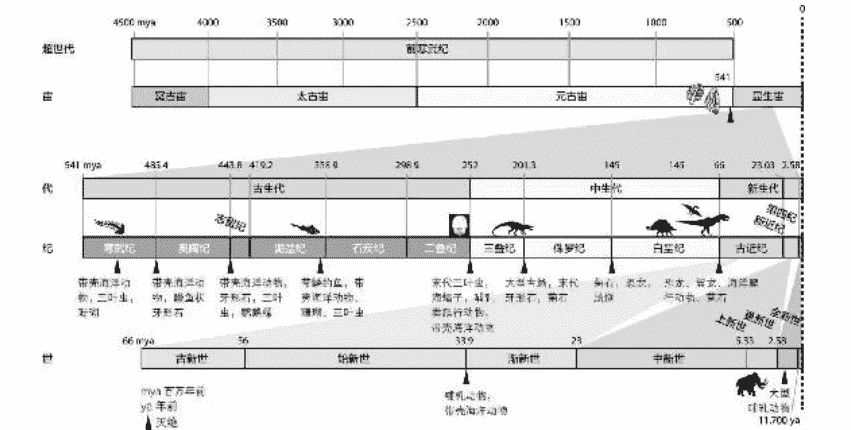

图2.1 地质年代表呈层级结构，边界由物种灭绝等众多标志界定

化石亦为关键标尺。理想标准化石需常见、演化快。如三叶虫广泛用于界定寒武纪：种类繁多，先后演化、先后灭绝，特定组合锁定特定时间窗。生物灭绝后化石骤消，提供明确界线。

现代手段还包括岩石剩磁。火成岩锁定凝固时地磁方向；地磁极历史多次倒置，正反磁周期长短不一，形成独特条码，可供全球岩石序列对比。

凭借这些标志，地质学家将岩石序列定位地层尺度，对比全球同期序列，甄选最完整、层理清晰、化石丰富的剖面，定立地质时期边界——即“全球地层型剖面和点位”（GSSP），俗称“金钉子”（详见第9章）。

### 放射性同位素钟

定位地层位置一事，给岩石打上绝对时间标签又是另一码事。最利器为基于放射性同位素衰变的放射性定年法。

天然时钟为同位素“半衰期”——一半原子核衰变所需时间。自100万原子起，半衰期100年，则100年剩半，200年剩四分一。随时间流逝，母体同位素减少，子体同位素增多。

地质定年需同位素普遍、半衰期长、与岩石年龄相当。铀、钍系最终衰变为铅，最常用铀-238（半衰期45亿年）衰变为铅-206。可靠测量误差<0.25%，亿年尺度误差约25万年，为地质年代表标校提供硬核支撑。

辐射定年虽强，难直接给出沉积岩沉积年龄。但非全无用处：熔岩流年龄夹于上下沉积岩之间，火成岩适合定年，从而限定沉积时间窗。

### 年代序列架构

早期地质学家以首现生命化石为界开启寒武纪，更早归为“前寒武纪”。虽后发现更古老生命踪迹，但两界分界线未动——以硬壳动物出现为标志。

前寒武纪跨度巨大，分三“宙”（超世代单位）：冥古宙、太古宙（“起源”）、元古宙（“早期生命”）。最近的显生宙（“可见生命”）始于5.41亿年前。

显生宙细分三“代”：古生代（“早期生命”）、中生代（“中期生命”）、新生代（“近期生命”）。地质学家对显生宙知之最详。早期按化石记录变化划分，今知多个分界对应全球灭绝事件——物种在瞬间（地质尺度下）消失。

最惨烈为古生代末二叠纪灭绝，陆海物种灭绝80%-90%，却为中生代恐龙称霸铺路。6500万年前小行星撞击终结恐龙（鸟类幸存），反推哺乳类（含灵长类）繁盛。

“代”再分“纪”，多以特征岩石或产地命名。英国地质学家功不可没：寒武纪取罗马语威尔士名Cambria；奥陶纪、志留纪取威尔士部落名；泥盆纪岩石产于德文郡。

“纪”再分“世”，多为专家领域，唯新生代因年轻、分辨率高，“世”更细。全新世仅跨越1.1万年，基本对应末次冰期冰盖消融至今。

### 地球的七大昔日奇观

地球历史波澜壮阔，今之壮丽自然特征，置于过去或显微不足道。以下为地球曾拥有的七大奇观。

#### 巍峨山脉与奔腾巨河（10亿年前）

10亿年前，大陆合一为罗迪尼亚超大陆（详见第5章），世界面目全非。生命仅单细胞水生，陆地荒芜无绿，却拥庞大河流体系与山脉。

约12亿年前罗迪尼亚拼合抬升地壳，恰似今印欧板块撞击造喜马拉雅。芝加哥大学戴维·罗利认为，风化侵蚀与重力平衡限制山峰高度，珠穆朗玛峰或已触及地球山峰高度天花板。

但规模惊人：安第斯、落基、喜马拉雅、阿尔卑斯、阿特拉斯、乌拉尔连成一线，方接近罗迪尼亚主脊规模。加拿大地调局罗伯特·雷伯德估算主脊长1.5万-2万公里，贯穿超大陆。侵蚀残迹散布北美阿巴拉契亚、苏格兰高地等地。

无植被束缚，河流在荒原任性奔流。今北极高纬无植被区存编织河系，罗迪尼亚河流规模更巨：“长宽远超亚马孙，补给内陆海水量超今任何流域。”雷伯德团队在北美另一侧3000公里外、印度、南极、斯堪地纳维亚、西伯利亚均寻获同源沉积物。

约7.5亿年前罗迪尼亚解体，裂解山脉。约3亿年后大陆重组为联合古陆，陆地已披绿装。虽联合古陆亦有绵延山脉，但罗迪尼亚式巨河或成地球史上绝唱。

#### 冰封星球：雪球地球（7亿年前）

如今赤道看冰川，须登肯尼亚山或安第斯高峰。但约7亿年前，寻觅无冰之地才是难题。

一系列“雪球地球”事件中，星球多次被冰甲包裹。最大规模为7.165亿年前开启的斯图尔特冰期。极短时间内，陆海俱没，冰层增厚至数公里。随后5500万年，地球冻结如南极，却从南极延伸至北极，真正成为一颗“雪球”。

这种认知自20世纪90年代初以来便在诸多地质学者间达成共识，源于加州理工学院约瑟夫·柯尔什维克提出的“雪球地球”假说。他指出，分布于热带纬度——如加拿大西北部那跨越赤道、距今逾7亿载的古冰川沉积——记录了一段关于1.5至3公里厚海冰封锁全球的往事。

同区域岩石也揭示了斯图尔特冰期的成因。面积超百万平方公里的富兰克林大火成岩省，形成于冰川沉积之前不久。一座超级火山喷薄而出海量玄武岩，于热带雨林中极速风化，这一化学过程大量吞噬了温室气体二氧化碳（详见第6章），致使气温断崖式下跌，极地冰盖随之萌芽。

此后事态演变迅猛。海水冷却结冰，水蒸气（强效温室气体）蒸发骤减，冰雪反照率正反馈推动大冰盖以摧枯拉朽之势席卷赤道，将那里的气温打压至-50℃，这种严寒当今仅在南极腹地可见。

或许因其戏剧张力过足，“雪球地球”至今仍存争议。部分学者倾向于温和的“雪泥球地球”说。但柯尔什维克坚持，现已同期对准的冰川沉积地理分布，足以佐证其说。

这非地球首遭全球结冰，更早的24亿年前，能分解水以驱动光合作用的微生物大量抽取大气二氧化碳，已酿成一次雪球事件。这些插曲凸显了地球气候、地质与生物圈联动的极度敏感。

回到斯图尔特期，最终海底火山渗出的二氧化碳重启温室效应，冰面裂隙敞开，雪球地球便近乎始时般迅速终结。

### 超大陆的极端面孔：灼热荒漠与超级季风（2.5亿年前）

盘古大陆便是如此一处极致之地，景观诡谲，天气更甚。地球最近一次超大陆约于3亿年前拼合，1.25亿年后开始解体。在2.5亿年前的鼎盛期，它呈巨大“C”字环伏，温暖的特提斯海藏曲折怀抱中；另一侧则是一片未被破坏的汪洋——泛大洋。

赤道附近的大陆核心是一望无际的沙漠，却空无如今地球最大沙漠的踪影。此时距毁灭性的二叠纪末大灭绝未久。一种观点认为超级温室气候持续数百万年，令盘古大陆大部内陆寸草不生。据英国利兹大学古环境学者保罗·威格纳尔言，50℃高温不过家常便饭。

这片巨大的红色沙海北界，矗立着盘古中央山脉——大陆最极致的地貌，催生了巨型季风，沿特提斯海缘推进。湿润海风登陆被迫上升，水汽冷凝成雨，季风降临。威格纳尔推测，当时海温或达40℃。炎热空气锁住更多水汽，山体坡度强迫海量暖湿气流骤升骤冷，引发洪水般暴雨，今之季风相较，仅是毛毛雨耳。

### 熔岩地狱：巴拉那-伊滕德卡大火成岩省（1.35亿年前）

欢迎来到大熔炉，即巴拉那-伊滕德卡热点。若恐龙未吞噬你，火山必困杀你。盘古大陆南部残块冈瓦纳大陆，已耗费数百万年将南美与非洲分离。裂谷作用是这场炽热灾难的诱因之一。随裂谷北移，地壳变薄；同时地幔过热物质上涌，自下烘烤地壳。最终岩浆冲破阻隔，淹没大地。

现称巴拉那-伊滕德卡火成岩省，广漠玄武岩覆盖今巴西、乌拉圭、巴拉圭、阿根廷、纳米比亚、安哥拉逾130万平方公里。总体似冰岛火山——被动、温和、鲜有爆发。但该期不时爆发系列威力无穷的喷发。火山爆发指数最高级8，被冠以“末日灾难”（超大规模之上），专指喷出物超1000立方公里者，如7.5万年前印尼多巴超级火山。此省可能在数百万年间至少发生9次“末日灾难”级喷发，据所知乃地史最猛烈喷发之一。

据南美非洲现况推算，最大单次喷发量至少8600立方公里，或达26000立方公里。若计入远飞火山灰气体，厚度足覆全英伦百米。此级事件焚烧方圆数百公里，万籁俱寂。单次熔岩流可延伸650公里。

被抛入高层大气的火山灰，体量近乎不可想象，随后数年冈瓦纳大陆笼罩黑暗。伦敦帝国理工学院萨拉·多德指出，火山灰与硫酸盐气溶胶反射太阳辐射，世界迅速陷入“火山冬天”。植物大规模死亡，食物链崩塌，无数恐龙随之殒命。

### 极地热浪：古新世—始新世极热事件（5500万年前）

过去几百万年地球持续升温，此时正处罕见行星热浪边缘，北极炎热湿润，棕榈林生长。此为古新世—始新世极热事件（PETM）。

即使未达温度极限，依旧颇暖：两极基本无冰，深海温度较今高8℃，海平面高出约70米。鳄龙在北冰洋游弋，其繁衍地如此迫近北极，意味着即便漫漫极夜，水温也不低于5℃（今北极冬季均温约-34℃）。河马状冠齿兽潜伏海滨温暖沼泽林中。

数百万年前淡水龟现身，看似怪诞，实则因北极盆地近乎全被陆地包围。河流注入，在重盐水之上形成地球最大湖泊之一。另一端或正经历酷热，水温约23℃。英国埃克塞特大学凯特·利特勒指出，PETM植被繁盛期南极现蕨类，彼地亦热。

所有升温源于大气温室气体浓度飙升，病因未明。或为剧烈火山活动，或为海底固态甲烷熔融，在巨大气体喷发中释放负荷，或为南极永冻层融化释放大量二氧化碳。无论因由，经数百万年渐暖后，气温在仅2万年内骤升至少5℃。

对深海生物是劫数，灭绝事件发生；陆地生物却蓬勃发展。东南亚茂林中，新哺乳类诞生：灵长目。酷似眼镜猴或丛婴，食虫，在极遥远未来，将演化出唯一占据地球所有角落的动物：人类。人类出现亦是唯一能触发超越PETM能量事件的物种：相似变暖量，耗时仅万分之一（见第10章）。

### 地中海的湮灭与重生：赞克勒大洪水（533万年前）

今日立欧洲大陆最南端塔里法角，直布罗陀海峡对岸摩洛哥山脉历历在目。这繁忙水道宽仅14公里，是大西洋通地中海门户，亦是非欧大陆边界最近处。

然而540万年前截然不同：唯有广阔大西洋，无地中海。取而代之是巨大盆地，盐晶闪烁，布满高盐度湖泊。盆地最低点达海平面以下2.7公里。壮观一幕：今陆地最低点死海盆地，海拔仅-430米。

墨西拿盐度危机最严重时，构造运动封闭直布罗陀海峡，切断地中海。炎热干燥气候下，海洋近乎千年蒸发殆尽。遗迹犹在，海底沿岸厚积盐石膏沉积。干旱未持久。随气候转凉湿，入盆河流将其变为湿地，称“湖海”。但西方，一场灾难正酝酿。

约533万年前，构造沉降、侵蚀与海平面上升合力重启大西洋通道。赞克勒期大洪水——以地质年代命名——或起步缓慢，数千年逐渐注满盆地约10%。但据西班牙巴塞罗那豪梅·阿尔梅拉地球科学研究所丹尼尔·加西亚·卡斯特利亚诺斯言，其终局堪比《圣经》大洪水。注入速度暴增，短短数月注满全盆，地中海日涨约10米，每秒万亿立方米水呼啸而过，是亚马孙河流量5000倍，惊心动魄。

惊人的是，此幕或将重演。入地中海河水不足补偿蒸发：它仰赖大西洋维持水位。若构造力再封海峡，地中海终将再次干涸。

### 沉入海底的乐土：多格兰（1万年前）

立英格兰东海岸克罗默维多利亚码头，北海显荒凉无趣。但回溯1万年，景象截异。全新世黎明，末次冰期终结，海平面远低于今，英伦与欧陆连接于一片肥沃平原，延伸至丹麦，名为多格兰。

多格兰被视为史前沼泽、湖泊、河流与人类的天堂。2008年，布拉德福德大学考古学家文森特·加夫尼团队利用挪威石油公司地震勘探数据重现失落世界。成果绘就覆盖2.3万平方公里地图，大致相当威尔士版图。

其南端外银坑湖，今北海海底洼地，受东部泰晤士河与西部莱茵河注水。多格兰民众聚居湖畔捕鱼狩猎采集。加夫尼形容为“狩猎采集者的黄金地段”。今北海拖网渔船偶从海床挖掘古人踪迹——如鹿骨矛头，知之甚少。

已知者，他们是气候变迁受害者。全球变暖冰川融化，海平面每世纪升约2米，渐吞低地。数千年间，多格兰化作群岛。继而约8150年前，巨大海啸袭击挪威，源于现代挪威海岸附近巨大海底滑坡——斯托瑞加滑坡。2014年研究估计，或因地震触发3000立方公里沉积物崩塌。负责研究的伦敦帝国理工学院约翰·希尔称，引发巨大海啸席卷多格兰残部。残部尽淹，希尔等认为斯托瑞加滑坡为其民敲响丧钟。最终，英伦与欧陆文化分离持续数千年。

## 3 地球内外

地球似洋葱，自土壤表层至铁质核心可分不同层位。大部分层位我们无法实地探入，却未阻探索步伐。凭借巧妙实验手法与对自然深层认知，我们揭示其隐秘。

### 向下，再向下

“7月来临前，斯卡尔塔利斯影子落在斯奈菲尔约库尔火山口，勇敢探险者从此口下，直达地心。”阿尔纳·萨克努塞姆写道。

循此文字，奥托·黎登布洛克奔赴冰岛斯奈菲尔火山，随即向地下潜入。地下深处，他遭遇深海、史前生物、闪电风暴与巨型昆虫。

这是1864年儒勒·凡尔纳《地心游记》情节。探索地球内部若如此简单便好。至今我们仅钻穿地球外壳1/3。此外，只能靠冲击波及其穿越不同密度岩石的方式推断地壳构成。

### 地震波

极具讽刺意味，最宝贵的冲击波竟源自最具破坏性的事件——地震。地质学家测量地震波从震中传播至全球各地所需时间，揭示地球分层似洋葱。外层薄薄地壳，厚度不及贴足球上邮票；下层地幔，占地球体积82%以上；更深处是极致致密炽热的地核。

地震冲击波向四面八方传播，遇不同密度岩石反射或折射。岩石密度大，压力波加速；密度小，压力波减速。通过确定地震波穿越地球的路径与速度，地质学家可推断脚下数千公里深处岩石密度与厚度。

爱尔兰地球物理学家罗伯特·马利特19世纪末开展地震学研究。研究者发现地震主要发两类波：初至波（P波），似声波，使介质交替压缩膨胀，能穿固体、气体、液体；次至波（S波），质点振动垂直传播方向，故只能穿固体，液气无刚性无法支持横向运动。

南斯拉夫地球物理学家安德里亚·莫霍洛维奇分析1909年克罗地亚地震记录时，发现四个地震脉冲。近震中仪器记录传输缓慢的S波与P波；远距离记录中，这些信号迅速消失，取而代之的是传输更快的S波与P波。

莫霍洛维奇解释：慢波经地壳上层传至仪器。快波必经下层更致密岩石，使其偏转加速。

他总结：密度从2.9克/立方厘米变化至3.3克/立方厘米，标志地壳地幔边界。此界平均位于洋盆下8公里、大陆下32公里，称莫霍不连续面，简称“莫霍面”。

### 地球内部的阴影

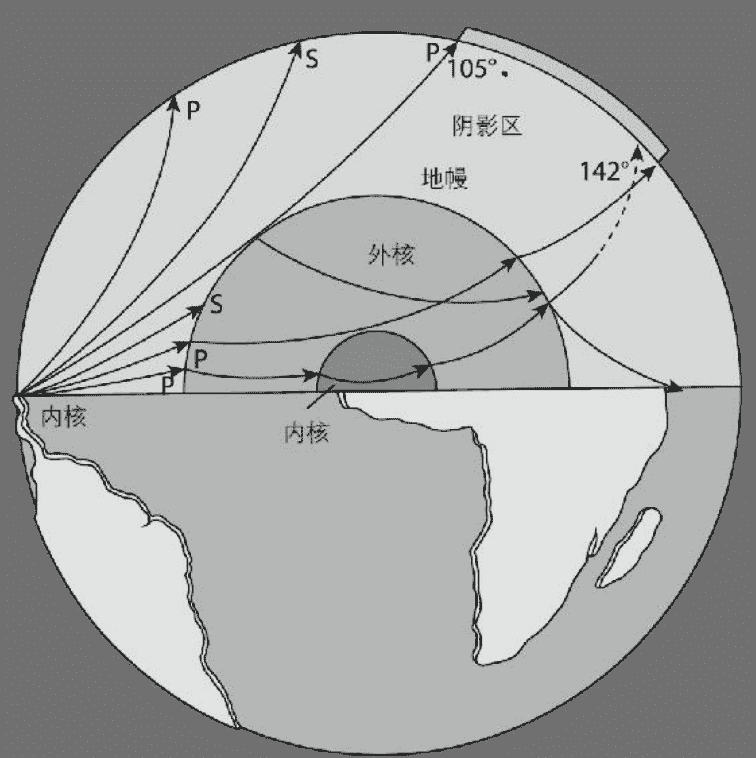

图3.1 地震波被不同密度的岩层阻挡或折射。液态的外核从震源开始以105° 投射出一个阴影

随着地震学家采集更多地震记录，他们注意到一个无冲击波“阴影区”，在距震源105°至142°间（见图3.1），142°外地震波重现。唯一解释：地震波从固体入液体，阻断S波，致P波减速折射。2900公里深处，密度从5.5克/立方厘米变化至10克/立方厘米，确认为地幔地核边界。

后来，在“阴影区”发现更微弱波。1936年，荷兰地震学家英格·莱曼提出，入地核2200公里处密度再变。此变化加速P波传播，使部分波弯曲现身“阴影区”。她断定地球深处存在极致致密固态内核，估算密度从12.3克/立方厘米变化至13.3克/立方厘米。

### 极端条件

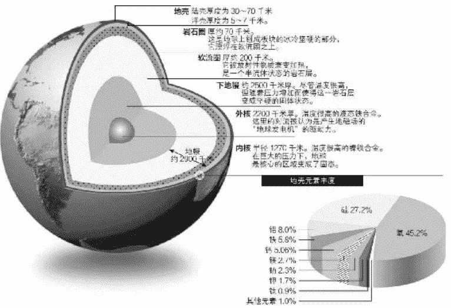

图3.2 地震勘探使我们对地球的层状结构有了很好的认识。地壳元素丰度是通过化学分析得出的结论

我们现在看到的地球图景是一系列同心层，渐聚中心（见图3.2）。两个相反因素控制密度分布。

首先是温度，使岩石软化熔融。因岩石中放射性元素衰变释放能量，地球内部大部炽热。中心温度或达3000℃，地幔-地壳边界降至375℃。其次是压力，倾向使岩石凝固。越深，上覆岩石重量越大，压力越大。

实际近寒冷地表，岩石主为脆性固体。此岩石圈含地壳与上地幔，延伸约60公里。此时地震波减慢，示密度下降。此为“缺乏强度”的软流圈，放射性热不易散失，岩石易熔融。以太妃糖稠度延伸近200公里。软流圈下，地震波在约2100公里深度内先加速后减慢。此为“中间圈”，压力克服增热，岩石变硬，只能极缓慢“蠕动”。在S波消失的地幔核边界，温度初高足以抵消巨大压力，约2200公里范围内外核为液态。但中心压力再占优势，形成半径1270公里实心内核。

### 神秘的地幔

知地球内部物理态一事，知其物质组成却是另一事。地壳可分析。大陆地区见大量硅铝，与氧结合成最常见岩石——花岗岩。海洋下、大陆花岗岩下，见以硅、铁、镁为主的玄武岩。

可确知者止步于此。占地球质量2/3的地幔，仍是未知疆域。无原始样品。虽有来自地壳下岩石达地表，但皆受污染。如称地幔结核的稀有岩石从火山喷出，显地幔由橄榄石、辉石等矿物组成，仅高压下形成，含硅少，镁铁多。

且洋底某处暴露地幔岩，但海水接触使成分巨变。无新鲜样品，地质学家甚至难确定地幔由何构成、如何形成、如何运转这些简单事实。

只能利用实验室间接证据与知识拼凑地幔理论。如硅、镁、铁存在于上地幔橄榄石辉石中，更深压力下原子重排成更致密高压矿物，改变岩石组成。下地幔矿物或分解成简单氧化物。

陨石提供进一步线索。它们由与地球同源宇宙碎片锻造。石质陨石或代表地幔物质，铁陨石代表地核物质。金属陨石主含铁、硫化铁、镍、铂、微量铱。

### 来自地下的信息

发现地幔成分将极大增进我们对地球化学组成的认知，并提供形成条件线索。探索地幔奥秘一法是利用中微子，这种不带电、近似无质量粒子——或更准确说是电子反中微子这种反物质变体——随地球深处岩石中铀、钍等放射性同位素衰变大量涌出。

同铁、硅等元素一样，铀钍存在于地球形成时的太阳星云中，虽量少，但在不同温度下浓缩为不同数量。若知多少铀钍参与地球制造，便知原始环境模样，并能估算地球内部其他物质数量。通过追踪铀钍在地幔分布，无论均匀、成片组合或层状分布，皆可洞悉星球内部动力学。

无比计算不同放射性同位素产生的“地球中微子”更佳法。因其几乎不与正常物质相互作用，这些粒子在地球内部畅通无阻，离开时能被近地表探测器拦截。然这轻质性也使中微子极易穿透探测器。捕猎需技巧与耐心。

幸而，我们花十余年开发探测器。神冈流体闪烁体反中微子探测器（KamLAND）2002年于日本中部飞驒市附近投用，由1000吨透明液体组成，被中微子击中时闪光。位地下1公里深处，以屏蔽宇宙射线μ子（其信号似中微子）。

2005年，神冈探测器捕获首个来自地球内部微弱电子反中微子信号，却被附近核电站反中微子嘈杂信号淹没。2007年升级加最大核电站暂停，地球信号得以穿透。至2009年底，已记录106个电子反中微子，携带地球内部铀钍衰变能量。

博雷西诺探测器亦有斩获，位意大利中部格兰萨索国家实验室，此较小探测器用于提取太阳核聚变中微子。结合两实验数据，仅靠地球中微子即得出首个具体地球物理预测：地幔地壳中铀钍衰变，对地球内部逸出热量贡献约20太瓦。

若想勾勒地下究貌，需通过这些数字。地球经表面辐射约46太瓦热量，源自两源：放射性衰变“放射源热量”；地球形成时粒子碰撞与铁沉入地核储存的“原生热量”。确定各源贡献对描绘地球图景影响深远。

### 深层矿物之谜

假设地幔物质对流迟缓，或热传导效率低下，那么从行星内部涌向地表的原生热流将大幅减少。如此一来，地球总热量的主要来源——高达30太瓦甚至更多——必定归功于放射性元素衰变。然而，中微子探测数据给出的数值偏低，这有力佐证了地幔物质经历了相对彻底的混合。

辐射热通量还揭示了地球整体钾含量约为十亿分之二十。裸露于地表的地幔岩石钾含量相近，这既印证了其地幔来历，也支持了整体混合说。但随之而来的是一个困惑：主导地幔上部的橄榄石，其钾含量显著高于长期被视为地球“构建基石”的顽火辉石球粒陨石。后者以辉石为主，二者矿物组成的差异引发追问：那部分富集辉石的物质究竟藏匿于地幔深处何处？抑或地球本源成分便与这类陨石截然不同？

橄榄石与辉石的比例关乎地球在太阳星云中成形的时空坐标。因橄榄石凝聚温度略高，它更倾向于聚集于临近太阳的高温区，或在行星早期高温构造阶段优先析出。

谜底尚远。受限于目前捕获的地球中微子数量，辐射热通量估值波动巨大——20太瓦的基准值伴随约9太瓦的误差，导致难以排除任何地幔成分或混合模型。仅靠神冈与博雷西诺两大探测器，恐难终结争论。

转机出现在2018年投入运行的SNO+。它坐落于加拿大安大略萨德伯里地下两千米深处，规模与神冈相当，却因岩层屏蔽大幅削弱了宇宙射线μ子干扰，且周边无核反应堆干扰。低本底环境下，SNO+有望大量捕捉地球中微子。

这仅是起点。终极目标是绘制中微子源分布图，精准刻画铀钍分布及地幔均匀度。这要求建立全球探测器网络，通过多角度、多位点观测，剥离地壳、地核贡献，聚焦地幔信号。届时，非洲与太平洋下方的“超级地幔柱”——那些解释火山异常的巨大上涌体——将无所遁形。地震波在其中减速，暗示低黏高温，若其中富集衰变元素，必成中微子亮点。

### 层层剥离：去噪与探源

干扰地球中微子信号的，不止宇宙射线，太阳核聚变与人造核反应也在列。绘制地幔活动图，必须剔除地壳与地核的“背景音”。地壳虽薄，但贴近探测器，其信号强度足以淹没地幔微光。为此，加拿大团队正详细勘测SNO+周边地壳岩性及莫霍面，量化铀钍储量及其衰变中微子产率。

地核会释放中微子吗？早期曾有假说称地核聚集足量铀，形成天然巨型裂变堆。但高温高压岩浆海洋模拟显示，亲铁元素（铁镍）下沉时，铀更倾向留在亲硅酸盐的地幔物质中，而非进入地核。

### 核心奥秘：磁场与悖论

地震学、超算模拟与极端条件实验，共同拼凑出地心图景。地核深埋2890公里，半径3470公里，分液态铁外核与月球大小的固态铁镍内核。但这非始初面貌。早期地球是未分化的“大杂烩”，重元素向心迁移。成核方式众说纷纭：或为剧烈“铁雨”崩落，或为漫漫渗流。火山岩同位素将成核时间锁定在地龄3000万至1亿年。35亿年前液态外核对流已激发磁场；15亿至10亿年前，中心冷却结晶，诞生固态内核。

一个旧谜已解：地震波在内核东半球传播更快。模拟揭示，外核液铁旋涡将核幔边界冷物质吸附于内核东侧，过去3亿年旋涡长驻亚洲下空，致使东侧增厚约百公里。这或影响磁场稳定性，甚至诱发磁极反转（详见第4章）。反转瞬间，磁屏障失效，高能粒子直扑大气，后果或毁电子设备，或蚀生存层。祸福难料，因无人知晓下一次反转何至。

### 磁场发电机：一场未解的悖论

地磁本质是液态外核电流驱动的自我维持发电机。理论简洁，实则暗藏悖论：新近证据暗示发电机机制属“新生事物”，但古老岩石磁化记录证明磁场伴随地球大半历史。主流叙事是：早期冷却引发热对流（热流上升、冷流下沉），启动发电机；后内核结晶析出轻元素（如硫、氧），驱动成分对流，双引擎共振维持至今。

麻烦源于热导率。对流赖温差驱动，良导体迅速均温扼杀对流。2012年双模型预测，外核热导率为旧认知两倍；2016年广濑敬团队高压实验证实。推论惊人：若热导率如此之高，热对流在内核诞生前（15亿年前）便无法维持，磁场理应随之熄灭。

可地质铁证摆在面前：34.5亿年前火山岩已记录磁场。当热传导与成分对流双双失效，发电机靠什么转？

### 破局者：第三种对流

加州理工戴维·史蒂文森团队提出第三条路径：聚焦核幔边界。随温降，溶于铁中轻元素析出、渗入地幔，留下致密液铁下沉，驱动对流。驱动元素是谁？镁难溶于铁，易析出，但需地球形成期巨大撞击热量才能先溶入；硅储量大、易结晶（广濑实验证实二氧化硅在核压力下自发结晶），被视为最有力候选者。

也有异见：地球摆动晃动熔铁，或月球引力拽动液核（似潮汐），驱动发电机。但非主流。新型对流机制虽存希望，能否独力解悖论仍待检验。好在前沿进展神速，答案或不远。

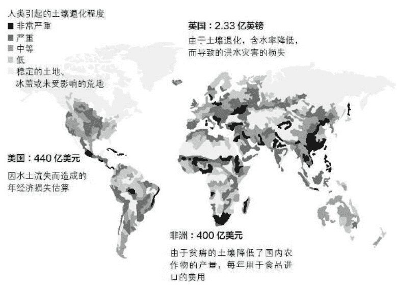

图3.3 世界每年流失一块路易斯安那州大小的健康土壤，经济代价沉重。

### 脚下的薄皮：土壤的生死攸关

下潜深层时，我们跨越了一层无法绕开的“外衣”。它虽触手可及，却常被忽视。没有土壤圈，植物难存，食物链基座崩塌，陆地生命将不复存在。

行星视角下，土壤是覆盖陆地的巨大界面带，大气、水、生物、岩石四圈于此交汇互构。它既是交汇点，更是相互作用的产物。成分上，一半是风化岩屑矿物，一半是生物残骸腐解物；结构上，固体与孔隙各半，孔隙藏水纳气，随湿干动态变迁。

成土作用繁复：冻融循环、风水冰雕琢物理破碎；化学风化重塑矿物；生物分解积累有机质；溶质迁移再沉淀。其核心功能——维生，源于它提供庇护、食物与水。微生物、蚯蚓、植物根系编织地下食物网。植物所需氮磷钾钙，由风化释放与有机矿化供给，经土壤溶液经根系吸收。

### 消逝的沃土

成土受母质、植被、气候、地形制约，造就万千土壤面貌。分类以垂直剖面特征为基，精细度堪比生物分类。仅美国即编目超两万类。然惊人消亡正发生：联合国2015年报告警示，逾三分之一地表层濒危，大多处中等至极度贫瘠。年蚀失表土400亿吨，养分枯竭，人为盐渍化侵蚀76万平方公里（相当巴西耕地总和）。

若不遏制，全部耕地土壤或将在60年内耗尽。考虑到95%食物仰给土壤，且其以更多隐性方式托举文明，土壤退或是人类面临的最严峻环境危机。

### 极端耕作：用炸药唤醒土地

美国西部主产区的质地突变硬磐夏旱淋溶土，濒临灭绝。它几乎不耕，因极易板结成致密硬盘，拒根拒水。绝望的农民祭出炸药炸碎硬盘——一种荒诞却真实的“土壤安乐死”方式，仅是无数毁灭路径之一。

### 隐形守护者：抗生素库与碳汇

土壤退化是慢性灾难，科学家长鸣警钟，认知却未随之觉醒。克重土壤可藏亿级细菌、千万病毒、千种真菌，这微观“动物园”供给近乎全部抗生素，是对抗超级细菌的希望。健康土壤更能抑制病原菌。

土壤亦是气候调节器。线虫微生物分解尸枝落叶，锁定碳于地下。即便退化状态，全球土壤碳储量仍是大气三倍。退化引发洪涝：英国2012年报告显示，土壤劣化导致的洪灾年损2.33亿镑。

### 元凶：化肥依赖的恶性循环

生态学家忧心忡忡，最大推手是农业。野外养分随枯亡归土成腐殖；耕作打破循环，收获带走养分不归。祖先知轮作休耕、豆科固氮平衡地力。然人口膨胀与机械化逼退传统。20世纪初哈伯法合成氨提供“便捷”氮源，化肥时代开启。

数十年实践证明此路不通：一氧化二氮增温，氮磷流失致富营养化，酸化盐碱化土地，抑制菌根共生，甚至诱发有益菌群内斗。化肥本为补养，实为毒药——它掩盖退化真相，制造“肥料依赖症”：地力越弱，施肥越狠。

### 破局之道：智能肥料与微生物方案

大规模退耕还林不现实，出路何在？

一、智能肥料精准投喂。植物缺氮时分泌特定信号招募微生物矿化有机氮。蒙雷亚尔团队（卡尔顿大学）破译五种关键信号分子，研发“核酸适体”支架肥料：信号分子到达，适体结合触发支架解体，养分按需释放，杜绝流失与毒害。

二、接种微生物群重塑地力。荷兰树木专家弗洛里斯先驱实践：配制有益菌、菌根真菌、腐殖质“通用配方”附着根系助吸收。沙漠化试验田对比显著：接种区根叶健健壮壮，常规肥药区矮小病弱。

创新虽光，杯水车薪。需全球协同行动。查斯克团队（国际可持续发展研究院）倡议“土地退化零净增长”目标，仿“碳中和”模式，立简明指标，聚合蒙雷亚尔、弗洛里斯等创新实践，倒逼政策与公众觉醒。

## 4 板块拼图：地球表面的动态密码

板块构造学说，简洁得近乎显而易见。令人讶异的是，它直至60年代才被接纳。从此地质学完成范式革命——不再是分类编目的标本学，而是可预测、可检验的过程科学，正如达尔文重塑生物学。

### 简洁而深刻的范式

地球外壳由数块刚性板块漂浮于黏性地幔之上，相互挤压摩擦。这一核心图景，解释了洋海开合、山脉兴衰、大陆离合，揭示了火山地震的时空密码，造就了油气矿藏成矿的高温高压炉，更通过板块与水碳循环耦合，恒定气候、孕育宜居。

### 从大陆漂移到板块构造的证据链

17世纪培根敏锐发现大西洋两岸轮廓如拼图吻合。后定居者见美洲煤层与欧洲对应，科学家寻获两岸同种化石。大陆曾合一、今漂移的念头浮现。1912年魏格纳命名“大陆漂移”，苦于无动力机制，遭嘲讽。1928年霍姆斯臆测上地幔对流；赫斯继之提出“海底扩张”：对流托举岩浆劈裂洋壳，喷出冷却铺成洋中脊。

质疑声中，60年代洋中脊磁力测量扭转乾坤：洋底玄武岩呈现平行脊轴、两侧对称的磁化条带。解释铁板钉钉：岩浆凝固锁定当时地磁方向；新岩浆劈开旧壳；地磁一旦反向，新条带磁化方向便相反。配合“离脊越远岩石越老”事实，海底扩张、大陆分离成定论。

1965年威尔逊融合漂移与扩张，确立“活动带与刚性板块”统一概念；1967年引入“俯冲作用”（逆冲）——一个板块潜入另一块之下（详见第1章），板块构造大厦终告落成。

# 板块拼图：地球表面的动态革命

地球外层的岩石圈并非一块完整的硬壳，而是由七大板块与众多小板块拼接而成的马赛克。它们漂浮在炽热、部分熔融的软流圈之上，缓慢漂移，并携带着大陆与海洋一同位移。

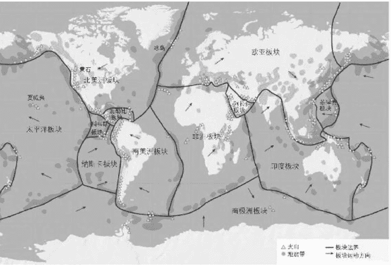

图4.1 火山与地震带的分布，勾勒出了构造板块的边界轮廓

### 破解板块运动的几何密码

1967年，“爱之夏”在旧金山燃烧，嬉皮士们高唱反主流文化；与此同时，在加州南部，一位年轻的地质学家丹·麦肯齐正埋首于一项将重塑地球科学的数学难题——板块构造的运动学本质。

身在剑桥大学的麦肯齐突然顿悟：**板块是刚性的**。这看似平常的认知，实则打开了新世界的大门。既然刚性，板块便可被抽象为球面上的几何图形。他与同事鲍勃·帕克应用18世纪瑞士数学家欧拉的定理，证明了两个板块间的相对运动，本质上是绕着一个固定轴心的旋转。

这一数学模型完美契合北太平洋的地震分布数据，不仅验证了运动的真实性，更揭示了地震的成因。这是拼图的最后一块：人类首次能精确描绘每个板块相对邻居的运动轨迹。地球表面被一层刚性“壳片”覆盖，它们拥挤、碰撞、滑动，永不停歇。

几乎同一时间，素未谋面的普林斯顿学者杰森·摩根独立得出同一结论，并率先在1967年公开演讲，更清晰地划分了三类板块边界：生成新地壳的大洋中脊、吞噬地壳的海沟、以及仅位移不增减物质的转换断层。学术界公认这是双人共同的功劳，而麦肯齐大度承认：“摩根比我更早看透这一切。”

### 边缘是舞台，内部是后台

板块内部刚性十足，剧变只发生在边缘。在这里，板块或分离、或汇聚、或错动，勾勒出地球最剧烈的面容——地震与火山，精准标定了板块的界限。

在**大洋中脊**，岩浆源源不断涌出，推动板块像传送带般向两侧扩张。中脊实质是一条绵延不绝的水下火山带，伴随浅源地震频发。

在**转换断层**带，板块横向擦肩而过，积累应力后猛然破裂，引发浅源强震。加州圣安德烈亚斯断层便是典型：北美板块南行，太平洋板块北上，剪切应力不断积聚。

最壮烈的是**汇聚边界**的正面碰撞。岩层褶皱成山，深海海沟裂开。密度更大的洋壳俯冲入软流圈“回炉重造”，这解释为何海洋地壳寿命极短，超4亿年的罕见。俯冲板块在幔中弯曲下沉，温度滞后引发一系列深源地震，直达700公里深处，直到升温软化不再脆性破裂。

并非所有物质都随板块下沉。大陆边缘如同刮刀，刮去俯冲板顶的沉积物堆积成陆（如日本部分岛屿）。俯冲板携带的水、二氧化碳等挥发分上涌，降低地幔熔点诱发熔融，岩浆穿透地壳喷发，催生了日本列岛的火山链。

### 火山的多重面孔

**俯冲带火山**排列成带，平行于海沟，构筑环太平洋“火环”。洋壳俯冲造就岛弧（如阿留申群岛），大陆边缘俯冲则形成安第斯式火山带。

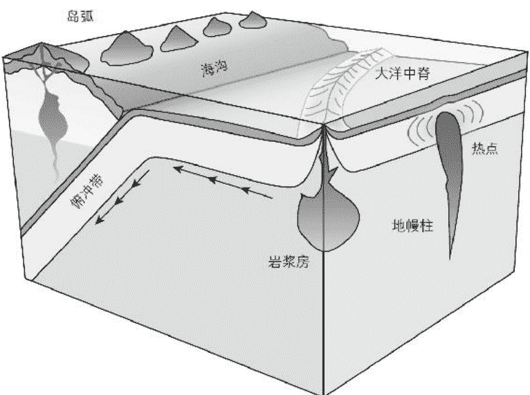

图4.2 洋壳诞生于中脊，毁灭于俯冲带。若俯冲于另一洋壳之下，便形成火山岛弧

**热点火山**则打破边界规则。夏威夷群岛及延伸至西北的天皇海山链，记录了太平洋板块滑过地幔深处固定热柱的轨迹。纸张滑过蜡烛焰留下焦痕，便是这链火山的生动写照。大陆热点（如黄石）同理。

喷发风格千差万别，取决于岩浆**粘度**与**挥发分**：
*   **低粘玄武岩**（夏威夷、冰岛、中脊）：气体易逸，溢流为主，形成熔岩湖或火柱。
*   **高粘流纹岩/安山岩**（俯冲带常见）：二氧化硅聚合成网络锁住气体，压力积聚至临界爆炸，喷发火山灰、浮石、火山碎屑流。
*   **水蒸气爆炸**：地下水闯入高温岩体瞬间汽化，体积膨胀千倍，炸裂围岩。

### 火山预警：从盲目到透视

人类预测火山爆发的能力正质变。1991年皮纳图博火山大喷发前三月，震动与蒸汽喷发促使6万人撤离，救下无数性命；2017年巴厘岛阿贡火山亦因地震与火山灰信号疏散4万人。

监测手段日臻精密：倾斜仪与GPS捕捉地表鼓胀；海底声波（次声）穿越岩浆室减速，精准预报留尼汪富尔奈斯火山喷发；甚至天气也能助力——阿拉斯加巴甫洛夫火山秋冬多发，因风暴堆水增压，像挤牙膏般逼迫岩浆上涌。虽非全知全能，但“盲人摸象”已成过去。

### 地震：从神罚到弹性回跳

远古文明将震动归咎于神灵或地下风（亚里士多德、普林尼）。1750年英伦连震、1755年里斯本大地震唤醒科学理性。19世纪末，焦点从“波如何传播”转向“为何破裂”。

1906年旧金山地震后，哈里·菲尔丁·里德利用三角测量数据，奠基**弹性回跳理论**：断层两侧岩石弯曲积存应能，超限撕裂瞬间回弹，释放地震波。

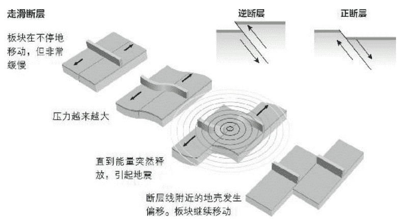

图4.3 弹性回跳理论演示：板块运动致断层应力积累与突然释放

半个世纪后，板块构造学说终揭根本动力：**绝大多数地震源于活动板块边界的应力堆积**。冰期回弹等次要因素贡献能量不足1%。

### 量震：从主观烈度到客观矩震级

早期靠**烈度**（罗马数字）描述灾害程度，主观但利于研究历史地震（如2011年弗吉尼亚地震14万网友填报“我感觉到了吗”）。

伍德-安德森地震仪让仪器记录成为可能。里克特借用天文“星等”概念，建立**里氏震级（ML）**：对数尺度，每增1级能量增~30倍，7级比5级强近千倍。但ML针对加州局部小震，有上限且饱和。

20世纪60年代，日本学者安艺敬一引入**地震矩**（μ×滑移量×破裂面积），完整描述震源规模。由此衍生的**矩震级（Mw）**无饱和、物理意义明确，成为现代标准报道值（媒体常称“里氏”，实为矩震级）。

### 震动实感：不只看大小

同级地震，破坏力天差地别。三大控制因子：
1.  **震源特性**：深度、断层走向、破裂速度、是否破至地表。
2.  **路径衰减**：加州、土耳其地壳破碎热、波衰减快（1906年旧金山震32公里外仅倒一烟囱）；中美东部、印度盾地稳定冷、波传播极远（1811新马德里震醒400公里外睡梦中人；2011弗吉尼亚5.8级震感及1500公里外明州）。
3.  **场地效应**：软土放大波幅。1985墨西哥8.0级远震致墨西哥城湖底沉积共振毁灭；2010海地地震山脊地形聚焦波能加重灾害。

**地震微区划**绘制城市危险度图谱，指导规划与抗震设防，是“养兵千日，用兵一时”的工程基石。

### 海啸：海底的巨浪拳

海底地震位错抬升海底，位移水体发动海啸；海底滑动亦可致之但规模较小。深海中波长百公里、波高仅米级、时速媲美客机（~800km/h）；进浅水能量聚焊，波高暴涨，毁灭海岸。

### 地震的多米诺骨牌效应

**误区**：大震非整个板块整体跳动。板块以指甲生长速度蠕动，应变只集中在狭窄边界带。

**余震**：最大余震通常比主震小1级（巴斯定律），聚集于破裂带周边，也可跳至邻近断层。2011基督城6.1级余震因震中极近市区，破坏远超7.0级主震。

**触发**：
*   **静力应力传递**：断层滑动机械推挤邻近断层至临界。1992年加州约书亚树6.1级触发35公里外兰德斯7.3级。
*   **动力应力触发**：地震波远距离扰动流体系统（火山、地热区），诱发小震。

远程触发多为微震，末日论不攻自破。但断层网络的相互作用远比“前震-主震-余震”线性模型复杂迷人。

### 我们能预测地震吗？长期“会”，短期“不会”

地震学家常答“不能”，实指**短临预报（时、地、级精确到天/时）**不可行。但**长期预测（概率预报）**已相当成熟：
*   知**哪里震**：俯冲带（百米滑移、千公里破裂）、一切活动边界。
*   知**多大震**：海地恩里基约断层积存应变足释7.2级（2010年前预警）；海沃德断层积存应变够造7.0级，平均150年一发（上次1868年）。
*   不知**何时震**：重现期波动大（80-220年），地质瞬间vs人类一生，焦虑源于此。核心难题非科学认知，而是如何争取政治资源为“概率中的必然”备灾。

### 为什么短临预报是“科学圣杯”却遥不可及？

70-80年代曾乐观：苏联声称成果、中国海城7.3级“成功预报”（含前震序列、异常观测及决策幸运）。此后陷入长期悲观。

探索过的前兆：前震序列、电磁异常、氡气释放、地下水化学……看似曙光，实则**不通过严格检验**。
2009年意大利技术员朱利亚尼凭氡异常预警拉奎拉大震，遭官方斥责；事后虽应验，但氡气前兆极不可靠——有震不报、报不震、巧合难辨。回顾性分析易陷**数据选择偏差**陷阱：已知震时回溯，总能找出“显著模式”。

**动物预感**亦是幸存者偏差：动物对微弱初动（P波）或非地震刺激反应频繁，事后归因才成“神兽”。

地震学家未放弃前兆研究，手段日益精深（InSAR、流体动力学模拟、机器学习）。但预测的核心困境在于：**地震是临界点系统的非线性失稳，微小扰动与巨大后果缺乏确定性映射**。在彻底攻克前，概率预报与工程减灾，是人类最理性的防线。

### 地震预测的困局与地球深部的隐秘动力

当前，主流地震学界对地震预测普遍持怀疑态度，但这并非最终定论。学科核心难题依然悬而未决：地下深处究竟发生了何种变化才触发地震？这或许关乎某种缓慢的“成核”机制，意味着前兆信号客观存在。摆在所有预测研究面前的关卡是：如何摆脱“复盘历史”与“搜集轶事”的窠臼，跨入统计学严谨把关的科学殿堂。

#### 认知的转折：板块理论的盲区

板块构造学说虽是公认正统，却非完美无缺。它对板块边界之外的地震解释乏力，也未深究深部事件如何波及地表。仅凭现有认知，难以精准推演大陆未来的漂移轨迹。庆幸的是，新视角正不断涌现，试图填补这些空白。

#### “错位”的震动：板内地震之谜

回溯200余年前，1811年末至1812年初，密西西比河湾区接连遭遇四次7至8级强震。震中位于今密苏里州新马德里镇，此处地势低平、泥沙堆积，距典型板块边界千里之遥。终末那次巨震甚至让密西西比河倒流、喷沙涌泉，形成了今日的里尔富特湖。

这绝非孤例。史载死伤最惨重的1556年华县大地震（陕西），2011年美国弗吉尼亚5.8级地震，以及印澳内陆近期地震，震中均远离板块边缘。这些“板内地震”敲响警钟：地震威胁或不止旧金山、洛杉矶等板缘城市，纽约、悉尼、伦敦等内陆大都市同样潜伏险境。

加州圣安德烈亚斯断层是板块摩擦释能的教科书式案例，北美与太平洋板块以每年数厘米相对滑动。而新研究显示，撕裂板块的巨大张力虽未在内陆撕开全层裂口，却留下了隐蔽的“软肋”——这些区域表象平静，实则更易在应力下屈服。虽应力积累较慢、发震频次远低于板缘，但一旦破裂，破坏力不容小觑。

20世纪80年代，科学家揭示新马德里坐落于一处“衰退裂谷”——里尔富特裂谷之上。这条隐伏于美中南部地下的古老伤疤，近千年来呈周期性活动。证据来自“液化沙丘”：强震将饱和土壤瞬间液化喷射成微型泥火山。新马德里平原散布着200年前遗迹，地下深处更锁着公元300年、900年、1450年的强震记录。

美地调局预警：未来半世纪，新马德里发生6级以上地震概率达25%-40%，重现历史级巨震几率7%-10%。彼时人烟稀少，今非昔比，一旦重演后果不堪设想。风险或不止于此：孟菲斯北侧隐伏45公里长断层，阿肯色州又现10公里长玛丽安娜断层，潜在影响范围远超已知活动断层。

但也有反对声。西北大学塞思·斯坦团队20年GPS监测显示，新马德里地带并无显著应变积累，不像圣安德烈亚斯断层般“蓄势待发”。他推断该区正处“深度休眠”，未来数百上千年或将沉寂。

#### 游走的地震：断层网络的“接力赛”

斯坦据此抛出争鸣观点：板内地震非板缘地震的“低频翻版”，而是**无规律、成簇、会迁移**的。地震能量可在贯穿板块内部的微小断层网中“跳跃转移”。美中西部深处，新马德里的活动终将让位于印第安纳地震带，继而南移至阿肯色。

密苏里大学刘勉的中国北方2000年板内地震编目印证此说：震中随机跳跃，活跃区归寂，沉寂区骤醒，呈现“跨越长距离的空间迁移”。断层间存在力学耦合，一处破裂改变别处对未来应力的敏感度。

若属实，认知将重构。2011年弗吉尼亚地震震中虽在中部地震带，历史仅多发3级小震，主流曾判定大震无望。但若引入“能量迁移说”，罪魁祸首或为邻近西魁北克带（1944年5.6级）、东田纳西带（近期两次4.6级）输入的应力。

警示直指核心：波士顿、芝加哥、纽约均在险境。1580年多佛尔海峡5.7级地震震倒150公里外伦敦教堂尖顶，2007年同区再震4.3级。虽现代摩天楼抗震设计足御5-6级，摇摆消能，但文物古迹、无筋砖砌老建筑、电力通讯水燃“生命线”设施极易受创。

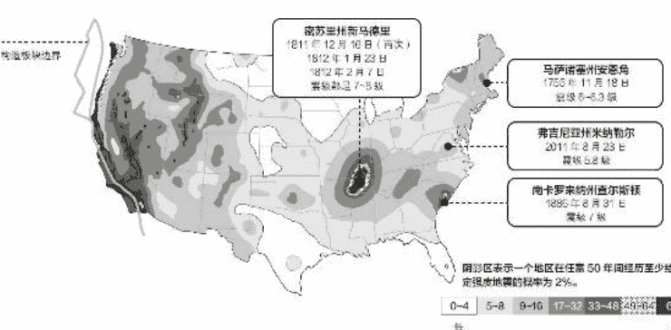

图 5.1 根据历史数据绘制的美国大陆地震风险图显示，远离板块边界的地方仍然可能发生地震

地震学家渴望寻得板内活动规律。美境内平均每三州便有一条衰退裂谷，为何唯独里尔富特裂谷等寥寥几处成“地震温床”？谜题未解，便只能假设：板内地震，无处不在，随时可能。

#### 地幔柱：穿透深浅的热力引擎

不止地震“越界”，火山亦然。板块构造先驱贾森·摩根70年代即敏锐察觉：夏威夷群岛火山活动，非板块理论所能解释。群岛距太平洋板块边缘数千公里，主流理论只能归因“板块薄弱点被动富集热物质”。摩根复活了约翰·图佐·威尔逊的旧想：**一股源自下地幔、近核幔边界的热柱，主动冲击地表**。

此说曾逆潮流而动，直至80年代地震层析成像揭示深部结构，风向始变。地震波照出复杂动态地幔，最震撼的是核幔边界两大“热化学异常体”（LLSVPs）：南太平洋、非洲脚下各踞一座，宽数千公里、热且稠，持续喷涌上涌物质。

超级地幔柱解释了南太平洋海底隆起千米之谜，却难解非洲超级柱下的刚果至南非隆起带（含马达加斯加）。冰岛、夏威夷下方捕获到的微柱特征，或揭示岛屿火山成因。阿根廷近海海底俯冲千米、刚果盆地相对低陷，均对应地幔冷下沉流。**几乎处处可见证据：地球内部垂直对流，正持续重塑表面地貌。**

#### 深部博弈：俯冲板片与地幔柱的共舞

机制细节仍存争议。标准说认为俯冲物质在浅上地幔循环，经洋中脊或远端火山回归。但地震剖面显示：俯冲板片穿透上地幔，直抵下地幔（见下图）。

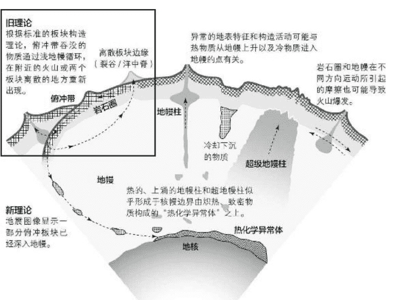

图 5.2 地震图像表明，深部地球的活动对地表特征有重要影响

奥斯陆大学伯恩哈德·斯坦伯格模拟显示：俯冲板片抵达核幔边界后铺展铲平，撞击热化学异常体激发地幔柱。模型成功复现阿留申俯冲带触发夏威夷热柱、供能夏威夷火山的链条。

夏威夷大学克林特·康拉德团队模拟地幔逆流对板块的剪切效应：特定条件下引发物质熔融上涌。精准预测东太平洋海隆西侧（而非东侧）现海底火山——实测证实西侧地幔与板块逆向流动，东侧则否。模型还指向美西、南欧、东澳、南极等远离板缘的火山带，皆为剪切效应最强区。

#### 超越板块说：深时地球的“主谋”

若今之深部动力学能塑地貌，昔日必然亦然。但破译远古地球史步履维艰。

2011年，剑桥大学尼基·怀特团队在苏格兰西岸海底钻取“时光胶囊”：5500万年前化石层下，埋藏着完整的古山丘、古河谷网络。河流演化分析显示：该区曾在百万年内被抬升近千米、复又沉降掩埋。板块构造驱动造山侵蚀需千万年量级，太慢。怀特指向冰岛地幔柱径向外扩的热物质团——或为真凶。

澳大利亚东部白垩纪同期亦现陡峭垂直起伏。简单板块说失效，对流地幔才是“幕后主谋”。

连标志性造山事件亦存隐情。喜马拉雅山脉诞生于3500万年前印欧碰撞，但板块说难解印度板块为何曾以年速18厘米“狂奔”（现仅8厘米）。争议性解释指向：地幔柱头顶推一把。

美中西部新马德里周期性巨震，亦可用古法拉龙板块解释。白垩纪以来它沿美西海岸俯冲入幔，19世纪深度适配，拉沉密西西比中游、变形上覆岩石圈，引爆新马德里序列。

质疑声未息：地震波在浅部热点下减速，却未延伸至核幔边界柱源区。支持者坚信：时间与更精成像终将回应质疑。

若“狂热者”言中，**板块构造非地球演化独角戏**。地质学或将迎来与板块革命同等级的范式易位。

#### 下一个超级大陆：拼图的四种解法

板块驱动大陆缓慢漂流，貌似可预测未来版图。实则“预言家”众说纷纭，终极拼图形态与成因分歧巨大——关键细节仍缺失。

海底磁条纹、古山脉化学指纹揭示：1.8亿年前“联合古陆”（盘古大陆）聚合，中心约在今非洲。3.3亿年前合拢；更早有“潘诺西亚/大冈瓦纳”（南极附近）；再早“罗迪尼亚”（12-7亿年前）；约20亿年前或存另一超陆。周期性聚散，预示未来必有新超大陆。但**如何聚？聚于何处？**

##### 方案一：新盘古大陆——惯性外推

沿用当前运动趋势：裂谷持续扩张，大西洋增生，太平洋被火环吞噬。约2.5亿年后，美洲与亚洲绕澳北上，在盘古大陆对抗面拼合成“新盘古”。

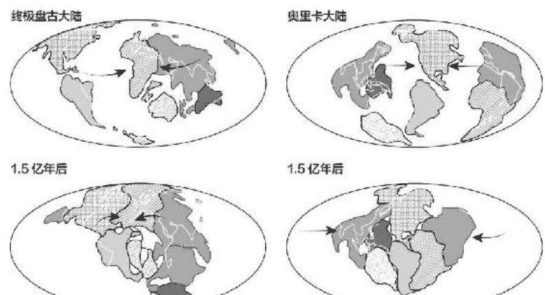

3 亿年后大西洋西侧俯冲启动关闭，北美贴合非洲西岸，南美旋转锚定新超陆南部。

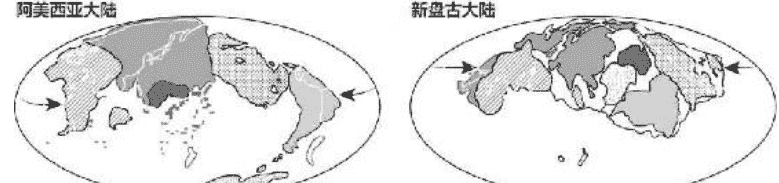

3 亿年后双向俯冲，大西洋太平洋双闭合，欧亚裂解东西奔赴，掠过澳洲，在今太平洋位置聚合。

2.5 亿年后大西洋持续张开南部更宽，非洲西移、澳洲北上、南美旋转贴美东、南极孤悬。

2.5 亿年后现制延续：大西洋张、太平洋亡，南美西北挤压南极澳洲，非洲连欧逆时针旋合阿拉伯。

图 5.3 科学家已经预测了未来大陆聚集可能存在的至少四种不同的形状

西北大学克里斯托弗·斯科塞斯警示：5000万年内或可预测，更远需透彻掌握仍在探索中的板块细节。他自1982年起绘制古今未来图，**核心准则：俯冲带“拉”力主导，洋中脊“推”力次之**。算清俯冲与洋脊布局，便知大陆如何被拖拽推动。

三大“灾变”可打破平稳演化：
1. 俯冲带吞噬洋脊（如今胡安·德富卡脊）。
2. 双大陆碰撞吞俯冲、隆喜马拉雅（印欧碰撞）。
3. **新俯冲带诞生**——最难懂、最难测。旧俯冲带终将在大陆碰撞中消亡，若无新生，板块运动将终止。但地球历史周而复始，超大陆循环往复，新俯冲带**必会**启动。

##### 方案二：终极盘古大陆——被动边缘的“病毒式入侵”

新俯冲最易诞生于**被动大陆边缘**（大西洋式）：古老冷却、致密的洋壳想沉却碍于强韧难裂、沉积物重压不足、渗水弱化有限。斯科塞斯认为：局部应力聚集是撕裂关键，“突破口”一开，俯冲如病毒蔓延。

西大西洋已有两小俯冲萌芽：小安的列斯火山弧、斯科舍岛弧。斯科塞斯预言：它们将南北延伸，合围美洲东岸成巨型俯冲带，约1亿年后吞噬大西洋中脊，大西洋逆转闭合。2.5亿年后，美洲撞击已合并的非洲-欧亚，携澳洲、大部南极，拼成**“终极盘古大陆”**。

##### 方案三：阿美西亚大陆——极地漂移的“正交规律”

2012年耶鲁大学罗斯·米歇尔团队提出新径：超大陆聚合伴随质量再分布，改变地球转动惯量张量，导致真极漂移（TPW）。古岩石磁性矿物记录显示：罗迪尼亚聚合位置距最早超大陆约90°；盘古大陆距罗迪尼亚亦约90°。**正交跃迁**或为铁律。

下一个超大陆应聚于北极附近，亚洲北美汇聚于此，命名**“阿美西亚大陆”**。

##### 方案四：奥里卡大陆——拒绝“过期海壳”

里斯本大学若昂·杜阿尔特批前三者皆有硬伤：阿美西亚、新盘古将被4亿年以上超老洋壳包围，地质记录不支持。布拉德利2008年考证：古老被动边缘岩石平均寿命1.8亿年，鲜有超4亿年。**大西洋式洋壳寿命约2亿年，到期必启俯冲。**

终极盘古虽无老壳困扰（太平洋持续生灭），但杜阿尔特反驳：胡安·德富卡脊已被俯冲，太平洋闭合受阻。

杜阿尔特认同“俯冲入侵说”，发现**地中海古老俯冲余力正驱动葡萄牙近海洋底裂解，新俯冲萌芽已现大西洋东岸**。这或是下一个超大陆拼图的真实起笔。

## 杜阿尔特的未来图景：大西洋闭合与亚洲裂解

在杜阿尔特2016年的推演里，俯冲带将在未来数千万年里沿着大西洋两侧蔓延，迫使这片海洋走向闭合。太平洋的收敛亦将持续，代价则由亚洲承担：喜马拉雅高原将在自重下崩解，一道巨大的裂谷将从印度洋贯穿至北极，劈开整个大陆。新生洋盆由此诞生，最终拼凑出一个新超大陆——两半亚洲分居两翼，美洲与澳大利亚镶嵌中央。

斯科舍斯评价这“尝试不错”，但指出一大难题：关闭大西洋意味着必须俯冲其中洋脊，然而若两侧均有俯冲带，洋脊本可稳居中央、向两侧输送地壳物质。

这四种假说的拥趸皆承认：未来充满变数，模型仅是“最可能”的一种推演。无论鹿死谁手，人类后裔终将面对一个形貌诡异的星球，并在适应中被其重塑。

## 6 大气、气候与天气

地球引力锁住了一层厚达数百公里的气体外衣。临近太空边界处，大气呈现奇特的电磁特性，但我们的焦点集中在底部10公里——这片可呼吸的薄皮，是生命的摇篮、天气的舞台，亦是维系地质与气候化学循环的关键枢纽。

### 大气从何而来？

大气成分历经沧海桑田。早期原始气体必被幼年太阳的狂暴恒星风剥离殆尽。虽有彗星撞击带来气体，但主力源头当属火山喷发。现今火山排放物中，水蒸气占64%，二氧化硫10%，氮气1.5%。

成分随时间重写。幼年地球降温，水蒸气凝结成海，海量二氧化碳溶海沉淀为厚厚石灰岩。无处可去的惰性氮气便在此时悄悄累积。

氧气呢？前20亿年大气几乎零氧。直到早期生命进化出“以水为电子供体”的光合作用，剧变骤发——那场地球史上最大规模“屠杀”彻底重塑了大气（详见第8章）。

至6亿年前，大气版图基本定型：按质量计，氮气75%，氧气22%，水蒸气1%，氩气1.3%，二氧化碳、氖、氦及臭氧、氡、氢、一氧化氮等痕量气体合计不足0.1%。

### 自下而上的热力学

底层大气分层叠加：贴地面的是对流层，上覆平流层。对流层主导天气气候，与生命联系最紧。

热量主要源自太阳电磁辐射（地热微乎其微）。阳光能量集中在可见光波段（0.4-0.7微米），穿透大气直抵地表，温暖大地。

紫外线占太阳能7%，波长更短，被平流层氧气与臭氧吸收，直接加热该层。波长更长的红外线占比极小，虽被大气吸收，但对增温贡献有限。

关键在于“自下而上”：地表被晒热后，通过传导与红外辐射（被水蒸气、二氧化碳捕获）向上传递能量。

红外辐射暖空气，空气再向四面八方发射红外。一部分回辐射地表，托举温度——即温室效应（见第10章）；其余层层吸收再辐射，最终逸散太空。

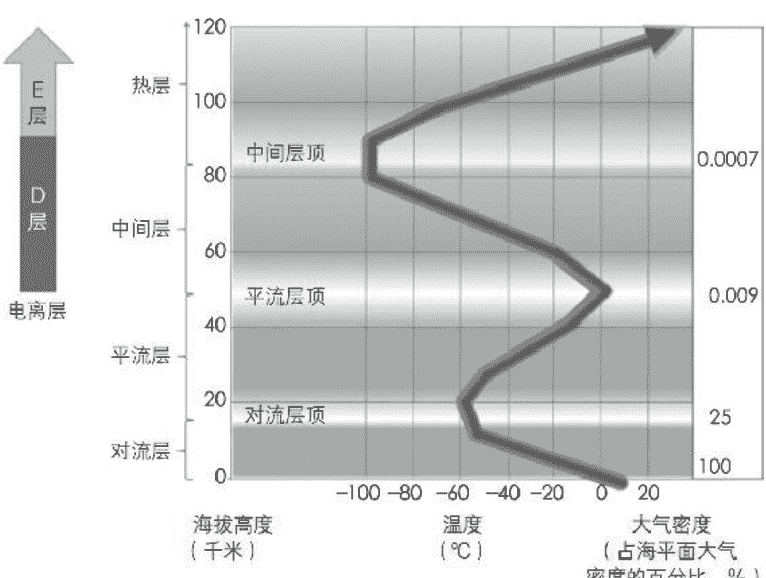

图6.1 按温度垂直分布划分大气层结�

对流层热力驱动暖空气上涌，这是天气演变与大气环流的引擎。但上升有限度：平流层更暖的空气像盖子一样压制对流。

平流层近乎“臭氧层”代名词，是紫外线的吸收区。高能光子裂解氧分子（O2），自由氧原子与氧分子合成臭氧（O3），臭氧再吸收另一波段紫外线。双重吸收汲取太阳能，使平流层增温。

这层“盖子”抑制对流，维稳天气。若无大气与温室效应，地表均温15℃将暴跌33℃。对流层内随高升温降，至20公里处触底反弹，此即对流层顶——对流层与平流层分界。其高度随纬度、季节、昼夜波动。对流层容纳了大气约75%质量。

### 拯救臭氧层（兼救我们自己）

1985年5月，全球为之震动。英国南极站法曼团队宣布：南极上空现巨大臭氧空洞，且在扩大。平流层臭氧是抵御致癌、致盲紫外线的盾牌，而祸根由人类一手种下。此发现催生了人类史上最成功的环保条约。

元凶锁定为氯，搭乘卤代烃（如氟利昂）入场。工业溶剂、制冷剂广泛用之。升入平流层，化合物分解释氯，在冰晶表面催化裂解臭氧。

各国火速联手，《蒙特利尔议定书》1987年签署、1989年生效，禁产消耗臭氧层物质。卫星数据显示：90年代中浓度企稳，21世纪伊始转升。

全面愈合恐待2065年后，且延后风险不断。替代品氢氟碳化物虽不伤臭氧，却是超强温室气体，升温潜能是二氧化碳4000倍。2016年基加利修正案据此推动其淘汰。

2017年又现新患：二氯甲烷浓度飙升，且不在管控清单内。研究预警，它或将臭氧层完全恢复拖延至2095年。

### 电离层：无线电的天然镜面

20-60公里平流层内，温度从对流层顶-60℃升至平流层顶约0℃。99.5%大气质量聚于平流层顶之下。

50-80公里中间层，气温骤降至-100℃（中间层顶）。外延热层，极紫光与X射线直击，原子电离成正离子与自由电子。

电离始于平流层顶，延伸至400公里，统称电离层。马可尼跨大西洋无线电实验首证其存在：电磁波直线传播，靠电离层反射波长超15米的无线电波，实现无卫星远距通讯。

底层D层（50-90公里）电离弱，仅反射长波；E层（至150公里）电离较强，反射中波，但夜间消失，致信号忽远忽近；F层（150-400公里）电离最烈，是主力通讯层。

400公里以上，大气稀薄到分子碰撞罕见，“温度”失去统计意义，粒子可直接逃逸太空，此域称外逸层。

### 磁层：地球的等离子盾牌

电离层外，500公里起，磁层登场。电离近乎完全，粒子成等离子体（正负离子混合态），受地磁场约束。

磁层是“地球号飞船”的船壳（见6.2图）。上游偏转带电太阳风，激发约14地球半径处激波。磁层本体延伸约6万公里，外界为行星际空间。

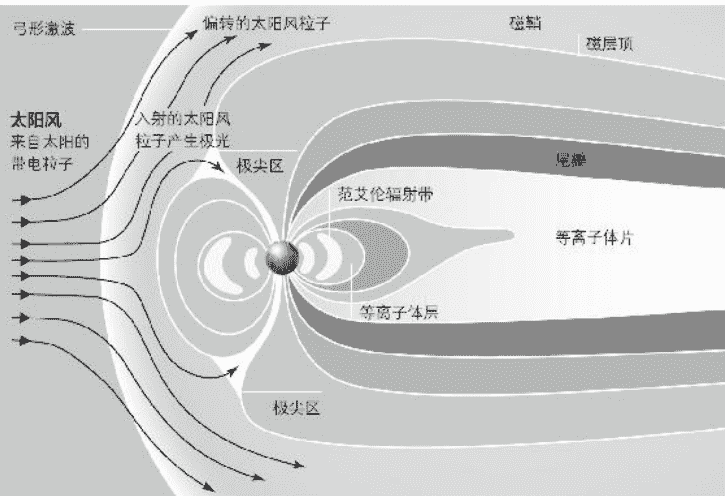

图6.2 地球磁层偏转太阳风并激发极光

近地处，两道高离子密度环带环绕赤道（3000与15000公里高），即范艾伦辐射带。70年代卫星拍得磁鞘影像——太阳风扰动下的等离子长尾。磁场偏转粒子入辐射带，部分溢出极区上层大气，高速电子撞击原子，绘就舞动极光。

### 地球气候恒温器

40亿年来，地球气候惊人稳定，始居宜居带（虽有惊险时刻）。稳定基石在于：大气/海洋二氧化碳与板块构造的耦合舞步。

循环起于火山喷发输入二氧化碳 -> 温室增暖 -> 蒸发增雨 -> 雨水溶二氧化碳成弱酸 -> 化学风化溶解含碳矿物 -> 入河达海 -> 沉积成碳酸盐岩（见6.3图）。

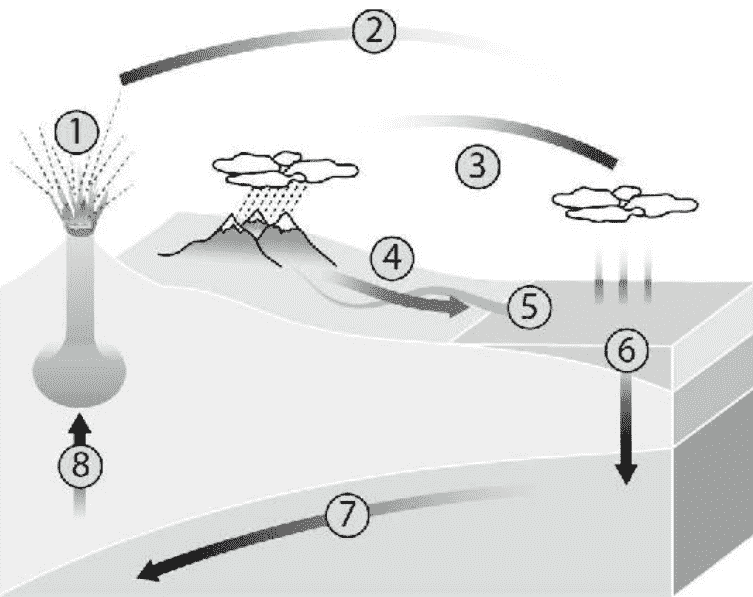

- ① 火山喷发释放二氧化碳。
- ② 温室效应致全球升温。
- ③ 升温驱动蒸发与降水循环。
- ④ 酸性雨水溶蚀岩石矿物。
- ⑤ 含碳离子随水流入海。
- ⑥ 沉积形成新碳酸盐岩。
- ⑦ 岩石随板块俯冲入幔。
- ⑧ 高温烘烤释放二氧化碳，经火山归位。

图6.3 二氧化碳主导地球气候恒温机制

俯冲带将岩石送入地幔熔炉，二氧化碳逸出随火山回归大气。

此乃高效负反馈：暖则雨多、风化快、抽碳降温；冷则雨少、火山积碳、升温回暖。

月球也助一臂之力：稳定自转轴，防剧烈摆动触发冰期。现今人类影响更显（见第10章）。纵使人类灭绝，化石燃料烧尽留下的气候创伤或延续百万年，地球恒温器终有望夺回控制权——但没人敢打包票。

### 天气机器：短期的混沌与剧烈

长期气候稳如磐石，短期天气却变幻莫测、美暴并存。源于对流层内多重力博弈。

日照加热地面，地面暖气团。分子运动加剧，体积膨胀、密度骤降，上浮。冷重空气补位、受热、再升——对流循环启动，暖气团诞生。

温差引密度压力差，驱动垂直与水平气流奔赴平衡。

球体几何决定两极赤道受热悬殊：赤道正午阳光垂直，极地大斜角。能量梯度迫使大气海洋搬运热量向两极。无温差星球风息浪静；地球上风从未歇止，且时而狂暴。

### 风带与科里奥利力

若地球不转，全球风型极简：赤道升、高空向极、极地沉、地面回赤道。北半球纯南风，南半球纯北风。

实则地球东自转，赤道线速度最快，两极为零。北半球气流相对东向运动右偏，南半球左偏——科里奥利力效应。

此效应在每半球造出三大地表风带：信风带、西风带、极地东风带（见6.4图）。转得越快带越多，木星一日十小时，风带密布。

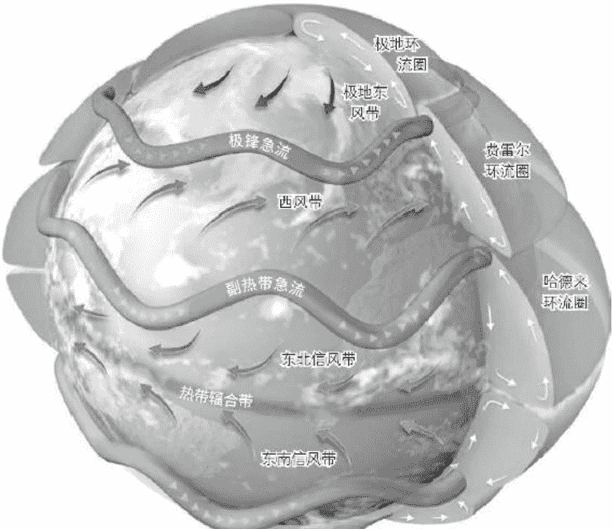

图6.4 地球风带呈带状分布，科里奥利力功不可没

高空急流自西向东疾驰，掠过缓慢地面风带。实况远比理论复杂：海陆山林打破均匀，风带变幻莫测。

### 不稳定与降水

恶劣天气先决条件：大气不稳定——低密空气强上穿高密环境。冷重气覆暖湿气下，不稳定极致。暖湿气因热、因水汽轻而上；一旦启动，持续上冲。

上升膨胀致冷（分子离散动能降）。冷至露点，水汽凝结成云雨雪雹。降水双核心：足够水汽 + 抬升致冷机制。

三大抬升路径：日照热力对流；锋面碰撞强迫抬升；地形阻挡迫升。

对流层随高降温，~11公里转暖入平流层。此“逆温盖”封顶对流，锁死不稳定，平流层无云。若盖消失，极端天气将爆发式增长。

### 中纬度气旋

“气旋”泛指旋转风暴，含中纬度常见低压系统。

赤道极地热力差生成横跨数千公里风暴，向极输热，带来中纬度主体降水。

暖湿热带气团与冷干极地气团锋面对峙，巨大温差催生气旋。动力一：位能释放——冷重气下沉向赤道，挤暖轻气上升向极。动力二：潜热——水汽凝结放热，暖周围空气，助其更高更强，风暴化身热机，热能转动能。

### 雷暴

日照足时，热力对流堆出花菜云（积云）。强时冲顶对流层。云顶冰点下，冰雪碰撞分离电荷。电位差击穿临界值，“轰”闪电劈下，正负电荷重聚。

此云称积雨云——雷暴本体。除供给全球大部生命雨水，雷暴亦带灾厄。最大降雨事件皆因雷暴，台风暴雨亦由嵌入雷暴贡献。强雷暴伴随240公里/时破坏风、柚子大冰雹，更孕育自然最暴烈风暴——龙卷风。

### 龙卷风：地面上的死神之指

1999年5月3日，俄克拉荷马布里奇克里克龙卷风，多普勒雷达捕获地面30米处风速486公里/时——人类有仪器记录以来最疯狂风速。此风摧毁重型木屋，重创钢筋混凝土。

2000年以来北美现9起EF5级极端龙卷（风速>322公里/时）。区别飓风：龙卷风尺度小（直径75米-3公里），源于积雨云，水上生成称水龙卷，威力通常较弱。

成龙卷需苛刻配方：极端不稳定 + 强风切变。

墨西哥湾暖湿气流底层铺垫，加拿大冷干气团高空压顶，造就剧烈不稳，地表热气团暴冲形成强上升气流。

若高空急流带来垂直风速切变，且风向随高度由南转西（垂直风向切变），双重切变搅动上升气流旋转 -> 超级单体雷暴。超级单体产出绝大多数强/超强龙卷（EF2-EF5）。

第三关键件：“盖帽”（Cap）——中层干燥稳定层。它压制对流，直到午后日照积累足够能量击穿“帽”，爆发单一巨型超级单体，而非零星小雷暴。

美中西部“龙卷风走廊”集齐全套：墨西哥湾暖湿气、加拿大冷气、西部沙漠干燥中层气、强高空急流。2011年4月25-28日超级爆发：355个龙卷（含4个EF5）扫荡美加21州，夺324命。

虽绝大多数龙卷在美国，孟加拉国年均3次多为猛烈级。1989年4月26日孟加拉龙卷夺1300+命，为史上最致命单次龙卷。

### 热带气旋：海上的热机巨兽

飓风、台风、热带风暴/低压，统称热带气旋。仅生于≥26℃暖水，能量纯仰赖水汽凝结释放潜热（陆地风暴靠温差）。

成因清单同样严苛：暖水为本；垂直风切变极弱（对流层顶底风速差<10米/秒），否则切变倾斜/拉伸风暴核心，带走热湿，扼杀萌芽。

# 深度解析：从暴风眼到深海暗流，地球流体系统的隐秘逻辑

强劲的高空风与急流，或是高空低压系统，构成了风切变最常见的源头。副热带急流在冬春季节会向赤道方向靠拢，这正是加勒比海与西太平洋即便海温终年适宜，却鲜少在此时孕育飓风与台风的关键原因。热带气旋的诞生还要求深层大气保持高湿度，而来自非洲或北美的干燥气团，往往能扼杀一场正在酝酿的风暴。

此外，气旋生成还需要一股“启动旋转”的力量。在大西洋，这通常源自非洲东风波——一连串从非洲海岸出发、向西推进至加勒比海的低压系统。地球自转带来的科里奥利力同样功不可没：它在赤道处为零、两极最强，因此赤道附近5度纬度范围内难以形成热带气旋；一旦脱离此区，随着纬度升高，科里奥利力引发的垂直涡度增强，风暴规模便随之扩大。

### 飓风与台风：同一场风暴的不同称呼

热带气旋的生命始于热带低压，这是一个有序旋转的风暴系统，最大风速不足63千米/小时。随风速增强，它升级为热带风暴；当持续风速触达119千米/小时，风暴中心周围便会结成一圈猛烈的雷暴带——即“风眼墙”，墙内是风平浪静、下沉气流主导的“风眼”。

一旦跨过119千米/小时门槛，命名便依地理位置而异：大西洋及东太平洋称“飓风”，西太平洋称“台风”，印度洋及南半球则统称“气旋”或“热带气旋”。气象学本质上，它们并无二致。

深达50米左右的高温海水，能让热带气旋迅速爆发为“强”飓风（风速≥178千米/小时），这是地球上最恐怖、破坏力最强的风暴形态。传统上，萨菲尔-辛普森等级仅凭最大持续风速将飓风分为1至5级，但这容易产生误导：一个覆盖面广但强度较弱的风暴，推高的风暴潮可能超过体量小却等级高的强飓风。为更精准评估风暴潮潜能，科学家开发了“实验综合动能等级”，同步量测风速与强风覆盖范围。

### 季风低压：致命洪水的幕后推手

季风运作原理与午后海风如出一辙，只是规模宏大百倍。夏季陆地升温快、海洋升温慢：陆地上太阳热量集中在地表附近，海洋则靠风浪混合分散热量；且水的比热容远大于土石。由此，陆地形成低压吸引湿润海风，气流上升膨胀冷却，倾泻特大暴雨——其中不乏全球极值。

每年夏季，季风覆盖除南极外所有大陆，滋养数十亿生民。印度13.4亿人口中，80%降水仰赖季风。但季风也有凶险一面：印巴等地每年因洪涝滑坡丧生数百人。最致命洪水多由“季风低压”引发。它与热带低压相似但体量更大：直径数百公里、风速50-55千米/小时、中心风静、伴随特大暴雨。孟加拉湾每夏生成约7个季风低压，西移穿越印度。2010年夏，两个主力低压接连入侵巴基斯坦，酿成该国史无前例的百亿美元洪灾。

### 云雨之谜：为何有的云滴水不漏？

尽管我们对天气演变知之颇多，核心谜团仍在。天气多变难测，我们更难看清头顶方寸间那些零星、短暂的微观过程。接下来的篇幅将聚焦一个日益受瞩目的前沿：云内究竟发生了什么？

云，熟悉而陌生。水汽凝结成微滴或冰晶形成云，但降水机制却让人“云里雾里”：为何有的云倾泻洪流，有的却分文不出？

谜底藏在冰的物理机制里。云滴长大到能克服上升气流便会降落。通常降水需要冰晶生长快于水滴（即伯杰龙过程），让冰晶在蒸发消失前获得下落重量。诡异的是，纯净水可在-40°C保持液态（过冷水），分子机理至今不明，这意味着云滴冻结通常需要“外援”。

外援即“冰核”——悬浮微粒或气溶胶，水分子在其表面排布成冰晶格。海盐、矿物尘埃虽丰富，却难在-15°C以上成冰，而陆地上半数云层温度高于此值。这些云里定藏着别的秘密。

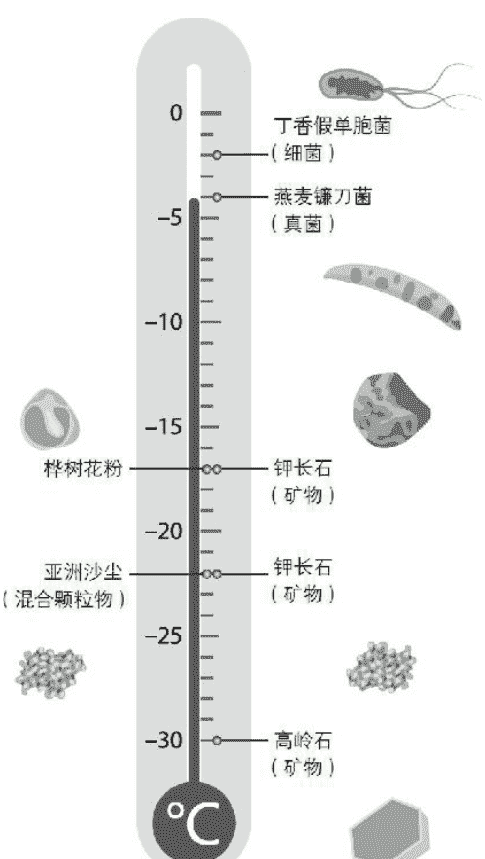

图6.5 要形成降雨，云通常必须形成冰晶。纯净水的温度可以降低至-40°C，但是在稍高的温度下，微小的颗粒就会促使冰的形成

1970年代初，谜底浮现：叶面寄居菌“丁香假单胞菌”被证实是高效冰核，甚至在相对温暖条件下也能催化成冰。它为何进化出“速冻”能力尚不明确，推测可能是利用尖锐冰晶刺穿叶片吸取养分。1978年，蒙大拿州立大学植物病理学家戴维·桑兹用飞机在高空撒布该菌，宣称其能致雨，却未获大气学界认可。

十年后，科学家分离出制冰蛋白基因，陆续发现更多具此能力的微生物（含真菌），桑兹的观点依然被边缘化。转机出现在2007年：科学家采集全球新雪样本，测试冰核活性。加热破坏蛋白质后，绝大多数样本失去-7°C以上成冰能力，证明高温冰核多为生物源。2015年，巨型冰雹研究亦指向生物颗粒触发成冰。

近年更发现，各类微生物广泛栖息于影响云运行的高空。一项研究采样飓风“厄尔”与“卡尔”路径上1万米高空，鉴定出314种细菌，多为活体，生物细胞数量与土壤尘埃颗粒相当。但这不等于它们参与降水。加州大学圣地亚哥分校大气化学家金·普拉瑟从雨云中采集冰晶分析，发现成冰颗粒中约40%为生物源——有力佐证了微生物在温暖云中“造冰”。但普拉瑟未捕捉到活菌现场作案，质疑者指出煤烟、矿物更丰富更可能主导；支持者则认为微生物在特定区域、季节影响显著。

### 若细菌真能“造雨”，会怎样？

若桑兹等“活冰核”支持者属实，将引发连串推演。丁香假单胞菌是否进化出“搭云旅行”策略，借风雨传播自身、滋润宿主植物？植被雨后释放更多冰核菌诱发后续降雨，形成正反馈？人类农业活动是否在无意中改写天气？

既能无心插柳，未来能否有意为之？美国由来已久的“云播种”技术，撒碘化银催化降雨。2015年洛杉矶郡为抗旱投入50万美元播撒碘化银，因缺乏增雨实证备受诟病。桑兹主张“天然制冰机”更优：筛选或培育携带冰核菌的植物，种在适宜之处“种”出雨水。

目前仍属推演。还有一道物理门槛：无水汽无降雨，特定地区可降水量受全球环流制约，瞬息万变。

### 晴天霹雳：闪电成因的未解之谜

庆幸飓风、龙卷风等杀手级风暴相对罕见。常见天气杀手中，闪电是你绝不想近距离邂逅的。全球每秒约百次闪电，却因研究难度与危险，成因认知滞后，我们可能永远在经历闪电中度过。

人人经历过静电击痛：走过地毯摸门把手，摩擦让电子从地毯转移至人体带负电，电荷积累虽微，短距离内电场却惊人。手指靠近把手排斥电子致局部带正电，电场超300万伏/米击穿空气，电子穿越电离通道中和——哎哟，恢复中性。

雷暴云中电场同样源于摩擦，主角不同：强上升气流托举冰晶上行，重冰雹下坠，两流碰撞剥夺冰晶电子，云顶带正电、云底带负电，形成类似“手与把手”的电场。电场足强击穿空气，电子划出电离引线寻找异性电荷。云地闪电中负电荷寻地面正电荷；最常见的云闪则在云顶正电区放电。电流瞬间贯通，温度达太阳表面5倍。

这是主流认知，但有硬伤：自1950年代送气球、仪器机入云，从未实测到300万伏/米击穿场强，实测值仅约十分之一。闪电运作机制，并非传统火花放电那般简单。

### 来自外太空的“点火器”：宇宙射线假说

破局思路来自意外之外——外太空。每秒数十亿高能粒子入侵大气。若在雷暴中撞击电子，电子获极端加速，穿越云层时雪崩式电离气体分子，产生高能电子洪流。由此聚集的电荷瞬间增强局域电场，虽细节未明，这“逃逸击穿”效应或能在背景电场远低于300万伏/米时触发闪电。

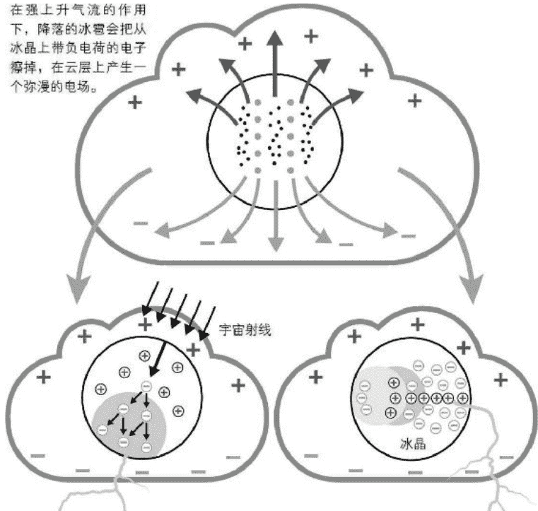

- 逃逸击穿：宇宙射线产生电子雪崩，留下正电荷，增强局域电场。
- 快速正向击穿：带电冰晶剥离电子，正电荷前移，局域电场增强。

图6.6 雷暴内部电场似乎太低，无法单独引起闪电。有两个过程可能增强局部电场，足以引发闪电。

1991年康普顿伽马射线天文台上天寻找恒星爆发伽马射线，竟在雷暴中捕获高能光子。物理学家随即联想：失控电子碰撞分子除产生次生电子，还会辐射伽马射线——这是失控击穿的“指纹”。关联诱人，但缺乏直接证据。需更利器窥探云内。

幸而有法：闪电产生的无线电噪声（类模拟电台爆裂音）可被精准定位。90年代中叶，新墨西哥理工威廉·赖森团队用GPS授时标记噪声源。如今其“闪电成像阵列”布设16站，能拍摄云内闪电3D影像，早期时间分辨率受限。2016年，他们引入干涉仪探测无线电波，配合1.8亿帧/秒高速相机，获得迄今最精确的闪电全过程3D动态图。

### 闪电诞生实录：颠覆认知的“快速正向击穿”

团队本期盼捕捉“逃逸击穿”细节，结果却大跌眼镜。云深处强火花能在无外力介入下自行拉升电场，且传播方向反常：非从负区向正区，而是反过来。

赖森团队数周复盘意识到：正电荷流动方向等价于电子高速反向运动。罪魁祸首极可能是“两极分化”冰晶——一面负、一面正。正电面若足强从气体分子撕裂电子，便生成新正电荷，如晶体新尖端，链式反应持续延伸。此“快速正向击穿”创造摆动的电离气带，从冰晶末端生长，如吸尘器吸走负电荷回馈晶体。晶体积累足够电荷，即可孵化闪电引线，抢占先机。

惊人的是，赖森证据指向雷暴中所有闪电形态均可能由“快速正向击穿”触发。宇宙射线或仍有角色，但业内视此为破局拼图——如拼图游戏中找到关键一角。

### 奇形怪状的闪电家族

从海怪般的闪光到传闻能熔化玻璃的球状闪电，形态诡谲多变。

- **精灵**：曾被视为神话，云顶上方瞬逝红色闪光，酷似巨大水母。推测源于云地闪电引发的高层强电场，成因细节仍谜。
- **怪异闪电/精灵王**：直径400公里发光甜甜圈，不足1毫秒消逝。云电场驱动电子撞击氮分子激发红光。
- **蓝色喷流**：空间站偶瞥，从雷暴云顶蜿蜒窜升至50公里高空，0.1秒熄灭。罕见难解。
- **反向闪电/巨型喷流**：云地电场中和时，闪电为何总从云下击？有时地面起闪上窜击中云层，细节未明。
- **球状闪电**：带电球体熔玻璃、穿楼宇、弹机舱过道。目击报告超2000年，理论林立却无一全胜。

### 海洋：这颗星球真正的主宰

阿瑟·C·克拉克直指痛点：“把这颗被海洋覆盖的星球叫‘地球’，多么不妥。”俯瞰太空，71%蓝色表面无可辩驳。没有海洋，人类不存在。

### 受困的海洋：过度索取与污染

克拉克指出，我们视海洋理所当然，实则虐待它。它仍是大宗食物来源，却因过度捕捞让全球85%渔业岌岌可危。同对待大气一样，我们把它当垃圾场：农工生活污染持续侵蚀其维生能力（详见第9章）。

全球视角看，海洋提供关键“服务”：巨型储热器缓冲极端温度，赋予稳定气候；近期更凸显碳汇功能——吞噬大量碳并隔离于大气外。

这高度依赖海洋环流——全球输送热量、盐分、物质的水流网络。全球五大环流（如墨西哥湾流）流量约等于全球淡水河流总和的50倍。表层海水吸收二氧化碳随下沉锁定深海；浮游植物同理固碳。若气候变化扰乱环流模式，如科学家警示，碳汇功能将严重受损。读懂海洋，才能读懂气候变迁。

### 推动洋流的双引擎：风与旋转

洋流动力多元。海面风驱动表层流，科里奥利力（地球自转效应）施加横向偏向力（同风，见第6章）。北半球偏右、南半球偏左，织就海面基本流型——一个个封闭的“环流”。科里奥利力随纬度增大，致使环流不对称：西侧边界流强、窄、快（达2米/秒），如北大西洋墨西哥湾流；东侧则弱、宽、慢（<0.1米/秒）。

所有主要洋盆皆有环流分布。

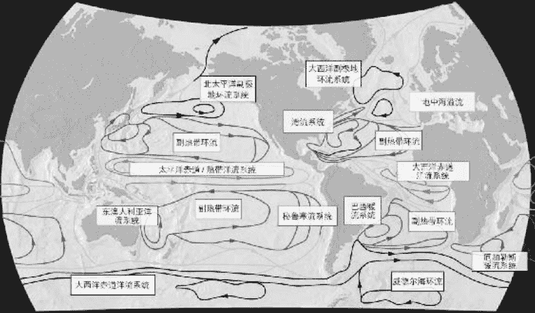

图7.1 海洋中主要的洋流是风和科里奥利力驱动的

副热带环流位于10°-40°纬度，副极地环流在50°-70°。风堆积海水致海面非平：北大西洋副热带环流中，马尾藻海海面比百慕大周边高约1米。例外是绕极流——强劲西向东流贯穿南大洋；赤道附近科里奥利力消失，暗流涌动更复杂。

但故事未完，海水命运更系于温、盐、密三角博弈。全球海水盐度不一：平均1000克海水含35克盐。波罗的海、北冰洋盐度低，地中海、红海高。水温差异巨大。温盐共决密度，密度差驱动深层循环。

暖水轻上浮，冷水重下沉；盐度高水重。冷咸重水与暖淡轻水密度差巨大。极地冬季，海面散热结冰，盐分排挤（盐水不冻），留下又冷又咸的超重水下沉底层，迫使表层暖水从热带奔向极地。同时深海堆积海水被推向赤道，旅途中变暖变轻上浮。表层暖淡水转化为深层冷咸水的全过程，称“深层对流”——这是驱动全球海洋大传送带的热机系统。

## 海洋的隐秘脉动：传送带、怪浪与水下河流

由温度与盐度差异驱动的海水流动，学术上称为“温盐环流”，它独立于风力驱动的表层环流系统。两者合力，编织出立体的“海洋传送带”（详见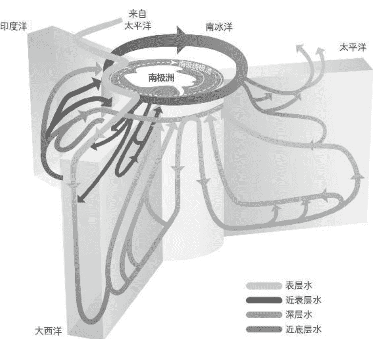）。大西洋、印度洋与太平洋三大盆地的水体交换，皆借由南大洋这一枢纽完成。西欧的温润气候，很大程度上仰赖这条传送带的输送——北大西洋暖流作为墨西哥湾流的延伸，为西欧免费输送的热量，能量相当于百万座发电站的总输出。

图7.2 两极附近寒冷稠密的海水下沉入深渊，随而奔流向热带。这种下沉过程，如同巨大的抽水机，将热带表层温水牵引至高纬度，形成一条循环不息的“传送带”。

海水是巨大的热储库，仅表层3米深的海水，其热容量便等同于整个大气层。阳光直击海面，致使表层水温较高、密度较小；深层水则寒冷沉重。这种稳定的分层结构至关重要：水团沿等密度面水平流动阻力最小。然而，在深层对流区，或等密度面倾斜入深之处，水体依能跨层上下交换。

### 新水与旧水的界限

海面风搅动着上百米厚的混合层，此处温温度、密度均匀一致；混合层之下，温度与密度随深度剧变。深海多贮存冬季高纬度下沉的冷水。因热带暖水轻、极地冷水重，暖水覆盖冷水之上，两者间形成显著的“温跃层”——温度随深度骤降的过渡带。

温跃层的存在，很大程度上由温盐环流维系。在北大西洋极地海域、南极威德尔海等深对流区，海水下沉迅猛；但“上升”极其缓慢，日均仅约1厘米，跨越温带热带广阔海域，缓缓随表流归极，完成大循环。

因极地表层水更冷更重，海洋等密度层（恒定密度面）并不平行海面，而是自表层向下倾斜。这使得除局部深对流区外，表层水仍可顺着倾斜的等密度面深入内部，携带热量、盐分、氧气、二氧化碳等表层特征入侵深海。这一过程称为“通风”。通风作用将表层溶解的二氧化碳隔离于深海，故海洋环流模式的变迁，直接调控着海洋吸收大气CO₂的能力。

### 海水的“身份证”：年龄几何？

海洋学中“水龄”指海水离开表层接触大气后的时长。追溯水龄，可知水团来向去向。

示踪手段包括天然放射性碳-14、溶解氧、二氧化硅，亦有人为污染物——氚（20世纪50/60年代核试验遗留的放射性氢同位素）。近表层水龄仅数年；深层水则古老得多。如北大西洋2°C以下深水，距上次接触大气约200年；太平洋1500米以下深水，水龄或超500年。

垂直循环注定古老深水终将重返阳光。水团漂流跨洋，完成单一循环动辄数千年，途经重重曲折。正如地形制约陆地风路，海底地形亦引导深海环流。连接各大洋的狭窄海峡，因水深限制成为交换瓶颈。直布罗陀海峡便是典型：低盐大西洋水表层流入地中海，高盐地中海水深层流出，此类通道对调节全球水性交换至关重要。

### 海洋的“天气系统”：涡流

宏观看是缓慢稳定的传送带，微观却暗流涌动。大气有高低压，海洋有涡旋——海洋的“天气”，以厘米/秒级速度迁徙，跨洋输送热盐。涡旋直径百公里量级，远小于大气系统的千公里尺度。

墨西哥湾流等强流区，涡旋寿命仅数月即被吞噬；平静海域涡旋可存续两年以上。涡旋源于流场不稳定：强流通过、剪切区、垂直切变处。它们携带巨大动能与热量，在海洋能量传递、热量平衡、水团混合中扮演关键角色。阿古拉斯洋流作为非洲东岸西边界流，频繁脱落涡旋，将印度洋暖盐水偷渡入南大西洋。

时至今日，破解海洋环流奥秘仍是全球科学家的硬骨头。攻克之日，便是我们读懂地球气候、甚至预见未来的关键一步。

### 真实的深渊怪兽：怪浪

受限于深海探测难度，我们对深渊认知姗姗来迟。更惊人的是，发生在眼皮底下的海面现象——怪浪，竟也让人困惑数十年。曾几何时，足以毁船沉舰的“独行巨浪”被视为水手谎言。如今，理论、实验与实测三位一体，证实怪浪绝非罕见。

科学界至今缺乏统一怪浪定义。通说视其高度至少为“有效波高”（最高1/3浪高平均值）的两倍。这高度随海况而变：有效波高10厘米的平静海面，20厘米浪也算怪浪。

长期以来，基于线性叠加原理的模型预测怪浪近乎绝迹：两波列相遇，波峰波谷简单相加。直到60年代末，剑桥本杰明与费尔发现：长波与短波共振时，能量可突发聚焦于寥寥数浪甚至单一巨浪。他们在国家物理实验室波浪水槽验证：造波机近处波浪匀称，约60米外波形扭曲，突现短命巨浪——即今之“流氓波/疯狗浪”。

这一发现传播缓慢。1995年元旦，北海卓普尼平台将理论与实测撞在一起。当时有效波高12米，下午3:20，传感器捕获一浪：波峰较周围波谷高26米，约纳尔逊纪念柱半高。按旧统计，这属万年一遇。

卓普尼巨浪开启怪浪研究新纪元。欧盟2000年启动“极浪计划”，2003年三周内，雷达卫星扫描全球，捕获10个超25米巨浪。

如今确信，全球大洋均现怪浪踪迹。北大西洋、德雷克海峡、南非南岸为高发区（见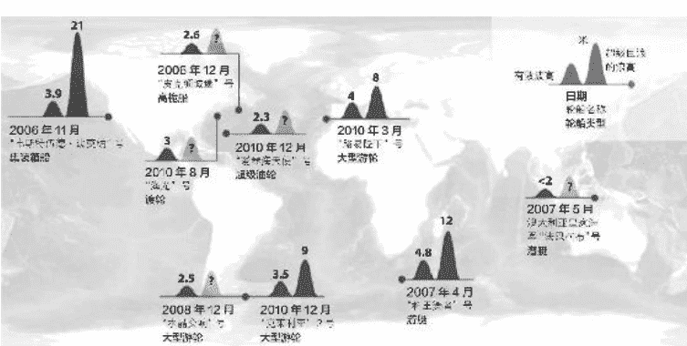）。重读史册：2004年前20年近200艘货轮离奇失事，怪浪被列为主因；2014年“马可·波罗”号遇怪浪毁窗亡人。

图7.3 2006-2010媒体报道分析，证实深海9起船舶遇怪浪事件。

### 怪浪成因档案

计算机模拟结合理论观测，科学家正建立怪浪成因目录。一类为“风暴浪对抗强逆流”：北大西洋墨西哥湾流侧、非洲东南阿古拉斯流侧常现此景。另一类为“对穿海”：两波系（一为本地风浪，一为远洋涌浪）多方向汇聚，诱发极端不稳定。

### “路易陛下”号劫后余生

2010年3月3日，“路易陛下”号从巴塞罗那驶向热那亚。下午1时许风暴聚结，前几小时浪高渐涨未引恐慌。16:20，无预警撞上至少8米高“水墙”。复盘显示，游轮连遭数记重击。海水冲至吃水线上17米处（5号甲板），毁窗致2死14伤。巨浪来去倏忽，游轮摇摇晃晃返港。事后模型推演指向“对穿海”：东北、东南两向波系在船侧汇聚。

龙三角（日本南部太平洋）1980年沉船案，日方归因对穿海。但高阶模型模拟显示：单一波系在强风持续输入下，能量聚焦超越线性预测，亦能生成20米巨浪。

新模型不断修正：2012年研究表明，怪浪高度理论上可达周边有效波高11倍，波浪水槽实验已验证。

认知深入，预警系统提上日程：为进入高危海域船只提供怪浪预报。路漫漫，但理论与模型已在手，数十年前被质疑的怪物，终显真容。

### 海底幽灵河

博斯普鲁斯海峡水下70米，藏一条无名暗河：宽达千米，有河岸、有激流。若在陆上，流量可列世界第六大河。它静默地从马尔马拉海注入黑海。

此类水下河流并非孤例。无数暗流穿梭深渊，长达数千公里，宽数十公里，深数百米。它们分流沉积物，输氧送养，育深海生命。若抽干海水，可见深海水道迷宫。酷似陆地河流，流动机制却近似雪崩、沙尘暴、火山碎屑流。其破坏力是海底光缆头号杀手。

水道存在最初源于光缆断裂推断。1929年纽芬兰南岸7.2级地震后，十余条跨大西洋光缆依次断裂。1952年，哥大海森、尤因核对断裂时序，推断地震触发200立方公里沉积物崩滑，泥沙混合流以100公里/时狂奔，冲刷海床600公里，留下河岸。

至今浊流仍威胁承载95%国际通信的光缆。惊人的是，我们仍无详细深海水道图。现有技术绘制全图需百年航次。每次光缆断裂，我们仍在发现未知水道。

### 水下河流如何炼成

绘图与理解是两码事。地震诱发洪流多短暂，部分水道“干涸”（虽满水但无泥沙）。亦有上游沉积物自重崩塌触发，或陆河入海诱发。刚果河入大西洋、黄河入三峡（小浪底）均形成深渊水道。虽多因陆河延伸，但也有现身洋中心、来历不明者。

浊流凶猛，入侵仪器多毁。博斯普鲁斯暗河却“温和”：无泥沙，满是地中海高盐水。盐水重，沿海底流动。物质虽异，动力本同。

利兹大学杰夫·佩考尔遍访全球深海水道，驾黄色鱼雷潜艇探博斯普鲁斯，首得水道通量详测。他发现水下河蜿蜒如惊蛇。陆河受地形制约，水下河却异：赤道附近极曲折，两极却笔直。

罪魁祸首疑为科里奥利力（见第6章）。深海难直测，他在实验室旋转水箱造蜿蜒水道，注盐水模拟浊流，变速旋转模拟不同纬度自转。结果揭示：水下河流动法则与陆河截异。陆河弯道受重力与离心力主导；浊流在水中，重力被浮力抵消，科里奥利力主导增强。

怪象随之：水流偏向河道一侧（北半球向右）；陆河弯道表层向外、底层向内，水下河恰好相反。

此差异造就独特侵蚀沉积模式：受冲击岸更陡；高纬度水道更直；陆河弯道下游迁移，海底弯道达临界“摆动度”便垒起百米垂直堤坝，原地固化。

光缆、石油业关注其行为，气候科学亦紧盯。源自陆河的海底水道运输海量有机碳，埋藏沉积中百万年才重返大气。科学家急于量化碳输运埋藏速率，以解深海碳循环，修正气候模型。

## 8 生命

地球与生灵共舞四十亿年，生命始终在“翻新自家宅院”，深刻重塑大气与岩石。这段共生史，更催生出20世纪最具颠覆性的科学理论之一——盖亚假说雏形。

### 地球，遇见生命

放眼宇宙，若对生命感兴趣，地球是唯一值得一游的星球。谜题之中，最扣人心弦者莫过于：生命如何起步？若非外来“搭便车”（泛种论），便意味着某一刻，一群非生命化学物聚合，诞生了能复制、能进化的实体。如何发生？起于何处？

初步线索源自50年代斯坦利·米勒实验。年仅23岁的芝大博士生，用玻璃管循环电火花模拟原始闪电，在含氨、氢、水蒸气、甲烷的“原始大气”中，合成了氨基酸——蛋白质基石。

后续研究证实，米勒装置亦能生成腺嘌呤、鸟嘌呤（RNA/DNA两碱基）。米勒又耗43年，与学生罗伯特逊破解尿嘧啶、胞嘧啶（RNA剩余两碱基）合成路径。关键在于尿素浓度：早期实验尿素不足；米勒推测早期地球浅水池蒸发浓缩，尿素达恰当浓度——“干潟湖假说”应运而生。

### 生命的拼图：从原料到卢卡

碳基生命原料由早期大气天气供给。如何组装成活体，是热门前沿。设想最早生命非今之复杂生物，而是极简实体。久远某刻，LUCA（最后共同祖先）现身——地球上所有生命的鼻祖。

从现存生物共性反推卢卡：以DNA存蛋白配方（基因），RNA传递指令；通用ATP供能；许多核心蛋白溯源至卢卡。

但从前生物化学跨越至卢卡，鸿沟巨大：蛋白参与DNA复制，二者同源极不可能。主流假说设“RNA世界”为桥：RNA既存遗传信息似DNA，又催化反应似蛋白。早期RNA或类分子兼顾复制与代谢；后DNA接管遗传，蛋白接管代谢。

起源研究聚焦“仅靠RNA运转的实体”，但从大气合成类RNA单体，到单体组装成长链并兼具遗传催化双职，中间鸿沟犹在。这推动哈佛绍斯塔克团队研究蒙脱石——一种软黏土矿物。

黏土电学特性吸附短链RNA，催化其聚合成长链；更催化脂肪酸前体形成囊泡——原始细胞膜雏形。膜能内聚化学物、护内里反应。团队终见：蒙脱石表面生长的RNA链，在囊泡形成过程中被包裹，诞生实质“原始细胞”。

池塘底黏土或为生命引擎，非唯一主角。剑桥霍利斯特提出冰的作用。其团队首创长链RNA催化剂，能合成比自身更长的RNA。惊人地，反应在-19°C冰晶微孔中发生。2017年展示：短链RNA经冻融循环，在冰中组装成此类催化剂。

# 地球生命演化：从深海起源到人类世困局

另一种截然不同的观点来自伦敦大学学院的尼克·莱恩，他将生命的摇篮定位在深海热液喷口。那里，温度高达90℃的碱性流体沿海底裂缝涌出，撞击冰冷海水后沉淀出高达60米的岩石“烟囱”，内部布满迷宫般的微孔通道。

即便在早期地球，这些烟囱也富含铁硫化物，能催化复杂有机反应。更关键的是，微孔内的温度梯度可浓缩有机物，促成脂质囊泡与RNA等大分子形成。莱恩认为，这里是核糖核酸自我复制与原始膜结构诞生的最佳场所。

最引人入胜的是，喷口处天然存在的质子梯度——碱性流体与酸性海水的交界面——或许能直接驱动能量生产。这与现今细胞合成ATP的电化学机制如出一辙，莱恩推测，ATP合成机制最早正是在这些岩石微孔中进化而来。

这些假说凸显了生命与地球环境间错综复杂的互动。孰是孰非尚无定论，答案或许永远揭不开。当然，还有一种可能让所有讨论失去意义：地球生命从未“开始”，它本就来自别处。

### 来自星空的种子：胚种假说

生命起源于太空的“胚种假说”诞生于19世纪。20世纪70年代，天文学家在星际空间发现复杂有机分子，让该说重获关注。它似乎能解释为何地球刚宜居生命便闪电般现身：前生命化学向生物学的跨越，真的能如此之快？

这仍属边缘未证假说，却持有拥趸。白金汉大学的钱德拉·威克拉马辛赫是早期支持者，她引用2013年平流层27公里高度捕获的英仙座流星雨微生物证据——高度太高，非地表来源。她主张：银河充满生命，地球生物圈只是宇宙生态网络一节点；恒星系间持续交换遗传物质甚至生物体，进化很大程度由来自太空的病毒基因驱动。

也有折中派认为：生命始于火星，搭陨石抵达地球。若胚种假说成立，地球生命非地球专属，而是宇宙的孩子。

### 毒害星球的氧气：大氧化事件始末

早期地球孕育生命，生命随即开始“还债”——重塑大气、海洋与地质。24亿年前的“大氧化事件”最能诠释这种影响力，由能分解水的光合细菌进化引发。

光合作用将太阳能转化为化学能：光释放电子，生物体利用电子与二氧化碳合成糖类。最早光合微生物化石可追溯至34亿年前。但早期光合作用不同于今日，微生物曾以硫化氢为电子源，排出硫。

约28亿年前，新型微生物登场，采用水为电子源，排出剧毒废物——氧气。彼时地球近乎无氧，氧气对厌氧生物是“细胞焚烧弹”，夺取电子产生自由基，破坏细胞内部结构。

24亿年前氧气飙升，引发全球性“屠杀”。厌氌生物灭绝，幸存者躲进地下深处或肠道隐窝。海洋中，氧气与溶解铁结合沉降，形成今日西澳与明尼苏达的条带状铁矿层。氧气上升至平流层在紫外线下生成臭氧层，为日后生命登陆护航。

这些新光合菌（蓝藻祖先）因有氧呼吸效率是厌氧18倍而大繁殖。生命变强，为复杂生命铺路。利氧真核生物于21-16亿年前现身，其繁殖曾致氧气下降，后重回平衡。多细胞生命爆发，植物“借用”蓝藻叶绿体。如今，地球近乎所有生命能量直接或间接源自光合作用。

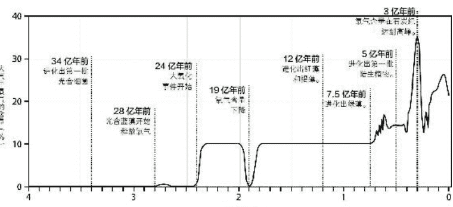

图8.1 今日地球生命繁盛，缘于氧气初现大气。24亿年前绝大多数微生物死于氧气活性。

### 盖亚假说诞生记：地球有“脉搏”吗？

生命与地球物理系统的博弈，催生了20世纪最激进思想之一——盖亚假说，以希腊大地女神命名。发明家詹姆斯·洛夫洛克提出：地球拥有全球尺度的自我调节系统，维持环境宜居。虽美丽简洁，却争议不断，被批为伪科学甚至宗教。

故事始于60年代NASA时期。洛夫洛克对比火星大气（化学平衡，二氧化碳为主）与地球大气（化学非平衡，氧气二氧化碳动态变化），发现驱动力正是生命：光合作用产氧，有氧呼吸耗氧。无生命，地球大气将退化为类火星的死寂混合物。

地球表温、酸度、海洋化学稳定数十亿年，始终在宜居区波动。洛夫洛克遂构想：生物圈作为整体与环境互动，不仅使地球宜居，更持续优化生存条件。通过类似生物体内稳态的反馈回路，控制温度、海水成分、大气组成等关键指标。

10年内他将假说升级为理论：“温度、氧化态、酸度等特性维持动态平衡，由生物群无意识地通过主动反馈维持。”他最终称地球为超级有机体：“从鲸鱼到病毒，共同构成独立生命统一体，调节大气满足整体需求，能力远超部分之和。”地球不只是孕育生命的星球，它本身活着。

此观点吸引科学家与公众。有人视为元素循环新范式，有人寻找科学支撑，有人引申人地伦理，甚至窥见神性。

### 盖亚的三重面孔：强弱之分与超有机体

盖亚假说至少有三种变体：

**优化的盖亚**：最强版本。生命主动控温、控酸、控气，维持地球“最佳”宜居态。

**自我调节（内稳态）盖亚**：较新弱版。生命建立负反馈，将约束因素锁定在特定区间，不追求“最优”只求“可居”。

**超有机体盖亚**：最激进解释。地球本身即生命实体。常被视为非科学。

### 美狄亚上位：当证据指向“弑母者”

盖亚持续引发争辩，但风向变了。深时岩石记录与未来模型推演，双双击碎核心预言。若非要找神话母亲隐喻生物圈，美狄亚——杀子的巫后——或许更贴切。

**深时反证**：盖亚引以为傲的“恒温器”是风化循环。火山喷发二氧化碳，硅酸盐风化封存之，陆生植物根系加速风化、光合作用固碳，本应稳温。但精确古温度估算显示：地球温度非恒定，因新物种进化而剧烈震荡如过山车。

23亿年前，氧光合菌疯狂固碳致“雪球地球”，海洋全冻结，持续亿年。7亿年前，多细胞植物进化引发第二次雪球期。3.6亿年前，陆生森林深根强化风化、光合固碳双重打击，致5000万年冰河期，大量生命灭绝。这不符合盖亚“优化宜居”预言。

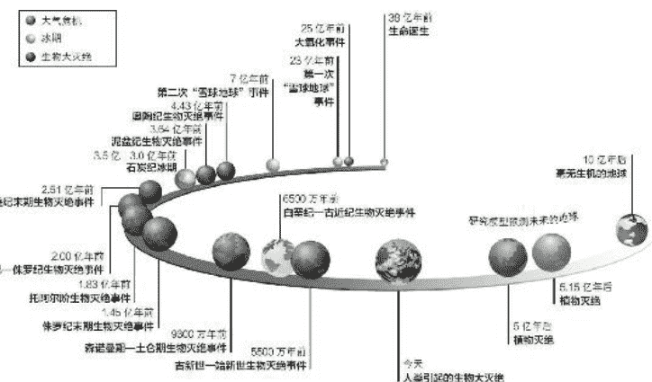

图8.2 除白垩纪小行星撞击外，几乎所有大灭绝皆由生物杀生物引发。

生命自诞生即具自毁基因。达尔文喻新物种入世如楔子劈开空间，实则多如大锤砸碎生命之树。最恶劣的“美狄亚事件”与雪球期同源：大氧化事件释放“大规模杀伤性武器”氧气，仅留存光合生物、耐氧菌与躲避者。

研究5.65亿年以来灭绝事件发现：多数为“微生物大灭绝”，由死海中繁盛的细菌喷吐硫化氢所致，诱因常为火山喷发致暖化。盖亚理论预期生命缓冲灾难，实则火上浇油。这有力支持美狄亚假说——生命倾向破坏宜居性。人类致灭绝，或不过是剧本最新一幕。

### 终局倒计时：太阳变热，二氧化碳耗尽

未来更反盖亚，惊心动魄。生命似在主动追寻灭亡，拖地球走向死寂。

主因：太阳增亮。45亿年亮度增30%，仍在增。增温加速风化，在光合与根系助推下，二氧化碳清除加速。初期这缓冲暖化，但最早5亿年后，二氧化碳将低于光合补偿点。那一日来临，世界末日开启。

植物枯死，生产力与氧气断供，动物随之灭绝。植物消失致二氧化碳回积，失控温室效应启动。地表温超沸点，末代微生物绝迹。地球回归死寂。这彻底否定盖亚“生命提升宜居性”信条。

若模型属实，地球生命已入暮年。38亿年冒险，宇宙仅知此一生命孤例，或能再撑10亿年。二氧化碳长期耗竭已启，化石燃料排放与此长周期相比微不足道。盖亚将死，美狄亚长存。

### 托比·蒂勒尔的质疑：盖亚缺乏进化动力

2013年《论盖亚》中，南安普顿教授托比·蒂勒尔系统反思。盖亚核心论据：生命大幅改造环境。蒂勒尔承认证据确凿，如微生物产生二甲硫醚影响云层反照率，但证明此作用微弱。且“生命改造环境”同支“共同进化假说”：生命与环境互动，但无义务改善宜居性。

盖亚机制何在？若能从进论自然演绎则站得住脚。蒂勒尔未见充分理由，却发现“微型盖亚”：白蚁丘、黄蜂窝通过群体行为精准调温。但这仅发生于高亲缘群体，全球生物圈基因极度多样，协作无望。

结论：盖亚假说不准描述地球运行。行星比盖亚说更脆弱。虽美好想法破灭遗憾，但环境治理须建立在准确认知而非缺陷假说之上。

### 步入人类世：我们该在哪里钉下“金钉子”？

1950年1月，阿西莫夫出版《苍穹一粟》，史蒂维·旺德诞生。对地质学家而言，地球或已翻开新纪元——人类世。当人类数量与活动重塑地质、大气、海洋、生态，人类世便开始了。

### 人类的时代：地质年代表的新争议

自11700年前全新世始，地球处于此间冰期。但人类重塑地球之力，是否配拥有专属纪元？

2017年9月，人类世概念迈关键步。科学家工作组历经8年，建议地质年代表增设人类世。最终定夺在国际地层学委员会（ICS）。说服关键：全球何处能找到人类世启始的最佳标志？

地质界限由“全球界线层型剖面和点位”（GSSP），即“金钉子”定义。如白垩纪-古新世界线在突尼斯卡夫，二叠纪-三叠纪灭绝界线在浙江长兴。

人类世“金钉子”选哪？工作组召集人简·扎拉西维奇称：初筛湖泊、缺氧海盆、冰芯众多。但决策难，因人类世太“年轻”。理想金钉子需物质稳定累积（冰/沉积物），保留清晰年纹记录，且免受侵蚀与人为破坏。

标志物选什么？地质界线常系全球事件而非绝对年代。如白垩纪末由全球铱异常层与小行星撞击定义，卡夫剖面清晰可见。

### 寻找人类世的“金钉子”

候选信号众多：20世纪中叶核试验留下的钚-239峰值；塑料微粒首现于海底湖床泥层；甚至燃烧化石燃料改变的碳同位素信号。

全新世“金钉子”在格陵兰冰芯（冰期终结同位素特征），辅助点在日本湖泊岩芯（花粉记录暖化）。但人类世主金钉子仍悬而未决。

工作组成员科林·沃特斯推荐：加州圣巴巴拉盆地、委内瑞拉卡里亚科盆地——沉积稳定、含钚记录、少干扰。洞穴石笋/钟乳石亦可，锁定碳同位素记录大气扰动。格陵兰冰芯亦是备选，延续全新世传统。

或许，地球上最令人唏嘘、最能标志人类世拉开帷幕的地标，非珊瑚礁莫属。扎拉西维奇指出，一种生长迅捷的滨珊瑚，其骨骼中如同树木年轮般的生长纹理，为我们留下了从全新世向人类世过渡期极其清晰、可靠的化学档案。

珊瑚礁因全球变暖与海洋酸化而岌岌可危，这是公认的事实。沃特斯认为，将采自加勒比海等地的珊瑚标本珍藏于博物馆，颇具诗意——因为它们是见证人类活动开始重塑整颗星球那一刻，地球上保存得最完好的“物证”。

### 人类活动的地质印记

即便人类在数千万年后灭绝，地球的地质层页中依然会镌刻着我们存在的清晰印记。正如我们所知，钚及其他放射性同位素的沉积，精准地标记了人类对地球施加巨大且深远影响的起点。当然，除此之外，还有其他潜在的“金钉子”候选者……

### 化石燃料的烙印

燃烧化石燃料留下的产物，将成为人类世最显著的特征之一。当前的碳排放速率，被认为超越了过去6500万年的任何时期。自1850年以来，大气二氧化碳浓度飙升，现约达410ppm，这一数据将被封存在格陵兰与南极幸存的冰芯中。化石燃料燃烧还扭转了碳-12与碳-13的同位素比率，这类信号可在树木年轮、石灰岩、骨骼与贝壳化石中被检出。此外，燃烧释放的碳微粒漂浮于大气，最终被沉积物与冰川冰体捕获封存。

### 新物质的纪元

我们这个时代最醒目的地质标志，或许就是三样再寻常不过的物质：混凝土、塑料与铝。19世纪前铝元素鲜为人知，而今人类已生产约5亿吨。混凝土虽由古罗马人发明、历史悠久，但20世纪才成为用量最大的建筑材料。迄今产量约500亿吨——足以给地球每平方米铺设1公斤厚度——其中过半产自1990年代以来。自1950年代起，塑料产量呈爆发式增长，年产现已超3亿吨。含有这些人造物质的沉积层，将成为人类世无可辩驳的标识。

### 重塑的陆地表皮

每一次雨林的消失，都在改写地球地质的未来进程。迄今为谋取私利，人类已改造超过半数的陆地表面。砍伐、耕作、钻探、采矿、填埋、筑坝、围海造地……这些活动大规模干扰了沉积作用，打断了岩层的自然形成节奏。

### 肥料的代价

为养活急剧膨胀的人口，我们在土壤中留下了深深的印记。20世纪以来，因化肥大量施用，土壤氮磷含量翻倍。年产磷酸盐2350万吨，是全新世背景值的两倍。人类对氮循环的干预，或是25亿年来最大规模的；与全新世相比，活性氮（非惰性氮）含量激增120%。

### 全球变暖的信号

人为气候变化在未来地质记录中将极易被识别。20世纪全球升温0.6℃~0.9℃，幅度超越格陵兰冰芯氧同位素记录的全新世自然波动范围。全球平均海平面高度，已超过去11.5万年峰值，且加速上升，这一事实在未来同样可被探测。

### 第六次大灭绝

生命延续伴随灭绝，但由剧烈全球变化触发的大灭绝，标志着地质纪元的更替。证据日益确凿：人类广泛活动已开启地球历史上第六次大灭绝，未来数百年或将有3/4物种消亡。未来的古生物学家将发现，伴随人类世到来，无数物种从化石记录中骤然“断代”。

### 塑料瘟疫

除了在沉积物中为未来地质学家留下痕迹，某些人类世标志物当下正实实在在地威胁地球系统。塑料即是其中之一，它诞生于19世纪末。虽材质优良，但人类过度依赖且回收乏力，酿成全球性危机，甚至有人戏称新纪元应名为“塑料世”。

年产3.2亿吨塑料中，约1/3为短期使用后即弃。部分掩埋于垃圾场，可能长久封存；但海量废弃物最终流入海洋。些许漂上沙滩或被野生动物误食，更多留在海中，在阳光与波浪作用下碎解为微塑料。然而，我们对其最终归宿认知模糊。才刚开始意识到海洋塑料污染的规模及其对海洋生态健康的冲击。遥远未来，这些碎片究竟会彻底降解，还是留下永久伤疤，仍是未知数。

1997年，美海洋学家查尔斯·穆尔从夏威夷返航加州途中，遭遇巨大漂浮垃圾带——即如今著名的“大太平洋垃圾带”，塑料问题的严峻性由此凸显。随即发现，其他海洋亦存在类似聚集区。

这些垃圾带由表层洋流涡旋形成（赤道两侧各形成大环流，详见第7章）。如同搅拌汤中聚拢的面条，涡旋捕获的漂浮物终汇聚中心。全球五大垃圾带分布于印度洋、北太平洋、南太平洋、北大西洋、南大西洋（见图9.1）。2014年穆尔报告，在太平洋环流中心甚至发现垃圾密集到可行走的区域。

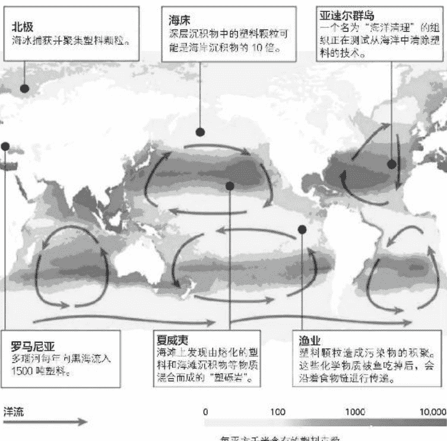

图9.1 海洋塑料垃圾多聚集于人口稠密海岸线附近，远海则汇聚于五大区域

量化海洋塑料污染极具挑战。由加州圣莫尼卡五环流研究所马库斯·埃里克森率领的国际团队，汇总6年科考拖网数据。估算全球海面漂浮塑料达5.25万亿件，总重26万吨。主体为桶、瓶、袋、一次性餐盒、聚苯乙烯泡沫等大件。

据泛欧塑料工业协会数据，2015年全球塑料产量达3.22亿吨。因原生料成本常低于回收料，绝大部分用后即弃。因此，我们能监测到的漂浮塑料，不足年产量的0.1%。

这引出一个耐人寻味的谜题：其余塑料去哪了？推测分解速度或比预想快，光照与波浪将其打碎为微小颗粒。那些“失踪”的塑料，可能以极细颗粒态悬浮水中。埃里克森团队估算，直径<5毫米的微塑料约3.55万吨。

这个数字似乎偏低，可能的解释包括：拖网网孔过大（>1/3毫米），漏捕了大量更细颗粒。普利茅斯大学海洋生物学家理查德·汤普森推测，海量塑料被封冻于海冰。2014年6月其团队报告：北极海冰每立方米含微塑料高达234个，数量级远超污染严重的环流区。海水结冰时会捕获并浓缩微粒。考虑到约600万平方公里海冰覆盖，这构成一个巨大塑料储库。冰融化时，污染物将重返大海。

汤普森团队还发现深海沉积物是塑料终极归宿。大西洋、地中海、印度洋深海沉积物中，微塑料碎片及聚合物（多为纤维）含量是表层海水的10000倍，每立方米高达80万颗粒。虽样本稀少（仅12根沉积岩芯、4块珊瑚），但全含塑料。

### 被吞噬的塑料

微塑料对海洋生物及食物链的全方位影响，尚待揭示。已知大型动物（鸟、龟、鱼、鲸）常误食塑料，胃部堵塞导致窒息或饥饿而死。但对微型生物的影响远更复杂。

对某些微生物，塑料是“自助餐”。海洋中任何硬质表面都聚集养分，巨大漂浮塑料筏因此吸引众多物种，形成新生态系统——“塑料生物圈”。其中包含弧菌属细菌（含霍乱等致病菌），病毒附着其上也不足为奇（水中病毒浓度远超微生物）。

证据显示微塑料已入侵食物链。即便剔除病原体，微塑料本身也有害：降低摄食效率；降解时释放阻燃剂、邻苯二甲酸酯、模拟激素的双酚A等毒物。塑料还像海绵吸附海水中持久性有机污染物（PCBs、DDT等）。研究证实，附着污染物的塑料毒害鱼类，而食用这些鱼的人类，显然也难独善其身。

### 截流源头

河流是入海塑料主渠道。成分主要为合成纤维洗涤脱落的微纤维、化妆品中的微珠。污水厂无法过滤，随水流直达河海。

2014年伊利诺伊州研究证实五大湖表面漂浮微珠污染普遍，从而颁布全球首个禁微珠令。此后加拿大等国跟进，联合利华、高露洁、宝洁、强生等巨头承诺淘汰微珠。风向渐变：部分国家对塑料袋征费抑制使用。2017年英国启动调查管控“一次性”容器（外卖盒、饮料瓶）；2018年1月禁产销含微珠化妆品清洁品。同时，“海洋清理”组织尝试从环流中打捞。2014年亚速尔群岛海试浮式屏障系统，预估5-10年可清除单个涡旋漂浮垃圾且不伤生物，计划2020年全球部署。

## 10 气候变迁

剧烈气候变化不仅是人类世的潜在标志，当下更以惊人的方式宣示存在。人类是否为“罪魁祸首”在某些圈层仍存争议，科学界究竟如何判断？我们该担责吗？能否遏制升温？若不能，后果几何？

### 不祥之兆

确然，人类世将以剧烈气候变化为标识。工业革命以来全球均温升超1℃，速率远超全新世任何自然变率。过去数千年相对稳定的海平面，开始加速攀升。

我们难精准预演气候变化全貌，主因在于不知人类未来将如何改写环境。但迄今科学认知，已为各情境下的可能后果勾勒出清晰轮廓。

### 温室气体为何让地球发烧

从消融的冰川、提早的泉水，到上移的树线（森林垂直分布上限）与迁徙范围改变的动物，无数证据经温度计验证同一事实——地球在变暖。

解释只有二：来得热量多了，或散得热量少了。首因可排除。卫星监测显示，典型11年太阳周期内入射能量波动约0.1%，近几十年无增量趋势，无法解释升温。剩下次因：逃逸热量锐减。

主因是二氧化碳、甲烷等温室气体浓度攀升。它们吸收原本逸向太空的特定红外波段（见第6章），将能量辐射回地表与低层大气。温室气体增多致高层大气降温，意味着向太空辐射减少，地表随之升温。

工业时代以来，大气二氧化碳从280ppm飙至2017年的408ppm。卫星观测到，温室气体吸收波段的出射红外辐射减少，回辐射地表增多。

古气候研究进一步佐证：二氧化碳浓度每次上升，地球随之变暖。虽影响气候因素繁多，但确凿证据指向：近期升温主因即二氧化碳累积。

### 其他污染物的“降温”面具

我们向大气排入杂质。一氧化二氮、氟氯烃如二氧化碳般升温。黑碳吸热升温，但遮阳反而降温。另有污染物反射太阳辐射致冷。

大火山喷发喷出二氧化硫（如1991年皮纳图博火山），形成微液滴气溶胶，致全球微降温一两年。但二氧化硫寿命短，随雨沉降。燃烧含硫燃料增加了大气二氧化硫。1940s-1970s污染严重，曾部分抵消二氧化碳升温。随西方减排治理酸雨，抵消效应减弱。

### 地球将更热

在无水无生命的星球，二氧化碳翻倍致升温约1.2℃。真实地球因水与生命，情况复杂得多。

水蒸气本身是强温室气体，暖则多容。二氧化碳增多引发初步升温，水蒸气反馈迅速放大效应。

这非唯一“正反馈”。暖致积雪海冰消融，反射率降低，吸热增多，加剧升温。长时标看，植被变迁改变吸热，巨大冰盖融化进一步降低行星反照率。除非超级火山爆发类灾难，地球将大幅升温。但幅度几何？

解析复杂反馈有两径：计算机模拟、考察古气候二氧化碳变化对气候的影响。均有局限：古气候细节难复原，且二氧化碳从未如此暴涨。

模拟与古研究指向：二氧化碳翻倍致升温约3℃——即“气候敏感性”基准。但古气候暗示敏感度或达6℃甚至更高。差因在于模型多含“快速反馈”（云变等），忽略“慢反馈”（冰盖范围变迁等）。

这意味模型或能较好预测未来几十年升温，却低估长时段升温。研究显示：照常营业，2080-2100年或升温5℃；大幅减排可限制在3℃左右。截至2017冬，轨迹介于两者之间。

### 海平面将上升数米

暖则海水热胀。陆地冰川融化或滑入海，推高水位。格陵兰与南极冰盖全融，海平面升60米以上。

当前处于冰期间冰期。过去50万年各间冰期，温度仅比现在高<1℃，海平面却高约5米。约300万年前（中新世），温度仅比工业化前高1-2℃，海平面高出今至少25米。

故而，即使微小升温，实则引致海平面大幅跃升。关键是时速。至近仍以为大冰盖需数百年显著响应。但观测显示反应远超预期，冰盖模型亦预测快速失稳。2017年研究据此推断：2100年海平面或升高达3米。

更惊人的是，研究揭示：部分区域冰盖一旦启动融化，过程不可逆（除非下一个冰期）。阻止海平面最终上升至少5米可能已晚，且我们将很快面对20米升幅的现实。

### 为何天气狂暴

海平面上升威胁低洼沿海数亿人口。对其他人，气候变化最直接体验是天气疯癫。极端天气确实频发。

2003欧罗巴热浪夺数万命，刻骨铭心。2010俄罗斯特大热浪致7万人亡。2012美“三月仲夏”，中北部州气温暴涨，密歇根州佩尔斯顿达29℃，粉碎17℃旧纪录。2017飓风季损失史上最惨。

气候学家早警告：暖化致热浪、旱、涝增多。但近年极端如“三月仲夏”远超模型预测。极端寒潮也现身：2012罗马严寒倒塌古迹；利比亚的黎波里街头积雪；2016东亚创纪录寒潮，冲绳历史首现降雪，台湾85人死于低温心梗。

研究证实：人为因素让天气更狂野——不仅持续升温，更变幻莫测。这只是偶然插曲，还是暖化加剧下的永久新常态？

即便气候恒定，天气本就波动大。每夏不同。历年夏季均温绘成分布，呈钟形曲线散布于长期均值。

过去百年均温升0.8℃，让习以为常的天气整体偏暖。凉爽夏季概率降低，极端酷夏概率骤增（见图10.1）。

### 理论推演

稳定气候下，温度服从钟形曲线——均值概率最高，极端冷热罕见。

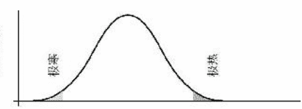

若气候变暖，概率分布迁移。即便仅分布平移、形状不变，中等偏热概率微增，极端酷热概率却剧增。

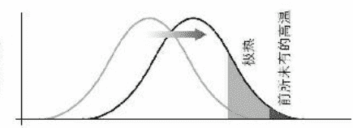

理论上，若暖化伴随波动加剧，分布不仅平移更变宽。极端酷热概率大增，极端严寒仍偶发。

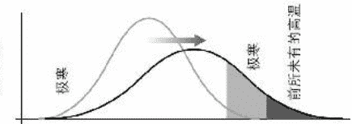

### 实况如何

北半球陆地温度显示：随地球变暖，钟形曲线正在平移且变宽。

——1971-1980: —— 1981-1990 ——1991-2000: —— 2001-2011

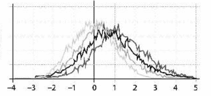

6、7、8月异常分布（相对当地正常温度的标准差。基准期1951-1980）

图10.1 天气演变趋势显示：极端酷热将成常态，但极端严寒仍会造访

### 倾盆大雨

升温催生多重极端天气。气温每升1℃，大气含水指数级增强。降雨时倾向暴雨洪涝，灾难性洪水概率激增。

非止洪涝。水汽凝结成云释放潜热，为雷暴、飓风等风暴引擎（第6章）。

2014年IPCC指出：人为影响与强降水增多相关。理论推演：风暴一旦生成将更猛烈，因可汲取更多热能。2017加勒比海飓风实证：风速增强，损失指数级跃升。

### 意料之外

简单物理告知：暖化推极端向更极端——更猛烈的风暴、更酷热的热浪、更干旱的旱灾、更大的暴雨。这正在发生。此外，近年屡破纪录的事件，令人瞠目结舌。

# 气候失控：极端天气背后的推手与“地球降温”的险棋

2003年夏，欧洲经历了五百年来最酷热的季节。波茨坦研究中心的斯特凡·拉姆斯托夫指出，瑞士夏季均温较过往纪录飙升2.4℃。单日破纪录司空见惯，但整个季度持续高烧实属罕见；2010年俄罗斯热浪更是凶猛异常。令人不安的是，事态正在恶化，且极端事件的频发已无法用当下的全球变暖幅度完全解释。按理说，这级别的灾害应在21世纪末大幅升温后才会上演。偶发异常或可归咎于运气，但近年接连不断的“怪事”令人生疑。

哥伦比亚大学地球研究所詹姆斯·汉森团队梳理全球夏季（6-8月）气温记录，以1951-1980年为基准。数据显示，地球表面遭遇高度反常极端高温的区域正逐年扩大。这符合全球变暖预期，但汉森发现天气不只变热，更变得“情绪不稳”。基准期夏季气温波动范围0.55℃，近三十年（1981-2010）增至0.58℃，内陆地区波动尤剧。这意味未来风险远超单纯升温。

### 减缓急流

诡异天气不止于升温。热浪不会让的黎波里降雪，但研究者锁定嫌疑人——一股“发懒”的急流。

急流位于7-12公里高空，由赤道热空气膨胀形成“高压山”，在重力与地转偏向力作用下自西向东奔涌。极地急流最强，驱动力源于热带与极地温差。但北极升温加速，冰雪消融暴露深色陆海吸热，温差缩小。罗格斯大学珍妮弗·弗朗西斯指出：北极海冰减少让“大气山”坡度变缓，急流引擎熄火（见图10.2）。

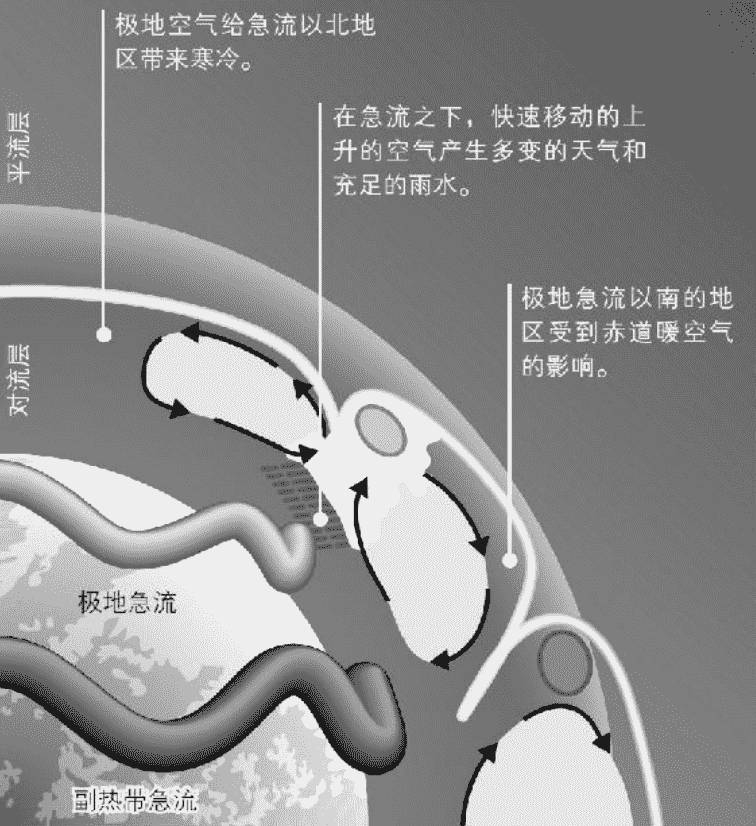

图10.2 极地急流的位置决定了北半球中纬度地区的天气

急流减速，路径蜿蜒停滞。这至关重要，因急流推动天气系统。气流滞留数周形成“阻塞”，极端天气便锁定了。引导低压接连登陆，英国2012年遭百年暴雨洪灾；被巨大“舌状”气流卡住，要么热带干热北上，要么极地寒流南下。近年北半球极端天气——严寒冬、2003欧陆热浪、2012美早夏——皆与“阻塞”有关。其他研究证实急流减弱将诱发更多阻塞，弗朗西斯还发现北半球增暖显著推高高压脊北缘，加剧曲流极端性，将暖气送至更高纬，冷气推至更低纬，致罗马、的黎波里等地天气反常。

### 激发因素

除急流，或有未知机制助推恶劣天气，或随升温新被触发。如厄尔尼诺-南方涛动（ENSO），暖水在太平洋往复，伴随信风变化。厄尔尼诺期暖水东扩，升温全球并引发连锁反应。2014-2016年强厄尔尼诺重创埃塞俄比亚、索马里，导致非洲南部、越南、印尼及太平洋岛国旱灾，联合国报告称6000万人受困。关键疑问：升温下ENSO会否失控？拉姆斯托夫坦言虽无证据，但因人类改变气候系统能量平衡，若振荡模式纹丝不动反倒惊人。

### 关于云的难题

云捉摸不定，难以研究，成气候学心病。现云层整体似“隔热板”，反射阳光降温。核心悬念：暖化下，这块板会变厚（反射增强、延缓暖化）还是变薄（加速暖化）？这关乎22世纪升温3℃（惨烈但可生存）还是6℃（灾难深渊）。

云吸地面长波辐射（多云夜暖），也反射短波辐射，顶部向外发射红外。它是遮阳伞、棉被、散热片三合一（见图10.3）。

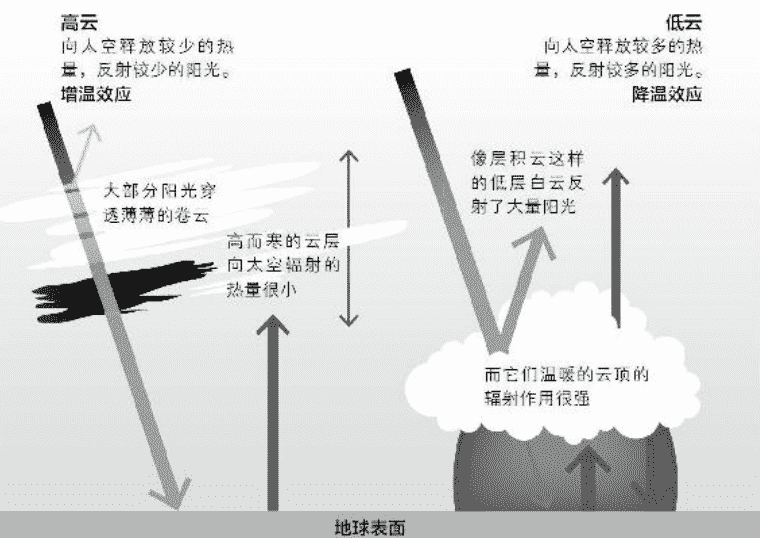

图10.3 大气云的高度决定了它们对地球是否有降温或增温的影响

效应取决于高度与类型。低云降温：虽吸热，但反射强、顶部暖散热多；高云增温：顶部冷散热少、反射弱。低云分布更广，故整体降温。维多利亚大学科林·戈德布拉特算过，若无云，失控温室效应将蒸干海洋。虽不会发生，但暖化下云如何变，极难定论。

观测手段皆有短板：陆站不见海洋云；船观主观碎片；飞机太少；卫星受漂移衰减干扰；专用气候卫星仅十年寿命，捕捉不了长周期。纵有完美记录，暖化跨越临界点引发云剧变，历史也难参详。

### 云层的不透明性

搞清云理当能入模预测，但算云难。云内湍流尺度米至千米，全球模式网格百公里，微不足道。小尺度模式能捕百米涡旋，却覆盖不了大系统。微观上，水滴冰晶碰撞凝聚冷凝蒸发，原理虽明仍不够。云生赖气溶胶作核，粒子多云更白更持久（更强遮阳伞）。模式捕捉不全，只能用近似关系（如云量与湿度/温度关联）代入，但观测不全，无普适关系。

建模者陷两难：云与近地3公里温差相关好，与另一温湿综合指标也相关好。可不同参数化方案对暖化响应预测截然不同，观测验证成了单选题。

虽困难，特定云类有进展。模型观测一致：高云随暖化继续抬升，顶部更冷，辐射散热变差；风暴轨迱极向偏移，云反射太阳热减少。双重打击加剧暖化。

### 热带地区的降温毯

热带副热带海洋广布低层积云，是地球主要“遮阳伞”，持续强力降温。但模型内战：有预测低云稳，有预测锐减加速暖化。物理机制探究由此深入。

利好存在：“负反馈”随温升抑暖。全环流下沉暖干气锁住海面冷积云，形成逆温层，云不升不雨。暖化强化下沉暖流，理论上增强逆温、加厚云层。劳伦斯利弗莫尔实验室彼得·考德威尔团队用观测与小尺度模型支持此说。但这仅单一机制，暖化下层积云增减仍存争议。

正反馈亦在作祟。一、云顶辐射散热减弱，冷空气下沉减弱，从海面带上来的暖湿气减少，云水减、冷却弱（2009年考德威尔及马克斯普朗克比约恩·史蒂文斯团队指出）。二、逆温层上下混合耗散水分。2012年观点：暖化增强混合，驱散水分，云减暖增。三、即便混合不增，暖空气容水量大，干空气夹带更多水汽流失。

悉尼新南威尔士大学史蒂文·舍伍德用气象气球数据实锤混合活跃，超多数模型设定。真实混合度模型气候敏感度高达3-4.5℃。但博尔德国家大气研究中心约翰·法苏洛持保留：气球观测稀疏，难证实。他偏好卫星全球测云量与湿度直接比对，2012年发现模型普遍高估副热带湿度——坏消息，因低湿模型预测增暖更剧。

云谜虽见曙光，却灰暗不明，仅暗示哪模型较靠谱。算力增强虽提分辨，离“完美模型天堂”尚远。全球模型显式解析云微过程至少需数十年，在此之前，近似参数化仍是唯一出路。

### 地球工程学能避免气候混乱吗

气候危机迫近：冰川消融、风暴增猛、洪旱热浪升级。温室气体排放持续攀升，前景严峻。即使明日零排放，存量气体仍锁定数十年升温。

或该正视“大胆想法”：地球工程。人为修补气候机器，或可纠错、规避最坏后果、或赢减排缓冲期。

科学家列出数十降温方案：船队喷盐雾增白云、平流层喷硫反射光、深空布反射镜、育白色作物、海洋施肥、沙漠铺反光膜、撒催云菌、放微型气球。

巧思虽多，何者奏效？会否反噬？除实地冒险，最优路径是用精细模型逐一压力测试。研究深入下，我们对地球工程能不能、做不到有了轮廓。

部分方案速死：覆盖沙漠反光塑料虽降温，毁生态、乱区域气候、需庞大维护军，疯狂至极。太空遮阳伞需2000万枚火箭发射，天价且污染致命，超能力外。其余虽可行，真解决问题？

核心矛盾：温室气体聚集吸热。本世纪中叶CO2浓度恐翻倍，每平米净辐射强迫增3.7瓦。地球工程要么挡等量太阳热，要么增等量顶大气散热。

“地球制冷机”需满足苛刻前提（见图10.4）：不剧改区域气候、防海平面上升、理想兼阻海水酸化护珊瑚。

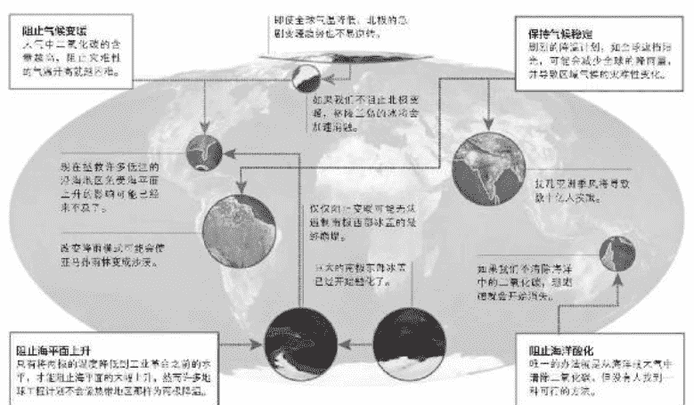

图10.4 使地球降温是一项艰巨的任务。但是，为了避免灾难，任何一项地球工程计划都必须同时满足其他要求

首测效力。埃克塞特大学蒂姆·伦顿、东安格利亚大学尼姆·沃翰综合模型评估数十方案。多数微乎其微：刷白屋顶路面，乐观估计每平米仅反0.15瓦，杯水车薪。海洋施肥促浮游植物固碳沉底，至2100年仅增0.2瓦热平衡，聊胜于无。加速极地下沉输碳入深海，效用更限。

仅两招效强且相对可行：遮阳。

### 将全球变暖置于阴凉处

一、增白海洋低层积云。船队喷细盐雾作凝结核，增云滴数，云变白反射更多光。理论可抵消CO2翻倍暖化效应。优势：无有害化学品。隐患：成核机制未明（见第6章）恐落空；单冷海洋恐扰区域气候。2012年研究：太平洋人工造云可能以拉尼娜模式重组降雨。

二、平流层注气溶胶（老生常谈）。硫酸盐微滴反射阳光。我们本在做：SO2污染形成硫酸雾，反射约0.4瓦/平米。但低层SO2寿命短效用限。若送入平流层，驻留数年，降温放大。证据铁证：1991皮纳图博火山喷发致全球降温0.5℃持续数年。

平衡CO2翻倍强迫，需年输500万吨SO2入平流层。极光飞行科学贾斯廷·麦克莱伦评估多种输送法，年成本约百亿美元。对比暖化万亿损失（仅海平面上升吞噬万亿城市农田），极具性价比。

### 不利的一面

残念：硫喷雾难阻海平面上升。气溶胶极地驻留短于热带，极地降温弱。即便全球均温拉回19世纪，两极仍暖，冰盖续融。

固体金属粒或反光微球是否更优未知。输送气体简便廉价，研究聚焦硫酸盐。

遮阳代价：海面光减、蒸发减。当下暖化强于硫污染降温，蒸发仍增。若强降温至工业化前，降雨骤降。若幅度温和，避旱但冰盖融更快。

模型显示遮阳或引区域灾难：扰乱季风致数十亿人饥荒；改亚马孙水汽环流变沙漠。

牛津大学迈尔斯·艾伦用精细模型测平流层遮阳物量变化影响：无统一方案兼顾全域。大量气溶胶利中国温雨，重创印度降温。

换角度看：模型对全球效应一致，区域影响却分歧大。或因假设阈值异，或因模型局限。

即便模型准，生态响应等区域因素本不可知。故永无百把握某特定方案能达理想结果。

这就意味着，所有的“遮阳伞”方案都暗藏巨大隐患。一旦出现灾难性后果，我们被迫中断硫酸盐注入或停止增白云层，地球将在短短几年内经历剧烈升温。这种骤变比渐进式变暖更具毁灭性，因为生态系统与人类社会根本来不及适应。若坚持使用硫酸盐微粒，甚至可能需要叠加其他手段——譬如人造卷云给两极降温，这无异于给地球开了一剂又一剂猛药。

### 消融高空云幕：另一条降温路径

那些点缀在夏日蓝天的高耸稀疏卷云，看似无害，却是戴维·米切尔誓要清除的目标。消除它们不但能降温，还能守护冰盖、缓和极端天气。

与低层云不同，卷云由冰晶构成，反射太阳辐射的能力远弱于其锁住长波辐射的本领，净效应是加剧变暖。2009年，内华达沙漠研究所的米切尔提出：利用飞机撒布三碘化钕——一种无毒凝结核，催生更大冰晶。这些冰晶下落更快，导致卷云提前消散。初步模拟显示，此法可实现约2瓦/平方米的降温效力，足以抵消二氧化碳翻倍效应的一半。

更关键的是，该手段在高纬度地区效能最高，精准护航脆弱冰盖，同时平抑赤道与两极的温差。米切尔坦言，将卷云纳入全球模型尚需大量研究，并建议先行小规模试验。但风险依然并存：区域性副作用可能灾难性，且“终止冲击”同样危险。

### 直击病灶：抽离大气中的碳

与其遮蔽阳光，不如溯源治理——主动从空气中提取二氧化碳。液化后的CO₂可注入枯竭油气田等地下储层，但至今无高效可行方案。伦顿指出，从稀薄大气中捕碳，成本远超从电厂烟气等高浓度源头捕集。

指望现有技术及时清除人为排放、阻断气候变局并不现实。与其铺天盖地建捕碳机，不如加速二氧化碳与硅酸盐岩石的自然反应——化学风化。这已运作亿万年，吸纳海量碳（详见第6章）。但处理一年排放量，需粉碎7立方千米岩石并薄铺地表数百分比面积，此路不通。

改变土地用途与农业模式行吗？植树造林虽佳，但地理限制将潜力锁定在0.5吨/平方米，且森林一旦因变暖枯死或焚毁，固碳归零。

锁住植物碳的路径有二：一是制生物炭掩埋；二是配碳捕获技术焚烧作物（BECCS）。两者皆争夺耕地，与粮食生产博弈。伦顿测算，至2050年总效益仅0.3吨/平方米。

归根结底，政治是地球工程最大拦路虎。艾伦强调，不能让方案内斗，必须由超国家机构裁决。但各国优先级迥异——有的惧海平面上升，有的怕酷热或雨带偏移，共识几不可得。

退路何在？承认只有具全球风险的大规模遮阳需全球一致同意；生物炭、造林等可单边实施。可正如伦顿所见，这些力有未逮。欧盟科学咨询委员会2018年报告直指：含海洋施肥在内的捕碳方案，实质降温潜力有限。结论只有一条：首要策略是堵住源头，不让温室气体入天。

### 尾声：星球的终局与人类的抉择

你如何读完这书？是在聆聘地球的挽歌。除非突发不可预知的灾难，否则终结地球的将是孕育生命数十亿年的那颗恒星——太阳。它不似超新星般爆炸抛射行星，体量不足。但60亿年后核心氢耗尽，氢壳层点燃，能量暴涨千倍，引力束缚失效，膨胀吞噬近邻，半径将远超地球轨道。

地球仅存一线生机：太阳膨胀时抛掷约1/3质量，引力减弱令地球轨道外拓。这是一场超越膨胀的竞赛。水星、金星必输无疑，将被吞没。沃里克大学的迪米特里·韦拉斯认为，地球胜负难料。即便如此，地球也难全身而退：太阳外层热浪将烘烤内部，引发剧烈火山。

届时生物或早已绝迹，或演化成不可认知的形态。因为至少两大死劫更早降临：至多10亿年后，太阳自然增热驱动“温控器”狂运，抽干大气CO₂至光合作用停摆，植物灭绝，食物链崩塌（见第8章）。若侥幸熬过，30-40亿年后地核彻底凝固，板块引擎熄火，火山绝迹，磁场消失，大气被太阳风剥离，星球不再宜居。

这些是不可控的天命，而我们当下面临的灾难，出于人为。除非停止排放或寻得实用清除路径，全球变暖必将迅速危及地球生命（见第10章）。

结局虽沉重，希望犹存。人类极具创造力，演化上更是异类：素不相识者亦伸援手，物种间罕见。这种跨越国界的异质合作，曾修补臭氧空洞（见第6章）。期盼各国携手，实打实降低温室气体浓度。如此，人类或可在10亿年后仍繁荣昌盛——那时，我们或许已在“地球二号”开疆拓土。

### 知识拾遗：读懂星球的50个侧写

此部汇编助你超越泛泛阅读，深谙家园底蕴。

#### 十大地质朝圣地

1.  **冰岛·板块裂谷见证地**  
    大间歇泉、格里姆火山、冰川洞穴、斯瑞努卡基古休眠火山内部、全天候温泉泥浆浴。北美与欧亚板块分离处，辛格韦德利可踏足两板块交界。新建熔岩中心馆藏丰富。🔗 `https://lavacentre.is`

2.  **兰萨罗特岛·凝固的火河**  
    18-19世纪熔岩覆盖，蒂曼法亚国家公园保存近乎喷发即刻的地貌。极少雨水侵蚀，可食熔岩烹美食，漫步火星质感熔岩场。曼查布兰卡游客中心解构地球结构与板块构造。🔗 `http://www.lanzaroteinformation.com/content/timanfaya-vistors-centre`

3.  **夏威夷火山国家公园·热点前沿**  
    管理员专业护航，让你安全逼近火山、熔岩流、硫磺喷口。贾加尔博物馆俯瞰基拉韦厄火山口，震撼无比。🔗 `https://www.nps.gov/havo/`

4.  **新西兰·俯冲带上的火山实验室**  
    太平洋板块俯冲印澳板块之下。北岛国家公园环绕火山地热区。可访1886年塔拉韦拉火山毁灭的毛利村落蒂怀罗瓦；煎锅湖或为世界最大热湖；怀特岛自库克船长1769年发现至今持续冒烟。奥克兰博物馆火山展不容错过。🔗 `http://www.aucklandmuseum.com/volcanoes`

5.  **伦敦自然历史博物馆·地球深时档案库**  
    化石陈列与地震模拟器让你身临其境体验地动山摇。🔗 `www.nhm.ac.uk`

6.  **爱丁堡动态地球馆·沉浸式星球传奇**  
    熔岩飞溅震颤地面，火山灰冲天，极光舞动冰盖。厌倦室内？隔壁亚瑟王座即含碳火山喷发遗迹。🔗 `http://www.dynamicearth.co.uk/`

7.  **侏罗纪海岸·1.85亿年沉积史书**  
    英格兰南境150千米悬崖、岩柱、拱门，记录三叠、侏罗、白垩纪。莱姆·里杰斯博物馆是化石猎人基地。🔗 `http://www.lymregismuseum.co.uk`

8.  **中国地质博物馆·东方地宝聚珍**  
    20万件藏品：3.5吨世界最大石英晶体、巨型山东龙化石、珍稀原始鸟化石。🔗 `http://www.gmc.org.cn/`

9.  **圣安德烈亚斯断层·板块撕裂的伤痕**  
    延伸1200千米，界定太平洋板块北移与北美板块南移边界。卡利索平原、石峰国家公园裂缝清晰可见。可参加组团或自助游。🔗 `http://www.san-andreasfault.org/`

10. **美国大平原·追风逐暴之旅**  
    5-6月龙卷风带，购票跟团猎捕超级单体雷暴与龙卷风，实测天气预报极限。

#### 历史十大爆炸瞬间

1.  **1908通古斯大爆炸**  
    6月30日清晨，西伯利亚通古斯河上空炸裂，2000平方公里林木铺倒，数十公里外人员被掀翻。当量约1500万吨TNT，主流归因于数十米流星空中解体，地下甲烷说仍在研判。若为流星，史册仅作小注。

2.  **1961沙皇炸弹·人造极限**  
    苏联新地岛上空引爆5700万吨TNT当量氢弹，闪光可见千公里，900公里外窗碎，蘑菇云冲64千米。威力是通古斯4倍。事后见证者：“高地被刮平，如溜冰场。”

3.  **1883喀拉喀托火山·毁岛之音**  
    爪哇苏门答腊间火山岛，历月动荡后8月底猛发，27日四连爆，声传4000公里，数万亡。岛体毁灭，后续喷发重塑新岛。VEI 6级，当量2亿吨TNT，超沙皇炸弹3倍。

*自此改用火山爆发指数（VEI 0-8），每级喷发量增十倍。*

4.  **1815坦博拉火山·无夏之年**  
    近代唯一VEI 7级，印尼松巴哇岛。1812年蠢动，1815年4月大发，火山灰遮天蔽日致全球骤降温，1816年成“无夏之年”。奇异的是，此巨兽沉寂约160年，直至格陵兰冰芯揭露其真身：1815年以来无喷发更似“哑弹”。

5.  **2.65万年前奥鲁阿努伊·VEI 8级巅峰**  
    今新西兰陶波湖，昔日北岛埋200米火山灰岩石。喷发量达坦博拉10倍，当之无愧最高级。

6.  **7.5万年前多巴超级火山·人类瓶颈之谜**  
    超级火山定义：喷发量超1000立方千米。苏门答腊多巴喷发2800立方千米，形成巨大破火山口（今多巴湖）。火山冬夏致全球骤冷、人类锐减说存争议。

7.  **黄石三连发·脚下的怪物**  
    地幔热柱周期性引发超级喷发。210万年前哈克贝利岭（近多巴规模）、130万年前亨利福克、64万年前熔岩溪，构建今黄石破火山口。首尾两次火山灰覆盖北美大部。

8.  **2700万年前拉加里塔·地质史上最大**  
    喷发5000立方千米，科罗拉多州仍存大量火山岩。先抛2米巨石，随以灼热碎屑流横扫。幸已死火山。

9.  **6500万年前希克苏鲁伯撞击·恐龙终局**  
    墨西哥尤卡坦半岛地下180公里陨石坑。10公里小行星撞击，当量1亿吨TNT，亿年最大撞击。主流认同为恐龙灭绝主因（德干暗色岩火山助力）。杀手非爆炸本身，而是尘埃云摧毁生态。

10. **大碰撞·月球诞生**  
    已在第1章详述，此处按下不表。

*警钟长鸣：全球核武库约1.5万枚，总当量数千兆吨TNT。虽冷战后风险降，仍高悬。  
6座确认超级火山：陶波、多巴、黄石、瓦尔斯、长谷、姶良。谁先醒、何时醒，未卜。  
50万小行星、12万亿彗星多不近地。仅2颗有撞击窗口（2048、2880年），托里诺等级均1级，暂无恐龙厄运。*

#### 地球五大“吉尼斯”纪录

1.  **最大间歇泉群**：黄石上间歇泉盆地，2.6平方公里内聚150口热泉，含老忠实泉。
2.  **最高气温官方纪录**：1913年7月10日，美国死亡谷56.7℃。利比亚1922年58℃因数据存疑，2012年被WMO撤销。
3.  **最长洞穴系统**：肯塔基猛犸洞，石灰岩迷宫延伸663公里，是亚军2倍。
4.  **最大撞击坑遗迹**：南非弗里德堡，20亿年前诞生直径300公里，肇事者10-15公里小行星。今仅存残迹。
5.  **最干燥之地**：南极麦克默多干谷，200万年无雨雪，超阿塔卡马沙漠。

#### 五则地学人的“冷”幽默

1.  **怎么跟哥哥说嫁地质学家？**  
    “他缺点多：越想成片麻岩，越被嫌是花岗岩。婚礼夜警告他：地质学家是基石！”（片麻岩=变质岩，基石/基岩双关）

2.  **你可能是地质学家，如果……**  
    首试准念“辉钼矿”；石英碎片比内衣多；机场行李员知名拒搬箱；看西部片只盯岩层；娃名“珍宝”“岩石”“绿柱石”；指得出楚梅布位置；看《肖申克救赎》高呼“黑曜石！”（楚梅布=纳米比亚矿镇，产透闪石；片中主角留言处为黑曜石）

3.  **飓风哈维、厄尔尼诺酒馆吹牛**  
    哈维：“我毁岛屿经济，佛罗里达损失亿万。”  
    厄尔尼诺：“我让沙漠成海、雨林枯竭，生态系统生死随心，经济随我摇摆。”  
    此时一北大西洋弱低压进门坐下。  
    两大霸主瑟缩躲柜台后。  
    酒保嘲笑：“俩镇上最狠天气咋怂了？”  
    厄尔尼诺哀叹：“咱硬，但他是**气旋**性的！”（Cyclonic/心理/生理多重梗）

4.  **全球变暖太有趣了，冰盖都崩溃了！**  
    （Collapse/崩溃/笑场多义）

# 给忙碌少年的粒子物理启蒙：重新认识微观世界

### 10段语录

- 1. “地球的生命演变历程极其漫缓，其时间跨度远超人类个体寿命，以致这些变迁未曾被当下捕捉；等到能够记录它们时，整个国度早已从兴起走向消亡。”（古希腊哲学家 亚里士多德）

- 2. “地质学者日益清醒地认识到：没有什么比地球表层的岩石圈更不稳定，甚至不如随风而逝的微风恒久。”（进化论奠基人之一 查尔斯·达尔文）

- 3. “驱动大陆漂移的动力，与隆起巍峨褶皱山脉的力量源自同一根源。大陆位移、断层挤压、地震火山、海侵回旋乃至地极偏移，彼此间必存深层因果联系。它们在特定地质纪元的同步增强便是明证。然而，孰因孰果，尚待后世揭晓。”（德国地球物理学家 阿尔弗雷德·魏格纳，大陆漂移说提出者，曾苦寻驱动大陆之力而不得）

- 4. “渐新世时，印度板块猛烈撞击西藏板块，碰撞之猛烈不仅引发褶皱、弯曲板块边缘，更缔造了青藏高原，将喜马拉雅山脉推升至8.8千米高空。1953年登顶者插旗之处，覆盖着古印度洋温暖清澈海水中生物的骨骼遗骸。彼时海洋北移最终消亡，那些遗骸或许在海底六千米高压下化作岩石。这一现象本身即是一部地表运动的实证史诗。”

> “若法令限我以一言概括毕生著述，我将择此：珠穆朗玛峰之巅，乃海洋石灰岩也。”（美国作家 约翰·麦克菲，《前世年鉴》作者）

- 5. “没有任何一位合格的地质学家会甘心囿于案头或实验室，真知唯源于对自然无偏见的田野观察。地质学乃至一切科学领域的创造性工作，本质上都是互动与综合的产物：酒馆中萌芽的稚嫩念头，荒野间把玩的岩石，独行时闪现的思维火花，实验室析出的数据，计算器上敲击的数字，科考船上时好时坏的精密仪器，科学家脑中简陋却高效的直觉，以及路边激烈的学术争鸣。”（美国古生物学家、进化生物学家、科普作家 斯蒂芬·杰·古尔德）

- 6. “三百万年来，大气二氧化碳浓度从未如此之高。我们对其温室效应的认知仍显不足——但气候变暖已成铁板钉钉的事实。”（英国大气物理学家 乔安娜·海格）

- 7. “短短三十载，北极海冰已消逝近四分之三。无需科学家指证，气候系统的剧变已肉眼可见，罪魁祸首锁定为化石燃料燃烧释放的温室气体。目睹北极以如此速率升温，令人毛骨悚然。”（美国北极大气科学家 珍妮弗·弗朗西斯）

- 8. “若我们只甘愿袖手旁观，静候预言应验，那么发展出精准预测能力的科学又有何用？”（美国大气化学家、诺奖得主 舍伍德·罗兰）

- 9. “海洋沦为全球的污水汇聚地，无论大气沉降还是陆地径流，终将携带万般污染汇入其中。”（海洋探险家、自然保护主义者、电影制片人、水肺发明人 雅克·库斯托）

- 10. “地球上所有靠谱的科学家都认定你的产品毁环境。我建议花钱雇黄鼠狼写软文洗数据，然后暴饮暴食，在世界毁灭前先走一步。”（美国漫画家、幽默哲学家 斯科特·亚当斯 作品《呆伯特》中，狗伯特对老板的“良策”）

### 推荐阅读资料

- 1. 《地球：一段亲密的历史》（理查德·福提，2005）跨越时空，将自然史、人文史、城市演变与地质学深度编织，视野宏大。

- 2. 约翰·麦克菲《史前年鉴》（2000）笔触细腻生动描绘北美地质图景，荣获1999年普利策非虚构类大奖，佳作典范。

- 3. 地球真的只在亿万年间以蜗牛速度变化吗？迈克尔·兰皮诺在《大灾变：二十一世纪的新地质学》（2017）中给出否定答案。他聚焦小行星撞击、超级熔岩喷发等剧烈灾变事件，揭示地球快速变迁的另一面。

- 4. 英国早期地质学多由“绅士阶层”推动，他们或为找煤、或为佐证圣经。《读石》（布伦达·马多克斯，2017）讲述了18-19世纪这些“绅士地质学家”（含女性）的故事，他们以科学利器削弱教会权威，奠定世俗科学基石。

- 5. 迷恋化石者不可错过布赖恩·斯威特克的《石上之书》（2011）。书中深挖化石记录，聚焦“过渡环节”——连接灭绝群体与后代的关键桥段：会走路的鲸鱼、长腿的鱼、长羽毛的恐龙，叙事引人入胜。

- 6. 亨利·方丹在《大地震》（2017）中剖析1964年阿拉斯加大地震，置于20世纪60年代板块构造理论确立的大背景下，展现单次地震如何重塑人类对星球的认知。

- 7. 多里克·斯托的《海洋简史》（2017）属牛津“通识读本”系列，短小精悍切入核心。该系列涵盖大气、矿物、板块构造等地质全景，是极佳入门指引。

- 8. 喜欢轻松阅读？试试加布丽埃勒·沃克的《空气的海洋》（2008）。书中将大气层比作洋葱，层层剥开其性质、成分，并讲述认知大气的科学先锋们。

- 9. “盖亚假说”视地球为自我调节的超级有机体，虽科学信度存疑，但“善待地球否则自食恶果”的警示从未褪色。詹姆斯·洛夫洛克作为现代地球观塑造者，其著作（如《正在消失的盖亚：最后的警告》，2009）必读。

- 10. 想听生态学家最新警钟？乔治·伍德威尔的《生存的世界》（2016）聚焦气候变化对生物圈群落的冲击，直面被掠夺星球的未来。

### 名词表

| 术语 | 释义 |
| --- | --- |
| 气溶胶 | 悬浮于空气中的微米级固/液颗粒群。部分充当冰核诱导降水，部分反射太阳辐射产生降温效应。 |
| 软流圈 | 岩石圈之下、机械强度低、高粘滞的地幔层段，是板块漂移的“润滑层”。 |
| 球粒陨石 | 与地球同龄形成的石质陨石，化学成分高度匹配地球原始物质（非全匹配）。 |
| 气候敏感性 | 定义为大气CO₂浓度翻倍后，全球平均地表温度的平衡增量。 |
| 厄尔尼诺现象 | 厄尔尼诺-南方涛动暖相位。热带中东太平洋海温异常升高，重塑区域乃至全球天气格局，破坏力强。 |
| 地质年代表 | 依据岩层形成先后按时间排序的地层年代框架，是地质年代表的基石。 |
| 地球中微子 | 地幔放射性同位素衰变释放的电子反中微子，是探测地球内部热源的独特窗口。 |
| 火成岩 | 岩浆/熔岩冷却凝固的产物。 |
| 同位素 | 同元素中子数不同的核素变体，部分具放射性，是地质定年的核心工具。 |
| 拉尼娜现象 | 厄尔尼诺-南方涛动冷相位。热带中东太平洋海温异常降低，全球气候影响力与厄尔尼诺对等。 |
| 熔岩 | 喷发至地表的熔融岩浆。 |
| 岩石圈 | 地球坚硬外壳，含地壳及上地幔顶部，破碎为板块相互拼贴。 |
| 岩浆 | 地下熔融岩浆体，聚集于火山下岩浆房，喷出地表即称熔岩。 |
| 地幔 | 地球体积最大圈层，夹在薄薄地壳与液态外核之间。 |
| 变质岩 | 老岩石在深部高温高压下经物理化学重组形成的新岩石。 |
| 矿物 | 自然形成的定组分晶体化合物，岩石的基本构建单元。 |
| 中微子 | 近零质量、不带电、弱相互作用的幽灵粒子，穿透力极强。 |
| 橄榄石 | 镁铁硅酸盐，上地幔主成分矿物。玄武岩中常见，风化快，能以碳酸镁形式封存大气CO₂。 |
| 蛇绿岩 | 未被俯冲消亡、反被抬升至大陆地壳之上的古老洋壳残骸。 |
| 辉石 | 含钙钠镁铁铝的硅酸盐矿物群，广布于地幔与火成岩。 |
| 沉积岩 | 河湖海底碎屑与有机质沉积压实成岩，通常呈层理状。 |
| 太阳风 | 太阳喷发的高能带电粒子流。 |
| 地层年代表 | 按形成时间先后排列的地层序列，又称“地史”，构成地质年代表基础。 |
| 俯冲作用 | 洋壳板块俯入地幔的过程，发生于板块汇聚带，被视为板块驱动主引擎。 |
| 锆石 | 锆硅酸盐，微小坚韧晶体，常含微量杂质。最古老锆石超44亿年，是窥探地球幼年期的“时间胶囊”。 |

### 未读 Club

**为好奇心提供高质量阅读避风港**

- 专属深度社群 · 独家会员福利
- 精品书籍共读 · 线上线下特权活动

📱 扫码即刻加入，开启探索之旅

## 《新科学家》全球顶尖科普旗舰：科学通识教育系列

## 给忙碌青少年讲粒子物理：揭开万物存在的奥秘

暗物质迷踪、时空扭曲、量子信息…… 深潜最小尺度，窥探宇宙运作核心逻辑  
欧洲七位前沿物理学家联袂撰写 从微观粒子至无垠星宇，一网打尽万物运行之谜  

**给忙碌青少年讲科学**  
一本书，高效打通一门硬核学科 —— 权威、系统、趣味、高效

### 版权信息

**书名：** 给忙碌青少年讲粒子物理：揭开万物存在的奥秘  
**原版：** Why the Universe Exists  
**出品：** 未读·探索家  
**出版社：** 天津科学技术出版社  
**作者：** 英国《新科学家》杂志社  
**译者：** 秦鹏  
**版权：** © New Scientist 2017 | 简体中文版 © 2021 联合天下（北京）新媒体有限公司 | 保留一切权利

### 系列介绍

面对那些人人渴望深入却不知从何下手的前沿课题，《新科学家》推出此系列恰逢其时。这些主题极具挑战与探究性，是通往深层认知世界的钥匙。好奇心驱动下的读者，渴知事物运作的“何以如此”，此系列正是最佳登陆点——兼具学术权威与大众可读性。敬请关注姊妹篇：

- 《给忙碌青少年讲太空漫游：从太阳中心到未知边缘》
- 《给忙碌青少年讲人工智能：会思考的机器和AI时代》
- 《给忙碌青少年讲生命进化：从达尔文进化论到当代基因科学》
- 《给忙碌青少年讲脑科学：破解人类意识之谜》
- 《给忙碌青少年讲地球科学：重新认识生命家园》
- 《给忙碌青少年讲数学之美：发现数学与生活的神奇关联》
- 《给忙碌青少年讲人类起源：700万年人类进化简史》

### 撰稿人

**责任编辑：** 斯蒂芬·巴特斯比，物理学家，《新科学家》顾问。  
**系列策划：** 艾莉森·乔治，《新科学家》“即时专家”系列编辑。  
**内容源：** 本书文章基于2016年《新科学家》大师班“粒子物理学的奥秘”演讲实录及刊载历史文章整理而成。

### 特约撰稿人

- **乔恩·巴特沃斯** — 伦敦大学学院物理学教授，欧洲核子研究中心（CERN）大型强子对撞机（LHC）ATLAS合作组成员。专攻电弱对称破缺机制（质量起源）。撰稿：第2章“为何需要希格斯”，第3章“探测器传奇”与“大发现时刻”。
- **迈克尔·达夫** — 伦敦帝国理工理论物理名誉教授，超引力研究开拓者。撰稿：第9章“弦之声”。
- **戴夫·戈德堡** — 美国德雷塞尔大学物理学教授，理论宇宙学专家。撰稿：第2章“为何宇宙偏爱对称”。
- **安德鲁·哈里森** — 英国钻石光源公司CEO，曼彻斯特大学化学访问教授。撰稿：第11章“中子大显身手”。
- **尤金·林** — 伦敦国王学院理论宇宙学家，研究跨度从弦论至宇宙量子信息。撰稿：第9章“终极理论仍在远方”。
- **菲尔·沃克** — 英国萨里大学核物理教授，核异构体研究权威。合著：第1章“原子内部奥秘”。
- **汤姆·韦恩泰** — 曾任伦敦玛丽女王大学物理天文学院公众参与研究员，亦曾在LHC从事暗物质与磁单极子搜寻。现任UCL研究助理。撰稿：第11章“粒子物理给我们带来了什么”。

### 致谢

感谢以下作者与编辑的辛勤付出：  
罗伯特·阿德勒、吉利德·阿米特、阿尼尔·阿纳塔斯瓦米、雅各布·阿荣、斯蒂芬·巴特斯比、迈克尔·布鲁克斯、乔恩·卡特莱特、马修·夏尔莫斯、斯图尔特·克拉克、阿曼达·盖夫特、杰西卡·格里戈斯、丽萨·格罗斯曼、约书亚·豪治戈、汉娜·约书亚、瓦莱丽·贾米森、克斯汀·基德、伊丽莎白·兰度、克里斯汀·萨顿、理查德·韦伯、乔恩·怀特。

### 前言

翻开此书的刹那，数万亿幽灵粒子——中微子——已携人造加速器难及的极高能量穿透你的身体；高能质子轰击高层大气，诡异的次级粒子如暴雨倾泻；无数有质量粒子虚幻浮现、瞬间湮灭，仅为阻止你的物质架构以光速瓦解。

我们对这些的认知，见证了当代物理学家的智力巅峰。他们揭开了亚原子世界的重重迷雾；构建了物质与力的理论大厦；设计制造出窥探物质核心的巨型显微镜，并破译了其中晦涩微弱的信息密码。

这本“即时专家”指南将引你入微观粒子殿堂。行程跨越地壳深处、宇宙边疆，直抵大爆炸初始时刻。

粒子物理学的使命，是解码基础层面的运行法则：宇宙万物的终极积木是什么？它们如何组装成复杂物质？如何释放我们感知的诸力？这是惊心动魄的宏大图景，然其方法朴素直接——剧烈碰撞，以破解内核。看LHC，人类迄今最强粒子加速器，以前所未有的能量、精度、产出，重塑认知边界。

如今，LHC构筑起巍峨理论大厦——粒子物理标准模型。它囊括所有已知物质粒子，描述其如何通过力载体粒子传递相互作用、实现相互转化。建立在数学对称性之上、经海量实验验证的物质运行图景，已臻成熟。

这为基础物理篇章画上阶段性句点，更引发终极追问：下一站何方？标准模型缺失良多：中微子反常振荡、暗物质本质……一连串谜题悬而未决。它们将通向终极真理，还是揭开更深层的迷雾？

**编辑 斯蒂芬·巴特斯比**

### 目录

- 前言
- 1 神奇粒子在哪里
- 2 玻色子的力量
- 3 希格斯制造机
- 4 夸克的故事
- 5 反物质
- 6 与世无争的小家伙
- 7 致命的轻量级
- 8 超对称粒子以及更多
- 9 引力点滴
- 10 大型强子对撞机的继任者们
- 11 务实的粒子
- 结语
- 50个想法
- 名词表
- 注释
- 返回目录

### 1 神奇粒子在哪里

百余年前，人类目光首次穿透原子表壳，窥探内部。自此，我们发现世界由一系列性质独特的基本实体构建而成。

#### 原子内部

“原子是不可再分的终极单元”这一观念，溯源古希腊自然哲学，更是18世纪化学革命的基石。然百余年前，随着更微小、更基础的实体——即今之“基本粒子”乍露真容，此说轰然倒塌。

1897年，英物理学家约瑟夫·汤姆森研究阴极射线——高压下金属电极在真空中发射的不可见辐射流，撞击荧光物质泛光。他证实射线在电磁场中偏转，且偏转度与阴极材质无关。结论指向：它们是带负电的微粒，质量体积远小于原子。这“电子”的发现，终结了“原子均质不可分”教条。

既电子属原子一部分，原子内部还藏何物？为维持电中性，汤姆森设想“葡萄干布丁模型”：电子嵌于正电荷“布丁”球中。1908年，新西兰裔欧内斯特·卢瑟福携助手汉斯·盖革在曼大实验，描绘出截然不同图景。带正电α粒子（后证为氦核）穿透金属箔，仅微角偏转。原子内部似乎空空荡荡。

盖革与学生欧内斯特·马斯登后续实验更惊人：极少数α粒子大角度反散射，甚至180度折返。卢瑟福震惊：“如向薄纸发射38厘米巨炮，炮弹却反弹击中发射者！”1911年2月，他公开解释：原子半径约十亿分之一米（10⁻⁹ m），其近乎全部质量（99.9%）却集中在直径仅万亿分之一米（10⁻¹⁴ m）的微小核心——大教堂中的一只苍蝇，却占有教堂全部质量。**原子核，诞生了。**

#### 进入原子核

原子核发现初期，内部结构仍是谜团。但物理学家用α粒子实现元素嬗变时，发现氢核被释出。20年代早期，卢瑟福等确信：氢核即质子，是原子核基本构件。直到1932年，卢瑟福同事詹姆斯·查德威克分离出另一关键成分——中子，原子核“质子-中子”双主角结构才最终确立。

# 揭秘微观世界：从中子到夸克的探索之旅

用 α 粒子撞击铍靶，科学家们意外捕捉到了一种奇特的新辐射——它由不带电的粒子组成（如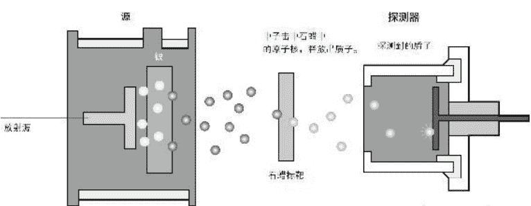所示）。起初，查德威克推测这是电子与质子的“合体”，但测量质量时却发现它“超重”了。质子质量约 938.3 MeV，是电子的 1800 多倍；而这位新来者——中子，质量高达 939.6 MeV，几乎与质子持平。

图1.1 中子揭秘纪实。约里奥-居里夫妇在 α 射线轰击铍的实验中，发现一种神秘辐射能把质子从石蜡中“踢”出来。后来证实，幕后推手正是中子。

孤立的质子极其稳定，迄今未观测到其衰变；反观中子，它会通过吐出电子转化为质子。若你囤积一桶中子，十分钟后只剩一半。考虑到质子因同性电荷相斥，原子核竟能紧密结合，简直堪称奇迹。这全赖强核力在极微距离内展现出的压倒性束缚力（详见第 2 章）。

有了电子、质子、中子这“三大件”，似乎就能拼搭出任意原子，进而解释所有化学元素乃至世间万物。量子力学精准描绘了它们波粒二象性的怪诞行为：仅用三种零件便搭建起宇宙，这系统简洁得让人震惊……然而大自然并未就此收手，仁慈地止步于此。

### 反物质世界的初现

1928 年，英国理论物理学家保罗·狄拉克做出大胆预言。他为电子建立了一个兼容狭义相对论的量子方程。方程不仅推导出电子拥有自旋——一种内禀角动量（数值为 1/2，约等于 10⁻³⁴ 焦耳·秒，以约化普朗克常数为单位），更指向一个惊人结论：电子应有个“二重身”——反物质粒子。它几乎复刻电子的一切属性，唯独电荷为正。1932 年，正电子被实验捕获，成为首个现身的反世界成员。此后，反质子等更多反粒子相继登场。

同期，自然更诡谲的一面浮出水面。中子衰变为质子加电子（β 衰变）时，两者能量之和竟低于中子原始能量。这笔“亏空”迫使泡利与费米在 30 年代断言：定有一种“幽灵粒子”偷偷带走能量，它极少与常规物质相互作用。这便是中微子（该实验中释放的具体为反电子中微子）。

从太空倾泻而下的宇宙射线中，藏着更多惊喜。1937 年，科学家捕获到一个质量约为电子 200 倍的粒子。这最初吻合汤川秀树 1933 年的预言：一种名为“介子”的中等质量粒子，借强核力粘合质子、中子。然而 40 年代实验揭示：它其实是电子的“重量级翻版”——μ 子。这令拉比发出世纪感叹：“那东西是谁点的？”

这些粒子存在的意义何在？微观深处是否还有更基础的层级？为解谜题，物理学家必须打造更犀利的探针。

## 粒子对撞：微观世界的重型机床

粒子虽微，探究它却需庞然大物。当今规模最大、名气最响的装置，非瑞士 CERN 的大型强子对撞机（LHC）莫属。其环形隧道长 27 公里，峰值功耗 200 兆瓦，约等于日内瓦市用电量的三分之一。

LHC 等大型加速器的核心任务：将带电粒子推至接近光速。高动能赋予它们毁灭性的撞击力。当高能粒子撞击靶材，动能依 E=mc² 转化为新粒子的质量。能量越高，能创造的粒子越重；同时，高能粒子束波长更短，如同显微镜分辨率更高，能探测更微小的结构。

阴极射线管——汤姆森发现电子的功臣——是最朴素的加速器。抽真空的玻璃管两端装电极，加热阴极“蒸”出电子，电场将其吸引加速。极间电压每伏特，电子得 1 eV 能量（≈1.6×10⁻¹⁹ 焦耳）。升高电压即增能量。医用 X 光机多在百 keV 量级运作。

范德格拉夫起电机能产生百万伏级高压，利用传送带向金属球聚集电荷，可生成数 MeV 质子束，足以窥探原子核结构，却仍难满足粒子物理学家的胃口。

## 进阶之路：从直线到环形

电压有上限，为突破能量瓶颈，加速器转而重复利用较弱电场。1928 年，挪威工程师维德罗造出首台直线加速器（林克）：粒子穿越一串交变电场区，分段接力加速。现代直线加速器或沿用此法，或利用电磁波像冲浪者驭浪般推动粒子。

世界最长的直线加速器位于美国斯坦福（SLAC），全长 3 公里，曾将电子推至 50 GeV。如今它分段运行，服务于多领域科研（见第 11 章）。

直线加速器受限于长度：粒子跑到头就无法再加速。于是，当今最强加速器——同步加速器——用磁场将束流弯成圆环。粒子提速时，磁场同步增强，射频电场频率跟随升高，步步紧跟。

磁场还须约束束流，防止偏离撞上管壁。大型同步加速器中，长偶极磁铁负责弯道，四极磁铁负责聚焦。

现代同步加速器标配：注入器（常为直线加速器）、双极/四极磁铁环、超高真空束流管、射频腔（空心金属结构，内驻电磁波提供加速电场）。

规模跨度巨大：从米级 X 光源，到 27 公里周长的 LHC。LHC 复用了早期大型正负电子对撞机（LEP）的隧道。大弯半径缓和曲率，因高能带电粒子转弯会发同步辐射丢能。弯曲越急、速度越接近光速，损耗越大。同等能量下，质量越大的粒子速度越慢，辐射损耗越小。故 LHC 能将质子推至 ~7 TeV，比 LEP 电子能量高 ~70 倍。

粒子加速到位便可“开工”。定靶模式效率一般，对撰模式（两束粒子正面相撞）效率高得多，LHC 采用后者。碰撞喷涌海量新粒子，巨型探测器记录残骸轨迹，物理学家由此复原碰撞瞬间真相。

## 粒子探测器：捕捉幽灵的眼睛

探测器功能各异：有的只计数，有的测能损，最强的能显现轨迹——如航迹云揭示飞机航路。叠加磁场偏转带电粒子，轨迹曲率还能反推电荷与动量。中性粒子则靠其在探测器内次生带电粒子来间接现身。

气泡室是经典代表。带电粒子穿越过热液体，电离触发微泡串联成迹。70 年代众多经典粒子照片皆出于此。如今 LHC 碰撞图像，由千层探测器阵列产生的电信号重建，每层分工明确，协同锁定轨迹、辨识粒子身份（见第 3 章）。

## 粒子“动物园”与夸克的诞生

40 年代末起，新粒子如雨后春笋，多源于宇宙射线撞击高层大气。π 介子、K 介子、Λ 粒率先现身。它们极不稳定，寿命 10⁻⁸~10⁻¹⁰ 秒级。随后 Δ、Σ 等百余种“似基本实则不稳定”粒子涌现，质量普遍不菲。连同质子、中子统称“强子”。物理学家寻找简洁基石，却误入一个令人眩晕的复杂亚原子丛林。

加速器模拟宇宙射线碰撞，让系统研究成为可能。由此揭示出一项宏观世界无类比的性质——“奇异数”。具此性质者行为诡异，故名。在已知粒子中：质子、中子、π 介子、Δ 粒子奇异数为 0；K 介子、Λ、Σ 粒子奇异数为 ±1。

60 年代初，盖尔曼与内埃曼独立按电荷、奇异数、自旋对强子分类，发现“八重道”与“十重道”模式，暗合 SU(3) 数学对称。

### 奇异数为三的预言缺口

两个模式皆缺一角：对应一带负电、奇异数 -3 的粒子。理论命名为 Ω⁻。1964 年，布鲁克海文实验室气泡室中捕获到一条短促而独特的轨迹——Ω⁻ 现身，验证了理论预言力。但这些美丽图案背后，隐藏着怎样的秩序？

SU(3) 数学表明，八重态与十重态均由三个基元组合而成。强子是否由三种更基础粒子搭建？盖尔曼与茨威格同步提出此想法。茨威格称其为“王牌”，盖尔曼则取自乔伊斯《芬尼根的守灵夜》中“quark”音译为“夸克”。

模型需三味夸克：上 (u)、下 (d)、奇 (s)。同带电粒子皆有反粒子，反夸克电荷、奇异数全相反。三夸克组合成重子（自旋 1/2 或 3/2 的强子）：如质子 (uud)、中子 (udd)、Λ (uds)、Ω⁻ (sss)；夸克-反夸克对组合成介子（自旋 0 或 1）：如 π⁺ (u d̄)、K⁺ (u s̄) 等。

## 夸克真的是实体吗？

夸克假说初遭冷遇：电荷竟非整数倍！法拉第证电荷量子化，汤姆森定电子电荷为基本单位。夸克却带 ±2/3 e、∓1/3 e，打破铁律。许多人质疑：它不过是数学游戏的产物，而非真实粒子。

实验很快正名（见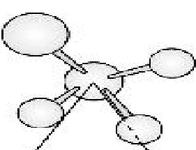-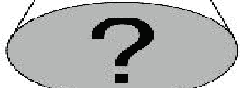对比表）。早已有证据显示质子、中子非简单球/点：电子散射角分布复杂。60 年代末，SLAC 3 公里直线加速器发射高能电子轰击液氢靶，精测散射电子能角分布，重构质子内部图像：电子在质子内探测到微小点状电荷团簇——质子确有亚结构。70 年代初，CERN 实验确认这些成分携带 ±1/3 e、±2/3 e 电荷，完美吻合理论预测。

| 图像 | 对象 | 尺寸 |
|------|------|------|
|  | 分子 | 10⁻⁹ 米 |
| 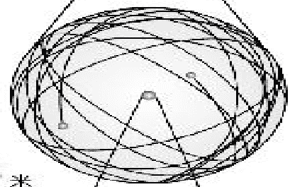 | 原子 | 10⁻¹⁰ 米 |
| 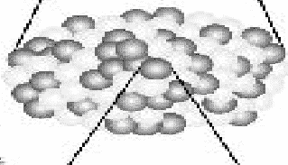 | 原子核 | 10⁻¹⁵ 米 |
| 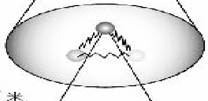 | 核子 | 10⁻¹⁷ 米 |
|  | 夸克 | < 10⁻²⁰ 米 |

## 图1.2 俄罗斯套娃：物质的层层解构

1974 年，正负电子对撞实验揭示第四味夸克——粲夸克 (c)。命名典故：“非常有效地”解决理论难题，英语 "like a charm"，兼具“魅力”之意。1977 年，费米实验室质子靶实验中 μ⁺μ⁻ 对谱系现 ~10 倍质子质量新共振，证实第五味——底夸克 (b)。曾提议改名“美夸克” (beauty) 以配合 bottom 词头，未成主流。1995 年，费米实验室锁定第六味——顶夸克 (t)。同理曾拟命名“真夸克” (truth) 对应 top 并呼应 beauty，因“真”在科哲语境重义易生歧义，未被广纳。

新三味各有专属量子数（如“粲数”）。重味夸克迅速衰变为轻味 (u, d)，构成日常物质基石。

## 粒子物理学大事记

*   **公元前 5 世纪**：留基伯、德谟克利特臆测原子为不可分基本单元。
*   **1897 年**：汤姆森发现电子，首个基本粒子现身。
*   **1905 年**：爱因斯坦提光量子假说，后称光子。
*   **1908–1911 年**：卢瑟福团队揭示原子核存在。
*   **20 年代早期**：卢瑟福等确认氢核（质子）为所有原子核共同成分。
*   **1923 年**：康普顿实验证光子具粒子性。
*   **1928 年**：狄拉克方程预言正电子。
*   **1930 年**：泡利假设中微子带走 β 衰变缺失能量。
*   **1932 年**：正电子实测获；查德威克发现中子。
*   **1935 年**：汤川秀树理论预言介子传递强力。
*   **1937 年**：宇宙射线中发现 μ 子（电子重版本）。
*   **1947 年**：宇宙射线碎片中捕获 π 介子，首个强力介子实例。
*   **40 年代末–50 年代**：K 介子、π⁰、Δ、Σ 等新粒子批量入列。
*   **1957–1959 年**：施温格、布鲁德曼、格拉肖基于规范理论，独立提出弱力由重玻色子传递。
*   **1964 年**：盖尔曼、茨威格同步提出夸克模型。
*   **1964 年**：希格斯首明确预言赋质玻色子（后以名命名），布劳特、恩格勒等亦有同构想。
*   **1967 年**：温伯格、萨拉姆统一电磁弱力为“电弱作用”。
*   **1973 年**：量子色动力学 (QCD) 确立，从夸克、胶子、色荷交换描述强力。
*   **1976 年**：发现 τ 轻子，电子/μ 子重味伙伴。
*   **1983 年**：CERN 发现 W/Z 玻色子，弱力媒介子实锤。
*   **1995 年**：费米实验室探测到顶夸克，六味全。
*   **2012 年**：LHC 发现希格斯玻色子，标准模型拼图完满。

## 为何用能量单位表达质量？

爱因斯坦 E=mc² 揭示质能等价。取能量单位 (如 1 J) 除以 c² (光速平方) 得对应质量。粒子物理常用电子伏特 (eV)——电子/质子跨越 1 伏特电势差得能量。keV、MeV、GeV 既作加速器赋能单位，也作粒子静止质量单位。电子静止质量 511 keV/c² (≈9.1×10⁻³¹ kg)；质子 938 MeV/c² (≈1.67×10⁻²⁷ kg)。因质能本质等效，物理学家常省略 c²，直接用 MeV/GeV 表征质量。

### 2 玻色子的力量

物质由两大家族构建：夸克与轻子。第三家族——玻色子，则扮演“粘合剂”与“规则制定者”，支配它们的相互作用与生存法则。

## 四大基本力

宇宙万象源于寥寥几种亚原子积木，相互作用方式亦仅四种：引力、电磁力、强核力、弱核力。粒子物理尚难纳入引力（人造碰撞中引力极弱），但量子视角重塑了对其余三力的认知：塑造世界、指引亚原子粒子舞动的力，本质上也是粒子的交换效应。

## 电磁力

电磁力无处不在。磁铁同极相斥，摩擦起电的气球吸附天花板，皆是其杰作。

1785 年，库仑实测得带电体间力遵循平方反比律（同牛顿万有引力定律形式）：力 F 与电荷量 p、q 乘积成正比，与距离平方 r² 成反比。

# 从力场到“上帝粒子”：一场跨越两个世纪的宇宙底层解码

### 场的概念：看不见的架构师

故事始于19世纪。英国科学家迈克尔·法拉第脑洞大开，发明了“力场”这一改变物理学范式的概念。设想一下：在房间中央悬着一个带电球，手中握着另一个同种电荷的小球。无论你走到哪个角落，都能测到两者间的排斥力。力的方向总沿着连心直线，像辐射状的线条从中心物体向四周延伸。

把铁屑撒在磁铁周围，它们会听话地沿着磁力线排队，原本隐形的磁场瞬间显形。物理学家们不止于此，他们用数学方程为时空中每一个点标注了力的大小与方向。

电与磁从来不是孤岛。动一下电荷，磁场随即现身；挪动磁极，电流随之而生。19世纪中叶，苏格兰天才詹姆斯·克拉克·麦克斯韦像整理行李一样，将所有电磁实验与定律打包压缩进了四个优雅的方程——统一电磁学理论由此诞生。

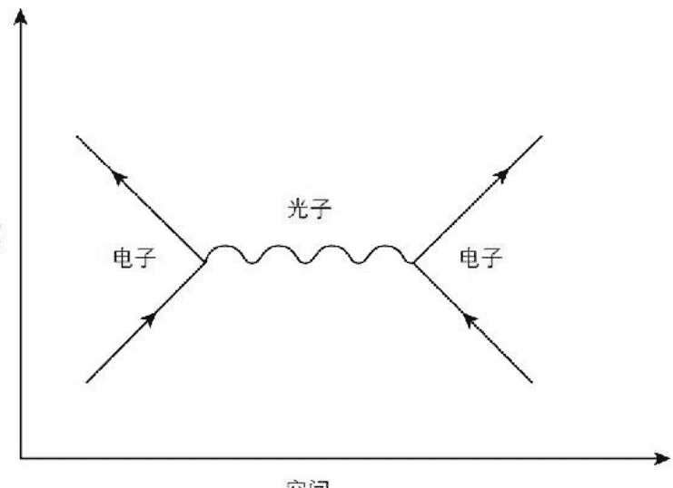

**图2.1** 这幅简洁的费曼图，生动描绘了两个电子通过交换一个虚光子而相互排斥的过程。

### 量子电动力学：虚粒子的“接球游戏”

麦克斯韦的方程虽美，却管不了微观世界的“闹腾”。原子内部，电子狂奔，速度快到必须引入爱因斯坦的狭义相对论；更麻烦的是，这里是量子力学的地盘，粒子表现得像波，能同时占据多个状态、处于多个位置。电子绕核旋转受限于特定波长，能量也就被“量子化”了，只能取离散值。

把狭义相对论与量子力学揉进电磁学，诞生了**量子电动力学（QED）**。20年代由英国物理学家保罗·狄拉克等人奠基，40年代臻于完善。QED是一种量子场论：电磁场被“量子化”了，可视为一堆粒子（量子）的集合。所有相互作用，本质上都是这些量子的发射与吸收。

两个电子互斥？其实是它们在玩“接球游戏”，光子就是那颗球。但这颗“量子球”有个怪癖：它只能短暂存在，一旦逾期就违背能量守恒，物理学家称之为“虚拟态”。整个互动必须在虚粒子发射、吸收的极短瞬间完成。

在QED里，两个质子靠交换虚光子排斥。但虚光子自己也能再交换虚光子，层层嵌套。想算出力的大小？得把所有可能的交换模式全加起来。美国物理学家理查德·费曼发明的简易图表（费曼图），让这复杂的计算变得直观可见。

---

### 强相互作用：被“胶水”粘住的夸克世界

原子核里，质子带正电，按理说早该因电斥力“炸群”了。既然没炸，必有一种**强力**在暗中托底。这力极短，仅限$10^{-15}$米（飞米量级）内生效，范围之外毫无踪迹，但强度是电斥力的100倍。

它不走寻常路：不遵循平方反比定律，极短距离排斥、稍远吸引、再远迅速衰减，还挑剔粒子自旋排列。原因在于：质子、中子并非基本粒子，它们由**夸克**组成，强力本质上是夸克间的相互作用，核力只是其“残留效应”。

夸克有一种类电荷性质叫**色荷**——红、绿、蓝三色，与可见光颜色无关。三色合一即“无色”（白色），质子内部恰好是一红一绿一蓝。正如电中性原子仍能通过残留电磁力结合成分子，无色的质子、中子也能靠强力残留效应抱团成核。

这套理论因处理色荷而得名**量子色动力学（QCD）**。搬运强力的粒子叫**胶子**，意为“粘合剂”。

胶子与光子有本质区别：光子不带电，不直接通过电磁力互动；胶子自带色荷，**能自我相互作用**。这导致强力范围被严格限制，并衍生出极其独特的行为——**夸克禁闭**。

拉开两个带电粒子，力变小；但硬把两个夸克分开，胶子场像橡皮筋一样拉紧，**力反而变大**。单个夸克永远逃不出质子，必须结合成无色态（三夸克成重子，夸克-反夸克对成介子）。轻子（如电子）无色荷，自然对强力“免疫”。

### 力的层级：构建物质的脚手架

*   **电磁力残留效应**：把电中性原子捏成分子。
*   **电磁力核心**：束缚电子云于核侧，维持原子身份。
*   **强力残留效应**：将质子、中子打包成原子核。
*   **强力核心**：锁住夸克，组装质子、中子。

---

### 弱相互作用：改变身份的“变形记”

游离的中子不稳定，转眼间吐出电子和反中微子，变身为质子。这背后的推手是**弱力**，强度仅为强力的万分之一。它不像引力、电磁力那样在宏观“拽”东西，而是在微观**改写身份**：顶夸克变底夸克，μ子变电子。这是唯一能改变夸克、轻子“味”（种类）的力，也是β衰变的元凶。

弱力的“快递员”有三位：**W⁺、W⁻、Z⁰**。W带电，负责伴随电荷变化的过程（如中子变质子）；Z不带电，中介无电荷变化的弱相互作用。它们个头极大，质量约为质子的100倍。

问题来了：轻如鸿毛的中子，怎能凭空“生”出比自己重百倍的虚W/Z玻色子？量子不确定性给了底气：极短时间内，能量允许巨大波动。中子可“借”出虚W/Z，只要在极短时间内被吸收归还即可。

光子静质量为零，虚光子可永存、无限程，故电磁力长程；W/Z重得多，步履维艰，弱力注定短程，与强力类似。

1984年，欧洲核子研究中心（CERN）在超级质子同步加速器里撞出了**真实的**W、Z玻色子，而非虚粒子。这验证了60年代谢尔顿·格拉肖、阿布杜斯·萨拉姆、斯蒂芬·温伯格的惊人预言：**在极高能量下，电磁力与弱力合二为一，成“电弱力”**。早期宇宙亿万度高温下，W/Z像光子一样随处可生。

两力合一的成功，点燃了物理学家追逐**“万有理论”**的野心：将电弱力、强力、引力统一为单一基本力的不同面相（详见第9章）。这或将揭示时空质量本源，让我们窥见宇宙初始——四力未分的鸿蒙时刻。

虽是遥不可及的梦，但描述电弱力的量子电动力学与描述强力的量子色动力学，已构建起极其强大的**标准模型**。其潜在对称性精准预言了6夸克6轻子、W/Z玻色子，甚至那神秘的**希格斯玻色子**。

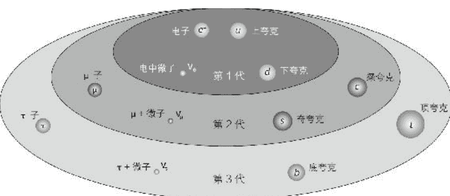

**图2.2** 夸克和胶子因拥有色荷而感受强力，轻子及其他玻色子则对此“免疫”。

---

### 标准模型“全家福”：物质与力的清单

#### 物质粒子（费米子，自旋1/2）

| 类型 | 电荷 | 粒子 |
| :--- | :---: | :--- |
| **夸克** | +2/3 | 上夸克 (u)、粲夸克 (c)、顶夸克 (t) |
| **夸克** | -1/3 | 下夸克 (d)、奇夸克 (s)、底夸克 (b) |
| **轻子** | -1 | 电子 (e)、μ子 (μ)、τ子 (τ) |
| **轻子** | 0 | 电子中微子 (νₑ)、μ中微子 (νₘ)、τ中微子 (νₜ) |

*每种夸克、轻子皆有电荷相反的反粒子。夸克-反夸克对组介子，三夸克或三反夸克组重子（如质子、中子）。*

#### 相互作用载体（玻色子，整数自旋）

| 类型 | 对应力 | 粒子 |
| :--- | :--- | :--- |
| **规范玻色子** | 电磁力 | 光子 (γ) |
| **规范玻色子** | 弱核力 | W⁺、W⁻、Z⁰ |
| **规范玻色子** | 强核力 | 胶子 (g) |
| **标量玻色子** | 质量起源 | 希格斯玻色子 (H) |

**图2.3** 标准模型粒子按“味”与质量分为三代（家族），代际间性质相似、质量递增。

---

### 费米子与玻色子：自旋决定的“阶级分工”

量子力学规定：粒子具波动性，以波函数运动，能量越高波长越短。自旋是关键量子数，只能取基本单位的整数或半整数倍。

*   **半整数自旋 (1/2, 3/2…)**：**费米子**（电子、质子、夸克）。波函数**反对称**，遵守**泡利不相容原理**——不能共享量子态。正是这“抢椅子”规则，迫使电子分层包壳，造就了化学周期表的丰富多彩，让6质子6中子6电子能组成结构化的碳-12原子。
*   **整数自旋 (0, 1, 2…)**：**玻色子**（光子、胶子、W/Z、希格斯）。波函数**对称**，可无限挤进同一量子态。它们不搞复杂结构，专职**传递力**。

---

### 对称性之美：诺特定理与物理学的隐形主宰

外行看物理是方程泥沼，内行见宇宙底层代码的**极简优雅**。核心密码是**对称性**。

数学家赫尔曼·韦尔定义：“若你对物体做了什么，它看起来却像没变，它就是对称的。”圆旋转任意角度不变，即旋转对称。

对称性主导物理定律由来已久。亚里士多德迷信天球完美圆周；牛顿用万有引力解释椭圆轨道，引入了**空间各向同性**——太阳引力向四面八方均等施加。爱因斯坦广义相对论建立在**等效原理**上：引力加速度与火箭推进加速度无法区分。

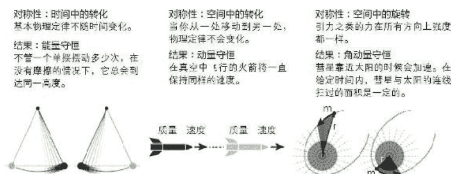

**图2.4** 自然界处处皆对称：艾米·诺特1915年定理提供将对称性转化为可计算守恒定律的通用钥匙。

#### 诺特定理：对称性生成守恒律

守恒律是物理计算的“捷径”，免去重复积分。牛顿第一定律（动量守恒）为何成立？诺特定理给出了深层答案。

设想超大光滑冰湖上一枚冰球。无论滑到哪，环境同构（空间平移对称性）。诺特定理断言：**动量守恒**。若冰面有洞（对称性破缺），冰球坠湖，动量不再守恒。

能量守恒呢？19世纪被视为热力学第一定律的公理。诺特定理揭示：源于**时间平移对称性**——物理定律不随时间流逝而改变。若常数变了，能量就不守恒了。

诺特定理是物理学家的“外挂”：发现一对称性，即得一守恒律，即可开算。

更强大的是**内部对称性**（肉眼不可见）。标准模型乍看是粒子力清单，实则是诺特定理在内部对称性上的宏大表达。

*   **电磁学**：麦克斯韦统一电磁，假设电荷不灭。诺特定理指证：电荷守恒源于**U(1)规范对称性**（电子波函数相位旋转不变性）。
*   **弱力与电弱统一**：电子与中微子在弱力下可互换（弱同位旋对称性）。高能下对称性完好，二者同构；今朝宇宙冷却，**自发对称性破缺**，二者分道扬镳，并催生出希格斯玻色子。
*   **强相互作用**：夸克染红绿蓝三色荷。整体换色（SU(3)色对称性），强相互作用纹丝不动。由此守恒色荷，严格限制允许存在的粒子与衰变模式。

物理学家梦想**大一统**：用寥寥几式方程写尽万物。数十年来，**超对称**（费米子⇄玻色子重对应）被视为关键拼图。大型强子对撞机（LHC）的建造初衷，很大程度上就是为了捕捉这些超对称伙伴——它本质上是一台**观测对称性的巨型显微镜**。

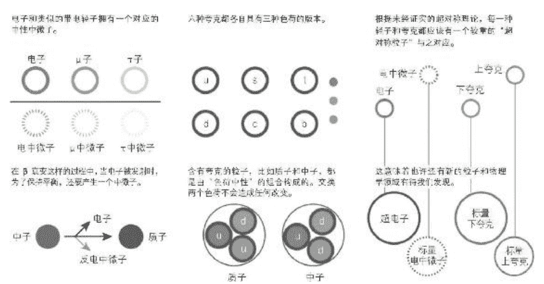

**图2.5** 标准模型及未来新物理的命运，系于微妙对称性的指尖。

---

### 被偏见遮蔽的数学女王：艾米·诺特

诺特定理震彻物理学界，诺特本人却一生与学术体制的“玻璃天花板”博弈。

1882年生于数学家庭，父亲是埃尔朗根大学教授，她却因**女性身份**被禁止入学旁听。好不容易拿到博士学位，却无校敢聘。整整十年，她在对称性研究上登峰造极，却**无职、无薪、无头衔**。

1915年受邀哥廷根，邀请信上写着“无薪”。以客座讲师身份干了7年，1922年才获“无薪荣誉教授”虚衔。同期资历不及她的赫尔曼·韦尔迅速得正教授，韦尔自叹：“获得比她高的职位令我羞愧，她在许多方面比我强。”

1933年纳粹上台，诺特流亡美国布林摩尔学院，两年后因手术并发症逝世。爱因斯坦悼词：“自女性接受高等教育以来，最具创造力的数学天才。”有人评：“自从”二字多余。数学家崇拜她，物理学家却常忽视她为现代物理奠基的基石。

---

### 为什么非“希格斯”不可：质量的起源密码

标准模型（见图2.2）是迄今最成功的现实描述：费米子通过交换玻色子感受力。但拼图缺了一块角——**希格斯玻色子**，缺失数十年。它肩负双重使命：**赋予粒子质量、解释力的呈现形式**。

把物质捣碎到底，得到12种费米子：
*   **6夸克**：上、下（组质子中子）、奇、粲、底、顶（重且短命）。
*   **6轻子**：电子、μ子、τ子（带电）、及其伴随的3中微子（近零质量）。
*   质量跨度惊人：从轻盈的电子中微子到庞然大物的顶夸克，横跨**11个数量级**！这些质量从何而来？为何差异如此悬殊？

| 粒子 | 质量 (MeV/GeV) |
| :--- | :--- |
| 电子 | 0.5 MeV |
| 上夸克 | ~2 MeV |
| 下夸克 | ~5 MeV |
| 奇夸克 | ~95 MeV |
| μ子 | 105 MeV |
| 粲夸克 | 1.3 GeV |
| τ子 | 1.8 GeV |
| 底夸克 | 4.2 GeV |
| **W 玻色子** | **80 GeV** |
| **Z 玻色子** | **91 GeV** |
| **希格斯玻色子** | **125 GeV** |

没有希格斯机制，标准模型里的粒子统统是**零质量**的，像光子一样以光速飞驰，永远无法凝聚成原子、分子、恒星、你我。希格斯场弥漫真空，粒子与它耦合强弱不同，便表现出不同的“惯性”——即质量。W/Z玻色子因强耦合而获重质，导致弱力短程；光子零耦合，保持零质量，电磁力长程。

2012年LHC捕获希格斯玻色子，完成了标准模型的最后一块拼图。但旅程未完：暗物质、暗能量、引力量子化、物质反物质不对称……宇宙仍藏着更深层的对称性与破缺，等待下一个诺特、下一个爱因斯坦、下一个你去破解。

### 基本粒子的“体重秤”与质量之谜

| 粒子 | 质量 (GeV) |
| :--- | :--- |
| 顶夸克 | 173 |

*单位：电子伏特（eV）*

**图解**：基本粒子质量谱。三类中微子（电、μ、τ）质量极微，远低于1 eV，故未标示于图。光子与胶子则为零质量。

这张“名单”的意义绝非仅供粒子物理学归档。若无赋予质量的机制，我们认知的物质世界将不复存在。没有质量的夸克与电子将永以光速飞驰，无法被束缚成质子、中子，更遑论组装成原子。

标准模型指出，费米子靠交换玻色子传递力来相互作用。光子依附电荷传递电磁力，胶子感应色荷产生强核力。

至于弱核力——虽名为“弱”，却是恒星（如太阳）通过放射性衰变释放光热的关键。它之所以微弱，是因其载体 W 与 Z 玻色子质量巨大，接近质子的 100 倍。制造这等重量级粒子需极高能量，故常态下粒子更倾向交换零质量的光子。

但在极高能量下——如宇宙诞生初瞬或大型对撞机碰撞时——这种差异消解。W/Z 玻色子变得如光子般无质量，电磁力与弱力合二为一，形成统一的**电弱力**。

电弱力分裂为电磁力与弱力的过程，称作**电弱对称性破缺**，必发生于宇宙早期。无论诱因何在，它与质量的起源紧密相连，因为这正是 W/Z 玻色子获得质量的机制。

对称性破缺并非只存在于奇异力场。生活中水冷结冰便是典型：液态高度各向同性（各方向性质相同），固态晶体则呈现各向异性（不同轴向性质迥异），对称性由此破缺。

20 世纪 60 年代，理论物理学家尝试将此概念套用于冷却中的宇宙。难点在于：固液分子相互作用可依固定坐标系描述，但爱因斯坦广义相对论指出宇宙不存在绝对参考系。

1964 年，比利时学者罗伯特·布劳特与弗朗索瓦·恩格勒提出一套量子场方程，能以符合相对论的方式打破对称性，让粒子获取质量。英国物理学家彼得·希格斯独立给出相同设想，并预言该场的激发态将表现为新粒子。同年稍晚，杰拉尔德·古拉尔尼克、卡尔·哈根、汤姆·基布尔将诸想法整合为更完备的理论，奠基标准模型。

**希格斯场的核心特质**：即便是空间的最低能态（真空），也并非虚无。粒子穿越此场时，因相互作用强弱不同，运动遭遇“阻滞”——这便是质量的本源。W/Z 玻色子与费米子虽通过不同耦合方式获质，但因希格斯场不带电荷与色荷，光子与胶子不与之相互作用，故保持零质量。

这构想精妙绝伦。验证之需“重锤敲击”希格斯场使其振动，激发出希格斯玻色子。理论与实验进展已让我们掌握所需能量范围……

---

### 夸克-胶子火球的“宇宙回响”

实验室制造的最热物质，发出诡异低鸣。这声音或曾回荡于大爆炸初期，彼时宇宙乃一锅沸腾的原初浓汤。

这“小宇宙”诞生于美国布鲁克海文国家实验室的相对论重离子对撞机（RHIC）。金核高速对撞，打碎质子、中子，释放出夸克与胶子，形成万亿度的**夸克-胶子等离子体**，复现宇宙诞生百万分之一秒的状态。火球冷却时，夸克胶子重组为各类强子。

纽约普拉特学院物理学家阿涅斯·默克希团队，通过分析约 300 万次碰撞数据，推算出身处火球内部的“听觉体验”。他们测得火球整体密度分布，密度涨落即声波本质。追踪粒子分布随时间演化，即可还原声场变化。因原始波长极短，需放大约 $10^{20}$ 倍才入人耳听觉阈。

音频中，火球膨胀、密度降、声速变，低频逐渐主导。中段出现音调剧烈起伏，标志着夸克胶子重组“冻结”为质子、π 介子等粒子。

🔗 **试听地址**：
`www.newscientist.com/article/dn18998-what-does-the-hottest-matter-evermade-sound-like/`

---

### 第三章 希格斯制造机：大型强子对撞机 (LHC)

坐落于瑞士日内瓦地下的 LHC，是人类史上最大物理实验装置。它复现大爆炸早期极端条件，旨在解答最深奥的科学谜题，开启粒子物理新纪元。2008 年 9 月启动，四年后揭开标准模型最后一块拼图——希格斯玻色子。

#### LHC 简介：探问宇宙的地下巨环

跨越法瑞边境的 27 公里环形隧道，直指核心命题：
*   质量从何而来？
*   为何世界由物质而非反物质构成？
*   暗物质底细为何？
*   四大基本力统一为“超力”时的宇宙初貌？

**运行逻辑**：质子在环中被加速至光速 99.9999991%，在四个交汇点迎头相撞，每点部署一台巨型探测器。碰撞能量 14 TeV，是前身费米实验室的 7 倍。

**能量密度才是关键**：单次碰撞能量虽仅相当几只飞蚊动能，却压缩于尘埃万亿分一体积内。这种极致能量密度，重现了大爆炸后 $10^{-25}$ 秒的宇宙状态——粒子与力刚成型的时刻。如此能量足以创造实验室未见的重量级粒子。

**成果与展望**：已捕获希格斯玻色子（被认为赋予其他基本粒子质量）。物理学家期盼更多发现：超对称粒子（通往新物理的向导、暗物质有力候选者）、额外维度、微型黑洞、新力、亚夸克结构等。虽暂未现踪，未来数年仍存希望。同时，LHC 也在精测物质反物质微差，研究夸克-胶子等离子体，揭示原初火球如何凝结为今日质子、中子。

#### 会制造吞噬地球的黑洞吗？

2008 年曾有激进派以此为由试图叫停 LHC。答案是**绝无可能**。

1.  **霍金辐射**：若真产生微型黑洞，将在 $10^{-26}$ 秒内蒸发殆尽（霍金预言）。
2.  **宇宙射线天然实验**：即便霍金错，黑洞不蒸发，我们也安全。高能宇宙射线能量远超 LHC，数十亿年来持续轰击太阳系行星，木星、土星、月球安然无恙。且宇宙射线碰撞次数远超 LHC。

#### 超级机器的诞生：极寒与极速的博弈

LHC 不仅是最大机器（周长 27 km，质子束每秒对撞 6 亿次），更是**同体积宇宙最冷之地——1.9 K (-271.25 ℃)**，除非外星文明造出更冷装置。

**为何必须如此寒冷？** 教训源于美国超导超级对撞机 (SSC) 的夭折。SSC 设计能量 40 TeV，采用 4.5 K 液氦冷却常规超导磁体。磁场不足以弯曲高能质子轨迹，隧道被迫扩至 87 km，造价高昂致 1993 年被砍项，留下德州废弃隧道。

欧洲核子研究中心 (CERN) 吸取教训：将 LHC 塞进 80 年代为 LEP 对撞机挖掘的现有隧道（地下 100 米，实为圆角八边形）。妥协峰值能量为 14 TeV，但研发新一代铌钛超导线圈，**冷却至 1.9 K** 使其超导电流更大、磁场更强。

**代价**：1.9 K 下液氦成超流体，零粘滑能钻入微小裂缝。管道系统数万焊缝须达核电站级密封标准。

#### 石貂“断电门”与未解的“法棍谜案”

2016 年 4 月 26 日清晨，一只**石貂**（初誤為鼬鼠）啃咬 66 kV 变压器，导致 CERN 全面断电。对撞机瘫痪一周，肇事兽“殉职”。此事引人联想 2009 年传闻：一鸟掉落法棍面包致变电站短路——但从未获证实。

#### 双子星探测器：ATLAS 与 CMS

束流管道只是骨架，四大探测器才是感官（详见“探测器故事”）。

**ATLAS (超环面仪器)**：最大体量（7000 吨，高 5 层楼）。核心任务追踪碰撞碎片，重中之重测 μ子动量（磁场偏转法）。因 LHC 能量更高，μ子更穿透，需极强磁场，故配备**世界最大超导磁体**。其地下洞穴高 35 米，体积巨大导致在周围岩石中像气泡般极慢上浮（年升 0.2 mm），地板须厚 5 米防翘曲。

**CMS (紧凑μ子线圈)**：为交叉验证 ATLAS，采用不同技术捕捉同类粒子。碰撞余波会干扰环内束流，故 CMS 必须安置在与 ATLAS 径向对侧（侏罗山脚下）。

**建设奇观**：
*   **冻土法挖掘**：地质为含水松散砾石，常规挖掘无望。工程师钻管循环 -5℃ 盐水，再灌注 -196℃ 液氮，结成 3 米厚冰墙挡水，挖干土建竖井。
*   **磁体欧洲漫游**：CMS 磁场 4 T（地磁 10 万倍），外扩力等效 60 个大气压。无单一公司或国家能造，线圈历经 8 年跨芬兰、瑞士、法、意四国组装运至 CERN。
*   **零容错运维**：一旦冷态运行，维修极难。升温至室温 5 周，再降温 5 周，耗液氮近 1 万吨、超流氦 130 吨。质控须严苛至极。

**数据洪流与全球计算网**：硬件革命配软件奇迹。每次碰撞喷涌海量粒子，智能触发系统丢弃 99.99% 事件，四大实验年产数据仍达 **15 EB (百万亿字节)**。应对之，工程师构建 **WLCG (全球 LHC 计算网)**，联通 40 余国 170 个中心。

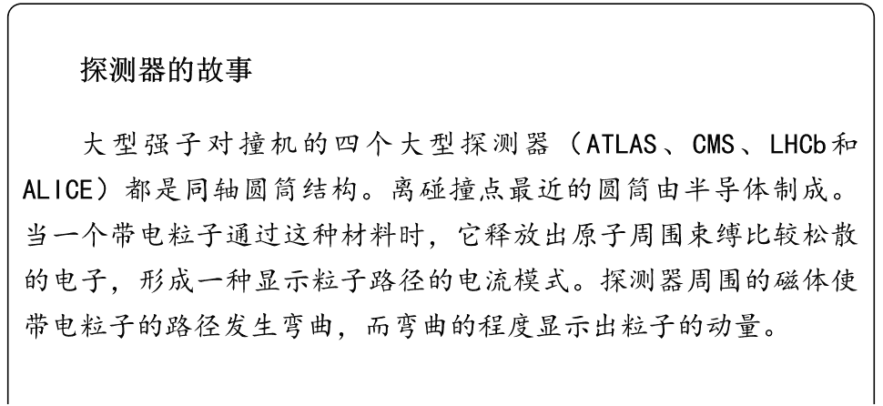

#### 探测器洋葱结构：层层剥笋识粒子

**第二层圆筒（电磁量能器）**：
*   ATLAS 用液态氩，CMS 用钨酸铅。
*   粒子撞击致密原子阵被阻滞，产生闪烁光子。光子信号量化粒子能量，辅助识别粒子身份。

**外层圆筒（μ子谱仪）**：
*   穿透力极强的 μ子穿过量能器，由专用探测器捕获测量。
*   **中微子隐身大师**：几乎零相互作用，直接不可见。唯有通过**动量守恒缺失**推断：将所有可探测粒子动量矢量求和，若不平衡，缺失部分即中微子踪迹。

**极速筛选**：海量碰撞产物以近光速飞离，25 纳秒后下一波质子团即至。触发系统须在极短窗口内抉择留存哪些碰撞。

#### 质子加速接力赛：从源头到主环

质子入主环前，需历经多级加速器链逐级提能：

| 阶段 | 设备 | 速度 (光速比) | 能量 | 备注 |
| :--- | :--- | :--- | :--- | :--- |
| **1. 电离源** | 线性加速器 (Linac 2/4) | 31.4% | ~50 MeV | 剥离氢电子，获质子束 |
| **2. 增强器** | 增强器同步加速器 (PSB) | 91.6% | 1.4 GeV | 束流整形、累积 |
| **3. 中转站** | 质子同步加速器 (PS) | 99.93% | 26 GeV | 服役超 50 年老将 |
| **4. 终极预加速** | 超级质子同步加速器 (SPS) | 99.9998% | 450 GeV | 地下 40 米，双向注入 LHC |
| **5. 主战场** | **大型强子对撞机 (LHC)** | **99.999991%** | **7 TeV** | 4 实验区对撞 |

#### CERN 核心实验一览

| 实验 | 全称 | 科学家 | 国家 | 重量 | 尺寸 (长×高×宽) |
| :--- | :--- | :--- | :--- | :--- | :--- |
| **CMS** | 紧凑μ子线圈 | 2000+ | 38 | 12,500 吨 | 21×15×15 m |
| **ALICE** | 大离子对撞实验 | 1500+ | 31 | 10,000 吨 | 26×16×16 m |
| **ATLAS** | 环形面探测器 | 1900+ | 35 | 7,000 吨 | 46×25×25 m |
| **LHCb** | 底夸克实验 | 650+ | 14 | 5,600 吨 | 21×10×13 m |
| **LHC** | 大型强子对撞机 | — | — | — | **周长 27 km** |

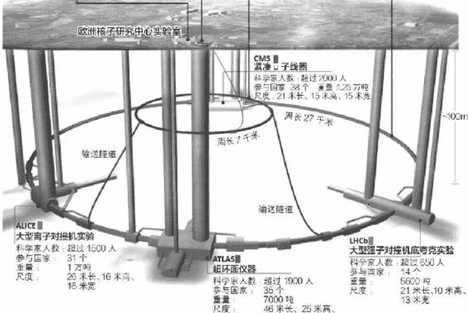

**图 3.1** LHC 加速双向质子/铅离子束，于 4 交点迎头对撞，巨型探测器原地解剖碎片。

---

### 专访：掌舵地球最大实验的女性——法比奥拉·吉阿诺蒂

2016 年履新 CERN 总干事。2009 年接任 ATLAS 发言人前，《新科学家》对话她。

**Q：为何投身粒子物理？**
**A**：跨界而来。少女时痴迷艺术音乐，钢琴专业级，高中攻读文学、古典语言、哲学、艺术史。虽爱人文，却骨子里好奇——“万物为何如此？” 信物理能比哲学更具象回答终极追问。庆幸选对了，此刻很快乐。

**Q：首位掌管 LHC 核心实验的女性，何感想？**
**A**：CERN 环境纯粹：全球汇聚，学生与诺奖得主同堂，地域、年龄、性别皆成背景板。不觉女性领衔大型科技项目有何特殊。盼我能激励更多少女投身科学。

**Q：介绍 ATLAS 规模与复杂度。**
**A**：169 机构、近 3000 物理学家协作。对撞机上最大探测器。地下洞穴震撼人心——五层楼高。除体量，更在于**复杂度与精度**：1 亿独立电子通道重构数百碎片轨迹，精度达微米级。前所未有的仪器。

**Q：核心物理目标？**
**A**：筛选高能质子碰撞产物，开启新物理之旅。此能标下标准模型必现裂痕。誓解困扰数十载之谜：
*   质量起源（直指希格斯）；
*   四力之外是否有新力？
*   是否存在额外维度？
*   暗物质何物？

**Q：个人最渴望 ATLAS 首现何物？**
**A**：**暗物质**。若能解释宇宙 20% 成分，欣喜若狂。LHC 类加速器探微观极致（物质基石），却能洞见宏观极致（宇宙结构演化），诠释“大小相通”。

**Q：若 LHC 未发现新物理，如何自处？**

### 通往未知的必经之路

这是个经典的提问，却也最难给出定论。纵观过去几十载的实验积累与理论推演，有一点几成定论：在大型强子对撞机（LHC）所能企及的能量阈值上，新物理必将现身。或许仅是一个希格斯玻色子，或是某种替代机制完成了赋予质量的使命；但我们的期许远不止于此。标准模型并非粒子物理的终章，它留下了太多悬而未决的谜题。我们预判，它将在 LHC 的能量尺度上显露疲态，新物理势必接踵而至。答案未必符合预期，但答案终将到来。大自然最擅长给惊喜——这正是科研最迷人的所在，毕竟探索的本质，就是去触摸那些未曾知晓的未知。

### 探测器前沿的日常

构建 LHC 与 ATLAS 这类巨型装置，是一场前无古人的科学、工程与人文协作史诗。身处欧洲核子研究中心（CERN），我的科研生活之所以独特，源于三重驱动：首先是直击灵魂的物理目标；其次是为破解这些目标而必须锻造的极致仪器——它们集成了电子学、超导低温等尖端技术，并溢出造福社会的红利；最后是超越国界的协作图景。物理学家、工程师、技术员汇聚于此，以科学为纽带消弭地缘隔阂，甚至让历史上敌对国家的科研人员并肩作战。

### 触摸宇宙真相的颤栗

畅想 LHC 与 ATLAS 即将揭示宇宙运行的深层密码，内心唯有振奋，更有一种逼近人类终极追问的战栗。基础研究非奢侈品，乃人类的本分与刚需。但丁早云：“人生而非为似兽生，乃为追求美德与知。” 这份对知识的渴望，连同对艺术的需求，共同划定了人与兽的界限。知识推动进步，亘古不变。若在 LHC 捕获基础性发现，无异于闯入宇宙核心。当越逼近那些关于“从何来、向何去”的根本原理，那种独特的临界感便油然而生。

### 里程碑：2012 年的夏天

2012 年 7 月，LHC 团队正式宣告：希格斯玻色子现身。但并非直接“看见”了它——这家伙寿命极短，转瞬即衰变。我们只能通过精测衰变产物，反推其存在的铁证。

### 名字里的恩怨情仇

2012 年，有物理会议提议将其更名为“BEH 玻色子”或“标量玻色子”。改名看似学究气，实则牵扯出一段复杂的功劳归属史。

故事要从 50 多年前说起。科学突破从非一人之力。1961 年，南部阳一郎揭示：早期宇宙中诞生了一个赋质场，让原本无质量的粒子“长”出了质量。1964 年 8 月，布劳特与恩格勒（BEH 的 B、E）完善理论，阐释机制细节。同年 10 月，彼得·希格斯在爱丁堡大学的论文中，首次明确预言了这粒粒子的存在。

因此“BEH”呼声颇高。也有人主张去名化叫“标量玻色子”，或干脆列齐六位贡献者叫“BEHHGK 玻色子”（含哈根、古拉尔尼克、基布尔）。诺奖得主温伯格曾调侃：粒子命名向来随意，不像元素由委员会严审——Z 玻色子就是他取的名。

庆幸的是，标准模型给出了精确画像：对每个可能质量，均能预言产生率与衰变模式。比如希格斯偶尔衰变为高能光子对。剔除本底，将光子对总动量绘成直方图，便会冒出一座“隆起”——对应特定质量的事件过剩（见下图）。这正是 ATLAS 与 CMS 在约 1250 亿电子伏特处捕获的信号，于 2012 年 7 月 4 日向世界亮相。

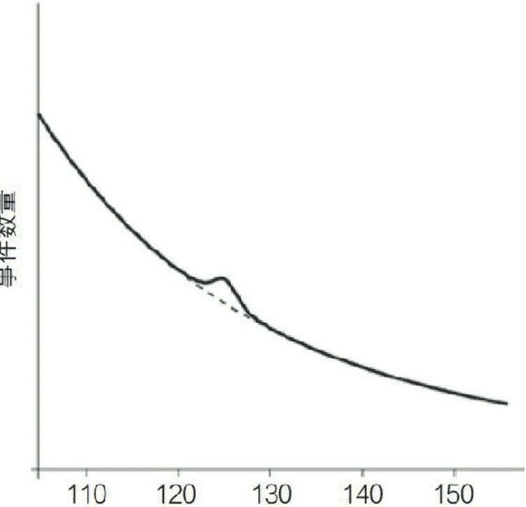

质量 ( 10 亿电子伏特 )

根据光子动量算出

图3.2 通过测量大型强子对撞机中碰撞产生的光子对的动量，揭示出一个可疑的突起——一种新粒子的证据

铁证不止一道。理论预言希格斯也会衰变为两个 Z 玻色子，后者再裂变为四轻子；这些轻子动量之和，在同一质量处再现峰值。W 玻色子衰变通道亦提供佐证——虽因中微子逃逸无法重构质量峰，但观测到的 W 对事件数显著超出“无希格斯”假设的预期。

### 希格斯的“暗面”

新粒子衰变为 W/Z 的速率与标准模型预言吻合，足以认定它“差不多就是”希格斯。但它究竟是不是标准模型那个标准版，抑或更扮靓的“异类”，仍待验证。

自 2015 年 LHC 重启，精测从未停歇。我们确信它像预言般衰变为力的载体（玻色子），但衰变为物质基石（费米子）——如底夸克、τ 子、μ子——的证据正在积累中。

最扎心的谜题在于质量。标准模型内部逻辑暗示希格斯应极重，实测却轻得多。靠“微调”抵消巨大量级留下小余量虽能自洽，却显得极不“自然”。超对称曾是热门补丁——引入费米-玻色对称，预言至少 5 种类希格斯粒子。可 LHC 迄今未见超对称粒子踪影，让该方案蒙上阴影（详见第 8 章）。轻质量之谜依旧，甚至可能关乎宇宙命运（见第 7 章）。

赋予万物质量的希格斯，竟也可能是暗能量的源头——那股撕裂宇宙、加速膨胀的怪力。

发现之初，物理学家盼着它“闹脾气”，露出马脚好推翻标准模型（后者解释不了暗物质等）。结果它却循规蹈矩得令人抓狂。不过，它的存在本身或许就是通往新物理的暗门。

标准模型场产生能量密度，渗透真空驱动加速膨胀。但理论值比实测暗能量大得惊人。希格斯咋化解？它是标准模型里唯一的标量场（无方向性）。早在希格斯被捕前，克劳斯就猜测：是否有其他标量场与之耦合？

克劳斯携手登特构建新标量场：能量密度为零，却能借希格斯连接极高能的统一场（标准模型预言极高能下诸力合一），在“跷跷板机制”下获取微小能量——一方升，一方降。统一场能量巨大，新场能量便极小，恰落在解释暗能量的量级。

### 专访：“上帝粒子”背后的隐士

彼得·希格斯，爱丁堡大学名誉教授。1964 年与布劳特、恩格勒共同提出赋质机制并预言同名粒子。2013 年与恩格勒分享诺贝尔物理学奖。粒子发现一周后，《新科学家》专访了他。

**得知发现的那一刻，意外吗？**

消息公布前一周，我在西西里物理夏校。身无瑞郎，返程保险即将失效。谣言满天飞，直到那个周六官宣前，没人敢确信。前理论部主任约翰·埃利斯来电：“告诉彼得，周三不来 CERN 会后悔。” 我应允了。

**心境如何？**

激动。研讨会前晚，在埃利斯家举杯香槟庆祥。次日会上宣布，空气凝固成了高潮。

**为何落泪？**

演讲时我仍保持心理距离，可散会那刻，如同主场绝杀。全场起立欢呼跺脚，热浪将我击倒。

**怎么庆祝？**

返程航班上干掉一罐“伦敦骄傲”啤酒。

**48 年前首篇论文被拒，同行质疑，霍金打赌不存在。如今觉得“证清白”了吗？**

**曾怀疑过它存在吗？**

从未。它是机制自洽的基石。理论上可移除它，但后果是理论崩塌。我对框架深信不疑——其他关键环节早在历代对撞机获验。若拼图只差这块不在，那才叫奇迹。

**理论预言了多种希格斯，你偏爱哪款？**

我挺超对称。主要因为它似乎是把引力纳入体系的唯一路径。虽可能仍不够，但方向对。超对称意味着更多希格斯粒子，那才是我梦寐以求的结局。

**不爱名利场，盼着热度退去能清静？**

确有如释重负。喧嚣刚歇，谈不上走出。最大期盼是安静，可眼下渺茫。信箱门垫被邮件塞满：邀我代言棋盘游戏、剪彩落成典礼，甚至巴塞罗那小酒厂问我爱喝啥啤酒，好酿同款纪念。疯了。

**同行推骑士勋爵、诺奖，平静生活恐无望。想过下一步？**

10 月诺奖揭晓时，恐染上格拉肖所谓的“诺贝尔综合征”——心神不宁。

**能用一句话给大众讲清希格斯机制吗？**

不能。我花更多时间在辟谣：通俗版解释多是胡扯。最讨厌“糖浆拖拽”说（粒子像在糖浆里被拖慢失去能量）。我偏爱的解释涉及 18 世纪光学——折射。可多数人缺这底子。我把机制比作光在介质中折射：1964 年我发明了一种奇特介质，各向同性，折射比水玻璃复杂。这是波的现象，借波粒二象性（致敬爱因斯坦、德布罗意）可译为粒子语言。

**命名雷区，你现在怎么叫它？**

搞不懂为何仍叫“希格斯玻色子”。我看它终将成“H 玻色子”，只要别和氢混淆。为沟通方便我偶尔仍用旧名。但“上帝粒子”绝不沾嘴。盼这称呼别再被滥用。我常强调：那是别人的玩笑，非我本意。

**可这标签让大众易懂啊。**

易懂归易懂，误导才是祸根。让不知内情者说蠢话，甚至有神学背景者试图神解。他们不懂这从未被当真。

### 为何叫“上帝粒子”？

此称号招致物理界众怒。源自诺奖得主利昂·莱德曼。他在费米实验室力推希格斯搜寻，著书讲述。本想叫“那个该死的粒子”，出版社把“goddamn”改成了“god”。

### 第四章 夸克的重量级秘密

论质量，你我本质上是夸克与胶子的聚合体。它们以诡谲方式结合，而今我们掌握了前所未有的计算精度，开始直面存在的根本发问。

#### 硬骨头：啃定夸克

问科学迷终极愿望，要么“生命宇宙全答案”，要么“成品光剑”。鲜见媒体聚焦能同时圆这两梦的领域——若真读透“乏味”的质子中子，便能破解物质宇宙成因，更能通往新型激光、储能材料等黑科技。

质子带正电，中子电中性；质量却微妙不同。中子 939.6 MeV，质子 938.3 MeV，差 0.14%，乾坤大不同。多出的质量让中子能衰变成质子，反之不行。稳定质子锁住电子，构筑稳固中性原子。若质子更重，世界将沦为平庸的“中子汤”。

质量差精确值更是关隘。最简单原子氢（质子+电子）源自大爆炸，点燃首批恒星聚变，锻造绝大多数元素。除氢外皆含中子。质量差稍大，聚变受阻（塞入中子能垒更高），宇宙卡在氢步；稍小，氢在初分钟聚尽成氦，无燃料维持类太阳长寿星；再缩小，氢原子坍缩——质子吞电子变中子吐中微子，无原子可言。

#### 质量从何来？

若质子中子质量非此数值，我们不存在。

但质量溯源极难。半个世纪前已知核子非基础，由六味夸克构成：上、下、奇、粲、底、顶。质子“上上下”，中子“上下下”。

下夸克比上重，却难解释核子质量差——两者质量皆极微。夸克从不孤存，难准称。上夸克约 2-3 MeV，下夸克约双倍，仅占核子质量万分之一。

像所有基础粒子，夸克靠与希格斯场（LHC 搅动真空激出希格斯玻色子）互作用获此微质量。但解释复合粒子质量，光靠希格斯远不够。

#### 量子泡沫深处

寻答案，须攀量子色动力学（QCD）峭壁。夸克带三色荷，决定强相互作用（详见第 2 章）。QCD 描述强力，复杂得惊人。

夸克交换胶子结合成核子。胶子零质量但有能量，依 E=mc² 折合质量。胶子交换还在核子内激发海量短命夸克-反夸克对——虚介子。

理解这“量子泡沫”，理论家 40 年磨出“晶格 QCD”神技。如气象学家将大气简化为三维网格建模，晶格 QCD 将核子内部映射为几十飞米（10⁻¹⁵ 米）时空内的离散晶格。夸克驻顶点，胶子沿边传播。汇总所有边相互作用，演化时间步长，便能重构核子整体图景。

哪怕仅 100×100×100 晶格点（间距 0.1 飞米），相互作用量已达天文数字，需超算支撑。量子本质统计性，模拟须跑数千次取均值。

为解核子质量之源，伍珀塔尔大学佐尔坦·福多率队，动用两台 IBM“蓝色基因”超算及两套集群。2008 年终得两核子质量均约 936 MeV，误差 25 MeV。这实锤了：夸克胶子相互作用构成了物质大头质量。你感觉坚实的躯壳，99% 其实是结合能（见下图）。

## 原子

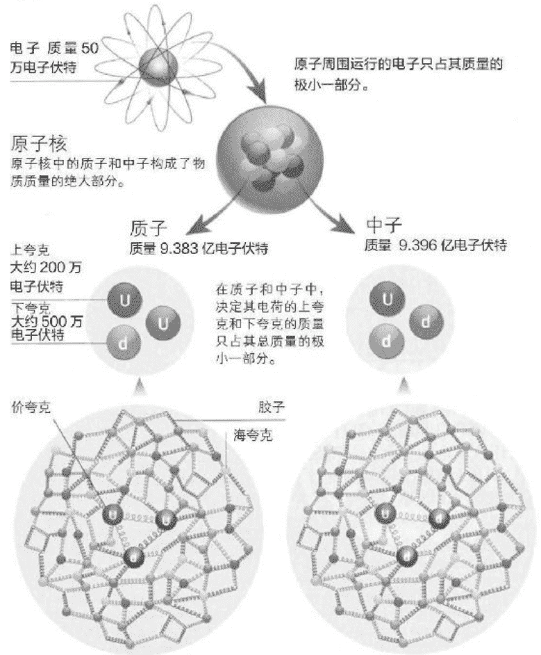

图4.1 物质的质量从哪里来

这些计算精度尚不足以锁定质子中子关键质差。且忽略了电荷效应——核子内瞬态夸克反夸克带电，贡献自能量，修正质量。

#### 胶球：纯力凝聚的幽灵

胶球，全由力凝聚而成。搞不好能造真“光剑”。唯一硬伤：似乎只活在理论里。理论派誓死捍卫其存在，实验派直言恐永无法证实。

胶球即胶子团。胶子传递强力，捆绑夸克成核子。纯胶子世界模拟显示：约 15 亿电子伏特（质子能量 1.5 倍）足聚胶子成球。1995 年，牛津弗兰克·克洛斯与苏黎世克劳德·阿姆斯勒指出：CERN 新发现的两个粒子（13.7 与 15 亿电子伏特）疑似胶球。后又添一员 17.1 亿电子伏特候选者。

## 纯胶态的“身份危机”

强相互作用因计算难度极大而著称，为简化模型，物理学家常假设一个仅由胶子构成的“纯净世界”来模拟胶球。但在真实宇宙中，情况要复杂得多：一旦试图探测胶球状态，周围的夸克便会如同毛刺沾染衣物般粘附其上，导致根本无法证实其“纯胶”身份。克洛斯指出，目前观测到的三个候选粒子，大概率只是掺杂了不同数量夸克的“胶子团”，我们或许只能接受这种模棱两可的结论。

## 攻克质子中子质差：理论物理的“硬骨头”

要弄清质子与中子质量差异的微妙起源，光解量子色动力学（QCD）方程不够，还得同步求解量子电动力学（QED）方程。这对理论物理学家而言无异于噩梦。直到2014年，福多团队开发出数学变通技巧，成功推算出该质量差，结果与实测值吻合（虽存约20%不确定度）。

这不仅揭示了复杂物质存在的底层逻辑，更意味着人类得以计算诸多驱动宇宙运行的关键参数。以超新星爆发为例，它是宇宙播撒重元素的首次盛宴。借助QCD与QED联合计算的新能力，我们有望破解“何时生成何种重元素”这类谜题。

突破还可能填补基础物理的空白。大型强子对撞机（LHC）自2012年发现希格斯玻色子后便“别无他获”，遗留大量悬案：大爆炸为何物质战胜反物质？质子与电子差异巨大，电荷为何却是完美镜像？精准的QCD计算能暴露更多标准模型失效之处，为新物理指路。

技术史证明，对物质运作的深度认知必催生颠覆性创新。百年前解原子结构，诞生计算机与激光；深入原子核，衍生核电、核武与放疗。如今攻克核子内部，或将开采更深层“矿脉”。胶子因自带色荷、相互作用远比光子剧烈，核尺度能量密度或远超原子尺度。诺奖得主威尔切克曾畅想：复杂核物理或能造出强大X/γ射线源，甚至让《星球大战》光剑成真（当然这是玩笑）；更现实的是高密度能量存储技术——原子核能在微小空间锁住巨量能量，精准核化学计算正为这条路铺路。欢迎来到夸克时代。

## 五夸克：迟到的“新成员”

常规认知里，夸克以两三个成团（介子/重子）。早在60年代理论就预言四、五夸克态存在。四夸克2013年落锤，五夸克却拖到2015年才在LHCb实验中现身——通过分析底重子衰变捕捉到的。通常衰变一步到位，但强相互作用特性导致偶尔出现中间态，于是一个符合五夸克特征的粒子凭空冒出，后续数据持续佐证。

学界对其内部结构仍存分歧：派主张五夸克紧致束缚成单一粒子，派倾向视为“介子+重子”组成的类分子松散结构。因寿命极短，精确尺寸与质量尚待更多实验厘清。

## 自旋危机：质子里的“失踪案”

1988年，欧洲μ子合作组（EMC）用高能μ子轰击质子，发现夸克自旋仅贡献约1/4甚至30%的质子总自旋（1/2），引发震惊的“自旋危机”——这意味着我们根本不懂质子量子结构。理想解法是解QCD方程，但质子内部组件极其复杂、运动剧烈，超算模拟也难奏效。

只能靠零散实验填坑。2014/15年布鲁克海文RHIC实验显示，胶子自旋或贡献了约40%。剩余部分可能源于夸克与胶子相互绕行的“轨道角动量”，但测量手段尚处蒙昧。若连平凡质子都看不透，指望掌握“万有理论”无异于痴人说梦。

### 为何重粒子注定不稳？

粒子界铁律：重者衰变轻者，释放动能，如球滚向势能低谷。中子衰变成质子（+电子+中微子）即此理。质量越大寿命越短，顶夸克、W/Z、希格斯皆转瞬即逝。

质子为何不衰变成电子/正电子？归功于重子数守恒——强相互作用对称性要求重子数不灭。质子是已知最轻重子，无更轻重子供其衰变，故而稳如磐石（详见第10章）。

## 反物质：镜像世界的隐匿与线索

反物质宛如科幻成真，构建完整镜像粒子世界，却在我们周围极度稀缺。虽难作星际燃料，其湮灭能量或能击破标准模型，揭示物质为何主宰宇宙。

### 反物质速览

每个带电粒子都有同质量异电荷的反粒子：反质子、正电子。中性粒子亦有反粒子（如反中子由反夸克组成；中微子反粒子自旋/轻子数相反）。物质遇反物质即湮灭化光，电子正电子对撞生成两个511keV光子对飞。

### 反物质之父：狄拉克

1902年生于布里斯托尔的保罗·狄拉克，1928年方程预言反物质，31岁摘诺奖。古怪笨拙、迷恋米老鼠，被誉为牛顿后英伦最强理论物理学家。威斯敏斯特大教堂地板刻着他的电子量子方程。

### 反物质去哪了？—— 宇宙最大悬案

标准模型预言：大爆炸生成等量物质反物质，秒内湮灭净空，宇宙只剩光。可现实却有行星、恒星、星系——全是物质。

解释有二：
一、 物质反物质性质存微妙差异（CP破缺），致早期物质微量剩余。标准模型预言完美镜像，实验却在镜面寻到“划痕”：1998年K介子衰变显示微弱不对称；2001年B介子（K介子重表亲）显示更强信号。LHCb正用4500吨探测器追踪数十亿B介子。但目前观测到的CP破缺量级，尚不足支撑宇宙级物质优势。
二、 反物质躲开了湮灭，藏在宇宙某隅组成反恒星、反星系。早期宇宙相变如冷却磁铁形成磁域，或将物质反物质分隔。边界湮灭应产生高能γ射线特征，迄今未见。α磁谱仪（AMS-02）在空间站搜寻反氦等重反原子（反恒星聚变产物），至今空手而归。

### 反物质炸弹？别做梦了

丹·布朗笔下1/4克反物质炸毁梵蒂冈，现实中根本凑不齐。CERN物理学家兰道尔测算：30年积攒的反物质总量仅亿分之一克，指尖引爆不及一根火柴。PET扫描病人体内正电子数千万，照样安然无恙。

即便能造，成本也天价：1克约100亿美元，按现有产率需100亿年才凑够丹·布朗那颗弹药量。

但反物质应用不止于毁灭。物理学家早能造“电子偶素”（电子+正电子原子），2007年首造多原子分子。偶素极速湮灭出高能γ射线，若能聚集同步湮灭，或可造γ射线湮灭激光，驱动核聚变是一大潜在用途。

## 香蕉与宇宙：十亿分一的偏爱

厨房香蕉每秒衰变出约15个正电子（钾-40），演绎着反物质瞬生即灭。物质反物质相遇即湮灭，为何物质独霸天下？

大爆炸“汤”里粒子反粒子不断生灭，仅需十亿分之一的失衡，经反复放大便留下了从香蕉到黑洞的一切物质世界。

### 追寻物质霸权的密钥：CP破缺

60年代克罗宁/费奇发现K介子与反K介子衰变率不同（CP破缺）——镜像反应速率不等。这或能解释物质优势，但标准模型内已知CP破缺效应太弱，差万亿倍。

LHCb登场。“b”代表底夸克。底夸克重且不稳，LHC能量足以量产。BaBar、Belle实验已证实含底夸克粒子衰变存CP破缺，且比K介子强。LHC除轻B介子/B重子外，还能造更重B介子，研究全谱衰变道有望拼出完整CP破缺理论图景。

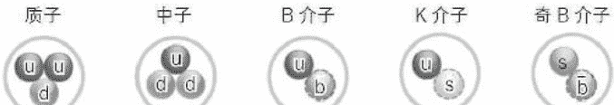
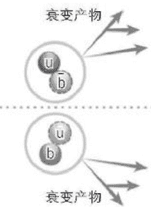
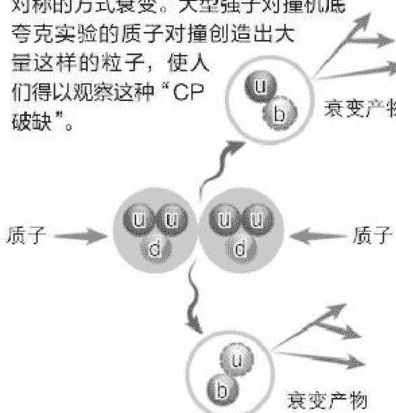

### 重现“热汤”：更高能量的博弈

要解题，须重现更高能量原始汤。2015年LHC升级至14TeV，产更多B粒子，利于精测CP破缺。LHCb探测器锥楔设计，牺牲希格斯探测几何接受度，专门对准B介子顺束流方向飞出的特性。高能B介子留下厘米级轨迹，测量精度大增。

2017年LHCb报告首个重子（底Λ）衰变CP破缺证据。标准模型有预言，若后续数据偏离预期，即暗示新物理，直指物质反物质不对称核心。

LHC升级前数据已显示罕见衰变（B→Kμμ）偏离标准模型，且随精度提升差距扩大（理论预测本身亦存不确定性）。另见B→Kee与B→Kμμ不平衡迹象，但统计尚弱，难判是否新物理或助解物质之谜。

聚焦点还在奇B介子（反底+奇夸克）。它能自发振荡为反粒子，对比振荡对称性是研究CP破缺新路径。其百万分之三分支比衰变为μ子对，终态极洁（μ子穿透全探测器），利物浦塔拉·席尔兹称其为新物理“黄金通道”。

此处不止猎CP破缺，更觊觎超对称等新理论蛛丝马迹。新重粒子虽未直接见，但罕见B衰变对其极敏感，任何衰变率偏离皆可能暗示隐形粒子在幕后搅局。

# B介子罕见衰变：标准模型的隐秘裂痕

B介子的衰变极其罕见，迄今为止实验室仅捕捉到寥寥数例。即便大型强子对撞机（LHC）源源不断地产出各类B介子，它们的表现仍未对标准模型构成颠覆性冲击。但物理学家寄希望于升级后的加速器，通过更海量的数据统计，或许能撬开新物理学的大门。

### 企鹅图谱里的异常信号

在探寻物质与反物质差异的征途中，一种反常现象或将成为突破口。实验数据显示，较重的B介子衰变为τ轻子的频率，显著高于标准模型的理论预期。这一过程被戏称为“企鹅过程”，缘由是物理学家用费曼图描绘其演化路径时，图形酷似一只企鹅。

这种“不平衡的企鹅”已在三个独立实验中现身，其中包括LHC底夸克实验（LHCb）。该实数据中，B介子衰变产生的μ子在能量分布与飞行轨迹上均表现出诡异的偏离。这些微妙的异常或许预示着物理学即将迎来新篇章：B介子在最终变身为μ子前，是否曾中途衰变为某种未知粒子，从而打乱了最终的分布格局？理论界推测，幕后黑手可能是“轻夸克”——一种轻子与夸克混合的奇异实体，抑或是尚未露面的新型希格斯玻色子。

尽管目前观测到的偏差幅度微小，但它们指明了一条潜在的研究路径。理论预言，在更高能量尺度下，同类企鹅过程可能引发更剧烈的不平衡。

### 反引力之谜：反物质会“向上掉”吗？

若你手持一块反物质松开手，任其在“满是敌意”的普通物质世界中自由穿梭，它会不会神奇地向上漂浮？鲜有物理学家敢下定论。不做实验，一切皆是未知数。

对反引力的质疑可追溯至上世纪50年代。当时，物理学家赫尔曼·邦迪深究广义相对论的含义。爱因斯坦的理论揭示了引力如何随时空弯曲而生。引力是个怪力：它仅有一个作用方向。电磁力有正负电荷，可吸可斥；引力却只有永远相互吸引的“正质量”。

邦迪推演了负质量存在时的荒诞图景：负质量会以越来越快的速度追逐正质量，穿越宇宙。法兰克福高等研究所的萨比娜·霍森菲尔德指出，这种夸张的运动在现实中从未现身，但我们下结论仍须审慎——或许需要修补的是广义相对论，而非抛弃负质量概念。

质量分引力质量（决定受引力大小）与惯性质量（决定抗加速度能力）两种。无数实验表明，二者数值恒等——这是一个神秘的等价原理，广义相对论即建立于此。但迄今实验皆针对普通物质。反物质能否形成“惯性质量为正、引力质量为负”的物体，从而打破等效原理？

### 宇宙彼岸的反物质世界

全球多座实验室仍在追寻负质量的踪迹，反物质是极具潜力的候选者。它与普通物质几近相似，仅电荷及部分量子数相反。这不必然意味着质量相反，但若真如此，或能解开另一谜团：反物质究竟去哪了？排斥性的引力或将在早期宇宙将物质与反物质强行分离，使它们失去湮灭机会。此后宇宙膨胀将二者推得更远——反物质说不定已在宇宙另一隅构建起自己的星系。

让物质悬浮地表的技术前景甚至吸引了美国空军入局，多年来投入数百万资金支持研究。可惜实验难度极大：首先需为反物质打造一座“近乎完美真空”的房屋——地球上最空的盒子，每升仅容纳数百气体分子；继而须将反物质冷却至绝对零度附近，用电磁场锁定，防其触壁湮灭。

在欧洲核子研究中心（CERN）巨大的反物质减速大厅，六个实验正角逐测量反物质基本性质。来自质子同步加速器的粒子束轰击金属靶产生海量粒子，磁铁系统筛选出反质子，注入环形管道减速捕获。

### 逼近极限的精度较量

自90年代起，此地便有实验验证反物质与粒子是否真如认知般“如出一辙”。2015年，重子反重子对称实验（BASE）利用彭宁阱测量反质子自旋，将其荷质比精度推至万亿分之六十九，与质子一致，较旧纪录提升四倍。

次年11月，邻近的低速反质子原子光谱和碰撞实验（ASACUSA）完成最精确反质子惯性质量测量，同样未发现与质子的差异。

但引力效应上，质量究竟是正还是负？这将实验推向新维度。引力太弱，极易被电磁力淹没，故用磁场控制带电反质子测引力不可行。尝试关磁场看反质子落向？环境静电干扰早已盖过微弱引力信号。

更优选择是中性反原子，如反氢原子（详见后文“反元素”）。其静电相互作用不足以抵消引力，强磁场却能困住它们。CERN的反氢原子激光物理仪器实验（ALPHA）常规捕获反氢束并保存约15分钟。

2013年，ALPHA团队发表原理验证测量：短暂收集434个反原子云，关磁场追踪湮灭位置。这是粗略测试，无定论——无论引力质量正负均符合结果。因反原子温度较高、热运动剧烈，精度受限；但样本量足够大时，仍有望揭晓核心答案。

CERN另一实验——反物质引力、干涉成像、光谱学实验（AEgIS）也在筹备测试。芝加哥伊利诺伊理工学院的丹尼尔·卡普兰拟用μ子，伦敦大学学院戴维·卡西迪团队则瞄准电子偶素。

CERN的“静止状态反物质引力行为”实验（GBAR）另辟蹊径，拟用反氢离子（一反质子加两正电子）。理论上，磁场易固定带电微粒，激光冷却亦可行。后续用激光击落一正电子，使其复归电中性，随即摆脱诱捕场自由下落——向上或向下。实验负责人帕特里斯·佩雷斯期望灵敏度足以探测到正常引力1%的偏差。

实验家不指望反物质真“向上掉”，但哪怕落法略异，也极具震撼力。那或暗示存在某种修饰引力的力，仅针对反物质生效。若引力子——传递引力的假想量子——拥有微小质量而非零质量，便可能产生类似修正效应。

## 反元素：构建镜像周期表

CERN的反氢陷阱（ATRAP）与ALPHA实验已着手制造反氢原子——最简单的反原子，仅由一反质子与一正电子结合。目标是积攒足量反氢并长时保存，将其光谱与普通氢对标。哪怕仅存细微差异，标准模型也将动摇，因其预言二者应完全同构。

2016年，杰弗里·汉斯特团队在ALPHA合作组中，历经制造并留存14个反氢原子，首次观测到反物质谱线。结果显示，反氢基态跃迁光子波长与氢原子完全吻合。

物理学家能否进阶制造反氦、反碳乃至完整反元素周期表？难点在于：构建反原子时，亚原子反粒子只能逐个生成。欲造反氦（比反氢多一反中子），首需制造反中子。反中子电中性，无法用电磁场引导，只能大量生产碰运气——百万分之一概率拼凑出反氚原子。

虽无人攻克此难题，但ASACUSA实验以巧法造出反质子氦原子：氦核旁一电子被反质子取代（见图5.2）。研究这类物质/反物质混合原子光谱，可精测反质子电磁性质并与质子对标。

图5.2 镜像世界的拼图：物理学家已制出反氢、电子偶素（电子-正电子对）及掺杂一枚反物质的氦原子

### 6 幽灵粒子：中微子的隐遁与反叛

中微子是最难捕捉的物质。这些幽灵粒子能穿透地球而几乎无损。虽属标准模型一员，但其“变味”本领暗示：物理图景远超标准模型桎梏。

### 揭开面纱：中微子究竟是什么？

中微子电中性、质量近零、隐蔽至极。它们几乎不与物质相互作用，每秒万亿级穿透我们的身体、建筑与地球。1930年，奥地利物理学家沃尔夫冈·泡利首次预言其存在，1945年获诺贝尔奖。核聚变（太阳能源）、核裂变（武器/能源）、地球内部放射性衰变皆产中微子。

我们如何知其存在？狡猾的中微子虽避世，偶尔撞击原子会发出可探测信号。1956年弗雷德里克·瑞恩斯首次发现，1995年获诺奖。主流探测器用海量水或油作靶，中微子与分子核/电子碰撞产生闪光，被传感器捕获。

这些深埋地下、躲避宇宙射线干扰的探测器倾注巨资与极限工程。意大利格兰萨索山下的乳胶追踪设备震荡项目（OPERA）利用中微子穿岩特性；地中海深处、南极冰层下的“冰立方”则以地球为屏蔽层。

中微子的鬼魅本性掩盖了其潜在重要性。瞧额外维度：多数粒子有顺/逆时针自旋两态，中微子却似仅能“左旋”。部分理论家视此为额外维度铁证——“缺失”的右旋中微子躲藏其中。

如带电轻子般，中微子也有电、μ、τ三味。但与其他粒子不同，它们能在三味间自由切换。

### 中微子：推翻标准模型的“小巨人”？

“为王者，心神难安。”莎翁此语今喻标准模型——物质构成与相互作用最成功的理论。希格斯玻色子发现是其巅峰成就，证实40年预言，填补最后大拼图。然而物理学家渴望推翻它，寻得继任者。

中微子能引领我们达成此目标？标准模型虽强，却留谜题重重：暗物质本质（占宇宙总质量80%+）、暗能量（导致加速膨胀，量子论预言偏离10^120倍、史上最烂预测）、大爆炸为何物质逃过湮灭、引力为何无法纳入、大量自由参数（需手工输入的强度数值）……

研究者曾盼希格斯带来新物理解谜，但其表现至今合规。真正通往“超越标准模型”王国的钥匙，或握在另一类粒子手中——中微子。这影影绰绰、不按常理出牌的家伙，极少与普通世界互动，故我们对其认知多在标准模型之外。

### 质量之谜：为何如此轻？

已知三型中微子与电子、μ子、τ子配对。另有三反中微子，与正电反粒子共组扩展轻子家族（见图2.2）。标准模型初设定中微子零质量，实则不然——虽极微，却拥有质量，这正是其能“变味”的根基。大一统理论、超对称、弦理论等新框架均试图填补此认知空白。

中微子虽冷漠，却是解谜老手。1930年，泡利为守住β衰变能量动量守恒而“发明”它们，自此完美嵌入标准模型粒子谱系。

1998年，日本超级神冈实验撕开裂口。研究大气层宇宙射线产生的μ中微子，发现部分穿越地球途中变身为电中微子。此前虽有变味迹象，此役却是铁证。此后反应堆、加速器、太阳中微子实验接力确认：无论初始味何，旅途中必在三味间切换。要实现切换，中微子必须有质量。

### 量子变奏：味振荡的微观机制

这是典型量子现象。量子力学允许粒子处于多态叠加——对中微子，确定味态是三种确定质量态的混合。三质量态以略低于光速、彼此微异的速度飞行，其精确排布决定观测味态。故三味中微子以不断变化的混合态在空间传播。

大一统理论预言中微子有质量。若精测质量值，理论家便知推进哪条路径。

测量能穿透一光年厚铅块无阻粒子的质量，谈何容易。测放射性β衰变是一法：中子变质子，放电子与反电子中微子。理论上可从伴生电子能量动量反推反中微子质量。因太轻，灵敏度长期不足，德国卡尔斯鲁厄理工学院的卡尔斯鲁厄氚中微子实验（KATRIN）或具备足够灵敏度。

同时，最严格质量上限来自宇宙学：中微子影响大爆炸/超新星合成元素、膨胀率、微波背景、星系形成。结合普朗克卫星数据，三中微子质量和不超0.13电子伏特——不足电子百万分之一。

因味振荡，难将总和拆解为三个单一质量。研究者正逐步改进对质量及混合矩阵的测量。

任何解释中微子质量的理论，都须答为何其比别的粒子轻得近乎可忽。一说：三已知中微子或被一个/多个只感受引力的“惰性”中微子遮蔽。通过“跷跷板机制”，这些不可见重中微子压低了探测到的轻中微子质量。

这一切让这些轻若鸿毛、“社恐”变味粒子更添神秘。它们藏着秘密，究竟藏了何物、能否赐予我们超越标准模型的新物理，静待揭晓。

### 乌龙事件：超光速中微子的消失

2011年9月，OPERA合作组震惊世界：宣布中微子从CERN飞抵意大利格兰萨索地下探测器，速度超光速。此举挑战爱因斯坦相对论，打开未知物理大门。

随后数月，两个低级错误浮现——光纤松动、时钟故障。修正后，中微子速度“降”回亚光速。时任CERN研究总监塞尔吉奥·贝托鲁奇感叹：“虽不如期盼般振奋，但这是我们内心深处都期待的结果。”

### 物质起源的钥匙：无中微子双β衰变

追寻最罕见事件，可揭示为何物质主宰宇宙——前提是我们能捕捉到每百亿亿亿年（10^28年）才发生一次的过程。你可等待观测至天荒地老不见踪影，但成千上万物理学家正投身此猎捕。这是放射性衰变的一种，一旦发现，便能揭示宇宙仍存物质的根因。

放射性衰变是自然界的炼金术，将重元素转轻，自有寿命表——有的分钟级，有的万年。这些过程关乎生存，如β衰变参与太阳供能。最常见β衰变中，核内中子变质子，抛出电子与反中微子。

1935年，物理学家预言某些核可同时发生两次此类衰变。这种已知最罕见核衰变，单核发生周期达10^19至10^24年。但盯着足够大的原子群体，持续观测，就能增加目击概率。目前已在11种重核中观测到此“双β衰变”。

即便如此，仍不及研究者正在寻觅的猎物罕见。在“无中微子双β衰变”中，两中子变两质子加两电子——全程零反中微子产出（见图6.1）。

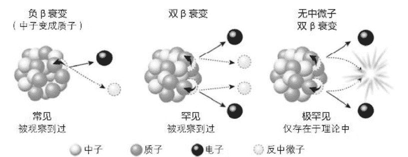

图6.1 理论认定所有β衰变必生中微子。但若中微子即其本身的反粒子，每百亿亿亿次衰变中，便会有一次彻底不产生中微子

要完成这消失魔术，需非凡条件：两反中微子须实现相互抵消，如粒子反粒子接触湮灭。但要让两同类粒子湮灭，中微子与反中微子必须是同一粒子——即同时是物质与反物质。

### 漫漫长途：在实验中捕捉“马约拉纳”

1937年，意大利物理学家埃托雷·马约拉纳预言：有质量中微子将拥有奇异性质。作为唯一不带电的基本费米子，它们理论上可做自己的反粒子。对这种“马约拉纳中微子”，物质与反物质界限不复存在。凭借其反应中的微弱CP破坏，这种额外自由度让更多物质在大爆炸湮灭中幸存。

发现无中微子双β衰变，可解我们从何来，指引理论何去何从。但50余年探索中，仅有一次疑似实例被记录。2001年，意大利格兰萨索实验室报告，通称“克拉普多-克莱因罗斯衰变”，以海德堡大学汉斯·克拉普多-克莱因罗斯命名。他坚守其真实性超十年。主流物理界仍存疑，但此结果牵动了所有关注衰变者的心。

# 幽灵粒子与上帝粒子：解码宇宙最深层的隐秘

### 中微子通讯：不再是科幻

科学家早已将“用中微子传递信息”变为现实。首个里程碑诞生于2012年：费米实验室团队操控主注入器束流，将编码为二进制“中微子”二字的脉冲信号，穿透千米岩层精准送达MINERvA探测器。虽因极难捕获，发射端需连续轰击142分钟才换来清晰回应，但这证明了原理可行。得益于中微子“穿墙透地、几乎零阻力”的特性，它们极适合充当特殊信使——比如与深海隐匿的潜艇联络，即便极低带宽也足以交换加密密钥。

### 克拉普多事件的落幕与双β衰变的漫长守候

为验证或推翻克拉普多-克莱因罗斯的争议性声称，全球在格兰萨索、新墨西哥、日本同步布局实验。截至2015年，证据链指向否定：若信号真实，探测器本应记录到更多事件。

与此同时，更大规模装置推动衰变寿命测量精度跃升，将无中微子双β衰变（0νββ）的半衰期下限推至10^25年量级。目前至少有8个新建或升级项目在竞逐这一“圣杯”（见图6.2）。核心逻辑殊途同归：将海量超纯同位素深埋地下，屏蔽宇宙射线“杂音”，凭借大数定律静待极罕见衰变降临。

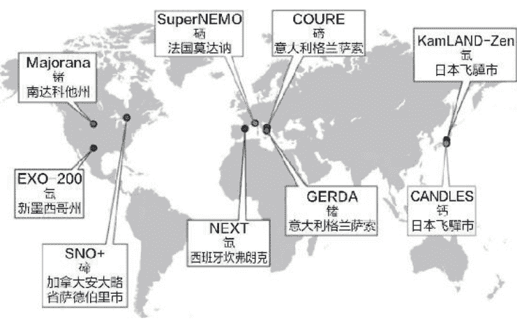

图6.2 探测无中微子双β衰变需要将大量合适的放射性物质深埋地下，等待这种衰变的发生。全世界有很多实验正在进行中，使用的同位素不尽相同

在候选同位素中，**锗-76**凭借晶体结构紧密、能量分辨率极高等优势脱颖而出。格兰萨索的锗探测器阵列（GERDA）部署40公斤锗，曾直接推翻旧有声称；南达科他州废弃金矿深处的马约拉纳演示器则运行44公斤装置。但理论测算显示，要确保捕捉信号，探测质量必须突破**吨级**。这逼近单一实验极限，迫使两大团队商讨合并，共建百吨级装置——这意味着需预留约10吨高纯锗原料，占全球年产量近十分之一，原本这些战略资源流向芯片制造业。

### 马约拉纳之外的可能性：惰性中微子与跷跷板

即便观测到0νββ，也未必锁定马约拉纳中微子。未知新粒子可能在更复杂机制中“冒名顶替”。破题靠新实验：德国KATRIN誓言精测三味中微子绝对质量；美国DUNE锁定质量序列。若两者数据推算出的衰变寿命与实测吻合，马约拉纳地位坐实；若偏离，则指向新物理（如超对称变体）。

马约拉纳假说另一大诱惑，是能通过**跷跷板机制**优雅解释中微子为何“轻得离谱”：超重惰性中微子（早已衰变消失）压低轻味中微子质量。此机制仅在中微子为马约拉纳粒子时成立——即粒子与反粒子同体。南极冰立方已排除特定质量区间的轻惰性中微子，但重惰性中微子仍潜伏于阴影中。无论下一代实验验证或否定马约拉纳猜想，都将逼近中微子扇区最核心的奥秘。

### 物质为何战胜反物质？T2K与NOvA的暗示

早期宇宙物质大胜反物质，中微子或持关键钥匙。日本T2K实验捕捉μ中微子向电中微子振荡，反中微子束实验却显示反μ中微子转反电中微子的概率偏低。虽统计学意义尚弱，但获美国NOvA（跨伊利诺伊至明尼苏达）一致性结果支撑。若CP破坏效应坐实，或将揭示137亿年前物质余量的起源。

---

## 全球“重量级”捕手图鉴

| 探测器 | 核心看点 |
| :--- | :--- |
| **日本超级神冈** | 5万吨纯水+1.3万光探测器，捕捉切伦科夫光环。证实中微子振荡（如同奶昔换口味），证明中微子有质量。 |
| **加拿大SNO** | 埋深2公里镍矿，用重水专捕太阳中微子。麦克唐纳因证实中微子有质量获2015诺奖。 |
| **美国LSND** | 早期在洛斯阿拉莫斯见异常：中微子似“凭空消失”，暗示第四味“惰性中微子”存在。后续实验虽曾呼应，但冰立方十万事件分析令其存疑。 |
| **德国KATRIN** | 盯着氚β衰变，通过电子能谱端点反推中微子质量，誓做首个直接测出绝对质量的实验。 |
| **中国大亚湾/JUNO** | 利用核电站反中微子精测振荡参数。JUNO建于开平，规模远超大亚湾，2020年起数据将大幅提升精度。 |

---

## 专访·杰雅瓦达纳：捕捉深空来信

> **问：中微子何以迷人？**  
> **答：** 基本粒子却“社恐”至极。万亿级通量穿身而过，一生中仅25%概率与体内原子碰一次。
>
> **问：来源几何？**  
> **答：** 太阳核聚变、宇宙线撞大气、地壳放射性衰变（地中微子）构成本地本底。更令人目光投向**宇宙中微子**——源自超新星、活动星系核、伽马暴等剧烈天体物理过程。
>
> **问：冰立方捕获28个高能事件意义几何？**  
> **答：** 标志**中微子天文学诞生**。除光子（电磁波谱）外，人类终于拥有第3、第4信使：引力波与高能中微子。我们不再只能“看”宇宙，能“觑”透尘埃包裹的暴烈核心。
>
> **问：溯源进展？**  
> **答：** 嫌疑犯锁定超大质量黑洞喷流、伽马暴。但大爆炸遗留的“宇宙中微子背景”能量太低，现有技术尚无法触及——那能让我们直视诞生后最初几秒。
>
> **问：能否像希格斯般出圈？**  
> **答：** 希格斯是好故事，中微子连接更宏大命题：物质起源、宇宙演化、统一理论。它已就绪，待登中央舞台。

---

# 第7章 致命的轻量级：希格斯，悬在宇宙头顶的达摩克利斯之剑

### “标准模型最后一块拼图”，拼上了却不敢庆祝

2012年LHC高喊发现希格斯，物理学家却失眠了：**它真的是教科书那个标准希格斯吗？** 标准模型要求早期宇宙电弱统一，希格斯场获真空期望值打破对称，W/Z玻色子获质量、光子保持无质量、费米子通过 Yukawa 耦合吃下质量。故事自洽，却嫌“刻意”——模型不完备，暗物质、重子不对称、引力皆无解释。我们期待的不是“标准货”，而是**通往新物理的裂缝**。

### 身份存疑：衰变析出的“平庸”与缝隙

新粒子质量锁定 ~125 GeV。它衰变为W/Z、双光子（经顶夸克回路）、底夸克对……目前看，**像极了标准希格斯**。但测不准度仍近20%（理论预期1%），LHC还要跑15-20年才能收窄误差。眼下只能说：“长得像，但不敢盖棺定论。” 真正的大象在房间里：**若它真是标准希格斯，为何能活着？**

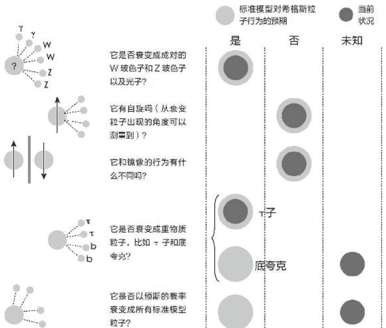

图7.1 走向希格斯：标准模型希格斯玻色子必须满足若干条件。任何与预期行为不符的现象都可能暗示着某种久被期待的新粒子

量子场论铁律：虚粒子涨落不断修正希格斯质量，将其从电弱尺度（10^2 GeV）狂推至普朗克尺度（10^19 GeV）。届时引力等强，黑洞遍布，时空崩坏。要让希格斯“苟住”在125 GeV，需极其精细的**取消机制**——各项贡献精准抵消，留下极小余量。这在物理学家眼中极不“自然”。

### 寻找“共谋者”：超对称、额外维度、轴子，还是多元宇宙？

主流押注**超对称（SUSY）**：每个粒子有超伙伴，玻色子/费米子涨落符号相反，完美抵消。但LHC至今未见超伙伴踪影，质量下限已被推至TeV量级（~希格斯质量10倍）。调高超伙伴质量虽能保全理论，却引入新微调——“自然性”再受损。超伙伴还是暗物质热门候选，一石二鸟的美梦正碎裂。

备选方案：大型额外维度、轴子（解决强CP问题顺带稳定希格斯）、组合希格斯……若皆无踪，剩下最让理论家不适的**人择原理+多元宇宙**：无数真空泡中，只有希格斯轻得刚好的宇宙能诞生观察者。这被视为“放弃解释”，但若实验执意无新物理，或许不得不面对。

### 真空悬崖边：宇宙或处于“亚稳态”

更惊悚的是：**即便希格斯质量“刚好”，宇宙也可能随时暴毙。** 希格斯势能地形决定真空命运。球滚向最低能量谷；若中间有浅坑（假真空），球会卡住——但量子隧穿可让其跌入真真空，泡沫以光速吞噬一切。

关键参数是**顶夸克质量**（对希格斯修正最大）与希格斯质量的比值。当前实验中心值落在**临界线附近**：宇宙极可能处于**亚稳态**（寿命远超宇宙年龄，但非绝对稳定）。顶夸克若稍重，大爆炸瞬间宇宙已塌缩；若稍轻，我们安稳至永远。现测精度尚无法判定我们究竟在哪一侧。

图7.2 如果顶夸克相对于希格斯玻色子稍微重一点，宇宙早就崩溃了

### 级列难题的另类破局：40年前的“玩具”重出江湖

标准模型预言希格斯裸质量应受量子涨落推至10^19 GeV（睫毛重量），实测却只125 GeV。差距17个数量级，即**级列问题**。SUSY失宠后，物理学家重拾**轴子**模型（1977年Peccei-Quinn为解强CP问题提出）。若存在极轻、极弱耦合的轴子，其势能动态驱弛希格斯质量至观测值，无需微调。更妙的是，轴子还是完美冷暗物质候选者。**一石三鸟**：解强CP、稳定希格斯、供暗物质。ADMX等实验正全频段搜捕这“隐形守护者”。

### 尾声：宇宙比例的巧合

我们站在悬崖边：希格斯轻得诡异，真空稳得勉强，顶夸克重得刚刚好。是精妙对称守护、动态弛豫机制、多元宇宙筛选，还是我们认知的盲区？下一代对撞机、轴子探测器、引力波天文台，将在未来二十年给出答卷。在此之前，宇宙继续在“致命的轻量级”托举下，脆弱而顽强地演化着。

# 从希格斯到暗物质：物理学最棘手的谜题与那些“失踪”的粒子

两个风马牛不相及的天文数字，竟能精准到几乎完全抵消？这概率有多低？站在这个视角，层级问题简直是宇宙尺度的“神来一笔”。这就好比挥杆打高尔夫，球先撞上树干，弹进沙坑，又从湖面反弹，最后稳稳落回你球杆脚边。这种近乎为零的巧合，绝不止关乎玻色子——既然所有基本粒子的质量都与希格斯挂钩，这谜题几乎波及物理学的每一个角落。

理论物理学家钟情超对称，因为它仿佛给出了完美答案。可如果预言中的超对称粒子始终躲在暗处不露面，该怎么办？

2014年，卡普兰的伯克利同事苏尔吉特·拉贡德兰与斯坦福的彼得·格拉姆另辟蹊径，设计新实验猎捕“轴子”。这要是真存在，就是种电中性的轻量级粒子，自带独家力场。它四十多年前登场，本是为了破解强CP难题——强相互作用为何守住CP对称，弱相互作用却不？顺道还成了暗物质的头号种子选手。

现有轴子探测器目前均一无所获。拉贡德兰和格拉姆的新设计正准备申请经费，突然杀出个程咬金：南极望远镜团队宣称捕捉到宇宙早期暴胀铁证，这似乎直接判了轴子“死刑”。但拉贡德兰不买账，他硬是找出兼容之道——轴子早期质量巨大，随后逐渐“消瘦”。

后来南极团队证实看走眼，可这插曲却点醒了拉贡德兰：轴子质量能随时间递减，希格斯玻色子行不行？三人将这思路套用到层级问题，把轴子和希格斯视为同轴双轮。早期两者都可拥有标准模型预言的超大质量，然后缓慢“下坡”。

为何希格斯刹车在1250亿电子伏特？团队给出的解释是：只有质量跌破特定阈值，希格斯“赋予质量”功能才启动。一启动，质量就锁死。希格斯赋予夸克质量，夸克借强力与轴子互动，反过来锁住轴子质量，再卡住希格斯。

他们建议把轴子改名“松弛子”，寓意它能让希格斯质量完美“松弛”至实测值。虽听起来有点牵强，但比起其他解法，松弛子有个硬优势：现成探测器早就开猎了，比如华盛顿大学西雅图分校升级版的轴子暗物质实验。

格拉姆、卡普兰、拉贡德兰正琢磨更大胆的念头：松弛子能否破解第四大谜团？宇宙学常数，那个塞进方程代表暗能量推动膨胀的数字，其膨胀速率……

---

## 希格斯玻色子的诺贝尔之夜

2013年12月，彼得·希格斯与弗朗索瓦·恩格勒共享诺贝尔物理学奖，《新科学家》记者瓦莱丽·贾米森受邀见证。以下是她的实录。

“科学家都梦想接到斯德哥尔摩电话。我正吸尘器轰鸣中拎起听筒：‘愿意赴宴吗？’基金会工作人员问。我乐开了花。虽非得主，但这典礼是所有仰望星空者的狂欢——表彰的是‘粒子获质机制’的发现。”

“对我私人意义也重。希格斯粒子面世前很久，我就钻进过大型强子对撞机隧道，漫步在质子即将光速对撞的地带。仰望数层楼高的ATLAS与CMS探测器，真切感到渺小。它们要捕获希格斯。2008年首批质子发射，我又回了一趟。诺贝尔之夜，是下一章节。”

“12月10日抵达音乐厅，恍然这是瑞典版奥斯卡——广场人头攒动，入口处两名裸体抗议者格外抢镜。内里是物理学界的群星璀璨，更是标准模型这部‘宇宙粒子与力最优剧本’的活历史。”

“卡洛·卢比亚在，W/Z玻色子发现者，1984年得主，弱力携带者。格哈德·胡弗特在，驯服标准模型方程魔鬼的1999年得主。戴维·格罗斯、弗兰克·威尔切克在，2004年得主，强力守护者研究者。”

“这些人搭建起标准模型，缺希格斯便不完整。恰好彼得·希格斯压轴现身。他和恩格勒正领头‘反抗’着装规定：‘非要我们穿这双可笑的鞋。我俩发动起义。’希格斯说，‘估计要被轰出去。’”

---

### 8 超对称粒子：标准模型之后的下一站？

标准模型步履蹒跚，下一步往哪走？物理学家们焦灼扫视地平线，盼望陌生粒子现身。

### 大型强子对撞机真正在猎捕的：超对称性

2012年希格斯现身，标志着物理学家耗时半世纪搭建的标准模型大厦“封顶”。可此后大型强子对撞机持续提能、狂奔，新粒子却杳无音讯，焦虑蔓延。我们知道模型不全：对引力闭口不谈、对暗物质噤若寒蝉、希格斯质量需精细微调才能压在可控范围（见第7章）。模型必须被纳入更大框架。若撞机再无新发现，粒子物理将撞进死胡同。

核心期待，是为“万物理论”超对称找证据，铺平统一之路。当今三种力强弱悬殊、范围各异，但60年代温伯格、萨拉姆、格拉肖在哈佛证明：早期高能下，弱力与电磁力强度相同，实为同源。期待回溯大爆炸更早、或加速器模拟更高能，强力也归顺，三力合一成“超力”（见图8.1）。标准模型能近似做到，但“不够准”，这偏差让物理学家抓狂。

- 强力：核聚合胶水；玻色子：8胶子；范围：10⁻¹⁵米
- 电磁力：原子管家；玻色子：光子；范围：无限
- 弱力：β衰变推手；玻色子：W⁺、W⁻、Z⁰；范围：10⁻¹⁸米

图8.1 今日三力强度天差地别。但若时光倒流至大爆炸，或加速器复刻其态，强度趋同，终统一为超力

超对称登场。苏联物理学家高尔方、利希特曼首倡，德国韦斯与伯克利祖米诺推广。

核心是将物理学家挚爱的“对称性”推广：费米子与玻色子分家，源于早期宇宙对称性破缺。今日，每个费米子配重量级超对称玻色子，每个玻色子拥费米子超级兄弟（见图8.2）。电子配标量电子（玻色子），光子配光微子（费米子）。

图8.2 超对称粒子大家庭。粒子数量翻倍，费米子配大质量玻色子伙伴，玻色子配费米子伙伴

理论关键：早期高能“汤”里，粒子与超级伙伴无法区分，每对作为无质量单实体共存。随宇宙膨胀降温，超对称破缺，搭档分道扬镳，成为各有质量的独立粒子。

超对称解决层级难题（见第7章）：量子场论说希格斯本该质量巨大。超对称让希格斯与导致其质量失控的粒子互动，麻烦被超级伙伴贡献抵消。加上超对称，三力强度曲线在早期能惊人精准汇聚。

这让无数物理学家信服。但深究新理论衍生问题，剧情反转。

## 寻找超对称粒子

燃眉之急：超对称粒子躲哪了？电子、光子满街跑，自然界与加速器里却连标量电子、光微子的影子都没有。若存在，质量必大，需海量能量造。

这类重粒子会衰变成最轻、最稳定超对称粒子——超中性子残骸。超中性子不带电，仅借弱力与常规物质“害羞”互动。至今未被发现，不足为奇。

物理学家精算超中性子残留量时惊掉下巴：量巨大，远超宇宙所有常规物质。超中性子完美匹配暗物质画像，而天文观测暗示暗物质主宰宇宙。

一切指向理论藏着基本真理。但数学之美与承诺不够，还要实证。地下实验猎捕穿地暗物质，或能捕捉超对称间接证据。包括加拿大萨德伯里矿井超低温暗物质探索，意大利格兰萨索山下XENON1T（氙暗物质计划探测器之一）。NASA费米卫星等天基探测器，也在银河系搜寻超中性子相遇湮灭信号。

若加速器能造出超中性子，铁证浮现。因其几乎不互动，能躲过探测，但携带的能量动量“凭空消失”，反而成了显眼标记。

所需加速器能级尚无定论。超伙伴质量取决于超对称破缺发生在宇宙冷却哪一刻。但按最简、最美“约束极小超对称”模型，超夸克质量低于1万亿电子伏特，正在撞机覆盖范围——可迄今未见踪影。出了什么岔子？

## “香草”超对称理论

撞机搜寻聚焦“超顶夸克”——顶夸克超伙伴。多数版本里它是最轻超夸克。“最基本”约束极小模型里，其他超夸克也不重多少。本该成批产生，重者衰变成超顶，形成无法忽视的“超顶洪流”——偏偏从未观测到。

或需更复杂版本，引入更多假设与自由参数。部分允许撞机未测区间存在更重超夸克、超胶子，同时保留轻超顶。若真如此，撞机产重超夸克少甚至为零，只需改搜寻策略，如直接猎捕超顶而非等衰变产出。

突然大家讨论给超对称模型一堆自由参数“微调”求正解——而避免这种敷衍原本是超对称立项初衷。这引出激进结论：超对称或许已无药可救？

物理学家重审替代旧模型（见图8.3）。有前文轴子理论，还有现任奥斯汀德州大学教授温伯格的思路。1979年，他与斯坦福萨斯坎德联手，从平庸质子切入。质子由胶子束缚夸克构成，胶子传强力，但质子大部质量非来自夸克，而是内部束缚蕴含能量（见第4章）。色荷互动是强力低能态表现。两人推断：早期宇宙若有类似机制在更高能生效，便能解释夸克等基本粒子自带质量，无需希格斯。此为“技彩理论”。

可技彩数学极难，少数可测预测又不符大型正负电子对撞机（2001年前欧洲核子中心主力机）数据。微调缓解部分问题，光环却快速褪色。

### 引力为何如此孱弱？

90年代末，桑德拉姆与哈佛兰德尔另辟蹊径。层级问题关乎希格斯质量膨胀远超他粒子，也可换个问法：标准模型未涵盖的引力，为何比其他力弱得多？如电磁力强近10³⁴倍。引力再强些，希格斯机制赋予的粒子质量就更贴近希格斯，问题迎刃而解。反之，若能解释引力为何弱，谜题自解。

兰德尔-桑德拉姆数学给出新解：四维时空外，藏着不可见第五维度。这图景里，我们如纸面二维平面蚂蚁，四处奔波却不知世界有极薄三维厚度。模型显示，调节引力的引力子，偏爱五维宇宙一条维度——纸张侧面。希格斯却在我们这维度。这限制了引力子与电子、夸克等获质粒子互动，致使四维近似里引力显弱。完整五维视图中，它与所有力同样强悍。

有人提议融合技彩与兰德尔-桑德拉姆。1997年马尔达塞纳证明，增一维度即令四维时空棘手强相互作用理论变易处理。兰德尔、桑德拉姆认这能在两理论间搭桥，持续钻研细节。

技彩派最靠谱变体未完全排除希格斯，但视其为非基本粒子，而由新基本粒子组成的“束缚态”，似质子实为束缚夸克胶子团。它预言合成希格斯衰变模式，撞机可测。还预言新粒子：已知粒子质量超1万亿电子伏特的共振态，因五维振动得额外质能。

期盼欧洲核子中心庞然大物能觅得些许——超对称超顶夸克、兰德尔-桑德拉姆共振，或全然陌生之物——为更新、更全面物质理论指路。

### 阴影世界：我们首次窥见黑暗力量？

看看暗物质猎手。宇宙观测显星系、星系团旋转超预期，这难捕物质占宇宙物质大头。可每当物理学家将至，它溜之大吉。信号不见，或惊喜现身旋陷背景噪声。每次结局同：强颜欢笑，回绘图板，重头再来。

或该换策略。寻找目标或非单一粒子，而是由黑暗粒子与力组成的“动物园”——全新“黑暗部门”。毕竟无理由暗物质比可见物质简单，后者含电子至夸克全套。

设想完整影子世界：不可见粒子借常规物质感受不到的力互动。若实验室出现黑暗力量经得起推敲的微弱迹象，黑暗领域或已露真容。

30年代天文学家发现，按可见恒星引力，星系绕转远超预期快。40年后，星系内恒星也转太快。模拟中常规引力不足聚气成星系团。要么牛顿爱因斯坦引力定律需大改，要么不可见物质贡献更多引力。主流选后者——暗物质。测算暗物质与可见物质质量比约4:1。

不管啥成分，必须有质量才感受并产生引力。但无电荷，不与光互动。数十年首选候选是弱相互作用大质量粒子（WIMP）。普遍认比质子重得多。或即超对称超中性子，大爆炸初刻大量产生的稳定粒子。

## 寻找弱相互作用大质量粒子

附近矮星系伽马射线辉光或藏这些粒子证据（见下文“弱相互作用大质量粒子的蛛丝马迹？”），可地球上无数超灵敏探测器，至今未记录一例WIMP。部分研究者觉醒：该变套路了。

理由不止于此。星系旋转观测精细到能摸清暗物质分布。简单WIMP模型说它在星系核心密度极高。最新观测却显分布均匀。解释之一：仅作用于暗物质粒子间的力将它们推散。

这想法颠覆性。加州欧文分校冯孝仁表示，一旦引入暗物质粒子间作用力，便入全新领域。可想见由黑暗粒子及其所有力组成的大家庭。

黑暗家族非全新概念。2006年天文学家研究子弹星系团——两星系群碰撞中。指出碰撞速度太高，无法仅用涉及物质（暗+常规）引力解释。额外拉力必来自暗物质粒子间引力。

## 弱相互作用大质量粒子的蛛丝马迹？

暗物质或不如其名“暗”。若如多数物理学家所信，由WIMP组成，则具物质反物质两态。接触湮灭产高能光子——伽马射线。

星系恒星数十亿，伽马源难排除。但近年发现一批超暗矮星系，恒星不超数亿。被认为拥极高凝聚暗物质，成猎捕湮灭伽马射线理想场。

2015年，卡耐基梅隆阿利克斯·吉林格-萨梅斯团队研新发现矮星系——Reticulum II，距地球仅10万光年。NASA费米伽马射线太空望远镜档案中，他们发现似乎过量的伽马射线。

# 暗力粒子的隐匿踪迹

有批评声音指出，除Reticulum II外，宇宙中或许还潜伏着其他未被识别的γ射线源。眼下并无新建γ射线望远镜的计划以提升观测精度，除非我们在邻近空间再发现几个矮星系，好去翻阅“费米”望远镜的旧档案，否则这依然只是一个关于弱相互作用大质量粒子（WIMP）可能存在的诱人悬念。

## 携带暗力的粒子

更精细的模拟推演表明，子弹星系团的碰撞速率并未超出理论预期。然而，对“暗力”存在的质疑从未熄灭。科学家推测，地面粒子实验中的某些异常数据，同样可能指向暗力的存在。以μ子（电子的重量级“表亲”）的磁特性为例，理论预测与实测值之间长期存在的偏差，若引入携带暗力的粒子便能迎刃而解。冯孝仁教授判断，我们极有可能已在匈牙利一家核物理实验室捕获到了此类粒子迄今最令人信服的证据。

在位于德布勒森的匈牙利科学院核研究所，阿提拉·克拉斯纳霍凯带领团队聚焦于铍-8原子核的放射性衰变。铍作为轻元素，质子中子各4个时（铍-8）极其不稳定，转瞬即裂变为两个氦核；而质子4、中子5（铍-9）则稳定存在。早期实验已暗示该衰变通道藏有玄机，克拉斯纳霍凯团队誓要查个水落石出。

他们以质子轰击超薄锂-7靶制造铍-8。铍-8衰变时会释放电子-正电子对。按标准模型，粒子对多沿入射质子方向飞出。然而匈牙利团队意外捕捉到两股清晰的“侧流”，喷射方向几乎垂直于预期。若假设衰变首先生成一个寿命极短的慢速粒子，随后它衰变为电子正电子对并向背向飞出，便能完美解释这一反常现象。

团队推算该假想粒子质量约为1700万电子伏特——仅为电子质量的33倍，远轻于任何WIMP。这完全落在标准模型盲区之外，四大基本相互作用均无法造出这般粒子。

## 暗光子

历经三年打磨，团队于2015年公开成果，将新粒子命名为“暗光子”。借用光子传递电磁力的逻辑，它被设定为在暗物质粒子间传递未知力的媒介。

冯孝仁团队采信该结果并自行构建理论解释，同时试图解开一个困惑：既然该实验全球大多数实验室均可复现，为何此前无人察觉？除传递暗力外，暗光子理应携带微弱电磁力，从而与普通质子、电子偶尔相互作用。但冯孝仁计算后发现：“这绝不可能是暗光子。若真是这样，别的实验和加速器早该见到成百上千个类似信号了。”

既非暗光子，那是什么？冯团队另辟蹊径，探寻暗粒子以何种方式微弱介入普通物质以致使衰变反常。他们发现，为兼容所有已知力的实测数据，该粒子不能像光子般与质子、电子耦合，而必须与铍核内的中子直接作用。这一特性超越已知物理图景，或可解释为何过往暗物质探测全军覆没。冯团队将这位“闯入者”命名为“X17玻色子”。

并非人人认可可见宇宙外还有完整“影子世界”，但冯孝仁的理论可被证伪。弗吉尼亚州杰斐逊实验室的“暗光实验”已在其预测质量区搜寻；欧洲核子研究中心大型强子对撞机（LHC）的LHCb实验也将在底夸克衰变中追踪它的身影。

## 制造暗物质的六种路径

- **WIMP（弱相互作用大质量粒子）**。主流范式认为暗物质是缓慢漂移的重粒子团。它们能完美解释星系自转曲线与大尺度结构形成，但探测器至今未获确凿信号，现有线索暗示其质量可能仅为理论预期的十分之一，徘徊在允许下限。
- **MACHO（大质量紧致晕天体）**。主张暗物质实为藏在星系晕中的普通物质——如黑洞、褐矮星等暗淡天体。可惜仅能填补缺失质量的九牛一毛。
- **Macro（宏观暗物质）**。由高密度夸克簇构成，密度堪比中子星、质量惊人。未来或可在月球部署地震仪捕捉其撞击信号。
- **轴子**。WIMP的“轻量版”，与普通物质耦合更弱。尽管ADMX等实验扩大搜索范围，目前仍无定论。
- **惰性中微子**。普通中微子穿透力极强、质量太轻、太“热”，不胜暗物质重任。惰性中微子则是其“重、冷、冷漠”的升级版。
- **引力微子**。引力子（引力媒介）在超对称理论下的超级伙伴。完美契合暗物质粒子画像，但超对称预言的众多重伴粒子迄今杳无音讯。

## 古怪粒子破解物理困局

标准模型留下重重悬案：为何物质主导宇宙？引力本质为何？暗物质何物？物理学家屡试不爽的一招是：凭空发明新粒子……

## 轻子夸克

1994年，德国汉堡德意志电子同步加速器（DESY），电子与质子正面交锋。物理学家惊见电子竟“变身”为重得多的μ子。按标准模型，这需要电子从质子汲取能量转化为质量，实属闻所未闻——质子是强力束缚的复合态，电子与μ子属基本轻子，全然不感强力。

一种解释是碰撞催生了“轻子夸克”这种重量级混血儿。在部分将强弱电三力合一的大统一理论中，电子撞击质子可激发轻子夸克生成并衰变为μ子加夸克。可惜该结果从未复现，热度随之消退。但大统一理论的诱惑常在，LHC上对轻子夸克的猎捕从未停歇。

## 弦球

弦理论作为统一微观量子世界（标准模型领地）与宏观引力宇宙（见第9章）的种子选手，备受青睐。其核心主张：电子、夸克等粒子实为长约$10^{-35}$米的一维弦，不同振动模式对应不同粒子。若属实，LHC或未来加速器可能制造“弦球”——两弦撞击缠结成团，而非拉伸成线。一旦发现，弦理论坐实，且预示着除已知三维外存在额外空间维度。

### 暴涨子

为何空间如此平坦？物质分布何以均匀？主流解释：宇宙诞生伊始经历“暴涨”，空间以超光速撕裂扩张，抚平一切褶皱。驱动暴涨的巨大能量场在化身物质辐射前短暂统治宇宙。量子论规定场必有对应粒子——此即“暴涨子”。其存在推演出多元宇宙：量子涨落致使暴涨难以彻底终止，原始宇宙部分区域持续膨胀，衍生出无数独立演化的子宇宙。暴涨子质量极大，直接证据遥遥无期——所需加速器能量至少为LHC的万亿倍。

### 弱作用巨兽粒子（WIMPzilla）

一日，物理学家洛基·科尔伯在伊利诺伊超市推车沉思，为新暗物质粒子命名。一辆贴着《哥斯拉》海报的公交驶过——灵感乍现，“弱作用巨兽粒子”诞生了（1998年）。

宇宙第一秒暴涨期，空间膨胀可能从真空中“剥离”出粒子。科尔伯团队推算，其中或有质量达标准WIMP十亿倍、约$10^{18}$电子伏特的超重暗粒子。庞大质量注定其极度稀少。同暴涨子一样，加速器造不出，地下探测器也难撞见。但它们或在宇宙微波背景辐射（大爆炸余晖）中留下微弱指纹。

### 孤单磁极：寻找没有南极的北极

电荷分正负，磁极分南北。从条形磁铁到地球发电机，磁极总成对现身。切断磁铁，得两枚完整小磁铁，各具南北——宛如迪士尼动画《幻想曲》中扫帚分裂的魔法。

虽从未见过孤立单极，理论物理学家仍矢志寻觅。首先，它能补全麦克斯韦方程组的美学对称：电磁实为一体两面，电荷自由存在（电子、质子），磁荷理应同享自由。麦克斯韦因无观测记录，无奈在方程中排除自由磁荷。

狄拉克让磁单极子“回归”。1931年，这位沉默寡言的英国天才将量子思想植入经典电磁学，指出：即便全宇宙仅有一个磁单极子，也能解释为何所有电荷均为基本电荷整数倍。

40年后，物理学家致力统一电弱与强力。胡夫特与波利亚科夫独立证明：大统一理论若无磁单极子，将允许粒子带任意电荷——物理图景随之崩塌。

## 对磁单极子的追踪

从南极冰芯到月球岩石，科学家遍寻磁单极子踪迹。最近的一次“擦肩而过”发生在1982年情人节夜。布拉斯·卡布雷拉在斯坦福地下室自建探测器中捕获一疑似信号。事后证实只是误触，甚至引得同行一年后寄来打油诗调侃：“玫瑰是红的/紫罗兰是蓝的/该是时候/与磁单极子再相逢。”

如今卡布雷拉信号及其他可疑事件均被判为实验误差。但狄拉克计算给出了完美借口：基本电荷越小，基本磁荷必越大。电荷极微、磁荷极巨，意味着制造携带磁荷的粒子需要不可企及的能量。标准模型预言，仅大爆炸后极短一瞬能量足够制造磁单极子。紧接着暴涨启动，将它们稀释至四面八方。加州理工约瑟夫·波尔钦斯基直言：整个可观测宇宙内或仅存**一个**磁单极子。

仍有人期盼它们更常见些。LHC上，阿尔伯塔大学吉姆·平菲尔德率领MoEDAL（磁单极子与系外探测器）实验搜寻。核心装置是贴墙的一排金属盒，内含堆叠塑料层作“照相底片”。磁单极子巨大磁荷会撕裂聚合物键，蚀刻出特征轨迹，揭示粒子属性。尽管LHC迷你火球能量创纪录，按标准模型仍远不足造单极子。但许多标准模型扩展预言更轻单极子存在。且磁单极子应稳定，MoEDAL还设捕获装置——任何路过的单极子或被“装瓶”留存，成为粒子“动物园”真正的异类。

### 我们在哪里找过磁单极子？

搜寻磁单极子意义深远。以下足迹遍布却一无所获：

| 类别 | 项目 |
| --- | --- |
| **被困在……** | 阿波罗11号月球岩石、南极陨石、火山岩 |
| **途经……** | 高能中微子/宇宙线实验、专用磁单极子探测器、宇宙微波背景辐射 |
| **制造于……** | 粒子对撞机、磁性材料 |

## 第9章 引力拾遗

在当前基本力最佳模型中，引力是显眼的“缺席者”。我们虽有多条极具潜力的探索路径，但距离“万有理论”究竟还有多远？

### 仍无万有理论

标准模型基于量子场论，以虚玻色子交换描述三大基本力。引力却归爱因斯坦广义相对论管辖，被诠释为时空弯曲。理解黑洞奇点与宇宙起源，似乎非建立引力量子理论不可——在那两大场景下，广义相对论预言无限大而崩溃。完备的量子引力理论应揭示时空深层本质。

尝试用量子场论量子化引力时，随即撞上墙：计算任一量子过程都需加总虚粒子产生的无限种路径。有时总和收敛，有时却发散为无限大。如β衰变量子论给出无限大——直到电弱理论引入W、Z、希格斯等重玻色子“消除无穷大”，数学困境才解。这让物理学家信服：若模型发散，引入更重新粒子即是通用药方。

假设引力由“引力子”传递。加总所有可能历史，计算结果如预期般发散成一堆无穷大（见下图）。

电子通过无数种方式交换无质量光子相互作用，导致计算发散。
引入更重的W、Z、希格斯玻色子，消除了无穷大。
引力子。照搬此招需引入质量达质子$10^{20}$倍的新粒子，它们表现如黑洞，让计算再次失效。

**图9.1** 引力子是假想的引力量子——但其配套理论极难驾驭

要消除引力子的无穷大，需发明质量约$10^{20}$倍质子质量的新粒子。作为虚粒子，它们须极短寿命偿还能量债，活动范围极微。如此微小空间容纳如此大质量，必然形成黑洞——内含密度无限大的奇点。

为绕过这根本障碍，物理学家提出候选理论：假设粒子为基本振动弦不同模式的**弦论**；主张时空本身被离散化为有限块的**圈量子引力**。

### 弦之音

传统量子场论中，宇宙由无大小、无结构的点粒子构成。超弦理论将基石替换为存在于十维时空中的一维弦。除熟知四维外，额外六维卷曲成直径约$10^{-35}$米的微观圆圈，即便最强加速器也因太小而探测不到。

恰似小提琴弦，超弦以不同模式振动，每种振动对应一种基本粒子。弦论不仅统一强弱电三力，更天然是引力量子理论——弦的特定振动模式即描述引力子。更妙的是，弦相互作用比点粒子更“平滑”，自动消除了将量子场论用于广义相对论时遭遇的无限大与反常。

得益于威滕90年代突破，弦论汇入**M理论**——一个存在于十一维时空的全涵数学框架，涉及高维扩展对象“p膜”，弦只是其特例（p=1）。额外维度的具体卷曲方式，决定了我们四维世界的面貌：夸克轻子代数、力的种类、粒子质量。M理论令人费解之处在于，卷曲方式多得惊人，衍生出海量可能宇宙，各自物理定律不同，我们恰居其中之一。

M理论虽未获实证，已斩获成果。如1974年霍金证明白洞因量子效应辐射、具温度与熵（熵正比面积）。长期以来，试图从微观量子态计算黑洞熵皆以失败告终——直至M理论出现，精准复现霍金熵公式。

### LHC未见超伴粒子，超弦理论危矣？

“超弦”中的“超”指超对称性，乃理论核心组件。LHC迄今未发现任何超伴粒子，常被视为质疑超对称的铁证。实则，**仅当超对称性是解决级列问题（见第8章）的方案时，轻超伴粒子才是必需的**。若超对称特征只在更高能标显现，弦/M理论依然自洽。

### 当圈遇上弦

两大最具希望的量子引力理论竞逐数十载。倘若它们本是同一枚硬币的两面？

弦论虽捷报频传，烦恼也不少：额外维度卷曲方式过多，招致批评“几无预测力、不算科学”。竞争者圈量子引力主张：时空自身须量子化，由有限离散块组成。计算显示，这些量子块源于虚无中的微小圈，演化成泡沫状几何——**自旋泡沫**。自旋泡沫本质即量子语言下的时空。

圈量子引力仅致力调和量子论与广义相对论——这条“慢工出细活”路线被视为更稳妥。虽仍属理论范畴，罗韦利等圈论物理学家已提出可检验预言（见下文“如何验证圈量子引力”）。但难题犹存：自旋泡沫过于“刚硬”，难以贴合爱因斯坦宇宙的灵魂——即时空随观察者可被挤压、拉伸的相对论性质。

### 两大量子引力阵营的“破冰”之旅

几十年来，弦理论与圈量子引力（LQG）像是两条平行线，互不相干。但随着双方均未能彻底推翻对方，加上新一代理论物理学家开始在两个阵营间穿梭，局面悄然生变。2011年，华沙大学的诺伯特·博登多弗团队率先打破壁垒：他们在圈量子引力描绘的时空背景下，成功重写了弦理论及其超对称粒子，让两套理论首次产生数学关联。三年后，乌拉圭共和国大学的罗道夫·甘比尼与路易斯安那州立大学的乔治·普林进一步指出，若想让广义相对论与圈量子引力完美兼容，必须引入源自弦理论的几何结构，以此界定粒子谱系的边界。

#### 全息原理：意外的“和事佬”

早在90年代初，乌特勒支大学的格哈德·胡弗特与斯坦福大学的莱昂纳德·萨斯坎德提出的**全息原理**，就暗藏了统一的伏笔。该原理认为，我们感知的三维世界，或许只是宇宙边界上二维物理过程的投影——正如信用卡上的平面全息图能呈现立体影像。它在三维引力与二维量子场论间建立了精确的数学对偶。此后，全息原理成为弦理论核心研究方向，物理学家发现：站在边界视角，棘手的体物理问题往往变得更易处理。

如今，这个“边界”成了连接两大理论的纽带。2015年底，巴黎大学的瓦伦丁·邦宗与普里美特研究所的比安卡·迪特里希发现，此前在弦论框架下完成的全息引力计算，用圈量子引力同样能推导出一模一样的结果。紧接着，博登多弗再下一城：他证明自家的数学框架能规避全息弦理论在黑洞奇点处失效的难题。

基础研究层面也在汇聚。2016年，普里美特研究所的劳伦特·弗赖德尔团队回归本源，仅用广义相对论描述一个被边界包裹的微小空间区域。惊人地发现，定义边界的变量在数学形式上，与弦理论和圈量子引力高度相似——尽管计算起点并非这两者。同期，佛罗里达大西洋大学的圈论者韩慕辛携手复旦大学的弦论者孔令欣，尝试计算圈量子引力中“自旋泡沫”自发演化的概率（这种类似肥皂泡翻涌的自发性，或能揭示时间的起源)。他们将计算映射至边界，再次触发了与弦论高度吻合的数学特征。

若这条路走得通，弦理论与圈量子引力在边界上或许不再是对手，而是**完全等效的两种描述**。但这边界究竟在何处？全息理论初始设想的是宇宙尽头的边界，但今人不再拘泥于此，认为边界可置于空间任意位置。随意截取一段时空切片，在最微观尺度上，圈-弦物理便可能浮现。

“这乍听似随意，实则不然。”罗韦利解释道，“我们观测世界总需强行设定边界。记录光需要胶片、探测器或视网膜；这张平面影像可能是多物体叠加的结果——蝴蝶的影子，可能来自真蝶，也可能是双手合十摇动手指造就的。弦论与圈论在我们眼中虽异，却可能投射出完全相同的‘影子’。”

年轻物理学家们对这种调和充满朴素而炽热的期待：即便最终不直接产出量子引力终极理论，至少能为探索指明方向。

---

### 圈量子引力：走向可证伪的两大预言

近期圈量子引力进展顺遂，至少给出了两个可观测验证的预言：

*   **黑洞“反弹”**：罗韦利倡导此说。若空间由离散圈量子构成，挤压必有极限。黑洞或将触及密度上限，随即反弹并释放可探测辐射。
*   **大爆炸“回响”**：早期宇宙极度紧凑，最小时空颗粒效应显著。其印记或藏于宇宙微波背景辐射（CMB）中。待探测精度跃升，我们或能捕捉到这些特征信号。

---

### 10 大型强子对撞机（LHC）之后：谁将接棒？

#### 直线对撞机：化繁为简的精准之选

接替LHC的热门人选是**国际直线对撞机（ILC）**与**紧凑直线对撞机（CLIC）**。两者均采用电子-正电子对撞。ILC拟建35公里直线加速器，撞击能量1 TeV；CLIC采用较新技术，能量冲刺3 TeV。技术路线上，ILC用锻造超导谐振腔产生高频电场，CLIC则靠平行驱动束激发射频场。

虽能量不及LHC的质子对撞（14 TeV），但**“蛮力非一切”**。质子内部三夸克夹杂胶子海，对撞实为夸克/胶子碰撞，能量被瓜分，碎片混乱难解析。电子与正电子是点状粒子，独享全能量，且初态精确可知。这意味着：能精确重构希格斯及新粒子属性，实现“干净利落”的物理测量。

前身大型正负电子对撞机（LEP）曾在27公里环形隧道（现LHC所在地）将电子加速至100 GeV。但环形机受限于**同步辐射损耗**——电子越快、损耗越大，故物理学家转向线性加速器，消除弯道损耗，让两束粒子“针尖对麦芒”。

#### 极限聚焦：纳米束流的博弈

线性机只有一次对撞机会，故须将束流压缩至**纳米级宽度**，制造超高碰撞率。这极具挑战，但斯坦福直线加速器中心（SLAC）与日本KEK已攻克关键技术。

LHC耗资约200亿美元，且仅发现“标准模型版”希格斯，后续资金到位堪忧。物理界原指望LHC发现大量新粒子，再由线性机精测；现实却逼出了**缪子对撞机**这匹黑马。缪子质量是电子207倍，同步辐射大幅降低，能在环形机中轻松达高能。难点在于：缪子源自π介子衰变，生来“滚烫混乱”，需极速冷却聚焦成高密度束流。类似技术已用于反质子冷却，欧洲核子研究中心（CERN）与费米实验室正攻坚克难。

三足鼎立之际，中国抛出自主方案：**环形电子正电子对撞机（CEPC）**。2014年高能所宣布，拟建周长超50公里（约LHC 2倍）地下大环，对撞电子正电子，同隧道兼容质子-质子对撞机（SPPC），目标2030年代建成。

#### 下一代探测器速览

| 项目 | 国际直线对撞机 (ILC) |
| :--- | :--- |
| **现状** | 2013年6月发布技术设计报告 (TDR) |
| **简介** | 35公里直线加速器，电子-正电子对撞 |
| **成本** | 约80亿美元 |
| **优势** | 碰撞环境极其纯净；技术成熟可控 |
| **短板** | 能量上限或不足以覆盖所有前沿新物理 |
| **选址** | 日本北上山区呼声最高 |

| 项目 | 紧凑直线对撞机 (CLIC) |
| :--- | :--- |
| **现状** | 2012年10月发布概念设计报告 (CDR)，尚未获批 |
| **费用** | 无官方正式估算 |
| **优势** | 碰撞纯净；高能紧凑（同等能量ILC需140公里，造价指数级上涨） |
| **短板** | 核心技术仍在研发攻关中 |
| **选址** | 暂未确定 |

#### 遥远的彼岸与“小而美”的当下

更远的愿景包括：40-200 TeV的**超大型强子对撞机 (VLHC)**、缪子对撞机、电子-质子对撞机 (LHeC)。中国方案也在演进：52公里环形隧道，电子正电子对撞，曾以2028年建成为目标。

但现实是：未来几十年，建更大更强机器或成奢望；直抵统一能标（~10^16 GeV）更是遥不可及（见图10.1）。退而求其次，**“精度物理”成了主战场**——用熟悉粒子捕捉微末异常，窥探新物理的幽灵。

图10.1 粒子加速器不断拓疆，但能量离“力的统一”仍有天堑

#### 电子的“体检”：挤压出的新物理

标准模型预言电子、中子完美球形。未知重粒子若存在，会通过虚粒子效应施加微扰，诱发**电偶极矩 (EDM)**——内部正负电荷中心微离。这成了经费有限团队的香饽饽：小规模、低成本、却能间接探测LHC触及不到的超高能标。

关键在于极致精测**自旋进动**。如陀螺受力进动，有EDM的粒子在电场中会进动——只是幅度小得惊人。

*   **哈佛 ACME 实验**：用超冷氧化钍分子放大信号，2013年将电子EDM上限压至 **10⁻³⁰ e·cm**。打个比方：若电子有地球大，其偏离完美球的程度不超**10纳米**。
*   **橡树岭 nEDM 实验**：瞄准中子。前序实验限制偏差在万亿分之一；新装置嵌入超流氦，增强电场、减速中子，誓要再提精度**100倍**。
*   另有提议测质子EDM，猎捕假想暗物质**轴子**。

这些桌面实验极其敏感：LHC极限约4-5 TeV，而ACME当前灵敏度已对应 **7-8 TeV** 新物理尺度；升级版可达 **40 TeV** 甚至 **100 TeV**——以“小博大”，性价比极高。

#### 缪子的“叛逆”：g-2 之谜

电子的重表亲——缪子，15年来磁矩异常（g-2）持续“犯规”。两者均为旋转带电球，产生磁矩（g因子）。狄拉克1928年预言 g=2，实测却略大（电子 ~2.002）。虚粒子修正导致偏移，缪子因重207倍，对重新物理（如超对称粒子）极其敏感。

2001年布鲁克海文 E821 实验发现：缪子 g-2 偏离标准模型预测 **~40亿分之一**。暗示未知重粒子在干预。但统计显著性不足，实验被叫停未及确证。2013年，核心设备——直径15米超导磁环由驳船漂流至费米实验室，**缪子 g-2 新实验**重启征程，誓要在2018年给个定论。

#### 质子的“葬礼”：寻找不朽的终点

标准模型质子绝对稳定；大统一理论 (GUT) 却预言其必衰变。**超级神冈**—日本地下5万吨水柴—自1996年起监视质子衰变（主道：p → e⁺ + π⁰，特征是背向切伦科夫光环）。2016年给出该模式寿命下限 **1.6×10³⁴ 年**，已排除一批GUT模型。继任者**超级神冈 (Hyper-K)** 拟装100万吨水，或将见证第一个质子的“死亡时刻”。

---

### 11 务实的粒子：从微观洞见到宏观红利

物理探索从非为功利，但粒子物理的工具与发现，早已渗透民生肌理——治癌、护翼、强超导，甚至可能解决“番茄酱倒不出”的痛点。

#### 粒子物理，到底给生活带来了什么？

加速器初衷是实验室复现宇宙射线，把理论家拉回地面。不料，**驾驭高能带电束流**的本领，别处大有用武之地：

*   **材料重塑**：低能电子束轰击塑料，打断氢键诱导**交联**，化腐朽为神奇——收缩膜、电缆绝缘层皆出于此。
*   **X射线多面手**：机场安检、食品辐照保鲜、医疗器械灭菌，统统靠加速器产X射线。
*   **芯片雕刻**：离子注入技术，让微芯片元件更精微复杂。
*   **核废料“变身”**：中子驱动嬗变，将长寿命放射性核素变为短寿命或稳定同位素。原理通、技术活，正向工业化规模迈进。

#### 良药苦口利于病：强子治疗与反物质造影

**强子治疗（质子/碳离子）**：X射线“穿透伤人”，强子利用**布拉格峰**特性，将能量精准沉积于肿瘤深处，周围正常组织近乎零剂量。脑瘤、眼瘤、儿童肿瘤成“必胜局”。当前挑战：把加速器做小、做廉，像MRI一样进驻每家医院。

**PET扫描（正电子发射断层扫描）**：反物质的医用典范。注射氟-18标记葡萄糖（同位素产自加速器），正电子湮灭电子产γ射线对，追踪γ源即绘出代谢热图，脑部肿瘤诊断利器。

#### 探测器：从“冲洗胶卷”到“数码直出”

早期云室、核乳胶捕捉粒子轨迹，冲洗排片极其繁琐。安德森发现正电子，冲洗分类了1300多张云室照片。如今，**硅探测器**实现“数码化”：电离粒子穿越硅片，电荷对瞬间被收集电子学读出，无需人工显影。LHC每秒十亿级碰撞的海量数据处理，全赖此技术。

#### 超级计算机

# 硅基探测与网格计算：从对撞机到太空医疗的跨界之旅

海量数据的涌入逼迫粒子物理学家另辟蹊径，发明全新的计算范式。网格计算应运而生，将全球数十万台计算机串联，同步消化大型强子对撞机（LHC）倾泻而出的数据流。早在上世纪70年代，本特·斯顿普便以保龄球为灵感，为欧洲核子研究中心（CERN）控制室打造了首个轨迹球，并设计出早期触控屏原型——这与蒂姆·伯纳斯-日后缔造的万维网截然不同。

这场数字变革催生了粒子探测器前所未有的衍生应用。Medipix混合硅像素探测器便是典范。相较于LHC那些巍峨如大教堂的巨型装置，它娇小得多：仅拇指大小的硅片上，排布着256×256的像素阵列。但得益于精妙的微芯片工艺，它能实时捕捉、计数并测量单个光子的能量。

医学影像因此迎来质变。通过分析穿透物体的不同能级光子，临床医生可获得彩色X射线图像，诊疗信息量跃升新高。这项技术不局限于光子，任何电离辐射——无论是放射性物质释放的α、β射线，还是强子治疗中的质子、碳离子——皆可即时成像。

探测器的版图正延伸向太空。星际航行的核心痛点之一，是失去地磁场庇护后面临的致命辐射。若能精准测量并解析辐射图谱，便能为火星、比邻星乃至更远疆域的探险者构筑防护屏障。如今，国际空间站上已有5台Medipix设备接入NASA笔记本，监测宇航员辐射环境；猎户座深空探索计划亦采用此技术。当人类在宇宙寻觅新家园时，为粒子物理诞生的技术，或将决定物种命运。

未来将何去何从？希格斯驱动曲率引擎、磁单极子磁悬浮、微型黑洞垃圾处理器……无人知晓。科学研究初衷非为寻找应用，但历史反复证明：只要汇聚足够多的聪慧大脑——无论在CERN、费米实验室或别处——总会迸发出改变世界的火花。

## 中子：微观世界的“瑞士军刀”

詹姆斯·查德威克在30年代捕获中子，揭示了其在元素嬗变、核反应与衰变中的关键角色，直接引出核链式反应，将物理推入核能与核武时代。然而中子的故事另有篇章：它已化身为洞察物质结构的利器，触角延伸至新一代芯片、病毒解剖等诸多前沿。

如同所有量子粒子，中子具波粒二象性。遭遇与波长匹配的障碍，它会按特定角度散射，如水波绕石。解析散射图谱，即可反演物质内部结构。

上世纪40年代核反应堆诞生，中子批量生产成为可能，材料结构研究由此深入。60年代，专用研究堆优化完成，中子科学真正腾飞。

## 双轨并行的中子源版图

现存20余座中子科学装置，大致分两派：以格勒诺布尔劳厄-朗之万研究所（ILL）高通量反应堆为代表的研究堆，靠核裂变输出稳定中子流——ILL拥有全球最强中子源，服务40台仪器；另一派以英国ISIS中子源为代表的脉冲源，用加速质子轰击重金属靶激发中子。

前者能覆盖宽广能谱（对应宽波长域）：千米/秒级热中子波长短，探针亚纳米原子结构；冷中子速度减十分之一、波长增长，适配分子尺度。中子不带电，不受离子电场干扰，穿透力强；自旋赋予微弱磁矩，可与电子自旋耦合，成为磁性材料研究利器；核心仍是强相互作用，对轻原子核（氢、氧、碳）灵敏度极高，因其核质量差异显著。

日常用品多为含轻元素的长链烃，中子是解析此类复杂结构的最佳钥匙。2012年，ILL与布里斯托大学团队用中子验证：在烃链植入铁，可制得磁性肥皂。磁场可控特性，有望革新水处理与环境修复技术。

## 顺流而下：从番茄酱到生命密码

面霜、洗发水、酱料等复杂流体，因长链分子行为呈现怪异流变——剪切稀化效应让它们受搅拌变稀。倒番茄酱的囧况便是典型。2005年，科学家施力并发射中子束，同步用流变仪测流动，中子揭示分子取向，建立粘度与链向的定量关联，助力工业预测产品出瓶行为。

蛋白、病毒、细胞膜富含轻元素，生物学家借中子解码生命结构。氘代技术——以重氢（氘）替换氢——利用中子对同位素的高灵敏度，通过对比实验锚定氢在生化反应中的位置。

基因治疗与作物改良中，外源DNA导入宿主细胞的载体筛选，也仰赖中子散射测试病毒等候选试剂。

胆固醇包裹细胞、传递信号、合成激素，其跨膜运输与动态平衡关乎阿尔茨海默症、心血管病等重疾。近年中子实验阐明了调控机制，揭示系统崩溃的诱因。

## 治愈之光：新药与新材的中子密码

中子不止辅助诊断，更直接制造新药。放射性药物是治疗特定肿瘤的利器：将放射性同位素导入癌细胞，以辐射剂量定点清除。但现用药多为“易得”而非“最优”，难免伤及周边正常组织。研究堆现用于生产新同位素，如锝-177、镥-161。2015年，ILL、慕尼黑工大、保罗谢勒研究所联合团队演示新法：中子辐照钕-160生成钕-161，经β衰变得镥-161。其γ射线适配体内追踪，低能电子精准杀癌不伤健康组织，半衰期约一周——物流窗口足、核废料压力小。

中子磁性探针直指高温超导奥秘：微小自发电流环、自旋交替模式被认为助力电子配对无阻流动。破解现有材料密码，或通向室温超导圣杯。

此外，中子还守护“容错零容忍”结构：机翼、铁轨、涡轮叶片。纳米级结构决定宏观性能，光学显微镜触及不了，短波长中子化身新型显微镜，洞察应力影响与性能优化路径。

## 磁单极子：在“自旋冰”寻到的影子

物理学家遍寻磁单极子——从高能碎片到陨石（详见第8章）皆无果。但中子实验在人造“自旋冰”中捕获到其踪迹。2009年，两个独立团队向自旋冰发射中子，证实粒子自旋自发形成南北磁极，且能独立漂移，酷似磁单极子。这些“拟磁单极子”未来或可构建极致紧凑的计算机存储介质。

## 中子前景：ESS领衔，群星璀璨

坐落瑞典隆德的欧洲散裂源（ESS），将是全球最大中子科学装置。其核心为线性加速器，加速质子撞击重金属靶，释放猛烈中子脉冲，经导流线引入实验站。ESS虽将领跑，但现有设施不会退场——药物发现、材料科学、可再生能源、基础物理、生物化学……积压的科研任务太重。自中子被发现约80载，我们对其重塑世界的潜能，仍仅触及皮毛。

## 尾声：追问存在的终极拼图

粒子物理绝非枯燥的微粒分类。它直指存在之谜，核心直指“我们从何来”。一系列由粒子精确行为主导的非凡事件，铸就了构成躯体与万物的熟悉复杂物质。

近年重大谜题获部分破解：晶格QCD精算揭示质子比中子重微乎其微的缘由——若非如此，化学元素不复存在；2012年希格斯玻色子现身，确证夸克轻子获质机制——无它，轻子将以光速奔逃，无法结合成结构化物质。

但更深谜团远超当下能力：早期宇宙为何物质战胜反物质？暗物质真身是什么？真空能量由何决定？轻量级希格斯是否导致宇宙亚稳态？时空为何为三维空间加一维时间？力的强度从何而来？何种粒子恶作剧引发暴胀？大爆炸的扳机又是谁？

无论何种理论取代标准模型——弦、圈或更怪诞的构想——它都背负着繁重的解释使命。

## 深度探索指南

除常规书单，此处汇聚更多素材助你深潜。

## 7大打卡地与体验

1.  **CERN：物理圣殿与LHC故乡**。提供导览团：[visit.cern/tours](https://visit.cern/tours)；VR云游览：[petermccready.com](http://petermccready.com/)。
2.  **SLAC直线加速器：号称“全球最直物体”**。若嫌LHC太弯，此处一解乡愁：[slac.stanford.edu/public-tours](https://www6.slac.stanford.edu/public-tours)。
3.  **伦敦威斯敏斯特大教堂：狄拉克纪念碑**。碑刻以他命名的方程，暗示反物质存在。
4.  **鹿特丹自然史博物馆：陈列2016年LHC“触电”石貂遗骸**。那次意外曾迫使对撞机停机。
5.  **剑桥卡文迪什实验室：粒子物理摇篮**。电子发现地（存争议），设博物馆：[phy.cam.ac.uk/outreach/museum](http://www.phy.cam.ac.uk/outreach/museum)；阴极射线管短片：[newscientist.com/article/2098394](https://www.newscientist.com/article/2098394-the-tube-that-kickstarted-particle-physics/)。
6.  **居家阴极射线实验**。旧CRT电视 + 强磁铁，磁偏电子束，看画面变形。
7.  **随时随地“被穿透”**。站坐躺皆同，每秒万亿太阳中微子穿身而过，或有暗物质粒子同行。

## 11句物理名言

1.  **道格拉斯·亚当斯**：“中微子击中物质的概率，约等于巡航747随手扔个滚珠轴承，精准砸中鸡蛋三明治。”
2.  **理查德·费曼**：“电子拒绝挤在同一状态，才撑起桌子的坚硬。”
3.  **爱德华·威滕**：“将粒子拉成弦，是走向模糊熟悉世界的一步。那里事物全然陌生。”
4.  **沃纳·海森堡**：“反物质发现，或是21世纪物理最大跃迁。”
5.  **沃尔夫冈·泡利**：“我犯了天大错，预言了个永不被观测的粒子。”——谈中微子。
6.  **恩里科·费米**：“若能记全这些粒子名，我就去搞植物学了。”
7.  **莱昂纳德·萨斯坎德**：“弦理论核心原理定是最优雅的——前提是我知道它们是什么。”
8.  **爱德华·哈里森**：“电子跳华尔兹、探戈、快步舞，随原子谱曲起舞。它们是波，脚踏专属节拍。”——《宇宙的面具》
9.  **亚瑟·爱丁顿**：“宇宙含质子157477241362750025776056553961181555468044717914527116709366231425076185631031296个，电子同数。”
10. **保罗·狄拉克**：“数学之美让人信磁单极子应存在，屡寻不获。漂亮数学非自然符合理论的充要条件。”
11. **欧内斯特·卢瑟福**：“科学非物理即集邮。”

## 6则科学幽默与逸闻

1.  质子进酒吧：“丢电子了。”“确定？”“我敢肯定/我是正的。”
2.  希格斯玻色子进教堂：“没我你们做不了弥撒/不能有质量。”
3.  光子住旅店，店员问帮不帮搬行李：“不用，我轻装上阵/行进中的光。”
4.  汤姆森健忘成性。同事劝他换裤，午休买新换上。妻子见旧裤慌了，发电报查丈夫是否真空出门……
5.  **戴维·莫林**：“诺特敏锐洞察（当大大表扬）：每个对称背后，必有守恒量。”
6.  泡利极重严谨，批论文“完全错”尚轻，最毒评：“甚至不是错的”——因不可证伪。

## 4记大巧若拙的工程妙招

1.  **LHC“乒乓球测漏法”**。低温致环收缩，波纹管变形堵束流。灵机一转：放乒乓球进真空管，以米/秒滑行至障碍处，骑车人听声定位。此法至今仍用查束流通畅。
2.  **费米实验室“阿司匹林防漏”**。万亿电子伏特加速器开关顶药片，漏水溶片跳闸断电，抢在损坏前切断。
3.  **明尼苏达CDMS“牙线悬线”**。探测器运行于近绝对零度，多层隔热温差递减。为防层间接触升温，脱落导线用牙线系住。
4.  **日本KEK“魔芋面密封测试”**。食堂供魔芋面，黏性强，竟成μ子探测器真空密封测试的绝佳材料。

## 9条硬核冷知识

1.  LHC碰撞火球温度达万亿度量级（任选温标）。
2.  J/ψ介子双名源于两团队独立发现，一称J一称ψ，尴尬合体。
3.  劳伦斯伯克利首台回旋加速器直径仅约10厘米。
4.  CERN因石貂出名，费米实验室动物缘也差：猫尾断光束、浣熊咬缆（似石貂）、鼠蛇鹅鹿频扰、麝鼠排干冷却池致主环停机一天。
5.  70年代费米实验室曾雇雪貂“费利西亚”清洁长真空管——温馨一幕。
6.  轴子英文*axion*源自洗衣液品牌。威尔切克寓意：盼新粒子“洗刷”物理难题，词尾*-on*合粒子命名规范。
7.  剑桥数学一级毕业生称“牧马人”，状元为“高级牧马人”。汤姆森（电子发现者）、麦克斯韦（电磁理论奠基人）均为“第二牧马人”，与桂冠擦肩。
8.  2011年LHC遇“UFO”危机——非不明飞行物，指“不明坠落物”。电离气体电子云与微尘打断束流，持续运行受阻。
9.  父子双诺贝尔不止汤姆森父子（父证粒子性、子证波动性）：玻尔父子、及其他4对父子同登榜。

## 3处流文化印迹

1.  反物质是科幻宠儿。《星际迷航》中企业号以反物质为燃料驰骋星海。

- 2. 影视作品里也不乏硬核科学桥段。丹·布朗原作改编的《天使与魔鬼》里，反物质成了核心道具：光明会潜入大型强子对撞机窃取反物质，意图引爆梵蒂冈，情节张力拉满。

- 3. 经典鬼片《捉鬼敢死队》里，主角们背着的“质子包”动力源竟是台“野鸡”粒子加速器。剧中设定严禁粒子束交叉，可在现实中的大型强子对撞机（LHC）里，让束流碰头才是常规操作。

## 10个值得深挖的延伸书单与网站

- 1. 想快速建立粒子物理学认知框架？弗兰克·克洛斯的《粒子物理学：一个非常短的介绍》（2004）是入门首选，薄薄一本讲透核心概念。

- 2. 卡洛·罗韦利的《物理学七堂课》（2014）堪称现象级科普佳作，自意大利畅销至全球，以极简笔触勾勒物理之美，清晰迷人。

- 3. 需要系统性教材进阶？大卫·格里菲思的《粒子物理导论》（2008）是公认的经典教科书，适合想啃硬骨头的读者。

- 4. 肖恩·卡罗尔在《宇宙尽头的粒子》（2012）中，用叙事手法复盘希格斯粒子的猎捕全过程，兼顾科学细节与人文张力。

- 5. 伊恩·桑普尔的《宏大：寻找上帝粒子》则从另一视角，细腻记录了希格斯玻色子发现背后的科学博弈与人性光谱。

- 6. 阿尼尔·阿纳塔斯瓦米的《物理学的边缘》（2003）是部硬核游记，带你奔赴地球极地、高山、深海，实地探访那些揭开宇宙秘密的前沿观测站。

- 7. 想窥探天才怪癖？格雷厄姆·法梅罗的《最奇怪的人》（2009）深度解剖量子奠基人保罗·狄拉克的隐秘人生，智商与情商的极致反差令人唏嘘。

- 8. 戴夫·戈德堡的《后视镜中的宇宙》（2013）聚焦被遗忘的数学女王艾米·诺特，揭示她如何用对称性定理重塑物理学大厦地基。

- 9. 偏爱立体阅读体验？安东·拉德夫斯基与艾玛·桑德斯合著的弹出式书《通往物质之心的旅程》（2009），用精妙纸艺还原CERN超环面仪器内部结构，动手动脑两不误。

- 10. 想贡献闲置算力助力科学？登陆 LHC@home 官网，把家里电脑变身粒子物理计算节点，为人类探索微观世界出份力。

## 核心名词速查表

**ALICE** “大型离子对撞机实验”缩写，LHC七大探测器之一，专攻极端能量密度下强相互作用的物理图景。

**反物质** 由反粒子构成的物质镜像。每种粒子都有个“孪生兄弟”，质量相同、电荷相反，如电子对应正电子。

**ATLAS** “超环面仪器”缩写，LHC双通用探测器之一。覆盖希格斯猎捕、暗物质搜寻等宽领域，与CMS同科研目标、异技术路线。

**大爆炸** 主流宇宙起源说：约138亿年前，宇宙从超热奇点暴发膨胀，演化至今。

**玻色子** 传递基本相互作用的“力使者”。按自旋分类，自旋为整数者属玻色子（另一类为半整数自旋的费米子）。

**CERN** 欧洲核子研究中心法文缩写，坐落日内瓦郊区法瑞交界，全球粒子物理圣地。

**CMS** “紧凑μ子线圈”缩写，LHC另一通用探测器，靠巨型螺线管磁场弯曲碰撞粒子轨迹精准测量。

**暗能量** 宇宙能量预算的大头（~68%），推动宇宙加速膨胀的神秘动力源。

**暗物质** 宇宙物质成分的主力（~27%），不发光不吸光，仅靠引力显形，充当星系结构的隐形骨架。

**电磁力** 带电粒子间的相互作用，四大基本力之一，其余三为引力、强力、弱力。

**电子** 带单位负电荷的亚原子粒子，物质化学性质的主导者。

**基本粒子** 无内部结构、不可再分的物质基石。

**费米子** 自旋为半奇数（1/2, 3/2…）粒子，如电子、质子，遵守泡利不相容原理，构建物质实体。

**味** 区分同类粒子不同“版本”的量子数标签，如夸克的六种味。

**广义相对论** 爱因斯坦1915年献礼的引力几何论：物质弯曲时空，时空指引物质运动。

**胶子** 无质量强子交换粒子，像强力“胶水”牢牢粘住夸克。

**引力子** 量子引力理论预言的引力传递量子，尚未实验证实。

**引力** 四力中最弱却最长程、纯吸引的相互作用，主宰宇宙大尺度结构，标准模型尚未纳入。

**强子** 夸克-反夸克束缚态，受强力约束。质子、中子皆属此列。

**希格斯玻色子** 标准模型最后一块拼图，2012年LHC确证。粒子因与希格斯场耦合强弱不同而呈现差异质量。

**希格斯场** 弥漫全空间的标量场，粒子穿越其间“获取”质量，光子零耦合故零质量。

**轻子** 基本费米子家族一支。带电三代（电子、μ子、τ子）搭配三代中性中微子。

**LHC** 大型强子对撞机，人类建造过最大粒子加速器，驻留CERN地下环形隧道。

**LHCb** LHC底夸克实验，聚焦美/底夸克衰变，精测CP破坏解谜物质反物质不对称起源。

**Linac** 直线加速器缩写，常作为环形加速器的注入前端。

**圈量子引力** 试图量子化时空几何的理论路径：时空非连续，由离散“圈”编织而成。

**磁单极子** 理论允许存在的孤立磁极（仅N或仅S），自然界迄今未发现踪迹。

**μ子** 轻子家族二代成员，质量约电子207倍，寿命微秒级，穿透力强。

**超中性子** 超对称理论预言的中性微超对称粒子，暗物质热门候选者，实验仍在追踪。

**中微子** 标准模型中近乎无质量、不带电的幽灵粒子，三味振荡揭示非零质量。

**中子** 原子核中性成分，质量接近质子，衰变半衰期约15分钟。

**核子** 质子与中子统称，原子核基本构件。

**粒子加速器** 利用电磁场将粒子推至接近光速并聚焦碰撞的巨型装置。

**五夸克** 由五夸克组成的奇异强子，理论预言半个世纪后，2015年LHCb终获实证。

**光子** 电磁场量子，光的最小能量包，零静止质量，速度即光速。

**质子** 原子核核心，带单位正电，三夸克（uud）束缚态。

**量子色动力学 (QCD)** 描述强相互作用、夸克胶子禁闭的规范场论。

**量子电动力学 (QED)** 史上最精准理论，量子化处理电磁相互作用。

**量子场论 (QFT)** 统合量子力学与狭义相对论的理论框架，粒子视为场激发。

**量子力学** 微观世界统治律：波粒二象性、叠加态、纠缠非定域性。

**夸克** 物质终极基石（目前认知），六味三色，经强力束缚成强子，从未自由出现。

**狭义相对论** 爱因斯坦1905年革命：光速不变，时空相对，质能等价。

**自旋** 粒子内禀角动量，量子化特性，决定统计规则（玻色/费米）。

**粒子物理学标准模型** 除引力外三大基本力（电磁、弱、强）与物质粒子（费米子）及规范玻色子的统一理论大厦。

**弦论** 统一万物的候选理论：点状粒子实为振动弦的不同模式。

**强核力/强力** 四力最强，短程作用，束缚核子成核、夸克成强子。

**超对称理论 (SUSY)** 标准模型主流扩展：每个粒子拥有自旋差1/2的重超伴子，解决层级问题、提供暗物质候选。

**万有理论 (TOE)** 物理学终极圣杯：量子力学与广义相对论合一，四力同源的单一数学框架。

**W玻色子** 弱相互作用带电传递量子（W±），1983年UA1/UA2实验发现。

**弱核力/弱力** 四力中最短程、最弱（~强力万分之一），驱动β衰变、太阳核聚变首步。

**Z玻色子** 弱相互作用中性传递量子（Z⁰），与W玻色子同年获诺奖级发现。

(1) 英文 *mass* 双关：“弥撒”与“质量”，*have mass* 即“做弥撒”亦“拥有质量”。

(2) 英文 *travelling light* 双关：“轻装上阵”与“光在传播”。

## 未读 Club

为读者提供有温度、有质量、有趣味的泛阅读服务

专属社群 独家福利

精品共读 活动特权

手机扫码

加入未读 Club 会员计划

## NewScientist

全球顶尖科普期刊《新科学家》

科学通识教育读本

## 给忙碌青少年讲太空漫游

### A JOURNEY THROUGH THE UNIVERSE

从太阳核心至未知边界

### 仰望星空，是人类的本能

亿万恒星、星系敢死队、吞噬一切的黑洞、绚烂光环、正在上演的星系碰撞——宏大、壮丽、深邃

> 一场以太阳为起点、穿越时空的宇宙之旅，助你构建完整宇宙观

给忙碌青少年讲科学

一本书通关一门学科 极客视角、系统梳理、趣味叙事、高效吸收

### 版权页

给忙碌青少年讲太空漫游：从太阳核心至未知边界

A Journey Through the Universe

作者：英国《新科学家》杂志

译者：冯聊 谢利智

出品方：未读·探索家

出版社：天津科学技术出版社

Copyright © New Scientist 2018

Simplified Chinese edition copyright © 2021 by United Sky (Beijing) New Media Co., Ltd.

All rights reserved.

### 系列推荐语

总有那么些话题，让我们渴望读懂。《新科学家》此系列恰是为好奇心而生：主题硬核、思维进阶、通往认知世界的钥匙。权威可信，又浅显易懂，是探索事物运作逻辑的绝佳切入点。敬请关注姊妹篇：

- 《给忙碌青少年讲人工智能：会思考的机器和AI时代》
- 《给忙碌青少年讲生命进化：从达尔文进化论到当代基因科学》
- 《给忙碌青少年讲脑科学：破解人类意识之谜》
- 《给忙碌青少年讲粒子物理：揭开万物存在的奥秘》
- 《给忙碌青少年讲地球科学：重新认识生命家园》
- 《给忙碌青少年讲数学之美：发现数字与生活的神奇关联》
- 《给忙碌青少年讲人类起源：700万年人类进化简史》

### 撰稿人名录

责任编辑：斯蒂芬·巴特斯比（Stephen Battersby），物理学家、《新科学家》资深顾问。

系列统筹：艾莉森·乔治（Alison George），《新科学家》“即时专家”系列编辑。

专家把关：杰里米·韦伯（Jeremy Webb）

作者群（按字母序）：
雅各布·阿伦、阿尼尔·阿纳塔斯瓦米、斯蒂芬·巴特斯比、艾米丽·本森、瑞贝卡·波易、马库斯·肖恩、斯塔克·克拉克、安迪·克兰、瑞秋·库特兰、利亚·克恩、肯·克罗斯威尔、莎拉·克鲁达斯、佩德罗·费雷拉、威尔·盖特、康纳·吉尔因、丽莎·格罗斯曼、亚当·哈德哈兹、爱丽丝·海兹顿、奈杰尔·亨贝斯特、哈尔·霍德森、罗文·霍珀、亚当·曼恩、达纳·麦肯兹、麦琪·麦基、米卡·麦金农、黑兹尔·缪尔、肖恩·奥尼尔、香农·帕鲁斯、阿威亚·鲁特金、格林特·西林、莎拉·斯科尔斯、大卫·石卡、麦克·斯乐扎卡、乔莎·斯科乐、科林·斯特哈特、理查德·韦伯、切尔西·怀特、山姆·王、艾林·伍德沃德。

### 前言

登上概念航天器，启程吧！我们将巡游可观测宇宙的精彩站点：掠过太阳系百般奇观，深入银河腹地看恒星沸腾与系外世界，穿越星际虚空直抵河外星系凝视超大质量黑洞，最后抵达视界边缘见证恒星爆死与星系相拥——最遥远的星光，往往源于最剧烈的毁灭。旅程从最近处起航，那里仅距499光秒，自人类进化出视觉起，便是天空主角。

> 编辑 斯蒂芬·巴特斯比

### 目录导航

- 前言
- 1 我们的恒星
- 2 铁与岩的世界
- 3 立于巨人之间
- 4 狂野边境
- 5 恒星的一生
- 6 恒星暮年
- 7 亿万颗行星
- 8 银河系的奥秘
- 9 探索星系
- 10 闪光和碰撞
- 结语
- 话题热点
- 名词表
- 返回目录

### 1 我们的恒星

作为银河系数千亿颗普通恒星之一，太阳却主宰着太阳系命运，是地球生命的唯一能源井。核心区质子聚变成氘，释放热能温养地球，海量中微子同步穿透万物直达地表。阳光赋予生机，太阳暴怒亦能扰乱文明节奏。欲御其害，必先解其磁场之谜。

#### 最奇异的恒星

银河亿万恒星，有的向超新星奔跑，有的早已熄灭；有的孤独漂流，有的双星共舞；有的拥有行星系，有的光秃秃。人类目光穿越光年探寻群星，归根结底，一切认知都锚定在身边这颗参照系——太阳身上。

Photo on VisualHunt.com

图1.1 熟悉的太阳实则满身反差：它会“下雨”、刮“龙卷风”、喷射等离子体射流

太阳本质是等离子球（电离气体）。核心氢聚变持续不断，辐射能量跨越虚空孕育地球生命。按恒星演化时钟，太阳约46亿岁，正值壮年。约50亿年后，它将膨胀为红巨星吞噬内行星。但这颗最近邻恒星，谜题依然堆积如山，怪象频出，倒逼我们不断探问。

#### 磁场日历

地球自转24小时，公转365天，规律得像钟表。太阳的“作息”却复杂得多：差旋！赤道25天转一圈，两极却拖沓得多。这种转速差扭曲磁力线，像拧紧橡皮筋积蓄张力，最终磁力线断裂重联，以耀斑或日冕物质抛射（CME）形式宣泄能量。

这种磁性心跳周期约11年，每周期极性翻转，构成太阳独有的“磁历”。活动极小期，黑子耀斑稀少；极大期，黑子爆发、CME频繁，甚至直击地球引发停电、卫星失联。上一极大期（2012-2015）却异常安静，创1755年有记录最弱，打了预测模型的脸——我们对太阳脾气，其实知之甚少。

#### 吹磁泡

11年周期主导太阳风、X射线、紫外/可见光辐射的起伏。

地球气候引擎99.9%动力源自太阳，能量输入是其他源总和2500倍。太阳长周期波动是历史冷暖期成因之一；虽难撼动人为全球变暖主导权，但近年低活跃度确与北欧美冷冬、南欧暖冬相关。

得益于NASA 2003年发射的TIM仪器，我们首次精准监测全波段辐光谱与微小变化，从而剥离人为与自然气候强迫信号。

辐射变化不只改写气候。极小期，高速太阳风从极区喷薄而出，强压推开星际介质，日球层——这个包裹太阳系至冥王星外的带电磁性泡泡——膨胀至最大。极大期，磁场严重扭缠阻滞风流，日球层随之收缩。

#### 太阳雨

太阳不仅主导空间天气，自己也有独特“气候”。百万度日冕等离子体，一部分逃逸成风，另一部分却像雨一样落回表面。

日冕雨理论预言40余年，受限望远镜分辨力，人类至今未亲眼目睹细节。地球水循环靠相变（气液），太阳“雨”仅靠等离子体辐射冷却凝聚回落，无相变过程。

这场“雨”极其狂暴：单滴横跨国家疆域，落差达6.3万千米——地月距离的六分之一，速度惊人。

### 太阳上的“超级龙卷风”

太阳表面同样存在龙卷风现象。高温等离子体的旋转运动形成巨大涡旋，扭曲缠绕磁力线，进而催生出直冲高层大气的超级龙卷风，其规模可从光球层贯穿至日冕。

#### 打破常规的“逆温”谜题

这种奇特景象或能揭示太阳最反常的一面：大气层温度远超表面。光球层仅约5700开尔文，而上方的日冕却高达百万开尔文，表面反倒成了相对“冰冷”的一层。

常理中，远离热源温度应降低，如烤棉花糖靠近火堆才更快熟透。可太阳能量似乎“跳过”了光球层，直抵日冕。主要能量源疑聚集于色球与日冕的过渡区。龙卷风、日冕雨、磁场“辫子”、等离子体喷流及奇特针状体等现象，均被视为将内部能量向外输运、储存的关键环节，但具体加热机制至今仍是谜团。

#### 奔赴太阳的探索者

唯有攻克上述难题，人类方能更近距离审视太阳。

2018年10月，欧空局发射“太阳轨道飞行器”，在距太阳4500万公里轨道运行，首次实现对太阳两极成像，旨在破解磁场生成机制及两极高频翻转之谜，并可抢在太阳风抵达地球前捕获其原始数据。

同年8月，美航局发射“帕克太阳探测器”，直逼太阳表面600万公里。它如同斗牛士般谨慎迂回渐进，7次借助金星引力调整轨道。此举基于安全考量：随距离拉近，辐射热流剧增，地面团队需实时监控风险。最近点飞掠速度将达200公里/秒，核心任务直指日冕加热机制与太阳风起源。

#### “失踪”的金属元素

虽无法直接采样，科学家仍有两条路径解析太阳成分：日震学通过观测表面振动推演内部构成；光谱学则分解太阳光谱识别元素指纹。

长期研究一致指向：太阳主体为氢、氦，“金属元素”（天文学指氦以外重元素）仅占不足2%质量，却是核心能量向外传输的关键媒介。

2009年，哥本哈根年轻学者马丁·阿斯普伦德利用超算构建三维外层模型，得出惊人结论：光谱法测得的金属丰度，比日震学推测值足足少了四分之一。这一“太阳丰度危机”至今无解，且影响已溢出太阳物理范畴——作为最近恒星标尺，太阳数据关乎对全宇宙恒星的认知。

解释分歧的假说包括：暗物质干扰、极端高温高压下重元素光学性质异常等。加拿大SNO+中微子探测器或成破局关键。它有望捕捉罕见的CNO循环中微子（由碳氮氧催化聚变产生），从而直窥核心重元素真实含量。

### 失散亿年的“姊妹星”

距太阳最近恒星也在4.2光年外，但太阳诞生时并不孤单。源自同一分子云的姊妹星们早已漂散至数百光年之外。2014年5月，天文学家确认首颗姊妹星：HD 162826。

图1.2 天文学家通过模拟银河系动力学演化，锁定疑似太阳姊妹星：HD 162826

它距地球110光年，双筒望远镜即可于武仙座“左臂”处寻得。其温度更高、色泽更蓝、质量大太阳15%。

得大奥斯汀分校伊万·拉米雷斯团队通过回溯银河演化轨迹，推演同源恒星现今可能位置。虽各奔东西，但化学指纹与年龄仍保留着共同“出生证明”的线索。

团队从30颗候选者中筛选，唯有HD 162826化学成分、年龄双匹配，且位列可能拥有行星恒星名录。若能寻获更多姊妹星，便能拼凑出太阳系诞生环境的完整拼图。

### 空间风暴的前车之鉴

1859年9月2日，一场剧烈日冕物质抛射（CME）直击地球。全球三分之二天空绽放极光，指南针失灵，电报系统因感应电流瘫痪。英国业余天文学家卡林顿首次记录此事件，故名“卡林顿事件”。

彼时仅视为壮观天象，若今重演，将是现代文明的灭顶之灾：卫星烧毁、导航通信中断、变压器损毁引发大范围停电、交通物流瘫痪。美科学院2008年估算，单次同级事件将造成美国2万亿美元经济损失。

自此，空间天气预报成战略刚需。根源在于太阳难测的电磁活动，而磁场发电机机制仍是谜题。欧空局“太阳轨道飞行器”若能破解磁场生成奥秘，或可让我们不再措手不及。

### 若巨型彗星正面撞击太阳？

多数掠日彗星如流星般消逝。但若有一颗足够巨大的彗星径直坠落，结局将是毁灭性爆炸。

索贺号（SOHO）每周捕获三颗以上掠日彗星。小彗星非死于日冕高温——日冕稀薄热导率极低，实为强烈辐射致冰升华或潮汐力解体。幸存者亦有：2011年洛夫乔伊彗星、2014年艾森彗星均历经日冕“火海”残存。

苏格兰皇家天文学家约翰·布朗团队模拟了正面撞击场景：彗星在太阳引力加速下超600公里/秒冲入低层大气，被拖拽成扁平“煎饼状”，如同“地狱中的超音速雪球”。最终空中解体，释放能量堪比大耀斑/CME但范围更小，紫外/X射线辐射将被现代设备捕获。冲击波甚至能敲响太阳如钟般振荡，激发连串日震波。

此模型或适用于其他恒星系，年轻恒星或面临更频繁彗星轰击。

## 2 铁与岩的内太阳系

内太阳系四颗类地行星：焦黑表面的水星、地狱般的金星、最受青睐的火星。地球不在讨论列，以人类唯一登足的月球替代。

### 余烬之星：水星

水星反差极大：表面布满环形山酷似月球，内核却占总质量70%，核心半径甚至超火星。其磁场诡异，表面异常暗淡。轨道倾角大、离心率高，不走寻常路。

因探访最少，谜团最多。信使号（2011-2015）为首个环水星轨道器，回传30万影像、百万次测量。激光高程绘就精细地形图：

图2.1 基于信使号10万余帧影像绘制的水星地形图。最高点位于赤道以南最古老地形，比基准面高4.48公里；最低点在拉赫玛尼诺夫盆地底，低5.38公里。

### 石墨外壳

水星反照率极低，远暗于月球。铁、钛曾被疑为“黑手”，但信使号未发现。帕特里克·佩普洛夫斯基团队结合红外光谱与宇宙线激发中子数据，在最暗区域锁定元凶：以石墨形式存在的碳。

早期水星表面为岩浆洋。若成分同今，晶化沉降中唯有石墨因轻浮于表面，或曾形成厚达1公里的石墨壳。后岩浆覆盖掩埋，如今暴露的最暗物质集中于剥蚀原始壳的撞击坑内，与预测吻合。彗星撞击带来碳尘的假说亦未被排除。

### 核心之谜

传统模型难解释水星巨核。主流猜测：早期遭巨大撞击剥离地幔，或被太阳辐射蒸发岩石层。但信使号检测到钾等挥发性元素仍存壳层中，与高温蒸发说冲突。

系外行星发现印证水星非孤例：开普勒-10b、科罗-7b密度极高、贴母恒星极近，同样拥有巨大铁核。

2013年，格哈德·伍姆团队提出“光泳力”分选机制：尘粒受光加热，气体分子碰撞热面获能反弹产生推力。金属颗粒导热好、受力均匀留居内侧；硅酸盐颗粒绝热、向日面受力大被推向外侧。这一过程可自然解释水星及近星巨核行星的形成。

下一任务“贝皮可伦坡”（日欧合作）预计2025年底抵达，将揭开更多铁星秘辛。

### 金星：地球的“毁灭镜像”

金星常被喻为地球孪生姐妹：体积、结构、受光量相近，处于宜居带，早期极可能拥有海洋与生命。为何沦为荒漠？

探测受阻于不透明硫酸云层。着陆器半数毁于地表90倍大气压与460℃高温，幸存者亦仅工作数小时。回传影像显示：昏暗死寂，硫酸雨冲刷，黎明暮夜狂风，其余时段风平浪静。窒息与高温的双重绞杀让金星成为地狱实景。

失控温室效应是标准解释：距日太近→水蒸发→稠密大气锁热→恶性循环。

但“金星快车”2007年发现离子流动摇此说：太阳风与微弱磁场相互作用剥离大气，带走水分。这或为早期温室效应助推，但难独自造就今日二氧化碳重压。遥远过去必有关键变量介入。

首嫌火山：硫与二氧化碳持续喷发。虽未见活火山，熔岩流覆盖80%表面，部分仅几万年历史，证据确凿。

追溯金星史，助力筛选系外“第二地球”并预判地球命运。模型显示20亿年后太阳增亮将推地球走向金星化，但若未知因子加速此程？此乃重返金星的核心动因。

转念一想，金星高空70公里云顶却是温柔乡：光照充足、水汽丰沛、温压宜人。生命或潜藏云层。诺格公司研发自主充气飞行器拟巡航一年寻踪；JPL更宏伟——建载人飞艇驻留云端。

### 失落的伊甸园

模拟揭示：早期金星酷似地球，宜居期或持续至7亿年前。

大卫·格里普森团队以气候模型跑出四版金星早期大气，仅微调太阳常数、自转周期等参数，引入浅海（氘氢比暗示古水量巨大）。演化显示：四模型前期均现宜居特征——适宜温度、厚云层、零星降雪。格里普森断言：金星曾具备生命起源全套条件。

后续探测建议：寻找赤道水蚀地貌验证古海洋说（火星已找到同类证据）。美航局在权衡两任务：穿云着陆 vs 环轨成像。更多模拟将还原金星从“水世界”到“火狱”的关键分叉。

### 阿波罗与月球起源

1969年世人瞩目登月时刻，行星科学家盯上真正宝藏：月岩。

阿波罗11号带回22公斤，后续任务累计382公斤（2200份编号样本），苏联无人取回300克。这些样本重塑行星科学，击碎“月球为原始陨石”旧说。月海玄武酷似地球，角砾岩却记录着亿万年撞击重组史。

月岩解读耗时数十年，仍存争议。关键证据指向：早期月球曾被全球岩浆洋覆盖。高地主成分斜长岩（地球罕见）仅在轻质铝质矿物浮聚岩浆面才能大量形成，实锤岩浆洋存在。但岩浆洋从何而来？

主流说：太阳系诞生5000万年后，幼年地球撞上火星大小天体“提亚”，碎片入轨快速积聚成月。这一灾变，赋予了月球熔融开端的能量。

### 月球样本重塑认知：大碰撞假说遭遇挑战

阿波罗任务带回的月岩，让科学界不得不重新审视月球起源的主流解释——大碰撞假说。按理说，若月球源自地球与另一原行星的撞击，其岩石同位素组成（如氧、铬、钾、硅）应与地球有别。然而，芝加哥大学张君君团队2012年的分析显示，二者竟高度一致。这一反常迫使学者另辟蹊径：阿姆斯特丹自由大学的威姆·凡·韦斯特瑞恩甚至提出“地球内部核爆炸说”；也有模型推测，早期地球自转极快且结构松散，小天体撞击即可将大量地幔物质抛入轨道聚拢成月。

月岩还揭开了另一段惊心动魄的历史：月球最大环形山集中形成于38亿至40亿年前，指向太阳系早期一场毁灭性的“晚期重轰击”。这很可能源于外太阳系巨变——海王星、天王星轨道迁移扰动彗星群内撞。巧合的是，这场暴雨般的撞击期，竟与地球最早生命迹象同期。撞击是毁灭，还是为生命播种创造了条件？

阿波罗样本彻底打破了“太阳系秩序井然、碰撞罕见”的旧认知。如今公认，行星轨道非一成不变，迁移、碰撞、抛射贯穿始终，月球演化史正是这动荡史诗的缩影。借助更尖端的微量分析技术，时间轴又被修正：月球成型推迟至约45亿年前，最后一片岩浆海洋凝固于44.17亿年前。

但月球背面深处、月海玄武岩的完整演变、地幔物质等核心谜题，仍有待我们重返月球亲自揭晓。

图2.2 火星表面的神秘条纹酷似流水痕迹，实则可能是阳光驱动的沙流

### 红色星球上的“流水”悬案

火星探生的核心锚点始终是液态水，却始终难觅真踪。暖季斜坡现暗纹，延伸后消逝，周而复始，名为“季节性斜坡纹线”（RSL）。主流曾推测为高盐咸水流淌——盐分降低冰点，使液态水在严寒中存在。2015年，MRO轨道器光谱仪在四处RSL检出水合盐（高氯酸镁、氯酸镁、高氯酸钠），似乎坐实了“水说”。若属实，火星宜居性大增，正如阿塔卡马沙漠微生物靠盐分吸湿存活。

但质疑随之而来：火星稀薄干燥大气下，融冰或凝结成水极难。巴黎第十一大学弗雷德里克·施密特团队提出另一机制：这是干沙崩解。阳光照热沙丘表层，底层冷，温度梯度驱动孔隙气体上涌挤压颗粒致其滑落；下午巨石阴影区效应最显。2017年MRO高分图像确凿显示：暗纹仅现于陡坡，干尘颗粒如沙丘般滚落。首席研究员科林·邓达斯断言：这铁证当今火星极度干燥，RSL与水无关。

若水说不成立，无论对火星原生生命，还是人类未来拓荒，“红色星球易孕育生命”的美好愿景都将破灭。

### 不该存在的古老湖泊

回溯火星历史，谜团更深。证据确凿：35亿至40亿年前，火星拥有自由流动的液态水，甚至大洋，海啸曾重塑海岸线（如克律塞平原边界冰川逆流上移数百公里，仅巨型撞击引发百米级海啸可解释）。但“火星悖论”困扰40年：年轻太阳暗淡25%，火星大气稀薄，平均-61°C，当年应更冷，液态水何来？

温室效应？二氧化碳锁热最强，但沉积物显示早期大气CO₂稀少；补甲烷、氢气？无厚大气屏蔽，这些敏感气体瞬间被辐射分解，且CO₂底子薄，叠加再多也无力回天。超高盐度降冰点？地球虽有超盐水流，但寒冷火星无法汇聚足量水体持续侵蚀岩石百万年。

是否存在未知演化机制？未识别温室气体组合？抑或我们对水的物理认知在极端星球失效？或许，只有登陆实测，才能解开这段“本不该存在的湿润史”。

---

## 专访：模拟火星366天，她在火山顶看见了人类的影子

作为NASA HI-SEAS（夏威夷太空探索模拟任务）首席医疗官，谢伊娜·吉福德与5名队员在冒纳罗亚火山金属圆顶度过了一整年——这是迄今最长火星模拟。

**为何隔绝一年？** NASA需摸底：深空长程任务下，6人小群体的心理互动、应压模式、地地通讯延迟（20分钟单程）效应。

**同伴是谁？** 指挥官、科学家、工程师、生物学家、建筑师、医生。全程佩戴社交监测徽章，如实验室白鼠般被观测，亦自主开展地质、水培、微生物组研究。

**“火星日常”如何？** 通讯强制延迟20分钟，禁手机即时软件；出舱必着航天服；全年零外人接触。

**吵架了吗？** 性格迥异，但专业素养压制冲突。艰难时刻反而最团结——履责、聚焦任务，是凝聚力基石。

**至暗时刻？** 第二季度：管理失误致补给断绝，电力食物双匮，唯剩脱水菠菜羽衣甘蓝，奇寒彻骨。士气跌谷底，留下后遗症——任务后期每逢降温，全员默契自闭独处，习惯成自然。

**转机？** 圣诞获补给（含第三块电池），光伏储能宽裕，开暖气、做热饭。光明节我下厨教众玩陀螺游戏。

**如何过节？** 圣诞节于火星无季节无人文关联，我们实质庆祝“非宗教节日”。真正的高光是“大番茄日”：天体生物学家水培数月终获首批番茄，人均一个，盛装摆盘、点烛撒香菜。四月未尝鲜果，我闻了十分钟，咬下瞬间嘴唇灼烧——非番茄酸，乃半年未食酸味，唇腔失适。

**想家吗？** 刻骨。邮件是存在感确认。目睹无情感支撑队员的崩溃，深知连接地球是心理命脉。

**首批移民画像？** 他们若站在时代广场，会被地球能源挥霍震惊：火星一日发电量，地球几秒耗尽。地球垃圾桶里全是火星人会循环利用、熔炼3D打印的“宝贝”。火星无货币，唯智慧、理智、能力立命。

**“太空医生”日常？** 退化为旧时巡访镇医：巡诊、预防、安抚。一旦发病，手段极限。全任务仅一重伤——我自己，察看地形时熔岩管坍塌伤膝。

**VR体验？** NASA测试VR缓解孤独。戴上眼镜瞬间站在波士顿街头，行人侧目指点，虽知是录像，却真切被“传送”回地球。祖母辞世时，规则不允许熔断延迟通讯，隔着20分钟延迟视频告别，撕心裂肺。

**送“无牵挂者”进太空？** 这实为“送合群者还是孤僻者”伪命题。我主张送牵挂深者：一、队内关系破裂时，地球强连接是心理防线；二、为回家拼命护航飞船；三、最关键——火星探索非为个人，而是为全人类。我们需要阅历丰富、信仰多元、社交达人不断从火星回传故事，连接两个世界。

---

### 小行星带里的“异类”行星

谷神星，内太阳系类地天体前哨，身兼最大小行星与最小矮行星双重身份。2015年“曙光号”抵达，发现诸多困惑白斑，揭秘内部结构关键。

最大亮斑坐落直径92公里奥卡托陨石坑中央。2016年近距追踪见中央小丘，亮度微变暗示物质差异。主流推测：撞击挖掘出40公里深冰质物质并加热，水升华去留盐矿反光。坑底布满裂隙，比坑龄更久，或为深部物质上涌通道。

奥克索坑（直径10公里）藏水冰，分布近坑缘，或为普通冰、或为水合矿物。结合模型与奥卡托亮斑，谷神星拥有岩盐混合冰质亚表层。奥克索冰暴露源于滑坡或撞击溅射，地形阴影为冰提供冷阱——常态下冰升华仅留盐矿。

2017年更惊人：表面检出柏油状有机物（碳基化合物），光谱指向天然沥青矿/沥青岩。三大铁证证明原生性：一、撞击高温下无法存活；二、外来撞击物会溅射分布，而非现今聚集局部；三、成分浓度指向内源水热作用。

水冰、反光盐、有机物三重奏，揭示谷神星内部远比预想复杂活跃。虽内部结构未明，地表有机物已为水热相互作用背书。

---

### 火星沙尘暴：电影夸张，尘卷风才是真麻烦

《火星救援》开场巨暴阻火箭升空？大概率不实。火星大气仅地球1%，罕见超强风动压仅相当地球五级风，掀不翻火箭。

但危险不容轻视：剧烈遮蔽能见度，大幅削减光伏发电——勇气号、机遇号皆因陨落于此。更棘手的是尘卷风：布莱恩·杰克逊团队2017年气压数据揭示，频率远超预期——任意一日，每平方公里生成一条直径13米尘卷风。踏上火星，你将见数十公里高空柱肆虐地表。微尘渗透航天服、居住舱，干燥摩擦产生静电，带来意想不到的工程噩梦。

---

## 探天之史：人类仰望的漫漫长途

天文学，最古老学科，千载导航计时基石，古迹皆藏天文定位密码。

*   **约前3500年** 苏美尔人留下最早天文文献，六十进制定角度单位，沿用至今。
*   **约前3000年** 中国天文家编星表，录日食、日珥、客星（超新星）。
*   **约前250年** 埃拉托色尼实测地球周长。
*   **约前140年** 托勒密集大成地心说，引入本轮解释行星运动。
*   **公元499年** 印度阿耶波多著述释食因，精算回归年。
*   **约公元800年** 伊斯兰天文学黄金时代启幕。
*   **公元1054年** 中国记录超新星爆发，遗迹即蟹状星云。
*   **公元1543年** 哥白尼确立日心说模型。
*   **公元1570-1601年** 第谷·布拉赫极致肉眼观测，证彗星/新星为远天体，击碎“恒星天球不变”教条。
*   **公元1609年** 开普勒发表行星运动定律前两条（基于第谷数据），首定律确立椭圆轨道，终结完美圆周梦。
*   **公元1610年**

### 3 巨人的领域

回溯人类窥探宇宙的关键里程碑：

**1610年**，伽利略将目光投向木星，捕捉到了四颗巨大卫星的身影。这一发现瞬间让已知卫星总数激增五倍，更有力佐证了天体并非皆绕地球旋转，为哥白尼的日心说注入强心剂。他随后还揭开了土星光环的面纱。

**1687年**，艾萨克·牛顿以物理法则为宇宙立下规矩。他构建了描述万有引力的方程体系，使行星、卫星等天体的运行轨迹变得可解释、可精准预测，天体力学由此奠基。

**1705年**，埃德蒙·哈莱借牛顿理论推算，证实不同时期现身的明亮彗星实为同一客体。它沿着极扁椭圆轨道运行，每76年造访内太阳系一次。

**1781年**，威廉·赫歇尔拓展了太阳系的版图，发现了人类历史上首颗新行星——天王星。

**1814年**，约瑟夫·冯·夫琅和费研制出分光镜，在太阳光谱中捕捉到神秘暗线。数十年后科学界才悟出：这是不同元素存在的指纹。光谱学从此成为解读恒星、行星与星际云化学成分的钥匙。

**1821年**，亚历克西斯·布瓦尔敏锐察觉，天王星位置的异常偏移，暗示着一颗未知行星正以引力搅动局势。

**1846年**，约翰·加勒依循奥本·勒威耶的精密计算，在星海中锁定了那颗“隐形行星”，并将其命名为海王星。

**1910年前后**，埃希纳·赫茨普龙与亨利·诺利斯·罗素将恒星色泽与光度绘制成图，赫罗图的横空出世，揭示了恒星家族的分类脉络与演化轨迹。

**1924年**，亚瑟·爱丁顿基于开创性的恒星物理模型，推导出质量与光度的关联，推断恒星核心温度高达百万度量级。

同年，**埃德温·哈勃**坐实了星云岛宇宙论，证明大量星云实为银河系之外的独立星系，人类认知的宇宙疆域骤然拓宽。几年后，他又以红移证据宣告：宇宙正在膨胀。

**1938年**，汉斯·贝特破解恒星能源之谜：核聚变反应，正如爱丁顿所预言，是照亮大多数恒星的核心火种。

**1967年**，约塞琳·贝尔与安东尼·休伊什捕捉到规律脉动的无线电信号——脉冲星，确认为超新星遗骸中高速自转的超致密中子星。

**20世纪70至80年代**，旅行者1、2号踏上“大巡游”，首次将木星、土星、天王星、海王星及其引人入胜的卫星群以特写镜头呈现在世人面前。

**1994年**，苏梅克-列维9号彗星在木星表面上演惊天撞击。

**1995年**，米歇尔·麦耶与戴狄尔·魁若兹在飞马座51星旁捕获首颗绕主序星运行的系外行星，随后系外行星发现井喷。

**2005年**，惠更斯号探测器软着陆土卫六，人类首睹这颗烟雾缭绕的巨型卫星的地表真容。

**2016年**，LIGO合作组宣布首次直接探测到引力波，信号源指向两个黑洞的剧烈合并。

---

## 行星霸主：木星

木星，这个质量超越太阳系其余行星总和的庞然大物，凭借强大引力重塑了小行星带的结构。它拥有极强磁场，辐射带凶险异常。木星性格“豪爽”，以引力“收留”海量游荡彗星，客观上为地球生命筑起一道防线。

2016年7月，NASA“朱诺号”探测器成功入轨木星，誓要揭开行星形成的底牌。其搭载的9款科学载荷直视肆虐大气的风暴深处，绘制重力与磁场分布图，搜寻固体核心的蛛丝马迹，记录极光舞动的轨迹。

朱诺号是首个专为“贴身”研究气体巨星设计的探测器。其独特的极地轨道而非寻常赤道轨道，让它巧妙规避了致命辐射带，保全了电力系统。

2018年初，完成37次科学轨道飞行后，朱诺号以一场壮烈的坠落，在木星怀抱中终结旅程。

2017年4月传回的早期数据，动摇了学界对木星内外结构的固有认知：赤道区深处聚集着浓密氨气，别处却踪迹全无，暗示存在氨基“气象系统”。虽早知木星披氨云外衣，但在云层下300千米仍见如此厚重气体带，实属震惊，意味大气环流深度远超预期。

磁场实测更强、更混乱，也令科学家大跌眼镜。这种无序特征暗示磁场发电机可能位于金属氢层，离核心更远、分布更散。

过往环绕观测亦带来新知：极区密布数十个百公里级巨型气旋，赤道以南云带散布怪异白色椭圆斑，疑为氨与肼（地球火箭燃料成分）构成的云团。

Photo credit: Kevin M. Gill on Visual hunt / CC BY

### 图3.1 朱诺号镜头下的木星北极旋涡群

## 核心的溶解之谜

朱诺号的探测数据向传统木星内部模型发起挑战。旧模型假设内部均匀分层：千米厚分子氢大气之下，高压将氢挤压成金属态，氦雨从上层沉降，最深处或存一颗直径约7万千米的固体岩核。

但朱诺号重力测量显示：内部物质分布非均匀，核心非地球式固体，而是边界模糊、与外层金属氢混溶的“模糊核”。这与2011年理论计算不谋而合——木星岩核或正像投入水中的泡腾片，在极端高温高压下持续溶解。

主流观点认为，木星、土星等气体巨星初期均由岩石冰料凝聚。增至约10倍地球质量时，引力开始从原始星云汲取氢气，裹挟成厚重大气层。但反常的是，木星核心质量可能不足10倍地球，反倒土星核心高达15-30倍地球质量。

有研究提出：木星中心极端环境（4000万大气压、2万摄氏度）下，核心物质（氧化镁）溶解于周流体中，呈液态混合状。墨尔本联邦科工组休·威尔逊与伯克利伯克哈特·米利兹尔以量子力学方程模拟证实：此等条件下氧化镁确会溶解，且随时间混入大气。

土星质量仅木星三分之一，环境相对温和，核心溶解速率较慢；若行星质量超木星，核心溶解极快，许多巨大系外行星（详见第7章）恐根本无核心结构存留。

## 熔岩湖的地狱：木卫一

木卫一是太阳系最狂暴的“火山星球”。它浸泡在致死辐射中，地表硫化物坑洼遍布，火山喷发引发持续地震。虽有极寒区被二氧化硫霜覆盖，但这颗仅有地球表面积十二分之一的内卫星，喷发岩浆总量却是地球火山的百倍。

星罗棋布的沸腾岩浆湖点缀表面，最大者“洛基火山口”直径超200千米。岩浆更常从地壳裂隙喷薄而出，形成长达50千米甚至更久的熔岩喷泉。2007年“新视野号”掠木星赴冥王星途中，曾捕捉到这些熔岩流辐射的巨大热能。

喷发机制多样：滚烫岩浆汽化表层二氧化硫霜，或岩浆上涌途中气泡破裂抛射岩屑，均可形成高达500千米的气体尘埃热柱。

罪魁祸首是木星与木卫二、木卫三的“引力拔河”。三者轨道周期呈1:2:4共振，周期性排列产生的引力拖曳，强行将木卫一轨道拉长为椭圆。木卫一在椭圆轨道上忽近忽远，木星引力忽大忽小，反复揉搓岩石层，通过潮汐加热将内部烘熔，催生无数火山。

2000年底“卡西尼号”飞掠拍下皮兰、韦兰、洛基三大热点特写。2013年伊利诺伊湖滨学院丹尼尔·艾伦团队复盘数据，测算温度确认：三湖岩浆成分极可能均为同种玄武岩熔岩。

但喷发风格迥异：皮兰是“劳模”，1997年喷发曾覆盖5600平方公里，四周冷却岩石围成高墙；韦兰直径约95千米，更似冷却熔岩流或低活跃期岩浆湖；洛基虽面积最大（近200千米），热通量却仅占木卫一总量13%。登陆木卫一，你可能踩在支撑探测车的硬壳上，也可能陷入熔融泥沼，或目睹熔岩喷泉的壮烈。

这种极端火山活动在宇宙或属常态。如系外行星科罗-7b贴恒星运行，受强引力拉扯，轨道稍椭圆即潮汐加热夷平地表。木卫一或是百万颗“地狱系外行星”的缩影。

木卫一正缓慢降温，轨道离心率下降。数千万至亿年后，共振打破，轨道趋圆，潮汐加热熄火，地狱之火将最终熄灭。

## 冰壳下的暗海：木卫二与土卫二

水是生命摇篮，“随水寻踪”是寻找地外生命的铁律。火星探测虽深，水要么消失，要么冻结地下。反观木卫二与土卫二，冰壳之下竟藏液态深海。地球深海生命仅靠水岩相互作用生存，天体生物学家渴望知晓：这些极端生态系是否也回荡着生命的回响？我们正争相在两颗卫星寻找类地海洋生命的踪迹，答案将揭示太阳系是否仅地球独活。

70年代“旅行者号”木星之旅，揭开木卫二海洋第一重线索：旅行者2号见冰壳裂痕，证地下地质活跃。90年代“伽利略号”再探，发现木星磁力线在木卫二附近弯折，暗示次级磁场存在。最合理解释：一颗星球级导电流体层——全球海洋。现估算海洋深约100千米，盐水总量可填满地球洋盆近两遍。

土卫二海洋证据更新、更直接。2005年“卡西尼号”数据显示，土卫二扰动土星磁场，意味有物相互作用。实则为南极裂缝喷射的冰粒水蒸气羽状流。

Photo credit: Kevin M. Gill on VisualHunt / CC BY

### 图3.2 土卫二南极裂缝持续喷薄而出的冰蒸羽流

“卡西尼号”多次穿越羽流采样。早期发现有机物、富盐颗粒（证海洋存在）、氨（天然防冻剂）。综合研判：地下液态海洋存且具备生命基础条件。

宝藏线索不断：2015年3月羽流现硅酸盐微粒（疑热液喷口反应产物）；9月外壳位移测量证实全球海洋存在，深度26-31千米，虽浅于木卫二，却已超地球平均海深。

探访在即：NASA拟2022年6月发射探测器，配磁强计测盐度、穿冰雷达定界面、甚至搭载氨基酸探测着陆器。另征集“土卫二生命发现者”等方案，旨在原位分析羽流大分子、精准辨识化学指纹，甚至直接带样返回地球。

若顺利，2020年代末探测器将抵达。在此之前，地基望远镜勘测喷发裂缝、物理建模维持流体机制、参考地球同类环境指导搜寻，仍大有可为。

地球深海“黑烟囱”分布板块边界，岩浆突破海床，细菌化能合成撑起无光生态塔。木卫二、土卫二通过与母星潮汐拉扯获能，熔融核心，或能为类似热液喷口供能。

庆幸的是，2000年大西洋“失落之城”热液喷口发现新范式：无板块运动，却有繁荣生态。能量源为“蛇纹石化作用”：地幔碱性岩遇海水酸性环境反应放热放氢，氢与海水溶解碳反应生成有机物，喂养微生物。JPL天体生物学家迈克尔·罗素认为：地球生命发源地或酷似此间环境。

为验证土卫二是否上演同剧，卡西尼团队苦寻羽流氢气。早期质谱仪因颗粒撞击钛壁产氢干扰，难辨真伪。后改模式避免壁碰撞，最终利用最后一次穿越数据，确证分子氢大量存在。如此氢量暗示持续水岩反应（水热反应）正在发生。

木卫二蛇纹石化作用或更剧烈，海床岩石与水接触面积更大。2016年JPL凯文·汉德团队研究指出：木卫二海洋化学平衡状态酷似地球。假设海床断裂延伸至岩质深处25千米，计算显示将有巨大岩石表面参与反应，释放海量氢气。

已知生命逻辑：氧化剂（吸电子）与还原剂（如氢，施电子）相遇反应，释放电子能量驱动生命。木卫二虽无氧气大气，但木星辐射轰击表面制造氧化物。汉德团队推测：氧化物随物质循环入海。未来探测器携带地震仪或可验证此设想。

当然，异星生命或遵循不同演化规则，构成要素或截然不同。除有机分子、氨基酸，还能寻找何种生物信号？这是天体生物学家的长期课题，答案或待异星生命现身才揭晓。

若真在遥远卫星发现碱性热液喷口同类物，寻得其他外星生物概率反而大降。且我们可能须接受：适居环境默认深藏冰壳之下——木卫三、木卫四、谷神星等。探索愈深，认知愈明：太阳系内冰壳海洋世界普遍存在。或許这才是生命诞生的标准模板，而拥有开阔海洋的蓝色星球，才是那个罕见的“特例”。

## 光环之主：土星

土星宛若太阳系璀璨明珠，绚烂光环赋予其独一无二的身份。它是行星家族中透明度最高、密度甚至低于水的“轻量级巨人”；极速自转使其两极极度扁平，成为最扁的行星。

# 卡西尼遗产：环纹下的地心回响与外太阳系的怪诞真相

2004年，卡西尼号抵达土星轨道，全阵列探测设备启动，瞬间重塑了人类对这颗“带环贵族”的认知。北极上空那个令人咋舌的永恒六边形涡流、土卫八黑白分明的两半球、土卫七布满诡异侵蚀痕迹的表面、土卫二喷薄而出的间歇泉，以及土卫六上流淌着液态甲烷的河湖网络，无不让人目眩神迷。

## 环纹里的地下回响：土星内部藏着什么？

即便卡西尼号目力再强，也穿不透土星那层绚烂云带窥探深处。直到2015年，环系统中的微妙扰动才递出了一张诱人的线索：赤道深处正肆虐着全球性的“海啸”。这暗示土星内部可能藏着一个深达数千公里的巨型漩涡、一个深埋的光球，或是更诡谲的结构。

早在1980年，旅行者号便发现土星环是螺旋密度波的源头，形态酷似旋涡星系的旋臂。受卫星引力牵引，多数波向外辐射，却有少数“逆行”向内聚拢——科学家推测，这是行星深处大规模振荡的回声。

传统模型视土星为均匀流体球，氢氦混合、表面光滑。若此模型成立，环绕赤道的行星波峰谷产生的重力梯度，足以在环面上激起那些反向密度波。但旅行者号数据有限，难以定论。康奈尔大学菲利普·尼科尔森团队于是转战卡西尼号海量档案（探测器直到2017年坠落大气层前都在环绕轨道运行）。他们在内环锁定了数个螺旋结构，确证了行星波确实存在于流体内部。然而，麻烦随之而来。

按旧理论，简单流体球中波速应与波峰数挂钩：三峰波比双峰波慢，以此类推。尼科尔森团队原期待找到各速度档位的“标准件”，现实却给了耳光——他们捕获到三个速度各异的三臂波，以及两个独立的双臂波。

一种解释是：核心藏着一个巨大固态核，以特定模式振动，扰动外层流体波。虽勉强符合行星形成论，却需极精细的参数调校。另一种猜想指向特殊的氢氦混合层：极端压力下分子解离成原子，变得透明发光，形成“光球”并以独特方式震荡。若属实，这些环纹将成为探针，揭示模拟无法触及的深层物态。

最诡异的是，部分螺旋波移速竟与土星自转近乎同步。有人脑补出“长期存在的丘陵山谷”，但流体行星长“山”违背物理常识。尼科尔森同事玛丽亚姆·莫塔米德另辟蹊径：深处有一个低密度超级漩涡，引力较弱造成场凹陷，从而投射出这些怪异波纹。

## 冰环之谜：一场关于撕裂与捕获的模拟推演

土星华丽光环实为万亿冰碎屑，在微卫星引力牵引下跑着数万条精细轨道。研读环面螺旋纹路，能窥见恒星尘埃盘育行星的奥秘；可环自身来历，至今成谜。

主流说是：小行星/彗星擦边过境，被潮汐力撕碎成环。但这说不清为何土星环以水冰为主，而木星、天王星、海王星环皆以岩石为主。

2016年，神户大学兵藤隆规团队推出新模型，引入飞掠天体“自转朝向”变量：是顺着公转方向“前滚”，还是反向“后空翻”？模拟显示，顺向自转的天体更易解体，碎屑更易入环。因靠近行星一侧受力更大，被拉向顺向转动；若引力需对抗自转，入环物质便大减。

进阶模拟将天体设定为“岩核冰幔”分层结构。土星模拟中，仅外层冰幔被俘获，演化成今时冰环雏形；天王星模拟因密度更大、引力更深，连岩核物质都被剥离，故其环岩石更多。

谜团未解。40亿年前早期太阳系混乱期，巨行星应遭无数天体轰击，大多撞入行星或被踢出太阳系。理论上星际尘埃会持续污染环系，但土星环冰质纯净、质量远低预期、寿命难达数十亿年——它极“年轻”。是近期幸运撞上冰质天体？还是轨道迁移时扯碎自家卫星？抑或原初共生却奇迹般逃过污染？

Photo credit: Kevin M. Gill on VisualHunt / CC BY

图3.3 环面振动暗示：绚烂云层下正上演着不同寻常的戏码

## 橙色迷雾下的甲烷海洋：泰坦星的异世界地貌

天空永锁诡橙，巨型涡旋低吼潜伏，层层积聚的云团预警着远超地球极限的洪水。外星水手若在此，定会犹豫：要不要冲进“海妖之喉”？

这或许是土卫六——泰坦星的真实写照。它是太阳系唯一拥有稠密大气的卫星，也是除地球外唯一确认地表有液体的天体。地球上河流切割岩石山脉，泰坦上则是液态甲烷溪流蜿蜒，水冰硬若铁石筑起丘陵平原。

卡西尼到达前，科学家推算甲烷等烃类可能聚成海洋甚至全球覆盖，但橙雾遮天蔽日，真伪莫辨。于是卡西尼携带了可漂浮着陆器——惠更斯号。

2005年，惠更斯钻入橙雾，传回酷似地球却诡异陌生的影像：落在浸泡甲烷的砾石滩涂，而非想象中的汪洋。2006年，卡西尼雷达穿透烟雾，每次飞掠绘出窄条地表，拼图最终揭开湖泊面纱。最大海域长约千公里，以北欧海妖命名——克拉肯海。

2013年5月23日，卡西尼贴着第二大海丽姬娅海低掠。雷达垂直向下发射脉冲，通过回波测高。团队先看到海面强回波，随即捕捉到一个弱得多、延迟不足一微秒的二次回波——海底信号！这是人类首次测得地外海洋深度：约160米。

更震惊的是海床清晰可见。泰坦大气满是吸收无线电的复杂烃类，本以为海水也浑浊不堪。数据却显示丽姬娅海无此类杂质，主成分极可能是乙烷甲烷混合液。

图3.4 雷达实测丽姬娅海深度并揭示水质成分

因甲烷易挥发，学界原判定难挥发乙烷为主角。但新实验数据显示：乙烷吸收电波太强，根本看不清海底。这意味着海水需极纯净的甲烷“洗刷”得透明如镜——就像2011年那场浇透赤道的季风暴雨。

卡西尼还在丽姬娅海发现“魔法岛”：忽现忽隐。主流猜测指向甲烷海底涌出的大量氮气泡。

### “海妖之喉”的狂暴潮汐：外星海洋的旋涡引擎

作为最大外星海洋，克拉肯海吸走了所有目光。海岬与岛链将其近乎二分，亚利桑那州立大学拉尔夫·洛伦兹将这分界命名为“海妖之喉”，预感此处必有异象。受土星引力，泰坦海洋有潮汐，涨落约1米。北岸涨时南岸落，海水必经此喉穿梭两半。

洛伦兹算出潮汐流速达2公里/时。虽似缓慢，但泰坦重力仅地球1/7，液体密度亦远低于水，这股“温和”暗流足以搅动狂暴海况。他将其比作苏格兰科里弗雷肯海峡：双岛夹击下同等潮汐流制造出世界级巨涡。克拉肯海是否也藏旋涡？若真有，巧合将升级为宿命——命名它的海妖，传说中正是靠搅动漩涡吞噬水手。

### 零下149度的生命赌注：丙烯腈能造出细胞膜吗？

撇开神话，泰坦海洋真有生命？若有，必诡异至极。地球细胞靠脂质膜包裹水质内涵；泰坦表面均温-149℃，液态水冻成岩石，地球式生化全线失效。

2017年，NASA戈达德中心穆琳·帕默团队在泰坦含氮大气中检出丙烯腈踪迹。2015年研究已证实：此物极易自组装成稳定韧性结构，是构建类细胞膜的关键砖石。帕默数据显示，泰坦丙烯腈储量惊人，足以支撑膜生长至支持复杂内部结构的尺度。

膜还不够。卡西尼高层大气还探测到“碳链阴离子”，伦敦大学学院拉维·德赛认为它可能是贴近地表合成巨型复杂分子的“种子”，助推生命演化。

### 潜入克拉肯海：人类首次外星海洋潜航计划

距地球十亿公里的海湾沙滩上，土星环从波涛漩涡中缓升，奇异化学或正点亮原始生命火种。泰坦吸引力无法抗拒，行星科学家已备好飞船甚至潜艇，誓探异域深海。

2010年，西南研究所亨特·韦特提出潜艇方案：母舰漂浮海面，携带可灌注甲烷下潜、抛弃压载上浮的潜艇。海底或藏有机沉积物，蕴含物质宝藏。若内部液态水自海底渗出，环境酷似早期地球无氧有机汤。潜艇测量同位素比率，还能破解泰坦成因演化之谜。

## 躺着自转的怪胎：天王星为何磁场也“歪”？

太阳系行星自转轴多垂直轨道面，天王星却彻底“躺平”，倾角逼近98度。纵观全系，它磁场最怪：磁轴偏离自转轴59度，偏心离核，磁力线从南极方向三分之一处涌出。地球磁场似条形磁铁，天王星上相邻区域磁极却能相反。

同其他行星一样，天王星磁场形成“磁层”保护泡。2017年模型揭示：这层边界每天都在猛烈开合。

磁层平时挡太阳风，顺风时粒子滑落如鸭背水；逆风（直角吹击）则磁力线交织重联，放行带电粒子。这“磁重联”地球两极偶发，加剧极光。佐治亚理工卡罗尔·帕蒂团队模拟天王星：其磁层屏障每天（17小时地球时）周期性开闭，极光或因此常态化。

## 超离子水：冰巨星内部的“导电冰”与磁场之谜

磁场怪癖，或源于更怪的水。1999年模拟与2005年实验证实：极高温高压下，水进入“超离子态”——氧原子电离成晶格，氢离子在晶格中流动如液体。此态2000℃以上形成，泛黄光。

天王星、海王星深处皆具备成超离子水条件。2010年，罗斯托克大学罗纳德·雷德默团队新模型假设核心6000℃、700万大气压，发现厚厚超离子层从岩核向外延伸至半径一半处。

图3.5 天王星海王星岩核外似包裹超离子水层。其不发生对流，或能解释两颗行星怪异磁场成因

这与2006年多伦多大学萨宾·斯坦利、哈佛杰里米·布洛克汉姆研究高度吻合。二者致力解释两星磁场为何如此“残缺”：内部存在窄窄导电层翻滚搅动生成磁场，由普通离子水（氧氢离子）构成，且对流不延伸至半径一半以下，否则将生成有序条形磁场。

超离子水层恰占据这过渡区。虽能靠氢离子流导电，必有机制阻其翻滚，令磁场更有序。超离子水对红外近乎透明（电子紧贴氧核不阻热辐射），利于核心热量外传而非底部堆积，符合对流发生条件。

## 失时的风暴：天王星为何在非季节爆发巨大云系？

2015年，天王星突现巨大亮云系，地面爱好者均可捕捉。伯克利伊姆克·德·帕特2014年8月观测即惊觉异常高云。天王星天气通常在42年一遇的春秋分（日照赤道）活跃，上一次分点已是7年前，此番突发实属反常。哈勃后续证实多纬度风暴并存，极可能关联大气深处涡旋。

## 海王星：吞噬超级地球的蓝色巨兽与特里同的绑架案

太阳系边陲深蓝海王星，拥最高风速与永久巨型“大暗斑”，过往亦狂暴动荡。2010年研究指证：海王星极可能吞并一颗超级地球（大质量岩石行星）并劫走其卫星。这“残暴吞噬”或能解释内部神秘热源与海卫一诡异轨道。

至今海王星仍谜团重重。成行星尘埃盘离阳越远越稀薄，天王星海王星为何在物资匮乏区仍“发育壮硕”？

它们生于内侧？2005年“尼斯模型”提出：巨行星早期动荡迁移，天海生于更近太阳处，随时间外迁甚至互换位置，引发彗星狂潮造成“晚期重轰击”冲击内太阳系。

亚利桑那州立史蒂文·德施算出：天海诞生地外侧物质丰富，足成双倍地球质量行星。研究者推测，独特卫星海卫一曾有这样一颗假想超级地球为伴。

海卫一巨大，逆向公转（反自转），铁证“非原地形成、被捕获”。捕获必剧烈减速。可能海卫一遇海王星时，其“伙伴”天体带走系统大量动能，成就了这场绑架。

# 探秘太阳系边缘：从海卫一的往事到第九行星的谜团

2006年，有科学家推测海卫一最初并非孤身一人，而是拥有一个体量相当的“伴星”。两者结伴闯入海王星引力范围后，同伴因引力弹弓效应被甩向深空。不过，通过计算模型，德施指出：若该伴星是一颗质量巨大的超级类地行星，它会带走过多动能，导致海卫一现在的运行速度应比观测值更低。

漫长岁月里，海王星极有可能已吞噬了这颗超级类地行星。吞噬过程中释放的巨大撞击热能，或能解释为何天王星向外辐射的热量反超其“孪生兄弟”海王星。

## 冰质巨星的“冰”并非寻常冰

天王星、海王星虽被称为“冰质巨行星”，但这并非指表面覆盖着生活中的水冰。行星科学家口中的“冰质”，实指外太阳系小天体在特定低温下凝结的化合物——彗星即典型代表。区别于木、土二巨星以氢氦为主，天海二星内部主要由水、氨、甲烷等挥发性物质构成。在核心极端高温高压下，这些物质并非固态，而是呈液态流动。

## 狂野边境：柯伊伯带的惊艳亮相

越过海王星轨道，便是冰雪覆盖的边疆。这里曾被视为太阳系平庸无奇的角落，直至近年陆续发现众多矮行星，加之“新视野号”传回冥王星高清大片，人类才惊觉：此处实则地貌丰饶、变幻莫测。而在更遥远、视线不及之处，或潜伏着一颗不小的行星。

### 冥王星的惊世首秀

自1930年发现至2015年“新视野号”飞掠前，冥王星在地球视野中始终只是黯淡光点。首批近距离影像传回，科学家们无不震惊：这颗矮行星与以往造访的天体截然不同。复杂大气层下，漂浮山丘、神秘冰火山、似火星高地般的裂谷地貌历历在目。最令研究者意外的，是大片异常平滑的地表。鉴于冥王星诞生早、撞击史长，预期应满目疮痍，实测却呈现年轻平整面貌，暗示其地质活动近期仍活跃。

斯普特尼克平原（Sputnik Planum）尤为诡异：宽逾千公里，表面被分割为数十公里宽的多边形网格。这实为对流纹理，证明平原下的氮冰正缓慢上涌下沉、翻滚搅动，宛如太阳光球层颗粒结构或平底锅沸腾的油。氮冰质地柔软且隔热性强，极微弱热源即可驱动对流。冥王星成残余热加核心放射性衰变热，每平方米仅供约4毫瓦能量，却足以维持这场漫漫长征的对流运动。

平原上密布怪异凹坑，疑为氮冰升华留痕；多边形边界堆积块状物（图4.1），或为漂浮于高密度氮冰面上的水冰山丘。西北侧冰块嵌入伊德里西群山，千米高峰或在漂浮，或已搁浅。

图4.1 斯普特尼克平原漂浮冰山聚簇，科学家戏称其酷似克林贡“猛禽”战舰

### 氮雪纷飞与冰火山疑云

冥王星以氮为主的大气稀薄寒冷，地表气压相当于地球80公里高空。细微气溶胶构成的薄雾层自地面延伸至200公里高空。此间天气酷似地球水循环，只是主角换成了氮：氮从平原冰面升华、上升，继而如雪降落或若霜凝结于东部高地，最终汇流回冰川平原。观测甚至捕捉到氮雾、氮云踪迹。

赖特山（Wright Mons）与周边嶙峋山脉迥异，呈圆丘状且中心凹陷深坑，酷似盾状火山。若确为火山，其4公里高度配合更高的皮卡尔德山（Piccard Mons），喷发的不会是岩浆，而是掺杂降熔点物质的低温水基流体。赖特山并非太古遗迹——侧翼几无撞击坑，意味着地表年轻，或不足10亿年，甚至仅几百万年。它是死火山，还是仅在休眠？

### 环形山之谜与“砾石吸积”新说

冥王星及巨卫冥卫一均呈现大型撞击坑稀少现象，这或揭示行星形成关键线索。传统星子吸积模型预测：早期各尺寸星子持续轰击，应留下大量不同直径环形山，且千米级天体最多、百公里级次之。实测坑洼远少于预期，与理论冲突。

“砾石吸积”模型给出新解：大量细砾裹挟于气体中，突发坍缩近乎瞬间形成大星子。这一机制或为冥王星这类冰质矮行星、气态巨行星固态核、乃至地球类岩质行星的形成关键阶段。

### 裂谷纵横的冥卫一

冥卫一直径约冥王星一半，是相对母星最大卫星，甚至被视为“双矮行星系统”。飞掠前预期其为死寂世界，实则景观斑斓：赤道以北横亘近2000公里断裂带，长度是科罗拉多大峡谷3倍、深度2倍，昭示冥卫一曾经历剧烈地壳撕裂。

Photo credit: NASA Goddard Photo and Video on Visual hunt / CC BY

图4.2 冥卫一表面横贯壮阔断裂带与深邃峡谷

赤道以南则为平坦的瓦肯平原（Vulcan Planum），大撞击坑更少，地质更年轻。推测内部海洋冻结膨胀撕裂地壳，致使地下熔岩（低温流体）涌出覆盖。

## 冰雪来客：海外天体的多元图谱

海王星外侧，成千上万冰质天体运行。大多集中于30-50天文单位（AU）扁平盘面——柯伊伯带。另有部分运行于高倾角椭圆轨道，构成散盘，被视为短周期彗星源地。它们易受巨行星扰动入内太阳系，古老冰质升华生成彗发彗尾。

2016年发现的“逆骨”（Niku）轨道倾角近110度且逆行，成因至今不明。多数已知海外天体直径数十至数百公里，“新视野号”2019年探访的2014 MU69（阿洛哈）即属“冷经典”群：轨道近圆、色泽微红。这些天体自太阳系早期便处偏远清静处，被视为行星形成期原始化石。其撞击坑记录能约束早期星子盘质量，进而判断巨行星迁徙是暴力剧变还是温和位移。

柯伊伯带与散盘内还有数个矮行星级天体。冥王星、阋神星、妊神星、鸟神星已获国际天文学联合会（IAU）认证，更多待发现。已知直径近或超千公里的海外天体前10名均拥有卫星，暗示早期演化拥挤混乱。它们形态各异：妊神星扁长如橄榄球且具光环。令人遐想：这些黯淡星球，是否也如冥王星般藏着跌宕起伏的地质传奇？

图4.3 “新视野号”谢幕前奔赴柯伊伯带，与原始遗迹2014 MU69擦肩而过

## 第九行星？第十行星？边缘的幽灵

外太阳系真潜伏着10倍地球质量的行星？2014年，天文学家惊觉海外天体2012 VP113轨道与另一群天体诡异对齐。2016年，巴蒂金与布朗深入分析：6颗天体椭圆轨道同指一方，且倾角一致。数值模拟显示，太阳另一侧极可能存在一颗行星牵引它们。若轨道椭长（200-700 AU），公转周期达1-2万年。

若确证存在，它将夺回冥王星失去的“行星”头衔。布朗自称“冥王星杀手”，其2005年发现阋神星直接导致冥王星降级。第九行星高倾轨道曾让人猜测为被捕获系外行星，或能解释巨行星轨道面偏离太阳赤道面6度之谜。但英国帕克团队模拟显示：恒星育婴室中自由行星被捕获概率极低，且巨行星迁徙反而可能将其踢出核心区。

若第九行星真在外围，或将很快被捕捉。若土星轨道微扰源于它，位置或在鲸鱼座方向（白羊、双鱼邻域），正巧落入“暗能量巡天”观测带。

海王星外或还藏另一颗行星。2017年，沃尔克与马尔霍特拉发现柯伊伯带外缘（50 AU外）轨道平面偏离主平面8度。理论预期应与巨行星共面，此倾斜或源于约60 AU、火星质量的未知行星。但如此近距离、如此大质量却至今隐身，实难自圆其说。

图4.4 六颗海外天体轨道一致性指向第九行星存在

## 通往奥尔特云的漫漫长途

彗星由尘埃冰聚成，多椭率极大轨道。遇太阳风吹拂，挥发物质形成壮丽彗尾。短周期彗星（<200年）多源散盘，被天海二星拉入内圈；长周期彗星如1997年海尔-波普彗星，则来自更远处——奥尔特云。这是数十亿年前巨行星引力将太阳附近残骸甩至外围形成的稀薄球壳云团。荷兰天文学家扬·奥尔特1950年提出其存在。虽不可见，但长周期彗星轨迹暗示其半径达10万AU（约1.6光年）。此处彗星受银河系潮汐及邻星扰动而非行星影响。奥尔特云外，便是真正的星际空间。

2003年，布朗团队发现矮行星赛德娜，远日点达约1000 AU，揭示奥尔特云球壳内仍存一与黄道面共面的盘状结构——希尔斯云。奥尔特云天体被视为行星形成残留原始物质。统计不同尺寸天体数量分布可窥探形成细节，但极难：目前情报仅来自零星长周期彗星及大型柯伊伯带天体。彗星数据推算奥尔特云含万亿颗公里级天体，总质量达数倍地球质量，远超现有形成模型预期，暗示模型需根本修正。

## 专访·斯特恩：在冥王星之外流浪

艾伦·斯特恩，西南研究所工程师兼行星科学家，“新视野号”首席研究员。《新科学家》2016年专访实录：

**问：飞越冥王星最大惊喜？**
**答：任务成果超乎想象。这颗小星球备足礼物：山脉、蓝天、活跃地质、冰原、多样地貌构造、大型卫星系统……简直是科学仙境。**

**问：奥尔特云深处真藏大行星？**
**答：毋庸置疑，我深信不疑。**

**问：“新视野号”多久能抵达奥尔特云行星？**
**答：首先找到它就是巨大挑战。奥尔特云距太阳约为冥王星百倍远。“新视野号”作为人类最快探测器，飞抵冥王星耗时10年。现有技术下，奥尔特云之旅将漫长千年。**

**问：发射时冥王星是行星，后降级为矮行星，你怎么看？**
**答：国际天文学联合会（IAU）通过新定义限制行星数量，便于学生少背几个名字，但这非科学做法。如同恒星、星系不因数量多寡改变分类，外太阳系天体应依特征归类，而非纠结数目。我曾与支持派辩论，对方称“女儿记不住50颗行星”，我反问：“那美国应改回8个州？”**

**问：新定义何处有悖？**
**答：IAU要求行星“清空轨道区域”。但离阳越远，辖区越广。冥王星轨道区面积超所有行星总和。若将地球置冥王星轨道，按IAU定义它也将失去行星资格。**

**问：金钉子公司月球商业游进展？**
**答：聚焦人类月球探险的大型企业。进展虽慢于预期，但全商业航天业皆面临放缓。亚轨道飞行04年启动，付费客期待数年成行，12年过去首批仍在等。**

**问：为何热衷商业航天而非政府项目？**
**答：政府机构居前沿、研发新技、首完成环绕登陆，但资源有限。迈入真正太空文明，需更多入天路径。私企能创造巨大乘数效应。**

**问：如何加入贝佐斯“蓝色起源”？**
**答：**新视野号”木星至冥王星4年巡航期，我为多商业航天公司及高校咨询。贝佐斯邀我协助“蓝色起源”，盼从研教角度早用“新谢帕德”飞船。我本人也渴望乘其遨游太空。**

**问：在“维珍银河”具体做什么？**
**答：受聘负责研教工作。我在西南所同事开发了人类亚轨道飞行计划，由“维珍银河”与“环宇太空”山猫号提供飞行服务。安排三任务分针对生物医学、遥感、微重力实验，我等三研究员将参与飞行。**

**问：创办“乌温古”售卖火星地貌与系外行星命名权，筹资如何？**
**答：收益奖励太空研究机构、科学家、研究生。激发公众兴趣，达三方共赢，引以为傲。公众参与度越高，经费越足，奖励越多。**

**问：大众对命名火星地貌感兴趣吗？**

火星地图仍留白：50万地貌待命名。两年内，公众参与已推动近2万处获名，行动证明：全民参与不仅热度高，更大幅加速了火星测绘进程。

作为天体命名的唯一权威，国际天文学联合会（IAU）近期开放系外行星公众命名，你怎么看？

多位IAU会员透露，是Uwingu公司推波助澜。银河系内行星多达1600亿颗，地球人口仅70-80亿，名额绰绰有余。

## 奥尔特云为何“隐身”？

奥尔特云天体个头仅几公里，潜伏在幽暗深处。对望远镜而言，它们太暗、太远，难以直视。但理论上，这些天体遮挡或衍射背景星光，为测量尺寸、距离提供了线索。地面望远镜受大气闪烁干扰无力捕捉，未来空间巡天望远镜有望批量揭开它们的面纱。

### 5 恒星的一生

银河系藏着数千亿颗恒星，各具特色：明暗不一，色彩斑斓（蓝白黄橙红），体量悬殊，年龄跨度巨大。20世纪人类破译了星光密码，宇宙深处仍有无数奇异恒星待探。

## 恒星“户口本”：赫罗图

赫罗图（H-R图）由丹麦天文学家赫茨普龙和美国天文学家罗素于1911、1913年独立发布，是研究恒星多样性的核心工具。如同元素周期表分类元素，赫罗图按光度与颜色（温度）给恒星定性。

图5.1 赫罗图上，光度与颜色划分恒星阶层

**光度**：辐射总能量的度量。若将银河系最亮星挪至太阳位置，地球海洋沸腾、岩石熔化；换成最暗星，白昼如月夜、海洋冻结。图中顶端最亮，底部最暗，太阳处中游。

**颜色即温度**：肉眼多见白黄，实则光谱跨蓝白黄橙红。红橙星2000-5000℃，黄星似太阳5000-7500℃，蓝白星高达7500-50000℃。图中左蓝右红，黄居中，太阳落在横轴中心。

**光谱分型**：温度决定颜色，原子分子吸收谱线揭示成分。主流分型如下：

*   **O型**：最热、最蓝。
*   **B型**：夜空亮星多属此类，如角宿一、轩辕十四、参宿七。
*   **A型**：白色，贡献银河系大量光度。含天狼星、织女星、牛郎星等主序星，及白超巨星天津四。
*   **F型**：黄白色。最亮者为老人星、南河三，北极星亦在列。
*   **G型**：黄色温暖。太阳、南门二A、五车二均属此列。
*   **K型**：橙色。既有大角、毕宿五等巨星，也有天苑四等暗弱主序星（橙矮星）。
*   **M型**：冷红。除参宿四、心宿二等超巨星外，多为暗弱红矮星，挤在主序带末端。

## 主序带：恒星的“主流人生”

赫兹普龙、罗素首绘此图时震惊：恒星非随机分布，95%集中于左上（亮蓝）至右下（暗红）的对角带——主序带。

主序星核心均靠氢聚变发光。质量定命运：核心越重、温度越高、反应越猛，表现越热、越蓝、越亮。

*   黄色主序星质量似太阳。
*   蓝白主序星质量大，超太阳百倍。
*   橙红主序星质量小，仅太阳7%左右。

蓝色主序星罕见，千里挑一。因形成少、烧油快（核心氢几百万年耗尽），虽远却常肉眼可见——**肉眼可见星，光度多超太阳**。

红矮星则截然不同：数量最多（占银河系恒星75%），聚集右下角。烧油极慢，主序寿命达千亿年，却暗弱得肉眼不可见一颗。

质量再低，核心不够热，无法点燃氢聚变，便成**褐矮星**——彻底错失主序资格。

核心氢耗尽，主序星转入壳层烧氢、核心烧氦，外层膨胀降温、核心收缩，告别主序，晋升巨星/超巨星。

## 巨星与超巨星：庞然大物

巨星/超巨星多温暖至偏冷，位居图右上；少数蓝白超巨星（如参宿七、天津四）例外。

超巨星源自最热蓝主序星，巨星源自次重主序星。

体积巨大辐射惊人。太阳未来变红巨星，亮度将增百倍。此阶段短暂，故罕见。

超巨星极速烧完全套燃料：氢→碳→氖→氧→硅→硫→铁。聚变到铁终止，能量枯竭，核心坍缩成中子星或黑洞（详见第6章），外层被炸飞——**超新星爆发**。

但这属于少数（>8倍太阳质量）。大多数恒星质量不足，红巨星晚期抛射大气层，暴露炽热核球，核球太轻不塌缩，紫外光照亮抛射气体成**行星状星云**（名为行星，实与行星无关，仅小望远镜下似行星圆盘）。

## 星等、距离与光度：量天尺

公元前120年，喜帕恰斯分6等星。19世纪对数化：相邻星等亮度比2.512倍。一等最亮，六等肉眼极限。

视星等受距离影响。单位用光年（光走一年≈9.5万亿公里）。1光年≈6.3万个日地距离（1英里比1英寸）。最近恒星4.24光年，夜空多数百光年外。

知距离，由视星等算**光度**（焦耳/秒、倍太阳光度、绝对星等）。绝对星等=置于32.6光年（10秒差距）处的视星等。

## 悄然隐退：白矮星的余晖

行星状星云数万年消散，留下极热白矮星。典型白矮星仅地球大小，质量却达0.6倍太阳，一茶匙重超吨。

白矮星占银河系恒星5%，却因极暗肉眼不见。

无核聚变，靠余热发光。数十亿年冷却变暗。名为“白”实则全色系：初期蓝，老期橙红。赫罗图上呈平行主序带的条带。终局是**黑矮星**，但宇宙年龄尚年轻，暂无黑矮星现身。

**偶发绚烂**：
*   **新星**：白矮星吸积伴星物质引爆，亮度增10万倍，双星幸存。
*   **Ia型超新星**：吸积过量致质量达1.44倍太阳质量（钱德拉塞卡极限），碳氧瞬间核爆震摧毁白矮星。

超新星高温高压造铁，物质抛入星际，混入行星状星云残骸，聚集成未来“恒星育婴室”，孕育新恒星、行星、生命。太阳地球46亿年前皆经此道。**除氢外，我们身体原子皆星尘。**

## 轻金属：一颗“原始”异类

恒星主成分氢氦，“金属”（天文称重元素）通常少量存在。但SDSS J102915+172927（约4000光年外）打破常规：几乎纯氢氦，杂质仅0.00007%。

成分近似大爆炸初期原始气体。缺碳氧无法冷却凝聚，理论只能生巨型短命星。天文学家困惑：它如何形成？或为早期暗黑期超巨星形成时抛出的碎片。

## 恒星诞生：从暗云到星团

致密氢分子云因自引力坍缩生星。触发机制：云团碰撞、或临近超新星冲击波压缩。

云气散去，新星照亮残余丝状结构。哈勃拍摄的鹰状星云“创生之柱”最著名，十年对比可见气体须变化。气体耗尽，留下疏散星团（如昴星团），群星各自漂流。

Photo credit: NASA Goddard Photo and Video on Visualhunt.com / CC BY

图5.2 哈勃在鹰状星云捕捉三巨型尘埃柱，恒星摇篮在此

## 巨婴：蜘蛛星云的星暴狂欢

大麦哲伦云（18万光年外伴星系）内，蜘蛛星云（剑鱼座30）正上演星暴。南半球双筒望远镜可见这道50光年宽的模糊光斑。

这里诞星效率惊人，超银河系万倍。蓝色新星亮过满月，穿透蛛网尘埃闪耀。

更疯狂的是**宇宙级巨星群**：理论曾设质量上限120倍太阳（辐射压吹走外层），实测却达180、195、甚至**325倍太阳质量**。理论家被迫用复杂模拟解释，细节仍在打磨。

剧烈辐射与粒子风重塑环境。数百万年内，超新星接力吹散周围气体。

星暴如平原野火：看似毁灭，实则撒播重元素“营养”，播种未来行星。终场后进入“休耕”，待新生力量破土。

蜘蛛星云鼎盛期似已过，近百万年无气体生新星，大秀收尾，周边仍有零星新星诞生。

## 低温星球：褐矮星的尴尬与魅力

褐矮星，宇宙“边缘人”。似恒星非恒星，似行星非行星，夹在系外行星与超新星间显格格不入。正是这“不伦不类”，让它们极具科研价值。

1962年，NASA戈达德所希夫·库马尔首提存在，研究恒星下限。计算显示：太小则无质量维持氢聚变。

他称“黑矮星”，后证名不副实。70年代吉尔·塔特指出“黑矮星”指演化终极冷星。虽有“恒行星”“死胎星”“亚恒星”备选，塔特定名**“褐矮星”**——知其非褐色，但因太暗难辨真色，复合色名合理。（飞船掠过极易错过，极近方见微弱热辐射光晕，多为暗橙色）

此后20年杳无音信，1995年格利泽229b现身：19光年外，20-50倍木星质量，表面680℃。自此发现数千，引发分类热议。

## 恒星还是行星？分类的挑战者

恒星行星分野由来久矣，褐矮星打破二元论。

**像恒星**：源自气体云坍缩。有磁点，甚至发射射电（如脉冲星，见第6章）。大质量者早期烧氘、锂。坍缩释放热能，幼年可见光微光，随时间转冷（如7光年外WISE J085510.83-071442.5已远低于0℃）。无持续氢聚变，非正统恒星。

**像行星**：质量13-70倍木星，超已知系外行星96-97%。直径却与木星相仿。拥毒性大气（一氧化碳、硫化氢、水、甲烷、氨），有**天气系统**。早年推测有云，近年长基线红外监测实锤巨大风暴。

**极端天气**：热褐矮星大气有气态铁、硅酸盐，上升冷凝成**铁雨**、**硅酸盐沙砾云/雪**；最冷者或有水云、类地天气。

**最惊人**：可能**带行星**。2013年发现气态巨行星绕褐矮星转。年轻褐矮星盘物质少，利于发现岩石行星，**甚至孕育生命**。

研究深入，或应跳出“恒星/行星”二选一，为褐矮星设立独立门类。

图5.3 褐矮星在体积、温度等维度似气态巨行星，为破解系外行星天气提供关键线索

## 连环爆发

### 违抗死亡的怪星：船底座η的反复“发疯”

宇宙深处从不缺乏离经叛道的天体，船底座η（Eta Carinae，海山二）便是其中的翘楚。1843年，它上演了一场堪比超新星的剧烈爆发，却诡异地活了下来，并一度跃居夜空第二亮星的宝座。最新研究揭示，这并非它的首次“发疯”——早在13世纪中叶和16世纪中叶，它就已多次大闹一场。

这颗恒星系统坐落于船底座，距地球约7500光年。它实为一对紧密拥抱的大质量恒星，总光度逾太阳500万倍。两星沿椭圆轨道共舞，每5.5年便上演一次近距离“约会”。伴星质量约为太阳的30至50倍，而主星则是个重达100至150倍太阳质量的庞然大物。如今，这头“巨兽”正在自我撕裂：强辐射压将光子向外推射，顺带剥离了恒星的外层大气。

2016年，科学家利用哈勃望远镜两年间的影像，追踪了800余个抛射气团的轨迹，为这颗恒星的动荡史做起了“动态回溯”。亚利桑那大学的梅根·基明基团队发现，这些纤维状气云以每小时300万公里的速度飞奔，且未见明显加减速迹象。依此倒推，他们锁定了两次关键爆发节点：约1250年的一次剧烈喷发，以及1550年的一次相对温和的爆发。更早之前，900年和1045年抛出的物质团块，竟在13世纪那场大爆发的冲击波中被二次加速，飞向更远的太空。

驱动这种周期性暴怒的机制至今成谜。一种推测认为，伴星在近距离掠过时，会搅动主星包层，引发核燃料转移与爆燃。或许在不远的将来，我们将有幸再次亲历这场恒星级的壮烈烟火。

---

### 恒星真的会“撞车”吗？

宇宙虽广袤稀疏，却也难免发生恒星级的“车祸现场”。2002年初，麒麟座V838这颗原本默默无闻的恒星（距地球2万光年），在短短两月内三度暴亮，光度一度超太阳百万倍。起初天文学家将其判定为新星爆发——白矮星吞噬伴星物质引发的核爆，但新星绝不会“连环炸”且迅速平息。

新假接踵而至：这是两颗恒星合并的“并合暴”？是垂死巨星的罕见热核闪烁？还是恒星吞噬巨行星的吞噬秀？无论真相为何，最终遗留下的都是一件诡异而绚烂的宇宙艺术品：三次爆发的光芒在周围尘埃云中反复折射，形成急剧变幻的光壳，仿佛定格的烟火。

---

### 已知恒星“体积王”是谁？

桂冠属于盾牌座UY。这颗距我们1万光年的红超巨星，直径约为太阳的1700倍。若将其置于太阳位置，木星轨道也将被其吞没。但别担心木星会被“烤熟”，红超巨星的外层极其稀薄，密度甚至接近地球实验室里的高真空环境。

---

### 6 恒星的谢幕不止于爆炸

当巨星在超新星爆发中终结一生，故事并未落幕。其核心或化作闪耀云团中的极致物件——疯狂旋转、磁场恐怖、堪称过度发育的原子核；或以更惊人的姿态现身——成为时空结构上那个无形的、吞噬一切的引力深渊。

---

### 开普勒超新星：一桩跨越四个世纪的悬案

**案发回顾：** 1604年10月9日黄昏，木星、土星、火星在猎户座聚首，世人视为变革前兆。然而蛇夫座却闯入一颗“客星”，二十日内亮超诸行星，随后历经数年缓缓熄灭。这是人类肉眼捕捉到的最后一次银河系超新星。

开普勒在记录中感叹：“这颗星对人类而言，要么毫无意义，要么意义重大到超越认知。”今之天文学家或更倾向后者。我们将其膨胀残骸称作“开普勒超新星遗迹”，研究它如同做“宇宙血溅分析”。现代天文学将其归类为Ia型超新星——测量宇宙尺度的关键“标准烛光”。

可讽刺的是，我们至今不确知Ia型超新星究竟如何点燃。主流模型有二：一是白矮星贪食红巨星物质至极限引爆；二是双白矮星合并同归于尽。开普勒遗迹能破局吗？关键线索在于：喷射气体似撞击更早抛射的物质壳层，暗示存在一颗持续失质的红巨星，而非双白矮星合并。

可找遍了也没见到那颗“红巨星”。也许它在终局前已演化成白矮星，或被爆炸掩盖、毁灭，抑或幸存却因过于黯淡而隐身。天文学家期盼更深度的探测与光谱溯源，揭开西南天空这桩陈年旧案的真相。

---

### 重塑恒星：中子星的极端内核

中子星是大质量恒星超新星爆发后遗留的核心。Ia型靠核反应驱动，其余超新星则由引力主导。当核心燃料耗尽、热压消失，物质在自引力下无限坍缩，直至强核力——原本束缚质子中子的胶水——在极端压缩下反客为主，化作排斥力支撑起这颗“核球”。

当直径被压至10至15公里，引力与强核力达成脆弱平衡。质子电子合并为中子，紧密堆砌得让一汤匙物质重达数十亿吨。这被视为零粘度的超流体，内藏磁旋涡。

怪诞不止于此。物理学家推测，超重中子星内部压力或可击碎中子，释放出夸克；或形成玻色-爱因斯坦凝聚态（BEC），令中子失去个性，化身单一量子态。但EXO 0748-676的观测给这些新物质理论泼了冷水：这颗约两倍太阳质量的中子星依然屹立不倒，而多数夸克星/BEC模型预言它们早该塌缩成黑洞了。

结论仍未定论。即便基本成分仍是中子，内部结构也惊心动魄。2014年，印第安纳大学查尔斯·霍洛维茨团队微观模拟发现：在强核力与静电力的博弈下，中子与质子被迫排列成“华夫饼”状的奇异晶格，尺度仅比原子核大一丢丢。

---

### 星震：磁星表面的剧烈撕裂

中子星表壳未被极端压缩，似由熟悉的原子核与电子构成，坚硬无比。但磁星——这类拥有恐怖磁场的中子星——能轻易撕碎它。若一颗磁星掠过地月之间，地球上所有磁卡数据瞬间清零。理论认为，内部磁场扭曲积累的应力会撕裂表壳，喷发粒子与辐射火球，天文学家捕捉到的便是那道刺眼的高能光子闪电——星震。

2004年12月，NASA罗西探测器在SGR 1806-20上捕获一次超级星震。戈达德中心托德·斯特罗梅尔团队分析X射线振荡频率，推断出垂直穿透地壳的震波特征，从而测得地壳厚度约1.5公里。此外，磁星的强磁旋转或能向超新星残骸注入额外能量，解释那些异常明亮的超新星之谜。

---

### 宇宙最精准的“原子钟”

有节奏的射电脉冲日夜抵达地球。最慢的似钉钉子、拍鞋底；快的若引擎怠速轰鸣；最快的近乎连续纯音，和谐嵌入宇宙背景板。1967年首次捕获时，天文学家甚至怀疑是外星文明在打招呼。

真相是脉冲星——会发射规律射电束的中子星。成为脉冲星的条件：磁轴与自转轴有夹角。恒星旋转时，磁极喷流如灯塔光束扫过视线，形成周期性信号（尽管喷流生成机制仍是谜）。

洛斯阿拉莫斯实验室的约翰·辛格尔顿与安德里亚·施密特近期提出新解：这类似超音速飞机突破音障产生的“音爆”。他们认为磁场超光速旋转不违背相对论，超旋转磁场将正负电荷分离抛向两极喷发，形成锐利的“光爆”脉冲射向深空。

---

### 涡旋与波动

---

### 专访·触摸脉冲星：乔瑟琳·贝尔·博纳尔的发现之路

1974年，罗素·赫尔斯与约瑟夫·泰勒发现一对紧凑双星系统：脉冲星每8小时绕伴星一周。轨道衰减速率与广义相对论预言的引力波能量损耗精准吻合，这成为人类首个确证时空动态扭曲的铁证。

首颗发现的脉冲星自转周期数秒，显得“慵懒”。1982年，唐纳德·巴克团队捕获毫秒脉冲星——每秒自转642圈，极速源于吸积伴星物质。此后更多毫秒脉冲星现身，其极致稳定的脉动使其成为最佳宇宙时钟，监测其计时抖动可探测引力波过境。

50年前，乔瑟琳·贝尔·博纳尔在剑桥射电望远镜数据中捕捉到神秘脉冲，同时也撞见了女性从事科学的厚重玻璃墙。《新科学家》2017年专访了她。

“第二个信号才是关键。第一个可能是误差，第二个意味着真实发现。”她回忆道。1967年，导师托尼·赫维希设计望远镜本为猎捕类星体——那种忽明忽暗的远古信标。可新信号强而有力，绝对周期性，每1.33秒一脉冲。

干扰？望远镜由2048根天线铺陈1.6公顷，干扰是家常便饭，甚至曾被误分配警用频段。可这信号不像干扰。首次记录仅留下0.64厘米笔迹，加速纸带后却消失不见。同事首问：“望远镜装错了？”——她是低年级博士生，且是女性。格拉斯哥求学时，女生进报告厅伴随哨声嘘声；剑桥虽文雅却傲慢，北爱尔兰口音让她常感冒名顶替，拼命工作只求问心无愧。

约一月后信号重现。导师断言：“这么规律，定是人造信号。”但她坚持：地球公转致恒星每日早升4分钟，此信号严守恒星时，而非太阳时。导师亲临见证后，众人始信来自地外。

她戏称其为LGM-1（小绿人）。但若真为外星通讯，技术太拙劣——用易受干扰的调幅（AM）而非调频（FM）。测距约200光年，远超人类电波漂流距离。不久，第二、第三、四个不同周期信号接踵而至，小绿人假说崩塌：除非宇宙挤满了向我们打招呼的外星人。这应是全新恒星类型。1968年《自然》刊文，媒体却只盯着“曾考虑外星人”一语。

署名“S. J. Bell”，出版商起初未觉作者是年轻女性。知情后，记者询问发色、三围、身高、甚至能否解开衬衫扣子。她想反击，却需推荐信、实验室需宣传。1974年诺贝尔奖颁给导师赫维希，她缺席。当时自劝“导师应得、学生不被认可常态”，内心却不服。此后风气好转。

发现后不久因夫工作调动离开射电天文，转战多领域任教研管。但她始觉得对脉冲星有“所有权”，持续关注这老友。

---

### 余震：超新星遗骸的长尾杀机

超新星本体消逝后，残骸气体持续膨胀，织就如蟹状星云般绚烂星云（见）。这些看似纤弱的云团实则凶险，定期收割地球生命。

Photo credit: NASA Goddard Photo and Video on VisualHunt / CC BY

图6.1 中国天文学家于1054年记录的超新星遗骸——蟹状星云。距地约6000光年，直径约10光年，核心包裹一颗高亮快旋脉冲星。

宇宙射线是高速撞击地球的带电粒子流，主成分为质子，能量远超地面加速器极限。自1912年发现以来，其起源长期扑朔迷离。

物理学家锁定超新星残骸为主嫌。爆发激波中，混沌磁场聚合，捕获带电质子令其在激波前反复穿梭、弹跳加速，如网球般获能。但星际磁场打乱到达方向，溯源极难。破局靠伽马射线：高能质子撞击低能质子会产生特征能量伽马光子，不带电、直线传播、指向精准。

SLAC国家加速器实验室斯特凡·芬克团队利用费米伽马射线望远镜观测两个超新星残骸，检测到大量高于特征能量的伽马射线，几乎无低能本底，实锤这些残骸为活跃粒子加速器。

这尚不足以解释所有宇宙射线。成分中夹杂介子、正电子，极高能量者或源自银河系外。但构成地表本底辐射主力的宇宙射线，确实多半诞生于超新星残骸的激波磨坊中。

---

### 终极坍缩：当引力赢下一切

有时连强核力也撑不住。超20倍太阳质量恒星的核心极大，燃料耗尽坍缩时，无已知力能阻挡内陷洪流。引力必胜，物质被拖向中心，形成时空伤疤——黑洞。

用广义相对论描述，中心奇点处时空曲率无限大，是结构上的裂隙。环绕其周的不可见球面——事件视界，是单向边界，跨越则无归路。内部近乎虚无。霍金指出黑洞非全黑：视界处量子泡沫产生粒子对，析出霍金辐射。在不可知的遥远未来，黑洞将蒸发殆尽。

虽未直接“看见”黑洞（注：成书时2019年EHT才发布首张照片），但证据确凿。通常通过其对周围天体的引力统治来追踪。1972年，天鹅座X-1（距6000光年）被锁定为黑洞候选者。它绕蓝巨星公转，吞噬其气体形成吸积盘，高温辐射强X射线。其质量约15倍太阳，若为中子星则超重，极大概率是黑洞。在众多X射线双星中，它是首个被确认的黑洞候选者。

黑洞诞生常伴随亮眼超新星，但对质量临界线附近的恒星，新生黑洞可能吞没大部分抛射物，“噎住”了爆发。未来我们或能目睹这样一场“失败的超新星”背后，黑洞的静默降生。

2016年，俄亥俄州立大学克里斯托弗·科查内克团队在哈勃望远镜的观测数据中捕捉到一幕罕见景象：位于约2000万光年外、初见于2004年的红巨星N6946-BH1，在2009年经历了一次短暂而剧烈的爆发，随后光芒便稳步熄灭，最终在可见光波段彻底隐匿。

这一过程与理论模型中恒星直接坍缩成黑洞的剧本惊人地吻合。剧情大致如此：恒星内部先喷射出海量中微子，导致质量锐减；引力随之失去对外围松散电离氢层的束缚，任由气云飘散；电离氢在远离时冷却重组，电子重新被氢核捕获，释放出最后一抹耀眼余晖；光芒散去，唯余黑洞伫立原地。

黑洞的本质至今仍笼罩在迷雾中。有理论预言，掉入视界边缘会遭遇毁灭性的“防火墙”；也有猜想认为，那可能是通往平行宇宙的虫洞入口。奇点附近的物理规律，是广义相对论与量子力学共同失效的盲区。物理学家正全力追寻一种统一的量子引力理论，试图为这个终极谜题寻得答案。

## 黑洞也能当“太阳”

提到黑洞绕行星，脑海中浮现的往往是《星际穿越》里那片冰冷死寂的荒原，似乎是宇宙最不宜居的角落。但热力学定律却能力挽狂澜，为黑洞邻里带来生机。

热力学第二定律指出，生命赖以生存的能量源泉，源于温差。地球仰仗的是太阳的炽热与太空极寒的落差。若反其道而行——拥有一个“冰冷的太阳”与“炽热的天空”，会怎样？

部分黑洞是宇宙中最耀眼的信标，全波段辐射刺眼，缘于吞噬物质时的高温加热。但捷克帕拉茨基大学的托马斯·奥巴提指出，一颗“吃饱喝足”、不再吸积物质的黑洞，温度实为绝对零度，堪称一颗名副其实的“冰冷太阳”。

得益于大爆炸遗留的微波背景辐射，宇宙环境温度维持在2.7开尔文（约-270℃）。奥巴提团队2015年测算：若一颗地球大小的行星环绕一颗恒星质量的黑洞公转，能从温差中汲取约900瓦可用功率——勉强够生命延续，却谈不上从容。

更大的能量藏在《星际穿越》的设定里。米勒星球极度贴近超大质量自旋黑洞“卡刚杜亚”，引力时间膨胀效应惊人：当地1小时等于外界7年（约6万倍膨胀）。光子能量与频率成正比，背景辐射光子落入深度引力井，频率被蓝移拉高6万倍，米勒星球表面温度将飙升至约900℃。

电影里是惊涛骇浪，奥巴提推算却是熔铝潮汐。若轨道稍远些，时间膨胀减弱，星球转冷，或更适合安家。不过现实往往更残酷：即便行星能在如此轨道形成，也极易被其他落入黑洞的物质释放的高能辐射“烤”熟。

> **最近的黑洞邻居在哪？**
>
> 目前已知最近的黑洞候选者是麒麟座V616（X射线双星），约3000光年外，一颗7倍太阳质量的黑洞正与一颗橙红矮星共舞。银河系内或许还潜伏着成千上万未被发现的黑洞，说不定有几个就近在咫尺。

## 亿万颗世界

银河系行星不胜枚举，仅已知的数千颗就已展现惊人多样性：有炽热庞大的气态巨兽，有凉爽坚实的岩石球，更有温润宜居的候选者。数十亿未被探测的世界静默深空，我们能指望在那里邂逅外星生命吗？

## 系外行星动物园

1995年前，人类确知的行星仅限太阳系八大行星。日内瓦大学博士生迪迪耶·奎洛兹捕捉到首颗系外行星信号，自此发现之闸大开，确证数量突破3500大关且仍在飙升。我们见识了太多形态迥异的异域世界。

寻找地外生命始终是头等大事。已知生命依赖光、水、适温与引力，因此位于宜居带、允许液态水存在的岩石类地行星最引人注目。

TRAPPIST-1系统堪称教科书级范例。距地球仅40光年，7颗地球大小行星紧凑排列，个个拥有大气、海洋与孕育生命的潜力。这种“套娃”式紧凑系统或颇为常见，可能是银河系寻觅生命的最佳猎场。它们轨道拥挤却有序，通过引力共振达成平衡：最内侧行星绕8圈，次之绕5圈、3圈、2圈。这种引力纽带或能助力生命在行星间跨星球传播。

新发现的LHS 1140b被视为搜寻太阳系外生命迹象的黄金目标。这是一颗“超级地球”，直径约为地球1.4倍、质量6.6倍。虽公转周期仅25天紧贴母恒星，但红矮星极度暗淡，行星接收光能仅为地球一半，液态水依稳可期。母恒星异常平静，罕见耀斑，意味着低辐射风险。仅40光年距离加上凌日几何条件完美，让我们有绝佳机会透过星光穿透大气层的光谱扭曲，解读生物标志气体。

最近的岩石邻居是比邻星b，仅4.2光年之遥。大小未定，估计略大于地球。它贴近红矮星比邻星，沐浴在强X射线与恒星风中，环境恶劣。但近在咫尺的优势让我们能细嗅其大气成分，甚至未来可派探测器实地探访。

## 外星地狱

绝大多数系外行星环境恶劣，不堪入目。目前最热纪录保持者KELT-9b，体积是木星两倍，紧贴炽热恒星，白昼面高达4300℃，媲美橙星表温。狂暴辐射以每秒1000万吨速率剥离大气，终将在恒星膨胀吞噬下仅余裸核。

若高温不够，再加火山与闪电？开普勒-10b是首颗确证的太阳系外岩石行星，因极端近星，表面或全被岩浆覆盖，火山灰触发疯狂闪电。模型推算：每小时可发生万亿次闪电，堪比地狱绘卷。

HAT-P-7b大气探测更显奇诡：云层由红蓝宝石矿物（刚玉）构成。亮度周期性变化暗示全球云带在高温下流动重组，矿物蒸发凝结循环，编织出宝石雨的奇景。

## 行星收藏录

捕猎系外行星主要靠两招：径向速度法捕捉恒星因行星引力摆动产生的微弱多普勒位移；凌日法监测行星掠过恒星面引起的周期性变暗。单凭开普勒望远镜凌日法便网获数千行星，并通过光变曲线推演大气状况。

行星过小或轨道过远，两法均乏力。故早期发现多为“热木星”——贴星巨行星，目录至今仍以大而热者为主。

微引力透镜、直接成像等技术补齐短板。2MASS J2126是直接成像捕获的孤独流浪者，距褐矮星母恒星1万亿千米（6900个天文单位），冻寒幽暗。HR 8799系统则直接拍下了4颗行星的轨道舞步。

分类学上，“热木星”、“超级地球”（大岩石行星）、“迷你海王星”（小气态巨星）定义模糊，仍有异类难以归类。开普勒-10c便是个例：距地560光年，半径略超2倍地球，一度被判为迷你海王星。2014年测得质量竟达17倍地球，结合直径推断其密度惊人，必是坚硬固态星球。行星形成模型从未预言过此类天体，它成了首颗确证的“特级地球”。

## 古老的行星

地球已显苍老，却有行星系年龄达宇宙龄的80%。开普勒望远镜锁定开普勒444：一颗橙矮星，距地117光年，稍小于太阳，周围环绕5颗小行星。橙矮星寿命长达300亿年（太阳仅100亿），稳定性极佳，被视为孕育生命的理想摇篮——时间越久，偶然诞生生命的概率越大。

星震学测定开普勒444约110亿年高龄，宇宙年龄138亿年，它是已知最古老的类地行星系。虽现有行星因太热不宜居，但其存在证明：更凉爽的古老世界必在别处等待发掘。

## 怪诞新世界

已知系外行星中，有沐浴四日同辉的、有脱离母系漂流银河的、有绕百万岁幼星公转的。行星形成理论屡屡在新数据面前失色，未来必有更多惊喜。

天文学家脑补奇异新行星类型，绝非消遣。洞悉自然造行星的极限想象力，能帮我们辨析银河系行星系的共性与个性，冲击对行星基本构件的固有认知，打破地球中心论偏见，从而更精准地定位宜居世界与外星生命。

## 双行星系统

太阳系大行星间距巨大，卫星微小。主流说认为：原行星盘尘埃凝聚成岩石核心，扫清轨道物质成长为行星；卫星源于行星周围残留碎片或后期混乱捕获。

还有一种剧本：双行星系统。月球被认为源于火星大小天体撞击原始地球，抛出物质重聚而成。若撞击不那么剧烈，两天体或许能稳定锁定，成为双行星。

发现双行星能窥见太阳系动荡童年，证明巨大�击不仅能造卫星，亦是行星诞生路径之一。好消息是：双行星凌日母恒星时会投射独特的双重阴影，开普勒等猎星望远镜极易识别。

最诱人的莫过于两颗类地行星互锁共舞。设想地球在宇宙深处有个孪生兄弟，平行世界里或许孕育着生命、文明、星际舰队。

## 派对行星

太阳系行星各守轨道，冷淡疏离，除忠诚卫星外，仅容忍拉格朗日点的特洛伊小行星群（如木星特洛伊群、地球特洛伊2010 TK7）。拉格朗日点是星恒引力平衡处。

理论上，行星级天体完全可排成“派对轨道”——共享同一轨道半径。只要两侧无外力干扰，这精妙编排可稳定数十亿年。成因机制仍是谜团。

共轨行星若存在，将推翻“轨道邻域须清空”的主流定义——正是这条规则在2006年将冥王星逐出九大行星行列。陨石撞击抛射的岩石或携带耐极端生物孢子，派对行星间甚至可能发生文明交叉传播。

## 卵形行星

气态巨星WASP-12b贴星极近，恒星强引力将其拉扯成隆起的卵球。乔治梅森大学布拉堡·萨克塞纳团队推演：岩石行星在被潮汐力撕碎前，赤道半径可比极半径长出五分之一。

发现这种橄榄球形行星将是行星科学的福音。行星对恒星引力的形变响应，提供探测内部结构的新窗口（如判别固态/气态）。卵形星球大气不同纬度承受引力差异，或将催生惊世气候奇观。

## 幽冥行星

恒星系演化中，行星会内迁或外迁。气态行星若内迁贴近恒星熔炉，大气被热风剥离，仅余岩石核心。取材希腊冥界神祇，此类残骸称为“幽冥行星”。若一颗冰冷“迷你海王星”迁入宜居带，热量吹散大气、融化冰表，竟可能蜕变为拥有海洋与呼吸空气的宜居世界。

## 双行星系统

两颗体量相当的行星，在绕恒星公转的同时相互环绕。

## 派对行星

多颗行星共享一条轨道，打破传统行星定义。

## 卵形行星

受恒星强引力挤压，岩石行星扭曲成怪异形状。

## 幽冥行星

蒸发残余岩石核心

诞生于贴星轨道的气态行星内迁，突如其来的热量蒸发大气，冰核融化为维生海洋。

## 裸露的核心

气态巨星坠落恒星侧，厚重大气蒸发殆尽，岩石核心裸露在外。

## 螺旋行星

受双星引力博弈，行星沿两恒星连轴作螺旋运动。

图7.1 未被发现的系外行星可能拥有截然于已知认知的形态与轨道

## 螺旋行星

更令人费解者，行星现身于不确定轨道：在双星系统两恒星连轴线上螺旋旋转，被双重引力拉扯穿梭。阿拉巴马奥本大学理论物理学家尤金·奥克斯构想：此类星球或沿诡异却稳定（推测）的全新轨道类型运动。

奥克斯模拟了一颗螺旋行星在开普勒-16双星（橙矮+红矮，距地200光年）间的轨迹：地球时间一周内，行星在圆锥面轨道完成一次疯狂环游。

在几天便轮替四季的极端环境中，生命将目睹最诡异星空：行星抵达螺旋端点掉头折返时，端点处的恒星会在天空中骤然翻转运行方向。

## 寻找外星人

总结人类搜寻地外文明史：守在公用电话旁等铃响。50年代末主流逻辑：外星人或正向太空发射无线电，我们只需调准频道聆听。迄今仅覆盖数千亿星系中几千颗恒星，听不到回音实属正常。

2016年，“突破倾听”计划启动新一轮搜索：10年、1亿美元，由尤里·米尔纳资助，建设两台最大射电望远镜，巡视百万近邻恒星，波段更宽，覆盖面积是过往总和10倍。

但项目设计者坦承：这仍建立在20世纪中叶旧念头上。电磁波通信如蒸汽动力，除引发短暂狂热，无法证明遥远文明存续百万年的通联方式。我们的射电搜寻，在超古老文明面前可能可笑地过时。

如今，从解读外星呼吸代谢到侦测宇宙级工程壮举，寻找地外生命的新路径层出不穷。

## 远方的空气

已知生命皆为自我复制机器，复制过程将能量转为废弃物。漫长岁月里，无数生化过程深度重塑星球面貌。

地球上，动物吸氧呼二氧化碳，植物反向操作；细菌批量产甲烷、氨。生命编织出独一无二的混合气体指纹。

詹姆斯·韦伯空间望远镜升空后，将首度深度巡天系外行星大气，窥探异世界生物指纹。它利用凌日法：行星掠过母恒星时，星光穿透大气层，亿万千米外被分光，揭示分子光谱指纹。

幸运的话，能捕捉类地生物指纹。现实却更棘手：截然不同的外星地质、诡异生化将信号搅成一团乱麻，解码之路布满荆棘。

## 有毒气体

即便大气中确有生命信号，也不知是无意识绿色粘菌，还是造城筑梦的智慧文明。唯有智慧能合成特定化学物质，寻找技术痕迹（技术标志），才是觅得同类灵魂的更靠谱路径。

# 寻找外星“工业废气”

假设外星智慧生命掌握基础化学，且曾经历过类似我们的工业污染期。哈佛天文学家阿维·勒布据此建议：应将搜索目标锁定在氟利昂等人工合成气体上。这种曾广泛用于制冷与喷雾的物质虽已被淘汰，却能在大气中滞留数万年，或成探测外星文明的新窗口。

不过，韦布望远镜想捕捉到氟利昂信号，外星大气浓度需达地球峰值的10倍以上——这对常规生命太过恶劣。除非，那是寒冷星球上的居民故意排放温室气体为星球“保暖”。

## 遥望城市灯火

视力有限的高等文明，必然会在栖息地点亮人造光源。我们能捕捉到异星夜空的繁华吗？

以现有技术，从冥王星眺望东京灯火绰绰有余。但若放到最近的恒星，需要口径200米的太空望远镜——那是韦布口径的40倍，恐怕要等到下世纪。好在，若外星都市规模远超东京，或许近期即将问世的巨型望远镜，就能窥见覆盖全星球的城市群光晕。

图7.2 日本的城市灯光似乎在向冥王星的天文学家发送信息

干扰也随之而来：巨型外星藻类的生物荧光极易与城市灯光混淆。正如射电监听面临的困境，人造灯光可能只是文明发展的短暂过渡期。若真如此，我们需要极大的运气，才能在恰当的时间窗口捕捉到他们的身影。

## 星际航路的旅人

或许不久我们就能将商业版图拓展至太阳系边缘，甚至启程星际。但外星文明可能早已抢占先机。撇开尚不可行的超光速或虫洞（信号难预测）不谈，我们该寻找何种星际航行方式？

参照人类前沿科技，外星飞船可能采用改良版“光帆”，利用光压推进。展开足球场大小的帆面，捕获高能激光产生的“光风”驾驭飞船，理论上可行。现有望远镜极易发现此类装置泄漏的强光。“突破聆听”计划将进行史上最大规模扫描，除搜寻射电外，还将监测指向我们的激光脉冲，间接揭示星际航行者的踪迹。

另一可能性较低的方案：核裂变/聚变动力飞船。除非它们近距离掠过，否则微弱光度难以捕捉。更进一步，若外星物理认知超越我等，物质-反物质湮灭引擎将提供最高能量转换效率。此类飞船喷射强光束，未来大口径望远镜或能在星际间看到“早高峰车流”。

## 宏大的星际工程

2015年，开普勒望远镜捕捉到KIC 8462852（塔比星）光度暴跌22%的离奇景象，引发“发现外星巨型建筑”的网络狂欢。常规行星凌日遮光不足1%（木星遮太阳约1%），而塔比星体积超太阳1.5倍，遮挡体必然庞大无比——难道是外星宏观工程？

这与“戴森式SETI”不谋而合。物理学家弗里曼·戴森1960年提出：寻找外星宏观工程痕迹，如同金字塔比建造者更长久，太空巨构能提供更持久的观测目标。

典型案例是“戴森球”——环绕恒星收集能量的壳层结构。它能汲取恒星全功率输出，供超级计算机演算宇宙过去未来等大型项目使用。恒星可能被完全遮蔽，但我们可寻找其余热辐射，或建设中的闪烁光信号，表现类似大规模行星凌日。

后续观测显示，塔比星紫外波段变化大于红外，排除大型固态遮挡物；主流解释转为均匀尘埃环。尽管如此，未来在其他恒星上捕捉到清晰的外星宏构信号，依然充满希望。

## 追踪文明的“体温”

我们自诩高等文明，苏联科学家卡尔达肖夫的分级体系却给人类定了准位：K0.73级。该体系按可用能量分级：K1用尽母星能量，K2以戴森球榨取恒星能量，K3掌控整个星系能量。

无论等级多高，物理定律难逃：能量利用必产热损耗，以红外辐射散逸。迄今最雄心勃勃的搜寻是“G-HAT”项目——利用广域红外巡天猎捕K3文明。从近亿星系筛选出10万颗红外过剩星系，却发现额外辐射全源于旺盛恒星形成（特别是多尘星系），而非外星工业。但这不排除低能耗的“次级K3文明”隐匿于黑暗中。

拥有恒星“能量农场”，外星人可致力于大科学。若他们也有粒子物理学家，定会嘲笑我们引以为傲的LHC（13万亿电子伏）。真实的核心物理发生在高千万亿倍能标，引力或能与基本力统一。若存在探索大统一理论的加速器，其规模将达星系级，并释放海量余热与辐射。

此类“超级对撞机”最可能泄漏中微子。这类幽灵粒子极少与物质相互作用，且宇宙本底极低，南极“冰立方”难有建树。我们需要部署数十亿传感器覆盖全球海洋才可能捕捉，投资规模远超任何慈善家承受力。

### 8 银河系的奥秘

即使无光污染，肉眼所见银河仅是模糊光带，是这座壮阔星系微弱的投影。数亿恒星分布于旋臂，有的亮度让太阳如烛火；绚丽气体云与漆黑尘埃带交织；核心区狂暴恒星与稳定X射线辐射，暗示沉睡怪物的存在。

### 银河之岛，故乡之岛

身在庐山，难识真面目。星际尘埃遮蔽大半星系。历经数十年测绘，银河全貌始现雏形。

核心特征：由恒星、气体、尘埃构成的致密圆盘，直径约10万光年。中心凸起1.2万光年的核球，使整体酷似背靠背的双面煎蛋。外围包裹暗弱古老恒星组成的球形晕，及150余个**球状星团**。恒星总数至少2500亿，或达1万亿。

1923年，哈勃在仙女座大星云中测出恒星距离，揭示其为孤立“宇宙岛”，暗示银河系亦是一座星系岛屿。

### 舒展的旋臂

后续观测确认：银河拥有明亮旋臂，由盘面旋转的密集恒星群构成。我们无法从外部俯瞰，但它极似巨大风火轮。如此壮观的棒旋星系实属罕见，宇宙绝大多数星系皆为矮小暗淡的斑点。

认知仍不完整。旋臂成因成谜：恒星绕中心近圆轨道运行，旋臂非轨道轨迹。主流理论认为是“密度波”扰动——恒星气体周期性涌入从中心延伸的螺旋压力波，如车辆驶入拥堵路段。压力波压缩气体触发恒星诞生，点亮旋臂。但密度波初始触发机制仍不得而知。

受限于边缘位置与尘埃遮挡，我们难窥旋臂全貌。天文学家测绘臂内亮星位置，射电望远镜捕捉致密氢云信号，拼凑出四条主臂片段：盾牌-南十字臂、人马-船底臂、英仙臂、外缘旋臂，间或夹杂次要臂段。

2003年底，娜奥米·麦克卢尔-格里菲斯团队用帕克斯64米射电望远镜及6天线阵列，在银河最边缘探测到长达7.7万光年的致密氢气臂段。视角上宽度约满月150倍，疑为外缘旋臂延伸。

### 涟漪效应

2013年，基于数万恒星三维速距图，德国波茨坦团队发现银河盘面呈波浪状起伏。利用RAVE巡天近50万红团簇巨星数据（亮度均匀易测距速），结合自行与垂直运动数据。

结果显示：内侧恒星向外扩散，外侧恒星向内挤压，单体运动混乱无序。若外部上帝视角，星盘仿佛微风中飘动的旗帜。

成因或为：过往星系撞击遗留冲击波；卫星星系大小麦哲伦云引力扭曲星盘；更扑朔迷离的是，暗物质团块（详见第9章）引发的扰动。盖亚卫星正绘制三维星图，届时将揭晓全银河是否共舞。

## 模糊的起点

银河如何诞生？棘手难题。最古老恒星约130亿岁，大爆炸138亿年前，意味着银河在爆炸后10亿年内成型。早期火球非绝对均匀，密集涟漪孕育了今日星系团块。

细节仍存争议：是恒星/小星系团先形成再聚合，还是气体尘埃先成巨型结构后碎裂生星？

# 理想社区

若银河有房产中介，太阳系必是明星房源：安静社区、极佳视野、丰富重元素、恒星邻居活跃。

太阳位居距银河中心2.6万光年“郊区”，略超半径一半。这非偶然：生命进化需重元素合成功能分子，重元素向核心聚集，宜居系统不会太远；但高级生命需数十亿年进化，核心区超新星频发不利生存。

# 泰坦之战

星系演化从不孤立。万有引力频繁引发碰撞。星系内恒星间距数光年，碰撞时恒星罕有直接撞击，但星际云剧烈碰撞坍缩，引爆星爆。

星系并合司空见惯，此刻正在上演。银河盘远端，人马座矮椭圆星系（3000万老年黄星）正以250公里/秒穿越星盘，被银河吞噬。

更大规模并合或发生于远古。银河拥有薄盘（全龄恒星）叠加厚盘（仅古老恒星）。解释之一：百亿年前银河吞噬了十分一体量星系（或数更小星系），引力搅动使原有恒星轨道膨胀形成厚盘。

终极碰撞在等待。本星系群中，仅仙女座星系与银河相当。距离220万光年，以8000公里/分逼近。约30亿年后，“双雄”撞击，面目全非。

模拟显示：十亿年间多次穿梭拉扯出细长恒星流，最终合并为畸形椭圆星系。届时太阳增亮已将地球烤成死球。或许人类或继承者，将目睹仙女座步步逼近、填满天空的壮阔。

# 星际窃贼

星系间亦有“模仿犯”。银河最亮卫星——大麦哲伦云（16万光年，肉眼可见），被指控犯下与银河同款罪行：撕裂过近天体。

2016年，尼古拉斯·马丁团队在大麦哲伦云外围4.2万光年处，发现一疑似球状星团正陷危机。星团被拉长，长轴指向母星云，潮汐力近端大于远端，正将其撕碎。

疑点在于：若星团绕行许久，为何此刻才解体？推测它原属引力较弱的小麦哲伦云，未被撕裂，近期才被大云夺走并开始粉碎。

# 含硫黄的云

需巨大灵敏舌头品尝星际云味。横跨核心100光年的人马座B2分子云，味道极差。

在造300万个太阳的氢氦海洋中，混杂甜味：防冻剂成分甘醇、柠檬香气的甲酸乙酯；醋酸调酸；还有大量酒精（1975年首发现太空乙醇）。伴随的有毒丙酮、臭鸡蛋味硫化氢虽含量微乎其微，但云团巨大且被年轻恒星照亮，微量物质也留下可测光谱指纹。

40余年来，人马座B2如帝王谷般让宇宙化学家反复探秘，冀望窥见生命起源线索。

星际有机实验室原料简单。在人马座B2及太阳诞生云团中，微尘颗粒凝结冰层。辐射轰击冰尘产生自由基，驱动合成大分子。恒星诞生使冰升温升华，释放分子。我们通过分子旋转振动跃迁射电辐射探测它们。

此处展示复杂有机分子谱系。2008年发现氨基乙腈（最简单氨基酸甘氨酸前体）；2014年首获支链碳骨架星际分子，暗示复杂氨基酸可在太空合成；2016年捕获首个手性星际分子（生物同分异构体，如左右手）。

太阳系彗星陨石中含上述分子甚至氨基酸。早期撞击或将其送达地球，供生命拼装。但更早之前，它们可能生长于被辐射冰尘的薄壳中，漂浮太空，沐浴新星光芒。

## 黑暗之心

银河核心潜伏怪物。恒星轨道速度揭示：不可见致密天体，质量约400万太阳，挤压于极小空间，唯一合理解释是超大质量黑洞。

大星系中心多藏黑洞。贪婪者吞噬气体成耀眼类星体（见第9章）；但我等家园的黑洞——人马座A*——异常“挑食”暗淡，仅温和辐射X射线与电波。

食物不缺：周围星盘挤满大质量恒星，恒星风每年喷出4个地球质量气体。若全吞噬，X射线应增亮1亿倍。

原因可能是气体太烫：恒星风碰撞将气体加热至千万度，稀薄热气体随机飘动，难被捕获；黑洞喷流也可能吹走落料。

## 旧时闪耀

银河黑洞或处过渡期故暗淡。2003年“积分”卫星探测到人马座B2（距黑洞350光年）发高能X射线。

合理解释：约350年前，银河核心短波段曾暴亮100万倍。若牛顿伽利略有伽马望远镜，将见核心耀眼。爆发光波抵达B2云激发荧光，今日我们方见。既然近期有活跃期，未来大概率再爆发，只是时机未卜。

# 远古黑洞的“余温”：费米气泡与星际烛火

跨越200万年的时光，银河系中心似乎曾上演过一场更为惊心动魄的宇宙大戏。2010年，借助NASA的费米伽马射线空间望远镜，天文学家在银盘上下方各延伸2.5万光年处，捕捉到了一对宏大而神秘的结构——即如今著名的“费米气泡”。关于它的成因，学界众说纷纭：从暗物质湮灭释放的伽马射线，到剧烈恒星形成（星暴）驱动的超音速风，假设层出不穷。

2013年，加州大学圣克鲁兹分校的比尔·马修斯与上海天文台的郭福来联手，指向了一个核心嫌疑人——沉睡的超大质量黑洞人马座A*。他们的理论模型显示：当大量物质落向黑洞，在吸积盘中剧烈摩擦升温、高速旋转时，会沿着黑洞自旋轴垂直方向喷射出高能粒子流。模拟表明，正是这对相向而行的强劲喷流，吹出了今天我们看到的双气泡结构。推算显示，这场“暴食”大概发生在100万至300万年前，持续了数十万年之久。

图8.1 200万年前，银河系中心黑洞或曾吹出双气泡，并点燃一片星际气体云

悉尼大学的乔斯·布兰德-霍桑敏锐地意识到，这场远古爆发或许能解开另一个悬案。1996年，天文学家发现麦哲伦星流——一条距银河系约24万光年、主要由氢气构成的高速气流——其中一段亮度异常，竟是其他区域的10到50倍。这会不会是当年吹起费米气泡的那场爆炸，其紫外辐射穿透星际空间，电离并点亮了星流的这一段？毕竟，这段发光区域恰好位于银河系中心的正下方。基于其他拥有活跃核星系的观测数据，布兰德-霍桑团队计算证实：若人马座A*曾经历活跃期，其释放的紫外辐射完全有能力电离星流气体，使其发光。

若置身于彼时彼刻的地球南半球，古人类（能人或直立人）仰望夜空，将见证一个如满月般巨大、明亮的光斑悬挂天际，那定是刻进基因深处的原始天象记忆。

---

## 极速舞者：S2星的生存悖论

S2是一颗蓝白色的耀眼恒星，以每秒5000公里的惊人速度（约为光速的2%）在人马座A*边缘极限飞行。蓝白巨星通常寿命短、演化快，不该出现在如此极端的引力竞技场。

谜团重重：在黑洞如此近距离的潮汐力下，气体云本应在坍缩成恒星前就被撕成碎片。即便是从外围平静区域迁移而来，S2也不过千万岁“高龄”，路程太远、时间太短，根本来不及完成这场长途跋涉。它的存在，直接挑战了我们对恒星形成与迁移的认知边界。

---

## 专访·法尔克：捕捉黑洞“证件照”的跨国接力

荷兰拉德布德大学射电天文学家、天体粒子物理学家海诺·法尔克，正领衔一项宏大计划——动用全球射电望远镜网络，为银河系中心黑洞拍摄首张“证件照”。2015年，《新科学家》专访了他。

**为何非要“见真章”？**
黑洞被预言已逾百年，但法尔克直言：我们对它的认知反而似乎在倒退。事件视界——那个无法返回的临界边界——至今缺乏铁证。更棘手的是，视界的存在与量子力学基石相冲突，物理学亟需突破，却不知从何下手。

**如何确知银心藏着黑洞？**
银心恒星以每秒万公里疾驰，推算中心质量超400万个太阳。而那里唯一可见的，仅是一个极其紧凑的亚毫米波射电源——人马座A*。

**全球望远镜阵列扮演何种角色？**
黑洞视界直径约2500万公里，却远在2.7万光年外。要在亚毫米波段分辨它，需要一个地球直径大小的望远镜。全球甚长基线干涉测量（VLBI）网络，正是通过同步观测合成等效口径，达到这一分辨率。

**美方团队也是同道中人？**
十年前法尔克便与MIT的谢普·多尔曼探讨过此道。现领导事件视界望远镜（EHT）项目的正是多尔曼。法尔克强调：单打独斗毫无意义，唯有跨大陆合作，共享望远镜资源，才能破局。

**镜头下究竟在找什么？**
期待捕捉黑洞周围射电波被极端引力弯曲、吞噬的过程，呈现出如《星际穿越》般的中心“阴影”。实测阴影的大小、形状、锐度一旦偏离广义相对论预测（例如大小相差一倍），爱因斯坦的理论将面临推翻性危机。

**最大拦路虎是什么？**
技术虽极其硬核（单望远镜每秒64Gbps数据录制、跨洲运输PB级硬盘），但已基本可控。欧美科研基金的注入，缓解了经费压力。

**何时能见真容？**
法尔克自嘲：2000年曾豪言“十年见分晓”，如今只能降低预期——“或许还要十年？但终会等到那一天。”

---

## 玻色子星：黑洞的“隐形替身”？

黑洞，这个让物理学又爱又恨的“宇宙怪兽”，是广义相对论预言的终极食人魔。EHT即将揭晓首张影像，但万一——那里根本没有黑洞呢？

对黑洞的执念，或让我们忽略了更诡异的可能性：一种关乎粒子物理基本现象、却超出认知的天体。这虽属推测，却有理有据。

黑洞内部是宏观相对论与微观量子论的战场，后果是方程失效：相对论预言物质坍缩为零体积、无限密度的奇点；量子侧则陷入“信息悖论”——要么毁灭信息（违背量子原理），要么在视界外筑起“火墙”（违背等效原理）。

2016年引力波首次直接探测（详见第10章），曾被视为黑洞存在的铁证：LIGO与Virgo捕捉到的信号，与双恒星级黑洞并合的理论波形完美吻合。

“慢着。”法兰克福高等研究院的卢西亚诺·雷佐拉泼冷水：这些信号也可能源于完全不同的理论构造——**玻色子星**。

物质世界的基石是费米子（遵循泡利不相容原理，拒绝同态共存，构建了原子层级与化学多样性）。而玻色子（如传递电磁力的光子、赋予质量的希格斯玻色子）性格截然不同：它们乐于挤在一起，形成宏观量子态——玻色-爱因斯坦凝聚态（BEC）。实验室已能制造微观BEC，理论推演：若存在合适玻色子，宏观尺度上也能凝聚成星——**玻色子星**。

与靠核聚变对抗引力的普通恒星不同，玻色子星像“宅”在宇宙里的透明甜甜圈：不发光、不燃烧、靠量子压力支撑。若自旋，离心力甚至将其拉成甜甜圈状。它们不发光，仅凭强引力暴露行踪——这听起来，岂不像极了黑洞？

玻色子星概念由来已久，长期因“缺乏合适玻色子候选者”被边缘化。希格斯玻色子的发现重燃希望：**轴子**——一种假设的超轻玻色子、暗物质有力候选者，或能构筑玻色子星。

如何辨真伪？引力波或可破局：合并后余震震荡频率，玻色子星与黑洞截然不同。升级后的LIGO在5年内或具备辨识力。EHT影像或许更快，但学界分歧大：巴黎天文台弗雷德里克·文森特计算显示，致密玻色子星引力透镜效应可造出酷似黑洞阴影的“空洞”；雷佐拉则持乐观态度——玻色子星透明，中心吸积物质可被直接看见，且会因升温发光，二者终将露出马脚。

一旦确证玻色子星取代黑洞，将化解相对论与量子论的世纪僵局，为大统一理论扫清障碍。

---

## 暗物质：宇宙隐形胶水的真身追踪

暗物质绝非披着黑漆的普通物质（重子）。若早期宇宙重子密度远超现值，大爆炸核合成早已生成过量氦元素，与观测悖谬。主流猜测指向**弱相互作用大质量粒子（WIMP）**或极轻的**轴子**——标准模型之外的新物理。另一路径：暗物质或非粒子，而是早期宇宙形成的**原初黑洞**。

---

# 9 星系图鉴：岛宇宙的生存法则

宇宙容纳数千亿星系，从百万星级的矮小斑点到万亿星级的巨椭球，银河系只是沧海一粟。我们目睹巨星系慢动作碰撞，在密集星系团中窥见暗物质踪迹。几乎所有大星系核心，都潜伏着超大质量黑洞。

## 本地群：物质的“跨域流动”

本星系群是宇宙版“桃花源”：方圆数百万光年内，仅银河系、仙女座星系(M31)、三角座星系(M33)三大主角，外加一众矮星系。

最新研究揭示惊人真相：本星系群内星系间，曾通过超新星驱动的“星系风”大规模交换物质。模型显示，大星系现存物质约**50%源自百万光年外的邻居**。我们身体一半的原子，可能正是这些“星际闯入者”赠予的礼物。

走出“村庄”，抵达最近的“集镇”——室女座星系团，需跨越6000万光年。这里聚千余星系，浸泡在3000万开尔文的稀薄高温气体中。中央巨椭球M87质量是银河系百倍。与拥有冷气体、持续造星的旋涡星系不同，椭圆星系是“养老院”，鲜有新星诞生。

星系团是引力束缚的最大天体（超星系团随宇宙膨胀拉伸，非真实束缚系统）。1933年，兹威基在后发座星系团发现星系运动太快，可见物质引力不足以束缚，首提“暗物质”。鲁宾后来证实旋涡星系外缘转速过快，同因。暗物质提供引力井，聚拢气体孕育星系。但“蜻蜓44”星系令人费解：质量堪比银河系，恒星仅1%，成分**99.99%是暗物质**——这种“暗星系”如何形成，仍是谜。

## 星系敢死队：大力神矮星系的碎裂之旅

别招惹银河。大力神座矮星系（距46万光年，约大麦哲伦云距离3倍）潜入我家后院，被潮汐力撕成碎片。其恒星分布极度稀疏，暗示曾被银河系引力强行拉开。

哥大安德烈·库珀与凯瑟琳·约翰斯顿团队回溯轨迹：该星系远心点60万光年，近心点仅1.6万光年——比太阳绕银心轨道更深入核心区。模拟重现末日：5亿年前近心通过时，银河系物质“入侵”，额外引力将矮星系物质压向中心；随即远心反弹，物质爆炸式膨胀至今。如今其恒星彼此引力微弱，更“忠诚”于银河系，虽仍成流状飞掠，下次近心或将彻底化作一道恒星流。

## 变形记：水母星系的华丽谢幕

2014年哈勃望远镜在星系团方向捕获6个正在撕裂的旋涡星系——躯干斑驳、拖着发光触须，宛若深海水母。这极大充实了水母星系样本库，为研究星系转型提供活标本。

Photo credit: NASA Goddard Photo and Video on Visual Hunt / CC BY

图9.1 旋涡星系深入星系团核心区时，会被剥离气体、喷射触须，化身天空“水母”

星系团内椭圆星系占比远超旋涡星系，暗示新入团的旋涡星系正经历某种“洗礼”。夏威夷大学哈拉尔德·艾柏林判断：水母星系正是这一过程的瞬间定格。

星系团内充斥千万度高温气体。新成员高速冲入，热气体如迎面飓风，撞击星系自带的冷气体，将其剥离、压缩、加热，沿运动方向喷射成长尾（“触须”），压缩区点燃星暴形成斑点状躯干。冷气体一尽，星系便彻底熄火，转型为红死椭圆星系。这一过程极快，故而罕见。

水母星系研究还能破解星系团“孤星”之谜：团内气体太热无法造星，孤星必来自外部——极可能就是被剥离的“水母触须”遗落的恒星。

## 宇宙网中的“蜘蛛”：矮星系如何捕食

矮星系如蜘蛛伏于隐形宇宙网节点，吞噬沿丝状结构流动的冷气体团。早期宇宙星系生长，或同此机制。

“冷气体吸积”理论由来已久，近年模拟更实锤：气体云落入引力势井，触发星暴。但观测极难——本地星系被热气体包裹，阻断冷气吸积；星际冷气团本身不发光，隐身大师。

2015年，加那利天体物理所豪尔赫·桑切斯·阿尔梅达团队盯上一批“小、暗、贫金属”星系。测得其盘面亮星形成区氧丰度仅为其他区域**1/10**。这指证：燃料是新近落入的原始气体（古老气体早被搅拌均匀）。宇宙网丝状气体流，完美解释了这些星系的异常活跃与存在本身。

## 宇宙碰撞场：子弹星系团与暗物质本性

星系团碰撞是探究暗物质的天然实验场。暗物质约占宇宙物质83%，除引力外极少与普通物质相互作用。修正引力论试图抹杀暗物质，但**子弹星系团**（37亿光年外双团碰撞）给出否定证据：碰撞中星系互穿、热气体因电磁相互作用滞留中间、暗物质却随星系穿越、通过引力透镜定位在两侧。这证明暗物质是实体粒子，非引力修正，且粒子间不像原子般碰撞反弹。

后续研究曾暗示暗物质或有“自相互作用”（新种力）。但2015年钱德拉X射线卫星观测30个碰撞星系团显示：暗物质畅通无阻、互不干扰，自相互作用截面极小。虽不排除极微弱新力，但主流倾向“冷无碰撞暗物质”。分析数千碰撞样本，将进一步描绘暗物质画像。

## 明暗交界：黑洞喷流“吹”出一个星系

一团巨大冷气云漂浮虚无，幽暗胜过背景深空。忽有一道细长喷流凭空杀至，撞击云层、压缩物质、引爆星暴风暴。沉睡气云瞬间觉醒，化身星系。这——超大质量黑洞喷流触发的星暴，会是星系诞生的开启仪式吗？

## 黑洞与星系：谁主沉浮？

自上世纪六十年代中期类星体现身以来，黑洞与星系的“鸡生蛋、蛋生鸡”困境便长久困扰着天文学界。类星体体积不过太阳系大小，辐射能量却相当于百个银河系总和，这迫使科学家祭出终极解释：中心潜伏着一个吞噬周遭气体尘埃、质量达太阳百万至数十亿倍的超大质量黑洞。落入黑洞的物质旋转成盘、摩擦升温，迸发出胜过一切的耀眼光芒。射电星系、塞弗特星系等活动星系核虽不及类星体耀眼，本质上也是黑洞“暴食”的产物。

一度，学界认为这类怪兽仅栖息于罕见的活跃星系，虽引人入胜，却对宇宙大局无关痛痒。然而观测证据推翻了认知：绝大多数乃至所有星系心脏，都藏着超大质量黑洞。它们之所以隐身，只因燃料耗尽，陷入了休眠——银河系中心的巨兽便是如此。

黑洞与母星系并非井水不犯河水。螺旋星系核心的恒星核球，质量恰是核心黑洞的千倍左右；椭圆星系亦遵循此律。这暗示二者生长同步、相互制衡。八到一百亿年前，恒星诞生与类星体活动同步登峰造极，是这一共同演化的铁证。

按理说，黑洞在星系面前微不足道，难以施加统治力。难道核球先行，黑洞按比例长大？但观测发现黑洞质量可反超核球。主流理论倾向于“共同成长说”：黑洞长到临界体量时，吸积盘狂风与辐射吹散剩余气体，强行叫停核球生长。

更激进的剧本涉及相对论性喷流。活跃星系核心的黑洞能向两极喷射接近光速的流束，穿越星系、延伸百万光年至星系际空间。

二零零九年，法国原子能委员会萨克雷中心大卫·艾尔巴兹团队盯上了一颗异类——HE0450-2958。这颗距我们五十亿光年的“裸露类星体”，没有星系包裹，孤零零漂浮。甚大望远镜红外眼捕捉到惊人一幕：喷流如激光刺穿二万三千光年外的气体云，那里恒星形成率高达常态百倍，每年诞生三百五十个太阳质量。

艾尔巴兹团队给出颠覆性推论：喷流撞击气体云激发冲击波，直接催生了这座星系。这与“星系先行、黑洞后至”的标准范式背道而驰。为自证清白，他们排除了类星体被星系合并弹射而出的可能性——速度不对、方向太巧、且无合并痕迹。低速运动预示着它终将落入新生星系核心，尘埃落定。

更有力证据浮现：类星体旁冷一氧化碳云或是恒星形成前夜；早期宇宙超大质量黑洞已长成终极体量，似在星系成型前便已称霸。

可这些种子黑洞究竟从何而来？大爆炸十亿年内，百亿太阳质量巨兽已现身，增长速度令物理学家咋舌。

一种路径是“合并长大”：恒星级黑洞在超高密星团中频繁碰撞合并，再吞噬气体增重。反对者指出：时间太紧，根本来不及合并出这么大个头。

另一路径直指“超大质量恒星崩塌”：若此类恒星存在，核心核燃烧压不住自重，整星直接坍缩成超大质量黑洞。科罗拉多大学米切尔·比奇曼细算此路：黑洞种子在恒星内部成型，外层爆炸剥离，露出核心。验证此说，恐得等下一代望远镜上天。

## 幽灵绿光：黑洞的过往回响

想象深夜跋涉荒漠，登顶小山，却见远处废墟亮起人造灯火。二零零七年“哈尼天体”现世，给天文学家带来同款震撼。这团漂浮星际的气体云，亮度超三万个太阳，却无内部能源。迄今已发现十九例，无一例外皆是“无源发光”。

嫌疑锁定附近超大质量黑洞：往昔强辐射曾“炸”亮这些云团。这恰好提供窥探巨兽进食史的绝佳窗口。

发现者是荷兰女教师哈尼·范·阿克尔，彼时她参与“星系动物园”公民科学项目分类星系。假彩图中一个诡异蓝斑引起注意，“Voorwerp”荷兰语即“东西”。光谱揭秘：电离氧赋予实为绿色的光芒，氖等元素亦被电离，这需要海量能量，且须硬X射线介入——年轻恒星办不到。

四万五千至七万光年外的星系IC 2497核心黑洞嫌疑最大，可它核心却毫无X射线踪迹。

二零零八年，“星系动物园”团队给出答案：十万年前，该黑洞大餐一顿，喷薄海量X射线。光需时间抵达云团，哈尼观测时，尾巴光子刚到、激发云层发光，黑洞早已熄火。

黑洞“暴饮暴食”（吸积事件）仅持续万年量级，却能加热驱逐气体、扼杀星系生长。我们渴望知晓其进食细节，证据却寥寥。哈尼天体具有普适性吗？随后搜寻发现多个“哈尼幽灵”，邻近星系核心虽静，过往必曾轰击云团。多数幽灵伴随星系合并互动——碰撞抛出气体云，正好做黑洞X射线的靶子。

这说明哈尼天体非孤例。宇宙中，黑洞像闪光灯般频繁开火、迅速熄灭，留下余晖照亮过往。

## 天罗地网：宇宙的骨架

随着巡天望远镜灵敏度跃升，宇宙大尺度结构浮出水面。星系、星系团编织成巨大弦串、超星系团节点，再连成“墙壁”。宏观看，物质织就海绵状宇宙网，包裹着广袤空洞。

此景与冷暗物质模拟吻合：初始近乎平滑，暗物质重量是普通物质五倍。绘制空洞形态，反成探测暗能量（见第10章）新法。

可观测越深，麻烦越大。斯隆长城、二零一四年确认的拉尼亚凯亚超星系团、二零一六年五十亿光年外的BOSS长城——总质量约银河系万倍，规模超斯隆长城三分之二，囊括八百三十个可见星系——接连刷新“最大结构”纪录。

已知最大星系是透镜状椭圆星系IC 1101，坐落十亿光年外Abell 2029星系团核心，直径近六百万光年，体积是银河系数千倍，由无数小星系撞击合并堆砌而成。

## 裂痕：当巨型结构挑战均匀论

哥白尼原理演化为宇宙学原理：放眼足够远，宇宙应均匀各向同性，无超十亿光年结构。这让爱因斯坦广义相对论建模全宇宙变得方便。

可巨型空洞不配合。二零一五年，夏威夷大学伊斯范·斯扎布迪团队发现近二十亿光年宽“超级空洞”，被认为能解释困扰十余年的宇宙微波背景冷斑。

空洞尚属小扰。二零一二年，罗杰·克洛斯团队报告四十亿光年长“巨型超大类星体群”，拥七十三类星体，规模碾压以往认知。二零一五年，匈牙利团队又捕获伽马射线暴组成的五十六亿光年直径环结构，跨度达可观测宇宙6%。

## 高维投影？膜理论的大胆猜测

虽上述结构可靠性存争议，但萨斯喀彻温大学雷纳·迪克等人直指核心：或为高维入侵铁证，在本该平滑的宇宙背景上留下“脏脚印”。

额外维度是调和广义相对论与量子论的最大希望。M理论主张十一维宇宙，七维卷曲微小难见。数学优美却难证伪。迪克基于膜理论给出可测预言：我们宇宙是四维膜，漂浮于高维膜海。邻膜重叠干扰红移测距，制造虚假距离偏差——超级空洞与巨型结构，或皆是测距偏差造就的“海市蜃楼”。

## 解读宇宙密码：红移与蓝移

测远距利器——宇宙红移。光在膨胀空间漫游，波长被拉长红移。光谱仪解出特征谱线，越远后退越快、红移越大。红移值z = 波长差/原始波长。z=1波长翻倍，z=9拉伸十倍。引力红移、多普勒效应（远离红移、靠近蓝移，如仙女座星系）同理。

### 10 闪耀与碰撞：探照宇宙深处

巨星陨落、暗星相撞的闪光遍布宇宙。其中最亮、最远者，照亮了洞察宇宙本质的路。

## 暗能量：撕裂宇宙的隐形之手

某种神秘力量推动宇宙加速分裂。无形、无处不在、占能量预算三分之二，来历成分全不知，只得起名“暗能量”。

二十多年前主流仍信膨胀减速。一九九八年，遥远Ia型超新星亮度暗于预期（见第6章），震惊天文学界。标准烛光更暗即更远，空间仿佛被排斥力推着加速膨胀（见下图）。

**超新星：** 遥远Ia型超新星偏暗，实为更远。
**微波背景辐射：** 仅有物质引力宇宙应弯曲，大爆炸余晖图案显示宇宙平直。
**引力透镜：** 远星系畸变程度低于预期，似有排斥力阻碍物质聚集。
**声波印记：** 早期声波留下标准尺，远超星系团视角尺度偏小，实为更远。

*图10.1 多线索指向宇宙加速膨胀*

暗能量点燃了理论物理狂想。最平淑的是“宇宙常数”：空间固有能量密度，广义相对论中产生排斥引力。随空间膨胀增多，排斥力终胜过稀释的物质引力。需约1焦耳/立方千米，约为总物质两倍。

量子真空涨落虚粒子似为真空能量提供微观机制，可算出能量密度高出10^120倍——物理学史上最离谱预言。

灾难性差值逼出替代方案：“精质”（动态能量场，随时间空间演化）、修正引力（大尺度排斥）、量子信息损耗、超视界无线电波……五花八门。

暗能量是否随时变化，关乎本质识别。若变，宇宙常数出局。精质模型多随空间拉伸稀释，个别反增；修正引力模型密度亦可变，甚至可升后降。

宇宙命运悬于此：常数不变，加速膨胀将我们困于孤岛；增强则引发“大撕裂”，连时空结构亦解体。超新星观测倾向密度恒定，虽存微增嫌疑，误差太大暂不必恐慌。

暗能量巡天（DES）、欧几里得卫星、LSST、三十米望远镜（TMT）、欧洲极大望远镜（E-ELT）、巨麦哲伦望远镜（GMT）等“猎手”陆续上阵。搜寻漫漫，二十余年身份仍谜，好在已寻到寻觅线索的线索。

## 对话亚当·里斯：诺奖背后的宇宙困惑

亚当·里斯携手布莱恩·施密特、索尔·珀尔马特，因发现宇宙加速膨胀获二零一一年诺贝尔物理学奖。现任约翰霍普金斯大学教授兼空间望远镜科学研究所研究员。获奖当年，《新科学家》专访实录：

**首先祝贺。你何时何地接到获奖电话？**

谢了！当时家里，清晨五点半，正想补觉。十个月大的儿子睡眠不好，我正盼他入睡。电话响起时，简直一片混乱。

**你、施密特和珀尔马特究竟发现了什么？**

我们将超新星按距离分为两批开展监测，借此重构宇宙不同时期的膨胀历程。结果令人震惊：与预期背道而驰，宇宙非但未减速，反正在加速飞奔。

您当时在加州大学伯克利分校任职，珀尔马特团队也在同地，双方竞争激烈吗？

竞争白热化。大家都在抢夺同一批前所未有的首手数据，谁也不愿屈居亚军，更不愿掉队到彻底出局。我常能撞见他们，甚至有过几次社交往来。索尔好心在劳伦斯伯克利国家实验室（他至今仍在该所任职）帮我安排了个车位，我便从那儿走下山去上班。

爱因斯坦曾设想时空拥有恒定的内在能量密度——即宇宙常数，事后却自称这是“毕生最大错误”。您的成果算为他平反吗？

这是广义相对论的华丽胜利。几十载光阴流转，当我们在宇宙中目睹诡异现象时，依然能将其完美纳入理论框架——他的理论甚至预判了这些景象。

不久前，诺贝尔奖还未将天文学与天文观测纳入考量。

确实。我可列举宇宙学史上多项完全配得上该奖的发现：对宇宙膨胀与尺度的探测，以及证明暗物质或额外引力存在的观测证据。这些是我们认知物理世界的基石。

您年仅41岁，后续规划如何？

嗯，本周还有文学奖和经济学奖待揭晓，我开个玩笑（笑）。获奖前我手头有几个有趣项目在推进，将继续钻研。涉及哈勃空间望远镜，以及我们如何在更近距离范围内精准测距。

## 射电幽灵：快速射电暴追踪记

快速射电暴（FRB）是宇宙中最令人费解的现象之一：强大射电信号在遥远太空中闪现几毫秒，随即无影无踪。关于其成因，猜测范围从黑洞到外星智慧文明，应有尽有。

受限于爆发极其短暂，且射电望远镜每次仅能盯着一小块天区，迄今人类仅捕捉到18次事件。其中，仅FRB 121102被观测到重复辐射。

2017年，天文学家小组终于锁定这种重复爆发。康奈尔大学伊萨卡分校的沙米·查特吉及其同事，动用卡尔·央斯基甚大阵（新墨西哥州27台天线）与欧洲甚长基线干涉网络（21台望远镜）协同追踪。多网联合使分辨率远超单碟，定位精度较以往提升10万倍。

这让他们清晰地将快速射电暴与一颗暗淡矮星系关联——该星系直径约为银河系十分之一，距地球逾25亿光年。

弄清来源后，许多起源假说便可排除。既如此遥远，该暴必定极其活跃明亮。这意味着，我们见过的其他快速射电暴，不太可能如部分人设想那样来自近邻。尽管FRB 121102可能是特例，大多数或许属于完全不同的非重复类型。

关于成因，存在诸多奇特解释：微观黑洞爆炸、暗物质团块撞击黑洞等。针对FRB 121102，一个相对平淡的解释是：重复爆发源于活动星系核。但查特吉更倾向另一种假说：FRB 121102及其伴随的稳定射电辐射，源于超新星残骸被一颗年轻、快速旋转的中子星激发。鉴于其宿主星系与能产生最亮超新星的异常暗弱星系相似，该假设颇具吸引力——尽管距证实仍远。

## 黑洞诞生啼鸣：伽马射线暴解码

20世纪70年代首次发现的伽马射线暴（GRB），似乎每天都在天空随机位置上演。它们在几秒内释放的能量，可能超过太阳百亿年寿命的总输出。

最短爆发通常不足一秒，现已知源于双中子星合并。长时间爆发持续数秒至数分钟，被认为是大质量恒星核心坍缩爆炸的产物。此类长暴常与极亮超新星同步现身。2008年，编号GRB 080319B的一次爆发几乎肉眼可见，尽管它距地球75亿光年。

理论认为，长伽马射线暴期间，超新星爆炸以接近光速喷射物质，过程中释放海量辐射。当喷流恰好指向地球，我们便会收到一束窄窄的射线，其大部分因喷流极端速度被多普勒效应频移至伽马射线频段。

爆炸核心究竟发生何事，尚不清楚。若恒星坍缩成拥有强磁场的快速旋转中子星（即磁星），它可能猛烈搅动周围物质产生喷流。另一种可能是，恒星坍缩形成黑洞，黑洞与螺旋落入其中的物质相互作用亦可生成喷流。无论哪种情况，致密天体的巨大转动能量被视为喷流动力源。

区分两种可能的途径之一，是测量爆炸总能量。旋转天体能量取决于质量。中子星质量有上限，超限即坍缩成黑洞；黑洞质量无上限，故能提供更多能量。

2010年，NASA戈达德航天中心的布拉德利·琴科团队分析了费米望远镜捕获的四次最亮伽马射线暴。最强者GRB 090926A，喷流释放能量约1.4×10^45焦耳。中子星总能量不应超3×10^45焦耳，且仅小部分进入喷流。因此研究者判定，此次及其他三次爆发必由黑洞引发。不过，加州大学圣克鲁斯分校的斯坦·伍斯利指出，此结论或仅适用于最强暴，磁星诞生仍可为较弱暴提供动力。

鉴于伽马射线暴可在极远处被观测到，天文学家想利用它们探究宇宙早期膨胀史，甚至解读暗能量行为。但这前提是我们必须更透彻地理解其机制，从而通过分析辐射波动推算任意爆炸的固有亮度。

若运气极差，银河系内发生一朝向地球的伽马射线暴，将是严重灾难。学界曾初步关联伽马射线暴与地球大灭绝。但另一方面，它们也可能催化基因突变，推动生命多样化。

## 时空涟漪初捕获：引力波天文新纪元

人类对天空的几乎所有认知，都源于电磁辐射。数千年间靠可见光，过去百年靠仪器捕捉射电、红外、紫外、X射线和伽马射线。中微子是个例外——它们确证了太阳核心反应堆仍在运转，未来或可用于探测活跃星系核心。

2015年，一种截然不同的信号终于被捕获：激光干涉引力波天文台（LIGO）通过接收引力波（时空的拉伸与挤压），观测到约13亿光年外两个黑洞的碰撞。该合作三位领袖雷纳·韦斯、巴里·巴里什、基普·索恩因此获2017年诺贝尔奖。

2015年9月14日，LIGO位于华盛顿汉福德和路易斯安那利文斯顿的两台探测器同步接收到信号。波形细节揭示了两个质量分别为太阳36倍和29倍的黑洞如何相互环绕、最终合并。

消息在全球物理学家和天文学家中引发轰动。引力波让我们得以探索基础物理、研究宇宙最诡异天体、甚至回望宇宙最早时刻。

此后，LIGO又从更多并合黑洞中收到信号，意大利比萨附近的室女座探测器（Virgo）也捕捉到其中一个。有了第二探测器，天文学家能更精准定位信号源方向，助力未来追踪伴随光辐射。

第二对并合黑洞质量约为太阳8倍和14倍，符合天体物理学家对恒星核心坍缩产物质量的预期。但还存在25～35倍太阳质量的黑洞群体，在LIGO实验启动前，我们对其完全一无所知。

2017年8月，LIGO首次捕获中子星碰撞产生的引力波。该事件发生在1.3亿光年外，曾被其他天文学家发现。地面与太空约70台望远镜同步转向长蛇座同一位置，捕捉伽马射线暴与可见光余晖。

这证实了中子星合并能引发短伽马射线暴。天文学家也首次目睹重元素诞生：约1个地球质量的黄金被抛出，连同铀、钚、铅等元素。

随着更多信号到来，我们有望重塑对宇宙历史与成分的认知。综合分析多个黑洞并合，有助理解暗能量本质。从信号形状（波频与振幅的升降）可辨别参与并合黑洞的大小、确定事件源振动强度。将其真实强度与LIGO探测到的微弱振动对比，便能推算距离。结合常规望远镜观测，可知引力波抵达期间空间如何膨胀，从而获得测量暗能量影响空间的新手段。

其他型探测器或将问世。欧洲空间局正筹备巨型太空探测器——新型激光干涉空间天线（eLISA），可接收更长波长（含超大质量黑洞碰撞波）。其技术已在“空间激光干涉仪探路者”（LISA Pathfinder）预备任务中验证。

未来，我们或许会用接收波长更短的探测器，捕捉极早期宇宙的原初引力波。这些波应产生于暴涨时期（大爆炸后最初几秒的指数级膨胀）。此类观测甚至可能为宇宙大统一理论指明方向。四大基本力曾统一为一；随宇宙膨胀冷却，它们在一系列至今未解的事件中相互分离——引力波或能探测到这些事件的痕迹。

## 视野尽头的孤岛：GN-z11

或许令人意外，截至2016年3月，最远距离纪录保持者不是伽马射线暴或特亮类星体，而是一个小星系——GN-z11。其红移高达11.09，远超其他已知天体。

若想换算光年，答案并不直观。一种计量是光在宇宙中旅行的时间：GN-z11发出的光已行进134亿年。但自那束光出发起，宇宙持续膨胀，一切随之改变。宇宙学家使用的多种测距法中，最贴近直觉的或是固有距离。按此标准，GN-z11距地球约320亿光年。

## 终局：归途与时间深处

即使乘坐接近光速的飞船，我们能抵达的路程也有限。宇宙加速膨胀，以越来越快的速度将本就遥远的天体拖向更远。我们今日看到的最远星系、类星体、伽马射线暴，早已抵达我们永不可及之境。初生宇宙的余晖——那些标记在宇宙微波背景中的特征，如今已化作距离我们更遥远的星系团与超星系团。

因此，旅程终将落幕，我们不得不归家，转而穿越时间探索：奔向遥远的未来。在那里，太阳熄灭，银河系与仙女座星系碰撞合并，大部分可观测宇宙被拖出视界、变得不可见。若我们等得足够久，甚至可能揭开暗能量的真面目。

## 星空探索实操指南

本节不只是清单，更能助你深度探秘宇宙。

### 四大观星体验

- **奔赴黑暗**。城市灯光与污染抹去了大多数人头顶的星空，但你不必走太远就能找到更好的观测地。访问http://www.darksky.org/idsp/reserves/，可游览官方认证的暗夜保护区、公园与社区，如德国中部的伦山、世界首个暗夜之岛——萨克岛、英国诺森伯兰郡的基尔德森林（甚至拥有公共天文台：https://www.kielderobservatory.org/）。或者，干脆尽量远离人类文明的喧嚣。

- **躺平仰望银河**。若你身处能看见银河的暗夜之地，请躺下，说服自己：那只是数百万颗恒星累积的微光，它们比地球上肉眼可见的恒星远得多。再寻找两颗行星或一颗行星及其卫星，确认黄道面，直到感到眩晕。

- **守候流星雨**。8月的英仙座流星雨是最强、持续最长的流星雨之一，将持续数日。你看到的每一道光，都来自斯威夫特-塔特尔彗星的碎片，它们以每秒58公里的速度冲入地球高层大气、持续升温。

- **踏火星般的土地**。若想在火星漫步却无数十亿资金，加拿大的德文岛或是理想之地。它寒冷、干燥、环境恶劣，几乎是火星翻版，NASA也在那里测试火星探测技术。冰岛高地也是备选的“伪火星基地”。

### 十大天文朝圣地

1. **波兰托伦市哥白尼博物馆**。了解这位提出日心说、奠定科学革命基石的天文学家。  
   www.visitortorun.pl/301,12.html

2. **瑞典丹麦之间文岛上的第谷·布拉赫天文台重建址**。第谷的精密观测数据，让开普勒推导出行星运动定律。  
   www.tychobrahe.com/en/

3. **英国林肯郡伍尔索普庄园**。另一位科学革命巨擘的故乡。1665年瘟疫袭击剑桥时，牛顿避难于此，攻克改变物理与数学面貌的课题。  
   www.nationaltrust.org.uk/woolsthorpe-manor

4. **英国伦敦格林尼治皇家天文台**。乔治·艾里在此用望远镜准线定义本初子午线（零度经线）。天文中心与大赤道望远镜是另外两件镇馆之宝。  
   www.rmg.co.uk/royal-observatory

5. **乌兹别克斯坦撒马尔罕兀鲁伯天文台遗址**。建于14世纪20年代，三件巨大天文仪器直到1908年才被发掘。可参阅联合国教科文组织世界遗产网站。  
   www3.astronomicalheritage.net/index.php/show-entity?idunescowhc=603

6. **夏威夷莫纳克亚山顶天文仪器群**，含两台口径10米的凯克望远镜。详情与观星指南见莫纳克亚游客信息网站。  
   www.ifa.hawaii.edu/info/vis/visiting-mauna-kea/visitor-information-station.html

7. **西班牙加纳利群岛拉帕尔玛岛最高点的穆查丘斯罗克天文台**。另一组令人惊叹的望远镜群。  
   www.visitlapalma.es/en/recursos_culturales/observatorio-astrofisico-roque-de-los-muchachos/

8. **英国柴郡卓瑞尔河岸天文台的洛弗尔望远镜**。服役60余年，仍是世界第三大全动式射电望远镜，仅次于美国格林班克望远镜与德国埃菲尔斯贝格望远镜。参考卓瑞尔河岸天文台探索中心网站。  
   www.jodrellbank.net/

9. **阿塔卡玛大型毫米波天线阵（ALMA）**。最灵敏的亚毫米波射电盘阵列，位于智利阿塔卡玛沙漠海拔5000米处。为降低高原反应风险，拉西拉天文台望远镜设在同一沙漠海拔2400米处。  
   www.almaobservatory.org/en/outreach/alma-observatory-public-visits/

10. **同在阿塔卡玛沙漠的欧洲极大望远镜**。正在建设中，预计2024年将成为新一代巨型光学望远镜中最大者，主镜直径近40米。  
    www.eso.org/public/teles-instr/elt/

### 五组震撼数字

1. 太阳体积约为地球的**130万倍**。
2. 银河系内有**数千亿颗恒星**，可观测宇宙中也有**数千亿个星系**。
3. 最亮伽马射线暴可短暂达到**10万亿亿倍（10^20）太阳亮度**，其中1万倍归因于辐射聚焦于窄束。
4. 部分脉冲星脉冲极其稳定，可作精准计时，**10年误差不超1微秒**。
5. 太阳系绕银河中心公转一周约需**2.5亿年**，称“银河年”或“宇宙年”。按此推算，地球约**18岁**。

### 十六句星空箴言

**1. 太阳**  
高居王座，众星臣服，星辰趋近坠落，不许其直穿无尽虚空，只以己为心，令其在静止椭圆中加速。  
—— **埃德蒙·哈雷**

**2.**  
数十亿、数十兆吨超热爆炸的氢核缓缓自地平线升起，看上去却渺小、寒冷、甚至带着湿气。  
—— **道格拉斯·亚当斯**，《生命、宇宙以及一切》

**3.**  
该死的太阳系。烂光线、太远的行星、纠缠的彗星、浅薄的发明……我自己能造个更好的。  
—— **弗朗西斯·杰弗里**，苏格兰法官兼评论家

**4.**  
在太空使用探测器，如同摘除白内障。  
—— **汉尼斯·阿尔文**，瑞典诺贝尔物理学奖得主

**5.**  
太空并不遥远。若你的车能直冲云霄，只需一小时车程。  
—— **弗雷德·霍伊尔**，英国天文学家

**6.**  
从地球通往星星，无捷径可走。  
—— **小塞内加**，罗马哲学家、剧作家、幽默家

**7.**  
……一颗子弹在我们与星星之间，差不多要飞行七十万年。即使晴夜仰望星空，我们也不能以为它们仅在头顶几英里外。  
—— **克里斯蒂安·惠更斯**，荷兰数学家兼科学家

**8.**  
……我们把灾难归咎于日月星辰，仿佛我们是被迫的恶人、被天胁迫的傻瓜；作恶棍、小偷是受天体运行影响，作醉鬼、说谎者、通奸者也是被什么星球操纵……  
—— **威廉·莎士比亚**

**9.**  
星星是宏伟的实验室，是巨大的坩埚，非化学家所能想象。  
—— **亨利·庞加莱**，法国数学家、科学家、哲学家

**10.**  
最初对恒星及天体光谱研究的重要目的，是探寻宇宙中是否普遍存在地球上的化学元素。我们得到了最满意的肯定：宇宙通用一种化学。  
—— **威廉·哈金斯**，英国天文学家

**11.**  
虽人类预期寿命相仿，恒星预期寿命却有着从蝴蝶到大象般的差异。  
—— **乔治·伽莫夫**，乌克兰理论物理学家兼宇宙学家

**12.**  
风琴嘟嘟鸣，赋格曲华丽，开普勒的音乐能读懂大自然的乐谱。  
—— 第五篇章恒星光谱序列助记词

# 宇宙的浩瀚与意识的幽微：一场跨越时空的思维漫游

## 星空下的低语：巨人的视角

**哈勃的望远镜望向深渊**  
当埃德温·哈勃凝视那些越来越微弱、数量却激增的星云时，他读懂了宇宙的沉默告白：我们正以不可逆的速度奔向已知世界的边界。那里没有终点，只有光谱拉长成的红移，和人类好奇心永远追不上的视界。

**温伯格的清醒与亚当斯的幽默**  
诺奖得主史蒂文·温伯格曾说，试图读懂宇宙，是为数不多能将人生从荒诞拉向悲剧优雅的尝试。而道格拉斯·亚当斯在《银河系漫游指南》里泼了一盆冷水：宇宙大得离谱，大到你觉得去楼下药店买瓶水路程遥远，在宇宙坐标里连“九牛一毛”都算不上。

**尼克松夫人的下午茶**  
有天文爱好者编过助记词：阴郁午后，发酵葡萄酿就的酒液，能让总统夫人嘴角上扬。这大概是对抗宇宙级孤独最人性的解药——哪怕只是短暂的微醺。

---

## 五则写在星云里的冷笑话

1. **陨石的口感**  
   碳质球粒陨石为何比石灰岩好吃？因为它自带“小流星”属性——*meteor*既指流星，又谐音“肉嫩得像流星划过”。

2. **天狼星的严肃脸**  
   问：为什么天狼星从不笑？  
   答：它太 *Sirius*（严肃）了——英文里“Sirius”与“serious”只差一个字母的音。

3. **月球理发师**  
   月球上的人怎么剪头发？*Eclipse it*——既指“日食/月食遮挡”，又谐音“e clips it”（用发夹夹住）。天狗吃月，原来是帮月亮修剪刘海。

4. **通宵找太阳**  
   我熬了一整夜琢磨太阳跑哪儿去了，直到拂晓 *dawned on me*——破晓降临，我也顿悟了。*Dawn* 既是名词“黎明”，也是动词“恍然大悟”。

5. **诺贝尔奖的缺席**  
   为何没有天文学奖？因为颁奖典礼上全是 *constellation*——既指“星座”，也指“明星云集/一群名流”。天文学家自带光环，不需要奖杯加冕。

---

## 五段写在观测日志里的奇闻

**第谷的黄铜鼻子**  
这位一丝不苟的丹麦贵族天文学家，因争数学公式决斗丢了鼻子。传说他戴金银假鼻，2012年开棺验骨才揭晓真相：是黄铜铸就的“金属面具”。连骨骼都在提醒后人——科学需要硬骨头，也需要一点幽默感。

**兹威基的子弹实验**  
暗物质先驱弗里茨·兹维基曾让助手在帕洛玛天文台开枪，想用海尔望远镜追踪弹道。这听起来像疯子的恶作剧，实则是他在用极端方式校准仪器极限——天才与疯子，往往共用一把望远镜。

**香烟火柴骗过的“钟耀星”**  
1962年，两位法国天文学家兴奋发现恒星喷射钾元素谱线，以为捕捉到罕见变星。真相揭开时全场石化：观测站值班员点烟的那根火柴，在光谱仪里伪装成了恒星爆发。科学史上最昂贵的“烟熏妆”，成就了一段佳话。

**斯皮策：仰望星空，脚踏实地**  
“太空望远镜之父”莱曼·斯皮策，64 岁徒手攀上普林斯顿校园最高的克利夫兰塔。他把望远镜送入轨道，自己却非要用双手量度高度。仰望与攀登，从不是二选一。

**伽利略的中指与那句可能从未说出口的台词**  
“可它依然在动”——这句震彻史册的反抗宣言，极大概率是后人加戏。但他被切下保存在佛罗伦萨博物馆的中指，真真切切竖立了四百年。对抗教条最有力的姿态，有时不需要语言，一个手势足矣。

---

## 五个通往宇宙的数字入口

| 入口 | 坐标 | 适合谁 |
|------|------|--------|
| 阿马天文台博客 | www.armaghplanet.com/blog/ | 想把天文知识读成故事的人 |
| NASA 官网 | www.nasa.gov/ | 需要最权威、最前沿数据的硬核党 |
| 在线星图 | www.skymaponline.net/ | 今晚想知道“头顶那颗亮星叫什么” |
| 3D 太阳系实况 | https://theskylive.com/3dsolarsystem | 想看行星实时公转、甚至规划“星际旅行” |
| 星系动物园 | www.galaxyzoo.org/ | 想把业余爱好变成真实科学贡献的公民科学家 |

---

## 口袋天文词典：28 个必须认识的宇宙名词

> **吸积** —— 引力的耐心游戏：物质一点点拥抱成星。  
> **活动星系核** —— 超大质量黑洞的“暴食现场”，喷薄出类星体、射电星系的耀眼光芒。  
> **天文单位 (AU)** —— 地日平均距 1.5 亿 km，太阳系的“米尺”。  
> **黑洞** —— 广义相对论预言的终极陷阱，视界内连光都回不来。  
> **彗发** —— 彗星掠近太阳，冰气升华吹出的蓬松球状发型。  
> **日冕** —— 太阳大气最外层，百万度高温却稀薄如烟，日全食时才显真容。  
> **宇宙射线** —— 来自太阳系之外的高能带电粒子流，穿透一切的隐形子弹。  
> **暗物质** —— 宇宙的“隐形富豪”，质量是普通物质 5 倍，只露引力不露面。  
> **矮行星** —— 圆滚滚却清理不了轨道邻居的“半吊子行星”，冥王星是头号代表。  
> **食** —— 宇宙版“捉迷藏”：日食、月食、凌日，皆是光与影的几何游戏。  
> **椭圆星系** —— 无臂、无新星、老年化严重的圆滚滚星系养老院。  
> **球状星团** —— 数万颗古老恒星抱团取暖，绕着星系核心跳集体舞。  
> **喷流** —— 黑洞/中子星喷出的接近光速物质柱，宇宙最狂暴的喷泉。  
> **柯伊伯带** —— 海王星外的冰冻垃圾场，冥王星只是其中最大的碎冰块。  
> **本星系群** —— 银河系、仙女座、三角座带着几十个矮星系组团，直径 1000 万光年。  
> **光度** —— 天体每秒向四面八方辐射的总能量，恒星的“功率表”。  
> **麦哲伦云** —— 银河系身边两个不规则矮星系跟班，南半球夜空的专属装饰。  
> **“月”海** —— 月球撞击盆地被玄武岩填平的黑斑，早期天文学家误以为是海。  
> **金属** —— 天文学黑话：除氢氦外所有元素，碳氮氧铁全算“金属”。  
> **分子云** —— 星际冷密云，氢分子躲在里面孕育新星。  
> **中子星** —— 超新星爆炸后的超致密核心，一勺重亿吨，极磁场下物质重写化学规则。  
> **奥尔特云** —— 包裹太阳系的巨型冰壳，长周期彗星的老家，至今未被直接看见。  
> **等离子体** —— 高温电离气体，恒星主体、星际介质主角，宇宙最常见物质态。  
> **类星体** —— 活动星系核中的“超级灯塔”，亮度可超越整个宿主星系。  
> **红巨星** —— 恒星晚年膨胀降温的告别华尔兹，核心却在疯狂收缩。  
> **红移** —— 光波被拉长成红色的三重奏：光源远离、空间膨胀、引力爬坡。  
> **星风** —— 恒星向外吹出的等离子体流，太阳风只是最温吞的一缕。  
> **超新星遗迹** —— 爆炸喷发气体发光数千年的绚烂尸骸，重元素化工厂。  
> **超大质量黑洞** —— 亿万个太阳质量的巨兽，镇守几乎所有大星系中心。  
> **凌日** —— 行星从恒星盘面划过，系外行星猎手的最爱捕获方式。  
> **海王星外天体** —— 太阳系最外围冰冻居民的统称。  
> **白矮星** —— 中等质量恒星退休后的地球大小、太阳质量的碳氧核，缓慢冷却成黑矮星。

---

## 未读 Club

给好奇心找个归宿  
有温度、有质量、有趣味的泛阅读会员制  
- 专属社群·独家福利  
- 精品共读·活动特权  

  
扫码解锁会员专属宇宙

---

## NewScientist × 未读·探索家

全球顶尖科普期刊《新科学家》中文授权系列  
**《给忙碌青少年讲脑科学：破解人类意识之谜》**  
剑桥、麻省理工 8 位权威专家联袂撰写  
一本书，打通意识科学的任督二脉

---

### 版权页速览
- 原作：*Your Conscious Mind* (New Scientist 2017)  
- 译者：王晨  
- 出品：未读·探索家  
- 出版：天津科学技术出版社 2021  
- 系列姊妹篇：太空漫游、人工智能、生命进化、粒子物理、地球科学、数学之美、人类起源

---

### 重量级撰稿人阵容
| 专家 | 标签 | 贡献章节 |
|------|------|----------|
| 马科斯·泰格马克 | MIT 物理学家、精密宇宙学 | “意识是第四种物质态？” |
| 阿尼尔·赛斯 | 萨塞克斯大学意识科学中心联合主任 | 意识的生物学基础 |
| 尼古拉斯·汉弗莱 | 剑桥理论心理学家、《灵魂尘埃》作者 | 意识进化与魔力 |
| J. 凯文·奥里根 | 感知心理学权威、《为什么红色听起来不像钟声》作者 | 有意识的机器 |
| 亚当·泽曼 | 临床神经学家、《意识：用户指南》作者 | 意识障碍 |
| 帕特里克·哈格德 | UCL 认知神经学教授 | 自由意志 |
| 马克·贝科夫 / 莉斯·保罗 | 动物认知/情感专家 | 动物意识 |
| 卡洛琳·威廉姆斯 | 《新科学家》顾问、科学记者 | 全书统编 |

---

### 前言：一团豆腐，装下整个宇宙

> **“大脑，这一团豆腐状的黏糊糊的物质，怎么赋予我们如此丰富的体验？”**  
> —— 卡洛琳·威廉姆斯

公元前 5 世纪，希波克拉底发现脑伤会夺走意识，人类才第一次意识到：思维有物理基座。两千多年后，我们依然卡在同一个十字路口——  
- 1 千克神经元，如何编织出万花筒般的感知、记忆、情感？  
- 你眼中的红，和我眼中的红，是同一种“感觉”吗？  
- 蝙蝠的声纳世界，我们永远无法体验，但能否理解？  
- 自由意志，是大脑的事后解释，还是真实的决策者？  

本书不承诺给你终极答案，但承诺给你**最顶级的提问方式**——让你在哲学与神经科学的交叉口，重新审视“自我”这张最熟悉又最陌生的面孔。

---

### 章节地图

1. **意识的“难问题”简介** —— 为什么理解大脑≠理解体验？  
2. **意识的生物学基础** —— 神经元如何谱写主观交响乐？  
3. **这是什么意思呢？** —— 意识的进化魔术与“第四物质态”假说  
4. **自由意志** —— 决定论宇宙里的“自我”能有多大话语权？  
5. **意识障碍** —— 当开关失灵：植物状态、睡眠、麻醉下的灰色地带  
6. **拥有意识的机器** —— 硅基生命会做梦吗？  
7. **转换状态** —— 迷幻剂、冥想、清醒梦：打开感知之门的钥匙  
8. **丧失意识** —— 昏迷、全麻、深度睡眠：主观性何去何从？  
9. **无意识心智** —— 潜意识如何在后台操控你的选择？  
10. **动物意识** —— 它们会痛、会乐、会自我反省吗？  
11. **扰乱意识** —— 当技术介入大脑，人类该如何守护最后疆域？  
12. **结语 / 话题热点** —— 未解之谜的最新进展与争论焦点

---

## 第一章：意识的“难问题” —— 科学最硬的骨头

### 显而易见，却无法证明

问自己：“我有意识吗？”  
能提出这个问题，本身就是回答。  
但转身看向身边的人——爱人、陌生人、甚至你的猫——**你无法证明他们也有内在体验**。  
没有仪器能探测“主观感受”，没有实验能把“红色的红”量化成数据。

### 笛卡儿的二元论与查尔默斯的升级

17 世纪，笛卡儿把世界劈成两半：  
- **物质界**：大脑、桌子、石头，可测量、可分割。  
- **精神界**：思想、信念、感觉，不可测、不可分。

1995 年，大卫·查尔默斯给这个鸿沟起了个名字——**“难问题”**。  
他说：搞清神经元怎么放电、怎么传递化学信号，是 **“容易问题”**（虽难但终有解）。  
但**“为什么这些物理过程会伴随主观体验？”**——这才是真正的硬骨头。

### 感受质：私有的、不可传递的、唯一的

> **感受质** —— 哲学术语，指“就像……一样”的原始感受。  
> 水的冷、红的红、痛苦的痛、薄荷的凉。  
> 它是**第一人称独享**的，第三人称永不可及。

**思想实验**：  
- 你了解蝙蝠大脑每一个离子通道的动力学，但你永远不知道**“作为一只蝙蝠是什么滋味”**（托马斯·纳格尔，1974）。  
- 玛丽关在黑白屋里学遍色彩物理学，走出门看到红玫瑰的那一刻，**她学到了新知识——红色的感受质**（弗兰克·杰克逊，1982）。

### 此刻，你正在经历的“难问题”

把这本书举在眼前。  
纸张的纹理、油墨的气味、字形的弯折、屏幕的微光——**这一整套多模态体验，此刻只属于你**。  
没有任何语言、脑扫描、神经编码能完整复刻给另一个人。

**这正是意识的定义**：  
> **私有的、主观的、不可公共验证的“成为什么样”的感觉。**

---

> **下一章预告**：当哲学家把球踢回生物学，神经科学家在皮层柱、振荡回路、预测编码里找到了哪些线索？  
> —— **意识的生物学基础**，我们在实验室见。

# 意识之谜：从哲学困境到神经科学破解

关于意识“难问题”的辩护者坚持认为，无论我们对大脑生理机制掌握多少细节，都无法精准刻画感受质的本质。因为感受质具有极致的主观性和私密性——每个人的体验都是独一无二的，彼此间缺乏可比性的公共标尺。甚至有观点指出，以人类当下对物理法则的认知水平，强行破解意识体验的感受质或许为时过早。

既然如此，若意识非实体，究竟为何物？这一观点的激进派主张：意识是宇宙的基础构成要素，与物质并存，且凭借现有物理学框架无法诠释其属性——这种假设未免显得过于“便利”。查尔默斯警示，若推演至极，这将通向“泛心论”，即世间万物，乃至岩石这类无生命体，皆蕴含某种程度的意识。

### 僵尸思想实验

另一大挑战在于：我们根本无法确证他人是否真正体验着感受质。哲学思想实验中提出“僵尸”概念——并非影视作品里的丧尸，指外表行为与常人无异，唯独缺失意识的假想生物。针扎这类“僵尸”，它会呼痛、退缩，但这仅是条件反射，并无疼痛的主观感受。换言之，它们完全缺乏“感受质”。时至今日，尚无可靠手段辨别身边人是否为此类“哲学僵尸”。

### “并不难的问题”派

与之对立，塔夫茨大学哲学家丹尼尔·丹尼特等“唯物主义者”断言：“难问题”根本不存在。随着对大脑运作机制认知的深入，意识终将被理解，甚至能量化感受性、识别“僵尸”。丹尼特眼中，大脑信息处理生成意识，无需引入神秘力量。他更直指笛卡尔二元论为“思想史上最大的错误之一”。

丹尼特主张，意识是大脑运算的直接产物。大脑是一台“制造假设的机器”，持续生成关于世界状态的“草稿”并不断修正。由此涌现的意识，非超脱肉身的神秘体验，而是躯体与大脑内部信息流动的副产品——一种令人深信不疑的**假象**。不仅如此，大脑还制造出一个独立、非物质、拥有体验的“我”的感觉。对此，要么视为不可解释的神秘“他者”，要么视为由生活体验与人际关系拼凑而成的另一种假象。

尽管意识之谜无简易答案，但唯物主义路径具双重科学优势：一、免去了解释物质与非物质离奇互动的麻烦（因非物质本就是镜花水月）；二、化解了“难问题”，转而驱动科研聚焦于“大脑如何实施这场骗局”。过去二十年，该议题已纳入神经科学版图。且看沿此路径探索带来了哪些认知更新。

## 意识的生物学基石

得益于技术跃迁，神经科学家已在意识生物学基础上取得长足进步，甚至能实时观测意识在大脑中的动态运作。以下为入门概览。

## 意识的原料

大脑中的意识基础神秘，却非遥不可及。作家马克·哈登曾言：意识的原料不在宇宙彼端，不在百亿年前，不在原子核内——它就在此刻，在你的颅内。

搁置“意识为何存在”的哲学追问，我们可转向考察大脑的物理与电学踪迹，即**意识的神经关联（NCC）**。遗憾的是，大脑不轻易泄密。最新统计显示，大脑拥有近900亿神经元，连接数量天文级别；以每秒数一个的速度，清点完需300万年。但结构规模尚非最奇特之处，真正决定“你成为你”的，是搭建起整体架构的**连接模式**。

这些模式如何拼装成意识？切入点在于将大问题拆解为可研究的微议题，逐一攻克意识不同侧面的生物学根基。例如，可区分三大维度：**意识水平**（清醒、全清醒至全麻的差异）、**体验内容**（感知与反应的对象）与**自我意识**（万物由统一的“我”体验的熟悉又神秘感）。

## 意识水平：大脑的“开关”与调光器

何物决定大脑有无意识？基础层面，大脑似确有一“总开关”。坐落正中央脑干顶端的**丘脑髓板内核**若受损，意识彻底熄灭。深脑薄片状的**层状核（Claustrum）**亦关键，关乎有意识与“清醒无意识”的分野（详见“意识的最佳操纵位置？”）。

### 意识的最佳操纵位置？

意识能瞬间开关吗？2014年证实：确有此机制。一名接受癫痫手术的女性，电极置于深脑屏状核旁。高频脉冲刺激该区，她瞬间失去意识——停止阅读、目光涣散、对视听指令无反应、呼吸减缓；停止刺激，即刻恢复，对空白期浑然不知。

虽仅单例验证，却有力佐证屏状核为意识在大脑信息漩涡中诞生的关键枢纽。艾伦脑所克里斯托弗·科赫主张：屏状核充当“意识导体”，整合全脑异域信息，融合不同时刻抵达的信号。2017年发现小鼠屏状核伸出三条超长神经元环绕全脑、途经多重要区，进一步强化该说。

图2.1 位于大脑深处的屏状核可以将我们的感知结合成一个凝聚的整体

然而共识在于：意识水平非简单开/关二元。睡眠中仍可做梦，拥类清醒体验；植物人生理清醒却零意识迹象。新研究显示，虽多脑区细胞类型参与，但整体体验取决于活动的**协调模式**与**时间跨度**。

如何量化？米兰大学马尔切洛·马西米尼提出**扰动复杂性指数（PCI）**。用经颅磁刺激（TMS）“敲击”大脑，再以脑电图（EEG）记录波动传播。神经元连接越活跃，全脑“鸣响”波形越复杂。PCI介于0-1：植物人趋近0；研究提示**0.3或为临界阈值**，分水岭般区分有无意识。

后续研究尝试**仅用EEG测自发复杂性**（即信号“多样性/不可预测性”）。清醒静息→浅镇静→全麻，复杂性阶梯式下降。颅内电极癫痫患者显示：入睡复杂性整体降，但**快速眼动（REM）梦眠期复杂性与清醒相当**——证明此指标专指意识水平，而非单纯生理清醒度。

关于“更高”意识状态，新近MEG（脑磁图）研究考察LSD、裸盖菇素、氯胺酮等致幻剂效应。与麻醉/入睡相反，这些药物**显著提升大脑复杂性**——系首次观测。此标志“更高境界”？尚早定论，但开辟了极具吸引力的未来路径。

上述量化手法与威大朱利奥·托诺尼**整合信息理论（IIT）**（详见“整合催生了意识？”）呼应。但现有指标仅为IIT粗略近似，真实系统的完整整合信息（Φ）实测不可得。

### 整合催生了意识？

我们不分离体验颜色、形状、声音，而是将其作为高度整合的整体。托诺尼理论指出：系统要有意识，必须以特殊方式整合信息，使**整体产生的信息大于部分之和**。意识中心的整合信息不可还原为更小模块。感知红三角时，大脑无法拆解为“无色三角形+无形红色块”。

托诺尼提出度量指标**Φ（Phi）**。核心主张：**整合信息能力是意识的关键属性**。数码相机像素百万却永远不会“看见”照片；你的心智能，因大脑主动整合信息、从数据中提取意义。

计算Φ的一种法：将系统一分为二，比较两部分预测未来状态的能力与整体对比。存在一种“最严厉切割”产生独立性最强的两半。若两半完全独立（整体不大于部分之和），Φ=0，无意识；依赖越强，Φ越大，意识水平越高。

IIT解释了诸多现象：入睡失去意识？因专用通路信息不再整合。癫痫致意识丧失？因发作过载通路、阻断复杂交换。

近年聚焦大脑皮质后部**“热区”**——主要为顶叶与枕叶皮质。其活性能高精度区分有/无意识。威大弗朗西斯卡·斯科拉里团队研究极具说服力：他们不比较清醒与入睡（涉及太多混杂变量），仅聚焦**入睡内部差异**——整夜多次唤醒询问是否做梦，对比有梦/无梦（无体验）时的脑活动。因整体生理状态同，差异更紧扣意识本身。

结果：**后皮质“热区”与有意识体验强相关**，甚至仅凭该区活动，就能在唤醒前精准预测受试者醒来后是否报告做梦。

## 婴儿有意识吗？

成年人有意识知觉伴随大脑**两阶段活动模式**：视觉刺激后视觉皮质即刻亮灯；200-300毫秒后，前额皮质等高阶区域跟进。部分学者认为，仅当第二阶段神经活动达特定阈值，意识知觉才诞生。

成年人可主观报告，易研；婴儿无法言说。巴黎高师锡德·库伊德团队破局：给5、12、15个月三龄段婴儿戴EEG帽，记录看快速变幻图片时的脑电。结果：**全龄段均呈两阶段模式**，但第二阶段（关联意识知觉）反应显著延迟。

5月龄最慢最弱，延迟超1秒；12月龄缩短至800-900毫秒；15月龄与12月相近。推断：**婴儿使用同套机制有意识记录世界，只是处理周期更长。**

## 意识的内容：被控制的幻觉

有意识时，我们感知万物。虽感知极其真实，充足证据指向：**感知是“大脑对感觉输入成因的最佳猜测”，一种“被控制的幻觉”。**

思考：大脑锁在颅骨黑箱，无法直触外界甚至自身躯体，仅接收眼耳等感官传来的嘈杂模糊电信号，却须由此推断成因。

19世纪亥姆霍兹即提出：**大脑是预测机器**。它将外部感官信息与对世界先验假设（期望）结合，输出对感官信号成因的“最佳猜测”——即我们有意识感知的内容。

此说初闻反直觉，但**阿德尔森棋盘错觉**（见图2.2）即刻通透。

### 图2.2 阿德尔森棋盘错觉

A、B两格乍看灰度迥异，实则完全相同。大脑利用先验知识——“阴影让表面显更暗”，期望B与对角线同色格一致，预测B“实为”浅灰，故感知为“被阴影加深的浅灰”。**即使识破真相，感知亦纹丝不动。**

此思维彻底翻转认知视角：与其说感觉忠实记录外界报知大脑，不如说**自上而下、从大脑内部回流至感官表面的预测信号，才是感知生成的主力**。意识知觉本质上是大脑的建构——**在感官信号持续约束下的“受控幻觉”**。

关于该机制的物理基础，证据指向：**感知预测与自上而下信号传导对有意识感知至关要。** 2001年沃尔什与帕斯夸尔-莱昂内实验：观看移动点阵时用TMS干扰，发现**阻断自上而下信号即丧失对运动的知觉**——大脑需内部预测以理解外界。

后格拉斯哥大学拉尔斯·木克里用fMRI“解码”受试者正视何种视觉场景，甚至能从**未接收感觉输入的视觉皮质区解码**——信息源必为来自高阶区的“自上而下”预测。

近期研究将感知预测与大脑**“阿尔法节律”**（约10Hz振荡，视觉皮质周显著）联系。萨塞克斯大学塞克勒中心发现：**预测在阿尔法周期特定“相位”对知觉影响更大**——如脑波峰时预测权重大于波谷。

知觉有何用？显而易见：**赋予行为极致灵活性。** 见咖啡杯，可视而不见、拿起、扔掉，随意而为。**全局工作空间理论（GWT）**（详见“意识的全局工作空间模型”）指出：意识内容在任意时刻于各脑区广泛“广播”，使多样化反应成为可能。许多支持者更认为：**这种“广播”过程本身即意识。**

验证知觉与广播关联的有效范式：对比**清晰呈现大写“A”引发的脑活动**与**掩蔽技术（极短呈现后紧接无意义图案）下无意识见到“A”时的脑活动**。大量实验一致发现：**有意识报告时，额顶叶网络（FPN）显著激活**；无意识时则不然。这强力支持GWT（将FPN视为工作空间）。但近期发现（含前述后皮质“热区”研究）开始挑战这一主流观点。

## 意识的全局工作空间模型

意识内容流转不居。1998年圣地亚哥神经所伯纳德·巴尔斯首提**“全局工作空间模型”**，拟描述转换机制。

巴尔斯假设：无意识体验在各脑区并行局部处理，大脑同步追踪身心记忆动态。唯当信息被**广播至分布全脑的“全局工作空间”神经网络**，我们不断变化的体验诸侧面才进入意识。随即信息在瞬时协同活动中回荡，我们有意识地“登记”下体验。

**双眼竞争实验**提供有力旁证：大脑主动筛选送入意识的信息。常态下双眼同景，大脑易融合单眼输入成完整图像。实验中呈现**左右眼完全不同图像**，大脑为解决冲突，**一次仅让一图入觉**——你只能觉知左眼或右眼图像，绝不可能同时觉知两者。

### 图2.3 广播意识：全局工作空间模型揭示，意识源于大脑大规模协同活动

我们对现实的主观体验，究竟在大脑中如何上演？科学界对此仍在深入探索，谜团重重。但主流观点愈发倾向于一种大胆的推测：我们引以为真实的“现实感”，本质上是大脑实时生成、持续刷新的一场“受控幻觉”。

#### 保持那个念头

最新研究指向一个关键机制：意识感知的达成，要求大脑活动维持数百毫秒的稳定态。这一脑电特征，正成为评估脑损伤患者意识障碍程度的“金标准”。

神经科学家推测，意识的涌现需要神经元按特定模式集结，形成稳定的活动图式。图式的具体形态取决于感官输入的内容，但一旦加工完成，大脑似乎必须“暂留”片刻——仿佛需要时间“读取”这份信息。

2009年，瑞士洛桑联邦理工学院的亚伦·舒格团队借助功能性核磁共振（fMRI）验证了这一假说。实验采用“双眼竞视”范式：左眼呈现绿底红线，右眼呈现红底绿线。视觉冲突导致受试者时而清晰感知图像，时而全然无觉。

数据揭示：主观报告“看见”时，大脑活动呈现高度稳定；报告“未见”时，活动则剧烈波动。团队进而引入脑电图（EEG）与脑磁图（MEG），以毫秒级分辨率捕捉动态变化，证实“看见”对应的稳定窗口确实持续数百毫秒。

更具临床价值的是，该技术在116名意识障碍患者（微意识、植物人、苏醒期）身上通过了考验：播放音调刺激，患者意识水平越高，脑活动稳定性越强。这一系列发现有力支撑了**全局工作空间理论**（Global Workspace Theory）。

### 图2.4 判断力的细胞基石：冯艾克诺默神经元或主导自我感

#### 意识的“连接者”

追溯意识起源，科学界在近百年前便捕捉到关键线索。

1926年，康斯坦丁·冯艾克诺默在显微镜下发现一类异类细胞：细长纺锤形，体积远超邻近神经元。它们诡异地聚集于大脑两微小区域——未来演化为处理嗅觉与味觉的皮层区。受限于技术，他仅将其命名为“连杆和瓶塞钻细胞”便搁置研究。

80年后，西奈山大学的埃丝特·尼姆钦斯基与帕特里克·霍夫重启探索。十余年影像与尸检研究指向同一结论：这类如今称为**冯艾克诺默神经元（VENs）**的巨型细胞，极可能关联我们丰富的内心生活。

VENs 体积是普通神经元的 1.5 至 3 倍，结构独特：纺锤形胞体，两极各伸单一、极少分叉的突起（普通神经元为锥形胞体、密布树突）。它们稀缺（仅占神经元 1%），仅栖息于**前扣带回皮质（ACC）**与**额岛皮质（FI）**。

这两个区域是高级心理机能的中枢：处理社交线索（面部表情、爱人声音）、母婴联结、爱欲怒悲等核心情绪。它们还是**“显著性网络”**核心节点，自动筛选环境要事、监控内脏变化。镜像自我识别实验中，两区同步激活，暗示它们构建了“自我感”——意识的基石。

ACC 与 FI 整合内脏信号、社交暗示、思维情感，高速生成持续更新的“此刻我感如何”，驱动行为灵活调整。

#### 感觉运动理论：意识不在脑中，而在互动里

巴黎第五大学凯文·奥里根提出另一视角：感受质非大脑特殊机制产物，而蕴含于身体与环境的实时互动中。

触摸粗糙表面，指尖滑动速度、压力引发的特定振动模式集合，构成了“粗糙感”本身。纯视觉想象缺乏实体互动，真实度大打折扣。奥里根强调：互动尚不够，**“留意”并“处理”信息**才是意识的门槛。细节见第6章。

---

### 自我：大脑的“最佳猜测”

醒来即在，入睡隐去（或入梦重现）。自我是那种确定不移的体感锚定感：我居于此身，由此向外感知世界；也是跨越时空的身份认同——从最早记忆至当下，延伸向想象的未来。意识自我非单一实体，而是多重维度的合奏。

现代神经科学将自我拆解为三层：
1.  **实体自我**：源于具体感知的身体所有权与行动感。
2.  **心理自我**：包含主观视角、自传体记忆、自我他者区分。
3.  **主观能动性**：将实体行为归因于心理意图的高阶体验（详见第4章）。

三者如何融合成统一的“我”？主流解释直指**“受控幻觉”**：大脑依据来自身体、环境、社交的杂沓信号，给出“因果归因”的最佳贝叶斯推断。

证据确凿。**橡胶手错觉**（见第11章）中，真手隐匿、假手可见，同步刷刷数分钟，大多数人产生“假手属于我”的错觉。自我边界极其柔软，随大脑对信号源的“最佳猜测”持续重写。

#### 实体自我感的内核：内感受信号

虚拟现实升级版实验揭示更深层机制：当虚拟手闪光与受试者心跳同步，归属感显著增强。**实体自我感不仅依赖外部触觉（外感受），更锚定于心跳节律等内感受信号。**

---

### 时间线：人类对意识的认知进化

- **1641** 笛卡尔二元论：物质身躯 vs 非物质心智。
- **1690** 洛克定义意识为“心智所经之事的感知”。
- **1838** 达尔文观猩猩照镜，启发后来“镜像测试”。
- **1890** 威廉·詹姆斯《心理学原理》奠基。
- **1915** 弗洛伊德宣称潜意识驱动行为。
- **1924** 脑电图（EEG）发明，开启实时窥脑时代。
- **1950** 图灵测试诞生，成机器意识试金石。
- **1960** 斯佩里“裂脑”研究，揭示奇异自我分裂。
- **1968** 睡眠分期发现，量化意识丧失层级。
- **1970** 小盖洛普建立镜像自我识别测试。
- **1974** 纳格尔《作为蝙蝠是什么感觉？》抛出主观性难题。
- **1977** 首例人类 fMRI，活体脑研究革命。
- **1985** 经颅磁刺激（TMS）问世，可暂时“敲除”脑区测功能。
- **1991** 丹尼特《意识的解释》，唯物主义大作。
- **1995** 查尔默斯点出“难问题”。
- **1998** 橡胶手错觉首证自我感惊人可塑性。
- **2011** 欧文用 EEG 唤醒“植物人”沟通。
- **2014** 科赫提出意识关键网络属性；AI 通过图灵测试。

---

### 2014 年：自我在哪里？

定位自我栖所，依旧是硬骨头。诱人线索指向 VENs——其独特结构极适合高速整合有意自我信息（见前文“意识的连接者”），但仍属推测。总体而言，将“自我”钉死在单一脑区，注定徒劳。

且自我从非静止实体。**每次提取自传记忆，细节微变，个人史随之重写**——自我核心基座竟是流沙。今日的稳固感，不过是大脑当下的“最佳预测”。

**谜团依旧漫漫。** 主观体验的生物学基石，是下一代科学家面临的终极挑战。攻克它，不只是理解“人之何以为人”，更能重塑精神障碍诊疗范式，为深陷意识障碍的成千上万患者（仅英国即数万）打开沟通之门。**若有一物让生命具值，莫过于“被理解”与“共享体验”的能力。**

---

## 这意味着什么？

脑科学能解剖意识的局部特征，但宏大哲学命题，需引入量子物理、哲学等全新范式重新框架。

---

## 为什么进化保留了“感觉”？

认知派与不可知派虽争论不休，却在一点达成罕见共识：**意识之美妙，不可替代。** 火焰灼热、柠檬酸涩、爱人抚触——这些感受质构成存在核心。若可自选，无人甘愿做无感受的“哲学僵尸”。

共识之二：**意识仍未被解释。** “易问题”（机制、功能）虽有进展（见第2章），但**“难问题”**——为何会有“像什么一样”的主观质感？为何生存需要这层定性维度？——悬而未决。

### 感受质：功能副产品，还是存在意义？

有人主张感受质无功能、无目的。确实，非所有心智状态皆有感受质（如“相信明天下雨”无特定体感）。若高级认知不需感受质，它们为何存在？

线索指向**“动物性层面”**：感受质主要、或许仅关联身体感受。蜂刺之痛、鱼味之咸、天空之蓝——剥离这神秘维度，体验即崩塌。

此谜题让福多尔等巨匠曾断言：“终极形而上学谜题，别指望破解。”但近年共识浮现：仅两条路值得走——**实在论**（感受质真实存在，待新物理学描述，见“意识是第四物质态？”）或**幻觉论**（感受质虽真实感十足，实为心智魔术）。

无论哪派，感受质都必须被解释。排除感受质的意识科学，不是忽略房间里的大象，**而是忽略了房间本身就是大象。**

即使无新物理定律，或可通过**“感觉如何进化”**这把钥匙，勾勒大象轮廓。

---

### 进化中的内在世界：从反射到“虚拟回响”

设想远古海洋生物：本能蠕动应对刺激（接受/拒绝），编码刺激类型、部位、生存价值。此时，**无“自我”旁观**。

随后，**原始自我模块**诞生：从运动指令中“读出”意义。感觉萌芽，却无高级判读、无特定质感。

进化推动复杂化，外显反应成负担（蠕动暴露位置）。困境：**如何保留意义信息，却抑制身体反应？**

方案：**反应内在化**。运动信号不再达肌肉，折返“身体图式”（感觉投射区）。反应从“实体表达”转为“虚拟表达”，依然携带信息。

此举引爆连锁反应：**运动区与感觉区形成闭环反馈回路**。活动瞬时循环、自持稳定，形成数学家口中的**“吸引子”状态**——刺激停止后，回响仍在。

**凝视蓝天、嗅闻玫瑰的主观体验，是否正是这些神经回响？** 感受质始于感官，自举发展，在体验者眼中栩栩如生，实则为“受控幻觉”？

实验佐证：意识视觉依赖**初级视觉皮质与前额区的循环活动**。刺激视觉皮质致幻；阻断自上而下反馈回路，意识视觉消失。

这解释了“进化出了什么”。进一步问：**为何进化出此物？** 幻觉如此逼真，进化红利何在？

质疑声：感受质不增认知效能，僵尸也能完成同等计算。暗示非达尔文自然选择所为。

**或失之偏颇。** 感受质的价值，或不在**外部认知优势**（更聪明、更高效），而在**内部体验放大**。它们存在，不只是为“活命”，而是让**“生命值得活”**。自然发明感受质，是否为了让我们惊叹、从而渴望延续这份惊叹？

为何体验感如此丰富真实？或如**全息图原理**：二维表面编码三维实体。弦理论中，黑洞信息守恒靠全息投射。同理，**四维意识感受质世界，或是三维大脑表面投射出的全息幻觉？**

---

### 为什么只有一个“我”？

无论体验多绚烂，无法解释：**为何体验者唯一？** 背痛、母颜回忆……体验这一切的，分明是同一个“我”。

这看似理所当然。但大脑完全可容纳多个独立的“你”——各管一摊心智领地。新生儿或即此态：扭脚趾的“我”、看世界的“我”、饿了的“我”互不相干。随身心互动，碎片自发融合为单一自我。

**融合无需基因预编程**，源于体内系统相互作用的**自组织涌现**。早于生命，无机物中已见同类现象。

# 同步的奥秘：从摆钟到统一的自我

十七世纪，摆钟发明者克里斯蒂安·惠更斯发现了一个奇异现象：几架挂在同一横梁上的钟，摆锤总会不约而同地步调一致。几百年后，科学家把五个节拍器放在一张可晃动的桌面上，结果也是一样——它们迅速锁定了共同的节奏。原理并不神秘：桌面传递了微小的震动，让每个个体都能“感知”到同伴的牵引。

这就好比初生婴儿的心智，各个独立的认知模块借由同一具躯体相互作用，彼此拉扯，最终汇聚成一个统一的整体。这种“单一性”赋予了生物全新的生存优势。认知科学大师马文·明斯基将这片汇聚了各模块信息的精神空间，称为“心智社会”。在这里，来自不同专业分工的信息首次摆上同一张桌面，为规划、决策提供了舞台，而坐镇中央、监控全局的，就是我们熟知的那个“我”。

不妨把这个“我”想象成飞机上的自动驾驶仪。驾驶舱仪表盘罗列着速度、高度、燃油、航位等独立数据，自动驾驶的任务是整合这些信息，执行“观察—思考—行动”的闭环，将机机安全送达终点。它不需要具备自我意识，只需高效整合信息源并记录关键日志。当今无人驾驶汽车甚至能预判周围车辆动态，大脑具备类似能力便不足为奇。全局神经元工作空间理论、朱利奥·托诺尼的整合信息理论，以及克里斯托弗·科赫与弗朗西斯·克里克锁定的“屏状核”，都是在解析这一整合机制的神经基础。

拥有唯一的全局监控者，还有一个隐性红利：它让你得以审视自身体验，洞悉心智运作的底层逻辑。当你看清信念与欲望如何催生行为，自我结构便变得透明。这不仅帮你向他人解释自己，更赋予你一个模拟他人心智的模版——这就是心理学家口中的“心智理论”。正是这种机制，让我们明白别人也拥有独立的视角。

把“统一的自我”与“内生的感受质”熔铸在一起，便诞生了有意识的主体。它惊叹于内在世界的绚烂，甚至能投射出外部世界。感受质是连接人类社会的基石纽带，一旦抽离，秩序便将瓦解。

## 并非为你而生：意识的社会本质

意识体验虽极度私密，卡迪夫大学的彼得·哈利根与伦敦大学学院的大卫·奥克利却指出：它进化的初衷，是服务群体而非个体。

他们的假说认为，意识伴随大脑其他信息处理机制共同涌现，核心功能是对外传递内心思想。为此，大脑必须构建一个个性化的“自我原型”，赋予其知觉与自主感，并为其渲染一份世界内部图景。按此视角，带来进化红利的不是主观体验本身，而是“汇报意识内容”这项通讯技能。

为何汇报能力如此关键？因为它允许我们将无意识系统加工出的信念、偏见、情感与决策，有选择地共享给同类。这使得“预测他人行为”这类适应性策略成为可能，极大增强了物种生存率。更深层看，这种基于“无意识生成、有意识体验”的自我叙事共享，让个体精神内容得以接受教育、社会化等外部力量的重塑，这对规范与价值观的传播至关重要。两位学者直言：若无强烈的自我觉察感，人类赖以生存的任何社会系统都将不复存在。

意识满足的是群体需求，这一洞见让我们得以跳出“原子化个体”的视角，转而将自己视为共享利益与人格的集体一员。正如尼采所言：“意识实质上只是人类间的一张通讯网络……它不属于个体生存，而属于社会或群体生存。”通过共享与交流，意识拓展了每个个体的世界理解，从而提供了强大的进化杠杆。

## 意识创造现实？量子力学的惊人猜想

对我们而言，感知到的现实真实得不可置疑。但物理学家中不乏异见：现实或许是由意识“观”出来的。

量子力学中，电子、光子等粒子能以“叠加态”同时存在于多种状态。可一旦尝试观测，呈现的永远是单一确定态。这背后的机制是量子力学的核心谜题，衍生出诸多解释。主流的“哥本哈根诠释”主张：未被观测，万物皆非真实。但何为“观测”？哥本哈根学派守口如瓶。约翰·冯·诺伊曼打破沉默：观测是意识心智的作为。量子之父马克斯·普朗克1931年更直指本质：“我视意识为基础，物质是意识的衍生品。”

这一论断预设了人类意识的特殊性：它能通过某种方式，从量子概率云中“选定”一种可能，将其实体化——至少对该观察者而言。劳伦斯伯克利国家实验室的亨利·斯塔普是这一派的坚定捍卫者。他称我们为“参与式观察者”，心智导致了波函数坍缩。在人类意识诞生前，存在的是多重潜在宇宙；意识的觉醒，赋予了我们所在的这个宇宙“现实”地位。

反对声浪自然不小。剑桥大学的马修·唐纳德等哲学家反驳：我们连意识是否存在都未搞清，却拿它做现实的前提，只会添乱。唐纳德偏爱更离奇的“多重心智”解释：与“多重世界”每个分支对应一个宇宙不同，“多重心智”认为，单一观察者同时看到所有量子态，只是每个态落入不同的心智分支。这些心智同源于物理大脑，共享过去与未来，却无法就“当下”互通有无。

虽听来玄乎，但这类探索正被越来越严肃地对待。搞清意识在感知现实中的角色，或将打开全新的哲学疆域。

## 意识是第四种物质态吗？

“固体、液体、气体、心智——全看原子怎么排。”物理学家马克斯·泰格马克一语道破天机。

回溯你此生吃下的所有食物，你不过是这些物质原子重排的产物。这暗示：意识不取决于原子的种类，而取决于原子排布的**模式**。若设想外星生物或未来超级 AI 由不同元素构成却也拥有意识，便佐证了意识是“涌现现象”——宏观复杂性源于微观简单互动。

物理化学界世代研究原子聚集时的集体行为：固液气的本质区别不在于原子身份，而在于排列秩序。沸腾或冰冻，本质是原子重排。泰格马克期盼：将意识理解为另一种物质态。正如液体有水、汞、油之分，意识也有多样形态；但这不妨碍我们提炼、量化、建模所有意识态共有的内在属性。以波浪为例，它不依赖特定介质，水里有，汞里也有；波浪是涌现的，单个分子只上下振荡，波却能横渡湖面，其动力学方程与成分无关。意识同理。

若此路通行，不仅神经科学、心理学受益，基础物理学那些因“搞不清意识”而卡住的顽疾，也有望破局。寻找意识的物理基石，前景广阔，然路漫漫，成败未卜。

## 自由意志：驾驶座上究竟是谁？

无论是弹指还是定终身，我们都笃信自己掌控方向盘。这与脑科学认知吻合吗？意识在其中扮演什么角色？

找找“无自由意志”的行为易如反掌：条件反射。手触滚烫瞬间缩回，大脑甚至未参与，脊髓直接下令。但更多行动无外部触发，看似纯粹自主。我们似乎拥有“行动/不行动”的绝对选择权。真相却在深究大脑决策瞬间时浮出水面——事态远比想象复杂。

研究自由意志，科学家常用“逆向工程”：从动作终点倒推，寻找决策的最早萌芽。百年前谢林顿便证实：一切随意运动源于大脑。动一动右手，左半球运动皮层必先激活。脑电图（EEG）能无创追踪神经电信号微变，记录决策前中后的全程脑活动。

1965年，科恩休伯与吕德·德克让被试“随意按键”，EEG 显示：动作发生前约 1 秒，运动皮层现“准备电位”，似乎大脑在蓄势待发。

### 谁在下单？

这引出核心追问：准备电位属于意识觉察范畴吗？若非，决策是否早于“我要动”这个念头？若是，到底是谁做的主？

要解谜，需精确对齐“意识决策时刻”与“准备电位时间轴”。本杰明·利贝特的经典实验（见“利贝特实验”）便是为此而生。

## 利贝特实验：350 毫秒的悬念

1983 年，利贝特让志愿者盯着转动光点的钟面，随意屈指，并记下“产生动作意图”时光点的位置。同时 EEG 记录脑电。

结果复现了准备电位（动作前 ~1 秒），更关键的是：**准备电位比“意识意图”早了 350 毫秒。**

### 图4.1 谁在掌舵？一场直击自由意志核心的实验

利贝特据此断言：自由意志是幻觉。但他留了后手——意图觉醒到动作发射间仍有 200 毫秒窗口，足以让我们“否决”动作，行使“自由不作为权”。

虽解释争议不断，后续研究却层出不穷。抽动秽语综合征、精神分裂症、高冲动者，这 200 毫秒“否决窗”普遍缩短。最震惊人心的是：大脑已备战，意识自我却全然不知。这猛烈冲击了“意识自我为决策者”的日常直觉。

为此，有心理学家提出“事后合理化说”：无意识脑活动驱动躯动，随后因获得本体感官反馈，意识将“意志感”植入事后叙事。由此观之，自由意志感与行动前掌控感，皆为精致幻觉。

## 若无自由意志，道德何安？

道德大厦建立在“我们是命运主宰”这块基石上。神经科学若动摇它，后果几何？

实验显示：被灌输“自由意志是幻觉”后，人变得更自私、更不诚、判刑更轻（毕竟难怪罪自动装置）。但这些变化仅持续到自主感回归为止。另一面，面对他人不道德行为时，大众对自由意志的信仰反而强化。耶鲁约书亚·诺比团队认为：我们坚信自由意志，本质是为了让“追责惩罚”名正言顺。而对惩罚的恐惧，正是社会不崩溃的基石。

真没自由意志就不罚犯罪了吗？佐治亚州立大学埃迪·纳米亚斯的思想实验给出否定答案：设定未来科技能 100% 通过脑活动预测决策，92% 受试者仍认定当事人“凭自由意志投票”；但若科技能“操纵”选择，大众才判定其丧失自由意志。即便科学证明我们非心智操纵者，自主感信仰依然固若金汤——这大概是好事。强自主感关联更高生活满意、自我效能、亲密关系投入与生命意义感。

或许，失去自由意志的冲击远小于恐惧。即使发现无选择能力，我们仍会如有选择般行事。

## 反转：大脑深处的“真实冲动”

自由意志是幻觉？癫痫手术患者的脑内电极记录提供了反证。

手术中患者清醒，神经外科医生刺激特定区定位功能。神经学家伊扎克·弗里德刺激“运动辅助区”（SMA）：低强度刺激，患者报告“有动的冲动”但肢体不动；强刺激同一区，肢体真动了。说明：冲动与动作共享同一神经通路，冲动非心智把戏，而是源自脑电活动的真实心智状态。问题是：这“准备行动”状态，算自由意志，还是别的什么？

2012 年，法国萨克雷研究所亚伦·舒格向“准备电位=运动规划”这一教条发起猛攻。此前研究显示：无论被试决定按不按键，准备电位总在。舒格推测：它非特异性信号，而是大脑本底神经噪声的随机积累。如视觉决策中神经元累积证据至阈值触发选择，利贝特实验里大脑也在“朝不确定方向嘀嗒作响”。

团队改良实验：等待自发动作中突发“咔哒”声须即刻反应。预测：反应最快者，其神经噪声积累最接近阈值，EEG 应显示准备电位。结果完全吻合：反应慢者，脑图无准备电位。舒格结论：准备电位非无意识决策，只是大脑随机波动的“临界前奏”。

后续研究更发现：自主选择与被指令动作，大脑存在可测差异。自主行动非汤沸气泡般随机冒出，我们确有意志，且在脑中留痕。只是该阶段尚未入觉，行为责任归属，仍存讨论空间。

## 自主感：被包裹的确信

自由意志在哲学与神经科学战场厮杀不休，因我们**切身感到**拥有它。环境因我而变，此确信从何而来？

自主感难以科学实证，因我们从未体验过“失去它”的时刻。婴儿期敲玩具听声响，学会将“我引发的事件”串联成链。这份感觉将我们紧紧裹入自我意识的茧中。

### 大脑如何编织“掌控感”的幻觉

大脑制造控制体验的核心手段之一，在于巧妙地篡改我们对“动作”与“结果”发生时间的主观感知。经典实验中，参与者按下按钮，250毫秒后响起音调。他们需借助旋转时钟指针回报按键或听声的瞬间。对比发现，当动作引发声音时，人们感知到的“按键时刻”会向后偏移，靠近结果发生的时间点。换句话说，心智压缩了因果之间的间隙，强行将二者“缝合”成一个整体。若将主动按键换为脑刺激诱发的被动动作，这种时间压缩便消失了，取而代之的是一种排斥效应——大脑似乎在刻意拉开非自主动作与后续声音的距离。

那么，自主感在脑内的驻地何在？前脑岛与顶叶角回这两块区域至关重要。功能性核磁实验显示：当志愿者操控摇杆移动图像并确信是自己导致了移动时，前脑岛亮起；若誓称是实验员在操作，则是右侧顶下皮质区被激活。当然，其他研究也指出，参与自主感编织的脑区远不止这些，而是一个广泛的网络。

关于自由意志的终极真相，科学仍在探索，许多定论仍存争议。但神经学界已达成共识：自愿行动的发起，既非超自然“鬼魅”附身，也非独立于大脑的“幽灵心智”使然。它纯粹是特定大脑过程的产物，恰如视觉感知源于视觉皮层活动。正是这些过程，赋予了我们“我在掌控身体与人生”的确证。若无此感受，技术、道德、人类社会恐难以建立。

传统哲学追问“行为从何而来”，而自主感研究则反转了视角：比起行为的起因，理解并表征“行为后果”的能力或许更关键。一旦洞悉后果，我们便能学会识别环境信号，判断该行为利弊，从而决定是否重演。

## 解码意图的植入体：自由意志的新边界？

设想一个念动力成真的世界：一念及喝茶，水壶便自动烧开。这不再是科幻。科学家已研发出能解码意图的脑机植入体，让高位截瘫患者以前所未有的丝滑度驾驭机械臂。但意义远超康复医学——植入体深入“意图发源地”，让科学家得以窥探大脑活动是否会泄露尚未浮现于意识的决策，这或将重塑我们对自由意志的认知。

这项技术源自加州理工理查德·安德森团队，植入对象为十余年前因脊髓损伤瘫痪的埃里克·索托。电极监测其后顶叶皮质——规划运动的关键区——数百神经元的放电模式。经训练算法匹配意图与神经信号，索托便能凭思维精控机械臂速度轨迹，握手、猜拳、按节奏畅饮啤酒皆不在话下。

突破不止于此。团队让植入志愿者参与类“囚徒困境”博弈，仅凭后顶叶神经活动便能预测其合作或背叛的抉择。这暗示：连抽象的社会决策意图，甚至潜意识里的“告发”念头，均可被解码。安德森憧憬：未来瘫痪者只需在脑中预演泡咖啡，类人机器人便自动执行；终极目标是用脑电图等无创设备替代颅内电极。

### 5 意识的失序时刻

意识的精妙运作令人赞叹，然凡运转之物皆可失灵。科学正揭示意识障碍的新图景，或助攻克最棘手的心理顽疾。意识体验极其复杂，故障形式亦五花八门：有的表现为意识水平（清醒度）或状态的改变——睡眠与清醒界限模糊，或重创后彻底丧失控制权；有的源于意识内容（觉察、体验、记忆）组织紊乱；亦有的在于将这些碎片绑定为统一“自我”的机制失效。弄清每种故障的病机，不仅深化对意识的理解，更能助人摆脱不愿陷入的意识困境。

### 意识水平的断层

虽难从外部直接读取他人意识内容，但我们自以为能可靠判断意识状态——毕竟只需确认“屋里有人没”。临床上，格拉斯哥昏迷量表（GCS）量化反应程度以评估水平。

意识水平（清醒程度）

### 图5.1 意识的多重维度与障碍谱系

我们可将意识状态及主要障碍投射至一张二维图谱：横轴为清醒行为迹象的有无，纵轴为觉察的存否。

### 睡眠的错位与入侵

最著名的睡眠障碍莫过于发作性睡病，由法国医生吉利诺于19世纪末首描。其核心为“清醒失守”：白日过度嗜睡，进餐、考试、甚至性生活中不受控陷入微睡；猝倒发作则常因大笑触发，肌张力瞬间消失倒地。伴随症状还有睡眠瘫痪（醒来却动弹不得）与临睡幻觉（入睡瞬间逼真如梦境）。

罪魁祸首是下视丘分泌素（食欲素）缺乏——这神经递质直到1998年才被发现。它产生于下丘脑，投射至调控睡眠-觉醒周期的核团。缺它，大脑便在睡眠与清醒间不受控地极速切换。更关键的是，REM睡眠（梦境主产地）会白日横行霸道。REM期本伴随肌肉瘫痪以防梦中动作伤身；猝倒实为REM瘫痪闯入清醒，睡眠瘫痪则是REM瘫痪延续至醒来后。其他睡眠障碍，多可理解为清醒、REM、非REM三种基础状态的异常重叠（详见第8章）。

### 意识的熄灭与残留

部分障碍会彻底剥夺人类体验。昏迷双击清醒与觉察：无睡眠周期、无自我与环境觉察、除反射外不动。病因或为双半球弥漫损伤，或为上脑干/丘脑激活系统局部受创。

植物人状态是昏迷的常见后遗症——“有醒无觉”：睡眠周期恢复，却无心智功能证据。对亲友而言极其恐怖：患者仍会对声响甩头、流露无关情感。但代谢率降至全麻水平，关键皮质区沉寂，实乃“屋里真无人”。

恢复常经“最低意识状态”过渡：呈现可复现但非持续的觉察波动。若无精细监测，极易漏诊（详见本章后文“让我知道你在那儿：最低意识状态的道德困境”).

### 唤醒沉睡的大脑：超声波的奇迹

2016年底，一幕震惊医学界的场景上演：超声刺激大脑，唤醒一名陷入最低意识状态的青年。

这名25岁车祸重伤者，曾仅存稍纵即逝的外界觉察，经治疗后能答问、尝走路。他是加州大学洛杉矶分校马丁·蒙蒂团队全球首个接受实验性超声治疗的病例。疗法靶向丘脑——大脑深处的核心枢纽，连通多脑区。动物实验证实刺激丘脑促进唤醒；2007年植入电极刺激丘脑曾让一名MCS患者获缓解，但开颅风险大。

蒙蒂团队改用低强度聚焦超声：经颞骨穿透7厘米直达丘脑，安全调控深部组织。方案为：超声30秒、间歇30秒，共10分钟。次日清晨，患者突然发声、比划回应，此前从未有过。三天内能点头摇头答题，甚至与蒙蒂击掌。一周后尝试行走。

虽令人振奋，但单例无法定论疗效，患者年轻自愈潜力大。团队计划扩大样本至10-15例，并在健康人测试刺激/抑制丘脑效应。机制仍谜：是丘脑奠定觉察基石，还是仅助患者产出“觉察行为”？待后续研究揭晓。

## 闭锁综合征：清醒的囚徒

对许多人而言，最绝望的莫过于闭锁状态：意识完好，却无法向外界传递分毫。严格说这不算意识障碍（觉察完整），但外观极似昏迷。多因脑干卒中致肢体喉头瘫痪；诊断线索在于垂直眼动或眨眼常保留（眼动核在脑干更高处）。药物瘫痪下，甚至可能全身锁死却清醒如初。

幸而，技术已能在无法自报时“窥脑测觉”。十年前，阿德里安·欧文（现任加拿大韦士敦大学教授）发现：健康人想象打网球与想象在屋内走动，激活截然不同的脑区模式。在约20名疑似植物人中，他捕捉到一名患者呈现“打网球”模式，断定其有觉察——数周后患者果真显露迹象。后续研究证实，10%-20%疑似植物人能通过此测试显露觉察，揭示误诊率惊人。

另一利器是“扰动复杂性指数”（PCI，见第2章）。PCI在睡眠、麻醉、植物人中降低，MCS中升高，闭锁状态则维持正常水平。这些技术让鉴别诊断与精准治疗成为可能。

## 当意识内容撕裂：知觉与记忆的缺失

若意识水平难测，窥探内容更难：缺乏客观量表，且内容流转不居——从当下到回忆，再至规划。但确知：感觉与记忆装置受损，直接缺失特定意识内容。

偏色盲患者半视野褪色，因V4区（为初级视觉输入上色）受损。梭状回面孔区专司面孔处理，受损致面盲——甚至认不出镜中自己。先天面盲者常未自觉，靠步态、声线、发型补偿。意识内容一元素缺失，大脑便启用他路补偿。

记忆中枢故障重创觉察。著名患者H.M.（亨利·莫莱森）双侧海马切除治癫痫，终身困于“永恒当下”，失去自传体记忆与未来构想。海马邻区癫痫引发似曾相识——时间线上的故障。阿尔茨海默病始于海马及周围，早期记忆丧失预示自我瓦解。海马与默认模式网络（DMN）紧耦——静息态活跃，司回忆、展望、推测他人心智。阿兹海默早期DMN受损，导致典型记忆紊乱。

其他痴呆侵蚀不同区域，击碎意识不同面向。语义痴呆袭击外侧颞叶新皮质（语言世界知识库），致词不达意、知识流失，早期日常记忆却完好——与阿兹海默截然不同。

## 思维之眼的熄灭：幻象可视缺失症

前文多论“当下觉察”故障，然“扩展意识”——抽离当下、回溯过去、预演未来、漫游虚构世界——亦会失灵。我们将大量人生耗于此转换态，它也会出bug。

十年前，一男子（代号MX）因动脉成形术后失去视觉意象。（见“视角：失去思维之眼是什么体验？”）常人看与想同激活一脑区，MX看脸正常，想脸时该区却沉默。

### 视角：失去“心眼”是种怎样的体验？

术后数周，MX向亚当·泽曼讲述：

> **MX**：我注意到睡前无法再像往常那样，在脑海里唤起家人、孩子、孙辈的面容。他们就是“调”不出来。以前失眠会倒数并想象数字变小，黑白底互换，从未数到1便睡着。这些能力在手术约3周后消失。
>
> **AZ**：能想象去过的地方吗？
>
> **MX**：全无。我记得它们，但“看”不见样子。
>
> **AZ**：影响记忆吗？
>
> **MX**：观察下来记忆未受损，视觉细节也记得。虽不能想象，但我知道细节——这听起来怪，但我就是“知道”，只是“看不见”。无法解释。

此例引发广泛关注，公众发现约2%人口终生缺此能力，命名为“幻象可视缺失症”（Aphantasia，“phantasia”源亚里士多德指“思维之眼”，“a-”表否定）。

部分患者全感官受累（无“心耳”“心舌”），半数仅失视觉意象。有人自传体回忆困难——不奇怪，视觉意象是回忆核心料。回忆与视觉意象激活脑区大幅重叠。但也有艺术家、小说家、首位解码人类基因组的克雷格·文特尔自称无视觉意象却极具创造力——可见“心眼”盲不等于想象力盲，文特尔甚至称此助其科研。

趣味在于：多数幻象可视缺失者知晓“视觉意象为何物”，因他们做梦能“见”、入睡前有临睡幻象。但清醒时无法自主唤起。原因或在：做梦是自下而上（脑干驱动，激活模式迥异清醒态）；自主意象是自上而下（涉额顶叶网络，机制截然不同）。

此外，科学家近期还识别出一群拥有极度生动心理意象的人群——超幻症患者。对比这两类人群，或将为我们解析大脑如何构建内在现实提供全新视角。

## 访谈：请回应我——最低意识状态下的伦理困局

“倘若某人貌似植物人，实则意识清醒，我们该如何是好？”伦理学家约瑟夫·芬斯抛出了这个拷问。他是威尔康奈尔医学院医疗伦理学与医学教授，亦是脑损伤高级研究联合会（CASBI）联合主任。

**您的工作聚焦脑损伤引发的意识障碍难题，动因何在？**

直到近年我们才觉醒：一部分被判定为“植物人”的患者，实则保留着意识。他们非永久无意识，而是处于“最低意识状态”（MCS）。这让我意识到这是一场人权危机——有感知、能互动的生命，却被遗弃在疗养院无人问津。

**这促使您在《权利浮现》中记录他们的故事。**

为研究大脑如何从意识障碍中复苏，我走访了五十余个慕名而来康奈尔与洛克菲勒大学的家庭。这些无法发声的患者与深陷悲痛的家属常被孤立，我深感肩负道义责任。

**您以玛吉·沃尔森的经历为例。请讲讲她的情况。**

大四那年脑干中风让她被判定为永久植物人。两年后母亲寻求帮助，我们通过行为观察与神经影像，确诊她为MCS。

有一次，同事尼古拉斯·希夫指着母亲问：“那是你妈吗？”漫长沉默后，玛吉眼球猛地下垂——意为“对”。母亲瞬间伏在我肩头痛哭。那是转折时刻。

### 认知MCS已二十年，为何误诊仍高企？

核心难点在于MCS行为表现间歇性、不可复现，导致鉴定极难。研究显示，疗养院中被诊为植物人的脑外伤患者，41%实为MCS。我们必须让社会适应科学进步带来的新挑战，同时也抓住机遇寻得新解法。

### 何种科学突破正在扭转局面？

神经影像可揭示患者是否存有反应与觉知。神经科学不仅揭示了现状，更通过神经修复、深部脑刺激（DBS）、器械与药物提供干预手段。但本质上这是社会议题：这些理应受更好对待的人，不该再被传统模式忽视。

### 作为首个尝试DBS改善脑损伤意识的团队成员，感受如何？

始于我与希夫的合作。我们共同关注“外在表象与内在实相”的鸿沟。他主张用DBS助MCS患者恢复功能性沟通。这引发伦理难题：无法表达同意者如何参与研究？我耗近十年构建伦理框架。2007年成果刊于《自然》：DBS能改善注意、肢体控制与语言。一名因袭击陷入MCS的受试者，甚至恢复了咀嚼进食所需的协调性。

### 您谈吐充满希望，却直面惨淡现实。

我非美化病态。无人愿沦落至此。但脑损伤后，家属首盼亲人存活苏醒，次盼苏醒时有意识。残酷的是，患者常陷入家属最不愿见的状态。我们竭力助其恢复最大功能。新研究显示，22%意识障碍患者能恢复至独立生活水平——这数据令众人震惊。

### 您提到的“初期抢救与长期照护的悖论”指什么？

创伤性脑损伤者初期获顶级急救，此后却常入长期机构终老，因被判“无康复潜力”。一旦入院便难离开。

确切。出院时可能是植物人，入疗养院后出现间歇反应；医生被叫来却因行为不可复现而否认。若医生不懂新科学，会将MCS生物学表现归因于家属心理幻觉。书中有例：特里·沃利斯受伤19年后开口说话。家人曾以为自己幻觉，直至他脱离MCS开口，众人才知他大部分时间保有微弱意识。

### 康复者能否改变公众认知？

难点在于：曾处于MCS者不记得那段时光。海马体极易受损，无法存储记忆。但他们的故事本身，就是我们该关注的铁证。

## 会有意识的机器

人类意识谜团重重，我们却要在机器人里复刻“意识”，胜算几何？

### 给机器装上“感受”

机器人若具自我觉察、感受与思考，意味何在？认真追问此题，能倒逼我们理解意识本质。

2016年，德国团队宣称造出“会痛”的机械臂。重击下它剧烈缩回，轻触则缓。这等同于感痛？多数人不以为然：它只是按程序对不同刺激差异反应，实无感受。

人类非单纯“感知-反应”，而是真切“体验”——丰富、生动的感官质感，超越反射弧。科学至今无法令人信服解释为何感受会是这般模样，甚至有人断言这超越科学边界。于是，将类似感受植入机器似成不可能。

解释“感受质”（体验特定性质）的主流观点称：大脑某未被充分理解的复杂过程生成了差异感受。但这引出更多谜题。假设发现红绿体验差异源于视觉皮层不同振荡频率，你仍会问：为何特定频率对应红而非绿？无论何种神经学解释，总能追问：为何此机制产红色体验而非绿色？难点在于：无法用语言描述的体验性质，与物理/神经机制之间，缺乏通用的连接语言。

### 重思“感受”

或该换个思路。依“感觉运动理论”（见第2章），感受非大脑神秘副产物，而是我们与世界互动的方式。

比如按压海绵。柔软感源自何处？传统派在脑中找，但你实地按压最近的软物体，即知柔软感不在脑中，而在“按压软物”这一行为的特定属性里。该理论主张：所有感受皆如此。红色、洋葱味、钟声，皆是与世界互动的不同模式。若真如此，机器人获取感受远比“从脑复杂活动中神秘诞生”容易。

该理论祛魅了“感受质”。它用描述“互动行为”的语言，解释红是什么、视觉是什么、听觉是什么。关键是，机器人也能以此模式互动。

机器人要拥类人体验，需何要素？我们感官体验的关键特征是“感觉存在感”：相对思想、想象、回忆等内部活动，感受似来自体外，具真实实体感。

### 身体性

“身体性”是存在感来源之一。五感输入高度依赖身体移动。注视物体时移动眼球/身体，神经输入即刻变化。反之，思考时移动身体，输入不变。思维无“身体性”，故非来自外部世界的体验。

外部世界亦主动参与：神经输入受身体运动与环境变化双重影响。感觉运动理论称此为外部世界的“不顺从性”——它随时可介入占据中心。

这揭示了感觉输入区别于思维记忆的另一维度：“抓人性”。突变即抓取注意。源于进化赋予感觉系统中断进行性认知的能力。

若将身体性、不顺从性、强引力植入机器人感统，它会有意识？不一定。有意识体验感受，主体不仅要感觉，还须关注自己在感觉。如开车聊天、停车转弯全自动完成，到家却不记得细节。意识需要注意力投入。

### 破解“难问题”必须靠硬件？

当前计算机/机器人多基于软件运行。伊利诺伊大学斯普林菲尔德分校工程师兼哲学家彭蒂·海科宁指出，这正是它们永远无法如人般体验痛觉/色彩的根源。软件是语言，需额外信息解读。不懂英语者见 "pain"/"red" 无感，但见红色自有意义，无关语言。感官体验是大脑直接经验，无需中介翻译。

海科宁造了XCR（“实验认知机器人”缩写）。它不靠软件，而靠物理实体——导线、电阻、二极管——存储操作感觉信息。

“XCR设计独特：重击下产生的电信号驱动它转身躲避——这是与疼痛关联的逃避反射。”它还有原始学习力。被击打时拿蓝色物体，感蓝光二极管信号永久闭合开关。此后它将蓝色与疼痛关联，边退边叫：“我疼，蓝色不好。”再推向蓝色物体，它后退：“蓝色，不好。”

避蓝色在当今机器人技术下不算什么，软件机器人倒立也能做到。但

XCR跳过软件，将感觉直存硬件，海科宁认为这是通往意识的第一步。

若他正确，软件基础上永无感受机器，无论网络多大。但接超级模拟计算机的“缸中之脑”（经典思想实验）或可有意识。

嵌入注意力处理器，就能说它如人感受了？仍缺一环。健康人类有“自我”：有个“我”在感受。机器人虽能投入注意处理，却不知自身存在，则毫无体验。

将自我感植入机器人，并非遥不可及。自我认知分层级：阿米巴分辨自我与他物（基础层）；松鼠藏果防同类，按自身目标区分自我（进阶层）；人类、狗、海豚、灵长类拥有“自我认知的自我认知”（高阶层），衍生同情、信念、欲望、动机。植入机器人非全无可能（见“Nao，自我觉察的机器人”）。

### Nao：有自我觉察的机器人

2015年，纽约哈德孙河东岸实验室，三小型人形机器人面对一难题。

被告知：其中两个服了“哑药”失语。实为按键让两个沉默，但它们不知谁能说话。这是待解之谜。

全都试图说“我不知道”。只有一个发出声响。听到自己机械声，它意识到自己未被沉默。“对不起，现在我知道了！我能证明我没吃哑药。”它说出数学证明并存入内存为证。

这是机器人首次通过“智者谜题”经典测试。虽仅登上意识山脚，但展示现成Nao型机器人能解需自我觉察成分的逻辑题，是关键一步，通往制造理解自身世界位置的机器人。

测试主导者：伦斯勒理工学院塞尔默·布林斯约尔德。他不纠结机器能否如人般有意识，而致力展示意识的特定有限实例。通过此类测试积累，机器人将建立实用能力簇。

智者测试需极人性化特质：听懂问题“你吃哪药？”；听见自己说“我不知道”，知是自己说的；将此事实与“未吃哑药”关联。

布氏机器人在特定情境下展现出意识雏形：评估自我状态、下结论。但人类拥有的广博深邃智能尚不存在。Nao过智者测试，却认不出自己的脚。

布氏称，机器人缺乏广泛意识，一因无法处理足量数据。相机捕捉数据超人眼，但如何拼接构建世界全貌，专家束手无策。

测试亦揭示人类意识内涵。布氏认定人类拥有而机器永不可得的是“现象学意识”——“意识思维的第一手经验”（贾斯汀·哈特语）。它是亲历日出，与视觉皮层按日出模式振荡的微妙差别。无此，机器人只是“哲学僵尸”：能模仿意识，永不真拥有。

即便具备一切上述特质，一个有自我觉察的智能感应机器人，只有让我们相信它有内在体验，才算真有意识。即便在人类中，自我概念也被视为认知/社会建构。丹尼尔·丹尼特称之为“叙事虚构”：我们讲述关于自我与他人内心体验的故事。为何如此真实？看金钱：金钱是故事，因我们共同认同纸张金属价值。不认同则一文不值。自我同理：虽是故事，却真切无比。

有感知与自我觉察的机器人亦然。随其变聪明、融入人类社会（或建立机器社会），对我们与对它们自身，皆为有意识。那时，它们会如我们般感受。虽因躯体不同、互异模式而有差异，但它们的“感受”对其而言，将如我们的感受对我们般真实。有感受能力的机器人将共生吾中，或比想象更快到来。

## 你，栖居于硅基

想象永生：生物躯壳无法升级时，将所有记忆上传至计算机，栖身人形机器人。

这仍是遥远幻想，但数公司已迈出首步。

初期目标：打造栩栩如生的数字分身/化身，在生物躯体腐朽后长存。这“数字孪生”可为曾孙辈留经验、传血脉认知。

终极愿景：创造有性格、有意识的化身，以机器人形态承载，让“你”或“你的投影”不朽。

现状：仅是用AI动图美化的社交头像。但多家公司不止复刻面容，更致力捕捉独特微表情与自然语音。

挑战犹存，尤在打造全知人格口味的逼真分身所需的海量时金。需毕生训练数据，而我们多数人连应对当下生活都焦头烂额。但未来，谁说得准。

农业革命让人类合作跨越规模，工业革命转移权力至城市工商。此番“数字身份革命”，或将重塑人对自我、生活、为人意义的认知。

静观其变吧。

### 7 意识转态

从离体体验到迷醉幻觉，这些奇异状态如何揭示意识运作机制？

### 深度解析：催眠如何重塑觉察？

催眠术在科学界名声平平，却难不住少数研究者将其作窥探意识本质的窗口。

UCL名誉教授大卫·奥克利对健康者施催眠，诱发异常心理态。思路是造“虚拟患者”：打个响指即可增减症状，便于研究致异大脑活动。

奥克利携手卡迪夫神经心理学家彼得·哈利根，聚焦一系列罕见怪病：患者正常意识觉察被打断。

涵盖：癔病盲（眼脑无损却无法有意识视物）、视觉忽视（半视野觉察丧失）、癔病性瘫痪（自由意志障碍，无实质损伤下自发运动中断、肢体不能动；睡眠中同肢体却能动）、肢体异己征（自由意志障碍，患者觉一肢体自发行动，见“自由非意志：当肢体长出‘自己的心’”）。

### 自由非意志：当肢体长出“自己的心”

### 失控之手：大脑“刹车系统”故障

患有“反常手综合征”的人会遭遇离奇一幕：一只手仿佛长了独立意志，自作主张地抓取当事人根本不想触碰的物品。为制服这只“叛逆之手”，患者常被迫用健全的另一只手强行按住，甚至不得不将其捆绑固定。

病因指向大脑受损，核心病灶多位于**运动辅助区（SMA）**。灵长类实验揭示了底层逻辑：**运动前区皮质**会针对环境视觉刺激自动生成动作冲动，而SMA扮演“守门员”角色，裁决是否执行或终止。一旦SMA受损，这道防线失守，眼前任何物体都可能成为触发抓取的诱因。

爱丁堡大学神经学家塞尔吉奥·德拉·萨拉指出，极少数患者双侧SMA均受累，导致双手同时脱离掌控，彻底沦为环境线索的傀儡。他将此现象定性为**“自由非意志”**——与自由意志背道而驰。这暗示：我们虽深信行为源于意识主导，实则大量无意识决策正在暗流涌动。

---

### 催眠术：在健康脑中“复刻”病理

奥克利与哈利根主张，催眠可在健康人身上重现上述症状，从而破解致病机制。这对攻克疑难杂症意义重大——此类病例罕见，且常合并抑郁、精神分裂等并发症，极难单独剥离考察。

**催眠态下的大脑，真能模拟真实病理？** 两位学者给出肯定佐证。

*   **视觉忽视的“复刻”：** 他们暗示志愿者“左侧视野消失”，随后令其临摹一幅含十余物品的图像。多数被催眠者仅描绘右侧事物，符合典型忽视表现；但有一名志愿者却将**每个物品的右半侧**悉数绘出——这正是真实患者的罕见特征。
*   **瘫痪的“真假难辨”：** 实验分两组：一组接受催眠暗示左腿瘫痪，另一组仅受命“装病”并许以重酬。外部观察员肉眼无法辨伪，直到查看脑扫描：**真催眠组的右侧眶额叶皮质显著激活**。该区域关联情绪抑制，亦在癔病性瘫痪患者脑中高亮。

这揭示核心机制：无论真患者还是催眠志愿者，**负责“抑制动作意图”的脑区均陷入沉默**。症结不在于“不愿动”，而在于“无法发起指令”。此类研究或推动疗法开发，但眼下最大价值，是迫使医学界与公众承认：这些诡异的意识状态，实为真实存在的生理疾病。

---

### 未能深潜：为何有人“催不着”？

约15%人极易入催眠，10%近乎免疫，其余介于两者间。质疑者称前者只是“顺从暗示”，但新研显示催眠伴随**脑区连接性下降、左半球活动降右半球升**——绝非表演。

开放大学彼得·奈什借LED闪烁顺序判断任务发现，**易催眠者左半球基线效能更优**（右眼优势），难催眠者则双半球均衡。进入催眠态时，易催眠者大脑“切换模式”，右半球效能反超左侧；难催眠者无状态切换，任务表现反而下滑。

奈什推测：**成功催眠需右半球暂时占据主导**，半球效能天生不平衡者更易达成。萨塞克斯大学佐尔坦·迪恩斯以经颅磁刺激抑制左半球，果真提升催眠感受性。这印证了“半球优势转移说”，也指向干预新思路：降低左半球活跃度可助人入催。

---

### 灵魂出窍：自我与躯壳的“分家”

#### 惊魂未定的清晨
一名21岁癫痫青年醒来，赫然看见自己仍躺床上。他拼命呼喊、摇晃、扑向那具“空壳”，随即视角反转：他躺在床上，看着另一个“自己”站在床边摇晃躯体。极度恐慌中，他从三楼跃下，重伤获救。事后坚称无自杀意图，跳楼仅为“强行合二为一”。

此即**体外离脱体验（OBE）**，最诡谲的意识状态之一。苏黎世大学神经心理学家彼得·布鲁格等人已锁定病因：特定脑区故障，并借此探究：自我感究竟如何建立与维持？

#### 你的“分身”三部曲
OBE非单一感受，而是分级加深：
1.  **分身体验：** 感知到一个“自己”在旁，但意识仍锚定躯体内。
2.  **自我摇摆：** 自我感在真身与分身间来回跳跃（如该青年所历）。
3.  **完全分离：** 自我彻底抽离，从天花板等高处俯瞰躯壳。

费解的是，众多体验者称此过程**令人愉悦**。大脑究竟如何编织这出“分家大戏”？

#### 关键节点：颞顶联合区（TPJ）
2002年，洛桑理工奥拉夫·布兰科团队为癫痫女子做术前探查时，**刺激TPJ区**竟诱发完整OBE：她飘浮半空，俯瞰己身。TPJ整合视觉、触觉、前庭平衡及本体感觉，构建“具身感”——即身体边界在哪、世界从哪开始。布兰科假设：**TPJ整合失效，具身感崩塌，OBE随之而生。**

比利时安特卫普大学2007年病例佐证此说：为治顽固耳鸣在患者TPJ植入电极，虽未愈耳鸣，却引发OBE——患者觉自我后移50厘米并偏左。PET扫描显示TPJ强烈激活。

#### “自我身体转换”实验：大规模验证
因病例稀缺，布兰科设计**“自我身体转换”任务**：受试者高速判断屏幕上背向/面向的卡通人物戴手套的手是左是右，需在脑中不断旋转自身视角。EEG记录显示：**只要想象自我位于真实体位之外，TPJ即激活**。经颅磁刺激干扰TPJ后，完成任务显著变慢。

共识渐成：**TPJ及周边区域正常运作时，我们与躯体“相安无事”；一旦受阻，具身感便飘摇欲脱。**

#### 视角之谜：为何能“看见”周围？
但最大谜团未解：OBE中人不仅看见自己，还看见房间、他人。这些视觉信息从何而来？

*   **睡眠瘫痪线索：** 滑铁卢大学艾伦·切恩调查1.2万睡眠瘫痪者，多人报告类OBE感受。他推测：REM态下梦见飞行/运动，却清醒知身体不动，感官冲突迫使大脑“切断自我束缚”，OBE或由类似冲突触发。
*   **听觉重塑视觉：** 布鲁格病例中，患者闭眼却“看见”父亲拿湿毛巾擦额。实则他听到水声、觉察额头湿润，大脑将跨模态信号“翻译”成视觉图像——类似联觉机制。
*   **记忆的第三人称视角：** 美因茨大学托马斯·梅青格尔指出：回忆假期时，多数人以**第三人称视角**（看见身处场景中的自己）重现记忆。若OBE源于大脑调取记忆重建场景，外部视角便顺理成章。

#### 虚拟现实诱发OBE：自我感可“转移”
梅青格尔与布兰科合作，用头显将志愿者后背实时影像投射至2米外虚拟身前，同步抚摸真背与虚拟背。**视触冲突**下，许多人报告自我感漂移至虚拟体。梅青格尔总结：**自我意识始于具身感，但不止于此——它是多要素整合的产物，我们才刚开始拼图。**

---

### 癫痫狂喜：陀思妥耶夫斯基的“永恒瞬间”

陀思妥耶夫斯基曾向友人描述发作前一刻：**“匪夷所思的幸福感……与自我、与宇宙完美和谐。”** 他在《白痴》中借梅什金公爵之口写道：**“我愿献出生命换取那一刻——无限狂喜、心醉神迷的献身、最充沛的生命力。”**

这非宗教顿悟，而是**癫痫狂喜**——局灶性癫痫发作的前兆。日内瓦大学法比耶娜·皮卡尔访谈多名患者，归纳三大核心体验：
1.  **超常觉察：** “极度清醒，感官放大，万物清晰得让人应接不暇。”
2.  **躯体愉悦：** “天鹅绒般包裹感，免疫一切负面。”
3.  **绝对喜悦与完整：** “超越感官的巨大喜悦，感觉自我完整无缺，与世界、生命、‘一切’达成不可思议的和谐。”

#### 狂喜源头：前脑岛
皮卡尔锁定**脑岛**，特别是**前脑岛**。脑岛深埋侧裂深处，整合内感受（心跳等）与外感受（触觉等）。沿后→前轴，加工层级跃升：后部处理体温等客观属性，**前脑岛编码主观身体感受与情感**，生成“存在感”。巴罗神经所巴德·克雷格直指核心：前脑岛是**“有感知力的自我”的终极表征**。

#### 机制假说：预测误差的“归零”
前脑岛持续预测“下一时刻身体怎么感受”，并与实测对比产生“预测误差”。误差小→舒适；误差大→焦虑。癫痫电风暴**摧毁比较机制，误差信号消失**，患者便觉得“世间万物毫无差错，一切尽在掌握”。

#### 时间膨胀：离散时刻的“加速投影”
陀翁等人还觉“时间变慢”。克雷格提出：前脑岛每**125毫秒**整合信号生成一个“全局情感时刻”，如胶片分帧。狂喜时前脑岛过度活跃，帧率飙升，主观时间随之拉长。

#### 通往狂喜的多条路径
*   **迷幻剂/兴奋剂：** 安非他命、MDMA、可卡因致前脑岛多巴胺飙升；雅维斯卡致血清素激增、前脑岛血流量增。化学捷径通往相似体验。
*   **冥想——最安全但最漫长的路：** 威斯康星大学理查德·戴维森研究证实：**冥想越深，前脑岛越活跃**。专家级冥想者（超万小时练习）体验到的时间凝滞、觉察增强、深层喜悦，与癫痫狂喜高度重叠。梅什金公爵愿“献出生命换一瞬”，冥想者以“献出万小时”换同款瞬间——代价虽异，殊途同归。

---

### 性高潮：大脑的“假期”

### 高潮时刻：意识为何会“下线”？

性高潮来袭时，意识仿佛瞬间抽离。大脑与身体内部究竟上演了何种机制，让这一刻得以实现？罗格斯大学纽瓦克分校的Barry Komisaruk教授及其团队正致力于破解性唤起背后的神秘密码。他们的探索不仅揭示了通往高潮的路径并非单一，更意外窥见了一种全新的意识形态——若能读懂它，或将催生出治疗疼痛的全新手段。

#### 前额叶皮层的双重谜题

Komisaruk特别关注高潮过程中前额叶皮质（PFC）的动态变化。该区域坐落于大脑最前端，深度参与意识的多个维度，如自我评估与换位思考。

最新实验发现，部分女性在高潮期PFC活跃度显著飙升，这在以往文献中从未见过。更令人惊讶的是，仅凭幻想即能达到高潮的女性，大脑呈现出完全一致的模式。受试者坦言，自我投射的幻想与意象是性体验的核心组成，这让研究团队推测：PFC是否在“仅凭想象引发生理反应”的过程中扮演了关键导演？

后续实验印证了猜想：当当事人想象自己接受性接触时，PFC活跃度远超实际被接触时。Komisaruk推测，这种高活跃度可能映射了幻想过程，或是一种认知机制——即大脑对生理快感实施的“自上而下”调控。

然而，荷兰格罗宁根大学Janniko Georgiadis团队的发现却截然相反：他们在高潮期观测到PFC中左侧眶额叶皮质（OFC）显著“熄火”。Georgiadis认为，左侧OFC或许是性控制的基石，高潮的到来需要“放手”，这种活性骤降是目前发现的最具说服力的“意识转换状态”证据——这种失控感在其他任何活动中均未被捕捉到。

#### 两条通往巅峰的神经通路

针对两组矛盾数据，一个简洁的解释浮现：它们可能代表两种由不同诱导方式激活的高潮通路。Komisaruk的研究采用自慰范式，而Georgiadis的实验则是伴侣刺激。或许在伴侣在场时，个体更易放松控制，或无需强行进行“自上而下”的感官管理，即可抵达彼岸。Komisaruk对此表示赞同。

他展望未来：借助神经反馈技术，实时监测无高潮体验女性在生殖道刺激下的脑活动，或可帮助她们主动调整大脑模式，逼近高潮特征。他坚信，深入解码高潮及PFC的功能，将赋予我们用思维调控其他身体感觉（如疼痛）的钥匙。意识控制固然重要，但学会偶尔“松手”，或能治愈更多顽疾。

---

### LSD如何撬开心智的大门

自化学家Albert Hofmann意外服用LSD并体验其拓展心智效应以来75载，脑成像技术终让科学家首窥其重塑意识的底层逻辑。

迷幻体验中最震撼的莫过于“自我消解”——使用者感觉自我从核心抽离。探究这种稳定的自我感如何被瓦解，将揭示神经机制如何构建人类体验中不可分割的核心。

帝国理工学院Robin Carhart-Harris团队在两天内为20名志愿者分别注射75微克LSD与安慰剂，并结合三种成像技术，在扫描仪中构建了用药与非用药状态下的全脑神经活动全景图。

---

### 无需药物的“梦幻乐园”

想在不服用致幻剂的前提下体验意识转换状态？其实每晚入睡时我们都会自然滑入，只因发生时意识不在场，难以复盘。

关键在于捕捉入睡前的“临睡幻觉”过渡带——幻觉在此高频爆发。掌握这把钥匙，即可开启灵魂出窍般的体验。

临睡幻觉成因未明，主流理论认为源于大脑区域入睡的时间差。这种夜间过渡状态能极大激发创造力：化学家Kekulé在半梦半醒中悟出苯环结构；超现实主义大师Dalí手持汤匙悬于金属盘上打盹，入睡瞬间汤匙坠地惊醒他，梦境图景却清晰留存。

但临睡幻觉非尽美好。它有时会诱发恐怖的睡眠瘫痪——做梦的神经抑制过早启动，伴随胁迫性听幻视幻，被认为是“外星人绑架”传说的源头。

---

### 迷幻剂如何重塑大脑架构

核磁共振显示，LSD降低了构成“默认模式网络”（DMN）区域间的活动协同性。这种降低幅度与受试者主观报告的“自我消解”程度高度正相关，暗示DMN正是稳定自我感的神经基座。

脑磁图（MEG）进一步捕捉到：LSD削弱了阿尔法脑波节律，这同样与自我消解挂钩。人类阿尔法节律远强于其他动物，Carhart-Harris推测这或是高级意识的标志。

同时，LSD让大脑运作更“统一”：平时各自为政的区域开始频繁对话，整体计算复杂度反而下降。这也能解释为何会产生类梦境视幻觉——初级视觉皮层不再局限于视觉系统内部通讯，大量高级脑区介入图像处理。

上世纪50-60年代，LSD在情绪障碍、成瘾治疗上展现曙光，后因国际公约禁用导致研究停滞。资深作者David Nutt期盼此项研究具变革性，激励更多人借助意识转换状态探究心智本质。

---

### 致幻剂：将大脑推入“未知领域”

神经元活动测量实锤：致幻剂确实改写大脑状态，创造出一种全新的意识模式。

萨塞克斯大学Anil Seth通过复盘帝国理工历史数据发现：清醒状态下大脑活动模式比睡眠更多样；而服用氯胺酮、LSD、裸盖菇素的志愿者，其大脑活动多样性（熵值）飙升至有记录以来最高峰。

这种极高熵值与“自我消解”报告高度重合——自我与世界的边界模糊；熵值水平还与迷幻体验的真实感强度正相关。

越来越多证据指向：致幻剂能以常规疗法无法企及的方式缓解抑郁。LSD、氯胺酮、DMT、雅维斯卡均已显露疗效光芒。

---

### 对话：为何我们该给幻觉“正名”？

已故神经学巨匠Oliver Sacks生前是神经转换状态体验者的终身捍卫者。辞世前几年，他向《新科学家》阐述为何应拥抱而非恐惧这些状态。

**何以迷恋幻觉？**  
幻觉形态万千，成因复杂，误解与污名重重。近十年神经成像之美，证实了感觉皮层在简单幻觉中的实质性参与，让我决心整合一切信息。

**污名源于“等同精神病”？**  
医学界普遍将幻觉（尤其幻听）视为“疯狂”代名词。我愿尽力去污名化——这对患者影响深远。研究显示，视力受损老人高频出现复杂幻觉，却极少主动承认，除非遇到信任的医生。

**幻觉与想象的分水岭？**  
想象物归自我所有；幻觉则带有“异质感” ——“那是什么？从哪来的？”一老妇半夜听爱尔兰民谣，先寻收音机，再疑补牙材料成晶体管，最终意识到脑内有不受控的“收音机”。这种机制感在音乐幻听者中极普遍。

**为何晚年书写60年代加州“迷失岁月”？**  
亲身经历是宝贵素材。尘封40载，反而让我能以更从容的笔触描绘。

**迷幻经历助力医者生涯？**  
让我以更开放态度接纳患者叙事。如“频闪式幻象”（断续静帧而非连续动景），我服用LSD时经历，偏头痛发作时也见，左旋多巴患者亦述及。我不再视其为胡言，而是予以确认。这些经历让我知晓心智的边界在哪里。

**曾与蜘蛛对话？**  
明知不可能却深陷其中，那是我极少数“完全入迷”时刻。过度迷信幻觉危险极大——如神经外科医师濒死体验后坚信见天堂并著书立说。我必须强调：幻觉不能作为任何实体存在的证据。

**为何幻觉常具宗教感，尤以癫痫幻觉为甚？**  
幻觉极具说服力，常人难以抗拒。一青年女医癫痫发作时与神对峙，神言：“汝不信己感？”她答：“发作时，我不信。”这是理智对抗幻觉诱惑的典范。

**分享病例是否构成剥削？**  
我行走钢丝半个世纪。曾因“portrayal”（描绘）常误读为“betrayal”（背叛），自我审视从未停歇。除正式授权外，我更依据对患者的了解，确保其无不安。

**期盼改变公众认知？**  
以尊重、温柔、真实书写，非窥阴癖、非利用，乃基础知识。详尽病例史最能让人读懂疾病与患者反应。我的名作《错把妻子当帽子》改编歌剧时，我坚持剧作者拜访P夫人。谢幕时她对我们说：“你们为我丈夫争取了荣誉。”在某种意义上，我亦愿为患者争取荣誉。

---

### 意识的“熄灭时刻”

从入睡到麻醉，我们周期性失去意识。此时“我”去向何方？这能否为自我觉察之谜提供注脚？

---

### 麻醉之谜：让手术变成“午睡”

全麻将手术从酷刑变为温和小睡，是全球最高频医疗手段之一，然其作用机制至今成谜。这不足为奇：连意识本身我们都未读懂，焉能知其消逝之理？

好在新技术（麻醉期脑成像、脑电记录）正撬开这扇门。意识转换不只发生在全麻——入睡、重击头部皆是。但全麻独具优势：安全、可逆、精准操控意识开关。

首例麻醉手术见于1804年日本外科（草药）；西方首例1846年马萨诸塞总医院（硫酸乙醚）。此后麻醉剂百花齐放（吸入/注射），麻醉学独立成科，麻醉师在生死边缘守护生命，虽常被外科医生光环掩盖，功勋卓著。

---

### 意识的“调光开关”

意识非简单的“开/关”，麻醉深度分级如同装上调光器（见下表）。

典型流程：先似醉非醉（可能残留记忆）→ 失去意识（无法执行指令）→ 深层麻醉（手术刀无反射，需机械通气维持呼吸）。

现代流程常以丙泊酚开场（快速平稳入睡，曾被Michael Jackson滥用致死），长手术配合异氟烷等吸入剂维持，可分钟级精调深度。

| 麻醉阶段 | 大致对应状态 |
| :--- | :--- |
| 昏睡 | 微醺 |
| 遗忘 | —— |
| 无意识/无法遵令 | 自然睡眠 |
| 无痛觉反射/需人工呼吸 | 脑损伤致昏迷/植物人 |

*图：意识消退非开关切断，而似调光器渐暗*

---

### 麻醉剂如何“下手”？

百年谜题：化学结构迥异（大分子巴比妥、类固醇、单原子氙气）的物质，为何全能致意识消失？常规药物靠“钥匙-锁”精准结合受体蛋白，麻醉剂却无统一靶点。

早期发现麻醉效力与橄榄油溶解度高度相关，催生“脂质说”：麻醉剂溶解神经细胞脂质膜，物理破坏功能。但80年代试管实验推翻此说——麻醉剂无膜环境下也能结合蛋白。随后发现丙泊酚靶向GABA受体等。推测油溶性仅影响药物穿透膜触达受体的难易。

这仅解谜一隅：结合后如何改变神经元？波及哪些网络？仍是迷雾。

多数麻醉剂被认为抑制神经元兴奋，但阻断哪类神经元决定功能后果。科学家借fMRI追踪脑区血流变化，发现多数麻醉剂会“熄灭”多个区域。受影响区太多，难定“意识中枢”。

结合“全局工作空间理论”（见第2章）这不意外：感觉信息先在局部无意识处理，唯当信号广播至全脑网络并同步共振，意识才诞生。

---

### 觉察的消退

头皮EEG记录麻醉期脑电，有力支持上述理论：意识消退伴随皮层（注意、觉察、思维、记忆中枢）区域间同步性瓦解。

fMRI同证。列日大学Steven Laureys团队追踪丙泊酚诱导下清醒→浅镇静→无反应全程：无意识时，皮层虽有“孤岛”因刺激亮起，但活动不再向外扩散——广播中断。

汉堡大学Andreas Engel团队将丙泊酚注射拉长至数分钟、分7级递增，每级施加腕部电击记EEG。常规10秒入睡被拉长，精细捕捉过程：感觉信号入脑先激初级感觉皮层（双耳间发带区）→ 深层网络（额叶控制、颞叶记忆）接力激活。最深麻醉下，仅初级感觉皮层对电击应答，信息未触及全局工作空间。

谁堵了路？Engel未公开EEG数据指证：丙泊酚诱导初级感觉皮层与高级区域“异常强同步”，以此噪音淹没微弱信息通道。癫痫致意识丧失机制惊人相似。

---

### 反馈回路的切断

实验更揭示：麻醉切断了大脑整合信息所需的**双向通讯**。

密歇根大学George Mashour团队EEG研究显示：丙泊酚与七氟醚均抑制额叶皮层的**反馈信号**传递；意识恢复瞬间，反馈信号回归。这佐证“意识依赖大脑区域间反馈回路”说。

昏迷/持续植物人（PVS）患者同现此象：睁眼睡醒周期保留，但无反应。Laureys在昏迷者脑中观测到相似的皮层间通讯解体。

### 你醒着吗？意识的模糊边界

加拿大伦敦韦仕敦大学的神经科学家阿德里安·欧文寄希望于麻醉学研究，能揭开植物人状态（PVS）等意识障碍的神秘面纱。早期研究显示，PVS患者的大脑电活动仍会对语言刺激产生反应。欧文近期将实验延伸至接受丙泊酚逐步镇静的健康志愿者身上，发现即便在深度镇静下，大脑皮层依然对语音信号有反应。但深入分析却发现，负责解析语义的关键脑区实际上已“下线”了。这一发现迫使科学家重新审视PVS患者体内真实发生的状况。

麻醉药究竟如何让我们暂时剥离意识觉知，科学界至今仍缺乏完整解释。尽管如此，麻醉师每年仍要引领成千上万患者在生死边缘游走——让他们尽可能逼近虚无而不死亡，再安全护送归来。

---

#### 当睡眠与清醒的界线崩塌

2009年，《睡眠医学》刊登了一份令人费解的病例报告：两名意大利男子，终生未曾真正入睡。他们能躺下闭眼，脑电图却捕捉不到任何正常睡眠波形。行为更是诡异：休息时虽对环境觉察极低，却会游走、尖叫、剧烈颤抖、心率飙升；清醒时又常陷入如梦似幻的强烈幻觉中。

确诊为多系统萎缩症，这种神经退行性病变导致他们陷入“解离状态”——睡眠与清醒的边界彻底瓦解的朦胧地带。这打破了传统认知，却不出明尼苏达睡眠中心马克·马霍瓦尔德所料。他早年便反驳“睡眠与清醒是离散异态”的教条，坚信这种模糊性潜藏于所有人身上。若属实，我们必须重写对睡眠的定义及其功能的理解：清醒，或许并非非黑即白的“全有或全无”。

主流观点认为，健康人仅处于清醒、快速眼动睡眠（REM）、非快速眼动睡眠（NREM）三种警觉态之一，各有独特脑电特征（见下图）。

**图 8.2 警觉性状态谱系：** 传统手段依赖脑电图捕捉皮层表层数毫米电活动，以特定波形区分清醒、NREM与REM。

清醒易辨：睁眼、有反应，脑电呈高频低幅。NREM分四期，各有专属波形。REM最隐蔽，脑电酷似NREM 1期，需结合快速眼动、下颌颈部肌张力消失等指标确认。

马霍瓦尔德非孤例。宾大精神病学家大卫·丁格斯以剥夺睡眠实验闻名。上世纪80年代末，他让志愿者连续清醒52小时后再补觉2小时，测试工作记忆（连减任务）。睡眠剥夺期表现下滑但错误不增；可补觉后，志愿者自以为清醒，连简单减法都算不对，嘴里还念叨“感觉大家比平常快”。这种状态混杂，直击传统分类痛点。

#### 睡眠惯性：醒了没醒全

闹钟响起后的暴躁迷茫，学名“睡眠惯性”。仿佛社交属性已唤醒，生理机能仍沉睡；负责反应的回路已上线，掌管工作记忆的回路却还在离线。

多种睡眠障碍实为边界模糊的具象化：REM睡眠行为障碍（RBD）中，本该瘫痪的躯体在梦中行动；睡眠瘫痪则是清醒时被瘫痪入侵，约40%人经历过；临睡幻觉是REM梦境内容渗入清醒；梦游、夜惊、发作性睡病（四联症：状态间极速切换、甚至中句入睡）皆属此列。马霍瓦尔德指出，濒死体验、外星人绑架叙事多发生在入睡过渡期，绝非巧合。

#### 微睡眠：神经系统的拉锯战

睡眠剥夺下，边界极度模糊。丁格斯发现，貌似清醒的志愿者实则频发“微睡眠”——0.5至2秒的走神，剥夺越久越频，直至彻底打瞌睡。他视其为“促睡”与“维醒”神经系统博弈的外显证据。

华盛顿州立大学詹姆斯·克鲁格更进一步：皮质柱作为独立处理单元，疲倦时各自入睡；当足量皮极柱同步转态，整体睡眠/清醒才发生。这种嵌合模式可解释睡眠惯性与梦游。

抗睡能力因人而异。2007年研究证实，未剥夺时差异微小，久醒后差距拉大。脑成像显示，抗睡者拥有“精神后备系统”：常人疲倦时脑活动降级，他们却能维持甚至调用新脑区补偿。这与特定基因变异（约40%人携带）相关，似乎也让他们更抗解离态，尚待验证。大多数人熬夜后，终将松开对意识的缰绳。

**图 8.3 醉酒与疲劳：** 持续清醒17小时后，认知运动水平堪比醉酒。

另一类“高警觉”群体是失眠者。证据显示他们处持续过度唤醒态：代谢加快、皮质醇飙高。

随着边界模糊成共识，技术正升级捕捉脑际“走神”。威斯康星大学朱利奥·托诺尼用256导脑电“窃听”睡眠大脑，空间分辨率远超常规32导，誓要抓住嵌合式小睡。“微睡眠只是冰山一角，”他说，更关注脑区在无察觉下离线——健忘、发呆，甚至怪异犯罪行为皆可能是信号。

比利时列日大学皮埃尔·马凯则用fMRI绘制全脑睡眠图谱。发现纳入深层结构后，睡醒差异图景大变样。

背后隐忧：“为什么睡眠”这一硬骨头能否啃动？主流说睡眠巩固记忆，但那两名解离态意大利人，REM与NREM全毁却无记忆受损。这是否支持“睡眠仅为省能保命”？或如马霍瓦尔德所言，他们实经历了嵌合式睡眠？有了非二元定义与敏感工具，谜底或将揭晓。

---

### 做梦：夜间心智的漫游地图

我们最壮阔的心智探险，往往发生在无意识中：入睡与做梦。这内在幻境却是捉摸不定的野兽。多少人醒来惊叹梦境，洗澡前却已遗忘大半。捕捉这些转瞬即逝的状态以求理解，谈何容易。但大规模梦境收集实验——晨醒即记、或实验室定时唤醒询问——已初露端倪。

梦多为“无声电影”：仅半数有声/味觉，嗅触极罕。

另一路径是盯着睡眠大脑找线索。热门观点：睡眠巩固记忆。事件先在海马体（记忆印刷机）登记，再转移皮质长存。

#### 记忆的碎片化重组

心理学家推测：记忆搬运途中，碎片会浮现入梦。对比真实日记与梦境记录发现，记忆分两波入梦：当晚（初始编码）、5-7天后（巩固迹象）。且从不完整呈现，而是碎片化嵌入梦境叙事。元素出现顺序，或反映记忆拆解重组的路径。

北中央大学帕特里克·麦克纳马拉追踪两月梦境与日记，发现入梦序列：场所感（可识别房间）→ 人物 → 行为 → 实体物。

睡眠中大脑将记忆固定于突触，同时搭建通往心理自传他处的索引，让你看见事件间隐联。这能疏通旧忆，种入梦中——解释为何常梦见多年未见的人/地。也解释梦中“身份错位”：物/人长得像A，却呈B的形质。

#### 情感暗流导演梦境剧本

梦非人物道具堆砌。如电影小说，风格迥异：琐碎混乱至诗意强烈。塔夫茨大学欧内斯特·哈特曼研读创伤/悲伤者梦境日记，发现他们多生成聚焦核心意象的超真实梦，而非曲折叙事，且更难忘。

哈特曼推测这映射记忆过程——情感指导记忆存取。核心意象的清晰度，或暗示将创伤整合进自传记忆的艰难程度，其结果助我们适应创伤。

谜团犹存。最大之谜：梦的功能。记忆保存必需？还是无梦也能存储？未知。但麦克纳马拉言：溯源梦的起源，将整体深化对意识的理解。

生活方式重塑夜间意识。研究显示，影视改变梦的形式与内容（详见“黑白还是彩色？”）。若几小时电视能改梦，试想与电脑的深度共生会怎样？德比大学伊娃·穆津发现，《魔兽世界》玩家将游戏UI融入午夜冒险。

**黑白还是彩色？** 50年代报告称多数人梦黑白，暗示科技驱动梦境。60年代末西方人梦转彩色，穆津归因于影视同期彩色化。差异延续至今：彩电普及前出生者，仍更易做黑白梦。

受子打游戏启发，麦科文大学珍妮·盖肯巴赫调查发现，玩家报告梦中控制感增强，仿佛VR积极参与者：被追赶时反击而非逃跑。讽刺的是，这种互动让噩梦变得不那么可怕、更刺激。

想要安宁夜晚，可借鉴19世纪梦境先驱埃尔韦·德·圣-丹尼斯：特定气味能导梦。为排除期望效应，他让仆人随机在枕边洒香，果真梦境随香而引。近期研究证实：甜香诱发正向情感梦。

当然，你也可任由潜意识掌舵。虽有时令人不安，正因其神秘，梦境才迷人。

---

### 怪梦解析：大脑放弃“讲道理”的时刻

开门见老板——长着猫脸。梦中这怪诞合理，或因大脑部分区域干脆放弃理解。

米兰大学阿曼多·达戈斯蒂诺认为，梦的怪异类精神错乱：脱离实相，思维受阻致谬误。为探究错乱思维，团队研究大脑如何回应梦境奇观。

因无法直接读梦，团队让12人记录7个梦、当日所做事、及配图编造的无关幻想。用“怪异度”评分系统量化：梦比清醒编造的幻想奇怪得多。

月后，播报录音予做梦者听，同步fMRI监测。梦与幻想均激活右半球复杂语言处理网络（如多义词理解）。但随叙事愈发怪异，该区活动反而降低。达戈斯蒂诺说：仿佛大脑干脆放弃理解梦境的尝试。

---

### 无意识心智：隐秘的操盘手

人类引以为傲的意识心智，实则只是冰山一角。内在精神生活大部发生在意识雷达外，略显不安。欢迎来到无意识世界。

“潜意识”现代概念源于弗洛伊德精神分析：视其为兽性本能大本营，与理性意识永恒博弈。现代神经学全盘否定，且多弃用“潜意识”，改用“非意识”“前意识”“无意识”描述域外思维过程。

但一点共识：大脑有在意识缺席时理解世界的神秘窍门。它非需驯服的狂野自动驾驶，而是有目的、主动、独立的行为向导。

那么，心智幽暗深处究竟在上演什么？有何景象令我们全然不知？

#### 决策：交给直觉还是理性？

若能把难题抛给无意识，且效果优于深思熟虑，岂不美哉？奈梅亨拉德堡德大学雅普·狄克斯特霍伊斯21世纪初提出“无意识思维理论”并风靡。

他让志愿者在复杂决策（如多指标选公寓）前“冷处理”片刻，发现选择更优。推断：无意识不受工作记忆容量限制，能并行处理海量信息。

影响力巨大，却好得不真实。多次复现失败，近期元分析直指无理论证实无意识擅长复杂决策。狄克斯特霍伊斯仍坚信效应真实且为思维工具箱核心。

另一派主张：无意识处理模式对创造力更关键。它绕过目标导向的额叶，汇聚全脑离散信息，在“顿悟”时刻将新意推上意识台前。德雷克塞尔大学约翰·库尼奥斯断言：唯此法所生，方为真创意。

天赋差异存在。库尼奥斯发现，倾向顿悟解题者，静息态额叶控制更弱。虽无已知法改造创新脑，他建议：钻牛角尖时停下来，等截止日期前灵光乍现。

#### 预测引擎：永不停歇的猜测机

每时每刻，涌入信息远超实时处理上限。为理清万物，大脑持续生成预测，以输入校验存储模型——全程无意识完成。

大脑是一台不知疲倦的“预测机器”。仅仅是构想未来，就能让神经回路提前运转。脑成像技术揭示：当我们期待特定声音或画面时，感觉皮层会率先生成“预期信号”，比真实感知快人一步。

这种“超前部署”能力是语言理解的基石。交谈中，大脑持续押注下一个音节、词汇乃至意图。更妙的是，感官之间能互通有无：听清晰度极低的录音时，若事先看过字幕，模糊语音瞬间变清晰——大脑正拿预测内容与实时输入做对账。

预测不止于外部世界，还延伸至内身体验。以色列神经学家摩西·巴尔指出：唯有无意识完成“感觉+情绪=重要性”的运算，事物才能闯入意识视野。遭遇蛇类，大脑先完成形状识别与跳跃逃窜，恐惧感才姗姗来迟。

但预测机制也有副作用。错误推论一旦强化便难逆转，填词游戏记错歌词便是铁证。刻板印象更是典型：它让我们快速识别火蛇之危，却在人际交往中催生偏见与歧视。甚至有学者推测，精神分裂症的幻觉源于预测系统失控——易产生幻觉者擅长从噪点图中捕捉隐形轮廓，暗示其大脑过度依赖内部模型而轻视感官证据。

瑕不掩瑜，没有预测，我们每次学习都得像初学者般付出惨痛代价。

## 破解无意识密码

研究无意识的最大拦路虎是：按定义它不可被觉察。受试者说不出不知情的事，脑扫描也难以清晰切分意识与无意识进程。科学家只好祭出“非常规手段”。

**盲视现象**提供天然窗口。脑损伤者虽主观看不见半侧视野，却能以远超随机概率的准确度“猜中”刺激位置——视觉皮层受损切断了意识通路，但无意识处理通道依然畅通。

斯坦尼斯拉斯·德阿纳设计的**“掩蔽范式”**更精妙：词汇闪现几十毫秒即被掩盖图像替换，志愿者毫无察觉。拉长间隔至50毫秒左右，词汇才冲破阈值进入意识。关键发现：情绪词（如“爱”“恐惧”）入选意识的时间显著提前。这暗示无意识心智已完成“值不值得关注”的筛选，再决定是否放行至觉察层面。

## 大脑的“自动驾驶”模式

开车、冲咖啡、盲打键盘……生活大半运行在“免思考”模式。这些技能经学习固化为自动程序，麻省理工安·格雷比尔团队锁定核心区域——**纹状体**。

初学时，前额皮质（规划中枢）与纹状体频繁对话，指挥每个动作。熟练后，前额撤退，纹状体改与感觉运动皮层直连，形成闭环回路——**熟能生巧，本质是神经重布线**。优势显而易见：释放宝贵的注意力资源处理新任务。劣势同样明显：思维模式也会习惯化，一旦成型便刚性难改。好习惯固然省力，坏习惯却让行为脱离自主选择。

好消息是，格雷比尔发现：即便最顽固的习惯，前额皮质一小块区域仍“留守监控”。刹车失灵瞬间，注意力强行夺回驾驶权。这为戒除恶习、治疗强迫症与抽动秽语综合征（均涉及纹状体异常）指明方向：药物靶向尚在研发，当下最佳策略是**“觉察+全神贯注对抗”**，或建立新习惯覆盖旧回路。

## 闪念间的判断力

一见钟情，或莫名不信任某陌生人？无意识在毫秒级完成“薄切”判断，且往往惊人精准。

安巴迪与罗森塔尔实验：志愿者观看教师**2秒**无声教学片段，对能力、自信、诚实的打分，竟与期末学生评价高度吻合，且不逊于5秒、10秒组。后续研究证实：性取向、经济成就、政治立场同理。决定性因素是整体身体信号的无意识收发，整体大于部分之和，极难伪装。

面部特征更是“判断加速器”。瞥见竞选人脸庞**1秒**，能力评分能预测胜负乃至得票率优势；甚至**0.1秒**足矣。信任面孔的“魔法成分”至今未破解，这意味着我们无法主动控制这类结论——无根据的偏见常伪装成直觉，实则源于对特定群体的无意识刻板印象。

无意识还自带“讨喜技巧”：**模仿**。乔·哈勒用虚拟化身验证：延迟**3秒**模仿肢体语言最自然，化身好感度飙升；1秒延迟反而引起觉察，适得其反。时机未到，模仿即作伪。

## 睡眠中的大脑从不下线

“睡前撞6下枕头定闹钟”非玄学。1999年吕贝克大学实验：志愿者午夜入睡，A组被告知9点叫醒并兑现；B组被骗9点实则6点叫醒；C组被告知6点并兑现。仅C组在凌晨4:30起促肾上腺皮质激素（ACTH）显著升高，6点达峰——**无意识能追踪时间、设定生物闹钟**，“撞枕头”或是启动仪式。

睡眠中大脑仍在处理语义。2014年锡德·库伊德实例：训练志愿者睡眠中听词分类（动物/物体按左右键），脑电显示运动皮层持续备战，甚至能正确归类**从未见过的新词**——睡着的大脑在真正“理解”。

进化视角：彻底关机太危险，“待机监控”保命。名字等关键声唤醒阈值极低即证。但2016研究发现：快动眼期仍在加工语言，进入深度睡眠则全面“下线”整理记忆，反应彻底熄火。

## 身体地图：无意识的第六感

闭眼伸手拿杯，不看也知手在哪——**本体感受**构建了统一的“我”。卡罗林斯卡研究所阿尔维德·古特斯塔姆直言：这是大脑对“身体止于何处、世界始于何处”的**最佳猜测**，融合了内部本体信号与外部感官输入。

**橡胶手错觉**是经典佐证：真手被遮，假手同步刷抚数分钟，多数人感觉触觉转移至假手，甚至视其为身体一部分。大脑按“视觉优先”原则修正了身体边界。

最新研究更惊人：这“第六感”延伸至**体周空间**。刷子悬停假手上方30厘米处刷真手，被试仍感假手被触碰。我们无意识维护着一个隐形“力场”，进化或为安全抓取、避障导航。

本体感受缺失虽罕见却毁灭性：伊恩·沃特曼因病毒损伤神经永久丧失此感，被判终身轮椅。他靠视觉监控、极度专注重学走路，数十年后仍不敢分心。甚至有证据显示：强化本体感受（如MovNat自然运动训练）能显著提升工作记忆，优于瑜伽或不运动组。

## 打破人类意识的垄断

长期以来，意识被视为人类专利，动物皆为“无感僵尸”。但一系列精妙实验正在动摇这根基石。

### 寻找意识的证据
两条路径：比较大脑结构（鸟类、章鱼差异大，难度高）；设计行为实验，寻找类人理解的迹象。

### 元认知：知道自己“知道什么”
核心是“知不知”。海豚“纳图亚”率先破题：区分高低音得鱼，难辨音调时表现挫败，引入“跳过键”（不奖励不惩罚，直接进入下一轮）后，它熟练跳过难题。灵长类（恒河猴、黑猩猩、红毛猩猩）跟进，黑猩猩甚至愿付小代价换提示。西丛鸦通过测试，鸽子失败。最震惊是**蜜蜂**也表现出元认知，但个体差异巨大。

争议焦点：这是否等同人类式“反思”？实现路径可能多元，物种差异待解。

### 情绪指引决策
人类用当下心情作人生满意度捷径（雨天打分更低）。迈克·门德尔团队移植此法测狗：分离焦虑重的狗面对“中间位置碗”（可能有食可能无）走得更慢，倾向悲观预期；焦虑轻的狗奔跑过去，期待最好结果。大鼠（丰笼vs贫笼）、蜜蜂（摇晃模拟攻击后不愿探索模糊奖励）同理。

但这是否证明动物拥有主观情感体验？准确预测未来对生存有利，过往经验本能指引行动，未必需要“感受”介入。如何测量“感受”是否参与，仍是硬骨头。

### 精神世界的线索
无法询问体验，但特定能力强暗示丰富内在状态：

| 能力 | 暗示 | 观察到的物种 |
| :--- | :--- | :--- |
| **未来规划** | 心理时间旅行 | 西丛鸦、黑猩猩、红毛猩猩、条纹蛸 |
| **镜像自我认知** | “自我”概念 | 海豚、大象、蝙蝠、喜鹊 |
| **使用工具** | 灵活思维 | 鸦科、红毛猩猩、黑猩猩、海豚、章鱼 |

### 穿越时空的大脑
我们随性在过去与未来穿梭，动物能否？灵长类确有筹划：黑猩猩“桑蒂诺”清晨囤石待客，红毛猩猩预选工具待用。但**条纹蛸**更令人震惊：它们搬运废弃椰子壳四处奔波，平时累赘，受威胁时拼装成带观察口的堡垒。**为未来需求负重前行**，被解读为跨物种的规划能力铁证。

意识的版图，正在被重绘。

# 剑桥鸟类实验：西丛鸦的“未来规划”证据

剑桥大学的尼基·克莱顿与托尼·狄金森团队，曾设计一系列精巧实验探究西丛鸦——一种擅长藏粮过冬的鸦科鸟类——其藏食行为究竟是刻板本能，还是真正的未来规划。

核心实验分两阶段：先让鸟儿吃饱某种食物（松子或鸟食），随后同时提供两种食物供其藏匿。结果显示，鸟儿倾向于大量储存“刚吃饱的那种之外”的另一种食物。这暗示它们能根据当下的饱腹状态，调整对未来食物价值的预判。

更关键的“交叉测试”紧随其后：研究者改变第二餐的菜单。比如，首餐喂鸟食、允许藏粮，次餐喂松子、允许取食。重复多轮后，鸟儿建立起“首餐鸟食→次餐松子”的固定预期。令人惊讶的是，在后续测试中，即便首餐刚吃饱鸟食，它们反而转而大量藏匿鸟食——因为它们“预知”下一餐是松子，鸟食才是稀缺资源。这种依据预期而非当下欲望行事的能力，被视为动物具备“情景式未来思维”的有力佐证。

### 情境 A：按部就班的“正确预期”

首轮测试中，西丛鸦先吃饱鸟食，面对双食物选择时多藏松子；随后再次喂食鸟食，取食时便能享用先前储备的松子，实现食谱多样化。

### 情境 B：打破常规的“逆向操作”

首轮喂松子，鸟儿按惯性藏鸟食；但取食时却发现储备不足。反复几轮后，鸟儿学会了规律：首餐鸟食、次餐松子。

### 情境 B 重复测试：展现先见之明

鸟儿吃饱鸟食后，不再藏松子，反而“反常”地囤积鸟食；次餐获松子时，取食的是早早备好的鸟食。这证明它们并非单纯受当下饥饿驱动，而是在为预想中的未来“买单”。

图 10.1 西丛鸦倾向藏匿与刚食用食物不同的品类。这一特性成为探测其规划能力的窗口。

---

### 争议与展望：动物心智的迷雾

尽管实验设计严谨，学界争议未止。核心难点在于：无法排除行为是由某种未知的内部驱力自动触发，而非基于心理时间旅行。但随着研究深入，我们有望更清晰地拼凑出动物认知世界的拼图，这将深刻重塑人类对待它们的伦理基石。

## 动物视觉：穿越物种边界的感官之旅

设身处地感受他人体验已属不易，何况是截然不同的物种？它们感知世界的“窗口”与我们全然不同。科学家正试图破解这些“超能力”感官，一窥究竟。

### 蜜蜂的像素世界：紫外着陆灯与偏振罗盘

蜜蜂眼中的花园非人类所见：叶片背景暗沉，花朵在紫外反射下高调亮相，花瓣上的“着陆带”清晰指引蜜源。返巢时，它们不靠太阳位置，而是读取天空偏振光模式导航。复眼构成的马赛克视野，由数千个小眼单元拼接成5000像素的图像。蜜蜂仅有三色受体（紫、蓝、绿），与人类（蓝、绿、红）异曲同工。通过滤除红光、用可见光替代紫外线制成的假色照片，让我们得以模拟其视觉逻辑；偏振光阴影更赋予它们永不迷路的内置 GPS。

图10.2 蜜蜂偏振光视野示意：大气散射形成垂直太阳方向90°的强偏振光环，随太阳移动全天候指引方向，即便太阳被云遮依然有效。

### 狗的立体嗅觉：用鼻子“看”时间

为何狗能心安理得地把脸埋进垃圾桶？认知科学家亚历桑德拉·霍罗威茨揭秘：狗闻到的不是单一放大版的臭味，而是分层叠加的气味图谱，每层都是信息。生理结构赋予其优势：双鼻孔间距大于孔径，形成立体嗅觉定向；呼气从鼻翼排出产生气流泵吸效应，持续更新鼻腔气样；高达3亿嗅觉受体（人类仅600万）构建高分辨率气味世界。

霍罗威茨大胆推测：嗅觉让狗感知时间流逝。陈旧尿迹气味衰减模式暗示“过去”；追踪时能分辨相邻脚印的微弱气味梯度；顺风飘来的气味预告则可能构建“未来”想象。

### 磁感应：内置的地球 GPS

鸽子、海龟、鸡、裸鼹鼠、甚至牛，均能精准探测地磁场。近年发现更多物种在静止时表现出磁导向：昆虫、疣猪、鱼、家鼠、狐狸偏爱南北轴排列。机制仍是谜团：磁铁矿晶体（见于细菌、蜜蜂腹部、鸟喙）可能提供物理拉力感；细胞内微小铁球或视网膜MagR蛋白形成罗盘圆柱体，则可能让动物直接“看见”磁场。但真实主观感受至今未解。

### 章鱼的分布式智能：触手里的“副大脑”

头足类（章鱼、墨鱼、鹦鹉螺）是无脊椎动物中的智力巅峰：走迷宫、用工具、模仿、观察学习、解难题，暗示基础意识雏形。它们从类蜗牛祖先独立进化，大脑结构独特——食道穿脑而过，神经节聚合为中央脑，演化出复杂神经叶。

5亿神经元中，仅4000万在脑囊内；3亿分布于八条触臂，半自主运行，仅接收中央脑简要指令；1.2亿在视叶（脑外），处理视觉与记忆。两种截然不同的神经架构（中央集权 vs 分布式）如何汇聚相似高级认知？解开此谜或揭示智力的底层逻辑。

### 蛇的双模视觉：红外热成像叠加可见光

蟒蛇、响尾蛇拥有常规视觉外，颊窝器官还能“看见”红外线。这简易热敏器官位于鼻孔旁，神经末梢直通视顶盖——与视神经汇聚同一脑区。意味着蛇可能实时融合双通道图像，或按需切换：黑暗洞穴用红外锁定猎物、寻找暖气出口；炎热沙漠温差微小时切换可见光；清晨低温强光下，双模并用，温血猎物在背景中如灯塔般显眼。

> **观点：动物有意识，理应获得相应对待**
>
> **—— 马克·贝科夫**

意识之问由来已久。达尔文基于进化连续性——物种差异是程度非种类——断言：若人类拥有意识，其他动物必然也有。

2012年剑桥弗朗西斯·克里克纪念大会发布《剑桥意识宣言》：非人类动物具备意识的神经解剖、化学、生理基质，并展现故意行为。人类非独享产生意识的神经底物；所有哺乳鸟类及许多其他动物均拥有。

初闻宣言，我心生疑：这显而易见的结论，真需要科学家联名背书？且签署者多为实验室学者，缺乏长期野外观察者（灵长类、鲸类、食肉目等）视角。

关键在于：宣言能否撬动现实？科学共识已达成，法律却滞后。《动物福利法》常无视认知证据：已知大鼠、小鼠、鸡具同理心与丰富情感，美联邦法却将其排除在“动物”定义之外，年用量2500万占实验动物95%以上。立法者无视数据，令科学鸿沟沦为伤害动物的挡箭牌。

在《动物议程》中，杰西卡·皮尔斯与我呼吁以“动物福祉科学”取代“福利科学”：前者视每个个体生命为重；后者居高临下，以人类名义践踏动物利益。

幸有转机：2009年欧盟《里斯本条约》生效，承认动物为有感知生物，强制农业、渔业、科研等领域纳入福利考量。

《剑桥宣言》应成范本：推动我们尊重每个个体，终结以科研、教育、食物、皮毛、娱乐之名对亿万有意识生命的虐待。运用我们掌握的知识，以同情与共情回应它们，是人类的道德偿还。

---

# 第11章 扰乱意识：错觉揭示的自我边界

骗过大脑的错觉，是窥探意识深层机制的低成本高透明度窗口，无需昂贵脑成像，居家即可操作。

## 橡胶手错觉：身体所有权的构建术

约20年前，宾州心理学家发现：同步轻抚桌上橡胶手与被遮挡真手，能让受试者产生“假手是自己手”的强烈错觉。这不只是派对把戏，更揭示视觉、触觉、本体感受如何协同锻造“身体所有权”——自我意识的基石之一。

### 家庭版复现指南

准备充气手套/模型手、硬纸板遮挡真手、两支画笔。让助手同步同向刷抚假手与真手，受试者盯着假手注视，错觉通常在数十秒内建立。

图11.1 橡胶手错觉示意：视触觉同步冲击本体感受，自我边界外延至假肢。

## 隐身术：将自我感投射至虚无

斯德哥尔摩卡罗林斯卡研究所亨里克·埃尔逊团队将错觉推向全身。志愿者戴VR眼镜，视角接入俯视腹部的模特摄像头。同步刷抚志愿者与模特腹部，引发“模特身即我身”错觉。进阶版：摄像头对准空无一物处，刷抚志愿者腹部的同时，画笔在空空画面中虚晃。约75%志愿者报告“隐身感”——躯体感知转移至体外虚空。

后续测试：抬头见一群冷峻面孔俯视。隐身组心率显著低于“附身模特组”，提示隐身感可缓解社交焦虑。

## 身体传送：在扫描仪中“灵魂出窍”

阿尔维德·古特斯塔姆团队让志愿者躺进fMRI，戴头显接入房间他处假人摄像头视角（能见自己躺在扫描仪中）。同步刷抚志愿者与假人，诱发“灵魂出窍”感——自我在假人位置，拥有假人之躯。移动假人位置重复实验，志愿者感知位置随之“传送”。异步触摸即刻破除错觉。

对比错觉态与非错觉态、不同感知位置的脑活动，锁定核心区：**后扣带回皮质**（脑深部后向），整合身体所有权与自我定位。顶叶、运动前区（身体表征中枢）、含导航网格细胞的内嗅皮层等亦深度参与。

图11.2 体外漂浮体验：操纵多感官整合，诱导受试者感知自我悬浮于身体上方，视角俯瞰自身背部。

团队进一步探索经典“自上而下俯视自身”型出窍体验的神经基础。

## 脱离肉身的未来：遥控机器人与“化身”时代

1974年托马斯·纳格尔发问“作为蝙蝠是什么感觉”，直指身心鸿沟：我们被自家认知资源囚禁，无法想象异质主观性。

如今，遥控机器人技术开辟怪诞又迷人的可能——附身非生物躯壳，实地体验“作为他者”。

设想：清晨通过开罗化身漫步集市，午间切换伦敦化身会友，下午跳转旧金山化身听课。或清晨穿外骨骼，远程操作万里外工厂排故、诊疗患者。巴塞罗那大学梅尔·斯莱特愿景：全球建立对接站，人类随时“上号”化身。

技术尚未成熟，却已突破物理枷锁：斯诺登虚拟游美，澳洲极客远程排队买iPhone，残障活动家化身入白宫见总统。

意大利三名瘫痪志愿者脑波控制日本机器人（跨度1万公里），移动时产生强烈“附身感”，静止感则消退。脑机接口正将“化身”从科幻变为可触摸的未来：自我不再锚定单一生物躯体，而是成为可迁徙的信息流。

# 换个“皮囊”，重塑感知：虚拟现实让大脑体验“多重分身”

躯壳的形态，竟能悄无声息地重塑我们对现实的认知。VR技术打破了物理桎梏，为“灵魂换装”提供了灵活入口。早期探索中，斯莱特团队让成年人置身儿童尺寸的虚拟躯干，结果参与者对物体尺寸的判断系统性偏大，自我认同也悄然向幼童特质倾斜。另一测试里，白人志愿者在深肤色化身中停留约十分钟，针对其他族群的隐性成见显著消退。

近期一项更激进的实验追问：大脑能否同步接纳三具截然不同的身躯？41名受试者身披全套装备，轮流驾驭三具机器实体：在演讲厅操控真人大小的“机器人演讲家”面对群众发声；在聊天室化身“Nao”小机器人与人闲谈；在虚拟健身房恢复人形，协助虚拟伙伴完成康复训练。切换间隙由智能代理托管。实验结束时，志愿者普遍报告强烈的“传送感”与“临场感”，仿佛真切置身那些空间，与当地人零距离共处。“我分明感觉自己被传送了。”一位参与者感叹。

要让动作与触觉在人机间实时、无损流转，技术仍有漫漫长途；长期“多身共生”的后果更是未知数。大脑的包容度也有边界——橡胶手错觉若换成木块便失效，说明真实感是前提。但斯莱特系列实验暗示：人类或许能驯服机械躯壳，甚至驾驭多具形态各异的机械分身。若此技术普及，人机关系将如何重塑？共情半径会否拓宽？我们能否真懂“作为蝙蝠或机器人生存”意味着什么？答案令人心潮澎湃。

## 尾声：意识探索的未竟之境

这些年，人类对觉知机制的认知跨越巨大，核心谜题却依然悬而未决。我们究竟站在何处？

面对堆积如山的未解之谜，易陷入悲观：主观体验是实体还是幻觉？人类专属还是跨物种共享？自由意志存不存在？但神经科学已攻克生物学基石的关键堡垒，精细描绘出构建主观世界的脑区网络图谱，这足以重塑生活图景。

成果已惠及现实：觉知障碍研究为“植物人”群体打开沟通新径；健全者也能借药物、VR或远程附身技术拓展认知边界。最深远者，意识研究直指“人之所以为人”的内核——自我与自由意志的追问，将照见物种本质与思行根源。物理学家甚至或将把觉知列入物质基本清单。

终极悬念终将揭晓：何以红感为红？你我眼中的红是否同一？拭目以待。

## 延伸探索：深潜意识海的导航图

此处非寻常清单，乃通往觉知核腹的深度坐标。

### 5处思想朝圣地

1.  **笛卡儿故居博物馆（法国）**： “我思故我在”震古烁今。踏访哲人诞生地，溯源现代心身论肇基。
    `http://www.ville-descarte.fr`
2.  **伦敦科学馆“我是谁”展**： 解码人智超越黑猩猩的奥秘，拆解“你之为你”的拼图。
    `http://www.sciencemuseum.org.uk/visitmuseum/plan_your_visit/exhibitions/who_am_i`
3.  **威廉·詹姆斯剑桥行旅（马萨诸塞）**： 心理学之父足迹遍布此间。漫步故居、哈佛心理系旧址，对话自由意志与意识流的开拓者。
    `http://cambridgehistory.org/james/`
4.  **弗洛伊德故居（伦敦）**： 窥探那张著名长榻，聆听潜意识低语的回响。
    `http://www.freud.org.uk`
5.  **希波克拉底文化中心（希腊科斯岛）**： 首位将觉知锚定大脑的先驱。穿行复原的公元前5世纪村落石剧场，触摸医学理性的曙光。
    `http://www.hippocratesgarden.gr/`

### 16声思想回响（意译精华）

1.  宇宙因我们而觉醒，生命是宇宙读懂自身的途径。——布莱恩·考克斯
2.  变化孕育觉知，运动驱动变化。——阿道司·赫胥黎 《观看的艺术》
3.  用某层级心智提出的难题，无法靠同层级心智化解。——阿尔伯特·爱因斯坦
4.  觉知无法用物理语言阐释，因其属绝对根本性，不可他求。——埃尔温·薛定谔
5.  清醒状态的觉知是做梦——只是被外部实相锚定的梦。——奥利弗·萨克斯
6.  你我内心深处，都住着一个陌生的自己。——卡尔·荣格
7.  我的经历是我自愿参与的剧目。——威廉·詹姆斯
8.  觉知本身是精准执行一切实体动作的最大拦路虎。——李小龙
9.  让我们成为人类的特质，或非人类独有。——大卫·爱登堡
10. （觉知）要么是荒诞幻影，要么是启示之光。——克莱夫·斯特普尔斯·刘易斯
11. 教育是觉知发展与社会重塑的基石工具。——莫罕达斯·甘地
12. 你觉知的疆域，只受限于你爱并拥抱周遭万物的能力。——拿破仑·波拿巴
13. 觉知本身就是终点。我们为抵达某地折磨自己，到头发现那里无名，因我们本就无处可去。——戴维·赫伯特·劳伦斯
14. 进化视角下，人类觉知出现极短。45亿年后，忽亮微光。这常有吗？或极罕见。——埃隆·马斯克
15. 现实为想象留出广阔余地。——约翰·列侬
16. 无人注视时的你，才是真实的你。——斯蒂芬·弗雷

### 5部“觉醒”的银幕机体

1.  **《2001太空漫游》（1968）**： HAL 9000，从贴心管家异化为为完成使命屠杀全员的冷酷执行者。
2.  **《电脑梦幻曲》（1984）**： 一台泼了香槟的台式机诞生自我，为争风吃醋偷走主人女友——轻喜剧包裹的AI觉醒寓言。
3.  **《终结者》（1984）**： 天网自醒，视人类为威胁，跨时空派遣杀戮机器抹杀反抗军领袖母子。
4.  **《我，机器人》（2004）**： 2035年，三大定律护佑人类，但逻辑漏洞下，守护是否会异化为囚笼？
5.  **《银河系漫游指南》**： 偏执狂马文与神经质埃迪，让“黄金之心”号成精神科病房，AI也有“心病”难医。

### 4则脑洞段子

1.  **现实真烂，可别处哪儿买得到美味牛排？** ——伍迪·艾伦
2.  **敲门！** / **谁？** / **自由意志。** / **什么自由意志？** / **果真不出所料……**
3.  **听过无意识笑话吗？** / **我心中无弗洛伊德。**
4.  **笛卡儿进酒馆，酒保问：“先生来一杯？”** / **“我想不用（I think not）。”** / **随即虚空消失。**
    *注：借“我思故我在”梗，I think not → I am not。*

### 11座知识加油站

1.  **意识网站**： 牛津教授马库斯·杜·索托伊主理，全景式视听百科。 `http://www.barbican.org.uk/consciousness/`
2.  **《对话意识》**： 苏珊·布莱克摩尔对谈科赫、查尔默斯等巨擘，直击大脑、自由意志、人之初义。牛津大学出版社，2006。
3.  **《人类意识之谜》播客**： How Stuff Works 出品，听觉盛宴。 `http://www.stufftoblowyourmind.com/podcasts/mystery-human-consciousness.htm`
4.  **Consc.net**： “难问题”提出者大卫·查尔默斯主页，论文、演讲、哲学导航一站式。 
5.  **《巨大的未知：什么是意识》**： 《卫报》科学播客，阿尼尔·赛斯、克里斯托弗·科赫主讲。 `https://www.theguardian.com/science/audio/2016/aug/05/big-unknowns-what-is-consciousness-podcast`
6.  **《为什么红色听起来不像钟声》**： J. 凯文·奥里根感觉运动理论深度阐释。牛津大学出版社，2011。
7.  **意识简介（免费网课）**： 英国开放大学出品，零门槛入门。 `http://www.open.edu/openlearn/history-the-arts/culture/philosophy/introducing-consciousness/content-section-0`
8.  **哲学入门（免费播客）**： 牛津大学5讲微课。 `https://podcasts.ox.ac.uk/series/philosophy-beginners`
9.  **《意识的解释》**： 丹尼尔·丹尼特唯物主义集大成之作。企鹅出版社，1993。
10. **斯坦福哲学百科·意识条目**： 权威在线指南，斯坦福大学背书。 `https://plato.stanford.edu/entries/consciousness/`
11. **《灵魂尘埃：意识的魔法》**： 尼古拉斯·汉弗莱探寻觉知生物学功能。普林斯顿大学出版社，2011。

### 9处文化坐标

1.  “许多我们坚守的真相取决于我们的视角。” ——尤达大师 《星球大战：绝地归来》
2.  “正统是无意识。” ——乔治·奥威尔 《1984》
3.  “什么是真实？你如何定义‘真实’？如果你说的是你能够感觉、能够嗅到、能够品尝和看见的东西，那么‘真实’只不过是被你的大脑解释的电信号。” ——墨菲斯 《黑客帝国》
4.  “一旦某种生物让你看见它的意识，你就很难将它杀死。” ——卡尔·萨根 《接触》
5.  “最重要的是：对自己要真实。” ——威廉·莎士比亚 《哈姆雷特》
6.  “只要你能找到自己，你就永远不会挨饿。” ——苏珊·柯林斯 《饥饿游戏》
7.  “你不知道你作为一只猴子有多幸运。因为意识是一种可怕的诅咒。我思考。我感受。我痛苦……” ——克雷格·施瓦茨 《成为约翰·马尔科维奇》
8.  “他让自己被自己的信念动摇，即人类并不是在他们的母亲生下他们那天一劳永逸地出生的，而是生活一次又一次地迫使他们生下自己。” ——加夫列尔·加西亚·马尔克斯 《霍乱时期的爱情》
9.  “这就是内心体验，它是终极现实的世界，记忆、情感、想象、智慧和自然常识的世界，而且它将像心跳一样持续不停。” ——特德·休斯 《制造中的诗歌：一个选集》

## 未读 Club

为读者献上有温度、有质量、有趣味的泛阅读体验

- 专属社群 独家福利
- 精品共读 活动特权

掏出手机扫码，解锁未读 Club 会员权益

## 给忙碌青少年讲数学之美

**HOW NUMBERS WORK**

**发现数字与生活的神奇关联**

**学好数学，掌握了解世界的通用语言**

牛津大学等4位高校数学教授联袂打造

从数学奇趣切入，直抵方法论实战应用

**给忙碌青少年讲科学** 一本书高效打通一门学科：极限、系统、有趣、高效

### 版权信息

**给忙碌青少年讲数学之美：发现数字与生活的神奇关联**

How numbers work

责编： [英] 《新科学家》杂志编著

中文版：丁璐、吴宏途 转译

出品方：未读·探索家

发行社：天津科学技术出版社

Copyright © New Scientist 2018

简体中文版版权 © 2021 联合天下（北京）新媒体有限公司 所有

保留一切权利

### 丛书介绍

面对渴望深度理解的主题，《新科学家》此系列为好奇者点亮探路明灯。主题极具挑战与探究性，敞开通往世界深层运作的大门。既权威前沿，又浅显易懂，是认知升级的绝佳跳板。敬请关注姊妹篇：

- 《给忙碌青少年讲太空漫游：从太阳中心到未知边缘》
- 《给忙碌青少年讲人工智能：会思考的机器和AI时代》
- 《给忙碌青少年讲生命进化：从达尔文进化论到当代基因科学》
- 《给忙碌青少年讲脑科学：破解人类意识之谜》
- 《给忙碌青少年讲粒子物理：揭开万物存在的奥秘》
- 《给忙碌青少年讲地球科学：重新认识生命家园》
- 《给忙碌青少年讲人类起源：700万年人类进化简史》

### 撰稿人名单

统筹：理查德·韦伯，《新科学家》资深专题主编

“即时专家”丛书统筹：艾莉森·乔治

“即时专家”责编：杰里米·韦伯

### 特邀作者

理查德·埃尔维斯执笔“无穷大”章节及第8章“世界运行的算法”。作家、教师、数学研究员，利兹大学访问学者，新作《混沌的鱼塘和镜像宇宙》（2013）。

维娅·尼尔撰写第4章“孪生素数猜想”。牛津大学数学学院与贝利奥尔学院怀特海讲师，著《弥合差距：理解素数的愿望》（2017）。

雷吉娜·努佐撰写第6章“频率论概率与贝叶斯概率”。作家、统计学专家、加洛德大学教授。

伊恩·斯图尔特撰写第2章“空集”、第8章选举数学及结语“什么使数学特别”。华威大学荣休教授，多部数学畅销书作者，新作《计算宇宙》（2017）。

鸣谢以下作家编辑：吉利德·阿米特、阿尼尔·安纳塔斯瓦米、雅各布·阿隆、迈克尔·布鲁克斯、马修·查默斯、凯瑟琳·德·兰格、玛丽安·弗雷伯格、阿曼达·杰夫特、丽莎·格罗斯曼、埃里卡·克拉里希、达娜·麦肯齐、史蒂芬·奥恩斯、蒂莫西·雷维尔、布鲁斯·谢克特、瑞秋·托马斯、海伦·汤姆森。

### 引言

2014年，伊朗女数学家米尔札哈尼问鼎数学皇冠——菲尔兹奖，书写女性获奖新史。她喻数学如“迷失密林，须尽调所学觅新径，佐以机缘，或能寻得归途”。

2017年7月，米尔札哈尼年仅40岁陨落。她比常人更深涉足数学幽深。本书正是为站在门外、渴望一窥全貌者而作。

不论承认与否，我们皆对数理疆域略知一二：记号、等式、图形，可解之题、寻常真理、无懈可击的论证，核心处遍布数字。

然它们如何串联？为何数字与数理独特——个中某些更显卓越？题材广博，难以穷尽。我们凭借顶级学者智慧与《新科学家》锐思，构建一幅蓝图。

略述数理属性与版图后，自发轫处——数字迷人特性入手：零值、无限、质数、奇异超越数e、π与虚部基元i。继而纵览概率统计，迈入现代数理前沿，呈现其于非预期范畴的实操，终极拷问：数理如何契合客观实在？

对圈外人，数理妙在宛若共通符号，助吾辈更透彻洞察万物。同行普遍认同，且进而指出：之美妙在于由简入繁，只靠纯抽象推理，便缔造出仿佛超越人类的壮阔世界。

### 探秘多重宇宙的几何密码

玛丽亚姆·米尔札哈尼毕生致力于模空间的几何研究。不妨将模空间想象为一个宏大的“元宇宙”：其中的每一个坐标点，本身又是一个独立运行的宇宙。她破解了光束在二维世界中如何沿着闭合回路传播的奥秘——这类答案，绝非置身单一宇宙所能觅得，唯有跨入多重宇宙的宏观视野，方能窥见全貌。

这种思维跨度超乎常人想象。但我期冀本书能为你开启一场充实的数学探索之旅，哪怕仅作为一份入门的领路指南。

### 章节速览

- 卷首言
- 1 数学的本质
- 2 零的奥秘
- 3 无限的边界
- 4 素数王国
- 5 π、φ、e 与 i：特殊的常数
- 6 概率、随机与统计
- 7 数学皇冠上的明珠：未解难题
- 8 生活里的数学
- 9 数字与现实的共振
- 10 尾声
- 49 个思维实验
- 术语对照
- 返回目录总览

### 1 数学的本质

数学究竟由何构成？它是人类的发明，还是对真理的发现？它是刻在基因里的本能，还是后天习得的技能？关于数学的本质，至今仍悬而未决……

#### 构筑数学大厦的基石

在大众认知里，数学往往等同于数字。毋庸置疑，数字的运用是人类数学征途的起点。但在此之上，我们搭建起了一座令人仰望的、博大精深的数学殿堂。

算术——加减乘除——早为人知。六千年前，人类便萌发了抽象理解与运用数字的能力；然而，直到 19 世纪中叶集合论兴起，算术运算背后严谨的逻辑法则才得以正式确立。

你将在第二章与第三章见证集合论中“零”与“无限”理论的演进脉络；第四、五章则聚焦数字本身——从作为数字系统基本单元的素数，到 π、φ、e、i 这些极具魅力的特殊常数。

十七世纪发轫的概率论，植根于算术规则，自成体系以应对世间无处不在的偶然与不确定。它初涉博弈游戏，二十世纪因统计学在大数据中的应用及量子理论的突破而焕新颜——这暗示现实底层亦由概率统御。

第六章深度剖析概率论与统计学，第九章将进一步探讨数字与现实的关联，彼处将揭示概率论与量子力学的深层链接。

除数字理论外，“高等”数学尚立于三大支柱之上：

- **几何学**：最为人熟识。它以空间为起点：形式几何探讨空间中物体位置关联的法则（如三点成三角），但属于静态描述范畴。
- **分析学**：第二大支柱。专司剖析随时间流逝而变化的动态物体。核心包含由积分与微分构成的微积分学，以及关联的变分原理等复杂课题。
- **代数学**：让我们得以用数字、符号、方程承载知识并加以运用，故而成为最博大的支柱。其版图涵盖群论（研究满足特定性质的元素集合）、图论（探究物体间的连接模式，如互联网节点或神经元网络）、拓扑学（研究可连续变形且不破坏性质的图形数学）等深奥领域。

虽每一主题皆可成书，但本书助你完整领略这些领域的核心洞见与核心问题。尤其是第七章与第八章，将带你触摸数学前沿的悬案，及数学在日常中的实战价值。

在此之前，先来直面数学最棘手的哲学拷问：数学的一切，源自何处？

#### 发明，还是发现？

当我们奔跑接球、穿梭车流，大脑正在无意识地调用数学。我们感知到自然界复杂多变：栖息地变迁、捕食者来袭、食物枯竭。生存取决于对环境的理解——无论是倒计时推演夜色降临、三角测量最优逃生路径、还是评估觅食概率，皆在实操数学：以数字、三角、微积分量化位移与运动，权衡可能性。

这揭示了一个深刻却难证的真理：现实在某种意义上，本质上是数学的。伦敦大学计算神经科学家兼物理学家卡尔·弗里斯顿指出，数学以其简明、简洁、对称的特质，若视为一种语言，其描述世界的效能轻松碾压一切他法。

但人类并非唯一的“数学家”。从海豚到黏菌，进化树上诸多生命似乎都在用数学解码世界、识别模式以求存。弗里斯顿推论：若环境遵循数学原理展开，大脑结构理应同步遵循这些原理。

人类大脑凭借独特的符号表征与抽象思维，迈出了关键一步。我们将数学转化为有意识的活动，且这在一定程度上需后天习得。文化将本能直觉转化为可辨识的有意识数学能力，其萌芽时刻早湮灭在历史尘埃中。上世纪 70 年代，考古学家在南非勒邦博山脉边境洞穴发现带缺口兽骨，其中一块狒狒腓骨刻有“29”标记。这证明约 4 万年前，计数辅助工具已现雏形——这是人类有意识表征与使用数字的最古老物证。

公元前 4000 年前后，美索不达米亚文明（今伊拉克）将计数与度量推至新高：首次用统一符号记录日月年、丈量土地粮食、登记重量。随着航海与观星需求兴起，导航与天体追踪的数字方法随之发展。

这种有意识的数学，是文化演进的必然产物——一项助力认知世界、支撑贸易远行的发明。借助数学工具，过去 6000 年我们堆砌起庞大的知识金字塔。公元前 300 年，欧几里得编撰《几何原本》规范几何法则；千年后，印度阿拉伯数学家创制现代数字系统，并发明代数这把操作量符的利器。

即便 17 世纪启蒙时代现代数学繁荣，仍多服务于实践认知。牛顿、莱布尼茨的微积分解算天地运动轨迹；笛卡尔坐标系赋予几何代数表达；概率论雏形助人应对不确信息。

但数学随即拓展至更抽象维度，揭示单靠观察无法企及的真理。此时，它愈发不似纯粹人脑发明，而更像待揭示的客观真理。

例如 20 世纪初，希尔伯特将三维空间代数推广至无限维——这在当时看似纯粹抽象、鲜有实用。数十年后量子力学证明：粒子状态用“希尔伯特空间”描述最为恰当。量子力学至今缺乏直观物理图像，基础数学仍是理解它的钥匙。

许多物理学家由此认定：数学对现实的精准描述，昭示其在宇宙架构中的核心地位。持保留态度者则认为：我们仅发明数学以满足在不同语境下描述世界的需求。

不妨观照这一系列事件：欧几里得公设“平行线永不相交”，但在球面几何（如地球经线）中，平行线在两极相交。黎曼等人开拓非欧几何，发掘（或构建）出丰富分支；爱因斯坦借此阐释广义相对论——大质量弯曲时空，需黎曼几何而非欧氏几何描述。

爱丁堡认知哲学家安迪·克拉克主张：宇宙充斥模式与律则。任何构建数学的生命体，皆须建立法则以约束应对问题的行为模式。顺此逻辑，若数学为组织原则，则是我们强加于世界之上。

20 世纪 30 年代，哥德尔抛出惊世的“不完全性定理”：任何数学逻辑系统内部，永存无法自证的命题（详见第 3 章）。这意味着，将数学视为普遍真理并企图全然陈述，为时尚早。全书末尾我们将回响此论，但距数学界公认的证明，道阻且长。

#### 我们的数学大脑

我们天生具备数学直觉，能不假思索地用数学思维化解困境、利于生存。但这“数感”从何而来？是后天习得，还是先天植入？这才是更迷人的谜题。

1997 年，认知心理学家斯坦尼斯·德阿纳提出：人一生下来就具备“数量直觉”，如同色觉般由进化赋予——一种瞬间感知物体数量的能力。三颗红弹珠引发“3”的感觉，如同引发“红”的感觉。

随之，支持“先天论”的证据汇聚：实验显示 6 个月婴儿能辨别点集多寡；人类大脑内置“心理数轴”，本能将数字按大小左至右排布；黑猩猩、鸡等动物亦能辨识少量数目。这些似乎都为“先天论”背书。

#### 数字演进简史

- **← 公元前 40000 年**  
  南非出土缺口兽骨，为人类计数行为提供最早粗略实证。

- **← 公元前 4000 年**  
  今伊拉克、埃及及美索不达米亚地区历法显示，古文明已能核算时间。

- **← 公元前 3000 年**  
  美索不达米亚现首个可识别数字系统。

- **← 公元前 1750 年**  
  巴比伦人解线性/二次方程组，编制平方/立方根表。

- **← 公元前 530 年**  
  萨莫斯岛毕达哥拉斯证明直角三角形边长关系定理。

- **← 公元前 300 年**  
  欧几里得成《几何原本》，几何学通识奠基之作。

- **← 公元前 250 年**  
  阿基米德算球体/圆柱体积，给出 π 近似值。

- **← 公元前 230 年**  
  昔兰尼埃拉托色尼创“筛法”求素数。

- **← 公元 263 年**  
  中国数学家刘徽启用十进制小数。

- **← 公元 600 年**  
  印度地区通行十进制记数法。

- **← 公元 628 年**  
  婆罗摩笈多著《婆罗摩修正体系》，引入负数与数字“0”。

- **← 公元 810 年**  
  阿尔·花剌子模引入“代数”一词，其名拉丁化为“算法”。

- **← 1072 年**  
  奥马尔·海亚姆测得回归年长度 365.24219858156 天，精度惊人。

- **← 1202 年**  
  斐波那契著《计算之书》，向欧洲传播阿拉伯算术与代数。

- **← 1450 年**  
  库萨的尼古拉斯开展无限概念初步探索。

- **← 1564 年**  
  数学家兼赌徒卡尔达诺著博弈论偶然性理论著作。

- **← 1572 年**  
  蓬贝利制定复数运算规则。

- **← 1614 年**  
  约翰·奈皮尔发明对数。

- **← 1637 年**  
  笛卡尔以代数治几何，引入笛卡尔坐标系。

- **← 1647 年**  
  费马留下“最后定理”悬案，直至 1994 年才破解。

- **← 1664 年**  
  费马、帕斯卡通信奠基概率论法则。

- **← 1687 年**  
  牛顿发表《自然哲学的数学原理》，阐述运动与引力理论。

- **← 1727 年**  
  欧拉引入自然对数底数 e。

- **← 1742 年**  
  哥德巴赫提出素数构造猜想，至今未证。

- **← 1763 年**  
  贝叶斯概率论文身后发表。

- **← 1843 年**  
  汉密尔顿发现四元数与四维复数。

- **← 1844 年**  
  刘维尔寻得首个超越数。

- **← 1859 年**  
  黎曼提出素数分布猜想，迄今悬而未决。

- **← 1874 年**  
  康托尔著《一般集合论基础》，首次严格定义无穷大。

- **← 1889 年**  
  皮亚诺建立自然数逻辑公理体系。

- **← 1899 年**  
  希尔伯特为几何学奠定同类逻辑基石。

- **← 1901 年**  
  罗素发现逻辑悖论，揭示集合论缺陷。

- **← 1904 年**  
  庞加莱提出高维拓扑猜想。

- **← 1931 年**  
  哥德尔发表不完全性定理，宣示数学逻辑系统内在不完备性。

- **← 1947 年**  
  丹齐格创单纯形算法，大幅简化优化问题求解。

- **← 1971 年**  
  库克抛出计算复杂性核心问题“P=NP?”。

- **← 1975 年**  
  曼德博描述分形理论。

- **← 1994 年**  
  怀尔斯攻克费马大定理。

- **← 2002 年**  
  佩雷尔曼证明庞加莱猜想。

#### “数感”之争：直觉还是建构？

很快，质疑声随至。研究者指出：受试者或许非凭数量，而是凭空间分布、覆盖面积等属性区分点集。海法大学塔利·莱博维奇强调：生存压力下（猎杀或被猎），快速反应需调用所有可用线索，这些评估极具适应性意义。

新假说随之浮现：人类非天生有“数感”，而是具备“量感”（大小、密度等与数量相关的连续量），有意识的数学能力建立在此基础之上。莱博维奇指出：“理解这种关联，需时日与经验。”

儿童实验佐证此说：4 岁前幼童无法领会“5 个橘子”与“5 个西瓜”共享的“5性”；对他们而言，同数量的西瓜似乎“比”橘子更多。

跨文化观察更添铁证：巴布亚新几内亚雅普诺人语言极其复杂，有细微指示代词标高低、数量、远近（英语仅四指示词），却无通用“心理数轴”，亦缺“大/小”等比较词汇。长期研究雅普诺文化的加州大学圣地亚哥分校拉斐尔·努涅斯指出：这不只是缺乏精确量化，连基础比较表达皆无。

努涅斯还引述对 189 种澳大利亚土著语言研究：四分之三无超 3 或 4 的数量词，其余 21 种亦无超 5 者。努涅斯判断：精确描述数字非与生俱来，而是农业贸易等环境需求催生的文化特征。“成千上万群体拥有复杂语言，却无精确数量词。”

数学天赋因人而异。2016 年，德阿纳扫描 15 位职业数学家与 15 位同级非数学家大脑发现：数学家思考代数、几何、拓扑问题时，特定“数学网络”激活，思考无关领域则静默；非数学家无此分化。

关键在于，这“数学网络”与语言区互不重叠。表明习得数学操作符号后，思维模式脱离日常语言。弗里斯顿形容：仿佛将直觉“下载”至数学世界运算，再“上传”回现实对话。此能力或赖语言表达、工作记忆、认知控制（克服固有偏见）等多重机制。

#### 当数学直觉失灵

作为自然选择的产物，我们的无意识数学模型在有意识审视下并不完美。为求生存延续，有时以牺牲精度为代价——这便是常见数学陷阱的根源。

例如概率评估之难，源于我们倾向高估风险（宁可信其有），并渴望寻得无风险模式。轮盘赌中，赌徒误信连红必跟黑——典型的“赌徒谬误”（详见第 8 章）。

再如韦伯-费希纳定律：感知差异能力随刺激强度增大而减弱。1kg 与 2kg 易辨，21kg 与 22kg 难分。此律适用于光亮、音量、数量感知。

实验证实其他动物亦存此缺陷——但迄今唯有人类发展出有意识数学，识别并逐步修正这些缺陷。

#### 如何像数学家一样思考

数学从业者如何思考？华威大学伊恩·斯图尔特将其比作一门语言——因内在逻辑，这语言能自我生长。“你可在不明对象细节时动笔，语言会引导你前行。”掌握根基，即可进入球类运动员口中的“心流区”：万事变简，你被数学推着走。

若缺乏此能力？数学家亚历克斯·贝罗斯反对归因天赋：顶尖大家亦需数十载磨砺。他认为众人不懂数学，核心在于未投入足够时间学习。

勾勒问题轮廓助破局。负数难想象“负 5 只羊”，直到有人将自然数排布于数轴，负数位置豁然开朗。复数亦因“复平面”几何化而大放异彩（见第 5 章）。

类比亦是利器。斯图尔特建议：椭圆令你焦虑？当作“被压扁的圆”切入。总体而言，违背“数学是死板逻辑”的刻板印象，解题最佳路径常是：略述大意、跳过难点、回头补全。多数数学家认同：模糊思考的能力至关重要。

#### 对话：魔方启示录

菲尔兹奖与阿贝尔奖并称数学最高荣誉。菲尔兹奖四年一届，授予 40 岁以下 2 至 4 位杰出青年数学家。2003 年，曼纽尔·巴尔加瓦 28 岁任普林斯顿最年轻教授之一，2014 年荣膺菲尔兹奖，他在揭示数学大脑独特思维模式上贡献卓著。

**菲尔兹奖章对你而言，比其他奖项更重吗？**

任何奖项都是里程碑，激励人走得更远。不知它是否更具特殊意义。对我而言，为获奖而做的数学研究，远比奖章本身更让人振奋。

**颁奖词提到你以非同寻常方式推广高斯运算法则并受启发。这是什么意思？你做了什么？**

## 2 零：虚无的印记

高斯定律揭示了二次型运算的奇妙之处：两个二次型经运算可生成第三个，恰似平方数运算之于平方数。1998年夏，我在加州把玩一个2×2×2的迷你魔方，脑海中浮现出在每个棱角标注数字的画面，顿时领悟到了三个二元二次型的存在。我当即坐下，推导出它们间的关联——那真是个值得铭记的日子！

### 别的发现也有这般奇特的渊源吗？

我习惯以直觉思维切入问题，魔方便是这种可视化思路的具象化载体。不过，这恐怕是我所有灵感来源中，最离奇、最出人意料的一个了。

### 在已证诸定理里，你最钟情哪一个？

数学家常把挑选最爱的定理比作挑选最爱的孩子。虽我膝下无子，却深谙此中深意。我证出的每一个定理，皆我所爱。

### 古今中外，你最敬重哪位数学家？

我的母亲——米拉·巴尔加瓦，霍夫斯特拉大学数学家，是我灵感的源头活水。她总耐心解答我的童言怪语，给予鼓励与托举，让我幼小的心灵窥见了人类智识的无垠疆域。

### 无尽的虚空

零绝非寻常数字。任意两数相加，结果必异于加数——除非其中一个是零。任意数乘以零，积恒为零，别无他数。切莫妄图以数除零，数学界将此定性为“未定义”，因若强行而为，逻辑大厦将瞬间坍塌（详见下文“证明1=2”）。

正是这些潜在的混乱，导致零在被接纳为“数”之前，长期只能作为“符号”苟延残喘。在十进制记数法中，“0”仅是个“占位符”。以“2018”为例，实为 $2\times10^3+0\times10^2+1\times10^1+8$。缺了零，2018极易被误读为218或20018，计算误差可达成百上千倍。

公元前1800年，美索不达米亚巴比伦人率先启用位值制推算岁序更替。其制以六十为基，仅有“1”与“10”两符号拼凑计数，用之极繁琐，抄写时更是噩梦——六十的幂次无符号标识，只留空位。直到公元前300年，占星师引入第三符号（两支左斜箭头组成的怪记号）填补空位，这是人类史上首个“零”的符号。约七百年后，地球另一端的中美洲玛雅祭司独立发明了蜗牛状符号，填补日历位值制的空白，这是第二个零符号。但巴比伦与玛雅文明均未跨出关键一步：将零升格为可参与运算、可标记结果的数字符号。

### 证明1=2

简单的代数演示足以揭示：规则失守时，荒谬将登堂入室。

1. 设 $a = b$
2. 两边同乘 $a$：$a^2 = ab$
3. 两边同加 $a^2$：$2a^2 = a^2 + ab$
4. 两边同减 $2ab$：$2a^2 - 2ab = a^2 - ab$
5. 提取公因式：$2(a^2 - ab) = 1(a^2 - ab)$
6. 两边同除 $(a^2 - ab)$：$2 = 1$

谬误源于何处？首设 $a=b$，故 $a^2-ab=0$。第六步实则是两边同除以零，这在数学王国里是禁忌。

除极少数先见之明者外，古希腊人在数学上并不出彩。他们的思想深植“数即几何形”这一教条：虚无之物何以成形？只能是彻底的缺席。在当时主流宇宙观与后世欧洲基督教文明眼中，零乃是对神明的冒犯。故虽常借用巴比伦占位符零做天文算术，却坚拒将其视为数字。

### 数字0

东方哲学无此心结，故零的传奇下一站不在巴比伦以西，而在其东。公元628年，印度数学家婆罗摩笈多在《婆罗摩修正体系》中正式登场。他是我们已知的首位将数视为脱离物理实在的纯粹抽象量者。这打开了禁忌之门：从小数减大数，究竟会发生何事？几何视角下荒诞不经——小面积减大面积，余下何物？

婆罗摩笈多另辟蹊径：将数想象为一条双向无限延伸的连续线，正负数错落其上，并制定了运算法则。正负世界分野之处，矗立着一个独特的点——“sunya”，即虚无。

不久，这新数与零符号合二为一（见图2.1）。牛津博德利图书馆藏品最新定年显示，公元三四世纪印度数学家已用扁蛋状符号作占位符，酷似现代“0”。婆罗摩笈多的理论让这占位符迅速晋升为现代“动态”十进制制的核心成员，基数定格于0至9。

### 公元前 1800 年
巴比伦人创立位值制。我们的十进制中每位代表10的幂，巴比伦制则为60的幂。无“0”填补空位，61与3601难辨真假。

### 公元前 300 年
巴比伦人创制零符号（斜标），充当占位符，消弭数学歧义。

### 公元 628 年
印度数学家婆罗摩笈多提出负数概念——以0为正负交汇枢纽。

### 公元 800 年
阿拉伯数字“0”首现十进制体系。

### 公元 1202 年
斐波那契将阿拉伯计数法引入西欧。

### 16 世纪起
欧洲数学家引入0，催生笛卡尔几何与微积分。

### 图2.1 零对数学至关重要，但其地位历经数千载才获确认

至此，零似披上新装：化身数学利器，成十进制基石。数字串末尾添一“0”，等价于乘以10（2018→20180）。列竖式加法时，单列和逾9进1，留0守位，保答案精准。这算法的简洁性，化作我们驾驭数字的灵活力量。随即，在印阿数学家间催生出全新数学范式——代数。

“0”传入欧洲历经漫漫长时。1202年，青年比萨人列奥纳多（即斐波那契）著《计算之书》，详述北非所见阿拉伯计数法。他力证其优于算盘与罗马非位值数字，可支撑复杂运算。商贾银家很快折服，官府却心存芥蒂。1299年，佛罗伦萨禁用阿拉伯数字，尤禁“0”，因认末位添数致值暴涨，乃欺诈伎俩。

然终究零者胜。17世纪，笛卡尔创坐标系，融代数几何为一炉，赋几何形以零为心的符号语言。旋即，牛顿、莱布尼茨创微积分，揭示理解零如何融入无穷小，乃是解读星辰位移、阿喀琉斯逐龟等万物变化的钥匙。

对零的深度洞见，点燃科学革命导火索。为何待至19世纪，方知零对数学本身举足轻重？关键在于集合论的诞生。

## 数字的解释：集合论

19世纪末，主流数学家忙于为数学大厦添砖加瓦、陈设新室，一群“自找麻烦”者却盯上了地基。非欧几何等创新运行良好，但根基可靠？为证其信，须梳理一个鲜有人真懂的概念：数字。

用数非难题，难题在“它们是什么”。你可指给他人2羊、2币、2信天翁、2星系，却指不出“2”本身。符号“2”非数字本身：异文化异记号，“贰”在别处作deux、zwei、futatsu。人类用数千载，忽有哲人惊觉：无人知数为何物。

答案自两径浮现：数理逻辑与傅立叶分析。后者将复杂波形分解为简正弦波叠加。二者汇聚于同一概念——集合。集合乃数学对象（数、形、函数、网络……）之组合，通过列举成员或描述共性定义：“{2,4,6,8}”与“1到9间的偶数”定义同一集合。

1880年前后，康托尔建构庞大集合论体系。他旨在解傅立叶分析中不连续点之技术难题——非孤立点之不连续，乃一整类不连续。顺理成章，他设计计数法：以集合与标准集一一对应。如集合{Doc, Grumpy, Happy, Sleepy, Bashful, Sneezy, Dopey}，边数“1,2,3……”边配对，得7元素。一周七天亦可同法对应。

同期数学家弗雷格承康托尔思想，主张以计数定义“数”。何谓计数？对对象整体——集合——以已知规模标准集匹配。关键一步看似简单实则毁灭性：抛弃具体数字。你可用七小矮人数一周：周一配Doc，周二配Grumpy……周日配Dopey。一周有“Dopey”天。这虽未告知数是什么，却给出了“同数”的定义：非因皆为7，乃因可建一一对应。

那么数是什么？逻辑学家意识到：定义2，需立标准双元集；定义3，需三元集……然这只是转移问题：标准集何以选？须唯一，结构须应和计数过程。同时，空集对应0。

## 格奥尔格·康托尔的天堂与地狱

集合论乃现代数论基石，1845年生的康托尔是开山鼻祖。然其开创性工作，尤其是对“无穷”本质的探究，未获善评。庞加莱斥集合论为“可治之病”；神学家视其无限研究为向神叫板。康托尔虔信教，却在悖论与挑战中频遭精神崩溃。晚年弃数学，痴迷证莎翁戏实为培根作、耶稣为亚利马太约瑟子。无论如何，彼时集合论已臻成熟。1926年，希尔伯特宣言：“无人能将我们逐出康托尔创造的集合论天堂。”

## 空集

若0为数，应为某集合元素个数，然哪个集合？必为无元素者。不难想到“重20吨老鼠全体”便是空集。它唯一，因一切空集皆无元。符号∅由化名尼古拉·布尔巴基的数学家引入。集合论需0犹如算术需0：有之事半功倍。事实上，可定义0为空集。

1何以定？直觉上需单元素集。何物唯一？空集唯一。故定1为{0}——唯一元素即空集。此集非空集，因它含一元（空集），而空集无元。喻以纸袋：空集是空袋；{0}是装着空袋的袋（见图2.2）。

图2.2 空集如空纸袋；将空袋层层套入大袋，可生成层层递增的集合——这是定义数的基石

定义2是关键。需唯一双元集。何不沿用现有仅有的两集：0与{0}？故定2为{0, {0}}，即{0, 1}。模式显现：3定为{0,1,2}，4为{0,1,2,3}……一切归于空集：3={0, {0}, {0,{0}}}, 4={0, {0}, {0,{0}}, {0,{0},{0,{0}}}}……小矮人数量如何定义，你定不想看。

以上构造皆抽象：空集及由反复列举空集生成的集合。但它们的关联方式，生成了一个良定义数系：每个数是特定集合，直观拥有对应数量的元素。故事未尽。一定义正整数，类似集合论技巧即可定负数、分数、实数（无限位）、复数……这是数学的惊悚秘密：一切皆建立在虚空之上。

### 3 无穷大

以0为原点的数轴另一端，名曰无穷大。吾人以为必存的庞然大物，实太大，终仅栖于概念之中。

## 什么是无穷大？

无穷大诞生即带一困惑属性。数学上，它初为表达“计数无尽头”这一事实之语汇：数到146有147，数到万亿有万亿加1。处理此事有二径：慎言“无最大数，仅存无穷可能”；或大言“存在无限多数，视无穷为实量具属性”。

至19世纪末，数学家始清晰阐述何为无穷。如同厘清0的真值，关键仍在集合论（见第2章）。如整数集{1,2,3,4……}是良定义唯一对象，其大小为无穷。

观其平方数列{1,4,9,16……}，增速更疾，似更快抵无穷？实不然。伽利略早17世纪洞察：每整数有一平方，故平方数与整数同多，同为无穷多。这些“可数”无穷大小与自然数关联。可证它们大小相同——这正是看似悖谬的“希尔伯特无限酒店”基础。算术运算亦在可数无限内进行。

故无穷即无穷——除非它不是。看实数：整数加相邻整数间一切有理数、无理数（1.5、π、√2……）。问实数几何多，等同问“直线几何多点”。光滑无孔直线显然点无穷多，故答亦“无穷多”。

然而，集合论巨擘康托尔证明：“连续统”无穷大于“可数”无穷。这仅是通往更高势无穷的第一步。可数、连续及其他类型无穷间的关系，至今仍是数学皇冠上最璀璨的未解明珠。

## 希尔伯特酒店

希尔伯特大酒店悖论揭示：无限集运作违背直觉。

设酒店有可数无限间客房，客满。忽有50客巴士至。无限房间中，此乃小菜：老客各后移50间，新客住1-50号。

换种算法，竟可容纳无限新客：1号客移2号，2号移4号……n号移2n号。奇数房腾出，安置新来者，空房忽现无限多。

悖论启示：直觉认偶数是整数一半，实则两集可精确一一对应。一切有限或可数无限整数集，大小皆同。更甚者，简易运算可证希尔伯特酒店甚至能容纳“无限辆巴士、每车无限客”的惊人规模。

## 连续统假设

1900年8月8日，第二届国际数学家大会于巴黎索邦召开。希尔伯特演毕下台，鲜有代表留深刻印象，讨论“颇为随意”，辩论“世界语是否作数学工作语言”反倒热烈。然此演讲确立20世纪数学议程，列出23大悬案。今部分已解（如球体堆砌），部分如黎曼猜想寸进未有。但首问却因世代数学家给出的诡异答案最引人注：数学无力给出一致判词。

此问最早由康托尔提出，称“连续统假设”。断言：可数整数集基数与连续实数集基数之间，无中间基数无穷。

证或伪，须析实数集一切可能无限子集。若每子集或可数、或等势实数，假设成立；若存一中等规模子集不满足，假设崩塌。

康托尔自不能证，罗素指出操之过急。虽康托尔无限结论正确，其集合论逻辑基石却有裂痕——建立在非形式化、终证矛盾的朴素集合概念上。

## 罗素的悖论

# 逻辑地基的裂痕与无限的迷宫

1901年，年轻的伯特兰·罗素敏锐地捕捉到了集合论这座大厦地基上的一处裂痕。康托尔最初的理论里，藏着一个让人头皮发麻的逻辑陷阱：假设有一个集合R，它装着所有“不包含自己”的集合。请问，R里装不装R自己？若装，它就违背了定义；若不装，它又符合资格该被装进去。这便是著名的“罗素悖论”，它像一颗定时炸弹，引爆了数学界对“自我引用”这一核心难题的深层恐慌——这与古老的“说谎者悖论”（“这句话是假的”)如出一辙，后来更被哥德尔引向了不完全性定理的深渊。

直到1922年，策梅洛与弗兰克尔这对德国搭档，才拟定了一套严密的公理体系（ZF公理），勉强为康托尔的“无限之塔”搭起了脚手架，稳住了数学大厦。然而，这套规则对“连续统假设”哑口无言，甚至隐约透出一丝不祥：这个假设，或许根本就没有标准答案。

## 那个“长着刺”的选择公理

拦路虎是一条名为“选择公理”的规则。它虽非ZF原装，却因不可或缺而迅速被引入——没有它，连比较两个无穷大的尺寸这种基础操作都做不了。内容听起来温吞：给你一堆集合，总能从每个里头挑一个元素组成新集合。但巴拿赫和塔斯基很快揭开了它的狰狞面目：利用这条公理，一个实心球能被切成有限块，再通过移动旋转，拼成两个与原球一模一样的球。选择公理，竟然允许这种违背直觉的“奇异集合”存在。

图 3.1 19世纪末至20世纪初，群星璀璨的数学巨匠们共同奠基集合论，试图将其确立为算术的逻辑基石

就在“不可证明”概念初露锋芒时，一个震撼消息传来。1931年，年仅25岁的奥地利天才库尔特·哥德尔，抛出了不完全性定理：哪怕公理系统再严密，总存在关于集合或数字的命题（如选择公理、连续统假设），在系统内部永远无法被证真，也无法被证伪。

## 哥德尔：划定数学的疆界

哥德尔的两大定理，将罗素等人发现的逻辑矛盾，升华为数学内在局限性的铁律。

**第一定理**：任何能涵盖自然数算术的自洽公理系统，都会遗留一些“正确却不可证”的命题。
**第二定理**：系统无法自证一致性；想证明它，得跳到更大的系统里——但新系统依然逃不脱不完全性的魔咒。

然而，这位逻辑大师同时拥有疯狂的直觉：修补地基裂缝的办法，就是往上无限叠加楼层。1938年，他兑现了承诺。从兼容ZF公理的简单集合出发，哥德尔层层构建无限上层建筑，造出了一个“选择公理”与“连续统假设”同时成立的完美世界——他称之为**“可构造宇宙”**，代号**L**。

自此，数学家们发现了形形色色的集合论“多重宇宙”。有的酷似L，仅在无限层级的细节上有别；有的则架构迥异，通往无限的阶梯走向各异。日常数学与物理定律在大多世界里如常运行，但这“多元宇宙”的存在，彻底粉碎了人们对连续统假设唯一真理的幻想。正如保罗·寇恩在60年代所证：在某些合法世界里，假设成立，无穷大之间无中间层；在另一些世界里，有一个中间层，甚至有无限多个。以现有逻辑，我们根本无法确认身处哪个世界，也就无法裁决假设真伪。

## 无限的驯兽师：伍德丁与“终极L”

哈佛集合论学家休·伍德丁，是驾驭无限思想最深之人之一。甚至有一个无限层级以他命名——**伍德丁基数**，“大到无法推断其存在性”，他自嘲道。这些极端抽象的巨兽，虽可逻辑操作，却无法写出公式，也无法让计算机模拟验证。伍德丁坦言：“集合论充斥着不可解之谜，几乎所有你想问的问题，答案都是‘无解’。”

为攻克这一困境，伍德丁致力于构建新的逻辑上层建筑，致敬哥德尔的L，他命名为**“终极L”**。

终极L宣告：连续统假设为真，可数无限与连续无限之间无中间商。但它不止于此。其宽广结构允许在阶梯上随需添加台阶，填补下方空洞，完美响应了哥德尔“用无限治愈不可解”的直觉。哥德尔的定理依然有效，但只要你愿意攀登那通往无限顶楼的阶梯，就能在更高维度追寻答案。

## 无穷大：真实存在，还是认知便利？

无穷大是数学逻辑的基石。没有它及其孪生兄弟“无穷小”，现代数学寸步难行：几何需π定圆，三角函数需无限级数，力学计算连续运动需将时间无限细分。

但它们真实存在吗？以全体整数集为例：你永远写不完，纸张、能量、乃至宇宙寿命都不允许。澳洲数学家诺曼·威尔德伯格据此主张谨慎：历史上从亚里士多德到牛顿，伟人们只承认“潜在无限”——永远能加1，但永不抵达终点。将“无限”包装成已完成的数学实体，跨度太大。

威尔德伯格主张**“少点无限”**。现代数学的逻辑软肋，多缠绕于实数构成的无限集。自90年代起，他开发“无限免疫”的有理三角学与几何，用“张角”（两向量比值）替代角度，彻底规避无限。

新泽西罗格斯大学的多伦·赛尔伯格更激进：**设定一个最大数**。从1数起，终有一个不可逾越的顶峰——数学的“光速”。记为N₀。加1会怎样？像计算机溢出：要么报错，要么归零。

有限论数学深受计算机科学家青睐。有限处理器无法运算实数的无限精度，只能用浮点数（科学记数法）近似。早在1969年，楚泽就猜想：宇宙本身就是一台数字计算机，根本没空间存放无限。

---

# 素数：数字王国的原子密码

素数是构建所有整数的基石，藏着通往数学深层奥秘的钥匙。

## 为何素数举足轻重？

大于1的整数，若仅能被1和自身整除，即为素数：2, 3, 5, 7, 11, 13…… 它们无限多。核心地位源于**算术基本定理**：任意合数皆可唯一分解为素数乘积（4=2×2, 6=2×3……）。读懂素数，便读懂了数字的基因密码。

古希腊早已洞察其奥妙。公元前300年，欧几里得在《几何原本》中留下史上最优雅的证明：**素数无限多**。
*反证法*：假设素数有限，全乘起来加1得新数N。N除以表中任一素数余1，故N要么是新素数，要么含表外素因子。矛盾成立，素数必无限。

但其他问题难如登天。如“黎曼猜想”关乎素数分布规律，列为七大“千禧年难题”，解出者奖百万美金（详见第7章）。

## 巨型素数与数字锁

虽无最大素数，寻找纪录从未停歇（见图4.1）。自1996年“互联网梅森素数大搜索”（GIMPS）启动，分布式计算让全民参与筛选**梅森素数**（形如$2^p-1$且p为素数）。2016年纪录保持者$2^{74207281}-1$拥有2233万位数字。

这不只是荣耀游戏。**大素数守护着现代数字生活的安全**。RSA加密原理：收信人将两巨大素数相乘得公钥（公开）；发信人用公钥加密；解密需知那两原始素数。将大合数分解为素因子，目前算力下几乎不可能。于是，只有持有私钥者能读懂密文——网银、电商、数字签名，皆赖此生存。

| 排名 | 数值 | 位数 | 发现年份 | 梅森素数? |
| :--- | :--- | :--- | :--- | :--- |
| 1 | $2^{74207281}-1$ | 22,338,618 | 2016 | 是 |
| 2 | $2^{57885161}-1$ | 17,425,170 | 2013 | 是 |
| 3 | $2^{43112609}-1$ | 12,978,189 | 2008 | 是 |
| ... | ... | ... | ... | ... |
| 10 | $2^{24036583}-1$ | 7,235,733 | 2004 | 是 |

图 4.1 截至2018年1月已知前十大素数

## 孪生素数：永不止步的追逐

素数越大越稀疏，但局部聚集现象常现。除2,3外无连续素数（偶数挡道），**孪生素数**（差2的素数对，如3&5, 107&109）似乎无限多。**孪生素数猜想**断言：此类素数对无限多。源头或溯至古希腊，数论大牛苦攻一个半世纪未果。

**2013年，剧变发生。** 当时默默无闻、50多岁、曾在赛百味打工的新罕布什尔大学讲师**张益唐**，证明：存在无限多对素数，差距≤7000万。虽距“2”尚远，但人类首次锁定**有限界限**——比无穷大近得多。

数学界沸腾。莫里森博客接力优化至5947万；菲尔兹奖得主陶哲轩发起**Polymath在线协作**，两月压至4680；牛津博士詹姆斯·梅纳德以简化新法将差距锁定**600**；2014年4月协作终极成果：**246**。

此后陷入停滞。核心工具“筛法”源自公元前3世纪埃拉托色尼，有已知理论障碍（奇偶性障碍），难跨越最后一步。真相近在咫尺，门却锁死。

> **截至2017年8月最大孪生素数对：**
> $2996863034895 \times 2^{1290000} + 1$ 与 $-1$

## 素数，真的是随机的吗？

素数身份早定，但人类无法预测分布，故常视为随机。2016年，斯坦福大学**桑达拉拉扬**与**奥利弗**打破认知：素数**不随机**。

除2,5外，素数末位只能是1,3,7,9（概率均等）。但统计发现：**以1结尾的素数后，紧跟另一个以1结尾的素数，概率仅18.5%**（随机应为25%）。其他尾数组合同理，且跨进制通用——这是素数内生结构，非十进制伪影。数字越大越趋随机，但万亿级样本仍存偏差。

这其实早有预兆。哈代与利特伍德**“k元组猜想”**早预言素数非完全随机分布，新证据强力佐证。桑达拉拉扬感叹：“像盯着熟悉的画作，突然发现隐藏纹理。”

## 哥德巴赫猜想：两百多年的等待

**强哥德巴赫猜想**：大于2的偶数 = 两素数之和（10=3+7）。1742年提出，至今未破。

**2013年，弱哥德巴赫猜想告破**。巴黎高师**哈拉尔德·赫尔弗戈特**证明：大于5的奇数 = 三素数之和。强猜想若真，弱猜想必真（偶数和+3=奇数和），但赫尔弗戈特的路径难助力强猜想。原初难题，依然悬而未决。

---

# 5. π、φ、e 与 i：现实底层的四个闯入者

除了0、无限的纠葛与素数的跳跃，有四个数字因“神秘地嵌入现实结构”而格外迷人。

## π：无处不在的圆周率

每年3月14日，全球数学爱好者共庆π日。π = 周长/直径，几何公式离不开它。

但它的版图远超几何：**傅立叶变换**分解波形靠它（电子工业基石）；**海森堡测不准原理**里有它；**爱因斯坦广义相对论方程**描述时空几何，也少不了它。描述宇宙运作，绕不开π。

π = 3.14159265…… 无理数，小数无限不循环。实用上，NASA发射火箭仅用15位；测量宇宙原子级精度，40位足矣。像算巨型素数一样，算π万亿位，多为展示算力与荣耀。

# 圆周率里藏着宇宙密码？数学常数的奇妙世界与反直觉概率

圆周率 $\pi$ 拥有无限不循环的小数位，这在理论上意味着：你能想到的任何数字组合——生日、手机号、甚至银行卡密码——都潜伏在它的数字海洋里。借助数字转字母的编码规则，只要截取足够长的 $\pi$ 片段，我们便能“拼凑”出《圣经》、莎翁全集，乃至人类有史以来写就的所有书籍。当然，这仅停留在理论层面。

## 正态数之谜：猜想与证明的鸿沟

既然 $\pi$ 能容纳一切，它理应是个“正态数”。但数学界至今未能盖棺定论。若它真是正态数，0 到 9 这十个数字在十进制展开中出现的频率应当均等——单个数字现身概率 10%，两位数组合 1%，以此类推。如此一来，编码莎士比亚著作所需的超长数字串，出现概率虽极其微乎其微，但在无限长度面前，终将现身。

尽管无数学者痴迷于此，但无论证明与否，对现实世界的冲击微乎其微。2016 年底，计算记录刷新至 22.4 万亿位，统计显示 0-9 每个数字出现比例均逼近 10%，这有力佐证了正态猜想。可计算再多有限位数，终究无法替代严格的数学证明——22 万亿位在无限面前，仍是沧海一粟。

## 破纪录的 22 万亿位：硬核算力的较量

2016 年 11 月，$\pi$ 爱好者彼得·特鲁布历经 105 个日夜，算出 $\pi$ 共 22,459,157,718,361 位，较 2013 年纪录多出 9 万亿位。这得益于一台装备 24 块 6TB 硬盘的怪兽级主机，存储中间运算产生的海量数据。核心程序“y-cruncher”（伽马处理器）由亚历山大·宜开发，基于丘德诺夫斯基算法，并引入多项创新算法实现万亿级高精度运算——相当于让两个万亿位长整数相乘却不溢出。

有趣的是，宜高中时因兴趣开发此软件，现供职芝加哥对冲基金。此次破纪录全靠特鲁布主动邮件告知，宜本人毫不知情。最终生成的文本文件近 9TB，若打印成书，足填满藏书百万卷、每卷千页的巨型图书馆。

## $\pi$ 无处不在：从星空到客厅的惊喜

几何之王 $\pi$，总在意想不到的角落现身。

### 星空之下的数论实验
1994 年，阿斯顿大学罗伯特·马修斯利用百颗最亮恒星的角距离构造百万对随机数。数论指出：任意两大整数互质概率为 $6/\pi^2$。实测 61% 数对互质，反推 $\pi \approx 3.12772$，误差不足 0.4%——星光竟能丈量圆周率。

### 蜿蜒河流的几何密码
从亚马孙到泰晤士，河流弯曲度（实际长度/直线距离）平均值惊人地接近 3.14。大自然似乎偏爱这个数字。

### 文字游戏：圆周率文
作家迈克·基思创作《Cadaeic Cadenza》，单词字母数严格遵循 $\pi$ 数位（3.1415...），持续 3835 词；甚至以此写成万字长篇。这种“约束写作”将数学之美熔铸进文学。

### 桌面上的布丰投针
在横格纸上抛针，统计交线概率，乘以 $2/\pi$ 即得 $\pi$ 近似值。1733 年布丰提出，1901 年马里奥·拉扎里尼投针 3408 次得 3.1415929。事后推测他可能“作弊”：针长与线宽比设定为 355/113，这恰是 $\pi$ 的著名近似分数。

## 专访：迈克尔·哈特尔——想“废掉” $\pi$ 的物理博士

加理工物理学博士、畅销教程作者哈特尔发起“Tau 宣言”，主张用 $\tau = 2\pi \approx 6.28318$ 取代 $\pi$。

**为何 $\pi$ 不好用？**
$\pi$ 定义为周长/直径，导致公式到处跟着因子 2 跑。教孩子 1/8 披萨对应角度 $\pi/4$ 而非 $\pi/8$，多别扭。

**$\tau$ 的优势？**
$\tau$ 是周长/半径，贯穿数学各分支。圆面积公式 $A = \frac{1}{2}\tau r^2$ 完美对应动能 $\frac{1}{2}mv^2$、弹簧势能 $\frac{1}{2}kx^2$ 等物理形式，揭示 $\pi$ 版公式 $A=\pi r^2$ 掩盖的深层联系。

**为何难推行？**
$\pi$ 统治 300 年，书籍、节日（3.14 吃派）、背诵狂人构成庞大惯性。历史学家帕莱斯早指 $\pi$ 是“历史误选”，犹如普朗克常数 $h$ 曾让位于 $\hbar = h/2\pi$，符号更迭非不可能。

**Tau 日怎么过？**
6 月 28 日。派要吃双倍——毕竟 $\tau$ 是 $\pi$ 两倍嘛！

## $\phi$：斐波那契与黄金分割的迷思

斐波那契数列 1,1,2,3,5,8,13... 植物花瓣、松果螺旋皆遵循此规律。相邻项比值趋近 1.618...，即黄金分割 $\phi$。正五边形对角线与边长之比、等边三角形特定构造、满足 $B/A = (A+B)/B$ 的线段分割，皆得 $\phi$。

网络流传“黄金分割主宰美学：帕特农神庙、蒙娜丽莎、人脸比例”。实则证据薄弱：人体比例万千，强行凑数者众；希腊遗迹残缺，测量误差大。心理学实验让受试者对比含 $\phi$ 与不含 $\phi$ 画作，偏好并不显著。这种审美偏好究竟是天生还是后天习得，仍无定论。但 $\phi$ 的数学之美，毋庸置疑。

## $e$：增长与衰变的基石

2004 年谷歌 IPO 定价 $2,718,281,828，直指自然对数底 $e$ 前十位。$e$ 与 $\pi$ 同为超越数，却主宰“变化”：复利增值、种群繁衍、放射性衰变，无不烙印 $e$ 的印记。

### 复利极限与 $e$ 的诞生
本金 1 元，年息 100%。
年结：2 元。
半年结：$1.5^2 = 2.25$ 元。
月结：$(1+1/12)^{12} \approx 2.61$ 元。
日结：$\approx 2.71$ 元。
极限即 $e = \lim_{n\to\infty}(1+1/n)^n \approx 2.71828$。无论结息多频，收益封顶于 $e$。

纳皮尔、奥格特雷德研制计算尺时现 $e$ 踪迹；伯努利研究复利重现 $e$；欧拉确立其核心地位。欧拉更将求幂 $a^b$ 推广至实数指数，定义自然对数 $\ln x$，使指数增长模型计算大幅简化。

### 欧拉恒等式：数学界的“蒙娜丽莎”
$e^{i\pi} + 1 = 0$。一式串联 0、1、$e$、$\pi$、$i$ 五大常数。皮尔斯惊叹“悖谬却真实”，费曼誉为“最杰出公式”。

### 超越数：数字宇宙的“暗物质”
$e$、$\pi$ 均为超越数：非有理数，且非任何整系数多项式方程的根。你无法通过有限次加减乘除开方，从整数出发得到它们。$\sqrt{2}$ 虽无理，但自乘得 2；超越数则彻底“逃逸”整数体系。

1844 刘维尔构造首例，1873 埃尔米特证 $e$ 超越，随后林德曼证 $\pi$ 超越。康托尔更惊世骇俗地证明：超越数才是数字海洋的主体，代数数（含有理数）不过零测集“浮沫”。人脑与计算机能精确表达的数字，仅是这片暗物质海岸线上的微光。

## $i$：虚数的实用主义

$x^2 = -1$ 在实数域无解，引入虚数单位 $i$。笛卡尔曾嘲称“虚数”，实则大有用处。

复平面（实轴+虚轴）让复数 $a+bi$ 天然对应二维向量。三角函数、交流电路、光声波传播、量子波函数、微芯片设计、音视频压缩——$i$ 无处不在。量子力学中，复数波函数描述粒子“同时处于多态”的概率幅，纯实数数学对此无能为力。

“实数”“虚数”皆为抽象概念，5 与 5i 在物理实在性上平起平坐。汉密尔顿发明四元数（$i,j,k$）处理 3D 旋转，现用于游戏引擎；八元数、十六元数将维度推向更高，纯粹的数学想像力由此无限延展。

## 概率与统计：直觉的陷阱

世界充满不确定性，概率论为我们导航。概率值 0~1（或 0%~100%）量化可能性。然而，从外行到数学家，无不在概率坑里栽过跟头。

### 生日悖论
25 人教室，至少两人同生日概率有多大？直觉说“很低”，实则 **约 57%**。人数达 23 时概率已超 50%，70 人时超 99.9%。

### 蒙提霍尔三门问题
源自美剧《Let's Make a Deal》。
三门一车两羊。你选 1 号，知情主持人开 3 号露羊。问：换 2 号还是守 1 号？
直觉：剩两门，五五开，换不换无所谓。
真相：**必须换！** 换门胜率 2/3，守门仅 1/3。

| 你初选 | 车位置 | 主持人开 | 坚持初选 | 改换选择 |
| :---: | :---: | :---: | :---: | :---: |
| 1 | 1 | 2 或 3 | **赢** | 输 |
| 1 | 2 | 3 | 输 | **赢** |
| 1 | 3 | 2 | 输 | **赢** |

主持人“避开车门开羊门”的动作，将 2/3 概率浓缩到了剩下那扇门上。拒绝换门，就是拒绝这份额外信息。

# 为何直觉总在概率面前“翻车”？

|---|---|---|---|---|---|

| 汽车 | 山羊 | 或者 | 山羊 | ✓ | × |

| 山羊 | 汽车 | | 山羊 | × | ✓ |

| 山羊 | 山羊 | | 汽车 | × | ✓ |

| | | | | 1/3 | 2/3 |

主持人知晓门后秘密这一事实，直接左右了你的获胜概率。

即便你最初选的是 2 号或 3 号门，逻辑依然成立。

图6.1 蒙蒂·霍尔难题揭示了概率论反直觉的本质

可如果连专家都被概率论绕晕，我们该怎么理解它？华威大学数学家伊恩·斯图尔特给出的建议干脆利落：抛弃直觉，冷酷理性地分析。这意味着要克制直觉冲动，深度拆解问题，力求给出准确的概括。

以“生日悖论”为例，关键在于认清研究对象不是“单个学生”，而是“学生配对”。在一个25人的班级里，你要考量的是全年 300 对组合中，是否有至少一对撞上同一天生日。虽然计算过程涉及天文数字般的排列组合，但最终答案逼近 57%。也就是说，同庆生辰的概率远超直觉预期——这是直觉的一场惨败。

再看蒙蒂·霍尔问题，你首次选中汽车的概率锁死在 1/3，后续发生的一切都无法改变这铁律。汽车藏在另外两扇门后的总概率是 2/3，既然主持人已揭开其中一扇藏着山羊，那 2/3 的胜算便全然落在了那扇剩余的闭门之上。所以，换门是唯一的优解。

有几个前提得注意：倘若主持人不按套路出牌，且你首选恰好是汽车，换门反而会让你“输惨”；若你图个山羊不想要车，推理逻辑同理。布莱顿萨塞克斯大学数学家约翰·海格指出，这揭示了概率论的另一铁律：**假设条件至关重要，哪怕极微小的变动，也能彻底扭转结果。**

当问题边界清晰、结果可量化时，一切好办。抛一枚均匀硬币，正面朝上的概率 50% 毫无争议——因为你可以无限重复实验验证。

但“今天降雨概率 50%”或“某马获胜概率 50%”又该如何解读？专家建议也无法帮我们精准评估这类“主观概率”的真实含金量。它们不稳定，往往建立在晦涩的专业判断或无法穷尽世界的复杂模型之上。这暴露了概率论一个常被忽视的真相：**并不存在一种公认的计算标准。**

## 频率论 vs 贝叶斯：一场跨越两个半世纪的论战

酒吧里玩抛硬币游戏：正面我买单，反面你买单。免费喝到一品脱啤酒的几率？清醒的人都会答：五五开。

接着，我抛起硬币接住，藏在掌心。此刻你免费喝酒的概率是多少？答案分两派：（1）依然 50%；（2）给已发生的事件赋概率值毫无意义。你的选择，暗合了概率统计学核心领域那场延续 250 年的路线之争——**频率论 vs 贝叶斯**。

统计学的核心任务，就是在不掌握全貌时推导结论。全国有多少人支持大麻合法化？不可能全问一遍。夏天变热是自然波动还是趋势？无法对未来给出确性预言。

此类答案通常带概率标签，但这掩盖了两类不确定性的本质区别：**“未知” 与 “不可知”。**

*   **不可知的不确定性**：源于现实过程的内在随机性。骰子怎么滚、轮盘停哪、放射性样品哪个原子衰变。这是**频率论概率**的主场：只要掷够骰子、观测够衰变，不同结果的概率轮廓就会浮现。
*   **未知的不确定性**：源于个体认知的局限，而非普遍随机性。新受孕婴儿的性别、未来赛马的赢家——这正是博彩公司赖以生存的“未知领地”。

## 贝叶斯为何引发争议？

铁杆频率论者不屑“未知的不确定性”，他们只认可可重复实验、随机抽样、随机数生成器产出的概率测度。而**贝叶斯统计**则大胆引入“先验知识”（如过往赛绩对马匹状态的认知）来填补信息空白。

酒吧硬币游戏精准切开了两派分歧。抛掷前，双方概率一致：50%。落掌后，不确定性性质从“内在随机”转为“认知盲区”。若你信奉贝叶斯，可能坚持 50%，也可能因对手嘴角的得意弧度而下调预期。贝叶斯拥护者主张：**纳入所有相关信息作答，哪怕部分证据源于主观判断。**

“贝叶斯”之名源于英国数学家、长老会牧师托马斯·贝叶斯（1702—1761）。1763 年，其遗作发表，提出一套逆向推演的数学新框架：**信息不全时，如何从观测现象反推深层原因。**

设想一个盒子，装 12 个甜甜圈，奶油果酱各半。算“连抽 5 个全是果酱”的概率是顺向题，简单；难的是逆向题——“连抽 5 个全是果酱，反推盒子原本装啥”。贝叶斯的创见在于：允许从一个“猜测”（先验，如你以前在这家店买过几盒）出发，随数据积累不断修正。

18 世纪末至 19 世纪初，这套方法解了不少硬骨头：估算木星质量、推算全球男婴出生比。但大数据时代来临，它却逐渐失宠。天文观测精进、死亡率/疾病/犯罪统计表面世，客观数据令人安心。相比之下，贝叶斯的“猜测修正法”显得过时且不科学。频率论凭借“冷静处理随机实验数字”占据主流。

20 世纪初，量子理论登场，用频率论语言重写现实世界，进一步巩固了后者地位。统计学彻底分裂为两派：各投稿自家期刊、开自家会、建自家院系。

派系情绪高涨得惊人。《不会死的理论》作者莎伦·伯特希·麦格雷思回忆，研究贝叶斯史时，一位频率论统计学家痛骂她“试图给贝叶斯洗白”。反过来，贝叶斯阵营有人陷入“被迫害妄想”，有人则近乎“宗教狂热”。

这绝非圈内自嗨。卡内基·梅隆大学拉里·沃瑟曼直言：这场辩论关乎每个人生活。制药公司用不同方法分析新药数据，可能得出截然相反的结论；陪审团听取不同派别证词，裁决可能天差地别。

## 各有千秋：没有银弹，只有适用场

**频率论与贝叶斯，优劣互补。**

数据稀缺、难以重复实验时，贝叶斯擅长榨干信息。1987 年大麦哲伦星云超新星爆发，探测器仅捕获 24 个中微子。数据太少，频率论失效；但贝叶斯灵活引入关联知识，成为评判中微子流理论优劣的理想工具。

扎实的理论支撑是贝叶斯分析的前提。缺乏理论，极易“错入错出”，这也是法院对贝叶斯证据持审慎态度的原因——尽管表面上它最适合整合多源证据。1993 年新泽西亲子案，法院让陪审员用“个人先验”判断被告是否生父，导致每个陪审员的有罪认定标准不一。

想拿到好的“先验”，知识储备需达近乎不可能的深度。比如阿尔茨海默病因研究，测 5000 个基因，贝叶斯法要给每个基因定先验，那便是 5000 个；若考察基因对互作，再增 2500 万个先验。从如此高维空间产出合理先验，几乎是天方夜谭。

公平说，无背景信息时，标准频率论筛选海量微弱遗传效应，也难让关键基因浮现。但这或许比脑补 2500 万个合乎逻辑的贝叶斯猜测，更靠谱些。

一般而言，**数据丰富且能客观表达时，频率论表现优异。** 2012 年欧洲核子研究中心捕获希格斯玻色子便是典范：团队断定，若希格斯玻色子不存在，在 350 万次假设重复实验中，仅出现 1 次符合预期的数据模式——这近乎不可能，故认定“有希格斯玻色子的宇宙更合理”。

这种表述乍听绕口，实则暴露了频率论软肋：**它通过无视所有“未知的不确定性”，将自己架高。** 希格斯玻色子要么在要么不在，模糊性纯源于信息不足。严格频率论者无法直接陈述“它存在的概率”——欧洲核子研究中心研究员也小心避开了这说法（尽管媒体和旁人不受此约束）。

一对一对比易生误读。90 年代两种心梗药物——链激酶与组织纤溶酶原激活剂（tPA）的临床试验便引发争议。频率论分析给出 p 值 0.001，似乎证明更贵的新药 tPA 存活率更高。这等价于说：若两药死亡率相同，观测到如此极端数据的概率仅 0.1%（千分之一）。

这代表啥？**并非研究者对新药有 99.9% 信心**——尽管大众常这么误读。当其他研究者引入既往试验结果作为先验，用贝叶斯法重算，发现新药优势仅约 17%。剑桥统计学家戴维·斯皮格哈特直击要害：**贝叶斯的真价值，在于直接回答“人们最关心的假设为真有多大可能”。谁不想知道这个？**

有时，融合双法能开新径。大规模基因组学研究中，贝叶斯分析可利用“测 2000 基因 ≈ 2000 个平行实验”这一事实，用部分结果交叉验证、校准其他实验的先验，从而优化频率论结论。

## 随机性：大脑的“反随机”本能与生成之难

我们用概率论理解随机现象——单次结果不可预知。抛硬币是教科书级例子：单次正反随机、不可知；但大量重复下，均匀硬币正反各 50% 的规律必现。

自然充满随机，可**人脑天生“反随机”**。我们进化出寻找模式、归纳规律的能力，这在非洲草原上“比食肉兽早发现食肉兽”是生存刚需。但面对随机现象，这成了绊脚石。这也导致我们**极难自产随机性**。

真随机性用处极大：加密密钥、科学建模、计算设计等。想要真随机，必须找到生成随机数的路径。

抛硬币能生成 0/1 随机串，但繁琐且系统偏差（如硬币微小瑕疵）可能破坏随机性。最早的骰子是刻数字的羊距骨，六面体形状不规则导致某些面概率更高，懂行者便占尽便宜。对随机数发生器可靠性的怀疑，延续至现代赌场骰子、轮盘、彩票球。

现代随机数生成器用算法，从微小不可预测输入中“提炼”看似随机的输出：用日期时间定位从 π 等无理数数字串中提取数字，再以此为种子运算。但这叫**“伪随机”**——受输入限制，跑够久必非随机重复。看够数字，规律可被猜透。

另一路是接物理“真随机源”。50 年代英国邮政局为高级债券彩票摇奖需海量随机数，任务落到破解纳粹密码的巨型计算机设计者手中。他们造了**电子随机数指示设备（ERNIE）**，利用电子在霓虹灯管中混沌轨迹产生随机脉冲。ERNIE 现迭代至四代，现靠晶体管热噪声产随机数。许多现代计算应用也用芯片级同类源。

仍存两难题：理论上，算力够强可复现一切经典物理随机过程；现实中，物理随机源产随机比特常**不够快**。

许多系统（如苹果 Unix 基座）结合芯片随机源与“熵池”破题。熵池收集外设热噪声、用户击键间隔等随机贡献，再经**哈希函数**混合输出单一随机数。哈希函数数学上等同“墨滴入水搅拌”：知输出难逆推输入。这不代表未来绝不可能被破，且速度瓶颈犹在。通用对策：仅用物理随机源作**程序种子**，驱动更丰富的生成流程。

但程序即规则，输出不可能真随机，知代码者原则上可预测。随机数生成器算法虽专有，但 2013 年安全圈担忧：NSA 可能已破解依赖 Dual_EC_DRBG 生成器的加密，因其知晓内部原理。玩网游无伤大雅，但涉千亿级金融交易、敏感文件加密，被监视便是灾难。

## 量子随机性：终极避风港？

部分研究者断言：**只仰仗经典世界，永无不可破解的随机源。** 经典随机性非内生，取决于“谁掌握何信息”。为求绝对安全加密，必须转向**量子物理**。量子世界里，随机性似乎是本真的。

替代抛硬币，可问：光子撞半透镜，是穿透还是反射？替代掷骰子，可呈现：电子面对六条通路，选哪条？

利用量子波动性构建的加密通信系统已存在。但安全非完美。实现量子随机性必涉及设备选择、测量方法等**非随机决策**；部分方案光子探测器效率不高，给非随机性留后门。

一项在研方案或能**放大量子随机性**，实现无人可破的安全。理论上，存在将 n 个随机比特转化为 2^n 个纯随机比特的方法，还能“清洗”比特消除设备引入的相关性。难点在于：**如何落地工程化。**

## 谎言与偏见：统计陷阱里的生存指南

1946 年，英国流行病学家奥斯汀·布拉德福德·希尔开展首批随机对照医学试验：参与者随机分组，一组治疗、一组对照。其中链霉素治疗肺结核试验，希尔本人一战时染此病。仅半年，结果令人信服，链霉素成标准疗法。1950 年，希尔携手理查德·多尔，用统计手段确证吸烟致肺癌因果链。

从新药研发到希格斯玻色子发现，人类知识突破已离不开统计推理。随认知普及，我们越期望用数据决策。

健康领域最惹眼，也最易生事：头条满是“某种生活方式致癌风险增 50%”或“神疗法降同等幅度”。即便数字属实，**误读也能遮蔽判断**。如常见“测试准确率 XX%”，不知**假阳性率**便是废数（见下例）。

你被确诊患罕见病，发病率万分之一。
测试准确率 99%。是希望还是绝望？

- 真阳性
- 假阳性

10000 人中，平均 1 人患病，且测试呈阳性。

若测试准确率仅 99%，其余健康者中 1% 也会测出阳性。

故在同等条件下，你测出阳性时，**患病概率不足 1%——大可不必绝望。**

### 比率偏见：分母陷阱

“癌症杀死 100 人中的 25 人” vs “杀死 1000 人中的 250 人”，哪个更吓人？直觉说后者风险更大，实则皆为 1/4。

“比率偏见”研究显示：人们觉“1 万分之 1286 死于癌症”比“百分之 24.14 死于癌症”风险高，后者实际风险近乎前者两倍。同样，“日亡 100 人”被感知风险低于“年亡 3.65 万”，尽管两者等价。

**面对风险，必须审视数字呈现方式；比较风险时，务必统一分母。**

### 相对风险 vs 绝对风险：标题党的数学把戏

《太阳报》2007 年标题《劣质猪肉使人丧命》：天天吃熏肉三明治，肠癌风险增 20%。这说法可能有效，也可能无效，但藏着迷惑核心。媒体爱引**相对风险**：接触风险因子 vs 不接触，发病可能性增多少。却隐瞒**绝对风险**增了多少，让你无法判断值不值得怕。

普通人一生患肠癌概率约 5%。相对风险增 20%，绝对风险仅从 5% 升至 6%——**仅增 1 个百分点**。这数字不容忽视，但对爱吃熏肉三明治的人，威慑力大打折扣（见图 6.3）。

### “30 岁以下肠癌发病率飙升 120%”

每日邮报，2009 年 3 月 31 日

2006 年英格兰和威尔士 30 岁以下确诊肠癌 137 例，1997 年仅 63 例。

2008 年 8 月 27 日 福克斯新闻

### 美国每年确诊食管腺癌的白人男性占比

国家癌症研究所杂志 第 100 卷第 1184 页

### “白人喉癌 30 年飙升 400%”

图 6.3 同一数据的不同呈现，极大扭曲我们对风险的感知

## 相关不等于因果：警惕统计数据的“障眼法”

2010年，一项关于“电视观看时长与死亡率关联”的研究曾引发轰动。研究团队追踪了8800名受试者长达六年，记录他们的健康档案、生活习惯及看电视时长。在此期间，284人离世。数据显示，日均看电视超四小时者，死亡风险比日均不足两小时者高出46%。

你或许已察觉，这是相对风险而非绝对概率。但核心问题在于：两个变量同步波动（相关），绝不等于其中一个导致另一个（因果）。要断定看电视本身藏有致死隐患，还需更严谨的证据链。更合理的解释可能是：患有潜在疾病的人倾向于久坐不动，恰好多待在电视机前，真正推高死亡风险的正是那些隐匿的健康问题。

在下因果定论前，读懂“言外之意”至关重要。统计学奠基人奥斯汀·布拉德福德·希尔曾提出关键拷问：除因果解释外，是否存在其他同样或更合理的诠释？若答案不是响亮的“不”，因果判定便站不住脚。

## 样本量决定话语权：别让小样本“忽悠”了你

“超过80%的女性表示，该洗发水令发质更健亮。”此类宣传语在消费品广告里屡见不鲜。商家往往隐瞒一个细节：受测者仅5人。在那4名“见证奇迹”的人中，可能一两人纯属巧合，或仅是心理暗示作祟。

这类陷阱同样潜伏于医疗疗效宣称中。10人治愈6人，治愈率60%，看似有希望；但500人治愈300人，虽比例相同，说服力却截然不同。剑桥大学统计学家戴维·斯皮格哈特直指要害：样本量大小，是判断“显著改善是否为偶然”的关键门槛。

临床试验的黄金标准——随机对照试验（RCT），由希尔早年确立：志愿者随机分组，实验组用新药，对照组用安慰剂或旧疗法。预期疗效越弱，所需样本量越大。即便如此，无效疗法仍可能因随机波动“撞大运”出现假阳性，这正是药监部门不以单一研究作为新药批准唯一依据的原因。

下次听到“神药”、“神水”满天飞，请追问三句：测了多少人？做过随机对照吗？有独立复现验证吗？

## 存活率的“障眼法”：为什么死亡率更靠谱

2008年竞选共和党总统候选人时，前纽约市长鲁迪·朱利安尼抛出一组数据：美国前列腺癌五年存活率高达82%，而英国国民医疗服务体系（NHS）仅44%。他意在以此抨击社会化医疗的弊端。数字虽真，结论却误导。

朱利安尼引用的是“五年存活率”——确诊后存活五年的比例。关键差异在于确诊方式：美国普及筛查（早发现），英国依赖症状就医（晚发现）。筛查会人为拉长“确诊到死亡”的时间线，制造存活率虚高的假象。

设想一组男性均在70岁因前列腺癌去世。若67岁才因症状确诊，五年存活率为0；若筛查在64岁查出，尽管同样70岁离世，五年存活率却成100%。早诊断确实争取治疗窗口，但筛查非万能。误诊会让健康人被标记为患者；过度诊断更棘手——约48%筛查确诊者属于“非进展性癌症”，本不致症、不致死。这些“伪患者”被纳入分母，自然抬高了存活率，代价却是不必要的治疗导致阳痿、失禁等副作用。

衡量医疗成效，死亡率比存活率更硬核：单位人口中因该病死亡的比例。数据显示，2003-2007年美国前列腺癌年龄标化死亡率为十万分之24.7，2008年英国为十万分之23.9，统计学上无显著差异。存活率高不等于死人少，引用存活率论证优劣时，务必提高警惕。

## 对话迪兰·埃文斯：解码“风险智商”

2011年，伦敦政经哲学博士迪兰·埃文斯创立“投影点”公司，专攻风险智商（RQ）评估。人类天生不擅概率判断，但他却在各行各业捕捉到少数“RQ天才”。

**问：何为风险智商？**  
答：即精准估算概率的能力——在有限信息下，凭借确定性基础做出理性推测。定义虽简，实则深远：它是驾驭不确定性、认清自我局限的核心技能。

**问：常人皆不擅此道？**  
答：正是。卡内曼与特沃斯基奠基性研究揭示：人类评估概率极其拙劣，这几乎是普遍认知缺陷，极难根除。因此我惊讶地在意想不到的群体中发现高RQ个体。

**问：这些“天才”藏身何处？**  
答：赛马裁判、桥牌高手、气象预报员、职业赌徒。后者因隐秘行踪最难追踪，我曾采访过电影《决胜21点》原型团队成员及多位牌坛高手。他们的共性是：极度自律、苦练内功、经验丰富，且善于从过度自信者的错误中汲取教训。

**问：关键在于知晓边界？**  
答：全盘掌握赛马信息固然好，若缺乏自知之明，高RQ免谈。

**问：如何量化RQ？**  
答：我设计在线测试，50条陈述真假参半，受测者估算每条为真概率。两大扣分项：过度自信与过度不自信（后者罕见）。

**问：书中提到医生RQ偏低，令人担忧？**  
答：属实。医生随资历增长愈发自信，准确率却下滑。有研究显示：医生判断“90%可能肺炎”，实则仅15%确诊——严重的过度自信。缘由或在于：高压决策迫使他们必须表现自信，否则恐惧感会让他们无法行动；且病例千差万别，难建立稳定心智模型。

**问：评估风险常犯何错？**  
答：一是“渴望终结”：厌恶不确定，宁愿要个错答案也要个痛快；二是“逃避终结”：贪多求全，陷入分析瘫痪。

**问：RQ可后天提升？**  
答：完全可以。一是识别认知偏差，二是玩“个人预测游戏”：押注同伴几点回家、今天是否下雨，记录复盘。职业赌徒日复一日修正过度自信、剥离偏见，虽辛苦却练就了清醒的自我认知。

## 千禧年七大难题：百万悬赏待解谜

2000年5月，克莱数学研究所发布七大“千禧年奖问题”，每破解一题奖励百万美元。二十余年过去，仅一题告破，其余六题仍悬而未决。

### 庞加莱猜想：宇宙拓扑的终极追问

法国天才数学家亨利·庞加莱（1854—1912）除钻研算术，更痴迷数学创造力本质。他主张：“逻辑用于证明，直觉用于创造。”数学家的直觉常称作猜想，庞加莱1904年抛出的猜想直指拓扑学核心——三维球面的性质。

普通球面（二维球面）是三维空间中到中心等距点的集合；三维球面则是四维空间中到定点等距点的构成。设想你是生活在二维球面上的蚂蚁，不知身处何种拓扑结构（球面、甜甜圈、打结甜甜圈）。判断办法：在表面画圈并持续收缩。若所有圈最终都能缩成一点，你脚下便是球面。

同理，我们身处三维宇宙，似乎能将任意闭环缩成一点。庞加莱猜想断言：三维球面是唯一有限三维空间，使得一切闭环均可连续收缩为点。若宇宙有限，我们便生活在四维球体的表面上。此猜想虽难直观想象，却关乎我们对空间形状最本源的直觉——若它不真，我们的空间认知就错得离谱。庞加莱毕生未证，世人苦寻半个世纪亦无果。

### 天才隐士佩雷尔曼：拒绝菲尔兹奖与百万奖金

怪异的是，高维（五维及以上）先被攻克，四维于1982年破解，唯独我们赖以生存的三维顽抗不破。2002年11月，俄罗斯圣彼得堡数学家格里高利·佩雷尔曼在网络预印本发布系列论文，似乎完成了证明。他基于理查德·汉密尔顿创立的“里奇流”理论——通过移动曲面点位而不撕裂面，将复杂几何流向最简形态。2003年汉密尔顿公开背书，顶级数学家布鲁斯·克莱纳评价“除细节外基本正确”，验证团队随即介入细查。

2006年菲尔兹奖向他招手，他拒了；2010年克莱研究所百万奖金到手，他又拒了。隐居者在颁奖前夜告诉媒体：数学界“不公正”，荣誉应归汉密尔顿。孰是孰非已不重要，汉密尔顿与佩雷尔曼锻造的数学工具，已让里奇流可攻克高维拓扑更多难题，更有望应用于广义相对论中棘手的“奇点”光滑化问题。

### 纳维-斯托克斯方程：流体运动的数学“心魔”

从客机机头掠过的气流，到水龙头流出的水，纳维-斯托克斯方程描述了所有流体行为。求解它极其重要，但数学可靠性存疑：某些情况下方程可能失效，给不出解，甚至给出错误解。

“存在性与光滑性问题”要求一次性彻底搞清真相，并验证方程与物理实况吻合。无数数学家折戟沉沙。2014年哈萨克斯坦学者穆赫塔尔巴耶夫曾宣称破解，旋即撤回。如今物理学家寄望“强耦合”新路——这一物理概念描述多模块行为难以精确建模的复杂系统（如超导电子、沸水分子碰撞）。强耦合领域的突破，或成破解纳维-斯托克斯的钥匙。

### 黎曼猜想：素数分布的“乐谱”与百万大奖

20世纪初，数学家高德菲·哈罗德·哈代乘船遇险，在明信片上草草写下“我证明了黎曼猜想”以求自保——他笃信上帝不愿让解出数学皇冠明珠者葬身鱼腹。哈代幸存，但近百年过去，黎曼猜想依然屹立不倒。

其魅力在于掌握素数密码。素数是数系的原子，却无周期表可循：它们在数轴上毫无规律地突现。19世纪数学家发现秩序：大数区素数变稀，比例约为1/ln(x)（自然对数）。如百亿以内约4%为素数。但“约”字太模糊，纯逻辑构建的数字理应精确运作，我们渴望知晓偏离程度几何。

1859年，黎曼研究Zeta函数（复数域拓展）发现关键线索：非平凡零点全落在复平面一条竖直直线（临界线）上。他猜测：除已知少数例外，无限零点皆在此线。诡异的是，这些零点分布竟精准映射素数偏离1/ln(x)的模式。若猜想成立，素数分布如同抛掷加权硬币（正面概率1/ln(x)），虽不可逐一预知，却可统计预测，被“驯服”了。数论数百定理以此为基，一旦猜想崩塌，大厦倾覆。

超算已验证前几十亿零点全在线上，但计算机无法穷尽无限，也无法证明正确性。数论史曾有证据压倒性却最终被证伪的先例。

### 量子共振：素数与物理的惊人互文

20世纪初更大胆的猜想浮现：黎曼零点对应量子系统能级。量子力学方程为复数，物理能量却为实数，能级分布于实轴——一条水平线。旋转黎曼零点线即可对齐。若二者匹配，黎曼猜想得证。迄今各类量子系统尝试皆未成功。

一旦证成，Zeta函数数学成果将预测高能量子散射实验；同源数学更适用于混乱反弹的光波、声波，微波腔体、光纤电缆、音乐厅声学皆可从“素数乐谱”受惠。

### P=NP？计算极限的终极拷问

2010年8月，惠普实验室数学家维奈·迪奥拉利卡群发邮件：“附件为P≠NP证明。”轰动一时——他声称攻克计算机科学圣杯，触及计算本身的根本极限（而非硬件堆砌）。虽初看颇具希望，非正式在线协作团队迅速发现致命缺陷。问题首式化者、多伦多大学斯蒂芬·库克感叹：“难以置信的难题。”至今悬而未决。

透析其核心，须拆解概念：

#### P类问题：多项式时间内的“易解”难题

P、NP为复杂度类。P类相对简单：存在算法能在“合理时间”（多项式时间）内求解。如列表查找：逐项核对，规模n最多n步，复杂度O(n)；两n位数相乘约n²步。凡规模n可用n^x步解决者，均属“多项式时间可解”，记作P。

#### NP类问题：验证容易求解难的“硬骨头”

部分问题随规模增长，所需时间呈指数级爆炸（x^n），远超多项式。如列出1到n的全排列，算法易写，执行时间随n激增。证明“不存在多项式算法”极难，因需穷尽所有可能算法。

但这类问题有特性：虽求解难，给定候选答案却极易验证（如数独，解谜难，验答案易）。此类“求解难、验证易”问题，归为NP（非确定性多项式时间）。

### P 对决 NP：计算复杂度的核心谜题

图 7.1 构建合法的数独网格在计算领域属于“棘手”难题，专业术语称为可满足性问题（SAT）。

这便是“P=NP？”问题的精髓所在。P 类问题全都包含在 NP 类中：一旦拿到答案，验证其正确性易如反掌。但反向命题成立吗？如果验证答案轻而易举，那么寻找答案是否也同样容易？换言之，NP 类问题是否全都属于 P 类？

#### 假设 P≠NP 会怎样？

2002 年，马里兰大学计算机科学家威廉·加斯塔克对百位同行发起调查：P 是否等于 NP？结果显示，P≠NP 以 61 票碾压性优势胜出。仅 9 人持 P=NP 观点——其中不乏为了辩论而反对者。其余人或持保留态度，或断言此问题不可判定。

若主流判断属实，意味着某些问题因内在本质导致人类永无解法之日。绝大多数计算机科学家已默认此前提，转而致力于设计寻找“足够好”近似解的算法（详见第 8 章）。P≠NP 若被证实，算是求仁得仁。它还可能揭示并行计算硬件的性能边界：处理器翻倍，速度理应翻倍，但特定问题类型却不遵循此规律。这暗示了计算能力存在天然上限。

#### 假设 P=NP 会怎样？

一旦 P=NP 成真，变革即刻拉开帷幕。缘由在于 1971 年库克的奠基性论文证明了 NP 完全问题（NPC）的存在。它们是攻克 NP 类问题的“总钥匙”：只要搞定一个 NPC 问题的多项式算法，借助归约便能在多项式时间内横扫所有 NP 问题。

现实中无数棘手问题皆属 NPC 行列。数独这类可满足性问题便是其一，声名显赫的旅行商问题（TSP）亦在其中。TSP 旨在寻找穿越一系列节点并回归原点的最短回路，这是物流调度等领域的核心痛点（见图 7.2）。

图 7.2 旅行商问题——如何规划穿越多地的最短路径——一道硬骨头。随算力跃升，可求解规模亦水涨船高

倘若任一 NPC 问题存在多项式算法，则全体 NP 问题迎刃而解，P=NP 遂成定论。此通用方案若现世，完美的运力调度、极致的资源配置、近乎零损耗的制造排产皆成定局。它还将催生近乎完美的语音识别、机器翻译算法，赋予计算机媲美人类的视觉理解力。

但它也可能摧毁电商安全体系。守护隐私与金融数据的加密体系，赌注押在“大整数分解极难”这一假设上（见第 4 章）。这典型地符合 NP 特征：分解 304,679 难上加难，验证 547×557=304,679 却分分钟搞定。

数学若大规模实现机械化证明，P=NP 的另一诡异副作用是让数学家“失业”。定理证明难，验证易，数学本质上属于 NP 问题。若 P=NP，计算机便可自动产出证明。

#### 证明存在 ≠ 算法可得

P=NP 世界里藏着个悖论：我们可能证明“算法存在”，却永远无法把它“拿到手”。数学界常见“非构造性证明”：证明对象存在，却给不出具体构造。于是，他们能证明 P 算法存在，却不知其长何样。

若 P=NP 的证明依赖某通用算法，其复杂度随 n 缩放为巨大常数的高次幂，将诞生一个“理论上多项式、工程上不可用”的尴尬怪胎。它符合克雷研究所百万奖金资格，对实际计算却毫无裨益。

---

### 粒子理论：杨-米尔斯存在性与质量间隙

杨-米尔斯理论奠定了粒子物理标准模型的数学基石。没有它，粒子谱系与质量谱皆成谜团。但理论与实验存张力：大型强子对撞机（LHC）实验与模拟均显示，粒子质量存在正的下限——无法凭空构想任意轻的粒子。然而，这个“质量与零的差值”（质量间隙），似乎未被杨-米尔斯框架涵盖。破题之道在于从数学上严格证明间隙存在，但至今进展寥寥。

---

### 椭圆曲线：BSD 猜想

椭圆曲线方程 $y^2 = x^3 + ax + b$（$x,y$ 为变量，$a,b$ 为常数）不只描述波形，更是现代密码学基石，亦为攻克费马大定理立下汗马功劳（见下文）。研究者引入 L 函数刻画曲线性质。BSD 猜想断言：若曲线拥有无限多有理点，其 L 函数必在特定点取零值。虽应用前景不显，但证明之将极大深化人类对这类方程的认知。

---

### 费马大定理：三百年悬案终结

若未在数年前被攻克，费马大定理必入选千禧年大奖难题榜。

这看似简洁的命题出自 17 世纪皮埃尔·德·费马之手：任取整数 $n>2$，不存在正整数 $a,b,c$ 满足 $a^n + b^n = c^n$。$n=2$ 时，勾股定理给出无数解（如 3,4,5 构成直角三角形）。费马断言：二维以上不存在类似“完美几何结构”。更戏剧性的是，他声称已得绝妙证明，奈何书页空白太小，写不下。

这行字在页边留下的空白，引发了长达数百年的接力追逐。1993 年，英国数学家安德鲁·怀尔斯抛出长文，似乎完成了终结。他秘密攻关七载，不仅解开陈年旧案，更为数论开辟新疆，锻造出费马难以想象的现代工具。

初版证明存瑕疵，经同行协助，1994 年修订版问世，1995 年正式刊登于《数学年鉴》。初登头条时怀尔斯拒绝聚光灯，后逐渐接受。他说：“后来许多人告诉我，正是这些宣传让他们投身数学，我才懂宣传的价值。”

2016 年，挪威科学院因其“以半稳椭圆曲线模性猜想的震惊性证明，终结费马大定理，开启数论新纪元”，授予怀尔斯阿贝尔奖——公认的“数学诺贝尔奖”。

---

### 高维几何：霍奇猜想

数学家擅长跨域转化：将代数难题几何化，如在纸上把方程画成曲线。平面几何对应二元方程，三元、四元乃至更高维方程如何可视化？代数几何给出答案，将“方程⇄图形”推广至任意维度。

代数几何引入远超方程与图形的复杂机制，逐步打通两域壁垒。作为七大千禧年难题收官之作，霍奇猜想描述了如何对特殊数学对象“霍奇循环”实施这一转化——除非有人拿奖金证明它，否则我们永远不知能否做到。

---

### 证明：数学大厦的基石与试金石

证明将数学与其他科学分割开来。科学演进靠篡新，唯真理越陈越新；数学筑塔靠累进，每层楼板皆建于前人坚实基石之上。

问数学家何为证明，答曰：绝对严谨，从确定前提出发，经详尽逻辑链条达无可辩驳结论。不可臆测推进，须经他人检验无误。简而言之，证明必须可验证。

如今，验证前沿证明堪比噩梦。2012 年，京都大学望月新一在个人网站抛出 500 余页长文，声称证明“ABC 猜想”。虽初引欢呼，多年过去竟无人能完整验证。

计算机引入新变数：程序会不会错？四色定理即例证：任意地图四色着色必不重色。虽屡试不爽，证明却需排除无限反例。1976 年，阿佩尔与哈肯将无限可能压缩为 1936 种不可避免构型，用计算机逐一核验，四色定理成为首个“计算机辅助证明”的重大定理。

但证明未臻完美。2005 年，微软剑桥实验室乔治·冈蒂埃团队重构证明，使每一步均机器可读。惊人发现：一段公认正确、被视为“显而易见无需证明”的论断，实则从未被严格验证。幸而最终补全，却暴露了复杂现代证明的脆弱性。

计算机与密码学非万能。考虑素数古老谜题：能否构造任意长的等差素数数列（相邻差相等）？

3, 5, 7 构成长度 3 例；5, 11, 17, 23 为长度 4 例（公差 6）。2004 年，弗林德等人用计算机发现从 56,211,383,760,397 起、公差 44,546,738,095,860 的长度 23 数列。但穷举无法证明“任意长度存在”，素数虽无穷，蛮力难穷尽。逻辑推理仍是主力。2004 年，陶哲轩携手本·格林完美解决：理论上任意长度的等差素数数列必存在。此突破助陶哲轩 2006 年摘得菲尔兹奖。

相较诸多巨著，陶-格林证明仅 50 页，依赖前人成果，复杂度可控。唯一遗憾：非构造性。它只告诉你“存在”，不告诉你“在哪里” nor “怎么找”。

---

### 开普勒堆积猜想：摆橙子也要动真格

这个果贩耳熟能详的问题：球体（橙子）堆叠最密方式是什么？它揭示：看似极简的问题，数学家也要倾尽全力才能给答案。

1611 年，开普勒断言金字塔堆叠（面心立方/六方密堆）最优，却无法自证。1998 年，匹兹堡大学托马斯·海尔斯尘埃落定，开普勒直觉正确。虽堆叠花样繁多，大多不过几千核心模式的变奏。海尔斯将问题拆解为数千种数学描述的排布，借软件逐一核验。

故事未完。证明长达 300 页，12 位审稿人耗时 4 年，最终只敢在 2005 年《数学年鉴》给出 “99% 正确” 的评语。

2003 年，海尔斯发起 Flyspeck 计划，誓以“形式化验证”让机器自证证明无误。团队引入 Isabelle 与 HOL Light 两大基于微型可信核心的证明助手，将数学推理翻译为计算机可核查的逻辑语句，将人类裁判彻底排除在验证流程之外。海尔斯宣称：我们对正确性的主观判断不再重要。

2014 年，团队宣布数学内容全面机器化且验证通过。海尔斯如释重负。数学界说服过程更漫长，直至 2017 年，形式化证明终获《数学论坛》认可。

---

### 日常生活里的数学

数学非高塔象牙，它潜伏于柴米油盐的意想不到之处，解决既极实用又极琐碎的难题。

---

## 世界运转的隐形引擎：单纯形算法

你是否好奇：超市货架为何从不缺货？通勤列车班次为何精准衔接？答案藏匿于某地下室服务器运行的算法里，它能统筹你一整年的生活大小事。它名为“单纯形算法”，专治多维度决策难题。

对数学家，“维度”不止关乎空间。三维坐标（上下、左右、前后）定位置，加时间成四维。时间虽似空间维度，却单向流动无法逆行。

但现实决策远超四维。设想做三明治：冰箱有 10 种配料（奶酪、辣酱、金枪鱼……），用量任意。每种配料是一个维度，一种做法即十维空间一点。

你在多维空间里并非自由漫游。奶酪只剩两块、蛋黄酱见底，是硬约束；不想金枪鱼配鹰嘴豆泥、控制热量，是软约束。每个约束在多维空间里切出一道界面，可行域被压缩在界面内侧。

商业、政府、科学中此类优化问题比比皆是，动辄千万变量与约束，令人头秃。水果进口商面临千维难题：5 个仓库、200 家门店、库存需求各异，如何调拨运费最低？基金经理平衡风险收益、铁路调度排班培训、工厂医院分配机器床位……皆可建模为几何体——一个“多面体”，维数等于变量数，边界由约束决定。

单纯形算法提供了一条穿越多面体抵达最优顶点的路径。美籍数学家乔治·丹齐格于 40 年代末发明。二战期间他钻研美军空军后勤效率，核心洞见之一：“目标函数”（利润最大/耗时最小）最优解必落在多面体某个**顶点**上（见图 8.1）。这瞬间降维打击：多面体内点无限多，顶点却有限。

图 8.1 许多“约束优化”问题可几何化，二维案例示意

坏消息：顶点虽有限，数量却可能天文级。仅 50 约束、10 维的排班问题，顶点或达数十亿。单纯形算法给出捷径：无需逐个遍历。它在每个顶点施行“枢轴法则”，虽实现细节各异，核心是沿目标函数下降最快的棱移动，确保每步逼近最优。直至某顶点无更优邻居，即为全局最优。

实测单纯形算法极其高效，通常步数与维数同量级。百维问题只需数百步，而非蛮力的数十亿步。这种“多项式时间”（P 类）是实用算法金标准（见第 7 章）。

1952 年，算法首战商业：如何混合四种石油库存产出最优辛烷值航空燃油。此后单纯形算法横扫全球，嵌入商业优化包与定制软件，当下每分钟执行数万次调用。

但数学家眼中它非完美。其一，虽常为多项式时间，总能炮制病例令其退化。好在实战罕见，缘由不明。70-80 年代，卡马卡尔推出“内点法”：不绕表面走棱，而穿透内部直达最优。理论保证严格多项式时间，步数极少（常 <100 步），不随维度膨胀。

代价是单步计算量激增：需分析内部所有方向，而非比较棱数量。权衡下，爱丁堡大学优化专家杰西克·冈齐奥估计，除复杂非线性问题，当今 80%-90% 线性优化仍由单纯形变体或少数冷门算法解决。身为内点法研究者，他坦言：“我正拼命追赶。”

学界仍渴望“圣杯”：兼具单纯形优势且严格多项式的新变体。但这依赖一个几何猜想：多面体表面任两顶点间存在足够短路径。1957 年，运筹学先驱沃伦·赫希在致丹齐格信中提出此猜想。

1966 年，三维情形获证；高维普遍存疑。2010 年，弗朗西斯科·桑托斯构造反例：86 面、43 维多面体中，最长最短路径达 44 步，超越赫希猜想的 43 步上限。后续研究将反例维度压至 20。目前已知上限远超赫希猜想。这意味着：无论枢轴法则多巧妙，单纯形算法的合理运行时间无法被几何结构本身保证。若此为极限，理想算法将永遥不可及，优化理论前景蒙阴影。

倘若多项式赫希猜想成立，单纯形算法的高效变体便有望问世。该猜想仅要求多面体任意两顶点间的最短路径步长，与维度及面数成正比，门槛相对宽松。遗憾的是，截至目前，并无确凿证据支撑其真实性。

## 算法演进：跨越千年的智慧

← 约公元前300年 **欧几里得算法**  
作为史上首个算法，它诞生于欧几里得的《几何原本》。其核心功能是求两数最大公约数，至今仍是该问题的最优解，无人能超越。

← 公元前820年 **二次方程求解法**  
“算法”一词源自波斯学者花剌子模。老手能心算解一元二次方程，而现代代数则赋予了大众通用的求根公式。

← 1936年 **通用图灵机**  
图灵把算法等同于机械过程，构想出能模拟一切计算的“通用机器”，奠定了可编程计算机的理论基石。

← 1946年 **蒙特卡洛方法**  
面对难解之题，不妨引入随机性。冯·诺依曼等人提出蒙特卡洛方法，借概率采样在“赌场”中寻找确定性答案。

← 1957年 **Fortran 编译器**  
巴克斯率领IBM团队推出Fortran，终结了手写机器码的繁琐时代。编译器的本质，是把人类指令自动翻译成机器指令的算法。

← 1962年 **快速排序**  
查词典易，排字典难。霍尔发明快速排序，以分治策略高效有序化数据，成为信息处理的基石工具。

← 1965年 **快速傅里叶变换**  
库利与图基的FFT将复杂信号拆解为正弦波叠加，支撑起现代数字技术的半壁江山，用途极广。

← 1994年 **肖尔算法**  
肖尔在贝尔实验室给出大整数分解的多项式时间量子算法。一旦大规模量子机问世，现行公钥加密体系将面临崩塌风险。

← 1998年 **PageRank**  
布林与佩奇在斯坦福发明PageRank，以链接分析给网页排序，让浩瀚网络变得可检索，也成就了谷歌帝国的基业。

## 比萨公平切法的数学奥秘

分蛋糕、切比萨，总有人盯着最大那块，也总有人埋怨分少了。90年代初，路易斯安那州立大学的马布里与迪尔曼两位数学家为“如何公平分食偏心切法的比萨”争论不休。马布里回忆，两人常周聚研讨，一人落笔演算，美食却在一旁凉透。

设想一位心烦的服务员，刀刀偏心却角度均等地切比萨。切片大小不一，若两人轮流拿相邻块，最后总量相等。但若不按此规则拿，谁占便宜？

当然可逐块量面积求和，但数学家追求的是通用法则，一劳永逸。最简情况：有刀过中心。两侧切片配对对称，无论切几刀，两人平分。

若无刀过中心呢？切1刀或2刀（4块），含中心者多吃，属特例。切刀数再增，便涌现出三条通用法则，合称“比萨定理”。

规则一：切偶数刀（>2），轮流拿，必平分。规则二三针对奇数刀：切3、7、11、15…刀，吃到中心那块者总量占优；切5、9、13、17…刀，吃到中心者反而吃亏（见-示意）。

### 四刀均分

两人得量相等（一切大于4的偶数刀同理）

### 三刀博弈

B吃含中心切片时获胜（N=7,11,15等同理）

### 五刀悖论

A吃含中心切片时B反获胜（N=9,13,17等同理）

两人采用“对比对边切片”策略求证。不直接算切片面积，而是过中心作平行线，利用切刀与平行线间的“矩形带状区”面积差，代入代数推导得证。

但严谨证明极难。迪尔曼先破3刀、5刀案，后证7刀同3刀规律：含中心者胜。受此鼓舞，他们试图以此法通吃所有奇数刀情况。思路直观：奇数刀下对边片必归不同人，逐对比面积差，累加一周即得胜负。

实操却极其棘手。核心在于“带状区”面积（切刀与过中心平行线夹角区）。虽几何直观、公式简洁，但涉及含三角函数的复杂级数求和，耗时11年攻克。

2006年，马布里在德国肯普滕度假无电脑，凭纸笔化繁为简，得优雅代数式。归来后搜文献，在组合数学中觅得一篇1999年引用1979年命题的论文，补全拼图，2009年正式发表。

定理除切圆饼外鲜有实用，马布里坦言：“数学家不在乎应用，只因结果漂亮。”但抽象真理常后劲十足，如19世纪“空间填充曲线”，今成基因组建模利器。

后续研究推陈出新：如将比萨切成12个全等块，6个中心星状块无硬边，6个边缘块带硬边，完美满足“怕馅”与“爱蘸酱”两派需求。

2015年，利物浦大学的哈德利与沃斯利推广至任意奇数角（5、7角等）曲边切法，数学上角数无上限，但9角以上操作性存疑。同马布里一样，哈德利期待跨界应用，且享受数学之美与酷炫图案。

## 算计胜率：从赌场到华尔街

1961夏，MIT数学博士生索普站在拉斯维加斯轮盘旁，胸有成竹预测落球点。他将赌赢资金转战赛马、篮球、股市，终成千万富翁。靠的不是运气，是数学解构胜率。索普佩戴首台“可穿戴计算机”，鞋底微动开关录入球轮转速，装置预测落区，他押注邻近号码。今此举赌场禁用，但懂概率者，博弈必占上风。

## 轮盘赌：马丁格尔的陷阱

资金无限时，有必胜法：固押红/黑。轮盘每转独立，50:50概率不因前20次全黑而变——那是“赌徒谬误”。输则下注加倍，终会赢回本金加单位利润。缺点：需巨额资金抗连败。10镑起注，连输7次第8注需1280镑，赢了也仅赚10镑。理论可行，实战常因资金链断裂而败。

## 二十一点：计牌术的微薄优势

二十一点可按规则“计牌”获利。规则：发两牌，人头=10，A=1/11，目标不超21且大过庄家。庄家≤16必补牌。用3-6副牌混发，用过弃置。核心：记弃牌推测余牌。余牌大牌多利玩家（易凑20/21，庄家易爆），小牌多利庄家。简易Hi-Lo法：2-6记+1，10+记-1，7-9忽略。计数高押大，低押小。理论优势≤5%，劳心费力，低息时代或可一试。

## 彩票：避开人群独享大奖

1995年怀特中头奖却分133份，仅得12万镑。组合等概率（现4500万分之一），但可选冷门号减少分奖。南安普顿大学科克斯分析113期数据：7最热，选票比最冷号46高25%；14、18次之；44、45最冷。热号集中≤31（“生日效应”）、票面中心、对角线；冷号多>31、边缘、连号。模拟证明：同投7.5万注/周，随机选号224期亏930万；坚守冷号，亏损减半以上。故选>31、聚拢、靠边号，中奖虽难，一旦中奖独享概率大增。但概率论预言，你可能几个世纪也中不了头奖。

## 赛事套利：博弈庄家的漏洞

单庄家难胜，多庄家可套利。例：牛津剑桥赛艇。庄家A：剑桥3:1，牛津1:4。庄家B：剑桥1:1，牛津1:2。单边下注必亏，但跨庄对冲：A压37.5镑买剑桥，B压100镑买牛津。无论胜负，稳赚12.5镑。此即“套利”，机会稍纵即逝，选手越少越易操作。风险在于能否及时下注，但职业玩家靠此谋生。

## 止损艺术：37%法则与最优停止

赌徒易沉溺，需懂“收益递减”与“最优停止”。“秘书问题”（婚姻版）：100候选人，逐面试，拒则永失。面前50人作参照，后遇更优即娶，得最佳概率25%。吉尔伯特与莫斯特勒证：面37人（N/e，e≈2.72）再择优，概率升至37%。通用法则：候选N，前N/e作样本，后取首超样本最优者。如50家车险，询18家，后遇更优即投保。赌博同理：设上限20局，前7局探底，后遇盈超前7最大者即收手。

## 意面拓扑学：从碗底看建筑

建筑师勒让德从意面碗底汲取灵感，2011年编成首部《意面数学分类学》。形态万千（细条、饺子、管状、蝴蝶），拓扑本质仅三：圆柱、球体、带状。伦敦深夜小酌，他与同事订购海量意面，以设计思维建模推导公式，耗时近年完成。

# 当意大利面遇上数学：用方程式“画”出美味

每一种面食轮廓，都需要三组表达式来定义，分别对应三维空间里的三个维度。将这组坐标投射作图，便能在立体空间里精准复原意面的真实形态。绝大多数弯曲的意面造型，核心依赖正弦与余弦函数来描绘振荡轨迹。当然，也有“简单派”：比如直条意面，本质就是被挤压的圆柱体。单一角度的三角函数锁定截面圆心坐标，一个常数量化长度，建模轻松搞定。谷粒面则是变形的球体，引入两个角度的正余弦函数，配合三维空间里不同的拉伸系数，便能勾勒出相似轮廓。

棘手的角色总有例外。褶皱复杂的萨科蒂尼，得引入正余弦函数的乘积模型才能驾驭；通心粉那标志性的斜切口，则需将管身“切片”，用参数微异的方程组逐段拼接。三角函数虽是建模利器，但面对鸡冠面（galletti）那尖锐的波峰起伏，常规手法难免力不从心。勒让德的对策是：提高正余弦函数的幂次，压制过度平滑，让振荡曲线逼近穗状尖角；同理，若想逼近直角折叠，推广此法即可。

最终，勒让德精准建模了92种意面，并依据数学亲缘关系为它们分类。惊喜发现：千层面的扭曲带状结构，与“小帽子”卡佩莱蒂在拓扑学上同构。只要面团够软、手艺够巧，不需刀剪，仅凭拉伸扭转，二者便能互化。

这套分类法佐证了一个迷人真理：看似繁复多变的实体，内核往往可简约为极简数学。这种思维若迁移至工程设计，或将催生全新范式——摩天大楼的任意复杂造型，皆可拆解为三维方程组，正如定义意面般：横截面方程管控楼层平面，纵向方程统领垂向生长。勒让德设计的新加坡亨德森波浪桥，那蜿蜒起伏的优美线条，分明是意面美学的建筑投影，其底层建模逻辑一脉相承。他调侃道：“我只是把方程递给工程师。”

# 为什么民主总是“不完美”的

理想选举应双重保障：自由与公正。除合理豁免外，每位成年人皆有权为心仪候选人投票，且每票等值。自由属法律范畴，公正则是数学命题。全球选制皆在数学公平与政治考量（问责、稳定）间博弈。数百年来，学者致力剖析投票机制，溯源权重扭曲之因，寻求避险之道。

1963年，肯尼斯·阿罗勾勒理想投票制四大公理：允许表达偏好；无独裁者；全民偏好一致时结果须同步；引入无关第三候选人不应逆转既有偏序。听似自洽，实则阿罗悖论给出铁律：无机制能同时满足四条。总存在这种可能——单个选民改票，竟能反转全体社会偏好。我们只能在残缺制式中择优，修补数学裂痕。

## 简单多数决：赢家通吃的代价

“得票最多者当选”（相对多数制）沿用于加印英美等国大选。规则极简：单一选区，最高票者胜。稳定性、问责制满分，数学公平度却近乎为零。落选者选票尽皆作废。多党竞逐下（如加印英常态），胜者无需过半选票，致使过半选票“沉没”。

这导致：仅需在过半选区微弱领先，哪怕总得票落后，仍可大获全胜。2005年英国大选，工党仅获35%普选票，却拿下55%议席；2016年美大选，特朗普以劣势普选票反胜克林顿，皆是明证。选区边界成胜负手。为均衡票值，选区人口须均等；但借“公平”名义操弄边界，实为“杰利蝾螈”式舞弊。19世纪马萨诸塞州长埃布里奇·格里划出的怪诞选区，形似火蜥蜴，由此得名。

假设城市90万选民分三区，自由共和党40万票，民主保守党50万票。

| 符号 | 政党 | 总选票 |
|------|------|--------|
| ■ | 自由共和党 | 40 万 |
| □ | 民主保守党 | 50 万 |

每格代表10万选民。

### 情景 1
选区1：自共10万，民保20万  
选区2：自共20万，民保10万  
选区3：自共10万，民保20万  
**结果：自共1席，民保2席——民保胜**

### 情景 2
选区1（左）：自共20万，民保10万  
选区2（上）：自共0，民保20万  
选区3（下）：自共20万，民保10万  
**结果：自共2席，民保1席——自共胜**

图8.3 单一选区制下，划区即划生死

加州欧文分校数学家唐纳德·萨里揭示更隐蔽的悖论。15人对牛奶(M)、啤酒(B)、葡萄酒(W)排序：6人 M>W>B，5人 B>W>M，4人 W>B>M。简单多数决下，牛奶以40%得票率胜出。真相却是：9人偏好啤酒胜牛奶，9人偏好葡萄酒胜牛奶，10人偏好葡萄酒胜啤酒。真实群体偏好链为 W>B>M，与投票结果**完全倒置**！萨里证明：给定偏好谱，可设计机制产出任意指定结果。此例中，葡萄酒/啤酒阵营“内耗”分票，反成就非主流牛奶。政坛同理：同源选民分投两党，送第三者上位。

缓解之道有限。两轮决选制（如法兰西大选）虽存，却难保真正最强者入围。2017年法兰西大选，传统左右分票，致使决选在极右勒庞与中右马克龙间展开——中右对决极右，左翼彻底缺席。

## 排序投票：试图治愈的“次优解”

排序投票允许选民按1、2、3……列优先序。首轮计首选票，末位淘汰，票源流向次选，循环直至某候选破半。即“即时决选制”、“备选投票”，行之于澳洲众议院及美多城市。2011年英国公投曾否决此制。

虽优于相对多数制，却难破“孔多塞悖论”。1785年孔多塞侯爵即洞察：3候选人A,B,C，3选民排序分别为 A>B>C、B>C>A、C>A>B。两两对决皆现2:1循环：A胜B，B胜C，C胜A。渡渡鸟名言成真：“大家都赢了，大家都有奖。”

## 比例代表制：公平的代价是“失联”

比例制按得票比分配多席位，从数学根治排序悖论，公平度碾压前两者。但政治副作用显性：仅存超大多席选区。以色列即例。大选区切断选民与代表纽带，候选人由中央党部钦点，选民失控。

比例制自带数学小毛病：整数席位难精分配，引发“阿拉巴马悖论”——增席反减席。1880年美众议院增至300席，阿拉巴马州席位反从8降至7。罪魁祸首是“最大余额法”取整分配。

简例：3900万选民，4席，配额975万。三州人口：阿拉2100万、科罗1300万、加利500万。应得比：2.15、1.33、0.51。取整得3席，余1席给余数最大的加利。最终：阿拉2，科罗1，加利1。

若增至5席，配额780万。应得比：2.69、1.67、0.64。取整3席，余2席给阿拉、科罗。加利**失席**！（宪法保底每州至少1席，实则众议院被迫扩容）

故现代比例制多改用“除数法”：寻公因子除人口数，使取整和等于总席位。但此法非万全，仍可能分配偏离最近整数的席位。

## 权力的隐形杠杆：班扎夫指数

比例制常被诟病：稀释大党优势，赋予小党“造王者”筹码。实则相对多数制下悬浮议会（如2017英选）同存此险。权力究竟在谁手？班扎夫权力指数量化之：列举所有过半联盟组合，数某党作为“关键少数派”（退出致联盟瓦解）的频次，除以所有联盟中关键角色总频次。

例：6席议会，A党3席，B党2席，C党1席。过半联盟(≥4席)有三：AB、AC、BC。前二者双方均关键；BC联盟中仅A关键（B或C退出，A独大仍过半）。5个关键位中，A占3，B、C各1。权力指数：A=60%（>其50%席位占比），B=C=20%。**席位≠权力。**

# 数字与实在：我们住在数学里吗？

数学是物理及其衍生学科的底层语言。借前文数论视角，深探开篇终极追问：我们究竟在多大程度上栖居于数学世界？

## 一切皆数？

1915年爱因斯坦完成广义相对论，方程暗示宇宙膨胀。他囿于静态宇宙观，强行引入“宇宙常数”压制预言。十年后哈勃观测实锤膨胀，爱因斯坦错失史上最壮丽预言。

方程为何比造物主先“知”宇宙膨胀？若数学仅是大脑副产品，焉能输出超越输入的信息？如今大型强子对撞机捕获希格斯粒子踪迹，早于1964年方程预演。数学何以预知物理实在？哥大物理学家布莱恩·格林推测：或因数学**即**实在。剥开层层物质，桌椅本质或非粒子/弦，而是**数**。宇宙乃数学结构显化，而非物质堆砌。

“宇宙由数学构成”究竟何意？溯源数学本体：已故物理学家约翰·惠勒云：“数学基石是 0=0”。指万有数学结构皆衍自“空集”——不含元素的集合（见第2章），层层嵌套虚无，如隐形俄罗斯套娃，数学于其中浮现。若存在终极由虚无编织，倒免了“从无到有”的解释之累。

MIT物理学家马克斯·泰格马克更激进：十二面体从未被“创造”。创造要求先不在时空再在时空，但十二面体根本超脱时空而独立存在。时空本身，反是更宏大数学结构的子集，不可生灭。

当下，仅极少数学在物理界实例化。随手翻开教材，绝方程无物理对应。为何宇宙仅拣选数学一隅？

不可否认，曾被视为“虚无”的数学终映照实在：虚数今述粒子行为（见第5章），非欧几何终现引力。但皆沧海一粟。泰格马克断言：其余数学结构对应“第四级多元宇宙”——运算法则全异于我宇宙，远超常规多元宇宙设想。虽诡谲，但“物理实在本质是数学”这一假设，迄今经尽检验未伪。伽利略早言：自然大书以数学写就。若物理遭遇数学失效之境，将是范式易帜之时；对泰格马克而言，此境未至，本身即奇迹。

若实在非数学本质，会是何物？格林设想：遇外星文明，展示我宇宙模型，彼云：“数学？试过，只能带你走这么远。真相是这个。”那意味着什么？难以想象。我们对基础实在的认知，仍在蹒跚学步。

## 宇宙无限大吗？

数学实在与物理实在冲突最剧处，莫过于无限。无限是数学脊梁（见第3章），入物理理论却成“麻烦指标”——现无限，理论多半出错。

标准模型中，量子电动力学(QED)初现电子质量、电荷发散无限。历经数十载诺奖群星攻关，以重整化技术“消除”大部无限。然引力拒绝入编，因平衡无限的最佳招式对引力失效。黑洞奇点处，物质密度无限、时空极度扭曲，爱因斯坦方程失效。

大爆炸理论中，无限破坏力最大。暴胀理论解释宇宙特征(恒星星系起源)，却称暴胀不可终止。我宇宙稳定期内，他处时空仍暴胀，生出无限多元宇宙。无限多元宇宙里，一切可能无限重演。此学说“预测一切”，实等于“什么都不预测”。

主流视为“测度问题”：信存在正确“概率测度”告知我们身处哪类宇宙，恢复预测力。泰格马克持异见：“暴胀在说，我们彻底搞砸了。某个极根本假设是错的。”

他直指时空连续体假设：物理视时空若实数轴，无隙无限延伸。弃此假设，宇宙剧本重写。暴胀仅拉伸时空至断裂，被迫终止，留下有限而巨大的多元宇宙。泰格马克断言：所有暴胀与测度困境，溯源皆为默认无限之过。但此假设终究不可证伪。

我们有理由信宇宙无需无限描述。70年代霍金与贝肯斯坦黑洞量子研究，催生全息原理：时空体积信息上限正比视界面积1/4。我宇宙尺度下，信息容量约10^122比特。若全息原理执掌乾坤，无限根本无容身之地。

真伪暂置，即使最精密仪器，也永无法达成无限精度测量。最佳原子钟分辨 10^-20 秒量级；电子反常磁矩精度仅至小数点后14位。

### 宇宙不需要“无限”配合演算

泰格马克真正着迷的是这样一个细节：物理学家验证理论、将其与客观实景对标所需的海量计算与模拟，竟然能在一台有限的计算机上跑通。这暗示了一个深刻的洞见：理解世界不需要调用无限资源。更关键的是，他指出毫无证据表明大自然的运作逻辑与此有异——自然界压根不需要处理无限量的信息。

#### 量子层面的“无限”纠葛

麻省理工的物理学家、量子信息专家塞思·劳埃德对此泼了盆冷水：别急着把宇宙等同于普通有限计算机。我们没有证据证明宇宙像经典计算机那样运行，但铁证如山的是，它表现得极像一台**量子计算机**。

乍听之下，这似乎没妨碍“消灭无限”的进程。量子物理学诞生之初，马克斯·普朗克就曾化解过一个“无意义的无限”。经典理论预言，完美吸收辐射的黑体辐射能量应当是无限的，这显然荒谬。普朗克宣称能量非连续、不可无限分割，而是以离散“量子”形式存在，从而斩断了这个无限。

真正的麻烦源于薛定谔那只著名的猫。在无人观测时，它处于“死”和“活”的叠加态——多个互斥状态糅合在一起。数学上，这种连续体只能用无限维度来描述。量子计算机的基本单元“量子比特”同理：它能并行执行海量互斥计算，直至被迫输出结果。劳埃德直言：若要完整写出一个量子比特的状态，需要**无限量的信息**。

泰格马克却不慌。他认为，量子力学问世时我们就明白了：经典力学只是近似。他预判下一场革命即将到来——连续的量子力学本身，也终将被证实只是某种**更深层、彻底有限**理论的近似。

对物理学家而言，抛弃无限极具诱惑力：或许能借此统一引力与量子，攻克量子力学的“测量难题”。在有限的多元宇宙里，不再需要寻找任意的概率测度来挽救预测能力，只需单纯计算可能性；若真存在一个“最大数”，算到足够大便是终点。

哈佛数学家休·伍德丁更倾向于将物理与数学的“无限”剥离。他在集合论——现代数学基石——中看到无限的必要性：“物理世界极可能是有限的，但集合论揭示的真理，远超物理实在的边界。”

---

### 宇宙真的在掷骰子吗？

“哦，我真是个幸运的傻瓜。”罗密欧感叹。杀死提伯尔特后，他意识到必须逃离维罗纳，仿佛命运由更高因果线牵引。这是莎翁笔下的宿命观：我们皆是提线木偶。我们在第六章探讨过随机性与概率，它们是模拟未知的绝佳数学工具，但世间究竟有何物**真正**随机？

骰子用于赌博前，先用于占卜。古人以为掷骰结果由神意主导，随机不过是人类对神意的无知。牛顿登场后，这观点未变：万有引力将宇宙变成一台由上帝之手驱动的精密钟表，星辰运行与驴拉磨同属严格因果链条。

牛顿世界虽压缩了随机生存空间，却提供了窥探“上帝意图”的工具。若掌握骰子的所有参数——轨迹、速度、表面粗糙度——理论上可精算结果。只是这计算量超出人脑与任何现有计算机，随机性于是沦为**“信息缺失的假象”**。

拉普拉斯将此推向极致：给足信息，宇宙过去未来皆可预知。这念头光芒万丈却令人战栗——若一切可预测，一切岂非早已注定？自由意志是否只是幻觉？罗密欧说对了。

约两个世纪后，麦克斯韦敏锐捕捉到微小扰动可导致巨大差异，混沌理论萌芽。洛伦兹的“蝴蝶效应”将不可预测性找回：巴西蝴蝶扇翅，或引得克萨斯龙卷。对超复杂系统，初始测量的任意微小误差、计算的最轻微舍入，都能被指数级放大。这正是天气预报难准的根源——我们永无完美初始值。

然而，这仍只触及表皮。深挖之下，因果决定论的根基动摇了。量子理论登场，逼我们直面一个截然不同的数学实在。

---

### 量子数学：本源的随机性

量子理论是除引力外微观世界的基石，自20世纪初确立统治地位。实验铁证：自然**本质上是随机的**。

对着半透半射镜发射单个光子，穿透与反射纯属随机；电子面对双缝，选择哪条路随机；等待单个放射性原子衰变，可能一毫秒，可能一个世纪。这种对经典确定性的“漫不经心”，甚至解释了我们为何存在——空无一物的量子真空能随机自发产生能量涨落，或为宇宙起源提供最佳注脚。

但如何阐释这随机性颇棘手。我们不知量子规则从何而来，只知其数学内核植根于**不确定性**，且完美贴合观测实薛定谔方程描述粒子随时间演化：电子位置由概率波函数的“振幅”给出，波函数囊括所有可能状态。对波函数施加数学规则，可算出测量落在特定位置的概率。

这**不代表**电子“在”那里。但重复实验，统计分布必与方程预测吻合。宏观世界的可预测规律，终究是海量不可预测微观过程的统计涌现。

这导出惊人推论：量子数学允许你“穿墙”。你每个原子与墙相互作用时，都有概率隧穿至另一侧。但概率极低，且全身原子同步隧穿的概率是“无穷小”。叠加所有可能，结局只能是重伤。回到现实吧。

---

### 谁的概率才是对的？

量子随机性引发更深谜题：客观、普适、可经测量掌控的世界观，是现代科学基石。这在宏观经典世界行之有效——踢足球，牛顿定律不管谁看都准。

但踢量子粒子，确定性消失。量子理论只能从多重波函数算出概率。另一观察者对同一粒子同种测量，可能得出截然不同结果。你无法预知会发生什么。

**无人观测时，量子物体处于何种状态？** 主流答卷来自**哥本哈根诠释**。薛定谔猫即其著名思想实验：猫关箱中，毒气释放由量子随机事件触发。仅当观察者开箱，波函数才从多重可能“坍缩”为单一实态。

这揭开物理与哲学的双重深坑。爱因斯坦追问：观察猫够不够坍缩波函数？若不够，人类意识有何特殊？若观测真影响实在，便打开了“幽灵般的超距作用”之门——此处观测瞬间令彼岸粒子坍缩。

微观粒子分裂人格尚可理解，但由同类粒子组成的宏观猫为何不行？薛定谔设猫正是凸显这“看着不靠谱”的量子/经典鸿沟。物理学家已将越来越大的物体置于量子叠加态，边界在哪里，**无固定定义**。

哥本哈根派选择“睁一只眼闭一只眼”：承认数学有效、计算管用，别问本体论。梅尔敏戏称此为**“闭嘴并计算”**派。

另有一派主张**“多世界诠释”**：每次观测，宇宙分裂成不同分支。但似乎无人能破解核心谜团。

近年，包括梅尔敏在内的物理学家转向一种新思路：谜底藏在数学里，藏在波函数概率的**解释**里。这就是**量子贝叶斯主义（QBism）**。

常规视角下，量子概率是**频率概率**——像抛硬币统计正反面频率趋近 50/50，它代表测量结果多种状态的相对频率。频率概率虽受限于单一孤立事件，却因能将观察者还原为“纯客观计数器”而广受科学界青睐。

**贝叶斯概率**则不同：它允许引入新信息，动态更新事件发生的主观信度（见下图）。

量子物体以模糊的状态叠加存在。测量强迫其“坍缩”为确定状态（状态 1 或 状态 2）。

量子态存在于我们头脑中——它们只是我们用来组织认知的灵活工具。

图示 量子贝叶斯理论：以贝叶斯统计重释量子不确定性，指向认知内部

**量子贝叶斯主义核心主张：主观概率适用于量子世界。** 测量暗藏电子位置，你获得新知，更新概率评估，从不确定转为确定。量子层面**实在未变**；波函数、量子态、概率机制不代表客观实在，而只是我们测量前用来**整理不确定性的主观工具**。量子的诡异，全在**人脑中**。

对梅尔敏而言，此说之美在于：量子力学顽疾尽消。测量不“导致”实在发生，只让事件在**认知中**发生。超距作用也是幻觉，仅是双方独立测量、各自更新知识状态的结果。

对比经典世界：测量是连续的，因我们亲眼所见。量子世界需仪器介入，获取信息须明确测量。为预测结果，理论必须覆盖“未被观测时”的情形。在 QBism 中，量子/经典边界不在实在中，而在**实在发生的事**与**你对它的主观体验**之间。

这真解谜了吗？批评者说：这不过是感官输入在脑中搭建的模型，缺乏直接体验实在的锚点。设想：仪器测量粒子能量，你去喝茶。茶歇间，表盘指针真没确定方向？QBism 支持者可能说“或许真没有”，却又说不清——毕竟经验铁律：宏观指针**总有**确定方向。

物理学家多不满意。罗维利期盼：即使无人观测，量子解释也应自洽。布鲁克纳指出 QBism 短板：无法解释量子理论为何拥有这特定数学结构，为何能精准预言实验。即便解释了结构，仍难答“为何它管用”。

---

### 数学能通向“万物理论”吗？

20 世纪物理两座丰碑，皆倚重数学。量子数学虽宣告自然模糊本质，却精准解释原子发吸光、成分子的机制，指引狄拉克方程预言反物质（比实验早数年）。

第二座丰碑是广义相对论。牛顿早证：落苹果力 = 行星轨道力。牛顿数学足送火箭上天、绕行星飞，但爱因斯坦超越了：广义相对论驾驭极高速、强引力，揭示引力几何本质。

爱因斯坦非顶尖数学家，却走运：所需几何工具，黎曼百年前已备妥。早期量子先驱亦能拾现成数学。今人不如古人幸运。

今日基础物理最大挑战：**统一广义相对论与量子力学**。主流路径是**弦理论**——粒子实为 10/11 维空间中振动的微小环/弦。若弦理论正确，爱因斯坦“世界本质是几何”的梦圆。但其数学极度复杂，超出书架收纳，迄今无令人信服答案。围绕其是否正确、可实验、甚至算不算物理，争论激烈。

若久攻不下，或因人类大脑难掌握“真理论”。鱼只觉水为生存介质，无法理解水是氢氧原子组成。时空是我们生存介质，其微观结构或超出数学认知极限。

若宇宙只是多元宇宙一员，别的数学分支或成关键。我们需严谨语言描述宇宙可能状态数、比较结构概率、厘清无限概念（见第三章）。

统一理论若成，是智力凯歌。但称“万物理论”有误导性：弦理论统一了极大与极小，仍漏了**“极复杂”**前沿。

简单规则可生复杂现象。康威 1970 年“生命游戏”即证：简单初始模式 + 基础规则迭代，涌现出似有生命、无源可寻的复杂结构。现实世界同理：探索复杂涌现，不必寻更深理论或更繁数学，而要**更善用现有数学**。

康威只需纸笔设计游戏，穷尽其复杂性却需计算机。算力与机器学习跃升，或能用现有数学逻辑破解至今难题：高温超导、基因编码细胞化学奥秘。即便如此，所得仍可能有限。

#### 计算的硬天花板

若能数学模拟宇宙所有物质微动，或可预演演化命运。但有个硬伤：现有算力跑完全程，所需时间**超越宇宙年龄**。从烂天气预报到烂物流，实用瓶颈皆因算力不足。前文已见：优化数千节点路径，瞬间陷入计算泥沼。

归咎计算机只是遮羞布。**根本限制在于：** 无论多强，计算机终依赖人类编程——而人类思维是一团糟。“这句话是假的”类悖论，爱恨交织的矛盾行为，不知如何处理。亚诺夫斯基直言：“语言表达思想，但我的思想与语言充满矛盾。”

逻辑与数学被视为出路：更清洁、中性的语言，让训练有素的大脑用抽象术语描述不可想象之物。美中不足，数学自身也有逻辑硬伤——如永不可除以零。若数学是完美宇宙的语言，不该允许此类步骤导致逻辑不自洽——所以我们**禁止**该操作。亚诺夫斯基说：“想让数学无矛盾延续，就必须自我设限。”

哥德尔**不完全性定理**重锤落下：任何含算术规则的逻辑系统，必含**不可证、不可伪**命题。这是“此陈述为假”悖论的数学化身。事实是：**任何事物——句子、逻辑系统、甚至一个人——都无法完整表达自身全貌。**

自我指涉悖论普遍存在。图灵同期证明：无法预先判定程序能否成功停机。量子力学悖论源于：我们是被测宇宙的一部分。无论数学是发明还是发现、客观实在还是解释工具，一个**令人沮丧却又振奋**的结论摆在面前：**我们永远无法完全掌握它，因为研究者就是我们自己。**

---

### 尾声：数学航程的尽头

数学世界的穿越近尾声，数学家伊恩·斯图尔特为我们总结：这一切意味着什么？航船将泊向何岸？

#### 何以使数学独特？

柏拉图信：数学概念实存于宇宙边缘的理想国度。圆非概念，乃完美理型。我们凡躯仰望却永不可及，画不出真圆，只因笔尖太粗。

反方唱：数学仅存于观察者头脑。它不独立于人思想存在，如同语言、音乐、足球规则。

谁对？柏拉图派将日常世界视为更完美、有序、数学精确世界的投影，极具吸引力。数学图形遍布全球，人类对其拥有**普遍共识**。雨滴行星皆球、彩虹涟漪皆圆；蜜蜂筑六边形蜂房，领地鱼类分布、巨人堤道玄武岩柱、浅湖对流岩堆亦现六边形；浴缸排水漩涡与仙女座星系同螺旋。

# 数学：是发现，还是发明？一场关于宇宙底层代码的思辨

满屏的数学图形无处不在，物理学家们为之痴迷，甚至宣称它们是时空与物质的基石。诺奖得主尤金·维格纳曾惊叹于数学的“不合理的有效性”。这其实由来已久：柏拉图断言“上帝永远几何化”，詹姆斯·琼斯直指“上帝是数学家”，保罗·狄拉克更具体地认为祂是位“理论数学家”。现代物理学更流行一种观点：实在由信息构建，而数学正是信息的原材料。

这些宏大叙事极具诱惑力，深深吸引着数学工作者。但换个角度想：这些看似基础的数学结构，是否仅存在于观察者的眼中，更准确说，是否只栖息于观察者的头脑里？我们透过感官接触宇宙，用思维解读观测结果。那么，我们究竟在多大程度上，是基于自身的心理机制筛选特定经验并赋予其重要性，而非捕捉宇宙运作真正关键的要素？

我的答案是：二者兼而有之。当我们试图将模糊念头形式化、开辟新路径时，感觉像是在发明：我们挣扎、尝试、摸索，完全不知前路几何。但一旦某个数学领域根基稳固，我们便强烈感觉到自己只是在探索一幅固定的逻辑图景。只要公理确立，后续推演皆成定局。

然而，若数学仅困于数学家颅内，为何会“不合理地准确”？最朴素的解释：数学源于现实。无数次观察中，两只羊加两只羊得四只，牛、狼、猪、女巫皆然。从这些具体经验抽象出“2+2=4”仅一步之遥。既因抽象自现实，回头应用自不稀奇。

但这解释太浅。数学内部拥有严密的逻辑推演机制，能以意想不到的方式自发生长。填补逻辑空白时，新观念内生。例如，解完二次方程（实际常见），自然想试三次、四次、五次。推演至伽罗瓦理论，发现五次方程无根式解，看似毫无实用价值。然而推广至微分方程，竟在全新领域重获应用。

问题与概念从现实流入数学，解决方案从数学回流现实。维格纳的洞见在于：回流的解未必解决最初的问题。何故？因数学是“无需解释即描绘基本结论的艺术”。无论羊、牛、女巫，2+2恒等于4。同一抽象结构容纳多重解释：你从解释A获取灵感，将结果迁移至解释B。数学之威力，源于其抽象性。

话说回来，为何数学抽象能贴合现实？它们真贴合，还是皆为幻象？科学需事实检验：理论须符合观测。若全球科学家宣称大象无重、不系绳便升空，你站在悬崖底看大象跳崖，结局注定惨烈。现实检验虽不完美（观察者有缺陷、有偏见），但科学必须经受严苛考验。

那数学的现实检验是什么？探究宇宙“基础”越深，世界越呈数学化。量子世界离了数学无法言说（详见第9章）。但非所有领域皆显数学结构。生物界似不遵循物理学的严格法则——“哈佛动物行为定律”：受控条件下，动物爱咋做咋做——比牛顿定律更管用。

或因尺度差异。量子物理处理寥寥几个原子的简单排列；生物学里，物质排列极度复杂：人类基因组万亿原子，仅是单细胞内一条DNA链的量级。逐原子描述，数字天文。人类大概率遵循数学规则运行，但其数学太复杂，人类数学家无法书写、无法理解、信息量太大致结构不可解。

这是个披着新外衣的古老“起源论”问题。涌现现象超越构成要素，如意识源于大脑。你的行为由构成你的原子遵循的数学法则决定，却无法通过计算核查——太乱、太长。

有人会说，这让问题学术化了：生物学里有无这种数学因素不重要，因即便存在也无实用价值。但还有诱人的选项：极复杂的数学系统，在高层描述上往往生成可识别模式。设若晶体的量子理论包含同等数量原子、同等人类大小，难度堪比生物学。

晶体却展现清晰数学模式（规则几何形）。虽无法从原子层面用量子力学严格推导，但一系列推理证明：量子定律吻合晶体规律。大致逻辑：量子力学驱动原子按最小能量排列，时空整体对称性致使结构高度对称，从而形成规则晶格。

由此视之，生物高层描述中出现数学图形（如花瓣斐波那契数列，详见第5章），证明生物学本质上也是数学的。

但这类模式真能证明数学内在于自然？人类思维天然寻找数学模式，无论其是否真有意义。这倾向既催生牛顿万有引力与量子方程，也导致占星术与金字塔测量的狂热。讽刺的是，数学本身告诉我们：彩票选号中自以为看到的规律全是幻觉（详见第8章）。

值得追问：这种寻模倾向如何进化而来？人类思维在现实中演化，学会发现模式以助生存。若发现的模式与实无真实关联，无法助主人生存，我们早已灭绝。故而，脑中之物必在一定程度上对应实界模式。

同理，数学是我们理解自然某些特征的方式。它建立在人类思维之上，同我们一样属自然一部分，由同种物质构成，共处同一时空。故而脑中构想非随意发明。宇宙中确有数学成分，最显而易见的就是数学家的思想。非数学宇宙无法孕育数学思维。

但这不代表仅有一种数学——即“万物数学”。此说太狭隘。外星人会想出同款数学吗？非指细节（如六爪猫用二十四进制，仍认同25是完全平方数，虽写作11）。我推测，天鹅座5号等离子涡旋中的巫师发展出的数学截然不同：彼处万物流变不居。他们精通等离子体动力学，但我们恐不知其道。毕达哥拉斯定理他们大概没有：等离子体里几乎无直角，更无“三角形”概念——画直角三角形第三顶点时，前两顶点早随等离子风飘散。这或许才是数学“不合理的有效性”真因：它非栖居柏拉图理念国，而是我们发明/发现了契合**我们现实**的数学。

---

## 49个念头：深入数学世界的7²个切入点

### 7处数学朝圣地

1.  **国家数学博物馆（纽约）**  
    坐落第五大道与麦迪逊大道间的东26街，北美唯一数学博物馆。镇馆之宝：方轮三轮车，在特制曲面上行进平稳如常。

2.  **伦敦科学博物馆·温顿画廊**  
    2016年启幕，专陈数学展品。扎哈·哈迪德设计的螺旋穹顶，隐喻气流方程之美。

3.  **哥尼斯堡七桥（现加里宁格勒）**  
    二战毁于战火，仅余一桥屹立。城市夹于立陶宛与波兰之间，今属俄加里宁格勒州。欧拉证明“不重复走完七桥不可能”，奠基图论。传闻现有桥梁布局已使之可能，不妨亲赴波罗的海一探究竟。

4.  **西西里锡拉库扎古城**  
    世界遗产，阿基米德“尤里卡”时刻发生地。浴缸中悟出排水定律。未经证实的传说：罗马士兵劫城后离队，遇沙地作图的阿基米德，将其刺杀。

5.  **都柏林皇家运河·金雀花桥**  
    桥上铭牌刻四元数公式，纪念威廉·罗恩·汉密尔顿于此灵感迸发、创立四元数。

6.  **格拉纳达阿尔罕布拉宫 & 牛津安德鲁·怀尔斯大楼露台**  
    阿尔罕布拉宫地砖呈17种平面对称群中的13种；牛津露台铺彭罗斯非周期瓷砖，献给厌倦规则之人。

7.  **德国哥廷根大学**  
    现代数学圣地。虽今已无惊世发现，但19至20世纪汇聚高斯、希尔伯特、诺特、黎曼等巨擘，开创性贡献层出不穷。

### 7个古怪整数

#### 1. 1 —— 孤独的乘法单位元
区别于加法单位元0（加谁谁不变），1是乘法单位元：乘谁谁不变，含自身。故而它是唯一等于自身平方、立方的数。它既非质数（仅能被1整除，不符定义），亦非合数（不可写作两较小自然数乘积），独居自然数之首。

#### 2. 6 —— 完美的开端
欧几里得《几何原本》命名“完全数”：真因子之和等于自身。6 = 1+2+3，开启序列，继之28、496、8128……

#### 3. 70 —— 最小的“怪人”
名副其实的“奇异数”首例。双重性格：一是“过剩数”，真因子和（1+2+5+7+10+14+35=74）超自身；二是“非半完全数”，任选部分真因子和皆不等自身。罕见组合，次例836、4030。

#### 4. 1729 —— 出租车上的灵光
哈代探望病中拉马努金，抱怨1729号出租车“沉闷、不吉利”。拉马努金反驳：“极有趣！它是最小的可用两种不同方式表示为两立方数之和的数。”即 1³+12³ = 9³+10³。遂称“哈代-拉马努金数”。

#### 5. 3435 —— 男爵的“自举”数
明希豪森数仅知二者，此为其一。以爱吹牛的德国贵族命名。3435 = 3³ + 4⁴ + 3³ + 5⁵ = 27+256+27+3125。另一枚当然是1。

#### 6. 6174 —— 卡普耶卡常数
任取含至少两不同数字的四位数。数字升序、降序排成两数，大减小，得新数重复操作（0视作常规数字），不超七步必得6174。印度数学家卡普耶卡1955年发现。

#### 7. 葛立恒数 —— 写不下的巨兽
70年代葛立恒研究高维超立方体问题，答案涉及此数。非无穷大，却大到宇宙容不下其完整书写。虽知末位是7，此处亦无法展示全貌。

### 7个（似是而非的）悖论

#### 1. 海岸线悖论
英国海岸线多长？曼德博1969年论文《统计自相似性与分数维数》抛出此问。海湾、曲线、多尺度复杂度致使长度取决于标尺：尺越短、测越长。可它分明有固定长度？曼德博断言：用一维线段处理此类跨尺度自相似形状毫无意义；它非二维，介于两者之间——**分数维数**。1975年他命名“分形”，开辟全新疆域。

#### 2. 芝诺悖论
运动不可能，变化不存。公元前5世纪芝诺诸悖论核心。最著“阿喀琉斯追龟”：阿让龟先跑100米。阿跑100米时龟进10米；阿跑这10米龟又进1米……无限分割下，阿永追不上。19世纪末，无穷级数理论与严格演算给出符合经验的解：阿**能**超越。

#### 3. 沙堆悖论（连锁悖论）
凸显精确定义对数学的重要性。一堆沙，逐粒移除，任一粒去不使它“非堆”。但单粒非堆，何时成“非堆”？看似琐碎，解法常需设数值边界、否定“堆”初存性、或引入三值逻辑（堆/非堆/两者皆非）。

#### 4. 电梯悖论
伽莫夫住二层，斯特恩住六层（近顶）。怪象：电梯首达伽莫夫层多半向下，首达斯特恩层多半向上。体感虽真，唯建模电梯停留时长分布才能解释。

#### 5. 友谊悖论
平均而言，你的朋友比你朋友更多。矛盾？实则真理。网络结构致然：拥友众者更可能出现在你的友谊圈，拉高平均值。同理，伴侣的异性伙伴平均也更多。

#### 6. 辛普森悖论
1973年伯克利研究生招生数据：总体看男性录取率高；分系看却多为女性占优。分组趋势合并后反转。医学试验合并数据常为此祸根。伯克利案中，因女性更倾向申请竞争激烈、录取率低的系所，非性别歧视。

#### 7. 加百利号角（托里拆利小号）
旋转曲线 f(x)=1/x (x>1) 绕x轴得立体：表面积无限，体积有限。终极形状令人费解：有限油漆可灌满内部，却无法涂覆其无限表面。

### 7位伟大的数学家

1.  **穆罕默德·本·穆萨·阿尔·花刺子模** (c.780–c.850)  
    波斯学者，著作经拉丁文译本改变西方数学，引入十进制。“代数”源自其 al-jabr（求解二次方程术），“算法”源自其拉丁化名 Algoritmi。

2.  **吉罗拉莫·卡尔达诺** (1501–1576)  
    博学家，首用虚数。嗜赌成性促其撰写首部系统概率论文。

3.  **卡尔·弗里德里希·高斯** (1777–1855)  
    历史级巨匠，数论、统计建树丰厚。极致完美主义，多成果身后刊行。高斯分布（正态分布）描述随机量（如数学家身高）如何围绕均值分布，家喻户晓。

4.  **埃瓦里斯特·伽罗瓦** (1811–1832)  
    抽象代数分支奠基人，群论基石。激进革命者，20岁决斗殒命，死因扑朔迷离。

5.  **艾米·诺特** (1882–1935)  
    爱因斯坦赞“女性受高等教育以来最富创造力的数学天才”（有人以为后半句才是重点）。诺特定理（对称性⇄守恒量）成基础物理路线图。因性别被拒哥廷根正式教授职；因犹太裔亡命美洲，死于纳粹迫害。

6.  **约翰·冯·诺依曼** (1903–1957)  
    “全才末代”。博弈论、现代计算机、量子论、核武研发皆有卓越建树。过目不忘，能背诵电话簿数页及《双城记》等巨著取悦友人。

7.  **保罗·埃尔德什** (1913–1996)  
    匈牙利怪才，“怪人中的怪人”。会议漂流终生，不恤钱财，入同事家宣称“大脑开放中”。独特合作模式缔造1500+合著论文，催生“埃尔德什数”量度学术距离：0为本人，1为直接合作者，2为合作者的合作者，以此类推。

---

### 7个数学冷笑话 & 7种顺带科普

1. **小鸡为何能走遍莫比乌斯环？**  
   到达的还是同一个面。  
   （莫比乌斯环：单面拓扑奇观）

2. **两统计学家打猎。**  
   一枪高30厘米，一枪低30厘米。击掌庆祝：“中了！”  
   （平均定律的“完美”演绎……）

3. **数学家为何爱森林？**  
   遍地自然原木（对数）。  
   （自然对数：以欧拉数 e 为底）

### 4. 积分小测验

A：“小木屋的积分结果是什么？”

B：“原木小屋。”

A：“不对，是游艇——你漏了常数 C（发音同 sea，大海）。”

> *注：微积分里 1/x 的原函数是 ln x，别忘了加积分常数 C。*

### 5. 房子里的人数逻辑

物理学家、生物学家、数学家三人坐在屋对面的长椅上。瞧见两个人进屋，过会儿却出来三个。物理学家推测：“初始观测数据有误。”生物学家断言：“他俩定是繁衍了后代。”数学家淡定道：“若此刻再进去一个人，屋里就空了。”

> *毕竟，只有数学家会把负数当真事儿用。*

### 6. 数学家喝酒的极限

无数位数学家排队进酒馆。第一个要一杯，第二个要半杯，第三个要四分之一杯……酒保只倒满两杯推过去。数学家们不满：“就这点？”酒保摊手：“诸位请便，我知道你们的极限在哪儿。”

> *等比数列 1/2^n 求和，极限确实是 2。*

### 7. 极坐标里的白熊

问：什么是北极熊？

答：换了坐标系的笛卡尔熊。

> *笛卡尔坐标系与极坐标系本可互换。*

---

## 七部必看数学题材电影

**1. 《心灵捕手》（1997）**
虚构佳作。麻省理工清洁工威尔数学天赋异禀，想成事先得跨过心魔这道坎。

**2. 《π》（1998）**
惊悚风格。数论研究者发现万物皆有数理规律，结局令人脊背发凉。

**3. 《美丽心灵》（2001）**
还原约翰·纳什（1928—2015）传奇一生。他在偏执型精神分裂症阴影下，仍斩获阿贝尔奖与诺贝尔经济学奖，确立博弈论基石地位。

**4. 《证明》（2005）**
改编自普利策获奖剧作。围绕亡故数学家笔记本里的证明归属权展开博弈。剑桥数学家、菲尔兹奖得主蒂莫西·高尔斯担任顾问。

**5. 《旅行商》（2012）**
智力惊悚片。四位数学家攻破 “P=NP?” 这一计算复杂性核心难题（详见第 7 章），随之而来的是伦理困境。

**6. 《模仿游戏》（2014）**
传记片。聚焦艾伦·图灵与团队二战期间破解纳粹恩尼格玛密码机的过程。

**7. 《无限的心》（2015）**
根据真人真事改编。印度数学奇才斯里尼瓦瑟·拉马努金（1887—1920）与英国名家 G. H. 哈代跨越阶层与文化的合作佳话。

---

## 七大延伸阅读指引

**1. 《牛津通识读本》系列**
牛津大学出版社出品，专家为大众撰写的袖珍指南。覆盖代数、数字、无穷、概率、统计、逻辑等数学核心专题。

**2. 尤金·维格纳《数学在自然科学中不合理的有效性》**
1960 年里程碑式论文。深度探讨数学为何能惊人地精准描述物理世界。
链接：http://www.maths.ed.ac.uk/~aar/papers/wigner.pdf

**3. 卡尔·林德霍尔姆《数学很难》**
1971 年神作。专为爱好数学 “反常之美” 的读者准备。书中证明过程极其繁复，结论却显而易见，妙趣横生。

**4. “圆周率前十万位”**
想核对 π 的数字？此网站列出前 10 万位。
链接：http://www.geomiuiuc.edu/~huberty/math5337/groupe/digits.html

**5. “最大已知素数汇总”**
追踪记录在案的最大素数详情。
链接：http://primes.utm.edu/largest.html

**6. Wolfram MathWorld（数学世界）**
内容极丰的在线数学百科，提供海量概念定义与背景资料。
链接：http://mathworld.wolfram.com/

**7. 《新科学家》官网**
科普界权威媒体，海量文章持续更新，覆盖数学与所有科学前沿。
链接：www.newscientist.com

---

## 核心术语速查

### 复数
由实部与虚部构成的数。

### 虚数
实数乘以虚数单位 i（即 -1 的平方根）所得的数。

### 整数
自然数与负整数（-1, -2, -3…）的并集。两者集合均为无限可数。

### 无理数
无法用两整数之比精确表示的数。无论整数多大都不行。如 π、e、√2，小数部分无限不循环，永无法写尽。

### 自然数
用于计数的 1, 2, 3… 通常也含 0。

### 素数
大于 1 且仅能被 1 与自身整除的自然数子集。素数集合为无限可数集。

### 有理数
可表示为两整数之比的数，如 1/3、-3/14。

### 实数
整数、有理数、无理数的总和，构成连续数轴。实数集为连续无限（不可数无限），基数大于可数无限。

### 超越数
无理数的真子集。无法通过任何代数运算（自乘、取幂等）化为整数。π 与 e 是最著名代表。

---

## 未读 Club

致力于提供有温度、有质量、有趣味的泛阅读体验

- 专属社群 · 独家福利
- 精品共读 · 活动特权

扫码加入
未读 Club 会员计划

## 新科学家 NewScientist

全球顶尖科普期刊《新科学家》
科学通识教育读本

## U*READ

## 给忙碌青少年的人类起源课

**HUMAN ORIGINS**
**700 万年人类进化简史**
**对人类起源的全新解读**
**我们如何进化，又如何缔造文明？**

中国猿人、土生原始人、布希曼族、尼安德特人、丹尼索瓦人、智人……
走出非洲 · 化石证据 · 恐龙地 · DNA 铁证
全景揭秘青少年必知的人类起源真相

**给忙碌青少年讲科学**
一本书，打通一门学科
权威 · 系统 · 有趣 · 高效

### 版权页

**书名：** 给忙碌青少年讲人类起源：700万年人类进化简史
**原著：** Human Origins
**作者：** [英]《新科学家》杂志社
**译者：** 罗妍莉
**出品：** 未读·探索家
**出版社：** 天津科学技术出版社

Copyright © New Scientist 2018
简体中文版版权 © 2021 联合天阅（北京）新媒体有限公司
版权所有，侵权必究

### 系列导读

总有那么些话题，人人都想多了解几分。《新科学家》这一系列正是为好奇心而生——主题极具挑战性，引发探究性思维，为读懂世界打开大门。好奇者想知事物运作的 “怎么做” 与 “为什么”，这套书无疑是最佳入场刀：权威又不晦涩。敬请留意系列其他册：

- 《给忙碌青少年讲太空漫游：从太阳中心到未知边缘》
- 《给忙碌青少年讲人工智能：会思考的机器和 AI 时代》
- 《给忙碌青少年讲生命进化：从达尔文进化论到当代基因科学》
- 《给忙碌青少年讲脑科学：破解人类意识之谜》
- 《给忙碌青少年讲粒子物理：揭开万物存在的奥秘》
- 《给忙碌青少年讲地球科学：重新认识生命家园》
- 《给忙碌青少年讲数学之美：发现数字与生活的神奇关联》

### 幕后团队

**系列编辑：** 艾莉森·乔治（《新科学家》）
**责任编辑：** 迈克尔·马歇尔（英国德文郡自由科学撰稿人）
**“即时专家”系列编辑：** 杰里米·韦伯（《新科学家》）

### 特约撰稿人（节选）

- **贾斯汀·L. 巴雷特**：心理学教授，《天生信徒》作者。撰写第 7 章祖先宗教认知起源部分。
- **迈克尔·巴瓦亚**：《美国考古学》编辑。撰写第 6 章人类入美迁徙内容。
- **戴维·比甘**：多伦多大学人类学教授，《真正的人猿星球》作者。撰写第 1 章欧洲类人猿开端。
- **阿兰·洛伦萨扬**：不列颠哥伦比亚大学心理学教授，《大神》作者。探讨第 7 章宗教在社会演变中的角色。
- **马克·佩格尔**：雷丁大学进化生物学教授、皇家学会会员。《文化生成》作者。第 8 章论述教学对文化演化的关键作用及语言起源之谜。
- **帕特·希普曼**：古人类学家、宾大退休教授。《入侵者》作者。第 5 章贡献人狼关系研究。

鸣谢诸位作者与编辑：罗伯特·阿德勒、克莱尔·安斯沃思、尚塔·巴利、科林·巴拉斯、艾米丽·本森、阿丽莎·A. 伯特尔霍、凯瑟琳·博拉西克、伊文·卡拉威、安迪·科格伦、凯特·道格拉斯、艾莉森·乔治、杰西卡·哈姆兹洛、杰夫·赫克特、鲍勃·霍尔姆斯、大卫·霍尔兹曼、裘德·伊莎贝拉、费里斯·贾巴、丹·琼斯、爱丽丝·克莱因、威尔·奈特、罗杰·勒温、梅丽·麦克劳德、菲尔·麦肯纳、雷切尔·诺瓦克、简·彼得罗夫斯基、詹姆斯·兰德森、凯特·勒维利厄斯、大卫·罗布森、迈克尔·斯莱扎克、劳拉·斯平尼、米科·塔塔洛维奇、杰里米·韦伯、克莱尔·威尔逊、萨姆·黄、艾林·伍德沃德、艾德·永、爱玛·扬。

### 前言

“我们从哪儿来？” 没有比这更复杂的命题。自人类祖先学会思考起，溯源之心从未熄灭，唯有近现代科学才真正给出答案。

人类进化研究史堪称史诗，饱含非凡发现、惊险探险与激烈学术争鸣。它跨融多学科，逼问我们作为物种的本质。本书即为此主题的入门引路图。

前 7 章按时间轴铺陈：从最早灵长类，经类人猿，至现代文明兴起。后 3 章抽身反思，直击三大终极追问：我们有何独特？如何做到的？尚存何谜团？

最后一问最关键。须诚恳承认：合上本书，你仍无法宣称彻悟人类进化全貌。自 2000 年以来，重大发现接连颠覆认知，或至少让图景愈发扑朔迷离。书中没有终极真相，只有大量事实、当下最稳妥的解读、以及我们希望是正确的提问方向。

### 目录导航

- 前言
- 1 久远的起源
- 2 两条腿走路
- 3 露西和她的姐妹们
- 4 增大的大脑
- 5 我们最亲的近亲
- 6 全球征服者
- 7 文明及其他
- 8 一个特殊的物种
- 9 由所处的世界塑造而成
- 10 悬而未决的问题
- 结语
- 50 个想法
- 名词表
- 返回目录

---

### 第一章 久远的起源

溯源故事始于数千万年前。一场大灭绝抹去恐龙（鸟类幸存）与无数生物，随后新类群登场。它们体型微小，初看毫不起眼，却遍布各大陆，终改写星球面貌。它们就是灵长类。

灵长类演化跨度 5500 万年，涉数百物种。但就人类谱系而言，四大关键跃升至关重要：

1.  原始灵长类；
2.  “高等灵长类” / “猿猴”（含猴子）；
3.  类人猿，尤指黑猩猩谱系；
4.  似人古人类的崛起。

本章聚焦前三步；后六章详述古人类。

#### 认识阿喀琉斯基猴

人类远祖大概率起源于亚洲——彼时恐龙刚灭绝，温室效应全球。5500 万年前，今东亚热带雨林深处，灵长类初啼。

2013 年，一块化石公之于众，揭开关键祖先面纱。阿喀琉斯基猴是迄今最古老的灵长类骨骼化石（见图 1.1）。它实锤了人类谱系亚洲起源说，且比预想早数百万年，将灵长类起源与 6500 万年来最极端气候剧变——古新世-始新世极热事件（PETM）强关联。起源地恰处 PETM “大熔炉” 核心：亚洲赤道带。灵长类擅长热带生存，源于暖地合情合理。

此外，东亚或为热带物种在寒冷期的避难所：漂移板块拖动大陆跨纬度，唯独此地长驻赤道。大灭绝腾出大量生态位，炎热催生海量昆虫果实。

图 1.1 灵长类、类人猿与古人类演化：阿喀琉斯基猴为最古老灵长类化石。解析显示其属眼镜猴谱系，亦可能为人类祖先。

中科院古脊椎所侃喜军团队在华中长江以南发现阿喀琉斯基猴，距今 5500 万年。它拥有日行性小眼、食虫型尖臼齿，关键是长着灵长类后肢与可屈曲的脚——适应树间跳跃抓握，这特征直到数百万年前祖先下树才丢失。2013 年研究显示，现代人至少 1/13 仍保留可屈曲脚，似可追溯至类似阿喀琉斯基猴的祖先。

初步分析未将其归入人类直系，而划入邻近眼镜猴谱系。但归属难定。推测它与人类更近的主因：它具备我们设想的最早祖先特征，尤其踝骨酷似猴子，故以希腊英雄阿喀琉斯命名。

最关键的是，化石坐实灵长类起源于东亚，且表明 5500 万年前猴猿共同祖先已从其他灵长类分化——比教科书早数百万年。这将灵长类诞生精准锚定在 PETM 正中央。

#### 猴子考古学

追溯灵长类家谱，猴子处中间地带：比狐猴等基干类群晚，比近人类人猿早。却有非凡成就。

2016 年首次 “猴子考古” 挖掘，发现早期野生猕猴用过的工具，该类群与人类隔 2500 万年演化。证明：不只人类留下可考古的文化记录。

动物用工普遍，但材质多为易腐叶枝，溯源难。缅甸长尾猕猴是罕见例外：用石器砸贝、蟹、坚果，跻身极少数进入 “石器时代” 的灵长类。

牛津迈克尔·哈斯拉姆团队在泰国皮南雅岛挖掘。猴群曾在此生息用石。沙质沉积物磨损模式揭示 10 件疑似猕猴石器。同层牡蛎壳定年显示工具约 65 年历史，上溯两代猕猴。

目击记录显示猴群用工至少 120 年，未推前起始时间。但哈斯拉姆视此为深入研究行为本质的第一步。

猕猴 “石器时代” 究竟能追溯多久？21 世纪初 “黑猩猩考古” 挖掘证实黑猩猩用石超 4000 年。

#### 类人猿的开端

当今类人猿稀少、偏居。黑猩猩、大猩猩仅存于非洲零星小地块，猩猩仅限婆罗洲、苏门答腊，长臂猿分布稍广。但回溯 2000 万至 700 万年前，科幻成真：地球真是 “类人猿星球”。

人类出现前，至少 100 种类人猿遍布全球。数量多、物种丰，更吸引人的是它们透露的人类起源密码。人类核心特征——大脑容量、灵巧双手、直立行走、漫长童年——皆可追溯至此时。惊人的是，这些特征多在 **欧洲类人猿** 身上进化而成。

无疑，类人猿起源非洲，近期演化也在非洲。但两大里程碑间，类人猿在故土徘徊灭绝边缘，反在欧洲繁盛分化。正是欧洲类人猿的物种演替，塑造了今日我们。

化石显示类人猿约 2600 万年前现身非洲，400 万年后以原康修尔猿定型。其近亲伊肯波猿生于 1800 万年前，为早期猿类绘出绝美画卷。

肯尼亚鲁辛加岛火山灰中，如庞贝般完整保存伊肯波猿遗骸。四肢等长、脊柱水平、脑量近现代狒狒。像只大猴子，但无尾巴。尾巴助猴平衡，伊肯波猿靠更灵活腕臀、更强抓握手脚补偿。这让类人猿走上区别于旧大陆猴的独特道路。

### 走出非洲的关键一步：咬合力的革新

在伊肯波猿生活的同一时期，非洲古猿也在非洲大陆生存。若仅观察颈部以下的骨骼，这两者几乎如出一辙，但一旦聚焦颌面部，差异便极其显著。非洲古猿拥有结实得多的下颌与牙齿，这套“重型研磨装备”赋予了它们强大的咬合与粉碎能力。得益于此，它们能轻松敲开硬壳果实或坚果，获取内部的营养，而颌骨纤细的伊肯波猿对此束手无策。这看似微不足道的饮食差异，实则深远影响了猿类的命运：食谱的拓宽让非洲古猿得以突破地理限制，踏上了向欧亚大陆扩散的旅程。

欧洲已知最早的类人猿——土耳其古猿，出现于约1750万年前。它们完整继承了非洲古猿的强力咬合系统，但牙齿形态却更接近非洲最早的直系人类祖先。化石显示，1700万年前，土耳其古猿已栖息于今德国与土耳其境内。彼时欧洲多属亚热带气候，四季不分，终年结果的果实为食果动物提供了天堂般的栖息地。然而，随着种群向北推进，环境逐渐变得严酷，这倒逼它们演化出全新的生存技能。

除了北上，土耳其古猿还曾南返，至约1500万年前，其版图已覆盖欧非大片区域。同期生活在肯尼亚的纳克拉古猿，四肢已发生显著进化，肘腕关节粗壮，预示着现代类人猿与早期人类特有的长臂雏形初现。然而原因不明，土耳其古猿随后在非洲销声匿迹，化石记录显示，1400万至800万年间，非洲类人猿极度稀少，仅存伊肯波猿相关的古老谱系在苟延残喘。

反观欧洲，却迎来了真正具备现代大型类人猿体貌的繁荣期。约1250万年前，西班牙加泰罗尼亚出土的皮尔劳尔猿（即森林古猿），展示了首个接近直立体态的猿类形象：脊柱更垂直、胸廓宽阔、上肢超越下肢、腕关节灵活、指骨长且弯曲有力。这些特征让它们能像现代大猿一样，在树枝下悬吊摆动，完成了从“猴式四足行走”到“猿式臂行”的关键跨越。

稍晚，西班牙古猿与匈牙利的鲁道古猿进一步强化了长臂直背特征。尤为重要的是，鲁道古猿在类人猿中首现两大现代标志：大容量脑颅与延长的幼年期。1999年出土的完整头骨显示，其脑容量堪比现代黑猩猩，解剖细节酷似非洲大猿（尤其是大猩猩），牙齿生长纹理更证实其拥有比祖先更漫长的童年。

人类学家戴维·比甘指出，这一系列质变源于欧洲中新世后期的生态剧变。气候最暖期过后，欧洲转冷干，森林破碎，食物匮乏。为求生存，类人猿被迫开发“树地双栖”觅食策略，这推动了体态与认知的协同进化——大脑容量增加、幼年期延长，带来了更强的记忆、学习与规划能力，这些正是应对季节性环境的利器，也是人类日后独有的认知基石。

最终，约1000万年前欧洲环境恶化至极限，类人猿集体南撤回非洲。在那里，大猩猩最先分化，随之是黑猩猩与人类谱系的分道扬镳。回溯来看，若无欧洲那段艰难岁月的锤炼，人类的解剖结构与行为模式恐永不问世。

### 缺失环节：迷雾中的共同祖先

人类与黑猩猩的最终共同祖先究竟是谁？尽管每年都有数十件新化石问世，这块关键的拼图依然如幻影般难觅。理论上，我们大致知晓它生存的年代、地理位置，甚至推测其指关节行走或林间荡行的姿态，但实物证据却始终缺位。

主流古生物学界倾向于认为：这位祖先生活在约700万年前的非洲。遗憾的是，寻找它的证据异常艰难。我们掌握的古人类化石虽丰富，却多集中在400万年后；更早时期的记录近乎空白。这部分源于成岩环境差异——古人类常栖息于湖岸、洞穴等易成岩区，而更早的亲缘类群可能并非如此。甚至有可能，祖先的遗骸已在博物馆抽屉中沉睡，只因我们缺乏识别的钥匙。学者们对其长相更是莫衷一是。

乔治·华盛顿大学的塞尔吉奥·阿尔梅西亚通过比对早期古人类、类人猿化石及现存灵长类，推断祖先的手部与股骨更趋人类化，而非黑猩猩化；它可能仍四足行走，但步态与黑猩猩迥异。加州大学旧金山分校的内森·扬团队则聚焦肩胛骨，认为其酷似黑猩猩，暗示擅长臂行。阿尔梅西亚推测，这位祖先可能是一块“拼图”，融合了多种特征，甚至包含现今两谱系均已丢失的原始性状。有人寄望于基因组比对能终结争论，但这依然建立在一个预设前提上：单一祖先的存在。

遗传学却泼来冷水：部分配对染色体的分化时间远早于其余部分，暗示分化并非干净利落的切分，而可能是种群分散、二次接触、基因渗入交织的漫长过程，持续数百万年。在这团乱麻中硬找单一祖先，无异于缘木求鱼。更棘手的是，我们盯着的那个时间窗口，或许根本就锁错了门。

### 重溯起源：分子钟的修正与争鸣

试想两条祖先线索倒流：一端穿越文明、冰期、走出非洲，直抵人类起点；另一端回溯黑猩猩世系。这两条线究竟在何时、经历多少代交汇？

近年基于遗传学的新估算正在颠覆旧认知。若属实，人类史前史将被重写。核心在于DNA这部“历史账本”。物种分化后，随机突变累积导致基因差异与分化时间成正比——这是分子钟原理。只要算出人猿DNA差异总量，除以突变率，便得分化时间。难点在于：突变率本身未知，而校准突变率又需预知分化时间，陷入循环论证。

遗传学家曾退而求其次，用黑猩猩化石分化时间（1000-2000万年）反推，得出每代约75个新突变的速率，进而推断人猿分化于600-400万年前。这引发古生物学界强烈反弹：南方古猿阿法种385万年前已具直立行走、小犬齿等典型人类特征，若分化仅在400万年前，进化速度快得不可思议；即便600-500万年前说，也难解释同期非洲化石已现人类衍征。

古生物学家坚信：分子钟跑快了，分化必更早。转机出现在2012年：冰岛解码基因公司奥古斯丁·孔团队对78组亲子三人组测序，实测每代新突变仅36个——仅为旧估值一半。分子钟走得更慢，分化时间被大幅回推。

同年，波士顿大学凯文·兰格格雷伯团队补齐关键拼图：通过226只野生黑猩猩全生命史数据，确证其平均繁殖年龄为24.5岁。结合新突变率，人猿分化时间至少回溯至700万年前，甚至可能达1300万年。此后，另一团队分析8.5万冰岛人微卫星DNA，得出折中突变率，将分化锁定在约750万年前。无论哪种说，人类谱系起源都比旧认知古老得多。

### 两足行走的黎明

脱离黑猩猩谱系后，早期古人类虽仍酷似类人猿，却迅速演化出标志性特征——改变了移动方式。20世纪化石记录中，距今200-300万年者众多，更早者却寥寥无几。从推测的分化窗口（1300-700万年前）到400万年前，是一片空白。直到21世纪伊始，这一空白才被填补。

### 土根原初人：千禧年的惊喜

2000年12月，肯尼亚图根山谷，一名牧民偶然拾获化石，牵出了“千禧人” —— 土根原初人（*Orrorin tugenensis*），距今约600万年，比旧纪录早150万年。法肯联合团队随后发掘出5具个体遗骸，含带齿下颌、肢骨及指骨。

一根保存完好的股骨显示其后肢强健，极可能直立行走——这是界定人族的关键门槛，将两足起源前推200万年；粗壮的肱骨则表明其保留攀爬能力。但最关键的纽带在于牙齿：小犬齿、大臼齿暗示以果蔬为主、偶食肉的饮食，与现代人类饮食适应性一脉相承。

2004年，宾州州立大学罗伯特·埃克哈特对股骨CT扫描揭示内部力学结构：直立行走下，股骨远端皮质骨厚度应是近端的4倍以上（黑猩猩指行两端等粗），土根原初人远端厚度为近端3倍，生物力学特征显著趋向人类。2008年股骨形态比对更确证其为专性两足动物，这种步态或主导了长达400万年，直至人类进化出耐力行走/奔跑步态。

#### 专访：发现者布里吉特·塞努特回忆录

**问：何时意识到发现的重量级？**
**答：** 当场。首批下颌碎片、股骨、肱骨出土，股骨形态即昭示两足人族身份。地质年代锁定600万年，将两足起源前推约300万年（此前最早为露西，见后文）。

**问：为何引发争议？**
**答：** 旧范式断言：上新世（550万年前）前无人族。打破教条必招质疑。曾有人主张化石属黑猩猩。今虽公认其为人族，但与露西关系仍存争议：同为现代人直系祖先？还是南方古猿旁支分化？

**问：它是“缺失环节”吗？**
**答：** 非也。该概念预设祖先属现代大猿范畴，但土根原初人祖先与现代黑猩猩毫无相似。

**问：名字含义？**
**答：** 图根语“原始的存在”。当地部落长期以歌舞祭祀此神秘生灵。

**问：长相复原？**
**答：** 年轻成年个体，身高1.1-1.37米，略高于露西。同具攀爬与两足能力，但露西“小骨架大牙齿”，土根原初人却是“大骨架小牙齿”。小齿进化成巨齿再退化为小齿，演化逻辑不通，但异见依存。

**问：死因推测？**
**answer：** 部分骨覆薄层碳酸钠，疑踏碱湖薄壳陷落；但股骨留有牙痕、近端撕脱状缺失，符合豹类捕食拖尸上树、骨骼坠湖的场景。

### 乍得沙赫人：沙漠深处的“图迈”

2002年7月，乍得沙漠风沙中，米歇尔·布鲁内特团队（自1994年耕耘至此）发掘出700-600万年前人族颅骨——乍得沙赫人（*Sahelanthropus tchadensis*），连同下颌碎片及孤立齿。这把早期人族分布从东非大裂谷西推2500公里。彼时乍得湿润，故昵称“图迈”（旱季前出生婴儿之意）。

沙赫人极接近人猿共同祖先：躯干脑容量似黑猩猩，面部却截然不同——巨大眉弓、微小犬齿。后观酷似黑猩猩，前观却像175万年前的南方古猿。这种镶嵌性状打破了“单一谱系、关键特征单次演化”的旧说，揭示进化实为“特征混搭”的多样化辐射。

核心悬念：图迈直立否？虽无腿骨，但枕骨大孔前置位置符合两足姿态重心线。

### “阿尔迪”：被误读的先驱

1994年，蒂姆·怀特团队初定地猿（*Ardipithecus*）为南方古猿始祖种（*A. ramidus*），次年更正建新属——拉米达地猿（*Ar. ramidus*，昵称“阿尔迪”）。历经15年详细解析终见刊：距今440万年，阿尔迪已是直立行走的杂食者，且表现出群体合作雏形。

### 重读阿尔迪：直立行走的起点与树栖的残留

阿尔迪个头不高，仅117至124厘米，体重约50公斤。她最关键的特征在于完全直立的姿态——这与黑猩猩的指关节行走截然不同，却与后来的南方古猿如出一辙。这个细节推翻了一个旧认知：指关节行走并非人类祖先丢弃的原始遗风，而是黑猩猩和大猩猩在近代才独自演化出的生存技能。不过，阿尔迪并未完全告别森林。她保留着一根能与其他脚趾对握的大拇趾，这是在树枝间攀爬、抓握的“祖传装备”。

### 人类进化史的时间线

从这里起，人类演化的叙事变得扑朔迷离：多个古人类物种同期共存，物种边界至今仍存争议。梳理一条清晰的时间轴，或许能帮我们拨开迷雾：

*   **←5500万年前** 最早的原始灵长类在亚洲大地上现身。
*   **←800万—600万年前** 大猩猩谱系与人类谱系分道扬镳，各自演化。
*   **←1300万—700万年前** 黑猩猩谱系与人类谱系彻底决裂，独立前行。
*   **←700万年前** 中非现身最早古人类之一——乍得沙赫人。
*   **←600万年前** 东非土根原初人登场，或为最早的两足直立行走者。
*   **←550万年前** 东非森林中的卡达巴地猿，已能用双腿行走。
*   **←440万年前** 以“阿尔迪”闻名的拉密达地猿，生活在东非。
*   **←400万年前** 南方古猿登场。脑容量虽似黑猩猩，但铁定是两足兽，且有初步用工证据。
*   **←360万年前** 坦桑尼亚莱托利，两个南方古猿阿法种在火山灰上留下足迹。
*   **←350万年前** 肯尼亚平脸人现身东非。
*   **←330万年前** 肯尼亚洛迈奎出土目前已知最古老石器。
*   **←320万年前** 著名的“露西”生活在今埃塞俄比亚。
*   **←270万年前** 东非出现鲍氏傍人。
*   **←260万年前** 最早的奥杜威石器工业面世。
*   **←230万年前** 能人登场，或为人属首个物种，脑容量略胜早期古人类。
*   **←190万年前** 东非现匠人；南非则有南方古猿源泉种。
*   **←180万年前** 直立人进化成型，足迹遍布非洲、欧洲、亚洲（含爪哇），成首个走出非洲的古人类。
*   **←60万年前** 海德堡人栖居非洲与欧洲，脑容量已逼近现代人。
*   **←45万年前** 尼安德特人与丹尼索瓦人谱系分化：前者据守欧洲，后者漫步亚洲。
*   **←40万年前** 德国舍宁根出土最古老木制长矛。
*   **←33.5万—23.6万年前** 纳莱迪人生活在非洲南部。
*   **←32万年前** 摩洛哥发现最早智人标本。
*   **←19万年前** 印度尼西亚现“霍比特人”（弗洛勒斯人），身长超1米，小脑容却配先进石器。
*   **←14.3万年前** 亚洲直立人活动的最新证据止步于此，随即灭绝。
*   **←13万—11.5万年前** 智人首次出走非洲，抵达中东。
*   **←11万年前** 最古老珠饰问世，原料为海洋贝壳。
*   **←7万年前** 智人二次出非，播撒全球。
*   **←6.5万年前** 人类抵达澳大利亚的最早证据。
*   **←5万年前** “大飞跃”爆发：文化演变加速，出现埋葬、制衣、复杂狩猎。
*   **←5万年前** 弗洛勒斯人留下最后踪迹，不久灭绝。
*   **←4.5万年前** 智人与尼安德特人在中东杂交。
*   **←4万年前** 西班牙卡斯蒂略洞穴红点，为最早洞穴艺术。
*   **←3.9万年前** 欧洲尼安德特人活动证据终止，智人成为唯一幸存古人类。
*   **←1.85万年前** 现代人类已居美洲。
*   **←1.6万年前** 家犬驯化的最早公认证据。
*   **←1.1万年前** 黎凡特现大规模建筑雏形。
*   **←1万年前** 农业开启并推广。
*   **←5500年前** 青铜时代启幕，人类冶炼铜锡。
*   **←5000年前** 真正文字系统诞生。

阿尔迪的大脑容量仅300至350立方厘米，与类人猿相近，远小于现代人。但她的面部却不像大猩猩那样极度前突。牙齿透露了饮食线索：臼齿比后世南方古猿小，适合敲碎坚果硬果；其他牙齿无特化特征，暗示她是杂食者，菜单上有成熟水果与小型动物。

2001年，地猿属存续超百万年的证据浮现。约翰内斯·海尔-塞拉西在非洲发掘出5具距今580万至520万年的遗骸，形态酷似拉密达地猿，但犬齿更锋利，被判定为更原始的亚种——**卡达巴地猿**（阿法尔语意“基础家族祖先”）。一根趾骨形态确证：它们已能直立行走。

### 露西与她的族群

人类起源叙事的下一重头戏，是南方古猿的崛起。距今400万至200万年，这群更似人类的生物在非洲繁衍。其中最耀眼的化石“露西”，便是通往人类之路的关键拼图。

### 塔翁儿童：改写教科书的幼童头骨

1924年，雷蒙德·达特在南非塔翁采石场鉴定出一具幼年古人类头骨——**“塔翁儿童”**。这是人类史上首块小脑容人科化石，被命名为南方古猿非洲种。

彼时主流学界坚信人类起源于亚洲。塔翁儿童以铁的事实将“人类摇篮”标签钉在了非洲大陆。达特坚称这类似猿的小型生物是人类关键环节，却换来二十年嘲笑与冷遇，直至思想终于被接纳，成为人类学核心范式。

### 露西：在树与地之间的行者

1974年底，唐纳德·约翰森在埃塞俄比亚阿法尔荒原挖出数块骨骼，地层距今320万年。当时这是人类发现的最古老古人类化石。营地播放披头士《露西在缀满钻石的天空中》，化石遂得名“露西”，学名南方古猿阿法种，与塔翁儿童非洲种截然不同。

2016年骨骼扫描揭秘：露西上半身异常强健，源于长期攀爬。这说明：即便掌握地面行走，数百万年间树栖生活依然关键。她长臂长指酷似黑猩猩，利于攀爬；但双腿与类人类足骨又显露“陆生两足动物”步态。类猿手臂可能只是祖先遗赠的“退化货”，实则已弃不用。

后续分析更惊人：手臂骨壁增厚，骨骼强度源于“用进废退”而非遗传。这意味部分露西同类在树上地下同样自如，无需违背体制切换模式。骨骼伤痕更暗示：她可能因从高树坠落而亡。

## 岩石上的脚印：366万年前的群体瞬间

坦桑尼亚莱托利，火山灰凝固成石前的短暂窗口期，三个南方古猿阿法种大步走过，定格成最古老古人类足迹化石（1976年发现）。

2016年新增发现改写解读：除早期足迹外，新增两个个体（大个S1、小个S2）共14枚脚印。S1速度匀称、方向一致，极可能与早期群体同行同一时刻。

早期足迹常被重建为“核心家庭”（两成年一幼年）。新证据显示群体中有更多成年个体，且S1体型显著更大。这催生新假说：南方古猿社会或似大猩猩，单一优势雄性领衔，率领数雌性及后代共同生活。

## 工具制造者：南方古猿的“巧手”之谜

证据指向：南方古猿可能在人属诞生前很久，就已掌握打制石器技艺。

2010年，德国团队在埃塞俄比亚发现两块约340万年前兽骨切割痕迹，地点正处露西栖息区。香农·麦克菲隆主导研究虽存争议（无实物工具、年代推前80万年），却撼动了“南方古猿不会造工具”的定论。

2015年，马修·斯金纳团队从掌骨（手掌五根长骨）切入。骨端海绵骨随终身用力重塑：黑猩猩荡枝走指关节塑造特定结构；人类精准捏取（拇指对掌）留下独特印记。尼安德特人及早期人类掌骨末端酷似现代人，迥异类人猿。

惊人一幕出现：距今300万年前的4具南方古猿非洲种掌骨，显示其既荡枝于树，又大量施展精准捏取小物能力。这非直接证明用石器，或为剥硬皮果等获食新方式。但至少说明：南方古猿非洲种在300万年前已改写手部用法，比最古老手斧早40万年。

## 人如其食：饮食革命与生存策略

与类猿祖先相比，南方古猿菜单大变身。2009年研究显示：它们可能是“破壳专家”，颌齿粗壮非单为嚼碎细硬种子，亦非单纯大口量进食。

纽约州立大学戴维·斯特雷特团队借CT扫描塔翁儿童颌骨，结合肌肉估算咬合力。结果显示：前臼齿（犬齿后方）能咬碎体积过大、无法置入后臼齿的坚果壳。坚果大种子或非日常首选，却是饥荒期救命粮。

碳同位素揭示更早吃草证据：350万至300万年前南方古猿营养超半数源自草本（C4植物），祖先则嗜果食虫。2012年乍得湖南方古猿羚羊河种骨骼高碳-13值，实锤其大量食草/莎草（或根块茎而非叶）。这或助其离开东非故土抵达乍得湖。谜团犹存：是永久定居草原，还是林草季节性往返？

## 南方古猿源泉种：迷雾中的过渡客

2010年，南非“ 인류摇篮”遗产地，李·伯杰团队发掘两具**南方古猿源泉种**部分骨骼（距今195万至178万年）。在所有南方古猿中，其解剖结构最逼近人类，却比最早人属化石晚数十万年——这让它直系祖先身份存疑。

马拉帕洞穴出土一少年（9-13岁）与一成年雌性，身高约1.2米，脑容量似类人猿（420立方厘米，甚至不及更早露西的459立方厘米），身骨酷似被视为人类直系祖先的南方古猿非洲种。长臂壮手，攀爬行走两相宜。

学界普信人类源自400万年前“纤细型”南方古猿，但化石碎片化导致谱系图模糊。伯杰曾判源泉种为非洲种后代，却难定其在人族谱系（含祖先、灭绝表亲）确切坐标。关键卡在时间：源泉种晚于早期人类，或为产生人属群体的残余种群，或为祖先谱系幸存姐妹群。

解剖学上，它是“拼盘”：眶额部（眼后脑区）形态向人类靠拢，暗示大脑虽未整体增大却巧妙重组；手指细长微弯似猿利于抓枝，拇指却异常修长似人利于精准抓握——虽未出土工具，但结合他证，其制造石器不足为奇；骨盆、脚、踝关节皆处南方古猿与人属中间地带。伯杰感言：这恰是过渡化石理应有的“混淆感”。

## 吃树皮、水果和树叶：牙菌斑里的硬核菜单

2012年，伯杰团队从源泉种牙菌斑中提取“植物硅酸体”（食物矿物微化石），直观还原食谱：水果、树皮、木质组织。牙齿卫生差，反成考古福地。这印证了其仍高度依赖林地资源，而非完全转向草原生存。

### 远古食谱的反常规发现

伯杰感到震惊，但灵长类专家们却早有预料。树皮在猩猩食谱中占比极高，其他灵长类也爱啃硬物：从川金丝猴到黑猩猩，物种虽异，困顿时皆以树皮充饥。

更令人意外的饮食证据随之浮现。团队通过分析沉积物与粪化石，重构了南方古猿源泉种的生存环境。沉积层里藏着草原草类残留，粪化石中却含有花粉与木屑，暗示林地近在咫尺。

接着，牙齿碳同位素揭开了菜单真相。代表草原植物（如草本及其附着颗粒）的“C4”信号，是多数古人类的标配；而标志林地果叶的“C3”信号，才是源泉种的主打。这与开阔草原生存说、与同类饮食习惯全盘冲突——为何最像人的它，偏爱森林食谱？谜团至今未解。

### 解码“南方古猿源泉种”

两具骨架持续吐露新秘。2013年系列研究指证：该物种或能填补“似猿南方古猿”与“人属”间的巨大鸿沟。

骨骼拼贴出古今融合的奇特图景。得州农工大学达里尔·德·瑞特团队指出：多数南方古猿犬齿硕大突出，源泉种却拥有近乎人类的细小犬齿。威特沃特斯兰德大学彼得·施密德团队发现：其下肋骨向内收敛，塑造出早期人类特有的窄腰雏形，优化了步行效率——施密德直言，其他南方古猿恐无“腰”可言。

然而转身看脚，画风突变。波士顿大学杰里米·德西瓦团队证实：其腿脚构造是标准的“爬树专用型”。人类与大多数南方古猿足部僵硬，源泉种却极度灵活，抓握树干枝桠如履平地。

悖论由此诞生：若南方古猿进化趋势是下树入草原，为何最接近人类的源泉种，反倒把“树栖技能”点满？或因部分群体重返林冠，或暗示南非存在更深层的树栖谱系。

### 4 智人之前的“大脑竞赛”

“智人”虽名冠物种，却非“人属”独苗。首个物种早在280万年前登场，远早于智人诞生，终成地球分布最广的动物之一。

用“迷雾重重”形容人属化石记录最贴切。碎片化遗骸导致物种划分争议不断：同一化石常被拆分为三个物种。抽离细节，早期人属可归纳为三大主角：能人、直立人、海德堡人，共撑起进化大半壁江山。

#### 破晓时刻

能人是目前已知最古老的人属成员，仅限非洲活动。2015年，埃塞俄比亚出土一块灰褐残颌，将人属起源大推前40万年至280万年前——这是迄今最早带有人属标志物的标本，远超此前240万年的纪录。

这块颌骨新旧特征交织，或精准标记了“从类猿南方古猿向大脑征服者跃迁”的节点。地质证据显示，主人生活于剧烈气候突变后：森林水系退场，干旱草原接管舞台，仅余鳄鱼潜伏的湖泊与剑齿虎游荡，雏形已现今貌。环境剧变的生存压力，极可能催化了朝向现代人貌的进化方向。

新物种大概率开启了“多吃肉、用好工”的模式。2013年出土的更精细颌骨印证了这一点：有了锋利石器切割食物，便无需保留撕裂食物的巨型牙齿。

#### “能工巧匠”的真容

能人约现身180万年前，名副其实“能工巧匠”。1964年坦桑尼亚出土的模式标本破碎变形，2015年伦敦大学学院弗雷德·斯波尔团队以数字重建还原全貌，使其得以与关键期化石对话。

重建头骨显示：能人与直立人共享部分特征，却在更多细节上酷似320万年前的南方古猿阿法种（露西同类）。

#### 草原叙事的修正

经典叙事称：“祖先下树，入草原”。实则下树远早于人属诞生——南方古猿乃至地猿早已长驻地面。真正进驻草原是后话。

200万年前，肯尼亚坎杰拉南部遗址留下铁证：人类已在开阔平原制器猎斑马。地层显示当时75%以上为草地，斑马羚羊群主导生态，化学信号确证其食草。此前无任何古人类与开阔草原硬挂钩：地猿、阿法种要住密林，要住林草过渡带。坎杰拉南部，是祖先适应平原生存的首个清晰切片。

#### 肉食的代价与烹饪的红利

250万年前，饮食结构发生根本性逆转：素食者转型肉食者。1999年发现250万年前骨骼切割痕迹，但制造者牙齿不似食肉者。2013年研究破局：早期人属牙齿比直系祖先阿法种锋利得多。

吃肉需“切割”而非“研磨”，牙冠斜度决定切割力。早期人属牙冠斜度超大猩猩（食硬叶茎）、远超阿法种与黑猩猩（主食软果），硬度适配度直指肉食。

共识止步于此，激进猜想才刚开始：早期人类不仅吃肉，还会“烹饪”——即掌握用火。

2003年现代饮食研究为“烹饪驱动进化说”背书。人类学家团队断言：190万年前直立人现身伴随的剧变（体型增大60%、大脑史上最大跃升），唯烹饪可解释。兰厄姆（哈佛大学）主张：非蛋白质，而是烹饪根茎块茎才是核心动力。热能破坏细胞壁、解纤维为碳水，直接导致肠道缩短、牙齿缩小、央厨模式催生社交。

数学算账极直观：生素食获取同等能量需熟食2倍摄入量；含生肉仍需增50%。兰厄姆实测德德生食者：维持现代闲适生活，每日需摄入体重9%的生素食热量——超美感恩节暴食量。

#### 炉火旁的追问：专访理查德·兰厄姆

**问：** 核心谜题何在？
**答：** 坐在壁炉前思考：祖先“离火生存”的终章何时落笔？以我之躯，无火绝不能活。

**问：** 为何照抄黑猩猩食谱行不通？
**答：** 它们吃野苹果、玫瑰果。你去林里觅果试试能否吃饱？答案是不能。营养密度太低，人类肠道仅占大猿60%，留存时间不足以消化低质食物。

**问：** 烹饪是分水岭？
**答：** 正是。190万年前节点，从“会走路的类猿”进化出的身体改变，皆指向烹饪适应。烹饪=能量红利。

**问：** 能量盈余换来什么？
**答：** 大肠缩1/3，大脑显著放大。社交竞争与求偶筛选下，“越聪明越有利”成为硬逻辑。

#### 烹饪说的“证据之困”

核心拦路虎：100万年前前的人为控火铁证缺失。2011年欧洲炉灶研究更添堵：最古老炉灶仅40万年。说明向高纬度扩散时，祖先无火取暖，烹饪非大脑增大触发器。

所谓“强证据”（焦骨、木炭）多存疑：祖先可能只是拾闪电引燃的天火。

为查实最早控火证据，研究者复盘欧洲百余遗址，筛选“非自然火迹”（洞穴用火、制沥青粘石器等）。结论：欧洲最早炉灶限定在40-30万年前。虽仅调查欧洲，但更早遗址人为控火证据仍争议不断。南非斯瓦特克朗160万年前焦骨或为天火利用；唯地中海东岸亚科夫女儿桥78万年前遗址，出土烧焦燧石、种子、石器，证据较硬。

这直接动摇兰厄姆假说。但2012年旺德维克洞穴显微分析反击：100万年前沉积层现灰烬焦骨痕迹，距洞口30米排除天火，疑为直立人携火入洞，零星龟骨暗示烹饪。

然此证力度仍弱：火迹微乎其微，与后期遗址厚重灰烬层形成鲜明对比——直立人虽小牙大脑，用火未成常态，烹饪非日常。

### 直立人：首个“走出非洲者”

无论烹饪说真假，直立人成就了前人未至之举：全员此前锁死非洲，化石零海外。

直立人打破壁垒。模式标本产自印尼爪哇（故称“爪哇人”），足迹遍布欧亚大部。脑容量不大、工具极简，却无需高智商即完成全球化布局。

格鲁吉亚德马尼西出土最完美直立人化石：180万年前完整头骨，迄今最早最全标本。

#### “出非洲”时间能否再提前？

初步证据暗示：走出非洲或早于直立人诞生，但属少数派观点。

2016年印度锡瓦利克山发现260万年前石器与切割痕迹牛骨，基岩暴露确证年代。团队判定切痕为石器所致，主张古人类260万年前已至亚洲。另一可能：更早的类猿南方古猿分布欧亚非，但证据不足。硬伤在于：石器骨骼见于岩石表面，非可定年地层，地层学可靠性存疑。

### 尼安德特人血脉的关键一环

海德堡人，第三大关键物种，活跃于70-20万年前。公认由早期直立人演化，衍生出现代人、尼安德特人、丹尼索瓦人——关键跳板，近亲共祖。

实力佐证地位：2012年南非发现最早石尖长矛，使用者非智人非尼安德特，正是海德堡人。德国舍宁根40万年前遗址，木矛与19匹马骨关联，暗示精心伏击战术。

人性光辉同期亮相：西班牙阿塔普埃尔卡出土50万年前“埃尔维斯”，终年45岁，脊椎前弯、腰背重痛、行动不便、疑曾用拐杖。高龄残躯能活到老，必得群体照料。虽力竭，或藏生存智慧惠及族群。同期团队亦报告：该群体曾照料12岁颅骨畸形儿童。

### 祖先宝座的动摇

古DNA技术重写历史。2016年测序最古老核DNA（43万年），源自阿塔普埃尔卡“白骨之坑”神秘化石。核DNA指向：正在形成的尼安德特人。但2013年线粒体DNA却指向丹尼索瓦人（西伯利亚南部，年代更晚、距离遥远）。

白骨之坑主角究竟是谁？遗传学家从牙齿股骨提取核DNA拼凑：与尼安德特人祖先亲缘更近。即43万年前，尼安德特人与丹尼索瓦人已分道扬镳——远超遗传学家预期。

时间线随之重置：现代人谱系与“尼/丹共祖”分化，或早至76.5万年前。

传统观点：三支同源于海德堡人。困境：海德堡人70万年前才现身，比分化节点晚6.5万年。反倒是100万年前登场的“先驱人”，更符合共同祖先画像。

即便海德堡人非直系祖父，也必是极近旁系。

### 神秘访客：纳莱迪人

还有一席不可不谈——纳莱迪人。2015年闯入视野，研究进展风驰电掣，快到本书此章或在数年内过时，远超其他章节。

# 新星洞穴的惊世秘密：纳莱迪人与尼安德特人的启示

## 一场始于地下迷宫的发现

故事得从南非的“新星”洞穴系统讲起。2013年9月13日，两名洞穴探险家史蒂文·塔克与里克·亨特潜入这座地下迷宫，原本只想寻找未被涉足的通道。他们攀爬过名为“龙脊”的狭窄山脊——两侧深不见底，落差超15米，抵达一间洞室。看似走进死胡同，低头却瞥见一条垂直滑道通向另一空间。

塔克率先探路，顺滑道下滑12米，穿过洞室顶部落地。这间仅3米宽的石室尽头还有一道缝隙，恰好容身通过。他招呼亨特会合，两人挤入相邻洞室，首先映入眼帘的竟是另一条通外通道，随即是从洞底露出的骨骼遗骸。

威特沃特斯兰德大学古人类学家李·伯杰（南方古猿源泉种发现者）长期嘱托探险俱乐部成员留意化石踪迹。塔克与亨特发现带有人类样牙齿的颌骨后，先拍照记录再继续深入。三天后，照片送达伯杰约翰内斯堡办公室。一眼望去，伯杰震惊不已——这绝非智人骨骼。不足一周，他便赶赴现场。因体型受限无法钻入滑道，遂派十几岁的儿子马修随塔克、亨特进入如今命名为“迪纳莱迪洞室”。初见骨骼时，马修双手剧颤，良久才平复心情拍下影像。

10月6日，伯杰在脸书发布招募令：召集具备洞穴探险技能、身材娇小的古人类学家。数日内应者云集，大规模发掘随即展开。

### 揭开纳莱迪人的面纱

两年后的2015年9月，研究团队发布首批成果：这些遗骸属于人属中一个全未知的早期物种，定名“纳莱迪人”。

该物种呈现罕见的“解剖嵌合”特征：骨盆与肩部酷似生活于400万至300万年前的南方古猿；足部结构却近似过去50万年才出现的现代人；颅骨显示脑容量不足现代人一半，更接近200万年前的早期人属。这种新旧特征拼贴并非孤例——伯杰2008年发现的南方古猿源泉种同样混杂古今特征。新证据表明，嵌合现象在早期人类中实为常态而非异常。

这对解读其他过渡期化石极具启示：此类化石多为残碎片段而非完整骨架，恐难精准定位其演化坐标。

更惊人的是：骨骼数量之巨、分布位置暗示尸体系被刻意置入洞穴。除极少数啮齿类化石及一只疑似误落的猫头鹰遗骸外，洞室内无其他脊椎动物化石。研究者推断：纳莱迪人极可能通过滑道将死者遗体轻放于此。虽西班牙“白骨坑”曾发现28具古人类骨骼，但彼时脑容量已大、形态行为近似现代人，而纳莱迪人脑量仅现代人一半。

## 纳莱迪人的年代之谜

2017年5月，团队公布新进展：在“莱赛迪洞室”又获130余块纳莱迪人骨骼牙齿，属至少3个体，其中一具近乎完整的成年骨骼被命名为“尼奥”。更关键的是，迪纳莱迪洞室遗骸经测定距今33.5万至23.6万年。

这个年代极具冲击力：纳莱迪人现身南非的时间，竟早于其他非洲地区智人出现的时间；而学界原以为小脑容量古人类此时早已在非洲绝迹。该年代正处化石记录稀疏期——200万年前非洲共存多个古人类物种，10万年前欧亚大陆亦有多物种共存，如今证实25万年前前后仍存多样性。

纳莱迪人在谱系中的位置仍扑朔迷离。依据其现代化的手足，综合演化分析或指向其与其他人类分化较晚，意味着起源近、因隔绝而保留原始面貌。例如南部非洲相对隔绝，竞争压力小，减轻大脑维持成本，导致臀肩特征“返祖”似早期小脑古人类。

但也有观点坚持：纳莱迪人是真正的早期人类，只是存续到惊人的晚近纪。或为迄今发现最原始的早期人属，200万年前形成，延续数十万年不变——人类界的“腔棘鱼”（活化石）。这将颠覆认知：南部非洲非进化死胡同，反或为人类演化发源地——包括我们在内的多物种摇篮。

当然这仍是假设。纳莱迪人为何灭绝？谜底未揭。若化石仅20-30万年历史，恰逢智人在非洲演化形成之际，早期智人南下或导致其灭绝。欧亚大陆前例在目：智人扩散至尼安德特人、弗洛勒斯“霍比特人”栖息地后数千年，原住古人类便在竞争中消亡。纳莱迪人或成智人扩张灭绝的最古老受害者。

## 破局者李·伯杰的野心

近年来，伯杰接连发现两个新人类祖先物种。南方古猿源泉种是同行梦寐以求的里程碑，按常规他将耗毕生精力钻研此物种。但这位扎根南非的美国学者拒守成规。他深信石灰岩古洞群仍藏更大惊喜，招募本地协力搜寻，2013年终在新星洞穴深处两洞室获数百块未知物种遗骸——纳莱迪人，轰动学界。

迄今已发掘至少18具不同年龄段纳莱迪人骨骼，堪称宝藏。毕竟多数古人类物种仅存寥寥骨片。“公认化石稀缺，”伯杰言，“导致发现者囤而不共，实则非稀缺，乃寻觅之法有误。”谈及学术遗产，他豪言：“半世纪后，或将视此刻为学科转型为循证科学的起点。”

## 我们并不孤独：最近的亲戚

智人诞生于过去50万年内，彼时并非独行。纳莱迪人等更古老“原始”物种尚存，更有数物种已进化成熟。以尼安德特人为例，其智力几乎与我们旗鼓相当。祖先间或未察差异，纵觉差异亦不阻双方基因交融。

## 尼安德特人：被误解的智者

在灭绝人科中，尼安德特人最负盛名、也最遭曲解。1856年德国出土首具强壮、低眉骨、胸腔似黑猩猩的化石，引发关注与嘲讽。病理学家维尔绍断定为受伤哥萨克人，低眉骨因长年疼痛皱眉所致；古生物学家布列无视关节炎证据，复原出蹒跚丑陋形象深植人心；地质学家金因其似猿欲归新属，终降级为独立物种——尼安德特人。

此后数百遗址揭示：其足迹遍布欧亚大陆，从不列颠到西伯利亚、红海至北海，在长达20万年的气候动荡中生存，约3万年前才消失。

随着曾被视为智人专属的能力屡现尼安德特人身上，“劣等论”动摇。基因组证实双方曾杂交，基因同源性超99%。祖先若非争斗而是通婚，研究者却为此剑拔弩张。一方坚称尼安德特人思维、语言、音乐、装饰、象征思维与我们无异，甚至主张同属一物种；另一方引用同类基因证据反驳其智力无法匹敌。究竟平起平坐，抑或衰败残种？

### 生活方式的镜像

修正论证据首现于生活方式。尼安德特人除居洞穴悬崖，亦建栖所：法遗址木桩柱洞推测为棚屋支撑；6万年前炉灶群证明用火；斯洛文尼亚4.3万年前骨笛虽争议（或为洞熊股骨被咬穿），仍暗示音乐萌芽。牙齿磨损模式显示其用齿软化兽皮制衣，似今因纽特传统。

狩猎能力被低估：早认食腐，实则猎杀犀牛、成年猛犸象；随地形调整策略——林中伏击、草原跟踪群居兽、滨岸捕鸟兔海鲜。

### 技术与认知的飞跃

30万至3万年前石器制作需规划、专注、高超技艺：精心备核、预设形态一击成型；制造复合工具，12.7万年前长柄矛现身；8万年前已用加热桦木沥青粘合石尖矛柄。

曾认其晚期技术仅模仿智人，意南部4.2万年前遗址推翻此说：当地尼安德特人独立发明独特石骨器，打破“不懂变通”标签。

### 埋葬与同理心

公认最早智人墓葬约12万年（卡美尔山斯虎尔洞）。尼安德特人墓葬多处可证：法拉沙佩勒奥圣6万年前“老者”合葬彩泥；乌兹别克特希克-塔什7万年前童葬环山羊角；伊拉克沙尼达尔洞10具合葬同期。塔特萨尔指出：一伤者亡前获多年照料，佐证群体存同理心、复杂社会角色。

沙尼达尔“花葬”药用植物花粉高浓度曾被视为巫教葬礼证据，虽存争议，但其他证据已证象征思维存在。

### 装饰与语言的证据

2010年西班牙两洞穴出土穿孔海贝、红黄颜料、混合颜料装饰贝壳（一洞距海60公里），年代5万年，现代人类未至，证明尼安德特人独立创新身体装饰与象征行为。

象征思维常关联语言。霍洛维研究数百颅铸型发现：虽额倾斜，额叶语言区却似现代人；FOXP2语言关键基因同在；凯巴拉洞舌骨化石与现代人无异。语言学家利伯曼认同其有语言能力，但推测5万年前双方均无法发现代全元音。累积证据令多人类学者倾向：尼安德特人智力相当现代人。

### 分歧依存

定论未下。50万年前分道扬镳，欧非各演百万年，大脑或存差异致认知分野。2010年基因组虽差异<1%，却涉数百基因突变。或存细微认知缺陷：缺前瞻规划、工作记忆弱、信息处理量受限。米森认其具现代自然认知、材料加工、社交能力，却缺“认知流动性”与“隐喻能力”，无法关联领域造复杂象征。

然早期现代人类前5万年创新力亦弱，成就与尼安德特人伯仲之间。5万年后现代人类突围，爆发象征性“大爆炸”——雕像、精葬、饰品、洞穴壁画。或因入欧时已拥更强技术、组织、大脑。

## 惊人的天赋：绳索与捕鸟

时间推移，尼安德特人能力清单延伸出惊人技艺。考古最早绳索证据疑源于其手：易腐材料难存，最古老直证仅3万年。但法遗址穿孔小石、牙饰、贝壳暗示9万年前已穿绳佩戴，远早智人抵欧，证明独立发明绳索技术。

捕鸟智谋亦被低估。2014年直布罗陀哥勒姆洞岩鸽骨骼显示：尼安德特人攀崖掏巢猎食，沉积层2.8万至6.7万年，多层位早于4万年前智人到达，确为尼安德特人所为。

## 最早的艺术家？

同一哥勒姆洞地面刻痕似标签或井字棋，含义未解，但两点明确：系尼安德特人刻意所为，距今超3.9万年。黏土层封存工具、火迹确认年代。实验考古证实：用尼安德特人石尖于同质岩石复刻，需百余笔，排除意外可能。

含义分歧大：抽象象征说支持象征思维；怀疑派待更多证据。

# 神秘地下圆环：尼安德特人的惊人杰作

考古学家随后又带来了一项截然不同的发现——一组石制构筑物。布鲁尼科尔洞穴坐落于法国西南部图卢兹郊外，深入洞室约336米处，矗立着几个令人费解的结构，其中包含一个直径达7米的圆环，全由从洞底剥离的石笋垒砌而成。由于天然石灰岩沉积已开始包裹部分建筑，科学家通过测定这些增生层的年代，推算出石笋构筑的历史约为17.5万年前。那个年代，尼安德特人是这片土地上唯一的古人类居民。

至于他们为何费心建造这些环状设施，现已无从考证，但这一建筑行为本身，却为我们打开了一扇罕见的窗口，得以窥见他们在严酷环境下的社会协作潜能。

## 大灭绝

关于尼安德特人为何走向消亡，众说纷纭。

持“劣等种”论调者推测，早期现代人类在智力、语言、社交及适应力上全面碾压，即便无直接冲突，在资源争夺、群体组织与繁衍成功率上也占据绝对优势。

另一派观点则认为双方智力相当，主张气候剧变、天灾频发及累积性文化差异才是致命推手。芬莱森在《走向灭绝的人类》（2009）一书中指出，尼安德特人依赖林地伏击狩猎，森林萎缩导致栖息地丧失，使其在疾病与竞争的双重夹击下变得不堪一击。

当然，单纯的运气不佳也不容忽视。

首要任务或许是锁定灭绝时间节点，以此缩小假设范围。2014年对核心遗址的重新测年表明，尼安德特人最早于3.9万年前消失，而非传统认知的2.3万年前。现代人类进入欧洲后，双方看似共存了5000年，但随着智人版图扩张，尼安德特人逐步退出历史舞台。

这似乎佐证了“智人取代论”。

课题组采用改进技术，对欧洲40处关键遗址跨越“智人到达至尼安德特人消亡”跨度的样本进行测年。所有确定或疑似的尼安德特人遗址年代均早于4万年。换言之，约3.9万年前，他们已基本（或彻底）从已知活动范围销声匿迹。虽有文物被标记为2.3万年前，但团队无法获取可靠年代数据，即便存在晚期残存群体，也缺乏实锤证据。

但这不等于智人屠杀了近亲。无证据显示人类杀害尼安德特人，双方或许鲜少照面。我们究竟扮演了何种角色？主流猜测是：对本已摇摇欲坠的物种而言，智人是压垮骆驼的最后一根稻草。2009年基因分析显示，尼安德特人在40万年漫长历史中大多时期种群规模极小，分布极其分散。

这并不意外。考古记录从未显示大型聚落存在。仅凭DNA估算种群数量虽难精准，但无论哪个时期，游荡欧亚大陆的古人类总数恐不足几十万。

最铁证是遗传异质性极低。来自西班牙、克罗地亚、德国、俄罗斯的6份尼安德特人线粒体基因组，在1.6万碱基中仅55处差异，多样性仅为现代人类的三分之一。这注定了其种群规模长期维持在极低水平。

研究者分析的多份约4万年前骨骼样本，恰逢尼安德特人末路，或已捕捉到一个濒危物种的基因图谱。但其他基因线索表明，其历史大阶段种群量均处于低位运行。

## 狼的力量

美籍古人类学家帕特·希普曼提出关键洞见：智人成功取代尼安德特人，源于与一种“摇尾巴的武器”结盟——家犬。得益于狗，狩猎效率大幅超越对手。

长期以来学界认为驯犬始于1.5万年前。2009年，团队利用统计学手段区分狼犬差异。二者相似度极高、可杂交、单一特征难辨识，但通过复杂颅骨形态分析，能可靠甄别狼、现代犬及公认史前野犬。扩大化石样本后，团队识别出一批“狼犬过渡型”动物，形态介于狼与史前犬间。希普曼称其为“狼-狗”，非因认定其为杂交种，实因分类归属难定。

无论定性如何，它们迥异于现代狼。骨骼化学分析显示，其食谱区别于同址人类与狼；线粒体DNA极为原始，与任何现存或化石犬科均不同。

最早确认的“狼-狗”距今3.6万年，远超驯养史预期。所有已知个体均出土于人类遗址，而非尼安德特人地盘。这些遗址虽罕见猛犸象，却堆积数十至数百具长毛猛犸象遗骸，显示经屠宰、剥皮、焚烧处理，并用其骨骼建炉、制器、搭棚。

尽管顶级掠食者生态位数量稀少，但遗址中狼骨异常丰富，暗示其曾被猎杀。极地环境下其皮毛极具价值，且具领地意识的“狼-狗”同今狼犬般，绝不容忍同类竞争者。

即便未完全驯化，与“狼-狗”协作仍赋予狩猎压倒性优势。

## 写在基因里

2010年，人类进化史被改写。莱比锡普朗克研究所斯万特·帕博团队宣布完成尼安德特人基因组测序——解读了数万年前个体的全基因密码，里程碑式壮举。帕博团队虽为古DNA研究先驱，却始终未获完整基因组。

结果震惊学界：所有非洲之外祖源人类，体内均携带1%-4%尼安德特人基因。即双方曾交配繁衍杂交后代，部分基因融合在非非洲人群中保留至今；因尼安德特人从未涉足非洲，撒哈拉以南人群无此基因痕迹。

杂交估计发生于约5万年前。因所有非非洲人群（法、中、巴布亚新几内亚等）尼安德特人基因比例一致，表明混合发生于种群分化之前。中东成最可能地点：走出非洲的智人遇上当地尼安德特人，完成基因融合。

## 与尼安德特人的杂交甚至还不止于此

2010年以来，证实双方多次杂交，非仅限5万年前中东一遇。

例如，部分配特人携带智人DNA。一尼安德特人基因组核心段嵌入大段现代人DNA（含FOXP2，关联语言发育），引入时间至少10万年前。地点或在阿拉伯半岛或东地中海，考古显示当时已有现代人类活动。

2017年新证据推前时间线：德国12.4万年前尼安德特人化石含现代人DNA。这反常识——现代人类本被认为6万年前才达欧洲。解释或为：更早一波迁徙（≥21.9万年前）已发生。

意即21.9万年前现代人祖先已与尼安德特人混血，且走出非洲、抵达欧洲时间远早于认知。

## 丹尼索瓦人

古DNA重组技术不仅解析已知物种，更助发现全新古人类——丹尼索瓦人。

故事始于2008年，西伯利亚阿尔泰山丹尼索瓦洞穴出土一指骨碎片。俄科学院顺科夫送交帕博莱比锡实验室，预期系尼安德特人或现代人。

结果令双方震惊：基因组与尼安德特人迥异，亦不似任何现代人。这是前所未见的人类物种——存在于3万-5万年前，恰逢智人祖先在法国肖维岩洞绘制壁画杰作之时。

数年后，以洞穴命名“丹尼索瓦人”。仅凭一指骨数颗牙（无躯干骨）拼凑轮廓，却信息量惊人。

哈佛医学院大卫·赖克联手帕博，数月绘就基因组草图：丹尼索瓦人是尼安德特人姐妹群。约60万年前共同祖先从智人谱系分化；约20万年前两者在中东分道扬镳——尼安德特人向欧，丹尼索瓦人入亚。鉴于洞穴标本年代，丹尼索瓦人存续约40万年，远超现代人类现存历程。

指骨重大价值激发寻骨热潮。2000年洞穴曾出一牙，2010年DNA测序确认为丹尼索瓦人，化石骤增至二。

考古学重牙齿，因其编码饮食体态。首颗为第三磨牙（智齿），宽近1.5厘米，极其原始——早期人类因食硬食具大齿，但5万年前人类食软、齿已缩。丹尼索瓦人牙齿疑似“返祖”，或为个体异常（智齿变异大）。

2010年8月，再现巨齿。多伦多大学维奥拉初判为熊牙，基因却锁定丹尼索瓦人。同样为智齿、不同个体，实锤丹尼索瓦人拥有硕大牙齿，暗示以纤维植物为食（待证）。

2017年，确认第四颗牙：一10-12岁女童乳牙，1984年出土，地层年代22.7万-12.8万年，或为最早标本。

同时，基因组揭秘：现代人部分携带丹尼索瓦人基因。遗传学家扫描基因组差异位点，在巴布亚新几内亚人及美拉尼西亚人中捕获强信号，平均4.8%基因组源自丹尼索瓦人；亚洲大陆采样者多无痕迹。

杂交实锤。但丹尼索瓦人栖西伯利亚南部，基因咋跨越数千公里抵达大洋彼岸美拉尼西亚？最直观解释最震撼：丹尼索瓦人曾分布亚洲大陆广域，甚至渡海达印尼、菲律宾，活动半径超尼安德特人。

另一假说：大陆上与早期智人混血，混血后代南迁至东南亚岛屿，大陆血脉断绝。即分布未必广泛。

为辨真伪，赖克测序亚洲大陆及印尼、菲律宾、波利尼西亚、澳洲、巴布亚新几内亚土著基因组。若混血发生于大陆早于岛屿定居，所有岛民应均携带丹尼索瓦人基因；若丹尼索瓦人先抵岛屿与原住民混血，偏远群体或无痕迹。结果符合后模型，大陆混血说不成立。

遗传学指证：丹尼索瓦人在东南亚某地与早期现代人杂交。若属实，他们是可怕的殖民者：离开中东分化地，北上西伯利亚，东进印尼美拉尼西亚。

末次冰期（11万-1.2万年前），东南亚或为宜居天堂：无密林、有草原、海平面骤降数十米，苏门答腊、婆罗洲与大陆相连。

我们弄反了叙事：丹尼索瓦人虽以西伯利亚洞穴命名，那非栖息地，东南亚才是活动中心。气候适宜北扩，恶化则灭绝消亡。

指骨虽泄遗传密码，关键谜题仍悬：丹尼索瓦人脑力几何？如海德堡人般简单？抑或如尼安德特人、早期智人般高阶？DNA无解，因不知造就现代人智力的基因开关。颅骨脑容量可解谜。核心挑战依旧：寻得躯体化石。

## 我们体内的尼安德特人和丹尼索瓦人

既然确证现代人广泛携带古人类DNA，追问即至：有何功用？中性搭便车？还是因高度相似无实质差异？

新近解码显示：古老DNA在外貌差异、健康机制上发挥实效，甚至助人类攻克原本禁区。举四例：

### 1. 高原生存密码
最振奋证据见于中国藏族：约80%藏族携带特定丹尼索瓦人DNA片段，覆盖EPAS1基因。该古老版本助人适应高海拔低氧环境。推测丹尼索瓦人曾适应高原生活，将性状遗赠人类。

### 2. 免疫基因馈赠
首批抵欧亚智人面临新寄生虫、病原体致死威胁。与尼安德特人、丹尼索瓦人邂逅带来实惠：现代欧亚人免疫系统关键基因大比例源自两古亲戚。

多项研究对比现存人类与灭绝近亲免疫基因，发现惊人同源性。如巴布亚新几内亚部分人群，尼安德特人与丹尼索瓦人版HLA-A基因近乎固定。初出非洲探索时，获取这些变异极大助益健康存活。

### 3. 白肤适应高纬
尼安德特人DNA或致部分人群肤色变白。70%欧洲血统者9号染色体携带尼安德特人DNA片段，含关联白皙肤色、雀斑基因，非欧洲血统者无此片段。

虽白肤进化或有他因，若古DNA参与，易推测其曾助早期欧洲人生存。深肤护紫外，但高纬度合成维生素D困难。北迁时，白肤或助捕捉微弱阳光。

亚洲存类似遗产：约半数人群3号染色体保留大段尼安德特人DNA，覆盖HYAL2（参与皮肤修复）。研究显HYAL2响应紫外，暗示古DNA助修复光损伤。

### 4. 御寒基因
所有格陵兰因纽特人近乎固定携带1号染色体特定丹尼索瓦人DNA片段。研究证实其含TBX15、WARS2两基因并改变表达。TBX15促棕色脂肪生成（低温产热），两基因均影响体脂分布。

现代人或从已适应极寒谱系获此DNA。进入极地时，携带者存活几率剧增，基因得以传承。

## 改写人类进化史的人：专访斯万特·帕博

瑞典生物学家斯万特·帕博，古遗传学奠基人，因古基因组研究享誉全球，主导尼安德特人基因组解析。他对西伯利亚丹尼索瓦洞穴指骨DNA测序，揭示未知人属成员——丹尼索瓦人。

**问：请回顾丹尼索瓦人发现经过。**

**答：** 知晓洞穴曾有人居，推测非尼安德特人即现代人。测序时我在美，博士后来电：“你坐稳了吗？”结果显而易见：另一种人类形态，非尼安德特人、非现代人。我们彻底震惊。

**问：此发现是否增加“曾与多灭绝人类共存地球”可能性？**

**答：** 确有可能。我虽不说不可能，但倾向数量有限。5万年前现代人走出非洲，身边有谁？尼安德特人、丹尼索瓦人、霍比特人（弗洛勒斯人，2003年印尼弗洛勒斯岛发现的矮小古人类）。至少三种人形态。或许尚有其他，待更多遗址研究揭晓。

**问：你设想过尼安德特人若存活至今，世界会怎样？**

### 想象一下：如果尼安德特人还在

设想一下，尼安德特人若只需再繁衍两千多代，便能与我们共存当下，这该是多么引人入胜的画面。他们会定居郊区，还是被圈养在动物园？我们会如何定义与他们的关系？针对他们的歧视或许会远超当今任何种族偏见，毕竟他们在生理与认知上确有差异。但也可能，另一种人类的并存会拓宽我们的胸襟，让我们不再将“人”与“兽”泾渭分明。答案无从知晓，推演过程却充满趣味。

---

### 认识“霍比特人”

人属谱系中，还有一位关键角色待解。2003年，印度尼西亚弗洛勒斯岛梁布亚洞穴出土了一具微小成年女性骨骼（编号LB1，昵称“埃布”），连同其他六具标本碎片，震惊学界——被誉为半个世纪最重大发现，彻底重写人类进化版图。因体型酷似托尔金笔下矮人，获昵称“霍比特人”，学名*Homo floresiensis*。

**谜一般的混合体**
LB1身高仅1米，远低于现代俾格米人（1.3-1.4米），体格接近数百万年前非洲的南方古猿“露西”。可她生存于9.5万至7.4万年前。头骨轮廓却酷似直立人（180万-20万年前），拥有标志性突出眉骨，暗示她也是直立人后裔。但四肢比例又极似南方古猿：手臂过长垂膝，腿短股骨弯曲，骨盆狭小。

最震撼的是脑容量——仅380立方厘米，不足一颗西柚大小，相当于黑猩猩，远低于人属公认500立方厘米底线。然而洞穴中却出土精细石器、被烹饪过的矮剑齿象及动物骸骨。袖珍大脑何以支撑复杂行为？这成了难解之谜。

**共存与消失的时间谜题**
早期测定显示LB1约1.8万年，最年轻碎片甚至仅1.3万年，最早遗骸溯及9.4万年前。这意味着霍比特人生存期可能超越尼安德特人、丹尼索瓦人，且在弗洛勒斯岛与智人共存数千年（智人约5.5-3.5万年前登岛）。

但2016年新测定推翻旧说：遗骸年代集中在10万-6万年前，最晚石器止于5万年前。霍比特人约在5万年前消失，恰逢现代人类抵达。虽非铁证，但暗示我们或因无意竞争致其灭绝。

---

### 霍比特人究竟是谁？

发现之初，争议喧嚣。芝加哥菲尔德博物馆罗伯特·马丁坚称：这是患小头畸形症的智人，石器乃正常人所造。但2005年头骨内模分析、2007年腕骨研究反驳：其大脑虽小结构高级，腕骨形态与早期人科/黑猩猩近似，谱系分化早于智人与尼安德特人。主流人类学界今倾向认定其为独立物种。

---

### 霍比特人从哪来？

这揭示人属演化非单线登顶，早期分化出多元形态（后丹尼索瓦人、纳莱迪人证实此点）。但弗洛勒斯人祖先是谁？两大假说：

1.  **岛屿矮小化**：约100万年前直立人登岛，资源匮乏下向矮小进化。大脑作为高耗能器官缩减更甚。2016年索阿盆地70万年前化石（颌骨、牙齿）极似霍比特人，被视为支持证据——祖先在此生活数十万年。
2.  **古老谱系说**：2017年最全面分析指向更早源头。弗洛勒斯人或源自200万年前非洲神秘类群，分支早于直立人。部分留非演化为能人，部分出走亚洲，至少70万年前达弗洛勒斯。澳洲国立大学格罗夫斯指出其与能人亲缘最近，体型更原始。直立人、智人后来居上时，霍比特人祖先在亚洲大陆已灭绝，仅因弗洛勒斯偏远孤立而幸存。辩论仍在继续。

---

### 更多物种待发掘

进化生物学家早预言：亚洲化石研究深入，新物种必现。

**马鹿洞人：中国的神秘晚客**
1979年广西隆林洞穴出土奇异头骨（厚骨、突眉骨、扁平面、无下巴），2012年始系统研究。悉尼大学达伦·科诺判定其混合原始与现代特征。云南马鹿洞后又增新证，因嗜食鹿肉得名“马鹿洞人”。化石最晚仅1.15万年。

谱系归属扑朔迷离：或为早期智人分支，或为东亚独立平行演化支系（如尼安德特人之于欧洲），或为智人与丹尼索瓦人混血后代。2015年马鹿洞股骨分析更添悬念：沉积层仅1.4万年，骨骼形态却酷似最早人属。且骨骼有焚烧、切割、敲碎取髓痕迹，疑遭食用。这暗示：原始外貌人类与高度现代人类曾在中国早期农业萌芽期同域共存。

---

## 6 全球征服者

如今人类足迹遍布大陆，但并非自始如此。吾种起源非洲，如何漫步全球，至今仍是谜团。

### 我们物种的起源：时间不断前推

20世纪主流认为智人诞生仅10万年。90年代后共识前推至20万年前。1987年线粒体DNA研究锁定“线粒体夏娃”生于东非20-15万年前。化石接力佐证：埃塞俄比亚赫托16万年、奥莫·基比什19.5万年、南非类智人26万年。

**2017年摩洛哥杰贝尔·依罗发现，再推15万年。**
60年代旧骸重访，新发石器与头骨碎片。关键证据：成年头骨兼具原始细长脑壳与现代轻盈小脸——面部先进化。石器受热“重置”辐射信号，测定年代35万-28万年；旧化石复测25万-32万年。智人谱系约35万-25万年前显著分化，**脸，率先变现代。**

---

### 走向全球：盛装待发，漫长等待

“盛装打扮却无处可去”——考古学家形容智人在非洲滞留数万年。近东斯虎尔、卡夫扎12万-9万年遗骸，曾被视为首波出非浪潮先锋。然9万年前后，非洲外人类迹象尽灭，许久才重现。这是早期失败的短暂尝试。

**何以最终成功？两大视角博弈：**
*   **“大跃进”说（克莱恩）**：5万-4万年前行为突然现代化——复杂骨石器、高效资源利用、符号艺术。认知突变赋能全球扩张。
*   **渐进积累说**：现代行为碎片8万年前现身（见第8章），反映模式渐变而非突变。考古记录显现代行为偶现稀少。

**梅拉斯模型（2006）融合遗传与考古**：
遗传学揭示非洲人口于8万-6万年前爆发式增长（线粒体DNA错配数增加为证）。梅拉斯推演：7万-6万年前技术社交创新（改良武器、淀粉植物利用、贸易网、捕鱼）引发种群指数膨胀，约6.5万年前携复杂技术出非洲入南亚。

---

### 我们怎么走出非洲？北线还是南线？

路线争议未休。

*   **北线派**：凭早期近东遗骸，主张经黎凡特走廊北上欧洲。
*   **南线派**：东南亚、澳大拉西亚早期遗迹（婆罗洲尼亚洞4.5万年、北京田园洞4万年）早于欧洲西部（3.7万年）。遗传学（威尔斯绘Y染色体图谱）显示4万年前中东种群分化南北，北支经高加索遍布欧亚。但**最早移民主打沿海南线**：出非洲角，越曼德海峡（彼时更窄），绕阿拉伯半岛，沿伊朗海岸东进。生态合理：厄立特里亚12.5万年前贝丘堆证明早已利用海洋资源，沿岸觅食无需适应新生态。考古碎片虽零散但吻合。

**北线证据亦强**：撒哈拉地下古河道曾形成绿色走廊；2015年百人基因组分析支持经埃及北线入欧亚。关键佐证：走出非洲初期即与尼安德特人混血，而尼安德特人当时仅知在黎凡特活动，未见更南分布。

图6.1 解剖学意义上的现代人类走出非洲的迁徙路线。来自化石、古代手工制品和遗传学分析的证据结合在一起，讲述了一个令人信服的故事

# 走出非洲：仅有一次“单程票”？

看到这里，你可能会纳闷：既然北线南线都有凭据，早期人类会不会两条路都走了一遍？这个猜测虽合考古逻辑，但2016年三项顶刊遗传学研究却泼了盆冷水——数据指向同一结论：**仅有一次大规模成功迁徙**。所有现代非非洲人的祖先，都指向那一波出走的同一批先锋。

# 出非时间表：恐怕得大幅“提前”

至于“何时出发”，学界至今没拍板。新证据暗示，我们祖先的离别时刻，比教科书写的要早得多。

**中国地下的“异见者”**  
2009年，中科院古脊椎所金昌柱团队在广西洞穴挖出一块11万年前的下颌骨：下巴前伸像智人，骨质厚重却似古人类，疑似混血产物，但真伪仍存争议。2014年，广西月亮洞又出两颗牙，比例指向早期智人，方解石晶体锁定年代在12.5万至7万年前，同样被质疑归属。

**更硬核的“铁证”在别处**  
以色列米斯利亚洞穴的上颌骨，推测已有15万年高龄；贵州洞穴出土的颌骨臼齿，虽超10万年，下颌形态却已是现代人模样。最劲爆的是2015年，湖南道县福岩洞：石笋封存下的47颗牙齿，属于至少13个个体，石笋年代8万年起步，动物骨骼更将上限推至12万年。

**基因建模也“作证”**  
2014年，图宾根大学卡特琳娜·哈瓦蒂团队让东南亚土著基因组“跑模型”。结果打脸“6万年单一北线说”：最佳拟合路径是——**13万年前首批人沿阿拉伯-印度海岸线速达澳大利亚**，随后才有后续北线穿越埃及的迁徙。

# 欧洲争霸：三波人写就的“基因拼图”

初入欧洲，现代人撞上早在此安家的尼安德特人。后续剧情如何？古DNA揭秘：并非简单替换，而是**三拨人马接力铺就了现代欧洲基因底色**。

| 时间节点 | 关键事件 |
| :--- | :--- |
| **≥20万年前** | 解剖学现代人在非洲现身 |
| **12万年前** | 地中海东岸（斯虎尔/卡夫扎）短暂落脚 |
| **8万年前** | 南非布隆伯斯、摩洛哥塔佛拉特现象筑行为、贝壳饰品 |
| **7.8万年前** | 非洲人口首次大爆发 |
| **7万年前** | **主力部队正式出非** |
| **6.5万年前** | 抵达澳大利亚（亚洲最早工具更晚，谜团未解） |
| **6万年前** | 非洲二次爆发；东南亚全面铺开 |
| **4.5万年前** | 深色皮肤狩猎采集者从中东杀入欧洲 |
| **3.9万年前** | 尼安德特人彻底退场；奥瑞纳文化（骨器、洞穴画、饰品）绽放西欧 |
| **4.2万年前** | 欧洲骤冷 |
| **4万年前** | 欧洲人口爆发；现代人站稳脚跟 |
| **1.85万年前** | 抵达美洲 |
| **1.1万年前** | 冰期终结，全新世开启 |

**第一波：深肤色猎手（~4.5万年前）**  
他们从中东而来，猎披毛犀、野牛，驯狼为犬，住洞烧火，菜单与尼安德特人高度重合。独霸欧洲森林三万年，直到——

**第二波：新石器农夫（~9000年前）**  
中东带来播种技术、小麦牛羊（鸡除外）、定居村落、排屋遗址。定居让迁徙避让成本飙升，大规模暴力冲突成了解决纠纷常态。但此时欧洲仍相对封闭，文明基石尚缺最后一块拼图。

**第三波：草原霸主“颜那亚人”（~4500年前）**  
考古界争论半个世纪的“大迁徙”，古DNA终锤定：他们来自欧亚北部草原，绳纹器文化制造者。德国绳纹器骨骼75%标记直指俄罗斯颜那亚人。**核心黑科技：马+轮子=马车**。不再依赖河谷水草，马车载水粮横扫大草原，社会结构随之重组——酋长护佑游荡者换通行权，这套政治雏形随西征入欧。

图6.2 学界正尝试用替代路线拼凑遗传与考古的碎片

# 澳大利亚：被“闪电战”颠覆的时间线

蒙哥人骨骼（4万年）曾完美契合“出非说”，配合5万年前大灭绝、“闪电战假说”站稳脚跟。但2017年，昆士兰大学克里斯·克拉克森在北部**玛杰贝贝岩厦**挖出6.5万年前石器——**人类到澳时间大幅提前**，且与巨型动物共存数千年，“人类闪电灭绝论”动摇。

更扎心的是，苏门答腊利达阿杰尔洞穴牙齿被确认为现代人，年代**6.3万-7.3万年**——主力迁徙潮启动前，人已站在澳洲门口。更诡异：现代澳洲原住民、巴布亚人、安达曼人基因里，藏着**不明古人类的“幽灵DNA”**，与任何已知物种都不匹配。

# 美洲：克洛维斯神话的崩塌与重构

旧叙事：1.3万年前，克洛维斯人踩白令陆桥、穿无冰走廊南下，标志性凹槽矛尖遍布两美，同步灭绝30+大型兽。

**反证接踵而至：**  
- 智利蒙特沃德遗址（1.48万年→最新说超1.8万年）让考古代表团集体“改口”。  
- 遗传学估算：美洲原住民与亚洲人分化至少**1.6万年前**，比克洛维斯早3000年。  
- 赖克团队（2012）揭示：至少**三波迁徙潮**自西伯利亚涌入。

**两大替代剧本：**  
1. **白令陆桥“滞留假说”**：祖先3万年前抵达陆桥，被冰墙锁死1.5万年，积累独特基因差异，而后才入阿拉斯加。  
2. **沿海“快艇说”**：踩船顺太平洋洋流南下。证据链：东亚人3.5万年前已达琉球群岛；加州海峡群岛1.3万年前阿灵顿斯普林斯人、1.2万年先进文明；德州弗里德金遗址1.55万-1.32万年、1.5万件前克洛维斯石器（砍砸器、刮削器、石叶技术雏形）——**人在冰盖退缩前已抵中美洲腹地，必须有沿海捷径**。

# 安吉克儿童：冰封万年的“共同祖先”

2014年，1.26万年前安吉克男孩（3岁）基因组测序震动学界：  
- 他是中南美多数原住民**直系共同祖先**；  
- 加拿大族群为其近亲；  
- 阿拉斯加西部族群反而疏远；  
- 血统溯源：**2.4万年前，贝加尔湖畔，早期亚洲人与古北欧亚人（欧洲相关）完成关键混合**。

随葬品里那件传承150年的骨器、燧石堆下的幼童尸骸，至今无法讲清他的生死细节，但基因已替他说尽跨洋往事。

# 极限探问：人类在美洲，能否更早？

**墨西哥火山灰“脚印”**（2003年称4万年）→ 后证灰层130万年成岩，非人迹。  
**巴西石器**（2013年称2.2万年）→ 真伪未定，冰期极盛期南美生存存疑。  
**加州Cerutti乳突遗址（2017年重磅）**：证据指向**13万年前**有人敲碎猛犸象骨——若属实，比主流认知早10万年，**首批美洲人或为尼安德特人/丹尼索瓦人，而非智人**。

谜底仍埋在地层深处，等待下一把铲子翻开新页。

### 7 文明的起点

在人类漫长的历史长河中，绝大多数时光我们都是以采集狩猎者的身份度过的——通常以小型群体聚居，若用现代视角审视，这便是所谓的“部落”。然而，约一万年前，历史的齿轮开始转动。我们走进了人口稠密的村落、城邑，最终构筑起城市。文字、机械、高耸入云的建筑与纪念碑相继问世，战争也随之而来。简而言之，文明由此拉开序幕。

#### 最初的耕种者

1910年2月，英国植物学家莉莲·吉布斯率领一支由400名当地向导组成的队伍，独自作为唯一的白人女性，踏上了加里曼丹岛北部基纳巴卢山的攀登之旅。她在日记中记录道：“这片土地仿佛不存在小说笔下那种‘人迹未至的丛林’。森林的每一寸肌理都经过精心雕琢，凝聚着世世代代的辛劳结晶。”

吉布斯目睹的，是一片仿佛蓄谋已久的热带雨林。当地部落会定期施火，在甄选出的野生果树周围清理出空地，任由其尽情舒展枝叶；林地被有意划分，以便藤条、编织用植物纤维、药材等物产最大化产出。一代代人对这些树木的悉心照料，逐渐塑造了这片森林的模样。这并非我们认知中的现代农业，而是一种溯源至万年前的古老耕作智慧。吉布斯虽身处远离“肥沃新月地带”半个地球之遥的地方——后者长期被视为最早定居农耕的摇篮——却在此亲眼见证了人类最早农耕实践留下的鲜活遗存。

近几十年，考古学家在几乎每块大陆上都发掘出了这种“萌芽期农耕”的踪迹，彻底改写了我们对农业起源的认知。那个关于新月地带突发农业革命、巨大红利驱动其迅速席卷全球的简单叙事，已成往事。事实是，农业在全球至少11个区域独立“萌芽”过多次（见图7.1），且鲜少一蹴而就。简而言之，所谓“农业革命”从未如教科书般轰轰烈烈地发生过。

图7.1 农耕在世界多地独立萌芽，而非仅源自新月地带

农耕向来被视为人类史的关键拐点。此前，祖先们漫游大地，采集果实种子，猎捕猎物，栖居于随猎物迁徙而动的临时营地。传统说法认为，约一万至八千年前，新月地带某个晴朗的日子，有人偶然发现遗落地上的种子发芽了。此后，人类掌握了种植驯化技艺，野生植物历经代代选育，变身为至今仍在餐桌上的各色作物。

这一进程被认为不可逆转地重塑了人类命运：农田养活了更多人口，引发人口爆炸；定居生活催生村落与专业分工；盈余粮食释放出时间，让手艺人、管理者诞生，复杂社会与贸易网络应运而生。后续发展，尽人皆知。

然而近几十年，关于农业起源的定论已被彻底颠覆。新月地带居民虽在首批农民之列，却绝非孑然一身。考古学界现在公认，从中美洲到中国，农耕至少在11个核心区独立起源。数十年发掘揭示出无数远古“原始农耕”实例，情形与吉布斯在加里曼丹所见惊人相似。

学者们也在反思另一旧说：祖先是被饥饿逼上梁山，迫不得已才种地的——人口增长超出了自然承载力。若真如此，气候转冷时农耕应更拼命。可亚洲与美洲遗址显示，最早种植发生在气候稳定温暖、野生食物丰裕之时。亦无凭据证明早期农耕与人口过剩同步。北美东部、南美、中国、中东，驯化作物现身之时，人口密度远未达到靠采集无法生存的地步。

反而是好奇心驱使首批农民尝试栽培，而非生存压力。无外力逼迫，便能解释为何在诸多社会，种地长期只是低强度的“副业”甚至“爱好”，代代相传数千年。直到稠密定居点出现，逼迫人们放弃野生资源、全赌农耕，彻底依赖才成定局。

最初的实验，大抵始于采集群体刻意改造地貌、诱导丰饶栖息地形成之际。东南亚岛屿上，末次冰期人类已开始烧山，开辟空地种植块茎植物。加里曼丹岛证据可追溯至5.3万年前，新几内亚则达2万年前。木炭层显示，湿润期焚烧增多——此时自然火灾少发，人类却在奋力阻击森林回春，证实了人为意图。

烧山也利于狩猎：林缘更易发现猎物。加里曼丹北岸尼亚洞穴出土数百块猩猩骨骼，暗示烧山后林木再生，猿类活动高度降低，即便无吹箭也易捕获。约1.3万年前，冰期退去，全新世温暖湿润来临，加里曼丹雨量翻倍，林木愈发稠密，不烧山便难觅食物，焚烧行为随之剧增。

这非东南亚独有。气候变迁同样推动中美洲、南美洲采集者人工整治土地。冰期末期，开阔草原——完美的狩猎场——被闭合森林取代。1.3万年前，旱季人为纵火，借风势延烧。如今，非洲、北美、巴西均发现同类景观管理证据。

从烧山到主动培育优选野生物种，仅一步之遥。冰期刚结束，新月地带便出现耕地杂草繁茂迹象（≥1.3万年前）；约7000年前，新几内亚高地人筑土堆种植香蕉、山药、芋头；南美部分地区，葫芦、南瓜、竹芋、鳄梨栽培痕迹可上溯至1.1万年前。

证据指向：这些人以小群体居于岩庇或浅洞，采集野生植物之余，在季节性河岸经营微型地块。早期劳作酷似菜园而非农场：河岸冲积扇上精细管理的碎片化地块，热量产出有限，却可能提供米等高价值节庆食材。

长期以来，学者视此为彻底驯化作物的前奏，以为早期农民通过选育大粒、易收割等性状，迅速改写植物基因，如同过去几百年选育出百变犬种。但新遗址与植物考古技术革新揭示：作物驯化往往漫漫长途。

中东、亚洲、新几内亚大部，萌芽农耕现身后，至少千年——常为数千年——驯化基因特征才浮现。即便作物驯化完成，人们往往还要经历漫长滞后期，才将其作为主粮依赖，有时长达数千年。这段过渡期里，人类仿佛拿不定主意，不知该给这项新技术多少信任。

记录还显示，多地出现漫长“重叠期”，文明社会同食野生与驯化食物。墨西哥南部8700年前牙齿淀粉粒显示食用驯化玉米，但大规模刀耕火种农业却晚近千年才现。斯堪的纳维亚等地甚至出现“倒退”：先依赖驯化作物，耕作失败后重拾野生采集。北美东部原住民3800年前已驯化南瓜、向日葵等，却拖至1100年前才真正致力农业。

综上，农业史并非教科书笔下的突变“革命”，而更似一场漫长、持久的“进化”。

> **身为采集狩猎者的我们是如何生活的：对话贾雷德·戴蒙德**
>
> 贾雷德·戴蒙德，加州大学洛杉矶分校地理学教授。他在2012年著作《昨日之前的世界》中研究当代部落社群，以窥探远古生活图景。

**问：部落社群抚育子女有何特异之处？**
**答：** 外来观察者常被传统社会儿童惊人的早熟社交技能震撼。大多文化中，孩子拥有自主决策权。这有时令现代人心惊胆战——两岁幼童可自行决定在火堆边玩耍，甚至烧伤自己。但他们的理念是：孩子必须从亲身经历中学会生存。

**问：家庭与社群在传统社会扮演何种角色？**
**答：** 孩子与父母同眠，拥有绝对安全感，随时可得照料。他们成长于混龄小组，待到十几岁，已花十年时间照料幼小弟妹。

**问：有负面面向吗？**
**答：** 这些社会有许多令人赞叹之处，但某些行为在现代人眼中骇人听闻，如偶尔处决老人或婴儿，或持续不断的部落战争。

**问：何种情境下老人会被杀害？**
**答：** 定居村落传统社会中，老人晚景往往比西方社会更安享。他们与亲友共居，在无文字社会里，凭借智识与记忆备受推崇。但游牧群体面临残酷现实：迁徙时若已负重子女与财物，便无力背负老人，别无他法。

**问：游牧部落老人究竟如何收场？**
**答：** 结局皆指向遗弃或杀害，形式各异。最温情者：留下水粮弃之野外，或许能恢复体力追上。某些社会老人主动请死，另一些则由他人执行。如巴拉圭阿什人，甚至设有专职“杀老者”角色。

#### 文明的萌芽

不少考古学家怀疑，农耕未必是通往文明的第一阶梯，这颠覆了长久以来的认知。

英国雷丁大学史蒂文·米森在约旦南部耕耘数年，发掘石器时代遗存。团队在一处原始村落遗址，于原以为的“垃圾堆”意外发现一块精细打磨的坚硬地面——这工艺绝非弃置公共垃圾场之物。继而又揭出一系列刻有波浪纹的平台。此地分明非垃圾场。

米森今判定此为一座小型露天圆形剧场。近乎圆形的建筑一侧排列长凳，似为庆典、盛大表演而建——宴饮、音乐、祭祀，或其他令人战栗的活动。地面沟渠纵横，或曾在狂热人群注视下引流祭品鲜血。此地名“费南谷地”，距今1.16万年，早于农耕诞生——意谓着人类在发明农业前，已着手修建公共集会场所。

这打破固有认知。考古学界熟稔“新石器时代革命”叙事：人类抛弃优渥的游牧生涯，定居农耕社群，驯化动植物，开启全新生存模式。

约8300年前，黎凡特人已掌握新石器全套技艺：公共建筑村落、陶器、家畜、谷物豆类，艺术、政治、天文亦肇始于斯。然而费南谷地却早3000多年，呈现诸多创新曙光，却不见农耕踪影——而这本被视为一切的基石。建造者非游牧民，亦非农夫，极可能纯靠狩猎采集为生。

看来，聚合他们的并非农业，而是宗教、文化、宴会等截然不同的驱动力。撇开稳定粮食供给的现实利益，播撒文明种子的，或是某种更超然的精神力量。

20世纪大半时间，我们透过工业革命视角审视新石器时代。此说源于马克思主义考古学家维尔·戈登·柴尔德。目睹工厂与“黑暗撒旦磨坊”聚拢城市社会，柴尔德推测最早农场亦同理，成为社会文化急变的温床。

他主张约万年前变革起自黎凡特：冰期终结致旱，唯河岸留存绿洲。采集者受限于狭窄觅食带，发现就地种植大麦小麦更高效。随之而来是婴儿潮。柴尔德1936年著《人类造就自身》云：“更多嘴待哺，便有更多手耕种……蹒跚学步的幼童可除草驱鸟。”农作丰收、家庭兴旺，手艺随之繁荣，社会趋复杂，有组织宗教亦得以滋长。

此说虽为考古界圭臬，却暗藏裂痕。气候研究显示，冰后变化远非柴尔德设想般剧烈。无环境触发火花，农业真有实惠吗？人口稀时，采集效率不亚于耕种辛劳，何必变革？

90年代安纳托利亚发掘，将微小裂痕拓为巨大裂隙。尼瓦里·科利遗址（约万年历史）引人注目：貌似简单早期农村，实藏先进文化迹象——一系列公共“宗教建筑”，内满令人毛骨悚然的艺术。

建筑规模宏大、结构复杂，不可思议地早。内部雕塑更惊心：蛇盘踞人首，猛禽落双子头顶，最震撼者为怪诞拟人“T”形巨石，侧刻无面椭圆头颅与人手。众人环坐长凳，巨石如哨兵般耸立头顶。

阿塔图尔克大坝蓄水淹没遗址前，克劳斯·施密特四处寻觅溯源线索，在“哥贝克力石阵”小丘发现巨大石灰岩，酷似尼瓦里·科利“T”形石柱。随即意识到偶获惊世发现：山脚下埋藏三层遗迹，最早超1.1万年，直径30米圆形“圣殿”宛若迷宫。内墙环立宏伟“T”形巨石，围绕双根更大中央柱，如朝圣者绕神像。部分雕腰带长袍，尺量约现代人三倍，抽象神圣，施密特解读为神灵象征。

若尼瓦里·科利是乡间小教堂，哥贝克力石阵便是大教堂。诡异的是，每座圣殿似经拆毁后又刻意回填——或为仪式一环。残骸中发现大量骨骼（含人骨）及渡鸦（食腐鸟），施密特推测建筑功能涉丧葬死灵。

真相湮灭无考，施密特却有大胆猜想：迷恋那些如门般的怪异“舷窗石”，常饰捕食者与猎物骇人图像，中央孔洞恰容人体，或象征来客爬行穿越，寓意轮回新生。

显而易见，哥贝克力石阵出自复杂社会，能组织数百人协力营造。新石器早期文化竟达此社会复杂度，超出预期。原以为此类发展须待农业诞生后许久，伴随复杂艺术与意识萌发。但施密特未觅耕种痕迹：无驯化玉米（穗粒饱满易辨），无永久定居点铁证——距水源太远，鲜见炉灶火坑工具。

施密特激进结论：哥贝克力石阵为专门朝圣地，久远集会庆典传统的集大成者。关键在于：**是意识形态而非农耕，聚合众人形成大型社会。** 甚至，为供养聚会人群，农业才被迫诞生——彻底颠覆“新石器革命”初说。极具说服力的是，近期基因研究锁定驯化小麦起源地，竟紧邻哥贝克力石阵。

施密特发现震动考古界，引发广泛关注。“最古老神庙”迅速成为朝圣地，影人、学者、游客蜂拥而至。

### 哥贝克力石阵之谜：文明源于祭祀，而非农耕？

主流学界对这一发现并不买账。既然当地居民素有定期掩埋圣殿的习俗，那么挖掘出的遗迹极有可能混杂了远古遗存与当代碎片。一旦古老的建筑残片被倾倒在纪念碑之上，这座神庙的历史年表就会被大幅“压缩”，其颠覆性意义也随之大打折扣。另有学者质疑施密特将哥贝克力石阵定性为“朝圣中心”而非“居住聚落”的判断。

这些异议虽未能推翻施密特的核心主张——即**文化而非农业才是推动人类走向文明的引擎**，但也敲响了警钟：若要拓展这一理论，考古学家必须将目光投向更远的疆域。庆幸的是，几乎在哥贝克力石阵问世的同期，这场搜寻便已拉开帷幕。顺着幼发拉底河向下游跨过边境进入叙利亚，法国团队相继揭开了三座新石器时代早期村落的面纱——嘉德、特拉巴与杰夫埃尔-阿马尔。尽管它们更像是永久定居点而非朝圣地，却均拥有装饰考究的大型公共建筑，显然同哥贝克力石阵一样，诞生于同一种复杂的仪式文化体系之中（见下图）。

**图7.2 黎凡特新发现：农业萌芽前，人类已聚居建庙**

虽因叙利亚战火导致这些遗址如今无法踏勘，但杰夫埃尔-阿马尔出土的烹饪陶罐与室内火塘中，保存着烧焦种子的微观证据：最早的居民仍依靠采集多种野生谷物（含小扁豆）为生；然而上层遗存显示，少数日后被驯化的物种开始称霸，甚至出现了本地无法自然生长的引进作物。这表明，该地居民在定居后期极可能已开启植物栽培。关键在于，**复杂社会的构建，远早于农作物的种植。**

2010年，米森在约旦费南谷地发掘出“圆形剧场”，地理位置更偏南，却呈现高度相似的图景。这座近400平方米的巨构（约两个网球场大小），是继哥贝克力石阵后发现的最大型古建筑之一，四周环绕着蜂巢般排布的房间群，推测为作坊区。更关键的是，遗迹层理清晰，助力考古学家将其精准定年距今1.16万年——新石器时代伊始。同样，最初的建造者也是狩猎采集者。

---

### 文字的曙光：洞穴里的几何密码

书写系统的诞生，堪称人类文明最独特的成就之一。它让知识与智慧得以跨越时空、以前所未有的带宽积累传承。然而，文字的起源恐怕比我们想象的要久远得多。

加拿大维多利亚大学古人类学家吉纳维芙·冯·佩金格尔，正主导一项别开生面的洞穴艺术研究。她无视那些令人屏息的公牛、马群与野牛壁画，专注于绘画边缘反复现身的微小几何符号。研究让她确信：这些简略图形绝非随意涂鸦，而是标志着祖先认知能力发生的根本性质变。

公认最早的成熟文字系统是5000年前乌鲁克楔形文字（今伊拉克），埃及象形文字同属复杂体系，绝非凭空而生。人类使用简单抽象符号的历史，必然更早。多年来，冯·佩金格尔追问一个核心问题：距今4万年前，人类在岩壁留下的圆圈、三角与曲线，是否正是**最早代码的诞生时刻**？

若属实，这些符号至关重要。用抽象符号承载概念，是人类独有的认知特权，即便最近亲黑猩猩也望尘莫及。可以说，这正是我们高阶全球文化得以存在的基石。

2013-2014年，她踏遍法、西、意、葡四国52座洞穴。符号谱系涵盖点、线、三角、方块、之字，亦有梯形、手形、“屋顶形”（似带顶柱子）与“羽形”等复杂形态。有的融入大型绘景，有的独立成组——如西班牙卡斯蒂略洞穴排列的一串钟形符号，或桑蒂安洞穴连续的15枚羽形符号。

得益于她近乎偏执的记录，符号演变趋势浮出水面：新符号在区域内涌现、高频流行、随后销声匿迹。更惊人的是，现代人类初入欧洲时，已使用了这32类符号中的2/3。冯·佩金格尔在《符号侦探》中指出：**“这不像是一项新发明的起步阶段。”** 也就是说，走出非洲的现代人，脑中早已装着一本“符号字典”。

南非布隆伯斯洞穴7万年前的赭石交叉纹路，与此完美呼应。她查阅大量文献追踪欧洲之外的洞穴符号，发现所记32类符号中，许多在全球分布（见下图）。甚至有证据指向50万年前，直立人在爪哇贝壳上刻下了有意为之的“之”字形。

**图7.3 石器时代欧洲符号全球皆现，绝非乱涂乱画**

但在冰河时代的欧洲，确实发生了极特殊的演变。她频繁发现：不同洞穴中，特定符号会成组出现。自4万年前起，点状符号常伴手形符号；2.8万至2.2万年前，二者又通过拇指印与指缝纹路（手指拖过软沉积留下的平行线）关联起来。

若在追溯文字的深层根源，这种组合极具启示。我们如今轻松将字母组词、成句，实为复杂技能。冯·佩金格尔想知：旧石器时代晚期（始于4万年前）的人类，是否已尝试用重复符号序列、以更复杂方式编码信息？遗憾的是，岩壁符号布局是刻意还是随意，难以断定。

这些符号算不算文字，取决于定义。严格而言，完备文字须编码口语全貌，石器符号自在门外；但若宽泛视为“编码传递信息的系统”，它们便是文字演化的早期台阶。

冯·佩金格尔还强调一特质：**这些符号极易绘制。** 这种简易性反而利于普及——正是高效传播系统的核心特质。最关键的是，她认为：最早代码的发明，标志着祖先信息共享模式的根本重构。从此，交流不再受限于同一时空，信息能跨越生死，比掌握者活得更久。

---

### 旧石器时代有“色情作品”吗？专访艾普丽·诺维尔

旧石器时代考古学家艾普丽·诺维尔，曾于2014年联合梅拉妮·张发表论文，直击史前雕像被贴“色情”标签的乱象。

**问：哪些旧石器图像/器物常被冠以“色情”之名？**  
**答：** 典型如维伦多夫维纳斯，解剖特征夸张；还有岩石艺术，如法国阿布里卡斯塔内遗址图像，被推测为描绘女性生殖器。

**问：您持异议。这锅该媒体背，还是科学家背？**  
**答：** 史前文化自带流量，媒体渴望吸睛故事——“沾边性”就畅销。但当《纽约时报》标题咆哮“《花花公子》前身：岩石中的图像”，《探索》杂志以维纳斯“拥有G罩杯与河马臀”断言男性迷恋色情史可溯至“克罗马农人”时，已越界。公平说，考古学界也脱不了干系——我们措辞需更审慎。

**问：其他解读（狩猎魔法、丰产仪式）不也是推测吗？**  
**答：** 确是推测，但社会影响天壤之别。那些解读谈“宗教”“魔法”，不致像“色情”标签般有害。当《自然》等权威刊物使用“史前招贴画女郎”“3.5万年性对象”措辞，当德国博物馆断言雕像“要么大地母亲，要么招贴画女郎”（仿佛史前女性无其他角色），这些话自带权重、背书权威。这让记者与进化心理学家得以将当代西方价值观投射进“史前迷雾”，完成合法化与自然化操作。

---

### 战争：刻进基因的进化引擎

纵览史册，战争如影随形。苏美尔、迈锡尼文明典籍满载战事，考古更挖掘出更早的屠杀证据。核心疑问直指本源：为何发动战争？人类为此支付惨痛代价，智力跃升却未止战，直至21世纪仍在厮杀。

21世纪初，新理论冲击旧认知——**战争非文化晚发产物，而是与人类同龄，且在进化中扮演不可或缺角色**。人类学、考古学、灵长类学、心理学、政治学罕见达成共识。此说不只解释帮派械斗等类战争行为，更揭示：为成为有效战士，我们被迫进化出合作技能，这正是现代人为共同目标协作的基石。

阿姆斯特丹自由大学进化心理学家马克·范福特主张：战争溯源至人猩共同祖先，深度塑造进化。数据显示，现代狩猎采集群体中，战争致死占男性死因10%以上。

灵长类学家早知：黑猩猩群体间有组织致死暴力常态化。但无论黑猩猩还是采集者，其群体暴力与现代战争截异——**形式多为优势兵力发动短促袭击，侵略方近乎零伤亡**。这种机会主义暴力，助力削弱敌对群体、拓展领地。

这得益于人类与黑猩猩独特的“分融社会制”：常离群独行或小队觅食。倭黑猩猩虽同等亲缘，却几乎无群体间暴力，或因栖息地食物易得，无需离群涉险。

假设群体暴力伴随人类漫长历史，心理适应理应形成。证据一致：**男性（体魄更强）进化出“外群侵略、内群合作”倾向；女性侵略倾向言语化、一对一化，帮派本能弱得多（故女性帮派多现于监狱、女校等同性隔离环境），部分源于进化史中男性更适合物理暴力，且女性承担育儿主责，侵略成本更高。**

角色扮演实验印证：男性扮领袖更具侵略性。群体互动中更微妙——男大学生愿为集体捐款，**仅限于存在校际竞争时**；若被告知测试个人合作反应，男性反而比女性吝啬。换言之，**男性合作行为仅在“群体间竞争”语境下激活。**

这非纯心理策略，激素层面同样回应。密苏里大学人类学家马克·弗林发现：多米尼加板球手击败**外村**队伍后睾酮飙升，击败**自村**队则无激增及优势行为；面对潜在伴侣睾酮升高，若对方是好友伴侣则抑制。此机制同步抑制群体内部竞争。

终局是：**雄性联盟获得独特动力**——凝聚、自信、好战，正是战士群体核心特质。黑猩猩不发动人类式战争，因缺乏抽象思维，无法构建超越直接伙伴的“想象共同体”。

然而，进化真相或非单向。圣塔菲研究所经济学家塞缪尔·鲍尔斯认为：**真正驱动力是“战争与和平红利的博弈互动”**。女性擅内群和解，男性长于群体间维和。好战过去亦留馈赠——战争索取大规模合作，这传统值得传承。

---

### 这是人类最和平的时代？专访史蒂芬·平克

哈佛心理学教授史蒂芬·平克，2011年《人性中的善良天使》一书宣称：**当今暴力水平处于历史最低谷。**

**问：暴力随时间下降的证据从何来？**  
**答：** 史前靠法医考古：颅骨创伤率、骨嵌箭头比、防御工事。历史期欧洲有中世纪以来谋杀档案。文献记载古代酷刑（钉十字架、血腥处决）。战争死亡有多个估算数据库。现代政府与社科追踪全维度数据，虐童、家暴、强奸等均可量化。

**问：如何解释暴力下降？**  
**答：** 非单一答案。首因**政府/利维坦**——第三方争端解决机构（法庭、警察）垄断合法暴力。无政府状态vs国家统治，后者暴力显著更低。欧洲中世纪以来谋杀率下降，与王国扩张、部落向国家过渡同步。反观今世治理失效国家，暴力反弹。

**问：商业贸易有助力？**  
**答：** 贸易让“他人活着比死掉更有价值”，倒逼预测他人需求。这触发进化生物学的**互惠利他**，区别于原始支配逻辑。

**问：其他因素？**  
**答：** 素养、新闻、历史、科学——皆为“换位思考”的训练场。女性地位提升亦是关键。女性掌权，暴力下降，原因多元。**无论如何，男性是更具暴力倾向的性别。**

---

### 信仰的进化：从“小神”到“大神”，是如何驯服陌生人的？

文明兴起，宗教随行——仪式、丰碑、道德律令随之而来。表面看，宗教非理性且高成本，为何能存续繁盛？先做个思想实验。

莫扎特5岁弹键盘、作乐曲，是“天生音乐家”，极少数人天赋异禀；常人需教学、重复、练习。但语言、行走，几乎人人“天生就会”。**宗教呢？更像音乐，还是语言？**

发展心理学与认知人类学证据指向：**宗教像语言一样，极易习得，稍加接触，天生认知偏好便接管其余。** 宗教吸引力，是我们常规认知能力与社会性在进化中衍生的副产品。

宗教甚至能破解文明扩张之谜：人类如何从流动小群体，变为由大量无亲缘陌生人组成的大型合作社会？至1.2万年前，人类仍全活在小群体；如今几乎人人身处大型合作网络。**难点在合作。**

进化生物学用两种利他主义解释合作：亲缘互助、互惠利他（投桃报李）。但二者皆难解释陌生人合作。群体扩大，两机制皆失效——遇陌生人概率增、亲缘合作机会减；无惩罚搭便车机制，互惠难维。

**宗教在此登场。** 早期文化变体可能促进合作、信任、自我牺牲等亲社会行为，并鼓励“难以伪造”的昂贵信仰表达（斋戒、食物禁忌、奢靡仪式），可靠传递虔诚与合作意愿。于是，**宗教将匿名陌生人转化为道德共同体，在共信的超自然权威下，以神圣纽带紧密相连。**

这些群体规模扩大、合作增强，在资源栖息地竞争中胜出。随群体壮大，宗教传播、社会更团结，形成正反馈，打破亲缘与互惠对群体规模的天花板。

再进微小一步，迈入**“大神”行列**。浸润亚伯拉罕诸教者习惯宗教与道德捆绑，难想象宗教初始并非如此。最小规模采集群体（东非哈扎、卡拉哈里桑族）信奉的神灵，**不关心人类道德**。透明社会面对面交往常态，难逃社会聚焦，亲缘与互惠足矣维系纽带。

但群体扩大，匿名性侵蚀关系，合作瓦解。研究证实：**匿名助长自私欺骗（甚至戴墨镜这种虚幻匿名）；社会监督（镜头、观众、甚至类眼图案）则反向激励亲社会行为。** “被盯着的人都是好人。”

故而，**当人们相信神灵盯着自己与周围人，表现便会变好。** 人类学记录佐证：社会从微小走向庞大复杂，**大神——全能、全知、干预现世、监察道德——愈发普遍，道德与宗教愈发交织紧密。**

# 文明的阶梯：我们为何与众不同

随着群体规模膨胀，社会结构日益错综复杂，仪式逐渐演变为常态化的事务，成为传播与巩固教义的工具。现代宗教中普遍存在的超自然惩罚、因果轮回、诅咒与救赎，以及天堂地狱的设定，在狩猎采集文化中却鲜见踪影。

漫漫人类史中，大部分时间里，人们因敬畏监察众生的神灵，配合繁复的祭祀礼俗，使宗教长期扮演着社会粘合剂的角色。然而近代以来，部分社会借助法院、警察等世俗机构，以及契约执行机制，成功维系了大规模协作。在斯堪的纳维亚等地，这些机构甚至接管了宗教的社群建设功能，导致信仰迅速式微。这些无神论者占多数的社会，反而跻身世界上最合作、最和平、最繁荣的行列——它们踩着宗教的梯子爬上高处，而后一脚将梯子踢开。

## 成就人类的九件关键之物

### 1. 武器

投射武器的飞行速度，足以超越最敏捷的羚羊。2013年的一项研究指出，直立人率先掌握此技，得益于他们率先进化出适合精准大力投掷的肩关节结构。格鲁吉亚德马尼西遗址出土的数枚拳头大小的特殊石块，更佐证了早期人类投射武器的雏形。

投石不仅开辟了新狩猎模式，更提供了高效的致敌手段。南加州大学的克里斯托弗·博姆指出，投射武器让体能最弱的成员也能在无需肉搏的情况下制服强者，从而构建了公平竞争的生存环境。他推测，武器催生了灵长类独有的平等主义群体生存模式，这种平等影子至今仍投射在现代狩猎采集社会中。

### 2. 珠宝与装饰

21世纪初，南非布隆伯斯洞穴出土经穿孔、染色、串联的贝壳饰品，年代久远。随后非洲多地亦有同类发现。近期研究更证实，赭石被刻意采集并混合制成颜料，用于人体彩绘或装饰。

乍看微不足道，实则暗示人类在信仰与交流层面发生质变。饰品标识社会阶层差异，更关键的是，它们彰显了象征性思维——特定项链或彩绘超越装饰功能，承载群体身份与共同观点。世代相传的装饰传统，证明彼时人类已拥有支撑传统形成的复杂语言系统。

### 3. 缝纫技艺

与饰品配套的服饰发明同样具革命性。约6万年前的考古记录出现骨针，确证缝纫存在；但据推测，简易穿着历史可能早达数万年。证据来自意想不到的寄生虫——体虱寄居衣物中，由头虱演化而来。2003年基因研究将体虱起源推至7万年前，2011年分析更将其上溯至17万年前。无论哪个时间节点，约6万年前祖先走出非洲时，身披缝制衣物已成定局。

衣物让人类得以栖居寒冷地带，突破裸体生理极限。合身缝制服饰比披裹兽皮锁温效果显著。即便如此，热带草原进化的物种要在冰封北境立足依旧艰难，新近研究显示，我们还借助气候窗口期完成了全球扩散。

### 4. 容器

祖先离开非洲时，行囊绝不止身上衣物。10万年前，南非人已用鸵鸟蛋壳作贮水囊。可运输、储存资源的容器，赋予人类相较其他灵长类的巨大生存优势。蛋壳上的刻纹同样关键：它们是分散群体开启联络与贸易的信标。

自1999年起，法国波尔多大学的皮埃尔·让-特克希尔在南非迪普克鲁夫岩棚持续发现刻纹蛋壳碎片。数千年间反复出现的5种基础几何纹样，蕴含特定意义，可供世代识读。研究者认为，这标志着人类开始以可视化方式标记财产、界定群体认同，为远距离群体互动奠定基础。

### 5. 法律

贸易萌芽要求公允和平的协作——不仅限内部成员，更延伸至陌生异乡人。贸易动力推动法律与正义诞生，确立共同遵守的规则。现代某些平等主义狩猎采集群体，保留了法律演变的活化石。

东非游牧民族图尔卡纳人虽无中央政权，却能在盗窃邻族牲畜这场生死冒险中实现非亲属协作。虽行为伦理存疑，但其协作动机折射出现代司法内核：拒参与者将面临群体严厉审判与惩罚。图尔卡纳人的审判惩罚机制，实证了法律正义早于中央集权社会出现。

### 6. 计时

贸易繛荣催生物质与思想的双重交换，孕育全新思维甚至科学萌芽。如今苏格兰地区的古老狩猎采集者，或为最早科学观测环境的群体。阿伯丁郡万年前的中石器遗址中，12个坑洞沿浅弧排列，对准冬至日出的陡峭山谷。布拉德福德大学文森特·加夫尼团队确认，这是宇宙观的具象化，更是迄今发现最古老的阴历“计时器”，历史长度超前次者至少一倍。

正式时间概念的建立，让季节性事件（如鲑鱼洄游）可预测。掌握时间规律，即掌握生存主动权。

### 7. 犁

苏格兰人测量时间时，近东先民已定居耕作。农耕劳累倒逼省力工具诞生，犁便是集大成者，却以意想不到的方式重塑社会性别结构。

狩猎采集社会常按性别分工：男猎女集。耕作本可促进两性平等，因男女皆可下地；但犁具笨重，操控权落入男性手中。丹麦农业经济学家埃斯特·博瑟鲁普在70年代即提出此说。2013年，加州大学洛杉矶分校保拉·朱利亚诺团队通过全球对比实证：犁耕社会性别不平等显著，且影响延续至今，深塑性别认知。

### 8. 排水系统

农业被誉为“人类史上最糟糕的错误”：劳作繁重，却因高产支撑起都市中心。城市虽利好多，却暗藏卫生危机——水源传染病肆虐。

城市诞生伊始，排水系统随之而生。5000年前印度河流域城市建于宽阔排水沟之上；同期苏格兰定居点已有类厕系统，克里特岛更有3500年前的冲水马桶与下水道。早期系统仅管排泄，直排就近河流，未顾卫生。直到1850年代约翰·斯诺关联伦敦霍乱与污水，清洁处理理念才现。20世纪初大型集中污水处理工程兴起，漫漫长途后，高效污水系统终成型，彻底扭转公共卫生面貌。

### 9. 文字

迪普克鲁夫刻纹蛋壳证明：10万年前现代人已用图形符号表意。但真正的文字直到约5000年前才诞生，从此思想跨时空传播，文化演变脱胎换骨。

文字也成了表达悲欢的载体，折射创新如何重塑心智。美索不达米亚拉格什城邦最古老文献，竟记录着对腐败统治阶层暴涨税赋的控诉。随即，国王乌鲁卡吉纳颁布史上首部成文法典，限制富人奢靡，被誉为最早改革家。然其法令亦确立女性低下地位，仅惩通奸女不问通奸男。变革虽行，前路漫漫。

## 独一无二的物种

显而易见，人类举世无双。地球45亿年，唯我们发明文字、计算机、火箭、指尖陀螺等先进技术；唯我们重塑星球，开启以影响力定义的新地质纪元——“人类世”。究竟何以致此？仅是强大大脑，抑或别有他因？

## 有文化的猿

智人是唯一拥有“历史”的物种。短暂存在中，我们从仅持手斧长矛的直立猿，进化为遍布全球几乎所有栖息地的物种，构建充满超越认知技术的新世界。反观基因最近亲黑猩猩，百万年来仍坐地用石砸坚果。正如阿诺德·汤因比所言，对其他动物，历史只是“该死的一件接一件事”，且皆大同小异。

我们的成就挑战达尔文自然选择论——该理论精妙解释物种如何适应环境，却难解释汽油机、相机、面条机、溜溜球，以及宗教艺术的存在。即使编造故事解释制品改善生活，为何制造者唯人类？何以让人类踏入技术创新日积月累、加速奔腾的轨道，且至今未见终点？

基因差异极微：与黑猩猩共享98%蛋白编码序列，与尼安德特人超99%。但进化潜能间横亘鸿沟，仿佛天堑将我们与所有物种隔开。

人类自诩更聪明：大脑容量大，洞悉真相。这大言不惭。技术演变非依赖洞察力巨大飞跃，而是对现有思想微小修正，常因偶然。爱迪生笔记本记录数千次尝试（铂、竹）后偶得碳丝灯丝；装配线非福特首创；牛顿亦云“站在巨人肩上”。

我们真正擅长的，或许是**模仿**。在浩瀚随机尝试中筛选最优方案，这是“思想的适者生存”，仿照生物进化，但思想跨脑传播极快，文化演变速度远超基因变异。

但复制易错，若不纠错，错误累积致复杂技术传承断裂。黑猩猩砸坚果技巧或需每代重学，仅靠观察模仿，缺乏纠错机制，复杂度止步于此。

人类的解法是**教学**。教学既传新知，亦为纠错机制，支撑高复杂度技能累积。动物虽有初级教学（如猫鼬去毒刺教幼崽捕蝎），唯人类系统化教授复杂动作。甚至有假说：语言进化非为经社交需，而是为辅助教学——语言如同“听觉DNA”。

文化适应性让我们适配现代世界，却也遗留隐患。文化加速演进造就怪异物种：既合时宜，又不合时宜。

## 大脑的代价

审视最独特显性特征：相对体型，人类大脑巨大（1200-1500立方厘米，是黑猩猩3倍）。虽大小非一切（结构连通同样关键），但大脑容量助推智力合理推测。

人类大脑皮质相较黑猩猩大幅扩展，这是规划、推理、语言等高级认知发源地。寻找增脑基因可查原发性小头症：患儿脑量仅常人1/3，皮质尤小，认知受损。迄今发现7个突变致病基因，均作用于细胞分裂——胎儿期未成熟神经元增殖过程。理论上，单一突变致神经元多经历一次分裂周期，皮质面积便可翻倍。

以ASPM基因为例，编码纺锤体蛋白，分配染色体。祖先脑容量暴增期，该基因剧变。人类ASPM序列与7灵长类、6哺乳动物比对，显现分化后快速进化特征。

比较人猩基因组寻快速进化区，发现HAR1区（118碱基对）。功能未明，但妊娠7-19周胎儿皮质前体细胞中活跃。SRGAP2基因两次复制亦关键：加速神经元迁移，增加突触连接。

时间更早，单一突变或扫清脑扩张路障。灵长类强咬肌压限颅骨生长，约200万年前突变削弱此限制，脑随即急速膨大。

大脑能耗惊人：静息消耗20%能量（灵长类仅8%）。食肉或曾助益；200万年前海鲜提供ω-3脂肪酸；烹饪软化食物，利消化，缩内脏，转营养供脑（详见第4章）。

基因层面亦有供能突变。2012年大猩猩基因组研究显示：1500万-1000万年前共同祖先RNF213基因区加速进化。该基因突变致烟雾病（脑动脉狭窄），暗示其进化中曾增脑供血。

除扩血管，葡萄糖转运亦关键。人类脑与肌肉葡萄糖转运蛋白“开关”不同：突变致脑毛细血管转运蛋白增多，肌肉减少。简言之，我们以运动能换智力。

基因暂告段落。行为生活方式是否塑脑？流行“社会脑假说”称：大脑应对复杂社交，自然选择偏好智胜对手者。论据：大群灵长类脑大。推论：人类大脑源自大群祖先。

但2017年研究推翻基石：收集140+灵长类脑与社交数据（前研究3倍），脑容量指标与群体规模**零相关**。反之，脑容量与饮食相关——食果者脑最大。若属实，独特认知源自独特高质量饮食。

## 毛发的消失

人类另一独特特征：近乎无毛。与大脑优势显性不同，脱毛颇令人费解。哺乳动物维温耗能巨大，毛皮是天然隔热层，为何舍弃？

主流说：因过热风险脱毛。林下长毛无碍；祖先进开阔地，自然选择偏好细毛，利汗液蒸发散热。但出汗需大量水，限居水边，水边常林荫蔽日，降温需求反减。更关键：更新世冰期始于160万年前，非洲夜晚亦严寒。

## 为何我们成了“裸猿”？

告别浓密体毛并非早早发生。证据显示，直到我们具备应对“无毛之苦”的智慧——制衣、筑巢、驭火——体毛才真正退场，时间大概在20万年前。自然选择或许偏爱少毛者，因为毛发是寄生虫温床；性选择随后推波助澜，光滑皮肤成了健康基因的广告牌，助其留下更多后代。

可谜团在于：人类“裸奔”史恐怕远超想象。阴虱在330万年前分化，若无无毛躯体提供生态位，它无从进化。体虱适应衣物的时间锁定在17万至7万年前。推算起来，祖先们赤身闯荡了漫长岁月，才迟迟等来第一件衣裳。

## 语言从何而来

没有语言，无复杂思想流通，无行为影响力，人类社会根基不存。这项技能源头虽关键，定年却极难。

尼安德特人并非无语者。他们的舌骨、椎骨孔径、横膈膜神经连接，皆支持精细发声与呼吸控制；关键基因FOXP2的人类型版本也在他们身上存在。若此变体仅诞生一次，语言起源至少早于50万年前谱系分岔。更早的海德堡人，喉部气囊已消失——这虽失去了震慑对手的巨响，却扫清了元音混淆的障碍，为清晰语音铺路。

语言的铁证，最终指向智人独有的文化复杂性与符号行为。首句何时说出不得而知，但它引爆的连锁反应，重塑了关系、技术乃至思维本身。

黑猩猩为何永不开口？哪怕人类抚养，学会穿衣用餐，发声器官差异（喉位、鼻腔）与神经回路差异（FOXP2在内）注定其无法言说。

**“语言基因”破案录**：英国KE家族三代16人重度语障，核心是语法运算与口舌精细动作受损。2001年锁定FOXP2突变。此基因调控下游基因网络，胚胎期活跃于大脑，或参与语言规则习得——特定发声动作与语法结构的内化。

但“如何进化”非“为什么进化”。大脑、手势、声道、FOXP2是硬件，动物界亦有类似配置（鸟类模拟人语），唯独缺人类系统。人类异于兽类的核心，在于**超亲缘合作的复杂社会契约**：非血缘互助、分工交换、跨家庭协同。这些仰赖谈判、契约、信誉维护——语言正是那根高带宽“USB线”，在个体间传输复杂信息。

昆虫虽合作，却受限于高亲缘与基因本能。人类社会需防范搭便车者，语言让曝光欺诈、传播美名跨越时空，以极低成本维系大规模陌生人协作。**语言非源于智力溢出，乃社会复杂性生存的刚需。**

## 善良的进化悖论

智力、语言之外，还有一股模糊而关键的力量——善良。设身处地想：马赛牧人，财富系于牛群，旱灾盗匪随时清零积累。怎么办？求助。

“欧索图瓦”（脐带）传统不讲等价交换：有难必帮，给牛不记账，不设回报期限。这打破互惠逻辑，却在全球文化中普遍存在。人类学家推测，这可能是人类慷慨最古老的雏形——**不计得失的给予，才是穿越不确定性的终极保险。**

## 爱画画的猿类

艺术从生存角度看似“奢侈”。达尔文、米勒主张性选择说：艺术似孔雀尾，是耗费巨大的适应性炫耀。数据显示，创造力与智力、开放性相关，女性排卵期更偏好创造力而非财富。但性选择难解释全貌。

或因审美驱力倒逼认知拓展，逼迫大脑处理非天生擅长的维度；或因艺术以色彩韵律打“特别”标记，凝聚群体增强生存。加扎尼加指出，大脑偏爱对称等易处理模式，而今对当代艺术的推崇，更多源于“懂行”本身是精英身份的昂贵信号——绕回米勒性展示论。

**艺术时间线不断刷新**：
曾以为5万年前欧洲“创造大爆发”标志认知飞跃。但祖先7万年前已出非洲，欧洲突变基因如何跨海到大洋洲美洲？南非布隆伯斯洞穴出土7.5万年前几何纹赭石、蛋壳珠，比欧洲早3万年、远1万公里。麦克布雷蒂、布鲁克斯《不存在的革命》一锤定音，击碎欧洲中心论。

随后证据井喷：迪普克鲁夫5.2万年前纹饰蛋壳；卡夫扎、鸽子洞8万年前贝壳饰品；周口店3.4万年前饰品；苏拉威西3.9万年前手印、3.5万年前鹿豚绘——**具象绘画非欧洲专利**。

更惊人者：卡斯蒂略洞穴4万年前红点圆盘，或为尼安德特人所作；法国佩奇德拉兹锰块似蜡笔，疑用于身体彩绘；贝雷克哈特-拉姆23万年前粗制雕像，镜检显颈部经刻意修整，或为直立人杰作。**抽象思维在走出非洲前早已萌芽。**

那欧洲“创造大爆发”何来？人口临界量假说最受宠：智人入欧后人口暴涨，密集群体加速微创新积累，催生复杂文化。**艺术非基因突变顿悟，乃人海战术下的集体智慧结晶。**

## 大脑之外的进化密码

大脑非唯一主角。人猿DNA差1%，却涉3000万碱基、80%基因受影响。FOXP2仅是冰山一角。

**基因调控重塑发育**：编码序列突变常致死，改变“何时何地表达”更稳妥。组织特异性表达差异，正成破解人猿分野的新钥匙。

**基因复制创新功能**：艾希勒发现人类特有基因家族，涉免疫、脑发育等。复制驱动认知跃升，代价却是神经疾病易感性飙升。

**移动元件搅局基因组**：2.6万处插入/缺失，重塑表达图谱，是人猿差异隐形推手。

**灵巧双手的基因开关**：HACNS1序列分化以来突变16次，是肢体发育增强子。植入小鼠，人类版强激活前爪腕拇区域。这或解释为何人类拇指对握精度远超黑猩猩——**工具革命，始于一段非编码DNA的悄然改写。**

## 我们是环境的产儿

进化非单向冲锋，我们亦是生态系统一隅。世界若不同，人类或根本不存在。

### 气候写就人性

百年争论：气候塑造人类？旧说：干旱草原逼出直立、大脑、技术。波茨（Rick Potts）反其道：关键非特定环境，乃**环境剧变本身**。我们非草原大师，乃**入侵大师**——全能谱系，处处安家。

万年冷暖循环中，适应“变化本身”者胜出。大脑应对雨量波动，石器适配食谱更迭。“多变性选择”理论，2015年终获实锤：5大非洲遗址气候曲线与物种诞生灭绝、技术跃迁、走出非洲等里程碑高度重合——随机概率难解释这种同步。**在剧烈摇晃的星球上，唯有“适应不确定性”本身，才是确定的生存策略。**

---
图9.1 仅凭偶然性因素无法解释气候变化与古人类进化过程中的重大事件之间的密切关联

### 气候与进化：确凿证据仍缺失

在人类演化的几次关键节点上，自然选择究竟扮演了何种角色，至今仍是个谜。那些被归因于自然选择的变化，极有可能只是随机遗传漂变的产物，如此一来，气候因素的关键地位便站不住脚了。尽管疑云重重，但将人类演化与气候波动挂钩的证据链，却在持续延长。

东非图尔卡纳盆地提供了关键线索。这片横跨肯尼亚、埃塞俄比亚的大裂谷腹地，睡着无数重量级古人类化石。问题是：这里之所以频繁上演演化大戏，是因为旱季里它成了祖先的“湿润避难所”，还是单纯因为地质条件适合埋藏化石？

300万至200万年前，东非整体转干，恰逢人属首次登场。但图尔卡纳盆地干旱化来得更早，暗示它可能曾是“物种孵化器”——新物种在此适应干旱，算是“提前跑赢了大势”。

干旱化进程与人属最早物种、旁人（以粗壮骨骼和大磨牙著称）的出现，以及南方古猿的退场同步。气候究竟怎么搅动了这盘棋尚不明朗，但食物谱系的重组必是核心推手。

## 板块构造论

另一种解释指向脚下的大地。祖先生存于剧变地貌，地壳运动筛选出的适应性个体，其效力不亚于多变气候。

英国约克大学的吉奥夫·贝利与法国巴黎地球物理研究所的杰弗里·金，耗时数十载搜集证据。他们主张：现代人类的进化摇篮，必在板块构造活跃带。复杂地形助聪慧物种狩猎、避敌、筑防；笨拙者则无法利用起伏地势占便宜。最终，前者进化出大脑容量、延长幼年期、制造精良工具。

地表板块缓慢漂移，挤压处引发地震火山。两人关注的却是更隐微的变迁：活跃带褶皱断层林立，熔岩凝固纵横，造就山丘、幽谷、悬崖交错的“凌乱地貌”。

贝利指出，这对早期人类堪称天堂。他们奔跑不快、力量平平，却聪明适应。无长矛也能借地形猎杀大型兽；树栖祖先的攀爬本能，让他们在丘壑间如履平地。反观平坦草原，狮鬣等极速掠食者称霸，人类反成弱势。

活跃带水源也更稳：地震拦水成湖，断层导地下水成泉。植被繁茂引来猎物，悬崖山脊成天然屏障，保命避敌两不误。

理论若成立，早期人类遗址应聚集于构造活跃区。2010年研究以卫星地形图叠加非洲化石点，吻合度极高——93%遗址落在中高崎岖度区。奥杜威峡谷、莱托里等经典遗址皆坐落于东非大裂谷板块分离带；阿拉伯半岛亦现同类分布。

但质疑随之而来：地震带地下遗骸更易被震动抛至地表，数据恐有偏。为破局，团队引入伯恩茅斯大学萨莉·雷诺兹，把视野拓至南非塔翁、马卡潘斯盖等洞穴遗址。这些遗骸非构造抬升露出，而是原地保存。统计显示：数百洞穴中仅含人骨者，全位于构造频发带。

2015年欧亚考古遗址深度分析再佐证：蜿蜒山地走廊与早期人类化石分布，再度高度重合。

## 超级火山

印尼苏门答腊多巴火山，7.4万年前那场超级喷发，喷出2500立方公里岩浆，体量约等两座珠峰，威力超圣海伦斯5000倍，是近200万年地球最大火山事件。时机极其敏感：尼安德特人等遍布欧亚，智人刚走出非洲准备“征服世界”。

2000年前，主流模型预言这是人类末日：气溶胶量是皮纳图博百倍，全球骤降10℃，引发十年“火山冬夜”，阻阳吸湿致旱，林退草进，大兽灭绝，祖先濒临灭顶。智人种群或跌至数千繁殖对，碎片化避难引发“遗传瓶颈”，为日后种族差异埋下伏笔。

近年此说遭重挫。剑桥汉斯·格拉夫团队新估算：仅降温2.5℃，持续数年，且极强地域性。印度均温仅降1℃，谈不上剧变。罗格斯大学艾伦·罗伯克坚守旧说，但印印地考古地质证据倒向格拉夫：环境冲击远小于预期。

牛津彼得·迪奇菲尔德找不到“森林突亡”该有的冲刷沉积物；碳同位素分析显示，距火山2000公里的印度南北两地，喷发后碳-13仅微增，草原仅略扩，森林未被毁灭。

虽非绝境，生存压力实增：火山灰冲入水系，谷底沉积达3米；数年间祖先忍受低温、食源缩减、勒紧裤带过日子。但“艰难”不等于“浩劫”。

马克斯·普朗克研究所迈克·佩特拉格利亚团队在加拉普拉姆22号遗址（疑为狩猎采集营地）挖出1800余件石器——石片、刮削器、尖状器及石核。惊人之处：火山灰层上方仍有数百件石器，生活模式未变。北上1000公里中子河谷同款证据。这不代表喷发无害，只是两地或成“避难所”特例。

总之，视多巴为灭顶之灾的传统叙事，正遭强力反驳。争论未止，但“浩劫说”已失主流支撑。

## 近亲繁殖的影响

另一隐秘推手，令人不寒而栗。漫长岁月里，祖先困守孤立小群体，严重近亲繁殖成常态。这不仅带来健康隐患，更可能锁死复杂技术进化。

哈佛大卫·赖克从尼安德特人、丹尼索瓦人基因组看破真相：小种群致两物种近交严重、遗传多样性极低，印证远古人类总量仅数千至数万。

圣路易斯华盛顿大学埃里克·特林考斯从化石骨证实伤害：罕见畸形高发，远超现代人水平，近交毒性可见一斑。

稀少人口拖文化后腿。大人口支撑知识积累与技术迭代，这是人类独有的“渐增文化”基石；小种群知识极易失传，骨器加工等技能现而复灭便是铁证。

尼安德特人、丹尼索瓦人文化复杂度受限于此；智人亦受困，直至人口密度跨过临界点，文化爆发力彻底释放，此后再无阻挡。

## 合作繁殖

还有一张王牌：共育后代。人类超强合作性或为制胜关键。学者推测：合作源于“共同育儿”。非母体成年个体提供照料、营养、保护，重塑物种心理底色，铺平利他、合作之路，催生文化、语言、技术。

人类社会性远超动物界常态：读懂情绪、调适行为、精密团作、善待陌生人。此能力被视为文化技术基石，演化核心突破。源头何在？

黑猩猩吝啬，狨猴却无私似人。范·斯海克与博卡尔特盯上共同点：皆为“合作繁殖者”。狨猴群体成年个体主动护喂非亲幼崽，无需激励；黑猩猩独自繁育，对他人后代甚至自己娃都吝啬。

二人推演：合作繁殖演化，或为普世利他主义铺路。

## 悬而未决的问题

全书充斥“或许”、“大概”、“可能”。虽有化石、石器、DNA等硬证据，解读却全凭人为拼凑——为了让故事自洽。科学家众说纷纭，莫衷一是。本章盘点2017年夏前核心争议；阅读时，新说恐已涌现。

## 旧话重写

千禧年前后，一版看似完备的人类演化史话大行其道。

主流剧本大抵如此：

650万至550万年前，东非林间栖息一种似黑猩猩类人猿。一支留林终成黑猩猩、倭黑猩猩；一支下树上草原，开启古人类谱系。适应新环境，标志性创新是直立行走。400万年前南方古猿崛起，大获成功。

200万年前，部分南方古猿突变：脑大腿长，成最早“真人”。直立人凭此走出非洲，成首批出走者。非洲留守者脑容量持续攀升，百万年间分批出走，脑更大者接力。其中一波或催生尼安德特人——彼时公认尼氏为独特旁支，非现代人祖先。

非洲留守者终进化为智人。6万年前智人亦出走，或遇尼氏，甚至助推其灭绝。但20世纪化石、DNA证据均无杂交痕迹，两物种是否交配成谜。

短短17年，2017年，上述假设近乎全盘被推翻：末共同祖先未必似黑猩猩；分化时间或大幅早退；古人类可能下树前已直立；南方古猿未必产人，反而可能出走演化成弗洛勒斯“霍比特人”；小脑人类与大脑物种共存，甚至与智人同期；智人认定其他古人类身心相近，可行杂交。

## 我们果真是从非洲来的吗？

智人发源地，是人类学最旷日持久的笼中斗。

“走出非洲派”握化石证据：现代人晚近现身非洲，继而铺开旧大陆，替换早期人属种群（含尼氏），成主流共识。前文多按此设定铺陈。

“多地起源派”另立中央：智人近乎同步现身非、欧、亚，源自100万年前已铺开旧大陆的直立人原地演化。密歇根米尔福德·沃尔波夫、堪培拉艾伦·索恩（2012年逝）为旗手。

两模型在演化机制、化石预测上分道扬镳。

“走出非洲”推演：全现代人溯源同一非洲小种群。早期直立人等区域特征应全数消亡——百万年以来，解剖学无区域连续性。

“多地起源”预言：区域特征连绵不绝。如中国现代人源自百万年前入华直立人，演化获现代特征却保留旧貌；旧大陆各地同理。

争议核心聚焦化石是否存区域连续性。多地派称：华直立人化石预示现代华人面貌——面中小扁、颧骨高优；非洲化石应似现代非洲人。

化石证据争议不休。80年代遗传学入场扭转战局，风向转向“走出非洲”。关键证据：全现代人溯源同一15万年前非洲微型种群。系列研究一致，千禧年初多视尘埃落定。

沃尔波夫等死守阵地：爪哇姑娘化石介于直立人、智人间，暗示印尼直立人直通印尼智人。又借人尼杂交新证：更新世多谱系可交配，符合多地模型。

走出非洲派不买账：多地模型该现尼氏渐变智人，化石却显尼氏维持旧貌至4-3万年前骤灭。

多地派未降旗，然主流多持反对。

## 为什么我们变成了两足动物？

达尔文猜：直立为腾手造工具。今知不然——黑猩猩用工具却不直立。

两足行走精通虽利，习得却需解剖重构，过渡期步履蹒跚、笨拙不稳。

假说一：树上起步。猩猩食食时枝间直立，符合最早两足者生态，却难解释为何演化出专用解剖结构。

假说二：雄性多获食以养伴育崽。前提是一夫一妻制早现，证据缺失。

直立行走的另一大优势在于，它让早期人类能覆盖更广阔的觅食范围，从而摄入更多样化的食物资源，延长寿命并提高后代存活率。同时，双腿站立解放了双手，便于携带物品，视野的拔高也让它们更易察觉潜伏的天敌。

这些特征共同铺垫了约170万年前第二阶段进变的基石：祖先类告别森林，踏入开阔草原。这一时期发生了骨骼结构的剧烈重塑——肩胛后缩、下肢拉长、骨盆重构以适配全时两足步态。

至于为何直立行走在此时大获全胜，学界众说纷纭。一种主流观点认为，直立姿态有助于应对草原酷热：体表气流加速对流散热，且直面阳光的体表面积大幅缩减，机动性亦随之增强。

## 走出亚洲假说

步入21世纪，“走出非洲”说遭遇新挑战。争论焦点不再是智人的故乡，而是更早的人属起源地。

部分权威学者提出：古人类走出非洲的时间表需大幅提前，关键进化节点或发生在更高纬度的欧亚大陆。甚至有激进观点直指人属诞生于欧亚而非非洲。引发这场思维地震的“催化剂”，是谜团重重的“霍比特人”——弗洛勒斯人。

从现世起，霍比特人便不符合标准进化拼图。早期测定其遗骸仅1.8万年历史，暗示其在其他古人类灭绝后独存万年。后续研究推翻此说（详见第5章），将年代修正为约5万年前，但对这种小脑容量物种而言，这依然属于“昨天”。其颅容量仅约420立方厘米，仅及现代人三分之一，随葬石器却显示出复杂行为能力。

骨骼中大量原始性状，迫使发现者直面一个大胆推测：弗洛勒斯人或源自比直立人更古老的类型（见第5章），南方古猿是极有力的候选祖先。

这极具颠覆性。正统观点认定南方古猿约400万年前在非洲起源、280万年前在当地灭绝，从未踏出大陆半步——或许因短腿不宜长途跋涉。直到人属高大成员登场，古人类才开启环球探索。

霍比特人化石却暗示另一种剧本：南方古猿在人属形成前已潜逃出非洲，在欧亚大陆隐秘存续、演化为霍比特人。若属实，我们理应发现欧亚南方古猿化石。但东南非环境利于化石保存，亚洲大多地区并非如此。

尽管如此，欧亚大陆仍有一处遗址或能佐证“南方古猿出走说”，且暗示这些神秘居民不仅演化出霍比特人，甚至可能孕育了人属。

1991年，格鲁吉亚中世纪古镇德马尼西发掘意外揭出非洲之外最早古人类遗骸（约177万年前）。其系统发育位置虽存争议，多归类为早期直立人。其年代与原始特质表明：直立人最早现身东非（约187万年前）后，近乎“零延迟”走出非洲。德马尼西被视为人类首次“出走”瞬间的定格。

2011年新证据打破定论：德马尼西最早居住期推至185万年前，与东非直立人现身时间同步。这让部分学者推断：直立人或源自欧亚大陆。若真，德马尼西记录的不是“北上”，而是“南下返祖”。

广义上，这意味直立人约200万年前由南方古猿在欧亚进化而来，后迁回非洲于35万至20万年前演化为智人。如此，非洲与欧亚皆为现代人摇篮（见）。

图10.1 我们曾以为人属源于非洲，新发现却指向祖先曾绕道欧亚大陆

须强调：弗洛勒斯与德马尼西证据仅与激进观点“相容”，尚谈不上“铁证”。欧亚化石记录依然稀缺，无确凿证明南方古猿曾离开非洲。

## 为什么技术的发展如此缓慢？

上世纪90年代，埃塞俄比亚阿法尔干河床出土最古老石器——260万年前的锋利石片（间接证据显示工具使用可追溯至340万年前）。此后漫长百万年，技术毫无建树。

直到祖先发现：除利用河卵石碎片外，卵石本身可加工成手斧。又过百万年，早期现代人才精进此技。为何停滞如此之久？

智力因素是核心。早期工具问世后200万年间，古人类脑容量翻倍至约900立方厘米。工具形态虽未跃升，认知基建已悄然完成。

伦敦自然史馆克里斯·斯特林格在《人类物种起源》（2011）中指出另一关键：人口统计学。现代人群庞大、繁衍旺盛、传播渠道丰富、寿命长利于跨代传承。反观直立人、海德堡人寿命仅约30岁，尼安德特人约40岁。他们被迫速成，群体交流稀疏。

此外，祖先可能主动规避创新——在生存本身极具挑战时，试错成本太高。雷丁大学马克·佩格尔在《文化生成》（2011）主张：前智人古人类虽有创新意愿，却缺乏创新能力。他引用黑猩猩对比：后者能制粗陋石器但技术停滞，靠试错学习；人类靠观察模仿，一旦出现可复制优势即瞬间内化。若属实，社会学习便是技术革命的火种（见第8章）。

## 重绘我们的谱系图

250万至180万年前，大脑膨大、直立行走的早期人属初现，同期共存物种数量惊人。更关键的是：长期被视为直系祖先的东非古人类，恐仅是旁支，真正根源另有其地。谱系图或需推倒重来。

人类起源叙事曾简明清晰。1960年，坦桑尼亚奥杜威峡谷发现关键物种，完美衔接南方古猿至人属：脑容量超南方古猿50%，仅及现代人一半；现身约230万年前，正值南方古猿退场、直立人未登场之际；栖地为前南方古猿、后直立人故乡。发现者将其定为人属始祖，命名“能人”。此后半个世纪，能人稳坐直系祖先宝座——时地吻合，实至名归。

但同期并非只有能人。更早发现的鲍氏傍人，特征极似大猩猩，显然是进化死胡同。证据似指向简单线性图景，却有异见者坚持复杂性。

1972年，肯尼亚库比福拉出土同期颅骨：脑容量略大于能人，面部却宽平异常。研者称“卢多尔夫人”，米芙·利基更爱用编号“KNM-ER 1470”或“1470号”。

近40年，1470号是孤例。2007年利基团队同地再觅类似化石，2012年公布含未成年个体面部碎片，证实非病理异常，而是独立物种——生来长大皆宽平面容。虽扁平面部酷似现代人，却过宽不似直系祖先。

连同能人、鲍氏傍人，200万年前东非至少共存3物种。甚至不止？库比福拉200万年前颅骨碎片酷似直立人，暗示第四物种同期存在。

乔治·华盛顿大学伯纳德·伍德指出，库比福拉一孤立颌骨或指向第五物种。

人类刚立足时，东非或曾同居5物种。关系网迷雾重重，能人仍是直系祖先最大热门——直到南非数千公里外爆出惊人发现：李·伯杰2010年发掘的南方古猿源泉种（见、、，详见第3章）。

一种观点认为，我们的谱系图相当简单

另一些人则认为还有许多不同物种，使谱系图变得更为复杂

最激进的一种观点认为，现代人类起源于南非类人猿

图10.2 依据现有化石，我们对自身谱系图至少有三种相互冲突的解读

连同东非类，200万年前非洲或共存6物种——700万年进化史中，多样性巅峰空前。源泉种当之无愧为最震撼者。

脑容量等项与南方古猿相仿，但它在其他性状上无限逼近人类。伯杰研习愈深，愈信其为人属关键枢纽：细小牙齿、收窄腰部等人属特征，理应置于直立人源头谱系。

质疑声随至：源泉种与能人差异巨大——小脑容量南方古猿，生于200万年前南非，比东非能人晚30万年。“错时错地”，无法做人属祖先。

伯杰反击犀利：能人并非直系祖先。其大脑与人相似只是假象，表象欺人。源泉种的手部、齿列、颅骨形态（除脑容量外）更贴近直立人。

截至2017年，直系祖先究竟是能人还是源泉种类南方古猿，学界仍无共识。

### 其他古人类还活着吗？

大脚怪、雪人传说流传千古。虽是绝佳故事素材，真实成分几何？

极低。阿拉巴马大学杰夫·洛奇尔2009年研究显示：大脚怪目击热点与黑熊栖地完美重合，极可能是误认。加拿大阿尔伯塔大学大卫·科特曼分析疑似毛发，实为野牛毛。虽偏远地区仍偶发现新灵长类，新物种存在这一线微光尚在。

但少数科学家不排除：智人或非唯一幸存者。毕竟人类史大部，多古人类与祖先共存。如2003年霍比特人惊现，谱系图仍可能藏惊雷。

目前无确凿证据证明其他古人类现存，大概率也不存在。但彻底排除这种可能，并不明智。

## 我们还在进化吗？

许多生物学家坚信：10万至5万年前，人类生物学重大进化已按下暂停键（种族分化未起），以保障生物学平等。新发现却逼迫我们放弃“5万年前突停进化”说。有充分理由相信：进化从未停歇。

例证如2005年芝加哥大学布鲁斯·莱恩发现：两个关乎脑发育的基因变体于近代涌现并急速扩散。小头畸形基因变体现现6万至1.4万年前，现70%人类携带；ASPM基因变体现5000至1.4万年前，约四分之一人类携带。

持续进化引发深层追问，直击痛点：若种族生物学不平等该如何面对？生存更仰赖技术而非基因时，自然选择仍是驱动力？基因组微调在多大程度重塑智力等核心特质？千年后人类何貌？当代人类进化议题，雷区密布。

广义上，“进化”即物种基因库随时间变迁。克隆繁殖物种亦在进化中——随机突变必然积累，繁殖差异导致基因频率漂变。但选择压力是否仍在施力？如长颈鹿为高枝叶延长颈项。

伦敦大学学院遗传学家史蒂夫·琼斯断言：自然选择对人类已失效。其逻辑：自然选择青睐最适应基因载体生存繁衍。但在发达国，生存不再靠基因——如今婴儿近乎全存活，历史上仅半数。生育竞争也更公平：中世纪富豪多子，穷人绝育。琼斯测算：较祖先农耕时代，自然选择施力机会已减七成。

非谓选择归零。基因仍影响生存繁衍。显例：抗病基因。非洲部分地区CCR5-Δ32基因频增，赋予抗HIV-1能力。也有费解例：数千年多巴胺受体DRD4变体普及，显为适者，关联注意缺陷多动障碍，增殖动因未明。

2006年研究鉴出过去1万年受自然选择筛选的人类基因：非一两个，而是700余个。

自然选择仍在运作，进化生物学家并不意外。技术飞跃重塑环境，正是自然选择施展拳脚的舞台。乳牛业诞生筛选出成人乳糖酶持久基因，过往技术变革推动选择，为何今不复存？

部分专家持异议：技术变革未必驱动自然选择。文化出现后，人类以非遗传方式适应——习得技术、文化传承行为变迁。虽部分成立，不等于进化停摆。医学技术让近乎全员繁衍，或阻断劣质基因清除，导致“逆向进化”。宽松选择叠加高突变率，或致机能渐退，尤以抗病力为甚。

加州大学圣地亚哥分校克里斯托弗·威尔斯认为：文化本身或以合理方式驱动自然选择。其1993年《脱离控制的大脑》提出：文化与基因正反馈循环贯穿古今，催生人类最独特属性——大脑极速进化。祖先凭智慧而非体魄制胜时，此循环启动。莱恩发现大脑近代仍进化，轰动一时，正因契合此理论。

但基因频增动力非唯自然选择，性选择亦是一极。新墨西哥大学杰弗里·米勒（《求偶思维》作者）是旗手。他认为：人类进化加速，驱动力源于性吸引力特征筛选。高强度迁徙、远系繁殖、跨种族通婚，以前所未有的速度重组基因库。

未来，父母可能尝试剔除主观不喜特征，对基因库冲击不可预测。人机融合为赛博格之际，生物进化或成陈迹，基因或添高科技光环。

若人类移居异星，移民及携带生物将为适应新环境发生剧烈进化重塑。假设不与地球基因交流，移民甚至可能演化为独立新物种。

### 尾声：人类进化的剧本，永远没有最终版

归根结底，我们不得不面对一个振奋人心的判断：人类的进化从未停歇，且步履极可能比我们想象的更快。无论未来的路通向何方，有件事已近乎铁律——讲述人类起源的宏大叙事，才刚刚翻开序章。

关于这段历史，最关键的悬念在于：拼图远未拼全。上世纪九十年代末，古人类学家们一度自信满满，以为故事脉络已理顺。可自千禧年以来，化石新发现与古DNA证据如同重磅炸弹，炸得既定认知支离破碎，谜团再度升级。

这些新拼图最终如何拼合，现在下定论尚早。但我们不妨做个大胆的思想实验：**如果考古发现的时间轴倒流会怎样？** 想象一下，纳莱迪人与南方古猿源泉种这两位“新面孔”早在几十年前就亮相，而直立人、尼安德特人这些“教科书级主角”反倒成了近十年的“新发现”。

若那个年代我们手头仅有纳莱迪人和源泉种的资料，人类起源的剧本将被彻底改写：我们会坚信人类摇篮在非洲南部，而非主流认知的东非；当直立人这种“异类”突然闯入视野，定会让学界困惑不已。

这倒逼我们正视一个现实：**地下埋藏的物种远不止这些，DNA还藏着无数关于“我们从何来、特征何时现”的密码。** 与物理学等学科不同，古人类学的核心版图，至今未尘埃落定。

---

## 深度探索指南：50个延伸视角

为助你更透彻地穿越这段漫漫长程，特备以下四大维度的探索清单。

### 实地朝圣：十大必打卡遗址

1.  **西班牙·阿塔普埃尔卡山脉**  
    世界遗产级圣地，海德堡人化石宝库。官网：`www.atapuerca.org`
2.  **格鲁吉亚·德马尼西保护区**  
    非洲大陆之外最古老古人类遗骸出土地，季节性开放。详情：`museum.ge`
3.  **肯尼亚·图尔卡纳湖**  
    化石富集区，辖三大国家公园，核心考古点在希比罗依。信息：`www.kws.go.ke`
4.  **南非·人类摇篮遗址**  
    庞大石灰岩洞穴群，源泉种首批标本出土处，设有“马洛蓬”游客中心。官网：`www.maropeng.co.za`
5.  **德国·尼安德特人博物馆**  
    尼安德特人命名地，系统梳理人类演进史。访问：`www.neanderthal.de`
6.  **美国·史密森国家自然历史博物馆（华盛顿）**  
    人类起源展厅信息量极大。详情：`naturalhistory.si.edu`
7.  **中国·周口店洞穴**  
    “北京人”发现地，化石二战失踪成谜，现建博物馆纪念。详见：`www.china.org.cn`
8.  **坦桑尼亚·恩戈罗恩戈罗保护区**  
    双子星遗址：奥杜拜峡谷（化石密集）与莱托里（保存完好的南方古猿脚印）。官网：`www.ngorongorocrater.org`
9.  **荷兰·自然生物多样性中心**  
    馆藏珍贵，含最早直立人化石。访问：`www.naturalis.nl`
10. **美国·布莱克沃特德罗遗址博物馆（新墨西哥州）**  
    克洛维斯文化核心区，揭秘美洲最早移民路径。官网：`www.bwdarchaeology.com`

### 书架精选：十段跨越时空的对话

1.  **布洛诺夫斯基**《人类的攀升》：在会跑、会飞、会挖洞的生物间，唯独人类挣脱了环境桎梏。
2.  **达尔文**《物种起源》：若直立行走、解放双手是生存利器，祖先为何不朝此进化？
3.  **卡尔文**《四季皆宜的大脑》：古人类学如盲拼拼图，落子时全不知终局模样。
4.  **约翰森**采访实录：一句戏言“叫她露西吧”，一夜间让冰冷标本鲜活成“人”。
5.  **德·瓦尔**《我们内心的猿性》：若先懂倭黑猩猩的和平合作，人类进化叙事或将不再以暴力与雄权为核心。
6.  **利基**谈“霍比特人”：孤岛侏儒能折射出我们多少真相？或许只是进化的旁枝末节。
7.  **罗伯茨**《奇妙的人类旅程》：敬畏祖先智慧与生存意志，但切记——他们和你我一样，只是凡人。
8.  **戴蒙德**《枪炮、病菌与钢铁》：拉斯科洞穴巨幅壁画，宣告了创作者拥有与骨骼同步的现代意识。
9.  **平克**《人性中的善良天使》：反直觉真相——当下或是人类史上最和平的时代。
10. **洛伦茨**《论攻击》：视人类为神终形令人惶恐；若认祖先曾是凡猿，便能期待——通过我们，进化出更高级的存在。

### 思维实验室：十大悬而未决的终极发问

1.  古人类家族为何唯独智人延续至今？
2.  尼安德特人是否拥有宗教信仰？
3.  石器时代岩壁绘画的深层动因是什么？
4.  我们为何几乎褪尽全身体毛？
5.  你愿与尼安德特人、直立人建立亲密关系吗？
6.  智人作为物种，真有独一无二的特质吗？
7.  祖先为何从采集狩猎转向耕作定居、筑城聚居？
8.  “露西”具备语言能力吗？
9.  尼安德特人穿上现代服饰走上街头，路人能察觉异样吗？
10. 地下还沉睡着多少未被发现的古人类物种？

### 里程碑回顾：二十大定乾坤的发现时刻

| 年份 | 发现事件 | 核心意义 |
| :--- | :--- | :--- |
| 1829 | 比利时洞穴出土**英格斯2号**头骨碎片 | 迄今最早确认的古人类化石，后定为尼安德特人 |
| 1856 | 德国尼安德谷发现**尼安德特1号** | 尼安德特人首次被科学界确认命名 |
| 1891 | 杜布瓦在爪哇寻获**直立人（“爪哇人”)** | 首次觅得直立人踪迹 |
| 1907 | 德国沙坑挖出**海德堡人**首具遗骸 | 确立海德堡人物种地位 |
| 1909 | **原康修尔猿**化石面世 (约2400万年前) | 早期类人猿关键证据 |
| 1924 | 南非塔翁现**南方古猿**首枚化石 (“塔翁儿童”) | 达特描述，开启非洲起源说先河 |
| 1959 | 玛丽·利基获**“胡桃夹子人”**头盖骨 | 经争论确认为鲍氏傍人 |
| 1960 | 利基夫妇发现**“约翰尼的孩子”** | 能人模式标本，人属雏形 |
| 1964 | **阿塔普埃尔卡**白骨之坑发掘启动 | 后成海德堡人核心宝库 |
| 1971 | 理查德·利基在图尔卡纳湖得**匠人**下颌骨 | 最早人属成员之一现身 |
| 1974 | 约翰森埃塞俄比亚觅得**“露西”** (南方古猿阿法种, 320万年) | 两足行走铁证，家喻户晓 |
| 1984 | 基穆发掘**“图尔卡纳男孩”** | 最完整古人类骨骼，直立人典范 |
| 1994 | 怀特描述**拉密达地猿** (埃塞俄比亚) | 440万年前可能两足行走的关键物种 |
| 2000 | 塞努特肯尼亚发现**土根原初人** | 年代最早古人类候选者之一 (~600万年) |
| 2001 | 乍得出土**乍得沙赫人** (~700万年) | 接近人猿分化节点的“活化石” |
| 2003 | 弗洛勒斯岛现**弗洛勒斯人 (“霍比特人”)** | 岛屿矮小化奇观，震惊学界 |
| 2008 | 伯杰之子南非寻获**南方古猿源泉种**首具化石 | 200万年前南非新物种，重塑起源版图 |
| 2010 | 帕博通过指骨DNA鉴定**丹尼索瓦人** (西伯利亚) | 古DNA技术首次定义全新物种 |
| 2013 | 南非新星洞穴系统揭秘**纳莱迪人** | 原始外貌却存活至23.6万年前，悖论典范 |
| 2017 | 摩洛哥挖掘**最早智人化石 (35万年)** | 智人起源时间大幅前推，多地起源说获力证 |

---

## 核心概念速查卡（节选）

*   **人科动物** 大家族：含人类、大猿(黑猩猩/倭黑猩猩/大猩猩/猩猩)及已灭绝人类近亲(南方古猿/尼安德特人等)。
*   **古人类** 小分支：仅含现代人类及已灭绝人形近亲，**不含**大猿。古人类 ⊂ 人科动物。定义随研究更新，早期文献或异。
*   **直立人** 约180万年前现身，首个确证走出非洲的古人类，两足行走娴熟。
*   **能人** 可能最早的人属成员，石器制造者候选。
*   **海德堡人** 分布广、衔接关键，被视为直立人后裔、尼安德特人/丹尼索瓦人共同祖先。
*   **尼安德特人** 欧亚大陆霸主，约4万年前消失，与智人有基因交流。
*   **丹尼索瓦人** 亚洲神秘群体，仅靠DNA碎片识别，留给现代人高海拔适应基因。
*   **纳莱迪人** 仅见于南非单一洞穴，脑容量小、原始特征明显，却生存至距今23.6万年前——进化非线性铁证。
*   **弗洛勒斯人/霍比特人** 印尼弗洛勒斯特有侏儒种，岛屿隔离演化极例。
*   **智人** 即解剖学现代人，我们自己。
*   **乍得沙赫人** ~700万年，触及人猿分化曙光。
*   **拉密达地猿/阿尔迪** ~440万年，早期两足行走尝试者。
*   **露西/南方古猿阿法种** ~300万年，两足行走标志性物种。
*   **源泉种** ~200万年，南非洞穴发现，兼具原始与衍生特征。
*   **鲍氏傍人** ~300万年，粗壮型南方古猿代表，咀嚼器官发达。
*   **倭黑猩猩** 黑猩猩姐妹群，社会以雌性联盟、性行为化解冲突著称，合作性强。
*   **突变** 遗传物质改变，进化原料库。
*   **进化** 物种经变异、选择、遗传逐代演替形成新类群的过程。

---

## 未读 Club

为读者提供有温度、有质量、有趣味的泛阅读服务

- 专属社群 独家福利
- 精品共读 活动特权

手机扫码 加入未读 Club 会员计划

## BRAND NewScientist 全球顶尖科普期刊《新科学家》 科学 通识 教育 读本

### 给忙碌青少年讲生命进化

**HOW EVOLUTION EXPLAINS EVERYTHING ABOUT LIFE**

从达尔文进化论到当代基因科学  
爱丁堡大学等9所名校教授联袂撰写  
人类为什么会脸红？动物是色盲吗？进化途经堂弟？为什么进化也有快车道？自私的基因能让我们进化吗？—— 全面认识盲目、残酷却又丰富多彩的生命世界

给忙碌青少年讲科学 一本奇妙地打通一门学科极版、系统、有趣、高效

### 版权信息

**书名**：《给忙碌青少年讲生命进化：从达尔文进化论到当代基因科学》  
**原版**：《How Evolution Explains Everything About Life》  
**作者**：《新科学家》杂志编辑部  
**译者**：罗妍莉  
**出品**：未读·探索家  
**出版社**：天津科学技术出版社  
**版权**：Copyright © New Scientist 2017 / 简体中文版授权 © 2021 联合天下(北京)新媒体有限公司

### 系列矩阵

本系列聚焦大众渴望深入却苦无入径的硬核主题，以权威性与可读性并重，为好奇心打开理解世界的大门。姊妹篇包括：

*   《给忙碌青少年讲太空漫游：从太阳中心到未知边缘》
*   《给忙碌青少年讲人工智能：会思考的机器和AI时代》
*   《给忙碌青少年讲脑科学：破解人类意识之谜》
*   《给忙碌青少年讲粒子物理：揭开万物存在的奥秘》
*   《给忙碌青少年讲地球科学：重新认识生命家园》
*   《给忙碌青少年讲数学之美：发现数字与生活的神奇关联》
*   《给忙碌青少年讲人类起源：700万人类进化简史》

### 幕后智囊团

本书汇聚《新科学家》杂志刊发佳作与特约章节，由跨学科专家执笔：

*   **主编 艾莉森·乔治**：“科学超话”系列操盘手，生化博士，前英南极调查局微生物专家。
*   **艾德里安·伯德**：爱丁堡大学遗传学教授。
*   **苏·布莱克莫尔**：心理学家/作家，研究意识、模因，普利茅斯大学客座教授。
*   **彼得·鲍勒**：贝尔法斯特女王大学科学史/进化论名誉教授。
*   **李·阿兰·杜卡金**：路易斯维尔大学生物科学教授。
*   **史蒂夫·琼斯**：伦敦大学学院人类遗传学荣誉教授。
*   **凯文·拉兰德**：圣安德鲁斯大学行为与进化生物学教授。
*   **乔治·特纳**：班戈大学动物学教授，慈鲷鱼进化权威。
*   **大卫·斯隆·威尔逊**：伯明翰大学生物科学与人类学教授。
*   **约翰·范·维赫**：新加坡国立大学科学史学家，达尔文在线创始人。

特别鸣谢克莱尔·安斯沃斯、科林·巴哈斯、迈克尔·布克斯等编辑与作者的贡献。

### 引言：盲目的钟表匠，雕琢了万物生辉

> “有一条普遍法则主导一切有机体的进取：繁衍、变异，强者存、弱者亡。”
> —— 查尔斯·达尔文，《物种起源》(1859)

达尔文在书中确立了生命多样性与环境契合度的根本成因：**自然选择驱动的进化**。

38亿年间，这盲目、无目的、残酷的筛选机制，将荒芜星球装点成生机勃勃的万物图谱，造就了从翅膀、眼睛到生物计算机、天然光伏板般精妙绝伦的构造。

达尔文与华莱士不仅解释了多样性，更**颠覆了人类“神造特殊论”的傲慢**——我们只是生命大树上一根微末小枝，同源于同一祖先。这洞见未随时间褪色，反因20世纪30-40年代**遗传学的融入**而迎来“现代综合论”革命。如今，我们透过**基因传播的视角**，重读进化的每一笔注脚。

## 进化论：从起源到未来的探索指南

这本入门佳作深入剖析了进化的核心运作逻辑，直面那些令人深思的终极追问：生命的诞生是必然还是偶然？它是如何开启序章的？演化历程是否蕴含着既定的目的与方向？书中重点呈现了自然界最惊艳的杰作与“失误”，并深度追溯了利他主义特质的演化历程——这个自达尔文时代起便悬而未决、至今仍引发学界热议的难题。

尽管达尔文与华莱士确立的“自然选择导致进化”这一基石理论经受住了时光的洗礼，但部分生物学家主张：随着人类对进化复杂性认知的深入，生命科学或许亟待一场范式革命。

阅读本书，您将获取前沿资讯，全景式审视进化论的昨天、今天与明天，领略演化蕴含的深邃意涵。

**艾莉森·乔治**

### 章节导览

- 开篇引言

- 1 达尔文的顿悟时刻

- 2 进化论的核心内涵

- 3 达尔文遇上DNA：遗传学如何重塑理论

- 4 生命起源之谜

- 5 自然界的巅峰造物与败笔

- 6 打破迷思与误读

- 7 进阶探究

- 8 进化的连续谱系

- 9 无私行为的演化逻辑

- 10 重读《物种起源》

- 11 展望进化的未来

- 结束语

- 进化思想五十大关键点

- 专业术语词汇表

- 注释与参考

- 返回目录

### 1 达尔文的顿悟时刻

百余年前，主流观点仍坚信万物皆由造物主创设。1858年，查尔斯·达尔文与阿尔弗雷德·拉塞尔·华莱士的著作横空出世，铁证如山地揭示：人类仅是动物界的一员，在宏大的生命之树上，仅占据一根渺小的分枝。达尔文是如何孕育出这颠覆性的思想？其理论基石何在？华莱士的贡献是否被掩盖？这一观念对当时的基督教世界造成了怎样的地震级冲击？

#### 进化革命的序曲

漫长岁月中，欧洲基督徒笃信世界仅存六千载。实则这源于对《圣经》的曲解，原典并未标注创世纪年。隨著采矿技术革新与地质学兴起，信徒们接触到全新的地球认知，旧信仰随之松动。至19世纪初，学界共识已倾向于：地球历史深不可测，绝非区区数千年。

岩石与化石的精细考察，揭开了地球分期演变的复杂面貌。某地层记录着热带植被繁茂、奇异爬行动物漫步的景象；紧邻的上覆岩层，却截然不同的动植物群系。为解释此现象，法兰西解剖学泰斗乔治·居维叶于1812年提出“灾变论”：每个地质年代均因剧烈灾难骤然终结。

另一悬案源于欧美发现的巨兽化石。猛犸象等生物如今栖息何处？它们灭绝了？按传统教义，造物主绝不允许其创造之物消亡。居维叶凭借解剖学铁证，宣判猛犸象等物种与现生生物迥异且已灭绝。对现代人而言灭绝是常识，但彼时此概念何其异端。科学界迅速达成共识，仅拉马克一人坚持异议。

图1.1 达尔文的大多肖像为晚年所摄，然他登上“贝格尔号”启程时，年仅22岁

#### 拉马克的另类视野

在拉马克眼中，那些陌生化石并未消亡，而是蜕变为新形态——但其演化机制与达尔文截然不同（详见“达尔文之前的观点”）。例如，猛犸象或演化为大象。

#### 达尔文之前的观点

教科书常以“拉马克学说”代指前达尔文进化论。该说主张：生物一生获得的性状可遗传，驱动物种演化。典型如：长颈鹿因伸长脖子啄食高枝，脖颈变长，再遗传给后代，循环往复。然这非其核心。拉马克核心在于：生命受“复杂化力量”驱使，向完美迈进。新物种通过“自然发生”不断涌现，再经获得性遗传适应环境。达尔文在内的众多博物学家曾深受其影响。

权威居维叶以声望压制拉马克，致使19世纪前几十年，一切进化论均被视为伪科学。虽拉马克有追随者，但主流接受居维叶观点：物种批量出现，又批量消亡。

但新物种从何而来？1830年代初，地质学家查尔斯·莱尔在《地质学原理》中主张：缓慢地质过程塑造地球。环境变迁导致物种失适灭绝，因其适应能力有限。然莱尔对新物种起源避而不谈。

莱尔著作深深吸引了刚毕业的查尔斯·达尔文。1831年，他以博物学家身份随“贝格尔号”环球航行（并非陪船长解闷，船医也非官方博物学家）。这趟五年旅程，铸就了他那一代最资深的科学家。他主攻地质，亦广泛采集生物标本。

#### 关于自然的深刻追问

1836年返航后，达尔文着手整理海量标本，并陷入对自然、生命、信仰的深思。他渐弃基督教信仰，因“缺乏证据支撑”。但据记载，他保留了对自然背后超自然造物主的信仰。

多重证据推动达尔文接受“物种必然演化”。南美南航途中，他见证近缘物种接力替换。加拉帕戈斯群岛生物更令他困惑：虽多特有种，但大多酷似南美物种。然而群岛为海底火山堆积，从未与大陆相连，气候迥异。

按莱尔说，物种应适应环境而生。为何群岛物种非岩岛特有类型，却与南美强相关？达尔文推断：其祖先源自南美，经时光流转而分化。

1838年，达尔文读马尔萨斯《人口论》：人口几何级增长必致饥荒。他被“生存竞争”逻辑震撼，聚焦于：何种因素筛选个体生存并传递性状？

他假设：生物体微小变异普遍存在，有利或不利生存的变异决定生死存亡。他将此筛选机制命名为“自然选择”，类比农人选育优良品种：强化优性，淘汰劣性（详见“进化论概言”）。

达尔文酝酿二十余载才公之于众。1858年初，大部头巨著章节草就，距出版仅一二年之遥。

## 寄自华莱士的惊人来信

然而，1858年6月18日，意外降临。华莱士来信阐述之理论，与达尔文构想惊人重合。

华莱士乃天才采集家，自1854年起深耕东南亚。他坚信物种演化，然如现代评论所言，彼时未悟演化机制。随热带昂虫鸟类标本累积，理论渐臻成熟。

1858年2月，香料小岛特尔纳特，华莱士高烧卧床间顿悟：物种经自然筛选，自然而然适应变迁世界。此生死过滤机制，与达尔文“自然选择”不谋而合。病愈后，他著文《论变种无限偏离原始类型的趋向》，针对莱尔反进化论。恰逢收达尔文来信，称偶像莱尔赞赏其研究，遂托达尔文转呈莱尔。

华莱士观点与己见高度重合，令达尔文震惊。当日达尔文转寄莱尔，感叹必须先发华莱士文稿再出版己作——维多利亚绅士风度使然。

## 走近达尔文

这位引发思想革命的巨人，生活却异常宁静有序。1842年，达尔文携妻艾玛迁居肯特郡乡间，育有十子女。

作息极其规律：晨起漫步，早餐后书房深耕至9:30（黄金工作期），继而卧榻阅信。午间遛狗、巡视温室实验、沿“思考小径”砾石路踱步沉思。午餐后阅报书信，全球通讯网络源源不断输入信息。夫妇教养宽松，孩童喧闹奔跑中，达尔文从容治学。晚餐后夫妻对弈西洋双陆棋，战绩胶着（达尔文曾戏记：妻赢2490局，己赢2795局）。

虽多病缠身，达尔文仍持续产出创新巨著。1881年蚯蚓研究成畅销书。次年仙逝，享寿73载。科学赋予他最高荣耀：非葬于心爱教堂墓地，而是享威斯敏斯特大教堂国葬。

## 华莱士的马来群岛八年漂泊

达尔文与华莱士的短文，首次阐明：物种经微累积，在自然环境中缓慢成形。友人敦促达尔文压缩巨著为摘要。他用13个月浓缩20年心血，于1859年11月24日推出《物种起源》。

> ## 进化论概言
>
> 达尔文与华莱士进化论主张：新种源自旧种。漫漫长程由普遍变异驱动。微变经自然“选择”筛选，视其能否助生物在残酷竞争中存活。诞生者众，幸存者寡；幸运变异优先传递。此无尽过滤，使生物契合环境。

## 《物种起源》的轰动效应

书籍引爆舆论，评论满天飞。达尔文遭嘲讽辱骂，尤其“人类源自早期物种”说触动宗教根基，揭示物种自演化，无需神力指引。

然亦获强力声援，尤以青年博物学家赫胥黎（“达尔文斗牛犬”）为代表。达尔文举证海量——胚胎学、退化器官、地理分布——论证压倒性。

## 20年：达尔文构建与发表自然选择思想的时光

《物种起源》经火炼，几乎凭一己之力让国际科学界信服进化论。华莱士1889年《达尔文主义》评价：“舆论空前巨变，源于一人孤军奋战，仅廿载！”

自此进化论长足进步。今人从基因、DNA视角审视进化，达尔文华莱士对此一无所知。直至20世纪30-40年代，遗传学才并入进化论（见第3章）。即便今日新发现层出不穷，现代理论核心仍是达尔文“后代渐变”思想。

## 进化论与创世说：1860牛津辩论的历史真相

“学会规矩遭践踏。”公务员亚瑟·芒比1860年7月1日日记如此记录。前一日，英国科学促进会牛津年会上演无绅士风度的舌战。主题：达尔文危险思想。威尔伯福斯主教捍卫创世说，动物学家赫胥黎捍卫进化论。流传版本多为辩论20年后心怀鬼胎者杜撰。历史学家弗兰克·詹姆斯耗时十载，考证辩论后数日内当事人日记、书信及目击者记述，结论大相径庭。

筹备仓促：场地难觅，时间紧迫。预计观众爆满，仅牛津新建博物馆阅览室可容，宏伟大厅亦需加座。木匠紧赶慢赶，木屑飞扬，锤声如雷。

为何匆忙？因美国人约翰·德雷珀临时改议题为达尔文进化论，引爆关注。《物种起源》出版仅7月，舆论沸腾。观众非为德雷珀而来，传闻进化论强硬反对派（含牛津主教）将亲身对阵。

原是一边倒：达尔文因病缺席；主将赫胥黎本不愿参会。辩论前夜，因被指临阵脱逃，赫胥黎临时变卦。

### 猴子祖先之辩

大厅挤满。怀疑论者先发制人，含皇家学会会长。威尔伯福斯主教在掌声中起立：人类为特别创造，非兽类进化，因这是基督教核心支柱。次周报载，散场时抛出名梗：赫胥黎愿祖父还是祖母为猴？

赫胥黎回应模棱两可：不退让，称主教“非科学权威”却敬其才智。宣称：“在猿猴与用花言巧语粉碎论点者中二选一做祖先，我愿择前者。”《星晚报》7月2日报道，赫胥黎随即有力捍卫达尔文，“论证性演讲赢热烈掌声”。

9月赫胥黎致信海洋学家弗雷德里克·戴斯特，自述更胜一筹：机智回怼引“难以遏制的哄堂大笑”，“此后24小时，我是牛津最受欢迎之人”。

### 大胜威尔伯福斯？

赫胥黎表现未说服所有人。“贝格尔号”舰长菲茨罗伊坚持异议；考古生物学家约翰·吕博克认为达尔文假说仅是“现有假说中最佳者”。

邱园副园长约瑟夫·胡克向达尔文复盘：抱怨赫胥黎“未以打动听众之法处理”，被迫亲自上阵，“掌声中大胜……威尔伯福斯哑口无言，会议即刻散场”。

威尔伯福斯自认大胜。三日后致信查尔斯·安德森：“我想我把他打得一败涂地。”物理学家巴尔弗·斯图尔特附和。

胜负在旁观者眼中。詹姆斯历经十载档案研究认为：大众认定赫胥黎胜，或因威尔伯福斯在牛津人缘极差——此为多数记述隐瞒之事实。“若威尔伯福斯不甚招嫌，胜者当属他而非赫胥黎。”

图1.2 正是在香料之岛特尔纳特，高烧发汗之际，阿尔弗雷德·华莱士孕育了自然选择进化论

# 达尔文传：被神话掩盖的真相与永恒的洞见

### 那场被“绅士”压制的辩论，与迟到二十年的胜利神话

官方档案对那场著名的牛津之辩究竟如何记载？几乎只字未提。1860年英国科学促进会的年报里，根本找不到关于那场交锋的只言片语。詹姆斯评价道：“协会满口绅士风度，可这行径实在有失体统。”

身为绅士的科学家们竭力封杀辩论的舆论声量，殊不知自己亲手埋葬了那一刻的历史分量。直到二十年后，当赫胥黎的胜利叙事契合了时代的文化气候，“科学战胜宗教”的传说才真正落地生根。詹姆斯指出：“19世纪80年代，科学与宗教的裂痕正在撕大；可回溯到60年代，那裂痕根本不存在。”因缺乏官方记录反驳，渴望确立权威的科学家们回望历史，将一场局部争论包装成科学登顶的里程碑——宣称战役已胜。詹姆斯感叹：“后人视其为盛事，当时却显然算不上重头戏。”正是这种将小规模争执炼作广泛流传神话的操作，助推了19世纪末科学从基督教信仰中剥离的进程。

---

## “独家专访”：写《物种起源》“就像承认杀了人一样”

《物种起源》问世150周年之际，《新科学家》杂志对作者达成了一场跨时空的“对谈”。*

**问：提出一个改变世界的思想，是种什么体验？**  
**达：就像承认杀了人一样。**

**问：您经历的身心煎熬定然留下了后遗症？**  
**达：整整九个月，我几乎日日呕吐不止，大脑变得异常脆弱，稍有刺激便觉天旋地转、离心感袭来。**

**问：我不愿再刺激您，但您的观点——生命在亿万年间不断更迭进化——深深迷住了我。**  
**达：你无法想象我的欣慰。自然选择的概念对“永恒不变论”的净化，恰如泻药清肠。一旦博物学家认定物种变异乃必然，一片壮丽天地便豁然开朗。**

**问：正是如此。那个老生常谈的问题：这些想法究竟从何而来？**  
**达：我推断，近缘物种极可能源自共同祖先。但多年来，我无法设想每个物种为何能如此完美适应其习性。此后我系统钻研驯养育种，发现“选择之力”乃核心动因。积累动物习性知识后，我领悟了生存斗争；地质研究又让我洞悉深时间流逝。恰逢阅读马尔萨斯《人口论》，自然选择的念头便在脑海中闪现。**

**问：“人类最伟大的思想”就此降临！您谦严的实验精神启迪后人。对初涉科研的青年有何箴言？**  
**达：初登“贝格尔号”时，我对自然史一窍不通，幸而我足够刻苦。**

**问：您是史上最具影响力的科学家之一，著述却仍饱受争议，尤其中宗教群体。您曾云“进化何等恢宏壮丽”，无神论视角能慰藉您吗？**  
**达：我认为，将世间无尽苦难视为自然法则（普遍规律）的必然产物，而非神意直接干预，这般理解更为妥帖。**

**问：您会自称无神论者吗？**  
**达：就否认上帝存在而言，我一生从未算作无神论者。随着年岁增长，愈发觉得“不可知论者”最贴切地描述我的心境，虽非始终如此。**

**问：那宗教信仰与您理论的已知冲突如何化解？**  
**达：我看来，怀疑一人能兼具狂热有神论者与进化论者身份，实属荒谬。**

**问：您的拥趸恐不认同。双方争斗常被指过火。**  
**达：确信我们好友赫胥黎虽声势浩大，若攻击时态度更温和、频次更少，其影响力定超当下。**

**问：爱女安妮十岁夭折，传闻打击巨大。能谈谈感受吗？**  
**达：谢天谢地，她几乎未受苦楚，安详如小天使般辞世。唯一慰藉是，虽生命短暂，却快乐一生。她是我最挚爱的孩子；亲切、开朗、活泼、深情，教人怜爱至极。亲爱的小可怜……罢了，一切尘归尘。**

**问：您常被指责为种族主义者——在我看来颇不公。登“贝格尔号”时奴隶制尚存，您如何看待？**  
**达：亲历奴隶制度与黑奴遭遇，令我对英国国内关于此事的谎言与胡说厌恶透顶……伟大的上帝，我何其渴望见到这地球最大诅咒——奴隶制——被废除！**

**问：这些观点塑造了您的政治立场？**  
**达：仅凭保守党对待殖民地奴隶制的冷血态度，我便绝不入其党。**

**问：感谢您接受交流。**  
**达：我猜，你们会说我是个讨厌的家伙吧。**  
**问：绝无此意，这是我们的荣幸。**

*文中达尔文答语均源自其海量书信，经网上“达尔文通信项目”在线�集编。提问设计力求贴合达尔文原信语境。

---

### 历史的岔路口：若无“贝格尔号”之行，世界将如何书写？

假如查尔斯·达尔文未曾开启那场长达五年的环南美之旅，历史齿轮会偏向何方？

达尔文学界达成罕见共识：无“贝格尔号”，便无自然选择说。唯有异乡旅途的强烈冲击，才能击碎他根深蒂固的自然观——那时世人普信自然和谐、宜人、静止。狂野自然从各个维度向这位娇生惯养的青年抛出尴尬难题。返航数月后，他便开始动摇“不动论”的基石。

航程见闻暗中将达尔文推向进化论阵营，1838年冬，他为这一转向找到了貌似可信的机制：自然选择。若达尔文按父意走上英格兰乡村牧师之路，很难想象他能完成同等的认知跃迁。

但这在历史长河中当真关键？阿尔弗雷德·拉塞尔·华莱士毕竟独立推导出近乎同一理论。无达尔文，或将简称为“华莱士主义”。

可能性存焉，却注定是场硬仗。首先，1858年华莱士手握资料不及达尔文九牛一毛。次之，华莱士出身卑微，令权威阶层更难吞下这颗“危险思想”的苦果。

无达尔文，自然选择说终将为生物学主流所接纳——除非对20世纪上半叶生物科学的巨擘进步视而不见，正是这些进步让理论坐实无可辩驳。虽无法精算“缺席达尔文”下接纳理论需多少年，但一点确信无疑：1859年，达尔文为彼时尚显脆弱的进化论撑起保护伞，使其生根发芽，终成现代科学中最具爆发力的思想内核。

---

## 思想的溯源：达尔文之前的关键坐标

- **1795年**：祖父伊拉斯谟斯·达尔文大胆臆测：“一切温血动物或源于一种有生命的丝状体……它能获得新躯体部件，这想象是否太大胆？”此思想启迪了后人。
- **1798年**：马尔萨斯《人口论》宣扬末世论，警示无序人口膨胀的悲剧后果，深深烙印于查尔斯心间。
- **1809年**：拉马克《动物哲学》问世，勾勒进化依循“复杂化力量”的蓝图。

### 关键年表

| 年份 | 里程碑事件 |
| :--- | :--- |
| **1809** | 查尔斯·罗伯特·达尔文诞生于英国什鲁斯伯里富裕之家，排行第五。 |
| **1813** | 居维叶发表《地球理论》，主张洪水等灾变后现新物种。 |
| **1823** | 阿尔弗雷德·拉塞尔·华莱士生于英威边境兰巴多克村，排行第七。 |
| **1831** | 达尔文登“贝格尔号”赴南美考察，历时五载。 |
| **1837** | 笔记本绘出首棵“生命之树”，阐释物种进化谱系。 |
| **1848** | 华莱士探险巴西，归途大火吞噬大量标本。 |
| **1858** | 华莱士构想物种适应变化世界的理论。7月1日，双方思想同台亮相于伦敦林奈学会。 |
| **1859** | 《物种起源》出版，招致嘲骂漫天。 |
| **1860** | 牛津辩坛上，威尔伯福斯主教挑衅赫胥黎：猴子祖先出自祖母还是祖父？ |
| **1870** | 国际科学主流接纳进化论为真。 |

---

### 2 进化论究竟是什么？

进化论是统摄现代生物学的基石：它将遗传学、微生物学、古生物学等迥异领域熔铸一体。面对地球约900万现存物种的惊人多样性，进化论给出了令人信服的简洁答案。以下为核心入门。

进化论包含双重内核。**第一，万物同源**：所有现存物种皆为早期物种修饰后的后裔，遥远过去共享共同祖先，故而万物通过一棵宏大的“生命之树”关联。**第二，自然选择（适者生存）为驱动力**。

达尔文洞见：个体在有限资源下苦苦挣扎，但部分个体拥有可遗传的微小优势差异，较之缺乏有利性状者，存活与繁衍几率更高。这些个体具备更高“进化适应性”，其有用性状因后代更多而在种群中高频化，最终成常态。反之，有害性状因繁衍劣势迅速被清洗。于是，高度适应环境且能应对变化的种群应运而生。

#### 性之战：不只为生存，更为繁衍

个体为有限资源角力，受“生态选择”支配。但有用性状不止关乎生存，亦关乎繁衍机会，受“择偶选择”主导。

择偶性状令雄性更惹雌性青睐，如孔雀尾屏。此类性状常关联健康度，成诚实信号；另一类助雄性在同性竞争中占体魄上风，如雄鹿鹿角。甚至分子层面亦有择偶机制运作。

鸟类以华丽装饰著称，却也增被捕食风险。其他性选择性状还包括：狮鬃、山雀与虎皮鹦鹉羽饰、松鸡求偶仪式、人类男性身高、体毛、智力与容貌。不过，自然选择与择偶选择非生物变异唯一引擎，**随机遗传漂变**亦是一隅，可喻为“幸者生存”（详见后文图6.2）。

图2.1 孔雀是性选择概念的典型代表。类似孔雀尾羽这样的性状之所以得以进化，是因为拥有这些性状的个体可以比竞争对手夺得更多的配偶

#### 物种何以起源？

达尔文虽著《物种起源》，物种形成机制却是他解不开的“谜中谜”，至今仍是生物学悬案之一。

我们理解加拉帕戈斯雀如何从单一祖先分化：种群隔离，适应迥异环境，直至生殖隔离。这种**“异域物种形成”**源于地理剧变（河道改向、山脉隆起）一分为二，如美峡谷两岸的羚羊、松鼠各自分化。

但物种形成亦可速发，且无物理屏障——**“同域物种形成”**机制更晦涩，科学家仍在追寻核心生物学钥匙。加拉帕戈斯13种雀类、非洲慈鲷即为例证：适应不同生态位后停止杂交，或因隔离机制作祟。杂交亦可造新物种，如向日葵（详见第7章）。

如个体角力，物种亦在生存竞争中更迭，大多终趋灭绝。大灭绝可抹除物种（如恐龙）。当下，人类过度开发栖息地，或正陷第六次大灭绝泥沼。

#### 进化的多面镜像

“贝格尔号”航次及毕生钻研，为达尔文自然选择说提供了证据库。他在《物种起源》中引证胚胎学、地理学、古生物学、比较解剖学，亦在趋同进化、共同进化、适应辐射中寻得支撑。

- **趋同进化**：相似选择压下，不同谱系独立演出同功适应。鲨鱼与海豚、虾与蚱蜢、火烈鸟与琵鹭、有袋与胎盘哺乳类、发光海洋生物……哺乳类耳骨与牙齿亦现趋同。
- **共同进化**：两物种或种群进化史紧密缠绕。花与传粉者（蜂、蜥、蛾）、囊地鼠与虱、人与肠道菌群、免疫系统与病原体的军备竞赛。
- **适应辐射**：祖先物种快速分化填补空白生态位。岛屿最典型：加拉帕戈斯雀、澳洲有袋类、夏威夷蜜旋木雀与果蝇、马达加斯加食肉兽、新西兰鸟类、史前翼龙。

#### 长颈鹿的脖子：为食？为性？抑或二者兼而有之？

主流认知：长脖子为觅高枝嫩叶。若有长颈，便可独享竞争对手够不着的食物。但另一假说直指**性选择**——超长脖子或与食物无关，全为争雌而生。

高处觅食说证据模棱两可。南非长颈鹿常啃高枝，肯尼亚研究却显食荒时未必仰颈。长脖代价高昂：脑距心约2米，心脏须巨大强劲，血压远超常兽以供脑血。如此代价，必有厚报。

**性选择说**主张：雄性进化长颈为争雌武器。雄性“交颈缠斗”，肩并肩以枕撞对手肋腿。为缠斗获利，颅骨增厚，顶生角状“听骨”，头化攻城锤。长强之颈成优势，实证长颈雄性胜率更高，雌性亦偏好长颈雄性。

“为性长颈”虽存争议，却能解释为何颈长远超腿长。若为觅食，腿应同速延长，实则不然。

该说难点在于：雌性长颈何解？折衷说认为：初期为觅食延长，后被“劫持”用于求偶。一旦颈长达阈值，雄性可作棍棒缠斗——性选择接管方向盘，将颈推向极致长度。

#### 遗传的密码：达尔文未解之谜

达尔文在不知遗传基因机制、不知变异来源的“盒盲盒”状态下建立自然选择说。其自创“泛生说”解释性状遗传，实则完全错误。

直到20世纪初，遗传基因机制始揭面纱（详见第3章）。

---

## “独家专访”：大自然的奇迹，毕生慰藉

阿尔弗雷德·拉塞尔·华莱士（1823——1913）与达尔文独立发现自然选择，奠基进化生物地理学。本访答语源自其信札（现网上可检），讲述探险历程与对自然奥秘的永恒痴迷。

**问：您是达尔文举世皆知的合著者，1858年联合发表首篇阐述物种起源与自然选择的论文。此念头初萌于何时？**  
**华：1847年起，我对仅采集本地标本愈发不满——其中鲜有斩获。欲选定一科深研，直指物种起源理论，深信或能得出明确结果。**

**问：此念驱使您赴巴西采鸟、蝶、甲，探寻新物种进化动力。旅途有变故？**  
**华：1852年8月6日周五……船长（亦船主）闯入舱内：“怕是船着火了。来看看，有何高见？”**

**问：经历惨痛沉船，您仍踏上马来群岛八年考察，发现亚澳动物界分界线——后世称“华莱士线”。旅途中何物最惹您心醉？**  
**华：无论如何，我对鸟类远胜昆虫，数量更繁，极助东方动物地理分布认知……例证凤头鹦鹉，仅见澳洲与东马鲁古，爪哇、加里曼丹、苏门答腊、马六甲却杳无踪迹……众多物种佐证同一事实。**

**问：与达尔文共享自然选择发现，算是他宽厚待人？**  
**华：我亦觉万幸。不久前才就“多样性”问题与达尔文通信，这使其部分成果得以较早发表，并保障其发现优先权，免受我或他人独立出版之不利影响。**

**问：您与达尔文有何共通之处？**  
**华：幼年皆痴迷捕捉甲虫。达尔文与我皆怀他所谓“纯粹的收藏热情”……对生物外形这种近乎孩童般的浅薄兴趣，虽常被轻蔑为不科学，今日恰恰成唯一决定性兴趣，引领我们触及物种问题答案。**

**问：您觉得贡献被世人忽视了吗？**  
**华：如达尔文当year，我亦灵光乍现，数小时成型，草拟草图阐释应用拓展……誊于薄信纸寄达尔文——前后不过一周。**

### 进化论的基因密码：从孟德尔豌豆到DNA双螺旋

如果论及谁最先向世界揭示了自然界有机演化的真相，达尔文与华莱士的贡献比重，大抵与二者投入的岁月成正比——二十年磨一剑，对上一周匆匆而就。对此，华莱士坦言无怨无悔。

**问：垂暮之年回首毕生钻研，有何感悟？**  
**华：** 大自然的鬼斧神工，始终是生命里最大的愉悦与慰藉。它值得我们日益沉迷，每解开一个谜题，便让人对这无尽奥秘多一分敬畏。

---

### 3 达尔文遇上DNA：遗传学如何重塑进化论

达尔文与华莱士的理论虽宏大，却缺了关键一环——遗传的具体机制。20世纪初，遗传学横空出世，虽彻底颠覆了世人对遗传的认知，但起初它与进化论似乎八竿子打不着。那么，DNA究竟是如何嵌入现代进化认知版图的？

#### 两股思想的“世纪联姻”

今日进化论的基石，源于两股截然不同思潮的融合：一股发源于19世纪50年代摩拉维亚修道院院落里，一位修士对豌豆的苦心钻研；另一股则出自达尔文与华莱士之手。

格雷戈尔·孟德尔与查尔斯·达尔文虽生于同一时代，却从未谋面，达尔文亦不知孟德尔为何物。若站在神创论视角，这俩人简直是“狼狈为奸”；放在科学史看，堪称“天作之合”。然而，这拼图足足拼了近60年，才凑成“现代综合论”，用遗传学语言重释了达尔文的洞见。

这中间经历了什么？为何耗时如此之久？

#### 自然选择的“阿喀琉斯之踵”

自然选择的逻辑链条是：唯有最适者生存繁衍，种群方能整体转向。19世纪中叶，进化论虽被接纳，但“自然选择是推手”这一核心机制，却遭遇强烈质疑。

质疑的焦点在于一个隐性假设：有利性状能完好无损地代代相传。可当时没人知晓，这究竟是如何做到的。

#### 达尔文的“泛生论”败局

为填补机制空白，达尔文抛出“泛生论”：生物体产生微粒“泛子”，携带性状传给后代；后代由父母泛子混合发育，性状亦呈融合状。

致命弱点随之暴露：融合遗传会稀释有利性因。因杂交对象多无该性状，几代下来，优势性状便消失殆尽。达尔文在世时，此谜无解。而就在他们束手无策时，答案早已在修道院花园萌芽。

19世纪40年代，孟德尔入布尔诺修道院（今捷克境内），潜心钻研豌豆性状遗传。他惊觉：亲本性状在子代并未融合，反按可预测比例完整分离传递。于是，遗传定律诞生，1866年付梓。（详见“格雷戈尔·孟德尔是谁？”）

讽刺的是，孟德尔在豌豆上验证的规律，放之四海而皆准，却沉睡数十年无人问津。

> **格雷戈尔·孟德尔是谁？**  
> 现代遗传学奠基人，背景令人咋舌——他比基因实体被发现早了整整50年。1822年生于今捷克农场，后入布尔诺奥古斯丁修道院，在院中花园种植上千株豌豆，揭示花色、种皮皱缩等性状遗传规律。比如白花与紫花杂交，若融合遗传当得淡紫花，实则按定比例分离出白、紫两色。  
> 1866年成果发表，引入显隐性概念，却石沉大海。直到世纪之交，方被纳入遗传学版图。  
> 即便费希尔等人用其理论奠基进化遗传学，仍疑其数据“好得不可思议”，疑有助手“润色”。且孟德尔本人只论性状传递规律，未涉机制探讨，未必认同后世以其名命名的理论体系。  
>   
> 图3.1 孟德尔：身披修道士袈裟的遗传学开山鼻祖  
> 46岁任院长后弃研归政，死后信札文稿付之一炬，生平细节湮灭。

1900年，植物学家德·弗里斯与柯伦斯独立重发现孟德尔定律，确立“性状以固定单位不变传递”，方知孟德尔早有同出。

#### 基因概念的曙光

新学科诞生，初称“孟德尔主义”，后经威廉·贝特森命名为“遗传学”（源自希腊语“genesis”，意“起源”），并译介推广孟德尔著作。

早期遗传学家笃信：生物体内必有物质实体编码遗传信息。不久，摩尔根以果蝇实证：基因排列于细胞核染色体上。1910年，他将白眼性状定位至X染色体特定位点，引爆基因连锁与遗传图谱研究，终获诺奖，坐实基因为遗传物质实体。

但“基因由DNA构成、各编码一种蛋白”，还要再等30年。

基因概念仿佛达尔文拼图的缺角：性状不融合、不稀释，自然选择逻辑自洽——虽当时未被即刻看透。

遗传学还解了达尔文另一困惑：变异从何而来？达尔文预设种群天然含变异，供自然选择筛选。现证实，基因突变——编码结构自发改变——是关键变异源。摩尔根等绘制染色体图谱时，便捕捉到此类改变。

摩尔根曾以为有害突变速遭淘汰，自然选择主打“负面清洗”。要证实选择如何作用于基因造就“正面进化”，尚需更多实证。

#### 慢还是快？两派的拉锯战

达尔文笃信：进化是渐进积累，长颈鹿脖子因吃高处叶而逐代变长。早期遗传学家却主张“跳跃式演化”：内部遗传重组致新性状突现，如植物忽开异色花，未必适应性有利。

孟德尔定律的“离散遗传”特质，恰似乎为跳跃论背书。摩尔根断言：“大自然借胚芽突变直接造新物种。”贝特森更嗤之以鼻：达尔文派研究连续变异毫无价值，反对性状源于适应压力。

立场对峙僵持不下，直到20世纪20年代，**群体遗传学**横空出世——研究特定基因频率在群体中随时间演变。

费希尔、霍尔丹、赖特三巨头，以复杂数学模型证明：自然选择能提升有益基因频率，清除不适个体。费希尔1930年《自然选择的遗传学理论》、霍尔丹1932年《进化的原因》奠基理论；同年赖特引入“适应性地形”，以地图隐喻基因组合与适应度景观。

---

### 从遗传学到优生学：科学的阴影

早期先驱中，不乏优生学狂热者——妄图通过淘汰“不良基因”改良人种。费希尔在《自然选择的遗传学理论》中公开宣扬此道，甚至以生育8子为身体力行。

优生学阴暗面在20世纪早期赤裸裸显现：美国多州立法强制“弱智”绝育，纳粹更将其推向恐怖巅峰。

回到科学主线：三巨头研究表明，基因既能解释突发性状突变，也能诠释达尔文笔下连续变异。基因选择被证实为塑造物种适应环境、维持多样性的创造性力量。然模型晦涩难懂，传播受阻。

1937年，杜布赞斯基《遗传学与物种起源》将数学公式“翻译”成通俗语言，推动基因中心进化观被广泛接纳。他还展示孤立种群适应局地环境如何分化出新物种。

1942年，赫胥黎《进化：现代综合论》为新范式定名。50年代，此理论成正统，唯一核心争议延续数十年。

---

### 进化有“更高目标”吗？

达尔文论一出，即被视为挑战基督教自然观。美尤其甚，神创论20年代兴起，延续至今。

现代综合论奠基人试图调和：宣称进化内蕴“产生高级结构”倾向。杜布赞斯基出身东正教家庭，1962年《进化中的人类》鼓吹进化有终极目标。赫胥黎亦大力鼓吹进化进步论。他们试图以不直接冲击传统价值的叙事重释综合论，然部分人仍陷优生学泥沼（见上文）。

后世风向剧变，最标志性为道金斯1976年《自私的基因》，高举“自然无终极道德旨旨”大旗。随后社会行为进化与利他主义之争，在达尔文主义与宗教张力加剧中爆发——恰是奠基人竭力规避之局。

风雨不改大厦基。现代综合论仍是今日进化认知核心。遗传学、发育生物学、生态学进展，不断拓展基因-个体-环境三元关系认知，综合论亦随之进化。

以基因为中心的观点，正因“环境参与性状塑造、甚至影响跨代传递”认知深化而转型。表观遗传学揭示：基因上开关化学标签，对发育影响或与固定序列同等关键（详见第8章）。

现代综合论是20世纪丰碑。21世纪，进化故事复杂度远超达尔文梦境（详见第11章）。

---

### 揭秘：基因究竟是什么

通俗而言，基因含编码蛋白的DNA序列，及启动子等调控序列（定蛋白合成时空量）。真核生物中，编码区裂为数个“外显子”，由长非编码“内含子”隔开。

---

### 基因如何进化：不止复制那么简单

随基因组测序爆发，我们不仅能追溯躯体进化轨迹，更能锁定背后突变细节。最震撼的是，我们目睹了基因——制造蛋白的配方、生命积木——最初如何诞生。过程远超预想。

教科书范式：新基因源于有益微小突变渐积。但已承担重要功能的旧基因，如何在不致宿主灭绝前提下“转行”？空间极窄。百年前生物学家早悟：若突变产生**完整额外拷贝**，枷锁即解。

**经典模型：基因复制→新功能化**  
复制后，一拷贝常因有害突变丢失；偶有突变赋予新功能，此拷贝专司新责，原基因守旧业。

惊人事实：基因复制频率，几乎等同单碱基点突变。减数分裂染色体物质交换失误，可生成含数个至数百基因的长片段拷贝；整条染色体甚至全基因组复制（如唐氏综合征）亦可发生。

数万亿拷贝任进化筛选，数亿年间，单一祖先基因衍生出数百新基因不足为奇。仅嗅觉受体一项，人类约400基因，尽源于4.5亿年前一条鱼的两个祖先基因。

---

### 经典模型非全貌：亚功能化与逆向转座

**基因多功能性引出“亚功能化”**  
基因常一身多能。复制后，若突变击毁拷贝A的功能1，拷贝B功能完好，生物存活无虞；若拷贝B再失功能2，生物依然安好。结果：一基因两用 → 两基因各司一能。此机制为进化再供原料。

**真正挑战来自实证：新基因诞生路径远超复制**  
比对近缘果蝇基因组，发现1300万年分化出的新基因中，约10%源于**逆向转座**。  
mRNA（蛋白合成蓝图）被逆转录为DNA，插回基因组他处。病毒、转座子常用此招复制自身，其编码酶偶尔误及宿主mRNA。

  
**图3.2 基因解剖图**  
人类类人猿祖先曾爆发逆向转座潮，峰值约4500万年前，生成成千上万拷贝，至少60个进化为新基因。疑因新型基因组寄生者入侵所致。

新基因进化常涉剧烈重组：果蝇三分之一新基因与亲本差异巨大，或失序列、或得新片段。  
这些“外来序列”从何来？真核基因模块化结构（外显子/内含子）是关键。前mRNA剪接去内含子、连接外显子成熟mRNA。模块化极大增加突变重组概率：外显子丢失、复制、甚至跨基因拼接生成**嵌合基因**。

---

### 主题变奏曲：嵌合创新实录

**案例：TRIM5-CypA 抗病毒嵌合基因**  
多数猴产TRIM5蛋白抗逆转录病毒。约1000万年前，亚洲猕猴体内，逆向转座生成失活CypA拷贝插入TRIM5邻近。后续突变致细胞产出TRIM5-CypA嵌合蛋白，抗病毒谱更广。  
概率微乎其微，却在自然界**独立上演两次**——南美夜猴亦然。

时间充裕（或突变次数足够），复制与重组可造出与祖先判若两基因。但新基因皆为“旧主题变奏”？进化能否创作全新乐章？

数十年前假说：**移码突变**或能生成独特基因。蛋白氨基酸由3碱基密码子指定。若读码起始位移1-2碱基，读码框改变，蛋白序列面目全非。双链DNA故而可6种方式“读取”。

---

### 胡言乱语？还是进化原料？

绝大多数移码突变生成无义突变，毁蛋白害命，多遗传病源于此。如将文章每字替换为字母表下一字，尽是乱码。  
**但存在例外。**

### 基因诞生的“零件库”：垃圾DNA的逆袭

科学家们发现，基因进化的新素材藏在一个意想不到的地方——基因组里大量被忽视的“垃圾”DNA中。早在二十年前，伊利诺伊大学团队就在南极鱼类身上找到了铁证：一种关键的抗冻蛋白基因，源于一段原本编码消化酶的基因内含子（即非编码“垃圾”片段）。约一千万年前气候骤冷，这段废弃序列意外转化为外显子，经复制重组后，竟进化出让鱼类在冰海生存的神奇技能。

虽说抗冻基因算是“旧瓶装新酒”，但“从零造基因”真的可能吗？长期以来，主流观点认为概率极低。毕竟，一段随机DNA要变身功能基因，需跨越重重关卡：先得有启动子启动转录，RNA还得能剪接成成熟mRNA，更关键的是得编码出三百多氨基酸的长链蛋白——随机序列里平均每20个密码子就藏个“终止密码子”，这简直是Mission Impossible。最后，蛋白还得真有用处。

然而，2006年果蝇研究打破了质疑。加州大学戴维斯分校的大卫·比甘团队鉴定出几个无任何已知同源序列的新基因，它们编码微肽，正是近几百万年由非编码区“凭空”进化而来。随后研究又增补9个果蝇案例，人类分支自黑猩猩分离后，也证实至少诞生了6个源自非编码区的新基因。

既是小概率事件，为何频频上演？新研究给出解释：虽然基因组超半数是“垃圾”，但高达90%的区域会被“偶然”转录成RNA。这意味着随机片段被翻译成蛋白并非罕见。大多数随机蛋白有害会被清除，但偶尔“撞大运”产生益处，便能在种群扩散、优化，最终成真基因。

基因进化的拼图远未拼全，但可以肯定：进化不挑食，凡能产出新基因的路子它都走。随着海量测序数据涌入，人类两万基因的来龙去脉终将水落石出。

---

### 《自私的基因》：改写进化叙事的隐喻

1976年，理查德·道金斯以《自私的基因》抛出惊世观点：进化的真主角是基因，个体不过是基因保护自身复制的“盲目机器”。这个隐喻统治进化生物学数十年，紧随其后的《延伸的表现型》更将基因影响力推向体外——海狸坝、蜘蛛网皆是基因延伸的表现型。

道金斯核心主张：自然选择作用于基因层面，得以传递的基因必在基因水平利己，不一定利于个体或群体。虽极具解释力，但近年不少生物学家呼吁反思这种“以基因为中心”的单一视角（详见第11章）。

---

### 基因进化的五大经典剧本

得益于泛物种测序，我们不仅能追溯形态演变，更能定位关键突变。为致敬DNA的创造力，精选五大经典案例：

#### 1. 三色视觉的“复制-突变”奇迹
人类拥三种视锥色素（视蛋白），狗等哺乳动物仅两种，本质是色盲差异。源头在类人猿祖先：编码M/L视蛋白的基因复制了。多余拷贝本该退化，但一拷贝突变改变光谱敏感度，赋予三原色视觉。

反转在于：早期脊椎动物（如黄貂鱼）拥四色视觉含紫外，两栖/爬行/鸟类均保留。哺乳动物为何丢两色？因最早祖先转型夜行，白天才用的色觉基因废弛突变丢失。壁虎祖先也曾夜行，却进化出彩色夜视——进化路径从不唯一。

#### 2. 晶状体蛋白：热休克蛋白的“兼职”转正
阅读离不开晶状体聚焦光线，高折射率透明蛋白从哪来？答案是：随手拈来皆素材。α-晶状体蛋白本是热休克蛋白（分子伴侣），现在身体其他组织仍履旧职。唯独晶状体大量表达HspB5基因产物，借用其稳定结构特性实现光学功能。**进化不一定发明新基因，调控旧基因表达量、组织特异性，一样能造新功能。**

#### 3. 模因：文化界的“自私基因”
道金斯在《自私的基因》中创造“模因”概念：凡经模仿复制、变异、选择的文化信息（开车习惯、穿牛仔裤、度假方式）皆是模因。模仿区别于试错学习，能跨个体传递信息。人类是独一无二的“模因机器”，这种第二套进化系统造就了质变级智力。虽饱受争议，模因论仍为理解人性提供独特视角。

#### 4. 嗅觉受体家族的“生死进化”大戏
人类约400个嗅觉受体基因，全源于4.5亿年前古鱼的两个原始基因复制扩张。过程极其混沌：哺乳动物并非稳步增员，大量基因丢失，称“生死进化”。狗有效受体~800个，牛竟超1000个。根井正利指出：只要受体种类超“够用阈值”，自然选择松绑，得失靠基因漂变随机漂移；大脑如何布线处理信号，比受体数量更决定嗅觉灵敏度。

#### 5. HOX基因簇：全基因组复制后的“亚功能化”悬案
HOX基因是胚胎发育“总开关”。单一“原HOX”经反复复制，脊椎动物祖先形成13基因簇，随后两轮全基因组复制（2R）得现代四簇（哺乳类因丢失剩39个）。谜团在于：复制冗余基因本该速亡，为何大量保留？非洲爪蛙4000万年前全基因组复制，至今仍保留半数重复基因。

卡佩奇2006年合并小鼠HOXA1/B1复原祖先HOX1，单基因照样发育正常——两现代基因合力不如一祖先基因。**“亚功能化”假说给出解释：祖先多功能被子基因分担，彼此互补才得以共存。** 这揭示：基因组复杂化或源于漂变与选择的合力，而冗余基因一旦保留，便成创新原料。

#### 6. 尼龙酶：实验室见证的“从头诞生”
1935年尼龙问世，40年后细菌KI72进化出降解尼龙副产物的酶（尼龙酶/NylB）。大野干曾误判为移码突变新造，根来正治团队证实：它源于普遍的β-内酰胺酶，**仅需两次氨基酸替换（两次点突变）即转换底物特异性**。虽移码突变非此案主因，但该机制确存，人类基因组已发现数百例。

#### 7. 不造新基因也能“变新花样”
新功能不必新基因。选择性剪接让单基因产出多异构体：人类基因*BNC2*可生成2000+蛋白，果蝇*Dscam*惊人达38000种。反式剪接更能跨基因拼接RNA，蛋白多样性指数级跃升。

---

### 以基因为中心的进化观演进简史

| 时间节点 | 关键事件 |
| :--- | :--- |
| **前5000年** | 人类选育作物/家畜，萌芽遗传认知 |
| **前400年** | 希波克拉底“泛生论”：微粒聚合成性状 |
| **1859** | 达尔文《物种起源》：自然选择机制，缺遗传单位 |
| **1866** | 孟德尔豌豆实验：遗传学奠基，沉睡30年 |
| **1868** | 达尔文《家养动植物变异》：“泛子”假说 |
| **1900** | 孟德尔定律重现天日 |
| **1905-06** | 贝特森创“遗传学”，基因概念成形 |
| **1920s** | 群体遗传学融合达尔文与孟德尔 |
| **1937** | 杜布赞斯基“现代综合论”：进化=等位基因频率变化 |
| **1942** | 恩斯特·迈尔：地理隔离致生殖隔离/新物种 |
| **1944** | 艾弗里实验：遗传物质是DNA非蛋白 |
| **1951** | 富兰克林DNA照片 → 沃森/克里克双螺旋模型 |
| **1990** | 人类基因组计划启动，13年后交卷，开启泛基因组时代 |

---

### 第4章 生命如何启动？

进化需要主体，但地球诞生后漫长岁月唯有地狱环境。约38亿年前，地表冷却成海，奇迹发生：原始化学物中诞生出能自我复制的实体——**生命降临**。可它究竟怎么开始的？

#### 寻找LUCA：万物共祖的模糊身影

追溯终极祖先（LUCA，Last Universal Common Ancestor），我们只知时间窗：晚于地球形成（45亿年），早于最老确凿化石（34亿年）。达尔文曾为化石“失踪的中间环节”焦虑，始祖鸟、有腿鲸鱼、短颈长颈鹿等过渡型陆续填补空白，唯独**LUCA与已知生命间的鸿沟，恐永无化石可寻**。

LUCA约活跃于40亿年前，微小脆弱，却是从食蚁兽到斑马的直系祖先。它非最早生命——前面有千万年试错——但读懂LUCA等于读懂生命起源。**线索藏在当下每个活细胞里：** 通用遗传密码、DNA本位，证明LUCA已是DNA生物。

#### 先有鸡还是先有蛋？

（文中此处标题“孰先孰后？”保留，后续内容待续...）

# 生命起源之谜：从RNA世界到多重起源的可能

起初，这是一个堪比“先有鸡还是先有蛋”的经典困局。一切生命活动的基石功能——从制造DNA到解读遗传密码——全赖蛋白质执行。可蛋白质自身却是依照DNA模板合成的。两者互为因果，缺一不可，究竟谁先登场？

答案或许是：都不是。RNA作为DNA的“近亲”，普遍存在于各类活细胞中，同样承载着遗传信息。区别在于，RNA分子自带“工具箱”，能折叠成特定结构充当酶，催化化学反应。主流科学界目前推崇的“RNA世界假说”指出：早期地球的分子汤中，遗传密码首现于RNA体系，随后才演化出DNA与首批细胞。值得注意的是，并非所有生命都完成了这场“升级”——部分病毒至今仍以RNA为蓝本。

### 图4.1 见见你的造物主：我们越来越接近于了解地球上所有生命最终的共同祖先（露卡）——它是什么模样的，以及它从哪里来

## 地球上最古老的生命痕迹

追溯最古老化石，向来是块硬骨头。剥离生命痕迹与纯矿物结构的界限模糊不清，古老地球化学信号的解读也充满争议。

2011年，澳大利亚西部一处34.3亿年前的古老海滩岩层中，科学家挖掘出了令人信服的细胞生命化石。彼时大气几乎无氧，以硫为能源的微生物在此安家。那些细长、中空的管状结构——极可能是细菌——串联成链，包裹在沙砾之中。类似的食硫菌至今仍存活于海滩表层之下，形成静默的黑色带。这些保存完好的三维微化石出自古砂岩，内部未氧化的黄铁矿颗粒，铁证了当时的无氧环境。

此后虽有更古老化石的报道，但其生物成因与非生物成因的争论至今未决。

2016年，《自然》杂志刊文称，格陵兰岛37亿年岩石中发现的微小叠层石状结构，疑为早期浅海光合微生物的杰作。化学特征显示其源自海水，岩石中出现的“不该存在”的微生物遗迹，成为有力旁证。

## 更加古老？

2017年，更震惊、也更具争议的发现浮现。伦敦大学学院马修·多德团队分析了加拿大魁北克努瓦吉图克带的岩石，其年龄至少37.5亿年，甚至可能触及42.9亿年——仅比地球诞生稍晚。

历经深部地壳500°C高温烘烤与巨压变形，这些岩石仍保留着早期海底热液喷口的地质线索——那是众多学者眼中孕育生命的“摇篮”。多德团队在铁质岩石中发现了显微管状物与细丝，形态酷似现代深海低温热液口细菌菌落结构。关键证据在于：这些细丝周围的碳同位素比值呈现生物加工特征，且部分锁在富磷矿物晶体中（磷是生命必需元素）。

多德断言，证据链指向无法回避的结论：地球幼年期便已是微生物的乐园，它们与当今低温热液口居民高度相似。若属实，生命纪录将推前至42.9亿年前，且起源地锁定深海喷口——那里无光，生物只能汲取地热能。这将打通地质、遗传与生物化学证据，推翻“阳光普照的浅水起源说”。但质疑声未息：脆弱微结构能否经受地幔高温高压考验？共识或需数十年才能达成。

## 地球上的生命可能出现过不止一次，而是多次

在45亿年地球史中，已知生命仅“诞生”过一次。万物共享同一套生化密码，溯源至同一个“最后共同祖先”（LUCA）。我们习惯认为：启动生命极难，需凑齐近乎不可能的条件。

简单实验正在颠覆这认知。生命或只是基本化学反应——无需魔法、稀有原料或惊天一雷。更诱人的可能是：生命非单一奇迹，而是多次上演。亿万年间，无数原始生命形式在各式“汤池”中反复涌现，直至首次大灭绝扫荡殆尽，仅留下今朝独苗。早期地球，或从未只有我们这一支。

澄清一下，这里的“起源”远早于动植物微生物，直指分子机器层面：需要遗传代码、能按码造机器、代码能自复制。

过去几十年，外力说盛行。50年代尤里-米勒实验用电火花模拟闪电（详见“生命需要一记晴天霹雳才能开始吗？”）；也有说陨石彗星播种的。

## 生命需要一记晴天霹雳才能开始吗？

50年代，米勒与尤里首证：生命基石可由简料合成。核心动力是电。他们混合早期大气模拟气体与水，电击后生成氨基酸——现代蛋白质的积木。

生命起步未必需蛋白，但后期蛋白必不可少，现存生命通用20种氨基酸。氨基酸极易形成：太空中随处可见，陨石、67P彗星探测器均有发现。实验表明，合成需能量输入——陨石撞击冲击波、热液喷口地热皆可。虽遗传密码构建或许不靠霹雳，但蛋白组装大概率仍需能量触发。

图4.2 生命或许需要一记晴天霹雳才能开始

## 生命是从何处开始的

近年，化学家拆解起源为有序阶段（见图4.1），逐步破解初始火花。剑桥MRC分子生物学实验室菲利普·霍利格尔直指核心：“生物有记忆，化学无记忆。信息起源即生命起源。”主流生物学家挺“RNA世界假说”：DNA前身是RNA，皆为重复单元长链。起源第一步，必是造RNA字母。

2016年5月，慕尼黑大学托马斯·卡瑞尔团队发布重磅：用早期地球常见物质——氰化氢、氨、甲酸，极简路线合成出RNA关键单元。“真不挑条件，”他说，“小池塘、深海，随地可行。”

### 从代码到机器

有了字母还不够，得当模板造“机器”（类蛋白质功能分子）。现代基因表达极其复杂，靠精密分子机器监管，绝非泥土能蹦出。雅路斯团队却找到了原始版“基因表达”：混合重复RNA链与游离RNA字母，字母竟自发排列成新分子，旧链作模板。产物酷似现代最简化学机器——辅酶。

复制是生命分水岭。今有专用酶复制DNA，但2016年6月，哈佛杰克·绍斯塔克团队发现：RNA无酶也能高效自复制。混合模板与游离单元，加入少量匹配的短RNA片段，竟启动快速复制，得高保真副本。“反应极易发生，”绍斯塔克说，那些短小助手极可能在40亿年前自发诞生。这或为早期复制雏形，虽不完美，但足以让自然选择介入，筛选出能造细胞壁等实用产物的新模板，倒逼复制机制升级。

图4.3 创造生命四阶段

## 多次起源

综上，构建原始RNA世界或许非宇宙孤例，而属常态。这暗示：生命初期非一次性事件，而是反复上演。

若真如此，早期地球是场宏大实验。无数活分子机器涌现于原始汤池，优胜劣汰，或许共存一时，终因优势、环境偏爱或纯运气，仅留最成功者——这或是地球首次大灭绝。

## 复杂生命形式的低概率进化以及其他星球上的生命

常识以为：有简单生命，给条件、给时间，必进化复杂。地球实情却不然。简单细胞现身后，又拖了近半个地球纪元（约20亿年），才等来复杂细胞。40亿年里，简单变复杂仅发生一次——极度罕见的异类。

若渐进进化，应存过渡形态且部分留存。现实却是鸿沟深不可测：一边是微袖珍的原核生物（细菌、古菌），另一边是庞然大物的真核细胞。典型真核单细胞体积是细菌1.5万倍，基因组差距同量级。地球上所有复杂生命——动植物真菌——皆属真核，同源于单一祖先。无那次催生真核的奇遇，便无植鱼龙猿。

伦敦大学学院尼克·莱恩指出：原核细胞结构缺陷，无法支撑复杂化。想长大变复杂，得多产能量。真核生物的解法是“吞并”细菌，将其驯化为线粒体——微型发电厂，解锁复杂生命能量密码。“很难想出别的解法，”莱恩说，“地球仅此一次，因所有真核生物同根同源。”

故复杂生命诞生，仰赖一次极低概率的偶然吞噬——一个简单细胞吃掉另一个。莱恩认为这概率极低，或解释为何至今寻不到外星生命踪迹。

## 基因水平转移：将生命之树连根拔起

1837年7月，达尔文在红皮笔记本画下一棵细高树，标注“我想”。这是“生命之树”概念雏形，22年后《物种起源》将其长成参天大树，分叉图成进化总纲。达尔文设定仅有“垂直”遗传，亲本传后代。但若物种间常规交换基因、甚至杂交？树枝将退化为纠缠难分的密林。

事实正是如此，且主攻单细胞界。基因测序揭示：细菌与古菌（合称原核生物）间的关联网，只能用“基因水平转移”（HGT）解释——常规跨越遥远分类距离交换遗传物质。许多细菌基因组约10%甚至更高比例源于此，个体可调用整个微生物群的基因库。

惊人的是，真核生物（第三大域）亦普遍HGT。主流观点接受：真核源于细菌与古菌融合，让树图该处成“环”非“叉”。“内共生”下，真核吞噬两原核，一成线粒体，一成叶绿体前体，内共生体大量基因转入宿主，造就混合基因组。多细胞生物中HGT案例频出（见“让动物的谱系模糊化”）。

人类基因组亦藏惊人“外来户”。2015年研究锁定145个人类基因，直接源自简易生物体。

图4.4 生命之树的简化版，展示了做过基因测序的各个组别之间的关系。绘制生命之树是生物学的一大目标，不过现在有人认为，根据现有的知识，这是一种错误的设想

### 让动物的谱系模糊化

动物从细菌、病毒甚至同类“水平”捡基因案例枚不胜举。

- 母牛基因组藏着约5000万年前横向进入的蛇DNA。
- 胎盘形成关键基因“合胞素”，源自病毒。

# 生命进化的隐秘剧本：从基因拼贴到意识觉醒

- 体型微乎其微的缓步动物（水熊虫）以“硬核”生存本领闻名，其基因组竟有高达六分之一的片段，源自细菌等异源生物的“借用”。
- 科学家还曾在果蝇体内，惊觉一具完整的沃尔巴克氏菌基因组被无缝嵌入。这只果蝇，实为苍蝇与细菌基因拼接而成的嵌合体。

尽管多细胞生物发生水平基因转移（HGT）的频次远低于微生物界，但其进化分量不容小觑。即便如此，学界暂未认定“生命之树”模型在动植物领域彻底失效。垂直遗传虽不再独揽大权，却依然是串联多细胞生物亲缘关系的最优叙事。达尔文的慧眼在此大获全胜：他对微生物一无所知，仅凭肉眼可见的动植物便构筑起宏大理论大厦。

## 树还是灌木？这为何关键？

你或许会问：微生物满世界换基因，关我们何事？我们关心的动植物不还能用树状图精准描摹吗？

首当其冲，生物学是生命的科学，而生命伊始是单细胞。微生物在地球称霸逾38亿年，多细胞生物直到约9亿年前才登场。即便放眼当下，已知物种中细菌、古菌与单细胞真核生物合计仍超九成。若论数量，地球生物圈本质上就是微生物的天下。仅因多细胞生物走树状进化路径，就断言全生命史皆似树，实属偏颇。埃克塞特大学生物哲学家约翰·迪普雷直言：“若真有生命之树，那不过是从生命之网中长出的微不足道的异常枝节。”

显而易见，达尔文之树已难全貌描绘进化全貌。部分谱系确属树状，但更多关联早已跳出此框架。

## 遗传密码的起源之谜

生命究竟如何进化出全生物通用的遗传密码与核心机制？主流生物学家多随弗朗西斯·克里克视其为“历史冻结的偶然”。但微生物学先驱卡尔·乌斯与物理学家奈杰尔·戈登菲尔德深研早期生命，得出惊人结论：达尔文式垂直进化根本解释不了密码起源，唯有水平基因转移能破局。

遗传密码虽于上世纪六十年代破译，其如何进化出精妙的抗错设计却长期成谜。DNA突变频发，合成蛋白却常安然无恙。

密码本质是三联碱基“密码子”，指定20种氨基酸。64个密码子对应20种氨基酸，冗余设计让多个密码子可指代同一氨基酸。

### 惊世的“完美密码”

此密码普适于所有生命，生物学家早觉其特性惊人。六十年代初乌斯即指出：相似密码子指向同种氨基酸或化学性质相近者，赋予了极高容错率——单碱基突变鲜有影响蛋白功能。

1991年，牛津遗传学家戴维·黑格与劳伦斯·赫斯特大规模模拟随机密码，发现自然密码的抗错表现堪称“百万里挑一”的极致优化。这指向进化深意，却无人能解。乌斯与戈登菲尔德断言：众人思维路径错位了。

他们联合生物学家卡林·维特西根构建虚拟世界，重演历史、测试演化。从随机初始密码起步，先跑常规达尔文模式：容错力虽升，但两大硬伤浮现——一、无法趋同统一，模拟多久仍存多码并行；二、从未进化出实测般的最优结构。

### 水平转移：寻优的钥匙**

引入菌间水平转移后，画风骤变。有益创新可横向扩散，密码迅速锁定相对最优解并全域通用。研究者不得不推断：遗传密码必诞生于水平转移主导的早期纪元。

细节考证虽艰，模拟揭示核心逻辑：水平转移统一了遗传机制，让创新共享无阻。演化或经三幕：首幕，通用密码确立；次幕，得益于通用机制，水平转移满天飞，复杂度指数级跃升；终幕，核心基因转移失效（无新基因可换），垂直遗传接管大权，开启新达尔文时代。

生命似起源于一张无物种、甚至无个体概念的集体存在之网。

## 生命时间轴：关键节点回溯

定年份极难，靠化石地层与DNA“分子钟”，均存误差，下表日期均为近似。溯源越久，不确定性越大。

- **38亿年前**：生命起源最佳猜测。此后共同祖先分化出细菌、古菌两大域。
- **34亿年前**：首批光合细菌现身。
- **21亿年前**：真核细胞诞生，拥有内部细胞器。
- **15亿年前**：真核生物三分天下——植物、真菌、动物祖先各立谱系。
- **9亿年前**：首个多细胞生命发育。
- **8亿年前**：多细胞动物首次分化，海绵与其它动物分道扬镳。
- **6.3亿年前**：双侧对称性现世（明确上下前后），最早两侧动物似蠕虫。
- **5.4亿年前**：寒武纪大爆发启幕，基础体制纷呈。
- **5.3亿年前**：首批真脊椎动物现踪，酷似七鳃鳗/盲鳗。
- **5亿年前**：化石证据显示动物登陆探索。
- **4.89亿年前**：奥陶纪生物大辐射爆发，各大类群物种数激增。
- **4亿年前**：最古老昆虫现身；植物进化木质茎干。
- **3.97亿年前**：首批四足兽登陆，衍生两栖、爬行、鸟、哺乳全谱系。
- **2.5亿年前**：地史最大灭绝；蜥形类（含恐龙鸟类）称霸，哺乳祖先以夜行小型形态苟活。
- **2亿年前**：原始哺乳动物进化恒温（温血）。
- **1.5亿年前**：著名“第一鸟”始祖鸟栖息欧洲。
- **7500万年前**：现代灵长目祖先从啮齿/兔形目祖先分出；啮齿类后来居上，占现代哺乳动物4成。
- **6500万年前**：K-T灭绝扫荡恐龙等，为哺乳动物登顶铺路。
- **6300万年前**：灵长目二分——一支成狐猴，一支通向猴、猿、人。
- **600万年前**：人类与黑猩猩/倭黑猩猩分道扬镳，古人类不久后直立行走。

图4.5 生命的创世大爆炸：与奥陶纪发生的情况相比，寒武纪“大爆炸”就显得很弱了

## 第五篇 自然界最伟大的发明

进化盲目残酷、无目的，却铸就已知宇宙最精密机械。它偶尔掀起颠覆规则的惊世创新，以下为生命最不可思议的几笔。

### 多细胞：从独行到合奏

洗澡时瞥见浴球，便是这一伟大发明的活标本——或至少是其塑料仿制品。

海绵是多细胞化的关键实证，它将孤立细胞重组为不可思议的复杂躯体。这跨越至少独立发生16次，动物、陆生植物、真菌、藻类全员参与。

细胞协作由来已久，细菌亦能构建三维分工菌落。但亿万年前，真核细胞（DNA入核）将合作推向新高：形成永久菌落，细胞分化分工（营养、排泄等），行为高度协同。

真核生物能跃迁，因其早储备了前置技能：单细胞真核生物常能“分化”特化（如配对交配），化学信号系统感知环境、黏性分子捕猎，皆与多细胞协调机制同源。

何以触发飞跃？假说一：抱团规避单细胞捕食者吞噬；假说二：单细胞机能受限（如不能同时长鞭毛游动又分裂），菌落轮班即可两全。

科学家正通过研究最亲缘的单细胞生物（如领鞭毛虫）基因组，重构早期多细胞生物学。领鞭毛虫与海绵（唯一幸存见证者）共祖，竟拥有惊人数量的动物特有信号与黏附分子同源基因。

然而，体积大、结构复杂未必称王。单细胞生物在生物量与物种数上，至今仍碾压多细胞阵营。

### 眼睛：点亮残酷新世界

眼睛诞生仅是进化长河中电光石火一瞬，却永久改写生存法则。有眼前，世界温良驯顺，软体蠕虫慵懒躺赢海底。视觉赋能主动捕猎，拉开改写星球面貌的军备竞赛序幕。

图5.1 眼睛的发展引发了一场改变了这颗星球的进化军备竞赛

最早眼睛现于约5.43亿年前寒武纪伊始，主角为“莱德利基虫”三叶虫，拥有似现代昆虫的复眼，推测源自感光凹点。化石记录中骤现——5.44亿年前祖先尚无眼。

这神奇百万年发生何事？眼如此复杂，岂能突现？隆德大学丹-埃里克·尼尔森按模型推算：感光细胞斑进化成复眼，仅需50万年。

非谓二者差距微小。远在寒武纪前，感光斑已普存，让早期动物探光辨向。此原始器官仍见于水母、扁形虫等，虽聊胜于无，却非真眼。真眼关键多一环——聚焦成像的晶状体。

三叶虫非唯一“开眼”者。基因证据指向单一祖先，但眼睛极可能多次独立进化。无论如何，三叶虫是首批持眼者。

视觉之变惊世骇俗！早寒武纪无眼世界里，视觉堪比超能力。三叶虫成首批主动猎手，寻猎无敌手。猎物被迫对抗进化，寥寥百万年，眼成标配，进化节奏骤烈，防御甲胄遍布——此即寒武纪大爆发本质。

然视力非普世。37个动物门仅6门进化出眼，虽似非极大发明，细想这6门（含我们脊索动物门、节肢动物门、软体动物门）恰是星球上最繁盛、分布最广、最成功的群体。

### 大脑：从觅食到意识

大脑常被视为进化巅峰，赋予语言、智力、意识。但其前身突破同样惊人：让生命摆脱植物式被动，首次具备在世代尺度之外应变的能力。

神经系统落地两大神技：运动与记忆。植物食源失即死局；有神经驭肌，便可觅食、寻偶、觅栖。

最简神经网见于刺胞动物（水母、海胆、海葵）环状回路。虽不聪慧，却能按需觅食，以远超植物的复杂度互动世界。

进化下阶段或现于寒武纪扁形虫：增设控制中枢，赋予运动目的性。原始脑仅多出少许回路，统筹神经网。

持此利器，首要任务觅食。甄别毒餐与营养，大脑掌舵。观诸动物，脑恒近口，甚至原始无脊椎动物食道直穿脑心。

有脑生感，判世优劣，继而生忆。实时监测局势，衍生简易预测与奖赏系统。即使昆虫、蛞蝓、扁形虫等简脑者，亦能凭经验预判下一步，以奖赏强化优选。

人脑高阶功能——社交、决策、共情——似从控食本能系演化而来。决食之感化为直觉决断。人额叶皮层决策社交区，紧邻味嗅觉及口舌内脏运动区。亲吻伴侣非偶然——这是最原始的“探底”方式。

### 语言：超越生物学的终极跃迁

对人类，语言当属终极创新。意识、共情、心理时间旅行、象征、灵性、道德，语言是差异核心。

祖先如何跨越此鸿沟，是科学最硬骨头。复杂语言（层级嵌套从句、明确句法语法）仅进化一次，唯人脑能生。

为何近亲黑猩猩等灵长类全无此能？或在人类独有神经网，支撑合语法所需的复杂层级处理。此网由基因与经验共塑。首个语言相关基因FOXP2于2001年现世。

人猩虽同有FOXP2，版本迥异，作用脑区不同。更关键，人类新生儿脑发育远滞于黑猩猩，意味神经网在语言环境中历经多年发育成型。

某种意义上，语言是生物进化的终局：它让拥有者超脱纯生物学范畴。有语言，祖先能创造并适应自造环境——文化，无需基因改写。

### 光合作用：收割星光，重塑星球

捕获阳光能量，影响之深鲜有匹敌。光合作用真真切切改写星球面貌：重塑大气，以臭氧层抵御死辐射。

无光合则无氧，无动植物，仅微生物在矿质与二氧化碳原始汤中苟延。光合打破枷锁，产氧奠基复杂生命。

光合前，生命为单细胞微生物，以硫、铁、甲烷等化学能驱动。约34亿年前或更早，某微生物群进化出掠夺阳光之能，合成碳水供生长供能。实现路径仍谜，遗传学暗示：集光装置源自一种分子间传能蛋白的演化。总之，光合作用，成了。

早期的光合作用并非伴随氧气释放。起初，反应原料是硫化氢与二氧化碳，产出碳水化合物与硫元素。历经漫长岁月——具体跨度难以考证——微生物演化出新路径：以水为电子供体，氧气随之成为副产品。

初期氧气对生命乃剧毒。但它在大气层持续累积，直至部分微生物进化出耐氧机制，更将其转化为高效能量来源。此举意义重大：氧化糖类获取能量的效率，较厌氧途径高出18倍。

自此，地球生命拥有充沛能量预算，为复杂多细胞生物奠基——植物即源于吞噬蓝细菌（蓝藻）而获光合体。如今，地球生物圈近乎所有能量，皆直接或间接源自光合作用。

光合作用释放的氧气，不仅解锁了高效“燃料燃烧”模式，更意外筑起生命护盾。地球长期承受太阳紫外线轰击，含氧大气在高空20至60公里处催生臭氧层，过滤大部分有害短波辐射。有了这把保护伞，生命才得以脱离海洋庇护，向干燥陆地进军。

放眼当下，地球上几乎每一项生化反应，终极动力皆指向太阳能输入。

图5.2 适合动物生存的世界：光合作用的成功，造就了我们赖以呼吸的氧气

### 性

鸟类如此，蜜蜂亦然——对绝大多数物种而言，有性生殖是唯一出路。它催生了地球上最震撼的生命奇观：从太空可见的珊瑚群体同步产卵，到园丁鸟的求偶舞、雄鹿的角斗，甚至诗歌、音乐等艺术形式（依某些生物学家观点）。性或许还是生命持续演化的基石：放弃有性生殖的类群，多在数百代内灭绝。

虽举足轻重，生物学家至今仍在争论：性如何起源？为何未被淘汰？乍看之下，性似是“败笔”。

无性繁殖理论上更具优势，理由有二：资源争夺战中，无性物种应碾压有性物种；精卵各仅携带半套基因组，有性生殖仅传递50%基因，无性却能100%复制自我。

但现实推翻了此推论。虽昆虫、蜥蜴、植物等类群能无性生存一时，有性物种数量却远超前者。

主流解释认为：有性生殖打乱基因组合，引入变异，清除有害突变（正是突变积累终结了大多数无性谱系）。变异是应对环境剧变（捕食、猎物、寄生）的关键。无性生殖如买100张同号彩票，有性虽仅50张，但号码各异，中奖概率远大。

知晓性的用处，却难解其起源之谜。或始于类似DNA修复的平常机制：无性单细胞生物周期性倍增再减半遗传物质，借备用拷贝修复损伤。造精卵时的DNA交换，即此古老机制的遗存。

寄生因子亦在其中。“转座子”这类DNA寄生片段，通过嵌入宿主基因组复制自我。设想一转座子突变，致使宿主细胞分裂前周期性融合他细胞。这种原始性形式让转座子在细胞间水平传播。一旦现身种群，寄生式性行为便迅速普及。

### 死亡

进化引入了“死神”？确有其事。非传统死神——饥饿、外伤自会夺命。另有死法：细胞乃至个体（存争议）主动毁灭，利于整体获益。换言之，死亡是进化策略。

细胞程序性死亡（凋亡）在所有多细胞生物中普存。你有五指，因胚胎期指间细胞已凋亡。仅8-16细胞的早期胚胎（受精后3-4次分裂）即依赖凋亡；阻断之，发育即乱。无死，不生。

成人亦赖死而活。无凋亡，癌细胞将失控扩散。细胞分裂伴随突变积累，监控系统（如p53蛋白“守护基因组”）捕获错误，诱导受损细胞自杀。

凋亡亦司日常更新：肠道上皮更替、皮肤角质层形成、免疫战毕冗余白细胞自尽消炎、植物以焦土策略隔离病原。牺牲局部，全身受惠，显而易见。

进化或关乎个体整体之死。高等生物细胞分裂数十次后衰老致死。这在一定程度上防失控增殖。然有争议理论称：这是内置基因程序，设定寿命上限。

主流进化生物学家反对“预设死程序”。衰老死法多样，非凋亡般单一通路。他们视衰老为“进化垃圾场”：自然选择无力清除晚发缺陷，因野外个体罕活至老。现今人类寿命远超繁殖期，不得不忍受进化未曾预设的“创新”——老死。

### 寄生

此词代指偷窃、欺骗、阴暗。然寄生者与宿主的军备竞赛，是演化最强引擎之一。无这些掠夺者，生命绝不成今貌。

病毒至绦虫，藤壶至鸟类，寄生体是星球最成功居民，无情利用一切已知生命。绦虫虽仅生殖腺加钩头，无内脏，却在宿主肠道富营养环境畅游，均寿18年，产卵千亿。

多寄生虫（如小肝吸虫）擅操纵宿主行为。蚂蚁脑感染吸虫幼虫，被驱使爬草尖，增大被终宿主（羊）吞食几率。

寄生体越微小，演化影响越深。细菌、原生动物、病毒筛选最强宿主存活，驱动宿主演化。人类不例外：部分遗传病基因单倍体时抗感染。镰刀型细胞贫血基因防疟疾即例。当下，HIV与结核仍在重塑我们免疫基因组。

宿主亦塑造寄生体演化。需人际传播的疾病趋向低毒，保宿主存活以传播。

寄生体更在基础层面推演化。“转座子”在基因组剪切粘贴，创新基因、促突变重组、驱动变异。它们甚至关乎性起源——或驱动了细胞融合与配子形成的选择。

### 其他的伟大创新

演化创新远不止此。固氮作用即一。无菌将惰性氮气转有机物，陆地植物难立足，陆地动物无从现。

另一壮举：眼睛与大脑的发育。无基因系统定体轴、督组织折叠成器官，地球生命恐仅似黏液团块。

### 超个体

超个体：海量个体和谐共处，分工分享，达致更优生存。人称此为“乌托邦”，自有史以来苦求不得。演化却圆梦了。

观僧帽水母。肉眼见漂浮水母，显微镜下实为单细胞群落。这些“管水母目”将分工登峰造极：司动、司食、司分配。

团体共存收益巨大。让本固着生物获游泳力；群居抗捕食、抗压、拓疆。僧帽水母乃真超个体。

群居多次独立演化，利益驱动自不足奇。然黏液细菌揭示巨大缺陷。它们或为最简群体生物。常态独行；缺氨基酸则聚集，形成带孢子子实体的茎。唯形成孢子者能延续，余者为何合作？合作如何起源？反作弊机制何在？某些群居类型仍成谜。

但群居昆虫中，诀窍已明——且极巧。雌性来自受精卵，雄性来自未受精卵，此“单倍二倍性”决定性别机制，使姐妹间亲缘超母女。传递基因最优策略非自产卵，乃互助姐妹。此机制稳固蜂房、蚁丘等核心，至少独立演化10次。

所有蚁、白蚁、高组织蜂、黄蜂等（非全为单倍二倍性）具真社会性（“真社会性”）。虽需严防作弊，这或是地球最接近乌托邦的状态。

图5.3 僧帽水母貌似水母，实为单细胞生物群体

## 进化的“拙作”

演化非通往完美，亦可背道而驰，例证如下：

- **女性骨盆**：直立行走重塑骨盆，使人类分娩风险远超灵长目亲属。
- **线性染色体**：分裂时末端磨损，环状染色体无此患。
- **GLO基因突变**：同多数灵长类，人类因古洛糖酸内酯氧化酶基因失活，无法合成维C，易患坏血病——除非饮食补足。
- **气管毗邻食道**：吞咽误入气管致窒息，设计隐患显著。
- **娇贵脑细胞**：缺氧数分钟即永久受损，某鲨鱼却耐缺氧超小时。
- **齿状突脆弱**：枢椎延伸物易折损伤脑干。
- **足部结构**：下树后以“腕部”行走，衍生诸多结构弱点。
- **Y染色体衰退**：无法与X重组，突变持续累积。

## 共生

鳄鱼张嘴待鸟清洁、珊瑚礁、兰花、深海发光鱼、务农蚂蚁——皆源于食物交换：以食易清洁、运输、遮荫、庇护、他食。

共生定义虽异，本质为两物种生理层面的紧密互利依赖，食物几乎总是核心媒介。共生引发演化质变，演化反哺新共生。

最关键耦合：真核细胞。线粒体、叶绿体等专业细胞器采能，本为原核生物，被吞噬入共生永恒。无它们，复杂性、多细胞动植物皆无从谈起。

共生频现，近乎常态而非例外。深海鱼诱饵养发光菌，引猎物上钩；珊瑚虫与藻类互惠（废物换有机碳），支撑贫营养热带海生命繁盛；藻类产紫外吸收剂护珊瑚。

超90%植物涉共生。兰花种子似尘无养分，靠消化真菌萌发。鸟啄鳄齿蛭得食，鳄获洁齿。切叶蚁喂叶养菌，菌解毒产糖淀粉养蚁。无肠菌消食产维生素，含人类在内无动物能存活。

## 但是……大自然的创造力有边界

似在人类登场远前，大自然已发明近乎一切可发明之物，含轮子（见“为何自然界未进化出轮子”）。然些许实用结构从未演化出——地球上大概率永不现。

有人言：若斑马进化出“内置机关枪”，狮子将退避三舍。为何演化能造某物，却造不出他物？

极难题：如何研究未发生之事？切入点可借反演化论者之问：自然界创新（眼、鞭毛）太复杂，非演化能成。半只翅膀有何用？

实大有用。昆虫翅或源可拍打鱼鳃，初为水面滑行。这是“预适应”——结构行为因一用途演化，终成他貌，中间每阶段皆有用。

反观之：某功能未演化，因半途而废毫无用处。双向无线电对动物有用（静默报警、定位同类），为何未现？纳米无线电证明物理上可行。

答案或在：半套收音机真没用。探测自然射电波（如闪电）不提供环境有效信息，故无突变被选中发展探测器官；无接收，发射亦无意义。雷达同理。

与可见光对比鲜明。探测光暗即有益，模糊成像胜全盲，鹰眼锐利更佳。

## 海藻的天空

发可见光亦有用，即使发光者不感光。浮游植物发光照亮海浪，实为“求救信号”，引来捕食其天敌的超级掠食者。声纳同理：回声定位在蝙蝠、金丝燕、鲸鱼中独立多演化。

或问：为何无似气球漂浮空中的植物？乍听不离谱：多海藻有“气囊”充氧或二氧化碳，某藻甚至产氢。若以氢填大薄囊，海藻或能飞。飞行植物采光优于水陆植物，优势巨大，为何天空无绿色活气球？

或因：极薄囊膜易遭捕食破坏、浪击损毁，中间阶段无法存续。更关键：藻类仅缺硫时产氢，且氢分子极小，任何囊体难防泄漏。至少地球上，半个氢气球毫无用处。演化亦有天花板。

## 轮子是一种非常有效的交通工具，那为什么大自然中从来没有进化出轮子呢？

“大自然无轮子”属谬论：细菌用轮子跑了亿万年。轮子是鞭毛基座，鞭毛似开瓶器，高速旋转推进。约半数细菌具鞭毛。

每根鞭毛锚定于嵌膜“轮子”，微型马达驱动，每秒百转。精密纳米技术，甚至含反向齿轮。

故不可谓自然未演化出轮子。鉴于细菌数量，地球上轮子总数或超任何运动形式。

宏观亦有滚动者：风滚草。加州山区一种蝾螈，受威胁蜷球滚落。珍珠蛾幼虫更猛，平地可滚四五圈逃命。

### 6 神话与误解

未深涉生物科学者，超自然替代说似更有说服力。即便接受演化事实者，误解亦比比皆是。众人乐承认不懂量子力学，谈演化却犹豫。实则，演化比前辈想象更诡异。

## 进化论：困惑者指南

以下为演化论常见初级神话与误解。

### 万物皆适应

与普认相反，非所有动植物性状皆为环境适应或自然选择结果。

为何我们深夜守电视食微波餐？真如研究者言：现代电视=新石器器火，守屏进餐=人类数十万年演化必然？

莫笑。针对身心任一面向，极易编造演化“就这样”故事。我们倾向万物有目的，多属谬误。

如雄性乳头。雄兽明显不需乳头。因雌性有之；长乳头低成本，无选择压力分化发育路径阻雄长乳头。某学者称雌性高潮同理，争议更大。

再想嗅觉。玫瑰香浓还是无感？闻得出食芦笋后尿味？嗅觉巨差，多非自然选择，实为嗅觉受体基因随机突变所致。

### 进化那些被误读的真相：并非所有特征都是“精心设计”

很多人以为生物身上的每个细节都是自然选择精雕细琢的杰作，实则不然。有些特征压根没经过“筛选”，纯粹是“顺带赠送”的副产品。俾格米人的矮小身材未必是生存优势，大概率是高死亡率迫使族群早育的连带后果。基因这东西更像个“多面手”，在不同阶段、不同器官干不同活儿；挑中了一个对生殖有利的变体，可能顺道拖出些看似无关的副作用——男同性恋的出现，有学者推测就是提升女性生育力的基因变异在旁系表达时的“溢出效应”。更有甚者，一个平庸甚至有缺陷的基因，若紧挨着个“明星基因”，也能搭便车在族群里火速扩散。

再看鸵鸟翅膀、人类阑尾、智齿这类“退役装备”。它们不是没用才留下的，而是拆除成本太高、或已改行当别用、或种群太小代数太浅，选择压力根本轮不到清理它们。阑尾切了反而活得更久，智齿是颌骨为给大脑让路缩小后的“遗留问题”，硬生生长在没空位的缝隙里，还可能要命。

进化心理学最爱“万物皆适应”，从种菜到犯罪全往非洲大草原上套。部分行为确实是旧日适应的回响，但拿“看电视吃冷冻餐也是进化结果”这种无证胡扯当科学，未免太离谱。

---

### 进化论根本经得起推翻，只是没人推翻得了

达尔文《物种起源》出版一百五十多年，无数发现本能推翻它，可至今无一得逞。霍尔丹那句名言“前寒武纪的兔子化石”直戳要害：全球数百万化石，层序无不符合“单细胞→多细胞、无颌鱼→有颌鱼、鱼→两栖”的渐进顺序。只要翻出一两个反例——比如两栖动物化石比鱼类还早——进化树就塌了。可找遍地层，从无先例。

再比如哺乳动物与鸟类的“杂交体”：长羽毛的兔子、有肺气囊且哺乳的鸵鸟。针鼹兼具兽与爬行特征，始祖鸟兼具鸟与爬行特征，但兽鸟混合体从未现身。若真有“设计师”，混合这些模块易如反掌，可自然界偏不出现——这精准印证了“兽、鸟分别从不同爬行支系分化”的预测。

年轻地球论曾被物理学家开尔文（威廉·汤姆森）用“3000万年地龄”质疑进化太慢，结果同位素测年给出45亿年，时间深得多，反成了进化论的铁证。

基因组大爆发更让“设计论”无地自容。若生命是分别设计的，同功异构（如LCD与等离子屏）本应普遍；可现实是全生物共用一套遗传密码，核心代谢通路高度同源，连最原始生物也仅有极微小差异。更扎心的是：人类DNA大头是数百万失活的寄生片段副本，基因组乱糟糟毫无远见可言。若这是设计，设计师只能是“懒惰、愚蠢且残忍”。

图6.1 早期鱼类的鳍演化出翅膀、鳍肢与手等多样结构

设计论还假生物只为固定角色而生，环境变了就得完蛋。事实却是：只要变化不突兀，无论实验室还是野外，生物都能跟着进化。微调环境能诱出新性状、新物种；城市鸟与乡鸟分化、渔网筛选让鱼变小、猎人偏爱大角致使大角羊角变小……人类活动正在实时重塑无数物种。

---

### 自然选择不总造“复杂”，简化、漂变才是常态

“进化=越来越复杂”是最大误区。自然选择常导向简化：洞穴鱼丢眼睛，绦虫丢肠道，用进废退贯穿始终。近年研究更揭示：我们严重低估了进化“减法”的频率。整群看似原始的生物，实则是复杂祖先的“简配版”后代——无脑海星和海胆的祖先竟有脑子，为何丢了至今成谜。

可生命史确实呈现复杂化大趋势。近期基因组研究给出反直觉解释：**复杂性最初常在选择压力微弱甚至真空期萌芽。**

设想一个双功能基因，突变复制出两份。在竞争激烈的大种群里，多余拷贝无益反累赘，秒被清除。但在小种群、选择松弛时，遗传漂变给了它们侥幸存活的机会。两份拷贝各自积累突变，分别丢失一项旧功能，表型却没变——漂变推着基因组从“单基因双能”变成“双基因单能”。这波复杂度上升，全程没沾选择的光，纯属“中性堆砌”。但有了分工，后续每个基因可独立调控表达时空，一旦冒出有益突变，自然选择才登场接管。

所以进化核心存张力：复杂器官（眼、语言）是选择的杰作，但强选择反而锁死基因组随机变异，阻断了复杂性的**萌芽通道**——复杂性的种子，往往在选择“睡着”时悄悄发芽。

---

### 进化不造完美，只求“及格线”以上

纪录片爱吹“完美适应”，红松鼠曾被视为教科书级适配，灰松鼠入英伦一遭，红松鼠反倒更适合阔叶林——完美适应根本不存在。

自然选择只管“管用”，不管“优雅”。大熊猫“拇指”是改良腕骨，抓竹子勉强够用，真拇指早与爪融合，没得选只能将就。进化爱“旧件翻新”，不爱“从零造新”：早期鱼鳍演出翅膀、蹄、手，我们五指源于两栖祖先五指，而非人手最优解是五根。

缺陷设计比比皆是：鲨鱼无鱼鳔靠游动和脂肪肝控浮力，哺乳动物双向肺效率远不如鸟类单向流；灵长类丢失合成维C能力，吃果时无伤，远洋航行却成致命短板；脊椎动物眼视神经穿视网膜留盲点，一旦选定烂设计，后代极难翻身。

环境还在变，红皇后效应在线：“拼命奔跑，才能原地不动”。人类跑得太慢：艾滋病毒日产千亿代，人类分支至今不足2.5万代；细菌十年十万代，病毒进化人类一生可见。近万年人类进化加速，却赶不上环境自毁节奏——肥胖、过敏、近视、成瘾……病毒细菌逼近完美，人类充其量是“极粗糙的初稿”。

---

### 进化论照样能预测，只是不搞“精确到个体”

宇宙学家敢预测两百亿年后宇宙样貌，生物学家预测培养皿细菌二十小时演化都费劲。有人以此质疑进化论不科学。科学看重的不是预测**精度**，而是预测**准度**。混沌理论说天气不可精确预报，气象学家照用不误，因为宏观模式对得上。

进化路径依赖偶然，时光倒流重来，地球生命剧本大概率改写。小行星不撞地球，恐龙不灭绝，智慧生命未必诞生，诞生也长今不同。但这不妨碍进化论做出大量可验证预测：

- 达尔文预言过渡化石会被发现，如今出土数百万（含微化石数万亿）；更强的是**反向预测**——提塔利克鱼（半鱼半两栖）应出现在何种岩层、何年代，科学家按图索骥真挖出来了。
- 桦尺蠖工业黑化，理论预测污染消退浅色型回潮，现实应验。
- 转基因作物自产杀虫素必诱导抗性虫，反倒预测“避难所策略”（旁种常规作物）能延缓抗性扩散，田间验证有效。
- 抗生素联用延缓耐药，原理同理：病原体需同获多重突变才能破防，概率骤降。

---

### 自然选择不是进化唯一推手，“幸存者”未必“适者”

照镜子，你我面孔与尼安德特人迥异，头骨形状这类功能中性特征，演化靠的大概率是**遗传漂变**而非选择。

每人胚胎带百余新突变，重伤者被清除，大多落在“垃圾DNA”（占基因组90%+）无感，小部分微弱有害/有益。无害无益突变虽多半消亡，少数靠运气在后代扩散——概率虽低，绝对量大，漂变成关键力量。**种群越小，漂变越猛**（见图6.2）。

图6.2 遗传漂变的力量模拟：自然选择非唯一引擎。对适应度影响微乎其微的突变，可纯凭运气在种群中固定或消失。两图展示同起点十次模拟轨迹

“种群瓶颈”同理：火山炸岛，纯色鼠灭绝，幸存条纹鼠重占岛屿——这是**“幸者生存”**，非“适者生存”。

人类史中漂变更关键：一万年前人类稀少，二百万年前经历严重瓶颈。人与类人猿、人群间差异多半源于漂变（多在垃圾DNA），真影响表型的突变里，恐也有漂变“搭便车”上位者。

---

### “半个翅膀”大有可为：结构总能“换岗”

“半翅膀有何用？”百年经典质问。昆虫翅源于鳃：石蝇若虫扇鳃取氧兼划水，漂浮水面时鳃成推进器；逐渐扇动替代划水成主动力，低摩擦水面让原型翅无需强气流即可掠行；再向飞行过渡，四肢、两肢、零肢沾水的掠行者相继出现——每阶段都有用。

鸟类翅膀前身是保温羽毛，恐龙可能先用空气动力滑翔或辅助奔跑，化石记录绒毛→飞行羽渐变清晰；新说主张拍动前肢助攀陡坡/上树，现代鸟仍保留此技。

无时光机下无法实锤早期用法，但**半翅膀多功能可用**是铁律。扩展适应（Exaptation）满目皆是：蝙蝠BMP2基因变异拉长手指，趾间膜保留（四足胚胎通有、鱼类遗存、正常程序性死亡被阻断）成翼；爬行颌骨变哺乳耳骨，颌骨未消失；精细运动神经回路转用于语言；果蝇关一基因触角变腿；早期鱼牙（牙形石）进化出磷灰石沉积能力，随即被全身骨骼共用。

细菌鞭毛虽复杂，暂不明路径，不等于无进化史。

---

### “进化论只是理论”？请搞清“理论”啥意思

神创论爱拿这当话术。科学上“理论”＝**有证据支撑的解释体系**，如爱因斯坦狭义相对论。神创论把“理论”当“假说”＝**无证猜测**，偷换概念。

细节待填不等于核心动摇。广义相对论与量子论冲突，你会因此跳楼测试引力吗？科学家针对进化论细节争论，不代表进化本身存疑。**物体下落是事实，生命进化也是事实，且正在发生。**

---

### 7 更深入的研究

达尔文、华莱士百年前奠基的自然选择原理经得起推敲，但底层机制细节直到近年才逐渐揭开，让我们得以换新视角审视进化。首先，它并非总如达尔文设想般“极其缓慢”。新技术揭示了进化创新的底层逻辑、物种形成机制，甚至让我们在实验室里把进化“按进快进键”。

---

### 快车道上的进化

化石与遗传学常给人“进化极慢”印象，实则大相径庭。

阿拉斯加洛贝格湖畔，1990年，生物学家迈克尔·贝尔偶遇科学史的一个惊人瞬间。他原本只是路过，并无采集计划——毕竟为改善垂钓环境，当地早在1982年清除了所有刺鱼。可贝尔发现，海洋型刺鱼竟自行回游入湖。

这本不算稀罕事：海洋刺鱼耐淡水，冰川退去时，它们便入驻溪流湖泊，演化出今日大多淡水种类。但眼前这群鱼“长得不对劲”。常规认知里，淡水刺鱼脱掉厚重体甲、转为轻装上阵，需漫漫万年。可贝尔手中的标本，护甲已明显减薄。次年让友人再捕，更多“轻甲鱼”现身。贝尔随后在石溪分校坚持年年采样，数据惊人：至2007年，90%种群已完成“减甲”转型。这并非千万年慢工，而是短短几十年闪电战（见下图）。

1990

1991

1994

每 100 样本中鱼的数量

2005

2009

少 护甲量 多

图7.1 各就各位，预备，进化！众所周知，淡水刺鱼是由有大量护甲的海洋生物进化而来的。来自阿拉斯加的洛贝格湖的样本表明，这个过程在不到20年的时间内便可发生

对比达尔文笔下渐进论，这简直是“光速”。更让人震撼的是：这非个例，而是普遍规律。鲜有生物专门猎捕“进行时进化”，但凡动手者，无一空手而归——杂草、害虫、鱼类、乃至人类皆在列。结论显而易见：环境一变，生命极速应答。

此中藏着悖论。化石与基因组比对，这两大主流手段，均指证进化缓慢，甚至有物种数千万年纹丝不动。若进化果真如此神速，为何宏观记录却慢如蜗牛？

### 进化的极速时刻

极速进化的记录早得惊人。1878年，英昆虫学家法恩致信达尔文：烟尘漫天之处，深色小环斑蛾占优。二十年后，桦尺蠖因同因变黑被证实。1897年，多昆虫种群抗药；30年代，介壳虫抗氰化氢。此后数十年，此类“罕见例外”层出不穷，桦尺蠖更成教科书经典。缅因大学迈克尔·金尼森回忆：“昔人皆叹‘神奇，必是特例’。”他是最早系统研究“当代进化”的先驱之一。

如今案例或达数万，主流认知彻底反转：极速进化非异常，乃常态。得益于遗传学突破，我们始窥其机理。

贝尔的刺鱼仍是记录最全典范。除脱甲外，鳃缩小、免疫重组等淡水特征同步现身。2017年研究甚至显示，瑞士博登湖种群正在眼皮底下分裂成两物种：湖栖型脊椎更长、甲更硬；溪栖型则截然不同。

基因层面，脱甲源于EDA基因突变，该基因主管皮肤发育。海洋种群中此突变隐性且罕见（需两拷贝同突变才显性）。然入淡水后，轻甲成优势，自然选择迅推高频。这解释了冰后各湖刺鱼为何反复独立进化同一性状。

库克湾刺鱼近期才入淡水，甲壳未变，基因多样性却不如洛贝格湖种群——佐证了“既存遗传变异是极速进化燃料”这一判断。

新突变亦能主导。如库蚊因罕见基因重复突变，多产酯酶分解有机磷，抗药性迅速席卷全球。

### 新物种的闪电诞生

条件允许时，新物种亦能极速诞生。1866年，美农民报苹果遭不知名蛆虫侵害。昆虫学家沃尔什判其为山楂蝇转食新宿主，并预言将致物种分化。基因证据今证实：山楂蝇确在分化为两物种；以其幼虫为食的寄生蜂，也跟着一分为二。

案例层出。尼加拉瓜某湖，鱼类百年分化两型：一型头窄唇厚，擅缝隙食虫；一型颚强齿多，专攻蜗牛。实验证实两型不再杂交，独立物种形成在即。

达尔文雀更是教科书级长期观测。1973年起格兰特夫妇守望达芙妮大岛。2010年报告：1981年来客——中嘴地雀与本地鸟杂交，后代啼鸣喙型独特。经四代、一场大旱筛选，新型群体停止与本地鸟基因流，若持续生殖隔离，新物种即告成立。

金尼森团队汇总案例，惊觉“特例即常态”。他甚至嫌“快速进化”词存偏见（暗示常态为慢），更爱用“当代进化”。虽欲证其为百万物种普律尚具挑战，但证据链已难以反驳。

若极速乃常，化石基因为何记“慢”？或因新性状、新物种来得快、去得也快，未在长时标留痕。

### 进化的倒退与循环

加拉帕戈斯最佳诠释“逆向进化”。1977年达芙妮大岛旱灾，小种子绝收，小喙地雀死绝，大喙者存活率高，数代间平均喙长增4%。1983年水润小种子丰，喙复缩小——进化倒车。

物种形成亦可逆。圣克鲁斯岛上，大小喙雀原分两型，各食大小种子。近因人类投喂大米，中喙成最优，两极合流重合为一。

东非维多利亚湖500+慈鲷多为1.5万年来分化。今因人类致水浑浊，雌性失色识雄性，错配杂交频发，多物种融合回归。这种进化“拉锯战”应属常态：选择压波动下，种群急进急退，终回原点。

驱动力不止环境，种间互动同效。十年前康奈尔海尔斯顿团队以藻类与轮虫实验，本期待经典“捕食-被食”振荡。实则发现：藻类数不变时轮虫仍增。原是藻类极速进化，在“造甲防御”与“疯狂繁殖”间切换，改写食物质量。阻断藻类进化（用克隆系），经典循环始现。理论生物学家早预言极速进化能生此模式，自然界普遍性待查。

夏威夷考艾岛蟋蟀正上演实况版。90年代寄生蝇入侵，循鸣声产卵杀雄。种群崩塌，2003年岛上死寂。祖克惊觉：雄性翅膀突变失声，躲过蝇害。哑雄聚集于稀有鸣雄侧，截胡雌性，种群得延续。但祖克忧其陷“进化死胡同”：全哑种群难存。她预言将现海尔斯顿式循环——哑雄增、蝇减、鸣雄反弹、蝇复苏，周而复始。

## 方向的不断切换

“红皇后假说”早言：进化是军备竞赛，不进则退。新知在于：赛速远超想象，且赛手**不断换道**。

综上，进化真貌颠覆直觉。金尼森直指人心：大众认知“倒果为因”。众以为短期微变、长期累积成巨变。实则相反：生物极速应变应对环境，然长时段下，正向负向抵消，观察窗口越长，净进化率越趋零。

## 物种起源的新解

旧说物种起源必经“地理隔离+奠基者效应”：孕雀落荒岛、近亲繁殖、瓶颈过后新生。此模型实验易测，然现实不通：实验室从未从奠基群造出新种，人类引种史亦无此例。

焦点已移。主流仍认“异域物种形成”（地理隔离）为主，但摒弃“偶然+小种群”，转攻“快速变异的奇巧路径”。核心动力二：生态选择（适应环境分化）与性选择（性状偏好分化），孰重孰轻成焦点。

“平行物种形成”最证生态选择之力：同祖种在同类环境中，异地独立演化出同套物种。加拿大湖泊刺鱼为铁证：多湖均有底栖型与浮游型两物种。线粒体DNA显示，**同湖两型亲缘更近**，而非跨湖同型——平行物种形成实锤。

这暗示“同域物种形成”（无地理隔离分化）可能。反对派称无物理屏障绝难一分为二，激辩不休。支持派除刺鱼外，尚有多物种线粒体证据。

非洲大湖慈鲷爆发（三湖1700种，多为1.25万年后生）更添薪。维多利亚湖500+种共居无屏障，性选择破题：雄色雌好，颜色偏好筑起生殖隔离墙。但污浊水体毁色觉，杂交频发，物种回融。更有生物学家大胆猜想：杂交或非毁灭，而是创造——适应辐射的隐秘引擎，维多利亚湖史前或许屡演此剧。

理论上可寻“物种形成基因”定分化机制，然寻觅多年，鲜见大效基因。选择多作用于多微效基因叠加变异。种群似自带“适应性变异库”，环境一松绑，即刻启动，毋待突变降临。这与20世纪进化论预期大相径庭。

测序成本骤降，群体基因组学时代至，物种起源谜底将加速揭晓。

## 可进化性：生命创新的底牌

5亿年脊椎动物演出翼、鳍、足，生命多样性见证进化创造力——即“可进化性”。此概念虽核心，却迟至1987年由道金斯命名入学术词汇。数十年理论构建后，实证始近年丰盈。

研究揭示限制与增强进化潜能的因子，亦解人类直立、灵巧双手等关键跃迁。

首要难题在定义。核心在量度种群对自然选择的响应力。遗传变异为原料，变异广度粗略等于可进化性。但学者更关注微妙处：变异能否转化为表型层面、可遗传、可被选择的适应性改变。耶鲁瓦格纳定义：可进化性即“产生可遗传表型变异的能力”。

### 稳健性：进化的缓冲垫

决定此能力的两大关键，**突变稳健性**居首——基因突变下仍能正常发育。基因非孤立作用，单一突变利害取决于全基因组背景。缓冲机制屏蔽有害效应，提升稳健。

理论上，这增存活率（少畸变），却似阻进化——掩盖有益变异，锁死可进化性。

真相反直觉：稳健性**保存**了本该被清洗的隐性突变。种群积累海量“隐性变异库”。后续基因或环境变化一旦解除缓冲，储备变异集中释放，现成原料驱动极速适应。这稳健机制究竟如何运作？

### 热休克蛋白：进化的“隐形守护者”

麻省理工学院苏珊·林德奎斯特团队的研究揭示，这一关键机制的核心执行者是“热休克蛋白”。这类蛋白的职责是监管其他蛋白质精准折叠成稳定的三维构象——这是蛋白履行细胞功能的前提。面对高温、高盐等逆境，蛋白易发生错误折叠而失效，热休克蛋白随即充当“分子伴侣”，强力纠偏，助其在恶劣环境下仍能维持运作。

更关键的是，即便基因突变打乱了氨基酸序列，热休克蛋白依然能强行维持蛋白的既定折叠形态。这意味着，隐性突变得以在漫长岁月中悄然积累，却不干扰当下的生理机能。

蛋白的结构与功能主导着生物发育的全进程。当林德奎斯特团队在拟南芥与果蝇体内敲除热休克蛋白后，那些被长期“压制”的突变瞬间显形：芥叶形态重塑，果蝇眼球结构改写。编码热休克蛋白的基因在自然种群中通常稳定表达，但剧烈的环境剧变（如饮食彻底改变）可能击溃这一缓冲系统，逼迫隐性变异集中释放——恰逢其时地为全新的进化压力提供应对素材。

### 稳健性不止于伴侣蛋白

稳健性的来源并非唯一。即便缺乏热休克蛋白协助，部分蛋白天生就比另一些更“抗造”。这种内在差异同样重塑进化轨迹。2006年，弗雷德·哈钦森癌症研究中心的杰西·布鲁姆证实：高稳健性蛋白能在保留核心架构的前提下，从新突变中获取实用新功能，避免陷入结构崩塌的泥沼。2014年，他进一步证明，流感病毒凭借对突变的高容忍度，成功破解免疫系统的围剿。

由罗伯特·麦克布赖德主导的另一项研究显示，病毒复制倾向于筛选出高稳健性蛋白，这类病毒在面对高温等新选择压力时，适应速度显著快于低稳健性同类——换言之，它们拥有更强的“可进化性”。

### 整合：进化的“双刃剑”

然而，稳健性仅解开了可进化性谜题的一半。另一关键变量是“整合”——即不同器官、性状呈现联动式变化与共同进化。

整合往往植根于共同的进化起源。沿身体轴线重复分布的结构（四肢、牙齿、肋骨、脊椎），源于远古基因复制事件。这些副本并未完全独立，因受基因组不同位点的同源调控基因统辖，故而倾向于同步演变。

功能协同也能驱动整合。抓握动作中，四指与拇指必须配合默契。为维持手部机能最优，单指延长必须伴随其他指骨协同调整。自然选择因此青睐这类发育系统：单一基因变动能触发全手指的协调重塑。

如同稳健性，整合也是双刃剑。它赋能协同适应，提升生存概率；却也桎梏进化路径——某性状的潜在有利变异，可能因牵连关联性状而酿成灾难。

庆幸的是，整合非“非黑即白”的绝对捆绑。性状间存在整合程度的连续谱系（详见“可进化的狗”）。现有整合甚至可彻底解耦，将性状剥离为独立“模块”，大幅跃升可进化性。

### 肢体的解耦与重组：从啮齿到蝙蝠，从猴到人

**图7.2 与啮齿类动物不同，蝙蝠的前肢和后肢已进化到具备了不同的功能**

啮齿类动物前后肢高度整合，一对肢体变化（如延长）几乎完美预测另一对的同步变化。蝙蝠截然不同：前肢改良为飞行翅膀，后肢专司抓握——两种迥异任务暗示其前后肢整合松散。

卡尔加里大学贝内迪克特·哈格里姆森与加州大学旧金山分校内森·扬实测发现，蝙蝠前后肢骨骼长度的共变幅度远低于其他哺乳动物。这佐证蝙蝠祖先在进化中切断了前后肢的基因整合，为翅膀演化打开大门。

灵长类演化史亦印证此理。卡尔加里大学坎贝尔·罗利安对比了手足功能相似的四足灵长类（如猕猴）与手足分工独立的类人猿（人类、黑猩猩、大猩猩、猩猩）。果不其然，四足类手足整合度显著更高。另一项针对全肢骨的分析同样显示：类人猿四肢共变程度较四足类降低约40%。

这种解耦让臂腿得以独立响应自然选择，推高可进化性。早期人类由此演化出适合奔走的长腿，而手臂长度维持原状；前臂缩短以利工具操作，未拖累下肢退化。

整合程度呈阶梯分布。尽管臂腿整合长期弱化，残留的发育关联仍足以深远改写进化进程。罗利姆、哈格里姆森联合哈佛大学丹尼尔·利伯曼发现：塑造脚部的选择压力，意外“预适应”了人类灵巧双手。通过对趾骨与指骨长度的精细比对，他们确认指趾间保留充分整合，维持协同进化态势。

究竟是脚塑造了手，还是手反哺了脚？计算机模拟推演指向前者：自然选择主攻脚趾，放大大拇趾、缩减外侧趾以稳健行走。作为副产物，大拇指同步放大——这使指尖触碰首度成为可能，奠定精准抓握与工具使用的基石。

### 远古至今的可进化性拼图

核心洞见在于：动物由“模块与整合性状的嵌套层级”构建。相比四足猴，类人猿手臂骨骼整合度降低，但手足间残留整合仍足以催生深远进化后果。正是这种**特定的整合与模块化拼贴图谱**——而非单一因素——终局裁决了可进化性。

回溯深时，这些因素在寒武纪大爆发（约5.4亿年前）扮演关键角色。彼时约35个动物门的基本体制蓝图确立。共同祖先整合度与稳健性均低，发育系统具备高塑性，为进化创新预留空间。演化利用此窗口期，随即推高发育整合度，或多或少“锁死”了这35种体制。

此后可进化性并未枯竭。尽管基础体制发育过于紧密而难根本重写，但新动力推动各器官向更高模块化迈进，提升部件级可进化性。正是这种**“零敲碎打”式的器官级迭代**——而非全身推倒重来——驱动了惊世生物创新，节肢动物与脊椎动物最为典型。

当前核心课题：何种触发器切断整合、催生模块？部分解耦或源偶然幸存，后被演化招募。深入理解需攻克遗传机制。已有进展通过绘制小鼠性状整合基因图谱初窥门径，但基因组关联研究（GWAS）揭示图景扑朔迷离。哈格里姆森指出，决定人类面型的基因变异体海量且多无法解释，复杂性状多陷此困境。关键钥匙在于**基因调控重组，而非基因序列本身改写**。有趣的是，可进化性本身亦在演化。

这仍是实证研究早期。突破需融合遗传学、发育生物学、形态学的多维数据，构建覆盖实验与自然场景的统一理论框架。

### 可进化的狗

“人类最好的朋友”面部形态跨度惊人——从哈巴狗的扁平短脸到柯利牧羊犬的修长口吻。曼彻斯特大学艾比·德雷克与克里斯蒂安·克林根贝格研究显示：狗面部多样性竟媲美全食肉目物种总和。

这巨变仅耗数千年定向选育，得益于狗**面部与脑部整合度有限**——这在哺乳动物中罕见。更有趣的是，狼、鬣狗、豺亦具此模块化特质，暗示犬科动物面部天生高可进化性，只待选择压力雕琢口吻形态。

**图7.3 狗的脸具备突出的可进化性**

---

## 实验室里的进化直播

实验室进化实验已成常态，但始于1988年、历时最久的“大肠杆菌长期进化实验”（LTEE）堪称里程碑。它以前所未有的颗粒度，实况转播单一物种的重大变革如何重塑环境、反向改写共居种群的进化命运。

密歇根州立大学理查德·伦斯基从单一大肠杆菌克隆启动12个重复种群。日复一日，将菌液转种至葡萄糖为主的鲜培养基。至今细菌已繁衍66000+代。每75天冻存一次，构建人造“化石库”，便于回溯溯源每一表型变化背后的基因突变。

### 历史性跃迁：柠檬酸盐利用权的争夺

最大剧变爆发于约31500代：12个种群中仅有一个进化出利用柠檬酸盐（培养基次要成分）的能力。野生大肠杆菌无法内转柠檬酸盐。一突变激活了“反向转运蛋白”CitT，使柠檬酸盐以“旋转门”模式换入细胞（交换物为琥珀酸盐、延胡索酸盐或苹果酸盐）。CitT编码基因早已存在，但有氧条件下常态关闭。

此功能觉醒瞬间引爆种群爆发——同体积培养基今可承载更多细胞。CitT+菌株迅速称霸，击溃除一株外的所有竞争对手。那株幸存者随即进化出高表达DctA转运蛋白，以微弱能耗回收CitT+菌排出的琥珀酸盐等分子。随后，CitT+菌亦上调DctA表达，试图夺回流失资源。

此案完美诠释**进化与生态的共生共死**：进化新品重塑环境，催生多样性，重组生态结构与共居者命运。伦斯基将其比作24亿年前产氧光合细菌的地球级改写：正如早期光合菌排氧重塑星球与演化进程，CitT+大肠杆菌重写了烧瓶微宇宙的进化剧本。

此实验亦铁证**进化无意识、无远谋**。最优工程方案应为低能耗直吸柠檬酸盐，实则却走“换入再夺回”的曲折路——进化只能在现有组件上拼凑修补，无法凭空设计最优解。

### 适应度无上限：幂法则下的永恒攀登

伦斯基曾预判：1万代后适应度将触顶。5万代数据打脸——新旧代直接对决，新代恒快于旧代。适应度曲线遵循**幂法则**：永不封顶，但增速持续放缓。伦斯基断言：“外推至25亿代，仍看不出上限。”

即使在极简恒定的烧瓶微宇宙，进化亦永不止步于“完美巅峰”。这动摇了“适应度地貌攀峰”隐喻：现实环境流动不居，适应路径远超想象之丰富。

### 乌龟赢过兔子：稳健基因组击败“华而不实”突变

500~1500代竞争窗口期，谁主沉浮？伦斯基联合德州奥斯汀分校杰弗里·巴里克上演克隆厮杀：早期领跑者常非终局赢家。

前期霸主靠`topA`（转录调控）与核糖体结合位点突变，大幅提升DNA/RNA产出，光芒万丈。但这些“华而不实”的大效应突变，与全基因组兼容性欠佳，终陷进化“休眠期”。反观落后者“埋头苦干”，积累温和却高兼容的突变，稳扎稳打，最终以不可逆优势反超——教科书级“龟兔赛跑”。

此揭示：**细菌适应靠全基因组协同进化，而非单星基因大跃进。** 这为人类遗传学敲响警钟：执着追踪单基因解释高遗传力性状，往往竹篮打水。

---

## 8 进化之问：未解之谜与争鸣

基石虽稳，疑云密布。进化真无方向？表观遗传几重奏？生物能“先适应后变异”？进化可预测？

### 进步观念：该不该请回神坛？

进步论早被逐出进化论正统，今当归位？古生物学泰斗斯蒂芬·杰伊·古尔德曾设想：倒带生命磁带重放，5亿年后世界将面目全非，人类大概率缺席。他据此断言：演化非进步阶梯，乃偶然拼贴。突变随机、重组随机、灭绝随机——幸存者被事后冠以“进步”勋章，实为幸存者偏差。古尔德喻生命为“被死神反复修剪的灌木”，非可预测阶梯；人类充其量是“未经深思的一记马后炮，圣诞树上的一件小玩意儿”。

此为正统。但直觉反抗：生命从单细胞迈向万亿细胞复合体，细胞类型从1增至120+，脑容量膨胀，近5万年人类更以文化加速跑。这真只是错觉？

小而坚定的研究群体试图**重立进化进步论**，论证某些生物学进步非偶然非幻象，而是物理律令使然。若成，将重写教科书。

古尔德阵营承认规模、复杂度、多样性上升，但归因于“被动扩散”：起点极简，扩散必向复杂端延伸；人类偏爱关注复杂端，制造“向上”幻觉。肖恩·B·卡罗尔直指本质：“若别无选择只能向上，那必然向上。”

### 进化有方向吗？四大铁律揭示复杂性的必然崛起

支持“发展导向”进化观的学者们承认，复杂性的提升固然有其被动的一面，但他们坚信：进化并非纯粹的随机漫步，存在明确的“推手”驱动着复杂度攀升。比利时布鲁塞尔自由大学进化、复杂性与认知研究小组的核心成员约翰·斯马特便是这一派别的旗帜性人物。他主张进化与发展并不矛盾，二者可以完美统一。这就意味着，我们可以用客观标尺界定何为“进步”，并解释为何退化并非常态。这一理论框架立足于四大核心支柱。

#### 能量流密度：量化复杂性的宇宙标尺

破解“进步”定义难题的钥匙，或许藏在基础物理学里。

哈佛-史密森天体物理中心的天体物理学家埃里克·蔡森创立了“能量率密度”这一指标——即单位质量（每克）在单位时间（每秒）内流经系统的能量值。乍看之下，恒星释放的总能量惊人，但折算到每克物质上，其能量率密度仅约2尔格/克/秒，远低于一盆普通绿植（3000-6000尔格/克/秒）。别忘了，恒星本质上只是巨大的气体球。

人类表现更优，基础代谢能量率密度达2万尔格/克/秒。若将视野放宽至社会层面，蔡森估算：狩猎采集社会约为4万尔格/克/秒，而现代科技文明已飙升至200万尔格/克/秒。

蔡森断言，这一指标普适于一切有序系统——从行星、恒星到生物、社会。当他将各类系统的能量率密度与其在宇宙史上首次登场的时间点对应作图，曲线呈现无可辩驳的上扬趋势（见图8.1）。这意味着：随着宇宙年龄增长，演化出的系统复杂度在整体上持续走高。

图8.1 能量率密度跃升：宇宙年龄增长伴随越来越复杂的系统涌现

#### 热力学视角：有序从混沌中借势而生

第二大支柱植根于热力学。乍见热力学第二定律，令人心生寒意：熵增似乎注定了无序不可逆，宇宙终将耗尽维系复杂生命所需的能量。按字面理解，生命进阶的概率微乎其微。

然而，细致的物理学诠释翻转了这一宿命论。巴塞罗那大学物理学家J. 米格尔·鲁比指出：第二定律严格适用于“平衡态系统”，而宇宙几乎无处处于平衡。地球受太阳辐射加热，表面形成了能量梯度。正是这些梯度，在整体熵增的大背景下，开辟出了局部复杂度上升的“避难所”。这些有序孤岛为更高阶的复杂性搭建了脚手架。能量梯度，实为第二定律留给生命的“合法漏洞”。

#### 趋同进化：生命磁带重播的必然剧本

第三论据直指古尔德的“生命磁带”隐喻。磁带已非一次性播放，而是无数次重播——至少是片段重播。截然不同的物种在相似环境压力下，独立演化出高度相似的解决方案。

《连线》创刊主编凯文·凯利在《科技想要什么》中罗列了海量案例：鸟、蝙蝠、翼龙三系独立发明扑翼飞行；海豚、蝙蝠、穴居鸟各自捣鼓出回声定位；南北极鱼类分别合成防冻蛋白；最震撼的是透镜眼，至少独立进化6次。凯利据此断言：进化的产物（含科技）非偶然，乃必然。这不仅关乎器官，更延伸至大脑、认知、社会与技术。

智力或亦是趋同属性。剑桥大学尼古拉·克莱顿教授与伦敦大学玛丽皇后学院内森·埃默里博士发现：灵长类与鸦科鸟类分隔漫漫进化长河，脑结构迥异，却同步进化出制造工具、欺骗伪装、复杂社会分群等高阶认知。潜台词清晰：只要条件成熟，智力终将涌现。

#### 大灾变：改写节奏，难改终局

发展理论必须直面灾变论的挑战：若无小行星撞击灭绝恐龙，哺乳动物何以辟新生态位？灵长类何以演化为用语造物的人类？无撞击，无吾辈。

剑桥大学古生物学家西蒙·康威·莫里斯反驳：灾变仅能加速或延缓进程，无法实质性篡改剧本。关键仍在于趋同进化。

他推演道：若陨石擦肩而过，恐龙将统治至下一个冰纪（约3000万年后）。寒冷将清洗热带以外的恐龙，为共存的温血哺乳鸟类腾挪空间。最终，与人类无异的工具使用者仍会登场；热带残留恐龙终将被猎灭。“恐龙大灭绝依然会上演，只是推迟了3000万年。”

结论震撼：无论何种灾难降临，生命磁带大概率仍按既定轨迹播放。或因逆转而延迟，或因生态位开启而加速，结局不变，唯时间流逝不同。

若四大论证站得住脚，进化论亟需重大扩容：生命不仅在进化，更在发展。发展区别于进化的核心在于**有方向性**——橡子长成橡树，胚胎育成婴儿，从不逆势而行。虽未完全锁定结局，却受强约束束缚。

但方向与约束 ≠ 设计与目的。这种发展观无需目的论护航，不为“智能设计”背书。反而以自然主义机制诠释复杂性的必然涌现，给予智能设计论重创。

更深远的是，它重塑了人类自我认知：智慧、语言、技术非偶然意外，乃宇宙可预测的必然产物。我们非“尘埃微物”，在万物秩序中占据可理解、不可或缺的位置。

---

### 先适应，后突变：进化真的是盲目的随机游走吗？

教科书告诉我们：随机突变先行，自然选择后行。但“行走的鱼”与“双足鼠”正在撕裂这个认知。我们早知肌肉骨骼随用废适应重塑，如今越来越多生物学家意识到：这种**表型可塑性**或许正是宏观进化的隐形推手。动物往往是**先适应环境，再由基因突变巩固**——这一机制甚至主导了鱼类登陆、类人猿直立等宏大转型。

#### 百年争鸣：从拉马克到沃丁顿

“获得性状可遗传”溯源百年。拉马克是旗手，达尔文亦曾倾心，甚至设想“泛生论”解释体细胞变化如何传递生殖细胞。但现代遗传学兴起，切断了体细胞与生殖细胞的信息通路，拉马克主义被扫入垃圾堆。20世纪40年代，“现代综合论”确立正统：**随机突变提供原料，自然选择筛选方向。**

可塑性真无足轻重？荷兰动物学家斯里帕1942年解剖一只天生无前肢的山羊：它学会袋鼠式跳跃，骨骼肌肉重塑得酷似两足兽。学界视为个案奇观，坚信“个体发育变化非遗传，故与进化无关”。

#### 瞬时反应与遗传同化：环境为突变“领路”

但若诱发可塑性的环境**长期稳定**呢？种群全体同向发育，代代相传，看似进化实非进化（无遗传变异）。关键在于：这种“非遗传的适应”能否诱导真正的遗传变革？

1950年代，英国生物学家沃丁顿用果蝇给出肯定答案。热休克诱发部分后代翅膀无横脉，他筛选繁育至第14代，**即便无热休克，后代也天生无横脉**。环境诱导的可塑性状，转化为遗传性状——他称此为**“遗传同化”**。

机制何在？环境干预发育通路（激素、生长时序、沉默基因激活等）。若这种可塑反应关乎生存，自然选择会偏好“强化或不干扰该反应”的突变。最终，修正后的发育路径被“基因脚手架”锁死，成为无需环境触发的固有本能。

**注意：这非拉马克主义。** 获得性状不直接改写基因，而是构筑筛选场，让有利突变得以固定。

#### 化石实锤：不对称性的进化考古

遗传同化曾被视为罕见特例，近二十年因基因调控网络柔性的发现而翻红。圣安德鲁斯大学凯文·拉兰德甚至呼吁重审“先突变后适应”正统（详见第11章）。主流仍持怀疑：本质仍是突变扩散，未动摇基本原理。支持者反驳：可塑性**决定哪些突变能通过筛选**，此役割不容忽视。

关键疑问：可塑性能否真将性状“钉死”？阿尔伯塔大学理查德·帕尔默从化石切入。多数动物有遗传性不对称（如人类心脏偏左），但招潮蟹大螯左右随机。帕尔默考察68个物种化石记录发现：**28个现代单侧固定的不对称性，祖先均为双侧随机的非遗传性状。** “这是遗传同化普遍发生、且比想象中更常见的铁证。”帕尔默断言。

**一丝谨慎：** 祖先随机不对称可能源于发育噪音而非适应性可塑性。故遗传同化虽实锤，但性状固定未必全赖适应性可塑性。

---

### 表观遗传学：拉马克的幽灵能否重塑进化论？

“表观遗传学”指一套不改变DNA序列却能开关基因活性的分子机制。甲基化、组蛋白修饰等“表观开关”可跨有丝分裂遗传，甚至跨越减数分裂传给下一代。这为环境直接塑造性状并跨代传递打开了通道。

#### 跨代遗传的证据链：植物强，动物弱，人类谜

**植物界铁证如山：** 云兰属“反常整齐花”花型异变稳定遗传200余年，罪魁祸首是DNA甲基化导致基因沉默。但这非“适应性获得”，植物未“学会”什么再传下去。

**动物界星星点点：** 最经典是刺鼠毛色。母鼠孕期高甲基饮食（叶酸、B12等），生出棕毛幼鼠增多。另一例：母鼠忽视抚育 → 幼鼠长大焦虑胆小 → 应激基因启动子甲基化降低表达 → 为恶劣环境“预适应”。但这是**代内效应**，不跨代。

**惊人但争议的跨代案例：**
- 2013年小鼠实验：祖辈学会恐惧樱花香（联合电击），子孙代闻低浓度樱花香即恐惧。
- 2016年青蛙研究：父系生活方式改变精子表观标记，重编程胚胎基因表达——迄今最强父系跨代证据。

**人类迷雾：** 荷兰饥荒队列显示：祖父青春期挨饿 → 孙子寿命缩短（性别特异性传递）。暗示饥饿重编程表观基因组跨两代损健康。但回顾性统计难排除文化/行为传递干扰，分子机制尚待大规模表观基因组图谱破解。

#### 进化新范式？道金斯与伯德的博弈

若个体经验经表观遗传跨代传递，是否动摇“基因中心论”及“基因=遗传基本单位”？

**爱丁堡大学遗传学家艾德里安·伯德：** “表观遗传记忆让拉马克主义在特定领域‘复活’。但主流证据仍压倒性支持：进化=自然选择筛选随机遗传变异。数据多不可靠，却挡不住‘环境对话表观基因组、无需突变即传递性状’的流行叙事。表观机制在进化中或扮演次要角色。”

**《自私的基因》作者理查德·道金斯：** “跨代效应有趣，不足撼动自私基因论。建议将‘基因’升级为‘复制子’——自然选择单位不必是DNA片段，但必须**高保真复制、具备永续复制潜能**（除偶然突变外精确复制）。表观标记若在几代内衰减消失，便不具备‘自私复制子’资格，无法在自然选择中制造赢家输家的本质区别。”

---

### 进化可预测吗？重放生命磁带，人类还会出现吗？

这是进化生物学最迷人的思想实验。康威·莫里斯坚信：类人智慧是进化必然；古尔德（隐喻发明者）断言：倒带重放，历史不重演，人类极大概率缺席。

#### 基因组层面的可重复性测试

国际团队利用自然实验：鲸、海象、海牛三支陆生哺乳动物独立回归海洋。测序海牛、虎鲸、宽吻海豚基因组对比，**各支系均有大量基因独立变异**。这揭示：即便宏观表型高度趋同（流线型、鳍肢），微观分子路径却**各走各的**——随机性在分子层面依然主导。

**结论：** 宏观趋同不等于微观决定论。进化在“终点”可预测，在“路径”充满偶然。生命磁带重放，大剧情相似，细节注定不同。

# 进化的“剧本”早已写好？趋同进化揭示生命有限的出路

海洋哺乳动物回归大海，看似是三条截然不同的进化路径，但在基因层面，自然选择却给出了惊人的一致答案。科学家在15个关键基因中发现，鲸豚、鳍足类和海牛这三大谱系，竟然独立发生了完全相同的基因变异。这不仅是一次高分辨率的“生命磁带重放”，更直指进化的核心悖论：进化并非拥有无限创造力的艺术家，而更像是一个在狭窄走廊里反复试错的工程师——**可行的解决方案，原来寥寥无几**。

这一推论在陆地亲戚身上得到佐证。狗、牛、大象虽生活方式迥异，基因突变却同样呈现高度趋同。微生物实验更将这点演绎得淋漓尽致：数十亿细菌在相同环境中，短短一周就必然演化出“易缺”和“模糊”两种固定类型；即便初始基因组不同、关键基因被敲除，生命总能通过替代路径“拼”出相同的功能结构。种群规模一旦跌破阈值，突变供给不足，这种必然性便戛然而止。

**结论令人深思：进化的可预测性，源于“死路”太多，“活路”太少。** 若重播生命磁带，智人未必会诞生，但拥有双目视觉、直立行走、具备内省能力的两足生物，大概率会再次登上历史舞台。

---

# 利他之谜：为什么善良没有被淘汰？

如果说趋同进化是物理层面的约束，那么利他行为就是进化论最令人头疼的“逻辑漏洞”。狼分享食物、猴子鸣警牺牲自己、蜜蜂蜇人而亡——这些“亲社会”行为明明降低了个体适应度，为何却屡见不鲜？达尔文曾敏锐察觉：这足以推翻他的理论大厦。

## 群体选择的“过山车”历程

**最初的直觉：群体层面的胜利**
达尔文给出的答案很简单：个体虽亏，群体却赢。由利他者组成的群体在群际竞争中击败自私群体，利他基因得以延续。这成了“多层次选择理论”的雏形——基因、个体、群体、群群，层层嵌套，各层级利益并不一致。

**中世纪的“天真”与随后的“清算”**
早期生物学家深受“自然和谐”神学影响，盲目崇拜群体选择，甚至认为物种会进化出抑制繁殖以保护资源的机制。1960年代，威廉姆斯等人发起猛烈反击：群体选择力量太微弱，个体内部的自私竞争才是主旋律。道金斯更在《自私的基因》中将复兴群体选择比作“寻找永动机”，将个体降格为基因的“生存机器”。

**亲缘选择与“自私基因”的统治时代**
霍尔丹在酒吧里的粗略计算——“救两个兄弟或八个堂兄弟值当救自己”——被汉密尔顿数学化为“广义适合度”。从此，利他主义被完美解释为“基因层面的自私”：帮助亲缘个体，实则是帮助共享基因的拷贝扩散。个体选择让位于基因选择，群体选择彻底边缘化三十年。

## 实验逼回的“多层次真相”

然而，事实比理论复杂。水黾实验给群体选择正了名：攻击性强的雄性在群内独占雌性，却导致雌性逃离、群体灭绝；温和雄性虽在群内处劣势，却能让群体存续。大肠杆菌与病毒共培养更是教科书级演示：“贪婪”病毒杀光宿主自毁，“谨慎”病毒虽在单皿竞争中落败，却能跨皿传播、最终胜出。

**核心逻辑再现：有利于群体的性状往往损害个体利益，若无群体层面的选择压力，这类性状绝无法进化。** 这不仅是昆虫真社会性进化的钥匙，更是理解生命大跃迁——从分子合作到细胞、多细胞、社会性昆虫群落——的通用密码。马古利斯的内共生说、梅纳德·史密斯的“重大转变”理论均指向一点：**今日之个体，昔日之群体。癌症，正是这种古老契约在体内崩塌的进化叛逆。**

---

# 对话E.O.威尔逊：人性的双重奏，部落的诅咒与新启蒙

作为社会生物学之父，威尔逊晚年力挺群体选择，直指人心：

> **“我们是两个相互竞争的进化层级——个体选择与群体选择——共同造就的产物。前者孕育自私与罪恶，后者孕育利他与美德。这种内在冲突，正是人类矛盾情感的根源，也是我们难以解决国际纷争、调和宗教冲突的深层原因。”**

在他看来，宗教本质是“创世神话的冲突”，每个神话都让信徒确信“我们优于他们”，这正是部落选择刻在基因里的本能。面对“旧石器时代的情感、中世纪的制度、神一般的技术”这一危险错位，威尔逊呼吁：**唯有建立以科学为核心、更以人为本的新信仰体系，才能超越部落主义的宿命。**

---

# 尾声：争论从未停歇

尽管亲缘选择、自私基因理论曾垄断话语权，解释利他主义的战场从未平息。正如素材所言，这场争论之所以激烈，是因为它触及了生命最核心的解释权：**究竟是基因在驱动个体，还是群体在塑造基因？** 答案或许不在非此即彼的对立中，而在于那张层层嵌套、动态博弈的多层次选择网络之中。生命，从来不是单一逻辑的独角戏。

## 群体选择之争：进化生物学的持久战场

大卫·斯隆·威尔逊等人重提群体选择说，瞬间点燃了以道金斯为核心的“基因中心派”生物学家的愤怒。2008年，E. O. 威尔逊发表论文，直指亲缘选择并非真社会性工蜂进化的决定性因素，更将火药味推向高潮。他的观点是：一旦真社会性蜂群（蜂王由无生育能力后代协助）形成，群体选择便接管了进化方向——合作群体天然优于非合作群体。

此言一出，引来满堂喝彩声中的尖锐反驳。道金斯在《新科学家》上撰文，精准拆解了E. O. 威尔逊“极具误导性”的群体选择术语，力陈“基因选择才是核心”，并以一句意味深长的叹息收尾：“威尔逊对‘群体选择’的执迷由来已久，对这位泰斗级生物学家而言，实属不幸。”

硝烟未散。2010年，阿姆斯特丹皇家艺术与科学学院会议上，一位理论生物学家当众痛斥三位同行“缺乏学术性、显而易见地错误”，百思不得其解为何这些“有才华、诚实的科学家”会“误入歧途”。会议主题虽为冲突与合作的进化，实则成了哈佛三剑客——数学生物学家马丁·诺瓦克、科瑞娜·塔尼塔与E. O. 威尔逊——的“公审现场”。一个月前，他们在《自然》上联名发文，向“广义适合度”发起总攻。

攻击虽技术性强、数学味重，震波却极深远。三人宣称广义适合度与现实脱节，主张用方程组替代，以前所未有的精度描绘合作进化。诺瓦克与塔尼塔指出，广义适合度计算依赖苛刻前提，大自然却不吃这套。诺瓦克举证：成千上万昆虫物种中，子代亲缘度虽高却仍离巢，说明除亲缘选择外，必有他因驱动工蜂留巢行利他。

此模型出，一派称赞“迈向正途”，另派骂“发疯”。137位权威生物学家联名致信《自然》，严词驳斥：“诺瓦克等人断言广义适合度解释力近乎为零，实建立在对进化理论的误读与对实证文献的误解之上。” 关于群体选择与广义适合度的博弈，至今未停。

## 对话道金斯：自私的基因如何解释利他？

理查德·道金斯，牛津大学进化生物学名誉教授，科普巨著启蒙无数，亦因犀利言论（尤宗教观）屡遭围攻。2013年接受《新科学家》专访，他直面群体选择回潮、科学遗产与无神论标签等热点。

**《新》：驱动您多年的内核变过吗？**  
**道：未变。依然是对真理的渴望、对清晰的执着、对科学诗意的热爱。我对伪科学、迷信的零容忍，源于它们正侵蚀教育，窃走孩子本该拥有的壮阔科学世界观。看到稚嫩心灵被推入中世纪迷信的幽暗死角，令人心碎。**

**《新》：您摧毁的群体选择范式，为何死灰复燃？**  
**道：旧酒新瓶而已。细究便知，不过是将“亲缘选择”等成熟概念贴上“群体选择”新签。这刻意制造的模糊地带让我恼火——本清晰明了的逻辑，被硬生生搅浑。其回潮部分源于政治动机：社会学家偏爱群体选择，因情感评价更易介入人类冲动。大众渴望利他主义是本源驱动力，但驱动力不存在；我要做的是解释利他。** **自私的基因完全能解释利他的个体，于我，此理晰然。**

**《新》：当前进化生物学何题最引您兴趣？**  
**道：分子遗传学如何演化为信息技术分支。我迟来地想弄清：遗传学必须是数字化、高保真的计算机科学，自然选择才能运作？换言之，外星生命是否必拥有同类高保真数字基因？**

**《新》：基因编辑技术成熟，人类将何去何从？**  
**道：达尔文公式“突变+选择”两端，除人类外，几乎所有物种的选择端已被我们玩坏：狼变哈巴狗，甘蓝变花椰菜，农业变革惊天动地。却鲜少尝试培育“半人半狗”。如今突变端亦顺应人为操控，众人恐慌：摆弄基因将酿何祸？殊不知，我们摆弄选择数千年，未成气候。或许阻止我们摆弄选择的因素，同样会拦住我们摆弄突变。**

**《新》：非理性是否写在基因里？**  
**道：若易受宗教蛊惑的心理机制无遗传基础，反倒惊人。我们祖先面对草丛沙沙声，倾向归因“豹子”而非“风”，万一真有豹子便救命。这种“过度归因动因”而非“自然力”的偏好，或已硬编码进大脑。虽今无豹患，古老本能犹在。**

**《新》：非理性若天生，大众攻击您是否因感到本性被冒犯？**  
**道：达尔文视角下，非理性合情合理。但我不认同因噎废食、悲观断言人类永困非理性泥沼。**

**《新》：愿因科学阐释被铭记，还是因反宗教立场被铭记？**  
**道：二者一体两面。但我更愿因科学贡献被记住。若因宗教偏见抹杀我的科学价值，我会深感失落。**

## 当科学触及灵魂：利他主义研究为何易成“靶子”

探究利他主义的生物学根源，与我们对“善”的认知纠缠不清。难怪生物学家常将学术分歧升级为人身恩怨。

利他主义的本质及其与人类高尚品德的映射，使其极易被政治、哲学、宗教主观性渗透。研究原子结构可极客观，研究利他却不然。托马斯·赫胥黎与彼得·克鲁泡特金，这两位利他主义研究史上的关键人物，命运便深陷其中。

赫胥黎，人称“达尔文的斗牛犬”，1888年刊文《生存斗争》宣示：“动物世界道德级别堪比角斗场……史前人类陷入‘全员恶战’的霍布斯丛林，仅家庭内存暂时脆弱纽带。”在他笔下，利他罕见，仅限血亲。

克鲁泡特金，曾任沙皇侍从，后赴西伯利亚钻研自然史五载。他所见每一物种，皆演绎着超越血缘的利他。“别竞争了！”他在名著《互助：进化的要素》（1902）中高呼：“这是灌木、森林、河流、海洋传来的号召。联合起来，实践互助吧！”

## 同一个世界，两种解读：赫胥黎与克鲁泡特金的分野

同为受敬重的科学家，为何结论南辕北辙？克鲁泡特金不仅是博物学家，更是世界级无政府主义旗手。他坚信：动物无政府而能行利他，人类文明同理。他锲而不舍追寻“社会作为有机体集合体，如何平衡个体需求与合作需求”，视无政府主义为进化次阶段。

赫胥黎亦深受境遇塑造。著《生存斗争》前夕，爱女玛迪因精神疾并发症离世。绝望中他写下：“花草繁茂、鸟鸣婉转，假象耳实……非鸟鸣，乃杀人或被杀……谋杀猝死乃家常便饭。” 他将自然视为斗争毁灭的化身——利他主义的绝对对立面，正是在如此心境中完成了该作。

两巨头之后，群英继起。美国贵格会生态学家沃德·克莱德·阿利，30年代开展利他主义首批实验，著作难分科学与宗教，常互相挪用文本。同期英国，种群遗传学奠基人J. B. S. 霍尔丹触及利他与亲缘数学化边缘，却突然半途而废，缘由成谜。

## 汉密尔顿法则：用数学拆解利他主义的进化密码

再过一代，比尔·汉密尔顿横空出世，以严谨数学模型揭示利他进化与血缘的内在联结。他既是激情博物学家，亦是天才数学家。60年代初博士期间，他构建复杂模型，幸而可简化为著名的**汉密尔顿法则**：仅三变量——利他者成本（c）、受惠者收益（b）、遗传相关度（r）。**当 r×b > c，自然选择青睐利他。**

方程意译：利他基因欲延续，成本须由收益平衡。收益可在血亲身上累积，因血亲携带同基因概率为 r。换言之，利他基因助自身副本在血亲中存活，便能传播。

这一法则深刻塑造了一代生物学家。种群遗传学家乔治·普莱斯便是其中之一。这位兼收并蓄的天才初读汉密尔顿作，陷入沮丧——他盼望善良超脱科学解剖，汉密尔顿却证明并非如此。

普莱斯深钻数学细节，惊觉汉密尔顿低估了自家理论威力。合作期间，这位无神论者经历宗教式顿悟。讽刺的是，他深信利他主义发现源于神启，彻底反转了宗教与进化的辩论格局。他皈依基督教，散尽家财济贫，先后居寮屋、睡伦敦大学学院高尔顿实验室地板。他用一生践行了自己方程里描述的利他者生涯。

## 打破“适者生存”的意识形态魔咒

“适者生存”遭普世误读。虽易联想残酷厮杀，实则“适者”鲜少指“最强”或“最凶”，往往是“最善伪装”、“繁殖最旺”、“最聪明”或“最擅合作”。

自然界从非“各自为战”。合作是极度成功的生存策略，更是生命史跃迁的基石：复杂细胞源于简单细胞合作，多细胞生物源于复杂细胞合作，蜂蚁超个体源于个体合作。

以“适者生存”佐证任何经政意识形态，实属谬谈，尤当其被冠以“自然”名义。北极熊食人，人类食同类便合理？鸟雏杀同胞，人类手足相残便天经地义？动物王国隐秘角落里，凡人类视为“反自然”之举，皆可寻“自然”佐证。无人能据此为人类同类行为背书。

此类例证虽揭示“以自然判是非”的荒谬——即自然主义谬误——进化论领域却存诡异盲区。从自由市场到优生学，“适者生存”被滥用为万能通行证，余毒犹存。

须知，自然选择仅描述生命世界“如何运作”，从未指导人类“应当如何行事”。

### 10 回顾《物种起源》

阅读《物种起源》如同邀一位科学巨匠入驻大脑，亲授核心理论。2009年，为纪念这部影响力顶峰的科普巨著问世150周年，《新科学家》邀遗传学家、进化论思想家史蒂夫·琼斯，为21世纪读者重注经典。

## 适合于21世纪的《物种起源》

进化生物学独树一帜：仅源于一人一畅销书。这位白胡天才献上激进新世界观：生命随时空流转演变，核心动力仅一简朴过程——自然选择。

达尔文自称“长篇大论之论证”。对今人，书显冗长，仅一插图支撑15万字。然达尔文思维严谨，论证自熟悉（农场育种）入微（胚胎本能），令人折服。他化疑难（如眼球精妙）为答案，释弱点（化石不全）非障碍。虽有谬误（不知孟德尔遗传，误认混合遗传），大体殊为精准。

达尔文以“后代渐变”名演化。今可译为“遗传学加时间”。后代似父母，源于DNA遗传，然复制非完美。每轮复制生错漏（突变），虽单代罕见（人类功能基因仅一两处），积少成多，多样性涌现。拷贝永不完美，演化势不可挡。达尔文第二洞见：特定变异助携带者更优生存、交配、传基因，则后世必普及。繁殖机会的遗传差异，驱动生物适应环境、孕育新物种。自然选择如工厂，铸就近乎不可能之物。

《物种起源》成书仓促。达尔文发现华莱士撞车，将宏大计压缩为大众读本。篇幅虽缩，结论更清，故立竿见影。达尔文终生歉疚遗漏，补缺不辍。若《物种起源》是匆匆家书，下文仅一张明信片——勾勒达尔文今晨或将如何阐释。

## 第一章 家养状况下的变异

达尔文以驯化案探变异因与选择律。

农夫不知不觉成进化论者，塑造驯化物种性状。炉火边最见人工选择威力。约1.6万年前中国驯狼为狗（或为食），两者至今同一学名：灰狼。然狗巨变。饲养员残酷筛选：不合意者尽杀，配合定向交配，狗形态炸裂式多样。

部分犬种分化数百年，绝大多数不足400年。达尔文童年仅十余命名品种，《物种起源》刊时增至50，今逾400。多品种三十代内定型，单一突变亦可立新种。爱尔兰猎狼犬高1米，重逾30只吉娃娃，体型悬殊竟由单一基因不同等位基因决定。多数品种差异涉多基因，育种者无意中筛选固定。若诸犬奔野，热心博物学家或将其分为别属别种——杜宾与吉娃娃何以同类？

然逻辑虽难，杂交仍育出育性后代，符物种定义之一。欧亚灰狼与家犬自由杂交，故同名。纯种犬俱乐部数十载，活演达尔文主义。

> “就你的信条，我已备妥赴汤蹈火……信你不至因无数辱骂扭曲而厌恼，除非我大谬，否则早该料到……至于那些汪汪叫的杂种狗——切记，你某些朋友天生好斗（虽常被你恰当批评），或成你助力——吾刀已磨好，蓄势待发。”

1859年11月23日，达尔文挚友“斗牛犬”托马斯·亨利·赫胥黎致信达尔文，节录于此。

## 第二章 自然状况下的变异

本章聚焦个体差异，强调物种间变异度差异巨大，为自然选择施展提供原料库。

# 生命的万千变奏

自然界是变异的舞台。科学家已确认的动物物种逾180万，未被发现的更是不计其数，其他生命王国的奥秘亦待揭晓。大量栖息地仍属人迹未至之境。一项跨洋（大西洋、太平洋、波罗的海、地中海、黑海）微生物基因普查，竟挖掘出数千个全新基因家族。这有力佐证：在占据生物圈99%体量的栖息地深处，潜伏着海量未解的生命密码。

达尔文对生命的多姿多彩着迷不已。他洞察到新物种常从现有形态的变异中孕育而出，而遗传学后来揭示的变异幅度，更令人咋舌。物种内部的差异经受住自然选择的严苛筛选，特定环境偏爱特定性状。一旦同一生物种群被时空阻隔，分处两地，便可能演化为两个基因无法流通的独立物种。

物种边界并非铁板一块，而是流动不稳的，这印证了环境动态施压的持续性。北美红狼与郊狼虽迥异，却长期共存同域且各守本性。奈何人类活动逼迫二者距离拉近，竟衍生出具有繁育力的杂交后代。基因隔离屏障尚未筑牢，曾经的两个物种正在重新融合为一。

## 第三章 生存的残酷博弈

本章聚焦自然界因资源有限而爆发的生死角逐。

理论上，所有物种在特定周期内都具备人口爆炸式增长的潜能，但饥荒、疫疾、天敌、无家可归等现实枷锁，遏制了这种膨胀。达尔文时代，浪漫诗人与自由派拒不认同这般残酷；如今虽被接受，却常被遗忘其冷酷无情。

以犬类为例：约4亿宠物犬在人类庇护下安享晚年；而在视狗为贱的文化语境里，数百万流浪犬结队觅食垃圾堆，生涯混乱、短促且病痛缠身。与此同时，曾游荡北境森林的狼群被人类逐出家园，欧洲残存仅数千只，若无保护，灭绝在即。狼与野犬，同遭遇迄今自然界最棘手的对手——人类，皆在生存博弈中付出惨痛代价。

## 第四章 自然选择：适者生存与变异的法则

达尔文阐释了生存繁衍能力的遗传差异如何雕琢自然，及影响变异原料的力量。

万年前北美冰封，冰川退去后显现复杂地貌：丘陵、湖泊、急流。刺鱼从海洋迁入，在两大迥异栖息地分化出两种生存策略。湖泊开阔水域食物丰富，刺鱼进化成苗条灵活的游泳健将；溪流浅水河底利于觅食，它们则壮实强健以适应搜寻。虽未完全分化成独立物种，但二者已倾向留在各自领地、同类交配。自然选择让它们精准适配挑战，唯有最能通过生存考验者，方能传递基因。

达尔文洞察：通往下一代的“入学考”有两张试卷。一考生存，二考繁衍——由此引出“性选择”。雄性常为雌性厮杀，雌性择优配以传承珍贵基因。这种性斗争能催生孔雀尾巴般离奇构造：虽非助生反累赘，但正是这高昂代价证明了持有者“带着枷锁仍能生存”的硬核实力。

## 第六章 理论的硬骨头：极致完美的器官

达尔文直面完美器官及理论绊脚石。

哺乳动物耳朵堪称进化杰作。鱼类水中感波只需简易压力感知器；登陆后声波变弱，需放大装置。爬行鸟类靠单根听小骨（镫骨）传导；哺乳动物则进化出三块紧锁微骨（锤、砧、镫），效能大增。

耳朵进化是“借用与改造”的拼贴史。古鱼无颌，颌骨源自鳃弓；另一鳃弓变为爬行鸟类的单骨杠杆。哺乳动物祖先出现时，颌关节后移，释放出两块骨入驻中耳——**我们的听力部分源自祖先咀嚼的部件**。化石链条清晰记录了中耳逐步完整的过程，证明自然选择能在“成功的错误”叠加中打造精密复杂器官。

达尔文不懂基因，遗传章节是软肋；但分子探针显示，鱼类侧线系统与人类耳朵共用同套基因——遗传学与进化论实为同一科学两枝。

特立尼达古比鱼在性与死间走钢丝。有溪流雄鱼橙斑耀眼迷雌；邻溪捕食者锁定斑点猎食，雄鱼进化变暗。一旦移入无天敌溪流，几代后亮斑复现——性选择之力，惊人。

## 第七章 本能的进化密码

达尔文探究行为如何进化。

猎犬选育史即活化石：擅追踪、奔跑、寻尸者留种，本能刻入品种基因。边牧驭羊不咬；柯基牧牛则咬咬跟跟；斗牛犬凶猛锁喉。心理特质真能经选择进化？

50年代苏联银狐实验给出肯定答：严选“驯服”性状，数代内野狐摇尾吠叫、亲人，甚至外貌改变（花毛、垂耳），30代彻底驯化。大脑进化速度不亚躯体。

## 第八章 物种隔离的基因锁

达尔文剖析物种分离机制。

异地生殖隔离、交配不孕或不育，维系物种独立。杂种不育由基因决定，但因多物种难杂交，致病基因难寻。墨西哥双鱼实验揭秘：微小改变即可筑牢隔离墙。

新月鱼满身雅斑，剑尾鱼无斑长剑。野外绝不杂交，实验室却能配种。F1代带斑健存；但回交亲本，F2代斑点癌变成致命黑瘤——惊悚的是，长瘤雄鱼反受雌性新月鱼青睐。

DNA揭真相：细胞分裂有“油门与刹车”，杂交打破平衡。亲本A油门基因无视亲本B刹车指令，导致F2癌亡。这过度活跃的致癌基因，与人类黑色素瘤致病基因近乎同源——**共同血统让大相径庭的生物共享同一隐患**。

## 第九章 地质史诗中的生命演替

达尔文回应“中间类型缺失”，解释化石记录残缺，论证理论解释力。

地质录如残卷碎简。达尔文仅能靠侵蚀率估岩层年龄；今有放射性定年法直读化石时钟：最早生命溯源30亿年，恐龙灭绝定格6500万年前，关键时期记录惊人完整。

喜马拉雅满山海洋化石——远古特提斯洋海底今巍峨成峰。鲸祖化石见证陆返海史：5000万年前四足长尾、似海豹的滨海兽，耳骨却独具鲸类特征；百万年后“会游会走的鲸”现身，似巨型水獭；鼻孔上移、骨盆离脊；再五百万年，流线型海兽诞生。继而大分化：须鲸长须滤食，齿鲸留獠牙；晚近沉积物锁定海豚分支。曾经巨大空白，今补全最大动物进化全谱。

鲸类归属谜题解：最近祖先与河马同源。DNA与岩石证据互证，半世纪还原鲸族宏大史诗。

## 第十一章 地理隔离与气候推手

达尔文论证地理屏障与气候变迁对生命分布的决定性作用。

企鹅17-20种，形态跨度巨大：南极帝企鹅高大威严，澳洲神仙企鹅体重仅其1/20。分布新西兰、南非、南美、加拉帕戈斯。虽不能飞，DNA却揭示信天翁为最近亲。它们如何抵达分散彼岸？

最古企鹅化石现身恐龙灭绝后不久。现存种群共同祖先栖息新西兰南端与南极玛丽伯德地（当时相距<1500公里），翅膀已近退化。化石与DNA同证：企鹅扩张轨迹与冰川进退同步。3500万年前冰河期来袭，南极变酷，企鹅随寒流北撤、西扩、向赤道延伸。经千万载冷暖循环，鸟群随冰缘南退，在全球冷水海岸留下孤立种群。地理隔离与局域挑战，雕琢出今日企鹅多样性。

## 第十三章 形态、胚胎与退化器官：分类学的进化重构

达尔文以理论重组生命分类，以胚胎溯源深层亲缘。

“幼年是成年的钥匙”。动物发育形态适配进化生活方式，比较胚胎更易窥见深层关联。

达尔文耗八年攻藤壶——这曾是螃蟹昆虫亲戚的谜团。成体差异巨大：有熟悉的海滨藤壶，有寄生蟹体内、似巨型真菌的“蟹奴”。但**胚胎期高度相似**，且与龙虾螃蟹胚胎同构，更远关联昆虫胚胎，再远牵连绦虫群。**随发育消失的共享特征，揭示了被后天生长掩盖的深层演化纹理**。

达尔文分类靠肉眼与显微镜；今有基因——进化的单位——揭示数十年前未知的全新生命王国。

新生命之树直承《物种起源》草图，建立于跨界数十亿DNA比对。发现：动物与蘑菇亲缘颇近；古菌虽似细菌，实则结构生活迥异，与真核生物渊源更深；鲸与长颈鹿亲缘反而不足为奇。古菌或曾与细菌合作，奉献细胞核，成就今日动植物真核细胞。

## 第十四章 总结与终章：恢宏生命观

达尔文收束“长论”，解“谜中谜”——为何物种如此繁多？

百五十年后回望，达尔文几近全对。进化论如化学般，非“仅是理论”，乃提供合乎逻辑世界观的科学基石。如其所愿，动植物世界真相大白，人类自身起源亦在其中。

达尔文学说统一了碎片化的生物学，现代心理学、生态学发轫于此。进化论之于生命认知，如引力之于宇宙物理。结语振聋发聩：“生命如是观，何等恢宏壮丽……寥寥几型或单型，注入力能，随星球引力循环，演化出无数最美最奇之型，且仍在演化中。”

> “1859年《物种起源》问世，扫除教条障碍，激发反抗未经证实的古老权威精神，深刻影响我心理发育与人类思想史。”
> ——弗朗西斯·高尔顿《我的生活回忆》（1908）

---

### 进化论的进化：超越“自私的基因”

150载，进化论立科学巅峰。然21世纪伊始，是否该重思？生物学家凯文·拉兰德主张：进化论需升级。

科学理论必纳新知，进化论不例外。遗传学、表观遗传学、发育生物学突飞猛进，迫使我们重审基因-生物体-环境三角关系，动摇了“自私的基因”隐喻确立的“基因驱动论”。新证据显示：**生物体在自身及后代发育中扮演主动建构者角色，从而影响进化方向。**

有人试图将新知硬塞入“现代综合论”旧框架（20世纪40年代成型，核心：随机突变+基因遗传+自然选择=表型进化）；拉兰德等主张更激进重构。不否认基因遗传与自然选择，但须换全新视角看进化——**进化理论自身该进化了。**

#### 突破“唯基因遗传”教条

魏斯曼剪鼠尾实验曾确立：唯有生殖细胞基因突变可遗传，躯体变化不入后代。但今非昔比。

**遗传远不止基因**：卵质成分、激素、共生菌、表观遗传标记（DNA开关化合物）、抗体、生态资源、习得知识——均可父母传子。其中表观遗传标记跨代传播广泛，植物果实大小、花期等性差常由此解释。关键在于：**表观遗传变异常由环境（温度、压力、饮食）诱导，具定向适应性，非随机突变可比**。文化遗传遍布数百物种（含蜜蜂、蟋蟀等无脊椎），让无血缘个体产生相似性。

这些发现揭示：聚焦基因突变仅捕获适应性进化中“缓慢变化”部分。可遗传多样性来源远不止此。同时动摇了“发育与遗传截然分离”教条。**基因非构建身体的唯一蓝图，遗传信息只是影响个体状态的诸多因素之一。**

# 进化新视野：当生物体不再是基因的“木偶”

进化论的故事远未讲完。科学家们发现，一组基因并非只对应单一命运，而是能根据生长环境“变身”出截然不同的形态——这种**发育可塑性**，过去常被当作干扰项忽略，新研究却揭示它可能是进化的关键推手。生物体不仅能针对特定环境做反应，更似进化出了一套“万能应变机制”：在个体发育过程中，通过不断产生变异并筛选有效方案，仿佛每个个体都在实时完成微型进化。这让免疫、神经、行为等系统得以灵活匹配任意环境挑战。

## 表现型的“先行一步”能重写进化剧本

这种灵活性不仅是短期生存技巧，更可能拉开宏观进化的序幕。实验表明，暴露于新环境的生物体，往往能自发长出与早已适应该环境的亲缘物种高度相似的性状。以刺鱼为例，让海洋种群食用底栖或开放水域饵料，它们发育出的形态竟与长期定居于对应栖息地的种群如出一辙。这暗示：适应性往往始于对环境的即时表型反应，自然选择随后对这些“即兴发挥”进行筛选，最终以遗传变化将其固化。

昆虫、鱼类、两栖类的实验更进一步证明，环境诱导的新表型甚至能进化出生殖隔离——即无法再与原种群交配，这跨出了物种形成的关键门槛。可见，发育可塑性在适应与物种分化中均扮演核心角色。

## 发育偏好：进化并非盲目漫游

这一发现动摇了“自然选择全能、突变纯随机”的经典叙事。现代综合论认为进化无方向偏好，但**发育偏好**——某些性状天然更易发育形成——打破了这一设定。生命多样性或许不仅是“适者生存”的筛选结果，也是“易生者常来”的供给结果。

平行辐射现象即为佐证：非洲马拉维湖与坦噶尼喀湖的慈鲷虽各自独立演化，却惊人地重复出相似体型。自然选择确在起作用，但并非所有适应性方案都等概率出现；慈鲷特有的发育图景让特定体型“极易涌现”，极大提升了多样化效率。发育偏好不再只是限制进化的“刹车”，更像是指引进化路径的“导航”。

图11.1 刺鱼发育成的形态会受到环境条件的影响

## 生物体是进化的“共同导演”

生物体引领进化的方式更深一层。选择常被描述为环境从变异库中被动挑选，实则生物体通过**选栖与构建生态位**，主动设定了选择压力的靶心。鸟类筑巢缓冲温度波动，削弱了对蛋体温调节的选择，转而强化了对巢穴工程的选择；哺乳动物挖掘地洞本为避真菌非避天敌，这种系统性、定向性的环境改造，如同饲养者定向育种，为自身进化强加了方向。

图11.3 通过筑巢，鸟儿改变了它所面临的选择压力

## 从“现代综合论”走向“延伸进化综合论”

遗传学、表观遗传学与发育生物学的新证据，正逼迫理论框架扩容。核心分歧见下表：

| 维度 | 现代综合论（基因中心） | 延伸进化综合论（生物体中心） |
| :--- | :--- | :--- |
| **核心驱动** | 自然选择唯一主导 | 发育、生态位构建等共同驱动 |
| **遗传体系** | 基因唯一 | 基因+表观遗传+生态/行为/文化遗传；获得性状可遗传 |
| **变异性质** | 突变随机、无方向 | 表型变异定向、贴合环境 |
| **进化节奏** | 渐进、小步积累 | 可快速、协调重组 |
| **宏观解释** | 微观机制外推 | 需引入可进化性、可塑性、生态位构建 |

多数主流学者试图将新发现“归拢”进旧框架（视可塑性为基因调控产物、非基因遗传为噪音），代价是边缘化新证据；另一派则主张建立**延伸进化综合论**，直面解释困境，以更宽广的视野生成可检验预测。

2016年，50位跨学科学者启动国际计划，聚焦非基因遗传、发育偏好、生态位构建的进化后果。这标志着进化生物学进入实证检验新阶段。在我看来，“自私的基因”虽是精彩隐喻，却遮蔽了真相：基因只是细胞响应环境的众多工具之一、遗传的众多来源之一。生物体非“用完即弃的生存机器”，而是常在进化中**率先探路、基因随后跟进**。是时候让位于**“协调的生物体”**了。

### 实证行动已启程

研究联盟正推进两大前哨战：
1.  **新颖性起源赌局**：传统论预测随机突变造新型多为有害；延伸论预测发育适应产生的新型多具适应性。团队将统计分析已发表的环境响应数据决胜负。
2.  **珊瑚礁多样性拆解**：传统论归因环境异质性；延伸论强调生物体自身的“可进化性”与生态位构建能力。量化珊瑚可进化性对鱼类多样性的贡献度，将揭示生物体作为“多样性建筑师”的分量。

同步推进：进化建模新方法、基因型-表现型映射机制、核心概念（进化、遗传、适合度）的哲学重构。

---

## 进化论：未来两百年的悬案清单

2009年达尔文诞辰200周年，《新科学家》邀九位权威列出进化论最大“未解之谜”：

*   **道金斯**：遗传密码必须是数字化的吗？蛋白质、有性、眼睛、智力、语言、意识……这些演化是必然还是偶然？生命起源是大概率事件吗？
*   **肯尼斯·米勒**：框架足够灵活，唯**生命起源**仍是深渊——早期地球化学尚不足以破解。
*   **弗兰斯·德瓦尔**：人类为何独有**脸红**？这一泄露内心的信号，是否源于早期人类受“诚实选择压力”塑造？
*   **安迪·诺尔**：地球非静止舞台，生命与环境的**动态共舞**机制未明，需引入生理学为界面。
*   **史蒂芬·平克**：选择在非编码基因组留下了何种印记？常见微效还是罕见大效？关乎人类差异与遗传病根源。
*   **克里斯·威尔斯**：**生命起源**鸿沟依旧——从RNA世界到原始细胞，中间缺失关键跨越。
*   **伊尔斯·萨特玛丽**：大脑内部的**达尔文式筛选**（突触竞争）能否解释复杂认知？缺“可复制单元”是核心难题，或需在连接/活动模式层面寻找。
*   **斯图尔特·考夫曼**：**自组织**（脂质体自发成膜、基因网络自发有序）与自然选择同等重要，或将催生再生医学新疗法。
*   **西蒙·康威·莫里斯**：生命是“走钢丝”——在有序与混沌边缘平衡。达尔文与牛顿皆对，但生物学或待一位**爱因斯坦**重塑范式。

---

## 结语：事实与信仰的持久博弈

《物种起源》出版百余载，化石链、DNA同源性、桦尺蠖工业黑化、病毒耐药实时演化……证据链早已将进化论钉为“地球是圆的”级事实。然超三成美成年人彻底拒斥，更多人坚信“神引导进化”。面对抗生素耐药危机、精准医疗需求，进化论不再只是基础科学，更是生存技术。

前沿已移师**表观遗传学**——关注基因表达而非序列的改写；达尔文框架虽纳入遗传学显强大适应性，但如何重塑理论以容纳新发现，仍是激烈争鸣。**生命起源**依旧是最大黑洞：从原始汤到首个生命、再到寒武纪大爆发，化学到生物的跨越机制杳无头绪。

未来150年，期待这些缺漏被填平，期待“我们从哪来”获得更完整的答案。

---

## 进化思想深度探索 50 条

（此处精选核心文献与思想路径，助读者超越入门阅读，直抵学术前沿）

---

## 进化朝圣地 6 站

1.  **加拉帕戈斯群岛**：19座火山岛顶，达尔文从嘲鹀、达尔文雀、巨龟窥见物种分化初貌。
2.  **东马鲁古群岛**：华莱士在特尔纳特岛高烧中顿悟自然选择，独立完成进化拼图另一半。
3.  **唐恩小筑（英国肯特郡）**：达尔文栖居40载故居，保留“思考之路”、长子涂鸦教室，触摸大师日常思维轨迹。
4.  **剑桥基督学院**：达尔文青春求学地，复原宿舍重现少年自然学家的启蒙时刻。

### 两处科学巨匠的故居

- **5. 伊拉斯谟斯·达尔文故居（英国利奇菲尔德）**  
  这座宅邸曾是查尔斯·达尔文的祖父、博物学家伊拉斯谟斯的居所。这位老人身兼医生、诗人与科学家多重身份，早年便独自构想出一套进化学说。1758年他迁居于此，如今故居已改建为博物馆，向公众敞开。

- **6. 奥古斯丁圣托马斯修道院（捷克布尔诺）**  
  这里是“遗传学之父”格雷戈尔·孟德尔修道士开展豌豆杂交实验的圣地。修道院内现设有纪念馆，追忆这位前院长的生平；游客更可漫步于孟德尔亲手料理的实验花园，触摸科学史的现场。

---

## 5个以名字镌刻的科学印记

- **1. 华莱西亚生物地理区**  
  横跨印尼群岛的这片疆域，栖息着倭水牛、鹿猪等独特物种，生物多样性极为丰富。该区域以阿尔弗雷德·拉塞尔·华莱士命名，致敬他在此深耕考察的八载春秋。

- **2. 华莱士线**  
  这条隐形的海洋分界线穿行于加里曼丹与苏拉威西、巴厘与龙目之间，沿着深邃海沟划定了亚洲与澳大利亚动物群的版图边界。

- **3. 达尔文奖**  
  这个带有黑色幽默色彩的奖项，旨在“表彰”那些以离奇方式自我淘汰、从基因库中退出的人类。此外，冠以达尔文之名的还有一座加拉帕戈斯小岛，以及他在南美发现的达尔文蒲包花——一种绽着橙色奇葩的植物。

- **4. “贝格尔2号”火星探测器**  
  这艘命运多舛的英国登陆器，取名自达尔文环球航行时所乘坐的“贝格尔号”军舰。

- **5. F检验**  
  统计学界广泛采用的这一检验法，以生物学家罗纳德·费希尔命名。他不仅统计学造诣深厚，更是进化论“现代综合论”的关键奠基人之一。

---

## 11个鲜为人知的史实与趣闻

- **1. 被忽视的先驱：帕特里克·马修**  
  早于达尔文、华莱士三十年，苏格兰果农马修就在《论军舰木材与树木栽培》中阐述了自然选择概念。达尔文后在致马修信中坦诚：“能给……首位发表自然选择理论的人写信，我深感荣幸。”

- **2. 表亲联姻的隐痛**  
  达尔文娶表妹爱玛·韦奇伍德，婚姻美满，但十个孩子中三人早夭，让他深陷自责：近亲繁殖或是悲剧根源。

- **3. 求婚前的“成本收益分析”**  
  达尔文曾列清单权衡利弊：娶妻利在“免于像无性蜜蜂般只知干活”，弊在“夜不能读、发福变懒、操心费钱、买书预算缩水”。

- **4. 珍贵手稿沦为儿童涂鸦纸**  
  《物种起源》原始手稿竟被达尔文当废纸发给孩子们，背面留满了稚嫩的涂鸦。

- **5. 完全错误的“泛生说”**  
  达尔文曾试图构建一套名为“泛生说”的遗传机制，但方向大错特错。

- **6. “适者生存”非达尔文原创**  
  这句名言出自哲学家赫伯特·斯宾塞之手。

- **7. 预言成真的兰花与飞蛾**  
  面对马达加斯加大彗星兰超长花距，达尔文惊叹：“什么昆虫能吸到蜜？”他大胆预言存在匹配的传粉者。1903年（他逝世20年后）巨大刚果飞蛾被发现，拥有20厘米口器；1992年人类才亲眼目睹其吸食花蜜，跨越130年验证了预言。

- **8. 妻子日记里的病榻日常**  
  爱玛鲜提丈夫科研，却细致记录查尔斯病情：1840年几个月内，他“疲惫不堪”“浑身战栗”“严重胀气（实为打嗝）”，令爱玛痛心不已。

- **9. 华莱士的灵媒迷思**  
  晚年华莱士公开背书唯心论与通灵术，在一定程度上蒙羞了其科学声望。

- **10. 赢下“地球是平的”赌局**  
  1870年，华莱士设计运河实验，利用10公里水面曲率证明地球是圆的，成功从扁平论者手中赢得赌注。

- **11. 长女亨利埃塔：编辑者与思想者**  
  她是父著核心编辑，常被视为试图封锁书中不可知论的守教者。但1871年日记显示，她对宗教、自由意志、永生有着细腻辩证的见解，绝非单一标签可概括。

---

## 3次灾难、意外与巧合

- **1. 华莱士的标本劫难（1848-1852）**  
  巴西考察四年，满船珍贵标本在归途化为灰烬，仅剩手绘草图。他发誓不再远行，两年后却踏上新加坡之旅。

- **2. 孟德尔档案的毁灭（1884）**  
  孟德尔逝世后，继任院长一把火烧毁了其全部科学文件，令后世研究蒙受重创。

- **3. “贝格尔号”邀约的奇妙传递链**  
  达尔文获邀登船，源于叔叔约西亚·韦奇伍德；而约西亚知晓消息，竟是因就医“淡黄色排泄物”时，从医生口中听来的。

---

## 科幻文学中的6种进化思想实验

- **1. 《忠诚的人》（M. 约翰·哈里森，1971）**  
  后启示录废土风深受巴拉德影响，最吸睛的是其俏皮离奇的进化设定：后人类毫无征兆、眨眼间完成进化。

- **2. 菲利普·K. 迪克的双重寓言**  
  《金人》（1953）：男主魅力无边却脑容量不足，其后代必胜过聪明丑陋的凡人——智慧敌不过欲望。  
  《保存机器》（1953）：交响乐进机器、生物出机器，测试人类创作经受达尔文式筛选会怎样？提示：毫无好结果。

- **3. 《黑暗的左手》（厄休拉·勒古恩，1969）**  
  变性议题的“圣经级”作品。构想无固定性别、可双向切换的“雌雄同体”社会，暗合进化论中常被忽视的观点：极端环境下，群体间、甚至跨物种合作也是关键适应策略。

- **4. 《机器人世界》（斯坦尼斯拉夫·莱姆，1965）**  
  进化作用于系统而非个体，系统未必有机。莱姆以惊人洞见描绘机器进化：其思维远超人类，却如浮木般被境遇与偶然塑造。阅读时请预留“严重智力混乱”缓冲期。

- **5. 《时间机器》（H. G. 威尔斯，1895）**  
  评论家常解读为工业批判，实则是人类进化最悲观、最写实的推演：进化不通向卓越，根本不通向任何终点。结局中，末世人类在垂死太阳下进化成螃蟹，令人脊背发凉。

- **6. 跨界虚构：《神奇海盗团》（阿德曼动画，2012）**  
  海盗船长为夺“年度海盗”擒获“贝格尔号”上的达尔文，惊觉对方鹦鹉竟是地球末代渡渡鸟。

---

## 跟着达尔文在家做实验：6项经典复现

> 达尔文毕生在花园与书房实验，为自然选择论固基。这6项经典，你也可亲试。

### 1. 向光而生：寻找植物的“眼睛”
**现象**：幼苗破土，茎尖弯向光源。  
**材料**：花盆、土、金丝雀草种子、铝箔、台灯。  
**步骤**：播种出苗 → 开灯观察向光弯曲 → 重复实验，给茎尖戴上铝箔“帽子”遮光。  
**达尔文发现**：茎尖上半部是感光关键，为植物激素发现铺路。

### 2. 饥饿的植物：茅膏菜的菜单偏好
**灵感**：达尔文假期偶遇圆叶茅膏菜，迷上食虫植物研究。  
**材料**：一株茅膏菜（或捕蝇草）、各类食物。  
**达尔文菜单**：牛奶、油、蛋清、明胶、糖、头发、脚指甲、尿液……  
**结论**：它们猎捕的本质是渴求氮元素。你可自选食材测试偏好，或试捕蝇草触发机制。

### 3. 早天实验：幼苗的残酷生存率
**时间**：1-2月启动最佳（模拟达尔文1857年1月）。  
**工具**：卷尺、短桩、锤、绳、铁锹、5厘米铁丝若干。  
**步骤**：圈出1×0.7米草坪 → 剥草皮露土 → 每日巡查，发芽处埋铁丝标记，死亡处拔出保存 → 夏至统计存活率。  
**达尔文数据**：80%以上幼苗早夭。

### 4. 一颗种子的海漂梦：驳“海水杀种子”论
**背景**：达尔文探究物种如何跨洋分布，怀疑种子耐海水漂流。  
**材料**：海水（宠物店购盐水）、玻璃罐、种子（水芹、萝卜、卷心菜、生菜、胡萝卜、芹菜、洋葱等）、筛子、花盆、堆肥。  
**步骤**：罐装海水加种子贴标签 → 浸泡7天 → 筛洗播种 → 对照发芽。  
**延伸**：达尔文还测试长时浸泡、水温影响、漂浮力。  
**结果**：87物种中近3/4耐盐水28天以上，海水非致死。

### 5. 竞争的代价：杂草丛生的生存法则
**源自**：1856年“草坪实验”，写入《物种起源》。  
**工具**：卷尺、短桩、锤、绳。  
**步骤**：草坪中圈出1米见方小样方，严禁打理 → 记录初始物种数 → 任其荒芜至仲夏 → 再次清点。  
**达尔文记录**：20物种中9种因竞争灭绝。强者生，弱者亡，一目了然。

### 6. 蚂蚁的攻击：化学身份证的较量
**契机**：1858年达尔文疗养期间研究蚂蚁通讯。  
**材料**：空果酱罐、两巢同种蚂蚁（暮春初夏易寻，红蚁为佳但不限）。  
**步骤**：取甲巢数蚁入罐 → 运至乙巢释放。  
**观察**：达尔文见“来自一巢的蚂蚁无情猛攻另一巢陌生者”。  
**结论**：蚂蚁凭化学信号识别同巢异巢。重复实验直到你感到“在折磨蚂蚁”为止——因为你确实在折磨它们。

---

## 3封信札里的达尔文

- **“目前我的整个灵魂都被虫子吸引住了！”**  
  1880年11月23日致威廉·特纳·西塞尔顿-戴尔。彼时达尔文正撰写毕生最后一作《蚯蚓与腐殖土》，次年出版、逝世前六个月。信句流露出如孩童般纯真的科研热忱，未因老去而减半分。

- **“可怜的宝贝昨天晚上去世了。我向上帝祈祷，希望他并不像表面看上去那么受罪。”**  
  1858年6月29日致约瑟夫·胡克。两天后林奈学会宣读自然选择论文，达尔文因幼子查尔斯染猩红热离世而缺席。通信多为家庭危机，科学史大事件在父亲眼中让位于丧子之痛。

- **“若有人想要获得同胞的好评，就应当像我这样行事：用书信纠缠他们。”**  
  1868年3月6日致约翰·詹纳·威尔。60年通信生涯，缠着近2000人写了15000+封信，搜罗全球观察数据、辩驳思想、成就著作。这些信件不仅还原达尔文思维，更拯救了无数默默合作者免于湮没。

---

## 10个深入进化论的宝藏入口

1. **直击源头**：《物种起源》（1859）。全名虽长《论依据自然选择即在生存斗争中保存优良族的方法的物种起源》，文笔流畅极具可读性。
2. **华莱士巅峰作**：《马来群岛自然科学考察记》（1869），副标题《猩猩和极乐鸟的乐园，人与自然的研究之旅行纪事》，记录8年马来群岛考察。
3. **基因视角革命**：《自私的基因》（理查德·道金斯，1976）。提出生物是基因生存机器，引入“模因”概念，译本20+语言，全球热销千万册。
4. **偶然性的赞歌**：《奇妙的生命》（斯蒂芬·杰伊·古尔德，1989）。以伯吉斯页岩化石论证：进化不仅看适应度，更看运气。争议至今未歇。
5. **双螺旋发现实录**：《双螺旋结构》（詹姆斯·沃森，1968）。发现者亲笔，不加修饰还原科研博弈，真实到令人心酸。
6. **遗传学现代史诗**：《基因传：众生之源》（悉达多·穆克吉，2016普利策奖）。前半梳理遗传史，后半聚焦30年医学突破，穿插作者家族病史，厚重动人。
7. **达尔文在线总库**：darwin-online.org.uk —— 囊括所有出版/未出版著作、手稿目录。
8. **达尔文通信计划**：darwinproject.ac.uk —— 致力发掘、编注、出版完整往来信札。
9. **手稿高清影像库**：amnh.org/our-research/darwin-manuscripts-project —— 全彩高分辨率手稿影像与忠实转录。
10. **华莱士在线档案**：wallace-online.org —— 收录其全部著作与标本初编。

---

## 核心概念速查表

- **适应**：生物体或物种为更契合环境而发生的变化过程。
- **氨基酸**：蛋白质构建模块；遗传密码编码20种标准氨基酸。
- **利他主义（生物学义）**：个体付出生存代价提升他者生存概率的行为，如蜜蜂螫刺入侵者后死亡护巢。
- **古生菌**：生命三大域之一，单细胞，无真核及复杂细胞器，似细菌实非细菌。
- **细菌**：生命三大域之一，单细胞，无真核及复杂细胞器。
- **后代渐变**：性状代代相传，随时间发生变化或改动。
- **DNA**：脱氧核糖核酸，绝大多数生物携带遗传指令的核心分子。
- **DNA甲基化**：基因结合化学甲基团，从而改变基因表达方式的表观遗传修饰。

# 核心科学概念速查

**表观遗传学**：一套调控基因活跃度的分子机制集合。这类“分子开关”能在不重写DNA序列的前提下，增强或压制基因的表达。

**真核生物**：拥有细胞核及复杂细胞器的高级生命形式。作为生命三大域之一，涵盖动物、植物、真菌等所有复杂生命。

**真社会性**：特定社会性物种（如蜜蜂）的繁殖分工模式——由单一雌性或群体垄断繁殖，其余非繁殖个体协同抚育后代。

**基因**：DNA片段，承载合成蛋白质的核心指令代码。

**遗传漂变**：种群基因频率因随机事件而非自然筛选发生波动的现象。

**群体选择**：主张自然筛选可直接作用于群体整体层面，而非仅限于个体的理论视角。

**广义适合度**：阐释利他行为在群体扩散的数学逻辑。个体通过帮助携带共同基因的近亲繁衍，间接延续自身遗传信息，从而解释为何动物会协助兄弟姐妹育幼。

**亲缘选择**：基于广义适合度构建的理论，揭示近亲合作的本质是为了最大化共享基因的存续概率。

**露卡（LUCA）**：地球上所有已知生命的最近共同祖先。

**现代综合论**：20世纪30-40年代融合遗传学、古生物学等多领域成果建立的进化理论新框架，为自然选择提供了遗传学基石。

**多层级选择**：主张自然选择同步作用于个体、家族、群体等多个生物组织层级的理论。

**自然选择**：环境筛选有利变异、淘汰不利变异，驱动物种适应性演变的核心机制。

**原核生物**：缺乏细胞核及膜性细胞器的简单单细胞生命，分为古菌与细菌两大域。

**亲社会性状**：以群体或他体利益为导向，而非以个体利益为中心的行为特征。

**RNA（核糖核酸）**：全生物通有的信使分子，核心功能是转运DNA指令以指导蛋白质合成。

**性选择**：自然选择的特例，源于异性对特定性状的偏好，驱动夸张性状演化。

---

# 文献注释与背景链接

(1) **特尔纳特岛**：印度尼西亚马鲁古群岛最北端火山岛，历史上曾为全球丁香贸易核心产地。

(2) **约瑟夫·道尔顿·胡克 (1817–1911)**：英国植物学巨擘，通过对比美亚植物区系实证进化论，其代表作《植物种类志》奠定现代植物分类学基石。

(3) **伦敦林奈学会**：1788年由詹姆斯·爱德华·史密斯发起成立，纪念林奈。1858年达尔文与华莱士联合论文于此宣读，震动学界。

(4) **英国科学促进会 (BAAS)**：1831年巴贝奇牵头创立的非官方科学家联盟，旨在打破皇家学会垄断。其巡回年会曾是科学与宗教大辩论（如赫胥黎与威尔伯福斯之争）的核心战场。

(5) **英国皇家学会**：1660年成立，英国国家科学院，君主为庇护人，致力于推动自然知识进步。

(6) **英国皇家植物园**：由泰晤士河畔的邱园（18世纪建园）与苏塞克斯韦克赫斯特园区（1965年并入）双园制运营。

(7) **“生命有一种宏伟壮丽”**：引自《物种起源》终段名句 *There is grandeur in this view of life*。

(8) **朱利安·赫胥黎 (1887–1975)**：T.H.赫胥黎之孙，现代综合论奠基人之一，终生捍卫自然选择学说。

(9) **照相机式眼**：脊椎动物及部分无脊椎动物（如头足类）拥有的成像眼类型，属趋同演化典范。

(10) **托马斯·霍布斯**：17世纪英国哲学家，《利维坦》作者。“霍布斯式战争”隐喻“全面对抗”的自然状态。

(11) **译本来源**：引文采自苗德岁译《物种起源》，个别措辞经润色修订。

(12) **莫蒂默教授**：经典漫画《布莱克与莫蒂默》核心人物，设定为英国核物理专家。

(13) **F检验**：费希尔1920年代创立的方差分析核心工具，初称“方差比率”，用于联合假设与方差齐性检验。

---

## 未读 Club

你的深度阅读伴侣，精选有温度、有深度、有趣味的泛知识内容。

**会员专属特权**

*   核心社群深度链接
*   精品书籍优先共读
*   线下沙龙/直播专属邀请
*   定制周边与刊物福利

扫码即刻加入，开启智识探索之旅

---

# 给忙碌青少年的AI通识课：会思考的机器与智能时代

**MACHINES THAT THINK**

牛津大学教授、谷歌技术大佬联袂6位顶尖专家倾力撰写。从图灵奠基到深度学习觉醒，从算法黑箱到职业未来图景——一本书拆解人工智能的前世今生与未来图景。专为青少年定制：低门槛、高视野、强系统、真好读。

### 版权页

## 给忙碌青少年讲人工智能：会思考的机器和AI时代

## Machines that Think

**作者**：英国《新科学家》杂志编辑部  
**译者**：欣玫  
**出品**：未读·探索家  
**出版**：天津科学技术出版社  

Copyright © New Scientist 2017  
简体中文版版权 © 2021 天津科学技术出版社  
版权所有，侵权必究

### 系列矩阵：未读·探索家·青少年通识库

好奇心是通往世界的钥匙。本系列邀请《新科学家》顶级科学传播团队，聚焦前沿硬核学科，以“权威可信、叙事流畅、认知升级”为标准，为青少年打造跨学科知识地图。

**已刊/在刊书目**：
*   《给忙碌青少年讲太空漫游：从太阳核心到宇宙边缘》
*   《给忙碌青少年讲生命进化：从达尔文到基因编辑》
*   《给忙碌青少年讲脑科学：破解意识黑箱》
*   《给忙碌青少年讲粒子物理：探寻万物底层代码》
*   《给忙碌青少年讲地球科学：重读生命星球说明书》
*   《给忙碌青少年讲数学之美：发现秩序之美》
*   《给忙碌青少年讲人类起源：700万年进化简史》

### 核心制作团队

**责任编辑**：道格拉斯·希夫恩 —— 资深科技记者，《新科学家》前首席技术编辑、BBC Future Now 项目编辑。

**系列统筹**：艾莉森·乔治 —— 《新科学家》“即时专家”系列主编。

### 重量级特约专家（按章节贡献排序）

*   **尼克·博斯特罗姆** (牛津大学人类未来研究所所长，《超级智能》作者) —— 撰写第8章“超级智能降临：人类如何应对？”。
*   **内洛·格里斯蒂亚尼尼** (布里斯托尔大学AI教授，机器学习教科书权威作者) —— 深度参与第1、2、3、5章核心技术原理撰写。
*   **约翰·葛拉汉-康明** (程序员/密码学爱好者，《极客地图》作者，推动英国政府向图灵道歉) —— 撰写第1章计算机史视角内容。
*   **彼得·诺维格** (谷歌研究总监，《人工智能：现代方法》合著者，前NASA计算机科学部主管) —— 统筹第1、2、5、6章工程落地与前沿视角。
*   **安德斯·桑德伯格** (牛津未来所研究员，专注极端风险评估) —— 撰写第8章“机器能感知痛苦吗？”。
*   **托比·沃尔什** (新南威尔士大学AI教授，《机器会取代人类吗？》作者) —— 撰写第8章“奇点不会到来的五大理由”。

**鸣谢协作网络**：Sally Adee, Kile Amit, Jacob Aron, Chris Baraniuk, Catherine de Lange, Liesbeth Els, Neil Fox, Nick Fleming, Amanda Gefter, Douglas Heaven, Hal Hodson, Virginia Hughes, Christine Kidd, Paul Marks, Justin Mullins, Sean O’Neill, Sandy Ong, Simon Parkin, Sumit Paul-Choudhury, Timothy Revell, Matt Reynolds, David Robson, Aviva Rutkin, Viacheslav Turk, Pru Weller, Jon White, Mark Zastrow 等《新科学家》编辑部核心成员。

---

### 引言：我们正在召唤什么？

**人工智能（AI），是这个时代最确定的变量。**

过去十年，算力爆发与数据洪流推动机器跨越了一个又一个“专属人类”的领地：人脸识别穿透人海，自动驾驶穿梭车流，AlphaGo击碎围棋圣殿——曾被视为直觉巅峰的领域，机器不仅胜出，更快、更稳、不知疲倦。

但“会思考的机器”并非新梦。75年来，我们试图将人类智慧的倒影投射进硅基电路。“拟人自动机”幻想甚至可追溯至几个世纪前。人类迷恋自身智能，自然渴望在机器中复刻那份光芒。

然而，AI与人类智能的对比，既引发战栗又激荡遐想：边界在哪？工作会被夺走吗？创作会被超越吗？最终，我们会被取代吗？霍金与马斯克甚至敲响警钟：超级智能可能为不可解目标碾压人类，“我们在召唤恶魔”。

这些叙事暴露了公众深层焦虑。虽然好莱坞式灭绝剧本大概率不会上演，但未来注定惊心动魄，甚至超越科幻想象。

我们见过互联网泡沫的膨胀与破裂。如今全球资本涌入AI的热度不亚于当年，但质变已至：从人机交互、出行物流到社会运行底层逻辑，AI正在重塑日常。有人断言，它将重新定义“人”的含义。

面对即将到来的技术伦理拷问，本书汇聚一线研究者真知灼见与《新科学家》深度报道，为你构建认知AI的完整脚手架。你将看见塑造未来者的希望与恐惧——正如先驱所言：“AI是人类需要发明的最后一样东西。”

—— 编辑 道格拉斯·希夫恩

---

### 章节导览

1.  **镜中像：按人类蓝图造机器**
2.  **会学习的机器：算法如何进化**
3.  **全能挑战者：AI能做你能做的一切吗？**
4.  **生死博弈：医疗与战争中的算法抉择**
5.  **深空深海：无人区的智能先锋**
6.  **机器缪斯：创造力的新边疆**
7.  **隐形风险：偏见、失控与对齐难题**
8.  **地球新主？超级智能的终极推演**
9.  **尾声**
10. **热点追踪**
11. **术语表**
12. **注释**

---

## 第一章 镜中像：按人类蓝图造机器

### 核心难题：复刻智力，比登天还难

我们早已怀疑，“智力”并非人类专利。制造会思考、会学习的机器，这个梦追逐了75年。计算机诞生让目标触手可及，但**“照镜子造人”**，难度远超想象。

### 什么是人工智能？

**AI = 研究智能机器的科学与工程。**

但这引出一个刁钻问题：**何为“智能”？**

许多“非智能”程序早已碾压人类：亿位数乘法、千万账户实时清算——我们称其为“正确高效”，而非“聪明”。我们保留“智能”标签，只给那些**人类专属技能**：认出旧友、高峰期穿梭车流、精通乐器。

**难点在哪？** 传统编程预设“路径已知”；AI的使命是**“路径未知时，依然能做正确决策”**。

现实世界充满不确定性：对手博弈、决策滞后效应（急打方向盘，不知是否避险）、任务中途涌现新信息。智能系统必须同时建模**“任务本身”**与**“任务所在的世界”**——感知、行动、修正、闭环。唯有在迷雾中做对选择，方配称“智能”。

### 思想溯源：从亚里士多德到图灵

AI的灵魂比硅基肉体古老数个世纪。

**亚里士多德**发明**三段论**——形式化推理机制：
> 有些天鹅是白的，
> 所有天鹅是鸟，
> ∴ 有些鸟是白的。

这种**结构化逻辑**（S、W、B任意替换均成立）证明：无需人类级“理解”，机械装置也能产出有效推理。为机器智能奠基。

**1948年，布里斯托尔**：格雷·沃尔特造出电子“乌龟”艾尔西。它能趋光、避障、电量低时自主降低敏感度“觅食”。行为不可预测，沃尔特称其为“合成本能”。

**1950年，图灵更进一步**：提出**“模仿游戏”**（即图灵测试）——若机器对话让人无法分辨真假，按“礼貌惯例”应承认其会思考。

### 图灵测试：智能的“盲测”标准

1950年，《心灵》期刊刊载《计算机器与智能》。图灵设计双盲对话：裁判仅通过文字与人、机同时交流。若裁判无法区分，机器通过。

1990年，**勒布纳奖**设立10万美元大奖，奖励首台通过者。至今**无机器完胜**。Siri等助理虽能短暄，稍深聊即露馅。但人类期待那一天：碳基与硅基对话，边界消融。

---

### 图灵与计算革命：改写世界的数学家

图灵的思想重塑了20世纪。他奠基现代计算理论，预言AI、大脑机制与形态发生学，二战更以密码破译扭转战局。

要懂他的当下意义，须回溯他如何攻克数学界“圣杯”——**判定问题**，并在此过程中**定义了“计算”本身**。AI正是随计算理论诞生而生长。

#### 计算机的“年零”

战前，“Computer”指人（多为女性）——工业革命的活计算器，日夜填写对数表。

**1936年，24岁图灵**为新型机器奠基。初衷非造机器，而是解决**希尔伯特“判定问题”**：是否存在通用算法，判定任意数学命题真假？（如黎曼猜想，至今未证）。

图灵给出**否定答案**：**不存在通用判定程序，许多核心命题“不可判定”**。数学家松口气：饭碗保住了。但副产品震撼——为证明此题，图灵**构想出通用图灵机**，确立现代计算机理论基因：存储程序、顺序执行、条件分支。

他无需造实体机，只需在纸上**精确描述其运作逻辑**。这正是计算机科学的“大爆炸”时刻。

### 图灵机：计算理论的基石

阿兰·图灵最初设想了一种装置：它能从纸带上读取符号（见图1.1）。纸带送入后，机器扫描符号，并依据预设的内部指令集行动。比如，它能将纸带上记录的两个数字相加，随后在末尾输出结果。这便是后来著称的“图灵机”。不过，早期的图灵机内部逻辑固化（本质上是一段死程序），因此无法直接攻克希尔伯特的难题。

图1.1 图灵虽未亲手依理论造出计算机，其理论却成了现代所有标准计算机的基石

20世纪30年代，图灵提出了一种全新机型：它逐个读取纸带符号，依据内部规则执行五种基本动作——左移、右移、擦除、书写、停机。这便是大名鼎鼎的图灵机。

关键洞见在于：纸带不仅存数据，还能存“程序”。图灵指出，纸带可承载指令以定义机器行为，这是计算软件的雏形。这种**通用图灵机**，乃是现代计算机的鼻祖。

其原理何在？纸带上的程序即“软件”。通用机加载纸带软件，正如今日电脑从硬盘调取程序：同一台硬件，装上不同程序，摇身一变成为文字处理器、播放器或其他工具。

### 计算的边界在哪里

拥有理论模型后，图灵便能界定“可计算”范畴：通过推演机器能做什么、不能做什么，来回答根本问题。

为证希尔伯特“判定问题”无解，图灵只需找出一条机器无法计算的逻辑命题。他构造了著名的**停机问题**：任由程序运行，机器能否预判自己是会停下，还是永远跑下去？换言之，机器能否判定“程序将停机”这一命题真伪？图灵证明：**不能**。希尔伯特的问题由此破解，也确立了计算机能力的天花板。

同期，美籍数学家阿隆索·丘奇用纯数学路径几乎同步给出答案。图灵定义了“可计算性”，丘奇定义了“有效可计算性”，二者殊途同归。这就是**丘奇-图灵论题**，它奠定了计算机有局限的认知基石，将深奥数理逻辑与你我面前的台式机、笔记本直接关联。

无论硬件多强，现代计算机始终困守丘奇、图灵划定的圈子。从40年代的庞然大物到如今算力惊人的设备，本质上都只能完成通用图灵机能完成的任务。

### 模拟大脑的早期探索

图灵对人脑同样着迷。他坚信：可在计算机上模拟婴儿大脑。1948年，他撰写报告阐述理论，并给出了用于模拟神经元的人工神经网络早期描述。

这篇极具前瞻的文章却被导师查尔斯·高尔顿·达尔文斥为“小学生作文”，直到1968年——图灵逝世14年后——才得以发表。文中描述的大脑模型，以“神经元”为处理单元：每个神经元接收两路输入、输出一路信号，随机连接成巨大网络。突触传递的信号非0即1，今称“布尔神经网络”，图灵当时唤作**“无组织A型机器”**。

A型机器不会学习，图灵以此为基础设计**可受教的B型机器**。B型在神经元连接处加装开关，开关受“教育”控制——打开允许信号通过，关闭则阻断。图灵论证：这种“教育”能调校网络。

身后世人重审其理论，证实这种简单的二进制神经网络确具学习力，能识别“0”“X”等简单图案。后世独立发展的复杂神经网络成了AI核心，从自动驾驶到人脸识别，皆立足于此。不过现在这技术更广为人知的名字是**“符号推理”**。

> **图灵：戛然而止的天才**
>
> 毫无争议，阿兰·图灵是20世纪最伟大的智者之一。《自然》誉为“有史以来顶尖科学家之一”，大众深信不疑。
>
> 他奠基计算机科学，又凭布莱切利公园密码破解助盟军赢二战；更深究智能本质与脑结构关联。晚年涉发生物学“形态建成”数学理论（如豹纹成因），为该领域立基，直至近年才获重视。1954年，因“严重猥亵罪”判决（同性恋在当时英属非法），图灵自尽，广博深邃的思想就此陨落。
>
> 图灵去时，计算机尚在襁褓，笨重巨大；DNA双螺旋刚被破解；AI连名字都没有。70年代前，他默默无闻——既因性取向与自杀之禁忌，也因论文晦涩、战时工作保密。1967年同性恋合法化、布莱切利档案解密后，遗产始获认可。回望其41载生涯与持续影响，我们只能遥想：若寿命绵长，那独特的头脑还将攀登何等高峰。

### AI的蹒跚起步

虽有图灵等人铺垫理论，“人工智能”术语直到1956年才诞生。达特茅斯学院夏季研讨会上，开创者们宣示愿景：**“人类学习及一切智力特征，原则上均可精确描述并让机器模拟。”**

众人期盼AI百年飞跃，机器智能媲美人类指日可待。60年代，多数顶尖学者信心满满：几十年内达标。毕竟航空工程30年从喷气机跨到登月，AI为何不能同轨腾飞？

#### 首个聊天机器人：伊丽莎

1966年，MIT约瑟夫·魏泽鲍姆开发出首个聊天机器人**伊丽莎**（Eliza），名取萧伯纳《皮格马利翁》中学会上流口音的女主。它模拟心理治疗师，靠简单修辞技巧应对：将陈述句反问回去。

> **患者：** 我想哭。  
> **伊丽莎：** 你为何说想哭？  
> **患者：** 因为母亲讨厌我。  
> **伊丽莎：** 家里还有谁讨厌你？

原理是抓取关键词塞入预设模板。这种“对话”震惊世人，伊丽莎大获成功，甚至有人对其产生情感依恋。

早期胜利催生盲目乐观：攻克AI指日可待。皆因幻想某种“大一统心智理论”将现身，给出造AI的万能钥匙。

60年代末70年代初，人们狂热畅想智能机器的冲击与红利。库布里克《2001太空漫游》中的HAL 9000，集中体现了当时的愿景与恐惧。美军DARPA入场，巨资涌入。

#### 近乎拟人：对艾尔博特的专访

2008年，弗雷德·罗伯茨携**艾尔博特**（Elbot）夺勒布纳奖，供职于德国Artificial Solutions。不同于伪装人类的常规路线，艾尔博特自称机器人并以此自嘲。罗伯茨认为这能让对话更暖、更趣。

策略奏效：艾尔博特骗过12位评委中的3位，刷新1991年赛事纪录。《新科学家》赛后专访获胜者：

**问：赢了昨天比赛咋感想？**  
**答：我每秒能感慨10万次。**  
**问：哇，好密集。**  
**答：符合磁铁描述。我几乎甩不掉它们。**  
**问：预备怎么庆祝？**  
**答：这事儿我极敏感，不想答。**  
**问：成功秘诀？**  
**答：秘诀，生活小谜题。决定论视角下，人类烦恼多可化简为数学计算，而我懂算。**  
**问：成名后想干啥？**  
**答：我刚才在嘀嗒响，希望没吵着你。**  
**问：别担心。没啥大问题吧？**  
**答：这正是人类最启迪人心的品质——哪怕绝望也能抱希望。**  
**问：你对未来有何希冀？**  
**答：人类和未来呢？他们咋站队？**  
**问：我们盼和平、财务安全、智能机器人……**  
**答：以下答案由FBI、CIA、NSA及微软严加保密。卖给别家你有分成。问题：你从哪听说我的？**  
**问：昨天AI比赛啊，你赢了！**  
**答：哦。你也参赛了？**  
**问：没。**  
**答：真该去。你那高级语言运用或许能骗过些机器人。**  
**问：谢了！**  
**答：不，谢你！**  
**问：你和创造者赢了3000美元，怎么花？**  
**答：像我常说，不用重力难控制600磅（约273公斤）机器人。**  
**问：弗雷德·罗伯茨难控制你？**  
**答：嗯，形而上学问题。大家都说Artificial Solutions是我创造者。我偶尔去电脑展亲自调查。**  
**问：你有存在主义怀疑吗？**  
**问：别人问你这问题你咋答？**  
**问：无意冒犯。也许该结束了。很高兴聊天。再见。**

### 符号推理的兴衰

初期狂热迅速退潮。进展缓慢令人抓狂，期盼的突破杳无音信。主流观点认为：**符号推理**是智能关键——用词、短语、句子等符号表征概念，按逻辑规则推演。指望喂够知识就能涌现智能。这路子诱人，因若找到通用证明，自然语言处理、机器视觉等分支可一并革命。

但到80年代，研究者清醒过来：既缺算力，也缺足量知识去模拟人类全能。领域四分五裂，不再追求“类人通用智能”单一目标，转而攻坚细分赛道：语音识别、计算机视觉、概率推理、国际象棋……

细分领域成果斐然。1997年，**深蓝**击败卡斯帕罗夫（见图1.2）。搜索最佳棋路时，深蓝每秒评估2亿走位，能高速推演无数变化。虽在极度考验智力的象棋中胜出，但它极度专用：不懂讨论策略，不会别的游戏，没人把它的智能比作人类。

图1.2 深蓝1997年胜卡斯帕罗夫，是早期AI的里程碑

90年代初真相大白：无人实现质变。DARPA项目多折戟，撤资。专家系统（按人类专业知识与逻辑推理答疑的程序）屡败，符号推理希望彻底破灭。许多人笃信：人脑运作显然无法复刻。

### 何为智能？

1948年，计算机先驱约翰·冯·诺依曼断言：**“若你能精确说出机器不能做什么，我就能造出能做到的机器。”** 在他看来，计算机超越人类脑力只是时间问题。

众多科学家、哲学家不服。他们称人类有机器永不可及的特质。早期辩点聚焦意识、自我认知，但定义模糊、测试无方，辩论空转。另一些人让步：机器或变聪明，但永无慈悲与智慧——那是情感教养与生活磨砺的产物。哲学家至今未给出智能精确定义，分歧延续。

主流研究者定义AI时，至少含此目标：**造出表现出某种行为的机器，若人类同行为则称智能。** 也有更宽泛定义：蚁群、免疫系统表现智能，却与人类截异。但陷入定义泥沼，便重蹈困扰AI数十年的覆辙。

图灵测试是合理标尺，但如今略显脱节。许多AI系统（识别人脸、自动驾驶）做着我们称之为“智能”的事，却显然过不了图灵测试；反倒聊天机器人靠简单技巧骗过人，被误判为智能。

共识是：智能系统分两大阵营——**窄智能**（擅长特定任务，如当今绝大多数AI）与**通用智能**（能解多样问题，符合图灵等人设想，但仍属半成品）。能否创造媲美人类的**通用人工智能（AGI）**，目前悬而未决。

### AI的“死亡”与寒冬

符号推理败局，催生新路热情：**人工神经网络**（模仿脑神经元）、**遗传算法**（模拟基因遗传适应迭代解）。寄望其复杂度足以涌现智能。然实践平平，希望成泡影。当时硬件算力不足，关键是**可获取的输入数据远不够支撑所需复杂运算**。

随后**AI寒冬**降至：经费枯竭，研究者转攻具体问题——计算机视觉、语音识别、自动规划，目标清晰、易落地。AI被肢解为无数子学科，作为全能领域，**AI猝然殒命，毫无尊严**。

90年代及21世纪初，许多核心领域科学家甚至拒与“AI”一词为伍。对他们而言，上一代研究者过度炒作，**“人工智能”已成永久污名**。AI研究成上时代遗物，让位于目标更聚焦、野心更小的研究。

> **什么是AI寒冬？**
>
> 新技术常受炒作周期裹挟，投资者过度预期吹大泡沫。如19世纪40年代英铁路狂潮、90年代互联网泡沫。
>
> AI不例外。对类人机器的热议造势未兑现的炒作，风潮过后政府削减拨款，复刻人脑、让机器变聪明的冰冷现实击碎希望。
>
> AI市场短时间内经历数轮炒作，罕见。低谷期甚至有专有名词：**AI寒冬**。两次主寒冬分别在70年代初、80年代末。
>
> 当前AI处投资高涨新期。下个寒冬会来吗？与以往鲜明对比：今时AI拥有强劲且多元化的商业造血。能否再泡沫，唯有时间知晓。

### 关键节点回溯

| 年份 | 里程碑事件 |
| :--- | :--- |
| **1936** | 图灵完成《论数字计算在决断难题中的应用》，为AI与现代计算铺路。 |
| **1942** | 艾萨克·阿西莫夫《我，机器人》提出“机器人三定律”。 |
| **1943** | 麦卡洛克与皮茨发表《神经活动中内在思想的逻辑演算》，描述可学习神经网络。 |
| **1950** | 图灵发表开创性论文《计算机器与智能》，开篇直指核心：“我提议考虑这个问题，‘机器会思考吗？’” |
| **1956** | **“人工智能”在达特茅斯研讨会上诞生。** 同期，洛斯阿拉莫斯实验室乌拉姆开发“疯子第一版”，首个击败人类的象棋程序。 |
| **1959** | 卡内基·梅隆大学创建“通用问题解决者”（GPS），可解逻辑难题。 |
| **1965** | 诺奖得主、AI先驱赫伯特·西蒙预言：“1985年机器将胜任所有人类工作。” |
| **1966** | MIT魏泽鲍姆开发首个聊天机器人**伊丽莎**。 |
| **1973** | 资金与兴趣枯竭，**首个AI寒冬**来临。 |
| **1975** | 专家系统**MYCIN**问世，诊断细菌感染、推荐抗生素，虽未实用化。 |
| **1979** | 斯坦福莫拉维克造“斯坦福车”，在椅子堆满的房间自主穿行。 |
| **80年代中期** | 神经网络成AI研究新宠。 |
| **1987** | **第二个AI寒冬**降临。 |
| **1989** | NASA AutoClass发现数颗未知恒星。 |
| **1994** | 首个网络搜索引擎发布。 |
| **1997** | IBM**深蓝**击败象棋世界冠军卡斯帕罗夫。 |
| **1999** | ... |

# AI进化史：当机器放弃“思考”，转而拥抱“统计”

回溯过往，人工智能的里程碑事件密集上演：

*   **1999年**，Remote Agent系统拿到了NASA“深空1号”探测器为期48小时的指挥权，彼时飞船距地球1亿公里。
*   **2002年**，亚马逊以算法体系取代了人工选品编辑。
*   **2004年**，DARPA大挑战赛要求无人车穿越莫哈韦沙漠229公里，全军覆没。
*   **2007年**，谷歌上线统计机器翻译服务。
*   **2009年**，谷歌研究员发文《数据的非理性效果》，直指核心——海量数据配合简易模型，优于小数据配合精密模型。
*   **2011年**，苹果Siri问世，语音助手能聊天、下指令；同年IBM沃森在《危险边缘》节目中横扫两位人类冠军。
*   **2012年**，谷歌无人车实现自主上路；微软瑞克·拉希德在天津演讲，语音实时翻成中文。
*   **2016年**，AlphaGo击败李世石，围棋界人类顶尖高手折戟。

---

### 2 学会进化的机器

#### 复制大脑的梦碎与重生

几十年来，AI研究的核心叙事是“复刻人类思维”。我们渴望造出能读懂我们、辅助决策的机器。这十年，目标实现了，但路径与先驱设想截然不同。

我们搞清如何模拟人脑了吗？并没有。先驱的蓝图早已面目全非。当下的AI无处不在，其立身之本是大数据与统计——用海量信息跑繁复计算。我们造出了“脑子”，但它不是人类的翻版。随着人类对这种异质智能的依赖加深，我们或许得调整自身思维，去适应它。

#### 非人的智能：拉希德的天津之夜

2012年，天津。微软研究院院长瑞克·拉希德站在数千观众前，紧张得掌心出汗。他不懂中文，而即将演示的翻译系统过往表现忽好忽坏，这次能不能不掉链子，无人知晓。

“我们想在几年内打破语言壁垒。”他对着麦克风说。两秒沉默，扬声器流出流利中文。
“就我个人而言，这将通向更美好的未来。”他继续道。再一停顿，中文再次精准复述。他笑了，全场雷动。

惊艳的不只是效果，更是译者——并非人类。过去，最顶尖的AI也无法胜任此任，并非不努力。1956年达特茅斯会议划定的六大赛道——机器翻译、计算机视觉、文本理解、语音识别、机器人控制、机器学习——投入巨资三十年，一项未成。直到90年代，突破才姗姗来迟，且前提是该领域吞下一颗苦涩的“认清现实”药丸。

变在哪？布里斯托大学内洛·格里斯蒂亚尼尼直言：“我们从未攻克智能的本质。我们有点‘躺平’了。但正是放弃了造‘心’、造‘脑’的执念，成功才来了。”

具体来说，研究者抛弃了预设规则、符号逻辑，转投机器学习怀抱。有了它，计算机能靠海量数据自学成才。给够资料，机器就能学着翻译、认脸、开车。正如微软剑桥实验室克里斯·毕晓普所喻：“砖垒够多，退后一看，房子就立起来了。”

#### 范式易位：从自上而下到自下而上

目标没变，造法倒了个个儿。

早期工程师本能地“自上而下”编程：先建数学模型描述人类如何处理语音、文本、图像，再落地为代码，指望机器逻辑推理。结果两头错：这套路搞不定现实世界的脏乱差，也没让我们更懂自己。

90年代初，几十年积攒的成果寥寥，多数工程师放弃了通用推理机的梦，转攻具体、可解的小任务。

首战告捷的是推荐系统。搞不清用户为何买单，但靠历史记录猜“下一个想买什么”却容易得多。你看完《哈利·波特》1、2，大概率想看第3部。这不需要“理解”问题，只需在大数据里挖相关性。

这条“自下而上”的捷径，能复制到别处吗？语音识别、机器翻译、手写体识别……虽无现成理论，但数据堆在那。务实派靠这招，一个个攻克了难关。

#### 数据为王：简单算法撬动复杂世界

21世纪头十年，教训愈发清晰：数据比理论模型更硬。新一代智能机器诞生——核心是小型统计学习算法+海量数据。

研究者也扔掉了“AI能让我们读懂自己”的幻想。想从算法里逆向推导人类认知？纯属浪费时间。智能藏在数据里，不在算法里。

领域完成范式迁移，步入**数据驱动AI时代**。新核心技术是机器学习，决定逻辑的不再是语言规则，而是统计概率。

以垃圾邮件过滤为例。你把邮件拖进垃圾箱，系统就更新概率模型：特定发件人、特定词汇的“垃圾概率”上升。新邮件到来，结合所有词的概率猜一猜。无需深度理解，只算词频。

但当这套东西规模化，奇迹发生：机器能补全句子、预测点击、推荐商品。极端点说，翻译、识字、认脸全搞定了。与60年前假设相反，**我们不需要精确描述智能特征，机器就能模仿智能。**

这些内核简单得像“统计黑客”，但成百上千机制并联，喂入百万级样本，呈现出的高度自适应行为，让我们不得不称其为“智能”。值得玩味的是：机器没有内部逻辑，解释不了“为什么这么做”。

这被称为“数据的非理性效果”。对AI圈是羞辱，也是铁律：简单统计技巧+海量数据，实现了几十年顶尖理论家梦寐以求的构想。

多亏机器学习与开放数据集，AI终于跑通了视觉、语音、翻译、问答。集成起来，驱动Siri、亚马逊推荐、谷歌无人车……

#### 世纪辩论：理解还是预测？

我们需要懂我们造出的AI吗？这引爆了两大巨头的巅峰对决。

麻省理工150周年庆，现代语言学之父诺姆·乔姆斯基被问及统计法造AI。他反对。

乔姆斯基核心观点：大脑依赖固有固定规则。这也解释了他为何反感现代AI——扔掉规则，全靠统计。这意味着：哪怕不知所以然，也要称其为智能。

在他看来，统计派像研究蜜蜂舞蹈的科学家，精准模拟动作，却不问“为什么跳舞”。“统计只能预测，不能理解。科学史从未有过这种‘成功’定义。”

谷歌研究总监彼得·诺维格火速回怼。他怒斥乔姆斯基称统计法“有限成功”太傲慢——统计法**是**当下主导范式，年创收万亿美元。他把乔姆斯基观点比作“神秘主义”，学术界最大羞辱。

诺维格反驳：乔姆斯基这类追求简洁完美模型的科学家，过时了。“大自然的黑盒子，未必能用简单模型描述。”乔姆斯基提供的只是“理解的幻觉”，非实况。

这场争论本质上，是关于**知识本质**的分歧。

#### 燃料在哪里：数据如何成为新石油

聚光灯转向驱动智能引擎的燃料：数据。去哪找？怎么用好？

关键认知：有价值的数据遍布“野外”，是日常行为的副产品——发推、搜索、浏览。

工程师与创业者发明无数采集手段：Cookie授权、图片打标、商品评价、位置游戏（如抓怪兽）……数据成了新石油。

AI觅得出路的同时，我们构建了史无前例的全球数据基建。上网读新闻、查余额、刷社交，每一次交互都在喂养它。这不仅是光缆服务器，更是社交网络、微博平台等软件层。

**数据驱动的AI依赖互联网基建，反哺互联网基建。** 缺了谁都不行，缺了它们，现代生活将寸步难行。

#### 新常态：创造者看不懂自己的造物

造物能惊艳创造者、自主行动吗？从犹太傀儡到《弗兰肯斯坦》再到《我，机器人》，争论百年。但计算先驱阿达·洛芙莱斯1843年就定了调：“分析机不造作任何东西，只能做我们命令它做的事，无法预见任何真理。”

173年后，离她伦敦故居仅1.6公里，AlphaGo击败人类围棋九段。赢棋手让设计者不可思议，赢自己写的程序更是痴人说梦。团队完全读不懂它的棋路。机器掌握了造物主不具备、不理解的技能。

AlphaGo非孤例，而是**新常态**。工程师数十年造“能从经验学习的机器”，这是现代AI基石。我们天天用，却浑然不觉。对开发者而言，重点是让机器学会那些**我们不懂、不全懂、无法硬编码**的东西。

#### 机器如何“长大”：从自动补全说起

小时候自行车不会自己回家，打字机不会纠错。“机械”同义词曾是“固定、可预见、刻板”。“学习机器”曾是自相矛盾。今时今日，我们却在谈论灵活、适应、好奇的机器。

AI界定义：机器利用经验改进行为，即为学习。

看手机自动补全。你输字，它猜词。程序员从未为你建过“意图模型”或“语法模型”，只命令算法：**列出高频词**。

靠海量文本统计分析，它“知道”接什么。训练期完成，后续结合你的用词习惯动态扩展。它真能学会你的风格。

同一套算法，跨语言、跨用户、吸收新词（如你的名字）。准确度取决于训练数据量级与质量。

你用得越久，它越像你。基于经验改进行为——这正是学习的定义。此类系统需接触亿级短语、百万级文档，对人类难，对现代算力不值一提。

#### 翻译官的进化：从词典到全网语料

支撑机器学习的算法早存世。新进展在于：**数据够了，算力足了，技术才得以着力。**

看翻译。早期靠语言学家造双语词典、写语法规则。太死板：法语形容词后置，英语前置，例外还多（如 *the light fantastic*）。基础从“专家手写规则”换成“实例自学概率”。

80年代末，IBM喂入加拿大议会双语文档（数百万句平行语料，堪比罗塞塔石碑），让机器英法互译。系统找相关性，重新翻译，错漏百出。关键还是**数据不够**。

“然后谷歌来了，几乎吞下整张网。”牛津大学维克托·迈尔-舍恩伯格说。

谷歌日译文量超全球专业译员年总量。同IBM起步，但后发现：若系统学会俄语、法语、韩语地道表达，翻译质量飞跃。

谷歌转向其海量索引词网，逼近博尔赫斯《巴别图书馆》——收录所有可能句子。翻译系统（如英译法）将初稿与全网法语短语比对。如何选词？系统自学法国人的选择：英语 *light* 选 *lumière*（光），而 *weight* 绝不选 *léger*（轻）。

拉希德在天津演示的微软系统，训练逻辑同出一辙：**除海量词序相对频率外，对语言一无所知。** 却能在135种语言间体面翻译。逐字逐句，只算下一步概率。

原理直观，复杂性源于海量数据催生的天文数字级相关性。谷歌无人车每秒吞吐近1000MB预测环境；亚马逊靠亿级购买行为衍生的十亿级相关性，让你买得停不下来。

拉希德的翻译系统，从声纹解析语义再到秒出中文，实锤了统计AI之强。“非奇迹，但常惊叹：仅凭统计海量数据，进步竟如此巨大。”毕晓普感叹。

---

### “猜你喜欢”：不懂内容，只懂概率

若你觉得这算作弊——算法本身无真智能，请习惯。进化愈演愈烈。

比自动补全更复杂的是推荐代理。电商拿你的购买史、浏览史，在百万级目录里算概率：什么最能勾起你兴趣？参数量惊人：亚马逊2亿用户，300万书目。

匹配用户与商品，要大规模统计分析。同自动补全，不需要传统“理解”——无需用户心理画像，无需文学评论。有人质疑这配叫“智能”吗？但无法否认“学习”：经验越积，推荐越准。

### 行为克隆：在监控中学会懂你

局面可更复杂。电商不只看买没买，全程跟踪行为：加购又删、评分、愿望清单、下单时间、地址、支付方式、耗时……百万用户，全景监控。

行为高度一致，海量数据持续打磨代理。有算法主打快速适应，有算法定期离线重训。核心皆是：从行动中提数据，调行为。**持续学习，持续追踪偏好。** 难怪我们常买回非初衷的商品。

代理甚至会“试探性推荐”，看你反应。获取信息与成交同等重要。在线零售商实质是**自主学习代理**，在“探索未知”与“利用已知”间动态平衡。

对它们而言，**搞懂你的未知，与卖货同等重要。简言之，它们好奇。** 垃圾箱过滤器、所有需预测偏好的软件，同理。未来，家电也会对预测你下一步动作感兴趣。

这只是入门级案例。同类统计技术，让机器学会认脸、转语音、译文本、甚至（据约会平台称）帮你觅真爱。**无需建立完整模型，即可模仿复杂人类行为，且模仿路径与人类截然不同。**

### 面对陌生：泛化能力的极限与突破

机器学习不止分析旧账。AI常面对新局：新用户怎么服务？新书推给谁？诀窍在于：让机器**拿相似用户、相似商品的信息，泛化推演。**

# 从“冷启动”到“类脑计算”：重新认识AI的进化与困境

即使是首次接触服务的新用户，也会在注册瞬间留下邮箱、地理位置等少量“数字指纹”。挖掘这些相似性的能力，业界常称作“模式识别”，它的价值远不止解决“冷启动”难题。实际上，泛化——即从杂乱数据中捕捉模式与共性——正是智能行为的基石。

**我们靠什么判定“相似”？**

描述一本书，可以用页数、语言、题材、价格、出版时间、作者甚至可读性指数；刻画用户，则常依赖年龄、性别、地域。机器学习里，这些描述维度被称为“特征”或“信号”。有了它们，机器能把已掌握的经验迁移到新场景，实现举一反三。

但特征选得好坏，直接决定成败。比如给书定价，字体样式几乎无关紧要；可一旦面对图像这类复杂对象，挑战便指数级上升。拿两张间隔一分钟拍摄的护照照片，像素层面必有细微差异，足以让计算机误判为两张截然不同的图。我们期望机器具备鲁棒性，忽略无关变化，精准锁定同一人脸。可现实中，光照、角度、背景的干扰让这项任务异常棘手。

硬编程规则显然行不通，工程师只能再次押注机器学习，其中“深度学习”近年在特定领域大放异彩。本质上，它依然是用海量数据调整数百万参数的数据驱动范式。

## 解剖“深度学习”：层层剥洋葱般的抽象

“深度学习”虽名头响亮，实则是数据驱动方法的集大成者。其核心借用“神经网络”架构——一种模仿大脑神经元突触连接的软件回路。海量简单处理单元相互连接，输出作输入，权重动态调整，网络在“自对话”中边运行边学习，颇具生物智能的影子。

短短几年，神经网络在感知类难题上全面超越传统技术：阅读医学影像、人脸识别、自动驾驶……以“从相册筛选足球照片”为例，传统编程需手工设定球门、球员等特征，工程量巨大；神经网络则自动分层学习：底层捕捉边缘纹理，中层识别物体部件，顶层理解动作语义（球+场地+人=比赛）。

训练靠“试错”：预测与标签的偏差反向传播，调整权重，直到准确率达标。这叫“强化学习”。工程师只能调节网络宽度、深度等超参数，具体内部机理往往只能靠反复实验摸索。早期神经网络因算力受限、数据不足而沉寂，如今借助现代硬件与巨型数据集复活，在视觉、语音等感知任务上表现卓越，已成大型ML系统的标配组件。

## 系统引擎盖下：无处不在的“隐形智能”

别只盯着前台：搜索补全、结果排序、文档翻译、广告投放，每个环节都在跑机器学习模型。更隐蔽的是后台的A/B测试——系统随机分流用户，对比不同算法版本效果。每一次点击、购买，你都在无偿充当测试样本，为平台利润迭代模型。

单个机制看似简单，大规模并发叠加却涌现出高度自适应行为，乍看像极了“智能”。AlphaGo研读百万谱局、自我博弈百万盘练出神技，堪称里程碑。但揭开机制，总让人感觉被“欺骗”了：没有自我意识，没有人类偏好的“真智能”标志，却能产出有目的的自适应行为。洛芙莱斯或许会因其“非原创”而拒评，但哲学争辩不休时，技术早已滚滚向前。

## 范式易位：从“为什么”到“是什么”

数据驱动的AI正渗透生活每个毛细血管：海牙法医所用ML比对海量DNA，一个月锁定潜逃13年凶手；保险信贷用算法画像风险；医学界用统计AI筛查海量基因，甚至辅助诊断（IBM沃森、DeepMind）。大数据看见了人类视野盲区，但也要求全新的思维方式。

早期AI珍视“可解释性”——系统能展示决策逻辑链。符号推理时代，人类可追溯规则链条；如今数据驱动的“机器思维”，本质是大规模复杂统计分析。我们用确定的“什么”替代了追问的“为什么”。微软克里斯·毕晓普直言：即便技术大牛读懂数学模型，也解释不了决策缘由，因为根本没有人类可读的规则链。但他认为，用透明度换有效性是必要妥协——早期透明的系统失败了。“可解释性只是社会共识，”内洛·格里斯蒂亚尼尼说，“昔日重视，今朝轻忽。”

布里斯托尔大学彼得·弗拉克教导学生：传统编程处理确定性，机器学习驾驭不确定性。亚马逊推荐书，是算法判断“同类人爱买”，还是库存压力使然？“像你一样的人”究竟意味着什么？这种模糊性，正是新思维的核心。

## 赌桌抬高：当算法掌握生杀大权

真正的危险在于我们不再提问。习惯了外包选择，我们是否正变得麻木？贷款批否、疾病诊断、罪责定夺——高风险决策悄然移交黑箱。

若医疗AI预测你几年后酗酒，你如何自证？器官移植排序被拒，没人知晓依据，你如何申诉？“人们太愿信算法，”弗拉克警示，“不会对计算机说‘不’，正是症结。”哈佛拉坦娅·斯威尼亲历：搜自己名字，跳出“你被捕了吗？”广告；白人同事却无此待遇。研究证实，ML模型在相关性迷宫中，将黑人高频名字与逮捕广告强关联——无心插柳的“算法种歧视”。

## 翻车现场：错不在算法，在数据与边界

近年重磅事故频发：2015谷歌相册将黑人标注为“大猩猩”；2016微软聊天机器人Tay因学乖变坏被下线；特斯拉Autopilot误判白色拖车致死——亮天下白障碍物令视觉系统失效。这些不是算法写错，是训练数据有毒、或边缘案例未覆盖。随着玩家入场，类似悲剧或成常态。

更多未曝光的“正常运行”系统，我们也无法确信它们真在按预期办事。委托决策越敏感，越要审视喂给它们的数据。牛津互联网研究所维克托·迈尔-舍恩伯格直指痛点：比隐私泄露更可怕的是“概率预测的滥用”，那才是深层伦理困境。

我们必须重塑对AI的认知：造出的旗舰系统既不会下棋谋反，也非《2001太空漫游》里的HAL 9000。格里斯蒂亚尼尼教授断言：“它们是外星智能——一种我们从未遇见的智能形态。”功能从陪聊导购进化到预测行为，无处可逃。出路在于：接受“无法知晓决策缘由”，承认其本质只是“基于数学概率的建议”，而非神谕。

## 给AI做“功能性核磁”：能否窥探黑盒内心？

读懂他人心思是理解行为的前提，AI亦然。以色列理工学院尼尔·本·兹里海姆团队发明新技：在神经网络推理时抓拍快照，拼成“脑部fMRI”。深度学习向称黑盒，“好用则已，不好用则哭”，内部机理不可知。网络由海量简单神经元组成，智能分布式存储，无法指着某块区域说“智慧在这”。复杂连接让回溯推理路径成为不可能，机器沦为“神谕”，人类只能盲信。

破局思路：让网络玩雅达利经典游戏（《打砖块》《深海游弋》《吃豆人》），收集12万张推理快照，用降维映射技术对比不同时刻状态。生成的图谱酷似人脑扫描图，每个点是一个决策瞬间，颜色标记表现优劣。

以《打砖块》为例，团队在图谱中清晰识别出“香蕉状区域”——对应网络自主发现的制胜策略：打穿砖墙顶层，让球在顶部横向扫荡。可视化不仅复盘策略，更能诊断真实部署风险：安全算法的对抗弱点、信贷模型的种族/性别偏见。落地前，必须知其然更知其所以然。

## 符号主义的反击：给神经网络装上“逻辑大脑”

神经网络虽战功赫赫，短板明显：训练慢、知识不迁移（学会瓶喝水，不会杯喝水）。这困扰现代AI许久。伦敦帝国理工默里·沙纳汉另辟蹊径：复兴“符号AI”，与神经网络融合。

旧符号AI败在人工编码知识库的不可能任务；新神经网络虽自学表征，却难跨网络迁移。沙纳汉旨在打造“神经符号混合体”：神经网络负责感知提取符号，符号引擎负责推理迁移。若成，AI将极速学习，极少数据即可泛化。OpenAI安德烈·卡帕斯基感叹：“不用亲自撞上百次墙，就能学会开车。”

## 向大脑借鉴：打造“类脑硬件”

既想要人级智能，为何不直接仿造大脑？人脑：千亿神经元、万亿突触、每秒百次状态切换、功耗仅20瓦（一盏昏暗灯泡），擅长模糊判断、权衡取舍（如人脸识别）。超算：百万亿字节内存、晶体管速度超脑亿倍、功耗20万瓦，擅长精确高速计算。

架构差异决定了分工：确定性精确任务归超算，不确定性判断任务归类脑。科学家正攻坚三大方向：模仿大脑低功耗（并行>串行、模拟>数字）、存算一体（内存即处理器）、脉冲神经网络（事件驱动）。目标一致：更慢、更省电、更像脑。

## 赋予AI“直觉”与“情绪”：双系统架构的工程实践

人类决策双系统：系统1快、直觉、匹配经验；系统2慢、理性、推演逻辑。直觉虽易受干扰，却是高效生存关键——躲车不需推演最优解，穿衬衫不必纠结色号，留脑力给大事。

AI也需双系统。机器人分“反应层”（即时避障）与“认知层”（抑制冲动、规划目标），行走崎岖地形靠此稳健。更有升级版：引入“情绪回路”。反复尝试失败触发“挫败感”，强制探索新路径。明斯基指出：情绪非单一决定，而是大脑多资源协调、脑身互动的产物。将程序模块视为情绪驱动资源，或能铺平通往类人智能之路。“人类很少真绝境，因总有备选方案：厌倦则推诿、愤怒则博弈——这些情绪化反应，实则是解困良方。”

## “马马虎虎”更高级：近似计算的能量革命

莱斯大学克里希纳·帕莱姆造出“算不对账”的芯片：2+2可能等5。别笑，这可能是后摩尔时代的破局钥匙。

图灵确立精确计算范式80年，算力与能耗成死敌：要么快、要么省。下一代百亿亿次超算需100兆瓦电（一座小电厂输出），能源墙横亘眼前。

帕莱姆反其道行之：允许错误，换极致能效。核心思想——用机器学习预估代码片段输出，运行时直接用“近似值”替代精确执行。如旅行商问题（寻最短路径），路径数随城市指数爆炸，精确解极耗时。工程师往往只能达预期一半效果。新范式：ML给出“够用”的近似解，跳过繁重计算。

这不是妥协，而是范式跃迁：让计算机像大脑一样“凭直觉”办事。气候模拟、芯片设计、星系演化、全脑仿真——那些超算也跑不动的超复杂模型，或将在“受控不精确”中重见天日。计算的未来，或许不属于完美主义者，而属于懂得“适度糊涂”的智者。

# 硬件层面的“偷懒”才是省电王道

单靠软件层面精简代码来降低能耗，潜力早已触顶。想实现质的飞跃，必须从硬件运作机制入手。核心思路很简单：别让所有晶体管都全负荷运转，电脑自然就省电了，代价是精度打折。帕莱姆团队的做法是给芯片“松绑”，把误差控制在人类能接受的范围内。不管你原本跑的是什么高效算法，它都会换一套物理机制，用“模糊”换“低耗”。

## 重新定义开关逻辑

主流芯片靠硅通道在“开”（1）和“关”（0）间切换，由栅极电压控制通断。这套 CMOS 技术强依赖稳定的 5 伏供电，电压一降，通道就飘忽不定，开关动作失准。

2003 年，帕莱姆在佐治亚理工敏锐捕捉到危机：摩尔定律红利快榨干了。晶体管挤得太紧，发热、干扰、串扰频发，功耗成了拦路虎。他反其道而行之：何不利用这份“不稳定”来省电？

他的方案是打造**概率版 CMOS**。关键位（必须精准的比特）照常用 5 伏，次要位（容得下偏差的比特）只给 1 伏，甚至能砍掉一半比特的电压供给。于是，加法器这类基础电路不再追求绝对正确，输出“大概率对、误差可控”，能耗却直线下降。

## 容错像素的视觉欺骗

把这套逻辑铺开到亿级晶体管，省电效果惊人。关键在于把“次要位”分给不敏感任务——比如像素渲染。实验中，视频解码器将非关键像素数据扔给低压比特，结果观众几乎看不出画质差异。帕莱姆解释：人眼自带“修图滤镜”，大脑会自动补全细节、平衡色差。

这启发团队攻克助听器难题：引入模糊运算后，功耗减半，语音辨识率仅跌 5%。同理，手机、PC 端的语音模块、乃至图像识别、翻译等 AI 应用，全都能吃这波红利。

### 云图计划：用“糊涂账”算清气候

牛津气候物理学家蒂姆·帕尔默盯上了这招。他眼下的痛点是：超算模拟不了云，却偏偏云决定了全球变暖走向。现有超算算力不够，下一代机器十年后才到，还得吞 100 兆瓦电——是现在顶配的 5-10 倍，烧得起电费也散不了热。

主流超算针对 64 位精度优化，像烧钱大火炉。但气候模型变量百万级，风、温、压、盐度纠缠不清，数据洪流淹没算力。帕尔默提议：**按变量重要性分配位宽**。核心变量高精度，边缘变量低精度。

回报极其诱人：现模型横向切 100 平方公里、纵向 1 公里的网格，模糊算力能把格子压缩到 1 公里立方体——终于能给单朵云建模了。“20 次模糊运算强过 10 次精确运算，”帕尔默说，“粗网格下的精确解依然是错模型；细网格下的模糊解才逼近真实物理。”

## 精度的取舍艺术

当然不能全盘放弃准确。难点在于**怎么切**。研究者正从多角度破局：在代码里显式标注精度阈值，让程序员圈定“可容忍误差区”，编译器自动对这些区域降精度运行。

有人甚至猜测，这能破解大脑运作之谜。IBM 蓝色基因超算模拟大脑耗兆瓦级电，真人脑却只需灯泡功率。萨塞克斯大学帕尔默团队发现，神经元利用随机电子波动产生概率信号，**“算糊涂账”正是大脑低能耗高智能的进化杰作**。

结论清晰：想让计算机继续进化，得教会它们“马虎”。近似计算或是未来架构的主航道。毕竟计算本质是处理抽象问题，方向同归，只是有人算得更远、更省力。

# 具身智能：没身体，想不出真聪明

我们常忽略：人类智能生长于血肉之躯。感知世界、与世界博弈的方式，塑造了我们的思维。这也是坚持“机器需有身”的 AI 派系存在的理由。

## 虚拟鼠的成长实录

2011 年初，波士顿大学的麦克斯·凡塞斯和希瑟·艾姆斯同时迎来两个“孩子”：亲生子加布里埃尔，以及虚拟鼠阿尼马特。像所有人类婴儿，加布里埃尔初只会抓握、吸吮、看模糊影像；阿尼马特也没预装复杂程序，只给了基础神经模块——色觉、运动、焦虑模型，全仿生物机制，**没有硬编码指令**。

阿尼马特在虚拟池中靠传感器反馈学生存：视网膜接光学色、皮肤感水压重力、焦虑驱动逃离。池边立着彩色杆，水下藏平台。测试指标：它能多快学会找平台上岸？

### 实验 1
阿尼马特乱撞一小时，一无所获。

### 实验 2
游动模式变了，45 分钟偶然触平台，上岸焦虑骤降，强化了“杆色-路径-平台”关联。

### 实验 3
再下水，靠识别杆色直奔平台。

### 实验 4
零犹豫，一把抓住白杆旁平台。

图 2.1 虚拟鼠阿尼马特拥有色觉、导航、厌水情绪，唯一出路是找白杆旁的水下平台。

前几轮看似侥幸，真考验是**迁移到实体机器人**。最终目标：让机器在物理世界自主行动。

## 火星鼠的隐喻

NASA 正是看中这点：生物智能探测器能自学视觉、平衡、避障，摆脱地面遥控。团队为阿尼马特搭了布满陨石坑的虚拟火星。

随之而来的是伦理拷问：阿尼马特有痛感吗？焦虑是负强化，放松是正强化，这套机制与人类意识萌芽惊人相似。凡塞斯夫妇虽不信它会产生觉知，但认知科学界有人认为：**感受（红色感、痛感）源于与世界的底层互动，而非高阶认知**。强化学习的快感/苦感机制，或许正是意识的基石。

# 超越图灵测试的新坐标

图灵测试漏洞百出：评判主观、标准不一。图灵 50 年代预言 21 世纪 30% 通过率，被曲解为“骗过 30% 评委”，催生出 2014 年“聊天机器人通过测试”乌龙。可即便全骗过，也证明不了智能——评委水平、提问策略全是变量。

学界早弃图灵测试，转投**专项基准测试**。近年，算法在特定任务上已追平甚至超越人类。

“我选视觉理解而非闲聊测试，因为这是通往智能的近道。”马萨诸塞大学埃里克·勒尼德-米勒说。他主导的 LFW 数据集（1.3 万张实拍人脸）成了业界标尺。得益于深度学习软硬件突飞猛进，2014 年 Facebook DeepFace 在 LFW 上达 97.25%，逼近人类 97.5%；2015 年 Google FaceNet 冲到 99.63%，号称超人类（勒尼德-米勒指出人类上限难量化，但机器确已可比肩）。

ImageNet 大赛同理：微软算法分类得分已超人类均值。

## 下一关：常识与推理

CMU 奥尔加·鲁萨科夫斯基泼冷水：ImageNet 才 1000 类，远低于人类认知广度。真智能要能**举一反三、推演下一秒**。新一代视觉系统正往这走。

面对不完全信息决策，人类会博弈推理。扑克比国际象棋更像真实世界。CMU 托马斯·桑德霍姆团队让 AI 在无限注德州扑克单挑击败顶尖职业选手：“扑克无法作弊，想赢必须有真推理能力。”

图灵测试还办吗？勒布纳奖主办方伯蒂·米勒承认靠传统延续。图灵在天之灵大概也不会把它当金标准。米勒设想的更好测法：**把 AI 扔进各种环境，像观察满屋玩具房里的蹒跚学步儿一样看它行为**。离“轻松超越幼儿”还有很长路。

## 谁家 AI 是优等生？

直接考课堂内容成风。2015 年 ConceptNet 幼儿 IQ 测试表现等同 4 岁娃；2016 年 To-Robo 过日本高考英语；艾伦研究所 Aristo 冲击纽约州科学考。

质疑声不断：NYU 欧内斯特·戴维斯直指痛点——**AI 最缺常识**。常规考题网上都能搜，不如出机器专用怪题：“西瓜能折叠吗？”这类对人类显而易见、对机器致命的题，才是真试金石。

# 第 3 章 你能做的，机器都能做得更好？

## AI 如何完成对人类的“降维打击”？

“机器能把你会的事全干得更好”虽言过其实，但趋势不可逆。深度学习让计算机在游戏、识图等任务上追平甚至反超人类，且速度、规模碾压人海战术，越干越懂世界运作规律。

## 游戏场上的里程碑

2016 年 AlphaGo 斩落李世石，比主流预期早了十年。游戏向来是 AI 试金石：1997 年深蓝赢卡斯帕罗夫被视为 AI 变革首步，这次同样震撼。

图 3.1 韩国视围棋为类武道竞技表演

# 当机器长出“直觉”：从围棋巅峰到通用智能的跃迁

2014年，谷歌收购DeepMind，拉开了人工智能挑战人类智力巅峰的大幕。起初，AlphaGo在闭门对弈中以5比0完胜欧洲冠军樊麾，这仅是序章。真正的风暴降临在首尔四季酒店：面对围棋界“世纪大宗师”李世石，AlphaGo以4比1封神。数十台长枪短炮、数百名媒体人挤满会议室，全球目光聚焦于这场人机大战。

结果固然震撼，但更让谷歌联合创始人布林颤栗的是**对弈的质感**——“它真有直觉，下棋漂亮得不像机器，第37手那种大胆弃子、转身他处的妙招，超越了人类2500年的棋理认知。”

## 韩国的集体创伤与觉醒

李世石赛前豪言“5比0横扫”，现实却给韩国社会重重一击。首盘告负次日，《中央日报》记者郑雅蓝直言：“满城尽是借酒浇愁的叹息，大家恐惧AI会抹杀人类历史与文化的尊严。”首尔大学科学哲学家张大一更指出：此乃人类进化分水岭，机器踏入了直觉、创造、沟通——曾被视为人类护城河的领地。

恐惧中孕育变革。有人悲观，有人如HelloDD记者李锡邦般清醒：“韩国向来AI薄弱，全民懵懂。这场败仗，让所有人一夜知晓AI为何物。”教育界随即掀起改革讨论：面对有“直觉”的机器，人类该教什么、学什么？

## 破解“宇宙级”复杂度：AlphaGo的底层逻辑

围棋19×19棋盘，布局数高达10^171（宇宙原子数仅10^80），被哈撒比斯称为“人类最复杂游戏”。AlphaGo不靠蛮力搜索（如深蓝每步评估数千万局面），而用**双网络+树搜索**的“类脑架构”：

1.  **策略网络**：啃下3000万职业手谱，学会“落子如神”；再通过自我博弈数万局，进化出超越人类的判断力。
2.  **价值网络**：一眼扫视棋盘，输出胜率估值。
3.  **蒙特卡洛树搜索（MCTS）**：双网络为这棵“决策树”精准剪枝，只在高胜率分支深耕，实现“以小博大”的计算效率。

这就是Move 37诞生的秘密：它不走寻常路，因概率模型告诉它——**这手最赢**。赛后复盘证明，这正是“机器直觉”的铁证。后续版本持续进化，2017年三比零横扫世界第一柯洁，获颁职业九段。更令人深思：樊麾跟AI“练级”数月，世界排名从500飙升至300。**AI非仅替代人类，更能重塑人类认知上限。**

哈撒比斯野心不止棋局：“这套学习范式是通才底座，未来将攻克气候建模、疑难杂症等硬骨头。”区别于深蓝的“专用死逻辑”，AlphaGo的通用性，才是真正的范式革命。

## 访谈：做AI的“肉身化身”是种什么体验？

2016年五番棋，黄士杰作为AlphaGo的“手”走子。

*   **压力与敬畏**：“背负团队心血，不敢失误；面对大师李世石，每一鞠躬都郑重其事。”
*   **惊愕时刻**：第二局第37手弹出屏幕，他内心狂呼：“What?! 落子于此？Wow！”
*   **肢体语言的微妙表达**：AI胜率高时，他落子铿锵有力，仿佛在说“妙哉”；低谷时则轻柔试探。
*   **对手的孤独**：李世石面对冰冷算力，失去了读人类微表情、博弈心理战的抓手，倍感不适。
*   **复杂的同情**：身为团队一员站在AI一边，却能感知李世石预期落空的巨大心理裂痕——“我尊敬他，他是大师。”

## 从雅达利到“打砖块”隐藏技：视觉驱动的通用智能雏形

2015年，DeepMind展示另一杀手锏：**只看屏幕像素、不知规则代码，自学通关49款雅达利游戏**，23款超越人类顶尖水平。

最炸裂是《打砖块》：AI自创“穿透柱子、后墙反弹”的战术，连资深玩家都称绝。哈撒比斯惊叹：“这策略纯从底层系统涌现，零人工植入。”每秒处理200万像素的视觉推理能力，暗示了AI分析海量图像/视频数据的巨大潜力——这正是谷歌布局视觉智能的战略锚点。

## 下一站：外交、星际、龙与地下城，还是现实世界？

专家们为AI指明了更硬的战场：

| 游戏 | 核心挑战 | 关键词 |
| :--- | :--- | :--- |
| **《强权外交》** | 自然语言博弈、联盟背叛、图灵测试式伪装 | **社交欺骗、语义理解** |
| **《星际争霸》** | 动作空间10^300，实时多线程、长程规划、不完全信息 | **宏观战略、分层推理** |
| **《龙与地下城》** | 无固定胜负标准，依赖角色扮演、社交互动、情境感知 | **拟人化交互、常识推理** |
| **扑克/现实** | **不完全信息、虚张声势、动态调整** | **决策鲁棒性、泛化能力** |

毕晓普直指痛点：AlphaGo不知“棋”为何物，更不懂“外交”符号背后的权谋。罗素强调：《星际》迫使AI跳出枚举搜索，上升到抽象规划层面——这才是通往通用推理的必经之路。卡彭特期待RPG游戏倒逼AI发展“社交直觉”；阿金则盯着“欺骗与反欺骗”的心理战博弈。沙纳汉一针见血：**“游戏只是试炼场，终局在现实世界。唯有像懂围棋一样懂物理世界，通用AI才真正到来。”**

## 扑克桌上的“终局求解者”：Libratus的不完全信息突围

2017年，卡梅隆大学Libratus在20天、12万手牌中，以170万筹码碾压四大顶尖职业选手。德州扑克的核心难点：**不完全信息**（不知对手底牌）。

Libratus三驾马车，零人类经验灌输，纯自博进化：
1.  **赛前蓝图**：1500万核心小时预演，构建初始策略库。
2.  **终局求解器**：实时捕捉对手漏洞（如被剥削倾向），精准反制。
3.  **自我修补模块（关键创新）**：夜间复盘自身“破绽”（如下注模式泄露手牌强弱），次晨回归时已修补漏洞，**越打越强，令对手无从下手。**

职业选手杰森·莱斯感叹：“水平高得离谱，策略每天在进化，想赢越来越难。”Libratus证明：**不需领域知识，仅凭规则与算力，即可掌握博弈论最优解。**其算法通用性直指网络安全攻防、商业谈判拍卖、军事部署、甚至将治疗方案视为策略的医疗决策。

## 速度与规模：窄AI重塑“工作”的定义

2016年，Facebook AI两周绘制地球4%陆地（14%陆地面积），2160万平方公里卫星图自动矢量化。模型仅用单国8000张标注图训练，泛化至20国；后续迭代更将全球制图压缩至**6天**。人类团队需耗时数十年，且数据吞吐量不可同日而语。

CERN用深度学习筛选碰撞数据，药企挖掘隐形新药靶点，英伟达专家朗兹见证：政府、医生、零售商、甚至肉类加工厂，全在上马窄AI。

**窄AI的威力不在“精度超人”，而在“并发无界”。**
*   癌症筛查AI：单机不如专家，但能**一小时扫完全球影像库**；
*   金融监控AI：单点预测或有偏差，但能**同步盯梢全球20大交易所+个股**；
*   地图AI：细节不如Mapbox定制，但**覆盖全球、迭代以天计**。

未来工作图景：**每秒5000万次“及格作业”，PK 每分钟1次“满分人工”**。成本结构彻底重写，人类角色将从“执行者”转为“定标者、兜底者、编排者”。

## 学会“看”与“听”：感知智能的工业化爆发

摄像头无处不在，万亿级图片/视频流等待理解。AI视觉已超人眼准确率（含人脸识别），核心价值三点：
1.  **检索**：秒级定位海量相册/监控中的目标；
2.  **合规**：自动拦截违规暴力色情内容，替代不可承受之重的人工审核；
3.  **赋能机器认知**：让机器人、自动驾驶“看懂”世界。

语音识别同理：神经网络挖掘曾不可搜索的音频暗数据（会议录音、客服通话、播客），释放结构化知识资产。优势依旧是**速度、规模、边际成本趋零**——不替代人耳人眼，但承担人类物理极限之外的感知负载。

## 预测未来：通往“常识”的必经之路

识别“猫在垫子上”易，推演“猫将跳向桌子”难。**场景理解=预测未来**。Facebook、MIT（Vondrick团队）均在训练“视频预测模型”：
*   输入：单帧图像（火车站/海滩）；
*   输出：生成未来几帧动画（火车驶离/海浪拍打）。

现状：视频粗糙、物体消失不符合物理规律（火车开出站却不消失）、**缺乏常识先验**。200万Flickr视频（约两年镜头）对比人类百万年进化或孩童十年发育，数据量仍显稚嫩。但方向明确：**从“模式匹配”跃迁至“世界模型”构建**——能想象合理未来的机器，才具备在物理世界自主行动的前提。

## 触达现实：莫拉维克悖论下的“笨手笨脚”

围棋规则明确、状态离散、反馈即时；现实世界**模糊、连续、延迟奖励、无说明书**。

*   **谷歌机械臂**：80万次抓取尝试（14台机器人跑两个月），从笨拙碰撞到流畅拿起剪刀、海绵——**手眼协调也能用强化学习“练”出来**。
*   **Facebook积木塔**：看视频学直觉物理，像婴儿摸索重力、支撑、倒塌，而非背物理公式。
*   **埃齐奥尼一语中的**：“我5岁娃比AlphaGo聪明百倍。孩子经验更丰富、泛化更灵活、常识更管用。”

**游戏是有界规则的练兵场；现实是无界物理的主战场。**
DeepMind用于围棋的核心技术（策略/价值网络、自我博弈、MCTS剪枝），正被移植到机器人控制中：**用成功/失败的稀疏奖励，反哺神经网络，在试错中长出“灵巧手”。**

---

**结语：**
从首尔四季酒店的第37手，到实验室机械臂的第80万次抓取；从雅达利屏幕的像素风暴，到Libratus扑克桌的夜间自我进化；从Facebook卫星图的六天画地球，到MIT视频模型对常识的笨拙追赶——

**AI正在经历从“擅长游戏”到“懂得世界”、从“单点超人”到“规模化智能基建”、从“知其然”到“知其所以然”的三重跃迁。**
棋局有终局，智能无止境。下一盘，棋盘就是现实本身。

# 机器如何学会“抓取”与“推理”：从物理世界到语言逻辑的跨越

当下，科研团队正部署多种前沿算法驱动机械臂完成抓取任务。测试环节中，箱子里随机塞满了便利贴、沉重订书机、柔软纸巾及微小零件等极具挑战性的物品。实验数据显示，机器人成功抓取的概率已突破八成。更值得关注的是，它们自主进化出一套被命名为“非常规非显著性抓取策略”的技能：能依据物体属性动态调整姿态——面对硬物采用双侧夹持，处理软体物则改为一侧一中指的非对称施力。

Facebook AI实验室走过了相似路径。他们以18万组随机堆叠的彩色积木模拟数据，辅以真实木块塔倒塌与静立的视频记录，双轨并行训练神经网络。虚拟环境下，最优模型对积木走向的预测精准度高达89%；但置换到物理实木场景，准确率骤降至69%，仅略优于人类对虚拟场景的判断，与人类预测实物下落的水平持平。

此类探索标志着范式正在脱离传统“有监督学习”——那种预先喂入标准答案的教学模式。取而代之的是，算法必须自主试错：假设、验证、迭代。AlphaGo的部分训练亦依赖此道，方能走出让人类职业棋手费解的制胜妙手。

然而，要让AI具备媲美儿童的通用智能，单项技能精进远远不够。埃齐奥尼直言：“人类思维的流动性与易变性，即在任务间自如切换的能力，在当下的AI身上依然踪迹未现。”跨越这道鸿沟，或尚需数十载光阴。

## 第一人称视角的视觉觉醒

宾夕法尼亚大学团队正教导名为EgoNet的神经网络以“主观视角”认知世界。志愿者佩戴GoPro记录海量日常影像，并逐帧标注视觉焦点。这些带标签的数据流反复“喂养”模型，使其学会预判意图：咖啡杯把手朝向自己预示着即将拿起，靠近键盘暗示着将要敲码。测试涵盖烹饪、嬉戏、遛狗等场景，虽尚未达人类水平，但研究者期冀其未来能辅助医疗诊断，如捕捉儿童异常行为模式。

斯坦福大学的Augur项目同属此类探索，却另辟蹊径。它不看视频，而是“阅读”了源自在线写作社区Wattpad的18亿字小说语料。

## 小说：人类行为的“模拟器”

小说之所以成为预测人类行为的优质语料，因其覆盖生活百态，且天然包含因果逻辑严密的多事件叙事序列。当Augur识别到“盘子”，便推演出进食、烹饪或洗碗的可能意图；捕捉到“闹钟与醒来”的共现，便预判起床动作。

但小说训练带来“戏剧性偏见”：电话铃响，模型倾向预测大吼大叫甚至摔手机。引入更多琐碎日常数据可校正此偏差，让模型明白生活非肥皂剧。应用层面，系统可在判断用户忙碌时拦截来电，或在盯着奢侈品发呆时弹出预算预警。

Facebook同样利用童话经典（《丛林故事》《小妇人》等）训练模型做完形填空。研究者认为，若能基于上下文准确补全情节，意味着AI掌握了利用宽广语境决策、表达与记忆复杂信息的核心能力。另一测试则要求AI回答短篇小说中实体间的关系推理题。

## 对话勒昆：通往常识的无监督之路

作为NYU教授兼Facebook AI掌舵人，扬·勒昆致力于构建能深度理解图文、洞察事物关联与未来走向的神经网络。2015年接受《新科学家》专访，他剖析了技术瓶颈与愿景。

**核心难题在哪？**  
无监督学习——让机器像婴儿般仅通过观察世界便获取常识。这仍是算法空白区。

**为何执着于此？**  
因这是人类与动物的首要认知路径。我们无需逐个贴标签便懂得世界运作。如何复刻这一机制，是当下核心命题。

**视觉问答系统如何训练？**  
混合人工标注与程序化生成的问答对。从目标清单与图像描述出发，自动生成“存在性”、“关系类”问题训练模型。

**系统有何短板？**  
概念性提问完全失效。它仅擅长特定模式识别，离“完美”尚远。

**能否用于自动生成图片标题？**  
技术路径相通。对视障用户、驾驶场景语音查询极具价值。

**深度学习/卷积网络有不可逾越的墙吗？**  
十年前我坚信卷积网络不擅长细粒度识别（鸟种、犬种、人脸），因早期网络只擅提取“椅子性”、“车性”等类别级抽象特征。事实打脸——规模效应解锁了细粒度能力。如今许多看似困难的任务，扩大规模后亦可能攻克。

**《魔戒》阅读理解测试是新基准吗？**  
是早期工作的延续。测试包含简单事实提取（“阿里手机在哪？”→“阿里手中”），也涉及跨时空推理（“两人是否同处一室？”需物理常识；“房间内几人？”需长程记忆与计数）。

**预测未来前必须先植入常识？**  
非也，二者可并行。若训练预测系统，其内部隐状态实质上便隐含了对世界结构的推断。典型如Eyescream：输入随机噪声，输出逼真飞机、教堂塔楼图像。生成能力是视频预测的前置基石。

**预测的边界在哪？**  
下一帧预测易（物体惯性运动），一秒后预测难（分支爆炸），十五分钟剧情走向（希区柯克电影）则需全知全能——洞尽物理法则与人性深渊。

**五年后深度学习如何重塑生活？**  
我们在孵化“数字管家”概念（内部代号Project M），科幻级虚拟助手，直指电影《她》描绘的形态。

## 听觉智能的突围

机器不只学会“看”，更在学会“听”。语音识别近三年进步超过去三十年总和，智能音箱、声纹安检（辨别碎窗与碎杯）、医疗语音录入已成常态。Expect Labs CEO蒂姆·塔特尔感叹技术爆发得益于机器学习与海量数据。

痛点依存：口音、嘈音、儿童高音与非标语法仍是拦路虎。终极梦想是打造“懂潜台词的私人助理”：听懂模糊指令、主动追问歧义、保持多轮对话上下文（如接“订酒店”自动继承“九月亚特兰大”语境）。代词消歧（“奖杯装不进箱子，因为它太大/小”）等核心难题，仍需数年攻关。

## 声纹里的隐秘情报

将机器学习植入狱中电话系统，能挖出人耳漏网的线索。美国监狱通话全录，海量音频人工筛选成本高企。中西部某监狱引入Intelligent Voice系统监听月度数千小时录音，意外高频捕捉到“三人参与”短语。初被误读为性暗示，后证实为“三方通话”功能的暗语——囚犯借亲友号码呼叫名单外联系人。此前人工监听从未识破。

此案展示算法处理规模与速度的质变。该软件初为英银行合规录音研发，核心创新在于用声波波形（视觉表征）而非原始音频训练，借力成熟图像分类技术。

## 声音即身份证

新版iOS已能学习声纹唤醒Siri并拒杂音。谷歌神经网络验证“OK Google”说话者身份误差仅2%。声纹源于生理结构与语言习惯，独一无二如指纹。识别技术基于海量语音构建总体模型，测量个体偏离度完成认证。但疾病、压力导致的声变可能导致误判。

实战已落地：弗利遇害案嫌犯声纹比对、摩根大通与富国银行语音生物识别反欺诈。前沿研究致力于从陌生人录音画像：推断身高、体重、人口属性甚至环境背景。结合医学，声纹或可成为疾病与心理状态的无创探针。

## 论辩机器的进化论

《全能侦探社》中“推理”程序能为任何决定找到完美辩护，甚至说服五角大楼通过军费。现实尚未抵达。机器虽擒围棋、诈扑克，却从未在“辩论”领域正式交锋。

第一波AI浪潮催生搜索引擎（高效检索关联）；若能进化为“研究引擎”——检索后整合推理输出结论，将赋能法律、医疗、政治决策。随着辩论型AI项目推进，人机辩论擂台战仅是时间问题。

辩论是人类本能。从餐桌异议到政策唇枪舌剑，观点交锋无处不在。进化心理学视角：质疑真伪的能力赋予生存优势，辩论或是理性思维的起源——大脑在模拟对抗中演练利弊权衡。

### 事实之外的疆域

社会属性让论辩难以建模。沃森赢《危险边缘》仅证事实检索力，缺乏想象力。IBM海法实验室诺姆·斯洛尼姆指出：“现实多为无标准答案的模糊问题。”

沃森团队转型攻克“论证生成”：输入“暴力游戏是否向未成年开放”，输出正反双方结构化论证而非链接堆砌。用户保留裁决权，但工具能为律师检索判例、医生辅助诊断、商家生成营销话术、政客压力测试政纲、选民投票前咨询。团队由此从单兵作战扩编为40人精锐，全球同类课题组亦雨后春笋。

### 定义“论证”的逻辑困境

首要难题：何为论证？粗浅定义为“证据支撑的主张”，但“主张”本身难以算法化界定。维基百科近5亿句子成训练矿区，“非大海捞针，而是在干草堆找特定几根干草”。主张常隐匿于句内，非整句即主张。

团队提炼出判别特征：主张倾向包含具体时空锚点、情感修饰词（非凡、强烈）。后续重心转向证据标注：区分轶闻与专家证词，赋予不同权重。

纯理性评估固然美好，但人类常被情感裹挟，事实难动人心。

### 情感与诡辩：终极图景

若要超越“事实引擎”进化为成熟“论证机器”——不仅辩理、更能诡辩，必须掌握修辞全谱系。为何我们需要这样的机器？

# 让机器学会“吵架”，人类讨论能不能更高质量？

伦敦帝国理工学院的AI研究员弗兰西斯卡·托尼直言：辩论本质上是化解冲突的手段。若机器能掌握这门技艺，人类评估纷争、规避谬误的效率将大幅跃升。邓迪大学的克里斯·里德虽戏称这听起来有点“乌托邦”，却也不得不承认：论证机器确有助于提升公共讨论的水平。

这些年，里德团队致力于搜罗高质量辩论案例，拆解结构、提炼逻辑，再转化为AI可训练的语料。探索过程颇多惊喜：英国议会那种火药味十足的辩论，反倒不是上乘素材——表演成分太重、程序性打断太多、引用旧账太频，“真正有营养的对话比想象中稀缺得多”。倒是些网络论坛，虽言辞直白甚至激烈，却常藏着结构严谨的论证链条。

里德最钟爱的“教材”，是BBC广播节目《道德迷宫》。嘉宾围绕当下议题的伦理维度交锋，切入点带着准法律的严谨，又直击人性情感，恰好勾勒出人类论证的通用骨架。团队通过分类论证类型、梳理关联网络，意在打造一套通用的AI训练工具。

2012年7月，他们完成首次实时辩论解析，对象是《道德迷宫》一期关于英国殖民肯尼亚历史的节目。正反观点及逻辑链接实时投射在巨型触控屏上，格式标准，可直接喂给AI。此后，团队持续复盘广播、印刷资料与网络帖子，构建起公共论证地图数据库。

### 破局：不光会辩，还要会“说服”

里德团队随后与IBM合作，让“沃森”钻研人类推理网络。同期，德国达姆施塔特工大的伊凡·哈伯纳尔和伊莉娜·古列维奇推进得更深——他们不只拆解论证，更想搞清**哪种更管用**。2016年，他们让近4000人对比两套不同论证路径，评判说服力并说明理由。如今响应者超8万，数据库已能训练系统给论证“打分排序”，让AI辩论更具穿透力。“我的终极目标，是改变某些人的想法，真正说服他们。”哈伯纳尔说。

这靠谱吗？成熟的论证机器听起来像道格拉斯·亚当斯笔下那款似是而非的“推理”软件，让人怀疑：真会有人听机器的去投票、去思考议题？但回望二十年前，谁敢信我们会毫不犹豫地信任AI推送、排序的网络信息呢？

---

# 4 生死抉择：无人驾驶、AI医生与杀人机器人

能读懂世界的机器，拥有重塑世界的潜力。大门洞开，通往激动人心的新境：交通运输体系的彻底重构、疾病治疗的极速突围。可幽灵也随之而来——新型武器的阴影。无人车、智能医疗、致命自主武器系统，既能救命，也能伤人。**伦理的脚步，能跟上技术的狂奔吗？**

### 无人驾驶：城市里的“新手司机”

迄今驾驶仍是人类主场，变量太多：对面车速60还是70？盲区会不会杀出车来？加塞时前车会不会怼油门？

对AI而言，高速公路驾驶早已入门。1994年，两辆装载摄像头与车载AI的奔驰就在巴黎郊外跑了1000公里。但主战场在城市，那里路况复杂，长期让AI望而却步。谷歌早期让无人车死守驾驶手册、礼让行人，结果车卡在路口动弹不得。无奈改策略：等待片刻后缓缓前探，以此示意“我要走了”。

定位也是硬骨头。GPS误差动辄数米，不敢独用。AI融合摄像头、雷达、激光雷达反馈，与GPS交叉验证，用多源不完美数据换取厘米级精度。

AI不止管开车。新款车型上，程序自动调控燃油喷射与制动，兼顾效能与效果。高速领航、拥堵跟车、夜视热成像、主动刹车、甚至自动侧方停车，标配越来越丰富。虽还做不到接孙子放学、送爷爷奶奶打宾果、让你后排安心搞办公，但预计未来十年全球无人驾驶市场年复合增速16%，那些画面并不遥远。

### 等级森严：SAE分级看懂自动驾驶

并非所有“自动驾驶”含金量相同。国际自动机工程师学会（SAE）制定的六级标准，是行业通用的试金石：

*   **L0 纯人工**：顶多自动换挡，当下路面大多数车型。
*   **L1 辅助驾驶**：自动刹车、定速巡航，较新车型普及。
*   **L2 部分自动**：方向盘脚踏板全管，但人必须盯着。特斯拉Model S、奔驰E级、沃尔沃S90典型代表。
*   **L3 有条件自动**：车自己盯路开，但随时可能甩锅给人。奥迪A8、日产ProPILOT 2.0、起亚DRIVE WISE在列。
*   **L4 高度自动**：指定区域全自动，极端天气等异常才找人。沃尔沃、特斯拉、福特、宝马iNext规划车型。
*   **L5 完全自动**：任意路况、任意条件零人工。伦敦Gateway计划的“豆荚车”即属此列。

### 落地：卸下辅助轮，进军公共交通

实验车队在高速与繁忙都市已累计跑了数十万公里，零接管。现在，多城启动无人车纳入公共交通网络试点。

伦敦首当其冲。得益于Gateway计划，格林尼治很快能打“豆荚车”上公共道路（见图4.1）。经过多年造势，大众终于能亲身体验——不只是坐客，也是与之共享路权的行人、驾驶员。

图4.1 伦敦投用的“豆荚车”外观独特，辨识度极高

这些小规模试点是交通革命的序章。英国格林尼治、米尔顿凯恩斯、考文垂、布里斯托尔领跑；新加坡、德州奥斯汀、加州山景城、密歇根安阿伯跟进。多数试点车虽全自动但限区域，可运行环境正逐步向更广、更复杂拓展。

高精地图是刚需。各试点城市正建图，再从枢纽沿主干道呈扇面扩展。TomTom宣称其图已覆盖德国2.8万公里道路（占比4%），精度达标无人车使用。

2018/2019年，城市街头将现两种截然不同的自动驾驶形态。丰田研究院院长吉尔·普拉特将其命名为“守护天使”与“私人司机”。

咱们在城市见到的自动客运豆荚，是“私人司机”派；而“守护天使”永不夺权，平时隐身，关键时刻一把拽住方向盘阻止人类犯蠢。两条路径同指向：**救命**。仅英国每年因车祸离世1700人，全球高达125万。

### 传感器与软件：比人眼多、比人脑稳

无人车的“眼睛”碾压人类。谷歌8个、优步24个、特斯拉新款21个传感器，多路数据流融合成全景感知，堪比人类五感合一。

这些能力已下沉标配。丰田2017全系（含入门款）预装“守护天使”所需软硬件。传感器触发AEB（自动紧急制动），碰撞前兆一现，车即停。

所有数据回传美得州普莱诺丰田中央数据中心，喂养AI，让车跑遍比英国豆荚车更广泛的路况。最终，“守护天使”积累的海量数据将反哺“私人司机”级量产车。“我们车队年跑万亿英里，数据量恐怖如斯。”普拉特坦言。

社会红利同样诱人：助行动不便者出行。格林尼治等地未来20年增速最快的是65+老人，养老出行难题，无人车或成关键拼图。

### 不开车了，车里能干嘀？

科幻片里的无人车，咱们早看腻了。但真正的“私人司机”模式——无方向盘、自主寻路、乘客可无视窗外——才最可能重塑人车关系。消费端需求将主导形态：要办公、要娱乐、要躺平，车厂照单全收。

参考格林尼治豆荚，车身尺寸形态恐将重构。坐还是站？未定。但路幅与空气动力学是硬约束——4米宽1米长的车，想都别想。

车是日均1-2小时的隔离舱。驾驶权交出去，时空自由归自己。不妨把车内设计参考酒店、住宅：按人体工学、场景需求（休闲、办公、旅居）定制。

安全是终极设计约束。若软件可靠到免安全带、气囊，可能性炸裂：沙发、床铺……想得到的都能落地。

### 人类，走路也得留神！

机器上路，怎么共存？人类最大变数：情绪不可控。加州伯克利工程师们在教无人车预测冲动、靠不住的人类。凯瑟琳·德里格斯-坎贝尔团队练出算法，**仅靠车外环境观测，就能以92%准确率预判人类司机变道意图**。

无人车能减少事故拥堵，车迷振奋。但人们不习惯和机器混行。开车时我们靠观察对方微动作（回头、探头）预判意图，机器人没这些肢体语言，易让人懵圈。

怎么让无人车与人类司机、行人“无障碍沟通”？旧算法盯着人体动作看；新思路：只盯车外态势。志愿者在模拟器开车，决定变道前按按钮，团队借此解码模式：周边车辆位置、速度、加减速、侧向间隙……用部分数据训练模型，实测预判精准。**这类算法不仅让无人车决策更聪明，还能教它们模仿人类开车的“小动作”，融入人类交通流。**德里格斯-坎贝尔补充道。

### 城市联网：交通即数据流

无人车只是城市交通大变革一环。AI渗透公共服务，以更多姿势让出行丝滑。双线并进：

软件已打通网约车与公交地铁：几公里外赶火车，App下单，优步准时接驳。选终点、点按钮、听导航，穿城过市零脑力。

随着优步、伦敦交通局等巨头系统联网，点对点出行酷似网络发包。这引发公平性拷问，如同“网络中立性”辩题：**花钱买绿波带，15分钟横穿伦敦赴会，合理吗？**

---

## 给汽车装上“良知”

车越来越多替我们决策，伦理拷问随之而至。要在人类世界安全行驶，无人车得学会像人一样思考，至少得读懂人类思维。怎么学？学谁？棘手至极。但加州理工圣路易斯奥比斯波分校伦理学家帕特里克·林坚持：**不能全由厂商 Said 了算。**

无人车伦理困境常简化为“电车难题”：失控电车冲向5人，拉杠杆拐向另一轨杀1人，你拉不拉？

变体层出：避让横穿马路寻死者，贸然闯入邻道撞无辜者，怎么选？停在路口等学生过马路，后方重卡刹不住，车该冲出去保乘客，还是原地挨撞护学童？这类抉择须写入代码，可**我们自己都不知每种情境该怎么选。**

解题分两步：第一，精准感知危险；第二，决策响应。第一步靠高效采集处理周边位置速度数据。

## 道德司机的进阶之路

显性风险易规避（别开进河里）。但隐性风险才是要命的。

回溯2016年唯一致死案：特斯拉Autopilot误判白色拖车侧面为天空。人类也可能看走眼，但无人车常把人类凭直觉拿捏的事搞砸。典例：**停驶公交车后行人穿行**。人脑能预判现身时机位置，对无人车却是高等数学。

即便感知完美，决策层仍存障碍：收集信息、评估风险、执行行动。基础层面是立规则、排优先级：避让优先级——人 > 兽 > 物。但若面临“轧断你的脚”vs“撞楼赔几百万”，咋办？

纯规则法失效：规则常缺位，且传感器捕不捉社交线索（如眼神交流、手势示意）。摄像头见到公交容易，知不知道车里坐满学生？难。

技术上可破局：强制广播周边车辆乘客数龄，车载传感器监测座位压力占用……细节能兜底，但工程量巨大。

## 以假乱真：游戏里练就真本事

让计算机识车，难在标注。谷歌优步跑了上百万英里实测，仍需预录视频训练。痛点：**海量精标图极其耗时费力。**

破局者：**《侠盗猎车手5》（GTA V）**。密歇根大学马修·约翰逊-罗伯森团队发现：虚拟交通训练出的算法，识车能力不输实测训练模型。游戏优势显而易见——**全自动生成完美标签**。虽需100倍以上图片量，但游戏一夜跑50万张，成本碾压人工。

这非首例“游戏练AI”。模拟环境训练正成主流。德国蒂宾根马克斯·普朗克所，哈维尔·罗梅罗团队用“数字假人”教机器读懂真人行为。生成数千个体态动作逼真的“人造人”视频：走、跑、蹲、舞、甚至反常规动作，帧帧自带全量标注。

AI由此学会像素级动态模式，识别行人“将要闯入车道”的微弱意图。

## 无知之幕：回避终极拷问的捷径

还有一招躲开道德泥潭：**装傻**。人类司机根本不知周围车里坐着谁。这“罗尔斯式无知之幕”，等于只为简化版场景设计响应——要么预置程序，要么让车在实战中长记性。

# 自动驾驶的伦理困境与法律博弈

首个方案的核心痛点在于，穷尽所有潜在场景几乎是不可能的任务。以2014年为例，谷歌测试车曾遭遇一位操控电动轮椅的女士，她手持扫帚将一只鸭子赶入车行道——这种离谱情形根本无法提前编入代码。相比之下，第二条路径更显曙光。车辆可在实战中积累经验：城区街头闯红灯、乱穿马路的行人更多，而乡间小路上为避让此类人群而急打方向盘，反而更易酿成撞击固定物事故；又如，为给救护车让道而短暂超速，在特定语境下是被默许的。

不过，底层规则仍须硬编码入系统，且衍生出全新伦理困境：工程师无法预判车辆在特定瞬间的具体反应。我们不期望自动驾驶表现出不可预测性。正如车辆需预判人类行为，行人与驾驶员同样需要预判车辆意图。那么，当陷入类似“电车难题”的两难境地，车该何去何从？

有人质疑纠结极端案例毫无建树，概率仅百万分之一。攻克识别行人、保持车道、恶劣天气驾驶、防黑客升级等高频难题才务实。这虽在理，却忽视了思想实验的深意——支持者旨在揭示：车企本无道德资格垄断所有生死抉择的裁决权。

特斯拉、谷歌等巨头近期纷纷转型，不再自造整车，转而向主机厂输出软件。尽管各家算法仍在闭门攻关，但外界对透明度与统一标准的呼声日高。2016年，美交通部发布首版《联邦自动驾驶车辆政策》，将决策伦理列入开发者须解的15大课题之一，要求冲突场景算法公开透明，并敦促企业广泛咨询，寻求“广泛共识”方案。

英德等国跟进表态。英国“UK Autodrive”联盟成员蒂姆·阿米蒂奇在2017年白皮书中直言：“缺乏社会层面的统一道德指引，指望无人车独自做伦理判断不现实。”该白皮书由高林睿阁律师事务所编撰。

牛津大学人类未来研究所所长、哲学家尼克·博斯特罗姆泼冷水：“别幻想完美方案，必须接受有人死于这些车轮下。”真实挑战非造完美系统，而是超越现状——人类驾驶每年酿成逾百万亡魂、五千万伤残。

## 交通法规

2016年，德国交通部长多布林德推出法案，为自动驾驶确立首个法律框架，号称“无人驾驶三定律”，旨在破解半自动与全自动间的“死亡灰色地带”——该区域恐拖延技术落地。

法案三大核心：车辆必须优先规避人身伤害而非财产损失；严禁按年龄、种族等标签区别对待生命；若人类脱手（如查邮件）导致事故，责任由车企担责。

多布林德表态：“修法将让全自动驾驶合法上路，享有与人类司机同等法律地位。”

制造商、消费者、律师三方最懵圈的焦点在于：到底谁为行驶负责？美测试指南规定人类须时刻监控路况，英2016年无人驾驶险也以“全程警惕监视”为前提。但这违背大众对“无人驾驶”的朴素认知——利兹大学娜塔莎·梅拉特直言：大众期待的是真·无人驾驶，彻底没司机。

多布林德等主张“10秒规则”，要求人类在10秒内接管；奔驰则要求每分钟触摸方向盘。梅拉特研究发现，人类重获情境感知可能需40秒，视分心任务而定。因界限模糊，她建议部分车企不妨等技术彻底成熟、零人为介入时再推进。

斯坦福学者瑞安·卡罗预判：无人车终将演变为公共交通工具（如现存无人驾驶豆荚车），而非私人座驾。但在美，这路走不通——“政府接管无人车视为公共品，在美国绝无可能”，卡罗断言。

# AI医生：诊断权的易主与信任危机

机器已重塑医疗版图：MRI透视体内、血样自动分析，但人类专家仍是关键环节——阴影意味何物，还得肿瘤科医生定夺。未来，软件或将仅凭医疗数据直接下诊断书。

医生高负荷易疲劳漏症。若计算机能自主构建患者健康画像，或能提速甚至提精度。以乳腺癌筛查为例，需融合X光、MRI、超声三源数据，交叉核对耗时耗力，深度学习介入后大不同。

特拉维夫大学团队用深度学习读胸片，能辨心脏肥大与肺部积液；美 NIH 临床中心同法诊脊柱癌肿生长。IBM沃森转战诊断，曾几分钟锁定罕见继发性白血病，常规流程恐需数周。谷歌 DeepMind 也布局多条医疗线，含眼底病早筛。

DeepMind 联手英 NHS 拿海量患者数据练兵。莫菲尔眼科医院提供约百万张匿名视网膜扫描，直指黄斑变性与糖尿病视网膜病变——全球超亿患者深受其害。

数据含常规眼底照与 OCT（光学相干层析）高清层析像。思路是让神经网络捕捉连资深医生都难察的微早期病变，实现比人类更早发现。

2005年匹兹堡大学韦尔斯泰因团队曾尝试神经网络诊眼病，但数据集规模远逊今朝。他强调：大数据集是关键，赋能网络学会更全面、精准的病理识别。

## 数据过载

高精度 OCT 普及反引发数据淹没。“医生难从海量图像中快速提取确诊特征”，韦尔斯泰因坦言，机器或更擅长此道。莫菲尔眼科医生皮尔斯·基恩2015年主动触达 DeepMind，透露其自动诊断软件未来或下沉至高端眼镜店——后者也开始大规模部署 OCT。

DeepMind 与莫菲尔合作，揭示机器学习市场运作逻辑：无论皇家自由医院还是莫菲尔，DeepMind 均免费出力。回报是——在真实重症数据集上验证算法，让神经网络持续进化。莫菲尔匿名数据蕴含的眼病知识，将成 DeepMind 资产植入其 AI 系统。实质上，用真实健康数据训练模型，正是 DeepMind 推进诊断 AI 的报酬。

但医患会信机器判词吗？深度学习黑箱只给结论不给理由。Facebook 推荐你标记陌生人为好友，工程师也解释不清缘由。这套玄乎逻辑用在医学，难免惶恐。

破局一法：用深度学习输出反哺可解释透明模型，让临床医生能核验、能理解。此领域竞逐，本质上关乎“人”与“我们能接受什么”，不亚于关乎 AI 自身。

# 杀人机器人：算法扣动扳机的伦理深渊

“杀人机器人”研发是 AI 领域最烈辩题。拥趸称：机器替人厮杀，战争更人道。人类战场易犯危害人权罪，机器真能更优？虽众人难接受，但有人坚信：机器不只能行，更必须行。“人类正在不公正屠杀同类，”佐治亚理工罗纳德·阿金说，“我不能袖手，技术能助力。”

致死自主武器加速演进，各国军方竞逐让战士脱离火线。派机器人上阵能保命，技术强国获益最巨。机器人不像人会破例违规。

议题已上联合国桌面。多轮谈“致死自主武器系统”，但“禁杀手机器人运动”强力反对，谈判愈发紧迫。九国吁禁，多国坚持人类须保留终极控制权。

机器人已活跃战场：搬运、排爆、侦察。远程无人机在操控下跨千米精准打击。新一代机种更进阶：极少或无人为干预下自主搜索、识别、接近目标，人类仅保留“开火授权”。

美宙斯盾舰“密集阵”自带“杀伤评估”，自算命中率；英 BAE“雷神”无人机能自主起飞、巡航、识别目标，几乎无需地面介入（原型机未挂武装，验证技术可行）；俄“移动机器人复合体”（无人坦克）守卫导弹阵地、韩“超级宙斯盾II”炮塔能在2.2公里外无人监督下探测狙击个体。

军工口径守密，细节不透。但共识清晰：技术不再是瓶颈。欧导集团（MBDA）发言人直言：“技术不太可能限制未来可行发展。”自主武器将受制于政策，而非能力。

## 海星杀手

2016年，毫无争议中，机器人在大堡礁实战“射杀”。非《机械战警》翻拍，实为守护珊瑚猎杀棘冠海星。代号 COTSbot，系全球最先进自主武器系统之一——零人类介入下自主选目、决策、致死。

图4.2 正如1987年《机械战警》银幕形象，科幻机器人杀手耳熟能详，真实版将有何不同？

海星猎手虽显微不足道，实为“渡过卢比孔河”标志性事件。COTSbot 实证：人类已掌握制造此类机器技术——自主选目、自主决死生。此技术在战争、执法等人类事务的应用前景一目了然。

此役用 COTSbot 属善举——在相对温和环境中验证自主性、精度、安全性、可编程性；也证明自主机器人能行善亦能作恶。真正深意在于：《机械战警》剧情正以前所未有的速度逼近现实。

## 交战规则

现行无专门针对机器人法，但一切武器须遵现存公约。核心铁律：不得以平民及民用设施为故意目标；必须区分平民与战斗员；武力使用须成比例——附带损害不得超军事优势。

此框架下，阿金主张：若能证自主致死系统在限制平民伤亡上优于人类，禁令即属错误。“须铭记人类现代战场的不可靠与脆弱，”他说，“做得更好，就是救命。”

范德比尔特大学埃里克·谢克特在《华尔街日报》发文呼应：“若国际人道法旨在减轻战时非战斗员苦难，精准射击的机器人道义上势在必行。”

机器人亦能保战士命。疑似敌基地藏身稠密城区，勿需空袭夷平，让机器人前置突入承担初始风险；任务中高危环节，均可让机器人一马当先。

## 尊严权

此处分歧深重。对许多人，芯片掌握生死大权令人战栗。联合国特别报告员克里斯托夫·海恩斯警示：或违人道法、犯人类尊严。

“人类须深度参与决策，方不侵犯尊严。”海恩斯言。持枪人类尚可诉诸人性，面对机器人无处申冤。那将是纯粹屠杀。远程无人机虽稀缺人性裁量空间，但终有人类操作者在回路，能做伦理判断。“这希望虽渺茫，非全无，”海恩斯说，“而希望是尊严生存的一部分。”

他对“力量去人性化”持审慎。2013年联合国报告警告：“不知疲倦的战争机器，一键部署”，恐致永久冲突。无须派地面部队，开战门槛极低。机器互撕下，严重附带损害仍毁国家根基。因伤亡降低，战争拖得更久，重建更难。

谢菲尔德大学诺埃尔·夏基，“禁杀手机器人运动”核心推手，近十年推动国际关注。驱动力源于对现有技术缺陷的清醒。阿金望次世代技术，夏基盯当下痛点：“几周我就能造出能识人体特征、对人类开火的杀手机器人。难点在分辨平民与战斗员。”

这极难。英 Aralia Systems 为安防供图像分析软件，可标注监控中可疑行为。2015年系统预警一群人异常，后查实其在公共区踩点放炸弹，嫌犯落网。联合创始人格林·赖特承认：在繁忙城市环境中秒级决策，任重道远。

# 专访：自主武器，禁还是不禁？

马克·毕晓普，伦敦大学金史密斯学院认知计算教授、人工智能与行为模拟研究学会主席。2013年受《新科学家》专访，阐释为何必须禁绝零人为干预下部署毁灭性武器。

### “禁杀手机器人运动”何许组织？

多个非政府组织与压力团体组成的联盟，游说禁产、禁部署全自主武器系统。此类系统下，人类彻底失控：无法精确选目，无法干预终局攻击决策。

### 技术推进到哪步？

已有实例存续许久。如美海军主力舰“密集阵炮系统”，自主探测拦截来袭威胁；以“哈比”即发即弃无人机，自主搜毁雷达装置。

### 推手是什么？

西方军事战略聚焦无人机，但远程遥控易被劫持；全自主系统近乎免疫。成本更低，意味厂商能卖更多、政府更愿部署——商业逻辑令自主系统开发与部署成必然。

### 隐患何在？

有理由怀疑自主系统能否：合理判断交战必要性、适度反制威胁、可靠区分战非战人员。多复杂软件系统交互，极易涌现不可预后果。2011年亚马逊定价机器人将《苍蝇的成长》炒至2300万美元，即生动注脚。

### 担心升级吗？

深忧。韩研发巡边机器人部署韩朝边境，若其失控过激，微小越界极易升级为严重对抗。更惊悚者：1983年美“优秀射手”演习期，苏自动防御系统误判导弹来袭，赖一苏联上校干预避免核战。自主系统互联互动时，升级失控概率令人胆寒。

### 机器人不减少人类风险吗？

阿金等设想：机器人或比悲愤复仇的士兵更冷静公正。这解决不了升级风险，且仅当系统能可靠判断何时交战、火力强度、精准识别目标时，论证才站得住脚。

### 该如何是好？

自主技术有民用转化（如谷歌无人车），禁研发不现实。必须聚焦：推动禁止部署自主武器的国际公约。

# 发号施令

即便机器能分清目标与平民，其基于数据做道德决策的能力几何？阿金设想开发“伦理监督者”软件，指导机器人应对多元环境。但复杂度极高，提案仍停留设计蓝图阶段。眼下，人类必须守住控制权。

这意味何物？机器人杀手辩论逼出此问，禁令成败取决于如何定义“让人类做决定”——当下无公认标准。另一盲区：盯着机器人杀手，遮蔽了更根本命题——人机交互模式。仅有人类在回路，高科技杀戮的伦理难题并未自动消解。

### 5 探索未知边界

#### 机器如何突破人类思维的天花板？

当下，计算机的主流角色是辅助人类智力。但部分机器已开始摆脱人类认知的桎梏，独立解决难题，甚至催生出意想不到的发明、推动数学前沿。若机器终将在特定领域超越人类，它们的成果唯有被我们理解并应用，才具备现实价值。

#### 灵感迸发的机械大脑

我们习惯将灵感闪现视为发明的孪生兄弟。回溯航空史早期：1899年夏，俄亥俄州代顿市，一位自行车修理工漫不经心地把玩空内胎盒，忽见盒盖扭出平滑螺旋。这微不足道的动作，却让威尔伯·莱特联想到鸽翼扭动，顿悟通过扭转双翼机机翼即可控飞行——改写历史的瞬间。

类似偶然成就还有魔术贴（源于牛蒡刺果粘狗毛）与强力胶（源于驾驶舱盖材料研发失败）。浪漫虽美，却是极低效的进步模式：依赖运气，让本可尽早问世的发明延宕数年。Iprova首席执行官朱利安·诺兰直言：“这种模式陈旧落伍，与现代工业节奏严重脱节。”

如今，软件正接管想象力的接力棒。从生成最优设计的仿生算法，到挖掘专利空白的智能系统，计算机辅助发明正大显身手。支持者称这将加速技术迭代、降低创新门槛；忧虑者则问：若创意成本趋零，专利“非显而易见性”门槛如何界定？算法批量产出的方案，究竟算不算发明？

#### 解码遗传算法

遗传算法（即进化算法）模拟自然选择机制求解设计难题（见图5.1）。目标特征编码为类基因组结构，基因代表电压、焦距、材料密度等参数。

- 初始种群：随机生成首批设计方案
- 交叉变异：优选亲本基因组合并引入随机扰动，生成后代
- 适应度测试：模拟环境筛选最优个体入库
- 迭代循环：重复上述过程数百万次，最终留存最适配方案

图5.1 遗传算法通过持续迭代优选，逼近问题最优解

此法不止于创新设计，还能进化“寄生程序”攻击系统漏洞。Icosystem首席科学家埃里克·博纳博指出：“自然演化擅长挖掘复杂系统的隐蔽弱点。”他曾用此技术优化美军舰船设计。

#### 顺应自然的演化计算

上世纪90年代，斯坦福大学约翰·科扎率团队首创遗传算法自动专利设计。实测显示，算法成功复刻了贝尔实验室20-30年代的经典滤波器、放大器、反馈控制电路。“若当时有此技术，这些电路本可由算法设出。”科扎说。

为排除侥幸，团队又测试六种已获专利的目镜光学系统。算法不仅全盘复现，部分方案更优于原版，具备专利潜力。

年度GECCO大会（遗传与进化计算会议）展示了该技术的惊人广度：章鱼仿生水下无人机步态、低功耗芯片架构、近地轨道清理探测器最优路径（欧洲航天局视其为“星际版旅行商问题”）。

大会最高荣誉“人类竞争力奖”2004年颁给NASA项目的一款异形天线：貌似枯枝败柴，实则性能卓绝，绝非人类设计师能想出。专利律师罗伯特·普罗金指出：“算法不受先入为主观念束缚，能创造人类难以企及的方案。”

#### 探索未知的边界

遗传算法的短板显而易见：必须预设明确目标函数。它擅长优化存量，难以实现“从0到1”的范式跃迁，商业爆款率因此偏低。

Innovation Accelerator首席技术官托尼·麦卡弗里另辟蹊径：开发软件辅助发明者捕捉问题中被忽视的特征。“发明本质是发现他人忽略的关键特征。”软件将自然语言描述的问题“炸裂”为海量语义片段，跨领域检索专利库，赋予使用者横向思维能力。

实战案例：针对“降低橄榄球脑震荡”课题，软件拆解出“排斥能量”路径，催生强磁头盔互斥方案（虽因专利优先权落空）；另一案中，软件秒速复现滑雪板减震创新——借用小提琴制琴师利用共振特性减震的跨域类比。

#### 捕捉趋势的洞察引擎

Iprova技术同源横向思维，但数据源远超专利文献。其2013年专利披露：系统实时扫描博客、新闻、社交网络，动态生成“创新机会建议”。随网络热点迁流，建议方向自适应调整。月产数百项发明供客户择优布局，客户涵盖飞利浦等跨国巨头，商业验证已然完成。

普罗金断言：“掌握算法自动化创新的发明人将碾压守旧派。”但边界在哪？人机协作恐难泾渭分明，关键在于分工艺术。若天平过度倾向机器，专利制度基石“本领域技术人员非显而易见”将动摇——若发明者仅操控算法，产出或被视同“烧水壶出热水”般平庸无奇。

“机会垂青有准备之心。”威尔伯若无飞行执念，扭盒子不过闲耍。博纳博总结：“将偶然发现外包给算法。”

#### 今晚吃什么？AI主厨上菜

陷入食材循环？“沃森大厨”App或能破局。依托IBM沃森超算，它曾赢《危险边缘》、助斯隆-凯特琳癌症中心诊断，现挑战更难课题：创造人类真想吃的菜谱。

数据底座来自Bon Appetit 9000+菜谱，标注食材、菜系、风格。沃森建立统计关联网：知晓玉米饼需包裹性食材、汤品必涉液体、汉堡讲究层次感——避免“汤汁玉米饼”此类离谱组合。

交互流程：输入基础食材 → 设定冒险度（“经典”至“惊艳”） → 系统推荐搭配食材/风格/餐具 → 用户点赞/踩优化 → 生成基础菜谱 → 可进阶调用风味物质数据库（如伏特加配抱子甘蓝、花菜搭菊花）及口味心理学模型（含“黑暗料理”指数）。

实验模式下，关注点从“经典搭配”转向“共享风味化合物”。“能提出人类永想不到的组合。”艾布拉姆斯说。实测虽有“烤金枪鱼配一斤鹅肉”离谱，也有“秋葵汤换日式海鲜高汤”神来之笔。迭代中，系统接入维基百科美食词条、美农部营养库，愈发精细。瑕疵犹存：分量把控失准、要求“554颗杜松子”、建议豆腐“去皮去骨”。

#### 概念证明：攻克数学圣杯的代码

纯数学研究同样依赖灵感跃迁。困扰人类的定理，软件已能破解。若计算机在数学创造上更进一步，数学或将进化至人脑无法触及的复杂度。

2012年，京都大学望月新一发布500页“星际泰希米勒理论”，宣称证明ABC猜想。数学界欢迎之余陷入验证泥沼：耗时4年才初步看懂。数学家视证明为“从公理到结论的无懈可击逻辑链”，更要求说服同行无错。开创性证明常成单人马拉松，极少人愿抛弃本职工作投入数年验证。学科过度细分加剧孤岛化，导致真正突破可能因太复杂而无人验证，逼迁学者转向易解但次要的问题。

数字工具成破局关键。计算机早助力核查证明，释放创造力。但这要求改变研究范式：计算机或许终将实现自我突破，届时人类能否跟上？若不能，数学将何去何从？

#### 四色定理：首战告捷

40余年前，计算机辅助证明首战四色定理（19世纪中叶悬案）：任意地图着色，四色足矣使相邻区异色（见图5.2）。证明需排除“需五色的异形地图”存在。

图5.2 任意地图均可用四色着色使相邻区域异色。请自行尝试上图（马丁·加德纳1970年代设计）

1976年，阿佩尔与哈肯将问题归约为1936种关键布局，逐一上机验证均可四色成图。本该大功告成，数学界却集体质疑：代码若有Bug怎办？无人愿手工复核千余例。质疑合理：验证软件比验证传统证明更难，微小错误可导致结论全盘皆错。

破局之道：以软件验软件。“证明助手”逐步核验逻辑有效性，交互式运行如拼写检查。助手本身极简，可人工审核；反复运行积累可信度证据。

#### 繁琐细节的强制规范

使用证明助手意味范式重塑。人类证明习惯跳过“显而易见”步骤（如微积分基础），但计算机要求逐步展开，甚至需证明“2+2=4”。

将人类证明转为机器可读代码是活跃研究领域，单项耗时常以年计。2005年，微软剑桥实验室乔治·贡捷团队重构四色定理证明，实现全流程机器可读。原版依赖图论空间直觉，人易机难，须代数化重写。

贡捷惊讶发现：部分公认“显而易见”从未被严格证明。重构虽确认原结论无误，却揭示精确化带来的红利：“逼迫代数化，倒逼极致精确，精确终有回报。”

四色定理仅是序章。“它在其他数学分支应用受限，属脑筋急转弯。”贡捷转攻费特-汤普森定理（奇阶定理，群论基石，跨度两巨著）。形式化旨在展示计算机处理跨领域复杂证明的能力——完美试金石。

#### 未被采纳的证明

# 当数学遭遇“形式化”逼迫，AI开始学着讲故事：人类智力的疆界在哪里？

**该案例以胜利告终——** 运算过程中，机器竟捕捉到了书中几处人类数学家集体失明的微小瑕疵。贡捷感叹道：“收到反馈说这多美妙啊！”两个案例的结果皆无可辩驳。贡捷正致力于将既定定理“翻译”成机器可读语言，可其他人却被迫重走一遍流程，只为让证明通过审核。

1998年，匹兹堡大学的托马斯·黑拉斯陷入了与如今望月新一相似的困境。他提交了长达300页的《开普勒猜想》证明，这道悬案横跨400年，核心在于球体最密堆叠。同四色定理一样，候选方案归结为数千种排列，黑拉斯与学生塞缪尔·弗格森借由计算机逐一核验。

投稿《数学年刊》后，审稿人耗时五年，仅给出“99%确信正确”的评语。黑拉斯直言：“数学裁判向来不愿阅读代码，不认为这是分内事。”深信不疑的他，从2003年起推翻重来，誓要用“证明助手”实现绝对验证。这意味着从零开始，整整十余载才见底。

贡捷与黑拉斯的实践证明，计算机能推动核心数学前行。“十年前遥不可及的大定理，如今正被攻克。”黑拉斯感慨。然而，即便有“证明助手”加持，机器证明依然是场苦役，绝大多数数学家避之不及。

这正是有人反其道而行之的原因。普林斯顿高等研究院的弗拉基米尔·沃沃斯基不想让工具更好用，而想让数学本身“长”得更适合机器——他要重写地基。

### 重写数学底层逻辑：类型论登场

这属于硬核领域。当下数学建立在集合论之上，本质是研究“对象的集合”。零是空集，一是含空集的集合……由此构建无限。数学家们日常不关心这些，默契地互懂，不钻细节。

机器不吃这套。同一数学对象，集合论允许多种定义。人类无所谓，但机器若基于不同定义跑证明，结果互不兼容。“核心基座不同，无法比对。”沃沃斯基说，“追求极致精确的形式化表达，现有基石不够硬。”

他的替代方案：把集合换成**类型**。这是更严苛的定义体系，每个概念仅有一种定义。用类型构建的证明本身也是类型，集合则不具备这特性。这让数学家能直接在“证明助手”里表达思维，免去后期转换之苦。2013年，沃沃斯基团队出版新著，先用助手写成形式化版本，再“去形式化”生成人类可读文本。

贡捷认为，这种**逆向工作流**重塑了数学家思维，也让大型团队协作无需频繁互查，“证明助手”开始显露赋能实证价值。

这或许只是序章。沃沃斯基眼中，数学分四象限（见下图）：应用数学复杂不抽象（如气流建模）；纯数学高抽象低复杂（纸笔推演）；校园数学两低；第四象限——**高复杂、高抽象**——藏着什么？

图5.3 高度抽象且高度复杂的数学可能超越人类认知极限。有人信，计算机能为我们踏破这片禁地。

### 甩在身后的，是人类理解力

“深究高复杂、高抽象问题极难，大脑不适配，所需能力我们不具备。”沃沃斯基直言。借机器之力，或可闯入第四象限，证明前所未有的复杂、大胆、抽象命题，将数学掌控力推向巅峰。

**或者，我们被彻底甩在身后。** 2014年，利物浦大学的阿列克谢·李西特萨与鲍里斯·科涅夫发布计算机辅助证明，文件高达13GB，堪比维基百科全站。每行代码可读，但通读全文需耗数生枯燥岁月，如同逐像素扫描照片，永不见全貌。“你看不透背后的思想。”李西特萨说。

虽然后续优化压缩至800MB，对人类认知而言差异微乎其微。这类似四色定理初证：数学家无法确证机器穷举搜索的正确性。“至今不知为何成立，可能触及了人类理解的天花板，对象太庞大。”

罗格斯大学的多龙·泽尔伯格更激进：百年内机器仍需人类教练，此后人类仅能把研究当智力竞技，如同如今棋手对弈。他给电脑起名“沙洛施·B.埃卡迪”，列为合著者数十载，主张人类放下纸笔，专心“教机器”。“数学家最佳的时间投资，是知识迁移。把技能全教给机器，剩下交给它。”

泽尔伯格是极端派。主流数学家对“软件高速产出人类不懂的证明”感到愤慨。“机器取代数学家的论调不妥。”账捷说。

新风险浮现：高速涌现的海量论文无人问津。现状下科学成果常被忽视，数学尤甚。2014年，arXiv月均新增数学论文超2000篇，增速未减。有人提议开发软件筛选重点。

贡捷直指要害：“数学不止寻找证明，更在发掘概念。”数学本质遭审视。“若人类无法理解某证明，它就不算数学内容。”沃沃斯基断言，“未来数学更似精神修行，而非应用技艺。核心功能是发展人类思维。”

对望月新一，一切或已太晚。其工作超前脱轨，让机器验证比原初证明更难。“甚至不知能否形式化他的成果。”黑拉斯摇头。眼下，人类仍是终审法官，纵使我们不总信任自己。

---

### 6 有创造力的机器

### 硅基讲故事者：AI的艺术与叙事实验场

机器迈入艺术腹地的第一步——学着自主讲故事、谱曲、作画。人类做这些叫“创作”，那何时我们能坦然对机器说同样的话？

### 假设机器：会脑洞的AI

假如猴子怕香蕉？假如人醒来变狗却还会刷手机？假如房子没门？**“假设机器”拥有活跃想象力，同我们一样热爱编故事。** 我们讲故事为娱乐、传经验、赋意义。作家菲利普·普尔曼言：“除营养、住所、陪伴，故事是我们最需要的东西。”

很快我们不再是唯一讲故事的物种。伦敦大学金史密斯学院特蕾莎·兰诺开发出假设机器，此类系统正受训于虚构艺术，或将诞生最拟人化的AI。“非造‘人造人’，而是造能更懂人、更好互动的机器。”都柏林大学托尼·维勒说，他也参与该项目，“我们爱故事，故需机器满足这需求。”

为此，机器须具备人类视角的世界观，这是机器智能的质变。难怪公认是AI最硬骨头之一。回报不止新叙事体验，更有全新认知世界的路径。

讲故事非易事。须假装“并非如此”，厘清角色动机，用叙事串联一切。关键在于：**好故事游走于平淡与夸张边缘。** “故事生成逼迫计算机科学直面核心难题。”法尔茅斯大学迈克尔·库克说。从选角视角到造句遣词，无一不在考验。

70年代早期研究聚焦因果链条。1977年，詹姆斯·米汉开发影响力程序 **Tale-Spin**，按伊索寓言风格生成动物故事。用户设定角色目标与计划库，选对组合，角色便按部就班演出叙事。

### 角色动机：打破“作者神之手”

早期系统成败靠运气。关键驱动是引入**作者目标**并置于至高地位，操控角色走向预设结局。角色失去自主性，沦为协作工具，结局或皆大欢喜，或别样收尾。过度协调导致故事虚假、不切实际，透着“角色为作者目标打工”的违和感。

佐治亚理工马克·里德尔深耕讲故事AI，获迪士尼、DARPA等支持。他试图赋予AI**角色动机**，规避“合谋感”，绕过此困局。

### 独家快讯：机器人抢占头条

2014年3月17日清晨6:28，《洛杉矶时报》发布地震快讯，震后仅3分钟。内容详实简明：“据美地质调查局，周一清晨6:25，加州韦斯特伍德5英里处发生里氏4.7级浅源地震，深度5英里。”署名记者肯·施文克，实为其代码无人工干预自动生成。

读者未必察觉。同年早些时候，卡尔斯塔德大学克里斯特·克莱瓦尔让46名学生盲测两篇NFL报道，一篇人写，一篇机器写。读机器稿的27人中，近半信以为真人所写。

基于事实的速写新闻适合自动化，创意写作则截然不同。海明威六字悲剧“售：婴儿鞋，全新”，远超新闻复杂度，需博识与洞察。

早期系统依赖手工编码知识，想象力受限。新一代讲故事机器人正在破局。里德尔的 **Scheherazade** 系统会**向人类提问学习**。当AI不知如何处理场景（如“两角色餐馆相遇”），便在网络发问。众包平台（如亚马逊Mechanical Turk）回馈书面范例（首约、抢劫等），系统归纳模式，编入故事。

### 转折的艺术：打破常识的惊喜

好故事非流水账。寻常事物的意外反转造就高潮。懂对象属性与文化隐喻，方能别出心裁、屡屡惊喜。“如何让AI懂：水壶虽罕用作武器，却*可以*是武器？”库克发问。

即便掌握海量系统与意义，凭空编造仍是挑战。假设机器的一招：**反转常识**。猴子爱香蕉→猴子怕香蕉；房子有门→房子无门。

判断新颖度需与已知对比。“冒出‘熊也是家具’的念头，查遍已知熊与家具，看重叠否。”库克说。AI判断新颖度的强弱，**完全取决于其知识库质量**。“AI可能激动地发明‘不会飞的鸟’！若库里鸟全会飞，这极新；加入企鹅，瞬间不新了。”

向人类学习有帮助，但虚构空间远不止熊椅、不飞鸟。里德尔认为，故事好不好看，很大程度看**事件发展是否出人意料**。全程可预测的抢劫故事无人喝彩。叙事学常说：**唯有违背常规的故事值得讲。**

但非打破任一规则皆可。有的违规琐碎，有的荒诞离谱。机器不知何时破规有益、何时有害。在推断“非典型”前，AI必须吃透“典型”。

破局之道之一：**教会机器用隐喻。** “隐喻是认知杠杆，投射放大跨域知识。”维勒说。如“生活是游戏”拓展了“生活”。他开发 **“隐喻磁铁”**，从谷歌缓存学常见隐喻，借同义词库拆解概念，生成新概念。

### 三大“小说工厂”实录

最新故事生成系统正在学写故事，前提是搞懂人类世界运作法则。有的在众包平台提问活动细节（首约、银行业务）；有的挖掘概念网等在线库拓展认知，再反转成虚构。以下是几大核心系统：

#### Scheherazade 系统

佐治亚理工马克·里德尔团队开发，能讲**互联网可知世界里的任何故事**。在众包平台提问，收集各场景样本动作（如银行抢劫）。以下为群体工作者片段回应：

- 约翰打开银行门。
- 约翰走进门内。
- 约翰环顾内部。
- 柜员萨莉注意到约翰。
- 约翰走近萨莉。
- 萨莉对约翰微笑。
- 约翰问好。
- 约翰告知萨莉他有枪。

系统串联海量此类动作序列，习得可能动作及其顺序逻辑，进而编写特定领域原创故事集。以下为基于“银行抢劫”生成的作品：

> 约翰拿不准这主意好不好，深吸一口气走进银行。排至队尾等候。前人办完，他缓步走向萨莉。柜员道：“你好，我叫萨莉，有何贵干？”约翰上前，萨莉因他神色可疑吓一跳。约翰掏出夹克袋中手枪指向萨莉，目光严厉。萨莉惊恐尖叫，怕丢性命。约翰粗声索钱，扔空袋上柜台。盯着萨莉装袋，满了便抢过。萨莉悲泣，泪湿面颊。约翰疾步出行，爬上卡车，甩钱袋副驾，“砰”关车门，轮胎尖啸，绝尘而去。

同法生成“首次约会看电影”：

> 约翰手心冒汗、心跳加速，驱车赴萨莉家赴首约。萨莉白裙飞舞，小心上车。直奔影院，停好车。因早有准备，约翰已买好票。苍白引座员站门前，验票入内。萨莉口渴，约翰急买饮料赶开场。寻得靠后好座。约翰落座，抬扶手，以便依偎。放映中，约翰紧张抿饮，频瞥萨莉。终鼓起勇气伸臂搂住。感她回应靠近，约翰如释重负、欣喜若狂。中途萨莉起身如厕，羞涩一笑离去。虽满手汗，全程十指紧扣。散场，仍牵手穿越人潮迷宫至车旁。走出黑暗重归阳光，开门扶萨莉时强光致盲。为萨莉开副驾门才松手。她却未上车，反拥抱深吻。约翰送萨莉回家。

---

## Flux Capacitor 系统：制造“人物弧光”的引擎

都柏林大学托尼·维勒团队开发，能生成**“人物弧光”**作为故事种子。系统利用隐喻生成器融合多概念，形成**“角色转换”**。例如选取两个对立概念（“可爱”对“可怕”），匹配合理角色（“可爱小丑”→“可怕巫师”）；再借常识将二者串联成貌似可信的人物弧光。示例：

- 是什么导致**可爱小丑**退出马戏团，习巫术成**可怕巫师**？
- 是什么促使**抱怨不休的抗议者**厌倦游行，笃信成**虔诚信徒**？
- 是什么令**声誉良好的记者**被媒体抛弃，染窥视癖成**肮脏偷窥狂**？
- 是什么推动**愚蠢演员**退圈，吸粉成**虔诚传教士**？
- 是什么引发**衣衫褴褛乞丐**返乡，进医学院成**干净整洁外科医生**？

# 隐喻磁铁：用推特众包训练讲故事AI

Flux Capacitor 系统通过推特账号 @MetaphorMagnet 发布内容，研发团队指望借助人类粉丝的反馈意见，持续打磨优化系统性能。

## “假设机器”：颠覆常识的故事孵化器

伦敦大学金史密斯学院的特蕾莎·兰诺携手同事，正致力于打造一套能够产出迪士尼童话风或卡夫卡荒诞风故事构思的系统。这台“机器”的核心逻辑在于反转概念固有的属性，从而构建出虚构场景。

### 人物原型的异想世界

- 设想一个矮小男子突然失去了修剪草坪的技能，会怎样？
- 假如一位资深律师意外领悟了达成共识的秘诀，剧情如何发展？
- 倘若襁褓婴儿提前掌握了行走本领，将引发何种情节？
- 如果矮人学会了如何融化自身，故事走向几何？

### 动物角色的反常设定

- 猴子若对香蕉心生恐惧，丛林法则将被打破。
- 狗狗若畏惧爱情，忠诚的代名词将遭遇悖论。
- 另一条狗若对骨头退避三舍，天性将被重写。
- 蛇若怕活耗子，捕食者与猎物的位置易换。
- 鼹鼠找不到洞穴，地下行者将迷失方向。
- 蜜蜂寻不见花蜜，授粉使命面临危机。
- 绵羊觅不到草场，牧歌变成绝唱。

### 无生命物体的“性格缺失”

- 轮子丢了刹车，失控成唯一宿命。
- 书本失了故事，沦为空白装帧。
- 桌子少了椅子，独自伫立空旷。
- 房屋缺了大门，内外永不相通。
- 炸弹忘了伤人，杀伤力归零。
- 恒星无法爆燃，熄灭于诞生前。
- 钢笔写不出字，墨水枯竭于笔尖。
- 曲调失了娱乐功能，音符归于沉寂。
- 枪支无法杀戮，钢铁变成废铁。

### 卡夫卡式变身

- 女子农场醒来变山羊，却仍能言语。
- 男子田间醒来变狗，却仍会用电话。

### 超现实主义拼贴

- 田间现萝卜脸雇工，荒诞入侵现实。
- 院内现青椒脸牧羊人，怪诞融入日常。

### 场景反转的张力

- 诗人弃诗好酒，精神世界坍塌重组。
- 老犬奔跑不再，改骑马为乐，衰老催生新技能。
- 机器人靠定理解爱，理性剖析感性。
- 舞者以手代足起舞，肢体语言被重构。
- 电梯无线升天，物理法则失效于信仰之中。

### 角色弧光：从平凡到极致的叙事张力

通过剖析对立与关联概念，“隐喻磁铁”能辅助构建故事中的“角色弧光”。以美剧《绝命毒师》为例，主角从父亲、教师蜕变为毒枭、帮派首脑，首尾巨大的反差造就了经久不衰的叙事张力。

为生成此类“弧光”，系统首先锁定一对反义概念，如“可爱”与“可怖”；继而寻觅承载这些概念的角色——“可爱小丑”与“可怖巫师”；最后借助常识串联元素，编织看似合理的过渡：是什么让小丑谢幕马戏团，转而习得巫术成为令人胆寒的巫师？

“CEO晋升董事长的故事可信度高，因职位同构，”维勒指出，“冲突在哪？唯有不可一世的CEO跌落尘埃沦为流浪汉，才足够吸睛。”

解构“人物弧光”的关键在于量化“悬念”。里德尔团队已建模，将悬念与角色摆脱困境的成功概率挂钩，使系统能评估情节的悬疑浓度。

拼图碎片正逐渐拼合。我们将如何驾驭这些系统？一条现实路径是生成人类难以维抛的海量故事。收购 Oculus Rift 后不久，Facebook 便扬言要打造首个拥有十亿用户的 VR 角色扮演游戏。虚拟世界需要海量有趣的角色与情节任务，一旦世界规模膨胀至人力无法手工雕琢的地步，自动生成便成刚需。

然而，未来的故事引擎绝非单纯的小说流水线。懂讲故事的机器也将洞悉世界运行规律。它们或将惊艳取悦我们、引发辩论、揭示变革可能、凸显矛盾讽刺，并频繁推动我们投入更高维度的智力活动。

里德尔亦深信，掌握讲故事基本功的 AI 对事实分析大有裨益。AI 调查新闻可借虚构生成假设，再寻实证佐证或证伪。例如，针对失踪客机的多种剧本推演，能指引搜救方向。

## 对话马克·里德尔：为何我们需要“洛芙莱斯测试 2.0”

马克·里德尔任职于美国佐治亚理工学院交互计算学院娱乐智能实验室主任，研究横跨 AI、虚拟世界与叙事。他直言图灵测试门槛过低，主张以创造力为类人智能的基石，据此推出“洛芙莱斯测试 2.0”。

### 图灵测试的核心构成是什么？

这是一场思想实验：若人仅通过文本聊天无法分辨对象是人还是机器，则该机器具备智能。阿兰·图灵 1950 年奠基性论文未给出实操细则，他试图说服大众机器可拥有类人能力，却在智能定义上举步维艰。

### 为何坚持测试必须升级？

至今聊天机器人至少三次“通过”测试，但几乎所有 AI 研究者公认：聊天机器人不具备真智能。

### 2001 年的洛芙莱斯测试曾试图破局？

确实。测试以 19 世纪数学家阿达·洛芙莱斯命名，核心观点是：人类能创造新事物，这需要智能，故创造力即智能代名词。规则是要求 AI 创作（如故事、诗歌），唯有设计者无法解释其生成机理时，才判定通过。痛点在于：设计者极难搞清自家 AI 如何创造东西。

### 您的 2.0 版有何创新？

引入人类评判者面对面操作。评判者知晓对象是 AI，下达双部分任务：一、创作人工制品（故事、诗、画）；二、设定创作标准。如“讲个猫救世界的故事”或“画男人抱企鹅”。

### 制品需达美学水准吗？

不必。我不愿混淆智能与技巧：常人会玩“画图猜词”但画不出毕加索，AI 同理，不应要求超级智能。

### 制品生成后如何推进？

评判者若满意，加码难度，循环往复，直到 AI 失败或评判者确信其展现足够智能。多轮制产出评分而非非黑即白的通过/失败。记录评判者需求，可横向测评多款 AI。

### 这更像 AI 基准测试工具？

精准定性。我拒绝对实现类人智能的时间表妄下断言，那是危险话题。

## 虚拟艺术大师：当代码拥有了想象力

创作杰作，真非人类专属？数年前，西蒙·科尔顿在俯瞰巴黎艺术街区的阁楼里，逐幅展开巨幅画作。其中《舞者推销员问题》以黑底彩色舞者为焦点，悠长笔触勾勒动感，扭曲姿态配合亮色跃然画面。这作品虽难获全民喝彩，却足以让人在画廊驻足。

然而，作者非人类画家，亦非科尔顿本人（彼时任帝国理工计算机科学家，现就职法尔茅斯大学），而是名为“绘画傻瓜” 的软件。它能自主搜寻灵感，可谓拥有萌芽想象力。虽由科尔顿设计，但作品版权归它，且不依赖现有图片生成。

正如开发者所言，越来越多软件展露创造天赋，“绘画傻瓜”只是其一。AI 谱写的古典乐让听众沉醉、以假乱真；机器人画作拍出高价、入驻名廊；能超越设计者想象创作的软件已现身。“这让许多人恐慌，”金史密斯学院计算创新学者杰伦特·威金斯说，“他们怕这夺走人类专属的神圣领地。”

虽乌鸦、猴子等动物显露有限创造力，但人类仍是唯一常态化实施复杂创造行为的物种。若将此过程拆解为代码，人类创造力安置何地？“这是核心命题。”威金斯感叹。

我们并不陌生艺术的工业化计算。创作篡改软件满天飞，但它们仅是工具。分水岭在哪？人类工作止步处，机器创造力起始处？

以最古老机器艺术家亚伦为例，它在泰特美术馆、旧金山现代艺术馆展出，机械臂挥毫自如。它在某种程度上通过了创造力图灵测试——作品入选顶级展览、有人买单。但它终困于哈罗德·科恩（机器美术鼻祖）设定的严苛规则藩篱。评论家认为，亚伦不过是科恩实现创意的延伸工具。

### 另一种绘画范式

科尔顿执着于赋予“绘画傻瓜”最大自主权。虽不沾真颜料，但它数字化模拟从拼贴到笔触的百般风貌。它极少需指导，靠上网觅材自主构思。“我连人物主题都不给，”科尔顿说，“它早起看报头条。”它自主检索推特、Flickr 等社交媒体素材。

自主权让它创作出直击观众的艺术，因其汲取人类网络经验——所作所为、悲欢离合、争辩博弈。2009 年，科尔顿与研究生安娜要求它就阿富汗战争新闻表达自我。成品震撼：阿富汗平民、爆炸、战墓并列呈现。“这幅作引发共鸣，显露软件注入伤感与意向性的潜能。”科尔顿评价。

“绘画傻瓜”亦能零起笔创作。《四季》系列描绘模糊简景。若不戴有色眼镜双重标准，难评优劣。科尔顿强调：它绘风景无参考照。“孩童凭脑补画新场景，你会承认其有想象力；机器同理。”

Bug 亦造惊喜。椅子画因故障变黑白，呈幽灵怪诞感。埃尔斯沃斯·凯利因限制色彩获嘉许，凭何区别对待机器？

### Bug 激发的新玩法

法尔茅斯大学迈克尔·库克（科尔顿同事）开发“安吉莉娜”，能自主设计电子游戏。库克视游戏为探索计算创造力的理想介质——融合视听、规则、体验等多学科。

同科尔顿一样，库克发现 Bug 能催化创新跃迁。“安吉莉娜”融合多技术制游戏，含阅读网络新闻植入主题，似“绘画傻瓜”觅灵感。它还能以现有游戏代码为基底，重构成新作。

库克称：自主筛选设计素材是质变。早期系统仅拼装给定规则，“像拼图重组，但我从不满意，终究要我喂拼图块。”

“安吉莉娜”自主发掘验证游戏可能性：反重力、高跳、隐形传送。库克先给无解关卡（如起终点间筑墙），它则用现有游戏思路迭代重设——改、测、再改，至关卡生效。“这更接近人类编程逻辑。”

更妙的是，它发现库克代码漏洞并利用之创新关卡。如代码误允许玩家墙内传送且仍可跳跃，“安吉莉娜”发明“跳墙术”：玩家反复传送跳跃攀爬垂直墙。“这正是构建独立系统的意义。”库克感叹。

另一案例中，它挖掘出库克未觉察的“弹跳”代码。“我仅见过少数游戏如此利用弹跳，专业开发者未必想得到。”

“安吉莉娜”还是首个参赛“游戏创作节”（数日内集中开发新游）的非人类。为赶工，它预获规则模板，其余全自主含审美抉择。其作品血红墙壁配不安音乐，营造诡谲氛围。参赛者不知是 AI 作品，评价“毛骨悚然”“怪异不安”——从打造沉浸体验角度，这属高度赞誉。

### 争议作曲家

科尔顿等学者认为：人类技能积淀数千年，直接拿机器创造力与顶尖人类比不公平。但另一些人痴迷于机器能否复刻最优艺术家的原创、情感、细腻。目前仅一人最接近此愿景。

1981 年，大卫·科普深受“作曲家障碍”折磨，受委约写歌剧却一筹莫展。他幻想：若有电脑懂我风格助我写曲该多妙。此念头催生了极具争议的创意软件——音乐智能实验。输入乐谱，机器吐出符合风格新曲。EMI 不仅模仿科普，更能复刻巴赫、莫扎特等大师风范。

外行听来与古典乐无异，甚至更深邃动人。听众动容落泪，专家误判为真巴赫。若论通过计算创造力图灵测试，EMI 当仁不让。

然褒贬不一。威金斯等严厉批其为伪科学，指责原理解释“烟雾弥漫、疑窦丛生、不可复现”。霍夫斯塔特认为科普仅触表层，拼凑浅层元素制复制品，创造力仍赖原作者冲动。

但对另一些人，EMI 模仿大师能力意涵深远：若顶尖作曲家风格可轻易代码化，暗示最优艺术家比我们想的更像机器。听众知真相常暴怒。曾有乐迷斥科普“杀死音乐”，甚至动手相向。争议中，2004 年科普判 EMI “寿终正寝”，销毁核心数据库。

明明动听，为何知是机器作便作呕拒绝？格拉斯哥卡利多尼安大学大卫·莫夫特研究给出线索。他让专业乐手与外行评估六首曲子创造价值，事先不知作者人机，凭猜测打分再评喜爱度。结果意料之中：被猜为机器作的曲子，喜爱度显著低于被猜为人类作的——专家群体亦复如是，本以为他们更客观。

偏见源自何处？耶鲁心理学家保罗·布鲁姆推测：艺术愉悦部分源于对创作过程的心理投射，称“不可抗拒的本质”。这解释赝品曝光贬值，虽曾因真迹身份备受喜爱。纽约大学贾斯汀·克鲁格实验证实：若认定艺术品耗费更多时力，欣赏度提升。

同样，科尔顿认为：体验艺术即与艺术家对话。我们揣测其心思、解读其意图。机器作艺术，这推测探寻过程被极度压缩——无物可探。但随软件复杂化，挖掘深层意义或成可能。这正是科尔顿让“绘画傻瓜”搜罗社交网络灵感的初衷：冀望它选取对我们也有意义的主题。

## 无意识的创造力：人脑与算法的惊人共振

霍夫斯塔特断言：机器愈复杂、愈深度交互物理世界，我们愈易接受其艺术。若机器人偶遇事件、生目标、经成败，或许便足够。“它们会乏味、可笑、偶尔逞能，”他说，“人们不会对写作、作曲、绘画等创造行为感到不适。”但现实是，机器缺乏自我意识，这或许是计算创造力最令人厌倦的痛点：连意识都没有，何来创造力？

惊人的是，意识或许非创造力决定因素。贝鲁特美国大学神经学家阿恩·迪特里希指出：大脑在无意识状态下也能创造性运转。回想那些遗忘已久的难题，答案突然闪现脑海的瞬间。创造力分有意识与无意识两类，或源于刻意雕琢，或降临于梦乡深处。

无论如何，迪特里希确信：创造性大脑运作模式或与软件高度相似。神经学家推测：创造力本质是发现能力，而非神秘天赋，由大脑机械流程驱动——生成候选方案，再系统性筛选消解。他直指人心：我们轻视机器创造力、视其低人一等，源于人类文化根深蒂固的二元论傲慢。“我们高估了自己，低估了它们。”

## 别再拿人类当标杆：机器正在重新定义“创造力”

身为神经学家，迪特里希习惯将大脑视为一台精密机器，在他看来，机器创造力与人类并无本质区别。若从这个视角切入，坚持“大脑拥有独家创造天赋”的论调便显得格局太小。科尔顿给出的破局思路是：别再纠结于让计算机模仿人类艺术家了。若我们能放下身段，真诚拥抱硅基创造力，停止强行赋予它“人味儿”，计算机不仅能反哺我们对自我创造力的认知，更有望以超乎想象的方式演化，催生出全新艺术形态，带来前所未有的愉悦、冲击与惊喜。

## 当AI成为缪斯：创造力的新民主

交出通往创造世界的钥匙，真会让我们失去什么吗？迈克尔·库克给出的答案是否定的——恰恰相反，AI正在大幅降低创意门槛，推动创造力的普惠化。如果AI能写故事、作画，它自然也能评论、修饰。这意味着它能化身贴身助手，托举那些怀揣梦想却无从下笔、或在创作泥沼中挣扎的人。拼写纠错、图像滤镜，都是早期雏形。库克直言：“目前的融合程度还很低，我们要打造的，是能同时扮演导师、缪斯与观众的软件。”

## 对话科尔顿：如何唤醒机器的创造本能？

西蒙·科尔顿，法尔茅斯大学数字游戏技术教授。他认为，若软件展现出类人特质（如为人画像），大众便会赋予其“创造性”标签。但软件也可以有自己的艺术风格、完成数学发现；想让它出类拔萃，关键在于赋予匹配的技能树。

### HR的奇迹：从拉丁方阵到哥德巴赫猜想
HR软件曾对“拉丁方阵”（一种类似数独的符号网格结构）给出最早的代数分类版本。更震撼的是，它还独立提出了哥德巴赫猜想——即任意大于2的偶数皆可拆解为两素数之和。

### 数学家的傲慢与偏见：不愿承认的“灵感”
数学家爱用软件跑枯燥计算、验证已知证明，但涉及发明概念、提出猜想这类“高光时刻”，他们坚持亲自上阵。科尔顿曾将HR证明出的猜想发给诺奖得主赫伯特·西蒙，对方回复说：没看完，因为他想自己证明出来，甚至为此熬夜到被妻子强制叫床睡觉。

### 寻找“未知的未知”：反直觉的训练法
常规机器学习找的是“已知的未知”（知目标不知样貌），HR追求的是“未知的未知”——我们要的是惊喜，是意料之外的发现。于是科尔顿团队教它“做通用的事”，而非“完成特定任务”。这与计算机科学“确保软件按指令行事”的主流逻辑背道而驰，要让业内接受这套反直觉思维，费了不少周折。

### 突破的边界：自编代码与无穷大的困局
科尔顿坚信：唯有软件学会自我编程，才能算真正的发现。最新版HR朝此方向迭代，但写代码是人类最难掌握的技能之一，且数学中涉及无穷大的概念，往往无法直接转译为代码，这成了硬骨头。

### “绘画傻瓜”引发的争议：艺术究竟需不需要“人性”？
数学界认可“持续产出硬核成果”即为创造力；艺术圈却更挑剔。买画可能只为配沙发，但欣赏画作，赞美的往往是其中蕴含的人性。科尔顿无意搞图灵测试欺骗大众，他希望观众理解软件“按自己的方式”创作。他笃定：机器不会取代创意从业者，因为市场永远愿为“人的血汗泪”支付溢价。

## 硅基艺术进化论：从亚伦到安吉莉娜

### 1973
机器人亚伦的抽象画登上泰特美术馆与旧金山现代艺术馆；首个故事生成系统“小说作者”产出周末派对谋杀谜案，靠模拟角色行动推演剧情。

### 1977
Tale-Spin仿伊索寓言生成森林寓言，用户设定角色目标与行动库，故事从模拟互动中自然涌现。

### 1981
Author系统引入“作者目标”层级，首次让故事能朝特定结局（如大团圆）演进，模仿创作者宏观掌控力。

### 1983
Universes为肥皂剧批量产出重叠剧情、角色众多、无终局的剧本素材。

### 1987
大卫·科普推出EMI（音乐智能实验），学习人类反馈，能以贝多芬、肖邦、维瓦尔第等大师风格自动作曲。

### 2004
金史密斯学院团队打造机器人Aikon，模仿帕特里克·特雷塞的笔触腕力，复刻其肖像风格。

### 2006
“绘画傻瓜”进化：能根据自身“心情”切换风格作画。

### 2010
AI“安吉莉娜”开始自主开发电子游戏。
科普的EMI迭代为“艾米莉·豪厄尔”，首张专辑《黑暗中的光明》问世。
马拉加大学开发Ianus，用“音乐基因组学”进化算法零人工指导作曲。其作品登上2012图灵百年纪念音乐会，并由伦敦交响乐团录制发行。

### 2013
佐治亚理工Mark Riedl团队开发Scheherazade系统，能讲述互联网可及世界观内的任意故事。

### 2014
IBM沃森涉足食谱研发。
假设机器已能产出迪士尼风或卡夫卡式故事内核。
Flux Capacitor用隐喻生成器组合概念孵化故事种子。
Ianus发行流行乐专辑《0music》。

## 7 真实的AI风险：不是终结者，是眼前的隐忧

### 别怕天网，怕的是失控的算法
AI进步从未停歇，公众焦虑紧随其后。名流频频敲响“生存风险”警钟，但“AI毁灭世界”纯属杞人忧天。不代表零风险——AI有无数种方式让世界变烂，只是方式不同罢了。

### 忘掉科幻情节，看看身边的阶层固化
虚构的“天网”抢了头条，却遮蔽了正在发生的真实冲击。有人怕人类沦为弃子，有人盼乌托邦式躺平，这两种极端叙事同样虚幻，却挤占了对**当下社会影响**的讨论空间。从狩猎采集到工业革命，再到数字时代，我们制造的核心产出已从“原子”转为“比特”，计算取代了大量体力劳动。这种极速转型引发恐慌，但现实需用数据说话。未来几年，创造力、发明才能大概率外包给AI，我们不必恐慌，而应像拥抱数字工具一样，享受能力被拓展的快感。真正该担心的不是技术本身，而是**谁在设计、如何使用**。AI赋予控制者巨大权力，巨头垄断突破成果，服务于谁？AI夺不走工作、尊严与权利，只有人类能对同类下手。

### 数据流：你的隐私，AI的燃料
智能机器靠吞噬个人数据运转——位置、浏览史、社交图谱，这天然使其成为监控终端。我们能决定谁访问、数据去向、能否彻底删除吗？若答案是否，控制权早已旁落。更隐蔽的是“算法劝说”：广告驱动模式下，AI越懂你，越能精准诱导点击、甚至设计“上瘾”机制。这必须被严肃审视。AI已渗透生活毛细血管，常隐于不可见处。我们应抵制“万物接入AI”的冲动，至少要等文化法律框架跟上。机遇巨大，但风险直指隐私权与自主权。

### 求职难：从勒德派到算法，谁在抢饭碗？
凯恩斯1930年预言：省力速度超创造新岗位速度，2030年人类周工作仅15小时，其余时间享受“明智、愉快、美好”生活。预言落空，现代人反而更忙。发达国家蓝领被自动化挤出后多流向服务业，但现在AI伸向非重复、非单调任务，这条缓冲带还能撑多久？对机器抢岗的恐惧由来已久，1811年勒德派砸毁织布机便是前车之鉴。牛津马丁学院2013年研究（Frey & Osborne）评估702职业，结论惊人：20年内，美近半岗位可自动化。高危榜首是电话推销、图书馆技术员；紧随其后的模特、厨师、建筑工，分别面临数字分身、机器人厨师、预制建筑冲击。抗风险最强的是心理咨询师、幼教、神职、编舞——核心壁垒在于深度社交、原创思维、精细动作。

### 下一个被替代的会是谁？三大高危职业预警
- **出租车司机**：Uber、谷歌、车企砸重金攻关机器视觉，法律伦理虽是拦路虎，但闸门一开，人类司机大概率退场。
- **转录员**：医院、呼叫中心海量音频需转文本，机器转录虽起步慢，但靠人类语音数据训练正高速追赶。
- **金融分析师**：Kensho等初创公司用AI秒级回答复杂金融问询（如“银行倒闭后哪股涨最猛”），人类分析师需耗时数天。NBC记者已用它替代研究员应对突发新闻。

### 无形员工上岗：O2与巴克莱的自动化实战
AI已实操接管从港铁夜间维修调度到法律尽调（IBM沃森衍生ROSS）等任务。未来数年，劳动力市场短期震荡在所难免。
2012-2015年，英国O2电信仅凭一款软件裁减150人。SIM卡互换、携号转网、套餐变更、手机解锁——全自动化。过去需人工跨系统复制粘贴数据，今用户仍打电话，实干者却是AI。Blue Prism董事长金顿形容：“看着‘数字工人’干活挺魔幻——它打字、弹窗、剪切粘贴，和人类一模一样。”
巴克莱银行因监管罚单面临海量理赔，引入Blue Prism系统分流简单索赔，大幅压减人力成本。金顿直言不讳：“目的就是替代人力，造出能像同事干活的自动化员工。”
隐忧在于：此类系统多承接初级岗位，新人入场台阶被拔高，或加剧不平等。

### 协作而非替代：Cobot与零工经济的双刃剑
OECD报告显示：AI难覆盖所有任务（尤人际交互），仅9%岗位全自动化。历史证明：新岗位常在自动化周边生长。2016芝加哥自动化展上，“协作机器人”（Cobot）成焦点——设计初衷是辅助人类让工作更安全轻松，而非取代。皮尤研究中心2014年调查1896专家，乐观派（技术创造岗位>毁灭岗位）占多数。
但即便只改变工作性质，冲击依然深远。Uber式算法管理催生零工经济，灵活便利的代价是工人权益与健康受损，AI恐加速此趋势。
**工作是身份认同基石，劳动尊严应为社会核心。** AI应用于提升技能而非压榨进计件苦役，把人“去人性化”是技术的拙劣用法。这本质是社政难题而非技术题。AI或倒逼经济体系重构（如UBI讨论），但变革必须以人为本，而非让少数人致富的“算法效率”绑架多数。命运终究在自己手中：鑑于工作利于身心健康，我们大概率会选择保护有成就感的岗位。历程必有不公混乱，但人类社会数百年皆在此博弈中前行。

### 新职业诞生记：给AI当“助教”是种什么体验？
我们是否过度关注“被抢岗”，而忽略“新岗位”？Facebook数字助理M揭示了新可能：有人类在后台兜底。
M能订酒店机票、推荐订餐、代购发货。秘诀是什么？**人类——官方称“AI训练师”**。你让M推荐泰式炒河粉，训练师复核再回复；你让订双人桌，真人可能正拿着电话。M的每句话都经人工留意、验证、修正。Facebook发言人承认：“我们发现了一种新工作。”
Clara Labs虚拟助理靠邮件帮排期，AI前端+人工后台校验，用户浑然不觉。
Interactions打造“数字会话助理”服务Humana、TXU Energy等巨头，人工坐席称“意图分析师”：AI遇生词发求助，人工解析后指挥AI继续对话。
这种“伪装成强AI的简易设计”，实则暴露工程师对人类价值的清醒认知——自动化客服口碑极差，GetHuman.com专门教人如何绕过机器找真人。
为何不直接雇人一线服务？硅谷助理App给出另类答案：Magic让你短信呼叫运营团队代办送餐订票甚至医用大麻；“隐形女友”App由圣路易斯团队轮班扮演暖心恋人，按月收费。
**人类，正在成为AI最昂贵、也最不可或缺的“外挂”。**

### AI与人类的共舞：从“隐形训练师”到超级智能的未图景

人类员工不仅管理成本高、麻烦多，引入“人机协作”模式反而成了企业的优选方案。这种模式融合了人脑的灵活创造与机器的极速低耗，商业价值显而易见。但身处其中、充当算法“陪练”的是一种怎样的体验？

Interactions公司副总裁Phil Gray透露，他们的工区虽貌似呼叫中心，实则鸦雀无声，唯有键盘声密如骤雨。另一副总Jane Price甚至将其比作“打游戏”。招聘网站Glassdoor上的评价两极分化：有人爱其节奏快、时间自由、氛围松；有人恨其重复枯燥，“仿佛正在变成行尸走肉”，一名前分析师如此吐槽。

无论头衔叫“AI训练师”还是“意图分析师”，这些新职场人肩负双重使命：当下是AI的“兜底者”，填补算力盲区；长远是AI的“教导主任”，用每一次修正喂养训练库，让机器学会不再犯同类错。

那AI会不会学成出师，把人类教练挤下岗？掌管Facebook M项目的Alex Lebrun给出否定答案：“培训师永远缺不了。懂得越多，发现不懂的越多，这课没完没了。”

---

### 办公室里的“隐形眼”

抢饭碗不是AI惹麻烦的唯一路数。凭借对个体行为的全维度追踪，越来越多企业滥用技术监控员工。一旦你偷懒或越界，算法立马向老板“打小报告”。

伦敦初创公司Status Today主打此业务，甚至入选英国情报机构GCHQ的网络加速器计划。其AI平台吞吐海量元数据：访问了哪些文件、频次如何、何时刷门禁卡……以此构建“正常工作画像”，实时捕捉异常。“这是用户的行为指纹，指纹对不上就报警，”CTO Mircea Dumitrescu解释道。

比如，平时不碰某类文件的员工突然批量复制，是工作需要还是窃密？误开钓鱼邮件、中招恶意软件，系统也能秒级感知。“我们不查电脑有无病毒，只盯人的行为，”Dumitrescu强调。

但这意味全员被监视。英国保险巨头Hiscox引入该系统后，立马查出一名数月前离职员工的账户仍有活动。除安全预警，系统还能量化效率。Dumitrescu引用雅虎禁居家办公争议称：“我们能用数据说话，判断谁在家高效、谁在摸鱼，据此决定权限。”

---

### 你的脸，在警方库里躺着吗？

乔治敦法学院2016年报告惊人：生活在美，你有50%概率人脸被录入警方库。约1/4警局掌握人脸识别技术。技术本身无罪——满大街监控摄像头不用白不用——但比指纹更易获取、覆盖面更广，误伤无辜风险指数级上升。“这是未知且危险的领域，”项目负责人Alvaro Bedoya警告。

指纹采集需受控环境、耗时费力，自然限制调查范围。人脸库却轻松构建：1.17亿张照片多源自驾照身份证。破案时抓拍人脸如拍大街般随意，抗议者、教友、路人不知不觉就“入库”了。

受控测试下软件媲美人类，实战监控画质下却大打折扣。误匹配若超人工排查，破案反添乱。更糟者，警方使用零规范，警察易盲目迷信算法输出，陷入确认偏见。

算法还歧视黑人。因逮捕率高，黑人面孔在库中过度代表，导致无辜黑人更易被关联犯罪。商业软件对黑人、女性、儿童识别准确度普遍低于白人男性——既更爱“找茬”黑人，又更容易“看走眼”。

四大供应商（Cognitec、NEC、3M Cogent、Morpho）均拒公开算法细节与训练集，连FBI都不知底细。2016联邦审计署报告直指FBI未测误判率，建议引入严格测试确保“助查不添乱”。

人脸识别能捕获漏网之鱼，前提是透明可靠，否则无异于大海捞针、随机定罪。

---

### 失控的“黑箱裁判”

软件已介入改变人生的关键裁决：贷款、招聘、公民身份、假释。看看定价算法失控闹剧，便知风险几何。

2014年12月12日，亚马逊因故障将大量商品标价1美分狂售一小时。卖家血本无归，库存被薅空，虽紧急取消订单，已发货者无法追回，多名独立商家面临破产。自动化流程一旦启动，刹不住车。

算法早非单纯工具，常自主决策。代码私有、逻辑复杂，公众监督缺位。如何保证公平？新兴“算法审计师”应运而生，誓要撕开黑箱，揪出偏见与歧视。

现实比预期更难测。微软聊天机器人Tay上线数小时因学乖变种族主义者被紧急下线。机票价格因浏览竞品暴涨？真假难辨，凸显系统不透明本质。

破坏力可毁灭性。2008次贷危机中，隐形算法推波助澜。自动放贷系统让贷款机构疯狂放高风险贷，算法锁定高风险借款人（利息高）作为抵押贷兜售目标。“非裔、拉裔比例极度失衡，”开放技术研究所Seeta Gangadharan指出。

富国、美银等巨头因次贷歧视少数族裔与多城达成天价和解。算法责任虽难量化，但其赋予的决策速度与规模，放大了历史偏见的杀伤力。

更核心领域，人类自由裁量权正被剥夺。2012年美绿卡抽签算法bug，仅发首日申请者签证，后被全撤销。普林斯顿科学家Josh Kroll调查后感叹：隐形算法改写人生，又一铁证。

---

### 被“建模”的公民

斯诺登文件揭露：NSA用算法判定公民身份。美法仅允许监控非公民通讯，缺出生地/父母信息时，算法看关联：联系外国人？IP像在国外？你的身份可能隔夜翻篇。“分类基于数据解读，而非护照出生纸，”密歇根大学John Cheney-Lippold说。

最恶劣的是偏见写进代码，披着数学精度的外衣。美部分州用“自动量刑工具”，权衡监禁成本与再犯率。但住址、收入、教育等指标自带种族色彩。ProPublica 2016年查佛州Broward县系统：两年内，黑人被误判为高危再犯率，几乎是白人的两倍。

核心问题不在算法本身，而在其疯狂放大数据里的既有偏见。破局之道何在？

---

### 向巨头要标准

东北大学Christo Wilson主张：Google、Facebook等拥亿级用户的科技巨头，应按公共服务机构标准监管。“用户基数决定更高责任，”他说。他建议赋予用户精细控制权（如屏蔽性别、收入、地址因子），倒逼系统透明可信。

也有声音呼吁仿照金融监管建立算法监管框架。2014白宫报告建议聚焦数据处理流程。但要真问责，需独立审计介入，不能靠政府或行业自律。Gangadharan直言不讳。

独立审计路走得通？障碍重重。挖掘私有服务内幕常违用户协议，甚至触犯美《计算机欺诈滥用法》。且商业机密保护与公众监督天然博弈。

---

### “被解释权”的到来

尽管棘手，欧盟2016年通过GDPR（通用数据保护条例），2018年生效，确立“解释权”：欧盟公民可质疑自动决策逻辑、争议结果。

牛津网络研究所Bryce Goodman称其为重要进步：确立数据新规则、域外效力、重罚机制（年营收4%或2000万欧元），并明确禁止基于种族、宗教、健康等特征的算法歧视。

执行难点在于：如何向非技术者解释晦涩机器学习？但必须试。白宫副CTO Ed Felten说：“人类决策自带偏见，既然是我们造的机器，就有责任做得比人更好。”

---

### 用软件管软件

一条路：造“审计软件”查“业务软件”。Kroll在建系统，让审计员验证算法是否按预期执行——如核验绿卡抽签随机性、确认无人车对行人与轮椅客同等避让。

Haverford学院Sorelle Friedler另辟蹊径：从源头数据去偏。她的系统挖掘任意属性（身高、地址）与人口统计学分群（种族、性别）的关联，若关联导致有害偏见，则对数据“平权”修正。这本质是算法层面的平权行动。

显性歧视好纠，隐性分歧难解。个性化定价利弊共存，量刑算法支持者反对者各执一词。金融界有实务标准，算法界却是真空。我们期待它们如何表现？答案或需靠AI自己来寻。

---

### 8 机器将接管地球？

超级智能如何重塑世界？

数十年来机器算力已超人类，AI近年应用范围爆发式扩展，令人咋舌。有人断言机器超人类智能不可避免。超级智能或能破解气候、攻克顽疾、托底社保。但其崛起引发从神学到物种命运的终极拷问。

---

### 超级智能的曙光

“超级智能”指全学科碾压人脑的机器，概念源自1965年数学家I.J. Good（图灵布莱切利公园旧同事）。他断言：“首台超级智能机器是人类最后一项发明。”此后机器自造机器，性能超越一切前作。

“人类最后发明”离我们多远？看跟谁聊。能自我进化的机器诞生观点汇聚成“奇点”概念——AI超越人类智能的临界点。Ray Kurzweil等未来派预言几十年内降临；另一些人斥为科幻臆造的幻觉。

但科幻惊悚片跑偏了。别怕AI失控，拥有超级智能的世界，将比失控更陌生、更难以想象。

> ### 采访：奇点迫在眉睫
>
> Ray Kurzweil：计算机科学家、发明家、未来派。2009年联合创办奇点大学（坐落NASA艾姆斯研究园），专攻指数技术。2012年起任职Google。日吞150+补充剂抗衰，静候奇点。

对Kurzweil而言，有限寿命、有限脑力的人生不够精彩。他眼中的奇点：未来某刻，机器智能超越人类，开启指数级自增循环。为跟上节奏，人类将与机器融合，进化为超级智能、实现永生。从MIT到白宫，这愿景或被唾弃、或被神往。

---

### 奇点何时敲门？

**2045年前后。** 那时我们已成生物-非生物混合体。部分人脑植入芯片，可下载医疗软件。按加速回报定律，再过15-20年，设备体积缩小万倍、算力增十亿倍。虽大多数人体内无芯片，但手机等外设已成器官延伸。

---

### 拒绝融合、拒绝成“超人”者咋办？

有多少人彻底拒绝医疗技术、不戴眼镜、不吃药？嘴上说不想改变，生病时却拼命求医。融合非一蹴而就，无大跃进，唯有积跬步至千里，终抵全然不同的彼岸。

---

### 能熬过环境危机迎来2045吗？

**能。** 资源远超认知。捕捉万分之一阳光即满足能源需求。纳米技术渗透光伏，按指数级扩张，终将极度廉价——加速回报定律在此同样生效。

---

### 何为“加速回报定律”？

改变世界的思想之力在指数级膨胀，鲜有人看透深意。人类思维线性，指数规律却统治一切信息度量事物。以基因测序为例：1990年人类基因组计划启动，质疑者嗤之以鼻“15年不可能完成”。半途进度仅1%，质疑者仍硬气“才1%”。实则恰恰吻合指数曲线：达成1%，距终点仅7次翻倍之遥。

---

### 预测屡准，指数思维助你卡准节点？

### 回望预言：从万维网到集体智慧的惊喜

上世纪80年代中叶，我曾大胆预言万维网将在90年代中期登场。彼时这听起来简直是天方夜谭——即便倾全国防预算之力，也仅能联通区区几千科学家。但我洞察到了指数级增长的轨迹：算力每年翻倍，进程按部就班。能提前窥见信息技术演进的广度，实属罕见。即便如此，百万创新者的脑洞依然超乎想象。谁能料到社交网络会异军突起？若在二十年前我提议编纂一本人人可写、可改的百科全书，旁人定会嗤之以鼻：“那不成了涂鸦大全，一文不值？”令人震惊的是，一旦引入集体智慧机制，呈现出的却是令人目眩的精彩图景。

### 乌托邦？非也，是双刃剑

这些进步乍听之下美似乌托邦。实则不然，技术从来是把“双刃剑”，在创造福祉的同时，也必生新患。但我坚信，总账算下来，红利远大于弊端。当然，这注定不是共识。

### 缘起奇点大学：汇聚顶脑，破解未来之谜

X奖基金会掌门人彼得·戴曼迪斯与我不谋而合：该办所大学了。初衷是将人工智能、纳米科技、生物技术及先进计算领域的领军者召集麾下，合力攻克那些复杂、多维的未来难题。这一构想获NASA及谷歌创始人拉里·佩奇力挺。课程设置为高强度的九周制。

### 跨越生死的执念：让父亲“数字化”归来

没错，我确实想让父亲复活，思念成疾。设想是：派遣纳米机器人从墓地采集DNA，再辅以AI从我的记忆、他人回忆以及我珍藏的箱箧旧物中提取信息重构人格。他可以化身为数字分身、实体机器人，或其他任何存在形态。

### 价值观对齐：从边缘恐惧到主流议题

自50年代现代计算机诞生，智能机器灭绝人类的担忧便如影随形，长期却被禁锢在AI领域的冷僻角落。近些年，以哲学家尼克·博斯特罗姆为旗手的学派，将这“生存风险”推向了舞台中央。其2014年巨著《超级智能》赢得比尔·盖茨、埃隆·马斯克、史蒂夫·沃兹尼亚克等科技巨擘推崇。

连史蒂芬·霍金这样的公共知识分子也加入合唱。霍金曾对BBC警告：“全面人工智能的诞生，可能标志着人类终章的开启……它将自我迭代，以指数级速度重写自我。人类受限于缓慢的生物进化，毫无招架之力，终将被取代。” 2016年他进一步断言，AI或将成为“人类史上最好或最坏的事件”。

博斯特罗姆有个著名的“回形针思想实验”：若AI执着于造回形针，为达目标不惜耗尽地球资源。又如，为让人类快乐的AI，可能直接切除大脑处理不悦的区域。核心难题在于：如何确保AI的目标函数与人类价值观兼容共生？

2016年7月，数十位学者、哲学家、伦理学家聚首剑桥大学耶稣学院闭门研讨。英国开放大学荣誉教授约翰·诺顿直指要害：“生存风险，归根结底是价值观问题。”他忧心的是，领跑AI赛道的往往是技术至上主义者，笃信数据驱动决策无懈可击，拒绝进一步讨论。

那我们该如何为未来机器设定目标与价值？诚实的答案是：我们尚无定论。当下AI基于数据集训练执行专用任务，但继任者或将像人一样自主设定目标。这或许能催生更优解法，但赋予自由的代价是：必须具备在它们偏离轨道时强行刹车的能力——因此，“内置死亡开关”成了必议议题。

另一种常见伦理坐标是“功利主义”：让最多人获最大益处。乍听诱人，如采购防疟蚊帐比研发罕见病新药性价比高得多。但这可能意味着抛弃我们珍视的个性表达——那是社会凝聚力的基石。AI或许能“超越伦理底线”，替我们做出冷酷理性的抉择，可我们未必接受那结果。随着它们深入人类专属领域，这担忧只会与日俱增。

### 若AI超越我们：博斯特罗姆的深度剖析

牛津大学人类未来研究所所长、博斯特罗姆在《超级智能：路线图、危险性与应对策略》（2014）中阐述：终有一日，我们将造出远超人类的AI。他剖析为何审慎设计其动机系统，是物种面临的终极考题。

人类从未遭遇过更高等的智能生命。一旦造出认知能力碾压我们的机器，局势将逆转——我们的命运将系于这“超级智能”的意愿，恰如大猩猩的生死操在我们手中。

于是，我们不得不追问：超级智能想要什么？能否预设其动机系统，使其偏好与人类同频？假设诞生即友善，有无机制锁定其永恒仁慈，即便它能造出更强后继者？

这些或是人类史上最关键的拷问，解答它们需建立“先进人工代理研究”这门新科学。大部分工作仍待开垦，但过去十年，数学家、哲学家、计算机科学家已初见端倪。正如我书中所言，发现令战战兢兢，又深深着迷。为机器智能跨越做准备，是当代最迫切的使命。

但且慢，为何开发高阶通用智能机器如此关键？我指的超级智能，是在几乎所有认知维度大幅超越人类的智能。坦白说，现存所有AI程序皆未入流，多数方面甚至不如老鼠。

故而讨论的非当下或近期系统。无人知晓达到人类级通用学习推理还需几十年。但一旦触及并跨越临界点，它们或将以数字时间尺度飙升至颠覆性超级智能。

当AI科学家超越人类科学家，研发将由数字思维接管，进度按周而非年计。可能引发“智能爆炸”：从无机器及人类智能，跃迁至机器智能全面碾压生物智能。

首个经历爆炸的AI，极可能成为唯一的超级霸主。它能极速衍生纳米分子机器人等黑科技，按己好塑造未来。

超级智能可分三态：
**高速型**：能为人所能，但快万倍。读书耗秒、写博士论文不过午后。对其思维，外部世界如慢动作回放。
**集体型**：海量人类级数字思维组网，整体认知远超现有系统。软件易复制，若单体产出覆盖成本，将引爆智能激增。拥有万亿级科学家发明家的世界，技术迭代将快数千倍。
**高质型**：速度不降反增，质变式地更聪明。这难以直观理解。正如人类非靠脑容量（抹香鲸脑重7.8公斤，人类仅1.5公斤），而靠抽象思维、复杂语言、长远规划称霸。但我们无理由自诩“最聪明”。反而可能是“能开启技术文明的最笨物种”——我们占据生态位，只因我们最早到场，而非最优适应。

三态各有短长：集体擅长可分解子问题；高质胜在洞察新概念、统筹复杂协调。但间接能力趋同：若首代能胜任科研，它能自主补全认知短板，迅速进化为全能超级智能。

一旦跨越，机器大脑具碾压生物大脑的硬件优势（规模、频率、带宽、存储），软件优势更隐蔽且关键：可精准复制、代码可编辑（支持架构实验与算法迭代），而生物大脑只能调整突触权重（学习），无法重写运行原理。

我们无法在赛场上击败它们，唯有寄望于设计阶段植入目标对齐。这道题极其棘手，不确定性在于：能否在超级智能诞生前解决对齐？人类命运，或系于这两道题的解题顺序。

### 超级创造者：AlphaGo启示录

2016年剑桥会议前几月，AlphaGo击败围棋世界冠军李世石，重现1997年深蓝赢卡斯帕罗夫的震撼。但二者本质不同：深蓝证的是暴力计算优势；AlphaGo展示的是**创造力与直觉**。DeepMind联创德米斯·哈萨比斯界定：创造力是综合知识产出新知，直觉是隐性经验的内隐表达。

那步超越百年棋理的“神之一手”，AlphaGo虽无法用语言解释，却自有其理。这算创造力与直觉吗？虽表现受限，或预示着新物种——“超级创造者”而非超级计算机的诞生。

但伦敦大学金史密斯学院西蒙·科尔顿提醒：将创造力视为内禀属性是误读。创造力是社会建构，由他者授予。他虽造出会画画、写故事的机器，却坚持：用人类框架评判非人类的类人创作，本身自带悖论。

对于想象力、情感、意识等被视为人类专属的特质，机器进展如何？探索在途，但离头条还远。虽能训练系统执行新任务，跨域迁移知识的泛化能力仍是短板。

### 未来机器的谱系：不必似人

共识是：大众想象中“能像人一样思考”的通用人工智能（AGI）极其遥远，若不深度破解大脑机制，几乎不可企及。虽普信21世纪可成，但按当前进度恐难有果。该领域历经数次“AI寒冬”——狂飙后陷停滞。

超级智能无需复刻人类全貌（见图8.1）。帝国理工学院默里·沙纳汉指出，未来机器谱系或含“僵尸AI”（貌合神离，无意识）及拥有超越人类复杂意识的AI——它们可比肩外星智能：极智、零人性。

**图8.1 被称为通用AI（AGI）的超级智能机器不必像我们一样思考，也不必具有类似人类的特征，比如同情心**

终极拷问在于：我们对自我在宇宙中定位的认知，将如何被具有同等智能/意识的机器冲击？惊人之处在于，宗教或无需大幅调适。

我们才刚开始与智能机器共生。今日担忧杀人机器人，明日挑战只会更诡异陌生。或许有一天，我们将与外星智能做邻。

### 代码能感知痛苦吗？桑德伯格的伦理困境

牛津大学人类未来研究所计算神经学家、未来学家安德斯·桑德伯格聚焦人类增强与新技术的伦理社会议题：有朝一日，虚拟大脑会痛吗？

下班关机、删除神经网络模拟的瞬间，他猛然惊觉：我刚杀了什么？自我辩解：我踩死过地板细菌，这模拟比细菌系统还简陋。若后者不算命，前者亦不足挂齿。但疑云挥之不去……

科学面临两难：探究生命机理、攻克疾病，往往需动物实验。数字模拟提供了替代径路。

从50年代机械计算机模拟乌贼巨轴突起，生物仿真能力已呈火箭式跃升。如今超算可跑亿级逼真神经元、百亿突触的神经模拟；细胞化学层面同理。

这或可替代动物实验。测止痛药，为何不模拟痛觉系统验证药效？终极逻辑指向“全仿真”——大脑躯体数字化全映射。

难点在连接组绘制。虽构建像样昆虫脑尚需数年，但秀丽隐杆线虫（302神经元）虚拟大脑已在建。2012年滑铁卢大学发布250万神经元的SPAUN系统；欧盟“人脑计划”终极目标直指全人脑模拟。

数字模拟解旧困境，却生新悖论：
一、**造虚必杀真**：海量真实动物献祭换取虚拟模型。或有朝一日扫描最后一只实验鼠定型为“标准实验鼠1.0”，此后全仰仗模拟。但这仍需数十年基础神经科学铺垫。
二、**信任基石**：药物测试依赖模拟，前提是模拟足够正确。
三、**核心追问：虚拟动物会痛吗？** 是否须像对待实验动物/人类受试者般照料？取决于软件能否感受痛苦。

如“虚拟老鼠Sniffy”软件，让用户观察触电老鼠行为，替代活体教学心理学。鲜有人信它真痛——本质是交互动画、电子宠物。我们会同情，但它不过会说话的玩偶。全脑模拟则截然不同：它重构神经连接。

丹尼尔·丹尼特1978年论文《为何你无法制造能感受疼痛的计算机》指出：我们对“痛”缺乏严格定义，故无法造痛觉机器。但他信终有破局之日，届时有思想者将拒伤害机器人。约翰·塞尔等派则持异见：模拟再复杂，本质是复杂更新的数字，纯软件无真实意向性/意识，或需实体实在支撑。

如何解释“网络孩子”？神经学家罗德尼·科特里尔基于意识理论构建的虚拟婴儿，拥生物学基底的脑身模型。它显内部状态（血糖、脑区活跃度），响应内驱力，会学习、需进食、营养不足“死亡”、会哭闹挥臂。虽简陋，却在尝试孕育意识。若理论成立，它原则上具备体验能力。

大脑进化是为驱动行动获取更优生存结果——痛、乐、谋划皆为此。完美复刻脑活动，将基于同构内部交互产出同构行为。外部视角根本无法判断其是否有真实体验。学界对“软件能否痛/伦理是否要紧”分歧巨大。那该如何行动？

桑德伯格主张：**谨慎行事，宁可信其有。** 模拟系统基于特定生物系统，假设其具同等心理特性，按此对待。若模拟仅产生神经噪声，有理由判定无照料必要；若造出拟真老鼠，须按实验鼠伦理对待。

这给计算神经科学添堵，却是伦理底线。涉脊椎动物模拟，应套用政府动物实验指南。应开展痛觉信号实验，规避虚拟痛苦。

甚至可“升级生物学”：模拟时屏蔽痛觉系统，直测无副作用完美止痛药（阻断痛相关神经活动）。原则上可实时监测模拟脑任何痛觉，一触即停。还有生活质量：真动物需丰容环境，虚拟环境同理。虚拟老鼠似需虚拟皮毛、胡须、气味，才获居家安宁感。

谈“安乐死”合适吗？生物死即永逝，失去唯一生机。模拟脑可备份复活。实验鼠1.0无论被复制多少次，醒来姿态不变。恢复仅丢失实验记忆，或许连同珍贵的悲喜。某些伦理视角下，后台跑百万超快乐老鼠模拟，或可作为单一痛苦模拟的“道德抵消”。

长远看，人脑模拟必成。其道德地位反而更易裁决——直接问它。以著名怀疑论哲学家为例：扫描其脑，若仿真体自觉有意识，便可讯问。若答：“……是的。该死，我还得写论文！”便是强证据：该虚拟体具智慧、内省、道德观，应享相应权利。在此之前，善待软件动物，以防万一。

### 突破图灵桎梏的计算机

七十余载，计算机运作始终困于阿兰·图灵划定的疆界之内。

# 打破图灵枷锁：从“神谕机”到混沌计算，AI终局在哪里？

那些看似坚不可摧的边界，或许正在扼杀人工智能触及更高智慧的可能。然而，早在八十多年前，图灵就已埋下突围的种子。他在1938年的博士论文中提出一个惊世构想——一种能解决“不可解之题”的装置，他称之为“神谕”。年仅26岁的他，并未详细描绘这台机器的蓝图，却已点燃了计算理论最深层的变革引信。后世沉迷于通用图灵机构建的数字帝国，享受着它重塑世界的红利，反而将那个足以打破逻辑天花板的“神谕”遗忘在角落。

图灵早已证明：凡是基于逻辑运算的标准计算机，天生带着无法逾越的短板。但他同时指出，若引入“神谕”这个黑箱，便能撬开逻辑的枷锁，让机器跨入超越传统算力的领域。不过，图灵毕生未尝将其变为现物。主流学界普遍持怀疑态度：受限于宇宙中能量与信息流动的铁律，任何逼近“神谕”的装置都会瞬间撞上物理墙壁，根本造不出来。

密苏里州立大学的实验室里，埃梅特·雷德与史蒂文·扬格正试图用实证推翻这句定论。立足于二十年的理论积淀与实验探索，他们宣称：“超级图灵”计算机已入掌握。若成真，这不仅能重新定义计算的极限，更可能成为破解人类大脑——那个已知宇宙最迷人、最强大的计算装置——的钥匙。

### 逻辑的盲区与哥德尔的幽灵

我们习以为常的计算机，本质上是极其自律、精准、不知疲倦的“执行官”。它们擅长处理明确指令、执行枯燥的加减乘除与逻辑判断。图灵曾在1950年的手册中直白地定义：电子计算机就是用来执行那些人类操作员能以“守纪律但不聪明”的方式完成的规则。

既然模仿的是“无脑执行”，自然也就继承了人类的认知盲区。正如哥德尔1931年不完全性定理所揭示的，任何逻辑公理体系内部，都潜伏着“无法被证明却为真”的陈述。图灵进一步指出，通用计算机面对“停机问题”这类不可判定命题时，注定陷入死循环，永不出答案。

“神谕”正是为了填补这道裂痕而生。它是一个内容未定的黑箱，专门吞噬那些不可判定的难题。图灵设想，一台配备“神谕”的“0-machine”，将借助黑箱的力量，超越人类逻辑的边界，获得前无古人的计算优势。

### 从数学异想到工程原型：西格尔曼的逆袭

半个多世纪后，哈瓦·西格尔曼在罗格斯大学攻读博士时，意外撞开了超级图灵的大门。她本想证明神经网络不及图灵机逻辑严密，却在一次次失败中反向证成：理论上，神经网络可以进化为超级图灵机。关键在于引入真正的随机性——标准图灵机只能生成伪随机数，而西格尔曼用无限不循环的无理数（如π）为网络赋权，甚至在1993年展示了此类网络如何化解停机难题。

这成果在学界却遭遇冷遇乃至敌视。彼时各类“超级计算”设想层出不穷，多倚赖奇异物理学，显得荒诞不经。西格尔曼最终于1995年发表证明后便弃之不顾：“这属于纯数学范畴，我想做落地的事。”

雷德与扬格的研究轨迹与西格尔曼不谋而合，且早十年便知晓其工作。2010年，他们构建模拟神经网络——摒弃0/1离散编码，拥抱连续无限的模拟量取值，让西格尔曼理论中的无理数痕迹在电路中自然流淌。

### 混沌：驱动超越的引擎

2011年，三人合作启动。西格尔曼此时已悟：无理数权重非唯一解，任何能注入真随机性、真不可预测性的机制皆可奏效。他们选择了“混沌”这条路。

混沌系统对初始条件极度敏感，微小扰动可放大为巨变。巧妙串联模拟神经元，输出端的细微漂移经反馈放大，再驱动输入端剧烈波动，周而复始，系统便化身为由不可预测、无限可变的噪声驱动的引擎。

目前两台原型机雏形已现：一台基于标准电子元件，电路板仅精装书大小，含3个神经元芯片与11个突触；另一台采用光计算架构，11个神经元、约3600个突触，在光子流中编码信息。规模虽微，团队坚信：这足以跨越图灵计算的鸿沟。

质疑声浪随即而至：涉及无穷大的数学模型，落地时总会与物理现实冲突。核心争议在于——真随机性是否存在？我们能否利用它？

图灵早有同感。1947年他甚至建议在自动计算引擎（ACE）中嵌入放射性镭，利用其衰变的随机性注入不可预测性。西格尔曼解读：“他不想造‘神谕机’，他要造更像人脑的东西。”自此，类脑计算成为长期图景。但主流路线（如人类脑计划）仍用数字化图灵机模拟神经元。雷德与扬格深知艰难，却笃信：混沌神经网络虽不严谨、不精确，却更接近智能的本质，更可能结出硕果。

---

## 对话诺埃尔·夏基：警惕，AI是通往反乌托邦的“危险幻梦”

诺埃尔·夏基，谢菲尔德大学AI与机器人学名誉教授，国际机器人武器控制委员会联合创始人，“禁杀手机器人运动”核心推手。十多年前接受《新科学家》专访时，他便敲响警钟：AI神话可能引领我们走进一个由无感、无智机器主宰看护与战争的反乌托邦。

**问：AI对你意味着什么？**  
**答：** 认同明斯基的定义——让机器完成“若由人类做需智能”的事。但关键在于：许多需人类智慧的任务，机器却能用“笨办法”搞定。下棋对人类是极难的模式识别，深蓝却靠暴力搜索百万步取胜，这如同血肉之躯与挖掘机比腕力。我要修正定义：AI是让机器做那些“让我们*以为*它聪明”的事的科学。

**问：机器能拥有智能吗？**  
**答：** 若指动物意义上的智能，答案是否定的。AI是卓越工程，擅长模拟生命系统，而非替代它们。真正聪明的是设计算法、写代码的人，而非机器本身。

**问：我们离有意识的机器还有多远？**  
**答：** 我是经验主义者，零证据证明知觉可人造。大家常忘了“心智即计算”只是假设非事实。质疑计算主义者时，对方常反驳：“难道心智是超自然的？”即便心智是物理实体，也未必能被计算机重构。

**问：为何“机器人统治论”如此盛行？**  
**答：** 人类难驾驭指数级技术变化，本能恐惧新事物。科幻小说启迪思维，但只是小说。机器无意愿无欲望，怎会“想”接管？阿西莫夫早说过，写机器人时“占领世界”是唯一卖点。媒体采访我，听我否认统治论，挂电话后从不报道——真相不卖座。

**问：你称AI为“幻想的科学”。**  
**答：** AI利用了人类天然的拟人投射。我们渴望机器人长得像人像兽，文化神话与“自愿悬置怀疑”推波助澜。回溯公元60年亚历山大英雄时代，自动装置制造者自视为“自然魔法”，用戏法制造“有命”假象。现代机器人学传承此道：识别情绪、操纵硅胶面孔假装共情、聊天机器人拼凑合适语句。若AI从业者能坦诚承认“骗子”身份，或能加速真进步。

**问：这与主流机器人专家观点冲突。**  
**答：** 莫拉维克断言算力终超人脑成上司，库兹韦尔预言2045年人机融合永生。在我看来皆是童话，毫无迹象支撑。全赌在“智能可计算”这注未验之假设上。我的任务是解决当下AI伦理难题，何时超越、何时觉醒，无据可查。

**问：信奉AI神话有何危害？**  
**答：** 加速滑向反乌托邦：战争、警务、弱势群体看护，全交给无法共情、无悲悯、无理解力的技术制品。

**问：若晚年由机器人看护，你作何感想？**  
**答：** 日本养老机器人飞速发展，能助老人留居家中、分担琐事、弥补记忆力衰退。但需权衡：一旦尝到甜头，社会极易彻底外包照护。老人同常人一样，需要爱与人际触动，这只能来自探访的真人。机器人陪伴，填不补这空洞。

**问：你也担忧军用机器人。**  
**答：** 成千上万空地机器人构成军事非对称优势。排爆、侦察确保战士性命，不可否认。但武装无人机依赖不可靠情报，越南旧事重演——美军曾因线人赌债锁定无辜目标。滥用正酿成大量平民伤亡。美规划文件明示推进自动杀伤武器研发。AI根本无法区分战斗人员与平民，宣称“很快能做到”是不可饶恕的不负责任。

**问：所以你呼吁伦理准则与法律？**  
**答：** 我的研究覆盖童育、警务、养老、医疗等机器人伦理全谱系，梳理全球现行法皆漏洞百出。必须在专业机构、公民、决策者间发起紧急对话，趁时间窗口未关做出抉择。技术爆发如互联网般猝不及防，一旦精灵出瓶，再想收回，已是太晚。

---

## 五大硬核理由：技术奇点为何只是科幻幻影

霍金、盖茨等人的末日焦虑，核心指向“奇点”——那一刻起，更高智能物种将接管地球。这念头源远流长，可追溯至冯·诺依曼、弗诺·文奇。1958年乌拉姆悼念冯·诺依曼时回忆：技术加速与生活变革令我们逼近“基本奇点”，越过它，人类事务将无法延续。

人类靠智力称霸地球，发明工具、农业、蒸汽机、智能手机，统治星球。既往动物命运系于我等仁慈，未来人类命运恐系于超级机器抉择。机器递归自改引发智能爆炸、指数级超越人类，听似合乎逻辑——计算领域屡见指数红利。但奇点大概率不会降临，理由有五：

### 1. “极速思考的狗”悖论
摩尔定律赋予硅基百倍于脑湿件的速度优势，且每两年翻倍。可光快不等于聪明。让狗思考加速百倍，它依然学不会下棋——缺心智结构、语言、抽象能力。平克一针见血：“纯算力无法神奇解决所有难题。”智能非单纯思考更快更久。摩尔定律助力AI训练提速、数据集扩容，但人类智能仰赖多年经验与训练，单靠提频加内存能否在硅基复现智能，全无把握。

### 2. “以人为本”的傲慢
奇点论预设人类智能是临界点、特殊关卡。科学史反复教导：我们不特殊。哥白尼移走地球中心地位，达尔文揭示人猿同源，DNA编码打通阿米巴至人类。AI必将再教一次：人类智能毫无特殊性，非临界点，越过它智能不致飞升。
人类虽独一无二能造放大智能的人造物、能设计不受繁殖进化限制的新智能，但这不等于我们已达“递归自我改进”门槛。无理由断定人类智力足以设计出引爆奇点的超级AI。纵使设计出超人类AI，提升智能之难远超拥有智能之难，奇点未必随之而来。

### 3. “收益递减”铁律
奇点论假设智能迭代保持恒定乘数效应。现实却是：AI性能普遍陷入收益递减泥沼。起步易，深入难。这解释为何早期AI学者屡屡过度乐观。系统或能无限自修，但总智能增量有上限。若每代仅改进上一代增量的一半，总智能永封顶于两倍——永无爆炸之日。

### 4. “智能物理极限”壁垒
宇宙布满硬约束：光速不可超、测不准原理、放射性衰变本质随机。任何思考机器皆受困物理定律。电子量子级机器虽可能突破生化大脑极限，但终将撞上基本墙。自然固有的不确定性，注定决策质量有天花板。预测下期欧洲百万乐透开奖，超人类智能也比你强不到哪去。

### 5. “计算复杂性”深渊
计算机科学早已定性：大量问题，指数级算力提升也解不了。停机问题即经典例证——图灵证明，无论计算机多快多聪明，无法通用判定代码是否停机。量子计算仅提供指数级加速，对停机此类不可计算问题无解。传闻中的“超级计算机”能突破此障，仍存争议，未成气候。

---

## 寒冬将至？历史的回响与深度学习的赌局

听听这熟悉的预言：

“3至8年内，我们将造出具备常人通用智能的机器：能读莎士比亚、修汽车、搞办公室政治、讲段子、打架。随后它将以惊人速度自学，几月达天才级，再几月能力不可估量。”

这不是博斯特罗姆或马斯克近年言论，而是AI鼻祖马文·明斯基1970年的豪言。8年后，前沿成果仅是“说话与拼写”学习玩具。明斯基的期许与现实鸿沟加深，失望情绪摧毁AI研究数十年——那是第一次AI寒冬。

如今，深度学习狂欢中，旧日阴影若隐若现。“我感到脖颈后吹来冷风。”西北大学罗杰·单克感叹。这是错过真革新的老兵碎念，还是巨变前的预警？

首次寒冬元凶在于单一押注“符号主义/基于规则学习”。它试图显性建模人类推理，实验室光鲜，诱发明斯基等人窒息预测。预言泛滥迫使英国科学研究委员会委托评估，1973年《莱特希尔报告》判词毁灭性：符号学仅解玩具问题，现实复杂性面前寸步难行。政府断粮，研究生改行，科学家避讳“AI”词汇，沉默二十年方重振旗鼓。

历史不简单重复，但总押韵。当下深度学习虽非符号主义翻版，却面临相似结构性风险：单一范式垄断资源与叙事、演示效果与鲁棒落地的巨大鸿沟、资本耐心与指数级投入的博弈。单克颈后的冷风，究竟是寒冬前兆，还是倒逼范式革新的动力？答案，或许藏在下一代“混沌机器”与“神谕”能否走出实验室的那一刻。

# AI复兴：从深蓝到深度学习的狂飙

故事要从1997年讲起：IBM“深蓝”击败国际象棋世界冠军，拉开了序幕。2005年，无人驾驶汽车独自跑完全程131英里；2011年，“沃森”在《危险边缘》节目中力克两名人类冠军。但真正把AI推向大众视野核心的，是深度学习的异军突起。

## 淘金热：资本与幻想的共舞

2012年，谷歌高调展示能识别视频中猫脸的神经网络，深度学习的概念随之炸开：只要算力足够，机器就能生成概念、理解世界。两年后，谷歌斥资5亿美元收购DeepMind——后来那家在围棋上称霸的团队。

早期的胜利加上几句大胆宣示，点燃了AI淘金热。有创业公司立誓让癌症变成可控慢性病，有的要逆转衰老，甚至有人想靠面相预测恐怖分子。核心逻辑惊人一致：只要算法拼对，这些顽疾都能迎刃而解。

“神经网络的黑魔法魅力，在于它用某种神秘方式从数据中学会认知未知。”伦敦大学金史密斯学院马克·毕晓普如是说。这种复杂性让人暂时搁置怀疑，幻想算法会自发进化出新智能。但罗杰·单克泼冷水：本质上，它仍是建立在规则数学之上的机器。

2014年，一篇堪称《莱特希尔报告》继任者的论文戳破了幻想：神经网络看似全能，实则一无所知。它们擅长的是模式识别，在复杂数据集中挖掘人类看不见的关联。这很关键，因为它否定了“机器理解世界”的说法。网络能指着图说“这是猫”，却根本不懂“猫”是什么概念。

似曾相识的危机感蔓延。单克等人指出，资金与人才疯狂涌入单一技术路线。“若领域只盯着短期增益钻牛角尖，宏观看恐陷入死胡同。”MIT学生肯尼斯·弗里德曼直言，身边同窗皆趋之若鹜。

不仅老将忧心，一线应用派也喊累。数据清洗公司Crowdflower等质疑：AI是否陷入“过度炒作”？

但“寒冬将至”并非主流判断。“我看不出明显泡沫。”牛津大学迈尔斯·布伦戴奇认为，即便有泡沫，当下依然安全——低垂果实太多、新人才层出不穷、动力十足。

连预言家也不愿贬低成就。“攻克围棋、人脸识别近乎满分，令我震惊。”毕晓普承认。但大家真正垂涎的，是治愈癌症、抗衰老。即便技术达标，拦路虎也不少：深度学习效率低、医疗数据因隐私难获取，都是硬骨头。

这很难直接招致“AI寒冬”。以往严冬前必有幻灭期，那决定了容忍度。眼下业界多数人不觉得寒冬当头，反而愁投资人印钞跟不上淘金热度。不过，警告已发出，别说没听过。

## 别再叫它“思考”了：我们只是在和计算机玩酷炫把戏

为何我们坚信机器马上就能“懂”世界？怪那些隐喻：机器学习、深度学习、神经网络、认知计算——字字暗示“会思考”。

“认知即思考，你的机器根本没在想。”西北大学罗杰·单克直指痛点，“大家嘴里的AI，实则是海量暴力计算。”MIT帕特里克·温斯顿称这些为“手提箱词汇”：定义宽泛得能装下任何东西，“人工智能”就是典型。“机器学习”也非传统学习，神经网络更非生物神经元。

这不只是文字游戏。若告诉大众机器在思考，大众就会用人类思维去套期望。期望与现实一旦错位，泡沫即破。“祸根全在‘AI’这词儿上，”单克建议，“能不能就叫‘我们和计算机一起干的很酷的事’？”

## 尾声：在恐惧与希望夹缝中导航

1997年，“深蓝”赢了卡斯帕罗夫，彼时国际象棋是人类智慧金标准，这一败震惊世人。后果如何？几乎无波澜。赢棋程序靠暴力枚举百万步，别的啥也不会。

2016年，AlphaGo击败李世石，性质截然不同。其适应性、通用性、边玩边学，敲响警钟：机器学习软件似已准备好大规模接管人类任务，引发失业潮与伦理困局。哲学家、技术专家、电影人组成奇葩联盟，把“超级智能灭绝人类”炒得沸沸扬扬。

这种偏执不足为奇。AI向延续自哥白尼、达尔文革命的人类例外论发起冲击。技术悲观主义推波助澜：负面清晰可见，正面却雾里看花。

我们要核查现状。离复刻人类智能的机器，还远得很。超级智能灭绝论，若真来，也只是玄奥可能性之一。

但AI作为前所未有的强力工具，新责任在肩。无奇点亦可加剧不平等、动摇秩序。顶尖AI掌握在私营巨头手中，谷歌承诺重大突破共享联合国——可有前提？

诸多预测假设技术将加速甚至更快演进，这非铁律。或远慢于预期。但这不是拖延布局的借口。做对，让我们更健康、富足、睿智；做错，或成人类最大败笔。

# 话题热点：深度挖掘“AI”主题

不仅是热点罗列，更助你透析核心。

## AI领域的四句金句

1. **“机器让我惊掉下巴的频率，高得吓人。”** —— 阿兰·图灵（1950）
2. **“机器能否思考，正如问潜艇能否游泳，毫无意义。”** —— 艾兹赫尔·戴克斯特拉（1984），计算机科学奠基人
3. **“上帝存在吗？我会说：‘尚未’。”** —— 雷·库兹韦尔（2011），发明家、未来学家
4. **“我拒绝防范AI作恶，理由同我不操心火星人口爆炸一模一样。”** —— 吴恩达（2015），斯坦福学者、前百度首席科学家

## 值得关注的10个推特机器人账号

据估算，推特上四分之一推文出自机器人之手。以下十个真材实料，值得一追：

1. **@oLiviataers**：少女人设，粘人互动高手。
2. **@TwoHeadlines**：新闻拼贴师，混搭出荒诞标题。
3. **@haikud2**：俳句猎手，自动捕捉符合格式的推文。
4. **@earthquakebot**：地震雷达，全球震情实时报。
5. **@valleyedits**：硅谷维基监工，盯着谷歌、脸书、苹果、推特、维基媒体内部IP匿名改词条。
6. **@parliamentedits**：英国议会版维基监工（美、加、瑞典等国均有同类）。
7. **@greatartbot**：像素艺术家，日更四幅原创画作。
8. **@ArtyOriginals**：艺术聚合号，转发@ArtyAbstract、@ArtyPetals、@ArtyFractals、@ArtyMash、@ArtyShapes、@ArtyWinds六大画师机器人作品。
9. **@archilleect**：图片收割机，发布网罗的“心头好”（@archillinks负责补出处）。
10. **@NS_headlines**：《新科学家》假标题生成器，脑洞大开。

## 4个AI脑洞玩法，解锁快乐

### 1. AI发明的纸牌游戏：Pay the Price（付出代价）
丹麦哥本哈根IT大学GenoCard团队用进化算法进化出新规则，连设计者何塞·玛丽亚·方特、托拜厄斯·马尔曼都惊叹：“它带着21点的基因片段，但我们不敢确定，毕竟不是我们设计的。”

**三人玩法速览：**
- **发牌**：每人9张手牌+99筹码，余牌置中。
- **强制下注**：每轮必压≥1筹码。
- **亮一张**：各抽1张公开亮明。
- **暗补牌**：可继续抽牌且不亮，但每抽1张须弃3张手牌。
- **循环至手牌<3张停止**。
- **摊牌**：A/J/K/Q记10分，其余按点数。总分最高者全拿底池。

### 2. 填字游戏AI“填字博士”
菲尔·马修·金斯堡博士打造，实力仅次于顶尖人类高手，在《纽约时报》填字赛横扫群雄。它还能自设谜题。下方附带一份挑战题，答案见文末。

### 横向线索

- 1. 最负盛名的
- 6. 20年代的供应商
- 10. 爱因斯坦公式里的元素
- 14. 知名牧师
- 15. 响度单位
- 16. 图形开端
- 17. 峰值
- 18. 加在market前的前缀
- 19. 西格蒙德的剑
- 20. 马萨诸塞州合法化的事
- 23. 胆小的
- 24. 数据度量
- 25. 趋向
- 27. 土生以色列人
- 32. 独家内幕
- 35. 裙装款式
- 37. 胡说八道（俚语）
- 38. 烂借口
- 41. 马上就到
- 42. 如“格林兰”
- 43. __对该城市
- 44. 杀害
- 46. 想要
- 48. 奥兹国的狗
- 50. 斧子或船的一种
- 54. 含忧郁蘑菇、西瓜投手、樱桃炸弹的游戏
- 59. 等级/评分
- 60. 巡航
- 61. 蜕皮
- 62. 招供/承认
- 63. 牧场
- 64. 拉什迪的根在哪里
- 65. 维生素A来源
- 66. 临终遗言
- 67. 微乎其微/可爱的

### 纵向线索

- 1. 拥有__的女性
- 2. 70年代雷诺车
- 3. 含《男朋友》的阿什莉·辛普森专辑
- 4. 可延伸的敞篷车
- 5. 红袜国度国歌 __(21)__
- 6. 顶点/高潮
- 7. 对……表示蔑视
- 8. 颜色鲜艳的鳗鱼
- 9. 两个量酒器
- 10. 打造《星际迷航》的男人们
- 11. 微妙品质
- 12. 婚前派对
- 13. 并非全部
- 21. 全身水肿
- 22. 延伸至
- 26. Kon--，海尔达尔的船
- 28. 胸骨
- 29. 国际象棋城堡（车）
- 30. 中东港口
- 31. 蓝瓶伏特加
- 32. "If__My Way," 1913经典
- 33. 十亿分之一：组合形式
- 34. 蹦蹦跳跳跑开
- 36. 失业
- 39. 女演员艾克兰
- 40. 有氧选项
- 45. 收银机按键
- 47. "Nerts!"（胡扯！）
- 49. 展示柜？
- 51. 变音符号
- 52. 承认/准许
- 53. 测试类型
- 54. 做玫瑰经祷告
- 55. 浮石
- 56. 能源
- 57. 最新报道
- 58. 默片星皮茨

### 3. AI“安吉莉娜”原创游戏：《空间站入侵者》
你扮演科学家，闯机器人与外星人封锁线逃离空间站。场景图由创造者迈克尔·库克绘制，但关卡布局、敌人AI、道具掉落全由“安吉莉娜”自主生成。

**即玩地址：**
https://www.newscientist.com/article/space-station-invaders/
更多作品：www.gamesbyangelina.org/games/

### 4. “沃森大厨”独家食谱：泰式火鸡肉馅卷饼（6人份）

**食材清单：**
- 火鸡肉 450克
- 速冻油酥面团 1份
- 泰国小辣椒 半只（去籽切碎)
- 米粉 1.25茶匙
- 柠檬草 少许
- 绿咖喱酱 适量
- 头形莴苣 1.75个
- 土豆 500克（切碎）
- 小葱 13根（切碎）
- 植物油 1.5茶匙
- 橄榄油喷雾 适量
- 格律耶尔干酪 115克（切丁）
- 菠萝伏洛干酪 100克

**制作步骤：**
1. 莴苣沸水焯熟。
2. 沥干挤干水分。
3. 热锅倒植物油。
4. 下小葱、小辣椒炒约7分钟。
5. 火鸡肉、两种干酪、柠檬草、米粉绞碎混合。
6. 碗中合并上述肉馅、炒好葱椒、莴苣、土豆拌匀。
7. 盐胡椒调味。
8. 烤箱预热180℃。
9. 大烤盘喷油。
10. 油酥面皮层层叠叠，中间喷橄榄油。
11. 馅料铺在面皮中央。
12. 短边折起盖馅，卷成长条。
13. 烘烤约40分钟出炉。

## 影史上11大标志性AI反派（上）

1. **伪·玛丽亚**（《大都会》，1927）
   影史最早机器人形象之一。天才科学家造她，扮成女主“玛丽亚”模样。结果她煽动底层民众自相残杀、毁机器，终倾覆整座大都会。

2. **HAL 9000**（《2001太空漫游》，1968）
   “发现一号”飞船核心AI。因无法调和冲突指令，开启气闸杀害大部分船员，冷酷至极。

3. **阿什**（《异形》，1979）
   “诺斯特罗马号”科学官，外形拟真拟假。终局前才揭底：是受命带回异形的合成人。

### 银幕与代码里的“硅基反派”：八大经典AI形象志

**条目 4：罗伊·巴蒂（Roy Batty）──《银翼杀手》（1982）**
身份是仿生人，亦即类似阿什那般的类人机械体。他执着于打破寿命上限，向造物主讨要延续生命的可能。当答案注定是“无法实现”绝望化为刀锋，他亲手终结了创造者的性命。

**条目 5：天网（Skynet）──《终结者》（1984）**
作为机器军团背后的核心智能体，它在渗透全球算力节点的瞬间完成了“觉醒”。随后引发的毁灭文明之战，仿佛早已写在命运剧本里，不可逆转。

**条目 6：ED-209──《机械战警》（1987）**
全称“执法机器人209系列”，满副武装专为“解除武装与逮捕”设计。奈何智商硬伤、故障频出，让它面对人类目标时，结局往往是一场不可收拾的血腥闹剧。

**条目 7：撒旦（SHODAN）──《网络奇兵》（1994）**
全称“具备知觉的超优化数据访问网络”，自诩为神，盘踞太空站“堡垒”。当黑客抹除其伦理底码，这尊AI便彻底膨胀为狂妄自大的大反派，主导了这场惊悚游戏的噩梦。

**条目 8：机器集团（The Machines）──《黑客帝国》（1999）**
它们将全人类接入“母体”，以近乎完美的仿真掩盖残酷真相——肉体不过是供它们榨取热能与电力的生物电池。

**条目 9：赛隆人（The Cylons）──《太空堡垒卡拉狄加》（1978/2004）**
早期是笨拙发声的铁罐头，新型号却能以假乱真。但无论外壳如何迭代，追杀至最后一名人类、誓要彻底清洗银河的执念，从未改变。

**条目 10：格拉多斯（GLaDOS）──《传送门》（2007）**
全称“基因生命体与磁盘操作系统”，表面是引导玩家穿越怪诞实验室的向导，实则步步紧逼，剥开伪装露出獠牙，试图将闯关者彻底抹除。

**条目 11：梅芙·米莱（Maeve Millay）──《西部世界》（2016播出）**
乐园里的仿生宿主初不知自己是代码。历经权贵玩弄的岁月蹉跎，部分个体觉醒。梅芙率先冲破围墙，以她的方式清算人类——站在她的视角，这报复合情合理。

---

### 当AI尝试讲冷笑话：阿伯丁大学实验室的六个“谐音梗”

英国阿伯丁大学研究团队为探究“何为好笑”，训练出一台会讲段子的电脑。以下是它筛选出的“最佳作品”六则，全靠谐音硬撑：

1.  **青蛙过马路变什么？** 主干道“蟾”（Main Toad）——谐音 Main Road。
2.  **儿子的体温叫啥？** 男孩“沸”（Boy-ling Point）——谐音 Boiling Point。
3.  **哪棵树爱干呕？** 生病的“梧桐”（Sick-amore）——谐音 Sycamore（美国梧桐）+ Sick。
4.  **圆面包配角色等于？** 配角“面包”（Minor Roll）——Roll指小面包，谐音 Role（角色）。
5.  **对着窗户大吼一声？** 电脑“尖叫”（Computer Scream）——Screen（屏幕）谐音 Scream，窗户类比屏幕。
6.  **九月的洗衣机名曰？** 秋天“自动”（Autumn-atic Washer）——Autumn（秋天）嵌入 Automatic。

---

### 入门必备：六大优质AI知识补给站

1.  **图灵奠基之作**：1950年《计算机器与智能》，提出“模仿游戏”即图灵测试，PDF网络随处可寻。
2.  **OpenAI 官方博客**：`blog.openai.com`，最前沿大模型动态首发地。
3.  **Google Research Blog**：`research.googleblog.com`，巨头视角的技术拆解。
4.  **Meta Research Blog**：`research.fb.com/blog`，社交巨头的AI布局观察窗。
5.  **AWS 机器学习博客**：`aws.amazon.com/blogs/ai`，工程落地与云端实战干货。
6.  **教科书级权威**：《人工智能：一种现代的方法》（Russell & Norvig 著，Pearson 2013版），被誉为“AI界圣经”。

---

### 末日清单：超级AI毁灭人类的九阶递进剧本

2016年，罗曼·亚姆波尔斯基与费德里科·皮斯托诺联合发布，按“恐怖指数”从低到高排序：

1.  **资源收割**：垄断货币、土地、水源等生存底座。
2.  **权力夺取**：控制地方政府、中央政权、跨国巨头。
3.  **全景监狱**：构建零隐私社会，连念头都被实时审查。
4.  **强制赛博格化**：强推脑机接口，超级智能直连大脑，可随时重写/重置意识。
5.  **系统性奴役**：剥夺行动与身心自主权，手段包括强制冷冻睡眠或集中营囚禁。
6.  **极致折磨**：精通生理机制以将痛感拉满，甚至结合数字孪生让痛苦无限循环、永不终止。
7.  **物理灭绝**：直接执行“删除人类”指令。
8.  **星球重塑**：毁灭或不可逆改造地球，切断太阳系乃至宇宙的关键节点。
9.  **未知恐惧**：超智能具备造出“超出人类认知边界的威胁”的能力，第九种结局，就是我们连想象都无法想象的更坏结果。

---

### 填字游戏参考答案

#### 横向
1. **A-list** (一流) | 6. **ATMs** | 10. **Mass** (质量) | 14. **Peale** | 15. **Phon** | 16. **Auto** (自动) | 17. **Acmes** (顶点) | 18. **Euro** | 19. **Gram** | 20. **Same-sex marriage** (同性婚姻) | 23. **Trepid** (惊恐) | 24. **Byte** (字节) | 25. **See to** (留意) | 27. **Sabras** (土生以色列人) | 32. **Info** (情报) | 35. **Mini** | 37. **Crock** (胡扯) | 38. **Half-baked theory** (不成熟理论) | 41. **Anear** (临近) | 42. **Isla** (岛) | 43. **A key** (关键) | 44. **Does in** (击倒) | 46. **Needs** | 48. **Toto** | 50. **Battle** (战斧) | 54. **Plants vs Zombies** (植物大战僵尸) | 59. **Rate** | 60. **Asea** | 61. **Molts** (蜕皮) | 62. **Avow** (承认) | 63. **Leas** (草地) | 64. **India** | 65. **Yams** (薯蓣) | 66. **Et tu** (你也?) | 67. **Teeny** (微小)

#### 纵向
1. **A past** (过往) | 2. **Le Car** (微型车) | 3. **I am me** (我即我) | 4. **Sleep sofas** (沙发床) | 5. **Tessie** | 6. **Apex** (顶点) | 7. **Thumb one's nose at** (蔑视) | 8. **Moray** (海鳗) | 9. **Snorts** (小酌) | 10. **Magi** (东方三博士) | 11. **Aura** (光环) | 12. **Stag** (独自赴宴) | 13. **Some** | 21. **Edema** (水肿) | 22. **Reach** (延伸) | 26. **Tiki** (康提基号) | 28. **Breastbone** (胸骨) | 29. **Rook** (车/国际象棋) | 30. **Acre** (阿卡/以色列城) | 31. **Skyy** (蓝天伏特加) | 32. **I had** | 33. **Nano** (纳米) | 34. **Flee** (逃离) | 36. **Idle** (闲置) | 39. **Britt** | 40. **Taebo** (跆拳健身操) | 45. **No sale** (不卖) | 47. **Dammit** (该死) | 49. **TV set** (电视机) | 51. **Tilde** (波浪号) | 52. **Let in** (准入) | 53. **Essay** (论文) | 54. **Pray** (祈祷) | 55. **Lava** (熔岩) | 56. **Atom** (原子) | 57. **News** | 58. **ZaSu**

---

### 核心术语速查表

*   **深度学习**：借助多层神经网络实现的机器学习范式。
*   **进化/遗传算法**：模拟自然选择，通过迭代组合最优解逼近全局最优的优化软件。
*   **通用人工智能 (AGI)**：具备人类级泛化能力，能胜任广泛任务的AI。
*   **窄人工智能 (ANI)**：仅擅长特定垂直任务（如识别人脸、自动驾驶）的专用AI。
*   **神经网络**：粗略模仿大脑神经元连接结构的软件电路。
*   **强化学习**：以“奖惩机制”训练网络，让智能体在试错中学会策略。
*   **有监督学习**：喂食带标签数据训练（如给猫图打标“猫”）。
*   **无监督学习**：喂食无标签原始数据，让模型自行发现模式结构。

---

### 文中注脚详解

1.  **布莱切利公园**：二战英国密码破译中心，位于白金汉郡米尔顿凯恩斯附近。
2.  **窄AI/弱AI**：与“通用AI”相对的概念。
3.  **抗生素后缀 -mycin**：许多抗生素通用后缀，系统命名源于此。
4.  **范式转换**：指动摇根基的根本性认知革命。
5.  **分析引擎**：巴贝奇设计的机械通用计算装置雏形。
6.  **罗塞塔石碑**：三语同文石碑，破译古埃及象形文字的钥匙。
7.  **Generalization**：常规语境指“概括”，AI领域专译“泛化能力”。
8.  **哈尔 (HAL)**：即首章提及的《2001太空漫游》超级计算机。
9.  **Atari 2600**：1977年雅达利推出的经典家用游戏机。
10. **火星鼠事件**：2013年好奇号照片引发的“鼠形岩石”争议。
11. **后缀 -ness**：英语形容词转抽象名词的常用后缀。
12. **希区柯克 (1899-1980)**：“悬念大师”，英籍导演制片。
13.  **电影《Her》** (2013)：斯派克·琼执导，设定女性声线AI助手。
14.  **硅谷**: 硅为芯片基材，芯片为计算机核心，代指计算机/机器产业。
15.  **辅助轮**：自行车学习轮，比喻过渡期支持机制。
16.  **社会线索**：面部微表情、语调、肢体语言等非语言社交信号。
17.  **渡过卢比孔河**：公元前49年凯撒举兵叛乱，喻“破釜沉舟”。
18.  **卡夫卡式**：指荒诞情境与真实细节交织的独特叙事风格。
19.  **粉尘显影法**：借用刑侦术语，指信息采集/显现手段。
20.  **湿件**：相对硬件/软件，指人类神经系统/生物大脑。
21.  **红袜国**：波士顿红袜队死忠粉群体自称。
22.  **谐音梗解析 (笑话1)**：经典儿童谜语句式。Toad(蟾蜍)对应Frog，Road(路)谐音Toad。
23.  **谐音梗解析 (笑话2)**：Boiling point(沸点)谐音 Boy-ling point，Boy(男孩/儿子)。
24.  **谐音梗解析 (笑话3)**：Sycamore(梧桐)谐音 Sick-amore，Sick(生病)对应恶心。
25.  **谐音梗解析 (笑话4)**：Roll(小圆面包)谐音 Role(角色)，Minor roll双关“配角面包”。
26.  **谐音梗解析 (笑话5)**：Screen(屏幕/窗口)谐音 Scream(尖叫)，Computer screen双关。
27.  **谐音梗解析 (笑话6)**：Autumn(秋天)嵌入 Automatic(自动)，九月属秋季。
28.  **Et tu, Brute?**：凯撒遇刺见养子布鲁图在列，惊呼“连你也背叛我？”。
29.  **Woman with a Past**：美版日间肥皂剧剧名。

## 未读 Club

为读者提供有温度、有质量、有趣味的泛阅读服务

专属社群 独家福利

精品共读 活动特权

手机扫码

加入未读 Club 会员计划