# Ascend 昇腾处理器与 CANN 技术全景解读

## 内容简介
本书以达芬奇架构为基础的昇腾 Ascend AI 处理器为核心对象，全面梳理其运行机理、硬件构成与开发路径。全书共六章，依次展开神经网络基础知识、计算芯片与主流开源框架的现状、昇腾软硬件整体结构、编程思路与实操要点，以及工程化案例。书中汇集了大量可线上获取的昇腾技术资料与开发范例，便于自学研读。

本书可作为高校人工智能、智能科学与技术、计算机科学与技术、电子信息工程、自动化等专业的本科和研究生教材，也适合从事人工智能系统研发的科研人员与工程技术人员参考。

## FOREWORD
### 序一 让算力真正普惠
人工智能正演进为驱动各行各业变革的通用技术。它既能提升已有难题的解决效率，也让此前难以触及的问题成为可解之题，而算力是关键变量。近年来在深度学习推动下，AI 对算力的需求大致以十倍的速度上涨，自动机器学习、高阶自动微分等前沿方向的算力需求甚至呈现百倍级增长，算力规模与论文产出已呈现正相关。产业落地层面，充足且经济的算力是价值释放的前提，性价比越高，应用越广。未来 AI 要实现全面普及，算力应像电力一样触手可及。

算力提升是当前 AI 发展的核心驱动，但算力短缺且昂贵已成为制约因素。算力供给取决于处理器性能，而当下 AI 算力的增速已远超摩尔定律，且现有处理器多未围绕 AI 计算而设计，导致算力稀缺、成本高企。以现有水平训练复杂模型往往需数天至数月，而一次创新需多次迭代，算力瓶颈严重拖累理论突破与产品落地。真正充沛经济的 AI 算力必须在架构层面寻求突破，用全新处理器架构匹配算力的增速。

为推动普惠 AI，华为图灵团队自 2017 年初起探索新一代 AI 处理器架构，形成达芬奇架构。2017 年 6 月在上海交流时，团队提出希望投入资源基于达芬奇架构研发 AI 处理器，我予以支持，由此诞生昇腾 AI 处理器，可满足当前及未来 AI 对算力的极致需求。华为亦围绕昇腾构建了全栈全场景的 AI 解决方案。本书系统介绍昇腾处理器架构与编程方法，期望为 AI 基础研究与应用开发者提供参考，共同推动产业与研究发展。

徐直军
华为投资控股有限公司副董事长、轮值董事长
2019 年 8 月

## FOREWORD
### 序二 专用智能的成长之路
近十年全球人工智能浪潮持续升温，专用 AI 从算法到系统、应用、投资再到社会关注，规模与势头超出预期。中国与美国已成为两大核心力量。中国在数据体量、产业落地与青年人才储备上具优势，美国在原创算法、核心器件与开源开放平台上占优。补齐短板、实现健康长久发展是必须思考的战略课题。

新一代人工智能依赖数据、算法与算力三要素。当前 AI 算力多建立在 CPU + GPU 之上，主体为 GPU。GPU 起源于图形处理与显示，随时间演进其向量、矩阵乃至张量处理能力显著增强，也被用于图像处理与科学计算协处理。英伟达凭借高端 GPU 快速成长。但 GPU 需兼顾多种计算类型，芯片面积大、功耗高。为提升深度神经网络训练推理效率，业界开始设计专用芯片，谷歌与寒武纪均推出深度学习专用方案。华为发布的昇腾 910 面向训练、昇腾 310 面向推理，其设计思路更利于形成完整生态，为国内外开发者与企业提供新选择。

一个专用处理器家族从设计到市场认可需要漫长过程，其中教育环节尤为关键，包括让用户理解原理、掌握编程、学会板卡与系统设计。教育可通过课程培训、编程或创业竞赛，也可依托开源平台提供案例。本书在昇腾处理器面世后不久即完成，可帮助研究生、本科生及工程师理解昇腾基本概念、掌握使用方法、解决常见问题。

希望本书助读者认识专用人工智能，进入华为与中国 AI 生态，进入未来智能时代。

高文
中国工程院院士
2019 年 8 月

## FOREWORD
### 序三 教材视角看芯片落地
人工智能正赋能各行各业，其物理载体是 AI 芯片，华为昇腾 AI 处理器即为重要代表之一。《昇腾 AI 处理器架构与编程——深入理解 CANN 技术原理及应用》首次全面对外介绍昇腾处理器，尤其详实阐述其设计理念、体系结构与 CANN 编程方法，包括 TBE 算子编程、调度及 CUBE 矩阵运算单元等原创成果。本书让读者快速把握昇腾软硬件架构与基础编程方法，在该芯片上开展实践，适合高年级本科生或研究生学习 AI 芯片，也可作为人工智能与并行编程领域研发人员的参考书。

毛军发
中国科学院院士
2019 年 8 月

## PREFACE
### 前 言
日出东方，其道大光；鲲鹏展翅，旭日昇腾！

芯片研发是一项漫长的工程，往往承载一代人的心路。随深度学习在多个领域崛起，从 CPU 到 GPU 再到各领域定制芯片，计算机体系结构进入黄金期。但处理器研发周期少则数年多则数十年，唯有耐得住寂寞的匠人才能打造出行业的璀璨明珠。

得知华为邀请我为昇腾 AI 处理器编写教材，我欣然应允。既是对硬科技企业的认同，也是对同道的敬意，更源于一种使命感——时代需要一颗代表国内科技顶尖水平的中国“芯”。

华为推出面向 AI 计算场景的昇腾处理器，旨在以更强算力、更低功耗为深度学习应用铺路。但“千里之行始于足下”，生态培养与用户编程习惯养成是产品生死的关键。本书首次揭开昇腾 AI 处理器的面纱，从软硬件两方面阐释架构特点，指导读者上手昇腾开发平台。若把构建昇腾生态视为千里之行，本书即迈出的第一步。

本书定位 AI 芯片领域选修教材，面向工程科技类读者，尽量减少繁杂公式与推导。除基本数学与编程能力外无需前置课程。理想读者是人工智能、计算机、电子工程、生物医药、物理、化学、金融统计等领域需大规模深度学习计算的研发人员；对 AI 处理器设计公司与开发者亦具参考价值。

全书六章，涵盖神经网络理论基础、计算芯片与开源框架、昇腾软硬件架构、编程理论与方法及典型案例，力图从理论到实践帮助读者理解达芬奇架构并掌握具体编程使用方法。

空谈误国，实干兴邦。愿与诸位共勉。

感谢江子山与李兴在资料整理、文字编排及全部程序示例编写校对方面的巨大贡献。
感谢陈子渊等对插图的精编润色。
感谢华为公司在写作期间提供的资源支持。
感谢清华大学出版社盛东亮与钟志芳老师的大力支持。

限于水平，书中或有疏漏，恳请批评指正。

作 者
2019 年 8 月

## CONTENTS
### 目 录
第 1 章 基础理论
- 1.1 人工智能简史
- 1.2 深度学习概论
- 1.3 神经网络理论
  - 1.3.1 神经元模型
  - 1.3.2 感知机
  - 1.3.3 多层感知机
  - 1.3.4 卷积神经网络
  - 1.3.5 应用示例
第 2 章 行业背景
- 2.1 神经网络芯片现状
  - 2.1.1 CPU
  - 2.1.2 GPU
  - 2.1.3 TPU
  - 2.1.4 FPGA
  - 2.1.5 昇腾 AI 处理器
- 2.2 神经网络芯片加速理论
  - 2.2.1 GPU 加速理论
  - 2.2.2 TPU 加速理论
- 2.3 深度学习框架
  - 2.3.1 MindSpore
  - 2.3.2 Caffe
  - 2.3.3 TensorFlow
  - 2.3.4 PyTorch
- 2.4 深度学习编译框架——TVM
第 3 章 硬件架构
- 3.1 昇腾 AI 处理器总览
- 3.2 达芬奇架构
  - 3.2.1 计算单元
  - 3.2.2 存储系统
  - 3.2.3 控制单元
  - 3.2.4 指令集设计
- 3.3 卷积加速原理
  - 3.3.1 卷积加速
  - 3.3.2 架构对比
第 4 章 软件架构
- 4.1 昇腾 AI 软件栈总览
- 4.2 神经网络软件流
  - 4.2.1 流程编排器
  - 4.2.2 数字视觉预处理模块
  - 4.2.3 张量加速引擎(TBE)
  - 4.2.4 运行管理器
  - 4.2.5 任务调度器
  - 4.2.6 框架管理器
  - 4.2.7 神经网络软件流应用
- 4.3 开发工具链
  - 4.3.1 功能简介
  - 4.3.2 功能框架
  - 4.3.3 工具功能
第 5 章 编程方法
- 5.1 深度学习开发基础
  - 5.1.1 深度学习编程理论
  - 5.1.2 深度学习推理优化原理
  - 5.1.3 深度学习推理引擎
- 5.2 昇腾 AI 软件栈中的技术
  - 5.2.1 模型生成阶段
  - 5.2.2 应用编译与部署阶段
- 5.3 自定义算子开发
  - 5.3.1 开发步骤
  - 5.3.2 AI CPU 算子开发
  - 5.3.3 AI Core 算子开发
- 5.4 自定义应用开发
第 6 章 实战案例
- 6.1 评价标准
  - 6.1.1 精度
  - 6.1.2 交并比
  - 6.1.3 均值平均精度
  - 6.1.4 吞吐量和时延
  - 6.1.5 能效比
- 6.2 图像识别
  - 6.2.1 数据集：ImageNet
  - 6.2.2 算法：ResNet
  - 6.2.3 模型迁移实践
- 6.3 目标检测
  - 6.3.1 数据集：COCO
  - 6.3.2 算法：YoloV3
  - 6.3.3 自定义算子实践
附录 A 缩略词列表
附录 B Ascend 开发者社区及资料下载
附录 C 智能开发平台 ModelArts 简介

## 第1章
### 基础理论
人工智能的演进曲折却保持前行。由生物神经元抽象而来，神经元模型初现，随后感知机可处理简单实际问题。为突破感知机局限，多层感知机出现，为复杂问题提供解法。之后卷积神经网络等不断涌现，打破了计算复杂度限制，为各领域应用提供了新实现路径。

### 1.1 人工智能简史
历史长流，中西并进，日新月异，智能源起，盘根于民，神乎其技。

技艺发展至高峰便显现高度仿人化的智能，从西周偃师的能歌善舞木偶到阿拉伯学者加扎利的自动人偶，均体现人类对智能的不懈追求。人们希望赋予机器智慧以解放生产力、便利生活。人工智能诞生过程缓慢悠长，从神话到科幻再到科技，无不饱含对智能的渴望，但其实现亦与人类知识发展紧密相连。早期形式推理的发展为思维机械化提供方向。

17 世纪中期莱布尼茨、笛卡儿、霍布斯致力于理性思考体系化研究，催生形式符号系统，成为 AI 研究的灯塔。20 世纪罗素、怀特海、哥德尔对数理逻辑的贡献为数学推理机械化奠基。图灵机的创造从符号学层面为机器思考提供可能。工程上从巴贝奇“分析机”设想到服役二战的 ENIAC，见证了图灵与冯·诺依曼的计算机科学理论工程化，加快了人工智能发展。

图 1-1 加扎利的自动人偶①
> ① 图片参考链接：https://tr.wikipedia.org/wiki/Dosya:Al-jazari_robots.jpg。

图 1-2 莱布尼茨、笛卡儿、霍布斯（从左到右）①

图 1-3 图灵和冯·诺依曼（从左到右）②

① 莱布尼茨图片来源：https://mally.stanford.edu/leibniz.html。
笛卡儿图片来源：https://en.wikipedia.org/wiki/Ren%C3%A9_Descartes。
霍布斯图片来源：https://baike.baidu.com/item/%E9%9C%8D%E5%B8%83%E6%96%AF/15394739。
② 图灵图片来源：https://upload.wikimedia.org/wikipedia/commons/thumb/a/a1/Alan_Turing_Aged_16.jpg/220px-Alan_Turing_Aged_16.jpg。
冯·诺依曼图片来源：https://cs.stanford.edu/people/eroberts/courses/soco/projects/1998-99/game-theory/neumann.html。

## 1. AI 诞生
20 世纪中期，不同领域科学家为人工智能诞生做准备。从 30 年代到 50 年代，维纳的控制论、香农的信息论、图灵的计算理论以及神经学发展为 AI 破土提供养分。

1950 年图灵发表《计算机器与智能》，提出图灵测试：若机器与人对话而人无法分辨，则该机器具备智能。该测试对 AI 发展意义重大。1951 年年仅 24 岁的马文·闵斯基与迪恩·埃德蒙兹建造神经网络机器 SNARC。随后闵斯基深耕 AI 并荣膺图灵奖。1955 年“逻辑理论家”程序以新颖方式证明《数学原理》中 52 个定理的 38 个，缔造者纽厄尔、西蒙等人开辟智能机器新途径。

次年达特茅斯会议上，闵斯基、麦卡锡、香农、罗切斯特等十位倡导者提出“学习或智能的任何方面都应能被精确描述，使机器可模拟它”。人工智能由此带着使命进入人类世界，正式成门学科。


> ① 图片参考链接：https://pic3.zhimg.com/80/v2-14ec945ffa59a1541b4cef043e7a6bba_hd.jpg。

## 2. 扬帆起航
达特茅斯会议后，人工智能如火山爆发，浪潮席卷全球并带来累累硕果。计算机能够完成更多高级任务，如代数应用题求解、几何证明及语言拓展。这些进展令研究者热情高涨，也吸引大量资金进入领域。

1958 年，赫伯特·盖勒特纳以搜索机制为基础完成了一套可自动推导几何定理的装置。随后纽厄尔与西蒙凭借通用问题求解器把搜索式推理从单一范式扩展到更广阔的任务空间。斯坦福的 STRIPS 机器人项目则体现了该思路在目标拆解与子目标抉择上的工程价值。语言处理方面，罗斯·奎利安率先构建出语义网络模型。紧接着约瑟夫·维森鲍姆发布了 ELIZA 对话系统，使用者常产生正在与活人交流的错觉，这一成果被视作 AI 的一次里程碑式突破。1963 年 6 月，麻省理工借助美国高级研究计划署的经费启动了数学与计算项目 MAC，闵斯基与麦卡锡均为主要参与者。该计划在 AI 历史上地位关键，推动了计算机科学的发展并孵化出后来的 MIT 计算机科学与人工智能实验室。

当时人们普遍乐观，就像闵斯基在 1970 年预言未来三到八年内会出现具备人类平均智能的机器那样充满期待。现实却是 AI 需要长期迭代打磨，短期内难以实现爆发式跃迁，更像是进入缓慢积累的阶段。

## 3. 遭遇瓶颈
进入 20 世纪 70 年代初，AI 的推进明显放缓，当时最顶尖的程序也只能在极窄的场景中运转，难以满足实际需求。瓶颈首先来自硬件，AI 对内存与运算速度的要求很高，而同期计算机远未达标，自然语言研究的词汇表只能维持在二十个词左右就是直观例证。计算复杂性同样构成阻碍，1972 年理查德·卡普证明大量问题的求解时间随输入规模呈幂次增长，暗示面对指数级爆炸的问题几乎无解。自然语言与机器视觉等方向需要海量外部认知知识作支撑，研究者发现即便达到儿童水平的认知能力，所需数据库的构建工作量也极其庞大。更具讽刺意味的是，计算机在定理证明、几何等数学难题上表现突出，却在人类看来简单的物体识别上屡屡失手，让研究者倍感沮丧。

在多重因素叠加下，政府部门对 AI 的耐心耗尽，资金流向其他领域，研究者也被冷落，AI 逐渐淡出公众视野。

## 4. 再次前行
沉寂多年后，专家系统兴起、神经网络重获关注，AI 重新蓄力上路。爱德华·费根鲍姆主导的基于特定逻辑规则的专用求解程序率先出现，随后用于诊断血液传染病的 MYCIN 系统扩大了专家系统在特定领域的示范效应。1980 年，XCON 专家配置程序因帮助客户节省约 4000 万美元成本而声名鹊起，大幅提振了专家系统的研发热情。1981 年日本启动第五代计算机项目，投入约 8.5 亿美元瞄准人机交互、机器翻译、图像识别与自动推理，英国投入 3.5 亿英镑的 Alvey 工程，美国也加大投入，形成短暂的竞争高潮。1982 年约翰·霍普菲尔德的神经网络工作改变了机器处理信息的方式，1986 年大卫·鲁梅尔特将反向传播算法引入神经网络，形成通用的训练范式，技术浪潮推动领域持续前行。

好景不长，专家系统的高维护成本与应用局限性暴露，第五代工程未达预期而资金枯竭，研究热情回落，AI 再度陷入争议与寒冬。

## 5. 黎明日升
尽管历经起伏，对人类智能本质的探索从未中断。AI 的发展反过来激活了统计理论与优化理论等学科，并与多学科深度融合，推动数据挖掘、图像识别与机器人等领域的技术革命。1997 年 5 月 11 日，IBM 的深蓝系统击败世界象棋冠军卡斯帕罗夫，让 AI 重返世界舞台。

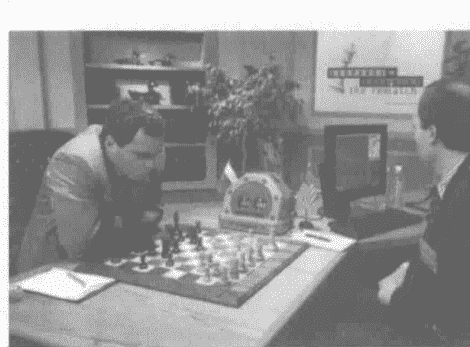

> ① 图片参考链接：https://ytimg.googleusercontent.com/vi/ILfrKOPdRdM/mqdefault.jpg。

与此同时基础硬件飞速演进，英伟达 Tesla V100 处理器可达每秒十万亿次浮点运算，为模型落地提供算力支撑。2011 年谷歌大脑利用分布式框架与大规模神经网络在 YouTube 视频上无监督学习，自动识别出“猫”的概念。2016 年 AlphaGo 战胜围棋世界冠军李世石，2017 年改进版再胜世界排名第一的柯洁，这一连串突破标志着 AI 进入新高峰，也孕育着更广泛的智能变革。

## 1.2 深度学习概论
### 1. 发展历史
让计算机理解人类知识，需要用由简单概念构成的多层连接网络来定义复杂对象，通过迭代计算与训练掌握对象的特征，这一方法即深度学习。互联网带来的海量数据为其提供了肥沃土壤，AI 重新成为焦点，其中深度神经网络尤其受关注。网络层数越多，表达能力越强，学习复杂度也随之加深。

1943 年沃尔特·皮茨与沃伦·麦卡洛克首次提出人工神经网络并给出神经元的数学模型。1949 年唐纳德·赫布提出神经元学习规则。1957 年弗兰克·罗森布拉特提出感知机模型，可用赫布规则或最小二乘法训练参数，并在硬件上实现 Mark 1 感知器。1974 年保罗·维博思提出反向传播算法，随后杰弗里·辛顿等人将其推广到多层深度网络。1982 年霍普菲尔德网络催生最早的递归神经网络，1984 年福岛邦彦提出神经感知机这一卷积神经网络的雏形。


> ① 图片参考链接：https://www.slideshare.net/xavigiro/why-supercomputing-matters-to-deep-learning-dlai-d312-2017-upc-deep-learning-for-artificial-intelligence。

1990 年约书亚·本吉奥提出序列概率模型，将神经网络与隐马尔可夫模型结合用于手写体识别。1997 年尤尔根·施密特胡博等人提出长短期记忆网络，推动 RNN 在机器翻译领域快速发展。1998 年杨立昆提出卷积神经网络理论。2006 年辛顿团队在《科学》杂志发表逐层预训练方法，缓解深度网络训练难题。2019 年辛顿、杨立昆与本吉奥因在深度学习领域的开创性贡献获图灵奖。


### 2. 应用现状
经过多年演进，深度学习展现出强大应用价值，备受产业与学术关注，在图像、语音、自然语言处理、大数据特征提取与广告点击率预估方面取得明显进展。

2009 年微软与辛顿合作将隐马尔可夫模型融入深度学习，研发商用语音识别与同声翻译。2012 年 ImageNet 大赛上 AlexNet 以压倒性优势夺冠。杰夫·迪恩与吴恩达利用 16 万颗 CPU 搭建的深层网络在图像与语音识别上表现惊人。深度学习与强化学习结合后，DeepMind 的系统可自主学习 Atari 游戏并超越人类玩家。

在商业驱动下，Caffe、TensorFlow、PyTorch、MindSpore 等深度学习框架相继出现，促进了技术在各领域的落地。自 20 世纪 80 年代起，深度学习持续汲取神经科学、统计学与应用数学的知识，加速发展并提升计算机的识别与预测能力。

### 3. 未来挑战
深度学习受益于数据、模型与计算硬件三方面的进步。互联网使海量数据可用，神经网络模型研究不断深化，CPU、GPU、TPU 以及华为昇腾等芯片提供高效算力。但推动发展的因素也带来制约。

数据层面，大量标注需求构成难题。深度学习训练需要海量标注数据，原生数据需人工赋义才能使用，数据体量庞大且类型复杂，部分信息需领域专家标注，成本高昂耗时漫长。研究者尝试利用无监督与对偶学习等算法规避标注瓶颈，但仍需时日。

模型层面，更广功能与更高精度要求更深更大网络，参数量激增导致存储与计算需求攀升，与移动设备轻量化的需求相冲突。剪枝、权重共享、低精度量化等轻量化手段取得进展，但仍需持续探索。

成本层面，复杂模型与大数据导致训练耗时长，难以满足研发时效。扩算力换取时间的方法价格高昂且受大公司垄断，普适性有限。更高效的算法设计成为关键方向，但属于长期科研过程。

理论层面，深度学习仍显黑盒与经验主义特征，分歧算法收敛性等理论问题待解，缺乏严格逻辑证明，与人类思维体系融合不足。部分学者认为它只是实现 AI 的众多方法之一，而非万能钥匙。在静态任务上表现突出，但在自动驾驶、金融交易等动态高实时场景仍显不足。

总体而言，深度学习在现代社会多领域取得成功无可否认，但数据、模型、硬件与理论方面的挑战仍在，真正改变 AI 未来仍需漫长旅程。

## 1.3 神经网络理论
不同学科对神经网络有不同解读：生物学家联想到人脑连接，数学家关注其数学本质，工程师思考结构调优与参数优化，从计算机科学视角看计算特性与实现方式最为核心。

人工神经网络是机器学习的重要技术，科学家对基本神经元进行数学建模，按层次构建网络，使其通过学习与训练调整内部结构以解决复杂问题。由 M-P 神经元发展到感知机，再到多层感知机，最终演化为卷积神经网络等成熟模型。

### 1.3.1 神经元模型
生物神经网络的基本单元是神经元，结构如图 1-8 所示。每个神经元通常拥有多个树突、一个轴突与一个细胞体。树突负责接收来自其他神经元的冲动，轴突负责传出兴奋。兴奋达到阈值后通过轴突向下游传递。

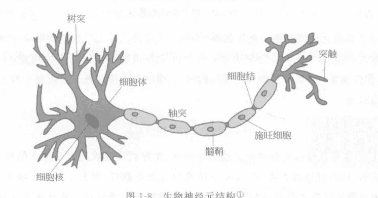

> ① 图片参考链接：https://en.wikipedia.org/wiki/File:Neuron_Hand-tuned.svg。

20 世纪 40 年代，沃伦·麦卡洛克与沃尔特·皮茨基于生物结构提出 M-P 神经元抽象模型，如图 1-9 所示。多个输入对应树突，输入信号 x_i 经由轴突传入，权重 w_i 起加权作用，求和后与阈值 b 结合，经激活函数处理后产生输出进入下一层。

M-P 模型示意图中，x1 到 xn 为输入，w1 到 wn 为连接权重，b 为阈值即偏置，y 为输出，f 为激活函数。神经元的数学表达为

$$y = f\left(\sum_{i=1}^{n} w_i x_i + b\right) \tag{1-1}$$

式(1-1)的作用是模拟生物神经元的工作机理，在神经元接收到多个输入信号后，进行加权求和，再与阈值做运算，式(1-1)中的阈值 $b$ 为负数时，加上 $b$ 等效于减去正阈值。之后通过激活函数进行输出控制，这个计算过程就展示神经元计算处理的过程。如果将多个输入表示成向量 $\boldsymbol{x} = [x_1, x_2, \cdots, x_n]^\mathrm{T}$，多个连接权重表示成向量 $\boldsymbol{w} = [w_1, w_2, \cdots, w_n]$，则神经元的计算处理模型就变为 $y = f(\boldsymbol{x} \cdot \boldsymbol{w} + b)$，输入信号向量和连接权重向量进行向量乘法运算后加上偏置值，最后经过激活函数进行处理而输出。

激活函数的设计灵感来自生物神经元受刺激后是否放电的规律。生理观察表明，神经细胞只呈现两种工作状态：达到兴奋阈值时产生神经冲动，未达到则保持静默。M-P神经元选用阶跃函数来控制这种理想输出，如图1-10所示，先把加权后的输入与阈值做差，再映射为1或0。差值大于等于零时输出1，代表兴奋；差值小于零时输出0，代表抑制。

M-P神经元模型第一次用数学方式刻画了生物神经元的本质，从计算角度复现了神经元的工作方式，为揭开生物思维处理的原理提供起点，也为神经网络的原子化结构奠定基础，对后续演进产生深远借鉴。

## 1.3.2 感知机
图1-11给出了感知机的结构，它是在M-P神经元基础上发展的人工神经网络。以网络视角描述神经元，整体包含两层。第一层是输入层，由m+1个信号x0到xm组成，只负责接收与转发，不进行数值计算。第二层是输出层，由m+1个权重w0到wm构成的加权求和单元与激活函数组成，承担计算任务。网络输入为加权求和，激活与M-P不同，感知机使用符号函数，如式1-2，输入非负时输出+1，输入为负时输出-1。整体是一个多输入单输出的系统。

$$f(x) = \begin{cases} +1, & x \geqslant 0 \\ -1, & x < 0 \end{cases} \quad (1-2)$$
感知机与M-P神经元在数学根基上一致，均遵循y=f(x·w+b)的形式。同时它能把训练集的正负样本分离，并对新样本进行判别，本质上是一个二分类器件。感知机的学习过程可以类比为人辨认物体：老师先展示一个苹果并说明这是苹果，再展示香蕉说明这不是苹果，随后展示另一个略有差异的苹果并说明这也是苹果。反复示范后，学生学会了判断。感知机的区分能力就对应这种训练后形成的模型。

感知机的提出为神经元实用化指明方向，它源自M-P模型的可用的简易人工网络，可解决简单的线性二分类问题。如图1-12所示，通过线性划分，感知机可在图中(x1,0)和(0,y1)连线处找到一条虚线，正确区分+与-两类。它还具有功能迁移性，可用Hebb学习规则或最小二乘法重新训练，仅调整网络中的权重而不改动整体结构，就能让同一模型解决不同的二分类任务。

另外，感知机可硬件实现，首个硬件模型Mark1让神经网络从理论走向硬件实例。感知机展现的应用价值曾引发广泛关注，在探索智能奥秘的进程中迈出坚实一步。

感知机也存在局限，只能用于线性二分类，无法解决简单的异或XOR问题。异或运算如图1-13所示，用+代表1、-代表0，四种对应关系为：①0 XOR 0 = -，对应坐标系左下角-；②0 XOR 1 = +，对应左上角+；③1 XOR 0 = +，对应右下角+；④1 XOR 1 = -，对应右上角-。+与-交错分布，线性分类器找不到一条直线把两类完全分开。因此感知机的应用受限，需要新的方法处理更复杂的分类。

## 1.3.3 多层感知机
### 1. 工作原理
感知机仅能处理线性分类，输出只有两种。为了应对多分类等更复杂任务，在传统感知机基础上引入多个隐藏层形成深度结构，这种结构称为多层感知机模型Multilayer Perception, MLP，也称全连接神经网络Fully Connected Neural Network, FCNN，同时也是最早的前馈深度学习模型。多层感知机可把一个输入映射为多个输出，分类能力比感知机更强。数据只能单向流动，从输入层进入，经隐藏层再到输出层，网络中不会构成回路。

多层感知机的输入节点构成输入层，接收外部数据但不做处理，直接传递给隐藏节点。隐藏层由隐藏节点构成，只接收来自前层的数据，计算后传递给输出节点。网络可以没有隐藏层，也可以有多层隐藏层，但必须包含输入层和输出层。输出节点组成输出层，接收来自上一层的数据，计算后传给外部系统。隐藏节点和输出节点因具有神经元的计算功能，可等效为神经元。感知机可看作最简单的多层感知机，无隐藏层，有多个输入一个输出，只能做简单的线性二分类。

图1-14展示了含有两个隐藏层的多层感知机，结构为“输入层→隐藏层1→隐藏层2→输出层”。层间采用全连接，每层神经元都与上一层每个神经元相连。隐藏层1的神经元对输入数据处理后产生输出，例如神经元1接收输入产生一个输出，整个隐藏层1有四个神经元，共产生4个输出结果。这4个结果送入隐藏层2处理，产生3个输出。以此类推，多层递进后得到最终输出。因此整个网络的最终结果可看成多层神经元多次嵌套计算的产物。

从计算角度看，因具备前馈单向流动特性，多层感知机本质上是感知机模型的嵌套调用，即输入数据向量经过多次神经元计算模型如式1-1所示的重复处理，得到输出结果。现在每层有多个神经元，输入为向量x，输出为向量y，每个神经元的权重为向量w，多个神经元的权重向量构成权重矩阵W。同理，一层神经元的多个偏置构成偏置向量b。因此一层的全连接计算可用式1-3表示，输入向量与权重矩阵相乘后加上偏置向量，再经激活函数f处理，得到输出向量y，完成该层的计算。

$$y = f(x \cdot W + b) \quad (1-3)$$
在图1-14中，用向量x和y分别表示多层感知机的输入数据和输出数据，用W1,W2,W3分别表示不同层神经元间连接权重构成的权重矩阵，用b1,b2,b3分别表示不同层神经元偏置值构成的偏置向量，向量y1,y2分别表示隐藏层1和隐藏层2的计算输出向量。当输入向量从输入层进入隐藏层1，会受权重矩阵W1和偏置向量b1作用，经全连接计算模型后，输出向量y1作为隐藏层2的输入向量继续传递计算，最终通过输出层得到多层感知机的结果y。这个流程就是全连接网络的典型前向计算。

### 2. 计算复杂性
多层感知机克服了感知机无法判别线性不可分数据的缺点，能够解决非线性分类问题如异或问题。随着层数增加，在有限区间内任意函数都可被多层感知机逼近，使其在语音识别和图像识别等领域得到广泛应用。但当人们认为该网络几乎无所不能时，其局限开始显现。由于采用全连接形式，参数过多导致训练耗时长、计算量大，同时模型易陷入局部最优，优化困难。

为说明计算量，可选取一个简单的多层感知机。图1-15所示结构为“输入层→隐藏层→输出层”共3层，输入层有700个输入，可接收700维输入向量。隐藏层由400个神经元构成，与输入层全连接，每个神经元有700个连接，每个连接一个权重，故隐藏层与输入层的连接权重矩阵大小为700×400，同时每个隐藏神经元有一个偏置，偏置向量为400个。假设输出层有10个输出，与隐藏层全连接，权重矩阵为400×10，偏置向量为10个。因此整个网络权重总数为700×400+400×10=284000，偏置总数为400+10=410。一个权重需与输入数据做一次乘法，故需完成284000次乘法。加权求和时加法次数比乘法少一次，但需再加一次偏置，故加法总次数与乘法次数相等，为(700-1)×400+400+(400-1)×10+10=284000。

在这个简单例子中，仅有一层隐藏的多层感知机解决700维10分类问题，参数量、乘法与加法量均接近30万，已相当庞大。若输入为1000×1000像素的图像，像素量达100万，输出1000个节点用于1000分类，即使只含一层100节点的隐藏层，其计算量和参数量也轻松过亿。即便以当前主流算力衡量，也不可小觑。

此外，图像识别中相邻像素相关性强，远距像素相关弱。多层感知机只能以向量形式输入，二维图像必须转为向量才能计算，图像中所有像素被等同对待，位置相关信息未被利用，很多连接对特征提取作用很小，导致训练出的大量权重值极小，对结果影响几乎可忽略，训练成本高而收益低。同时过多参数也对预测性能产生较大影响。

在功能适用范围上，层数越多表达能力越强，适用范围越广，但常用梯度下降难以训练深层网络，层数直接影响参数和计算量。一般梯度难以传递超过3层，因此难以获得很深的多层感知机。由于计算量过大的问题难以解决，这迫使人们继续寻找更高效的神经网络算法。

## 1.3.4 卷积神经网络
由于多层感知机采用全连接前馈形式构建，参数太多，导致训练耗时长和网络调优难等局限。同时全连接形式使网络更关注图像全局特征，局部丰富信息难以捕捉。这些局限促使人们寻求新的结构。因此多层神经网络应运而生，其中卷积神经网络Convolutional Neural Network，CNN是众多典型的多层神经网络的代表。

卷积神经网络以神经元模型为基础，通过特定层次结构将成千上万的神经元连接，形成规律的层级结构。但从计算机科学角度看，卷积神经网络的本质始终是M-P神经元模型的递归调用。

最早的真正意义上的卷积神经网络是LeNet5，由杨立昆于1998年在论文LeNet5-Gradient-Based Learning Applied to Document Recognition中提出。但直到2012年，AlexNet8层卷积神经网络在ILSVRC比赛分类项目中以Top-5错误率15.3%获得冠军，准确度远超第二名时，卷积神经网络才再次掀起研究热潮，也重新让深度学习受到重视。AlexNet也成了深度神经网络的奠基之作。

卷积神经网络之所以到2012年才火起来，一方面是异构计算兴起，人们能利用大量GPU算力进行网络训练，同时数据量爆发式增长为训练提供足够数据；另一方面神经网络的深度问题逐渐被解决，让深度卷积神经网络得以稳定训练。目前常见的深度网络如AlexNet、VGG和GoogLeNet等都属于卷积神经网络。

卷积神经网络在多层感知机基础上做了很多改进，引入局部连接、权重共享以及池化等特性，使多层感知机在训练耗时长和调优难方面的局限得到明显改善，在很大程度上解决了感知机的固有缺陷。同时具有较强的特征提取和识别分类能力，因此在图像领域应用极广，常见应用有目标检测、图像识别分类以及病理图像诊断等。

### 1. 网络结构简介
卷积神经网络需经过结构定义、网络模型训练和推理计算三个过程。开始针对具体应用场景，需进行层次架构定义，如输入层、卷积层、池化层、全连接层以及输出层。对这些主要层灵活排列或重复利用，再叠加，可产生种类繁多的卷积神经网络。定义好结构后，需采用大量数据训练，获得最优权重及其他参数。训练完成后，获得最优网络结构模型才可对新数据进行推理计算，完成测试或预测。实际上，卷积神经网络的最终目的是为具体人工智能应用提供一个端到端的训练好学习模型，该模型在应用中完成物体特征提取和识别分类。

如图1-16所示，LeNet5网络结构最为经典，也最为古老。LeNet5包含一个输入层、两个卷积层、两个池化层、两个全连接层和一个输出层，结构为“输入层→卷积层1→池化层1→卷积层2→池化层2→全连接层1→全连接层2→输出层”。数据从输入层输入，依次经过卷积层、池化层、全连接层，最后到输出层，数据单向流动。因此LeNet5也是典型前馈神经网络，后续卷积神经网络基本上在此基础上发展。每个功能层如卷积层、池化层等都有输入特征图Input Feature Map和输出特征图Output Feature Map。同一功能层所有输入特征图大小相同，同一功能层所有输出特征图大小相同，但同一功能层输入特征图和输出特征图的大小和数目是否相等取决于功能层的计算特性。

与传统图像处理一样，输入图像前需在输入层对输入图像数据进行预处理，使数据满足卷积神经网络计算格式需求。一般而言，输入图像数据也称为输入特征图，可以是以RGB格式组成的三维8位整型数据，例如224×224×3的输入图像数据，数据形式为[224,224,3]。其中第一个224为图像宽度；第二个224为图像高度，整张图像素数即高度乘以宽度，为224×224；3表示输入特征图的通道数，如R、G、B共三个颜色通道。因此一个输入特征图由宽度、高度和通道数组成。

神经网络一般会将输入数据按要求做均值处理，使样本数据中心调整到坐标系原点。此外，为方便学习，还会将输入数据归一化到特定范围，比如[-1.0,1.0]，因此最终输出通常用单精度浮点数表示。有时为适配输入，还会将输入数据大小调整到指定大小；有时也会通过主成分分析Principal Component Analysis, PCA对数据降维等。总之输入层是为了准备好让卷积神经网络方便处理的数据，作为数据源头，接下来交由卷积层、池化层等处理，最后由全连接层计算结果给输出层。

### 2. 卷积层处理
输入层对卷积层输送数据，由卷积层进行处理。卷积层作为神经网络中运算的核心层，可增强特征信息，过滤无用信息。卷积层通过多次卷积计算提取输入特征图数据中的关键特征，为下一层生成输出特征图。卷积层通常采用二维卷积计算对图像进行卷积，在以每个像素为中心邻域中进行卷积计算，每个神经元对每个像素进行邻域加权求和后输出结果，并加上偏置使最终结果调整至合适范围，这个最终结果称为特征值。卷积层中多个神经元的输出特征值构成特征图像。

卷积过程中的加权求和会用到卷积核，卷积核也称为过滤器Filter。单个卷积核通常是三维矩阵，需用三个参数描述，分别是宽度、高度和深度。深度与输入特征数据的通道数保持一致，如图1-17所示卷积核深度为3。不同卷积核提取不同特征，如有的卷积核对颜色信息敏感，有的对形状信息很敏感，因此一个卷积神经网络中可包含多个卷积核。

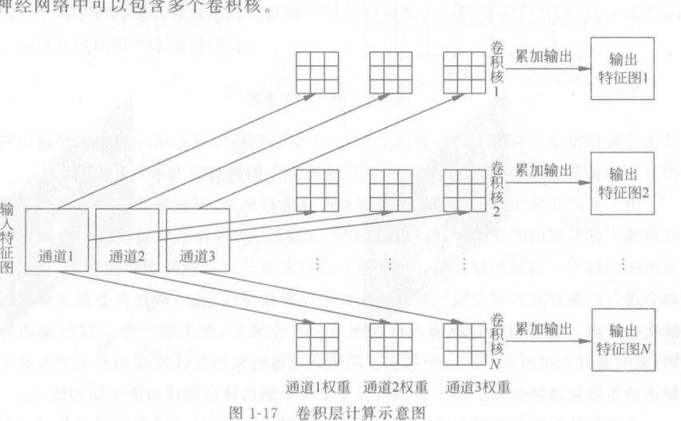
卷积核的值以二维权重矩阵形式存放，权重矩阵使用宽度和高度表示，大小和卷积核相同。而一个卷积核中权重矩阵数量与卷积核深度保持一致，即与输入特征图通道数相等。卷积核针对特征图像上一次滑动的距离称为步长。卷积核权重一般采用1×1、3×3或7×7等大小矩阵，每一个卷积核的权重会对输入特征图上的所有卷积窗口共享。同一层卷积核大小一样，但不同卷积层卷积核大小可不同。图1-18中，第一层所有卷积核大小统一为3×3。

卷积核作用的卷积窗口对应于原始输入特征图的部分称为感受野。感受野是一个原始输入特征图上的矩形区域，因可能有多层卷积层，当前卷积输入特征图上卷积窗口大小和感受野尺寸可能不同，而第一个卷积层卷积窗口一般和感受野大小相同。感受野用高度和宽度两个参数表示，而卷积窗口高度和宽度与同一层卷积核高度和宽度保持一致。如图1-18所示，第一层卷积层上3×3大小卷积核对应输入图像上感受野大小为3×3，同时原始输入特征图上卷积核以步长为2进行滑动。在第二层卷积层上2×2大小卷积核对应在第一层卷积层输出特征图上卷积窗口大小为2×2，而对应到原始图像上感受野大小为5×5。

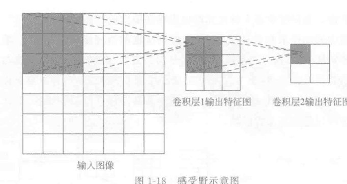
单个神经元不可能一次性覆盖整张输入特征图，只能在有限的感受野范围内取值，感受野越大意味着卷积核在原始图像上影响的区域也越大。卷积核按照设定的步长在特征图上进行横向纵向的平移，滑动过程中把核中的权重与对应位置的元素逐一相乘累加，再加上偏置就得到一个输出数值。核将输入图全部遍历一遍后即可生成一张二维的特征图；对同一卷积核的多通道输出通常先分别计算再求和，作为该核的最终结果。不同卷积核会各自产生独立的特征图，构成下一层的输入。

卷积产生的结果还要经过激活函数的处理。理想的阶跃函数虽然概念清晰，但不连续不光滑难以落地，工程上多用 sigmoid、tanh 以及 ReLU 线性整流函数来近似。激活相当于对特征值做门控筛选，让有效信号得以传递。卷积本身是线性运算，激活则是非线性操作。仅靠线性的卷积叠加，不管网络多深，都可以被一个浅层线性模型等价表达。正是激活引入了非线性，才让深层网络获得拟合复杂非线性特征的能力。

### 1) 卷积层设计要点
在多层感知机框架下，参数规模会直接影响训练、计算和存储开销。卷积神经网络通过局部连接和权重共享两项策略压缩参数，降低存储压力并提升运算效率。

#### (1) 稀疏局部连接
全连接结构下每个神经元都要处理整幅图像的全部像素，如图1-19所示，单个神经元就产生海量权重，叠加多个神经元后参数爆炸。卷积层采用稀疏连接，每个神经元仅对输入特征图感受野内的局部区域响应，这就是卷积带来的首个改进。

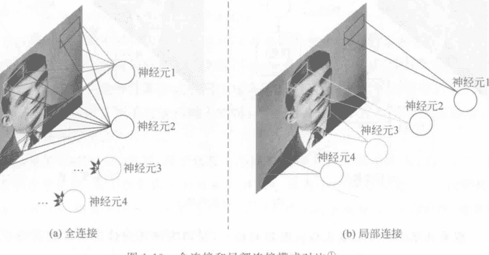
如图1-19所示，神经元1到神经元4各只作用于图像的一小块区域，整体权重数量大幅下降。其理论依据是图像中相邻像素关联紧密而远距离像素相关性弱，屏蔽远处像素对特征提取影响有限，却能显著减少模型参数。

#### (2) 权重复用
同一卷积层内，不同位置的神经元共享同一套卷积核。输出特征图上的每一个值都由不同神经元计算得出，但这些神经元使用相同的权重，因此实现权重共享，大幅精简参数总量。如图1-20所示，独立权重模式下神经元1至神经元4各自拥有权重1至权重4；而共享模式下四个神经元共用权重1，参数量降至原来的四分之一。

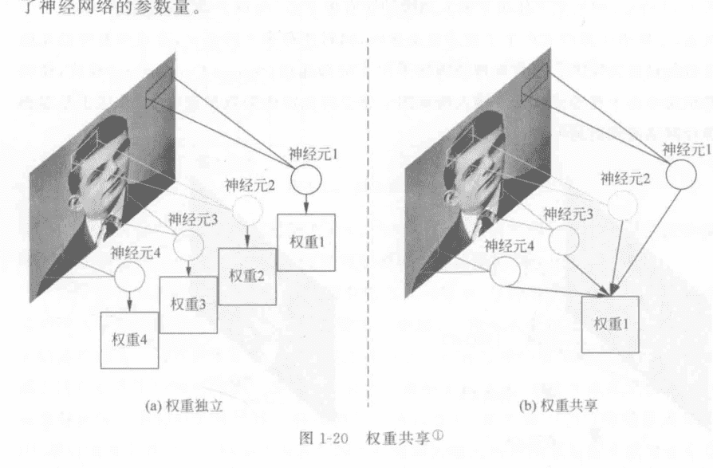
权重共享之所以可行，是因为图像具有固有纹理特征，该类特征在不同位置反复出现，不同区域存在相似性。用同一套特征提取器在整图上滑动，仍能有效捕获整体信息且信息损失很小，同时参数量成倍下降。于是整层只需训练一组权重即可服务全部神经元，训练时间也随之缩短。例外情况是当输入图像具有明显中心结构且希望在不同位置提取差异化特征时，共享权重可能不再适用。

### 2) 卷积层计算方法

#### (1) 直接卷积
最直观的实现方式是按照卷积定义直接计算，计算前通常会对输入特征图进行零填充。填充可以保持卷积前后图尺寸一致，并保护边缘特征不被丢弃。若不填充，卷积会让特征图逐渐变小，边缘信息损失严重，所以零填充是常见预处理。

填充后的特征图上，权重矩阵随着滑动窗口移动，每次取出与权重同尺寸的子块进行逐元素相乘求和，也常称为点积。该子块的数量与输出特征图的元素个数相同。

后续章节会提到多数卷积加速器采用直接卷积。以谷歌提出的张量处理器TPU为例，其脉动阵列架构充分利用输入、输出特征图与权重的并行性，并在设计上复用数据，降低带宽需求，实现高并行度。

具体说明如图1-21。假设单通道输入矩阵X为5×5，使用两个3×3卷积核，核1权重W1偏置b1全为0，核2权重W2偏置b2全为1，步长为2，边界补零长度为1。

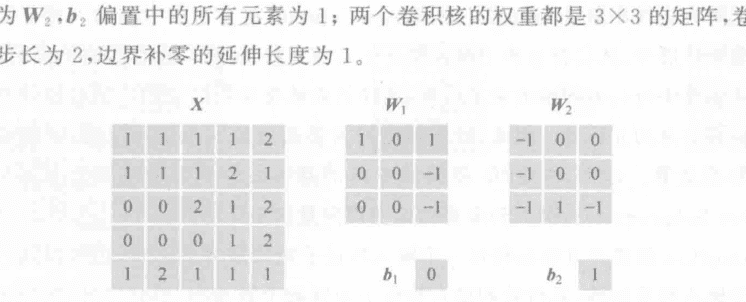
如图1-22所示，先对X进行一圈补零得到Xp。计算时W1从Xp的初始位置X1开始，将权重元素与子块X1逐点相乘再加偏置，得到Y1的首个元素-2，计算式为0×1+0×0+0×1+0×0+1×0+1×(-1)+0×0+1×0+1×(-1)+0=-2。得到首元素后核向右滑动2步，与子块X2重叠再次点积加偏置得到Y1的第二个元素-3。按此规律完成第一行，随后核向下滑动2步开始计算第二行首元素1，如图1-22中纵向滑动所示。步长同时控制横向与纵向移动。经过9次点积后得到Y1全部元素，核2可同理得到Y2。

至此直接卷积完成输入与权重的计算。实际使用中每个核含多通道，先用该通道权重对对应通道输入做卷积，再将各通道结果累加作为该核的最终输出。

#### (2) 矩阵乘法实现
除了直接卷积，还可借助矩阵乘法完成卷积，且该方式被广泛应用于CPU、GPU及华为昇腾等通用计算芯片。

核心思路是通过Img2Col把输入特征图和核权重展开。把每个输入子块拉成一行构成新输入矩阵，同时把每个核权重拉成一列构成权重矩阵。于是卷积中的点积被转换为矩阵中行向量与列向量的乘加，可借助BLAS等线性代数库高效实现。

如图1-23所示，Xp经Img2Col展开为X12C。子块X1展开为第一行，X2展开为第二行，共9个子块生成9行矩阵。两个核权重W1、W2按列展开为W12C，偏置也展开为b12C。随后X12C的第一行与W12C的第一列相乘加偏置即可得到输出的第一个值，以此类推得到整张输出图Y12C。

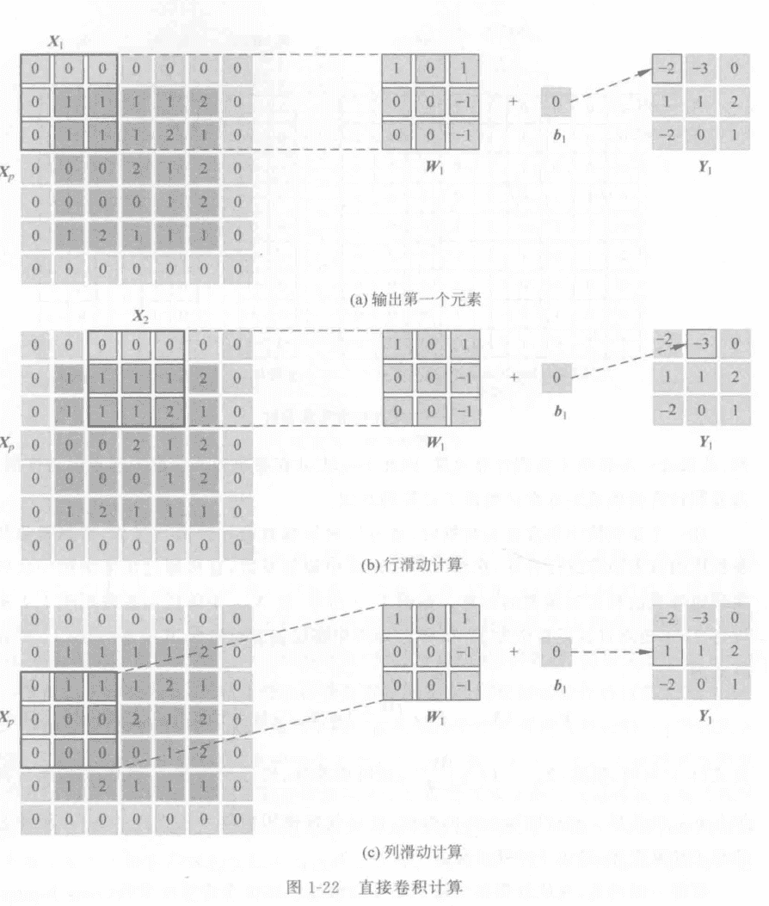
Img2Col的价值在于把需要计算的子块连续存放到内存中，可一次性按需取出，减少内存访问次数。直接卷积时子块在内存中地址重叠不连续，往往需要多次访问，带来传输开销。Img2Col因此成为卷积加速的重要手段。

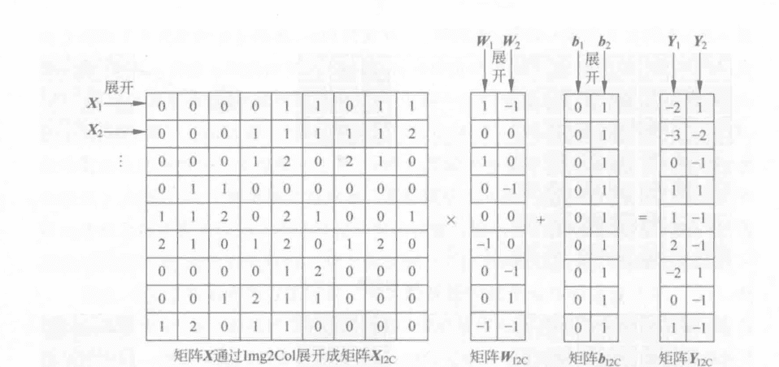
当卷积核的偏置为常数时，可进一步融合计算。将偏置与权重合并，在输入矩阵中加入全1列I，在权重矩阵中追加偏置列b，如图1-24所示。此时矩阵乘法即可同时完成乘加与偏置累加。

$$Y_{12C} = (X_{12C} \quad I) \cdot \begin{pmatrix} W_{12C} \ b \end{pmatrix} = X_{12C} \cdot W_{12C} + b_{12C} \qquad (1-4)$$
由式1-4可知，扩展后的矩阵乘法等价于先做标准乘法再加偏置。通过增加维度仅用一次矩阵乘法即可完成，节省硬件资源并简化流程。

值得注意的是，现代处理器还可借助FFT或Winograd等方法实现卷积。它们把卷积转换到其他域进行简单运算，降低复杂度。NVIDIA cuDNN的部分实现就使用了Winograd。卷积层通常占据网络绝大部分参数与计算量，加速卷积即可显著提升整体效率。

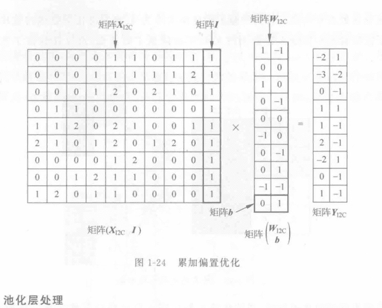

## 3. 池化层处理
随着网络加深，神经元数量与训练参数同步增长，即便有局部连接和权重共享，过拟合仍可能出现。卷积神经网络引入下采样策略，在相邻卷积层间插入池化层，规律性地减少特征值数量，保留主干信息，降低下一层参数从而抑制过拟合。

池化层使用池化滤波器从不同区域提取代表性特征，常用参数为窗口尺寸F和步长S。池化函数可基于局部统计替代原始输出，常见类型有最大池化、平均池化、L2范数及基于中心距离的加权平均等，最大池化即取邻域最大值。

卷积完成后，池化滤波器以F×F窗口、步长S在输入特征图上滑动，求窗口内的最大值或平均值生成输出。如图1-25所示，2×2滤波器步长为2作用于4×4输入，输出为2×2。最大池化得到输出图1，平均池化得到输出图2。特征值数量降至原来的四分之一，既压缩数据量又保留主要信息。

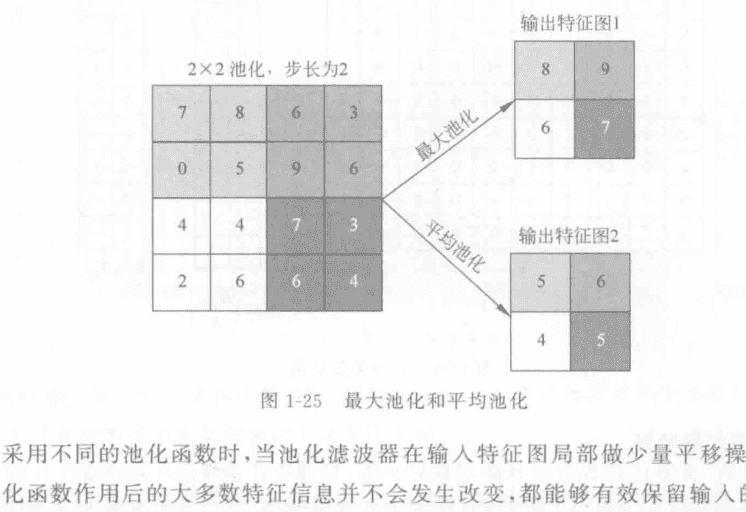
不同池化函数下，若滤波器在输入图上做少量平移，输出的大部分信息保持不变，这就是局部平移不变性。当关注特征是否存在而非精确位置时该特性很有用，比如人脸检测只需知道眼睛相对位置即可。但在需要精确位置的任务如拐角定位时，池化会造成位置信息损失。

总的来说，池化综合了局部特征的反馈，使输出数据量小于输入成为可能，减少下一层输入规模，提升计算效率。当下一层为全连接时，输入量的大幅下降会直接带来参数量的锐减，降低存储需求并加速计算。

## 4. 全连接层输出
经过多次卷积与池化处理后，数据流进入全连接层完成分类。全连接层本质上是一个多层感知机，如图1-26所示，由1×4096个神经元组成，每个神经元与上一层每个神经元相连。在该层提取图像特征后进行分类，图1-26中包含1000个类别。特征被归类后输出层给出各类的概率，例如检测到猫耳、猫尾等特征后归入猫类并输出对应概率。

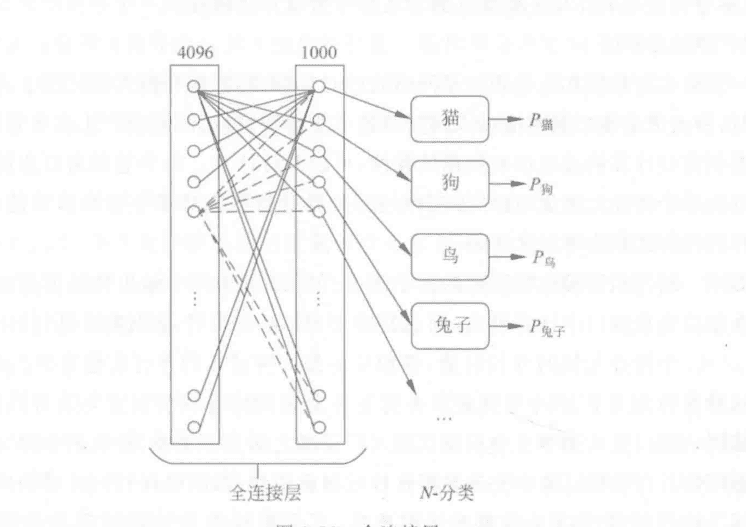

## 5. 优化加速基础
卷积层的计算可划分为五层并行：突触并行、神经元并行、输入特征图并行、输出特征图并行与批处理并行。并行粒度由低到高，数据量随之增大，对计算资源的要求也逐步提高。

假设N通道输入，单个核尺寸K×K，核数量M，输出特征图尺寸S0×S0。

### 1) 突触并行
单个核的权重矩阵在一个输入窗口上计算时，权重与窗口元素一一对应相乘，共K×K次乘法可并行执行，均

### 2）神经元并行
一张输入特征图上，单个核以滑动窗口方式产生多个不相关窗口，每个窗口的点积可独立进行。每个窗口可由一个神经元完成计算，多神经元并行处理多个窗口即为神经元并行。

当某一卷积阶段的输出映射分辨率为 $S_O \times S_O$ 时，每个输出位置都由一个滤波器在对应局部窗口上完成计算，整体就需要处理 $S_O \times S_O$ 个窗口。$S_O \times S_O$ 个计算单元可以同时承担这部分工作，单元层面的理论峰值并行规模也就达到 $S_O \times S_O$。在该并行模式下，所有窗口共用同一组滤波参数，而邻近窗口的输入区域会相互重叠，重叠区的数值具有可复用性。充分挖掘这种复用，能够在推进并行计算的同时压缩片上缓存占用、减少数据搬运次数，进而降低能耗并提升运行效率。

## 3）输入特征图并行

常见的卷积网络会处理多通道输入，比如 RGB 图像含有 3 个输入映射。一个滤波器的通道数通常与图像通道数相等。每个通道的映射进入层后，会与滤波器中对应通道的权重矩阵做二维卷积，且不同通道的权重仅与对应通道的映射相乘，得到单通道的中间结果，随后各通道结果叠加形成该滤波器的最终输出。

单滤波器内部的多通道权重在运算时彼此独立，输入的多通道映射本身也相互独立，因此可以在通道维度展开并行，业内称为输入特征图并行。以 RGB 为例，通道数为 3，就可以用滤波器的 3 个通道权重同时做卷积，N 通道输入图像的峰值并行规模为 N。在此方式下，不同二维卷积之间的数据没有交集也无依赖，只要硬件带宽和算力足够，就能直接并行执行输入映射的计算。

## 4）输出特征图并行

卷积层往往需要用多个不同的滤波器来提取形状轮廓、颜色纹理等多种特征。同一幅图像送入后，不同的滤波器会分别计算并产生各自的输出映射，输出映射的数量与滤波器数量相等。多个滤波器之间数据独立、互不依赖，因此可以并行执行并分别得到各自的输出，这类并行方式被称为输出特征图并行。

对于包含 M 个滤波器的卷积层，在输出映射层级的最大并行规模为 M。此时各滤波器的权重各不相同没有重合，但输入映射数据会被所有滤波器共享。充分利用输入数据的复用，就能在获得较大并行规模的同时减少对片外数据的读写需求，降低能耗。

## 5）批处理并行

实际部署时常为了提高带宽和算力利用率，一次送入一批图像进行批处理。若一批包含 P 张图，则批处理的并行规模为 P。同一模型对批量中的不同图像使用相同的卷积层，网络权重可以复用。批量处理有助于更合理地利用片上缓存，让已搬运到芯片内的权重被充分使用，避免频繁的内存访问，从而降低搬运功耗和时延。同时，批量输入也能满足片上海量计算资源的数据供给需求，使多个任务并行加速，提升硬件利用率和整体吞吐量，属于任务级别的并行，但对硬件资源的要求较高。

根据实际条件灵活组合卷积层的并行方式，就能较好地加速网络计算。综合来看，对一个参数固定的卷积层，不同层级的并行可以叠加。理论上峰值并行规模为各层级并行规模的乘积，如式(1-5)所示，K×K 为突触并行规模，S₀×S₀ 为神经元并行规模，N 为输入特征图并行，M 为输出特征图并行，一次批处理输入图像数为 P。达到峰值并行规模等价于卷积层中所有的乘法能在同一时刻完成。

最大并行度 $= K \times K \times S_O \times S_O \times N \times M \times P$ (1-5)

例如输入映射通道数 $N=3$，滤波器宽高 $K=3$，滤波器个数 $M=4$，输出映射维度 $S_O=6$。先做突触并行，$3 \times 3$ 的乘法并行规模为 9；再做神经元并行，$6 \times 6$ 的输出映射可由 36 个计算单元同时处理；输入映射并行带来 3 倍；输出映射并行带来 4 倍。若一次处理 10 张图，还能增加 10 倍的维度。于是该层理论峰值并行规模为 $3 \times 3 \times 6 \times 6 \times 3 \times 4 \times 10 = 38\ 880$，即可以同时进行 38 880 次乘法运算，并行规模相当可观。

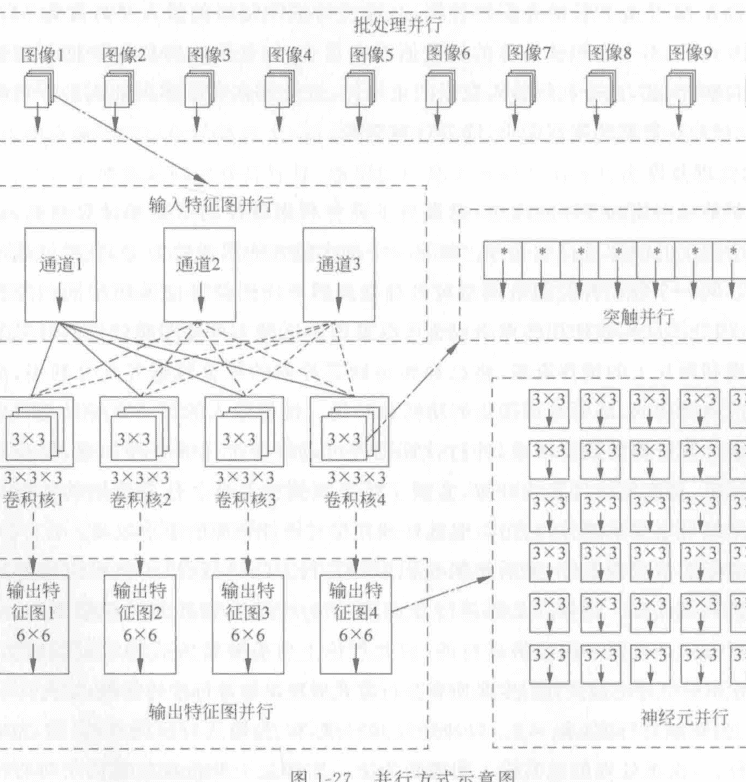

现实中，受限于图像规模、滤波器数量和批量体量，以当前硬件资源和架构来看，卷积层很难达到理论最大值。除卷积外的其他计算也难以完全并行，阿姆达尔定律的制约同样作用于实际加速比。市面上各种加速器本质上都是在不同维度的并行规模之间寻找最优平衡点，以实现软硬件体系的优化。

## 1.3.5 应用示例

人工智能在机器人、自然语言处理、图像识别和专家系统等领域应用广泛，一个经典入门案例是手写数字识别，相当于编程里的“Hello World”。日常人类能轻松读懂手写数字，但计算机早期采用传统方法识别时耗时长、精度低。机器学习出现后，这一问题得以轻松解决。

图灵奖得主杨立昆以美国国家标准技术研究所 NIST 的手写数字库构建了 MNIST 数据集，包含 7 万张阿拉伯数字手写图片，如图 1-28 所示，均为各地收集的灰度图，其中 6 万张用于训练，1 万张用于测试，每张 28×28 像素。基于 MNIST，研究者提出了多种手写数字识别网络，准确率已逼近人类水平。

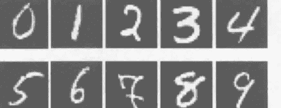

图 1-28 MNIST 数据集示例①

> ① MNIST 数据集网址：http://yann.lecun.com/exdb/mnist/。

MNIST 仅包含 0～9 的数字。任取一张带数字的图片，让计算机识别，本质上是将图像归类到 0～9 中的一类。下面以 LeNet 网络为例说明识别流程。如图 1-29 所示，一个简化的流程包括加载库、搭建网络结构、初始化、训练与测试，其中训练包含验证和调参。

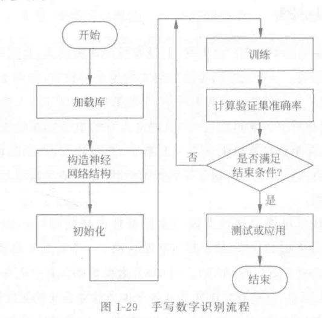

图 1-29 手写数字识别流程

### 1. 初始设置
初始阶段主要完成库的加载、网络结构的搭建和参数初始化。首先加载 MNIST 数据集用于训练和测试；随后定义输入层、卷积层、下采样层、全连接层、输出层及其连接关系，并指定各层的输入输出尺寸及超参数，如滤波器大小、下采样步长、全连接节点数等。除第一层外，尺寸通常可自动推断。超参数则需人工指定。若在 GPU 上训练，还需分配设备并设定显存上限，以按需分配、充分利用资源。最后对滤波器、全连接层的权重与偏置进行初始化，常用高斯随机初始化或常数初始化等方法赋初值。

### 2. 训练调优
训练调优阶段将训练集数据送入网络，持续更新可训练参数，使网络收敛。同时在验证集上计算准确率，观察训练态势，判断是否达到精度要求或出现过拟合。一般当训练轮次达到设定值，或出现过拟合或指标不再提升时停止训练。此时参数被优化到局部最优，不一定是全局最优。

### 3. 测试识别
训练完成后进行测试，如图 1-30 所示，在手写输入框中分别输入数字 2 和 7。训练好的网络接收测试数据后输出各数字标签的概率。对可视化系统而言，识别正确的数字会高亮显示。如图 1-30，对应数字 2 和 7，输出层的识别符突出显示。

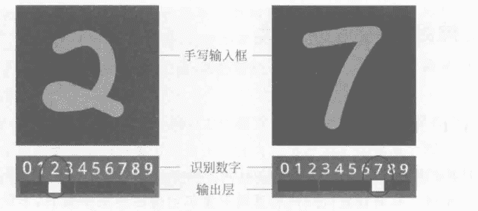

目前手写数字识别技术已相当成熟，广泛应用于大规模数据统计、财务税务、金融及邮件分拣等领域，能快速提升业务处理效率，应用价值很高。

> ① 可视化数字手写识别系统：http://scs.ryerson.ca/~aharley/vis/conv/flat.html。

# 第 2 章

## 行业背景
深度学习高速发展期间，英伟达持续在 GPU 上发力，相继推出 Volta 与 Turing 架构以满足庞大算力需求。微软在数据中心用 FPGA 替代 CPU 处理计算密集型任务，谷歌则为深度神经网络量身打造 TPU 芯片，标志着特定域架构 DSA 的兴起。在此背景下，华为推出自研昇腾 AI 处理器，面向研究、开发与部署提供更高算力、更低能耗的芯片，引发行业热潮。与此同时，越发成熟的深度学习开源框架提供了高效开发平台，让研究者专注算法而无需过多关心实现细节。软硬件协同发展已成大势。

## 2.1 神经网络芯片现状

### 2.1.1 CPU
在计算机发展史上 CPU 扮演不可替代的角色。早期性能遵循摩尔定律逐年提升，支撑上层软件加速。近年来摩尔定律放缓，物理极限、散热和功耗制约导致传统 CPU 串行程序性能难以上升。随后多核处理器兴起，英特尔酷睿 i7 系列基于 x86 指令集采用 4 个独立核心构建指令并行，提升运行速度，但核心数无法无限制增加，且大量传统程序仍以串行思路编写，难以加速。

人工智能浪潮中深度学习对算力和存储带宽需求攀升，传统 CPU 面前显得力不从心。软硬件双重挑战促使人们转向支持大规模并行计算的新型芯片，一场行业变革悄然展开。

### 2.1.2 GPU
英伟达早期的 GeForce GTX 280 显卡采用由多个流处理器 SM 构成的 GPU，并支持单指令多线程 SIMT 处理方式，为高吞吐运算尤其是浮点运算带来突破。与多核 CPU 不同，GPU 不强调指令控制逻辑，也不盲目扩大缓存以避免时延，主要依靠挖掘程序内在的数据并行性来提升吞吐，使数据密集型程序远超 CPU 性能。GPU 逐步进入超级计算及自动驾驶、生物分子仿真、医药制造、智能视频分析、实时翻译、深度学习等领域。

GPU 与 CPU 侧重点不同，CPU 擅长复杂逻辑与多种数据类型混合计算，GPU 在大规模密集规则数据计算上优势明显。通常 CPU 处理串行部分，GPU 加速大规模并行部分。为实现协同，英伟达提出 CUDA 计算统一设备架构，提供 GPU 直接访问接口，屏蔽传统图形 API，可用类 C 语言编程，为系统补充强大并行算力。类 C 语言门槛低，便于快速验证方案，CUDA 方案被广泛应用于科学、商业与工业计算。

随着深度学习兴起，GPU 因矩阵与并行计算优势最早被引入作为专用加速芯片，成为核心计算器件，目前在智能终端与数据中心均广泛部署。英伟达随后推出配备张量核的 Volta 与 Turing 架构新品，推动硬件演进。

英伟达基于 Turing 架构的 TU102 芯片，如图 2-1 所示，既支持通用运算，也能加速专用神经网络计算。该芯片采用 12nm 工艺，面积超 700mm²，集成大量张量单元，支持 FP32、FP16、INT32、INT8、INT4 等多种精度。硬件算力常用 TFLOPS 或 TOPS 衡量。

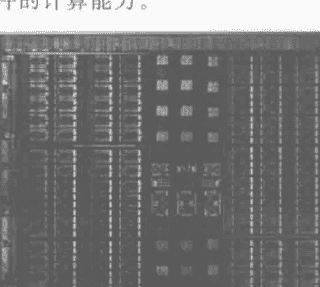

图 2-1 英伟达的 TU102 芯片①

> ① 图片来自：https://www.nvidia.com/content/dam/en-zz/Solutions/design-visualization/technologies/turing-architecture/NVIDIA-Turing-Architecture-Whitepaper.pdf。

在产品 GeForce RTX 2080 Ti 中，FP32 算力可达 13.4TFLOPS，INT32 算力 13.4TOPS，FP16 算力 26.9TFLOPS，张量 FP16 算力达 107.6TFLOPS，INT8 算力 215.2TOPS，INT4 算力高达 430.3TOPS，系统总功耗不超过 300W。

Turing 架构在保留通用计算框架的同时，可在神经网络模块中使用 CUDA 编程，对开发者友好。其核心思想是将卷积转换为矩阵计算，再用专用张量处理单元并行加速，本质上是通过矩阵乘法的高度优化实现网络性能提升，并以专用指令控制张量单元的矩阵加速。

### 2.1.3 TPU

深度学习算力的专用化突围

随着大模型训练与推理需求的爆发，对支撑深度学习算子运行的芯片性能提出了更高要求。GPU 虽然算力强劲，却一直被高功耗这个难以根治的问题牵制。如何在性能不打折的前提下大幅提升能效，成为行业亟待破解的课题。早在 2006 年，谷歌就启动了面向神经网络的专用芯片探索，试图把 ASIC 设计思路引入人工智能计算。从架构设计、原型验证到数据中心落地，谷歌最终推出了适配 TensorFlow 框架的定制 AI 芯片 TPU，也就是张量处理单元，如图 2-2 所示。

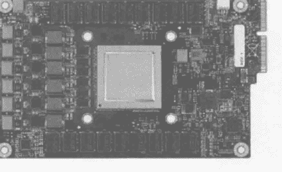

图 2-2 谷歌的 TPU 芯片①

> ① 图片来自：https://cloud.google.com/blog/products/gcp/an-in-depth-look-at-googles-first-tensor-processing-unit-tpu。

首代 TPU 基于 28nm 工艺打造，典型功耗约 40W，工作频率 700MHz。为了方便部署，谷歌把它做成独立加速卡形态，采用 SATA 硬盘插槽直接插装于服务器，并通过 PCIe Gen3×16 接口与主机互联，峰值带宽可达 12.5GB/s。

与擅长浮点运算的 GPU 不同，TPU 选择了低精度 INT8 整数计算，用更少的晶体管完成一次运算，从而显著降低功耗并加快速度，实践中适度的精度下降对模型准确率影响很小。为了减少昂贵的片外访存，TPU 配备了 24MB 片上内存和 6MB 累加器内存。矩阵乘法和卷积中存在大量数据可复用，TPU 引入脉动阵列来组织计算，充分利用数据局部性，降低内存访问次数和访存能耗。与 GPU 的通用计算模式相比，这套专用化改动换来了更高的算力和更低的功耗。

TPU 的设计哲学是让计算单元始终处于忙碌状态，从而实现极高吞吐。内部采用多级流水线，重叠多条乘加指令以掩盖延迟。脉动阵列特别适合大规模卷积，数据像流水一样流经阵列，阵列满载时可达峰值性能。通过移位传递数据，脉动阵列进一步放大了卷积的局部性优势，减少重复读写的额外能耗。

简单来说，TPU 就是用大规模脉动阵列配合大容量片上存储来加速神经网络最常见的卷积。现阶段它已在谷歌街景、AlphaGo、Cloud TPU 平台以及机器学习超算等场景投入使用，效果相当亮眼。

## 2.1.4 FPGA

当 GPU 和 TPU 纷纷成为 AI 算力的主力时，现场可编程门阵列 FPGA 也在悄然发力。作为硬件原型开发的“全能选手”，FPGA 凭借高度可编程的硬件单元、强大的并行处理能力和较为成熟的工具链，让熟悉硬件描述语言的开发者能快速实现神经网络加速，在传统芯片市场上长期担任配角的 FPGA 正式登上 AI 计算舞台。

赛灵思在 1985 年推出首款 FPGA XC2064，此后不断演进。1994 年，FPGA 首次被用于神经网络计算。随着深度学习模型复杂度攀升，其独特的加速潜力逐渐显现。FPGA 本质上由可编程逻辑单元构成，几乎所有硬件资源都能按需重配置，适用面极广，优化得当可在性能和能效上取得不错的平衡。

可重构是 FPGA 最鲜明的标签，它可以被多次编程以改变硬件功能，从而通过反复试验找到特定神经网络在特定场景下的最优实现。重构分为静态重构和动态重构。静态重构是在任务开始前对硬件进行重新配置；动态重构则是在运行时按需调整硬件。

这种灵活性是有代价的。重编程耗时较长，对实时性要求高的应用并不友好；大规模部署时成本高于专用芯片；编程依赖 Verilog、VHDL 等硬件描述语言，门槛高、学习曲线陡，不易被普通软件开发者掌握。

2019 年 6 月，赛灵思发布 Versal 系列，如图 2-3 所示。该系列属于自适应计算加速平台 ACAP，代表 FPGA 从早期可编程逻辑阵列迈向动态可配置的领域专用硬件。Versal 采用 7nm 工艺，将可编程性与领域专用硬件一体化，融合了嵌入式计算的标量引擎、AI 推理智能引擎和 FPGA 的自适应引擎，具备更强的多功能应变能力，在部分场景下计算性能和节能水平甚至超过 GPU。Versal 时延低、性能高，通过 AI 推理引擎广泛应用于自动驾驶、数据中心和 5G 网络通信等领域。

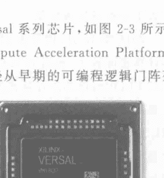

① 图片参考链接：https://china.xilinx.com/content/dam/xilinx/imgs/press/media-kits/VM1802_Straight_On.jpg。

## 2.1.5 昇腾 AI 处理器

在全球 AI 芯片竞争中，华为推出了面向深度学习的“达芬奇架构”，并于 2018 年发布昇腾 Ascend AI 处理器，正式开启人工智能布局。

从自然语言处理、计算机视觉到自动驾驶等关键方向出发，昇腾致力于打造覆盖云端一体化的全栈、全场景解决方案，并配套芯片算子库与自动化神经网络算子开发工具。全栈涵盖 IP、芯片、驱动、编译器到应用算法；全场景覆盖公有云、私有云、边缘计算、物联网终端和消费设备。华为以芯片为核心、以算力为驱动、以工具为抓手，推动 AI 发展边界。

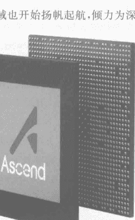

2018 年 10 月，昇腾 910 和 310 系列同时登场。昇腾 910 采用 7nm 工艺，最大功耗 350W，FP16 算力达 256 TFLOPS，单芯片计算密度领先同期产品，INT8 算力可达 512 TOPS，还支持 128 通道全高清视频解码，主要面向云端训练。同期发布的昇腾 310 面向移动和边缘，采用 12nm 工艺，最大功耗仅 8W，FP16 算力 8 TFLOPS，INT8 整数算力 16 TOPS，集成 16 通道全高清视频解码器，适合边缘计算和移动端设备。

设计上，昇腾处理器针对深度神经网络特性做了专门优化，采用自研硬件架构，以高性能 3D Cube 矩阵计算单元为核心，显著提升算力和能效。每个矩阵计算单元可通过一条指令完成 4096 次乘加，并支持标量、矢量、张量等多维计算模式，打破了传统专用芯片的局限。处理器还支持多种混合精度计算，既满足推理需求，也兼顾训练精度。

达芬奇架构具有很强的统一适配性，覆盖高、中、低全场景，一次开发即可多场景部署、迁移和协同。低功耗是其另一特点，统一架构可支撑从数十毫瓦到数百瓦的芯片，并支持多核灵活扩展，在不同场景下发挥能效优势。

指令集采用灵活的 CISC 设计，可应对快速变化的新算法和新模型，并内置面向神经网络的专用指令，加速新业务上线与在线升级。昇腾处理器在全流程加速上采取场景化系统设计，内置多种硬件加速器，拥有丰富的 IO 接口，支持灵活的加速卡组合，兼顾云端与终端的算力与能效挑战。

## 2.2 神经网络芯片加速理论

### 2.2.1 GPU 加速理论

1. GPU 计算神经网络原理

神经网络计算具有数据独立性和高度可并行性，非常适合 GPU 加速。核心手段是并行化与矢量化。常见模式是通用矩阵乘法 GEMM，即把神经网络的核心运算转换为矩阵运算。以卷积神经网络为例，卷积本质上是卷积核在特征图上滑动并做点积求和。GPU 本身不支持原生卷积，通常先做预处理展开，常用 Img2Col 方法。

以特征图 F 为 3×3、通道数为 2，卷积核 W、G 尺寸 2×2、核数为 2 为例。先把每个卷积核按先行后列展开成一行，两个通道的权重放在同一行，不同核分属不同行，最终得到 2×8 的卷积核矩阵。对输入特征图则按先列后行方式，把每次对应的 2×2 块展开成一列，两个通道分别列排后拼接，形成 8×4 的输入特征矩阵。随后矩阵相乘即可等价得到原始卷积输出。

当通道数过大导致展开矩阵超出 GPU 容量时，可按算力分批选取通道拼接成输入矩阵，先得到部分中间结果再累加，最终合成完整输出。

展开后矩阵乘法在 GPU 上采用单指令多线程模式执行。每个输出点由一个独立线程负责，对应左矩阵一行与右矩阵一列的运算。以本例而言，可同时启用 8 个线程并行计算结果矩阵 Y，各线程执行相同指令流但作用于不同数据。

如图 2-6 所示，每个线程每周期可完成一次乘加，多个线程独立并行。图中 PS₁ 到 PS₈ 表示各线程的部分和，对应 Y₀₀ 到 Y₁₃ 的中间结果。每个时钟周期线程计算本次乘法并累加前一次部分和。理想情况下 8 个周期后 8 个线程同时输出结果，可得到 2×4 的矩阵乘法结果。

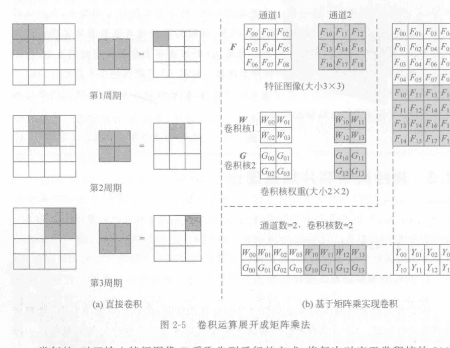

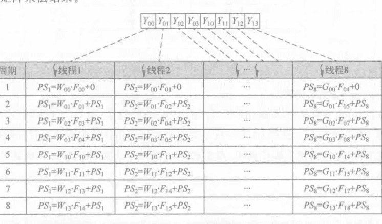

2. 现代 GPU 架构

随着需求演进，英伟达支持 CUDA 的 GPU 架构从早期侧重通用浮点计算的 Fermi、Kepler、Maxwell，发展到为深度学习低精度计算优化的 Volta、Turing。

如图 2-7 所示，各代架构主要由流处理器、多级片上存储和网络互联构成。以 Turing 架构的 TU102 芯片为例，集成 72 个流处理器，存储系统包括 L1 缓存、共享内存、寄存器组、L2 缓存和外部存储，L2 缓存容量为 6MB。

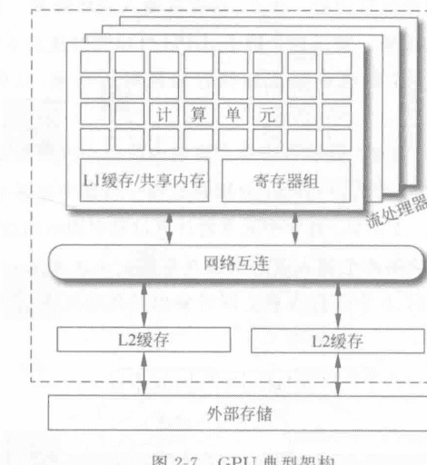

1) Turing 流处理器

在 Turing 架构①中，如图 2-8 所示，每个流处理器内含 64 个 CUDA 核，负责单精度 FP32 计算。这些核通过 SIMT 方式在 CUDA 框架下调用，用于实现矩阵乘法等通用计算。

> ① 参考论文：https://www.nvidia.com/content/dam/en-zz/Solutions/design-visualization/technologies/turing-architecture/NVIDIA-Turing-Architecture-Whitepaper.pdf。

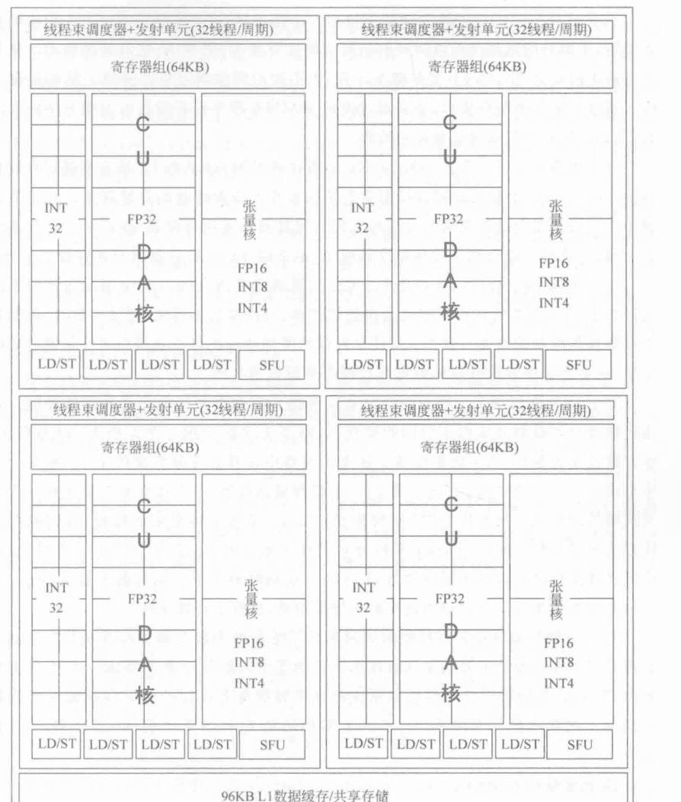

> ① 图片参考：https://www.nvidia.com/content/dam/en-zz/Solutions/design-visualization/technologies/turing-architecture/NVIDIA-Turing-Architecture-Whitepaper.pdf。

每个流处理器还集成 8 个张量核，这是相较前代的重要差异，专门为深度神经网络提供高效率算力。张量核支持 FP16、INT8、INT4 等多精度计算，通过 WMMA 指令在 CUDA 框架下即可便捷调用。

流处理器内部配备 256KB 寄存器组和 96KB L1 缓存，提供数据存储空间。超大规模寄存器组满足海量线程需求，为每个线程分配通用寄存器。L1 缓存可在硬件控制下工作，也可按程序员控制配置为共享内存，后者对规律性强的数据并行程序特别有用。

Turing 通过把流处理器划分为四个相同处理区来提升利用率。各区共享 96KB L1/共享内存，每区拥有独立的 L0 指令缓存、线程束调度器、指令发射单元和分支处理单元。架构支持更多线程、线程束和线程块并发运行，并将 FP32 与 INT32 计算单元分离，使地址更新与数据加载可在同一周期同步进行，提升指令发射率。

Turing 在保持高性能的同时兼顾能效和易用性。专门设计的多精度张量核满足深度学习矩阵计算需求，在常见负载下能量利用率相比前代提升约 50%。

2) 张量核(Tensor Core)

Turing 张量核：多精度驱动算力跃升

Turing 架构之所以能在深度神经网络训练和推理上实现显著提速，关键在于其引入的多精度张量核与新式矩阵计算单元的结合。这一设计成为整代 GPU 在 AI 场景下性能飞跃的核心，也巩固了 GPU 在人工智能领域的领先地位。

每组流多处理器内部挂载 8 个张量核，可同时处理 INT4、INT8、FP16 三类精度。精度虽低，却足以覆盖绝大多数网络需求，同时大幅压低功耗和硅片成本。单个核每周期可完成 64 次 FP16 融合乘加，换算到整颗流多处理器即 512 次融合乘加，相当于 1024 次浮点运算。切换至 INT8 时吞吐翻倍至 2048 次整数操作；再降至 INT4，则性能还能再次翻倍。

Turing 通过 WMMA 指令在张量核上完成深度网络的训练与推理，本质是把特征矩阵与卷积核权重矩阵的大规模乘法硬加速。相关数据通路专为吞吐和能效优化。WMMA 进入核后被拆分为更细粒度的 HMMA 指令，HMMA 调度线程，使每个线程单周期完成一次四元素点积运算。

精细电路设计让单个张量核每周期实现 16 次 FEDPs，相当于核内并行 16 条线程。换言之，单周期即可完成两次 4×4 矩阵乘法并累加单块 4×4 矩阵，计算式如下：

> $$D = A \times B + C$$

其中 A、B、C、D 均为 4×4 矩阵。乘法输入 A、B 为 FP16，累加项 C、D 可选 FP16 或 FP32。如图 2-9 这项操作涉及 4×4×4=64 次乘法与加法。流多处理器内的 8 个张量核可独立并行执行。

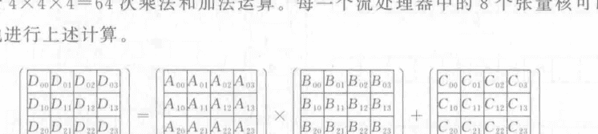

处理更高维矩阵时，通常先把大矩阵切分为小块，分散到多个核并行求解，再汇总累加。CUDA C++ 接口中张量核以线程块形式被调用，加载、乘加、存储流程更高效。

得益于 AI、高性能计算与图形处理上的强劲加速，Turing 对科研与工程产生深远影响。Turing 在深度学习领域

## 2.2.2 TPU 加速理论

### 1. 脉动阵列计算神经网络原理

TPU 处理卷积的思路与 GPU 不同，核心是脉动阵列硬件结构。如图 2-10 所示，阵列主体为二维网格化计算节点，每个节点单周期完成一次乘加。行列数目可同可异，相邻节点通过横向纵向通道实现数据右移和下移。

仍以图 2-5 卷积为例，采用固定权重、横向脉动特征、纵向脉动部分和的方案。如图 2-10 先把 2 个双通道 W 与 G 权重静态写入阵列节点，同一卷积核的两个通道权重排在同一列。再将双通道输入特征图 F 展开重排，每行错开一个周期依次送入。

计算状态如图 2-11。进行双通道输入 F 与卷积核 W、G 的卷积时，F 经重排由左侧数值载入器送入阵列最左列，数据自上而下逐行进入，每行延迟一个周期。首周期，F₀₀ 进入 W₀₀ 单元与权重相乘累加产生 Y₀₀ 的第一次部分和。第二周期，如图 2-12，上一次的部分和 Y₀₀ 向下传递到 W₀₁ 单元，同时第二行输入 F₀₁ 与 W₀₁ 相乘的结果与传递值相加得到 Y₀₀ 的第二次部分和；F₀₁ 进入 W₀₀ 单元求出 Y₀₁ 的第一次部分和；与此同时 F₀₀ 向右滑入 G₀₀ 单元求出 Y₁₀ 的第一次部分和。

如此循环，特征值沿行持续向右滑动，为不同卷积核开启各自的部分和；每个卷积核的部分和沿列持续向下滑动并与当前单元结果累加，最终在该列最底部的单元得到对应卷积核所有通道的完整结果。如图 2-13，第 8 个周期可得到首个卷积结果；从第 9 个周期起，如图 2-14，每周期即可产出两个结果，直至所有输入特征图处理完毕。脉动阵列通过行列双向脉动，使输入呈阶梯状进入，依次产出各卷积核的最终结果。

脉动阵列要求数据按预定顺序依次进入，填满整个阵列需要启动时间，期间硬件资源会空闲。启动时间约为 行数＋列数－1，度过启动期后阵列进入满载，吞吐率达到峰值。

图 2-10 的例子固定权重、横向脉动特征、纵向脉动部分和。同样也可以固定部分和、横向脉动特征、纵向脉动权重，得到等价结果。总体上可任选三个变量中的两个进行脉动、固定其余一个，具体选择取决于实现方式与应用需求。

当卷积核过大或通道过多时，若把所有通道权重串在一列，会导致阵列过于庞大或畸形。为此常采用分块计算、末端累加。系统把多通道权重按阵列尺寸切分为若干块，依次计算，每块的结果暂存于阵列底部的累加器中。换入下一块权重后继续累加，直至所有块遍历完成，累加器输出最终值。

TPU 的脉动阵列只负责卷积，整网计算还需其他单元配合。如图 2-15，矢量计算单元从脉动阵列接收卷积结果，经激活单元的非线性电路生成激活值，激活函数可按网络需求定制。矢量单元内还能对激活值做归一化，再经池化单元输出。所有操作由队列模块统一控制，例如通过配置端口指定激活、归一化或池化函数及步长等参数。处理完成后，激活值暂存于片上统一缓冲区，作为下一层的输入。TPU 逐层流水执行，完整跑通整个神经网络。

脉动阵列虽主攻推理加速，但在通用矩阵计算上同样高效，可用于全连接网络、线性回归、逻辑回归、K 均值聚类等分类任务，以及视频编码和图像处理。

### 2. 谷歌 TPU 架构

谷歌推出的 TPU 芯片配合自家 TensorFlow 框架，可显著加速常用深度学习算法，已部署于谷歌云平台。如图 2-16 所示，其主要模块包括脉动阵列、矢量计算单元、主接口、队列模块、统一缓冲区以及 DMA 控制模块。

主接口负责获取神经网络的参数与配置，如层数、权重、激活值等初始信息。DMA 控制模块接到读取指令后，把输入特征与权重统一读入片上统一缓冲区；同时主接口向队列模块发送启动指令。队列模块启动并控制整个网络的计算方式，包括权重与特征按何种规律进入阵列、如何分块累加。统一缓冲区存储输入输出的中间结果，并可把中间结果再次送回脉动阵列进行下一层计算。队列模块可向统一缓冲区、脉动阵列、矢量计算单元发送控制信号，也能与 DMA 控制模块及内存直接通信。

总体流程按层顺序执行：系统先从片外内存取输入，送入脉动阵列完成卷积或矩阵运算；矢量单元执行非线性激活与池化等操作；每层输出暂存于统一缓冲区，供下一层使用。整个计算如同流水线，在简洁指令和硬件状态机的统一调度下有序运行。

如图 2-16 所示，第一代 TPU 配备了 65 536 个 8 位乘加单元 MAC，支持有符号与无符号整型运算，不支持浮点。脉动阵列周边分布着总容量 4MB 的累加器缓冲区，支持 32 位累加。片上统一缓冲区容量为 24MB，用于存放所有中间结果。TPU 外接 8GB 内存，可存放大量图像与卷积核数据。

TPU 指令经 PCIe 总线进入，采用 CISC 架构，平均每条指令约需 10～20 个时钟周期。大多数指令为宏指令，实质由硬件状态机驱动，从而大幅降低译码与存储开销。神经网络相关指令共有 5 条：数据读指令 Read_Host_Memory、权重读指令 Read_Weight、矩阵运算指令 MatrixMultiply/Convolve、激活指令 Activate、数据写回指令 Write_Host_Memory。指令格式共 12 位，其中统一缓冲区地址占 3 位，累加器缓冲区地址 2 位，操作数长度 4 位，其余 3 位为操作码与标志位。

执行流程为：先用 Read_Host_Memory 把输入特征图从系统主存读入统一缓冲区；再用 Read_Weight 从内存提取卷积核权重并固定在脉动阵列中；MatrixMultiply/Convolve 按规律把统一缓冲区中的数据送入脉动阵列运算后写入累加器缓冲区累加；随后 Activate 利用 ReLU、sigmoid 等激活函数完成非线性运算并做池化，结果存回统一缓冲区；最后 Write_Host_Memory 把统一缓冲区中的最终结果写回系统内存。

## 2.3 深度学习框架

深度学习发展过程中涌现出众多软件框架，多以开源形式发布并迅速形成各自的拥趸。框架的核心价值在于把程序员从繁琐的底层实现中解放出来，聚焦算法调优。框架优劣很大程度上取决于对上层算法与底层硬件的兼容适配能力。

### 2.3.1 MindSpore

MindSpore 是华为发布的新一代深度学习框架，源于全产业链最佳实践，专为昇腾 AI 处理器算力而生，支持终端、边缘、云全场景部署，提出全新的 AI 编程范式并降低开发门槛。

2018 年华为全联接大会提出人工智能面临的十大挑战，其中训练耗时数日到数月、算力稀缺昂贵等问题突出，人工智能仍面临“无人不智”的困境。MindSpore 致力于实现编程更简单、调试更轻松、性能更卓越、部署更灵活，以降低开发门槛。具体如下。

（1）编程简单。如代码 2-1 所示，MindSpore 采用函数式可微分编程架构，让数据科学家能以数学原生方式表达模型。算子级自动微分技术使新网络无需手动实现反向算子，降低科研工程门槛。

```
import ms
from ms.ops import focal_loss
def focalloss_ad(logits, labels, out, gamma):
    # 前向函数引用
    loss = focal_loss(logits, labels, gamma)
    # 自动微分推导
    dout = ms.autodiff(loss, [logits], out)
    return dout
```

代码 2-1 MindSpore 自动微分代码示例

（2）调试轻松。MindSpore 提供动静结合的开发调试体验，一套代码、一条语句即可在动态图与静态图模式间切换。如代码 2-2 所示，高频调试时选用动态图模式，通过单算子/子图执行实现灵活开发调试；运行阶段切换为静态图模式，对整张图编译执行，通过高效图优化获得高性能。

```
def ssd_forward_run(data, gt_boxes, gt_classes):
    net = ssd_resnet34_224(batch_size=8)
    # 切换到图执行模式
    context.switch_to_graph_mode()
    loss = net(data, gt_boxes, gt_classes)
    # 切换到 eager 执行模式
    context.switch_to_eager_mode()
    loss = net(data, gt_boxes, gt_classes)
```

代码 2-2 MindSpore 灵活切换代码示例

（3）性能卓越。MindSpore 采用 AI Native 执行模式，最大化发挥端边云异构算力。协同昇腾处理器本地执行、高效数据格式、深度图优化等多维度提升极致性能，帮助缩短训练时间、提升推理性能。现代深度网络的数据集与模型规模越来越大，单机内存算力难以满足，需要模型并行。MindSpore 可通过灵活策略定义与代价模型自动完成模型切分与调优，获取最佳效率。

```
def ssd_forward_compile_auto_parallel(data, gt_boxes, gt_classes):
    net = ssd_resnet34_224(batch_size=8)
    # 在 8 块设备之间进行自动并行
    compile_graph(net, data, gt_boxes, gt_classes, auto_parallel=True, device_num=8)
```

代码 2-3 MindSpore 自动并行代码示例

（4）部署灵活。MindSpore 提供全场景按需协作方式，开发一致、按需协同、灵活部署，使模型可快速部署到手机、边缘与云，实现全场景互联互通，提升资源效率与隐私保护，创造更丰富应用场景。

MindSpore 坚持开源开放可扩展架构，助力开发者灵活接入第三方框架与芯片，满足定制化需求，并在门户与开源社区提供学习资源与服务。

### 2.3.2 Caffe

早期进行大规模神经网络尤其是卷积神经网络运算，需要研究人员针对特定硬件如 GPU 开发异构计算程序，加之对 CUDA 等编程环境的深入理解，极大限制了深度学习推广。2012 年 AlexNet 借助大规模数据训练与 GPU 加速在 ImageNet 上取得突破，掀起研究热潮，并催生大量深度学习框架。其中最具代表性且流传最广的是 Caffe。

Caffe Convolutional Architecture for Fast Feature Embedding 由贾扬青在加州大学伯克利分校攻读博士期间创建，基于 C++/CUDA 开发，后推出 PyCaffe 支持 Python 前端。Caffe 可在 CPU 与 GPU 上运行，开发者只需定义网络结构与参数配置，通过命令行即可快速完成高效训练与推理。框架还支持自定义层开发，只需实现解析、前向与反向函数即可扩展新功能。C++ 实现使其调试与跨系统移植更便捷。Caffe 提供大量预训练模型，研究人员可在其基础上修改参数或微调网络，实现快速迭代。这些特质使其在深度学习早期脱颖而出。

在 Caffe 中，网络结构与参数通过 prototxt 文件定义。prototxt 是 Google Protocol Buffer 库用于存储结构化数据序列化后的文本。protobuf 是一种高效轻量的结构化数据格式，适用于数据存储或 RPC 数据交换，比 JSON 与 XML 更高效。protobuf 核心概念包括 proto 文件、prototxt 文件以及 protoc 编译器。

proto 语法本质上是用来描述数据排布蓝图的语言，核心构成是命名空间与消息体。代码 2-4 给出了一段典型写法，syntax 用来声明使用的 protobuf 版本，package 用来限定命名范围，message 用来声明一种消息类型。消息内部可以放多个字段，字段的存在方式包括必需、可选、可重复，字段类型既能用 int32、double、string 这类基础类型，也能用枚举类型。Caffe 自行维护了一份 caffe.proto 来统一内部的消息定义，其中最核心的三个是负责层配置的 LayerParameter、负责训练策略的 SolverParameter、负责整体网络拓扑的 NetParameter。

```
syntax = "proto3"; // 指定版本信息
package university; // 定义声明空间

message Person // 定义消息类型
{
    required int32 id = 1; // 定义必需字段
    required string name = 2;
    repeated string email = 3; // 定义可重复字段
    repeated string phone = 4;
    optional string birthday = 5; // 定义可选字段

    enum Type { // 定义枚举类型
        TEACHER = 0;
        STUDENT = 1;
    }

    required Type type = 6 [default = STUDENT]
}
```

代码 2-4 proto 文件实例

prototxt 其实就是把结构化信息按照 proto 约定的格式序列化后的文本形态，同样存在二进制形态，但文本更利于阅读和手工修改。Caffe 的 prototxt 分为两类，一类描述网络结构，一类描述训练配置。描述结构的 prototxt 其骨架由 NetParameter 规定，其中每一层都作为一个子项出现，层的具体构成又由 LayerParameter 规定。如代码 2-5 所示，一个网络 prototxt 可以包含多层，通过其中的配置可以读出层的种类与连接关系，解析后 Caffe 就能还原网络结构。描述训练的 prototxt 则由求解器结构定义，里面包含学习率、网络文件路径等训练所需信息，解析后即可启动训练流程。

```
name: "test"
layer {
    ...
}

layer {
    ...
}
```

代码 2-5 prototxt 结构

编译阶段，protoc 会把 caffe.proto 转化成 caffe.pb.cc 和 caffe.pb.h，这两个文件提供了所有消息类型的序列化和反序列化接口。借助这些接口，Caffe 能够对 proto 定义的消息进行生成与解析。以 LayerParameter 为例，prototxt 中的每一层都会被解析成对应的 LayerParameter 对象，再依据其中的 Type 字段选择具体的子类，比如 ConvolutionParameter，来进一步读取层级参数。代码 2-6 就展示了一个最大池化层的配置，其整体遵循 LayerParameter 格式，其中 pooling_param 部分又遵循 PoolingParameter 格式。

```
layer {
    name: "pool1"
    type: "Pooling"
    bottom: "conv1"
    top: "pool1"
    pooling_param {
        pool: MAX
        kernel_size: 2
        stride: 2
    }
}
```

代码 2-6 一个最大池化层的实例

Caffe 里中间特征通常以四维数组的形式存在，被称为 Blob，其定义也写在 caffe.proto 中。输入图像一般要先写入 lmdb 或 leveldb，数据集路径与相关信息会通过 DataParameter 写入 prototxt。现阶段 Caffe 也支持借助 OpenCV 直接读取图片，启用这种方式时需要 OpenCV 库并使用独立的 ImageDataParameter。

编译完成后，Caffe 即可通过命令行完成推理与训练，具体用法见代码 2-7。训练时只需提供求解器配置文件，推理时则需要网络结构 prototxt 以及对应的权重文件。

```
caffe train --solver=lenet_solver.prototxt
caffe test --model lenet_train_test.prototxt --weights lenet_iter_10000.caffemodel
```

代码 2-7 使用 Caffe 进行训练和推理

Caffe 完全用 C++ 实现，整体结构清晰，每一层都配有 CPU 的 C++ 实现和 GPU 的 CUDA 实现，因此很容易在其基础上衍生出变种实现，这也是它至今仍被众多公司和高校用于研究和部署的重要原因。自行添加一个自定义层通常经历以下过程：

1. 在 caffe.proto 中为新层追加对应的 LayerParameter 消息定义；
2. 继承 Caffe 内部基类，搭建自定义层类，实现参数解析、内存分配、尺寸推算、注册等逻辑，并在 CPU 与 GPU 上分别给出前向与反向实现；
3. 编写测试代码并重新编译 Caffe，若编译通过说明层已成功接入；
4. 在 prototxt 中引用新层并开展训练与推理。

早期版本的 Caffe 已停止更新，逐渐被 Caffe2 取代。Caffe 本身也存在灵活性不足、仅支持单卡计算、无多机多卡分布式、无模型级并行等局限。但不可否认的是，它为大量初学者提供了高效便捷的入门平台，堪称深度学习入门的第一块敲门砖。

## 2.3.3 TensorFlow 静态计算图框架

TensorFlow 是谷歌基于 DistBelief 演进的第二代开源深度学习框架，最初出自谷歌大脑团队，2015 年 11 月 9 日在 Apache 2.0 协议下发布，运行时可覆盖 CPU、GPU 以及自研 TPU。目前它在传播面与使用面都处于领先地位，这与 AlphaGo 击败李世石后深度学习热度攀升、谷歌适时推出的时机有关，也与谷歌持续投入、文档完善、平台覆盖广、接口丰富尤其是 Python 接口友好密切相关，让新手无需造轮子就能快速搭建工业级网络。

TensorFlow 的命名来源于其运行逻辑：Tensor 即张量，是节点间传递数据的载体，类似 NumPy 数组但语义不同；Flow 指流动，意味着数据像水流一样在计算图中流动，最终到达输出。TensorFlow 的核心抽象是静态数据流图，用户先用接口定义计算图，再执行计算。这种声明式抽象让模型搭建更灵活，也让框架在运行时掌握完整图结构，从而进行内存分配、数据重排等优化，同时支持分布式与跨设备通信。

尽管 TensorFlow 以 Python 库的形态出现，它本质上是一种领域特定语言。定义计算图的代码无法像普通 Python 那样调试打印，也不能直接使用 if-else、while 控制流，这是因为其编程范式是声明式编程，代码先描述图再执行，属于元编程思想。具体开发通常分为三步：

1. 用 TensorFlow 接口定义计算图；
2. 用常规 Python 代码读取数据；
3. 把数据喂入计算图执行并获取结果。

以图 2-17 为例，两个 [10] 形状的数组做逐元素相乘得到 C，再与一个标量相加得到 D，对应的 TensorFlow 实现见代码 2-8。

```
import numpy as np
import tensorflow as tf
# 定义计算图
A = tf.placeholder(tf.int32, 10, 'A')
B = tf.placeholder(tf.int32, 10, 'B')
C = tf.multiply(A, B, 'Mult')
D = tf.add(C, tf.constant(1, tf.int32), 'Add')
# 运行计算图
with tf.Session() as sess:
    print(sess.run(D, feed_dict={A: np.ones(10), B: np.ones(10)}))
```

代码 2-8 TensorFlow 代码

TensorFlow 编程的四个基本概念是计算图、节点、张量与会话。程序默认会构建一个计算图，也可通过 tf.Graph 创建多个，同一时刻只有一个默认图。节点分为计算节点如 tf.add、tf.multiply，以及数据节点如 tf.placeholder、tf.constant、tf.Variable，后者用于占位符、常量与可训练参数。张量是计算图上数据的表现形式，既是节点间连接，也是代码中的对象，可分为占位符张量与计算中间张量。会话负责在进化上下文中执行图，管理 GPU 配置等资源。

## 2.3.4 PyTorch 动态计算图框架

PyTorch 由脸书于 2016 年 10 月推出，基于 Torch 构建的开源 Python 机器学习库，正式版在 2018 年 12 月 7 日发布，普及度仅次于 TensorFlow。

PyTorch 与 TensorFlow 同属第二代框架，但体验截然不同。PyTorch 同样基于计算图，却采用命令式编程，图是动态生成的。每执行一条语句，系统就即时构建对应片段并计算，称为动态图；而 TensorFlow 先完整定义图再执行，称为静态图。动态图的灵活性是以一定的运行时性能为代价换来的，并非技术代际革新，类似的动态机制也在 TensorFlow Eager、MxNet Gluon 等框架中出现。命令式与动态图让递归网络、word2vec 等难以在静态图框架中优雅实现的结构变得容易落地。

用 PyTorch 实现代码 2-8 中的计算，代码 2-9 显得更贴近原生 Python 的写法。

```
import torch

A = torch.ones(10)
B = torch.ones(10)
C = A * B
D = C + 1
```

代码 2-9 PyTorch 代码

## 2.4 TVM 深度学习编译栈

随着框架与硬件种类激增，如何高效地把模型从一种框架迁移到另一种硬件上成为瓶颈。TensorFlow 等框架虽能支持多种硬件，但不同框架间的模型迁移成本很高，用户成本随之上升。编译领域 LLVM 通过中间表示 IR 解决类似问题：前端把各语言编译为统一 IR，后端再将 IR 映射到具体硬件指令。

受此启发，深度学习领域出现了编译器堆栈的概念。微软的 nGraph、IBM 的 SystemML 都是代表，其中华盛顿大学陈天奇团队提出的 TVM 最具影响力。TVM 在前端、中端、后端之外在中端加入了大量优化特性。其主要能力包括：

1. 把不同框架的计算图统一转换为 NNVM 的中间表示，并在图层面做算子融合等优化；
2. 引入张量级中间表示，将算子的计算与调度分离，可针对不同硬件生成定制调度；
3. 提供基于机器学习的搜索优化，能自动找到接近或超越手工优化的内核调度。

TVM 的价值不仅在于搭建起从框架到硬件的编译通路，更在于提出从图到算子的分层抽象，把生成规则拆分为可组合的原语操作，配合特定硬件的调度，使得自动或半自动生成的内核性能可媲美手写代码，显著提升高性能深度学习应用的开发效率。

# 第 3 章 硬件架构概览

为了满足深度神经网络对算力的迅猛需求，华为于 2018 年发布昇腾系列 AI 处理器，可高效执行整型与浮点乘加运算。得益于强大的算力以及面向深度神经网络的硬件体系优化，昇腾处理器能以极高效率完成主流网络的前向计算，在智能终端等场景具备广阔前景。

## 3.1 昇腾 AI 处理器全景

昇腾 AI 处理器架构解读：从 SoC 到达芬奇核心

昇腾 AI 处理器本质上是一颗片上系统，典型应用覆盖图像、视频、语音与文本等智能处理场景。内部主要由定制算力模块、大容量存储模块以及配套控制模块构成，整体可拆分为控制 CPU、AI 计算引擎、片上多级缓存或缓冲、数字视觉预处理模块 DVPP 等单元。主存接口可接入性价比较高的 LPDDR4，主流 SoC 的主存多采用 DDR 或高带宽存储器 HBM，后者在带宽表现上更具优势，已成为行业演进方向。外设侧集成 USB、存储、网卡、GPIO、I2C 以及电源管理等通用接口。

当作计算服务器加速卡使用时，芯片通过 PCIe 总线与服务器其他部件交换数据。以上模块均挂载到基于 CHI 协议的片上环形总线上，形成模块间的数据通道，并保证共享与一致性。

内部集成了多颗 CPU 核心，每颗核心自带 L1 与 L2 缓存，多核心共用片上 L3 缓存。按职责划分，CPU 分为统筹整颗芯片运行的控制 CPU，以及承担非矩阵类复杂计算的 AI CPU。两类核心的使用比例可由软件依据实时负载动态分配。

真正的算力担当是基于达芬奇架构的 AI Core。该核心以高吞吐、低功耗为设计目标，专为深度学习中常见的矩阵乘等运算优化，可提供 INT8、INT4 整型以及 FP16 浮点的高效乘加能力。架构采用模块化思路，后续芯片可通过叠加模块方式提升算力。

为适配深度神经网络参数量大、中间数据多的特点，AI 计算引擎配备了 8MB 的片上 L2 缓冲区，保证高带宽、低时延的数据搬运与访问，将可复用的中间数据留在片上也有助于降低整体功耗。为实现 AI Core 与 AI CPU 上任务的高效分发与调度，芯片还内置一个专用 CPU 担任任务调度器 TS，仅服务于 AI Core 与 AI CPU，不处理其他事务。

数字视觉预处理模块负责图像视频的编解码，可处理 4K 分辨率视频，并支持 JPEG、PNG 等图像格式。来自主机存储或网络的视频图像在进入计算引擎前，需要调整到合适的输入格式与分辨率，因此会调用 DVPP 完成格式与精度的转换等预处理。

> ① 4K 指分辨率为 4096×2160 像素，表示超高清分辨率视频。

## 3.2 达芬奇架构

数字视觉预处理模块具体实现视频解码 VDEC、视频编码 VENC、JPEG 编解码 JPEGD/E、PNG 解码 PNGD 以及视觉预处理核心 VPC 等功能。图像预处理能够完成上采样、下采样、裁剪、色调转换等操作。模块采用专用定制电路实现高效图像处理，每种功能对应一套硬件电路。任务到来时，模块读取待处理数据，分发至内部对应处理单元，完成后写回内存供后续步骤使用。

与通用 CPU、GPU 不同，也不同于只服务单一算法的 ASIC，达芬奇架构属于面向特定领域的域特定架构 DSA，用于贴合某一领域的常用算法与应用。

昇腾 AI 处理器的计算核心由 AI Core 构成，负责标量、向量与张量相关的计算密集型算子。AI Core 在控制层面可视为一颗精简的现代微处理器，包含三种基础算力资源：矩阵计算单元 Cube Unit、向量计算单元 Vector Unit、标量计算单元 Scalar Unit。三种单元分别对应张量、向量、标量计算模式，构成三条独立的执行流水线，在系统软件统一调度下协同工作以提升效率。矩阵单元与向量单元内部还提供多种精度与类型的计算模式，矩阵单元当前支持 INT8 与 FP16，向量单元支持 FP16、FP32 及多种整型。

围绕三种算力资源，芯片分布式布置了一系列片上缓冲，例如存放整体图像特征、网络参数与中间结果的输入缓冲区 IB、输出缓冲区 OB，以及位于各计算单元内部的高速寄存器。这些存储资源形态各异，目的是适配不同模式下对格式、精度与数据排布的需求。它们既可与计算资源直连，也可经总线接口单元 BIU 获得外部总线数据。

在 AI Core 中，输入缓冲区之后设有存储转换单元 MTE，这是达芬奇架构的重要特色，专用于以极高效率完成数据格式转换。以 GPU 实现卷积为例，需先做 Img2Col 重排，传统做法在软件完成效率偏低。达芬奇架构将该过程固化为硬件电路，可在极短时间内完成转置，显著提升连续卷积的执行效率。

AI Core 的控制单元包括系统控制模块、标量指令处理队列、指令发射模块、矩阵运算队列、向量运算队列、存储转换队列与事件同步模块。系统控制模块统筹整体运行模式、参数配置与功耗控制。标量指令处理队列负责控制指令译码，译码后指令经发射模块分发至对应队列。三个队列按先进先出方式分别送往矩阵计算单元、向量计算单元与存储转换单元执行。不同指令流形成独立流水线可并行执行，若存在依赖或时序要求，可通过事件同步模块调整。事件同步完全由软件控制，开发者可在程序中插入同步符来指定各流水线的执行时序。

在 AI Core 内部，存储单元为计算单元提供已转置并符合规范的数据，计算单元将结果回写存储单元，控制单元提供指令，两者协同完成计算任务。

### 3.2.1 计算单元

计算单元是 AI Core 提供强大算力的核心，相当于主力军。AI Core 计算单元主要由矩阵计算单元、向量计算单元、标量计算单元与累加器构成，矩阵计算单元与累加器主要处理矩阵相关运算，向量计算单元负责向量运算，标量计算单元负责各类标量数据运算与流程控制。

#### 1. 矩阵计算单元
1) 矩阵乘法

深度神经网络大量使用矩阵计算，达芬奇架构对矩阵计算做了深度优化并定制了专用单元以实现高吞吐处理。设矩阵 A 与 B 相乘得 C=A×B，其中 M 为 A 的行数，K 为 A 的列数同时也是 B 的行数，N 为 B 的列数。

在传统 CPU 上计算矩阵乘法的典型实现需要三层循环，在单发射 CPU 上至少消耗 M×K×N 个时钟周期，矩阵规模增大时耗时显著。

CPU 执行时，矩阵 A 按行扫描，矩阵 B 按列扫描。典型存储采用行主序 Row-Major，内存读取具有行级局部性，对按行访问的 A 很友好，但对按列访问的 B 并不友好。为此常将 B 改为列主序 Column-Major 存储，以匹配高效的内存读取模式，如图 3-5 所示。

当矩阵较大、片上资源受限时，常采用分块平铺 Tiling 策略，如图 3-6 所示。若一次无法容纳全部矩阵 B，可将其拆分为 B₀、B₁、B₂、B₃ 等多个子矩阵，每个子矩阵可一次性载入缓存与 A 计算得到结果子矩阵。充分利用数据局部性，在缓存中的子矩阵被重复使用完毕后再载入新的子矩阵，可高效完成大规模矩阵乘法，分块是常见的优化手段。

```c
for (int m = 0; m < M; m++)
    for (int n = 0; n < N; n++)
        for (int k = 0; k < K; k++)
            C[m][n] += A[m][k] * B[k][n];
```

代码 3-1 CPU 计算矩阵乘法

实现一次完整的乘法需要三重循环，在单发射 CPU 上所需周期至少与 M×K×N 成正比，规模扩大时耗时迅速攀升。

2) 矩阵计算单元的计算方式

深度神经网络中卷积的关键步骤是将卷积转化为矩阵运算，矩阵计算常成为性能瓶颈。GPU 采用通用矩阵乘法 GEMM 实现，例如 16×16 矩阵相乘需安排 256 个并行线程，每个线程计算一个输出点，假设每个线程每周期完成一次乘加，则至少需要 16 个周期，这是传统 GPU 难以避免的延迟。昇腾 AI 处理器对此进行了针对性优化。

达芬奇架构在 AI Core 中专门设计了矩阵计算单元作为核心计算模块，提供强大的并行乘加能力。通过定制电路与后端优化，矩阵计算单元可用一条指令完成两个 16×16 矩阵相乘，标记为 16³，即 Cube 名称由来，等同于 4096 次乘加运算，并可实现 FP16 精度。如图 3-7 所示，计算 C=A×B 时，矩阵 A 按行存入输入缓冲区，矩阵 B 按列存入输入缓冲区，结果矩阵 C 按行存入输出缓冲区。矩阵 C 的第一元素由 A 第一行的 16 个元素与 B 第一列的 16 个元素经矩阵计算单元子电路进行 16 次乘法与 15 次加法得到。单元内部共有 256 个矩阵计算子电路，可由一条指令并行完成矩阵 C 的 256 个元素计算。

矩阵运算常需在乘法后与上一次结果累加以实现 C=A×B+C，为此在矩阵计算单元后增加累加器，可将中间结果与当前结果累加，累加次数由软件控制，累加完成后写入输出缓冲区。卷积过程中累加器可完成加偏置的累加。

矩阵计算单元可快速完成 16×16 矩阵相乘。当矩阵大于 16×16 时，需按特定数据格式存储并以特定分块方式读取。如图 3-8 所示，矩阵 A 采用“大 Z 小 Z”排序，分块间按行排序，块内亦按行排列；矩阵 B 采用“大 Z 小 N”排序，分块间按行排序，块内按列排列。专用电路可将如此排列的 A、B 相乘得到结果矩阵 C，C 呈现“大 N 小 Z”排列，分块间按列排序，块内按行排序。

大规模矩阵运算时，单元容量有限，需分块分步计算。如图 3-9 所示，将 A 与 B 均等分为相同大小的块，每块可为 16×16 子矩阵，不足部分补零。求 C₁ 需两步：先将 A₁ 与 B₁ 搬入单元计算 A₁×B₁ 得到中间结果，再将 A₂ 与 B₂ 搬入计算 A₂×B₂ 并累加到前一次中间结果，完成 C₁ 计算后写入输出缓冲区。由于输出缓冲区容量有限，需尽快写回内存以腾空间接收下一个子矩阵 C₂，以此类推完成整体运算。此为最基本分块方式，实际计算会适度复用 A、B 的分块。

除 FP16 外，矩阵计算单元还支持 INT8 等低精度输入。对 INT8，可一次完成 16×32 矩阵与 32×16 矩阵相乘。程序员可依据网络精度需求调整运算精度以获得更优性能。

矩阵计算单元同时支持 UINT8 与 U2 数据类型计算。U2 下仅支持双位权重计算，现代轻量级网络常用双位权重，计算时先将 U2 权重转成 FP16 或 INT8 再运算。

#### 2. 向量计算单元

AI Core 中的向量计算单元负责向量相关运算，可实现向量与标量、双向量之间的计算，覆盖 FP32、FP16、INT32、INT8 等多种数据类型的各类基础与定制计算。

如图 3-10 所示，向量计算单元可快速完成两个 FP16 向量运算。如图 3-2 所示，其源操作数与目的操作数通常保存在输出缓冲区中。向量计算单元支持非连续数据访问，寻址模式包括向量连续寻址、固定间隔寻址，特殊情况下还提供向量地址寄存器寻址以支持不规则访问。

向量计算单元可作为矩阵计算单元与输出缓冲区之间的数据通路与桥梁。矩阵运算结果在传递至输出缓冲区的过程中，向量单元可顺便完成卷积神经网络中常用的 ReLU 激活、池化等操作并实现数据格式转换。处理后的数据可写回输出缓冲区或送回矩阵计算单元等待下一次运算，全部可由软件配合向量指令实现。向量计算单元功能丰富，可实现多种特殊函数，与矩阵单元形成互补，完善了 AI Core 对非矩阵数据的计算能力。

#### 3. 标量计算单元

标量计算单元负责 AI Core 中与标量相关的运算，可视为一枚微型 CPU，控制 AI Core 整体运行。它可控制程序循环、实现分支判断，结果可通过在事件同步模块中插入同步符来控制其他功能单元的执行流程。它还为矩阵与向量单元提供数据地址与参数计算，并可完成基础算术运算。复杂度更高的标量运算则交由专门的 AI CPU 通过算子完成。

标量计算单元周围配备了多个通用寄存器 GPR 与专用寄存器 SPR。通用寄存器用于存放变量或地址，为算术逻辑运算提供源操作数与中间结果存储。专用寄存器用于支持指令集中部分指令的特殊功能，一般不可直接访问，仅少数可通过指令读写。

达芬奇 AI 核心架构拆解

达芬奇架构下的 AI 核心内部，几类专用寄存器最具代表性。CoreID 用来区分不同实例，VA 负责向量寻址，STATUS 反映核的运行状态。驱动通过读取这些寄存器的内容，能够实时干预并调整加速核的工作状态与运行模式。

### 3.2.2 存储系统
片上存储单元与配套的数据搬运通道共同构成了存储子系统。深度学习任务普遍数据密集，对昇腾 AI 处理器来说，存储与搬运的组织方式直接决定算力能否真正释放，设计不当就会形成瓶颈，让大量片上算力空转。AI 核心借助多种分布式缓冲区的协同配合，为深度神经网络提供大容量且及时的数据供给，消除数据流传输的制约，保证大规模高并发数据在训练推理中被快速高效地提取与搬运。

#### 1. 存储单元
芯片算力要发挥出来，数据必须及时准确送达计算单元。达芬奇架构以精细设计的存储单元为算力提供后勤保障，该单元由存储控制单元、缓冲区和寄存器构成，对应图 3-11 中的加粗部分。存储控制单元经总线接口可直连核外的下一级缓存，也能直通 DDR 或 HBM 访问主存。单元内部还设有存储转换单元，负责把输入数据改造成各类型计算单元可用的格式。

缓冲区包含暂存原始图像特征的输入缓冲区，以及居中用于暂存中间结果和输出数据的输出缓冲区。核内的各类寄存器资源主要由标量计算单元使用。

所有缓冲与寄存器的读写都可由底层软件显式控制，有经验的开发者可通过编程技巧规避读写冲突对流水线的影响。对卷积、矩阵这类规律性强的计算模式，经过优化的程序能够实现全程无阻塞的流水线执行。

图 3-11 中的总线接口单元是加速核的“大门”，是与系统总线交互的窗口，经此可通向外部世界。核可通过它从外部 L2 缓冲区、DDR 或 HBM 读入或写回数据。总线接口负责把核内发出的读写请求转换为符合总线规范的外部请求，并完成协议交互与转换。

数据经总线接口读入后即进入存储转换单元处理。该单元充当核内数据通路的传输控制器，管理不同缓冲区间的读写，并完成补零、Img2Col、转置、解压缩等格式转换，还能控制输入缓冲区实现局部数据缓存。

深度神经网络中输入特征通道众多数据量庞大，常使用输入缓冲区暂存高频复用数据，以节省功耗、提升效率。借助输入缓冲区缓存使用率高的数据，就无需每次经总线从核外读取，既降低总线访问频次，也减少拥堵风险。格式转换对带宽需求极大，达芬奇架构要求源数据必须先落入输入缓冲区才能转换，而输入缓冲控制器负责数据流入。输入缓冲区的存在可将大量用于矩阵计算的数据一次性搬进核内，借助固化硬件大幅提升格式转换速度，避免矩阵计算单元阻塞，消除因转换缓慢带来的性能瓶颈。

神经网络中每层中间结果常放在输出缓冲区，便于下一层快速取用。因总线读取带宽低延迟高，充分利用输出缓冲区可显著提升计算效率。

矩阵计算单元内部提供直接供数据使用的寄存器，用来存放当前正在计算的 16×16 左、右输入矩阵。矩阵计算单元后，累加器带有结果寄存器，用来缓存当前计算的 16×16 结果矩阵。在累加器配合下可不断累积前次矩阵计算结果，这在卷积神经网络中十分常见。在软件控制下，累积次数达标后，结果寄存器的内容可一次性搬运到输出缓冲区。

加速核的存储系统为计算单元源源不断供数，高效匹配算力，整体提升核心性能。与谷歌 TPU 的统一缓冲区理念相似，加速核采用大容量片上缓冲区设计，通过增大片上缓存数据量，减少从片外存储搬运到核内的频次，从而降低搬运功耗，有效控制整体能耗。

## 2. 数据通路
数据通路是指加速核完成一次计算任务时，数据在核内部的流通路径。前文已以矩阵相乘为例介绍过搬运路径。图 3-12 展示了达芬奇架构中一个加速核完整的数据传输路径，其中包含 DDR 或 HBM 及 L2 缓冲区，属于核外存储系统；图中其余各类数据缓冲区属于核内存储系统。

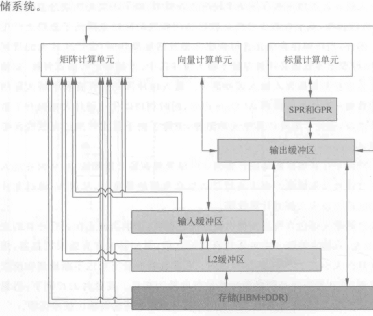
核外存储系统的数据可通过 LOAD 指令直接搬运到矩阵计算单元计算，结果保存在输出缓冲区。除了直接发送，核外数据也可先经 LOAD 指令传入输入缓冲区，再通过其他指令送至矩阵计算单元，这样可利用大容量输入缓冲区暂存矩阵计算单元需反复使用的数。

矩阵计算单元与输出缓冲区可相互传输数据。由于矩阵计算单元容量有限，部分运算结果可写入输出缓冲区，为后续计算腾出空间。输出缓冲区的数据也可被重新搬回矩阵计算单元作为后续输入。输出缓冲区与向量计算单元、标量计算单元以及核外存储系统之间均有一条独立的双向数据通路。输出缓冲区中的数据可通过专用寄存器或通用寄存器进入或离开标量计算单元。

需要注意的是，核内所有需要外传的数据都必须经过输出缓冲区才能写回核外存储系统。例如输入缓冲区中的图像特征数据若要输出到系统内存，需先经矩阵计算单元处理后存入输出缓冲区，再从输出缓冲区写回核外存储。核内并没有从输入缓冲区直写输出缓冲区的数据通路。因此输出缓冲区作为数据流出的闸口，统一控制和协调所有核内数据的输出。

达芬奇架构数据通路的特点是多进单出。数据流入核可经多条路径，可从外部直接流入矩阵计算单元、输入缓冲区或输出缓冲区，流入方式灵活，在软件控制下由不同数据流水线分别管理。而数据输出必须经输出缓冲区，最终才能送出到核外存储系统。

之所以如此设计，是基于深度神经网络计算特征。神经网络计算过程中输入数据种类繁多数量巨大，如多个通道、多个卷积核的权重与偏置以及多个通道的特征值等，核中对应这些数据的存储单元可相对独立且固定，通过并行输入提高流入效率，满足海量计算需求。多个输入数据通路的好处是对输入数据流限制少，能为计算源源不断输送源数据。相反，深度神经网络在处理多种输入后往往只生成输出特征矩阵，数据种类相对单一。基于输出特征，核设计单输出数据通路，一方面节省芯片硬件资源，另一方面可统一管理输出数据，将输出控制硬件降到最低。

综上，达芬奇架构中各存储单元间的数据通路以及多进单出的核内外数据交换机制，是在深入研究以卷积神经网络为代表的主流深度学习算法后开发出来的，旨在保障数据良好流动性的同时，减少芯片成本、提升计算性能、降低控制复杂度。

## 3.2.3 控制单元
在达芬奇架构下，控制单元为整个计算过程提供指令控制，相当于加速核的司令部，负责核心整体运行。控制单元主要由系统控制模块、指令缓存、标量指令处理队列、指令发射模块、矩阵运算队列、向量运算队列、存储转换队列和事件同步模块组成，如图 3-13 加粗部分所示。

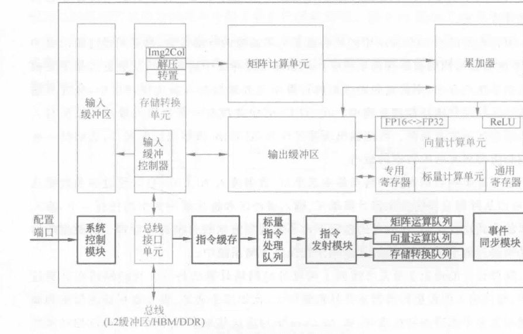
指令执行时可提前预取后续指令，一次读入多条指令进入缓存，提升执行效率。多条指令从系统内存经总线接口进入加速核的指令缓存，等待硬件快速自动解码或运算。指令解码后导入标量队列，实现地址解码与运算控制。这些指令包括矩阵计算指令、向量计算指令以及存储转换指令等。在进入指令发射模块前，所有指令都作为普通标量指令逐条顺次处理。标量队列把指令的地址和参数解码配置好后，指令发射模块按指令类型分别派发到对应的指令执行队列，而标量指令则驻留在标量指令处理队列中后续执行。

指令执行队列由矩阵运算队列、向量运算队列和存储转换队列构成。矩阵计算指令进入矩阵运算队列，向量计算指令进入向量运算队列，存储转换指令进入存储转换队列。同一执行队列内指令按进入顺序执行，不同队列间可并行执行，通过多队列并行提升整体效率。

当指令到达队列头部时进入真正执行环节，并被分发到相应执行单元，如矩阵计算指令发送到矩阵计算单元，存储转换指令发送到存储转换单元。不同执行单元可并行按指令计算或处理数据，同一指令队列中指令执行的流程称为指令流水线。

针对指令流水线之间可能出现的数据依赖，达芬奇架构通过设置事件同步模块统一协调各流水线进程。事件同步模块时刻监控每条流水线的执行状态，分析不同流水线的依赖关系，解决数据依赖和同步问题。例如矩阵运算队列当前指令依赖向量计算单元结果时，事件同步控制模块会暂停矩阵运算队列等待向量结果。向量计算单元完成计算输出结果后，事件同步模块通知矩阵运算队列数据已就绪可继续执行。经事件同步模块允许放行后矩阵运算队列才会发射当前指令。达芬奇架构中，无论流水线内部同步还是流水线间同步，都是通过事件同步模块利用软件控制实现。

如图 3-14 所示，示意 4 条流水线的执行流程。标量指令处理队列首先执行标量指令 0、1、2。由于向量运算队列指令 0 和存储转换队列指令 0 与标量指令 2 存在数据依赖，需等到标量指令 2 完成时刻 3 才能发射并启动。因指令顺序发射，只能等到时刻 4 才能发射并启动矩阵运算指令 0 和标量指令 3，此时 4 条指令流水线可并行执行。直到标量指令处理队列中的全局同步标量指令 7 生效，由事件同步模块对矩阵流水线、向量流水线和存储转换流水线进行全局同步控制，需等待矩阵运算指令 0、向量运算指令 1 和存储转换指令 1 全部执行完成后，事件同步模块才允许标量流水线继续执行标量指令 8。

控制单元中还有系统控制模块。加速核运行前，需外部任务调度器控制并初始化加速核的各类配置接口，如指令信息、参数信息以及任务块信息等。这里任务块指加速核中最小的计算任务粒度。配置完成后，系统控制模块控制任务块执行进程，任务块执行完成后进行中断处理和状态申报。若执行过程中出现错误，系统控制模块会把错误状态报告给任务调度器，进而反馈当前加速核状态信息给整个昇腾 AI 处理器系统。

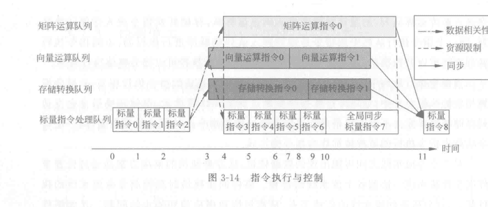

## 3.2.4 指令集设计
任何程序在处理器芯片中执行计算任务时，都需通过特定规范转成硬件可理解处理的语言，这种语言即指令集架构 ISA，简称指令集。指令集包含数据类型、基本操作、寄存器、寻址模式、数据读写方式、中断、异常处理以及外部 IO 等，每条指令描述处理器的一种特定功能。指令集是计算机程序可调用的处理器全部功能的集合，是处理器功能的抽象模型，也是软件与硬件的接口。

指令集可分为精简指令集 RISC 和复杂指令集 CISC。精简指令集特点是单指令功能简单、执行速度快、编译效率高，不能直接操作内存，仅能通过指令访问内存。常见精简指令集有 ARM、MIPS、OpenRISC 以及 RISC-V 等。复杂指令集特点是单指令功能强大且复杂，指令执行周期长，可直接操作内存，常见复杂指令集如 x86。

同样昇腾 AI 处理器有一套专属指令集。其设计介于精简指令集和复杂指令集之间，包括标量指令、向量指令、矩阵指令和控制指令等。标量指令类似精简指令集，而矩阵、向量和数据搬运指令类似复杂指令集。昇腾 AI 处理器指令集结合两者优势，在实现单指令功能简单和速度快的同时，内存操作也比较灵活，搬运较大数据块时操作简便、效率较高。

### 1. 标量指令
标量指令主要由标量计算单元执行，主要目的是为向量指令和矩阵指令配置地址以及控制寄存器，并对程序执行流程进行控制。标量指令还负责输出缓冲区中数据的存储和加载，以及进行一些简单的数据运算等。昇腾 AI 处理器中常用的标量指令如表 5-1 所示。

表 5-1 常用标量指令

| 类别 | 指令举例 |

| :--- | :--- |

| 运算指令 | ADD.s64 Xd, Xn, Xm<br>SUB.s64 Xd, Xn, Xm<br>MAX.s64 Xd, Xn, Xm<br>MIN.s64 Xd, Xn, Xm |

| 比较与选择指令 | CMP.OP, type Xn, Xm<br>SEL.b64 Xd, Xn, Xm |

| 逻辑指令 | AND.b64 Xd, Xn, Xm<br>OR.b64 Xd, Xn, Xm<br>XOR.b64 Xd, Xn, Xm |

| 数据搬运指令 | MOV Xd, Xn<br>LD.type Xd, [Xn], {Xm, imm12}<br>ST.type Xd, [Xn], {Xm, imm12} |

| 流程控制指令 | JUMP {# imm16, Xn}<br>LOOP {# uimm16, LPCNT} |

### 2. 向量指令
向量指令由向量计算单元执行，类似于传统单指令多数据 SIMD 指令，每个向量指令可完成多个操作数的同一类型运算，可直接操作输出缓冲区中的数据且不需要通过数据加载指令来操作向量寄存器中存储的数据。向量指令支持的数据类型为 FP16、FP32 和 INT32。向量指令支持多次迭代执行，也支持对带有间隔的向量直接进行运算。常用的向量指令如表 5-2 所示。

表 5-2 常用向量指令

| 类别 | 指令举例 |

| :--- | :--- |

| 向量运算指令 | VADD.type [Xd], [Xn], [Xm], Xt, MASK<br>VSUB.type [Xd], [Xn], [Xm], Xt, MASK<br>VMAX.type [Xd], [Xn], [Xm], Xt, MASK<br>VMIN.type [Xd], [Xn], [Xm], Xt, MASK |

| 向量比较与选择指令 | VCMP.OP.type CMPMASK, [Xn], [Xm], Xt, MASK<br>VSEL.type [Xd], [Xn], [Xm], Xt, MASK |

| 向量逻辑指令 | VAND.type [Xd], [Xn], [Xm], Xt, MASK<br>VOR.type [Xd], [Xn], [Xm], Xt, MASK |

| 数据搬运指令 | VMOV [VAd], [VAn], Xt, MASK<br>MOVEV.type [Xd], Xn, Xt, MASK |

| 专用指令 | VBS16.type [Xd], [Xn], Xt<br>VMS4.type [Xd], [Xn], Xt |

### 3. 矩阵指令
矩阵指令由矩阵计算单元执行，实现高效的矩阵相乘和累加操作 C = A × B + C。在神经网络计算过程中，矩阵 A 通常代表输入特征矩阵，矩阵 B 通常代表权重矩阵，矩阵 C 为输出特征矩阵。矩阵指令支持 INT8 和 FP16 类型输入数据，支持 INT32、FP16 和 FP32 类型计算。目前最常用的矩阵指令为矩阵乘加指令 MMAD，其格式如下：

```
MMAD.type [Xd], [Xn], [Xm], Xt
```

其中，[Xn]、[Xm] 为指定输入矩阵 A 和矩阵 B 的起始地址，[Xd] 为指定输出矩阵 C 的起始地址。Xt 表示配置寄存器，由三个参数组成，分别为 M、K 和 N，用以表示矩阵 A、B 和 C 的大小。在矩阵计算中，系统会不断通过 MMAD 指令来实现矩阵的乘加操作，从而达到加速神经网络卷积计算的目的。

## 3.3 卷积加速原理
在深度神经网络中，卷积计算一直扮演着至关重要的角色。在一个多层的卷积神经网络中，卷积计算的计算量往往是决定性的，将直接影响到系统运行的实际性能。作为人工智能加速器的昇腾 AI 处理器自然也不会忽略这一点，并且从软硬件架构上都对卷积计算进行了深度的优化。

### 3.3.1 卷积加速
图 3-15 展示的是一个典型的卷积层计算过程，其中 X 为输入特征矩阵；W 为权重矩阵；b 为偏置值；Y_o 为中间输出；Y 为输出特征矩阵，GEMM 表示通用矩阵乘法。输入特征矩阵 X 和 W 先经过 Img2Col 展开处理后得到重构矩阵 X_I2C 和 W_I2C。通过矩阵 X_I2C 和矩阵 W_I2C 进行矩阵相乘运算后得到中间输出矩阵 Y_o；接着累加偏置 b，得到最终输出特征矩阵 Y，这就完成了一个卷积神经网络中的卷积层处理。

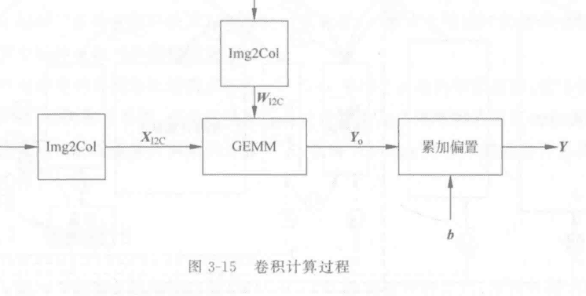

在处理通用卷积时，达芬奇计算核心会通过总线通道从片外二级缓存或主存中取出已经编译好的卷积指令写入指令缓存以便预取，随后交给标量解码队列等待处理。解码队列若当前没有指令在运行，就会立即从指令缓存中取出一条指令完成地址与参数的配置，再由指令派发单元依据指令种类投递到对应的执行队列。卷积启动之初优先投放的是搬运类指令，该指令先进入存储转换队列再被转发至存储转换单元。

如图 3-16 所示的数据流，当全部数据都位于 DDR 或 HBM 时，存储转换单元在收到读取指令后会借助总线接口单元经数据通路①将矩阵 X 与 W 从片外存储搬入输入缓冲，随后经数据通路③进入存储转换单元。单元内对 X 与 W 执行补零与 Img2Col 重排，产生重构矩阵 X_I2C 与 W_I2C，从而把卷积格式转为矩阵格式。转换期间存储转换队列可以提前发出下一条指令，指示转换完成后经数据通路⑤把 X_I2C 与 W_I2C 送往矩阵计算单元进入等待计算状态。基于局部性，若同一组 W_I2C 需要多次复用，可经数据通路⑰将其固化在输入缓冲内，使用时再经数据通路⑱送入矩阵计算单元。另外在格式变换的同时，存储转换单元会经数据通路④把偏置从片外读入输出缓冲，经数据通路⑥重排为矩阵形态，再经数据通路⑦暂存回输出缓冲，随后经数据通路⑨写入累加器寄存器，为后续偏置累加做准备。

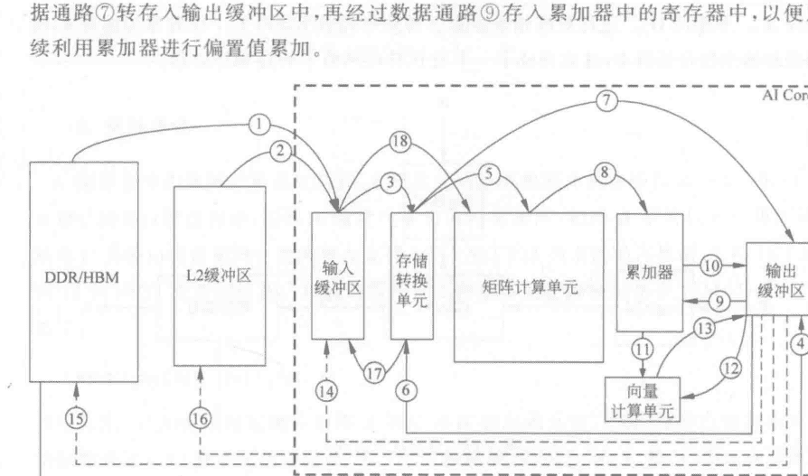

待左右两个矩阵都准备就绪后，矩阵运算队列会经数据通路⑤把矩阵乘法指令送给矩阵计算单元。X_I2C 与 W_I2C 被拆分为 16×16 的单元块，由矩阵计算单元执行乘法运算。若输入规模较大则重复多次并做累加，中间结果 Y_o 留在矩阵计算单元内部。乘法结束若仍需偏置处理，累加器会接收到偏置累加指令，一方面经数据通路⑨从输出缓冲读取偏置值，另一方面经数据通路⑧读取矩阵计算单元中的中间结果 Y_o 进行累加，最终得到输出特征矩阵 Y，经数据通路⑩转到输出缓冲等待后续操作。

矩阵乘法完成卷积网络的一次计算后，向量执行单元会收到池化与激活指令，输出特征矩阵 Y 经数据通路⑫进入向量计算单元完成池化与激活，处理结果经数据通路⑬写回输出缓冲。向量计算单元能够完成激活等特殊运算并可高效实现降维，非常适合池化任务。多层网络运行时，Y 会再次经数据通路①从输出缓冲搬回输入缓冲，作为下一层的输入重新开始计算。

达芬奇面向通用卷积的特征与数据规律，采用高度定制的功能划分，将存储、计算与控制有效结合，单模块独立高效且整体协同优化。AI运算核心把矩阵计算单元与数据缓冲紧密耦合，缩短了存储到计算的路径，降低延时。

片上集成了大容量的输入与输出缓冲，一次可缓存足够的数据，减少对片外存储的访问次数，提升搬移效率。相较片外存储，片上缓冲访问更快，大量片上缓存显著提升了可用的数据带宽。

同时运算核心提供灵活的数据通道，使数据能够在片上缓冲、片外存储、存储转换单元与计算单元之间快速流动和切换，以满足不同结构深度神经网络的计算需求，提升通用性。

### 3.3.2 架构对比

回顧 GPU 与 TPU 对卷积的处理方式，再与昇腾 AI 处理器的达芬奇架构做对比。以图 2-5 的卷积加速案例为例，GPU 采用通用矩阵乘法思路，把卷积转为矩阵计算，依靠海量线程在多个周期内并行得到输出特征矩阵。流处理器内的 SIMD 同时驱动多个线程，线程在一段时间内完成矩阵乘、激活或池化等步骤。步骤完成后因片上存储有限，GPU 常需把中间数据写回主存，下一步再读回。通用计算能力使其能以相似模式处理卷积、池化、激活等任务。

TPU 使用脉动阵列直接加速卷积。片上大容量缓冲可一次性容纳几乎全部所需数据，随后由内部脉动数据流控制单元送入脉动计算阵列。当阵列全满达到饱和时，每个时钟周期可输出一行元素。卷积结束后需经定制矢量运算单元完成激活或池化。

昇腾 AI 处理器同样采用通用矩阵乘法加速，先展开重组输入特征与权重矩阵，再进行矩阵相乘。与 GPU 不同，昇腾的矩阵计算单元一次可处理 16×16 矩阵并在极短时间内完成，吞吐率高于 GPU。向量计算单元与标量计算单元可并行处理卷积、池化、激活等，进一步提升并行度。

GPU 通过集中式寄存器管理、多线程并行、类 CPU 片上组织实现灵活调度，开发门槛较低。但通用性代价是每次计算都需遵循从寄存器取数到写回寄存器的规范，增加数据搬运开销与功耗。

TPU 通过精简指令一次性把大量数据读入缓冲，以固定模式流入脉动阵列，减少搬运次数与整体功耗。但定制化限制了应用范围，且大缓冲占用面积会压缩其他资源。

昇腾 AI 处理器对矩阵与卷积高效，主要得益于达芬奇架构的定制硬件，专门加速矩阵运算，可快速完成 16×16 矩阵乘法。配合大量分布式缓存与计算单元，能有效减少数据到计算单元的搬运，在提升算力的同时降低传输功耗，在深度卷积网络尤其是大规模卷积场景具有优势。但固定 16×16 的矩阵计算单元在小规模网络上易出现算力未满、资源利用率低的问题。

总体而言，三种架构各有优劣，脱离具体应用评判没有意义。同一应用内数据规模、分布、计算类型、精度、网络结构等都会显著影响优势发挥。不同于传统专用芯片，面向特定域的架构芯片性能很大程度上取决于运行其上的软件效率，后续章节将聚焦软件优化，帮助建立软硬件协同理念，以适应后摩尔时代需求。

# 第 4 章 软件架构

昇腾 AI 处理器的达芬奇架构在硬件上对计算资源进行定制，功能与硬件高度匹配，为卷积神经网络性能提升提供硬件基础。从开源框架到模型实现再到芯片运行，需多层次软件管理模型、计算流与数据流。神经网络软件流为模型落地提供支撑，开发工具链为应用开发带来便利，二者构成基础软件栈，自上而下支撑芯片执行。

### 4.1 昇腾 AI 软件栈总览

为发挥昇腾 AI 处理器最佳性能，需完善的软件方案。完整软件栈包含运行框架与性能调优，以及配套工具。软件栈分为神经网络软件流、工具链及其他模块。

神经网络软件流包含流程编排器 Matrix、框架管理器 Framework、运行管理器 Runtime、数字视觉预处理 DVPP、张量加速引擎 TBE 及任务调度器 TS 等，完成模型生成、加载与执行。工具链为实现过程提供辅助。

如图 4-1，软件栈各部分功能相互依赖，承载数据流、计算流与控制流。软件栈共 4 层加工具链，分别为 L3 应用使能层、L2 执行框架层、L1 芯片使能层、L0 计算资源层。工具链提供工程管理、编译调测、流程编排、日志管理与性能分析等能力。

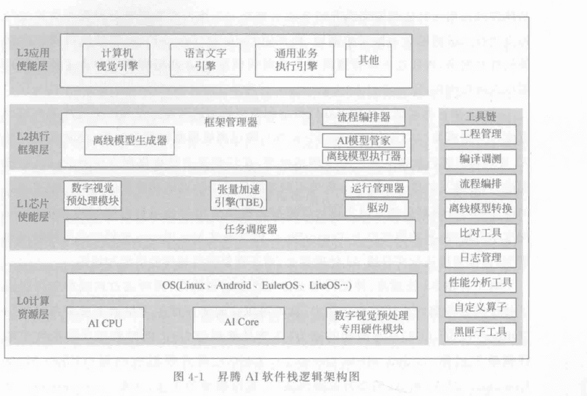

#### 1. L3 应用使能层

L3 为应用级封装，面向特定领域提供算法，含通用业务执行引擎、计算机视觉引擎与语言文字引擎。通用业务执行引擎提供通用推理能力；计算机视觉引擎面向视觉领域封装视频图像处理算法；语言文字引擎面向语音文本等提供基础处理算法。基于流程编排器定义计算流程，由通用业务执行引擎实现具体功能。L3 通过通用框架调用 L2 的调度能力生成神经网络，实现引擎功能。

#### 2. L2 执行框架层

L2 为框架调用与离线模型生成能力的封装。L3 将领域算法封装为引擎后，L2 根据算法特点调用深度学习框架，如 Caffe、TensorFlow，生成离线模型。L2 包含框架管理器与流程编排器。

L2 使用在线框架与离线框架。在线框架基于主流开源框架，通过模型转换与加载在昇腾上加速。对网络模型提供训练与推理能力，支持单卡、单机、多机场景。另提供自研 MindSpore 深度学习框架，其功能类似 TensorFlow，由其生成的模型可直接运行在昇腾，无需适配。

昇腾支持在线生成与执行，也支持离线生成与执行，即脱离框架下离线模型 Offline Model 仍具备推理能力。框架管理器含离线模型生成器 OMG、离线模型执行器 OME 与 AI 模型管家推理接口，支持生成、加载、卸载与推理。离线模型生成器将 Caffe 或 TensorFlow 的模型与权重转为离线模型文件；离线模型执行器负责加载卸载并编译为可在昇腾运行的指令序列。流程编排器统筹加载与执行，提供开发平台，负责模型生成、加载与运算调度。L2 将原始模型转为可在昇腾运行的离线模型后，由离线模型执行器传给 L1 进行任务分配。

#### 3. L1 芯片使能层

L1 是离线模型通向芯片的桥梁。接收 L2 生成的离线模型后，通过加速库为计算提供加速。L1 最接近底层，负责向硬件输出算子级任务。包含 DVPP、张量加速引擎、运行管理器、驱动与任务调度器。

以张量加速引擎为核心，支持在线与离线模型加速。引擎内含优化后的标准算子加速库，执行时与上层的运行管理器交互，运行管理器与 L2 通信，提供算子接口。若标准库无所需算子，可通过张量加速引擎编写自定义算子，从而为 L2 提供完备算子能力。

张量加速引擎下方为任务调度器，依据算子生成计算核函数后，按任务类型分发至 AI CPU 或 AI Core，驱动执行。调度器运行在专属 CPU 核上。DVPP 是面向图像视频的多功能封装，为上层提供底层专用硬件的数据预处理能力。

#### 4. L0 计算资源层

L0 为硬件算力基础。L1 完成算子任务分发后，具体执行由 L0 启动。包含操作系统、AI CPU、AI Core 与 DVPP。AI Core 完成神经网络矩阵相关计算，AI CPU 完成控制算子、标量与向量等通用计算。若需预处理，DVPP 专用硬件被激活进行图像视频预处理，为 AI Core 提供合适格式数据。AI Core 负责大算力任务，AI CPU 负责复杂计算与执行控制，DVPP 负责数据预处理，操作系统使三者协同，保障深度神经网络计算执行。

#### 5. 工具链

工具链是面向程序员的开发平台，提供自定义算子开发调试、网络移植优化分析等支撑，并提供可视化 AI 引擎拖拽式编程服务，降低开发门槛。含工程管理、编译调测、流程编排、离线模型转换、比对工具、日志管理、性能分析、自定义算子与黑匣子工具等，为开发与执行提供多层次便捷服务。

### 4.2 神经网络软件流

为实现神经网络应用，需在深度学习框架到昇腾 AI 处理器之间架起软件流，提供高性能计算支撑。从原始模型到计算图表示再到独立执行的离线模型，软件流围绕生成、加载与执行，聚集流程编排器、DVPP、张量加速引擎、框架管理器、运行管理器与任务调度器，形成完整功能集群，如图 4-2 所示。

各模块分工明确：流程编排器统筹落地与实现，控制模型加载与执行；DVPP 在输入前做数据处理与格式修饰；张量加速引擎为模型源源不断提供计算算子；框架管理器将原始模型塑造为昇腾可用的形态并引导高效运行；运行管理器提供资源管理通道；任务调度器驱动硬件执行任务。运行管理器与任务调度器协同，实时监控与分发任务，形成软硬件结合的执行流程，推动生态发展。

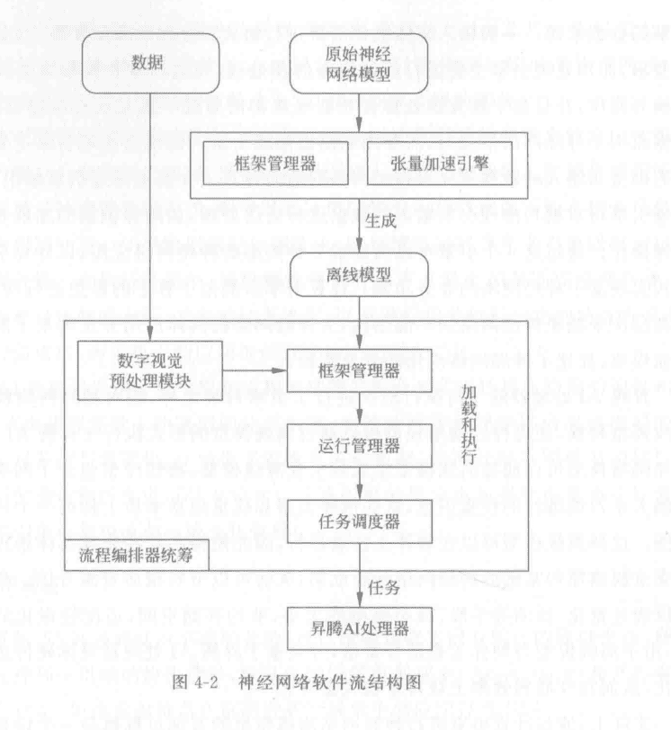

图 4-2 神经网络软件流结构图

#### 4.2.1 流程编排器

### 1. 功能简介

昇腾 AI 处理器将网络执行按功能划分为基本执行单元，形成颗粒化计算引擎 Engine。每个引擎在流程编排中对数据完成具体操作，如图像分类、输入预处理、输出标注等。计算引擎由开发者自定义，完成所需功能。

昇腾推理四步拆解

统一调度器把一次深度神经网络的完整调用拆成四个协同工作环节：供给数据、准备数据、执行推理、收尾处理。数据供给环节负责把像 MNIST 这样的数据集读入并做基础清洗，比如图片过滤，为下游计算备好原材料。媒体素材进入昇腾计算芯片前必须符合格式规范，预处理环节承担解码、编码、格式转换等工作，数字视觉预处理的所有子能力都要由调度器统一触发调用。进入推理阶段，数据流交给模型推理环节，它基于已加载的模型与输入流完成前向计算。推理结果出来后，后处理环节负责画框、加标签等收尾工作。四套环节可灵活组合拼出多种网络应用，以接近算子的思路做功能集成，从更高抽象层简化网络结构，明显加快开发节奏。

昇腾计算芯片在做引擎封装的同时，也把神经网络做了离线化改造，模型可以以离线形态直接在芯片上运行。离线模型由生成器导出，内部保存算子依赖关系和训练好的权重，本质上是一个计算图。因为可在硬件上独立执行，推理时不再依赖上层开源框架，节省了大量资源开销。离线模型还能通过量化、压缩等手段减小体积，节省存储，适配轻量场景。由于模型与硬件深度绑定并针对昇腾芯片做了专项优化，性能与效率都有明显提升。

把离线模型落地到计算引擎，本质上是对计算流程进行编排设计。编排完成后会得到一张计算引擎流程图，图中的每个处理节点都是一个计算引擎，数据按预设路径流经各节点逐步处理，最终输出结果。相邻节点通过流程图里的配置文件建立关联，数据流会按网络拓扑在节点间流动。节点属性配置完成后向入口节点注入数据，整条链路即开始运行。


流程调度器是整条神经网络执行链的导演，工作在 L1 芯片使能层之上、L3 应用使能层之下，为 Linux、Android 等多系统提供统一标准中间接口，负责流程图的创建、销毁以及计算资源回收。建图阶段它依据计算引擎配置文件搭建拓扑；执行前提供输入数据，若视频图像格式不满足处理需求，可通过编程接口调用数字视觉预处理模块补齐预处理，若已合规则直接经接口调用离线模型执行器推理。运行期间它具备多节点调度和多进程管理能力，守护设备端计算进程并汇总执行信息，推理结束后向主机应用开放结果获取通道。

昇腾计算芯片借助计算引擎与流程调度器的配合实现流程图的编排与执行。调度器提供四类通用计算引擎，有效把多种神经网络离线模型的实现对象化、流程化，增强了对数据流的管控，让不同网络都能套用统一开发模板。引擎概念也让数据流与计算流在流程图中集中流动、统一管理。

### 2. 应用场景
昇腾计算芯片可针对不同业务组建专用硬件平台，按硬件与主机的协作方式，常见落地形态有 PCIe 插卡形态和开发者板两种，调度器在这两种场景下的呈现并不相同。

###### 1）加速卡形式
在插卡形态下，基于昇腾芯片设计的 PCIe 加速卡，主要面向数据中心和边缘侧服务器，是一种专用于加速神经网络计算的卡片。PCIe 加速卡支持多种数据精度，性能相比同类产品更强，为神经网络计算提供更充裕算力。主机需与加速卡连接，可为支持 PCIe 插卡的服务器或个人电脑，主机通过调用加速卡的计算能力完成相应处理。

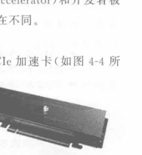

如图 4-5 所示，插卡场景下的流程调度器功能由三个子进程承担：流程编排代理 Matrix Agent 子进程、流程编排守护 Matrix Daemon 子进程和流程编排服务 Matrix Service 子进程。代理子进程通常运行在主机侧，负责控制数据引擎和后处理引擎，完成与主机应用程序的数据交互和应用控制，并与设备端处理进程通信。守护子进程和服务子进程运行在设备侧。守护子进程可依据配置文件在设备上建立流程，负责启动和管理设备端的编排进程，计算结束后解除流程并回收资源。服务子进程主要启动并控制设备端的预处理引擎和模型推理引擎，它通过调用数字视觉预处理模块的编程接口实现视频图像数据的预处理，也可调用离线模型执行器中的 AI 模型管家编程接口实现离线模型的加载与推理。

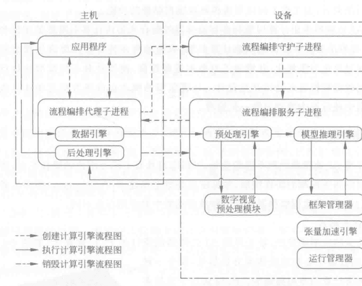
神经网络离线模型经调度器推理的计算过程大致分为三步：创建计算引擎流程图、执行计算引擎流程图、销毁计算引擎流程图。创建是指用不同功能的计算引擎编排好神经网络的执行流程；执行是指按定义好的流程图完成神经网络功能的计算与实现；销毁是指在所有计算完成后释放计算引擎占用的系统资源。

整个应用程序在系统中的执行流程如下：

（1）创建。应用程序调用主机端的流程编排代理子进程，根据预先编写好的神经网络计算引擎流程图配置文件编排该网络的执行流程，创建执行流程并定义每个计算引擎的任务；随后计算引擎编排单元把神经网络的离线模型文件和配置文件上传给设备端的流程编排守护子进程，再由设备端的流程编排服务子进程进行引擎初始化。流程编排服务子进程会控制模型推理引擎调用 AI 模型管家的初始化接口加载神经网络离线模型，完成计算引擎流程图的创建。

（2）执行。离线模型加载完成后通知主机端流程编排代理子进程输入应用数据。应用程序直接把数据送入数据引擎处理。若传入的是媒体数据且不满足昇腾芯片的计算要求，预处理引擎会立即启动，并调用数字视觉预处理模块接口进行媒体数据预处理，如编解码、缩放等。预处理完成后数据返回给预处理引擎，再传给模型推理引擎。模型推理引擎调用 AI 模型管家的处理接口，将数据与已加载的离线模型结合完成推理计算。得到输出后，模型推理引擎调用流程编排单元的发送数据接口把推理结果返回给后处理引擎，由后处理引擎完成数据后处理，最终再通过流程编排单元把后处理数据返回给应用程序，完成流程图的执行。

（3）销毁。所有引擎处理并返回后，应用程序通知流程编排代理子进程释放数据引擎和后处理引擎的计算硬件资源；流程编排代理子进程再通知流程编排服务子进程释放预处理引擎和模型推理引擎的资源。资源全部释放后计算引擎流程图即被销毁，流程编排代理子进程再次通知应用程序可进行下一次神经网络执行。

三个软件单元按部就班、有序配合，共同实现一个神经网络离线模型在昇腾芯片上的功能应用。

2）开发者板形式
在开发者板场景下，华为推出了 Atlas 开发者套件 Atlas 200 DK，如图 4-6 所示。Atlas 200 DK 以昇腾芯片为核心的开发者板形态硬件，把芯片核心功能通过板上外围接口开放出来，便于外部直接控制和开发，能直观发挥昇腾芯片的神经网络处理能力。因此基于昇腾芯片构建的开发者板可广泛应用于不同人工智能领域，也是未来移动端侧的重要硬件。

由于开发者板环境下主机的控制功能已集成到板上，流程调度器只有一个软件单元运行进程，同时需兼顾加速卡场景下主机端流程编排代理子进程、设备端流程编排服务子进程和流程编排守护子进程三者的功能。

此时流程调度器作为昇腾芯片的功能接口，完成计算引擎流程图与应用程序的数据交互和命令。它依据计算引擎流程的配置文件建立计算引擎流程图，负责编排流程、进程控制与管理，计算结束后解除流程图并回收资源。在预处理阶段，流程调度器调用预处理引擎接口实现媒体预处理功能。在推理阶段，它还能调用 AI 模型管家的编程接口实现离线模型的加载与推理。在开发者板应用场景下，流程调度器统筹整个计算引擎流程图的实现过程，如图 4-7 所示，无需与其他设备交互。

同样在开发者板场景下，神经网络离线模型经流程调度器推理计算的过程也分为创建计算引擎流程图、执行计算引擎流程图、销毁计算引擎流程图三步，如图 4-7 所示。

（1）创建。应用程序调用流程调度器，根据网络模型由流程调度器创建计算引擎流程图并初始化计算引擎。初始化过程中，模型推理引擎通过 AI 模型管家的初始化接口加载模型，完成流程图的创建。

（2）执行。将数据输入数据引擎，若媒体数据格式不满足要求，则预处理引擎完成预处理。接着，模型推理引擎调用离线模型执行器中的 AI 模型管家进行推理计算。模型推理引擎计算结束后，调用流程调度器提供的数据输出接口把推理结果返回给后处理引擎，后处理引擎通过回调函数把推理结果返回给应用程序，完成流程图的执行。

（3）销毁。程序计算完成后，流程调度器将计算引擎流程图销毁并释放资源，从而完成开发者板场景的神经网络功能实现。

## 4.2.2 数字视觉预处理模块
数字视觉预处理 DVPP 模块作为软件流执行过程中的编解码和图像转换单元，为神经网络提供预处理辅助。当来自系统内存和网络的视频或图像数据进入昇腾芯片计算资源运算前，由于达芬奇架构对输入数据有固定格式要求，若数据未满足架构规定的输入格式、分辨率等要求，就需要调用数字视觉预处理模块进行格式转换，才能进入后续神经网络计算步骤。

### 1. 功能架构
数字视觉预处理模块的功能架构如图 4-8 所示，对外提供六个模块：视频解码 VDEC 模块、视频编码 VENC 模块、JPEG 解码 JPEGD 模块、JPEG 编码 JPEGE 模块、PNG 解码 PNGD 模块和视觉预处理 VPC 模块。视频解码模块提供 H.264/H.265 视频解码功能，对输入视频码流解码输出图像，用于视频识别等场景的前处理。与之相对，视频编码模块提供输出视频的编码功能，对视觉预处理模块的输出数据或原始输入的 YUV 格式数据进行编码输出 H.264/H.265 视频，便于直接播放和显示。该功能常用于云游戏、仿真手机运维等高速数据传输场景。JPEG 格式图片也有对应的编解码模块。JPEG 解码模块对 JPEG 图片解码，将原始输入的 JPEG 图片转换成 YUV 数据，用于神经网络训练、推理输入数据的预处理。图片处理完成后，需要用 JPEG 编码模块对处理后数据进行 JPEG 格式还原，用于神经网络训练、推理输出数据的后处理。当输入图片格式为 PNG 时，流程调度器需调用 PNGD 解码模块进行解码，将 PNG 格式图片以 RGB 格式输出给昇腾芯片进行训练或推理计算。除基本编解码转换外，数字视觉预处理模块还提供格式转换、缩放、裁剪等处理能力，如 YUV/RGB 到 YUV420SP 格式转换。

数字视觉预处理模块的执行流程见图 4-8，需要流程调度器、视觉预处理模块、DVPP 驱动和 DVPP 硬件模块共同协作完成。最上层是流程调度器，负责调度 DVPP 功能模块进行处理并管理数据流。数字视觉预处理模块位于功能架构中上层，为流程调度器提供调用视频图形处理模块的编程接口，通过这些接口可配置编解码或视觉预处理模块相关参数。DVPP 驱动位于中下层，最贴近 DVPP 硬件模块，主要负责设备管理、引擎管理和引擎模组驱动。驱动会根据数字视觉处理模块下发的任务分配对应的 DVPP 硬件引擎，同时对硬件模块寄存器进行读写，完成其他硬件初始化工作。最底层是真实的硬件计算资源 DVPP 模块组，是独立于昇腾芯片其他模块的专用加速器，专门负责执行图像和视频的编解码与预处理任务。

### 2. 预处理机制
当输入数据进入数据引擎时，一旦检查发现数据格式不满足后续 AI Core 处理需求，就可开启数字视觉预处理模块进行数据预处理。如图 4-8 所示的数据流，以图片预处理为例，首先流程调度器会把数据从内存传到数字视觉预处理模块的缓冲区缓存。根据具体数据格式，预处理引擎通过数字视觉预处理模块提供的编程接口完成参数配置和数据传输。编程接口启动后，数字视觉预处理模块将配置参数和原始数据传递给驱动程序。由 DVPP 驱动调用 PNG 或 JPEG 解码模块进行初始化和任务下发。此时 PNG 或 JPEG 解码模块启动实际操作完成图片解码，得到 YUV 或 RGB 格式数据，满足后续处理需求。

解码完成后，流程调度器以同样机制继续调用数字视觉预处理模块把图片转换成 YUV420SP 格式，因 YUV420SP 存储效率高且占用带宽小，同等带宽下可传输更多数据来满足 AI Core 强大的计算吞吐需求。同时数字视觉预处理模块也可完成图像裁剪与缩放。

图 4-9 展示了一种典型改变图像尺寸的裁剪和补零操作。视觉预处理模块在原图像中取出待处理图像部分，再对这部分进行补零操作，在卷积神经网络计算过程中保留边缘特征信息。补零操作需要用到上下左右四个填充尺寸，在补零区域进行图像边缘扩充，最后得到可直接计算的补零后图像。

经过一系列预处理后，满足格式要求的图像数据将在控制 CPU 的控制下进入 AI Core 进行所需神经网络计算。完成后输出的图像数据统一通过 JPEG 编码模块进行编码，完成编码后处理，把数据放入数字视觉预处理模块的缓冲区中，最终由流程调度器取出数据进行后续操作，同时释放 DVPP 计算资源并回收缓存。

整个预处理过程中，流程调度器完成不同模块的功能调用。数字视觉预处理模块作为定制化的数据补给单元，采用异构和专用处理方式对图像数据进行快速变换，为 AI Core 提供充足数据源，从而满足神经网络计算中大数据量、大带宽的需求。

## 4.2.3 张量加速引擎(TBE)
通常神经网络构造中以算子组成不同应用功能的网络结构。张量加速引擎作为算子的兵工厂，为基于昇腾芯片运行的神经网络提供算子开发能力，用张量加速引擎语言编写的 TBE 算子可构建各种神经网络模型。同时张量加速引擎对算子也提供封装调用能力。张量加速引擎内有一个由专人优化过的神经网络 TBE 标准算子库，开发者可直接利用标准算子库中的算子实现高性能神经网络计算。除此之外，张量加速引擎还提供 TBE 算子的融合能力，为神经网络优化开辟独特路径。

### 1. 功能框架
张量加速引擎提供基于 TVM 开发自定义算子的能力，通过 TBE 语言和自定义算子编程开发界面可完成相应神经网络算子的开发。张量加速引擎的结构如图 4-10 所示，包含特定域语言 DSL 模块、调度 Schedule 模块、中间表示 IR 模块、编译器传递 Pass 模块以及代码生成 CodeGen 模块。

TBE 算子开发分为计算逻辑编写和调度开发，特定域语言模块提供算子计算逻辑编写接口，直接基于特定域语言编写算子的计算过程和调度过程。算子计算过程描述指明算子的计算方法和步骤，调度过程描述完成数据切块和数据流向规划。算子每次计算都按固定数据形状处理，这就需要提前针对昇腾芯片中不同计算单元上执行的算子进行数据形状切分，因为矩阵计算单元、向量计算单元以及 AI CPU 上执行的算子对输入数据形状需求各不相同。

图 4-10 张量加速引擎模块构成

在完成算子基本实现过程定义后，需要启动调度模块中的分块 Tiling 子模块，对算子中数据按调度描述进行切分，同时指定好数据搬运流程，确保在硬件上执行达到最优。除数据形状切分外，张量加速引擎的算子融合和优化能力也是由调度模块中的融合 Fusion 子模块提供的。

算子编写完成后需要生成中间表示以进一步优化，中间表示模块通过类似 TVM 的 IR 模块生成中间表示。在中间表示生成后，需要针对各种应用场景进行编译优化，优化方式有双缓冲 Double Buffer、流水线 Pipeline 同步、内存分配管理、指令映射、分块适配矩阵计算单元等。

算子经编译器传递模块处理后，由代码生成模块生成类 C 代码的临时文件，该临时代码文件可通过编译器生成算子的实现文件，并可被离线模型执行器直接加载和执行。

综上，一个完整的自定义算子通过张量加速引擎子模块完成整个开发流程，从特定域语言模块提供原语算子计算逻辑和调度描述构成算子原型，由调度模块进行数据切分和算子融合，进入中间表示模块生成算子中间表示。编译器传递模块以中间表示进行内存分配等编译优化，最后由代码生成模块产生类 C 代码供编译器直接编译。张量加速引擎在算子定义过程不但完成算子编写，还完成相关优化，提升算子执行性能。

### 2. 应用场景
TBE 算子的三种应用场景如图 4-11 所示。

张量加速引擎：算子移植与融合加速

深度网络通常先借助 PyTorch、TensorFlow 等框架在 GPU 上完成训练，随后迁移到昇腾平台做推理。用户最在意的是迁移成本低、代码改动少，同时能够把硬件算力充分利用。张量加速引擎正为此提供了一整套 TBE 算子加速集合，集合内部的算子与神经网络里常用的标准算子一一对应，软件栈对外暴露调用入口，上层框架或应用可以直接调用，在获得加速的同时尽量规避底层适配开发。

当网络搭建过程中出现引擎库尚未覆盖的新算子，就需要借助 TBE 语言进行自定义算子开发。思路与 GPU 上基于 CUDA C++ 的开发相近，可实现的功能更丰富，能够灵活支撑各式网络结构。编写完成后交给编译器编译，就能在 AI Core 或 AI CPU 上运行，释放芯片的加速能力。

在特定场景下，引擎还提供算子融合机制，让神经网络算子依托不同层级的缓存区实现多级缓存合并，昇腾执行融合后的算子时片上资源利用率会明显提升。

整体来看，张量加速引擎既能直接调用标准算子，也支持自定义开发和算子融合优化，让昇腾在真实的神经网络应用里应对多样化的功能需求，网络搭建更灵活便捷，运行性能也能得到额外加成。

## 4.2.4 运行管理器

运行管理器相当于神经网络软件任务流向硬件资源时的阀门，为任务分配提供资源管理通道。昇腾借助运行管理器在应用程序进程空间中运行，向应用提供存储管理、设备管理、执行流管理、事件管理以及核函数执行等能力。

在软件栈的上下文里，上层是张量加速引擎提供的 TBE 标准算子集合和离线模型执行器。TBE 标准算子集合为平台提供神经网络所需的算子，离线模型执行器负责离线模型的加载与执行。下层是驱动，与硬件做底层交互。

图4-12 运行管理器的上下文关系

图4-13 运行管理器的功能模块及其对外接口

运行管理器对外暴露存储接口、设备接口、执行流接口、事件接口和执行控制接口，各类接口由运行管理引擎驱动以完成不同功能。

存储接口负责设备上 HBM 或 DDR 内存的申请、释放与拷贝，覆盖设备到主机、主机到设备以及设备到设备之间的数据搬运。拷贝分为同步和异步两种：同步要求搬运完成后才能继续下一步，异步则允许搬运与其它操作并行。

设备接口提供底层设备数量与属性查询，以及选中、复位等操作。离线模型调用设备接口选中特定设备后，模型里所有任务都将在该设备上执行。若需要向其它设备派发任务，则需再次调用设备接口完成切换。

执行流接口提供执行流的创建、释放、优先级设定、回调配置、对事件的依赖定义与同步功能，这些直接关系到执行流内部任务的执行顺序，且单个执行流内的任务必须有序执行。

当多个执行流需要协同时，需调用事件接口进行同步事件的创建、释放、记录与依赖定义，确保各执行流同步完成并输出最终结果。事件接口除用于任务或执行流间的依赖关系外，还可作程序运行的时间标记，记录执行时序。执行时还需执行控制接口，运行管理器通过该接口与邮箱 Mailbox 完成核函数加载及存储异步拷贝等任务的派发。

## 4.2.5 任务调度器

任务调度器和运行管理器一起组成软硬件之间的调度体系。执行阶段，任务调度器为硬件驱动供给任务，为昇腾提供具体的目标任务，与运行管理器一起完成任务调度流程，并把输出数据回传给运行管理器，起到任务分发与数据回传的通道作用。

### 1. 功能简介

任务调度器运行在设备侧的任务调度 CPU 上，负责把运行管理器下发的具体任务进一步派发到 AI CPU，也可通过硬件任务块调度器 Block Scheduler, BS 把任务分配到 AI Core 执行，并在完成后把结果返回给运行管理器。主要处理的事务包括 AI Core 任务、AI CPU 任务、内存拷贝任务、事件记录任务、事件等待任务、清理维护 Maintenance 任务和性能分析 Profiling 任务。

内存拷贝多以异步方式进行。事件记录任务负责记录事件发生信息，若存在等待该事件的任务，则在事件记录完成后解除等待并继续执行，避免执行流被阻塞。事件等待任务的逻辑是：若等待的事件已发生，则任务直接完成；若事件尚未发生，则把等待任务放入待处理列表并暂停所在执行流后续任务的处理，待事件发生后再恢复处理。

任务执行结束后，清理维护任务会依据任务参数进行相应清理，回收计算资源。执行过程中若需记录分析计算性能，则由性能分析任务控制启动与暂停。

任务调度器的功能框架如图 4-14 所示。

任务调度器通常位于设备端，由任务调度 CPU 完成。其由调度接口 Interface、调度引擎 Engine、调度逻辑处理模块、AI CPU 调度器、任务块调度器、系统控制 SysCtrl 模块、性能分析 Profile 和日志 Log 模块组成。

任务调度 CPU 通过调度接口与运行管理器和驱动通信交互。任务经结果传送到任务调度引擎，引擎作为调度实现主体，负责任务组织、任务依赖及调度控制等流程，管理整个任务调度 CPU 的执行过程。引擎依据任务类型把任务分为计算、存储、控制三类，分发给不同调度逻辑处理模块，启动具体核函数任务、存储任务以及执行流间事件依赖的管理与调度。

逻辑处理模块包括核函数执行 Kernel Execute 模块、直接存储访问执行 DMA Execute 模块和事件执行 Event Execute 模块。核函数执行模块负责计算任务的调度，实现 AI CPU 与 AI Core 上任务的调度逻辑，对具体核函数进行调度。直接存储访问执行模块负责存储任务的调度，对内存拷贝等进行调度。事件执行模块负责同步控制任务的调度，实现执行流间事件依赖的逻辑处理。

任务调度逻辑处理完成后交由相应控制单元进行硬件执行。针对 AI CPU 的任务，由任务调度 CPU 内的 AI CPU 调度器以软件方式进行状态管理与任务调度。对于 AI Core 的任务，任务调度 CPU 把处理后的任务通过任务块调度器硬件分发到 AI Core，由 AI Core 计算，结果再由任务块调度器返回给任务调度 CPU。

任务调度过程中，系统控制负责系统配置与芯片功能初始化，性能分析和日志模块则监控整个执行流程，记录关键参数与执行细节，在执行结束或报错时可进行性能分析或错误定位，为执行正确性与高效性提供评估依据。

## 2. 调度流程

在神经网络离线模型执行过程中，任务调度器接收来自离线模型执行器的具体执行任务，这些任务存在依赖关系，需先解除依赖再进行调度，最后按类型分发给 AI Core 或 AI CPU 完成计算或执行。任务由多条执行指令 CMD 组成，由任务调度器与运行管理器交互完成整个指令的有序调度。运行管理器运行在主机 CPU 上，指令队列位于设备内存中，任务调度器负责具体指令的下发。其协同流程如图 4-15 所示。

首先运行管理器调用驱动的 dvCommandOcuppy 接口进入指令队列，根据指令尾部信息查询队列中可用存储空间，并把可用指令存储空间地址返回给运行管理器。运行管理器接收地址后，把准备好的任务指令填充到可用空间，并调用驱动的 dvCommandSend 接口更新指令队列的尾部位置和 Credit 信息。队列接收到新增指令后产生 doorbell 中断，通知任务调度器设备内存中指令队列新增了任务指令。任务调度器获通知后进入设备内存搬运指令到本地缓存保存，并更新设备端 DDR 内存中指令队列的头部信息。最后，任务调度器根据执行情况把缓存中的指令发送给 AI CPU 或 AI Core 执行。

与大多数加速器运行时软件栈构造类似，昇腾 AI 处理器中运行管理器、驱动与任务调度器紧密配合，有序完成任务分发至相应硬件资源并执行。该调度过程为深度神经网络计算持续有序地输送任务，保证了执行的连续性与高效性。

# 第 4 章 软件架构

## 4.2.6 框架管理器

框架管理器是神经网络在昇腾 AI 处理器上实现形态的塑造者与执行参与者，在软件流中协同张量加速引擎为神经网络生成可执行的离线模型。执行前，框架管理器与昇腾 AI 处理器结合生成硬件匹配的高性能离线模型，并连通流程编排器与运行管理器，使离线模型与处理器深度融合。执行时，框架管理器联合流程编排器、运行管理器、任务调度器及底层硬件资源，把离线模型、数据与达芬奇架构结合，优化执行流程得到神经网络的应用输出。

### 1. 功能框架

框架管理器包含三部分：离线模型生成器 Offline Model Generator，OMG、离线模型执行器 Offline Model Executor，OME 和 AI 模型管家 AI Model Manager，如图4-16所示。开发者使用离线模型生成器生成离线模型并以 om 为扩展名保存。随后软件栈中的流程编排器调用框架管理器中的 AI 模型管家，启动离线模型执行器，把离线模型加载到昇腾 AI 处理器上，最后通过整个软件栈完成离线模型执行。从离线模型诞生到加载运行，框架管理器始终发挥管理作用。

### 2. 离线模型生成

以卷积神经网络为例，在深度学习框架下构建并训练好网络模型后，通过离线模型生成器进行算子调度优化、权重数据重排与压缩、内存优化等，最终生成调优后的离线模型。离线模型生成器主要用于生成能在昇腾 AI 处理器上高效执行的离线模型。

离线模型生成流程如图 4-17 所示。离线模型生成器接收原始模型后依次进行模型解析、量化、编译和序列化。

#### 1）解析

解析阶段，离线模型生成器支持不同框架下原始网络模型的解析，提炼出网络结构与权重参数，再以图表示法通过统一中间图 IR Graph 重新定义网络结构。计算图由计算节点与数据节点构成，计算节点由不同功能的 TBE 算子组成，数据节点接收各类张量数据，为网络提供计算输入。中间图由计算图与权重构成，涵盖原始模型全部信息，为不同深度学习框架到昇腾 AI 软件栈搭建桥梁，使外部框架构建的神经网络模型能便捷转换为昇腾 AI 处理器支持的离线模型。

#### 2）量化

解析完成后生成中间图，若需量化，可基于中间图的结构与权重通过自动量化工具实施量化。在算子中可对权重、偏置进行量化，量化后的权重、偏置保存在离线模型中，推理时使用量化后的参数进行计算，校准集用于量化过程中训练量化参数以保证精度。若不需要量化，则直接进入编译生成离线模型。

量化方式分为数据偏移量化和无偏移量化，需输出量化度 Scale 和量化偏移 Offset 两个参数。数据量化指定无偏移时，采用无偏移量化模式计算量化数据的量化度；指定数据偏移量化时，采用偏移模式并计算输出数据的量化度和量化偏移。权重量化因对精度要求较高始终采用无偏移量化模式。偏置量化则依据权重量化度和数据量化度，把 FP32 类型偏置数据量化为 INT32 类型输出。

当对模型大小和性能要求更高时可选择量化。量化把高精度数据向低比特数据转换，使离线模型更轻量化，实现节约存储空间、降低传输时延和提升运算效率。量化重点支持卷积算子、全连接算子及深度可分离卷积 Depthwise Convolution 等带有参数的算子。

#### 3）编译

编译分为算子编译与模型编译两部分：算子编译提供算子的具体实现；模型编译把算子聚合连接生成离线模型结构。

##### （1）算子编译。

算子编译生成算子特定的离线结构，流程包括输入张量描述、权重数据格式转换和输出张量描述。输入张量描述计算每个算子的输入维度、内存大小等信息，并在离线模型生成器中定义算子输入数据的形式。权重数据格式转换对算子使用的权重参数进行数据格式变换如 FP32 到 FP16、形状转换如分形重排、数据压缩等处理。输出张量描述计算算子的输出维度、内存大小等信息。算子生成流程如图 4-19 所示。

算子生成需通过 TBE 算子加速库接口分析并描述输出数据形状，也可通过接口实现数据格式转换。离线模型生成器接收神经网络生成的中间图并对其中每个节点描述，逐个解析算子输入输出。

离线模型生成器分析当前算子输入数据来源，获取上一层与之衔接的算子类型，通过 TBE 算子加速库接口查询来源算子的输出数据描述，再把来源算子的输出信息作为当前算子的输入张量描述返回。

若中间图节点为数据节点而非算子，则无需进行输入张量描述。若算子带有权重数据如卷积算子、全连接算子等，则需描述与处理权重数据。若输入权重数据类型为 FP32，则通过离线模型生成器调用类型转换接口 ccTransTensor 把权重数据转为 FP16 以满足 AI Core 数据类型需求。数据类型转换完成后，调用形状设置接口 ccTransFilter 对权重数据进行分形重排，使输入形状满足 AI Core 格式需求。获得固定格式权重后，调用张量加速引擎提供的压缩优化接口 ccCompressWeight 对权重数据压缩优化，缩小存储空间，使模型更轻量化。转换完成后返回满足计算要求的权重数据给离线模型生成器。

权重数据转换完成后，还需对算子输出数据信息进行描述以确定输出张量形式。对高层次复杂算子如卷积算子、池化算子，可直接通过 TBE 算子加速库提供的计算接口如卷积算子对应 ccGetConvolution2dForwardOutputDim、池化算子对应 ccGetPooling2dForwardOutputDim，结合输入张量信息和权重数据获取输出张量信息。对低层次简单算子如加法算子，则直接通过输入张量信息确定输出张量形式，最终存入离线模型生成器。按上述流程遍历中间图所有算子，循环执行算子生成步骤，完成所有算子输入输出张量和权重数据的描述，形成算子的离线结构表示，为后续模型生成提供基础。

##### （2）模型编译。

编译完成后，离线模型生成器进行模型生成以获取模型的离线结构。离线模型生成器获取中间图，对算子进行并发调度分析，把多个中间图节点拆分为执行流，得到多个由算子和数据输入组成的执行流。执行流可视为算子执行序列。无相互依赖的节点直接分配到不同执行流。若不同执行流中节点存在依赖，则通过 rtEvent 同步接口进行多执行流间同步。在 AI Core 运算资源充足时，多执行流拆分可提供多流调度提升性能，但任务过多会加剧资源抢占恶化性能。通常默认采用单执行流处理网络，降低多任务并发导致阻塞风险。

同时，基于多个算子执行序列的具体执行关系，可进行独立于硬件的算子融合优化及内存复用优化。根据算子输入输出内存信息进行计算内存复用，把复用信息写入模型和算子描述中，生成高效离线模型。这些优化可重新分配计算资源，最大程度减小运行时内存占用，避免频繁分配释放，以最小内存使用和最低数据搬移频率完成多个算子执行，提升性能并降低硬件资源需求。

#### 4）序列化

编译后产生的离线模型存于内存中，还需序列化。序列化主要提供签名与加密功能，对模型文件进行封装和完整性保护。序列化完成后可把离线模型从内存输出到外部文件，供异地昇腾 AI 处理器调用执行。

### 3. 离线模型加载

框架管理器中离线模型生成器完成模型生成后，由离线模型执行器把模型加载到运行管理器中，与昇腾 AI 处理器融合后方可进行推理计算，离线模型执行器在该过程中发挥主要作用。离线模型加载流程如图 4-20 所示。

昇腾软件栈与上层应用之间的交互入口由流程编排器担任，它对单次推理任务的整体节奏进行把控。整套离线模型会被拆解为多个执行阶段引擎，编排器首先调用 AI 模型管家的挂载接口，完成终端侧的初始化并把离线模型拉入，随后由离线模型执行器接管。对模型文件执行反序列化与解码，得到可运行形态；借助执行环境的存储接口申请内存空间，把算子权重数据搬运进内存；同时向运行管理器申请模型执行句柄、执行流、事件等运行期资源并完成绑定映射。一个句柄对应一次神经网络计算图的完整执行，单个句柄下可容纳多个执行流；执行流内部承载 AI Core 或 AI CPU 的计算单元任务，任务最终由对应核上的核函数落地，事件则负责不同执行流之间的同步协作。

一次计算需要遍历离线模型中的全部算子，刷新任务信息后执行器调用运行管理器接口把任务下发给任务调度器，最终向 AI 模型管家返回加载结束的通知，编排器再挂载输出结果的回调以获取执行返回。加载阶段结束后即可进入推理。该过程实质上是把离线模型与昇腾 AI 处理器进行适配，将硬件资源与算子进行统筹规划，为后续推理提供预加速基础。

### 4. 推理执行详解
离线模型装载完成后即具备推理能力，本质仍是神经网络，推理时才会驱动图像识别等具体功能。模型生成与加载阶段并未引入真实待处理数据，仅由软件栈对算子与计算流程做构造、编排、优化、封装及硬件适配，真正推理时才读取具体输入数据驱动计算并产出结果。

推理流程如图 4-21 所示。当应用产生数据处理需求并准备好待处理数据后，流程编排器调用 AI 模型管家的处理接口把数据送入离线模型执行器。执行器随后调用运行管理器的执行流接口 rtModelExecute，把流内的多个推理任务下发给任务调度器。调度器把任务拆分为任务块分发到 AI Core 或 AI CPU 上运行，完成后回传块结果。调度器遍历执行流中的任务，循环投放任务块并回收结果直至全部完成，并把任务结果写入运行管理器的内存。多执行流并行时，通过运行管理器的事件记录与事件等待接口实现算子间的同步，保证有序推进。单个执行流内所有算子调用结束，执行器通过 rtStreamSynchronize 接口等待各流完成。所有相关执行流结束后合并结果生成模型最终输出，执行器通知 AI 模型管家执行流已结束。AI 模型管家最后调用预设的输出回调，把推理结果返回给流程编排器，再由编排器反馈给应用。

## 4.2.7 实战案例：Inception v3 软件流
神经网络软件流的整体工作是先在深度学习框架下定义网络结构并生成模型，再交由软件流在昇腾 AI 处理器上落地。以 Inception v3 分类网络为例说明。

Inception v3 是一个面向图像分类的卷积神经网络。用户可在软件流提供的 Caffe 框架下定义网络结构并完成训练，通过 prototxt 保留结构，通过 caffemodel 保留权重。网络由卷积层、池化层、全连接层等交替构成，输入数据逐层处理后向后传递。

得到原始模型后需要离线转换，可借助软件流中的离线模型生成器与张量加速引擎完成。命令行调用生成器运行后，生成器依次完成模型解析、编译与序列化，产出最终离线模型；若需要量化，也可在生成阶段完成参数量化。

转换完成后可获得离线模型，并以有向无环图的方式呈现算子执行顺序与数据依赖。可视化工具显示的 Inception v3 离线模型结构如图 4-22 所示。Caffe 模型转换时会进行算子融合，输入形式也会变化。原始 Caffe 模型中步长、卷积核等参数多用默认值，转换后的离线模型则使用常数 Const 节点表示输入，这些常数节点可接收可变的步长、卷积核等参数传入模型，增强灵活性。

为了让 Inception v3 的分类功能在昇腾 AI 处理器上运行，需要通过流程编排器开发计算引擎，创建计算引擎流程图并执行以实现功能。需要定义数据引擎、预处理引擎、模型推理引擎、后处理引擎四个计算引擎，并完成引擎间的串联与节点属性配置文件定义。

假设在开发者板上实现，流程编排器依据配置生成计算引擎流程图，再调用 AI 模型管家初始化接口加载 Inception v3 离线模型。

加载阶段，应用经流程编排器通过 AI 模型管家发起加载，离线模型执行器对 Inception v3 离线模型进行反序列化。随后调用运行管理器接口完成权重复制到内存，并为执行句柄、执行流、事件等申请硬件资源并绑定。资源配置完成后，将模型算子与执行流映射，每个执行流负责一组算子构成的计算子图，并通过事件分配管理多流同步。执行器还调用运行管理器接口把执行流中的任务与 AI Core 或 AI CPU 上的核函数建立地址对应，刷新任务执行信息，每个核函数在推理过程中承担特定任务。最后执行器调用运行管理器任务接口把模型任务分发给执行硬件。至此 Inception v3 功能被拆分为任务并与硬件资源匹配，离线模型加载完成，计算引擎流程图创建完毕。

创建完成后执行流程图。数据引擎接收待分类图片，流程编排器启动预处理引擎，引擎通过 DVPP 接口调用数字视觉预处理模块完成编解码、缩放等预处理。处理后的数据经流程编排器进入模型推理引擎开始推理。

推理过程中，模型推理引擎调用 AI 模型管家接口启动推理。预处理数据由 AI 模型管家传入离线模型执行器，执行器调用运行管理器中的接口，把加载时配置好的任务与输入数据下发给任务调度器。调度器调度对应 AI Core 或 AI CPU 执行，依次完成各执行流中的任务，在事件同步控制下整合不同执行流输出生成最终结果。AI 模型管家把分类结果返回给流程编排器，后者再传给后处理引擎，由后处理引擎通过回调展示分类结果。

输出结果后，需经流程编排器销毁 Inception v3 计算引擎流程图并释放计算资源。至此完成 Inception v3 在昇腾 AI 处理器上的完整功能实现。

以 Inception v3 为例，本节展示了从原始模型到离线模型生成、再到流程图创建与执行、包括加载与推理，最后到流程图销毁的完整链路，全部依托昇腾 AI 软件栈的模块协同完成，为各类神经网络在昇腾 AI 处理器上的实现提供软件支撑。

## 4.3 工具链全景
工欲善其事必先利其器。昇腾 AI 软件栈在设计之初即构建多面手式的工具链，从网络构造到离线模型生成再到硬件执行各环节均提供对应工具。

若缺乏工具，网络执行构建将投入大量人力物力且需反复人工干预。昇腾 AI 软件栈的工具链把大部分开发细节交给工具处理，使开发者聚焦神经网络性能挖掘，同时加速流程开发，推动昇腾 AI 处理器高效应用。

### 4.3.1 Mind Studio 能做什么
全部工具集成在 Mind Studio 开发平台。Mind Studio 是华为昇腾 AI 处理器的开发工具链平台，提供算子开发、调试、调优及第三方算子开发能力，同时提供网络移植、优化、分析功能，为用户开发应用带来极大便利。该平台以网页方式向开发者提供算子开发、网络模型开发、计算引擎开发、应用开发等多方面能力：

- 算子开发方面，Mind Studio 提供全套算子开发与调优能力，支持在真实芯片环境中模拟运行，并可进行第三方算子开发，降低门槛并提升效率。
- 网络模型开发方面，集成离线模型转换、模型量化、模型精度比对、运行性能分析、日志分析等工具，提升移植与优化效率。
- 计算引擎开发方面，提供可视化拖拽式编程与大量算法代码自动生成技术，降低技术门槛，并预置 ResNet-18 等丰富算法引擎，提升引擎编写与移植效率。
- 应用开发方面，内建分析器 Profiler、编译器 Compiler 等工具，提供图形化集成开发环境，支持工程管理、编译、调试、仿真、性能分析等全流程，大幅提升开发效率。

### 4.3.2 工具架构一览
Mind Studio 功能框架如图 4-23 所示，当前工具包括工程管理工具、编译调测工具、流程编排工具、离线模型工具、比对工具、日志管理工具、自定义算子工具、性能分析工具、黑匣子工具、设备管理工具、设备开发工具包 DDK 等。

Mind Studio 可安装于普通 PC 或工作站，支持 Ubuntu Linux 系统，通过浏览器访问。仅做工程管理、代码编写、编译、模型转换及仿真调试可在安装机器上完成。若需在真实昇腾 AI 处理器上运行，需将 Mind Studio 连接到主机，通过主机与设备上的工具后台服务配合完成运行、调试、日志与性能分析等功能。

### 4.3.3 核心工具速览
Mind Studio 工具链功能丰富，具体用法参见附录 B，主要特性如下：

- 工程管理工具：提供创建、打开、关闭、删除、导出工程、新增目录与属性设置等功能。
- 编译调测工具：提供算子、计算引擎、应用的开发编译，满足不同场景诉求。
- 运行工具：支持在真实芯片环境运行开发的算子与计算引擎，并在界面统一查看运行信息。
- 流程编排工具：面向业务流程开发，提供基于业务节点的拖拽式编程，拖拽节点连线即可实现编排零编码，编排后的编译、运行、结果显示一站式完成，无需编程。
- 自定义算子工具：提供基于 TBE 的算子编程开发、调试集成环境，加速算子移植与适配。
- 离线模型工具：可导入第三方训练模型并一键转换为离线模型，自动生成模型接口，并提供可视化功能。
- 日志管理工具：提供覆盖全系统的日志收集与分析方案，统一格式以网页化呈现跨平台可视化分析与运行时诊断能力，提升定位效率。
- 性能分析工具：以图形界面与命令行两种方式呈现，支持主机与设备多节点异构体系高效性能分析，并可同步分析昇腾 AI 处理器设备的性能与功耗。
- 黑匣子工具：在软件或硬件复位前保存系统关键信息并提供可视化查看，用于问题定位。
- 设备管理：实现对连接主机的开发者板管理功能。
- 比对工具：对比 TBE 自定义算子运算结果与 Caffe 标准算子结果，确认误差原因，提供 Lower Bound、Vector、User-define 三种比对方法。
- 设备开发工具包：提供基于昇腾 AI 处理器的算法开发工具包，包含头文件、库文件、编译工具链、调试调优工具等，可安装到 Mind Studio 或独立使用。

## 第 5 章 编程方法论
随着深度学习发展，从学术界的 Caffe、Torch 到产业界的 TensorFlow、PyTorch+Caffe2 等框架层出不穷，为模型开发、训练、管理与部署提供平台。同时，TensorFlow XLA、TVM、TensorRT 等推理引擎通过多种优化提升推理性能，更适合部署。

在此背景下，华为针对昇腾 AI 处理器计算架构构建完整软件栈，兼容主流深度学习框架并高效运行，让开发者快速开发推理应用，提供便利解决方案。

本章以昇腾 AI 处理器编程为主，在介绍具体流程与实践前，先对深度学习开发编程思想及推理引擎原理进行梳理，有助于理解软件栈并开展相关编程。

### 5.1 编程基础速览

#### 5.1.1 核心编程范式
深度学习开发风格与传统 Python 开发差异较大，涉及声明式编程、元编程、特定域语言等概念。对昇腾 AI 软件栈而言，输入通常是主流框架自定义的模型文件。了解其生成与保存内容对编程至关重要。

#### 1. 命令式 vs 声明式
声明式编程又称符号式编程，与命令式编程相对。前者只需定义运算，运行期显式或隐式编译为底层内核调用，把计算图定义与编译运行分隔；后者每行代码执行时计算立即发生。

代码 5-1 所示的 Python 代码采用了命令式编程风格，其用 NumPy 库实现了向量乘法和加法。当程序执行到任意一行时，便会立即执行相应的操作。以 c = a * b 为例，程序执行到这一行时，计算机便立即执行对应的向量乘法运算，并得到结果 c。此时，如果使用 print 函数便能够打印出具体的结果。

```python
import numpy as np

# Start computing
a = np.ones(10)
b = np.ones(10)
c = a * b
d = c + 1
print(d)
```

代码 5-1 命令式编程风格的 Python 代码（NumPy API）

实现同样的向量乘法和向量加法运算，代码 5-2 所示的 TensorFlow 代码则是声明式编程风格。当应用程序执行到 C = tf.multiply(A, B, 'Mult') 这行代码时，计算机并没有进行相应的计算，而是在内存中构建了相应的计算图结构。此时，如果使用 print 函数进行打印，则会得到数据对象信息，而没有实际的计算结果，因为此时还没有进行计算，直到最后 sess.run() 这一行代码时，实际的计算才开始执行，得到相应的输出结果。

```python
import numpy as np
import tensorflow as tf
# 定义计算图
A = tf.placeholder(tf.int32, 10, 'A')
B = tf.placeholder(tf.int32, 10, 'B')
C = tf.multiply(A, B, 'Mult')
D = tf.add(C, tf.constant(1, tf.int32), 'Add')
# 运行计算图
with tf.Session() as sess:
    print(sess.run(D, feed_dict={A: np.ones(10), B: np.ones(10)}))
```

代码 5-2 声明式编程风格的 Python 代码（TensorFlow API）

用最直白的话说，声明式写法只告诉机器要达成的结果，让机器自行挑选实现手段；命令式写法则把每一步操作都写清楚，由此推导出最终要完成什么。深度学习框架里为什么要反复提这两种范式？因为范式直接决定了开发者能获得多少灵活性和开发效率。总体来看，声明式更偏向运行时的高效，命令式更偏向编写时的灵活。

以代码 5-2 的 TensorFlow 为例，计算图先行声明，运行时刻图的结构信息已经全部确定，这种图叫静态图。框架就可以做比较多的编译期优化，比如算子合并、内存复用、计算切分，必要时还能借助即时编译 JIT 进一步加速，调度开销也比较小，很适合模型部署。

代价也很明显。图一旦预先定死，就没法像代码 5-1 那样逐行断点调试，对开发体验打击很大。符号式的程序对循环、分支等控制结构的支持也有限，某些功能的实现会变得异常繁琐。

反过来，代码 5-1 代表的那类实现是边跑边建图，图会动态生成，同时保留了高级语言的便利，比如调试、循环、条件等。开发者上手快、迭代快，但每次运行都要重新组织调度、重建图，额外开销不小，整体性能通常不如静态图。

在现有的生态里，Caffe 和 TensorFlow 是声明式的典型，核心思想都是先定义好计算图再执行；PyTorch 则代表了命令式风格，图在运行时才逐步形成。尽管路线不同，框架之间也在相互学习。TensorFlow 引入了 Eager 执行来支持动态图，PyTorch 也加入了即时编译在运行时把图编译起来提升速度，甚至 MXNet 同时兼顾动态图和静态图两种模式。

那怎么选？做研究、更看重迭代灵活性的团队，PyTorch 通常是更顺手的。追求推理性能或要落地部署的场景，基于静态图的 TensorFlow 更有优势，它自带的 XLA、Lite 都能把模型高效压到设备上。业界还有 TensorRT 这类专门做推理的框架，速度往往能比通用深度学习框架高出数倍，更贴近部署需求。

#### 2. Caffe

Caffe 是典型的声明式框架。它用来自 Google 的 protobuf 库的 prototxt 文件来序列化网络结构。代码 5-3 展示了一层池化层的写法，里面会写明层名、类型、上下层连接以及具体参数，如池化方式、步长等。结构定义写在 caffe.proto 里，protoc 编译后生成 C++ 代码，提供序列化和解析能力。程序启动时根据命令行参数选择训练或推理，解析 prototxt 生成对应的计算图。

只要框架支持目标算子，开发者只需要在 prototxt 里把网络结构和训练配置写好，就能直接开始训练和推理，无需关心每一层的具体计算细节。正是由于这种声明式设计加上 C++ 底层实现，即使 Caffe 已停止更新，仍常被用于工业产品。

```
layer {
  name: "pool1"
  type: "Pooling"
  bottom: "conv1"
  top: "pool1"
  pooling_param {
    pool: MAX
    kernel_size: 2
    stride: 2
  }
}
```

代码 5-3 prototxt 中池化层参数的表示

## 3. TensorFlow

TensorFlow 也是声明式框架的代表，前端主要用 Python。新手初见 Session、Graph、Device 等概念会很困惑，本质上是 TensorFlow 的声明式机制与 Python 自身的命令式风格叠加造成的。大部分 Python 库只是提供函数和数据结构，而 TensorFlow 则提供了一整套编程系统和运行时，显得格外特殊。

在代码 5-2 里，前半段用 TensorFlow 接口搭建了如图 2-17 所示的静态计算图，后半段则用 NumPy 生成数据喂给图的入口 A、B，从出口 D 取结果。图一旦定义完成，后续的 Python 代码只负责填数据和取数据，计算本身按固定流程走。

## 4. 元编程

声明式带来的典型体验是延迟计算。TensorFlow 构建的图更像一个被描述出来的程序，真正的执行和调度由框架完成。这种“代码产生代码”的写法叫元编程。生成代码的语言叫元语言，被操作的程序语言叫目标语言。两者可以同源，比如代码 5-4 用 JavaScript 实现加法的延迟计算；也可以异构，比如代码 5-5 用 Python 的正则表达式完成复杂的字符串处理。

```
Function add(a, b) {
    return `${a} + ${b}`;
}
x = 1
y = 2
z = add('x', 'y')    // 'x + y'
eval(z)               // 输出结果：3
x = 4
eval(z)               // 输出结果：6
```

代码 5-4 使用 JavaScript 完成加法的延迟计算

```
import re
pattern = re.compile(r'hello')
match = pattern.match('hello world!')
if match:
    print(match.group())    # 输出结果: hello
```

代码 5-5 使用正则表达式来完成复杂字符串处理

## 5. 特定域语言

元编程往往催生特定域语言 DSL，即为某个领域专门设计的语言。这类语言属于声明式，强调要什么而非怎么做，用声明语句描述问题本身，把处理逻辑交给解析引擎去实现。正是由于引擎逻辑固定，这类语言通常只能解决特定问题。例如代码 5-5 的正则表达式专注字符匹配，实现由 re 或 regex 这样的库完成；LaTeX 专注排版，也有专门的解析程序。

## 6. TensorFlow 与特定域语言

TensorFlow 用来拼图的代码本质上是一种面向张量计算的深度学习 DSL。尽管定义图时用的是 Python，但 Tensor、Node、Variable 等概念与 Python 完全不同。理论上 TensorFlow 完全可以像 Caffe 那样自建一种语言，用 prototxt 表示图，用 Python 做前后处理，把图定义和图运行解耦。现在它选择了另一条路，通过 Estimator、Dataset 等高级接口把业务代码和图定义代码分开。

为什么要造 DSL？深度学习对数值性能要求极高，需要成熟的数值库、极低的解释器开销以及对硬件的深度适配，这些是通用语言难以满足的。对域内 DSL 来说反而自然。代价是优化建立在特定假设之上，比如前馈网络没有分支递归，整个图可以看成图 5-1 中的有向无环图，优化变得直接可控。一旦引入条件分支、循环、递归，框架就会面临很大挑战。

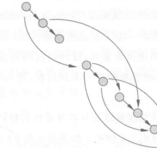

图 5-1 有向无环图①

未来也许会出现一个统一的深度学习 DSL，既能提供命令式、分支跳转等灵活度，又能支撑大规模并行。目前 ONNX、NNVM 等虽然提供了通用的图表示和 Python 构建接口，但基本只覆盖推理，训练仍依赖各自框架，所以还算不上真正的通用 DSL。发展还要看社区的投入。

## 7. 图灵完备性

DSL 通常通用性弱，多为非图灵完备。通俗说，能计算一切可计算问题的语言才是图灵完备的。C++、Python 等主流语言都支持分支、跳转、递归，是图灵完备的。DSL 更聚焦特定业务，通常不具备递归。SQL、LaTeX、正则表达式都不是图灵完备的。

## 8. TensorFlow 中的分支跳转

TensorFlow 的 DSL 却是图灵完备的，得益于 tf.cond 和 tf.while_loop，前者做条件判断，后者处理循环。但定义图时必须区分 TensorFlow 的控制流和 Python 的控制流。TensorFlow 的判断是图中的一个节点，条件是张量，在定义阶段值未知，不能用 Python 的 if 去判断；Python 的 if 在定义阶段就能确定分支，图里最终只保留一条路径。

代码 5-6 给出了错误示范，x、y 在定义时不是具体数值，Python 判断无法运行。代码 5-7 则正确地把判断节点加入计算图。尽管写法偏繁琐，AutoGraph 机制可以把普通的 Python 控制流自动转成图结构，简化使用。

```
import tensorflow as tf

a = tf.constant(2)
b = tf.constant(3)
x = tf.placeholder(tf.int32)
y = tf.placeholder(tf.int32)

# 错误代码
if x < y:
    result = tf.multiply(a, b)
else:
    result = tf.add(a, b)
```

代码 5-6 错误地使用 Python 判断语句

```
import tensorflow as tf
a = tf.constant(2)
b = tf.constant(3)
x = tf.placeholder(tf.int32)
y = tf.placeholder(tf.int32)
result = tf.cond(x < y, lambda: tf.multiply(a, b), lambda: tf.add(a, b))
with tf.Session() as sess:
    print(sess.run(result, feed_dict={x: 1, y: 2}))    # 输出结果：6
    print(sess.run(result, feed_dict={x: 2, y: 1}))    # 输出结果：5
```

代码 5-7 使用 tf.cond 完成分支判断

## 9. TensorFlow 与 Python 协同

除了分支循环，TensorFlow 还提供了读写文件、编解码等会生成图节点的接口，理论上只靠定义图就能完成读文件、训练循环、写文件的完整流程，图像程序一样自运行。

实际工程中，并非所有操作都放到图里。开发者常借助 Python 的特性与丰富的第三方库做预处理，比如用 Python 读图像、NumPy 处理后再送入图，或用 Python 的循环控制训练。另一种做法是把文件读取也嵌入图，训练循环用 TensorFlow 接口实现，只需把文件路径作为输入，图就能自行跑完训练。具体选哪种，取决于灵活性和效率的权衡。

## 10. PyTorch 的命令式编程和动态图机制

静态图能带来高效实现，也能在一定程度上支持分支循环，但声明式和静态图的组合让某些算法如 word2vec、递归神经网络的实现变得笨拙。PyTorch 更贴近 Python，直接使用 Python 自带的判断和循环，实现上述算法非常自然。

代码 5-8 和代码 5-9 分别展示了 PyTorch 和 TensorFlow 实现同一段带判断循环的计算。PyTorch 更像一个为 Python 提供的库，计算过程在 Python 中完成，老 Python 开发者几乎零成本上手。TensorFlow 则显得厚重，不能直接用 Python 的 if/for，必须用 tf.while_loop 并显式定义 Cond、Body 子图。根本原因在于静态图需要在构建完成后就能应对任意输入和控制流，构建完的图就像一个带分支循环的编译程序，与代码 5-8 的效果一致。

```
import torch
first_counter = torch.Tensor([0])
second_counter = torch.Tensor([10])
# 使用 Python 的循环语句
while (first_counter < second_counter)[0]:
    first_counter += 2
    second_counter += 1
```

代码 5-8 PyTorch 实现带有判断和循环的计算

```
import tensorflow as tf
first_counter = tf.constant(0)
second_counter = tf.constant(10)

# 判断函数
def cond(first_counter, second_counter):
    return first_counter < second_counters

# 循环体函数
def body(first_counter, second_counter):
    first_counter = tf.add(first_counter, 2)
    second_counter = tf.add(second_counter, 1)
    return first_counter, second_counter

# 使用 TensorFlow 提供的循环接口
c1, c2 = tf.while_loop(cond, body, [first_counter, second_counter])
with tf.Session() as sess:
    counter_1_res, counter_2_res = sess.run([c1, c2])
```

代码 5-9 TensorFlow 实现带有判断和循环的计算

## 11. 训练图与推理图为何不同

同一套神经网络在训练和部署时使用，表面结构看起来一致，底层的计算流图却相差甚远。

其一，推理只走前向路径，训练则要走完整的正反向。推理时不需要标签数据，训练时必须读取标签，通过损失函数把标签和前向结果对比得到误差，再借助梯度回传逐层修正可训练参数。即使是用同一份 API 来声明，例如用 TensorFlow 的 tf.nn.conv2d 搭建卷积，推理阶段权重和偏置只被当成常量读取，训练阶段在优化器的驱动下这些数值会参与计算并被更新。

其二，部分算子的行为随模式切换。Dropout 在训练时才会激活，推理时直接跳过不执行。批量归一化训练时要基于当前批次统计均值方差并学习额外参数，推理时则变成一组固定的仿射变换。

其三，训练流图中额外挂载大量节点。除网络本身之外，还会加入数据读取、预处理、损失计算、参数更新等操作节点。

对节点和运算的差异保持清晰认知，对后续开发、昇腾 AI 处理器的使用以及编程实践都至关重要。实践中建议遵循三点：

1) 将网络定义与业务流程解耦
用独立的函数或类封装网络，保证输入输出的数据形态稳定。以 LeNet5 为例，可单独封装，输入固定为 [N, 28, 28, 1]，输出为 [N, 10]，N 代表批内样本数且在运行期确定。这样子图即可在不同项目复用，也是各大框架提供模型仓库的原因。

2) 用开关标记训练与推理状态
像 Dropout 这类算子在两阶段的执行方式不同，有时训练还需要额外操作，建模时应引入一个显式标志。Caffe 在 prototxt 里通过 Phase 字段区分阶段，从而决定是否保留某些层。TensorFlow 则靠函数参数配合 Python 判断来决定是否接入 Dropout。还可以把 Dropout 比例做成可占位的变量，训练时生效，推理时设为零实现空操作。借助该开关，同一份定义即可快速生成对应阶段的图。

3）训练代码和推理代码分开实现
虽然可以用参数切换模式，但两者的业务逻辑和图结构差异较大，通常分开编写，通过权重文件传递参数。典型工程包含：
- model.py：基于框架接口描述网络结构。
- train.py：在 model.py 基础上搭建训练流图，可加载预训练权重，按业务进行训练并保存参数。
- test.py：在 model.py 基础上搭建推理流图，加载权重完成预测并导出推理图。
- 应用代码：加载推理图和参数，完成具体应用。

## 12. 模型持久化方式

为实现持久化，各框架都提供保存与加载能力，通常把结构和参数分开存放，例如 Caffe 的 prototxt 与 caffemodel，TensorFlow 的 meta、ckpt、pb 等。大体可归为三类：

结构文件：仅保存流图拓扑，是序列化后的图，例如 TensorFlow 的 meta 文件。
参数文件：仅保存可训练权重，如权重偏置，以键值形式存储，例如 TensorFlow 的 ckpt、PyTorch 的 pth。
模型文件：同时包含结构和参数，形式因框架而异，例如 TensorFlow 的 pb。

保存时要明确保存了什么内容，加载时要清楚文件里有什么。代码 5-10 展示了 PyTorch 在模型与参数层面的保存加载流程。

```
# 保存和加载整个模型
torch.save(model, 'model.pth')
new_model = torch.load('model.pth')

# 仅保存和加载模型参数
torch.save(model.state_dict(), 'params.pth')
model.load_state_dict(torch.load('params.pth'))
```

代码 5-10 PyTorch 模型保存与加载机制

## 13. 跨框架迁移的现实阻力

框架和加速平台日益增多，TensorFlow、Caffe2、MXNet、PyTorch 等，以及 CPU、GPU、FPGA、ASIC 等，给模型迁移带来摩擦。例如要在亚马逊集群上开发，往往需要把其他框架的模型转为 MXNet 格式并重训，且不同框架对同一算子的语义差异可能导致结果偏离。

ONNX 在一定程度上缓解了问题。如图 5-2 所示，ONNX 提供一种中间表示，只要框架支持 ONNX 就能实现互转。微软提出的 MMdnn 也是类似思路，如图 5-3 所示，它提供转换工具，不要求各框架原生支持 MMdnn，而是自行适配目标格式。

需要说明的是，ONNX、MMdnn 只是转换桥梁，并不提供流图的运行环境，训练、推理、部署仍由各框架完成。

## 14. 推理引擎与计算图的关系

随着框架生态成熟，对跨框架迁移的需求催生了 ONNX、MMdnn，对高效跨硬件推理的需求催生了推理引擎。

推理引擎不支持训练，接收来自框架的已训练流图，经过优化后在不同硬件上高效运行，类似编译器栈完成从框架模型文件到加速硬件的端到端映射。

引擎的输入是各框架定义的模型文件，即流图的表示方式，ONNX 只是其中一种，因其统一性被广泛采用。对引擎开发者需注意：

- (1) 模型文件应同时包含流图结构和参数。TensorFlow 通常用 pb 文件，PyTorch 的模型参数与结构可能共用扩展名，需特别确认是否齐全。
- (2) 图中应只保留推理子图。训练图包含反向、数据读取、预处理等节点，推理引擎不一定支持。最终推理图最好仅含神经网络本身，输入例如 [32,1,28,28] 的图像，输出例如 [32,10] 的概率。按需可加入像素格式转换等简单算子，前提是模型定义和引擎支持。
- (3) 优先使用统一格式。ONNX 提供统一的中间表示、算子集和 onnx 文件格式，同时包含结构和参数。TensorRT、TVM 等主流引擎对 ONNX 支持良好。将模型先转成 ONNX 再送入引擎，能更快发现并解决上述问题。

## 5.1.2 推理优化的原理拆解

相较训练，推理流程固定，优化空间更大。优化方向多样：算法层面如 FFT、Winograd 卷积降低复杂度；调度层面如内核融合减少调度开销；硬件层面如 TPU 的脉动阵列加速卷积。

例如某机器翻译团队通过内核融合和专用内核，让 BatchMul 计算核比专业优化的 cuBLAS 快 13 倍，进一步融合前后处理再提升 1.7 倍。业界经典做法是把二维卷积、批量归一化、ReLU 融合成 Fused-Conv2d-Bn-ReLU，性能常超过 cuDNN 的手工优化内核。

总体分为两层：一是流图优化，向上抽象，涉及内存分配、内核融合、计算调度等硬件无关优化；二是内核优化，向下抽象，涉及数据排布、循环展开等强相关的硬件优化。

### 1. 传统框架推理的执行路径
无论声明式还是命令式，静态图还是动态图，推理时数据都沿固定流程走，可看作一个固定程序。若把每个算子视为带参数的函数，整模型等价于代码 5-11 的函数定义，流程由多个算子按类似 TensorFlow 静态图的方式串联，中间带少量控制流。

```
void inference(A, D, params)    // 模型推理过程
{
    if (condition) {            // 分支跳转
        conv(A, B, params1);    // 卷积内核函数
    }
    else {
        conv(A, B, params2);    // 卷积内核函数
    }
    pooling(B, C, params3);     // 池化内核函数
    fc(C, D, params4);          // 全连接内核函数
}
```

### 代码 5-11 推理计算图的抽象

Caffe 正是以直接方式实现该抽象。Caffe 定义常用算子集，每种算子有 CPU/GPU 实现并支持不同参数配置。在 prototxt 中以 Layer 形式出现，连接关系通过 bottom 和 top 字段定义。推理时解析所需算子和连接，在算子库中找到实现并按序执行。

硬件上执行计算的函数叫内核函数，代码 5-11 中的调用过程即执行图。实际系统更复杂，还涉及内存管理、数据同步。以 CPU+GPU 异构系统为例，GPU 运行内核做计算，CPU 负责内存管理、数据搬移、调度。

TensorFlow、PyTorch 在推理时都要解析推理图、构建执行图并调用内核。多数框架在 CPU/GPU 上调用 cuBLAS、cuDNN、OpenBLAS 等库。从编译器角度看，现有框架更像前端，提供特定域语言和灵活性。理解这种抽象对掌握优化方法和引擎原理至关重要。

### 2. 计算图优化
计算图优化不依赖具体硬件，主要从内存、调用、同步角度改进。

#### 1) 优化内存分配方式
推理需要存储参数、输入输出和中间结果。为避免每次分配，框架通常在任务开始前为每个节点和参数按形状预分配并复用。Caffe 就要求在 prototxt 中明确输入形状。

随着模型迭代，输入形状可能变化，固定分配不再适用。现代表现为动态分配，TensorFlow 的占位符可接收 [None,224,224,3]，None 在运行时确定，后续张量形状随之推导。

这种灵活性带来开销：运行时算形状、动态分配内存。TensorFlow 采用预分配大块内存加存储空间管理器，本身也有开销。

实际推理输入常固定，可像 Caffe 一样统一预分配，避免动态开销。TVM、TensorRT 等推理引擎要求指定输入形状，ONNX、TFLite 在转换前也要求固定形状，目的都是降低分配成本。

```
import numpy as np
import tensorflow as tf

# 定义占位符
input_tensor = tf.placeholder(tf.float32, shape=(None, 224, 224, 3))

with tf.Session() as sess:
    input_data_0 = np.random.rand(16, 224, 224, 3)
    input_data_1 = np.random.rand(32, 224, 224, 3)
    print(sess.run(input_tensor, feed_dict={data_input: input_data_0}).shape)  # (16, 224, 224, 3)
    print(sess.run(input_tensor, feed_dict={data_input: input_data_1}).shape)  # (32, 224, 224, 3)
```

### 代码 5-12 TensorFlow 中占位符的形状可变

#### 2）指定合适的批量大小
批量大小对推理性能影响很大，通常随批量增大而提升并趋于峰值。小批量无法充分利用硬件计算资源。以昇腾 AI 处理器 AI Core 的矩阵计算单元为例，矩阵小于 16×16 时需补零，浪费计算。随着批量增大，浪费比例下降，性能接近峰值。

不少加速器研究拿 GPU 对比时，因批量选择不当导致 GPU 带宽和计算未满，性能远不及峰值，这种对比并不公平。

在落地的深度学习推理里，batch 尺寸并不是越大越好。每个模型在具体硬件上都有一个理论性能天花板，往往被内存带宽或算力所卡住，这个上限可以用 Roofline Model① 来估算。另一面，batch 放大意味着单次请求的等待时间变长。自动驾驶这类对实时性极度敏感的场景，延迟一旦超标就不可接受。视频类任务虽然更看重吞吐，但即便在逼近峰值性能的前提下也得尽量压低时延。实践中只能在吞吐和时延之间做权衡，选出最合适的批量大小。

> ① 参见 https://en.wikipedia.org/wiki/Roofline_model.

#### 3）内存复用：让一块内存被反复利用
网络结构越来越花，比如残差、Inception 这类分支结构。计算图看上去复杂，但推理时可以通过精细的内存规划把无用搬运消掉。

以残差为例，输入 x 必须保留到两层卷积都算完，才能和最后一层卷积的输出 F(x) 相加得到 F(x)+x。以 Inception 为例，前一层的输出 A 要同时喂给 1×1 卷积、3×3 卷积、5×5 卷积和 3×3 maxpool 这四条分支，随后四路结果再按通道拼接。只要为 A 和最终拼接区 B 分配内存，就够用了。四条分支的输入直接复用 A 的存储，各自的输出写到 B 的不同切片里。等四条路全跑完，B 里已经是拼接好的特征图，不需要额外拷贝。

> ① 参考论文 Deep Residual Learning for Image Recognition。
> ② 参考论文 Going deeper with convolutions。

#### 4）把控制逻辑从推理路径上拿掉
从代码 5-11 能看到，推理图里常出现 if、while 这类分支。虽然调度由 CPU 完成，但开销不小。if 要同时维护两条分支的内存和内核调度信息，while 则让调度和内存管理更复杂。若分支依赖运行时的数据，还可能触发跨存储空间的数据搬迁。

产生控制流的原因不同。一种是为了训练和推理时切换计算，比如用开关跳过某些算子；另一种是模型本身需要，像自然语言解析树这类结构。TensorFlow Fold 就是把动态图转成带逻辑控制的静态图。前一种情况在部署时计算路径是固定的，控制信息可以提前确定，直接把分支裁掉，省掉调度成本。后一种无法完全消除，就要精细管控控制流和数据流，把额外开销压到最低。

#### 5）拆出独立计算流做并行
LeNet-5、VGG 这类经典卷积网由算子串联，整体就是一条计算流。图 5-5 的 Inception 里，四条分支共享同一输入且互不依赖，就天然形成了四条独立的计算流，可以并行推进。

GPU 上不同流可以在同一芯片内部并行，也可以在多卡间分布式执行，最后用同步机制收敛。即使模型没有特殊结构，也可以把内核或一条计算流拆成多个独立子流，只是拆分会带来同步成本。只要划分合理、同步可控，并行就能提升推理速度、降低延迟。真实分布式系统更复杂，涉及设备间通信和统一管理，但核心思路一致：用并行换性能。

#### 6）内核融合：减少调用、减少搬运
为了灵活，大多数框架提供细粒度的代数算子：向量加减乘除、矩阵乘等，都靠 cuBLAS、OpenBLAS 这类库的内核实现。灵活性带来了碎片化，一张图里可能有数百个算子、数百次内核调用。每次调用都有调度、启动和昂贵的内存读写。批量归一化就是典型，由 Broadcast、Reduce、Element-wise 等拼接而成，一个算子内部就多次进出寄存器与内存。

把多个内核合并成一个执行就是内核融合，能显著降低调用开销。NVIDIA 的 cuDNN 就是手工融合卷积、池化等常用算子，但手工覆盖有限，扩展性差。

常见的融合方式：
如图5-6所示，常量部分可以在编译期直接算出来，和 C++ 的 constexpr 类似，能用常量的地方全部换成常量。
如图5-7所示，简单的细粒度线性运算可以合并成一个内核，必要时做表达式优化，比如公共子表达式消除。

> ① 图片参考TVM社区。

以 GoogLeNet 的 Inception 为例，Conv、BN、ReLU 经常连用，可以融合为 Fused-Conv-BN-ReLU，即 CBR。融合后，原本 6 组 {Conv，BN，ReLU} 共 18 次内核调用，变成 6 次 CBR 调用。

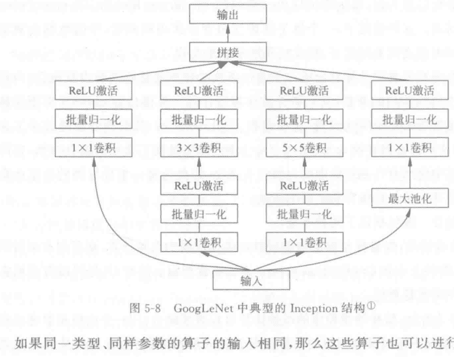
如果同一类型、参数相同且输入相同的算子，可以继续融合。如图 5-9 所示，左向右前三条分支的三个 1×1 CBR 参数一致、输入相同，就能合并成一个 1×1 CBR，一次计算搞定。

内核融合通常分四步：
1. 对计算图做基础优化，常量折叠、表达式化简等。
2. 找出可融合的节点，通常是一段连续的子图。
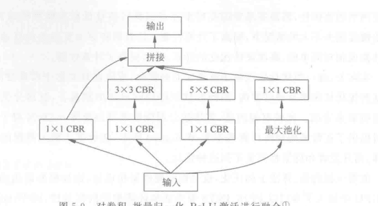
图 5-9 对卷积、批量归一化、ReLU 激活进行融合①
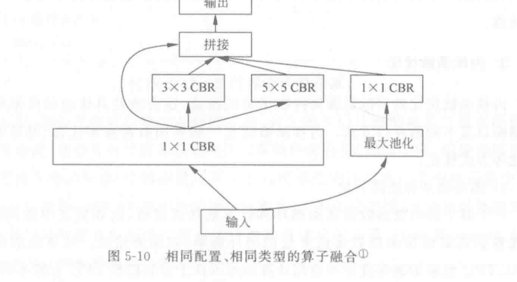
图 5-10 相同配置、相同类型的算子融合①
3. 为融合子图生成对应的内核代码，可以是硬件相关代码或中间表示，再由编译器生成指令。
4. 用融合内核替换原图子图，运行时直接调用。

#### 7）用更高效的实现替换原算子
这类优化包括模型量化、FFT、Winograd 卷积等。前者利用网络鲁棒性，把高精度浮点换成低精度整型，在精度损失可控时提升速度；后者通过空间变换把复杂计算变成更适合硬件的简单计算。

这类改动本质上是算法层面的，却常由推理引擎完成。cuDNN 对卷积同时提供通用 GEMM 版和 Winograd 版，会根据输入形状动态挑选，开发者感知不到。算法优化反过来影响硬件：量化普及推动 GPU 加入 FP16、INT8 张量核；Winograd 的出现催生了专用加速器。如何在不改变算法感知的同时用上硬件优势，是推理引擎的挑战之一。

## 3. 内核函数优化
内核优化关注具体的硬件架构、存储层次和并行方式，常用手段是数据排布、循环展开和循环变换。

### 1) 循环展开和矩阵分块
一个算子的内核通常由多层循环加算术表达式构成。以矩阵乘为例，纯标量实现需要在 M、N、K 三维循环，复杂度 O(N^3)。若用向量运算把 K 维并行掉，只剩两层循环，复杂度降到 O(N^2)。再用矩阵运算一次搞定，可视为 O(1)。

```
int A[M][K], B[K][N], C[M][N];
// 标量运算 3 层循环
for (int i = 0; i < M; i++) {
    for (int j = 0; j < N; j++) {
        for (int k = 0; k < K; k++) {
            C[i][j] += A[i][k] * B[k][j];
        }
    }
}
// 向量运算两层循环
for (int i = 0; i < M; i++) {
    for (int j = 0; j < N; j++) {
        C[i][j] = mac(A[i][*], B[*][j]);
    }
}
// 矩阵运算没有循环
C = gemm(A, B);
```
代码 5-13 矩阵算法的复杂度
硬件的并行度有限，比如昇腾 AI 处理器矩阵单元最大支持 16×16 乘法，实际矩阵更大时就需要分块。代码 5-14 展示了把任意矩阵拆成 16×16 块再计算的思路，这就是循环变换的一种。除此之外还有循环融合、循环重排等，目标都是让循环更贴合硬件，如代码 5-15 的循环合并，把两次循环合并，减少循环本身开销。

```
int M_dim = (M + 15) / 16;
int N_dim = (N + 15) / 16;
int K_dim = (K + 15) / 16;
int A_split[M_dim][K_dim][16][16];
int B_split[K_dim][N_dim][16][16];
int C_split[M_dim][N_dim][16][16];
for (int i = 0; i < M_dim; i++) {
    for (int j = 0; j < N_dim; j++) {
        for (int k = 0; k < K_dim; k++) {
            C_split[i][j] += gemm(A[i][k], B[k][j]);
        }
    }
}
C_split --> C
```
代码 5-14 根据矩阵计算单元的运算展开矩阵运算(伪代码)
```
int A[N], B[N];
// 转换之前
for (int i = 0; i < N; i++) {
    B[N] = A[N] * 2;
}
for (int i = 0; i < N; i++) {
    B[N] = B[N] + 1;
}
// 转换之后
for (int i = 0; i < N; i++) {
    B[N] = A[N] * 2 + 1;
}
```
代码 5-15 循环合并

### 2) 数据排布决定访问效率
深度学习里多维数据线性存储，顺序不同访问特性迥异。Caffe 用 NCHW，即 [Batch, Channels, Height, Width]；TensorFlow 用 NHWC，即 [Batch, Height, Width, Channels]。以 RGB 图片为例，NCHW 存的是“RRRGGGBBB”，同通道像素连续；NHWC 存的是“RGBRGBRGB”，同位置各通道连续。

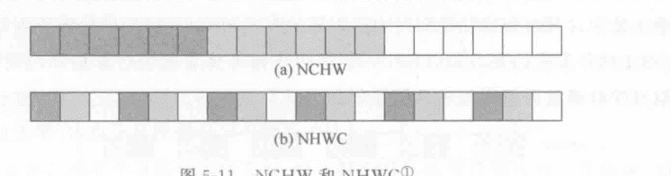
存储相同，性能不同。以 RGB 转灰度为例：
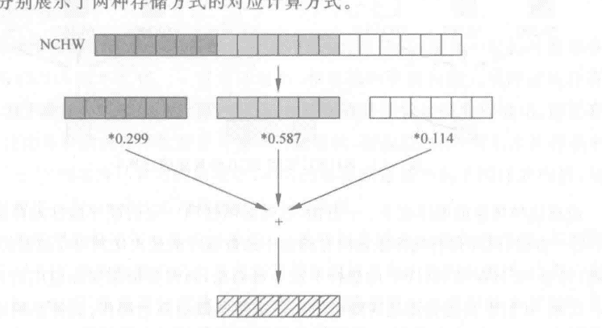
在图 5-12 中，NCHW 下同一通道像素连续，必须先把各通道像素与权重相乘后再累加，才能得到所有像素结果。计算规律性强、控制简单，但需要等所有通道数据就绪，内存带宽压力大，临时空间也多。

> ① 图片参考链接：https://mp.weixin.qq.com/s/I4QlBv7yecqYXUra49o7tw。

在图 5-13 中，NHWC 下像素是 RGB 三元组一组一组排列，可以边读边算，第一个像素很快就能出结果，临时空间小，对带宽要求相对低。但每组启动时间不一，控制逻辑更复杂。

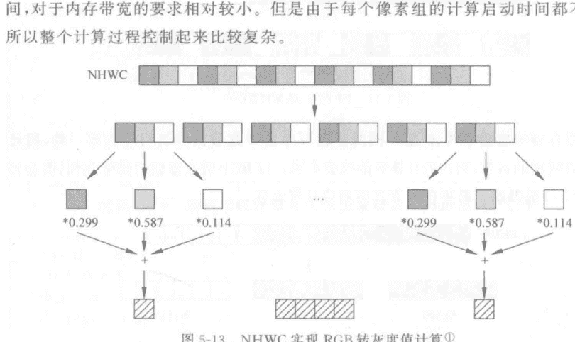
根本原因是数据必须线性存放，也只能线性访问才能最大化带宽利用。NCHW 更适合逐通道操作，如池化；NHWC 更适合逐像素多通道操作，如 1×1 卷积。一般 NCHW 适合 GPU 的大带宽和高规律计算，NHWC 更适合多核 CPU 的灵活控制。cuDNN 默认 NCHW，TensorFlow 早期侧重 CPU 才采用 NHWC。高度 H 和宽度 W 的先后也会影响性能，这就是行优先与列优先的区别。

> ① 图片参考链接：https://mp.weixin.qq.com/s/I4Q1Bv7yecqYXUra49o7tw。

数据在存储时往往并不遵循直观的语义顺序，更多是服从计算时的需求来调整格式与排列方式。比如代码 5-14 里，矩阵 A[M][K] 就被切成了 A[M_dim][N_dim][16][16] 的块状结构。原因在于昇腾 AI 处理器内部的 AI Core 只吃 16×16 大小的矩阵运算，而且参与乘法的两个矩阵在访问模式上要求相反，一个得按行优先遍历，另一个得按列优先遍历。所以在真正进入矩阵计算引擎之前，通常会靠软件或专用硬件先把数据重新排布，让计算效率达到最优，这正是深度学习引擎要关心的核心问题。

由此可见，在模型推理之前，完全可以根据硬件结构和资源情况，把模型参数的存储顺序提前转换好；对于输入数据和中间结果，则需要在运算过程中动态转换。实际变换时要兼顾配置和优化策略，这就引出了下面要说的专用内核思路。

### 3) 专用内核
现阶段深度学习框架里调用的内核基本都是预编译好的，像 Caffe 每一层的计算都有对应的 C++ 和 CUDA 实现。编译完成之后，内核的逻辑就被固定死了。为了应对不同配置，函数必须设计得足够通用，并带上大量参数，比如卷积核的输入形状、核大小、步长等。代码 5-11 所示的推理图抽象里，不同的卷积调用其实是同一个内核，只是参数不一样，靠参数差异实现不同处理。

这种通用内核灵活倒是灵活，性能却很难做到极致。一方面，参数多样会带来大量的在线计算和控制分支，直接拖慢推理；另一方面，要想把内核真正优化到位，需要精细的数据布局和循环调优，而参数一变，优化难度就暴涨。即使借助规则自动划分计算，跟手工精调的代码仍然存在明显差距。

英伟达的 cuDNN 和 cuBLAS 想用专用内核来缓解这个问题，给特定参数配置手工打造优化版本。cuDNN 准备了多种经过精细调优的卷积实现，涵盖 FP32、FP16 等不同精度，以及通用 GEMM、Winograd 等不同算法，并在运行时根据参数自动挑选最优方案。问题是库本身是预编译的，只能在运行期尽量挑最好的版本；而且专用化也受限，比如只能在 3×3 这类固定核上发挥作用。

这类定制内核的弊端在表 5-1 中体现得很清楚。cuBLAS 的批量矩阵乘法内核为了适配各种形状，会用补零的方式把矩阵统一填到特定尺寸再算，结果计算量恒定不变。输入再小，算量也不降，反而浪费大量资源。更麻烦的是，像 cuDNN、cuBLAS 这样的库需要投入大量工程师和丰富的经验去做手工优化，不可能做到面面俱到。

针对这些痛点，业界流行的做法是为深度学习应用量身定制内核。深度学习里常见的计算模式相对固定，数据形状、算子配置都可以统计出来，先找出耗时最多的操作，再为其打造专门的内核，充分优化后再在运行时调用，能显著提升推理效率。本质上就是放弃完全预编译的思路，引入编译阶段，利用更多运行时参数信息来指导优化。

现在很多推理引擎希望把这个过程自动化，在信息充足的情况下自动生成高效的专用内核，取代手工调优。伴随推理引擎的发展，自动生成的内核性能已能达到手工优化的 70%～80%。借助编译器，整网模型都有望用专用内核实现，整体推理性能随之提升。若再配合少量手工微调，自动生成的内核甚至可以追平或超过纯手工版本。

## 5.1.3 深度学习推理引擎
深度学习推理引擎只做推理阶段的工作，主要有两层目的：一是把来自各框架的模型文件里描述的计算图和参数解析出来，统一成计算图级别的中间表示，再进一步映射成目标硬件的执行图，也就是具体的内核调用，从而实现跨框架、跨硬件的部署；二是基于中间表示，综合使用各种优化手段，提升模型在真实硬件上的推理效率。

目前推理引擎百花齐放，各家都围绕自家硬件造轮子。DMLC 的 TVM、英特尔的 nGraph、英伟达的 TensorRT、脸书的 Tensor Comprehensions、谷歌的 TensorFlow XLA、百度的 Anakin、阿里的 MNN 等，表面看各不相同，底层工作却很相似：各自定义一套深度学习中间表示，完成 DSL→Deep Learning IR→LLVM IR→Target 的链路，并在中间插入优化，这也正是深度学习编译器的本质。

侧重点不同会导致差距明显。TensorRT 专注于在 GPU 架构上提速，图优化和内核优化都围绕 GPU 设计。TensorFlow XLA 用 LLVM 中间表示描述算子，能复用 LLVM 的前端优化。Tensor Comprehensions 则更激进，采用 Halide 中间表示，通过编译器理论对底层循环进行变换和优化。

本节重点介绍业界最知名的 Tensor Virtual Machine，即 TVM。相比其他引擎，TVM 不仅拥有计算图级别的 NNVM 和 Relay，还在下层引入了 Halide 中间表示来支撑张量计算。这种分层抽象既保证了向新硬件扩展的能力，又让开发者可以用清晰的领域特定语言描述算法，用 TVM 原语定义和调度底层计算。AutoTVM 提供了搜索机制，能快速为特定硬件找到最佳优化方案；完善的代码生成器可基于计算定义和调度迅速产出目标平台代码。总之 TVM 让推理引擎不再是黑盒，开发者能参与并了解模型优化，也为后续理解昇腾 AI 处理器的编程方式打下基础。

> ① 数据参考云栖社区：https://yq.aliyun.com/articles/569539。

## 1. TVM 的第一代计算图中间表示——NNVM
NNVM 是 TVM 最早的计算图中间表示，概念甚至早于 TVM 本身。2016 年陈天奇等人发现，让深度学习框架同时适配所有硬件是不可持续的。类似问题在编译器领域早有先例：编程语言层出不穷，CPU 架构不断更新，一个编译器难以覆盖全部后端。LLVM 通过前端后端分离解决了这个问题：新语言只要做前端转成 LLVM IR，新硬件只要做后端即可。受此启发提出了 NNVM。

NNVM 可视为深度学习的 LLVM，是神经网络的高层中间表示，通常就是计算图。前端框架只需把计算表达成 NNVM IR，随后 NNVM 统一做与硬件和框架无关的处理和优化，包括内存分配、数据类型与形状推导、算子融合等，再交由各编译后端生成硬件代码。模块化设计让框架能同时适应前端编程环境和后端硬件的快速演进。与 NNVM 同期的还有英特尔的 Nervana Graph，也就是 nGraph 的前身，功能类似。

NNVM 的抽象层次决定了它做不了更底层的优化。因此 2017 年在 NNVM 基础上提出了 NNVM 编译器，引入张量级优化的 TVM。NNVM 负责计算图，把不同框架的图转成统一 IR、优化后转成执行图；TVM 负责张量运算，提供硬件无关的底层计算中间表示，并通过分块、缓存等手段优化计算。TVN-NNVM 堆栈被描述为从深度学习到各硬件的完整优化工具链。

## 2. TVM 的第二代计算图中间表示——Relay
在当前 TVM 版本中，NNVM 已被 Relay 取代。Relay 是第二代 NNVM，于 2018 年加入 TVM 编译器堆栈，其出现有明确动机。

传统深度学习框架都用计算图来表示应用，并把计算图作为输入、中间表示和运行时数据结构，NNVM 正是沿此思路提出统一表示。以 TensorFlow 为代表的基于计算图的框架采用先定义后运行的编程模型，能支持绝大多数前沿模型，但也带来缺陷：

- 控制流支持不佳，分支、循环等难以表达；
- 难以支持输入形状依赖于输入本身的模型，例如 word2vec。

TensorFlow 的 tf.cond、tf.while_loop 以及 TensorFlow Fold 等工具只能部分缓解，且不够友好。

以 PyTorch 为代表的动态图框架摒弃了先定义后运行，采用运行时定义图的命令式编程，把原语嵌入 Python，可使用 Python 高级特性，控制流由解释器决定。动态图仍有问题：

- 控制流由 Python 解释器控制，框架难以像 TensorFlow Fold 那样优化；
- 图在运行时才确定，拓扑变化就需要重新优化并产生数据搬移开销。

Relay 解决了这些问题，它不仅仅是计算图中间表示，更是面向自动微分的领域特定语言，TVM 则是 Relay 的编译器。相关技术细节可参考 Jared Roesch 的论文 *Relay: A New IR for Machine Learning Framework*。

Relay 提供 Python 接口，支持把各框架模型转成统一计算图中间表示，接口在 tvm.frontend.relay 中定义。代码 5-16 展示了如何加载 ONNX 模型并转成 Relay 中间表示，无关代码已省略，最后的 mod、params 分别为 Relay 模块和参数字典。

```python
import onnx
import numpy as np
import tvm
import tvm.relay as relay

onnx_model = onnx.load(model_path)           # 导入 ONNX 模型
x = np.array(img_y)[np.newaxis, np.newaxis, :, :]  # 指定输入数据形状
input_name = '1'
shape_dict = {input_name: x.shape}
mod, params = relay.frontend.from_onnx(onnx_model, shape_dict)
```

代码 5-16 导入 ONNX 模型转换成 Relay

Relay 还支持直接用 Python 接口构建计算图。图 5-14 展示了一个官方案例。Relay 既能像传统框架那样定义计算图，也能像高级语言那样定义函数、声明变量，成为真正的微分语言。

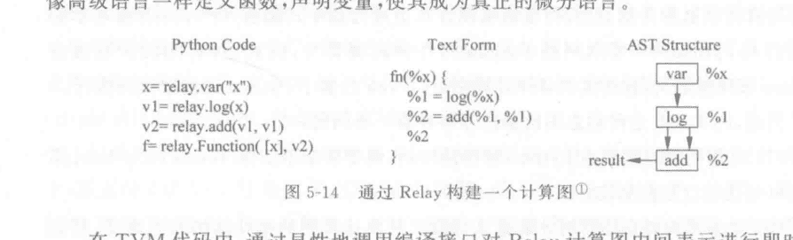

在 TVM 代码中显式调用编译接口，即可对 Relay 中间表示做即时编译并在 TVM 运行时环境中执行，代码 5-17 在代码 5-16 基础上完成了编译和运行。

```python
with relay.build_config(opt_level = 1):
    # 编译
    intrp = relay.build_module.create_executor('graph', mod, tvm.cpu(0), target)
    dtype = 'float32'
    # 运行
    tvm_output = intrp.evaluate()(tvm.nd.array(x.astype(dtype)), **params).asnumpy()
```

代码 5-17 编译并运行计算图

> ① 图片参考 TVM 官网：https://docs.tvm.ai/dev/relay_intro.html。

## 3. TVM 中的图优化
通常推理引擎对开发者而言是黑盒，只需把模型转成统一中间表示再编译即可运行，开发者很难感知内部优化。TVM 的 Relay 不仅提供自动图优化，还允许开发者通过编译器传递 Compiler Pass 来扩展特性。

Relay 的图优化部分在 tvm.relay.transform 中定义，代码 5-18 列出了目前提供的优化层级，前文已有涉及。

```python
OPT_PASS_LEVEL = {
    "SimplifyInference": 0,
    "OpFusion": 1,
    "FoldConstant": 2,
    "CombineParallelConv2D": 3,
    "FoldScaleAxis": 3,
    "AlterOpLayout": 3,
    "CanonicalizeOps": 3,
    "EliminateCommonSubexpr": 3,
}
```

代码 5-18 TVM Relay 提供的图优化方法

- SimplifyInference：简单推理，不做优化；
- OpFusion：算子融合；
- FoldConstant：常量折叠；
- CombineParallelConv2D：合并并行卷积与运算；
- FoldScaleAxis：折叠缩放轴；
- AlterOpLayout：改变算子排布；
- CanonicalizeOps：规范化算子；
- EliminateCommonSubexpr：消除公共子表达式。

## 4. TVM 的低层次中间表示
TVM 之名本就用来定义低层次张量计算的中间表示，2017 年作为 NNVM 编译器一部分提出时与 NNVM 处于不同层次。随着发展，TVM 的含义扩展为面向 CPU、GPU 及专用加速器的深度学习编译器堆栈，目前主要包含：

- 把来自各框架的模型编译到不同硬件后端上最少可调用的内核；
- 自动化生成并优化不同硬件后端上的高效内核。

NNVM 带入的图级优化已经展现出很强的效果，靠内存层面的改造就能让单卡 GPU 训起 1000 层 ImageNet ResNet 这类庞大模型。可图这一层终究太高了，卷积、矩阵乘这类算子在不同硬件上要怎么布局内存、怎么划分并行、怎么命中缓存、该调用哪种硬件原语，这些决定性能的细节图优化根本触不到。正是为了填补算子级、硬件级的优化空白，TVM 才引入了张量之下的低层中间表示，让算子能够针对具体设备做精细化雕刻。

## 5. Halide 如何启发了 TVM 的低层设计
TVM 低层表示的思路很大程度上来自 Halide。Halide 是一套以 C++ 为宿主的图像处理专用语言。拿局部拉普拉斯变换举例，用原生 C++ 直接写跑得并不快，经过老手手工调优能提升约 10 倍，但成本极高。用 Halide 只需寥寥数行，就能得到快约 20 倍的 C++ 实现，把工程师从底层忙活里解放出来，只专注算法本身。

Halide 的核心在于把计算计算和调度策略拆开。计算描述算法做什么，调度决定算法在某块硬件上怎么跑，比如内存分配、并行方式、循环顺序等。以高斯模糊为例，tmp 与 blurred 两个函数定义了以中心像素为原点共 9 个像素的均值计算，而随后的两行调度代码则负责分块、向量化、并行等循环优化，还提供 inline、root、chunk、reuse 等原语来控制数据缓存。在 4 核 x86 CPU 上，Halide 生成的代码可达 0.9ms/megapixel，而最朴素的 C++ 实现只有 9.96ms/megapixel，差距接近十倍。

```cpp
Func halide_blur(Func in) {
    Func tmp, blurred;
    Var x, y, xi, yi;
    // 算法实现
    tmp(x, y) = (in(x - 1, y) + in(x, y) + in(x + 1, y)) / 3;
    blurred(x, y) = (tmp(x, y - 1) + tmp(x, y) + tmp(x, y + 1)) / 3;
    // 算法调度
    blurred.tile(x, y, xi, yi, 256, 32).vectorize(xi, 8).parallel(y);
    tmp.compute_at(blurred, x).vectorize(x, 8);
    return blurred;
}
```

代码 5-19 Halide 代码

除了解耦计算与调度，Halide 还善于元编程生成高效 C++，并且能在优化因子空间里自动搜寻最佳的展开因子等参数。

## 6. TVM 低层次中间表示的特点
TVM 融合了 Halide 的精髓，并加入循环变换与深度学习框架的理念，主要体现为：

- （1）选用 HalideIR 作为算术表示的数据结构，以简化描述。
- （2）沿用 Halide 的解耦思路，把算子实现与算子调度分开。
- （3）引入 Auto-Tuning 自动调优，开发者定义搜索空间后由 TVM 自带搜索器找最优解。
- （4）在低层优化上借鉴 loopy 循环变换工具与多面体模型分析，采用 loopy 的原语做循环重排。
- （5）针对深度学习设计底层 DSL，宿主语言为 Python，为计算与调度分别提供原语。
- （6）编程范式延续传统深度学习框架的计算图风格，如 TensorFlow 的张量、占位符概念。
- （7）同一算子实现可配不同调度，从而为不同硬件后端生成专属代码。

## 7. TVM 的算子实现
以深度学习里常见的 Reduction 为例，其功能是通过求和、平均等把多维数据降维。代码 5-20 用 C++ 手写了二维数组 A 经求和降到一维 B 的过程，代码 5-21 则用 TVM 原语实现了相同逻辑。

```cpp
for (int i = 0; i < n; ++i) {
    B[i] = 0;
    for (int k = 0; k < m; ++k) {
        B[i] = B[i] + A[i][k];
    }
}
```

代码 5-20 实现 Reduction 算子求和的 C++代码

```python
import tvm
import numpy as np
n = tvm.var("n")
m = tvm.var("m")
A = tvm.placeholder((n, m), name='A')
k = tvm.reduce_axis((0, m), "k")
B = tvm.compute((n,), lambda i: tvm.sum(A[i, k], axis=k), name="B")
```

代码 5-21 实现 Reduction 算子求和的计算代码(Compute)

TVM 的写法很像 TensorFlow，采用声明式静态图风格，整体通过计算原语搭起流程。涉及到的原语包括：

- tvm.var：声明指定名字与类型的变量，默认 int。
- tvm.placeholder：定义输入占位符，即空张量。
- tvm.reduce_axis：定义用于循环的迭代轴与范围。
- tvm.compute：基于 lambda 表达式构造输出张量。
- tvm.sum：按指定轴构造求和表达式。

数据经占位符进入，再经过各原语计算，最后从输出张量 B 取结果。

调用 tvm.create_schedule 可得到代码 5-21 的默认调度，通常是行优先串行。打印出来的低层表示风格接近 C 语言，是最直接的 Reduction 实现，为后续优化留下空间。

```python
s = tvm.create_schedule(B.op)
print(tvm.lower(s, [A, B], simple_mode = True))
```

代码 5-22 打印默认计算调度

```
produce B {
    for (i, 0, n) {
        B[i] = 0.000000f
        for (k, 0, m) {
            B[i] = (B[i] + A[((i * m) + k)])
        }
    }
}
```

代码 5-23 默认计算调度

## 8. TVM 的算子调度
TVM 的低层表示主要通过循环变换来优化，与 Halide 类似，提供了丰富的调度接口：

- split：把一个轴拆成两个轴。
- tile：对两个轴做分块平铺。
- fuse：把两个轴融合为一个。
- reorder：按指定顺序重排轴。
- bind：把轴绑定到线程组，多用于 GPU。
- compute_at：把一个计算阶段移动到另一个计算阶段的指定轴。
- compute_inline：把计算阶段内联并插入目标阶段。
- compute_root：把计算阶段移回根节点，可视为 compute_at 的逆操作。

对代码 5-21 的 Reduction，可以像代码 5-24 那样对 B 的行轴与列轴做不同因子分裂，得到 4 层嵌套循环的中间表示。

```python
ko, ki = s[B].split(B.op.reduce_axis[0], factor = 16)
xo, xi = s[B].split(B.op.axis[0], factor = 32)
print(tvm.lower(s, [A, B], simple_mode = True))
```

代码 5-24 实现 Reduction 算子求和的调度代码(Schedule)

要生成 GPU 内核，可把 B 的行轴绑定到线程块与线程。代码 5-25 展示了绑定方式。

```python
s[B].bind(xo, tvm.thread_axis("blockIdx.x"))
s[B].bind(xi, tvm.thread_axis("threadIdx.x"))
print(tvm.lower(s, [A, B], simple_mode = True))
```

代码 5-25 绑定 GPU 线程

完整 Reduction 求和实现如下：

import tvm

import numpy as np

# 定义计算

n = tvm.var("n")

m = tvm.var("m")

A = tvm.placeholder((n, m), name='A')

k = tvm.reduce_axis((0, m), "k")

B = tvm.compute((n,), lambda i: tvm.sum(A[i, k], axis=k), name="B")

# 定义调度

s = tvm.create_schedule(B.op)

ko, ki = s[B].split(B.op.reduce_axis[0], factor=16)

xo, xi = s[B].split(B.op.axis[0], factor=32)

s[B].bind(xo, tvm.thread_axis("blockIdx.x"))

s[B].bind(xi, tvm.thread_axis("threadIdx.x"))

代码 5-26 完整代码

## 9. TVM 低层次中间表示优化方法
传统框架里算子内核通常是预编译好的，内部常带分支跳转和动态内存分配，性能受限。即便有 TensorFlow XLA 这类即时编译工具，也未真正做到为特定算子配置、特定硬件生成专用内核。得益于低层抽象和编译时确定性，TVM 能避免这些问题。

代码 5-21 中的占位符形状用变量表达，但编译时根据实际输入就能确定。对卷积而言，输入形状、核大小、步长等参数在编译时皆已知，TVM 可为每种参数组合单独编译一个专用内核，输入输出形状固定，无分支、无动态分配，更利于优化。

优化的核心是循环变换，代码 5-24 中 16 与 32 的展开因子是人工设定的，未必最优。可借鉴 C++ 模板在编译时生成最优因子，或直接手工调优。TVM 更提供了自动调节机制：在编译期从搜索空间里找最优解。

代码 5-27 演示了矩阵乘的自动调优用法，对输出 C 的两个维度做划分，寻找最优因子组合。

```
@autotvm.template
def matmul(N, L, M, dtype):
    # 定义输入
    A = tvm.placeholder((N, L), name='A', dtype=dtype)
    B = tvm.placeholder((L, M), name='B', dtype=dtype)
    # 定义计算
    k = tvm.reduce_axis((0, L), name='k')
    C = tvm.compute((N, M), lambda i, j: tvm.sum(A[i, k] * B[k, j], axis=k), name='C')
    # 定义调度
    s = tvm.create_schedule(C.op)
    y, x = s[C].op.axis
    k = s[C].op.reduce_axis[0]
    # 定义搜索空间
    cfg = autotvm.get_config()
    cfg.define_split("tile_y", y, num_outputs=2)
    cfg.define_split("tile_x", x, num_outputs=2)
    # 根据搜索结果进行调度
    yo, yi = cfg["tile_y"].apply(s, C, y)
    xo, xi = cfg["tile_x"].apply(s, C, x)
    s[C].reorder(yo, xo, k, yi, xi)

    return s, [A, B, C]
```

代码 5-27 使用 TVM 的自动调节机制

自动调节的逻辑可用伪代码 5-28 表示。

```
ct = 0
while ct < max_number_of_trials:
    propose a batch of configs
    measure this batch of configs on real hardware and get results
    ct += batch_size
```

代码 5-28 TVM 自动调节机制伪代码

用代码 5-29 启动搜索，TVM 会在真实硬件上串行评测并记录最优展开因子。

```
N, L, M = 512, 512, 512
task = autotvm.task.create(matmul, args=(N, L, M, 'float32'), target='llvm')

# 包含两个步骤: 构建和运行
measure_option = autotvm.measure_option(
    builder='local',
    runner=autotvm.LocalRunner(number=5))

# 开始自动调节
tuner = autotvm.tuner.RandomTuner(task)
tuner.tune(n_trial=10,
           measure_option=measure_option,
           callbacks=[autotvm.callback.log_to_file('matmul.log')])
```

代码 5-29 启动 TVM 的自动调节机制

随后便可用代码 5-30 编译出面向特定算子配置与硬件的最优专用内核。

```
# 从日志文件中选择性能最好的展开因子,并借此编译相应内核
with autotvm.apply_history_best('matmul.log'):
    with tvm.target.create("llvm"):
        s, arg_bufs = matmul(N, L, M, 'float32')
        func = tvm.build(s, arg_bufs)
    # 检查计算正确性
    a_np = np.random.uniform(size=(N, L)).astype(np.float32)
    b_np = np.random.uniform(size=(L, M)).astype(np.float32)
    c_np = a_np.dot(b_np)
    c_tvm = tvm.nd.empty(c_np.shape)
    func(tvm.nd.array(a_np), tvm.nd.array(b_np), c_tvm)
    tvm.testing.assert_allclose(c_np, c_tvm.asnumpy(), rtol=1e-2)
```

代码 5-30 使用最优展开因子编译对应内核并检查正确性

现实使用中，TVM 的自动搜索并非完全放手就能得到最优解，往往要靠人工先行设计搜索策略才能逼近全局最优。但只要把搜索空间预先搭建好，TVM 就能自动合成出性能接近手工调优的专用算子，再叠加少量人工微调，整体表现通常还能再上一个台阶。正因为具备快速自动或半自动产出高效专用内核的能力，TVM 才在业界获得广泛采用。

## 10. TOPI 机制：用库函数屏蔽调度样板

从之前的 TVM 调度代码可以看出，虽然框架提供了细粒度的计算调度能力，但要写出高效调度必须对目标硬件架构有深入了解。即使开发者熟悉 TVM 的调度原语和硬件细节，也很难面面俱到地调度每一处计算，况且大量调度片段会在不同算子上重复出现，这就是典型的样板代码。

样板代码泛指在多个位置反复出现、几乎不变的必要片段，它们功能次要却不可缺少。在 TVM 的卷积调度里，往往有数千行代码，其中相当一部分是可以复用的，让开发者手写这些重复部分非常低效。

为此 TVM 提供了 TOPI，即 TVM Operator Inventory 算子库。它是一个 Python 模块，向开发者暴露出类似 NumPy 的通用算子接口与调度实现，底层仍然建立在 TVM 之上。

以二维数组对第 2 轴求和降为一维为例，代码 5-31 展示了直接使用 TVM 原语的写法。

```
n = tvm.var("n")
m = tvm.var("m")
A = tvm.placeholder((n, m), name='A')
k = tvm.reduce_axis((0, m), "k")
B = tvm.compute((n,), lambda i: tvm.sum(A[i, k], axis=k), name="B")
s = tvm.create_schedule(B.op)
```

代码 5-31 用 TVM 实现二维数组指定维度求和

这种写法必须显式调用 tvm.compute 等计算原语和 tvm.create_schedule 等调度原语，计算越复杂代码量越爆炸。TOPI 则提供了类似 numpy.sum 的 topi.sum 接口，调度工作已被封装完成。

```
C = topi.sum(A, axis=1)
ts = tvm.create_schedule(C.op)
```

代码 5-32 使用 TOPI 接口完成求和运算

同时 TOPI 还能根据目标硬件平台自动选择优化策略，如代码 5-33 所示，并对神经网络常见算子提供平台适配的调度，如代码 5-34 所示的 GPU 版 softmax 自动调度。

```
x, y = 100, 10
a = tvm.placeholder((x, y, y), name="a")
b = tvm.placeholder((y, y), name="b")
c = a + b
d = a * b
e = topi.elemwise_sum([c, d])
f = e / 2.0
g = topi.sum(f)
with tvm.target.cuda():
    sg = topi.generic.schedule_reduce(g)
```

代码 5-33 TVM 指定硬件平台进行调度

```
tarray = tvm.placeholder((512, 512), name="tarray")
softmax_topi = topi.nn.softmax(tarray)
with tvm.target.create("cuda"):
    sst = topi.generic.schedule_softmax(softmax_topi)
    print(tvm.lower(sst, [tarray], simple_mode=True))
```

代码 5-34 针对 GPU 的 softmax 的自动调度

## 11. TVM 如何把中间表示转成可部署代码

完成各层优化后，最后一步是生成能在指定硬件上运行的代码。TVM 本身不去开发硬件编译器，它负责把 TVM 原语定义出的低层中间表示翻译成目标硬件的编程语言，这一转换涉及编译器原理与具体架构细节。最终系统会把由多个循环构成的低层表示编译为 LLVM、CUDA、Metal、OpenCL 等形式。

得益于良好的抽象分层，TVM 能比较轻松地扩展到新硬件，包括各种定制化深度学习加速器。若芯片厂商想接入 TVM，只需实现从 TVM 低层中间表示到自家芯片代码的转换，就能复用整个软件栈。

## 5.2 昇腾 AI 软件栈的技术全景

TVM、nGraph 这类推理引擎的定位，是在现有框架与现有硬件之间搭桥并做硬件感知的优化。而昇腾 AI 软件栈是华为为自家昇腾 AI 处理器量身打造的推理引擎，与英伟达 TensorRT 定位相近。因此其优化思路和软件设计都与昇腾处理器的架构深度绑定。

在昇腾 AI 软件栈的支撑下，基于昇腾处理器开发深度学习应用的流程相对简单，主要包括下面三步，相关工具在第 4 章已介绍。

### 1. 模型生成阶段

利用离线模型生成器把其它框架的模型转成面向特定昇腾处理器的离线模型文件。过程包含模型解析、计算图优化、任务调度等，开发者只需在 Mind Studio 中使用模型转换工具，或使用 DDK 套件里的离线模型生成器即可。

### 2. 应用编译阶段

面向指定昇腾硬件快速构建深度学习应用，涉及计算引擎串联和整体应用编译。可在 Mind Studio 中新建 Mind 工程，或在命令行修改样例工程完成。

### 3. 应用部署阶段

把应用放到具体的昇腾硬件上运行，涉及不同平台的实现差异，由通用业务流程执行引擎承担。开发者通过 Mind Studio 运行，或在设备侧启动程序即可。

绝大多数场景下无需手写代码。只有当软件栈不支持模型中的算子，或需要自定义应用开发时，才需进行自定义算子与自定义应用开发，具体见 5.3 节。

## 5.2.1 模型生成阶段

#### 1. 模型解析

与主流推理引擎类似，昇腾 AI 软件栈需从框架模型文件解析出网络结构和参数，工作由离线模型生成器完成，对外是黑盒。

解析逻辑借鉴了框架自身的解析代码。以 Caffe 为例，prototxt 的解析规则在 caffe.proto 中定义，离线模型生成器基于编译得到的接口解析出结构与参数，再根据算子名查找昇腾软件栈预置的实现，构建计算图的中间表示。

```
-- framework Framework type(0:Caffe; 3:Tensorflow)
```

代码 5-35 离线模型生成器帮助文档

目前离线模型生成器主要支持 Caffe 与 TensorFlow，转换时需在命令行明确指定。如代码 5-36 所示，DDK 自带的头文件表明对其它框架的支持仍在持续开发中。现阶段若要使用其它框架的模型，可先转成 Caffe 的 prototxt/caffemodel 或 TensorFlow 的 pb 文件再转换。

```
enum FrameworkType
{
    CAFFE = 0,
    TENSORFLOW = 3,
    ANDROID_NN,
    FRAMEWORK_RESERVED,
};
```

代码 5-36 离线模型生成器支持框架的枚举类型

#### 2. 计算图中间表示

解析完成后，模型会被转成软件栈自有的计算图中间表示，同样由离线模型生成器完成，也是黑盒。

离线模型生成器内置了一套图引擎 Graph Engine，GE 的数据结构包含 Operator、TensorDesc、TensorPtr 等，在自定义算子插件开发时需要使用。运行时的张量表示将在 5.3 节详述。

#### 3. 内存分配

昇腾 AI 软件栈要求在转换时必须指定输入数据的形状。因此转换阶段即可确定每个张量的形状，运行时可为全部张量做静态分配，避免动态分配开销。

每个算子在转换时都会调用 ParseParamsFn 与 InferShapeAndTypeFn。代码 5-37 显示 ParseParamsFn 解析 prototxt 解析出的消息结构体，将参数保存到 Operator 节点中。代码 5-38 显示 InferShapeAndTypeFn 根据 Operator 节点信息推断输出形状。

```
Status ReductionParseParams(const Message * op_origin, ge::Operator& op_des)
```

代码 5-37 解析参数函数示例

```
Status ReductionInferShapeAndType(const ge::Operator& op, vector<ge::TensorDesc>& v_output_desc)
```

代码 5-38 推断形状函数示例

除静态分配外，软件栈还支持内存复用以进一步降低占用。

#### 4. 内存排布

主流框架常用 NHWC 或 NCHW 保存张量，而昇腾为了提升访问效率统一采用 NC1HWC0 五维格式。C0 与微架构强相关，等同于 AI Core 矩阵计算单元大小，FP16 为 16，INT8 为 32，需连续存储；C1 = C / C0，若不能整除则末尾补零对齐。

NHWC 到 NC1HWC0 的转换流程为：
- 将 NHWC 数据在 C 维切分为 C1 份 NHWC0；
- 将 C1 份 NHWC0 在内存中连续排列，得到 NC1HWC0。

输入输出数据的转换在线进行，权重参数可在离线转换时完成，主要通过 TransWeightFn。代码 5-39 中两个 TensorPtr 分别指向转换前后的权重。

```
Status ReductionTransWeight(int index, const ge::TensorPtr input, ge::TensorPtr output)
```

## 代码 5-39 模型权重转换函数

在矩阵乘法场景下数据排布尤为关键。如图 5-16 矩阵乘法切块所示，经过存储转换单元的 Img2Col 处理后卷积被转为矩阵运算。示例中 17×58 与 58×30 的矩阵相乘得到 17×30，为了适配 16×16 的计算单元，被拆成 8 个 16×16 的子块相乘累加。由于线性存储，这些子块在存储器中的顺序各不相同，如图 5-15 所示。

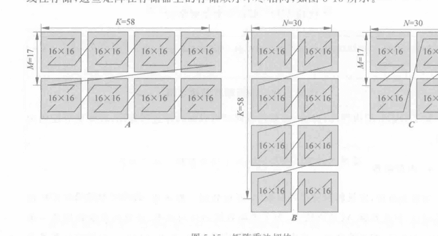

图 5-16 中采用合适的存储顺序可让矩阵 A 的分块行与矩阵 B 的分块列顺序读取，显著提升读取效率与计算性能。

## 5. 内核融合

昇腾 AI 软件栈的内核融合同样是黑盒，由离线模型生成器自动完成，开发者难以感知具体策略。

对昇腾处理器而言，融合的意义远超减少调度开销。以 Conv、BN、ReLU 为例，典型内核流程是数据从内存读入 AI Core，经多级缓存、格式转换及多种运算单元后写回内存。若三个算子各自使用独立内核，Conv 只用到矩阵计算单元，BN、ReLU 只用到向量计算单元，且伴随大量内存搬移，效率不佳。融合后可把矩阵运算与向量运算合并到一次数据搬运中完成，节省读写开销，提升推理性能。

## 6. 算子支持

与 cuDNN 类似，昇腾 AI 软件栈已实现大部分常用算子，组合使用即可覆盖多数深度学习模型。转换时离线模型生成器遍历计算图，找到对应实现并记录内核调用，执行时由离线模型执行器调用运行库内核完成。

支持的算子可参考附录 B。其中计算密集型算子如卷积、全连接可通过矩阵与向量计算单元加速，由 AI Core 实现；逻辑复杂、难以并行加速的算子则由 AI CPU 实现。

## 7. 离线模型文件

离线模型文件是转换后的产物，可被 AI 模型管家直接加载。早期文件仅保存计算图结构、算子内核名与模型参数，调度在控制 CPU 上线完成，带来额外开销。现在转换时会根据目标硬件预先完成调度，包括内存分配、内核调用等，因此当前离线模型文件除原有信息外还包含任务调度信息：

- 模型整体定义，包含占用空间、计算流数目、事件数目、算子列表、目标平台等，由 davinci.proto 定义；
- 任务列表，标识任务 ID、类型、计算流 ID、事件 ID 及内核函数名、参数等。

把调度提前到离线阶段可节省在线开销。但由于调度针对特定硬件芯片且优化策略与架构强相关，转换得到的模型只能用于指定的硬件与芯片。

## 5.2.2 应用编译与部署阶段

### 1. 计算引擎划分

昇腾 AI 软件栈把深度学习应用拆分为多个计算引擎协同完成。如图 5-16 所示，基于昇腾处理器的应用可表示为多个计算引擎构成的流程图，一个典型应用一般包含 4 个引擎。

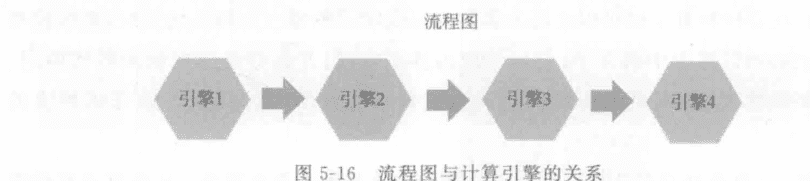

- 数据引擎：从摄像头、文件等数据源获取数据。
- 预处理引擎：调用 DVPP 接口实现媒体预处理，包括视频图像解码、裁剪、缩放等功能。

昇腾计算引擎拆分与调度机制通览

推理侧先通过模型管家对外开放的接口把离线模型文件装载进运行时完成计算，随后由独立的结果整理单元对模型输出做格式转换与清洗。

把推理与后处理职责分开，能让应用内部各环节的计算边界更清晰，每个引擎都能相对独立地完成本职工作。例如预处理环节主要借助 DVPP 完成数据准备，推理环节只负责加载并执行离线模型。引擎的具体实现允许开发者自行完成，引擎入口的主函数也支持用户自定义，详细说明可参考 5.3 节。

第 4 章已说明，同一种昇腾 AI 芯片会以加速卡、Atlas 开发者板等不同形态出现。同一套程序在不同形态下的执行路径并不相同，例如图 4-5 的加速器场景里，数据引擎与后处理引擎运行在主机侧；而图 4-7 的开发者板场景里，全部引擎都运行在设备侧。按任务拆分引擎有助于屏蔽底层硬件形态差异，同时把因运行侧不同带来的编译工具链差异交给昇腾软件栈统一管理。

### 2. 基于多设备与多芯片的应用开发

以昇腾 AI 处理器加速卡形态为例，实际落地常会遇到以下组合：

- (1) 服务器挂载多张加速卡，卡间既可协同完成一次推断，也可各自处理独立请求。
- (2) 单张加速卡内部并行执行多个推断任务。
- (3) 每张加速卡包含多颗昇腾 AI 处理器，片间既可协同完成一次推断，也可分别处理不同任务。
- (4) 单颗昇腾 AI 处理器内部同时承载多个推断任务。

Atlas 开发者板仅有一颗处理器且不支持多板协同，仍会出现并发运行多个离线模型的情形。

综合来看，应用开发需要兼顾的变量包括：

- 是否在同一硬件平台上同时运行多个实例分别完成推断。
- 单个实例是否启动多个线程，各线程独立执行推断。
- 是否需要多颗芯片协同完成同一推断。

可参考附录 B 的相关说明。

### 3. 算子调度

前文提到，在昇腾 AI 处理器上，算子可由 AI 核心或 AI 计算单元执行。离线模型运行时，控制处理器负责统筹众多的 AI 核心与 AI 计算单元，并把解析出的算子内核交给任务调度器，由调度器分发到具体执行单元。

控制处理器主要负责：

- (1) 内存管控。统筹内存分配，模型转换后内存基本静态分配，主要工作是维护已分配地址。
- (2) 设备管控。监控所有计算单元的状态。
- (3) 计算流管控。把多个算子内核调用组织成一个计算流，流内可由多个计算单元协同完成任务。
- (4) 事件管控。负责数据同步等消息类管理。

合理利用模型中的并行结构与同步机制可显著提升效率，例如 Inception 结构的多条分支可并行计算，形成多个计算流，最后再进行数据同步。因此计算流管控与事件管控是资源利用的关键。数据流的划分实际上在离线模型生成阶段就已依据特定芯片与硬件平台确定。

无论单芯片上并行多少推断任务，控制处理器均按模型管理器下发的要求管理对应的内存、设备、计算流与事件，任务调度器按控制处理器的指示把算子内核下发到具体执行单元。该设计向上层应用屏蔽了调度细节，使得同一芯片可同时进行多任务推断。

### 4. 异构计算系统

在昇腾软件栈中，整个计算在控制处理器调度下把 AI 计算单元与 AI 核心视作异构设备分别完成计算，这与当前流行的 CPU+GPU 异构思路类似。对于一个算子内核，通常需要在主机端启动它、指定使用的计算设备并放入计算流，多内核放入同一流后即可启动流的计算。

代码 5-40 与代码 5-41 分别展示了控制处理器侧的调用接口及 AI 计算单元侧的内核声明。前者通过特殊机制在控制处理器侧指定计算流调用 AI 计算单元侧的内核，后者的内核声明会指定对应的计算设备，写法与 CUDA 很相似。

```
void opHost(...)
{
    opKernel<<<1, NULL, stream>>>(...);
}
```

代码 5-40 控制 CPU 端的调用函数

```
__global__ __aicpu__ void opKernel(...);
```

代码 5-41 AI CPU 端的内核函数

### 5. 算子实现——通用内核和专用内核

昇腾软件栈面向开发者的算子实现均为预编译制品，其内核由华为内部工程师使用达芬奇架构专用语言高度优化得到，开发者暂无法触及该层。

由于是预编译产出，为保证通用性，这些算子多为通用内核，未必达到最优。为此受 TVM 设计思路启发，离线模型生成器在模型转换时会针对特定输入形状与参数配置生成专用内核，以提升推断性能。

软件栈在 TVM 基础上增加了后端代码生成能力。即在已有 TVM 计算代码上，加入面向达芬奇架构特性的调度，即可快速生成后端代码，从而借助 TVM 机制快速编译出可在昇腾 AI 处理器上运行的专用内核。

与 TVM 的 TOPI 机制类似，软件栈把面向达芬奇架构的调度代码封装成常用运算接口，可视为专用于昇腾 AI 处理器的特定域语言。通过组合这些接口即可完成算子开发，这类算子通常称为 TBE 算子。如代码 5-42 所示，与 TVM 算子开发类似，调用软件栈定义的特定域语言即可快速编译生成面向达芬奇架构的专用内核。

```
data = tvm.placeholder(shape1, name = "data_input", dtype = inp_dtype)
# 对应平台为昇腾 AI 处理器
with tvm.target.cce():
    # 求绝对值
    res = te.lang.cce.vabs(data)
    sch = generic.auto_schedule(res)
config = {...}
te.lang.cce.cce_build_code(sch, config)
```

代码 5-42 TBE 算子示例

基于这些 TBE 算子，模型转换时离线模型生成器会依据算子及其参数直接编译一个专用内核，用以替换原本采用通用内核实现的算子，从而提高整体效率。

## 5.3 自定义算子开发

软件栈可直接使用内部已开发的算子，这些算子经过大量手工优化，能够较好适配底层硬件架构，性能较高。同时软件栈也允许开发者按需开发自定义算子，算子可运行在 AI 计算单元也可运行在 AI 核心，开发方式支持 C++ 或 TVM 机制。

### 5.3.1 开发步骤

### 1. 开发动机

自定义算子开发仅涉及离线模型文件的生成与运行。绝大多数情况下，由于软件栈已支持绝大多数算子，开发者无需自定义，直接提供深度学习模型文件经离线模型生成器转换即可得到离线模型文件，再利用流程编排器生成应用。但在以下情形需要自定义：

- 软件栈不支持模型中的某个算子。
- 开发者希望修改现有算子的计算逻辑。
- 开发者希望自研算子以提升计算性能。

### 2. 开发流程

自定义算子开发主要包括：

- (1) 创建自定义算子开发工程。可通过集成开发环境快速新建，也可基于 DDK 自带的样例工程修改。
- (2) 自定义算子开发。依据算子类型采用不同方式开发。
- (3) 自定义插件开发。被离线模型生成器调用，提供参数解析、形状推断、内核编译等功能。
- (4) 加载插件进行模型转换。离线模型生成器转换模型时调用插件解析参数、推断张量形状、把步骤 (2) 提供的算子编译成内核并插入离线模型。

其中需要开发者自行编写的是算子逻辑开发和算子插件开发两部分。

#### 3. 自定义算子逻辑开发

算子可运行在 AI 计算单元与 AI 核心，因此有 AI 计算单元算子开发与 AI 核心算子开发，两者方式差异较大。

基于 AI 计算单元的开发本质上与 C++ 开发一致，只需遵守既定数据格式。代码 5-43 展示了 AI 计算单元自定义算子的函数声明，其中：

- (1) `__global__`：类似 CUDA 的函数前缀，表示该函数为内核函数，由控制处理器调用，运行在 AI 计算单元或 AI 核心上。
- (2) `__aicpu__`：类似 CUDA 的函数前缀，表示该内核函数运行在 AI 计算单元上。
- (3) `inputDesc` 和 `outputDesc`：`opTensor_t` 结构体类型，用来描述输入输出张量的类型、维度等信息。
- (4) `inputArray` 和 `outputArray`：`void **` 指针类型，指向实际张量数据的地址。
- (5) `opAttrHandle`：指针类型，指向存储内核函数各种参数配置的结构体地址。

```
__global__ __aicpu__ void operator(opTensor_t * inputDesc, const void ** inputArray, opTensor_t * outputDesc, void ** outputArray, void * opAttrHandle)
```

代码 5-43 AI CPU 算子开发核心函数

尽管包含该函数定义的源文件后缀为华为内部格式，但文件内部并不包含任何达芬奇架构相关特性。

相比之下，AI 核心算子开发更为复杂，常见做法有两种：

- (1) TVM 原语开发。由于软件栈在 TVM 基础上加入后端代码生成能力，该途径本质与 TVM 无异，可参考代码 5-26。但计算调度涉及达芬奇具体架构，只有掌握如何用调度原语完成数据切分才能获得较好性能，推荐给同时精通 TVM 编程与达芬奇架构的开发者。
- (2) 特定域语言开发。为方便开发者，软件栈借鉴 TVM 中的 TOPI 机制，预先提供常用运算的调度并封装成运算接口，即专用于 AI 核心运算的特定域语言。如代码 5-42 的 TBE 算子示例，只需用这些特定域语言声明计算流程，再使用自动调度 `auto_schedule` 指定目标生成代码，即可编译成专用内核。

整个计算过程可抽象为多个输入张量经一个计算节点得到多个张量。TVM 原语开发与特定域语言开发在流程上本质相同，只是抽象层次不同。通过这两种方法开发的算子都称为 TBE 算子，在模型转换时由离线模型生成器机制生成专用内核。

#### 4. 自定义算子插件开发

插件代码用 C++ 开发，编译为动态链接库供离线模型生成器使用，关键在于定义参数解析、形状类别推断等函数，并通过离线模型生成器提供的注册机制完成自定义算子注册。

代码 5-44 与代码 5-45 分别展示了 AI 计算单元自定义算子与 AI 核心自定义算子的注册代码。

```
REGISTER_CUSTOM_OP("test_layer")
    .FrameworkType(CAFFE)
    .OriginOpType("Test")
    .ParseParamsFn(ParseParams)
    .InferShapeAndTypeFn(InferShapeAndType)
    .UpdateOpDescFn(UpdateOpDesc)
    .ImpliesType(ImpliesType::AI_CPU);
```

代码 5-44 AI CPU 自定义算子注册代码

```
REGISTER_CUSTOM_OP("test_layer")
    .FrameworkType(CAFFE)
    .OriginOpType("Test")
    .ParseParamsFn(ParseParams)
    .InferShapeAndTypeFn(InferShapeAndType)
    .TEBinBuildFn(BuildTeBin)
    .ImpliesType(ImpliesType::TVM);
```

代码 5-45 AI Core 自定义算子注册代码

这里只介绍最核心的几个函数。需要注意的是，此处的 Operator、TensorDesc 等数据结构表示离线模型生成器转换模型过程中计算图的中间节点，而代码 5-43 中实际内核函数参数里的 `opTensor_t` 是运行时的张量类型。

- (1) `REGISTER_CUSTOM_OP`：用于注册自定义算子，`"test_layer"` 作为离线模型文件中的算子命名，可任意命名但不可与已有算子冲突。
- (2) `FrameworkType`：不同框架解析逻辑不同，插件需对应不同框架，目前仅支持 Caffe 与 TensorFlow。
- (3) `OriginOpType`：算子名称必须与 Caffe Prototxt 或 TensorFlow 中定义的算子名称一致，否则无法正常解析。
- (4) `ParseParamsFn`：注册解析模型参数的函数，该步骤仅在针对 Caffe 框架开发插件时需要，TensorFlow 的参数解析由框架完成。

函数定义见代码 5-46，其中 Message 为 Caffe 使用的 protobuf 消息结构体，存储算子参数。自定义算子参数由开发者自行定义，需按 caffe.proto 中定义的格式完成解析。`op_origin` 为软件栈内部计算节点的定义，函数完成参数解析并将参数存入 `op_dest` 计算节点。

```
Status ParseParams(const Message * op_origin, ge::Operator& op_dest)
```

代码 5-46 参数解析函数

- (5) `InferShapeAndTypeFn`：注册形状和类别推断函数。

函数定义见代码 5-47，其中 `op` 为计算节点定义，保存输入张量描述及算子参数；`v_output_desc` 保存该计算节点所有输出张量描述。函数根据输入张量描述、算子逻辑及参数决定输出张量描述，包括形状、类型、数据排布格式等。

```
Status ReductionInferShapeAndType(const ge::Operator& op,
vector <ge::TensorDesc> & v_output_desc)
```

代码 5-47 形状和类别推断函数

- (6) `UpdateOpDescFn`：注册自定义算子描述更新函数，仅在 AI 计算单元算子开发中使用。

## 5. 加载插件进行模型转换

离线模型生成器加载插件进行模型转换时，AI 计算单元算子与 AI 核心算子的流程略有不同，核心差异在于离线模型生成阶段是否需要加载自定义算子编译成的二进制文件。

如图 5-17 所示，对于自定义 AI 计算单元算子，需将自定义算子插件代码和实现代码分别编译为二进制文件。离线模型生成器转换模型时先加载插件二进制完成算子注册、参数解析、形状与类型推断等操作，随后加载自定义算子二进制并放入离线模型文件，在模型推断时调用。

如图 5-18 所示，对于自定义 AI 核心算子，仅有插件代码被编译为二进制文件。离线模型生成器转换模型时加载插件二进制完成注册、解析与推断，随后将自定义算子转为统一中间表示后，依据解析信息编译算子，编译出的内核为专用内核，被写入离线模型文件，在推断时调用。

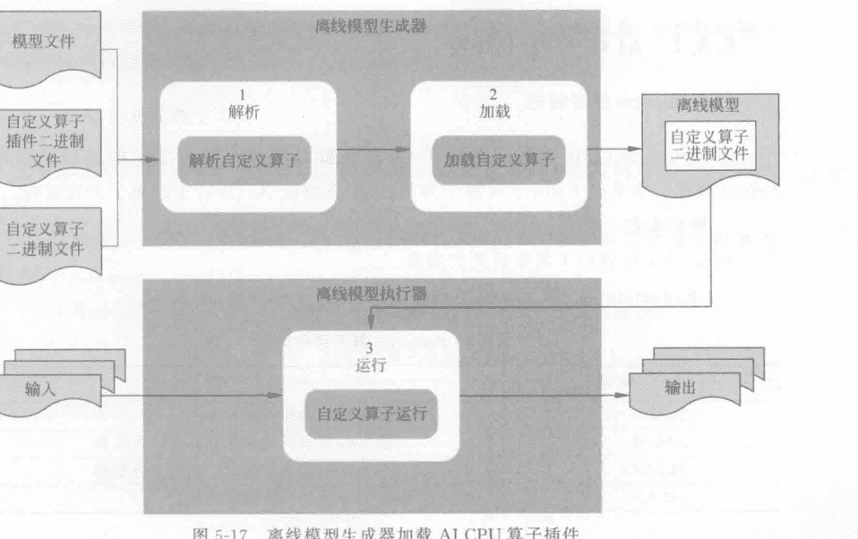

图 5-17 离线模型生成器加载 AI CPU 算子插件

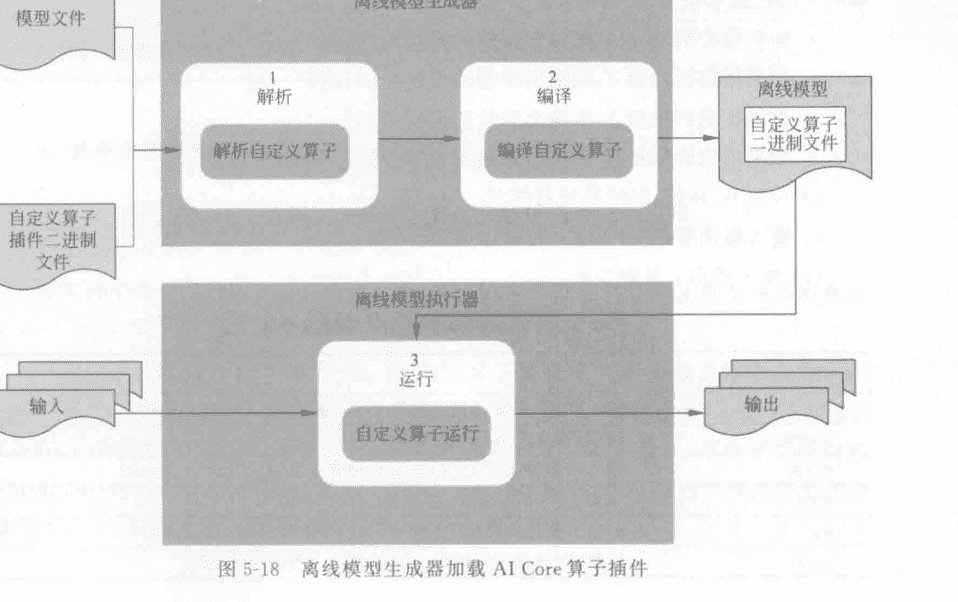

图 5-18 离线模型生成器加载 AI Core 算子插件

## 5.3.2 AI CPU 算子开发

### 1. Reduction 算子特性

Reduction 是 Caffe 中的一个算子，用于对多维数组指定轴及后续轴的数据进行归约操作。本节以 Reduction 算子为例，详细介绍 AI 计算单元上的算子开发过程。

1）解析参数

Reduction 包含以下需要解析的参数。

(1) ReductionOp：算子支持的操作类型，共 4 种，见表 5-2。

表 5-2 Reduction 算子操作类型

| 算子类型 | 说明 |
| :--- | :--- |
| SUM | 对被 reduce 的所有轴求和 |
| ASUM | 对被 reduce 的所有轴求绝对值后再求和 |
| SUMSQ | 对被 reduce 的所有轴求二次方后再求和 |
| MEAN | 对被 reduce 的所有轴求均值 |

# Reduction 算子参数与定制实践拆解

（2）axis：Reduction 要求明确归约的起始维度，自该维度起及之后的所有维度都会被折叠。以形状为 [5, 6, 7, 8] 的张量为例：

- 起始维度设为 3，折叠后形状为 [5, 6, 7]；
- 起始维度设为 2，折叠后形状为 [5, 6]；
- 起始维度设为 1，折叠后形状为 [5]；
- 起始维度设为 0，折叠后形状为 [1]。

（3）coeff：用于对归约结果进行放缩的标量系数。

2）输入输出参数

（1）输入参数说明见表 5-3。

表 5-3 Reduction 算子的所有输入参数

| 输入参数 | 说明 |

| :--- | :--- |

| x | 输入数据，形状由另一参数 shape 确定 |

| shape | 张量，维度为 N |

| dtype | 输入的数据类型，支持如下几种常见类型：float16、float32 |

| axis | 指定 reduce 的轴，取值范围为[-N, N-1] |

| op | reduce 操作的类型，支持 SUM、ASUM、SUMSQ、MEAN |

| coeff | 标量，对结果进行缩放。如果值为 1，则不进行缩放 |

(2) 输出参数：输出 y 与输入 x 数据类型一致，其形状由输入张量的维度与所选的 axis 共同决定。

### 2. 创建自定义算子工程

按既定流程可搭建 AI CPU 自定义算子工程，关键文件汇总见表 5-4。其中：

(1) Reduction.cce、Reduction.h、operator.cce 与 op_attr.h 共同构成计算侧实现，Reduction.cce 及 op_attr.h 需要开发者自行编写。
(2) Reduction_parser.cpp 承担插件侧逻辑，也需开发者自行实现。

表 5-4 AI CPU 算子中核心源码

| 目录 | 文件 | 说明 |

| :--- | :--- | :--- |

| operator<br>(自定义算子代码目录) | Reduction.cce | 算子代码实现文件 |

| | Reduction.h | 算子实现头文件 |

| | operator.cce | 算子共用代码文件 |

| | Makefile | 算子编译规则文件 |

| Reduction_plugin<br>(自定义算子插件代码目录) | Reduction_parser.cpp | 算子参数解析代码文件 |

| | Makefile | 算子插件编译规则文件 |

| common<br>(单算子运行参数配置文件目录) | custom_op.cfg | 算子输入输出描述定义文件 |

| | op_attr.cpp | 算子参数赋值代码文件 |

| | op_attr.h | 算子参数结构体定义头文件 |

## 3. 算子逻辑开发

图 5-19 展示了自定义算子在运行时内部的处理路径。

1) operator.cce

该文件包含构造、析构与主机侧入口的定义。

构造部分见代码 5-50。先为算子命名为“reduction_layer”，该名称须与插件注册时保持一致；随后通过 RegisterAicpuRunFunc 完成注册，其中 opetype 为算子名，reductionHost 为主机入口，其声明见代码 5-51，由模型管理器提供实现。

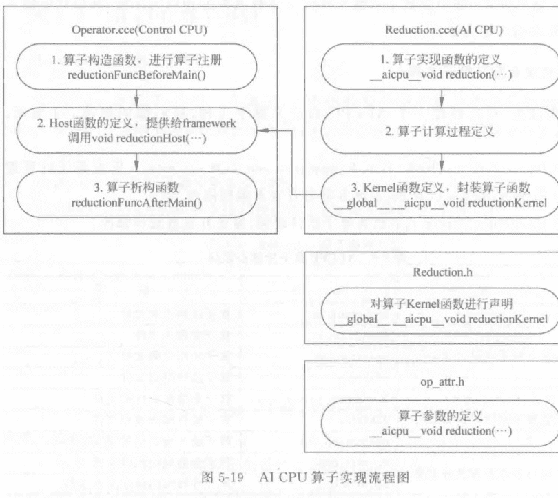

```
void __attribute__((constructor)) reductionFuncBeforeMain()
{
    char opetype[50] = "reduction_layer";
    RegisterAicpuRunFunc(opetype, reductionHost);
}
```

代码 5-50 算子构造函数

```
extern "C"
{
    extern void RegisterAicpuRunFunc(const char * om_optype, aicpu_run_func op_runner_func);
}
```

代码 5-51 算子注册函数

代码 5-51 中的 aicpu_run_func 为主机入口类型，定义见代码 5-52，参数统一为输入描述、输入数据、输入大小、输出描述、输出数据、输出大小、算子参数与计算流。opTensor_t 与 rtStream_t 的结构可参考附录 B。

```
typedef void (* aicpu_run_func)(opTensor_t **, void **, int32_t, opTensor_t **,
void **, int32_t, void *, rtStream_t);
```

代码 5-52 算子 HOST 端调用函数类型

Reduction 的主机侧入口示例见代码 5-53，参数与上例一致。核心是 reductionKernel 为真正运行在 AI CPU 上的内核，通过类似 CUDA 的启动方式调用，<<<>>> 中的 1 表示启动的 AI CPU 数量，stream 指定所属计算流。

```
void reductionHost(...)
{
    reductionKernel<<<1, NULL, stream>>>(...);
}
```

代码 5-53 Reduction 算子主机端调用函数

本例的析构未做额外处理，可按需扩展。

2) op_attr.h

代码 5-54 仅用于声明算子参数结构体。该结构体会被算子代码与插件代码共同引用。

```
typedef struct {
    char operation[ATRPARAMNAMESIZE];
    int64_t axis;
    float coeff;
} OpAttr;
```

代码 5-54 参数结构体定义

3) Reduction.h

代码 5-55 声明了内核函数：

__global__：类 CUDA 前缀，标识内核函数。
__aicpu__：类 CUDA 前缀，标识在 AICPU 上运行。
inputDesc：输入描述。
inputArray：输入数据数组。
outputDesc：输出描述。
outputArray：输出数据数组。
opattr_handle：指向算子参数结构体的指针，定义在 op_attr.h。

```
__global__ __aicpu__ void reductionKernel(opTensor_t ** inputDesc, constvoid ** inputArray, opTensor_t ** outputDesc, void** outputArray, void * opattr_handle);
```

代码 5-55 算子内核函数声明

4) Reduction.cce

该文件由开发者实现，包含内核函数与被其封装的算子函数，两者参数一致。本案例仅实现求和，其余操作可在此基础上改写，下面列出核心片段。

代码 5-56 演示如何读取算子参数。

```
int64_t axis = ((OpAttr *) opAttrHandle) -> axis;
```

代码 5-56 获取算子参数

代码 5-57 演示如何获取首个输入张量与首个输出张量的数据指针，通过修改 inputArray 与 outputArray 的下标可访问其它张量。

```
constvoid * x = inputArray[0];
void * y = outputArray[0];
```

代码 5-57 获取输入和输出数据地址

代码 5-58 演示如何通过 inputDesc 与 outputDesc 获取维度、形状、类型等信息。

```
int in_dim_cnt = inputDesc[0]->dim_cnt;
int out_dim_cnt = outputDesc[0]->dim_cnt;
```

代码 5-58 获取输入和输出张量信息

代码 5-59 实现了 Reduction 的求和逻辑，本质是按指定轴对数组累加，具体过程不再赘述。

```
int dimAxisInner = 1;
int dimAxisOuter = 1;
T sum = 0;
T* pDst = (T*) y;
const T* pSrc = (const T*) x;

// 计算求和后的数据数目
for (int i = 0; i < axis; i++) {
    dimAxisInner = dimAxisInner * inputDesc->dim[i];
}
// 计算需要累加的数据数目
for (int i = axis + 1; i < inputDesc->dim_cnt; i++) {
    dimAxisOuter = dimAxisOuter * inputDesc->dim[i];
}
// 累加
for (int idxDimOuter = 0; idxDimOuter < dimAxisOuter; idxDimOuter++) {
    const T* pSrcOuter = (const T*) x + idxDimOuter * dimAxisInner * inputDesc->dim[axis];
    for (int idxAxisInner = 0; idxAxisInner < dimAxisInner; idxAxisInner++) {
        sum = 0;
        pSrc = pSrcOuter + idxAxisInner;
        for (int j = 0; j < inputDesc->dim[axis]; j++) {
            T value = *(pSrc + j * dimAxisInner);
            sum = sum + value;
        }
        * pDst = sum;
        pDst++;
    }
}
```

代码 5-59 Reduction 算子求和功能实现

## 4. 算子插件开发

插件开发集中在 Reduction_parser.cpp，主要包括注册、参数解析、输出推断与描述更新。

1) 算子注册

代码 5-60 将 reduction_layer 注册为自定义算子名，需与 operator.cce 中的声明一致，适配框架为 Caffe，原算子名为 Reduction，实现在 AI CPU 上。

```
REGISTER_CUSTOM_OP("reduction_layer")
    .FrameworkType(CAFFE)
    .OriginOpType("Reduction")
    .ParseParamsFn(ReductionParseParams)
    .InferShapeAndTypeFn(ReductionInferShapeAndType)
    .UpdateOpDescFn(ReductionUpdateOpDesc)
    .ImpliesType(ImpliesType::AI_CPU);
```

代码 5-60 Reduction 算子注册（AI CPU 算子）

2) ReductionParseParams

该函数负责解析算子参数。声明与代码 5-46 一致，核心见代码 5-61。将 Message 转为 LayerParameter 子类，该子类在 Caffe 中用于保存层参数，随后调用 reduction_param 获取参数。ReductionParameter 是开发者在 caffe.proto 中定义后得到的参数，最后把参数写入昇腾 AI 软件栈内部的计算节点。

```
const caffe::LayerParameter * layer =
    dynamic_cast<const caffe::LayerParameter *>(op_origin);
const caffe::ReductionParameter& param = layer->reduction_param();
op_dest.SetAttr("axis", AttrValue::CreateFrom<AttrValue::INT>(param.axis()));
```

代码 5-61 参数解析函数核心代码

3) InferShapeAndTypeFn

该函数用于推断输出形状与类型。声明与代码 5-47 一致，核心见代码 5-62。先通过 op 获取输入张量描述，读取参数后据此修改输出张量描述，并写入 v_output_desc 数组。

```
auto tensorDesc = op.GetInputDesc(0);
auto shape = tensorDesc.GetShape();
ge::AttrValue axisAttrValue;
op.GetAttr("axis", axisAttrValue);
axisAttrValue.GetValue<AttrValue::INT>(axis);
// 基于函数参数修改 tensorDesc
tensorDesc.SetShape(shape);
v_output_desc.push_back(tensorDesc);
```

代码 5-62 形状和类型推断核心代码

4) UpdateOpDescFn

该函数用于更新算子描述。声明与代码 5-48 一致，核心见代码 5-63。该函数主要从计算节点取出各参数，通过 op_attr.h 定义的结构体写入 op 节点，以便运行时可直接从 opAttrHandle 读取算子参数。

```
OpAttr op_attr;

int64_t axis = 0;
ge::AttrValue axisAttrValue;
op.GetAttr("axis", axisAttrValue)
axisAttrValue.GetValue<AttrValue::INT>(axis)
op_attr.axis = axis;
std::string key = "opattr";
Buffer bytes = Buffer::CopyFrom((uint8_t *) &op_attr, sizeof(OpAttr));
op.SetAttr(key, AttrValue::CreateFrom<AttrValue::BYTES>(bytes));
```

代码 5-63 更新算子描述核心代码

本节工程可参考本书代码参考网址①，具体流程可参考附录 B 中的《C++自定义算子开发指导》。

## 5.3.3 AI Core 算子开发

### 1. Reduction 算子特性

Reduction 的特性与 5.3.2 节所述一致。

> ① 本书代码参考网址：https://github.com/Ascend/AscendAIChipArchitectureAndProgramming 或 https://obs-book.obs.cn-east-2.myhuaweicloud.com/AscendAIChipArchitectureAndProgramming.zip。

## 2. 创建算子工程

按流程可创建 AI Core 算子工程，核心源码见表 5-5。与 AI CPU 工程相比，AI Core 工程更精简，关键文件如下。

表 5-5 AI Core 算子核心代码

| 目录 | 文件 | 说明 |

| :--- | :--- | :--- |

| operator | reduction.py | 算子实现代码文件 |

| plugin | caffe_reduction_layer.cpp | 算子插件代码文件 |

| plugin | Makefile | 算子编译规则文件 |

reduction.py：基于特定域语言的 Python 程序，实现算子计算逻辑，需开发者编写。
caffe_reduction_layer.cpp：实现插件逻辑，需开发者编码。

## 3. 算子逻辑开发

基于特定域语言的 AI Core 算子开发流程与 TVM 类似，主要包括：

1) 导入 Python 模块

代码 5-64 导入昇腾 AI 软件栈提供的 Python 模块，其中 te.lang.cce 引入当前支持的特定域语言接口，如 vmuls、vadds、matmul 等；te.tvm 引入 TVM 后端代码生成机制；topi.generic 提供自动算子调度接口；topi.cce.util 提供形状、类型校验等工具。

```
import te.lang.cce
from te import tvm
from topi import generic
from topi.cce import util
```

代码 5-64 导入 Python 模块

2) 算子实现函数定义

代码 5-65 展示了算子实现函数的构成，包含输入张量的形状、类别、算子参数、内核名称，以及编译、打印等配置。该函数会被插件代码通过 C++ 调用 Python 的接口在离线模型转换阶段执行。

昇腾算子实现与应用引擎定制

```
def reduction(shape, dtype, axis, op, coeff, kernel_name = "Reduction", need_build = True, need_print = False)
```

代码 5-65 算子实现函数定义

3) 算子实现逻辑

以 Reduction 求和为例，其计算流程在代码 5-66 中给出。整体风格与 TVM 开发保持一致，先声明输入输出的张量占位符，再通过 te.lang.cce 提供的领域专用接口组织运算。流程里 data 作为输入占位，res 作为输出占位，中间由向量乘 vmuls、归约求和 sum、类型转换 cast 三段式拼接而成。

```
data = tvm.placeholder(shapel, name = "data_input", dtype = inp_dtype)
with tvm.target.cce():
    cof = coeff
    data_tmp_input = te.lang.cce.vmuls(data, cof)
    tmp = data_tmp_input
    res_tmp = te.lang.cce.sum(tmp, axis = axis)
    res = te.lang.cce.cast_to(res_tmp, inp_dtype, f1628IntegerFlag = True)
```

代码 5-66 算子计算逻辑实现

4) 算子调度与编译

计算图确定之后即可进入自动调度。代码 5-67 展示了借助 auto_schedule 生成调度方案的过程，配合 TVM 的打印能力可以查看中间表示。配置项主要涉及是否打印、是否触发编译、内核名称以及输入输出张量。

```
sch = generic.auto_schedule(res)
config = {
    "print_ir": need_print,
    "need_build": need_build,
    "name": kernel_name,
    "tensor_list": [data, res]
}
te.lang.cce.cce_build_code(sch, config)
```

代码 5-67 算子编译

这里要注意张量列表的排列顺序，必须严格遵循算子本身的入参出参顺序，否则映射会错位。

调度与配置完成之后，可调用 te.lang.cce 提供的 cce_build_code 接口完成编译。编译器会依据输入形状、数据类型与算子参数生成专属内核，该环节通常在离线模型生成器转换模型时执行。

## 4. 算子插件开发

AI Core 算子插件的开发脉络与 5.3.2 节相似，差异在于侧重点。核心要素为算子注册、参数解析、输出描述推断和 TBE 编译。参数解析与输出推断与 AI CPU 插件做法相同，此处省略；AI Core 不需要更新算子描述，但必须提供 TBE 编译函数。

1) 算子注册

Reduction 算子的注册示例见代码 5-68。注册名可自行命名为 custom_reduction，只要不与离线模型文件中的算子名称冲突即可。该插件面向 Caffe 框架，通过 TVM 实现并运行在 AI Core 上。

```
REGISTER_CUSTOM_OP("custom_reduction")
    .FrameworkType(CAFFE)
    .OriginOpType("Reduction")
    .ParseParamsFn(CaffeReductionParseParams)
    .InferShapeAndTypeFn(CaffeReductionInferShapeAndType)
    .TEBinBuildFn(CaffeReductionBuildTeBin)
    .ImplyType(ImplyType::TVM);
```

代码 5-68 Reduction 算子注册（AI Core 算子）

2) TEBinBuildFn

该函数负责算子编译，声明方式与代码 5-49 保持一致，在离线模型转换阶段被调用，主要完成：

- 读取所有张量的形状、类别以及算子参数，转换时这些信息已固化；
- 指定算子实现文件、实现函数与内核名；
- 指定编译后内核的存放路径及 json 描述文件路径；
- 调用 te::BuildCustomop 触发 Python 实现函数的编译流程。

```
te::BuildTeCustomOp(..., "(i,i,i,i), s, i, s, f, s", ...);
```

代码 5-69 编译自定义 TBE 算子函数

BuildCustomop 的声明可参考 DDK 安装目录下 include/inc/custom/custom_op.h。其中省略的前置参数为 DDK 版本等配置，参数格式 “(i,i,i,i), s, i, s, f, s” 与代码 5-65 的实现函数定义一致，i 表示整型、s 表示字符串、f 表示单精度浮点，后续省略的参数为实际取值。BuildCustomop 会按这些参数调用实现函数，经 TVM 生成内核并写入指定位置。

本小节涉及工程可参考本书代码参考网址①，具体流程见附录 B《TE 自定义算子开发指导》。

## 5.4 自定义应用开发

昇腾 AI 软件栈支持开发者按需构建计算引擎，并依据场景与设备配置引擎间串并行，编译后形成可运行应用。

### 1. 开发动机

栈内已内置图像缩放、离线模型推理等通用引擎，但实际需求常需定制，主要体现在：

- 按需读取数据，如摄像头、本地文件或网络流，需自建数据引擎；
- 特定预处理，如视频解码、图像解码、裁剪缩放，需自建预处理引擎；
- 修改模型输入格式，如尺寸非 224×224 或数据格式为 YUV，需自建推理引擎；
- 特定后处理，如结果落盘或在图上标注类别概率，需自建后处理引擎；
- 额外处理流程时，需新建引擎完成相应工作。

### 2. 开发流程

基于昇腾 AI 处理器的应用开发通常包含：

- 为每个计算引擎新建源文件与头文件，完成功能实现；
- 新建 prototxt 流程图配置文件，描述引擎配置与连接关系；
- 新建主函数文件，负责流程图构建、运行与销毁；
- 根据引擎配置选用对应编译工具链编译应用。

### 3. 计算引擎的串联配置

应用流程图保存在 prototxt 文件中，使用 protobuf 保存，格式由 DDK 目录 include/inc/proto/graph_config.proto 定义。参考样例见 DDK 安装目录 ./sample/hiaiengine/test_data/config/sample.prototxt。

典型配置包含三种消息：

- graphs：流程图消息。如代码 5-70 所示，包含流程图 ID、优先级、设备 ID 以及引擎列表与连接列表。一个流程图可运行在多芯片或多块 PCIe 卡上，需指定设备 ID，默认使用 0 号设备。

```
graphs {
    graph_id: 100
    priority: 1
    device_id: 0
    engines {...}
    engines {...}
    engines {...}
    connects {...}
    connects {...}
}
```

代码 5-70 流程图消息

- engines：计算引擎消息。如代码 5-71 所示，包含 ID、引擎名、运行端以及线程数等。此处展示了部分字段。

```
engines {
    id: 1000
    engine_name: "SrcEngine"
    side: HOST
    thread_num: 1
}
```

代码 5-71 计算引擎消息

需要注意的是，运行端 side 决定引擎在主机端还是设备端运行，数字视觉预处理引擎与推理引擎必须在设备端运行。Atlas 200 开发板上数据准备与后处理可运行在设备端；PCIe 加速卡上两者通常运行在主机端。

- connects：引擎连接消息。如代码 5-72 所示，包含两个引擎的 ID 以及端口 ID。

```
connects {
    src_engine_id: 1000
    src_port_id: 0
    target_engine_id: 1001
    target_port_id: 0
}
```

代码 5-72 引擎连接消息

### 4. 计算引擎开发

代码 5-73 展示了一个自定义引擎的声明模板。相关头文件在 DDK 的 include/inc/hiaiengine 下：

- 计算引擎类继承 Engine 父类，子类名可自定；
- Init 为初始化函数，模型推理引擎常用来启动 AI 模型管家并加载离线模型，其他引擎可不重载；
- 构造与析构函数可按需定制；
- 通过 HIAI_DEFINE_PROCESS 声明引擎的输入输出端口数。

```
# include "hiaiengine/api.h"
# define ENGINE_INPUT_SIZE 1
# define ENGINE_OUTPUT_SIZE 1
using hiai::Engine;

class CustomEngine : public Engine {
public:
    // 只在模型推理引擎使用
    HIAI_StatusT Init (const hiai::AIConfig& config, const std::vector < hiai::AIModelDescription> & model_desc) {};
    CustomEngine() {};
    ~CustomEngine() {};
    HIAI_DEFINE_PROCESS(ENGINE_INPUT_SIZE, ENGINE_OUTPUT_SIZE)
};
```

代码 5-73 计算引擎声明模板

代码 5-74 展示了定义模板：

- 通过 HIAI_IMPL_ENGINE_PROCESS 注册引擎，需指定引擎名、对应类及输入端口数，与流程图配置保持一致；
- 数据以 void 类型指针 arg0、arg1 等传递，端口数决定指针数量；
- 指针需转成实际类型 custom_type，由开发者定义；
- 处理完成后将数据转回 void 指针，通过 SendData 传输，参数包含输出端口号、数据类型与数据本身。

```
# include <memory>
# include "custom_engine.h"

HIAI_IMPL_ENGINE_PROCESS("CustomEngine", CustomEngine, ENGINE_INPUT_SIZE)
{
    // 接收数据
    std::shared_ptr<custom_type> input_arg =
        std::static_pointer_cast<custom_type>(arg0);
    // 做些事情
    func(input_arg)
    // 发送数据
    SendData(0, "custom_type", std::static_pointer_cast<void>(input_arg));
    return HIAI_OK;
}
```

代码 5-74 计算引擎定义模板

### 5. 计算引擎串联

主函数控制下，各引擎被初始化并开始收发数据，典型流程如图 5-20。

- 主函数调用 HIAI_Init 初始化整个 HiAi 环境；
- 调用 CreateGraph 读取流程图配置创建对象，期间实例化引擎并调用 init，一个进程可创建多个流程图独立运行；
- GetInstance 获取流程图对象；
- HIAI_Dmalloc 分配内存；
- SetDataRecvFunctor 设置接收回调；
- 读取数据后 SendData 送入数据准备引擎；
- 源引擎处理后传给数字视觉预处理引擎；
- DVPP 引擎调用接口完成缩放裁剪等处理后传给推理引擎；
- 推理引擎通过 AI 模型管家 Process 函数完成推理，结果传给后处理引擎；
- 后处理引擎加工后回传主函数，回调输出结果；
- DestroyGraph 销毁流程图对象。

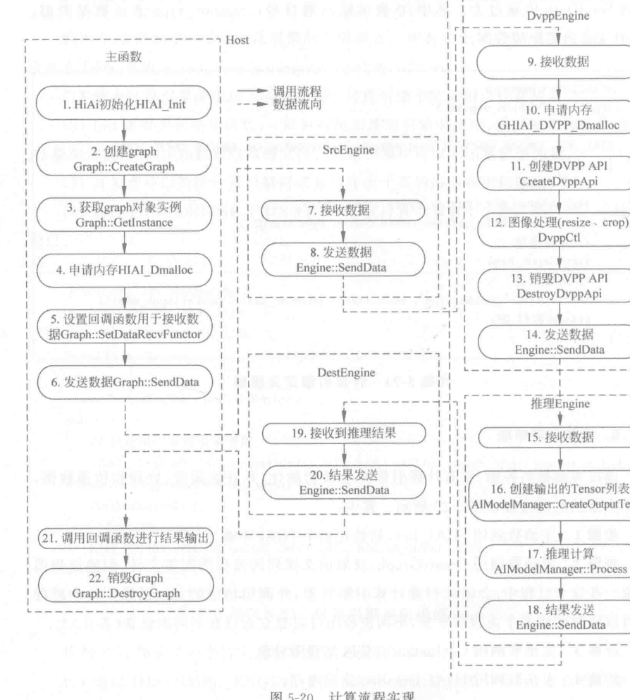

图 5-20 计算流程实现

本小节工程可参考本书代码参考网址①，详细指导见附录 B《应用开发指导》。

① 本书代码参考网址：https://github.com/Ascend/AscendAIChipArchitectureAndProgramming 或 https://obs-book.obs.cn-east-2.myhuaweicloud.com/AscendAIChipArchitectureAndProgramming.zip。

## 第 6 章

## 实战案例

人工智能落地依赖算法、算力、数据三要素。本章首先介绍图像分类、视频目标检测的常用评测标准及推理侧硬件评测标准；随后以图像识别与视频检测为例，串联数据集与典型算法，讲解昇腾 AI 处理器上的自定义算子开发与端到端应用实践①。

若把机器学习比作故事书，训练与推理是两条主线。训练侧聚焦算法科学家，设计参数与算子在数据集上验证；推理侧则由算法工程师主导部署。用户产生数据 → 模型更大更准 → 部署需求增加 → 更多用户产生数据，形成闭环。

科学家对训练更熟悉，算子设计追求更优表征。卷积算子已在前文介绍，其扩展如空洞卷积可在相同算力下扩大感受野，可变卷积则以相同权重更好地刻画目标物体。

从事人工智能落地的工程师，更在意的是推理环节的真实体验。他们要面对的是每秒几十帧甚至上百帧高清视频的实时处理需求。以无人机视频检测研发为例，动辄数百层的庞大网络基本没有生存空间。对于重量受限、成本敏感的低空平台，几百兆的参数体量和几十瓦的功耗都是一道难以逾越的坎。正因如此，如何在算法层面压缩存储与计算开销，成为近年持续升温的研究方向。从 MobileNet①到 ShuffleNet②，借助组卷积 Group Convolution 与深度可分离卷积的思路，压缩型网络用更少的权重换来更高的效率，最终的效果能够与 GoogLeNet、VGG16 等传统大模型保持同一水平。

基于这一趋势，华为构建了覆盖端侧到云侧的全栈全场景智能方案。全栈的含义是从技术视角看，涵盖 IP 与芯片、芯片使能、训练推理框架以及应用使能；全场景的含义是从业务视角看，可服务公有云、私有云、各类边缘计算、物联网行业终端以及消费类终端的部署环境。

算力基座是昇腾 AI 处理器，当前已形成 Max、Mini、Lite、Tiny、Nano 五个系列，适配不同场景。芯片之上搭载 CANN Compute Architecture for Neural Networks，软件栈中的 L1 芯片使能层负责实现其具体功能，同时对外开放 TBE 与数字视觉预处理模块，主要完成 TBE 算子开发和数字视觉预处理。开发者借助 CANN 能够扩充昇腾 AI 处理器的算子库并强化数字视觉预处理能力。MindSpore 作为统一支撑端边云独立与协同训练推理的框架，对算法研究者友好，有助于进一步提升模型表现。应用层则由 ModelArts 提供全流程服务，为不同需求的用户准备分层 API 与预集成方案。

昇腾 310 是一款典型的推理芯片，以低功耗高性能著称，面向深度神经网络的设备侧高效推理。它通过简洁完备的工具链，从自动量化到流程编排，帮助用户把网络高效实现并平滑迁移。受篇幅限制，本书不会深入神经网络的设计与结构细节，而是把重心放在昇腾 AI 处理器对各类网络的支持上，演示如何将合适的网络迁移到昇腾系列芯片开发平台。

## 6.1 评价标准
本节简要介绍图像分类与视频目标检测常用的评估维度，包括精度、精准度、召回率、F1 分数、交并比、均值平均精度等，同时也涉及推理侧硬件的常用指标如吞吐量、时延、能效比。

### 6.1.1 精度
对分类问题而言，精度 Accuracy 是最直观的度量，指被正确分类的样本占全部样本的比例。

精度 = 分类正确的样本数目 / 总样本数目

以一个简单例子切入：

> **数据集 1：苹果和梨**
仓库里有 100 个苹果、100 个梨，形状均为圆形。苹果中 90 个黄色、10 个绿色；梨中 95 个绿色、5 个黄色。

一个可行的划分规则是 {“黄色=苹果”，“绿色=梨”}，形状因为两者都是圆形而暂时忽略。

这个划分器的精度是：

$$精度 = \frac{分类正确的样本数目}{总样本数目} \times 100\% = \frac{90+95}{100+100} \times 100\% = 92.5\%$$

看起来还不错，是吗？

把数据规模改一下：

> **数据集 2：苹果和梨**
仓库里有 10 000 个苹果、100 个梨，全部圆形。苹果中 9000 个黄色、1000 个绿色；梨中 95 个绿色、5 个黄色。

直观上与上一例并无本质差异，苹果仍有 90% 为黄色，梨有 95% 为绿色，只是总量变化。沿用同一规则 {“黄色=苹果”，“绿色=梨”}：

$$精度 = \frac{分类正确的样本数目}{总样本数目} \times 100\% = \frac{9000+95}{10\ 000+100} \times 100\% = 90.05\%$$

表面上结果依然可以接受。若改用形状来划分，比如 {“圆形”=苹果，“方形”=梨}，数据中根本没有方形，可以用任意非圆形代替，比如三角形。于是所有圆形水果都被判为苹果，梨也被全吞：

$$精度 = \frac{分类正确的样本数目}{总样本数目} \times 100\% = \frac{10\ 000}{10\ 000+100} \times 100\% = 99.01\%$$

用形状分类显然毫无实用价值，模型把所有样本挤到一类里，却在精度数值上反而比按颜色划分更高，这正是问题的所在。在某些场景下，单靠精度评估会带来严重后果。极端例子是地震预测，每秒采样一次，一天 86 400 个点，一个月近 260 万个点里可能一个正样本都没有。若以精度为标准，模型会把所有测试例都判为 0，轻松拿到超过 99.9999% 的精度，却在地震来临时选择无视。实践中人们往往遵循宁可误报也不漏报的原则，疾病筛查亦然，不会放过低概率的患病可能。

这类正负样本数量悬殊的问题通常称为不平衡数据分类，需要引入更细的指标。

如表 6-1 所示，若预测为梨阳性且真实也是梨，则为真阳性 TP；预测为梨但真实是苹果，则为假阳性 FP；预测为苹果阴性且真实也是苹果，则为真阴性 TN；预测为苹果但真实是梨，则为假阴性 FN。

表 6-1 分类结果示意表

基于此可定义：

精准度 Precision = 真阳性样本数目 / 所有预测为阳性的样本数目 = TP / (TP + FP)

召回率 Recall = 真阳性样本数目 / 所有真实为阳性的样本数目 = TP / (TP + FN)

回到形状分类器 “圆形=苹果，方形=梨”，如表 6-2 所示。

表 6-2 分类器表现样例

精准度 = 真阳性样本数目 / 所有预测类别为阳性的样本数目 = 0

召回率 = 真阳性样本数目 / 所有真实类别为阳性的样本数目 = 0

在精准度和召回率的视角下，形状分类器立刻暴露无能，不会再误导开发人员。对于具体案例，应根据数据与特征的实际分布合理设定评估标准。若希望兼顾两端，可采用 F1 分数：

F1 分数 = 2 × 精准度 × 召回率 / (精准度 + 召回率) = 2TP / (2TP + FP + FN)

确定评估标准后，回头看数据集 1。200 个水果能否代表全部苹果和梨？是否还有其他水果？真实世界的苹果有多少种颜色，各自占比多少？红苹果会不会被误判为黄杏子？圆形橙子、五角星杨桃又如何？类似疑问不胜枚举，数据集的收集与整理是一切智能任务成功的前提。随着算法能处理的特征类型增多，对数据质量与覆盖度的要求也在提升。读者需依据实际任务，对采样范围与类型做出合理假设，才能训练出表现稳健的模型。限于篇幅，这里不展开过拟合欠拟合等建模细节，有兴趣可参考伊恩·古德费罗、杨立昆、本吉奥与亚伦·库维尔合著的《深度学习》。

最后总结，单纯的精度并未考虑分类目标，只是对各类别正确数求和取百分比。对于类别不均衡问题，精度作为衡量标准时需格外谨慎。工程实践中，建议结合精准度、召回率与 F1 分数，并结合案例数据与标签特征对分类器进行综合评判。

### 6.1.2 交并比
在图像分类基础上，目标检测、物体定位、图像分割等更复杂任务应运而生。目标检测可视为分类与定位的结合，给定一张图，系统需识别其中出现的对象并给出位置。目标数量不确定，且需给出精确范围，复杂度与评估争议都显著上升。

如图 6-4 所示，目标检测算法会输出一系列矩形框与标签，每个框对应预测目标的边界及其类别。评估时需分别考察边界准确性与类别正确性。边界通常用交并比 Intersection over Union IoU 衡量，类别则常用均值平均精度 mean Average Precision mAP 衡量。

IoU 的思想很直观，就是预测框与真实框的交集除以并集，重合度越高越好，完全重合为最优。

$$交并比 = \frac{预测边界 \cap 真实边界}{预测边界 \cup 真实边界}$$

图 6-5 中用实线表示“橙子”的真实边界，虚线表示预测边界。通常用左上角坐标与右下角坐标定义一个矩形：

$$预测边界 = \{(xp1, yp1), (xp2, yp2)\}$$

$$真实边界 = \{(xt1, yt1), (xt2, yt2)\}$$

计算 IoU 并非必须分情况讨论相对位置。求交时预测框与真实框可互换，只要算出两个框的相交矩形坐标即可。若不相交，IoU 必然为零。

代码 6-1 即为 IoU 的实现，以图像左上角为原点 (0,0)，x 轴向右，y 轴向下，输入预测框与真实框的左上、右下坐标，返回 [0,1] 范围的浮点数。设图 6-5 中重叠部分为 inter，其左上角横坐标 inter_xmin 取 {xpl, xtl} 中较大者，纵坐标 inter_ymin 取 {ypl, ytl} 中较大者；同理可得右下角坐标 inter_xmax、inter_ymax。若框完全不重叠，inter_xmax - inter_xmin 可能为负，需用 np.maximum 置零。任一轴不重叠则两框无交。由交点对角坐标可得交集面积，再用两框面积之和得到并集面积，相除即为 IoU。

```python
def get_IoU(xp1, yp1, xp2, yp2, xt1, yt1, xt2, yt2):
    inter_xmin = max(xp1, xt1)
    inter_ymin = max(yp1, yt1)
    inter_xmax = min(xp2, yt2)
    inter_ymax = min(yp2, yt2)
    inter_area = np.maximum(inter_xmax - inter_xmin, 0.) * np.maximum(inter_ymax - inter_ymin, 0.)
    pred_area = (xp2 - xp1) * (yp2 - yp1)
    truth_area = (xt2 - xt1) * (yt2 - yt1)
    union_area = pred_area + truth_area - inter_area
    return inter_area / union_area
```

代码 6-1 交并比计算代码

实际编程时常在计算面积时对长宽各加 1，以避免像素边界偏差。

### 6.1.3 均值平均精度
均值平均精度顾名思义是各类别平均精度 Average Precision 的平均。AP 本身即精准度-召回率曲线 Precision-Recall 曲线下方的面积。

大多数算法在预测样本时给出 [0,1] 的置信度，通过阈值决定正负样本。阈值的设定直接影响精准度与召回率，二者通常此消彼长。若要求至少检测出 70% 的正样本，可在召回率不低于 0.7 的条件下尽量提升精准度。

更直观的做法是绘制精准度-召回率曲线，纵轴 P 为精准度，横轴 R 为召回率。借助 sklearn 生成的典型 PR 曲线如图 6-6 所示，召回率提升时精准度逐步下降。实践中难以精确计算曲线下面积，通常以 0.01 为步长让召回率从 0 滑到 1，求得近似 AP。

在目标检测中，mAP 是兼顾两种错误的统一指标。由于输出是边界框，需要先依据 IoU 判断是否正确识别了某类物体。常用阈值是 0.5，当预测框与真实框 IoU 大于 0.5 时认为该框正确，小于则错误。随着预测框增多，召回率相应提升，在不同召回水平下对精准度求平均得到该类的 AP，再对所有类别取平均即为 mAP。

阈值选择本身也是问题。若 IoU 阈值设得过低，即使边界没检测准的模型也能拿到高分。

> ① 案例篇中涉及的代码可参考 https://github.com/Ascend/AscendAIChipArchitectureAndProgramming 或 https://obs-book.obs.cn-east-2.myhuaweicloud.com/AscendAIChipArchitectureAndProgramming.zip。

Yolo 模型的提出者约瑟夫·瑞德蒙 Joseph Redmon 设计了两个检测模型，如图 6-7 所示，在 mAP 评价下两者都被视为对目标边界的完美预测，尽管模型二的实际表现与真实标签相距甚远。在 *Best of both worlds: human-machine collaboration for object annotation* ① 中也提到，人眼难以区分 IoU=0.3 与 IoU=0.5 时对应的预测边界，这对实际开发构成困扰。评估目标检测模型时应根据具体应用背景修正标准。实践中常对 IoU 阈值从 0.5 到 0.95 步长 0.05 分别计算 AP 再综合平均，甚至给出不同尺寸物体的平均精度表现，后续目标检测案例中的 MS COCO 数据集即采用此类做法。

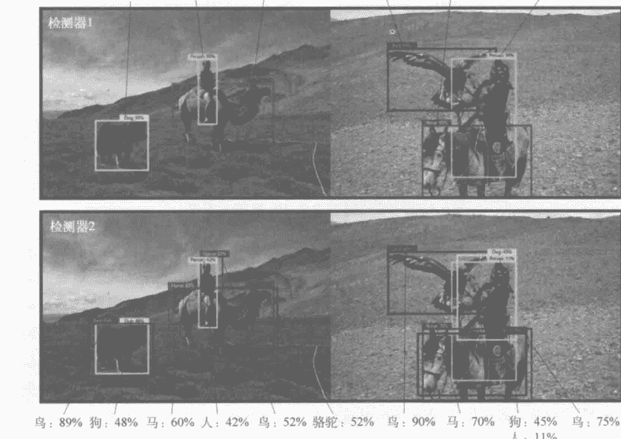

图 6-7 mAP 评价类似的两个模型对比示意图③

> ① http://ai.stanford.edu/~olga/papers/RussakovskyCVPR15.pdf.

② 具体实现可以参考 https://raw.githubusercontent.com/dmlc/gluon-cv/master/gluoncv/utils/metrics/voc_detection.py.

③ 图来自于 https://pjreddie.com/media/files/papers/YOLOv3.pdf.

## 6.1.4 推理性能的两项度量

训练阶段要处理海量样本和复杂的网络结构，通过反向传播把参数收敛到合理区间，对算力、数值精度以及横向扩展能力的要求都很高。推理阶段则是在模型已经固化后，用新数据得到结论，例如监控前端借助后台神经网络判定抓拍人脸是否可疑。相比训练，推理的计算量明显更小，但矩阵运算依然密集。

训练更看重最终精度，推理更看重实时响应与速度。最直观的衡量是吞吐能力，即单位时间内能完成的图像处理张数。与之互补的指标是时延，也就是单张图像平均耗时，二者呈倒数关系。时延常用毫秒计，统计平均值时通常会剔除首帧的热启动开销。用 1000 除以平均时延即可得到对应的吞吐数值。

$$吞吐量 = \frac{1000}{时延}$$

芯片的理论算力常以 TOPS 来描述，即每秒可执行的底层算子次数。若只看标称值，实际可达的吞吐是软硬件共同作用的结果，会受数据排布、网络拓扑以及批处理大小等多重因素影响。在数据规模相当时，参数越少的网络绝对处理速度越快，吞吐表现也更好。随着模型复杂度提升，昇腾 AI 处理器这类专用芯片的算力优势和低功耗特性会更突出。

需要注意，操作数的计数会随计算类型和数值精度变化，同款芯片在不同设置下的吞吐表现并不相同。因此在公布算力、能效、吞吐等数据时，往往会标注精度如 FP16 或 INT8，有时还会说明神经网络的实现架构，才能做到可比。量化技术把 FP32 训练模型压缩为 FP16/INT8 后再做推理，精度越低推理准确率通常也会下滑，优秀的量化方案能在加速的同时把精度损失控制在最小。

## 6.1.5 能效比的实际意义

能效比常用 TFLOPS/Watt 表示，即每瓦功耗可提供的算力。

在精度、批大小、模型结构、数据特性都固定的前提下，工程上也常以 Watt/Image 来评估单张推理的电耗。

标称 TFLOPS 越高，理论吞吐潜力越大。但工程落地并非越大越好，需要结合场景选择算力规模。以灯泡作不恰当类比，瓦数越大越亮，但并非每个地方都需要 300W 探照灯，供电条件受限时大功率灯泡也无法点亮。AI 芯片的选型同样受供电和环境约束。

智能应用场景更为复杂，不同架构和模型实现达到相同算力时能耗差异明显。随着算法演进，模型体量和算力需求持续攀升。厂商会为不同场景设计不同规模的芯片，但在相同功耗上限下，能拿到更高的实际算力无疑是最划算的选择。

近年来深度学习带来的能源消耗持续引发关注。脸书将数据中心建在瑞典北部，如图 6-8 所示，当地冬季均温约 -20℃，室外寒气与服务器余热交换形成自然冷却。随后由美国与挪威合资的 Kolos 在北极圈挪威小城巴恩动工的全球最大数据中心，设计功耗 70MW，峰值预留 1000MW。

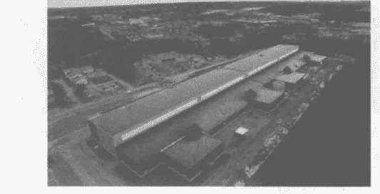

图 6-8 脸书公司建在瑞典北部的数据中心①

> ① 图片参考链接: https://lejournal.cnrs.fr/articles/le-difficile-stockage-des-masses-de-donnees。

粗略估算，训练一个深度学习模型会产生约 284 吨碳排放，相当于 5 辆汽车一年的排放。因此能效比在评判计算平台时的分量越来越大。按算法定制的神经网络专用芯片可以减少冗余功耗，提升计算效率，在对高性能低功耗要求敏感的移动端具有广阔前景。

## 6.2 图像识别

本章以图像识别和目标检测为案例，串联数据集与典型算法，演示如何在昇腾 AI 处理器上搭建典型应用。图像识别部分会讲解命令行端到端的开发流程并简要介绍模型量化，目标检测部分会强调算子自定义并进一步讨论影响推理性能的因素。

### 6.2.1 数据集：ImageNet

本节选用 ImageNet 作为图像识别的代表。它是当前规模最大、认可度最高的图像库之一，约有 1500 万张图片，覆盖 2 万多个类别。数据集基于 WordNet 的语义层级组织，如图 6-9 所示，从左到右体现由上而下的语义解析，例如哈士奇是工作犬的子类，工作犬是狗的子类，狗属于犬科，犬科隶属于哺乳动物下的脊椎动物下的肉食动物。虽然部分层级仍有歧义，但已远好于把女性和人类硬拆成两类的处理方式。有向无环的语义结构对特征提取很有参考价值，树形组织也方便研究者按需截取节点训练分类器。猫科与犬科的区分特征和卡车与轿车的区分特征显然不同。

ImageNet 定义了图像识别、单目标检测和多目标检测三类任务，其中最受关注的是图像识别，即判断图像中可能出现的物体。数据主要来自 Flickr 等搜索引擎，由人工在 1000 个标签上标注——每张图被认为只出现一类物体。物体数量、大小和形状各不相同，在 *ImageNet Large Scale Visual Recognition Challenge* ②一文中，作者从物体尺度、实例数、纹理种类等 8 个维度总结了数据集的多样性和代表性。与此同时，ImageNet 的分类粒度比 PASCAL 更细，如图 6-10 所示，PASCAL 中的鸟在 ImageNet 中会被拆分为火烈鸟、公鸡、松鸡、鹌鹑、鹧鸪等。细化分类也给先验知识不足的人类带来困扰，ImageNet 上人类识别错误率达到 5.1%，既有图像质量不高、主体不突出的影响，也有志愿者分不清鹌鹑和鹧鸪等冷门禽类的问题。这在一定程度上解释了为何机器在 ImageNet 上一度超过人类。

> ① http://www.image-net.org/about-stats。


伴随 ImageNet 而生的 ILSVRC 于 2010 年开启，常以 Top-1 错误率和 Top-5 错误率评价。2012 年 AlexNet 以 Top-5 误差 15.4% 击败 26.2% 的次优模型，点燃了计算机视觉的深度学习浪潮。2014 年的 GoogLeNet 与 VGGNet，2015 年的 ResNet 相继成为里程碑。此后提到 ImageNet 训练模型，多指基于某届 ILSVRC 数据训练测试的模型，常用 2012 年数据。研究者还发现，ImageNet 预训练模型可作为迁移学习的基础，尤其在标注数据不足时。只要截断全连接层之前的部分，前半段就是优秀的特征提取器，后接任务头微调即可。

回看历史，ImageNet 论文 2009 年 CVPR 以海报亮相，十年后获得 CVPR 2019 计算机视觉基础贡献奖。很多人视其为本轮人工智能浪潮的催化剂。2010 至 2017 年间，优胜者识别率从 71.8% 提升到 97.3%，超越人类并验证了数据规模对决策的价值。李飞飞教授指出，ImageNet 改变了学界对数据集的认知，其重要性不亚于算法。

> ① 图片源自：http://www.image-net.org/papers/imagenet_cvpr09.pdf。

② 参见 https://link.springer.com/content/pdf/10.1007%2Fs11263-015-0816-y.pdf。

③ 图片源自 https://link.springer.com/content/pdf/10.1007%2Fs11263-015-0816-y.pdf。


图 6-10 ImageNet 图像分类细化样例（在 Pascal 中的“鸟”“猫”“狗”被细分成各个子类别）①

① http://image-net.org/challenges/LSVRC/。


### 6.2.2 算法：ResNet

深度学习的精髓或许在于更深。真正把网络从二三十层的 VGG、GoogLeNet 推向百层俱乐部的，是残差结构。2015 年 Deep Residual Net 在 ILSVRC 上横扫图像识别、目标检测与定位，组合模型 Top-5 误差低至 3.57%。何恺明提出的残差结构解决了深网训练困难，成为里程碑。

ResNet 要解决的是退化问题。理论上层数增多特征更丰富、准确率应提升，但实践中如图 6-12 所示，56 层普通卷积网收敛表现反而不如 20 层。当深度超过阈值，准确率先饱和后下降。令人意外的是这并非过拟合，因为训练集性能也在下降。

直觉上更深的网不该更差。最糟情况下新增层只要做恒等映射即可，信息透传错误率不变。但实际中优化器与数据限制下，卷积核难以收敛到冲激信号，恒等映射难以实现。批量归一化虽缓解部分梯度消失，性能随深度恶化的问题仍存。


为此 ResNet 引入残差结构，如图 6-13 所示②，设输入为 $x$，期望映射为 $H(x)$，权重层学习 $F(x)$，输出为 $F(x)+x$，即模块拟合：

$$H(x) = F(x) + x$$

若 $F(x)$ 为零，则 $H(x)=x$，即恒等映射。短路结构为网络提供了快速收敛到恒等的捷径，优化器只需学习扰动而非全新函数，这一特性让 ResNet 在 ImageNet 等数据集上表现优异。


图 6-13 残差网络的短路结构①

① 图片源自 https://arxiv.org/pdf/1512.03385.pdf。

# 第 6 章 实战案例


图 6-14 深度残差网络与普通深度网络的对比①

① 图片源自 https://arxiv.org/pdf/1512.03385.pdf。


以 VGG 为设计哲学，作者做了 34 层普通网与残差网对比。普通网遵循：同输出尺度层数一致、特征图减半时通道加倍、下采样用步长 2 卷积。直接在简单网上插入短路即得残差版。实线表示维度一致可直接相加，虚线表示维度不一致时需零填充或 1×1 卷积对齐。ResNet34 比 VGG 卷积核更少，计算量约 36 亿次浮点乘加，而 VGG19 约 196 亿次。

为体现不同深度，设计了 18、34、50、101、152 层残差网，记作 ResNetN。更深时采用瓶颈设计：先用 1×1 卷积把 256 维降到 64 维，再用 3×3 卷积，最后 1×1 恢复。图 6-15(a) 为 ResNet18/34 的模块，图 6-15(b) 为 ResNet50/101/152 的瓶颈模块。

实践表明残差网有效缓解退化。图 6-16 中，普通卷积网出现明显退化，34 层普通网在训练集和校验集上均不如 18 层。而残差网克服此问题，ResNet34 错误率明显低于 ResNet18，且低于 34 层普通网。ResNet18 与 18 层普通网结果相近，因层数少退化不明显，但 ResNet18 收敛更快。


> ① 图片源自 https://arxiv.org/pdf/1512.03385.pdf。

读者可在 TensorFlow 官网获得残差网实现。需注意本节基于 2015 年《深度残差学习图像识别》②，对应代码 v1 版本。次年何恺明发表《深度残差网络中的恒等映射》③，进一步讨论了激活函数与批量归一化的相对位置，对应 v2 版本。

## 6.2.3 模型迁移实践

昇腾AI模型上板实操路径全解析

昇腾AI处理器把训练好的模型跑到芯片上主要有两条路线：可视化的集成开发环境Mind Studio，和面向命令行的数字开发者套件DDK。两者都依托华为自研的AI全栈开发平台，前者以拖拽式界面降低门槛，适合快速上手的新手；后者以命令行套件提供精细化控制，适合追求定制化改造的高级开发者。

下面以命令行DDK方式展开，带你走完一次完整的昇腾AI应用部署。假设DDK已按要求部署完成，可参考附录B《Ascend 310 DDK样例使用指导(命令方式)》或《Ascend 310 Mind Studio工具安装指南》，安装路径设为 $HOME/tools/che/ddk，$HOME 为当前用户的根目录。

整体上模型迁移可拆解为四个环节，后文将逐一说明：
- 1) 模型准备：拿到权重文件并转成昇腾支持的达芬奇离线模型；
- 2) 图像预处理：借助DVPP完成解码、裁剪等操作；
- 3) 工程编译与运行：调整编译配置，指定DDK路径、模型位置及运行环境，生成可执行程序；
- 4) 结果校验：检查推理输出是否符合预期。

### 1. 模型准备
在主机端完成网络训练并导出权重后，需要先把它转成芯片可用的离线模型。以ResNet为例，可从何恺明主页④下载官方权重，该站点提供ResNet-50、ResNet-101、ResNet-152等多深度版本，caffe模型文件与prototxt配置文件一一对应。以下以50层ResNet50 为演示对象。

从配置文档如 prototxt/ResNet-50-deploy.prototxt 可读出网络结构和算子信息。例如代码 6-2 prototxt 定义样例(数据层) 中输入层说明，输入为单张三通道图像，分辨率224×224。依据此参数准备测试素材即可。

```
name: "ResNet-50"
input: "data"
input_dim: 1
input_dim: 3
input_dim: 224
input_dim: 224
```

要看某层的具体格式，可参考代码 6-3 prototxt 定义样例(卷积层) 的卷积层定义。

```
layer {
    bottom: "data"
    top: "conv1"
    name: "conv1"
    type: "Convolution"
    convolution_param {
        num_output: 64
        kernel_size: 7
        pad: 3
        stride: 2
    }
}
```

其中 bottom 为输入，top 为输出，type 标明层类型，此处为Convolution。name 为层名，需唯一，用作网络中定位该层的标识。

卷积层的具体参数里，num_output 为64，表示卷积核数量；kernel_size 为7×7；pad 为边缘填充量，默认0，示例中填充3，即上下左右各扩3个像素，使7×7核能完整覆盖边界；stride 为步长，默认1，示例取2，即每隔2个像素滑动一次。也可分别用 stride_h 与 stride_w 控制纵横向步长。


模型文件就绪后，需用转换工具生成昇腾离线模型。若遇到未支持的算子，则需自行实现并加入算子库。6.3节目标检测部分将详细说明自定义算子的流程。本例ResNet的算子均被昇腾平台原生支持，直接执行如下命令即可。参考代码 6-4 OMG模型转换命令样例 执行后会得到后缀为om的文件，如resnet50.om。

```
$HOME/tools/che/ddk/ddk/uihost/bin/omg --model=resnet50.prototxt --weight=resnet50.caffemodel --framework=0 --output=resnet50
```

代码 6-4 OMG模型转换命令样例

参数含义如下：
- (1) --model 指向 resnet50.prototxt 的相对路径；
- (2) --weight 指向 resnet50.caffemodel 的相对路径；
- (3) --framework 指定源框架，0 代表Caffe，3 代表TensorFlow；
- (4) --output 指定生成的模型文件名，可自命名。

### 2. 图像处理
随着物联网与边缘计算需求激增，设备侧对图像帧处理速度要求越来越高，编解码压力显著上升。昇腾平台提供专用的数字视觉预处理模块DVPP。以昇腾310为例，其双核VDEC可实现双路4K高清视频60帧/秒的实时解析，4核VPC可实现4路4K高清视频90帧/秒的实时处理。采用硬件化编解码，可大幅释放CPU资源，提升端侧数据处理效率。

DVPP支持YUV与RGB/RGBA两种表达。图 6-18 YUV格式和RGB格式的各通道对比① 中，YUV由Y、U、V三分量构成，Y为亮度即灰度信息，U、V为色度描述色彩和饱和度。常见格式有YUV444每像素独立YUV、YUV422每两个像素共享一对UV、YUV420四个像素共享一对UV、YUV400仅有Y。RGB/RGBA则通过红绿蓝三通道叠加生成颜色，A为透明度，更贴近显示，但在存储和传输成本上高于YUV。


图 6-18 YUV格式和RGB格式的各通道对比①

> ① 图片源自 https://blogs.gnome.org/rbultje/2016/11/02/displaying-video-colors-correctly/。

本案例中DVPP已内置于框架。按需也可自行调用，主要有接口调用和执行器调用两种方式。接口调用细节可查附录B的“DVPP API参考”。

### 3. 工程编译
DDK安装目录下sample文件夹存放了一系列开发参考用例。鉴于版本迭代，建议到昇腾官网①获取最新的分类网络参考设计。图像分类、目标识别等典型场景均有对应代码。ResNet50属于图像分类范畴，完成模型转换后，可基于内置的classify_net/开展本地编译与运行。

为兼容不同环境，编译过程建议拆分为可执行文件和设备侧动态链接库两部分。对于Atlas开发板这类独立推理平台，可执行文件在设备侧编译；对于受主机CPU控制的PCIe板卡/加速卡，可执行文件在主机侧编译。链接库的编译环境与最终运行场景需保持一致。

首先修改 classify_net/Makefile_main，主要调整：
- (1) DDK_HOME：DDK安装路径，默认../../che/ddk/ddk/；
- (2) CC_SIDE：编译运行侧，默认host，使用Atlas开发板时改为device，均为小写；
- (3) CC_PATTERN：运行场景，默认ASIC，Atlas场景改为Atlas。

修改后执行该Makefile，即可在当前目录out文件夹生成可执行文件，具体结果会因软件版本和设计场景略有差异。随后修改 classify_net/Makefile_device，主要调整CC_PATTERN，Atlas场景同样改为Atlas。执行成功后，classify_net/out中会生成libai_engine.so等链接库。至此，昇腾平台推理所需文件已备齐。

> ① https://www.huawei.com/minisite/ascend/cn/。
> ② 注意权限不足时可用 chmod 775 * 修改。

编译完成后，将转换好的ResNet50.om与ResNet50.prototxt放入设备侧classify_net/model目录，并在graph_sample.txt中按第5章方法调整推理引擎路径。

代码 6-5 推理引擎定义样例 为基础定义示例，其中id为引擎编号，engine_name可自定义，side表示执行位置DEVICE或HOST；so_name指向前面编译生成的动态链接库；ai_config中的"model_path"可配置为转换后的om模型路径。

```
engines {
    id: 1003
    engine_name: "ClassifyNetEngine"
    side: DEVICE
    so_name: "./libai_engine.so"
    thread_num: 1
    ai_config{
        items{
            name: "model_path"
            value: "./test_data/resnet-50/model/ResNet50.om"
        }
    }
}
```

代码 6-5 推理引擎定义样例

### 4. 结果分析
ImageNet 2012数据集在图像识别任务中共含1000类标签，模型输出为1000维向量，每行对应一个标签编号及对应概率。

```
rank: 1 dim: 1000 data:
label:1    value:5.36442e-07
label:2    value:4.76837e-07
label:3    value:5.96046e-07
label:4    value:1.01328e-06
label:5    value:8.9407e-07
...
```

Top-1预测取概率最高标签作为结果。以澳洲克尔皮犬为例，模型以99.8%置信度正确识别。若使用Mind Studio集成环境，可通过右键结果引擎直观看如图 6-19 所示的可视化结果。


图 6-19 图像识别结果样例：科尔皮犬

回顾本案例的整体处理链。如图 6-20 所示，图像转码、裁剪与变形由数字视觉预处理模块完成；之后完成含归一化在内的预处理；核心推理由AI Core即达芬奇架构处理核心执行；结果交由CPU处理并输出。主机侧完成算子编排与执行顺序设计，设备侧只需离线推理。

在6.1节中提及，为提升吞吐并降低单张推理能耗，常将FP32模型量化为FP16甚至INT8。接下来以残差网络为例说明量化原理与性能。


### 5. 量化方法
相较FP32，FP16、INT8等低精度类型占用的存储更少，传输时间也大幅下降。随深度学习融入更多系统与应用，模型与权重体积成为瓶颈。以AlexNet为例，原始权重已超200MB，新模型参数更庞大，低精度带来的空间收益明显。低比特计算效率也更高，INT8相比FP32加速可达3倍以上。

推理阶段昇腾将量化统称为量化校准Calibration，主要完成：
- 1. 校准算子输入数据范围[d_min, d_max]，求出最优缩放比例与量化偏置；
- 2. 将算子权重量化为INT8，计算权重缩放比例与偏置；
- 3. 将算子偏置量化为INT32。

如图 6-21 所示，离线模型生成器在生成离线模型时，可通过量化校准模块将量化后的权重与偏置合并入模型。下面以FP32量化为INT8为例说明达芬奇架构下的量化原理。


缩放比例与量化偏置的确定基于线性拟合假设：
$d_{\text{float}} = \text{scale} \times (q_{\text{uint8}} + \text{offset})$
其中 $d_{\text{float}}$ 为原始浮点数据，scale为FP32，$q_{\text{uint8}}$ 为量化结果，通常用无符号8位整型。

量化转换公式为：
$q_{\text{uint8}} = \text{round}\left(\frac{d_{\text{float}}}{\text{scale}}\right) - \text{offset}$
round为取整，offset为INT32，数据范围为 $[\text{scale} \times \text{offset}, \text{scale} \times (255 + \text{offset})]$。若数据范围为 $[d_{\text{min}}, d_{\text{max}}]$，则：
$\text{scale} = (d_{\text{max}} - d_{\text{min}}) / 255$
$\text{offset} = \text{round}(d_{\text{min}} / \text{scale})$

权重与数据量化均采用上述方案，$d_{\text{min}}$ 与 $d_{\text{max}}$ 分别为最小最大值。

权重推理时已固定，无需校准，$d_{\text{max}}$ 与 $d_{\text{min}}$ 直接取权重极值。实验表明，卷积层每个卷积核使用独立量化系数精度更高，因此卷积层权重按核分组量化，缩放比例与偏置数量与核数相同；全连接层权重通常使用一组缩放比例与偏置。

对模型做量化，本质上是对每一层待量化的输入进行统计，并在每层上求出一组最优的缩放系数与量化偏移。推理时层的输入是中间结果，其数值范围会随具体输入而变化，因此需要用一组参考的推理场景数据作为激励，去采集每层的输入来确定 d_max 与 d_min。工程上通常从测试集里抽样，取若干小批量做量化。为了让求得的区间 [d_min, d_max] 在不同输入下更稳健，会采用基于统计分布的确定方式。量化后数据的分布与原始高精度分布之间的差异会被度量，寻找使差异最小的区间作为最优解，随后即可据此算出 offset 与 scale。

以图 6-22 为例，152 层残差网络在精度几乎不下降的前提下，代价小于 0.5%，吞吐量却能提升约 30%。这说明量化在工业落地里具备很强的实用价值。

## 6.3 目标检测

### 6.3.1 数据集：COCO

ImageNet 也包含检测与定位标注，但在目标检测领域真正的主流是微软主导收集的 COCO 数据集。它覆盖了大量日常场景中的常见物体，兼顾目标检测、语义分割与文字描述，并提供像素级标注，能更精细地评估检测与分割效果。每年在此数据集上举办竞赛，已扩展到目标检测、语义分割、关键点识别、图像注释等多个视觉任务，是继 ILSVRC 之后最具影响力的评测之一。

与 ImageNet 相比，COCO 更偏爱非标志性 Non-Iconic 图片，即物体与其场景共同出现，如图 6-23 所示，这更贴近真实理解任务。标志性 Iconic 图片更适合受语义影响较小的分类任务，ImageNet 中绝大多数图片属于此类。

COCO 检测任务包含 80 个物体类别与 20 个语义类别，2014 版提供 82 783 张训练图、40 504 张验证图与 40 775 张测试图。数据的基本格式中，目标分割会记录边界上每个控制点的精确坐标，精度保留两位小数。

```
"segmentation": [392.87, 275.77, 402.24, 284.2, 382.54, 342.36, 375.99, 356.43, 372.23, 357.37, 372.23, 397.7, 383.48, 419.27, 407.87, 439.91, 427.57, 389.25, 447.26, 346.11, 447.26, 328.29, 468.84, 290.77, 472.59, 266.38]
```

比如图 6-24 里的两份便当可以用“两个黑色餐盒装着各式熟食”来描述，其中“西蓝花”对应的检测区域可以通过框内给出的一串边界点坐标来表征，数字仅作参考。受遮挡的单个物体可能需要多个多边形表示。传统边界框标注同样可选，对应 json 中的 bbox 字段，四个数依次为左上角横坐标、左上角纵坐标、宽、高，单位为像素。详细说明与下载请见 COCO 官网①。

如 6.1 节所述，目标检测的评测比图像识别复杂得多，COCO 的评测体系更为精细，既支持可视化与数据评测，也能分析模型的典型错误，更直观地暴露不足。

在均值平均精度方面，COCO 的定义如下：

> ① http://cocodataset.org/#detection-2018。

(1) AP：交并比从 0.5 起、以 0.05 为步长到 0.95，共 10 个阈值上 80 个类别的平均精度的平均值，是 COCO 竞赛的主指标。
(2) AP^0.5：交并比 0.5 时的均值平均精度，与 PASCAL VOC 保持一致。
(3) AP^0.75：交并比 0.75 时的均值平均精度，要求更严格。

COCO 中待检目标更小也更复杂。小目标面积 ≤ 32×32 像素占比约 41%，中目标 32×32 到 96×96 像素占比约 34%，大目标 ≥ 96×96 像素占比约 24%。为此按尺度分别评测：

(1) AP^S：小目标的均值平均精度，面积 ≤ 32×32 像素。
(2) AP^M：中目标的均值平均精度，面积 32×32~96×96 像素。
(3) AP^L：大目标的均值平均精度，面积 ≥ 96×96 像素。

召回率描述的是图中有多少目标被检出，例如一图有 5 只鸟只检出 1 只，召回率为 20%。COCO 还基于每张图重复检测 1 次、10 次、100 次以及不同尺度，用平均召回率作补充判据。这些标准已被学界广泛采纳。表 6-3 显示，小目标 APS 的均值平均精度明显低于大目标 APL，目标越小检测越难。同时 IoU=0.5 时精度更高，主要因为模型在 0.85、0.90、0.95 这三个阈值上表现不足，拉低整体，尤其对小目标难以达到 90% 交并比。

表 6-3 目标检测 COCO 数据集 2017 年排行榜

| 团 队 | AP | AP50 | AP75 | APS | APM | APL |
|---|---|---|---|---|---|---|
| Megvii (Face++) | 0.526 | 0.73 | 0.585 | 0.343 | 0.556 | 0.66 |
| UCenter | 0.51 | 0.705 | 0.558 | 0.326 | 0.539 | 0.648 |
| MSRA | 0.507 | 0.717 | 0.566 | 0.343 | 0.529 | 0.627 |
| FAIR Mask R-CNN | 0.503 | 0.72 | 0.558 | 0.328 | 0.537 | 0.627 |
| Trimps-Soushen+QINIU | 0.482 | 0.681 | 0.534 | 0.31 | 0.512 | 0.61 |
| bharat_umd | 0.482 | 0.694 | 0.536 | 0.312 | 0.514 | 0.606 |
| DANet | 0.459 | 0.676 | 0.509 | 0.283 | 0.483 | 0.591 |
| BUPT-Priv | 0.435 | 0.659 | 0.475 | 0.251 | 0.477 | 0.566 |
| DL61 | 0.424 | 0.633 | 0.471 | 0.246 | 0.458 | 0.551 |

自 2015 年 ResNet 在 ImageNet 突破后，图像识别竞赛的吸引力明显下降，因算法已逼近甚至超越人类，颠覆式改进难见。组委会随之转向 COCO——表 6-3 显示最好算法的均值平均精度仅约 53%，提升空间充足。复杂检测在自动驾驶、智能安防、智慧城市等对复杂场景抽象分析的工业场景中应用广泛，且对实时性要求极高。以自动驾驶为例，面对每秒上百帧的图像与传感器数据，必须在设备端准实时处理，毫秒级决策才足以保障安全。

### 6.3.2 算法：YoloV3

天下武功，唯快不破。6.2.2 节的残差案例偏重深度与精度，本节的 Yolo 则聚焦推理速度。从第一代 You Only Look Once 诞生起，主打就是“快”，迭代到 YoloV3 后早期对小目标精度不足的问题被大幅改善，已成为性价比很高的方案。

如图 6-25 所示，在同等硬件下，YoloV3 比区域卷积神经网络① RCNN 快约 100 倍，比快速区域卷积神经网络② FastRCNN 快近 100 倍，比单发多框检测③ SSD 快三倍且准确率更高。其对低成本硬件实时视频分析的能力，使其跻身工业视频处理常用模型。

基于《密集物体检测的变焦损失》④，目标检测算法大致分三类。传统方法基于滑动窗口，用不同大小比例的窗口在图上滑动后做分类，2005 年 CVPR 的方向梯度直方图⑤ HOG 与后来的可形变部件模型⑥ DPM 是代表，靠手工特征在人体姿态等任务上取得佳绩，但深度学习爆发后因精度竞争力不足逐渐淡出。

深度学习方法主要分两类。两级模型思路与传统方法相近，先在图中选出多个高质量候选区域，再用预训练的卷积网络如 VGG 或 ResNet 的前半部分作特征提取，对每个候选区做分类与回归。从《基于启发式搜索的目标检测》① 起逐步演变为 R-CNN 系列，第一阶段常用启发式搜索 Selective Search 提取 Region Proposal，再做分类回归。因每个区域独立抽特征，重叠带来大量重复计算。Fast R-CNN 利用卷积空间位置不变性，对整图只做一次前向，将区域映射到特征图上。Faster R-CNN 用神经网络产生候选框，提升了效率，但仍难达到实时。

另一类是单级模型，用一个网络直接预测类别与位置，SSD、Yolo 皆属此类。流程如图 6-26 所示：先对图像缩放，经卷积网络提取特征，再经非极大值抑制筛选，一次性输出框位置与类别。实质是将检测建模为回归问题。第一类方法复杂且准但慢，第二类网络简洁粗暴、速度快但精度略低，实践中可按需求选择。

2015 年初代 Yolo 借鉴 GoogLeNet，使用 24 层卷积后接两层全连接，1×1 卷积控制维度，最后一层线性激活直接回归 7×7×30 矩阵。7×7 指把图片划分为 7×7 网格，每个格对应 1×30 向量。每个格预测两个框，每个框需中心 x,y、宽高 w,h 共 4 个值，外加置信度 1 个，共 5 个。两个框需 10 个值，加上 Pascal VOC 的 20 类标签，共 30 个。

可按需调整网格 S×S、每个格框数 B、类别数 C，将回归目标设为 S×S×(B×5+C) 矩阵再训练。注意同一格的两个框共享同一组类别概率，导致近距离与小目标检测不佳。

为兼顾速度与精度，Yolo 迭代两版。YoloV2 采用 19 层 Darknet 提取特征，并引入高精度微调、批量归一化、锚框、先验框聚类、多尺度训练等手段。YoloV3 借鉴 6.2 节残差网络，在 53 层 Darknet 中加入短路，并在特征金字塔① Feature Pyramid Networks 思想上改进，输入 416×416，采用 13×13、26×26、52×52 三个尺度的特征图。更细的观察粒度与更深的抽象能力，使小目标检测大幅提升，为工业广泛应用奠定基础。

### 6.3.3 自定义算子实践

流程与图像识别类似，从 Yolo 作者官网② 下载权重与配置文件后，需把模型转为昇腾 AI 处理器支持的 om 格式。本例刻意移除了卷积算子实现，以演示自定义算子开发。代码可从昇腾官网③ 获取。第 5 章已用 TBE 特定域语言实现 Reduction 算子，这里以二维卷积为例讲解在网络中自定义、集成并推理的端到端流程。

用 6.2 节的离线模型生成命令转换框架模型时，若存在未定义算子，日志会报错不支持，此时可自定义算子。需注意，若框架已支持某算子且用户也实现同名算子，则以用户实现为准。

自定义 TBE 算子要完成计算与调度两部分。计算描述算法逻辑，调度描述算法在硬件上的切分与数据流等行为。两者解耦使计算可复用于不同平台。用户实现计算后，再按数据流设计硬件行为。为了让框架感知自定义算子，需要插件注册机制。

如图 6-28 所示，算子逻辑实现如 Img2Col 矩阵展开、MAD 矩阵乘法等与硬件解耦，芯片侧的数据流动与内存管理由独立调度模块自动生成。TBE 在融合计算逻辑与任务调度后生成内部代码并编译。离线模型生成器通过插件启动上述流程后，基于原权重与配置生成 om 模型。模型出现算子不支持时，可通过此方式打通定制化推理。下面依次看插件实现、算子逻辑实现、调度原则生成。

#### 1. 插件开发

方式与第 5 章类似。离线模型生成器启动时先调用插件机制，通知框架当前算子为用户定义的 TBE 算子并完成注册。因此在定义算子前需先完成插件开发，以确保模型转换时能顺利生成支持新算子的可执行文件。

概览来看，插件在离线模型转换与推理两个环节各司其职。转换阶段，它在离线生成器内部建立 Caffe 算子名到达芬奇算子名的对应关系，借此让生成器能够找到算子对应的动态链接库，登记与 Caffe 名称一一对应的自定义算子标识，并在指定目录下产出该算子的执行目标文件，随后把算子一起封装进达芬奇的 om 模型包。进入离线推理时，插件则把算子的执行文件载入内存，供框架调用。

> ① https://arxiv.org/abs/1612.03144。

> ② https://pjreddie.com/darknet/yolo/。

> ③ https://www.huawei.com/minisite/ascend/cn/。

> ④ https://arxiv.org/pdf/1708.02002.pdf。

> ⑤ https://hal.inria.fr/file/index/docid/548512/filename/hog_cvpr2005.pdf。

> ⑥ http://cs.brown.edu/people/pfelzens/papers/lsvm-pami.pdf。

> ⑦ https://arxiv.org/pdf/1311.2524.pdf。

> ⑧ https://arxiv.org/pdf/1504.08083.pdf。

> ⑨ https://arxiv.org/pdf/1512.02325.pdf。

> ⑩ http://www.huppelen.nl/publications/selectiveSearchDraft.pdf。

> ⑪ 图片来自 http://arxiv.org/pdf/1506.02640.pdf。

> ⑫ http://host.robots.ox.ac.uk/pascal/VOC/。

推理时可以直接使用已生成的离线模型。需要明白的是，插件在主机侧编译成动态链接库的工作属于模型转换前的预处理。

与第 5 章所述思路类似，算子注册主要涉及以下要素：

- (1) 算子标识：conv_layer，命名由使用者自行确定。
- (2) 框架类别：CAFFE，即模型训练所依赖的原框架。
- (3) 原框架算子名：Convolution，必须与 Caffe 的 prototxt 配置文件中声明的名称完全一致。
- (4) 输出形状与类型的推导函数：例如 InferShapeAndType_conv，实现可参照 Caffe 对输入张量形状的推导逻辑，像激活类算子输入输出形状保持不变；具体实现由使用者按需自行编写。
- (5) 算子目标文件的生成方式：例如 BuildTeBin_conv。
- (6) 执行解析方式：TVM。
- (7) 数据格式：DOMI_TENSOR_NC1HWC0。
- (8) 权重存储方式：DOMI_TENSOR_FRACTAL_Z。

书中反复指出，当使用该计算单元处理超过 16×16 的矩阵时，需要先按特定存储布局保存矩阵，并在计算时按特定分块方式读取数据。DOMI_TENSOR_FRACTAL_Z 正是对这种读取方式的描述。下一节在算子实现中会结合分块策略 Tiling 进一步展开排布与计算的细节。

把上述要素整合起来，一个典型算子插件的定义示例如代码 6-6 所示。

```
REGISTER_CUSTOM_OP("conv_layer")    //注册与 Caffe 算子名称一一对应的达芬奇算子名
    .FrameworkType(CAFFE)              //指定当前算子来自 Caffe 框架
    .OriginOpType("Convolution")       //算子在 Caffe 框架中的命名名称
    .InferShapeAndTypeFn(InferShapeAndType_conv)
                                      //获得该算子在网络中的输入输出信息，以便调用算子实现 API
    .TEBinBuildFn(BuildTeBin_conv)     //生成算子实现目标文件.o
    .Formats(DOMI_TENSOR_NC1HWC0)      //算子输入支持的数据格式 NC1HWC0 5D 格式
    .WeightFormats(DOMI_TENSOR_FRACTAL_Z);  //矩阵乘法的数据排布方式
}
```

代码 6-6 典型算子插件定义示例

## 2. 算子实现

与 CPU 端的实现相比，昇腾 AI 处理器上的卷积算子实现更为复杂。为了充分挖掘矩阵计算单元的性能，需要对特征图与权重实施格式转换、展开和分块处理。下面以一组卷积配置为例，说明在 AI Core 上完成卷积运算的流程。

### 1) 基于矩阵计算单元的矩阵运算

昇腾 AI 处理器上矩阵计算单元最基础的操作是完成 M_cube×K_cube 与 K_cube×N_cube 两个矩阵的乘法。该单元支持 FP16、INT8、UINT8 三种数据类型，不同类型对应的 M_cube、K_cube、N_cube 如表 6-4 所示。

表 6-4 各数据类型对应的 M_cube、K_cube、N_cube

| 类型 | M_cube | K_cube | N_cube |
| :--- | :--- | :--- | :--- |
| INT8 | 16 | 32 | 16 |
| UINT8 | 16 | 32 | 16 |
| FP16 | 16 | 16 | 16 |

要支持任意尺寸的矩阵相乘，例如 M×K 矩阵 A 与 K×N 矩阵 B，需先分块。把 M 补齐到 M_cube 的倍数，K 补齐到 K_cube 的倍数，N 补齐到 N_cube 的倍数，可将 A 拆成 ⌈M/M_cube⌉×⌈K/K_cube⌉ 的分块矩阵，将 B 拆成 ⌈K/K_cube⌉×⌈N/N_cube⌉ 的分块矩阵，再按常规分块矩阵相乘的方式计算。其中每次乘法处理的是 M×K 与 K×N 两个子块，每次加法处理的是 M×N 两个子块。

### 2) 卷积算子参数定义和数据排布方式

卷积算子由输入特征图、卷积核和输出特征图构成。

第 4 章已提到，深度学习框架中卷积算子的特征图一般按 NHWC 或 NCHW 排布，其中：

- (1) N：批次中样本张数。
- (2) H：特征图高度。
- (3) W：特征图宽度。
- (4) C：特征图通道数。

在 CPU 上特征图多采用 NHWC，为便于区分输入与输出，输入记作 N H_in W_in C_in，输出记作 N H_out W_out C_out。

卷积核数据按 C_out C_in H_k W_k 排布，其中：

- (1) C_out：卷积核个数，等同于输出通道数。
- (2) C_in：每个卷积核的权重矩阵个数，等同于输入通道数。
- (3) H_k：卷积核高度。
- (4) W_k：卷积核宽度。

此外卷积算子通常还包含：

- (1) P_h：高度方向单侧填充量。
- (2) P_w：宽度方向单侧填充量。
- (3) S_h：高度方向步长。
- (4) S_w：宽度方向步长。

相应地，输出特征图的高度和宽度由下式确定：

$$H_{out} = \frac{H_{in} - H_k + 2 \times P_h}{S_h} + 1$$

$$W_{out} = \frac{W_{in} - W_k + 2 \times P_w}{S_w} + 1$$

### 3) 卷积算子示例

为便于后续说明，假设数据类型为 FP16，并把各参数赋具体值：

- N = 10
- C_in = 32
- C_out = 64
- H_in = W_in = H_out = W_out = 28
- H_k = W_k = 3
- P_h = P_w = 1
- S_h = S_w = 1

此时：

(1) 输入特征图维度为 [N, H_in, W_in, C_in]，即 [10, 28, 28, 32]。

(2) 权重维度为 [C_out, C_in, H_k, W_k]，即 [64, 32, 3, 3]。

(3) 输出特征图维度为 [N, H_out, W_out, C_out]，即 [10, 28, 28, 64]。

### 4) 输入特征图数据的格式转换

输入特征图的格式转换包含以下步骤：

步骤 1 把 NHWC 格式的输入转为达芬奇架构定义的 NC1HWC0 五维格式。

步骤 2 通过 Img2Col 方法把 NC1HWC0 五维格式展开为输入特征图矩阵的二维格式。

步骤 3 按“大 Z 小 Z”分块格式转换输入特征图矩阵的内存排布。

昇腾 AI 处理器上数据均以 NC1HWC0 五维格式保存，其中 C0 与达芬奇架构相关，本质为前述 K_cube 值，C1 为 C_in 按 C0 拆分后的因子，可表示为 ⌈C_in/K_cube⌉，如图 6-29 所示，具体转换如下：

步骤 1 把输入特征图 [N, H_in, W_in, C_in] 的 C_in 按 K_cube 拆分得到 [N, H_in, W_in, ⌈C_in/K_cube⌉, K_cube]，例如 [10, 28, 28, 32] 拆分为 [10, 28, 28, 2, 16]。若 C_in 不是 K_cube 的倍数，则先补零至倍数再拆分。

步骤 2 把 [N, H_in, W_in, ⌈C_in/K_cube⌉, K_cube] 转维为 [N, ⌈C_in/K_cube⌉, K_cube, H_in, W_in]，即 [10, 28, 28, 2, 16] 进一步转为 [10, 2, 16, 28, 28] 再按约定重排为 [10, 2, 28, 28, 16]。

该过程会出现在两种场景：

- (1) 首层 RGB 图像数据需要转换。
- (2) 各层输出特征图数据需要重新排布。

转换到 NC1HWC0 五维格式后，按 Img2Col 算法需把数据转为输入特征图矩阵的二维格式。根据前文 Img2Col 描述，最终输入特征图矩阵形状为 [N, H_out W_out, H_k W_k C_in]，其中 H_out W_out 为高，H_k W_k C_in 为宽。如图 6-30 所示，由于昇腾 AI 处理器对 C_in 做了拆分，最后矩阵形状为 [N, H_out W_out, ⌈C_in/K_cube⌉ H_k W_k K_cube]，即 [10, 28 × 28, 2 × 3 × 3 × 16]，即 [10, 784, 288]。


图 6-29 数据的 NC1HWC0 五维格式转换


图 6-30 昇腾 AI 处理器上的 Img2Col

Img2Col 转换后，还需把输入特征图矩阵转为“大 Z 小 Z”排布，需进一步拆分轴，最后分形格式形状为 [N, ⌈H_out W_out / M_cube⌉, ⌈C_in/K_cube⌉ H_k W_k, M_cube, K_cube]，其中 H_out W_out 先补齐到 M_cube 倍数再拆分，代入具体数据即 [10,49,18,16,16]。可看出 [16,16] 为小矩阵的高宽，按行优先排列，故称“小 Z”排布，[49,18] 为分形格式的高宽，按行优先排列，故称“大 Z”排布。

以上两步由 AI Core 的专用硬件完成。硬件实现较为复杂，图 6-31 展示了前述卷积参数的实例，具体包含：

- 步骤 1 因步长 S_h 与 S_w 均为 1，为得到输入特征图矩阵中坐标 (0,0) 的小矩阵，共 49 × 18 个，需顺序读取输入特征图 16 × 16 = 256 个数据，形状为 [M_cube, K_cube]，可直接展开成小矩阵，相当于把 K_cube = 16 个卷积核中坐标 (0,0) 的像素展开。
- 步骤 2 续读 256 个数据可得坐标 (0,1) 的小矩阵，相当于把 16 个卷积核中坐标 (0,1) 的像素展开。实际读取时因步长不同数据会部分重复，硬件会在转换中复用。
- 步骤 3 续得坐标 (0,2) 的小矩阵，相当于把 16 个卷积核中坐标 (0,2) 的像素展开。
- 步骤 4 前 3 步得到宽度上 W_k = 3 个小矩阵后，需按 H_k = 3 维度继续展开，重复步骤 1～3 把 16 个卷积核中坐标 (1,0)、(1,1)、(1,2)、(2,0)、(2,1)、(2,2) 的像素展开。
- 步骤 5 前 4 步得到宽度上 ⌈C_in/K_cube⌉ H_k W_k = 18 个小矩阵后，需按 ⌈C_in/K_cube⌉ = 2 维度继续展开，重复步骤 1～4。
- 步骤 6 前 5 步得到输入特征图的宽度上所有小矩阵后，需按高度上 ⌈H_out W_out / M_cube⌉ = 49 维度继续展开，重复步骤 1～5。

# 第 6 章 实战案例


图 6-31 输入特征图数据转输入特征图矩阵

步骤 7 前 6 步完成后，最后按批次维度 N 展开即可，重复步骤 1～6。

最终得到 10 × 49 × 18 = 490 × 18 个小矩阵，按“大 Z 小 Z”格式构成输入特征图矩阵，最后形状为 [10, 49, 18, 16, 16]。

### 5）权重数据的格式转换

权重格式转换包含以下步骤：

步骤 1 同样把权重数据转为 NC1HWC0 五维格式，最终得到格式为 C_out ⌈C_in/K_cube⌉ H_k W_k K_cube 的数据。

步骤 2 把 NC1HWC0 五维格式展开为权重矩阵的二维格式。

步骤 3 按“大 Z 小 N”分块格式转换权重矩阵的内存排布。

上述过程在离线模型生成器转换模型时离线完成，昇腾 AI 处理器推理时直接加载即可。

# AI Core卷积加速背后的数据重排逻辑

原始卷积核的张量维度是 $[C_{out}, C_{in}, H_k, H_w]$，本例里就是 $[64, 32, 3, 3]$。离线阶段会先切成5D形式 $\left[ C_{out}, \left[ \frac{C_{in}}{K_{cube}} \right], H_k, H_w, K_{cube} \right]$，即 $[64, 2, 3, 3, 16]$。因为转换在离线完成，5D转2D和大Z小N的整理可以拆开做。

如图 6-32 的思路，把权重整理成矩阵比较直观。先把每个卷积核中通道数为 $K_{cube}$ 的部分拉成一个列向量，多个核的列向量左右拼接，就得到一段权重的矩阵形态，大小是 $[H_k H_w K_{cube}, C_{out}]$，也就是 $[144, 64]$。在高度方向上再按 $\left[ \frac{C_{in}}{K_{cube}} \right]=2$ 这一维重复同样的展开，最终的权重矩阵变成 $\left[ \left[ \frac{C_{in}}{K_{cube}} \right] H_k H_w K_{cube}, C_{out} \right]$，即 $[288, 64]$。

Img2Col 之后，还要把权重矩阵改造成“大 Z 小 N”的存放方式，需要做轴拆分与重排。最终分块形状为 $\left[ \left[ \frac{C_{in}}{K_{cube}} \right] H_k H_w, \left[ \frac{C_{out}}{N_{cube}} \right], N_{cube}, K_{cube} \right]$，$C_{out}$ 先补齐到 $N_{cube}$ 再拆分，代入数值后是 $[18, 4, 16, 16]$。其中 $[16, 16]$ 是每个小矩阵的宽高，按列优先排布，称作小 N；$[18, 4]$ 是大矩阵层面，行优先排布，称作大 Z。


按上述步骤汇总下来，权重被组织成 18×4 个小块，采用大 Z 小 N 结构，整体形状落在 $[18,4,16,16]$。

### 6）输出特征图数据的格式转换

此时输入特征图矩阵的形态为 $\left[N,\left\lceil\frac{H_{\text {out }} W_{\text {out }}}{M_{\text {cube }}}\right\rceil,\left\lceil\frac{C_{\text {in }}}{K_{\text {cube }}}\right\rceil H_k W_k, M_{\text {cube }}, K_{\text {cube }}\right]$，即 $[10, 49, 18,16,16]$；权重矩阵的形态为 $\left[\left\lceil\frac{C_{\text {in }}}{K_{\text {cube }}}\right\rceil H_k H_w,\left\lceil\frac{C_{\text {out }}}{N_{\text {cube }}}\right\rceil, N_{\text {cube }}, K_{\text {cube }}\right]$，即 $[18,4,16,16]$。

两者相乘拆成两步执行。

步骤 1 是小块相乘。每个小块大小分别为 $M_{\text {cube }} \times K_{\text {cube }}$ 与 $K_{\text {cube }} \times N_{\text {cube }}$，相乘后得到 $M_{\text {cube }} \times N_{\text {cube }}$。本例即 $16 \times 16$ 与 $16 \times 16$ 相乘得到 $16 \times 16$。

步骤 2 是分块矩阵相乘。将 $N$ 维度挪到输入特征图的宽一侧，分块大小变为 $N\left\lceil\frac{H_{\text {out }} W_{\text {out }}}{M_{\text {cube }}}\right\rceil \times\left\lceil\frac{C_{\text {in }}}{K_{\text {cube }}}\right\rceil H_k W_k$ 与 $\left\lceil\frac{C_{\text {in }}}{K_{\text {cube }}}\right\rceil H_k H_w \times\left\lceil\frac{C_{\text {out }}}{N_{\text {cube }}}\right\rceil$，结果为 $N\left\lceil\frac{H_{\text {out }} W_{\text {out }}}{M_{\text {cube }}}\right\rceil \times\left\lceil\frac{C_{\text {out }}}{N_{\text {cube }}}\right\rceil$。代入具体数值为 $490 \times 18$ 与 $18 \times 4$ 相乘得到 $490 \times 4$。

AI Core 的矩阵计算单元原生支持小块相乘，一条指令即可完成，输出小块按行优先保存，称为小 Z，数据格式是 $[M_{\text{cube}}, N_{\text{cube}}]$ 即 $[16, 16]$。

分块相乘在逻辑上等同于普通矩阵乘，只是遍历顺序不同。图 6-33 的实现方式是：输入特征图按列优先遍历小块，权重按行优先遍历小块，输出按列优先存放小块。以三个循环维度 $loop(M)=490$、$loop(K)=18$、$loop(N)=4$ 来说，采用外到内 $loop(K) \rightarrow loop(N) \rightarrow loop(M)$ 的顺序。于是输出小块在整体上按列排列，称为大 N，数据格式为 $\left[\left[\frac{C_{\text{out}}}{N_{\text{cube}}}\right], N\left[\frac{H_{\text{out}} W_{\text{out}}}{M_{\text{cube}}}\right]\right]$ 即 $[4, 490]$。伪代码见代码 6-7。该循环策略要注意：

- (1) 把循环次数最多的 $loop(M)$ 放在最内层，提升循环效率。
- (2) 把 $loop(K)$ 放在最外层，中间结果先暂存在缓冲区，多次累加后得到最终值。

综合下来得到 $490 \times 4$ 个小块，按大 N 小 Z 组织，输出特征图矩阵形状为 $[4, 490, 16, 16]$。

```
fp16 A[490][18][16][16], B[18][4][16][16];
fp32 C[4][490][16][16];

for (int k = 0; k < 18; k++) {          // 维度 K
    for (int n = 0; n < 4; n++) {          // 维度 N
        for (int m = 0; m < 490; m++) {    // 维度 M
            // 小矩阵的乘加操作
            C[n][m] += A[m][k] * B[k][n]);
        }
    }
}
```

代码 6-7 昇腾 AI 处理器中分块矩阵的乘法循环

输出特征图矩阵的形状为 $\left[\left\lceil\frac{C_{\text {out }}}{N_{\text {cube}}}\right\rceil, N\left\lceil\frac{H_{\text {out }} W_{\text {out }}}{M_{\text {cube }}}\right\rceil, M_{\text {cube}}, N_{\text {cube}}\right]$，即 $[4,490,16,16]$。

搬移时可通过特定读取去掉补零带来的冗余，得到形状 $\left[\left\lceil\frac{C_{\text {out }}}{N_{\text {cube}}}\right\rceil, N, H_{\text {out }}, W_{\text {out }}, N_{\text {cube}}\right]$，即 $[4,10,28,28,16]$；再做维度调整得到 5D 排布 $\left[N,\left\lceil\frac{C_{\text {out }}}{N_{\text {cube}}}\right\rceil, H_{\text {out }}, W_{\text {out }}, N_{\text {cube}}\right]$，即 $[10,4,28,28,16]$。FP16 下 $N_{\text {cube}}=K_{\text {cube}}=16$，最终形状为 $\left[N,\left\lceil\frac{C_{\text {out }}}{K_{\text {cube}}}\right\rceil, H_{\text {out }}, W_{\text {out }}, K_{\text {cube}}\right]$，即 $[10,4,28,28,16]$，符合昇腾 AI 处理器规定的 $N C_{1} H W C_{0}$ 5D 格式。

补充一点，若把批量 $N$ 移到代码 6-7 的最外层循环，输出形状会变成 $\left[N,\left\lceil\frac{C_{\text {out }}}{N_{\text {cube}}}\right\rceil,\left\lceil\frac{H_{\text {out }} W_{\text {out }}}{M_{\text {cube }}}\right\rceil, M_{\text {cube}}, N_{\text {cube}}\right]$，去掉冗余后即可直接得到 5D 排布 $[10,4,28,28,16]$，工程上两种循环都常见，按需选用。

至此，基于 AI Core 矩阵单元的卷积全流程已完成，可用 TVM 原语实现，昇腾软件栈已封装为接口 te.lang.cce.conv，DDK 中提供 TVM 参考实现。

## 3. 性能分析

回顾本节，用离线模型生成器生成 yolov3.om 时曾报不支持算子。此时卷积算子的计算逻辑与插件开发已完成①，只需把插件复制到 DDK 安装目录，修改 makefile 中的 TOPDIR 为插件所在路径后编译即可。

编译成功后，用本节开头的同样命令生成 om 模型，执行方式与图像识别案例基本一致，可参考代码 6-8。

```
$ HOME/tools/che/ddk/ddk/uihost/bin/omg --model = yolov3.prototxt --
Weight = yolov3.caffemodel --framework = 0 --output = yolov3
```

代码 6-8 OMG 生成目标检测离线模型样例

YoloV3 在 COCO 上的检测效果如图 6-34，单张图可能包含多个框，按置信度取最优。因为 YoloV3 的核心优势是速度，这里重点看执行效率，以及 AI CPU 与 AI Core 上自定义卷积算子对吞吐的影响。

> ① 可在 https://www.huawei.com/minisite/ascend/cn/ 下载自定义算子样例 conv_def.zip。

卷积层运算量可用代数估算。设卷积核数 $C_{\text{out}}$、核大小 $W_k \times H_k$、输入通道 $C_{\text{in}}$、输出宽高 $W_{\text{out}}, H_{\text{out}}$，操作数单位 GFLOPS：

$$T = 2 \times W_k \times H_k \times C_{\text{out}} \times H_{\text{out}} \times W_{\text{out}} \times C_{\text{in}}$$

由此可分析 YoloV3 前十层的运算量如表 6-5，以此类推整网共 105 层，总运算量约 65.86 GFLOPS。

表 6-5 YoloV3 运算次数示例

| 层数 | 算子 | 卷积核数目 | 卷积核 | 输入数据大小（竖直方向×水平方向×通道数） | 输出数据大小（竖直方向×水平方向×通道数） | 运算次数/GFLOPS |

| 0 | conv | 32 | 3×3/1 | 416×416×3 | 416×416×32 | 0.299 |

| 1 | conv | 64 | 3×3/2 | 416×416×32 | 208×208×64 | 1.595 |

| ... | | | | | | |

| 总计 | | | | | | 65.862 |

达芬奇架构的矩阵计算单元单条指令可完成两个 $16 \times 16$ FP16 矩阵乘加，即 4096 次乘加。普通 CPU 单条指令仅 1 次乘加。假设同时间内 CPU 能发指令是 AI Core 的 4 倍，理论效率差距上千倍。端到端吞吐还受内存搬移、调度等影响。设满载计算时间为 $T_c$，调度搬移时间为 $T_d$，则

$$T_c + T_d$$

AI Core 估算时间为

在 AI CPU 上所需的时间为

$1000 \times T_c + T_d$

进一步设 $T_c = p T_d$，以 AI Core 与 AI CPU 执行时间比 $R$ 为纵轴，可画出图 6-35。图 6-35(a) $p$ 取 0.01～10，步长 0.01；图 6-35(b) $p$ 取 0.0001～0.01，步长 0.0001。随着 $p$ 增大，AI Core 优势明显且增速放缓，最终收敛到理论极限。$p$ 很小时，$R$ 可近似线性。

(a) $p$取值范围0.01～10

(b) $p$取值范围0.0001～0.01

图 6-35 AI CPU 与 AI Core 的计算效率对比

TBE 算子实现把计算与调度分离，一行代码切换即可在 AI CPU 或 AI Core 上运行卷积。

在 AI Core 上的实现方式如下：

算子分流策略与性能调优要点
```
sch = auto_schedule(tensor_list[-1])
```

在 AI CPU 上落地的思路可以这样描述：
```
sch = cpu_schedule(tensor_list[-1])
```

以计算量约 65.86 GFLOPS 的 YoloV3 为例，把卷积算子分别在 AI CPU 与 AI Core 上实现，理想吞吐量的对比如图 6-36 所示，测试时每批图像数取 1。实际工程中，自定义算子的具体编写方式，尤其是数据的切分策略，会在一定程度上改变 AI Core 内矩阵计算单元的占用率，从而影响计算效率。总体来看，矩阵乘法密集的任务更适合安排到 AI Core 上执行；当运算规模较小或属于难以并行的随机类计算时，放到 AI CPU 上处理往往能获得更好的效率。以该案例估算，昇腾 310 单芯片具备 16 TOPS 的 INT8 算力，若将模型量化到 INT8，理论吞吐上限可表示为

16 TOPS/65.86 GFLOPS＝242.94(帧/秒)

落地运行时，还要考虑任务调度与数据搬移带来的耗时，同时矩阵计算单元的利用率很难达到理想的 100%，因此实测的运行时间通常会打比较大的折扣，大约只有理论峰值的一半左右。

另一个显著影响实际吞吐的因素是推理时每批输入图像的数量。与其他专用芯片类似，昇腾 AI 处理器在批量增大时表现更优，FP16 与 INT8 之间的性能差距也会被拉开。图 6-37 给出了在 ImageNet 数据集上，VGG19 与 ResNet50 在不同批处理大小时的吞吐表现。可以看到，在 INT8 计算下，将每批图像数从 1 增加到 8，ResNet 的吞吐提升约两倍，VGG19 的提升接近三倍。因此用户可以根据具体业务对吞吐与响应时延的要求，适度调整每批图像的数量，以达到最佳平衡。

## 4. 性能提升技巧

综合昇腾 310 芯片的特点，提升算法性能的关键在于提高矩阵计算单元的使用效率，同时降低数据搬移和向量运算所占比例。一般可参考以下技巧。

### 1) 网络结构选择
- （1）建议选用主流网络拓扑。图像识别方向可选择 ResNet、MobileNet 等已内置并完成调优的网络；目标检测建议采用 FasterRCNN、SSD 等主流检测网络，性能已做过优化。
- （2）不建议使用 VGG、AlexNet 等早期拓扑，这类模型体量较大、带宽压力高，且精度上并不占优。
- （3）如图 6-38 所示，矩阵乘法中的 M K N 维度尽量取 16 的倍数。算法设计上可考虑适度增加通道数，而非通过分组来减少通道。
- （4）提高数据复用率：参数被利用的次数越多，带宽压力越小。算法上可考虑增加卷积核的复用次数，例如增大特征图尺寸、避免过大的步长。

图 6-38 矩阵乘法示意图(左矩阵大小 M×K,右矩阵大小 K×N,输出矩阵大小 M×N)

### 2) 卷积(Conv)算子
- (1) FP16 模式下，卷积算子的输入与输出通道数建议为 16 的整数倍。
- (2) INT8 模式下，卷积算子的输入与输出通道数建议为 32 的整数倍。
- (3) INT8 模式下，相邻多个卷积算子之间，建议减少池化算子的插入。

### 3) 全连接(FC)算子
当网络中包含全连接算子时，建议采用多 Batch 并行推理。

### 4) 拼接(Concat)算子
- (1) FP16 模式下，拼接算子的输入通道建议为 16 的整数倍。
- (2) INT8 模式下，拼接算子的输入通道建议为 32 的整数倍。

### 5) 算子融合
推荐使用 Conv+BatchNorm+Scale+ReLU 的组合，性能已做调优。

### 6) 归一化算子
- (1) 推荐使用 BatchNorm 算子，并使用预训练的归一化参数。
- (2) 不推荐使用需要在线计算归一化参数的算子，比如 LRN① 等。

### 7) 典型算子性能优化技巧
- (1) Conv+(BatchNorm+Scale)+ReLU 的组合，性能优于 Conv+(BatchNorm+Scale)+tanh 等激活算子，如图 6-39 所示，ReLU 的计算复杂度明显更低，应尽量避免使用过于复杂的激活函数。
- (2) 拼接算子在通道维度进行拼接时，若输入张量的通道数均为 16 的倍数，性能更佳。
- (3) 全连接算子在每批数目为 16 的倍数时，性能更好。

> ① http://papers.nips.cc/paper/4824-imagenet-classification-with-deep-convolutional-neural-networks.pdf。

## 附录 A

### 缩略词列表

| 中文 | 英文 | 缩写 |

| :--- | :--- | :--- |

| 算子计算 | * _compute | |

| 算子调度 | * _schedule | |

| 加速卡 | Accelerator | |

| 累加器 | Accumulator | |

| AI 处理器 | AI CPU | |

| AI 模型管家 | AI Model Manager | |

| AI 预处理 | AI Pre-Processing | |

| 应用程序 | Application | APP |

| 应用程序生成 | Application Build | |

| 应用程序进程 | Application Process | |

| 应用程序接口 | Application Programming Interface | API |

| 人工智能 | Artificial Intelligence | AI |

| AI 核心 | Artificial Intelligence Core | |

| 昇腾 310 芯片 | Ascend 310 | |

| 昇腾 AI 处理器 | Ascend AI Chip | |

| 开发者板 | Atlas | |

| 分块矩阵乘法 | Block Matrix Multiplication | |

| 总线接口单元 | Bus Interface Unit | BIU |

| CCE 加速库 | CCE Library | |

| 神经网络计算架构 | Compute Architecture for Neural Networks | CANN |

| 计算引擎 | Computing Engine | |

| 计算引擎编译 | Computing Engine Compilation | |

| 计算引擎流程图 | Computing Engine Graph | |

| 计算图 | Computing Graph | |

| 控制处理器 | Control CPU | |

| 卷积核 | Convolution Kernel | |

| 矩阵运算指令队列 | Cube Queue | |

| 矩阵计算单元 | Cube Unit | |

| CCE 算子 | Cube-based Computing Engine Operator | CCE |

| 数据引擎 | Data Engine | |

| 达芬奇架构 | Davinci Architecture | |

| 声明式编程 | Declarative Programming | |

| 深度学习 | Deep Learning | DL |

| 设备开发工具包 | Device Development Kit | DDK |

| 数字视觉预处理单模块 | Digital Vision Pre-Processing | DVPP |

| 特定域架构 | Domain Specific Architecture | DSA |

| 特定域语言 | Domain Specific Language | DSL |

| 预处理引擎 | DVPP Engine | |

| DVPP 执行器 | DVPP Executor | |

| 动态计算图 | Dynamic Computing Graph | |

| 事件同步模块 | Event Sync | |

| 特征图 | Feature Map | FM |

| 通用矩阵乘法 | General Matrix Multiplication | GEMM |

| 流程图配置 | Graph Configuration | |

| 计算图级中间表示 | Graph IR | |

| Img2Col | Image-to-Column | Img2Col |

| 命令式编程 | Imperative Programming | |

| 模型推理引擎 | Inference Engine | |

| 输入缓冲区 | Input Buffer | IB |

| 输入特征图 | Input Feature Map | IFM |

| 指令缓存单元 | Instruction Cache | |

| 指令分发模块 | Instruction Dispatch | |

| 中间表示 | Intermediate Representation | IR |

| JPEG 解码模块 | JPEG Decoder | JPEGD |

| JPEG 编码模块 | JPEG Encoder | JPEGE |

| 内核函数 | Kernel Function | |

| L2 缓冲区 | L2 Buffer | |

| 流程编排器 | Matrix | |

| 流程编排代理子进程 | Matrix Agent | |

| 流程编排守护子进程 | Matrix Daemon | |

| 流程编排框架 | Matrix Framework | |

| 流程编排进程 | Matrix Process | |

| 流程编排服务子进程 | Matrix Service | |

| 存储转换单元 | Memory Transfer Unit | MTE |

| Mind Studio 平台 | Mind Studio | |

| 存储转换指令队列 | MTE Queue | |

| 离线模型 | Offline Model | OM |

| 离线模型执行器 | Offline Model Executor | OME |

| 模型管理器 | Offline Model Framework | Framework |

| 离线模型生成器 | Offline Model Generator | OMG |

| 算子 | Operator | |

| 算子编译 | Operator Compilation | |

| 输出缓冲区 | Output Buffer | OB |

| 输出特征图 | Output Feature Map | OFM |

| PNG 解码模块 | PNG Decoder | PNGD |

| 后处理引擎 | Post-Processing Engine | |

| 运行管理器 | Runtime | |

| 标量指令处理队列 | Scalar PSQ | |

| 标量计算单元 | Scalar Unit | |

| 静态计算图 | Static Computing Graph | |

| 系统控制模块 | System Control | |

| 任务调度器 | Task Scheduler | TS |

| TBE 算子 | Tensor Boost Engine Operator | |

| 张量级中间表示 | Tensor IR | |

| 张量虚拟机 | Tensor Virtual Machine | TVM |

| 向量运算指令队列 | Vector Queue | |

| 向量计算单元 | Vector Unit | |

| 视频解码模块 | Video Decoder | VDEC |

| 视频编码模块 | Video Encoder | VENC |

| 视觉预处理模块 | Vision Pre-Processing Core | VPC |

| 权重矩阵 | Weight Matrix | |

## 附录 B

### Ascend 开发者社区及资料下载

#### 1. 简介

本书所有参考的资料均可在昇腾的官方开发者社区文档中心获取。读者可在 Ascend 开发者社区中进行软件包下载、文档查阅、视频培训等，可以帮助读者快速了解昇腾系列 AI 处理器，快速上手。

#### 2. Ascend 开发者社区

Ascend 开发者社区(https://ascend.huawei.com/)是为了支撑昇腾系列芯片生态发展而打造的，是使用昇腾处理器做行业应用及最佳实践的分享、学习、讨论平台。在这里可以了解到昇腾系列 AI 处理器的最新动向，获取官方发布的软件版本及第一手的学习资料。

社区主要有如下几大功能。

- 首页：最新发布信息获取。

- 文档：一站式文档中心，可以再次获取基于华为昇腾系列处理的相关文档。

- 资源：昇腾处理器配套的驱动、DDK 等软件包下载。

- 论坛：提供在学习、开发过程中的问题咨询、在线支持、心得分享、技术讨论。

- 活动：可以参加华为组织的各种线上线下技术探讨、大赛、沙龙等。

- 社区项目：由生态伙伴们基于昇腾系列 AI 处理器打造的前沿应用及最佳实践。

- 昇腾学院：提供 AI 领域的实践培训，开发者可以通过学院课程快速了解 AI 相关系统知识，达成学习目的。

网站界面如图 B-1 所示。

#### 3. 获取资料

(1) 登录开发者社区文档中心，网址为 https://ascend.huawei.com/documentation。

(2) 在文档中心的产品文档栏目下选择 Atlas 200 DK 及其对应的版本号，进入一站式文档包。

(3) 在一站式文档包目录中，可以在表 B-1 给出的文档节点位置找到本书参考资料。不同软件版本文档名称可能会有差异，文档也会实时更新，请以社区发布的资料为准。

表 B-1 参考文档清单

| 参考文档 | 开发者社区文档节点位置 |

| :--- | :--- |

| AI CPU API 参考 | API 参考 |

| DVPP API 参考 | |

| Framework API 参考 | |

| Tensor Engine API 参考 | |

| Matrix API 参考 | |

| Graph Engine API 参考 | |

| 应用开发指导 | 应用开发 |

| DDK 样例使用指导 | |

| C++ 自定义算子开发指导 | 算子开发 |

| TE 自定义算子开发指导 | |

| 模型转换指导 | 模型转换指导 |

| 算法移植指导 | 应用移植 |

| Mind Studio 工具安装指南 | 环境部署 |

| 开发者板使用指导 (Atlas 200 DK) | |

## 附录 C

### 智能开发平台 ModelArts 简介

ModelArts¹ 是华为全栈、全场景 AI 解决方案面向用户和开发者的门户。作为一站式 AI 开发平台，ModelArts 提供了海量数据预处理及半自动化标注、大规模分布式训练、自动化模型生成，及端、边、云模型按需部署能力，帮助用户快速创建和部署模型，管理全生命周期 AI 开发工作流。ModelArts 可支持不同类型的用户，如零 AI 基础的业务开发者、AI 初学者、AI 工程师、算法工程师完成 AI 应用开发。

ModelArts 核心产品优势：

- （1）数据准备效率百倍提升：内置 AI 数据框架，通过自动预标注和难例集标注相结合，提升数据准备效率。

- （2）训练耗时大幅度降低：提供华为公司自研 MoXing 分布式深度学习框架，采用级联式混合并行、梯度压缩、卷积加速等核心技术，大幅度降低模型训练耗时。在典型 RestNet-50 网络下，1000 GPU 集群训练加速比可达 0.85。

- （3）模型一键部署到端、边、云：支持将模型一键式部署到端、边、云各种设备和场景上，同时可满足高并发、端边轻量化多种需求。

- （4）自动学习：用 AI 的方式加速 AI 开发过程，用户无须任何 AI 技术基础，通过界面引导和简单操作即可完成模型训练及部署。

- （5）匠心独运的全流程管理：提供数据、训练、模型、推理整个 AI 开发周期全流程可视化管理，并且支持训练断点重启、训练结果比对和模型溯源管理。

- （6）AI 市场：支持数据和模型共享，可帮助企业提升团队内 AI 开发效率，也帮助 AI 开发者实现知识到价值的变现。

① 具体参考 ModelArts 服务官网：https://www.huaweicloud.com/product/modelarts.html。

**张迪煊** 华为智能计算Atlas领域总经理

以人工智能技术为代表的第四次工业革命已经到来，正在使能行业的智能化升级。算力、算法、数据是人工智能的关键要素，其中算力是人工智能发展的动力和引擎。本书较全面地介绍了人工智能与深度学习的基础理论、昇腾AI处理器的体系架构、CANN应用编程方式及工程应用案例，对从事人工智能的科学研究人员和工程技术人员，均具有较高的参考价值。

**刘群** 华为诺亚方舟实验室语音语义首席科学家

新一代人工智能的成功应用，离不开强大的算力支持。早期研究者使用显卡中的图形处理器来实现密集的神经网络计算，后来逐渐有厂商推出了专用芯片，但仍然无法满足人工智能迅猛发展的需求，这些芯片同时也存在能耗高、计算效率低等诸多问题。此次华为公司最新推出的昇腾AI处理器，是目前世界上最先进的AI芯片，为人工智能技术的发展带来了更强有力的支持。本书面向具备基本数学知识和编程能力的普通读者，从人工智能与神经网络理论、AI芯片原理等基础知识入手，详细介绍了昇腾AI处理器的设计、软件与硬件构架、算子开发以及面向深度学习的编程理论和方法，并给出了图像识别和目标检测等实战案例，非常适合读者学习和掌握昇腾AI处理器的编程方法，对从事相关领域研究和开发的工程技术人员也具有极高的参考价值。

**邹鹏程** 中科创达软件股份有限公司CTO

AI 本质上是一项跨域协同的系统工程，从顶层架构到芯片设计、软件栈、算法与框架、模型构建，再到真实应用落地，每一环都密不可分。如同华为昇腾AI处理器所构建的那套端到端能力，这本书也将上述分散的技术节点串接起来，用既清晰又耐读的方式呈现出来，兼顾专业深度和覆盖广度，完成了又一次完整的系统性整合。

长期投入智能系统研究的我，真心希望对智能系统有兴趣、有需求、有追求的同行，乃至我的同事，都能抽时间阅读。它的价值不止于回顾AI发展历程、掌握理论精髓、读懂昇腾处理器架构、学会在昇腾平台上实现场景化开发，更能从字里行间体会到团队的专业素养、持续专注以及迎难而上的华为精神。空谈无益，实干才兴邦，希望我们共同打造更丰富多彩的智能世界。

**陈雷** 香港科技大学教授/ACM中国香港计算机学会主席

AI 近年的加速发展，既源于算法与模型的不断迭代，也高度依赖算力层面的突破。GPU、FPGA、TPU 等硬件先后为模型训练提供了更强的算力底座。关键节点出现在 2018 年 10 月，华为发布了自主研发的昇腾 AI 处理器，摆脱了此前人工智能专用芯片的诸多限制，计算灵活性明显提升，并支持多种混合精度模式，在显著缩短训练和推理耗时方面表现突出，一经亮相便在行业内引发关注。

这本书把昇腾 AI 处理器的技术图景讲开了，从基础概念逐步深入到架构原理与编程实践，并配以图像识别、目标检测等详实的工程案例，是人工智能处理器领域难得的科研参考与教学素材。