# 普通人的小红书成长手册

## 推荐序

在我这里，判定一本书值不值得花时间，有两条硬性门槛。

第一，作者本人真的做出过拿得出手的成绩。第二，作者是从普通起点出发，没有靠家族资源，也没有天生开挂的才华。

缺了第二条，书照样能卖，因为大众喜欢围观光鲜体面的成功者，读起来像看戏。我不爱这种戏，我学不去也无意模仿。

缺了第一条，哗众取宠的内容也可能火。干货太硬，在这个快节奏环境里，人们更想要易消化的表达。读完只觉得浪费精力，而我们内心其实都渴望被证明，嘴上却不承认成功可以用数字来衡量。

如果你认同以上判断，可以继续往下看。

请先闭上眼，回想每天刷到的笔记。大量账号大致分两类：要么平庸到看不出亮点，要么高不可攀让人自卑。脚踏实地做出好结果的普通创作者，似乎总被淹没。

在我熟识的人里，琳达就是最典型的代表。认识她很多年，给我的感觉始终是真诚、清醒、沉稳。

有人能把一百分的经验吹成一千分，有人能实话实说，有人说不出五十分。琳达大概是能把一百分讲出九十五分的人，剩下五分不是藏私，而是她觉得还需要沉淀打磨。

正因如此，每次交流都特别享受。聊到熟悉领域完全忘记时间，电话打到手臂发麻，见面能聊到店员来催关门。

有一次她正式约我做访谈，带了专业设备到办公室。结果聊得太投入，设备根本没开机。几小时的对话，最终只录到几秒。

小红书一个显性的规律是，坚持做自己的人更易获得长期回报。大多数人起步时先模仿，看到别人的笔记几万赞，自己照搬却只剩几十赞，然后一次次鼓劲，一次次掉进同一坑。

这并非行业术语堆砌的教科书，而是一位可信赖的同行者亲手梳理的行动参考。通读下来，你会看到选题、撰写、封面、变现之外的东西，更看到她如何把笃定与耐心贯穿流程，让普通人可以稳定产出有价值的内容，而不被瞬息万变的流量牵制。

坦白说我觉得书名保守，若由我来定，会叫《普通人如何在小红书重建自信》。琳达在做的事很珍贵，就是教你边做自己边获得关注。你只要迈出第一步，平台会立刻给出真实反馈，比闭门揣测有意义得多。这种把创作信心还给创作者的力量，如今极为稀缺。

如果你已经翻开，就别再犹豫。挑一个最有共鸣的章节立刻执行：写下有意思的句子，拍一条随意的十五秒视频，或做一次系统的复盘。真正上手后会发现，琳达的每一句话都在背后推你一把，这本书和你自己的验证结果，会成为持续前行的支撑。

完美不是灵光乍现，而是日复一日打磨出来。愿你的小红书之路找到专属节奏。

我们平台见！

Xmind 的创始人 孙方（园长）

2025年5月

## 写在前面

把一件事做成大致两条路径，一条是自己摸索，一条是借鉴已做到的人的经验。

入驻平台初期，我选了前者。那时社区还没现在这么主流，我父母甚至没听说过这个名字。没有经验可参考，没有教程可依，只能摸黑前行。

走了多少弯路，现在回想都心有余悸。

今天大家会犯的错，我几乎都犯过：啰嗦无重点、自我感动、缺乏选题意识、随性而为、自以为能者多面实则样样做不好、连续多篇数据惨淡、更新许久粉丝纹丝不动、封面打开率低、拿不准封面是否加字及如何兼顾美感、爆款后断更、拍视频小动作多、不自然等等。

当时身边朋友多是工科背景，算法、开发、产品为主，并不善表达。唯一的陪伴是我男友，他会认真倾听、讨论、鼓励、无条件信任并给出实在建议。那段日子像在黑夜里点着萤火，刚燃起希望就又跌进失落。

我不希望任何人再重复这种煎熬。

回头看，我前二十年唯一的优势约等于学习力。同学都叫我学霸，不是天赋型，而是靠努力和找方法。

这份韧性后来帮了大忙，即便长时间看不到回馈，我也没有放弃。

小时候父亲常说：办法总比困难多。一定有出路的。

为学标题和写作，我读了市面上几乎所有畅销的文案类书籍。为写好广告，我补了很多相关读物。为讲好故事，我读小说和写作方法书。为让视频更生动，我学习脱口秀，还计划上开放麦。为调节状态，我坚持冥想、跑步、读毛选、学哲学。

别紧张，除了调心态，其余都不是必修。

我开始复盘自己的笔记，寻找爆款共性；大量阅读他人内容，打破自身偏见。在持续练习与分析中，选题感慢慢建立，文案手感也出来了。爆款越来越多，粉丝从零涨到如今的八十万。

我只教自己验证过的方法。本书每一项，都是我亲身使用且有效，并在大量学员与咨询中得到重复验证。有人因此做出万赞笔记，有人单篇涨粉过万，有人单篇带来的客源超过此前十几篇的总和。

照着有经验的人学，远比单打独斗更快更省力。

如今平台已家喻户晓，方法论泛滥。大家的困境不是缺方法，而是方法太多。

你一定见过“一招让笔记小眼睛从一百变一万”“换个开头点赞涨百倍”之类的标题。观看时热血沸腾，以为马上能摆脱低谷。可真正动手，脑中仍是空白，一个字也写不出。

用《孙子兵法》类比，这类花哨招数可算奇谋诡道，属于战术层面的技巧，比如囤积标题、练开头、背话术。

与其对应的，是五事七计，是战前准备与对敌我优势的分析。映射到平台，就是认识自身优势、了解受众偏好、持续输出有价值内容、复盘、保持学习与高质量输入。这些才是战略层，决定成败的核心。

起步不久、粉丝不多的人，不要跳读，按顺序读会有明显收获。

已有一定体量的创作者，可用速读与精读结合。熟悉的部分快速浏览，卡住的地方仔细研读。我相信即便成熟创作者，也能从中找到新思路与突破口。

说实话，我自己卡壳时也会回头重读这些内容，它们帮我度过了一个又一个瓶颈，也多次助力转型。

不过也有必要说明，本书并非适合所有人。

如果你想要七天起号、靠抄袭内容爆款、总找捷径却不愿投入时间、付出一点时间就要立刻见效、数据一差就归咎限流而不检视内容、认为做博主赚钱全靠运气，对不起，这本书可能不适合你。

从自身找原因很难，因为要承认暂时的失败。但做内容就必须如此。

我承认存在天赋异禀者，能轻松拥有几十上百万粉丝，但我不是，也没见过。

运气确实存在，但运气只偏爱有准备的人。没准备的人就算撞上机会，也因无法持续产出优质内容而昙花一现。

对创作者而言，做出一个爆款不重要，能持续做出爆款才重要。

不认真撰写并复盘上百篇笔记，就别埋怨幸运女神缺席。

当你不再祈求运气，把时间和精力放在内容上，你会发现好运会主动找上门。

夜深了，办公区只剩我和斜对面女生敲键盘的声音。想起刚入驻那年，我写过：我想在三十岁前写一本书。巧的是，三十岁这年，书真的出版了。

很荣幸在路上遇见你们，没有你们就没有现在的我。特别感谢书中所有提供案例的博主朋友，是你们的内容让本书更鲜活。

本书写了一年，反复斟酌修改，如今收尾。收尾不等于结束，欢迎大家在平台上分享阅读感受、观点、成长，甚至某个章节的思维导图，我实在抽不出精力，只能拜托大家了。

出版后，这本书就属于读者了。

希望它能为你开启生命新的一页。

琳达

2025年2月8日 于上海徐汇

# 第一部分

知彼知己

小红书是什么样的社区？

在小红书，我适合做哪类账号和内容？

# 第一章

为什么入局？浪潮已经在眼前

四年前的一个晚上，我决定开始做小红书。

那时我刚工作不久，状态很差，天天加班。生活并没有像毕业时设想的那样越拓越宽，反而缩成两平方米的格子间，每天就是两点一线。有天下午去茶水间倒水，站在窗边向外望，春天来了，树叶翠绿随风晃动，我突然很难过：难道我的一生都要困在格子间里，错过一个个春天吗？

我和父母聊过，他们说：大家都这样，过几年就好了。

真的会好吗？

没多久，身边的同事就陆续离开了。

裁员开始了。

## 我的经历

一天晚上九点多下班到家，钥匙插进锁眼的那一刻，脑子里有个声音狠狠敲了我一下：你还要这样生活到什么时候？如果你每天重复同样的生活，怎么指望未来变好？

那一刻我清醒了。

如果想得到从未拥有过的东西，就必须去做从未做过的事。否则生活永远不会改变。

一晃四年过去了。

四年里，我从零基础的新手，摸爬滚打成拥有八十万粉丝的博主。中间经历多次转型，才慢慢找到适合自己的内容和风格。图文做了两年后，我几乎能做到篇篇互动过千，于是开启视频挑战。几个月摸索后开始频出爆款，一年做了二十多条上万人点赞的视频，涨粉三十多万。

正因为这些多元经历，我能很具体地感受到大家做小红书时可能遇到的卡点、疑问和焦虑，不只是经历过，更是解决过、靠自己突破过。

现在我很久没坐回格子间了。我可以在上海的咖啡店里工作，也可以在大理洱海边的阳台上工作，还去过卡塔尔、沙特、西雅图的湖边工作。大巴车、地铁、出租车、飞机舱、快餐店，都是我的办公室。

我也不用等旺季才出游了。淡季便宜又舒服。

工作强度没降，但时间完全属于自己。

这四年，比过去十年都更猛烈。生活终于像二十岁时设想的那样，越来越广阔。

而这一切改变，都始于四年前决定做小红书的那一刻。

## 他们的转变

小红书改变的不止我，这一年我看到太多学员因为它改变了生活。

短短一年，@大乐Daleee 从图文转向视频，涨粉1.7万，品牌合作一度爆单；@李莉安Lilian单篇笔记涨粉6万；@梦想家瑶光突破瓶颈期，涨粉3万，如今全国旅居；@雪妮爱串门3.7万粉丝，单篇报价2.5万，商单不断；@圈圈有灵感从绘画赛道转职场内容，迅速做出点赞过万的爆款视频，带来8000多粉丝增长，开启副业；@啵啵小圆子从商业瓶颈期到做出2万点赞爆款，并转化大量意向客户；@EnglishOnAirMrZ曾摸索一年只涨27粉，学习后不到一年涨近7000；@糖小小靠单篇笔记涨粉1万；等等。还有无数学员的第一次：第一条千赞万赞笔记、第一次品牌邀约、第一次粉丝破千破万。

很多人借助这些方法从素人成长为有千粉万粉的博主，开启内容创作之路，获得第二份收入。收入多元后，职场人不再惧怕裁员；有了赚钱能力和外界认可，被生育影响收入中断的女性重获自信和话语权；企业、商家和个人创业者也能更轻松地把产品卖出去。

如今的小红书，早已不是只有个人IP的天下。随着商业化发展，低粉变现的玩法越来越多。我的咨询者里，有粉丝几百、点赞十几个却月入20万的咨询所，有粉丝1000每月5-6万的职场人，有粉丝3000年入七位数的老师。

直接的收入回报让人上头。除此之外，能让我坚持下去的另一个动力，是分享的观点和方法能在网上传播并触发改变。偶尔在大街上有人走过来告诉我，你的某篇笔记帮到了他，那种喜悦和成就感会上瘾。

很多人问我：为什么要把赚钱的方法分享出来？

不要把做小红书看成零和博弈。世界的资源和机会比我们想象的多。分享不是失去，而是获得。我通过分享积累了80万粉丝，拥有上千名优秀学员，获得出版机会，和之前从未接触的资源和机会建立连接。这就是分享的意义：它不会让你失去什么，只会让你得到更多。

去做小红书吧，去分享你的一切。

## 现在开始会不会太晚？

我接触过很多想做小红书的朋友，被问最多的问题不是怎么做，而是现在做晚不晚。

我们已经身处浪潮之中。

这个几年前还被说小众的平台，如今已深入太多人的生活。2021年9月到2024年9月，小红书的百度搜索指数热度增长了约600%。

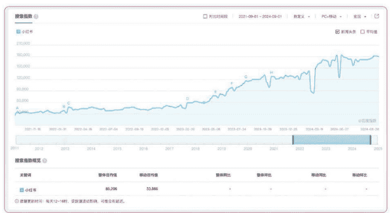
如今，无论在咖啡馆还是街头，我经常听到有人说：去小红书搜一下。

对这种现象，每个读者应该都深有感触。

旅行前看小红书找机位和打卡点，也避雷；装修前看小红书找装修风格、家具家电，甚至设计师；考试前看小红书找学霸的学习方法和备考经验；找工作前看面试攻略，也看到一些信息壁垒外的野路子……美妆、穿搭、美食、首饰更是日常。

小红书日搜索量已达6亿次，接近百度的一半。

我们的生活已经离不开它了。

我们必须和浪潮共舞。

对个人来说，想获得更多机会，就要学会用小红书放大自己的优势。

比如我原本只是格子间里写代码的AI算法工程师，通过分享观点感悟和成长方法，收获80万人关注，开启第二职业，还和很多企业家深入交流，为他们的员工分享运营经验。我有一个咨询者，在小红书分享英语教学方法，获得家长信任，打造课程并组建团队，还开始写书。

自媒体打破了传统职场的学历壁垒，任何人都有弯道超车的可能。这是一件好事。

如果你专升本成功，可以分享备考方法；如果你英语不错，即便非名校也可以分享学习方法，未来可能开课；如果你书桌布置好看，可以做书桌博主分享氛围感；如果你手账写得好，可以分享手账写法和带来的成长，我的学员因此在小红书开了卖手账用品的店铺，每月收入不错；如果你享受独居，可以分享一人食和房间布置；如果你喜欢带饭，可以分享健康便当；如果你喜欢下班学习，可以分享学习内容和故事；如果你和伴侣很甜蜜，可以做情侣号；如果你是上进的职场人，可以分享升职加薪方法；如果你是卷不动的打工人，可以分享真实的上班心路，让同类产生共鸣。

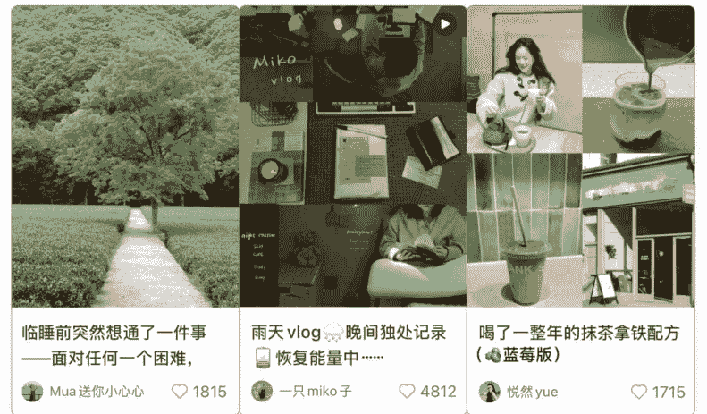
对商家来说，传统电商销量下滑，但越来越多用户会因小红书种草而下单。想要保持竞争力，影响力，也必须经营好自媒体账号。

如今自媒体已渗透到生活和工作的方方面面，自媒体运营正成为重要技能，像英语口语流利一样，会带来更多机会。没人会问30岁学英语晚不晚，因为只要开始就有收获。做小红书也一样。即使未来平台变化，做小红书练出的自媒体能力也能让你在新平台更快起步，就像当年微博、公众号做得好的人来到小红书，也比零基础更快起号。

自媒体平台远未饱和，优质内容永远稀缺。成立于2005年的YouTube，如今已有20年，平台上仍不断有百万千万粉的博主涌现，每年都有新博主迅速成长。

相比之下，我们的自媒体才刚刚起步。

小红书上很多人关心新人还有没有机会，答案很简单。

一方面，弱小和强大是可以转化的。小红书分发机制去头部化，流量不会明显偏向头部，新人依然有出头机会。反之，大博主若不持续精进，很快会进入瓶颈，数据变差，涨粉变慢甚至掉粉，商业合作随之减少，被新生代超越。

另一方面，从平台生存逻辑看，任何内容平台要持续活下去，就必须不断引入新鲜血液。用户在变，喜好在变，只有内容越来越多元、有趣，平台才能持续赚钱生存。在任何情况下，平台都不可能打压新人，所谓必须投流才能做起来的说法都是谣言。如果内容数据不好，通常只有一个原因：作为新人，还不熟悉自媒体创作规则，而本书正是来解决这个问题的。

最后，如果你还有犹豫，请回答自己一个问题：

除了做小红书，还有什么几乎零成本的选择，能帮你改变生活？

入局自媒体，现在正是好时机

自媒体浪潮已全面展开，我们正处在风口。

## 小红书生态三分钟速览

平台现在是什么模样？

小红书最初靠美妆穿搭起家，这类内容至今仍是头部阵营。但内容边界早已突破，渗透到生活的方方面面。

站内攻略笔记数量庞大，涵盖装修、出行、美食、减重、家电挑选、省钱技巧等。有的在种草好物，有的在提示避坑。很多人出行、装修、下单前都会先来检索对比，节省不少时间。

攻略类账号示例

成长类内容也很集中。大量创作者会分享个人成长轨迹与感悟，比如不同学段的学习方法、职场进阶经验、书单影单、赚钱思路，以及对亲情、友情、爱情、婚姻的思考。

个人成长类账号示例

除了干货，还有不少源于真实经历的小记与故事。它们带着体感，比如学员@喵喵在巴黎古董市场偶遇老太太把婚纱送给自己的经历；学员@Mua送你小心心在年后返工高铁上产生的突兀感悟；博主@拖延症自救日记记录的学校教育与社会脱节。

这类笔记像是朋友唠嗑，调性随意，即便没有精美构图和理想场景，也能获得围观与讨论。

个人随感或故事类账号示例

更外延的生活切片也很常见，一段风景、一瞬日常、一首音乐皆可成内容。博主@王总kk的笔记《soulmate（灵魂伴侣）是相处出来的，不是遇到的》，一句文案配生活影像，就带来很强的情绪价值。我的笔记《替你们试过了，20分钟公园定律真的没骗人》记录了在西雅图公园里看到的治愈瞬间。

生活分享类账号示例

以上只是平台丰富内容的一小部分。

无论衣食住行、吃喝玩乐，还是喜怒哀乐，生活已离不开这个社区。

## 平台用户画像

日活已突破一亿，月活超过三亿，男女比例约三比七。九零后占比超过36%，一线及新一线城市用户占比超66%。

核心活跃人群仍是一线新一线城市的中青年女性，她们热爱生活、追求品质、消费意愿强，愿意为美好买单。

男性用户已占约三成，多半潜水不爱发言，被叫姐妹也默默接受。不少朋友反馈他们喜欢社区氛围：友好、有趣、信息实用，很少被无端怼。

平台日均笔记超三百万篇，与购买决策相关的求链接评论接近三百万条。约七成用户并非完全依赖推荐，而是主动搜索所需内容，比如装修、餐饮、旅行攻略，还有人把平台当知识库查询求职、英语、育儿等。搜索行为中，87%与购物决策相关。

也有人把这里当作放松区，刷段子、八卦、吐槽。

内容形态上，从图文起家到图文视频双轮驱动。商业化近年加速，重点扶持买手、直播带货。2023年2月到2024年8月，19个月内买手与主理人规模扩大27倍，购买用户增长12倍。2022年净亏损2亿美元，电商转型加高毛利广告驱动下，一年后扭亏为盈，营收达37亿美元，净利润5亿美元，远超年初预期5000万美元。

随后平台成为春晚直播与笔记共创平台。这一动作释放出触达更广圈层、提升社区多元性的意图。直播间会即时弹出明星同款链接，助力从种草到下单。丰富用户结构、深化商业化成为新方向。赞助春晚像是一次发声：

平台开始发力了。

## 成长为博主的七个关键

做博主不需要光鲜履历。我身边就有非名校出身的朋友，在平台做到数百万粉丝。

理论上人人可做，但并非零门槛。

四年里我见过一夜涨粉百万的，也见过坚持不住断更的。我的判断是：

做博主的核心不在硬技术，而在软实力。

硬技术指什么？

很多人入场先问怎么拍、怎么剪。拍摄剪辑属于硬技能，不等于核心竞争力。舍得花钱就能请到顶尖团队。即便画面华丽，也未必能成优秀博主。

比如有位创作者转向职场内容，首篇就获1.1万赞，带来8000粉丝增长。

在部分人眼里，圈圈踩过不少坑：换赛道、停更、内容不垂直……如果你是转型前的圈圈，会不会担心停更影响账号？不垂直会被限流？账号还能用？要不要重开？[16] 这些纠结让人坐立不安，一出数据就怀疑账号。

圈圈的账号

朋友们，算法比想象中更聪明。

我看过太多被归因于限流、换赛道、账号不行的平平笔记。要是被你们刷到，大概率也不会点赞。根因只有一个：

内容未能给用户足够价值，实用也好、情绪也好。

账号状态正常却总怀疑被针对；没收到站内违规提示却坚信被限流；相信发布时间决定成败……你就永远找不到问题在内容本身。

作为参与过类似推荐系统研发的AI算法工程师，我可以说：模型有上万维特征，没有单一维度决定推荐结果。特征相互交织，几乎不可预测。靠发布时间、换号等小技巧稳定造爆款是不可能的。

对旁门左道的执着只会远离正路。如果你想学真本事，第一步是放下换号、限流等念头。否则再好的方法也会失效。因为你始终在怀疑、在拧巴。即便手握寻宝图，也会偏向捷径而误入歧途。

### 二、立刻行动、宽容失误、拒绝完美主义

别等准备万全再开始，别用完美主义当借口停滞，你永远等不到完全准备好的那天。

不需要把书读完才敢发，不需要买齐设备，更不需要搬进好看的房子——我最初做小红书时住合租房，拍摄区不到2平方米。

在这张朴素的书桌前，拍出许多封面，写出几十篇爆款。

去做、去发布，再回头复盘哪些环节失误、哪些可优化。最快的成长发生在实践和犯错中，而非幻想和逃避里。

### 三、拥抱不确定

做内容，唯一确定的就是不确定。

你可能有一篇笔记突然爆火，随后很久达不到那个高度；你可能因一篇笔记涨一万粉，之后出现下滑；你也可能连着几篇数据平平，下一篇意外破万……

新手也好，百万博主也好，都要反复经历这些波动。

不要因此否定自己。

关键不在于赢没赢、出没出爆款，而在于创作能力是否真正提升。若能力未变，偶然爆火也难以持续，反而可能被流量反噬，不断降低底线，沦为低质创作者。

积累知识、学习创作技巧、持续提升能力，才能提高爆款概率。不要纠结一两篇数据，要确保下个月、下个季度整体质量和表现比现在更好。

社会在变，用户口味在变，创作者必须放弃对稳定的执念，跟随变化，否则会被淘汰。我做平台四年，内容从摄影到读书，从学习到职场，再到如今的AI、自媒体、爱情、生活方式等。走出舒适区很痛，但能做的事和合作品牌都在拓宽。

变化本就是世界的常态。只是多数人长期活在考试、升学这样确定的轨道里，直到进入社会后才在摸爬中领悟。

如《孙子兵法》所言：兵无常势，水无常形。能因敌变化而取胜者，谓之神。[2]

顺势而为，你永远不知道生命会带来什么馈赠。

### 四、屏蔽外界噪音

网上充斥着自媒体做不起来、做了几个月粉丝个位数、普通人别入局等声音。我想说：别听。

有次与全网数百万粉丝博主@九三学长交流，我问他如何一边工作一边把账号做起来。他说：下班路上写脚本，有时在出租车里写，回家拍摄，第二天通勤时剪。

我自己做平台前三年也有一份全职。每天下班后关进房间阅读写作发笔记，周末很少社交，常在咖啡馆坐一天。

即便如此，最初很长一段时间数据都很惨淡。

网络上的悲观言论信息缺失。他们不告诉你投入了多少时间、多少思考、做过多少次复盘。我查过一些抱怨者的主页，很难看出他们真正用心经营。而这类负能量内容，只会让人抱团取暖，毫无提升。

想拿到结果，先问自己：我真的用心了吗？我投入的时间够不够？

我身边的大博主和学员都经历过多次低谷，但他们只行动、只复盘、不抱怨。

别在负能量里抱团。有人想让你退缩，别听。

### 五、不用讨好每一个人

人本就多元。即便一篇笔记再完美，也会有不喜欢的人。只要内容不违反公序良俗和法律法规，面对反对评论不必恐惧也不必难过，更不必争辩。若涉及人身攻击，直接删除即可。

既然选择在公共场域发声，就要做好被质疑、被误解的准备。

### 六、涨粉是自媒体的长尾效应

我常翻看头部博主的主页，滑到底部看早期作品。那时他们和你一样，拍摄歪斜、对镜头结巴，评论区也会说手势有点多。

往上看，他们开始优化、做出爆款、沿着爆款重复、形式过时、转型、数据断崖、再思考再优化……最终站稳头部，商单不断。

人们说他们天生适合自媒体，却看不见背后的挣扎。

有次跑步时突发灵感，我立刻走进酒吧把思路写在小票上。很多博主都随时进入工作状态，真实工作强度远超外界想象。所以我常说：做平台不需要辞职，但需要做好把大部分业余时间投入进去的准备。

摩根·豪泽尔在《金钱心理学》中提到尾事件——少数事件决定主要结果。

即便成功投资者，也不可能次次正确，失败决策反而更多。但长期坚持总会抓住几次关键机会，从而取得惊人成绩。

豪泽尔说：我们关注榜样成功时，往往忽视他们的成功只来自全部行为的一小部分……但他们的错误并不比普通人少。

做博主亦然。

对许多博主而言，80%的粉丝来自20%的内容，但发布前谁也不知道哪20%会爆。我做平台四年，发了几百篇笔记。现在基本能判断一篇能否爆，却永远无法预测哪一篇会带来粉丝的跃升。

涨粉是自媒体的尾事件。

若把平台当短期项目做，粉丝波动会让你焦虑。以数年维度看，你有足够时间练熟技能、慢慢变好，总有一天会遇到逆转局面的尾事件。

布拉德·皮特说：我拍了30年电影，发现有些作品会成功，有些不会，没必要深究，继续拍下去就好。

对，做下去就好。

## 新手焦虑的九大疑问

我知道你最想问什么。

- 我被限流了怎么办？
- 换赛道后数据变差，是不是粉丝不喜欢？
- 出了爆款却不涨粉怎么办？
- 要不要买相机？
- 拍视频总是不自然怎么办？
- 为什么随手拍的火了，精心做的却扑街？
- 同样选题别人数据很好，我却差很多？
- 现在图文内容是不是过时了？
- 内容要不要垂直，能不能做多个赛道？

问题显然不止九个，可能19个、29个、99个……

给你一颗定心丸：你最迫切想解答的疑惑，本书里都有答案。

接下来我会陪你一步步搭建属于你的账号。

开始前，先做一个前置训练。今后刷平台时换个用户视角思考：

我为什么会点进来/点赞/收藏这篇笔记？
我为什么看完会关注作者？

即便某篇数据很好，你却完全无感。

别急着说这样的都有人点赞？！

而要问自己：这篇爆款满足了哪类人群的偏好？

关掉滤镜，才能诚实审视。

这种训练可能会降低一点刷内容的乐趣，不过你会获得更大的乐趣。

## 如何高效使用本书

最后说说本书的使用方式。

请注意，章节顺序不等于重要程度。

比如第九章《用AI做小红书：从灵感、文案到变现》详细讲了如何用AI找赛道、找灵感、写爆款文案、做笔记复盘等，这些方法完全可以在看赛道、文案章节时同步使用。

但为了保证内容完整性，这部分独立成章置于后面，并不代表它不重要。实际上，AI已经成为我创作的左右手。

书中安排了一些练习，帮助你从选赛道、策划选题、选择表现形式、确定账号名、撰写个人简介等一步步搭建账号。练习不多，不必边读边做。但如果你想做好平台，请答应我：

不要跳过任何练习。

做好平台最关键的字，不是看，也不是想，是做。

欢迎来到平台的世界！

> [1] 小红书上的博主昵称、笔记标题及相关数据等可能会发生变化，本书提及的信息均是基于作者撰稿时的实际情况，读者阅读本书时，可适当参考。 ——编者
> [2] 对商业类账号来说，一大目标就是瞄准用户群体做内容，实现精准转化。而这部分内容点赞人数大概率不会很多，但很可能转化率非常高。 ——作者
> [3] 百度搜索指数以网民在百度的搜索量为数据基础，通过一系列科学计算，能够反映出互联网用户对某个关键词的关注程度及其持续变化情况。
> [4] 为了符合出版规范，本书对部分示例截图、文案做了修改，可能与平台实际显示不一致。——编者
> [5] 日活跃用户数、月活跃用户数和用户平均停留时长等是很多互联网平台非常重要的指标，能直接影响平台的商业价值。
> [6] 关于账号的问题，我会在第二章系统解答。
> [7] 出自《孙子兵法·虚实篇》，意思是：用兵作战没有固定的模式，就像水流动时没有固定的形状和去向。能根据敌人的变化灵活应对并取得胜利的，才是有智慧的人。

# 第二章 选择合适赛道，提升创作效率

什么是赛道？

赛道可以理解为博主在平台上的主要输出领域。

什么是好赛道？

好赛道要同时满足三点：你喜欢做、你比别人擅长、市场有需求。

三者都不可或缺。

方向错了会走很多弯路。有人只追随兴趣，花几天写一篇笔记，数据惨淡后便叹限流而放弃；有人涨了粉却发现难以变现，最后断更。

经过多年摸索，我总结出一套可操作的方法，能帮助你找到真正适合自己的好赛道。

另外，账号内容必须垂直吗？能兼做多个赛道吗？转型会影响数据吗？喜欢但不擅长的赛道该做吗？如何判断赛道的变现潜力？这些核心疑问，本章都会逐一回应。

## 小红书热门赛道一览

| 类别 | 描述 |
| :--- | :--- |
| **美妆护肤** | 美妆护肤一直是平台的头部赛道。可涵盖化妆技巧、产品测评、特色妆容、护肤品推荐、肌肤痛点解决等，也可细化到单一产品的用法、面部不同区域的遮瑕护理。品牌投放预算高，变现空间大，但竞争激烈，前期需大量试用，启动成本不低。 |
| **穿搭** | 分享不同体型的搭配思路或单纯展示穿搭，是热门方向之一。竞争同样激烈，需要自行购置服饰投入成本。相比美妆，服饰品牌预算有限，多数博主会搭配其他赛道，部分人转型为穿搭买手并做直播带货。 |
| **母婴** | 需求量大、品牌合作集中的赛道。内容包括备孕、分娩、婴儿护理、辅食、早教、带娃技巧等干货，也可加入孕产后的心理变化与生活感悟。需注意在实用内容中融入真实育儿故事和情感体验，避免沦为工具号。 |
| **职场** | 分享职场感悟、效率工具、成长方法、副业经验或职场吐槽，前期投入成本低。博主不一定在职，但需有真实职场经验和一定深度思考，才能输出有价值内容。在职创作者需合理分配时间精力以保证持续产出。 |
| **独居** | 随单身人群增长快速崛起的赛道。内容涉及独居好物、家居布置、生活妙招、安全防范、饮食娱乐、治愈瞬间及独居思考等。投入成本相对较低，广告位丰富，品牌合作机会较多。 |

## 小红书热门赛道

| 类别 | 描述 |
| :--- | :--- |

选赛道、选身份，小红书起号先看这一篇

做小红书，赛道决定天花板，账号形态决定打法。下面这批方向在平台上持续有声量，各自的玩法和门槛也不一样。

减脂健身
不同体重基数怎么减、局部怎么瘦、体态如何提升，吃什么、怎么养习惯、练什么、打卡怎么坚持，这些话题永远有讨论度。这一赛道博主大多有真实成果，加上面向利他的干货，很好冷启动。但除非你想长期走专业健身路线，最好当成中期过渡，记得不断扩宽内容边界。减肥成功三年后还在翻三年前的老干货，观众很容易疲劳。

书桌
好看的桌面自带吸睛力。小红书里很多博主在分享桌面好物、文具、收纳妙招、提效工具、学习纪实以及成长感悟。书桌不止家里那张，也可能是咖啡馆、户外。启动成本低，但对画面质感和审美要求高。

英语
英语一直是常青话题。学生党和职场人都在找进阶路径。内容可以偏干货：应试通关、词汇积累、听力口语写作提升、阅读书单；也可以做趣味：英语采访、街头挑战、中西方饮食文化对比。

大学生
从高考到校园，很多人都在问大学怎么过、怎么学、怎么考高分、跟室友如何相处、怎么交朋友、要不要考研、怎么考、不同专业就业如何、找工作选兴趣还是对口。大学生正处在学生和社会人的切换期，焦虑感强，好的成长内容正是对口需求。

教育
除了大学生，还有学龄前、小学初中高中。父母关心哪个阶段该侧重什么、孩子沉迷手机怎么办、被霸凌怎么办、讨好型人格怎么改善；学习上怎么学、要不要鸡娃、兴趣怎么挖掘、学习没动力怎么引导、语文英语阅读习惯怎么养、看什么书、笔记怎么做、怎么高效背书、高中怎么冲刺。教育和母婴高度重叠，孩子会长大，教育可以一直延续。

美食
美食内容极分散：零食分享、西餐教程、高颜值甜品、家常菜、养生饮品、几分钟早餐、微醺调酒、打工人便当备餐。变现也多元，厨房用品、饮品、零食品牌都爱投。内容扎实、有食欲感的笔记容易被点赞关注。爱与美食，永恒话题。

养生
有人觉得人到一定时间都会被养生俘获。平台上养生内容热度稳定：养生饮品做法、各茶功效、抗老小妙招、皮肤头发卵巢调理、易疲劳易郁闷怎么调、冬天手脚冰凉吃什么、食补和养生操、以及误区科普，比如某些锻炼伤身、大汗淋漓未必有益。养生关联个人利益，永远不冷门，但要遵守社区规范，避免夸张宣传。

家居
认识的工程师第一次装小红书就是为了装修，女生靠攻略把老破小翻新。小红书家居一直吃香，除了装修干货，还有精致房间布置、收纳好物、地毯家具灯具推荐。不必非得有豪宅，把普通房子改造得舒服更贴近大众。

数码
不只电脑手机，还有手表耳机音响相机等。博主做选购指南、测评、神操作、系统自带提效App技巧。品牌投放预算充足，但制作门槛高，成本也不低，需要一定的专业度。

摄影
选题面很广：技巧、拍照姿势、器材选择、构图、审美积累、后期教程、作品分享。设备不必是单反微单，手机摄影也很受欢迎。摄影不等于摄影师专属，但要有点创意审美，并能把专业内容讲通俗。

宠物
宠物自带治愈感和故事感，受众覆盖养宠人群、萌宠爱好者、潜在铲屎官。内容可偏实用：喂养、训练、用品测评；可偏情感：成长中的暖心趣事；也可偏互动：和宠物的日常玩耍。

挑战
挑战类极抓眼球：连续30天早起会怎样、辞职体验100个职业、一个月吃垃圾食品身体变化、1元穿越中国、断网一周挑战等。受众广、形式灵活、娱乐冲突强，易触发讨论，商业价值高，但单条制作成本偏高。

采访
平台采访类越来越多。博主约人对谈，挖掘经历经验和对某个议题的看法。既能满足好奇心，也能提供启发。形式不限于室内，也出现街头采访、机舱采访等生活化场景，社会价值和传播力更强。

旅行
出门前很多人先看小红书找种草和避雷笔记，详细攻略省时间。旅行博主不必只做攻略，也可以探小众城市、城市小众景点、挖掘城市故事、沉浸式尝当地美食、记录震撼瞬间。攻略给便利，想象故事情怀给记忆，个性化内容往往数据更好。人总需要诗和远方。

AI
ChatGPT出现后AI热度持续。如何用AI提效、赚钱、练英语口语、做PPT、写周报，越来越多的人想让AI代劳。AI博主因此诞生，在大众眼里硅基智能似乎无所不能，反正它不累脑子好使，多打一份工不吃亏。

个人成长
分享人生道理、成长方法，怎么化解内耗焦虑、变得自信、有执行力、克服拖延。这一类和职场、大学生、教育有交集，但受众更泛，学生和打工人都会关心。书单分享也属于此，阅读本身就是提升。

手工
涵盖手账、绘画、书法、钩针等。博主可以教方法技巧，也可以展示成品：山野画作、五彩手账、清秀字迹、毛茸茸钩针包。积累粉丝后可卖作品或课程。快节奏焦虑时代，手工也是治愈。

游戏
年轻人喜爱。内容有新游测评攻略、有趣瞬间、冷门玩法、硬件评测键盘鼠标耳机等。虽然场景相似，幽默风趣的表达能圈住稳定粉丝。

户外
不止徒步，还有露营骑行爬山攀岩滑雪等。可分享装备、路线攻略、注意事项、风景、心得和个人变化。广告位多，前期投入成本相对大。

看完这些会发现共性：需求。衣食住行是基础，对美好生活的向往是上层。判断赛道好不好做，可以反问：这个赛道有人要吗？要的人多吗？需求越多越热闹竞争也越激烈；需求少也未必不能做，平台上亿用户，再小众也有受众。真正要防的是拍脑袋自嗨、没做市场调研就认为大家会感兴趣的方向。

小红书账号的两种打法

切入前先选身份：做个人IP还是商业号？

平台上个人IP深入人心，博主洒脱有个性，生活在聚光灯下，品牌青睐。但做小红书不等于一定要做个人IP。如今商业号越来越多，低粉也能高变现。

比如我的咨询者线下开婚姻咨询所，小红书账号几百粉、单条点赞几十个，月变现十几万到几十万；有人开店卖货、粉丝不高收入稳定；英语老师3000多粉年入近七位数。学员@无问珠宝MOMENT JEWEL在深圳做线下珠宝工作室，主理人Kiki说店里一半客户来自小红书。

个人IP类
IP指Influential Property，影响力资产。个人IP是通过分享特长技能职业性格观点经历生活方式建立独特形象并形成影响力和商业价值的人。

真人出镜不是必须的。我运营的“琳达不呆”就是典型，起初用不露脸图文分享生活方式、成长方法、爱情观，也吸引了同频粉丝。很多不露脸账号都在做。

我早期写的不露脸图文。当时我还在工作，这样的形式不用讲究穿搭，不用化妆，极大地节省了创作成本

商业类
目标是卖产品或提升品牌影响力。分两类：品牌商业号和个人商业号。

品牌商业号如家居品牌、护肤品品牌、软件品牌或留学咨询机构，风格官方、制作精良，重品牌调性，变现靠笔记投放、博主合作、直播等。

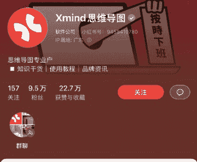
Xmind思维导图官方账号

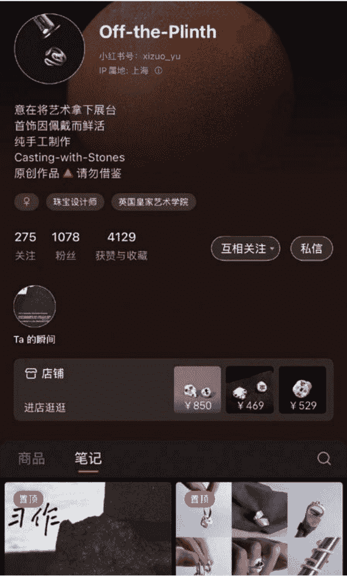
@Off-the-Plinth手作账号

个人商业号背后通常是个人工作室，更接地气，卖独立设计饰品画作手账或茶包零食等实物，也卖课程咨询等虚拟产品。学员@Off-the-Plinth就是珠宝设计师，在小红书卖独立银饰，有强个人风格。

区别与共性
个人IP类变现以品牌合作为主，也可做买手。优点是粉丝粘性强、合作机会多、报价高。缺点是冷启动期、粉丝低时难高变现、博主是被选择方、需持续产出优质内容易焦虑、广告有淡旺季。

商业类变现靠卖实物或虚拟产品。优点是冷启动短、低粉也能变现、制作成本相对低、对数据依赖弱、可建立SOP。缺点是需要后端跟进咨询发货、摸索用户喜欢的内容周期长、发帖频率更高、部分类目或未认证账号易违规，多次违规可能封号。

本质上两者都在卖，商业号卖产品，IP号卖特长技能职业观点经历生活方式等。个人IP也能带货，我曾在读书方法笔记左下角挂便笺，后来出小红书课程也在店铺卖。

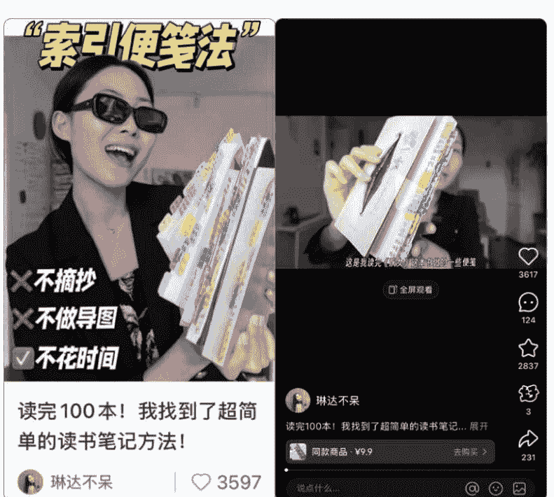
个人IP类博主也可以创作带货笔记

商业号也可以讲观点方法故事。比如留学号若只堆老师资历申请案例，广告感重、曝光低、差异化难。加入受众更关心的干货：准留学生如何准备、专业就业如何、英语一般无科研绩点一般怎么申名校，结合成功案例，既利他又显专业。

商业号切忌偏离主题的自我表达。我的咨询者@啵啵小圆子是时装造型师，咨询时她却发做计划学习方法，数据差。她觉得穿搭吸不来人，想试成长。我纠正她要围绕目标选题。穿搭才是直接吸引目标用户的路径，文案下功夫即可。按建议后第一篇穿搭笔记近2万赞，引流意向客户远超之前。

@啵啵小圆子根据我的建议产出的爆款笔记

怎么选
没有现成产品就走个人IP，把自己当产品，分享故事方法经验，提供实用或情绪价值，有爆款和粉丝后品牌会来。内容制作时留意用户反馈，它常指向第一个真正产品。我曾发自媒体干货，用户喜欢就做了课程，后来发现学员要个性化咨询，又加一对一服务，再发现商家不会做内容，加入商业号培训。身边博主@杏仁从分享家居好物变成买手做品牌，@陈诗远和@EMY用英语学习方法与海外生活见闻开课，都是如此。

有产品且以扩销量获客为目的，直接选商业号。

练习
根据本节分析，确定你的账号主方向，选择个人IP类还是商业类。

只用两张图，找到真正适合你的赛道

先忘掉所有现成赛道，这一节认识自己。

找不到赛道的人，往往不是不了解平台，而是没了解自己。

我刚开始做小红书选了摄影和穿搭。那时刚花一个月工资买了相机镜头，周末兴致勃勃扫街。我想我喜欢摄影能坚持，这个赛道适合我。

那时的照片是这样的。

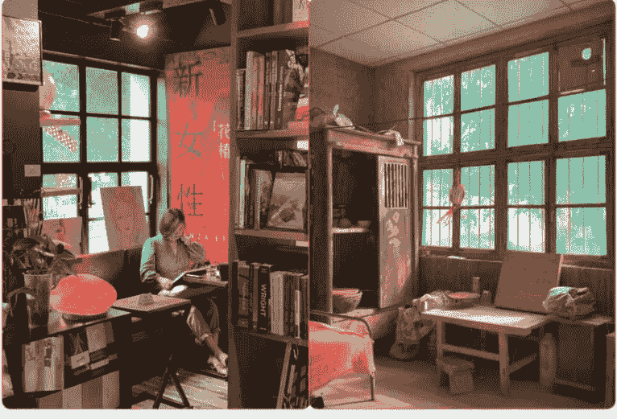
虽然不能说不好看，但是并不出彩。

选穿搭也一样。很多女生爱美，我被朋友夸过搭配不错。想着这是熟悉有兴趣的领域。

那时的穿搭是这样的。

我做小红书初期选择的穿搭赛道

虽然不能说不好看，但还是略微普通了。

但明明是我喜欢的方向，更新一阵子数据惨淡，陷入迷茫。问题出在哪？直到有一天……

那个午后我至今记得清清楚楚。上海曾经有家叫VESH的咖啡馆，现在已经不在了。我挑了落地窗边的位置，铺开纸笔把自己从头到尾理了一遍，不停地自问自答，想把缠着我很久的困局打开。

最后抓住的核心很简单：
做赛道，光喜欢远远不够，还得擅长，才能拿到先发优势，让账号更快起来。

当然，选一个喜欢却暂时不擅长的方向也不是不行，只是得投入更长的时间去学，等经验积累到一定程度才能走通。

离开VESH一年后，我的账号粉丝过了30万。

后来我才明白，只擅长也不够，还得有热情；光有热情也不够，还得考虑市场。这些领悟都是后来的事。但那个午后真的改变了我做自媒体的轨迹。

当时问自己的那些问题，经过几轮迭代，变成了一套完整的方法，一共三块。

第一块是七维定位表，第二块是四象限图，第三块是3+1赛道法。第一块能帮你深挖生命体验，找出被忽略的喜好和擅长；第二块能把它们筛一遍，定位出最容易出结果的方向。

到现在，每次想试新赛道，我还是会回到这套流程，每次都能找到新的突破口。无论是刚起步的新人，还是处在转型期的老博主，下面这些内容都值得参考。

## 第一步：七维定位表，了解自我

七维定位表覆盖家庭、学业、职场、亲密关系、高光低谷、爱好憎恶、评价这七个维度。你可以找一个周末，带着电脑去常去的咖啡馆，把答案详细写下来。

写作时注意几点。

1. 把表格里的题目当作引子，用来打开记忆，别被它框住。写着写着可能会冒出更多联想，记下来就好。也可以跳过没有经历的模块，比如没工作过就跳过职场，但跳过的原因是真的没有经历，而不是怕麻烦。
2. 多从记忆里找具体案例，结合实事来写。大脑会撒谎。如果你说自己热爱某件事，却找不出几个为它付出的例子，那这份热爱可能不够真。
3. 写下的内容没有高低之分，只管如实记录。这份文档的作者和读者都是你自己。
4. 记录成绩时，不必追求“卓越”。对你而言值得记下的瞬间就足够了，别拿别人当参照系，你的参照系只有你自己。
5. 任何能引发情绪波动的经历，任何让你能滔滔不绝的话题，都要重点对待。

| 维度 | 典型问题 |
| :--- | :--- |
| 1.家庭 | 父母之间是怎么相处的？模式有过变化吗？怎样变化的？你和父母的相处方式是什么样的？有无转变？如何转变的？父母对你影响最深的是什么？正面多还是负面多？印象最深的细节？父母对你有哪些要求和期待？它们怎样塑造了你？ |
| 2.学业 | 最喜欢和最讨厌的学科是什么？为什么？大学读什么专业？为什么选？喜欢吗？成绩大概什么水平？如果成绩不错，有哪些备考方法和学习习惯？努力学习带来过什么好处和坏处？学生时期除了学习有哪些难忘的事？大学时常因什么焦虑？毕业后回头看，想对当时的自己说什么？ |
| 3.职场 | 有过几段工作经历？最喜欢哪一段，为什么？最不喜欢哪一段，为什么？愿意长期做这个领域吗？如果升职加薪很顺，有什么工作方式或沟通技巧可以分享？积累的职场技能能迁移到别的行业吗？分别是哪些？工作对你有哪些积极和消极影响？空闲时间通常做什么？工资除了基本开销最大花在什么上？除了工资有其他收入来源吗？怎么获得的？如果完全不考虑工作，明天想在哪醒来，怎么度过这一天？ |
| 4.亲密关系 | 现在是单身、未婚、已婚还是离异？经历过几段感情？为什么分开？和现任伴侣相比，相处有什么变化？爱情对你来说是必需的吗？已婚的话和伴侣的相处模式是什么？对婚姻怎么看？婚前婚后有什么变化？如果未婚的自己站在面前，你想对她说什么？你有孩子吗？相处如何？最在意哪方面的成长？会焦虑吗？会“鸡”娃吗？在教育上认为最重要的三件事是什么？孩子怎么评价你？ |
| 5.高光低谷 | 成长过程中有哪些高光时刻和低谷时刻？低谷期是怎么走过来的？ |
| 6.爱好憎恶 | 爱好有哪些？按投入时间排序前三是什么？你用爱好赚过钱吗？听说有人靠这个爱好赚钱吗？他们怎么做到的？为什么喜欢做这件事？你讨厌做什么？为什么？你绝对无法忍受的事情是什么？为什么？ |
| 7.评价 | **自我评价** MBTI测试结果是什么？想象“你”站在正在看这篇文章的你身边，会如何评价现在的你？你有哪些1到3项比身边人做得好的技能？为什么能做得更好？**他人评价** 朋友和同事通常怎么评价你？优点缺点分别是什么？别人最常夸你的点是什么？ |

这份表格几乎是一份小自传，覆盖了家庭环境、学习经历、工作体验和自我探索。

写完后做三件事。

先圈出那些你表达欲很强、几乎不用回忆就能写出来的模块和问题。这些地方往往经验丰富，也是未来出爆款的富矿。比如我写学业模块就写了很长，后来就出了很多关于大学生成长的爆款。

再把所有回答里的“最”事件标出来。最快乐的事、最痛苦的事、最有成就感的事、做得最棒的事、花时间/金钱最多的事、最容易被埋怨的事……

最后把喜欢、擅长、不喜欢、不擅长的点圈出来，用一两个词提炼出来。你会发现，表达欲强的模块、投入时间最多的地方、职业经历、他人的夸奖、高光时刻、赚钱的点、甚至花钱多的点，都很可能是你喜欢或擅长的方向。而那些 repeatedly 踩坑、被吐槽的点，往往是不喜欢或不擅长的。

在这个过程中会发现有些点不是孤立的。喜欢却不擅长，擅长却不喜欢，都很正常，把它们如实记录下来就行。

别小看这张表，它不仅让你更了解自己，更是和别的博主的本质差异来源。真正的差异化不需要刻意打造口头禅或场景，它就是你的经历、你的故事，只属于你。选题可以撞车，经历不会。

真正的差异化，就是独一无二的你自己。

对表格内容的补充说明

### 1. MBTI
MBTI把人格分成16种，由四个维度构成：I内向/E外向、S实感/N直觉、T思考/F情感、J判断/P感知。现实中性格更复杂，但MBTI仍是把模糊性格具象化的好工具。网上测试还会给出性格剖析和职业建议，很有参考价值。而且MBTI会随生活和职业经历变化。

### 2. 选择图文笔记还是视频笔记？
很多人纠结发图文还是发视频。几个判断标准。

**你刷图文多还是刷视频多？**
你习惯已经说明问题。如果你常在小红书看图文，那你对图文的表现形式更熟悉，也更懂什么算好图文。先从自己熟悉的形式起步，学习曲线更平缓，更容易坚持。我起步时爱读纸质书和网页，几乎不刷视频，所以先从图文做起。

**让性格和职业给建议**
性格外向、不怕镜头、喜欢表达，视频会更合适。对工作繁忙的职场人，若拍视频难以兼顾，或职业原因不方便露脸，图文是更稳妥的选择。

**可以灵活改变**
形式不是一成不变的。目标是把账号做起来，不是纠结形式。选当下最适合自己的路，才是最快的路。

练习
> 把七维定位表做完，写完后仔细回读，标出表达欲最强的内容和所有“最事件”。

## 第二步：四象限图，定位优势
七维定位表梳理完，你对自己更清楚了，但具体往哪走还是模糊。接下来用四象限图去粗取精，精准定位。

### 1. 填写四象限图
回顾定位表，把擅长、喜欢、不擅长、不喜欢的点逐一填进四象限。

如果你喜欢某件事，除非你明确知道自己不擅长，否则放进象限I，喜欢-擅长区。如果不确定擅不擅长，放象限IV，喜欢-不擅长区。如果擅长，除非你明确不喜欢，否则放象限I，否则放象限II，不喜欢-擅长区。其余放象限III，不喜欢-不擅长区。

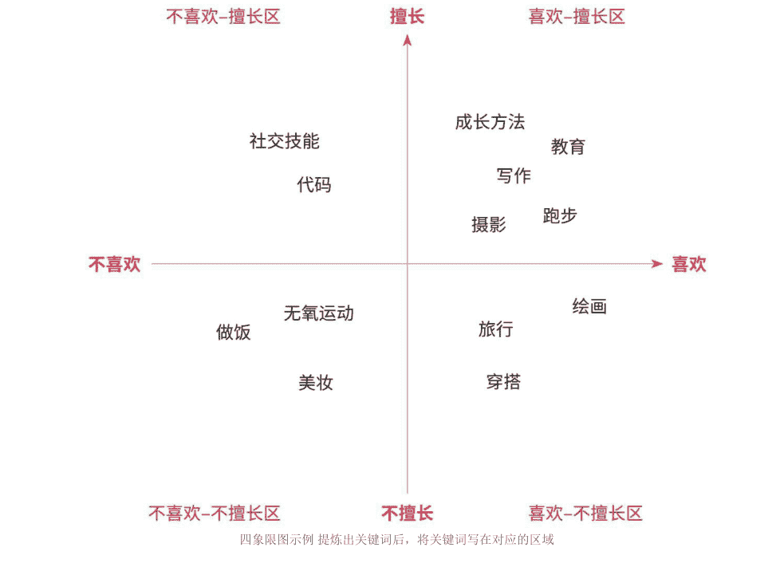

### 2. 打分
结合定位表，给这些点打分，得分高的方向更适合你。

**如何给喜欢的事打分？**
满分10分，按坚持、愉悦、无私三个维度打。

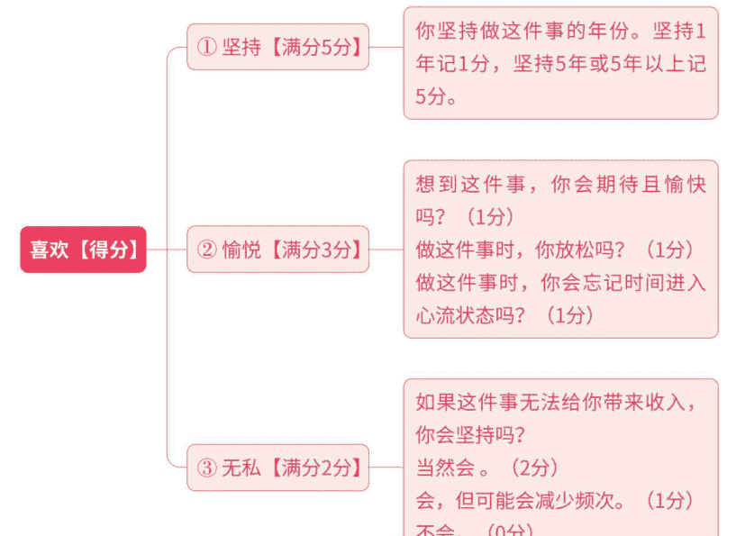
坚持维度，看你持续多久。坚持大半年或一年可得1分。写作我从小到大断断续续坚持到现在，可给满分5分，直观判断是不是三分钟热度。
愉悦维度，看过程带来的开心程度，与结果无关。无论多累我都期待写几笔，像精神寄托，可给满分3分。
无私维度，看能否为爱发电。如果没收入也能一直做，说明喜爱很纯粹。这个维度现实中很难满分，我只给了1分。
这样我对写作的喜欢值是5+3+1=9分。

**如何给擅长的事打分？**
满分10分，按成就、认可、专业三个维度打。

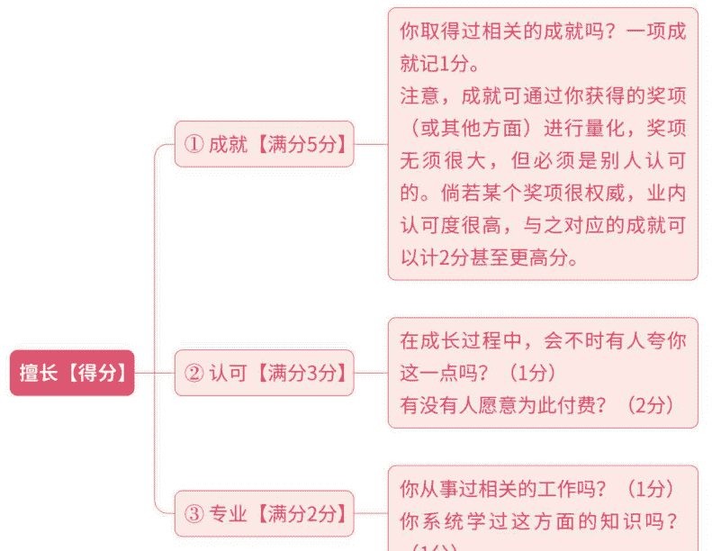
成就维度，相关成就1个计1分，重大成就可计2分以上。不需要大奖才算成就，只要客观上能验证擅长即可。我辅导同学补课，帮他们提高成绩；大学家教把学生的英语从不及格拉到80多，可给5分。
认可维度，周围人是否经常认可，甚至愿意付费。教育在这方面我给2分。
专业维度，是否从事过相关工作或接受过专业训练。我没当过老师，但读过沟通类书籍，给1分。
所以教育擅长值是5+2+1=8分。

**不擅长、不喜欢怎么打分？**
分数可以是负数。长期搞砸、从未被夸、需要靠搜索引擎才知道怎么做，就是不擅长。坚持几天就放弃、想起就负面情绪、没钱就立刻停止，就是不喜欢。可以回顾情况，给出负分，不用过于精确。

### 3. 坐标化
给每个方向打分后，就得到一张带坐标的四象限图。每件事对应一个坐标，横轴是喜爱分，纵轴是擅长分。比如写作的坐标是，9，7，意味着喜欢9分，擅长7分。

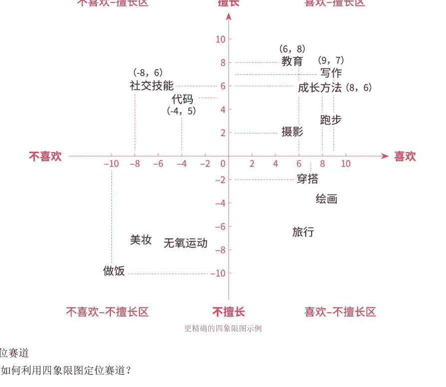

### 4. 定位赛道
怎么利用四象限图？
可以把横纵分相加，总分越高越优先。也可按喜欢值排序，追求愉悦，但擅长值别太低，否则前期学习成本太高。也可按擅长值排序，追求快速出结果，但喜欢值也要够，否则做得很痛苦。

筛选出来的方向要么喜欢且擅长，要么极度喜欢还能坚持输出，要么极度擅长能快速给用户价值。只有符合这三类之一才适合。

做完会发现当初拍脑袋选的赛道有多不合适。我最早选摄影，得分很低，穿搭更低。用低分赛道想快速出结果，就像学渣考前一天突击想拿高分。后来转向喜欢且擅长的赛道后，爆款才开始频繁出现。我的很多学员也验证了这一点。

建议找个周末，花几个小时把七维定位表和四象限图做完。它能帮你省下几个月甚至几年。

方向比努力更重要。

关于四象限法的疑问

### 1. 喜欢但不擅长怎么办？
这栏存在的意义就是让你看见短板。喜欢的事可以通过练习变得擅长，热爱会支撑你走下去。把不擅长写出来，你才能针对性补齐，而不是模糊地说“我不会”，然后一直拖延。大多数不擅长都是可以被训练的。

### 2. 擅长但不喜欢怎么办？
如果喜欢值已经很低，比如小于-5，就果断放弃。擅长社交却喜欢独处，就别做社交博主。职场一路升职加薪却长期抵触，就别教大家如何高效升职。写下的一切最终都会成为你。人在做不喜欢的事时会拧巴，自媒体拼的是坚持，不讨厌是最基本条件。保护好你的能量，比短期爆火重要。

### 3. 擅长的误区
刚工作时公司办读书活动，我拿了个小奖，领导看到奖杯说：“你不需要和所有人比，只和身边一拨人比就好。”我才明白，擅长不是要成为顶尖那一小拨。

非得名校生才能分享学习方法吗？小红书上很多非名校出身的博主分享专升本、逆袭经历。非得大厨才能分享做菜吗？家常菜、减脂餐、上班族带饭博主一大堆。英语词汇量大、背单词快，就能教说流利英语、提升词汇、阅读原版书。隔行有信息差，这就是优势。

练习
根据以上方法做一份四象限图，把象限I的方向按总分从高到低排序。也可以灵活按喜欢值或擅长值排序。

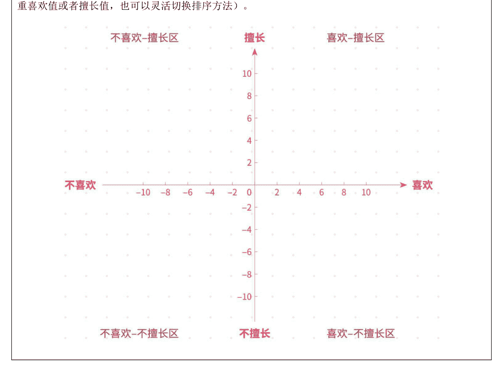

## 能否赚到钱？市场验证必须做！
找到适合自己的赛道后，下一步是市场验证。必须确认这个赛道是用户有需求、品牌会持续投入的。

很多人会犹豫：“这个赛道人太多，有人做了，我想做蓝海……”

我会提醒他们：你以为的蓝海，可能是死海。

做小红书最怕的不是赛道人多，而是没人做。没人做往往意味着用户没有强需求，贸然入局很容易被淘汰。

怎么判断赛道有没有需求？

赛道是否还能做？先做一次快速自检

方向还没定死也不用急着否定自己，书里不可能把所有可玩的领域都列出来。下面给你一个实操性很强的判断方法：

在小红书上能不能找到至少5个粉丝过万且持续在更新的账号？这些账号身上是否能看到品牌合作、带货成交、直播变现或导流到私域再转化的痕迹？

能找到，就说明这个赛道具备基本的生存环境。

### 练习
> 把上一节排序后的方向，用本节的验证方式过一遍，最后留下4个。

## 第三步：3+1赛道法，准备出奇

从四象限里挑出4个方向，得分前3个当主方向，最后1个当副方向，这就是3+1。

为什么要抓3个主方向？
3只是个经验数，意思是：适合你的从来不是单一领域，也不要把筹码押在一个点上。

多元化能让账号更有个人辨识度，避免沦为工具号，也能提高起号的成功率。对新手而言，即便前期研究很细，实操后也会发现某条线的反馈明显更好，这时就可以集中投入，持续生产更高质量的内容。

现在的分发机制很强，内容会自动推送给感兴趣的人，不必太纠结垂直。

当然要避开最大坑：想全都要。贪多最后往往样样平庸。

为什么要留1个副方向？
“出奇制胜”出自《孙子兵法》。古代打仗，正面交锋的是主力，暗中伏击的是奇兵，等对手松懈时再出其不意。

主方向像正兵，是你要投入最多精力的部分。但自媒体变化太快，今天的流量密码撑不过一年就会失效。若没有副方向的意识，只吃老本，很快会被淘汰。

副方向，就是你的奇兵。

## 如何挑选副方向
副方向可以是你喜欢却暂时不熟练的，也可以是表达欲很强、觉得好玩但还没上手、不确定能不能做好的领域。

这样做有两个意义，第一是扩大能力圈，第二就是纯粹为了好玩。

赛道越丰富，能力圈就越大。

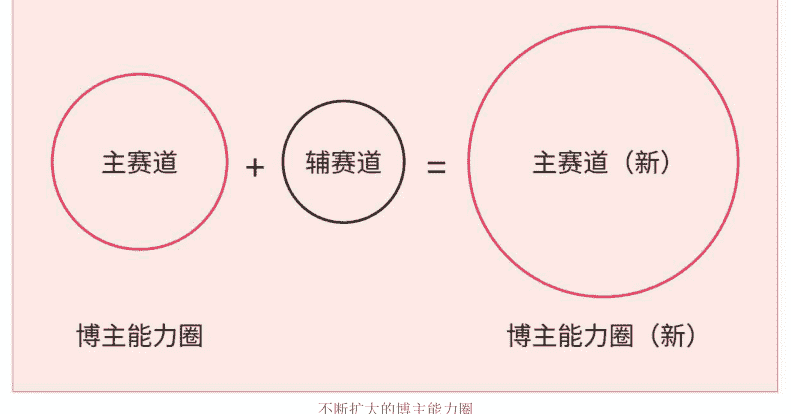

不断扩大的博主能力圈
博主的能力圈越大，以后的路就越宽广。

现在，用户喜好和平台规则都在快速变化，即便找到了匹配的赛道，也很难指望它撑三年。一定要有前瞻性，在守住基本盘的同时去试错，把“喜欢但不熟”的方向慢慢打磨成“喜欢又擅长”，能做的事才会越来越多，作为创作者的路才会越走越宽。

我带过一位学员，她擅长小学教育，也爱分享育儿观点，同时又很喜欢摄影。沟通后我建议她把教育方法、成长观点作为主方向，摄影先作为副方向慢慢练习，等技能提升后再并入主方向。

能力圈好理解，那为什么还要强调好玩？

好玩被严重低估。它决定了你能否从创作里持续获得乐趣，决定了你能走多远。我们不只是为了筹码，更想要有趣的生命体验。如果做内容让你越来越抗拒，甚至一想到写脚本就想吐，即便收益不错也很难坚持。

我见过不少博主做到后期一想到更新就恶心，包括我自己。慢慢才明白：

既要持续输出对用户有价值的内容，也要持续输出自己喜欢的内容，持续找准自我兴趣与用户兴趣的交集，持续跳出舒适区，在创作中找乐子。唯有热爱，才能撑下去。

### 练习
> 写清你的3个主方向和1个副方向。

## 3分钟定简介

本章最轻松的部分。很多人第一步就卡在名字和简介，其实账号名、简介和头像并没有太多讲究，逐项看。

## 账号名怎么取
命名方式五花八门，没有固定公式，不用太焦虑，喜欢就好。

为了方便别人记住和称呼，最好避开生僻字或过长的英文名，比如@悦然yue、@雪妮爱串门、@大乐Daleee，以及我的@琳达不呆，都比较容易传播。

要不要把方向强关联进名字，比如“xxx老师讲留学”“xxx说英语口语”？没有标准答案，关键看你是否打算长期只做这一条。

如果你确信只做英语口语教学，取“xxx教口语”更直观。但大多数个人IP都是多元化的，这时就没必要给自己贴死标签。总之名字不影响数据，不合适随时可改。

## 简介怎么写
第一，点明账号主要分享的内容。

> @雪妮爱串门的个人简介是：
香港城市大学硕士•华南理工大学本科
前广东电视台设计师节目制作人 [9]
家装灵感｜设计干货｜家居好物

> @Shay的个人简介是：
我是中国人CN
个人成长｜生活方式｜终身学习

> @梦想家瑶光的个人简介是：
ENFP｜00后｜女性成长｜自由职业探索
梦想是当数字游民到处旅居！
永远年轻，永远热泪盈眶！

> @麻省女工的个人简介是：
麻省理工MIT（麻省理工学院）本科学姐
戴眼镜的ex-投行打工人|短发的自律工科女
终身学习 | 留学职场 | 知识干货 | 自我提升

> @李喜欢的个人简介是：
干货制造机 励志分享每一个变美细节
愿不辜负每一份信任

第二，补充学历、职业背景及与主方向相关的资历。

> @琳达不呆的个人简介是：
哈工大本·上海交大硕·前AI算法工程师·TEDx讲者
终身学习·搞钱干货·思维认知·生活方式
长期主义是最浪漫的事

> @王多维up的个人简介是：
500强央企工程师勇闯自媒体 | 短期目标是搞钱
职场生活 | 自我管理 | 生活记录

> @大乐Daleee的个人简介是：
Career·Tech·AI·Life（职业生涯：科技·AI·生活）
外企打工人 | Software Developer（软件开发工程师）
全网10W订阅博主|探索人生可能性

有独特的学经历或职业背景可以加上，没有也没关系，并非必选项。

第三，加入生活态度与个人性格。

> @Rose肉肉的个人简介是：
梦想成为一个快乐的人

> @澳洲买买君的个人简介是：
一个暂居悉尼一本正经胡说八道的山东人
此账号为本平台唯一正版，其他都是假冒

> @漠兔MOTU的个人简介是：
人生是积累的过程吧

> @条条大鹿的个人简介是：
拒绝酒精从你做起
我做不到

三种方式常会结合使用，先说明内容方向，再用经历背书，最后加一点人生态度。简介对账号影响有限，可以反复修改，不要因为不完美而拖延开号。

## 头像选什么
大部分人用真人实拍，中景为主，露出上半身。少数用夸张特写或虚拟形象。

头像最好呼应定位，比如宠物博主适合露出宠物，情侣博主适合用情侣合照。

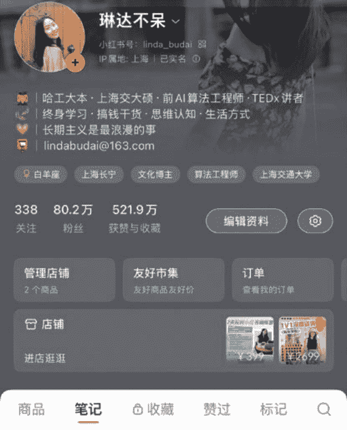

真人头像—最常见

## 菠萝包 Sir
小红书号：492639277
IP属地：上海
临床兽医 😊 日常碎碎念 +vlog@赏我一个菠萝包
家有傻猫傻狗 🐶
孟加拉豹猫+德牧+金毛
商务合作 📧 819991324@qq.com
+   - 26岁
- 宠物博主
174 关注
49.4万 粉丝
697.4万 获赞与收藏
发私信
群聊
查看详情
蒲公英合作
寻找商业合作

## 笔记
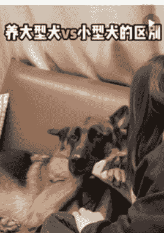

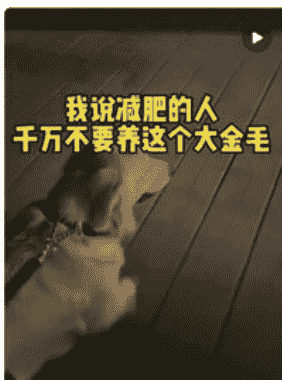
养大型犬vs养小型犬
好恶毒的狗
宠物博主—宠物头像

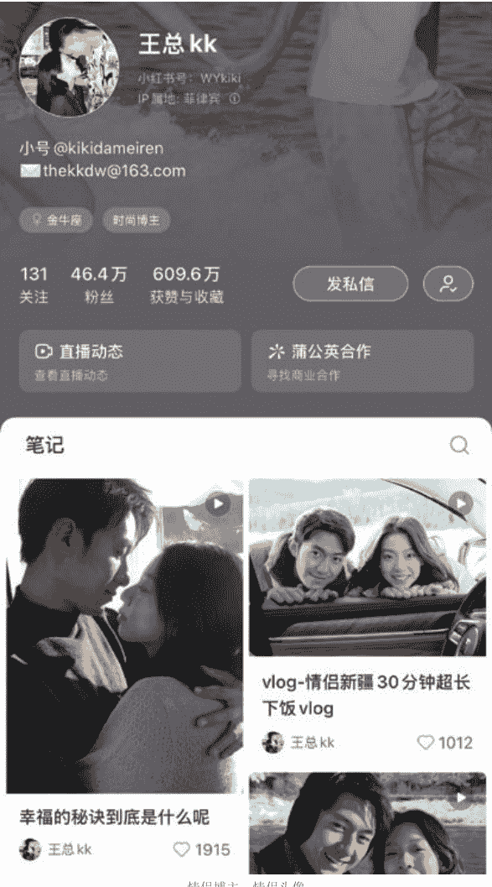

### 练习
> 确定账号名称、个人简介和头像。提醒一次，这一步不重要，不要纠结、不要花太多时间。

## 怎么找对标账号，同行即老师
一个赛道值不值得投入、好不好做、怎么做、变现怎么样、粉丝天花板在哪，对标账号基本能给出答案。

## 找对标的四个目的
1. 判断赛道是否值得投入
如果你想做的方向几乎找不到博主，或者博主很少且更新不稳定甚至已停更，说明该赛道当前需求弱、变现不明朗。不想纯粹为爱发电的话，建议尽早换方向，降低沉没成本。
2. 判断涨粉和变现情况
赛道头部博主粉丝量大，说明用户有需求。如果头部还常有品牌合作、带货销量高，说明变现前景不错。
3. 校准选题
新手容易把小红书当朋友圈，什么都发。看对标账号后会发现大家多围绕几条主线展开，也能借鉴他们数据好的选题来创作。
4. 学习
对标不只是看选题。喜欢某个摄影博主的剪辑风格，即使赛道不同也能借鉴。而且很多大博主起初内容也很杂乱，大家都是慢慢成长起来的。无需认识他们，他们就是免费的导师。

怎么找适合自己的对标？建议分两类：一类主对标，一类次对标。

主对标账号是赛道和变现模式与你相似的账号，是重点关注对象。
比如做职场，就找把职场作为主赛道的账号，而不是美妆穿搭。如果你要卖自有珍珠饰品，主对标可以是珍珠类商业号，也可以是首饰类或配饰类个人IP。

按“3+1赛道法”，主对标不需要和你完全一致，有1个重合的赛道即可。

次对标账号是赛道和变现方式差异大甚至完全不同，但在拍摄、呈现、剪辑或文案风格上很出色、让你有兴趣的账号。次对标能打开思路，增加灵感，让内容更有差异化。

一句话：主对标指方向，次对标供创意。

## 主对标账号怎么找
先记住“4-3-2策略”：4个腿部博主，3个腰部博主，2个头部博主。

粉丝量级的划分没有统一标准，要看赛道。以美妆为例，头部可能50万以上，腰部20万-50万，腿部1万-20万。户外赛道受众更窄，25万以上就算头部，10万-25万为腰部，1万-10万为腿部。

新人切忌只看头部。他们往往深耕3年以上，内容精致复杂，容易打击信心。多看和自己阶段相近、略高于自己的账号更有帮助。

确定量级后，用4种方法找人：
方法1：搜索赛道关键词
如职场，可搜“打工”“工作”“上班”。看到《普通家庭孩子尽早明白10条职场残酷真相！》这类高数据的笔记，点击博主主页，若其内容多为职场相关，就可纳入对标。

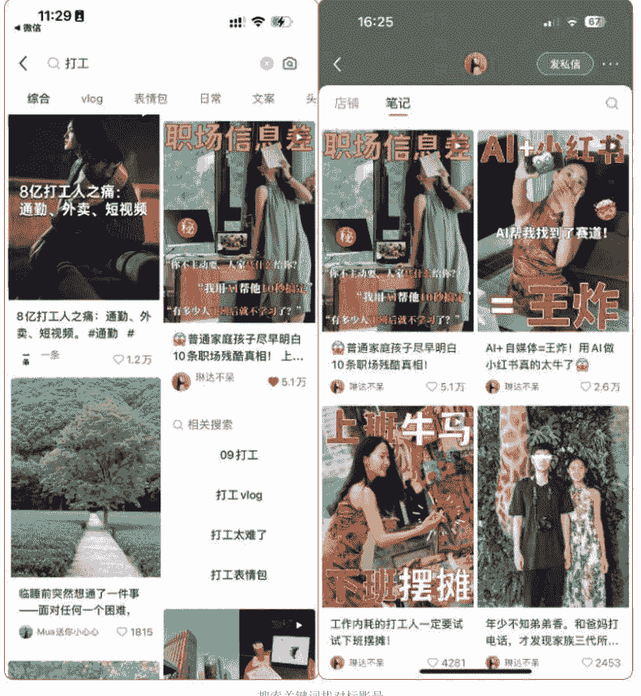

搜索关键词找对标账号

方法2：点tag看内容
笔记结尾的标签就是tag。点开#工作，就能看到该标签下的热门笔记，进而找到更多对标。
方法3：关注后找相似
关注对标账号后，系统会推荐相似博主，点进主页筛选赛道是否接近。
方法4：借助第三方工具
小红书第三方数据工具可查相似账号，但多为付费且准确度有限，需要二次筛选。

找主对标还要注意4点：
第1点，腿部博主最好看起号时间，2年内起号说明成长性强；做了2-3年仍在腿部，可能参考价值有限。
第2点，个人IP类博主要看主页数据，内容不求篇篇爆款，但要定期出现高数据笔记。偶尔爆款靠运气，持续爆款靠实力。
第3点，多赛道博主可复用，一个博主同时做职场和理财，若你也选这两项，就能同时作为两个赛道的对标。
第4点，“4-3-2”是思路，可灵活调整。想多获取起号灵感可多找腿部；只为1-2个主赛道找对标也行。做到腰部、头部后，对标对象不再是具体的人，而是你想提升的具体能力。

### 练习
> 按“4-3-2策略”结合上述4点注意事项，为你的主赛道找到主对标账号。

## 次对标账号怎么找
次对标是赛道、变现形式与你不同甚至相反的账号。

为什么要看不相关的？孙子兵法说“以正合，以奇胜”。常规打法求稳，奇招求胜。小红书同理，主对标让你走对路，次对标给你源源不断的新意。

## 这样用次对标账号
避免被算法固化，主动去看不同内容。既看同赛道，也看不同赛道；既看感兴趣的，也看陌生的。发现推荐同质化时，主动点开其他类型。

你是图文博主，次对标可以是视频博主；你是职场博主，可以看摄影、家居、美食、穿搭、宠物等完全不相关的内容。

## 次对标的实际用法
我曾发过《后悔没早点读到的4本好书》，是与某汽车品牌的广告合作，需要大段展示驾驶和路跑场景。但我此前视频都是在家口播。如何保持原风格又自然植入品牌？于是借鉴了日常vlog形式，做口播+vlog混合，把家中口播改为车内口播，展示路跑时用画外音继续分享内容。这样既延续个人风格，又完成了品牌呈现。

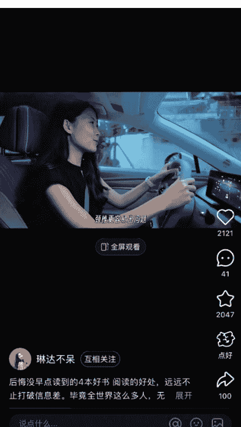

车企合作的拍摄思路

这次和汽车品牌的联名，我延续了自己一向信息量拉满的讲稿节奏，既把数据稳住，也完整呈现了车辆细节，品牌方也很认可。

另一条走性教育线的笔记，点赞过了七万，拍摄时把手机塞进了滚筒洗衣机。来历挺有意思。

这个点子怎么来的？很偶然。那段时间我刷到摄影博主分享滚筒洗衣机拍趣味照片，觉得形式很新，但当时并没有想把它搬到视频里。

隔了几天要拍这期性教育内容，父母恰好在楼下。家里观念比较保守，我不想被他们听到录制内容，灵机一动就把手机放进滚筒里拍。成片光线不理想，但录制过程确实没被听到。

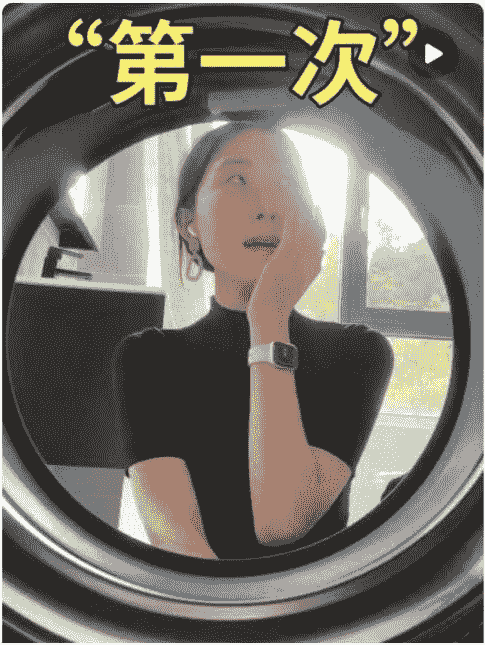

## 关于第一次，29岁的姐姐
给妹妹们的一点提醒
琳达不呆 ♡ 7.6万
换个拍法

笔记发出去后，评论区的焦点并不在内容本身，而是在拍摄手法上。有人问为什么放进洗衣机，有人说看完像自己也被关进去了，还有人调侃这是第一次用洗衣机。这样的讨论反而给笔记带了额外热度。

次级对标账号用好了效果很强，它能帮你打开思路，让内容更有辨识度，而不是千篇一律。能持续产出爆款的人，通常思维灵活爱学习，更关键的是会融会贯通。

学要活学。

### 练习

> 找5个你常看、常刷、或在某些方面很有亮点，但和你现在赛道完全不相关的小红书账号作为次对标对象。

## 差异化没那么难
很多人觉得做出差异化很难，其实是对创新的理解偏了。

创新不是凭空造出市场上从未出现的内容，而是站在前人基础上，加入自己的风格、视角、表现形式等再加工。

找差异可以从赛道和单条笔记两个层面展开。

## 赛道层面的区隔
本章讲的是如何找到适合自己的3+1个赛道，多个赛道叠加本身就是一种区隔。

举例来说，我起初只分享读书、成长方法，容易同质化。后来加入了爱情、职场、AI、运营技巧等更多主题，标签就变成了“靠下班学习做副业、爱聊爱情观的AI算法工程师”。有了这种独特组合，就不用担心撞题。

## 单条笔记的区隔
笔记维度的差异要从笔记构成说起。

一篇笔记拆开看由封面、标题、正文、拍摄、剪辑等要素组成。

任一要素做出区隔都算差异化。

实操中差异往往从文案开始。如果两篇笔记文案几乎一致，只是封面标题换了，就属于抄袭。

文案是笔记的灵魂，没有两片完全相同的叶子，也没有两个完全相同的灵魂。

各要素的具体做法，会在本书后半部分详细展开。

## 把短板变记忆点
差异化里还有个反常识技巧：善用不足。

比如脱口秀演员徐志胜的外形和浓重山东口音看似是短板，反而成了辨识度，加深了喜剧效果，也让人印象深刻，最终成为风格。

缺点不只外貌口音，也包括你踩过的坑、犯过的错、经历的挫折。

不刻意掩饰缺点是一种示弱，会让人更亲近。优势容易让人疏远，恰恰是短板拉近距离。

你的缺点不是问题，没能利用它才是真的缺点。

## 别急着刻意求不同
对新人来说，不用一上来就琢磨差异化。

如果你还没认真打磨过50篇笔记，就别纠结差异化。

当你真正打磨了50篇，差异化自然会浮现。爵士大师迈尔斯·戴维斯也说过：

> “我花了多年才弹得像我自己。”

差异化是做出来的，不是想出来的。

真正根植于个人经历的差异，才是最核心的差异。不同年龄、不同成长环境的人，对同一件事的看法本就不同。即使1000个人做同一个选题，只要忠于自我，内容就不一样。比如英语学习方法、爱情感悟，每个人都有独特经验。

李欣频在《十四堂人生创意课》里写道：

> 原生于自体经验与体会的独特表达，就是风格。技术好坏其次，别为了酷炫忘了想表达什么。

去实践，答案会在实践中出现。

## 实践中大家最焦虑的5个赛道问题

## 视频博客不是赛道
视频博客是video blog的简称，意思是视频形式的博客，它不是赛道，而是一种呈现方式。本书把视频博客定义为用视频、图片、音频等素材组合成一个视频来表达主题。

在此定义下，记录日常只是视频博客的一种。大多数赛道都可以用视频博客呈现，比如职场、学习、旅行、宠物、美食、街头挑战等。

比如我的学员@糖小小开挂了用视频博客讲职场面试干货；学员@大乐Daleee用视频博客分享编程学习方法；学员@雪妮爱串门用视频博客记录新家和小户型改造思路，数据都不错。

以上都是视频博客类型的笔记

## 赛道能定终身吗
放轻松！

三 piyas的你和现在的你已经很不一样，更何况自媒体瞬息万变。时代、矛盾、关注点都在变化，赛道要随人生状态灵活调整。你可以去翻一翻粉丝30万以上的博主，会发现他们早期和近期在赛道、风格上几乎判若两人。

更何况赛道不是选出来的，虽然本章提供了很多定位方法来缩小试错范围，但真正适合你的赛道，一定是在实践中得到的。

答案，只能在实践中出现。

## 转型要不要重开号
粉丝量不大时，大胆换就行。比如我的学员@圈圈有灵感，画画内容积累了3万粉，后来因为产出周期长、变现不明朗而停更。经建议后她转向职场、副业，很快做出点赞上万的爆款，粉丝也稳定增长。

粉丝量大的博主通常已是多赛道模式，更多是考虑是否加入新赛道。我很支持。想保持风格连贯，可以用一贯的风格去做新内容。比如博主@悦然yue长期做穿搭、饰品、成长感悟，后来加入美食，看似不相关，但她用一贯温柔松弛的风格，数据依然很好。我也看到博主@老羊厨房发了一篇和爱人相伴的故事，在各平台都爆了，而他之前几乎都是美食教程。

做内容不必瞻前顾后。

## 换赛道数据掉是限流吗
换赛道数据断崖，常是因为不熟悉该赛道的创作逻辑。

比如你平时做职场视频，讲生存和反焦虑，突然拍旅行视频博客，数据大概率很差。因为你不了解旅行类视频如何抓住用户、提供价值、如何用镜头讲故事、如何安排镜头保持吸引力等等，这些和你之前的经验无关，数据不好很正常。

图文转视频也会这样。你是书单图文博主，突然拍视频讲解一本书，效果可能也不好。因为你不熟悉脚本怎么写、开头如何留人、镜头前如何表达、如何简洁清晰等等。文字阅读主动且快，即便有废话也能快速抓取有效信息；看视频必须跟着博主一字一句听，对废话容忍度极低。所以图文博主需要专门学习视频制作。

学员@大乐Daleee从图文转视频，也经过打磨才做出上万赞的视频，单条涨粉过万。

很多人抱怨限流。作为有4年人工智能算法经验的前工程师，我可以肯定说，现在大数据下，优质内容会得到公平分发。抱怨限流很轻松，却回避了自身问题。想做好自媒体，要反复找自己的缺点，承认需要学习并补齐。

否则内容永远提不上去，也吸引不到受众。

## 女性成长算赛道吗
近年来“女性成长”很火。

但女性成长并不是一个赛道。

职场女性分享晋升方法、下班提升自己的努力，算女性成长吗？

喜欢阅读的女性分享视野思维书单，算吗？

创业女性分享创业经历、踩坑、搞钱干货，算吗？

女性成长只是一层外衣，核心是找到你要输出的赛道，把能给用户的价值具体化，让大家看到你的成长，启发别人，绝不是泛泛地说“我要做女性成长赛道”。

[1] 赛道顺序不分先后。
[2] 本节内容更多针对个人IP账号，若做商业账号，可快速浏览，重点看“市场验证”。
[3] 亲密关系指伴侣关系和亲子关系。
[4] 为方便学习，本节附带已填写分析的七维定位表，篇幅有限未展示，可关注公众号“琳达自媒体课堂”发送“七维定位表”获取。
[5] 大学时我不喜欢专业，也不知未来方向，常焦虑迷茫，只能靠阅读和收集信息摸索，渐有收获。这段经历让我对“学业”模块很有表达欲。
[6] 具体原因和操作方法会在本章后面讲解。
[7] 70%为约数。是否做得比周围人好，可通过回顾案例判断。
[8] 小红书变现模式将在第十章分享。
[9] 广东电视台前房产频道《设计前沿》栏目制作人。——编者
[10] 头部博主粉丝量与行业赛道相关，不能一概而论，后续会分享判定方法。
[11] 类似大家题目一样，自己写内容，不要抄袭。
[12] 指以美妆赛道为主赛道之一的账号，下同。
[13] 注意，50是个约数。也许是30，也许是50，也许是70。认真打磨指不管数据如何，都经过思考、复盘、调整的精心制作，而非自我感动的日更、划水或抄作业。
[14] 更多关于视频博客的内容，会在第七章“视频的6个展现方式”中详细讲解。

## 第二部分
爆款笔记创作全攻略
选题、文案、标题、封面、视频拍摄全攻略
从零到一，手把手教你做出爆款！

新手常有疑惑：“认真写的笔记小眼睛不过百，随手一拍反而爆了。”

于是感叹“小红书推荐算法真玄学”。

事实并非如此。

作为理工科出身，我建议用概率论思考。

样本量不足时，看到的现象可能是偶然，而非稳定规律。很多人觉得随手拍更容易爆，是因为发文太少，偶然被当成常态。若你发了600篇，其中300篇认真打磨、300篇随手发，前者爆款概率一定更高。我自己发了600多篇，实践也验证了这一点。

爆款确实有运气成分，但运气不是全部。上千个学员案例和我的经历里，几乎所有万赞爆款都经过准备和打磨。

身边几十万、上百万粉的博主，没有人靠随手拍起号。你能相信@Papi酱的视频是随手拍的吗？

有经验的博主很少指望玄学，而是把精力放在打磨内容上。

追求随手拍就能爆，就像渔人只靠天气不靠技术。

我喜欢《孙子兵法》一句：“故善战者之胜也，无智名，无勇功。”善于作战的人战前准备充分，每步走稳，不靠奇技淫巧，所以没有传奇故事流传，却更稳。

爆款同理。经过多次打磨才爆的笔记往往不被称道，反而看似随手一发就火的才让人惊奇。

能稳定输出爆款的创作者才是优秀创作者。他不依赖灵感，而是驾驭甚至创造灵感。提升创作能力，让一切尽可能可控，才是标准。

本书第二部分将从选题、文案、标题、封面、视频拍摄五个方面分享爆款技巧，提升爆款率，让创作可控。

还有，算法真玄学吗？爆款真不可预测吗？为什么有人爆款连连，模仿却数据惨淡？为什么笔记爆了不涨粉？

> [1] 概率论里有大数定律，样本量足够大时，样本平均值趋于整体期望；样本不足时，观察到的现象可能是偶然，结论误差会较大。

# 第三章
先搞懂爆款长什么样

写出爆款第一步是认识爆款：

爆款到底是什么？

小红书里什么算爆款？

没有放之四海而皆准的法则。

和自己比，如果往期十几个赞，上百赞就是你的爆款；如果往期几百赞，上千赞就是你的爆款。

小红书分发去中心化，即使素人也能拿到上千上万赞；大博主质量不过关也得不到持续推荐。

简单说，点赞过1000算数据不错，3000到5000算中等爆款，10000以上算大爆款。

那爆款为什么会爆？

## 那些所谓的算法技巧不靠谱
有些朋友知道我做过算法工程师，常问：

“最近算法是不是变了？”

“当然会变，不仅最近，一直在变。工程师会用小部分用户测试新效果，效果好就逐步扩大，最终全量。”我说，“每天都有十几个甚至几十个调整。”

所谓“奇怪”，更多是主观感受，因为算法在持续变化。

为了提高爆款概率，有人说有诀窍，比如多加标签、固定时间发、多刷活跃账号等。

有用吗？

作为有4年人工智能算法经验、参与过类似小红书推荐系统设计的人，我想说：

推荐系统比我们想象的聪明得多。

下面是一个极简版笔记推荐流程。我们在主页刷到的每篇笔记，都是排序算法基于海量特征和复杂逻辑推算出来的。

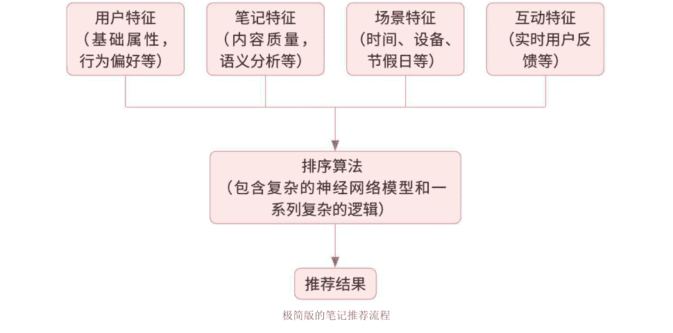
排序算法的输入叫特征，特征维度可达上万维。不存在某一个或几个特征能决定推荐结果。[1]

人类只能理解其中少数特征的数值，比如地理位置、发布设备、发布时间、发布者年龄性别等。其他大量特征是神经网络处理后的高维特征，有8维、16维、32维、64维、128维甚至更高。比如User Embedding、Item Embedding等，通常是上百维。这些高维特征具体含义人类无法理解，却在推荐中很关键。比如：

> 某笔记的Item Embedding: [0.10, 0.75, 0.93, -0.58, ...]

（上百维向量）

某用户的User Embedding: [0.87, -0.32, 0.45, 1.21, ...]

（上百维向量）

如果两个Item Embedding相似，这两篇笔记在选题、内容上很可能接近。如果两个User Embedding相似，这两个用户在内容偏好、行为偏好上很可能相似。这类特征由复杂神经网络计算，不是固定的，会经常更新。

所有特征以数值形式输入模型，共同预测某用户的推荐结果。不同用户特征不同，推荐结果也不同；不同笔记特征不同，被推送的人群也不同。所以推荐是个性化的、千人千面。

不过在实际业务中，上述只是其中一环，并非所有笔记都能参与排序，在这之前绝大多数笔记都在多路召回、粗排中被筛掉了。比如进入排序环节的可能只有500篇，经过排序打分后选出得分最高的20篇进入重排序，再结合运营规则，最终为某用户推荐10篇。

此外，算法工程师还要和运营、产品密切配合，结合业务场景对推荐系统进行调整优化。

所以小红书推荐算法一直在变。

当然推荐算法工程极其复杂，细节寥寥数语讲不清。本节无意深究。看不懂也没关系。之所以写这些，只是想说明一件事：

算法是黑箱，任何试图“迎合算法”的行为都毫无用处。

这些行为包括认为某个发布时间更好，不断在笔记里堆关键词，纠结要不要加某个标签……不提升内容质量，只靠调发布时间、埋关键词、加标签，是写不出爆款的。

从笔记上线后的实际反馈[4]来看，点赞、收藏与自然分发过程中的点击、完播以及平均观看时长，往往会一起涨一起跌。哪怕把文章推送给上千人看完并点赞，若在自然推荐里的表现不达标，算法也不会持续放大。谁能看到这条内容，由系统决定；陌生用户点不点、看多久，则取决于内容本身。

拖住传播上限的，多半不是平台机制，而是用户反应。

关于限流的讨论被夸大得太多了。对想尝试小红书的普通创作者来说，没必要把限流当成心病。只要笔记违规，后台会发出站内信明确说明原因[5]，没有提示就不用过度焦虑。

长期观察下来，很多创作者主观觉得被限的内容，在旁人眼里通常都有明显的内容短板。这时不如把笔记发给几位朋友，收集更直接的意见。

也不要固执地认为“我之前流量不错，现在下滑就一定是被限了”。笔记质量会波动，用户的口味也会迁移，推荐结果自然随之变化。即便是曾经走红的流量密码，也会有冷却期。头部博主都经历过多次转型，内容创作没有一劳永逸，必须持续求变。

平台上除正常创作外，还存在引流、暗广等操作，甚至有号商批量囤号违规获利。小红书风控能力很强，一旦被算法或人工识别，账号会收到警告，笔记停止推荐，严重时会被禁言甚至封号。

平台偶尔会推出活动，给参与笔记额外曝光扶持。但观察下来，很多参与作品因封面不够抓眼、内容拖沓冗长，即便获得加成，数据也一般。

总体来看，对普通人而言，不存在重要到会被平台刻意针对的程度。把问题拉回到笔记本身，不要躲在限流的借口里错过提升质量的机会。大数据面前，每条内容的评判基本是公平的。

## 爆款笔记的五大构成
很多人觉得做爆款很难，本质是不清楚爆款的构成。

做事都是分步骤的，写小红书笔记也一样。

定题、写文案、拍内容[6]、拟标题、做封面，共五步。

也就是选题、文案、拍摄、标题、封面，构成笔记的核心框架。

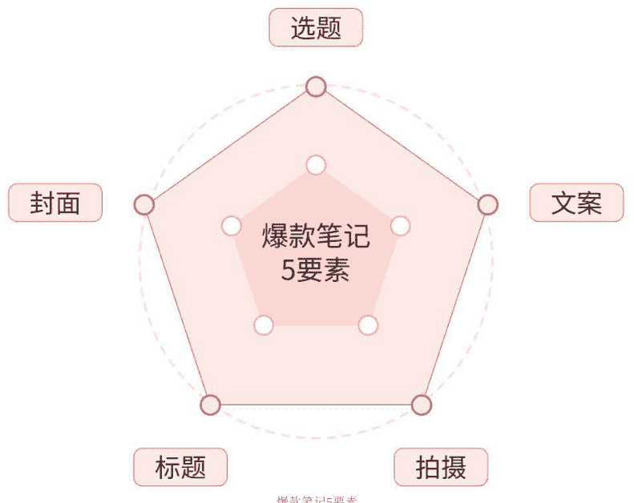
选题如何让人有点击欲、文案怎样让人读下去、拍摄怎样提升留存、标题与封面如何配合，后续会逐项拆解。

## 内容本质就两种
小红书看似丰富多彩，分类其实很简单。

任何赛道的笔记，归根到底只有两种形态：干货型与情绪型。

### 第一种 干货型内容
干货型笔记主要提供技巧、方法、知识、避坑经验等。每个赛道都能产出大量干货选题。

例如职场博主[2]讲解简历撰写、面试技巧、职场PUA[18]应对；情侣博主谈伴侣选择、争吵沟通、谈钱方式；美食博主分享居家甜点做法、夏季水果茶配方；穿搭博主讲通勤搭配、保暖优雅方案、不同身材的雷区规避；家居博主分享装修避坑、配色思路、厨房收纳等。这类内容以实用信息传递为主，统称干货文。

干货文的点赞与收藏差距不大，比值多在1:1到2:1之间，有时收藏甚至高于点赞。

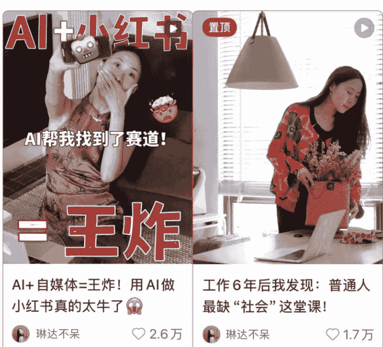
两篇典型的干货文

我曾发过《AI+自媒体=王炸！用AI做小红书真的太牛了》，详细说明如何借助AI找赛道并给出创作思路，获得2.6万赞、2.8万收藏，收藏反超点赞，是信息密度很高的典型。

另一篇《工作6年后我发现：普通人最缺“社会”这堂课！》分享了一些父母不教、学校不讲的社会潜规则，帮助我从打工到创业转型，获得1.5万赞、1.1万收藏，也是典型的干货。

对新人及瓶颈期的创作者而言，干货是最快起号、破圈的方式。因为用户即便不熟悉你，也很难拒绝真正有用的方法与知识。

需要提醒的是，干货文有时会出现点赞收藏很高但涨粉很少的情况，后续会讲破局思路。

### 第二种 情绪型内容
何谓情绪文？

以传递实用信息为辅，甚至完全不传干货，而是通过文字、音乐、画面、视频等手段调动快乐、愤怒、悲伤、温暖、放松、猎奇、共鸣等情绪的笔记，都属于情绪文。

每个赛道都有大量情绪选题。

比如旅行博主的攻略是干货，极光画面就是情绪；家居博主的家装攻略是干货，一镜到底的房舍巡游或氛围感照片就是情绪；穿搭博主的技巧是干货，变装视频或独特搭配美图就是情绪；宠物博主的训练方法是干货，可爱瞬间就是情绪；学习博主的背书方法是干货，图书馆高效学习一天的记录就是情绪；英语博主的口语提升方法是干货，因英语获得更好工作和视野的故事就是情绪；职场博主讲性格内向如何在职场生存是干货，发“我不干了”条幅庆祝离职并有朋友助兴的视频就是情绪。

分享对事件或观点的看法、讲述有趣感人离奇的故事，也都属于情绪文。情绪文的点赞通常远高于收藏。

例如我的一篇《今年发现一个旺自己的小妙招：千万不要长时间宅在家里》，分享喜欢短途旅行带来的感受，没有具体方法，是典型的情绪文，评论区大量共鸣，获得1.8万赞、8000收藏。

另一篇《替你们试过了，20分钟公园定律真的没骗人》，分享湖边拍摄的美好画面，获得2.9万赞、8000多个收藏。对疲惫的职场人来说，松弛画面、好听音乐和“累了就去逛公园”的心态提供了强情绪价值。

两种内容各有何特点？

与干货相比，情绪文的数据上限更高。

小红书站内的顶级爆款，比如博主@煎饼果仔执导、@夏天妹妹主演的短剧《逃出大英博物馆》、博主@江寻千创作的《带你去看曾经最极致的浪漫，千年绝技——打铁花》等，绝大多数都是情绪文。抖音、B站的顶流爆款也基本如此。干货受众有限，喜怒哀乐却是全人类共通。

既然情绪文这么强，为何还要写干货？

做笔记存在不可能三角：制作成本低、容易爆、迅速涨粉，三者很难兼得。

情绪文对表现力、画面美感、故事节奏、文案等要求往往很高。

比如全网爆火的《回村三天，二舅治好了我的精神内耗》，文笔精妙、语调平静却感人；大博主@池早是我离职后体验100个职业，需要大量脚本设计和引人入胜的文案；博主@李要红靠在英国搭讪帅哥爆红，需要强表现力和持续的观众好奇心。

如果你在这些维度上擅长或愿意打磨，可以从情绪文入手。

但从咨询和学员观察来看，初期不一定人人具备这些能力，而且几乎每个人都有独特的人生、职场、学习经历，这些往往是最容易输出的干货。多数人在起步和成长期，干货是最高效的切入点。

干货的天花板虽不如情绪文高，但做好也能拿到几万甚至十几万赞，是很亮眼的成绩。当干货做熟练后，再切情绪文，学习曲线会更平缓，成果也更快。

## 干货文的致命坑
到这里，你是否想立刻开干？

先停一下。

很多人写干货会掉进致命误区。

干货不等于无情绪，更不是干巴巴的说教式口播。很多人觉得内容越干越好，这样才促赞促收。结果数据起来了，小眼睛和粉丝量却惨淡。

为什么？因为你成了工具人。

比如“10部高分电影女孩必看”“太喜欢这几本书了！所有女生去翻烂它们！”这类书单、影单笔记，制作简单容易爆，但很难带来粉丝转化，账号上限低，接广品类少，粉丝很快进入瓶颈。

换位思考，如果你想找电影看，刷到一篇推荐后，最可能的操作是点赞收藏做标记，需求就满足了。文章里往往没有博主背景，难以产生关注意愿。

想提升转粉率，可以在开头或结尾简短介绍自己，更关键的是加入自己的观点、经历和故事。

比如我分享《人生创意课》这套书时加入了真实经历：

这本书可以说是我的改命书，最初读时我还是个996打工人，一年不到副业收入就超过主业。现在遇到卡点也会重读。

读者因此更容易产生兴趣。

注意自我介绍要精简，案例必须与主题相关，不要为强化人设硬讲故事，否则容易招致反感。

如何避免工具人化，可以举一反三：

不要只分享书籍，还要分享阅读带来的成长。

不要只分享美景，还要分享旅行带来的思考。

不要只分享美食，还要分享食物带来的治愈力量。

一句话总结：不要只给干货，还要给干货带来的故事、感受、喜怒哀乐和成长。

这样制作难度会提升，但做难事必有所得。

## 卖货账号也能用吗？[11]
当然能。

卖包包，直接展示包包之美、上身图，属于情绪文。解释不同包包适合什么场合、如何搭配衣服，属于干货文。

相比个人IP，商业账号做情绪文更简单，鞋包服饰只要画面有质感就能吸引用户。很多商业账号采用情绪文+干货文的组合打法。

建议从现在开始，每次点开一篇笔记都主动分类：这是干货文还是情绪文？网感会越来越强。

# 第四章 选题决定上限
上一节提到，笔记的核心就五要素：选题、文案、拍摄、标题、封面。

“选题定生死”虽然夸张却有道理。选题被很多人关注，其他四项不用费太多力也能拿到更好数据；反之投入再多也容易数据平平，除非文案拍摄极其突出。选题既是第一步，也是最关键的一步。

## 选题到底指什么
关于选题，很多人理解偏了。

选题不一定是标题，而是这篇笔记的核心话题在讲什么。

比如下面两篇，标题不同但选题一致：

小学千万别抓成绩！抓成绩的父母都后悔了
小学不要把成绩放到第一位

如何判断主题？大部分笔记会通过封面或标题关键词透出主题，比如如何提升执行力、如何做两性体检。不点开就能知道内容，选题切中痛点或利益点时，点击率更容易起来。

但小红书还有大量内容封面标题无法看出主题，必须点开才能知道，这些多数属于情绪文。[1]

比如博主@Rose肉肉的《3分钟看完，你正在见证一次史诗发生》用vlog记录打造房车的过程；博主@派小轩的《这个月的窝囊费到手了》演绎发工资后同事和老板聚餐点菜的剧情。

为什么这类内容可以不透出主题？

第一，干货文往往需要标题做人群筛选。比如《如何拥有恐怖行动力》，受众主要是拖延症群体，非目标人群没兴趣。不标明主题会伤点击。

第二，这类内容的封面标题本身就能唤起好奇、期待等情绪，比如“你正在见证一次史诗发生”“窝囊费”这种趣味表达。用户能感受到有趣，娱乐内容受众更广。

第三，部分情绪文很难用一句话概括，比如派小轩的短剧风格，很难用标题描述清楚内容，甚至讲清楚反而失去神秘感和幽默感。

所以选题更像一个关键词，可以是知识点或方法，比如提高执行力；可以是事件，比如改造房车环球旅行；甚至可以是纯情绪，比如高浓度惊喜、愤怒、难过。

## 选题枯竭？5个办法补货
学员常问我能不能给现成爆款选题。

我不会给，因为是误导。

一是小红书内容快速变化，时效性强，过半年可能失效。二是每个人的赛道和风格不同，别人爆款未必适合你，选择太多反而让人瘫痪。拿着别人的选题表，感觉什么都能做，行动时发现都是别人的答案，解决不了自己的问题。

真正适合自己的爆款选题，必须自己筛选。

### 方法一 带着眼光刷
刷内容获取选题看似简单，真正做到的不多。

很多人把小红书当娱乐，刷内容是为了放松或找攻略。一旦想做博主，就要从消费者视角切换到生产者视角。

看到数据不错且吸引你的笔记，要主动拆解：吸引点在哪？是封面标题策略，还是内容过程中的情绪波动？为什么会触动？我联想到什么回忆？我能不能写？如果我来写会怎么写？点了收藏是因为提供了什么信息？同时留意图文的画面风格、视频的表现形式和剪辑节奏。

分析可以放在脑中，最开始会慢，训练多了就能边看边拆。不建议做表格记录，会大幅提高成本和难度，地铁上也不方便。长期坚持的关键是降低执行成本。

刷得多了，选题库会积累，网感也会变强。

### 方法二 看对标的爆款
主对标账号是赛道相似的账号，其爆款选题就是可借鉴来源。比如我下面这两篇笔记数据很高，被很多博主当作对标选题。

我的可以被对标的2篇爆款笔记

辨别推广笔记，别把投放当标杆

在平台上，有些内容看起来很自然，实际背后有品牌买量。商家为了拉高曝光和互动，会让广告占比冲到五成以上，商业痕迹很重，但点赞播放却异常漂亮，右下角常会出现“赞助”“广告”的小标签。这类笔记的初始表现是人为加权的，好坏都不可控，不适合拿来对标。

注意小体量账号的异军突起

粉丝基数很小的创作者偶尔会出现大热笔记，这类小账号爆款往往说明选题本身有穿透力。几千粉的号拿到数千甚至上万点赞，就说明话题具备潜力。市面上已有不少第三方榜单在做这类笔记的归类和盘点，还能按品类筛选，是找方向的捷径。

从蒲公英里捕捉商单思路

蒲公英会集中展示近期数据表现不错的品牌合作内容。满足基础粉丝量并开通后，可以通过它观察不同商单的表达方式，为后续接单积累参考。

跨平台迁移热度

在B站、知乎、豆瓣、微博等其他平台上已经发酵的话题，搬到本平台往往也能引发关注。定期浏览这些渠道的热榜，把外部讨论带进来，能持续补充选题池。

坚持以上做法，选题储备会越来越厚，“没东西可写”的焦虑会自然下降。近几年更突出的问题是同质化，根源不是题材枯竭，而是太多人直接照搬爆款的结构、语气甚至全文，导致笔记里看不到创作者自己的思考与实践。

要记住，题材可以借鉴，内容必须来自自己的观察、经历和真实体验，抄袭不可取。个性越鲜明，用户对你的认知越清晰，不可替代性才越高。否则只会沦为流量工具，人设模糊随风倒。

## 把灵感炼成爆款的三个方法

新人经验不足，多看现成的热门选题能快速建立判断力，像路标一样降低试错成本。单纯跟随可以做成合格的创作者，却难以形成差异。

如果你把内容当成一份工作，只想稳定变现，复制热门选题也够用。但若想做出有记忆点、有个人风格的作品，从创作里获得更多乐趣，就需要走自己的路，创造属于自己的爆款。

### 先查热度，再把个人经历讲清楚

我辅导过一位育儿方向的博主，她能让孩子自主管理电子产品时间，却不知道怎么在平台表达。我的建议是先在站内搜索“孩子玩手机”。该词条下已有超过124万篇笔记，且半年内持续出现千赞万赞作品，说明需求稳定且持续。如果把她自己的方法整理出来，同样具备机会。

对有表达欲的话题，先做站内检索，判断用户是否真的在关注。做商业号前，也先看看站内是否已有相关内容和同类账号，几乎空白就需要谨慎。

[2] 两点缺一不可。曾有学员问“如何解决拖延症”为何数据不佳，我看后发现文案空洞，她本人也不拖延。她承认因话题火才写。若选题时不考虑自身共鸣，只因数据好跟风，很可能写不出打动人的内容，甚至写得痛苦。这是很多人选题对却写不好的主因之一。

### 从熟悉的赛道挖掘没被满足的需求

赛道即你熟悉的领域。在这些领域你比别人更清楚目标用户在担心什么、卡在哪里、缺什么解法。从这些痛点切入，最容易做出自己的爆款。

大学生赛道是我长期深耕的方向。四年前成绩不错、活动丰富，但也伴随疲惫、焦虑、迷茫。离开校园后回望，才更明白当年真正需要什么。很多大学生很有创造力，却浑浑噩噩度过四年，问题不在意愿，而在路径缺失。没人教他们如何认识自己、找方向，学业结束就面临求职，学校指导有限。

当年的我需要的，就是现在很多人需要的。作为普通家庭孩子，如何度过四年、弥补信息差、为未来铺路？我持续思考阅读后写下《985专业第一教普通家庭大学生打破信息差！》，获得215万播放、17.9万赞，成为爆款。[3]

在熟悉的领域，困扰过你的事大概率困扰更多人；帮到你的方法也能帮到他人；你觉得新颖的观点他人也会觉得新鲜。

### 让表达贴近当下的流行元素

有了想说的内容，可以适度贴近当下流行的表达元素，但要相关。

那篇《985专业第一教普通家庭大学生打破信息差！》发布时，“信息差”相关标题正热，内容也契合，于是标题中用了该词。

《可是妈妈，人生是旷野啊！》[4]也是此思路。那篇笔记写于六月一个夜晚，在阿坝州的中巴上完成。

白天去了稻城亚丁，在海拔5000米俯瞰牛奶海，雨、寒冷、缺氧与极致美景并存。夜里回城，山顶闪电划亮漆黑天空。我长期生活在大城市，从未见过此景，瞬间对上海生活祛魅。那时刚离职半年想做自由职业，父母希望我找工作，我说不出理由。那一刻明白，生活可以换地方换方式。

车在黑暗中颠簸，闪电闪烁，我很想和妈妈聊聊所见所想，让她安心并理解人生没有唯一答案。

恰好当时“妈妈，人生是旷野”这句话在站内很火，内容高度契合，于是直接用做标题。发布后数据飙升，获1.8万赞、5600收藏。

将个人表达与流行元素结合，需要网感，即对网络热点的感知。最直接的培养方式是长期带着思考刷各大平台内容。很多千万粉博主也提到每天花费数小时刷内容保持敏感。注意，流行元素会过时，避免使用过期的标签。

鼓励写自己喜欢的内容。跟随前人安全，但长期跟随会失去创作乐趣甚至产生倦怠。内容越根植于真实体验，读者印象越立体，也越难复制。可先积累实践经验再做。先学会走路，再探索未知。

坚持创作除了勤奋，还需要热情。热情帮你度过低谷，产出意外爆款。

这份热情来自：我能自由创作我想创作的东西。

## 选题库靠记录，记忆不可靠

博主每日需刷大量笔记找灵感，靠记忆会遗漏。应建立自己的灵感库，看到优质内容即记录，用于学习或未来选题。

我的库大致如下：

| 级别 | 点赞数 | 标题 | 形式 | 标签 |
| :---: | :---: | :--- | :--- | :--- |
| A | 6000 | 标题1 | 图文 | 成长感悟 |
| B | 4500 | 标题2 | 视频 | 英语学习 |
| C | 12000 | 标题3 | 视频 | 爱情观 |
| B | 3500 | 标题4 | 图文 | 职场干货 |
| A | 28000 | 标题5 | 视频 | 成长感悟 |

除了基础信息，还会按主题分类，如成长、爱情、剧情等，并做标记。
A 意指选题与近期关注方向高度相关，可考虑做自己的版本；
B 意指有思考也有兴趣，但素材不足，需继续沉淀；
C 意指很喜欢但短期做不了，先标记作为未来规划。

格式可灵活调整，关键是记录与整理。整理多了，思考多了，网感自然提升。

工具选择不必纠结，习惯用哪个就用哪个，工具只是辅助。

### 练习
> 选一个常用笔记工具，建立你的选题库，并按本节方法收集至少3个选题。

[1] 大多数笔记，无论干货还是情绪，封面或标题都会透露主题。
[3] 若隐去上下文，很多读者会以为是随手写的爆款。真实情况是，这篇笔记绝非随手写就火。关于大学话题我长期思考、阅读、探索，只是某天想法成熟才成文。发布前数月，我还去上交大做校园采访，并非为笔记准备，但交流催生灵感，采访片段也成为视频开头，都贡献了数据。别追求随手爆款，创作需大量积累。别为不火沮丧，每次准备都不浪费，每次“失败”都在让你更好。
[4] 现在很多人调侃这句文案，也印证爆款选题有时效性，别盲目追清单。
[5] 这里的热点指网友普遍关注内容，时事热点只是其中一种。

# 第五章 文案篇：爆款的灵魂是文案

我们可能因吸引人的标题或封面点进笔记，但多数情况下，点赞、收藏、关注源自内容本身。

内容要么提供实用价值，要么提供情绪价值，要么两者兼具。

大多数情况下，内容由文案承载。

一篇好文案，才是激发互动的核心。

“文采不好怎么办？”“文案总太啰嗦怎么办？”“用心写了几天没人看怎么办？”

写好文案并不难。吸引人的结构有哪些？常见错误及解决办法？为何文案不助涨粉？本章会逐一解答。

## 什么是文案？比你想象的更多元

有人认为文案是图文配文。这只是其一。

口播视频里人物的讲述算不算文案？算。视频文案也是文案之一。

还有吗？有。

文案不仅是图文文字，也可指口播稿、Vlog配音、图片花字、剧情人物的台词等。篇幅可短，仅注解场景，也可很长，讲述完整故事。

如下笔记，文案只有封面几行字。

《Always online》这个前奏真的！

短文案案例

真爱降临时 请在我脑海里循环播放

想象一下：深秋 街头 咖啡店 转身

久别重逢 初恋对视 微风

博主@妈的欧洲账本，文案风格独特。比如《北欧旅行十大至暗时刻》中，博主拖着23公斤行李箱穿越漫漫雪路取钥匙，第四张图配文：

你拖着行李箱跋涉过漫漫雪路

没有相同经历的人

不配和你谈人生的重量

正文很短，文案集中在图上，用幽默诙谐文字解释画面。该笔记获5.6万赞。

有些笔记几乎只有图或视频，几乎无文字，也能获得高赞。这是否意味着文案可有可无？

没错，制作笔记时文案并非必选项。

但这不代表无文案更容易做。你何时会包容一个胡搅蛮缠的对象？要么颜值极高，要么财力雄厚...总之需在其他维度极致吸睛。当文案这一表达介质缺失时，就需要画面极致出彩。

比如展示好看包包、精致房间、罕见美景、赏心悦目容颜等。所以不建议初学者盲目尝试无文案内容。

无文案笔记，多半比有文案更难做。

别怕写文案。

你不是写不出好文案，只是没找到合适方法。

方法如下。

## 10类爆款开头：好的开头是成功的一半

开头指笔记开篇部分，含文案、画面、音效，而非仅首句。

以“性格老实如何职场升职加薪”为主题，给出三个视频开头，哪一个更想看？

开头1：

哈喽，大家好，我是×××。今年是我在职场工作的第3年。最开始工作的时候，我每次开会都缩手缩脚，不敢说话，不敢对其他人的发言提出疑问，还经常被领导批评，升职加薪更是靠边站。有段时间我还遇到了性格特别强势的领导，那段时间我天天晚上失眠，整个人眼中都没光了，我朋友都说我像是变了一个人。但3年后，我在各种会议上都能自信大胆地提出自己的意见，再也不怕和其他人意见相左了。不仅领导越来越喜欢我，而且我的薪资在这3年里也涨了5倍。今天就和大家分享一下我的10条经验。

开头2：

工作3年，薪资涨了5倍，我从背锅老实人（插入在职场畏畏缩缩的素材）一路晋升到团队leader（领导）（插入作为leader在职场汇报的素材），今天就给大家分享10条经验。

开头3：

我刚进职场的时候很老实，经常背锅，但3年后的我成了团队leader，工资还涨了5倍。我把这3年多的职场经历浓缩成了10条经验，一定能帮到你们。

第2个开头更吸睛。因其兼具文字与视觉冲击，形成双重刺激。开头3也不错，虽平淡却直入主题，简洁明快，不浪费时间。经封面标题预筛选后，多数受众仍会继续看下去。而开头1，多人可能在第二句话就滑走。

为何？

因其拖沓！

小红书上开头可以平淡，但切忌拖沓。

与抖音不同，小红书用户点击前已通过封面标题筛选。若封面标题信息正合用户兴趣，即便开头平淡，用户也会有耐心——因其相信后续会讲到想看内容。但若开头车轱辘话太多、冗长拖沓、逻辑不清，再有耐心的用户也会立刻关闭。因冗长开头会让用户怀疑博主表达能力，怀疑其能否讲清事情。

若连开头都表达不清，用户怎会相信内容能帮到他？

不夸张说，好的开头是成功的一半。

下面分享小红书常用爆款开头形式，图文视频均适用。

### 一、引发好奇

引发好奇类开头，通过提问、稀奇片段、故事、观点、强烈情绪或不常见场景等，激发用户好奇心，让人想继续看下去。

第一次带孩子没想到还是国宝 @澳洲买买君

在澳大利亚给国宝当奶爸是什么体验？我大概这辈子都没想到有一天会和真正的熊孩子睡一间屋。这是我第3次和朋友去塔斯马尼亚，只为了体验一家非常特殊的民宿。

开头以提问设悬念：在澳大利亚给国宝当奶爸是什么体验？勾起好奇。

我发现走大运的代价是很多人承受不起的 @琳达不呆

JJ的朋友，一周赚了70万。上次他们见面时，该朋友说：现在我只剩下钱了。

他没骗人。

他只剩下钱了。

开头引入不常见故事：一个人一周赚了70万，却说自己只剩下钱了。谁能忍住不读完？

很没出息地为2美元破防了 @蛋饺姐姐

今天晚上我去见了我的朋友，然后跟我朋友分享了一个今年以来，让我作为一个亚洲人非常不舒服的瞬间……

开头引入不常见故事，“让我作为一个亚洲人非常不舒服的瞬间”，同时圈定人群“亚洲人”，让屏幕前用户觉得“与我有关”，带着好奇继续看。

你有没有想过，我们可以不做这道题的 @琳达不呆

（边哭边说）我想想我当时在上海过的都是什么日子，我干嘛要把自己囚禁在那里？……现在我就觉得特别荒谬，我根本就没有必要这样……

开头展现强烈情绪，让人好奇发生了什么。这篇笔记是我刚到大理时拍摄。离开上海后刚到租的房子，时值12月，大理天空碧蓝如洗，房子在苍山脚下，卧室外一片葱葱郁郁。眼前景色震撼，情绪爆发便记录下来。内容也唤起一线城市打工人的共鸣。

哭泣时刻难捕捉，但展现强烈情绪的开头常出现于爆款，比如群山间奔跑、情侣拥抱、肤色健康的女孩大笑、登顶雪山欢呼、短剧人物冲突等。喜怒哀乐皆可突破语言壁垒，吸引注意。

被画蒙了……我第一次把淡妆真正学会！@梁芷榕

十个钩子，把停留率拉满的开头写法

我见过太多浓妆爆改的案例，淡妆也能做到“换头”级别的改变，还能保持自己的辨识度？说实话第一眼我是不信的。就是这种不信也要看下去的冲动，让人点开。

这种靠提问切入的开头，本质是用一个稀奇的论点把人拽住。做好好奇类开头的关键就四个字：反常、冲突。要有情绪张力，利用认知差制造违和感，最忌讳平铺直叙、大家都经历过的日常。

### 二、诉诸恐惧
恐惧类开头先把最坏的后果摆在前面，用紧迫感逼用户想找解法。举几个典型的写法。

劝大家别带电瓶进电梯，不如直接上电梯内电瓶爆燃、火光四射的画面。
教安全驾驶技巧，不如先放违规操作导致车辆飞出去的事故。
普及性教育，不如先呈现因为缺教育导致女性健康受损的情境。

发生关系前，你带他去体检了吗？@琳达不呆
姐妹们，和新对象上床前，一定要硬着头皮把人拉去医院。我有个朋友谈恋爱前体检，查出传染病，直接散了。在外面谈恋爱，谁知道对方经历过什么。

这3个“阳谋”，每个女孩都务必警惕 @待续
不管学历家境，女生都会遇到专属的“成长致幻剂”，这些想法会悄悄消耗你的行动力。越早拆掉，力量越早回来。

作者把社会的枷锁叫做成长致幻剂，直言它会吞噬动力，同样是先给恐惧，再给答案。

### 三、诉诸利益
利益类开头开门见山告诉用户能得到什么：赚钱、省时、学到方法、过得更舒服。是干货爆款最常用的起手式。

嘴笨小孩都过来学吵架 @闪光少女木木
教你两句吵架必赢的话。只说你不说我，只回击不自证。

“吵架必赢”四个字就把人钉住了。视频直接兑现承诺，教嘴笨的人怎么吵得漂亮，吸引力很致命。

副业月入5位数 | 用好AI普通人收入也能翻倍 @王多维up
用AI做副业真的太猛了。我学会了文案、剪辑、数据分析，还自己做起两个万粉号，副业稳定过万。怎么做到的？今天把从零搭建AI副业的全流程拆给你，我就是想分享给同样想用空闲时间多赚一份钱的打工人。

这样把焦虑写下来后，命运齿轮真的转动了！ @琳达不呆
教一个用了近十年的五分钟解焦虑法。学会后不仅能快速走出焦虑，还能把焦虑变成转机。

你总觉得有时间，这才是问题所在 @琳达不呆
分享一个改写我人生的心态：别总拿“生活还没开始”当借口。意识到这点后，我的人生齿轮才开始转动。

爆款开头通常都很清晰，拖沓的背景和情绪堆砌只会把耐心磨光。

### 四、直击痛点
痛点类开头要把受众的困扰描述得具体、可感，让人有“说的就是我”的共鸣。

巨巨巨详细新手底妆跟练！看完还卡粉算我输 @俩梦晗
如果你看遍教程换了无数粉底，底妆还是斑驳不均，就来码住这套从洗脸开始的详细跟练。护肤、工具、产品、上妆手法全讲透。

信我！提升面部平整度才是有效变美思路 @我没瘦
上完妆的你是不是这样？显老显脏，泪沟法令纹没藏住，太阳穴还是凹。今天不废话，两分钟让你从这样变那样。

两条都在用文字+画面把痛点具象化，冲击力很强。泉州旅游攻略看这一篇就够了！@小羊小杨
家人们，假期不想跑新疆太远，去三亚又太贵，还怕踩坑商业化，那看看泉州吧。我刚自驾回来，人均几百，美食文化都够味。两天一夜攻略收好。

能写出这种开头的人，通常自己就是受众，知道大家焦虑在哪。

### 五、名人背书
笔记和某个人物经历、专业身份关联时，用背书提升信任度。名人可以是真人，也可以是专业群体、经典书籍、权威机构。

学吴艳妮三大精神内核，普通女孩所向披靡 @Meti奔向世界
国内最受争议的女运动员吴艳妮。比赛输了被全网嘲，赢了又被骂张扬。连我老公都提醒我讲她会被骂，但越是这样越想讲。

巨详细新手底妆跟练！夏天微雾光妆效get（收获）@俩梦啥
哈喽，今天教的是我从专业化妆师那偷来的夏日服帖底妆法。先劝退油皮的三大雷点：卡粉、脱妆、泛油。选对气垫+手法，直接拿下微雾光，一天不掉妆。

### 六、营造反差
反差能颠覆常规认知，制造矛盾感。一种是认知颠覆，一种是情感冲突。

我用AI开了家淘宝店，细思恐极 @36氪
这是我用AI搭的淘宝女装店，有真人模特、分类清晰、详情页完整。对比两家千万粉的女装店，看起来差不多了？最大的区别是他们背后有一两百人，我只有我一个人。

一个人运营的AI店和一两百人的大店装修几乎一样，用反差开局比单纯介绍AI店更抓人。

这是我们听过的最动听的歌声 @耶梦和早早
没想到这辈子最动听的歌声，来自社区食堂的灶台。那里一顿只要3块钱，有肉有菜，却买不到。我们想买却没资格……人气爆棚却不见年轻人，老人排队掏出零钱换来满盒饭菜。

三个反差：歌声来源、价格与丰盛、客群构成，好奇被直接拉满。

### 七、直接亮出主题或观点
看起来最简单，就是直接抛题。关键在两点：主题要有利他或热点属性，观点要有新意。

为什么很多高学历的人反而做不好自媒体？ @琳达不呆
聊个有意思的话题。高学历为何难做好自媒体？比如Mr.Beast和PewDiePie，YouTube超1亿粉，都是高中毕业。

化妆真相：看完少走很多弯路 @小王吖
几个化妆真相。特别酷飒的御姐妆，圆眼的人画不了。我就是圆眼，画不了。眼长且眼高比例合适才能画，比例不对画出来怪。

### 八、展示付出
开头强调自己为内容付出的时间、金钱、经验，能大幅提升信任感和价值预期。

如何有效听播客，避免听过就忘 @大乐Daleee
作为每天必听播客的资深用户，好播客基本超1小时。怎么快速提炼？今天分享不到1%的人知道的播客炼金术。

英国生活：4个实用信息差 @悦然yue
来英国10年，分享4个很实用的信息差。

普通家庭孩子尽早明白10条职场残酷真相！ @琳达不呆
上周我请了5个工作5年以上的朋友开了120分钟直播，总结出学校没教的10条职场真相。

打破信息差：普通人免费出国旅游的4种方式 @皮西在上海
普通人怎么不花钱出国？作为开过民宿、走过155个城市的旅行狂人，用亲身经历告诉你四种方式。

开头是锦上添花，内容必须配得上承诺。

### 九、分享故事
人天生爱听故事。离奇、好笑、温暖的故事很容易拿捏情绪，也能软化干货。

终于接受了自己相貌平平的事实 @琳达不呆
过年照镜子，睡衣、头发贴头皮。“确实不咋好看。”我跟男朋友说。大学军训时我有些胖，从没被要过联系方式。有天一个男生加我，我以为自信回来了，他却问：“你是那个更瘦的女生吧？我觉得她更好看。”

故事最终落在：与其说女生怎么样都美，不如说女生有不美的自由。

最后的结果就是大家都在进步，却都在失业 @琳达不呆
一大早就看到两个裁员消息，上百人失业。前老板跟我说，引入AI后部门从12人裁到2人。扎心真相：出来社会后要早点认识到，死磕技术赚不到钱。

用失业故事开场，让“死磕技术赚不到钱”变得可感知。

### 十、引发向往
有时候开头不需要文案，一张令人心动的画面就够了。比如草原牧羊的蓝紫天空、可爱羊群，治愈感直接把人留下。

大部分爆款开头是多种技巧叠加。不要贪多，套路用猛会反感。封面标题和开头目的相同，都是先筛选点进来的人，再让他们留下。标题把人拉进，开头把人留住。

当然开头可以平淡，但必须在20-30秒内进入正题，否则耐心会被耗完。

## 5种爆款文案结构：爆文有“套路”！
封面把人吸引进来，开头让他们留下，最后的点赞收藏取决于主体内容。多数爆款属于以下五类，这里以危机化解型为例。

### 一、危机化解型
危机化解型通用性强，符合人类的损失厌恶心理。

危机化解型结构：危机 + 解释 + 效果 + 方法 + 结尾

1. 危机
先点出做或不做会带来的痛点、误区。
例如教职场人提升英语，要先点出：工作多年英语退化，读英文文章卡顿；应试英语重读写轻听说，进外企口语听力跟不上。

2. 解释
视复杂度决定是否展开。门槛高的危机需要解释清楚共识。

3. 效果
讲用方法后得到的好处，可前置增强信任，篇幅不宜过长。

4. 方法
干货主体，要具体、可操作、有案例，避免空话。精练且有新鲜感。

5. 结尾
总结、引导互动、号召行动或升华情绪均可。

死磕技术，反而赚不到钱 @琳达不呆
我一大早看到两条裁员，上百人一夜离职。前老板说引入AI后部门从12人砍到2人。真相有点扎心：出来社会要早点明白，死磕技术是赚不到钱的，它只能先让你有口饭吃，吃多久吃多好不受控。

有人会说技术好就不怕裁，技术好就能跳槽。你可能没意识到技术依附于需求，需求会消失转移。你是行业前100名，行业被AI改到只要50人，你拼进前50。万一只要10人呢？你一直在卷，多累，还以为别人不想卷吗？最后大家都在进步，却都在失业。死磕技术只会陷进内卷，越努力越焦虑，钱越少。

所以别再死磕技术了。我现在拿到一点结果，斗胆分享几点，希望能给你启发。

策略一：反向利用技术
先把技术当成跳板，而不是终点。真正有长远打算的人，会让工具替自己服务，而不是被工具绑住。六年前我推掉了年薪五十万的入职通知，转而加入一家薪资更一般的公司，身边不少人都不理解，毕竟五十万放到现在仍然很有吸引力。我清楚，职场对我来说只是先解决生存问题、站稳脚跟的临时方案，真正的目标是用下班后的时间去寻找真正属于自己的事业。薪水越高意味着压力越大、可支配时间越少，思考和行动的空间会被压缩，所以那份offer我没法接受。后来我离开体制时，副业的收入早已远超当初的主业工资。

策略二：日常锤炼商业头脑，尤其是卖货思维
聊天时我了解到，一家公司研发一款AI产品只花了几十万成本，却能卖到上百万，而且供不应求。核心靠的是技术吗？其实不是，关键在于找到愿意为你买单的人，这就是很多技术人缺失的销售思维。若你仍在工作岗位，可以多观察公司如何盈利：它生产什么，又怎样把产品递到目标人群手里。假如因AI引进被裁员，你能不能意识到AI正处风口，能不能立刻用它创造价值？我很早就建议大家在小红书上尝试卖点东西，无论是几块钱的笔、百元的眼镜还是上万的机器，底层逻辑相通：把合适的商品送到需要它的人手里赚取差价。只要这条链路跑通，卖什么都能迁移。身边类似的故事不妨记录下来，帮助自己加深印象。上面两个案例正好对应了解决困境的方式，用真实经历让抽象方法变得具体，观众更有代入感，也更有趣味。

最后多推一部纪录片《富豪谷底求翻身》，我多次提到，它很能打开商业认知。销售力本质上是对需求的洞察力，需求会变，但发现需求的能力不会变。

4个月11条万赞：从镜头生硬到自然表达 @琳达不呆

一年前的那条视频里我说话磕绊、眼神僵硬、明显在照稿，数据很差。一年后的视频里表现已经很松弛，有交流感，甚至能演上两段，短短四个月就出了11条万赞。先用反差拉开情绪，再展示问题与结果，随后切入解决方案，节奏紧凑。

做自媒体如今并不难，这里分享几个让我数据起飞的做法。

第一招：用提词器降低紧张感
为什么差不多的稿子，你的点赞只有几十，而别人能拿到几十万点赞？我发现很多人一对镜头就紧张到说不出话。我的建议是起步别死背稿，把提词器放在镜头下方边看边讲，眼神会自然很多。手机拍摄也能打开悬浮提词。还有个小窍门，把提词器当成老朋友，拍摄时加入些肢体动作，别死盯镜头，偶尔瞥向一侧、喝口水，状态会更真实。熟人根本看不出来你在看稿。

第二招：提升镜头表现力
日常就能练，比如边走路边拍，慢慢就不怯场了；每天睡前对着镜头复盘一天，相当于口述日记。推荐一本书《实战表演》，是导演写给演员的手册，对拍视频的人也很有帮助。拍视频和表演很像，不只是传递信息，更是传递情绪。有情绪才不会变成只会说话的工具，内容才能穿透屏幕，拿到几万甚至十几万点赞。

第三招：用剪辑增加趣味
有了素材后，剪辑是放大乐趣的关键。

第四招：打破内容偏见
做自媒体常见的思维定式是内容偏见，算法把我们困在信息茧房里，所以很多看似不好的内容也能爆。我的做法是用两个号刷内容：工作号只刷主赛道找素材，生活号则刻意去看不熟悉的赛道，甚至主动刷自己不感兴趣的东西。这样做内容时灵感会源源不断。

千万别怕一开始很糙，几乎所有大号最初的内容都很难看。起号太顺反而可能有害，别把太多注意力放在负面反馈上，那只会让人互相取暖，却得不到成长。

开头技巧是可以灵活切换的，比如上面这种危机化解型脚本就用了反差和直击痛点，都是在描述危机，不必拘泥于一种风格。

### 二、利益输送型

利益输送型和危机化解型结构本质相同，前者给好处，后者抛问题，都常用于分享干货。利益可以是人脉、时间、技能或认知提升等。效果、方法、结尾的处理逻辑与危机化解型一致。

读完百本书，我锁定了最省事的笔记法 @琳达不呆

这是我读《厌女》时的便签。靠这个方式我读了很多书，这绝对是我见过最简单的读书笔记法，今天手把手教你们便签法。

很多人读书只做划线或高亮，三个月后就忘了最触动自己的点是什么。我的做法是，读到有感触的段落，用5到8个字提炼核心，写在便签上贴在对应页旁。看《厌女》的便签一年过去了，一翻就能快速定位到当时的高光点。比如忘了“厌女症”定义，直接找到“厌女症的定义”便签就能马上回溯，十分方便。

这个方法还有个好处是倒逼思考。读书容易产生“我学会了”的错觉，真正学会要靠主动提炼。把几十上百字压缩到5到8字，必须动脑，学习才有效。便签本身是硬质的，放包里也不会折。

强烈建议大家试试，结尾简洁收束更有力。

下面是学员@圈圈有灵感的一篇笔记，她用vlog记录了边工作边做副业的过程，并分享了普通人可参考的方法。

副业复盘 | 大厂设计师的三份收入 @圈圈有灵感

今天聊聊我做副业的心得。

早上第一份副业：打包发货。老粉知道我开了家卖动漫周边的店，首月变现就破6万，基本每两天发一次货。

设计师如何起步做副业？关键别一上来就做原创品牌。原创前期投入大、竞争激烈，消费降级下用户精挑细选，拼不过拼多多和义乌小店。建议从有流量的IP入手。

举个例子，想做串珠手链，可以做成印象手链。结合角色元素和应援色做成对应款，自带IP流量，标签打对后远超原创。研究后发现同类产品销量不错。

再举个例子，卖书想要爆款，3秒思考答案是MBTI盲盒。用MBTI蹭流量，普通书籍销量也会大涨，橙色软件上就有不少案例。方法就是拆解案例帮助观众举一反三。

有问题评论区见，拜拜。

这篇笔记背后有个小故事。圈圈此前也发过vlog，但点赞一直破不了千。问题在于vlog只展示生活，缺少主题。大厂员工和打工日常并不稀奇，单纯记录很难吸引人。圈圈本身是设计师，还有两份不错的副业，我建议她给vlog加上利他主题，分享副业方法，于是有了这篇获1.1万赞、涨粉8000的笔记。

大多数选题都能用vlog呈现，吸引人的是主题。单纯记录“29岁如何过一天”吸引力有限，改成“29岁失业后如何过一天”，开头先盘点存款、展示精打细算的一日三餐和增收尝试，就更容易出圈。别为了拍而拍，要主题化，从干货或情绪出发，要么提供帮助的知识，要么引发共鸣的情绪。

### 三、信息盘点型

信息盘点型通常罗列若干平行独立的子信息，写作时不必过度追求逻辑连贯，写完可重新组合。

开头：可采用本章提到的利益诉求、好奇、故事等开头方式。
解释：对主题做简要说明，非必须，深度话题可保留。
子信息：主体部分，决定流量和互动。注意信息密度和新鲜度，至少3条以上，避免正确的废话，可用花字、画中画提升密度。

真希望早20岁明白的事 @悦然yue

如果我能回到20岁，我最想先调整这四种心态。

第一，保留一点悲剧感。我们的时代不像父辈那样一岗一萝卜，考上大学也可能找不到养活自己的工作，这很正常。得失心别太重，关键是有没有为一件事废寝忘食、沉浸其中。

第二，克服失败恐惧。恐惧像副驾驶的人总想抢方向盘，你要把它按在座位上，别把控权交出去。这个比喻来自我喜欢的《吃、祷、爱》作者的说法。

第三，爱情里保持独立。别只想找个人托举，限制了自我成长。深夜加班看到朋友晒钻戒时我会动摇，但如果只是换来世俗的东西，却失去了被一个人瞬间照亮的感觉，不值得。

第四，别丢失独特性。喜欢黑指甲油、不爱美甲、背帆布包，这些细节就是你。社交媒体每天推送海量内容，容易让人同质化。要定期卸载、感受自己真正被什么触动。独特性才是社会竞争力，正如梁永安教授所说，没有自己的表达和价值输出，就没有独特的生命体验。

工作6年后我明白：普通人最缺社会课 @琳达不呆

越是底层家庭出身的人，对社会运作的理解越浅，容易被拿捏。我刚完成半年复盘，进入社会已快5年，前四年做AI算法工程师，自媒体全职约9个月。从一无所知的小白，被打磨成年入百万的自由职业者，哭过、怒过，才发现高校最缺的就是社会课。

社会运行讲结果、残酷且稳定，但学校不会教。我也是普通家庭出身，学校没教我来教。对普通家庭孩子来说，进入社会意味着经验从零开始。而有些经商家庭的孩子还没毕业就已积累3到5年社会经验，更早明白规则，自然更快变现。这些信息差必须说清楚，想少走弯路就认真听。

第一，别碰奢侈品、股市、不劳而获心态和恋爱脑，别把财富幻想寄托在别人身上。
第二，英语比想象中重要。学校要单词、阅读、写作，社会要听力和口语，要交流能力，别学哑巴英语。
第三，99%的打工赚不到钱。租房就能吃掉30%收入，月薪2万在大城市买房首付要攒10年。
第四，社会不看木桶短板，看长板。你可以找人补短，但赚钱靠长板决定能赚什么、赚多久、赚多少。
第五，决定人生的不是8小时工作，而是晚上8点后的时间。我下班后坚持阅读写作，误打误撞成为博主，副业反超主业，如今可边旅行边工作。晚上8点后决定高度，读书不是万能，但想睿智必须读书。
第六，社会不会告诉你该学什么，要自己规划。看课程、善用搜索引擎，更重要的是学中干、干中学。
第七，社交看似不值钱实则重要。没成绩时是表演，有成绩时才有杠杆价值。
第八，别期待融洽的职场关系。没人喜欢上班，你是来赚钱不是交朋友，别掏心掏肺，职场暗流是利益争夺。
第九，别再指责原生家庭，长大了要做自己的父母。书籍和课程是解药，主动疗愈。
第十，别在短视频谈爱情，搞清你最看重什么。不能既要年入百万的精英又要无微不至。
第十一，社会像饲料，会催肥每个人。别轻视身材好的职场人，他比你看到的更强。少熬夜多运动，健康是最大筹码。发展兴趣爱好，避免无聊，别沉迷宏大叙事，多把脚放在真实生活里。
第十二，20多岁愤世嫉俗是热血，30多岁还这样，这辈子很难有成就。

以上是我近五年摸爬滚打的血泪总结。很多人靠信息差玩转普通人，我也曾被耍过，所以看不下去。改变需要一个晚上的鸡汤，而成长需要经年累月的苦干。希望你记住这些，少走弯路。我，一个普通家庭走出来的姑娘，永远可以信任。

文案结构实操笔记：怎么让内容更抓人

盘点类内容入门门槛不高，但真正决定质量的是中间的子模块怎么想、怎么找、怎么写。我的盘点笔记里用到的思路，往往不只来自个人经验，还会综合书籍、影视、网络资料以及和朋友的聊天。这样既能让信息更饱满，也能跳出自己的局限，减少偏见，更容易戳中目标读者的真实痛点。

### 四、观点分享型

当笔记的重心是亮出一个看法或对某件事的态度，观点分享结构就比较适用。这类笔记大致可以分三类。

先是价值判断类。比如裸辞要不要做、对颜值体脂焦虑怎么看、要不要追快钱，这些都属于人生观世界观价值观层面的表达。

再是现实观察类。比如对结婚和生育率下滑的解读，对某个正在发酵的社会热点的评论，都是在谈趋势和事件。

还有生活切片类。职场被甩锅、被领导PUA、被催婚；平时看不惯的人关键时刻帮了你……对不寻常的日常发表看法，或对普通的日常做出不普通的解读，生活素材永远用不完。

观点分享的通用写法是：观点＋解释1＋解释2＋…＋解释n＋收尾。

#### 2. 解释

解释就是让观点站得住脚。可以走逻辑推演，用讲道理的方式给出支撑；也可以用案例来佐证，用别人的经历、自己的观察、书里的故事等来说明。通常案例更直观也更有趣，一篇里解释一般控制在3个以内。

学历高≠做得好自媒体 @琳达不呆

今天聊个反常识的现象：很多学历很高的人，反而搞不好自媒体。比如YouTube上粉丝破亿的Mr.Beast和PewDiePie，两位都是高中毕业。今天这个看法可能和主流不太一样，欢迎评论区聊聊你的感受。开篇就直接点题：学历高不等于自媒体强。

第一，学历和自媒体能力是两回事。学校不会教账号运营，就算进了清华，也没有一门课教你怎么把小红书做好。第二点，很多高学历同龄人本身收入体面，生活稳定。但自媒体极度消耗精力，还要暴露隐私、承受负评，对新手来说几乎致命，所以很多人没空也没动力长期投入。那有人会问，我学历也不低，账号也没做差。我的情况是，刚工作时状态很糟，经常情绪崩溃，差点抑郁。不能裸辞，又要养活自己，只能下班周末去试各种副业。走了很多弯路才试到自媒体。逼到绝境时，人反而容易爆发。第三点，也是我最想说的。做自媒体像一张开放题，没有标准答案。发一条视频数据差，原因你得自己摸索，必须反复试错，才能找到适合自己的赛道和表达方式，还要接受投入不一定有回报的现实。这对习惯应试、习惯刷题、习惯老师打分的优等生来说非常难受，缺乏安全感，焦虑感强，我身边的很多高学历朋友就是卡在这里坚持不下来。

你可能会觉得难过：我读了这么多书，拿了好学校offer，现在却做不好自媒体？我的本意不是贬低学历。我想说的是，开放题本质上还是题，只是题目从数理化变成了图文视频。你想做视频，先别抱怨没灵感数据差，先自问刷够没。刷的时候想想，为什么这个视频能留住你？为什么会点赞收藏关注？结构是怎样的？刷多了就会发现，视频也有套路，开头怎么抓人，文案怎么排布，本质上还是题海训练。

我一直建议无论学历高低都去试一次自媒体。很多听了的朋友都有收获，不只是多一条收入来源、多一份底气，更重要的是能快速击破怕丢面子、怕被评价的弱点，这是成事必须过的坎。未来自媒体会像英语一样成为基础技能，能带来更多发展可能。比起在意别人的眼光，不如先过好自己想过的生活。

谁也没比谁宽裕 @蛋饺姐姐

随着年纪变大，我对“拮据”这个词有了更具体的感受，脱口秀里说过，没钱时穷得特别具体。观点就藏在标题里：大家其实都挺拮据。

举个身边例子。朋友攒到月底想犒劳自己，结果租不起地下车位，下雨积水把车泡了要修；猫生病要看医生；冬天暖气费要交；为了省10块自助洗车，地毯洗臭了得换新的。工资全被这些必须花的项目吸干，剩不下一点。不是流落街头的戏剧性贫困，是那种饿不死也富不起来、特别尴尬的空窗。只能安慰自己，这些钱本就该花。还有爱好这个问题，社交软件上问起来，我也答不上来。培养爱好现在太奢侈，要钱要时间要精力。每天下班做饭、吃饭、看剧、躺床，好像活着就是为了那几小时的放松。

我以前不敢聊这个，怕扎到年轻人。但旅行后认识世界各地的人，发现大家都在说同一件事：我不知道怎么发挥我的才华。红海小镇上边写代码边投简历的程序员，清迈旅舍里画插画养活自己还帮老公找工作的俄罗斯姑娘，朋友聚会喝酒时掏手机在线面试的加拿大男生。好像全球年轻人都在找新出路。

如果你也在过这样的日子，看着这个视频别怕，你并不孤单。非常多年轻人正经历这段。现在有人把它叫做青春期后期。我自己从23到29岁，分成三个三年，成长很明显。

生活终究会变好，发生的事多数是有意义的。相信自己能过上想要的生活。

这篇笔记的观点是“大家都拮据”，用了两个支撑点：一是身边年轻人的具体处境；二是世界各地年轻人的相似焦虑。

危机化解和利益输送型文案偏重方法教学，干货感强。观点分享型更偏情绪和道理，干货密度低，更像情绪共鸣文。所以想吸睛，关键不是堆干货，而是对用户痛点、困境、社会热点有洞察和思考，这样才能引发共鸣。

### 五、故事分享型

顾名思义，就是讲故事。很适合分享自己或他人经历的有趣、离奇、治愈或发人深省的经历。表现形式很灵活，可以图文、口播、Vlog还原、情景表演等。比如博主@妈的欧洲账本用图文写上海租房被套路，@澳洲买买君用Vlog拍胡子哥在悉尼做冰淇淋，@派小轩用办公室短剧演职场段子。

上海租房千层套路

上海中介已经卷到不收中介费，只收房东那边的费用，但省下的费用后面会用其他方式体现。

梦想总是要有的，万一实现了呢？

澳洲买买君 15.6万

故事类笔记的数据上限很高。小红书上很多全网爆款都是故事，比如《逃出大英博物馆》系列，剧情精致反转强，点赞上百万，账号涨粉数百万。

不过故事类制作难度也高。故事不提供实用价值，靠稀缺性、情节设计、节奏把控、博主表现力、拍摄手法来留人。多人短剧还需团队配合，整体门槛不低，但做好回报很大。

怎么写好故事分享文案？跟小说学习三要素就行：人物、情节、环境。能不能看下去，核心在情节。

情节就是故事推进的过程，由开端、发展、高潮、结局构成。比如《新名字的故事》里，莱农、莉拉、尼诺在伊斯基亚岛相遇，莱农暗恋尼诺，尼诺却被莉拉吸引，莉拉把尼诺当救赎，两人同居；高潮是尼诺本性暴露，两人争吵分开；结局是莉拉失去一切去香肠厂打工，尼诺继续学业并换新女友。

小红书由于时长和耐心限制，多用单情节结构。推动情节的关键是冲突。

冲突产生于目标受阻。冲突=目标＋阻碍。人物有冲突才会行动，有行动故事才发展，有发展用户才愿意继续看。

刚才那段情节里就有多个冲突：莱农暗恋尼诺却被爱慕，内心痛苦想离开；尼诺和已婚莉拉约会，触碰社会规范；莉拉丈夫发现，两人冲突升级；最后因价值观不合争吵。

冲突可以是人与人、人与环境、人与社会、人与内心、人与命运等。

比如一个花园改造的经历：博主想改造花园，拆房砌墙一周却腰肌劳损，这是人与自身的冲突；爷爷回家想继续干活，博主带伤抢活，这是人与人的冲突；姑姑怕爷爷危险，连夜把两人送进养老院，这是人与人冲突的高潮；最后在养老院被老人们调侃，故事收尾。

路边餐厅的老太太把婚纱送给我 @喵喵在巴黎

看完古董市场去十六区餐厅，被安排在角落，和一位穿着考究的老太太坐一起。人少，她主动搭话，人与人的冲突开始。

“你是中国人吗？我丈夫也有中国血统，很喜欢中国文化。”我惊讶于她误以为我日裔，也好奇她丈夫的背景，于是聊了起来。她推荐拿手头菜，说常来喝白葡萄酒。

“你丈夫呢？”我问。她眼睛黯淡：“他死了。”人与命运的冲突显现。

她开始讲自己的一生：庄园出生爱骑马，有两个兄长，一个当海军一个当飞行员，她当医生。不顾父母反对去阿尔及利亚行医，人与人的冲突。她在那里遇到有中国血统的医生丈夫，他嫌女人不该在沙漠，她嫌他不爱说话，舞会上相爱。回巴黎后，父亲嫌弃丈夫的东方血统，她像驯马一样坚持相爱结婚。人与社会规范的冲突。囊中羞涩的他用积蓄买了绸缎婚纱，市政府办婚礼，母亲唱《茉莉花》。他们幸福五十多年，丈夫睡梦中离世。

她说幸福的形式各不相同，找到自己就好。回家后我看着婚纱出神。

标题本身就带冲突：陌生老太太为何把婚纱送给博主。点进后的冲突线有：餐厅搭话；老太太丈夫去世；违抗父母去阿尔及利亚；不顾父亲反对嫁给混血；博主母亲的故事也带冲突，从重男轻女环境走出来上学成医生后离婚独自抚养女儿。主线是相遇与启发，两个故事并行，最终送纱是高潮。

故事需要细节才能活。不只是华丽辞藻，而是人和环境的具体信息：外貌、穿着、动作、喜好、场景气味、物品外观功能等。图文用文字，视频用画面呈现。

细节要服务主线。《婚纱》的主线是爱情故事，就不需要大篇幅写博主为何喜欢古着、在市场见了什么。

比如@澳洲买买君的《大型社恐现场：竟被悉尼网友认出了》，语言很口语化却很抓人，用细节把场景和人物性格立住了。

细节和冲突配合，故事才有记忆点，也才更容易引发共鸣。

冰淇淋试吃片段为何上头？文案翻车点藏在这里

镜头里，悉尼街头卖冰激凌的胡子哥张开双臂招呼路人，嘴里喊着快来。顾客一脸懵追问怎么了，还调侃他是不是在拍博主。随后他掏出玫瑰、桂花、绿茶三支新品让对方尝，顾客笑了说好吃、妈呀真好吃。聊到营业时间，他回说开到七点，六点半到七点在收摊。提到茉莉那支，顾客直接点名要玫瑰。最后他对着镜头说想尝什么口味可以留言。

这条把新品试吃拍成生活切片，笑点很松。类似的小红书叙事向视频，文字都很日常，却能拿到几万乃至十几万点赞。看这些内容的人，并不是来品鉴辞藻，也不是来学干货，更多是想在碎片时间里补一点快乐、信念、力量、暖意、新鲜或感动。

叙事类笔记门槛很宽，可以是路边捡到小狗的记录，可以是和妈妈聊她年轻时的爱情；门槛也可以很高，像《逃出大英博物馆》那样耗时数月，像@江寻千那样冒着危险记录打铁花。好故事的精妙几句话说不透，也超过普通写作者的经验边界。你可以多读经典小说，也看看写作书，比如詹姆斯·斯科特·贝尔的《冲突与悬念》，杰夫·格尔克的《情节与人物》，慢慢体会好故事的魅力。

即便不做故事分享，也建议常读故事。故事能跨越职业壁垒，能跨越知识量的差距，每个人都能在其中体会喜怒哀乐，这就是人类共通的情感。我们需要故事，就像需要阳光、食物和水。故事就是我们自己。

## 8个让播放和涨粉掉队的文案雷区

笔记播放还行，但完播和涨粉不行，多半是文案在作怪。基于对上千名学员的观察，我总结了8个高频失误，也是自己多年踩过的坑。即便你是老博主，也容易忽略。

### 一、开场拖太久
一上来铺垫半分钟还没进入主题，再吸睛的封面也留不住人。某条视频开头写：
我发现了缓解焦虑的方法，能帮我走出情绪内耗，所以今天想分享。前段时间忙着求职面试，特别焦虑紧张，担心表现不好，怕过不了，怕找不到好工作……整个人像罩着阴霾，低气压，运势越来越差，别人却光芒四射。我相信有同感的人能懂，就像掉进泥潭。
近190字，40秒全是铺垫。
地铁上刷短视频的手指飞得很快，小红书用户耐心稍好，也扛不住40秒一句干货都没有。图文和视频都要快刀切入，用最短篇幅点题。

### 二、删不掉的废话
新手常拿捏不好篇幅，要么写不出来，要么写一大堆后觉得每个字都值钱舍不得删。结果点赞就难看了。
文案不是百科全书，不需要把来龙去脉写全。大多数描述性和过渡性的句子都可以去掉。用户耐心很薄，一句多余的话就流失一批人。
李诞在《李诞脱口秀工作手册》里说：
请仔细检查你的稿子，遵循一个基本原则：把字词删到不能再删。
脱口秀如此，写文案也一样。

### 三、信息太稀薄
这是常见通病。比如大篇幅复述早睡早起、锻炼身体这类老生常谈，没人点进瘦身笔记看这些。又比如讲故事时情节平淡，无冲突，情绪点不起来。
我写过一篇《希望所有20多岁女生趁早明白10条男人真相》，列出恋爱中常见的10个误区，每个观点都有新意，节奏紧凑，内容很饱满，最终拿到2.3万赞。
分享5本书，比只分享1本更有吸引力。分享5个方法，比只分享1个更好。分享5套穿搭，也比1套更有收藏价值。

《希望所有20多岁女生趁早明白10条男人真相》

信息饱满后，用户才有动力点赞收藏甚至关注。但别为堆饱满度把关联性弱的内容硬拼在一起，主题不统一会让阅读很乱。

### 四、只顾自己爽
自嗨就是不考虑受众，只顾自我表达。

这两篇笔记都是围绕某个主题展开，观点新颖、内容扎实，对用户有帮助，数据都不错
很多人习惯大篇幅分享自己觉得好看、有趣、有用的东西，却不问用户喜不喜欢。这是初学者最常见的毛病之一。
用户要看的不是你怎么表达自己，而是看起来是你的表达，实则是他们的表达。
好的笔记是自我表达和用户喜好的重叠区。
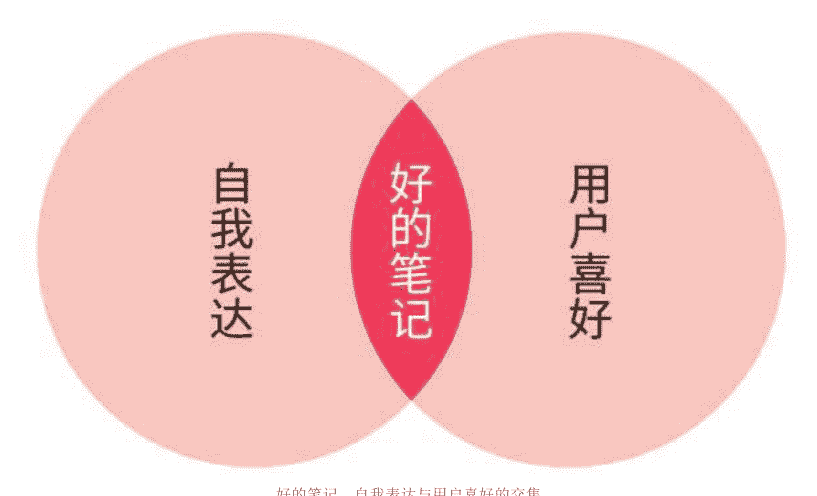

好的笔记—自我表达与用户喜好的交集
想让笔记被更多人看到，就记住：每个故事、每个方法、每段经历，都要提炼出对他人有价值的部分。否则用户凭什么停留。

### 五、太掉书袋
越专业的人越难做好小红书，在多数情况下是真的。
博主@杜伟医生是口腔主治医师，写过一篇关于“如何治疗地包天”的视频笔记，文案里全是乳牙列期、乳前牙反颌、上颌发育受限、下颌过度前伸等医学表述，还详细列出调磨法、咬翘法、颌垫式双曲舌簧矫治器、头帽颏兜矫治器等操作。看起来像篇小论文，对普通用户来说枯燥乏味。
作为一个小时候因喂奶姿势不当导致地包天、后来矫正成功的人，我父母当时关心的不是专业名词，也不是矫正方法总数，而是：
是不是必须手术？上幼儿园了还能不能矫正？要花多久？能矫正好吗？会不会有后遗症？
专业人士做内容，一定要从用户痛点或利益点出发，把专业知识说成人话，甚至说得有趣。比如婚姻家庭律师，与其讲法律条文，不如分享“一方出轨离婚财产怎么分”“婚前买房婚后加名离婚怎么分”等大众关心的话题。

### 六、迷恋文采
文采真的那么关键吗？学员@李莉安Lilian的一篇笔记获得1.5万赞。
你吃过的90%的亏，都是因为管不住嘴 @李莉安Lilian
人成熟的重要标志之一就是管住嘴。我毕业后第一份工作是总助，发现大领导身边的人往往不是看起来聪明的社交达人，而是说话做事稳妥的人。在职场里，你说的每句话都可能成为日后扎向前途的刀子。想提升事业运、财运，就牢记下面5句话，烂在肚子里，记得收藏。
第一，不要表达你对别人的负面观点。语言很容易被曲解，一张微信截图就能毁掉经营很久的人际关系……
全文很朴实，像朋友聊天，没有华丽辞藻。很多爆款笔记也如此，吸引人的从来不是文采，而是内容带来的实用价值或情绪价值。

### 七、沦为工具
你刷到两篇内容，一篇单纯分享书单，一篇在分享书单时加入这些书给自己带来的成长，你会更想了解谁？
一组穿搭对比：只放几套好看搭配，和分享自己如何建立搭配思路、怎么用手边衣服做出效果的，你更倾向关注谁？
几个副业推荐对比：只列热门副业，和讲述自己为什么选现在的副业、遇到什么困难、怎样赚钱的，你更信任谁？
答案都是后者，因为内容有个人印记，有故事、有思考、有结果。
防止沦为工具的做法主要有两点：结合干货讲自己的经历；展示干货带来的实际效果。
但要避免另一个极端：为了讲故事而讲故事，为了立人设而立人设。见过有人分享几本书，开头讲自己经历洋洋洒洒一分多钟，有耐心的人也走了。用户比我们想象的聪明。

### 八、不会吸粉
在想别人关注你之前，先问自己能给对方什么价值。点赞收藏只能代表对单篇笔记感兴趣，不等于对作者感兴趣。按下关注，本质是对这个人本身产生兴趣。
涨粉的关键在于真诚：不以涨粉为目标，而以做出有价值的内容为核心；愿意为一篇内容投入时间精力，不计较投入产出比，不惧怕自我暴露。
很多人以为秘诀是打造一个完美无缺的人设，其实并非如此。完美人设起初会吸粉，时间长了会让人焦虑、无聊、厌倦。恰恰是你的缺点、并不耀眼甚至有些颓丧的经历，拉近了你和用户之间的距离。
无瑕疵的强大是高高在上、有距离感、虚假的。虚假的东西迟早会露馅。

## 素材库：爆款背后的积累

写文案不能只靠灵光一闪，持续产出背后都有素材库。有时灵感到来却写不出，往往不是文采问题，是储备不够。
让你写咖啡新手教程，如果你常做咖啡，能信手拈来；让你写调酒教程，就得先去学、去练，否则写不清楚、数据也差。
一件事但凡想不明白，就说不明白；说不明白，就写不明白。如果你阅读、思考、实践不足，很难写出有温度、有痛点、有细节、有案例的笔记。写不出来和文采关系不大。
平常要有意识地收集素材。素材可以是小红书上喜欢的文案、封面、评论，也可以是知乎、小宇宙、微信公众号、微博、豆瓣上的好内容，还可以是阅读时摘到的观点、聊天时听到的故事。
怎么存才能高效检索？选一个具备文件夹和标签功能的在线笔记工具即可。
文件夹适合直观归类。我建了“书籍”“优质长文”“小红书”等多个文件夹，下设子文件夹，如“书籍”下有“小说”“个人成长”“写作方法”。这是典型三级树状结构，超过三级检索效率会下降。
- 文件夹1：书籍
  - 子文件夹1：小说
  - 子文件夹2：个人成长
  - 子文件夹3：写作方法
- 文件夹2：优质长文
  - 子文件夹1：思维认知
  - 子文件夹2：人际交往
  - 子文件夹3：温暖故事
- 文件夹3：小红书
  - ……

文件夹易于拓展，兴趣变了加个文件夹就行。但素材越来越多时弊端显现：很多素材跨文件夹却同主题。比如两篇职场经验，一篇来自书籍，归在“书籍”，一篇来自平台，归在“优质长文”，怎么整合？
这时需要标签。无论素材在哪，只要主题相同就打同一个标签，点击标签就能跨文件夹聚合，形成知识体系。
素材：不喜欢却必须合作，怎么办？（文件夹：优质长文-人际交往）
标签：#人际交往 #工作方法
素材：读詹姆斯·克利尔的《掌控习惯》（文件夹：书籍-个人成长）
标签：#学习方法 #个人成长 #工作方法
这两篇虽在不同文件夹，都涉及工作方法，打上同一标签后就能一起检索。打标签的过程也迫使你带着思考阅读、提炼总结，印象更深，定位更快。
文件夹和标签配合，就能建立高效素材库。写内容前或卡壳时，先去库里找灵感，也可以和AI工具讨论拓展思路。
另外，不必要求自己一口气写完。思路卡住时去忙别的，出门走走，和朋友聊聊，往往会有帮助。
“取乎其上，得乎其中；取乎其中，得乎其下”。创作者要保持大量输入，更要高质量输入。只要保持学习、生活、实践和思考，创意不会枯竭。当你觉得没东西可写时，说明该去生活了。

### 练习
> 选择任一笔记工具，制作一个素材库。本周在素材库内收集至少3篇内容。

[10] 意大利作家埃莱娜·费兰特的长篇系列《那不勒斯四部曲》以莱农与莉拉两人的友谊为主线，共计四卷，第二卷即《新名字的故事》。原著脉络错综复杂，本文援引的情节已做大幅删节与简化处理。

[11] 可参考詹姆斯·斯科特·贝尔的《冲突与悬念》。刚起步做小红书不必先把相关书目全部啃完，这些书更适合作为长期的知识储备。单纯读书并不会让账号运营起来，反而容易让人变得迟疑、缺少行动。做小红书本质上是先实践，在实践中发现问题，再有针对性地读书。行动在前，阅读在后。

[12] 留意用户偏好并不与表达个人兴趣相悖，也不是迎合。这更像是公域表达的一种基本修养。如果你完全不想考虑读者，可以选择写日记。既然决定在公开平台发声并希望被更多人看到，关注受众喜好就是最基础的创作要求。

[13] 以上判断适用于绝大多数场景。也有例外，比如你的目标是面向同行做培训，就需要更专业的深度来吸引同行。总的来说，目标决定一切。

[14] AI相关内容我会在第九章讲解。

# 第六章 封面标题：让笔记更容易被点开

抖音是平台主动推送，小红书则是用户主动筛选。用户会先通过封面和标题判断内容是否值得进入，再决定是否点击。封面标题打磨到位，笔记的打开率会明显提升。

内容再扎实，包装不到位也容易被淹没。若想让笔记触达更多人，就必须在标题与封面上投入足够心思。

## 标题怎么写才能让人忍不住点

小红书的标题看起来各式各样，但其实存在可归纳的规律。

下面梳理出热门笔记里高频出现的七种标题形态。

### 七类常用标题结构，一眼抓住注意力

#### 1. 激发好奇
好奇是天然的驱动力。大量爆款之所以有效，正是因为点燃了好奇心。

这一类标题多用提问、对比、类比、设置冲突或令人费解的场景、夸张语气等手法，撩动用户的好奇从而促成点击。

> 案例
有没有不上班只工作，但赚钱的活法？ 
营造疑惑场景+发问
学霸的秘密：走老师的路，让老师无路可走
营造疑惑场景+对比
家里开小卖部的大学生暑假一天都干些啥？
发问
男朋友带了一个刚毕业的女实习生
营造冲突场景
第一次在国外街头见到这么多五星红旗
营造冲突场景
中式茶味冰激凌的澳洲诞生记
对比＋营造冲突场景
行动力就像肌肉
类比
绝对猜不到不做攻略的我在巴黎遇到了什么！
惊奇
如何征服全村的狗子？
发问＋制造疑惑场景
被画蒙了……我第一次把淡妆真正学会！
夸张语气
第一次对实习生的松弛感起了敬意……
营造冲突场景
普通长相女生瘦下来加学会穿搭有多可怕？
发问＋营造冲突场景
关于我做了一条亏本的新款长裙
营造冲突场景

好奇类标题通常口语化，不用华丽辞藻，反而更接地气，像朋友面对面聊天。标题里构建具体场景也很重要。比如“家里开小卖部的大学生暑假一天都干些啥？”比“大学生暑假一天都干些啥”更有画面感；“如何征服全村的狗子？”比“我的乡村生活”更具象。

只有场景足够具体，才能唤起读者的情感与想象，激发阅读欲。要具体不要抽象，这对标题和文案都适用。

#### 2. 营造反差
假设你是个高中生在找学习方法，会更想点开哪一篇？
- 笔记1：分享让我考入上海交大的9个学习方法
- 笔记2：不熬夜不拼命，我靠9个学习方法拿下上海交大！

多数人会选第二篇。它用“不熬夜不拼命”与“上名校”形成反差，颠覆常规认知。

反差可来自认知、行为、职业、地域、社会习俗等维度。

> 案例
一个靠裁缝走入时尚圈的巴黎女人
职业反差
我未婚，没有孩子也没有猫，但我并不孤独
社会习俗反差
嫉妒谁＝成为谁｜当你嫉妒时，做这3步就能比他过得更好
认知反差
第一次在国外街头见到这么多五星红旗
地理反差
26岁，下班时间做博主，副业收入5位数
职业反差
去了趟南半球，真有和中国颠倒的国家？
地理反差
在美国工作的男友来自上海，而我出生在县城
社会习俗反差
中式茶味冰激凌的澳洲诞生记
地理反差
死磕技术，反而赚不到钱
认知反差
我发现走大运的代价是很多人承受不起的
认知反差

需要提醒的是，不要为反差而反差。比如标题写“一个人越努力工作，薪资越低”，内容就必须围绕这个反差展开并令人信服，否则用户会觉得被欺骗。标题的反差点要源于内容本身。

#### 3. 突出利益点
直接在标题里点明阅读后的收获，是爆款常用手法。用户一眼就能看出能得到什么实惠。

利益可指向省钱、赚钱、省时间，也可指向理想生活状态、某项能力提升等。

> 案例
下班做小红书赚到7位数，再也不怕失业了！
金钱
搞钱最快的方式就是去玩无限游戏
金钱
我发现了解决焦虑最快的方法
生活状态
嫉妒谁＝成为谁｜当你嫉妒时，做这3步就能比他过得更好
生活状态
有没有不上班只工作，但赚钱的活法？
金钱+生活状态
化妆真相｜看完少走很多弯路
时间
全屋插座保姆攻略！我就不信你学不会
时间+能力
J人旅行指南｜10分钟做好旅行攻略
时间
打入当地人的旅行技巧，全世界都有好朋友
能力
泉州旅游攻略看这一篇就够了！
时间
我发现了处理人际关系的诀窍
能力
女生必看的搞钱纪录片！提升财商悄悄变富
金钱

这类标题吸睛，但内容必须言之有物。标题承诺搞钱，文案却只有“保持好心态”，用户点击后只会败兴而归。

#### 4. 利用损失厌恶
行为经济学里，损失带来的痛苦通常大于同等收益的快乐。标题利用这一点，让用户意识到错过可能造成损失，从而促成点击。

损失与利益相似，可指金钱、时间、生活状态、能力等，且可以模糊化表达。

> 案例
打工无法致富的关键
金钱
中国小孩从小被教错的一件事
模糊
警惕：不要变成“模糊不清”的人
生活状态
真正毁掉你的是：不够彻底
生活状态
别让胡思乱想毁了你
模糊
在职场被教错的事
能力
重度拖延，觉得人生要毁掉了
生活状态
你的vlog很美，为什么没人看
能力
短视频的9大禁区
能力
高学历的3个坑
模糊
不吃男人苦！越早知道越好的10条爱情真相
生活状态

#### 5. 触发共鸣
这类标题用词平实，却能精准击中内心。

标题1：发朋友圈是为了装
共鸣点：多数人发过带炫耀成分的朋友圈，标题直白点破，令人会心一笑又觉得博主耿直。

标题2：我从来不怕每天学习12小时的人超过我
共鸣点：学生时代大家都曾靠熬时间竞争，标题一针见血指出无效，并带强情绪冲击。该笔记曾获1万赞。

标题3：原来大家都很拮据啊！
共鸣点：刚入社会的人普遍囊中羞涩，标题撕掉遮羞布，让读者感到被抚慰。

标题4：原来那些我一直完不成的事，也没多难
共鸣点：拖延后一旦开工发现并不难的体验，几乎人人都有。

更多案例
人只有在合适的地方才能散发出光芒
我在新西兰明白了，人生就是一张张体验券
你总觉得有时间，这才是问题所在
粗腿是女性的基本盘，肩宽是女性的靠山
当我不再执着于完美，我的人生才真的开始
如何与比自己消费水平高的朋友相处
人生本质虽苦，但爱能让万物生长
有没有哪个瞬间你觉得这个世界怎么这么小
你缺的从来不是衣服，而是穿搭思路！
为了工作牺牲闲暇时间，值得吗？

日常里被忽略的小事和细微情绪，往往能提炼成共鸣标题。

#### 6. 直指痛点
痛点类标题通常与明确的人群绑定。

职场人痛点：同事领导相处、加薪、work-life balance、裁员焦虑、副业时间。
大学生痛点：考试高分、职场准备、室友相处。
减肥人士痛点：无痛减脂、不反弹、健康减脂等。

> 案例
面部凹陷的都来学这个变美思路！附详细教程
痛点：面部凹陷影响颜值
法令纹消失术！超详细跟练版底妆教程
痛点：化妆遮不住法令纹
傻瓜式教程！零失误新手眼线公式
痛点：画不好眼线
巨巨巨详细新手底妆跟练！看完还卡粉算我输
痛点：底妆卡粉
减脂早餐如何搭配才能更好开启一天代谢
痛点：早餐搭配影响减肥
饿了随便吃的食物，热量都超低
痛点：减肥怕胖又怕饿
我似乎发现了一个无痛减肥很妙的状态
痛点：减肥辛苦
出门在外，如何受人尊重不被欺负
痛点：独处易被欺负
跳槽3次，才明白工作的意义
痛点：工作瓶颈、失动力
一个好男朋友是什么样的
痛点：恋爱不顺
一期视频帮低学历朋友找到出路
痛点：学历低出路少
如何拥有超强执行力
痛点：拖延
如何防止被套话
痛点：容易被利用

明确受众才能精准找到痛点，标题和内容才更打动人。

#### 7. 锁定受众
针对特定人群在标题里点名，能提升推送精准度和点击意愿。

> 案例
英语还没上130？ 刷到姐你有福了！
普通长相女生 瘦下来加学会穿搭有多可怕？
嘴笨小孩 都来学吵架
不恋爱不社交女大学生 的校园日常生活
面部凹陷 的都来学这个变美思路！附详细教程
普通人 化妆｜发型＋原生感妆容实现“换头”
傻瓜式教程！零失误 新手 眼线公式
方圆脸 的哑光修容提亮公式
微胖美眉 的松弛感照片拍摄小技巧
生活大学必学！ 女生们 也学学怎么组饭局吧
高段位职场发疯， 老实人 都来学
建议 缩手缩脚的女孩 都去学开车
婚姻爱情，想告诉 20多岁女生 的心里话
时间是 普通人 撬动资源的唯一杠杆

人群不一定是外形标签，也可是“不自信的女生”“普通长相女生”等抽象群体。

### 五个标题加分技巧，爆文常用的小心机

#### 1. 加入数字
数字更易被大脑捕捉。

> 案例
普通家庭孩子尽早明白 10条职场残酷真相
不上班，月入5万在干吗？
当你嫉妒时，只需做 这3步 就能过得比她更好
让人好感倍增的 2个万能公式

#### 2. 使用极限词
“最”“99%”“看这一篇就够了”“一次性解决”“超绝”等词能快速抓眼，但需适度，以免违规。

> 案例
我发现了解决焦虑最快的方法
搞钱最快的方式就是去玩无限游戏
用AI创业后，谁都可以当老板了
一次解决所有拖延问题，不信就看！
泉州旅游攻略看这一篇就够了！
我发现一个可以套用在任何旅行上的万能攻略
我宣布！最适合旅游的冷门海滨城市出现啦
高质量旅行，也许看这一条就够了
工作6年后我发现：普通人最缺“社会”这堂课！
分享一个超绝开挂思路：禁止过度感受情绪

#### 3. 名人背书
名人或权威机构的加持能提升可信度。

> 案例
余华给孩子的阅读建议太绝了！附书单 名人
跟着谷爱凌学英语口语真的会好到“六亲不认” 名人
感谢央视大大，真的不咳了 权威机构
不愧是罗大伦老师的方子！去黄气真的绝 名人
老中医告诉我的补气血方法 职业
被《人民日报》暖到了 权威机构
耶鲁教授手把手教我“找贵人”向上社交 职业

#### 4. 结合热点
结合小红书热点话题，如“多巴胺”“偷感”“听劝”“人生是旷野”“MBTI”等，以及节日、热剧同款，能借势引流。注意热点有时间性，需验证后再用。

#### 5. 以爆制爆
很多爆款结构可迁移。如“我发现，强者都是相似的”可改写为“我发现，表达者都是相似的”。“我____，因为我____”结构也常被复用。掌握结构就能举一反三。

这些技巧常叠加使用，但不要堆砌成怪物。朴实直接的标题，往往比堆满技巧的标题更有力量。

## 封面如何做到一秒抓住眼球

有学员曾反馈，同一篇内容只改封面，点赞从100涨到6000多。内容再好，封面不吸睛，点击率差也会影响推荐。

对很多创作者来说，封面比标题更难把握。标题几十个字好调整，封面样式多样，风格难定。

高点击的封面是否必须美女帅哥出镜？普通人身处普通环境该怎么做？这些都可行。

我在小红书前几年有全职工作，为省时间很少真人出镜，常用咖啡店随手拍、书桌照片做封面，甚至一张图反复用。做工不精致，数据却不错。

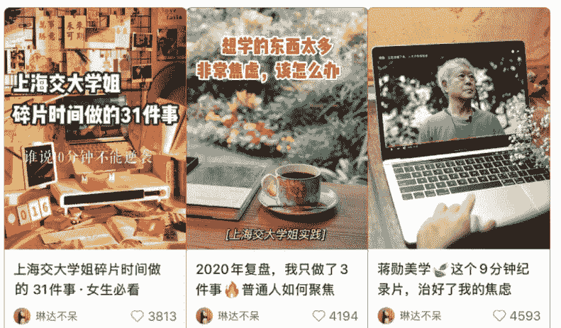

图文笔记封面第一阶段

后来我尝试加入喜欢的摄影风格。

再后来图文写作已熟练，爆文率稳定，便开始尝试视频。

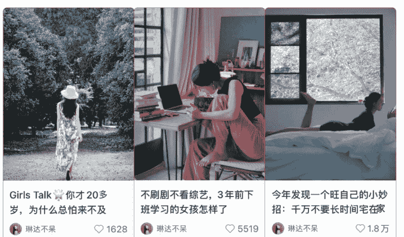

图文笔记封面第二阶段

视频封面初期，我常用人像上半身+夸张大字，虽然数据尚可，但与个人审美冲突，于是继续调整。

视频笔记封面初期

现在封面更注重整体协调，干净美观，重点一目了然。

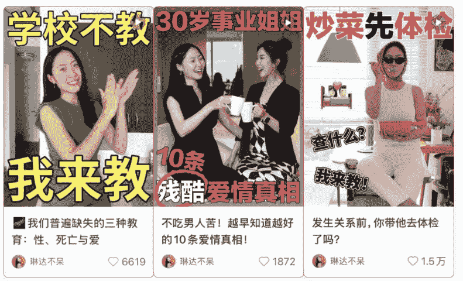

视频笔记封面后期

现在我大概有了一些资格来聊：

到底什么样的封面是好封面？

### 好封面怎么判？三分钟校准你的认知

先做个小测验。

下面三张来自真实笔记的封图，你会把谁挑出来？

哪个更有效？

第一张随意模糊，字堆得很满，人面也看不清，却拿到5.9万赞；第二、三张画面都很讲究，数据分别是五千多和七百多。互动不完全由封图决定，可长期在站内浏览会发现，很多看似随拍的封图数据很好，而精雕细琢的却常沉。

这不等于要放弃精致去做粗糙，也不是说封图随便拍就行。真正决定好坏的，从来不是精细与否，也不是博主长相，而是一个核心问题：

你想达成什么目的？

走职场干货路线，电脑、书本这类物件就能强化专业感，受众更容易信任；
分享校园成长心得，在宿舍里拍、开一盏台灯补光，就自带代入感；
展示居家空间，就要把环境拍得温暖、有氛围，这是目标受众最在意的点；
读书类内容，封面直接把书摆出来，比拍一张高级个人写真更对味，即便那张写真再精美；
笔记是即兴产出的，直接截取视频画面当封图，比重新拍一张“正经照”更自然，进站时不会产生割裂感。

好封图远不止这些，规则随时可被打破。

美妆博主想教技巧，可以在封面先“扮丑”，先勾起好奇再看效果；
在校创业的女生，用更商务的专家感封面，很容易在同质化的迷茫群体中脱颖而出……

总结一句：好封图一部手机就能完成，不必追求极致精致，也不需要帅哥美女出镜。哪怕过去四年，平台上仍有大量无真人、随手拍的封图持续吸量。封图本质是笔记目的的外显，拍摄前先问自己目的何在。

### 精致疲劳的现象

这些年观察下来，观众对看起来很精致却摆拍痕迹重的作品越来越容易审美疲劳，反而更偏爱真实、有生活气息的内容。有些封图确实好看，却离普通生活太远，共情难建立，亲近感自然上不来。

平台受众越来越要生活感。

那精致封图就一定不好吗？当然不是。家居、护肤、服饰等品牌方对博主画面有明确要求——明亮、整洁、有调性，用来筛选人群并提升品牌印象。但封图不能只承担“高级感”这一个职能，也不能只有“精致”这一特质，否则曝光低、点击低，投入产出比下来再豪的品牌也会肉疼。曾与一家高端护肤品牌合作，对方拍摄要求里明确写着“封面不要端庄摆拍！”就是贴合平台调性的典型。

> 封面
请多给几种方案。
千万别：端庄拿着产品、微笑摆拍、用烂大街的文案！！
一定要：吸睛！！有趣！！有创意！！！
某高端护肤品牌的封面拍摄要求

## 五类高点击封面：用户一看就上头的套路

封图看起来杂乱，爆款其实多集中在几类。

### 1.信息类
通过封面文字点出笔记核心，提升点击欲望。官方数据显示，有文字的封面点击率平均比无文字高9%。信息类又分几种。

#### 实拍图+文字
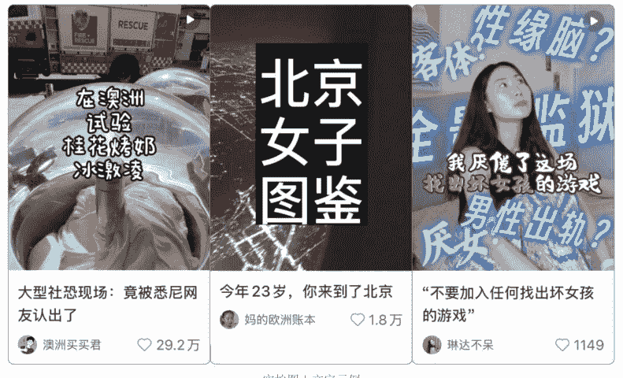
实拍图加文字的示例

#### 拼图+文字

拼图加文字的示例

#### 大字报
没有真实场景人物，用手写字或素材拼图呈现信息，有点“工具人”属性。个人IP账号要控制比例，首页别让它占主导。

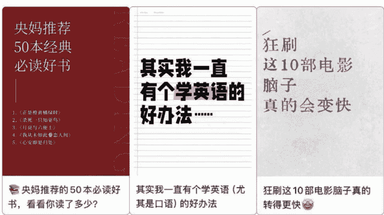
信息类是平台的基础形态，后续情绪、对比类封面也离不开加字来点题。

### 2.情绪类
人物情绪直接外泄，开心、难过、震惊等瞬间就能感知。受众会好奇发生了什么，点进去看个究竟。

### 3.猎奇类
用奇特画面、夸张加字、表情包或离奇场景撩拨好奇心，点击率自然上来。

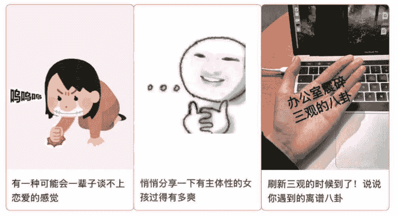
猎奇类封面

### 4.对比类
常用于干货。底妆的斑驳vs服帖、减肥前后的同人对比，比单张图更直观，用户能立刻看到改变，吸引力更强。

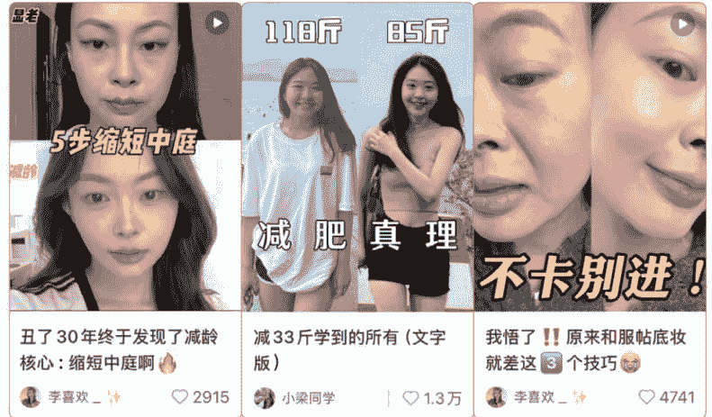
对比类封面

### 5.美感类
阳光下的饰品、傍晚海边的晚霞、草地上拥吻的情侣、摇尾的小狗……画面本身就有情绪价值。美感封面基本不加字，大字会破坏氛围，若要加字也要克制。

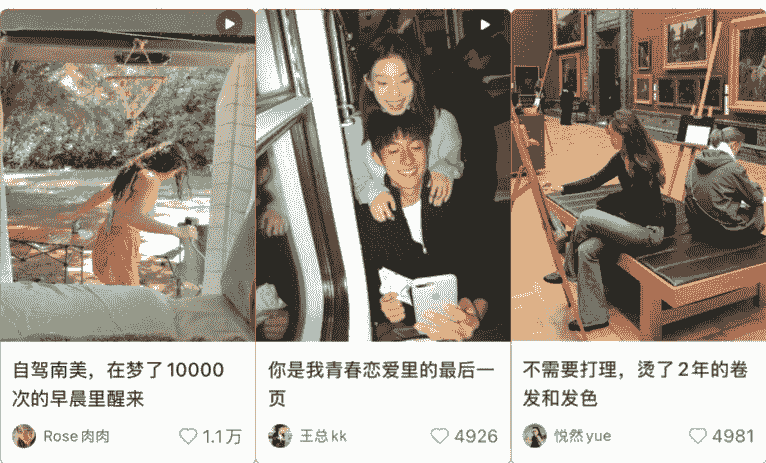
美感类封面

## 四步做出爆款封面：新手也能上手

### 第一步：拍摄前的注意事项
别拿起手机就拍，先注意两点。

1. 用竖版。封面比例有1:1、3:4、4:3，3:4竖版最常用。官方统计竖版点击率平均比横版高10%，所以尽量竖构图。
2. 光线要足。确保画面清晰不发黑，手边有灯就补光。清晰图更容易抓住注意。

偶尔昏暗封面也会爆，但那是内容极强在拉。像我之前的《2025自媒体信息差｜最重要问题往往没人关注》5.9万赞、《人生的巨变从你相信人生可以改变开始》2.4万赞，都是街头即兴拍，封面昏暗无美感，但观点新颖内容扎实。对新手来说内容优势难保证，所以别随意造差封面。

### 第二步：确定是否有人物出镜
封面必须露脸吗？不必。

我起步时封面多是无人物，省时间。后来才加入形象。现在依然有很多无人物爆款，比如@澳洲买买君从不露脸却有147万粉丝，@妈的欧洲账本多是场景加花字风格，一年多就到13万。

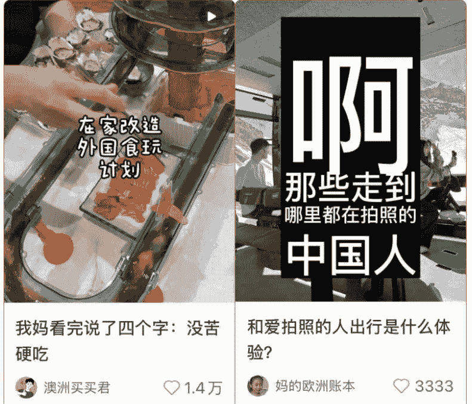
无人物出镜封面

能靠无人物做大号的，内容风格都非常鲜明。个人风格比外表更易辨识。对大多数人，风格需要积累，而个人形象能降低被当工具人的概率。

不想露正面，可以露背影、手部，或四宫格里放一张自拍增加人感。总之人物出镜不是必需，风景、场景、物件也能爆。账号能否起来，不取决于露不露脸。

### 第三步：构思封面花字
爆款封面大多有字。加得好加分，加得乱减分。核心逻辑是增加信息量，让用户快速知道看这篇能得到什么。

花字大致三类。

第一类，提炼主题。把关键词放在封面，用户瞬间懂在讲什么。字要精简，字体别花哨，别写成几行。像“基酒推荐”“男人真相”“被裁怎么办”就够了。

第二类，噱头外显。利用猎奇心理，放常识相悖、反常规、强烈对比或极致情绪的内容。“上海vs县城”“放弃是胜者的行为”“50㎡装下100㎡”这类表述就很有钩子。

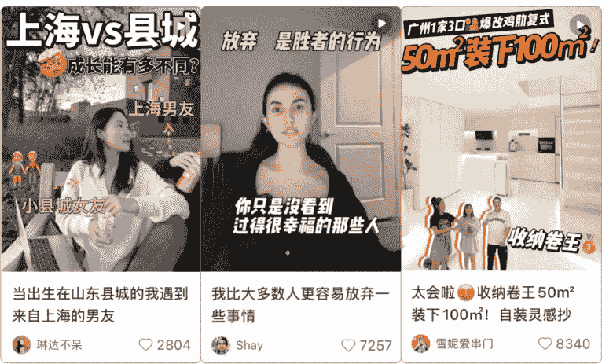

第三类，给出利益。直接告诉用户能得到什么好处。“普通人改命”“不摘抄、不做导图、不多写一个字”“拥有恐怖行动力”都在封面透出收益。

这三类可以单独用，也可以叠加。判断要不要加字，核心看信息量。风景、颜值、情感类画面自带情绪唤醒速度，本身已足够，加字反而破坏氛围。观点类情绪文通常仍需要加字来补足信息。

### 第四步：后期处理
确定素材和花字后就要修。

美图秀秀适合人物修容、抠图，滤镜库能统一色彩或做电影、胶片感；
黄油相机和稿定设计适合做图文封面，黄油相机字体贴纸丰富，稿定有现成模板；
视频笔记封面多用剪映完成。

具体用法平台上教程很多，搜几条就能上手。

到这里应该能回答开头的问题了：好封面没有唯一标准，内容不同适合的风格就不同。有些场景要极力避免的封面，在另一种场景下反而最吸睛。找几个喜欢的风格去试拍，人会在事上磨，封面也会越拍越准。

## 答疑！你最关心的3个封面问题

### 问题一：家里不好看怎么办？两平方米的魔法！
我刚做博主时和两位硕士同学合租，房间简陋到可以形容。最开始拍摄场地只有不到两平方米的桌子。后来添了书桌、网格架、一束花、十多块的落日灯和一副墨镜，在那住了逾一年，拍出几十篇爆款封面。

好看封面不需要漂亮房子，简陋空间也能变魔法，关键是给你两平方米可控区域。

### 问题二：封面风格要不要统一？
有人说不统一影响关注意愿。听起来有道理。

我问过朋友为什么关注某博主，核心答案都是内容有价值，没人提到封面是否统一。实践里，那些单篇涨粉过万的新人，几乎都没有统一封面风格。我和身边的博主也验证过：持续关注一个人，永远是因为内容。别纠结细枝末节，关键是内容值不值、封面是否吸睛。

风格不统一≠质量低，封面可以不统一，但要承担起传达信息、吸引点击的责任，别摸鱼划水[4]。

### 问题三：不漂亮怎么办？
拍摄和做博主，漂亮不是必选项。

大多数品牌并不只看颜值；
不想露正脸也可以露侧脸、背影，做氛围感；
最重要的是长板。@打工仔小张靠接地气攻略获几十万粉，@李要红靠社牛属性搭讪爆火。

放下容貌焦虑，内容更松弛自然，这种能量用户能感知到，后续点赞关注自然来。

> [1] 注意是“看起来真实”，并非真的随手拍。事实上很多内容是“表演真实”，因为生活很杂，平台负责把有共鸣的部分筛出来。
> [2] 打光方法会在第七章分享。
> [3] 随手拍爆款并非真的随手。那两篇笔记话题我早有长期思考和实践，只是情绪被触发才表达出来，本质仍是积累结果。
> [4] 网络流行语，指不出力不贡献。此处指封面没承担起传达信息吸引用户的职能。——编者

# 第七章
视频拍摄篇：零基础也能做出涨粉爆款视频！

视频笔记比图文多一步拍摄。同样的文案，不同拍摄手法数据天差地别。有人现场能侃侃而谈，对着镜头却说不出一句完整话；有人平时惜字如金，镜头前却滔滔不绝；有人只关心用什么设备……

拍摄是我最喜欢的环节之一。它逼你诚实面对自己，同时快速提升表现力和表达能力——学校不教、社会很需要的能力。它像爬山，一开始磕磕绊绊，到后来肌肉更强、呼吸更稳，最终和镜头融为一体。这种变化很迷人。

## 手机真的够了吗？揭秘大博主的秘密武器

一说拍摄，大家最关心设备。

本末倒置。

我给自己的规矩是，没用手机拍出5条千赞爆款前不买专业相机。等真的用手机打出爆款后才明白：设备是锦上添花，不是雪中送炭。再贵的镜头再精致的画面，也救不了一条空洞的内容。

随着从业年限增长，我反而更常用手机。设备焦虑消失后才更清楚，好视频的核心永远是内核。有时灵感稍纵即逝，等架好三脚架调好相机，表达欲早没了。

比如前文提到的《2025自媒体信息差 | 最重要问题往往没人关注》，就是街头即兴录的。原片角度怪、嘈杂、光线暗，本来不想发，后来在家重录发现情绪再也回不去，最后原片直出拿到5.9万赞。

手机是最便捷的设备。很多大博主的视频也是手机拍，不仅便携灵活，更重要的是减少与观众的距离。专业相机有景深，画面细腻却疏离了接地气感——某高端护肤品牌合作须知里就特别强调过这点。

直接用手机开拍。

先把几条能跑起来的作品做出手感，确认方向后再考虑升级器材。起步阶段就砸大钱，很容易掉进追求完美的坑里，导致迟迟不敢开拍。

关于可以用到的配置，我结合自己的实拍经验做了个参考清单。

拍摄端：手机、卡片机、专业微单/单反。基本都会配合三脚架使用。

收音端：蓝牙耳机、无线麦克风。蓝牙耳机上手快，日常口播基本够用。要是想把音质提上去，就给拍摄设备外接无线麦克风。

布光端：自然光、台灯、补光灯。优先在自然光下拍。如果光线不足，家里的台灯也能应急，条件允许就上专业的补光灯。

刚起步的话，“手机+蓝牙耳机+自然光”这一套组合已经能用。

## 拍摄前必须排查的5个盲区

有一次去街头做采访，忙活一下午聊了二十多个人，回头一看素材全程无声。那种心疼现在想起来都难受。后来又出现过好几次类似的低级失误。很多资深博主也会中招，重拍浪费时间，原本的拍摄状态也没了。

踩遍坑之后我整理出了一份开拍前的自检清单，用上之后基本告别拍摄事故。

### 一、先确认电量是否充足
拍摄前要把手机、相机、麦克风等所有相关设备都检查一遍。续航偏弱的设备最好再备一块充满的备用电池。

### 二、先确认收音是否正常
随便录一段试拍，回放看有没有声音、声音清不清晰、有没有杂音。用外接麦的话，要确认麦已经开机，并且没被调到静音。

如果麦需要别在衣领上，衣料最好是硬挺而不是松垮的，否则一动作麦就歪了。夏天有次我把麦别在T恤上，一转头麦口直接贴到脖子上，全糊了。

### 三、确定横竖屏的取向
开拍前先想清楚内容最终是以横屏还是竖屏呈现，再把设备摆好。横屏画面更宽，场景更开阔；竖屏更占手机屏面积，更容易抓住注意力。多数内容其实两种构图都能做。

### 四、确认对焦是否准确
用专业相机拍摄时，要检查焦点是否落在自己身上，而不是旁边某个物件上，不然人物虚了物品却很清晰就尴尬了。

### 五、把布光安排好
光线直接影响人物、物品、场景的观感，也影响品牌方对合作的判断。好的光能让产品质感更出彩。

关键就两点：光源怎么选、光线往哪打。

#### 1. 光源怎么选？
自然光最省事也最好用。找一扇窗，选在日出后三小时左右或日落前三小时左右的光，比如夏天早晨八点左右、下午四点左右，这时光柔和拍出来也自然。

时间记不准也没关系，白天强光时拉开一点距离，或用有透光度的窗帘挡一挡就能减弱强度。

碰到阴雨天或晚上没法用自然光，就用补光灯补。

常用补光灯有这几种。

第一种是现在流行的落地或桌面款，不是中空的环形灯，光更均匀自然，人眼里也不会出现环形反光。

第二种体积极小，能装进包里，夹手机或卡相机上都能用，户外光线不佳时很适合临时补光。

第三种体积很大，收纳搬运都麻烦，但照亮范围大、功率强，适合追求高质感的专业拍摄，日常基本用不到。

#### 2. 光线方向
指光源相对被摄主体的位置。顺光和侧光用得最多。

顺光：光源在被摄主体正前方。阴影少、细节清楚，比如对着补光灯说话就是顺光。优点是五官清晰、主体突出，缺点是立体感会减弱。

侧光：光源在主体侧面，脸部会出现明暗对比，更有体积感。光源与正前方约45°时为前侧光，清晰又带立体感；接近90°的正侧光明暗分明，观感偏生硬，日常较少用。

顶光、逆光除非刻意营造效果，否则一般要避免。

把这5点检查到位，能少走很多弯路。

到这里可能有人会说：

> 我也看到过画面不清、抖动很厉害的视频，数据却很好。

数据是多个环节叠加的结果。那些拍摄一般但数据不错的视频，往往在选题、文案、剪辑等环节有一个非常长的板。拍摄和用光是创作者的基本功。规则要先吃透、用熟练了，再去自由发挥。就像骑自行车，先能稳稳骑，再考虑单手甚至撒手。

## 怎么写拍摄脚本，少做无用功

图文笔记和视频笔记都要写文案，但视频还需要把文案落到画面上。脚本就是一份描述视频如何拍的执行文档。

提前拟好脚本，拍摄更清晰，减少补拍。跟品牌合作时把脚本先发过去，品牌方也能提前知道呈现效果。

思路并不复杂，下面是常用的模板。

| 时长 | 景别 | 口播/字幕内容 | 画面内容 | 花字 |
| --- | --- | --- | --- | --- |
|  |  |  |  |  |
|  |  |  |  |  |
|  |  |  |  |  |

以我为某护肤品牌写过的一版为例。

| 时长 | 景别 | 口播/字幕内容 | 画面内容 | 花字 |
|---|---|---|---|---|
| 2秒 | 中景 | 你们大概没见过这种形式的年终总结 | 口播 | 无 |
| 2秒 | 特写 | 因为翻出了2015年的手写日记 | 展示日记本 | 画面标注“2015年” |
| 8秒 | 中景 | 我想让大家看到的不仅是今年收获了什么，而是把时间线拉到十年，生活会产生怎样的变化 | 口播 | 无 |
| 6秒 | 中景 | 2015年我囤了一堆便宜又不合身的衣服，用几块钱的儿童润肤霜，冬天被风吹得脸都裂了 | 旧照片：当年的穿搭、护肤品、冬季面部特写 | 无 |

口播/字幕内容是该镜头的文案，可口播、配音或字幕呈现。

画面内容是镜头里实际呈现的场景或动作。对着镜头说话时画面就是口播本身；涉及动作、多场景或后期素材插入时，要具体描述动作、场景和素材。

时长是该段落的停留时间，可用字符数×0.15秒粗略估算，帮助把控节奏。

景别指镜头涵盖的画面范围，依次是远景、全景、中景、近景、特写。

花字是后期叠加的文字，用来补充或强调信息。

并非每条视频都要这么细。品牌合作一般需要完整脚本，日常创作可根据实际情况灵活删减。

## 视频的6种呈现方式，别只会坐着说

刷视频时常会疑惑，为什么内容相近数据差很多？展现方式影响很大。

### 一、传统口播1.0版
正对镜头坐着说，像新闻播报员。优点是启动快，打开相机就能拍。缺点是容易无聊，完播率受影响，也缺少广告位。

可以通过剪辑加特效、插入素材来增加变化。某些专业、知识类内容这种形式自带严肃感，反而更合适，对内向的学者也很友好。

### 二、升级口播2.0版
在1.0基础上更自然，像朋友聊天。

有人手持拍摄边走边说，画面带点抖动，削弱了固定镜头的严肃感。

有人改变坐姿，斜靠沙发、躺床上，或边吃饭边做家务边拍。

视角也多样化：仰拍、俯拍、倾斜。

有人换场景去户外拍摄，有人加入相关道具辅助讲解，有人用更情绪化的语气表达。

整体更有生活感和日常感，能降低观众防备。

要注意的是，看似随拍的爆款很多是提前写好文案、设计场景动作和服装的。2.0版数据更好，通常是因为投入更多心思和表现力要求更高。

### 三、采访式
两个人对话比单人自说更吸引人。

优势是对表现力要求相对低，语气动作更自然；脚本压力也小，只需准备采访提纲而非逐字稿。

需要留意的是，选题依然是核心，多人拍摄不会拯救烂题。采访对象要么有故事、要么有干货。

比如和@雪妮爱串门做的爱情类采访，和男友做的成长对比，都选了吸睛的选题和有趣的人；跟从事法律工作的爸爸聊裁员应对，则侧重干货输出。

提问设计和沟通也很关键，要提前聊思路和注意点。

### 四、vlog式
vlog是把视频、图片、音频等素材组合来表达主题的一种形式，本身不是赛道。口播镜头少甚至没有，对怕镜头的人友好。

一种是以故事为主的vlog，记录一段事件或经历，需要镜头连贯、素材量大。比如@澳洲买买君记录澳洲美食和趣事。

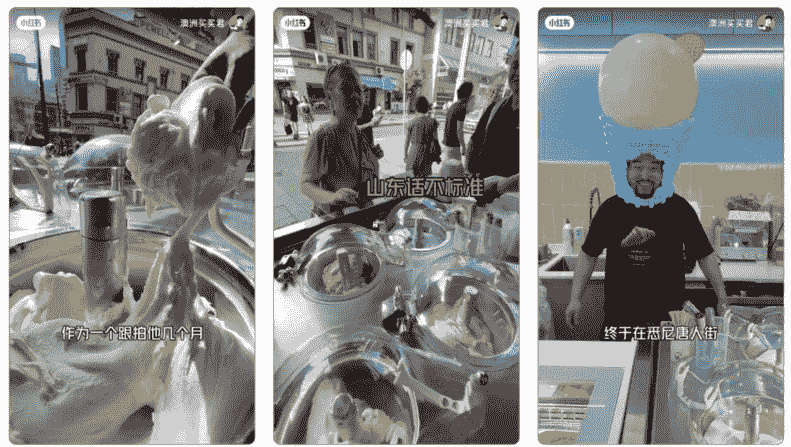
另一种是以文案为主的vlog，把配音文案与日常随拍素材结合，画面与文案关联弱，对画面要求不高，随手收集即可。

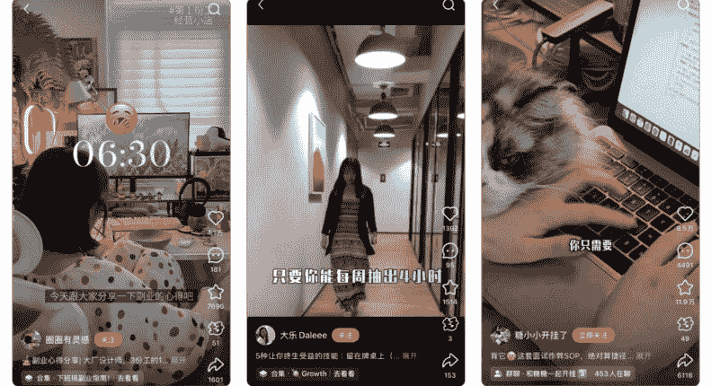
可根据自己的优势选型。

### 五、剧情式
分为一人分饰多角或2-3人小情景的轻剧情，以及3人以上团队拍摄的小剧场。

轻剧情对个人创作者友好，娱乐性强容易出数据，但耗时耗力，对表现力有要求。比如@蛋饺姐姐的双人表演。

团队型剧情如@papi酱、@派小轩，需要提前定选题、分镜、反复讨论，制作复杂但成片爆款率较高。

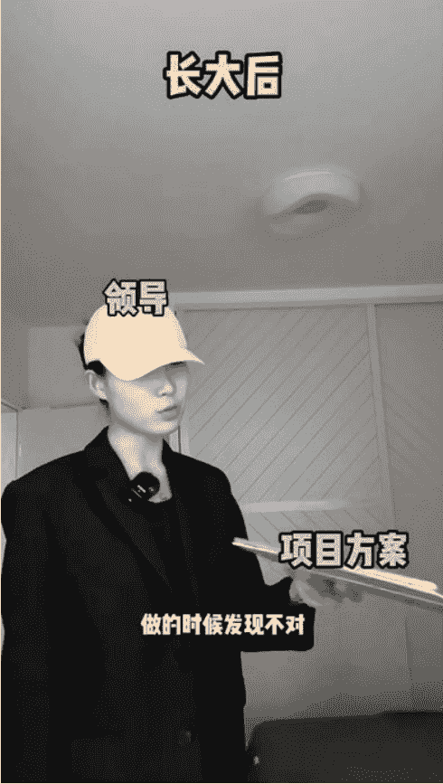
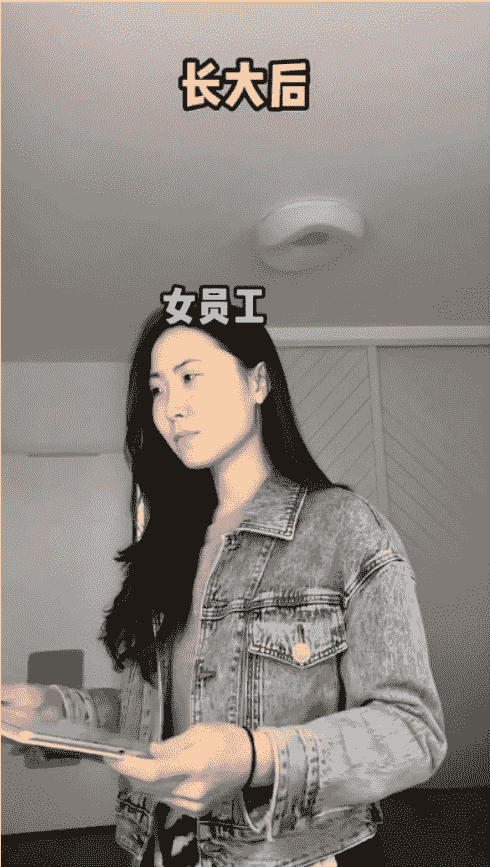

### 六、解说式
讲解电影、剧集、游戏、名人、历史事件或热点信息。娱乐性强，平台普遍受欢迎。变现效果与具体解说类目强相关。

大部分博主会根据选题灵活切换形式。

练习

> 结合喜好和优势，选2到3种展现方式实拍练习。

## 提升镜头表现力的6个练习，从紧张到放松

再外向的人第一次对着镜头也会不自在。

我过去也常被提醒手势多、眼神飘、像在看提词器。拍了一年后这些反馈越来越少。

以下方法能加速适应。

### 边走路边拍
把前置摄像头打开边走边对镜头说话，说说看到的事、当天经历。随时可练，而且路上有人经过会让你更不怯场。练习多了对镜头和目光“脱敏”，在众人面前表达也会更稳。

### 睡前“写”日记
话少的人可以尝试睡前对镜头唠嗑，用嘴巴写日记。说今天做了什么、什么感受。不需要灵感，在熟悉的环境里加上表情动作，表现力会慢慢上来。

### 回听
这是关键。把之前的练习片段完整听一遍，会发现自己常用语气词、频繁说“然后”“这样”、表达啰嗔等问题。把高频问题总结出来，下次针对性克制或改进。

表达能力提升后，日常沟通和职场演讲也会更有说服力。哪怕只做图文，也建议练一练。

### 将文案修改得更口语化

其实很多人没发觉，镜头里显得不自然，文案的写法往往要负很大责任。

我前阵子在读小说《明亮的夜晚》，里面有一段写得很美：

> 祖母摇下车窗，让柔和的春风吹到脸上。风吹起她的短发，河边盛开着成片的鲜花，收音机里传出歌手周炫美的歌曲，夜晚的空气中能闻到淡淡的花香。微风轻拂，一个美好的春夜。祖母也一起哼唱着。

这本小说很棒，这段文字也很动人。

可要是把它直接放进一段视频里呢？

现在你自己读一遍这段话。

读完有什么感觉？

会不会觉得像在背课文一样在朗诵？

没错，几乎不会有视频文案这么写。

那这段文字，如果真的要拍成视频，该怎么呈现？

大概率只要两个画面就够了。

- 场景1：（车内景，3—4秒）镜头从车内缓缓摇到祖母的侧脸，背景响起原声歌曲。
- 场景2：（车外景，4—5秒）祖母把车窗摇下，秀发被风吹起，画面里她跟着哼唱。

图文文案和视频文案的调性完全不一样。

原因在哪？

阅读时，文字是唯一的视觉输入，大脑有充足的时间去消化、去脑补、去回溯，你随时可以停下来思考、翻回去看，主动权在自己手里。所以图文文案可以适当铺陈，可以用长句、复杂词。

看视频时，画面和声音在不停切换，大脑根本来不及处理繁复的信息，而且观众是被动的，很难倒回去，只能跟着节奏走。文案太长、太绕，注意力立刻就散了。

因此视频文案要更贴近日常聊天，多用短句、简单句，让人一听就懂，不觉得有负担。

写完后一定要大声读一遍，把书面化表达换成口语化的结构，适当加入情绪词、语气词和互动话术。

节奏感也关键，别像机关枪一样把信息全砸出来，要给人喘息、会心一笑的空间。能用画面交代的，就别在口播里重复解释，比如上面《明亮的夜晚》的例子。

### 调整拍摄前的状态

过去我常自以为很饱满地在镜头前噼里啪啦讲一通，回看时却发现状态平平。

后来才明白：镜头不仅吃妆，还吃状态。

如果你像我一样偏安静，拍出来很容易缺活力。很建议在开拍前做点小热身，把自己带进更活跃的状态。

比如开怀大笑几声，做夸张的拉伸，往上跳几下，配点燃的音乐，我个人常放新裤子乐队的歌。很快就能感觉到状态起来了。

这只是为了让拍摄时的表现更鲜活，不是把内向的人硬改成爱激动的人。激情、幽默、理性、安静都是好风格，选适合自己的就行。

### 提词器

正式开拍，千万别幻想靠背稿。

有一样工具很好用，叫提词器。

手机拍的话开启悬浮提词功能就能边看边说；用相机拍的话把提词板打开，再按示意图摆放相机和手机，就能一边拍摄一边提词了[3]。

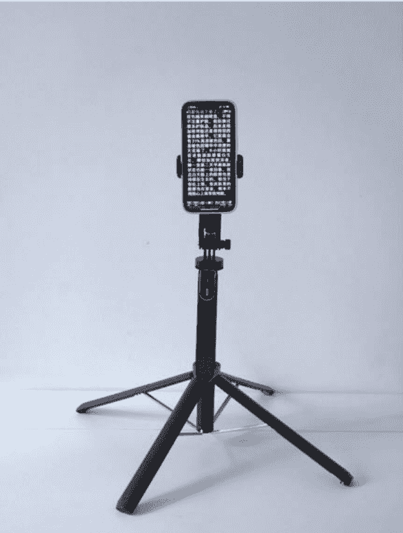

手机提词器模式

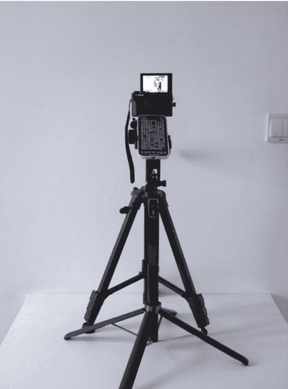

很多人觉得提词器会让表现不自然。

我的看法相反。

想长期坚持，最核心的是降低门槛。

如果每次都要先背下稿子，拍摄就会变成巨大的心理压力，越怕越拖越放弃，哪怕熟背了上场也会僵硬。不自然的根源不是提词器，而是对镜头还不够习惯。

坚持用提词器拍一段时间，等熟悉了镜头后，可以给自己一个小目标：每次录制里脱稿说一段。慢慢会越来越顺，甚至即兴发挥也不在话下。

先学会爬，再学走，走稳了才能跑。现在还在爬的时候就想起跑，只会摔得更重，连走都不敢了。

拍摄时也不必追求每句话都完美流畅，偶尔加个语气词，磕巴一下，停顿思考，眼神飘一下，反而更像真人。很多新手追求零失误，最后像新闻播报员一样死板。

一条脚本最好多录几遍。第一遍情绪还没起来，可能会生硬，第三遍通常会顺很多，状态也更投入。选后面几遍的版本即可。

别怕镜头恐惧期，它是暂时的。第10条视频和第1条完全不一样，第100条和第10条更是天差地别。

### 练习

> 连续两周，每天边走路边拍，睡前用“写日记”的方式口述，至少完成10次并保存。结束后回听，梳理出表达上的问题。
>
> 再练习两周有意识规避这些问题，结束后再回听，对比第一条和最后一条的差异。

## 视频怎么剪？加点小心机，提高视频完播率！

拍完就该剪了。

读到这里你大概能感觉到：剪辑是创作里最简单的一环，却常被误认为是核心。

一条3分钟的视频，10分钟就能粗剪出来，真正决定能否拿万赞的，是文案、呈现方式、封面和标题。剪辑是锦上添花。

在基础扎实的前提下，合适的剪辑能提升完播率，帮助分发。接下来以剪映为例说明，电脑版和手机版功能一致，布局略有差异[4]。

### 调整语速

人正常说话偏慢，剪辑时我习惯把语速提到1.1—1.2倍。本身语速就快的就不用加速。

### 智能剪口播

这个功能能快速裁掉拍摄失误，比如重复一句话、说错，或录到一半外卖敲门去开门停顿。选中片段点“智能剪口播”，它会自动识别停顿和重复，删掉即可。

### 识别字幕

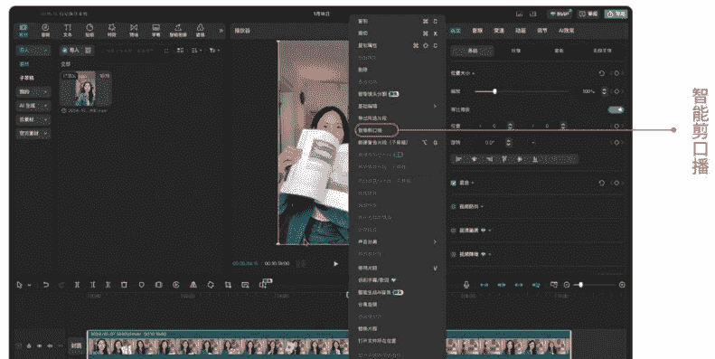

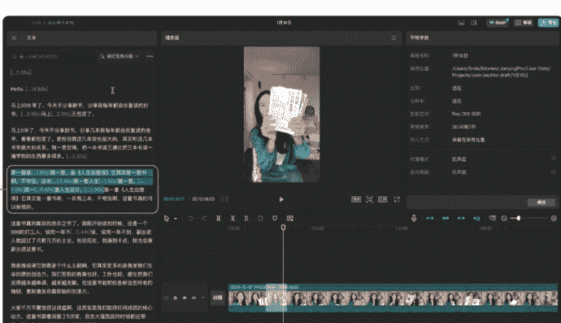

录制时重复的部分，有了这个功能便能很方便地剪辑掉

先用智能剪口播清理失误，再用识别字幕一键生成字幕。生成后要人工校对一下，同音字和环境噪音容易出错。字体不满意可以换，选中文字还能调整格式做重点标注。

到这里粗剪就完成了。

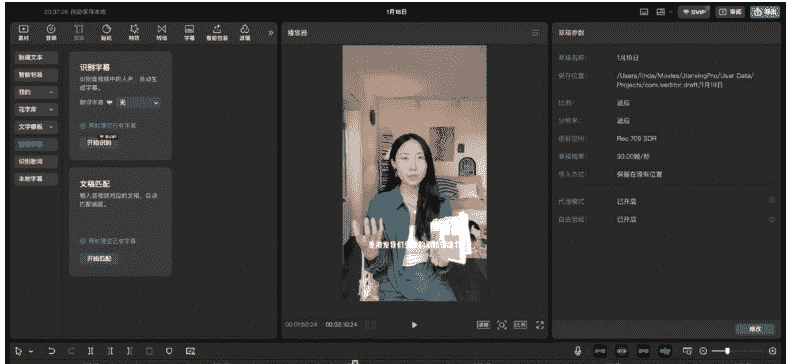

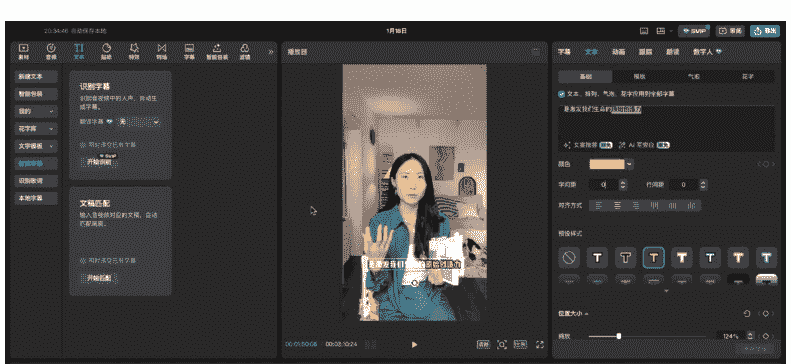

识别字幕

是不是很简单？

很多人以为剪辑要专门学，其实10分钟搞定。

想让视频更吸睛，可以再做点包装，提升节奏感和完播率。

### 常用的几种剪辑效果

**放大**：把片段放大一定倍数，用于强调。觉得某句话很重要或很离谱时放大，情绪会更到位。

**缩小**：把画面缩小做引用区分。比如引用别人原话时缩小处理，观众一眼就能分辨。

**变音**：把人声换成另一种音色，复述他人言论时常用。

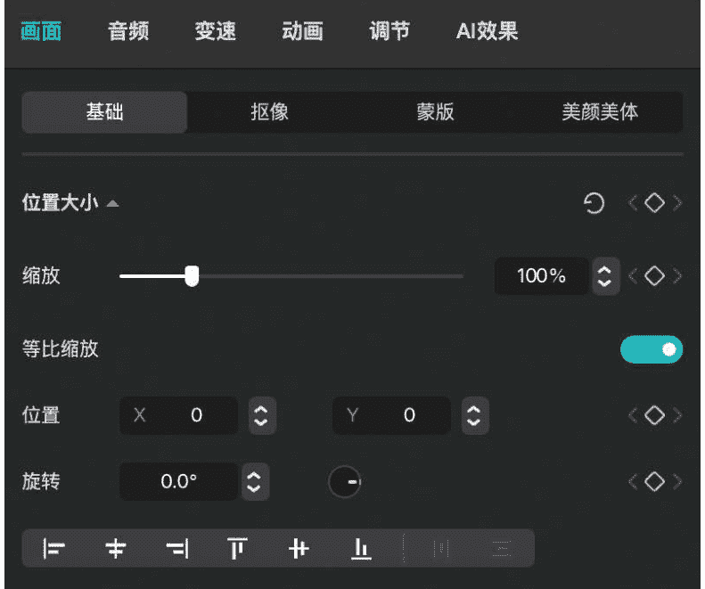

缩放功能即可实现放大缩小

**B-roll**[5]：在主镜头A-roll之外加入补充画面，帮助理解、增强故事性和信息密度。比如讲熬夜加班时，插一段深夜用电脑的画面。

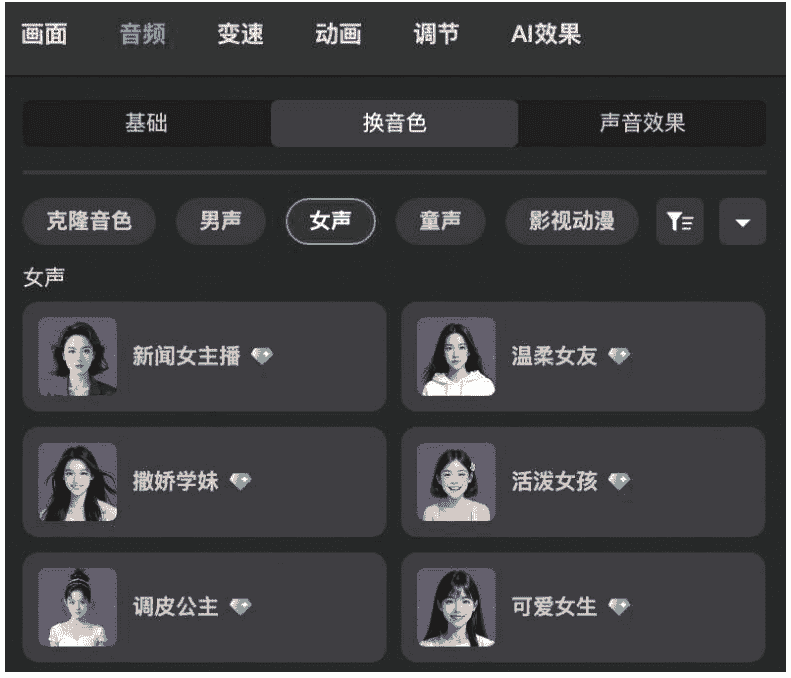

剪映有多种音色可供选择

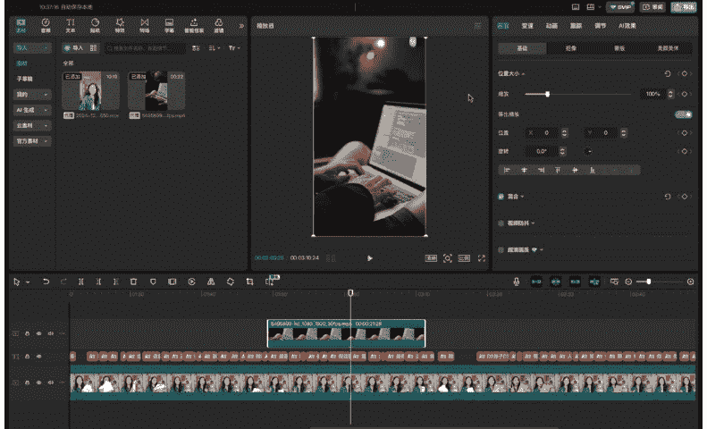

为视频加入B-roll

**花字**：用于提炼重点、补充状态说明，或直接用花字展示干货。注意内容为主，花字别喧宾夺主。

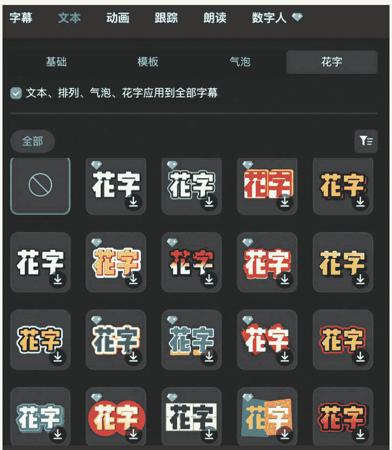

花字库

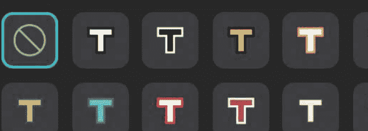

文本编辑处也有简单的花字效果

**转场**：视频分段时加入转场，相当于文章的分段提示，让逻辑更清晰。

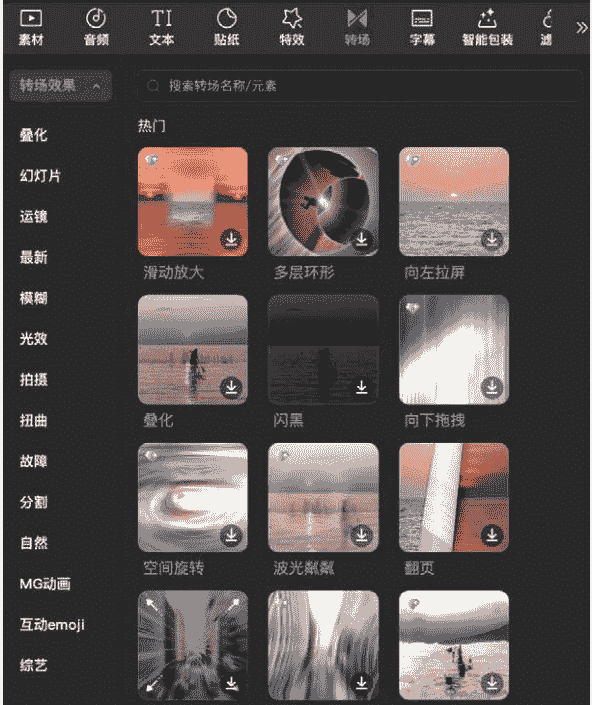

剪映中有各种转场效果

**背景音乐**：合适BGM能提升氛围和节奏。审美需要积累，建议建个歌单慢慢收集不同风格。

**音效**：剪映音效库很丰富，笑声、打字声、转场提示音等都能增加趣味和节奏，但要节制，否则会干扰观看。

多刷视频，看到喜欢的效果就记下来模仿练习，思考如何用在自己的内容上。

冬日的旋律

ccoulkey

02:14

感人温暖叙 Where We Belong

DPmusic

02:20

钢琴 微风轻轻 抒情 剧情 电影 讲诉 故事

Ricky Wang

02:35

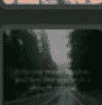

Cycle of Seasons

Angel Mhdzz

04:00

舒缓唯美纯音乐 Heart and Soul

BDKSonic

03:00

### 音效库

记住，效果不是越多越好。剪辑为内容服务，包装目的是更好地呈现内容，而不是炫技。严肃或知识类内容不宜花哨。不要为加特效而加特效，否则视频会变成“怪物”。

精力有限时，把重心放在内容上。

### 后期美颜

镜头很挑剔，光线也会影响面部。可以用剪映的美颜功能做后期调整。但别过度，瘦脸小头过度会扭曲画面，磨皮太重会有假人感。真实的不完美比虚假的完美更耐看。

美颜会占用内存，建议在剪辑包装完成后最后再加，然后直接导出。

剪映的部分美颜功能

### 要不要找剪辑师？

刚开始连20条视频都没自己剪过，还没出过爆款，最好别外包。

第一，剪辑是锦上添花不是雪中送炭。文案不行、啰嗦，顶级剪辑也救不回来。等剪辑成为账号短板时再考虑外包。

第二，你必须自己实践才能找到适合的风格。想要强调哪部分、用什么手法、整体调性如何，都需要沟通，而沟通的前提是你清楚自己要什么。

剪辑是创作者必备技能，绕不开。

### 练习

> 在上一节练习中挑一段喜欢的视频导入剪映，剪掉空白和重复啰嗦处，添加字幕，再加入3—4个剪辑效果，完成成片。

# 第八章

## 如何复盘？偶然出爆款靠运气，持续出爆款靠复盘

很多人爱问要不要日更，却很少有人问怎么复盘。

不复盘只更新，等于把错误重复无数次，这种勤奋只感动自己，数据不会变好。

一旦建立复盘思维，数据差的笔记反而让人兴奋。选题问题？文案啰嗦？封面标题太弱？这些是长期短板吗？该集中攻克，还是避免再次犯错？每一次复盘都是对创作过程和思维的校准，长期下来创作力会明显提升。

## 如何复盘才能持续写出爆款？

小红书自带数据分析工具很方便，直接用来复盘笔记。[1]

点开笔记右上角三个点，选择“数据分析”，就能看到笔记分析，包含笔记诊断、笔记基础数据、观众趋势、观众来源分析及观众画像共5个模块，数据很详细。[2]

## 单篇笔记分析

## 笔记诊断

最多统计至笔记发布后14天

● 本篇笔记数据 ○ 同类笔记数据

你的点击率为 **很好**，超过 **84%** 同类创作者

点击率表现还不错，可以看看这篇内容在封面、标题、选题上有哪些可取之处。

笔记1的笔记诊断

笔记2的笔记诊断

## 笔记诊断

笔记诊断是复盘里最有参考价值的部分。可以看到点击率、涨粉数、互动数、画质、完播率5项指标及与同类笔记的对比。如果某项明显偏低，比如笔记2的点击率和完播率落在同类五边形内，就要深挖原因。

有时也不必过度解读。比如笔记1完播率显示“一般”，但观看人数接近23万，完播率自然会被稀释，属于正常现象。

## 复盘思路

### 1. 点击率

点击率由封面和标题决定。点击率低可能是封面杂乱、不美观、过于平淡，或标题缺乏利他性、情感共鸣不足。回到标题封面部分做针对性诊断。

内容过关时，换个封面就能大幅提升数据。我曾发过一篇《给女孩们的第一次保命指南》，把封面改成和男友同框后，点赞从几百涨到8000多。

原封面

修改后的封面

### 2. 人均观看时长和完播率

人均观看时长是用户平均观看时间。完播率是看完全部视频的人数除以点开人数。

这两个指标和内容强相关。[3]

娱乐、剧情类笔记完播率通常更高，干货、观点类相对低一些，不要跨赛道盲目比较。

### 观众趋势

数据更新至 01-18 18:00

数据指标

留住看得下去的观众

弹幕

● 你的数据
● 同类热门作品数据

> 超过57%的用户在观看到一半前就流失，请着重提升内容质感与节奏把控，期待你产出更出色的作品！

笔记1的观众趋势

笔记2的观众趋势

数据后台里“观众趋势”会以曲线呈现播放过程中人数的增减。以第一条笔记为例，开头约半段留存很稳，中段切入品牌广告后出现明显掉坡。第二条笔记的曲线始终压在“同类热门作品数据”之下，且开播5秒内就流失31%。结合其点击表现尚可，说明选题本身有吸引力，问题集中在呈现层面，文案思路需要回溯检视。

想把完播拉上来，除了打磨文案，还能用一些操作补位：把最抓人的内容前置，删掉信息密度低的段落，提升干货比例；剪辑时给素材叠加配图或短视频，用更直观的方式把枯燥信息讲清；适度加快语速并强化节奏感。

### 3. 涨粉数
笔记发布后粉丝的净增量就是涨粉数。
笔记为何不涨粉，文案章节已拆解过，这里不再重复。

### 观众来源分析

爆款笔记的观众来源[4]

数据一般的笔记的观众来源

观众来源是数据解读里很有意思的维度。实操中很多同学特别在意“首页推荐”，一旦占比下滑就担心被限流。

其实不必焦虑。
从推荐逻辑看，首页推荐是结果不是原因。不是因为没上首页数据才差，而是点击率不足或进入后停留过短，系统判定内容不够优质、吸引力不足，于是自动收紧曝光。平台流量有限，算法追求效用最大化，只会放大更受欢迎的内容，淘汰相对不受欢迎的内容。

想让首页推荐提升，唯一做法是把内容本身做实。

## 复盘文档

可以做一份复盘表，汇总已发布的笔记，观察不同阶段的数据波动。

| 笔记点赞量 | 笔记标题 | 类型 | 复盘记录 |

| :--- | :--- | :--- | :--- |

| | | | |

| | | | |

| | | | |

“复盘记录”建议分两部分写：一是本期做得好的地方，二是需要改进的地方。对发现的问题要在下一条笔记中有意识地优化，而不是重复，才能跳出低效勤奋的循环。

对新人来说，前期数据大概率会打击人，这很正常。此时不要把一篇笔记拿出来过度复盘，实践不足时容易走偏。可以每周发几篇，然后对一到两周的内容集中复盘，更容易抓到规律。

如果思路卡住，看不出问题，可以把笔记发给3-4个敢说真话的朋友，请他们判断是否会点开、点开的原因、不点开的原因、点开后是否会点赞收藏及原因。外部视角往往更犀利客观。

## 是否需要投“薯条”？

“薯条”是什么？

“薯条”可以理解为小红书的内容加热工具。[5]

用户为某篇笔记付费推广，选择推广目标如点赞收藏量、播放量、粉丝关注量、主页浏览量等，并设定人群画像后，小红书算法会按需求进行推广，力求达成目标。[6]

若笔记冷启动数据不错，想冲一波可以小额尝试。但若发布数日点赞仍未破百，再想靠投放把数据拉好看，需要投入非常高，性价比不高。
同时并非所有内容都可加热，例如药品类笔记限制极严，具体以投放页面的《薯条内容加热规范》为准。

## 如何发布一篇笔记？

万事俱备，只剩发布。

### 一、上传图片或视频
点击小红书主页下方红色加号，选择素材上传。上传后可用平台内置工具做简单处理，如加滤镜、花字等。

### 二、写标题和文案
把准备好的标题和文案粘贴到对应区域。

### 三、添加话题
点“#话题”可自行输入关键词，系统会推荐热度较高的話題，择优添加。

### 四、其他常用功能
探店、旅行类笔记可标记地点，方便用户导航。
带货笔记可在下方“添加商品/门店推广”处关联商品[7]。
若为品牌合作笔记，品牌方会通过蒲公英平台下单，发布前需在高级选项中选择内容合作并关联对应订单。

### 五、发布
可即时发布，也可定时发布。
发布时间并非决定数据的关键。虽然会影响初期曝光，但算法更看重内容质量、互动表现、与用户兴趣的匹配度等诸多评估维度。我的学员和我曾在早8点前、深夜12点后都出现过爆款。放手去发即可。

## 如何规划内容发布频率？

日更还是周更几次，是让人头疼的问题。
我刚开始做小红书以图文为主时，频率是每周3-4更，最多不超4更。这个节奏是和工作磨合后形成的。当时工作繁忙，只能利用工作日早晚各产出1篇，周末再补1-2篇。[8]

转做视频后情况完全不同。视频从文案到拍摄再到剪辑，周期更长。起初不熟练时，一条视频耗时是图文的3-4倍。就算后来成了自由职业，想要周更3条高质量视频，其他事就没时间做了。

于是我从下班时间周更3-4次，变成全职周更2-3次，最近写书期间甚至半个月才更一次……

更新频率是非常灵活的。
刚入局时在能力范围内多发一点，有助于熟悉生产流程，并通过数据反馈找到优势赛道。明确方向后，可适当降低频率、提升单条质量，打磨出能涨粉的优质内容。

但这绝不是日更。很多人日更源于焦虑，不更就怕掉粉、错过热点。焦虑会让动作变形。你会忘了更新是手段不是目的，忘了引流核心是创造用户价值而不是机械重复。你会发越来越多，数据却长期个位数，然后怪账号、怪限流，却不肯花10分钟仔细审视笔记本身的停滞。

勤奋不等同于结果。能考上清华的未必是熬夜最多的，能做到百万粉的未必是发帖最多的。
缺乏思考和复盘的勤奋，只是自嗨。
思考越多、实践越多，爆款才会越做越多。
失败不是终点，只是一种过渡状态。

经实测，有工作在身的话，图文周更4篇已非常吃力。对有工作、家庭、孩子的人来说，视频周更3条已是高强度任务。具体频率取决于当下生活节奏，请不要被更新焦虑绑架。

## 不要陷入爆款诅咒：“魔鬼”有时披着爆款的外衣而来

在创作部分接近尾声时，我想分享一个即便是资深博主也容易忽略的关键问题：盲目追爆款绝非好事。

爆款是有诅咒的。
魔鬼有时就披着爆款的外衣到来。

### 一、陷入爆款“诅咒”的“Alice们”

学员Alice想在小红书分享英语学习方法。她曾有一篇爆款，却没带来涨粉，于是求助。

看完笔记后问题立刻清晰。
那篇爆款是围绕国内一部热播剧的台词展开的，文案全是剧集相关。

我问她：“如果你是用户，看到这篇会怎样？”
“如果我对这部剧感兴趣会点开。”
“看完呢？”
“也就结束了。”

一味搬运台词、电影、书单却缺少个人观点、经历、思考，爆起来很容易。对个人IP类账号而言却饮鸩止渴。Alice的目标是做英语账号，若为追求爆款一再搬运台词，就会离初心越来越远，最后账号沦为工具号，既无助于事业也无助于变现。

现实中“Alice们”非常多。
刚起步的朋友尤其容易被爆款带偏。比如反复复刻曾经爆过的选题，却发现数据逐次下滑，白白浪费时间。再比如影视解说、台词分享，看似更容易爆，却对个人IP塑造无益，变现也会受困。

这就是爆款诅咒。看起来最顺的路，往往最难走；起初艰难的路，反而越走越顺。

这并不意味着不能分享台词、书单，而是要结合前文的文案技巧注入温度。若某选题已爆，可继续深耕几篇，但内容必须有新料，否则数据会递减，冷饭炒多了也会消耗用户对你内容质量的信任。

### 二、决定不做什么，比决定做什么更重要

在我做AI算法工程师时，有一个印象深刻的案例。

工作主要负责优化算法，并观察点击率、人均停留时长等指标。一次平台点击率和停留时长明显上升，团队却紧张起来排查。最终发现因技术故障，某些擦边内容被优先展示。擦边内容容易吸睛、让人停留，所以指标上扬。但这种增长损害生态，若只看表面数据沾沾自喜，平台口碑会下滑甚至退出市场。

雷军在《小米创业思考》中提过一个案例。小米曾研发一款高性价比洗衣机，带来不少收入，最后雷军叫停了该业务。因为它与公司围绕智能手机构建智能生活的战略无关。他说：
> “容易实现的增长未必是高质量的增长，可能是资源的不合理消耗；成交金额增加未必是公司体质增强了，也可能是虚胖。”

决定不做什么，比决定做什么更重要。

当你有了些创作经验，会发现做爆款并不难：引战、发表极端言论、煽动对立、甚至抄袭，都能用极少的精力换来更好的数据。若目标只是爆款，很容易滑向这些歧路。你会获得看似增长的数据，但只是健康的虚胖，而不是能力和影响力的提升。等回过神来，可能已病入膏肓。

那些没爆却认真写的笔记，对创作者而言极其宝贵。
我很喜欢李诞的一句话：
> “如果你一出发就去练怎么‘炸场’，你也不太可能变成一个‘炸场’演员，你的上限太低了，你的上限就是一天又一天迎来送往的观众，你会慢慢发现，‘炸场’其实挺容易的，你会收获一天又一天无意义的成功。……如果追求‘炸场’，追求名利，你会一无所获，或者更惨，你会变成一个庸人，甚至一个坏人。”

练好自己，“炸场”是自然而然的事。我们要追求的，是修炼自身，而不是刻意炸场。

### 三、破圈必死？

有人说：破圈必死。
我认为：不破圈必死，破圈才能活。
我一直在破圈。

# 第九章 用AI做小红书：从灵感、文案到变现

2022年ChatGPT发布震动全球，三年后DeepSeek横空出世，上线一个月下载量破亿。看似高大上的技术已飞入寻常百姓家，化身随身智能助手，用庞大知识库回答几乎所有问题。在创作中，AI[1]早已成为我的左膀右臂。小红书上也涌现大量AI类爆款笔记和账号，不少已获得品牌合作。很多人觉得AI难学。事实并非如此。AI只是工具，能帮我们拓展思路、解决问题。关键在于怎么问，只有提出好问题，才能得到好答案。

## 如何让AI成为比你更懂小红书的助理？

“如何用AI做小红书”这个问题太宽泛。拆解后会清晰：如何让AI给出适合我的赛道方向？如何让AI为某个话题提供创作灵感？如何让AI润色文案使其更吸引人？如何让AI给出吸睛的封面和标题？如何让AI帮我复盘笔记数据？思路即答案。

## AI精准定位赛道：它比你更懂你！

做什么赛道一直是纠结点。AI能给出意想不到的思路。第二章你可能已完成七维定位表和四象限图。把两份资料发给ChatGPT，并加上一句：
我是一个小红书博主。附件是我的背景资料。请结合分析出3-4个适合我且在小红书受欢迎、易变现的赛道，并指出优势与不足，以及如何弥补不足。
很快就能得到一份详细建议。我把四年前的自我分析发给ChatGPT，给出的赛道建议与我后来选择的高度相似。也可进一步让它给出选题：
针对适合我的赛道，给我10-20个热门选题。
它会迅速返回对应选题。注意部分选题有时效性，部分不够精准。选题上不必过度依赖AI，将其作为拓展思路的工具即可。

### 练习
> 选任意AI工具，将你的七维定位表和四象限图发给它，按上述话术让它给出3-4个适合你的赛道，并对比你自己找的赛道与AI建议的差异。

## AI文案六步法，解决灵感枯竭

写文案头疼，对新手和大博主都一样。因此AI普及后最热门的问题是：“怎么让AI帮我写文案？”
有个坏消息和好消息。坏消息是，若只想用一个简单指令让AI写出爆款，几乎不可能。否则爆款笔记应已大部分出自AI，毕竟它几十秒就能写一篇，还可24小时无休，比博主苦写几小时高效太多。好消息是，把AI当成聪明助手一步步引导，它能提供很好的点子，最终与你共同完成出色文案。下面以“沉迷短视频对人的影响”为例，分享6步法。[2]

### 一、确定选题切入点
我是一个小红书博主，想写一篇以“沉迷短视频对人的影响”为主题的小红书视频笔记，有哪些好的切入点？给我10个。这一步能把模糊主题转化为用户关注的话题。

> 我是一个小红书博主，想写一篇以“沉迷短视频对人的影响”为主题的小红书视频笔记，有哪些好的切入点?给我10个。

写“沉迷短视频对人的影响”这个主题，你可以从多个角度切入，让内容更有吸引力。以下是10个不同的切入点：

1.  **时间流失感**：刷5分钟短视频，结果2个小时没了？——探讨短视频如何消耗时间，让人不知不觉错过真正重要的事。

2.  **注意力被劫持**：为什么你越来越难专注？——分析短视频如何影响人的专注力，导致工作、学习、阅读效率下降。

3.  **短期快感与长期空虚**：为什么刷短视频越快乐，生活越无聊？——对比短视频的即时满足感与现实生活中的目标缺失，揭示“快乐债务”现象。

4.  **记忆力下降**：你是不是越来越记不住东西了？——讨论短视频如何影响大脑的深度思考和长时记忆。

5.  **碎片化信息焦虑**：看了1000条短视频，还是不知道怎么做选择。——讲述短视频的信息流如何让人习惯接受浅层信息，难以深入思考。

6.  **短视频如何塑造你的价值观**：你喜欢的，不一定是你选择的。——分析短视频算法如何影响人的兴趣、审美、消费观甚至人生选择。

7.  **真实社交能力退化**：现实中越来越不会聊天了。——探讨沉迷短视频是否减少了人与人的真实社交机会，让人更难深入交流。

8.  **睡眠质量下降**：短视频是让你熬夜的真正原因。——讲解刷视频导致的多巴胺成瘾如何影响作息，让人长期睡眠不足。

9.  **你被短视频偷走了多少可能性**：本来想健身，结果刷了一晚上短视频。——讲述短视频如何占据时间，阻碍个人成长与自我实现。

10. **短视频戒断实验**：一个月不刷短视频，我的生活发生了什么变化？——以实验形式记录戒断短视频的真实体验，观察专注力、情绪、时间利用的变化。

这些切入点可以使你的笔记更有吸引力，并让受众产生共鸣。你更喜欢哪个方向？

AI给出的选题切入点

### 二、确定脚本结构
我很喜欢最后一个切入点“短视频戒断实验”，基于这个切入点，给我3个比较吸引人的脚本结构。[3] 这一步能激发创作灵感。有了它，你就知道选题该如何展开。可多问几次，直到得到满意的结构。

> 我很喜欢最后一个切入点“短视频戒断实验”，基于这个切入点，给我3个比较吸引人的脚本结构。

基于“短视频戒断实验”这个切入点，我给你3个不同的脚本结构，每个都有不同的叙事方式和情绪调动方式，方便你选择最适合的风格。

#### 脚本结构 3：戏剧化叙事→代入感强

适合风格：故事型、情绪波动大

1.  **开头（设定戏剧化场景，引发情绪）**

    *   画面：半夜1点，手机屏幕的光打在脸上，主角刷短视频刷到眼睛发红。

    *   旁白：“我本来只想看5分钟，结果……2个小时过去了。”“这次，我决定挑战30天不刷短视频。”

30天不刷短视频，我才发现手机才是那个被偷走的人

2. 挣扎期，空下来的时间像在抗议
第一夜没了刷片的陪伴，整个人都显得不对劲，焦躁、发闷，脑子里空出一个洞怎么也填不满。闲下来第一反应就是去拽手机，翻来覆去找个替代品，却发现什么都没办法像那条滚动的流一样顺手。
我还给自己设了个小测试，朋友给我推来一个视频链接，我能不能做到不点开？手指悬在屏幕上那几秒，真的比想象中难熬。

3. 习惯重塑，转折从一周后开始
撑过七天，身体好像慢慢接受了新规则。白天等外卖的间隙我开始切菜做饭，晚上下班去跑几圈，甚至把很久没碰的日记本翻了出来，一笔一划写下这一天的碎事。
就在某个平常的傍晚，我突然愣了一下，原来过去的我早就被困在那条永无止境的推荐里了，自己却一直以为那只是“放松”。

4. 戒断后的收获，变化被慢慢放大
作息先变了。以前一到床上就一路刷到凌晨两点，现在十一点就能躺下，睡得又沉又稳。
状态也变了。和朋友吃饭时，我不再下意识低头去划手机，能真的听他们说话、接梗聊天。那种被当下占据的感觉，很久没出现了。
情绪更稳了。以前一点小事就会莫名焦虑，现在心反而更平，整体的情绪基调从紧绷转向了轻松。

5. 结尾，想把这份体验留给你
如果你也隐隐觉得短视频在一点点侵占你的生活节奏，不妨试一次，哪怕只是一天。你会发现时间其实一直在那儿，只是被切碎了。
你敢不敢，跟我一起挑战一天不刷短视频，看看会遇见怎样的自己？

高佣金≠高利润，选品先看性价比
带货时容易被佣金比例带偏。平台内电商还在完善阶段，品类覆盖不全，部分商品在站内售价明显高于外部渠道。佣金看起来很可观，实际到手往往打折。我见过博主挂过一套图书，站内价格比市面均价高出30%以上，并非故意抬价，而是当时只有一家商家在售。平台用户算账很精，价格合理时会图方便直接下单，一旦溢价明显就会犹豫，甚至质疑创作者的专业度。宁可少赚，口碑不能丢。

## 直播同样是核心变现路径
图文之外，直播在平台上已成为重要收入渠道。
早期平台重点扶持了董洁、章小蕙这类调性契合的明星主播。董洁入驻后连开两场，单场成交破3000万元，累计涨粉超50万，成为首个出圈的明星主播。同年10月，章小蕙单场破亿，成为平台首位破亿买手。
随后明星入局增多。李诞的直播很少硬推卖点，多以读粉丝来信为主线，调侃或抛出有深度的观点，在聊天中自然引入商品。有位粉丝写自己在亲密关系里控制欲过强而苦恼，李诞回应说问题不在控制欲，而是思维卡在死胡同，把书本理论过度套用，太清醒了。话锋一转，他引出某品牌酒，劝人偶尔也需要一点不那么清醒的阅读趣味。
现在个人创作者和商家入场加速，直播日活和成交单量快速增长。
直播不一定非要卖货。不少创作者把直播做成聊天式分享，聊职场、成长、英语学习等。去商业化的分享能即时答疑，互动感强，有助于提升粘性和涨粉。
这些受欢迎的直播间都有相似之处：克制喧哗，不夸张，把用户当朋友，输出有价值的内容，而不是机械喊“3、2、1上链接”。

## 三步开启直播
想开播很简单，APP内点红色加号，选择直播即可。
若想提升热度，大多数创作者会提前一周左右发预告。路径是：个人主页左上角三道杠→主播中心→直播预告。
预告填好后，可点“关联笔记”，把预告挂到历史笔记上。用户刷到这些笔记就能看到预告并预约。直播结束后，关联的预告会自动消失。

## 主页常驻的小清单玩法
小清单会常驻在个人主页，粉丝通过它下单可获得佣金。
开通和选品逻辑与笔记带货类似，进入买手合作页面，点击小清单，即可批量把商品加入，统一展示在主页。
小清单不需要像笔记或直播那样额外履约，但想卖得好仍需与内容配合。比如发一篇《如何写手账》的笔记，可在发布前先把文中用到的手账好物加入小清单，评论区有人询问时直接发链接，转化会明显提升。

案例拆解：嗒嗒 Helen
小红书号：667071087
IP属地：美国
📢 别多想，先做起来！
🥗 植物基食谱 | ✈️ 旅行干货 | 🍳 生活记录
🇫🇷 @蓝带 LeCordonBleu毕业 | 🇺🇸 加州注册会计师
- ♈️ 天蝎座
- UnitedStates
- 料理博主
- 巴黎蓝带学院
625 关注  1603 粉丝  1.7万 获赞与收藏
💬 表态 1个表态

#### 小清单  笔记
- 全部
- 书单
- 邱妈严选
“邱妈给无数亲朋好友们推”
¥22.8
¥40.8
博主主页的小清单

买手后台常用功能
更多直播计划 >
进入买手合作页面可找到小清单，支持关键词搜索商品，批量管理。目前显示全部·0，支持+ 添加分类。若暂无商品，可去添加商品。选品中心里点“添加商品”即可。

新手任务如何完成
完成所有任务，解锁称号与奖励
限时+1 >
解锁8.3万流量
了解你的粉丝心愿单
去查看
选品规划一目了然
完成1场1.5小时的有效直播
去查看
直播流量卡奖励+2000
- 任务中心
- 助手管理
- 钱包收益
- 小清单
- 直播计划
- 直播预告
- 直播动态
- 粉丝群运营

零粉丝也能开店
前面几类变现通常要求粉丝超1000并开通蒲公英。但粉丝不足也能卖货。平台支持0粉丝开店，只要有自有产品或能对接供应链，就可以通过店铺销售。

如何选择店铺主体
开店流程顺畅：进入创作者中心→选择开通店铺→按指引操作即可。
很多人卡在“请选择主体类型”。店铺分个人店、个体工商户、企业/公司三类，主体一旦确定入驻后不可更改。

| 店铺类型 | 考虑因素 |
| :--- | :--- |
| 个人店 | 经营类目受限，例如无法经营大部分3C数码、家用电器、家具建材、珠宝玉石、部分母婴用品、保健品等。无需营业执照，身份证认证即可开店。不可投放广告。 |
| 个体店 | 类目比个人店更丰富，但不可经营保健食品、保健用品等。需提供个体工商户营业执照。不可投放广告。 |
| 企业店 | 全类目可售。支持达人带货和投流推广，变现方式多元。有线下门店可关联位置。引流限制更少。需提供企业/公司营业执照及品牌资质。开通后主页昵称显示蓝V。 |

选择适合自己的店铺类型的考虑因素
有一定规模或有投流需求的商家品牌建议开企业店，其余可按实际情况选择个人店或个体店。
不同主体店铺的可售类目、禁售类目及具体权益，平台在“选择主体类型”环节均有配套文件，开通时务必仔细阅读。

店铺的变现路径
开通后可在个人主页点“管理店铺”，或前往小红书千帆进行上下架等操作。
上架后可发相关笔记并挂链接，流程与笔记带货一致。店铺也能通过直播带货。企业店还可付费或分佣邀请博主带货。
需要留意的是，店铺和小清单不可同时展示在个人主页，只能二选一。
开店并非商业号专属，越来越多个人IP博主也会开店售卖自己的课程或咨询等。个人IP账号做店铺时切忌硬广，要把产品自然融入有个人思考的笔记中。
相较品牌合作，店铺等变现方式对粉丝门槛更低，新人博主也能获得可观收入。
不过这四种变现模式都有挑战。选品是关键，只有质量过关、需求旺盛的产品才容易复购。不同季节节日需求会变，需要不断提升“买商”，敏锐捕捉需求。买手可借助第三方平台了解近期爆品。
销量高的笔记背后都是精准的痛点洞察、视觉化口语化的卖点呈现和清晰文案，底层逻辑仍是一篇高质量内容，遵循本章内容制作方法。

违规处理与申诉指南
不只是商业笔记，任何内容都可能违规。
商业类笔记常见雷区是夸大或虚假宣传，或商家资质不全。例如用“最好”“最快”等极端词，或靠修图实现美白、去黑眼圈、毛孔隐形，或虚构功效，如一款只保湿的护肤品被写成抗老。这些都违反《广告法》，属于误导消费者。医药医疗器械类如隐形眼镜、脱毛仪、血糖仪，以及理财保险类，都需品牌提前上传资质，并在内容中做告知，否则易被判定违规。
收到违规通知后笔记会被强制停止推荐，曝光会断崖式下跌。
先别慌，仔细看站内信提示，按要求修改内容，点“帮助与客服”申诉，违规内容删除后一般能在一定时间内恢复推荐。
有时笔记很正能量也会被误判。因为平台有机器审核和人工审核，都有出错可能。确认无违规可申诉，成功后推荐会恢复。有学员的职场笔记发布后被误判，申诉成功后重新获得9.3万赞。
但有些内容即使申诉也很难过，例如涉及医疗疗效承诺、药方分享等。即便对个人有效，体质不同风险很大，平台严格处理也是为用户负责。
其他高危行为包括笔记中暗藏联系方式、大规模拉人宣传产品、盗用他人素材、在站内发表违背社区价值观的内容、骂战、攻击、反动言论等。屡次出现或会被禁言乃至封号。日常创作一定要遵守社区规范。

> [1] 这里指本书出版时的规则，未来这些规则可能发生变化。
> [2] 小红书的排版和版面名称会随更新而变化，但总的来说，“蒲公英”的开通方法非常简单，如果以上名称发生了变化，大家可以直接去小红书搜索“如何开通蒲公英”，几分钟即可搞定。本章介绍的其他流程性操作同理。
> [3] 实际上，大多数品牌都不会直接和博主联系，而是通过第三方媒介，让他们找到适合自己品牌的博主。为了降低大家的理解成本，这里统一用品牌代替。
> [4] 接单成功率和博主的风格、账号内容、粉丝量也有非常紧密的关系。
> [5] 但总的来说，不管经济好坏，大多数品牌依然有广告投放需求，以此来将产品宣传出去。因此，经济环境对博主的影响也因情况而异，比如某些品牌可能会砍掉高报价博主，某些品牌可能会更看重笔记数据，某些品牌可能会选择投放更多的中小型博主，某些品牌可能因为产品更符合当下经济、社会的趋势而增加预算和投放，等等。
> [6] 买手，一般指筛选商品，并通过笔记、直播带货或开通小清单的博主，博主承担了选品和销售的角色。店铺主理人则是有自己的店铺，既可以通过笔记和直播销售，也可以通过店铺直接出售店铺内的商品。
> [7] 某些品牌可能会给博主更低的拿样价格，以及更高的带货佣金。具体需要博主与品牌方主动沟通，由博主的内容质量、粉丝量等因素决定。
> [8] 注意下页的图只做示范使用，并非实际的履约笔记。
> [9] 当用户点进一个小红书主页，默认看到的界面是笔记页面，需要向右滑动才能看到小清单的具体产品。
> [10] 小红书店铺后台管理系统，有手机版和网页版。
> [11] 品牌合作笔记和带货笔记统称为商业类笔记。
> [12] 具体细则可以登录小红书“蒲公英”平台网页版（https://pgy.xiaohongshu.com），点击帮助中心查看具体细节和案例。
> [13] 在品牌合作中，品牌一般会告知博主如何在笔记中加入产品，无须博主自行了解。

# 第四部分
小红书新风向
跟不上，就出局！
自媒体，唯一不变的就是变化。
创作者应该怎么办？
小红书改变了我的生活。
4年前，我绝不会想到，下班后的一闪念，竟将循规蹈矩20多年的我带上了一条完全不同的路。此前，我和很多正在看此书的你们一样，也认为自己喜欢稳定的生活。我从前对生活的期待，是工作，是攒钱，是在上海买一套房。然后结婚，生个孩子。
而小红书，让我突然意识到：
这些，并不是我想要的。
这4年，我见到很多原本以为稳固的事情慢慢瓦解。企业大幅裁员，稳定的工作瓦解。结婚率下降，离婚率上升，稳定的婚姻瓦解。上海五大新城中的四个放开限购，落户政策越来越宽松，生育率连年下降……稳定的保障体系，也渐渐瓦解了。
变化才是世界的真相。一切都在变。
世界是，小红书也是。

# 第十一章
自媒体永恒的变量
很多人可能不太理解，但我特别喜欢说一句话：
“起号太快可能会毁了你。”
我有一个博主朋友，她和我差不多同年做小红书，和我苦哈哈的状态不同的是，她做出爆款和涨粉异常轻松。用她的话说：
“没花什么心思，发一篇爆一篇。”
不到1年，她小红书的粉丝数涨到了30万。
过了1年，我们再见时，她有些焦虑地和我说：
“大家的口味变化好快。我之前的内容系列已经做不出爆款了。这段时间，我一直在摸索新的风格，但还没有找到。数据低迷很久了。”
社会环境在变，用户的喜好在变，所以内容一定也要变。

## 四年里内容如何变迁
这4年，是变化的4年。
4年前，我每周末都要去图书馆或咖啡店学习，在小红书上的分享也以学习、自律类的内容为主。这些内容并不精美，甚至封面、文案排版都稍显杂乱，但出乎意料地受到了很多用户的喜欢。
正巧，那时的用户喜欢这种自律向的内容。
但不到1年，这种风格的笔记就过时了。
但是，一切并没有消失。相似的内容，开始披上不同的外衣出现。
自律开始披着赚钱的外衣出现。这也不难理解：倘若我们多问自己几个问题，就会发现，自律给我们带来的最大的吸引力之一，就是它可能为未来创造更好的生活。计划开始披着学习的外衣出现。“主题月学习法”“主题周学习法”都曾一度在站内爆火……
同样发生变化的，还有日常类vlog。
最开始，很多小红书用户喜欢这样的vlog：
早上从精致的卧室中醒来，磨咖啡，运动，然后是煎蛋做贝果，吃早餐……
在普通人稍显粗糙的生活中，这样精致、有美感的画面激发了很多用户对美好生活的向往。这种精致的vlog一度在小红书爆火，甚至直到现在，很多人还以为vlog等于精致日常。
但很快，用户的喜好又变了。
精致的vlog迅速过时。人们开始对精致祛魅了。
这也许是因为，被这类视频吸引的受众，在他们想记录自己的日常时，发现这些博主看起来自然轻松的画面，自己花了几个小时还是难以复刻；也许是因为，这类视频中出现的越来越多的广告，让用户开始厌倦、疲惫；也许是因为，人们逐渐发现，精致的生活只存在于视频中，而不可能存在于自己真实的日常里……
> 网友1：我个人不喜欢看那种非常精致，摆拍痕迹太明显的视频，就是那种为了拍视频而去做某件事，为了视频去生活这类的视频。
👍 5799
> 网友2：不想再看到流水线化的vlog了，比如早上起床、拉窗帘、跳操、喝咖啡，还有各种“××上学的一天”“××上班的一天”。真的很假好吗！
👍 1.2万
> 网友3：工作后很反感那些引发焦虑的vlog，比如“××月入十万”这种，下班后我真的就想放松一下！
👍 8999
越来越多的人希望看到更有真情实感的内容，而非过度的表演。
同样，一切并没有消失。在小红书内，有一类截然相反的日常vlog开始出现。
它们的场景并不精致，甚至有些粗糙，文案也更幽默、接地气。它们不像精致生活类vlog，有种虚空离地之感，而是将你我在真实生活中都体验过的喜怒哀乐浓缩起来，源于真实，却不流于平淡。偶尔还能说我之所想，做我所不敢做，和用户极度共情，让人颇有找到“互联网嘴替”的爽感，用户的压力也得以宣泄。
这样，也就不难理解，为什么这类vlog往往都能获得非常高的点赞量了。
所以，自媒体人要有一个共同的认知：
没有任何一个“流量密码”会一直奏效，我们必须不断求变。 一旦你接受了这个变化，并适应了它，你将穿越周期，任风向如何转换，也不会被打倒。

## 当前趋势与创作对策
作为一个小红书创作者，在埋头创作的同时，更要抬头看天，把握好方向，才能持续创作出高质量的爆款。
那么近些年，小红书有什么新趋势？

### 真实感胜过精致感
倘若你留意，就会发现，小红书上场景精致、服化道精致的内容，数据惨淡的比比皆是。而那些“看似”用手机随手拍摄的视频，却能获得十几万人甚至几十万人点赞。
很多年前，在自媒体刚刚进入我们生活的时候，精致的画面和场景作为新鲜的信息出现，确实能够抓人眼球。但多年过去，大众已经对精致却空洞的内容感到厌倦。
现在，越来越多的创作者不再拘泥于形式，而是将注意力回归内容本身，视频风格也更生活化。这样的博主，在AI时代，反而更有人味，让用户更想亲近。

### 年轻人拒绝标准答案
“人生是旷野不是轨道。”这句话，曾经在小红书风靡一时。
但这仅仅是一个开始。
自那之后，越来越多自我觉醒的内容出现在小红书上，引起无数人共鸣。
一边是企业降本增效，大规模裁员，被迫离开职场的年轻人开始意识到没有稳定的工作；另一边，留在工作岗位上的人，也并非高枕无忧，他们在更严酷的工作环境中，被迫思考工作给人带来的意义究竟是什么。与此同时，成长环境更自由的“00后”逐渐进入社会，也将他们这一代人身上的自由感带到职场中。
即便网络上依然存在批判性声音，但更多人开始放过自己，允许自己停下，允许自己休息，允许自己犯错，允许自己晚婚……
他们意识到：人生只有一次，意义是自己赋予的，不必按照别人口中的标准答案而活。
他们用实际行动告诉社会：
谁说中国人的一生都在追求“上岸”？
即便慢一点，我也要去探索，我究竟想过什么样的人生。

### 年轻人重新评估工作意义
越来越多人意识到，职场是复杂的，人与人之间会存在利益冲突与博弈。不是做好工作就能升职加薪，也不是收入高就会感到幸福——倘若个人时间被过度挤压，人也会有严重的被工具化的感受。更何况，没有稳定的工作。昨天还坐在办公室，今天可能就会被裁员。当裁员越来越普遍，很多人开始思考：
工作带给我的究竟是什么？
于是有了这样的爆款笔记：
## 30岁才发现的职场真相：工作是没有意义的
刚毕业……
打工时一定要有随时失业的心态！
赫敏姐姐 ♡ 16.1万
琳达不呆 ♡ 1.6万
工作思考主题笔记

不少人开始清醒，填满待办清单并不等于工作结束。协作、扯皮、跨部门拉扯才是日常，一旦撞上气场不合的上司或同事，整段经历会变得极度消耗。对刚入行的新人尤其明显，手上没筹码，收入也只靠这一份，几乎没有回旋余地，往往只能把情绪压下去。于是“别在职场索取情绪价值”“如何与合不来的人共事”这类内容持续走红。

另一个反复出现的觉察是，工作之所以牵动神经，多半因为它是当下唯一的现金流。对没有额外资产的打工人而言，让上班少内耗的关键，是不要把全部收入押在单一岗位上。于是探索副业变得普遍。

这些讨论指向同一个结论：对普通人而言，职场本质上是卖劳动力换报酬的地方，并非人生意义的载体。若生活里只有工作，财务与心理都会陷入被动。把生活价值感从岗位里剥离，才能在职场里降低消耗，在生活里获得更多踏实。

## 赚钱内容为何长年热搜
钱的话题一直是各大平台的流量主线，受整体经济环境影响近几年热度更稳。

很多创作者在站内分享变现路径和副业经验，数据多数不差。这里有条红线：封面可以把成果拿出来做钩子吸引点击，但正文必须提供可用信息。空洞、夸张甚至造假的内容，不仅难以为继，还会让用户对创作者的信任迅速瓦解。

## 女性议题正被重新书写
社会氛围松动后，越来越多的女性把权利与成长困境摆到台面上谈。

被凝视时的别扭、对主流审美的质疑、性教育、生育期女性的职场挤压，以及过去很少被提及的生育损伤，都逐渐进入公共视野。小红书上并没有“女人应该怎样”的标准答案，因为女性可以是任何模样。三十岁、四十岁未婚不再难以启齿，平台里的女性来自各行各业，生活形态各异，有的高薪也有知足常乐的。

觉醒并非男女对立。在这个趋势下，女性对男性的观察也更立体：一个男性不必遵循社会规训而活，可以不追求成功，可以温柔，可以把家庭放在优先位。涉及性别的讨论要把握分寸，避免过度激烈对抗，否则很容易触线。

## 传统文化换个姿势走红
中国传统文化正以新面貌在小红书上流行。

博主@江寻千的打铁花视频获102万点赞，全网传播；李子柒回归后在部分平台一夜涨粉数百万。越来越多创作者靠近非遗，成为传播者。

除非遗外，其他传统IP也在持续破圈。八段锦被视作更适合本土人群的“帕梅拉”，道家如何降内耗，《道德经》的当代解读，《孙子兵法》的拆解，学习《黄帝内经》，练习太极等内容大量出现。这些笔记之所以走红，既源于文化自信，也因为信息鱼龙混杂的时代，传统哲理显得稀缺而珍贵。

## 养生已经年轻化
很多人会问，养生赛道真的如传闻般热吗？

看我的桌面就知道了：脖子上贴着三伏贴 [3]，手边放着用某老牌企业红豆薏米茶包沏的茶，据说去湿气。刚吃了一颗黑芝麻丸，写书掉头发。每天吃一片叶黄素，保护被过度使用的视网膜。冰箱里存着自制豆浆和无添加燕麦片，口感寡淡但膳食纤维多，对久坐有帮助。食品柜里还有黄芪片，是贴三伏贴时医生看舌苔后开的，说能补气固表。虽然不太懂，但医生的话听着可靠，名字也响亮。最神奇的是，我这个常丢三落四的人，黄芪片从未落下。

我并非主动追踪养生资讯的人，这些行为多是环境潜移默化的结果，小红书是主要来源。养生并非中老年人的专属。每年三伏天一到，晒背 [4] 就会在小红书上再起波澜。痛经茶、祛湿茶、舒肝茶、气血茶层出不穷，甚至只是一杯煮苹果水也能拿到高赞。低成本的尝试不管效果如何，至少能提供心理安慰。

这只是冰山一角。进入职场后节奏加快，每个人多少会有点小毛病，于是主动或被动关注养生。但要注意，养生类内容敏感度高，不应夸大疗效，否则易违规。每个人的体质不同，身体真正不舒服时，去医院才靠谱。

## AI从想象走向日常
2022年，ChatGPT面世。这是一款互动型人工智能工具，其模型由海量数据训练而成，打破了传统搜索引擎的局限，能高度个性化地给出解决方案。发布后立刻引发全球轰动。截至目前，ChatGPT不仅能对话，还能识别场景和人物情绪，通过视频实现面对面交流。

很多人感叹，十多年前科幻电影《她》里的场景变成了现实。

三年后，也就是2025年，DeepSeek引发轰动，上线一个月下载量破亿。

这些年，如何使用人工智能成了全网热门话题。目前小红书上的相关内容主要有应用工具教程、不同工具的对比，以及更实用的结合案例，比如分享人工智能如何与各行各业结合提升效率与创造力。我也曾发布过如何借助人工智能学英语、如何借助人工智能做小红书的笔记，数据都不错。很多职场人把人工智能用在写代码、写周报、做PPT上。

人工智能已是当下热点，也必然是未来的持续热点。作为曾经的人工智能算法工程师，我更建议大家不要只为做自媒体而学习人工智能，而要在生活中真正使用它，感受它带来的便利与灵感。人工智能时代已经到来。

## 重新链接人和世界
越来越多的人意识到，没人能成为孤岛。人们开始重新找回与他人、与世界的连接。比如露营、户外兴起，搭子文化兴起，就是一种信号。小红书也顺应趋势举办了慢人音乐节、马路生活节等线下活动，让用户走出线上拥抱真实生活。

连接不止于线下。许多用户会通过“听劝改造”“听劝旅行”的方式在小红书上寻求建议。热度居高不下的MBTI也是年轻人寻求身份认同的重要方式。同时，城市散步、抱树疗愈先后成为热点，人们靠散步重新感受生活了十几年甚至几十年的城市，与一棵树建立感情。

看到具体的人，回到具体的生活。

## 重新听见自己的声音
2015年，我第一次读《观呼吸》，接触到冥想。

按书中方法闭上眼睛，把注意力集中到呼吸上。听起来很简单，但我很快发现很难做到。脑海里不断冒出各种想法，像一颗颗五彩弹力球在乱撞，注意力总被牵走，无法停留在呼吸上。

那一刻我第一次具体觉察到，原来每天会产生这么多想法，它们唤起快乐、恐惧、好奇、抵触等情绪，并触发一系列自动反应。原来我长期被情绪噪音控制，而非被真正的自我掌控。那是我第一次与自己的连接。

近几年，冥想开始成为小红书的热点话题，吸引力法则、显化等也随之出现。在浮躁焦虑的环境下，这些尝试让我们有机会拨开大脑噪音，分辨出真实想法，从旧的思维与行为模式中走出，发现全新的自我。有人称之为疗愈，我更愿意称之为重新建立与自己的连接。

这类话题热度持续走高，但同样存在违规风险。分享时不要夸大。同时行业鱼龙混珠，要擦亮眼睛防止上当。

不管是做个人IP还是商业账号，都可以结合这些新趋势优化内容与产品。当然趋势并非全部，平日也要多关注用户留言反馈。主动获取多元信息，多观察、多上网、多和具体的人交流，能帮你更快发现新趋势，御风而行。

## 七个致命暗礁别踩
查理·芒格说过一句很有名的话：

> 要是知道我会死在哪里就好啦，我将永远不去那个地方。

第一次读到这句话时，我还没有踏出大学校门。我读不懂，甚至觉得被过誉了。

在社会摸爬滚打几年后，我才发现，这句话蕴含着很深的智慧。

做小红书也是如此。你可以靠各种方法做好一个账号，但做不起来的人却有共性，他们往往都触碰了以下“死亡暗礁”。

### 暗礁1：急于求成
发一篇笔记就想爆。无法接受投入数小时打磨的内容数据惨淡。写出一篇爆款就急于变现。一篇笔记爆了没有涨粉，又要纠结很久。如果发30篇还没水花，就觉得被平台针对，甚至觉得自己曲高和寡……有些人则走向相反极端：日更。这是另一种形式的急于求成。

如果单纯花时间就有意义，那么做得最好应是不需要休息的机器。

毛泽东在《实践论》中提到，战争的领导者若缺乏实战经验，对具体战争的规律一开始并不了解，只能在一次次胜负中积累体感，正是败仗的经验让人懂得战略与战术。换一个毫无经验的人去指挥，又会要在吃败仗后才能把握规律。

这段话陪我度过数个低谷期。

吃败仗，才能把握战争规律。吃败仗，才能掌握创作规律。

### 暗礁2：怕被熟人看到
很多人做小红书最大的障碍不是写内容，而是担心被熟人看到怎么办。

小红书上有很多笔记教大家如何屏蔽熟人，这些方法根本无法百分百保证不会被认识的人刷到。

可很少有人讨论：我们为什么担心被熟人刷到？被熟人看到真的有那么可怕吗？

事实上，在别人的世界里，你我都是微不足道的NPC，是他们茶余饭后的几分钟谈资——也许连几分钟都谈不上。如果是这样，被他们看到又如何呢？每个人最关注的永远是自己，是自己的生活。

不如大大方方做，被刷到后坦坦荡荡承认。担惊受怕、揣度他人想法，只能影响创造力，让人畏首畏尾，做不出好内容。

### 暗礁3：居高临下
妈妈经常把她喜欢的内容转发到家庭群，我总是不看。有一次偶然点开，发现这些笔记点赞量很高，甚至上万。我一篇篇看过去，发现这些被我判定为“不吸引人”的内容，竟也包含不少智慧。也许呈现形式不符合我这类青年人的口味，但无疑能让长辈感觉更真实亲近。

我意识到：人是多种多样的，内容也是。不吸引你的内容，不代表不能吸引其他人。

好的观察者，工作时的自我比较小。自我比较小才会愿意去看、去听。哪怕看到的和听到的跟自己的经验不太一样。[5]

自我太强滋生傲慢，傲慢带来偏见，偏见会阻碍前进。当你刷到一篇笔记时，不要居高临下评判，而要心平气和观察。可以不认同内容，但要接受差异存在，并思考差异背后代表什么。只有这样，才能总结规律并为己所用。

做个批评家很简单，做个观察者却很难。但即便如此，还是要做观察者，而非批评家。

### 暗礁4：希望一劳永逸
在做博主路上，你也许会遇到“流量密码”，恭喜你，也许会靠它做出爆款吸引粉丝。但渐渐地，用户似乎不那么喜欢了，再过一段时间它完全失效了。

不要留恋，果断放下。

博主不是一劳永逸的工作，而是必须不断扩充新知、新体验的工作。听起来很累，事实上确实如此。你当然可以停下来休息，很多时候休息能让你做出更好的内容，但只要还在工作，就不要幻想靠一招制胜，不要停止学习。

与此同时，不要过度计较付出，不要期望用小成本博取大收益。有位博主找我咨询，她靠“随手拍”做到近9万粉丝，但总粉丝量已经一两年没涨过。我和她沟通后发现，几年前过于顺利的经历让她不愿再花时间打磨内容，总想靠“随手拍”再次爆款。可过往经验已用尽，想要再次做出好内容，必须经过更精细准备。

读到这里的你，可以回顾一下第三章提到的“不可能三角”。

### 暗礁5：被数据低谷期过度影响心态
生活就是一条大河，我们身在其中，会经历波峰波谷。

在数据低谷期，心态受影响很正常。但如果任由自己陷进去，很可能在黎明到来前夜色中放弃。

人人都喜欢波峰，但人在波峰时，却是懒得思考的。陷入低谷反而是一个很好信号。它迫使你反思内容有什么需要调整。突破它，你才会更进一步。当你凭借自己突破一个个低谷后，自信心会越来越强。

如果你被卡住很久，那一定要想想，你是不是需要充电了？好的内容是冰山一角，而知识储备是隐藏在水面下的巨大冰山。去阅读，去旅行，去和形形色色的人交流，去把目光从小红书和各种网络平台中移开，在生活中找到新的支点。

当你有了新的体验、新的生活、新的思考，你将带着新的内容凯旋。

### 暗礁6：嫉妒
打开小红书首页，就能看到谁的笔记获得几万甚至几十万点赞；点开某个博主主页，就能看到他最近粉丝增长了多少。

尤其是自己身处低谷期，数据停滞不前时，这一切更刺眼。你会无比沮丧、懊恼，甚至嫉妒。很正常，这些负面情绪大多数人都感受过。

但即便如此，我还是想给你一个掏心窝子的建议：不要只停留在看到嫉妒、接受嫉妒上，而是要追求超越嫉妒。

也许嫉妒在短时间内能激发动力，甚至让你小有成就，但长时间看，这种负面情绪会吞噬你。你会将负面情绪投射到正在做的事上，开始讨厌这件事。即便成功了，也会很痛苦。

任何将动力建立在负面情绪上的努力，都不可能持久。

不是胜了敌人你就赢了，关键是你自己变强了还是变弱了。不要将他人之得视为自己之失。

马斯克曾经说过：“如果你有‘零和博弈’心态，那么你会认为取得成功的唯一方法就是从别人手中获取，因为你觉得蛋糕是固定的……因为这个思维，有些很聪明的人会做傻事。”

竞争意识损害竞争力。做一件事，不是为了和谁比较，是为了把这件事做好。心中的地图应该是自我的完成进度表：现在进行到哪里，哪里做得不好，哪里做得漂亮，如何把事情做得更漂亮……而不是别人的成绩单。

更何况，世界是一张巨大的开放式考卷。那些比你厉害的人，就是考了高分的人，是你的老师。从他们的答卷中可以学习很多，高兴还来不及。想要走得长远，必须摒弃单打独斗模式，要和他人建立友好合作关系。

更何况，蛋糕的大小不是一成不变的。“蛋糕的大小会迅速增长。比如和过去相比，我们有了更多的产品和服务。我们应该警惕自己是否有意无意地内化了‘零和博弈’心态，这是错误的，要关注如何将蛋糕做大。”这是马斯克的另一段话。

通过本书的方法，你从自己身上挖掘内容，就是在做你自己的蛋糕。这块蛋糕能做多大，有多少人成为顾客，和其他人有多成功都没关系，只取决于你自己。因为，你的蛋糕口味和他们的不一样。没人会拒绝一块新口味的蛋糕。

### 暗礁7：盲目追求流量
不必多言，这块“礁石”处，沉了太多艘曾经名声响当当的“船”。

守住底线。敬畏内容。敬畏每一位用户。

这7块暗礁，就是查理·芒格说的“会让人死去的地方”。每块暗礁下都沉没着无数艘船。其实偶然触礁并不可怕，每个博主都碰到过它们。但如果反复触礁，再坚固的船也会沉没。

如果可以，永远别去这些地方。

## 力量一直在你手里
项飙在《把自己作为方法》中说：

自己的力量。”

我谈不上知识分子，只是一个在小红书平台靠自己拿到过一些成果的人。而我写作本书的目的，也不仅仅是想把行之有效的方法教授给你们，更重要的是，我希望每个人都能意识到：

做小红书并非难事。你本身就拥有力量，只是这力量被枯燥的应试教育消磨，后来又在日复一日的格子间里蒙尘。时间一长，你都完全忘了你还拥有它。

不要被过去的经历和想法束缚。不要活在过去的框架里。

你的力量，它足以让你习得做小红书需要的任何技能，即便未来趋势再次变化，你也能举一反三，自信驾驭。

能量是你，创意是你，无边的生命力，更是你。

在小红书之外，希望这本书也能给你启发，给你力量与鼓励。

请一定相信：真正的力量始终在你手里。