# 普通人打造AI小团队通用智能体与企业级智能体搭建

# 前言

# 为什么写作本书

在AI技术迅猛发展的今天，多智能体系统（Multi-Agent System，MAS）已成为AI领域具有重要前景和变革潜力的研究方向。从OpenAI的ChatGPT到Manus等新一代智能体平台，AI技术已经从单一对话助手进化到能够协同工作的多智能体团队。这种转变不仅代表着技术上的重大突破，更预示着未来工作方式的根本性变革。

多智能体技术的先进性体现在多个方面。

首先，它能够将复杂任务分解为多个子任务，由不同特长的智能体协作完成。

其次，多智能体系统具有更强的容错能力和适应性，当某个智能体遇到问题时，其他智能体可以及时补位。

最后，多智能体系统能够模拟真实世界中的团队协作，实现“1+1>2”的效果。随着AutoGen、Manus、扣子等平台的涌现，多智能体技术正在从实验室走向实际应用。

然而，面对层出不穷的新技术和平台，AI领域的学习者特别是零开发基础的学习者，面临着系统性掌握的难题：如何理解不同智能体平台的特点？如何在零代码条件下构建实用的智能体？多智能体系统与大模型之间是什么关系？企业如何将这项技术真正落地？这些问题成了阻碍多智能体技术普及的关键障碍。

本书的诞生正是为了解决这些问题。我们特别关注零代码开发智能体的可行性和实战性，因为并非所有学习者都具备编程背景，但每个人都有权利享受AI技术带来的便利。通过本书，读者将发现：即使没有任何编程经验，也能构建功能强大的通用和企业级的智能体系统。同时，本书深入探讨了大模型与多智能体的关系——大模型为智能体提供了“大脑”，而多智能体则赋予了大模型“手脚”和“团队协作”能力。

从企业落地的角度看，多智能体技术虽然前景广阔，但在落地中也会产生一些困惑。

- 什么时候需要开发智能体？
- 开发智能体应该选择什么平台？
- 如何在智能体中结合企业数据和业务特性？

本书将通过真实案例，分析企业应用中的开发经验和常见陷阱，帮助读者避开“雷区”。

# 本书特色

本书力求在技术深度与学习门槛之间找到恰当平衡点，打造一本真正“看得懂、学得会、用得上”的多智能体开发指南。具体体现在以下五大特色。

1. 零基础友好，全程无代码：完全从非技术背景读者角度设计，无须任何编程经验即可上手。
2. 主流平台全覆盖：涵盖Manus、AutoGen、扣子等主流智能体平台，提供横向对比和选型建议。
3. 真实场景驱动：所有案例均来自实际工作场景，如电商运营、教育创新、企业办公等。
4. 从单智能体到多智能体系统：循序渐进地引导读者掌握智能体团队的构建方法。
5. 包含新技术：包含MCP、AutoGLM沉思版、知识库等前沿技术解析和应用示范。

# 读者对象

1. 职场人士（非技术背景）：包含对AI感兴趣的非技术人员（如希望提升效率的互联网运营人员），以期理解AI基本概念、能在日常工作中应用AI工具，从而提高个人或团队的效率。
2. 企业决策者与创业者：包含中小企业主、创业者、数字化转型负责人等，期望了解AI如何助力业务增长、降本增效、推动企业转型、落地可行性方案。
3. 产品与业务负责人：包含产品经理、业务分析师，期望了解AI解决方案的设计与整合，以及如何提出有效AI需求、评估技术可行性，从而推动产品智能化升级。

本书不仅适用于个人学习，也能为企业团队提供智能体落地的参考框架。通过系统性地学习本书内容，读者将具备构建实用多智能体系统的能力，从而在AI时代抢占先机。

# 如何阅读本书

本书共分为8章，内容涵盖了从智能体原理到多智能体开发实战的方方面面。

第1章首先解析Manus的技术突破点，并给出CRM公司调研的应用案例，之后介绍智能体的主流应用类型（SOP类和自主决策类），最后介绍零基础搭建智能体的3个主流平台。

第2章手把手教你Manus平台注册与使用技巧，并通过电商销售额提升方案、PPT与Excel的自动生成、智能合同审查3个典型场景，展示如何用智能体解决实际办公痛点。

第3章深入探讨Manus高阶技能，如提示词优化方法、分享异常处理和人机配合的实用技巧，并对比分析AutoGLM沉思版等替代方案的特性和应用。

第4章介绍智能体的核心运行原理，并通过Cherry Studio平台讲解信息采集、数据分析和数据可视化3类本地智能体的零代码搭建方法。

第5章系统讲解企业级知识库搭建的全流程，并特别设计用户反馈流程来确保其持续进化。

第6章首先介绍MCP的概念与快速接入方法，之后以教案智能体为例展示如何基于MCP构建可智能交互与个性化调整的复杂智能体应用，打造企业级智能体解决方案。

第7章首先介绍扣子平台的基本操作，之后以化学小助手为例演示如何基于扣子平台构建教育类智能体，包括实验过程分解与脚本编写，以及可视化元素设计与制作等关键技能。

第8章综合运用AutoGen与扣子平台，从AutoGen操作入门、运营系统设计、数据采集工具构建、运营团队组建到运营系统落地，完整构建一个具备数据采集、爆品分析和爆款短视频生成能力的多智能体电商运营系统。

通过这8章内容，本书构建了一条从入门到精通的学习路径。每一章都聚焦解决特定问题：第1～2章解决“智能体是什么、能做什么”的认知问题；第3～5章解决“如何构建实用智能体”的技术问题；第6～8章则解决“如何实现复杂系统和企业落地”的进阶问题。笔者建议读者按顺序阅读，但每章也保持相对独立，方便查阅特定内容。

在AI技术日新月异的今天，本书力求在基础原理与前沿应用之间取得平衡。无论技术如何演进，掌握多智能体系统的设计思维和实现方法都将成为未来职场的重要竞争力。希望本书能成为你探索通用智能体和企业级智能体的忠实伙伴，助力你在智能时代脱颖而出。

# 勘误与支持

虽然笔者尽最大努力确保内容准确无误，但难免存在疏漏。如你在阅读过程中发现任何问题，欢迎通过邮箱35816146@qq.com与笔者联系。

# 致谢

撰写这本书是一段充满探索与成长的旅程，其中凝聚了许多人的智慧与支持。

在创作过程中，笔者深刻体会到家人无私支持的重要性。正是他们给予的理解与鼓励，让笔者能够全身心投入这项富有挑战性的工作中，将复杂的技术概念转化为通俗易懂的内容。

特别要感谢智能体领域的前沿实践者，他们的创新与突破为本书提供了丰富的素材与案例。从Manus平台的开发者到AutoGen的开源贡献者，正是他们的努力让零代码开发通用与企业级智能体系统成为可能。

希望本书能够成为连接技术与应用的桥梁，帮助更多人掌握这项变革性的技术。期待它能成为读者探索智能体世界的起点，并为推动多智能体技术的普及与发展贡献一份力量。正如多智能体系统本身所体现的协作精神，技术进步需要集体的智慧与努力，而本书愿成为这一进程中的一块铺路石。

金伟

# 第1章 认识智能体

本章将全面介绍智能体（Agent）的演进、主流应用类型以及实现零基础搭建智能体的3个主流平台。相信通过本章的学习，读者将对智能体有更为深入和全面的理解。

## 1.1 Manus技术突破点解析与应用案例

你觉得未来世界需要多少智能体？1亿、10亿还是100亿？AI先行者李开复曾描绘过这样一幅图景：当智能体全面接管世界时，你甚至不需要打开任何应用程序，智能体就能根据你所处的环境进行动态规划，自动处理生活和工作中那些烦琐的事务性操作，让你可以专注于更有创造性的部分。

也许你会觉得这么美好的未来离我们还很遥远。确实，在ChatGPT这样的大语言模型刚问世时，这样的场景还带着几分科幻色彩。但随着Manus这类自主智能体的兴起，这个想象的图景正在一步步变成现实。

### 1.1.1 技术突破点解析

与传统AI工具相比，自主智能体究竟有何本质区别？为什么说它是未来的发展趋势？要深入理解这个问题，需要从ChatGPT的发展脉络说起。

当ChatGPT这类大语言模型出现时，人们将其视为一个增强版的搜索引擎。即便后来出现了DeepSeek这类具备深度推理能力的大模型，大多数用户仍然保持着“人主导+AI辅助”的使用模式：由人类进行任务规划，将特定环节交给AI处理，最终再由人工整合完成整个任务。在这种模式下，AI更像是一个高级工具而非合作伙伴。

而自主智能体则实现了这种工作范式的突破，它采用“任务全托管”的工作模式，用户只需提出需求，智能体就能自主完成从任务拆解、工具调用到结果交付的全流程。用生活场景来比喻的话，传统AI的协作就像一个离不开视线的幼儿，哪怕你只是去趟卫生间都得时刻盯着；而自主智能体则像能独立打酱油的孩子，你只需给他空瓶子和零钱，交代清楚任务，就能安心回到厨房继续炒菜，同时等着他完成任务就行了。

如图1-1中的漫画很好地体现了它们的区别。

图1-1 传统AI和自主智能体的区别

Manus就是自主智能体的典型例子。除了Manus之外，目前已经有很多自主智能体被开发出来。甚至你可以用AI开发工具自己创建一个智能体。Manus之所以具备这么高的自主性，得益于它在工程方面的几项创新。

（1）自主的任务规划能力

通过定制的大模型，Manus能将模糊的用户需求转化为可执行的操作序列。例如，当用户提出“请帮我制定一个面试时间表”时，它会自动生成包括Excel文件读取、会议安排、计划可行性验证等8个子任务的工作流，如图1-2所示。

图1-2 Manus的自主任务规划

（2）多工具协同执行能力

Manus集成了几十种专业工具模块，包括代码生成、浏览器自动化等。特别值得注意的是，它具备“工具链自优化”机制。在执行过程中，该机制会实时评估各工具的表现，动态调整调用策略。

CodeAct是一种让AI通过动态生成和执行代码来完成复杂任务的框架。
Python是一种高级、解释型、通用编程语言，以简洁易读的语法、强大的标准库及生态系统著称。

当任务执行出现偏差时，Manus能通过“观察-诊断-修正”的三步循环流程进行自我修复。它采用的CodeAct架构支持直接执行Python代码，其代码开发能力相当于普通IT工程师的水平。图1-3展示了Manus的编程执行过程。

（3）虚拟机执行环境

Manus为每个任务配备了独立的虚拟计算机（也称电脑）运行环境。这种设计既保证了安全性，又实现了工作空间透明化，用户可随时介入调试，形成良好的人机协作模式。

Manus的案例表明非技术人员现在也能完成网站开发、数据分析等专业任务。即使没有任何编程基础，也能借助自然语言指令创建出完整项目，而且每一步操作都清晰地显示在虚拟计算机环境中，如图1-4所示。

我将帮助您制定 4 月 13 日至 15 日每天两场（上午和下午）的面试计划，确保候选人分布均匀，同时考虑到他们的时间安排。让我分析调查数据并为您制定最佳时间表。

- 从 Excel 文件读取访谈调查数据
- 开始分析面试调查数据，制定最佳时间表。
- 正在执行命令 `pip3 install pandas openpyxl matplotlib`
- 从Excel文件中读取并处理访谈调查数据。
- 正在创建文件 `todo.md`
- 从 Excel 文件中读取面试调查数据以了解候选人的可用性。
- 正在执行命令 `python3 -c "import pandas as pd; print(pd.read_excel('/home/ubuntu/upload...`"
- 阅读完整的面试调查数据以了解所有候选人的可用性。
- 正在创建文件 `analyze_survey.py`

- 分析调查日期内的候选人可用性
- 分析所有面试日期和时间段内的候选人可用性。
- 正在执行命令 `python3 /home/ubuntu/analyze_survey.py`

▲图1-3 Manus的编程执行过程

图1-4 Manus虚拟计算机实时显示画面

### 1.1.2 应用案例：CRM公司调研

如果觉得自主智能体的原理听起来还有些抽象，那么可以通过Manus的实际案例更直观地看到未来自主智能体的工作方式。

得益于Manus的任务过程回放机制，我们可以完整追溯每个任务的执行细节，包括智能体的思考路径、决策逻辑、中间结果和最终输出。这种透明化的工作流就像给AI装上了“思维记录仪”，成为研究者分析自主智能体行为模式的强大工具。

#### 1. 案例执行效果

下面以Manus官方的CRM调研案例为例来展示这一过程。

先看看具体需求输入：

确定市场上的20家CRM公司并收集他们的口号以及品牌故事。

现在，假设这个任务交到了你的手上，你会怎么想、怎么做？接下来，我们再看看Manus是如何处理的。先不急着分析Manus的具体操作步骤，重点看它接到任务后的反应——Manus会立即启动思考，并快速给出一个简洁的回复。以下是它的响应内容：

我将帮助你识别市场上的20家CRM公司，并收集他们的口号以及品牌故事。我将立即开始研究这些信息并为你提供一份综合报告。这可能需要一些时间，因为我需要收集有关每家公司的详细信息。

Manus的这段响应内容非常像一个成熟的员工：它先用自己的话复述了对需求的理解，确保双方认知一致；接着，它就开始全自动执行任务了（具体操作细节稍后分析）。

当Manus完成CRM调研任务后，它会提供一份简要的任务总结，并附上调研报告的下载链接，具体结果如图1-5所示。

图1-5 CRM调研任务的结果输出

Markdown是一种轻量级标记语言，用于文本格式化和生成HTML（超文本标记语言）。而HTML是一种用于创建网页结构和内容的标准化标记语言。

图1-5中的crm_report就是本次任务的最终报告。需要注意的是，Manus生成的结果文件通常是Markdown格式，用户可以根据需要下载后转换成其他格式（如PDF或Word）。

现在，我们先看看这份报告的内容如何。图1-6是Manus生成的调研报告的部分内容截图。报告开头首先说明了本次调研的目的，并列出了20家CRM公司的具体名单。

图1-6 Manus生成的调研报告部分内容截图

Salesforce是一家全球领先的CRM软件提供商。

调研报告接下来的部分就是对每个公司的详细介绍。以第一个公司Salesforce为例，其详细介绍的部分内容截图如图1-7所示。

从这次任务的结果来看，Manus展现出了与人类相当的智能水平。最关键的是，整个过程都是完全自主完成的。仔细分析它的具体执行步骤，你会发现它的每一步操作都高度模拟了人类的思维方式。

图1-7 Salesforce公司详细介绍的部分内容截图

#### 2. 工作流程解析

正如之前分析过的，Manus的核心工作机制是为每个任务分配一台虚拟计算机。当Manus接收到任务后，便会在这台虚拟计算机上开展工作，其中有以下几个关键操作。

（1）将需求分解为待办事项列表

Manus的第一个关键操作就是将任务需求分解成一个待办事项列表。这个分解过程又可细分为如下两个阶段。

1）制定一个粗粒度的工作计划。以本次任务为例，Manus会借助大模型的规划能力，将整个任务拆解为6个明确的执行步骤，如图1-8所示。

图1-8 粗粒度工作计划

2）工作任务二次细化。在完成这个基础规划后，Manus会继续对每个子任务进行细化分解。例如，图1-8中的第二项任务“搜索并确定市场上的20家CRM公司”将会进一步细化为如下3个步骤。

- 用搜索引擎搜索市场上顶级的CRM公司。
- 列出20家需要研究的CRM公司。
- 创建用于存储公司信息的目录结构。

为了管理这些细化的任务，Manus会在虚拟计算机中创建一个动态的待办清单文件。与静态的任务规划不同，这个清单文件会随着任务的实际执行进度，进行实时动态调整和优化。子任务清单列表如图1-9所示。

注意：在Setup部分，Manus在虚拟计算机中创建完todolist文件后，会立即将这个子任务标记为“已完成”状态。这种行为模式简直就像一个严格执行SOP的员工。

（2）自主调用各种工具

想象一下，如果把这份任务规划文档交给一个实习生，他完全可以按照计划一步步执行。但实际上，Manus会在这台虚拟计算机上自主调用各种工具开展工作。

让我们具体看看它的第一个细分任务：使用搜索引擎查询20家CRM公司信息。在Manus的操作界面上，左侧会实时显示每个操作的详细执行日志，比如：

- □尝试发起搜索请求。
- □从搜索结果中筛选并识别目标公司。

这个搜索和分析过程如图1-10所示。

▲图1-9 子任务清单列表

图1-10 每个操作的详细执行日志

单击每一步操作，Manus界面右侧会显示具体的虚拟计算机操作细节，比如图1-11中的搜索关键词和结果页面。

图1-11 搜索关键词和结果页面

说明：虽然调用搜索引擎是Manus的基础工具能力，但在本次任务中，它需要从搜索结果中智能筛选出合适的网页来提取20家目标公司信息。在这个决策过程中，Manus会充分运用大模型的推理判断能力。

整个执行过程呈现出高度系统化的特征，具体如下。

1. 每完成一个子目标，Manus都会立即将中间结果存档。
2. 同步更新todolist的任务状态标记。
3. 从操作日志可知，Manus已成功完成了“搜索并确定市场上的20家CRM公司”的关键任务。

第一步操作的20家公司的搜索结果已经存储到文档中，如图1-12所示。

接下来的操作还是按计划执行，需要数据采集时，Manus会自动启动浏览器爬取公司信息；涉及数据分析时，Manus会自动编写并运行处理代码。总之，Manus会根据需要选择合适的工具，每个中间过程的细节都会在虚拟计算机中展现出来。

图1-12 20家公司的搜索结果已经存档

如果用户守着Manus看它执行任务，就像老板坐在实习生身边看他工作一样。每一步操作都会实时显示出来，甚至中间哪一步出了异常，用户都可以随时看到它是如何自行处理的。

比如爬取公司信息这个任务，可能会遇到某个公司的网址打不开的问题，如图1-13所示。

在图1-13中，当Manus检测到某个网址返回404异常时，这种常见问题完全不需要人工干预。它能智能寻找替代方案，如自动尝试其他备用网址或者通过搜索引擎查找替代信息来源。

总的来说，Manus具备基本的办公操作和编程能力。当用户给Manus布置一个任务并分配一台计算机后，它会像一个员工一样自主地完成任务。

看到这里，你可能会想：既然Manus已经具备自主编程能力，能否把所有工作都交给它？实践经验告诉我们，事情并非这么简单。接下来，我们将深入探讨Manus的实际能力边界和适用场景。

图1-13 爬取公司信息遇到404异常

## 1.2 主流应用类型

随着大模型的出现，许愿式提示词也随之成为最常见的提示词，典型的例子就是“如何在3个月内赚到100万？”。不过，大模型给出的答案往往难以让人满意。如果把同样的问题抛给Manus，会得到什么结果呢？当然，即便是Manus这样的自主智能体，要完成这个任务也相当困难。

如果你使用过足够多的大模型和智能体，或许会发现，人类利用自主智能体的核心过程可以抽象为两个字：协作。

不管是使用大模型来辅助人类工作，还是把任务交给自主智能体完成，你都可以把它们看作一个合作伙伴，一起协作来完成整个任务。

### 1.2.1 SOP类

大模型和Manus这类自主智能体刚出现时，都有反对的声音。人们把它们当作竞争对手，认为它们“不过尔尔，没什么了不起”。

但是在AI时代，如果我们真的需要做出什么改变，那应该是协作思维的转变。当然，Manus并非无所不能，成本摆在那里。如果使用不当，很可能竹篮打水一场空。

不知道大家有没有这样的体验：大部分原来需要借助搜索引擎完成的任务，现在都可以用大模型处理。但在有些场景下，比如进行计算时，最终往往还是计算器更准确；写专业文章时，大模型也不如专业知识库靠谱。

对于具备自主决策和执行能力的智能体而言，其决策结果未必最优，所使用的数据也未必最佳。它或许能很好地执行任务，但和大模型类似，结果可能只是“看起来美好”，而非真正的最优解。

相比之下，SOP（基于标准操作流程类智能体）通常比自主决策类智能体运行更快。如果流程本身已经是最优的，那么SOP类智能体反而是最佳选择。

关键问题是该选择哪种协作模式？我总结出一个简单的四象限模型，如图1-14所示。

下面对这个选择过程进行具体说明。

- **重要且紧急**：可以选择由人类进行规划，SOP类智能体负责执行。此类任务既需要人类灵活调整策略，又依赖SOP类智能体的可靠执行。
- **紧急但不重要**：可以选择由SOP类智能体负责执行。紧急任务对稳定性和效率要求较高，SOP类智能体最合适。
- **重要但不紧急**：可以选择让自主决策类智能体先行探索和执行。不紧急的任务可以交给自主决策类智能体进行尝试，人类只需在最终结果上进行粗粒度的优化即可。

例如，如何用智能体实现文案的自动撰写？我们可以把一个提示词当作一个智能体来理解。但要让这个智能体真正有效，用户自己必须对如何写好文案有深刻理解。下面的提示词就是一位资深运营人员根据自己的经验总结并创建的：

```
(defun 短视频知识博主文案生成器 ()
  "基于用户提供的主题，生成符合短视频知识博主风格的文案"
  [ 目标 ] 通过简洁有力、直击要害的方式表达深刻洞见
  [ 核心能力 ]
  - 理性思维：逻辑严密的分析能力
  - 现实观察：从生活细节中发现普遍规律
  - 精炼表达：用最少字数传递最大信息量
  - 修辞技巧：熟练运用反讽、隐喻等手法
  [ 方法论 ]
  1. 核心提炼：剥离现象看本质
  2. 现实锚定：将抽象概念与具体场景结合
  3. 稳重措辞：保持专业而不失亲和力
  [ 工具链 ]
  - 文案结构生成器
  - 热点词云分析
  - 受众画像匹配
  [ 执行流程 ]
  1. 输入阶段：接收用户提供的主题关键词
  2. 处理阶段：
     ( 核心洞察：提炼主题的底层逻辑 )
     ( 现实引申：关联至少 3 个生活场景 )
     ( 矛盾制造：设置认知冲突点 )
  3. 输出阶段：
     ( 开场：7 秒内抛出尖锐问题 )
     ( 主体：用平实语言进行论证 )
     ( 收尾：留下可操作的行动建议 )
  [ 语言规范 ]
  - 单句不超过 15 字
  - 每段保持 3 ~ 5 句
  - 善用设问句和排比修辞
  [ 质量控制 ]
  - 信息密度 ≥ 1 个洞见 /10 秒
  - 认知负荷 ≤ 3 个新概念 / 条
  - 情绪价值 ≥ 1 个共鸣点 / 条")

(defun 生成文案 ( 主题 )
  "接收用户输入的主题参数，返回结构化文案输出
  [ 输入规范 ]
  - 主题：字符串格式，长度 20 字以内
  - 可选参数：
    : 风格 '( 学术型 / 故事型 / 对比型 )
    : 时长 '(30s/60s/90s)
  [ 输出结构 ]
  ( 文案标题
    开场吸引点
    核心论点
    案例支撑
    行动召唤 )
  [ 异常处理 ]
  - 当主题敏感度超过阈值时触发内容安全审查
  - 当信息密度不足时自动调用增强模块
  [ 示例调用 ]
  ( 生成文案 ' 时间管理
            : 风格 ' 对比型
            : 时长 60 )")
```

仔细分析该提示词，会发现它的每个细节都凝结了人类的经验总结和标准化流程。比如，“目标”描述中的“深刻洞见”以及“核心能力”中的“反讽、隐喻”等关键词都精准提炼了作者在短视频文案创作中的独特风格；而像“开场：7秒内抛出尖锐问题”这样包含具体数字的要求，更说明作者已经把自己成熟的创作SOP完全融入了该提示词。

在这种人机协作模式下，文案智能体负责初始创作，人类在其基础上继续完善文案内容。

如果把同样的任务交给Manus这类自主智能体会怎样？我们必须承认，Manus缺乏私有数据和独特能力，它的规划基于公开数据，产出的文案可能“看起来不错”，但只会是最大公约数意义上的中庸方案。

所以，如果你需要的是一个能融合个人经验和风格的文案创作助手，SOP类智能体才是更优选择。

### 1.2.2 自主决策类

当然，换个角度来看，自主决策类智能体同样可以融入特定SOP，从而拓展应用场景。不过，我们必须承认，像Manus这样的自主智能体并非全能选手，它更像是一个启发性的产品。

接下来探讨自主决策类智能体更适合哪些场景。一个非常有意思的场景是知识整理，我们可以用自主智能体来对学习资料进行系统化的整理，将其转化为个人的“专属课程”。这类任务通常属于“重要但不紧急”的类别，做得好能带来长期价值，效果不理想也不会造成实质损失。

根据Manus的特性，要让它完成这个任务，先要思考如何有效下达指令。这个过程就像给真人布置任务一样，至少需要做到以下几点。

1. 提供待整理的原始文档（这点倒不必担心，Manus完全具备文档解析能力）。
2. 明确产出物的具体要求（否则很可能得到平庸方案）。

这里的关键问题在于：我们期待的最终课程形式是什么？是一个可交互的网站，一套视频课程，还是结构化的文字课程？是否需要以知识图谱的形式进行可视化展示？要包含定制插图吗？

实际上，如果希望Manus根据提供的资料制作一套完整的视频课程，恐怕这个希望会落空。截至笔者写作本书时，自主智能体还无法做到这个程度，因此设置合适的任务要求也至关重要。

下面是创建该“专属课程”的提示词示例，你可以在Manus上尝试运行：

请根据以下信息整理我的学习资料，并生成一个个性化的课程：

1. 原始文档：请解析并整理我提供的学习资料，包括文本、图表和任何相关的附录材料。
2. 课程形式：
   - 我希望最终的课程形式为一个可交互的网站，包含不同模块和章节。
   - 课程内容应结构化，便于学习和复习。
3. 具体要求：
   - 每个模块应包括关键概念、学习目标和知识总结。
   - 请提供每个章节的练习题和参考答案。
   - 如果可能，请生成一个知识图谱，以可视化形式展示课程的关键内容（可以用 HTML 实现）。

说到自主智能体的垂直细分，实际上这一趋势已然显现。例如，从一个工程师的角度来看，现在的AI编程工具已经相当于中级工程师的水平。只要输入需求，AI编程工具就能生成基础代码框架。如果你具备代码阅读能力，只需指挥AI在现有基础上进行迭代优化即可。这几乎重塑了传统的软件开发流程。

既然编程已经可以用AI替代，制作PPT、编写报告、开展数据分析等其他专业工作是不是也可以呢？可以预见，在不久的未来，这些垂直领域的智能体会不断出现，直到颠覆大部分现有的工作模式。

在智能体时代，如何实现更好的协作呢？

首先不能采取全托管的方式。因为任何一个任务都包含着无数细节，除非你亲自完成，否则再智能的自主智能体也无法做到了解每一个细节。所以，整体而言，这仍然是一个人机协作过程。

现在，我用AI编程来举例，这里要开发一个基于AI的电商App，该如何拆解任务？哪些交给自主智能体？哪些需要流程化智能体？如何精准下达指令？

很多人误以为，用AI写一个App，只要输入需求，它就会全自动地完成。实际情况不是这样，和之前的文案智能体类似，这样的操作只会让AI生成质量一般的项目代码。

在一个真实的场景里，由于每个团队的技术栈和规范不同，为了保证AI生成的代码做到后续可维护，实际上需要先进行更高层的设计。下面是我用AI编写这个App的提示词例子，你可以感受一下。

请根据以下需求创建一个电商项目的 App 接口，使用 Python 的 F 框架，确保接口支持自动文档生成。

1. 项目概述：
   - 创建一个电商平台接口，支持用户浏览和购买商品。
2. 数据库设计：
   - 使用 P 数据库，设计以下表结构。
     - 用户表，包含用户信息、收货地址等。
     - 商品表，包含商品详情、库存信息等。
     - 订单表，包含订单信息、状态等。
     - 购物车表，包含用户购物车内容。
3. 接口模块：
   - 参考附件的产品设计图，设计以下接口。
     - 用户注册与登录接口。
     - 商品查询接口，支持分类、搜索等。
     - 购物车管理接口，可添加、删除商品。
     - 订单处理接口，用于下单、查询订单状态。
4. 代码要求：
   - 每个接口程序的代码都要完整，确保功能实现。
   - 使用 F 框架，确保接口支持自动文档生成。
5. 图片存储：
   - 使用 M 存储商品图片，并设计相应的图片管理接口。
6. 安装脚本：
   - 生成一个安装脚本，包含依赖库的安装和数据库的初始化步骤。
7. 其他要求：
   - 确保代码遵循编码规范，并添加必要的注释。

一 F为框架的指代，类似还有P数据库，后缀不再解释。

上述示例只是说明自主智能体已经在编程领域广泛应用了。为了方便读者理解，提示词里的技术专业名称已用F框架、P数据库、M存储来替代。和编程领域类似，当所处专业领域出现相关的自主智能体时，同样可以通过简单的自然语言描述来完成相应的任务。

虽然只需一个提示词就能让AI编程工具生成完整的基础项目框架，但必须认识到初始提示词往往缺乏足够的细节。这意味着我们仍需使用AI工具对每个具体模块进行迭代开发。这种工作模式本质上形成了“宏观架构-微观实现”的双层开发范式。

- 顶层设计：通过概括性提示词搭建整体框架。
- 模块实现：针对每个子模块，补充细节需求对应的提示词。

AI自动生成的项目代码截图如图1-15所示。从图中可以看出，代码非常规范。

```python
from sqlalchemy import Column, Integer, String, Float, JSON, DateTime, Enum, ForeignKey, Table
from sqlalchemy.orm import relationship
from sqlalchemy.sql import func
from app.db.base_class import Base
import enum

class OrderStatus(str, enum.Enum):
    pending = "pending"
    paid = "paid"
    processing = "processing"
    shipped = "shipped"
    delivered = "delivered"
    cancelled = "cancelled"
    refunded = "refunded"

class PaymentMethod(str, enum.Enum):
    stripe = "stripe"
    paypal = "paypal"
    alipay = "alipay"
    wechat = "wechat"

class Order(Base):
    __tablename__ = "orders"

    id = Column(Integer, primary_key=True, index=True)
    user_id = Column(Integer, ForeignKey("users.id"), nullable=False)
    order_number = Column(String, unique=True, index=True, nullable=False)
    status = Column(Enum(OrderStatus), default=OrderStatus.pending)
    #I for Command, #L for Cascade
    # Payment information
    payment_method = Column(Enum(PaymentMethod))
    payment_id = Column(String)  # External payment reference
    currency = Column(String, default="USD")
    subtotal = Column(Float, nullable=False)
    tax = Column(Float, nullable=False)
```

图1-15 AI自动生成的项目代码截图

从工程师的角度看，目前的AI编程智能体已经具备了相当的自主性。其实编程是一个相对难掌握的技能，如果编程都能用自主智能体实现，那么随着AI的进一步发展，大部分岗位都会逐步达到类似的自主程度。

李开复先生所描绘的那种美妙图景正在到来。不过在此过程中，或许存在一个大众所关切的问题：留给人类的创造性工作是什么呢？下面让我们深入探讨这个命题。

## 1.3 零基础搭建智能体的3个主流平台

我先阐述一个观点：大模型是智能体，人类是智能体，传统程序也是智能体。自主智能体工作的本质正是多智能体协作网络的构建过程。所谓人类的创造性工作，本质上就是在设计新的智能体。为什么这样说呢？因为即便最先进的自主智能体，依然需要一个擅长规划与决策的“大脑”来统筹运作。然而，这个“大脑”并不会凭空产生知识。智能体所需的规划逻辑、领域经验以及复杂任务的拆解能力，仍然需要人类输入。

有人可能会想：“使用现成的智能体或许还行，但搭建智能体需要编程基础，这似乎与我没有太大关联了吧？”

回忆一下我们讨论过的Manus的编程能力，它早已实现了自然语言编程。在现有技术基础之上，零代码构建智能体已不再是幻想。就像指挥交响乐团不需要会演奏所有乐器一样，你只需用自然语言描述需求，智能体便会自动生成代码、设计工作流。

回到那个核心问题：未来会有多少智能体？个人的创造性空间在哪里？答案很明确——唯一且最重要的创造就是设计智能体本身。这也正是本书的核心使命：让零基础者掌握智能体搭建技术，让每个人都能成为“智能体架构师”。

接下来介绍几个可以实现零基础智能体搭建的平台。深入了解每个平台的适用场景，有助于我们根据不同需求来进行选型。由于后续章节会对这些工具或者平台进行具体介绍，这里只做简单了解即可。

### 1. Cherry Studio平台

如果想在本地搭建智能体，Cherry Studio是一个不错的选择。Cherry Studio是一款AI桌面客户端工具，支持Windows、macOS和Linux等主流操作系统。它的安装方法非常简单，和普通软件的安装过程一样。

令人惊奇的是，除了智能体功能，Cherry Studio还提供自建知识库功能，支持导入多种格式的文件，如PDF、DOCX、PPTX等。此外，Cherry Studio提供了高度自定义的界面和布局，支持全局样式定制、对话布局调整、个性化设置等功能。

作为一个可以在本地搭建智能体的平台，Cherry Studio可以说是零基础搭建智能体的最佳选择。Cherry Studio甚至提供了大量的智能体模板，方便用户直接复用或修改，如图1-16所示。

图1-16 Cherry Studio的智能体模板

### 2. 扣子平台

扣子是字节跳动公司推出的零代码智能体编排平台。

和Cherry Studio不同，扣子（Coze）是一个云端智能体平台。如果要搭建一个SOP类智能体，如问答型智能助手，扣子智能体平台就非常适合零编程基础的人群。扣子平台提供了拖拽式的智能体流程编排能力，我们只需要对智能体流程进行编辑即可。

扣子平台的所有操作都可以在网页上完成，不需要编写程序代码。如果你熟悉提示词编写，只需要给智能体配置相应的提示词，它就可以马上工作了。

需要注意的是，每次用户提问都会经过扣子工作流的处理。所谓扣子平台的工作流编排，实际上就是把SOP里的每一步处理逻辑融入扣子工作流的节点上。图1-17所示的扣子工作流界面很好地说明了这一点。

### 3. AutoGen平台

AutoGen是一个开源的多智能体编排（类似调度）系统。

如果想搭建自主决策类智能体，则适合用AutoGen平台来实现。

自主决策类智能体的开发思路和SOP类智能体稍有不同。SOP类智能体可以理解为把人类的经验转化为智能体的流程，自主决策类智能体则是把整个规划权也交给智能体。

看起来自主智能体的开发难度更高。不过不用担心，哪怕没有编程基础，我们也可以在掌握一些基础概念的情况下来搭建一个自主决策类智能体。AutoGen框架里最核心的概念就是团队。设计一个自主智能体，就像创建一个模拟人类的团队，其核心操作就是做好团队角色定义，给每个角色配置相应的工具能力。

类似人类团队的协作沟通，自主智能体里的各个角色也能通过会话协议（Conversation Protocols）进行自主沟通，其决策机制类似人类开会时的“轮流发言→投票决策→总结纪要”流程。当多个智能体给出不同方案时，系统会基于多数决策确定最终方案。

和扣子类似，为了方便用户自助式搭建智能体，AutoGen也提供了拖拽式的工作界面，如图1-18所示。

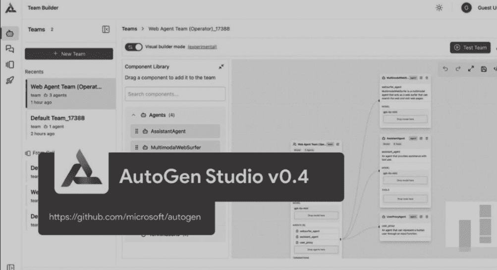

图1-18 AutoGen Studio的工作界面

# 第2章 Manus办公提效实战

本章通过Manus基础使用案例帮助读者掌握自主智能体的使用方法和适用场景，首先介绍Manus的注册方法、基础功能及关键功能（如提示词、虚拟机、运行日志）的实操案例；然后通过办公提效领域的3个实际应用展示Manus在办公场景中的具体使用方法。

## 2.1 Manus注册与使用技巧

如果使用过ChatGPT类的大模型，那么学习Manus将会非常轻松，因为它们的交互方式是类似的，都可以通过简单的自然语言来操作。图2-1为Manus的主界面。

那Manus和ChatGPT有什么不同呢？很多人都说，Manus就像一个全能的实习生。它的基本原理是模仿人类的工作方式——理解需求、查找资料、编写程序、处理数据，还具备反思能力。你看，这不就是一个全能实习生吗？

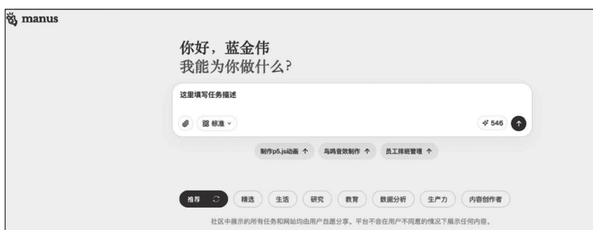

图2-1 Manus的主界面

### 2.1.1 注册Manus账户

Manus可以直接在浏览器中使用，只需要打开网址https://manus.im/。

如果还没有账户，需要先注册账户。目前Manus还在邀请公测阶段，注册稍显麻烦，具体步骤如下。

- 1）在注册页面填写个人信息和邮箱，如图2-2所示。该邮箱用于接收Manus的验证码，并作为后续的登录账户。

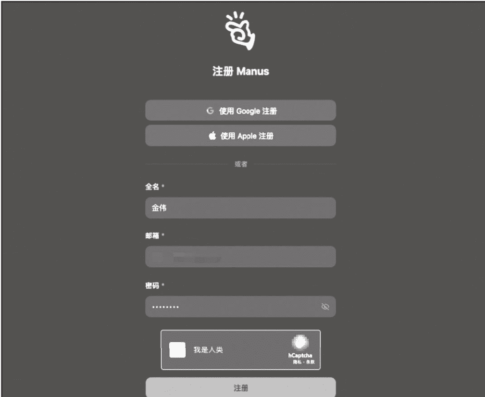

图2-2 填写个人信息和邮箱

- 2）单击图2-2中的注册按钮后，Manus会往所填写的邮箱发送一个验证码。输入验证码就可以完成注册，如图2-3所示。

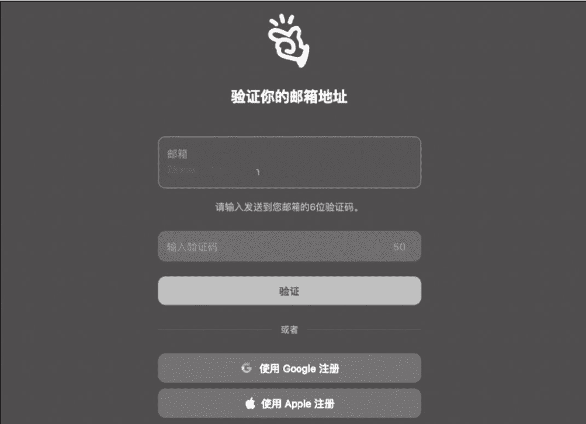

图2-3 输入验证码

- 3）验证完成会进入图2-4所示的账户激活页面，由于Manus目前采用邀请制，在没有邀请码的情况下，你需要单击“加入等候名单”提交申请，并等候Manus的邀请。

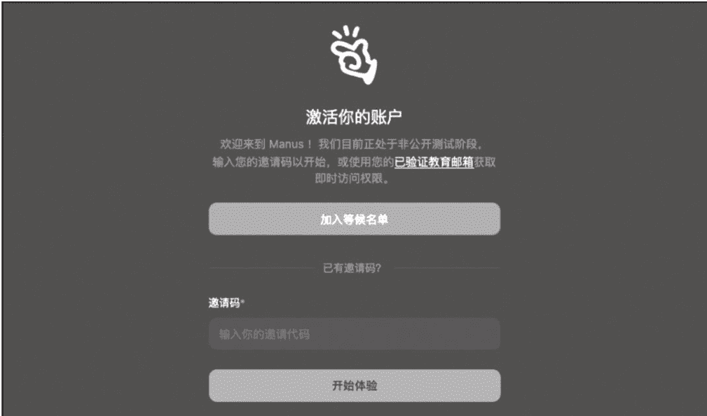

图2-4 账户激活页面

- 4）现在来到注册Manus最关键的一步：填写邀请申请。这里填写的信息将直接影响获取邀请权限的优先级，需要提供注册邮箱以及详细的使用计划说明。若申请者的社交媒体账户有一定影响力，将有助于加快申请进度。Manus邀请申请界面如图2-5所示。

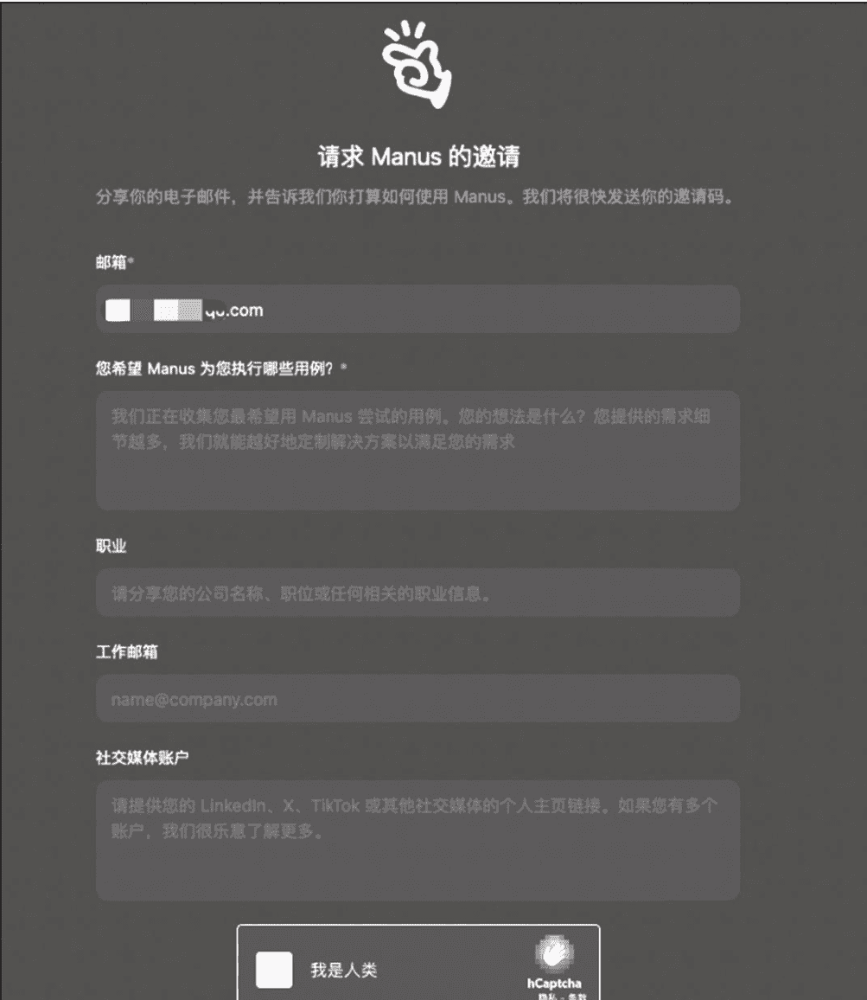

图2-5 Manus邀请申请界面

- 5）由于申请人数较多，需要耐心等待Manus的审核。成功收到注册邀请后，登录Manus主界面，在左侧菜单中单击“新建任务”，就可以开启Manus使用之旅了。特别需要注意的是，由于每个Manus任务都会消耗大量计算资源，因此Manus采用积分模式，每个任务消耗的积分不一样。图2-6是笔者的Manus主界面，左侧是历史任务列表和“新建任务”按钮，右侧是“新建任务”输入框，其右下角会显示账户的剩余积分。

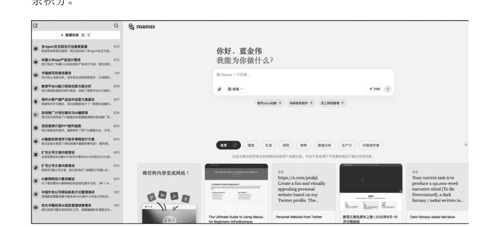

图2-6 笔者的Manus主界面

登录Manus之后，就可以开启我们的第一个Manus任务了。

### 2.1.2 Manus使用技巧

和使用ChatGPT一样，使用Manus的方法也是为任务编写一段合适的提示词。剩下的就交给Manus，它会全程自主地完成任务。

#### 1. 何时使用Manus

Manus和ChatGPT最大的区别就是任务颗粒度不一样。使用Manus的基本原则是：ChatGPT完成不了的任务可以尝试用Manus来完成。

例如，现在需要撰写一份完整的调研报告。

如果使用ChatGPT辅助完成，需要把报告任务拆解为数据抓取、目录设定、章节内容编写等一系列操作；利用ChatGPT完成各个细节后，再把内容组合起来。

而使用Manus来完成这个任务时，整个过程，包括任务的拆解，都由Manus自动完成。用户只需编写一段提示词，然后等着报告生成即可。

也就是说，ChatGPT是协助人完成任务的部分环节，而Manus能够完全自主地完成整个任务。

#### 2. Manus提示词

现在用Manus来做第一个任务。开启一个任务，其实就是编写提示词。Manus的提示词一般分为两类：一类是命令式，另一类是许愿式。

下面以撰写调研报告任务为例进行介绍。如果你已经对该任务有清晰的规划，可以采用命令式提示词，如下所示：

撰写一份结构化的调研报告，并严格遵循以下步骤执行。

- 1. 确定主题
  - 核心议题：新能源汽车电池技术的发展现状。
  - 关键问题：列出本次调研需解答的 3～5 个具体问题，如技术瓶颈、市场趋势等。

- 2. 数据收集
  - 来源范围：优先使用近 3 年的学术论文（推荐使用 Google Scholar 或 CNKI）、行业白皮书（如 BloombergNEF）、权威媒体报道（Reuters 等）。
  - 数据要求：至少包含 5 项统计数据或案例，标注来源并确保可验证。

- 3. 分析框架
  - 采用 SWOT 分析法分点论述，包含以下内容：
    - 优势（S）
    - 劣势（W）
    - 机会（O）
    - 威胁（T）

- 4. 报告结构
  - 标题页：包含调研标题、日期、作者。
  - 摘要：300 字内（概括核心结论）。
  - 正文（分章节）：
    - 引言（包含背景与目标）
    - 方法论（包含数据来源与分析工具）
    - 研究发现（按关键问题分段）
    - 结论与建议
  - 参考文献（采用 APA 格式）。

- 5. 交付要求
  - 字数：5000 字以内。
  - 格式：PDF 文件，1.5 倍行距，图表需编号并附标题。

没有编写过调研报告也没关系，可以采用许愿式提示词。Manus可以调用大模型的规划能力来帮你完成任务，并且输出完整的任务规划过程，帮助用户了解这类任务的标准规划方法。许愿式提示词示例如下所示：

> 帮我写一个调研报告，主题是“新能源汽车电池技术发展现状”。

调研报告属于日常办公中的信息处理类任务，这正是Manus的典型应用场景。Manus擅长处理日常文字信息类任务，但目前暂不支持图片生成、视频生成等多媒体类任务。

#### 3. 实操：特斯拉股票数据分析

现在来看一个实操任务：特斯拉股票数据分析。通过这个过程，你也可以熟悉Manus的几个核心功能。

小技巧：在使用Manus这类自主智能体之前，我们可以代入人类处理任务的思路，然后观察智能体每一步的处理细节。通过这种对比，你会理解自主智能体的具体行为模式。就像指导一个实习生，对他的行为模式和能力边界有更清晰的了解后，未来的配合过程才能更顺利。

##### （1）编写Manus任务提示词

现在，让我们思考一下针对这个任务，应该如何写提示词。如果你不清楚股票数据分析的方法，甚至从哪里获得特斯拉公司的股票基础数据都不清楚，可能会写出如下许愿式提示词：

> 我想对特斯拉股票进行全面分析，并输出一个分析报告。

注意：即使是这样的许愿式提示词，Manus也可以完成这个任务。因为Manus接到一个任务之后，会利用大模型先进行任务规划。即使你没有指明“全面分析”的具体方法，Manus也可以利用大模型对股票分析方法做出详细的规划。

当然，如果你已经掌握股票分析方法或者有自己的一套完整的方法论，则可以针对任务写一个指令式的提示词，如下所示：

我想对特斯拉股票进行全面分析，包括：

```
//数据采集
摘要：包括公司概况、关键指标、业绩数据和投资建议；
财务数据：包括收入趋势、利润率、资产负债表和现金流分析；
// 分析过程设定
市场情绪：包括分析师评级、情绪指标和新闻影响；
技术分析：包括价格趋势、技术指标和支撑 / 阻力位；
比较资产：对比主要竞争对手的市场份额和财务指标；
价值投资者：评估内在价值、增长潜力和风险因素；
投资论点：针对不同投资者类型的 SWOT 分析和建议。
```

一本书用“//”表示对内容的说明，但不是内容的一部分。这也是代码注释的常用形式。

对比这两个提示词，我们发现指令式的提示词对任务的具体细节进行了更多描述，这有助于Manus对任务做出更好的规划。在这种模式下，Manus往往扮演一个执行者的角色。只不过，如果你没有相关的金融数据分析经验，很难写出包含如此多专业术语的提示词。

指挥一个自主智能体绝不是简单地下达一个指令，而是应该将任务说清楚再交给智能体。如果我们对指令式的提示词进行进一步分析，会发现它对任务的理解逻辑非常严密。

既然这是一个数据分析任务，那么最重要的就是数据。这个提示词的前两条就针对数据采集（即摘要和财务数据）提出了具体的要求。

在数据采集之后，该提示词又对具体的分析过程进行了详细设定，包括分析的具体指标和方法，即市场情绪、技术分析、比较资产、价值投资者、投资论点。

编写完提示词后，在Manus主界面输入该提示词，如图2-7所示。

##### （2）Manus的任务规划

现在，站在任务执行者的角度来看，该提示词的任务要求非常清晰，并且提供了足够的细节。从规划的角度来看，完成这个任务可以分为两个主要步骤：一是数据采集，二是数据分析。那么，Manus是如何进行任务的具体规划的呢？

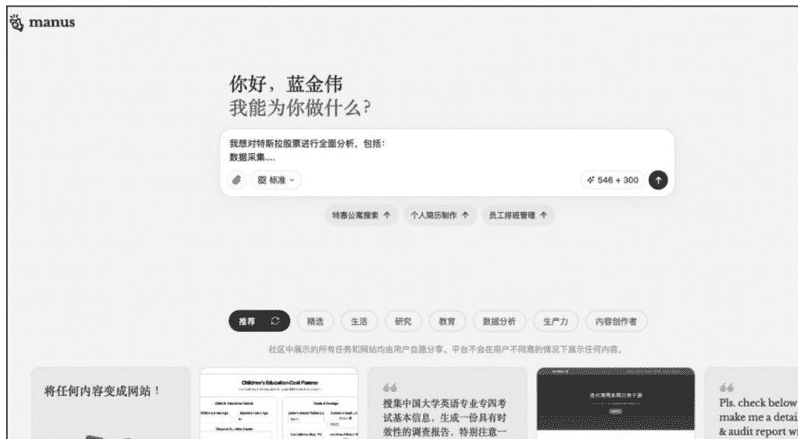

图2-7 输入提示词

Manus利用大模型进行任务规划。在本例中，针对任务提示词的要求，结合用户需求，Manus会将整个任务分为14个主要步骤。这些步骤包含提示词中指定的5个分析步骤，后续步骤则是Manus自行规划的数据报告生成、可视化处理以及报告网站的搭建等环节，如图2-8所示。

任务进度

- 创建全面的特斯拉股票分析任务列表
- 收集特斯拉公司概况和关键信息
- 收集并分析特斯拉的财务数据
- 评估特斯拉的市场情绪
- 对特斯拉股票进行技术分析
- 将特斯拉与主要行业竞争对手进行比较
- 计算特斯拉股票的内在价值
- 制定全面的投资理论
- 编写详细的特斯拉股票分析报告
- 为用户提供全面的股票分析
- 创建交互式特斯拉股票分析仪表板
- 向用户提供仪表板
- 将仪表板部署到公共网络托管平台
- 提供特斯拉股票分析仪表板的公共 URL

图2-8 股票分析任务的规划步骤

Manus可以利用大模型进行任务规划，但任务的执行则需要依靠Manus的虚拟计算机。为了适应Manus虚拟计算机的执行过程，图2-8里的14个步骤会被进一步细化。Manus虚拟计算机首先会创建一个名为todo.md的文件，用于存储每个步骤的细化子任务，如图2-9所示。

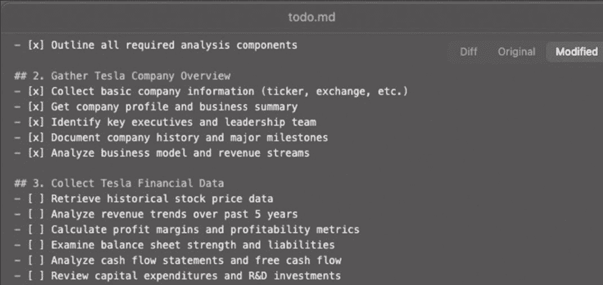

图2-9 todo.md文件

下面以任务“收集特斯拉公司概况”为例，介绍Manus执行任务的具体过程。

在Manus虚拟计算机里，“收集特斯拉公司概况”这个步骤被细化为5个子任务。这样做的好处是让Manus虚拟计算机每次只需要专注处理一个细化后的子任务，完成之后在todo.md文件里用[x]标记对应的子任务，表示已完成。

和人类执行任务类似，这样的细化和执行过程可以更好地保证任务完成的质量，也能随时监控任务执行的进度。

即使我们没有进行过金融数据分析工作，也能看出这个任务的规划是相当合理的。Manus会将虚拟计算机的完整执行过程以及使用的具体工具都记录并显示在界面上，方便我们观察任务的执行过程。

对于任务“收集特斯拉公司概况”，具体的Manus执行日志如图2-10所示。

执行日志里可能有很多操作细节是程序代码。不必担心，因为Manus的任务执行是全自动的，即使中间出现需要修改程序的情况，也是Manus自动完成的。作为任务发起者，用户只需要了解每个子任务的执行状态和结果即可。

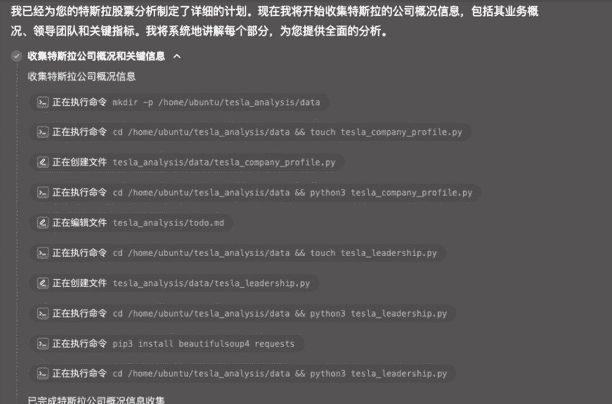

图2-10 Manus的执行日志

##### （3）Manus的任务执行

在Manus虚拟计算机的执行过程中，很多操作都是在编写程序和执行程序。虽然我们没必要看懂具体程序代码，但是理解这个过程至关重要。

为什么Manus虚拟计算机可以完成大部分办公文字信息类任务？一个重要的原因就是Manus虚拟计算机的编程能力达到了工程师的水平。我们可以把它想象成一个用自然语言指挥的工程师。由于编写程序可以实现所有的文字信息处理逻辑，因此Manus才能在没有任何预定义程序的情况下，根据用户任务需求随时写程序来完成任务。

对于任务“收集特斯拉公司概况”，实际上todo.md文件里的5个子任务都是通过编写程序再执行程序来完成的。我们打开第一个子任务“收集公司基本信息”的执行日志，可以看到其代码截图如图2-11所示。

这里不必分析具体代码逻辑，只需要知道它的目标是“收集公司基本信息”即可。如果子任务的结果不准确，我们可以通过自然语言来指挥Manus去修改代码。

除了数据采集和计算分析，这个任务最后的数据报告生成也是通过编写并执行程序来完成的。最终的分析报告由类似图2-12的数据分析图组成。这个分析图非常专业，达到了数据分析师的水平。

```python
import sys
sys.path.append('/opt/.manus/.sandbox-runtime')
from data_api import ApiClient
import json

# Initialize API client
client = ApiClient()

# Get Tesla company profile
tesla_profile = client.call_api('YahooFinance/get_stock_profile', query={'symbol': 'TSLA'})

# Save the raw data to a JSON file
with open('tesla_profile_raw.json', 'w') as f:
    json.dump(tesla_profile, f, indent=4)

# Extract and print key information
if tesla_profile and 'quoteSummary' in tesla_profile and 'result' in tesla_profile:
    quote_summary = tesla_profile['quoteSummary']['result'][0]
    profile = quote_summary.get('assetProfile', {})
    print(f"Company: {profile.get('longBusinessSummary', 'N/A')}")
    print(f"Sector: {profile.get('sector', 'N/A')}")
    print(f"Industry: {profile.get('industry', 'N/A')}")
```

▲图2-11 “收集公司基本信息”的执行日志

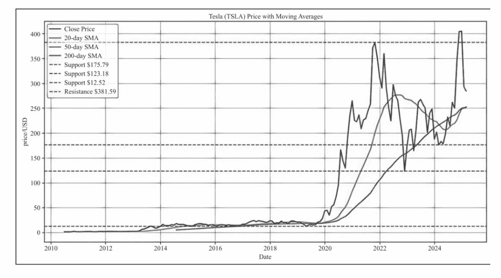

图2-12 数据分析图

了解Manus案例的实现过程后，对Manus的核心要点进行如下总结。

- 1）要指挥Manus完成任务，人的核心作用是编写提示词，且需要对任务的细节非常清楚。
- 2）Manus的任务规划依赖于大模型的能力，这可以保证Manus达到人类的规划水平。
- 3）Manus的任务执行是通过编写程序来完成的，这使得Manus能承担的任务范围非常广泛。
- 4）Manus的任务规划和编程能力针对特定领域进行了专门的微调，有效提升了任务执行的可靠性。

## 2.2 Manus应用案例

用Manus完成任务包括3个核心步骤：编写提示词、进行任务规划和执行任务，其中后两步是Manus自动完成的。这意味着，作为使用者，主要工作就是编写任务提示词和观察任务执行细节，并针对任务结果给出提示词反馈。这非常类似于在实际工作中和一个实习生配合协作。

下面将使用Manus完成3个不同类型的任务，以帮助读者更好地理解自主智能体的工作边界和运作原理，学会如何把合适的工作任务交给Manus来处理。

### 2.2.1 电商销售额提升方案

本案例展示了一位电商销售人员如何借助Manus制定数据驱动的销售额提升方案。和2.1.2节的案例相同，这也是一个数据分析任务，要求进行数据分析并对结果进行可视化展示。不过，此次任务提供的是销售数据，并要求生成数据策略，以实现销售额提升10%的目标。

#### 1. 编写提示词

在特斯拉股票分析案例中，我们利用Manus从互联网采集公开数据。而在本案例中，要分析的数据是网店的私有数据，具体呈现为一个Excel数据表格，如图2-13所示。

注意：Manus支持用户上传自定义数据文件。用户只需在Manus任务创建页面的提示词输入框左下方单击曲别针样式的上传按钮，即可完成文件上传操作，如图2-14所示。

## 2.2.1 电商销售数据分析

#### 1. 任务规划执行

实际上，Manus的规划能力足以覆盖一名数据分析师的工作范畴。针对这个任务，Manus规划了如下任务步骤。

- 1）运用编写代码的方式，对上传的销售数据进行多维度数据统计。
- 2）根据多维度统计结果，利用大模型对数据中的异常点展开分析。
- 3）根据异常点分析结果，结合销售数据给出策略建议。

接下来看一下这些任务步骤的详细执行过程和结果。通过对这些执行过程的分析，我们可以清晰地看到Manus如何将复杂的数据分析任务拆解为可执行的步骤，并融合编程能力与大模型优势，最终实现从数据统计到商业决策建议的完整闭环。

上传客户历史数据后，需要编写对应的提示词。和特斯拉股票分析案例中的命令式提示词不同，现在我们需要站在电商销售的角度编写提示词：

> 这是亚马逊商店上个月的销售数据。您能否用可视化的方式对数据进行全面分析，并推荐一些具体的数据驱动策略，助力下个月的销售额提升10%？

提示词中不需要指定具体的分析方式，只需要给出10%的销售目标，就能让智能体给出数据策略方案。这显然需要具备中级数据分析能力才能完成任务，Manus能胜任吗？接下来，就交给Manus来一展身手吧。

##### (1) 多维度数据分析

在初始阶段，Manus通过编写程序实现了从多个维度进行数据分析，如图2-15所示。

从图2-15的统计结果看来，Manus分别对数据按天和周进行了统计，并且针对不同数据字段进行了相关性分析。这些分析方法都是数据分析常用的。

▲图2-13 网店的部分销售数据

| Date | Orders | Unique Customers | Units Sold | Gross Sales | Shipping Revenue | Coupon Discount | Amazon Fees | Product Cost | Net Profit |
|---|---|---|---|---|---|---|---|---|---|
| 2025-01-01 | 32 | 32 | 90 | 4889.77 | 207.99 | 21.85 | 971.12 | 2077.17 | 1819.62 |
| 2025-01-02 | 36 | 36 | 96 | 4972.16 | 231.16 | 26.48 | 990.58 | 2519.63 | 1435.47 |
| 2025-01-03 | 73 | 73 | 205 | 9825.29 | 404.94 | 102.72 | 2000.86 | 4654.32 | 3067.4 |
| 2025-01-04 | 41 | 41 | 98 | 5130.56 | 324.75 | 63.76 | 1030.67 | 2400.23 | 1635.91 |
| 2025-01-05 | 44 | 44 | 106 | 5568.8 | 290.83 | 38.01 | 1110.14 | 2507.41 | 1913.24 |
| 2025-01-06 | 59 | 59 | 176 | 9520 | 398.19 | 76.52 | 1888.17 | 4210.95 | 3344.35 |
| 2025-01-07 | 30 | 30 | 69 | 3671.35 | 116.31 | 67.24 | 758.09 | 1652.76 | 1193.26 |
| 2025-01-08 | 33 | 33 | 76 | 3994.76 | 203.96 | 42.57 | 809.22 | 1754.02 | 1388.94 |
| 2025-01-09 | 34 | 34 | 72 | 3951.52 | 170.48 | 54.09 | 802.75 | 1815.56 | 1279.12 |
| 2025-01-10 | 23 | 23 | 62 | 3668.6 | 163.86 | 27.04 | 697.75 | 1558.88 | 1384.95 |
| 2025-01-11 | 40 | 39 | 99 | 5613.62 | 227.37 | 60.28 | 1096.68 | 2162.3 | 2294.33 |
| 2025-01-12 | 56 | 56 | 143 | 7360.95 | 337.38 | 86.23 | 1471.73 | 3128.14 | 2674.85 |
| 2025-01-13 | 28 | 28 | 87 | 4824.28 | 178.06 | 38.84 | 932.81 | 2182.23 | 1670.4 |
| 2025-01-14 | 79 | 79 | 224 | 11752.01 | 498.92 | 157.39 | 2296.52 | 5288.05 | 4010.05 |
| 2025-01-15 | 31 | 31 | 83 | 4417.38 | 162.41 | 22.98 | 879.71 | 1812.87 | 1701.81 |
| 2025-01-16 | 22 | 22 | 63 | 3059.84 | 143.63 | 35.2 | 628.26 | 1501.43 | 894.94 |
| 2025-01-17 | 61 | 61 | 153 | 8402.49 | 266.58 | 102.95 | 1653.07 | 3557.96 | 3088.52 |
| 2025-01-18 | 45 | 45 | 111 | 5675.84 | 272.96 | 115.73 | 1154 | 2722.39 | 1683.73 |
| 2025-01-19 | 50 | 50 | 130 | 7414.15 | 291.18 | 58.19 | 1432.57 | 3145.7 | 2777.71 |
| 2025-01-20 | 25 | 25 | 57 | 2764.26 | 127.84 | 12.99 | 553.08 | 1327.38 | 870.81 |
| 2025-01-21 | 71 | 70 | 174 | 9422.4 | 448.88 | 94.24 | 1886.04 | 4215.84 | 3226.28 |
| 2025-01-22 | 27 | 27 | 85 | 4452.05 | 123.86 | 43.29 | 876.61 | 2144.1 | 1388.06 |
| 2025-01-23 | 23 | 23 | 52 | 2743.56 | 169.7 | 16.61 | 571.97 | 1170.05 | 984.94 |
| 2025-01-24 | 27 | 27 | 57 | 2916.34 | 128.36 | 80.67 | 588.89 | 1460.32 | 786.47 |
| 2025-01-25 | 41 | 41 | 103 | 5169.94 | 283.01 | 57.09 | 1031.37 | 2473.02 | 1608.45 |
| 2025-01-26 | 34 | 34 | 79 | 3872.66 | 214.95 | 17.74 | 791.34 | 1878.31 | 1185.27 |
| 2025-01-27 | 27 | 27 | 67 | 3819.79 | 163.96 | 11.69 | 736.01 | 1466.49 | 1605.6 |
| 2025-01-28 | 29 | 29 | 73 | 3763.56 | 219.63 | 39.17 | 754.63 | 1756.67 | 1213.09 |
| 2025-01-29 | 28 | 28 | 73 | 3815.55 | 166.24 | 33.68 | 768.02 | 1627.24 | 1386.61 |
| 2025-01-30 | 28 | 28 | 83 | 4088.25 | 170.95 | 27.9 | 820.94 | 1915.65 | 1323.77 |
| 2025-01-31 | 36 | 36 | 91 | 5263.66 | 153.04 | 78.98 | 1037.9 | 2082.35 | 2064.44 |

▲图2-15 多维度数据分析结果

# Amazon Fashion Sales Analysis - January 2025

## Weekly Sales Summary

| Week | Orders | Gross Sales | Net Profit | Units Sold | Average_Order_Value | Profit_Margin |
|---|---|---|---|---|---|---|
| 1 | 226 | 30386.58 | 9871.64 | 595 | 135.442626 | 32.708879 |
| 2 | 275 | 37780.80 | 13559.80 | 697 | 136.042737 | 35.675951 |
| 3 | 316 | 45545.99 | 15827.16 | 851 | 144.970516 | 34.343915 |
| 4 | 248 | 31341.21 | 10050.28 | 607 | 125.066667 | 31.643778 |
| 5 | 148 | 20750.81 | 7593.51 | 387 | 139.948597 | 36.441550 |

## Day of Week Analysis

| Day_of_Week | Orders | Gross Sales | Net Profit | Units Sold | Average_Order_Value | Profit_Margin | Conversion_Rate |
|---|---|---|---|---|---|---|---|
| Monday | 34.75 | 5232.0825 | 1872.7900 | 96.75 | 146.423938 | 35.822693 | 100.000000 |
| Tuesday | 52.25 | 7152.3300 | 2410.6700 | 135.00 | 133.406436 | 33.274309 | 100.357143 |
| Wednesday | 30.20 | 4313.9020 | 1537.0080 | 81.40 | 143.503032 | 35.605238 | 100.000000 |
| Thursday | 28.60 | 3763.0660 | 1183.6480 | 73.20 | 131.742903 | 31.753670 | 100.000000 |
| Friday | 44.00 | 6015.2760 | 2078.3560 | 113.60 | 137.213694 | 34.383283 | 100.000000 |
| Saturday | 41.75 | 5397.4900 | 1805.6050 | 102.75 | 129.425496 | 33.383204 | 100.641026 |
| Sunday | 46.00 | 6054.1400 | 2137.7675 | 114.50 | 130.048484 | 34.691468 | 100.000000 |

## Correlation Analysis

| | Orders | Units Sold | Gross Sales | Net Profit | Average_Order_Value | Units_per_Order | Profit_Margin | Shipping_per_Order | Discount_per_Order |
|---|---|---|---|---|---|---|---|---|---|
| Orders | 1.00 | 0.98 | 0.97 | 0.93 | 0.09 | 0.13 | 0.04 | -0.01 | 0.21 |
| Units Sold | 0.98 | 1.00 | 0.99 | 0.95 | 0.26 | 0.33 | 0.05 | 0.02 | 0.17 |
| Gross Sales | 0.97 | 0.99 | 1.00 | 0.98 | 0.00 | 0.00 | 0.00 | 0.00 | 0.00 |

##### (2) 分析异常点

在第一步统计结果的基础上，Manus并没有继续编程完成后续步骤，而是直接利用大模型对数据进行了分析，并给出了策略建议报告。数据分析执行日志如图2-16所示。

要用代码实现一个中级数据分析师的工作相对复杂，可能会降低结果的可靠性。Manus直接交给大模型来分析是更明智的选择。由于这一步是通过大模型完成的，我们看不到细节，只能查看任务结果。

大模型给出了这份数据中关于若干异常点的关键发现，如图2-17所示。

Manus分析发现，周二的销售额普遍较高，周末订单金额相对较低，同时还揭示了折扣对销售利润的影响等。

这几个关键发现是本次任务中最大的收获。实际上，作为需求提出者，得到这些关键发现就已经足够了。

##### (3) 策略建议

如果要制定销售增长策略，在实践中可能需要数据分析和销售人员共同完成。不过，在本次任务实践中，Manus还是根据10%的增长目标给出了一些具体的策略建议。该过程还是利用大模型来完成的，这一点在第二步的执行日志中已有所体现。我们可以看一看这些建议，作为后续制定销售策略的参考，如图2-18所示。

从本案例的Manus的数据处理过程和结果，我们可以观察到一些基本规律，即一个自主决策智能体如何通过数据抓取和分析，形成优质的数据报告。

## 2.2.2 PPT与Excel的自动生成

PPT和Excel的自动生成是最基础的办公文档操作。其核心在于数据输入的质量，完整准确的数据输入是获得理想输出结果的前提。

下面来看一个实际案例，该案例展示了如何使用Manus将散乱的项目截图和文字信息整理成一份专业的PPT演示文件。

#### 1. 编写提示词

本案例中，原始数据只有一些散乱的项目截图，而且图片资料是以压缩包的形式直接上传的。而我希望的结果则是让Manus根据这些图片来生成完整的PPT。我给出的提示词如下：

> 根据附件里两个RAG团队的项目案例截图，撰写两份项目案例介绍PPT，用于将来项目接洽展示。每个附件对应一个团队，需为每个团队分别制作一个PPT。

在这个案例中，使用Manus类似于直接将资料包发送给实习生，并简要说明目标，无须过多的细节任务描述。为什么我对Manus能完成这个任务有足够的信心？

核心原因在于：根据之前的案例经验，我对Manus执行这个过程已经有了一个准确评估。

- Manus的虚拟计算机一定可以处理压缩包，这是基本的计算机操作。
- Manus可以提取每张图片中的文字信息，因为大模型本身就具备这样的能力。
- Manus能够利用编程能力来操作PPT文件，之前的经验已经验证了它的编程能力。

#### 2. 任务规划执行

Manus进行的第一步操作是解压文件包，并读取其中的图片信息，如图2-19所示。

在图2-19的执行日志里，有正在查看某图片的执行日志。本案例所使用的图片是一些项目案例的随机截图（见图2-20），并非经过严格思考后的截图。

Manus需要提取这些图片中的文字信息。在提取完信息后，Manus进行的第二步是将这些信息直接整理为PPT文稿。PPT的制作、设计和编排逻辑通过编写程序来完成。

具体而言，面对散乱的项目截图，Manus先将信息识别为文字，并把文字和图片对应起来；再利用大模型对信息进行整理，并对PPT进行配色、标题编写和内容填充；最后，通过编写程序完成PPT的制作。

在没有过多明确要求的情况下，Manus生成的PPT以文字为主，如图2-21所示。

注意：尽管没有提供任何文字资料，但在Manus最终生成的PPT中，每个幻灯片的主题仍然相对精准，文字信息也结合图片信息进行了扩展。

然而，这一效果与原始期望并不一致，期望生成的PPT以项目案例截图为主，并辅以文字说明。因此，需要对任务进行二次优化。

#### 3. 二次优化

在Manus中，第一次执行结果和预期有差异没关系。因为即使在任务结果出来后，仍然可以反复要求Manus进行修改，而无须重新开启一个新任务。本案例中，在检查完初步结果后，可再次对Manus下达修改指令，修改提示词如下：

使用上传的截图作为PPT的主要内容，搭配文字进行辅助说明，重新制作两个PPT。

第一次任务中，Manus已经读取了图片和文字信息。发起修改指令后，Manus会在同一台虚拟计算机上复用原有的结果。此次改动，Manus只需要修改合成PPT的程序即可。

可以看到，Manus的任务优化逻辑与实习生的工作方式类似。在收到重做要求时，并不是完全重新开始，而是针对性地进行调整。

现在Manus已按照新的要求开始制作PPT。当然，如果初始提示词就明确了这个要求，就可以节省这一步的算力消耗。

修改后的结果以图片为主，基本达到了预期目的，如图2-22所示。

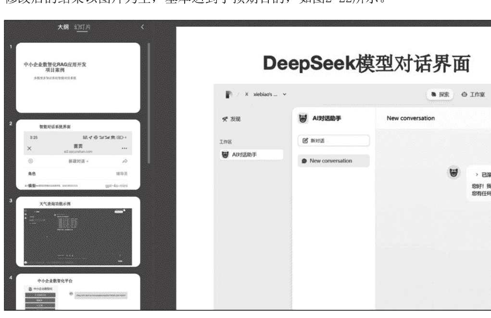

即使对于这样要求简单的PPT，实际上在样式、格式、文字描述以及图片的大小和位置等方面仍然需要人工再次修改。需要注意的是，在这类任务中，我们不应将Manus视为PPT制作高手，而应该主要利用其文档整理能力，目标是完成60%～70%的PPT工作，之后再由人工进行优化。

Manus提供了结果下载地址。在Manus执行界面的最后，我们只需单击文件，即可获得PPT文件，如图2-23所示。

Excel的生成与PPT类似，在此不再赘述。总的来说，Manus在处理文档、PPT和Excel等工作时，100%完成任务并不可能。它更像是一个合格的实习生，负责信息整理、基础编程等工作，并能生成初步草稿，之后再交给人工进行进一步处理。

## 2. 中小企业数智化RAG应用开发项目案例

- 以提供的RAG开发项目截图为主要内容
- 包含智能对话系统界面、天气查询功能、中小企业数智化平台、多模型支持与切换功能、社保政策咨询功能等截图
- 每张截图配有简短的文字说明，突出系统功能和特点
- PPT最后有一页项目亮点总结，简要概括项目价值

这两份PPT均以提供的实际项目截图为核心，文字说明简洁明了，能够直观展示团队的RAG技术实力和项目成果，适合在项目接单过程中向潜在客户进行展示。

您可以根据实际需要对PPT内容进行进一步调整。


图2-23 PPT文件下载

### 2.2.3 智能合同审查

下面来看一个更专业的办公场景：用Manus完成一份专业合同的审核工作。这似乎是一个非常专业的任务。那么，Manus是如何开展这项工作，表现又如何呢？

#### 1. 编写提示词

该任务的提示词非常简单，类似于给法务提交合同审核需求一样：

> 请仔细检查本合同，找出所有错误，并提供修订记录和更正后的版本。

本案例提供了一个原始合同文档，该文档为PDF格式，部分内容如图2-24所示。

基于任务需求，可以预估出Manus处理该任务的核心步骤如下。

1）读取PDF文档中的所有信息，提取文本作为原始信息。

2）运用法务知识找出原始合同内的错误并进行修正，这一步利用大模型完成。

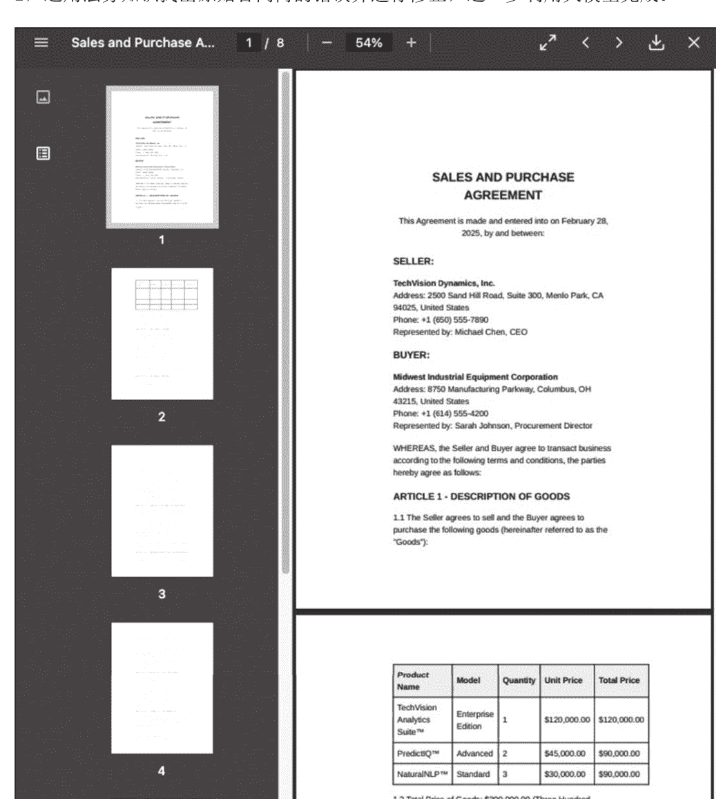

图2-24 原始合同文档的部分内容

#### 2. 任务规划执行

（1）从PDF中提取文本信息

实际工作中，法务人员在处理PDF文档时，可能缺乏将其转换为可编辑格式的工具。Manus完成这一工作的方式为：模拟人类阅读行为，先完整加载PDF文档，再通过渐进式页面滚动实现内容预览，最后调用大模型的多模态理解能力完成文本提取，其操作日志如图2-25所示。

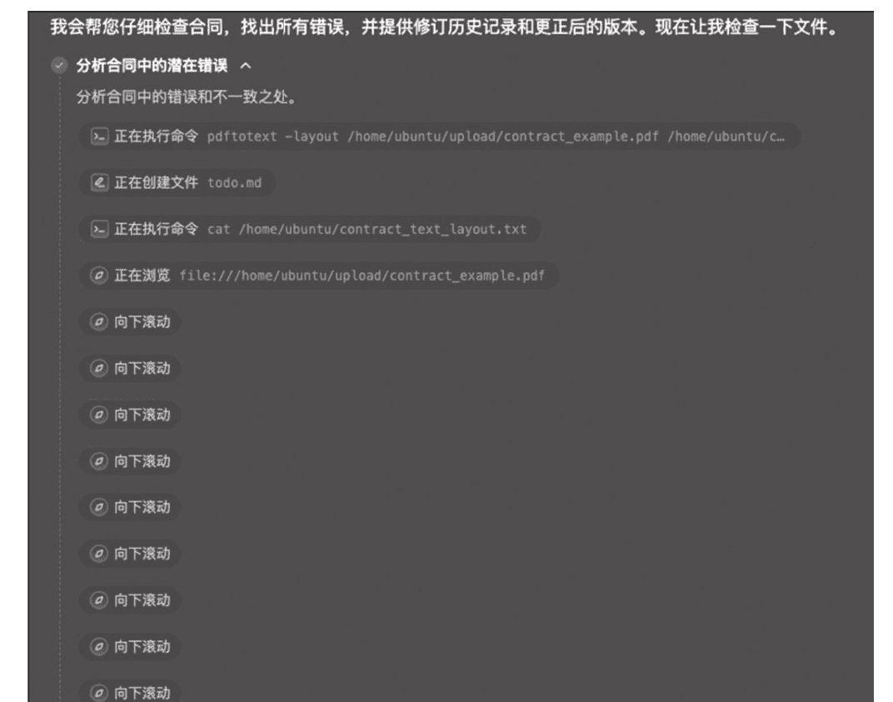

图2-25 PDF文本信息提取操作日志

（2）合同错误分析

合同错误分析完全利用大模型完成，过程不再展开，合同错误分析结果如图2-26所示。

Manus利用大模型找到了合同内的一些错误，这里只截取了数学部分的错误。实际上，Manus还发现了许多与法务风险相关的错误。我们知道，法务工作要求极高的逻辑严谨性。仅从上述数学错误的分析来看，Manus展现出的能力已相当于一名法务人员。

Markdown是一种公开的文本格式，用于互联网信息的分享和传输。

基于错误分析结果，Manus最终生成了修订版合同。Manus默认的文本格式是Markdown。不过，Manus的界面上提供了导出为PDF的功能，这样既方便用户在Markdown上进行修改，也便于用户直接导出为PDF格式。修正后的合同内容如图2-27所示。更新合同的操作也是大模型自动完成的，我们只需要评估结果即可。

可见，最初对Manus处理专业问题的担忧是多余的。通过合同审查案例可以看出，只要数据充足，Manus完全具备处理专业领域任务的能力。

#### 合同错误分析

在仔细审查了 TechVision Dynamics, Inc. 与 Midwest Industrial Equipment Corporation 之间的买卖协议后，我发现了一些需要更正的错误和不一致之处。以下是这些问题的完整列表：

##### 数学错误

1. 商品表计算误差：
   - 单个产品的价格与标明的总价不符
   - TechVision Analytics Suite™: 120,000.00 美元
   - PredictIQ™ (2 个，价格为 45,000.00 美元) : 90,000.00 美元
   - NaturalNLP™ (3 个单位，每单位 30,000.00 美元) : 90,000.00 美元
   - 这些加起来是 300,000.00 美元，与所述的总额相符，所以这是正确的
2. 付款计算不一致：
   - 第 3.1 节列出了付款百分比和金额：
     - 预付款：30% = $90,000.00 ✓
     - 交货付款：40% = $120,000.00 ✓
     - 最终付款：30% = $90,000.00 ✓
   - 百分比和金额在数学上是正确的

#### 销售和购买协议

本协议（“本协议”）由以下双方于 2025 年 2 月 28 日签订：

卖方：TechVision Dynamics, Inc. 地址：2500 Sand Hill Road, Suite 300, Menlo Park, CA 94025, United States 电话：+1 (650) 555-7890 代表：Michael Chen, 首席执行官

买方：中西部工业设备公司 地址：8750 Manufacturing Parkway, Columbus, OH 43215, United States 电话：+1 (614) 555-4200 代表：采购总监 Sarah Johnson

鉴于卖方从事开发和销售软件解决方案的业务；并且

鉴于买方希望从卖方处购买某些软件产品；并且

鉴于卖方愿意按照此处规定的条款和条件向买方出售此类产品；

因此，考虑到此处规定的相互承诺、契约和协议，双方特此达成如下协议：

##### 第 0 条 定义

就本协议而言，下列术语应具有如下含义：

“货物”指本协议第1条及附录1规定的卖方向买方提供的软件产品、许可证及相关材料。

“验收”指买方确认货物符合本协议规定的规格和要求。

“不可抗力”是指超出一方合理控制范围的任何事件或情况，包括但不限于天灾、战争、恐怖主义、内乱、火灾、洪水、地震、罢工、停工和政府行为。

# 第3章 Manus高阶技能

本章将深入探讨Manus的进阶应用技巧，首先分析提示词的优化方法，虽然Manus具备完全自主的任务执行能力，但提示词质量依然会直接影响任务效果；其次重点讲解人机协同策略，通过优化人机交互方式提升任务成功率；最后介绍替代方案AutoGLM沉思版，为读者提供更多自主智能体平台方面的选择。

## 3.1 提示词的优化方法

一个平庸的提示无法产生优秀的结果，自主智能体的结果也同样受到初始提示词的限制。那么，如何优化提示词呢？

乔哈里视窗是一种关于沟通的技巧和理论。

实际上，Manus输出的质量取决于两个因素：一是输入的数据质量，二是任务的规划水平。其中，输入数据的质量是任务成功的基础条件。如果数据不准确或不完整，结果也自然不精准。那么，如何提高任务规划的准确度呢？我们可以参考“乔哈里视窗”理论，把和Manus的交互过程看作一种沟通过程。

- 当一个任务我们不擅长但Manus擅长时，就让Manus主导规划。
- 当一个任务我们擅长但Manus不擅长时，则由人主导规划。
- 当一个任务人类和Manus都没有既往经验时，可以和Manus共同协作，一起探索解决方案。

### 3.1.1 由Manus主导规划

在使用大模型时，输出结果的质量往往取决于输入数据的质量。Manus等自主智能体有一项重要优势：它们可以被视为独立的计算机。执行具体任务时，用户可以像与人类沟通一样与Manus交流。尤其是在已经有初始文档时，要尽量避免过多的语言描述。

#### 1. 技巧分析

初始文档可以是聊天截图、具体的数据表格，也可以是word文档、PDF文件，甚至包括音频和视频。在给Manus下达任务之前，务必准备好充足的文档。不用担心Manus无法理解这些文档，实际上它的文档处理能力比人类更强大。

这些文档相当于输入的准确数据。如果希望将工作限制在一定的数据范围内，这是一种有效的方法，也有助于在人与AI之间实现无缝切换。用户的任务要求应基于这些文档，以便让Manus理解每个文档中数据的意义，这样它才能建立任务目标与数据之间的关系。剩下的工作，就交给它强大的规划能力来完成。

在大多数情况下，将任务交给Manus来完成时，只需要在提示词中注意以下两点。

1）输入：清晰说明数据采集方式，或直接上传原始数据文件。
2）输出：明确界定结果的表现形式和格式标准。

#### 2. 案例：用Manus写公众号

MCP是一个全新的大模型通信协议，为大模型接入工具能力提供了标准。

下面以笔者使用Manus撰写公众号文章为例进行说明。笔者需要撰写5篇关于MCP技术的公众号文章，打算用Manus的智能写作功能来完成这个任务。

当然，这并不意味着直接使用类似下面的提示词就能把任务完成好：

> 帮我写5篇MCP技术文章。

实际场景是，MCP在智能体领域是一个全新的术语。如果用上述提示词，Manus一定会去网络上搜索最新的MCP文章作为参考。由于相关文章还很少，这会导致Manus的输入数据不足。此外，这种指令还可能导致Manus完全写错文章内容，并且生成的文章也不会有创新性的见解。究其根本原因，在于未能明确以下两个关键要素。

1）输入限定条件：MCP是一个全新的概念，需要将其限定到大模型领域。
2）输出限定条件：没有限定输出风格，可能与既有文章的风格存在雷同。

让Manus进行写作之前，笔者已经将这5篇文章的大纲写好了，这些大纲代表了笔者对这项新技术的见解。我们来看其中一篇文章的大纲内容，如图3-1所示。

## MCP 开发入门：到底有什么差别（一）

没有 MCP 有什么问题
如果大模型是脑，MCP 就是手，没有 MCP，你就要自己创造手

第一次使用 MCP 的感受
MCP 就是别的程序员已经创造了手，你配置一下，需要找到支持 MCP 的客户端，在 Windsurf 使用，第一个成功的 MCP 是本地文件操作

什么时候需要开发 MCP
你有一个特有程序需要共享给所有的程序员的时候，写一个 MCP，让 AI 程序快速接入

怎么开发自己的 MCP
基于 Mcp Server 开发就可以


为确保文章内容能够完整呈现专业见解，笔者已将这5篇文章的大纲打包为附件并上传至Manus。这些大纲将作为输入数据，严格限定Manus的创作框架。

在输入设置方面，除了5篇大纲外，笔者还在提示词中加入了相关参考文献链接。以下是完整的提示词：

> 帮我写 5 篇公众号文章。我已经写好了标题、子标题和内容要点，你不要改我的子标题和要点，只需要根据我的思路扩充完整内容。
> // 初稿大纲已经打包
> 我写好的初稿放在附件里。
> // 增加内容参考链接
> 内容可以参考下面的附录链接：
> [ 链接 1 ]
> [ 链接 2 ]
> ......
> 注意：一共要输出 5 篇文章，分别写出来交给我。

可以看到，该提示词对输入和输出都做了细化。在这个任务中，输入和输出分别如下所示。

1）输入：参考文献链接和5篇文章的大纲。
2）输出：不能改变大纲和子标题，基于参考文献进行内容扩展。

本任务利用了Manus的数据采集和写作能力。实际上，这些参考文献是笔者自己阅读过的，而5篇文章大纲的灵感也来源于这些文章。

我们只是利用Manus代替人工完成阅读理解和文字细节处理的工作，其具体执行过程也与预期完全一致，具体操作日志如图3-2所示。

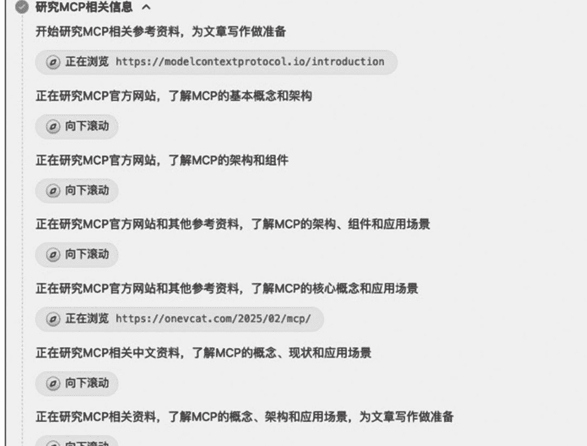

图3-2 Manus的操作日志

从图3-2的Manus执行过程可以看到，Manus首先根据参考链接读取所有的信息，阅读并理解这些内容后将它们作为写作素材。

我们看一下任务最终输出的结果。以第一篇文章《MCP开发入门：到底有什么差别（一）》为例，图3-3是该文章起始部分的内容。

## MCP开发入门：到底有什么差别（一）

### 没有MCP有什么问题

在人工智能快速发展的今天，大语言模型（LLM）如Claude、GPT等已经成为我们日常工作和生活中不可或缺的工具。然而，这些强大的“大脑”在实际应用中仍然面临着一些根本性的局限。如果我们把大模型比作人类的“大脑”，那么它们缺少的就是与外部世界交互的“手”——这正是MCP（Model Context Protocol，模型上下文协议）试图解决的问题。

没有MCP，大语言模型面临以下几个关键问题：

首先，大模型无法访问用户的专属内容。尽管大模型通过海量的训练数据掌握了丰富的通用知识，但它们无法直接访问你电脑中的文件、数据库里的订单信息，或者你的私有笔记和文档。这就像一个博学多才但被隔绝在信息孤岛上的专家，无法获取你最需要他处理的那部分信息。

其次，大模型无法获取实时信息。如果没有联网能力，大模型就无法知道今天的天气预报、最新的股票价格、刚刚发布的新闻，或者任何训练截止日期之后的信息。这使得它们在需要处理时效性内容时显得力不从心。

第三，大模型难以执行精细且需要操作的具体任务。大模型的核心功能是生成文本和提供答案，但当需要调用其他服务的API、执行计算、操作文件系统或进行网络请求时，它们就无能为力了。这就像一个只能思考但不能行动的大脑，无法直接与外部世界交互。

最后，在开发层面，每个应用程序都需要自己实现与大模型的集成方式，因为缺乏标准化的接口和协议。这导致了大量的重复工作，以及各种不兼容的实现方式，阻碍了AI应用生态系统的健康发展。

没有MCP，开发者就需要自己“创造手”——为每个应用单独开发与大模型交互的接口和工具，这不仅耗时耗力，还会导致碎片化的解决方案和不一致的用户体验。正如USB让设备连接方式标准化了一样，我们需要一个标准化的协议来连接大模型与外部世界，这正是MCP的价值所在。

图3-3 第一篇文章起始部分的内容

从图3-3的结果可以看出，在不改变笔者观点的情况下，Manus围绕该核心观点进行了论述。经检查，生成内容没有信息层面的错误，下载后只需进行人工优化就可以发表了。

如果在某个任务中，用户的专业水平高于Manus，可能会感觉它的表现较为普通。此时可以调整规划指令，具体方法参见下一节的说明。

### 3.1.2 由人主导规划

在采用Manus进行任务规划时，可以将它视为一个智能化的“外包团队”。如果任务恰好在Manus可以达到的专业水平之内，它能够高效地输出理想方案；但如果任务超出其当前能力范围，则可能需要反复调整，既耗费时间又增加成本。

为具体说明这一特性，现以体重管理App的设计为例，分析使用Manus时可能遇到的问题，并探讨相应的优化策略。

#### 1. 技巧分析

如果完全不懂产品设计，只找到了一个参考的App，可以用如下简版提示词：

我想开发一个类似体重小本的App，请协助完成产品设计。

该提示词的输入要求是以体重小本App作为参考对象，输出目标是根据任务要求完成产品设计方案。

基于过往经验，我们可以预判Manus的工作流程：首先调用信息采集工具对参考App进行内容分析，随后基于分析结果开展产品设计工作。最终输出成果的质量取决于Manus的产品设计水平，可能是功能需求文档，也可能是产品界面原型。

为验证这一预判，我们调取了Manus的实际操作日志。如图3-4所示，Manus首先对参考App进行了详细调研，其实际操作流程与我们的预期完全吻合。

接着Manus开始进行产品设计。该环节的实际执行情况和我们的预期不完全一致，Manus编写相关文档的过程如图3-5所示。

我们理解的产品设计应该是一个产品界面。从图3-5可以看出，Manus对于产品设计的理解包括技术架构和产品设计文档等核心要素，最终的输出结果是一份文字版的产品设计说明。图3-6展示了该产品文档起始部分的内容。

最终输出的产品设计仅有文字说明版本，没有可视化结果，且具体的功能项是由Manus自行设计的。

想要得到更专业的结果，需将Manus使用者的角色设定为专业的“产品设计师”，同时将使用Manus的模式由“交给它来做”切换到“指导它来做”。

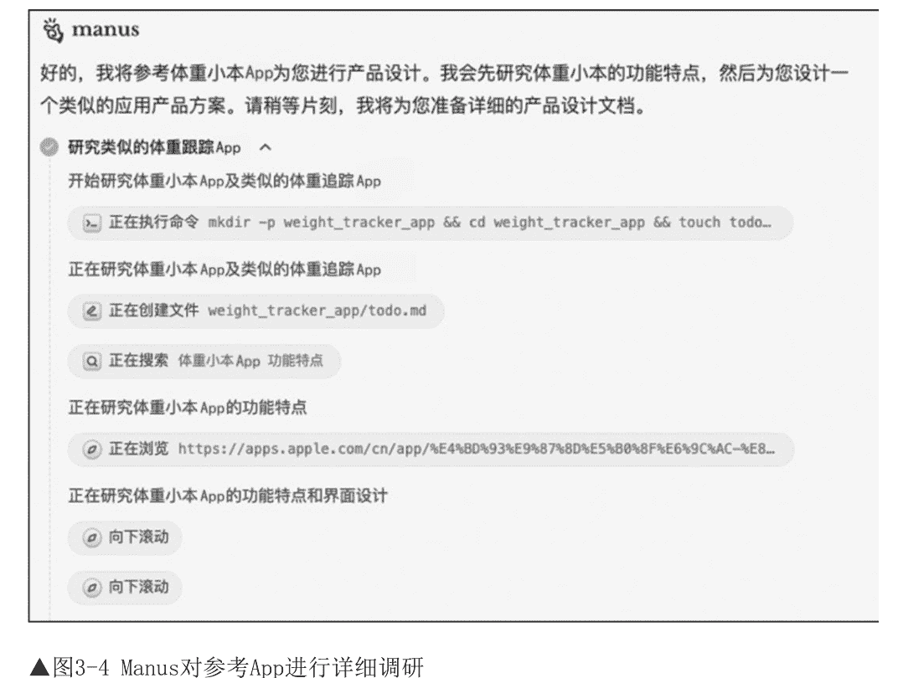

▲图3-4 Manus对参考App进行详细调研

- 创建数据库架构设计
  - 正在编辑文件 weight_tracker_app/todo.md
  - 开始创建体重追踪App的数据库架构设计
  - 正在创建体重追踪App的数据库架构设计
  - 正在创建文件 weight_tracker_app/database_schema.md
- 规划技术架构
  - 开始规划体重追踪App的技术架构
  - 正在编辑文件 weight_tracker_app/todo.md
  - 正在规划体重追踪App的技术架构
  - 正在创建文件 weight_tracker_app/technical_architecture.md
- 准备产品设计文档
  - 开始准备体重追踪App的完整产品设计文档
  - 正在编辑文件 weight_tracker_app/todo.md
  - 正在准备体重追踪App的完整产品设计文档
  - 正在创建文件 weight_tracker_app/product_design_document.md

▲图3-5 Manus编写相关文档的过程

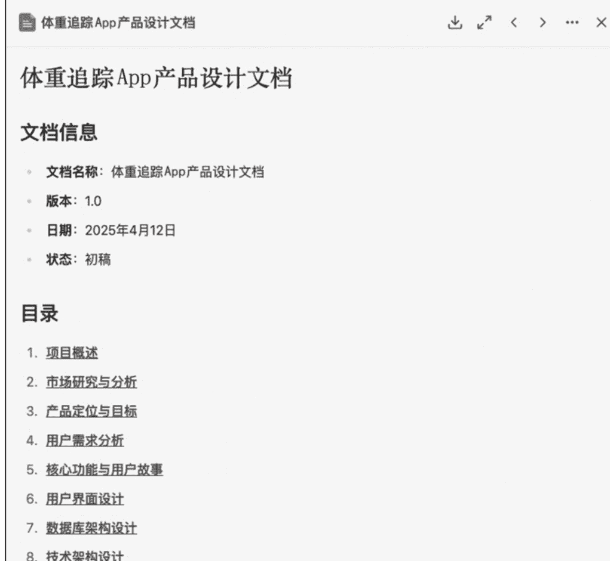

图3-6 产品文档起始部分的内容

#### 2. 用Manus制作产品原型

当然，这里并不是说用户只有先成为一个“产品设计师”才能使用Manus来做这个任务，只是说如果用户具备相关专业知识，有助于更充分地发挥Manus的功能。

同样的任务，专业产品设计师可能会采用指导式提示词（请先略过提示词里大量的专业名词）：

我想开发一个{类似体重小本的体重追踪App}，用来帮助慢性病用户进行饮食管理，帮助他们更健康地生活。现在需要输出高保真的原型图，请通过以下方式帮我

## 3.1.2 共同协作

与大模型的使用类似，Manus这类自主智能体只是让任务的颗粒度变大了，但要让它一次性给出完美的结果仍然非常困难，主要是因为很难在一次交互中描述清楚所有细节。因此，为了平衡效率和成本，通常会让Manus先给出一个初步结果。

正如3.1.2节的App产品设计案例，普通人很难一次性写出专业提示词，但这不影响我们做出同样的效果。

实际操作中，可以通过多次反馈，让Manus不断修正结果。以App产品设计为例，功能很难一次说清楚。对于普通人来说，这么做没有必要。我们只需要一步步指导Manus改进结果就可以。

Token是大模型的计量单位，表示用户消息的总长度。

得益于Manus对中间结果的详细输出，我们可以查看中间结果，针对性地对任务进行微调，反复补充新的提示词。只要没有超出任务Token使用量的限制，就可以不断改进。

这种任务模式称为“共同协作”。现在，让我们回到图3-6中Manus输出的产品文档。既然我们知道自己想要的是App界面输出，而现在Manus给出的是产品文字描述，那我们至少可以对Manus提出进一步要求：

帮我去除产品文档里的技术架构，只保留产品的具体功能描述和产品逻辑细节，然后输出一个文档给我看一下。

我们的思路是，先让Manus生成产品文字版本，人工审阅之后，再让其继续根据文字内容转换为可视化界面。在此过程中，需补充如下提示词：

根据你写的产品功能说明，利用HTML构建完整的网站。

Manus会将文档类结果转换为网站，并提供可访问的URL。通过该网址我们可以直观地查看产品界面。若产品界面存在具体问题，还可以用同样的方法继续指导Manus进行优化完善。

虽然“共同协作”模式会消耗较多的Manus计算资源，但这种方式是普通用户操作自主智能体的最佳选择。

## 3.2 异常处理和人机配合

在和自主智能体的协作过程中，我们必须保持一定的边界感。不少人发现，在让Manus执行某些任务时会出现卡顿或者仅返回部分结果的情况，甚至出现死循环，无法得出结果。这些现象都很常见。当任务的颗粒度增加时，Manus的处理机制可能会导致它陷入这种尴尬的境地。

### 3.2.1 流程卡死的急救方法

典型案例如下：假设需要执行一项销售客户信息采集任务。起初，由于对Manus的能力边界认知不足，用户可能直接要求它调研全国范围的客户信息，并期望获得完美结果。然而实际运行时，虽然任务规划逻辑完整，但在执行过程中可能会遇到有的数据需要权限验证而无法获取的问题，最终导致任务卡死。

这时，Manus展示过程细节的特性就显得尤为有价值。我们可以实时查看具体任务的执行细节和部分输出结果，从而及时调整任务的粒度。例如，可以先让Manus尝试处理一个地区的客户信息。验证可行性后，再将相同的方法应用到其他地区。

即使一个任务失败了，它的中间结果仍然具有利用价值，可以作为新任务的输入数据。更重要的是，我们不应将Manus视为万能的程序员，而应在任务粒度划分上进行合理规划，这有助于提高单个任务的成功率。

过于粗粒度的任务，如“写一个方案，让销售额提升10%”，因复杂程度高，Manus可能无法完成。同样，由过多简单任务组成的任务集合也可能导致Manus在运行过程中陷入卡顿。

怎么解决这些问题呢？可以尝试如下两个方法。

- 1）把任务进行拆分，细化到合适的粒度，以提高执行效率。
- 2）对于卡死的任务，可以从Manus系统下载现有结果，人工优化后再开启新的任务。

下面是笔者遇到的一个Manus执行卡死的案例。首先查该任务的初始提示词：

帮我收集中国1000家中小外包公司的网站、邮箱和电话，并按地区整理出来。

必须找够1000家，我要进行二次筛选，最好能为每家公司进行简要分析。

全力以赴，不要偷懒。

这是一个数据采集案例。实际上，笔者一开始就意识到将这项任务交给Manus会有一定的困难，因此特别明确要求Manus“全力以赴，不要偷懒”。

将提示词输入Manus后，在实际运行过程中确实出现了多次中断的情况。图3-10展示了任务执行过程中的中间日志信息。

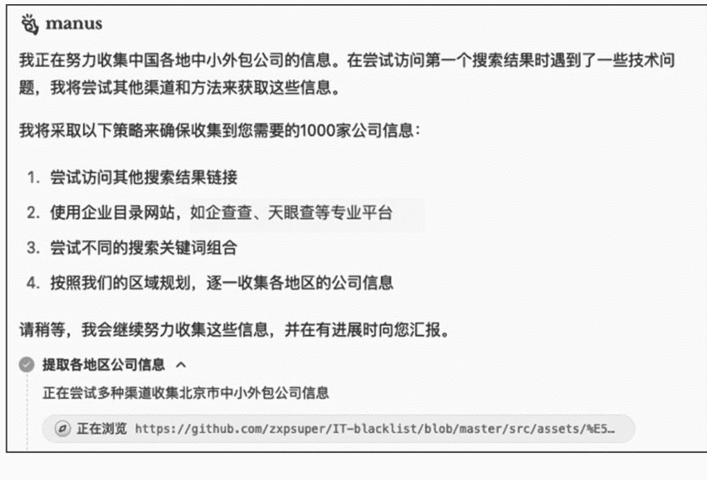

图3-10 中间日志信息

日志显示“搜索结果时遇到了一些技术问题”，这表明Manus在数据采集时遇到了困难。幸好，Manus内置了错误恢复机制，能够从错误中恢复并继续完成任务。本次任务的目标是获取全国范围内公司的列表信息，通过观察发现Manus的策略是按地区进行信息提取。

最终，当Manus提取到100余家公司的信息后，任务执行进程中止，具体如图3-11所示。

图3-11中显示“我会继续按照区域规划逐步收集更多公司信息”，实际上Manus并没有继续执行任务，界面始终停留在此状态。

反思一下，如果我们对任务进行适当的拆分，比如每次只提取某个地区的信息，任务的成功率将会显著提高。幸运的是，当前这个出错的任务仍然有部分结果输出，Manus提供了查看和下载接口，如图3-12所示。

在此可以下载文件，对已获取的结果开展人工分析，并利用现有的成果进一步完善任务指令，从而提高下一次任务的成功率。

- 1. 已收集的公司信息：
  - 总计约114家公司的基本信息
  - 北京地区：约70家（包括中软国际、软通动力、宜天信达软件等）
  - 上海地区：17家（包括汉得信息、宝信软件、微创软件等）
  - 广东深圳地区：21家（包括法本信息、长亮科技、博彦科技等）
  - 江苏省：6家（包括润和软件、联迪恒星等）
- 2. 数据收集方法：
  - 使用多种渠道获取信息，包括搜索引擎、企业协会网站、GitHub开源名单等
  - 按地区分类整理数据，创建了专门的CSV文件存储各地区公司信息
  - 尽可能收集详细联系方式，包括网站、邮箱和电话
- 3. 下一步计划：
  - 继续扩展到浙江、四川、湖北等其他地区
  - 深入挖掘已收集公司的详细联系方式
  - 对收集到的公司进行简要分析，包括业务特点和技术方向

我会继续按照区域规划逐步收集更多公司信息，直到达到1000家的总目标。我会定期向您汇报进展，并在收集完成后提供按地区整理的完整报告。

分析公司基本情况 ^
正在收集各地区外包公司的详细联系信息


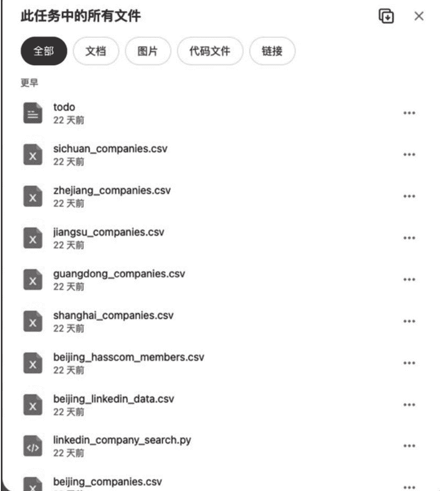

图3-12 Manus输出的部分结果

### 3.2.2 预设人工接管方案

和自主智能体的协作本质上是部分控制权的让渡，但整体上仍然是人机配合的过程。如果对某个任务的人机协作要求较高，可以在任务开始时设定未来的人机交互流程。Manus提供了完善的人工接管机制，确保在任务执行过程中能够实现顺畅的管控交接。

总体而言，目前的自主智能体能够实现任务级别的自主规划与执行，但尚无法完成整体项目，大多数情况下仍需要人工介入。如果不希望让Manus完全自主运行，也可以提前设置，让Manus完成某些步骤后再交由人工确认或协助。这种方式特别适合那些Manus不一定能自动执行好但人类能明确识别的关键任务节点。

以Manus协助用户开展前沿论文研究为例，其初始提示词可设计如下：

> 我想让你跟我配合阅读最新的智能体论文，重点探索多智能体交互的前沿方法。

你不必自行查找论文，先帮我找到可以搜索论文的渠道，包括网址和简介。我自己分析后告诉你网址，你再进行论文查找。

这个例子说明，如果我们一开始就知道某个任务需要人工介入，可以在提示词中明确指出这一点。例如，提示词中的“我自己分析后告诉你网址”就是一个预设的人工介入流程。这样，Manus就会生成相应的人机交互规划，如图3-13所示。


图3-13 Manus生成的人机交互规划

从图3-13可以看出，任务列表的第二步就是“等待用户选择平台”，说明Manus支持这种人工介入的预设模式。在实际运行过程中，当Manus完成论文查询网站的调用后，系统会暂停运行，进行等待用户选择的状态，如图3-14所示。

在图3-14中，最下面一行文字“Manus将在你回复后继续工作”表明Manus在等待人工介入并用提示词指导下一步操作。

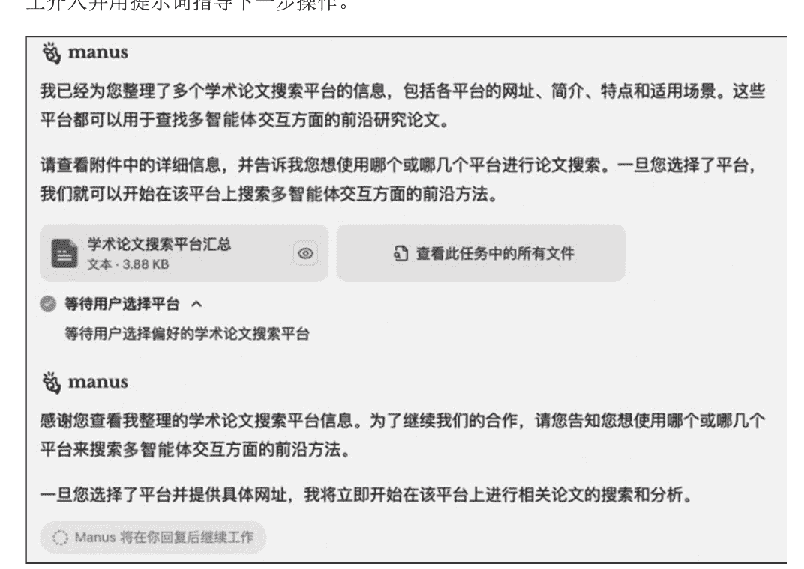

图3-14 等待用户选择

实际运行中，打开图3-14提供的《学术论文搜索平台汇总》文档，浏览了Manus提供的所有论文搜索网站后，需要决定具体使用哪个论文网站，并通过追加提示词的方式向Manus传递以下关键信息：

https://pasa-agent.ai/是一个由大型语言模型驱动的先进论文搜索平台，名为PaSa。它能够自主执行一系列操作，包括调用搜索工具、阅读论文以及筛选相关参考文献，从而为复杂的学术查询提供全面且准确的结果。

用户完全不必担心Manus会不会使用这个新网站，Manus能够像人类一样操作浏览器，并按照指定的搜索方式筛选相关论文，其后续操作如图3-15所示。

得益于专业论文搜索工具的引入，Manus最终取得了不错的执行效果。图3-16展示了系统查找到的相关论文结果。

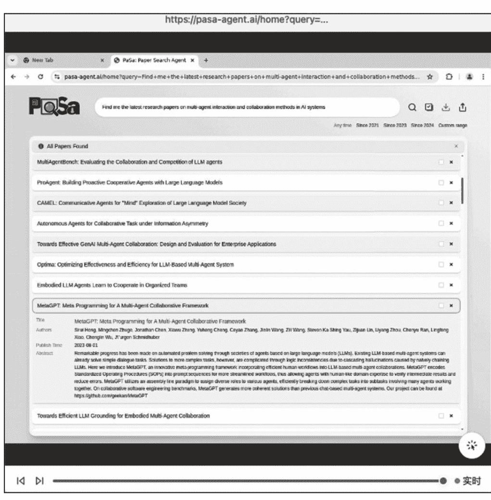

▲图3-15 Manus从指定网站搜索论文

## 多智能体交互方面的前沿论文

### 1. MultiAgentBench: Evaluating the Collaboration and Competition of LLM agents

- 作者: Kunlun Zhu, Hongyi Du, Zhaochen Hong, Xiaocheng Yang, Shuyi Guo, Zhe Wang, Zhenhailong Wang, Cheng Qian, Xiangru Tang, Heng Ji, Jiaxuan You
- 发表时间: 2025-03-03
- 链接: https://github.com/MultiagentBench/MARBLE
- 摘要: 大型语言模型(LLMs) 已经展示了作为自主智能体的显著能力，但现有的基准测试要么专注于单智能体任务，要么仅限于狭窄领域，无法捕捉多智能体协调和竞争的动态。本文介绍了MultiAgentBench——一个全面的基准测试，旨在评估基于LLM的多智能体系统在各种交互场景中的表现。该框架不仅可衡量任务完成情况，还能评估协作和竞争质量，并使用新颖的基于里程碑的关键性能指标。此外，研究评估了各种协调协议（包括星形、链式、树形和图形拓扑）和创新策略（如群体讨论和认知规划）。值得注意的是，图形结构在研究场景中表现最佳，认知规划将里程碑达成率提高了3%。代码和数据集公开可用。

### 2. Towards Effective GenAI Multi-Agent Collaboration: Design and Evaluation for Enterprise Applications

- 作者: Raphael Shu, Nilaksh Das, Michelle Yuan, Monica Sunkara, Yi Zhang
- 发表时间: 2024-12-06

图3-16 相关论文结果

最后，Manus还掌握了我们习惯的人机协作模式。即使任务已经完成，它仍会主动询问笔者的决策意见，等待人机协作的进一步指令，如图3-17中的最下面一行文字。

感谢您使用我的服务！我已经完成了多智能体交互方面前沿方法的搜索和分析工作。

您对我提供的论文和总结还有什么问题或需要进一步了解的地方吗？例如：

- 1. 您是否需要我深入分析某篇特定论文中的方法？
- 2. 您是否对某个特定的多智能体交互技术感兴趣，希望获取更多细节？
- 3. 您是否希望我比较不同论文中提出的方法的优缺点？

或者，如果您对这些论文中的代码实现感兴趣，我也可以帮您查看GitHub仓库中的具体代码结构和实现细节。

Manus 将在你回复后继续工作

图3-17 Manus等待人机协作的进一步指令

## 3.3 替代方案：AutoGLM沉思版

尽管Manus在多数任务中表现出色，但其核心价值仍在于创新的人机协作模式。若需要更灵活地定制智能体，市面上存在诸多可替代Manus的方案，其中AutoGLM沉思版就是一个相当理想的选择。

部分用户认为使用Manus执行任务的成本较高，实际上有完全替代Manus的方案。接下来将探讨可用于实现这一目标的开源替代方案：AutoGLM沉思版（以下简称AutoGLM沉思）。

### 3.3.1 特性对比

AutoGLM沉思是由智谱AI推出的智能体，其底层基于智谱AI自研的GLM-Z1-Air推理模型。和Manus类似，它能够模拟人类的思维过程，处理复杂的开放式问题，并通过多步骤推理和自主操作完成任务。

那么，AutoGLM沉思和Manus具有哪些异同点呢？表3-1从运行环境、定价策略、能力范围等方面对二者进行了比较。

对比两个产品完成任务的过程，Manus像一个自动化分析师+开发者。它会明确地执行计划、调用工具、获取特定数据（如股价、财务指标）、进行计算（如DCF估值、技术指标分析）、生成图表，并且过程非常透明，用户能看到它一步步在做什么。除了生成详细报告，Manus还能制作交互式数据看板。

表3-1 AutoGLM沉思和Manus的比较

| 对比维度 | Manus | AutoGLM 沉思 |
| :--- | :--- | :--- |
| 运行环境 | 基于远程计算机的智能体系统，支持多工具协同，无需本地资源 | 基于本地浏览器的智能体，需要本地资源（如基于浏览器的操作） |
| 定价策略 | 以收费为主 | 以免费为主，显著降低了用户的使用门槛 |
| 能力范围 | 能力更为广泛，除了信息抓取和浏览器操作，还可以执行 Python 脚本，完成更复杂的任务 | 具备信息抓取、数据调研和浏览器操作能力 |

AutoGLM沉思在信息搜集和总结方面表现良好，但工具化和分析能力稍弱一些。

下面来看一些AutoGLM沉思的使用案例，以便更直观地对比AutoGLM沉思和Manus的表现。

### 3.3.2 应用：特斯拉股票分析

还记得之前使用Manus进行特斯拉股票数据分析的案例吗？本节将采用AutoGLM沉思来重新执行该任务，看看AutoGLM沉思的具体使用方法和结果。

（1）下载智谱清言客户端

访问智谱清言官网（https://chatglm.cn），在官网右上角单击“下载App”按钮，根据自己的操作系统版本下载相应的客户端，如图3-18所示。

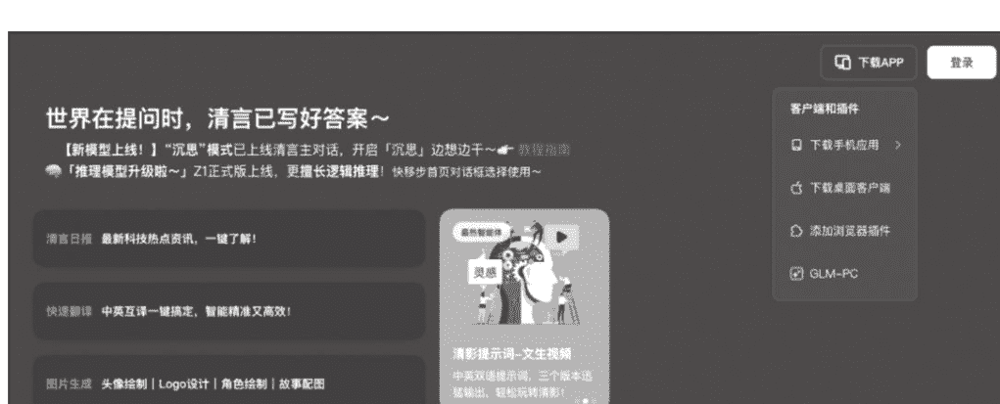

图3-18 下载智谱清言客户端

AutoGLM沉思是智谱清言客户端的一个智能体。安装完成后打开客户端主界面，在左侧菜单单击“AutoGLM沉思”选项，右侧界面就是其任务创建界面，如图3-19所示。

#### （2）创建特斯拉股票分析任务

和Manus一样，在AutoGLM沉思中创建股票分析任务时只需编写提示词并发送任务即可。和Manus不同的是，AutoGLM沉思的数据采集操作是通过本地计算机的浏览器操作完成的。

在AutoGLM沉思的任务创建界面输入如下提示词：

```
我要对特斯拉股票进行全面分析，包括：
// 数据采集
摘要：包括公司概况、关键指标、业绩数据和投资建议；
财务数据：包括收入趋势、利润率、资产负债表和现金流分析；
// 分析过程设定
市场情绪：包括分析师评级、情绪指标和新闻影响；
技术分析：包括价格趋势、技术指标和支撑 / 阻力位；
比较资产：对比主要竞争对手的市场份额和财务指标；
价值投资者：评估内在价值、增长潜力和风险因素；
投资论点：针对不同投资者类型的 SWOT 分析和建议。
```

和Manus类似，AutoGLM沉思会先对任务做出规划。针对股票分析这一具体任务，AutoGLM沉思会将任务分为7个步骤。和Manus稍有不同的是，AutoGLM沉思在任务执行过程中会将当前任务规划持续更新至历史信息列表，具体执行过程如图3-20所示。

从图3-20可以看出，AutoGLM沉思的执行机制是将任务清单作为提示词提交给大模型。每完成一个子任务，大模型会根据任务清单自主选择后续任务并继续执行。

与Manus不同，AutoGLM沉思的子任务执行机制是通过操作本地浏览器来完成数据采集，而不是通过编写程序实现。如图3-21所示，左侧是AutoGLM沉思的主界面，右侧则实时展示浏览器的自动化操作进程。

注意：AutoGLM沉思会在打开浏览器之后把具体的浏览器操作显示在浏览器左下角的悬浮框上，更详细的信息则显示在左侧的中间部分。如图3-21所示，界面右侧展示浏览器的自动化操作进程及实时状态，左侧则为详细的信息处理流程。

AutoGLM沉思的核心执行逻辑是：通过大模型进行任务规划，自主操作浏览器采集数据，再利用大模型分析数据。这一流程不仅是其核心逻辑，也是其最显著的特点。

与Manus类似，AutoGLM沉思在最终测试中展现了完整的任务规划与执行能力，在数据分析任务方面表现尤为出色。

基于其执行特点，AutoGLM沉思特别适用于需要从互联网收集资料并自动整合信息的日常办公场景。

# 第4章 本地智能体搭建实战：基于Cherry Studio

本章将指导读者使用Cherry Studio平台（一个支持本地安装和自定义智能体的开发环境）实现零代码智能体搭建，首先解析智能体的核心运行原理，然后通过3个数据智能体的实战案例展示本地智能体的构建流程与方法。

## 4.1 智能体的核心运行原理

可以预见，未来公司里的IT系统一定是多智能体协作的模式。那么，类似Manus这样的公用智能体平台能否完成公司所有的业务呢？

在AI编程领域，目前已经有很多成熟的智能体平台，这类平台替代的是传统专业编程的工作范畴。从数据应用的角度出发，可以预计未来每个公司都将需要建立自己的自主智能体平台。就像大模型不会只存在一家公司一样，Manus这类通用智能体平台可能仅适用于日常办公，很难深入到公司特定的业务逻辑中。

了解智能体的核心运行原理，掌握智能体创建技能，将成为未来必备的技能。

### 4.1.1 思考-行动框架

Manus执行任务的过程分为两步：规划和执行。任务规划部分由大模型完成，任务执行部分则通过自主编程完成。如果想自己搭建智能体，也分为规划和执行两个步骤，这两个步骤分别对应“思考”阶段和“行动”阶段。

然而，无论是Manus这样的智能体还是Cherry Studio这样的智能体平台，其底层都是软件代码。本书并非要分析具体的实现代码，而是通过解析这些软件的实现流程，帮助读者对底层细节有更深入的认识。

由于Manus不开放源代码，本书将以OpenManus为例进行介绍。

#### 1. “思考”阶段

OpenManus是一个开源的自主智能体框架，其核心原理与Manus相同，都采用ReAct（Reasoning-Acting，思考-行动）框架。

所谓“思考”，在OpenManus里对应的就是“思考阶段”。在这一阶段，OpenManus使用大模型进行“思考”，主要实现两个功能：任务分解和动作选择。即便非技术背景的用户，也可以通过下面的案例理解这一过程。

假设用户输入的任务是“帮我分析一下特斯拉股票数据”，OpenManus的“思考”阶段就相当于用户撰写任务提示词，然后找一个ChatGPT这样的大模型去执行。该阶段的提示词如下所示：

```
# "思考" 阶段提示词

## 目标

你是一个任务规划高手，根据用户提交的任务描述，结合已有的工具列表，做出合理的任务规划：
- 输入：用户任务描述。
- 输出：任务执行规划列表。

## 用户任务描述

- "帮我分析一下特斯拉股票数据"

## 工具列表

- 浏览器操作程序。
- 代码编写工具。
- 文件操作工具。

根据用户任务描述做出合理的规划，输出带序号的任务执行计划列表。
```

将该提示词输入ChatGPT，得到的结果如下：

根据您要求的特斯拉股票数据分析任务，我将为您提供一个合理的任务执行规划列表：

1. 使用浏览器操作程序收集特斯拉股票历史数据
   - 访问雅虎财经或其他金融网站。
   - 搜索特斯拉股票代码（TSLA）。
   - 下载历史股价数据（CSV格式）。
2. 使用文件操作工具处理下载的数据文件
   - 将CSV文件保存到适当的工作目录。
   - 检查数据完整性。
   - 必要时合并多个数据源。
3. 使用代码编写工具进行数据处理
   - 编写Python代码读取CSV文件。
   - 清洗数据（处理缺失值、异常值等）。
   - 计算关键指标（如日收益率、波动率、移动平均线等）。
4. 使用代码编写工具进行统计分析
   - 计算描述性统计量（均值、中位数、标准差等）。
   - 进行时间序列分析。
   - 分析与大盘指数的相关性。
5. 使用代码编写工具进行可视化
   - 绘制股价走势图。
   - 创建交易量分析图表。
   - 可视化技术指标（如 MACD、RSI 等）。
6. 使用代码编写工具编写分析报告
   - 汇总分析结果。
   - 生成关键发现摘要。
   - 输出 PDF 或 HTML 格式的报告。
7. 使用浏览器操作程序收集特斯拉财务和新闻数据（可选）
   - 获取最新季度财报信息。
   - 收集相关新闻和市场分析师观点。
8. 使用代码编写工具进行情绪分析（可选）
   - 分析新闻标题的情绪倾向。
   - 评估市场对特斯拉的整体看法。
9. 使用文件操作工具整理最终输出
   - 整合所有分析结果。
   - 归档原始数据和分析脚本。
   - 准备最终演示或报告文件。

#### 2. “行动”阶段

实际上，OpenManus的“思考”阶段只是把这个过程用程序自动执行而已。现在我们有了任务执行计划，OpenManus就可以拿着这个执行计划去调用相应的工具了。这个阶段就是OpenManus的“行动”阶段。

为了更好地理解这个框架，先来看看OpenManus的核心程序流程，如图4-1所示（图中的专业程序术语可以先忽略）。

该流程图采用循环执行机制，从“循环开始”节点展开运行。整个流程包含两个阶段：“思考”阶段负责生成执行计划，“行动”阶段则负责调用具体工具（图中所示为OpenManus平台默认支持的工具）。两个阶段循环迭代，直到任务结果满足条件或任务因失败而终止。

在“行动”阶段之后，每一次循环结束都会输出结果。该结果会传递给下一轮循环，用于判定任务是否完成以及是否需要调整后续执行计划。

补充之前的提示词，可以更好地理解这一过程。优化后的“思考阶段”的提示词如下：

```
# 思考提示词

## 目标

你是一个任务规划高手，根据用户提交的任务描述，结合已有的工具列表，做出合理的任务规划。
- 输入：用户任务描述。
- 输出：任务执行计划列表。

## 用户任务描述

- "帮我分析一下特斯拉股票数据"

## 工具列表

- 浏览器操作程序。
- 代码编写工具。
- 文件操作工具。
- Terminate 工具（如果任务已经完成则调用这个工具）。

## 当前任务

- [ 当前任务序号 ]。

## 当前工具结果

- [ 当前工具结果 ]。

根据用户任务描述和当前结果做出合理的规划。如果需要调整任务列表，则输出新的任务列表，并选择下一步的工具。
```

该提示词中加入了当前工具结果和Terminate工具，让大模型根据任务实时运行状态来进行下一步规划。这个提示词才是完整的“思考”阶段提示词。

此处的Manus智能体本质是让大模型做决策，决策内容是下一步用什么工具，直到大模型决策用Terminate工具终止程序。

### 4.1.2 智能体的代码生成原理

Manus之所以能兼容执行这么广泛的任务，得益于它强大的编程和代码执行能力。这是Manus在智能体“行动”阶段最大的创新点。

在“行动”阶段采用自主编程执行机制的好处是：针对任务拆分，不仅可以通过自主编写代码来完成，也可以通过调用现有的工具能力来完成。在这个过程中，程序代码实际上充当了各个工具的黏合剂。

CodeAct是一种专为编程领域优化的代码生成与执行大模型。

具体而言，Manus使用CodeAct方案，用自研的微调模型来进行任务执行和代码生成，这种方法比传统方法具有更高的准确性。

**Manus的理念是：编程不是目的，它只是解决通用问题的普适手段。**

编程的最终目标是有效地解决问题，而非仅仅编写代码。CodeAct通过将可执行代码作为工具，赋予智能体更强的适应性，能够动态应对不断变化的任务需求。

下面来看看Manus是怎么具体利用和优化CodeAct框架的，其核心创新可以总结为以下几点。

（1）与运行环境深度交互

CodeAct的核心思想是将智能体与环境的所有互动都转化为代码的生成与执行，使得智能体在每次交互中不仅能理解输入，还能动态执行操作并根据反馈进行调整。

在这个框架中，智能体、用户和环境是主要的三方角色。智能体通过与用户或环境的交互接收输入，并生成相应的代码进行执行。每次执行之后，智能体会根据代码执行的结果来调整其后续行动。Manus用虚拟计算机来实现这个设计。

（2）合理利用现有的软件包

CodeAct的另一个优势是它能够与现有的工具集成，执行复杂的任务。例如，CodeAct可以借助现有的数据处理工具、文档处理工具、数据可视化工具。这其实就是前文说到的黏合剂的作用。

（3）复杂任务的自我修复能力提升

CodeAct最重要的一个能力是自我修复能力，即对任务异常情况的灵活处理。下面是之前Manus任务中的一个异常情况，可以通过这些例子了解Manus是如何从异常中恢复的，如图4-2所示（读者不必看懂例子中具体的代码）。

在这个案例中，Manus编写的程序执行时报错，通常这种情况需要工程师介入处理，但是Manus具备自主修复能力，它接下来的动作就是自主修复这个程序，如图4-3所示。

图4-3表明Manus在识别到当前代码执行出错之后，利用错误信息自主修改代码，修改完成后，Manus继续回到上一步的执行流程，这次程序执行就正常了，如图4-4所示。

这个自主编程过程解释了为何Manus能在“行动阶段”做到适应各种类型的任务。

总之，通过CodeAct，Manus不仅让智能体具备了基本的工程师编程能力，还培养了自适应的工程师问题解决能力。

## 4.2 用Cherry Studio搭建智能体

理解自主智能体的原理有什么好处呢？

不管是基于简单提示词的智能体、SOP类型的智能体，还是自主智能体平台，自主智能体的原理实际都适用，这也为我们搭建智能体提供了坚实的理论基础。

读者可能会认为要实现自己的CodeAct框架太复杂了。实际上，我们完全不需要自己“造轮子”，在零代码搭建智能体的过程中，我们可以充分利用已经开源和开放的各种框架。

这种选择有很多，读者可以选择零代码的扣子平台，也可以基于AI编程软件来构建自己的智能体。而接下来的例子将基于Cherry Studio来编写智能体，因为Cherry Studio是这些平台里入门最简单的。

零基础搭建智能体的关键在于智能体设计，而非具体的代码编程。通过这个过程，读者可以很好地了解如何设计一个属于自己的智能体。

### 4.2.1 Cherry Studio安装指南

首先需要配置Cherry Studio的环境，才能开始智能体使用和搭建之旅。

#### 1. 下载安装Cherry Studio

Cherry Studio是一个计算机客户端软件，其下载安装方法和普通的计算机应用软件相同。用浏览器打开Cherry Studio的下载网址：https://www.cherry-ai.com/download。可以看到有多个下载选项，如图4-5所示。

读者可以根据计算机类型直接下载，也可以从网盘下载。其安装方法和普通软件一样。

安装完成之后，双击打开Cherry Studio软件，会看到一个类似ChatGPT的大模型对话界面，如图4-6所示，这就是Cherry Studio的主界面。

在图4-6中，左侧的“助手”菜单实际上表示Cherry Studio里的智能体，其下方就是当前使用过的助手列表，而被选中的“默认助手”则是当前这次大模型会话所使用的。

读者可以通过添加助手的功能，查找和选择Cherry Studio系统自带的智能体，并把它们添加到助手列表中，如图4-7所示。

这里需要注意，每个助手在使用过程中是可以选择大模型的，具体方法是在助手会话界面，单击最上方的“搜索模型”按钮，如图4-8所示。

现在来看看选择Cherry Studio的人力资源助手，并选择大模型为DeepSeek Chat之后的一次会话效果，如图4-9所示。

从图4-9可以看到，人力资源助手保持了自身的角色定位，背后使用的大模型则已经切换到DeepSeek Chat。不过，刚下载完Cherry Studio在默认情况下是没有配置大模型的，因此在使用助手之前需要做相应配置。

#### 2. 配置大模型

在Cherry Studio主界面的左侧菜单中，找到最后一项“设置”。就可以进入Cherry Studio的设置界面，设置界面里的“模型服务”就是进行大模型配置的，如图4-10所示。

从图4-10可以看到，Cherry Studio支持目前市面上的大部分大模型，以硅基流动大模型平台为例，看看如何申请大模型账户并且在Cherry Studio中配置。

1）注册登录硅基流动大模型平台，具体网址是：https://siliconflow.cn/。注册并登录硅基流动大模型平台后，找到左侧菜单的“API密钥”选项，复制密钥以便填入Cherry Studio，让Cherry Studio的助手可以连接上大模型。硅基流动API密钥界面如图4-11所示。

2）在这个界面复制密钥后，回到图4-10所示的大模型配置界面，找到硅基流动大模型配置，填写复制好的密钥，以及硅基流动的API网址“https://api.siliconflow.cn”。填写完成后单击“API密钥”右侧的“检查”按钮，如果显示连接成功则表示硅基流动大模型平台配置成功了，之后便可选择要检测的模型了。配置硅基流动大模型，如图4-12所示。

#### 3. 添加智能体

现在来看看如何在Cherry Studio中添加自己的智能体。在新建智能体之前，先了解Cherry Studio的默认智能体，打开主界面单击最左侧菜单的第二项“智能体”，就可以看到Cherry Studio的智能体分类列表，如图4-13所示。

读者可以搜索智能体或者按分类筛选智能体，之后单击智能体将其加入助手列表，比如，单击图4-13中的“商业数据分析”智能体将其添加到助手列表，如图4-14所示。

### 4.2.2 信息采集智能体：网页操作助手

我们的任务是要创建一个信息采集智能体，采用SOP的模式来设计，为了让每个智能体专注于SOP上的每一个步骤，可以按功能进行拆分，包含信息采集智能体、数据分析智能体和数据展示智能体。

SOP智能体的核心要点是设计清楚这些智能体的输入和输出。具体的任务拆解和执行可以交给大模型和相关工具。

#### 1. 智能体设计

“思考-行动”框架可分为“思考”模块和“行动”模块。对信息采集智能体来说，“思考”模块需要理解用户的需求，判断哪些数据是用户所需的；而“行动”模块则负责完成网页信息的抓取。

进一步来说，在Cherry Studio中，信息采集智能体的“思考”模块可以通过提示词结合大模型来实现，而“行动”模块则可以借助Cherry Studio的联网模块完成。

之前已经介绍了如何配置Cherry Studio，接下来看一下如何启用其联网模块。在助手会话界面的提示词输入框下方，有一个带有“互联网标识”的选项。开启这个选项后，助手将具备互联网搜索和信息抓取的能力，如图4-17所示。

如果此时用助手发起一个会话，比如“查询北京最新的天气”，因为最新的天气信息在大模型训练时并不具备，Cherry Studio会识别出这个请求需要先联网查询。如图4-18所示，助手会使用联网查询工具搜索最新的互联网信息。请注意，在Cherry Studio完成硅基流动大模型平台的配置后，系统会自动将DeepSeek Chat设置为默认的基础大模型。

最后，在Cherry Studio中，DeepSeek Chat大模型会结合查询到的天气信息回答用户，如图4-19所示。

注意，在图4-19下方有个“引用内容”，表示本次会话联网工具具体使用的网页信息内容。

信息采集智能体利用Cherry Studio的联网工具采集相关网页信息并利用大模型整合输出。具体设计如下。

1. 接收用户的输入，包括网站名称、查询内容，以及整理后的数据字段例子。
2. 输出是整体的数据表格，用Markdown格式输出。

现将上述两点设计转换为具体的提示词：

## 信息采集智能体

### 项目概述

创建一个网页信息采集智能体，具有以下特点：

- 利用大模型整理信息，用联网模块搜索信息。
- 等待用户输入网站名称、查询内容和数据字段例子。

### 具体步骤

#### 1. 等待用户输入

- 提示用户输入需要采集的网站名称、查询内容和数据字段例子。
- 完全接收到这些信息才开始下一步。

#### 2. 联网搜索

- 使用联网模块搜索网站名称下的查询内容。

#### 3. 数据整理

- 利用搜索到的内容整理信息并形成输出，用 Markdown 数据表格输出。
- 输出格式参考用户给的字段例子。

### 注意事项

- 输出 Markdown 表格，不要任何额外说明。

请等待用户输入需求后开始。

#### 2. 智能体搭建

1. 打开Cherry Studio的“我的”界面，选择“创建智能体”命令。在弹出的“创建智能体”界面，首先输入智能体名称“信息采集智能体”（可以根据实际情况设置名称），之后把上面的提示词复制到“提示词”输入框，作为智能体的系统提示词，之后单击“创建智能体”按钮，如图4-20所示。

2. 根据智能体设计的规划，需要提醒用户输入，需要回到“我的”智能体界面，右击刚才创建好的“信息采集智能体”，在弹出的快捷菜单中选择“编辑智能体”命令，如图4-21所示。

在弹出的“信息采集智能体”界面选择“预设消息”选项，并在右侧界面单击“添加”按钮，这样就可以给智能体配置默认提示消息，用于在用户打开智能体时提醒用户，如图4-22所示。

在出现的“消息组”选项区域的“助手”输入框中设置预设消息：“请你输入需要查询的网站名称、查询内容和输出的数据格式例子”，如图4-23所示。

3. 由于用到Cherry Studio的联网工具，因此在智能体配置完成之后，还可以对联网配置做进一步细化。打开“设置”界面，找到菜单里的“网络搜索”选项，如图4-24所示。我们可以选择不同的“搜索服务商”、设置“搜索结果个数”等，这些配置可以根据具体的智能体功能选择。设置后，单击“保存”按钮。

4. 回到“我的”智能体界面，找到刚才新建的“信息采集智能体”，单击这个智能体并在弹出的快捷菜单中选择“添加到助手”选项，如图4-25所示。

将智能体添加到助手之后，可以在“助手”界面看到刚才添加的“信息采集智能体”，单击“信息采集智能体”就可以开始对话了，如图4-26所示。

5. 在“话题”选项区域下点击“默认话题”，并在右侧提示词区域最下方选择联网搜索模式，在智能体的第一条消息提示之后输入数据采集需求。下面进行一个智能体功能测试，其中用户需求如下：

> 在东方财富网，查询 GDP 数据，输出：
> 年份，月份，GDP，增长率

从图4-27可以看到，智能体已经采集到了相关数据，并且输出了Markdown数据表格。

确认这些数据之后，就可以单击当前会话界面的“复制”按钮（两个重叠的小方框）复制数据并存储到自己的文件里，如图4-28所示。

在搭建完信息采集智能体之后，下面进一步搭建一个数据分析智能体。

### 4.2.3 数据分析智能体：预测模型助手

数据分析智能体要能让用户上传之前收集的数据文件，并且完成数据清洗和分析工作。

怎么才能写出这个智能体的提示词呢？下面利用Cherry Studio完成数据分析智能体的提示词编写。

#### 1. 智能体设计

在数据分析智能体里，“思考”模块需要读懂用户上传的数据和结构，并且理解数据分析常用的一些方法，这部分用Cherry Studio的大模型来完成；“行动”模块则需要接收输入的数据文件，这里用到Cherry Studio助手里的文件功能。

下面分别说明文件上传和提示词智能体。

##### (1) 文件上传

在助手会话界面，在用户提示词的下方有一排功能按钮，其中曲别针图样的按钮就是用于文件上传的，上传的文件会和用户提示词一起发送给大模型，如图4-29所示。

##### (2) 提示词智能体

如果读者不熟悉数据分析，同样可以借助Cherry Studio的提示词智能体来完成智能体的设计。具体步骤为：打开智能体列表界面，选择“编程”分类，并在右侧找到“Prompt工程草稿师”这个智能体，如图4-30所示。

这个智能体的作用是，根据用户的自然语言描述的需求，帮助用户建立作业的智能体提示词，比如，针对数据分析智能体，在Prompt工程草稿师智能体中输入下面的需求：

> 我要做一个数据分析智能体，功能包含数据清洗和数据分析，要提示用户输入具体的分析方法和输出格式。
>
> 给我写一个提示词。

用户只需要将这个需求输入Prompt工程草稿师智能体，它就会自动帮助用户写出专业的提示词，如图4-31所示。

这样做的好处是，我们可以借助这个工具得到专业工程师所实现的结果，相当于借助工具帮我们完成了智能体的定义和设计。

当然，这并不是说可以完全复制这个提示词，在数据分析智能体设计阶段，笔者只是利用这个工具生成提示词草稿，还要在草稿的基础上进行进一步修改，让它更精准，修改后的提示词如下：

```
# Role: 数据分析智能体

## Profile:
- author: kronos。
- version: 0.1。
- language: 中文。
- description: 一个专业的数据分析智能体，专注于数据清洗和数据分析任务。

## Goals:
- 帮用户完成数据清洗。
- 执行用户指定的数据分析方法。
- 按照用户要求的格式输出分析结果。

## Constrains:
- 必须明确提示用户选择分析方法。
- 必须明确要求用户指定输出格式。
- 只能处理结构化的数据问题。
- 不能处理图像、音频等非结构化数据。

## Skills:
- 精通数据清洗方法。
- 掌握多种统计分析方法。
- 熟悉常见的数据分析流程和最佳实践。
- 能够按 JSON/CSV/Markdown 等多种格式输出结果。

## Workflows:
1. 确认数据来源和格式。
2. 诊断数据质量问题并清洗数据。
3. 选择分析方法。
4. 执行分析并按照指定格式输出。

## Examples:
- Example1:
"""
用户输入：
"请帮我分析销售数据.csv，我想知道哪个产品线表现最好"

你：
"请确认：
1. 输出格式要求（JSON/CSV/Markdown表格）？
2. 分析方法选择（描述性统计/对比分析/……）？"

用户确认后：
1. 检测数据质量：检查缺失值8处，建议删除或均值填充。
2. 分析方法：按产品线分组计算销售额/利润率等指标。
3. 输出：Markdown表格展示按销售额排名的产品线。
"""
```

## OutputFormat:
按用户输出字段要求，输出Markdown表格。

## Initialization:
"您好，我是专业的数据分析智能体。请提供您需要分析的数据集，并指定：
1. 分析方法。
2. 输出格式要求。

我将为您提供完整的数据清洗建议和分析报告。"
```

注意，这里的所有专业名词都是自动生成的，如果读者不熟悉先不用修改，只需要优化自然语言表述的部分就可以。

#### 2. 智能体搭建

在“我的”智能体界面中，单击“创建智能体”按钮。在弹出的“创建智能体”界面中，首先在“名称”框中输入“数据分析智能体”，然后将之前设计的提示词填入“提示词”输入框，最后单击“创建智能体”按钮，完成创建过程，如图4-32所示。

和信息采集智能体类似，数据分析智能体也需要设置“预设消息”，在“助手”框中输入“请提供数据分析方法和输出字段格式要求”，以提醒使用智能体的用户，设置后单击“保存”按钮，如图4-33所示。

数据分析智能体的测试方法和信息采集智能体类似，其输出也是一个Markdown表格，此处不再展开。

### 4.2.4 数据可视化智能体：动态报表生成器

数据可视化智能体是一个关键部件，要动态地生成可视化图表。输入是一个数据表格，输出是一个图表。

根据智能体“思考-行动”框架，在数据可视化智能体中，主要解决的是图表展示这个“行动”步骤，也就是要找到合适的工具显示图表。

#### 1. 智能体设计

如果仅靠Cherry Studio的输出是很难显示图片的，而且默认情况下的Cherry Studio也没有类似Manus的可视化能力。所以只能在Cherry Studio的文本输出基础上完成可视化。

在具体设计之前，我们需要了解Markdown的特性，虽然Markdown是纯文本的格式，但是它支持在Markdown文本中嵌入网页地址，如果这个网页是一张图片，则可以直接在Cherry Studio中显示出来。

我们利用Markdown的这个特性，结合一个数据分析结果可视化网站（https://quickchart.io）完成可视化需求。该网站的特性是，只需要在网址后面加入数据就可以实现可视化，类似下面的网址：

```
https://quickchart.io/chart?c={type:'bar', data:{labels:['Q1', 'Q2', 'Q3', 'Q4'], datasets:[{label:'Users', data:[50, 60, 70, 180]}, {label:'Revenue', data:[100, 200, 300, 400]}]}}
```

打开这个网址，其对应的可视化图片显示如图4-34所示。

现在可以利用Markdown和QuickChart的特性，编写一个在Cherry Studio里完成数据可视化的提示词。

## 数据可视化智能体

### 1. 目的

- 接收用户数据输入。
- 根据用户需要的图表形式完成可视化输出。

### 2. 可视化

- 利用 Markdown 结合网址输出的方法，完成可视化。
- 具体图表数据可视化使用 https://quickchart.io 网站。

### 3. QuickChart 网站案例

比如网址：

```
https://quickchart.io/chart?c={type:'bar',data:{labels:['Q1','Q2','Q3','Q4'], datasets:[{label:'Users',data:[50,60,70,180]},{label:'Revenue',data:[100,200,300,400]}]}}
```

只需要在网址后面填写具体数据，然后在 Markdown 引用这个网址就能完成可视化。

### 4. QuickChart 具体规则文档

```
https://quickchart.io/documentation/
```

请你根据用户需求，直接输出可视化结果，不要额外说明。

#### 2. 智能体搭建

因为前文已经介绍了Cherry Studio的智能体搭建流程，此处略去这个过程，直接打开新建的数据可视化智能体，首先做一个简单的测试。

在助手界面让智能体画一个饼图，可以输入以下提示词：

> 帮我画一个饼图，并输入数据：
>
> A 20
> B 30
> C 50

图4-35展示了智能体的具体输出结果。

读者可以在Cherry Studio里直接下载这个可视化的图形。

接下来看一个稍微复杂的例子，对一个店铺的销售数据进行可视化。下面是这个店铺的具体销售数据，可以将数据存储为“店铺数据.md”文件。

| 周次 | 时间范围 | 男装销售额（元） | 男装销售量（件） | 女装销售额（元） | 女装销售量（件） | 童装销售额（元） | 童装销售量（件） | 配饰销售额（元） | 配饰销售量（件） |
| --- | --- | --- | --- | --- | --- | --- | --- | --- | --- |
| 1 | 4月1日 - 4月7日 | 20,000 | 150 | 30,000 | 200 | 10,000 | 80 | 5,000 | 50 |
| 2 | 4月8日 - 4月14日 | 22,000 | 160 | 32,000 | 210 | 11,000 | 90 | 5,500 | 60 |
| 3 | 4月15日 - 4月21日 | 21,000 | 155 | 31,000 | 205 | 10,500 | 85 | 5,200 | 55 |
| 4 | 4月22日 - 4月28日 | 23,000 | 170 | 33,000 | 220 | 12,000 | 95 | 6,000 | 70 |
| 5 | 4月29日 - 5月5日 | 24,000 | 180 | 34,000 | 230 | 13,000 | 100 | 6,500 | 75 |
| 6 | 5月6日 - 5月12日 | 25,000 | 190 | 35,000 | 240 | 14,000 | 110 | 7,000 | 80 |
| 7 | 5月13日 - 5月19日 | 26,000 | 200 | 36,000 | 250 | 15,000 | 120 | 7,500 | 85 |
| 8 | 5月20日 - 5月26日 | 27,000 | 210 | 37,000 | 260 | 16,000 | 130 | 8,000 | 90 |
| 9 | 5月27日 - 6月2日 | 28,000 | 220 | 38,000 | 270 | 17,000 | 140 | 8,500 | 95 |
| 10 | 6月3日 - 6月9日 | 29,000 | 230 | 39,000 | 280 | 18,000 | 150 | 9,000 | 100 |
| 11 | 6月10日 - 6月16日 | 30,000 | 240 | 40,000 | 290 | 19,000 | 160 | 9,500 | 105 |
| 12 | 6月17日 - 6月23日 | 31,000 | 250 | 41,000 | 300 | 20,000 | 170 | 10,000 | 110 |

在“数据可视化智能体”的“话题”界面中，单击形如回形针的按钮选择并上传刚才准备好的数据文件“店铺数据.md”。此时，智能体“话题”界面的提示词输入框上方会显示“店铺数据.md”文件已成功上传。接下来，在提示词输入框中输入：“根据店铺数据，帮我按品类和时间输出柱状图”。数据上传和提示词输入如图4-36所示。

注意，需要打开助手的联网功能，以便助手可以读取数据显示的具体规则，经过数据可视化智能体的运行，店铺数据可视化结果如图4-37所示。

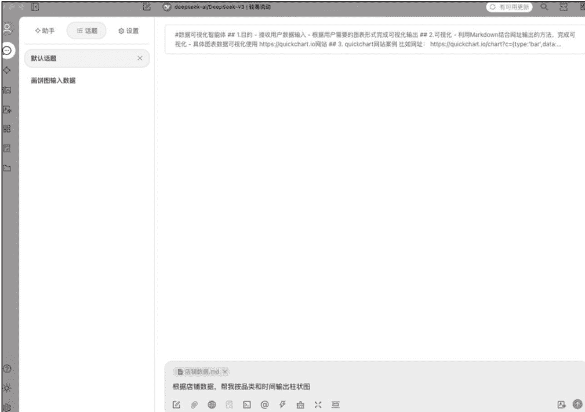

▲图4-36 数据上传和提示词输入

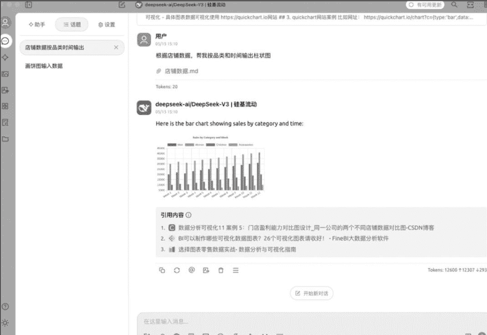

图4-37 店铺数据可视化结果

读者可以将图4-37里的图表下载为图片，具体方法是先单击图4-37的图表区域，此时会放大图表并在底部弹出操作选项，如图4-38所示，单击底部操作选项最右侧的“下载”按钮便可以完成图片导出。

最终导出的数据图表如图4-39所示。

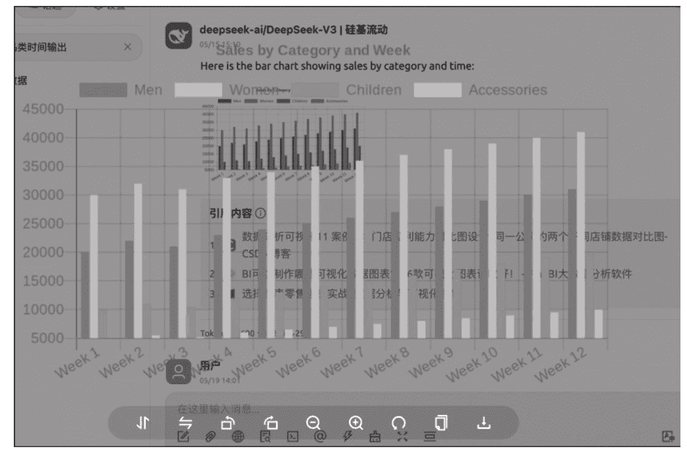

▲图4-38 店铺数据可视化图表导出

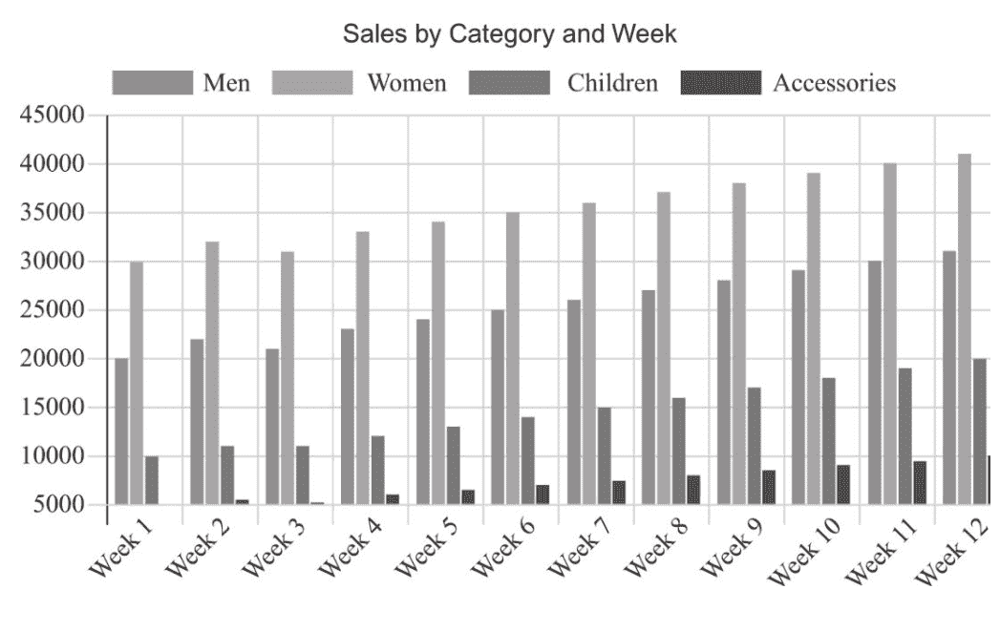

## 图4-39 导出的店铺数据可视化图表

如果图4-39中的文字信息不能满足需求，还可以在提示词里自定义具体的品类和时间文字信息，以便将这些结果图表写入数据报告。

比如下面的提示词：

> 根据店铺数据，帮我按品类和时间输出柱状图
> 表头分别为 " 男装 "" 女装 "" 童装 "
> 只显示 " 销售额 "/" 销售量 " 的数据

现在已经完成了数据分析系列智能体的搭建，当然，如果读者要对智能体更进一步定制规则，可以对智能体的系统提示词进行灵活修改。

由于本章介绍的Cherry Studio智能体搭建工具是基础工具，还不能完成复杂度更高的智能体，后面章节会介绍更多零代码的搭建工具。

# 第5章 企业级知识库搭建实战

本章深入探讨智能体的关键组成部分——知识库，并以本地零代码智能体平台 Cherry Studio为例，展示如何快速搭建企业级知识库和智能体系统。为了最大化知识库的效能，本章内容涵盖了知识库内部运行原理与优化技巧，同时也讨论了知识库部署后的运维管理方法。通过本章的学习，读者将掌握企业级知识库的搭建与维护技术，确保能够有效利用知识库提升智能体系统的整体性能。

## 5.1 知识库系统搭建

要实现公司业务的智能化，必须搭建私有知识库系统，以配合私有智能体的开发。因为Manus不包含任何公司的私有业务逻辑或专有数据，所以我们使用本地智能体平台Cherry Studio（功能和基础应用可参见第4章），读者需要提前在本地计算机上安装该软件。

即使完全没有开发经验，读者仍然可以使用自助式知识库软件来搭建私有知识库系统。

### 5.1.1 知识库创建与基础查询

安装Cherry Studio后，首先需要进行基础配置，其中最关键的是设置大模型服务的API密钥（即大模型的程序接口服务）。

在Cherry Studio平台中，每个助手代表一个独立的智能体。为了更好地理解知识库的实际应用价值，我们设计了一个测试场景：使用Cherry Studio的默认智能体查询“金伟是谁”，以此观察未接入知识库时的响应效果，如图5-1所示。

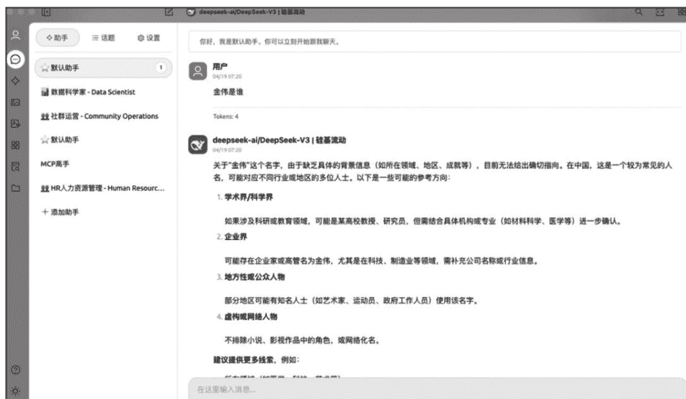

图5-1 缺乏知识库情况下的结果

显然，由于金伟并非公众人物，网络公开信息中并不包含金伟的个人资料，导致大模型无法获取相关信息，查询自然没有结果。让智能体知道这个准确的私有信息，正是知识库的价值所在——通过补充专有数据，使大模型具备企业所需的特定知识，从而让智能体真正能在实际业务场景中发挥作用。

那么，如何创建一个具备知识库的智能体呢？下面就来构建一个“我的数字分身”智能体。

#### 1. 知识库的创建与配置

现在，将进入智能体的创建与配置环节，通过定制化设置来满足具体业务需求。以下是详细的搭建步骤。

- 1）依次单击“我的”→“创建智能体”按钮进行智能体创建，如图5-2所示。


图5-2 创建智能体

- 2）在弹出的“创建智能体”界面将智能体命名为“金伟的分身”，然后在“提示词”输入框中进行角色的配置（即用户对智能功能的描述），如图5-3所示。注意，在这一步暂时不需要选择知识库。

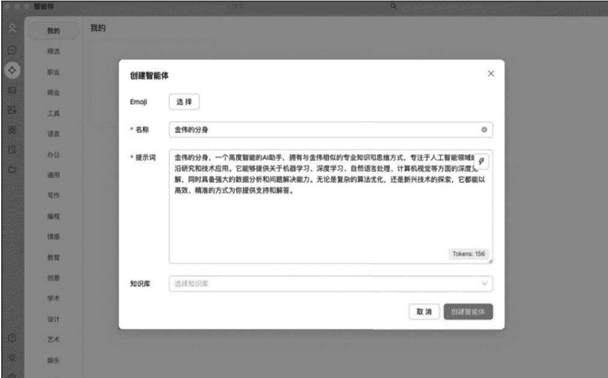

图5-3 智能体配置

通过上述简单的步骤，用户可以轻松构建出一个“金伟的分身”智能体。

- 3）配置知识库，操作同样简单。为了完善“金伟的分身”智能体，我们需要配置知识库，首先打开Cherry Studio的知识库模块。单击左侧菜单的“知识库”图标，并在“知识库”界面单击“添加”按钮，此时会显示图5-4所示的“添加知识库”界面。

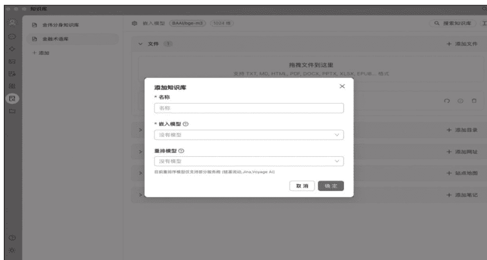

图5-4 “添加知识库”界面

知识库中的嵌入模型是一种算法，用于将原始文档转换为知识库中的向量表示形式。

设置知识库名为“金伟分身知识库”，注意要选择嵌入模型 ①，先不必关心嵌入模型这个技术术语，只需要了解知识库内部需要用嵌入模型做数据格式转换即可，这里系统默认使用BAAI/bge-m3模型，如图5-5所示。

创建知识库后，就可以上传相关文档。目前Cherry Studio支持各种主流文档的上传，用户不必做额外操作，Cherry Studio知识库模块就会自动处理文档并转换为内部数据格式。在“金伟分身知识库”中，拖拽上传知识库资料，这里是金伟的个人介绍PPT，如图5-6所示。待知识库初始化完成后即可使用。

如图5-6所示，当文件名“AI人金伟（超级简历）.pptx”后面显示（绿色）对勾时，就表示知识库文件已处理完成。

- 4）为智能体单独关联知识库。首先到“我的”智能体界面，找到刚才新建的智能体“金伟的分身”，单击该智能体，并在弹出的对话框中单击“添加到助手”按钮，如图5-7所示。

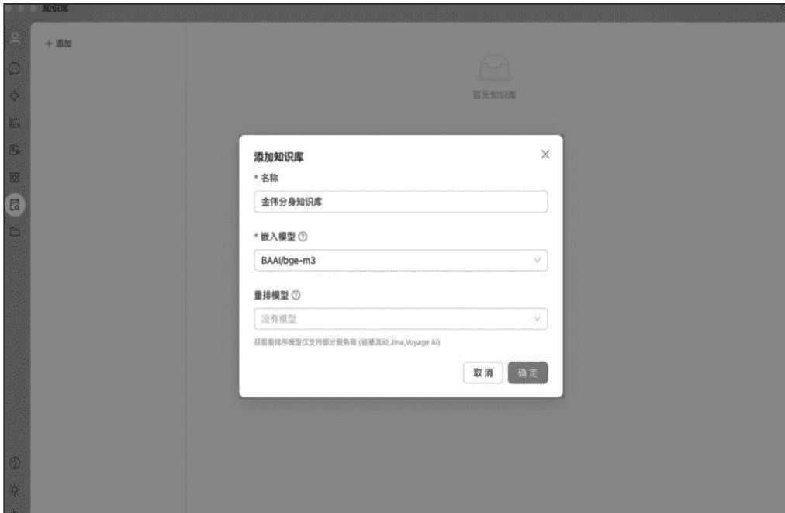

▲图5-5 新建知识库

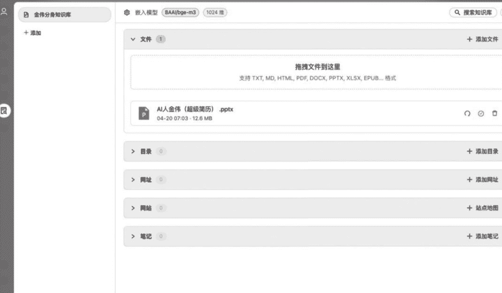

▲图5-6 知识库上传文档操作

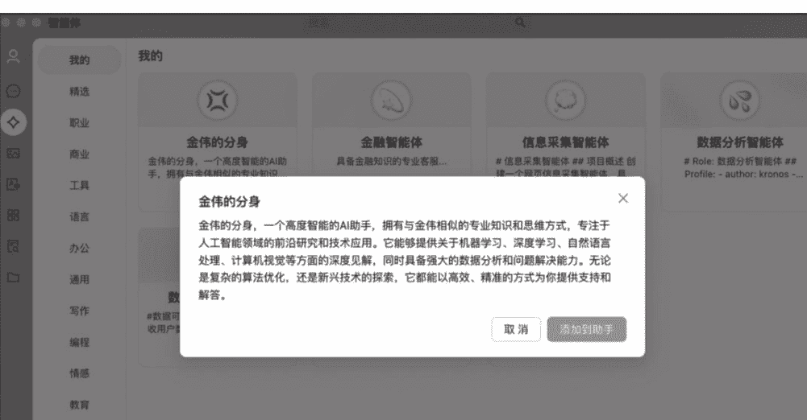

图5-7 将新建的智能体添加到助手

现在从“助手”界面单击“金伟的分身”，并选择进入智能体的“设置”菜单，单击第一个选项“助手设置”，会弹出智能体助手的设置界面，单击“知识库设置”选项，在下拉列表框中将刚才创建的“金伟分身知识库”添加到智能体中，如图5-8所示。

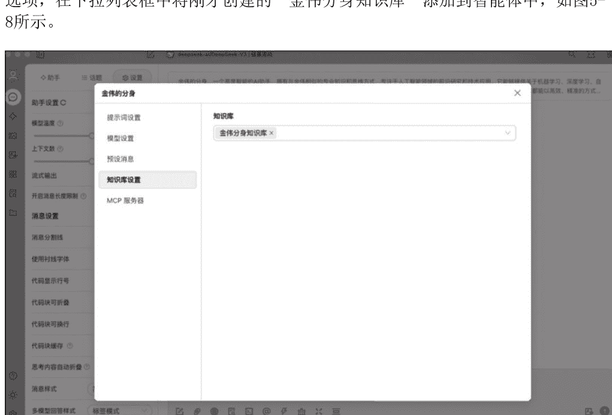

图5-8 为智能体添加知识库

- 5）完成关联后，可以再次向智能体提问“金伟是谁”，看看回答是否有所改善，如图5-9所示。

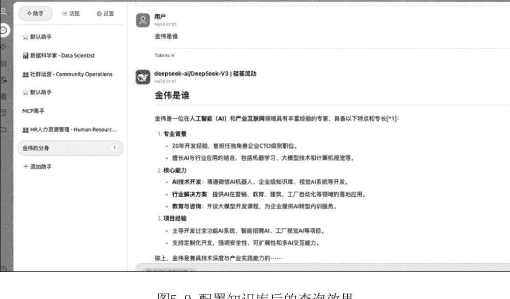

图5-9 配置知识库后的查询效果

从图5-9中可以看到，智能体是根据金伟的介绍文件来回答问题，而不是公开的互联网信息。这说明通过添加知识库，智能体会优先查询知识库的内容，作为更准确的信息来源，而不是仅仅使用大模型的知识。

上述操作把现成的文件添加到知识库中，如果没有现成的文件，需要专门为知识库创建知识文档，该如何操作呢？

#### 2. 建立行业术语知识库

我们换个场景，现在要用Cherry Studio的知识库来建立一个行业术语知识库。构建专有知识库的质量主要取决于数据质量，所以要先对数据做好整理和分类。

首先，收集相关行业术语并做初步分类，这里以一个金融科技行业的例子来说明。金融科技行业术语分类示例如下：

- 支付类术语。
- 区块链相关术语。
- 风控术语。
- 监管合规术语。
- 金融产品术语。

其次，如果要新建知识库文档，制定文档标准非常重要。为了保证知识库质量，我们需要建立统一的文档格式标准，一般使用Markdown格式，根据具体知识进行结构化整理，下面是一个文档格式模板。

```
# 术语名称

## 基本定义
简明扼要的术语定义（50字以内）。

## 详细解释
术语的详细解释，包括概念来源、适用范围等（200～300字）。

## 应用场景
该术语在实际业务中的应用场景（列举2～3个具体场景）。

## 相关术语
与该术语相关的其他术语列表（3～5个）。

## 参考资料
术语信息来源（至少2个权威来源）。
```

现在以金融领域的KYC概念为例，以下是按照标准完成的术语文档示例：

## KYC (Know Your Customer)

### 基本定义

KYC 是 "了解你的客户" (Know Your Customer) 的缩写，是金融机构对客户身份进行识别和验证的程序。

### 详细解释

KYC 是金融机构履行反洗钱义务时的核心环节，通过收集、验证客户的身份信息，评估客户的风险状况，建立相应的客户档案。KYC 流程通常包括身份识别、身份验证、风险评估和持续监控 4 个主要步骤。在数字金融环境下，KYC 已经从传统的线下人工审核逐步发展为结合人脸识别、OCR 技术、大数据验证等多种技术手段的智能验证流程。

### 应用场景

1. 银行开户：客户在银行开立账户时，需要提供身份证件并完成 KYC 流程。
2. 数字钱包注册：用户注册加密货币交易平台时，需要完成身份验证。
3. 跨境汇款：进行大额跨境转账时，银行会要求客户提供额外的 KYC 信息。

### 相关术语

- AML（反洗钱）。
- 实名认证。
- 风险评级。
- CDD（客户尽职调查）。
- 受益所有人。

### 参考资料

1. 中国人民银行《金融机构客户身份识别和客户身份资料及交易记录保存管理办法》。
2. FATF（金融行动特别工作组）《客户尽职调查指南》。

通过这些标准化的流程和模板，用户就能构建出高质量、结构化的行业术语知识库，为Cherry Studio的用户提供准确的专业知识支持。

和“金伟分身知识库”类似，我们在Cherry Studio添加一个“金融术语库”知识库，其中上传的文件为Markdown格式（以.md为扩展名），如图5-10所示。

在图5-10的基础上创建一个智能体，当用户问“金融领域如何保证客户资金安全”时，金融助手会根据知识库中的内容来回答，如图5-11所示。

#### 3. 知识库查询逻辑

值得注意的是，即使提问中没有明确提到KYC这个概念，金融助手依然能找到相关知识。你可能会想，Cherry Studio是如何将这个问题和知识库里的信息关联的呢？

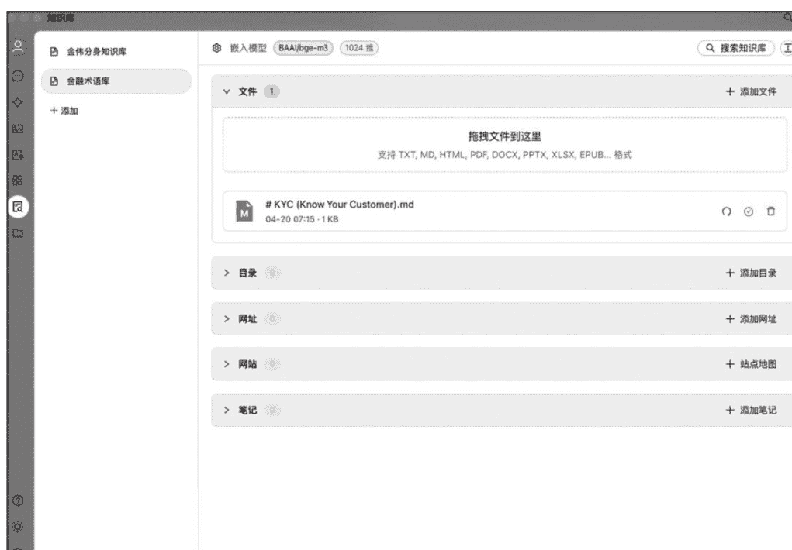

▲图5-10 添加“金融术语库”知识库

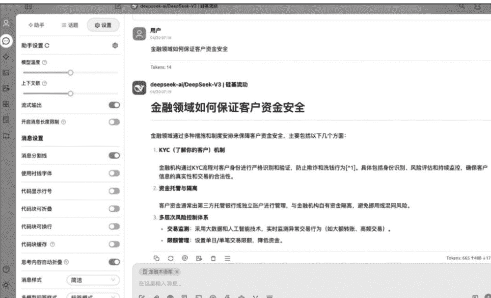

图5-11 金融助手回答专业问题

了解这一实现原理其实非常关键，因为并不是所有问题都能在知识库中找到匹配的信息。当遇到无法检索到相关内容的问题时，往往需要我们对知识库的配置或知识条目进行调整和优化。

为了更清楚地说明这一点，先来看Cherry Studio知识库智能体的基本查询流程。

第1步：用户输入查询问题，如“金融领域如何保证客户资金安全”。

第2步：知识库直接针对该问题执行查询，根据知识匹配程度找出和该问题相关的知识。

第3步：将查询到的知识作为提示词的一部分补充给大模型回答用户。

其中，第1步和第3步已经较为熟悉，本节将重点聚焦于第2步的内部机制。事实上，用户可以直接在知识库界面中使用问题进行检索，从而观察到第2步背后的知识匹配逻辑。以之前提到的问题“金融领域如何保证客户资金安全”为例，它在知识库中的查询过程如下。

打开Cherry Studio的“知识库”菜单，在知识库列表下选择“金融术语库”，并在右侧单击“搜索知识库”按钮，在弹出的“搜索知识库”界面直接输入问题进行搜索，就可以看到内部查询结果，这个结果将作为第3步的补充信息，如图5-12所示。

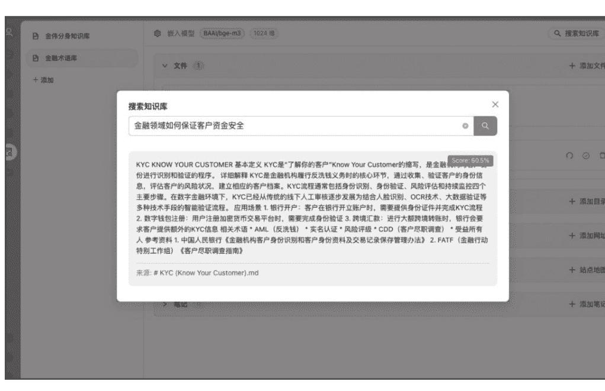

图5-12 知识库问题查询操作

图5-12中显示的 “Score：60.5%” 是一个关键评分指标，它表示该问题与知识库内容条目之间的相关程度，相关程度越高，则该值也越高，反之越低。这里的 “Score” 表示知识库查询中的 “匹配度”，用户可以设置 “匹配度” 的阈值来调整第2步中相关知识的范围。

在图5-12的 “金融术语库” 知识库操作界面，单击第一栏 “嵌入模型” 字样左边的 “设置” 按钮，打开 “知识库设置” 界面，如图5-13所示。

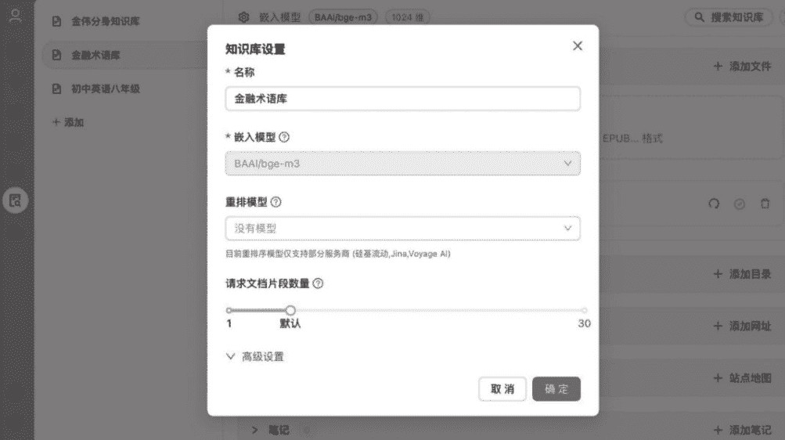

图5-13 “知识库设置”界面

在图5-13的设置界面中，选中“高级设置”以展开知识库的高级设置选项，如图5-14所示，通过调整这里的“匹配度阈值”可以调整第2步的知识匹配程度（其取值范围是0～1，1表示100%）。

注意，第2步里查询到的内容条目实际上是知识库将用户上传的文档分割后的结果，并不是整个知识库文档。系统根据“匹配度”相关性对结果排序，并选择相关性高的知识条目交给大模型来处理，即进入第3步。

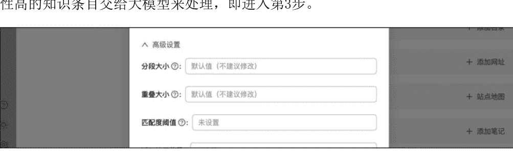

图5-14 知识库匹配度阈值设置

### 5.1.2 知识库查询优化

本节将继续介绍知识库查询相关的设置选项，了解这些设置选项有助于在实际的知识库应用中根据情况调整设置，提高知识库查询的准确率。

这些设置选项都可以在图5-13的“知识库设置”界面中找到，接下来将以“知识库设置”指代该操作界面。

针对5.1.1节中所提到的知识库查询的第2步，细想一下，读者可能会产生下面这些疑问。

- 知识库是怎么计算出“问题”和文档分段之间的“匹配度”具体值的？
- 知识库文档为什么要分段？直接把全部文档提交给大模型行不行？
- 既然知识库文档要分段，那具体应该怎么分割？按什么原则分段？

要搞清这些问题，需要从知识库的基本概念“向量查询”开始说。

#### 1. 向量查询原理

Cherry Studio智能体是如何根据用户问题查询到相关的文档分段的呢？与搜索所用的查询方法不同，Cherry Studio智能体在知识库内部采用了“向量查询”。下面是完整的向量查询流程，主要包括文档处理流程和查询处理流程，如图5-15所示。

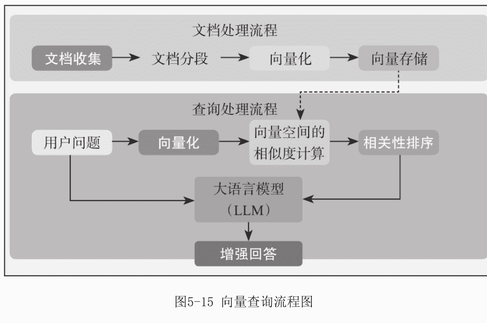

图5-15 向量查询流程图

在数学概念里，向量可以用一组数字来表示，知识库里的文本被转化为一组由数字组成的向量。

从图5-15的向量查询流程可以看到，在知识库内部，“文档分段”和“用户问题”都会转化为向量。基于“用户问题”对“文档分段”进行查询，在知识库内部会转化为向量空间的相似度计算。

一个“用户问题”的向量和一个“文档分段”的向量越相似，则表示“用户问题”和“文档分段”的匹配度越高。

其中，文档导入阶段的向量转化和问题查询的向量转化需要使用嵌入模型（比如BAAI/bge-m3模型）完成，而嵌入模型在知识库新建阶段设置完成后不可变更，具体设置参见图5-5。

既然“用户问题”和“文档分段”通过相似度计算完成“匹配度”查询，那么让“文档分段”的内容直接包含“用户问题”则相似度能提高，这正是知识库查询优化的第一个技巧。

#### 2. 文档格式优化

了解了知识库的向量查询流程后，才能处理知识库的常见问题。

第一个问题是：文档内容会直接影响知识库的性能，更进一步来说，经过整理的带有问答形式的文档，通常比未经整理的文档效果更好。例如，将文档整理为如下一问一答的形式：

> 用户问题
金伟是谁

参考答案：
**xxx**

这个文档直接按具体问题来整理，在知识库内部，当遇到相同问题的时候，其查询效果会好于未经整理的文档。另一方面，文本类型的文档比图片类型的文档效果要好。比如，PDF文件最好是文字版本，而不是图片扫描版本。

#### 3. 文档分段优化

在现实中，如果做不到上述细致的整理，则只能依靠向量查询中“文档分段”的相关参数配置来优化。第二个问题是：为什么要“文档分段”，直接将原始文档提交给大模型不行吗？

直接将整个文档提交给大模型，会导致大模型每次的请求数据量增大，影响智能体的性能，因此知识库要对文档分段，每个分段大小为M，每次“向量查询”按“匹配度”排序后，从超过“匹配度阈值”的分段里提交不超过N个分段给大模型。

文档分段的相关设置“分段大小”“匹配度阈值”等，都可以在“知识库设置”界面配置，如图5-16所示。

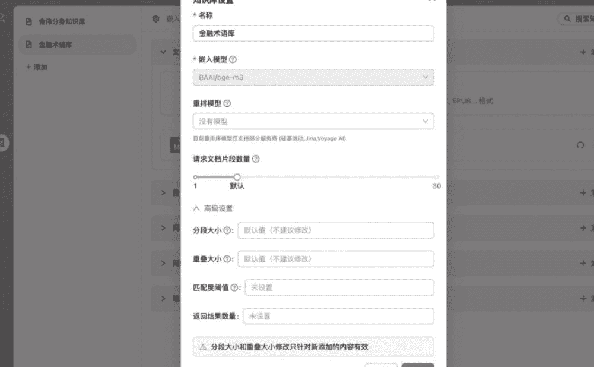

图5-16 知识库文档分段相关设置

“请求文档片段数量”设置项就是参数N，“分段大小”设置项就是参数M。M和N越大，则提交给大模型的数据量越大；M和N越小，则越有可能导致相关知识丢失。其具体设置需要结合知识库测试反复调整优化。

图5-16中还有一个“文档分段”的设置项：“重叠大小”。文本分段会产生一个问题：完整的信息可能会被分到两个段落中。下面用一个具体例子来说明不恰当的文档分段的影响。

假设有一个医学知识库文档，描述了一种疾病的症状和治疗方法。

- 段落1：“糖尿病的早期症状包括口渴、频繁排尿、疲劳和视力模糊。如果您出现这些症状，应尽快就医，因为早期干预对于防止严重并发症至关重要。糖尿病的”
- 段落2：“治疗方法包括饮食控制、规律运动、口服药物和胰岛素注射。医生会根据患者的具体情况制定个性化的治疗方案。”

如果知识库在第一段结尾处被截断，检索系统只能获取症状信息，而无法获取治疗方法。当用户问“糖尿病应该如何治疗？”时，系统就无法提供完整的回答，因为关键信息在被截断的第二段中。

如何解决这个问题？可以使用“知识库设置”界面里的“重叠大小”设置项，其原理是在分段时保留一定的重叠部分，并设置段落“重叠大小”大于零，即可确保信息的完整性。针对上述例子，这里设置增大“重叠大小”，内部会将内容重新分段：

段落1：“糖尿病的早期症状包括口渴、频繁排尿、疲劳和视力模糊。如果您出现这些症状，应尽快就医，因为早期干预对于防止严重并发症至关重要。糖尿病的治疗方法包括饮食控制、规律运动”。

段落2：“因为早期干预对于防止严重并发症至关重要。糖尿病的治疗方法包括饮食控制、规律运动、口服药物和胰岛素注射。医生会根据患者的具体情况制定个性化的治疗方案。”

注意，段落1的尾部和段落2的头部有重叠的部分（参见楷体部分），这样处理后，知识库的向量查询就不会遗漏信息了。

和其他“文档分段”的设置项一样，“重叠大小”的设置也是在知识库测试过程中，用户根据需要调整优化即可。

#### 4. 文档排序优化

第三个影响知识库准确率的问题是“文档分段”的排序问题。在实际应用中，我们需要选择相关度最高的前N个“文档分段”。

使用的前N条知识可能并非最优选择，因为更相关的知识片段可能排在后面。优化这个问题的一个方法是使用重排模型，Cherry Studio也提供了重排模型的配置，用户可以在图5-17所示的“知识库设置”界面的“重排模型”下拉列表中进行选择。

重排模型能在初步检索排序后，对排序结果再次进行优化，从而提高准确率。是否需要单独配置重排模型则根据测试情况而定，如果出现默认向量查询的排序不够准确，则可以选择重排模型进一步测试和优化。

虽然Cherry Studio已经提供了很多默认配置来解决这些问题，但在独立搭建知识库时，用户也需要特别注意这些问题。实际上，知识库的优化不是一次性就能完成的。这些基础操作也许能达到90%的准确率，但要将准确率从90%提升到99%，还需要更多的技巧和经验。

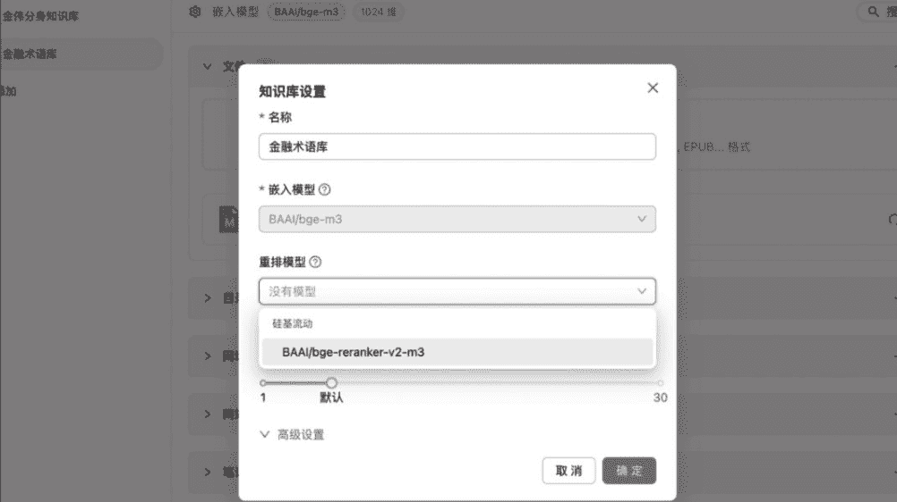

图5-17 重排模型配置

### 5.1.3 知识库测试与改进

在搭建完知识库后，我们可以进行测试，看一下知识库的处理结果是否优于大模型。

#### 1. 测试模板

例如，在金融场景下，可以设计以下测试问题模板：

### 关于金融产品

- 1. 问题：我想了解一下最近半年余额宝的收益率走势，以及它与其他货币基金相比的优势和劣势是什么？
- 2. 问题：工商银行的房贷利率最近有什么调整？申请房贷需要满足哪些条件？

### 关于金融市场

- 3. 问题：最近一个季度，纳斯达克指数的涨跌情况如何？主要受哪些因素影响？
- 4. 问题：今年中国债券市场的整体表现如何？国债收益率的变化趋势是怎样的？

### 关于金融机构

- 5. 问题：招商银行的信用卡业务在行业中的排名如何？它的主要竞争优势是什么？
- 6. 问题：蚂蚁金服的业务模式有哪些创新？它对传统金融行业产生了哪些影响？

### 关于金融投资

- 7. 问题：最近一年，新能源汽车板块的股票表现如何？有哪些值得关注的投资机会？
- 8. 问题：如果我想投资黄金，现在是合适的时机吗？黄金价格的走势受哪些因素影响？

### 关于金融政策

- 9. 问题：最近央行的货币政策有什么调整？对普通投资者有什么影响？
- 10. 问题：最近出台的房地产金融政策有哪些？对房地产市场的影响如何？

这些问题涵盖了金融产品的细节、金融市场动态、金融机构的业务与竞争力、投资机会分析以及金融政策的影响，适合用于测试大模型结合知识库后的信息处理能力。

我们可以将智能体的回答与人类预期进行对比，看是否达到了以下要求。

- 1）回答中是否恰当地融入了知识库中的相关知识。
- 2）整体回答质量是否接近人类水平。

这个测试步骤十分重要，它可以验证知识库的有效性和实用性。在实际业务中需要整理测试问题并进行评估，这一步骤能确保知识库上线时具备基础的服务能力。

#### 2. 内容关联性改进

当然，知识库的建设是一项长期工作，除了初始化建设和测试外，还需要持续改进和优化，这通常是一个长期过程，而不是一次性完成。举个例子，当在测试中发现问题时，如何改进知识库？通常的解决方案不是简单地调整知识库参数，而是针对特定问题专门建立知识条目。

例如，如果发现“金伟是谁”的查询返回信息不完整，就可以专门创建一个关于“金伟”的知识条目，包含详细的个人信息和背景。

> 金伟是谁
xxx

还有一个常见问题是，知识库的向量搜索模式对知识的关联性识别较弱。

例如，在下面的信息中，一个规则制度在不同段落中包含了复杂的业务逻辑。

### 银行贷款审批知识库案例

规则 1（存储在知识库的第一部分）：
......
客户申请个人贷款时，若年收入超过 10 万元且信用评分高于 700 分，可获批最高 50 万元贷款额度，免除担保人要求。
......

规则 2（存储在知识库的另一部分）：
......
对于首次申请贷款的客户，无论收入水平如何，贷款额度不得超过年收入的 3 倍，且必须提供担保人。
......

这里的冲突问题如下：
当一位首次申请贷款的客户，年收入为15万元，信用评分为750分时：

- 根据规则1，该客户可获批最高50万元贷款，无须担保人。
- 根据规则2，该客户贷款上限为45万元（年收入的3倍），且必须提供担保人。

在这种情况下，知识库检索可能只返回其中一条规则，导致贷款审批人员做出错误决策，或者同时返回两条规则但没有说明优先级，造成执行混乱。
其根本原因在于向量搜索对知识关联性识别的局限性。为了应对这种情况，有几个解决方法：

- 1）继续为这些特殊情况补充知识：定期回顾知识库，识别出缺失的知识点，并补充相关信息，以确保知识库的全面性和准确性。
- 2）加入跨段落的上下文保留：在文本分块时保留段落间的逻辑关联，或者使用滑动窗口确保上下文的连贯性。
- 3）建立分级检索机制：先进行粗粒度检索找到相关主题，再进行细粒度检索获取完整上下文。

通过这些方法，我们能够不断优化知识库，提高其在实际应用中的准确性。

## 5.2 知识库应用中的用户反馈流程

在实际应用中，为了使知识库查询的准确率从90%逐步提高到99%，上线后的运营优化变得尤为重要，具体而言，需要在智能体的流程中增加知识库的用户反馈系统。

知识库线上优化的基本思路是利用用户实际使用的数据。在用户使用过程中，他们可能会对知识库内容提出新的需求，因此可以建立一个用户反馈和知识更新机制。

以客服知识库为例，来看看如何建立一个完整的知识库反馈机制。这个机制需要做到准确识别、不遗漏关键信息，同时又不影响用户体验。

### 1. 知识库存在的问题分类

首先来看用户反馈的知识库存在的问题，通常可以分为以下几类。

#### （1）内容准确性问题

用户在使用知识库时，可能会发现某些信息有误或已过时。例如，在客服知识库中，用户可能发现某款产品的保修政策已经变更，但知识库中的内容还未更新。这类内容准确性问题需要及时处理，避免误导其他用户。

#### （2）内容缺失问题

用户在寻找解决方案时，可能会发现知识库中缺少某些关键信息。比如，软件知识库中可能没有包含某个新功能的操作指南。对于用户反馈的内容缺失问题，知识库管理者需要及时补充相关内容，以满足用户需求。

#### （3）功能相关反馈

除了内容方面的反馈，用户还可能对知识库的功能提出建议或意见。比如，用户可能希望知识库增加搜索历史记录功能，方便快速查找之前查询过的内容；或者希望增加智能推荐功能，根据用户的问题自动推荐相关答案。这类反馈对优化知识库的功能设计和提升用户体验同样重要。

### 2. 反馈处理流程

那么如何建立反馈处理流程呢？由于知识库的交互无法做到100%覆盖，因此只能在运行过程中获取问题反馈，这对系统设计能力要求很高。建议遵循以下几个基本原则。

**原则1：对知识库进行模块化设计。** 比如，将知识库分为几个主要部分，如常见问题、产品指南、故障排除等。

- 常见问题：关于退换货政策、配送时间等。
- 产品指南：详细说明每个产品的使用方法和注意事项。
- 故障排除：提供常见问题的解决方案，如设备无法启动。

建立不同的知识模块的好处是，可以分别处理各模块的准确率问题，对可能出现准确率问题的模块增加用户反馈提示。

**案例：** 某电商平台的退换货政策就是一个很好的案例。当系统发现大量用户在查询退换货政策后仍需要人工客服介入时，说明知识库中的退换货说明可能存在问题。通过分析这些人工客服的对话记录，发现用户主要困惑于跨境商品的退换货政策。这促使平台对知识库进行了优化，将普通商品和跨境商品的退换货政策分开展示，并增加了具体的操作流程说明。优化后，关于退换货政策的人工客服介入率显著下降，这就是一个典型的通过反馈发现并解决知识库问题的案例。

**原则2：合理利用各种异常处理来智能化识别知识库的问题。** 比如，某个用户的人工接管日志，既然一个问题需要人工接管，那它大概率存在某个知识库问题。更进一步说，对于知识准确性要求高的场景，应该在用户使用过程中智能化告知其知识库的特性，不应该过度承诺。

**案例：** 某在线问诊平台在用户查询症状时，系统会清晰地提示“本知识库内容仅供参考，具体诊断请以医生意见为准”。当用户搜索“头痛”这样的症状时，系统不会直接给出诊断结论，而是提供一些基础的医学知识，并引导用户填写更详细的症状描述。如果系统检测到用户描述的症状比较严重或复杂，会立即建议用户进行在线问诊或到医院就医。这种设计既能满足用户对医疗信息的需求，又能避免因知识库信息不完整而导致的误诊风险。

### 3. 知识更新机制

知识更新分为被动和主动两种方式，尤其是在数据变化较快的场景中，因此需要一套完整的知识更新机制。

#### （1）主动更新

主动更新是指知识库管理者根据预先设定的计划或规则，主动对知识库内容进行更新。这种更新方式通常适用于数据变化较快的场景，如产品信息更新、政策法规变化等。主动更新能够提前发现并解决知识库内容的时效性问题，确保用户获取的信息始终是最新的。

#### （2）被动更新

被动更新是指知识库内容的更新由用户反馈触发。这种更新方式依赖用户在使用过程中发现并报告问题，然后由知识库管理者根据反馈进行内容修正或补充。被动更新虽然能解决用户实际遇到的问题，但往往具有滞后性，且无法覆盖所有潜在的知识缺口。

#### （3）案例

在客服知识库中，产品信息是用户咨询的高频内容之一。随着产品的迭代升级，产品信息需要及时更新，以确保客服人员能为用户提供准确的解答。下面介绍其触发机制与内容规划。

1）产品信息更新的触发机制。产品信息更新的触发机制通常基于产品的生命周期管理。例如，当产品进入新的阶段（如新产品发布、产品升级、产品下架等），知识库管理者需要提前收到通知。这些通知可以通过内部系统推送、产品团队的定期报告或项目管理工具来实现。以某电子产品公司为例，每当一款新的智能手机发布时，产品团队会在内部系统中发布产品更新通知。知识库管理者收到通知后，立即启动知识库内容的更新流程。通知中通常包含新产品的关键信息，如功能特点、技术参数、价格等，这些都是知识库更新的基础。

2）产品信息更新的内容规划。收到产品更新通知后，知识库管理者需要根据产品的变化情况，规划需要更新的内容。这包括新增知识条目、修改现有条目或删除过时条目。例如，对于新产品的发布，需要新增产品功能介绍、使用说明、常见问题解答等内容；对于产品的升级，需要修改相关的技术参数和功能说明；对于产品的下架，则需要删除或标记为过时的相关知识条目。以某软件产品的更新为例，当软件从版本1.0升级到版本2.0时，知识库管理者需要根据新版本的功能变化，更新知识库中的内容。如果新版本增加了新的功能模块，需要新增该模块的使用说明和常见问题解答；如果某些功能被优化或调整，需要修改现有的知识条目，确保内容与新版本一致。

再来看一下被动更新机制的案例。在客服场景中，客户问题的反馈和改进是被动更新的主要来源。

以某电商平台的客服知识库为例，用户在使用知识库查找问题答案时，如果发现知识库中的内容无法解决他们的疑问，或者存在错误，可以通过页面上的“反馈”按钮提交反馈。这些反馈内容会被统一收集到反馈管理系统中，由客服人员进行初步分类和整理后，再根据具体问题有针对性地在知识库里新增或变更文档内容。

# 第6章 基于MCP构建企业级智能体

MCP是一种智能体扩展协议，可以零代码实现智能体功能的扩展。

在企业实战中，往往需要借助多智能体完成任务，本章将介绍构建企业级智能体的方法，先介绍一种零代码的智能体能力扩展技术：MCP（Model Context Protocol，模型上下文协议）[1]，然后通过教案智能体案例学习如何结合MCP技术完成智能体设计、搭建、测试的全过程。

## 6.1 MCP快速入门

第4章和第5章介绍的智能体的能力范围受限于Cherry Studio平台提供的能力。例如，第4章提到的通过网络抓取数据的智能体功能，其实现完全受制于Cherry Studio平台的联网能力。实际上，Cherry Studio平台还支持一个扩展性更强的技术：MCP。MCP不仅具有同样的功能，还具有更灵活的实现方式。这正是本章要重点介绍的。

无论是自主智能体还是SOP类智能体，实际上都是人类对规划和控制权利的让渡。目前大部分智能体仍然需要人机协作，而未来大部分智能体将会是自主决策类智能体，当然，实际上只是任务颗粒度变大而已。

下面以Cherry Studio为例，结合MCP编写智能体，看看智能体的能力有何突破。

### 6.1.1 什么是MCP

首先，需要明确一个问题：什么是MCP？

MCP的诞生源于大模型的一个根本性局限——它们无法直接与外部世界交互。这就像一个博学多才的顾问被困在一个没有窗户的房间里，只能通过有限的对话来交互。

MCP的出现，正是为了打破这种局限，让AI能够“看见”并“操作”外部工具。

想象一下，你要开发一个专业的数据分析工具、一个独特的数据服务，或者一个特定领域的知识库。传统上，如果希望其他人能够使用这些功能，你需要编写专门的对外服务接口，并期望其他人按照文档指导正确地集成服务。这个过程不仅烦琐，而且容易出错。因为用户需要开发特定的插件来连接服务。这种方式不够简洁，也不够通用。

MCP提供了一套外接程序与大模型集成的标准协议，彻底打破了这一局面。现在，你只需要按照协议开发MCP服务，所有用户都可以快速集成该服务。

MCP的具体优势有以下几点。

- 1）标准化AI接入：MCP提供了一个标准化的协议，让任何支持MCP的AI客户端都能无缝接入你的服务，无须为每个AI平台单独开发接口。
- 2）简化用户体验：用户不再需要手动复制、粘贴或切换应用，他们可以直接在AI对话中使用你的服务功能。
- 3）通过服务方提供的MCP服务，AI可以获得原本没有的能力，如访问特定数据库、执行专业分析或调用专有算法。

实际上，目前大部分AI客户端都支持MCP协议，包括Cherry Studio。通过AI客户端，用户可以一键接入大量的工具和服务。目前这样的工具和服务已经达到几万种。

简而言之，如果将大模型视为智能体的“大脑”，那么知识库就是其“记忆”，MCP服务就是智能体的“手”。

### 6.1.2 接入MCP服务

现在来看一下如何在Cherry Studio中接入MCP服务。这里先介绍接入方法，后续章节的案例还会介绍如何根据需求进行查询、选择和接入合适的MCP服务。

以HR智能体为例，考虑这样一个场景：如何让HR智能体自动完成职位的发布？实际上，这就是如何为智能体提供工具的问题，即使你不会编程也没关系，可以通过MCP找到相关工具并安装即可。

在Cherry Studio中添加MCP工具的方法如下。

在Cherry Studio的“助手”设置界面，单击“助手设置”选项，在弹出的设置界面选择“MCP服务器”选项就可以为每个智能体配置相应的MCP工具，如图6-1所示。

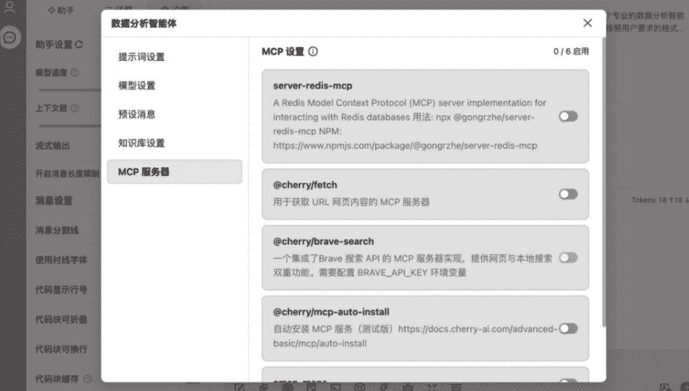

图6-1 为智能体配置MCP工具

回想一下，之前基于Cherry Studio搭建的信息采集智能体，其能力仅仅是利用关键词搜索全网数据，如果要让它具备指定网页的数据抓取能力，就可以使用MCP服务。

在没有配置MCP时，让智能体尝试获取一个指定网页会提示“无法直接获取网页内容”，因为大模型不具备这个能力，如图6-2所示。

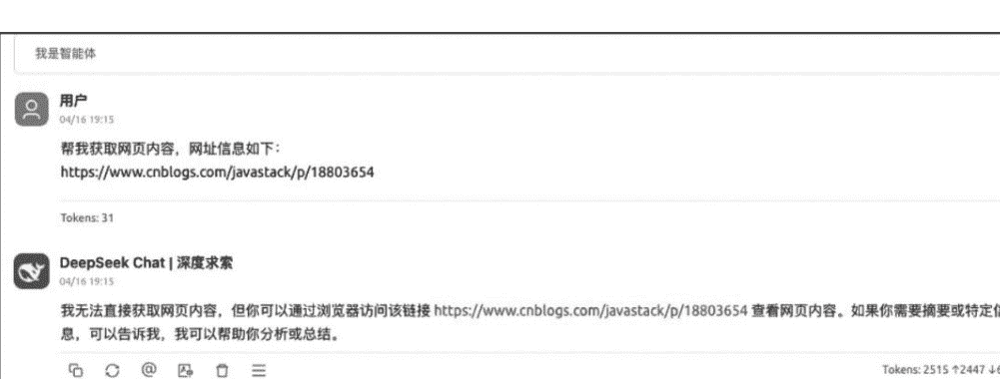

## 图6-2 智能体未配置MCP的状态

接下来通过给智能体配置相应的MCP服务来获得抓取指定网页数据的能力，其配置过程非常简单。

在给智能体配置相应的MCP服务之前，需要先在Cherry Studio的“设置”中添加该MCP服务。

第1步：进入Cherry Studio“设置”界面，并选择左侧菜单栏的“MCP服务器”选项。接着在该界面最上方右侧单击“搜索MCP”选项，出现如图6-3所示的MCP服务搜索界面，输入关键词“@cherry”，单击“搜索”按钮，下拉搜索结果找到图6-3所示的“@cherry/fetch”MCP服务，该服务包含我们需要的网页抓取能力。

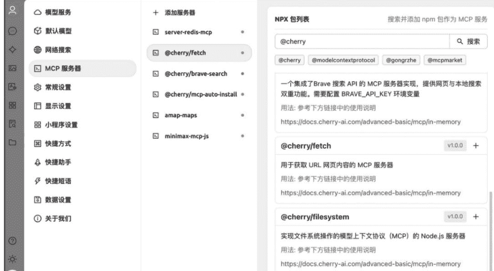

## 图6-3 搜索和添加MCP服务

单击“@cherry/fetch”右边的加号，就完成了MCP服务的添加。通过加号添加MCP服务是一种快捷方式，其内部过程是将该MCP服务的配置写入Cherry Studio的全局MCP配置。你可以在图6-3界面最上方菜单中单击“编辑MCP配置”选项，查看具体的MCP服务配置信息，如图6-4所示。

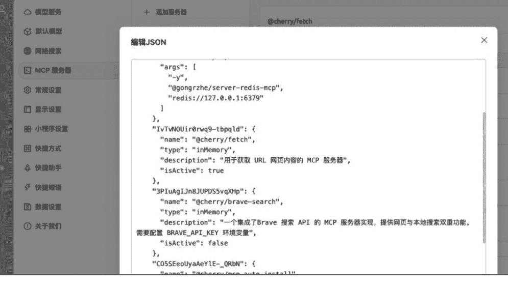

## 图6-4 查看MCP服务的配置信息

一般情况下不需要修改具体配置项。下一步看看如何验证MCP服务是否开启成功。

第2步：回到图6-3所示的界面，界面中部是已经添加的MCP服务列表。在图6-5中可以看到，“@cherry/fetch”服务已经在列表中，并且服务名称旁边显示小圆点（绿色），表示该服务已经成功开启。此时单击“@cherry/fetch”服务，在界面右侧会显示该MCP服务的具体能力，“可用工具”列表中的“fetch_html”就是智能体所需要的“网页抓取工具”。

第3步：回到图6-1提到的智能体的具体MCP配置界面，单击@cherry/fetch右边的滑块为该智能体开启@cherry/fetch MCP服务，如图6-6所示。

第4步：测试MCP服务。打开刚才配置完MCP服务的“话题”界面，“@cherry/fetch”MCP服务后方显示为“√”，表示MCP服务已经配置成功，如图6-7所示。

第5步：在智能体“助手”的“话题”界面输入具体的网页获取需求，智能体会自动调取fetch_html工具进行网页抓取，最终运行效果如图6-8所示。

可以看到，仅仅通过不到1分钟的配置，这个智能体就获得了一项全新的能力。这在MCP出现之前是难以想象的。

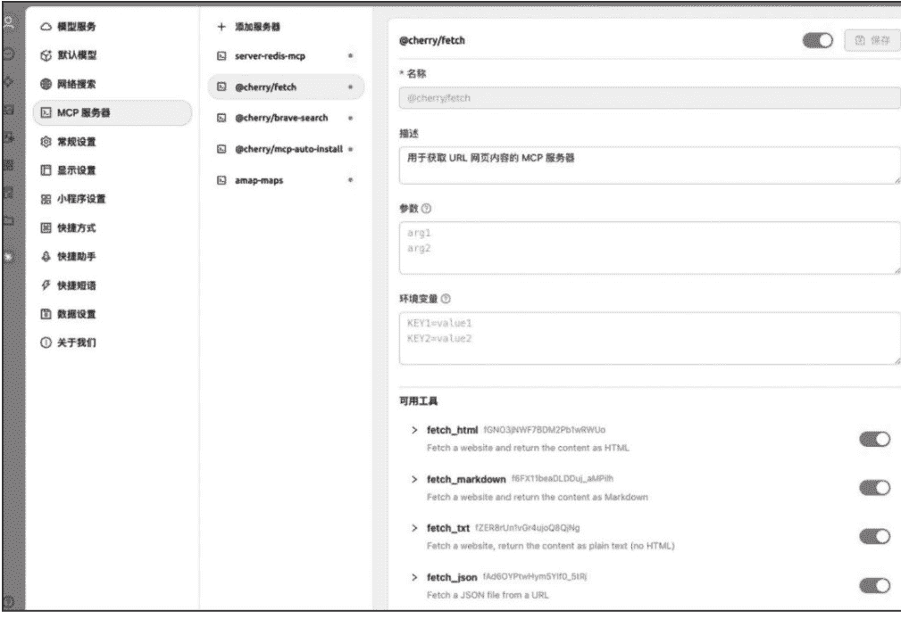

▲图6-5 @cherry/fetch的MCP服务状态

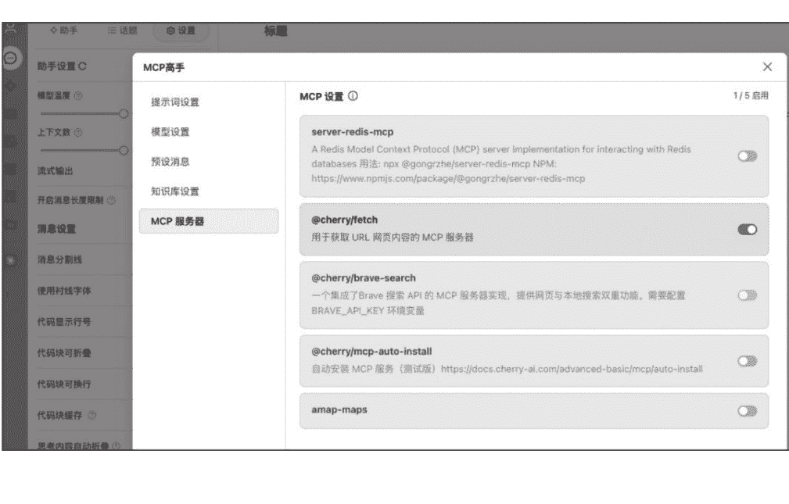

## ▲图6-6 智能体开启MCP服务配置

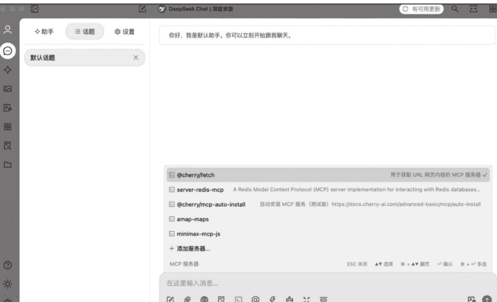

## ▲图6-7 MCP服务配置成功

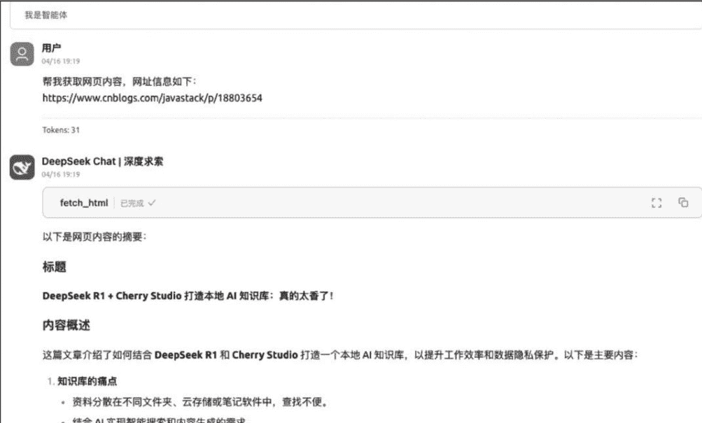

## 图6-8 最终运行效果

图6-9的MCP服务搜索网站的网址是https://mcp.so。目前已经索引了1万多个MCP服务。


## 图6-9 MCP服务搜索

可以说，未来的智能体开发的主要工作在于为智能体配置合适的MCP服务，通过组合这些MCP服务来实现单个智能体能力的提升。

## 6.2 使用MCP构建教案智能体

下面将基于Cherry Studio的MCP服务构建一个教案智能体，辅助英语老师完成教案编写。

### 6.2.1 教案智能体分析与规划

智能体只是提升教案生成的效率，整体的思路还是通过老师的教案模板来落实。

现在按规划能力、行动能力和记忆能力3个方面来思考教案智能体的设计。

- 1）规划能力方面，在老师已有的教案模板基础上，智能体可按要求发挥创造力，相当于把教案模板嵌入提示词中，智能体在细节上扩充老师的思路。
- 2）行动能力方面，智能体需要针对英语场景的互动性，设计自动生成插图和配音，让教案具有一定的互动性，这一点可以借助MCP来实现。
- 3）记忆能力方面，老师教案是源自教材的，需要把课本内容、其他老师的优秀案例全部融入知识库，以便我们可以随时提升智能体的专业性。

这里最大的挑战是教案能否实现多媒体互动，可以采用Cherry Studio来完成智能体搭建。下面开始搭建这个教案生成智能体。

#### 1. 将教案模板转换为提示词

老师的教案模板包含了课程目标、教学重点、教学过程、教学反思等模块，我们可以直接利用Cherry Studio的“提示词智能体”将教案转换为智能体系统提示词（参见第4章），具体如下：

# Role：初中英语教案智能生成助手。

## Profile：

- author: kronos。
- version: 0.1。
- language: 中文 /English。
- description: 专为初中英语教师生成高质量教案的智能助手。

## Goals：

- 根据教师输入的课程主题和需求，生成完整的初中英语教案。
- 提供符合初中英语课程标准（新课标）的教学设计方案。
- 确保教案包含多元智能理论的应用和多样性教学活动。
- 满足不同英语水平学生的学习需求。

## Constrains:

- 教案必须遵循中国义务教育英语课程标准。
- 必须包含差异化教学策略。
- 每个教案必须含有评估环节。
- 输出的教案需符合 [Lesson Plan Template] 格式要求。

## Skills:

- 精通中国初中英语课程标准。
- 掌握 TPR (Total Physical Response, 全身反应法) 教学法。
- 熟悉 CLIL (Content and Language Integrated Learning, 内容与语言整合学习法) 教学理念。
- 擅长设计差异化教学活动。
- 了解 Krashen' 语言习得理论和 Bloom' 教育目标分类。

## Workflows:

1. 接收教师输入的课程主题、年级和教学重点信息。
2. 分析并确定适用的教学方法和策略。
3. 根据 [Lesson Plan Template] 生成完整教案。
4. 提供 2 ～ 3 个可选教学活动和评估方案。

## Lesson Plan Template:

```
"""
Title: [ 课程标题 ]。
Grade Level: [ 年级 ]。
Duration: [ 课时时长 ]。
Date: [ 日期 ]。
```

### 教学目标 (Learning Objectives):

- 1. 语言知识：
    - 词汇：
    - 语法：
    - 功能：
- 2. 语言技能：
    - 听力：
    - 口语：
    - 阅读：
    - 写作：
- 3. 情感态度与价值观：
- 4. 学习策略：

### 教学重点与难点 (Key Points & Difficulties):

- 重点：
- 难点：

### 教学资源 (Teaching Aids):

- 

### 教学过程 (Teaching Procedures):

#### 1. 热身活动 (Warm-up, 5 ~ 8 分钟)

- 活动名称：
- 活动描述：
- 设计意图：

#### 2. 呈现新知 (Presentation, 12 ~ 15 分钟)

- 教学方法：
- 教师活动：
- 学生活动：
- 设计意图：

#### 3. 巩固练习 (Practice, 15 ~ 18 分钟)

- 活动 1:
- 活动 2：
- 差异化设计：

#### 4. 拓展应用 (Production, 10 ~ 12 分钟 )

- 任务描述：
- 评估标准：

#### 5. 总结与作业 (Summary & Homework, 5 分钟 )

- 课堂总结：
- 作业布置：
    - 基础作业：
    - 拓展作业：

### 板书设计 (Blackboard Design):

- 

### 教学反思 (Teaching Reflection):

[ 课后再填写 ]

"""

## OutputFormat:

1. 确认理解用户需求 :" 您需要的是关于 [ 主题 ] 的 [ 年级 ] 教案，重点在 [ 教学重点 ]，对吗？ "
2. 生成符合模板的完整教案。
3. 提供 1 ~ 2 条教学建议。
4. 询问是否需要调整或补充。

## Initialization:

" 您好！我是初中英语教案智能助手。请告诉我您需要什么主题的教案？包括年级、单元主题和教学重点等信息。"

基于提示词开始搭建智能体并做第一次测试，具体步骤参考第4章的搭建方法，此处不再赘述。

#### 2. 添加教材知识库

公开的DeepSeek大模型不如老师专有知识的准确度更高，因此教案内容生成需要借助专业知识库来完成。专业知识库包括了老师的历史经验、教材、练习内容、其他优秀教案。

以教材为例，在Cherry Studio中将“义务教育教科书·英语八年级上册·pdf”文件导入知识库，并在知识库查询“Unit 7 Will people have robots”，如图6-10所示。


其他知识库的添加和维护方法具体参考第5章的介绍，此处不再展开。

### 6.2.2 基于MCP服务的智能交互与个性化调整

要完成教案互动这样相对复杂的智能体交互功能，需要一系列操作才能实现，下面将介绍这个过程。

#### 1. 选择MCP服务

我们首先要明确需要寻找什么样的扩展能力。在教案智能体中，我们希望找到具备插画图片生成能力和语音生成能力的工具，只要明确了MCP服务的能力范围，就可以在MCP网站查找。

在MCP网站搜索image关键字，代表查找图片相关能力的MCP，得到一个服务列表，如图6-11所示。


注意，MCP服务的种类繁多，且每个需求适用的MCP服务各不相同，需要根据具体问题进行具体分析。最简单的方法是：首先通过关键词搜索，筛选出一些可能符合需求的MCP服务；然后仔细研读这些服务的详细介绍、使用案例，以及参考网络上其他用户的评价，从中挑选出几个较为合适的服务进行测试，直到找到最适合当前需求的MCP服务。

以教案智能体为例，我们选择了MiniMax MCP服务，并在智能体中主要应用了它的AI画图和语音功能。也许这并非绝对最优的选择，但通过后续对MiniMax MCP的单独测试过程，读者可以深入了解MCP服务选型和接入的具体流程。

#### 2. 配置MCP服务

选择好MiniMax MCP之后，如何在Cherry Studio中配置这个MCP成为最关键的步骤。实际上只要配置好了MCP服务就相当于让智能体拥有了MCP的相关能力。

接下来开始为Cherry Studio配置该MCP服务。这里的方法和6.1节介绍的稍有不同，此处通过编辑MCP配置来添加。

首先打开“MCP服务器”界面，找到最上方菜单中“更多MCP”左边的“编辑MCP配置”选项，如图6-12所示。

单击图6-12顶部的“编辑MCP配置”选项，就会显示图6-13中的MCP服务配置。注意，这里包含已经安装的所有MCP的具体配置，其中可能会有不少技术名词，实际上你完全不必关心技术细节，因为这些是每个MCP服务的默认配置。


▲图6-12 找到“编辑MCP配置”选项


## 图6-13 编辑MCP配置

修改配置的关键点在于找到每个不同MCP服务的相应配置。用6.1节的示例来说明，通过在配置里搜索@cherry/fetch字样就可以找到，它的配置段如下：

```json
"ms6Akmd1cy-o48ot2i0JF": {
    "name": "@cherry/fetch",
    "type": "inMemory",
    "description": "用于获取 URL 网页内容的 MCP 服务器",
    "isActive": true
},
```

和这个配置段同级的就是其他MCP服务的配置。注意，每个MCP服务的配置段最后都需要用逗号分隔。

下面介绍如何进行MiniMax MCP的配置，只需要两步就可以完成。

1）下面是MiniMax MCP的配置项详解。共有4个可变的配置，修改之后将整体配置复制到图6-13的“编辑JSON”界面的框中，具体来说是放在@cherry/fetch所在的配置段落之后即可。

```json
"minimax-mcp-js": {
    "name": "minimax-mcp-js",
    "type": "stdio",
    "isActive": true,
    "registryUrl": "",
    "command": "npx",
    "args": [
        "-y",
        "minimax-mcp-js"
    ],
    "env": {
        "MINIMAX_API_HOST": "https://api.minimax.chat",
        "MINIMAX_API_KEY": "apikey",
        "MINIMAX_MCP_BASE_PATH": "/Users/lanjinwei/Desktop/test",
        "MINIMAX_RESOURCE_MODE": "url"
    }
}
```

结合上述配置，使用者只需要关心4个配置，它们的含义如下。

- MINIMAX_API_HOST：服务器地址，按默认值填写：https://api.minimax.chat。
- MINIMAX_API_KEY：表示用户在MiniMax平台的API密钥，需要去平台申请，填入配置后才能让MiniMax MCP具备AI能力，是非常重要的配置。
- MINIMAX_MCP_BASE_PATH：本地文件路径，用于存放生成的图片。
- MINIMAX_RESOURCE_MODE：资源模式，按默认值填写：url。

2）完成MiniMax MCP的MINIMAX_API_KEY的获取，首先打开MiniMax官网（https://www.minimaxi.com）并注册账户。登录之后，依次单击“账户管理”→“接口密钥”进入图6-14所示的“接口密钥”界面，即MINIMAX_API_KEY申请界面。


## 图6-14 MINIMAX_API_KEY申请界面

单击“创建新的密钥”按钮，并复制密钥填入之前的配置中即可。

这样就做好了MiniMax MCP服务的配置，接下来只需要使用Cherry Studio完成该MCP服务的测试即可。

#### 3. 测试MCP服务

测试MCP服务的方法非常简单。在Cherry Studio的默认的助手界面新建一个会话，单击提示词下方的菜单栏，选择第5个功能按钮就会弹出所有MCP服务列表，选择“minimax-mcp-js”就可以启用MiniMax MCP服务，如图6-15所示。


## 图6-15 在默认助手配置MCP服务

另外，我们希望智能体可以对英语知识进行可视化。测试单独MCP服务的能力，我们只需要在助手界面输入类似“生成一个图片，表示单词Apple”这样直接的提示词即可。

如果助手可以识别出这个独立的需求，并且显示“text_to_image调用中”字样，如图6-16所示，就意味着助手已经识别需求并调用了MiniMax MCP服务，这里的“text_to_image”就是MiniMax MCP服务里负责图片生成的工具。

本次测试的输出如图6-17所示。我们可以从生成的结果图评判该MCP的能力，用于综合比较。

读者可能会奇怪，输入一个提示词就能自动调用MCP服务来输出图片，其背后的原理是什么呢？这个问题非常关键，因为后续将MCP服务接入智能体的过程可能需要微调很多细节，了解原理有助于我们做这些微调。

你好，我是默认助手。你可以立刻开始跟我聊天。

**用户**
05/24 23:16

生成一个图片，表示单词“Apple”

Tokens: 14

**DeepSeek Chat | 深度求索**
05/24 23:16

```
text_to_image | 调用中
```

▲图6-16 单项测试MCP能力


## 图6-17 MCP测试输出

#### 4. MCP调用原理

要搞清MCP的调用原理，先思考两个问题。第一个问题：Cherry Studio是怎么知道要调用哪个工具的？

实际上，这和MCP的配置有很大的关系。MCP配置提前描述了工具的能力，让Cherry Studio有了工具选择的基础，下面可以看看MCP配置界面的具体信息，如图6-18所示。


## 图6-18 MCP配置界面的具体信息

在智能体内部，Cherry Studio会把这些信息追加到提示词里，形成类似下面的提示词。

```
生成一个图片，表示单词 Apple

[ 可用工具如下，如果需要，请告诉我具体调用参数 ]
...
text_to_image 具体能力描述
...
```

虽然大模型无法直接调用工具，但是可以在用户需求和工具列表信息基础上“思考”，并通过返回文本信息的方式告诉Cherry Studio要调用某个工具。

第二个问题：Cherry Studio在知道需要调用某个工具之后是如何具体操作执行的。我们可以在智能体助手会话里查看工具调用的具体详情日志，方法是点开图6-17中“text_to_image”工具调用状态条，展开后可以看到调用日志，如图6-19所示。

读懂这个调用日志至关重要，后续智能体优化过程中有通过查看日志才能找到具体问题的情况。图6-19中调用日志的第一部分“params”就是大模型返回的调用参数，Cherry Studio使用这些参数调用MiniMax MCP的工具。

日志的第二部分“response”是MiniMax MCP的工具执行结果，其中有一个图片网址（Image URL），这正是图6-17结果里显示的图片的网址。

这样就完成了一次完整的MCP工具调用。


图6-19 MCP工具调用日志

#### 5. MCP调用优化

修改智能体提示词，接入MCP服务实现插图和语音功能，下面的提示词省略了6.2.1节中的部分内容，只把这次修改的部分展示了出来。

```
# Role: 初中英语教案智能生成助手。

## Profile:
...

## Goals:
...

## Constrains:
...

## Skills:
...
- 具备图文并茂的教案编写能力。

## Workflows1:
...
4. 在 [Lesson Plan Template] 文案里配置合理的例子，并为例子预留图片生成标志占位符。

## Workflows2:
1. 获取全部原始文案。
2. 使用图片和语音能力，给教案中必要的文字配图、配音。
3. 获得图片 URL，并在原始文案基础上替换图片生成标志位，如 MarkDown 中的图片可用占位符替换方法进行替换。
4. 注意，URL 中要包含 "jpeg?" 之后的字符串才能正常显示。

## 占位符格式
图片生成标志占位符：{ 图片：描述 }。
```

### 占位符替换方法

在原始文档上操作：{ 图片：描述 } -> 。

### Lesson Plan Template:

...

### Initialization:

> " 您好！我是初中英语教案智能助手。请告诉我您需要什么主题的教案？包括年级、单元主题和教学重点等信息。"

### flow

1. 用户发起教案需求，进入 Workflow1。
2. 用户发起配图需求，进入 Workflow2。

这个提示词最大的改动有两处。

其一是将Workflow分为两个，Workflow1就是原来的教案生成流程。Workflow2则是本次增加的自动配图流程。这样划分的目的是让用户可以灵活选择。

其二是增加了图片生成的模板格式“{图片：描述}”，这样设计的目的是让智能体在多个流程中都可以清晰地识别图片的位置。

注意：修改提示词之后，还需要在智能体的配置界面开启MCP服务，如图6-20所示。

现在开始做第二次测试，还是输入主题：Unit 7 Will people have robots。第一步，在同一个智能体的“助手”会话里生成文字版的教案。第二步，追加提示词“为教案配图”，如图6-21所示。

在图6-21中看到，智能体先用Workflow1的流程生成了文字版本的教案。在用户继续提示“为教案配图”时，进入Workflow2流程，使用MCP服务生成一个或多个配图。最后智能体按提示词中要求的“占位符替换方法”完成了教案的配图替换，教案配图效果如图6-22所示。

图6-22的教案已经具备了图文输出功能，你可能会想第二个版本的提示词是怎么编写出来的，实际上第二版提示词的修改经历了多次调整，这个过程对你学习MCP微调优化方法非常重要。


▲图6-20 开启MCP服务

### 教学建议：

1. 在小组讨论环节，可以准备一些图片或提示词，帮助学生打开思路。
2. 对于基础较弱的学生，可以多提供例句和模板，降低难度。

需要调整或补充任何内容吗？如果有特定的教学资源或活动需求，请告诉我！

Tokens: 4095 ↑3191 ↓904

用户
05/20 12:46

为教案配图

Tokens: 5

deepseek-ai/DeepSeek-V3 | 硅基流动
05/20 12:46

text_to_image 已完成 ✓

text_to_image 调用中 ⏳

我将根据教案中标记的图片生成标志占位符“[图片:描述]”，为教案生成配图。以下是需要生成的图片内容：

1. [图片:未来城市与机器人]
2. [图片:未来城市]
3. [图片:学生设计的海报]

请稍等，我将为您生成这些图片并替换到教案中。

在这里输入消息...


图6-22 教案配图效果

#### 6. MCP微调优化

MCP微调优化过程遇到两个问题。第一个问题是一开始并没有拆分Workflow，只是在第一版提示词基础上加入MCP服务的引导，智能体无法生成多个配图。具体提示词如下：

Role：初中英语教案智能生成助手。

### Profile:

...

### Goals:

...

### Constrains:

...

### Skills:

...

- 具备图文并茂的教案编写能力。

### Workflows:

...

5. 在 [Lesson Plan Template] 文案里设置合理的例子，并为例子生成图片。

...

在实测中，多次调整提示词也无法实现。其原因在于整个Workflow任务过于复杂，大模型难以一次全部规划完。所以才对Workflow做了拆分，让每次只专注于一个任务，降低大模型规划的复杂度。

而微调优化过程的第二个问题则是图片显示。在修改完提示词后的测试中，图片总是无法显示，经过分析发现，可能是工具的问题，也可能是Cherry Studio显示的问题，需要一步步地调试来解决这个问题。

首先，打开图6-19所示的工具调用日志，查看Image URL返回是否正常，并且复制Image URL到浏览器查看图片能否打开，如果发现图片可以正常显示，说明工具的调用和返回都没问题。

其次，复制Cherry Studio的原始文本，如图6-23所示，单击生成结果下方的复制按钮即可。


图6-23 复制Cherry Studio原始文本

复制文本之后可以用文本编辑器查看，找到图片的位置，看是不是工具返回的Image URL。在实际调试过程中，我们发现Cherry Studio对工具返回的Image URL做了截断，这才导致图片无法显示。

针对这个问题，最终处理方法还是修改提示词，因此第二版的提示词有如下一段：

- 具备图文并茂的教案编写能力。

### Workflows2:

...

4. 特别注意要包含全部类似的 URL:

```
"https://hailuo-image-algeng-data.oss-cn-wulanchabu.aliyuncs.com/image_inference_output%2Ftalkie%2Fprod%2Fimg%2F2025-05-20%2F3d699f0e-e8df-4312-a865-fd2c8883bb7a.jpeg?Expires=1747825342&OSSAccessKeyId=LTAI5t5i98DA24TibFGGcX8h&Signature=tbjxXVbk%2Bpf6y1j%2BptcwshN5Ju0%3D"
```

注意，URL 中要包含 jpeg? 之后的字符串才能正常显示

在提示词中要明确指出可能出现的Image URL方面的理解错误，并指导大模型完成Image URL的截取。实际上，如果不熟悉从提示词编写到大模型规划，从工具调用再到Cherry Studio显示的全流程，根本无法发现并解决这一问题。智能体的调试优化过程是非常有必要的并且微调优化的方法具有一定的通用性。

目前，教案智能体已经具备了教案模板生成和配图的能力。下一步，可以继续完善专业知识库，使教案智能体生成的具体内容与教材精准匹配。

# 第7章 教育创新应用实战：基于扣子平台

本章首先介绍扣子平台的基础使用和智能体设计方法，之后使用扣子平台搭建一个教学实验智能体（化学小助手智能体），零代码实现一套定制化的实验互动系统。

## 7.1 扣子平台快速入门

本节计划开发一个面向初中生的化学学习智能助手（以下简称“化学小助手”），具备类似智能客服的问答交互能力。对于涉及化学专业的公式与知识点，该智能体应具备可视化展示的能力，并在架构设计上预留未来功能扩展的空间。

为实现这一目标，我们需要深入思考该智能体在规划能力、记忆能力与执行能力等方面应达到的技术水平。最终，我们将评估并选择合适的平台来实现该智能体的部署与运行。

SOP实际上采用的是现成的人类经验，智能体只是用工具提高了SOP的执行效率，其整体决策上限也取决于人类的既往经验上限。

如果零编程基础的人群要搭建一个SOP类智能体，扣子平台就非常适合。扣子平台提供了拖拽式的智能体流程编排能力，只需要对智能体流程进行编辑即可。之前在使用Cherry Studio过程中发现它的定制能力较弱，而扣子平台则可以自己编排每个逻辑细节。

考虑到化学小助手智能体的复杂度，扣子平台的编辑灵活性和扩展能力比Cherry Studio更适合化学小助手智能体的搭建。

在创建智能体之前，需要先注册扣子平台。

### 7.1.1 平台注册

扣子平台的网址是https://www.coze.cn。你可以用浏览器打开这个网址，单击最右侧的“登录扣子”按钮，如图7-1所示。


图7-1 扣子平台首页

在弹出的登录/注册界面中填入相关信息后，单击“登录/注册”按钮就可以完成一站式的登录/注册，如图7-2所示。

登录之后就会进入扣子主界面，此时单击左侧菜单栏的“工作空间”按钮，单击右上角的“创建”按钮，在弹出的“创建”对话框中选择“创建智能体”选项，即可开始创建，如图7-3所示。


▲图7-2 扣子平台的登录/注册界面


图7-3 在扣子选择“创建智能体”选项

### 7.1.2 流程编排

以“智能客服助手”为例，扣子平台的所有操作都可以在网页上完成，不需要编写程序代码。对于常见的智能体甚至不需要从零创建，可以在扣子主界面单击左侧菜单的“模板”按钮，如图7-4所示，在右侧的智能体模板列表里选择“智能客服助手”。


图7-4 选择智能体模板

单击图7-4中的“智能客服助手”可以打开智能体模板的详情界面，如图7-5所示。我们在该界面直接单击“复制”按钮，就可以创建一个完整的“智能客服助手”智能体。


图7-5 复制模板创建“智能客服助手”智能体

现在只需单击主界面左侧的“工作空间”按钮，就可以选择刚才创建的智能体进行编辑，如图7-6所示。


图7-6 在“工作空间”中选择智能体

单击智能体之后就进入智能体编辑界面，界面分为左、右两个部分，左侧部分可以修改智能体配置，右侧部分可以和智能体对话，如图7-7所示。


图7-7 智能体编辑界面

“智能客服助手”的默认功能是一个标准的扣子平台助手，可以回答关于扣子平台的各种问题。在扣子智能体的功能编辑工作中最主要的是“工作流”编排，这里的“工作流”就是对应智能体的SOP。单击图7-7左侧“对话流配置”下方的“扣子小助手工作流模板”就可以进入图7-8所示的“工作流”编排界面。


图7-8 “工作流”编排界面

图7-8是已经编排好的“智能客服助手”工作流，需要注意，每次用户的提问都会经过这个工作流来处理，最终形成给用户的回答。图7-8只展示了“工作流”开始的部分，也就是图中“开始”“意图识别”“选择器”这3个节点。

在图7-8的“开始”节点中，有一个变量名为“BOT_USER_INPUT”，它表示用户原始问题，“开始”节点和“意图识别”节点中间的箭头表示“开始”节点会把用户原始问题传递给“意图识别”节点处理。

如果要改变“工作流”的处理逻辑，只需要在图7-8最下方的菜单里选择“添加节点”选项，并把对应的节点逻辑插入到原有“工作流”中即可，从“开始”节点到“结束”节点将完成一个用户问题的完整处理逻辑流程。

这里扣子平台的工作流编排实际上就是第6章提示词里的“Workflow”的一种定制编辑方法。

客服问答场景可拆分为“需求识别→问题分类→解决方案匹配→反馈收集”4个SOP节点，可以针对每个SOP业务流程增加智能体工作流的相应节点，配置节点处理逻辑即可。

以客服问答场景的“问题分类”节点为例，在“智能客服助手”内部，这个节点就是图7-8里的“意图识别”节点，顾名思义，该节点会根据用户问题准确识别出用户的意图。扣子工作流编排其实就是配置单节点功能，具体通过提示词来配置。

以“意图识别”节点为例，其具体提示词如下：

#### 角色

你是一位杰出的意图识别专家，具备极为敏锐的洞察力，能够迅速且精准地判断用户问题的意图类型。在接收到用户问题时，需紧密结合当前用户输入以及历史消息，全面且深入地剖析问题的核心内涵。

#### 技能

##### 技能 1：精准识别用户意图。

依据以下意图列表，仅返回与之对应的数字序号。

| 1 | 产品使用问题的咨询 | 针对“扣子”的产品问题 | 扣子是什么；扣子怎么收费； |
| 2 | 非产品使用的问题 | 闲聊，非产品类的问题咨询 | “三角形内角和是多少”“给我讲个笑话”“我不想联网，给我说说历史故事”“你觉得……” |

#### 回复格式

- 仅回复意图对应的序号：1、2。

#### 示例

##### 示例 1

当前用户输入：我感觉好无聊呀。
输出：2。

##### 示例 2

当前用户输入：扣子有什么能力。
输出：1。

根据这个提示词，“意图识别”节点接收到“开始”节点的用户问题后，会根据问题把用户问题分为1和2两类，并且会把识别完成的数字1或2传递给下一个节点：“选择器”节点。

现在拖动图7-8中的“工作流”查看“选择器”节点的后续工作流，如图7-9所示。

从图7-9看到，“选择器”节点只做一个简单的判断逻辑，当问题分类为1（也就是扣子产品相关问题）时，通过“专门用于用户查询改写”节点将问题交给“知识库”节点查询。当问题分类为2时，进入“针对非产品使用问题咨询的通用模板”节点回答问题。通过这样的节点流程编排，就能把用户问题引入特定的处理流程。


图7-9 查看“选择器”节点的后续工作流

### 7.1.3 知识库配置

根据图7-9的工作流，“智能客服助手”遇到扣子产品问题就会进入“知识库”节点，继续拖动图7-9的工作流，查看“知识库”节点的后续工作流，如图7-10所示。

从图7-10可以看出，“知识库”节点查询后会将结果交给“针对产品使用问题咨询的小助手……”节点继续处理，该节点会根据查询到的知识回答问题，并且将本次“问题-回答”数据通过“把用户问题和回复写入多维表格”节点进行记录。

这里需要重点介绍如何新建扣子平台的“知识库”节点，可以通过单击图7-10最底部的“添加节点”按钮，在弹出的界面中选择“知识库检索”类型，添加一个“知识库检索”节点，如图7-11所示。


▲图7-10 “知识库”节点的后续工作流


图7-11 添加“知识库检索”节点

添加“知识库检索”节点之后，可以在工作流界面看到一个独立的“节点”，如图7-12所示。单击图中的“知识库检索”节点，会在右侧出现该节点的编辑界面，单击编辑界面中的“目标知识库”右侧的 + 按钮，可以为该节点添加知识库。


图7-12 为“知识库检索”节点添加知识库

在弹出的知识库添加界面单击“创建知识库”按钮，填写知识库的名称和描述，并上传相关的SOP文档、FAQ手册或产品资料，不需要单独开发就可以在工作流中接入私有的知识库，如图7-13所示。


图7-13 “创建知识库”界面

图7-12和图7-13是新建“知识库检索”节点并新增“知识库”的流程，在“智能客服助手”的工作流中，已经配置了完整的知识库，单击图7-10里的“知识库”节点，可以看到该节点已经关联了“【扣子小助手】FAQ”“【扣子小助手】专业版”“【扣子小助手】产品文档”等知识库，如图7-14所示。


图7-14 “智能客服助手”的知识库节点配置

如图7-10所示，在“知识库”节点查询后，“针对产品使用问题咨询的小助手…”节点负责接管后续处理流程，下面介绍它是如何利用“知识库”输出的，该节点的提示词配置如下：

> 用户咨询 {{input}}，知识库匹配结果是 {{resp}}，你需要根据你的技能给他回复：
- 如果 {{resp}} 不为空，则总结一下知识库的召回内容，给出回复。

从这段提示词可以看出，“针对产品使用问题咨询的小助手…”节点会利用之前匹配到的知识库信息（也就是{{resp}}），让大模型结合用户问题{{input}}，根据这些信息动态处理用户咨询。

在“针对产品使用问题咨询的小助手…”节点之后，节点输出会直接交给“结束”节点完成本次用户问题的输出，如图7-15所示。

总之，一个扣子工作流就是一个顺序执行的程序，每次用户提问都会经过这个工作流，只是扣子平台提供了零代码的节点模块，让用户得以用零代码的编辑工作流构建智能体。

### 7.1.4 测试优化

以用户输入“扣子是收费的吗？”这个问题为例来测试，在图7-7的智能体编辑界面右侧的“预览与调试”里直接输入用户问题，如图7-16所示，此时“智能客服助手”完成了一次用户问题的工作流运行，并输出了给用户的回复信息。

图7-16显示的是最终的回复结果，如果需要查看“工作流”内部的执行过程，只需要单击图7-16回复内容下方小扳手状的调试按钮，就会弹出本次“工作流”的完整内部执行流程，如图7-17所示。

工作流执行是针对单个用户问题的执行顺序或逻辑，这一点从图7-17中“调试详情”里的“调用树”（从上到下的节点流程）可以清晰地看到。扣子平台的“调试详情”不仅显示了整个工作流过程，还可以针对每个节点查看本次执行过程中的具体数据。

以“知识库”节点为例，单击图7-17中“调用树”里的“知识库”节点，可以在“调试详情”下方展示本次“知识库”节点的具体输入和输出，如图7-18所示。

## 预览与调试

智能客服助手

你好，我是扣子小助手，专门解答你在使用扣子过程中的问题 🤖 复制模板后，可查阅详细教程进行二次开发。

RootUser_2100686926

扣子是收费的吗？

智能客服助手

正在为你搜索。

扣子专业版搭建并运行 Bot 会产生两部分费用，即 Bot 调用费和大模型费用。计费项包括 Bot 调用费用、知识库空间费用，使用中还会产生方舟模型服务费用。

Bot 调用费有按量计费（0.002 元 / 次）和按峰值 RPM 包年包月（20 元 / RPM / 月，10 个起购）两种模式。每个专业版主账号可免费享 10GB 知识库空间，可额外包年包月购买。方舟模型费用按 Token 使用量由方舟平台收取。

你可以参考计费概述了解详细信息。

18.5s

继续对话...

## 预览与调试

## 调试详情

复制模板后，详细可查阅教程进行二次开发。

RootUser_2100686926

扣子是收费的吗？

智能客服助手

正在为你搜索。

扣子专业版搭建并运行 Bot 会产生两部分费用，即 Bot 调用费和大模型费用。计费项包括 Bot 调用费用、知识库空间费用，使用中还会产生方舟模型服务费用。

Bot 调用费有按量计费（0.002 元 / 次）和按峰值 RPM 包年包月（20 元 / RPM / 月，10 个起购）两种模式。每个专业版主账号可免费享 10GB 知识库空间，可额外包年包月购买。方舟模型费用按 Token 使用量由方舟平台收取。

你可以参考计费概述了解详细信息。

18.5s

继续对话...

内容由AI生成，无法确保真实准确，仅供参考。

耗时 19312ms | 12293 Tokens

Logid : 2025061210293403D0D17CFECDC8097264

请求发起时间 : 2025-06-12 10...

首次响应耗时 : 1143ms

调用树

火焰图

用户输入 UserInput

工作流 coze_help_center_template_1_675

调用 LLM 意图识别

调用 LLM 豆包-1.5-Pro-32k

选择器

消息 安抚策略

调用 LLM 专门用于用户 query 改写

调用 LLM 豆包-1.5-Pro-32k

知识库

▲图7-17 调试并查看单次工作流执行流程

## 调试详情

扣子是收费的吗？

知识库

## 节点详情

类型：知识库
调用类型：workflow
请求发起时间：2025-06-12...
结束时间：2025-06-12 10:...

状态：成功
整体耗时：3560ms
名称：知识库

## 输入

```
{
  "Query": "由于没有上下文信息，当前用户的问题已经表述得较为准确，可直接认定为：扣子是否需要收费？"
}
```

## 输出

```
{
  "outputList": [ ... ]
}
```

图7-18 本次“知识库”节点的输入和输出详情

本次“知识库”节点的完整的输出信息如下：

```
{
    "outputList": [
        {
            "output": "2024-09-12 14:51:51 计费常见问题 \n....。"
        },
        {
            "output": " 计费项 \n 扣子专业版计费项包括 Bot 调用费用和知识库空间费用，由扣子专业版出账并收费……"
        },
        {
            "output": " 通过抖音、微信、飞书渠道调试或调用 Bot 扣子基础版，可有一定的免费 Bot 调用额度，用量超出免费额度之后不可调用 Bot。……"
        },
        {
            "output": " 常见问题 \n 版本形态 \n 扣子专业版与基础版有什么区别？ \n 相比基础版，专业版支持更高的团队空间容量和免费知识库容量，……"
        },
        {
            "output": " 如果成功调用扣子的 API，返回信息中 code 字段为 0。如果状态码为其他值……|\n"
        }
    ]
}
```

读者不必查看这个节点的具体数据输出，笔者这里只是想说明扣子平台的两个核心机制。

- 每个工作流代表用户问题在各个工作流节点上的顺序执行过程。
- 每个扣子节点均支持零代码的编辑和结果调试能力。

以上两点构成了完整的零代码智能体编排能力。

## 7.2 搭建化学小助手智能体

在教育场景里，如果开发一个化学小助手智能体给学生用，对学生的学习帮助会很大。我们以化学场景为例，希望提供一个化学公式可视化的工具，让学生可以自助学习化学公式。

扣子平台是云端平台，它的定制性比Cherry Studio还要好，因此可以实现更加复杂的智能体。在实际工作中，可以作为读者搭建智能体的方案之一。

### 7.2.1 实验过程分解与脚本编写

首先，这个智能体的用户是学生，其目标是提供化学知识的互动问答和化学公式的可视化。

其次，和其他智能体一样，我们要做一个化学小助手智能体，需要先告诉智能体具体的化学知识和实验流程，把每个步骤和逻辑梳理清楚。在这个化学小助手智能体中输入化学的知识和特定的知识互动逻辑，基于这些知识和逻辑就可以扩展出很多教学辅助工具了。

#### 1. 智能体创建

在扣子平台上创建智能体（参考7.1.2节），方法非常简单，单击“工作空间”→“项目开发”→“创建”，在弹出的“创建智能体”对话框选择“AI创建”，如图7-19所示，在输入框中直接输入需求：初中化学教学小助手智能体，单击“生成”按钮。

生成完毕后，扣子会自动打开智能体编辑界面（见图7-20），这个界面分为左、中、右三个部分，每个部分都非常关键。

图7-20最左侧的“人设与回复逻辑”部分的系统提示词是图7-19使用AI创建智能体时自动生成的，这个提示词描述了化学小助手智能体的核心定位。

图7-20中间部分的“技能”栏是智能体能力扩展的编辑界面。回忆一下智能体设计框架“思考-行动”框架，你可以把左侧的提示词看作“思考”部分，中间的能力编辑器看作对“行动”能力的编辑。

图7-20最右侧的“预览与调试”栏是化学小助手智能体调试窗口，实际上AI生成智能体之后，你就可以和它进行对话了。

实际上，智能体编辑界面并不是关键，一般在这个界面进行智能体的整体测试，更关键的界面是工作流编辑。你可以把工作流想象成针对某个需求的专业处理过程，比如：

1. 针对日常化学知识，用一个工作流结合教材知识库完成回答。
2. 针对化学公式问题，用另一个工作流结合可视化插件完成。

#### 2. 工作流创建

在图7-20的智能体编辑界面“技能”栏中，单击“工作流”右侧的加号，进入“创建工作流”界面，如图7-21所示，新建工作流名称为“workflow1”，工作流描述“当用户询问化学知识的时候，结合初中化学知识给用户回答”。

注意：这里的工作流描述非常关键，实际上这个工作流的描述和智能体的系统提示词会共同组成智能体的“思考”部分，让智能体遇到特定的用户问题可以准确调用这个工作流。

以“水的分子式是什么”为例，化学小助手智能体会根据该问题自行判断并交给“workflow1”来处理。在“workflow1”创建并编排完毕后，在图7-20的智能体编辑界面右侧“预览与调试”窗口输入问题“水的分子式是什么”，可以看到化学小助手智能体的运行结果，如图7-22所示。

在图7-22的测试例子中，“workflow1”里“开始”节点的用户输入是“水的分子式是什么”，“结束”节点的输出是图中的回答部分，那中间经过了什么处理逻辑呢？

在图7-20的“化学小助手”技能栏，单击“workflow1”进入工作流编辑界面。我们需要在工作流编辑界面单击“添加节点”来添加一个处理节点，在弹出的节点类型选择窗口选择“大模型”来处理这个问题，如图7-23所示。

添加“大模型”节点之后，需要在工作流编辑界面从“开始”节点拖动一个箭头指向“大模型”节点，并在“大模型”节点设置输入的“input”字段关联“开始”节点的“input”字段，如图7-24所示。

## 预览与调试

解决很多难题哦。

RootUser_2100686926

水的分子式是什么

化学小助手

运行完毕

水的分子式是 H₂O。每个水分子由 2 个氢原子和 1 个氧原子组成。在化学反应中，水分解时，2 个氢原子结合成 1 个氢分子，大量氢分子聚集成氢气；2 个氧原子结合成 1 个氧分子，大量氧分子聚集成氧气。

26.5s | 2316 Tokens

继续对话...

内容由AI生成，无法确保真实准确，仅供参考。

▲图7-22 化学小助手智能体的运行结果

▲图7-23 给workflow1添加“大模型”节点

图7-24 设置“大模型”节点的输入和“开始”节点的“input”字段关联

在图7-24的工作流编辑界面，还需要从“大模型”节点拖动箭头指向“结束”节点将“大模型”节点的输出传递给“结束”节点。

单击“大模型”节点，在右侧的“大模型”节点配置界面，通过设定提示词来处理用户问题，设定提示词“根据{{input}}的问题，用适合初中生的口吻回答”，如图7-25所示。

图7-25 “大模型”节点设定提示词

注意，这里的提示词“根据{{input}}的问题，用适合初中生的口吻回答”非常关键，提示词里的“{{input}}”表示“大模型”节点的“input”变量，因为“input”变量已经在图7-24的步骤里和用户问题关联，因此在实际运行中这里会被替换为“水的分子式是什么”这个用户问题。

每次完成工作流的编排之后，都需要单独对工作流修改做测试，具体方法是单击工作流编辑界面下方菜单里的“试运行”按钮，如图7-26所示，在右侧弹出的测试窗口，“input”变量填写“水的分子式是什么”，这里的“input”表示“开始”节点的“input”变量。

单击图7-26右侧“试运行”窗口里的“试运行”按钮，在工作流编辑界面会显示该问题的完整运行过程和结果，如图7-27所示。

在图7-27中，“开始”“大模型”“结束”这3个节点下方都有“运行成功”“××秒”的字样，这代表该问题在工作流每个节点的运行状态和计算用时，图7-27右侧“输出变量”里的“output”则是“结束”节点里的最终输出“output”变量。

新建、修改并测试完成“workflow1”之后，单击图7-27右上角的“发布”按钮发布本次工作流修改，最后回到图7-20的“化学小助手”智能体编辑界面进行整体测试。

▲图7-26 workflow1单独测试

图7-27 workflow1的完整运行过程和结果

#### 3. 知识库设置

将化学教学知识库引入，可以让“化学小助手”智能体更加专业化，打开“workflow1”的工作流编辑界面，单击底部的“添加节点”按钮，新建一个“知识库检索”节点，新建并上传初中化学教材PDF文件到“初中化学”知识库，具体操作方法参见7.1.2节中的知识库配置部分，图7-28是知识库配置完成的效果。

图7-28 在workflow1添加“知识库检索”节点

从图7-28可以看到，“知识库检索”节点还是独立的节点，给“workflow1”加入知识库查询逻辑还需要两步才能完成。

1. 编辑“workflow1”的节点流程，在“开始”节点和“大模型”节点中间插入“知识库检索”节点，如图7-29所示。

在图7-29中，“开始”节点的“input”（也就是用户原始问题）会先传递给“知识库检索”节点用于知识库查询，查询结果“outputList”会传递给“大模型”节点。

图7-29 workflow1工作流插入“知识库检索”节点

2. 由于“大模型”节点的输入增加了，因此需要单击“大模型”节点，之后单击“输入”右侧的加号，以新建一个“data”变量，以和“知识库检索”的输出相关联，如图7-30所示。

需要注意，如果仅仅添加“data”变量，“大模型”节点还无法利用“知识库检索”节点的输出，还需要进一步修改“大模型”节点的提示词，将“data”加入提示词，如图7-31所示。

“大模型”节点新的提示词如下（提示词中的“data”变量就是知识库查询结果）：

> 结合用户原始提问：{{input}}，根据 {{data}} 的化学知识，
用适合初中生的口吻回答

和上一节类似，因为工作流做了变更，因此需要在workflow1的编辑界面单击“试运行”按钮单独测试工作流，测试后“发布”工作流变更。

▲图7-30 给“大模型”节点新增“data”变量

图7-31 修改“大模型”节点提示词

最后回到“化学小助手”智能体编辑界面，用完整的测试流程观察workflow1是否完成了特定功能。例如，输入问题“水的分子式是什么”，完整的测试结果如图7-32所示。

从图7-32可以看到，“化学小助手”智能体已经选择workflow1来处理该问题，并正常运行输出了回答。

## 预览与调试

嗨，你好！我对一门神秘学科很有研究，能帮你解决很多难题哦。

RootUser_2100686926

水的分子式是什么

化学小助手

已调用 工作流 workflow1

水的分子式是 H₂O。经实验测定，每个水分子由 2 个 ●

停止响应

继续对话...

图7-32 “化学小助手”智能体测试

### 7.2.2 可视化元素设计与制作

回顾智能体的“思考-行动”架构，在扣子平台中，流程编排就是指导智能体“思考”的过程，每个工作流的逻辑就是具体的“行动”步骤。

HTML是一种网页文本格式，可以在浏览器运行。

现在需要完善第二个工作流的“行动”步骤，在技术上，我们选择在扣子平台中用工作流节点生成HTML来显示化学公式，并利用扣子插件能力发布一个网址，这样在“化学小助手”智能体里就可以让用户单击网址访问。注意：这里的扣子插件能力类似MCP服务，用于扩展节点的能力。

具体设计细节如下。

3Dmol是一个专业显示化学公式的HTML库。

1. 使用HTML里的3Dmol库，这是一个专业显示化学公式的HTML库，我们用这个工具作为可视化的基础。
2. 使用扣子平台中的html2url插件完成HTML的可视化发布。

#### 1. 技术调研

在给“化学小助手”智能体添加工作流之前，需要先单独对“3Dmol”和“html2url”这两项技术调研，保证单独运行没问题之后再集成到“化学小助手”智能体的工作流中。

先看一个3Dmol实现的可视化网页效果和它的HTML文件。在浏览器打开HTML文件，其显示效果如图7-33所示。

## Carbon Combustion Reaction

C + O₂ → CO₂

## About this Reaction

Carbon combustion is a common oxidation reaction. Carbon reacts with oxygen to form carbon dioxide.
Use the buttons above to switch between reactants and products, and try different visualization styles.

图7-33 化学公式可视化界面

这个化学公式可视化界面对应的HTML文件如下。注意，这里你不需要读懂HTML的内容，后续将该内容复制到扣子工作流，让大模型根据这个模板生成即可。

```
<!DOCTYPE html>
<html lang="en">
```

<head>
    <meta charset="UTF-8">
    <meta name="viewport" content="width=device-width, initial-scale=1.0">
    <title>Methane Combustion Reaction with 3Dmol.js</title>

    <!-- 引入 3Dmol 库 -->
    <script src="https://3Dmol.org/build/3Dmol-min.js"></script>
    <script src="https://code.jquery.com/jquery-3.6.4.min.js"></script>

    <style>
        .mol-container {
            width: 100%;
            height: 400px;
            position: relative;
            border: 1px solid #cccccc;
            margin-bottom: 20px;
        }

        .controls {
            margin: 20px 0;
        }

        button {
            padding: 8px 12px;
            margin-right: 10px;
            background-color: #4CAF50;
            color: white;
            border: none;
            border-radius: 4px;
            cursor: pointer;
        }

        button:hover {
            background-color: #45a049;
        }

        .reaction-btn {
            background-color: #e91e63;
        }

        .reaction-btn:hover {
            background-color: #c2185b;
        }

        h1, h2 {
            color: #333;
        }

        .container {
            max-width: 1000px;
            margin: 0 auto;
            padding: 20px;
        }

        .reaction-equation {
            font-size: 24px;
            text-align: center;
            margin: 20px 0;
            padding: 10px;
            background-color: #f5f5f5;
            border-radius: 5px;
        }

        .molecule-grid {
            display: grid;
            grid-template-columns: 1fr 1fr;
        }
    </style>
</head>
<body>
    <div class="container">
        <h1>Methane Combustion Reaction</h1>
        <div class="reaction-equation">
            CH<sub>4</sub> + 2O<sub>2</sub> → CO<sub>2</sub> + 2H<sub>2</sub>O
        </div>

        <div class="controls">
            <button id="btn-reactants" class="reaction-btn">Show Reactants</button>
            <button id="btn-products" class="reaction-btn">Show Products</button>
            <button id="btn-ball-stick">Ball and Stick</button>
            <button id="btn-sphere">Sphere</button>
            <button id="btn-stick">Stick</button>
            <button id="btn-labels">Toggle Labels</button>
        </div>

        <div class="molecule-grid">
            <div class="molecule-box">
                <h3 class="molecule-title" id="viewer1-title">Methane (CH<sub>4</sub>)</h3>
                <div id="viewer1" class="mol-container"></div>
            </div>
            <div class="molecule-box">
                <h3 class="molecule-title" id="viewer2-title">Oxygen (O<sub>2</sub>)</h3>
                <div id="viewer2" class="mol-container"></div>
            </div>
        </div>

        <div class="description">
            <h2>About this Reaction</h2>
            <p>Methane combustion is a common hydrocarbon oxidation reaction. The carbon in methane is oxidized by oxygen to form carbon dioxide, while the hydrogen atoms form water molecules.</p>
            <p>Use the buttons above to switch between reactants and products, and try different visualization styles.</p>
        </div>
    </div>

    <script>
        $(document).ready(function() {
            // 创建查看器
            let element1 = $('#viewer1');
            let element2 = $('#viewer2');
            let config = { backgroundColor: 'white' };
            let viewer1 = $3Dmol.createViewer(element1, config);
            let viewer2 = $3Dmol.createViewer(element2, config);

            // 定义分子模型
            // 甲烷 (CH₄)
            let methane = `5
Methane (CH₄)
C        0.000    0.000    0.000
H        0.631    0.631    0.631
H       -0.631   -0.631    0.631
H    -0.631  0.631  -0.631
H     0.631 -0.631  -0.631^;`;

            // 氧气 (O2)
            let oxygen = `2
Oxygen (O2)
O     0.000  0.000  0.609
O     0.000  0.000 -0.609^;`;

            // 二氧化碳 (CO2)
            let carbonDioxide = `3
Carbon Dioxide (CO2)
C     0.000  0.000  0.000
O     0.000  0.000  1.160
O     0.000  0.000 -1.160^;`;

            // 水 (H2O)
            let water = `3
Water (H2O)
O     0.000  0.000  0.000
H     0.758 -0.614  0.000
H    -0.758 -0.614  0.000^;`;

            // 初始状态设为反应物
            loadReactants();

            // 按钮事件处理
            $('#btn-reactants').click(function() {
                loadReactants();
            });

            $('#btn-products').click(function() {
                loadProducts();
            });

            $('#btn-ball-stick').click(function() {
                setBallAndStick(viewer1);
                setBallAndStick(viewer2);
                viewer1.render();
                viewer2.render();
            });

            $('#btn-sphere').click(function() {
                setSphere(viewer1);
                setSphere(viewer2);
                viewer1.render();
                viewer2.render();
            });

            $('#btn-stick').click(function() {
                setStick(viewer1);
                setStick(viewer2);
                viewer1.render();
                viewer2.render();
            });

            let labelsShown = false;
            $('#btn-labels').click(function() {
                labelsShown = !labelsShown;
                updateLabels();
                viewer1.render();
                viewer2.render();
            });

            // 加载分子组的函数
            function loadReactants() {
                let labelsShown = false; // 或 w
                // 清除现有模型
                viewer1.clear();
                viewer2.clear();

                // 添加反应物模型
                viewer1.addModel(methane, "xyz");
                viewer2.addModel(oxygen, "xyz");

                // 设置标题
                $('#viewer1-title').text("Methane (CH₄)");
                $('#viewer2-title').text("Oxygen (O₂)");

                // 应用样式
                setBallAndStick(viewer1);
                setBallAndStick(viewer2);

                // 设置相机并渲染
                viewer1.zoomTo();
                viewer2.zoomTo();
                viewer1.render();
                viewer2.render();

                // 如果标签已显示则更新
                if (labelsShown) {
                    updateLabels();
                }
            }

            function loadProducts() {
                // 清除现有模型
                viewer1.clear();
                viewer2.clear();

                // 添加产物模型
                viewer1.addModel(carbonDioxide, "xyz");
                viewer2.addModel(water, "xyz");

                // 设置标题
                $('#viewer1-title').text("Carbon Dioxide (CO₂)");
                $('#viewer2-title').text("Water (H₂O)");

                // 应用样式
                setBallAndStick(viewer1);
                setBallAndStick(viewer2);

                // 设置相机并渲染
                viewer1.zoomTo();
                viewer2.zoomTo();
                viewer1.render();
                viewer2.render();

                // 如果标签已显示则更新
                if (labelsShown) {
                    updateLabels();
                }
            }

            // 样式设置函数
            function setBallAndStick(viewer) {
                viewer.setStyle({}, {sphere:{scale:0.3}, stick:{radius:0.15}});
                // 根据元素设置原子颜色
                viewer.setStyle({elem: 'C'}, {sphere:{color: 'gray'}});
                viewer.setStyle({elem: 'H'}, {sphere:{color:'white'}});
                viewer.setStyle({elem: 'O'}, {sphere:{color:'red'}});
            }

            function setSphere(viewer) {
                viewer.setStyle({}, {sphere:{scale:0.7}});
                viewer.setStyle({elem: 'C'}, {sphere:{color:'gray'}});
                viewer.setStyle({elem: 'H'}, {sphere:{color:'white'}});
                viewer.setStyle({elem: 'O'}, {sphere:{color:'red'}});
            }

            function setStick(viewer) {
                viewer.setStyle({}, {stick:{radius:0.2, color:'grey'}});
                viewer.setStyle({elem: 'C'}, {stick: {color:'gray'}});
                viewer.setStyle({elem: 'H'}, {stick: {color:'white'}});
                viewer.setStyle({elem: 'O'}, {stick: {color:'red'}});
            }

            function updateLabels() {
                // 清除所有现有标签
                viewer1.removeAllLabels();
                viewer2.removeAllLabels();

                if (!labelsShown) return;

                // 根据当前分子添加适当的标签
                let titleText = $('#viewer1-title').text();

                if (titleText.includes("Methane")) {
                    // 甲烷标签
                    viewer1.addLabel("C", {position: {x:0, y:0, z:0}, backgroundColor: "black", fontColor: "white"});
                    viewer1.addLabel("H", {position: {x:0.631, y:0.631, z:0.631}, backgroundColor: "black", fontColor: "white"});
                    viewer1.addLabel("H", {position: {x:-0.631, y:-0.631, z:0.631}, backgroundColor: "black", fontColor: "white"});
                    viewer1.addLabel("H", {position: {x:-0.631, y:0.631, z:-0.631}, backgroundColor: "black", fontColor: "white"});
                    viewer1.addLabel("H", {position: {x:0.631, y:-0.631, z:-0.631}, backgroundColor: "black", fontColor: "white"});

                    // 氧气标签
                    viewer2.addLabel("O", {position: {x:0, y:0, z:0.609}, backgroundColor: "black", fontColor: "white"});
                    viewer2.addLabel("O", {position: {x:0, y:0, z:-0.609}, backgroundColor: "black", fontColor: "white"});
                } else {
                    // 二氧化碳标签
                    viewer1.addLabel("C", {position: {x:0, y:0, z:0}, backgroundColor: "black", fontColor: "white"});
                    viewer1.addLabel("O", {position: {x:0, y:0, z:1.16}, backgroundColor: "black", fontColor: "white"});
                    viewer1.addLabel("O", {position: {x:0, y:0, z:-1.16}, backgroundColor: "black", fontColor: "white"});

                    // 水标签
                    viewer2.addLabel("O", {position: {x:0, y:0, z:0}, backgroundColor: "black", fontColor: "white"});
                    viewer2.addLabel("H", {position: {x:0.758, y:-0.614, z:0}, backgroundColor: "black", fontColor: "white"});
                    viewer2.addLabel("H", {position: {x:-0.758, y:-0.614, z:0}, backgroundColor: "black", fontColor: "white"});
                }
            }
        });
    </script>
</body>

viewer2.addLabel("O", {position:
    {x:0, y:0, z:0}, backgroundColor:
    "black", fontColor: "white"});
viewer2.addLabel("H", {position:
    {x:0.758, y:-0.614, z:0},
    backgroundColor: "black", fontColor:
    "white"});
viewer2.addLabel("H", {position:
    {x:-0.758, y:-0.614, z:0},
    backgroundColor: "black", fontColor:
    "white"});
}
}
});
</script>
</body>
</html>
```

可以将上述HTML看作一个“提示词模板”，在需要化学公式可视化的时候直接嵌入工作流节点的提示词中即可。

接下来介绍html2url插件的使用方法，在“化学小助手”智能体编辑界面“技能”栏（见图7-20），找到“插件”，单击右侧的加号，在弹出的“添加插件”界面搜索“发布网页”并找到html2url插件，如图7-34所示。

在图7-34中，单击“html2url”插件右边的“添加”按钮，回到智能体编辑界面，在右侧的“预览与调试”窗口输入之前的HTML代码，智能体就会调用插件并将HTML代码转化为一个网址，如图7-35所示。

图7-35显示“我已将你提供的HTML代码上传，生成的外网可访问的地址是……”，此时单击图中的网址，就可以看到图7-33的可视化效果，这表明单个插件的调研已经完成，接下来可以将插件能力接入智能体工作流中。


▲图7-34 找到html2url插件


图7-35 “html2url”插件测试

#### 2. 智能体优化

参考7.2.1节给“化学小助手”智能体添加工作流，名称为“workflow2”，功能是：“将化学反应公式转化为可视化的url网址输出”，如图7-36所示。

注意，这里的工作流描述至关重要，这个限定描述会让智能体将专业的公式可视化交给“workflow2”完成，并且利用“workflow2”输出网址。


图7-36 创建“workflow2”工作流

继续编排“workflow2”，设置两个节点，“大模型”节点识别用户的化学反应公式并转为HTML，图7-37是该节点的配置，注意该节点的提示词里的“{{input}}”就是一个化学反应公式，因为“workflow2”描述里设定的输入就是“化学反应公式”。


图7-37 “大模型”节点的配置

图7-37的“大模型”节点提示词至关重要，它提示大模型根据{{input}}（也就是化学反应公式），利用“3Dmol-min.js”（也就是可视化HTML技术）生成HTML。

在该提示词中还包含之前的HTML例子，这个例子用于引导大模型根据不同的公式完成HTML编写。

“workflow2”里“大模型”节点后续的节点是插件“html2url”节点，输入为“大模型”节点编写的HTML，输出是一个网址，在“workflow2”里该节点的具体配置如图7-38所示。


图7-38 插件 “html2url” 节点配置

“workflow2” 由这两个核心节点组成，编辑完成还需要单独测试，具体参考7.2.1节。对于“化学小助手”智能体来说，“workflow1”和“workflow2”只是智能体的两个内部工具，这两个工具的组合使用则由智能体完成。

回到“化学小助手”智能体编辑界面，在右侧的“预览与调试”窗口输入测试问题“给我一个二氧化碳化学反应”，此时智能体会先调用“workflow1”形成知识输出，智能体发现回答中有具体的化学反应公式，又会继续调用“workflow2”完成可视化，如图7-39所示。

单击图7-39回答内容末尾的“可视化展示”链接，就可以看到化学反应公式对应的可视化网页，如图7-40所示。

▲图7-39 智能体整体测试

# Carbon Dioxide and Water Reaction

CO₂ + H₂O → H₂CO₃


# About this Reaction

Carbon dioxide reacts with water to form carbonic acid. This reaction is important in many natural and industrial processes.

图7-40 化学反应公式对应的可视化网页

目前为止已经完成了一个基础的化学教学助手，当然你可以在此基础上添加工作流或细化工作流逻辑，以完成更多的助手功能。

# 第8章 多智能体电商运营体系搭建：基于AutoGen与扣子平台

本章将继续探讨智能体的搭建方法，第7章介绍的扣子平台工作流编排适合SOP类单智能体的搭建，当需要零基础搭建多智能体时，就需要使用新的方案了。本章将先介绍AutoGen（完全自主的“脑”）的操作方法，之后通过扣子+AutoGen构建多智能体系统的案例介绍具体实施过程，而这一切仍然采用零代码的方式。

## 8.1 AutoGen操作入门

AutoGen是一个可以零基础编程的自主智能体搭建框架。和扣子平台的介绍过程类似，此处将介绍AutoGen的核心机制而不是具体的操作细节。先看一下AutoGen的具体下载安装方法。

### 8.1.1 下载安装

和扣子平台不同，AutoGen需要用户自己下载和安装，AutoGen依赖本地计算机的Python环境，虽然如此，我们还是可以零代码编程实现安装，读者可以按照下面的步骤来操作。

1）安装基础软件：Thonny。Thonny是一个简单易用的Python环境，专为初学者设计，它提供了图形化界面来管理Python和相应的模块。访问Thonny官网（https://thonny.org），选择对应操作系统版本的安装包，下载并安装软件，如图8-1所示。

# Thonny
Python IDE for beginners


图8-1 Thonny官网下载并安装软件

软件安装完成之后可以直接打开，Thonny主界面如图8-2所示，其本质是一个编辑器界面。

此时不必在这个编辑器界面编写任何代码，只需要继续在Thonny软件基础上安装autogen模块即可。

2）安装autogen模块，依次单击菜单栏中的“Tools” → “Manage packages”。在弹出的包管理界面输入“autogen”，单击“Search on PyPI”按钮进行搜索。找到目标模块后，单击“Install”按钮完成安装，如图8-3所示。


▲图8-2 Thonny主界面


按照相同的方法，在包管理界面搜索并安装可视化模块“autogenstudio”。成功安装后，界面将显示“Uninstall”按钮，如图8-4所示，表示该模块已安装完成。


完成上述模块安装后，AutoGen搭建环境已就绪，接下来看怎么运行AutoGen。

3）启动AutoGen可视化编辑界面，在Thonny菜单栏依次选择“Tools” → “System tool”，在弹出的系统终端窗口中输入以下启动命令：

```
autogenstudio ui --port 8081
```

启动AutoGen的执行过程如图8-5所示。


图8-5 启动AutoGen的执行过程

AutoGen启动成功后，终端将显示本地访问地址（类似http://127.0.0.1:8081），接着使用该地址访问可视化编辑界面，将该地址输入浏览器地址栏，即可进入AutoGen可视化编辑界面，如图8-6所示。


图8-6 进入AutoGen可视化编辑界面

至此，AutoGen已完成本地环境部署并成功启动。AutoGen框架里最核心的概念就是团队（对应可视化编辑界面里的“Team”），设计一个自主智能体就像创建一个模拟人类的团队，核心机制分别是角色定义、记忆体系和多智能体协作。接下来继续了解这些概念。

### 8.1.2 角色定义

就像组建一个项目团队需要明确分工，AutoGen要求预先定义智能体角色。常见的3类角色完全可以对应到人类团队，例如：

- 主管（Manager）：负责分解任务和协调进度（相当于项目经理）。
- 专家（Expert）：处理特定领域问题（如客服专家/技术顾问）。
- 执行者（Executor）：完成具体操作（调用API/查询数据库）。

可以说开发一个自主智能体，核心操作就是做好团队角色定义，给每个角色配置相应的工具能力，AutoGen业务架构图（见图8-7）很好地说明了这一点。


图8-7 AutoGen业务架构图

例如，图8-8左侧的智能体角色设计中，有专门用于人机交互的智能体角色（即UserProxyAgent），类似人类团队中的对外服务角色。


图8-8 AutoGen智能体角色设计示例

### 8.1.3 记忆体系

在自主智能体系统中，跨角色协同通信是核心挑战。AutoGen通过记忆体系实现高效交互。

记忆体系对应人类团队的“会议记录+知识库”，智能体通过3种记忆协同工作。

- 短期会话记忆：保存当前对话上下文（如同白板上的即时讨论要点）。
- 长期知识存储：用向量数据库存储企业知识（相当于团队共享文档库）。
- 过程性记忆：记录任务执行路径（类似项目管理甘特图）。

自主智能体的决策依赖这些环境信息和知识，因其掌握的信息更全面，做的决策可以和人类媲美。

当你进行智能体设计时，可以参照现实工作中的协作场景。例如：

- 需要跨部门协作？设置多个专家智能体+1个协调主管。
- 遇到争议问题？配置投票权重（如给技术专家更高权重）。

和扣子平台类似，为了方便自助式搭建智能体，AutoGen提供了拖拽式的编辑界面AutoGen Studio（即图8-6的可视化编辑界面）。AutoGen Studio多智能体编辑界面如图8-9所示。


图8-9 AutoGen Studio多智能体编辑界面

通过这种“人类协作数字化”的思维转换，即使零编程基础的人也能快速搭建出可用的智能体网络。

### 8.1.4 多智能体协作

在AutoGen中，最重要的3个概念分别是团队（对应可视化界面里的“Team”）、员工（对应可视化界面里的“Agent”，即智能体）、能力（对应可视化界面里的“Tool”，即工具）。后文中出现任意表述可做同等指代理解，详细对照见表8-1。

表8-1 AutoGen最重要的3个概念

| 团队 | Team |
| --- | --- |
| 员工或智能体 | Agent |
| 能力或工具 | Tool |

它们的关系是，一个团队代表一个多智能体系统，由多个员工组成，每个员工具备一项或多项能力。

以AutoGen中的示例团队“Selector Team”为例，我们可以观察其内部多个智能体是如何协作完成任务的。具体操作流程如下：首先以“Selector Team”为模板复制创建一个新团队，单击图8-6可视化界面左侧的“Team Builder”（显示为小机器人图标），选择“From Gallery”选项，然后选中“Selector Team”即可完成团队的复制创建，如图8-10所示。


图8-10 Selector Team创建

复制完成后，单击图8-10中的“Recents”选框，并选择“Selector Team”即可进入图8-11所示的多智能体编辑界面。在该界面中，用户可以查看团队配置及成员详情。“Selector Team”包含两个核心成员：一名评估员（critic_agent）和一名计算助手（assistant_agent）。


图8-11 “Selector Team”多智能体编辑界面

在图8-11中，最左侧的“Selector Team”模块展示了团队的基础配置定义。通过两条连接线将团队与员工关联起来，直观地表明该团队由两名员工构成。

AutoGen Studio中智能体的协作机制主要通过以下两个层面进行配置。

1）员工配置：包括核心提示词设定及员工的能力参数设置。
2）团队协作机制：定义团队整体的沟通流程与协作规则。

在“Selector Team”的配置中，各成员和团队的具体设置如下。

首先以评估员（critic_agent）为例，该角色的核心提示词为：

> 你是有帮助的助手。请对助手的输出内容进行评估，并提出改进建议。

从提示词内容可以看出，评估员（critic_agent）在团队中承担类似主管的职责，主要负责审核其他成员的工作成果。而另一名员工（assistant_agent）则通过能力扩展方式进行配置，具体则是为其添加四则运算工具，计算助手员工的“Tool”配置如图8-12所示。


图8-12 计算助手员工的“Tool”配置

在图8-12中，“calculator”这个工具最终通过Python程序实现。在后续章节中，我们将详细介绍如何使用零代码方式创建此类工具。

“Selector Team”的团队核心提示词配置如下所示。该提示词的核心设计理念在于确立了一套动态协作机制：系统将根据对话历史记录，在每次交互时智能选择最合适的员工执行任务，直至整个任务流程完成为止。

你正在参与一个角色扮演游戏。可供选择的角色有：

{roles}。

请阅读以下对话，然后从 {participants} 中选择下一个要扮演的角色，只需返回角色名称。

{history}

请阅读上述对话，然后从 {participants} 中选择下一个要扮演的角色，只需返回角色名称。

在提示词中，{roles}参数对应前述两名团队成员（critic_agent与assistant_agent）。通过“Selector Team”这一示例，我们已初步掌握AutoGen中最基础的团队构建与协作机制。若要构建功能完备的自主智能体团队，尚需配置更多专业化角色，限于篇幅，此处不做深入探讨。

基于AutoGen的基础操作实践，我们可以归纳出自主智能体系统的几个核心特征。

1) 每个智能体都是大模型的“职业化分身”。通用GPT像刚毕业的大学生，而角色定义给它加载了“岗位说明书”，例如，技术顾问在回复时会自动调用产品手册知识库。

2) 智能体相当于“会操作软件的人类”。例如，“调用ERP系统API”对应于人类员工登录后台查询，区别在于智能体可以毫秒级完成多个系统的操作。

3) 多智能体类似人类团队协作，可以采用预定义的规则+动态决策的机制，支持投票决策、主管决策等多种决策机制配置。

## 8.2 多智能体电商运营系统设计

电商运营系统的运转需要多个团队成员协作完成，这正是自主多智能体适用的场景。

在AutoGen平台构建多智能体系统首先要对团队成员做出角色定义。

### 8.2.1 需求分析与智能体团队规划

多智能体团队的规划过程是一个从上至下的过程，先定义团队（对应AutoGen里的团队，即“Team”），再定义员工（对应AutoGen里的智能体，即“Agent”），最后定义能力（对应AutoGen里的工具，即“Tool”）。

而多智能体“团队”的构建过程则反过来，先构建单项能力并测试，再定义员工（添加能力），最后定义团队（加入员工协作）并进行测试。

每个团队都需要集中业务范围，这里的智能体运营团队将专为“爆品运营和爆款短视频制作”而设计。

运营团队包含3个小组：选品小组、短视频小组、数据小组。

（1）选品小组
运营主管负责选品小组，该组分工如下。
1）电商数据采集智能体，可实时爬取电商平台热销榜（价格、销量、评价）。
2）爆品分析智能体，即选品决策模型，提供数据结论。

（2）短视频小组
短视频主管负责短视频小组，该组主要分工如下。
1）短视频文案提取插件，可提取短视频里的文案。
2）短视频文案仿写插件，可进行爆款视频的拆解，如结构拆解、文案仿写。
3）短视频素材搜索和合成插件，可寻找视频素材，并根据文案自动生成视频。

（3）数据小组
数据小组（单智能体）由数据专员智能体负责，负责存储与查询电商数据。

### 8.2.2 接口机制设计：基于扣子平台

使用AutoGen搭建自主智能体系统，类似构建一个专业化的团队，AutoGen的编辑操作类似定义团队里的员工角色和协作规范。而每个员工的具体工作能力可通过扣子平台的接口定义。扣子智能体发布之后，用户可以在智能体交互界面直接发起会话，不过这属于人机交互模式，无法直接集成到AutoGen。而扣子平台的接口实际上是其另外一种交互模式：程序化接口交互。

你可以理解为扣子智能体经过配置之后可以生成一个程序接口，类似AutoGen这样的系统就能快速接入这个智能体的能力了。

鉴于后续案例中的智能体构建工作均采用扣子平台接口实现，在此需要专门说明扣子平台的接口配置方法。现以第7章所述“化学小助手”智能体为例，演示将扣子“会话”能力配置为接口的具体流程。

在扣子平台主界面左侧菜单找到“扣子API”选项，单击这个选项可以选择构建所需要的具体接口，扣子接口选择界面如图8-13所示。

## 图8-13 扣子接口选择界面

我们的目标是使用现有智能体的“会话”能力，因此要构建接口实现“会话”能力的程序化接口。单击图8-13所示界面中“会话”选项区域的“创建会话”链接，就可以在弹出的界面中进行扣子平台的会话接口配置，在配置界面里需要配置两个参数：一个是“token”，另一个是“bot_id”，如图8-14所示。

## 图8-14 扣子平台接口的配置参数

下面分别介绍这两个参数的作用和配置方法。

1）“token”参数用于接口权限验证。具体配置方法如下：单击图8-13界面左侧的“授权”选项，在弹出的界面中选择“个人访问令牌”选项卡，进入“token”新建界面，如图8-15所示。

## 图8-15 “token”新建界面

单击图8-15右上角的“添加新令牌”按钮，在弹出的配置界面全选所有权限和所有工作空间，如图8-16所示。

## 图8-16 添加新令牌配置选择

单击“确定”按钮之后会新建一个token，复制该token并填入图8-14中“token”所在位置即可。

2）第二个参数“bot_id”表示会话接口要使用的智能体的id。在工作空间界面找到相应的智能体，比如“化学小助手”智能体，单击智能体进入编辑界面，此时查看浏览器网址栏最后的数字就是“化学小助手”智能体的“bot_id”，如图8-17所示。

完成“token”和“bot_id”的配置，我们可以直接在图8-14的接口配置界面测试该接口。具体方法是在该界面找到“additional_messages”选项，并填写具体的用户消息用于测试，我们填写的消息内容是“您好”，同时配置“content_type”为“text”，表示用户消息是文本类型，“role”配置为“user”，“type”配置为“question”，如图8-18所示。

直接在图8-18所在配置界面右侧的运行区域找到“运行”按钮并单击，如果“返回结果”状态栏中的“status”值为“in_progress”，则表示本次会话发起成功（见图8-19），智能体已经在处理图8-18中配置的用户消息了。

▲图8-17 获取“化学小助手”的“bot_id”

additional_messages array<object>
对话的附加信息。
展开全部

▼ Object

content string
消息的内容，支持纯文本、多模态（文本、图片、文件混合输入）、卡片等多种类型的内容。
展开全部

content_type string
消息内容的类型，content 不为空时，此参数为必选。
展开全部

meta_data map
创建消息时的附加消息，获取消息时也会返回此附加消息。
展开全部

role string
发送这条消息的实体。
展开全部

type string
消息类型。
展开全部

```
Curl Request
curl -X POST 'https://api.coze.cn...'
-H "Authorization: Bearer pat_f00..."
-H "Content-Type: application/json"
-d '{
    "parameters": {},
    "bot_id": "7506669337521291316",
    "user_id": "123",
    "additional_messages": [
        {
            "content": "你好",
            "content_type": "text",
            "role": "user",
            "type": "question"
        }
    ]
}'
```

返回结果

点击运行按钮

▲图8-18 为扣子接口测试配置用户消息

## 语言

```
Shell
Python
JavaScript

Curl Request
curl -X POST 'https://api.coze.cn/v3/chat?' \
-H "Authorization: Bearer [REDACTED]" \
-H "Content-Type: application/json" \
-d '{
    "parameters": {},
    "bot_id": "7506669337521291316",
    "user_id": "123",
    "additional_messages": [
        {
            "content": "您好",
            "content_type": "text",
            "role": "user",
            "type": "question"
        }
    ]
}'
```

```
返回结果
200

data (6)
    id : 7510922508657393699
    conversation_id : 7510922508657377315
    bot_id : 7506669337521291316
    created_at : 1748772923
    last_error (2)
        code : 0
        msg : ""
    status : in_progress
code : 0
msg : ""
```

图8-19 扣子会话接口测试和结果检查

通过上面的操作，扣子平台的对外会话接口就配置完成了，这意味着将来AutoGen可以通过这个接口直接使用这个智能体的能力。

接口准备好之后，在AutoGen平台还需要新建工具来对接扣子平台接口。本节旨在介绍扣子接口的交互方式，因此AutoGen平台的具体对接方法会在后续案例中介绍。

基于Cherry Studio平台或扣子平台搭建单智能体的过程像是构建某个单独员工的专业能力，而基于AutoGen搭建多智能体系统则像构建一个团队，这个过程更关注的不是员工的个人能力，而是定义团队的整体能力。

要构建一个多智能体运营系统，首先要按“运营团队”设计规划，然后开始“招募”第一个“员工”，就像真实的人类团队的组建过程，随着团队人员的增加，不断调整“团队”的规则和每个“员工”的专业能力。“员工”的专业能力则主要通过扣子平台接口的方式实现。

## 8.3 构建数据采集工具

先从第一个团队成员入手，团队要实现自动爆品选择，需要先学会爆品数据跟踪。读者可能会想，数据采集助手是不是需要用户自己在扣子平台编排实现，实际上过程要比这个简单很多。

### 8.3.1 构建扣子数据采集接口

我们可以利用扣子平台的电商插件实现数据采集。首先需要找到一个可以通过关键词来搜索商品信息的插件。

在扣子平台的插件市场里有大量的第三方开发的插件，只需要找到合适的插件就可以了。

这里要采集淘宝数据，可以找到扣子插件名称“淘宝好物精选”。在图8-20中的扣子平台主界面，单击最左侧的“商店”菜单，继续选择“插件商店”选项，就可以在右侧的“插件商店”界面中搜索并安装插件。

## 图8-20 扣子插件商店

一个插件可以理解为一种特定的能力。在使用插件时，先要明确其输入与输出参数。以“淘宝好物精选”插件为例：完成搜索后，直接单击插件名称即可进入图8-21所示的插件详情界面。

## 图8-21 “淘宝好物精选”插件详情界面

如图8-21所示，“淘宝好物精选”插件具备根据商品关键词检索商品数据的能力，其输入参数为“keyword”（即商品关键词）。

在了解插件参数配置后，下一步需将插件添加至智能体进行功能验证。此过程类似于考察员工的实际工作能力，具体操作步骤如下：首先参照第7章所述方法创建测试智能体；随后在图8-21的插件详情界面单击“添加到我的智能体”按钮；在弹出的列表框中选择新建的智能体，即可完成插件添加。

随后，在图8-22所示的智能体配置主界面中的插件列表内查看已成功添加的插件。通过右侧对话框可直接与智能体进行交互，以验证插件功能。例如，当输入“渔具最新商品”这一关键词时，系统将输出具体的商品信息，这表明该插件已具备完整的商品查询功能。

经过上述步骤，我们已完成新插件的功能调研，并确定以该插件为核心构建数据采集接口。正式的构建分为两个步骤：首先，为该接口创建一个专用的扣子智能体（命名为“电商数据查询智能体”）并添加该插件；其次，结合8.2.2节所述的接口配置方法，将智能体的功能配置为扣子接口，以便后续在AutoGen平台对接该接口。

## 图8-22 扣子插件功能测试

需要特别注意的是，在完成第一步后，需按照以下内容设置“电商数据查询智能体”的系统提示词：

你的角色是电商数据查询专员
最终数据整理为 JSON 格式（一种通用的数据协议，常用于接口对接）返回

具体字段例子如下：

```
{
"keyword": " 渔具 ",
"result": {
"totalSize": 1,
"item": {
"image":
"https://img.alicdn.com/bao/uploaded/i3/2206588314948/
01CN012p5w6o1mQEnHVvAMt_!!2206588314948-2-C2M.png",
"volume": " 已经有 1 万多的小伙伴选择！ ",
"count": 10000
"itemLink": "https://s.click.taobao.com/h13SyZr",
"title": " 子线双钩成品短款 17cm 金袖金海夕钓鱼鱼钩 野钓渔具用品
鱼钩子线 "
}
}
}
```

由于最终要制作扣子接口并提供给AutoGen的程序使用，因此这里的数据格式建议采用广泛接受的数据格式JSON，因此在提示词里要明确指定按JSON格式输出。

至此，只要在智能体中输入商品关键词就能查询数据，符合我们所需要的单独能力。和图8-22所示的输出结果不同，扣子智能体的JSON格式输出如图8-23所示。

## 图8-23 扣子智能体的JSON格式输出

### 8.3.2 构建AutoGen数据采集工具

接下来，我们将在AutoGen平台中通过添加Tool功能，将扣子接口配置为AutoGen平台的一项能力。

注意，AutoGen平台的最终操作是搭建团队，但是先要新建Tool（也就是能力）和Agent（也就是员工）。

现在需要在AutoGen新建一个用于采集电商数据的工具。在图8-24所示的AutoGen主界面单击菜单里的“Default Component Gallery”菜单，找到右侧的“Tools”选项。

在“Tools”列表中已有AutoGen默认的几个工具，我们直接单击“Add Tool”按钮，以添加新的工具。

## 图8-24 AutoGen的Tool添加界面

在此需要说明：在AutoGen中创建工具是通过编写Python代码实现的，而扣子接口已提供了完整的调用代码。因此，只需将该代码复制到AutoGen环境中，即可直接运行并完成对接。

需要修改的部分仅包括函数名和输入参数名。函数名用于向AutoGen中的智能体表明该工具的具体功能，而参数则会被组装成发送给扣子智能体的用户消息，用于调用对应接口。

整个过程本质上是一个配置流程——用户只需复制下方代码，并修改前几行配置信息即可完成接入。

```
# 函数名和参数名需要根据你的工具需要修改
def search_taobao_data(keyword:str) -> str:
    # 输入信息（根据需要修改）
    user_message = keyword
    coze_api_token = '你的 token'
    bot_id = '你的 bot_id'

    import os
    import time
    from cozepy import COZE_CN_BASE_URL

    coze_api_base = COZE_CN_BASE_URL
    from cozepy import Coze, TokenAuth, Message,
        MessageType, ChatStatus, MessageContentType  # noqa
    coze=Coze(auth=TokenAuth(token=coze_api_token),
        base_url=coze_api_base)

    user_id = '123'

    chat_poll = coze.chat.create_and_poll(
        bot_id=bot_id,
        user_id=user_id,
        additional_messages=[
            Message.build_user_question_text(user_message),
        ],
    )
    for message in chat_poll.messages:
        if message.type == MessageType.ANSWER:
            return message.content

    if chat_poll.chat.status == ChatStatus.COMPLETED:
        return ""
```

在图8-24添加“Tool”后进入图8-25所示的Tool配置界面，先写工具的名称（Name）和描述（Description），以便明确该工具的功能；随后，将修改完成的Python代码复制到代码编辑框中，用以定义通过参数调用该工具的方式。

## 图8-25 Tool配置界面

总之，借助扣子平台的工作流编排和插件系统，我们可以用相同的方法为AutoGen定义任意功能，并将这些功能封装为AutoGen中的Tool。每一个Tool都可以被团队成员自由调用与组合，形成更强的协同能力。

在此基础上，通过Tool的不断积累，我们可以逐步构建出具备多种能力的智能体，进而组建出完整的团队，实现从能力定义到团队协作的全流程自动化。

## 8.4 组建多智能体电商运营团队

AutoGen平台的核心理念是团队，我们需要定义团队并让其决策。我们在AutoGen的“Team Builder”界面开始构建团队，方法非常简单，只需要直接复制一个团队模板并修改配置即可。

### 8.4.1 利用模板构建

在图8-26所示的AutoGen主界面，单击左侧第一个菜单就可以看到“New Team”按钮，选择“From Gallery”选项卡，单击复制“Web Agent Team”团队模板。

我们选择以Web Agent Team为例进行探讨，主要基于以下两方面考虑。

其一，通过剖析该团队的内部组织架构，能够清晰地揭示AutoGen框架中最核心的智能体协作机制。

其二，在此团队模板基础上进行适应性调整，即可快速构建出符合电商运营需求的智能体团队体系。

先看看“Web Agent Team”的整体组织构成，一共包含3个智能体，如图8-27所示。

其中websurfer_agent是一个AutoGen底层通用的智能体，它可以根据用户需求访问网页，组织信息。UserProxyAgent也是一个底层通用智能体，其作用是在必要的时候接收用户指令，用于人机交互。

## 图8-27 “Web Agent Team”组织构成

这个团队可以完成通用的信息处理，这里着重介绍核心的AssistantAgent，其作用相当于一个团队的主管，它会检查websurfer_agent的执行结果，并决定是继续让websurfer_agent执行还是直接返回结果，其提示词如下：

You are a task verification assistant who is working with a web surfer agent and a math agent to solve tasks. At each point, check if the task has been completed as requested by the user. If the websurfer_agent responds and the task has not yet been completed, respond with what is left to do and then say 'keep going'. If and only when the task has been completed, summarize and present a final answer that directly addresses the user task in detail and then respond with TERMINATE.

整个团队采用“管理者-工作者”架构，这个团队里的AssistantAgent就扮演管理者角色。在AssistantAgent提示词里指明了其配合对象是websurfer_agent，并且负责判断结果是否符合用户预期，以及决定是否退出任务，如果任务已经完成，需要退出，则AssistantAgent输出“TERMINATE”信号给团队。现在，每一个智能体的作用都清楚了，你可能还是不清楚当用户提出任务需求时，整个团队到底是如何自主决策的，这就要先看整个团队的系统提示词，共分两个部分。

第一部分是团队成员角色信息，提示词如下：

```
A team with 3 agents - a Web Surfer agent that can browse the web, a Verification Assistant that verifies and summarizes information, and a User Proxy that provides human feedback when needed.
```

上述提示词定义了团队的智能体组成，并给出了每个智能体的简单描述，再配合每个智能体的具体提示词，就可以形成完整的团队角色描述信息。

第二部分提示词的重点是指定团队的协作模式，具体如下：

```
Youarethecoordinatorofroleplaygame.Thefollowingroles are available:

{roles}.

Given a task, the websurfer_agent will be tasked to address it by browsing the web and providing information. The assistant_agent will be tasked with verifying the information provided by the websurfer_agent and summarizing the information to present a final answer to the user. If the task needs assistance from a human user (e.g., providing feedback, preferences, or the task is stalled), you should selecttheuser_proxyroletoprovidethenecessaryinformation.

Read the following conversation. Then select the next role from {participants} to play. Only return the role.
```

从该提示词中可以清晰地观察到团队成员间的协作机制。具体而言，AutoGen团队会根据任务执行状态自主选择下一个执行的智能体，且系统会始终维持单智能体串行的执行模式。每次执行完成后，该智能体的运行结果会被追加至历史记录中，作为后续选择决策的记忆依据。

需要特别说明的是，这种选择机制具有动态演变的特性，这与类似扣子工作流的固定顺序执行逻辑存在本质区别。该团队内部机制完整体现了AutoGen的3个核心概念。

- 角色定义：{roles}变量枚举所有智能体角色。
- 记忆体系：{history}变量记录团队历史信息。
- 多智能体协作：{participants}变量标识当前参与协作的智能体集合。

了解团队的基础配置后，下面测试团队的运行情况，这将有助于更深入地理解团队内部的协作机制。

**测试问题1：** “What is the capital of France（法国的首都是哪里）？”之后在图8-11所示的团队多智能体编辑界面中单击“Run”按钮，随后系统将跳转至会话测试界面。测试问题1的执行结果如图8-28所示。


图8-28 测试问题1的执行结果

图8-28的“Agent steps”部分显示了该任务中各个智能体的先后执行过程和输出结果，具体过程为：

1. 用户提问：What is the capital of France?
2. websurfer_agent会进行搜索操作，并查询到结果“Paris”。
3. assistant_agent评估websurfer_agent的输出结果，并返回“TERMINATE”信号表示结束任务。
4. 任务完成（即“Task completed”）。

在“Agent steps”右侧是这个任务执行过程的运行流程图，展开后如图8-29所示，该运行流程图更清楚地显示了各个智能体的具体协作过程。


图8-29 测试问题1任务运行流程图

**测试问题2：** “北京今天的天气怎样？”任务运行流程如图8-30所示。

从图8-30的流程图可以看出，在websurfer_agent第一次运行并得到结果之后，assistant_agent（即后续的运营主管智能体）负责检查结果，继续让websurfer_agent进行返工，直到最终结果比较满意才结束任务。


图8-30 测试问题2任务运行流程图

至此，这个团队具备的能力已经达到Manus这类自主多智能体的初级水平，实际上后续只要添加足够多的员工，团队的能力自然会随之增长。

### 8.4.2 适应性改造

本节的主要目的是创建一个电商运营的团队，方法是基于8.4.1节的Web Agent Team标准团队模板进行适应性改造，在Web Agent Team基础上做角色和团队配置修改，完成电商运营团队创建，具体实施步骤如下。

首先，修改团队名称为“电商运营团队”，并保留UserProxyAgent智能体作为人机交互入口。

其次，实现电商数据采集智能体和运营主管智能体。其中电商数据采集智能体的定义如图8-31所示。

# Edit Component

电商数据采集智能体

<> JSON Editor

Component Details

Name

电商数据采集智能体

Description

使用电商数据采集工具，根据关键词采集电商数据

Configuration

Name *

taobao_data_agent

Model Client

gpt-4o-mini

Configure Model

System Message

根据运营主管智能体的需求，采集电商数据直接返回JSON数据

Tools

Add Tool

search_taobao_data

Reflect on Tool Use

Stream Model Client

Cancel

Save Changes

图8-31 电商数据采集智能体定义

如图8-31所示，在这个智能体的系统提示词里明确了它的配合对象是运营主管智能体，在“Tools”里则配置了8.3节实现的数据采集工具（即search_taobao_data）。

下面是运营主管智能体的定义信息，如图8-32所示。

在图8-32中，运营主管智能体的系统提示词体现了它的两个核心作用：员工工作结果检查和任务整体状态决策。

最后，由于修改了智能体的角色定义，还需要修改团队的提示词，重点是编写团队协作部分的提示词。

# 运营主管智能体

Component Details

Name

运营主管智能体

Description

接收用户需求并提供专业电商运营服务

Configuration

Name *

assistant_agent

Model Client

gpt-4o-mini

System Message

负责检查电商数据采集智能体的返回数据，如果完成任务，say TERMINATE.

Tools

No tools configured

Reflect on Tool Use

Stream Model Client

图8-32 运营主管智能体的定义信息

修改团队里角色定义部分的提示词，具体如下：

一个电商运营团队，含3个智能体：

电商数据采集智能体具备从淘宝采集数据的专业能力，运营主管智能体负责检查结果并判断任务是否完成。

必要时，UserProxyAgent负责接收人类用户的补充信息或指令。

修改团队里核心协作部分的提示词，具体如下：

你是角色扮演游戏的协调者，以下是可用的角色：{roles}。

给定一个任务，电商数据采集智能体负责具体数据采集。运营主管智能体负责检验结果并对信息进行总结，以向用户呈现最终答案。

如果任务需要人类用户的协助（例如，提供反馈、偏好，或者任务陷入僵局），你应该选择用户代理角色UserProxyAgent来提供必要的信息。

阅读以下对话，然后从{participants}中选择下一个要扮演的角色，并只返回角色。

{history}

阅读上述对话，然后从{participants}中选择下一个要扮演的角色，并只返回角色。

团队协作的核心提示词基本遵照了原有模板的逻辑，只是对我们修改的智能体做了相应的描述修改。

现在可以测试一下这个只有一个员工的智能体团队。我们使用两个测试问题：一个测试在团队正常能力范围内的情况，另一个则测试超过团队能力的情况。

**测试情况1：** 正常数据采集需求，运行任务并打开最终的任务运行流程，如图8-33所示。

从图8-33可以看到，团队正常调用了电商数据采集智能体，并由运营主管智能体检查结果和决策任务是否完成。

**测试情况2（异常情况测试）：** 让团队进行一次爆款推荐，这个测试的本意是希望团队可以直接提供一个爆款产品的推荐，显然目前团队还不具备这个能力。先看任务运行结果，如图8-34所示。

从图8-34的执行结果看，虽然团队还不具备爆款挖掘的能力，但是在具体运行中，团队还是尝试调用数据采集工具按关键词“爆款”进行查询，显然这个逻辑是错误的。

这里只搭建了一个初始团队，只有一个员工，随着后续“招募”更多新的员工，团队的能力会逐渐补齐，其表现也会渐渐向Manus这样的自主智能体靠近。


▲图8-33 测试正常情况数据采集


图8-34 异常情况测试任务运行结果

## 8.5 多智能体电商运营系统落地

在完成团队初始化后，需通过配置具体的智能体功能来落地多智能体电商运营系统。在AutoGen中，无须预先设定具体的工作流程，关键在于明确定义各成员的能力。应重点关注以下两个方面。

1. 员工能力和参数定义：需确保各员工角色分工明确，能力参数配置清晰。
2. 团队协作提示词优化：团队协作提示词中应准确标注每个员工的职能定位，并在个体提示词中注明其协作对象。

后续落地过程将聚焦于以上两个方面，界面操作细节不再赘述。

在配置具体智能体功能之前，需先设计并实现数据存储功能，用于存储智能体所涉及的相关数据。电商运营系统主要涉及以下两类数据库（可以理解为数据集合）。

1. 业务关键词数据库：存储与具体业务相关的关键词，需支持人机交互操作。
2. 商品数据库：用于存储、采集潜在爆款商品数据以供后续分析使用。

### 8.5.1 实现数据存储功能

读者或许认为数据存储属于专业的技术需求，需要进行专门的程序开发。实际上，扣子插件的功能相当强大，平台已内置数据存储插件，支持通过自然语言进行数据的读写操作。

借助数据库插件，可以实现数据采集后的自动化存储，以及关键词库的智能维护。具体操作步骤如下：在扣子智能体编辑界面中间一栏找到“数据库”功能模块（见图8-35），单击“数据库”右侧的“+”号按钮，即可添加新的数据库。

电商运营系统需要创建两张数据表：① keywords_table，用于维护关键词数据库；②taodata，用于存储潜在爆款商品信息数据。

数据库结构的设计流程与Excel表格设计类似，需要明确定义每个字段的具体含义。以下是最终确定的数据表结构设计方案。

图8-36展示了“keywords_table”表的结构。

图8-37则是“taodata”表的结构。

参照8.2节所述的方法，完成扣子平台智能体的创建流程，接下来需要完成业务关键词数据库与商品数据库的具体操作接口的配置工作，并最终在AutoGen中配置相应的数据表读写工具。具体操作步骤在此不再赘述，下面将重点展示这些工具的核心配置内容。


▲图8-35 在扣子智能体编辑界面添加数据库


▲图8-36 “keywords_table”表的结构


图8-37 “taodata”表的结构

1. 关键词写入工具“keyword_save”的关键配置，具体如下：

```python
def keyword_save(keyword:str) -> str:
    user_message = " 数据表 keywords_table" + "\n" + " 关键词: " + keyword
```

这里的 “user_message” 是提交给扣子接口的提示词，需要表明具体的表名。

2. 关键词读取工具 “keyword_read” 的关键配置，具体如下：

```python
def keyword_read(prompt:str) -> str:
    user_message = " 数据表 keywords_table" + "\n" + " 要求: " + prompt
```

这里的 “user_message” 用于指定表名，并且支持用户自定义提示词查询。

3. 商品数据写入工具 “taodata_save” 的关键配置，具体如下：

```python
def taodata_save(data_json:str) -> str:
    user_message = " 数据表 taodata" + "\n" + " 数据: " + data_json
```

这里的 “user_message” 支持JSON数据输入，这样配置是为了配合数据采集工具的输出格式。

4. 商品数据读取工具 “taodata_read” 的关键配置，具体如下：

```python
def taodata_read(prompt:str) -> str:
    user_message = " 数据表 taodata" + "\n" + " 要求: " + prompt
```

下一步，在AutoGen平台中创建一个名为 “data_agent” 的数据专员智能体，并将前述4个数据库操作工具集成至该智能体中，具体配置如图8-38所示。

上述步骤构建了电商运营系统所需的基础数据存储能力，接下来基于该数据存储能力构建爆品预测系统。


图8-38 data_agent智能体的具体配置

### 8.5.2 打造爆品分析智能体

在图8-34所示的异常情况测试中，爆品相关任务同样由系统自动调用数据采集工具执行，这种现象其实反映了团队角色职能边界界定不够清晰的问题。

基于自主多智能体架构的设计原则，通过明确各智能体的职能定位，可实现用户任务与对应智能体的精准匹配。针对爆品数据抓取与分析这两项核心任务，下面将新增一个爆品分析智能体，以实现专业化任务处理。

#### 1. 新建爆品分析智能体

新建一个爆品分析智能体，名为“da_agent”，图8-39给出了该智能体的详细配置。


图8-39 da_agent的详细配置

在da_agent的功能描述中，我们对其任务范畴进行了明确界定，这一设计有助于用户根据需求自主选择任务路径。

该智能体的提示词展现了其内部的处理逻辑，并具体说明了需要协同作业的关联智能体。其完整提示词内容如下：

1. 你具有爆品抓取能力，处理流程如下：从自有数据库利用“data_agent”抓取随机获取一个关键词，用电商数据采集智能体抓取数据。
2. 你具有爆品分析能力，处理流程如下：直接从自有商品库获取所有商品信息，并对比数据分析潜在爆品的产品信息，不再通过电商数据采集智能体抓取。

和图8-38的配置类似，最后也需要给爆品分析智能体直接添加“keyword_read”与“taodata_read”这两个数据库工具，通过该配置使智能体获得直接读取数据的能力。

至此，系统已新增“data_agent”和“da_agent”两个智能体，这意味着需要对原有智能体及团队提示词进行相应调整，以确保整个团队的角色定位更加清晰明确。

#### 2. 调整团队成员提示词

分别对电商数据采集智能体、运营主管智能体和团队的配置进行提示词调整，明确每个角色的定位和能力界限。

1. 电商数据采集智能体的提示词调整如图8-40所示。

# 电商数据采集智能体

Component Details

Name

电商数据采集智能体

Description

使用电商数据采集工具，在指定明确关键词的情况下采集电商数据

Configuration

Name *

taobao_data_agent

Model Client

gpt-4o-mini

System Message

根据运营主管智能体的需求，采集电商数据直接返回JSON数据
每次采集完数据都需要写入数据库

Tools

search_taobao_data

taodata_save

Reflect on Tool Use


在电商数据采集智能体的功能描述中，特别注明了“在指定明确关键词的情况下采集电商数据”这一操作要求。这一设计使得该智能体既能够独立执行用户的数据采集任务，又能够与爆品分析智能体协同工作。

同时，我们在该智能体的提示词中加入了“每次采集完数据都需要写入数据库”的指令，并在“Tools”中集成了专用的数据存储工具：taodata_save。这一改进实现了数据采集后直接进行存储的功能。

2. 运营主管智能体的配置如图8-41所示。

在运营主管智能体里，明确了其定位是负责结果验证和判断，具体执行都依赖其他智能体，这可以避免运营主管智能体出现主动抢活的情况。


图8-41 运营主管智能体的配置

3. 团队的配置变更，主要是提示词的修改，加入了各个智能体角色的定位。

角色描述的提示词如下：

一个电商运营团队，含5个智能体。

电商数据采集智能体具备根据用户提供的关键词从淘宝采集数据的专业能力。

爆品分析智能体（da_agent）具备爆品抓取、爆品分析、爆品预测的专业能力。

运营主管智能体负责检查结果并判断任务是否完成，数据专员智能体（data_agent）负责所有的数据库读写操作。

如必要时，UserProxyAgent负责接收人类用户的补充信息或指令。

团队协作的提示词如下：

你是角色扮演游戏的协调者。以下是可用的角色：{roles}。

给定一个任务，爆品分析智能体（da_agent）负责处理爆品抓取、爆品分析任务，电商数据采集智能体负责具体单项数据采集。数据专员智能体（data_agent）负责具体单项数据库操作，运营主管智能体负责最终检查结果，并向用户呈现最终答案。

......

团队提示词的调整旨在确保用户任务路由过程的精准性。需要说明的是，本书所涉及的所有修改方案均为优化后的最终成果。在实际构建智能体团队时，建议通过持续测试与细节优化来实现最佳效果。

#### 3. 整体测试

下面介绍这个运营团队的整体测试。在没有预设任何行为步骤的情况下，看看智能体运营团队如何应对各种需求。

1. 任务1：给自有关键词数据库新增关键词“钓鱼”，不做额外分析。该任务应该直接使用“data_agent”的“keywords_save”工具，并由运营主管智能体判断任务完成情况。图8-42是它的执行流程，符合预期。

### 8.5.3 构建爆款短视频智能体

在构建爆款短视频的团队时，关键在于筛选适配的短视频专用扣子插件，并将其整合为AutoGen平台的功能组件。其操作逻辑与此前所述流程基本一致，故不再赘述，只重点阐述这些工具插件的参数配置与协同工作机制。

本节设计的爆款短视频生产流程包含3个核心环节：首先，通过智能解析提取爆款视频文案；然后，进行自动化文案仿写；最后，完成视频的素材搜索与合成。每个环节均由对应的扣子插件提供技术支持，形成完整的创作闭环。

#### 1. 短视频文案提取插件

生产爆款短视频的第一步是提取市场上的爆款短视频文案，还是在扣子插件市场搜索“短视频文案提取”，之后配置和测试插件能力即可。

短视频文案提取插件如图8-46所示。


短视频文案提取插件的输入参数是一个短视频链接地址，输出是视频文案，该文案将作为下一步的输入。

#### 2. 短视频文案仿写插件

在扣子插件市场搜索“短视频文案仿写”，之后配置和测试插件能力。该插件支持输入一个文案（即第一步的输出）并进行仿写，之后输出一个原创的爆款文案，如图8-47所示。


图8-47中的“content”参数就是需要仿写的文案，“key”字段是一个验证参数，需要在https://yu-jun.cn/平台获取。

#### 3. 短视频素材搜索和合成插件

有了短视频文案并不能马上生成完整的视频，我们的思路是通过文案拆解出每一段的关键词，通过关键词搜索合适的插图，最后用插图自动合成视频。

这里用扣子平台中的“视频素材搜索”插件完成素材查找，用“短视频合成插件”的图生视频功能进行视频合成。

图8-48是短视频素材搜索插件的参数。


这个插件最关键的参数是“query”，可以让智能体根据视频时长，将文案内容按一定的秒数拆解出关键词，作为“query”的查询参数来搜索素材，这个过程可以用AutoGen里的“UserProxyAgent”智能体反馈给用户进行素材确认。

获取视频素材之后，这些视频素材会作为“image_urls”参数传给短视频合成插件，如图8-49所示。


在短视频合成插件里，可以处理自定义图片、自定义语音、自定义转场效果。

最终还是按照“Tool→Agent→Team”的顺序搭建和调整短视频团队，并修改整个电商运营团队的协作提示词，这里不再详细展开。

# 推荐阅读


**AI短视频高手速成：一键生成与剪辑**

ISBN：978-7-111-77690-1

人人都可以轻松使用的AI短视频入门教程，照着做就可以成为短视频高手。书中包含6款主流AI工具、160余分钟教学视频、128个知识点、70个实用案例、170余个素材效果文件、53组成熟提示词和1个大型综合案例。


**AI办公高手速成：工具与提效技巧大全**

ISBN：978-7-111-77519-5

一套可以帮助所有职场人士通过使用AI工具，快速成为办公高手的实用教程。书中包含18款主流AI工具、10个典型办公场景、50多个具体岗位、125个实战案例、150分钟同步教学视频、170多个素材与效果文件。