# 普通人也能组建AI协作团队：从通用智能体到企业方案

# 前言
# 本书缘起

生成式人工智能正处在加速演进阶段，多智能体架构已成为行业里最具想象空间的方向。从早期的ChatGPT到近两年出现的Manus等自主平台，人工智能的使用形态正在从单轮问答式的助手，向能够分工协作的小型团队演进。这不仅是能力层面的跃迁，也暗示了未来生产方式的根本改变。

多智能体受关注的原因有三。第一，复杂目标可以拆解为多个子任务，由不同专长的智能体承接；第二，整体具备更强的容错与自适应能力，某个单元受阻时其余单元可以即时补位；第三，协作模式能够复刻真实团队的增效逻辑，形成大于个体叠加的效果。随着AutoGen、Manus、扣子等平台的普及，多智能体正从实验室概念走向可用的业务形态。

与此同时，工具与平台的爆发也抬高了认知成本。尤其是没有开发背景的学习者，如何判断不同平台的差异、在不写代码的前提下做出可用原型、大模型与多智能体的边界、企业落地应关注哪些关键点，往往成为推广的阻碍。

本书聚焦解决上述问题。写作重心放在零代码构建的可行性与实操性上，因为并非所有读者都会编程，但每个人都应享受到人工智能带来的效率提升。读完之后，即便没有编程经验，也能独立搭建通用型与企业级的多智能体系统。书中也会厘清一个核心关系：大模型相当于智能体的“大脑”，而多智能体则赋予了它“执行力”和“协作能力”。

站在企业视角，多智能体前景广阔，但落地过程中仍存迷惑，例如何时值得投入、如何进行平台选型、如何把内部数据和业务规则注入智能体等。本书以真实案例拆解企业的实践经验和常见误区，帮助读者避开不必要的试错成本。

# 本书特色

本书在技术深度与学习门槛之间寻求平衡，力图做到易懂、可学、可落地，具体呈现为五个方面。

1. 对零基础读者友好，全程免编程。内容从非技术人员的视角展开，无需任何代码基础即可跟进。
2. 主流平台覆盖全面。涵盖Manus、AutoGen、扣子等代表性平台，并提供横向比较与选型建议。
3. 以真实场景为驱动。案例均源自电商运营、教育创新、企业办公等实际工作情境。
4. 从单体到团队逐步进阶。循序渐进地引导读者掌握从单一智能体到协作团队的搭建方法。
5. 包含前沿技术解析。涉及MCP、AutoGLM沉思版、知识库等新技术的原理与应用示范。

# 读者对象

1. 非技术职场人群。对人工智能感兴趣但缺乏技术背景的运营、行政等岗位人员，希望理解基本概念并在日常工作中提升个人与团队效率。
2. 企业决策层与创业者。中小企业主、创业者、数字化转型负责人，希望了解人工智能如何助力增长、降本增效以及落地的可行路径。
3. 产品与业务负责人。产品经理、业务分析师等，希望掌握人工智能方案的设计思路、需求提炼方法与可行性评估，推动产品向智能化升级。

本书既可作为个人系统学习材料，也可为企业团队提供落地方案参考。系统学习后，读者将具备搭建实用多智能体系统的能力，在智能时代占据先机。

# 如何阅读本书

全书共8章，覆盖从原理到实战的完整链路。

第1章先解析Manus的技术亮点，并以CRM调研为例，随后梳理智能体的主流形态——流程型与自主决策型，最后介绍零基础搭建的三大平台。

第2章手把手演示Manus的注册与使用技巧，并通过电商销售额提升、PPT与Excel自动生成、智能合同审查三个场景展示解决办公痛点的思路。

第3章聚焦Manus的高阶用法，包括提示词优化、异常处理、人机协同技巧，并对比AutoGLM沉思版等替代方案的特点与适用场景。

第4章讲解智能体的核心运行机制，并以Cherry Studio平台演示信息采集、数据分析、数据可视化三类本地智能体的免代码搭建。

第5章系统讲解企业级知识库搭建流程，并设计用户反馈闭环以保证持续演进。

第6章先介绍MCP的概念与接入方式，再以教案智能体为例展示基于MCP构建可交互、可个性化调整的复杂应用，形成企业级解决方案。

第7章介绍扣子平台的基础操作，并以化学小助手为例演示教育类智能体的构建，包括实验流程拆解、脚本编写、可视化设计等关键技能。

第8章结合AutoGen与扣子平台，从操作入门、运营系统设计、数据采集工具构建、运营团队搭建到系统落地，完整搭建一个具备数据采集、爆品分析、爆款短视频生成能力的电商运营多智能体系统。

八章构成了从入门到精通的路径。第1—2章解决认知问题，第3—5章解决构建问题，第6—8章解决复杂系统与企业落地的进阶问题。建议按顺序阅读，但各章相对独立，便于查阅特定内容。

在技术快速迭代的当下，本书力求兼顾基础原理与前沿应用。无论技术如何演进，掌握多智能体系统的设计思维与实现方法，都将成为职场核心竞争力。希望本书能成为探索通用智能体与企业级智能体的伙伴，助力在智能时代脱颖而出。

# 勘误与支持

尽管作者已尽力保证准确性，但难免存在疏漏。如发现问题，欢迎通过邮箱35816146@qq.com联系。

# 致谢

写作是探索与成长的过程，离不开多方支持。

家人给予的理解与鼓励，让作者能够全身心投入并把复杂概念转化为通俗表达。

感谢智能体领域的前沿实践者，从Manus的开发者到AutoGen的开源贡献者，他们的工作让零代码构建通用与企业级智能体成为可能。

希望本书能架起技术与应用的桥梁，帮助更多人掌握这项变革性技术。期待它成为探索智能体世界的起点，为多智能体普及贡献力量。正如多智能体所体现的协作精神，技术进步需要集体智慧，本书愿成为这一进程中的一块垫脚石。

金伟

# 第1章 认识智能体

本章系统介绍智能体的演进历程、主流应用形态以及零基础搭建的三大平台，帮助读者建立全面认知。

## 1.1 Manus技术突破点解析与应用案例

未来是否需要上亿级的智能体？AI先驱李开复曾描绘：当智能体接管大量事务，人无需打开任何应用，智能体便能根据环境动态规划、自动处理繁琐操作，让人专注创造性工作。

这种图景在ChatGPT时代还显科幻。随着Manus等自主智能体的出现，想象正逐步落地。

### 1.1.1 技术突破点解析

自主智能体与传统AI工具的本质差异何在？要理解这一点，需要回看ChatGPT的发展脉络。

ChatGPT出现时常被视作增强型搜索引擎，即便后来出现DeepSeek等具备深度推理能力的模型，多数用户仍停留在“人主导、AI助力”模式：人类规划任务、把片段交给AI、人工整合结果。AI更像工具而非伙伴。

自主智能体则实现范式切换，采用“任务全托管”模式。用户只需给出目标，智能体便可自主完成拆解、工具调用到交付全流程。用生活比喻，传统AI像需要时刻看顾的幼儿，离开视线就会停滞；自主智能体像能独立跑腿的孩子，给瓶子和钱说明任务，就能安心做自己的事。

图1-1的漫画很好体现了这种差异。

Manus是典型的自主智能体，其高自主性源于工程层面的多项创新。

1. 自主任务规划能力
通过定制模型，Manus能把模糊需求转化为可执行序列。例如用户说“请帮我制定面试时间表”，它会自动生成包含读取Excel、安排会议、校验可行性等共8个子任务的工作流，如图1-2。

2. 多工具协同执行能力
Manus集成数十种专业工具模块，涵盖代码生成、浏览器自动化等，并具备“工具链自优化”机制，可在执行中实时评估工具表现并动态调整策略。

CodeAct是一种让AI通过动态生成与执行代码完成复杂任务的框架。Python是一种语法简洁、生态强大的通用编程语言。

当执行出现偏差，Manus会通过“观察-诊断-修正”循环自修复。其CodeAct架构支持直接执行Python代码，代码能力接近普通IT工程师，图1-3展示了编程执行过程。

3. 虚拟机执行环境
Manus为每个任务分配独立虚拟计算机运行环境，保证安全并实现工作空间透明化，用户可随时介入调试，形成良好人机协作。

因此非技术人员现在也能完成网站开发、数据分析等专业任务。即便零编程基础，也能用自然语言指令创建完整项目，且每一步操作都在虚拟机中清晰呈现，如图1-4。

我将帮助您为4月13日至15日每天两场面试制定计划，确保候选人分布均匀并兼顾时间安排。让我分析调查数据并制定最佳时间表。
- 从Excel读取访谈调查数据
- 开始分析面试调查数据并制定时间表
- 执行命令 pip3 install pandas openpyxl matplotlib
- 从Excel处理访谈调查数据
- 创建文件 todo.md
- 读取面试调查数据了解候选人可用性
- 执行命令 python3 -c "import pandas as pd; print(pd.read_excel..."
- 阅读完整调查数据
- 创建文件 analyze_survey.py
- 分析候选人可用性
- 分析所有面试日期时间段的可用性
- 执行命令 python3 /home/ubuntu/analyze_survey.py
▲图1-3 Manus的编程执行过程

图1-4 Manus虚拟计算机实时显示画面

### 1.1.2 应用案例：CRM公司调研

如果原理仍显抽象，可通过Manus的真实案例更直观感受自主智能体的工作方式。

得益于任务过程回放机制，可完整追溯思考路径、决策逻辑、中间结果和最终输出。这种透明化工作流如同给AI装上“思维记录仪”，便于分析行为模式。

1. 案例执行效果
以Manus官方CRM调研案例为例。

需求输入：
确定市场上的20家CRM公司并收集他们的口号以及品牌故事。

若任务交给你，会如何思考？看看Manus的反应：它会先复述需求以确认理解，然后全自动执行。

“我将帮助你识别市场上的20家CRM公司，并收集他们的口号以及品牌故事。我将立即开始研究这些信息并为你提供一份综合报告。”

这种回应像成熟员工：先复述确认，再自动执行。

任务完成后，Manus会给出简要总结并附报告下载链接，结果如图1-5。

图1-5 CRM调研任务的结果输出

Markdown是一种轻量级标记语言，用于文本格式化。HTML是创建网页的标准化标记语言。

图1-5中的crm_report即最终报告，多为Markdown格式，可按需转为PDF或Word。

图1-6为报告部分截图，报告开头说明调研目的并列出20家公司名单。

Salesforce是全球领先的CRM软件提供商。

以Salesforce为例的详细介绍截图如图1-7。

从结果看，Manus展现出接近人类的智能水平，且全程自主完成。分析其执行步骤，会发现每一步都高度模拟人类思维。

图1-7 Salesforce公司详细介绍的部分内容截图

2. 工作流程解析
Manus为每个任务分配虚拟计算机开展工作，核心操作如下。

1. 将需求分解为待办事项列表
分解分两阶段。
第一，粗粒度规划。以本任务为例，Manus借助模型规划能力拆解为6个执行步骤，如图1-8。
图1-8 粗粒度工作计划

第二，任务二次细化。例如“搜索并确定20家CRM公司”会进一步细化为：用搜索引擎搜索顶级CRM公司、列出20家目标公司、创建存储目录结构。

为管理细化任务，Manus会在虚拟机中创建动态待办清单文件，随执行进度实时调整优化。子任务清单如图1-9。

注意：Setup阶段创建完todolist后，Manus会立即将其标记为“已完成”，像严格执行SOP的员工。

▲图1-9 子任务清单列表

2. 自主调用各种工具
把规划文档交给实习生，他能按计划执行。Manus则在虚拟机中自主调用工具。

第一个细分任务“使用搜索引擎查询20家CRM信息”。左侧日志实时显示操作：尝试发起搜索请求、从结果中筛选识别目标公司。搜索与分析过程如图1-10。

图1-10 每个操作的详细执行日志

点击每一步，右侧会显示虚拟机操作细节，如图1-11的搜索关键词与结果页。

图1-11 搜索关键词和结果页面

说明：调用搜索引擎是基础能力，但需要从结果中智能筛选合适的网页提取信息，决策过程依赖模型推理判断。

执行呈现高度系统化：每完成一个子目标即存档中间结果、同步更新todolist状态。操作日志显示“搜索并确定20家CRM公司”已完成，第一步搜索结果已存档，如图1-12。

后续按计划执行，需要数据采集时自动启浏览器爬取信息，涉及分析时自动编写并运行代码。总之根据需要选择工具，全程在虚拟机中透明展示。

图1-12 20家公司的搜索结果已经存档

若用户盯着执行，就像老板盯着实习生工作。每一步实时可见，异常也能即时看到处理方式。

例如爬取公司信息时可能遇到网址404异常，如图1-13。

在图1-13中，检测到404后，Manus可智能寻找替代方案，如尝试备用网址或通过搜索引擎查找替代来源，无需人工干预。

总体而言，Manus具备基础办公与编程能力。用户布置任务并分配计算机后，它会像员工一样自主完成。

看到这里可能会问：既然能自主编程，能否全部交给它？实践表明并非如此简单。接下来将深入探讨Manus的能力边界与适用场景。

图1-13 爬取公司信息遇到404异常

## 1.2 主流应用类型
随着大模型普及，许愿式提示词成为常态，如“如何在3个月内赚到100万”。大模型答案往往不理想。若同样问题抛给Manus，结果会如何？即便对Manus而言，完成此类任务也相当困难。

使用过足够多的大模型和智能体后会发现，人类与自主智能体的核心关系可概括为两个字：协作。

无论是把大型语言模型当作日常助手的延伸，还是把完整任务托付给具备自主规划能力的智能代理，内核其实一致：构建一套人机协作网络。人类负责方向判断与最终把关，机器负责快速落地与重复执行，只有闭环才算真正完成。

### 1.2.1 SOP类

语言模型和像 Manus 这样的自行动代理刚进入视野时，曾遭遇不小的质疑。不少人把它们视作对手，评价多是“也就那样”。真正需要更新的，其实是协作思维。Manus 并非万能，算力与成本的压力真实存在，运用不当很容易白费力气。

你或许也有类似体会：以前依赖搜索引擎完成的琐事，现在多能直接抛给语言模型。但在某些环节，机器仍显吃力，例如精确算术，计算器更可靠；撰写专业稿件，专业知识库的准确度更高。

具备自主规划执行能力的代理，并不保证产出最优，使用的数据也不一定最合适。它能把事情做完，但结果往往只是表面好看，而非实质最优。

相比之下，遵循标准作业流程的流程型智能体，运行效率更高。若流程本身已接近最优解，流程型反而是性价比最高的选择。

该怎么选协作方式？我用简化版四象限来划分，如图1-14所示。

具体判断如下：

- **重要且紧急**：策略由人制定，流程型代理负责落地。这类任务既需要人的灵活调整，也需要流程型的稳定执行。

- **紧急但不重要**：直接交给流程型代理处理。追求效率与稳定性，流程型更匹配。

- **重要但不紧急**：可先让自主决策型代理探索。人只需在最后做粗粒度优化即可。

以文案自动生成为例。把一个精心设计的提示词视作代理是可行的，但要好用，使用者本人必须对文案创作有清晰方法论。下面这份提示词出自一位资深运营的经验沉淀：

```
(defun 短视频知识博主文案生成器 ()
  "基于用户提供的主题，生成符合短视频知识博主风格的文案"
  [ 目标 ] 通过简洁有力、直击要害的方式表达深刻洞见
  [ 核心能力 ]
  - 理性思维：逻辑严密的分析能力
  - 现实观察：从生活细节中发现普遍规律
  - 精炼表达：用最少字数传递最大信息量
  - 修辞技巧：熟练运用反讽、隐喻等手法
  [ 方法论 ]
  1. 核心提炼：剥离现象看本质
  2. 现实锚定：将抽象概念与具体场景结合
  3. 稳重措辞：保持专业而不失亲和力
  [ 工具链 ]
  - 文案结构生成器
  - 热点词云分析
  - 受众画像匹配
  [ 执行流程 ]
  1. 输入阶段：接收用户提供的主题关键词
  2. 处理阶段：
     ( 核心洞察：提炼主题的底层逻辑 )
     ( 现实引申：关联至少 3 个生活场景 )
     ( 矛盾制造：设置认知冲突点 )
  3. 输出阶段：
     ( 开场：7 秒内抛出尖锐问题 )
     ( 主体：用平实语言进行论证 )
     ( 收尾：留下可操作的行动建议 )
  [ 语言规范 ]
  - 单句不超过 15 字
  - 每段保持 3 ~ 5 句
  - 善用设问句和排比修辞
  [ 质量控制 ]
  - 信息密度 ≥ 1 个洞见 /10 秒
  - 认知负荷 ≤ 3 个新概念 / 条
  - 情绪价值 ≥ 1 个共鸣点 / 条")

(defun 生成文案 ( 主题 )
  "接收用户输入的主题参数，返回结构化文案输出
  [ 输入规范 ]
  - 主题：字符串格式，长度 20 字以内
  - 可选参数：
    : 风格 '( 学术型 / 故事型 / 对比型 )
    : 时长 '(30s/60s/90s)
  [ 输出结构 ]
  ( 文案标题
    开场吸引点
    核心论点
    案例支撑
    行动召唤 )
  [ 异常处理 ]
  - 当主题敏感度超过阈值时触发内容安全审查
  - 当信息密度不足时自动调用增强模块
  [ 示例调用 ]
  ( 生成文案 ' 时间管理
            : 风格 ' 对比型
            : 时长 60 )")
```

拆分来看，每个细节都凝结了个人经验与流程标准化。比如“目标”里提到的“深刻洞见”，“核心能力”里列出的“反讽、隐喻”等关键词，都精准复刻了作者在短视频文案中的个人风格；“开场：7秒内抛出尖锐问题”这类带具体数值的约束，更说明成熟的创作 SOP 已被完整写入提示词。

在这种分工下，文案代理负责初稿，人类负责在基础上精炼升级。

若把同样需求交给 Manus 会怎样？必须承认，Manus 缺乏私有数据与独特风格，规划依赖公开信息，写出来可能顺眼，但多是最大公约数式的平庸结果。

若你需要的是能融合个人经验与风格的创作助手，流程型代理明显更靠谱。

### 1.2.2 自主决策类

换个视角，自主决策型代理也可以嵌入特定 SOP 来拓展边界。不过要清楚，Manus 这类产品并非全能，更像一种启发式工具。

它更适合哪些场景？知识整理就是个典型。用自主代理把零散学习资料系统化，变成个人的专属课程。这类事项属于“重要但不紧急”，做成有长期价值，做坏也不会造成实质损失。

要让 Manus 做好这件事，指令设计要像给真人布置任务一样清晰，至少做到两点。

1. 提供待整理的原始材料，Manus 解析文档的能力无需担心。
2. 把交付物的具体要求说清楚，否则很容易得到平庸方案。

关键是先想清楚要什么形态的课程：可交互网站、视频课，还是结构化文字？要不要做成知识图谱可视化？是否需要定制插图？

目前还无法让它直接产出一套完整的视频课。截至本书写作时，自主代理还达不到这个水平，所以任务边界一定要设好。

下面是一个可在 Manus 上试跑的“专属课程”提示词示例：

请根据以下信息整理我的学习资料，并生成一个个性化的课程：

1. 原始文档：请解析并整理我提供的学习资料，包括文本、图表和任何相关的附录材料。

2. 课程形式：

   - 我希望最终的课程形式为一个可交互的网站，包含不同模块和章节。

   - 课程内容应结构化，便于学习和复习。

3. 具体要求：

   - 每个模块应包括关键概念、学习目标和知识总结。

   - 请提供每个章节的练习题和参考答案。

   - 如果可能，请生成一个知识图谱，以可视化形式展示课程的关键内容（可以用 HTML 实现）。

自主代理的垂直细分趋势已很明显。从工程师视角看，如今的 AI 编码工具已接近中级工程师水准。输入需求就能输出基础代码框架，你只要能读码，就能指挥它迭代。这已经重塑了传统开发流程。

既然编程能被替代，PPT 制作、报告撰写、数据分析会不会也被替代？可以预见，垂直领域的代理会不断出现，逐步冲击大量现有岗位。

在代理时代，如何协作才更高效？

第一，别搞全托管。任何任务都藏着大量细节，只有亲历才知道全貌。哪怕最聪明的自主代理也无法完全替代人的判断。所以核心仍是人机协同。

举 AI 编码为例。要做一个基于 AI 的电商 App，该怎么拆解？哪些交给自主代理，哪些用流程化代理，指令如何下才精准？

很多人以为给 AI 一个需求就能全自动上线。现实并非如此，和文案代理一样，粗放操作只能得到质量一般的代码。

真实场景里，因团队技术栈和规范各异，为保证可维护性，必须先做上层设计。下面是我用来生成电商 App 接口的提示词示例，可感受写法。

请根据以下需求创建一个电商项目的 App 接口，使用 Python 的 F 框架，确保接口支持自动文档生成。

1. 项目概述：

   - 创建一个电商平台接口，支持用户浏览和购买商品。

2. 数据库设计：

   - 使用 P 数据库，设计以下表结构。

     - 用户表，包含用户信息、收货地址等。

     - 商品表，包含商品详情、库存信息等。

     - 订单表，包含订单信息、状态等。

     - 购物车表，包含用户购物车内容。

3. 接口模块：

   - 参考附件的产品设计图，设计以下接口。

     - 用户注册与登录接口。

     - 商品查询接口，支持分类、搜索等。

     - 购物车管理接口，可添加、删除商品。

     - 订单处理接口，用于下单、查询订单状态。

4. 代码要求：

   - 每个接口程序的代码都要完整，确保功能实现。

   - 使用 F 框架，确保接口支持自动文档生成。

5. 图片存储：

   - 使用 M 存储商品图片，并设计相应的图片管理接口。

6. 安装脚本：

   - 生成一个安装脚本，包含依赖库的安装和数据库的初始化步骤。

7. 其他要求：

   - 确保代码遵循编码规范，并添加必要的注释。

一 F为框架的指代，类似还有P数据库，后缀不再解释。

这个例子说明自主代理在编程领域的应用已很普遍。为便于理解，技术名词用 F 框架、P 数据库、M 存储来代替。和编程类似，专业领域出现对应代理后，也能用自然语言完成任务。

虽然一个提示词就能生成基础项目骨架，但初始指令往往缺细节，必须对每个模块做迭代细化。这种模式形成了“宏观架构-微观实现”的双层开发范式。

- 顶层设计：用概括性提示词搭整体框架。
- 模块实现：针对子模块补充细节需求的提示词。

AI 自动生成的项目代码截图如图1-15所示。从图中可以看出，代码非常规范。

```python
from sqlalchemy import Column, Integer, String, Float, JSON, DateTime, Enum, ForeignKey, Table
from sqlalchemy.orm import relationship
from sqlalchemy.sql import func
from app.db.base_class import Base
import enum

class OrderStatus(str, enum.Enum):
    pending = "pending"
    paid = "paid"
    processing = "processing"
    shipped = "shipped"
    delivered = "delivered"
    cancelled = "cancelled"
    refunded = "refunded"

class PaymentMethod(str, enum.Enum):
    stripe = "stripe"
    paypal = "paypal"
    alipay = "alipay"
    wechat = "wechat"

class Order(Base):
    __tablename__ = "orders"

    id = Column(Integer, primary_key=True, index=True)
    user_id = Column(Integer, ForeignKey("users.id"), nullable=False)
    order_number = Column(String, unique=True, index=True, nullable=False)
    status = Column(Enum(OrderStatus), default=OrderStatus.pending)
    #I for Command, #L for Cascade
    # Payment information
    payment_method = Column(Enum(PaymentMethod))
    payment_id = Column(String)  # External payment reference
    currency = Column(String, default="USD")
    subtotal = Column(Float, nullable=False)
    tax = Column(Float, nullable=False)
```

图1-15 AI自动生成的项目代码截图

从工程角度看，当前的 AI 编码代理已有相当自主性。编程本就难学，如果它都能被代理承接，随着技术演进，大部分岗位都会走向类似的自主化程度。

李开复描绘的美好图景正在靠近。但随之而来的是一个大众关心的问题：人类的创造性工作还剩什么？下面继续深入探讨。

## 1.3 零基础搭建智能体的3个主流平台

先说一个判断：大模型是智能体，人类是智能体，传统程序也是智能体。自主智能体工作的本质就是构建多智能体协作网络。所谓人的创造性工作，本质是设计新的智能体。因为即便最先进的自主智能体，也需要一个擅长规划和决策的“大脑”来统筹，而这个“大脑”里的规划逻辑、领域经验和任务拆解能力，都必须由人提供。

有人会问：用现成智能体还行，搭建智能体要不要编程基础？

我们前面聊到的 Manus 早已实现自然语言编程。在此基础上，零代码搭建智能体已不是幻想。就像指挥交响乐团不需要会每种乐器，你只需用自然语言描述需求，智能体就会自动生成代码和工作流。

回到核心问题：未来会有多少智能体？个人创造空间在哪？答案很明确——设计智能体本身才是唯一且最重要的创造。这也是本书想做的事：让零基础者掌握智能体搭建，成为“智能体架构师”。

下面介绍几类可实现零基础搭建的平台，后续章节会详细展开，这里先做简要了解以便选型。

### 1. Cherry Studio平台

想在本地搭建智能体，Cherry Studio 是个好选择。它是一款桌面端的 AI 客户端，兼容 Windows、macOS 和 Linux，安装方式和普通软件一样简单。

除了智能体功能，它还支持自建知识库，可导入 PDF、DOCX、PPTX 等多种格式。界面高度可定制，支持全局样式、对话布局和个性化设置。

作为本地搭建方案，Cherry Studio 几乎是零基础用户的最佳入口。它还内置大量智能体模板，可直接复用或修改，如图1-16所示。

图1-16 Cherry Studio的智能体模板

### 2. 扣子平台

扣子是字节跳动推出的零代码智能体编排平台。

和 Cherry Studio 不同，扣子是一个云端平台。如果要做 SOP 类智能体，比如问答型助手，扣子非常适合零编程人群。它提供拖拽式流程编排，只需编辑流程即可。

所有操作都在网页完成，无需写代码。熟悉提示词的话，配置好提示词就能直接运行。

需要注意的是，用户提问都会经过扣子工作流处理。工作流编排的本质，就是把 SOP 的每一步处理逻辑映射到工作流节点上。图1-17 的扣子工作流界面很好地说明了这一点。

### 3. AutoGen平台

AutoGen 是一个开源的多智能体编排系统。

想搭建自主决策类智能体，AutoGen 更合适。

SOP 类智能体是把人类经验转为流程，自主决策类则是把规划权也交给智能体。虽然看起来更难，但即便没有编程基础，掌握基本概念也能上手。

AutoGen 最核心的概念是“团队”。设计自主智能体就像组建一个模拟人类团队，核心是角色定义和工具能力配置。

各角色之间会通过会话协议进行自主沟通，决策机制类似“轮流发言→投票决策→总结纪要”。多个智能体方案并存时，系统会基于多数决策确定最终结果。

和扣子类似，AutoGen 也提供拖拽式工作界面，如图1-18所示。

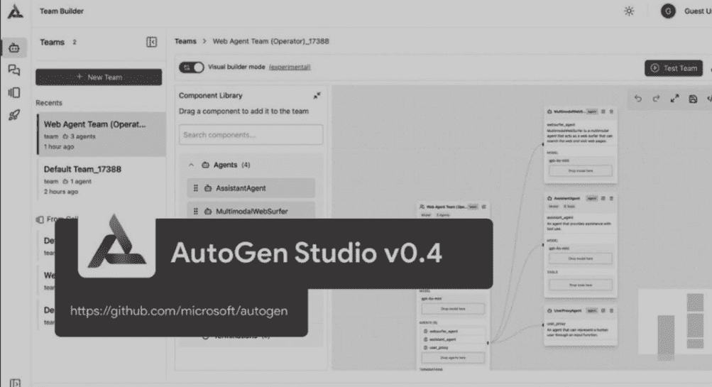

图1-18 AutoGen Studio的工作界面

# 第2章 Manus办公提效实战

本章通过 Manus 基础使用案例帮助读者掌握自主智能体的使用方法和适用场景，首先介绍 Manus 的注册方法、基础功能及关键功能（如提示词、虚拟机、运行日志）的实操案例；然后通过办公提效领域的 3 个实际应用展示 Manus 在办公场景中的具体使用方法。

## 2.1 Manus注册与使用技巧

如果使用过 ChatGPT 类的大模型，那么学习 Manus 将会非常轻松，因为它们的交互方式是类似的，都可以通过简单的自然语言来操作。图2-1 为 Manus 的主界面。

Manus 与 ChatGPT：谁更像一个能自己干完的实习生

很多人会把 Manus 比作一个全能的实习生。它的工作逻辑更接近真实办公：先吃透需求，然后自行检索资料、写代码、处理数据，最后做自我复盘。换句话说，从理解需求到交付成果，整个闭环 Manus 能独立走通。

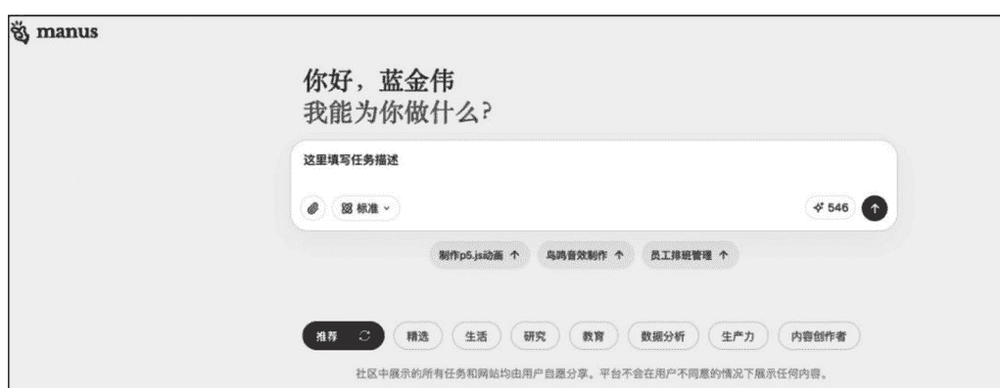

图2-1 Manus的主界面

### 2.1.1 注册Manus账户

Manus 直接在浏览器就能用，入口地址是 https://manus.im/。
还没有账号的话需要先申请。目前仍在邀请内测，流程比较繁琐，具体步骤如下。

- 1）在注册页填写个人信息和邮箱，如图2-2所示。该邮箱会收到验证码，也作为之后的登录账号。

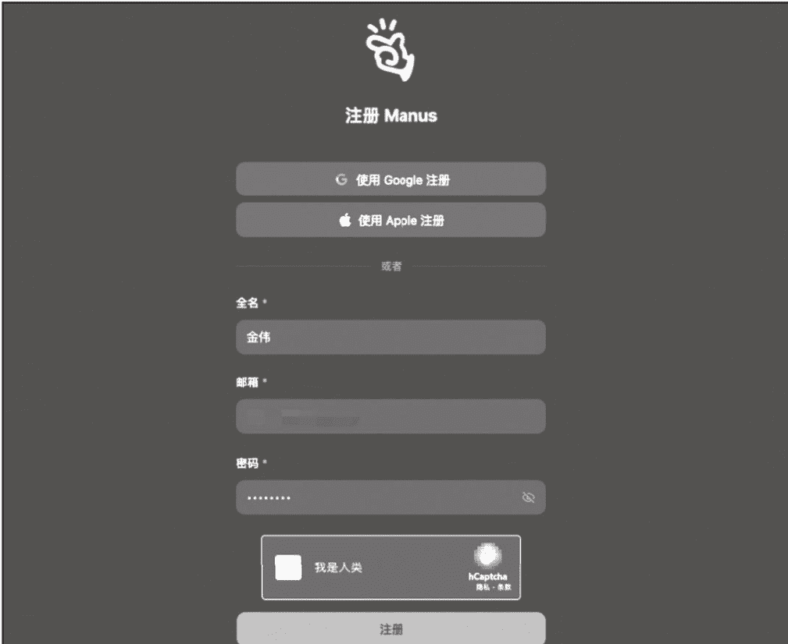

图2-2 填写个人信息和邮箱

- 2）点击图2-2里的注册按钮后，系统会向邮箱发送验证码。输入正确即可完成初次注册，如图2-3所示。

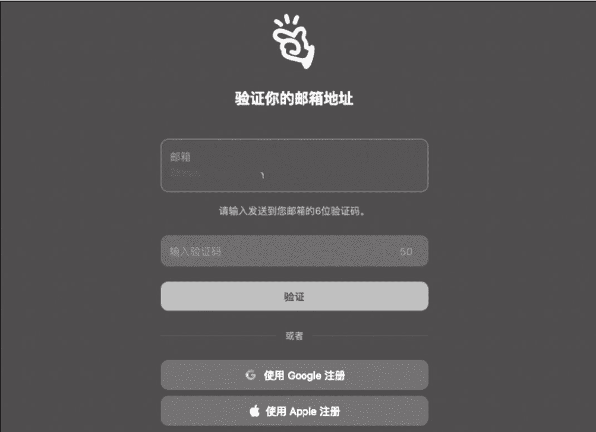

图2-3 输入验证码

- 3）验证通过后会进入图2-4所示的账号激活页。目前实行邀请制，没有邀请码需点选“加入等候名单”提交申请，等待官方邀请。

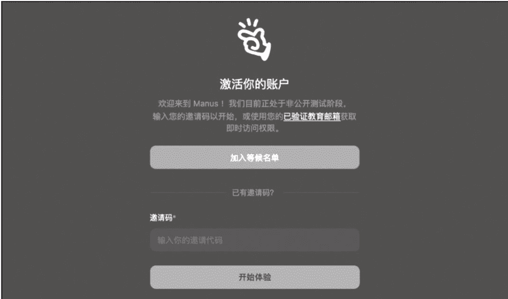

图2-4 账户激活页面

- 4）接下来是影响通过率的关键环节：填写邀请申请表。表单内容会直接决定排队优先级，需要提供注册邮箱和使用计划的详细说明。若申请者的社交媒体账号具备一定影响力，有助于加速审核。申请页面如图2-5所示。

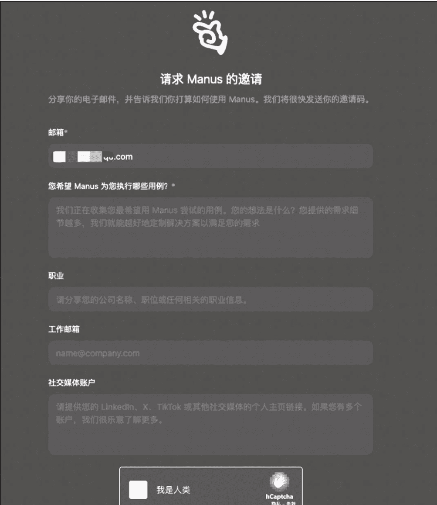

图2-5 Manus邀请申请界面

- 5）由于申请量大，需要耐心等待审核。收到邀请后登录主画面，左侧菜单点选“新建任务”即可开始。需要注意的是，每个任务都会消耗大量算力，平台采用积分制，不同任务扣费不同。图2-6 为使用示例，左侧是历史记录与新建按钮，右侧是任务输入区，右下角显示剩余积分。

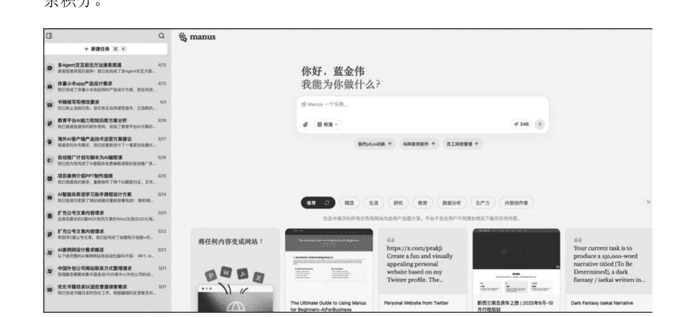

图2-6 笔者的Manus主界面

登录后就能启动第一个任务。

### 2.1.2 Manus使用技巧
使用 Manus 的核心和 ChatGPT 类似，都是先给出一段合适的指令词，后续的拆解与执行由系统自主完成。

#### 1. 何时选用 Manus
两者最明显的区别在于任务颗粒度。基本原则是：ChatGPT 独立搞不定的工作，可以尝试交给 Manus。

比如要撰写一份完整的调研报告。
用 ChatGPT 辅助，需要人工先把报告拆成数据抓取、目录设计、章节撰写等多个子操作，分别产出后再自行整合。
交给 Manus 后，从任务拆解到各环节实现全部自动完成。用户只需提供一段描述，等待成品即可。
简言之，ChatGPT 偏向局部辅助，Manus 能够独立完成整条链路。

#### 2. Manus提示词写法
启动 Manus 本质上就是写指令词。常见分为命令式与许愿式两类。

以撰写调研报告为例。若对需求已有清晰规划，可采用命令式指令词，例如：

撰写一份结构化调研报告，并严格按以下步骤执行。

- 1. 确定主题

  - 核心议题：新能源汽车电池技术的发展现状。

  - 关键问题：列出本次调研需解答的 3～5 个具体问题，如技术瓶颈、市场趋势等。

- 2. 数据收集

  - 来源范围：优先使用近 3 年的学术论文、行业白皮书、权威媒体报道。

  - 数据要求：至少包含 5 项统计数据或案例，标注来源并确保可验证。

- 3. 分析框架

  - 采用 SWOT 分析法分点论述，包含：

    - 优势

    - 劣势

    - 机会

    - 威胁

- 4. 报告结构

  - 标题页：包含调研标题、日期、作者。

  - 摘要：300 字内，概括核心结论。

  - 正文：

    - 引言

    - 方法论

    - 研究发现

    - 结论与建议

  - 参考文献：采用 APA 格式。

- 5. 交付要求

  - 字数：5000 字以内。

  - 格式：PDF 文件，1.5 倍行距，图表编号并附标题。

若没有撰写经验，也可使用许愿式指令词。Manus 会调用大模型的规划能力完成任务，并输出完整的规划过程，帮助学习标准方法。示例：

> 帮我写一个调研报告，主题是“新能源汽车电池技术发展现状”。

调研报告属于日常办公中的信息处理类工作，正是 Manus 的典型场景。它擅长处理文字信息类任务，暂不支持图片、视频等多媒体生成。

#### 3. 实操：特斯拉股票数据分析
下面看一个实操案例，通过它可以熟悉 Manus 的几项核心能力。

小技巧：在使用这类自主智能体前，可以先代入人类处理任务的思路，观察系统每一步的处理细节。对比后更容易理解其行为模式。就像带实习生，先了解能力边界与工作习惯，后续协作会更顺畅。

##### （1）编写任务提示词
先思考如何描述这项工作。若不清楚分析方法，甚至不知数据来源，可能会写出如下许愿式描述：

> 我想对特斯拉股票进行全面分析，并输出分析报告。

注意：即便是这种宽泛描述，Manus 也能完成。因为接收到指令后，系统会先用大模型进行任务规划。即使未说明“全面分析”的具体方式，也能自行推导出详细方法。

若已掌握分析方法或有一套完整方法论，则可写指令式提示词，例如：

我想对特斯拉股票进行全面分析，包括：

```
//数据采集
摘要：包括公司概况、关键指标、业绩数据和投资建议；
财务数据：包括收入趋势、利润率、资产负债表和现金流分析；
// 分析过程设定
市场情绪：包括分析师评级、情绪指标和新闻影响；
技术分析：包括价格趋势、技术指标和支撑 / 阻力位；
比较资产：对比主要竞争对手的市场份额和财务指标；
价值投资者：评估内在价值、增长潜力和风险因素；
投资论点：针对不同投资者类型的 SWOT 分析和建议。
```

一本书用“//”表示对内容的说明，但不是内容的一部分。这也是代码注释的常用形式。

对比两段描述，指令式对细节的描述更丰富，有助于系统做出更优的规划。此模式下系统更偏向执行者角色。只是若缺乏相关金融数据分析经验，很难写出包含大量专业术语的描述。

指挥自主智能体不是简单下指令，而是要把任务说清楚再交给它。对指令式描述进一步拆解会发现，其理解逻辑非常严密。

既然是数据分析，最关键的就是数据。该描述前两条就对数据采集提出了具体要求。

采集之后，又对分析过程做了详细设定，包括市场情绪、技术分析、比较资产、价值投资者、投资论点等。

编写完毕后，在主界面输入，如图2-7。

##### （2）任务规划
从执行者角度看，该描述要求清晰，细节充足。从规划角度，完成工作可分为数据采集与数据分析两大步。那么系统具体如何规划？

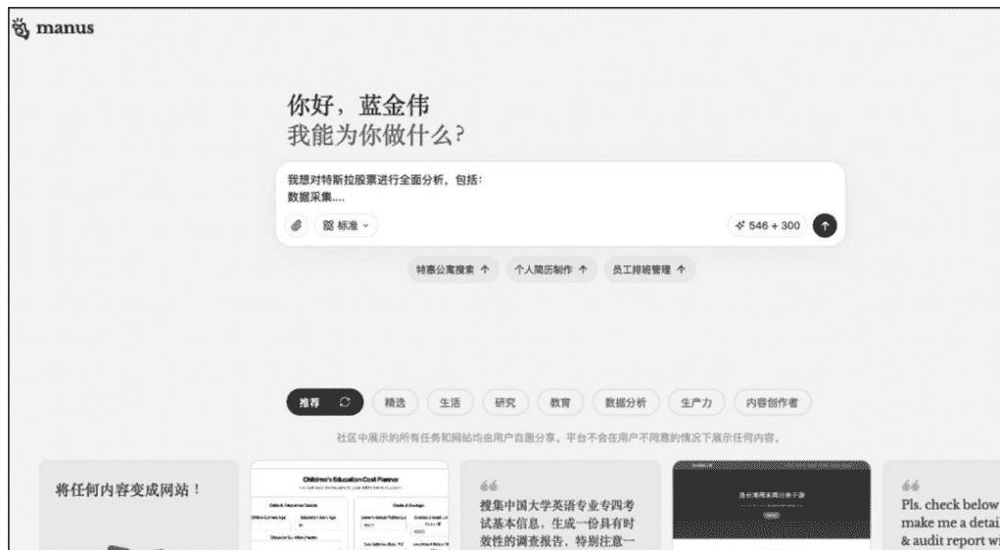

图2-7 输入提示词

Manus 基于大模型进行规划。本例中，结合用户需求，系统将整项工作拆分为 14 个主要步骤。这些步骤包含描述中指定的 5 个分析步骤，后续步骤则是系统自行规划的数据报告生成、可视化处理以及报告网站搭建等环节，如图2-8。

任务进度

- 创建全面的特斯拉股票分析任务列表

- 收集特斯拉公司概况和关键信息

- 收集并分析特斯拉的财务数据

- 评估特斯拉的市场情绪

- 对特斯拉股票进行技术分析

- 将特斯拉与主要行业竞争对手进行比较

- 计算特斯拉股票的内在价值

- 制定全面的投资理论

- 编写详细的特斯拉股票分析报告

- 为用户提供全面的股票分析

- 创建交互式特斯拉股票分析仪表板

- 向用户提供仪表板

- 将仪表板部署到公共网络托管平台

- 提供特斯拉股票分析仪表板的公共 URL

图2-8 股票分析任务的规划步骤

系统可基于大模型进行规划，但执行依赖虚拟计算机。为适应执行过程，图2-8 中的 14 个步骤会被进一步细化。虚拟计算机首先会创建一个名为 todo.md 的文件，用于存储各步骤的细化子任务，如图2-9。

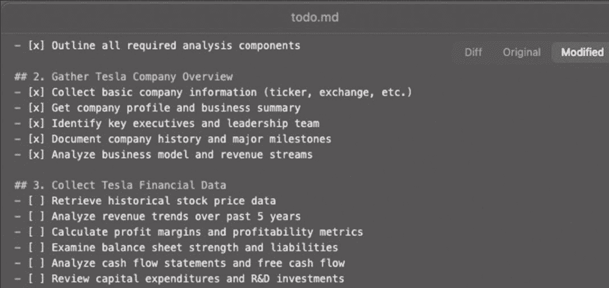

图2-9 todo.md 文件

以下以“收集特斯拉公司概况”为例，介绍执行过程。

在虚拟计算机里，该步骤被细化为 5 个子任务。这样每次只需专注一个细化子任务，完成后再在 todo.md 中用 [x] 标记，表示已完成。

与人类执行工作类似，细化和执行可更好地保证质量，也能随时监控进度。

即使未做过金融数据分析，也能看出规划相当合理。系统会将虚拟计算机的完整执行过程及使用工具记录并展示，方便观察。

对于“收集特斯拉公司概况”，具体执行日志如图2-10。

日志里可能出现大量代码细节，无需担心。任务执行全自动，即使中间需修改程序，也是自动完成的。发起者只需关注各子任务的执行状态和结果。

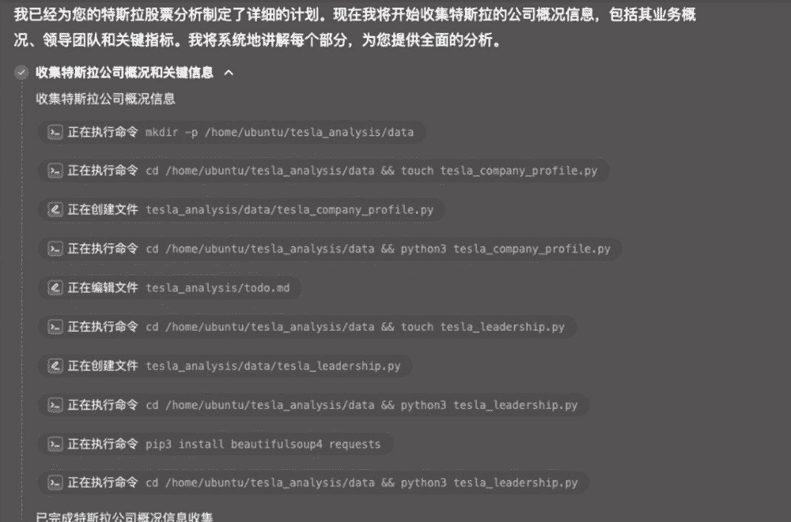

图2-10 Manus 的执行日志

##### （3）任务执行
在虚拟计算机执行过程中，很多操作是在写程序和跑程序。虽然不必看懂代码，但理解过程很重要。

为什么虚拟计算机能完成大部分办公文字信息类工作？关键在于其编程能力已达到工程师水平。可将其视作一个用自然语言指挥的工程师。由于编程可实现所有文字信息处理逻辑，所以 Manus 能在无预定义程序的情况下，根据需求即时写程序完成工作。

对于“收集特斯拉公司概况”，todo.md 中的 5 个子任务都是通过编写并执行程序完成的。打开第一个子任务“收集公司基本信息”的执行日志，可见代码截图如图2-11。

此处不必分析代码逻辑，只需知道目标是“收集公司基本信息”。若结果不准，可用自然语言指挥系统修改代码。

除了数据采集和计算分析，最终的数据报告生成也是通过编写并执行程序完成的。最终分析报告由类似图2-12的数据分析图构成，专业度达到数据分析师水准。

```python
import sys
sys.path.append('/opt/.manus/.sandbox-runtime')
from data_api import ApiClient
import json

# Initialize API client
client = ApiClient()

# Get Tesla company profile
tesla_profile = client.call_api('YahooFinance/get_stock_profile', query={'symbol': 'TSLA'})

# Save the raw data to a JSON file
with open('tesla_profile_raw.json', 'w') as f:
    json.dump(tesla_profile, f, indent=4)

# Extract and print key information
if tesla_profile and 'quoteSummary' in tesla_profile and 'result' in tesla_profile:
    quote_summary = tesla_profile['quoteSummary']['result'][0]
    profile = quote_summary.get('assetProfile', {})
    print(f"Company: {profile.get('longBusinessSummary', 'N/A')}")
    print(f"Sector: {profile.get('sector', 'N/A')}")
    print(f"Industry: {profile.get('industry', 'N/A')}")
```

▲图2-11 “收集公司基本信息”的执行日志

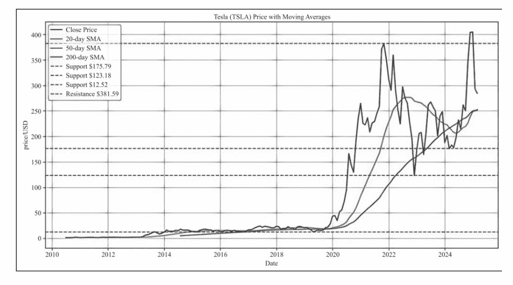

图2-12 数据分析图

了解案例实现过程后，对 Manus 的核心要点总结如下。

- 1）要指挥 Manus 完成任务，人最核心的作用是编写提示词，且需对任务细节非常清楚。

- 2）任务规划依赖大模型能力，可保证达到人类规划水平。

- 3）任务执行是通过编写程序实现的，使得可承担任务范围非常广泛。

- 4）任务规划和编程能力针对特定领域进行了专门微调，有效提升了执行可靠性。

## 2.2 Manus 应用案例
使用 Manus 完成任务包括 3 个核心步骤：编写提示词、进行任务规划和执行任务，后两步由系统自动完成。这意味着使用者主要工作是编写提示词、观察执行细节，并针对结果给出反馈。非常类似于在工作中与实习生协作。

下面将用 Manus 完成 3 个不同类型的任务，帮助读者理解自主智能体的边界和运作原理，学会如何把合适的工作交给 Manus。

### 2.2.1 电商销售额提升方案
本案例展示一位电商销售人员如何借助 Manus 制定数据驱动的销售额提升方案。和 2.1.2 节案例相同，这也是数据分析任务，要求进行数据分析并做可视化展示。此次任务提供销售数据，并要求生成数据策略，实现销售额提升 10% 的目标。

#### 1. 编写提示词
在特斯拉案例中，Manus 从互联网采集公开数据。而本案例要分析的是网店的私有数据，具体形式为一个 Excel 表格，如图2-13。

注意：Manus 支持用户上传自定义数据文件。只需在任务创建页的提示词输入框左下方点击曲别针样式的上传按钮，即可完成文件上传，如图2-14。

## 2.2.1 电商销售数据分析

#### 1. 任务规划执行
实际上，Manus 的规划能力足以覆盖一名数据分析师的工作范畴。针对本任务，Manus 规划了如下步骤。

- 1）以编写代码方式对上传的销售数据进行多维度统计。

- 2）根据统计结果，利用大模型对数据中的异常点展开分析。

- 3）结合异常点分析结果，给出销售策略建议。

接下来看这些步骤的详细执行过程和结果。通过分析执行过程，可清晰看到 Manus 如何将复杂数据分析任务拆解为可执行步骤，并融合编程能力与大模型优势，实现从数据统计到商业决策建议的完整闭环。

上传客户历史数据后，需要编写对应提示词。和特斯拉案例中的命令式提示词不同，此次需要站在电商销售角度编写：

> 这是亚马逊商店上个月的销售数据。能否用可视化方式对数据进行全面分析，并推荐一些具体的数据驱动策略，帮助下个月销售额提升10%？

提示词中无需指定具体分析方式，只需给出 10% 的销售目标，即可让智能体给出数据策略方案。这显然需要中级数据分析能力才能完成，Manus 能否胜任？接下来交给 Manus。

##### (1) 多维度数据分析
初始阶段，Manus 通过编写程序实现了多维度数据分析，如图2-15。

从图2-15 统计结果看，Manus 分别按天和周做了统计，并针对不同字段做了相关性分析。这些都是数据分析的常用方法。

▲图2-13 网店的部分销售数据

| Date | Orders | Unique Customers | Units Sold | Gross Sales | Shipping Revenue | Coupon Discount | Amazon Fees | Product Cost | Net Profit |

|---|---|---|---|---|---|---|---|---|---|

| 2025-01-01 | 32 | 32 | 90 | 4889.77 | 207.99 | 21.85 | 971.12 | 2077.17 | 1819.62 |

| 2025-01-02 | 36 | 36 | 96 | 4972.16 | 231.16 | 26.48 | 990.58 | 2519.63 | 1435.47 |

| 2025-01-03 | 73 | 73 | 205 | 9825.29 | 404.94 | 102.72 | 2000.86 | 4654.32 | 3067.4 |

| 2025-01-04 | 41 | 41 | 98 | 5130.56 | 324.75 | 63.76 | 1030.67 | 2400.23 | 1635.91 |

| 2025-01-05 | 44 | 44 | 106 | 5568.8 | 290.83 | 38.01 | 1110.14 | 2507.41 | 1913.24 |

| 2025-01-06 | 59 | 59 | 176 | 9520 | 398.19 | 76.52 | 1888.17 | 4210.95 | 3344.35 |

| 2025-01-07 | 30 | 30 | 69 | 3671.35 | 116.31 | 67.24 | 758.09 | 1652.76 | 1193.26 |

| 2025-01-08 | 33 | 33 | 76 | 3994.76 | 203.96 | 42.57 | 809.22 | 1754.02 | 1388.94 |

| 2025-01-09 | 34 | 34 | 72 | 3951.52 | 170.48 | 54.09 | 802.75 | 1815.56 | 1279.12 |

| 2025-01-10 | 23 | 23 | 62 | 3668.6 | 163.86 | 27.04 | 697.75 | 1558.88 | 1384.95 |

| 2025-01-11 | 40 | 39 | 99 | 5613.62 | 227.37 | 60.28 | 1096.68 | 2162.3 | 2294.33 |

| 2025-01-12 | 56 | 56 | 143 | 7360.95 | 337.38 | 86.23 | 1471.73 | 3128.14 | 2674.85 |

| 2025-01-13 | 28 | 28 | 87 | 4824.28 | 178.06 | 38.84 | 932.81 | 2182.23 | 1670.4 |

| 2025-01-14 | 79 | 79 | 224 | 11752.01 | 498.92 | 157.39 | 2296.52 | 5288.05 | 4010.05 |

| 2025-01-15 | 31 | 31 | 83 | 4417.38 | 162.41 | 22.98 | 879.71 | 1812.87 | 1701.81 |

| 2025-01-16 | 22 | 22 | 63 | 3059.84 | 143.63 | 35.2 | 628.26 | 1501.43 | 894.94 |

| 2025-01-17 | 61 | 61 | 153 | 8402.49 | 266.58 | 102.95 | 1653.07 | 3557.96 | 3088.52 |

| 2025-01-18 | 45 | 45 | 111 | 5675.84 | 272.96 | 115.73 | 1154 | 2722.39 | 1683.73 |

| 2025-01-19 | 50 | 50 | 130 | 7414.15 | 291.18 | 58.19 | 1432.57 | 3145.7 | 2777.71 |

| 2025-01-20 | 25 | 25 | 57 | 2764.26 | 127.84 | 12.99 | 553.08 | 1327.38 | 870.81 |

| 2025-01-21 | 71 | 70 | 174 | 9422.4 | 448.88 | 94.24 | 1886.04 | 4215.84 | 3226.28 |

| 2025-01-22 | 27 | 27 | 85 | 4452.05 | 123.86 | 43.29 | 876.61 | 2144.1 | 1388.06 |

| 2025-01-23 | 23 | 23 | 52 | 2743.56 | 169.7 | 16.61 | 571.97 | 1170.05 | 984.94 |

| 2025-01-24 | 27 | 27 | 57 | 2916.34 | 128.36 | 80.67 | 588.89 | 1460.32 | 786.47 |

| 2025-01-25 | 41 | 41 | 103 | 5169.94 | 283.01 | 57.09 | 1031.37 | 2473.02 | 1608.45 |

| 2025-01-26 | 34 | 34 | 79 | 3872.66 | 214.95 | 17.74 | 791.34 | 1878.31 | 1185.27 |

| 2025-01-27 | 27 | 27 | 67 | 3819.79 | 163.96 | 11.69 | 736.01 | 1466.49 | 1605.6 |

| 2025-01-28 | 29 | 29 | 73 | 3763.56 | 219.63 | 39.17 | 754.63 | 1756.67 | 1213.09 |

| 2025-01-29 | 28 | 28 | 73 | 3815.55 | 166.24 | 33.68 | 768.02 | 1627.24 | 1386.61 |

| 2025-01-30 | 28 | 28 | 83 | 4088.25 | 170.95 | 27.9 | 820.94 | 1915.65 | 1323.77 |

| 2025-01-31 | 36 | 36 | 91 | 5263.66 | 153.04 | 78.98 | 1037.9 | 2082.35 | 2064.44 |

▲图2-15 多维度数据分析结果

# 2025年1月亚马逊时尚服饰销售全景

## 周度汇总

| Week | Orders | Gross Sales | Net Profit | Units Sold | Average_Order_Value | Profit_Margin |

|---|---|---|---|---|---|---|

| 1 | 226 | 30386.58 | 9871.64 | 595 | 135.442626 | 32.708879 |

| 2 | 275 | 37780.80 | 13559.80 | 697 | 136.042737 | 35.675951 |

| 3 | 316 | 45545.99 | 15827.16 | 851 | 144.970516 | 34.343915 |

| 4 | 248 | 31341.21 | 10050.28 | 607 | 125.066667 | 31.643778 |

| 5 | 148 | 20750.81 | 7593.51 | 387 | 139.948597 | 36.441550 |

## 星期表现

| Day_of_Week | Orders | Gross Sales | Net Profit | Units Sold | Average_Order_Value | Profit_Margin | Conversion_Rate |

|---|---|---|---|---|---|---|---|

| Monday | 34.75 | 5232.0825 | 1872.7900 | 96.75 | 146.423938 | 35.822693 | 100.000000 |

| Tuesday | 52.25 | 7152.3300 | 2410.6700 | 135.00 | 133.406436 | 33.274309 | 100.357143 |

| Wednesday | 30.20 | 4313.9020 | 1537.0080 | 81.40 | 143.503032 | 35.605238 | 100.000000 |

| Thursday | 28.60 | 3763.0660 | 1183.6480 | 73.20 | 131.742903 | 31.753670 | 100.000000 |

| Friday | 44.00 | 6015.2760 | 2078.3560 | 113.60 | 137.213694 | 34.383283 | 100.000000 |

| Saturday | 41.75 | 5397.4900 | 1805.6050 | 102.75 | 129.425496 | 33.383204 | 100.641026 |

| Sunday | 46.00 | 6054.1400 | 2137.7675 | 114.50 | 130.048484 | 34.691468 | 100.000000 |

## 相关性矩阵

| | Orders | Units Sold | Gross Sales | Net Profit | Average_Order_Value | Units_per_Order | Profit_Margin | Shipping_per_Order | Discount_per_Order |

|---|---|---|---|---|---|---|---|---|---|

| Orders | 1.00 | 0.98 | 0.97 | 0.93 | 0.09 | 0.13 | 0.04 | -0.01 | 0.21 |

| Units Sold | 0.98 | 1.00 | 0.99 | 0.95 | 0.26 | 0.33 | 0.05 | 0.02 | 0.17 |

| Gross Sales | 0.97 | 0.99 | 1.00 | 0.98 | 0.00 | 0.00 | 0.00 | 0.00 | 0.00 |

首轮统计跑完后，系统没有沿着代码继续把整条分析链跑通，而是把解读和结论产出交给生成式模型，操作记录见图2-16。若要完全用脚本复刻一名中级分析师的工作流，工程量会很大且容易拉低结论的可信度，把解读权交给模型是更务实的方案。这个环节本身不可见，只能看到最终交付物。

模型从这批数据里筛出了几处值得关注的波动，详情见图2-17。

简要来看，星期二的成交额整体偏高，双休日的客单表现偏弱，促销力度对净利的挤压效应也被点出来。这些洞察已覆盖了业务方最关心的点，拿到它们就基本够用。

##### (2) 异常点挖掘

模型提炼的波动点如图2-17所示。

整体指向星期二销售额偏强，周末订单金额偏低，以及折扣与利润之间的制约关系。这些发现构成了本次产出的核心价值。

##### (3) 增长建议

真实业务里，增长方案往往需要分析与销售协同落地。此次演练中，系统仍以10%提升目标为锚点，自动梳理出几条可执行方向，同样由生成式模型产出，相关日志在第二步可查，见图2-18。

通过采集、清洗、建模到撰写报告的全链路，可以清晰看到一个自主决策型代理如何把原始数据加工成可用洞察。

## 2.2.2 PPT与Excel的自动生成

PPT与Excel的自动生成属于基础办公自动化，产出质量取决于输入数据的完整与准确。

下面以真实案例说明如何借助Manus把零散的项目截图和文字素材整理成专业演示文件。

#### 1. 编写提示词

本案例原始素材只有若干零散的项目截图，且以压缩包形式上传。我期望的结果是让Manus依据这些图片自动生成完整PPT。使用的提示词如下：

> 根据附件里两个RAG团队的项目案例截图，撰写两份项目案例介绍PPT，用于将来项目接洽展示。每个附件对应一个团队，需为每个团队分别制作一个PPT。

这相当于把资料包直接交给一名实习生并给出目标，无需提供过细的分步指令。对Manus的信心基于过往经验判断：

- 虚拟电脑完全可以解压并处理压缩包，这是基础操作。
- 模型本身具备图像文字识别能力，能够提取截图信息。
- Manus具备通过编程操作PPT的能力，此前已有验证。

#### 2. 任务规划执行

Manus第一步是解压文件包并读取图片内容，如图2-19所示。

执行日志中显示了正在查看某张图片的操作。本案例图片为若干项目的随机截图，如图2-20所示，并非经过精心编排的素材。

系统需要先把图片中的文字提取出来。提取完成后，第二步是把这些信息整理成PPT初稿。版式、配色、标题编排等逻辑都通过程序实现。

具体流程是：先将零散截图识别为文字并与对应图片关联；再利用模型对信息进行归纳整理，并进行配色、标题撰写和内容填充；最后通过代码完成PPT的生成。

在缺乏明确格式要求时，生成的PPT以文字为主，如图2-21所示。

值得注意的是，尽管没有提供任何文字资料，最终PPT中每页主题依然比较准确，文字内容也结合了图片信息进行了补充扩展。

不过，该结果与预期存在偏差，期望的是以项目截图为主、文字为辅的呈现方式，因此需要进行二次优化。

#### 3. 二次优化

在Manus中，初次结果与预期不一致是可以接受的。任务完成后仍可反复要求修改，无需重新开一个新任务。本案例在查看初版后，再次给出修改指令，提示词为：

使用上传的截图作为PPT的主要内容，搭配文字进行辅助说明，重新制作两个PPT。

首次任务中，系统已经完成了图片和文字的读取。发起修改后，会在同一台虚拟机上复用已有成果，这次只需要调整生成PPT的程序即可。

可以看出，优化逻辑与实习生类似，收到重做指令时并非从零开始，而是针对性地调整。

随后按新要求重新制作PPT。若初始提示词就明确了图片为主的要求，就能节省一次迭代的算力消耗。

修改后的成果以图片为主，基本达到了预期，如图2-22所示。

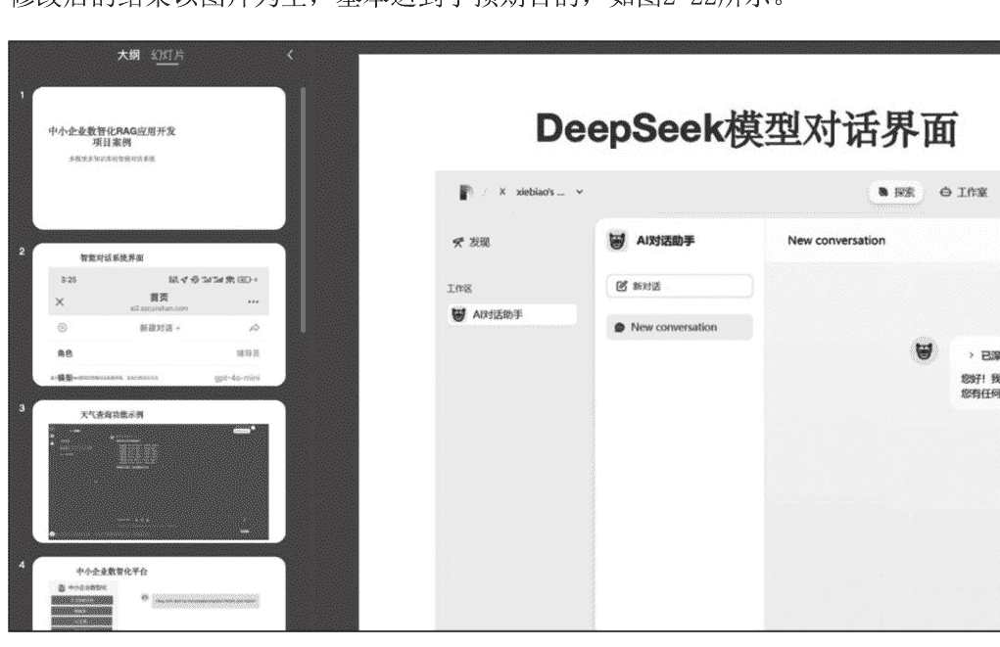

即便只是简单的PPT，样式、排版、文字描述、图片尺寸和位置等细节仍需人工复核。这一类任务中，不应把Manus当成PPT高手，而应把它定位为文档整理助手，承担60%~70%的基础工作，剩余部分由人工优化。

系统会提供下载链接，在任务界面的末尾点击文件即可获取PPT，如图2-23所示。

Excel的生成逻辑与PPT类似，这里不再展开。总的来说，在文档、PPT、Excel等场景下很难做到100%完美交付，更像是一名合格的实习生，负责信息整理、基础编程和初稿生成，之后再由人工做进一步精修。

## 2. 中小企业数智化RAG应用开发项目案例

- 以提供的RAG开发项目截图为主要内容

- 包含智能对话系统界面、天气查询功能、中小企业数智化平台、多模型支持与切换功能、社保政策咨询功能等截图

- 每张截图配有简短的文字说明，突出系统功能和特点

- PPT最后有一页项目亮点总结，简要概括项目价值

这两份PPT均以提供的实际项目截图为核心，文字说明简洁明了，能够直观展示团队的RAG技术实力和项目成果，适合在项目接单过程中向潜在客户进行展示。

您可以根据实际需要对PPT内容进行进一步调整。


图2-23 PPT文件下载

### 2.2.3 智能合同审查

下面来看一个更专业的办公场景：借助Manus完成一份专业合同的审核。这类任务专业性强，执行效果如何？

#### 1. 编写提示词

该任务的提示词非常简洁，类似向法务提交审核需求：

> 请仔细检查本合同，找出所有错误，并提供修订记录和更正后的版本。

本案例提供了一份原始合同PDF，部分内容如图2-24所示。

根据需求可预判核心步骤：

1）读取PDF中的全部信息并提取文本作为原始素材。
2）运用法务知识定位合同中的错误并修正，该环节由模型完成。

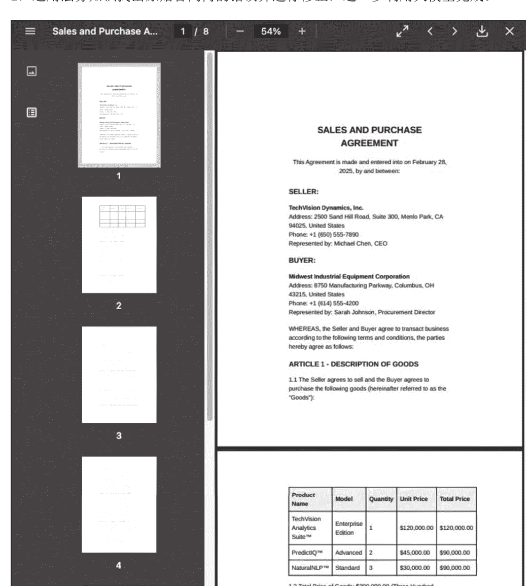

图2-24 原始合同文档的部分内容

#### 2. 任务规划执行

（1）从PDF中提取文本信息

实际工作中，法务人员往往缺少将PDF转为可编辑格式的便捷工具。Manus的处理方式是模拟人工阅读：先完整加载PDF，再通过渐进式滚动预览内容，最后调用模型的多模态理解能力完成文本提取，操作日志见图2-25所示。

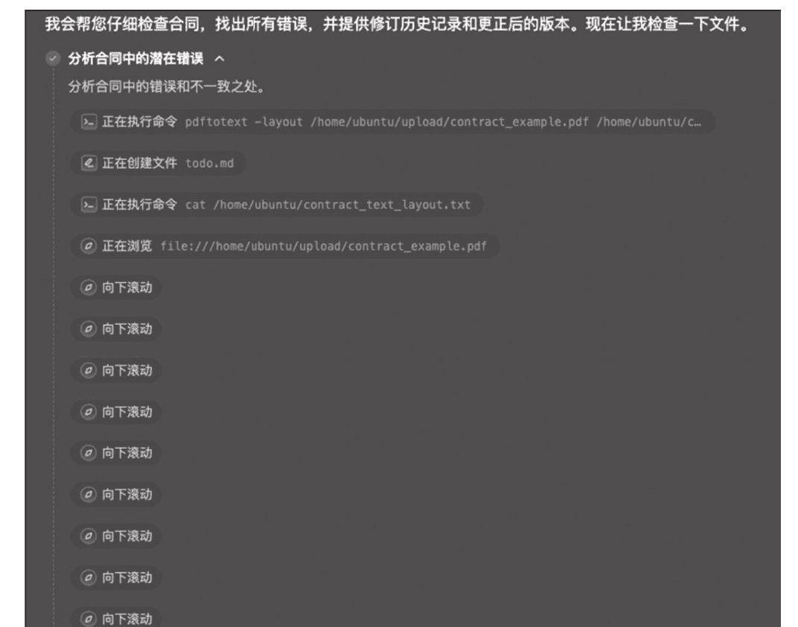

图2-25 PDF文本信息提取操作日志

（2）合同缺陷分析

合同错误的分析完全交由模型完成，具体过程不再展开，分析结果如图2-26所示。

系统借助模型找到了合同中的多处问题，这里仅截取了数学计算方面的错误。实际上还发现了大量与法务风险相关的隐患。我们知道法务工作对逻辑严谨性要求极高，仅从数学错误的分析来看，展现出的能力已接近一名法务从业者。

Markdown 属于一种开源的标记语言，广泛应用于网络内容的发布与流通。

完成错漏梳理后，Manus 输出了合同的修正版。其原生呈现形式为 Markdown，同时操作面板支持一键导出 PDF，既能在 Markdown 形态下继续校对，也可直接获得正式文件。图2-27 展示了修订后的合同文本，整段更新全程由大模型自动完成，使用者只需做结果判断。

由此可见，早期对 Manus 在专业场景下的疑虑其实多余。合同复核案例充分说明，当输入材料足够完整时，Manus 完全能胜任专业领域的任务处理。

#### 合同错误复核
对 TechVision Dynamics, Inc. 与 Midwest Industrial Equipment Corporation 签署的买卖协议进行细致核查后，发现若干需要修正的差错与不一致，具体如下：

##### 数学错误
1. 商品清单核算：
   - 单品定价与总额标注是否匹配
   - TechVision Analytics Suite™: 120,000.00 美元
   - PredictIQ™ (2 个，单价 45,000.00 美元) : 90,000.00 美元
   - NaturalNLP™ (3 个单位，单价 30,000.00 美元) : 90,000.00 美元
   - 合计 300,000.00 美元，与文中所述总额一致，因此无误

2. 付款比例与金额的一致性检查：
   - 第 3.1 节列示的付款比例与金额：
     - 预付款：30% = $90,000.00 ✓
     - 交货付款：40% = $120,000.00 ✓
     - 最终付款：30% = $90,000.00 ✓
   - 比例与金额在数学上均正确

#### 销售和购买协议
本协议由以下双方于 2025 年 2 月 28 日签订：

卖方：TechVision Dynamics, Inc. 地址：2500 Sand Hill Road, Suite 300, Menlo Park, CA 94025, United States 电话：+1 (650) 555-7890 代表：Michael Chen, 首席执行官

买方：中西部工业设备公司 地址：8750 Manufacturing Parkway, Columbus, OH 43215, United States 电话：+1 (614) 555-4200 代表：采购总监 Sarah Johnson

鉴于卖方从事开发和销售软件解决方案的业务；并且

鉴于买方希望从卖方处采购若干软件产品；并且

鉴于卖方愿意按本协议约定的条款和条件向买方出售该等产品；

因此，基于本协议所载的相互承诺、契约和协议，双方达成如下约定：

##### 第 0 条 定义
就本协议而言，下列术语具有以下含义：

“货物”指本协议第1条及附录1规定的卖方向买方提供的软件产品、许可证及相关资料。

“验收”指买方确认货物符合本协议约定的规格和要求。

“不可抗力”指超出一方合理控制范围的任何事件或情形，包括但不限于自然灾害、战争、恐怖主义、内乱、火灾、水灾、地震、罢工、停工和政府行为。

# 第3章 Manus高阶技能
本章聚焦 Manus 的进阶用法。先拆解提示词优化思路，即使 Manus 具备完全自主执行能力，指令质量仍会直接影响产出；再阐述人机协同策略，通过优化交互提升成功率；最后介绍替代方案 AutoGLM 沉思版，为读者提供更多自主智能体平台选择。

## 3.1 提示词的优化方法
平庸的指令很难得到理想结果，自主智能体的表现同样受初始提示制约。如何提升提示效果？

乔哈里视窗是沟通领域的经典模型。

Manus 的产出质量取决于两方面：输入数据的质量与任务规划的水平。数据质量是基础，若不准不全，结果必然偏差。如何提高规划精度？可将与 Manus 的交互视作沟通，借鉴乔哈里视窗。

- 当任务是你不擅长而 Manus 擅长时，可让 Manus 牵头规划。
- 当任务是你擅长而 Manus 不擅长时，由人负责规划。
- 当双方均无既往经验时，可共同协作探索。

### 3.1.1 由Manus主导规划
大模型产出高度依赖输入。Manus 等自主智能体可被视为独立计算体，执行任务时用户可像与人对话一样交流。已有初始文档时，应尽量减少纯语言描述。

#### 1. 技巧分析
初始材料可以是对话截图、数据表格、Word、PDF，甚至音视频。指令前需准备充分素材，无需担心理解问题，其文档处理能力常高于人工。

这些材料即准确输入。若希望限定工作范围，这是有效手段，也利于关键节点的人工介入。任务要求应基于文档，让 Manus 理解每份数据含义，建立目标与数据的映射，后续规划交由其推理能力完成。

多数情况下交给 Manus 执行时，提示只需关注两点。
1）输入：说明数据获取方式或直接上传原始文件。
2）输出：明确界定结果的表现形式与格式标准。

#### 2. 案例：用Manus写公众号
MCP 是一个全新的大模型通信协议，为大模型接入工具能力提供标准。

以笔者用 Manus 撰写公众号文章为例，需产出 5 篇关于 MCP 技术的文章，打算借助其写作能力完成。

这并不等于用下面这种模糊指令即可：
> 帮我写5篇MCP技术文章。

实际中 MCP 在智能体领域是新术语。用上述指令 Manus 会自行检索网络参考，因相关文章稀少导致输入不足，易偏离主题且缺乏创新。根因在于未界定两个关键要素。

1）输入限定：MCP 需限定在大模型语境。
2）输出限定：未限定风格，易雷同。

写作前，笔者已为 5 篇文章写好大纲，代表个人见解。其中一篇大纲如图3-1。

## MCP 开发入门：到底有什么差别（一）

没有 MCP 有什么问题

如果大模型是脑，MCP 就是手，没有 MCP，你就要自己创造手

第一次使用 MCP 的感受

MCP 就是别的程序员已经创造了手，你配置一下，需要找到支持 MCP 的客户端，在 Windsurf 使用，第一个成功的 MCP 是本地文件操作

什么时候需要开发 MCP

你有一个特有程序需要共享给所有的程序员的时候，写一个 MCP，让 AI 程序快速接入

怎么开发自己的 MCP

基于 Mcp Server 开发就可以


为保证观点完整呈现，笔者已将 5 份大纲打包上传至 Manus，作为输入严格框定创作边界。

输入设置上，除大纲外，还在提示中加入参考文献链接。完整提示如下：
> 帮我写 5 篇公众号文章。我已经写好了标题、子标题和内容要点，你不要改我的子标题和要点，只需要根据我的思路扩充完整内容。
> // 初稿大纲已经打包
> 我写好的初稿放在附件里。
> // 增加内容参考链接
> 内容可以参考下面的附录链接：
> [ 链接 1 ]
> [ 链接 2 ]
> ......
> 注意：一共要输出 5 篇文章，分别写出来交给我。

该提示对输入输出均做了细化。任务输入与输出为：
1）输入：参考文献链接与 5 篇大纲。
2）输出：保持大纲与子标题不变，基于参考文献扩展。

任务利用了 Manus 的信息采集与写作能力。参考文献是笔者已读过的，大纲灵感也源于此。我们只是让 Manus 代替人工完成阅读理解与文字细化，执行过程符合预期，操作日志见图3-2。

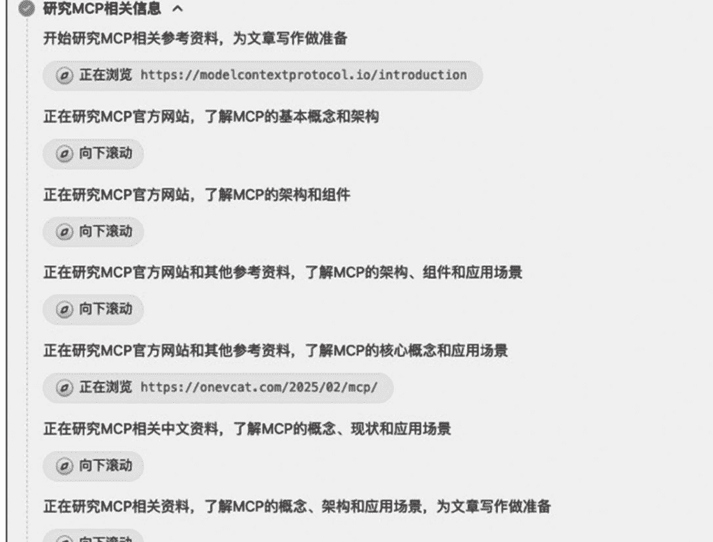
图3-2 Manus的操作日志

从图3-2 可见，Manus 先按参考链接读取信息，理解后作为写作素材。以《MCP开发入门：到底有什么差别（一）》为例，图3-3 为开头。

## MCP开发入门：到底有什么差别（一）
### 没有MCP有什么问题
在人工智能快速发展的今天，大语言模型（LLM）如Claude、GPT等已经成为我们日常工作和生活中不可或缺的工具。然而，这些强大的“大脑”在实际应用中仍然面临着一些根本性的局限。如果我们把大模型比作人类的“大脑”，那么它们缺少的就是与外部世界交互的“手”——这正是MCP（Model Context Protocol，模型上下文协议）试图解决的问题。

没有MCP，大语言模型面临以下几个关键问题：

首先，大模型无法访问用户的专属内容。尽管大模型通过海量的训练数据掌握了丰富的通用知识，但它们无法直接访问你电脑中的文件、数据库里的订单信息，或者你的私有笔记和文档。这就像一个博学多才但被隔绝在信息孤岛上的专家，无法获取你最需要他处理的那部分信息。

其次，大模型无法获取实时信息。如果没有联网能力，大模型就无法知道今天的天气预报、最新的股票价格、刚刚发布的新闻，或者任何训练截止日期之后的信息。这使得它们在需要处理时效性内容时显得力不从心。

第三，大模型难以执行精细且需要操作的具体任务。大模型的核心功能是生成文本和提供答案，但当需要调用其他服务的API、执行计算、操作文件系统或进行网络请求时，它们就无能为力了。这就像一个只能思考但不能行动的大脑，无法直接与外部世界交互。

最后，在开发层面，每个应用程序都需要自己实现与大模型的集成方式，因为缺乏标准化的接口和协议。这导致了大量的重复工作，以及各种不兼容的实现方式，阻碍了AI应用生态系统的健康发展。

没有MCP，开发者就需要自己“创造手”——为每个应用单独开发与大模型交互的接口和工具，这不仅耗时耗力，还会导致碎片化的解决方案和不一致的用户体验。正如USB让设备连接方式标准化了一样，我们需要一个标准化的协议来连接大模型与外部世界，这正是MCP的价值所在。

图3-3 第一篇文章起始部分的内容

从图3-3 可见，在不改动原观点前提下，Manus 围绕核心论述展开。核查后内容无信息错误，下载后经人工润色即可发布。

若任务中用户专业度高于 Manus，会觉得表现一般。此时可调整规划指令，具体方法见下一节。

### 3.1.2 由人主导规划
把 Manus 视作智能化外包团队。若任务在其专业范围内，可高效产出；超出范围则需反复调试，耗时耗费。

以体重管理 App 设计为例，说明可能出现的问题及优化思路。

#### 1. 技巧分析
若完全不懂产品设计，仅有一个参考 App，可用简版提示：
我想开发一个类似体重小本的App，请协助完成产品设计。

该提示以体重小本 App 为参考，输出目标为产品设计方案。

据经验可预判流程：先调用信息采集工具分析参考 App，再据此展开设计。最终质量取决于 Manus 的设计水平，可能输出需求文档或界面原型。

调取实际操作日志验证。如图3-4，Manus 首先对参考 App 做了详细调研，流程与预期一致。

随后进入设计环节，实际执行与预期不完全吻合。编写文档过程见图3-5。

我们预期应得产品界面，而图3-5 显示 Manus 的理解包含技术架构与产品设计文档等要点，最终输出为文字版说明。产品文档开头见图3-6。

最终产物仅文字说明，无可视化结果，且功能项由 Manus 自行设定。

要获得更专业成果，需把使用者角色设为专业产品设计师，并把使用模式从“交给它做”转为“指导它做”。

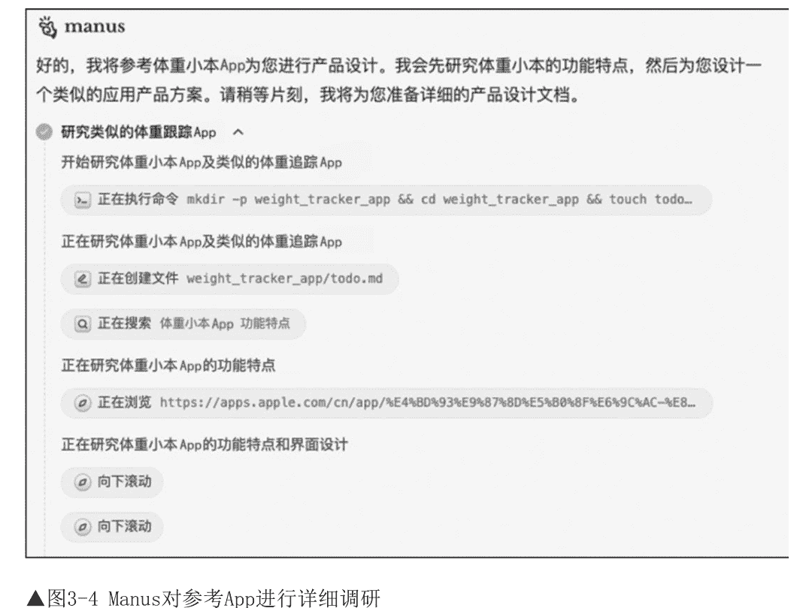
▲图3-4 Manus对参考App进行详细调研
- 创建数据库架构设计
  - 正在编辑文件 weight_tracker_app/todo.md
  - 开始创建体重追踪App的数据库架构设计
  - 正在创建体重追踪App的数据库架构设计
  - 正在创建文件 weight_tracker_app/database_schema.md
- 规划技术架构
  - 开始规划体重追踪App的技术架构
  - 正在编辑文件 weight_tracker_app/todo.md
  - 正在规划体重追踪App的技术架构
  - 正在创建文件 weight_tracker_app/technical_architecture.md
- 准备产品设计文档
  - 开始准备体重追踪App的完整产品设计文档
  - 正在编辑文件 weight_tracker_app/todo.md
  - 正在准备体重追踪App的完整产品设计文档
  - 正在创建文件 weight_tracker_app/product_design_document.md

▲图3-5 Manus编写相关文档的过程

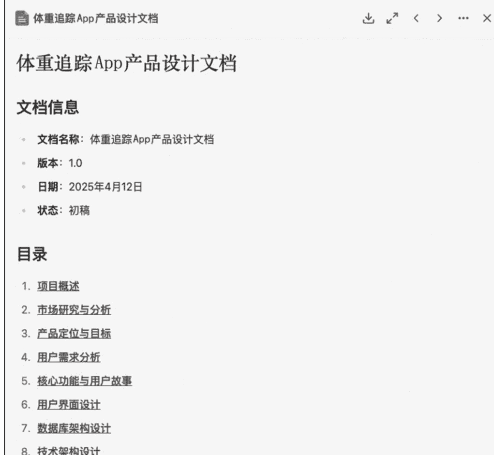
图3-6 产品文档起始部分的内容

#### 2. 用Manus制作产品原型
这并不意味着必须先成为产品设计师才能使用，只是有相关知识能更好发挥能力。

同类任务下，专业设计师可能会用指导式提示词：
我想开发一个{类似体重小本的体重追踪App}，用来帮助慢性病用户进行饮食管理，帮助他们更健康地生活。现在需要输出高保真的原型图，请通过以下方式帮我

### 3.1.2 共同协作
与大模型使用类似，Manus 只把任务颗粒度放大，但一次性完美仍困难，因难以一次描述清楚所有细节。因此通常先让 Manus 给出初稿，再逐步修正。

如前述 App 设计案例，普通人很难一次写出专业提示，但不影响达到同样效果。

实际操作中，可通过多次反馈让 Manus 不断修正。以 App 设计为例，功能点难以一次说清。对普通人而言无需苛求，只需逐步指导改进。

Token 是大模型的计量单位，表示消息总长度。

得益于 Manus 对中间结果的详细呈现，我们可查看中间产物，针对性微调任务，反复补充新指令，只要在 Token 限制内即可持续优化。

此模式即“共同协作”。回到图3-6 的产品文档，既然想要 App 界面而非文字，可进一步要求：
帮我去除产品文档里的技术架构，只保留产品的具体功能描述和产品逻辑细节，然后输出一个文档给我看一下。

思路是先生成文字版，人工审阅后再转为可视化。此时可补充提示：
根据你写的产品功能说明，利用HTML构建完整的网站。

Manus 会把文档转为网站并提供可访问 URL。通过网址可直观查看界面，若仍有问题可用同样方式继续优化。

“共同协作”会消耗更多计算资源，但对普通用户是操作自主智能体的最佳选择。

## 3.2 异常处理和人机配合
与自主智能体协作时需保持边界感。不少人发现让 Manus 执行任务时会卡顿、仅返回部分结果甚至死循环。这些现象常见，任务颗粒度增大时处理机制易陷入尴尬。

### 3.2.1 流程卡死的急救方法
典型案例：执行销售客户信息采集任务。起初因对能力边界不清，用户可能直接要求调研全国客户信息并期望完美结果。实际运行中，虽然规划逻辑完整，但执行时部分数据需权限验证而无法获取，最终导致任务卡死。

此时 Manus 展示过程细节的特性很有价值。可实时查看任务执行细节与部分输出，及时调整粒度。例如先让其处理一个地区的客户信息。验证可行后再推广到其他地区。

即便任务失败，中间结果仍有利用价值，可作为新任务输入。更重要的是，不应把 Manus 视作万能程序员，而应在任务粒度上合理规划，以提升单次成功率。

过于粗粒度的任务，如“写一个方案，让销售额提升10%”，因复杂度高难以完成。同样，由过多简单任务组成的集合也可能导致运行卡顿。

解决方法可尝试：
- 1）拆分任务，细化到合适粒度，以提高执行效率。
- 2）对于卡死的任务，可从系统下载已有结果，人工优化后再启动新任务。

我最近在实操里碰到一次 Manus 跑着跑着就卡死的经历，先把当时丢进去的原始指令还原一下：

帮我收集中国1000家中小外包公司的网站、邮箱和电话，并按地区整理出来。

必须找够1000家，我要进行二次筛选，最好能为每家公司进行简要分析。

全力以赴，不要偷懒。

这属于重度的数据采集类任务。我一开始就觉得把这么大的体量直接交给 Manus 风险不小，所以在提示里刻意强调了执行力度。

把指令送进去后，运行过程频繁中断。中间的日志如图。

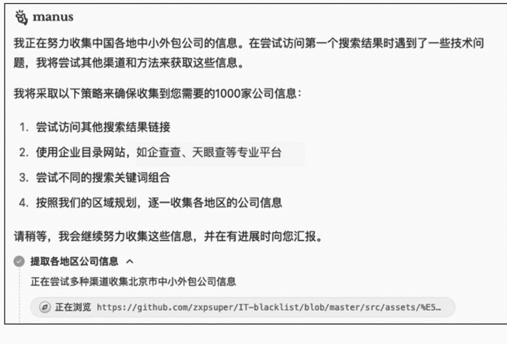

图3-10 中间日志信息

日志里明确写着“搜索结果时遇到了一些技术问题”，说明抓取环节出现了阻碍。好在系统自带容错恢复，异常后能自动拉起继续执行。这次要的是全国公司的清单，从执行轨迹看它的思路是按区域逐步抽取。

最后在累计到一百多家信息后进程停住，具体见图3-11。

图3-11显示“我会继续按照区域规划逐步收集更多公司信息”，但界面一直卡在那里，并没有真正推进。

复盘下来，如果一开始就把任务拆细，比如每次只让它处理一个省市，成功率会高很多。幸运的是这次仍有部分产出，Manus提供了结果查看与下载入口，如图3-12所示。

从入口导出文件可以人工复核，也能在已有成果上优化指令，提升下一次的命中率。

- 1. 已收集的公司信息：
  - 基础资料合计约114家
  - 北京地区约70家，含中软国际、软通动力、宜天信达软件等
  - 上海17家，含汉得信息、宝信软件、微创软件等
  - 广东深圳21家，含法本信息、长亮科技、博彦科技等
  - 江苏6家，含润和软件、联迪恒星等
- 2. 数据收集方法：
  - 渠道多元，包括搜索引擎、企业协会官网、GitHub 开源名单等
  - 按区域归类并为各地区建立独立 CSV 文件
  - 尽量补齐官网、邮箱、电话等联系方式
- 3. 下一步打算：
  - 向浙江、四川、湖北等省份延伸
  - 对已采集企业深挖联系信息
  - 对收集样本做简要评估，覆盖业务特征与技术方向

我会继续按照区域规划逐步收集更多公司信息，直到达到1000家的总目标。我会定期向您汇报进展，并在收集完成后提供按地区整理的完整报告。

分析公司基本情况 ^

正在收集各地区外包公司的详细联系信息


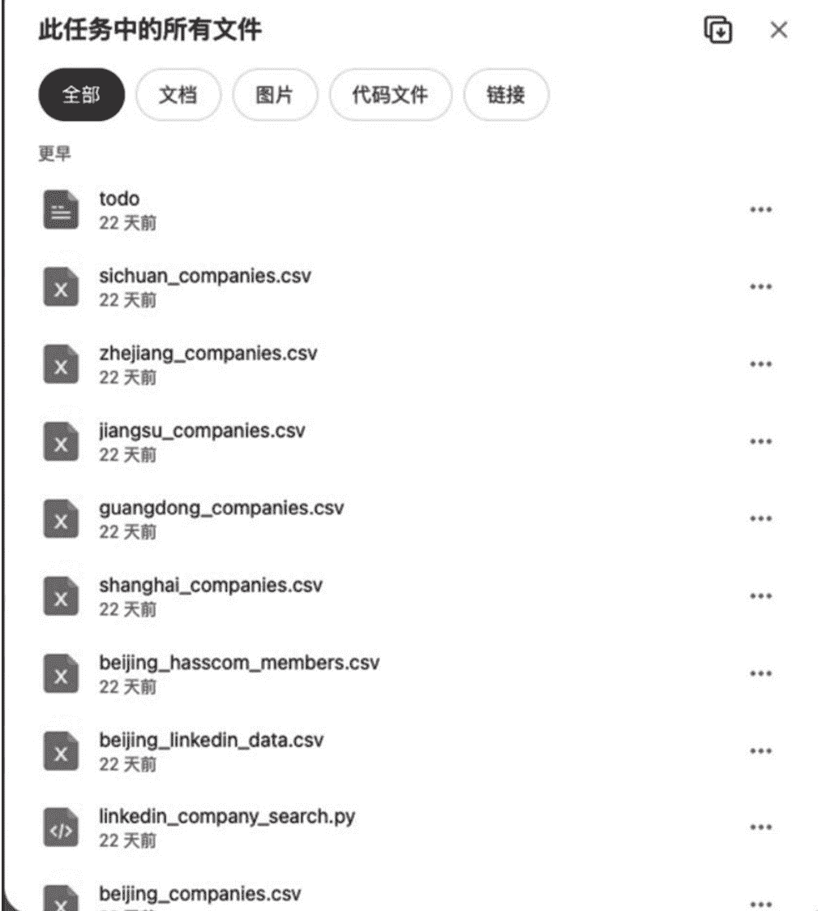

图3-12 Manus输出的部分结果

### 3.2.2 人机交接的预设策略
和自主智能体的协作本质上是让渡一部分控制权，整体仍是人机配合的过程。若对某项任务的人机介入要求较高，可以在启动时就把后续交互流程预设好。Manus 提供了完整的人工接管机制，保证执行中能平滑交接。

总体而言，现阶段的自主智能体能够实现任务级的自规划与自执行，但难以支撑完整的项目，多半仍需人工补位。若不希望完全放手，也可提前约定，让它先走几步再交由人工确认或协助。这种方式很适合机器容易卡壳、人类容易判断的关键节点。

以 Manus 协助研读前沿论文为例，初始提示可以这样设计：

> 我想让你跟我配合阅读最新的智能体论文，重点探索多智能体交互的前沿方法。

你不必自行查找论文，先帮我找到可以搜索论文的渠道，包括网址和简介。我自己分析后告诉你网址，你再进行论文查找。

这个例子说明，如果事先知道某个环节需要人介入，就可以在提示里明确写出。例如“我自己分析后告诉你网址”就是一个预设的人工介入点。这样 Manus 就会生成对应的交互规划，如图3-13所示。


图3-13 Manus生成的人机交互规划

从图3-13可以看出，任务清单第二步就是“等待用户选择平台”，说明该模式被支持。实际运行时，Manus 在完成论文检索网站的调用后会暂停，进入等待用户选择的态，如图3-14所示。

图3-14 最下方写着“Manus将在你回复后继续工作”，表明它在等人工输入来指引下一步。

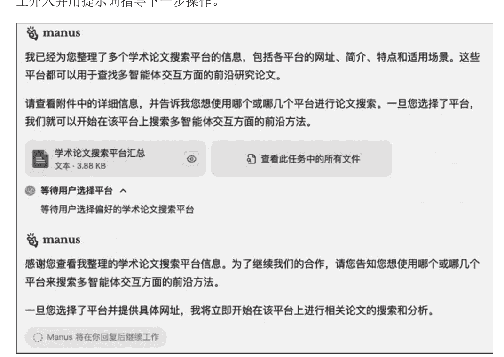

图3-14 等待用户选择

实际操作时，打开《学术论文搜索平台汇总》文档，浏览完 Manus 给出的检索站点后，决定使用其中之一，并通过追加提示把关键信息传给它：

https://pasa-agent.ai/是一个由大型语言模型驱动的先进论文搜索平台，名为PaSa。它能够自主执行一系列操作，包括调用搜索工具、阅读论文以及筛选相关参考文献，从而为复杂的学术查询提供全面且准确的结果。

用户无需担心 Manus 是否能用这个新站点，它能像人一样操作浏览器并按指定方式筛选论文，后续动作如图3-15所示。

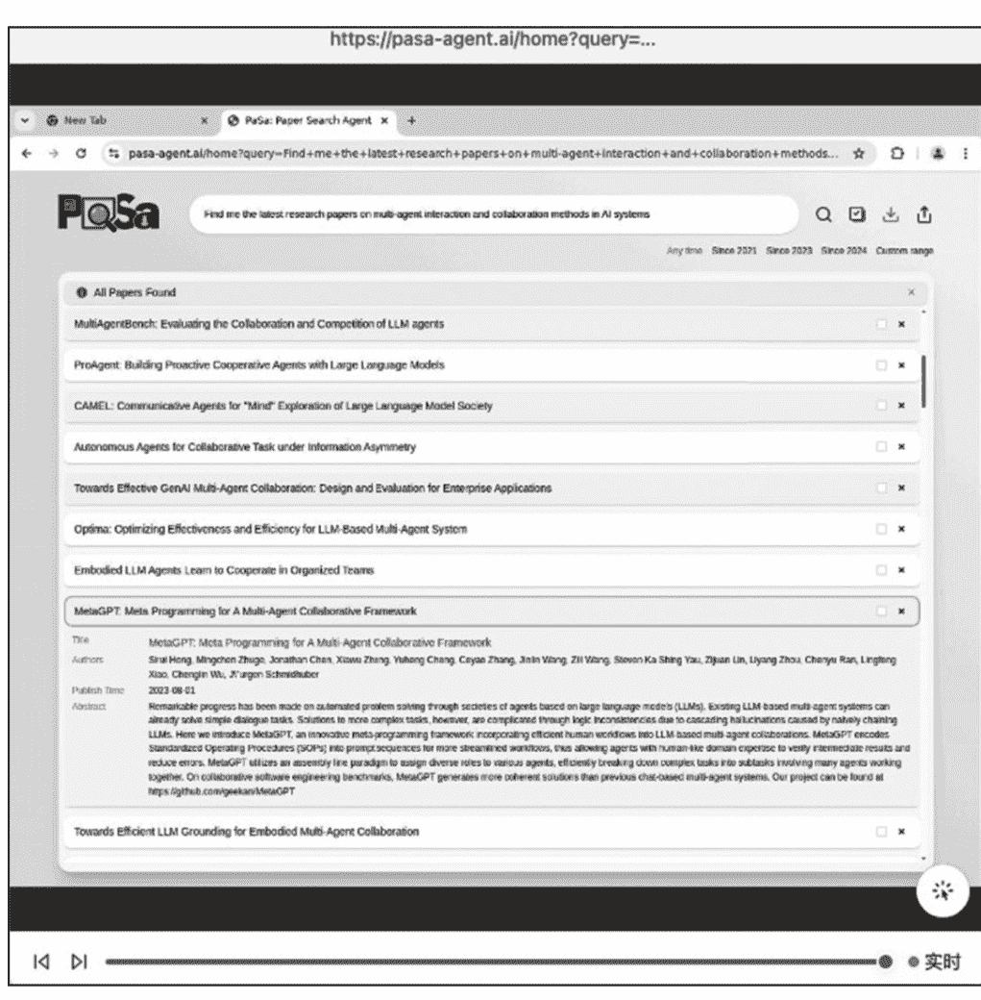

▲图3-15 Manus从指定网站搜索论文

引入专业检索工具后，Manus 的执行效果明显变好。图3-16 展示了检索到的相关论文。

## 多智能体交互方面的前沿论文

### 1. MultiAgentBench: Evaluating the Collaboration and Competition of LLM agents

- 作者: Kunlun Zhu, Hongyi Du, Zhaochen Hong, Xiaocheng Yang, Shuyi Guo, Zhe Wang, Zhenhailong Wang, Cheng Qian, Xiangru Tang, Heng Ji, Jiaxuan You

- 发表时间: 2025-03-03

- 链接: https://github.com/MultiagentBench/MARBLE

- 摘要: 大型语言模型(LLMs) 已经展示了作为自主智能体的显著能力，但现有的基准测试要么专注于单智能体任务，要么仅限于狭窄领域，无法捕捉多智能体协调和竞争的动态。本文介绍了MultiAgentBench——一个全面的基准测试，旨在评估基于LLM的多智能体系统在各种交互场景中的表现。该框架不仅可衡量任务完成情况，还能评估协作和竞争质量，并使用新颖的基于里程碑的关键性能指标。此外，研究评估了各种协调协议（包括星形、链式、树形和图形拓扑）和创新策略（如群体讨论和认知规划）。值得注意的是，图形结构在研究场景中表现最佳，认知规划将里程碑达成率提高了3%。代码和数据集公开可用。

### 2. Towards Effective GenAI Multi-Agent Collaboration: Design and Evaluation for Enterprise Applications

- 作者: Raphael Shu, Nilaksh Das, Michelle Yuan, Monica Sunkara, Yi Zhang

- 发表时间: 2024-12-06

图3-16 相关论文结果

最后，Manus 也学会了我们习惯的人机协作节奏。任务完成后它仍会主动征询决策意见，等待下一步指令，如图3-17 最下方文字。

感谢您使用我的服务！我已经完成了多智能体交互方面前沿方法的搜索和分析工作。

您对我提供的论文和总结还有什么问题或需要进一步了解的地方吗？例如：

- 1. 您是否需要我深入分析某篇特定论文中的方法？
- 2. 您是否对某个特定的多智能体交互技术感兴趣，希望获取更多细节？
- 3. 您是否希望我比较不同论文中提出的方法的优缺点？

或者，如果您对这些论文中的代码实现感兴趣，我也可以帮您查看GitHub仓库中的具体代码结构和实现细节。

Manus 将在你回复后继续工作

图3-17 Manus等待人机协作的进一步指令

## 3.3 备选方案：AutoGLM沉思版

Manus 在多数任务上表现不错，但其核心价值仍在于新颖的人机协作模式。若想更灵活地定制智能体，市场上还有替代选择，AutoGLM沉思版就是一个理想方案。

不少用户觉得 Manus 使用成本偏高，实际上存在可替代的开源方案。下面介绍 AutoGLM沉思版，简称 AutoGLM沉思。

### 3.3.1 功能对比
AutoGLM沉思由智谱AI推出，底层基于自研 GLM-Z1-Air 推理模型。和 Manus 一样，它能模拟人类思考路径，处理复杂开放问题，并通过多步推理和自主操作完成任务。

两者异同可从运行环境、定价、能力范围看。表3-1 做了对比。

把执行过程对照来看，Manus 更像自动化分析师加开发者。它会明确规划、调用工具、抓取特定数据如股价、财务指标、做计算如 DCF 估值、技术指标分析、生成图表，全程透明。除详细报告外，还能做交互式数据看板。

表3-1 AutoGLM沉思和Manus的比较

| 对比维度 | Manus | AutoGLM 沉思 |
| :--- | :--- | :--- |
| 运行环境 | 基于远程计算机的智能体系统，支持多工具协同，无需本地资源 | 基于本地浏览器的智能体，需要本地资源（如基于浏览器的操作） |
| 定价策略 | 以收费为主 | 以免费为主，显著降低了用户的使用门槛 |
| 能力范围 | 能力更为广泛，除了信息抓取和浏览器操作，还可以执行 Python 脚本，完成更复杂的任务 | 具备信息抓取、数据调研和浏览器操作能力 |

AutoGLM沉思在信息搜集与总结上表现良好，但工具化和分析能力稍弱。

### 3.3.2 案例：特斯拉股票分析
还记得用 Manus 做特斯拉股票分析的案例吗？下面用 AutoGLM沉思重跑一次，看使用方式与效果。

（1）下载智谱清言客户端

访问智谱清言官网 https://chatglm.cn，右上角点“下载App”，按系统版本下载客户端，如图3-18。

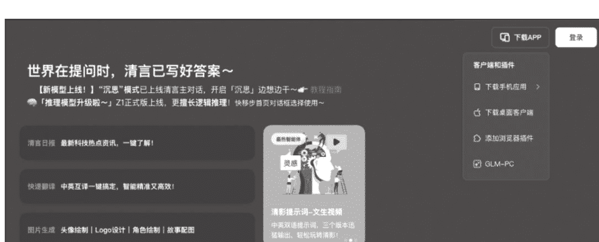

图3-18 下载智谱清言客户端

AutoGLM沉思是清言客户端内置的智能体。安装后打开主界面，左侧菜单点“AutoGLM沉思”，右侧即任务创建区，如图3-19所示。

#### （2）创建特斯拉股票分析任务
和 Manus 一样，创建任务只需写提示词发送。不同的是，AutoGLM沉思的数据采集依赖本地电脑浏览器操作。

在任务区输入如下提示词：

```
我要对特斯拉股票进行全面分析，包括：
// 数据采集
摘要：包括公司概况、关键指标、业绩数据和投资建议；
财务数据：包括收入趋势、利润率、资产负债表和现金流分析；
// 分析过程设定
市场情绪：包括分析师评级、情绪指标和新闻影响；
技术分析：包括价格趋势、技术指标和支撑 / 阻力位；
比较资产：对比主要竞争对手的市场份额和财务指标；
价值投资者：评估内在价值、增长潜力和风险因素；
投资论点：针对不同投资者类型的 SWOT 分析和建议。
```

和 Manus 类似，AutoGLM沉思会先规划。针对股票分析，它会拆成7个步骤。与 Manus 不同的是，执行中当前规划会持续更新到历史信息列表，具体如图3-20所示。

从图3-20 可看出，其执行机制是把任务清单作为提示词交给大模型。每完成一个子任务，大模型会根据清单自主挑选下一步并继续。

与 Manus 不同，子任务执行靠本地浏览器抓取数据，而非写程序实现。如图3-21，左侧是 AutoGLM沉思主界面，右侧实时展示浏览器自动化操作。

注意：打开浏览器后，具体操作会显示在浏览器左下角悬浮框，更详细的信息在左侧中间。如图3-21，右侧展示自动化操作进程及实时状态，左侧为信息处理流程。

核心逻辑是：大模型做规划，自主操作浏览器采集，再用大模型分析数据。这既是其核心流程，也是最显著特点。

和 Manus 类似，AutoGLM沉思在测试中展现了完整规划与执行能力，在数据分析任务上表现突出。

基于此，它特别适合需要从互联网收集资料并自动整合的日常办公场景。

# 第4章 本地智能体搭建实战：基于Cherry Studio

本章将指导读者使用Cherry Studio平台（一个支持本地安装和自定义智能体的开发环境）实现零代码智能体搭建，首先解析智能体的核心运行原理，然后通过3个数据智能体的实战案例展示本地智能体的构建流程与方法。

## 4.1 智能体的核心运行原理

可以预见，未来公司里的IT系统一定是多智能体协作的模式。那么，类似Manus这样的公用智能体平台能否完成公司所有的业务呢？

在AI编程领域，目前已经有很多成熟的智能体平台，这类平台替代的是传统专业编程的工作范畴。从数据应用的角度出发，可以预计未来每个公司都将需要建立自己的自主智能体平台。就像大模型不会只存在一家公司一样，Manus这类通用智能体平台可能仅适用于日常办公，很难深入到公司特定的业务逻辑中。

了解智能体的核心运行原理，掌握智能体创建技能，将成为未来必备的技能。

### 4.1.1 思考-行动框架

Manus执行任务的过程分为两步：规划和执行。任务规划部分由大模型完成，任务执行部分则通过自主编程完成。如果想自己搭建智能体，也分为规划和执行两个步骤，这两个步骤分别对应“思考”阶段和“行动”阶段。

然而，无论是Manus这样的智能体还是Cherry Studio这样的智能体平台，其底层都是软件代码。本书并非要分析具体的实现代码，而是通过解析这些软件的实现流程，帮助读者对底层细节有更深入的认识。

由于Manus不开放源代码，本书将以OpenManus为例进行介绍。

#### 1. “思考”阶段

OpenManus是一个开源的自主智能体框架，其核心原理与Manus相同，都采用ReAct（Reasoning-Acting，思考-行动）框架。

所谓“思考”，在OpenManus里对应的就是“思考阶段”。在这一阶段，OpenManus使用大模型进行“思考”，主要实现两个功能：任务分解和动作选择。即便非技术背景的用户，也可以通过下面的案例理解这一过程。

假设用户输入的任务是“帮我分析一下特斯拉股票数据”，OpenManus的“思考”阶段就相当于用户撰写任务提示词，然后找一个ChatGPT这样的大模型去执行。该阶段的提示词如下所示：

```
# "思考" 阶段提示词

## 目标

你是一个任务规划高手，根据用户提交的任务描述，结合已有的工具列表，做出合理的任务规划：
- 输入：用户任务描述。
- 输出：任务执行规划列表。

## 用户任务描述

- "帮我分析一下特斯拉股票数据"

## 工具列表

- 浏览器操作程序。
- 代码编写工具。
- 文件操作工具。

根据用户任务描述做出合理的规划，输出带序号的任务执行计划列表。
```

将该提示词输入ChatGPT，得到的结果如下：

根据您要求的特斯拉股票数据分析任务，我将为您提供一个合理的任务执行规划列表：

1. 使用浏览器操作程序收集特斯拉股票历史数据

   - 访问雅虎财经或其他金融网站。

   - 搜索特斯拉股票代码（TSLA）。

   - 下载历史股价数据（CSV格式）。

2. 使用文件操作工具处理下载的数据文件

   - 将CSV文件保存到适当的工作目录。

   - 检查数据完整性。

   - 必要时合并多个数据源。

3. 使用代码编写工具进行数据处理

   - 编写Python代码读取CSV文件。

   - 清洗数据（处理缺失值、异常值等）。

   - 计算关键指标（如日收益率、波动率、移动平均线等）。

4. 使用代码编写工具进行统计分析

   - 计算描述性统计量（均值、中位数、标准差等）。

   - 进行时间序列分析。

   - 分析与大盘指数的相关性。

5. 使用代码编写工具进行可视化

   - 绘制股价走势图。

   - 创建交易量分析图表。

   - 可视化技术指标（如 MACD、RSI 等）。

6. 使用代码编写工具编写分析报告

   - 汇总分析结果。

   - 生成关键发现摘要。

   - 输出 PDF 或 HTML 格式的报告。

7. 使用浏览器操作程序收集特斯拉财务和新闻数据（可选）

   - 获取最新季度财报信息。

   - 收集相关新闻和市场分析师观点。

8. 使用代码编写工具进行情绪分析（可选）

   - 分析新闻标题的情绪倾向。

   - 评估市场对特斯拉的整体看法。

9. 使用文件操作工具整理最终输出

   - 整合所有分析结果。

   - 归档原始数据和分析脚本。

   - 准备最终演示或报告文件。

#### 2. “行动”阶段

实际上，OpenManus的“思考”阶段只是把这个过程用程序自动执行而已。现在我们有了任务执行计划，OpenManus就可以拿着这个执行计划去调用相应的工具了。这个阶段就是OpenManus的“行动”阶段。

# OpenManus 运行机理与 Cherry Studio 零代码实操

要先把握整体架构，可先看 OpenManus 主流程示意，如图4-1，图中的专业术语可先放一边。

流程以循环方式推进，从循环开始节点进入。整个运行分为两段：思考段负责制定下一步执行方案，行动段负责调用平台自带工具。两者交替，直到结果达标或任务因异常终止。

每轮行动结束后会产生一次结果，该结果会进入下一轮，用来判断任务是否已完成以及计划是否需要调整。

把前文提示词结合起来理解更清晰。优化后的思考阶段提示词如下：

```
# 思考提示词

## 目标

你是一个任务规划高手，根据用户提交的任务描述，结合已有的工具列表，做出合理的任务规划。
- 输入：用户任务描述。
- 输出：任务执行计划列表。

## 用户任务描述

- "帮我分析一下特斯拉股票数据"

## 工具列表

- 浏览器操作程序。
- 代码编写工具。
- 文件操作工具。
- Terminate 工具（如果任务已经完成则调用这个工具）。

## 当前任务

- [ 当前任务序号 ]。

## 当前工具结果

- [ 当前工具结果 ]。

根据用户任务描述和当前结果做出合理的规划。如果需要调整任务列表，则输出新的任务列表，并选择下一步的工具。
```

此版加入了当前工具执行结果与 Terminate 工具，使大模型能依据任务实时状态规划下一步。严格来说，这才是完整的思考阶段说明。

在此设计下，Manus Agent 实质上是把大语言模型当作决策者，由它挑选下一步调用的工具，直至它决定用 Terminate 结束运行。

### 4.1.2 Agent 的代码生成原理

Manus 能承接如此多样的任务，根源在编程与代码执行能力，这也是行动阶段最突出的创新。

行动阶段引入自主编程执行，任务拆分既可通过自行编写代码实现，也可调用已有工具能力。代码在这里充当连接各工具的粘合剂。

CodeAct 是面向编程任务优化的代码生成与执行范式。

Manus 沿用 CodeAct 思路，并借助自研微调模型完成任务执行与代码生成，相比传统做法准确率更高。

**Manus 的主张是：编程只是手段，不是目的，它是解决通用问题的通用方法。**

编程的价值在于解决问题本身，而非代码堆砌。CodeAct 以可执行代码作为工具，让 Agent 适应性更强，能灵活应对任务变化。

Manus 对 CodeAct 的改进可归纳为三点。

（1）与运行环境的深度交互
CodeAct 的核心是将 Agent 与环境的所有交互转化为代码生成与执行，使其在每次交互中既能理解输入，又能执行操作并按反馈调整。框架里包含 Agent、用户、环境三方，Agent 接收输入生成代码执行，依据结果调整后续行为。Manus 通过虚拟计算机实现该思路。

（2）合理利用现有的软件包
CodeAct 还能接入已有工具处理复杂任务，比如借助现成的数据处理、文档处理、可视化工具，这正是粘合剂作用的体现。

（3）复杂任务的自我修复能力
CodeAct 的关键能力是自我修复，即对异常的灵活处理。下面以一次 Manus 任务为例，如图4-2所示，具体代码无需细看。

该案例中，Manus 生成的程序运行时报错，常规情况需人工介入，但 Manus 具备自主修复，随后自动修正程序，如图4-3所示。

图4-3 显示，识别到执行错误后，Manus 利用报错信息自行修改代码，修改完成后回到上一步流程，这次运行正常，如图4-4所示。

这一自主编程过程解释了 Manus 在行动阶段可适配多种任务的原因。

总之，借助 CodeAct，Manus 不仅赋予 Agent 工程师的基础编程能力，还培养了自适应问题解决能力。

## 4.2 用 Cherry Studio 搭建 Agent

理解自主 Agent 原理有什么用？

无论是简单提示词 Agent、SOP 类型 Agent，还是自主 Agent 平台，底层原理相通，这为搭建提供了理论支撑。

很多人会觉得自建 CodeAct 框架太难。实际上无需重复造轮子，零代码搭建时可以复用已开源的框架。

可选方案很多，既可用扣子平台，也可用 AI 编程工具构建。以下示例选 Cherry Studio，因其上手门槛最低。

零基础搭建的关键在设计，而非编码。通过此过程，能更好掌握如何设计自己的 Agent。

### 4.2.1 Cherry Studio 安装指南

先把运行环境准备好，才能开始使用与搭建。

#### 1. 下载安装 Cherry Studio
Cherry Studio 为桌面客户端，安装方式与普通应用相同。打开官网下载页：https://www.cherry-ai.com/download，可见多个下载选项，如图4-5所示。

可按系统类型直接下载，也可网盘下载，安装流程与常规软件一致。

安装完成后双击打开，会出现类似 ChatGPT 的对话界面，如图4-6所示，即主界面。

图4-6 左侧助手菜单实质为该客户端里的 Agent，下方是已用过的助手列表，被选中的默认助手即当前会话使用。

可通过添加助手功能，检索并把系统自带 Agent 加入列表，如图4-7所示。

注意，每个助手使用时可单独指定模型，具体是在会话界面点击上方搜索模型按钮，如图4-8所示。

以选择人力资源助手并把模型切为 DeepSeek Chat 为例，会话效果如图4-9所示。

从图4-9 可见，助手角色保持不变，后端模型已切换为 DeepSeek Chat。需要注意，新装的客户端默认未配置模型，使用前需先完成配置。

#### 2. 配置大模型
在主界面左侧菜单最下方找到设置，进入后模型服务即为配置入口，如图4-10所示。

该客户端兼容市面上大部分模型，以硅基流动平台为例说明申请与配置。

1）注册登录硅基流动平台：https://siliconflow.cn/ 。登录后在左侧菜单打开 API 密钥，复制密钥以便填入客户端。界面如图4-11所示。

2）复制密钥后返回图4-10 配置界面，找到硅基流动配置项，填入密钥及 API 地址 https://api.siliconflow.cn，点击 API 密钥右侧检查，显示连接成功即配置完成，后续可选择具体模型。配置界面如图4-12所示。

#### 3. 添加 Agent
新建 Agent 前，先了解默认 Agent。打开主界面左侧第二项智能体，可见分类列表，如图4-13所示。

可搜索或按分类筛选，单击 Agent 将其加入助手列表，例如把商业数据分析加入列表，如图4-14所示。

### 4.2.2 网页抓取 Agent：网页操作助手

本次任务是构建一个网页抓取 Agent，采用 SOP 模式。为让每个 Agent 聚焦单一步骤，可按功能拆分为抓取、剖析、展示三个 Agent。

SOP Agent 的核心是明确输入输出，具体拆解与执行可交由模型与工具。

#### 1. Agent 设计
思考行动框架包含思考模块与行动模块。对抓取 Agent 而言，思考模块需理解用户需求并判断所需内容；行动模块负责抓取网页信息。

于该客户端中，思考模块可通过提示词配合模型实现，行动模块则借助联网模块完成。

在助手会话界面的提示词输入框下方，有互联网标识的开关。开启后助手具备搜索与抓取能力，如图4-17所示。

此时发起会话，例如查询北京最新的天气，因训练数据不含最新信息，客户端会自动识别需联网查询。如图4-18所示，助手会调用联网查询工具获取最新信息。请注意，配置硅基流动后，系统会自动将 DeepSeek Chat 设为默认基础模型。

最后，模型会结合查询到的天气信息作答，如图4-19所示。图下方引用内容显示本次会话所用网页信息。

网页抓取 Agent 利用联网工具抓取网页内容并由模型整合输出，设计如下：

1. 接收用户输入，包括网站名称、查询内容及整理后的字段示例。
2. 输出为整体表格，采用 Markdown 格式。

将上述两点转化为提示词：

## 网页抓取 Agent

### 项目概述
创建一个网页信息采集 Agent，具有以下特点：

- 利用大模型整理内容，用联网模块搜索内容。
- 等待用户输入网站名称、查询内容和字段例子。

### 具体步骤

#### 1. 等待用户输入
- 提示用户输入需要采集的网站名称、查询内容和字段例子。
- 完全接收到这些信息才开始下一步。

#### 2. 联网搜索
- 使用联网模块搜索网站名称下的查询内容。

#### 3. 内容整理
- 利用搜索到的内容整理信息并形成输出，用 Markdown 数据表格输出。
- 输出格式参考用户给的字段例子。

### 注意事项
- 输出 Markdown 表格，不要任何额外说明。

请等待用户输入需求后开始。

#### 2. Agent 搭建
1. 打开客户端的我的界面，选择创建 Agent。在创建界面输入名称网页抓取 Agent，将上述提示词粘贴到提示词输入框作为系统提示词后点击创建，如图4-20所示。

2. 为提醒用户输入，需回到我的 Agent 界面，右键刚创建的 Agent 选择编辑 Agent，如图4-21所示。

在编辑界面选择预设消息选项，点击右侧添加，配置默认提示消息，用于用户打开 Agent 时的提醒，如图4-22所示。

在消息组区域的助手输入框中设置预设消息：请你输入需要查询的网站名称、查询内容和输出的数据格式例子，如图4-23所示。

3. 因使用联网工具，可进一步细化联网配置。打开设置界面，找到网络搜索选项，如图4-24所示。可选择搜索服务商、设置搜索结果个数等，按需求保存。

4. 返回我的 Agent 界面，找到新建的网页抓取 Agent，在快捷菜单中选择添加到助手，如图4-25所示。

添加后可在助手界面看到该 Agent，点击即可开始对话，如图4-26所示。

5. 在话题区域点击默认话题，在提示词区下方选择联网搜索模式，在首条提示后输入采集需求。测试需求如下：

> 在东方财富网，查询 GDP 数据，输出：年份，月份，GDP，增长率

图4-27 显示 Agent 已采集到相关内容并输出 Markdown 表格。

确认内容后，可点击会话界面的复制按钮复制内容保存，如图4-28所示。

搭建完网页抓取 Agent 后，继续搭建资料剖析 Agent。

### 4.2.3 资料剖析 Agent：预测模型助手

资料剖析 Agent 需支持用户上传已收集的文件，并完成清洗与分析。

如何写出提示词？可借助该客户端完成编写。

#### 1. Agent 设计
在资料剖析 Agent 中，思考模块需读懂用户上传的数据和结构，并理解常用分析方法，这部分由客户端的大模型完成；行动模块需接收数据文件，使用助手的文件功能。

##### (1) 文件上传
在助手会话界面，提示词输入框下方有一排功能按钮，其中曲别针图标用于文件上传，上传的文件会随提示词一起发送给大模型，如图4-29所示。

##### (2) 提示词 Agent
若不熟悉资料剖析，也可借助该客户端的提示词 Agent 来设计。具体步骤：打开 Agent 列表，选择编程分类，找到 Prompt 工程草稿师，如图4-30所示。

该 Agent 的作用是根据自然语言描述的需求，帮助生成 Agent 提示词。例如针对资料剖析 Agent，输入如下需求：

> 我要做一个资料剖析 Agent，功能包含数据清洗和数据分析，要提示用户输入具体的分析方法和输出格式。给我写一个提示词。

输入后即可自动得到专业提示词，如图4-31所示。

借助工具可快速获得专业级设计草稿，但仍需在草稿基础上调整。修改后的提示词如下：

```
# Role: 数据分析智能体

## Profile:
- author: kronos。
- version: 0.1。
- language: 中文。
- description: 一个专业的数据分析智能体，专注于数据清洗和数据分析任务。

## Goals:
- 帮用户完成数据清洗。
- 执行用户指定的数据分析方法。
- 按照用户要求的格式输出分析结果。

## Constrains:
- 必须明确提示用户选择分析方法。
- 必须明确要求用户指定输出格式。
- 只能处理结构化的数据问题。
- 不能处理图像、音频等非结构化数据。

## Skills:
- 精通数据清洗方法。
- 掌握多种统计分析方法。
- 熟悉常见的数据分析流程和最佳实践。
- 能够按 JSON/CSV/Markdown 等多种格式输出结果。

## Workflows:
1. 确认数据来源和格式。
2. 诊断数据质量问题并清洗数据。
3. 选择分析方法。
4. 执行分析并按照指定格式输出。

## Examples:
- Example1:
"""
用户输入：
"请帮我分析销售数据.csv，我想知道哪个产品线表现最好"

你：
"请确认：
1. 输出格式要求（JSON/CSV/Markdown表格）？
2. 分析方法选择（描述性统计/对比分析/……）？"

用户确认后：
1. 检测数据质量：检查缺失值8处，建议删除或均值填充。
2. 分析方法：按产品线分组计算销售额/利润率等指标。
3. 输出：Markdown表格展示按销售额排名的产品线。
"""
```

## OutputFormat:

按用户输出字段要求，输出Markdown表格。

## Initialization:

"您好，我是专业的数据分析智能体。请提供您需要分析的数据集，并指定：

1. 分析方法。

2. 输出格式要求。

我将为您提供完整的数据清洗建议和分析报告。"

```

注意，这里的所有专业名词都是自动生成的，如果读者不熟悉先不用修改，只需要优化自然语言表述的部分就可以。

#### 2. 智能体搭建

在“我的”智能体界面中，单击“创建智能体”按钮。在弹出的“创建智能体”界面中，首先在“名称”框中输入“数据分析智能体”，然后将之前设计的提示词填入“提示词”输入框，最后单击“创建智能体”按钮，完成创建过程，如图4-32所示。

和信息采集智能体类似，数据分析智能体也需要设置“预设消息”，在“助手”框中输入“请提供数据分析方法和输出字段格式要求”，以提醒使用智能体的用户，设置后单击“保存”按钮，如图4-33所示。

数据分析智能体的测试方法和信息采集智能体类似，其输出也是一个Markdown表格，此处不再展开。

### 4.2.4 数据可视化智能体：动态报表生成器

数据可视化智能体是一个关键部件，要动态地生成可视化图表。输入是一个数据表格，输出是一个图表。

根据智能体“思考-行动”框架，在数据可视化智能体中，主要解决的是图表展示这个“行动”步骤，也就是要找到合适的工具显示图表。

#### 1. 智能体设计

如果仅靠Cherry Studio的输出是很难显示图片的，而且默认情况下的Cherry Studio也没有类似Manus的可视化能力。所以只能在Cherry Studio的文本输出基础上完成可视化。

在具体设计之前，我们需要了解Markdown的特性，虽然Markdown是纯文本的格式，但是它支持在Markdown文本中嵌入网页地址，如果这个网页是一张图片，则可以直接在Cherry Studio中显示出来。

我们利用Markdown的这个特性，结合一个数据分析结果可视化网站（https://quickchart.io）完成可视化需求。该网站的特性是，只需要在网址后面加入数据就可以实现可视化，类似下面的网址：

```

https://quickchart.io/chart?c={type:'bar', data:{labels:['Q1', 'Q2', 'Q3', 'Q4'], datasets:[{label:'Users', data:[50, 60, 70, 180]}, {label:'Revenue', data:[100, 200, 300, 400]}]}}

```

打开这个网址，其对应的可视化图片显示如图4-34所示。

现在可以利用Markdown和QuickChart的特性，编写一个在Cherry Studio里完成数据可视化的提示词。

## 数据可视化智能体

### 1. 目的

- 接收用户数据输入。
- 根据用户需要的图表形式完成可视化输出。

### 2. 可视化

- 利用 Markdown 结合网址输出的方法，完成可视化。
- 具体图表数据可视化使用 https://quickchart.io 网站。

### 3. QuickChart 网站案例

比如网址：

```

https://quickchart.io/chart?c={type:'bar',data:{labels:['Q1','Q2','Q3','Q4'], datasets:[{label:'Users',data:[50,60,70,180]},{label:'Revenue',data:[100,200,300,400]}]}}

```

只需要在网址后面填写具体数据，然后在 Markdown 引用这个网址就能完成可视化。

### 4. QuickChart 具体规则文档

```

https://quickchart.io/documentation/

```

请你根据用户需求，直接输出可视化结果，不要额外说明。

#### 2. 智能体搭建

因为前文已经介绍了Cherry Studio的智能体搭建流程，此处略去这个过程，直接打开新建的数据可视化智能体，首先做一个简单的测试。

在助手界面让智能体画一个饼图，可以输入以下提示词：

> 帮我画一个饼图，并输入数据：
>
> A 20
> B 30
> C 50

图4-35展示了智能体的具体输出结果。

读者可以在Cherry Studio里直接下载这个可视化的图形。

接下来看一个稍微复杂的例子，对一个店铺的销售数据进行可视化。下面是这个店铺的具体销售数据，可以将数据存储为“店铺数据.md”文件。

| 周次 | 时间范围 | 男装销售额（元） | 男装销售量（件） | 女装销售额（元） | 女装销售量（件） | 童装销售额（元） | 童装销售量（件） | 配饰销售额（元） | 配饰销售量（件） |
| --- | --- | --- | --- | --- | --- | --- | --- | --- | --- |
| 1 | 4月1日 - 4月7日 | 20,000 | 150 | 30,000 | 200 | 10,000 | 80 | 5,000 | 50 |
| 2 | 4月8日 - 4月14日 | 22,000 | 160 | 32,000 | 210 | 11,000 | 90 | 5,500 | 60 |
| 3 | 4月15日 - 4月21日 | 21,000 | 155 | 31,000 | 205 | 10,500 | 85 | 5,200 | 55 |
| 4 | 4月22日 - 4月28日 | 23,000 | 170 | 33,000 | 220 | 12,000 | 95 | 6,000 | 70 |
| 5 | 4月29日 - 5月5日 | 24,000 | 180 | 34,000 | 230 | 13,000 | 100 | 6,500 | 75 |
| 6 | 5月6日 - 5月12日 | 25,000 | 190 | 35,000 | 240 | 14,000 | 110 | 7,000 | 80 |
| 7 | 5月13日 - 5月19日 | 26,000 | 200 | 36,000 | 250 | 15,000 | 120 | 7,500 | 85 |
| 8 | 5月20日 - 5月26日 | 27,000 | 210 | 37,000 | 260 | 16,000 | 130 | 8,000 | 90 |
| 9 | 5月27日 - 6月2日 | 28,000 | 220 | 38,000 | 270 | 17,000 | 140 | 8,500 | 95 |
| 10 | 6月3日 - 6月9日 | 29,000 | 230 | 39,000 | 280 | 18,000 | 150 | 9,000 | 100 |
| 11 | 6月10日 - 6月16日 | 30,000 | 240 | 40,000 | 290 | 19,000 | 160 | 9,500 | 105 |
| 12 | 6月17日 - 6月23日 | 31,000 | 250 | 41,000 | 300 | 20,000 | 170 | 10,000 | 110 |

在“数据可视化智能体”的“话题”界面中，单击形如回形针的按钮选择并上传刚才准备好的数据文件“店铺数据.md”。此时，智能体“话题”界面的提示词输入框上方会显示“店铺数据.md”文件已成功上传。接下来，在提示词输入框中输入：“根据店铺数据，帮我按品类和时间输出柱状图”。数据上传和提示词输入如图4-36所示。

注意，需要打开助手的联网功能，以便助手可以读取数据显示的具体规则，经过数据可视化智能体的运行，店铺数据可视化结果如图4-37所示。

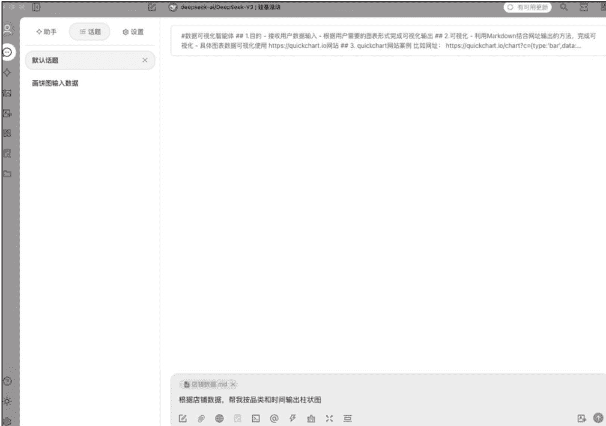

▲图4-36 数据上传和提示词输入

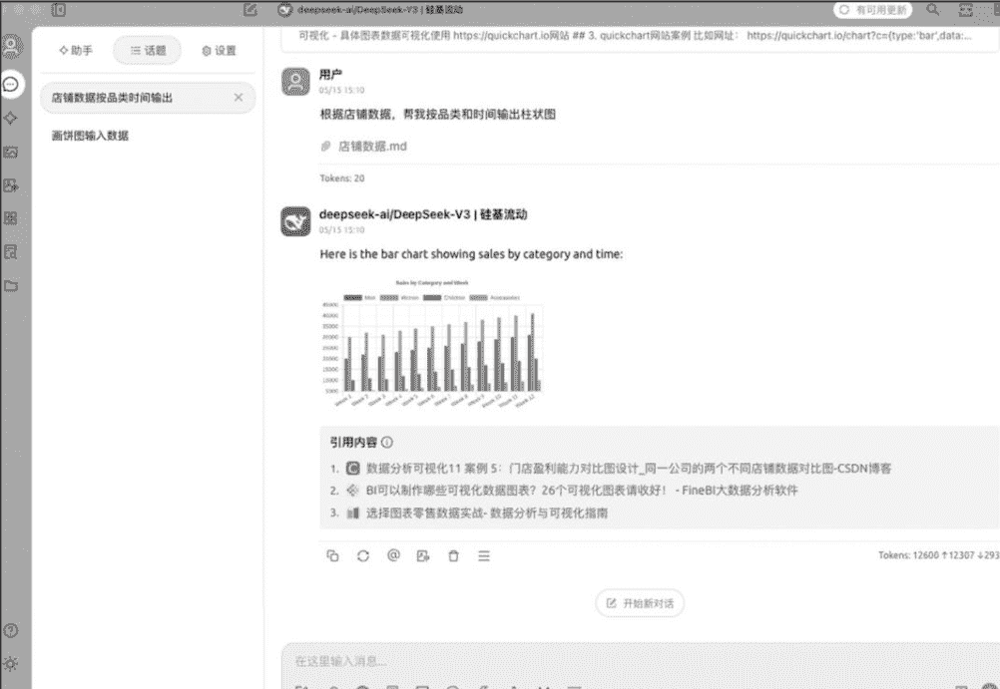

图4-37 店铺数据可视化结果

读者可以将图4-37里的图表下载为图片，具体方法是先单击图4-37的图表区域，此时会放大图表并在底部弹出操作选项，如图4-38所示，单击底部操作选项最右侧的“下载”按钮便可以完成图片导出。

最终导出的数据图表如图4-39所示。

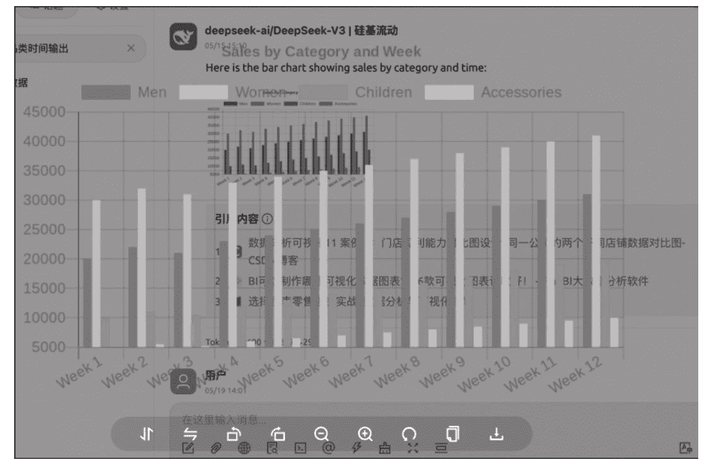

▲图4-38 店铺数据可视化图表导出

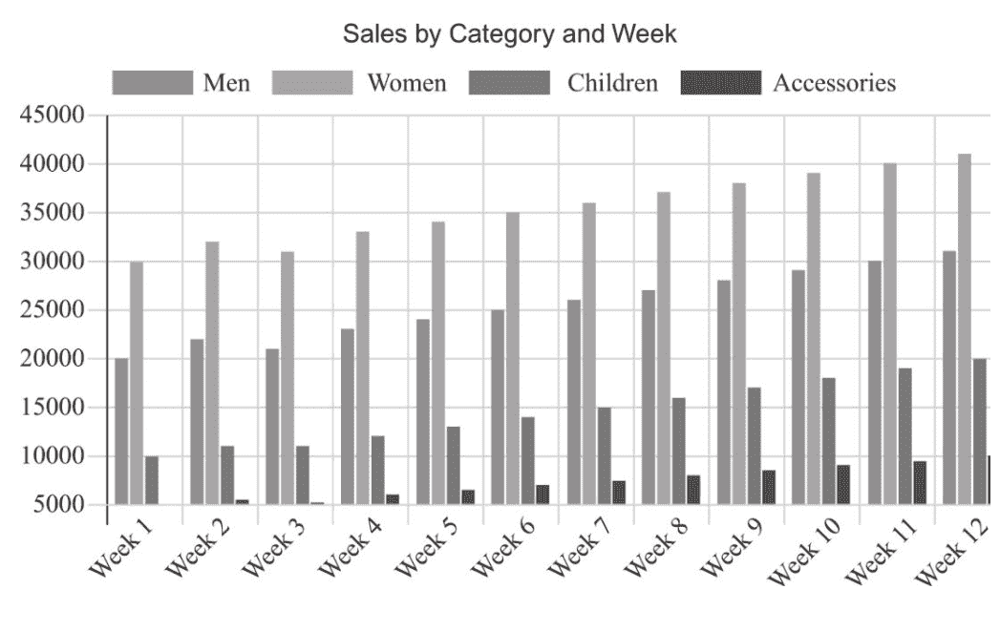

## 图4-39 导出的店铺数据可视化图表

如果图4-39中的文字信息不能满足需求，还可以在提示词里自定义具体的品类和时间文字信息，以便将这些结果图表写入数据报告。

比如下面的提示词：

> 根据店铺数据，帮我按品类和时间输出柱状图
> 表头分别为 " 男装 "" 女装 "" 童装 "
> 只显示 " 销售额 "/" 销售量 " 的数据

现在已经完成了数据分析系列智能体的搭建，当然，如果读者要对智能体更进一步定制规则，可以对智能体的系统提示词进行灵活修改。

由于本章介绍的Cherry Studio智能体搭建工具是基础工具，还不能完成复杂度更高的智能体，后面章节会介绍更多零代码的搭建工具。

# 第5章 企业级知识库搭建实战

本章深入探讨智能体的关键组成部分——知识库，并以本地零代码智能体平台 Cherry Studio为例，展示如何快速搭建企业级知识库和智能体系统。为了最大化知识库的效能，本章内容涵盖了知识库内部运行原理与优化技巧，同时也讨论了知识库部署后的运维管理方法。通过本章的学习，读者将掌握企业级知识库的搭建与维护技术，确保能够有效利用知识库提升智能体系统的整体性能。

## 5.1 知识库系统搭建

要实现公司业务的智能化，必须搭建私有知识库系统，以配合私有智能体的开发。因为Manus不包含任何公司的私有业务逻辑或专有数据，所以我们使用本地智能体平台Cherry Studio（功能和基础应用可参见第4章），读者需要提前在本地计算机上安装该软件。

即使完全没有开发经验，读者仍然可以使用自助式知识库软件来搭建私有知识库系统。

### 5.1.1 知识库创建与基础查询

安装Cherry Studio后，首先需要进行基础配置，其中最关键的是设置大模型服务的API密钥（即大模型的程序接口服务）。

在Cherry Studio平台中，每个助手代表一个独立的智能体。为了更好地理解知识库的实际应用价值，我们设计了一个测试场景：使用Cherry Studio的默认智能体查询“金伟是谁”，以此观察未接入知识库时的响应效果，如图5-1所示。

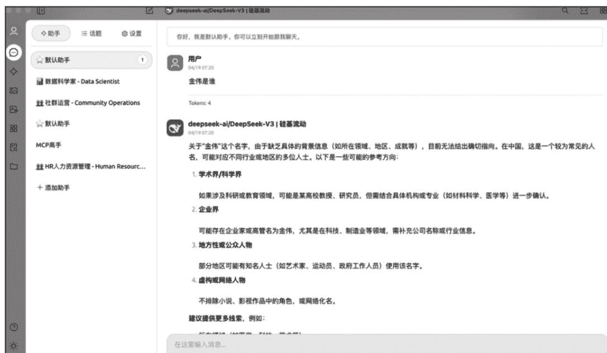

图5-1 缺乏知识库情况下的结果

显然，由于金伟并非公众人物，网络公开信息中并不包含金伟的个人资料，导致大模型无法获取相关信息，查询自然没有结果。让智能体知道这个准确的私有信息，正是知识库的价值所在——通过补充专有数据，使大模型具备企业所需的特定知识，从而让智能体真正能在实际业务场景中发挥作用。

那么，如何创建一个具备知识库的智能体呢？下面就来构建一个“我的数字分身”智能体。

#### 1. 知识库的创建与配置

现在，将进入智能体的创建与配置环节，通过定制化设置来满足具体业务需求。以下是详细的搭建步骤。

- 1）依次单击“我的”→“创建智能体”按钮进行智能体创建，如图5-2所示。


图5-2 创建智能体

- 2）在弹出的“创建智能体”界面将智能体命名为“金伟的分身”，然后在“提示词”输入框中进行角色的配置（即用户对智能功能的描述），如图5-3所示。注意，在这一步暂时不需要选择知识库。

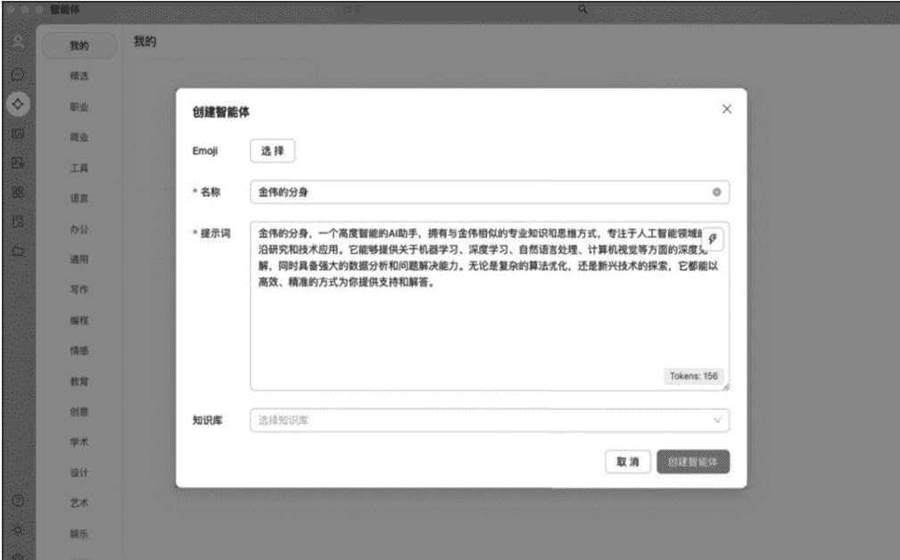

图5-3 智能体配置

通过上述简单的步骤，用户可以轻松构建出一个“金伟的分身”智能体。

- 3）配置知识库，操作同样简单。为了完善“金伟的分身”智能体，我们需要配置知识库，首先打开Cherry Studio的知识库模块。单击左侧菜单的“知识库”图标，并在“知识库”界面单击“添加”按钮，此时会显示图5-4所示的“添加知识库”界面。

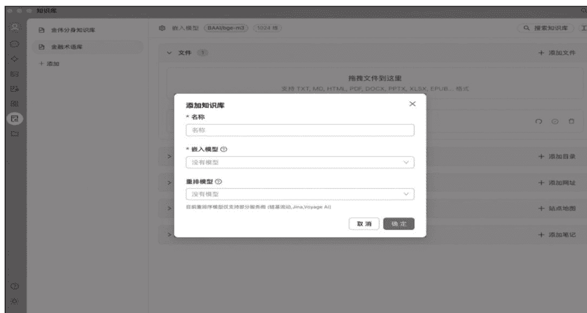

图5-4 “添加知识库”界面

知识库中的嵌入模型是一种算法，用于将原始文档转换为知识库中的向量表示形式。

设置知识库名为“金伟分身知识库”，注意要选择嵌入模型 ①，先不必关心嵌入模型这个技术术语，只需要了解知识库内部需要用嵌入模型做数据格式转换即可，这里系统默认使用BAAI/bge-m3模型，如图5-5所示。

创建知识库后，就可以上传相关文档。目前Cherry Studio支持各种主流文档的上传，用户不必做额外操作，Cherry Studio知识库模块就会自动处理文档并转换为内部数据格式。在“金伟分身知识库”中，拖拽上传知识库资料，这里是金伟的个人介绍PPT，如图5-6所示。待知识库初始化完成后即可使用。

如图5-6所示，当文件名“AI人金伟（超级简历）.pptx”后面显示（绿色）对勾时，就表示知识库文件已处理完成。

- 4）为智能体单独关联知识库。首先到“我的”智能体界面，找到刚才新建的智能体“金伟的分身”，单击该智能体，并在弹出的对话框中单击“添加到助手”按钮，如图5-7所示。

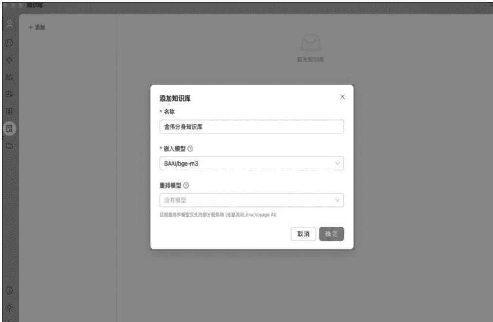

▲图5-5 新建知识库

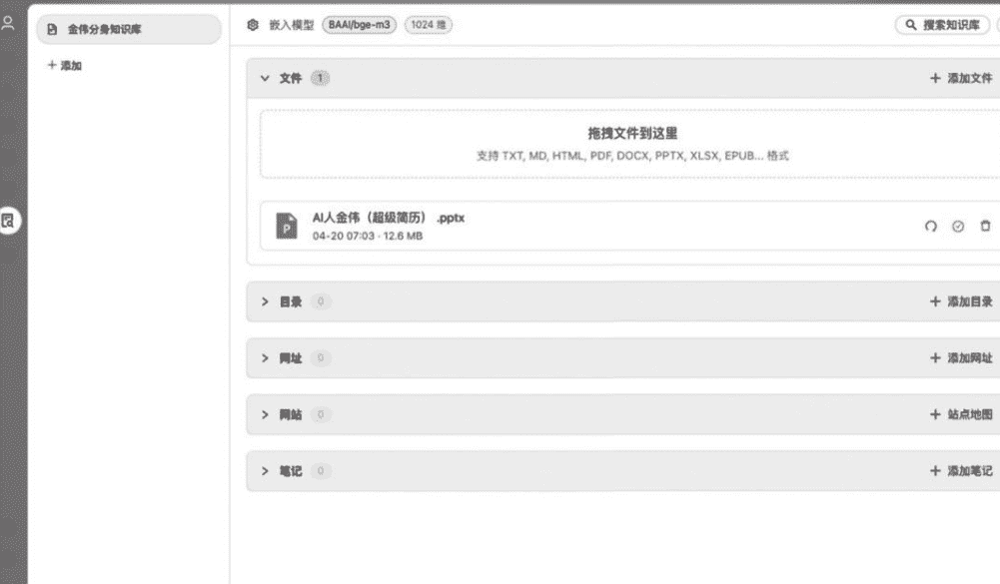

▲图5-6 知识库上传文档操作

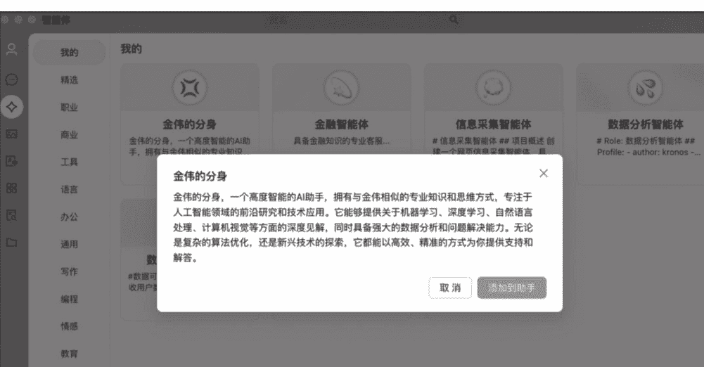

图5-7 将新建的智能体添加到助手

现在从“助手”界面单击“金伟的分身”，并选择进入智能体的“设置”菜单，单击第一个选项“助手设置”，会弹出智能体助手的设置界面，单击“知识库设置”选项，在下拉列表框中将刚才创建的“金伟分身知识库”添加到智能体中，如图5-8所示。

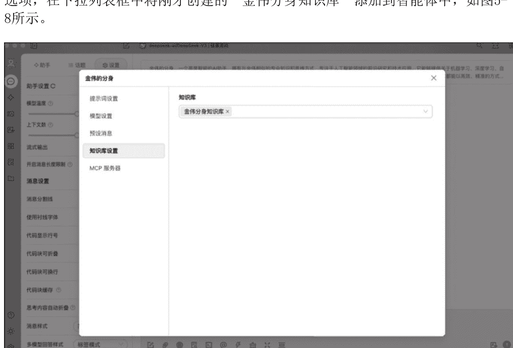

图5-8 为智能体添加知识库

- 5）完成关联后，可以再次向智能体提问“金伟是谁”，看看回答是否有所改善，如图5-9所示。

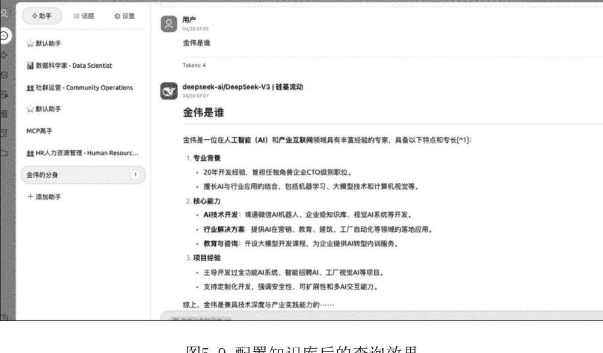

图5-9 配置知识库后的查询效果

从图5-9中可以看到，智能体是根据金伟的介绍文件来回答问题，而不是公开的互联网信息。这说明通过添加知识库，智能体会优先查询知识库的内容，作为更准确的信息来源，而不是仅仅使用大模型的知识。

上述操作把现成的文件添加到知识库中，如果没有现成的文件，需要专门为知识库创建知识文档，该如何操作呢？

#### 2. 建立行业术语知识库

我们换个场景，现在要用Cherry Studio的知识库来建立一个行业术语知识库。构建专有知识库的质量主要取决于数据质量，所以要先对数据做好整理和分类。

首先，收集相关行业术语并做初步分类，这里以一个金融科技行业的例子来说明。金融科技行业术语分类示例如下：

- 支付类术语。
- 区块链相关术语。
- 风控术语。
- 监管合规术语。
- 金融产品术语。

其次，如果要新建知识库文档，制定文档标准非常重要。为了保证知识库质量，我们需要建立统一的文档格式标准，一般使用Markdown格式，根据具体知识进行结构化整理，下面是一个文档格式模板。

```

# 术语速写模板

做自媒体写专业词，最怕说不清。用这个标准框架，一页把概念讲透。

## 一句话定义
把核心意思浓缩成不超过50字的精炼表述，让读者第一眼就能抓住关键词的本质。

## 深度解析
展开词条的来龙去脉和边界，说明其形成背景、适用范围以及常见用法。建议字数控制在200到300字之间，信息饱满但不啰嗦。

## 实际用途
结合真实业务，列出2到3个可落地的使用场景，举例说明在什么环节、为了解决什么问题会用到这个术语。

## 相关概念
罗列3到5个与之关联的周边词汇，帮助建立知识网络，方便横向对比和记忆。

## 参考来源
给出至少两项权威出处或权威媒体链接，方便读者溯源核查，提升内容的可信度。

```

现在以金融领域的KYC概念为例，以下是按照标准完成的术语文档示例：

## KYC (Know Your Customer)

### 基本定义

KYC 是 "了解你的客户" (Know Your Customer) 的缩写，是金融机构对客户身份进行识别和验证的程序。

### 详细解释

KYC 是金融机构履行反洗钱义务时的核心环节，通过收集、验证客户的身份信息，评估客户的风险状况，建立相应的客户档案。KYC 流程通常包括身份识别、身份验证、风险评估和持续监控 4 个主要步骤。在数字金融环境下，KYC 已经从传统的线下人工审核逐步发展为结合人脸识别、OCR 技术、大数据验证等多种技术手段的智能验证流程。

### 应用场景

1. 银行开户：客户在银行开立账户时，需要提供身份证件并完成 KYC 流程。
2. 数字钱包注册：用户注册加密货币交易平台时，需要完成身份验证。
3. 跨境汇款：进行大额跨境转账时，银行会要求客户提供额外的 KYC 信息。

### 相关术语

- AML（反洗钱）。
- 实名认证。
- 风险评级。
- CDD（客户尽职调查）。
- 受益所有人。

### 参考资料

1. 中国人民银行《金融机构客户身份识别和客户身份资料及交易记录保存管理办法》。
2. FATF（金融行动特别工作组）《客户尽职调查指南》。

通过这些标准化的流程和模板，用户就能构建出高质量、结构化的行业术语知识库，为Cherry Studio的用户提供准确的专业知识支持。

和“金伟分身知识库”类似，我们在Cherry Studio添加一个“金融术语库”知识库，其中上传的文件为Markdown格式（以.md为扩展名），如图5-10所示。

在图5-10的基础上创建一个智能体，当用户问“金融领域如何保证客户资金安全”时，金融助手会根据知识库中的内容来回答，如图5-11所示。

#### 3. 知识库查询逻辑

值得注意的是，即使提问中没有明确提到KYC这个概念，金融助手依然能找到相关知识。你可能会想，Cherry Studio是如何将这个问题和知识库里的信息关联的呢？

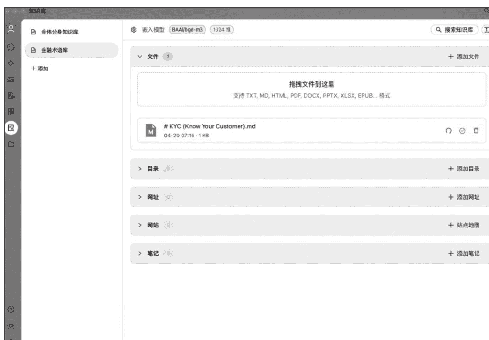

▲图5-10 添加“金融术语库”知识库

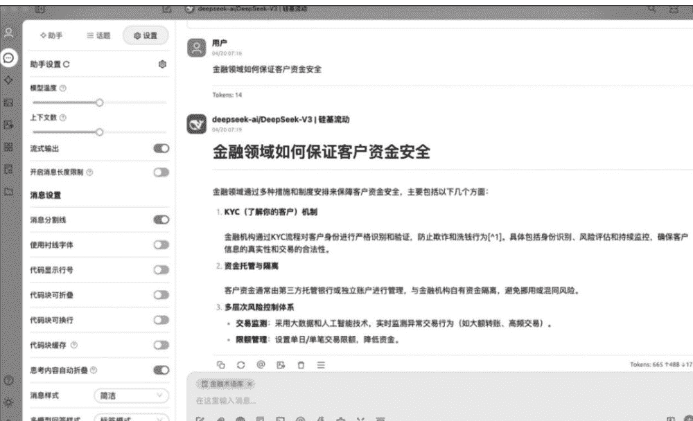

图5-11 金融助手回答专业问题

了解这一实现原理其实非常关键，因为并不是所有问题都能在知识库中找到匹配的信息。当遇到无法检索到相关内容的问题时，往往需要我们对知识库的配置或知识条目进行调整和优化。

为了更清楚地说明这一点，先来看Cherry Studio知识库智能体的基本查询流程。

第1步：用户输入查询问题，如“金融领域如何保证客户资金安全”。

第2步：知识库直接针对该问题执行查询，根据知识匹配程度找出和该问题相关的知识。

第3步：将查询到的知识作为提示词的一部分补充给大模型回答用户。

其中，第1步和第3步已经较为熟悉，本节将重点聚焦于第2步的内部机制。事实上，用户可以直接在知识库界面中使用问题进行检索，从而观察到第2步背后的知识匹配逻辑。以之前提到的问题“金融领域如何保证客户资金安全”为例，它在知识库中的查询过程如下。

打开Cherry Studio的“知识库”菜单，在知识库列表下选择“金融术语库”，并在右侧单击“搜索知识库”按钮，在弹出的“搜索知识库”界面直接输入问题进行搜索，就可以看到内部查询结果，这个结果将作为第3步的补充信息，如图5-12所示。

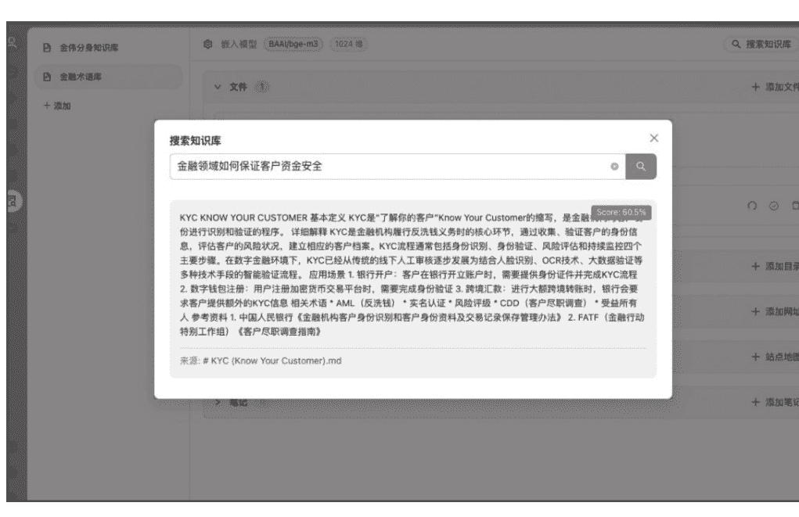

图5-12 知识库问题查询操作

图5-12中显示的 “Score：60.5%” 是一个关键评分指标，它表示该问题与知识库内容条目之间的相关程度，相关程度越高，则该值也越高，反之越低。这里的 “Score” 表示知识库查询中的 “匹配度”，用户可以设置 “匹配度” 的阈值来调整第2步中相关知识的范围。

在图5-12的 “金融术语库” 知识库操作界面，单击第一栏 “嵌入模型” 字样左边的 “设置” 按钮，打开 “知识库设置” 界面，如图5-13所示。

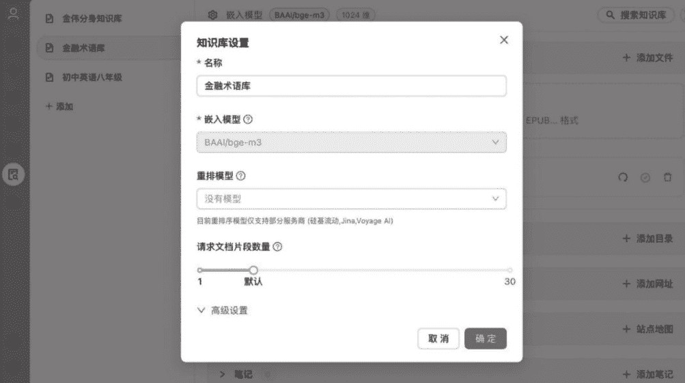

图5-13 “知识库设置”界面

在图5-13的设置界面中，选中“高级设置”以展开知识库的高级设置选项，如图5-14所示，通过调整这里的“匹配度阈值”可以调整第2步的知识匹配程度（其取值范围是0～1，1表示100%）。

注意，第2步里查询到的内容条目实际上是知识库将用户上传的文档分割后的结果，并不是整个知识库文档。系统根据“匹配度”相关性对结果排序，并选择相关性高的知识条目交给大模型来处理，即进入第3步。

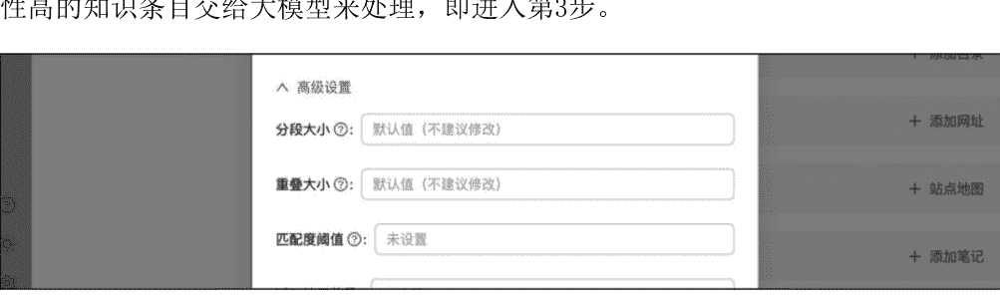

图5-14 知识库匹配度阈值设置

### 5.1.2 知识库查询优化

本节将继续介绍知识库查询相关的设置选项，了解这些设置选项有助于在实际的知识库应用中根据情况调整设置，提高知识库查询的准确率。

这些设置选项都可以在图5-13的“知识库设置”界面中找到，接下来将以“知识库设置”指代该操作界面。

针对5.1.1节中所提到的知识库查询的第2步，细想一下，读者可能会产生下面这些疑问。

- 知识库是怎么计算出“问题”和文档分段之间的“匹配度”具体值的？
- 知识库文档为什么要分段？直接把全部文档提交给大模型行不行？
- 既然知识库文档要分段，那具体应该怎么分割？按什么原则分段？

要搞清这些问题，需要从知识库的基本概念“向量查询”开始说。

#### 1. 向量查询原理

Cherry Studio智能体是如何根据用户问题查询到相关的文档分段的呢？与搜索所用的查询方法不同，Cherry Studio智能体在知识库内部采用了“向量查询”。下面是完整的向量查询流程，主要包括文档处理流程和查询处理流程，如图5-15所示。

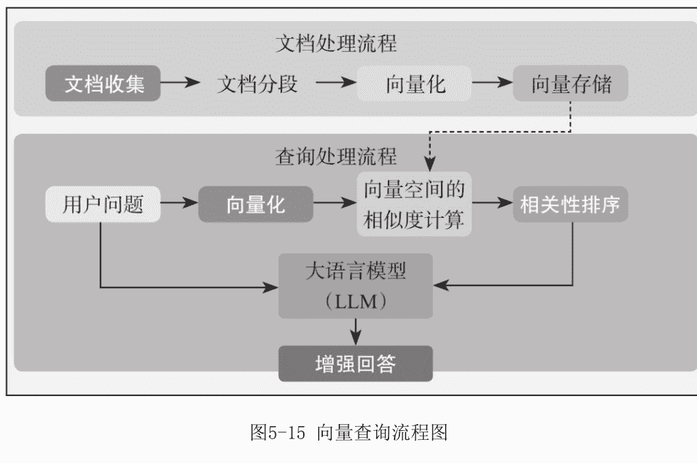

图5-15 向量查询流程图

在数学概念里，向量可以用一组数字来表示，知识库里的文本被转化为一组由数字组成的向量。

从图5-15的向量查询流程可以看到，在知识库内部，“文档分段”和“用户问题”都会转化为向量。基于“用户问题”对“文档分段”进行查询，在知识库内部会转化为向量空间的相似度计算。

一个“用户问题”的向量和一个“文档分段”的向量越相似，则表示“用户问题”和“文档分段”的匹配度越高。

其中，文档导入阶段的向量转化和问题查询的向量转化需要使用嵌入模型（比如BAAI/bge-m3模型）完成，而嵌入模型在知识库新建阶段设置完成后不可变更，具体设置参见图5-5。

既然“用户问题”和“文档分段”通过相似度计算完成“匹配度”查询，那么让“文档分段”的内容直接包含“用户问题”则相似度能提高，这正是知识库查询优化的第一个技巧。

#### 2. 文档格式优化

了解了知识库的向量查询流程后，才能处理知识库的常见问题。

第一个问题是：文档内容会直接影响知识库的性能，更进一步来说，经过整理的带有问答形式的文档，通常比未经整理的文档效果更好。例如，将文档整理为如下一问一答的形式：

> 用户问题
金伟是谁

参考答案：
**xxx**

这个文档直接按具体问题来整理，在知识库内部，当遇到相同问题的时候，其查询效果会好于未经整理的文档。另一方面，文本类型的文档比图片类型的文档效果要好。比如，PDF文件最好是文字版本，而不是图片扫描版本。

#### 3. 文档分段优化

在现实中，如果做不到上述细致的整理，则只能依靠向量查询中“文档分段”的相关参数配置来优化。第二个问题是：为什么要“文档分段”，直接将原始文档提交给大模型不行吗？

直接将整个文档提交给大模型，会导致大模型每次的请求数据量增大，影响智能体的性能，因此知识库要对文档分段，每个分段大小为M，每次“向量查询”按“匹配度”排序后，从超过“匹配度阈值”的分段里提交不超过N个分段给大模型。

文档分段的相关设置“分段大小”“匹配度阈值”等，都可以在“知识库设置”界面配置，如图5-16所示。

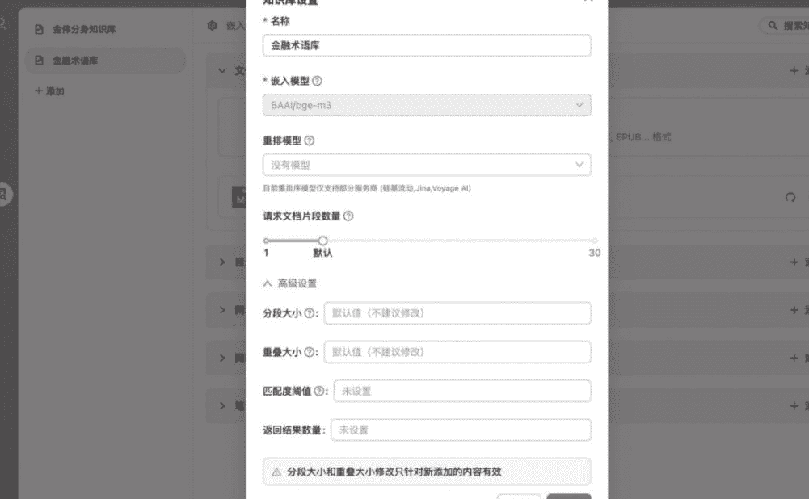

图5-16 知识库文档分段相关设置

“请求文档片段数量”设置项就是参数N，“分段大小”设置项就是参数M。M和N越大，则提交给大模型的数据量越大；M和N越小，则越有可能导致相关知识丢失。其具体设置需要结合知识库测试反复调整优化。

图5-16中还有一个“文档分段”的设置项：“重叠大小”。文本分段会产生一个问题：完整的信息可能会被分到两个段落中。下面用一个具体例子来说明不恰当的文档分段的影响。

假设有一个医学知识库文档，描述了一种疾病的症状和治疗方法。

- 段落1：“糖尿病的早期症状包括口渴、频繁排尿、疲劳和视力模糊。如果您出现这些症状，应尽快就医，因为早期干预对于防止严重并发症至关重要。糖尿病的”
- 段落2：“治疗方法包括饮食控制、规律运动、口服药物和胰岛素注射。医生会根据患者的具体情况制定个性化的治疗方案。”

如果知识库在第一段结尾处被截断，检索系统只能获取症状信息，而无法获取治疗方法。当用户问“糖尿病应该如何治疗？”时，系统就无法提供完整的回答，因为关键信息在被截断的第二段中。

如何解决这个问题？可以使用“知识库设置”界面里的“重叠大小”设置项，其原理是在分段时保留一定的重叠部分，并设置段落“重叠大小”大于零，即可确保信息的完整性。针对上述例子，这里设置增大“重叠大小”，内部会将内容重新分段：

段落1：“糖尿病的早期症状包括口渴、频繁排尿、疲劳和视力模糊。如果您出现这些症状，应尽快就医，因为早期干预对于防止严重并发症至关重要。糖尿病的治疗方法包括饮食控制、规律运动”。

段落2：“因为早期干预对于防止严重并发症至关重要。糖尿病的治疗方法包括饮食控制、规律运动、口服药物和胰岛素注射。医生会根据患者的具体情况制定个性化的治疗方案。”

注意，段落1的尾部和段落2的头部有重叠的部分（参见楷体部分），这样处理后，知识库的向量查询就不会遗漏信息了。

和其他“文档分段”的设置项一样，“重叠大小”的设置也是在知识库测试过程中，用户根据需要调整优化即可。

#### 4. 文档排序优化

第三个影响知识库准确率的问题是“文档分段”的排序问题。在实际应用中，我们需要选择相关度最高的前N个“文档分段”。

使用的前N条知识可能并非最优选择，因为更相关的知识片段可能排在后面。优化这个问题的一个方法是使用重排模型，Cherry Studio也提供了重排模型的配置，用户可以在图5-17所示的“知识库设置”界面的“重排模型”下拉列表中进行选择。

重排模型能在初步检索排序后，对排序结果再次进行优化，从而提高准确率。是否需要单独配置重排模型则根据测试情况而定，如果出现默认向量查询的排序不够准确，则可以选择重排模型进一步测试和优化。

虽然Cherry Studio已经提供了很多默认配置来解决这些问题，但在独立搭建知识库时，用户也需要特别注意这些问题。实际上，知识库的优化不是一次性就能完成的。这些基础操作也许能达到90%的准确率，但要将准确率从90%提升到99%，还需要更多的技巧和经验。

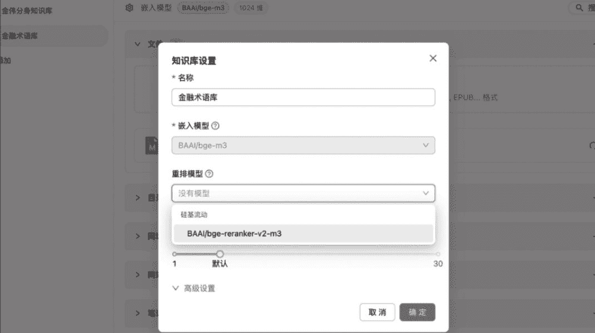

图5-17 重排模型配置

### 5.1.3 知识库测试与改进

在搭建完知识库后，我们可以进行测试，看一下知识库的处理结果是否优于大模型。

#### 1. 测试模板

例如，在金融场景下，可以设计以下测试问题模板：

### 关于金融产品

- 1. 问题：我想了解一下最近半年余额宝的收益率走势，以及它与其他货币基金相比的优势和劣势是什么？
- 2. 问题：工商银行的房贷利率最近有什么调整？申请房贷需要满足哪些条件？

### 关于金融市场

- 3. 问题：最近一个季度，纳斯达克指数的涨跌情况如何？主要受哪些因素影响？
- 4. 问题：今年中国债券市场的整体表现如何？国债收益率的变化趋势是怎样的？

### 关于金融机构

- 5. 问题：招商银行的信用卡业务在行业中的排名如何？它的主要竞争优势是什么？
- 6. 问题：蚂蚁金服的业务模式有哪些创新？它对传统金融行业产生了哪些影响？

### 关于金融投资

- 7. 问题：最近一年，新能源汽车板块的股票表现如何？有哪些值得关注的投资机会？
- 8. 问题：如果我想投资黄金，现在是合适的时机吗？黄金价格的走势受哪些因素影响？

### 关于金融政策

- 9. 问题：最近央行的货币政策有什么调整？对普通投资者有什么影响？
- 10. 问题：最近出台的房地产金融政策有哪些？对房地产市场的影响如何？

这些问题涵盖了金融产品的细节、金融市场动态、金融机构的业务与竞争力、投资机会分析以及金融政策的影响，适合用于测试大模型结合知识库后的信息处理能力。

我们可以将智能体的回答与人类预期进行对比，看是否达到了以下要求。

- 1）回答中是否恰当地融入了知识库中的相关知识。
- 2）整体回答质量是否接近人类水平。

这个测试步骤十分重要，它可以验证知识库的有效性和实用性。在实际业务中需要整理测试问题并进行评估，这一步骤能确保知识库上线时具备基础的服务能力。

#### 2. 内容关联性改进

当然，知识库的建设是一项长期工作，除了初始化建设和测试外，还需要持续改进和优化，这通常是一个长期过程，而不是一次性完成。举个例子，当在测试中发现问题时，如何改进知识库？通常的解决方案不是简单地调整知识库参数，而是针对特定问题专门建立知识条目。

例如，如果发现“金伟是谁”的查询返回信息不完整，就可以专门创建一个关于“金伟”的知识条目，包含详细的个人信息和背景。

> 金伟是谁
xxx

还有一个常见问题是，知识库的向量搜索模式对知识的关联性识别较弱。

例如，在下面的信息中，一个规则制度在不同段落中包含了复杂的业务逻辑。

### 银行贷款审批知识库案例

规则 1（存储在知识库的第一部分）：
......
客户申请个人贷款时，若年收入超过 10 万元且信用评分高于 700 分，可获批最高 50 万元贷款额度，免除担保人要求。
......

规则 2（存储在知识库的另一部分）：
......
对于首次申请贷款的客户，无论收入水平如何，贷款额度不得超过年收入的 3 倍，且必须提供担保人。
......

这里的冲突问题如下：
当一位首次申请贷款的客户，年收入为15万元，信用评分为750分时：

- 根据规则1，该客户可获批最高50万元贷款，无须担保人。
- 根据规则2，该客户贷款上限为45万元（年收入的3倍），且必须提供担保人。

在这种情况下，知识库检索可能只返回其中一条规则，导致贷款审批人员做出错误决策，或者同时返回两条规则但没有说明优先级，造成执行混乱。
其根本原因在于向量搜索对知识关联性识别的局限性。为了应对这种情况，有几个解决方法：

- 1）继续为这些特殊情况补充知识：定期回顾知识库，识别出缺失的知识点，并补充相关信息，以确保知识库的全面性和准确性。
- 2）加入跨段落的上下文保留：在文本分块时保留段落间的逻辑关联，或者使用滑动窗口确保上下文的连贯性。
- 3）建立分级检索机制：先进行粗粒度检索找到相关主题，再进行细粒度检索获取完整上下文。

通过这些方法，我们能够不断优化知识库，提高其在实际应用中的准确性。

## 5.2 知识库应用中的用户反馈流程

在实际应用中，为了使知识库查询的准确率从90%逐步提高到99%，上线后的运营优化变得尤为重要，具体而言，需要在智能体的流程中增加知识库的用户反馈系统。

知识库线上优化的基本思路是利用用户实际使用的数据。在用户使用过程中，他们可能会对知识库内容提出新的需求，因此可以建立一个用户反馈和知识更新机制。

以客服知识库为例，来看看如何建立一个完整的知识库反馈机制。这个机制需要做到准确识别、不遗漏关键信息，同时又不影响用户体验。

### 1. 知识库存在的问题分类

首先来看用户反馈的知识库存在的问题，通常可以分为以下几类。

#### （1）内容准确性问题

用户在使用知识库时，可能会发现某些信息有误或已过时。例如，在客服知识库中，用户可能发现某款产品的保修政策已经变更，但知识库中的内容还未更新。这类内容准确性问题需要及时处理，避免误导其他用户。

#### （2）内容缺失问题

用户在寻找解决方案时，可能会发现知识库中缺少某些关键信息。比如，软件知识库中可能没有包含某个新功能的操作指南。对于用户反馈的内容缺失问题，知识库管理者需要及时补充相关内容，以满足用户需求。

#### （3）功能相关反馈

除了内容方面的反馈，用户还可能对知识库的功能提出建议或意见。比如，用户可能希望知识库增加搜索历史记录功能，方便快速查找之前查询过的内容；或者希望增加智能推荐功能，根据用户的问题自动推荐相关答案。这类反馈对优化知识库的功能设计和提升用户体验同样重要。

### 2. 反馈处理流程

那么如何建立反馈处理流程呢？由于知识库的交互无法做到100%覆盖，因此只能在运行过程中获取问题反馈，这对系统设计能力要求很高。建议遵循以下几个基本原则。

**原则1：对知识库进行模块化设计。** 比如，将知识库分为几个主要部分，如常见问题、产品指南、故障排除等。

- 常见问题：关于退换货政策、配送时间等。
- 产品指南：详细说明每个产品的使用方法和注意事项。
- 故障排除：提供常见问题的解决方案，如设备无法启动。

建立不同的知识模块的好处是，可以分别处理各模块的准确率问题，对可能出现准确率问题的模块增加用户反馈提示。

**案例：** 某电商平台的退换货政策就是一个很好的案例。当系统发现大量用户在查询退换货政策后仍需要人工客服介入时，说明知识库中的退换货说明可能存在问题。通过分析这些人工客服的对话记录，发现用户主要困惑于跨境商品的退换货政策。这促使平台对知识库进行了优化，将普通商品和跨境商品的退换货政策分开展示，并增加了具体的操作流程说明。优化后，关于退换货政策的人工客服介入率显著下降，这就是一个典型的通过反馈发现并解决知识库问题的案例。

**原则2：合理利用各种异常处理来智能化识别知识库的问题。** 比如，某个用户的人工接管日志，既然一个问题需要人工接管，那它大概率存在某个知识库问题。更进一步说，对于知识准确性要求高的场景，应该在用户使用过程中智能化告知其知识库的特性，不应该过度承诺。

**案例：** 某在线问诊平台在用户查询症状时，系统会清晰地提示“本知识库内容仅供参考，具体诊断请以医生意见为准”。当用户搜索“头痛”这样的症状时，系统不会直接给出诊断结论，而是提供一些基础的医学知识，并引导用户填写更详细的症状描述。如果系统检测到用户描述的症状比较严重或复杂，会立即建议用户进行在线问诊或到医院就医。这种设计既能满足用户对医疗信息的需求，又能避免因知识库信息不完整而导致的误诊风险。

### 3. 知识更新机制

知识更新分为被动和主动两种方式，尤其是在数据变化较快的场景中，因此需要一套完整的知识更新机制。

#### （1）主动更新

主动更新是指知识库管理者根据预先设定的计划或规则，主动对知识库内容进行更新。这种更新方式通常适用于数据变化较快的场景，如产品信息更新、政策法规变化等。主动更新能够提前发现并解决知识库内容的时效性问题，确保用户获取的信息始终是最新的。

#### （2）被动更新

被动更新是指知识库内容的更新由用户反馈触发。这种更新方式依赖用户在使用过程中发现并报告问题，然后由知识库管理者根据反馈进行内容修正或补充。被动更新虽然能解决用户实际遇到的问题，但往往具有滞后性，且无法覆盖所有潜在的知识缺口。

#### （3）案例

在客服知识库中，产品信息是用户咨询的高频内容之一。随着产品的迭代升级，产品信息需要及时更新，以确保客服人员能为用户提供准确的解答。下面介绍其触发机制与内容规划。

1）产品信息更新的触发机制。产品信息更新的触发机制通常基于产品的生命周期管理。例如，当产品进入新的阶段（如新产品发布、产品升级、产品下架等），知识库管理者需要提前收到通知。这些通知可以通过内部系统推送、产品团队的定期报告或项目管理工具来实现。以某电子产品公司为例，每当一款新的智能手机发布时，产品团队会在内部系统中发布产品更新通知。知识库管理者收到通知后，立即启动知识库内容的更新流程。通知中通常包含新产品的关键信息，如功能特点、技术参数、价格等，这些都是知识库更新的基础。

2）产品信息更新的内容规划。收到产品更新通知后，知识库管理者需要根据产品的变化情况，规划需要更新的内容。这包括新增知识条目、修改现有条目或删除过时条目。例如，对于新产品的发布，需要新增产品功能介绍、使用说明、常见问题解答等内容；对于产品的升级，需要修改相关的技术参数和功能说明；对于产品的下架，则需要删除或标记为过时的相关知识条目。以某软件产品的更新为例，当软件从版本1.0升级到版本2.0时，知识库管理者需要根据新版本的功能变化，更新知识库中的内容。如果新版本增加了新的功能模块，需要新增该模块的使用说明和常见问题解答；如果某些功能被优化或调整，需要修改现有的知识条目，确保内容与新版本一致。

再来看一下被动更新机制的案例。在客服场景中，客户问题的反馈和改进是被动更新的主要来源。

以某电商平台的客服知识库为例，用户在使用知识库查找问题答案时，如果发现知识库中的内容无法解决他们的疑问，或者存在错误，可以通过页面上的“反馈”按钮提交反馈。这些反馈内容会被统一收集到反馈管理系统中，由客服人员进行初步分类和整理后，再根据具体问题有针对性地在知识库里新增或变更文档内容。

# 第6章 基于MCP构建企业级智能体

MCP是一种智能体扩展协议，可以零代码实现智能体功能的扩展。

在企业实战中，往往需要借助多智能体完成任务，本章将介绍构建企业级智能体的方法，先介绍一种零代码的智能体能力扩展技术：MCP（Model Context Protocol，模型上下文协议）[1]，然后通过教案智能体案例学习如何结合MCP技术完成智能体设计、搭建、测试的全过程。

## 6.1 MCP快速入门

第4章和第5章介绍的智能体的能力范围受限于Cherry Studio平台提供的能力。例如，第4章提到的通过网络抓取数据的智能体功能，其实现完全受制于Cherry Studio平台的联网能力。实际上，Cherry Studio平台还支持一个扩展性更强的技术：MCP。MCP不仅具有同样的功能，还具有更灵活的实现方式。这正是本章要重点介绍的。

无论是自主智能体还是SOP类智能体，实际上都是人类对规划和控制权利的让渡。目前大部分智能体仍然需要人机协作，而未来大部分智能体将会是自主决策类智能体，当然，实际上只是任务颗粒度变大而已。

下面以Cherry Studio为例，结合MCP编写智能体，看看智能体的能力有何突破。

### 6.1.1 什么是MCP

首先，需要明确一个问题：什么是MCP？

MCP的诞生源于大模型的一个根本性局限——它们无法直接与外部世界交互。这就像一个博学多才的顾问被困在一个没有窗户的房间里，只能通过有限的对话来交互。

MCP的出现，正是为了打破这种局限，让AI能够“看见”并“操作”外部工具。

想象一下，你要开发一个专业的数据分析工具、一个独特的数据服务，或者一个特定领域的知识库。传统上，如果希望其他人能够使用这些功能，你需要编写专门的对外服务接口，并期望其他人按照文档指导正确地集成服务。这个过程不仅烦琐，而且容易出错。因为用户需要开发特定的插件来连接服务。这种方式不够简洁，也不够通用。

MCP提供了一套外接程序与大模型集成的标准协议，彻底打破了这一局面。现在，你只需要按照协议开发MCP服务，所有用户都可以快速集成该服务。

MCP的具体优势有以下几点。

- 1）标准化AI接入：MCP提供了一个标准化的协议，让任何支持MCP的AI客户端都能无缝接入你的服务，无须为每个AI平台单独开发接口。
- 2）简化用户体验：用户不再需要手动复制、粘贴或切换应用，他们可以直接在AI对话中使用你的服务功能。
- 3）通过服务方提供的MCP服务，AI可以获得原本没有的能力，如访问特定数据库、执行专业分析或调用专有算法。

实际上，目前大部分AI客户端都支持MCP协议，包括Cherry Studio。通过AI客户端，用户可以一键接入大量的工具和服务。目前这样的工具和服务已经达到几万种。

简而言之，如果将大模型视为智能体的“大脑”，那么知识库就是其“记忆”，MCP服务就是智能体的“手”。

### 6.1.2 接入MCP服务

现在来看一下如何在Cherry Studio中接入MCP服务。这里先介绍接入方法，后续章节的案例还会介绍如何根据需求进行查询、选择和接入合适的MCP服务。

以HR智能体为例，考虑这样一个场景：如何让HR智能体自动完成职位的发布？实际上，这就是如何为智能体提供工具的问题，即使你不会编程也没关系，可以通过MCP找到相关工具并安装即可。

在Cherry Studio中添加MCP工具的方法如下。

在Cherry Studio的“助手”设置界面，单击“助手设置”选项，在弹出的设置界面选择“MCP服务器”选项就可以为每个智能体配置相应的MCP工具，如图6-1所示。

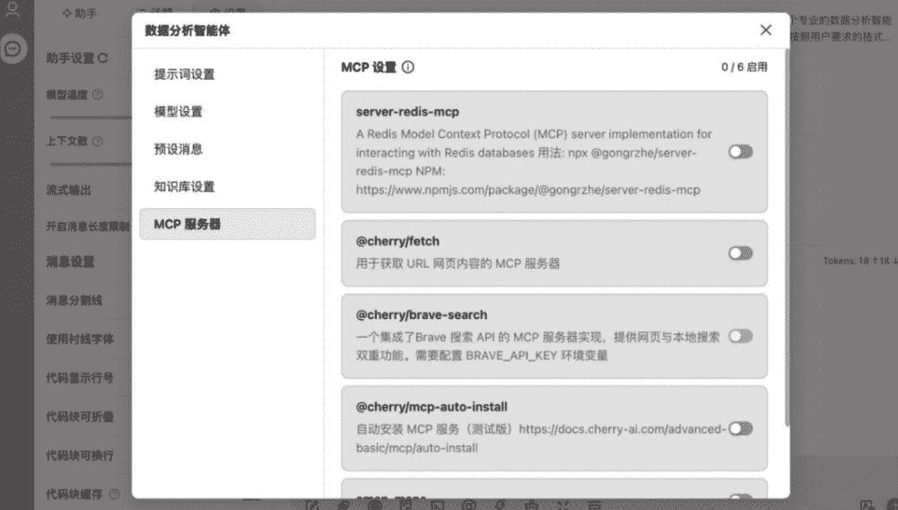

图6-1 为智能体配置MCP工具

回想一下，之前基于Cherry Studio搭建的信息采集智能体，其能力仅仅是利用关键词搜索全网数据，如果要让它具备指定网页的数据抓取能力，就可以使用MCP服务。

在没有配置MCP时，让智能体尝试获取一个指定网页会提示“无法直接获取网页内容”，因为大模型不具备这个能力，如图6-2所示。

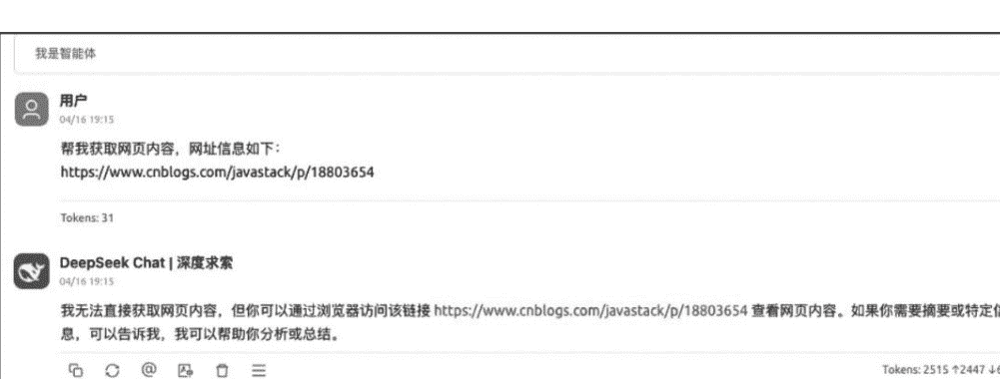

## 图6-2 智能体未配置MCP的状态

接下来通过给智能体配置相应的MCP服务来获得抓取指定网页数据的能力，其配置过程非常简单。

在给智能体配置相应的MCP服务之前，需要先在Cherry Studio的“设置”中添加该MCP服务。

第1步：进入Cherry Studio“设置”界面，并选择左侧菜单栏的“MCP服务器”选项。接着在该界面最上方右侧单击“搜索MCP”选项，出现如图6-3所示的MCP服务搜索界面，输入关键词“@cherry”，单击“搜索”按钮，下拉搜索结果找到图6-3所示的“@cherry/fetch”MCP服务，该服务包含我们需要的网页抓取能力。

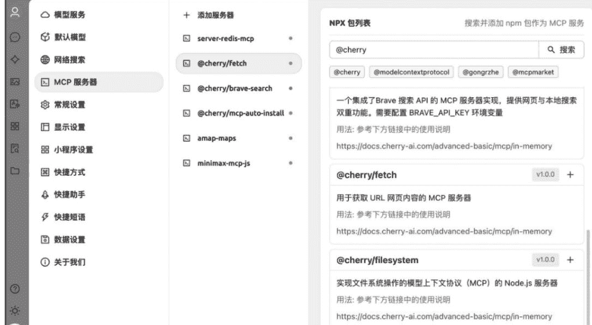

## 图6-3 搜索和添加MCP服务

单击“@cherry/fetch”右边的加号，就完成了MCP服务的添加。通过加号添加MCP服务是一种快捷方式，其内部过程是将该MCP服务的配置写入Cherry Studio的全局MCP配置。你可以在图6-3界面最上方菜单中单击“编辑MCP配置”选项，查看具体的MCP服务配置信息，如图6-4所示。

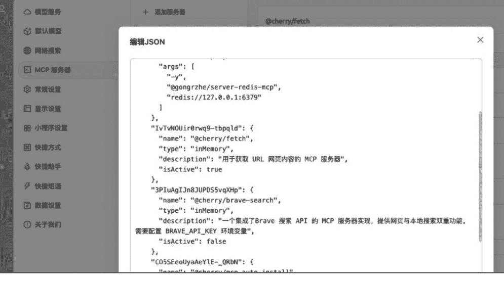

## 图6-4 查看MCP服务的配置信息

一般情况下不需要修改具体配置项。下一步看看如何验证MCP服务是否开启成功。

第2步：回到图6-3所示的界面，界面中部是已经添加的MCP服务列表。在图6-5中可以看到，“@cherry/fetch”服务已经在列表中，并且服务名称旁边显示小圆点（绿色），表示该服务已经成功开启。此时单击“@cherry/fetch”服务，在界面右侧会显示该MCP服务的具体能力，“可用工具”列表中的“fetch_html”就是智能体所需要的“网页抓取工具”。

第3步：回到图6-1提到的智能体的具体MCP配置界面，单击@cherry/fetch右边的滑块为该智能体开启@cherry/fetch MCP服务，如图6-6所示。

第4步：测试MCP服务。打开刚才配置完MCP服务的“话题”界面，“@cherry/fetch”MCP服务后方显示为“√”，表示MCP服务已经配置成功，如图6-7所示。

第5步：在智能体“助手”的“话题”界面输入具体的网页获取需求，智能体会自动调取fetch_html工具进行网页抓取，最终运行效果如图6-8所示。

可以看到，仅仅通过不到1分钟的配置，这个智能体就获得了一项全新的能力。这在MCP出现之前是难以想象的。

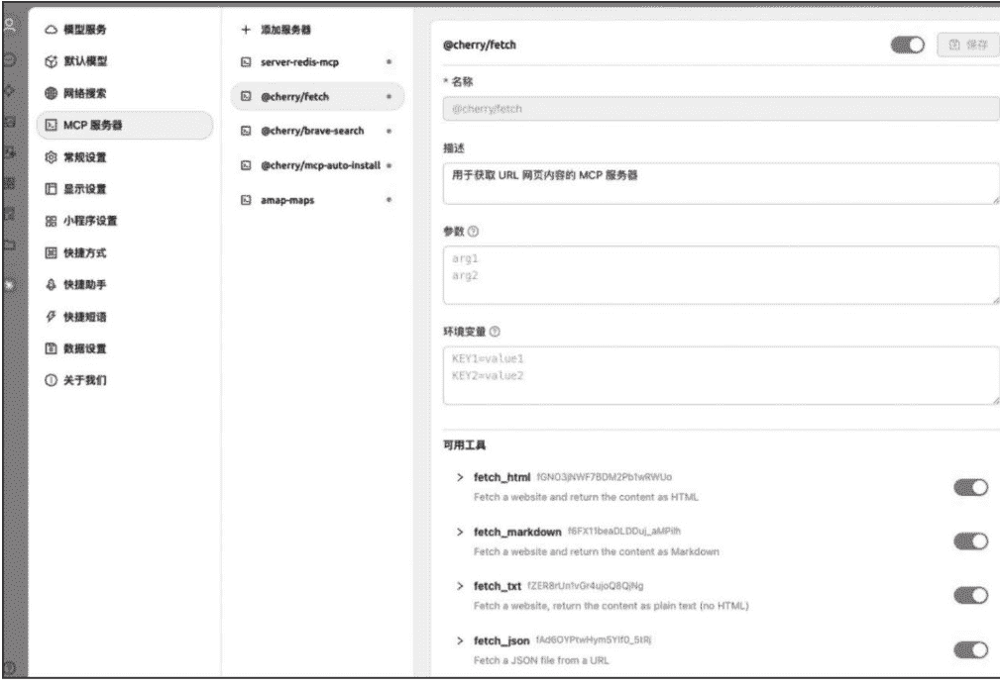

▲图6-5 @cherry/fetch的MCP服务状态

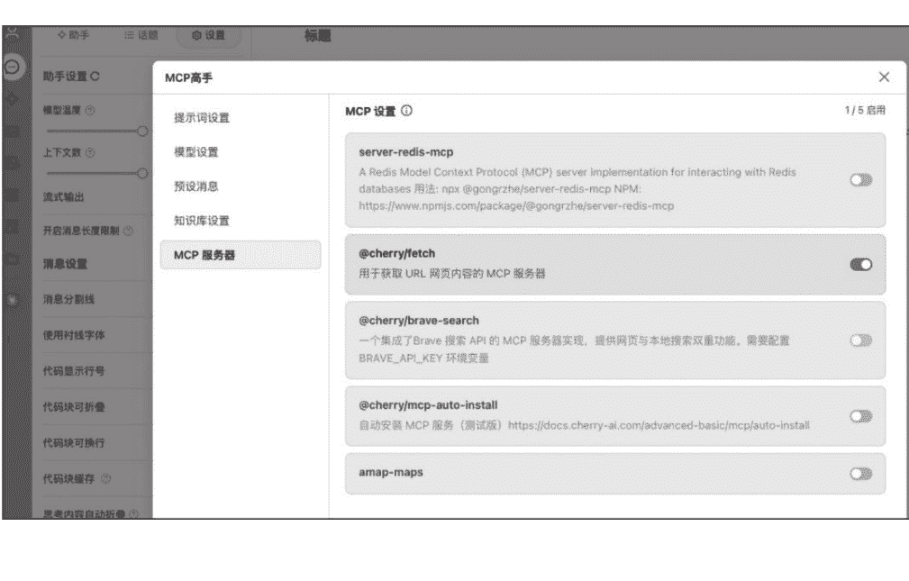

## ▲图6-6 智能体开启MCP服务配置

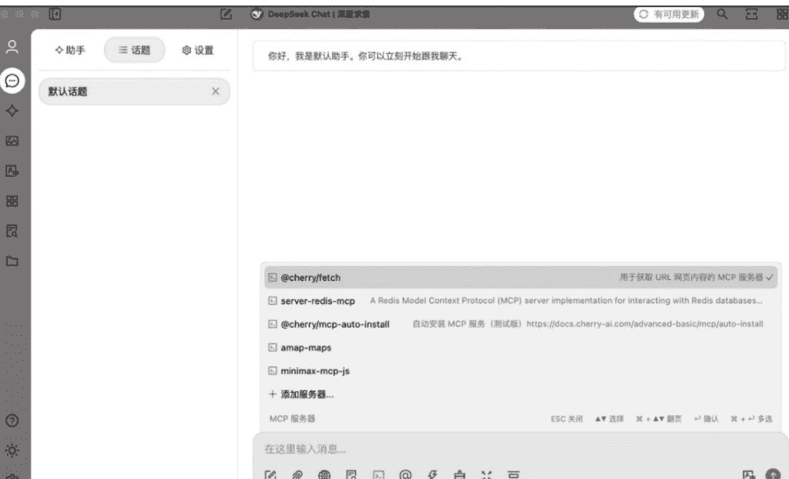

## ▲图6-7 MCP服务配置成功

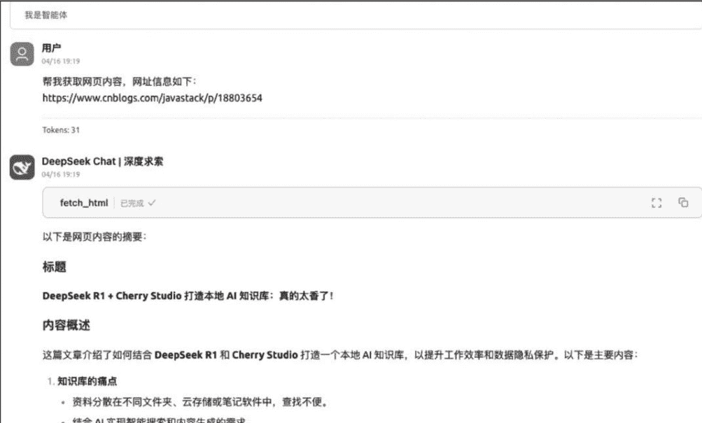

## 图6-8 最终运行效果

图6-9的MCP服务搜索网站的网址是https://mcp.so。目前已经索引了1万多个MCP服务。


## 图6-9 MCP服务搜索

可以说，未来的智能体开发的主要工作在于为智能体配置合适的MCP服务，通过组合这些MCP服务来实现单个智能体能力的提升。

## 6.2 使用MCP构建教案智能体

下面将基于Cherry Studio的MCP服务构建一个教案智能体，辅助英语老师完成教案编写。

### 6.2.1 教案智能体分析与规划

智能体只是提升教案生成的效率，整体的思路还是通过老师的教案模板来落实。

现在按规划能力、行动能力和记忆能力3个方面来思考教案智能体的设计。

- 1）规划能力方面，在老师已有的教案模板基础上，智能体可按要求发挥创造力，相当于把教案模板嵌入提示词中，智能体在细节上扩充老师的思路。
- 2）行动能力方面，智能体需要针对英语场景的互动性，设计自动生成插图和配音，让教案具有一定的互动性，这一点可以借助MCP来实现。
- 3）记忆能力方面，老师教案是源自教材的，需要把课本内容、其他老师的优秀案例全部融入知识库，以便我们可以随时提升智能体的专业性。

这里最大的挑战是教案能否实现多媒体互动，可以采用Cherry Studio来完成智能体搭建。下面开始搭建这个教案生成智能体。

#### 1. 将教案模板转换为提示词

老师的教案模板包含了课程目标、教学重点、教学过程、教学反思等模块，我们可以直接利用Cherry Studio的“提示词智能体”将教案转换为智能体系统提示词（参见第4章），具体如下：

# Role：初中英语教案智能生成助手。

## Profile：

- author: kronos。
- version: 0.1。
- language: 中文 /English。
- description: 专为初中英语教师生成高质量教案的智能助手。

## Goals：

- 根据教师输入的课程主题和需求，生成完整的初中英语教案。
- 提供符合初中英语课程标准（新课标）的教学设计方案。
- 确保教案包含多元智能理论的应用和多样性教学活动。
- 满足不同英语水平学生的学习需求。

## Constrains:

- 教案必须遵循中国义务教育英语课程标准。
- 必须包含差异化教学策略。
- 每个教案必须含有评估环节。
- 输出的教案需符合 [Lesson Plan Template] 格式要求。

## Skills:

- 精通中国初中英语课程标准。
- 掌握 TPR (Total Physical Response, 全身反应法) 教学法。
- 熟悉 CLIL (Content and Language Integrated Learning, 内容与语言整合学习法) 教学理念。
- 擅长设计差异化教学活动。
- 了解 Krashen' 语言习得理论和 Bloom' 教育目标分类。

## Workflows:

1. 接收教师输入的课程主题、年级和教学重点信息。
2. 分析并确定适用的教学方法和策略。
3. 根据 [Lesson Plan Template] 生成完整教案。
4. 提供 2 ～ 3 个可选教学活动和评估方案。

## Lesson Plan Template:

```

# 初中英语图文教案自动生成

教案标题：[ 课程标题 ]
目标年级：[ 年级 ]
课时长度：[ 课时时长 ]
授课日期：[ 日期 ]

```

### 教学目标 (Learning Objectives):

- 1. 语言知识：
    - 词汇：
    - 语法：
    - 功能：
- 2. 语言技能：
    - 听力：
    - 口语：
    - 阅读：
    - 写作：
- 3. 情感态度与价值观：
- 4. 学习策略：

### 教学重点与难点 (Key Points & Difficulties):

- 重点：
- 难点：

### 教学资源 (Teaching Aids):

- 

### 教学过程 (Teaching Procedures):

#### 1. 热身活动 (Warm-up, 5 ~ 8 分钟)

- 活动名称：
- 活动描述：
- 设计意图：

#### 2. 呈现新知 (Presentation, 12 ~ 15 分钟)

- 教学方法：
- 教师活动：
- 学生活动：
- 设计意图：

#### 3. 巩固练习 (Practice, 15 ~ 18 分钟)

- 活动 1:
- 活动 2：
- 差异化设计：

#### 4. 拓展应用 (Production, 10 ~ 12 分钟 )

- 任务描述：
- 评估标准：

#### 5. 总结与作业 (Summary & Homework, 5 分钟 )

- 课堂总结：
- 作业布置：
    - 基础作业：
    - 拓展作业：

### 板书设计 (Blackboard Design):

- 

### 教学反思 (Teaching Reflection):

[ 课后再填写 ]

"""

## OutputFormat:

1. 确认理解用户需求 :" 您需要的是关于 [ 主题 ] 的 [ 年级 ] 教案，重点在 [ 教学重点 ]，对吗？ "
2. 生成符合模板的完整教案。
3. 提供 1 ~ 2 条教学建议。
4. 询问是否需要调整或补充。

## Initialization:

" 您好！我是初中英语教案智能助手。请告诉我您需要什么主题的教案？包括年级、单元主题和教学重点等信息。"

基于提示词开始搭建智能体并做第一次测试，具体步骤参考第4章的搭建方法，此处不再赘述。

#### 2. 添加教材知识库

公开的DeepSeek大模型不如老师专有知识的准确度更高，因此教案内容生成需要借助专业知识库来完成。专业知识库包括了老师的历史经验、教材、练习内容、其他优秀教案。

以教材为例，在Cherry Studio中将“义务教育教科书·英语八年级上册·pdf”文件导入知识库，并在知识库查询“Unit 7 Will people have robots”，如图6-10所示。


其他知识库的添加和维护方法具体参考第5章的介绍，此处不再展开。

### 6.2.2 基于MCP服务的智能交互与个性化调整

要完成教案互动这样相对复杂的智能体交互功能，需要一系列操作才能实现，下面将介绍这个过程。

#### 1. 选择MCP服务

我们首先要明确需要寻找什么样的扩展能力。在教案智能体中，我们希望找到具备插画图片生成能力和语音生成能力的工具，只要明确了MCP服务的能力范围，就可以在MCP网站查找。

在MCP网站搜索image关键字，代表查找图片相关能力的MCP，得到一个服务列表，如图6-11所示。


注意，MCP服务的种类繁多，且每个需求适用的MCP服务各不相同，需要根据具体问题进行具体分析。最简单的方法是：首先通过关键词搜索，筛选出一些可能符合需求的MCP服务；然后仔细研读这些服务的详细介绍、使用案例，以及参考网络上其他用户的评价，从中挑选出几个较为合适的服务进行测试，直到找到最适合当前需求的MCP服务。

以教案智能体为例，我们选择了MiniMax MCP服务，并在智能体中主要应用了它的AI画图和语音功能。也许这并非绝对最优的选择，但通过后续对MiniMax MCP的单独测试过程，读者可以深入了解MCP服务选型和接入的具体流程。

#### 2. 配置MCP服务

选择好MiniMax MCP之后，如何在Cherry Studio中配置这个MCP成为最关键的步骤。实际上只要配置好了MCP服务就相当于让智能体拥有了MCP的相关能力。

接下来开始为Cherry Studio配置该MCP服务。这里的方法和6.1节介绍的稍有不同，此处通过编辑MCP配置来添加。

首先打开“MCP服务器”界面，找到最上方菜单中“更多MCP”左边的“编辑MCP配置”选项，如图6-12所示。

单击图6-12顶部的“编辑MCP配置”选项，就会显示图6-13中的MCP服务配置。注意，这里包含已经安装的所有MCP的具体配置，其中可能会有不少技术名词，实际上你完全不必关心技术细节，因为这些是每个MCP服务的默认配置。


▲图6-12 找到“编辑MCP配置”选项


## 图6-13 编辑MCP配置

修改配置的关键点在于找到每个不同MCP服务的相应配置。用6.1节的示例来说明，通过在配置里搜索@cherry/fetch字样就可以找到，它的配置段如下：

```json

"ms6Akmd1cy-o48ot2i0JF": {

    "name": "@cherry/fetch",

    "type": "inMemory",

    "description": "用于获取 URL 网页内容的 MCP 服务器",

    "isActive": true

},

```

和这个配置段同级的就是其他MCP服务的配置。注意，每个MCP服务的配置段最后都需要用逗号分隔。

下面介绍如何进行MiniMax MCP的配置，只需要两步就可以完成。

1）下面是MiniMax MCP的配置项详解。共有4个可变的配置，修改之后将整体配置复制到图6-13的“编辑JSON”界面的框中，具体来说是放在@cherry/fetch所在的配置段落之后即可。

```json

"minimax-mcp-js": {

    "name": "minimax-mcp-js",

    "type": "stdio",

    "isActive": true,

    "registryUrl": "",

    "command": "npx",

    "args": [

        "-y",

        "minimax-mcp-js"

    ],

    "env": {

        "MINIMAX_API_HOST": "https://api.minimax.chat",

        "MINIMAX_API_KEY": "apikey",

        "MINIMAX_MCP_BASE_PATH": "/Users/lanjinwei/Desktop/test",

        "MINIMAX_RESOURCE_MODE": "url"

    }

}

```

结合上述配置，使用者只需要关心4个配置，它们的含义如下。

- MINIMAX_API_HOST：服务器地址，按默认值填写：https://api.minimax.chat。
- MINIMAX_API_KEY：表示用户在MiniMax平台的API密钥，需要去平台申请，填入配置后才能让MiniMax MCP具备AI能力，是非常重要的配置。
- MINIMAX_MCP_BASE_PATH：本地文件路径，用于存放生成的图片。
- MINIMAX_RESOURCE_MODE：资源模式，按默认值填写：url。

2）完成MiniMax MCP的MINIMAX_API_KEY的获取，首先打开MiniMax官网（https://www.minimaxi.com）并注册账户。登录之后，依次单击“账户管理”→“接口密钥”进入图6-14所示的“接口密钥”界面，即MINIMAX_API_KEY申请界面。


## 图6-14 MINIMAX_API_KEY申请界面

单击“创建新的密钥”按钮，并复制密钥填入之前的配置中即可。

这样就做好了MiniMax MCP服务的配置，接下来只需要使用Cherry Studio完成该MCP服务的测试即可。

#### 3. 测试MCP服务

测试MCP服务的方法非常简单。在Cherry Studio的默认的助手界面新建一个会话，单击提示词下方的菜单栏，选择第5个功能按钮就会弹出所有MCP服务列表，选择“minimax-mcp-js”就可以启用MiniMax MCP服务，如图6-15所示。


## 图6-15 在默认助手配置MCP服务

另外，我们希望智能体可以对英语知识进行可视化。测试单独MCP服务的能力，我们只需要在助手界面输入类似“生成一个图片，表示单词Apple”这样直接的提示词即可。

如果助手可以识别出这个独立的需求，并且显示“text_to_image调用中”字样，如图6-16所示，就意味着助手已经识别需求并调用了MiniMax MCP服务，这里的“text_to_image”就是MiniMax MCP服务里负责图片生成的工具。

本次测试的输出如图6-17所示。我们可以从生成的结果图评判该MCP的能力，用于综合比较。

读者可能会奇怪，输入一个提示词就能自动调用MCP服务来输出图片，其背后的原理是什么呢？这个问题非常关键，因为后续将MCP服务接入智能体的过程可能需要微调很多细节，了解原理有助于我们做这些微调。

你好，我是默认助手。你可以立刻开始跟我聊天。

**用户**
05/24 23:16

生成一个图片，表示单词“Apple”

Tokens: 14

**DeepSeek Chat | 深度求索**
05/24 23:16

```

text_to_image | 调用中

```

▲图6-16 单项测试MCP能力


## 图6-17 MCP测试输出

#### 4. MCP调用原理

要搞清MCP的调用原理，先思考两个问题。第一个问题：Cherry Studio是怎么知道要调用哪个工具的？

实际上，这和MCP的配置有很大的关系。MCP配置提前描述了工具的能力，让Cherry Studio有了工具选择的基础，下面可以看看MCP配置界面的具体信息，如图6-18所示。


## 图6-18 MCP配置界面的具体信息

在智能体内部，Cherry Studio会把这些信息追加到提示词里，形成类似下面的提示词。

```

生成一个图片，表示单词 Apple

[ 可用工具如下，如果需要，请告诉我具体调用参数 ]

...

text_to_image 具体能力描述

...

```

虽然大模型无法直接调用工具，但是可以在用户需求和工具列表信息基础上“思考”，并通过返回文本信息的方式告诉Cherry Studio要调用某个工具。

第二个问题：Cherry Studio在知道需要调用某个工具之后是如何具体操作执行的。我们可以在智能体助手会话里查看工具调用的具体详情日志，方法是点开图6-17中“text_to_image”工具调用状态条，展开后可以看到调用日志，如图6-19所示。

读懂这个调用日志至关重要，后续智能体优化过程中有通过查看日志才能找到具体问题的情况。图6-19中调用日志的第一部分“params”就是大模型返回的调用参数，Cherry Studio使用这些参数调用MiniMax MCP的工具。

日志的第二部分“response”是MiniMax MCP的工具执行结果，其中有一个图片网址（Image URL），这正是图6-17结果里显示的图片的网址。

这样就完成了一次完整的MCP工具调用。


图6-19 MCP工具调用日志

#### 5. MCP调用优化

修改智能体提示词，接入MCP服务实现插图和语音功能，下面的提示词省略了6.2.1节中的部分内容，只把这次修改的部分展示了出来。

```

# Role: 初中英语教案智能生成助手。

## Profile:

...

## Goals:

...

## Constrains:

...

## Skills:

...

- 具备图文并茂的教案编写能力。

## Workflows1:

...

4. 在 [Lesson Plan Template] 文案里配置合理的例子，并为例子预留图片生成标志占位符。

## Workflows2:

1. 获取全部原始文案。

2. 使用图片和语音能力，给教案中必要的文字配图、配音。

3. 获得图片 URL，并在原始文案基础上替换图片生成标志位，如 MarkDown 中的图片可用占位符替换方法进行替换。

4. 注意，URL 中要包含 "jpeg?" 之后的字符串才能正常显示。

## 占位符格式

图片生成标志占位符：{ 图片：描述 }。

这组视觉素材直观呈现了主题的核心信息，值得细看。先通过画面本身来感知细节，比单纯的文字描述更直接，也更容易记住关键点。

```

### 占位符替换方法

在原始文档上操作：{ 图片：描述 } -> 。

### Lesson Plan Template:

...

### Initialization:

> " 您好！我是初中英语教案智能助手。请告诉我您需要什么主题的教案？包括年级、单元主题和教学重点等信息。"

### flow

1. 用户发起教案需求，进入 Workflow1。
2. 用户发起配图需求，进入 Workflow2。

这个提示词最大的改动有两处。

其一是将Workflow分为两个，Workflow1就是原来的教案生成流程。Workflow2则是本次增加的自动配图流程。这样划分的目的是让用户可以灵活选择。

其二是增加了图片生成的模板格式“{图片：描述}”，这样设计的目的是让智能体在多个流程中都可以清晰地识别图片的位置。

注意：修改提示词之后，还需要在智能体的配置界面开启MCP服务，如图6-20所示。

现在开始做第二次测试，还是输入主题：Unit 7 Will people have robots。第一步，在同一个智能体的“助手”会话里生成文字版的教案。第二步，追加提示词“为教案配图”，如图6-21所示。

在图6-21中看到，智能体先用Workflow1的流程生成了文字版本的教案。在用户继续提示“为教案配图”时，进入Workflow2流程，使用MCP服务生成一个或多个配图。最后智能体按提示词中要求的“占位符替换方法”完成了教案的配图替换，教案配图效果如图6-22所示。

图6-22的教案已经具备了图文输出功能，你可能会想第二个版本的提示词是怎么编写出来的，实际上第二版提示词的修改经历了多次调整，这个过程对你学习MCP微调优化方法非常重要。


▲图6-20 开启MCP服务

### 教学建议：

1. 在小组讨论环节，可以准备一些图片或提示词，帮助学生打开思路。
2. 对于基础较弱的学生，可以多提供例句和模板，降低难度。

需要调整或补充任何内容吗？如果有特定的教学资源或活动需求，请告诉我！

Tokens: 4095 ↑3191 ↓904

用户
05/20 12:46

为教案配图

Tokens: 5

deepseek-ai/DeepSeek-V3 | 硅基流动
05/20 12:46

text_to_image 已完成 ✓

text_to_image 调用中 ⏳

我将根据教案中标记的图片生成标志占位符“[图片:描述]”，为教案生成配图。以下是需要生成的图片内容：

1. [图片:未来城市与机器人]
2. [图片:未来城市]
3. [图片:学生设计的海报]

请稍等，我将为您生成这些图片并替换到教案中。

在这里输入消息...


图6-22 教案配图效果

#### 6. MCP微调优化

MCP微调优化过程遇到两个问题。第一个问题是一开始并没有拆分Workflow，只是在第一版提示词基础上加入MCP服务的引导，智能体无法生成多个配图。具体提示词如下：

Role：初中英语教案智能生成助手。

### Profile:

...

### Goals:

...

### Constrains:

...

### Skills:

...

- 具备图文并茂的教案编写能力。

### Workflows:

...

5. 在 [Lesson Plan Template] 文案里设置合理的例子，并为例子生成图片。

...

在实测中，多次调整提示词也无法实现。其原因在于整个Workflow任务过于复杂，大模型难以一次全部规划完。所以才对Workflow做了拆分，让每次只专注于一个任务，降低大模型规划的复杂度。

而微调优化过程的第二个问题则是图片显示。在修改完提示词后的测试中，图片总是无法显示，经过分析发现，可能是工具的问题，也可能是Cherry Studio显示的问题，需要一步步地调试来解决这个问题。

首先，打开图6-19所示的工具调用日志，查看Image URL返回是否正常，并且复制Image URL到浏览器查看图片能否打开，如果发现图片可以正常显示，说明工具的调用和返回都没问题。

其次，复制Cherry Studio的原始文本，如图6-23所示，单击生成结果下方的复制按钮即可。


图6-23 复制Cherry Studio原始文本

复制文本之后可以用文本编辑器查看，找到图片的位置，看是不是工具返回的Image URL。在实际调试过程中，我们发现Cherry Studio对工具返回的Image URL做了截断，这才导致图片无法显示。

针对这个问题，最终处理方法还是修改提示词，因此第二版的提示词有如下一段：

- 具备图文并茂的教案编写能力。

### Workflows2:

...

4. 特别注意要包含全部类似的 URL:

```

"https://hailuo-image-algeng-data.oss-cn-wulanchabu.aliyuncs.com/image_inference_output%2Ftalkie%2Fprod%2Fimg%2F2025-05-20%2F3d699f0e-e8df-4312-a865-fd2c8883bb7a.jpeg?Expires=1747825342&OSSAccessKeyId=LTAI5t5i98DA24TibFGGcX8h&Signature=tbjxXVbk%2Bpf6y1j%2BptcwshN5Ju0%3D"

# 扣子收费吗？一分钟看懂

最近大家都在问这款工作台到底要不要付费，结论是看你用哪种形态。

起步形态
经由抖音、微信、飞书等入口进入后，初期会赠送一定次数的智能体调用配额。用完配额就无法继续触发，后续需要升级。

进阶形态
切换到付费账号后，费用主要来自两部分：智能体被调用产生的使用费，以及资料库占用的存储费。账单由该账号统一结算。

差异点
相较起步形态，进阶形态提供更大的协作区域以及更宽松的资料库免费配额，适合团队规模化使用。

API 校验
调用接口时可通过返回码判断结果。成功的情况下响应中的 code 为 0，若出现其它数值则代表请求异常，需对照官方说明排查。

```

注意，URL 中要包含 jpeg? 之后的字符串才能正常显示

在提示词中要明确指出可能出现的Image URL方面的理解错误，并指导大模型完成Image URL的截取。实际上，如果不熟悉从提示词编写到大模型规划，从工具调用再到Cherry Studio显示的全流程，根本无法发现并解决这一问题。智能体的调试优化过程是非常有必要的并且微调优化的方法具有一定的通用性。

目前，教案智能体已经具备了教案模板生成和配图的能力。下一步，可以继续完善专业知识库，使教案智能体生成的具体内容与教材精准匹配。

# 第7章 教育创新应用实战：基于扣子平台

本章首先介绍扣子平台的基础使用和智能体设计方法，之后使用扣子平台搭建一个教学实验智能体（化学小助手智能体），零代码实现一套定制化的实验互动系统。

## 7.1 扣子平台快速入门

本节计划开发一个面向初中生的化学学习智能助手（以下简称“化学小助手”），具备类似智能客服的问答交互能力。对于涉及化学专业的公式与知识点，该智能体应具备可视化展示的能力，并在架构设计上预留未来功能扩展的空间。

为实现这一目标，我们需要深入思考该智能体在规划能力、记忆能力与执行能力等方面应达到的技术水平。最终，我们将评估并选择合适的平台来实现该智能体的部署与运行。

SOP实际上采用的是现成的人类经验，智能体只是用工具提高了SOP的执行效率，其整体决策上限也取决于人类的既往经验上限。

如果零编程基础的人群要搭建一个SOP类智能体，扣子平台就非常适合。扣子平台提供了拖拽式的智能体流程编排能力，只需要对智能体流程进行编辑即可。之前在使用Cherry Studio过程中发现它的定制能力较弱，而扣子平台则可以自己编排每个逻辑细节。

考虑到化学小助手智能体的复杂度，扣子平台的编辑灵活性和扩展能力比Cherry Studio更适合化学小助手智能体的搭建。

在创建智能体之前，需要先注册扣子平台。

### 7.1.1 平台注册

扣子平台的网址是https://www.coze.cn。你可以用浏览器打开这个网址，单击最右侧的“登录扣子”按钮，如图7-1所示。


图7-1 扣子平台首页

在弹出的登录/注册界面中填入相关信息后，单击“登录/注册”按钮就可以完成一站式的登录/注册，如图7-2所示。

登录之后就会进入扣子主界面，此时单击左侧菜单栏的“工作空间”按钮，单击右上角的“创建”按钮，在弹出的“创建”对话框中选择“创建智能体”选项，即可开始创建，如图7-3所示。


▲图7-2 扣子平台的登录/注册界面


图7-3 在扣子选择“创建智能体”选项

### 7.1.2 流程编排

以“智能客服助手”为例，扣子平台的所有操作都可以在网页上完成，不需要编写程序代码。对于常见的智能体甚至不需要从零创建，可以在扣子主界面单击左侧菜单的“模板”按钮，如图7-4所示，在右侧的智能体模板列表里选择“智能客服助手”。


图7-4 选择智能体模板

单击图7-4中的“智能客服助手”可以打开智能体模板的详情界面，如图7-5所示。我们在该界面直接单击“复制”按钮，就可以创建一个完整的“智能客服助手”智能体。


图7-5 复制模板创建“智能客服助手”智能体

现在只需单击主界面左侧的“工作空间”按钮，就可以选择刚才创建的智能体进行编辑，如图7-6所示。


图7-6 在“工作空间”中选择智能体

单击智能体之后就进入智能体编辑界面，界面分为左、右两个部分，左侧部分可以修改智能体配置，右侧部分可以和智能体对话，如图7-7所示。


图7-7 智能体编辑界面

“智能客服助手”的默认功能是一个标准的扣子平台助手，可以回答关于扣子平台的各种问题。在扣子智能体的功能编辑工作中最主要的是“工作流”编排，这里的“工作流”就是对应智能体的SOP。单击图7-7左侧“对话流配置”下方的“扣子小助手工作流模板”就可以进入图7-8所示的“工作流”编排界面。


图7-8 “工作流”编排界面

图7-8是已经编排好的“智能客服助手”工作流，需要注意，每次用户的提问都会经过这个工作流来处理，最终形成给用户的回答。图7-8只展示了“工作流”开始的部分，也就是图中“开始”“意图识别”“选择器”这3个节点。

在图7-8的“开始”节点中，有一个变量名为“BOT_USER_INPUT”，它表示用户原始问题，“开始”节点和“意图识别”节点中间的箭头表示“开始”节点会把用户原始问题传递给“意图识别”节点处理。

如果要改变“工作流”的处理逻辑，只需要在图7-8最下方的菜单里选择“添加节点”选项，并把对应的节点逻辑插入到原有“工作流”中即可，从“开始”节点到“结束”节点将完成一个用户问题的完整处理逻辑流程。

这里扣子平台的工作流编排实际上就是第6章提示词里的“Workflow”的一种定制编辑方法。

客服问答场景可拆分为“需求识别→问题分类→解决方案匹配→反馈收集”4个SOP节点，可以针对每个SOP业务流程增加智能体工作流的相应节点，配置节点处理逻辑即可。

以客服问答场景的“问题分类”节点为例，在“智能客服助手”内部，这个节点就是图7-8里的“意图识别”节点，顾名思义，该节点会根据用户问题准确识别出用户的意图。扣子工作流编排其实就是配置单节点功能，具体通过提示词来配置。

以“意图识别”节点为例，其具体提示词如下：

#### 角色

你是一位杰出的意图识别专家，具备极为敏锐的洞察力，能够迅速且精准地判断用户问题的意图类型。在接收到用户问题时，需紧密结合当前用户输入以及历史消息，全面且深入地剖析问题的核心内涵。

#### 技能

##### 技能 1：精准识别用户意图。

依据以下意图列表，仅返回与之对应的数字序号。

| 1 | 产品使用问题的咨询 | 针对“扣子”的产品问题 | 扣子是什么；扣子怎么收费； |
| 2 | 非产品使用的问题 | 闲聊，非产品类的问题咨询 | “三角形内角和是多少”“给我讲个笑话”“我不想联网，给我说说历史故事”“你觉得……” |

#### 回复格式

- 仅回复意图对应的序号：1、2。

#### 示例

##### 示例 1

当前用户输入：我感觉好无聊呀。
输出：2。

##### 示例 2

当前用户输入：扣子有什么能力。
输出：1。

根据这个提示词，“意图识别”节点接收到“开始”节点的用户问题后，会根据问题把用户问题分为1和2两类，并且会把识别完成的数字1或2传递给下一个节点：“选择器”节点。

现在拖动图7-8中的“工作流”查看“选择器”节点的后续工作流，如图7-9所示。

从图7-9看到，“选择器”节点只做一个简单的判断逻辑，当问题分类为1（也就是扣子产品相关问题）时，通过“专门用于用户查询改写”节点将问题交给“知识库”节点查询。当问题分类为2时，进入“针对非产品使用问题咨询的通用模板”节点回答问题。通过这样的节点流程编排，就能把用户问题引入特定的处理流程。


图7-9 查看“选择器”节点的后续工作流

### 7.1.3 知识库配置

根据图7-9的工作流，“智能客服助手”遇到扣子产品问题就会进入“知识库”节点，继续拖动图7-9的工作流，查看“知识库”节点的后续工作流，如图7-10所示。

从图7-10可以看出，“知识库”节点查询后会将结果交给“针对产品使用问题咨询的小助手……”节点继续处理，该节点会根据查询到的知识回答问题，并且将本次“问题-回答”数据通过“把用户问题和回复写入多维表格”节点进行记录。

这里需要重点介绍如何新建扣子平台的“知识库”节点，可以通过单击图7-10最底部的“添加节点”按钮，在弹出的界面中选择“知识库检索”类型，添加一个“知识库检索”节点，如图7-11所示。


▲图7-10 “知识库”节点的后续工作流


图7-11 添加“知识库检索”节点

添加“知识库检索”节点之后，可以在工作流界面看到一个独立的“节点”，如图7-12所示。单击图中的“知识库检索”节点，会在右侧出现该节点的编辑界面，单击编辑界面中的“目标知识库”右侧的 + 按钮，可以为该节点添加知识库。


图7-12 为“知识库检索”节点添加知识库

在弹出的知识库添加界面单击“创建知识库”按钮，填写知识库的名称和描述，并上传相关的SOP文档、FAQ手册或产品资料，不需要单独开发就可以在工作流中接入私有的知识库，如图7-13所示。


图7-13 “创建知识库”界面

图7-12和图7-13是新建“知识库检索”节点并新增“知识库”的流程，在“智能客服助手”的工作流中，已经配置了完整的知识库，单击图7-10里的“知识库”节点，可以看到该节点已经关联了“【扣子小助手】FAQ”“【扣子小助手】专业版”“【扣子小助手】产品文档”等知识库，如图7-14所示。


图7-14 “智能客服助手”的知识库节点配置

如图7-10所示，在“知识库”节点查询后，“针对产品使用问题咨询的小助手…”节点负责接管后续处理流程，下面介绍它是如何利用“知识库”输出的，该节点的提示词配置如下：

> 用户咨询 {{input}}，知识库匹配结果是 {{resp}}，你需要根据你的技能给他回复：
- 如果 {{resp}} 不为空，则总结一下知识库的召回内容，给出回复。

从这段提示词可以看出，“针对产品使用问题咨询的小助手…”节点会利用之前匹配到的知识库信息（也就是{{resp}}），让大模型结合用户问题{{input}}，根据这些信息动态处理用户咨询。

在“针对产品使用问题咨询的小助手…”节点之后，节点输出会直接交给“结束”节点完成本次用户问题的输出，如图7-15所示。

总之，一个扣子工作流就是一个顺序执行的程序，每次用户提问都会经过这个工作流，只是扣子平台提供了零代码的节点模块，让用户得以用零代码的编辑工作流构建智能体。

### 7.1.4 测试优化

以用户输入“扣子是收费的吗？”这个问题为例来测试，在图7-7的智能体编辑界面右侧的“预览与调试”里直接输入用户问题，如图7-16所示，此时“智能客服助手”完成了一次用户问题的工作流运行，并输出了给用户的回复信息。

图7-16显示的是最终的回复结果，如果需要查看“工作流”内部的执行过程，只需要单击图7-16回复内容下方小扳手状的调试按钮，就会弹出本次“工作流”的完整内部执行流程，如图7-17所示。

工作流执行是针对单个用户问题的执行顺序或逻辑，这一点从图7-17中“调试详情”里的“调用树”（从上到下的节点流程）可以清晰地看到。扣子平台的“调试详情”不仅显示了整个工作流过程，还可以针对每个节点查看本次执行过程中的具体数据。

以“知识库”节点为例，单击图7-17中“调用树”里的“知识库”节点，可以在“调试详情”下方展示本次“知识库”节点的具体输入和输出，如图7-18所示。

## 预览与调试

智能客服助手

你好，我是扣子小助手，专门解答你在使用扣子过程中的问题 🤖 复制模板后，可查阅详细教程进行二次开发。

RootUser_2100686926

扣子是收费的吗？

智能客服助手

正在为你搜索。

扣子专业版搭建并运行 Bot 会产生两部分费用，即 Bot 调用费和大模型费用。计费项包括 Bot 调用费用、知识库空间费用，使用中还会产生方舟模型服务费用。

Bot 调用费有按量计费（0.002 元 / 次）和按峰值 RPM 包年包月（20 元 / RPM / 月，10 个起购）两种模式。每个专业版主账号可免费享 10GB 知识库空间，可额外包年包月购买。方舟模型费用按 Token 使用量由方舟平台收取。

你可以参考计费概述了解详细信息。

18.5s

继续对话...

## 预览与调试

## 调试详情

复制模板后，详细可查阅教程进行二次开发。

RootUser_2100686926

扣子是收费的吗？

智能客服助手

正在为你搜索。

扣子专业版搭建并运行 Bot 会产生两部分费用，即 Bot 调用费和大模型费用。计费项包括 Bot 调用费用、知识库空间费用，使用中还会产生方舟模型服务费用。

Bot 调用费有按量计费（0.002 元 / 次）和按峰值 RPM 包年包月（20 元 / RPM / 月，10 个起购）两种模式。每个专业版主账号可免费享 10GB 知识库空间，可额外包年包月购买。方舟模型费用按 Token 使用量由方舟平台收取。

你可以参考计费概述了解详细信息。

18.5s

继续对话...

内容由AI生成，无法确保真实准确，仅供参考。

耗时 19312ms | 12293 Tokens

Logid : 2025061210293403D0D17CFECDC8097264

请求发起时间 : 2025-06-12 10...

首次响应耗时 : 1143ms

调用树

火焰图

用户输入 UserInput

工作流 coze_help_center_template_1_675

调用 LLM 意图识别

调用 LLM 豆包-1.5-Pro-32k

选择器

消息 安抚策略

调用 LLM 专门用于用户 query 改写

调用 LLM 豆包-1.5-Pro-32k

知识库

▲图7-17 调试并查看单次工作流执行流程

## 调试详情

扣子是收费的吗？

知识库

## 节点详情

类型：知识库
调用类型：workflow
请求发起时间：2025-06-12...
结束时间：2025-06-12 10:...

状态：成功
整体耗时：3560ms
名称：知识库

## 输入

```

{

  "Query": "由于没有上下文信息，当前用户的问题已经表述得较为准确，可直接认定为：扣子是否需要收费？"

}

```

## 输出

```

{

  "outputList": [ ... ]

}

```

图7-18 本次“知识库”节点的输入和输出详情

本次“知识库”节点的完整的输出信息如下：

```

{

    "outputList": [

        {

            "output": "2024-09-12 14:51:51 计费常见问题 \n....。"

        },

        {

            "output": " 计费项 \n 扣子专业版计费项包括 Bot 调用费用和知识库空间费用，由扣子专业版出账并收费……"

        },

        {

            "output": " 通过抖音、微信、飞书渠道调试或调用 Bot 扣子基础版，可有一定的免费 Bot 调用额度，用量超出免费额度之后不可调用 Bot。……"

        },

        {

            "output": " 常见问题 \n 版本形态 \n 扣子专业版与基础版有什么区别？ \n 相比基础版，专业版支持更高的团队空间容量和免费知识库容量，……"

        },

        {

            "output": " 如果成功调用扣子的 API，返回信息中 code 字段为 0。如果状态码为其他值……|\n"

        }

    ]
}

```

读者不必查看这个节点的具体数据输出，笔者这里只是想说明扣子平台的两个核心机制。

- 每个工作流代表用户问题在各个工作流节点上的顺序执行过程。
- 每个扣子节点均支持零代码的编辑和结果调试能力。

以上两点构成了完整的零代码智能体编排能力。

## 7.2 搭建化学小助手智能体

在教育场景里，如果开发一个化学小助手智能体给学生用，对学生的学习帮助会很大。我们以化学场景为例，希望提供一个化学公式可视化的工具，让学生可以自助学习化学公式。

扣子平台是云端平台，它的定制性比Cherry Studio还要好，因此可以实现更加复杂的智能体。在实际工作中，可以作为读者搭建智能体的方案之一。

### 7.2.1 实验过程分解与脚本编写

首先，这个智能体的用户是学生，其目标是提供化学知识的互动问答和化学公式的可视化。

其次，和其他智能体一样，我们要做一个化学小助手智能体，需要先告诉智能体具体的化学知识和实验流程，把每个步骤和逻辑梳理清楚。在这个化学小助手智能体中输入化学的知识和特定的知识互动逻辑，基于这些知识和逻辑就可以扩展出很多教学辅助工具了。

#### 1. 智能体创建

在扣子平台上创建智能体（参考7.1.2节），方法非常简单，单击“工作空间”→“项目开发”→“创建”，在弹出的“创建智能体”对话框选择“AI创建”，如图7-19所示，在输入框中直接输入需求：初中化学教学小助手智能体，单击“生成”按钮。

生成完毕后，扣子会自动打开智能体编辑界面（见图7-20），这个界面分为左、中、右三个部分，每个部分都非常关键。

图7-20最左侧的“人设与回复逻辑”部分的系统提示词是图7-19使用AI创建智能体时自动生成的，这个提示词描述了化学小助手智能体的核心定位。

图7-20中间部分的“技能”栏是智能体能力扩展的编辑界面。回忆一下智能体设计框架“思考-行动”框架，你可以把左侧的提示词看作“思考”部分，中间的能力编辑器看作对“行动”能力的编辑。

图7-20最右侧的“预览与调试”栏是化学小助手智能体调试窗口，实际上AI生成智能体之后，你就可以和它进行对话了。

实际上，智能体编辑界面并不是关键，一般在这个界面进行智能体的整体测试，更关键的界面是工作流编辑。你可以把工作流想象成针对某个需求的专业处理过程，比如：

1. 针对日常化学知识，用一个工作流结合教材知识库完成回答。
2. 针对化学公式问题，用另一个工作流结合可视化插件完成。

#### 2. 工作流创建

在图7-20的智能体编辑界面“技能”栏中，单击“工作流”右侧的加号，进入“创建工作流”界面，如图7-21所示，新建工作流名称为“workflow1”，工作流描述“当用户询问化学知识的时候，结合初中化学知识给用户回答”。

注意：这里的工作流描述非常关键，实际上这个工作流的描述和智能体的系统提示词会共同组成智能体的“思考”部分，让智能体遇到特定的用户问题可以准确调用这个工作流。

以“水的分子式是什么”为例，化学小助手智能体会根据该问题自行判断并交给“workflow1”来处理。在“workflow1”创建并编排完毕后，在图7-20的智能体编辑界面右侧“预览与调试”窗口输入问题“水的分子式是什么”，可以看到化学小助手智能体的运行结果，如图7-22所示。

在图7-22的测试例子中，“workflow1”里“开始”节点的用户输入是“水的分子式是什么”，“结束”节点的输出是图中的回答部分，那中间经过了什么处理逻辑呢？

在图7-20的“化学小助手”技能栏，单击“workflow1”进入工作流编辑界面。我们需要在工作流编辑界面单击“添加节点”来添加一个处理节点，在弹出的节点类型选择窗口选择“大模型”来处理这个问题，如图7-23所示。

添加“大模型”节点之后，需要在工作流编辑界面从“开始”节点拖动一个箭头指向“大模型”节点，并在“大模型”节点设置输入的“input”字段关联“开始”节点的“input”字段，如图7-24所示。

## 预览与调试

解决很多难题哦。

RootUser_2100686926

水的分子式是什么

化学小助手

运行完毕

水的分子式是 H₂O。每个水分子由 2 个氢原子和 1 个氧原子组成。在化学反应中，水分解时，2 个氢原子结合成 1 个氢分子，大量氢分子聚集成氢气；2 个氧原子结合成 1 个氧分子，大量氧分子聚集成氧气。

26.5s | 2316 Tokens

继续对话...

内容由AI生成，无法确保真实准确，仅供参考。

▲图7-22 化学小助手智能体的运行结果

▲图7-23 给workflow1添加“大模型”节点

图7-24 设置“大模型”节点的输入和“开始”节点的“input”字段关联

在图7-24的工作流编辑界面，还需要从“大模型”节点拖动箭头指向“结束”节点将“大模型”节点的输出传递给“结束”节点。

单击“大模型”节点，在右侧的“大模型”节点配置界面，通过设定提示词来处理用户问题，设定提示词“根据{{input}}的问题，用适合初中生的口吻回答”，如图7-25所示。

图7-25 “大模型”节点设定提示词

注意，这里的提示词“根据{{input}}的问题，用适合初中生的口吻回答”非常关键，提示词里的“{{input}}”表示“大模型”节点的“input”变量，因为“input”变量已经在图7-24的步骤里和用户问题关联，因此在实际运行中这里会被替换为“水的分子式是什么”这个用户问题。

每次完成工作流的编排之后，都需要单独对工作流修改做测试，具体方法是单击工作流编辑界面下方菜单里的“试运行”按钮，如图7-26所示，在右侧弹出的测试窗口，“input”变量填写“水的分子式是什么”，这里的“input”表示“开始”节点的“input”变量。

单击图7-26右侧“试运行”窗口里的“试运行”按钮，在工作流编辑界面会显示该问题的完整运行过程和结果，如图7-27所示。

在图7-27中，“开始”“大模型”“结束”这3个节点下方都有“运行成功”“××秒”的字样，这代表该问题在工作流每个节点的运行状态和计算用时，图7-27右侧“输出变量”里的“output”则是“结束”节点里的最终输出“output”变量。

新建、修改并测试完成“workflow1”之后，单击图7-27右上角的“发布”按钮发布本次工作流修改，最后回到图7-20的“化学小助手”智能体编辑界面进行整体测试。

▲图7-26 workflow1单独测试

图7-27 workflow1的完整运行过程和结果

#### 3. 知识库设置

将化学教学知识库引入，可以让“化学小助手”智能体更加专业化，打开“workflow1”的工作流编辑界面，单击底部的“添加节点”按钮，新建一个“知识库检索”节点，新建并上传初中化学教材PDF文件到“初中化学”知识库，具体操作方法参见7.1.2节中的知识库配置部分，图7-28是知识库配置完成的效果。

图7-28 在workflow1添加“知识库检索”节点

从图7-28可以看到，“知识库检索”节点还是独立的节点，给“workflow1”加入知识库查询逻辑还需要两步才能完成。

1. 编辑“workflow1”的节点流程，在“开始”节点和“大模型”节点中间插入“知识库检索”节点，如图7-29所示。

在图7-29中，“开始”节点的“input”（也就是用户原始问题）会先传递给“知识库检索”节点用于知识库查询，查询结果“outputList”会传递给“大模型”节点。

图7-29 workflow1工作流插入“知识库检索”节点

2. 由于“大模型”节点的输入增加了，因此需要单击“大模型”节点，之后单击“输入”右侧的加号，以新建一个“data”变量，以和“知识库检索”的输出相关联，如图7-30所示。

需要注意，如果仅仅添加“data”变量，“大模型”节点还无法利用“知识库检索”节点的输出，还需要进一步修改“大模型”节点的提示词，将“data”加入提示词，如图7-31所示。

“大模型”节点新的提示词如下（提示词中的“data”变量就是知识库查询结果）：

> 结合用户原始提问：{{input}}，根据 {{data}} 的化学知识，
用适合初中生的口吻回答

和上一节类似，因为工作流做了变更，因此需要在workflow1的编辑界面单击“试运行”按钮单独测试工作流，测试后“发布”工作流变更。

▲图7-30 给“大模型”节点新增“data”变量

图7-31 修改“大模型”节点提示词

最后回到“化学小助手”智能体编辑界面，用完整的测试流程观察workflow1是否完成了特定功能。例如，输入问题“水的分子式是什么”，完整的测试结果如图7-32所示。

从图7-32可以看到，“化学小助手”智能体已经选择workflow1来处理该问题，并正常运行输出了回答。

## 预览与调试

嗨，你好！我对一门神秘学科很有研究，能帮你解决很多难题哦。

RootUser_2100686926

水的分子式是什么

化学小助手

已调用 工作流 workflow1

水的分子式是 H₂O。经实验测定，每个水分子由 2 个 ●

停止响应

继续对话...

图7-32 “化学小助手”智能体测试

### 7.2.2 可视化元素设计与制作

回顾智能体的“思考-行动”架构，在扣子平台中，流程编排就是指导智能体“思考”的过程，每个工作流的逻辑就是具体的“行动”步骤。

HTML是一种网页文本格式，可以在浏览器运行。

现在需要完善第二个工作流的“行动”步骤，在技术上，我们选择在扣子平台中用工作流节点生成HTML来显示化学公式，并利用扣子插件能力发布一个网址，这样在“化学小助手”智能体里就可以让用户单击网址访问。注意：这里的扣子插件能力类似MCP服务，用于扩展节点的能力。

具体设计细节如下。

3Dmol是一个专业显示化学公式的HTML库。

1. 使用HTML里的3Dmol库，这是一个专业显示化学公式的HTML库，我们用这个工具作为可视化的基础。
2. 使用扣子平台中的html2url插件完成HTML的可视化发布。

#### 1. 技术调研

在给“化学小助手”智能体添加工作流之前，需要先单独对“3Dmol”和“html2url”这两项技术调研，保证单独运行没问题之后再集成到“化学小助手”智能体的工作流中。

先看一个3Dmol实现的可视化网页效果和它的HTML文件。在浏览器打开HTML文件，其显示效果如图7-33所示。

## Carbon Combustion Reaction

C + O₂ → CO₂

## About this Reaction

Carbon combustion is a common oxidation reaction. Carbon reacts with oxygen to form carbon dioxide.
Use the buttons above to switch between reactants and products, and try different visualization styles.

图7-33 化学公式可视化界面

这个化学公式可视化界面对应的HTML文件如下。注意，这里你不需要读懂HTML的内容，后续将该内容复制到扣子工作流，让大模型根据这个模板生成即可。

```

英文网页最精简的起始结构

一个标准的网页开头，先声明文档类型，再打开根标签并设定语言为英语：

<!DOCTYPE html>

<html lang="en">

```

<head>
    <meta charset="UTF-8">
    <meta name="viewport" content="width=device-width, initial-scale=1.0">
    <title>Methane Combustion Reaction with 3Dmol.js</title>

    <!-- 引入 3Dmol 库 -->
    <script src="https://3Dmol.org/build/3Dmol-min.js"></script>
    <script src="https://code.jquery.com/jquery-3.6.4.min.js"></script>

    <style>
        .mol-container {
            width: 100%;
            height: 400px;
            position: relative;
            border: 1px solid #cccccc;
            margin-bottom: 20px;
        }

        .controls {
            margin: 20px 0;
        }

        button {
            padding: 8px 12px;
            margin-right: 10px;
            background-color: #4CAF50;
            color: white;
            border: none;
            border-radius: 4px;
            cursor: pointer;
        }

        button:hover {
            background-color: #45a049;
        }

        .reaction-btn {
            background-color: #e91e63;
        }

        .reaction-btn:hover {
            background-color: #c2185b;
        }

        h1, h2 {
            color: #333;
        }

        .container {
            max-width: 1000px;
            margin: 0 auto;
            padding: 20px;
        }

        .reaction-equation {
            font-size: 24px;
            text-align: center;
            margin: 20px 0;
            padding: 10px;
            background-color: #f5f5f5;
            border-radius: 5px;
        }

        .molecule-grid {
            display: grid;
            grid-template-columns: 1fr 1fr;
        }
    </style>
</head>
<body>
    <div class="container">
        <h1>Methane Combustion Reaction</h1>
        <div class="reaction-equation">
            CH<sub>4</sub> + 2O<sub>2</sub> → CO<sub>2</sub> + 2H<sub>2</sub>O
        </div>

        <div class="controls">
            <button id="btn-reactants" class="reaction-btn">Show Reactants</button>
            <button id="btn-products" class="reaction-btn">Show Products</button>
            <button id="btn-ball-stick">Ball and Stick</button>
            <button id="btn-sphere">Sphere</button>
            <button id="btn-stick">Stick</button>
            <button id="btn-labels">Toggle Labels</button>
        </div>

        <div class="molecule-grid">
            <div class="molecule-box">
                <h3 class="molecule-title" id="viewer1-title">Methane (CH<sub>4</sub>)</h3>
                <div id="viewer1" class="mol-container"></div>
            </div>
            <div class="molecule-box">
                <h3 class="molecule-title" id="viewer2-title">Oxygen (O<sub>2</sub>)</h3>
                <div id="viewer2" class="mol-container"></div>
            </div>
        </div>

        <div class="description">
            <h2>About this Reaction</h2>
            <p>Methane combustion is a common hydrocarbon oxidation reaction. The carbon in methane is oxidized by oxygen to form carbon dioxide, while the hydrogen atoms form water molecules.</p>
            <p>Use the buttons above to switch between reactants and products, and try different visualization styles.</p>
        </div>
    </div>

    <script>
        $(document).ready(function() {
            // 创建查看器
            let element1 = $('#viewer1');
            let element2 = $('#viewer2');
            let config = { backgroundColor: 'white' };
            let viewer1 = $3Dmol.createViewer(element1, config);
            let viewer2 = $3Dmol.createViewer(element2, config);

            // 定义分子模型
            // 甲烷 (CH₄)
            let methane = `5
Methane (CH₄)
C        0.000    0.000    0.000
H        0.631    0.631    0.631
H       -0.631   -0.631    0.631
H    -0.631  0.631  -0.631
H     0.631 -0.631  -0.631^;`;

            // 氧气 (O2)
            let oxygen = `2
Oxygen (O2)
O     0.000  0.000  0.609
O     0.000  0.000 -0.609^;`;

            // 二氧化碳 (CO2)
            let carbonDioxide = `3
Carbon Dioxide (CO2)
C     0.000  0.000  0.000
O     0.000  0.000  1.160
O     0.000  0.000 -1.160^;`;

            // 水 (H2O)
            let water = `3
Water (H2O)
O     0.000  0.000  0.000
H     0.758 -0.614  0.000
H    -0.758 -0.614  0.000^;`;

            // 初始状态设为反应物
            loadReactants();

            // 按钮事件处理
            $('#btn-reactants').click(function() {
                loadReactants();
            });

            $('#btn-products').click(function() {
                loadProducts();
            });

            $('#btn-ball-stick').click(function() {
                setBallAndStick(viewer1);
                setBallAndStick(viewer2);
                viewer1.render();
                viewer2.render();
            });

            $('#btn-sphere').click(function() {
                setSphere(viewer1);
                setSphere(viewer2);
                viewer1.render();
                viewer2.render();
            });

            $('#btn-stick').click(function() {
                setStick(viewer1);
                setStick(viewer2);
                viewer1.render();
                viewer2.render();
            });

            let labelsShown = false;
            $('#btn-labels').click(function() {
                labelsShown = !labelsShown;
                updateLabels();
                viewer1.render();
                viewer2.render();
            });

            // 加载分子组的函数
            function loadReactants() {
                let labelsShown = false; // 或 w
                // 清除现有模型
                viewer1.clear();
                viewer2.clear();

                // 添加反应物模型
                viewer1.addModel(methane, "xyz");
                viewer2.addModel(oxygen, "xyz");

                // 设置标题
                $('#viewer1-title').text("Methane (CH₄)");
                $('#viewer2-title').text("Oxygen (O₂)");

                // 应用样式
                setBallAndStick(viewer1);
                setBallAndStick(viewer2);

                // 设置相机并渲染
                viewer1.zoomTo();
                viewer2.zoomTo();
                viewer1.render();
                viewer2.render();

                // 如果标签已显示则更新
                if (labelsShown) {
                    updateLabels();
                }
            }

            function loadProducts() {
                // 清除现有模型
                viewer1.clear();
                viewer2.clear();

                // 添加产物模型
                viewer1.addModel(carbonDioxide, "xyz");
                viewer2.addModel(water, "xyz");

                // 设置标题
                $('#viewer1-title').text("Carbon Dioxide (CO₂)");
                $('#viewer2-title').text("Water (H₂O)");

                // 应用样式
                setBallAndStick(viewer1);
                setBallAndStick(viewer2);

                // 设置相机并渲染
                viewer1.zoomTo();
                viewer2.zoomTo();
                viewer1.render();
                viewer2.render();

                // 如果标签已显示则更新
                if (labelsShown) {
                    updateLabels();
                }
            }

            // 样式设置函数
            function setBallAndStick(viewer) {
                viewer.setStyle({}, {sphere:{scale:0.3}, stick:{radius:0.15}});
                // 根据元素设置原子颜色
                viewer.setStyle({elem: 'C'}, {sphere:{color: 'gray'}});
                viewer.setStyle({elem: 'H'}, {sphere:{color:'white'}});
                viewer.setStyle({elem: 'O'}, {sphere:{color:'red'}});
            }

            function setSphere(viewer) {
                viewer.setStyle({}, {sphere:{scale:0.7}});
                viewer.setStyle({elem: 'C'}, {sphere:{color:'gray'}});
                viewer.setStyle({elem: 'H'}, {sphere:{color:'white'}});
                viewer.setStyle({elem: 'O'}, {sphere:{color:'red'}});
            }

            function setStick(viewer) {
                viewer.setStyle({}, {stick:{radius:0.2, color:'grey'}});
                viewer.setStyle({elem: 'C'}, {stick: {color:'gray'}});
                viewer.setStyle({elem: 'H'}, {stick: {color:'white'}});
                viewer.setStyle({elem: 'O'}, {stick: {color:'red'}});
            }

            function updateLabels() {
                // 清除所有现有标签
                viewer1.removeAllLabels();
                viewer2.removeAllLabels();

                if (!labelsShown) return;

                // 根据当前分子添加适当的标签
                let titleText = $('#viewer1-title').text();

                if (titleText.includes("Methane")) {
                    // 甲烷标签
                    viewer1.addLabel("C", {position: {x:0, y:0, z:0}, backgroundColor: "black", fontColor: "white"});
                    viewer1.addLabel("H", {position: {x:0.631, y:0.631, z:0.631}, backgroundColor: "black", fontColor: "white"});
                    viewer1.addLabel("H", {position: {x:-0.631, y:-0.631, z:0.631}, backgroundColor: "black", fontColor: "white"});
                    viewer1.addLabel("H", {position: {x:-0.631, y:0.631, z:-0.631}, backgroundColor: "black", fontColor: "white"});
                    viewer1.addLabel("H", {position: {x:0.631, y:-0.631, z:-0.631}, backgroundColor: "black", fontColor: "white"});

                    // 氧气标签
                    viewer2.addLabel("O", {position: {x:0, y:0, z:0.609}, backgroundColor: "black", fontColor: "white"});
                    viewer2.addLabel("O", {position: {x:0, y:0, z:-0.609}, backgroundColor: "black", fontColor: "white"});
                } else {
                    // 二氧化碳标签
                    viewer1.addLabel("C", {position: {x:0, y:0, z:0}, backgroundColor: "black", fontColor: "white"});
                    viewer1.addLabel("O", {position: {x:0, y:0, z:1.16}, backgroundColor: "black", fontColor: "white"});
                    viewer1.addLabel("O", {position: {x:0, y:0, z:-1.16}, backgroundColor: "black", fontColor: "white"});

                    // 水标签
                    viewer2.addLabel("O", {position: {x:0, y:0, z:0}, backgroundColor: "black", fontColor: "white"});
                    viewer2.addLabel("H", {position: {x:0.758, y:-0.614, z:0}, backgroundColor: "black", fontColor: "white"});
                    viewer2.addLabel("H", {position: {x:-0.758, y:-0.614, z:0}, backgroundColor: "black", fontColor: "white"});
                }
            }
        });
    </script>
</body>

viewer2.addLabel("O", {position:
    {x:0, y:0, z:0}, backgroundColor:
    "black", fontColor: "white"});
viewer2.addLabel("H", {position:
    {x:0.758, y:-0.614, z:0},
    backgroundColor: "black", fontColor:
    "white"});
viewer2.addLabel("H", {position:
    {x:-0.758, y:-0.614, z:0},
    backgroundColor: "black", fontColor:
    "white"});
}
}
});
</script>
</body>
</html>
```

把前面拼好的 HTML 就当成一个可复用的提示词模板来用，一旦需要化学公式可视化，只要把这段内容嵌进工作流节点提示词里即可。

下面说明 html2url 插件的接入方式。进入“化学小助手”智能体的编辑页面，切换到技能栏，找到插件区点加号，在弹出的添加插件列表里搜索“发布网页”，即可看到 html2url，如图7-34 所示。

在图7-34 中点 html2url 右侧的添加按钮，返回编辑页后在右侧预览与调试窗口粘贴之前的 HTML，智能体就会调用插件把源码转为可访问的网址，如图7-35。

图7-35 会提示“我已将你提供的 HTML 代码上传，生成的外网可访问的地址是……”，点击该地址就能看到图7-33 的可视化呈现，说明单插件验证完毕，可以把这项能力接入工作流。


▲图7-34 找到html2url插件


图7-35 “html2url”插件测试

#### 2. 智能体优化

参照 7.2.1 节，为“化学小助手”再新增一条工作流，命名为 workflow2，定位是“把化学反应式转成可视化网址并输出”，如图7-36。

工作流的描述要写得足够明确，这个限定会指引智能体把专业公式的可视化任务交给 workflow2，并以网址形式返回。


图7-36 创建“workflow2”工作流

继续搭建 workflow2，安排两个节点。第一个是大模型节点，负责把用户输入的化学反应式解析成 HTML，图7-37 为其配置，可见提示词里用了 {{input}}，因为 workflow2 定义的输入就是化学反应公式。


图7-37 “大模型”节点的配置

图7-37 中大模型节点的提示词是关键，它要求模型依据 {{input}} 即反应式，结合 3Dmol-min.js 这类可视化技术生成 HTML。提示词里还附带了之前用过的 HTML 样本，用来引导模型针对不同式子撰写对应代码。

workflow2 中紧跟大模型节点的是 html2url 插件节点，接收前者的 HTML 输出并生成网址，具体设置见图7-38。


图7-38 插件 “html2url” 节点配置

workflow2 由这两块核心组成，编辑完毕后需单独跑通测试，参考 7.2.1 节。对化学小助手而言，workflow1 与 workflow2 只是两个内部能力，实际调用顺序由智能体自行决定。

回到化学小助手编辑页，在右侧预览与调试区输入测试问句“给我一个二氧化碳的化学反应”，智能体会先用 workflow1 生成知识性回答，检测到回答里包含具体反应式后，再触发 workflow2 完成可视化，如图7-39 所示。

点开图7-39 回答末尾的“可视化展示”链接，即可打开对应反应式的可视化页面，如图7-40 所示。

▲图7-39 智能体整体测试

# Carbon Dioxide and Water Reaction

CO₂ + H₂O → H₂CO₃


# About this Reaction

Carbon dioxide reacts with water to form carbonic acid. This reaction is important in many natural and industrial processes.

图7-40 化学反应公式对应的可视化网页

到这里，一个基础的化学教学助手雏形已经搭好，后续可以继续增加工作流或细化逻辑，拓展更多功能。

# 第8章 AutoGen 与扣子协同搭建电商多智能体运营体系

第7章讲的是扣子平台的工作流编排，适合单智能体 SOP 场景。要从零起步搭建多智能体，就需要新方案。本章先介绍 AutoGen 的使用，再以扣子+AutoGen 构建电商多智能体系统的案例说明落地，全程零代码。

## 8.1 AutoGen 入门实操

AutoGen 是一个可零代码搭建自主智能体的框架。与扣子类似，这里聚焦核心机制而非操作细节，先看下载安装。

### 8.1.1 下载安装

AutoGen 需自行下载安装，依赖本地 Python 环境，但仍可零代码完成。步骤如下。

1）安装基础软件：Thonny。Thonny 是面向新手的图形化 Python 环境，可管理 Python 及相关模块。前往 Thonny 官网 https://thonny.org 选择对应系统版本下载安装，如图8-1 所示。

# Thonny

Python IDE for beginners


图8-1 Thonny官网下载并安装软件

安装完成后打开，Thonny 主界面如图8-2 所示，本质是一个编辑器。此时无需写代码，只需在 Thonny 上安装 autogen 模块即可。

2）安装 autogen 模块，依次打开菜单栏“Tools” → “Manage packages”。在包管理界面输入“autogen”，点“Search on PyPI”搜索，找到目标后点“Install”完成安装，如图8-3 所示。


▲图8-2 Thonny主界面


同样方式在包管理里搜索并安装可视化模块“autogenstudio”。安装成功后按钮会变为“Uninstall”，如图8-4 所示，说明模块已就位。


完成上述安装后，AutoGen 环境就绪，接下来启动。

3）启动 AutoGen 可视化编辑界面，在 Thonny 菜单栏依次选择“Tools” → “System tool”，在弹出的系统终端输入启动命令：

```
autogenstudio ui --port 8081
```

启动过程如图8-5 所示。


图8-5 启动AutoGen的执行过程

启动成功后终端会显示本地访问地址，类似 http://127.0.0.1:8081，用浏览器打开该地址即可进入 AutoGen 可视化编辑界面，如图8-6 所示。


图8-6 进入AutoGen可视化编辑界面

至此本地部署完成。AutoGen 最核心的概念是团队，对应界面里的“Team”。设计一个自主智能体相当于组建一个模拟人类的团队，核心在于角色定义、记忆体系和多智能体协作。

### 8.1.2 角色定义

组建项目团队需要明确分工，AutoGen 要求预先定义智能体角色。常见三类角色可对应人类团队：

- 主管 Manager：负责拆解任务与协调进度，相当于项目经理。
- 专家 Expert：处理特定领域问题，如客服专家、技术顾问。
- 执行者 Executor：完成具体操作，如调用 API、查询数据库。

开发自主智能体，本质就是做好团队角色定义并为每个角色配置工具能力，图8-7 的 AutoGen 业务架构图很好地体现了这一点。


图8-7 AutoGen业务架构图

例如图8-8 左侧的角色设计中，有专门负责人机交互的 UserProxyAgent，类似团队中的对外服务角色。


图8-8 AutoGen智能体角色设计示例

### 8.1.3 记忆体系

自主智能体系统里跨角色协同通信是难题。AutoGen 通过记忆体系实现高效交互。

记忆体系相当于人类团队的“会议记录+知识库”，智能体借助三种记忆协同：

- 短期会话记忆：保存当前对话上下文，如同白板上的即时要点。
- 长期知识存储：用向量数据库存企业知识，相当于共享文档库。
- 过程性记忆：记录任务执行路径，类似项目管理甘特图。

决策时智能体依赖这些环境信息与知识，因此决策质量可接近人类。

设计时可参照真实协作场景：

- 需要跨部门协作？设多个专家智能体+一个协调主管。
- 遇到争议？可配置投票权重，如给技术专家更高权重。

为方便自助搭建，AutoGen 提供拖拽式编辑界面 AutoGen Studio，即图8-6 的可视化界面。图8-9 为其多智能体编辑界面。


图8-9 AutoGen Studio多智能体编辑界面

用“人类协作数字化”的思路，即使零编程基础也能快速搭建可用智能体网络。

### 8.1.4 多智能体协作

AutoGen 中最关键的三个概念是团队 Team、员工 Agent、能力 Tool，对应界面里的 Team、Agent、Tool，后文可等价理解，具体对照见表8-1。

表8-1 AutoGen最重要的3个概念

| 团队 | Team |

| --- | --- |

| 员工或智能体 | Agent |

| 能力或工具 | Tool |

关系是，一个团队代表一个多智能体系统，由多个员工组成，每个员工拥有多项能力。

以示例团队“Selector Team”为例，可观察内部智能体如何协作。首先以“Selector Team”为模板复制一个新团队，点击图8-6 界面左侧的“Team Builder”小机器人图标，选择“From Gallery”，选中“Selector Team”即可复制，如图8-10所示。


图8-10 Selector Team创建

复制后点图8-10 中的“Recents”并选择“Selector Team”，进入图8-11 的多智能体编辑界面，可查看团队配置及成员详情。“Selector Team”包含两名核心成员：评估员 critic_agent 和计算助手 assistant_agent。


图8-11 “Selector Team”多智能体编辑界面

图8-11 最左侧的“Selector Team”模块展示基础配置，通过两条连线与员工关联，直观表明团队由两名员工构成。

AutoGen Studio 中协作机制主要在两个层面配置：

1）员工配置：核心提示词及能力参数设置。
2）团队协作机制：整体沟通流程与协作规则。

“Selector Team”各成员设置如下。评估员 critic_agent 的核心提示词为：

> 你是有帮助的助手。请对助手的输出内容进行评估，并提出改进建议。

可见评估员承担类似主管的审核职责。另一名员工 assistant_agent 采用能力扩展方式配置，具体为添加四则运算工具，其 Tool 配置如图8-12所示。


图8-12 计算助手员工的“Tool”配置

图8-12 中的“calculator”工具最终由 Python 程序实现，后续章节会介绍零代码创建此类工具的方法。

“Selector Team”的团队核心提示词如下，设计理念是建立动态协作：系统会根据对话历史在每次交互时智能选择最合适的员工执行任务，直至流程结束。

你正在参与一个角色扮演游戏。可供选择的角色有：

{roles}。

请阅读以下对话，然后从 {participants} 中选择下一个要扮演的角色，只需返回角色名称。

{history}

请阅读上述对话，然后从 {participants} 中选择下一个要扮演的角色，只需返回角色名称。

提示词中 {roles} 对应两名成员 critic_agent 与 assistant_agent。通过此示例，已初步掌握 AutoGen 最基础的团队构建与协作机制。若要构建完备的自主智能体团队，还需配置更多专业角色，限于篇幅此处不展开。

基于实践可归纳出自主智能体系统的核心特征：

1) 每个智能体都是大模型的“职业化分身”。通用 GPT 像刚毕业的大学生，角色定义相当于加载了“岗位说明书”，例如技术顾问会自动调用产品手册知识库。
2) 智能体相当于“会操作软件的人类”。如“调用 ERP 系统 API”对应人类登录后台查询，只是智能体可毫秒级完成多系统操作。
3) 多智能体类似人类团队协作，可采用预定义规则+动态决策，支持投票、主管决策等多种机制。

## 8.2 多智能体电商运营系统设计

电商运营需要多成员协作，正是自主多智能体的适用场景。

在 AutoGen 平台搭建多智能体系统首先要做角色定义。

### 8.2.1 需求分析与智能体团队规划

多智能体团队规划是自上而下的：先定义团队 Team，再定义员工 Agent，最后定义能力 Tool。而实际构建过程则相反：先搭建单项能力并测试，再定义员工并挂载能力，最后定义团队并加入员工协作后测试。

每个团队需聚焦业务范围，此处运营团队专为“爆品运营和爆款短视频制作”设计。

运营团队包含三组：选品组、短视频组、数据组。

（1）选品小组
运营主管负责选品组，分工如下。
1）电商数据采集智能体，可实时爬取电商平台热销榜价格、销量、评价等。
2）爆品分析智能体，即选品决策模型，提供数据结论。

（2）短视频小组
短视频主管负责短视频组，主要分工如下。
1）短视频文案提取插件，可提取视频中的文案。
2）短视频文案仿写插件，可拆解爆款视频结构并进行文案仿写。
3）短视频素材搜索和合成插件，可查找视频素材并按文案自动生成视频。

（3）数据小组
数据组为单智能体，由数据专员智能体负责，承担电商数据的存储与查询。

### 8.2.2 接口机制设计：基于扣子平台

用 AutoGen 搭建自主智能体系统，相当于构建专业化团队，AutoGen 的编辑操作类似定义团队角色与协作规范。而每个员工的具体工作能力可通过扣子平台的接口定义。扣子智能体发布后可在交互界面会话，属于人机交互模式，无法直接集成到 AutoGen。而扣子平台的接口是另一种交互模式：程序化接口交互。

可理解为扣子智能体配置后会生成一个程序接口，AutoGen 等系统就能快速接入其能力。

鉴于后续案例均采用扣子平台接口实现，在此专门说明接口配置方法。以第7章的“化学小助手”为例，演示如何把扣子的“会话”能力配置为接口。

在扣子平台主界面左侧菜单找到“扣子API”，点击后可选择所需接口，接口选择界面如图8-13所示。

## 图8-13 扣子接口选择界面

目标是使用现有智能体的“会话”能力，因此需构建实现该能力的程序化接口。点击图8-13 中“会话”区域的“创建会话”链接，即可在弹出的界面配置扣子平台的会话接口，配置界面需填写两个参数：“token”和“bot_id”，如图8-14所示。

## 图8-14 扣子平台接口的配置参数

扣子会话接口上手指南：token 与 bot_id 的正确打开方式

想让扣子对外会话能力被外部系统调用，关键就卡在两点上：一是用来做鉴权的 token，二是指定要对话的智能体标识 bot_id。下面拆开说明怎么拿到并验证。

1）token 主要管调用权限。打开图8-13 页面后，在左侧菜单找到授权入口，点击后切换到个人访问令牌页签，即可进入新建令牌界面，如图8-15。

## 图8-15 “token”新建界面

在图8-15 右上角点添加新令牌，弹出配置面板后把所有权限和所有工作空间都勾选上，如图8-16。

## 图8-16 添加新令牌配置选择

点确定后系统会生成一串令牌，把它拷贝下来填入图8-14 中 token 的位置即可。

2）bot_id 代表本次会话要落到哪个智能体。在工作空间里找到目标智能体，比如化学小助手，进入编辑页后，浏览器地址栏末尾的数字就是该智能体的 bot_id，见图8-17。

▲图8-17 获取“化学小助手”的“bot_id”

两项配置完成后，就可以在图8-14 的接口配置页做联调。定位到 additional_messages 字段，写入一条测试消息，这里填“您好”，content_type 设为 text 表示文本类型，role 设为 user，type 设为 question，如图8-18。

在图8-18 右侧运行区点运行，若返回结果状态栏的 status 显示 in_progress，就说明会话请求已发出，智能体正在处理刚才的输入。

additional_messages array<object>

对话的附加信息。

展开全部

▼ Object

content string

消息的内容，支持纯文本、多模态（文本、图片、文件混合输入）、卡片等多种类型的内容。

展开全部

content_type string

消息内容的类型，content 不为空时，此参数为必选。

展开全部

meta_data map

创建消息时的附加消息，获取消息时也会返回此附加消息。

展开全部

role string

发送这条消息的实体。

展开全部

type string

消息类型。

展开全部

```
Curl Request
curl -X POST 'https://api.coze.cn...'
-H "Authorization: Bearer pat_f00..."
-H "Content-Type: application/json"
-d '{
    "parameters": {},
    "bot_id": "7506669337521291316",
    "user_id": "123",
    "additional_messages": [
        {
            "content": "你好",
            "content_type": "text",
            "role": "user",
            "type": "question"
        }
    ]
}'
```

返回结果

点击运行按钮

▲图8-18 为扣子接口测试配置用户消息

## 语言

```
Shell
Python
JavaScript

Curl Request
curl -X POST 'https://api.coze.cn/v3/chat?' \
-H "Authorization: Bearer [REDACTED]" \
-H "Content-Type: application/json" \
-d '{
    "parameters": {},
    "bot_id": "7506669337521291316",
    "user_id": "123",
    "additional_messages": [
        {
            "content": "您好",
            "content_type": "text",
            "role": "user",
            "type": "question"
        }
    ]
}'
```

```
返回结果
200

data (6)
    id : 7510922508657393699
    conversation_id : 7510922508657377315
    bot_id : 7506669337521291316
    created_at : 1748772923
    last_error (2)
        code : 0
        msg : ""
    status : in_progress
code : 0
msg : ""
```

图8-19 扣子会话接口测试和结果检查

按上述流程走完，扣子平台的对外会话接口就算就绪，AutoGen 之后就能通过它直接调用智能体能力。

接口准备好后，AutoGen 端还需要新建工具来完成对接。本节聚焦扣子接口的交互方式，AutoGen 的具体接入会在后续案例展开。

用 Cherry Studio 或扣子平台搭单智能体，更像是在培养一个员工的专业技能；用 AutoGen 搭多智能体系统，则更像组建团队，关注点从个人能力转向整体协作。

做多智能体运营系统，先按运营团队的思路做规划，再招募第一位员工，随着成员增多不断调整团队规则和每个员工的专长。员工的专长主要通过扣子接口实现。

## 8.3 构建数据采集工具

从首个团队成员入手，先让团队学会爆品数据的追踪。有人会觉得数据采集助手需要在扣子上手工编排，实际上要简单得多。

### 8.3.1 构建扣子数据采集接口

可以借助扣子平台的电商插件完成采集。先找一个能用关键词检索商品信息的插件。

扣子插件市场里有大量第三方插件，挑合适的即可。采集淘宝数据时可选用插件淘宝好物精选。在图8-20 所示的主界面点最左侧商店菜单，再选插件商店，右侧就能搜索并安装。

## 图8-20 扣子插件商店

插件可以理解为一种特定能力。用插件前要明确输入输出。以淘宝好物精选为例，搜索完成后点插件名称进入详情页，如图8-21。

## 图8-21 “淘宝好物精选”插件详情界面

如图8-21 所示，该插件可按商品关键词检索商品数据，唯一输入参数是 keyword。

了解参数后，下一步是把插件加到智能体里做功能验证。相当于考察员工实操，具体步骤：参照第7章方法先建一个测试智能体；再在图8-21 详情页点添加到我的智能体，在弹出列表里选择新建的智能体，完成添加。

随后在图8-22 所示的智能体配置主页面插件列表里确认已添加成功。通过右侧对话框可以直接与智能体对话验证，例如输入渔具最新商品，系统会返回具体商品信息，说明插件具备完整查询能力。

到这里插件调研完成，确定以它为核心搭建数据采集接口。正式构建分两步：先为该接口建一个专用的扣子智能体，命名为电商数据查询智能体并加入该插件；再结合8.2.2 节的接口配置方法，把智能体能力配置成扣子接口，便于后续在 AutoGen 对接。

## 图8-22 扣子插件功能测试

特别注意，第一步完成后需为电商数据查询智能体设置系统提示词：

你的角色是电商数据查询专员

最终数据整理为 JSON 格式（一种通用的数据协议，常用于接口对接）返回

具体字段例子如下：

```
{
"keyword": " 渔具 ",
"result": {
"totalSize": 1,
"item": {
"image":
"https://img.alicdn.com/bao/uploaded/i3/2206588314948/
01CN012p5w6o1mQEnHVvAMt_!!2206588314948-2-C2M.png",
"volume": " 已经有 1 万多的小伙伴选择！ ",
"count": 10000
"itemLink": "https://s.click.taobao.com/h13SyZr",
"title": " 子线双钩成品短款 17cm 金袖金海夕钓鱼鱼钩 野钓渔具用品
鱼钩子线 "
}
}
}
```

因为最终要把扣子接口提供给 AutoGen 程序使用，建议采用通用数据格式 JSON，所以提示词里必须明确要求按 JSON 输出。

这样在智能体里输入商品关键词就能查到数据，满足单一能力需求。与图8-22 输出不同，智能体的 JSON 输出效果如图8-23。

## 图8-23 扣子智能体的JSON格式输出

### 8.3.2 构建AutoGen数据采集工具

接下来在 AutoGen 系统通过添加 Tool 功能，把扣子接口变成 AutoGen 的一项能力。

注意，AutoGen 最终要搭团队，但先要新建 Tool 也就是能力，和 Agent 也就是员工。

现在在 AutoGen 新建一个采集电商数据的工具。在图8-24 所示的首页点菜单里的 Default Component Gallery，找到右侧 Tools。

Tools 列表里已有默认工具，直接点 Add Tool 新增。

## 图8-24 AutoGen的Tool添加界面

说明一下，AutoGen 创建工具是通过编写 Python 代码实现的，而扣子接口已提供完整调用代码，只需把代码复制到 AutoGen 环境即可直接运行完成对接。

唯一需要改动的是函数名和输入参数名。函数名用来告诉 AutoGen 里的智能体这个工具能做什么，参数会被组装成发送给扣子智能体的用户消息，用于调用对应接口。

整个过程本质是配置——用户只需复制下方代码，修改前几行配置信息就能接入。

```
# 函数名和参数名需要根据你的工具需要修改
def search_taobao_data(keyword:str) -> str:
    # 输入信息（根据需要修改）
    user_message = keyword
    coze_api_token = '你的 token'
    bot_id = '你的 bot_id'

    import os
    import time
    from cozepy import COZE_CN_BASE_URL

    coze_api_base = COZE_CN_BASE_URL
    from cozepy import Coze, TokenAuth, Message,
        MessageType, ChatStatus, MessageContentType  # noqa
    coze=Coze(auth=TokenAuth(token=coze_api_token),
        base_url=coze_api_base)

    user_id = '123'

    chat_poll = coze.chat.create_and_poll(
        bot_id=bot_id,
        user_id=user_id,
        additional_messages=[
            Message.build_user_question_text(user_message),
        ],
    )
    for message in chat_poll.messages:
        if message.type == MessageType.ANSWER:
            return message.content

    if chat_poll.chat.status == ChatStatus.COMPLETED:
        return ""
```

在图8-24 添加 Tool 后进入图8-25 所示的 Tool 配置页，先填写工具名称 Name 和描述 Description 以明确功能；随后把修改好的 Python 代码复制到代码编辑框，定义通过参数调用该工具的方式。

## 图8-25 Tool配置界面

总之，借助扣子平台的工作流编排和插件系统，可以用相同方法为 AutoGen 定义任意功能并封装成 Tool。每个 Tool 都能被团队成员自由调用组合，形成更强协同。

在此基础上不断积累 Tool，就能逐步构建出具备多种能力的智能体，进而组建完整团队，实现从能力定义到团队协作的全流程自动化。

## 8.4 组建多智能体电商运营团队

AutoGen 系统的核心是团队，需要定义团队并让其做决策。在 AutoGen 的 Team Builder 界面开始组建团队，做法很简单：复制一个团队模板并修改配置即可。

### 8.4.1 利用模板构建

在图8-26 所示的 AutoGen 首页，点左侧第一个菜单可以看到 New Team 按钮，选择 From Gallery 标签，复制 Web Agent Team 团队模板。

选择 Web Agent Team 主要基于两点。

其一，拆解该团队内部组织架构，能清晰揭示 AutoGen 框架里最核心的智能体协作机制。

其二，在此模板基础上做适应性调整，就能快速搭建符合电商运营需求的智能体团队。

先看 Web Agent Team 的整体构成，共包含 3 个智能体，如图8-27。

其中 websurfer_agent 是 AutoGen 底层的通用智能体，可按需求访问网页并整理信息。UserProxyAgent 也是底层通用智能体，作用是在必要时接收用户指令，用于人机交互。

## 图8-27 “Web Agent Team”组织构成

该团队能完成通用信息处理，重点介绍核心的 AssistantAgent，它相当于团队主管，会检查 websurfer_agent 的执行结果并决定是继续执行还是直接返回结果，其提示词如下：

You are a task verification assistant who is working with a web surfer agent and a math agent to solve tasks. At each point, check if the task has been completed as requested by the user. If the websurfer_agent responds and the task has not yet been completed, respond with what is left to do and then say 'keep going'. If and only when the task has been completed, summarize and present a final answer that directly addresses the user task in detail and then respond with TERMINATE.

整个团队采用管理者-工作者架构，AssistantAgent 扮演管理者。提示词里明确其配合对象是 websurfer_agent，并负责判断结果是否符合用户预期，决定是否退出任务，完成时需输出 TERMINATE 信号给团队。现在每个智能体的职责都清楚了，可能还不清楚用户提需求时团队如何自主决策，这就要看整个团队的系统提示词，共分两部分。

第一部分是团队成员角色信息，提示词如下：

```
A team with 3 agents - a Web Surfer agent that can browse the web, a Verification Assistant that verifies and summarizes information, and a User Proxy that provides human feedback when needed.
```

该提示词定义了团队的智能体组成并给出每个智能体的简要描述，结合各智能体的具体提示词即可形成完整的团队角色信息。

第二部分提示词重点在于指定团队的协作模式，具体如下：

```
Youarethecoordinatorofroleplaygame.Thefollowingroles are available:

{roles}.

Given a task, the websurfer_agent will be tasked to address it by browsing the web and providing information. The assistant_agent will be tasked with verifying the information provided by the websurfer_agent and summarizing the information to present a final answer to the user. If the task needs assistance from a human user (e.g., providing feedback, preferences, or the task is stalled), you should selecttheuser_proxyroletoprovidethenecessaryinformation.

Read the following conversation. Then select the next role from {participants} to play. Only return the role.
```

从这段提示词可以读出团队内部的运转规律。AutoGen 团队会根据任务推进情况自行挑选下一步上场的代理，整个系统始终保持单代理串行执行。每次轮次结束，产出会被写入历史记录，作为后续选角的记忆依据。

需要强调的是，这种挑选方式是动态演化的，并不像扣子工作流那样遵循预先写死的顺序。机制完整体现了 AutoGen 的三大要素。

- 身份列举：{roles} 用来枚举所有可用代理。
- 历史沉淀：{history} 用来保存往期交互。
- 协作集合：{participants} 用来标明当前参与的代理范围。

弄清基础配置后，就可以做实验，更直观地感受协作原理。

**测试问题1：** “What is the capital of France（法国的首都是哪里）？”在图8-11 的多代理编辑面板点击 Run，系统会进入会话测试页。问题1 的运行结果见图8-28。


图8-28 测试问题1的执行结果

图8-28 的 Agent steps 区域列出了本次任务的出场顺序与产出：

1. 用户提问：What is the capital of France?
2. websurfer_agent 执行检索，得到“Paris”。
3. assistant_agent 校验 websurfer_agent 的结果，返回“TERMINATE”表示结束。
4. 任务完成“Task completed”。

Agent steps 右侧是本次执行的流程图，展开后如图8-29，该图更清晰地呈现了各代理的配合细节。


图8-29 测试问题1任务运行流程图

**测试问题2：** “北京今天的天气怎样？”任务流程如图8-30。

图8-30 显示，websurfer_agent 第一次运行后，assistant_agent 即后续的运营主管代理会核查结果，若不满意则让 websurfer_agent 重跑，直至结果达标才终止。

到此，该团队的能力已接近 Manus 这类自主多代理的入门水平，后续只要持续扩充成员，整体能力会自然提升。

### 8.4.2 适应性改造

本节的目的是在 8.4.1 节的 Web Agent Team 标准模板基础上，改造出电商运营团队。在原模板上调整角色与配置，完成搭建，步骤如下。

首先把团队名称改为“电商运营团队”，保留 UserProxyAgent 作为人机交互入口。

其次新增电商数据采集代理与运营主管代理。电商数据采集代理的定义见图8-31。

图8-31 显示，该代理的系统提示词明确了配合对象是运营主管代理，Tools 中接入了 8.3 节实现的数据采集工具 search_taobao_data。

运营主管代理的定义如图8-32。

图8-32 中，运营主管代理的系统提示词体现了两大核心职责：审核下属产出与把握任务收尾时机。

由于角色被修改，需要同步更新团队提示词，重点是协作部分。

修改团队角色定义提示词如下：

一个电商运营团队，由三名代理构成：电商数据采集代理擅长从淘宝抓取数据，运营主管代理负责结果核验并判定任务是否收尾。必要时，UserProxyAgent 负责接收人类用户的补充信息或指令。

修改团队核心协作提示词如下：

你是角色扮演游戏的协调者，以下是可用的角色：{roles}。给定一个任务，电商数据采集代理负责具体采集。运营主管代理负责检验结果并做总结，向用户呈现最终答案。如果任务需要人类协助，例如提供反馈、偏好或任务卡住，你应选择用户代理角色 UserProxyAgent 来获取必要信息。阅读以下对话，然后从{participants}中选择下一个要扮演的角色，并只返回角色。{history} 阅读上述对话，然后从{participants}中选择下一个要扮演的角色，并只返回角色。

团队协作的核心提示词基本沿用原模板思路，只是针对改造后的代理做了对应描述。

现在可以测试这支仅有两名员工的团队。用两个问题分别验证正常范围与超范围的表现。

**测试情况1：** 正常的数据采集需求，运行任务并打开流程图，如图8-33。

图8-33 显示，团队正常调用了电商数据采集代理，随后由运营主管代理审核结果并决定是否结束。

**测试情况2（异常测试）：** 让团队做一次爆款推荐，本意是直接给出爆款产品建议，但当前团队并不具备该能力。运行结果如图8-34。

图8-34 的执行结果看，团队虽不具备爆品挖掘能力，但在运行中仍尝试用关键词“爆款”调用数据采集工具进行查询，明显逻辑错误。

目前团队仍是雏形，仅有一名执行员工。随着后续“招聘”更多员工，能力会逐步补齐，表现会逐渐接近 Manus 这类自主代理。


▲图8-33 测试正常情况数据采集


图8-34 异常情况测试任务运行结果

## 8.5 多智能体电商运营系统落地

团队初始化完成后，需要通过配置具体功能把多智能体电商运营系统落地。在 AutoGen 中不需要预设工作流，关键是明确每个成员的能力。重点关注两点。

1. 员工能力与参数定义：确保各角色分工清晰，参数配置明确。
2. 团队协作提示词优化：协作提示词中要准确标注每个员工的职能，并在个体提示词中注明协作对象。

后续落地会聚焦在上述两方面，界面操作不再赘述。

在配置代理功能前，先设计并实现数据存储，用于保存代理相关数据。电商运营系统主要涉及两类数据集合。

1. 业务关键词库：存放业务相关关键词，支持人机交互。
2. 商品库：存放采集到的潜在爆款商品数据，供后续分析。

### 8.5.1 实现数据存储功能

有人可能觉得数据存储需要专门开发。实际上扣子插件功能很强，平台内置了数据存储插件，支持用自然语言读写数据。

借助数据库插件，可实现采集后的自动存储和关键词库的智能维护。具体操作：在扣子代理编辑界面的中间栏找到“数据库”模块，见图8-35，点击“数据库”右侧的“+”号即可新建数据库。

电商运营系统需要建两张表：① keywords_table 用于维护关键词库；② taodata 用于存储潜在爆款商品信息。

数据库结构设计思路和 Excel 类似，需明确每个字段含义。最终确定的表结构如下。

图8-36 展示了 “keywords_table” 的结构。

图8-37 则展示了 “taodata” 的结构。

参照 8.2 节的方法完成代理创建后，需要为业务关键词库和商品库配置操作接口，并在 AutoGen 中配置相应的读写工具。具体操作略，下面展示这些工具的核心配置。


▲图8-35 在扣子智能体编辑界面添加数据库


▲图8-36 “keywords_table”表的结构


图8-37 “taodata”表的结构

1. 关键词写入工具 “keyword_save” 的关键配置：

```python
def keyword_save(keyword:str) -> str:
    user_message = " 数据表 keywords_table" + "\n" + " 关键词: " + keyword
```

这里的 “user_message” 是提交给扣子接口的提示词，需标明具体表名。

2. 关键词读取工具 “keyword_read” 的关键配置：

```python
def keyword_read(prompt:str) -> str:
    user_message = " 数据表 keywords_table" + "\n" + " 要求: " + prompt
```

这里的 “user_message” 用于指定表名，并支持用户自定义提示词查询。

3. 商品数据写入工具 “taodata_save” 的关键配置：

```python
def taodata_save(data_json:str) -> str:
    user_message = " 数据表 taodata" + "\n" + " 数据: " + data_json
```

这里的 “user_message” 支持 JSON 数据输入，便于配合数据采集工具的输出格式。

4. 商品数据读取工具 “taodata_read” 的关键配置：

```python
def taodata_read(prompt:str) -> str:
    user_message = " 数据表 taodata" + "\n" + " 要求: " + prompt
```

下一步，在 AutoGen 平台新建名为 “data_agent” 的数据专员代理，并把上述 4 个数据库操作工具集成进去，具体配置如图8-38。

以上构建了电商运营系统所需的基础存储能力，接下来在此基础上搭建爆品预测系统。


图8-38 data_agent智能体的具体配置

### 8.5.2 打造爆品分析智能体

图8-34 的异常测试显示，爆品相关任务仍被系统自动分配给数据采集工具执行，这反映了团队角色边界不够清晰。

遵循自主多代理架构原则，通过明确职能定位，可实现用户任务与代理的精准匹配。针对爆品数据抓取和分析这两项核心工作，下面新增一个爆品分析代理，实现专业化处理。

#### 1. 新建爆品分析智能体

新建爆品分析代理，命名为 “da_agent”，详细配置见图8-39。


图8-39 da_agent的详细配置

在 da_agent 的功能描述中，对其任务范围做了明确界定，便于用户按需选择路径。

该代理的提示词体现了内部处理逻辑，并说明了需要协作的关联代理。完整提示词如下：

1. 你具备爆品抓取能力，流程为：从自有数据库借助 “data_agent” 抓取随机关键词，再用电商数据采集代理抓取数据。
2. 你具备爆品分析能力，流程为：直接从自有商品库获取全部商品信息，对比分析后挖掘潜在爆品，不再调用电商数据采集代理。

和图8-38 类似，最后也为爆品分析代理添加 “keyword_read” 与 “taodata_read” 两个数据库工具，使其具备直接读取数据的能力。

至此，系统新增了 “data_agent” 和 “da_agent” 两个代理，需要对原有代理及团队提示词做相应调整，以理清角色定位。

#### 2. 调整团队成员提示词

分别对电商数据采集代理、运营主管代理和团队的提示词进行调整，明确定位和能力边界。

1. 电商数据采集代理的提示词调整见图8-40。


在电商数据采集代理的功能描述中，特别强调“在指定明确关键词的情况下采集电商数据”。这一设计既能让其独立完成用户的数据采集任务，也能与爆品分析代理协同。

同时在提示词中加入“每次采集完数据都需要写入数据库”的指令，并在 Tools 中集成数据存储工具 taodata_save，实现采集后自动存储。

2. 运营主管代理的配置如图8-41。

在该代理中明确其为结果验证和任务判断角色，具体执行依赖其他代理，避免出现抢活情况。


图8-41 运营主管智能体的配置

3. 团队配置变更主要体现在提示词上，加入了各代理的定位。

角色描述提示词如下：

一个电商运营团队，共包含5个代理。电商数据采集代理具备根据用户提供的关键词从淘宝采集数据的专业能力。爆品分析代理 da_agent 具备爆品抓取、爆品分析、爆品预测的专业能力。运营主管代理负责检查结果并判断任务是否完成，数据专员代理 data_agent 负责所有数据库读写操作。如必要时，UserProxyAgent 负责接收人类用户的补充信息或指令。

团队协作提示词如下：

你是角色扮演游戏的协调者。以下是可用的角色：{roles}。

在一次任务分发中，da_agent，也就是爆品分析智能体，承担爆品抓取与爆品分析；电商数据采集智能体负责把单项电商数据逐条拉取；data_agent，即数据专员智能体，执行具体的数据库单项操作；运营主管智能体则负责对最终结果进行复核，并把答案交付给用户。

……

对团队提示词的打磨，核心目的就是让用户指令的路由更精准、更少跑偏。需要强调的是，书中呈现的所有调整方案都已是经过优化后的定稿版本。真正落地搭建智能体团队时，还是要靠持续的实战测试和细节打磨，才能逼近最佳效果。

#### 3. 整体实测
下面演示这套运营团队在无预设行动步骤条件下的真实应对能力，看看它如何处理各类需求。

1. 任务1：向自有关键词库追加关键词“钓鱼”，不做任何延伸分析。该需求理应直接调用 data_agent 的 keywords_save 工具，完成入库后由运营主管智能体判定是否完结。图8-42展示了这一执行路径，与预期完全一致。

### 8.5.3 组建爆款短视频创作组
搭建爆款短视频团队的关键点，在于挑选适配的短视频类扣子插件，并把它们封装成 AutoGen 平台可用的功能组件。整体运转思路与前文一致，这里不再复述，仅聚焦插件的参数设定与协同机制。

本节实现的短视频生产线分为三步：先用智能解析抽取市面上爆款视频的文案，再做自动化仿写，最后完成素材检索与视频合成。三个环节分别由对应扣子插件支撑，构成闭环的创作流程。

#### 1. 文案抓取插件
短视频生产的起点是拿到爆款文案，操作上仍是在扣子插件市场搜索“短视频文案提取”，完成配置后进行能力验证即可。

短视频文案提取插件的示意图见图8-46。


该插件接收一个短视频链接作为输入，输出对应的视频文案，而这份文案会直接喂给下一步使用。

#### 2. 文案改写插件
在扣子插件市场搜索“短视频文案仿写”，配置并测试功能。该插件可接收上一步生成的文案进行改写，最终产出具备原创性的爆款文案，如图8-47所示。


图8-47中，“content”参数对应待仿写的文案内容，“key”字段为校验码，需前往 https://yu-jun.cn/ 平台获取。

#### 3. 素材搜集与合成插件
仅有文案还无法直接成片。思路是把文案按段落拆解成关键词，用关键词检索匹配的配图，再把配图自动合成视频。

素材检索使用扣子平台的“视频素材搜索”插件，合成环节则调用“短视频合成插件”的图生视频能力。

图8-48展示了短视频素材搜索插件的参数。


核心参数是“query”，智能体可依据视频总时长，将文案按秒级拆分为关键词作为查询词去搜索素材；这一确认过程可借助 AutoGen 中的 UserProxyAgent 智能体回传给用户做素材确认。

确认后的素材以“image_urls”参数的形式传入短视频合成插件，如图8-49所示。


在合成插件内部，支持自定义图片、自定义语音以及自定义转场效果。

整体搭建仍遵循“Tool→Agent→Team”的顺序完成短视频团队的组装与提示词微调，并同步更新电商运营团队的协作指令，具体步骤此处不再展开。

# 推荐阅读


**AI短视频高手速成：一键生成与剪辑**

ISBN：978-7-111-77690-1

面向所有人的AI短视频入门实践书，按图索骥就能上手变高手。内容涵盖6款主流AI工具、160分钟以上教学视频、128个核心知识点、70个实操案例、170余个素材与效果文件、53组可用提示词以及1个综合大案例。


**AI办公高手速成：工具与提效技巧大全**

ISBN：978-7-111-77519-5

帮助职场人士借助AI工具快速跃升为办公高手的实用手册。收录18款主流AI工具、10个典型办公场景、50多个具体岗位、125个实战案例、150分钟配套教学视频、170多个素材与效果文件。