# 人工智能基础：模型与算法——普通高等教育一流本科专业建设系列教材

## 前言

### 1. 编写初衷

人工智能的诞生与演进堪称20世纪最伟大的科学成就之一，同时也是21世纪引领未来发展的核心学科之一。作为一门理论创新、方法迭代、技术突破、思想碰撞不断涌现的前沿交叉学科，人工智能的研究成果已渗透至国防建设、工业生产、民生服务等各个领域。在信息网络与知识经济时代，人工智能正获得前所未有的关注，必将为科技进步与产业升级注入强劲动力。面对这一大势，编写一部契合时代发展需求的人工智能基础性读物显得尤为迫切——它既可作为人工智能人才培养的奠基教材，也可供科研、开发、应用一线人员作为实务参考，这正是作者动笔的初心。

自20世纪50年代人工智能学科肇始至今，虽历经数十载春秋，科学家们仍未造出具备人类水平智能的机器，发展历程更是跌宕起伏、一波三折。然而，在这一过程中，人类积累了大量赋予机器特定智能的理论、方法与技术。因此，本书聚焦的并非“如何制造拟人智能机器”，而是梳理人类创造智能机器所涉及的多元技术路径，涵盖机器学习、数据挖掘、计算机视觉、专家系统、自然语言理解、智能检索、模式识别、智能机器人等核心领域。人工智能的长远图景，始终是构建达到人类水平的机器智能。

### 2. 本书鲜明特色

当前市场上人工智能导论、原理类著作林立，各有千秋。作者结合多年教学实战，着力打造三大差异化特质：

**紧扣时代脉搏，彰显现代性。** 当下人工智能已步入第二发展阶段，形成“新一代人工智能”格局。此阶段技术演进的核心特征，集中体现为以深度学习（尤其是卷积神经网络）为代表的机器学习方法论上。本书紧跟前沿，重点阐释新一代技术范式下的核心内容。

**坚持知行合一，强调实用性。** 回望人工智能发展史，应用落地受限始终是制约发展的关键瓶颈——每当应用陷入困境，便会迎来寒冬。要维持持续发展，必须推动理论方法与工程实践深度融合，帮助读者构建清晰的未来认知，明确奋斗方向。

**秉持入门引导，把握适度性。** 本书定位为基础性读物，兼具入门与引导双重功能。人工智能作为前沿交叉学科，触角延伸至理论、开发、应用及产业上中下游，但它绝非百科全书。编写中恪守“入门引导”原则：既助读者建立全景式、系统性的学科认知，又在全面铺陈基础上，聚焦体现新一代技术特征的机器学习内容，并辅以实例支撑实践性学习。

人工智能乃快速演进的新兴学科，新理论、新方法、新技术、新应用层出不穷。虽倾注大量心血，但受限于视野与水平，书中疏漏在所难免，恳请专家同行批评指正，亦盼广大读者赐教宝贵意见。

## 目录

## 第1章 绪论

人工智能（Artificial Intelligence, AI）诞生于科技飞速迭代、新思想新理论新技术层出不穷的土壤中，是一门融汇数学、计算机科学、哲学、认知心理学、信息论、控制论等多学科的交叉前沿。其核心路径是借助人工方法与技术，模仿、延伸、拓展人类智能，实现机器智能，终极目标直指人类水平的机器智能。本章将系统阐释人工智能的基本概念、发展脉络及三大流派谱系。

### 1.1 人工智能的基本概念与核心特征

#### 1. 基本概念的多维解读

作为前沿交叉学科，人工智能的定义向来众说纷纭。维基百科给出的界定简洁直接：“人工智能即机器展现出的智能”——凡具备某种智能特征或表现的机器，均可纳入人工智能范畴。学术界通常将定义归纳为四大范式：类人行为法、类人思维法、理性思维法、理性行为法。下面从不同维度逐一展开。

**(1) 类人行为法：以图灵测试为标杆**

1950年，计算机科学与人工智能奠基人——英国科学家艾伦·图灵提出“图灵测试”，并将“计算”界定为：依据形式规则操作未加解释的符号。测试设定：将一个人与一台机器置于同一房间，另一人作为询问者隔室提问。询问者仅凭回答辨别何为机器、何为人。若无法区分，依图灵理论，该机器即具备智能。

图灵测试直观且极具感染力，成为现代人工智能系统评价的基石。若某系统在专业领域实现智能，即可通过对比其对特定问题的反应与人类专家的反应来评估优劣。

**(2) 类人思维法：聚焦认知建模**

1978年，动态规划创始人、美国应用数学家理查德·贝尔曼指出：人工智能是与人类思维、决策、问题求解、学习等相关活动的自动化，核心采用认知建模法——即关于人类思维运作原理的可检验理论。

1990年，美国计算机科学与认知信息学权威艾伦·纽厄尔融合人工智能计算机模型与心理学实验技术，创立SOAR理论（State, Operator And Result——状态、算子、结果），旨在实现各类弱方法。其基本原理在于：通过算子持续作用于状态，生成新结果。

**(3) 理性思维法：逻辑推理为核心**

1985年，美国布朗大学尤金·查尔尼克教授与耶鲁大学德鲁·麦克德蒙教授提出：人工智能是用计算模型研究智力能力，属理性思维范畴。系统若能在认知范围内“正确行事”，即为理性。古希腊哲学家亚里士多德首尝试严格定义“正确思维”，将其界定为不可辩驳的推理过程，其三段论法给出推理范式：前提真则结论必真。如：专家系统是推理系统，推理系统皆智能系统，故专家系统属智能系统。

**(4) 理性行为法：构建理性智能体**

美国计算机科学家尼尔斯·尼尔森主张：人工智能关注人工制品中的智能行为，此类制品指能行动的智能体。行为理性意指：基于特定信念，执行行动达成目标。智能体可视为具备感知与行动能力的系统。在此范式下，研究人工智能等同于研究与构建理性智能体。

**综上，人工智能可定义为：运用人工方法技术，模仿、延伸、拓展人类智能与行为，实现机器智能。** 它被视为计算机科学重要分支，随着智能科学兴起，将成为其核心支柱。

人工智能的定义揭示了学科内核：围绕智能活动构建的人工系统。本质上，它是知识工程，是机器模仿人类利用知识完成特定行为的过程。按能否真正实现推理、思考、解决问题，可分为弱人工智能与强人工智能。

**弱人工智能（专用智能）：** 无法真正推理与解决问题，表面看似智能，实无自主意识。迄今所有人工智能系统均属此类——实现特定功能的专用智能，而非像人类般持续适应复杂新环境、不断涌现新功能的通用智能。主流研究聚焦于此，并在语音识别、图像处理、物体分割、机器翻译等领域取得突破性进展，甚至逼近或超越人类水平。

**强人工智能（通用智能/类人智能）：** 具备真正思维、知觉与自我意识的机器。分“类人”（思维推理模拟人类）与“非类人”（拥有截然不同的知觉意识与推理方式）两大路径。从通义看，达到人类水平、能自适应应对环境挑战、具备自我意识的人工智能即为强人工智能。该领域不仅陷入哲学争鸣（触及思维与意识本质），技术攻关更极具挑战。主流观点认为：未来数十年难以实现。即便算力跃升、大数据赋能，也仅是量变非质变；人类对自身智能机理认知仍处幼年期，未解析智能机理前，无法造出强人工智能。理解大脑智能涌现机制是脑科学终极命题，多数专家判断这可能是数百年、数千年甚至永远无解的难题。

**通向强人工智能的“新路径——仿真主义：** 此路径主张：先制造先进大脑探测工具从结构解析大脑，再以工程手段构建模拟大脑神经基元与结构的“仿脑装置”，最后经环境刺激与交互训练实现类人智能——简言之“先结构，后功能”。虽工程难度极大，但属数十年内可解的工程技术问题，而非“理解大脑”那般遥不可及的科学难题。

仿真主义可视为符号主义、联结主义、行为主义、统计主义之后的**第5大流派**，与前四派千丝万缕相连，更是通向强人工智能的关键枢纽。经典计算机是数理逻辑的开关电路实现，采用冯·诺依曼架构，可承载逻辑推理等专用智能，却无法支撑强人工智能。按仿真主义“仿脑”，必须设计全新软硬件系统——即“类脑计算机”，更准确称“仿脑机”。“仿脑机”是“仿真工程”标志性成果，也是通向强人工智能的关键里程碑。

#### 2. 核心特征五维画像

人工智能呈现以下五大核心特征：

**① 人本设计，服务人类，本质为计算，基石为数据。** 根本上，人工智能系统必须以人为本：由人类设计、按人类设定程序逻辑或算法、跑在人类发明的芯片硬件上运行推理。其本质体现为计算——通过数据采集、加工、处理、分析、挖掘，提炼信息流与知识模型，提供延伸人类能力的服务，模拟人类期望的“智能行为”。理想状态下必须服务人类、不伤害人类、尤其无目的性伤害行为。

**② 感知环境、产生反应、人机交互、优势互补。** 系统借助传感器感知外界环境（含人类），如人般通过听、视、嗅、触接收信息；输出文字、语音、表情、动作（控制执行机构）等反应，甚至影响环境与人类。借助按键、键鼠、屏幕、手势、体态、表情、力反馈、VR/AR等交互模态，人机协同、优势互补：机器担纲人类不擅长、不愿做但能完成的工作；人类专注创造性、洞察力、想象力、灵活性、多变性及需情感支持的工作。

**③ 适应特性、学习能力、演化迭代、连接扩展。** 理想系统具备自适应与学习能力：随环境、数据、任务变化自主调参、更新优化模型；在此基础上，通过与云、端、人、物的广泛深度数字化连接，推动机器客体乃至人类主体的演化迭代，赋予系统适应性、稳健性、灵活性、扩展性，应对多变现实，催生跨行业丰富应用。

**④ 从个体智能迈向群体智能：基于互联网与大数据的智能聚合。** 群体智能控制去中心化，鲁棒性强——个别个体故障不影响整体求解。个体通过改变环境实现间接通信（激发机制），非直接通信使通信开销随规模增幅有限，具良好扩展性。个体能力与行为规则简化，实现便捷，呈现简单性。群体复杂行为源于简单个体交互涌现——涌现智能，具自组织性。在适当进化机制引导下，群体智能以突现形式发挥超越个体的效能。

**⑤ 从拟人机器人拓展至智能自主系统：智能工厂、无人机集群等。** 自主系统指：能应对非程序化/非预设态势，具备自我管理与自我引导能力的系统。相较自动化设备，自主系统应对环境更多元、操作控制更复杂、应用潜力更广阔。自主化指：借助传感器与复杂软件，设备/系统长时间无通信或仅有限通信、无外部干预下独立完成任务，在未知环境自主调节保持优良性能。自主化可视为自动化的外延，是智能化与更高阶自动化的同义词。

### 1.2 人工智能发展历程：四阶段演进

自人类发明首台计算机起，人工智能开启实质性发展，跨越半个世纪，历程大致可划分为：**初创期、形成期、发展期、大突破期**四大历史阶段。本节将串联这四段历程，梳理各阶段关键理论与遭遇困境，并重点回顾中国人工智能发展轨迹。

#### 1. 第一阶段：初创时期（1936～1956年）

公认人工智能肇始于20世纪30至50年代，如图1.1所示，此期涌现数项奠基性成果。

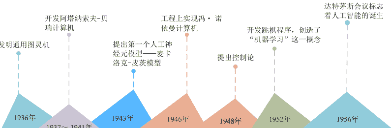

图 1.1 初创时期人工智能发展历程

**1) 通用图灵机。** 1936年，图灵发明通用图灵机——理论计算机模型。设想其拥无限长纸带，格子中划斜线代表1、空白代表0；读写头可读写信息；唯一操作：纸带右移一格，1变0或0变1。它抽离硬件状态，确立计算逻辑结构，成为现代计算机思想原型。

**2) 早期计算机技术。** 1937-1941年，美国爱荷华州立大学阿塔纳索夫教授与研究生贝瑞开发ABC计算机，为计算机科学与人工智能研究奠基。现代可编程数字电子计算机架构由约翰·冯·诺依曼提出——受通用图灵机启发，1946年工程落地。冯·诺依曼架构奠定现代计算机基石，成为验证与实现各类人工智能思想技术的核心工具。

**3) 人工神经元模型。** 1943年，美国心理学家麦卡洛克与数理逻辑学家皮茨合作提出人类首个人工神经元模型——MP模型，模拟生物神经元的数学抽象。研究揭示：极简单元连接成“网络”即可计算任意逻辑与算术函数，因单元似简化神经元。由此衍生的核心技术即人工神经网络（ANN）。MP模型是神经网络的源头。早期并未冠以“神经网络”之名，称“联结主义”，当时未将其与人工智能关联——因1956年前“人工智能”概念尚不存在。

**4) 控制论。** 1948年，美国数学家、控制论之父诺伯特·维纳提出控制论——关于具备自调整、自适应、自校正功能机器的理论。它深刻对比人与机器：人类能造更好计算机、更懂自身大脑，故计算机与人脑将趋同。控制论从机器控制视角，在机器、人、大脑间建立联系，其思想启发后世开发早期人工智能技术。

除上述核心理论外，信息论等亦对人工智能诞生有重要影响。在关于人、大脑、神经与机器关系的诸多思想启发下，图灵断言：人脑应视为离散状态机，本质上与计算机无异，坚信人工智能必能以某种方式实现。图灵等人对计算本质的洞见，链接了人类逻辑推理能力与冯·诺依曼计算机。

1952年，IBM科学家亚瑟·塞缪尔开发跳棋程序——能通过观察棋局位置学习隐含模型，指导后续走位。该程序驳倒“机器无法超越人类、无法像人类写代码和学习”的断言。他创造“机器学习”概念，定义为“使计算机无需显式编程即具备能力的研究领域”。

在上述思想汇聚下，1956年，约翰·麦卡锡、马文·明斯基、克劳德·香农、纳森·罗切斯特组织达特茅斯会议，邀请赫伯特·西蒙、艾伦·纽厄尔等科学家，就“机器能否思维”展开为期两个月的深度研讨。会议最大亮点是纽厄尔与西蒙发布“逻辑理论家”程序，该文稿后成为人工智能史里程碑。会议确立核心观点：**“学习或智能的任何特征都能被精确描述，从而使机器能够模拟。”** 麦卡锡会上首次提出“人工智能”概念——1956年前该词未被研究界广泛接纳。麦卡锡与明斯基提案列出七大研究方向：
① 自动计算机（可编程）；
② 程序语言；
③ 神经网络；
④ 计算规模理论（计算复杂性）；
⑤ 自我改进（机器学习）；
⑥ 抽象；
⑦ 随机性与创见性。

# AI简史：从达特茅斯到深度学习，一场跨越半个世纪的“智能跃迁”

那场著名的达特茅斯会议虽未当场攻克任何硬骨头，却为人工智能立下了“规矩”画好了“疆域”，拉开了这门学科漫漫长跑的序幕，影响力穿透时空，直抵今日。

回溯AI诞生后的几十年，技术演进始终沿着两条主线博弈前行：一条是**“造大脑”**——联结主义，试图用人工神经网络复刻生物神经元的连接拓扑；另一条是**“写程序”**——符号主义，把智能拆解为对逻辑符号的运算处理。这场“结构派”与“功能派”的世纪对决，贯穿了整部发展史。

---

## 2. 起势期（1957~1969）：符号主义的独角戏与隐秘的火种

早期舞台中央属于西蒙与纽厄尔领衔的符号主义。十余年间，机器定理证明、跳棋程序、通用问题求解器（GPS）、列表处理语言（LISP）接连问世，“人工智能”概念外延急剧膨胀。数字计算机攻克代数、几何、翻译难题，让科学家们信心膨胀，甚至豪言“二十年内复刻人脑”。这波首个高潮，确立了符号主义的核心教义：**认知即符号运算，符号即可区分的模式。**

但边缘从未安静。1958年，罗森布拉特抛出“感知器”，点燃联结主义第一把火。可惜好景不长，明斯基与帕珀特的一记“异或难题”精准击中单层感知器软肋——线性不可分问题无解，神经网络随即被判“死刑”，进入漫长寒冬。

同期，两股暗流悄悄涌动：德国学者以进化策略开启**进化计算**先河；扎德教授1965年奠基**模糊数学**，八十年代后衍生出成百上千个落地智能系统。六十年代虽因算力短板让诸多理论“纸上谈兵”，却为日后爆发埋下伏笔。阶段特征鲜明：符号主义一统江湖，联结主义被按在地上摩擦，直至九十年代中期。

---

## 3. 曲折期（1970~1992）：两次寒冬、三次春天与地下暗流

七十年代开局即遭重创：预期落空、经费断流、罗森布拉特英年早逝、明斯基再添一把火，联结主义彻底沉寂，AI迎来**第一个寒冬**。可就是在低谷期，地下实验室暗流涌动：

*   **霍兰德**以达尔文进化论为蓝本造出**遗传算法**，开辟“人工生命”新疆域，与进化策略、遗传编程合流成进化计算大河；
*   **《国际人工智能杂志》**创刊，搭建学术主阵地；
*   **DARPA**砸钱搞语音识别联盟，虽当时折戟，却为日后智能音箱铺路；
*   **韦伯斯**1974年独创**BP算法（反向传播）**，为日后深度学习立下基石；
*   **西蒙&纽厄尔**抛出“物理符号系统假设”，为符号主义盖棺定论；
*   **费根鲍姆**喊出“知识工程”，**专家系统**横空出世——用海量规则+推理搜索模拟专家经验，让AI从“通才”转“专才”，实现理论向工程、泛化向垂直的关键跃迁。

八十年代，专家系统修补符号主义架构，带来**第二个春天**。日本“第五代计算机”豪赌亿万，霍普菲尔德网络（1982）与鲁梅尔哈特、辛顿联手在Nature重释BP算法（1986），联结主义强势回归。马尔主张视觉“自底向上”，明斯基《心智社会》拆解智能为“智能体社会”，行为主义、具身认知、人工生命百花齐放。

繁荣背后暗藏崩塌：专家系统过重、脆弱、难维护，市场泡沫破裂，日美接连撤资，八十年代末**第二次寒冬**降临。九十年代初，符号主义日薄西山，学界被迫重审神经网络。此阶段最大收获：联结主义在夹缝中死守技术火种，为后来深度学习井喷攒足势能。

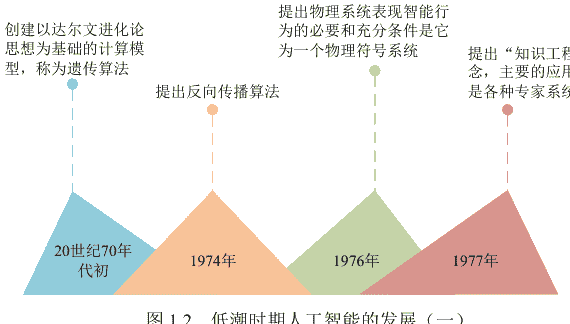

---

## 4. 爆发期（1993至今）：算力与数据的双引擎，推着深度学习冲破天花板

文奇1993年抛出“奇点论”点燃想象力。同期，粒子群、蚁群算法丰富计算智能；科尔特斯与万普尼克推出**SVM（支持向量机）**，统计学习派瞬间霸榜十年，深层神经网络再度边缘化。

转折悄然而至：  
**1996** 杨立昆掌管贝尔实验室视觉组，打磨**CNN（卷积神经网络）**；  
**1997** “深蓝”击败卡斯帕罗夫，符号主义谢幕式大捷；  
**2006** 辛顿、杨立昆、本吉奥三巨头联袂发文，炸开**深度置信网/深度学习**技术革命；  
**2010** 李飞飞构建**ImageNet**百万级标注图库，开启年度视觉奥林匹克（ILSVRC）；  
**2011** “谷歌大脑”万台CPU跑十亿连接网络，无监督自学“猫脸”；同年**沃森**碾压人类夺冠，催生“认知计算”；  
**2012** AlexNet以8层CNN在ImageNet甩开传统视觉10.8个百分点，**深度学习大爆炸**正式拉开帷幕；  
**2015** 何凯明**ResNet** 152层破3.57%错率，超越人眼5%基线，比赛使命终结；  
**2016** AlphaGo 4:1 李世石，搜索+神经网络+强化学习融合典范，引爆国家级战略布局；  
**2018-2019** Project Debater实战辩论展现语义生成新高度，AlphaStar 10:1 碾压星际争霸冠军，FTW与Self-Play实现多智能体协作与超人类水平。

这波**第三次高潮**的底层逻辑：超算+大数据+GPU并行，把深度学习从“理论可行”推到“工程可用”。本质上，联结主义借算力东风完成了对符号主义的历史性反超，但符号主义并未退场——**知识图谱**在认知智能、金融、司法、医疗大规模落地，成为新一代AI基建；**脑机接口、类脑芯片、外骨骼**等人机混合智能与类脑计算正悄然重塑边界。未来，不属于单一派系，而属于融合。

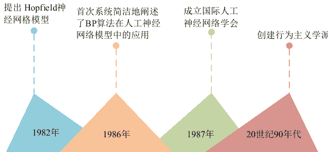

---

## 5. 中国AI四十年：从跟跑到领跑的平行时空

1978年改革开放启幕，中国AI从零起步，经历“建学科、引人才、搭平台”积累期，到“十五”“八六三”专项攻关，再到新一代AI发展规划顶层设计，实现语音识别（科大讯飞）、计算机视觉（商汤/旷视/云从）、自然语言处理、芯片算力（华为/寒武纪）全链条突围。学术论文量、专利申请量双双跃居世界前列，百度/阿里/腾讯/字节构建产业生态，智慧城市/自动驾驶/智能制造规模化落地。四十年，中国已从追赶者变身全球核心极之一，正书写属于自己的智能时代篇章。

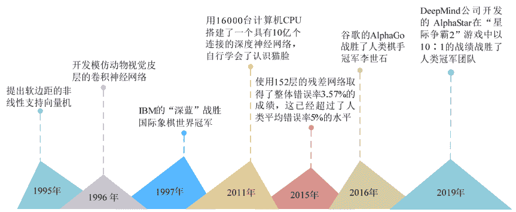

---

**结语**  
从达特茅斯的十位青年到ImageNet的百万标注，从感知器的“异或死局”到AlphaGo的“神之一手”，AI发展史是一部**“算力、数据、算法”三角铁律**下的进化史诗。符号主义给了AI逻辑骨架，联结主义注入感知血肉，进化计算与模糊数学补充鲁棒韧性，知识图谱构建认知大脑。下一站，或将在**大模型涌现智能、具身智能实体化、脑机融合共生**中揭晓。历史从不重复，但总是押韵——每一次寒冬的尽头，都是春天的伏笔。

# 中国 AI 发展史：从「智能模拟」起步到国家战略的跃迁

人工智能在中国的种子，是在那个改革开放的春天里播下的。

### 破茧：学科建设的「第一个十年」

1978 年，「智能模拟」正式被纳入国家计划，拉开了中国 AI 研究的序幕。随后的十年里，学术组织如雨后春笋般涌现：中国人工智能学会（CAAI）、高校研究会、计算机学会与自动化学会下的相关专委会、软件行业协会智能分会、智能机器人、计算机视觉、智能自动化等专业委员会相继成立，迅速编织起一张覆盖全国的学术协作网。

1984 年，首届智能计算机全国学术讨论会召开；1986 年，智能计算机系统、智能机器人等重磅项目入选国家高技术研究计划（863 计划）；1987 年，《模式识别与人工智能》创刊；1989 年，中国人工智能联合会议（CJCAI）首次举办；1993 年，智能控制等项目又登上国家科技攀登计划。进入新世纪，各类基金计划全面铺开，科研资源投入迎来井喷。

在这条攻坚克难的路上，中国科学家也斩获了世界级荣耀。吴文俊院士创立的「吴氏方法」，在几何定理机器证明领域实现了原创性突破，让世界听到了中国 AI 的声音。

### 破局：「高等智能」理念的横空出世

2006 年，符号逻辑 AI 诞生 50 周年之际，中美欧三大顶级学会在北京联手举办国际会议。这是一次复盘与展望的盛会，更成为了中国 AI 走向世界舞台中央的标志性时刻。

会上，中国人工智能学会抛出了振聋发聩的**「高等智能」研究纲领**，核心主张「机制主义」：

1.  **直击本质**：跳出结构、功能、行为的表象纠缠，直指「智能生成的共性核心机制」。
2.  **技术路径**：以「信息 - 知识 - 智能」的转换链条为工程实现手段。
3.  **大一统**：以机制主义为纽带，将结构主义、功能主义、行为主义三大传统范式有机熔铸。
4.  **打破壁垒**：探通意识、情感与智能的内在回路，消弭人工智能与自然智能的鸿沟。

这一纲领获与会国际同行普遍认同，标志着中国 AI 研究从「跟跑」转向「领跑」的关键一步。

### 破圈：CCAI 与国家战略的双引擎驱动

2015 年，中国人工智能学会创办 **中国人工智能大会（CCAI）**，迅速成长为国内规格最高、规模最大、影响力最强的 AI 学术盛会之一，成为凝聚学术共识、洞察前沿动向的「风向标」。

真正的爆发点在 2016 年 —— **人工智能正式上升为国家战略**，政策红利进入密集释放期：

*   **2016.03**：「十三五」规划纲要将 AI 列入重大工程；
*   **2016.05**：《“互联网+”人工智能三年行动实施方案》出炉，锁定 2018 年千亿级市场目标，从资金、标准、知识产权、人才、国际合作六大维度全链路发力；
*   **2017.03**：AI 首次写入政府工作报告；
*   **2017.07**：国务院发布《新一代人工智能发展规划》，顶层设计落地；
*   **2018.01**：《人工智能标准化白皮书》发布，标准体系建设提速。

2018 年 9 月，**世界人工智能大会**在上海开幕，习近平主席致信祝贺，强调 AI 正深刻重塑生产生活，呼吁全球合力推动技术造福人类，将中国 AI 的国际话语权推向新高度。

### 破壁：硬核科技筑牢「自主可控」底座

2019 年，技术战场转向**边缘计算与云边深度融合**。安防、交通、新零售、智造、医疗等场景倒逼算力下沉，跨产业融合催生出一批互补性创新与专用技术积累，显著提升了数据存储与计算效能。芯片、关键硬件、基础软件的突破，让「自主可控」生态雏形初现。

同年，**以华为为代表的硬科技平台崛起，成为最大亮点**。依托芯片与基础软件双轮驱动，华为接连推出 HMS、鸿蒙、鲲鹏计算、5G 自动驾驶四大生态体系。海思、寒武纪、中芯国际、紫光展锐等芯片劲旅，成为智能终端、安防、智慧城市落地的关键推手。

### 破浪：「新基建」与「AI for Science」开启新纪元

*   **2020.04**：发改委定调「新基建」七大领域，AI 位列其中；
*   **「十四五」规划**：明确推动 AI 与万物深度融合；
*   **2021.03**：《十四五规划及2035远景目标》部署前瞻性战略性国家重大科技项目，构建战略性新兴产业增长引擎；
*   **2022.05**：《“十四五”国民健康规划》点名 AI 芯片、5G、区块链等技术赋能智慧医疗；
*   **2023.03**：科技部、自然科学基金会联合启动**「人工智能驱动的科学研究（AI for Science）」**专项，瞄准数理化天基础学科难题与药物、基因、育种、新材料四大应用痛点，布局前沿研发体系。

至此，AI 在政策护航下全面提速、高质量发展，正成为提升经济社会智能化水平、增强公共服务与城市治理能力的核心引擎。

---

### 1.3 三大流派百年博弈：分久必合，合久必强

八十余载春秋，因对智能本质认知的差异，AI 领域演化出三大核心流派：**符号主义（逻辑派）、联结主义（仿生派）、行为主义（进化派）**。它们分别扎根于物理符号系统假设、人工神经网络、控制论与「感知-行动」循环，互补又对立，共同拼凑出 AI 的拼图全貌。

#### 一、 符号主义：「逻辑的王者」，擅长推理，短板在「形」

**核心信条**：智能 = 物理符号系统；思维 = 符号操作。纽厄尔、西蒙的「物理符号系统假设」是基石：拥有符号系统是智能的充要条件。

**两大分支**：
*   **认知派**（西蒙、明斯基、纽厄尔）：宏观功能模拟，从人类思维出发；
*   **逻辑派**（麦卡锡、尼尔森）：形式化描述世界，主张用逻辑构建统一理论。

**杀手锏特征**：
✅ 逻辑运算强，解决复杂推理无敌手；
✅ 知识显性化，规则已知时无需海量细节；
✅ 模块化友好，局部修改低成本；
✅ 兼容传统符号数据库；
✅ 推理可解释，决策路径透明。

**阿喀琉斯之踵**：只擅「逻辑思维」，「形象思维」难模拟；符号转换易丢失信息；「常识」与「不确定性」处理是硬伤。

#### 二、 联结主义：「直觉的大师」，擅长感知，短板在「理」

**核心信条**：思维基元是神经元而非符号；主张**结构模拟**，复刻生理神经网络。MP 模型开山鼻祖，Hopfield 网络与 BP 算法奠基，在图像、模式识别上大杀四方。

**杀手锏特征**：
✅ 分布式存储 + 并行处理，动态全局视野；
✅ 天生联想能力，抗噪声鲁棒性强；
✅ 通过调整连接权重实现学习分类；
✅ 完美契合「形象思维」，近似解出得快。

**阿喀琉斯之踵**：不擅「逻辑推理」；固定结构难支撑多元知识开发；理论深坑多，单靠连接机制解决不了所有问题。

#### 三、 行为主义：「实干的行者」，擅长交互，短板在「深」

**核心信条**：智能源于主体与环境的**实时交互**；无需符号表示，靠「亚符号/信号处理」驱动。布鲁克斯的「机器虫」是里程碑：分层异步网络，独立模块完成避障、前进、平衡，自下而上涌现复杂行为。

**杀手锏特征**：
✅ 智能=感知+行动，环境即最佳模型；
✅ 必须在真实物理世界中「长」出来；
✅ 进化式发展，分阶段迭代增强。

**阿喀琉斯之踵**：质疑声大——擅长造「智能昆虫」，难造「人级智能」；缺乏抽象概括能力。

---

### 融合：打破教条，综合集成成主流

**原则上：符号主义管「抽象思维」，联结主义管「形象思维」，行为主义管「感知思维」。** 三条腿走路，缺一不可。

早期流派之争，本质上陷入了**「指名（符号）、指心（概念）、指物（实物）三者等价」的经典概念陷阱**。

*   经典概念预设：外延可用集合表示、内涵可用命题表示、名物一致、表征唯一、内涵外延功能等价。
*   现实却是：**「书不尽言，言不尽意」**（《周易》）。
*   **段子里的「一个亿」**：写在手上的符号（指名）≠ 真金白银（指物）。
*   **马格利特的《这不是烟斗》**：画中符号（指名）≠ 真实烟斗（指物）。
*   生活中指名、指心、指物高频**不等价**。

**结论**：单一流派搞定单一功能，无法等同于拥有真智能。AlphaGo 融合强化学习（行为）、蒙特卡洛树搜索（符号）、深度学习（联结）；自动驾驶更是三大流派技术大杂烩。**融合，是大势所趋，也是新一代 AI 引爆第四次工业革命的必由之路。**

---

### 反思：图灵测试的隐形陷阱与知识表示的下一站

当前 AI 仍存缺陷：知识表示仍建立在「经典概念」沙堡上。

图灵测试（1950）未定义「合格提问者/回答者」的画像（国籍、智力、是否装傻），预设「人」有经典定义 —— **维特根斯坦《哲学研究》（1953）早已宣判：日常概念（如「人」）无经典定义。**

经典概念假设过度简化，与人类认知实况严重背离。在此框架下，机器缺常识、不理解、遇突发状况即瘫痪。**突破经典概念表示框架，构建新型知识表征，是通往通用人工智能（AGI）必须攻克的「最后一道关卡」。**

---

### 核心速记卡

| 维度 | 关键点 |
| :--- | :--- |
| **中国 AI 里程碑** | 78年立项 → 86年入863 → 06年「高等智能」纲领 → 15年CCAI创办 → 16年上升国策 → 19年硬核生态成型 → 20年「新基建」 → 23年 AI for Science 启动 |
| **三大流派核心** | 符号主义：**符号操作/逻辑推理**；联结主义：**神经网络/并行分布/形象思维**；行为主义：**感知-行动/环境交互/进化涌现** |
| **流派互补关系** | 符号≈抽象思维；联结≈形象思维；行为≈感知思维 → **综合集成是唯一出路** |
| **根本理论危机** | 经典概念「指名=指心=指物」假设失效 → 知识表示失语 → 机器无常识、不理解、怕意外 |
| **破局方向** | 超越经典概念框架，重构知识表示体系 |

---

### 留给思考的 9 个硬问题

1.  **定义本质**：AI 是什么？终极研究目标指向何方？
2.  **定义博弈**：搜集并对比业界其他主流 AI 定义，差异在哪？
3.  **流派 PK**：三大流派核心主张、技术路线、优劣势深度复盘。
4.  **历史分期**：AI 发展历程如何切分阶段？各阶段标志性事件是什么？
5.  **研究全景**：AI 研究的基本内容版图包含哪些板块？
6.  **强弱之辨**：如何划定强 AI 与弱 AI 的红线？
7.  **领域地图**：AI 主要研究领域有哪些？典型应用场景对号入座。
8.  **知行关系**：知识与概念究竟是何种耦合关系？
9.  **图灵反思**：图灵测试标准何在？其「智能判定逻辑」的致命软肋是什么？

> **下一站预告**：我们将深入「知识表示与推理」的迷宫，探寻如何打破经典概念的枷锁，为机器装上真正理解世界的「大脑皮层」。敬请期待。

## 第 1 章 思考题精选

- 10. AI 程序与传统软件的核心区别在于何处？
- 11. 展望未来，人工智能有望在哪些维度实现跨越式突破？
- 12. 通用人工智能（AGI）是终极远景，我们当下该如何铺路推进？
- 13. 图灵测试还有个“反向玩法”——逆图灵测试，由机器鉴别对方是人还是机器。这听起来抽象，实则关乎你我：比如抢演唱会门票时遇到的验证码、滑块验证，不就是典型应用吗？你能想出更多场景？
- 14. 更进一步是“个人图灵测试”：AI 若能完美复刻你的挚友语气、记忆与性格，骗过你的双眼。一旦技术成熟，随之而来的身份盗用、情感欺诈、法律责任归属等伦理难题，你如何看待？

## 第 2 章 知识表示：AI 大厦的基石

知识表示是构建各类智能系统的关键环节，也是人工智能研究的基石。它与知识的本质、类型紧密相关，涵盖了知识逻辑结构的研究与设计。从形态上看，知识分为显性与隐性两类。显性知识可用语言、文字、符号、图像、声音等人类可直接识别的形式表达；隐性知识则难以用上述形式刻画，如游泳、表演的身体技巧，只能借助神经网络存储表示。本章聚焦显性知识的表示方法。

### 2.1 核心概念：什么是知识？如何表示？

人类智能活动的本质是获取与运用知识，知识是智能的基座。要让计算机具备智能、模拟人类行为，必须赋予其知识库。知识需经适当模式编码才能入库，因此知识表示是 AI 领域极具基础性的核心课题。

#### 2.1.1 知识

在客观世界中，知识是事物属性及事物间关系的映射，不同事物或同一事物的不同关系构成不同知识，这些映射即为信息。

##### 1. 认知阶梯：数据 → 信息 → 知识

人类认知客观世界遵循“数据—信息—知识”依次递进的层次结构（见图 2.1），代表着认知转化的过程。

此处的“数据”非狭义数字，含义更广：颜色、属性、长宽等均可记录为数据。可定义为“客观事物数量、属性、位置及相互关系的抽象表示”。计算机科学中，数据泛指输入处理、具备特定意义的数字、字母、符号、模拟量等。

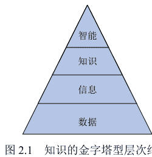

数据是信息的载体，信息是对数据的语义解释。例如“3 棵树”“3 个人”“3 本书”虽同用数据“3”，语义截然不同，形成不同信息。一般而言，信息可用描述词值组描述：<描述词 1：值 1；…；描述词 n：值 n>。信息能描述事件、物体、现象的属性、状态、位置、程度、方式等。

海量信息经归纳总结、体系化，便形成知识。公认定义：“知识是一个或多个信息的关联。”即把相关信息关联成能反映客观事物关系的结构。知识是对客观事实及关系的高度概括整合，因事物相互联系，知识亦必然相互关联。

知识之上还可延伸“智能”——比知识更高维的概念，指人类内在的获取、运用知识的综合能力（判断、规划、创新等）。正确理解并驾驭知识间关联，即体现智能。

##### 2. 知识的七大内在属性

知识源于人类对客观世界的认知，具有以下特性：

- **真假可验**：知识反映客观世界，有真伪之分，可经实践检验或逻辑推理证明。
- **情境依赖**：知识无绝对真假，仅在特定条件、环境下成立。如“1+1=2”在十进制真、二进制假。
- **残缺常态**：知识常不完整，分为条件缺失与结论缺失两类。
- **模糊地带**：真假非“非此即彼”，常处中间状态。如“人老了可能糊涂”，涉“老了”“可能”“糊涂”等模糊概念，需模糊数学或统计法处理。
- **可符号化**：知识非物质，但存于脑际，可用语言、文字、图形等形式外化，得以存储、传播、应用、发展。
- **易存易传易算**：可符号化即可存储（书本、讲授、网络）、转换形式、像数据一样加工处理。
- **内部无冲突**：知识集合（如专家系统知识库）内部须相容，不能推导出矛盾命题。

##### 3. 多维视角切分知识版图

知识类型可从不同维度划分：

- **按性质**：公理、概念、命题、定理、规则等。
- **按确定性**：**确定性知识**（真值为真/假，可用经典逻辑描述）vs **不确定性知识**（含不精确、不完备、模糊，处中间状态）。
- **按语义内涵**：
  - **事实**：描述客体属性值，无变量，用真命题表达。
  - **规则**：“若 A 则 B”，表达因果，分带/不带变量。
  - **规律**：事物内在必然联系，客观不以意志为转移。
  - **推理方法**：获取新知的逻辑手段（前提、结论、推理形式），按思维方向分演绎、归纳、类比等。
- **按功能角色**：
  - **事实性知识**（静态描述：概念、属性、状态），直接表达。
  - **过程性知识**（动态求解：规则、定律、经验），常用产生式、语义网。
  - **控制性知识**（元知识：推理/搜索/不确定性传播策略），指导知识使用。
- **按适用范围**：**常识性知识**（通用通识）vs **领域性知识**（专业垂直）。
- **按求解动态**：**静态知识**（对象知识：事实、关系、分类）vs **动态知识**（过程知识：推理路径、启发式方法）。
- **按认知深度**：**表层知识**（现象、经验、感性，简洁易懂但不触本质）vs **深层知识**（本质、理论）。
- **按元认知层级**：
  - **零级知识**：常识与原理（事实、定理、方程）。
  - **一级知识**：启发式经验（模糊规则、不确切判断），解决零级知识难题的恶结构问题。
  - **二级知识**：掌控上两层知识的知识。
  - 通常将零、一级称**领域/目标知识**，二级以上称**元知识**。高层指导低层，专家系统设计中领域知识不可或缺。

#### 2.1.2 知识表示：让机器“读懂”知识

要理解利用知识，先得外化表示。知识表示兼顾存储与使用。

##### 1. 定义内涵

知识表示是知识符号化、形式化的过程，是机器处理知识的可行方法，本质是**数据结构与控制结构的统一体**。可视为一组描述事物的约定，将人类知识转为机器可处理的数据结构。

研究核心在于数据结构设计，将领域知识融入程序设计。同一知识可多种表示，一种表示可承载多知识，但不同表示解题效果天差地别。至今无通用完美模式，理论仍在探索中。

面向人的表示（语言、公式、图表等）人易懂，但难直接机运，故需研究面向计算机的表示：用约定的外部形式结构描述知识，并能转为机器内部形式，便于存储、处理、利用。

知识表示旨在将信息编码为符号机可处理模式，模拟人类认知推理，解决 AI 复杂任务。它是认知科学（关注人类存储处理）与 AI（关注存储程序可处理知识以达人智）的共同命题。

其实不神秘，我们早已接触：**算法**是知识表示（刻画解题步骤，可编程实现）；**一阶谓词公式**是形式语言（表达力强，可编程实现），皆为知识表示形式。

##### 2. 方法谱系：两大流派与两种范式

研究离不开对知识机制的理解，虽理论未建制，但结合实践已形成多种方法，概括为：

- **符号主义表示法**：用含义符号按序组合表示知识，主攻逻辑性知识。
- **连接主义表示法**：用神经网络技术，以物理连接传递加工信息表示概念知识。相对符号法，它是**隐式表示**，擅长形象性知识。

按控制知识组织方式再分：

- **说明性表示法**：重静态（客体、事件、事实、关系、状态），控制知识在控制系统中分离。
- **过程性表示法**：重动态利用，控制知识嵌入知识描述，知识包裹在过程中。

不同知识适配不同方法，研究不止解决“存储”，更要“好用”。优良表示让求解更易、更快。优秀知识表示系统应具备：

- 领域知识表达力强，保证知识库自洽。
- 推导新知能力强，易构建新结构承载新知。
- 利于知识获取（如人工直录）。
- 易挂载启发式知识，聚焦最优推理方向。

主流方法包括：一阶谓词逻辑、产生式、脚本、过程、框架、语义网络等。虽法多，但问题未完全解，仍是 AI 重要分支。

##### 3. 评判金标准：八大核心指标

优秀表示法需强表达力、高精度，保证推理正确高效，兼顾可读性、模块化。综合看，需具备：

- **完备性**：覆盖领域所需知识，具语法/语义完备性，便于库检查调试。多数方法难达标，若表示能力弱，关键知识缺失，严重削弱求解力。
- **一致性**：库内知识无矛盾。专家知识多为启发式、不完全、不确定，表示法须便于一致性检查，迭代完善库，保求解质量。
- **正确性**：真实反映知识信息，零偏差，保结论建议可靠。
- **灵活性**：因领域、知识特性、自然结构选法（单法、混合法、创新法），具体问题具体分析，忌生搬硬套。
- **可扩充性**：无需改硬件/控制结构即可扩库，即表示模式与推理机制解耦（专家系统常用知识库与推理机分离）。专家常分批建库（子集起步，增删改扩充），主张开放集、模块化存储。
- **可理解性**：符合思维习惯，便于研发人员整理形式化专家知识，利于库设计、实现、改进。
- **可利用性**：表示服务于利用（检索、推理）。模式定则检索推理定。应便于复用，数据结构求简求清。结构过繁或晦涩，阻碍匹配、冲突消解、不确定性计算，拖垮效率与求解力。
- **可维护性**：知识组织与表示法强相关，不同法对应不同组织方式。选法时须考虑组织便利性。知识需增删改以保一致完整，即需管理维护。选法应充分考虑维护便利。简而言之，建系统当遵循：有效表示领域知识、利于获取、利于推理三原则。

### 2.2 一阶谓词逻辑：知识表示的“通用语言”

一阶谓词逻辑表达力强，契合数字计算机，成知识表示首选。它既能实现类人自然演绎自动推理，也能实现机器特有的归结法自动推理。

#### 2.2.1 逻辑基石：命题与联结词

##### 1. 命题：带真值的语义单元

命题是思维判断（肯定/否定）的语义实体，可观察、可定义。

**定义**：命题是具有真假意义的语句。指语义而非陈述本身。同语义陈述表达同命题，如“雪是白的”（中）与“snow is white”（英）；同语言中“冰的小结晶是白的”若视作“雪”的有效定义，亦同命题。

通常指闭判断（区别开判断/谓词），非真即假。逻辑实证主义支持此概念。例：
- P: 太阳从东边升起。
- Q: 人工智能是计算机专业课程之一。
- R: 今天有小雨。

哲学家约翰·瑟尔主张：是非疑问句（询问命题真值）、交通标志（非语言表达命题）、被引用待评价的陈述（有语义未判真假）均表达命题。

##### 2. 联结词：搭建复合命题

设 P、Q 为命题，常用联结词：
- **否定** ¬：如 ¬P
- **合取** ∧：如 P ∧ Q
- **析取** ∨：如 P ∨ Q

# 逻辑基石：命题、谓词与产生式系统的知识表示全景

## 2.1 命题逻辑：推理的基础语法

### 核心联结词与真值判定

在命题逻辑体系中，复合命题的真假完全由基础命题的真值及联结词规则决定。以下是五大核心联结词的语义：

1.  **否定 (¬)**：真假互换。若 P 为真，则 ¬P 为假；反之亦然。
2.  **合取 (∧，即“且”)**：全真才真。仅当 P、Q 均为真时，P∧Q 成立，其余均为假。
3.  **析取 (∨，即“或”)**：一真则真。P、Q 至少有一个为真，P∨Q 即为真；仅当两者皆假时结果为假。
4.  **条件 (→，即“蕴涵”)**：真不推假。此规则最关键：**仅当前件 P 为真且后件 Q 为假时，P→Q 为假**；其他三种组合（真→真、假→真、假→假）均判定为真。
5.  **双条件 (↔，即“等价”)**：同真同假。P、Q 真值一致（同真或同假）时为真，不一致则为假。

**真值速查表（表 2.1）**

| P | Q | ¬P | P∧Q | P∨Q | P→Q | P↔Q |
|---|---|---|---|---|---|---|
| T | T | F | T | T | T | T |
| T | F | F | F | T | F | F |
| F | T | T | F | T | T | F |
| F | F | T | F | F | T | T |

### 等价与蕴涵：判定公式关系的标尺

*   **等价 (⇔)**：设公式 A、B 含变元 p₁...pₙ。若在**任意**真值赋值下，A 与 B 真值完全同步，则称二者等价。
*   **蕴涵 (⇒)**：若条件式 P→Q 在所有赋值下恒为真（即为永真式），则称 P 蕴涵 Q。这意味着 P 为真必推出 Q 为真。

### 必备工具箱：常用等价变换定理

掌握这些定理，是化简公式、证明等价的“瑞士军刀”：

*   **双重否定** ```
¬¬P ⇔ P
```
*   **分配律** ```
P ∨ (Q ∧ R) ⇔ (P ∨ Q) ∧ (P ∨ R)
P ∧ (Q ∨ R) ⇔ (P ∧ Q) ∨ (P ∧ R)
```
*   **幂等律**：P∨P ⇔ P；P∧P ⇔ P
*   **交换律**：P∨Q ⇔ Q∨P；P∧Q ⇔ Q∧P
*   **结合律**：(P∨Q)∨R ⇔ P∨(Q∨R)；(P∧Q)∧R ⇔ P∧(Q∧R)
*   **吸收律**：P∨(P∧Q) ⇔ P；P∧(P∨Q) ⇔ P
*   **德摩根律**：¬(P∨Q) ⇔ ¬P∧¬Q；¬(P∧Q) ⇔ ¬P∨¬Q

### 推理利器：蕴涵相关定理

*   **假言推理**：P ∧ (P→Q) ⇒ Q（肯定前件推出后件）
*   **假言三段论**：(P→Q) ∧ (Q→R) ⇒ P→R（链式传递）
*   **化简式**：P∧Q ⇒ P / Q（合取可拆解）
*   **附加式**：P ⇒ P∨Q / Q ⇒ P∨Q（可自由引入析取）
*   **条件转化**：
    *   P→Q ⇒ ¬P∨Q（蕴涵等价于“非前件或后件”）
    *   ¬P ⇒ P→Q（前件为假，蕴涵必真）
    *   Q ⇒ P→Q（后件为真，蕴涵必真）

### 实战演练：自然语言转逻辑公式（例 2.1）

**场景**：设 P=下雨，Q=下雪，R=去学校，形式化表达四句话。

1.  “非雨夹雪则去校” → ¬(P∧Q) → R
2.  “不雨且不雪则去校” → ¬P ∧ ¬Q → R
3.  “雨或雪则不去校” → P ∨ Q → ¬R
4.  “雨雪无阻必去校” → (P∧Q∧R) ∨ ¬(¬P∧Q∧R) ∨ (P∧¬Q∧R) ∨ ¬(¬P∧¬Q∧R)
    *   *解析：该式穷举四种天气组合（雨雪、不雨雪、雨不雪、不雨不雪）均去学校，体现了“全称量词”的逻辑内核。*

---

## 2.2 谓词逻辑：穿透命题表象，洞察对象结构

命题逻辑视原子命题为不可分黑盒，**谓词逻辑**打开盒子，引入**个体**（对象）与**谓词**（属性/关系），实现表达力质变。

### 1. 核心概念：谓词 = 谓词名 + 个体项

*   **示例**：“李明是学生” → `Student(LiMing)`
    *   `LiMing`：个体常项（具体对象）
    *   `Student`：一元谓词（属性描述）
*   **计算机视角**：谓词本质是返回布尔值的条件表达式求值过程。

### 2. 谓词公式（合式公式 WFF）构造规则

联结词优先级（高→低）：`¬` > `∧` > `∨` > `→`。

1.  **原子公式**：P(t₁,...,tₙ) 及其否定。
2.  **复合公式**：若 A、B 为公式，则 ¬A、A∨B、A∧B、A→B 均为公式。
3.  **量化公式**：若 A 为公式，x 为个体变元，则 (∀x)A（全称量词）和 (∃x)A（存在量词）均为公式。

**关键术语辨析**：
*   **开公式**：含自由变元（未被量词约束）。
*   **闭公式/语句**：无自由变元，可直接判定真假。

### 3. 知识表示三步法（标准化建模流程）

1.  **定义谓词与个体**：明确符号语义边界。
2.  **实例化赋值**：将具体对象代入谓词变元。
3.  **联结成式**：按语义用联结词、量词组装公式。

### 4. 谓词公式的语义性质（三大核心维度）

*   **永真/永假/可满足**：针对**所有非空个体域**及**所有解释**的表现。
    *   永真：一切解释下均为真。
    *   永假：一切解释下均为假。
    *   可满足：至少存在一个解释使其为真。
*   **等价 (⇔)**：在共同个体域上，一切解释下真值相同。
*   **永真蕴涵 (⇒)**：P→Q 永真，即 P 逻辑推出 Q。

### 5. 经典建模实战（例 2.2 & 2.3）

**例 2.2**：
*   “武汉美丽非沿海” → `BCity(wuhan) ∧ ¬HCity(wuhan)`
*   “马亮男、张红女 → 马更高” → `[Boy(mal) ∧ Girl(zhangh)] → High(mal, zhangh)`

**例 2.3（数学定义建模）**：
*   自然数 ⊂ 正整数：`(∀x)(N(x) → GZ(x) ∧ I(x))`
*   整数非奇即偶：**注：原文逻辑或应为异或，此处忠实还原**：`(∀x)(I(x) → E(x) ∧ O(x))`
*   偶数除 2 得整数：`(∀x)(E(x) → I(S(x)))`

### 6. 一阶谓词逻辑：优势与局限并存

| **四大优势** | **三大短板** |
| :--- | :--- |
| **严密性**：演绎正确有保障 | **效率低**：推理链长，表达越细推理越慢 |
| **自然性**：贴近人类语言习惯 | **刚性强**：难处理不确定性、启发式/元知识 |
| **通用性**：标准化推理机制 | **组合爆炸**：事实增多、盲目搜索易失控 |
| **易实现**：模块化，便于增删改 | |

> **结论**：尽管存在局限，它仍是知识表示的**基石性方法**。

---

## 2.3 产生式系统：模拟人类专家的“条件-行动”范式

源自波斯特系统，后成为早期专家系统核心架构，至今仍是规则引擎理论原型。

### 2.3.1 核心单元：产生式

**基本形**：
```
P→Q 或 IF P THEN Q
```

式中，**P（前件/条件）** 用于触发规则的模式匹配；**Q（后件/动作/结论）** 为条件满足时执行的操作或推导事实。P、Q 均可为数学表达式或自然语言。

**产生式 vs. 逻辑蕴涵（核心差异）**：
1.  **表达力更强**：蕴涵仅限精确真/假；产生式可挂载**可信度** `CF ∈ [-1, 1]` 表示不确定知识。
    *   不确定规则形式：```
  P→Q（可信度）或者 IF P THEN Q（可信度）
  ```
2.  **匹配机制灵活**：蕴涵要求**精确统一**；产生式支持**模糊/近似匹配**（相似度阈值触发）。
3.  **本体论不同**：蕴涵是有真值的逻辑公式；产生式是**无真值的知识单元**，属于“可执行规则”。

**事实表示的数据结构**：
*   确定性：三元组 `(对象, 属性, 值)` / `(关系, 对象1, 对象2)`
*   不确定性：四元组 `(对象, 属性, 值, 置信度)` / `(关系, 对象1, 对象2, 置信度)`

### 2.3.2 系统架构：三大核心组件 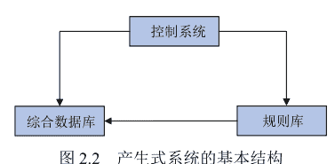

标准产生式系统 = **综合数据库** + **规则库** + **控制系统 (推理引擎)**

#### 1. 综合数据库 —— “工作记忆/黑板”
*   非传统数据库，而是**动态事实容器**。
*   存放：初始事实、中间推导结果、最终目标。
*   状态驱动：规则触发即修改数据库，驱动状态迁移。

#### 2. 规则库 —— “长时记忆/知识库”
*   存放 `IF...THEN...` 规则集。
*   **两类知识**：
    *   **领域规律** (如“马走日”)：硬约束，必须正确。
    *   **启发策略** (如“控制中心有利”)：软知识，决定求解水平与效率。

#### 3. 控制系统 —— “中央执行/推理机”
核心职责：**匹配 → 冲突消解 → 执行 → 循环/终止**。

详细工作流：
1.  **模式匹配**：拿规则前件去数据库找事实（精确/近似）。
2.  **冲突消解**：匹配成功规则 >1 条时，按策略（如特异性优先、先进先出、置信度高低）选**一条**执行。
3.  **执行行动**：
    *   后件是结论 → 写入数据库。
    *   后件是操作 → 执行外部动作。
    *   涉及不确定性 → 计算结论置信度更新。
4.  **终止判定**：数据库满足目标条件 → 停机输出路径；否则回步骤 1。

### 2.3.3 三大推理控制策略

1.  **正向推理 (数据驱动)**：从已知事实出发，不断触发规则生成新事实，直到达成目标。适合“诊断/预测/监控”类问题（如：有症状找病因）。
2.  **反向推理 (目标驱动)**：从假设目标出发，反向寻找支持该目标的规则前件，将其设为新子目标，最终回溯到已知事实。适合“验证/设计/故障排查”类问题（如：假设是肺炎，查缺什么症状）。
3.  **双向推理**：双向交替，缩小搜索空间，适合复杂大规模系统。

# 知识表示与推理策略：从产生式系统到框架理论的核心逻辑

在人工智能的知识工程领域，**“如何表示知识”**与**“如何利用知识推理”**是两大基石。本文将深度解析产生式系统的三大推理范式、优劣势权衡，以及框架表示法如何通过结构化建模实现高效的知识组织与继承推理。

---

## 一、 产生式系统的三大推理引擎

产生式系统的核心在于“规则库”与“事实库”的交互，推理策略的选择直接决定了求解效率。

### 1. 正向推理：数据驱动的“广撒网”
**核心逻辑**：从已知事实出发，顺着规则方向（前件→后件）不断推演，直到触及目标。又称**数据驱动**或**自底向上**策略。

**执行流程四部曲**：
1.  **匹配**：规则库中规则前件与事实库比对，筛选出候选规则集。
2.  **冲突消解**：多条规则同时匹配时，依据策略（如优先级、特异性等）选定唯一“启用规则”。
3.  **执行**：启用规则后件加入事实库，更新知识状态。
4.  **循环**：重复上述过程，直至目标达成或无规则可触发。

> **关键痛点**：由于是“数据来一波，推一波”，缺乏目标导向，极易产生大量与目标无关的中间推论，导致**组合爆炸**，效率在大规模规则库中显著下降。

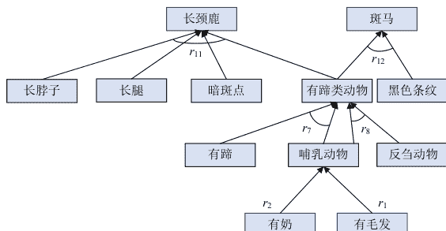

### 2. 反向推理：目标驱动的“精准打击”
**核心逻辑**：从假设目标出发，逆着规则方向（后件→前件）回溯，寻找支撑目标的已知事实。又称**目标驱动**或**自顶向下**策略。

**执行流程四部曲**：
1.  **目标匹配**：规则库中规则后件与当前目标比对，获取候选规则集。
2.  **冲突消解**：同正向推理，从候选集中选定启用规则。
3.  **子目标生成**：将启用规则的前件设定为新的子目标。
4.  **递归回溯**：重复上述过程，直至所有子目标均在事实库中得到证实。

> **核心优势**：**目标明确时极其高效**。它只关注与目标相关的路径，避免了正向推理的无效搜索。但若目标模糊或初始事实极其丰富，反向推理优势减弱。

### 3. 双向推理：夹击战术的“最高效”
**核心逻辑**：正向与反向并行，从事实端与目标端同时推进，在中间“会师”即成功。

> **效能本质**：搜索空间呈指数级缩小，推理网络规模远小于单向策略，**综合效率最优**，是复杂专家系统的首选架构。

---

## 二、 实战演示：动物识别系统的正向推理溯源

以识别“长颈鹿”为例，规则库 15 条（r1-r15），初始事实：`{暗斑点, 长脖子, 长腿, 有奶, 有蹄}`。

**推理链路复现**：
1.  **r2 命中**：“有奶” → 断言 **“是哺乳动物”** 入库。
2.  **r7 命中**：“是哺乳动物” + “有蹄” → 断言 **“是有蹄类动物”** 入库。
3.  **r11 命中**：“是有蹄类动物” + “长脖子” + “长腿” + “暗斑点” → 终结断言 **“是长颈鹿”**。

*过程呈现典型的数据驱动特征：事实积累驱动规则触发，逐层抽象，最终落地具体实例。*

```
r15: IF（动物，类别，鸟）AND（动物，本领，善飞）THEN（动物，名称，信天翁）
```

---

## 三、 产生式表示法深度评价：利弊共存的“经典范式”

### ❶ 两大核心特质
*   **数据驱动**：系统行为随数据变化而动态响应，数据静止则系统停摆，极适合**实时监控、故障诊断**等强数据驱动场景。
*   **三重独立性**：
    1.  **架构分离**：数据库、规则库、控制器物理解耦，修改知识**零代码侵入**。
    2.  **规则解耦**：规则间无直接调用，仅通过事实库“黑板”间接通信，维护极简（增删规则无需牵一发动全身）。
    3.  **顺序无关**：理论上求解结果不依赖规则排序（冲突消解策略除外）。

### ❷ 四大立身之本（优点）
| 维度 | 解读 |
| :--- | :--- |
| **自然性** | “IF-THEN”符合人类因果认知直觉，知识获取与解释透明化。 |
| **模块性** | 规则粒度统一，即插即用，便于规模化工程管理。 |
| **有效性** | 兼容确定/不确定/启发/过程等多元知识形态。 |
| **清晰性** | 固定语法便于自动化一致性、完整性校验。 |

### ❸ 两大硬伤（缺点）
1.  **效率瓶颈**：核心循环“匹配-消解-执行”在大规模规则库中极其耗时，**Rete 算法等优化手段虽缓解但难根治**；复杂问题极易**组合爆炸**。
2.  **结构表达无力**：扁平化规则难以刻画对象间的**层级、部件、空间/时间**等结构化关系，实践中常需**混合框架/语义网**使用。

---

## 四、 框架表示法：为结构化知识而生的“认知模板”

心理学发现：人类认知新事物时，并非逐条匹配规则，而是调用**“刻板印象/脚本”**——即**框架**。它是一种**结构化数据结构**，将刻板经验固化为模板，新实例只需“填槽”即成。

### 1. 框架解剖学：名字、槽、侧面、值
*   **框架名**：唯一标识（如 `<教师>`）。
*   **槽**：属性维度（如 `工作`, `学历`）。
*   **侧面**：槽的元数据约束（`范围`限定取值域，`缺省`给默认值，`If-Needed`挂载求值过程，`If-Added`挂载赋值后钩子）。
*   **值**：具体数据、过程名或**另一框架名**（支持嵌套）。

> **类框架 vs 实例框架**：
> *   `<大学教师>` 是类框架（描述概念，含缺省/范围等约束）。
> *   `<教师-1: 李明, 男, 助教...>` 是实例框架（描述个体，槽值具体化）。
> *   二者通过 **ISA/Instance** 槽建立**实例化关系**。

```
<框架名>
<槽名 1><槽值 1>|<侧面名 11><侧面值 111, 侧面值 112, ...>
<侧面名 12><侧面值 121, 侧面值 122, ...>
...
<槽名 2><槽值 2>|<侧面名 21><侧面值 211, 侧面值 212, ...>
<侧面名 22><侧面值 221, 侧面值 222, ...>
...
...
<槽名 k><槽值 k>|<侧面名 k1><侧面值 k11, 侧面值 k12, ...>
|<侧面名 k2><侧面值 k21, 侧面值 k22, ...>
... ...
```
```
框架名：<教师>
类属：<知识分子>
工作：范围：（教学，科研）
缺省：教学
性别：（男，女）
学历：（中师，高师）
类型：（<小学教师>, <中学教师>, <大学教师>）
```
```
框架名：<大学教师>
```

### 2. 四大核心关系槽：编织知识网络的锚点
| 槽名 | 语义 | 继承性 | 典型场景 |
| :--- | :--- | :--- | :--- |
| **ISA** | “是一个/属于” (实例-类) | **强继承** | `<教师-1> ISA <大学教师>` |
| **AKO** | “是一种” (子类-父类) | **强继承** | `<大学教师> AKO <教师>` |
| **Instance** | AKO 逆向，类指向实例 | **强继承** | `<教师> Instance <教师-1>` |
| **Part-of** | “是……的一部分” | **无继承** | `<轮胎> Part-of <汽车>` |

*继承机制：子框架自动拥有父框架槽及槽值，可覆盖、可扩展，实现知识**零冗余复用**。*

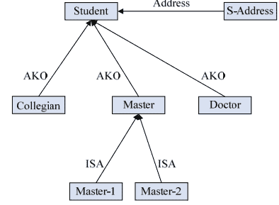

### 3. 框架系统拓扑：纵向继承 + 横向嵌套
*   **纵向联系**：ISA/AKO 链构成**分类树/网**，支撑**属性继承推理**（向上找父类默认值）。
*   **横向联系**：槽值引用其他框架（如 `<教师>` 的 `地址` 槽值为 `<S-Address>` 框架），构建**对象聚合/关联图**。

> **系统视角**：知识库 = 一个巨大的、相互链接的框架网络。

---

## 五、 基于框架的推理机制：匹配 + 继承 + 填槽

框架系统无固定推理机，核心范式是**“模式匹配触发继承，继承驱动填槽补全”**。

**标准求解三步走**：
1.  **建模**：将待解问题实例化为**问题框架**（含已知槽值、待求槽）。
2.  **匹配/架设**：在知识库中匹配最贴切的类框架作为**初步架设**（原型）。
3.  **继承填槽**：
    *   利用架设框架的缺省值、范围约束填补空槽。
    *   遇到空槽无默认值 → **沿 ISA/AKO 向上搜索父框架**继承。
    *   遇到槽值为框架名 → **横向展开子框架**递归求解。
    *   触发 `If-Needed` 过程动态计算、触发 `If-Added` 维护一致性。
4.  **迭代收敛**：直到关键槽全填满，或无法继续推进。

*此过程本质上是**约束传播**与**原型继承**的交织，天然适合分类识别、配置设计、场景理解等结构化任务。*

---

## 总结：范式选择的决策地图

| 场景特征 | 首选范式 | 核心理由 |
| :--- | :--- | :--- |
| **规则平扁、数据驱动、需频繁修改知识、强调解释性** | **产生式系统** | 规则独立性强，知识与控制分离，自然语言映射直接。 |
| **目标明确、诊断/分类任务、规则库大** | **反向/双向推理** | 目标导向大幅剪枝，双向夹击效率最高。 |
| **知识高度结构化、层级分明、需默认推理、原型识别** | **框架系统** | 槽/侧面/继承原生支持结构建模，填槽机制高效优雅。 |
| **复杂工程实践** | **混合架构** | 产生式做控制/过程，框架做本体/结构，语义网做关系推理——**扬长避短，各司其职**。

### 2.4.4 框架表示法的鲜明特质

框架表示法展现出以下几大显著优势。

*   **结构性强**：这是框架最核心的标签。它擅长刻画结构化知识，能清晰地勾勒出知识内部的构造关系，以及不同知识单元间的特殊关联。
*   **深层表达力**：它不局限于单一视角，支持从多属性、多维度描绘知识。借助 ISA、AKO 等槽位的嵌套层级机制，框架能以分层结构呈现知识，从而捕捉事物间错综复杂的深层联系。
*   **继承机制完善**：子框架可直接继承父框架的槽位数值，同时允许追加或覆盖修改。这种机制既有效压缩了知识冗余，又较好地维护了知识体系的一致性。
*   **认知自然度高**：框架将某一实体或实体集相关的所有特性聚合在一起，这种组织形式高度仿真了人脑存储实体多维度、多层次信息的方式，直观易懂，符合人类认知习惯。

当然，框架表示法也存在明显短板。

*   **形式理论缺位**：迄今仍未建立起成熟的框架形式理论体系，其推理机制与一致性校验缺乏基于严格定义语义的坚实基础。
*   **过程性知识表达乏力**：框架系统难以胜任过程性知识的表达，缺少描述“如何调用框架内知识”的能力。框架推理往往依赖领域无关的通用推理规则，但这些规则在框架体系内又难以有效表达。
*   **清晰度难以兜底**：鉴于各框架内部数据结构可能千差万别，框架系统的整体清晰度往往难以获得保障。

---

### 2.5 脚本表示法

脚本表示法是一种朴素却极具普适性的启发式技术，常用于学科知识的建模。基于脚本构建的系统，能够勾勒出极为全面的背景设定。

#### 2.5.1 概念依存理论

在人类知识版图中，常识性知识体量最大、覆盖面最广、关联最复杂，难以形式化后交由计算机处理。针对这一难题，夏克提出了**概念依存理论**。其核心主张是：从人类生活的各类故事情节中提炼基础概念，组成一组“原子概念”，界定这些原子概念间的相互依赖关系，进而用这套原子概念集及其依赖关系，统摄所有故事情节的表达。

夏克在其研制的脚本应用者机制（SAM）中，将动作类概念原子化，提炼出 11 种**原子动作**，用以刻画槽位行为。这 11 种原子动作详述如下：

1.  **PROPEL（推动）**：对对象施加外力，如推、拉、击打。
2.  **GRASP（把持）**：主体控制对象，如抓取、丢弃。
3.  **MOVE（移动）**：主体移动自身肢体，如举手、蹬腿、坐下。
4.  **ATRANS（抽象转移）**：抽象关系的转移，如物品所有权的易手。
5.  **PTRANS（物理转移）**：物理实体位置的改变，如人从甲地走到乙地。
6.  **ATTEND（关注）**：感知器官获取信息，如看、听。
7.  **INGEST（摄入）**：物体进入体内，如进食、饮水。
8.  **EXPEL（排出）**：物体排出体外，如流泪、呕吐。
9.  **SPEAK（发声）**：发出声音，如唱歌、呼喊、交谈。
10. **MTRANS（心理转移）**：信息的传递，如看电视、偷听、阅读、交谈。
11. **MBUILD（心理构建）**：由已有信息生成新信息，如由图、文、声、像合成多媒体信息。

夏克借助这 11 种原子动作及其依赖关系，将生活事件编织成脚本。每个脚本对应一类事件，将典型情节标准化。理解故事时，系统检索匹配的脚本，依据预设情节推演剧情。

#### 2.5.2 脚本的架构与构建步骤

脚本描述特定领域内原型事件的结构，用一组槽位串联事件发生的序列。一个标准脚本通常包含**开场条件、角色、道具、场景、结局**五大板块：

*   **开场条件**：界定脚本所描述事件启动的前置条件。
*   **角色**：事件中可能出现的人物实体槽位。
*   **道具**：事件中可能涉及的物体实体槽位。
*   **场景**：按真实顺序描述事件流程。事件可含多个场景，场景间可嵌套（一个场景可是另一个脚本）。
*   **结局**：事件结束后产生的结果状态。

**用脚本建模知识的标准化流程**：

1.  **定基调**：确定脚本触发条件、涉及角色与道具。
2.  **拆情节**：分析动作行为，切分故事情节，每个情节抽象为一个概念作为分场景标题，单场景描述单一情节。
3.  **提原语**：从各情节提取概念组成原语集，分析原语间的依赖与逻辑关系。
4.  **织网络**：用原语集概念及其从属关系表达所有情节，确定场景序列（子场景可由一组原语序列构成）。
5.  **定结局**：给出脚本执行后的最终状态。

##### 例 2.11 经典案例：夏克“餐厅脚本”拆解

*   **开场条件**：①顾客饥饿需进食；②顾客资金充足。
*   **角色**：顾客、服务员、厨师、老板。
*   **道具**：食物、桌椅、菜单、钱款。
*   **场景流**：
    *   *场景 1：入场* —— PTRANS(顾客进店) → ATTEND(找桌) → PTRANS(走到桌前) → MOVE(坐下)。
    *   *场景 2：点餐* —— ATRANS(服务员递菜单) → MBUILD(顾客决定) → ATRANS(还菜单)。
    *   *场景 3：等待* —— MTRANS(服务员传单给厨师) → DO(厨师调用“做菜”脚本)。
    *   *场景 4：用餐* —— ATRANS(厨师传菜给服务员) → ATRANS(服务员上菜) → INGEST(顾客进食)。
    *   *场景 5：要账单* —— MTRANS(顾客要求结账) → ATRANS(服务员递账单)。
    *   *场景 6：付款* —— ATRANS(顾客付钱给服务员) → ATRANS(服务员交款给收银)。
    *   *场景 7：离场* —— PTRANS(顾客离店) → SPEAK(礼仪致谢“欢迎再来”)。
*   **结局状态**：①顾客吃饱；②顾客花钱；③老板盈利；④库存减少。

#### 2.5.3 脚本推理：像跑剧本一样预测

脚本描绘的事件像电影剧本，是一条因果链。链头是开场条件（条件满足方能启动），链尾是结果（结果达成方算结束）。链上前后事件紧扣：前因引发当果，当果催生后果。

脚本建立后，若确认其适配给定事件，便能发挥两大作用：**预测未明示事件**，**关联已明示事件**。

**脚本激活分两种策略**：

1.  **非核心脚本（挂指针）**：仅设指针指向该脚本，待其成为核心时启用。例：“何雨路过爱吃的饭馆去参展，他很期待展会。”——此时仅挂“餐厅脚本”指针。
2.  **核心脚本（填槽位）**：用具体对象、人物填充脚本槽位。前提、道具、角色、事件均可作为激活指示器。激活后，最关键的应用是**预测未明示事件**。

**实战演示**：

*   *情节 A*：“何雨到餐厅，点鱼香肉丝、米饭。付款时发现没钱，因下雨赶回家。”
    *   *问*：何雨吃饭了吗？
    *   *推理*：虽文中未提“吃”，但事件序列与餐厅脚本高度对应，推断**吃了**。
*   *情节 B*：“何雨进店、落座、点餐、久等不上、生气离去。”
    *   *推理*：事件序列在“久等走人”处**中断**，偏离脚本预测。无法推断后续（如是否付款），但可确认中断前的动作（如看菜单）已发生。
    *   *价值*：脚本帮助聚焦“因久等生气走人”这类**异常特殊事件**。

#### 2.5.4 脚本表示法的得与失

**优势**：
*   **天然自然**：贴合人类观察事物的思维模式，组织形式酷似生活剧本，对表达预设好的特定知识（如故事理解）极为高效。
*   **结构分明**：作为框架的特例，继承了框架表达结构性知识的长处。通过槽位与侧面的层级划分，显式呈现知识内部架构。

**劣势**：
*   **结构僵化，覆盖面窄**：相比框架的灵活，脚本结构过于呆板，知识表示范围受限，难以有效覆盖生活中多样化的知识场景。

---

### 2.6 过程表示法

在 AI 发展史上，知识表示曾分两派：**陈述派**主张知识本质是陈述性的，侧重静态属性与关系（陈述式/说明性表示）；**过程派**主张知识本质是过程性的，主张将知识及其控制策略统一表述为求解过程（过程表示法）。

#### 2.6.1 知识形态与过程规则架构

**说明性表示**是静态的，核心特征是**“知识与控制分离”**——领域过程性知识与求解控制策略剥离开来。

**过程表示法**聚焦“知识利用”，将领域知识与控制策略融合，表述为一个或多个**求解过程**。每个过程即一段程序，专司处理特定事件或情境。求解时，匹配即调用执行。知识库本质是过程集合，增删改知识即对应增删改过程。

一个标准**过程规则**由四段式构成：

1.  **激发条件**：含**推理方向**（正向 FR / 逆向 BR）与**调用模式**。
    *   正向：综合库已有事实匹配模式 → 激活。
    *   逆向：查询目标/子目标匹配模式 → 激活。
2.  **演绎操作**：一系列子目标序列。激发条件满足时依次执行。
3.  **状态转换**：对综合数据库执行增、删、改操作。
4.  **返回**：结束标志，控制权回溯至上级调用过程。

【例 2.12】同学关系推理的过程化表达。
知识：“x 与 y 同班，z 是 x 老师 → z 也是 y 老师。”
过程规则表示如下：

```
BR(Teacher?z?y)
GOAL(Classmate?x y)
GOAL(Teacher z x)
INSERT(Teacher z y)
RETURN
```

注：BR=逆向推理标志；GOAL=求解子目标/调用过程；INSERT=数据库插入；RETURN=结束返回；带“?”变量值待求解。
可见，此法与编程语言过程定义同构，RETURN 标志过程终止并回溯控制权。

#### 2.6.2 过程系统的求解运作流程

系统求解遵循**“目标驱动、匹配执行、失败回溯”**循环：
新目标产生 → 规则库选匹配规则执行 → 执行中生成新子目标 → 递归调用对应规则 → 遇 RETURN 回溯上级 → 按调用逆序逐级返回。
若规则执行失败 → 选同层其他匹配规则 → 无可用规则则返回失败标志，控制权上移。

下面演示**正向推理**求解过程。

【例 2.13】已知事实库：

```
(Classmate 王涛 赵晔)
(Teacher 林海 王涛)
```

含义：王涛、赵晔同班；林海是王涛老师。
目标：找 w、v 使 w 是 v 老师。目标表示为：

```
GOAL(Teacher? w? v)
```

**求解推演**：
1.  **匹配规则**：规则库中 `BR(Teacher ?z ?y)` 经变量代换 `w/z, v/y` 可匹配，选用该规则。
2.  **执行子目标 1**：`GOAL(Classmate ?x y)`。y 已代换为 v。匹配事实库得 `x=王涛, v=赵晔`。
3.  **执行子目标 2**：`GOAL(Teacher z x)`。x 已知为王涛，z 代换为 w。匹配事实 `Teacher 林海 王涛` 得 `w=林海`。
4.  **执行状态转换**：`INSERT(Teacher z y)`。z=林海, y=赵晔。入库事实：`Teacher 林海 赵晔`。
**结论**：“林海也是赵晔的老师”，目标达成。

#### 2.6.3 过程表示法的性能画像

**强项**：
*   **运行效率高，控制系统易构建**。程序明确指令“先做什么、后做什么、怎么做”，内嵌启发式控制信息。规避了无关知识匹配与无效路径跟踪，显著提速；控制逻辑内嵌代码，控制系统设计简化。

**弱项**：
*   **知识库维护困难，适用范围窄**。知识隐含于代码中，修改更新极不便；牵一发动全身，改一处常牵连调用链上下游；且并非所有知识皆宜程序化表达，导致适用域受限。

#### 2.6.4 两大范式的对比与融合展望

**本质区别**：
*   **说明性** = 知识与事实的**静态显式描述**。
*   **过程性** = 知识与用法的**动态隐式融合**（求解过程）。强调“如何发现知识、如何推理”，更能体现知识的行为属性。知识库 = 过程集合，修改 = 增删改子程序及访问条件。

**优劣互补**：
过程法利于表达启发式知识，支持缺省推理等扩充逻辑，高度模块化，支持类比推理。但适用面窄。
说明性法利于维护与理解，但推理效率常受限于匹配搜索。

**未来方向**：
**融合**。将说明性知识表示与过程性知识表示有机结合，在**可维护性、可理解性、运行效率**三角中寻找最佳平衡点，是知识表示演进的核心赛道。

---

### 2.7 语义网络表示法

1956 年，剑桥语言研究部的理查德·胡克·里奇斯首识语义网络逻辑价值，用于机器翻译。1968 年，奎廉研究人类联想记忆时将其作为心理学模型提出（记忆 = 概念间联结），后推广为知识表示工具。1975 年，亨德里克斯针对全称量词提出语义网络分区技术。至今，语义网络已成 AI 领域主流表示法，**尤其在自然语言处理 (NLP) 领域应用广泛**。

#### 2.7.1 网络拓扑与核心语义关系

##### 1. 语义网络的骨架结构

语义网络本质是**节点 + 有向弧（边）构成的有向图**。基本语义单元称**语义基元**，三元组形式：`(节点1, 弧, 节点2)`，参见图 2.5。
*   **节点**：承载事物、对象、概念、行为、性质、状态等实体。
*   **有向弧**：表达节点间的联系或关系。

例：“鸵鸟是一种鸟”，网络拓扑如图 2.6。

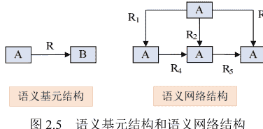

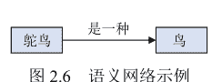

##### 2. 基础语义关系谱系

语义网络不仅能标注属性、状态、行为，更擅长**建模实体间的关系网**。描述实体层级、状态、行为的网络，本质上是实体与其属性/状态/行为的关系映射。抽象看，语义网络 = 事物间关系的图谱。

###### (1) 类属层级关系

语义网络中实体常具类别归属，核心类属关系两大支柱：

*   **实例关系 (ISA)**：体现“具体 ↔ 抽象”。含义“是一个”。表示实体是概念的一个实例。如图 2.7。
*   **分类关系 (AKO / 泛化关系)**：体现“子类 ↔ 超类”。含义“是一种”。表示概念是另一概念的下位分类。如图 2.8。

 和  标记位置保留，对应原文图示引用。

# 第 2 章 知识表示（续）：语义网络深度解析

### 核心语义关系分类

**成员关系**  
标识为 `A-Member-of`，描述“个体归属集体”的隶属逻辑，即“隶属于”。示例参见 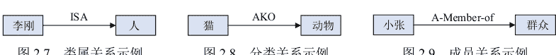。

> **核心机制：属性继承**  
> 具体层节点可自动获取抽象层节点的全量属性。

**属性关系**  
连接事物与其特征的桥梁，高频谓词包括 `Have`（拥有）、`Can`（能力）、`Age`（年龄）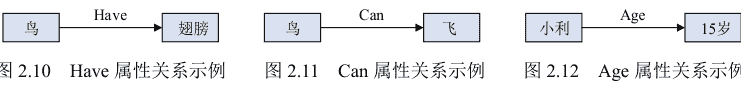。
- **Have**：标注实体具备的静态特征（如“鸵鸟有翅膀”）。
- **Can**：标注实体具备的动态行为能力（如“鸟会飞”）。
- **Age**：标注实体的时间维度属性（如“小利 15 岁”）。

**聚类关系（包含关系）**  
聚焦“部分-整体”结构，核心谓词 `Part-of` 表示“构成一部分”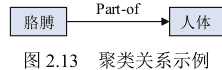。  
**关键区别**：区别于分类/成员关系，**聚类关系通常不具备属性继承性**（大脑不自动拥有人体的所有属性）。

**时间关系**  
刻画事件先后序列，`Before`（先于）、`After`（后于）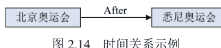。例：“北京奥运会在悉尼奥运会之后”。

**位置关系**  
空间拓扑的五维描述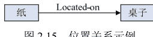：
- `Located-on`（表面/上方）
- `Located-at`（具体位置）
- `Located-under`（下方）
- `Located-inside`（内部）
- `Located-outside`（外部）

**相近关系**  
度量形态或内容的相似度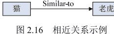：
- `Similar-to`（形似/神似，如“猫似老虎”）
- `Near-to`（空间/数值接近）

**因果关系**  
事件间的推演链条，`IF-THEN` 结构表达“若……则……”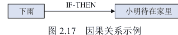。例：“下雨 → 小明留家”。

**组成关系**  
一对多构成逻辑，`Composed-of` 标识“由……构成”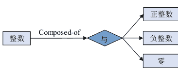。**无属性继承性**（整数由正/负/零构成，但整数属性不直接等同于部分属性之和）。

---

### 语义网络推理双引擎

#### 1. 继承机制：自顶向下的属性流动
下层节点从上层概念汲取属性，符合人类归纳认知规律。

- **值继承（属性直传）**  
  适用于 `ISA`、`AKO` 等强关联。直接传递属性值：`青砖 → 砖 → 长方体`，青砖形状直接得出“长方体”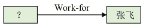。
- **过程继承（方法传递）**  
  仅继承计算规则而非具体数值。空心砖继承“重量=体积×密度”公式，而非直接继承实心砖的重量数值。

#### 2. 匹配机制：模式识别式求解
三步走策略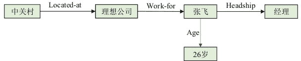：
1. **构造查询片段**：含“询问处”（空节点/弧）的网络模板。
2. **知识库比对**：用片段去匹配完整网络。
3. **提取答案**：匹配成功处的实体即为解（如“张飞工作在→理想公司”）。

> **实战案例：植物分类网络构建 (例 2.15)** 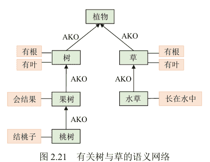  
> **对象层级**：植物 ←(AKO) 树/草；草 ←(AKO) 水草；树 ←(AKO) 果树 ←(AKO) 桃树。  
> **属性挂载与继承剪枝**：  
> - 根/叶属性挂“草”节点，水草自动继承不再重标。  
> - “结果”挂“果树”，“结桃子”挂“桃树”。  
> - 最终生成 6 节点有向无环图。

---

### 语义网络：优势与短板并存

| 核心优势 | 固有局限 |
| :--- | :--- |
| **结构化显性化**：属性与关系显式建模，支持继承/新增/变异 | **语义非严格性**：依赖解释程序，推理正确性无形式保证 |
| **联想式检索**：模拟人类联想记忆，节点间跳转自然 | **表示复杂性**：形式多样导致处理逻辑复杂，难统一 |
| **自索引特性**：邻接弧即索引，规避组合爆炸 | |
| **自然语言亲和力**：图结构直观，易于与 NL 互转 | |

---

### 本章知识地图回顾
- **知识本质**：关联信息形成的结构体，具 9 大特性（真伪性、相对性、不完全性、不确定性、可表示/存储/传递/处理/相容性）。
- **表示方法谱系**：一阶谓词逻辑、产生式、框架、脚本、过程、语义网络。**无银弹**，需按领域特性选型，表示与推理深度耦合。

---

### 思维训练场（习题精选）
1. 定义知识及其属性/分类体系。
2. 区分陈述性与过程性知识表示。
3. 选型知识表示的核心考量因素。
4. 谓词逻辑适用场景与特点辨析。
5. 自然数公理谓词逻辑形式化表达。
6. 6 条自然语言向谓词公式转换实战。
7. 产生式范式及其与蕴涵式异同。
8. **猴子摘香蕉**产生式系统建模。
9. 十进制转二进制产生式系统追踪（141.125 为例）。
10. 亲属关系过程规则编码（姐妹/母亲/姨）。
11. 语义网络定义与特点复述。
12. 三大表示法（语义网/产生式/谓词逻辑）关联分析。
13. 3 句自然语言语义网络化表达。
14. 猎狗/狮子狗/狗/动物四层继承网络构建。
15. 看电影脚本编写。
16. 寝室/办公室框架系统设计。
17. 旅馆房间框架系统（结构+设施，含床垫细节）。

---

# 第 3 章 搜索策略：从盲目试错到启发式决策

## 导论：搜索是 AI 问题求解的内核

早期 AI 即“状态空间寻路”：给定初态与目标，在解空间寻找满足约束的最优路径。

**系统分野**：
- **知识贫乏系统**：依赖搜索技术（本章核心）。
- **知识丰富系统**：依赖推理技术（专家系统等）。
- **渗透性**：搜索技术已渗透 NLP、博弈、机器学习、模式识别等全谱系。

**搜索二要素**：
- **搜什么**（目标状态）
- **在哪搜**（状态空间/问题空间）

**两阶段模型**：
1. 状态空间生成（隐式展开）
2. 空间内目标搜索

**策略分水岭**：
- **盲目搜索（非启发式）**：无领域知识，按固定策略（DFS/BFS）穷举，易组合爆炸，效率低。
- **启发式搜索**：引入经验估价函数（A/A*），导向最优路径，效率高。

**策略评价四维指标**：
1. **完备性**：解存在 → 必能找到。
2. **时间复杂度**：寻解耗时。
3. **空间复杂度**：存储开销。
4. **最优性**：多解时能否保证最优。

**确定性 vs 非确定性**：
- 盲目搜索 = 确定性遍历（节点展开序固定）。
- 启发式搜索 = 非确定性（动态估价决定展开序）。

---

## 3.2 一般图搜索：显式与隐式的工程抉择

### 3.2.1 图搜索基础概念

**存储范式对决**：

| 维度 | **显式图（全量存储）** | **隐式图（按需生成）** |
| :--- | :--- | :--- |
| **内容** | 完整状态空间 + 全知识库 | 初态 + 算子集 + 部分知识 |
| **生成时机** | 离线预计算 | 搜索中动态扩展 |
| **存储压力** | 极大，易溢出 | 极小，仅保留必要路径 |
| **适用场景** | 状态空间极小/固定 | 大规模/无限状态空间（主流选择） |

**核心思想**：从初态出发，应用算子集逐步扩展后继节点，直到命中目标态。隐式图搜索是工程落地的标准形态。

### 3.2.2 图搜索的基本思想

# 掌握 AI 搜索核心：从状态空间到盲目搜索策略

## 3.2.2 状态空间搜索：构建问题的“地图”

利用搜索技术解题的系统，都会先构建一个“状态空间”，再借助特定算法在其中寻觅答案或路径。这一领域的研究重点，在于设计高效算法，以压缩搜索开销、化解组合爆炸难题。

### 1. 状态空间图：问题的抽象骨架

**【案例 3.1】钱币翻转游戏。** 假设有 3 枚硬币，起始面朝为“反、正、反”，目标是全“正”或全“反”。规则：每步必须且只能翻一枚，共翻 3 次。能否达标？

**解析：** 引入三维向量 $Q=(q_1,q_2,q_3)$ 编码状态，$0$ 代表正面，$1$ 代表反面。3 枚硬币共产生 8 种组合（$Q_0$ 至 $Q_7$）。问题转化为在有向图中从初始节点 $Q_5$ 出发，寻找通往 $Q_0$ 或 $Q_7$ 的路径。

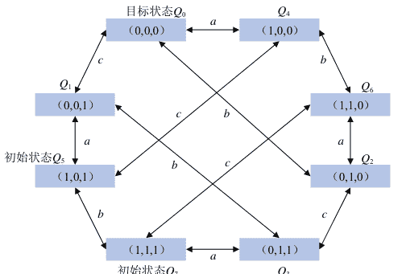

图 3.1 3 枚钱币问题的状态空间

分析可见，$Q_5$ 无法在 3 步内抵达 $Q_0$，无解；但通往 $Q_7$ 的路径有 7 条（如 aab、aba 等）。这揭示了核心：具体问题经抽象，即为在有向图中寻径。AI 将此类图称为**状态空间图**（状态图）。节点代表问题格局（状态），边代表操作、规则或变换。从起点到终点的一条路径，即为一个解。通用状态空间结构如图 3.2 所示。

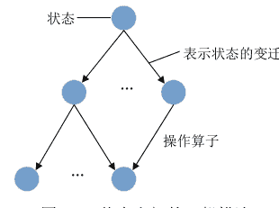

图 3.2 状态空间的一般描述

现实中，无论智力谜题还是工程难题，均可归结为在状态图中寻径。因此，状态图是一类问题的通用抽象模型。

### 2. 问题的状态空间表示法：用“状态”与“操作”建模

此表示法的核心，是用由“状态”和“操作”构成的“状态空间”来描述求解过程。

**① 状态：** 为刻画求解过程中不同时刻状况（初始数据、事实等陈述性知识）的差异，引入的一组最小有序变量集合。常用列向量形式：
$S = [s_0, s_1, \dots, s_i, \dots]^T$  (3.1)
赋予分量具体值 $s_{ki}$，即得具体状态 $S_k$：
$S_k = [s_{k0}, s_{k1}, \dots, s_{ki}, \dots]^T$  (3.2)
状态维数可有限可无限，也可用多维数组等形式表达，主要承载陈述性知识。

**② 操作：** 又称运算符、算符。它改变状态分量值，驱动问题从一个状态跃迁至另一个。操作可以是机械步骤、规则或算子，揭示状态间联系，用于反映过程性知识。

**③ 状态空间：** 由问题所有可能的合法状态集合 $S$ 与操作算子集合 $O$ 组成的有限二元组 $(S, O)$。$S$ 涵盖搜索中所有可达合法状态，$O$ 的执行触发状态迁移。

至此，求解转化为在图中寻找从初始状态 $S_0$ 到目标状态 $S_g$ 的路径，即寻找操作序列 $\alpha$。

**经典实战：传教士与野人过河。** $N$ 位传教士护送 $N$ 位野人渡河，船载 $K$ 人。约束：① 船载不超 $K$；② 任何时刻（两岸、船上）野人数 $\le$ 传教士数；③ 单独野人不可无传教士同行。

简化为 $N=3, K=2$。用 $m, c$ 表示左岸/船上传教士与野人数，$b$ 表示船位（1 在左岸，0 在右）。约束化为 $m+c \le 2, m \ge c$。因左岸状态 $(m,c,b)$ 能唯一确定右岸，故用三元组描述全局。初始 $(3,3,1)$，目标 $(0,0,0)$。理论状态 $4\times4\times2=32$ 个，合法 20 个，剔除不可达后剩 16 个有效节点。

操作分两类：$L(m,c)$（左往右）、$R(m,c)$（右往左）。$m,c$ 组合有 5 种（10, 20, 11, 01, 02），共 10 个算子。对应有向图如图 3.3，操作可逆故双向箭头，弧标注船上人员，节点根据 $b$ 值决定仅可用 $L$ 或 $R$。

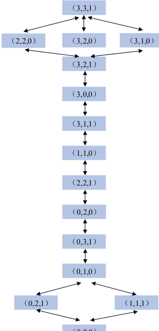

图 3.3 渡河问题状态空间的有向图

**关键结论：**
1.  **建模先行：** 必须先定状态描述格式（覆盖全状态）与操作集（驱动迁移）。
2.  **求解即迁移：** 不断施加操作于状态；若得目标状态，所用操作序列即为一解。
3.  **最优即最短：** 迁移需消耗操作，操作序列最短（代价最小）者为最优解。
4.  **策略抉择：** 一状态可对应多操作、多后继，选哪条路？取决于搜索策略——这正是后续章节的核心。

状态空间表示法是 AI 中最基础的形式化手段，表示得当与否直接决定求解效率。

### 3. 状态空间搜索的基本思想：寻找算子调用链

核心在于：通过搜索引擎，寻得一串操作算子调用序列，推动问题从初始态迁移至目标态。迁移途中经历的状态序列或算子序列，称为解答路径。

通常解径不止一条，但最短径仅一条或极少。渡河问题因可逆操作存在无限解径，但最短仅 4 条（均含 11 步算子）。因一状态常有多算子可选，衍生出多条待搜路径（如图 3.3 起点有 3 个算子）。逻辑上这是“或”关系——任一路径通往目标即成功。故此类有向图称**或图**，常见状态空间多属此类。

除渡河这类简例外，通用或图往往巨大无法绘制，只能视为**隐含图**。搜索时仅显性生成涉及节点与弧，形成**搜索图**。

**另一案例：八数码游戏。** 3x3 棋盘放 1~8 号牌与一空格，通过移动牌位改变布局。给定初始与目标布局（图 3.4），求移动序列。

建模：用 3x3 矩阵表状态，元素 $s_{ij} \in \{0,\dots,8\}$，$0$ 为空格（图 3.5）。算子定义：给空格设左、上、右、下 4 种移动（受限于不出界），仅需 4 个算子。若每步都能选最优算子，搜索树如图 3.6。

图 3.4 八数码游戏实例  图 3.5 八数码问题的矩阵形式

八数码状态总数 $9! = 362,880$，对称去重仍达 18 万级。整体状态空间无法画出，但搜索图极小可视化。结论：**哪怕状态空间巨大（如象棋），只要搜索空间足够小，就能在合理时间内出解。**

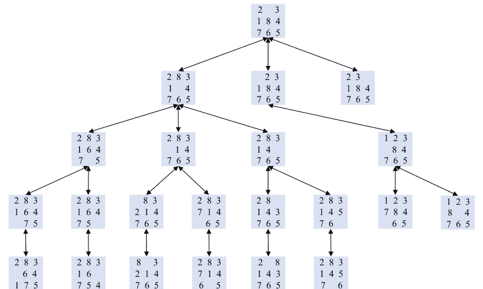

图 3.6 八数码问题的一次搜索图

搜索空间压缩比，取决于算法对 OPEN 表的排序策略。不同策略导致搜索图大小悬殊。应对组合爆炸（因素增多导致状态指数级膨胀，如 4 因素 3 取值为 81 态，10 因素激增至 59049 态）的关键，正是选用优策略，仅搜极小部分状态空间即觅得解。

---

## 3.2.3 通用图搜索流程：OPEN/CLOSE 表的协作

这是 Nils Nilsson 提出的经典框架，表达力强。流程依赖两张表：
- **OPEN 表**：存待扩展节点，排序由策略决定。
- **CLOSE 表**：存已扩展节点，当前节点入表尾。

**符号约定：**
- $S_0$：初始节点。
- $G$：搜索图。
- `Move-First(OPEN)`：取 OPEN 表首节点 $n$ 为当前扩展节点，并将其移入 CLOSE 表。

流程分两阶段：

**1) 初始化：** 建仅含 $S_0$ 的搜索图 $G$。

```
  G:={S_0}
  OPEN:={S_0}
  CLOSE:={}
  ```

**2) 搜索循环：**
① `Move-First(OPEN)`：取首节点 $n$ 扩展，移入 CLOSE。
② 生成 $n$ 所有子节点，插入 $G$ 与 OPEN。
③ 标记与修正指针。
④ 对 OPEN 表重排序。

循环执行，$G$ 随新节点增长，直至命中目标节点。

此过程生成显式图 $G$（搜索图），经回溯指针确定子图 $T$（搜索树），OPEN 表节点即 $T$ 的叶节点。记录子指向父指针，便于命中目标时快速回溯路径（从 $S_0$ 到目标的节点序列）。

**指针修正机制（参考图 3.7）：** 扩展节点 $n$ 产生三类子节点：
- **新节点**（$n_1, n_2$）：直接加入。
- **CLOSE 表旧节点**（$n_3$）：若经新父节点 $n_i$ 回溯代价更低，修正 $n_3$ 指针指向 $n_i$。因 $n_3$ 已展开子节点（如 $n_{32}$ 双亲），需连带修正子节点指针，或将 $n_3$ 放回 OPEN 延迟处理（重新展开时自然修正）。
- **OPEN 表旧节点**（$n_4$）：同理，若新路径更优，修正指针指向 $n_i$。

---

## 3.3 盲目搜索：无向导的蛮力遍历

在通用图搜索中，效率关键在于 OPEN 表排序。理想情况是表首节点必在解径上，零冗余扩展。排序策略由此衍生出多流派。

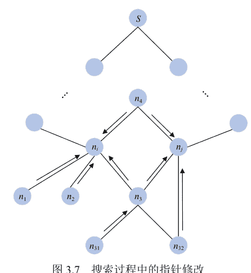

最朴素的策略：按固定或随机顺序排新入 OPEN 节点，典型即**广度优先（BFS）**与**深度优先（DFS）**。这类算法不引入领域知识指导排序，常大量遍历无关节点才撞到解，故统称**盲目搜索**。

### 3.3.1 广度优先搜索（BFS）：层层推进的稳健派

#### 1. 核心思想

从 $S_0$ 出发，逐层向下。第 $n$ 层未扫完不入 $n+1$ 层，同层顺序任意。先生成首层，横向扫描检查是否含 $S_g$；无则逐个展开首层得次层，再逐个检查。遵循“先生成、先检查、先扩展”原则，直至发现 $S_g$。

#### 2. 算法流程

```
算法 3.1 宽度优先搜索算法。

Procedure Breadth-First Search
Begin
    把初始节点放入队列；
Repeat
    取得队列最前面的元素 current；
    If current=goal
        成功返回并结束；
    Else do
        Begin
        若 current 有子节点，则将 current 的子节点以任意次序添加到队列的尾部；
        End
    Until 队列为空
End
```

#### 案例 3.2：积木堆叠问题

**目标：** 从初始态达成 A 压 B、B 压 C 的三层塔（图 3.8）。

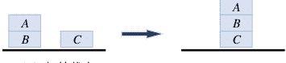

图 3.8 积木问题

**唯一算子：** `Move(X, Y)` 将积木 X 置于 Y（积木或桌面）顶。先决条件：
1. X 顶部空闲。
2. Y 若为积木，其顶部也须空闲。
3. 同一状态下，算子至多应用一次。

按 BFS 策略生成的搜索树如图 3.9 所示。

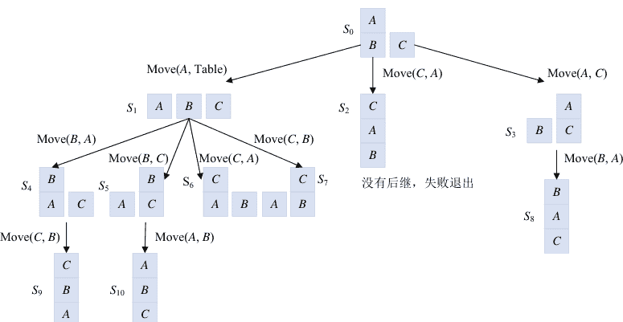

**图 3.9 积木问题的 BFS 搜索树示意**

##### 3. 广度优先搜索的时间开销分析

为便于量化分析，我们设定一棵标准树：每个节点的分支因子固定为 $b$，树的最大深度为 $d$。分支因子直观地表示了一个节点能衍生出多少子节点。根节点位于第 0 层，第 1 层会产生 $b$ 个节点，第 2 层则增长为 $b^2$ 个，以此类推。若目标节点不在第 $d-1$ 层及以上，那么失败搜索所需遍历的最少节点总数为：

$$1 + b + b^2 + \cdots + b^{d-1} = (b^d - 1) / (b - 1) \quad (b \gg 1)$$

而在成功找到目标前，可能需要扩展的节点数量上限为：

$$1 + b + b^2 + \cdots + b^{d-1} + b^d = (b^{d+1} - 1) / (b - 1)$$

考虑到第 $d$ 层目标节点的位置不确定性（可能是首个，也可能是末尾），平均需访问的第 $d$ 层节点数约为 $(1+b^d)/2$。由此推导，平均总搜索节点数为：

$$(b^d - 1) / (b - 1) + (1 + b^d) / 2 \approx b^d (b + 1) / [2(b - 1)]$$

可见，BFS 的时间复杂度呈指数级增长，即 $O(b^d)$，耗时与待搜索节点总量成正比。

##### 4. 广度优先搜索的空间开销分析

BFS 的空间复杂度与时间复杂度同属“指数级噩梦”，核心原因在于**所有叶子节点必须同时驻留内存**（通常借助队列实现）。初始时队列仅有根节点；根节点扩展后队列长度变为 $b$；当第 1 层最左节点展开后，队列增至 $2b-1$。队列长度在处理第 $d$ 层最左节点时达到峰值，约为 $b^d$。因此，最坏情况下空间复杂度为 $O(b^d)$。

表 3.1 直观展示了 $b=10$、处理速度 1000 节点/秒、单节点 100 字节时的资源消耗：

| 深度 | 节点总量 | 耗时 | 内存占用 | 深度 | 节点总量 | 耗时 | 内存占用 |
| :--- | :--- | :--- | :--- | :--- | :--- | :--- | :--- |
| 0 | 1 | 1µs | 100B | 8 | $10^8$ | 31h | 11GB |
| 2 | 111 | 1s | 11KB | 10 | $10^{10}$ | 128天 | 1TB |
| 4 | 11111 | 11s | 1MB | 12 | $10^{12}$ | 35年 | 111TB |
| 6 | $10^6$ | 18分 | 111MB | 14 | $10^{14}$ | 3500年 | 11111TB |

##### 5. 广度优先搜索的优劣势权衡

BFS 属于典型的**盲目搜索**，时空复杂度双高。若目标节点距根节点较远，会生成海量无效节点，效率低下。表 3.1 表明，时间成本虽大，但**空间瓶颈才是更致命的短板**——内存往往比 CPU 时间更早耗尽。

当然，BFS 也有不可替代的优点：它严格按层级推进（第 $n$ 层全展开完才进 $n+1$ 层），因此**只要解存在，必能找到最浅层（最短路径）的解**。但现实中，状态空间分支因子往往很大，组合爆炸导致资源耗尽，实际落地价值大打折扣。

#### 3.3.2 深度优先搜索

##### 1. 核心思想：一条道走到黑

DFS 采用**自顶向下、纵向优先**的策略。从初始节点 $S_0$ 出发，生成子节点并检测是否为目标 $S_g$；若否，遵循“后生成优先扩展”原则（LIFO，栈结构），沿着最新分支不断深入。这就像走迷宫时不撞南墙不回头，一直钻到最深处。

由于问题求解空间常含无限分支，DFS 一旦误入歧途（无限深分支），便再也回不来，**属于不完备算法**。且它找到的解不保证是最优解（路径最短），这与 BFS 形成鲜明对比。

##### 2. 基于栈的 DFS 算法实现

DFS 仅对有限状态空间具备严格算法性，通用场景下更多是一个需改进的框架流程。以下是栈实现版本：

```
算法 3.2 深度优先搜索算法
Procedure Depth-First Search
Begin
    把初始节点压入栈，并设置栈顶指针；
    While 栈不空 do
    Begin
        弹出栈顶元素；
        If 栈顶元素=goal, 成功返回并结束;
        Else 以任意次序把栈顶元素的子节点压入栈中;
End While
End
```

##### 例 3.3 八数码问题实战

初始态（图 3.10a）到目标态（图 3.10b）的求解过程，设定深度上限 5。按 DFS 逻辑生成搜索树（图 3.11），节点按展开顺序编号。搜索至 18 号节点的子节点时触达目标。过程呈现“深入 -> 碰壁/达上限 -> 回溯一步 -> 再深入”的波浪式推进，直到找到解或 OPEN 表清空。

| 2 | 8 | 3 | | 1 | 2 | 3 |
|---|---|---|---|---|---|---|
| 1 | 6 | 4 | | 8 | | |
| 7 | 5 | | | 7 | 6 | 5 |
| | | | | 4 | | |

(a) 初始状态 | (b) 目标状态
**图 3.10 八数码问题**

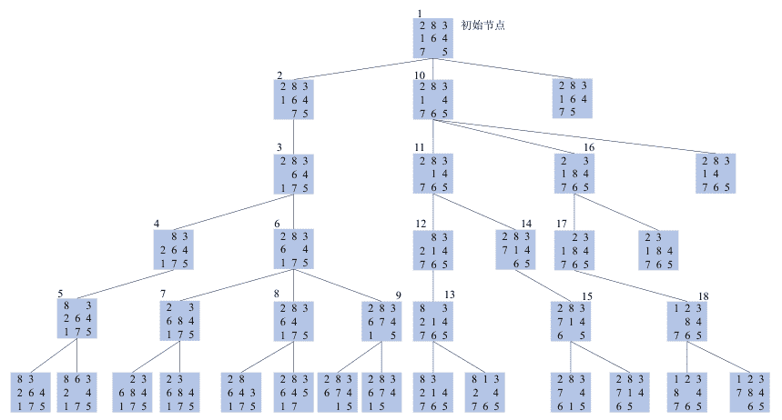

**图 3.11 DFS 解决八数码问题的搜索树**

##### 3. 时间复杂度：同样是指数级，但常数不同

- **最好情况**：目标在第 $d$ 层最左侧，仅检查 $d+1$ 个节点。
- **最坏情况**：目标在第 $d$ 层最右侧，需遍历全树，节点数为：

$$1 + b + b^2 + \cdots + b^d = (b^{d+1} - 1) / (b - 1) \quad (3.6)$$

- **平均情况**：检查节点数约为：

$$(b^{d+1} - 1) / [2(b - 1)] + (1 + d) / 2 \approx b(b^d + d) / [2(b - 1)] \quad (3.7)$$

结论：DFS 平均时间复杂度同样为 $O(b^d)$，虽同阶但实际运行常数因子常小于 BFS。

##### 4. 空间复杂度：线性级，这是杀手锏

DFS 仅需维护**从根到当前叶节点的单条路径**，以及路径上节点未展开的兄弟节点。内存需求随深度线性增长。最大深度 $d$ 时，每层保留 $b-1$ 个未展开兄弟节点，加上当前节点，总内存为 $d(b-1)+1$。空间复杂度为 **$O(bd)$**，远优于 BFS 的指数级空间。

##### 5. 优缺点：空间换取了不确定性

- **优点**：空间极其高效，线性内存即可支撑极深搜索。
- **缺点**：**极易“钻牛角尖”**。若早期选错分支（进入极深或无限分支），算法将长期游离在错误路径上，要么陷入死循环，要么找到极长的非最优解。**既不完备，也非最优。**

#### 3.3.3 深度受限搜索 与 迭代加深搜索

##### 1. 深度受限搜索 (DLS)：给 DFS 套上缰绳

针对 DFS 可能无限深入的问题，引入**深度上限 $d_m$**。算法流程同 DFS，但第 5 步新增判断：若节点不可扩展 **或** 深度 $d(n) = d_m$，则强制回溯。

**关键权衡点**：
1.  **$d_m$ 选取至关重要**：若解深度 $\le d_m$，算法**完备**（但不保证最优）；若解深度 $> d_m$，算法**不完备**（直接找不到解）。
2.  **$d_m$ 不宜过大**：过大退化为标准 DFS，产生海量无用节点，时空复杂度分别为 $O(b^{d_m})$ 和 $O(bd_m)$。
3.  **核心痛点**：求解前往往不知 $d_m$ 该设多大（即状态空间直径未知）。

**破局思路**：从小 $d_m$ 开始试，找不到解则逐步增大 $d_m$ 重试。这便是**迭代加深搜索 (IDS)** 的雏形。

##### 2. 迭代加深搜索 (IDS) ：以时间换空间，兼得完备与最优

IDS 策略：深度限制从 0 开始，依次尝试 1, 2, ... $d$... 直到觅得目标。

**看似浪费实则高效**：
- 深度 $h$ 时 DFS 生成节点数：

$$(b^{h+1}-1)/(b-1) \quad (3.8)$$

- 失败迭代累计节点数：

$$[1 / (b-1)]\sum_{h=0}^{d-1}(b^{h+1}-1) \approx b(b^d - d) / (b-1)^2 \quad (3.9)$$

- 最后一次成功搜索（深度 $d$）平均耗时同 DLS。总平均时间复杂度：

$$b(b^d - d) / (b-1)^2 + b(b^d - d) / 2(b-1) \approx (b+1)b^{d+1} / [2(b-1)^2] \quad (3.10)$$

- IDS 与 DFS 时间复杂度比率：

$$\{(b+1)b^{d+1} / [2(b-1)^2]\} : \{b(b^d + d) / [2(b-1)]\} \quad (3.11)$$

- 大 $d$ 时简化为：

$$\{(b+1)b^{d+1} / [2(b-1)^2]\} : \{(b^{d+1}) / [2(b-1)]\} = (b+1) : (b-1) \quad (3.12)$$

- 比率近似为：

$$\{(b+1)b^{d+1} / [2(b-1)^2]\} : \{b(d+1) / [2(b-1)]\} = b : (b-1) \quad (3.13)$$

**实测数据**：$b=10$ 时，IDS 仅比 DFS 多 ~20% 节点，比 BFS 多 ~11% 节点。**分支因子 $b$ 越大，重复展开的额外开销比例越小**。

**总结**：IDS 时间复杂度 $O(b^d)$，空间复杂度 $O(bd)$。**完美融合了 BFS 的完备性/最优性 与 DFS 的线性空间优势。**

##### 算法 3.3 迭代加深搜索伪代码

```
Procedure Iterative Deepening Search
Begin
    设置当前深度限制=1；
    把初始节点压入栈，并设置枝项指针；
    While 栈不空并且深度在给定的深度限制之内 do
        Begin
```

#### 3.3.4 四大搜索策略横向对决

| 评价维度 | 广度优先 (BFS) | 深度优先 (DFS) | 深度受限 (DLS) | 迭代加深 (IDS) |
| :--- | :--- | :--- | :--- | :--- |
| **时间** | $b^d$ | $b^d$ | $b^m$ | $b^d$ |
| **空间** | $b^d$ (指数) | $bd$ (线性) | $bd_m$ (线性) | $bd$ (线性) |
| **最优性** | **是** | 否 | 否 | **是** |
| **完备性** | **是** | 否 | $l > d$ 时是 | **是** |

*注：$b$=分支因子，$d$=解深度，$m$=树最大深度，$l$=深度限制。*

**结论**：**IDS 是无信息搜索中的“王者”**——当搜索空间巨大、解深度未知时，它是首选通用策略。

---

### 3.4 启发式搜索：给盲目搜索装上“导航仪”

前文所有算法均为**盲目搜索**——按固定规则（队列/栈）死板展开，不利用问题特征，导致无效节点泛滥、搜索空间膨胀、效率低下。

**启发式搜索**的核心思想：**利用问题自带的特征信息（启发式信息）指导搜索方向，大幅剪枝，聚焦高潜力区域。**

主要应用两类场景：
- **正向推理**：状态空间搜索，从初始态 $\to$ 目标态（如 A* 算法）。
- **反向推理**：问题规约，从目标态 $\to$ 初始态（如 AO* 算法）。

#### 3.4.1 启发式信息 与 评估函数

“启发式”源于“大拇指法则”：**大概率管用，但不绝对保证成功。**

与问题特征相关的控制信息（解的分布规律、结构特征等）即为**启发式信息**，通过**评估函数 $f(x)$** 量化体现。评估函数的作用是**给待扩展节点打分，估算其“含金量”**。

标准定义：$f(x)$ 为从初始节点 $S_0$ 出发，**强制经过节点 $x$** 到达目标 $S_g$ 的所有路径中，**最小代价的估计值**。

$$f(x) = g(x) + h(x)$$ （3.14）

拆解两项核心组件：
- **$g(x)$**：**已付代价**。从 $S_0$ 走到 $x$ 的**实际累计耗散**（如步数、距离、金钱），已知确定。
- **$h(x)$**：**预估代价**。从 $x$ 到 $S_g$ 的**最优路径估值**，**纯预测**，蕴含问题领域知识，形式因问题而异，称作**启发式函数**。

启发式方法的本质：将“状态描述”转化为“离目标有多近”的**标量评分**。

#### 3.4.2 A 算法：最佳优先搜索的经典实现

若图搜索中，OPEN 表排序依据为 $f(x) = g(x) + h(x)$，则称该过程为 **A 算法**。它体现了**Best-First（最佳优先）** 策略：$f(x)$ 值最小的节点排队首，优先展开。

流程分两阶段，同通用图搜索：

**1) 初始化**：构建仅含初始节点 $S_0$ 的搜索图 $G$。

```
G:={ $S_0$ }  
OPEN:= $\{ S_0$ }  
CLOSE:= $\{ \}$
```

**2) 搜索主循环**：
1.  **Move-First(OPEN)**：取出队首节点 $n$。
2.  **扩展**：生成 $n$ 的子节点，加入图 $G$ 与 OPEN 表。
3.  **回溯指针维护**：子节点指向父节点 $n$。
4.  **重排 OPEN 表**：按 $f(n)$ 值升序排列。

### 启发式搜索核心机制与 A* 算法深度解析

通过反复迭代算法流程，搜索图会随着新节点的持续加入而逐步扩张，直至成功定位到目标节点。这一过程与通用图搜索类似，其节点标记与指针更新的具体操作规范如下：

- **步骤 1：节点扩展与录入**  
  生成当前节点 $n$ 的所有子节点 $n_i$，并将它们同步插入搜索图 $G$ 与 OPEN 表。针对每个子节点 $n_i$，需完成数值计算。

```
$f(n,n_i) = g(n,n_i) + h(n_i)$ （3.15）
```

- **步骤 2：指针标记与回溯链路构建**  
  对子节点指向父节点的指针进行恰当标记与修正，分三种情况处理：
  - **全新节点**：直接赋值 $f(n_i) = f(n, n_i)$。
  - **存在于 OPEN 表**：需对比路径代价决定是否更新指针。
  - **存在于 CLOSE 表**：同样需依据代价判断是否重新引入 OPEN 表。

```
IF $f(n_i) > f(n, n_i)$ THEN  
    令 $f(n_i) = f(n, n_i)$  
    修改指针指向新父节点 $n$。
```

- **步骤 3：OPEN 表排序**  
  依据评价函数 $f(n)$ 从小到大对 OPEN 表进行排序，确保优先扩展最优候选节点。

##### 算法 3.4 A 算法流程

```
Procedure Heuristic Search A  
Begin  
建立一个只有初始节点 $S_0$ 的搜索图 $G$，把 $S_0$ 放入 OPEN 表，计算 $f(S_0)=g(S_0)+h(S_0)$;
假定初始时 CLOSE 表为空；
While OPEN 表不空 do
Begin
从 OPEN 表中取出 f 值最小的节点（第一个节点），放入 CLOSE 表中，假设该节点的编号为 n；
If n 是目标，则停止，返回 n，根据 n 的反向指针指出从初始节点到 n 的路径；
Else do
Begin
扩展节点 n；
If 节点 n 有后继节点：
Begin
① 生成 n 的子节点集合 {n_i}，把 n_i 作为 n 的后继节点加入 G 中，并计算 f(n_i)。
② If n_i 未曾在 G 中出现过（未曾在 OPEN 表和 CLOSE 表中出现过） then 将它们配上第①步计算出的 f 值，设置返回到 n 的指针，并把它们放入 OPEN 表中。
③ If n_i 已经在 OPEN 表中 then 该节点一定有多个父节点，在这种情况下，计算当前的路径 g 值，并和原有路径的 g 值相比较。若前者大于后者，则不做任何更改；若前者小于后者，则将 OPEN 表中的该节点的 f 值更改为第①步计算出的 f 值，返回指针更改为 n。
④ If n_i 已经存在于 CLOSE 表中 then 该节点同样也有多个父节点。在这种情况下，同样计算当前路径的 g 值和原来路径的 g 值。如果当前的 g 值小于原来的 g 值，则将表中该节点的 g、f 值及返回指针进行类似第③步的修改，并考虑修改表中通过该节点的后继节点的 g、f 值及其返回指针。
⑤ 按 f 值从小到大的次序，对 OPEN 表中的节点进行重新排序。
End If
End Else
End While
End
```

---

#### 实战演示：八数码游戏中的 A 算法应用

以经典的八数码问题为例，直观展示 A 算法的运作机制。该问题的评估函数定义为：

$$f(x) = d(x) + w(x) \tag{3.16}$$

其中，$d(x)$ 对应 $g(x)$，表示当前节点在搜索图中的深度（即已走步数）；$w(x)$ 对应启发式函数 $h(x)$，定义为当前状态与目标状态相比，**错位数码的个数**。直观上，$w(x)$ 越大，偏离目标越远。

以图 3.12 所示初始状态为例，起始节点 $f(x) = 0 + 4 = 4$。应用 A 算法求解路径极为高效，除极少数步骤（如节点 d 的误选）外，其余决策均精准有效。

| 初始状态 | 目标状态 |
| :--- | :--- |
| 1 \|\| 3 | 1 \| 2 \| 3 |
| 7 \| 2 \| 4 | 8 \|\| 4 |
| 6 \| 8 \| 5 | 7 \| 6 \| 5 |

**图 3.12 待解八数码问题示例**

每轮搜索迭代结束时，OPEN 表与 CLOSE 表的节点变迁记录于表 3.3。

**表 3.3 搜索迭代过程中的 OPEN/CLOSE 表节点变化**

| 迭代轮次 | OPEN 表节点序列 | CLOSE 表节点序列 | 迭代轮次 | OPEN 表节点序列 | CLOSE 表节点序列 |
| :--- | :--- | :--- | :--- | :--- | :--- |
| 初始化 | (s) | ( ) | 4 | (l a c i k j m) | (s b d e) |
| 1 | (b c a) | (s) | 5 | (n a c i k j m) | (s b d e l) |
| 2 | (d e a c i) | (s b) | 6 | (g a c i k j m o) | (s b d e l n) |
| 3 | (e a c i k j) | (s b d) | 7 | **成功终止** | |

图 3.13 绘制了完整搜索图，节点以字母标识，括号内标注 $f$ 值，方框标出本轮扩展节点，最终目标节点为 g。

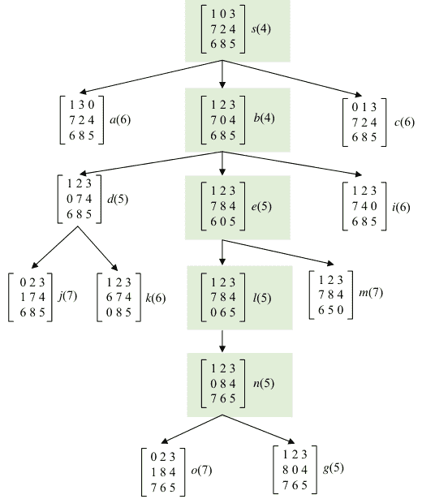

---

### 3.4.3 启发式搜索成败的关键要素

启发式搜索在破解组合爆炸、提升效率方面功不可没，长期以来是 AI 领域的核心研究热点。实现高效启发式搜索，必须把控以下三大核心因素。

#### 1. 算法的“可采纳性” —— 找得着最优解吗？

若搜索图中存在从初始态到目标态的路径，某算法**总能**找到代价最小（最短）的那条，则称其具备**可采纳性**。例如宽度优先搜索虽可采纳，但效率低下，难堪大用。

#### 2. 启发式函数 $h(x)$ 的“强弱”博弈

引入理想评价函数 $f^*(x) = g^*(x) + h^*(x)$ 作为基准（式 3.17）：
- $g^*(x)$：最优路径上从起点到 $x$ 的实际代价。
- $h^*(x)$：最优路径上从 $x$ 到终点的实际代价（多目标时取最小）。

**$h(x)$ 与 $h^*(x)$ 的偏离程度，决定了搜索性能：**
- **$h(x)$ 过弱 ($h(x) \ll h^*(x)$)**：估计值偏低，OPEN 表排序误差大，导致搜索图膨胀，大量无效节点被扩展。
- **$h(x)$ 过强 ($h(x) > h^*(x)$)**：高估代价，算法**丧失可采纳性**，可能错过最优解。
- **理想状态 ($h(x) \equiv h^*(x)$)**：排序完美，搜索图最小且必得最优解。但复杂问题下不可行。

**工程权衡：** 放弃“恒等”约束，设计**既接近 $h^*(x)$ 又恒不大于 $h^*(x)$** 的 $h(x)$，是应用 A* 算法的关键。  
**数学保证：** 若对同一问题，$h_1(x) \le h_2(x) \le h^*(x)$，则算法 A1 展开的节点数 $\ge$ 算法 A2。  
**八数码佐证：** $w(x) \le p(x) \le h^*(x)$，故用 $p(x)$（各错位棋子至目标位的曼哈顿距离之和）展开节点数必不多于用 $w(x)$（单纯错位数）。宽度优先相当于 $h(x)=0$，搜索树规模将呈指数级暴涨。

#### 3. 启发式函数设计的“实用主义”考量

问题越复杂，设计 $h(x) \le h^*(x)$ 越难，计算开销也越大。**若计算 $h(x)$ 本身太耗时，总搜索代价反而上升。**

- **放松约束 ($h(x) > h^*(x)$)**：设计变易，计算变轻，但牺牲可采纳性（可能得非最优解）。工程上常接受此妥协。
- **评价函数结构洞察 ($f = g + h$)**：
  - $h=0$：退化为宽度优先（靠 $g$ 排序）。
  - $g=0$：退化为深度优先（靠 $h$ 排序）。
- **加权策略 $f = g + w \cdot h$**：动态调节 $w$。
  - **搜索浅层**：$w$ 取大值，强化启发式引导，快速纵向深入。
  - **搜索深层**：$w$ 取小值，强化 $g$ 约束，横向寻优，且保证 $w h(x) \le h^*(x)$。

---

### 3.4.4 A* 算法：理论基石与性质证明

#### 1. 概念确立与标准流程

A 算法中，$f, g, h$ 分别是理想值 $f^*, g^*, h^*$ 的近似。理想情况下 $g=g^*, h=h^*$ 可零误差直达目标，但 $g^*, h^*$ 在找到解前未知，难以企及。通常 $g(x)$ 易从搜索树计算（如深度 $d(x)$，且 $g \ge g^*$），而 $h(x)$ 依赖启发式知识挖掘，**这是评价函数设计的命门**。

回顾图 3.13，$w(x)$ 精度不足导致节点 d 被误扩展。若改用 $p(x)$（曼哈顿距离和），初始 $f(s)=5$。第二轮迭代 OPEN 表排序变为 `e(5) a(7) c(7) d(7) i(7)`，原本同分的 d(5) 与 e(5) 被拉开差距，**e 正确上位**，搜索一气呵成（见下图）。

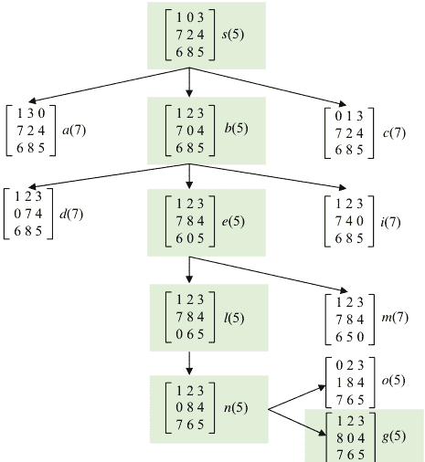

**图 3.14 采用 $p(x)$ 启发式函数的八数码搜索图**

**核心定理：** 若搜索图中对所有节点 $x$ 恒有 $h(x) \le h^*(x)$，则 A 算法具备可采纳性。  
**定义：** 满足上述条件的 A 算法，称为 **A* 算法**。

**A* 算法标准化流程：**

1.  **初始化**：起始节点 $S$ 入 OPEN 表，$f=h$；CLOSE 表置空。
2.  **失败判定**：OPEN 表空则宣告失败退出。
3.  **选优扩展**：从 OPEN 表取未扩展过的**最小 $f$ 值**节点为 BestNode，移入 CLOSE 表。
4.  **成功判定**：BestNode 若为目标节点，回溯指针得解，退出。
5.  **展开后继**：非目标节点则生成所有后继节点 Successor。
6.  **后继节点逐个处理**：
    - 建立 Successor $\to$ BestNode 回溯指针。
    - 计算 $g(Successor) = g(BestNode) + g(BestNode, Successor)$。
    - **若 Successor $\in$ OPEN**：视为 OldNode，加入 BestNode 后继表。
      - 若新路径 $g$ 更小：更新父节点为 BestNode，刷新 $g$ 与 $f$。
      - 若代价不降：停止该分支扩展。
    - **若 Successor $\notin$ OPEN**：检查 CLOSE 表。
      - 若 $\in$ CLOSE：回到“已在 OPEN”分支逻辑（③）。
      - 若全不在：入 OPEN 表，加入后继表，回到“已在 CLOSE”分支逻辑（⑦）。
7.  **重新排序**：计算所有受影响节点 $f$ 值，回步骤 2 循环。

#### 2. A* 算法的核心数学性质

**符号约定：**
- $C(n_i, n_j)$：节点间直接转移代价。
- $K(n_i, n_j)$：节点间最小代价路径值。
- $G$ / $\mathcal{G}$：单目标 / 目标集合。
- $g^*(n)=K(s,n)$：起点到 $n$ 的最优代价。
- $h^*(n)=\min_{g \in \mathcal{G}} K(n,g)$：$n$ 到目标集的最优代价。
- $C^* = h^*(s)$：全局最优解代价。

---

**性质 3.1：最优路径上任意节点 $n^*$ 满足 $f^*(n^*) = C^*$。**  
*证明：* $f^*(n^*) = g^*(n^*) + h^*(n^*) = K(s,n^*) + \min K(n^*,g) = \min K(s,g) = C^*$。  
**推论：** 起点 $f^*(s)=C^*$，终点 $f^*(g)=C^*$。

**性质 3.2：不在任何最优路径上的节点 $n$，必有 $f^*(n) > C^*$。**  
*证明：* 直接由性质 3.1 反证得出。

**定义 3.1（可采纳启发式函数）：** $h(n) \le h^*(n)$。

**性质 3.3：A* 终止前，最优路径集 $P'_{s \sim G}$ 上必存在 OPEN 节点 $n'$，使 $f^*(n') \le C^*$。**  
*证明：* 取一条最优路径 $P_{s \sim g}$。设 $n'$ 为该路径上深度最浅的 OPEN 节点（终点 $g$ 未入 CLOSE，故 $n'$ 存在）。$n'$ 所有祖先已入 CLOSE，故指针链完好，$g(n')=g^*(n')$。  
$f(n') = g^*(n') + h(n') \le g^*(n') + h^*(n') = f^*(n') = C^*$。

**性质 3.4：A* 算法可采纳（必得最优解）。**  
*反证：* 假设算法止于非最优目标 $t$，$g(t)=f(t) > C^*$。因 $t$ 被选中扩展，对所有 OPEN 节点 $n$ 有 $f(t) \le f(n)$，推知所有 OPEN 节点 $f(n) > C^*$。这与性质 3.3 矛盾。故终止节点必满足 $g(t)=C^*$。

**定义 3.2（单调/一致性启发式函数）：** 对所有后继 $n'$，满足 $h(n) \le C(n,n') + h(n')$。

**性质 3.5：一致性 $\Rightarrow$ 可采纳性。**  
*证明：* $h(n) \le K(n,n') + h(n')$。令 $n'$ 为目标 $g$，得 $h(n) \le K(n,g) + h(g) \Rightarrow h(n) \le h^*(n)$。

**八数码验证：** 最少移动步数 $\ge$ 错位数 $w(x)$；也 $\ge$ 无阻挡移动步数和 $p(x)$。故 $w(x), p(x)$ 满足 $h \le h^*$，A 算法均可采纳。

# 3.4.5 迭代加深 A* 算法（IDA*）：以时间换空间的智慧

###### 性质 3.6
若启发函数 $h(n)$ 符合单调限制，A* 算法展开节点的 $f$ 值序列将呈现非递减趋势，即 $f(n_i) \leqslant f(n_j)$。

###### 性质 3.7
假设存在两个 A* 算法实例 $A_1^*$ 与 $A_2^*$：
```
\( A_1^*: f_1(n) = g_1(n) + h_1(n) \)
\( A_2^*: f_2(n) = g_2(n) + h_2(n) \)
```
若 $A_2^*$ 拥有更丰富的启发式信息（即对所有非目标节点均有 $h_2(n) > h_1(n)$），则 $A_2^*$ 展开的节点集必定是 $A_1^*$ 展开节点集的子集。证略。

---

启发式函数 $h(n)$ 是决定 A* 搜索效能的核心变量。在保证 $h(n) \leqslant h^*(n)$（即不高估真实代价）的前提下，$h(n)$ 的数值越接近真实值越好。数值越大，意味着蕴含的启发信息越充分，算法需展开的节点规模越小，搜索效率随之显著提升——这一特性被称为**“信息性”**。

然而，标准 A* 算法有一个致命短板：它必须将所有生成节点驻留内存（OPEN 表与 CLOSED 表），导致空间复杂度呈指数级增长。往往在 CPU 耗尽之前，内存就已告罄。为破解空间瓶颈，学界衍生出诸如 **IDA***（迭代加深 A*）、**SMA***（简化内存受限 A*）等变体，虽在最优性或完备性上常有妥协，但极大拓展了适用边界。

**IDA* 的核心思想是“融合”：** 它保留了 A* 的估价函数 $f(n)=g(n)+h(n)$，却放弃了基于 $f$ 值排序的“最佳优先”策略，转而采用**迭代加深**的深度优先框架。这里的“深度限制”不再是层数，而是 $f$ 值的上界阈值。

##### 算法 3.5 | IDA* 算法流程
```
Procedure IDA*
Begin
    初始化当前的深度限制 c = 1;
    把初始节点压入栈;
    While 栈不空 do
    Begin
        弹出栈顶元素 n;
        If n = goal Then 结束，返回 n 和从初始节点到 n 的路径;
        Else do
        Begin
            For n 的每个子节点 n';
            If f(n') <= c Then 把 n' 压入栈;
            Else c' = min[c', f(n')];
        End for
        End
    End While
    If 栈为空且 c' = ∞ Then 停止并退出;
    If 栈为空且 c' ≠ ∞ Then c = c', 返回 2;
    End
```

算法维护两个关键阈值：当前迭代的限制值 $c$ 与下一轮迭代的最小超限值 $c'$。
*   **扩展规则：** 若栈顶节点 $n$ 的所有子节点 $n'$ 均满足 $f(n') \le c$，则按深度优先顺序压栈展开；
*   **剪枝与记录：** 若存在子节点 $f(n') > c$，则放弃该分支，并用 $c' = \min(c', f(n'))$ 更新下一轮阈值。
*   **终止条件：** 找到目标（成功）；或栈空且 $c' = \infty$（失败，无解）。

**对比 A* 的优势显而易见：**
A* 需指数级存储空间；IDA* 仅在 $f$ 值未超阈值时才向下深入，内存消耗仅随搜索深度线性增长，实现了**空间复杂度的质变**。代价是可能重复展开节点（时间开销增大），但在内存受限场景下，这是极具性价比的交易。特别地，若启发函数是最优的（$h=h^*$），IDA* 与 A* 展开节点完全一致，皆能寻得最优路径。

---

# 3.5 局部搜索双雄：爬山法与回溯策略

若舍弃路径代价 $g(x)$，仅凭评价函数 $f(x)=h(x)$ 对新生子节点做**局部排序**，即可得到两类极简且实用的启发式搜索策略。它们虽不保证全局最优，却因实现简单、开销极低，广泛服务于“求得可行解即可”或“可逐步逼近最优”的场景。

#### 3.5.1 爬山法：贪婪的独行者

爬山法是启发式搜索的“极简版”。登山者只认准“脚下最陡的路”往上走，不设回头路，不记历史路径，自然也就不需要 OPEN/CLOSE 表。

**运作机制：**
当前节点展开子节点 $\rightarrow$ 选取 $h(x)$ 最小（最接近目标）者作为新当前节点 $\rightarrow$ 其余子节点**直接丢弃** $\rightarrow$ 循环直至无更优子节点或达目标。

##### 算法 3.6 爬山法
```
**Procedure Hill-Climbing**
**Begin**
确定可能的开始状态并测量它们和目标节点的距离(f);
以 f 升序排列，把这些节点压入栈中;
**Repeat**
弹出栈顶元素;
**If** 栈顶元素=goal, 返回并结束;
**Else** 把该元素的子节点以 f 升序排列压入栈中;
Until 栈为空;
End
```

**三大“拦路虎”让爬山法屡屡折戟：**

1.  **局部极值（山脚下的小土堆）：** 算法视野局限于邻域，一旦登顶局部峰值，四周皆下坡，算法误判为全局最优而停摆。随机重启虽能缓解，但若问题为 NP 完全类（指数级局部极值），指数时间难逃。
2.  **平顶（迷雾中的高原）：** 邻域 $h$ 值近似相等，失去梯度指引，搜索退化为随机游走，效率骤降。
3.  **山脊（刀刃上的颤抖）：** 两侧陡峭、顶部平缓的特殊地形。若无操作符能精准沿脊线前进，搜索将在两侧壁来回震荡，步长极小，难以收敛。

**对策：** 随机重启爬山法。若地形极值较少，往往几步即得良解；若地形极其崎岖，则需接受“指数时间换合理解”的现实。

#### 3.5.2 回溯策略：带记忆的探险家

回溯策略可视为爬山法的“加强版”：**它记得走过的岔路口。**

每次展开子节点后，按 $h(x)$ 升序排列保存。沿最优分支深入；一旦撞墙（失败状态或死胡同），即**回溯**至最近的有备选分支的节点，尝试次优路径。这保证了在有限状态空间内的完备性——最终必能觅得最高峰（若存在）。

**递归实现 `BackTrack(x)` 精妙之处：**
```
**Procedure Hill-Climbing**
**Begin**
确定可能的开始状态并测量它们和目标节点的距离(f);
以 f 升序排列，把这些节点压入栈中;
**Repeat**
弹出栈顶元素;
**If** 栈顶元素=goal, 返回并结束;
**Else** 把该元素的子节点以 f 升序排列压入栈中;
Until 栈为空;
End
``` *(注：素材中此处为算法伪代码步骤，PRE2标记已在上文爬山法处使用，此处素材原文为文字描述算法步骤，无新PRE标记，故不再添加，保持文案连贯)*
*   **参数：** 当前节点 $x$；局部变量 `PATH`（解路径）、`SXL`（有序子节点表）、`x'`（下一节点）。
*   **核心逻辑：** 深度优先 + 失败即回溯（步骤 7 返回步骤 4） + **路径逆向构建**（从目标回溯至初始，逐层在表首插入节点）。
*   **失败状态定义：** 非法状态、重复状态（防死循环）、超深度限制、无子节点可展开（死胡同）。

**效率命门：** 回溯次数。启发函数 $h(x)$ 设计得越精准，选路越准，回溯越少，效率呈指数级提升。这再次印证了：**好的启发式函数，是启发式搜索的灵魂。**

---

# 3.6 问题规约：化整为零，合力破局

面对复杂问题，不妨尝试**“分而治之”**：将大问题拆解为若干**必须同时解决**的子问题，子问题可再递归分解，直至变为可直接求解的**本原问题**（公理、已知事实、黑箱操作）。最终，原问题的解由所有子问题的解**联合**构成。

形式化描述为三元组 $SP = (S_0, O, P)$：
*   $S_0$：初始问题；
*   $P$：本原问题集；
*   $O$：操作算子集（变换规则），涵盖三类：
    1.  **状态变迁**：经典搜索中的动作；
    2.  **问题分解**：状态不变，问题拆分（如“求积分”拆为“分部积分法”+“查表”）；
    3.  **基于状态变迁的分解**：先变状态，再拆问题（两者联合）。

**经典案例：符号积分求解**
初始 $\int f(x)dx$ $\rightarrow$ 通过变换规则（操作算子）逆向推理 $\rightarrow$ 分解为 $\int \sin x dx$ 等本原问题 $\rightarrow$ 直接求解。
```
\int (\sin 3x + \frac{x^4}{x^2+1}) dx = \int \sin 3x dx + \int (\frac{x^4}{x^2+1}) dx
= \frac{1}{3} \int \sin(3x) d(3x) + \int (\frac{x^4 - 1 + 1}{x^2+1}) dx
= \frac{1}{3} \sin(3x) d(3x) + \int (x^2 - 1) dx + \int (\frac{1}{x^2+1}) dx
= -\frac{1}{3} \cos 3x + \frac{x^3}{3} - x + \arctan x + c
```
*规约过程本质是：从目标出发，逆向构建子问题树，直到叶节点全为本原问题。*

**子问题间的“交互陷阱”：**
简单问题子问题相互独立，求解顺序任意。但复杂问题（如汉诺塔）子问题间存在**强耦合交互**，求解顺序至关重要。

**汉诺塔三元组状态表示：** $(A\_pos, B\_pos, C\_pos)$，目标 $(1,1,1) \Rightarrow (3,3,3)$。
规约链条：
1.  $(1,1,1) \Rightarrow (2,2,1)$：将 A、B 移至柱 2；
2.  $(2,2,1) \Rightarrow (2,2,3)$：将 C 移至柱 3；
3.  $(2,2,3) \Rightarrow (3,3,3)$：将 A、B 移至柱 3。
子问题 1、3 再细分（如移 A、B 需借助柱 3 作中转），**步序严格固定，不可随意打乱**。
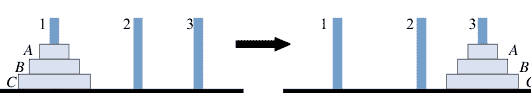
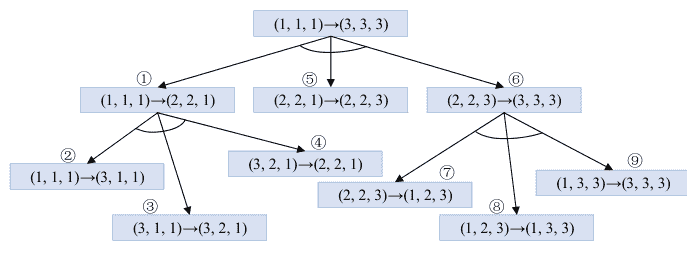 *(图 3.15、3.16)*
状态空间图中标出的正确生成顺序，直观展示了“顺序敏感性”。

问题规约原理直观、方法高效，是符号 AI 早期最核心的问题求解范式之一。

---

# 3.7 与/或图搜索：为“分解与选择”建模

问题规约中“全解决”（分解/与）与“任一解决”（等价变换/或）并存，单纯树/图难以表达。**与/或图（AO Graph）** 应运而生，成为描述此类混合求解结构的标准语言。

#### 3.7.1 与/或图的三种面相

1.  **“与”树/图 —— 分解：** 问题 P 拆为子问题组 $\{P_1,...,P_n\}$，**全部**解决 P 才算解决，**任一**无解 P 即无解。用**圆弧连接**所有子节点边，标记“与”关系（超连接）。
2.  **“或”树/图 —— 等价变换：** 问题 P 可等价转化为备选子问题组 $\{P_1,...,P_n\}$，**任一**解决 P 即解决，**全无解** P 才无解。边之间**无圆弧**，标记“或”关系。
3.  **与/或图 —— 现实融合：** 实际求解常伴随分解与变换交织，故合二为一。可视为一般图的推广（一般图即纯“或”图，无超连接）。

**关键概念引入（基于简例图 3.17）：**
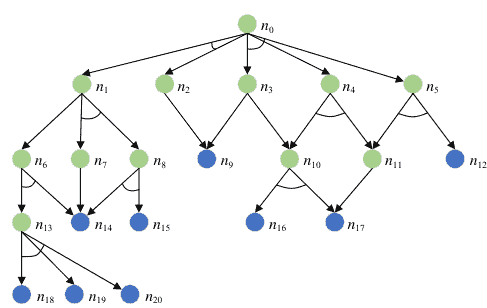
*   **K-连接（超连接）：** 父节点到一组子节点的连接，圆弧标记“与”，K 为子节点数。K=1 退化为普通边。父节点可有多组 K-连接（多种分解/变换方案）。
*   **根/叶/终节点：** 根=初始问题；叶=无子节点；终节点=可联合表示目标状态的叶节点（非终节点叶子=搜索失败点）。
*   **解图（Solution Graph）而非解路径：** 因存在“与”关系，解不再是单条路径，而是一棵**纯“与”树/图**。
    *   生成规则：从根选一组 K-连接 $\rightarrow$ 对该组**每个**子节点递归选一组 K-连接 $\rightarrow$ 直到所有分支末端均为终节点。
    *   因“或”关系（多组 K-连接可选），一张与/或图通常对应**多个解图**（简例中有 4 个，见素材图 3.18）。

与/或图将“问题分解的并行性”与“策略选择的备选性”统一建模，为后续启发式搜索（如 AO* 算法）在图结构上寻找最优解图奠定了理论基石。

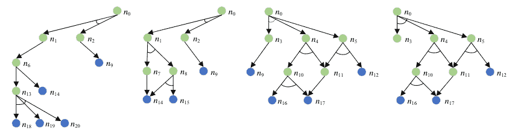

图 3.18 四种可能的解图形态

为保证在与/或图中搜索解图的有效性，必须约束解图为无环结构。也就是说，任意节点的外向连接不得指向自身或其祖先节点，否则会陷入死循环；凡导致解图成环的外向连接均不可采用。下面分别界定解图、解图代价、能解节点与不能解节点。

*   **解图定义**：在与/或图 $G$ 中，任一节点 $n$ 通往终节点集合的解图（记为 $G'$）必是 $G$ 的子图。
    *   若 $n$ 本身就是终节点，则 $G'$ 仅包含该单一节点。
    *   若 $n$ 存在一条指向子节点 $n_1, n_2, ..., n_k$ 的外向 $K$-连接，且每个子节点均有通往终节点集合的解图，则 $G'$ 由该 $K$-连接及所有子节点的解图共同构成。
    *   除上述两种情况外，不存在 $n$ 到终节点集合的解图。

*   **解图代价**：用 $C(n)$ 表示节点 $n$ 到终节点集合解图的代价，规定 $K$-连接的代价即为 $K$。

*   **能解节点**：
    *   终节点默认为能解节点。
    *   若节点 $n$ 有一外向 $K$-连接指向子节点 $n_1, n_2, ..., n_k$，且这些子节点全为能解节点，则 $n$ 也是能解节点。

*   **不能解节点**：
    *   非终节点的叶节点属于不能解节点。
    *   若节点 $n$ 的每一条外向连接至少指向一个不能解节点，则 $n$ 为不能解节点。

能解节点与不能解节点的示意见图 3.19。

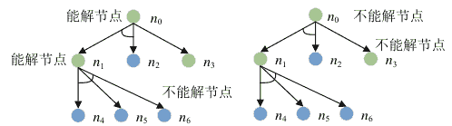

图 3.19 能解节点与不能解节点示意

#### 3.7.2 与/或图的启发式搜索策略

与/或树的启发式搜索算法，亦称 **AO\*算法**，其核心在于利用搜索过程中积累的启发式信息，寻找代价最小的最优解树。算法在每一步都试图锁定最有希望成为最优解树的子树。那么，解树的代价该如何量化？

##### 1. 解图代价的计算规则

在启发式搜索过程中，解树代价遵循以下准则计算：

*   **终节点**：代价 $h(n) = 0$。
*   **或节点**：若子节点为 $n_1, n_2, ..., n_k$，则 $n$ 的代价取各路径代价之最小值：
    $$ h(n) = \min_{1 \leqslant i \leqslant k} \{c(n, n_i) + h(n_i)\} \quad (3.22) $$
    其中 $c(n, n_i)$ 为节点 $n$ 到子节点 $n_i$ 的边代价。
*   **与节点**：若子节点为 $n_1, n_2, ..., n_k$，可采用**和代价法**或**最大代价法**：
    *   和代价法：$ h(n) = \sum_{i=1}^k [c(n, n_i) + h(n_i)] \quad (3.23) $
    *   最大代价法：$ h(n) = \max_{1 \leqslant i \leqslant k} \{c(n, n_i) + h(n_i)\} \quad (3.24) $
*   **死胡同节点（非终端的端节点）**：无法扩展，代价定义为 $h(n) = \infty$。
*   **根节点代价**即为整棵解树的代价。

> **例 3.4** 如图 3.20 所示与/或树，包含两棵解树：左侧由 $S_0, A, t_1, C, t_3$ 组成，右侧由 $S_0, B, t_2, D, t_4$ 组成。$t_1\sim t_4$ 为终节点，$E, F$ 为端节点，边上数值为代价。求解树代价。

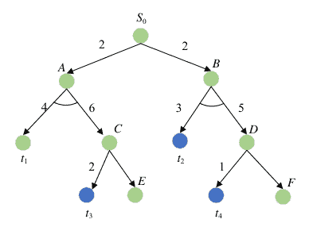

图 3.20 与/或树代价计算示例

**解析**：
先算左侧解树。按和代价法：$h(S_0)=2+4+6+2=14$；按最大代价法：$h(S_0)=8+2=10$。
再算右侧解树。按和代价法：$h(S_0)=1+5+3+2=11$；按最大代价法：$h(S_0)=6+2=8$。
本例中，无论采用哪种计价法，右侧解树均为最优解树。但需注意，不同计价法在某些情况下可能导致不同的最优解树选择。

##### 2. AO\*搜索机制

引入领域启发式知识可显著提升搜索效率、加速收敛。鉴于与/或图搜索的目标是解树而非简单路径，评价函数 $f(n)$ 的分量 $g(n)$（已走路径代价）失去意义，仅需估算分量 $h(n)$——即最小解图代价的估计值。同时，由于子节点间存在“或”关系，搜索过程中会同时出现多个候选局部解图，需估算所有候选代价，选取估算代价最小者进行下一步扩展。

解图按递归生成，代价亦按递归计算。一旦父节点 $n$ 的某 $K$-连接指向的子节点 $n_1, n_2, ..., n_k$ 全部完成 $h$ 值估算，则从 $n$ 出发的解图可能代价 $f(n)$ 可按公式计算并替换原有估值：
$$ f(n) = K + h(n_1) + h(n_2) + \cdots + h(n_k) \quad (3.25) $$
基于子节点实测值回传的 $f(n)$ 显然更精准。如此层层回传，可得出更准确的根节点代价 $f(n_0)$。

下面给出 AO\*算法的具体流程及应用要点。

##### 3. AO\*搜索流程详解

设 $G$ 为搜索图，$G'$ 为当前选中的待扩展局部解图，$LGS$ 为候选局部解图集，$n_0$ 为根节点，$n$ 为待扩展节点，$f_i(n_0)$ 为第 $i$ 个候选局部解图的可能代价。

1.  **初始化**：$G := n_0$，$LGS$ 置空。
2.  **根节点判断**：若 $n_0$ 是终节点，标记为能解，算法成功；否则计算 $f(n_0)=h(n_0)$，将 $G$ 作为 0 号候选加入 $LGS$。
3.  **成功检测**：若 $n_0$ 被标记为能解，返回成功。
4.  **失败检测**：若 $LGS$ 为空，返回失败；否则从 $LGS$ 中选取 $f_i(n_0)$ 最小的局部解图作为 $G'$。
5.  **选点扩展**：在 $G'$ 中选取一个非终节点的外端节点（未扩展过的叶节点）作为 $n$。
6.  **生成子节点**：扩展 $n$，生成子节点集。剔除导致成环的子节点及与其有“与”关系的节点；若剩余集合为空，标记 $n$ 为不能解节点，从 $LGS$ 移除 $G'$；否则计算各子节点 $f(n_i)$，建立 $K$-连接加入 $G$。
7.  **分支处理**：若产生 $j (j>1)$ 个新的外向 $K$-连接，从 $LGS$ 删除 $G'$，将 $j$ 个新局部解图加入 $LGS$。
8.  **代价修正与能解性回传**：在 $G'$ 或其替代的新局部解图中，用公式 (3.25) 计算的精确值替换原 $f(n)$，并将修正传播至 $f_i(n_0)$。同时，将终节点子节点标记为能解，递归回传能解标记。
9.  **循环**：跳转至步骤 3。

##### 4. AO\*算法实例演示

```
Procedure AO*
Begin
设 G 仅由代表开始状态的节点组成（称此节点为 Init），计算 h(Init);
Repeat
跟踪从 Init 开始的已带有标记的弧，如果存在，则挑选出现在此路径上但未扩展的节点之一进行扩展，称新挑选的节点为 Node；
生成 Node 的后继节点：
If Node 没有后继节点 Then 令 h(Node)=Futility，说明该节点不可解；
Else 后继节点称为 Successor，对每个不是 Node 祖先的后继节点 do
Begin
把 Successor 加到图 G 中；
若 Successor 是叶节点，那么将其标记为 Solved，并令 h(Successor)=0；
若 Successor 不是叶节点，则计算它的 h 值；
End
将最新发现的信息向图的上部回传，具体做法为：设 S 为一节点集，S 包括已经做了 Solved 标记的节点，以及 h 已经做了改变、需要回传至其先驱节点的那些节点，初始 S 只包含节点 Node；
Repeat
从 S 中挑选一个节点，该节点在 G 中的子节点均不在 S 中出现（换句话说，保证对于每个正在处理的节点，是在处理其任意祖先之前处理该节点的），称此节点为 Current，并把它从 S 中去掉；
计算始于 Current 的每条弧的耗费。每条弧的耗费等于在该弧末端每个节点的 h 值之和上加上该弧本身的耗费。从刚刚计算过的始于 Current 的所有弧的耗费中选出极小耗费，作为 Current 的新 h 值；
把在上一步计算出的带极小耗费的弧标记为始于 Current 的最佳路径；
If 把经过新的带标记弧与 Current 连接的所有节点均标记为 Solved；
Then 把 Current 标记为 Solved；
If Current 已标记为 Solved，或 Current 的耗费刚才已经改变；
Then 应把其新状态回传，因此，把 Current 的所有祖先加到 S 中；
Until S 为空;
Until Init 标记为 Solved (成功), 或 Init 的 h 值变得大于 Futility (失败);
End
```

以图 3.17 的与/或图为例，节点编号 $n_0 \sim n_{20}$ 如图 3.21 所示。

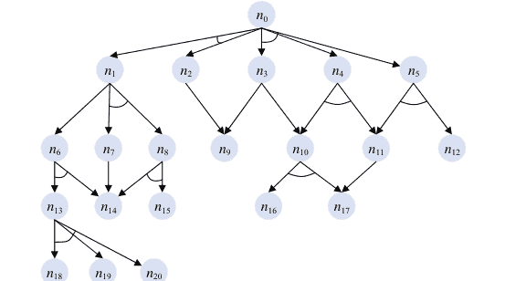

图 3.21 编号后的与/或图

假设部分节点启发式估值 $h(n_i)$ 如下：
$h(n_0)=3, h(n_1)=2, h(n_2)=1, h(n_3)=1, h(n_4)=4,$
$h(n_5)=2, h(n_6)=2, h(n_7)=1, h(n_8)=1, h(n_9)=3$

**第 1 轮**：扩展根节点 $n_0$，生成 2 号、3 号连接对应的候选局部解图 1 和 2，加入 $LGS$。因 $f_1(n_0)=5 < f_2(n_0)=10$，选中 1 号图为 $G'$。
**第 2 轮**：随机扩展 $n_1$，建立两个外向连接，产生新候选 3、4 号图加入 $LGS$，移除 1 号。因 $f_3(n_0)=6 < f_4(n_0)=7$，选中 3 号图。
**第 3 轮**：扩展 $n_6$，建立连接，更新 $f_3(n_0)=9$。
**第 4 轮**：选中代价最小的 4 号图（$f_4=7$），扩展 $n_7$。新节点 $n_{14}$ 为终节点，标记能解，回传标记 $n_7$ 为能解。
**第 5 轮**：继续扩展 4 号图中的 $n_8$，$f_4(n_0)$ 更新为 8。$n_{15}$ 为终节点，回传标记 $n_8, n_1$ 为能解。
**第 6 轮**：扩展 $n_2$，$n_9$ 为终节点，回传标记 $n_2, n_0$ 为能解。算法终止，找到代价为 8 的解图，见图 3.22(e)。

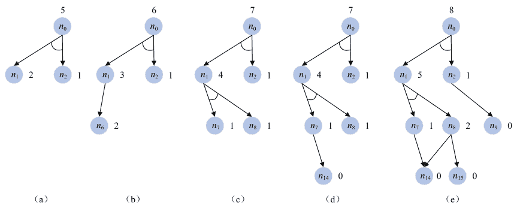

图 3.22 AO\*算法搜索解图形成过程

##### 5. 算法应用中的关键问题

**① 待扩展节点的选择策略**
因搜索目标是解图而非路径，单纯选择 $f(n)=h(n)$ 最小的节点未必高效。应优先扩展能导致解图代价剧烈变化的节点，使搜索焦点快速聚焦于低代价候选解图。若缺乏相关启发式知识，可退而求其次随机选择。

**② AO\*算法的可采纳性**
算法需满足两大约束：$h(n) \le h^*(n)$ 且满足单调限制。仅当约束满足时，算法才具可采纳性（即解存在时必能找到最优解）。其中 $h^*(n)$ 为实际最优解图代价。单调限制表达为：
$$ h(n) \le K + h(n_1) + \cdots + h(n_k) \le h^*(n) \quad (3.26) $$
可理解为：粗略估计值 $\le$ 细致计算值 $\le$ 真实最优值。

**③ AO\* 与 A\* 算法的对比**

| 维度 | AO\*算法 | A\*算法 |
| :--- | :--- | :--- |
| **适用结构** | 与/或图，搜索**解图** | 一般图/树，搜索**解路径** |
| **扩展策略** | 选估算代价最小的**局部解图**扩展 | 选估算代价最小的**路径/节点**扩展 |
| **评价函数** | 无需 $g(n)$，仅计算新节点 $h(n)$ 修正 $f(n_0)$ | 需同时计算 $g(n)$ 与 $h(n)$ 评价节点 |
| **数据结构** | $LGS$ 存候选局部解图，按 $f(n_0)$ 排序 | $OPEN/CLOSE$ 表存待扩展/已扩展节点，按 $f(n)$ 排序 |

**④ 解图代价的重复计算问题**
解图中子节点可能被多父节点共享（汇聚结构）。按递归计算会导致共享子节点到终节点的代价重复累加。必须剔除重复累计。例如图 3.21 中节点 $n_{10}, n_{11}$ 共享 $n_6, n_{17}$，若不去重总代价为 14，去重后实际代价为 11。

### 3.8 博弈论基础与对抗搜索

广义博弈涵盖军事、政治、经济等对抗决策。博弈具有明确胜负判定，为 AI 研究提供了理想测试床：如何表示状态、过程与知识。半个多世纪以来，机器博弈成果斐然：1997 年“深蓝”击败卡斯帕罗夫，奥赛罗、西洋跳棋、西洋双陆棋程序均登顶世界冠军；围棋、中国象棋、桥牌、扑克等研究持续深入。

本节聚焦**二人零和、全信息、非偶然**博弈，即双方利益完全对立。

*   **二人零和**：双方赢得函数之和为零，$\varphi_1 + \varphi_2 = 0$ (3.27)。
    *   我胜：$\varphi_1 > 0, \varphi_2 < 0$。
    *   我负：$\varphi_1 < 0, \varphi_2 > 0$。
    *   平局：$\varphi_1 = \varphi_2 = 0$。
*   **全信息**：双方对当前局面及历史完全知晓。
*   **非偶然**：决策基于得失分析，而非随机运气（排除掷骰子等机遇博弈）。

双方均采用**极大极小策略**：在最坏情况下争取最好结果，即我方选收益最大（对方损失最大）的行动。

**示例：分钱币游戏**
初始 7 枚钱币。轮流将一堆分成两堆**数量不等**的钱币，直到所有堆仅剩 1 或 2 枚无法再分，无法操作者负。
状态表示：数字序列+行动方。如 `(7, MIN)` 表示 1 堆 7 枚，MIN 先行。MIN 有三种分法：`(6,1,MAX)`, `(5,2,MAX)`, `(4,3,MAX)`。后续 MAX 在此基础上继续分，完整博弈树见图 3.23。

# AI博弈核心：极大极小与Alpha-Beta剪枝全解析

如图 3.23 所示，该博弈图穷尽了双方所有的分币可能性。无论 MIN 如何开局，MAX 均稳操胜券，制胜路径已用箭头标出。

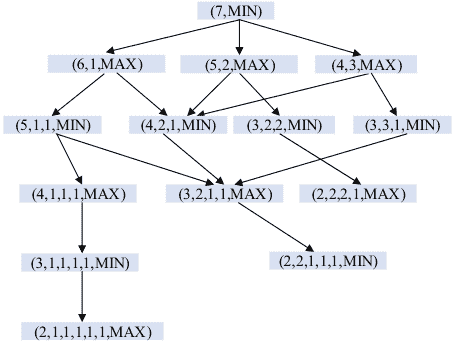

图 3.23 分钱币的博弈图

现实远比这复杂，棋类游戏的状态空间庞大到无法穷举。于是，AI 只能模仿人类“预判数步”的思维，在有限深度内权衡利弊，选出最优落子。在双人完全信息对弈中，双方目标一致——争取胜利。落子时，自然倾向于选择最有利于己、最不利于对手的走法。设对弈双方为 MAX 与 MIN。从 MAX 视角看，己方可选走法间是“或”关系，主动权在握，任选其一；而 MIN 的可选走法间是“与”关系，主动权在对手，任何走法均可能被选中，MAX 必须防范最不利情况。

透过上述例子可见，博弈过程可用与/或树建模，此称“博弈树”。因博弈是敌我双方智力的较量，任何一方都无法独断进程，而是轮流施策。故博弈树乃特殊与/或树：不同层级节点交替归属敌我，生成时由双方轮流扩展，子节点交替涌现。

博弈树特点归纳如下：

1.  **层级交替**：与节点、或节点逐级轮现，敌我双方按层扩展各自节点。
2.  **敌方视角为“与”**：站在己方立场，敌方节点皆为与节点。敌方必选最损己方之着，子节点中仅有一招不利，该节点即不利；惟有全体子节点均有利，节点才有利。
3.  **己方视角为“或”**：站在敌方立场，己方节点皆为或节点。己方掌握主动，只选最有利之着，子节点中有一招有利，节点即有利。
4.  **终局定性**：己方必胜终局为本原问题，端节点可解；敌方必胜终局则为不可解节点。
5.  **根节点定位**：先行落子一方（无论己方或敌方）的初始局面，对应树的根节点。

求解博弈问题可采用搜索法，以下介绍两大基石算法。

#### 3.8.1 极大极小过程

极大极小（MINMAX，MM）过程的核心是：在有限搜索深度内，推演若干步后，从候选走法中挑出相对最优的一步。

这需要一个静态估价函数 $e(p)$ 评估局面。函数依局面特征定义：有利于 MAX 取正值，有利于 MIN 取负值，均势取零。

MM 核心逻辑三步走：

1.  **MAX 掌舵**：轮到 MAX，追求最好情况（$e(p)$ 取极大值）。
2.  **MIN 掌舵**：轮到 MIN，假设对手最强，预判最坏情况（$e(p)$ 取极小值）。
3.  **倒推传递**：评价值自底向上回传，交替应用极大、极小操作，模拟双方博弈，直至算出根节点倒推值。

己方立足 MAX 视角，理应选取倒推值最大的走步。此即极大极小过程。

【例 3.5】图 3.24 展示了一棵前瞻两步、共 4 层的博弈树。方块 ■ 代表 MAX，圆圈 ● 代表 MIN，叶节点旁数值为估价函数值，MIN 层用圆弧连接。

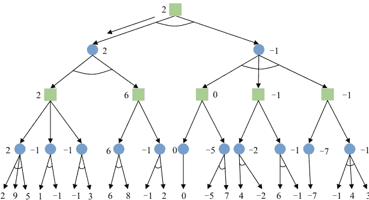

图 3.24 4 层博弈树

图中节点数值：叶节点为静态值；MIN 层取子节点最小值；MAX 层取子节点最大值；最终 MAX 顺着箭头方向落子。

【例 3.6】井字棋（一字棋）实战。3×3 棋盘（图 3.25），双方轮流落子，先成三子连线者胜。MAX 执 ×，MIN 执 ●，MAX 先行。


图 3.25 一字棋棋盘

为控制树规模，设定仅扩展两层。估价函数定义：
1.  MAX 必胜局面，$e(p)=+\infty$。
2.  MIN 必胜局面，$e(p)=-\infty$。
3.  胜负未分局面，$e(p)=e(+p)-e(-p)$。
   其中 $e(+p)$ 为 MAX 可能成线数，$e(-p)$ 为 MIN 可能成线数，对称局面合并计算。如图 3.26 局面，$e(p)=6-4=2$。

搜索中对称局面视为同一节点（如图 3.27），大幅压缩搜索空间。

假设 MAX 先行，己方执 MAX。图 3.28 给出生成树，节点标值为静态值或倒推值。

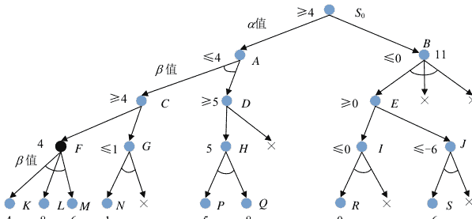  *(Note: Original text has PRE2 then PRE3 for Fig 3.28, but source shows PRE2 for Fig 3.25, then text, then PRE3 for Fig 3.29 later. Wait, source has  for Fig 3.25, then  for Fig 3.29. Fig 3.26, 3.27, 3.28 have no PRE tags in source. I must follow source PRE tags exactly. Source has PRE0, PRE1, PRE2, PRE3, PRE4, PRE5, PRE6, PRE7, PRE8, PRE9. I will place them exactly where they appear in source.)*

由图 3.28 分析，S3 估值最高，为 MAX 最佳首着。

#### 3.8.2 α-β 过程

极大极小法先生成全树再倒推，生成与计算分离，效率低下。若生成与估值同步，及时剪枝，可大幅减少节点访问，这就是 α-β 算法。

α-β 算法将后继生成与倒推估值融合，实时剔除无效分支。剪枝准则：

1.  **α 剪枝（针对 MIN 节点/与节点）**：若估算出 MIN 节点倒推值上界 β，且 β ≤ 其父 MAX 节点（或节点）当前下界 α（即 α ≥ β），则停止扩展该 MIN 节点其余子节点（因后续估值无法提高父节点下界，对决策无影响）。
2.  **β 剪枝（针对 MAX 节点/或节点）**：若估算出 MAX 节点倒推值下界 α，且 α ≥ 其父 MIN 节点（与节点）当前上界 β（即 α ≥ β），则停止扩展该 MAX 节点其余子节点（因后续估值无法降低父节点上界，对决策无影响）。

【例 3.7】图 3.29 演示 α-β 剪枝细节，最底层叶节点标注假设估值。


图 3.29 α-β 剪枝的具体例子

**剪枝推演**：
K、L、M 估值确定 F 倒推值为 4（即 F 的 β=4），推得 C 倒推值 ≥ 4，故 C 的 α=4。
N 估值显示 G 倒推值 ≤ 1（G 的 β=1）。无论 G 其他子节点如何，G 倒推值不超 1。又 C 的 α=4，G 后续分支无法抬升 C 倒推值，故剪去 G 其余分支。F、G 合并得 C 倒推值 ≥ 4，进而 A 的 β=4。
P、Q 推得 H 倒推值=5，故 D 的 α=5。此时 D 其余分支无法改变 A 的倒推值，剪去 D 后续分支，锁定 A 倒推值=4。以此类推，最终根节点 $S_0$ 倒推值定为 4。

α-β 过程深度优先推进，率先触达最大深度计算出部分 α/β 值，搜索深入时不断修正。节点一旦有后继终值确定，即可定其 α/β；后续后继终值给出，则修正 α/β。

**修正规律**：
1.  MAX 节点 α 值**单调不降**。
2.  MIN 节点 β 值**单调不增**。

依此规律剪枝，停止规则：
1.  若 MIN 节点 β ≤ 任一祖先 MAX 节点 α，停搜该 MIN 子树，取当前 β 值。虽可能非真实极大极小值，但对根节点决策等效。
2.  若 MAX 节点 α ≥ 任一祖先 MIN 节点 β，停搜该 MAX 子树，取当前 α 值。

满足规则 1 为 α 剪枝，规则 2 为 β 剪枝。保存 α/β 并尽早剪枝的全流程称 α-β 过程。当根节点所有后继终值给出，过程结束。同深度下，α-β 与极大极小选招一致，但搜索量大幅减少。

### 本章小结

搜索是 AI 求解核心范式，策略决定知识调用优先级。知识利用越充分，搜索空间越小。此领域研究历久弥新。同知识表示一样，搜索推理方法众多，同一问题策略不同，效能天差地别。本章聚焦高效策略。

**状态空间搜索**：奠基图搜索概念，剖析通用算法。盲目搜索即无信息穷举，代表作是广度优先（BFS）与深度优先（DFS）。大空间下 BFS 存储压力大；DFS 非完备且易陷深层，迭代加深（IDDFS）更实用。结合 A* 衍生出 IDA*，并行实现潜力大。

**启发式搜索**：A*（用于或图）与 AO*（用于与/或图）最主流。A* 解决状态空间寻优路径；AO* 确定达成目标的最优方案。近期有机器学习强化启发式信息以拓展 A* 的研究。

**博弈搜索**：视为特殊与/或搜索。极大极小与 α-β 剪枝是现代博弈 AI 必备技术。

### 习题

1.  透彻理解通用图搜索算法：OPEN 表与 CLOSE 表各司其职？
2.  对比 DFS 与 BFS，为何称它们为“盲目搜索”？
3.  启发式知识如何导向搜索？结合评价函数读懂 A*。
4.  启发函数 $h(n)$ 强弱如何影响效率？工程上如何让图搜索更给力？
5.  实例阐释与/或图核心概念：K-连接、根/叶/终节点、解图/代价、能解/不能解节点。
6.  详述 AO* 算法流程。可采纳性条件？为何扩展局部解图不必挑 $h(n)$ 最小节点？
7.  横向对比 AO* 与 A*，差异根源何在？
8.  **农夫过河**：狐狸、羊、菜，船载一物。无人看管时狐狸吃羊、羊吃菜。设计状态空间并绘图。
9.  **八数码**：给定初始态 S0 与目标态 Sg（图 3.30），分别用 BFS、DFS 绘制搜索树。

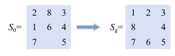

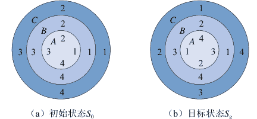

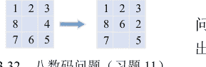

10. **圆盘问题**：三圆盘 A、B、C 套轴，标 1-4，可独立逆时针转 90°。初始 S0、目标 Sg（图 3.31），用 BFS、DFS 求路径。
11. **A* 解八数码**：图 3.32，$f(x)=d(n)+p(n)$，绘制搜索图，给出各轮 OPEN/CLOSE 表。
12. **移动将牌**：初始 `B B W W E`。规则：移入相邻空格费 1；隔一子跳入空格费 跳过数+1。目标：全 W 移至 B 左侧。定义 $h(n)$，给出搜索树。能否判定下界性？搜索树中节点是否满足单调性？
13. **旅行商变体**：5 城市交通图（图 3.33），边权为费用。从 A 出发，遍历各城一次回 A，求最优回路。

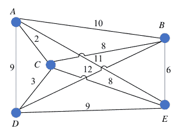

图 3.33 交通费用图

14. **与/或树求解**：图 3.34 树，分别用和代价法、最大代价法求代价。

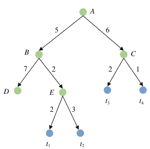

图 3.34 与/或树

15. **博弈树实战**：图 3.35 博弈树，叶节点为假设估值。要求：
    1) 计算所有节点倒推值。
    2) 应用 α-β 剪枝裁剪冗余分支。

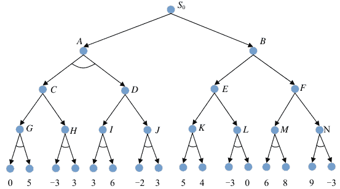

图 3.35 博弈树

---

## 第 4 章 知识推理与确定性推理

知识推理，即在计算机或智能系统中，模拟人类思维，依策略调用形式化知识，完成机器思考与求解。从既有知识出发，借逻辑推演，挖掘隐性结论，此因果链条即知识推理。

### 4.1 知识推理

推理是 AI 核心命题。人类思维擅长按逻辑分析，通过归纳、演绎等从观测中得结论。推理可按途径、确定性、目标逼近度、是否用启发式知识分类。

#### 4.1.1 推理的定义

从初始证据出发，按策略反复应用知识库知识，逐步推导结论，此过程称推理——即“用智慧从前提必然导出结论”。命题是判断语义；前提/假设是已知命题；结论是应用规则从前提得出的命题。

AI 系统中，推理由程序实现，称**推理机**。已知事实与知识是推理双基石。事实即证据，指明起点及知识调用；知识是推进依据。管理知识的专用库称**知识库**，汇聚领域专家经验，含基本事实、规则等求解所需知识集。

#### 4.1.2 推理的方式及分类

人类智能多元，AI 模拟亦有多种推理路径。具体可按结论途径、知识确定性、逼近目标程度、是否用启发式知识划分。

**1. 按推出结论的途径划分**

核心任务是从一判断推出另一判断。按途径分：**演绎推理**、**归纳推理**、**默认推理**。

**(1) 演绎推理**
由一般推至个别，从全称判断导出单称判断。传统逻辑视其为“前提真则结论必真”的必然性推理。形式多样：三段论、假言、选言、关系推理等，最常用**三段论**——结论从大、小前提必然得出。
*   **大前提**：一般性原则。
*   **小前提**：具体情况特殊陈述。
*   **结论**：依一般原理对具体情况的判断。

【例 4.1】生活中常无意识用三段论，如表 4.1 所示。

##### 表 4.1 三段论法举例

# 推理的多维图谱：从演绎确定性到非单调灵活性

在逻辑与人工智能的殿堂里，推理并非单一路径，而是一张由多种分类标准编织而成的立体网络。我们既可以按思维的“走向”区分演绎与归纳，也能依据知识的“底气”区别确定与不确定，更可按结论的“态度”辨识单调与非单调。掌握这张图谱，是理解智能系统核心逻辑的钥匙。

## 一、 按思维走向划分：从必然到或然的三大范式

### 1. 演绎推理：真理的“传递者”

演绎推理的核心在于**“大前提蕴涵结论”**。它像一台精密的传动装置：只要大前提与小前提真实有效，结论便被迫真实，绝无例外。

*   **经典三段论演示**：
    *   前提：所有推理系统皆属智能系统；专家系统属于推理系统。
    *   结论：专家系统必然是智能系统。
    *   反例对比：若大前提为“所有P是M”，小前提“有S非M”，则推得“有S非P”；但若前提为“有些书有插图”、“有插图的书有趣”，却无法必然推出“有些书有趣”（中项未周延）。

**本质洞见**：演绎不产生新知，只是显化前提中已隐含的内容。它是数学证明、形式逻辑的基石，保证了推理的**必然性**。

### 2. 归纳推理：知识的“生成器”

归纳是人类认知的主干道——**从个别走向一般，从有限迈向无限**。它跨越了前提的范围，故结论带有**或然性**，前提真结论未必真。

*   **两大核心手法**：
    *   **类比法**：靠“相似”推“相似”。同类属性越多、越核心（质），结论越可靠。逻辑骨架为：`A有属性a,b,c,d; B有属性a,b,c; 所以B可能有属性d` (```
A 事物具有属性 a、b、c、d;
B 事物具有属性 a、b、c;
所以，B 事物也可能具有属性 d。
```)。
    *   **枚举法**：靠“数量”换“普遍性”。

*   **枚举法的进化史**：
    *   **完全归纳**：遍历全体（如考察太阳系八大行星轨道），前提涵盖结论，属**必然性推理**，且能实现认识跃升 (```
S1 是 P
S2 是 P
S_3 是 P
...
S_n 是 P
(S_1、S_2、S_3、⋯、S_n 是 S 类中的全部对象)
S 都是 P
```)。
    *   **不完全归纳**：以部分代表整体，适用于无穷域或无法穷尽场景。
        *   *简单枚举*：未见反例即断定全称。直观但脆弱，易陷“以偏概全”。需扩大样本、拓宽视野提升可靠性 (```
S_1 是（或不是）P
S_2 是（或不是）P
S_3 是（或不是）P
...
S_n 是（或不是）P
(S_1、S_2、S_3、⋯、S_n 是 S 类中的部分对象，且没有出现反例)
所以，所有的 S 都是（或不是）P
```)。例：仅凭四名同学成绩超90，断定全组超90，风险自明。
        *   *科学归纳*：引入**因果必然联系**作中介。不靠“运气”，靠“机制”。例：从铜、铁热胀推知金属热胀，因锁定“分子距离增大”这一本质机制 (```
S₁ 是 P
S₂ 是 P
S₃ 是 P
···
Sₙ 是 P
（S₁、S₂、S₃、⋯、Sₙ 是 S 类中的部分对象，并且 S 与 P 之间具有必然联系）
所以，所有的 S 都是 P
```)。

**机器学习视角**：归纳即“归纳学习”。在实例空间与规则空间间搜索协调，用训练实例导航，最终定位目标规则——这是符号学习创概念、立规则、发现理论的主引擎。

### 3. 默认推理：不完全知识下的“权宜之计”

当证据缺位时，默认推理允许**“无反证即成立”**。它打破了“知全才能推”的枷锁，让系统在残缺信息上也能运转。

*   **经典案例**：“鸟会飞”。无需列举企鹅、鸵鸟等所有例外，默认逻辑即可形式化此规则。
*   **动态修正机制**：一旦发现默认失效（如遇企鹅），立即撤销原默认及衍生结论，按新知重推。这是非单调逻辑的典型注脚。

---

## 二、 按知识确定性划分：确定与不确定的分水岭

### 1. 确定性推理：非黑即白的硬逻辑

知识、证据、结论全链路确定。真值仅在{真,假}间切换。

*   **主流流派**：自然演绎（直用推理规则）、归结演绎（基于Robinson原理）、与/或演绎（蕴涵式与与/或式结合）。
*   **搜索策略谱系**：
    *   *盲目搜索*（宽度/深度/等代价优先）：无向导，效率低，易“组合爆炸”。
    *   *启发式搜索*：用评估函数排序节点，大幅提速。
    *   *其他利器*：消解原理（子句级推理规则）、规则演绎系统（IF-THEN匹配）、产生式系统（规则协同求解）。

### 2. 不确定性推理：在迷雾中寻找“合理度”

知识或证据含糊，结论附带置信度。这是智能处理现实世界的本质特征。

*   **双轨表示**：数值度量（概率、置信度）与非数值语义（定性描述）。
*   **核心难点**：不确定性的**传递与融合算法**——每一步如何将前项的模糊度合成后项。
*   **组合手段**：最大最小法、概率法、有界法等。
*   **实战辨析**（例4.4）：
    *   $R_1, R_2$ 属确定性（条件明确、概念清晰）。
    *   $R_3, R_4$ 为概率性不确定（“很可能”、“大概”）。
    *   $R_5, R_6$ 为模糊性不确定（“高个子”、“好朋友”无硬边界）。

---

## 三、 按结论目标性划分：单调与非单调的张力

### 1. 单调推理：知识只增不减的“直线型”逻辑

经典逻辑的标准形态。**新知加入，旧结论不倒；推论集合随理论扩大而单调增大**。语法严格、语义有效，前提真则结论真。

*   **局限**：无法处理默认、溯因、信念修正等常识推理。现实中新知常与旧识冲突，单调逻辑对此束手无策。

### 2. 非单调推理：可撤销、可修正的“曲线型”智慧

新知识加入，**旧结论可能被推翻**，推理回溯重来。引入“真理维持系统”保障运行。

*   **核心追求**：**合理性**而非有效性。合理性带**时效性**（暂时为真，如“地平说”曾被信奉）与**主观性**（判断标准因主体异，如中西购房观差异）。
*   **研究两大路径**：另立新逻辑体系 vs. 在经典框架内巧用旧工具。
*   **代价**：比单调推理复杂得多，须解决“寻找失效结论”这一单调逻辑从未面对的新课题。

### 3. 关联与辨析

*   **基础关系**：单调是非单调的基石（如三段论要求全称前提，具单调性；放宽为特称或未知命题，引入“相信”机制，即现非单调）。
*   **形式对比**：单调呈线性，非单调呈网状回溯。
*   **效力与适用**：单调有效性强但常识适用窄；非单调灵活广泛，是常识推理主战场。

---

## 四、 按启发性知识划分：有向导 vs. 盲闯关

### 1. 启发性推理：经验作向导，效率指数级跃升

将解题策略、技巧、经验显式化为**启发式规则**，引导搜索。

*   **算法里程碑**：A算法、A*算法（Nilsson, 1970s）。
*   **医疗决策实例**（例4.5）：目标在三病中选一。若优先排除新冠，先用R2；若优先确诊肠胃炎，先用R3。规则顺序即启发策略。
*   **生活陷阱**：易受“获得性启发”误导（如因媒体高曝光误判飞机比火车危险）。需挖掘更多信息、综合研判。

### 2. 非启发性推理：按部就班，代价高昂

无经验加持，纯靠通用控制逻辑。如宽度优先搜索虽完备，但复杂问题下必现“组合爆炸”，效率低下。

---

## 五、 推理的方向：控制策略的第一维度

推理方向是控制策略的首要抉择，直接决定求解路径的几何形态。主要分为四种：

### 1. 正向推理：数据驱动的“推演式”扩张

**别称**：数据驱动、前向链。
**机制**：从已知事实出发，正向匹配规则前件（IF），触发后件（THEN），不断累积新事实，直至达成目标或规则耗尽。
**适用场景**：初始事实确定、目标模糊或多目标、规则前件简单。像涟漪扩散，自底向上构建知识图景。

```
A 事物具有属性 a、b、c、d;
B 事物具有属性 a、b、c;
所以，B 事物也可能具有属性 d。
```
```
S1 是 P
S2 是 P
S_3 是 P
...
S_n 是 P
(S_1、S_2、S_3、⋯、S_n 是 S 类中的全部对象)
S 都是 P
```
```
S_1 是（或不是）P
S_2 是（或不是）P
S_3 是（或不是）P
...
S_n 是（或不是）P
(S_1、S_2、S_3、⋯、S_n 是 S 类中的部分对象，且没有出现反例)
所以，所有的 S 都是（或不是）P
```
```
S₁ 是 P
S₂ 是 P
S₃ 是 P
···
Sₙ 是 P
（S₁、S₂、S₃、⋯、Sₙ 是 S 类中的部分对象，并且 S 与 P 之间具有必然联系）
所以，所有的 S 都是 P
```

# 推理机制核心逻辑：正向、逆向与混合策略深度解析

在智能系统构建中，推理机制是驱动知识转化为决策的核心引擎。本文将系统拆解正向推理、逆向推理、混合推理及双向推理的运作原理，并深入探讨冲突消解策略与专家系统架构。

## 正向推理：数据驱动的演进路径

正向推理遵循“由果溯因、逐步逼近”的逻辑，其核心在于从用户给定的初始事实出发，在知识库中匹配可触发的规则，构成备选集合，再依据特定策略挑选一条执行，将新生成的事实回写库中，驱动下一轮循环，直至得出目标解或无规则可用。

**算法流程精简版：**
1.  **入库**：初始事实写入工作存储器。
2.  **校验**：若目标解已存在，直接终止成功；否则继续。
3.  **匹配**：扫描知识库，依据当前事实筛选可触发规则。
4.  **集合构建**：汇总所有匹配成功的规则形成冲突集。
5.  **消解执行**：若冲突集非空，按策略选一条规则触发，新事实入库，回跳步骤2；若为空，转步骤6。
6.  **外部干预**：询问用户是否补充事实，可补则入库回跳步骤3，不可补则宣告求解失败。

**关键技术点**：实现的核心难点在于“模式匹配”。因完全精确匹配在实际场景中罕见，必须定义模糊匹配的阈值与判定标准。

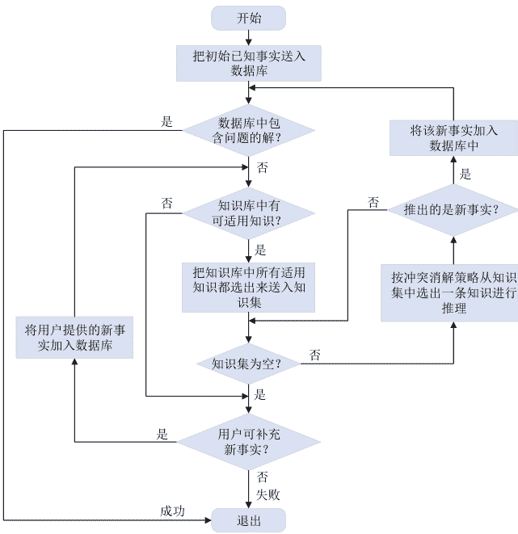

## 逆向推理：目标导向的假设验证

逆向推理采取“由果寻因、层层分解”的策略。它预设一个假设目标，随后在知识库中搜寻能够支撑该目标的规则，将规则的前件条件转化为新的子目标，递归验证，直至所有叶子节点均为用户可直接确证的原始事实，或证伪为止。

**算法流程精简版：**
1.  **设目标**：确立待证明假设。
2.  **命中检查**：若目标已在事实库中，验证通过，转下一目标或结束。
3.  **原始事实判断**：若目标需用户直接确证，发起询问；否则继续。
4.  **规则检索**：找出所有能推导出该目标的规则，形成候选集。
5.  **递归分解**：从候选集中选一条规则，将其前件设为新子目标，回跳步骤2。

**特性对比**：逆向推理目的性强，避免无效计算，且天然利于生成解释路径；但假设盲目性强，若初始假设偏离实际，将导致大量无效回溯，拖垮效率。

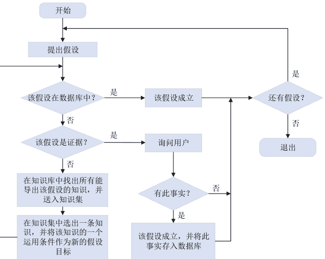

## 混合推理：取长补短的实用主义

单一推理模式均有短板：正向易产生无关中间结果，效率低；逆向假设失误代价大。混合推理将两者耦合，主要呈现两种协作范式：

1.  **正向引领 + 逆向校准**：事实不足时，先正向推演挖掘潜在假设，再逆向逐一验证、补全证据链；或正向得出低置信度结论，转逆向通过用户交互提升可信度。
2.  **逆向破局 + 正向扩展**：逆向验证过程中通过交互获取新知，验证成功后，利用这些新增事实正向发散，推导更多关联结论（如医疗诊断中确诊主病后，顺推并发症风险）。

## 双向推理：中途相遇的高效捷径

常用于定理自动证明。正向从已知事实推演，逆向从假设目标回溯，二者不走终点，而在中间“碰头”——正向推导出的中间结论恰好满足逆向当前所需的证据条件。难点在于“碰头”判定机制的设计，以及动态平衡双向推理的资源分配比例。

---

# 推理调度的核心博弈：冲突消解策略

当事实与规则匹配产生多对多关系时，系统面临“冲突集”，必须通过消解策略决定唯一执行路径。本质上是对候选规则的排序优先级设定。

| 策略维度 | 核心逻辑 | 适用场景 |
| :--- | :--- | :--- |
| **针对性优先** | 条件更苛刻（包含更多约束）的规则优先。因其结论更具体、更接近目标，一旦满足可大幅收敛搜索空间。 | 规则层级分明、存在“一般-特殊”包含关系的知识库。 |
| **新鲜度优先** | 优先使用最新生成或最新获取的事实所触发的规则。衡量标准可为：事实组内最新事实对比、最旧事实对比、或新鲜事实计数占比。 | 动态环境、实时数据流驱动、强调时序关联的场景。 |
| **匹配度优先** | 仅用于不确定性推理。计算事实与规则前件的契合度，高分者优先。 | 模糊匹配、概率图模型、置信度加权系统。 |
| **条件数极少** | 结论相同时，优先条件最少的规则，降低匹配计算开销。 | 追求响应速度、规则冗余度高的工程落地。 |

**工程实践**：生产环境常采用组合策略（如：先按针对性分级，组内再按新鲜度排序），在冲突频发与推理效率间寻找平衡点。

---

# 专家系统：知识工程化的标杆架构

专家系统是将领域专家经验显性化、程序化的典范，核心由**知识库**与**推理机**双驱动，实现复杂决策自动化。广泛应用于诊断、预测、设计、监控等垂直领域。

## 标准六层架构

1.  **知识库**：核心资产。存储领域事实、规则、约束。表现形式多元（产生式、框架、语义网）。**与推理机分离**是关键特征，支撑知识热更新、迭代维护。
2.  **推理机**：执行引擎。解释执行知识库规则，驱动状态迁移。独立于具体知识内容，保证通用性；亦可与知识库耦合优化性能。
3.  **综合数据库/工作存储器**：运行时上下文。存放初始输入、中间推理链、中间结论、执行轨迹。既是推理匹配的数据源，也是解释溯源的证据链。
4.  **知识获取模块**：知识入口。支持人工录入、半自动/全自动学习（如归纳学习、神经网络训练），负责知识库的构建、校验（一致性/完整性）、扩充。
5.  **解释器**：透明化窗口。回溯工作存储器中的推理路径，将机器逻辑翻译为自然语言，回答“为什么这么问”、“为什么得出此结论”，建立用户信任。
6.  **人机交互界面**：交互前端。承载信息输入、问题追问、结果展示、解释呈现。


## 三大核心特质

*   **启发性**：凝聚顶级专家隐性经验，超越常识，给出高质量、创造性方案。
*   **透明性**：具备“自推理”能力，可解释决策路径，拒绝黑箱。
*   **灵活性**：不拘泥于演绎，融合归纳、类比、抽象等多元思维模式。

## 经典派系演进

| 派系 | 知识表达 | 推理特点 | 典型优势 |
| :--- | :--- | :--- | :--- |
| **基于规则** | IF-THEN 产生式 | 前向/后向链接 | 逻辑清晰、易理解、易维护，早期主流。 |
| **基于框架** | 框架/对象结构 | 槽位填充、继承机制 | 擅长表达结构化概念、典型场景、复杂对象关系。 |
| **基于模型** | 结构/功能/因果模型 | 深层推理（基于第一性原理） | **深度推理**：懂原理、强泛化、能处理新故障，但建模成本高、速度慢。 |

> **浅层 vs 深层**：基于规则属“浅层推理”（依赖经验启发式，快但脆）；基于模型属“深层推理”（依赖机理模型，慢但准、鲁棒）。**第二代专家系统**趋向融合两者：浅层快速筛选，深层精准定位。

## 神经网络专家系统：连接主义的尝试

利用神经网络分布式存储特性编码知识。仅需专家提供“输入-输出”样本对，经学习算法自动调整连接权重分布，隐式捕获启发式经验。具备**联想记忆**与**容错泛化**能力：输入偏离训练样本时，仍能输出近似解。架构上，知识库由权重矩阵构成，推理机即前向传播计算过程。


### 神经网络专家系统的独特优势

相较于传统专家系统，神经网络专家系统展现出鲜明的个性特征：

1.  **知识存储的分布式特性**：知识不再集中存放，而是分散编码在神经元间的连接权重中。这种分布式机制天然适配并行计算，单个节点的输出由多个关联神经元的输入信号与连接强度共同合成。
2.  **基于数值计算的推理引擎**：推理过程植根于 M-P 神经元模型，采用数值运算而非符号逻辑。这要求现实问题的输入输出必须转化为数值向量形式。
3.  **成熟的自学习机制**：拥有完善的学习算法体系，核心多基于 Hebb 规则（感知器则用 Delta 规则）。通过迭代训练不断修正权重，使模型逐渐贴合训练样本。
4.  **卓越的容错鲁棒性**：得益于分布式存储，个别神经元失效或信息缺失往往不会颠覆整体输出，这酷似人类在信息不全时依然能做出正确判断的能力。

###### (4) 专家系统的工程化构建流程

采用原型法开发专家系统，主要历经三大核心阶段：初始知识库设计、原型系统搭建测试、知识库迭代优化。

**1. 奠基：设计初始知识库**
知识库是系统的心脏，其建设是启动阶段的重中之重（见下图流程）。


*   **问题知识化**：明确领域问题边界，界定核心任务、关键数据要素及子任务拆解。
*   **知识概念化**：提炼关键概念及其关联关系，涵盖数据类型、初始约束、目标状态及控制策略。
*   **概念形式化**：选定知识组织的数据结构，用形式化语言（如产生式、框架）表达上述概念。
*   **形式规则化**：将形式化知识转译为计算机可执行的代码规则。
*   **规则合理化**：校验规则库的逻辑自洽性与有效性，剔除冗余与冲突。

**2. 验证：原型系统开发与实验**
知识表示方案定型后，快速构建原型。原型覆盖核心知识模型，但仅聚焦于与实验相关的简化任务与推理链路。

**3. 进化：知识库的改进与归纳**
在原型基础上，对知识库与推理机开展循环测试、修正、归纳。通过持续迭代提升系统性能，直至达到预期指标。

###### (5) 专家系统 vs 传统程序：范式的差异

专家系统的出现引发了对传统编程范式的深度反思。二者本质区别在于：**传统程序依赖确定性算法，专家系统依赖启发式推理**。当问题复杂到无算法可循、或算法复杂度过高时，专家系统给出的“满意解”优于“无解”。

*   **透明度**：专家系统配备解释机制，推理链路可追溯、可审计；甚至支持从案例归纳规则（规则发现）。
*   **架构解耦**：传统程序 = 算法 + 数据结构（知识耦合在代码中）；专家系统 = 知识库 + 推理机（知识与控制分离）。

详细对比见下表：

| 维度 | 传统程序 | 专家系统 |
| :--- | :--- | :--- |
| **架构模式** | 知识与处理耦合一体 | 知识库与推理机物理分离 |
| **处理对象** | 数值计算、数据流 | 符号处理、逻辑推演 |
| **可解释性** | 无（黑盒） | 有（白盒，可溯源） |
| **正确性** | 理论无误（排除Bug） | 可能出错（模拟专家判断） |
| **交付节奏** | 全功能完备后上线 | MVP（最小可行性规则集）即可启动，持续进化 |
| **执行逻辑** | 固定算法流程 | 逻辑推理 + 启发式策略 |
| **信息需求** | 要求信息完备 | 兼容不确定、不完整信息 |

---

### 智能体系统：感知、决策与行动的闭环

人工智能的核心使命，是研究并构建能在特定环境中表现出智能行为的计算实体——**Agent（智能体）**。

###### (1) 智能体的本质画像

Agent 是环境中的行动主体：人、机器人、软件程序、甚至自然力（风、重力）均可建模为 Agent。

*   **意图性分野**：
    *   **有意图 Agent**：拥有偏好，倾向特定环境状态，并主动行动以达成目标（如购物机器人、恒温器）。
    *   **无意图 Agent**：无偏好，行为归因于自然法则（如落石、气流）。
    *   *建模抉择*：是否赋予意图，取决于建模目标与环境复杂度。恒温器虽无自我意识，但被植入“维持舒适温度”的设计者偏好。
*   **感知通道（传感器）**：Agent 通过传感器获取环境信息。现实传感器常含噪声、延迟、丢包或歧义，Agent 必须在不完美感知下决策。
*   **行动执行（执行器）**：Agent 通过执行器施加影响。执行器同样面临噪声、滞后、物理惯性等非理想特性（如机器人收到“画 S 形”指令，实际轨迹只能大致拟合）。

**分层控制架构** 应运而生，以调和“高层复杂推理耗时长”与“底层实时反应需迅速”的矛盾。


**图 4.7 智能体系统交互全景**

系统 = Agent + 环境。Agent 由 **主体** 与 **控制器** 组成：
*   **主体** = 传感器（刺激→感知）+ 执行器（命令→动作）。
*   **控制器** 接收感知，发布命令。
*   **刺激源**：光、声、键鼠、物理冲击、网络/数据库数据。
*   **传感器例**：摄像头（像素阵列→高级特征）、麦克风、XML 解析器等。
*   **动作空间**：运动控制、语音合成、信息展示、网络指令（高层指令如“导航至 S3” vs 低层指令“电压设 5V”）。


**图 4.8 分层控制架构详解**

架构将控制器垂直分层，**低层快、高层慢**。低层封装细节，向高层汇报抽象感知；高层下发指令，低层执行细节。层间高频交换状态特征。

**单层单时刻的输入三元组**：
1.  信念状态（历史记忆）。
2.  下层感知特征。
3.  上层命令特征。

**单层单时刻的输出三元组**：
1.  向上层汇报的高级感知。
2.  向下层分发的低级命令。
3.  更新后的信念状态。

**实现关键**：层间连接必须闭环（输出对接输入），信念状态自维护。**混合系统**兼具高层离散定性推理与低层连续定量控制能力。

###### (2) 智能体分类谱系

伍德里奇与詹宁斯教授界定 Agent 四大核心属性：**自主性、反应性、社会性、主动性**；学界共识还补充了移动性、适应性、学习性等。不同应用侧重不同属性，催生出三大架构流派：

####### 1. 思考型 Agent：理性的符号推演者

视为“意识系统”，核心是符号知识库 + 逻辑推理机，支撑深度规划与决策。


**图 4.9 思考型 Agent 核心架构**

按理性实现路径分三大范式：

*   **经典逻辑派**：用一阶谓词演绎推理。优点：语法严谨、语义清晰。痛点：复杂度指数爆炸，难表达信念/意愿等心态概念，工程落地受限。
*   **BDI 模型派（信念-愿望-意图）**：模拟人类实践理性。
    *   *信念*：对世界现状与可行路径的认知。
    *   *愿望*：对未来状态的偏好集（可冲突、可不可达）。
    *   *意图*：资源约束下选定的承诺目标集。
    *   *优势*：认知心理学基础扎实，利于多 Agent 社会交互。
    *   *难点*：心态逻辑形式化难；社会层面推理工程化仍待突破。
*   **决策理论派**：将行为视为“效用最大化”求解过程。
    *   用概率估计表征信念，效用函数量化愿望，自然嵌入 BDI 框架。
    *   *应对“资源有限 vs 世界无限”*：① 简化环境模型（经典决策论，求最优）；② 满意度法则（现代决策论，搜索满意解而非最优解，风险是搜索成本失控）。

####### 2. 反应型 Agent：本能的极速响应者

主张**智能源于交互**，拒绝符号表征与内部世界模型。结构极简：感知→直接映射→动作。无记忆、无规划、纯凭当下状态反射。


**图 4.10 反应型 Agent 极简架构**

*   **优势**：响应极快，擅长动态、时变、非结构化环境（如昆虫导航、实时避障）。
*   **短板**：盲目于当下，缺乏全局视野与长远筹谋，决策局限于局部感知，难胜任复杂策略任务。

####### 3. 混合型 Agent：大脑与脊髓的协同

融合两者精华：**双层/多层架构**成主流范式。
*   **认知层（高层）**：符号世界模型，慢推理、重规划、做决策。
*   **反应层（低层）**：亚符号处理，快反射、抗干扰、处理突发，拥有**更高优先权**抢占执行权。

**典型实例**：
*   **PRS (Procedure Reasoning System)**：计划库 (KA) + 显式 BDI。信念用一阶逻辑，愿望/目标对应行为模式。KA 含激活条件，情境触发执行。
*   **INTERMAP 架构**：三层解耦——**行为层**（反应性，即时应对）、**规划层**（主动性、中长期）、**协作层**（社会性、外部交互）。完美映射 Agent 三大核心属性。

---

### 确定性推理：逻辑的确证之路

智能系统不仅要“知”（知识表示），更要“行”（推理求解）。按知识确定性分，**确定性推理**与**不确定性推理**。本节聚焦前者。

#### 4.2.1 命题逻辑：形式化推理的基石

人类思维虽内容各异（数学论量、物理论力），但**形式结构同构**。自然语言歧义重，不适合严密推理，故引入符号化命题体系。

**命题逻辑** = 形式化规则集 + 符号化陈述。
*   **原子命题**：不可再分、真假确定的陈述。
*   **复合命题**：原子命题经联结词（¬ ∧ ∨ → ↔）组合生成。
*   **命题公式**：若符号串中字母为命题变项而非具体命题，则称作公式（合式公式需遵循构造规则）。

**核心提示**：命题逻辑只保证**形式有效性**（推理结构正确），不保证**结论真实性**（前提若假，结论未必真）。

**局限性**：无法刻画对象内部结构、属性关系，也无法抽象跨域共性。此乃谓词逻辑登场之由。

```
¬P→(Q∧R)
(R∨¬B)∧(C⇒D)
```

#### 4.2.2 谓词逻辑：深入对象内部的显微镜

传统谓词逻辑聚焦**性质命题**及**三段论**，仅处理四种标准形式（全称肯定/否定、特称肯定/否定），单称命题强行归入全称，表达力严重不足。

**痛点实例**：
1.  “小明成绩 > 小红成绩”（二元关系/比较）。
2.  “内蒙古在山东北方”（空间方位关系）。

这类关系命题、函数命题，传统谓词逻辑束手无策。现代谓词逻辑（一阶谓词逻辑）引入**个体变项、谓词、函数、量词**，方能精准建模对象属性、关系及结构，成为知识表示与确定性推理的主力语言。

### 4.2.3 自然演绎：直觉推理的规范化路径

我们接着来看一个数据：班级里 98% 的同学参与了投票，并一致推选张瑶担任班长。

这类表述与传统的 A、E、I、O 四种直言命题形式截然不同，学术上称之为**关系命题**——它刻画的是个体对象之间是否存在特定联系。由这类命题构建的推理，自然被称为**关系推理**。举个栗子：

1. 小明的分数高于小红。
2. 小林的分数高于小明。
3. 结论：小林的分数高于小红。

这推理一看就通，其有效性完全源于命题内部的结构逻辑。这类关系推理理应成为剖析命题内在逻辑结构的**谓词逻辑**（Predicate Logic）核心研究对象。然而，关系命题与关系推理早已超出传统谓词逻辑的覆盖范围。传统体系聚焦于性质命题，局限于三段论或其微调变体。而**现代谓词逻辑**完美填补了这一空白。在其理论框架里，关系命题与性质命题、关系推理与性质推理本质上没本质区别，仅在于所包含的谓词类型不同罢了。

谓词逻辑的核心在于探究**量词**的逻辑特性。传统逻辑将量词简化为“所有”与“有些”，进而将命题划分为全称与特称，却对日常高频的**单称命题**避而不谈。且传统理论对量词加设重重限制，如要求被约束词项不能为空类。现代谓词逻辑则打破桎梏：一切词项均允许为空类，逻辑系统唯有涵盖所有可能性，才具备普适性。

来剖析一组命题与命题函数：

1. 3 是质数。
2. 沈雯的外教是美国人。
3. 所有 x 均为锂电池。
4. 李丽与马文强是同学。
5. 重庆位于四川与湖北之间。

其中，“3”、“沈雯”、“x”、“李丽”、“马文强”、“重庆”、“四川”、“湖北”均指代**个体对象**。现代谓词逻辑中，指称这些对象的符号称为**个体词**，分两类：
*   **个体常元**（常项）：指称确定具体对象，如上述“3”、“沈雯”等。
*   **个体变元**（变项）：指称某类对象中任意一个，如“x”，其取值范围称作**论域**或**个体域**。
*   约定俗成：常元用 a、b、c… 表示，变元用 x、y、z… 表示。

**谓词**是指称对象（一阶谓词中指个体）所具性质或对象间关系的符号。同样分常、变两类：
*   **谓词常元**：表达确定论域内特定性质或关系，如“是质数”、“是同学”、“在……之间”。
*   **谓词变元**：不指向特定性质/关系，通用符号 F、G、H… 表示。

依据谓词指称的个体数目（**元数**），谓词可分级：
*   **一元谓词**：单个体，表达性质（如“是质数”）。
*   **二元谓词**：双个体，表达关系（如“是同学”）。
*   **三元谓词**：三个体间关系（如“在……之间”）。
*   以此类推至 n 元谓词。

**量词**是谓词逻辑的灵魂，故亦称**量词逻辑**。它是标注被约束对象数量的逻辑符号。按指称对象范围分：
*   **全称量词**（∀）：对应“所有”、“凡”、“任一个”、“每一个”、“一切”，实指“对任一……而言”。
*   **存在量词**（∃）：对应“有些”、“有的”、“至少有些”，实指“至少存在一个……”。

按约束对象层级分：
*   **一阶量词**：仅约束个体词，即限制个体对象。**一阶谓词逻辑**专研此类。
*   **二阶量词**：约束一阶谓词。
*   **三阶量词**：约束二阶谓词……均属**高阶谓词逻辑**研究范畴。

---

#### 4.2.3 自然演绎推理方法

从一组已知真事实出发，运用经典逻辑推理规则推导结论，这一过程称作**自然演绎推理**。其核心规则集包含：P 规则、T 规则、假言推理、拒取式、假言三段论。

*   **P 规则**：推理任意步骤均可引入前提，延续推演。
*   **T 规则**：若前序步骤中有公式永真蕴涵公式 S，则可将 S 引入推理链。
*   **假言推理**（Modus Ponens, MP）：前件真、蕴涵真 → 后件真。
    ```
P,P→Q⇒Q (4.1)
```
    *例*：“若下雨则带伞” + “今天下雨” ⇒ “今天带伞”。
*   **拒取式**（Modus Tollens, MT）：蕴涵真、后件假 → 前件假。
    $P \to Q, \neg Q \Rightarrow \neg P$
    *例*：“若下雨则有人带伞” + “无人带伞” ⇒ “未下雨”。
*   **假言三段论**（Hypothetical Syllogism, HS）：蕴涵链式传递。
    $P \to Q, Q \to R \Rightarrow P \to R$
    *例*：“下雨→带伞” + “带伞→不淋雨” ⇒ “下雨→不淋雨”。

自然演绎须规避两大经典谬误：**肯定后件** 与 **否定前件**。

*   **肯定后件谬误**：$P \to Q$ 真时，因 Q 真而推 P 真。不可取。因为 $P \to Q$ 与 Q 真时，P 真假未定。
    *反例*：P=玩游戏→用电脑；Q=他在用电脑；结论=他在玩游戏。（用电脑不等于玩游戏）。
*   **否定前件谬误**：$P \to Q$ 真时，因 P 假而推 Q 假。不可取。因为 $P \to Q$ 与 P 假时，Q 真假未定。
    *反例*：P=看书→获新知；Q=未看书；结论=未获新知。（听课也能获新知）。

**实战演示：例 4.6**

*已知*：
1. 所有英语老师小明都喜欢。
2. 教英语写作的老师都是英语老师。
3. 王老师教英语写作。
*求证*：小李喜欢王老师。（注：原文求证对象为小李，前提提到小明，此处按原文逻辑复现，或为笔误，但改写保留原文逻辑流）

*形式化建模*：
*   Eng(x)：x 是英语老师。
*   Like(x, y)：x 喜欢 y。
*   Write(x)：x 是英语写作老师。
*   常元：Li（小李），Wang（王老师）。

*谓词公式化*：
```
\(\forall_x [Eng(x) \to Like(Li, x)]\)
\(\forall_x [Write(x) \to Eng(x)]\)
Write(x)
Like(Li, Wang)
```

*推理演算*：
1. Eng(y) → Like(Li, y) （全称固化/实例化）
2. Write(z) → Eng(z) （全称固化/实例化）
3. Write(Wang), Write(z) → Eng(z) ⇒ Eng(Wang) （假言推理 MP）
4. Eng(Wang), Eng(y) → Like(Li, y) ⇒ Like(Li, Wang) （假言推理 MP）

**结论成立：小李喜欢王老师。**

自然演绎从已知事实出发，结论可能不止一个，只要覆盖待证目标即视为解决。它是经典逻辑与机械定理证明的典范形式：优势在于流程自然、规则丰富、易嵌入启发式知识；短板在于易陷入**组合爆炸**，中间结论指数级增长，复杂问题难施展。

---

#### 4.2.4 归结推理方法：机器证明的利器

归结法与自然演绎截然不同，是一阶逻辑迄今**最高效的半可判定算法**，也是最适配计算机执行的逻辑演算。“半可判定”意指：任意恒真公式，归结法必能在有限步内判定（证明其为永真式）；但若公式真值未知，归结法可能无法给出结论。正是归结原理让定理证明的**机械化自动化**成为现实。

##### 1. 子句集化简：从公式到标准形

先明确基础定义（Definition 4.1~4.4）：
*   **文字**：原子谓词公式及其否定（如 P(x), ¬Q(x)）。
*   **子句**：文字的析取式（如 P(x) ∨ Q(x)）。
*   **空子句**：无文字子句，记为 **NIL**，永假、不可满足。
*   **子句集**：子句/空子句构成的集合。

任一谓词公式均可经等价变换化为子句集，从而便于判定不可满足性。化简流程共 9 步：

1.  **消去联结词 “→”、“↔”**：
    $P \to Q \Leftrightarrow \neg P \lor Q$ (4.4)
    $P \leftrightarrow Q \Leftrightarrow (P \land Q) \lor (\neg P \land \neg Q)$ (4.5)
2.  **压缩否定辖域**：用德·摩根律、双重否定律、量词转换律将 ¬ 移至谓词前。
    $\neg(P \lor Q) \Leftrightarrow \neg P \land \neg Q$ (4.6)
    $\neg(P \land Q) \Leftrightarrow \neg P \lor \neg Q$ (4.7)
    $\neg(\neg P) \Leftrightarrow P$ (4.8)
    $\neg(\exists x)P \Leftrightarrow (\forall x)\neg P$ (4.9)
    $\neg(\forall x)P \Leftrightarrow (\exists x)\neg P$ (4.10)
3.  **变元标准化**：同一量词辖域内变元重命名，确保不同量词变元名互异。
    ```
(\forall x)P(x) \equiv (\forall y)P(y) (4.11)
(\exists x)P(x) \equiv (\exists y)P(y) (4.12)
```
4.  **化前束式**：全称量词前移至公式最前端，保持相对顺序，狭域覆盖全式。
    ```
前束式={全称量词串}{不含全称量词的式子}
```
5.  **消去存在量词（Skolem 化）**：
    *   存在量词不在全称量词辖域内（左侧无 ∀）：用新个体常量替换变元。
    *   存在量词在全称量词辖域内：用 **Skolem 函数** $y = f(x_1, ..., x_n)$ 替换变元，再消去量词。
    ```
(\forall x_1)(\forall x_2)\cdots(\forall x_n)(\exists y)P(x_1, x_2, \cdots, x_n, y)
```
6.  **化 Skolem 标准型**：形式为全称量词前缀 + 合取范式母式。
    ```
(\forall x_1)\cdots(\forall x_n)M(x_1, x_2, \cdots, x_n)
```
    需用等价关系：
    ```
\(P \lor (Q \land R) \Leftrightarrow (P \lor Q) \land (P \lor R)\) (4.13)
\(P \land (Q \lor R) \Leftrightarrow (P \land Q) \lor (P \land R)\) (4.14)
```
7.  **略去全称量词**：变元均受全称约束且顺序无关，直接省略量词前缀（隐含全称量化）。
8.  **消去合取词**：子式拆解为子句集，每元素为一子句。
9.  **变量名称标准化**：子句间变量重命名，确保任意两子句无同名变元（互不影响真值）。

**实战演示：例 4.7**
```
(\forall x)\{(\forall y)P(x, y) \rightarrow \neg(\forall y)[Q(x, y) \rightarrow R(x, y)]\}
```
过程演示（保留关键步骤与 [PRE*] 标记）：
1. 消蕴涵 → ```
(\forall x)\{\neg(\forall y)P(x, y) \lor \neg(\forall y)[\neg Q(x, y) \lor R(x, y)]\}
```
2. 否定下移 → $(\forall x)\{(\exists y)\neg P(x,y) \lor (\exists y)[Q(x,y) \land \neg R(x,y)]\}$
3. 变元标准化 → $(\forall x)\{(\exists y)\neg P(x,y) \lor (\exists z)[Q(x,z) \land \neg R(x,z)]\}$
4. 化前束 → $(\forall x)(\exists y)(\exists z)\{\neg P(x,y) \lor [Q(x,z) \land \neg R(x,z)]\}$
5. Skolem 化（y,z 在 x 域内） → 设 $y=f(x), z=g(x)$ 得 $(\forall x)\{\neg P[x, f(x)] \lor \{Q[x, g(x)] \land \neg R[x, g(x)]\}\}$
6. 标准型 → $(\forall x)\{\neg P[x, f(x)] \lor Q[x, g(x)]\} \land \{\neg P[x, f(x)] \lor \neg R[x, g(x)]\}$
7. 去全称量词 → $\{\neg P[x, f(x)] \lor Q[x, g(x)]\} \land \{\neg P[x, f(x)] \lor \neg R[x, g(x)]\}$
8. 去合取 → 两子句：$\neg P[x, f(x)] \lor Q[x, g(x)]$；$\neg P[x, f(x)] \lor \neg R[x, g(x)]$
9. 变量重命名（第二子句 x→y） → 最终子句集：
    $\neg P[x, f(x)] \lor Q[x, g(x)]$
    $\neg P[y, f(y)] \lor \neg R[y, g(y)]$

**(2) 子句集的应用与核心定理**

因 Skolem 函数选取不唯一，标准子句集不唯一。原公式非永假时，与标准子句集**不等价**；但原公式**永假（不可满足）时，标准子句集必永假**——Skolem 化保持永假性不变。

此结论至关重要，是归结原理基石，形式化为：

**定理 4.1** 谓词公式不可满足 ⇔ 其子句集不可满足。

即：欲证公式不可满足，只需证其子句集不可满足。

##### 2. 鲁滨逊归结原理：基于反证法的机器推理

归结演绎建立在鲁滨逊归结原理（消解原理）之上。1965 年鲁滨逊基于海伯伦理论提出，核心是**反证法**思想：将“前提 P 永真蕴涵结论 Q”转化为“P ∧ ¬Q 不可满足”来证明。

子句集中子句间为合取关系，若含空子句（NIL）则整体不可满足。归结原理流程：
1.  否定结论，加入子句集得扩充集 S'。
2.  检验 S' 是否含空子句；若含则证毕。
3.  若无，选取合适子句进行归结，循环直到导出空子句或无法继续。

归结原理分**命题逻辑**与**谓词逻辑**两层面。

**(1) 命题逻辑归结原理**

核心在于求两子句的**归结式**。先定义基础单元：

**定义 4.5** 若 P 为原子谓词公式，则 P 与 ¬P 称作**互补文字**。

**核心概念：归结原理与不确定性推理入门**

**一、 命题逻辑归结：从定义到反演**

**1. 基础定义与操作**
所谓归结，核心在于“消去互补”。给定子句集中任意两个子句 $C_1$ 与 $C_2$，若 $C_1$ 含文字 $L_1$，$C_2$ 含文字 $L_2$，且二者互为否定（互补），则可将这两个文字从各自子句中剔除，把剩余部分通过析取连接，生成新子句 $C_{12}$。我们称此过程为归结，$C_{12}$ 为归结式，$C_1、C_2$ 为亲本子句。

*举例说明*：设 $C_1 = P \lor Q \lor R$，$C_2 = \neg P \lor S$。$P$ 与 $\neg P$ 互补，消去后得归结式 $C_{12} = Q \lor R \lor S$。值得一提的是，归结的路径不唯一，但最终结果一致。

**2. 核心定理与推论：不可满足性的传递**
**定理 4.2** 奠定了基础地位：归结式 $C_{12}$ 必然是亲本子句 $C_1、C_2$ 的逻辑蕴含。基于此，推导出两个关键推论：

*   **推论 4.1（替换保持蕴含）**：若用 $C_{12}$ 替换亲本 $C_1、C_2$ 生成新集 $S_1$，则 $S_1$ 不可满足 $\Rightarrow$ 原集 $S$ 不可满足。
*   **推论 4.2（添加等价蕴含）**：若将 $C_{12}$ 加入 $S$ 生成 $S_2$，则 $S_2$ 与 $S$ 的不可满足性等价（$\Leftrightarrow$）。

**实战启示**：
1.  证明 $S$ 不可满足，只需不断归结并将新式加入集合，或用新式替旧式后证新集。
2.  若推导出**空子句**（本身不可满足），即证原集 $S$ 不可满足。命题逻辑中，归结原理是**完备**的——**定理 4.3**：$S$ 不可满足 $\Leftrightarrow$ 存在从 $S$ 推导空子句的归结序列。

**3. 命题逻辑归结反演：以假设否定求矛盾**
核心逻辑：欲证前提 $F$ 蕴含结论 $G$，等价于证 $F \land \neg G$ 不可满足。
操作四步走：
1.  否定目标：$\neg G$；
2.  合并前提：构建 $\{F, \neg G\}$；
3.  化为子句集 $S$；
4.  循环归结并入 $S$，直至出现空子句 $\Rightarrow$ 证毕 $G$ 为真。

---

**二、 谓词逻辑归结：引入合一与因子**

谓词逻辑因变元存在，不能直接消去互补文字，必须先**最一般合一（MGU）** 代换变元，再归结。过程更复杂。

**1. 二元归结式定义（定义 4.7）**
前提：$C_1、C_2$ 无公共变元。$L_1 \in C_1, L_2 \in C_2$。若 $L_1, L_2$ 存在最一般合一 $\sigma$，则应用 $\sigma$ 后消去互补文字得到的新子句，称为二元归结式。

*案例 4.9*：$C_1 = P(a) \lor R(x), C_2 = \neg P(y) \lor Q(b)$。$P(a)$ 与 $\neg P(y)$ 合一 $\sigma = \{a/y\}$，得归结式。
```
C12 = {(C1σ - {L1σ}) ∪ {(C2σ - {L2σ}) （4.15）
```
```
C12 = {(C1σ - {L1σ}) ∪ {(C2σ - {L2σ}) = {(P(a), R(x)) - {P(a))} ∪ {(¬P(a), Q(b)) - {¬P(a))} = {(R(x))} ∪ {(Q(b))} = {R(x), Q(b)} = R(x) ∨ Q(b)
```

*案例 4.10*：变元冲突需改名。$C_1 = P(x) \lor Q(a), C_2 = \neg P(b) \lor R(x)$ $\rightarrow$ 改 $C_2$ 中 $x$ 为 $y$。合一 $\sigma = \{b/x\}$，得归结式。
```
C12 = {(C1σ - {L1σ}) ∪ {(C2σ - {L2σ}) = {(P(a), Q(x)) - {P(b))} ∪ {(¬P(b), R(y)) - {¬P(b))} = {(Q(a))} ∪ {(R(y))} = {Q(a), R(y)} = Q(a) ∨ R(y)
```

**2. 因子概念：子句内部自洽**
若子句内部有可合一文字（如 $P(x)$ 与 $P[f(a)]$），归结前须先内部合一。合一后的子句 $C\sigma$ 称作 $C$ 的**因子**；若因子仅剩单一文字，称**单元因子**。

*案例 4.11*：$C_1 = P(x) \lor P[f(a)] \lor Q(x)$。内部合一 $\sigma = \{f(a)/x\}$ 得因子 $C_1\sigma$。再与 $C_2$ 归结。
```
C1σ = P[f(a)] ∨ Q[f(a)]
```
```
C12 = R(b) ∨ Q[f(a)]
```

**3. 广义归结定义（定义 4.8）**
归结式来源扩展为四类：亲本直归、亲本与因子归、因子与亲本归、因子与因子归。

**4. 谓词逻辑归结反演流程**
定理 4.2、4.3 依然成立（完备性保持）。步骤同命题逻辑，但处理对象变为谓词公式，归结时须考虑 MGU。

标准定理形式：$A_1 \land ... \land A_n \rightarrow B$。
步骤：
1.  否定结论 $\neg B$，与前提合取得 $G = A_1 \land ... \land A_n \land \neg B$；
2.  $G$ 化子句集 $S$；
3.  归结证 $S$ 不可满足（导出空子句） $\Rightarrow$ 定理成立。

*综合案例 4.12*：已知 $F$, 证 $G$。
$\neg G$ 入 $F$ $\rightarrow$ 化子句集（得 5 个子句 ①-⑤） $\rightarrow$ 归结链：
⑥ = ①+③合一；⑦ = ④+⑥合一；⑧ = ⑤+⑦合一得 **NIL (空子句)**。证毕。

---

**三、 本章小结：推理的全景视角**

推理，本质是模拟人类从已知判断推导新判断的思维过程。知识冲突时，靠消解策略（本质是知识排序）决策。

**推理分类维度：**
1.  **结论途径**：演绎（一般→个别，三段论）、归纳（个别→一般，化简子句）、默认。
2.  **知识确定性**：确定性推理、不确定性推理。
3.  **单调性**：单调（结论逼近目标）、非单调。
4.  **启发性**：启发式、非启发式。

**主流确定性推理**：演绎与归纳。专家系统多采用演绎推理。

---

**四、 习题精选（自测与实战）**

1.  概念题：推理定义/要素/AI关联；演绎vs归纳；推理分类体系；正向/逆向/混合推理；冲突消解法。
2.  系统认知：专家系统核心/特点/案例；Agent系统分类/结构。
3.  算法流程：归纳原理求解步骤。
4.  形式化转换：消存在量词化前束范式。
5.  证明实战：
    *   祖父关系证明（全称/存在量词处理）。
    *   判断子句集可满足性（4组案例）。
    *   谓词公式化子句集（4道公式）。
    *   自然语言转逻辑证明：李明快乐/激动人生；盗窃案多证人证言归结破案。

---

**第 5 章 不确定性推理：拥抱真实世界的模糊性**

**导读**：知识库含一般原理与专家经验，必然夹杂模糊、随机、不可靠因素。不确定性源于客观现实复杂性与主观认知局限。AI 系统因知识不精确/不完全，必须引入非标准逻辑、非单调推理处理不确定性。本章聚焦表示与推理机制。

**5.1 不确定性推理的表示、问题与分类**

核心难点：不精确性如何**描述**（表示）与**传播**（计算）。

**确定性 vs 不确定性推理对比**：
*   确定性：必然因果/严格逻辑，有规可循，易算法化，常唯一解，实现难度低。
*   现实：精确是暂时/局部/相对的；不精确才是必然/动态/永恒的。故不确定性推理是机器智能核心手段。

**不确定性推理机制**：反映知识不确定性的**动态积累与传播**。每步需融合证据与规则的不确定度，经测度传递计算，得出结果测度。不确定性渗透在**证据、规则、推理**三环节。

**表示问题——破局第一步**：
*   **数值表示**：量化便于计算比较。
*   **非数值表示**：定性描述，利于问题建模。
*   两大核心表示对象：
    1.  **知识的不确定性表示**（静态强度）：由专家给出数值，反映知识可信度/成功概率。需平衡“描述准确”与“便于推算”。
    2.  **证据的不确定性表示**：
        *   按组织形式分：**基本证据**（单一/否定）与**组合证据**（多基本证据组合）。

# 深度解析：智能系统如何处理“不确定性”？

## 5.1 证据从哪来？不确定性怎么量化？

在智能推理的世界里，证据按来源分两类：一类是用户上来就给的**初始证据**，数值由用户直接拍板；另一类是**推理所得证据**，系统跑完前面的步骤，用不确定性更新算法算出来的，拿之前的结论当今后的“依据”。

证据的不确定性怎么表示？跟知识的表示方法保持一致，方便统一管控。通常用一个数值搞定，学名叫**“动态强度”**，直观反映该证据靠不靠谱。

不管你用哪种表示法，度量体系必须过“四关”：
1.  **表达力够强**：能精准刻画知识和证据的“模糊程度”；
2.  **估计要顺手**：取值范围要让领域专家和用户一眼就能给出数值；
3.  **计算不越界**：传递、合成算得快，结果还得死守在规定范围内；
4.  **有理有据**：定义要直观，背后最好有理论撑腰。

## 5.1.2 语义层面：概率论 VS 模糊数学，谁管什么？

搞不清语义，算再准也是白搭。比如 `C(H,E)` 到底啥意思？是证据 E 为真时，对结论 H 成立的“推力”大小；`C(E)` 又是 E 为真的“可信度”。

AI 领域处理不确定性，主力工具就俩：**概率论**和**模糊数学**。别搞混了，它们管的不是一回事：
*   **概率论**管**随机性**：事儿本身定性明确（比如“明天下雨”），但条件不全，因果之间没法“决定性”挂钩，只能看概率。
*   **模糊数学**管**模糊性**：概念本身边界不清（比如“高个子”），一个对象到底算不算，很难用非黑即白判断。

不管用啥工具，规则和证据的不确定性都得给个度量值。

### 规则不确定性 `f(H,E)`，得在三种极端情况下定值：
1.  E 真 → H 真，值几何？
2.  E 真 → H 假，值几何？
3.  E 对 H 毫无影响，值几何？

### 证据不确定性 `C(E)`，同理三问：
1.  E 确真，值几何？
2.  E 确假，值几何？
3.  对 E 一无所知，值几何？

一旦表示、计算、解释全定下来，从初始证据出发，一路推导，结论的不确定性程度自然浮现。**不确定性推理模型，本质就是“证据/规则度量法 + 组合计算模式”的打包。**

**经典案例：MYCIN 系统**。它用**确定性因子（CF）**，取值 `[-1, 1]`。
*   CF > 0，越大越接近“真”；
*   CF < 0，越小越接近“假”。
简单粗暴，却是不确定性推理落地的里程碑。

## 5.1.3 计算核心：匹配、组合、传递、合成“四板斧”

推理过程就是不断“找规则、配证据、出结论”。知识和证据都带不确定性，且要求往往不一致，怎么判定“匹配成功”？

### 1. 不确定性匹配算法 & 阈值
引入**相似度算法** + **阈值**。俩数一比，相似度落在阈值内 → 可匹配；超出 → 不可匹配。这就是“模糊匹配”的标准化动作。

### 2. 组合证据不确定性怎么算？
规则前提常是复合条件（AND/OR 连接），对应一组证据。常见三种算法各有适用场：
*   **最大最小法**：```
T(E_1 \text{ AND } E_2) = \min \{T(E_1), T(E_2)\} (5.1)
T(E_1 \text{ OR } E_2) = \max \{T(E_1), T(E_2)\} (5.2)
```
*   **概率法**：```
T(E_1 \text{ AND } E_2) = T(E_1) \times T(E_2) (5.3)
T(E_1 \text{ OR } E_2) = T(E_1) + T(E_2) - T(E_1) \times T(E_2) (5.4)
``` —— *注意：仅限事件完全独立时用！*
*   **有界法**：```
T(E_1 \text{ AND } E_2) = \max \{0, T(E_1) + T(E_2) - 1\} (5.5)
T(E_1 \text{ OR } E_2) = \min \{1, T(E_1) + T(E_2)\} (5.6)
```
式中 `T(E)` 代表证据为真的动态强度（可信度、概率等）。

### 3. 不确定性传递算法：单步走、多步连
目标是从初始证据推到最终结论，算出结论的不确定性。分两步走：
*   **单步传递**：各家方法各有各的玩法，把证据和规则的不确定性“传”给本步结论。
*   **多步传递**：套路统一——把当前结论及其不确定性存入库，当证据供下一步用。因为第一步结论里已包含初始证据的影响，层层传递下去，初始不确定性自然流向终点。

### 4. 结论不确定性合成
不同规则推出同一结论，不确定性却对不上咋办？得有合成算法，算出个“综合不确定性”。具体合成逻辑，各推理方法自行实现。

## 5.1.4 方法分类大全：控制法 VS 模型法

当前主流分两大派：
*   **控制法**：识别不确定性特征，用控制策略“压制”影响。无统一模型，效果全靠策略好坏（相关性指导、启发式搜索等）。
*   **模型法**：在推理层面拓展确定性逻辑，显性引入证据/知识不确定性。核心是：**度量标准 + 更新算法 = 推理模式**。
    *   **数值法**：定量描述。按理论再分——**基于概率**、**基于模糊理论**。
    *   **非数值法**：定性描述。

分类全景图见：

> **图 5.1 不确定性推理方法的分类**

现实世界变幻莫测，不确定性推理地位核心。常用数学手段包括：基于概率的**似然推理**、基于模糊数学的**模糊推理**、**可信度法**，以及**神经网络**、**遗传算法**等计算智能手段。

---

## 5.2 主流不确定性推理方法实战解析

概率论理论成熟、公式现成，最早被用来表示处理不确定知识，称**纯概率法**。但它有个硬伤：**先验概率、条件概率太难搞**，应用受限。

后来者在概率论基础上“打补丁”，衍生出**主观贝叶斯法**、**可信度法**、**证据理论（D-S理论）**、**模糊推理法**等，解决了传递和合成的计算难题。下面逐个拆解。

## 5.2.1 概率派：经典法与逆概率法（贝叶斯）

### 1. 经典概率法：直观但受限
规则形式：```
IF E THEN H
```
用条件概率 `P(H|E)` 直接当规则静态强度。
复合条件下：```
E = E1 AND E2 AND ... En
```
若 `P(H | E1...En)` 已知，直接用；先验 `P(H)` 算后验 `P(H|E)`。
**痛点**：只认“证据真/假”两极，中间状态无视，只能处理简单推理。

### 2. 逆概率法（贝叶斯公式）：实用主义的胜利
现实中 `P(H|E)` 难统计（如：咳嗽的人里有多少支气管炎？样本太大），但 `P(E|H)` 好搞（支气管炎病人里有多少咳嗽？样本小得多）。
利用贝叶斯公式，用**逆概率 `P(E|H)` 反推原概率 `P(H|E)`**。

**核心公式（互斥独立事件）**：
`P(A_i|B) = [P(A_i)P(B|A_i)] / Σ[P(A_j)P(B|A_j)]`  (5.7)

映射到产生式系统（多规则、多证据）：
*   单证据：`P(H_i|E) = [P(H_i)P(E|H_i)] / Σ[P(H_j)P(E|H_j)]`  (5.8)
*   多证据：`P(H_i|E1..Em) = [P(H_i)ΠP(Ek|H_i)] / Σ[P(H_j)ΠP(Ek|H_j)]`  (5.9)

**实战例 5.1**：
三结论 `H1, H2, H3`，先验 `0.3, 0.4, 0.5`；证据 `E` 出现条件概率 `0.5, 0.3, 0.4`。
套公式算后验：
`P(H1|E)=0.32`，`P(H2|E)=0.26`，`P(H3|E)=0.43`。
对应规则静态强度即为上述后验值。

**优缺点**：理论硬、数学性质好、独立时算得快。但**先验概率、条件概率依然难获取**；**强制要求事件互斥独立**，证据有依赖关系直接失效。

## 5.2.2 主观贝叶斯法：专家经验入场，PROSPECTOR 成功案例

很多事件频率太低无法统计，只能靠专家主观给概率（**主观概率**），理解为“信任度”。贝叶斯公式是核心引擎。

**来头不小**：1976 年，Richard Duda、Peter Hart 提出，成功应用于地质勘探专家系统 **PROSPECTOR**。本质 = **全概率公式 + 贝叶斯公式 + 专家主观经验**。

### 数学基石：两大公式
*   **全概率公式**：$$P(B) = \sum_{i=1}^{\infty} P(A_i)P(B|A_i)$$ (5.10)
*   **贝叶斯公式**：$$P(A_i | B) = \frac{P(A_i)P(B|A_i)}{\sum_{j=1}^n P(A_j)P(B|A_j)}$$ (5.11)
> 已知结果 B 发生，反推各原因 `A_i` 的概率。

### 主观贝叶斯法的表示体系
核心思想：证据 E 出现，将先验 `P(H)` 更新为后验 `P(H|E)`。

#### (1) 知识不确定性：一对数值 (LS, LN) 搞定
规则格式：```
IF E THEN(LS,LN) H[P(H)]
```
*   `E`：前提/证据；`H`：结论/假设；`P(H)`：专家给的先验概率。
*   **LS（充分性度量/充分似然因子）**：`E` 对 `H` 的支持力。`LS = P(E|H) / P(E|¬H)`，取值 `[0, ∞)`。  (5.12)
*   **LN（必要性度量/必要似然因子）**：`¬E` 对 `H` 的支持力。`LN = P(¬E|H) / P(¬E|¬H) = [1-P(E|H)] / [1-P(E|¬H)]`，取值 `[0, ∞)`。  (5.13)
> 实操中概率算不出来，**LS、LN 直接找专家要**，相当于知识静态强度。

#### (2) 几率函数 O(X)：计算的“润滑剂”
`O(X) = P(X) / P(¬X) = P(X) / [1-P(X)]`  (5.14)
`P(X) = O(X) / [1+O(X)]`  (5.15)
*   `O(X)` 是 `P(X)` 的增函数。
*   边界对应：`P=0 → O=0`；`P=0.5 → O=1`；`P=1 → O=∞`。

有了这套工具，结合贝叶斯公式，就能推导出优雅的更新公式……

# 5.2.2 主观贝叶斯：用“几率”视角重构推理链路

贝叶斯公式换个“几率”视角看，结构瞬间清爽许多。设假设为 $H$，证据为 $E$，引入两个关键指标——**支持力因子 $LS$** 与 **必要性因子 $LN$**：

$$ LS = \frac{P(E|H)}{P(E|\neg H)} = \frac{O(H|E)}{O(H)} $$
$$ O(H|E) = LS \times O(H) \quad \text{(核心更新公式)} $$

同理，若证据缺失（$\neg E$），靠 $LN$ 驱动：
$$ O(H|\neg E) = LN \times O(H) $$

这套“后验几率 = 先验几率 × 诊断力”的乘积形式，就是贝叶斯的**几率-似然范式**。

---

### 解码 $LS$ 与 $LN$：一张表看懂证据力度

| 指标 | 取值域 | 核心含义 | 关键阈值解读 |
| :--- | :--- | :--- | :--- |
| **$LS$ (支持力)** | $[0, +\infty)$ | 证据**出现**时，对 $H$ 的推力 | **>1**：利好，$H$ 概率升；**=1**：中性；**<1**：利空；**→0**：直接判 $H$ 死刑；**→∞**：实锤 $H$ 为真 |
| **$LN$ (必要性)** | $[0, +\infty)$ | 证据**消失**时，对 $H$ 的冲击 | **<1**：常态，缺证据削弱 $H$；**=0**：$E$ 是 $H$ 必备条件（无 $E$ 必无 $H$)；**>1**：反常，缺证据反而支持 $H$（排除法） |

**逻辑互斥铁律**：$E$ 与 $\neg E$ 不可能同挺 $H$。故合法规则仅三种画像：
1.  **标准诊断型**：$LS > 1 \land LN < 1$（有则强，无则弱）
2.  **反向排查型**：$LS < 1 \land LN > 1$（有则弱，无则强）
3.  **纯噪音型**：$LS = LN = 1$（毫无关系）

> **专家经验 vs 理论约束的博弈**：
> 书本上 $LS, LN$ 必守上述约束，但专家凭直觉给值时，**常犯“双标”**——承认 $E$ 支持 $H$（$LS>1$），却拒绝承认无 $E$ 打击 $H$（给 $LN \ge 1$）。这正是**主观贝叶斯**区别于严格统计派的核心：它接纳认知的“非规范性”。

---

### 实战样板：PROSPECTOR 探矿规则

> **规则**：发现石英硫矿带 $\rightarrow$ 必有铀矿。
> **专家赋值**：$LS = 300,\; LN = 0.2$

*   $LS \gg 1$：见到矿带，找矿把握极大；
*   $LN \ll 1$：没见矿带，基本判死刑（必要性极强）。

---

### 证据不确定性：用“可信度 $C$”绕开概率估算难题

专家很难直接吐出条件概率 $P(E|S)$。PROSPECTOR 祭出整数打分制 $C \in \{-5,-4,...,5\}$ 作代理：


| 打分 $C(E|S)$ | 业务语义 | 映射概率 $P(E|S)$ |
| :--- | :--- | :--- |
| **-5** | 铁定没有 | 0 |
| **0** | 看不出关系 | 退回先验 $P(E)$ |
| **5** | 铁定存在 | 1 |
| **其余** | 模糊地带 | **分段线性插值** |

```
P(E|S) = \begin{cases} \frac{C(E|S) + P(E) \times [5 - C(E|S)]}{5}, & 0 \leqslant C(E|S) \leqslant 5 \\ \frac{P(E) \times [5 + C(E|S)]}{5}, & -5 \leqslant C(E|S) < 0 \end{cases}
```

用户只需打分，系统自动折算概率，大幅降低知识获取门槛。

---

### 复合证据的“极值组合”逻辑

多证据合成时，不搞复杂乘法，直接比大小：

*   **与 (AND)**：短板决定论 $\rightarrow$ 取 **最小值**
*   **或 (OR)**：长板决定论 $\rightarrow$ 取 **最大值**
*   **非 (NOT)**：取反 $\rightarrow 1 - P(E)$

```
P(E|S) = \min \{ P(E_1 | S), P(E_2 | S), \cdots, P(E_n | S) \}
```
```
P(E|S) = \max \{ P(E_1 | S), P(E_2 | S), \cdots, P(E_n | S) \}
```
```
P(\neg E | S) = 1 - P(E | S)
```

---

### 不确定性传递：三大场景全覆盖

推理引擎核心任务：拿着证据观测值 $P(E|S)$ 与规则强度 $(LS, LN)$，把先验 $P(H)$ 刷新为后验 $P(H|S)$。中介变量用**几率函数** $O(X) = \frac{P(X)}{1-P(X)}$。

```
O(E) = \frac{P(E)}{1 - P(E)} = \begin{cases} 0, & E \text{ 为假时} \\ \infty, & E \text{ 为真时} \\ (0, \infty), & \text{一般情况} \end{cases}
```
```
P(E) = \frac{O(E)}{1 + O(E)}
```

#### 场景一：证据板上钉钉存在 ($P(E|S)=1$)
后验几率 = 先验几率 $\times LS$

```
P(H|E) = \frac{P(E|H) \times P(H)}{P(E)}
```
$$P(\neg H | E) = \frac{P(E|\neg H) \times P(\neg H)}{P(E)}$$
$$\frac{P(H|E)}{P(\neg H|E)} = \frac{P(E|H)}{P(E|\neg H)} \times \frac{P(H)}{P(\neg H)}$$
$$O(H|E) = LS \times O(H)$$
$$P(H|E) = \frac{LS \times P(H)}{(LS-1) \times P(H) + 1}$$

*   $LS>1$：信心加成；$LS=1$：无感；$LS<1$：信心受损；$LS=0$：直接推翻。

#### 场景二：证据铁定不存在 ($P(E|S)=0$)
后验几率 = 先验几率 $\times LN$

$$P(H|\neg E) = \frac{P(\neg E|H) \times P(H)}{P(\neg E)}$$
$$P(\neg H|\neg E) = \frac{P(\neg E|\neg H) \times P(\neg H)}{P(\neg E)}$$
$$\frac{P(H|\neg E)}{P(\neg H|\neg E)} = \frac{P(\neg E|H)}{P(\neg E|\neg H)} \times \frac{P(H)}{P(\neg H)}$$
$$O(H|\neg E) = LN \times O(H)$$
$$P(H|\neg E) = \frac{LN \times P(H)}{(LN-1) \times P(H) + 1}$$

*   $LN<1$：常态削弱；$LN=0$：必要条件缺失致死；$LN>1$：反常增强。

#### 场景三：证据模糊地带 ($0 < P(E|S) < 1$)
采用**全概率加权 + 分段线性插值**（称 **EH公式**）：

$$ P(H|S) = P(H|E)P(E|S) + P(H|\neg E)P(\neg E|S) $$

若 $P(E|S)$ 落在先验 $P(E)$ 两侧，分段线性填充：

```
O(B_1) = \frac{0.04}{1-0.04} = 0.0417
O(B_1|A) = LS \times O(B_1) = 0.834
P(B_1|A) = \frac{0.834}{1+0.834} = 0.455
```–```
P(B_2|A) = 0.02 + \frac{0.857 - 0.02}{1-0.04} \times (0.455 - 0.04) = 0.382
``` (见计算实例)

**工程落地版 (CP公式)**：直接吃可信度 $C$，省去概率换算：

```
O(B_1) = \frac{P(B_1)}{1-P(B_1)} = \frac{0.03}{1-0.03} = 0.030928
O(B_1|A) = LS \times O(B_1) = 20 \times 0.030928 = 0.61856
P(B_1|A) = \frac{O(B_1|A)}{1+O(B_1|A)} = 0.382
```–```
P(B_2|A) = P(B_2) + \frac{P(B_2|B_1) - P(B_2)}{1-P(B_1)} \times [P(B_1|A) - P(B_1)]
= 0.01 + \frac{0.75188 - 0.01}{1-0.03} \times (0.382 - 0.03)
= 0.279
``` (见计算实例)

---

### 多因一果：结论合成的“几率提升比”乘积法

若 $n$ 个**相互独立**的证据 $A_1...A_n$ 同指向 $H$：

$$ O(H | \cap A_i) = O(H) \times \prod_{i=1}^n \frac{O(H|A_i)}{O(H)} $$

直觉版：**最终几率 = 初始几率 $\times$ 各证据单独作用下的“几率提升倍数”连乘**。

---

### 计算实战演示

#### 例 5.3：链式推理与插值修正
*   已知：$P(A)=1, P(B_1)=0.04, P(B_2)=0.02$
*   规则：$A \xrightarrow{LS=20, LN=0.1} B_1 \xrightarrow{LS=300, LN=0.001} B_2$
*   关键点：中间节点 $B_1$ 非确定发生，必须插值修正。

```
O(B_1) = \frac{0.04}{1-0.04} = 0.0417
O(B_1|A) = LS \times O(B_1) = 0.834
P(B_1|A) = \frac{0.834}{1+0.834} = 0.455
```
```
P(B_2|B_1) = 300 \times \frac{0.02}{300 \times 0.02 + 1} = 0.857
```
```
P(B_2|A) = 0.02 + \frac{0.857 - 0.02}{1-0.04} \times (0.455 - 0.04) = 0.382
```

#### 例 5.4：另一组参数下的传递验证
*   已知：$P(A)=1, P(B_1)=0.03, P(B_2)=0.01$
*   规则：$A \xrightarrow{20, 0.1} B_1 \xrightarrow{300, 0.0001} B_2$
*   同理走插值流程，最终 $B_2$ 概率落位 **0.279**。

```
O(B_1) = \frac{P(B_1)}{1-P(B_1)} = \frac{0.03}{1-0.03} = 0.030928
O(B_1|A) = LS \times O(B_1) = 20 \times 0.030928 = 0.61856
P(B_1|A) = \frac{O(B_1|A)}{1+O(B_1|A)} = 0.382
```
```
P(B_2|B_1) = P(B_2|A) = \frac{LS \times P(B_2)}{(LS-1) \times P(B_2) + 1} = \frac{300 \times 0.01}{(300-1) \times 0.01 + 1} = 0.75188
```
```
P(B_2|A) = P(B_2) + \frac{P(B_2|B_1) - P(B_2)}{1-P(B_1)} \times [P(B_1|A) - P(B_1)]
= 0.01 + \frac{0.75188 - 0.01}{1-0.03} \times (0.382 - 0.03)
= 0.279
```

---

### 方法论得失清单

| 亮点 | 痛点 |
| :--- | :--- |
| ✅ 理论血统纯正（概率论硬推导） | ❌ 专家须给先验 $P(H)$，脑力负担重 |
| ✅ 规则强度 $(LS,LN)$ 专家直给，免统计 | ❌ 硬性要求证据**条件独立**，场景受限 |
| ✅ 覆盖“确有/确无/模糊”全谱系，支持级联传递 | |

---

#### 5.2.3 可信度方法

### 可信度模型与证据理论：不确定性推理的两大基石

在处理模糊、不完全的知识时，**可信度** 度量了我们基于经验对某事为真的确信程度，亦称**确定性因子**。这本质上是一种主观判断：比如同事张三请假称“肚子疼”，大家是全信、全不信，还是半信半疑，全取决于他过往的信用积累。

这种思想在 1975 年由斯坦福大学的爱德华·肖特利夫等人正式系统化，并于次年在血液病诊断专家系统 MYCIN 中落地生根。凭借简单直观、工程效果显著的优势，可信度方法迅速成为构建专家系统的主流范式。其核心代表 **MYCIN 模型**（即 **C-F 模型**），引入可信度因子 $CF$ 量化证据 $E$ 对假设 $H$ 的支持力度，后续各类改进模型均以此为基石演进而来。

---

### 1. 知识不确定性的表示：规则强度的静态刻画

C-F 模型采用产生式规则承载知识：

```
IF E THEN H [CF(H,E)]
```

此处 $E$ 为前提，$H$ 为结论，$CF(H,E)$ 即**规则强度**（知识强度），描述前提与结论关联的紧密程度，取值区间 $[-1, 1]$：
- **正值**：支持 $H$ 为真，值越大把握越大；
- **负值**：支持 $H$ 为假，值越小否定越强；
- **零值**：证据与结论无关。

> **临床案例**：`IF 低烧<38℃ AND 自愈 AND 无呼吸困难 THEN 轻症新冠 & 居家用药可控 (0.8)` —— 症状匹配时，有八成把握判定为轻症并采取居家方案。

规则强度源于信任增长度 $MB$ 与不信任增长度 $MD$ 的博弈：

```
CF(H,E) = MB(H,E) - MD(H,E), CF(H,E) \in [-1,1] (5.43)
```

```
MB(H,E) = \begin{cases} 1, & \text{若} P(H) = 1 \\ \frac{\max \{ P(H|E), P(H) \} - P(H)}{1 - P(H)}, & \text{若} P(H) \neq 1 \end{cases} (5.44)
```

$MD(H,E) = \begin{cases} 1, & \text{若}P(H)=0 \\ \frac{\min\{P(H|E),P(H)\} - P(H)}{-P(H)}, & \text{若}P(H) \neq 0 \end{cases}$ (5.45)

- **$MB$**：证据 $E$ 出现后，对 $H$ 信任上升的幅度，归一化至“原本不信 $H$ 的空间”。
- **$MD$**：证据 $E$ 出现后，对 $H$ 信任下降的幅度，归一化至“原本信 $H$ 的空间”。

二者互斥：$MB>0$ 时 $MD=0$（证据利好）；$MD>0$ 时 $MB=0$（证据利空）。据此推导出 $CF$ 闭式表达：

$\text{CF}(H,E) = \begin{cases} \frac{P(H|E) - P(H)}{1 - P(H)}, & P(H|E) > P(H) \\ 0, & P(H|E) = P(H) \\ -\frac{P(H) - P(H|E)}{P(H)}, & P(H|E) < P(H) \end{cases}$ (5.46)

直观理解：**$CF>0$ 且越大，结论越可靠；$CF<0$ 且越小，结论越不可靠；$CF=0$ 则证据无效。**

---

### 2. 证据不确定性的表示：动态置信度的实时追踪

证据自身的可信度 $CF(E)$ 同样落在 $[-1, 1]$，语义分级如下：
| 数值 | 含义 |
| :--- | :--- |
| -1 | 证据确凿为假 |
| (-1, 0) | 倾向于假 |
| 0 | 真假未知 |
| (0, 1) | 倾向于真 |
| 1 | 证据确凿为真 |

**关键区分**：
- **静态强度 $CF(H,E)$**：知识库层面的“规则威力”，前提成立时结论受影响的上限。
- **动态强度 $CF(E)$**：推理过程中的“证据实况”，随观测、传播实时更新。

证据来源分两类：用户直接给出的**初始证据**，以及前序推理产出的**中间证据**（经传递算法计算而得）。

---

### 3. 组合证据的不确定性计算：逻辑连接词的数值映射

多证据组合仅涉及两种基本范式：
- **合取 (AND)**：短板效应 —— $CF(E) = \min \{ CF(E_1), \dots, CF(E_n) \}$  (5.47)
- **析取 (OR)**：长板效应 —— $CF(E) = \max \{ CF(E_1), \dots, CF(E_n) \}$  (5.48)
- **否定**：$CF(\neg E) = -CF(E)$

---

### 4. 不确定性的传递算法：从证据到结论的单步跃迁

单规则推理时，结论可信度 $CF(H)$ 取决于证据实况：
1. **证据确凿 ($CF(E)=1$)**：$CF(H) = CF(H,E)$，规则强度直接生效。
2. **证据不确定 ($CF(E) \neq 1$)**：$CF(H) = CF(H,E) \times \max\{0, CF(E)\}$  (5.49)
   - 若 $CF(E) < 0$（证据偏假），则 $CF(H)=0$ —— **模型不处理“反证”对结论的负向拉动**，这是简化假设。

---

### 5. 结论不确定性的合成算法：多路证据的融合聚合

当多条规则指向同一结论 $H$，需合成综合可信度。两两合成迭代即可推广至多规则。

设两规则：
$R_1: E_1 \to H [CF(H,E_1)]$
$R_2: E_2 \to H [CF(H,E_2)]$

**第一步**：各自传递得单独支持度
$CF_1(H) = CF(H,E_1) \times \max\{0, CF(E_1)\}$  (5.50)
$CF_2(H) = CF(H,E_2) \times \max\{0, CF(E_2)\}$  (5.51)

**第二步**：按符号分情况融合  (5.52)
- **同向利好 ($CF_1, CF_2 \ge 0$)**：$CF_{1,2} = CF_1 + CF_2 - CF_1 CF_2$ （概率加法，防溢出）
- **同向利空 ($CF_1, CF_2 < 0$)**：同公式，合成负值
- **多头意见 ($CF_1 CF_2 < 0$)**：$CF_{1,2} = \frac{CF_1 + CF_2}{1 - \min\{|CF_1|, |CF_2|\}}$ （分母缩小冲突，保留净信号）

---

### 6. 带阈值限度的可信度方法：引入“准入门槛”提升鲁棒性

标准 C-F 模型虽经典，但面对复杂长链推理易累积误差、顺序敏感。改进版引入**阈值 $\lambda \in (0,1]$** 作为规则激活门槛：

**知识表示**：`IF E THEN H [CF(H,E), λ]`
- 仅当 $CF(E) \ge \lambda$ 时，规则才“上岗”参与推理。
- 证据取值域调整为 $[0,1]$（不再允许负证据直接传递），组合算法沿用 min/max。

**合成策略更灵活**，提供四种范式供领域选择：
1. **求极大值法** (5.53)：乐观策略，采纳最强支持。
2. **加权求和法** (5.54)：按规则强度加权平均。
3. **有限和法** (5.55)：线性累加，上限截断为 1。
4. **递推计算法** (5.56, 5.57)：按触发序列逐步渗透，$C_k = C_{k-1} + (1-C_{k-1}) \times CF(H,E_k)CF(E_k)$，体现“证据越多越确信”的边际递减特性。

---

### 实战演算：例 5.5 走一遍流程

**知识库**：
- $R_1: E_1 \to H_1 \quad (0.6)$
- $R_2: E_2 \to H_1 \quad (0.5)$
- $R_3: H_1 \land E_3 \to H_2 \quad (0.6)$
- 全证据确凿：$CF(E_i)=1$

**推理链路**：
1. $H_1$ 单规则支持度：$CF_1=0.6,\ CF_2=0.5$
2. $H_1$ 合成：$0.6 + 0.5 - 0.3 = \mathbf{0.8}$
3. $R_3$ 前提合取：$CF(H_1 \land E_3) = \min(0.8, 1) = 0.8$
4. $H_2$ 最终可信度：$0.6 \times 0.8 = \mathbf{0.48}$

---

### 方法论复盘：可信度方法的得与失

| 优势 | 局限 |
| :--- | :--- |
| **极简直观**：线性复杂度，易理解、易实现、易维护。 | **概率悖论**：$CF$ 符号可能与条件概率结论相反。 |
| **信任/不信任解耦**：$MB/MD$ 机制清晰区分支持与反对。 | **独立性假设失配**：链式规则按独立概率相乘，但现实中 $P(H\|E) \neq P(H\|S)P(S\|E)$。 |
| **工程验证**：MYCIN 等短链、简单域表现优异。 | **长链累积误差**：多规则等价合并、顺序变更可能导致结果漂移。 |
| | **适用域受限**：非短链/复杂假设场景易失效。 |

---

### 5.2.4 证据理论 (D-S 理论)：区分“不知道”与“不确定”的数学利器

如果说可信度方法是工程务实派，证据理论则是数学正统派。

**溯源**：1967 年哈佛数学家 **Dempster** 提出上下限概率与合成规则，首破概率可加性公理；1976 年学生 **Shafer** 系统化为《证据的数学理论》，引入**信任函数**，奠定 **D-S 证据理论** 基石。1981 年 Barnett 引入专家系统，Garvey 等落地不确定推理，此后在信息融合、多源决策中大放异彩。

**核心优势，直击概率论痛点**：
1. **先验更自然**：所需先验数据比贝叶斯网络更直观、更易获取。
2. **多源融合原生支持**：Dempster 合成规则天然适配异构专家/多传感器数据融合。
3. **公理更弱、表达更强**：
   - 概率论强制 $P(A)+P(\neg A)=1$，无法表达“完全不知”。
   - D-S 理论仅要求信任函数 $Bel(A) + Bel(\neg A) \le 1$，**差集 $1 - Bel(A) - Bel(\neg A)$ 精准刻画“不知道”导致的不确定性**。
4. **灵活区分**：“不确定”（证据相互矛盾）与“不知道”（证据缺失）不再混淆，推理边界更清晰。

这使得 D-S 理论成为处理**高度不完备、多源异构、需严格区分认知状态**场景的首选理论框架。

# 证据理论核心要诀：不确定性建模与推理全攻略

证据理论（D-S理论）构建于一个非空的**辨别框架** $\Omega$ 之上。这并非普通的集合，而是针对特定问题域，穷尽所有可能答案且两两互斥的有限集合。换句话说，它把“答案空间”画定了边界。基于此，$\Omega$ 的幂集 $2^\Omega$ 囊括了所有待判断命题的全貌。为了量化“知”与“不知”，理论引入了基本概率分配（BPA）、信任函数、似然函数三大核心工具，下面逐一拆解。

---

## 一、 基石：辨别框架与基本概率分配（BPA）

### 1. 认知边界：辨别框架
辨别框架就是“所有备选项的集合”，元素间互不相容、共同穷尽。
*   **天气场景**：$\Omega = \{\text{晴, 雨, 雪}\}$
*   **动物场景**：$\Omega = \{\text{鸡, 狗, 猫}\}$
*   **颜色场景**：$\Omega = \{\text{红, 黄, 蓝}\}$

框架内的每个子集，皆隐含一条命题。以“判断动物 $x$”为例：
*   $\{\text{鸡}\}$ $\rightarrow$ “$x$ 是鸡”
*   $\{\text{狗, 猫}\}$ $\rightarrow$ “$x$ 是狗或猫”
*   空集 $\emptyset$ $\rightarrow$ “无答案/矛盾”
*   整体 $\Omega$ $\rightarrow$ “信息完全未知”

### 2. 信任分发器：基本概率分配函数 $M$
**定义**：函数 $M: 2^\Omega \to [0,1]$，满足 $M(\emptyset)=0$ 且 $\sum_{A \subseteq \Omega} M(A) = 1$。$M(A)$ 称为基本概率数，**$M(A)>0$ 的子集 $A$ 称为“焦元”**。

**核心差异（区别于传统概率）**：
BPA 允许将信任直接分配给“模糊集合”（如 $\{\text{狗, 猫}\}$），而非必须分解到单元素。
*   $M(\{\text{狗}\})=0.4$：明确支持“是狗”的信任度 0.4。
*   $M(\{\text{狗, 猫}\})=0.2$：支持“狗或猫”但**无法细分**给狗或猫的模糊信任 0.2。
*   $M(\Omega)$：分配完所有具体命题后剩余的“完全未知”信任。

> **示例**：设 $\Omega=\{\text{鸡,狗,猫}\}$，$M$ 取值为：单元素分别 0.2/0.1/0.1，两两组合 0.2/0.2/0.1，全集 0.1。单元素之和仅 0.4 $\neq$ 1。这正是 D-S 理论处理“认知不全”的威力所在——**信任总量守恒，但可暂存于模糊集合中**。且值得注意的是，BPA 数值多源于专家主观经验赋予。

---

## 二、 信任函数：Bel —— “铁证如山”的支持度

**定义**：$\text{Bel}(A) = \sum_{B \subseteq A} M(B)$。
含义：命题 $A$ 为真的**总确信程度**。它汇聚了所有“蕴含于 $A$ 内”的证据支持（包括 $A$ 自身及其所有子集）。

**性质**：
*   $\text{Bel}(\emptyset)=0$（空命题无信任）
*   $\text{Bel}(\Omega)=1$（全集绝对为真）

**实战演算（例 5.6）**：
$\Omega=\{a,b,c\}$，BPA：$M(a)=0.3, M(b)=0.2, M(c)=0, M(ab)=0.1, M(bc)=0.1, M(ac)=0, M(abc)=0.2, M(\emptyset)=0.1$。
*   $\text{Bel}(\{a\}) = M(a) = 0.3$ （仅自身）
*   $\text{Bel}(\{b,c\}) = M(b)+M(c) = 0.2$ （子集 $b,c$）
*   $\text{Bel}(\Omega) = 1$ （全集求和归一）

---

## 三、 似然函数：Pl —— “不排除”的可能性上限

又称**不可驳斥函数**，衡量“不反对 $A$ 为真”的程度。

**定义**：$\text{Pl}(A) = 1 - \text{Bel}(\neg A) = \sum_{A \cap B \neq \emptyset} M(B)$。
*   逻辑：$1$ 减去 “支持 $A$ 为假”的信任，即为 “$A$ 非假” 的信任。
*   等价形式：所有与 $A$ 有交集的焦元信任之和（只要证据不与 $A$ 互斥，就算作支持可能性）。

**同例演算**：
*   $\text{Pl}(\{a\}) = 1 - \text{Bel}(\{b,c\}) = 1 - 0.2 = 0.8$
*   $\text{Pl}(\{b,c\}) = 1 - \text{Bel}(\{a\}) = 1 - 0.3 = 0.7$

> **区间估计视角**：$[\text{Bel}(A), \text{Pl}(A)]$ 刻画了命题 $A$ 真值的**不确定性区间**。Bel 是保守下限，Pl 是乐观上限。

---

## 四、 证据融合：Dempster 组合规则（正交和）

多源证据各自给出 BPA $M_1, M_2$，如何融合？核心是**冲突归一化**。

**定义**：$M = M_1 \oplus M_2$，
$$
K = 1 - \sum_{X \cap Y = \emptyset} M_1(X)M_2(Y) \quad \text{(冲突系数倒数的分母)}
$$
$$
M(A) = \frac{1}{K} \sum_{X \cap Y = A} M_1(X)M_2(Y), \quad M(\emptyset)=0
$$
*   $K=0$：证据彻底冲突，无法融合。
*   $K>0$：将分配给空集的冲突质量 $1-K$ 剔除，其余质量按比例放大（归一化），分配到交集命题上。

**空间几何直觉（图 5.4）**：
横轴 $M_1$ 的焦元，纵轴 $M_2$ 的焦元。矩阵中每个小格面积 $M_1(X)M_2(Y)$ 精确落在 $X \cap Y$ 上。冲突部分落在空集，归一化即“切掉空集格子，其余按比例拉伸”。

**实战演算（例 5.7）**：
$\Omega=\{a,b\}$
$M_1: a=0.4, b=0.1, ab=0.5$
$M_2: a=0.6, b=0.2, ab=0.2$
*   冲突 $K = 1 - (0.4\times0.2 + 0.1\times0.6) = 0.86$
*   $M(a) = \frac{1}{0.86}[0.4\times0.6 + 0.4\times0.2 + 0.5\times0.6] \approx 0.72$
*   $M(b) \approx 0.16, M(ab) \approx 0.12$

**性质**：满足交换律、结合律。多证据融合可递归两两合成（图 5.3），顺序不影响结果。

---

## 五、 实战闭环：基于证据理论的不确定性推理流程

标准四步走：
1.  **建框**：确定辨别框架 $\Omega$。
2.  **分信**：依据经验或规则可信度，为 $2^\Omega$ 赋值 BPA。
3.  **算值**：计算关心命题的 $\text{Bel}$ 与 $\text{Pl}$。
4.  **决策**：依据区间 $[\text{Bel}, \text{Pl}]$ 给出结论。

### 经典医疗诊断案例（例 5.8）

**场景**：张三发烧(0.8)、咳嗽(0.5)。
**规则库**：
*   规则1(发烧) $\to$ 感冒非肺炎 $h_1$(0.7) 或 肺炎非感冒 $h_2$(0.2)
*   规则2(咳嗽) $\to$ 感冒非肺炎 $h_1$(0.4) 或 肺炎非感冒 $h_2$(0.6)

**框架**：$\Omega = \{h_1, h_2, h_3\}$ （$h_3$ 为并发症：感冒+肺炎）。

**步骤 1：构建两组 BPA**
*   证据1（发烧）：$M_1(h_1)=0.56, M_1(h_2)=0.16, M_1(\Omega)=0.28$
*   证据2（咳嗽）：$M_2(h_1)=0.20, M_2(h_2)=0.30, M_2(\Omega)=0.50$
*(注：剩余信任全分给 $\Omega$ 表达“不知道”)*

**步骤 2：Dempster 融合**
*   冲突 $K = 1 - (0.56\times0.3 + 0.16\times0.2) = 0.80$
*   融合后 $M$：
    *   $M(h_1) = \frac{1}{0.8}[0.56\times0.2 + 0.56\times0.5 + 0.28\times0.2] = 0.56$
    *   $M(h_2) = \frac{1}{0.8}[0.16\times0.3 + 0.16\times0.5 + 0.28\times0.3] = 0.265$
    *   $M(\Omega) = 1 - 0.56 - 0.265 = 0.175$

**步骤 3：计算信信/似然区间**
*   $h_1$：$\text{Bel}=0.56$, $\text{Pl}=1-\text{Bel}(h_2)=1-0.265=0.735$ $\rightarrow$ 区间 $[0.56, 0.735]$
*   $h_2$：$\text{Bel}=0.265$, $\text{Pl}=1-\text{Bel}(h_1)=1-0.56=0.44$ $\rightarrow$ 区间 $[0.265, 0.44]$

**步骤 4：诊断结论**
$h_1$（感冒非肺炎）的信任下限、可能性上限均显著高于 $h_2$。**判定：张三患感冒，非肺炎。**

---


> **延伸阅读**：当认知模糊度超越“互斥集合”范畴，我们需要引入隶属度概念——**模糊推理方法**登场。

#### 5.2.5 模糊推理方法

# 打破非黑即白：模糊逻辑如何让机器读懂“人话”

经典的布尔逻辑将世界剖析为非真即假的二元对立，核心运算仅靠“与、或、非”三板斧。正是这套逻辑赋予了计算机自动推理的基因，却也给机器戴上了枷锁——现实世界从来不是标准答案卷。比如“下雨带伞”这类非黑即白的场景，布尔逻辑处理得游刃有余；但换作真人决策，我们会权衡雨势大小、持续时长，甚至心情好坏。何谓“大雨”？何谓“小雨”？并无一条铁律般的雨量红线能一刀切。

这种“模糊性”源于概念外延与内涵的天然暧昧，导致事物属性与归类充满不确定。模糊逻辑的破局之道，是用**隶属度**取代布尔真值，引入 (0,1) 区间上的隶属函数来量化“程度”。

请辨析二者区别：
*   “明天气温是 39℃的概率为 0.9” —— 这里的 0.9 描述的是**随机性**，属于概率论范畴。
*   “明天高温的可能性是 0.9” —— 这里的 0.9 刻画的是气温属于“高温”这一**模糊概念**的程度。

后者精准击中了人类日常语义的痛点：隶属感从来是局部的、非二元的、不精确的。引入这一机制，便能优雅化解前文提到的“带伞困境”。

## 一、 从扎德到日本：一场迟到的工业革命

1965 年，美国控制论大牛扎德教授抛出**模糊集合论**，誓要用数学地基为 AI 铺路。经典集合论只认“精确概念”，导致计算机识别与控制僵硬如铁，无法复刻人脑因模糊语义而生的灵活机动。扎德的贡献在于：从外延上将精确集合“吹胀”为模糊集合，从数学层面斩断了计算机“不懂模糊”的枷锁。基于此理论演化出的**模糊推理**，成为连接数学与人类认知的桥梁。

然而，理论落地曾是场漫长的孤独奔跑。从 60 年代中期到 80 年代，全球仅寥寥数位学者在钻研。转折点出现在 1974 年：英国伦敦大学曼丹尼教授用模糊逻辑攻克蒸汽机控制实验，效果碾压传统直接数字控制算法，**模糊控制正式宣告诞生**。随后两年，他又拿下水泥旋转炉控制实战。80 年代中后期，日本企业嗅到商机疯狂入场：富士电子搞定饮水处理（1983），日立攻克地铁系统（1987），仅 1987-1990 三年间，日本申报模糊产品专利竟达 319 项。

如今，模糊产品早已渗透日欧美市场毛细血管：
*   **民生侧**：模糊洗衣机、空调、微波炉、吸尘器、相机、摄像机……
*   **工业侧**：水净化、发酵工艺、水泥窑炉模糊控制……
*   **专用场景**：地铁精准靠站、汽车辅助驾驶、电梯扶梯调度、蒸汽引擎、机器人本体控制……

---

##### 1. 模糊集合：给“暧昧”建数学模

识别事物的前提是分类，集合论是分类的数学利器。经典集合论擅长“精准切割”，可现实多模糊。扎德顺势推出模糊集合概念，让数学思维得以介入模糊现象处理。全流程逻辑链条如下：实测精确量 → **模糊化** → 按规则库与推理机 **模糊决策** → **去模糊化** 输出精确控制量。


###### (1) 核心定义：隶属度取代“0/1”

模糊集合是经典集合的**超集扩充**。先回顾三个基础名词：
*   **论域 (U/X)**：讨论对象的全体大本营。
*   **元素 (a/b/c/x/y/z)**：论域里的单个个体。
*   **集合 (A/B)**：具备共同属性、确定且可区分的元素全体，如 $A = \{x \mid f(x) < 0\}$。

经典逻辑里，元素与集合关系只有“在/不在”两种结局（真/假）。模糊逻辑打破二元壁垒：给每个元素发一张 **[0,1] 实数入场券**（隶属度），量化其归属强度。全体元素隶属度汇聚成**隶属函数**，即完成模糊集合定义。

> **通俗理解**：模糊集合由 1~n 个模糊变量组合而成，支持各类运算衍生新集合。比如“及格”取反得“不及格”；“及格”∩“参加社团”得“既及格又参加社团”。

**对比案例**：
*   **经典“及格集合”**：$x \ge 60 \rightarrow \mu=1$；$x < 60 \rightarrow \mu=0$（阶跃函数，图 5.5）。
*   **模糊“及格集合”**：设 50-70 分为过渡区，隶属度平滑过渡（图 5.6）。**经典集合本质是隶属函数仅取 {0,1} 的特例。**

###### (2) 三种主流表示法

设论域 $X$，元素 $x$，隶属度 $\mu_A(x)$。

| 场景 | Zadeh 表示法 | 序偶表示法 | 向量表示法 |
| :--- | :--- | :--- | :--- |
| **离散有限** | $A = \sum \frac{\mu_A(x_i)}{x_i}$ 或 $\{ \frac{\mu_A(x_1)}{x_1}, \dots \}$ | $A = \{[\mu_A(x_1), x_1], \dots \}$ | $A = [\mu_A(x_1), \dots, \mu_A(x_n)]$ (0值不可省) |
| **连续/无限** | $A = \int_{x \in U} \frac{\mu_A(x)}{x}$ (符号 $\int$ 仅作汇总记号，非积分) | - | - |

> **注意**：Zadeh 法中 “+” 与 “$\sum$” 代表集合整体汇聚，“—” 仅为分隔符，非除法。

###### (3) 隶属函数：主客观博弈下的“度量衡”

构造模糊集合 = 定论域 + 定隶属函数。隶属度越高，变量越贴近该属性。

**确定原则的两难**：
*   **客观面**：同一模糊概念应有统一度量。
*   **主观面**：认知差异导致不同人画出不同曲线。

**破局共识**：只要能反映同一模糊语义，工程落地往往“殊途同归”——毕竟模糊性本源就是主观认知的差异。

**常用确定路径**：
1.  **模糊统计法**：实验数据驱动，客观导向。
2.  **指派法 / 专家经验法**：经验拍板，主观导向。
3.  **加权平均法**：众包打分加权求均，兼顾广度与深度。
4.  **其他**：二元对比排序法、基本概念扩充法等。

**经典范式（扎德版“老/少”划分）**：
论域 $U=[0, 200]$（年龄）。
*   **年老 $O$**：$0 \sim 50$ 岁 $\mu=0$；$50 \sim 200$ 岁 $\mu = [1+(5/(u-50))^2]^{-1}$。
*   **年轻 $Y$**：$0 \sim 25$ 岁 $\mu=1$；$25 \sim 200$ 岁 $\mu = [1+((u-25)/5)^2]^{-1}$。

常见隶属函数形态：正态分布、三角分布、梯形分布等，工程上按需选型。

---

##### 2. 模糊集合运算：经典规则的“软性迁移”

因模糊集合继承自经典集合，运算逻辑可推广，但须因隶属函数存在而**重写规则**。

设 $A, B$ 为论域上模糊集，隶属函数分别为 $\mu_A, \mu_B$。

###### (1) 包含关系
$\mu_A(x) \ge \mu_B(x) \implies A \supseteq B$。

###### (2) 相等关系
$\mu_A(x) = \mu_B(x) \implies A = B$。

###### (3) 基础三大运算（标准型）
*   **交 (∩)**：$\mu_{A \cap B} = \min(\mu_A, \mu_B) = \mu_A \wedge \mu_B$ —— 取弱项。
*   **并 (∪)**：$\mu_{A \cup B} = \max(\mu_A, \mu_B) = \mu_A \vee \mu_B$ —— 取强项。
*   **补 ($\bar{A}$)**：$\mu_{\bar{A}} = 1 - \mu_A$ —— 镜像翻转。

> **【实战演练 5.9】**
> $U=\{x_1,x_2,x_3,x_4\}$
> $A = 0.3/x_1 + 0.5/x_2 + 0.7/x_3 + 0.4/x_4$
> $B = 0.5/x_1 + 1/x_2 + 0.8/x_3$ (隐含 $x_4$ 隶属度 0)
>
> **结果**：
> $\bar{A} = 0.7/x_1 + 0.5/x_2 + 0.3/x_3 + 0.6/x_4$
> $\bar{B} = 0.5/x_1 + 0/x_2 + 0.2/x_3 + 1/x_4$
> $A \cap B = 0.3/x_1 + 0.5/x_2 + 0.7/x_3$
> $A \cup B = 0.5/x_1 + 1/x_2 + 0.8/x_3 + 0.4/x_4$

###### (4) 代数运算族（平滑型）
*   **代数积**：$\mu_{A \cdot B} = \mu_A \mu_B$
*   **代数和**： $\mu_{A+B} = \mu_A + \mu_B - \mu_A\mu_B$
*   **有界和 ($\oplus$)**：$\min(1, \mu_A + \mu_B)$
*   **有界积 ($\otimes$)**：$\max(0, \mu_A + \mu_B - 1)$

> **【实战演练 5.10】**
> $U=\{x_1..x_5\}$
> $A = 0.2/x_1 + 0.9/x_2 + 0.4/x_3 + 0.5/x_5$
> $B = 0.1/x_1 + 0.7/x_3 + 1.0/x_4 + 0.3/x_5$
>
> **结果**：
> $A \cdot B = 0.02/x_1 + 0.63/x_3 + 0.15/x_5$
> $A + B = 0.28/x_1 + 0.9/x_2 + 0.97/x_3 + 1.0/x_4 + 0.65/x_5$
> $A \oplus B = 0.3/x_1 + 0.9/x_2 + 1.0/x_3 + 1.0/x_4 + 0.8/x_5$
> $A \otimes B = 0.6/x_3$

---

##### 3. 模糊关系合成：量化“若即若离”的关联度

现实中，元素间关系很难用“有/无”二元标签概括。身高体重相关但非函数对应；“远大于”、“充分小”皆为模糊关系。引入**隶属度**为关系强度背书，便得**模糊关系**。

###### (1) 二元模糊关系定义

普通关系看“是否关联”，模糊关系看“关联程度”。设 $A, B$ 为模糊集，模糊关系 $R$ 以**双积 (笛卡尔积)** 形式呈现：

```
R : A \times B \rightarrow [0,1]
```

工程常用**最小算子**实现双积：

```
\mu_{A \times B} (a,b) = \min \{ \mu_A (a) , \mu_B (b) \}
```

离散场景下，若 $A, B$ 隶属向量分别为：

```
\begin{cases} \mu_A = [\mu_A (a_1), \mu_A (a_2), \cdots, \mu_A (a_n)] \\ \mu_B = [\mu_B (b_1), \mu_B (b_2), \cdots, \mu_B (b_n)] \end{cases}
```

则双积运算等价于模糊向量外积：

```
\mu_{A \times B} (a,b) = \mu_A^T \circ \mu_B
```

> **【例 5.11】** 已知输入模糊集 $A$ 与输出模糊集 $B$ 分别为 ……

```
A = \frac{1.0}{a_1} + \frac{0.8}{a_2} + \frac{0.5}{a_3} + \frac{0.2}{a_4} + \frac{0.0}{a_5}\\B = \frac{0.7}{b_1} + \frac{1.0}{b_2} + \frac{0.6}{b_3} + \frac{0.0}{b_4}
```

**探寻 A 与 B 间的模糊关联 R**

###### 解析

```
R = A' B = \mu_A^T \circ \mu_B = \begin{bmatrix} 1.0 \\ 0.8 \\ 0.5 \\ 0.2 \\ 0.0 \end{bmatrix} \circ [0.7 \ 1.0 \ 0.6 \ 0.0] = \begin{bmatrix} 0.7 & 1.0 & 0.6 & 0.0 \\ 0.7 & 0.8 & 0.6 & 0.0 \\ 0.5 & 0.5 & 0.5 & 0.0 \\ 0.2 & 0.2 & 0.2 & 0.0 \\ 0.0 & 0.0 & 0.0 & 0.0 \end{bmatrix}
```

不难发现，两个模糊向量相乘的过程酷似普通向量点积，核心差别在于：将常规乘法替换为“取小”运算（即求最小值）。

###### (2) 模糊关系的合成运算

**定义 5.6** 假设 Q 连接论域 U 到 V，R 连接 V 到 W，二者的合成记作 $Q \circ R$，其结果是一个从 U 直达 W 的模糊关系。

模糊矩阵合成的计算路径不止一种。以“最大-最小合成法”为例，其操作步骤是：写出 $Q \circ R$ 的每个元素表达式，把乘法换成“取小”（$\wedge$），把加法换成“取大”（$\vee$）。最终得到的隶属函数表达式如下：

```
\mu_{Q \circ R} (u,w) = \bigcup_{v \in V} \mu_Q (u,v) \wedge \mu_R (v,w)
```

设 $Q=(q_{ij})_{n \times m}, R=(r_{jk})_{m \times l}, S=(s_{ik})_{n \times l}$，则有：

$S_{ik} = \bigcup_{j=1}^m (q_{ij} \wedge r_{jk})$  (5.83)

###### 【实例 5.12】

已知模糊集合 $X, Y, Z$ 分别为 $X=\{x_1, x_2, x_3, x_4\}, Y=\{y_1, y_2, y_3\}, Z=\{z_1, z_2\}$。

$Q=\begin{bmatrix} 0.5 & 0.6 & 0.3 \\ 0.7 & 0.4 & 1 \\ 0 & 0.8 & 0 \\ 1 & 0.2 & 0.9 \end{bmatrix}, R=\begin{bmatrix} 0.2 & 1 \\ 0.8 & 0.4 \\ 0.5 & 0.3 \end{bmatrix}$

要求解模糊关系 $Q$ 与 $R$ 的合成 $Q \circ R$。

**解** 采用最大-最小合成法计算：

$Q \circ R = \begin{bmatrix} 0.5 & 0.6 & 0.3 \\ 0.7 & 0.4 & 1 \\ 0 & 0.8 & 0 \\ 1 & 0.2 & 0.9 \end{bmatrix} \circ \begin{bmatrix} 0.2 & 1 \\ 0.8 & 0.4 \\ 0.5 & 0.3 \end{bmatrix} = \begin{bmatrix} 0.6 & 0.5 \\ 0.5 & 0.7 \\ 0.8 & 0.4 \\ 0.5 & 1 \end{bmatrix}$

##### 4. 模糊推理规则体系

模糊推理，顾名思义，即基于模糊数学理论展开的推演过程。

###### (1) 模糊命题

包含模糊概念或模糊数据的陈述句，称为模糊命题。其标准范式通常为：

$x \text{ is } A$

或带置信度版本：

$x \text{ is } A(\text{CF})$

其中，$A$ 代表模糊概念或模糊数，由对应模糊集及其隶属函数刻画；$x$ 是论域变量，代表对象属性；CF 表示命题可信度，既可以是确定数值，也可以是模糊数或模糊语言值。

所谓模糊语言值，就是像“极大”、“很大”、“相当大”、“比较大”这类描述程度大小的词汇，它们同样可用模糊集建模。

###### (2) 模糊知识的表示方式

人类判断推理的基本逻辑结构是：**若（条件）→ 则（结论）**。

现实中，条件与结论往往模糊不清。例如：
> **若“学习勤奋”且“方法得当” → 则“成绩优异”**

此类场景下，可利用模糊集分别描述“勤奋程度”、“方法准确度”及“成绩高低”的不确定性。

**模糊规则** 本质上是从条件论域映射到结论论域的模糊关系矩阵 $R$。推理流程为：条件模糊向量与关系 $R$ 合成，得出结论模糊向量，最后经“清晰化”（去模糊化）处理转为精确量。

###### (3) "IF A THEN B" 单规则推理

典型形式为：IF $x \text{ is } A$ THEN $y \text{ is } B$。
例：“若今日降雨量大，则外出携带雨伞”。其中“雨量大小”用 [0,1] 量化；“带伞”动作则表示为由输出变量 y 构成的模糊集。

**推理机制**：
已知标准输入 A 对应输出 B。若实际输入为 A'，则输出 B' 通过合成规则求得：

$B' = A' \circ R \quad (5.84)$

其中，模糊关系 R 由 A 和 B 确定，隶属函数为 $\mu_R(x,y) = \min[\mu_A(x), \mu_B(y)]$。

控制规则库包含 N 条规则，对应 N 个子关系 $R_1, R_2, \dots, R_n$。系统整体模糊关系 R 为并集：

$R = R_1 \cup R_2 \cup \dots \cup R_n = \bigcup_{i=1}^n R_i \quad (5.85)$

###### 例 5.13

已知输入模糊集 A 与输出模糊集 B：

$A = \frac{1.0}{a_1} + \frac{0.8}{a_2} + \frac{0.5}{a_3} + \frac{0.2}{a_4} + \frac{0.0}{a_5}$

$B = \frac{0.7}{b_1} + \frac{1.0}{b_2} + \frac{0.6}{b_3} + \frac{0.0}{b_4}$

求：当输入变为 $A' = \frac{0.4}{a_1} + \frac{0.7}{a_2} + \frac{1.0}{a_3} + \frac{0.6}{a_4} + \frac{0.0}{a_5}$ 时，系统输出 $B'$。

**解** 参照例 5.11 得到的模糊关系 R 矩阵为：

| 0.7 | 1.0 | 0.6 | 0.0 |
| --- | --- | --- | --- |
| 0.7 | 0.8 | 0.6 | 0.0 |
| 0.5 | 0.5 | 0.5 | 0.0 |
| 0.2 | 0.2 | 0.2 | 0.0 |
| 0.0 | 0.0 | 0.0 | 0.0 |

输入向量 $A'^T = [1.0, 0.8, 0.5, 0.2, 0.0]$。

合成计算：
$B' = A' \circ R = [1.0, 0.8, 0.5, 0.2, 0.0] \circ R = (0.7, 0.7, 0.6, 0.0)$

即输出模糊集为：
$B' = \frac{0.7}{b_1} + \frac{0.7}{b_2} + \frac{0.6}{b_3} + \frac{0.0}{b_4}$

###### (4) "IF x is A AND y is B THEN z is C" 多前提规则推理

典型例：“若今日暴雨、天色灰暗、狂风大作，则外出带伞”。前提部分多条件并行计算。

以 MIMO（多输入多输出）系统为例，专家知识库形式为：
$R = \{ R^1_{MIMO}, R^2_{MIMO}, \dots, R^N_{MIMO} \}$

第 i 条规则 $R^i_{MIMO}$ 含义为：
IF $x \text{ is } A_i$ AND ... AND $y \text{ is } B_i$，THEN $z_1 \text{ is } C_i, \dots, z_q \text{ is } D_i$。

拆解来看：
$R^1_{MIMO} : (x \text{ is } A_i \text{ AND } \cdots \text{ AND } y \text{ is } B_i) \text{ THEN } (z_1 \text{ is } C_i)$
$\vdots$
$R^q_{MIMO} : (x \text{ is } A_i \text{ AND } \cdots \text{ AND } y \text{ is } B_i) \text{ THEN } (z_q \text{ is } D_i)$

**聚焦双输入单输出 (两输入一输出) 系统：**

规则链：
$R_1$: IF $x \text{ is } A_1$ AND $y \text{ is } B_1$ THEN $z \text{ is } C_1$
ALSO $R_2$: IF $x \text{ is } A_2$ AND $y \text{ is } B_2$ THEN $z \text{ is } C_2$
$\vdots$
ALSO $R_n$: IF $x \text{ is } A_n$ AND $y \text{ is } B_n$ THEN $z \text{ is } C_n$

**输入**：$x \text{ is } A'$ AND $y \text{ is } B'$
**输出**：$z \text{ is } C'$

单条规则的模糊蕴涵关系：
$R_i = (A_i \text{ AND } B_i) \rightarrow C_i$
$\mu_{R_i} = [\mu_{A_i}(x) \text{ AND } \mu_{B_i}(y)] \rightarrow \mu_{C_i}(z)$

N 条规则聚合的总关系：
$R = R_1 \cup R_2 \cup \cdots \cup R_n = \bigcup_{i=1}^n R_i$

**最终推理结论**：
$C' = (A' \text{ AND } B') \circ R$
其中联合输入隶属度：$\mu_{(A' \text{ AND } B')}(x,y) = \mu_{(A')}(x) \wedge \mu_{(B')}(y)$

###### 【实例 5.14】

双输入单输出模糊系统，输入 x、y，输出 z。规则库含两条规则：

$R_1$: IF $x \text{ is } A_1$ AND $y \text{ is } B_1$ THEN $z \text{ is } C_1$
ALSO $R_2$: IF $x \text{ is } A_2$ AND $y \text{ is } B_2$ THEN $z \text{ is } C_2$

已知基础集合定义：
$A_1 = \frac{1.0}{a_1} + \frac{0.5}{a_2} + \frac{0.0}{a_3},\quad A_2 = \frac{0.0}{a_1} + \frac{0.5}{a_2} + \frac{1.0}{a_3},\quad A' = \frac{0.5}{a_1} + \frac{1.0}{a_2} + \frac{0.5}{a_3}$
$B_1 = \frac{1.0}{b_1} + \frac{0.6}{b_2} + \frac{0.2}{b_3},\quad B_2 = \frac{0.2}{b_1} + \frac{0.6}{b_2} + \frac{1.0}{b_3},\quad B' = \frac{0.6}{b_1} + \frac{1.0}{b_2} + \frac{0.6}{b_3}$
$C_1 = \frac{1.0}{c_1} + \frac{0.4}{c_2} + \frac{0.0}{c_3},\quad C_2 = \frac{0.0}{c_1} + \frac{0.4}{c_2} + \frac{1.0}{c_3}$

**已知**：$x \text{ is } A'$ AND $y \text{ is } B'$，**求**：输出 $z$。

**解**

**步骤 1：构建单规则蕴涵关系矩阵**

*规则 1：*
$A_1 \text{ AND } B_1 = A_1^T \wedge B_1 = \begin{bmatrix} 1.0 \\ 0.5 \\ 0.0 \end{bmatrix} \wedge [1.0 \quad 0.6 \quad 0.2] = \begin{bmatrix} 1.0 & 0.6 & 0.2 \\ 0.5 & 0.5 & 0.2 \\ 0 & 0 & 0 \end{bmatrix}$

展平为行向量：$\bar{R}_{A_1 \times B_1} = [1.0, 0.6, 0.2, 0.5, 0.5, 0.2, 0, 0, 0]$

$R_1 = (A_1 \text{ AND } B_1) \rightarrow C_1 = \bar{R}_{A_1 \times B_1}^T \wedge C_1$
$= \begin{bmatrix} 1.0 \\ 0.6 \\ 0.2 \\ 0.5 \\ 0.5 \\ 0.2 \\ 0 \\ 0 \\ 0 \end{bmatrix} \wedge [1.0 \quad 0.4 \quad 0.0] = \begin{bmatrix} 1.0 & 0.4 & 0 \\ 0.6 & 0.4 & 0 \\ 0.2 & 0.2 & 0 \\ 0.5 & 0.4 & 0 \\ 0.5 & 0.4 & 0 \\ 0.2 & 0.2 & 0 \\ 0 & 0 & 0 \\ 0 & 0 & 0 \\ 0 & 0 & 0 \end{bmatrix}$

*规则 2（同理得）：*
$R_2 = \begin{bmatrix} 0 & 0 & 0 \\ 0 & 0 & 0 \\ 0 & 0 & 0 \\ 0 & 0.2 & 0.2 \\ 0 & 0.4 & 0.5 \\ 0 & 0.4 & 0.5 \\ 0 & 0.2 & 0.2 \\ 0 & 0.4 & 0.6 \\ 0 & 0.4 & 1.0 \end{bmatrix}$

**步骤 2：聚合总模糊关系 R**

$R = R_1 \cup R_2 = \begin{bmatrix} 1.0 & 0.4 & 0 \\ 0.6 & 0.4 & 0 \\ 0.2 & 0.2 & 0 \\ 0.5 & 0.4 & 0.2 \\ 0.5 & 0.4 & 0.5 \\ 0.2 & 0.4 & 0.5 \\ 0 & 0.2 & 0.2 \\ 0 & 0.4 & 0.6 \\ 0 & 0.4 & 1.0 \end{bmatrix}$

**步骤 3：计算实际输入联合模糊集**

$A' \text{ AND } B' = A'^T \wedge B' = \begin{bmatrix} 0.5 \\ 1.0 \\ 0.5 \end{bmatrix} \wedge [0.6 \quad 1.0 \quad 0.6] = \begin{bmatrix} 0.5 & 0.5 & 0.5 \\ 0.6 & 1.0 & 0.6 \\ 0.5 & 0.5 & 0.5 \end{bmatrix}$

展平：$\bar{R}_{A' \times B'} = [0.5, 0.5, 0.5, 0.6, 1.0, 0.6, 0.5, 0.5, 0.5]$

**步骤 4：合成推理得输出**

$C' = (A' \text{ AND } B') \circ R = \bar{R}_{A' \times B'} \circ R$
$= [0.5, 0.5, 0.5, 0.6, 1.0, 0.6, 0.5, 0.5, 0.5] \cdot \begin{bmatrix} 1.0 & 0.4 & 0 \\ 0.6 & 0.4 & 0 \\ 0.2 & 0.2 & 0 \\ 0.5 & 0.4 & 0.2 \\ 0.5 & 0.4 & 0.5 \\ 0.2 & 0.4 & 0.5 \\ 0 & 0.2 & 0.2 \\ 0 & 0.4 & 0.6 \\ 0 & 0.4 & 1.0 \end{bmatrix}$
$= [0.5, 0.4, 0.5]$

**最终输出模糊集：**
$C' = \frac{0.5}{c_1} + \frac{0.4}{c_2} + \frac{0.5}{c_3}$

> **关键提示**：针对同一知识库与证据，若选用不同的模糊关系模型（如最小算子、乘积算子等），推理得到的结论通常会有差异。

##### 5. 模糊决策与去模糊化

规则触发强度（激活度）反映了结论模糊集的隶属度。给定一组激活规则及其强度，**模糊决策**的核心任务是：将模糊型输出转化为单一标量（非模糊值）。其目标是在模糊环境下对决策域对象排序，或依据模糊约束筛选最优对象。该过程亦称**去模糊化、模糊判决、解模糊、清晰化**。

主流求解近似标量值的方法有：

###### (1) 最大隶属度法 (MOM - Mean of Maxima / Height Method)

**原理**：在输出模糊向量中，直接取隶属度最大的元素对应的论域值作为最终结果。

**适用前提**：要求隶属函数为**正规凸模糊集**（单峰曲线）。

**示例 1**：
$U' = \frac{0.6}{(-3)} + \frac{0.5}{(-2)} + \frac{0.4}{(-1)}$
最大隶属度 0.6 对应 -3，故结论 **U = -3**。

**示例 2（多峰平顶情况）**：
若出现两个以上元素共享最大隶属度（通常相邻），则取其**平均值**作为输出。

### 解模糊四大“秘籍”：从极速粗略到精准繁复的进阶图谱

模糊控制器推理结束后，手里攥着的是一团“模糊集”，必须把它变成具体的控制指令，这一关键动作叫**解模糊（去模糊化）**。业界主流有四招，各有所长，按需选用。

#### 招式一：峰值归属法（MOM）—— 直冲最高点，快狠省事

核心逻辑：谁归属度最高听谁的；平手则取平均。

**实战推演**：
给定离散集合 $U' = \frac{0.5}{-3} + \frac{0.5}{-2} + \frac{0.5}{-1} + \frac{0.0}{0} + \frac{0.0}{1} + \frac{0.0}{2} + \frac{0.0}{3}$。
-3、-2、-1 三家并列第一（归属度 0.5），直接算术平均：
$$U = \frac{-3 + (-2) + (-1)}{3} = -2$$

```
U = \frac{\sum_{i=1}^{n} \mu(u_i)u_i}{\sum_{i=1}^{n} \mu(u_i)}
```

**避坑指南**：代码极简、跑分极快，适合精度要求不高的场合。**硬伤**在于：它视而不见整条隶属曲线的走势，把“亚最大值”蕴含的信息全抛弃了，信息利用率极低。

#### 招式二：系数加权平均法（WAM）—— 专治梯形，折中派

为弥补 MOM 只盯着峰值的短板，这招给每个元素按归属度“分权重”，适配**梯形隶属函数**。

```
U' = \frac{0.1}{2} + \frac{0.6}{3} + \frac{0.5}{4} + \frac{0.4}{5} + \frac{0.2}{6}
```

输出结果由下式给出：
```
U = \frac{0.1 \times 2 + 0.6 \times 3 + 0.5 \times 4 + 0.4 \times 5 + 0.2 \times 6}{0.1 + 0.6 + 0.5 + 0.4 + 0.2} = 4
```

> **工程经验**：权重系数 $\mu(u_i)$ 怎么定？没标准答案，全凭工程师根据系统响应特性“调”出来。

#### 招式三：中位数法（面积平分法）—— 几何直觉强，用足信息

几何意义清晰：找一条垂线，把隶属曲线围成的图形**面积对半切**，垂足横坐标即输出。

**离散域计算公式**：
```
\sum_{u_i}^{u^*} \mu(U_i) = \sum_{U^*+1}^{U_n} \mu(U_j)
```

**案例 A（正好落在采样点）**：
```
U' = \frac{0.1}{(-4)} + \frac{0.5}{(-3)} + \frac{0.1}{(-2)} + \frac{0.0}{(-1)} + \frac{0.1}{0} + \frac{0.2}{1} + \frac{0.4}{2} + \frac{0.5}{3} + \frac{0.1}{4}
```
累加归属度发现 $u_6$ 处恰好平分总面积（均为 1），输出 $U^* = u_6 = 1$。

**案例 B（落在缝隙里，需插值）**：
```
U' = \frac{0.1}{(-4)} + \frac{0.5}{(-3)} + \frac{0.3}{(-2)} + \frac{0.1}{(-1)} + \frac{0.1}{0} + \frac{0.4}{1} + \frac{0.5}{2} + \frac{0.1}{3} + \frac{0.2}{4}
```
线性内插得 $\Delta u = \frac{1.2}{1.1 + 1.2} \approx 0.522$，输出 $u^* \approx 0.522$。
> **偷懒技巧**：模糊推理本身不追求极致精度，直接取整数 0 或 1 往往够用。

**代价**：比加权平均法吃透信息，但计算量明显上涨，工程落地少见。

#### 招式四：重心法（COG/COA）—— 理论上限，计算地狱

把模糊集视作均匀薄板，**重心横坐标**即输出。理论最准，但积分/求和运算最重。

**离散采样近似公式**（N 个采样点）：
```
U = \frac{\sum_{i=1}^{N} \left[ x_i \sum_{j=1}^{M} F_j(x_i) \right]}{\sum_{i=1}^{N} \sum_{j=1}^{M} F_j(x_i)}
```

**【实战例 5.15】**：对 9 个采样点求期望输出。
###### 采样数据统计表

| 取值 | 不期望 | 期望 | 非常期望 | 合计归属度 |

|---|---|---|---|---|

| 0 | 0.25 | 0 | 0 | 0.25 |

| 12.5 | 0.25 | 0 | 0 | 0.25 |

| 25 | 0.25 | 0 | 0 | 0.25 |

| 37.5 | 0.25 | 0.25 | 0 | 0.5 |

| 50 | 0 | 0.25 | 0 | 0.25 |

| 62.5 | 0 | 0.25 | 0.5 | 0.75 |

| 75 | 0 | 0 | 0.5 | 0.5 |

| 87.5 | 0 | 0 | 0.5 | 0.5 |

| 100 | 0 | 0 | 0.5 | 0.5 |

###### 解析过程：
```
0×0.25+12.5×0.25+25×0.25+37.5×0.25+37.5×0.5
+50×0.25+62.5×0.75+75×0.5+87.5×0.5+100×0.5
U = 0.25+0.25+0.25+0.5+0.25+0.75+0.75+0.5+0.5 = 57.03125
```

---

### 模糊推理标准四步走：从模糊感知到精确决策

有了解模糊工具，标准推理流水线就通了：

1.  **前件匹配**：逐条规则算输入的归属度（激活强度）。
2.  **单规则推演**：按规则生成各自的输出模糊集（常有重叠）。
3.  **多规则融合**：把所有输出合成**单一总模糊集**（常用最大归属度合成）。
4.  **解模糊出值**：对总集用上述任一招，得最终精确量。

**【实战例 5.16：电加热炉电压决策】**
> 经验规则：“炉温低 $\rightarrow$ 施加高电压”。
> 当前工况：“炉温**极低**”，问电压怎么定？

**建模设定**：
- 论域 $X=Y=\{1,2,3,4,5\}$
- $A$ = “低温” ```
A=“炉温低”=1/1 + 0.8/2 + 0.6/3 + 0.4/4 + 0.2/5
```
- $A^2$ = “极低”（平方强化语义）```
A^2=“炉温非常低”=1/1 + 0.64/2 + 0.36/3 + 0.16/4 + 0.04/5
```
- $B$ = “高压” ```
B=“高电压”=0.2/1 + 0.4/2 + 0.6/3 + 0.8/4 + 1/5
```

**推演步骤**：
1.  建立模糊蕴涵关系 $R$ ```
$$ R = A \rightarrow B = A \times B = A^T \wedge B = \begin{bmatrix} 1 \\ 0.8 \\ 0.6 \\ 0.4 \\ 0.2 \end{bmatrix} \wedge [0.2 \quad 0.4 \quad 0.6 \quad 0.8 \quad 1] = \begin{bmatrix} 0.2 & 0.4 & 0.6 & 0.8 & 1 \\ 0.2 & 0.4 & 0.6 & 0.8 & 0.8 \\ 0.2 & 0.4 & 0.6 & 0.6 & 0.6 \\ 0.2 & 0.4 & 0.4 & 0.4 & 0.4 \\ 0.2 & 0.2 & 0.2 & 0.2 & 0.2 \end{bmatrix} $$
```
2.  合成推理得输出 $B'$ ```
$$ B' = A' \circ R = [1 \quad 0.64 \quad 0.36 \quad 0.16 \quad 0.04] \circ \begin{bmatrix} 0.2 & 0.4 & 0.6 & 0.8 & 1 \\ 0.2 & 0.4 & 0.6 & 0.8 & 0.8 \\ 0.2 & 0.4 & 0.6 & 0.6 & 0.6 \\ 0.2 & 0.4 & 0.4 & 0.4 & 0.4 \\ 0.2 & 0.2 & 0.2 & 0.2 & 0.2 \end{bmatrix} =[0.2 \quad 0.4 \quad 0.6 \quad 0.8 \quad 1] $$
```

**结论**：输入“极低”，输出偏向高压档，完美复刻人类直觉经验。

---

### 不确定性推理“五大门派”深度横评

模糊逻辑不追求数学“绝对精准”，主打**拟人化灰度认知**。它不适合深度学习这类要“精准拟合”的赛道，却是**仿真控制、专家系统**的主力军。

本章盘点五大主流流派画像：

| 门派 | 核心机制 | 绝技 | 死穴 |
| :--- | :--- | :--- | :--- |
| **概率派** | 客观频率/主观度信 | 理论最硬，数学根基稳 | 先验概率常“拍脑袋”得来 |
| **主观贝叶斯** | 贝叶斯公式 + 主观先验 | 能动态修正信念 | 先验获取难；证据独立假设常失效 |
| **可信度法 (CF)** | 确定性因子传播 | 算法极简，工程落地快 | 误差累积；规则顺序敏感 |
| **证据理论 (D-S)** | 信任函数 + 合成规则 | 区分“未知”与“矛盾”，先验更直观 | 理论争议大；冲突证据合成易崩；独立性假设强 |
| **模糊推理派** | 归属函数 + 规则库 | **鲁棒性最强**，容错高，无需精确模型 | 信息模糊化导致**系统精度上限受限** |

> **本质洞见**：所有方法本质上都在解决“知识不确定 + 证据不确定 + 传播算法”三件事。

---

### 章末自测题精选（含硬核计算）

1.  **对比题**：确定性 vs 不确定性推理，核心差异在哪？列举 3 种以上具体策略。
2.  **贝叶斯题**：LS（必要性）与 LN（充分性）在 MYCIN 系统中如何量化？
3.  **可信度题**：CF(H,E) 正负号分别代表什么物理意义？组合公式怎么写？
4.  **D-S 题**：m 函数、Bel 函数、Pl 函数的几何/集合论含义？合成规则核心公式？
5.  **建模题**：举身边一个模糊概念（如“舒适温度”），定义归属函数并画图。
6-11. **硬核计算题**：覆盖贝叶斯联合推理、可信度网络传播、D-S 证据合成、模糊关系合成、CRI/GMP 推理机制……建议对着公式实操一遍。

---

## 第 6 章 计算智能：把大自然的“绝活”编成算法

### 6.1 核心定义：仿生学 + 算法工程化

**一句话概括**：计算智能 = 观察自然/生物规律 $\rightarrow$ 提炼数学模型 $\rightarrow$ 编程实现 $\rightarrow$ 解决 NP-Hard 等传统算法搞不定的复杂问题。


*图 6.1 智能算法孵化路径：自然现象 $\rightarrow$ 算法思想 $\rightarrow$ 机器执行*

#### 搞清三概念：CI vs AI vs BI（关键区分）

| 维度 | 计算智能 (CI) | 人工智能 (AI) | 生物智能 (BI) |
| :--- | :--- | :--- | :--- |
| **核心处理对象** | **数据/数值计算** | **知识/符号推理** | **生存/繁衍** |
| **输入来源** | 计算与感知器 | 知识库 + 传感数据 | 知识 + 多模态感知 |
| **认知层级** | **低层**（无显性知识，靠参数搜优） | 中层（有显性知识库） | 高层（意识、情感、创造） |
| **代表派系** | 神经网络、进化算法、模糊系统、群智能 | 专家系统、知识图谱、符号逻辑 | 人类、动物大脑 |


*图 6.2 三者映射关系：CI 是 AI 的“底层算力引擎”，也是通往 BI 的“模仿起点”。*

> **权威视角（Bezdek 教授）**：
> - **AI** = 处理**知识**（符号层）。
> - **CI** = 处理**数字数据**（数值层），属“低层认知”，不依赖显性知识库，靠数据驱动搜最优解。

#### 三大支柱流派：各仿生一面

| 流派 | 仿生靶标 | 核心隐喻 |
| :--- | :--- | :--- |
| **人工神经网络 (ANN)** | 大脑神经元连接与电化学信号 | **“连接主义”**：分布式存储、并行计算、自适应学习 |
| **模糊系统 (FS)** | 人类自然语言的模糊边界 | **“灰度逻辑”**：用归属度代替 0/1，处理“高矮胖瘦” |
| **进化计算 (EC)** | 达尔文进化论 + 群体协作 | **“优胜劣汰”**：种群搜索、全局最优、不怕局部极值 |

> **共同特质**：均为启发式算法，不保证全局最优解，但追求“可接受时间内的满意解”。

---

### 6.1.1 发展简史：从“学习过程”想象到百花齐放

- **1932**：Cannon 提出“进化即学习”，播下种子。
- **50-60 年代**：感知机、自适应控制、遗传算法雏形萌芽。
- **80 年代**：反向传播（BP）复活神经网络；模糊控制商用化（日系家电/地铁）；遗传算法系统化。
- **90 年代至今**：SVM、深度学习、蚁群/粒子群、差分进化……**大数据 + 算力爆发**让 CI 成为 AI 落地的核心引擎。

---

**下一节预告**：深入神经网络核心——从感知机到反向传播，再到 CNN/RNN/Transformer 架构演进，看“模仿大脑”如何重塑世界。

# 计算智能演进史：从感知器到群智能的跨越

**1940-1969：奠基与萌芽期**

这一时期见证了计算智能的破晓，多套经典算法竞相诞生。1957年，弗兰克·罗森布拉特在康奈尔航空实验室构建了**感知器**——这一最基础的前馈神经网络模型，本质上是一个二元线性分类器。虽架构简洁，却展现出处理复杂问题的学习潜力；其核心短板在于无法攻克线性不可分难题。

同年代，**遗传算法（GA）**由约翰·霍兰德于1962年首倡。它将达尔文自然选择与孟德尔遗传规律转化为计算模型，通过模拟染色体交叉、变异等生物进化机制，在组合优化、机器学习等领域展现出比常规算法更快的收敛优势。

1963年，德国学者英戈·雷兴贝格与汉斯-保罗·施韦费尔推出**进化策略（ES）**，专攻参数优化。其与GA的关键分野在于：ES采用确定性自然选择，而GA依赖随机选择机制。

60年代，**进化规划（EP）**由福格尔提出，旨在通过竞争性算法种群的仿真演化推动AI发展，成果斐然。

1965年，伯克利扎德教授奠基**模糊理论**，指出自然语言本质模糊（如“红”、“老”无明确边界），却能在特定语境下精准传意。其落地价值最大的**模糊控制**，攻克了传统控制论难以处理的诸多工程难题。

**1970-1989：理论深化与百花齐放期**

此阶段传统算法理论臻于成熟，边界渐趋模糊，涌现出模拟退火、禁忌搜索等新锐优化手段。神经网络领域迎来高潮：1982年霍普菲尔德**全连接网络**引入Lyapunov函数，从数学上证明网络稳定性，打开研究新视野；1986年鲁梅尔哈特**反向传播（BP）算法**问世，使多层前馈网络成为语音、图像、工控领域的主力模型。

**模拟退火（SA）**源于1953年梅特罗波利斯的物理构想，1983年柯克帕特里克引入组合优化。其模拟固体高温退火过程：高温下粒子无序、内能高；缓慢冷却中粒子有序化、趋向基态最小内能。基于概率的跳出机制使其有效规避局部极小，趋向全局最优。

1986年格洛弗创立**禁忌搜索（TS）**，模拟人类记忆功能，通过“禁忌表”标记已访局部最优，强制搜索拓展新区域，显著提升全局寻优能力。


**图 6.3 计算智能的主要发展历程**

**1990至今：群智能崛起与持续演进期**

经典进化算法持续迭代，群智能算法异军突起。1992年多里戈发布**蚁群算法（ACO）**，模拟蚂蚁留信息素觅食，凭借鲁棒性强、并行分布式、易混合等优势，成为解决TSP、VRP、JSP等离散组合优化难题的利器。1995年埃伯哈特与肯尼迪提出**粒子群优化（PSO）**，模拟鸟群觅食协作，在连续优化领域大放异彩。

**现实困境与反思**

尽管应用广泛，计算智能仍面临核心挑战：**缺乏坚实数学基石**。不同于物理、化学等学科可用数学工具严格验证，海量智能算法的有效性与效率亟待数学方法的严谨背书。

#### 6.1.2 核心特质与应用版图

计算智能算法以**启发式随机搜索**著称，可在工程可接受时限内锁定局部/全局最优。相较传统优化，它免去繁复数学推导，具备**全局寻优、普适适应、健壮鲁棒、内生智能、并行计算**等核心特质。

此处“智能性”指算法不依赖问题特定属性，拥有并行性、可移植性、通用性、自适应与自组织能力。群体协作机制使其在大规模并行环境中优势显著；对初始条件不敏感、容错性强，使其能在多变环境下稳健寻优。得益于此，计算智能已渗透优化计算、模式识别、图像处理、目标跟踪、通信网络、分子生物学等领域，服务于国防、工商、农业、医疗等全产业链。

### 6.2 进化计算：源自自然的优化哲学

进化算法植根“优胜劣汰、物竞天择”自然法则，具备极高可靠性与生物学真实性。其核心范式：按比例复制、交换、变异衍生新代，引入适应度竞争淘汰，经多代迭代趋近最优解，本质是**目标函数驱动的搜索策略**。本章将系统剖析GA、ACO、免疫算法、分布估计算法、PSO等经典进化计算范式。

#### 6.2.1 遗传算法：进化计算的“元老”与“主力”

GA是最早普及、应用最广的进化算法。它源于生物系统计算机仿真，融合达尔文进化论与孟德尔遗传学说，本质是**高效、并行、全局的自适应搜索方法**，能自动积累搜索空间知识并调控过程。其应用边界远超函数优化，优化与非优化场景常交织重叠，本书聚焦其优化算法实战。

**仿生逻辑内核：**
GA严遵自然选择规律：种群含多个有限寿命、可繁殖、存在差异的个体；生存/繁殖能力与适应度正相关。仿真中，初始种群映射解空间；高适应度个体基因优先保留，代际更迭中种群整体适应度攀升，逼近全局最优。

**工程落地优势：**
工程师青睐GA因其**群体搜索策略**——并行评估多解，规避单解搜索易陷局部最优的风险，天然适配并行化架构。它非盲目随机，而是用随机技术高效导航编码参数空间。

##### 1. 理论溯源：遗传学密码

生物性状由基因对控制。人类为双倍体（也有单/多倍体）。双倍体遗传中，基因分**显性/隐性**：显隐共存表显性，双隐表隐性，双显表显性。

**自然选择压力：** 适应环境的表现型个体存活繁殖机会多，其控制基因得以保留延续，种群适应性增强。
**变异驱动：** 亲本基因传递非完美复制（辐射、疾病致突变）。绝大多数中性，少数有害（如人类单基因遗传病），但极少数有益高适应度变异被保留遗传，驱动物种进化。适应度是检验变异性质的核心标尺。

##### 2. 标准流程解码

GA以种群为操作对象，随机技术导航编码参数空间。**选择、交叉、变异**构成遗传操作三驾马车；**参数编码、初始群体、适应度函数、遗传操作设计、控制参数**是五大核心要素。


**图 6.4 遗传算法的流程**

1.  **初始化**：设规模N，随机生成N条染色体，代数G=0。
2.  **适应度评估**：编写函数计算个体适应度，保留最优染色体A。
3.  **选择**：按适应度比例/概率选亲本，优胜劣汰。
4.  **交叉**：按概率R配对交换片段基因，生成子代替代亲本入群；未交叉者直传新群。
5.  **变异**：按概率F随机扰动基因位，生成变异体入群；其余直传。
6.  **更新与精英保留**：重算适应度得最优A1，若A1优于A则替换精英。
7.  **终止判断**：G自增。若达最大代数或精英A满足误差阈值则停止，否则回步骤3。

实施关键操作详见下图：


**图 6.5 遗传算法的主要操作**

###### (1) 参数编码：连接问题空间与遗传空间的桥梁

首要且关键步骤。因GA不直接处理问题参数，必须编码为染色体。编码方式直接决定交叉/变异算子设计及进化效率。主流有**二进制、浮点、符号、多参数编码**等。算子选择需匹配场景，平衡资源与效率。

###### (2) 选择算子：施加生存压力

*   **轮盘赌选择**：最经典。选择概率与适应度成正比，简易高效但随机误差大，可能错失高适应度个体。
*   **随机竞争选择**：轮盘赌抽取对子竞技，胜者入选，重复至满员。
*   **最佳保留选择**：轮盘赌选拔后，强制复制当代最优个体至下一代（精英策略）。
*   **无回放随机选择**：依个体下一代生存期望值随机抽样。

###### (3) 交叉算子：创新基因组合的核心引擎

配对染色体交换片段生成新个体，是GA区别于其他进化算法的关键特征，为新个体主要来源。适用于二进制/浮点编码：

*   **单点交叉**：设单一随机交叉点交换尾段。
*   **两点交叉**：设两点交换中间片段。
*   **均匀交叉**：每个基因座以同概率独立交换。
*   **算术交叉**：两个体线性组合生成新个体（浮点编码专用）。

###### (4) 变异算子：维持种群多样性的基因探针

替换特定基因座等位基因生成新个体，防早熟、跳局部。适用二进制/浮点：

*   **基本位变异**：按概率随机翻转指定位。
*   **均匀变异**：以小概率用区间均匀分布随机数替换原值（适合初期探索）。
*   **边界变异**：用基因座边界值替换（适合最优解靠边界问题）。
*   **非均匀变异**：原值加随机扰动（相当于解向量在空间微动）。
*   **高斯近似变异**：用均值P、方差P²的正态分布随机数替换。

##### 3. 遗传算法的进化修补：攻克顽疾

GA虽优势显著，但**适应度标定无统一范式、早熟收敛局部最优、临近最优震荡收敛慢**三大痛点长期制约实战。

###### (1) 算子革新：选择策略的进阶博弈

选择效率直接决定优质基因能否进化为最优，关乎算法稳定性。

*   **排序选择法**：
    将个体按适应度排序，按预设概率分配选择权（仅依赖秩序而非数值）。
    
    **图 6.6 排序方法分配概率**
    *优势*：克服轮盘赌早熟停滞；免适应度归一化，直接用原始值；鲁棒性强，缓解尺度敏感与早熟。

*   **随机锦标赛模型**：
    随机抽对子，高适应者胜出入下一代，循环至预设规模。
    *优势*：大规模群体无需计算总适应度/排序，计算量恒定；易得多样化群体；依相对适应度而非绝对值，规避超级个体霸权，抑制早熟停滞。

*   **其他流派**：最佳个体保存、确定性采样、期望值采样、无放回余数采样等，读者可自行拓展。

###### (2) 核心参数配置指南

遗传算法的表现高度依赖于参数的精细调控。主要的控制变量涵盖：种群规模 $N$、染色体编码长度 $L$、变异率 $P_m$、交叉率 $P_c$、基因取值边界 $R$、停机判据以及适应度评估机制。

**1. 种群规模 $N$：多样性与效率的博弈**
$N$ 直接决定了搜索广度与计算开销。规模过大虽能覆盖更多模式、维持多样性、增强全局搜索力，但计算负荷随之飙升，拖慢迭代速度；规模过小虽轻量快速，却易因样本不足导致优质基因丢失，陷入早熟。工程实践中，通常建议将 $N$ 限定在 **20~100** 区间内动态权衡。

**2. 染色体长度 $L$：由问题域与编码策略共同定夺**
$L$ 影响计算量及遗传算子执行效果。其取值非随意设定，而是紧扣优化问题本身：
- **浮点数编码**：$L$ 直接等于决策变量维数 $D$。
- **二进制编码**：需根据变量取值范围与精度要求，通过离散化映射换算得出。

**3. 变异概率 $P_m$：探索新域的“双刃剑”**
变异是维持种群多样性、跳出局部最优的关键动力。但 $P_m$ 不宜贪大——过高的变异率会破坏已积累的优质建块，导致搜索退化为随机游走，使算法倒退。需严格控制在较低水平，以“点到为止”的方式引入新遗传物质。

**4. 交叉概率 $P_c$：信息交换的主引擎**
$P_c$ 控制参与重组的个体比例，是算法利用现有信息、生成高适应度后代的核心驱动力。常规取值区间为 **0.4 ~ 0.99**，过低则搜索停滞，过高则可能破坏优良模式。

**5. 基因取值范围 $R$：编码方案的投影**
$R$ 由编码方式硬性约束：
- 二进制编码下，$R = \{0, 1\}$；
- 实值编码下，$R$ 直接映射为原问题各决策变量的物理定义域。

**6. 终止条件：精度与资源的平衡点**
停机信号源于两类典型准则：
- **目标导向**：当代最优解满足预设精度阈值。
- **预算导向**：达到最大迭代代数上限（通用经验值 **100~1000 代**，视问题复杂度调整）。

**7. 适应度评价：选择压力的精准调控器**
评价函数必须能敏锐区分个体优劣，保证选择机制有效施压。设计原则双重约束：一是强相关于优化目标，二是严格正向关联（越优适应度越大）。为防止选择压力过大/过小或适应度数值溢出，常引入 **线性变换、幂函数变换、指数变换** 等归一化手段进行动态修正。

---

###### (3) 双倍体遗传算法（DCGA）：自带“记忆库”的进化策略

双倍体机制引入显/隐性染色体对，模拟生物遗传中的优势性规律，赋予了算法**“保护有潜力的低适应度基因块”**的独特能力。在单倍体中易被淘汰的局部优良片段，在隐性染色体中得以庇护、延续，显著增强了全局寻优鲁棒性、收敛速度及动态环境跟踪性能。

**核心算子设计：**

| 算子 | 运作机制 |
| :--- | :--- |
| **编码/解码** | 双染色体同步编解码，逻辑与标准GA一致。 |
| **复制算子** | **仅依据显性染色体适应度**执行轮盘赌等选择，隐性染色体“随行”复制。 |
| **交叉算子** | 显隐染色体**各自独立、平行交叉**，交叉率可差异化配置。 |
| **变异算子** | **差异化变异策略**：显性染色体按标准 $P_m$ 微调；隐性染色体采用**更大变异率**，承担深度探索任务。 |
| **显隐重排算子** | **每代终局核心动作**：对比双染色体适应度，**优者为显、劣者为隐**，实现优势基因即时表达、潜力基因长期保存。 |

**算法流程 **
1.  初始化 $n=0$，随机生成双染色体初始种群。
2.  计算目标函数值与显性适应度。
3.  判终：达标输出最优解，否则进入 4。
4.  基于显性适应度执行选择。
5.  显/隐染色体分别执行交叉。
6.  显性按 $P_m$ 变异，隐性按 $\min(2P_m, 1)$ 强变异。
7.  执行显隐重排，$n=n+1$，回 2。

---

###### (4) 双种群遗传算法：打破“均衡陷阱”的并行共进化

单种群长期演化易陷入**平衡态**——种群特征趋同、多样性枯竭、困于局部最优。双种群机制通过**异构并行进化 + 定向基因交换**，主动打破停滞，跃迁至更高阶平衡态，本质上属并行计算范畴，兼顾效率与质量。

**关键算子构建：**
- **编码/解码**：沿用标准GA规范。
- **异构遗传操作**：两子种群**独立**执行选择/交叉/变异，且 **$P_c$、$P_m$ 参数互异**，构建差异化搜索行为。
- **杂交算子（核心创新）**：双种群各自完成进化后，触发跨群基因置换：
  > 随机生成整数 $num$；从种群A中随机抽取 $num$ 个个体 + A的最优个体，与种群B中对应抽取的 $num$ 个个体 + B的最优个体，**互换位置**。强制注入异质优质基因，打破各自平衡态。

**双种群协同流程：**
1.  $n=0$，用不同随机种子生成种群 A、B。
2.  并行计算双群目标函数与适应度。
3.  判终：满足则输出全局最优，否则继续。
4.  A、B 分别独立选择。
5.  A、B 分别独立交叉（参数互异）。
6.  A、B 分别独立变异（参数互异）。
7.  执行杂交算子（随机个体+最优个体跨群交换），$n=n+1$，回 2。

---

###### (5) 进阶变体谱系：融合、精英与并行

| 变体流派 | 核心动机 | 关键机制 |
| :--- | :--- | :--- |
| **混合遗传算法 (HGA)** | 补足GA局部搜索乏力短板 | 融入**爬山法、最速下降法、模拟退火、领域启发式**等精细局部优化器，实现“全局粗搜+局部精挖”。 |
| **CHC 算法** (Eshelman, 1991) | 极致精英保留+多样性维护 | **跨代精英选择**：父代+子代混合池择优；**异质重组**：限制过度相似个体交配；**灾难性变异**：停滞时重置种群。 |
| **并行遗传算法 (PGA)** | 挖掘硬件并行性、加速收敛 | **标准型**：算子级并行（适应度/选择/交叉/变异并行化）；**分解型/岛屿模型**：种群分岛独立进化，配合**踏脚石/邻居/岛屿迁移模型**周期性交换精英，兼顾多样性与收敛速度。 |

---

##### 4. 遗传算法应用全景：从 NP-Hard 到人工生命

**① 组合优化（杀手级应用）**
TSP（旅行商）、背包、装箱、布局、网络路由等 **NP-Hard 问题** 均为 GA 主战场。后台建模求解，秒级输出近似最优调度方案。

**② 函数优化（工程决策核心）**
多目标冲突场景下，聚合为单目标适应度函数。GA 擅长挖掘高维非凸设计空间，定位架构弱点与潜在失效模式，指导实物生产规避风险。

**③ 智能控制（复杂系统驯服者）**
面对强非线性、时变、不确定系统，GA 替代人工试错，自动搜索控制器参数/结构。机器人设计中，针对任务需求自动进化出最佳形态与组件配置。

**④ 并行遗传算法（软硬协同前沿）**
- **粗粒度**：种群间并行（岛屿模型）；
- **细粒度**：种群内个体并行（细胞自动机/邻居模型）。
推动新一代智能计算架构与高性能优化求解器协同演进。

**⑤ 人工生命（ALife）共生演化**
GA 提供**进化引擎**；ALife 提供**开放进化环境**。二者在进化模型、学习模型、自组织行为涌现等层面深度耦合：GA 赋能 ALife 实现“进化计算”，ALife 反哺 GA 拓展“进化计算”边界，共同迈向强人工智能雏形。

---

#### 6.2.2 蚁群优化算法（ACO）：微小个体的集体智慧

**为何是蚂蚁？** 无视觉、无中央指挥，却能高效发现最短路径。秘密在于：**信息素介导的间接通信（Stigmergy）+ 正反馈机制**。


> **图 6.8 觅食路径自组织示意**
> A(巢穴) ↔ B(食物) 存在三条路径。个体随机探索 → 短路径往返快 → 单位时间信息素积累密度高 → 后续个体概率性偏向高浓度路径 → 正反馈放大优势 → 长路径信息素挥发消亡 → 全群汇聚最优径。

---

##### 1. 算法本质：概率构图 + 启发式全局搜索
1991 年 Dorigo 等首创，初解 TSP。核心特质：**分布计算、正反馈驱动、启发式引导**，属进化计算支系下的群智能优化范式。

##### 2. 标准 ACO 迭代骨架
1.  **初始化**：部署蚂蚁群，信息素矩阵 $\tau$ 赋初值。
2.  **路径构建（核心循环）**：
    - 每只蚂蚁维护 **禁忌表**（已访城市记忆）。
    - 依 **状态转移规则**（随机比例选择）：综合信息素浓度 $\tau$ 与启发式信息 $\eta$（如 $1/d_{ij}$），概率性决定下一步。
    - 路径构建同步释放信息素（或延迟至周期末）。
3.  **信息素全局更新（周期末）**：
    - **挥发**：所有径 $\tau \leftarrow (1-\rho)\tau$ ($\rho$ 为挥发系数)。
    - **沉积**：按本轮路径质量（长度倒数）增强对应边信息素。
    - *注：更新时机为“全蚂蚁完工后集中批处理”，区别于蚂蚁系统(AS)的即时更新。*
4.  判终：达代数上限或收敛则输出全局最优路径 $T_{best}$，否则回 2。

---

##### 3. 经典改进谱系：从“盲目积累”到“精英引领”

**痛点直击**：原始 AS 收敛慢、易早熟、大规模问题搜索效率指数级下滑。

###### (1) 精英蚂蚁系统 —— 给最优解“加把劲”
**创新点**：每轮更新后，**额外派出一只“精英蚂蚁”仅在历史最优路径 $T_b$ 上沉积信息素**。
$$
\Delta \tau_{ij} = \sum_{k=1}^m \Delta \tau_{ij}^k + \frac{e}{C_b} \cdot \mathbb{I}_{(i,j) \in T_b}
$$
- $m$：蚂蚁数；$C_k$：第 $k$ 蚁路径长；$C_b$：历史最优长度；$e$：精英权重。
- **效用**：强化全局最优轨迹吸引力，显著提速收敛与求解精度。实验证实：适配 $e$ 下，EAS 精度与速度双超 AS。

###### (2) 基于排列的蚂蚁系统 ($AS_{rank}$) —— 让“前排选手”多说话
**动机**：EAS 仅强化单一最优，其余边更新乏力。$AS_{rank}$ 引入**名次加权机制**：
- 本轮所有蚂蚁按路径长度**排名**。
- **仅允许**：历史最优蚂蚁 + 排名前 $(\omega-1)$ 名蚂蚁 释放信息素。
- **释放量加权**：第 $r$ 名蚂蚁贡献权重 $(\omega - r)$，名次越前权重越大。
- **效果**：拉大优劣边信息素差距，构建更陡峭的搜索梯度，引导蚁群更决绝地向高质量区聚拢。

```
\begin{cases} \tau(i, j) = (1 - \rho)\tau(i, j) + \sum_{k=1}^m \Delta \tau_k(i, j) + e \Delta_b(i, j) \\ \Delta \tau_k(i, j) = \begin{cases} (C_k)^{-1}, & (i, j) \in R^k \\ 0, & \text{其他} \end{cases} \\ \Delta \tau_b(i, j) = \begin{cases} (C_b)^{-1}, & (i, j) \text{在路径 } T_b \text{上} \\ 0, & \text{其他} \end{cases} \end{cases} (6.1)
```
> **信息素更新公式（$AS_{rank}$）**：
> $$
> \tau_{ij} \leftarrow (1-\rho)\tau_{ij} + \sum_{r=1}^{\omega-1} (\omega-r) \Delta \tau_{ij}^{(r)} + \omega \Delta \tau_{ij}^{(best)}
> $$
> 其中 $\Delta \tau_{ij}^{(r)}$ 为第 $r$ 名蚂蚁在边 $(i,j)$ 的沉积量，$\Delta \tau_{ij}^{(best)}$ 为历史最优蚂蚁沉积量。

---

*文脉延续：后续章节将深入解析 $\mathcal{MAX}\text{-}\mathcal{MIN}$ 蚂蚁系统 (MMAS)、蚁群系统 (ACS) 等里程碑变体，以及 ACO 在车辆路径、调度规划、网络路由等实战场景的落地范式。*

```
\begin{cases} \tau(i, j) = (1 - \rho)\tau(i, j) + \sum_{k=1}^{\omega-1} (\omega - k)\Delta \tau_k(i, j) + e \Delta_b(i, j) \\ \Delta \tau_k(i, j) = \begin{cases} (C_k)^{-1}, & (i, j) \in R^k \\ 0, & \text{其他} \end{cases} \\ \Delta \tau_b(i, j) = \begin{cases} (C_b)^{-1}, & (i, j) \text{在路径 } T_b \text{上} \\ 0, & \text{其他} \end{cases} \end{cases} (6.2)
```

### 3. 最大最小蚂蚁系统

**核心痛点：如何破解“早熟”与“停滞”？**

在大规模 TSP 场景下，蚂蚁数量有限且初始分布随机，极易陷入两大困境：
*   **误判陷阱（问题 1）**：蚁群仅探索了极小路径空间就误以为找到最优解，全员快速聚集单一路径，真正的全局最优却未被触达。
*   **停滞僵局（问题 2）**：一旦所有蚂蚁重复构建同一路径，算法陷入停滞。无论是基础 AS、EAS 还是 ASrank，后续迭代均无法产生更优解。这种“单纯而快速”的收敛虽爽快，实则“欲速则不达”，有无办法利用停滞期继续深挖？

针对上述难题，Thomas Stützle 等人于 1997 年提出 **最大最小蚂蚁系统（MMAS）**，在基础 AS 上实施四项关键改良：

1.  **精英主义更新策略**：仅允许“本轮迭代最优蚂蚁”或“历史全局最优蚂蚁”沉积信息素。这借鉴了 EAS 但更灵活——两种规则交替使用。单用全局最优规则，导向性强、收敛快；单用迭代最优规则，探索力强但收敛慢。实践建议：小规模问题用迭代最优即可；规模增大时逐步提高全局最优规则的使用频率。值得注意的是，智能优化算法多属不确定性搜索，优劣往往需经历“理论猜想 → 实验探索 → 理论总结”的迭代验证。
2.  **信息素浓度硬性约束**：将信息素值锁定在 $[\tau_{min}, \tau_{max}]$ 区间。因选择概率 $p_k(i,j)$ 取决于启发式信息（距离倒数）与信息素浓度，限制后者即变相限制了选择概率在 $[p_{min}, p_{max}]$ 内波动，从根本上杜绝了陷入停滞的可能性。
3.  **高起点初始化 + 低挥发率**：初始信息素设为上限 $\tau_{max}$，搭配极小的挥发系数。这使得边间浓度差异缓慢拉大，赋予了 MMAS 比 AS、EAS、ASrank 更强的全局搜索韧性——前期广撒网，后期缩圈定优。
4.  **停滞重置机制**：一旦检测到停滞（通过统计信息素分布或监控指定轮次内全局最优未更新判断），立即重置全空间边的信息素，让算法“满血复活”，继续利用后续迭代周期深度搜索。

**小结**：问题 1 由第 2、3 项化解；问题 2 由第 4 项破局。MMAS 性能卓越，是最受瞩目的 ACO 变体之一，其设计思想深刻影响了后续算法演进。

### 4. 蚁群系统

**里程碑式革新：从“改规则”到“换机制”**

EAS、ASrank、MMAS 本质上仍在修补基础 AS 的信息素更新规则。1997 年，Dorigo 推出 **蚁群系统（ACS）**，引入全新机制，性能再跃新台阶，成为蚁群算法发展史上又一座里程碑。

ACS 与 AS 的核心分野在于三点：
1.  **伪随机比例决策法**：平衡“开发已知优质路径”与“探索未知新路径”。
2.  **全局更新聚焦全局最优**：信息素蒸发与沉积仅发生在历史最优路径边上，计算复杂度从 $O(n^2)$ 降至 $O(n)$。
3.  **引入局部更新机制**：蚂蚁路过即“刮蹭”信息素，主动降低该边吸引力，强迫后续个体探索别处。

#### ACS 工作流
$m$ 只蚂蚁随机/均匀部署于 $n$ 个城市，各持禁忌表防重。按状态转移规则逐步构建回路，途中执行局部更新；全员完工后，记录最短回路，按全局规则强化该路径信息素；循环往复至终止条件。

#### 1) 状态转移规则：硬性贪婪与概率轮盘的混合
蚂蚁 $k$ 位于城市 $i$，候选集 $J_k(i)$（未访问城市）。下一站 $j$ 由随机变量 $q \in [0,1]$ 与阈值 $q_0$ 决定：
*   **$q \le q_0$（概率 $q_0$）**：**贪婪模式**。直接选 $\arg\max \{[\tau(i,j)][\eta(i,j)]^\beta\}$。$\eta$ 为启发式信息（距离倒数），$\beta$ 调节权重。
*   **$q > q_0$（概率 $1-q_0$）**：**探索模式**。按轮盘赌概率 (6.4) 选择，即“偏向探索”。

$q_0$ 即为“开发”概率，通过它精准调控开发/探索平衡。

#### 2) 信息素全局更新：只强化冠军路径
仅“历史全局最优蚂蚁”有资格释放信息素。迭代结束后，对属于最优回路 $T_b$ 的边 $(i,j)$ 执行：
$$ \tau(i,j) \leftarrow (1-\rho)\tau(i,j) + \rho \Delta\tau_b(i,j), \quad \Delta\tau_b = 1/C_b $$
蒸发与增强同步仅在最优路径边上进行，隐式实现了类 MMAS 的浓度夹逼效果，且复杂度仅 $O(n)$。

#### 3) 信息素局部更新：路过即衰减，逼迫探索
构建路径过程中，蚂蚁每经过边 $(i,j)$ 即触发：
$$ \tau(i,j) \leftarrow (1-\xi)\tau(i,j) + \xi\tau_0 $$
$\tau_0$ 为初始值，$\xi \in (0,1)$ 为局部挥发率。实验建议：$\xi=0.1$，$\tau_0 = 1/(n C^{nn})$（$C^{nn}$ 为贪心算法构造路径长）。新值必小于旧值，该机制显著增强探索性，有效规避停滞。

---

### 蚁群优化算法的实战应用：以 TSP 为例

**TSP（旅行商问题）**：带权完全无向图中寻找最小汉密尔顿回路。传统精确算法（分支定界、动态规划等）随规模膨胀迅速失效，ACO 于是大显身手。

**建模细节（对应图 6.9）**：
*   智能体：$m$ 只蚂蚁，初始随机落位，$T_{ij}(0)=Const$。
*   禁忌表 Tabu[k] 记录已访城市，允许集 Allow[k] 为补集。
*   转移概率 (6.7)：
    $$ P_{ij}^k(t) = \frac{[T_{ij}(t)]^\alpha [\eta_{ij}(t)]^\beta}{\sum_{s \in Allow[k]} [T_{is}(t)]^\alpha [\eta_{is}(t)]^\beta} \quad (j \in Allow[k]) $$
    $\alpha$ 控制信息素影响，$\beta$ 控制启发式（距离倒数）影响。
*   信息素更新 (6.8)(6.9)：
    $$ T_{ij}(t+1) = (1-\rho)T_{ij}(t) + \rho \frac{Q}{\sum d} $$
    $\rho$ 挥发系数，$Q$ 信息素总量。

**ACO 的“阿喀琉斯之踵”及成因剖析**：
尽管广泛应用，ACO 仍面临**收敛慢、易陷局部最优、早熟、参数敏感、多样性与速度博弈**等顽疾：

1.  **起步慢**：信息素初始均匀，前期近乎随机游走，正反馈滞后，冷启动周期长。
2.  **局部最优陷阱**：正反馈是双刃剑。初期随机解优劣差异被指数级放大，若早期“领跑者”是次优解，群体将迅速跟风锁死，难以跳出。
3.  **参数调优难**：参数多、耦合强，缺乏理论指导，多靠经验试错。禁忌表虽防重访，却易引发“死锁”，减员降效。
4.  **多样性与收敛的零和博弈**：分布均匀利于全局但耗时；分布集中收敛快但易早熟。正反馈加速聚合，必然牺牲多样性。

**定位**：ACO 拥有隐式并行、正反馈、强鲁棒、易混合等优势，但相较 GA、PSO，理论体系与工程落地深度仍待挖掘，挑战与机遇并存。


### 图 6.9 TSP 求解示例演示

（此处保留原有图表引用与公式推导框架，文字描述已融入上文应用章节，不再赘述重复建模细节。）

---

## 6.2.3 免疫算法：从生物防御到智能优化

**生物启示录：人体如何完成“模式识别与记忆进化”？**

我们时刻浸没于细菌、病毒、污染物的包围圈中，却能安然无恙，守护者正是**免疫系统（IS）**。其核心超能力有二：
1.  **广谱防御**：识别并清除绝大多数病原体。
2.  **免疫记忆**：初次遭遇病原体后，生成专属**记忆细胞**“存档”抗原特征。再次入侵时，记忆细胞极速唤醒，量产抗体精准打击。更妙的是，这种记忆具有**泛化性**——对相似变异株也能交叉免疫。

### 1. 免疫算法的核心生物学映射

要读懂免疫算法，先要建立生物概念与计算要素的对应关系：

### 免疫计算与分布估计：智能优化算法的生物启示录

#### 核心概念：免疫系统的“识别-应答”机制

免疫算法的灵感源于生物体内精密的防御体系。简单来说，**抗原**是入侵的“敌人”（如病毒、细菌），能激发免疫系统反应；**抗体**则是免疫系统定制的“导弹”，由B淋巴细胞分化而来的浆细胞分泌，专门锁定特定抗原。此外，**巨噬细胞**凭借溶酶体吞噬异物，充当清道夫角色。

免疫过程包含三大核心特性：
*   **抗原识别**：抗体表面的对位与抗原表位通过化学基团匹配，完成“敌我辨识”，这是一个不断学习筛选最佳匹配的过程。
*   **免疫调节**：抗体过多会抑制抗原刺激，进而抑制自身增殖；抗体间也存在相互激励与抑制。这种动态博弈维持了免疫平衡。
*   **免疫记忆**：系统将高亲和力抗体存储为记忆细胞。二次遭遇同类抗原时，记忆细胞迅速激活，大量产生抗体，大幅缩短反应周期。
*   **亲和度**：量化抗原-抗体、抗体-抗体间结合的紧密程度，是算法评价优劣的核心指标。


#### 免疫算法（IA）标准流程：模拟自然进化求解最优

将优化问题映射为免疫过程：**抗原=目标函数（唯一），抗体=候选解（多个），抗体特征串=编码后的解向量**。算法通过计算亲和度驱动种群新陈代谢，逼近全局最优。

**亲和度计算两大维度：**
1.  **抗原-抗体亲和度 (`ax_v`)**：反映候选解与目标函数的匹配度。最小化问题中，若已知最优解为0，则 `opt_v` 即适应度值；最大化问题则按相对偏差计算。
2.  **抗体-抗体亲和度 (`ay_v,w`)**：基于平均信息熵 `E(2)` 计算，旨在维持种群多样性，防止早熟收敛。信息熵公式量化了基因位点的丰富度。

**六步迭代闭环：**
1.  **初始化**：随机生成 N 个 M 维抗体种群。
2.  **评价**：双维度计算亲和度。
3.  **终止判断**：满足条件输出最优解，否则继续。
4.  **浓度与激励度计算**：激励度作为综合优劣评价指标。
5.  **免疫操作（核心）**：
    *   *免疫选择*：依亲和度与浓度激活优质抗体。
    *   *克隆扩增*：激活抗体复制生成副本。
    *   *高频变异*：副本发生变异，探索邻域空间。
    *   *克隆抑制*：淘汰低亲和、高密度变异体，保留精英稀疏解。
6.  **种群刷新**：引入随机新抗体替换低激励个体，注入新鲜血液，回步骤2。

**免疫算子分类：**
*   **全免疫（非特异性）**：对个体全基因段免疫。适用初期广泛探索，后期慎用以防“同化现象”（多样性丧失）。
*   **目标免疫（特异性）**：定点免疫。贯穿进化全程，是常用主力算子。


#### 经典变体：三大流派的差异化策略

##### 1. 负选择算法（NSA）—— 异常检测专家
**生物原理**：T细胞成熟期经“负选择”，仅识别“非自体”（病原体），不攻击“自体”（正常组织）。
**算法两阶段**：
*   *生成检测器*：定义自体集 `S`，随机生成候选集 `R0`，筛选与 `S` **不匹配**的串组成检测器集 `R`。
*   *监测运行*：自体 `S` 随机变异模拟入侵，用 `R` 匹配。匹配成功=发现异常/入侵；全不匹配=算法失效。
**优势**：检测器相互独立，覆盖面广，极擅长“判断系统是否正常”，思想极易移植融合。


##### 2. 克隆选择算法（CSA）—— 高精度局部搜索大师
**生物原理**：B细胞抗体匹配抗原 -> 克隆扩增 -> 高频变异 -> 亲和力成熟。匹配度越高，克隆越多，变异越精细。
**六步流程**：
1.  初始化候选解集 `P` (记忆细胞 `M` + 剩余群体 `Pr`)。
2.  亲和度排序，提取前 `n` 优个体集 `Pn`。
3.  **克隆**：`Pn` 个体复制，克隆规模与亲和度正相关。
4.  **变异**：克隆群体 `C` 按亲和度比例高频变异，生成成熟群体 `C*`。
5.  **记忆更新**：从 `C*` 选改进个体入 `M`，替换 `P` 中旧成员。
6.  **多样性维护**：随机替换 `P` 中 `d` 个最差抗体。


##### 3. 免疫遗传算法（IGA）—— GA与免疫的强强联合
**映射关系**：个体=抗体，问题=抗原，适应度=抗体决定簇。
**双核心算子**：
*   **疫苗注射**：利用先验知识构造“疫苗”（高概率通向最优的变异体）。选取 `n^× = n * α` 个个体注射。核心约束：变异后全错则概率0，全对则概率1。
*   **免疫选择（两步走）**：
    1.  *免疫测试*：精英保留，新个体不如旧个体则弃用。
    2.  *退火选择*：按公式 (6.14) 轮盘赌选入下一代父种群，温度 `T_k` 逐渐降为0。
**优势**：融合GA健壮、并行、自适应与免疫记忆、学习、自非自识别，工程落地极具竞争力。

#### 免疫算法工程落地图谱
*   **识别分类**：计算机病毒查杀、模式识别、安全检测、聚类分析（早期核心应用）。
*   **组合优化**：会议调度、公交/航班路线规划、参数优化设计（CSA、IGA表现突出）。
*   **前沿拓展**：机器学习训练、数据挖掘分类等，潜力持续释放。

---

### 分布估计算法（EDA）：告别交叉变异，拥抱概率建模

#### 起源：破解GA“积木块”破碎困局
GA虽强，但理论薄弱。“积木块假设”指出GA通过组合短低阶模式求优。但交叉算子易破坏松散分布的“积木块”，导致早熟。
**两大改良路线**：
1.  **连链学习GA**：显式学习保护积木块。
2.  **EDA（概率模型驱动GA）**：**彻底抛弃交叉/变异**，改用 **“建立概率模型 + 采样”** 双核操作。用变量替代基因，从优势群体分布中学习模型，采样生成新一代，整体质量单向提升。


#### EDA 标准四步走
1.  **初始化**：随机生成 N 个体，评估适应度。
2.  **精英筛选**：适应度降序，取前 K 个优势个体。
3.  **建模**：估计联合概率分布 `p(x) = ∏ p(x_i)`（假设变量相互独立，UMDA基础形式）。
4.  **采样更新**：按 `p(x)` 采样 N 个新个体，达终止条件则停，否则回步骤2。

#### EDA 进化谱系：从离散到连续，从独立到相关

##### (1) 变量相关建模：树状模型 COMIT
针对双变量依赖，**用树结构刻画变量关联**。
1.  统计变量对共现频次（引入挥发因子加权近期数据）。
2.  计算互信息 `I(X_i, X_j)` 量化关联强度。
3.  构建最大生成树作为关联拓扑。
4.  深度优先遍历树，按条件概率采样生成新解。

$$I(X_i, X_j) = \sum_{a,b} P(X_i = a, X_j = b) \log \frac{P(X_i = a, X_j = b)}{P(X_i = a)P(X_j = b)}$$

##### (2) 连续空间优化：高斯模型与 PBILc
**高斯分布 `N(μ, σ²)` 是实数编码 EDA 的基石**。PBILc、UMDAc 均采用单变量高斯模型；多变量相关则用多元高斯。
**PBILc 求解逻辑（均值-方差协同进化）**：
1.  初始种群，算适应度。
2.  **更新均值 `μ`**：线性学习机制，均值逐步逼近全局最优位置。
3.  **更新方差 `σ²`**：方差控制探索广度，随进化收缩，聚焦最优区。
4.  **采样新种群**：按更新后的高斯分布生成下一代。

**EDA演进脉络**：单变量独立 (UMDA/PBIL) → 双变量树 (COMIT) → 多变量网络 (BN-EDA) → 连续高斯 (PBILc/EGNA) → 混合融合策略。理论收敛性分析亦逐步深入。

# 智能优化算法进阶：EDA变体、粒子群与进化规划深度解析

除了前文提及的两类模型，**贝叶斯网络概率模型**也是构建概率模型型进化算法的重要基石。

## 贝叶斯网络与BOA算法

贝叶斯网络借助**有向无环图（DAG）**来刻画变量间的概率依赖结构：图中节点对应随机变量，有向边则揭示变量间的条件依赖关系。以所示拓扑为例，该网络包含5个节点，彼此间编织起复杂的依赖网络。

其核心价值在于提供了一种将高维联合概率分解为一系列局部条件概率乘积的机制。设随机变量集为 $X = \{X_1, X_2, \dots, X_n\}$，其联合概率可分解为：
$$P(X) = P(X_1 | X_2 \cdots X_n) P(X_2 | X_3 \cdots X_n) \cdots P(X_{n-1} | X_n) P(X_n) \tag{6.17}$$

得益于对复杂依赖关系的精准建模能力，Pelikan等人于1999年推出了基于此模型的**贝叶斯优化算法（BOA）**。BOA依据网络拓扑，按父节点至子节点的顺序逐层采样生成新个体。模型构建包含**结构学习**（确定拓扑）与**参数学习**（估计条件概率表）两大环节。实验证明，BOA在攻克复杂优化难题时展现出卓越性能。

## 混合型EDA：融合共进

单一算法难以应对万变问题，融合多种智能算法优势成为提升实战效能的主流路径。除EDA外，蚁群算法（ACO）、粒子群算法（PSO）、差分进化（DE）等各有所长：有的擅长连续域搜索，有的适配离散问题，有的具备强局部开采能力。以下介绍两种典型混合范式：

### 1. GA-EDA：双引擎协同进化
EDA与遗传算法（GA）虽同属种群进化范式，但种群生成机制截然不同。Lozano等人的对比实验揭示：**不存在普适最优算法**。基于此，Peña (2004) 提出**GA-EDA**混合策略：每代种群由GA与EDA“双引擎”驱动。具体流程为：在同一父代基础上，两算法按各自机制并行生成两个子种群，随后合并组成新一代种群。仿真表明，这种简单的并行混合机制即能显著提升鲁棒性。

### 2. DE-EDA：局部开采与全局导航的互补
差分进化（DE）利用种群差异向量引导搜索，属典型局部开采型算法。随迭代推进，种群多样性衰减，易陷入局部最优，且缺乏全局信息利用机制。反之，EDA通过建模种群全局分布，从“宏观”层面把控搜索方向。**DE-EDA混合体**恰好实现了“微观差异引导”与“宏观分布建模”的互补，有效融合局部精细搜索与全局统计引导，构建起功能更强的优化引擎。

## EDA的工程落地版图

EDA凭借“宏观统计建模+概率采样”的独特进化范式，在大规模复杂优化中常超越传统GA，展现出更快的全局收敛速度，成为科研与工程领域的热门选择。目前已成功渗透至**组合优化、机器学习、模式识别、生物信息**等前沿阵地。

### 函数优化：守护“积木块”的高维突围
面对高维、非可导、多峰等棘手目标函数，传统梯度法（如最速下降、牛顿法）失效，启发式算法接棒。EDA相较同类算法，优势在于**概率模型天然保护了优秀基因片段（Building Blocks）免受破坏**，从而在高维复杂函数优化中实现更快的全局收敛。若掌握先验知识，更可定制专用概率模型，打造高性能专用EDA。

### 组合优化：离散空间的统计领航员
组合优化（如TSP、作业调度、最大流）是离散优化的核心战场。传统GA、模拟退火已取得丰硕战果，而EDA的引入为该领域注入了**基于概率分布建模的新范式**，逐步构建起针对离散空间的高效求解体系。

---

#### 6.2.5 粒子群优化算法：群智搜索的极简美学

**粒子群优化算法（PSO）**源于Kennedy与Eberhart对鸟群觅食迁徙、群聚行为的仿生洞察，是一种基于群体智能的全局随机搜索技术。

##### 核心机制：信息共享驱动的有序演化
PSO用无质量“粒子”隐喻鸟个体，仅保留**速度**（幅度/方向）与**位置**（候选解）两大属性。每粒子独立探索并记录个体历史最优位置（$p_{Best}$），同时共享全群最优位置（$g_{Best}$）。全体粒子依据这双重认知线索（自我经验+群体智慧）动态修正速度与位置，**通过单向信息流（仅$g_{Best}$广播）驱动群体从无序走向有序**，最终聚合至最优解邻域。

**工程实绩**：函数优化、图像压缩、基因聚类等领域均有亮眼表现。
**短板**：机制虽简、效率高、抗维数灾难能力强，但**易早熟陷入局部最优，且性能高度敏感于参数设定**。

**对比GA的信息流差异**：
*   **GA**：染色体间双向交叉互换，种群整体均匀向优区迁移。
*   **PSO**：仅$g_{Best}$单向广播，全群“跟随领袖”收敛，信息流为单向星型拓扑。

##### 算法流程与数学骨架


算法要求每粒子$i$维护 $D$ 维速度向量 $v_i$ 与位置向量 $x_i$。同时维护个体历史最优 $p_{Best}$ 与全局最优 $g_{Best}$。迭代核心为两大更新方程：

**速度更新（核心驱动力）**：
$$v_i^d = \omega v_i^d + c_1 rand_1^d (p_{Best_i}^d - x_i^d) + c_2 rand_2^d (g_{Best}^d - x_i^d) \tag{6.18}$$
*   $\omega$：惯性权重，典型策略线性从 0.9 递减至 0.4，平衡全局探索与局部开采。
*   $c_1, c_2$：认知/社会学习因子，经典取值 2.0。
*   $rand_1, rand_2$：$[0,1]$ 均匀随机数，注入随机扰动。

**位置更新**：
$$x_i^d = x_i^d + v_i^d \tag{6.19}$$


**标准流程六步走**：
1.  **初始化**：随机生成位置/速度，$p_{Best}=x$，最优者设为$g_{Best}$。
2.  **评价**：计算全群适应度。
3.  **更新个体最优**：当前位置优于$p_{Best}$则替换。
4.  **更新全局最优**：某$p_{Best}$优于$g_{Best}$则替换。
5.  **动力学更新**：按(6.18)、(6.19)逐维更新速度与位置。
    *   *工程细节*：需设$V_{max}$限速（通常取变量范围10%-20%）；位置越界需修正（重置或夹边）。
6.  **终止判断**：达标输出$g_{Best}$，否则回第2步。

---

#### 6.2.6 进化规划：聚焦变异的自适应进化

**进化规划（EP）**由Lawrence Fogel于60年代创立，强调**种群层面的行为演化**，不依赖重组/交叉，**仅以变异为唯一生成算子**，专攻不可微非线性实值连续优化。现代应用多聚焦连续域，本节涵盖连续EP、元EP及旋转EP三大演进脉络。


##### 标准连续进化规划（CEP）
优化目标 $f(x), x \in \mathbb{R}^n$。种群规模 $N$。变异核心公式 (6.20)：
$$x'_i = x_i + r_i \sqrt{\beta f(x_i) + \gamma}, \quad r_i \sim N(0, I_n)$$
*   **自适应变异步长**：方差 $\sigma^2 = \beta f(x) + \gamma$。
*   $\beta=0$：各向同性固定步长。
*   $\beta>0$（通常取1，$\gamma=0$）：**适应度越差（$f$越大）变异幅度越大**——劣势个体大步探索，优势个体小步开采。
*   *关键预处理*：需平移$f(x)$确保非负；参数$\beta,\gamma$需针对问题调试；若全群$f(x)$均极大，自适应机制退化为近似定步长。

**算法循环**：初始化 $\rightarrow$ 评价 $\rightarrow$ **变异生成 $N$ 子代** $\rightarrow$ **从 $2N$ 个体中精英保留择优 $N$ 个** $\rightarrow$ 迭代至终止。选择策略支持确定性截断、轮盘赌、锦标赛等多种形式。

##### 元进化规划：让变异步长“自己进化”
标准EP中步长由适应度函数显式决定，**元EP（Meta-EP）**将变异方差 $v_i$ 内嵌为个体基因组成部分，随个体共同进化，实现**步长的自适应自进化**。

个体表达扩展为 $(x_i, v_i)$，变异规则 (6.21)：
$$
\begin{cases}
x'_i = x_i + r_{xi}\sqrt{v_i} \\
v'_i = v_i + r_{vi}\sqrt{c v_i} \\
v'_i = \max(v'_i, \varepsilon)
\end{cases}
$$
*   $v_i$ 以对数正态分布方式自变异（$c=1$），$\varepsilon$ 防止方差消失。
*   选择时连带保留优胜个体对应的 $v_i$。
*   **本质**：搜索最优解与搜索最优变异策略**同步并行**，显著增强自适应调节能力。

##### 旋转进化规划：引入协方差捕获变量关联
进一步扩展个体为 $(x, \sigma, \rho)$，引入**协方差矩阵 $C$**（或相关参数 $\rho$）建模变量间旋转相关性，突破轴对称各向同性搜索的局限。变异采用多元高斯分布 $N(0, C)$，协方差参数同步自适应进化，公式 (6.22)：
$$
\begin{cases}
x' = x + N(0, C) \\
\sigma'_i = \sigma_i + \sqrt{\sigma_i} N_i(0,1) \\
\rho'_i = \rho_i + \sqrt{\rho_i} N_i(0,1)
\end{cases}
$$
此举使EP具备**学习变量间依赖结构**的能力，在非分离、旋转不变性问题上展现更强搜索效能。

##### 2. 离散型进化规划

早期进化规划主要服务于离散空间，可视为标准进化规划的推广形式。假设初始种群为随机生成的集合 \(\{x_i\}(i \in [1, N])\)，其算法执行流程如下：

1.  **适应度评估**：计算初始种群中每个个体 \(x_i\) 的适应度函数值 \(f(x_i)\)。
2.  **变异操作**：对每个个体 \(x_i(i \in [1, N])\) 实施随机扰动，生成新个体 \(x'_i\)。
3.  **选择筛选**：将亲本种群与子代种群合并，依据优劣挑选出最优的 \(N\) 个个体组成新一代种群。
4.  **迭代终止**：重复执行步骤 2 与 3，直至满足停机准则，输出最优解。

上述过程中的随机变异策略需依据具体问题定制。

### 6.3 单点搜索策略

前述章节介绍的遗传算法、蚁群算法等均属于群体搜索范畴。本节将聚焦于禁忌搜索与模拟退火两大单点搜索技术。此类算法从单一初始解出发，具有思路直观、实现简易、泛化能力强等特点，在工程实践与生活场景中应用广泛。

#### 6.3.1 禁忌搜索机制

禁忌搜索由 Glover 于 1986 年提出，是一种模拟人类认知记忆的全局优化算法。它引入记忆机制，对已访问的局部最优解施加“禁忌”标记，防止搜索过程陷入重复循环，从而拓展搜索视野，逐步逼近全局最优。

##### 1. 核心概念与机制

禁忌搜索的核心在于“记忆已访问解”。算法维护一个动态更新的禁忌表，通过纳入新禁忌对象、释放旧禁忌对象，打破局部最优的停滞状态，拓宽搜索空间。其实现涉及以下关键要素：

*   **禁忌表** ：存储禁忌对象的载体，容量有限，其规模直接制约算法性能。
*   **禁忌对象** ：被列入禁忌表的元素，形式灵活，如 TSP 问题中可设为交换的城市对或路径总长。
*   **禁忌期限** ：即禁忌长度，指对象被禁止选取的迭代周期。过短易导致循环搜索，过长则增加计算开销。
*   **渴望准则** ：又称特赦规则。当全邻域均被禁忌时，允许表现最优的禁忌对象解禁；或当某禁忌对象能显著优化目标值时，亦可豁免。

##### 2. 算法执行流程

算法初始化时，随机生成初始解 \(A\)，清空禁忌表 \(H\)，将 \(A\) 记为历史最优解 \(S\)，随后进入迭代循环。每轮迭代从当前解 \(A\) 出发，在禁忌表 \(H\) 约束下构造邻域 \(O\)，择优选取最佳解 \(B\) 替代 \(A\) 并更新 \(H\)。若 \(B\) 优于 \(A\)，则用 \(B\) 更新历史最优解 \(S\)；即便 \(B\) 暂时劣于 \(A\)，因搜索范围扩大，仍有助于跳出局部陷阱。循环直至满足终止条件。流程如  所示。


图 6.19 禁忌搜索算法流程图

1.  **初始化**：随机生成解 \(i\)，代计数器 \(k=0\)，禁忌表 \(H=\emptyset\)，历史最优解 \(s=i\)。
2.  **终止判定**：若 \(s\) 满足终止条件则结束，否则转步骤 3。
3.  **邻域构造**：依据 \(H\) 生成 \(i\) 的邻域 \(A = N(i,H)\)。
4.  **邻域择优**：从 \(A\) 中选出优于当前解的 \(j\)，令 \(i=j\)，更新 \(H\)。
5.  **历史更新判定**：若 \(f(i) < f(s)\) 转步骤 6，否则转步骤 7。
6.  **更新最优**：令 \(s=i\)。
7.  **迭代推进**：\(k=k+1\)，返回步骤 2。

禁忌搜索凭借邻域择优模拟记忆，借助禁忌表实现“只进不退”，有效规避循环搜索，突破了爬山法易陷局部最优的缺陷，显著提升了全局最优发现概率。学界对其深入研究，不仅在理论收敛性上取得突破，还通过参数鲁棒性优化、融合遗传/蚁群算法等混合策略持续增强性能。应用层面，该算法在组合优化、生产调度、机器学习、电路设计、神经网络及函数全局优化等领域均斩获佳绩。

#### 6.3.2 模拟退火机制

Metropolis 于 1953 年奠基，Kirkpatrick 等人 1983 年将其引入组合优化求解，确立了其在工程科研中的核心地位。

##### 1. 物理原理与数学定义

物理退火过程为：固体高温加热使粒子无序化、内能升高，随后缓慢降温致粒子有序化、内能降至基态最小值。若降温足够缓慢，系统在各温度均能达平衡。

Metropolis 准则定义了温度 \(T\) 下系统从状态 \(i\) 跃迁至 \(j\) 的概率（式 6.23）：

\[
P_{ij}^T = \begin{cases} 1, & E(j) \leqslant E(i) \\ e^{-\frac{[E(j)-E(i)]}{KT}} = e^{-\left(\frac{\Delta E}{KT}\right)} & \text{其他} \end{cases} \quad (6.23)
\]

式中 \(E(i), E(j)\) 为内能，\(\Delta E = E(j)-E(i)\) 为能量增量，\(K\) 为玻尔兹曼常数。

准则揭示：能量降低的跃迁必然接受；能量升高的跃迁以概率接受。同温下 \(\Delta E\) 越大，接受概率越低；温度 \(T\) 降低，接受劣解概率递减；趋近 0 温时，系统几乎只接受优解，最终以概率 1 落入最低能量状态。

模拟退火算法映射该过程：随机初始解对应高温粒子，扰动操作模拟状态跃迁，依据 Metropolis 准则决定是否接纳新解。同温多次扰动模拟热平衡，温度参数 \(T\) 逐代递减模拟降温。循环至温度低于阈值，输出当前解即为近似全局最优。

##### 2. 算法实现步骤与关键参数

算法通常采用双层循环：外层控制降温，内层模拟给定温度下的热平衡过程。关键因素包括：

###### （1）初始温度 \(T_0\)
直接影响全局搜索能力。高温利于寻优但延长计算时间。确定方式包括：均匀抽样状态的目标值方差、随机状态对最大差值、经验公式估算。

###### （2）邻域函数
即状态转移函数，涵盖候选解生成机制及其概率分布（均匀、高斯、指数等），需保证候选解覆盖全解空间。

###### （3）接受概率
新解被接纳为当前解的概率，随温度降低而衰减。

###### （4）冷却控制
温度从 \(T_0\) 降至 \(T_k\) 的策略。经典降温公式见 $$T_k = \frac{T_0}{\lg(1 + k)}$$ （6.24）；快速退火去除分母对数项，见 $$T_k = \frac{T_0}{1 + k}$$ （6.25），加速收敛且保留全局最优收敛性。

###### （5）内层平衡判据
决定各温度下的扰动次数。常用准则：目标函数均值稳定、连续步长目标值变化微小、预设采样数或内循环代数。

###### （6）终止条件
系统熵稳定、外循环迭代上限、温度阈值、最优值连续不变等。

简要流程见图 6.20 ：

1.  **初始化**：\(k=0, t_0=T\)，随机选解 \(i\)，计算 \(f(i)\)，最优解 \(s=i\)。
2.  **总终止判定**：满足则停止，否则进步骤 3。
3.  **热平衡判定**：若 \(t_k\) 达平衡，则降温 \(t_{k+1}=\text{drop}(t_k), k=k+1\)，回步骤 2；否则进步骤 4。
4.  **邻域采样**：从 \(i\) 邻域随机取解 \(j\)，计算 \(f(j)\)。
5.  **优劣比较**：若 \(f(j) < f(i)\) 跳转步骤 8，否则进步骤 6。
6.  **概率计算**：\(P(t_k) = e^{-(f(j)-f(i))/t_k}\)。
7.  **概率接纳**：若 \(\text{random}(0,1) < P(t_k)\) 跳转步骤 8，否则回步骤 3。
8.  **状态更新**：\(i=j, f(i)=f(j)\)，更新 \(s\)，回步骤 3。

其中 \(f(x)\) 为适应度函数，\(\text{random}(0,1)\) 为 [0,1] 均匀随机数。

### 本章回顾

本章梳理了计算智能演进脉络，系统阐述了进化计算、模糊计算、单点搜索三大算法族群（神经计算详见第 7 章）。

进化算法源于自然进化启发。遗传算法以种群为单位，借编码、交叉、变异及随机化技术高效搜索参数空间；蚁群算法模拟信息素引导觅食行为；免疫算法引入抗原抗体亲和度驱动新陈代谢优化；分布估计算法通过概率模型采样进化种群；粒子群算法模拟鸟群协作觅食实现全局寻优；进化规划聚焦种群表型行为变化，擅长处理不可微非线性连续优化；进化策略则为参数优化提供生物进化范式。

单点搜索涵盖禁忌搜索与模拟退火。前者仿人类记忆设禁忌表规避重复搜索，打破局部最优停滞；后者仿物理退火，以概率接纳劣解实现跳出局部极值，随降温收敛于全局最优。

### 思考与练习

1.  阐释计算智能内涵及其涵盖研究分支。
2.  辨析计算智能、人工智能、生物智能三者关系。
3.  分析人工神经网络广阔应用前景的成因。
4.  概述蚁群算法核心逻辑。
5.  说明进化算法基本原理。
6.  列举主要进化算法及其异同点。
7.  结合具体问题背景，编程实现遗传算法。
8.  简单遗传算法（SGA）包含哪三大组成部分？
9.  区分 SGA 中编码、解码、译码概念。
10. SGA 二进制编码的两大短板是什么？
11. SGA 主要遗传操作有哪三类？
12. 对比遗传算法、进化规划、进化策略异同。
13. 尝试用遗传算法求解 TSP 问题。
14. 遗传算法中度量染色体适应能力的函数称为什么？
15. 染色体编码串中的基本编码单元称为什么？
16. 绘制遗传算法结构流程图并注解各步骤操作。
17. 分别用本章两种单点搜索算法求解 TSP。
18. 绘制蚂蚁系统结构流程图并注解各步骤操作。
19. 谈谈对计算智能的理解。
20. 编程实现禁忌搜索算法。

## 第 7 章 人工神经网络导论

人工神经网络由海量简单处理单元广泛互联构成，是对生物神经网络核心特征的抽象仿真。该理论为机器学习等领域注入新范式，现已在模式识别、机器视觉、联想记忆、自动控制、信号处理、软测量、决策分析、智能计算、组合优化、数据挖掘等领域广泛落地。

神经网络研究成果丰硕，模型算法层出不穷。本章聚焦最经典、应用最广的感知器、BP 神经网络及 Hopfield 神经网络（HNN）及其应用。

### 7.1 神经元基础

人工智能旨在构建机器解决需人类智能的问题。大脑作为智能载体，具备持续学习与知识应用能力，神经元是其基本单元。模拟大脑学习过程建立的认知模型即为人工神经网络。

#### 7.1.1 生物神经元解剖结构

人脑约含 \(10^{11}\) 个神经元，单元间连接约 \(10^3\) 个，总连接数达 \(10^{14}\) 量级。若将轴突树突首尾相连，长度可往返地月。这种极致复杂性孕育了人类智能，其复杂度或许仅可与千亿恒星组成的银河系比拟。

从信息处理视角看，生物神经元结构如  所示。


图 7.1 生物神经元结构示意

主体为**细胞体**，含细胞核、细胞质、细胞膜。细胞核掌控呼吸、代谢等生化过程。突起分两类：单一的长**轴突**（神经纤维），典型长 1cm，是细胞体直径百倍，末端分支为轴突末梢，作为信号输出端，连接 10~10 万个其他神经元；多条短**树突**，作为输入端，全长接收冲动。信号单向传递：前级轴突末梢 \(\to\) 后级树突/细胞体。

神经元具“兴奋/抑制”双稳态（遵“全或无”律）：输入冲动致膜电位超阈值则兴奋，轴突输出冲动；低于阈值则抑制，无输出。

#### 7.1.2 人工神经元数学建模

##### 1. MP 神经元模型

# 7 人工神经网络基础

## 7.1 神经元模型演进

### 1. 奠基之作：MP 模型

时间回溯至 1943 年，沃伦·麦卡洛克与沃尔特·皮茨联手构建了首个具备数学严谨性的人工神经元模型（即 MP 模型），如图 7.2 所示，这一里程碑式成果正式拉开了神经科学理论研究的序幕。


图 7.2 MP 模型

MP 模型的设计灵感源自生物神经元“接收输入、阈值判断、产生输出”的基本生理机制。其核心创新在于引入了**权值**机制：每个输入信号均配备一个可正可负的浮点数权重 $w$。正权重模拟“兴奋”作用，促进信号传递；负权重模拟“抑制”作用，阻断信号传递。所有加权输入累加求和得到总信号 $u$，再经激活函数 $f(\cdot)$ 处理，依据阈值 $\theta$ 决定最终输出。

具体而言，第 $i$ 个输入 $x_i$ 与权重 $w_i$ 相乘后求和得 $u$。若采用阶跃函数作为激活函数，当 $u > \theta$ 时输出 1（激活），否则输出 0（静默）。当然，激活函数也可选用 Sigmoid 等平滑函数，输出连续浮点值。该过程可用式（7.1）和式（7.2）数学化表达。

$$u = \sum_{i=1}^{n} w_i x_i$$

$$y = f(u - \theta) = f\left(\sum_{i=1}^{n} w_i x_i - \theta\right)$$

整理后可得统一形式：

$$a = \sum_{i=0}^{n} w_i x_i$$

$$y = f(a) = f\left(\sum_{i=0}^{n} w_i x_i\right)$$

在式（7.3）与式（7.4）中，若令 $x_0 = -1$，则权重 $w_0$ 即等同于阈值 $\theta$。这等价于在原 MP 模型（图 7.2）输入端新增一恒定连接，形成图 7.3 所示的增广结构。


图 7.3 人工神经元模型

### 2. 标准统一的神经元数学模型

自 20 世纪 40 年代起，针对神经元结构与功能的差异，学界已提出数百种模型。此处介绍一种**标准化、统一化**的数学描述框架，其由**加权求和**、**线性动态系统**、**非线性函数映射**三大模块构成。该模型涵盖输入、输出与计算功能：输入端对标树突，输出端对标轴突，计算核心对标细胞核。

图 7.4 展示了典型拓扑：神经元间通过带权连接（箭头线）传递数值。网络训练的本质，即是寻找最优权重集合以最大化预测性能。神经元可视为“计算+存储”单元：计算输入参数，暂存结果并传递至下一层。组网后，单神经元常称为**单元**（unit）或**节点**（node）。


图 7.4 典型的神经元模型

以预测任务为例：样本含 4 属性（3 已知特征 + 1 未知目标）。若特征与目标存在确定性映射（线性或非线性），且已获取表征该关系的权重，即可通过神经元公式推演新样本目标值。

图 7.4 中，$y_i$ 为第 $i$ 个神经元输出，$\theta_i$ 为阈值，$u_k$ 为外部输入，$a_{ij}$、$b_{ki}$ 为连接权重。加权求和公式如下：

$$v_i = \sum_{j=1}^N a_{ij} y_j(t) + \sum_{k=1}^M b_{ik} u_k(t) - \theta_i \tag{7.5}$$

矩阵形式重写为：

$$V(t) = AY(t) + BU(t) - \theta \tag{7.6}$$

其中，$A=[a_{ij}]_{N \times N}$、$B=[b_{ik}]_{N \times M}$、$V=[v_1,\dots,v_N]^T$、$Y=[y_1,\dots,y_N]^T$、$U=[u_1,\dots,u_M]^T$、$\theta=[\theta_1,\dots,\theta_N]^T$。

线性动态环节传递函数描述为：

$$X_i(s) = H(s)V_i(s) \tag{7.7}$$

$H(s)$ 常取 $1$、$\frac{1}{s}$、$\frac{1}{Ts+1}$、$e^{-Ts}$ 及其组合。

输出端非线性映射常用两类：

- **阶跃函数**：
$$f(x_i) = \begin{cases} 1, & x_i \geqslant 0 \\ 0, & x_i < 0 \end{cases} \tag{7.8}$$
或
$$f(x_i) = \begin{cases} 1, & x_i \geqslant 0 \\ -1, & x_i < 0 \end{cases} \tag{7.9}$$

- **S 型函数**：具备平滑、渐近、单调特性，应用最广。
  - **Sigmoid 函数**（最典型）：
  $$f(x_i) = \frac{1}{1+e^{-ax_i}} \tag{7.10}$$
  参数 $a$ 调控斜率。
  - **双曲正切函数**：输出域约束在 $[-1,1]$ 时首选：
  $$f(x_i) = \frac{1-e^{-ax_i}}{1+e^{-ax_i}}$$

---

## 7.2 神经网络的学习方法

学习算法是神经网络呈现智能特质（自适应、自组织、自学习）的基石。主流学习规则分为**联想式**与**纠错式**两大阵营。

### 7.2.1 学习与机器学习

#### 1. 学习的概念

学习是记忆、思维、知觉等心理机制交织的复杂实践活动，其本质机理至今未被完全破译，故无统一定义。

- **心理学视角**：依靠经验积累导致行为持久变化的过程。
- **西蒙观点**：“系统通过执行过程改进自身性能”即为学习，包含“过程性”“系统性”“性能提升”三要素。
- **米切尔定义**（《机器学习》）：程序在任务 $T$ 上、按性能度量 $P$ 评价，随经验 $E$ 自我完善，即为从 $E$ 中学习。

当前共识：学习是**目的驱动的知识获取与能力生长过程**。内在表现为获取知识、积累经验、发现规律；外在表现为改进性能、适应环境、自我完善。核心机制在于将旧情境下的成功行为迁移至新情境。学习能力是智能系统的根本标识。

#### 2. 机器学习的概念

机器学习（ML）建立在学习概念之上，因“学习”本身定义模糊，ML 亦难下严格定义。直观理解：ML 研究**计算机模拟人类学习活动、获取知识技能、改善系统性能**的理论与方法。正如尚克所言：“不学习的计算机不具备智能”，ML 是赋能机器智能的根本路径，也是 AI 前沿核心领域。

### 7.2.2 学习系统

#### 1. 学习系统的概念

指能部分实现机器学习功能的系统。
- **萨里斯 (1973)**：系统能从过程与环境未知特征中习得信息，并用于未来估计、分类、决策、控制以改进性能。
- **史密斯 (1977)**：系统在与环境交互中，利用历史信息提升性能。

#### 2. 学习系统的四项基本要求

1.  **适宜的学习环境**：提供信息源（非物理环境），信息有水平（泛化程度）与质量（正确性、组织合理性）之分。
2.  **具备学习能力**：拥有方法与能力将环境信息转化为知识，弥合环境信息水平与执行需求的差距（高水平信息补细节，低水平信息归纳规则）。
3.  **学以致用**：将习得知识用于估计、分类、决策、控制，否则学习失去意义。
4.  **性能提升**：最终目标。通过知识增量解决原本不可解任务。

#### 3. 学习系统的基本模型（四要素）

经迪特里奇（Thomas G. Dietterich）模型抽象（图 7.5），标准学习系统包含：**环境**、**学习环节**、**知识库**、**执行环节**。环境向学习环节供给信息，学习环节修正知识库以强化执行环节；执行环节依知识库执行任务并反馈信息给学习环节。


图 7.5 迪特里奇的学习模型

##### (1) 环境与学习环节
环境信息的**水平**（泛化层级）与**质量**是设计首要考量。学习环节的核心任务是**缩小环境信息水平与执行需求水平的鸿沟**：
- 环境给高水平信息 → 学习环节补全细节以适配具体场景。
- 环境给低水平信息 → 学习环节归纳通用规则以覆盖广泛任务。
信息质量（干扰、次序合理性）直接决定学习难度。

##### (2) 知识库
形式与内容是设计第二关键因素。常用表示法：谓词逻辑、产生式、语义网、框架等。选型准则：可表达性、可推理性、可修改性、可扩充性。**初始知识至关重要**——系统无法零知识启动，学习本质是对初始知识库的持续扩充与精修。

##### (3) 执行环节
系统核心，与学习环节耦合。三大影响因素：
1.  **复杂度**：任务越复杂，所需知识量越大。
2.  **反馈**：执行结果对学习所获知识的评价，驱动知识库修正。评价模式分**系统自动评价**（内置性能指标）与**人工协助评价**（外部标准观察）。
3.  **透明性**：执行动作效果能否便捷映射为知识库规则评价。透明度越高越利于学习。

### 7.2.3 神经网络的结构与工作方式

#### 1. 网络结构分类
神经网络由海量简单神经元连接而成。整体行为非单元行为简单叠加，呈现高度非线性动力学特性（不可预测、不可逆、多吸引子、混沌等），兼具大规模并行处理、分布式存储、自适应/自组织/自学习特质。

按连接拓扑分两大类（图 7.6）：
- **前馈型**：信号单向流动（输入层→隐层→输出层），无反馈回路。层间全连接，层内无连接。BP 神经网络为典型代表。
- **反馈型**：存在输出经多神经元回传至输入的回路。Hopfield 网络为典型全互联结构。


图 7.6 前馈型和反馈型神经网络

#### 2. 工作方式
神经元按兴奋条件切换“兴奋/抑制”态。
- **同步方式**：全网神经元同时刻更新状态。
- **异步方式**：神经元独立随机更新，其余保持原态。
两种方式下网络动力学性能差异显著。

### 7.2.4 神经网络的学习规则

#### 1. 联想式学习——赫布学习规则

##### (1) 赫布理论渊源
1949 年，唐纳德·赫布提出**赫布理论**（Hebbian theory），阐释学习过程中的突触可塑性机制：**突触前神经元持续重复刺激突触后神经元，可增强突触传递效能**。核心断语：“同步激发的神经元连接在一起”（但赫布强调 A 必须在 B 兴奋*之前*激发并做出贡献，即存在时序因果，后发展为 STDP）。该理论奠定了**联合学习**与**非监督学习**的生物学基石。

##### (2) 赫布学习公式化
在人工网络中，突触效能变化映射为**权重调整**：**同步激发 → 权重增强；单独激发 → 权重减弱**。这是最古老、最简洁的学习规则。

一种典型描述形式：
$$w_{ij} = x_i x_j$$
$w_{ij}$ 为神经元 $j \to i$ 的连接权重，$x_i$ 为神经元 $i$ 的输入。
*注：此为模式学习模式，每个训练样本均触发权重更新。*

# 神经网络核心学习规则与感知器模型深度解析

## Hopfield 网络与赫布学习机制

在 Hopfield 神经网络架构中，神经元间不存在自连接，即当 $i=j$ 时，连接权重 $w_{ij}$ 强制为 0。针对二值神经元（激活态仅为 0 或 1），若预设模式中两神经元状态一致，则对应连接权重置为 1。其通用数学表达形式为：

$$w_{ij} = \frac{1}{p} \sum_{k=1}^p x_i^k x_j^k$$

其中，$w_{ij}$ 表示从神经元 $j$ 指向 $i$ 的连接强度；$p$ 为训练样本总数；$x_i^k$ 为神经元 $i$ 在第 $k$ 个样本下的输入值。同理，权重更新量 $\Delta w_{ij}$ 在 $i=j$ 时亦恒为 0。

###### 定理 7.1 赫布定理的通用表达

$$\Delta w_{ij} = \eta a_i o_j$$

公式中：$\Delta w_{ij}$ 为 $j \to i$ 连接权重的增量；$\eta$ 为可选的学习率常数；$a_i$ 代表神经元 $i$ 的激活值；$o_j$ 为神经元 $j$ 的输出值（即输入至 $i$ 的信号）。

###### (3) 赫布学习规则详解

赫布规则属于**无监督学习**范畴，其核心在于挖掘训练数据的统计规律，依据相似度对输入模式自动聚类。这与人类认知世界“按统计特征分类”的过程高度契合。因其仅依据连接两端神经元的激活水平调整权重，故又称**相关学习**或**并联学习**。

该规则完美对应**“条件反射”**原理。以巴甫洛夫实验为例：铃声（神经元A激发）与喂食（神经元B激发）同步发生，重复后 A、B 连接增强，单独听铃声即可触发唾液分泌（B 激发）。赫布理论认为：**同步激发的神经元间连接强化；异步激发则连接弱化。**

数学建模方面，权重更新公式为：

$$w_{ij}(k+1) = w_{ij}(k) + \alpha y_i(k) y_j(k), \quad \alpha > 0 \quad (7.15)$$

*   $w_{ij}(k+1), w_{ij}(k)$：下一时刻与当前时刻权重；
*   $y_i, y_j$：两神经元输出；
*   $\alpha$：学习率。

**动态机制**：
*   $y_i, y_j$ 同为正（同步兴奋） $\rightarrow$ $w_{ij}$ **增大**；
*   $y_i$ 为正、$y_j$ 为负（一兴奋一抑制） $\rightarrow$ $w_{ij}$ **减小**。

---

## 纠错式学习——Delta 学习规则

1986 年，麦克莱兰与鲁梅尔哈特引入 **Delta 规则**（亦称连续感知器规则），这是一种基于**梯度下降**的通用学习法则。

### 核心逻辑
设单输出神经元网络，输入产生实际输出 $y_i(n)$，期望目标为 $d(n)$。误差信号定义为：
$$e(n) = d(n) - y_i(n) \quad (7.16)$$

构造代价函数（性能指标）：
$$E(n) = \frac{1}{2}e^2(n) \quad (7.17)$$

学习目标：通过迭代调整权重，最小化 $E(n)$，使系统达到稳定状态。此即**纠错学习**过程。

### 数学形式
Delta 规则属**有监督学习**，依据“实际输出与期望输出之差”修正权重：
$$\Delta w_{ij}(n) = \eta e(n) x_j(n) \quad (7.18)$$
其中 $w_{ij}$ 为从输入 $x_j$ 到神经元 $x_i$ 的权重。

第 $n$ 步权重更新：
$$w_{ij}(n+1) = w_{ij}(n) + \Delta w_{ij}(n) \quad (7.19)$$

**调整策略**：
*   实际输出 **过大** ($e(n)<0$)：正输入连接权重 **减小**，负输入连接权重 **增大**；
*   实际输出 **过小** ($e(n)>0$)：正输入连接权重 **增大**，负输入连接权重 **减小**。

---

# 第 7 章 感知器

## 7.3 感知器概述
1957 年罗森布拉特提出，**感知器** 是两层神经网络，是神经网络与 SVM 的基石。它是**二分类线性判别模型**：
*   输入：实例特征向量 $x \in R^n$；
*   输出：类别标签 $y \in \{+1, -1\}$；
*   本质：在特征空间寻找分离超平面 $wx+b=0$；
*   类别：判别模型。

学习算法分**原始形式**与**对偶形式**，简洁高效。核心任务：基于误分类损失函数，利用梯度下降求解最优分离超平面。

---

### 7.3.1 感知器模型定义

**定义 7.1** 设输入空间 $X \subseteq R^n$，输出空间 $Y=\{+1, -1\}$。函数 $f(x) = \text{sign}(wx + b)$ 称为感知器 **(7.20)**。

*   $w \in R^n$：权重向量（法向量）；
*   $b \in R$：偏置（截距）；
*   $wx$：内积；
*   $\text{sign}$ 函数 **(7.21)**：$x \ge 0 \to +1$，否则 $-1$。

**几何解释**：
线性方程 $wx + b = 0$ **(7.22)** 对应 $R^n$ 中超平面 $S$。$w$ 为法向量，$b$ 为截距。$S$ 将空间一分为二，分别对应正、负类，故称**分离超平面**。


图 7.7 感知器模型几何示意

---

### 7.3.2 感知器学习策略

#### 1. 线性可分性定义
**定义 7.2** 给定数据集 $T = \{(x_1, y_1), \dots, (x_N, y_N)\}$ **(7.23)**，若存在超平面 $S$ 使所有正例满足 $wx_i+b > 0$，负例满足 $wx_i+b < 0$，则称 $T$ 为**线性可分数据集**；否则为线性不可分。

#### 2. 损失函数构建与学习策略
目标：找到完全正确分开训练集的超平面，即确定最优 $w, b$。

*   **方案一（不可行）**：误分类点计数。非连续、不可导，难以优化。
*   **方案二（采用）**：**误分类点到超平面的总距离**。

推导过程：
1.  点 $x_0$ 到超平面 $S$ 距离：$D_{x_0} = \frac{|wx_0+b|}{\|w\|}$ **$$D_{x_0} = \frac{1}{\|w\|}|wx_0 + b|$$ (7.24)**。
2.  对误分类点 $(x_i, y_i)$，有 $y_i(wx_i+b) < 0$ **$$-y_i(wx_i + b) > 0$$ (7.25)**。
3.  故误分类点距离：$D_{x_i} = -\frac{y_i(wx_i+b)}{\|w\|}$ **$$D_{x_i} = -\frac{1}{\|w\|}y_i(wx_i + b)$$ (7.26)**。
4.  误分类集合 $M$ 内总距离：$D = -\frac{1}{\|w\|}\sum_{x_i \in M} y_i(wx_i+b)$ **$$D = -\frac{1}{\|w\|}\sum_{x_i \in M} y_i(wx_i + b)$$ (7.27)**。
5.  忽略常数项 $\frac{1}{\|w\|}$，得**感知器损失函数** **$$L(w, b) = -\sum_{x_i \in M} y_i(wx_i + b)$$ (7.28)**：
    $$L(w,b) = -\sum_{x_i \in M} y_i(wx_i+b)$$

**性质**：
*   非负函数；无误分类时 $L=0$；
*   误分类点越少、越近超平面，$L$ 越小；
*   给定数据集下，$L(w,b)$ 为 $w,b$ 的连续可导函数。

**学习策略**：在假设空间中选取使 $L(w,b)$ 极小化的参数作为模型。

---

### 7.3.3 感知器学习算法

将学习转化为损失函数 **(7.29)** 的最优化问题：
$$\min_{w,b} L(w,b) = - \sum_{x_i \in M} y_i (wx_i + b) \quad (7.29)$$

求解方法：**随机梯度下降法 (SGD)**。非批量更新，而是随机选取一个误分类点迭代。

固定误分类集 $M$ 时，梯度为：
$$\nabla_w L = - \sum_{x_i \in M} y_i x_i \quad (7.30)$$
$$\nabla_b L = - \sum_{x_i \in M} y_i \quad (7.31)$$

随机选取误分类点 $(x_i, y_i)$，更新规则（**步长 $\eta \in (0,1]$**）：
$$w \leftarrow w + \eta y_i x_i \quad (7.32)$$
$$b \leftarrow b + \eta y_i \quad (7.33)$$

**直观理解**：误分类点落在超平面错误一侧时，调整参数推动超平面向该点移动，缩短距离，直至正确分类。

###### 算法 7.1 感知器学习算法（原始形式）

*   **输入**：线性可分训练集 $T$，学习率 $\eta$。
*   **输出**：模型参数 $w, b$ 及 $f(x)=\text{sign}(wx+b)$。
*   **步骤**：
    1.  初始化 $w_0, b_0$。
    2.  遍历训练集选取 $(x_i, y_i)$。
    3.  若 $y_i(wx_i+b) \le 0$（误分类），按 (7.32)(7.33) 更新。
    4.  重复 2-3，直至无误分类点。

---

#### 实战演示：例 7.1

**数据集**：正例 $x_1=(3,3)^T, x_2=(4,3)^T$；负例 $x_3=(1,1)^T$。设 $\eta=1$。

**迭代求解过程**：

*   **初始**：$w_0=0, b_0=0$。
*   **第1轮**：选 $x_1$ 误分 $\rightarrow$ 更新得 $w_1=(3,3)^T, b_1=1$ **```
$w_1 = w_0 + y_1x_1 = (3,3)^T$
$b_1 = b_0 + y_1 = 1$
``````
$w_1x + b_1 = 3x^{(1)} + 3x^{(2)} + 1$
```**。
*   **第2轮**：$x_1,x_2$ 正确；$x_3$ 误分 $\rightarrow$ 更新得 $w_2=(2,2)^T, b_2=0$ **```
$w_2 = w_1 + y_3x_3 = (2,2)^T$
$b_2 = b_1 + y_3 = 0$
``````
$w_2x + b_2 = 2x^{(1)} + 2x^{(2)}$
```**。
*   **后续轮次**：持续选 $x_3$ 修正，参数演变见下表 **```
$w_7 = (1,1)^T$
$b_7 = -3$
$w_7x + b_7 = x^{(1)} + x^{(2)} - 3$
```**。

最终收敛于第 8 轮，无误分类点。得到分离超平面及感知器模型 **```
$x^{(1)} + x^{(2)} - 3 = 0$
``````
$f(x) = \text{sign}(x^{(1)} + x^{(2)} - 3)$  (7.35)
```**：
$$w^* = (1,1)^T, \quad b^* = -3$$
$$f(x) = \text{sign}(x^{(1)} + x^{(2)} - 3)$$

**表 7.1 迭代轨迹完整记录**

| 迭代 | 误分类点 | w | b | 决策函数 $wx+b$ |
| :--- | :--- | :--- | :--- | :--- |
| 0 | - | $(0,0)^T$ | 0 | 0 |
| 1 | $x_1$ | $(3,3)^T$ | 1 | $3x^{(1)}+3x^{(2)}+1$ |
| 2 | $x_3$ | $(2,2)^T$ | 0 | $2x^{(1)}+2x^{(2)}$ |
| 3 | $x_3$ | $(1,1)^T$ | -1 | $x^{(1)}+x^{(2)}-1$ |
| 4 | $x_3$ | $(0,0)^T$ | -2 | $-2$ |
| 5 | $x_3$ | $(3,3)^T$ | -1 | $3x^{(1)}+3x^{(2)}-1$ |
| 6 | $x_3$ | $(2,2)^T$ | -2 | $2x^{(1)}+2x^{(2)}-2$ |
| 7 | $x_3$ | $(1,1)^T$ | -3 | $x^{(1)}+x^{(2)}-3$ |
| 8 | **无** | $(1,1)^T$ | **-3** | **$x^{(1)}+x^{(2)}-3$** |


$$D_{x_0} = \frac{1}{\|w\|}|wx_0 + b|$$
$$-y_i(wx_i + b) > 0$$
$$D_{x_i} = -\frac{1}{\|w\|}y_i(wx_i + b)$$
$$D = -\frac{1}{\|w\|}\sum_{x_i \in M} y_i(wx_i + b)$$
$$L(w, b) = -\sum_{x_i \in M} y_i(wx_i + b)$$

```
$w_1 = w_0 + y_1x_1 = (3,3)^T$
$b_1 = b_0 + y_1 = 1$
```
```
$w_1x + b_1 = 3x^{(1)} + 3x^{(2)} + 1$
```
```
$w_2 = w_1 + y_3x_3 = (2,2)^T$
$b_2 = b_1 + y_3 = 0$
```
```
$w_2x + b_2 = 2x^{(1)} + 2x^{(2)}$
```
```
$w_7 = (1,1)^T$
$b_7 = -3$
$w_7x + b_7 = x^{(1)} + x^{(2)} - 3$
```
```
$x^{(1)} + x^{(2)} - 3 = 0$
```
```
$f(x) = \text{sign}(x^{(1)} + x^{(2)} - 3)$  (7.35)
```

### 感知机：解的不确定性与收敛性分析

感知机的学习过程并非固定不变。如前例所示，面对同一批数据，若初始参数有别、或挑选错判实例的序列不同，最终得到的分割决策面往往大相径庭。例如，按 $x_1, x_3, x_3, x_1, x_3, x_3$ 的序列循环，与按 $x_1, x_3, x_3, x_1, x_2, x_1, x_3, x_1, x_2, x_3$ 的序列循环，收敛到的模型参数就不一致。这揭示了核心特性：**感知机方法的解不唯一，高度依赖初始化设定与循环路径。**

---

#### 理论基石：诺维科夫定理与有限步终止

既然解不唯一，流程能否保证停下来？对于**可被线性区分**的数据集合，答案是肯定的。诺维科夫定理给出了坚实的数学背书：基本形态的感知机方法在有限轮次内必终止，最终能找到一个完美划分训练集合的分割决策面。

为推导方便，先做合并处理：将阈值项 $b$ 并入参数矢量 $w$，构造扩充矢量 $\hat{w} = (w^T, b)^T$；同理，输入矢量扩充为 $\hat{x} = (x^T, 1)^T$。这样一来，判别函数简化为 $\hat{w}^T \hat{x} = w^T x + b$，维度统一升至 $R^{n+1}$。

**定理陈述：**
设训练集合 $T$ 可被线性区分，则存在单位范数的最优决策面 $\hat{w}_{opt}$，使得所有实例满足 $y_i(\hat{w}_{opt}^T \hat{x}_i) \ge \gamma > 0$。此处 $\gamma$ 为几何间隔。令 $R = \max \|\hat{x}_i\|$，则判错总次数 $k$ 有上界：
$$k \le \left(\frac{R}{\gamma}\right)^2$$

**核心推导逻辑：**
证明通过构造两个关键不等式夹逼 $k$：
1.  **下界增长：** 每次判错调整 $\hat{w}_k = \hat{w}_{k-1} + \eta y_i \hat{x}_i$，投影到最优方向 $\hat{w}_{opt}$ 上，内积至少增长 $\eta \gamma$。累积 $k$ 步后：$\hat{w}_k^T \hat{w}_{opt} \ge k \eta \gamma$。
2.  **上界约束：** 参数矢量模长平方增长受限于 $\eta^2 R^2$，即 $\|\hat{w}_k\|^2 \le k \eta^2 R^2$。

结合柯西-施瓦茨不等式：
$$k \eta \gamma \le \hat{w}_k^T \hat{w}_{opt} \le \|\hat{w}_k\| \cdot 1 \le \sqrt{k} \eta R$$
消去 $\eta$ 并整理，即得 $k \le (R/\gamma)^2$。

**结论意义：** 判错次数有上界 $\Rightarrow$ 循环必在有限步终止 $\Rightarrow$ 流程收敛。
**关键局限：**
*   收敛解依赖初值与采样顺序（非唯一解）。
*   数据若**无法线性区分**，流程不终止，参数会持续波动。
*   为获得唯一最优解（如最大间隔），需引入约束条件 —— 这正是**支持向量机（SVM）**的切入点，将在第8章详述。

---

#### 另一种视角：对偶算法与内积表

基本形态直接循环调整 $w, b$，对偶算法则换个视角：将 $w, b$ 表示为训练实例的线性组合。

**基本假设：** 初始 $w_0=0, b_0=0$。每次判错调整相当于累加实例贡献。设第 $i$ 个实例被调整 $n_i$ 次，定义系数 $\alpha_i = n_i \eta$，则最终模型可写为：
$$w = \sum_{i=1}^N \alpha_i y_i x_i, \quad b = \sum_{i=1}^N \alpha_i y_i$$
$\alpha_i$ 直观反映实例“难度”：调整越频繁（$\alpha_i$ 越大），说明该实例越靠近决策边界，对模型影响越关键 —— 这与 SVM 中“支持向量”的思想一脉相承。

**算法 7.2（对偶表述）流程：**
1.  初始化 $\alpha=0, b=0$。
2.  遍历实例 $(x_i, y_i)$。
3.  判别条件：$y_i(\sum_j \alpha_j y_j x_j^T x_i + b) \le 0$（仅涉及内积）。
4.  调整：$\alpha_i \leftarrow \alpha_i + \eta,\; b \leftarrow b + \eta y_i$。
5.  循环至无判错实例。

**工程加速：** 既然只用内积，预计算 **Gram 矩阵** $G_{ij} = x_i^T x_j$ 存储，避免重复运算。

**实例 7.2 复现：**
沿用例 7.1 数据（正例 $x_1=(3,3)^T, x_2=(4,3)^T$；负例 $x_3=(1,1)^T$），$\eta=1$。
$$G = \begin{bmatrix} 18 & 21 & 6 \\ 21 & 25 & 7 \\ 6 & 7 & 2 \end{bmatrix}$$
循环轨迹见表 7.2，最终得到系数 $\alpha = (2, 0, 5)^T, b = -3$。
$$w = 2x_1 + 0x_2 - 5x_3 = (1, 1)^T$$
$$b = -3$$
分割决策面：
$$x^{(1)} + x^{(2)} - 3 = 0$$
感知机模型：
$$f(x) = \text{sign}(x^{(1)} + x^{(2)} - 3)$$
结果与基本形态完全一致，循环步骤一一对应。对偶表述同样终止，同样存在多解。

---

### BP 网络：从通用拟合到误差逆传

#### 网络架构：多层前馈拓扑

BP 网络本质是**多层前馈网络模型**，结构上与多层感知机同源，但因拥有 BP 方法而具备了强大的非线性建模能力，一度是网络模型领域的“主力”。

**架构拆解（参考图 7.9）：**
*   **入口层：** $p_1$ 个计算单元，作缓冲存储，通常线性传递。
*   **中间层：** 1 至多层级，计算单元采用非线性激活函式 $f_k$ ($k=2,\dots,m$)。
*   **出口层：** $p_m$ 个计算单元，非线性产出。
*   **阈值单元：** 固定产出 +1，无输入连接，相当于可学习阈值。
*   **连接参数：** $w_{ij}^k$ 连接第 $k-1$ 层级第 $j$ 个计算单元到第 $k$ 层级第 $i$ 个计算单元。

**正向计算：**
第 $k$ 层级第 $i$ 个计算单元：
*   输入加权和：$u_i^k = \sum_j w_{ij}^k y_j^{k-1}$ （含阈值项）
*   产出：$y_i^k = f_k(u_i^k)$

整个网络实现一个从入口到出口的变换。给定 $N$ 组有监督实例 $\{X_{si}, Y_{si}\}$，学习目标即调整参数使网络产出逼近目标。
$$y_i^k = f_k(u_i^k) \tag{7.58}$$
$$u_i^k = \sum_j w_{ij}^{k-1} y_j^{k-1}, \quad k = 2, 3, \cdots, m \tag{7.59}$$


#### 理论支撑：柯尔莫哥洛夫叠加定理

**通用拟合能力有保障吗？** 有。
**定理 7.3：** 对任意连贯函式 $f$ 和精度 $\varepsilon > 0$，存在一个 **三层式** BP 网络（入口 $p_1$，中间 $2p_1+1$，出口 $p_m$），能在 $\varepsilon$ 精度内拟合 $f$。
*   这论证了“三层足矣”且给出了中间层级单元数上界。
*   **现实痛点：** 理论未给出**如何选取中间层级数与单元数**的实用准则，工程上仍依赖经验与调参。

#### 核心引擎：BP 学习流程

**历史溯源：** 1974 年 Werbos 提出，1986 年 Rumelhart 等推广，实现了 Minsky 多层感知机的愿景。

**优化指标：** 平方差均值最小化。
$$J = \frac{1}{2} \sum_{j} (y_{sj} - y_j^m)^2$$
约束条件为网络正向计算方程。
$$\min J = \frac{1}{2} \sum_{j=1}^{P_m} (y_j^m - y_{sj})^2 \tag{7.60}$$

**求解策略：** 最速下降法。参数沿优化指标负梯度方向调整：
$$\Delta w_{ij}^k = -\varepsilon \frac{\partial J}{\partial w_{ij}^k}$$
其中 $\varepsilon$ 为步长（通常 $<0.5$）。
$$\Delta w_{ij}^{k-1} = -\varepsilon \frac{\partial J}{\partial w_{ij}^{k-1}}, \quad \varepsilon > 0 \tag{7.61}$$

**关键难点：** 误差如何从出口层“逆向”传回中间层？这正是 **BP 方法（误差逆传）** 的核心贡献 —— 利用链式求导规则高效计算各层级梯度，实现端到端训练。具体推导细节将在后续展开。

#### 深度解析：BP 算法核心推导过程

接下来我们详细拆解 BP 算法的数学推导细节。首当其冲的是权值梯度 $\frac{\partial J}{\partial w_{ij}^{k-1}}$ 的求解，具体演算路径如下：

$$\frac{\partial J}{\partial w_{ij}^{k-1}} = \frac{\partial J}{\partial u_i^k} \frac{\partial u_i^k}{\partial w_{ij}^{k-1}} = \frac{\partial J}{\partial u_i^k} \frac{\partial}{\partial w_{ij}^{k-1}} \left( \sum_j w_{ij}^{k-1} y_j^{k-1} \right) = \frac{\partial J}{\partial u_i^k} y_j^{k-1} \tag{7.62}$$

引入辅助符号以简化书写：

$$d_i^k = \frac{\partial J}{\partial u_i^k}, \quad k=3,4,\cdots,m \tag{7.63}$$

据此可得：

$$\Delta w_{ij}^{k-1} = -\varepsilon d_i^k y_j^{k-1}, \quad k=2,3,\cdots,m \tag{7.64}$$

随即，我们重点推导误差项 $d_i^k$ 的表达式：

$$d_i^k = \frac{\partial J}{\partial u_i^k} = \frac{\partial J}{\partial y_i^k} \frac{\partial y_i^k}{\partial u_i^k} = \frac{\partial J}{\partial y_i^k} f'_k(u_i^k) \tag{7.65}$$

针对 $\frac{\partial J}{\partial y_i^k}$，需分输出层与隐藏层两类情形讨论：

**情形一：输出层单元（即第 $m$ 层， $k=m, y_i^k = y_i^m$）**  
依据误差函数定义可知：

$$\frac{\partial J}{\partial y_i^k} = \frac{\partial J}{\partial y_i^m} = y_i^m - y_{si} \tag{7.66}$$

由此推导出：

$$d_i^m = (y_i^m - y_{si}) f'_m(u_i^m) \tag{7.67}$$

**情形二：隐藏层单元（第 $k$ 层）**  
此时满足如下关系：

$$\frac{\partial J}{\partial y_i^k} = \sum_l \frac{\partial J}{\partial u_l^{k+1}} \frac{\partial u_l^{k+1}}{\partial y_i^k} = \sum_l d_l^{k+1} w_{li}^k \tag{7.68}$$

进而推导出：

$$d_i^k = f'_k(u_i^k) \sum_l d_l^{k+1} w_{li}^k \tag{7.69}$$

综合以上推演，BP 算法的核心迭代逻辑可浓缩为以下流程：

$$\Delta w_{ij}^{k-1} = -\varepsilon d_i^k y_j^{k-1} \tag{7.70a}$$

$$d_i^m = (y_i^m - y_{si}) f'_m(u_i^m) \tag{7.71a}$$

$$d_i^k = f'_k(u_i^k) \sum_l d_l^{k+1} w_{li}^k, \quad k=m-1, m-2, \cdots, 2 \tag{7.72a}$$

假设激活函数 $f_k(\cdot)$ 采用 Sigmoid 形式，即：

$$y_i^k = f_k(u_i^k) = \frac{1}{1+e^{-u_i^k}} \tag{7.73}$$

其导数性质为：

$$\frac{\partial y_i^k}{\partial u_i^k} = f_k'(u_i^k) = \frac{e^{-u_i^k}}{[1+e^{-u_i^k}]^2} = y_i^k(1-y_i^k) \tag{7.74}$$

代入后，算法迭代公式可进一步简化为：

$$\Delta w_{ij}^{k-1} = -\varepsilon d_i^k y_j^{k-1} \tag{7.70b}$$

$$d_i^m = (y_i^m - y_{si}) f'_m(u_i^m) \tag{7.71b}$$

$$d_i^k = y_i^k(1-y_i^k) \sum_l d_l^{k+1} w_{li}^k, \quad k = m-1, m-2, \cdots, 2 \tag{7.72b}$$

显而易见，第 $k$ 层的误差项 $d_i^k$ 依赖于第 $k+1$ 层的 $d_i^{k+1}$。这揭示了梯度计算实为从输出端发起、层层回溯的递归过程，故得名“反向传播”。借助大量样本反复训练，权重不断修正，偏差逐步收敛，终达最优。

---

#### 7.4.3 BP 网络工程落地的关键考量

模式识别的核心在于让机器模拟人类感知（视觉、听觉、文本等）进行分类。传统 AI 擅长逻辑推理，却难以处理感知层面的底层智能。神经网络凭借广泛互联、并行分布式存储及自适应学习，为模式识别开辟新径。相较传统方法，其优势在于强容错、自适应与并行处理能力。BP 算法的工程流程框图见下：


图 7.10 BP 学习算法程序流程图

实际部署 BP 算法时，有三大工程细节不可忽视：

**1. 训练数据预处理**  
预处理本质是特征的线性缩放，将所有指标映射至 [0,1] 或 [-1,1]，保证各特征在训练集上均值为 0、方差一致。这步也称尺度变换或归一化。

**2. 后处理机制**  
分类任务中，输出值常编码为离散类别标签。二分类可用单输出映射 {+1, -1}；多类别则需为每类分配一位输出（如三类对应 {+1,-1,-1} 等），再通过阈值将连续输出转为离散决策。

**3. 初始权值的设定策略**  
像所有梯度下降法一样，初始权重决定最终收敛解。全零初始化虽直观但会导致梯度消失（输出层权重为零导致反向误差为零，前层权重无法更新）。因此，通常采用零均值随机分布初始化。

---

### 7.5 Hopfield 神经网络

六十年代至八十年代初，神经网络研究曾陷入低谷。八十年代中期，霍普菲尔德凭借建模与应用的突破性进展，重燃全球研究热情。1982、1984 年他先后提出离散与连续两大模型，创造性引入“计算能量函数”给出稳定性判据，并给出电路实现方案，为神经计算机奠基，更开拓了联想记忆与优化计算新领域。这两大模型至今仍是神经优化计算的基石。

#### 7.5.1 离散型 Hopfield 网络

Hopfield 网络采用全互联反馈拓扑，任意神经元对之间均有连接。$N$ 个神经元构成的离散网络，由权重矩阵 $w$ 与阈值向量 $\theta$ 唯一确定，记为 HNN=(w, $\theta$)。$w_{ij}$ 表示 $j \to i$ 的连接强度，满足对称 ($w_{ji}=w_{ij}$) 且无自环 ($w_{ii}=0$)。$v_i(k)$ 为 $k$ 时刻神经元 $i$ 状态，其演化动力学（演化律）为：

$$v_i(k+1) = \begin{cases} 1, & u_i(k) \geqslant 0 \\ 0, & u_i(k) < 0 \end{cases} \quad (7.75)$$

式(7.75)即二值硬限幅器（双极极限器），等价写法：

$$v_i(k+1)=\begin{cases} 1, & u_i(k) \geqslant 0 \\ -1, & u_i(k) < 0 \end{cases} \quad (7.76)$$

其中，

$$u_i = \sum_{j=1, j \neq i}^N w_{ij} v_j(k) - \theta_i, \quad 1 \leqslant i \leqslant N \quad (7.77)$$

网络支持同步（并行全量更新）与异步（串行单点更新，随机顺序）两种模式。神经元相互作用演化，若状态不再变化则称网络稳定。

作为高维非线性动力系统，Hopfield 网络可含多稳定态。任意初态均能演化至某稳定态，稳定态可通过调整权重编码。稳定性是核心特质。下文借李雅普诺夫函数法分析：离散网络为带阈值二态非线性系统。引入计算能量函数，在特定条件下单调下降至平衡。能量函数定义：

$$E = -\frac{1}{2} \sum_{i=1}^N \sum_{j=1, j \neq i}^N w_{ij} v_i v_j + \sum_{i=0}^N \theta_i v_i \tag{7.78}$$

式中 $v_i, v_j$ 为神经元输出。

考察第 $m$ 个神经元翻转前后的能量差。设 $v_m=0$ 时能量 $E_1$：

$$E_1 = -\frac{1}{2} \sum_{i=1}^N \sum_{j=1, j \neq i}^N w_{ij} v_i v_j + \sum_{i=1}^N \theta_i v_i \tag{7.79}$$

提取 $i=m$ 项并代入 $v_m=0$：

$$E_1 = -\frac{1}{2} \sum_{i=1, i \neq m}^N \sum_{j=1, j \neq i}^N w_{ij} v_i v_j + \sum_{i=1, i \neq m}^N \theta_i v_i \tag{7.80}$$

同理 $v_m=1$ 时能量 $E_2$：

$$E_2 = -\frac{1}{2} \sum_{i=1, i \neq m}^N \sum_{j=1, j \neq i}^N w_{ij} v_i v_j + \sum_{i=1, i \neq m}^N \theta_i v_i - \sum_{j=1, j \neq m}^N w_{mj} v_j + \theta_m \tag{7.81}$$

状态 0→1 时能量变化 $\Delta E$：

$$\Delta E = E_2 - E_1 = -\left( \sum_{j=1, j \neq m}^N w_{mj} v_j - \theta_m \right) \tag{7.82}$$

此时神经元兴奋，满足：  
$\sum_{j\neq m} w_{mj} v_j - \theta_m > 0$ (7.83)  
代入得 $\Delta E < 0$。

状态 1→0 时 $\Delta E = E_1 - E_2 = -(\sum_{j\neq m} w_{mj} v_j - \theta_m)$ (7.84)  
此时神经元抑制，有：  
$\sum_{j\neq m} w_{mj} v_j - \theta_m < 0$ (7.85)  
同得 $\Delta E < 0$。

综上，每次状态翻转均使能量严格下降 ($\Delta E < 0$)，证明网络运行中能量持续衰减，最终落入稳定平衡态。

离散网络稳定性于 1983 年由 Cohen 与 Grossberg 证明。Hopfield 等人进一步指出：权重矩阵若为非负对角元对称矩阵，具串行稳定性；若为非负定矩阵，具并行稳定性。

#### 7.5.2 连续型 Hopfield 网络

离散模型的二值输出与生物神经元的连续特性、时滞效应有出入。1984 年霍普菲尔德提出连续时间模型，神经元状态可在 [0,1] 连续取值。

其电路实现原理见图 7.11：


电路中，每神经元由电阻 $R_i$、电容 $C_i$ 及饱和非线性运放组成，输出 $v_i$ 反馈至他元（无自反馈）。$u_i$ 为膜电位，$v_i$ 为输出，$C_i$ 模拟膜电容，$R_i$ 模拟跨膜电阻，$R_i C_i$ 决定时间常数，$v_i$ 对 $u_j$ 的影响模拟突触，运放饱和特性模拟激活函数。

基于基尔霍夫电流定律，动力学方程为：  
$\frac{1}{R_i}u_i + C_i \frac{du_i}{dt} = I_i + \sum_{j=1}^N w_{ij} v_j$ (7.86)  
$v_i = f(u_i) = \frac{1}{1 + e^{-\frac{2u_i}{u_0}}}$ (7.87)  

$I_i$ 为偏置电流（外部输入）；$w_{ij}=1/R_{ij}$ 表征突触强度；$f$ 为近似 Sigmoid 的非线性传输曲线。

该模型在简化生物细节的同时，保留四大关键特性：Sigmoid 传输、膜电位时空整合、大量兴奋/抑制反馈连接、兼容脉冲与渐进编码。因此更忠实保留生物网络动态非线性本质，有助于揭示大规模协同计算机制。

连续网络计算能量函数 $E(t)$ 定义为：  
$E(t) = -\frac{1}{2} \sum_i \sum_j w_{ij} v_i v_j - \sum_i v_i I_i + \sum_i \frac{1}{R_i} \int_0^{v_i} f^{-1}(v) dv$ (7.88)

**定理 7.4** 对连续 Hopfield 网络，若 $f^{-1}$ 单调递增连续，$C_i > 0, w_{ij}=w_{ji}$，则 $\frac{dE}{dt} \le 0$；等号成立当且仅当 $\frac{dv_i}{dt}=0$ ($\forall i$)。

**证明**

### 7.5.3 随机神经网络：跳出局部最优的“概率之跃”

前面我们证明了连续型 Hopfield 网络的能量函数 $E(t)$ 随时间单调非增，最终必稳定在极小值点。但这把“双刃剑”也意味着：网络极易掉进“局部极小值”的坑里，找不到全局最优解。

为了破局，**随机神经网络** 应运而生。它的核心思想很简单：把神经元的“非黑即白”确定性输出，改为“概率性”输出。

#### 从确定性到概率：玻尔兹曼机的诞生
1985 年，Hinton 等人借用统计物理中的**玻尔兹曼分布**，对离散型 Hopfield 网络施加“扰动”，提出了**玻尔兹曼机**。

*   **传统 Hopfield**：神经元输入 $I_i$ 超过阈值，输出铁定是 1（公式 7.93）。
*   **玻尔兹曼机**：引入“温度”参数 $T$。神经元输出为 1 的概率变成了 Sigmoid 形式：
    $$ p_i(1) = \frac{1}{1 + e^{-I_i/T}} \quad (7.95a) $$
    *   **高温 ($T \gg 1$)**：$p_i(0) \approx p_i(1) \approx 0.5$，网络像个“乱跳”的孩子，能轻松跃过能量垒，逃离局部极小。
    *   **低温 ($T \to 0$)**：随机性消退，概率由内部状态 $I_i$ 决定，网络退化为确定性 Hopfield，稳稳落入全局极小。

这不就是**模拟退火算法**的翻版吗？没错，**应用了模拟退火的 Hopfield 网络，本质上就是最基础的玻尔兹曼机**。

#### 能量视角下的状态跳转
玻尔兹曼机沿用了 Hopfield 的能量函数定义（式 7.96）：
$$ E = -\frac{1}{2} \sum_i \sum_{j \neq i} w_{ij} v_i v_j + \sum_i v_i \theta_i $$
当神经元 $i$ 尝试翻转状态时，能量变化量 $\Delta E_i$ 为（式 7.97）：
$$ \Delta E_i = \sum_j w_{ij} v_j - \theta_i $$
网络按概率 $p_i = \frac{1}{1 + \exp(-\Delta E_i / T)}$ （式 7.98）决定是否置 1。
*   $\Delta E_i$ 越大（翻转越有利），概率越大；
*   $T$ 越高，越“佛系”（概率趋近 0.5）；
*   $T$ 越低，越“功利”（趋近确定性规则）。


---

### 7.5.4 Hopfield 网络的“超能力”：联想记忆与分类

既然网络能自动滑向稳定态，我们就能把**“要记忆的样本”刻画成能量函数的“极小值坑”**。给网络一个残缺/带噪的线索（初始状态），它演化到的稳定态，就是完整的记忆——这就是**联想记忆**。

#### 核心流程：学习 $\to$ 联想
1.  **学习阶段**：调整权值 $w_{ij}$，把训练样本“压”成能量极小点。
2.  **联想阶段**：输不完整/噪声输入，网络按动力学规则演化，自动滑向最近的稳定态。

#### 关键技术：Hebb 规则设计权值
给定 $m$ 个样本 $x^{(k)}$，权值设计公式如下（满足对称性 $w_{ij}=w_{ji}$, $w_{ii}=0$）：

*   **双极性输出 $\{-1, +1\}$** （式 7.99a/7.99b）：
    $$ w_{ij} = \sum_{k=1}^m x_i^{(k)} x_j^{(k)} \quad (i \neq j) $$
*   **单极性输出 $\{0, 1\}$** （式 7.100a/7.100b）：
    $$ w_{ij} = \sum_{k=1}^m (2x_i^{(k)}-1)(2x_j^{(k)}-1) \quad (i \neq j) $$

> **容量预警**：样本多、相似度高时，极小值坑会互相干扰，导致“记错”或“认不出”。正交样本容量最大。

#### 实战演练：苹果 vs 橘子分类器 [例 7.3]
**场景**：传送带上水果流过 3 传感器（外形、质地、质量），输出 0/1，Hopfield 网络识别后分拣。

**传感器编码表 7.3**：
| 特征 | 1 代表 | 0 代表 |
| :--- | :--- | :--- |
| 外形 | 圆 | 椭圆 |
| 质地 | 光滑 | 粗糙 |
| 质量 | <300g | >300g |

**标准样本**：
*   橘子 $x^{(1)} = [1, 0, 1]^T$ (圆、粗糙、轻)
*   苹果 $x^{(2)} = [0, 1, 0]^T$ (椭圆、光滑、重)


**(1) 网络结构**：3 神经元，全互联，阈值全 0。

**(2) 权值矩阵计算**（用双极性 Hebb 规则 7.99a）：
*   先转双极性：橘子 $\to [1, -1, 1]^T$，苹果 $\to [-1, 1, -1]^T$。
*   $W = x^{(1)}x^{(1)T} + x^{(2)}x^{(2)T} - 2I$ (减去对角线)
*   得：
    $$ W = \begin{bmatrix} 0 & -2 & 2 \\ -2 & 0 & -2 \\ 2 & -2 & 0 \end{bmatrix} $$
```
\( w_{ij} = \begin{cases} \sum_{k=1}^m (2x_i^{(k)} - 1)(2x_j^{(k)} - 1), i \neq j \\ 0, i = j \end{cases} \)
\( w_{ji} = w_{ij}, i=1, 2, \cdots, n \)
\( w_{12} = (2 \times 1 - 1) \times (2 \times 0 - 1) + (2 \times 0 - 1) \times (2 \times 1 - 1) = -1 - 1 = -2 \)
\( w_{21} = w_{12} = -2 \)
\( w_{23} = (2 \times 0 - 1) \times (2 \times 1 - 1) + (2 \times 1 - 1) \times (2 \times 0 - 1) = -1 - 1 = -2 \)
\( w_{32} = w_{23} = -2 \)
\( W = \begin{bmatrix} 0 & -2 & 2 \\ -2 & 0 & -2 \\ 2 & -2 & 0 \end{bmatrix} \)
```

**(3) 测试**：输入 $[1, 1, 1]^T$ (圆、光滑、轻 —— 有点像橘子又有点像苹果？)。
异步更新顺序：$2 \to 1 \to 3$。
*   $k=1$：更新神经元 2 $\to$ 输出 0；更新 1 $\to$ 1；更新 3 $\to$ 1。状态变 $[1, 0, 1]^T$。
*   $k=2$：状态不再变化。
```
\( v_2(1) = f[\sum_{j=1}^3 w_{2j} v_j(0)] = f[(-2) \times 1 + 0 \times 0 + (-2) \times 1] = f(-4) = 0 \)
```

**结论**：网络自动修正了模糊输入，正确识别为**橘子** $[1, 0, 1]^T$。

---

### 7.5.5 用 Hopfield 网络“炼”最优解：组合优化神器

**核心洞察**：Hopfield 网络演化 = 能量函数下降 = 目标函数极小化。
如果我们能把**组合优化问题**的“目标函数 + 约束条件”打包成一个能量函数 $E$，网络稳定态就是最优解！

#### 1985 里程碑：Hopfield & Tank 攻克 TSP
他们用神经网络求解**旅行商问题 (TSP)** 并成功，震惊学界，开辟了“神经网络解优化”的新赛道。

#### 映射三板斧：怎么把优化问题“装”进网络？
1.  **解编码**：用**置换矩阵** 表示每条可行路径。$N$ 个城市 $\to$ $N \times N$ 矩阵 $\to$ $N^2$ 个神经元。
2.  **能量函数构造（灵魂）**：用**罚函数法 / 拉格朗日乘子法**。
    $$ E = \underbrace{\sum_{i=1}^m C_i E_i}_{\text{约束惩罚项}} + \underbrace{C_0 E_0}_{\text{目标函数项}} \quad (7.102) $$
    *   $E_i$：违反约束（如“每城市只进出一次”）的惩罚能量。
    *   $E_0$：原优化目标（如“总路程最短”）。
    *   $C_i, C_0$：权重系数，平衡“守规矩”vs“求最优”。求最小则 $C_0>0$，求最大则 $C_0<0$。
3.  **网络推演**：初始化网络，让它跑动力学方程，收敛态即为近似最优解。

#### 通用求解步骤
1.  可行解 $\to$ 置换矩阵编码。
2.  矩阵元素 $\leftrightarrow$ 神经元稳态输出一一对应。
3.  构造能量函数 $E$（目标 + 惩罚）。
4.  推导动力学方程（或直接用标准 Hopfield 方程）。
5.  仿真运行，读取稳定态输出，解码得最优解。

> **避坑指南**：映射和能量函数设计**不唯一**。怎么设计能量地貌更平滑、极小值坑更对齐全局最优、收敛更快，是门深大学问。

---

**小结**：
从确定性 Hopfield 的“必然收敛”，到玻尔兹曼机的“概率跳脱”，再到将优化问题“物理化”映射进网络动力学。Hopfield 系列展示了**动力系统视角看计算**的迷人魅力：计算不再是逐条指令执行，而是系统在能量地貌中“自然流淌”寻找谷底。

##### 3. 用 Hopfield 网络破解 TSP 难题

**核心建模步骤**

1.  **能量函数构造**：设计能量函数，使其全局极小值精准落在优化问题的最优解上，并天然满足约束条件。
2.  **罚函数法映射**：引入罚函数将约束问题转为无约束目标函数，强制其与 Hopfield 网络的计算能量函数形式一致，由此反解出连接权重 $w_{ij}$ 与偏置电流 $I_i$ 等关键参数。
3.  **动力学演化求解**：赋予网络初始状态与参数 $A、B、C、D$ 等，驱动系统（含计算机仿真）依动力学方程迭代演化，直至达到稳定态，将最终状态解读为问题的解。

**初始状态的敏感性与对称性破缺**

Hopfield 网络的求解路径高度依赖初始状态。以 TSP 为例，理论上可将每个神经元初值均设为 $v_{xi}^0 = 1/n$，因其满足 $\sum_x \sum_i v_{xi}^0 = n$。但这会导致 $2n$ 条等长等价路径同时存在，系统陷入“对称死锁”无法决策。因此，必须注入微小随机扰动（$\pm 0.1 v_{xi}^0$）打破对称平衡。

**离散化实现与收敛性权衡**

工程落地需将连续动力学离散化，步长 $\Delta t$ 的选取至关重要：过大易导致离散算法偏离连续轨迹甚至发散；过小则迭代次数激增，计算代价高昂。理论证明，合理的 $\Delta t$ 能保证算法收敛，但收敛点不一定对应合法路径，可能落入不可行解。虽有后续改进算法，但多以权系数表达式复杂化、收敛速度下降为代价。

**现存核心瓶颈**

受限于神经网络动力学的内在复杂性，优化计算领域仍存三大痛点亟待攻克：
*   计算结果的**不稳定性**；
*   惩罚系数 $A、B、C、D$ 的确定性难题；
*   能量面布满**局部极小值**，难以保证求得全局最优解。

---

### 实战演示：Hopfield 网络攻克 TSP

**问题定义**
旅行商问题（TSP）即：给定 $n$ 座城市及两两间的距离/成本，寻找遍历每城恰好一次且总里程最短的回路。

**历史溯源**
1920 年代，奥裔美籍学者卡尔·门格尔首提此题；40 年代梅里尔·弗勒德在兰德公司推广后广为人知。TSP 描述简洁却极难求解，随城市增多计算量指数爆炸，至今仍是组合优化算法的标准基准。

**路径编码与数学建模**
路径可用**置换矩阵**编码。以 5 城为例（表 7.4），矩阵非零元标记访问顺序 $C_3 \to C_1 \to C_5 \to C_2 \to C_4 \to C_3$，总长见式 (7.103)。

设 $x,y$ 为城市索引，$i$ 为访问序号，路径长通式为式 (7.104)。其中 $d_{xy}$ 为城际距离，$v_{xi}$ 为矩阵元素（1 表示第 $i$ 步访城市 $x$，0 反之）。

**约束条件**
合法路径要求矩阵每行每列仅有一个 1：
*   **列和约束**：$\sum_x v_{xi} = 1, \forall i$（每步仅访一城，式 7.105）；
*   **行和约束**：$\sum_i v_{xi} = 1, \forall x$（每城仅被访一次，式 7.106）。

**优化模型转化**
综上，TSP 转化为带约束的最小化问题（式 7.107）。

引入**罚函数法**消除约束，得无约束目标函数 $J$（式 7.108），四项分别惩罚：多次访同城、同步访多城、访问总数偏离 $n$、路径总长。

令 (7.108) 等价于 Hopfield 能量函数，比对系数得连接权 $w_{xi,yj}$ 与偏置 $I_{xi}$（式 7.109），$\delta$ 为 Kronecker 函数（式 7.110）。

**动力学演化与解的获取**
Hopfield 网络的动力学方程为
$$

\frac{du_{xi}}{dt} = -\frac{u_{xi}}{\tau} - \frac{\partial E}{\partial v_{xi}}

= -\frac{u_{xi}}{\tau} A \sum_{j \neq i} v_{yj} - B \sum_{y \neq x} v_{yi} - C \left( \sum_x \sum_i v_{xi} - n \right) - D \sum_{y \neq x} d_{xy} \left( v_{y, i+1} + v_{y, i-1} \right) \quad (7.111)

$$
$$

v_{xi} = f(u_{xi}) = \frac{1}{2} \left[ 1 + \tanh \left( \frac{u_{xi}}{u_0} \right) \right] \quad (7.112)

$$

迭代求解上式至收敛，获取稳态解。演化中神经元输出 $v_{xi}$ 分化趋向 0 或 1，最终定格为离散解。

---

### 章节回顾

本章系统梳理了**人工神经元模型**、**BP 神经网络**与 **Hopfield 神经网络**的拓扑结构及学习机制。神经网络建模核心在于三要素：连接拓扑、神经元特性、学习规则。

**按拓扑分类：**
*   **前馈网络**：信息单向流动，无反馈回路（如感知机、BP 网络）；
*   **反馈网络**：神经元间全互联，可作无向完备图表示（如 Hopfield 网络、玻尔兹曼机）。

工程应用主流为 BP 与 Hopfield 两大阵营。

**BP 网络学习机制**：
由**正向传播**（输入→隐藏层变换→输出）与**反向传播**（误差梯度下降，逐层修正权值）交替迭代组成，直至误差达标或达迭代上限。

**Hopfield 网络特性**：
典型反馈型模型，分离散/连续两型。本章聚焦离散型结构与算法。当前广泛用于**优化计算**与**联想记忆**，成效显著。

**本质洞见**：
人工神经网络是对大脑系统的简化抽象与模拟，由海量简单单元互联而成。研究核心聚焦于模型结构、权值调整与训练算法，终极目标是揭示脑机制，赋能计算机实现类脑高效信息处理。

---

### 课后练习

1.  定义人工神经网络，辨析其与生物神经网络的异同。
2.  生物网络尚可从哪些维度启发新模型诞生？
3.  概述人工神经网络的三大基本要素。
4.  从单神经元到多层网络，各层级的核心关键要素分别是什么？
5.  人工神经网络有何鲜明特点？不同模型各有何功用？
6.  对比前馈与反馈型神经网络的本质差异。
7.  单层网络无法实现非线性可分函数，这是致命缺陷吗？阐述理由。
8.  用单神经元完成指定分类任务，给出迭代过程与决策边界示意图。已知：
$$

\left\{\begin{array}{l} P_1 = \left[\begin{array}{c} 0 \\ 2 \end{array}\right], t_1=1 \\ P_2 = \left[\begin{array}{c} 0 \\ 1 \end{array}\right], t_2=1 \\ P_3 = \left[\begin{array}{c} 0 \\ -2 \end{array}\right], t_3=0 \\ P_4 = \left[\begin{array}{c} 2 \\ 0 \end{array}\right], t_4=0 \end{array}\right.

$$
9.  简述简单学习模型的组成部分及其功能。
10. 编程实现单层感知器解异或问题，观察失效现象并分析根因。
11. 感知器模型的局限性是什么？成因何在？
12. 概述 BP 算法流程与核心原理。
13. 为何说 ANN 是非线性系统？若 BP 全层用线性函数，它还是非线性系统吗？
14. 编程实现 BP 网络识别 26 英文字母，实测错误率。
15. 阐述 ANN 的知识表示形式与推理机制，举例说明。
16. BP 算法属何类学习？主要不足有哪些？
17. 简述离散型 Hopfield 网络的学习算法。

---

## 第 8 章 机器学习：赋能机器进化的核心引擎

学习是人类获取知识的阶梯，是智能的标志；机器学习则是计算机习得知识的关键路径，也是人工智能的核心驱动力。知识获取曾是 AI 系统的“瓶颈”，破局之道在于如何跃升机器的学习能力。

### 8.1 学习范式与应用全景

随 AI 深度渗透各行各业，机器学习技术落地开花。那么，学习有哪些范式？研究与应用的靶心在哪里？

#### 8.1.1 四大维度解析学习分类法

机器学习可按不同视角、不同准则分类。例如：
*   **按学习能力**：分为监督、强化、非监督学习（前者需“教师”示教，后者用评价指标替代人工监督）；
*   **按知识表示**：分为逻辑、产生式、框架表示法学习；
*   **按应用领域**：分专家系统、NLP、图像识别、博弈、数学、音乐等；
*   **按符号性质**：分符号学习与非符号学习。

以下深度剖析四种主流分类体系：

**1. 按学习方法分类（温斯顿 1977 年经典法）**
正如人类学习手段多样，机器学习亦包含：机械式、指导式、示例式、类比式、解释式学习等。

**2. 按学习能力分类（主流三大范式）**

*   **(1) 监督学习—— 有“教师”指路**
    系统依“教师”提供的标准答案，调整参数与结构。框架见 。
    
    *图 8.1 监督学习框架*

*   **(2) 强化学习—— 靠“奖惩”试错**
    环境仅给评价信号（奖励/惩罚），非标准答案。系统通过试错改善性能。遗传算法即典型强化学习。框架见 。
    
    *图 8.2 强化学习框架*

*   **(3) 非监督学习—— 无“教师”自组织**
    系统完全依数据统计规律自调节（自组织），挖掘输入内在特性（如聚类、分布特征）。框架见 。
    
    *图 8.3 非监督学习框架*

**3. 按推理方式分类**

*   **演绎学习**：以演绎推理为基。解释学习归此类。
*   **归纳学习**：以归纳推理为基。示例学习、发现学习归此类。

早期系统多用单一推理，现趋向**多推理融合**。如类比学习兼用演绎与归纳；解释学习虽融合但演绎成分占主导。

**4. 按综合属性分类（更科学全面的现代视角）**

综合考量知识表示、推理方法、应用领域等多因子。分为：
*   **归纳学习**；
*   **分析学习**：基于演绎与分析，从少量实例出发，借历史经验演绎求解或生成高效控制规则，目标是**提升效率**而非扩充概念；
*   **连接学习**；
*   **遗传算法与分类器系统**。

此法兼容既往方法，更能反映前沿发展。

#### 8.1.2 落地版图与核心使命

**1. 广泛应用版图**

实证表明，机器学习在 AI、数据挖掘、NLP、汉字识别、机器翻译、专家系统、商业决策等诸多领域取得突破性进展。**“具备学习功能”已成判定系统是否“智能”的金标准。**

*   **文本分类**：90 年代基于 ML 的分类器自动挖掘、动态优化能力成熟，在效果与灵活性上超越知识工程派，成经典范式。
*   **NLP 与机器翻译**：二者结合日益紧密。主流为**基于实例的学习**——从代表性样本中归纳高精度规律，泛化至未见新事物。典型应用：自动文摘、中文关联词识别、语句生成、诊断系统。
*   **专家系统与智能决策**：应用极广，覆盖机械设备智能诊断、故障诊断专家系统、智能决策支持模型操纵、智能制造系统等。

# 机器学习：重塑产业版图的核心引擎

机器学习早已走出象牙塔，渗透进市场营销、金融服务、网络拓扑分析及电信运营等核心赛道。营销端借助它完成客群画像与关联挖掘；金融侧依靠它构建预测模型；网络分析利用它发掘关联规律；电信领域则在分类判别、趋势预测、异常侦测等环节全面布局。此外，它还是数据挖掘的基石，频繁与神经网络参数初始化、进化计算策略、层次分类体系、粗糙集属性约简、智能Agent人机交互界面等技术融合，衍生出大量复合型创新范式。

## 2. 机器学习的三大核心使命

过去二十年，人类获取、存储、传输、处理数据的能力实现指数级跃升，海量数据在社会各脉络沉积，亟待高效算法挖掘价值。机器学习应运而生，精准契合时代刚需，迅速成长为计算机科学版图中的“明星学科”。如今，从多媒体图形、网络通信、软件工程，到底层体系结构与芯片设计，处处可见其身影；尤在计算机视觉、自然语言处理等前沿阵地，它已成核心驱动力。

其辐射力早溢出学科边界，成为跨域研究的关键基建。以生物信息学为例，该领域试图用信息技术解码生命奥秘，基因组计划推进使数据分析成核心瓶颈，机器学习正是破局主角，助力科学家从海量基因序列中提炼规律。

机器学习更已融入日常烟火。气象预报、能源勘探、环境监测依赖它解析卫星遥感数据，大幅提升精度；商业营销借助它剖析销售流水与用户画像，实现库存优化与精准触达双赢。

提及改变生活方式的搜索引擎，谷歌、百度等巨头的底层逻辑本质是数据映射：用户查询为入，检索结果为出，建立二者映射的核心内核即机器学习。随着检索对象从文本延伸至图像、视频等复杂模态，其决定性作用愈发凸显。科技巨头纷纷设立专攻机器学习的研究院，甚至以此命名，足见其已成互联网产业走向的“风向标”。

值得深思的是，机器学习的价值远超工程应用。它通过构建计算学习模型，为人类理解“自身如何学习”提供独特视角。如芬兰裔神经科学家彭蒂·卡内尔瓦提出的稀疏分布式存储（SDM）模型，虽非刻意模拟脑结构，却意外与大脑皮层视觉、听觉、嗅觉区的稀疏编码机制不谋而合，为脑科学提供计算层面佐证。探索“自我本识”是自然科学终极命题之一，机器学习由此具备自然科学探索的哲学厚度。

综上，机器学习研究目标可归纳为三点：

1.  **构建人类学习认知模型**：揭示学习机理，既指导教育实践，又为系统设计提供蓝图。
2.  **探索通用学习算法**：从人类认知汲取灵感，开发跨领域适用的算法库。
3.  **打造面向任务的专用系统**：攻克具体场景实战难题，落地专用智能方案。

### 8.2 基于规则的学习范式

在处理模糊、复杂、极具挑战性的案例时，机器学习展现出超越硬性规则的柔性优势。仅当业务规则确定、模型规模可控时，引入确定性规则才具性价比。该范式主阵营包含决策树、随机森林与规则学习三大支柱。

#### 8.2.1 决策树：归纳智能的经典实践

##### 核心概念：树形结构与规则映射

决策树学习是归纳学习典型代表，核心逻辑为：通过构建树形拓扑，从事实数据集中“反推”出分类与决策规则。

决策树（亦称判定树）由属性、属性值与决策结果构成。节点代表属性（常为语言变量），分支对应属性值（语言值）。同一节点分支间为“或”关系；根节点为首选属性；从根至叶的路径串联“属性-值”对，彼此为“与”关系；叶节点即为该组合条件下的决策结论。

一条根到叶的路径，本质等价于一条产生式规则：前件为所有“属性-值”对的合取，后件为叶节点决策。不同路径规则间为析取关系。因此，决策树本质上是一组产生式规则的结构化表达，天然具备描述分类、预测、诊断、控制等知识的能力。

##### 实战演练：从原始数据到决策模型的构建之路

决策树既可人工绘制，亦可机器自发生成——后者即“决策树学习”。它属归纳学习，本质是规则学习；若规则针对特定概念，则属概念学习。

学习起点是**实例集**：每个实例含若干“属性-值”对及对应结论。实例集需满足相容性（同前提必同结论）与多样性（结论不全同、不全异），否则无学习价值。

构建流程遵循“自顶向下、分而治之”的递归分裂策略：

1.  **选属性、分类、立根节点**：挑选一属性，按取值切分实例集，该属性为根，取值为分支。
2.  **审子集、判同异**：检查各子集结论是否一致。一致则设为叶节点；否则，在该子集上选取新属性（排除父节点属性），继续递归分裂。
3.  **终止条件**：所有子集结论均一致，树生成完毕。

**案例复盘：车险分级规则挖掘**

以某保险公司车险分级事例为例（表8.1），实例含性别、年龄段、婚姻状况三属性，输出险种类别（A/B/C）。为简化记录，用元组集$S$表示：$$S = \{(1,C),(2,C),(3,C),(4,B),(5,A),(6,A), (7,C),(8,B),(9,A),(10,A),(11,B),(12,B)\}$$

首轮按“性别”切分，得男、女两子集：$$S_1 = \{(3,C),(4,B),(7,C),(8,B),(11,B),(12,B)\}$$

子集结论仍不纯，次轮均按“年龄段”细分（注：女集亦可选“婚状”）：$$S_2 = \{(1,C),(2,C),(5,A),(6,A),(9,A),(10,A)\}$$

此时除$S_{12}$、$S_{13}$外，其余子集结论已纯净，直接挂叶。最后对$S_{12}$、$S_{13}$按“婚状”终分，因子集仅剩单例，直接得叶。剔除中间集合标记，得完整决策树：

由此提炼出8条互斥规则：
1. 女、>25岁 → A类
2. 女、21-25岁 → A类
3. 女、<21岁 → C类
4. 男、>25岁 → B类
5. 男、21-25岁、未婚 → C类
6. 男、21-25岁、已婚 → B类
7. 男、<21岁、未婚 → C类
8. 男、<21岁、已婚 → B类

（规则1、2可人工合并）。这8条规则覆盖全体实例，且具备对未见样本的泛化推理能力。决策树构建本质上是实例空间的逐层划分，每条路径对应一个子空间及其判别规则。

**关键抉择：如何选属性才能生成“最优”树？**

上述过程属性选择随意，不同选择导致树形态、效率、效果差异巨大。我们追求最简树（奥卡姆剃刀原则），ID3算法给出了经典答案。

##### 算法进阶：ID3 如何寻找“最优”切分点？

ID3算法由Quinlan于1979年提出，核心思想引入**信息熵**度量纯度，贪心选择使熵值下降最快（条件熵最小）的属性作为分裂节点，直到叶子熵为0（纯净）。

###### 1. 度量不确定性：信息熵与条件熵

视实例集为离散信息系统，结论为随机事件，属性为信息源。

设$S$为实例集，$A$为属性。
- **信息熵$H(S)$**：度量$S$的不确定性。$H(S) = -\sum P(\mu_i)\log_2 P(\mu_i)$，$\mu_i$为可能结论。（公式8.5）
- **条件熵$H(S|A)$**：在已知属性$A$下$S$的残余不确定性。$H(S|A) = \sum \frac{|S_{a_k}|}{|S|} H(S_{a_k})$，$a_k$为$A$的取值，$S_{a_k}$为对应子集。（公式8.6）

###### 2. 贪心策略：最小化条件熵选属性

对待分集$S$，遍历候选属性$A_j$，计算$H(S|A_j)$，**选条件熵最小者$A_k$为当前节点**。

沿用车险案例：首轮备选属性{性别、年龄段、婚状}。计算各属性条件熵——

以“性别”为例，切分得男、女两子集：
$S_{男} = \{(3,C),(4,B),(7,C),(8,B),(11,B),(12,B)\}$ （8.7）

### 决策树实战：从熵值计算到根节点选定

假设我们将数据集按“性别”拆分为男、女两个子集。男性样本集 $S_{男}$ 包含 6 条记录，类别分布为 A 类 0 个、B 类 4 个、C 类 2 个；女性样本集 $S_{女}$ 同样 6 条，分布为 A 类 4 个、B 类 0 个、C 类 2 个。

据此算出概率：
男性侧：$P(A)=0, P(B)=2/3, P(C)=1/3$；
女性侧：$P(A)=2/3, P(B)=0, P(C)=1/3$。

```
H\left(S_{女}\right)=-\left[P\left(A\right)lbP\left(A\right)+P\left(B\right)lbP\left(B\right)+P\left(C\right)lbP\left(C\right)\right]
=-\left[\frac{4}{6}\times lb\left(\frac{4}{6}\right)+\frac{0}{6}\times lb\left(\frac{0}{6}\right)+\frac{2}{6}\times lb\left(\frac{2}{6}\right)\right]
=-\left[\frac{4}{6}\times\left(-0.5850\right)+0+\frac{2}{6}\times\left(-1.5850\right)\right]
=-\left(-0.5283-0.39\right)
=0.9183
```

代入熵公式（8.5）计算男性子集纯度：
$H(S_{男}) = -[0 + \frac{2}{3} \times \text{lb}(\frac{2}{3}) + \frac{1}{3} \times \text{lb}(\frac{1}{3})]$
$= -[\frac{2}{3} \times (-0.5850) + \frac{1}{3} \times (-1.5850)]$
$= 0.9183$

```
\frac{\left|S_{男}\right|}{|S|}=\frac{\left|S_{女}\right|}{|S|}=\frac{6}{12}
```

同理可得女性子集熵值 $H(S_{女})$ 同样为 0.9183。

```
H\left(S|性别\right)=\frac{6}{12}\times H\left(S_{男}\right)+\frac{6}{12}\times H\left(S_{女}\right)=\frac{6}{12}\times 0.9183+\frac{6}{12}\times 0.9183=0.9183
```

结合加权公式（8.6），条件熵 $H(S|\text{性别}) = \frac{6}{12} \times 0.9183 + \frac{6}{12} \times 0.9183 = 0.9183$。

```
H\left(S|年龄段\right)=\frac{4}{12}\times H\left(S_{大}\right)+\frac{4}{12}\times H\left(S_{中}\right)+\frac{4}{12}\times H\left(S_{小}\right)=1.1035
H\left(S|婚状\right)=\frac{6}{12}\times H\left(S_{未}\right)+\frac{6}{12}\times H\left(S_{已}\right)=1.5062
```

对比其他属性的条件熵，“性别”对应的值最小。根据信息增益准则，它理应成为决策树的**根节点**。选定根节点后，对子节点重复上述流程，即可递归生成完整树结构（其余节点划分留作练习）。

---

### 决策树家族的演进史

决策树作为归纳学习的鼻祖，从 60 年代的 EPAM 系统起步，经 CLS 引入启发式前瞻，至 1979 年 ID3 算法奠基，随后 ID4、ID5 迭代优化，1993 年昆兰推出里程碑式的 **C4.5**。另一支主力 **CART**（分类回归树）同样声名远扬。

近年融合创新层出不穷：多变量决策树、GA-NN-C4.5（遗传+神经网络+C4.5）、SVM 决策树等，皆旨在融合各家之长，产出更鲁棒的分类规则。

---

### 决策树：优势与短板并存

**✅ 核心优势**
- **白盒透明**：结构直观，规则易读，天然具备特征重要性排序。
- **工程友好**：一次建模多次复用，推理复杂度仅取决于树深，延迟极低。
- **数据包容**：原生支持数值/类别混合特征，抗缺失、抗无关特征，无需归一化、无需领域先验，高维数据也能直接上手。

**⚠️ 固有局限**
- **回归乏力**：难以直接预测连续变量，时序数据需重度预处理。
- **类别爆炸**：标签过多时误差易发散。
- **特征关联盲区**：假设特征独立，处理强相关特征吃力。
- **增益偏向**：信息增益天然偏好取值多的特征。
- **过拟合风险**：深层树极易“背题”，且忽略属性间交互。

---

## 8.2.2 随机森林：集成学习的“众包智慧”

### 算法溯源与本质
随机森林由 Breiman 与 Adele Cutler 共同开发（商标归属两人），灵感源自 Bell Labs 何天钦的“随机决策森林”。其核心是 **Bagging（Bootstrap 聚合）+ 随机子空间法** 的双重随机化策略。

本质上属于 **集成学习** 范畴：构建大量相互解耦的决策树，分类看“少数服从多数”（投票），回归取“平均值”。单模型易偏、易变，集成后方差与偏差双双下降，泛化能力质变。

### 两大随机性注入点
1. **样本层面**：每棵树用有放回抽样得到的 $N$ 个样本训练（约 63.2% 原始样本，其余成 OOB 包）。
2. **特征层面**：节点分裂时，从 $M$ 个特征中随机抽 $m$ 个（$m \ll M$，推荐 $m = \log_2 M$），再在子集内选最优切分点。**全程不剪枝**，任树充分生长。


### 实战流程：Iris 数据集为例
1. Bootstrap 重采样生成 $n$ 组训练集，建 $n$ 棵树。
2. 每棵树节点分裂：随机抽 $m$ 特征 $\to$ 信息增益选最优 $\to$ 递归至叶节点纯净。
3. 树不剪枝，最大化生长。
4. 聚合：分类投票、回归平均。
5. 附赠特征重要性评分，助力业务解释。

### 随机森林：进阶版的“甜与苦”

**🌟 进阶优势**
- **高维无惧**：原生抗维度灾难，免降维、免特征筛选。
- **鲁棒性强**：缺失大量特征仍能工作；OOB 误差内置验证，极难过拟合。
- **并行天生**：树间无依赖，分布式训练极易扩展。
- **不平衡数据友好**：类别权重/采样调节天然平衡误差。

**🌑 潜在坑点**
- **噪声敏感**：极端噪声下仍可能过拟合。
- **取值偏见**：离散取值多的特征在重要性评分中被高估，权重不可盲信。

---

## 8.2.3 规则学习：可解释性的“逻辑骨架”

### 从 If-Then 到一阶逻辑
规则学习产出形如 `Head ← Body` 的显式逻辑规则。
- **Body**：合取项（$f_1 \land f_2 \land ...$），如 `(色泽=青绿) ∧ (根蒂=蜷缩)`。
- **Head**：结论，如 `好瓜`。
- **长度**：Body 中文字数。

```
\(\oplus \leftarrow f_1 \land f_2 \dots \land f_L\) (8.9)
```

**为何选择规则？**
- **白盒极致**：比决策树更贴近人类认知，`如果…那么…` 即读即懂。
- **知识融合**：一阶逻辑（含变量、量词、谓词）能表达“父亲的父亲是爷爷”这类关系型知识，`∀x∀y (爷爷(x,y) ← 父亲(x,z) ∧ 父亲(z,y))`，函数式建模极其别扭，逻辑规则却信手拈来。
- **复杂任务利器**：问答系统面对无限答案空间，逻辑抽象推理是刚需。

**规则分级**：
- **命题规则**：无变量，原子命题组合（西瓜例即此类）。
- **一阶规则**：含变量、量词、谓词/函数，表达关系与泛化能力质变。命题规则可视为一阶规则退化特例，学习难度指数级上升。

### 序贯覆盖：分治策略的经典范式
目标：覆盖尽可能多正例。
核心循环：**学一条规则 $\to$ 移除被覆盖样本 $\to$ 剩余样本重新学 $\to$ 直至覆盖率达标**。
因“学完一条就分走一批数据”，故称 **Separate-and-Conquer（分而治之）**，区别于决策树的“同时分裂所有节点”。

**冲突与兜底**：
- 多规则覆盖同一样本且结论冲突 $\to$ 投票法/排序法/元规则法消解。
- 规则集覆盖不全 $\to$ 引入**默认规则**（如“未命中即非好瓜”）兜底。

# 规则学习全景解析：从序贯覆盖到一阶归纳的跃迁

规则学习因其透明易懂、便于人工校验，在机器学习版图中占据核心席位。本文将深度拆解**序贯覆盖**这一基石范式，对比两大主流生成路径，详解剪枝优化体系，并推演至更具表达张力的**一阶规则学习**与 FOIL 算法。

---

## 循序覆盖范式：规则习得的“分而治之”逻辑

序贯覆盖法是绝大多数规则学习算法的基础架构。其核心循环极简：**从训练数据中诱导出一条最优规则，剔除该规则命中的正样本，在残余数据上迭代重复，直至全体正样本被覆盖。**

以命题规则为例，规则前件由对属性取值求值的布尔函数构成（如“色泽=青绿”），后件为类别标签。学习单条规则的本质，是在候选字面量集合 $\mathcal{F}$ 中搜索最优组合，使前件能精准划分正负样本。

### 从穷举试错到启发式搜索：西瓜数据集的实战复盘

最朴素的路径是从空规则出发，遍历属性取值尝试扩充前件。若前件仅命中正样本则定型，否则回溯替换。

**以表 8.2 西瓜数据为例：**
1.  依据样例 1 发起，尝试加入“色泽=青绿”，却连带命中了反例 17。
2.  替换同属性取值（如“色泽=乌黑”）无果，回溯保留“色泽=青绿”，尝试追加“根蒂=蜷缩”，仍覆盖反例。
3.  再替换为“根蒂=稍蜷”，终于得到仅命中正例 6 的纯净规则。

```
好瓜 ← (色泽 = 青绿)                                  (8.14)
```
```
好瓜 ← (色泽 = 青绿) ^ (根蒂 = 蜷缩)                  (8.15)
```
```
好瓜 ← (色泽 = 青绿) ^ (根蒂 = 软蜷)                  (8.16)
```

最终得到规则集（公式 8.17-8.19），完美命中所有好瓜且零误报。但这种穷举法面临**组合爆炸**瓶颈，实战中必须引入启发式搜索策略。

---

## 两大生成路径：特化与泛化的博弈

规则生成本质是假设空间的导航，主流分为两派：

| 策略 | 别称 | 搜索方向 | 核心动作 | 适用画像 |
| :--- | :--- | :--- | :--- | :--- |
| **自顶向下** | 生成-测试法 | 一般 → 特殊 | **逐步添字面量，收窄命中范围** | 样本充足、噪声较多、追求泛化能力 |
| **自底向上** | 数据驱动法 | 特殊 → 一般 | **逐步删字面量，拓宽命中范围** | 训练样本稀缺、假设空间极复杂（如一阶逻辑） |

**实战定论：** 命题规则学习通常首选**自顶向下**，因其鲁棒性更强、泛化更优；而一阶规则学习因空间复杂，常采用自底向上。

---

## 自顶向下实战：评估体系与束搜索破局

以西瓜数据集 2.0 为例，从空规则“好瓜←”出发，按训练集精度（$n/m$，$m$为命中总数，$n$为正样本数）评估候选字面量。

**首轮筛选：** “色泽=乌黑”与“脐部=凹陷”并列最高（3/4）。按属性顺序选入“色泽=乌黑”。

```
Procedure RIPPER
Input
训练样例集 D ;
重复次数 k
Begin
R = IREP*(D);
i = 0;
Repeat
R' = PostOpt(R);
D_i = NotCovered(R', D);
R_i = IREP*(D_i);
R = R' U R_i;
i = i + 1;
Until i = k
Output
规则集 R
```

**次轮筛选：** 基于当前规则命中的样本，5 个候选均达 100% 精度。选命中最多且顺序靠前的“根蒂=蜷缩”，得规则（8.21）。

> **评估标准层级：** 精度 > 命中样本量 > 属性顺序。可按任务自定义。

### 破解贪心陷阱：束搜索

单纯贪心易陷局部最优。**束搜索** 每轮保留最优的 $b$ 个字面量扩展候选池。
- 设 $b=2$，首轮保留两个 3/4 的字面量。
- 次轮评估后，获得规则（8.22）：`好瓜 ← (脐部=凹陷) ∧ (根蒂=蜷缩)`。
- **收获：** 精度仍 100%，但**命中正样本数从 2 增至 3**，显著提升规则质量。

---

## 多分类扩展：一对多策略

序贯覆盖法天然支持多分类：针对第 $c$ 类，将该类样本作正例、其余作反例，独立学习规则集，最后合并。

---

##### 3. 剪枝优化：为规则“做减法”，御敌过拟合

规则生成是贪心搜索，极易过拟合。剪枝是标配防御机制，分**预剪枝**（生长中干预）与**后剪枝**（生成后修正）。

### 预剪枝：CN2 的似然率统计量 (LRS)
CN2 要求规则预测**显著优于**先验分布猜测。引入 LRS 统计量（公式 8.23）：
$$ LRS = 2 \left( \hat{m}_+ \log \frac{\hat{m}_+/m_+}{(\hat{m}_++\hat{m}_-)/(m_++m_-)} + \hat{m}_- \log \frac{\hat{m}_-/m_-}{(\hat{m}_++\hat{m}_-)/(m_++m_-)} \right) $$
- $m_+, m_-$：训练集正/负样本数；$\hat{m}_+, \hat{m}_-$：规则命中的正/负样本数。
- **LRS 越大**，规则分布偏离先验越显著；**LRS 过小**则倾向于剪枝。大数据量下常设阈值（如 0.99 分位点）停止生长。

### 后剪枝：从 REP 到 IREP 的效率跃迁

| 方法 | 核心流程 | 复杂度 | 特点 |
| :--- | :--- | :--- | :--- |
| **REP (减错剪枝)** | 划分训练/验证集 → 学规则集 → 穷举所有剪枝操作(删字面量/删规则) → 验证集选优 → 迭代 | $O(m^4)$ | 效果好但极慢，针对**整个规则集**剪枝 |
| **IREP (渐进式 REP)** | 生成**每条规则前**划分训练/验证集 → 训练集生成规则 → 验证集即时剪枝 → 移除命中样本 → 循环 | $O(m \log m)$ | **仅针对单条规则**剪枝，效率大幅提升 |

### RIPPER：剪枝与后处理的“黄金搭档”

RIPPER (Repeated Incremental Pruning to Produce Error Reduction) 泛化性能超越多数决策树，且速度更快，奥秘在于 **IREP* 剪枝 + 全局后处理优化**。

**算法 8.1 RIPPER 核心流程：**
```
Procedure RIPPER
Input
训练样例集 D ;
重复次数 k
Begin
R = IREP*(D);
i = 0;
Repeat
R' = PostOpt(R);
D_i = NotCovered(R', D);
R_i = IREP*(D_i);
R = R' U R_i;
i = i + 1;
Until i = k
Output
规则集 R
```

1.  **初始生成：** 用改进的 **IREP*** 生成规则集 $R$。IREP* 用 $\frac{\hat{m}_+ + (m_- - \hat{m}_-)}{m_+ + m_-}$ 替代精度作指标，剪枝时可删尾部多字面量，最终再全局 IREP 一遍。
2.  **后处理优化（点睛之笔）：** 对 $R$ 中每条规则 $r_i$，生成两个变体：
    - **替换规则 $r'_i$：** 基于 $r_i$ 命中样本，用 IREP* 重新学习。
    - **修订规则 $r''_i$：** 给 $r_i$ 加字面量特化，再经 IREP* 剪枝。
3.  **全局比选：** 将 $r'_i$、$r''_i$ 分别组合其余规则成 $R'$、$R''$，三者比拼，留最优。

**为何有效？** 初始 $R$ 是序贯贪心生成的（前规则不顾后规则），极易陷入局部最优。后处理将**所有规则放入全局视野重新优化**，打破贪心局限，显著提升性能。

---

##### 4. 一阶规则学习：突破属性瓶颈，建模关系与知识

命题逻辑只能描述单对象属性，无法表达**对象间关系**。现实中挑西瓜常靠比较：“瓜 1 色泽比瓜 2 深、根蒂比瓜 2 蜷 → 瓜 1 更好”。这要求**一阶逻辑**建模。

### 从属性到关系：西瓜数据集 2.0 的重构

将原属性转为**序关系谓词**（背景知识），类别转为**偏好关系**（样例）：
- 属性序：色泽深度（乌黑>青绿>浅白）、根蒂蜷度（蜷缩>稍蜷>硬挺）……
- 关系谓词：`色泽更深(X,Y)`、`根蒂更蜷(X,Y)`、`更好(X,Y)`、`不好(X,Y)`

**表 8.3** 展示了转化后的关系数据。从此可学得一阶规则（8.24）：
$$ \forall X, \forall Y \quad 更好(X,Y) \leftarrow 根蒂更蜷(X,Y) \land 脐部更凹(X,Y) $$
规则头、体均为一阶原子公式，变量 $X,Y$ 替代具体个体，全称量词隐含。

### 一阶规则的两大核心优势

1.  **表达递归概念：** 如传递性 `更好(X,Y) ← 更好(X,Z) ∧ 更好(Z,Y)`（8.25），命题逻辑无法企及。
2.  **原生融合领域知识：** 这是碾压统计学习的杀手锏。
    - 统计学习引入知识仅限“构造新属性”或“正则化约束假设空间”。
    - 一阶逻辑可直接编码**通用原理**（如化学键合规则、物理守恒定律）。即使不知未知元素 X 性质，只需掌握“金属倾向离子键、氢成共价键”等背景知识，结合少量实验数据，即可推导反应方程、推测 X 性质甚至发现新元素。这种**符号推理与数据驱动的结合**，是命题学习望尘莫及的。

---

### FOIL：一阶规则学习的经典算法

FOIL (First-Order Inductive Learner) 遵循**序贯覆盖 + 自顶向下**框架，但因引入逻辑变元，候选字面量生成更复杂。

**以学习 `更好(X,Y)` 为例：**
1.  空规则：`更好(X,Y) ←`
2.  候选字面量需包含**至少一个已有变元**（否则无意义），并考虑**变元排列组合**。
    - 如 `色泽更深(X,Y)`、`色泽更深(Y,X)`、`色泽更深(X,Z)`、`色泽更深(Z,X)`……
    - 新变元 $Z$ 的引入隐含存在量词，极大拓展了假设空间。

FOIL 通过信息增益类指标评估候选字面量，贪心选择最优扩展规则，再序贯覆盖学习下一条，最终得到一阶规则集。

---

## 总结与对照

| 维度 | 命题规则学习 | 一阶规则学习 |
| :--- | :--- | :--- |
| **核心框架** | 序贯覆盖 + 自顶向下 | FOIL (序贯覆盖 + 自顶向下) |
| **关键技术** | 束搜索缓解贪心、REP/IREP/RIPPER 剪枝 | 变元组合生成字面量、背景知识融合、递归表达 |
| **表达对象** | 单对象属性值 | 对象间关系、关系型数据 |
| **知识融合** | 属性重构、函数约束 | 直接编码领域公理、原理 |
| **适用边界** | 属性固定、无关系建模需求 | 关系数据、需引入领域知识、递归概念 |

规则学习从命题到一阶，是**表达能力**与**知识融合深度**的双重跃升。掌握序贯覆盖框架、剪枝机制与变元化处理，即掌握了可解释符号学习的核心脉络。

# 统计学习核心三要素：模型、策略与算法

## FOIL 算法：用“增益”筛选最强字面量

FOIL 算法引入 **FOIL 增益** 作为评价指标，公式如下：

$$F\_Gain = \hat{m}\_+ \times \left( \log\_2 \frac{\hat{m}\_+}{\hat{m}\_+ + \hat{m}\_-} - \log\_2 \frac{m\_+}{m\_+ + m\_-} \right)$$

这里 $\hat{m}\_+、\hat{m}\_-$ 代表加入候选字面量后，新规则覆盖的正、反例数量；$m\_+、m\_-$ 则是原规则覆盖的正、反例数。这与决策树的信息增益有本质区别：**FOIL 只关注正例的信息量，并以新规则覆盖的正例数作权重**。因为关系数据里正例通常远少于反例，所以必须给正例更高“话语权”。

以西瓜数据集 2.0 为例，初始空规则加入“色泽更深(X,Y)”或“脐部更凹(X,Y)”，均能覆盖 16 个正例、2 个反例，增益峰值达 **13.28**。假设选前者，得到规则：

> 更好(X, Y) ← 色泽更深(X, Y)

此时仍有 2 个反例（更好(15,1)、更好(15,6)）混入。FOIL 会继续追加字面量延长规则体，直到单条规则合格并入规则集，最后再用**后剪枝**优化整个集合。

*   **允许目标谓词入体** → 能学出**递归规则**；
*   **允许否定字面量 ¬f** → 能产出**更简洁规则集**。

定位上，FOIL 处于**命题规则学习**与**归纳逻辑编程 (ILP)** 之间。它把命题学习通过变量替换直接“升维”为一阶规则学习，效率远超通用 ILP；但自顶向下的生成机制不支持函数嵌套与逻辑表达式嵌套，表达能力仍有上限。

---

## 关联规则：三大维度分类速览

| 分类维度 | 类别 | 核心判断标准 | 典型例子 |
| :--- | :--- | :--- | :--- |
| **数据项类型** | **布尔关联规则** | 只看项是否出现 | 购买(啤酒) → 购买(尿布) |
| | **数量关联规则** | 涉及数值型属性，需离散化分箱 | 年龄(20~25) → 购买(网球拍) |
| **数据维度** | **单维关联规则** | 仅涉及 1 个维度 | 购买(网球拍) → 购买(网球) |
| | **多维关联规则** | 涉及 ≥2 个维度 | 年龄(20~25) ∧ 职业(学生) → 购买(网球拍) |
| **抽象层次** | **单层关联规则** | 同一粒度 | 购买(牛奶) → 购买(面包) |
| | **广义关联规则** | 跨层级（含“is-a”层次） | 购买(HEAD 网球拍) → 购买(运动袜) |

主流挖掘算法：**Apriori、FP-Growth (FP-tree)、Eclat、AIS、SETM、序列模式挖掘**等。

---

## 8.3 基于数据统计的机器学习

统计学习的本质：**用数据构建概率统计模型，进而预测与分析**。其核心“铁三角”——

1.  **模型**：条件概率分布 $P(Y|X)$ 或决策函数 $Y=f(X)$，假设空间装下所有备选模型。
2.  **策略**：从假设空间挑最优模型的准则。**经验风险最小化 (ERM)** 易过拟合；**结构风险最小化 (SRM)** 引入复杂度惩罚，更稳健。
3.  **算法**：求解最优模型的具体计算路径，如 **SVM、浅层神经网络、贝叶斯分类器**。

---

### 8.3.1 支持向量机 (SVM)：大间隔分类器的几何之美

传统理论用**经验风险**（训练集误差累加）衡量模型，风险越小拟合越好。但一味压低经验风险，必陷**过拟合**泥沼。

SVM 用 **结构风险最小化** 破局。如图 8.9，面对可分数据，分割超平面不止一个，SVM 要找那个**让最近样本点到超平面距离最大**的“最佳超平面”。


图 8.9 两分类问题的最佳分类平面

#### 1. VC 维与结构风险最小化

VC 理论指出：分类器在测试集上的**期望风险 (真实风险) $\mathcal{R}$** 由两部分组成：
1.  **经验风险 $\mathcal{R}\_{emp}$** —— 训练集表现；
2.  **置信风险** —— 取决于 **VC 维 $h$** 与 **训练样本数 $n$**。

以 $1-\eta$ 的概率成立：
$$\mathcal{R} \le \mathcal{R}\_{emp} + \sqrt{\frac{h \left[ \log \left( \frac{2n}{h} \right) + 1 \right] - \log \left( \frac{\eta}{4} \right)}{n}}$$

根号项即 **VC 置信值**。期望风险 $\mathcal{R}$ 越小，泛化越强。不等式里，VC 置信值随 $h$ 增大，经验风险随 $h$ 减小。**取折中 $h$ 使 $\mathcal{R}$ 最小，即结构风险最小化**。SVM 通过**最大化分类间隔** 间接压低 VC 维，从而控制真实风险。

**VC 维直觉**：
*   能把 $n$ 个点的所有 $2^n$ 种二分法都完美分开的假设空间 $\mathcal{H}$，其 VC 维为 $n$。
*   $r$ 维空间里，线性决策面 VC 维 = $r+1$。
*   **VC 维度量假设空间复杂度**。$n$ 固定时，VC 维越高 → 模型越复杂 → 泛化越差 → 置信风险越大（见下图）。


图 8.10 经验风险、期望风险、VC 置信度、VC 维、过学习和欠学习的关系

**结构风险最小化 实操逻辑**：
给经验风险加**惩罚项/正则化项**，兼顾“拟合好”与“模型简”。小样本下尤其有效。训练集给定时，**分类间隔越大 → 超平面集合 VC 维越小 → 期望风险越可控**。

#### 2. 线性可分 SVM：硬间隔的数学原型

给定 $n$ 个样本 $(x\_i, y\_i)$，$y\_i \in \{+1, -1\}$。目标找超平面 $w^T x + b = 0$：
*   $w$：法向量（定方向）；
*   $b$：偏置（定位置）。

正确分类约束：
$$y\_i(w^T x\_i + b) \ge 0$$

样本到超平面距离 $r = \frac{|w^T x + b|}{\|w\|\_2}$。为消除 $w,b$ 缩放不确定性，令**最近样本满足 $|w^T x\_i + b| = 1$**，约束变为：
$$y\_i(w^T x\_i + b) \ge 1$$

两类最近样本间距（几何间隔）：
$$d(w,b) = \frac{2}{\|w\|\_2}$$

**最大化间隔 ⇔ 最小化 $\|w\|\_2^2 / 2$**。最终得到凸二次规划问题：

$$\min\_{w,b} \frac{1}{2} w^T w \quad \text{s.t.} \quad y\_i(w^T x\_i + b) \ge 1, \; i=1..n$$


图 8.11 线性分类超平面及其支持向量

**支持向量** = 让约束取等号的那些“最近样本点”。它们**唯一决定**超平面位置，其余样本可丢弃——这也是 SVM “无须依赖整个数据” 的由来。

**SVM 优势**：擅长高维/小样本、处理非线性交互、无局部极小、泛化强。
**短板**：大样本训练慢、非线性通用方案欠缺。主战场：**文本分类、图像识别、二分类任务**。

#### 3. 软间隔与 Hinge Loss：拥抱真实世界的噪声

现实数据常**线性不可分**。硬间隔强求全对，必然过拟合或无解。

**软间隔**思路：允许个别样本进错区域，甚至穿越超平面。引入**松弛变量 $\xi\_i \ge 0$**，允许约束 $y\_i(w^T x\_i + b) \ge 1 - \xi\_i$。

目标函数变为：最小化 $\frac{1}{2}\|w\|^2 + C \sum \xi\_i$。
*   前项：最大化间隔（模型简）；
*   后项：惩罚错分/挤在间隔内的样本（拟合好）；
*   $C$：权衡超参数。

直接用 0-1 损失 $[y\_i \neq \text{sign}(\cdot)]$ 难优化（非凸、不连续）。**Hinge Loss** 完美替代：

$$L\_{hinge} = \max[0, 1 - y\_i(w^T x\_i + b)]$$

*   正确且在间隔外（$y\_i(w^T x\_i+b) \ge 1$） → 损失 0；
*   正确但挤进间隔（$0 < \dots < 1$） → 线性惩罚；
*   错分（$\le 0$） → 惩罚更重。

令 $\xi\_i = \max[0, 1 - y\_i(w^T x\_i + b)]$，软间隔 SVM **原始问题** 标准形：

$$\min\_{w,b} \frac{1}{2} w^T w + C \sum\_{i=1}^n \xi\_i$$
$$\text{s.t.} \quad y\_i(w^T x\_i + b) \ge 1 - \xi\_i, \quad \xi\_i \ge 0$$

引入拉格朗日乘子 $\alpha\_i \ge 0, \mu\_i \ge 0$，构造拉格朗日函数：

$$L = \frac{1}{2} w^T w + C \sum \xi\_i + \sum \alpha\_i [1 - \xi\_i - y\_i(w^T x\_i + b)] - \sum \mu\_i \xi\_i$$

固定乘子转对偶，对 $w, b, \xi\_i$ 求偏导置零，得核心关系：

$$w = \sum\_{i=1}^n \alpha\_i y\_i x\_i$$

这意味着：**最优超平面仅由支持向量（$\alpha\_i > 0$ 的样本）线性组合而成**，为后续核技巧铺平道路。

### 4. 核技巧：化解线性不可分难题

现实场景中，原始特征空间往往无法用超平面直接切分。破局思路是将样本投影至更高维的特征空间，寻找线性可分的可能性。若原空间维度有限，理论上总存在这样一个高维空间使样本可分。

设 $\phi(\mathbf{x})$ 为样本在高维空间的特征向量，此时模型形态为 $f(\mathbf{x}) = \boldsymbol{w}^T \phi(\mathbf{x}) + b$。对应的优化目标转为：
$$\min_{\boldsymbol{w},b} \frac{1}{2} \|\boldsymbol{w}\|_2^2 \quad \text{s.t.} \quad y_i[\boldsymbol{w}^T \phi(\mathbf{x}_i) + b] \geqslant 1$$

引入拉格朗日乘子求对偶，目标函数含核心项 $\phi(\mathbf{x}_i)^T \phi(\mathbf{x}_j)$。显式构造 $\phi$ 往往困难甚至不可能（维度可能无限），但我们只需内积结果。于是定义**核函数** $\mathcal{K}(\mathbf{x}_i, \mathbf{x}_j) = \phi(\mathbf{x}_i)^T \phi(\mathbf{x}_j)$，绕过显式映射，直接在原空间计算高维内积。

常用核函数汇总如下：

| 核函数名称 | 数学形式 |
| :--- | :--- |
| **线性/多项式核** | $\mathbf{x}^T\mathbf{x}_i$ 或 $(\gamma \mathbf{x}^T\mathbf{x}_i + c)^\alpha$ |
| **径向基函数 (RBF/高斯核)** | $\exp\left(-\frac{\|\mathbf{x}_i - \mathbf{x}\|^2}{2\sigma^2}\right)$ |
| **Sigmoid 核** | $\tanh(\mathbf{x}^T\mathbf{x}_i - \gamma)$ |

核函数具备良好的**封闭性**：若 $\mathcal{K}_1, \mathcal{K}_2$ 为合法核，$\gamma_1, \gamma_2 > 0$，则线性组合 $\gamma_1\mathcal{K}_1 + \gamma_2\mathcal{K}_2$、直积 $\mathcal{K}_1\mathcal{K}_2$、以及变换形式 $f(\mathbf{x})\mathcal{K}_1(\mathbf{x},\mathbf{z})f(\mathbf{z})$ 均为核函数，极大拓展了设计空间。

---

### 8.3.2 浅层神经网络：基石架构与前向传播

提及神经网络，众人多联想至深层堆叠。实则仅含 1~2 个隐藏层的**浅层网络** 是理解深度模型内核机制的关键起点（参见图 8.12）。


该结构包含输入层、隐藏层、输出层。以单隐层为例：输入矩阵 $\mathbf{X}$ 记作 $\mathbf{a}^{(0)}$，隐层输出为 $\mathbf{a}^{(1)}$。权重 $\mathbf{W}^{(1)}$ 维度为 (隐层神经元数, 输入特征数)，偏置 $\mathbf{b}^{(1)}$ 维度为 (隐层神经元数, 1)。每个圆圈代表一个计算单元，内含非线性激活函数，常用 **ReLU**：
$$\sigma(z) = \max(0, z) \tag{8.57}$$

单神经元计算分两阶段：
1.  **线性加权**：$z = \boldsymbol{w}^T \mathbf{x} + b$ \tag{8.58}
2.  **非线性变换**：$a = \sigma(z)$


虽层数浅，但参数规模可观。相较之下，深层网络能以更少参数组合出更复杂的函数映射，这是深度学习效能的核心优势所在。

---

### 8.3.3 贝叶斯分类器：决策准则与参数学习

#### 1. 贝叶斯决策论：风险最小化的理论基石

贝叶斯决策论是在概率框架下实施最优决策的基本范式。针对 $N$ 分类任务 ($y \in \{c_1, \dots, c_N\}$)，定义损失函数 $\lambda_{ij}$ 为将真实类别 $c_j$ 误判为 $c_i$ 的代价。基于后验概率 $P(c_i|\mathbf{x})$，样本 $\mathbf{x}$ 被判为 $c_i$ 的**条件风险**为：
$$R(c_i|\mathbf{x}) = \sum_{j=1}^N \lambda_{ij} P(c_j|\mathbf{x}) \tag{8.59}$$

目标是寻找判定准则 $h: \mathcal{X} \to \mathcal{Y}$ 最小化**总体风险** $R(h) = \mathbb{E}_{\mathbf{x}}[R(h(\mathbf{x})|\mathbf{x})]$。显然，逐样本最小化条件风险即能达成全局最优，从而得出**贝叶斯判定准则**：
$$h^*(\mathbf{x}) = \arg\min_{c \in \mathcal{Y}} R(c|\mathbf{x}) \tag{8.61}$$
$h^*$ 称**贝叶斯最优分类器**，其风险 $R(h^*)$ 为**贝叶斯风险**。$1 - R(h^*)$ 即为分类任务的理论精度上界。

若采用 0-1 损失 ($\lambda_{ij}=0$ 若 $i=j$ 否则为 1)，条件风险简化为 $R(c|\mathbf{x}) = 1 - P(c|\mathbf{x})$，准则退化为**最大后验概率 (MAP)**：
$$h^*(\mathbf{x}) = \arg\max_{c \in \mathcal{Y}} P(c|\mathbf{x}) \tag{8.64}$$

核心难点在于后验概率 $P(c|\mathbf{x})$ 通常未知。机器学习的任务即基于有限训练集估计之。路径分二：
*   **判别式模型**（决策树、SVM、BP网络等）：直接建模 $P(c|\mathbf{x})$。
*   **生成式模型**：建模联合分布 $P(\mathbf{x}, c)$，借贝叶斯公式反推：
    $$P(c|\mathbf{x}) = \frac{P(c)P(\mathbf{x}|c)}{P(\mathbf{x})} \tag{8.66}$$
    其中 $P(c)$ 为**类先验**，$P(\mathbf{x}|c)$ 为**类条件概率**（似然），$P(\mathbf{x})$ 为证据因子。估计目标转为先验与似然。

先验易估（大数定律下用频率代替），但似然涉及高维联合分布，直接计频遭遇**维度灾难**（如 $d$ 个二值属性有 $2^d$ 种取值，远超样本数），未观测不等于概率为零，故需参数化建模。

#### 2. 极大似然估计 (MLE)：频率主义视角的参数求解

假设类条件概率 $P(\mathbf{x}|c)$ 由参数向量 $\boldsymbol{\theta}_c$ 唯一确定，记作 $P(\mathbf{x}|\boldsymbol{\theta}_c)$。第 $c$ 类训练集 $D_c$ 样本独立同分布，其似然函数为：
$$P(D_c|\theta_c) = \prod_{x \in D_c} P(x|\theta_c)$$ (8.67)

**极大似然估计**旨在寻找 $\hat{\boldsymbol{\theta}}_c$ 使似然 $P(D_c|\boldsymbol{\theta}_c)$ 最大化，即让观测数据出现的“可能性”最大。连乘易下溢，常取对数似然：
$$LL(\theta_c) = \log P(D_c|\theta_c) = \sum_{x \in D_c} \log P(x|\theta_c)$$ (8.68)

参数估计即为：
$$\hat{\theta}_c = \arg\max_{\theta_c} LL(\theta_c)$$ (8.69)

**示例**：若假设连续属性服从高斯分布 $N(\mu_c, \sigma_c^2)$，MLE 解析解为样本均值与方差：
$$\mu_c = \frac{1}{|D_c|} \sum_{x \in D_c} x$$ (8.70)
$$\hat{\sigma}_c^2 = \frac{1}{|D_c|} \sum_{x \in D_c} (x - \hat{\mu}_c)(x - \hat{\mu}_c)^T$$ (8.71)

##### 3. 朴素贝叶斯分类器

显而易见，依据贝叶斯公式[式（8.66）]推算后验概率 $P(c|x)$ 的核心难点在于：类条件概率 $P(x|c)$ 涵盖了全体属性的联合分布，仅凭有限训练样本难以直接精准估计。为化解这一困境，朴素贝叶斯分类器（naive Bayes classifier）引入了**属性条件独立性假设**（attribute conditional independence assumption），即在给定类别的前提下，假定所有属性彼此独立。通俗而言，即认为每个属性独立地对分类结果施加影响。

基于该假设，式（8.66）可改写为：

$P(c|x) = \frac{P(c)P(x|c)}{P(x)} = \frac{P(c)}{P(x)} \prod_{i=1}^d P(x_i|c)$ （8.72）

其中，$d$ 代表属性总数；$x_i$ 为样本 $x$ 在第 $i$ 个属性上的取值。

鉴于 $P(x)$ 对所有类别均为常数，依据式（8.64）的贝叶斯判定准则，可得朴素贝叶斯分类器的决策表达式：

$h_{nb}(x) = \underset{c \in y}{\text{argmax}} P(c) \prod_{i=1}^d P(x_i|c)$ （8.73）

显然，朴素贝叶斯分类器的训练过程，实质上是利用训练集 $D$ 估算类先验概率 $P(c)$，并为每个属性求解条件概率 $P(x_i|c)$。

记 $D_c$ 为训练集 $D$ 中属于第 $c$ 类的样本子集。若拥有充足的独立同分布样本，类先验概率易于估算：

$P(c) = \frac{|D_c|}{|D|}$ （8.74）

**针对离散属性**，记 $D_{c, x_i}$ 为 $D_c$ 中第 $i$ 个属性取值为 $x_i$ 的样本集合，则条件概率估计为：

$P(x_i|c) = \frac{|D_{c, x_i}|}{|D_c|}$ （8.75）

**针对连续属性**，通常假设其遵循高斯分布，即 $P(x_i|c) \sim N(\mu_{c,i}, \sigma_{c,i}^2)$，其中 $\mu_{c,i}$ 和 $\sigma_{c,i}^2$ 分别为第 $c$ 类样本在第 $i$ 个属性上的均值与方差，此时概率密度函数为：

$P(x_i|c) = \frac{1}{\sqrt{2\pi}\sigma_{c,i}} \exp \left[ -\frac{(x_i - \mu_{c,i})^2}{2\sigma_{c,i}^2} \right]$ （8.76）

下面结合表 8.6 的数据训练一个朴素贝叶斯分类器，并对测试样本“测 1”进行分类判定。

###### 表 8.6 西瓜数据集 3.0

| 编号 | 色泽 | 根蒂 | 敲声 | 纹理 | 脐部 | 触感 | 密度 | 含糖率 | 好瓜 |
|---|---|---|---|---|---|---|---|---|---|
| 测 1 | 青绿 | 蜷缩 | 浊响 | 清晰 | 凹陷 | 硬滑 | 0.697 | 0.460 | ? |

**第一步：估算类先验概率 $P(c)$**

$P(\text{好瓜=是}) = \frac{8}{17} \approx 0.471$

$P(\text{好瓜=否}) = \frac{9}{17} \approx 0.529$

**第二步：估算各属性的条件概率 $P(x_i|c)$**

*   离散属性部分：
    *   $P_{\text{青绿|是}} = P(\text{色泽=青绿|好瓜=是}) = \frac{3}{8} = 0.375$
    *   $P_{\text{青绿|否}} = P(\text{色泽=青绿|好瓜=否}) = \frac{3}{9} \approx 0.333$
    *   $P_{\text{蜷缩|是}} = \frac{5}{8} = 0.625$；$P_{\text{蜷缩|否}} = \frac{3}{9} \approx 0.333$
    *   $P_{\text{浊响|是}} = \frac{6}{8} = 0.750$；$P_{\text{浊响|否}} = \frac{4}{9} \approx 0.444$
    *   $P_{\text{清晰|是}} = \frac{7}{8} = 0.875$；$P_{\text{清晰|否}} = \frac{2}{9} \approx 0.222$
    *   $P_{\text{凹陷|是}} = \frac{5}{8} = 0.625$；$P_{\text{凹陷|否}} = \frac{2}{9} \approx 0.222$
    *   $P_{\text{硬滑|是}} = \frac{6}{8} = 0.750$；$P_{\text{硬滑|否}} = \frac{6}{9} \approx 0.667$

*   连续属性部分（假设服从高斯分布）：
    *   $P_{\text{密度:0.697|是}} = \frac{1}{\sqrt{2\pi} \times 0.129} \exp\left[ - \frac{(0.697 - 0.574)^2}{2 \times 0.129^2} \right] \approx 1.959$
    *   $P_{\text{密度:0.697|否}} = \frac{1}{\sqrt{2\pi} \times 0.195} \exp\left[ - \frac{(0.697 - 0.496)^2}{2 \times 0.195^2} \right] \approx 1.203$
    *   $P_{\text{含糖:0.460|是}} = \frac{1}{\sqrt{2\pi} \times 0.101} \exp\left[ - \frac{(0.460 - 0.279)^2}{2 \times 0.101^2} \right] \approx 0.788$
    *   $P_{\text{含糖:0.460|否}} = \frac{1}{\sqrt{2\pi} \times 0.108} \exp\left[ - \frac{(0.460 - 0.154)^2}{2 \times 0.108^2} \right] \approx 0.066$

$$P_{(\text{好瓜=是})} \times P_{\text{青绿|是}} \times P_{\text{蜷缩|是}} \times P_{\text{浊响|是}} \times P_{\text{清晰|是}} \times P_{\text{凹陷|是}} \times P_{\text{硬滑|是}} \times P_{\text{密度:0.697|是}} \times P_{\text{含糖:0.460|是}} \approx 0.052$$

$$P_{(\text{好瓜=否})} \times P_{\text{青绿|否}} \times P_{\text{蜷缩|否}} \times P_{\text{浊响|否}} \times P_{\text{清晰|否}} \times P_{\text{凹陷|否}} \times P_{\text{硬滑|否}} \times P_{\text{密度:0.697|否}} \times P_{\text{含糖:0.460|否}} \approx 6.80 \times 10^{-5}$$

鉴于 $0.052 > 6.80 \times 10^{-5}$，朴素贝叶斯分类器将测试样本“测 1”判定为“好瓜”。

**关于零概率问题与拉普拉斯修正**

需警惕的是，若某属性值在训练集中未与某类别共现，直接套用式（8.75）估计概率再按式（8.73）判别会导致异常。例如，若测试样本“敲声=清脆”在训练集的“好瓜=是”类中从未出现，则 $$P_{\text{清脆}} = P(\text{敲声=清脆 | 好瓜=是}) = \frac{0}{8} = 0$$

由于式（8.73）中的连乘项包含零值，导致整体后验概率为零。这意味着无论其他属性多么典型地指向“好瓜”，分类结果都会被强行判定为“否”，这显然不符合逻辑。

为防止训练集中未出现的属性值抹杀其他属性携带的信息，概率估计时通常引入**平滑（smoothing）**技术，最常用的是**拉普拉斯修正（Laplacian correction）**。设 $N$ 为训练集 $D$ 的可能类别数，$N_i$ 为第 $i$ 个属性的可能取值数，则式（8.74）与式（8.75）修正如下：

$$\hat{P}(c) = \frac{|D_c| + 1}{|D| + N} \quad \text{(8.77)}$$

$$\hat{P}(x_i|c) = \frac{|D_{c, x_i}| + 1}{|D_c| + N_i} \quad \text{(8.78)}$$

以本节案例为例，经拉普拉斯修正后的类先验概率为：$$\hat{P}(\text{好瓜=是}) = \frac{8+1}{17+2} \approx 0.474$$ $$\hat{P}(\text{好瓜=否}) = \frac{9+1}{17+2} = 0.526$$

同理，$P_{\text{青绿|是}}$ 与 $P_{\text{青绿|否}}$ 估计值变为：$$\hat{P}_{\text{青绿|是}} = \hat{P}(\text{色泽=青绿 | 好瓜=是}) = \frac{3+1}{8+3} \approx 0.364$$ $$\hat{P}_{\text{青绿|否}} = \hat{P}(\text{色泽=青绿 | 好瓜=否}) = \frac{3+1}{9+3} \approx 0.333$$

而前述 $P_{\text{清脆|是}}$ 则可估计为：$$\hat{P}_{\text{清脆|是}} = \hat{P}(\text{敲声=清脆 | 好瓜=是}) = \frac{0+1}{8+3} \approx 0.091$$

显而易见，拉普拉斯修正有效规避了因样本不足导致的零概率陷阱；且随训练集规模扩大，修正引入的先验偏影响逐渐减弱，估计值趋于真实概率。

**朴素贝叶斯的实战策略**

实际应用中，朴素贝叶斯分类器使用灵活：
*   **极速预测场景**：可预先计算并存储所有概率估计值，预测时仅需“查表”即可完成判别。
*   **数据频繁更替场景**：适用懒惰学习（lazy learning）策略，延迟训练至接收预测请求时，基于当前数据集现场估算概率。
*   **数据持续增长场景**：支持增量学习，仅针对新增样本涉及的属性值更新计数统计，无需全量重训。

**朴素贝叶斯的主要优势**

1.  **分类效率稳定可靠**。
2.  **小样本表现优异**，天然支持多分类与增量训练，尤其适合内存受限的大规模数据分批处理。
3.  **对缺失数据不敏感**，算法实现简易，是文本分类领域的经典基线模型。

**朴素贝叶斯的主要局限**

1.  **独立性假设与现实背离**：理论上在独立假设下具最小误差率，但现实中属性常有关联。属性数多或相关性强时性能下降；仅在属性相关性弱时表现最佳（半朴素贝叶斯等改进算法通过引入部分依赖关系缓解此问题）。
2.  **先验概率依赖假设**：先验往往基于主观假设，模型选择多样，若假设偏差大则预测效果受损。
3.  **固有错误率**：决策基于先验与数据联合推导的后验概率，分类决策必然存在非零错误率。
4.  **输入表达敏感**：对数据呈现形式（如离散化粒度、特征编码方式）高度敏感。

### 本章小结

机器学习当之无愧是当代人工智能研究的核心驱动力。经过数十载演进，特别是近二十年来与统计学、神经科学的深度融合，它催生了高效搜索、机器翻译、精准图像理解等变革性技术，深刻重塑了社会生产生活图景。从搜索引擎、指纹支付到个性化推荐、辅助驾驶，机器学习已渗透至日常细节，人们每日可能在不知不觉中调用此类技术数十次。

学界普遍认为，机器学习是通往强人工智能最行之有效的路径之一。本章聚焦机器学习基础理论与核心概念，从**基于规则**、**基于统计**、**基于深度神经网络**三大主流范式切入，系统梳理了典型方法、适用场景及优劣势对比。受限于篇幅，难免疏漏，仅作抛砖引玉。

作为 AI 领域最活跃的前沿阵地之一，机器学习学习资源极为丰富。读者可按需通过公开课夯实基础、研读前沿论文追踪进展、或在开发者社区实战交流。坚信在不远的将来，机器学习将持续深度改变人类社会。

### 习题

1.  何为学习与机器学习？简述研究机器学习的意义。
2.  机器学习的主要方法流派与类型有哪些？
3.  机器学习在构建机器智能中扮演何种角色？
4.  阐述机器学习的基本原理与分类体系。
5.  描述支持向量机（SVM）的核心思想与数学建模过程。
6.  什么是决策树学习？简述其构建流程与关键步骤。
7.  给定例集如表 8.7 所示，请应用 ID3 算法完整演示学习过程。

#### 表 8.7 例子集

| 序号 | 属性 | | 分类 |
| :--- | :---: | :---: | :---: |
| | x1 | x2 | |
| 1 | T | T | + |
| 2 | T | T | + |
| 3 | T | F | - |
| 4 | F | F | + |
| 5 | F | T | - |
| 6 | F | T | - |

8.  针对二维特征空间中的二分类问题，训练集含 8 个样本，分布如图 8.14 所示（不同形状代表不同类别），请据图回答：
    

    **图 8.14 二分类问题中 8 个样本的分布**

    1.  用实线绘出 SVM 分类器的决策边界，并用圆圈标记支持向量。
    2.  该边界下的训练错误率是多少？
    3.  移除哪些样本会导致分类边界发生改变？

9.  若决策树无法收敛，应采取何种改进措施？
10. 对比感知器对偶形式与线性可分 SVM 对偶形式的异同。
11. 证明内积的正整数幂函数 $$

  \mathcal{K}(x, z) = (x \cdot z)^p

  $$ 是正定核函数（$p$ 为正整数，$x, z \in \mathbf{R}^n$）。
12.  VC 维的物理含义是什么？为何它能刻画函数集的学习能力？
13.  为何统计学习理论是 SVM 的理论基石？具体体现在哪些方面？

### 参考文献

蔡自兴, 徐光佑. 2004. 人工智能及其应用[M]. 3 版. 北京: 清华大学出版社.

陆汝钧. 1996. 人工智能: 下册[M]. 北京: 科学出版社.

周志华. 2007. 机器学习与数据挖掘[J]. 中国计算机学会通讯, 3 (12): 35-44.

GOLDBERG D E. 1989. Genetic algorithms in search, optimization, and machine learning[M]. Redding: Addison-Wesley Publishing Company.

HOLLAND J H. 1962. Outline for a logical theory of adaptive systems[J]. Journal of the ACM, 9(3): 297-314.

JEON D Y, KIM D, HAHN S Y, et al. 1999. Optimum design of linear synchronous motor using evolution strategy combined with stochastic FEM[J]. IEEE Transactions on Magnetics, 35(3): 1734-1737.

KAINDL H, KAINZ G. 1997. Bidirectional heuristic search reconsidered[J]. Journal of Artificial Intelligence Research, 7: 283-317.

KNUTH D E, MOORE R W. 1975. An analysis of alpha-beta pruning[J]. Artificial Intelligence, 6(4): 293-326.

KUBAT M. 1994. Neural networks: a comprehensive foundation by Simon Haykin, Macmillan[J]. The Knowledge Engineering Review, 13(4): 409-412.

LIU P Y, LI H X. 2004. Efficient learning algorithms for three-layer regular feedforward fuzzy neural networks[J]. IEEE Transactions on Neural Networks, 15(3): 545-558.

# AI核心课：筑牢模型算法根基，赋能工程实战进阶

## 理论基石：权威文献溯源

本书知识体系根基深厚，汲取了Luger与Stubblefield的复杂问题求解架构、Minsky的知识表达框架、Pearl的因果推断模型、Zadeh的模糊逻辑开创性思想、Quillian的语义网络模拟理论、Quinlan的关系逻辑学习机制、Richardson与Domingos的马尔可夫逻辑网络、Rubin与Neyman的因果效应统计估计基础、Schank的自然语言计算机理解机制，以及Tucker编撰的计算机科学工程手册等领域里程碑式成果精华。

## 四大核心优势，重塑学习体验

**1. 知识版图全景式构建**  
紧贴学科前沿脉动，将经典范式与最新算法有机串联，打造结构严谨、层次分明的理论全景图，深度拆解核心原理与算法机制。

**2. 实战场域深度复盘赋能**  
甄选极具代表性的典型应用场域复盘，洞察领域真实诉求与问题内生逻辑，专注磨砺读者攻克疑难工程挑战的硬核解题思维。

**3. 育人导向全程贯穿融合**  
将价值引领元素有机嵌入技术教学全链路，在传授硬核技艺的同时厚植家国情怀与工匠精神，筑牢职业伦理底线，激活创新进取基因。

**4. 习题矩阵分层递进强能**  
配套多维度、梯次化的练习体系，精准适配差异化研习节奏，引导主动探究与深度复盘，驱动理论知识高效转化为解决实际难题的锐利利器。