# 机器学习算法与实践——高校AI专业教材

# 前言

本书以机器学习的方法体系和典型算法为主线进行展开，全书共计12章，章节编排如下。

第1章：机器学习概述。聚焦机器学习的基本概念、常用工具与代表性案例。
第2章：机器学习基本理论。涵盖专业术语、实验估计方法、性能度量、检验比较及参数调优等内容。
第3章：K-近邻。介绍算法原理、距离度量方式、搜索优化技巧及具体实现。
第4章：贝叶斯。包括贝叶斯方法总览、朴素贝叶斯、半朴素贝叶斯、贝叶斯网络与EM算法。
第5章：线性模型。围绕线性回归、逻辑回归以及正则化展开。
第6章：支持向量机。讲解算法总述、可分情形下SVM及其对偶、线性SVM、非线性SVM及SMO求解。
第7章：决策树。涉及决策树总览、ID3、C4.5、CART，以及剪枝策略。
第8章：集成学习。介绍集成学习总述、投票法、装袋法与提升法。
第9章：聚类算法。包括聚类总览、原型聚类、密度聚类、层次聚类等。
第10章：数据降维。介绍降维总览、主成分分析和线性判别分析。
第11章：半监督学习。讨论未标记样本、半监督学习方法与半监督聚类。
第12章：神经网络。涵盖人工神经网络概述、感知机、多层前馈网络及其他神经网络。

编者配套提供完整的课程视频资源，视频存放于网盘，书中二维码可扫码观看部分内容。

本书由浙江科技大学理学院/大数据学院长期从事机器学习教学的一线教师郭羽含、张露方、袁园、云本胜、钱亚冠、潘俊、卢方、王伟、陈晓霞、郭艳茹共同撰写，全书统稿由郭羽含负责。

编写过程中得到浙江科技大学的大力支持，在此表示感谢。出版之际亦感谢李文华、马婉晴、王泽莹等同学对编写校对给予的帮助。

编者水平有限，书中难免存在不足疏漏之处，敬请读者批评指正。

编者

# 第1章 机器学习概述

## 本章导读（思维导图）

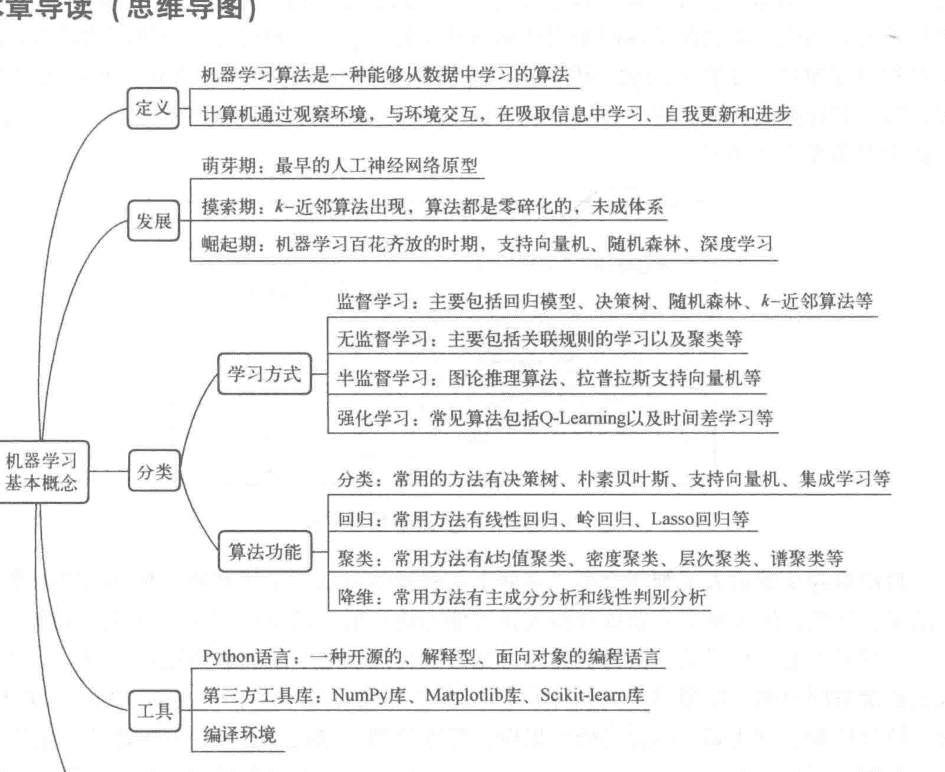
机器学习是多学科交叉的领域，集合了概率论、统计学、信息论、凸分析、算法复杂度等理论，致力于研究计算机如何模拟人类学习行为，以获得新知识、新技能并不断提升自身性能。该学科发展迅猛，已成为广阔的研究方向。本章对人工智能与机器学习的基础知识、工具使用及典型示例进行介绍，为后续深入学习奠定基础。


## 1.1 人工智能与机器学习

人工智能已成为应用广泛且研究活跃的领域，正快速发展。据斯坦福大学近期报告，2022年全球私人部门对AI的投入达919亿美元；2019年全球AI论文发表量超12万篇；2000至2019年间，AI论文占同行评审论文总量的比例由0.8%攀升至3.8%。总体来看，人工智能方兴未艾。通俗而言，人工智能即赋予机器类人智能的技术，其目标是让机器像人一样感知、思考、行动并解决问题。我们期望智能软件能自动处理常规劳动、理解语音图像、辅助医学诊断并支撑基础科学研究。AI是一个宽泛的技术范畴，包含自然语言理解、计算机视觉、机器人、逻辑与规划等，并可视作计算机学科的子域，同时与心理学、认知科学、社会学等交叉。人工智能与机器学习的关系如图1-1所示。

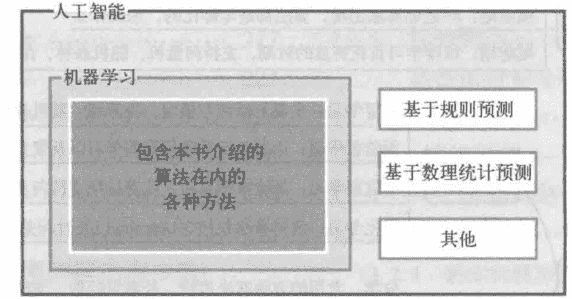
图 1-1 人工智能与机器学习

当前席卷全球的AI浪潮，本质上是机器学习近二十年理论与算法积累释放的结果，也得益于大数据与算力的提升，其所处阶段属于弱人工智能范畴。业界普遍认为机器学习是人工智能中最能体现智能性的分支。AI早期机器学习的内涵几乎全为符号学习，自20世纪90年代起，统计机器学习异军突起，迅速占据主导，取代符号学习地位。由符号学习转向统计学习，标志着机器学习从纯理论研究走向面向现实问题的应用研究，是科学进步的一种体现。

## 1.2 机器学习的概念

### 1.2.1 机器学习的定义

机器学习算法是指能够从数据中获取规律的算法。关于“学习”这一概念，可参照Tom Mitchell于1997年在《Machine Learning》中给出的表述：“对于任务类T和性能度量P，一个程序若能通过经验E改进在任务T上的性能P，则称该程序可从经验E中学习。”经验E、任务T与性能度量P的内涵十分宽泛，本书不作逐项界定，而将在后续章节通过直观解释与示例说明不同任务、度量与经验如何构建算法。

> Tom Mitchell, 1997. A program can be said to learn from experience E with respect to some class of task T and Performance measure P, if its performance at task T, as measured by P, improves with experience E.

机器学习的核心目标是将人类经验归纳的过程转化为计算机对数据的处理与建模过程，所得模型可近似人类方式解决复杂问题。简言之，机器学习是计算机通过观察环境、与环境交互，在信息积累中不断自我更新与进步。以程序为例，程序是一系列可执行的指令，如打印文档。机器学习与传统程序的本质差异在于，学习得到的程序可能是机器基于海量数据自行“编写”的。训练数据即是向机器提供的先验经验，如玫瑰与百合的特征、停车标志的含义等。训练的产出可视为机器生成的程序或存储的数据，即模型。总体上，训练可分为监督学习与无监督学习两大类。机器学习原理如图1-2所示。


### 1.2.2 机器学习发展史

机器学习是人工智能发展到一定阶段的必然产物，已成为解决众多AI问题的主流手段，其最早雏形可追溯至20世纪初。近百年间主要经历以下阶段。

1. 20世纪初至60年代初期萌芽期
1943年，神经科学家McCulloch与逻辑学家Pitts基于数理逻辑提出一种神经网络计算模型，成为人工神经网络的原型，为机器学习奠基。1949年，心理学家Hebb提出赫布学习规则，开启机器学习第一步。1950年，图灵发表《计算机与智能》，提出图灵测试，标志AI成为重要科学课题。50年代初已出现机器学习研究，如Samuel的跳棋程序。1952年，IBM研究员Samuel开发跳棋程序，通过观察位置学习隐含模型指导后续行动，最终棋力可与专业棋手抗衡。该工作驳斥了“机器无法超越人类且不能自学编程”的观点，并由他首次提出“机器学习”一词，定义为无需显式编程即可赋予计算机能力的领域。贝叶斯分类算法也在50年代起步，基于贝叶斯决策理论将样本归入后验概率最大的类别。

2. 20世纪60年代至80年代摸索期
1967年，K-近邻算法出现，使计算机可进行初级模式识别，其核心思想为样本在特征空间的k个最近邻多属某类则该样本亦属此类。60年代还诞生决策树算法，1986年Quinlan提出ID3，降低树深、加速运行；后续的C4.5在ID3基础上改进，兼顾分类与回归。层次聚类诞生于1963年，符合直观思维并沿用至今；K-均值可追溯至1967年，是变种最多、应用最广的聚类方法之一。1974年，Werbos博士论文提出误差反向传播训练人工神经网络，解决了异或问题，使多层网络训练成为可能。1981年，Werbos提出MLP多层神经网络模型。80年代前算法较为分散，未成体系，但对后续发展意义重大。1980年夏，美国卡内基梅隆大学举办首届机器学习国际研讨会；同年《策略分析与信息系统》连载三期机器学习专辑；1983年Tioga出版社出版Michalski、Carbonell、Mitchell主编的《机器学习：一种人工智能途径》；1986年专业期刊Machine Learning创刊；1989年权威期刊Artificial Intelligence出版机器学习专辑，其内容后收录于Carbonell主编1990年出版的《机器学习：范型与方法》。

3. 20世纪90年代至今崛起期
90年代机器学习百花齐放，中期统计学习崛起并成为主流，代表技术为支持向量机SVM及核方法。相关研究可追溯到60-70年代，Vapnik于1968年提出VC维，1974年提出结构风险最小化原则，但直至90年代中期才成为主流：一方面90年代初才出现有效的SVM算法，其优势在90年代中期文本分类中显现；另一方面连接主义学习的局限促使研究者转向以统计学习理论为支撑的方法。SVM被广泛接受后，核技巧被大量引入机器学习各角落，核方法成为基础。2001年出现的随机森林与AdaBoost同属集成学习，虽结构简单却表现优异，至今仍被广泛使用。1980至2012年深度学习兴起前，监督学习快速发展，多种方法涌现却未出现绝对优势。2006年Hinton提出深度学习模型，开启深度网络新时代。狭义深度学习指多层神经网络，在语音、图像等复杂任务上表现突出。传统方法对使用者要求较高，而深度学习模型复杂度高，通过调参即可显著提升性能，降低了应用门槛，尽管理论基础尚不完善，却推动了机器学习向工程实践迈进。

### 1.2.3 机器学习分类

1. 从学习方式上
按学习方式可分为监督学习、无监督学习、半监督学习与强化学习。

（1）监督学习
在监督学习中，模型从带标签的训练数据中学习映射函数，用于对未知样本进行预测。训练集包含输入与输出，即特征与标签，标签由人工标注。代表算法包括回归、决策树、随机森林、K-近邻等。

（2）无监督学习
又称非监督学习，输入样本无标签，目标是挖掘数据的内在结构。常见场景为关联规则挖掘与聚类，典型算法有k均值、DBSCAN等。

（3）半监督学习
输入数据部分有标签、部分无标签，模型在学习数据内在结构基础上进行预测。适用于分类与回归，代表性方法有图论推理、拉普拉斯SVM等。

（4）强化学习
强调智能体根据环境反馈行动，以最大化预期收益。其思想源于行为主义心理学，即通过奖励与惩罚形成最优行为习惯。常见于动态系统与机器人控制，代表算法包括Q-Learning与时序差分学习。

2. 从算法功能上
按功能可分为分类、回归、聚类与降维。

（1）分类
分类是监督学习核心任务，从数据学习决策函数或分类器，对新样本输出有限离散类别。常用方法有决策树、朴素贝叶斯、SVM、集成学习等。

（2）回归
回归用于建模输入自变量与输出因变量间的函数关系，预测变量随输入变化的趋势。常用方法有线性回归、岭回归、Lasso回归等。

（3）聚类
聚类属于无监督问题，遵循“物以类聚”思想，通过样本相似度归纳类别，输出离散标签。常用方法有k均值、密度聚类、层次聚类、谱聚类等。

（4）降维
降维从高维数据中提取关键信息，转化为低维可计算问题。若输入输出皆已知属监督学习，仅有输入则属无监督学习。降维需保持原始数据分布与样本邻域关系。常用方法有主成分分析PCA与线性判别分析LDA。

## 1.3 机器学习工具

### 1.3.1 Python 语言

Python是一种开源、解释型、面向对象的编程语言，易于上手，适合教学与科研，被广泛用于程序设计教学、系统管理脚本开发及科学计算等领域。

Python诞生于1989年年末。1989年圣诞期间，荷兰CWI研究所研究员吉多·范罗苏姆为开发Amoeba分布式操作系统管理工具，需一种高级脚本语言。他借鉴教学语言ABC的语法，并从Modula-3借鉴错误处理机制，开发出Python。语言名源于他对BBC剧集《蒙提·派森的飞行马戏团》的喜爱。

ABC由范罗苏姆参与设计，本为非专业程序员的高质量语言，却因非开源而未成功。范罗苏姆在设计Python时避免了这一缺陷，保留ABC优点并融合UNIX Shell与C语言习惯，成为UNIX/Linux开发者偏爱的语言。

Python于1991年初首版1.0开源发布，因功能强大迅速壮大，形成庞大社区。2000年10月发布Python2.0，增加诸多新特性，社区影响力提升。2008年12月发布Python3.0，语法与标准库用法变化较大，2.x与3.x扩展库兼容性差，导致旧代码难以直接运行。为平滑迁移，发布2.6与2.7过渡版本，兼容2.x语法并引入部分3.0特性。Python3.x设计更合理、高效、人性化，提升了开发与运行效率。

Python 3 入门与环境搭建指南

现阶段 Python 官方已终止对 2.x 分支的维护与更新。仍在沿用旧版的团队和个人，建议尽快迁移至 Python 3 的较新发行版。这样可让项目保持更新、更安全可靠，同时也能享受到 3.x 带来的诸多改进与新功能，更贴合技术演进方向。

伴随 Python 生态扩张，基于 3.x 的第三方模块数量持续攀升。本书示例均在 Windows 平台的 Python 3 环境下运行，参考的最高安装版为 3.11.5。

Python 以简洁明了著称，能帮助新手跳脱繁琐语法，集中精力在问题拆解、逻辑设计与算法实现上。以下概括其核心优势。

- (1) 入门门槛低
语法结构简洁，遵循优雅明确的设计原则，上手快、阅读顺畅、维护轻松。

- (2) 解释执行
解释器在运行时直接把源码转为可执行形式，无需手动编译链接，使用起来更省心。

- (3) 面向对象
同时支持过程式与面向对象式编程，设计思路灵活可变。

- (4) 免费开源
属于自由开源软件范畴，可自由复制分发、查阅源码、进行修改，甚至将其片段整合进其他开源项目。

- (5) 跨平台移植
得益于开源生态，已在 Windows、Linux、macOS、Android 等多种系统上实现运行。

- (6) 标准库丰富
官方自带一套完善的标准库，配合海量第三方包，可覆盖 I/O、文件操作、数据库、网络、图像、文本等诸多场景，大幅减少重复编码。

- (7) 可扩展可嵌入
性能关键段可用 C/C++ 实现后供 Python 调用；反之亦可把 Python 嵌入 C/C++ 项目，以提供脚本能力。

### 1.3.2 第三方工具库
除语言本身优势外，Python 拥有众多高质量第三方模块，对跨学科应用助力明显。目前相关技术发展迅猛，使用人群持续扩大，在软件开发中应用广泛。

- （1）操作系统管理与维护
Python 暴露系统管理 API，能便捷地操控操作系统。以 Python 编写的运维脚本在可读性、可复用性和可扩展性上通常优于传统 shell 脚本。

- （2）科学计算与数据可视化
生态中汇聚了大量科学计算、可视化与机器学习工具，如 NumPy、SciPy、SymPy、Matplotlib、Traits、OpenCV、Scikit-learn 等，支撑数值计算、数据分析、模型训练、二维三维绘图、图像处理与界面构建等。

Python 中与机器学习关联紧密的主要库有：

NumPy 库：构成科学计算基石，提供高效矩阵运算能力。

Matplotlib 库：常用绘图工具，能快速把计算结果转换为多种图表形式。

Scikit-learn 库：开源机器学习工具包，提供从数据预处理到模型训练、交叉验证、算法实现与可视化的一整套接口，可大幅减少代码量。

- （3）图形用户界面开发
Python 支持桌面 GUI 开发，可借助 Tkinter、wxPython、PyQt 等构建跨平台应用。

- （4）文本处理
re 模块提供正则支持，同时内置 SGML、XML 解析模块，便于开发 XML 相关程序。

- （5）网络编程及 Web 开发
Socket 模块对底层接口做了二次封装，支持网络编程。还提供 urllib、cookielib、httplib、scrapy 等模块用于网页读取与处理，结合多线程可快速实现 Web 应用。Web 框架方面，常见选择有 Web2Py、Django 等。

- （6）数据库编程
Python 提供符合 DB-API 规范的模块，可与 SQLite、MySQL、SQL Server、Oracle 等主流关系数据库通信。此外自带 Gadfly 模块，可提供完整的 SQL 环境。

- （7）游戏开发
Python 在网络游戏开发中应用广泛，Pygame 模块可在 Python 程序中创建功能丰富的游戏和多媒体程序。

### 1.3.3 开发环境搭建
Python 跨平台，可在 Windows、macOS、Linux/UNIX 运行。入门前需先搭建开发环境，以下以 Windows 为例说明。

1. Python 下载与安装
Python 属于解释型语言，搭建开发环境即安装解释器。Python 开源，可从官网获取安装包。例如 Windows 安装包地址为 “https://www.python.org/downloads/windows/”，打开后界面对应图1-3a，Python 3.11.5 的下载页对应图1-3b，用户可按需求挑选32位或64位版本。


下载完成后即可安装，以 64 位系统为例，流程如下。

- (1) 启动安装
双击安装包启动向导，参考图1-4，需勾选 “Add python.exe to PATH” 复选框来配置运行路径。

- (2) 自定义安装
在图1-4中点击 “Customize installation” 进入特性选择页，见图1-5，通常无需改动，直接按 Next 继续。


- (3) 高级选项设置
按需在高级选项里调整安装路径等参数，参考图1-6，随后点 Install 启动安装，进度条见图1-7。


图 1-6 Python 设置高级选项


图 1-7 安装进度

### 4. 安装完成
安装完成后显示成功页，见图1-8，点击 Close 结束。开始菜单中会出现 Python 3.11 程序组，图1-9 所示。

> 安装时务必勾选 “Add python.exe to PATH” 复选框。


图 1-8 安装成功界面

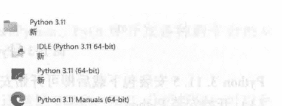

图 1-9 Python 3.11 程序组

2. 系统环境变量设置
默认安装目录下包含 python.exe、库文件等。为了在 Windows 命令提示符中自动定位到这些文件，需要把安装文件夹加入环境变量 Path。

Windows 下添加环境变量有两种做法。

- （1）安装时直接添加
安装时勾选图1-4中 “Add python.exe to PATH” 复选框，系统会自动把安装路径写入 Path。

- （2）安装后手动添加
若安装时未勾选，则可在安装后手动添加。操作过程如图1-10所示：

1） 在桌面右键点击 “计算机”，选择 “属性”，进入后选择 “高级系统设置”。

2） 在弹出的 “系统属性” 对话框中切换到 “高级” 选项卡，点击 “环境变量” 按钮，打开 “环境变量” 对话框。

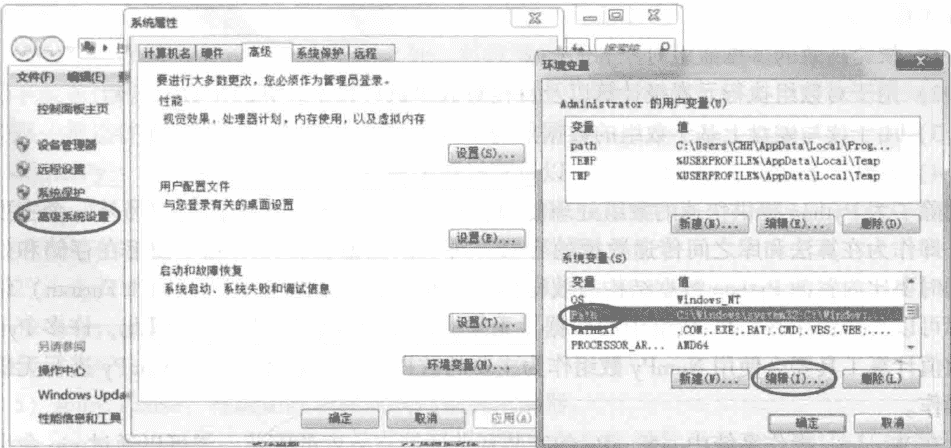

图 1-10 手动添加 Python 环境变量

3) 在 “系统变量” 区域选中 “Path”，点击 “编辑”，将 Python 安装路径 “C:\python\” 假设 C:\python 为安装目录 追加到 Path 中，最后依次点 “确定” 返回。

3. Python 运行
安装完成后，可通过图1-9中的 “Python 3.11（64-bit）” 启动解释器，也可通过 “IDLE（Python 3.11 64-bit）” 启动集成开发环境。解释器启动后可在提示符 >>> 后输入语句。例如输入 print("Hello Python!")，下一行会直接输出 “Hello Python!”，无需编译即可解释运行，如图1-11所示。IDLE 中同样可得到相同输出，如图1-12所示。

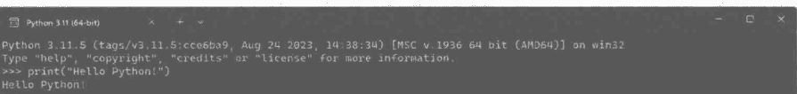

图 1-11 Python 3.11.5 解释器运行窗口

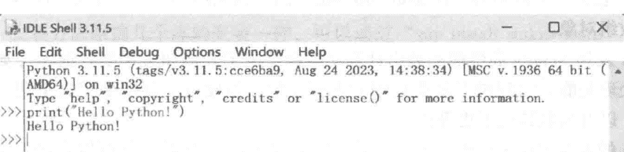

图 1-12 Python 3.11.5 IDLE 运行窗口

### 1.3.4 库的下载与安装

1. NumPy
NumPy 是 Python 科学计算的基础包，主要功能包括：

- 1) 高效的多维数组对象 ndarray。
- 2) 对数组进行元素级计算及数学运算的函数。
- 3) 读写硬盘上基于数组的数据集的工具。
- 4) 线性代数运算、傅里叶变换及随机数生成。

除提供快速数组处理能力外，NumPy 还作为算法与库之间传递数据的容器。对数值型数据，NumPy 数组比内置 Python 结构更高效，且由 C、Fortran 等编写的库可直接操作其数据，无需复制。因此许多数值计算工具以 NumPy 数组为主数据结构或与其无缝协作。

在 Windows 上，NumPy 可通过 pip 安装，命令如下：

```
pip install numpy
```

也可自行下载源码后执行：

```
python setup.py install
```

安装后即可对数据进行操作，如下所示：

```
import numpy as np                     # 一般以 np 作为 NumPy 库的别名
a = np.array([2,0,2,3])                # 创建数组
print(a)                               # 输出数组
print(a[:3])                           # 引用前三个数字（切片）
print(a.min())                         # 输出 a 的最小值
a.sort()                               # 将 a 的元素从小到大排序，此操作直接修改 a，因此这时 a 为[0,2,2,3]
b = np.array([[1,2,3],[4,5,6]])         # 创建二维数组
print(b * b)                           # 输出数组的平方阵，即[[1,4,9],[16,25,36]]
```

2. Pandas
Pandas 提供处理结构化数据的丰富数据结构与函数，自 2010 年出现以来推动 Python 成为高效数据分析环境。核心对象是面向列的二维表 DataFrame，以及一维标签化数组 Series。

Pandas 兼具 NumPy 的高性能数组计算和电子表格、关系数据库的灵活处理能力，索引功能细腻，便于重塑、切片、聚合与子集选取。

安装相对简单，先装好 NumPy 后执行 “pip install pandas” 或下载源码后执行 “python setup.py install” 即可。

3. Matplotlib
Matplotlib 是最流行的 Python 二维数据可视化库，由 John D. Hunter 创建，现由庞大团队维护，适合制作出版级图表。虽有其他可视化库，但 Matplotlib 使用最广且与生态工具配合良好。

安装通常执行 “pip install matplotlib” 或下载源码安装。需要注意的是其上级依赖较多，手动安装时需逐一部署依赖。

4. SciPy
SciPy 是一组解决科学计算标准问题的包集合，主要包括：

- 1) scipy.integrate：数值积分与微分方程求解。
- 2) scipy.linalg：扩展 numpy.linalg 的线性代数与矩阵分解。
- 3) scipy.optimize：函数优化与根查找。
- 4) scipy.signal：信号处理工具。
- 5) scipy.sparse：稀疏矩阵与稀疏线性系统求解。
- 6) scipy.special：SPECFUN Fortran 库的包装，提供伽马函数等常用数学函数。
- 7) scipy.stats：标准连续离散概率分布、统计检验与描述统计。

NumPy 与 SciPy 结合构成成熟计算平台。SciPy 依赖 NumPy，安装方式与 NumPy 相同，可通过 “pip install scipy” 完成。

5. Scikit-learn
Scikit-learn 于 2010 年诞生，是 Python 通用机器学习工具包，得到了全球 1500 多名贡献者的支持。其子模块包括：

- 分类：SVM、近邻、随机森林、逻辑回归等。
- 回归：Lasso、岭回归等。
- 聚类：k 均值、谱聚类等。
- 降维：PCA、特征选择、矩阵分解等。
- 模型选择：网格搜索、交叉验证、度量。
- 预处理：特征提取、标准化。

Scikit-learn 对 Python 成为高效数据科学语言起关键作用。依赖 NumPy、SciPy 和 Matplotlib，先安装这几个库后执行 “pip install scikit-learn” 或下载源码安装即可。

## 1.4 机器学习示例
近年来机器学习发展迅猛，已成为计算机视觉、语音识别、自然语言处理、数据挖掘等领域的核心技术，并与普通人生活紧密相关。例如天气预报、能源勘测、环境监测等领域，利用机器学习分析卫星与传感器数据可提升预报与检测精度；在商业营销中，分析销售数据与客户信息可帮助商家优化库存、降低成本并制定精准营销策略。随着数据积累与算力提升，机器学习的应用边界仍在持续扩展。

### 1.4.1 自动驾驶

“自动驾驶”这一说法最初在飞机、火车和航运的辅助驾驶场景里被提及。放宽来看，它指的是不需要人持续干预就能自动掌控交通工具行驶路径的系统。仅以美国为例，交通事故平均每天吞噬 103 条生命，其中超过 94% 的碰撞都可归因于驾驶员失误。推演到极致，一个理想化的自动驾驶体系每年有望挽救约 120 万人命。当然，现阶段技术尚远未完美，但在算法与传感器持续迭代的推动下，业界普遍认为不久的将来自动驾驶的安全水平会超越普通人类司机。自 21 世纪初汽车巨头提出这一设想以来，自动驾驶成为人们心驰神往的出行形态。互联网公司与传统车企纷纷重金押注，角逐这场以人工智能为核心的出行变革。

支撑自动驾驶的技术大致可拆解为三层：

- 上层决策：路径规划、路况分析、交通调度。
- 中层决策：目标识别、障碍监测、规则遵循。
- 下层执行：巡航控制、ABS 防抱死、牵引力与燃油喷射的电子控制、发动机标定。

三层架构中都离不开人工智能的参与，图 1-13 展示了常见算法与自动驾驶场景的对应关系。

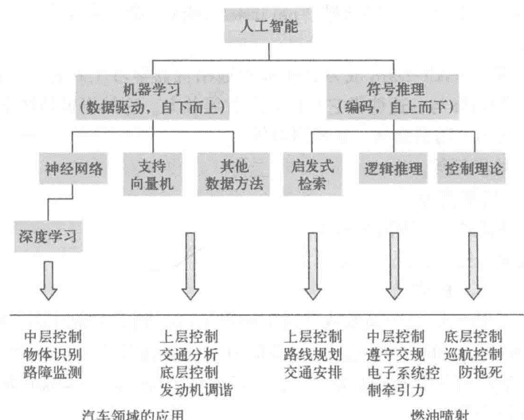

图 1-13 人工智能算法和在自动驾驶中的应用场景

美国在 20 世纪 80 年代就启动相关探索，最大的痛点在于无法在工厂里预先把车辆上路后所有可能情况都枚举并写成规则，只能依赖行驶中实时处理。把车载传感器采集的数据当作输入、方向盘制动油门的控制行为当作输出，问题本质上就是一个机器学习任务。2004 年 3 月，美国莫哈韦沙漠举办了首届自动驾驶长距离赛事 DARPA Grand Challenge。15 支决赛队伍在约 228.5 公里赛道同场竞技，最终无一人完赛，甚至无人接近全程。成绩最好的是卡内基梅隆大学红队，驾驶悍马沙暴行驶约 11.9 公里，仅完成 5%。这 5% 的里程具有里程碑意义，一个全新产业由此萌芽。彼时完成该路段对老练的人类司机也属挑战。随后几年发展迅猛，除谷歌外，通用、大众、宝马等传统厂商均加大投入并推出产品：2011 年 6 月，内华达州率先立法认可自动驾驶，夏威夷与佛罗里达随后跟进，自动驾驶汽车逐步进入公众视野，机器学习技术正扮演“司机”角色。

### 1.4.2 机器翻译

机器翻译属于计算语言学范畴，也是人工智能的重要落地方向，最早的研究可追溯至 20 世纪 50 年代。借助计算机把一种语言文本转成另一种语言，已成为化解语言壁垒的关键手段之一。早在 2013 年，谷歌翻译的日均服务量就达 10 亿次，相当于全年人工翻译总量，所处理文字约等于 100 万册图书。

研究路径经历了规则式、统计式、神经式三个阶段。近年神经网络方法引入后性能跃升显著。谷歌翻译团队公布，2016 年 9 月中英神经网络模型上线，到 2017 年 5 月已覆盖 41 对语种，超过一半流量由神经模型承接。神经模型同样依赖平行语料训练，但与把模型拆分的统计机器翻译不同，它多以整体序列到序列形式呈现。以循环神经网络为例，先把源语言与目标语言词转化为向量表达，再用循环网络建模翻译过程，如图 1-14 所示。通常先用一个循环网络做编码器，把输入词序列压缩成向量表示，再用解码器循环网络从该向量解码出目标序列。近年来围绕神经翻译的改进持续涌现，如 LSTM、注意力机制、目标函数优化、无平行语料训练等，系统能力不断逼近人类水平。

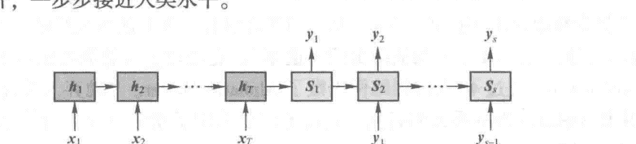

### 1.4.3 游戏中的人工智能

自文明诞生以来游戏便存在，被视为益智娱乐的结合体，相传围棋已有四千年历史。2016 年 1 月，谷歌 DeepMind 在《自然》发表论文《通过深度神经网络与搜索树掌握围棋》，提出监督学习、强化学习、深度学习与蒙特卡洛树搜索协同解决围棋难题。3 月，AlphaGo 与世界冠军李世石五番棋战，最终 4:1 取胜。年尾，网名 Master 的神秘高手在网络围棋平台以 60 连胜震惊棋坛，并在第 59、60 局间自曝为 AlphaGo。2017 年 5 月，AlphaGo 再与被视为世界第一的柯洁三番棋交锋，取得三连胜。AlphaGo 对战柯洁如图 1-15 所示。

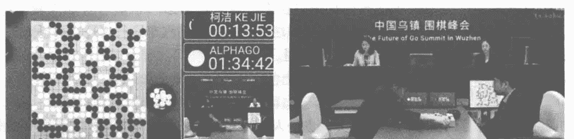

图 1-15 AlphaGo 对战柯洁

从技术角度看，AlphaGo 的关键在于深度神经网络、监督学习、强化学习与蒙特卡洛树搜索的深度融合。虽然蒙特卡洛树搜索早被用于棋类 AI，但 AlphaGo 首次以强化学习加深度神经网络来指导搜索。强化学习构成整体学习框架，策略网络与价值网络引导搜索；深度神经网络提供函数近似能力，策略网络初值由人类棋谱监督学习获得。与传统搜索不同，AlphaGo 提出异步策略价值蒙特卡洛树搜索 APV-MCTS。扩充树时依据监督策略网络新增边；节点评估时融合 rollout 结果与价值网络估计。训练分两阶段：先基于监督学习初始化策略网络，再用策略梯度在自我对弈上优化；随后通过大量自对弈与蒙特卡洛策略评估训练价值网络。训练监督策略网络在 50 核分布式平台约需三周。

2017 年 10 月 19 日，《自然》发表论文介绍 AlphaGo Zero：完全从零学习、无人类数据输入，迅速掌握围棋，并在三天内以 100:0 击败 AlphaGo Lee，四十天后击败 AlphaGo Master。抛弃人类经验和自我训练并非最大亮点，核心在于全新强化学习算法的提出，推动了该方向的发展。

## 1.5 本章小结

本章先阐释了人工智能与机器学习的关系；介绍了机器学习的定义、演进、分类等基础，并涉及 Python 语言、常用工具库与运行环境；最后列举了当前热门的机器学习应用案例。

## 1.6 延伸阅读——大数据背景下的机器学习算法

机器学习发展历程中存在两大主线：一是探究学习机制，模拟人类学习；二是高效利用信息，从海量数据中挖掘隐含、可解释的知识。学习机制是源头，但随数据爆发式增长，通过机器学习高效获取知识已成为主要驱动力。大数据的海量、多样、快速变化特性让传统小数据算法难以为继，因而大数据环境下的算法研究受到学界与业界共同关注。

大数据时代，机器学习更强调“学习是手段”，扮演支撑与服务角色，如何对复杂多样数据进行深度分析、更高效利用信息成为研究重点。机器学习正向智能数据分析方向演进，并成为其重要来源。

大数据机器学习算法大致涵盖：

- （1）数据分治与抽样
数据分治与并行处理是大数据处理基础，但现有方案较少利用数据分布特性，影响负载均衡与效率。学习数据分布以优化均衡仍是待解难题。
- （2）大数据特征选择
在数据挖掘、文档分类、多媒体索引等领域，属性与记录数巨大导致效率低下。属性选择可去噪、提升有效性与精度并降低耗时。面对大数据的高维多变特性，如何降维与选特征是迫切问题。
- （3）大数据分类
监督分类的新挑战是如何处理海量数据。大规模分类普遍存在，而传统方法难以直接迁移。针对不同算法研究并行或改进策略是研究主线。
- （4）大数据聚类
聚类是模式识别与数据挖掘的早期方法，常用于大数据库分析。大数据环境下经典聚类面临数据量大、体积庞大、复杂度高等挑战，改进并行化与提出新方法成为关键。
- （5）大数据并行算法
把传统算法搬到大数据环境，典型做法是并行化。如 GPU 平台凭借并行架构带来显著提速。如何设计高效并行策略以处理海量数据仍是热点。

## 1.7 习题

- 1. 填空题

- 1) 机器学习是一门______的学科，涉及______、______、______、______、______等多门学科。专门研究计算机怎样______或______的学习行为，以获取新的知识或技能，重新组织已有的知识结构，使之不断改善自身的性能。

- 2) 机器学习算法从学习方式上可以分为：______、______、______、______；按功能可分为：______、______、______、______。

- 3) Scikit-learn 中识别对象是哪个类别的模块是______，预测与对象相关联的连续值属性的模块是______，将相似对象自动分组的模块是______，数据导入模块是______。

- 4) Python 的特点有______、______、______、______、______、______和______。

- 2. 简答题

- 1) 简述机器学习的应用领域。

- 2) 机器学习分类有哪些？

- 3) 简述机器学习的发展历史。

- 4) 简述机器学习能在互联网搜索的哪些环节起作用。

- 5) 什么是监督学习、无监督学习和半监督学习？它们各自有哪些特点及区别？

- 6) 机器学习与人工智能有什么关系和区别？

- 7) 有哪些常见的 Python 库？

# 第 2 章 机器学习基本理论

## 本章导读（思维导图）

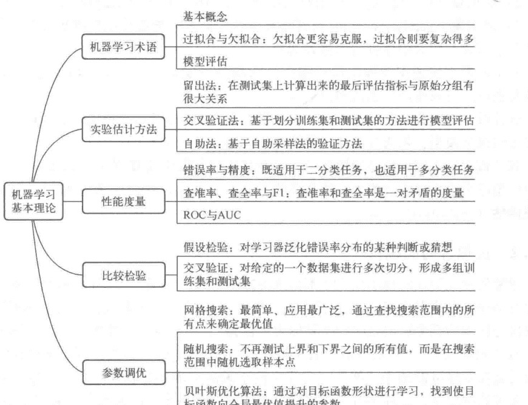

机器学习离不开数据与模型，俗话说“巧妇难为无米之炊”，数据为“米”，模型为“巧妇”。缺乏足够数据与合适特征，再强模型也难以得到理想输出。业界常说“Garbage in, garbage out”。对一个机器学习问题，数据与特征决定结果上限，模型与算法选择及调优则不断逼近上限。本章将围绕“数据”与“模型”介绍相关基础与基本理论。


扫码看视频

## 2.1 机器学习术语

### 2.1.1 基本概念

数据集是由数据组成的集合，通常以表格呈现，每一行代表一个事件或对象，被称为样本或实例；每一列反映该事件或对象的某一方面，称为特征或属性。属性取值称为属性值或特征值。所有属性构成的空间称为属性空间、样本空间或输入空间。该空间中每个点可用向量表示，称为特征向量，对应一个实例。

模型指描述特征与问题之间关系的数学对象。从数据中用算法得到模型的过程称为学习或训练。

训练过程中数据通常划分为三种：

- 1) 训练集：用来训练模型的一部分数据。
- 2) 测试集：用于检验已训练模型或算法性能的数据集。
- 3) 验证集：有时从训练集再拆分，用于学习过程中的模型调参与选择。

实例中描述模型输出可能取值称为标签或标记。特征是固有属性，标签是基于固有属性的认知。

训练迭代多次后模型损失不再变化或变化极小，说明当前样本难以再改进模型，称模型收敛。

把新数据输入训练好的模型进行判断称为预测。模型对新样本的适用能力称为泛化能力。检验模型效果的方法称为模型评估。

### 2.1.2 过拟合与欠拟合

把分类错误的样本数占总数的比例称为错误率，若 m 个样本中有 n 个错，则错误率 F=n/m；精度 A=1−F。更一般地，学习器的预测输出与真实输出的差异称为误差，训练集上的误差为训练误差或经验误差，新样本上的误差为泛化误差。理想情况是泛化误差尽可能小，实际中只能尽量降低经验误差。大多数情况下可得到训练集上经验误差很小甚至零的学习器，但通常并不理想。

我们希望学习器从训练样本中归纳出适用于所有潜在样本的普遍规律，从而在新样本上表现良好。当学习器把训练样本学得过好时，可能把特有噪声当成普遍规律，导致泛化性能下降，这就是过拟合；反之，对训练样本一般性质学习不足则是欠拟合。过拟合与欠拟合如图 2-1 所示。

过拟合是机器学习的关键难题，各类算法都带缓解措施但难以根除。常见处理手段大致为：

- 1) 从数据入手，增加训练数据。更多样本有助于学习有效特征、降低噪声影响。直接扩增实验数据困难时，可通过平移、旋转、缩放等规则扩充，或用生成式对抗网络合成数据。
- 2) 降低模型复杂度。在数据量有限时，过复杂的模型易过拟合。可减少神经网络层数与神经元数，或对决策树限制深度与剪枝。
- 3) 正则化方法。对参数施加约束，如把权重大小加入损失函数。
- 4) 集成学习方法。将多个模型组合，降低单一模型的过拟合风险。

欠拟合相对易解，通常源于学习能力不足，可通过提升能力改善，常见做法为：

- 1) 增加新特征。当特征不足或与标签相关性弱时易欠拟合。挖掘上下文特征、组合特征往往能提效；深度学习模型如因子分解机、梯度提升决策树也可辅助特征工程。
- 2) 提升模型复杂度。例如线性模型加入高次项，神经网络增加层数或神经元。
- 3) 减小正则化系数。正则化用于防过拟合，当出现欠拟合时需相应调小系数。

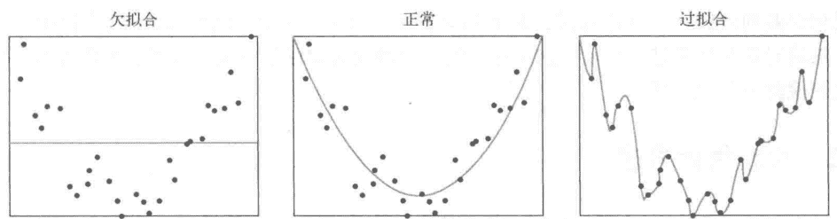

图 2-1 过拟合和欠拟合

### 2.1.3 模型评估

评估先行：模型选择才有依据

模型研发本质上是一场考量取舍的实践，没有可信的度量就没有科学的决策。评估方式是否贴合实际问题，直接影响到算法筛选和超参数调整时能否及时发现问题并迭代优化。现实里可选的学习器数量众多，同一个算法换一套参数也会得出迥异的结果，选型和调参正是机器学习中典型的模型选择难题。理论上最靠谱的是泛化误差，可它无法直接拿到；训练误差容易算，却常因过拟合而失真。实践中只能借助实验来逼近真实表现。

常规做法是用测试集模拟模型面对新数据的能力，把测试集上的测试误差当作泛化误差的近似。整体思路可以拆成三步：先锁定实验评估策略，再确定性能度量指标，最后做结果比较。

## 2.2 实验估计方法

通常默认训练样本与测试样本都源自同一分布且相互独立。理想状态下测试集要与训练集完全隔离，测试样本绝不参与训练。否则就如同课堂上老师把练习题原封不动搬到考卷上，分数再高也失真，因为有人只会那几道题。工程中我们往往只拿到一个包含 m 个样例的数据集 D，需要从中切出训练部分和测试部分。下面梳理几种常见切分思路。

### 2.2.1 留出法

留出法是最直观的验证手段，把原始样本随机切成两块，一块用于训练，一块用于测试。以点击率预测为例，可把数据按 70% 与 30% 拆开，70% 拟合模型，30% 检验，随后绘制 ROC、计算准确率与召回率等。

切分时要尽量维持数据分布的一致性，避免因划分引入额外偏差。比如分类任务要尽量保持类别比例，这种按比例抽取的做法通常叫做分层抽样。若 D 中正负各 500 条，分层抽样得到的 70% 训练集 S 应包含 350 个正例和 350 个反例，30% 测试集 T 则各 150 个；若两部分类别比例差距很大，误差估计就会失真。

即便比例固定，划分方式也很多，前 350 个正例放进训练集和后 350 个放进去会得到不同结果。单次留出估计不够稳健，实践中常做多次随机划分取平均，例如重复 100 次，每次得到一组训练/测试划分，最终返回 100 次结果的均值。

这里存在取舍：希望评估的是用全部 D 训练的模型性能，但留出法必须拿出一部分做测试。若训练集 S 占绝大多数，模型更接近全量训练的效果，但测试集 T 太小评估就不稳定；若 T 偏大，S 与 D 的差异增大，评估的保真度会下降。目前没有完美解法，常见做法是拿约 2/3 到 4/5 的数据做训练，剩余做测试。

在 scikit-learn 中，train_test_split 负责把数据拆分为训练与测试两部分，签名如下：

```
sklearn.model_selection.train_test_split(X, y, * *options)
```

重点配置项如下。

- 1) X、y：特征矩阵与标签向量。
- 2) test_size：控制测试集规模，接受小数比例或绝对数量。若缺省则默认 0.25。可用形式有：① 小数，取值 0.0~1.0 表示占比；② 整数，表示绝对样本数。
- 3) train_size：控制训练集规模，接受小数比例或绝对数量。若缺省则默认 0.75。可用形式有：① 小数，取值 0.0~1.0 表示占比；② 整数，表示绝对样本数。
- 4) random_state：随机种子，可为整数、RandomState 实例或 None。
- 5) stratify：若传入标签 y，则按 y 的类别比例分配训练集和测试集，使两部分类别构成与原数据一致。可为数组或 None。

会返回一个列表，按顺序给出各数据集的划分结果，每个数据集都包含训练部分和测试部分。

【例2-1】对数据集进行划分

示例代码如下：

```
from sklearn.model_selection import train_test_split
import numpy as np
# 生成 8 行 4 列的随机整数二维数组，最大值为 50
X = np.random.randint(50, size=(8, 4))
y=[1,1,0,0,1,1,0,0]
X_train,X_test,y_train,y_test=train_test_split(X,y,test_size=0.4,random_state=0)
print('X_train:',X_train)
print('X_test:',X_test)
print('y_train:',y_train)
print('y_test:',y_test)
X_train,X_test,y_train,y_test=train_test_split(X,y,test_size=0.4,random_state=0,stratify=y)
print('Stratify_X_train:',X_train)
print('Stratify_X_test:',X_test)
print('Stratify_y_train:',y_train)
```

运行结果如下：

```
X_train: [[ 0 48 27 22] [28 27 5 32] [36 33 11 31] [23 40 20 20]]
X_test: [[ 3 34 19 0] [37 15 27 15] [40 10 32 8] [44 30 43 23]]
y_train: [0, 1, 1, 1]
y_test: [0, 0, 1, 0]
```

```
Stratify_X_train: [[23 40 20 20] [ 3 34 19 0] [28 27 5 32] [44 30 43 23]]
Stratify_X_test: [[37 15 27 15] [ 0 48 27 22] [40 10 32 8] [36 33 11 31]]
Stratify_y_train: [1, 0, 1, 0]
Stratify_y_test: [0, 0, 1, 1]
```

> 留出法短板很明显，测试集上的评估结果对原始分组很敏感。为削弱随机性，研究者提出了交叉验证的思路。

### 2.2.2 交叉验证法

交叉验证先把全部样本均分为 k 个大小相近的子集，然后轮流把其中一个子集拿出来当测试集，其余 k-1 个合并成训练集，完成训练与评估；k 次循环后取平均作为最终指标。数据量小时 k 可以取大些，提高训练比例，但会增加训练次数；数据量大时 k 宜偏小，提升效率。实践中最常用的是 10 折交叉验证，图 2-2 给出了其示意图。

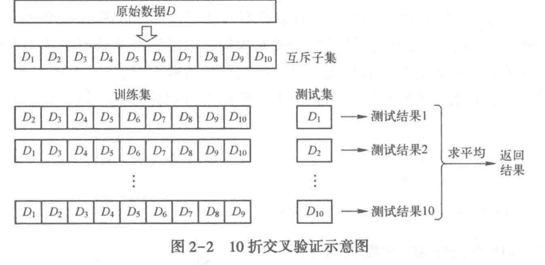

Scikit-learn 提供的 KFold 类实现了数据集的 k 折交叉验证，其函数原型如下：

```
sklearn.model_selection.KFold(n_splits=3, shuffle=False, random_state=None)
```

常用配置如下：

- 1) n_splits：k 的取值，整型，需 ≥2。
- 2) shuffle：在切分前是否先打乱数据，布尔值，默认 False。设为 True 则先打乱再切分。
- 3) random_state：随机种子，可为整数、RandomState 实例或 None。

主要能力为：

split(X,y)：把数据切分为训练集和测试集。X 为样本矩阵，形状 (n_samples, n_features)；y 为标签，可选，形状 (n_samples)。输出为长度 k 的列表，每行给出训练集与测试集的下标。

Scikit-learn 提供的 StratifiedKFold 类实现了分层采样的 k 折交叉验证，用法与 KFold 接近，但 StratifiedKFold 会保持各类别比例，使训练集、测试集中类别构成与原始数据一致，其函数原型如下：

```
sklearn.model_selection.StratifiedKFold(n_splits=3, shuffle=False, random_state=None)
```

参数与 KFold 保持一致。

### 【例2-2】比较 KFold 和 StratifiedKFold 的区别

```
from sklearn.model_selection import KFold, StratifiedKFold
import numpy as np
X = np.random.randint(50,size=(8, 4))
y=np.array([1,1,0,0,1,1,0,0])
folder=KFold(n_splits=3, random_state=0, shuffle= False)
for train_index, test_index in folder.split(X,y) :
print('Train_index:',train_index)
print('Test_index:',test_index)
print('Y_train:',y[train_index])
print('Y_test:',y[test_index])
folder=StratifiedKFold(n_splits=3, random_state=0, shuffle= False)
for train_index, test_index in folder.split(X,y) :
print('Stratify_train_index:',train_index)
print('Stratify_test_index:',test_index)
print('Stratify_Y_train:',y[train_index])
print('Stratify_Y_test:',y[test_index])
```

运行结果如下：

```
Train_index: [3 4 5 6 7]
Test_index: [0 1 2]
Y_train: [0 1 1 0 0]
Y_test: [1 1 0]
Train_index: [0 1 2 6 7]
Test_index: [3 4 5]
Y_train: [1 1 0 0 0]
Y_test: [0 1 1]
Train_index: [0 1 2 3 4 5]
Test_index: [6 7]
Y_train: [1 1 0 0 1 1]
Y_test: [0 0]
Stratify_train_index: [4 5 6 7]
Stratify_test_index: [0 1 2 3]
Stratify_Y_train: [1 1 0 0]
Stratify_Y_test: [1 1 0 0]
Stratify_train_index: [0 1 2 3 5 7]
Stratify_test_index: [4 6]
Stratify_Y_train: [1 1 0 0 1 0]
Stratify_Y_test: [1 0]
Stratify_train_index: [0 1 2 3 4 6]
Stratify_test_index: [5 7]
Stratify_Y_train: [1 1 0 0 1 0]
Stratify_Y_test: [1 0]
```

scikit-learn 还提供 cross_val_score，可在切分数据后自动完成训练、测试并计算指标。其函数原型如下：

```
sklearn.model_selection.cross_val_score(estimator, X, y=None, scoring=None, cv=None, n_jobs=1, verbose=0, fit_params=None, pre_dispatch='2 * n_jobs')
```

主要参数如下。

- 1. estimator：待评估的学习器，必须实现 fit 方法。
- 2. X：样本集。
- 3. y：标签集。
- 4. scoring：评分函数，形式为 score(estimator, X, y)。可为字符串、可调用对象或 None。若不指定则使用学习器自身的 score 方法。可选值包括：① accuracy，使用 metrics.accuracy_score；② average_precision，使用 metrics.average_precision_score；③ f1 系列，使用 metrics.f1_score，其中 f1_micro 为 micro 平均，f1_weighted 为加权平均，f1_samples 为按样本多标签平均；④ log_loss，使用 metrics.log_loss；⑤ precision，使用 metrics.precision_score；⑥ recall，使用 metrics.recall_score；⑦ roc_auc，使用 metrics.roc_auc_score；⑧ adjusted_rand_score，使用 metrics.adjusted_rand_score；⑨ mean_absolute_error，使用 metrics.mean_absolute_error；⑩ mean_squared_error，使用 metrics.mean_squared_error；⑪ r2，使用 metrics.r2_score。
- 5. cv：k 的取值，可为整数、k 折生成器、迭代器或 None。若缺省则默认 3 折。可选：① None，使用默认 3 折；② 整数，指定 k；③ k 折生成器，直接传入；④ 迭代器，迭代结果即划分方案。
- 6. fit_params：fit 方法的额外关键字参数，字典形式。
- 7. n_jobs：并行数，整型，默认 -1 表示使用全部 CPU。
- 8. verbose：日志输出控制，整型。
- 9. pre_dispatch：并行分发任务总量控制，整数或字符串。

返回值是一个浮点数数组，每个元素对应一次 k 折评估的得分。

### 【例2-3】使用10折交叉对支持向量机在鸢尾花数据集上的分类效果进行评估

参考程序如下：

```
from sklearn.model_selection import cross_val_score
from sklearn.datasets import load_digits
from sklearn.svm import LinearSVC
digits = load_digits( )
X = digits.data
y = digits.target
result = cross_val_score(LinearSVC( ), X, y, cv=10)
print( " Cross Val Score is:", result)
```

使用 10 折交叉划分原始数据集，使用线性支持向量机作为学习器。结果如下：

Cross Val Score is: [0.8972973 0.91256831 0.87292818 0.89444444 0.93296089 0.94972067 0.96089385 0.95505618 0.85875706 0.92045455]

同款线性支持向量机，仅是把训练集和预测集的配对换了十种，表现就明显拉开差距，最低只有约0.859，最高能到约0.961，波动幅度很大。

留一验证的思路很直白：样本总数为 n，就轮流把其中1个单独拿出来做验证，剩下的 n-1 个用于训练，遍历 n 次后把 n 次评估指标取平均作为最终结果。这种做法在样本量大的时候计算成本会变得非常沉重。留一验证其实是留 p 验证的特例，留 p 验证每次固定 p 个样本出来验证，从 n 个里挑 p 个的组合数是 C_n^p，计算量比留一更大，工程里基本不会用。

### 2.2.3 自助法

留出法和交叉验证本质上都是先把样本切成训练集和测试集再评估。样本本来就不多的时候再一刀切，训练集会更小，容易拖累模型效果。有没有一种方式能让训练集规模基本不变？自助法正好提供了这样一种思路。自助法基于有放回抽样，对总数为 n 的样本集合进行 n 次有放回随机抽样，凑出同样大小为 n 的训练集。抽样过程中有的样本被重复抽到，有的样本一次都没被抽中，没被抽中的那部分就被拿来做验证，这就是自助法的完整流程。

我们真正想评估的是在完整数据集 D 上训练出来的模型。留出法和交叉验证因为要扣出一部分样本做测试，实际训练时用的样本比 D 少，这会带来训练规模差异导致的估计偏差。留一法受样本规模变化的影响很小，但代价是计算量爆炸。如何既减少规模差异带来的影响，又能高效地做实验估计？

“自助法”提供了一个比较实用的折中方案，它直接建立在自助采样之上。假设数据集 D 里有 m 个样本，自助采样就是从 D 中有放回地抽取样本，每抽到一个就放到新集合 D′ 里，然后把抽到的样本放回 D，重复 m 次，最终得到大小仍为 m 的 D′。显然 D′ 中有些样本会出现多次，有些样本完全缺席。简单估算一下，某一个样本在 m 次抽样中一次都没被抽到的概率是 (1 - 1/m)^m ，令 m 趋于无穷可得

$$\lim_{m\to\infty}\left(1-\frac{1}{m}\right)^m = \frac{1}{e} \approx 0.368 \qquad (2-1)$$

也就是说，经过自助采样，原始集合 D 中大约有 36.8% 的样本没有进入 D′。于是可以用 D′ 作为训练集，D\D′ 作为测试集，其中“\”表示集合差。评估的模型和期望评估的模型都用了 m 个训练样本，而我们仍然保留了约三分之一、未参与训练的样本来做测试。这种基于未参与训练样本的估计常被称为“包外估计”。

> 自助法在数据量偏小、不方便做常规划分时很有用，而且它能从同一份原始数据中生成多组不同的训练集，这对集成学习类方法非常友好。不足之处在于，自助采样改变了原始数据的分布，会引入一定的估计偏差。所以当原始数据量足够大时，留出法和交叉验证的使用频率更高。

## 2.3 性能度量

性能度量是用来衡量模型泛化能力的评价标准，也体现了任务本身的需求。换一个度量，同一批模型的好坏排序往往会发生变化，这说明“好坏”是相对的，评价标准不仅取决于算法和数据，还由任务目标决定。

### 2.3.1 错误率与精度

错误率和精度是分类任务里最常用的两个指标，既适用于二分类，也适用于多分类。错误率是被分错的样本占总样本的比例，精度则是被分对的样本占总样本的比例。对样例集 D，分类错误率写作

E(f;D)= 1/m Σ_{i=1}^m 𝕀(f(x_i) ≠ y_i)   (2-2)

精度写作

acc(f;D)= 1/m Σ_{i=1}^m 𝕀(f(x_i)=y_i)=1−E(f;D)   (2-3)

推广到数据分布 D 与概率密度 p(·)，错误率和精度可写成

E(f;D)= ∫_{x~D} 𝕀(f(x)≠y) p(x)dx   (2-4)

acc(f;D)= ∫_{x~D} 𝕀(f(x)=y) p(x)dx =1−E(f;D)   (2-5)

### 2.3.2 查准率、查全率与 F1

错误率和精度虽然常用，却不能覆盖所有需求。以西瓜问题为例，给一车西瓜用模型挑选，错误率只能告诉我们整体判错的比例，但如果我们关心“挑出来的瓜里好瓜占多大比例”或“所有好瓜里被挑中的比例”，错误率就显得不够，这时需要查准率和查全率。

类似的需求在信息检索、Web 搜索中也很常见，比如“检索结果里有多少是用户真正感兴趣的”“用户感兴趣的内容有多少被检索出来”。查准率 precision 与查全率 recall 正好对应这两类关注。

对二分类问题，按真实类别与预测类别的组合，样本可分为真正例 true positive、假正例 false positive、真反例 true negative、假反例 false negative，分别记为 TP、FP、TN、FN，满足 TP+FP+TN+FN=样本总数。分类结果的混淆矩阵见表2-1。

### 表2-1 分类结果混淆矩阵

| 真实情况 | 预测结果 |  |

|---|---|---|

|  | 正例 | 反例 |

| 正例 | TP（真正例） | FN（假反例） |

| 反例 | FP（假正例） | TN（真反例） |

查准率 P 与查全率 R 定义为

$P = \frac{TP}{TP+FP}$  (2-6)

$R = \frac{TP}{TP+FN}$  (2-7)

查准率和查全率通常是此消彼长的关系。查准率高时查全率往往偏低，反之亦然。比如想把好瓜尽可能多地捡出来，就把阈值放宽、挑更多瓜，查全率会上升但查准率下降；反过来只挑最有把握的瓜，查准率提升但会漏掉不少好瓜。只有在很简单的任务上两者才能同时很高。

很多学习器会先给样本打分，再按分数从高到低排序。依次把样本判为正例，可以算出不同截断点的查准率和查全率，以查全率为横轴、查准率为纵轴作图，就得到 P-R 曲线。

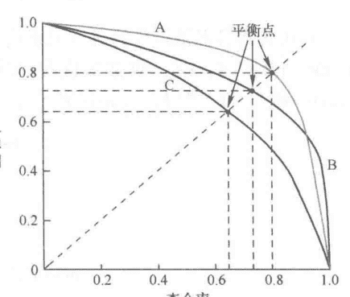

P-R 图能直观展示学习器在整体样本上的表现。若一个学习器的 P-R 曲线完全被另一个包住，则后者更优；若曲线交叉，则需要在具体查准率或查全率条件下比较。实践中常把 P-R 曲线下面积作为综合参考，但它不易精确估计，于是出现了一些综合度量。

平衡点 BEP 是查准率等于查全率时的取值，例如图 2-3 中学习器 C 的 BEP 约为 0.64，按 BEP 比较可认为学习器 A 优于学习器 B。更常用的综合指标是 F₁：

$F_1 = \frac{2PR}{P+R} = \frac{2TP}{\text{样例总数}+TP-TN}$  (2-8)

当对查准率和查全率的偏好不同时，可用 F_β 表述：

$F_\beta = \frac{(1+\beta^2)PR}{\beta^2P+R}$  (2-9)

β>0 反映查全率相对于查准率的重要性。β=1 时就是 F₁；β>1 时更看重查全率；β<1 时更看重查准率。

当存在多个二分类混淆矩阵时，需要汇总评估。一种做法是先算每个矩阵的 P_i、R_i 再求均值，得到宏查准率 macro-P、宏查全率 macro-R 和宏 F₁：

$\text{macro\_P} = \frac{1}{n}\sum_{i=1}^{n}P_i$  (2-10)

$\text{macro\_R} = \frac{1}{n}\sum_{i=1}^{n}R_i$  (2-11)

$\text{macro\_F}_1 = \frac{2\times\text{macro\_P}\times\text{macro\_R}}{\text{macro\_P}+\text{macro\_R}}$  (2-12)

另一种做法是先把各矩阵的 TP、FP、TN、FN 取平均，记为 TP̅、FP̅、TN̅、FN̅，再计算微平均：

$\text{micro\_P}=\frac{\overline{TP}}{\overline{TP}+\overline{FP}}$  (2-13)

$\text{micro\_R}=\frac{\overline{TP}}{\overline{TP}+\overline{FN}}$  (2-14)

$\text{micro\_F}_1 = \frac{2\times\text{micro\_P}\times\text{micro\_R}}{\text{micro\_P}+\text{micro\_R}}$  (2-15)

Scikit-learn 提供了常用指标的计算接口。

- 1. **accuracy_score**

用于计算分类准确率，原型为：

```
sklearn.metrics.accuracy_score(y_true, y_pred, normalize=True, sample_weight=None)
```

主要参数：

- 1) y_true：真实标签
- 2) y_pred：预测标签
- 3) normalize：是否返回比例，默认 True 返回比例，False 返回正确数量
- 4) sample_weight：样本权重，默认 None

### 2. precision_score

用于计算查准率，原型为：

```
sklearn.metrics.precision_score(y_true, y_pred, labels=None, pos_label=1, average='binary', sample_weight=None)
```

主要参数：

- 1) y_true
- 2) y_pred
- 3) labels：指定计算类别
- 4) pos_label：指定正类标签
- 5) average：多分类时的平均方式
- 6) sample_weight：样本权重

average 可选：

- ① micro：汇总全部类别的 TP、FN、FP 后计算
- ② macro：各类别查准率的算术均值
- ③ weighted：按样本数加权平均
- ④ binary：二分类专用

### 3. recall_score

用于计算查全率，原型为：

```
sklearn.metrics.recall_score(y_true, y_pred, labels=None, pos_label=1, average='binary', sample_weight=None)
```

参数与 precision_score 相同。

### 4. f1_score

用于计算 F₁，原型为：

```
sklearn.metrics.f1_score(y_true, y_pred, labels=None, pos_label=1, average='binary', sample_weight=None)
```

参数与 precision_score 相同。

### 【例 2-4】 分别计算分类结果的准确率、查准率、查全率和 F₁

参考程序如下：

```
from sklearn.metrics import accuracy_score,precision_score,recall_score,f1_score
y_true=[1,1,1,1,1,0,0,0,0,0]
y_pred=[1,1,1,0,0,0,0,0,0,0]
print('Accuracy Score(normalize=True):', accuracy_score(y_true, y_pred, normalize=True))
print('Accuracy Score(normalize=False):', accuracy_score(y_true, y_pred, normalize=False))
print('Precision Score:', precision_score(y_true, y_pred))
print('Recall Score:', recall_score (y_true, y_pred))
print('F1 Score:', f1_score (y_true, y_pred))
```

程序运行结果如下：

```
Accuracy Score(normalize=True): 0.8
Accuracy Score(normalize=False): 8
Precision Score: 1.0
Recall Score: 0.6
F1 Score: 0.7499999999999999
```

### 2.3.3 ROC 与 AUC

许多学习器对测试样本输出一个实值或概率，再与阈值比较决定类别。实值本身的好坏决定了泛化能力。把样本按实值排序，“最可能为正”的排前，“最不可能为正”的排后，分类过程等价于在排序中选一个截断点。不同任务可选择不同截断点，更看重查准率就往前截，更看重查全率就往后截。排序质量的好坏反映了学习器在不同任务下的综合泛化能力，ROC 曲线就是从这个角度来评估。

ROC 全称受试者工作特征曲线，最初用于雷达信号检测，后进入心理学、医学，再进入机器学习。与 P-R 曲线类似，按预测分数排序，逐步把样本判为正例，每次计算两个量：纵轴为真正例率 TPR，横轴为假正例率 FPR。

基于表 2-1 的符号，两者定义为

$$TPR = \frac{TP}{TP+FN}\tag{2-16}$$

$$FPR = \frac{FP}{TN+FP}\tag{2-17}$$

ROC 曲线怎么看？AUC 又在说什么

ROC 圖是展示 ROC 曲線的圖形。圖 2-4a 為概念示意，對角線對應隨機猜測的基準線，(0,1) 則是把所有陽性樣本排在陰性樣本之前的理想狀態。

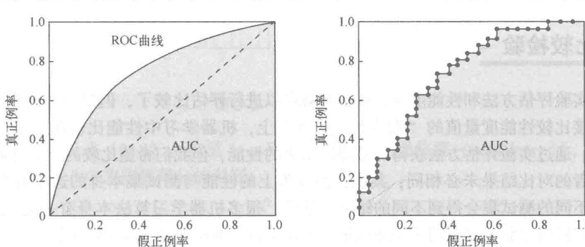

图 2-4 ROC 曲线与 AUC 示意图

現實任務只能用有限測試樣本作圖，只能得到有限組真陽率與假陽率的座標，畫不出圖 2-4a 那種光滑曲線，只能得到像圖 2-4b 的折線近似。做法很直觀：先有 m⁺ 個陽類樣本、m⁻ 個陰類樣本，按模型預測分值排序，然後把決策門檻調到最高，所有樣本都被判為陰類，此時真陽率與假陽率皆為 0，在 (0,0) 標記起點。接著把門檻依次設為各樣本的分值，也就是逐個把樣本劃為陽類。若前一點是 (x,y)，當前樣本為真陽，則新點變為 (x, y+1/m⁻)；當前樣本為假陽，則新點變為 (x+1/m⁺, y)。把相鄰點用線段連起來即得 ROC。

比較模型時，與 P-R 圖類似，若一個模型的 ROC 完全被另一個包住，可判斷後者更優；若兩條曲線交叉，就難以一概而論。此時一個穩妥的做法是看曲線下方覆蓋的面積，即 AUC，如圖 2-4 所示。

從定義看，AUC 就是曲線下方各塊面積的累加。設 ROC 由按序連接的點 {(x₁,y₁),(x₂,y₂),…,(xₘ,yₘ)} 組成，其中 x₁=0、xₘ=1，如圖 2-4b，則 AUC 的估計為

$$AUC = \frac{1}{2}\sum_{i=1}^{m-1}(x_{i+1}-x_i)(y_i+y_{i+1})\tag{2-18}$$

形式上，AUC 反映的是預測排序的好壞，與排序誤差密切相關。設有 m⁺ 個陽類、m⁻ 個陰類，分別記集合為 D⁺ 與 D⁻，排序損失定義為

lrank = 1/(m⁺ m⁻) Σ_{x⁺∈D⁺} Σ_{x⁻∈D⁻} (Ⅱ(f(x⁺) < f(x⁻)) + 1/2 Ⅱ(f(x⁺)=f(x⁻)))    (2-19)

也就是對每一對陽陰樣本，若陽類分值小於陰類記一筆罰分，若相等記 0.5 分罰分。可以看出 lrank 對應 ROC 曲線上方的面積。設某個陽類樣本在 ROC 上對應的標記點為 (x,y)，則 x 正好是排在其之前的陰類所佔比例，即假陽率。因此有

AUC = 1 - lrank    (2-20)

## 2.4 比较检验

有了評估流程與度量指標，下一步就是比較，比較只能看數值大小嗎？實際並非如此。首先實驗得到的是測試集上的表現，我們關心的是泛化表現，兩者未必一致；其次測試集本身影響結果，不同取樣會得到不同數值；最後許多算法帶有隨機性，即使參數相同在同一測試集上多次運行結果也會波動。那模型性能到底該怎麼比較？

統計假設檢驗為比較提供了依據。根據檢驗結果可以判斷，在測試集上看到 A 勝過 B 時，這種優勢在統計意義上是否成立，以及結論的可信程度有多高。

### 2.4.1 假设检验

假設檢驗中的「假設」是對泛化錯誤率分佈的某種推測，例如「ε=ε₀」。實際中我們不知道泛化錯誤率，只能得到測試錯誤率 ε̂。直觀上二者應接近，相差很大則可能性小，因此可以由測試錯誤率推斷泛化錯誤率的分佈。

泛化錯誤率為 ε 的模型在單一樣本上出錯的概率是 ε；測試錯誤率 ε̂ 表示 m 個測試樣本中有 ε̂×m 個被誤分。若測試樣本獨立抽樣，則該模型恰好誤分 m' 個樣本、其餘全對的概率是 ε^{m'}(1-ε)^{m-m'}。由此可算出在 m 個樣本的測試集上，泛化錯誤率為 ε 的模型被測得測試錯誤率為 ε̂ 的概率：

P(ε̂;ε)= C(m, ε̂×m) ε^{ε̂×m} (1-ε)^{m-ε̂×m}    (2-21)

給定 ε̂，令 ∂P/∂ε=0 可得 P(ε̂;ε) 在 ε=ε̂ 時達到最大，隨 |ε-ε̂| 增大而減小，這正是二項分佈的特性，二項分佈示意如圖 2-5。

利用二項檢驗可以檢驗諸如「ε≤0.3」這類假設。更一般地，對假設「ε≤ε₀」，在置信度 1-α 下可觀測到的最大錯誤率為式 (2-22)。其中 1-α 體現結論的置信度，對應圖 2-5 中非陰影範圍。

ε̄ = max ε s.t. Σ_{i=εm+1}^{m} C(m,i) ε₀^i (1-ε₀)^{m-i} < α  (2-22)

若測試錯誤率 ε̂ 小於臨界值 ε̄，則在顯著度 α 下不能拒絕假設「ε ≤ ε₀」，即可以以 1-α 的置信度認為泛化錯誤率不超過 ε₀；否則假設被拒絕，可認為泛化錯誤率大於 ε₀。

很多時候我們不是只做一次留出法估計，而是通過多次重複留出或交叉驗證得到多個測試錯誤率，這時可用 t 檢驗。設得到 k 個測試錯誤率 ε̂₁,…,ε̂ₖ，則均值和方差為

μ = 1/k Σ_{i=1}^{k} ε̂_i  (2-23)

σ² = 1/(k-1) Σ_{i=1}^{k} (ε̂_i - μ)²  (2-24)

把這 k 個值看作泛化錯誤率 ε₀ 的獨立抽樣，變量

τ_t = √k (μ - ε₀) / σ  (2-25)

對假設「μ = ε₀」和顯著度 α，可算出在 1-α 概率下能觀測到的最大偏差。若 |μ-ε₀| 落在臨界區間 [t_{α/2}, t_{α/2}] 內，則不能拒絕「μ = ε₀」，可認為泛化錯誤率為 ε₀，置信度為 1-α；否則拒絕該假設，認為二者有顯著差異。常用的 α 取 0.05 和 0.1。雙邊 t 檢驗的常用臨界值見表 2-2。

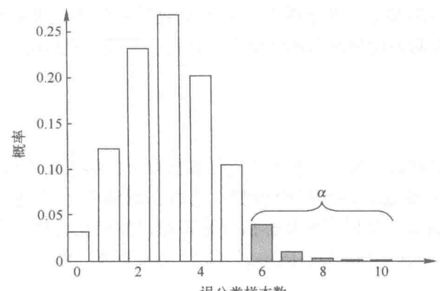

图 2-5 二项分布示意图

# 表 2-2 双边 t 检验的常用临界值

| α | k=2 | k=5 | k=10 | k=20 | k=30 |
|---|---|---|---|---|---|
| 0.05 | 12.706 | 2.776 | 2.262 | 2.093 | 2.045 |
| 0.10 | 6.314 | 2.132 | 1.833 | 1.729 | 1.699 |

上面兩種方法是檢驗單個模型泛化性能的假設，實際中更常需要比較不同模型，下面介紹適用於比較的檢驗方法。

### 2.4.2 交叉验证

交叉驗證是指對給定數據集進行多次切分，形成多組訓練集與測試集，用訓練集訓練得到模型，再在測試集上估計性能指標，最後綜合多組估計來判斷哪個算法更好。常見做法有 RLT、k 折交叉驗證、5×2 交叉驗證、組塊 3×2 交叉驗證等。

對模型 A 與 B，若用 k 折交叉驗證得到的測試錯誤率分別為 ε₁ᴬ,…,εₖᴬ 和 ε₁ᴮ,…,εₖᴮ，且 εᵢᴬ、εᵢᴮ 來自同一組訓練/測試劃分，則可用成對 t 檢驗比較。基本思想是若兩者性能相同，則在相同劃分上錯誤率應相等，即 εᵢᴬ = εᵢᴮ。

具體做法是對 k 對結果求差 Δᵢ = εᵢᴬ - εᵢᴮ，若性能相同則差值均值應為零。根據 Δ₁,…,Δₖ 計算均值 μ 和方差 σ²，在顯著度 α 下，若

Tₜ = | √k μ / σ |  (2-26)

小於自由度 k-1 的臨界值 t_{α/2,k-1}，則不能拒絕性能相同的假設，認為兩者無顯著差異；否則認為有顯著差異，平均錯誤率小的模型更優。此處 t_{α/2,k-1} 是 t 分佈上尾部累積概率為 α/2 的臨界值。

要進行有效檢驗，需要測試錯誤率是泛化錯誤率的獨立抽樣。但由於樣本有限，交叉驗證各輪訓練集常有重疊，導致不獨立，容易高估假設成立的概率。為緩解此問題，可採用 5×2 交叉驗證法。

5×2 交叉驗證做 5 次 2 折交叉驗證，每次 2 折前隨機打亂數據，使 5 次劃分互不重複。對 A、B，第 i 次 2 折會產生兩對錯誤率，求差後得到 Δᵢ¹ 和 Δᵢ²。為降低非獨立性，僅用第 1 次 2 折的平均值 μ = 0.5(Δ₁¹ + Δ₁²)，而對每次實驗計算方差 σᵢ² = (Δᵢ¹ - (Δᵢ¹+Δᵢ²)/2)² + (Δᵢ² - (Δᵢ¹+Δᵢ²)/2)²，變量

τₜ = μ / √[0.2 Σ_{i=1}^5 σᵢ²]  (2-27)

服從自由度為 5 的 t 分佈，其雙邊臨界值在 α=0.05 時為 2.5706，α=0.1 時為 2.0150。

## 2.5 参数调优

大多數機器學習算法都包含大量參數，選對參數才能發揮最大效果。常涉及兩類參數：數目通常在 10 以內的超參，以及數目可能很大的模型參數。調參思路相似，都是生成多個模型後基於評估方法選擇；區別在於超參由人工設定候選值，模型參數則通過學習產生。參數組合數量巨大，自動化調優能大幅減少工作量並提升效率。參數搜索一般包含目標函數、搜索範圍和算法其他參數如步長等。本節介紹網格搜索、隨機搜索和貝葉斯優化。

### 2.5.1 网格搜索

網格搜索是最簡單也最常用的超參搜索方法，它遍歷搜索範圍內的全部點來找最優值。若搜索範圍大、步長小，找到全局最優的概率較高，但計算開銷很大，尤其是參數較多時。實踐中常先用較寬範圍和較大步長定位最優大致區域，再逐步縮小範圍和步長精細化搜索。這種分層操作能降低時間和計算成本，但目標函數通常非凸，可能錯過全局最優。

網格搜索是自動化調參的常用技術，grid_search 包提供了工具，其中包括 GridSearchCV 類。GridSearchCV 會根據給定的模型自動做交叉驗證，調節每個參數並記錄評分，實質上替代了手動 for 循環。

Scikit-learn 提供的 GridSearchCV 原型為

```
class sklearn.model_selection.GridSearchCV(estimator, param_grid, scoring=None, fit_params=None, n_jobs=1, iid=True,
    refit=True, cv=None, verbose=0, pre_dispatch='2 * n_jobs', error_score='raise')
```

主要參數如下。

- 1) estimator：指定的學習器，必須實現 fit 方法用於訓練。
- 2) scoring：評分函數，與 cross_val_score 相同。
- 3) cv：折數，與 cross_val_score 相同。
- 4) fit_params：estimator 的 fit 方法關鍵字參數，與 cross_val_score 相同。
- 5) n_jobs：並行數，與 cross_val_score 相同。
- 6) verbose：控制日誌輸出，與 cross_val_score 相同。
- 7) iid：數據是否獨立同分佈，布林型。True 表示獨立同分佈。
- 8) refit：是否用整個數據集重新訓練，布林型。True 則在優化後用全數據重訓最優 estimator。
- 9) param_grid：參數候選值序列，字典或字典列表。鍵為參數名，值為候選值。
- 10) pre_dispatch：並行執行時分發的總任務數，整型或字符串。
- 11) error_score：estimator 訓練異常時的處理，整型或字符串。可選值：① raise：拋出異常；② 數值：輸出本輪得分。

主要屬性如下。

- 1) grid_scores_：命名元組列表，每個元素對應一組參數組合的測試得分。
- 2) best_estimator_：篩選出的最優學習器對象。
- 3) best_score_：最優學習器的性能評分。
- 4) best_params_：最優參數組合。

主要方法如下。

- 1) fit(X[,y])：執行參數優化。
- 2) predict(X)：用最優學習器預測。
- 3) predict_log_proba(X)：用最優學習器預測各類別概率的對數值。
- 4) predict_proba(X)：用最優學習器預測各類別概率。
- 5) score(X[,y])：最優學習器的預測性能指標。

【例2-5】使用暴力搜索對決策樹分類器進行參數調優

參考程序如下：

```python
from sklearn.datasets import load_digits
from sklearn.tree import DecisionTreeClassifier
from sklearn.model_selection import GridSearchCV
from sklearn.metrics import classification_report
from sklearn.model_selection import train_test_split
# 加载数据
digits = load_digits()
X_train,X_test,y_train,y_test = train_test_split( digits.data, digits.target, test_size = 0.3, random_state = 0,
stratify = digits.target)
# 参数调优
tuned_parameters = {'criterion':['gini','entropy'],
                    'max_features':[0.1,0.2,0.5,0.8,1],
                    'splitter':['best','random'],
                    'min_samples_split':[2,4,6,8]}
clf = GridSearchCV( DecisionTreeClassifier(), tuned_parameters, cv =10)
clf.fit(X_train,y_train)
print('Best parameters set found:', clf.best_params_)
print('Optimized Score:',clf.score(X_test, y_test))
print('Detailed classification report:')
y_true, y_pred = y_test, clf.predict(X_test)
print(classification_report(y_true,y_pred))
```

程序運行結果如下：

```
Best parameters set found: {'criterion': 'entropy', 'max_features': 0.8, 'min_samples_split': 2, 'splitter': 'best'}
Optimized Score: 0.8518518518518519
Detailed classification report:
```

|  | precision | recall | f1-score | support |

|---|---|---|---|---|

|0|0.94|0.94|0.94|54|

|1|0.82|0.73|0.77|55|

|2|0.88|0.83|0.85|53|

|3|0.77|0.87|0.82|55|

|4|0.91|0.91|0.91|54|

|5|0.80|0.78|0.79|55|

|6|0.84|0.94|0.89|54|

|7|0.92|0.85|0.88|54|

|8|0.77|0.83|0.80|52|

|9|0.90|0.83|0.87|54|

|avg / total|0.85|0.85|0.85|540|

### 2.5.2 随机搜索

随机搜索的整体思路与网格搜索相近，区别在于它不去穷举上下限之间的全部组合，而是在给定的搜索区间内随机抽取若干采样点。其理论支撑是，当采样规模足够大的时候，随机抽样以很大概率能够逼近全局最优解或接近最优的近似解。相对于网格搜索，随机搜索通常更快，但与网格搜索的简化版本一样，最终结果并不能得到严格保证。

GridSearchCV 采用的是穷举式搜索策略寻找最优超参。对于参数取值离散的情形，暴力枚举可以顺利定位最优配置；一旦参数变为连续取值，穷举就显得无力，只能从连续域中挑选若干代表值进行比较，从中选出表现最好的那一个。

Scikit-learn 提供的 RandomizedSearchCV 则是通过对候选参数组合进行随机抽样来寻优。它是另一种参数寻优范式。其调用原型如下：

```
class sklearn.model_selection.RandomizedSearchCV(estimator, param_distributions, n_iter=10, scoring=None, fit_params=None, n_jobs=1, iid=True, refit=True, cv=None, verbose=0, pre_dispatch='2 * n_jobs', random_state=None, error_score='raise')
```

除了与 GridSearchCV 共用的参数外，主要的额外参数为：

param_distributions：用于描述每个超参的候选分布，取值形式为字典或字典列表。每条字典对应学习器的一组参数，键为参数名，值为一个可提供 .rvs 方法的分布对象。常用 scipy.stats 中的分布，例如 scipy.expon、scipy.gamma、scipy.uniform 以及 randint 等。

其余属性与方法与 GridSearchCV 基本一致。

### 2.5.3 贝叶斯优化算法

贝叶斯优化与网格搜索、随机搜索的逻辑完全不同。后两者在评估新点时基本忽略历史信息，而贝叶斯优化会充分利用已有的观测结果。它通过对目标函数形态的学习，引导参数向全局最优方向移动。具体流程是，先基于先验分布假设一个代理模型；随后每产生一个新采样点并观测目标函数值，就用该信息更新先验形成后验；最终算法倾向于在后验指示的全局最优最可能出现的位置进行下一步采样。

需要注意的是，贝叶斯优化一旦落入局部最优区域，容易在该区域反复采样而难以跳出。为此算法在探索与利用之间做权衡：探索指在尚未采样过的区域获取新信息，利用指按照后验分布在最可能含全局最优的区域集中采样。

## 2.6 本章小结

本章开篇梳理了数据集、模型、泛化能力等机器学习的基础概念，并对过拟合、欠拟合以及模型评估等术语做了说明。随后介绍了留出法、交叉验证法、自助法三种主流评估策略并进行了对比。接着给出衡量泛化能力的常用指标，包括错误率、准确率、查准率、查全率、F1，以及 ROC 与 AUC。基于此，又介绍了假设检验和交叉验证比较的两种模型比较检验方法。最后归纳了网格搜索、随机搜索、贝叶斯优化三种典型的超参数调优手段。

## 2.7 延伸阅读——机器学习应用于我国海外投资效率预警

随着中国对外投资规模持续扩大，对投资效率进行前瞻预警的需求日益迫切。较早的研究多依赖层次分析法、专家打分法、模糊综合评价法、因子分析法等传统手段，但这些方法的预警精度不高、有效性有限，亟需更科学的替代方案。人工智能兴起后，机器学习在预测任务上展现出强劲的计算表现和场景适应性，成为新的选择。

从本质上看，海外投资效率预警的核心是预测而非回归。传统计量回归虽能预测，但侧重点在于因果识别；现有预警模型多为线性模型，对非线性情形拟合不足。而支持向量机、人工神经网络等机器学习模型擅长处理非线性问题。因此在保留传统统计方法的同时，引入主流机器学习算法对我国在境外国家的投资效率损失进行预警。实证上看，机器学习方法的预测准确率与测试集拟合优度均优于线性回归，显示出明显的优势。

当前较为常用的机器学习预警模型主要有：

- (1) 决策树法
- (2) 随机森林法与梯度提升法

决策树法本质上属于近邻思想，能够在一定程度上复现投资主体依据“一带一路”沿线国家各项条件逐步决策的过程。

随机森林属于集成学习，其特点是方法简洁灵活，可用于分类与回归，对小样本和非平衡数据表现较好；同时采用自助采样，并在每个节点分裂时随机挑选部分变量作为候选，对异常值和噪声具有较强鲁棒性。

从预测机制看，随机森林与梯度提升的准确率普遍高于单棵决策树。随机森林采用装袋策略，从同一数据中生成多棵树，降低决策树的随机性，减少预测方差；同时兼顾样本随机与特征随机，避免单一变量主导模型误差。梯度提升则为不同样本赋予差异化权重，且各轮训练相互关联，进一步提升预测精度。

在可解释性上，决策树虽准确率相对较低，但解释力更强。它能够近似还原投资者的真实决策路径，刻画多层次判断环节，形成可读的决策规则，并识别对海外投资效率影响较大的关键因素。相比之下，其他机器学习模型多呈现“黑箱”特征，仅能输出预测结果及重要特征。因此，预测精度是模型选择的重要依据，同时不同算法也应互为补充，提升对现实问题的解释力与预测力。

## 2.8 习题

- 1. 填空题

  - 1) 训练过程中使用的数据集可以被分为 ______、______ 和 ______ 3 种。

  - 2) 常用的参数调优方法，分别为 ______、______ 和 ______。

  - 3) 常用的划分实验数据集的方法有 ______、______ 和 ______。

- 2. 简答题

  - 1) 简要描述过拟合和欠拟合的含义，分析两种情况产生的原因及解决的方法。

  - 2) 数据集包含 5000 个样本，其中 2500 个正例、2500 个反例，将其划分为包含 70%样本的训练集、30%样本的测试集用于留出法评估，试估算共有多少种划分方法。

  - 3) 试分析错误率与 ROC 曲线的联系。

  - 4) 什么是比较检验？常用的方法有哪两种？试分析分别适用于什么情况。

# 第3章 K-近邻

## 本章导读（思维导图）

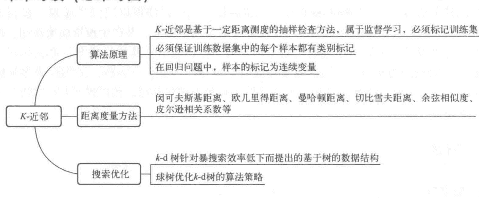

K-近邻算法是机器学习领域理论最朴素、理解最直观的方法之一。它基于距离测度进行样本比对，属于监督学习范式，要求训练集具备已知标签。KNN 既可做分类也可做回归。分类时只看最近的若干邻居的类别标签做多数表决；回归时则通常采用最近邻居标签的加权平均作为输出。


扫码看视频

本节先概述 K-近邻的基本原理与流程，再介绍常见距离度量，包括闵可夫斯基距离、欧几里得距离、曼哈顿距离等计算方式。之后介绍提升搜索效率的两种优化手段，最后给出代码实现示例。

## 3.1 算法原理

以分类为例，给定训练集后，对任意待分类样本，在训练集中找出与其距离最近的 K 个邻居，即可根据这 K 个邻居的多数类别标签进行判别。

使用前需保证训练样本均已标记。输入无标签样本后，将其每个特征与训练样本对应特征逐一比较，挑选出特征最相似的 K 个样本，并以其中出现频率最高的类别作为预测结果。若 K 取 1，则直接把待分类样本归为最近邻的类别。

回归情形下标签为连续值，通常做法是取 K 个最近邻标签的加权平均作为预测值，权重常用距离的倒数。也可设定半径，只聚合半径内的邻居。

以图 3-1 为例，图中两种类别分别用正方形与三角形表示，圆点为待判样本。若 K=3，最近 3 个邻居为 2 个三角形 1 个正方形，按多数表决判为三角形；若 K=5，最近 5 个邻居为 2 个三角形 3 个正方形，则判为正方形。

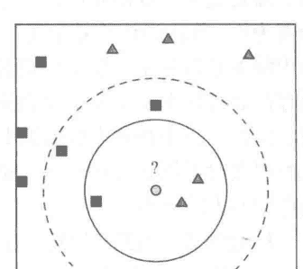

图 3-1 K-近邻数据样本分类

由此可见，KNN 的核心是通过邻域统计确定归属，K 的取值会直接改变多数类别。

算法流程可归纳为：

- 1) 计算训练集中每个已标记样本与待测样本的距离。
- 2) 按距离从小到大排序。
- 3) 取距离最小的 K 个样本。
- 4) 统计这 K 个样本的类别频次。
- 5) 返回频次最高的类别作为预测。

K 值、距离度量、决策规则是三个关键要素。

K 值过小仅依赖极近邻，易过拟合；K 值过大虽可降低估计误差，却会增大近似误差，因远邻也会参与表决。通常取较小奇数，常用交叉验证择优。随着训练样本趋于无穷且 K=1 时，误差率不超过贝叶斯误差率的两倍；K 也趋于无穷时误差率趋向贝叶斯误差率。

距离度量常用闵可夫斯基距离，p=2 时为欧氏距离。度量前应对特征进行归一化，避免大数值域特征主导结果。

分类决策多采用多数表决，为避免类别数相等，常取奇数 K。当类别不平衡时，远邻的大类样本可能主导投票，可通过距离加权投票缓解，即距离越近权重越大。

KNN 属于惰性学习，无显式训练阶段，训练复杂度可视为 0。预测复杂度与训练样本数 n 成正比，为 O(n)。算法需保存全部训练样本，存储开销随数据规模增长；高维大数据下距离计算成本显著。为此常预先筛选冗余样本。

KNN 基于局部邻域，对异常值不敏感，适合样本量大的类域自动分类，对样本稀少的类域易误分。由于不显式建模类域结构，无法提供平均样本或典型样本的特征描述。对类域交叉或重叠较多的样本集，KNN 通常表现较好。

回归时流程类似，用 K 个最近邻的特征平均值填充待测样本，常用距离反比加权。

## 3.2 距离度量方法

K-近邻及其他算法中距离计算方式影响显著。对样本向量 x_i = (x_i^{(1)},...,x_i^{(n)})^T 与 x_j = (x_j^{(1)},...,x_j^{(n)})^T，常用度量如下。

- 1. 闵可夫斯基距离（Minkowski distance）

又称闵氏距离，计算公式见式（3-1）。

distance(x_i , x_j) = ( Σ_{d=1}^n |x_i^{(d)} - x_j^{(d)}|^p )^{1/p}  (3-1)

- 2. 欧几里得距离（Euclidean distance）

又称欧氏距离，为闵可夫斯基距离在 p=2 时的特例，计算公式见式（3-2）。

distance(x_i , x_j) = ||x_i - x_j||_2 = sqrt( Σ_{d=1}^n |x_i^{(d)} - x_j^{(d)}|^2 )  (3-2)

- 3. 曼哈顿距离（Manhattan distance）

又称绝对距离或城市街区距离，对应 p=1，计算公式见式（3-3）。

distance(x_i , x_j) = ||x_i - x_j||_1 = Σ_{d=1}^n |x_i^{(d)} - x_j^{(d)}|  (3-3)

### 4. 切比雪夫距离（Chebyshev distance）

当 p→+∞ 时，闵可夫斯基距离退化为切比雪夫距离，计算公式见式（3-4）。

distance(x_i, x_j) = lim_{p→∞} ( Σ_{d=1}^n |x_i^{(d)} - x_j^{(d)}|^p )^{1/p} = max_{1≤d≤n} (|x_i^{(d)} - x_j^{(d)}|)  (3-4)

### 5. 余弦相似度（Cosine similarity）

余弦相似度用向量夹角的余弦衡量差异，计算公式见式（3-5）。

cos(θ)_{(x_i,x_j)} = (x_i^T x_j)/(||x_i|| ||x_j||) = [ Σ_{d=1}^n (x_i^{(d)} x_j^{(d)}) ] / [ sqrt( Σ_{d=1}^n (x_i^{(d)})^2 ) sqrt( Σ_{d=1}^n (x_j^{(d)})^2 ) ]  (3-5)

与距离度量不同，余弦相似度更关注方向差异而非长度。取值范围 [-1,1]，值越大夹角越小，方向越一致；值为 1 时方向重合，-1 时方向相反。

### 6. 皮尔逊相关系数（Pearson correlation coefficient）

皮尔逊 r 是相关分析里衡量两组定距变量线性关联强度的指标，数值落在 -1 到 1 之间。关联越强，用其中一个变量去估计另一个变量的误差越小，因为两者共变的成分越多。极端情况下 r = 1 或 -1，对应完全线性依赖，x 基本能唯一确定 y；r = 0 则表示没有线性关联。正相关指 x 上升时 y 随之上升，r 在 0.00～1.00 区间；负相关指 x 上升时 y 下降，r 在 -1.00～0.00 区间。绝对值越靠近 1，联系越紧密；越靠近 0，联系越稀薄。计算公式见式（3-6）。

distance(x_i, x_j) = [E(x_i x_j) - E(x_i)E(x_j)] / [ sqrt(E(x_i^2) - (E(x_i))^2) sqrt(E(x_j^2) - (E(x_j))^2) ] = cov(x_i, x_j) / (σ_{x_i} σ_{x_j})  (3-6)

式中，E(x_i) 为向量 x_i 的数学期望；σ_{x_i}、σ_{x_j} 分别为两个向量的标准差；cov(x_i, x_j) 为两向量的协方差。

### 7. 杰卡德相似系数（Jaccard similarity coefficient）

杰卡德系数主要处理符号型或布尔型数据的相似性判断，关注的是两个对象共同拥有的特征是否一致。设集合 A、B，其相似度计算见式（3-7）。

distance(A, B) = |A ∩ B| / |A ∪ B|  (3-7)

### 8. 马氏距离（Mahalanobis distance）

马氏距离刻画了考虑协方差的距离，能够消除量纲影响并反映特征间的相关性，常用于评估未知样本集的相似度。与欧式距离相比具有尺度无关性。设 $x_i = (x_i^{(1)}, x_i^{(2)}, \dots, x_i^{(n)})^T$，均值 $\mu_i = (\mu_i^{(1)}, \mu_i^{(2)}, \dots, \mu_i^{(n)})^T$，协方差矩阵为 $S$，则

distance($x_i$) = $\sqrt{(x_i - \mu_i)^T S^{-1} (x_i - \mu_i)}$

(3-8)

## 3.3 搜索优化方法

3.1 节已指出，样本量与特征维度增大时，K-近邻的距离计算负担会显著提高。事实上邻居查找本身的开销也很大。为提升检索效率，可用专门的数据结构保存训练样本，减少不必要的距离计算。下面介绍两种常用方案。

### 3.3.1 k-d 树

k-d 树是在暴力搜索效率不足时提出的一种树形索引结构。其核心思想是：若 A 离 B 很远而 B 离 C 很近，则 A 与 C 也很远，无需精确计算两者距离。对于 k 维、n 个样本的数据，近邻搜索成本可压到 $O[k n \log(n)]$ 以内，对大数据集改善明显。

k-d 树是节点均为 k 维点的二叉树，每个节点对应一个垂直于当前切分维度坐标轴的超平面，把空间划分为左右两部分。若当前节点的切分维度为 F，则左子树中点的 F 维坐标小于该节点，右子树则大于等于该节点。构建时无需算距离，只需按轴分区，速度快。构建完成后查询复杂度约为 $O[\log(n)]$。低维时非常高效，维度 k 很大时效率会下降。

下面用直观例子说明。

假设数据有 2 个特征、6 个样本，$T = \{(2,3),(5,4),(9,6),(4,7),(8,1),(7,2)\}$，可看成二维平面上的点。k-d 树的任务是确定这些点的空间分割线。

先选切分维度。分别算 X 轴和 Y 轴方向的方差，X 轴方差更大，先按 X 轴切分。

再定分割线的 X 坐标。X 特征取值 2、5、9、4、8、7，中位数为 6.5，最接近的是 $(7,2)$。于是分割线取 $x=7$，即过 $(7,2)$ 且垂直于 X 轴的直线。

划分左右子空间。$x\le7$ 为左子空间，包含 $\{(2,3),(5,4),(4,7)\}$；右子空间包含 $\{(9,6),(8,1)\}$。

随后按 Y 轴切分。左子空间纵坐标 3、4、7，中位数为 4，切分点为 $(5,4)$；右子空间仅 2 个样本，随机取 $(9,6)$ 作为切分点。

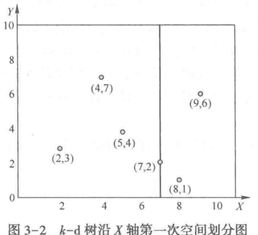

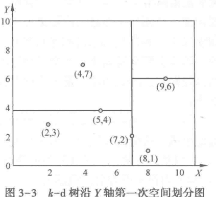

继续对仍有样本的子空间按 X 轴切分，直至每个子空间只剩一个样本为止，最终划分结果如图 3-4 所示。

k-d 树的构建可概括为：

- 1) 用包含全部样本的 k 维超矩形作为根节点。
- 2) 递归对 k 维空间切分生成子节点。在当前超矩形上选定一个坐标轴和该轴上的分割点，形成垂直于该轴的超平面，把区域分为左右两个子区域，样本随之归属。
- 3) 不断重复切分直到子区域内无样本为止，终止节点为叶节点。过程中把样本保存在对应节点上。
- 4) 通常按坐标轴轮流切分，例如 3 维数据根节点用 X 轴，子节点用 Y 轴，孙节点用 Z 轴，依次循环，并取中位数作为分割点，这样得到的树是平衡二叉树。

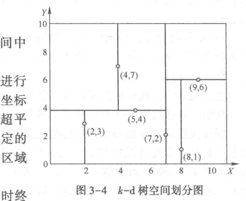

k-d 树每个节点是一个向量，与普通二叉树按数值大小划分不同，k-d 树每层需指定一个维度，按左小右大的规则划分数据。构建时主要有两点：

- 1) 选哪一维进行切分。
- 2) 如何切分数据。

简单做法可随机或顺序选取，更合理的做法是在数据离散程度大的维度上切分，离散程度可用方差衡量。好的切分能使树更平衡，常用中位数切分，这样第二个问题也得到解决。

构建完成后，介绍如何用 k-d 树进行最近邻搜索。总体思路是维护一个当前最优点和最短距离，从根节点开始按生成规则递归遍历。若当前节点到查询点 Q 的距离更小，则更新最优点和最短距离；若 Q 到当前节点切分维度的距离小于当前最短距离，则另一子树中可能存在更近点，需继续探索。具体步骤如下：

- 1）初始化最优点为空、最短距离为无穷大，用来保存离 Q 最近的点及其距离。
- 2）从根节点开始，将其设为当前节点。
- 3）若当前节点为空，则结束。
- 4）若当前节点到 Q 的距离小于当前最短距离，则更新最优点和最短距离。
- 5）若 Q 在切分维度上的值小于当前节点的值，则进入左子节点，否则进入右子节点，继续执行 3）、4）、5）、6）。
- 6）若 Q 到当前节点对应分割线的距离小于最短距离，则可能在另一子树中存在更近点，切换到另外的子节点继续执行 3）、4）、5）、6）。

递归结束后，最优点即为最近邻。

以图 3-5 为例，搜索样本 (3,2)。初始根节点 (7,2) 距离为 4，更新最优点；因 3<7 进入左子节点 (5,4)，距离 2.83 更新；因 2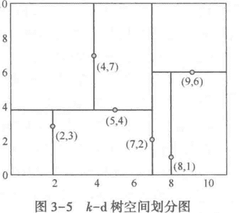
小于当前节点的划分维度值 4，因此设当前节点的左子节点 (2,3) 为新的当前节点。继续执行步骤 4），由于此时当前节点到被搜索点的距离为 1.41，小于全局最短距离，所以更新当前最佳点为 (2,3)，全局最短距离为 1.41。此时，由于被搜索点的划分维度值 3 大于当前节点的划分维度值 2，因此设当前节点的右子节点为新的当前节点。由于此时当前节点为空，所以此次递归结束并返回第 3 次递归，即此时的当前节点为 (2,3)，并执行步骤 6）。由于被搜索点 (3,2) 到当前节点对应分割线 x=2 的距离为 1，小于全局最短距离 1.41，说明全局最佳点可能存在于当前节点的左子节点中，所以设当前节点的左子节点为新的当前节点。由于当前节点为空，所以此次递归结束并返回到第 3 次递归中。返回第 3 次递归后，此时的当前节点为 (2,3)，且已执行完步骤 6），故返回到第 2 次递归中，此时的当前节点为 (5,4)，并继续执行步骤 6）。由于被搜索点 (3,2) 到当前节点对应的分割线 y=4 的距离为 2，大于全局最短距离 1.41，则说明节点 (5,4) 的右子节点中不可能存在更近的点，因此返回到第 1 次递归中。此时的当前节点为根节点 (7,2)，并继续执行步骤 6）。由于被搜索点 (3,2) 到当前节点对应的分割线 x=7 的距离为 4，大于全局最短距离 1.41，所以当前节点的右子节点中不可能存在更近的点。到此所有的递归过程都执行完毕。此时的全局最佳点中保存的点 (2,3) 即为最近邻。

在 K-近邻中，流程类似，只是需要维护一个大小为 K 的有序候选列表，首位为当前最近，其余按距离升序排列。

当维度极高时，k-d 树效率会下降。一般只有当样本数远大于 $2^k$ 时，k-d 树才明显优于全量扫描。

### 3.3.2 球树

k-d 树在非均匀分布和高维数据上仍可能低效，于是提出了球树。

k-d 树沿坐标轴切分，球树则用一系列超球体划分空间。虽然构建成本更高，但在高维场景下更稳定。球树将数据递归划分为由质心 c 和半径 r 定义的节点，每个节点代表一个包含若干样本的空间，中心可以是样本点或该空间的质心，并记录节点内所有样本到中心的í最大距离。

构造方式与 k-d 树类似，首先找到包含全部数据的超球体，球心作为根节点，或直接以使样本到质心距离和最小的点为根。然后递归：

- 1) 选距离质心最远的点作为左观测点，再选离它最远的点作为右观测点，或直接取最远的一对点作为左右子节点。
- 2) 把样本分配到距离最近的观测点所属类中。
- 3) 记录质心位置和包含该节点的最小半径。
- 4) 对每个子节点重复上述过程。

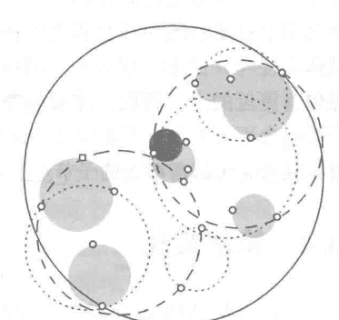

图 3-6 球树匹配过程图

球树与 k-d 树的差异在于，球树得到的是超球体，k-d 树得到的是超矩形体。由于超球体更紧致，搜索时可以剪掉更多无用分支。

以数据集 {[1,2],[5,3],[7,9],[1,6],[9,2],[8,4],[4,4],[5,7]} 为例构建球树：先建立根节点，用包围所有样本的超球体，记录球心。

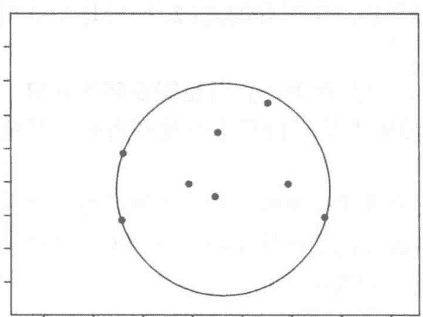

图 3-7 包含所有样本点的超球体

再找到最远的两点，按最近观测点原则划分样本，分别构建左右子节点的超球体并记录球心和半径。

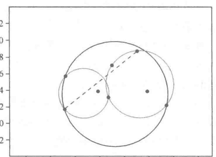

图 3-8 根节点的左右子节点对应的超球体

重复划分直至样本全部分配完毕，如图 3-9 所示。

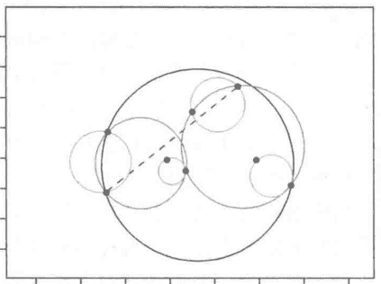

图 3-9 划分结果

搜索时，从根节点向下找到包含 Q 的节点，得到该节点内最近观测点与 Q 的距离作为上界 u。然后检查兄弟节点，若 Q 到兄弟节点质心的距离大于兄弟节点的半径与 u 之和，则该分支不可能更优；否则继续检查。不断回溯直至所有可疑分支检查完。

## 3.4 算法实现

下面用 Python 实现基础的 K-近邻分类。

### (1) 定义 K-近邻分类器

k_nearest_neighbor 函数完成了 K-近邻分类。首先从 dataset 中分离出已标注样本及其标签。随后用欧氏距离计算待测样本与每一个训练样本的距离。按距离排序后取前 K 近邻，收集它们的标签。用字典 vote_count 统计各类别的票数，相同类别累计加一。对 vote_count 按票数降序排序得到 sorted_vote_count，最后返回票数最高类别作为预测结果。

### 代码 3-1 k_nearest_neighbor 函数

```
import numpy as np
import operator

def k_nearest_neighbor(dataset, test_sample, k):
    """
    K-最近邻算法，用于对测试样本进行分类
    参数：
    dataset：已知的样本集合，包含特征和标记
    test_sample：待分类的测试样本
    k：选择最近邻居的数量
    返回：
    predicted_label：预测得到的标记
    """
    samples = dataset[:, :-1]             # 获得已知样本
    labels = dataset[:, -1]               # 获得已知样本标记

    # 计算测试样本与已知样本之间的距离
    distance = [ np.sqrt( np.sum( ( sample - test_sample) ** 2) ) for sample in samples]
    sorted_distance = np.argsort( distance)      # 对距离进行排序
    k_neighbors = labels[ sorted_distance[:k] ]  # 筛选出前 K 个邻居

    vote_count = {}
    for i in range(k):
        # 统计每个类别的票数
        vote_count[ k_neighbors[i] ] = vote_count.get(k_neighbors[i], 0) + 1

    sorted_vote_count = sorted( vote_count.items(), key=operator.itemgetter(1),
                                reverse=True)      # 对票数进行排序
    predicted_label = sorted_vote_count[0][0]  # 预测得到的标记

    return predicted_label
```

### （2）主函数实现

run 用来演示整套流程。先准备一个训练集 dataset，里面每条记录都包含两维特征和对应的类别标签；再准备一个待测集合 test_samples，只保留两维特征。随后借助列表推导，对 test_samples 中的每一个样本依次调用 k_nearest_neighbor 做预测，k 固定为 3，即每次取最近的 3 个邻居投票，把所有预测值收集到 predict_results 里，最后把结果打印出来。脚本以主程序身份运行时会自动执行 run。

### 代码 3-2 run 函数

```
def run():
    """
执行函数，用于运行分类器并输出结果
"""
dataset = np.array([[1, 2, 1], [3, 7, 1], [4, 3, 0], [2, 5, 1], [5, 1, 0],
                    [8, 2, 0]])  # 最后一列为样本的标记
test_samples = np.array([[1, 1],[6, 4], [4, 5]])

# 对每个测试样本进行分类预测
predict_results = [k_nearest_neighbor(dataset, test_sample, 3)
                    for test_sample in test_samples]

print('分类结果:', predict_results)

if '__main__' == __name__:
    run()
```

运行结果为：

分类结果：[0, 0, 1]

接下来看带距离加权的 K 近邻分类是怎么做的，整体骨架和基础版一致，仅投票环节做了改动。

### （3）定义距离加权的 K-近邻分类算法

weighted_k_nearest_neighbor 在思路上与 k_nearest_neighbor 相似。首先把 dataset 按样本和标签拆开，算出测试点到每个训练点的距离，按距离从小到大取前 K 个邻居并取出它们的标签。投票时用字典 vote_count 累加，但每个类别的票数不再是 1，而是加上距离的倒数作为权重。累加完后对 vote_count 按权重从高到低排序，形成 sorted_vote_count，返回其中权重最高的类别作为预测。

### 代码 3-3 weighted_k_nearest_neighbor 函数

```
import numpy as np
import operator

def weighted_k_nearest_neighbor(dataset, test_sample, k):
    """
    K-最近邻算法，用于对测试样本进行分类
    参数：
    dataset: 已知的样本集合，包含特征和标记
    test_sample: 待分类的测试样本
    k: 选择最近邻居的数量
    返回：
    predicted_label: 预测得到的标记
    """
    samples = dataset[:, :-1]          # 获得已知样本
    labels = dataset[:, -1]            # 获得已知样本标记

    # 计算测试样本与已知样本之间的距离
    distance = [ np.sqrt( np.sum( ( sample - test_sample) ** 2)) for sample in samples]

    sorted_distance = np.argsort(distance)      # 对距离进行排序
    k_neighbors = labels[sorted_distance[:k]]      # 筛选出前 K 个邻居

    vote_count = {}
    for i in range(k):
        # 统计每个类别的频率，加上距离的倒数作为权重
        vote_count[k_neighbors[i]] = vote_count.get(k_neighbors[i], 0) + 1 / distance[i]

    sorted_vote_count = sorted(vote_count.items(), key=operator.itemgetter(1),
                            reverse=True)      # 对频率进行排序
    predicted_label = sorted_vote_count[0][0]      # 预测得到的标记

    return predicted_label
```

沿用代码 3-2 中的 run，得到的结果为：

分类结果：[1, 0, 1]

在分类的基础上，还可以把思路迁移到回归问题。代码修改点仍然集中在统计阶段，这次不再计数，而是做加权平均。

### （4）定义距离加权的 K-近邻回归算法

k_nearest_neighbor_regressor 实现了带距离加权的 K 近邻回归。同样先把 dataset 拆分为样本和标记，用欧氏距离算出测试点到全部训练点的距离，按距离挑选最近的 K 个邻居并取出标记。对这 K 个邻居做加权平均，权重写法为 k_neighbors[i]/distance[i]/k，也就是邻居的标记除以它与测试点的距离再除以 K。最后返回该平均值作为预测。

### 代码 3-4 k_nearest_neighbor_regressor 函数

```
import numpy as np
import operator

def k_nearest_neighbor_regressor(dataset, test_sample, k):
    """
    K-最近邻回归算法，用于对测试样本进行回归预测
    参数：
    dataset: 已知的样本集合，包含特征和标记
    test_sample: 待预测的测试样本
    k: 选择最近邻居的数量
    返回：
    prediction: 预测得到的标记
    """
    samples = dataset[:, :-1]          # 获得已知样本
    labels = dataset[:, -1]            # 获得已知样本标记

    # 计算测试样本与已知样本之间的距离
    distance = [ np.sqrt( np.sum( (sample - test_sample) ** 2) ) for sample in samples ]

    sorted_distance = np.argsort(distance)    # 对距离进行排序
    k_neighbors = labels[ sorted_distance[:k] ]  # 筛选出前 K 个邻居

    prediction = 0.0
    for i in range(k):
        # 对前 K 个邻居的标记进行加权平均作为预测值
        prediction += k_neighbors[i] / distance[i] / k

    return prediction
```

继续复用代码 3-2 的 run 函数，回归输出为：

回归结果：[0.3333333333333333, 0.0, 0.31573786516665264]

下面用一个简化的 k-d 树实现来帮助理解其构造过程。

### （5）定义 k-d 树节点

代码 3-5 给出了 kd_node 类，用来描述 k-d 树的一个节点。节点里保存了自身的值、所在的层次深度、当前划分使用的特征、左子树、右子树以及指向父节点的引用。通过实例化该类即可搭建树的节点结构。

### 代码 3-5  kd_node 类

```
import numpy as np

class kd_node:
    """
    k-d 树的节点类
    属性：
    value：节点的值
    depth：节点所在的深度
    split_feature：节点的划分特征
    left_tree：左子树
    right_tree：右子树
    parent_node：父节点
    """
    value = []                # 节点值
    depth = None              # 节点深度
    split_feature = None      # 划分标志
    left_tree = None          # 左子树
    right_tree = None         # 右子树
    parent_node = None        # 父节点
```

### （6）定义 k-d 树

kd_tree 负责树的整体构建。先对数据 data 在每个特征上计算方差，用 np.var 得到各特征的方差值，再用 np.argmax 找到方差最大的特征索引 max_var_feature。随后创建根节点 node，最后调用 build_tree 并传入根节点、数据、最大方差特征索引以及深度 0，递归划分得到完整的 k-d 树并返回根节点。

### 代码3-6 kd_tree函数

```
def kd_tree(data):
    """
    构建 k-d 树
    参数：
    data: 数据集合
    返回：
    node: 构建好的 k-d 树的根节点
    """
    max_var_feature = np.argmax(np.var(data, axis=0))  # 选出方差最大的特征的索引
    node = kd_node()                                   # 创建根节点
    node = build_tree(node, data, max_var_feature, 0)  # 递归划分数据，构建 k-d 树
    return node
```

### (7) 递归构造 k-d 树

build_tree 是递归建树的核心。对当前数据 data 先按特征索引 index 排序，使用 np.lexsort 实现。统计样本数 sample_number 与特征数 feature_number，用中位数 median 决定划分位置。新建一个 kdnode 实例，把 median 位置的值作为节点值，深度设为 depth，划分特征设为 index，并打印节点值、特征和深度。依据 median 把数据切分为左子树的数据 data_left 与右子树的数据 data_right。随后按样本数分情况处理：样本数为 1 直接返回当前节点；样本数为 2 只构建左子树并把父指针指回当前节点；样本数大于 2 则分别构建左右子树并设置各自的父指针，最后返回当前节点。

### 代码3-7 build_tree函数

```
def build_tree(kdnode, data, index, depth):
    """
    递归构建 k-d 树的函数
    参数：
    kdnode: 当前节点
    data: 当前节点的数据集合
    index: 划分特征的索引
    depth: 当前节点的深度
    返回：
    kdnode: 构建好的当前节点
    """
    data = data[np.lexsort(data[:, ::-(index + 1)].T)]  # 对数据进行排序
    sample_number = data.shape[0]                      # 获得样本数
    feature_number = data.shape[1]                     # 获得特征数
    median = sample_number // 2                        # 计算中间的值
    kdnode = kd_node()                                 # 创建节点对象
    kdnode.value = data[median, :]                     # 设置节点值
    kdnode.depth = depth                               # 设置节点深度
    kdnode.feature = index                             # 设置划分特征
    print('节点值:', kdnode.value)
    print('特征:', kdnode.feature)
    print('层数:', kdnode.depth)
```

data_left = data[0:median, :]          # 获取左子树的数据

data_right = data[ median + 1:, :]        # 获取右子树的数据

if sample_number == 1:                    # 如果样本数为 1，返回当前节点

    return kdnode

elif sample_number == 2:                  # 如果样本数为 2

    kdnode.left_tree = build_tree(kdnode.left_tree, data_left,

                                  (index + 1) % feature_number, depth + 1)  # 构建左子树

    kdnode.left_tree.parent = kdnode       # 设置左子树的父节点为当前节点

    return kdnode

else:                                     # 如果样本数大于 2

    kdnode.left_tree = build_tree(kdnode.left_tree, data_left,

                                  (index + 1) % feature_number, depth + 1)   # 构建左子树

    kdnode.left_tree.parent = kdnode       # 设置左子树的父节点为当前节点

    kdnode.right_tree = build_tree(kdnode.right_tree, data_right,

                                   (index + 1) % feature_number, depth + 1)   # 构建右子树

    kdnode.right_tree.parent = kdnode      # 设置右子树的父节点为当前节点

    return kdnode

## （8）搜索 k-d 树

k-d 树最近邻检索的实现思路

kd_search 承担在已搭建好的 k-d 树内部找出与查询样本欧氏距离最小的训练点的任务。实现上先在外部声明两个全局可访问的状态 nearest_point 与 nearest_value，用于暂存当前的最优样本及其对应距离。函数内部再定义递归遍历器 travel 来逐层下探。进入 travel 时先检查节点是否为空，若节点存在则读取样本维度 n 与本层的切分轴 axis，依据节点在该轴上的取值决定优先探查左子树还是右子树。随后计算查询点到本节点的距离，并与已记录的最佳距离对比，必要时刷新最近点和距离。再判断本维度上的分割差距是否仍有机会超越当前最优，若差距不大于当前最优距离，则对未优先的那一侧进行回溯探索。最后从根节点启动 travel，完成整棵树的遍历后返回最近的样本点。

### 代码 3-8 kd_search 函数

```python
def kd_search(node, sample):
    """
    k-d 树搜索函数
    参数:
    node: 当前节点
    sample: 待搜索的样本点
    返回:
    nearest_point: 距离最近的样本点
    """
    global nearest_point
    global nearest_value
    nearest_point = None    # 初始化最近的样本点
    nearest_value = 0       # 初始化最近的距离

    def travel(node, depth=0):
        """
        递归遍历 k-d 树的函数
        参数:
        node: 当前节点
        depth: 当前节点的深度
        """
        global nearest_point
        global nearest_value

        if node != None:    # 如果当前节点不为空
            n = len(sample)    # 样本点的特征数
            axis = depth % n    # 计算划分特征的索引

            if sample[axis] < node.value[axis]:  # 根据划分特征的值选择左子树或右子树
                travel(node.left_tree, depth + 1)
            else:
                travel(node.right_tree, depth + 1)

            sample_node_dist = ((np.array(sample) - np.array(node.value)) ** 2).sum() ** 0.5  # 计算样本点与当前节点的距离

            # 如果最近的样本点为空，则将当前节点设为最近的样本点
            if (nearest_point is None):
                nearest_point = node.value
                nearest_value = sample_node_dist
            # 如果当前节点距离更近，则更新最近的样本点和距离
            elif (nearest_value > sample_node_dist):
                nearest_point = node.value
                nearest_value = sample_node_dist

            # 如果当前维度上的距离小于最近距离
            if (abs(sample[axis] - node.value[axis]) <= nearest_value):
                # 根据划分特征的值选择左子树或右子树
                if sample[axis] < node.value[axis]:
                    travel(node.right_tree, depth + 1)
                else:
                    travel(node.left_tree, depth + 1)

    travel(node)    # 从根节点开始遍历 k-d 树
    return nearest_point    # 返回距离最近的样本点
```

## （9）主函数实现

run 用来演示整套 k-d 树最近邻搜索的流程。先准备一组二维坐标作为训练集 data，随后调用 kd_tree 构建树并把根节点保存到 node。接着声明待检索的样本点 sample，通常为一个二维坐标。最后把 sample 送入 kd_search 求解并输出结果。

### 代码 3-9 run 函数

```python
def run():
    """
    主函数，运行 k-d 树搜索示例
    参数：
    无
    返回：
    无
    """
    data = np.array([[2,3], [5,4], [9,6], [14,7], [8,1], [7,2]])  # 样本数据
    node = kd_tree(data)          # 构建 k-d 树
    sample = [2.1, 3.1]           # 待搜索的样本点
    print(kd_search(node, sample))  # 执行 k-d 树搜索并打印结果

if '__main__' == __name__:
    run()
```

运行结果为：

```
节点值: [8 1]
特征: 0
层数: 0
节点值: [2 3]
特征: 1
层数: 1
节点值: [7 2]
特征: 0
层数: 2
节点值: [5 4]
特征: 0
层数: 2
节点值: [14 7]
特征: 1
层数: 1
节点值: [9 6]
特征: 0
层数: 2
[2 3]
```

> 在 K-近邻的搜索过程中，若只保留 k 个最近邻即可，k-d 树能够在遍历时维护这 k 个候选。

## 3.5 本章小结

本章围绕 K-近邻展开，介绍了该方法在分类与回归中的机理与操作步骤，并说明了 k-d 树和球树两种加速最近邻检索的结构。

K-近邻直观易用，但每次预测都要计算全体训练样本与待测样本的距离并挑选前 K 个邻居，当数据量或维度上升时计算负担会急剧增加。k-d 树是各节点对应 k 维点的二叉结构，非叶节点用超平面把空间切分为两个半空间，在高维且样本稀疏时效果会下降。球树则以嵌套球体划分空间，建树成本高于 k-d 树，但在高维情形下往往更具效率。

## 3.6 延伸阅读——机器学习在国产芯片上的应用

芯片是现代科技与国防的基石，也是核心部件。封装是制造流程的关键环节，封装前必须检验芯片质量，确保引脚与外观印刷无缺陷。随着封装向微型化、片式化、高性能演进，对缺陷检测的要求也在提高。传统产线多靠人工目检，虽然直观，但人力成本高且易因视觉疲劳导致误检，可靠性受损。更关键的是，芯片尺寸缩小后人眼分辨受限，人工检测的速率与精度均在下降。

K-近邻可引入到芯片缺陷检测中，通过衡量待检芯片特征与合格或缺陷芯片的相似度来判定质量。假设某企业生产了大量芯片，每个芯片可提取尺寸、电压、功耗等特征。若要用 K-近邻判断新芯片是否合格，需先采集一批已知合格与不合格芯片的特征及标签作为训练样本。随后将待测芯片的特征与训练集对比，找出最近的 K 个邻居，最后依据这 K 个邻居的标签投票决定类别。这样企业能够对新品进行快速的质量判定与异常检测，确保只有合格品流入市场，提升产品质量与客户满意度。

## 3.7 习题

### 1. 选择题

- 1) K-近邻算法是一种（ ）。

- A. 监督学习算法 B. 无监督学习算法 C. 半监督学习算法 D. 强化学习算法

- 2) K-近邻的核心思想是（ ）。

- A. 使用概率模型进行分类 B. 寻找最优超平面进行分类 C. 基于距离度量进行分类 D. 利用决策树进行分类

- 3) 在 K-近邻算法中，K 的选择会对结果产生什么影响（ ）。

- A. 影响算法的收敛速度 B. 影响算法的泛化能力 C. 影响算法的模型复杂度 D. 影响算法的计算效率

- 4) 在 K-近邻算法中，如何选择一个合适的 K 值（ ）。

- A. 根据训练数据集的大小选择 B. 根据特征空间的维度选择 C. 根据应用场景和实验结果选择 D. 根据算法的收敛性选择

- 5) 在 K-近邻算法中，一般如何度量两个样本点之间的距离（ ）。

- A. 曼哈顿距离 B. 欧氏距离 C. 余弦相似度 D. 马氏距离

- 6) 在 K-近邻算法中，如何解决样本类别不平衡的问题（ ）。

- A. 以重采样来平衡各个类别的样本数量 B. 调整距离度量中的权重来平衡类别 C. 使用集成学习方法来平衡样本类别 D. 以过/欠采样来平衡各类别样本数量

- 7) 在 K-近邻算法的分类任务中，决策边界是如何确定的（ ）。

- A. 根据训练样本点的密度分布确定 B. 根据欧氏距离和 K 值确定 C. 根据类别标签的分布确定 D. 根据特征空间的划分确定

- 8) K-近邻算法可以用于以下哪些任务（ ）。

- A. 分类任务 B. 回归任务 C. 聚类任务 D. 特征选择任务

### 2. 问答题

- 1) K-近邻算法的基本流程是什么？

- 2) K-近邻算法的优缺点是什么？

### 3. 算法题

- 1) 给定一组已分类的训练集[[2.0, 3.0],[4.0, 2.0],[1.0, 2.5],[3.5, 2.5],[2.5, 1.5],[3.0, 3.5]]及其类别标签[0, 1, 0, 1, 0, 1]，请使用 K-近邻算法判断待分类样本点[2.8, 2.7]的类别标签。

- 2) 为数据集{(1,2,2),(2,3,4),(3,2,4),(4,3,6),(6,4,7),(3,5,2)}构建 k-d 树。

# 第4章 贝叶斯

## 本章导读（思维导图）

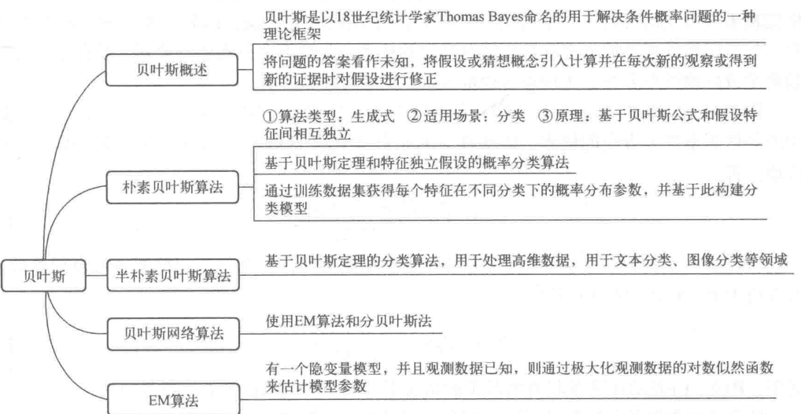

贝叶斯族方法以贝叶斯定理与概率统计为基础，通过对特征条件概率建模实现分类、回归、聚类等任务。该类模型在数据挖掘、计算机视觉、自然语言理解、经济统计预测等领域应用广泛，对小样本、噪声数据及不确定性建模有优势，并能有效利用先验知识进行推理与预测。但计算复杂度高、先验选取困难是其挑战，实践中需结合问题与数据特点挑选合适变体。


本节先介绍贝叶斯方法及相关概念，包括贝叶斯概率、贝叶斯决策、极大似然估计等基础知识；随后给出朴素贝叶斯、半朴素贝叶斯、贝叶斯网络等常用分类模型；最后介绍用于含隐变量概率模型参数估计的 EM 算法。

## 4.1 贝叶斯方法概述
贝叶斯提供了一种以主观概率为基础的统计分析框架，用概率分布刻画数据，据先验分布与带标签样本推算后验分布，以贝叶斯风险为优化目标完成分类或回归。大数据时代的海量样本为后验计算提供支撑，使贝叶斯模型成为处理大规模数据的重要工具。

### 4.1.1 贝叶斯公式
随机事件指在相同条件下可能发生也可能不发生的现象。概率用来量化其发生可能性。对概率的解释主要有频率学派与贝叶斯学派。频率学派把概率看作客观常数，可用频率逼近。贝叶斯学派把概率看作主观信念，先有一个基于经验的先验概率或先验分布，再据观测数据不断修正，得到后验概率或后验分布，从而提升对客观世界的认识。

记 $P(A)$ 和 $P(B)$ 分别为事件 $A$、$B$ 的概率，$P(A|B)$ 为在 $B$ 已发生条件下 $A$ 发生的条件概率，则根据条件概率定义与性质，有

$$P(B|A)=\frac{P(B)P(A|B)}{P(A)}\qquad(4-1)$$

假设事件 $A$ 表示机器学习任务中样本取值状态为 $X$，事件 $B$ 表示模型参数 $\theta$ 的取值为 $\theta_i$，则式化为

$$P(	heta_i|X)=\frac{P(	heta_i)P(X|	heta_i)}{P(X)}\qquad(4-2)$$

式中 $P(\theta_i|X)$ 表示在样本取值状态 $X$ 下模型参数取值为 $\theta_i$ 的条件概率。

假设模型参数各取值互不相容，则可由全概率公式得到 $P(X)$。

$$P(X)=\sum_k P(X|	heta_k)P(	heta_k)\qquad(4-3)$$

代入可得贝叶斯公式：

$$P(	heta_i|X)=\frac{P(	heta_i)P(X|	heta_i)}{\sum_k P(X|	heta_k)P(	heta_k)}\qquad(4-4)$$

式中 $P(\theta_i)$ 表示参数取值为 $\theta_i$ 的概率。

通常通过主观经验确定 $P(\theta_i)$，即先验概率。令

$$C(X|	heta_i)=\frac{P(X|	heta_i)}{\sum_k P(X|	heta_i)P(	heta_i)}\qquad(4-5)$$

则有 $P(\theta_i|X)=P(\theta_i)C(X|\theta_i)$。由此可知，对给定 $\theta_i$，因子 $C(X|\theta_i)$ 仅与样本特征取值状态 $X$ 有关，用来把先验概率 $P(\theta_i)$ 修正为后验概率 $P(\theta_i|X)$。因此贝叶斯公式的本质是根据样本取值状态 $X$ 修正先验概率以得到后验概率。

基于贝叶斯公式的统计分析与推断方法称为贝叶斯方法。其基本求解思路为：

后验概率 = 先验概率 × 样本信息

贝叶斯方法通过新观测样本信息修正原有认知，就像人类起初对自然只有少量先验知识，随着不断观察实验积累样本信息，对自然界的认识也日益透彻，因而符合人类认知方式。

### 4.1.2 贝叶斯决策理论
基于贝叶斯方法的统计推断或分类预测本质上是最大后验估计，即取后验概率最大的类别作为估计结果。这可能导致估计值与真实值不一致，在分类任务中表现为错误分类。为提高正确率，可考虑降低模型输出误差。通常单个样本的误差可用损失函数衡量，而贝叶斯模型输出为后验概率分布，因此需从后验概率分布角度估计输出误差。

任何模型的输出误差或错判都会产生后果，需要考虑由此带来的损失。由此产生基于决策风险最小化的贝叶斯决策方法。在所有相关概率已知时，可以整体条件风险最小为准则选择最优类别完成分类，通常称为贝叶斯决策。

贝叶斯决策的核心思想是根据事先给定的先验概率和观测到的证据计算后验概率，并基于最大后验概率作出决策。具体步骤如下：

- 1) 定义决策空间：确定可供选择的决策及其可能结果。
- 2) 确定先验概率：对每个可能结果估计先验概率，可基于经验或专家知识。
- 3) 观测到证据：收集与决策相关证据或观测数据。
- 4) 计算后验概率：依据贝叶斯定理将先验概率与观测证据结合，计算各条件下的后验概率。
- 5) 选择最优决策：依据后验概率选择具有最大后验概率的决策作为最优决策。

贝叶斯决策能有效处理不确定性，并可随新证据灵活更新。然而其面临计算复杂度高和先验概率准确性等挑战，实际应用中需合理选择先验并采用适当近似方法简化计算。

贝叶斯决策在机器学习中的应用包括分类、回归以及决策树等。通过对先验和后验概率建模，可提供更准确且可解释的决策结果，并在不同领域得到广泛应用。

### 4.1.3 极大似然估计
对于参数估计，统计学界两大学派给出不同方案。频率主义学派认为参数虽未知但客观存在且固定，可通过优化似然函数等准则确定参数值；贝叶斯学派认为参数是未观察到的随机变量本身可有分布，可假定参数服从先验分布，再基于观测数据计算参数后验分布。极大似然估计 MLE 是一种常用的参数估计方法，用于从观测数据中推断最有可能的参数值。它基于概率论原理，通过寻找能最大化观测数据出现概率的参数值来估计真

极大似然估计的本质，是让所选参数让观测样本出现的可能性达到最高。实操上一般遵循下面四步展开。

1) 选定分布模型：先假设样本来自某类已知的概率分布，比如正态分布、伯努利分布等。
2) 构造似然函数：把观测数据视为参数的函数，写出在给定参数下数据出现的概率，即似然函数。
3) 寻找最大值：通过优化方法如梯度下降或牛顿法，求出使似然函数最大的参数点。
4) 得到估计值：最大值对应的参数即为最大似然估计结果。

在离散情形下，先验概率的极大似然估计写作

P(Y=c_k)= sum_{i=1}^{n} I(y_i=c_k) / N , k=1,2,...,K (4-6)

设第 j 个特征 x^{(j)} 的取值集合为 {a_{j1},a_{j2},...,a_{js_j}}，条件概率的极大似然估计为

P(X^{(j)}=a_{jl} | Y=c_k)= sum_{i=1}^{N} I(x_i^{(j)}=a_{jl},y_i=c_k) / sum_{i=1}^{N} I(y_i=c_k)

j=1,2,...,n; l=1,2,...,S_j; k=1,2,...,K (4-7)

式中，x_i^{(j)} 表示第 i 个样本的第 j 个特征；a_{jl} 是该特征的第 l 个可能取值；I 为指示函数。

需要提醒的是，这种参数化方式虽然让条件概率的估计变得简洁，但估计质量高度依赖所假设的分布形式是否贴近真实数据分布。实践中若想让假设更接近真实，往往要结合任务本身的经验知识，仅靠主观猜测设定分布，很容易得到误导性结论。

极大似然估计具备渐进一致、渐进有效等优点，在样本量趋于无穷时估计会收敛到真实参数，且在大数据下具有无偏性、渐进正态性和高效性等良好统计性质。凭借这些特性，它被广泛用于回归分析、分类建模、时间序列以及各类概率分布的参数估计，是众多机器学习算法的理论基础。

## 4.2 朴素贝叶斯算法：贝叶斯定理下的轻量分类器

朴素贝叶斯算法是基于贝叶斯定理并结合特征条件独立假设的经典分类方法，常用于文本分类、垃圾邮件过滤等场景。其核心是利用特征向量计算各类别的后验概率，并把概率最高的类别作为预测结果。

给定训练集，首先在特征条件独立假设下学习输入输出的联合概率分布；随后对新输入 x，用贝叶斯定理求出后验概率最大的输出 y。该方法实现简洁，训练与预测速度都很快。

设输入空间 X⊂R^n 为 n 维向量集合，输出空间 Y={c1,c2,…,ck}，输入为 x∈X，输出为 y∈Y。X、Y 为相应的随机变量，P(X,Y) 为联合分布。训练集 T={(x1,y1),…,(xN,yN)} 由 P(X,Y) 独立同分布产生。

先验分布为

P(Y=ck)， k=1,2,…,K  (4-8)

条件分布为

P(X=x|Y=ck)=P(X^(1)=x^(1),…,X^(n)=x^(n)|Y=ck)， k=1,2,…,K  (4-9)

若 x^(j) 有 Sj 个取值，则参数总数为 K∏_{j=1}^n Sj，完整估计不可行。

朴素贝叶斯引入条件独立假设：

P(X=x|Y=ck)=P(X^(1)=x^(1),…,X^(n)=x^(n)|Y=ck)
=∏_{j=1}^n P(X^(j)=x^(j)|Y=ck)  (4-10)

该假设使模型大幅简化，属于生成模型，相当于在类别确定后各特征相互独立。虽然会牺牲部分准确率，但换来极高的计算效率。

后验概率为

P(Y=ck|X=x)= P(X=x|Y=ck)P(Y=ck) / Σ_k P(X=x|Y=ck)P(Y=ck)  (4-11)

代入式 4-10 得

P(Y=ck|X=x)= P(Y=ck)∏_j P(X^(j)=x^(j)|Y=ck) / Σ_k P(Y=ck)∏_j P(X^(j)=x^(j)|Y=ck)， k=1,2,…,K  (4-12)

分类器可写为

y=f(x)=arg max_{ck} P(Y=ck)∏_j P(X^(j)=x^(j)|Y=ck) / Σ_k P(Y=ck)∏_j P(X^(j)=x^(j)|Y=ck)  (4-13)

分母对所有 ck 相同，故简化为

y=arg max_{ck} P(Y=ck)∏_j P(X^(j)=x^(j)|Y=ck)  (4-14)

下面基于 numpy 实现朴素贝叶斯。

- 1）定义朴素贝叶斯过程。

### 代码 4-1 naive_bayes 函数

```
import numpy as np

def naive_bayes(X, y, sample):
    """
    朴素贝叶斯算法
    参数：
        X (np.ndarray)：训练数据特征，形状为 (n_samples, n_features)
        y (np.ndarray)：训练数据标签，形状为 (n_samples,)
        sample (np.ndarray)：待预测的样本特征，形状为 (n_features,)
    返回：
        int；预测结果标签
    """

    # 获取所有类别
    classes = np.unique(y)
    # 统计每个类别出现的次数
    class_count = np.bincount(y)
    # 计算每个类别的先验概率
    class_prior = class_count / len(y)

    prior = {}
    # 针对每个特征进行处理
    for col in range(X.shape[1]):
        # 针对每个类别进行处理
        for j in classes:
            # 计算特征在给定类别下的条件概率
            p_x_y = np.bincount(X[y == j, col])
            # 计算特征的先验概率
            for i in range(len(p_x_y)):
                prior[(col, i, j)] = p_x_y[i] / class_count[j]

    predictions = []
    # 对每个测试样本进行预测
    for sample in X:
        prob = {}
        # 计算每个类别的后验概率
        for j in classes:
            p_y = class_prior[j]
            for col, value in enumerate(sample):
                # 进行条件概率计算，并平滑处理
                p_y *= prior.get((col, value, j), 1e-9)
            prob[j] = p_y
        # 选择具有最大后验概率的类别作为预测结果
        predictions.append(max(prob, key=prob.get))

    return predictions
```

- 2）用训练集对测试集进行类别预测。

示例中使用一组简单训练数据和测试数据，特征包含数字和字母，标签已知。通过朴素贝叶斯分类器预测测试样本，得到结果 [0,0,1]，即前两个样本判为类别 0，第三个判为类别 1。

### 代码 4-2 使用朴素贝叶斯算法对测试集样本的类别进行预测

```
# 测试数据
X_train = np.array([[1, 'S'], [1, 'M'], [1, 'M'], [1, 'S'], [1, 'S'],
                    [2, 'S'], [2, 'M'], [2, 'M'], [2, 'L'], [2, 'L'],
                    [3, 'L'], [3, 'M'], [3, 'M'], [3, 'L'], [3, 'L']])
y_train = np.array([0, 0, 1, 1, 0, 0, 0,1, 1, 1, 1, 1, 1, 1, 0])
X_test = np.array([[2, 'S'], [1, 'M'], [1, 'L']])

# 调用朴素贝叶斯分类器进行预测
predictions = naive_bayes(X_train, y_train, X_test)

# 输出预测结果
print("预测结果:", predictions)
```

### 4.2.1 高斯朴素贝叶斯：连续特征的近似方案

高斯朴素贝叶斯同样基于贝叶斯定理和特征独立假设，专用于连续型特征分类。它假设在给定类别 k 下，每个特征 xi 服从高斯分布：

$$p(x_i | \theta_k)=\frac{1}{\sqrt{2\pi}\sigma_k}\exp\left(\frac{(x_i-\mu_k)^2}{2\sigma_k^2}\right)\qquad(4-15)$$

式中，$\theta_k=(\mu_k,\sigma_k)$。

训练阶段先统计各类别的先验概率，即类别出现频率，再对每个特征计算在各类别下的均值和方差。

预测时对新样本计算各类别的后验概率，用高斯概率密度函数求每个特征值的对数似然，将其与先验相加得到后验，对数域求和可避免数值下溢，最后选择后验最大的类别。

该方法在大数据集上训练预测效率高，对缺失数据也具一定鲁棒性。局限在于强假设特征独立，现实中特征常相关，会影响结果质量。

实现如下。

- 1）定义高斯朴素贝叶斯过程。

### 代码 4-3 gaussian_naive_bayes 函数

```
import numpy as np

def gaussian_naive_bayes(X_train, y_train, X_test):
"""
    高斯朴素贝叶斯分类器
    参数：
        X_train: numpy. ndarray, 训练数据特征, 形状为(n_samples, n_features)
        y_train: numpy. ndarray, 训练数据标签, 形状为(n_samples,)
        X_test: numpy. ndarray, 测试数据特征, 形状为(m_samples, n_features)
    返回：
        predictions: numpy. ndarray, 预测结果, 形状为(m_samples,)
"""
    # 计算每个类别出现的概率
    classes = np.unique(y_train)
    class_prior = {}
    for c in classes:
        class_prior[c] = np.sum(y_train == c) / len(y_train)

    # 计算每个类别下每个特征的均值和方差
    mean = {}
    variance = {}
    for c in classes:
        mean[c] = np.mean(X_train[y_train == c], axis=0)
        variance[c] = np.var(X_train[y_train == c], axis=0)

    # 预测测试样本的类别
    predictions = []
    for x in X_test:
        posteriors = []
        for c in classes:
            # 使用高斯分布的概率密度函数计算后验概率的对数似然
            log_likelihood = np.sum(-0.5 * np.log(2 * np.pi * variance[c])
                - 0.5 * ((x - mean[c]) ** 2) / variance[c])
            prior = np.log(class_prior[c])
            posterior = prior + log_likelihood
            posteriors.append(posterior)

        # 选择具有最大后验概率的类别作为预测结果
        predictions.append(classes[np.argmax(posteriors)])

    return np.array(predictions)
```

- 2）用训练集预测测试集。

定义训练集 X_train、标签 y_train 和测试集 X_test，调用 gaussian_naive_bayes 预测，结果存入 predictions 并输出。示例预测结果为 [0,1,0]，即第一、三样本为类别 0，第二样本为类别 1。

### 代码 4-4 使用高斯朴素贝叶斯算法对测试集样本的类别进行预测

```
# 构造一些示例数据进行测试
X_train = np.array([[0.5, 1.2], [1.0, 1.8], [3.2, 4.5], [2.8, 3.9], [1.2, 1.0], [2.5, 3.7]])
y_train = np.array([0, 0, 1, 1, 0, 1])
X_test = np.array([[1.5, 2.0], [2.0, 3.5], [0.8, 0.6]])

# 调用高斯朴素贝叶斯算法进行预测
predictions = gaussian_naive_bayes(X_train, y_train, X_test)

# 打印预测结果
print(predictions)
```

### 4.2.2 多项式朴素贝叶斯：计数型文本分类的常用选择

多项式朴素贝叶斯针对离散计数特征设计，假设特征出现次数服从多项分布，常用于文本分类、垃圾邮件检测和情感分析等任务。

训练时计算各类别先验概率以及每个特征在各类别下的条件概率，先验反映类别频率，条件概率反映特征计数在类别下的分布。预测时依据先验和条件概率计算后验概率，选择概率最大的类别输出。

该模型简单高效，对高维稀疏的离散特征表现稳定。

- 1）定义多项式朴素贝叶斯过程。

### 代码 4-5 multinomial_naive_bayes 函数

```
import numpy as np

def multinomial_naive_bayes(X_train, y_train, X_test):
    """
    多项式朴素贝叶斯分类器的代码实现
    参数：
    X_train --训练集特征矩阵，每行表示一个样本，每列表示一个特征
    y_train --训练集标签，与训练集样本一一对应
    X_test --测试集特征矩阵，每行表示一个样本，每列表示一个特征
    返回：
    predictions --预测结果，表示测试集样本的分类标签
    """

    # 统计训练集中每个类别的先验概率
    class_prior = np. bincount(y_train) / len(y_train)
```

```
# 统计训练集中每个类别下，每个特征出现的次数(计数)
feature_counts = np.zeros((np.max(y_train) + 1, X_train.shape[1]))
for i in range(len(y_train)):
    feature_counts[y_train[i]] += X_train[i]

# 计算每个类别下，每个特征的条件概率
# 在此处将特征计数加 1 进行平滑处理，避免概率为 0 的情况
feature_probabilities = (feature_counts + 1) / (np.sum(feature_counts, axis=1, keepdims=True) + X_train.shape[1])

# 计算后验概率并进行预测
predictions = []
for i in range(X_test.shape[0]):
    # 计算每个类别的后验概率
    posterior_probs = class_prior * np.prod(feature_probabilities ** X_test[i], axis=1)
    # 选择具有最大后验概率的类别作为预测结果
    prediction = np.argmax(posterior_probs)
    predictions.append(prediction)

return np.array(predictions)
```

2）用多项式朴素贝叶斯为测试数据打标签。做法是先准备好训练集 X_train 与其标签 y_train，再准备测试集 X_test；接着执行 multinomial_naive_bayes 函数得到预测值，存入 predictions，最后通过 print 展示。本例输出 [1,0]，说明第一个测试例被判为类别 1，第二个测试例被判为类别 0。

## 代码4-6 多项式朴素贝叶斯的测试预测

```
# 示例数据
X_train = np.array([[1, 1, 0, 0],
                    [0, 1, 1, 0],
                    [0, 0, 1, 1],
                    [1, 0, 1, 0]])

y_train = np.array([0, 0, 1, 1])

X_test = np.array([[1, 0, 0, 1],
                   [0, 1, 0, 0]])

# 对测试集进行预测
predictions = multinomial_naive_bayes(X_train, y_train, X_test)

print("预测结果:", predictions)
```

### 4.2.3 伯努利朴素贝叶斯算法

伯努利朴素贝叶斯属于朴素贝叶斯家族的二值分支，主要处理文本分类或 0/1 特征问题。与计数式的多项式版本不同，它只关心特征是否出现。

核心思路是把文档转成二进制向量，每个位置表达某个词或文本属性的有无，取值只能是真/假或 1/0。在类别固定的情况下，仍假设各维度条件独立。

训练阶段遍历训练集中每个样本的二进制向量，按特征是否出现累加该类别的出现次数；随后基于该类别样本总量计算特征出现的条件概率。推理时对测试样本逐类逐维计算后验概率，按贝叶斯公式累加，最后选后验最大的类别。

该方法对二值特征友好，在稀疏、高维场景下表现稳健，常用于文本分类、垃圾邮件识别、情感判断等。

下面以 numpy 为工具实现。

- 1）定义伯努利朴素贝叶斯的执行流程。

代码 4-7 实现了一个伯努利朴素贝叶斯分类器。输入 X_train 与 y_train 后，先统计特征出现频次数组 feature_presence_counts 与类别频次数组 class_counts，由此推导出类别先验 class_probabilities 和特征出现条件概率 feature_probabilities。预测时对 X_test 的每个样本利用上述概率算对数后验 log_probs，取最大值对应的类别作为 predicted_class。所有结果汇总到 predictions 列表返回。

整体分为训练与推理两步，并加入拉普拉斯平滑防止零概率。调用函数传入训练数据、标签与测试数据即可完成建模与预测。

### 代码 4-7 bernoulli_naive_bayes 函数

```
import numpy as np

def bernoulli_naive_bayes(X_train, y_train, X_test):
    """
    伯努利朴素贝叶斯分类器的代码实现
    参数：
    X_train --训练集特征矩阵，每行表示一个样本，每列表示一个特征
    y_train --训练集标签，与训练集样本一一对应
    X_test --测试集特征矩阵，每行表示一个样本，每列表示一个特征
    返回：
    predictions --预测结果，表示测试集样本的分类标签
    """

    # 获取类别数量和特征数量
    num_classes = np.max(y_train) + 1
    num_features = X_train.shape[1]

    # 创建特征存在计数数组和类别计数数组
    feature_presence_counts = np.zeros((num_classes, num_features))
    class_counts = np.zeros(num_classes)

    # 遍历训练集, 统计特征存在计数和类别计数
    for i in range(len(X_train)):
        sample = X_train[i]
        label = y_train[i]
        class_counts[label] += 1
        feature_presence_counts[label] += (sample > 0)

    # 计算类别的先验概率
    class_probabilities = class_counts / len(X_train)

    # 计算特征存在的条件概率
    # 使用拉普拉斯平滑: 将特征存在计数加 1, 类别计数加 2
    feature_probabilities = (feature_presence_counts + 1) /
                            (class_counts.reshape(-1, 1) + 2)

    predictions = []

    # 对测试集中的每个样本进行预测
    for sample in X_test:
        # 计算属于各个类别的后验概率
        log_probs = np.log(class_probabilities) + np.log(feature_probabilities
                                                         * sample + (1 - feature_probabilities) * (1 - sample))
        # 选择具有最大后验概率的类别作为预测结果
        predicted_class = np.argmax(np.sum(log_probs, axis=1))
        predictions.append(predicted_class)

    # 返回预测结果
    return predictions
```

2) 用伯努利朴素贝叶斯对测试集做分类演示。

先设定 X_train、y_train 与 X_test，调用 bernoulli_naive_bayes 得到预测并保存到 predictions，再打印。本例输出 [0,1]，表示首个测试样例被分到类别 0，次个被分到类别 1。

### 代码4-8 伯努利朴素贝叶斯对测试集的分类演示

```
X_train = np.array([[1, 1, 0, 0],
                    [0, 1, 1, 0],
                    [0, 0, 1, 1],
                    [1, 0, 1, 0]])

y_train = np.array([0, 0, 1, 1])

X_test = np.array([[1, 0, 0, 1],
                  [0, 1, 0, 0]])

# 使用训练集和测试集进行训练和预测
predictions = bernoulli_naive_bayes(X_train, y_train, X_test)

print("预测结果:", predictions)
```

## 4.3 半朴素贝叶斯算法

朴素贝叶斯之所以叫“朴素”，是因为它默认属性间相互独立，从而简化 P(x_j | c_i) 的计算。现实里属性完全独立的情况极少。

半朴素贝叶斯在朴素框架上引入有限的相关性建模，通过考虑部分依赖提升判别力。

基本想法是，固定类别后，特征间的相关性可由少数选定特征概括。这些核心特征在模型中权重更高，其余特征影响被简化。筛选核心特征常用信息增益、卡方检验、互信息等指标，按特征与类别的相关度评估重要性。

相关性建模可选用协方差矩阵、相关系数等统计量描述线性关系，也可用树模型、神经网络等非线性手段学习复杂关联。

独依赖估计 ODE 是半朴素贝叶斯最常用的策略。它假设每个属性在已知类别时最多依赖一个其它属性，即

P(x | c_i) = ∏_{j=1}^d P(x_j | c_i, pa_j)  (4-16)

其中 pa_j 为 x_j 的父属性。已知父属性时，可用

P(x_j | c_i, pa_j) = P(x_j, c_i, pa_j) / P(c_i, pa_j)  (4-17)

估计条件概率。

流程概述：

- 1) 数据准备：准备含多特征样本及其标签的训练集与测试集。
- 2) 特征选择：从全部特征中挑出一个核心特征，它对类别划分起关键作用。
- 3) 相关性建模：将其他特征与核心特征配对，构建一系列独依赖模型，按核心特征与配对特征组合计算概率。
- 4) 模型训练：对每个配对组合在各类别下估计条件概率，可用极大似然估计或贝叶斯估计。
- 5）模型预测：对测试样本在每个独依赖模型中计算各类别后验概率，取最大值对应的类别作为预测。

相比传统朴素贝叶斯，半朴素版本计入了特征相关性，能更好捕捉数据复杂关系，且可根据任务灵活选择核心特征与配对方式，在高维数据上通过降维保持较好性能。

不过它仍在一定程度上保留了条件独立假设，面对更强的依赖时，可引入贝叶斯网络、树模型等更复杂的结构来刻画依赖关系。

## 4.4 贝叶斯网络算法

贝叶斯网络又称信念网络或因果网络，是用图形方式描述变量间依赖关系的模型，用于不确定性推理。它提供了一个清晰的框架来表达因果关系，使推理更易理解。

贝叶斯网络借助有向无环图 DAG 刻画属性依赖，用条件概率表 CPT 描述联合分布。

一个贝叶斯网络 B 由结构 G 和参数 θ 组成，即 B = <G, θ>。G 是一个 DAG，每个节点对应一个属性，有向边表示直接依赖；参数 θ 量化依赖，若属性 x_i 在 G 中的父节点集为 π_i，则 θ 包含条件概率表 θ_{x_i | π_i} = P_B(x_i | π_i)。网络表达了条件独立关系，也能从结构和 CPT 快速得到任意基本事件的联合概率。

### 4.4.1 贝叶斯网络结构

贝叶斯网络结构直观表达了条件独立性。从属性 A 指向属性 B 的弧表示 A 的取值会影响 B，图为有向无环图，不会出现回路。A 是 B 的父节点，B 是 A 的子节点；沿有向通路可定义祖先与后代关系。

以图4-1为例，共含四个节点四条弧。高油高糖饮食 X1 是原因节点，会导致糖尿病 X2 和高血脂 X3，而 X2 和 X3 都可能导致心脏病 X4。这是典型的简单贝叶斯网络。X1 无入边，为根节点，其余为非根节点。

弧的存在表示因果联系，缺少直接或间接有向连通则认为独立。独立性大幅减少建网计算量，也是学习网络的重要依据。结构清晰呈现属性关系，使推理与预测更易实现。

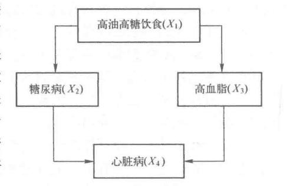

图 4-1 简单的贝叶斯网络结构

从图 4-1 可见，一个祖先节点可通过不同路径影响后代。如吸烟导致呼吸困难，中间原因可能是肺气肿也可能是支气管炎。原因到结果的表述是概率性的而非必然，需为每个节点设置条件概率表，即在父节点不同取值组合下节点取各值的概率。

贝叶斯网络的重要性质是：父节点分布确定后，节点与其非直接父节点条件独立。这方便计算联合分布。B=<G,θ> 将属性 x₁,x₂,…,x_d 的联合概率定义为

$P_B(x_1,x_2,\cdots,x_d)=\prod_{i=1}^{d}P_B(x_i|\pi_i)\prod_{i=1}^{d}\theta_{x_i|\pi_i}\tag{4-18}$

图 4-2 展示了贝叶斯网络中三变量的典型依赖。

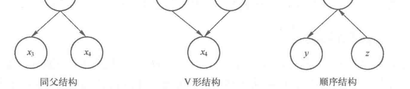

图 4-2 贝叶斯网络中三个变量之间的典型依赖关系

在“同父”结构中，给定父节点 x₁，x₃ 与 x₄ 条件独立。在“顺序”结构中，给定 x 的值，y 与 z 条件独立。V 形结构又称“冲突”结构，给定子节点 x₄ 的取值，x₁ 和 x₂ 不独立；有趣的是，若 x₄ 完全未知，V 形结构下 x₁ 与 x₂ 却是独立的。验证如下：

$P(x_1,x_2)=\sum_{x_4}P(x_1,x_2,x_4)$

= \sum_{x_4} P(x_4 | x_1, x_2) P(x_1) P(x_2)

 = P(x_1) P(x_2)  (4-19)

这种不受第三个变量影响的独立关系就叫边际独立，记作 x₁ ⫫ x₂。

一个变量是否已知，会改变另两个变量之间的独立性，这并不是 V 形结构的专属现象。以同父结构为例，在知道父节点 x₁ 的情况下，两个子节点 x₃ 与 x₄ 是条件独立的，记为 x₃ ⫫ x₄ | x₁；一旦 x₁ 的取值变得未知，x₃ 和 x₄ 的独立性就消失了，x₃ ⫫ x₄ 不再成立。顺序结构也类似，y ⊥ z | x 成立，但 y ⫫ z 不成立。

要判断有向图里变量之间的条件独立，可借助有向分离。首先把有向图转成无向图：先把图中的所有 V 形结构找出来，在构成 V 形的两个父节点之间补一条无向边；再把所有有向边全部改成无向边。这样得到的无向图称为道德图，补边的过程称为道德化。

在道德图上判断独立很直观。设道德图中有变量 x、y 和集合 z={zᵢ}，如果把 z 从图中删掉后 x 和 y 掉到不同的连通分支，就称 x 和 y 被 z 有向分离，记为 y ⊥ z | x 成立。

### 4.4.2 贝叶斯网络结构搜索方法
结构已知时，贝叶斯网络的学习很直接，只需对训练样本计数得到每个节点的条件概率表即可。实际中结构往往未知，首要任务就是从训练数据里找出最合适的网络结构。常用的思路是评分搜索：先定义一个评分函数衡量网络与数据的契合度，再在该函数指导下寻找最优结构。评分函数本质上体现了我们对期望网络形式的归纳偏好。

大量评分函数源于信息论，把学习看成数据压缩。目标是找到用最短编码长度描述训练数据的模型，编码长度包含描述模型本身所需字节和使用模型描述数据所需字节。对于贝叶斯网络，模型即网络本身，它为训练数据提供一种概率分布，不同样本的编码长度也随之不同。于是我们要选择描述网络与编码数据总长度最小的网络，这就是最小描述长度准则。

给定训练集 D = {x₁, x₂, …, xₘ}，网络 B = <G, θ> 在 D 上的评分为

s(B | D) = f(θ) |B| − LL(B | D)  (4-20)

其中 |B| 为参数个数，f(θ) 为描述单个参数所需的字节数，而

LL(B | D) = Σ_{i=1}^{m} log P_B(x_i)  (4-21)

为对数似然。第一项是编码网络所需的字节，第二项是用来描述数据的字节。学习即最小化 s(B | D)。

若 f(θ)=1，每个参数用 1 字节，则得到 ACI 评分

MDL(B|D)=|B|-LL(B|D)  (4-22)

若 f(θ)=1/2 log m，每个参数用 1/2 log m 字节，则得到 BIC 评分

BIC(B|D)=1/2 log m |B|-LL(B|D)  (4-23)

当 f(θ)=0 时，评分退化为负对数似然，学习退化为极大似然估计。

结构 G 固定时，s(B|D) 的第一项为常数，最小化评分等价于参数 θ 的极大似然估计。由式 (4-21) 和式 (4-18) 可知，条件概率 θ_{x_i|π_i} 可直接用经验频率估计

θ_{x_i|π_i}=\hat P_D(x_i|π_i)  (4-24)

因此只需搜索结构，候选结构的最优参数可直接在训练集上算出。

从全部可能结构中找最优解是 NP 难问题。实践中常用两种近似策略：一是贪心法，从某个初始结构出发，重复增加、删除或翻转一条边，直到评分不再下降；二是加约束缩小搜索空间，例如限制为树形结构。

### 4.4.3 贝叶斯网络查询与推理
网络训练好后即可做查询，即根据部分属性的观测值推断其他属性。已知观测值称为证据。

理想做法是直接基于联合概率分布精确计算后验概率，但精确推断已被证明是 NP 难的。节点多、连接密时难以精确计算，需要近似推断，在有限时间内得到近似解。实践中常用吉布斯采样。

设待查变量 Q={Q1,Q2,…,Qn}，证据变量 E={E1,E2,…,Ek}，取值 e={e1,e2,…,ek}。目标是 P(Q=q|E=e)。

吉布斯采样先在与证据一致的样本空间里随机取一个初始点 q^0，随后迭代产生新样本。第 t 次采样时令 q'^t = q^{t-1}，然后逐个对非证据变量重新采样，采样概率由网络 B 和当前其他变量取值决定。若经过 T 次采样，与 q 一致的样本有 n_q 个，则

P(Q=q|E=e)≈ n_q / T  (4-25)

本质上是在证据为 e 的联合状态子空间里进行随机漫步。每一步只依赖前一步，形成马尔可夫链。在合适条件下，无论初始状态如何，链的分布会收敛到平稳分布，对吉布斯采样而言就是 P(Q|E=e)。当 T 足够大时，采样近似于从后验分布抽样。

要注意，马尔可夫链收敛可能很慢；若网络中存在概率 0 或 1 的极端值，平稳分布可能不存在，采样会给出错误估计。

下面以 pgmpy 包为例演示建模与训练。pgmpy 是基于 Python 的概率图模型库，涵盖贝叶斯网络与马尔可夫蒙特卡洛等实现。以学生奖学金为例，有向图与概率表如图 4-3 所示。

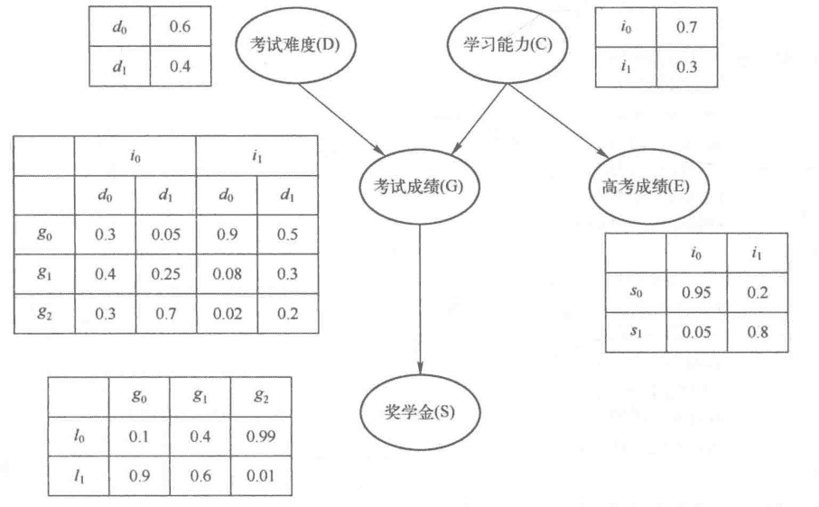

图 4-3 学生获得奖学金情况的贝叶斯网络图

考试难度、学习能力共同影响个人成绩，学习能力也影响高考成绩，个人成绩再直接决定奖学金情况。下面用 pgmpy 实现该网络。

- 1）导入模块、搭建框架并指定依赖关系。

```
from pgmpy.factors.discrete import TabularCPD
from pgmpy.models import BayesianModel
student_model = BayesianModel([('D', 'G'), ('C', 'G'), ('G', 'S'), ('C', 'E')])
```

- 2）创建各节点并传入概率表，设置参数。

```
grade_cpd = TabularCPD(
    variable='G',
    # 节点名称
    variable_card=3,          # 节点取值个数
    values=[[0.3, 0.05, 0.9, 0.5],
    [0.4, 0.25, 0.08, 0.3],
    [0.3, 0.7, 0.02, 0.2]],
    evidence=['C', 'D'],       # 该节点的依赖节点
    evidence_card=[2, 2]      # 依赖节点的取值个数
)
diffi_cpd = TabularCPD(
    variable='D',
    variable_card=2,
    values=[[0.6, 0.4]]
)
capab_cpd = TabularCPD(
    variable='C',
    variable_card=2,
    values=[[0.7, 0.3]]
)
scholar_cpd = TabularCPD(
    variable='S',
    variable_card=2,
    values=[[0.1, 0.4, 0.99],
    [0.9, 0.6, 0.01]],
    evidence=['G'],
    evidence_card=[3]
)
exam_cpd = TabularCPD(
    variable='E',
    variable_card=2,
    values=[[0.95, 0.2],
    [0.05, 0.8]],
    evidence=['C'],
    evidence_card=[2]
)
```

- 3) 把带概率表的节点加入模型。

```
student_model.add_cpds(
    grade_cpd,
    diffi_cpd,
    capab_cpd,
    scholar_cpd,
    exam_cpd
)
```

- 4) 读取模型的条件概率分布和节点依赖关系。

```
student_model.get_cpds()
student_model.get_independencies()
```

- 5) 执行贝叶斯推断。

```
from pgmpy.inference import VariableElimination
student_infer = VariableElimination(student_model)

prob_G = student_infer.query(
    variables=['G'],
    evidence={'C': 1, 'D': 0})
print(prob_G)
```

除手工构造外，还可基于 pgmpy 做数据驱动训练。首先生成模拟数据并按学生奖学金变量命名。

- 1）生成数据。

```
import numpy as np
import pandas as pd
raw_data = np.random.randint(low=0, high=2, size=(1000, 5))
data = pd.DataFrame(raw_data, columns=['D', 'C', 'G', 'S', 'E'])
data.head()
```

- 2）基于数据训练模型。

```
# 定义模型
from pgmpy.models import BayesianModel
from pgmpy.estimators import MaximumLikelihoodEstimator, BayesianEstimator

model = BayesianModel([('D', 'G'), ('C', 'G'), ('G', 'S'), ('C', 'E')])

# 基于极大似然估计进行模型训练
model.fit(data, estimator=MaximumLikelihoodEstimator)
for cpd in model.get_cpds():
    # 打印条件概率分布
    print("CPD of {variable}:".format(variable=cpd.variable))
    print(cpd)
```

## 4.5 EM 算法：处理隐变量的迭代估计
此前假设训练样本所有属性都可观测，即数据完整。现实中常出现未观测变量，称为隐变量。设 X 为已观测集，Z 为隐变量集，θ 为参数。极大似然估计需最大化

LL(θ|X,Z)=lnP(X,Z|θ)  (4-26)

由于 Z 未知，无法直接求解。只能最大化观测数据的边际对数似然

LL(θ|X,Z)=lnP(X|θ)=ln Σ_z P(X,Z|θ)  (4-27)

EM 算法是处理这类问题的经典迭代方法，由 Dempster 等于 1977 年提出，用于含隐变量模型的极大似然或极大后验估计。每次迭代包含 E 步求期望、M 步求极大。

若 θ 已知，可推断最优隐变量 Z；若 Z 已知，则可方便地对 θ 做极大似然估计。以 θ⁰ 起点，迭代直至收敛：

- 1) 基于 θ^t 推断隐变量 Z 的期望，记为 Z'。
- 2) 基于 X 和 Z' 对参数 θ 做极大似然估计，记为 θ^{t+1}。

更一般地，用概率分布表达：

- 1) E 步：计算 P(Z|X,θ^t)，并求对数似然关于 Z 的期望

Q(θ|θ^t)=E_{Z|X,θ^t}LL(θ|X,Z)  (4-28)

- 2) M 步：最大化期望似然

θ^{t+1}=argmax_θ Q(θ|θ^t)  (4-29)

简言之，E 步用当前参数估计隐变量的期望信息，M 步据此更新参数，两步交替直至局部最优。

隐变量问题也可使用梯度下降求解，但求和随隐变量数量指数增长，计算负担大。EM 可看作一种非梯度的优化方式。

经典例子是三硬币模型。硬币 A 的正面概率为 π，正面则选硬币 B，反面则选硬币 C，B、C 的正面概率分别为 p、q。先抛 A 再据结果抛 B 或 C，重复 5 次，每次抛 10 次。如何估计 π、p、q？

我们只能看到最后结果，B 或 C 实际被选用与否是隐变量，需要 EM 求解。

E 步：设初始 θ̂_B^(0)=0.6，θ̂_C^(0)=0.5，估计每次试验选用 B 或 C 的概率，例如

P(z=B|y₁,θ)=P(z=B,y₁|θ)/[P(z=B,y₁|θ)+P(z=C,y₁|θ)]=(0.6)^5×(0.4)^5/[(0.6)^5×(0.4)^5+(0.5)^10]=0.45  (4-30)

算出每轮的选用概率后加权求和。

M 步：更新参数估计

Q(θ,θⁱ)=∑_{j=1}^5 ∑_z P(z|y_j,θⁱ) log P(z|y_j,θ)=∑_{j=1}^5 μ_j log(θ_B^{y_j}(1-θ_B)^{10-y_j}) + (1-μ_j) log(θ_C^{y_j}(1-θ_C)^{10-y_j}) (4-31)

对式 (4-31) 求导令零可得一次迭代结果，重复直至收敛。

下面用 numpy 实现简化的 EM 求解三硬币问题。先把似然初始化为负无穷，进入迭代：E 步计算隐变量分布并做概率加权；M 步据加权计数更新参数估计；计算新似然并打印迭代次数、参数估计与似然值；当似然变化小于阈值时停止，最终返回估计结果。

### 代码 4-9 EM 函数

```python
import numpy as np

def em(data, thetas, max_iter=50, eps=1e-3):
    """
    data: 观测数据, 每行表示一次独立实验的正反面次数
    thetas: 估计参数, 每行表示一个硬币的正面概率
    max_iter: 最大迭代次数
    eps: 收敛阈值
    """
    # 初始化似然函数值
    ll_old = -np.inf

    for i in range(max_iter):
        ### E 步; 求隐变量分布
        # 对数似然
        log_like = np.array([ np.sum(data * np.log(theta), axis=1)
            for theta in thetas])
        # 似然
        like = np.exp(log_like)
        # 求隐变量分布
        ws = like / like.sum(0)
        # 概率加权
        vs = np.array([ [w[:, None]] * data for w in ws])
        ### M 步; 更新参数值
        thetas = np.array([ v.sum(0)/v.sum() for v in vs])
        # 更新似然函数
        ll_new = np.sum([ w * l for w, l in zip(ws, log_like)])
        print("Iteration: %d" % (i+1))
        print("theta_B = %.2f, theta_C = %.2f, ll = %.2f"
              % (thetas[0,0], thetas[1,0], ll_new))

        # 满足迭代条件即退出迭代
        if np.abs(ll_new - ll_old) < eps:
            break

        ll_old = ll_new

    return thetas

# 观测数据，5次独立实验，每次试验10次抛掷的正反面次数
observed_data = np.array([(5, 5), (9, 1), (8, 2), (4, 6), (7, 3)])

# 初始化参数值，硬币 B 的正面概率为 0.6，硬币 C 的正面概率为 0.5
thetas = np.array([[0.6, 0.4], [0.5, 0.5]])

eps = 0.01
max_iter = 50

# 使用 EM 算法求解三硬币问题
thetas = em(observed_data, thetas, max_iter, eps)
```

## 4.6 本章回顾

本章以贝叶斯网络为主线，对相关理论与方法进行了梳理，涵盖了朴素贝叶斯、半朴素贝叶斯、贝叶斯网络建模以及 EM 参数估计，并在 Python 中给出了示例实现。

朴素贝叶斯以贝叶斯定理为基础，额外引入属性间条件独立的简化假定来进行分类，故得名“朴素”。贝叶斯网络又称信念网络或因果网络，通过图结构刻画变量间的概率依赖关系，是不确定性推理中常用的建模方式。EM 算法针对含有隐变量的概率模型，采用期望与最大化交替迭代的方式，寻找极大似然或极大后验解。

## 4.7 延伸阅读：机器学习赋能智能驾驶

近年来我国智能驾驶发展明显提速，在政策扶持下已成为全球主要力量之一。头部企业持续投入：百度发布了开放式自动驾驶平台 Apollo，腾讯布局自动驾驶赛道，阿里巴巴投资了图森未来等。主管部门出台了道路测试开放指引，并在多地建设测试示范区，为企业提供真实场景验证。由此我国形成全球规模最大的智能驾驶测试市场，企业在多个城市开展试运行并积累了海量路况、车辆与行人行为数据，部分区域已实现自动驾驶出租车与公交车的有限商业化运营。

生态体系逐步完善，车企、科技公司、零部件供应商与科研机构协同合作，实现资源共享与技术互补，加速技术迭代。凭借庞大的市场体量和多样复杂的道路交通环境，我国在国际竞争中具备优势，拥有丰富的测试与实战样本。

在智能驾驶感知环节，行人检测与识别尤为关键，贝叶斯方法可在分类与定位两方面发挥作用。

分类环节，可借助贝叶斯分类器结合历史统计与先验知识评估行人出现概率，并依据颜色、纹理等特征向量判定目标类别。随着先验与后验概率的不断刷新，分类器能够适应不同光照、天气等条件，提升识别精度。

定位环节，行人位置与速度的跟踪常采用贝叶斯滤波，如粒子滤波或卡尔曼滤波。该类方法融合当前检测结果、运动先验模型与上一时刻状态估计，实现轨迹跟踪；持续更新状态估计可得到更精确的位置解算。

基于贝叶斯的行人检测方案提升了智能驾驶系统的准确性与稳定性，增强鲁棒性，可在多变场景下保持可靠，并通过在线更新参数与概率分布持续优化性能。

## 4.8 习题

1. 选择题

- 1) 下列关于朴素贝叶斯算法的特点说法不正确的是（ ）。
- A. 朴素贝叶斯算法处理过程简单，分类速度快
- B. 朴素贝叶斯模型无须假设特征条件独立
- C. 朴素贝叶斯模型发源于古典数学理论，数学基础坚实
- D. 朴素贝叶斯算法对小规模数据表现较好
- 2) 关于朴素贝叶斯算法，下列说法错误的是（ ）。
- A. 朴素的意义在于它的一个天真的假设：所有特征之间是相互独立的
- B. 它是一个分类算法
- C. 它实际上是将多条件下的条件概率转换成了单一条件下的条件概率，简化了计算
- D. 朴素贝叶斯算法不需要使用联合概率
- 3) EM 算法的每次迭代由（ ）步组成。
- A. 1  B. 2  C. 3  D. 4
- 4) 有向无环图，A、B 间出现（ ）条有向回路。
- A. 0  B. 1  C. 2  D. 3

2. 问答题

1) 简述朴素贝叶斯算法有几种。
2) 试比较朴素贝叶斯算法与半朴素贝叶斯算法。

3. 综合应用题

用朴素贝叶斯算法实现天气情况与是否打网球关系，天气与是否打网球情况见表 4-1。

## 表4-1 天气与是否打网球情况

| 天气 | 气温 | 湿度 | 是否打网球 |
|---|---|---|---|
| 晴 | 热 | 高 | 否 |
| 晴 | 热 | 高 | 否 |
| 多云 | 热 | 高 | 是 |
| 雨 | 温 | 高 | 是 |
| 雨 | 凉 | 正常 | 是 |
| 雨 | 凉 | 正常 | 否 |
| 多云 | 凉 | 正常 | 是 |
| 晴 | 温 | 高 | 否 |
| 晴 | 凉 | 正常 | 是 |
| 雨 | 温 | 正常 | 是 |
| 晴 | 温 | 正常 | 是 |
| 多云 | 温 | 高 | 是 |
| 多云 | 热 | 正常 | 是 |
| 雨 | 温 | 高 | 否 |

# 第5章 线性模型

## 本章导读（思维导图）
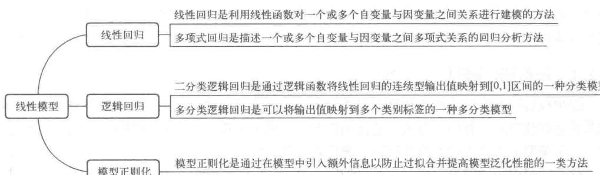

线性模型是机器学习中的基础建模范式，其假设输入特征与输出目标间存在近似线性关系，并通过求解最优系数完成训练样本的拟合与预测。在监督学习框架下，构建线性模型的关键在于确定合适的线性组合系数，使模型输出尽量贴近真实标签。

该类模型权重直观易懂，能清晰反映各特征对结果的贡献，可解释性强，有助于分析变量间影响。计算开销低，适合大规模数据与实时推理，对部分噪声具有一定鲁棒性，且可处理高维特征。线性模型是解决众多实际问题的有效工具。本章系统介绍线性回归、逻辑回归、回归表达式及模型正则化等内容。


扫码看视频

## 5.1 线性回归

给定数据集 D = { (x₁, y₁), (x₂, y₂), …, (xₘ, yₘ) }，其中 xᵢ = (xᵢ₁; xᵢ₂; …; xᵢd)，yᵢ ∈ R。线性回归旨在学习一个线性函数，实现对实值输出的近似预测。

先考虑单输出情形。为便于表述，省略下标记号，即 { (xᵢ, yᵢ) }ᵐᵢ₌₁，其中 xᵢ ∈ R。对离散属性，若取值间存在顺序，可先连续化，例如二值属性“身高”的“高”“矮”映射为 {1.0, 0.0}，三值属性“高度”的“高”“中”“低”映射为{1.0,0.5,0.0}；若取值无序，设共有 k 个取值，通常编码为 k 维向量，例如属性“球类”的“篮球”“足球”“排球”分别映射为(0,0,1)，(0,1,0)，(1,0,0)。

一元线性回归假设因变量与自变量呈线性关联，模型在空间中对应一个超平面。超平面是 n 维欧氏空间中余维数为 1 的线性子空间，如平面中的直线、空间中的平面等，其维度比所在空间少一。在一元情形，因变量与自变量构成二维空间，对应超平面即为一条直线。

回归分析的核心是估计参数以实现数据拟合。常用求解策略有梯度下降法与正规方程法。梯度下降通过迭代获得数值解，正规方程通过闭式公式直接求解。当特征数较少时正规方程效率更高；当特征数达到上千上万时梯度下降更具优势。此外对特征进行标准化有助于加速收敛。

### 5.1.1 简单线性回归

简单线性回归采用最小二乘准则，即线性回归方程，来刻画自变量与因变量间的关联。该方程由若干回归系数线性组合而成，单自变量情形对应一条直线。

线性回归旨在学习 f(x_i)=w x_i + b，使得 f(x_i)≈y_i。确定 w 与 b 的核心在于度量 f(x) 与 y 的偏离程度。

使 E_{(w,b)} = Σ_{i=1}^m (y_i - w x_i - b)^2 最小化的过程称为线性回归的最小二乘估计。对 E_{(w,b)} 分别对 w 和 b 求偏导得

∂E_{(w,b)}/∂w = 2( w Σ_{i=1}^m x_i^2 - Σ_{i=1}^m (y_i - b) x_i )   (5-1)

∂E_{(w,b)}/∂b = 2( m b - Σ_{i=1}^m (y_i - w x_i) )   (5-2)

令式 (5-3) 和式 (5-4) 为零可得到 w 和 b 的最优解的闭式解

w = [ Σ_{i=1}^m y_i (x_i - x̄) ] / [ Σ_{i=1}^m x_i^2 - (1/m)( Σ_{i=1}^m x_i )^2 ]   (5-3)

b = (1/m) Σ_{i=1}^m (y_i - w x_i)   (5-4)

式中，x̄ = (1/m) Σ_{i=1}^m x_i 为 x 的均值。

### 5.1.2 多变量线性回归

一元线性回归仅考察单一自变量，但在实际问题中往往存在多个影响因素。给定数据集 D = { (x_1, y_1), (x_2, y_2), ⋯, （x_m, y_m）}，其中 x_i = (x_i1; x_i2; …; x_id)， y_i ∈ R，样本由 d 个属性描述。此时我们试图学得 f(x_i)= w^T x_i + b，使得 f(x_i) ≈ y_i，称为多变量线性回归。

若将 w 和 b 以向量形式表示 ŵ = (w; b)，则形成多元一次函数。相应地，把数据集 D 表示成一个 m×(d+1) 大小的矩阵 X

X = ⎛ x11 x12 … x1d 1 ⎞   ⎛ x1^T 1 ⎞

    ⎜ x21 x22 … x2d 1 ⎟ = ⎜ x2^T 1 ⎟

    ⎜  :   :   …  :   : ⎟   ⎜  :   : ⎟

    ⎝ xm1 xm2 … xmd 1 ⎠   ⎝ xm^T 1 ⎠   (5-5)

再把标记也写成向量形式 y = (y1, y2, …, ym) 有

ŵ* = argmin_ŵ (y - X ŵ)^T (y - X ŵ)   (5-6)

令 E_ŵ = (y - X ŵ)^T (y - X ŵ)，对 ŵ 求导得

∂E_ŵ / ∂ŵ = 2 X^T (X ŵ - y)   (5-7)

令式 (5-7) 为零，可得 ŵ 最优解。当 X^T X 为满秩矩阵或正定矩阵时，令式 (5-7) 为零可得

ŵ* = (X^T X)^{-1} X^T y   (5-8)

因此，线性回归模型为

f( x̂_i ) = x̂_i^T (X^T X)^{-1} X^T y   (5-9)

式中，x̂_i = (x_i; 1)，l=1,2,…,m。当线性模型的预测值逼近真实标记值 y 时，就得到了线性回归模型 y = w^T x + b。

下面我们使用 Python 语言对线性回归进行实现。

- 1) 定义线性回归函数。

代码 5-1 实现了简单的线性回归算法。首先，在输入特征矩阵 X 的第一列添加全为 1 的列作为偏置项，形成新的特征矩阵。然后，通过求解正规方程组计算出最优参数向量 theta。具体而言，首先计算特征矩阵 X 的转置矩阵 Xt，然后计算 Xt 和 X 的乘积的逆矩阵 XtX_inv，再计算 Xt 和目标变量向量 y 的乘积 Xty，最后将 XtX_inv 和 Xty 相乘得到参数向量 theta。最后，返回拟合得到的参数向量 theta。

## 代码 5-1 linear_regression 函数
```
import numpy as np

def linear_regression(X, y):
    """
    执行线性回归，拟合给定的数据。
    参数：
        X (numpy. array)：输入特征矩阵，每行代表一个样本，每列代表一个特征。
        y (numpy. array)：目标变量向量。
    返回：
        numpy. array：返回拟合得到的参数向量。
    """
```

```
```python

"""

# 添加偏置项

ones = np.ones(( X.shape[0], 1))

X = np.hstack(( ones, X))

# 计算参数

Xt = np.transpose(X)

XtX_inv =np.linalg.inv(np.dot(Xt, X))

Xty = np.dot(Xt, y)

theta = np.dot(XtX_inv, Xty)

return theta
```
```

2）定义数据集对线性回归算法进行测试。

在测试线性回归算法之前，我们需要生成一些示例数据。下面的代码使用 numpy 库生成一个具有线性关系的数据集。然后使用正规方程来拟合数据，并可视化结果。

## 代码 5-2 线性回归测试与可视化
```
```python

import numpy as np

import matplotlib.pyplot as plt

# 生成示例数据

np.random.seed(0)

X = np.linspace(0, 10, 100)

y = 5 * X + np.random.normal(0, 1, 100)

# 计算线性回归参数

theta_normal = linear_regression(X.reshape(-1, 1), y)

# 计算预测值

y_pred_normal = theta_normal[0] + theta_normal[1] * X

# 可视化结果

plt.scatter(X, y)

plt.plot(X, y_pred_normal, color='red', label='Normal Equation')

plt.xlabel('X')

plt.ylabel('y')

plt.title('Linear Regression')

plt.legend()

plt.show()
```
```

线性回归模型拟合结果图如图 5-1 所示，其中点集表示原始数据，直线表示使用正规方程法拟合的回归线。

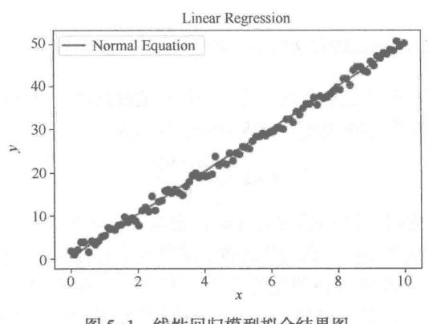

### 5.1.3 梯度下降法

梯度下降法是一种常用的最优化算法，也称最速下降法，常用于机器学习和人工智能领域，用以迭代逼近最小误差模型。算法从高点出发寻找通向低点的最佳方向，不断下降直至到达最低点。

当函数定义域和值域都在实数域时，导数可表示函数曲线上切线的斜率，也反映函数在该点的变化速率。在一元函数中自变量唯一，变化方向单一，故无偏导数；偏导数涉及至少两个自变量，描述多元函数沿不同坐标轴的变化速率。

如果 z=f(x,y)在点 P(x,y)可微，则函数沿任一方向 l 的方向导数存在，且有

∂f/∂l = ∂f/∂x cosφ + ∂f/∂y sinφ   (5-10)

式中，φ 为 x 轴到方向 l 的转角。

当二元函数 z=f(x,y) 在平面区域 D 内偏导数存在且连续时，对 D 中的任意点 (x,y) 都能拼出一个向量 ∂f/∂x i + ∂f/∂y j，这个向量就叫做该点处的梯度，记作 grad f(x,y)，即 grad f(x,y)=∂f/∂x i + ∂f/∂y j。若取 e=i cosφ + j sinφ 为与方向 l 同向的单位向量，由方向导数的计算可得

∂f/∂l = ∂f/∂x cosφ + ∂f/∂y sinφ = {∂f/∂x, ∂f/∂y} {cosφ, sinφ}

= grad f(x,y)·e = |grad f(x,y)| cos <grad f(x,y),e>   (5-11)

式中 <grad f(x,y),e> 为梯度与 e 的夹角。可见方向导数本质上是梯度在 l 方向上的投影。当 l 与梯度同向时 cos<grad f(x,y),e>=1，方向导数取得最大值。换句话说，沿着梯度走是函数在该点上升最快的方向。梯度的方向与能够得到最大方向导数的方向一致，其长度等于该最大方向导数值。由定义可知梯度的模为 | grad f(x,y) | = √( (∂f/∂x)² + (∂f/∂y)² )。

设 J: Rᵈ→R。若想找到 J 的最小值点，通常先随机给 θ 一个初值，然后反复调整 θ 使 J(θ) 单调下降，直至 θ 基本不再变化。梯度下降的更新规则为

θⱼ = θⱼ − α ∂J(θ)/∂θⱼ  (5-12)

也就是往使目标函数减小最快的方向上迈一小步。式中 α 为学习率，太小会让迭代拖得很慢，太大则容易冲过最优点。

不同起点的最终落点往往不同，因为每次下降都只挑选对当前局部最有利的方向。局部最优的特性最终决定了梯度下降只能保证找到局部极小，而非全局极小，这与目标函数可能非凸有关。实践里，用梯度下降求得的数值解通常效果已经很好，可以直接当作近似最优解使用。

实际应用中常见的有三种实现方式，主要区别在于每次使用的数据量。

## （1）批量梯度下降法
该方法以整个训练集为基准，汇总所有样本计算一次梯度再更新参数。每走一步都要遍历全部数据，样本规模大时速度会很慢。优点是收敛稳定、便于并行，且迭代轮数相对较少，理论上更容易逼近全局最优。

## （2）小批量梯度下降法
每次只抽取一小撮样本估计梯度再更新。小批量在时间与空间开销上更友好，收敛节奏更快，还能利用矩阵运算的并行加速。

## （3）随机梯度下降法
可看作小批量的一种极端情况，每次只用一个样本做一次参数调整。更新频率很高，迭代次数很多，搜索轨迹显得有些随机。当数据量巨大时，往往只用几千到几万条样本就能进入较好的区域。

下面用 Python 对梯度下降做一次线性回归的实现演示。

- 1）定义基于梯度下降法的线性回归函数。

代码 5-3 实现了用梯度下降求解线性回归参数的流程。先在特征矩阵 X 的首列补上一列全 1 作为截距项，得到扩充后的矩阵。参数向量 theta 用零向量初始化。按设定的迭代次数循环：用当前 theta 计算预测值 y_pred，求出与真实值的误差 error，再算梯度 gradient = Xᵀ error / 样本数，最后按学习率 learning_rate 对 theta 做梯度修正。循环结束返回拟合得到的 theta。

### 代码 5-3  gradient_descent 函数

```
import numpy as np

def gradient_descent(X, y, learning_rate=0.01, num_iterations=1000):
    """
    使用梯度下降法求解线性回归的参数。
    参数：
        X (numpy.array)：输入特征矩阵，每行代表一个样本，每列代表一个特征。
        y (numpy.array)：目标变量向量。
        learning_rate (float)：学习率。
        num_iterations (int)：迭代次数。
    返回：
        numpy.array：返回拟合得到的参数向量。
    """
    # 添加偏置项
    ones = np.ones((X.shape[0], 1))
    X = np.hstack((ones, X))

    # 初始化参数向量
    theta = np.zeros(X.shape[1])

    # 梯度下降更新参数
    for i in range(num_iterations):
        # 计算预测值
        y_pred = np.dot(X, theta)
        # 计算误差
        error = y_pred - y
        # 计算梯度
        gradient = 1/len(X) * np.dot(X.T, error)
        # 更新参数
        theta -= learning_rate * gradient

    return theta
```

2）定义数据集对算法进行测试。

这里沿用 5.1.2 节的数据，对梯度下降线性回归进行验证并做可视化。

### 代码 5-4  线性回归测试与可视化

```
import numpy as np
import matplotlib.pyplot as plt

# 生成示例数据
np.random.seed(0)
```

```
X = np.linspace(0, 10, 100)
y = 5 * X +np.random.normal(0, 1, 100)

# 计算线性回归参数
theta_gradient = gradient_descent(X.reshape(-1, 1), y)

# 计算预测值
y_pred_gradient = theta_gradient[0] + theta_gradient[1] * X

# 可视化结果
plt.scatter(X, y)
plt.plot(X, y_pred_gradient, color='green', label='Gradient Descent')
plt.xlabel('X')
plt.ylabel('y')
plt.title('Linear Regression')
plt.legend()
plt.show()
```

梯度下降法拟合结果图如图 5-2 所示，其中点集表示原始数据，直线表示使用梯度下降法拟合的回归线。

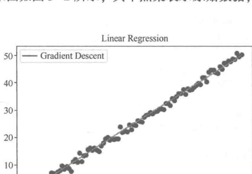

图 5-2 梯度下降法拟合结果图

### 5.1.4 多项式回归
研究因变量与自变量之间多项式关系的回归方法称为多项式回归。当自变量只有一个时为一元多项式回归，形式见式（5-13）；多个自变量时为多元多项式回归，本质上是一个多元多次函数。若 y 与 x 的关系呈现非线性且难以找到合适的显式曲线，多项式回归是常用的替代手段。因为任意光滑函数都可用多项式逼近，所以应用面很广。

y = a_n x^m + a_{n-1} x^{m-1} + ⋯ + a_1 x + a_0 （5-13）

对一元 m 次情形，令 x_1 = x, x_2 = x^2, …, x_m = x^m，则 ŷ = b_0 + b_1 x + b_2 x^2 + ⋯ + b_m x^m 可写成 ŷ = b_0 + b_1 x_1 + b_2 x_2 + ⋯ + b_m x_m，即转化为 m 元线性回归。此时检验系数 b 是否显著，等价于判断 x 的 i 次幂项对 y 的影响是否显著。

以二元二次为例，设 z₁=x₁，z₂=x₂，z₃=x₁²，z₄=x₂²，z₅=x₁x₂，则原函数变成 ŷ=b₀+b₁z₁+b₂z₂+…+b₅z₅，即五元线性形式。随着自变量增多，多元多项式回归的计算负担会急剧上升。

下面用 Python 实现多项式回归。

- 1）定义多项式回归函数。

代码 5-5 实现了多项式回归的整体流程。依据指定的阶数 degree 调用 create_polynomial_matrix 构造多项式特征矩阵 X_poly，矩阵里包含原特征的各类幂次组合。随后用最小二乘法求解系数，通过对 X_poly 做矩阵运算得到。create_polynomial_matrix 在 1 到 degree 范围内遍历幂次，并用 np.column_stack 将 X 的各次幂逐列拼接到特征矩阵中。

### 代码 5-5 polynomial_regression 函数

```
import numpy as np

def polynomial_regression(X, y, degree):
    """
    使用多项式回归拟合数据。
    参数:
        X (numpy.array) : 输入特征向量。
        y (numpy.array) : 目标变量向量。
        degree (int) : 多项式的阶数。
    返回:
        numpy.array : 返回拟合得到的多项式系数。
    """
    # 创建多项式特征矩阵
    X_poly = create_polynomial_matrix(X, degree)

    # 使用最小二乘法求解多项式系数
    coefficients = np.linalg.inv(X_poly.T.dot(X_poly)).dot(X_poly.T).dot(y)

    return coefficients

def create_polynomial_matrix(X, degree):
    """
    创建多项式特征矩阵。
    参数:
        X (numpy.array) : 输入特征向量。
        degree (int) : 多项式的阶数。
    返回:
        numpy.array : 返回多项式特征矩阵。
    """
    X_poly = np.ones((len(X), 1))

    for d in range(1, degree + 1):
        X_poly = np.column_stack((X_poly, np.power(X, d)))

    return X_poly
```

- 2）定义数据集对算法进行测试。

先固定随机种子，生成 100 个均匀分布在 -5~5 之间的点作为自变量 X。构造一个真实的多项式函数并加入高斯噪声得到目标 y。指定多项式阶数为 2，调用 polynomial_regression 拟合模型得到系数 theta。最后用 matplotlib 画出原始散点与拟合曲线，并输出拟合参数。

### 代码 5-6 多项式回归测试与可视化

```
np.random.seed(0)
import matplotlib.pyplot as plt
X = np.linspace(-5, 5, 100)               # 生成 100 个在-5~5 之间均匀分布的点作为 X
y_true = X**2 - 2*X + 1                   # 真实的多项式回归函数
noise = np.random.normal(0, 5, 100)       # 加入高斯噪声
y = y_true + noise                        # 加入噪声后的目标变量

# 拟合多项式回归模型
degree = 2                                # 多项式的阶数
print(X.shape, y.shape)
theta = polynomial_regression(X, y, degree)

# 绘制数据和拟合曲线
plt.scatter(X, y, label='Data')
plt.plot(X, theta[0] + theta[1]*X +theta[2]*X**2, color='red', label='Polynomial Regression')
plt.xlabel('X')
plt.ylabel('y')
plt.title('Polynomial Regression')
plt.legend()
plt.show()

print("拟合参数:")
for i in range(len(theta)):
    print(f"theta[{i}]:", theta[i])
```

多项式回归模型拟合结果如图 5-3 所示，其中点集表示原始数据，曲线表示使用多项式回归算法拟合的回归线。

代码输出结果如下。

```
拟合参数:
theta[0]: -0.902895184097589
theta[1]: -2.148663432307723
theta[2]: 1.2589999099982945
```

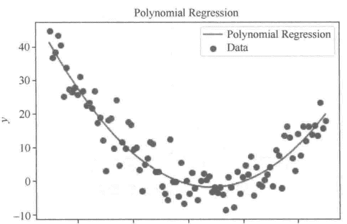

图 5-3 多项式回归模型拟合结果图

## 5.2 逻辑回归
逻辑回归是线性回归的推广，在统计学上属于广义线性模型。线性回归擅长处理连续标签的预测问题，如果想用线性结构做分类任务，该怎么处理？答案是可行的。逻辑回归常用于数据挖掘、疾病自动诊断、经济预测等场景。例如分析胃癌的影响因素，将人群分为胃癌组与非胃癌组，自变量可包含年龄、性别、饮食习惯、幽门螺杆菌感染等，既有连续也有分类变量。通过模型可得到各因素的权重，判断哪些是危险因素，并据此估计患病概率。

逻辑回归与线性回归在形式上很接近，都包含 wᵀx + b 的线性部分。不同点在于因变量的处理：线性回归直接令 y = wᵀx + b，而逻辑回归先把线性组合映射到一个中间状态 p，p = L(wᵀx + b)，再根据 p 决定类别。若 L 选用逻辑函数，则为逻辑回归；若 L 选用多项式函数，则为多项式回归。

为了把输出压缩到 (0,1) 区间，逻辑回归引入逻辑函数，也称 Sigmoid 函数，表达式如下。

$$f(x)=\frac{1}{1+e^{-x}}\tag{5-14}$$

Sigmoid 的导数形式为

$$f'(x)=f(x)[1-f(x)]\tag{5-15}$$

该函数在实数域内处处连续可导，优化过程比较稳定。如图 5-4 所示，其值域为 (0,1)，x 增大时趋近 1，x 减小时趋近 0，可视为阶跃函数的平滑化版本。

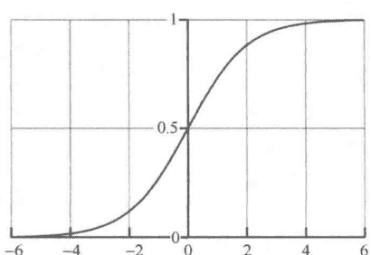

图 5-4 Sigmoid 函数图像

经过 Sigmoid 映射后的数值可解释为概率。以 0.5 为分界点，大于 0.5 判为 1 类，小于 0.5 判为 0 类。

### 5.2.1 二分类逻辑回归
本质上逻辑回归仍是线性回归，只是多了一层非线性映射。先对特征做线性求和，再用函数 f(x) 把连续输出压缩到 0~1 区间。将线性回归表达式代入 f(x) 就得到逻辑回归形式。

$$f(x)=\frac{1}{1+e^{-w^{T}x+b}}\tag{5-16}$$

$$\ln\frac{y}{1-y}=w^{T}x+b\tag{5-17}$$

把 y 看作条件后验概率 P(y=1|x)，则式 (5-17) 可写为

$$\ln\frac{P(y=1|x)}{P(y=0|x)}=w^{T}x+b\tag{5-18}$$

则有

$$P(y=1|x)=\frac{e^{w^{T}x+b}}{1+e^{w^{T}x+b}}=\hat{y}$$

$$P(y=0|x)=\frac{1}{1+e^{w^{T}x+b}}=1-\hat{y}$$

$$P(y|x)=\hat{y}^{y}(1-\hat{y})^{1-y}\tag{5-19}$$

改写为对数形式后就得到交叉熵损失函数，这正是交叉熵损失的推导来源。

$$\ln P(y|x)=y\ln\hat{y}+(1-y)\ln(1-\hat{y})\tag{5-20}$$

$$\ln P(y|x)=y\log\frac{e^{w^{T}x+b}}{1+e^{w^{T}x+b}}+(1-y)\log\frac{1}{1+e^{w^{T}x+b}}\tag{5-21}$$

依据式 (5-21) 配合梯度下降，就能令损失函数达到最小，从而求出参数的最优解，即参数的极大似然估计。

下面用 Python 语言实现逻辑回归分类器的代码。

- 1）构建 Sigmoid 函数。

代码 5-7 实现了一个 Sigmoid 函数，用来把输入 x 映射到 0~1 之间的概率。函数内部先通过 np.exp 计算 e 的负 x 次幂，再加上 1 后做除法得到输出 z，最后返回该结果。

### 代码 5-7 Sigmoid() 函数

```
import numpy as np

def sigmoid(x):
    # Sigmoid 函数，将输入 x 转换到 0~1 之间的概率值
    z = 1 / (1 + np.exp(-x))
    return z
```

- 2）创建参数初始化函数。

代码 5-8 给出了 initialize_params 函数，用于为模型准备初始参数。函数接收维度 dims 作为输入，表示权重 W 的规模。内部利用 np.zeros 生成形状为 (dims, 1) 的零矩阵作为 W 的初值，偏置 b 设为 0，最后返回 W 与 b。

### 代码 5-8 initialize_params() 函数

```
def initialize_params(dims):
    # 初始化参数为零
    W = np.zeros((dims, 1))
    b = 0
    return W, b
```

- 3）定义逻辑回归主体，包括模型公式、损失函数与参数梯度。

代码 5-9 定义了 logistic_regression 函数，用来执行逻辑回归算法。函数输入特征矩阵 X、标签向量 y、权重 W 与偏置 b。内部先获取样本数和特征数，随后按模型定义计算 np.dot(X, W) + b 得到预测值 y_pred，再计算逻辑回归的损失。接着分别求出 W 与 b 的梯度，并用 np.squeeze 把损失压成标量。最后返回 y_pred、loss、dW 与 db。

### 代码 5-9 logistic_regression() 函数

```
def logistic_regression(X, y, W, b):
    # 获取样本数量和特征数量
    num_train = X.shape[0]
    num_feature = X.shape[1]

    # 计算预测值
    y_pred = sigmoid(np.dot(X, W) + b)

    # 计算损失函数
    loss = -1/num_train * np.sum(y * np.log(y_pred) + (1-y) * np.log(1-y_pred))

    # 计算参数的梯度
    dW = np.dot(X.T, (y_pred-y))/num_train
    db = np.sum(y_pred-y)/num_train

    # 压缩损失值为标量
    loss = np.squeeze(loss)

    # 返回预测值、损失值、参数梯度
    return y_pred, loss, dW, db
```

- 4) 实现基于梯度下降的参数更新训练过程。

代码 5-10 定义了 logistic_train 训练函数，负责逻辑回归的训练。函数接收特征矩阵 X、标签 y、学习率 learning_rate 与迭代次数 epochs。内部先获取特征数 num_features，再用 initialize_params 初始化 W 与 b，并新建空列表 loss_list 保存各轮损失。进入 range(epochs) 循环，每轮调用 logistic_regression 得到当前预测、损失与梯度 dW、db，按梯度下降更新 W 与 b。若迭代序号 i 能被 100 整除，则把 loss 加入 loss_list 并打印当前迭代次数与损失。训练结束後把 W、b 放入字典 params，把 dW、db 放入字典 grads，最后返回 loss_list、params 与 grads。

### 代码 5-10 logistic_train() 函数

```
def logistic_train(X, y, learning_rate, epochs):
    # 初始化模型参数
    num_features = X.shape[1]
    W, b = initialize_params(num_features)

    # 保存每次训练的损失值
    loss_list = []

    # 迭代训练
    for i in range(epochs):
        # 计算当前次的模型计算结果、损失和参数梯度
        y_pred, loss, dW, db = logistic_regression(X, y, W, b)

        # 参数更新
        W = W - learning_rate * dW
        b = b - learning_rate * db

        # 记录损失
        if i % 100 == 0:
            loss_list.append(loss)

    # 打印训练过程中的损失
```

```
if i % 100 == 0:
    print('Epoch %d, Loss: %f' % (i, loss))

# 保存参数
params = {
    'W': W,
    'b': b
}

# 保存梯度
grads = {
    'dW': dW,
    'db': db
}

return loss_list, params, grads
```

- 5）定义测试数据的预测函数。

代码 5-11 实现逻辑回归的预测函数，输入特征矩阵 X 与存储参数的字典 params。内部先用 np.dot 计算 X 与 params['W'] 的点积并加上 params['b']，把结果送入 sigmoid 得到概率。随后对每个概率进行二值化，大于 0.5 设为 1，否则为 0，最后返回处理后的预测 y_pred。

### 代码 5-11 predict() 函数

```
def predict(X, params):
    # X: 输入特征矩阵
    # params: 存储模型参数的字典

    # 预测逻辑回归输出
    y_pred_results = sigmoid( np.dot(X, params['W']) + params['b'] )

    # 将输出结果进行二分类处理
    y_pred = np.where( y_pred_results > 0.5, 1, 0 )

    # 返回预测结果
    return y_pred
```

- 6）用 sklearn 生成模拟二分类数据进行训练与测试。

代码 5-12 完成测试流程。generate_data 利用 sklearn 生成含 100 个样本、2 个特征的测试集；visualize_data 用散点图在二维平面展示数据，不同类别用不同颜色。test_logistic_regression 为主函数，先生成数据并可视化，再对 X 做转置、对 y 做形状变换变为 1 行多列，随后调用 logistic_train 以学习率 0.01、迭代 1000 次训练模型，返回损失列表、参数与梯度。用 plt.plot 绘制损失曲线，最后调用 predict 得到预测结果 y_pred_results，计算准确率并输出。

### 代码 5-12 对模型进行训练和测试

```python
from sklearn.datasets import make_classification
import matplotlib.pyplot as plt

def generate_data():
    # 使用 sklearn 生成测试数据
    X, y = make_classification(n_samples=100, n_features=2, n_redundant=0, n_informative=2, random_state=1, n_clusters_per_class=1)
    return X, y

def visualize_data(X, y):
    # 可视化数据集
    plt.scatter(X[:, 0], X[:, 1], c=y, cmap='viridis')
    plt.xlabel('Feature 1')
    plt.ylabel('Feature 2')
    plt.title('Test Data')
    plt.show()

def test_logistic_regression():
    # 生成测试数据
    X, y = generate_data()

    # 可视化原始数据
    visualize_data(X, y)

    # 数据预处理
    X = X.T
    y = y.reshape(1, -1)

    # 模型训练
    loss_list, params, grads = logistic_train(X, y, learning_rate=0.01, epochs=1000)

    # 可视化损失曲线
    plt.plot(loss_list)
    plt.xlabel('Epochs ( per hundreds )')
    plt.ylabel('Loss')
    plt.title('Training Loss')
    plt.show()

    # 进行预测
    y_pred_results = predict(X, params)

    # 计算准确度
    accuracy = np.mean((y_pred_results > 0.5) == y)
```

```
print('Accuracy:', accuracy)

# 运行测试函数
test_logistic_regression()
```

数据类别的展示图见图 5-5。

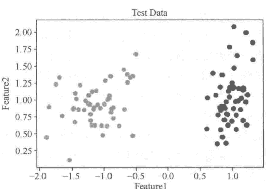

图 5-5 数据类别展示图

损失曲线的图见图 5-6。

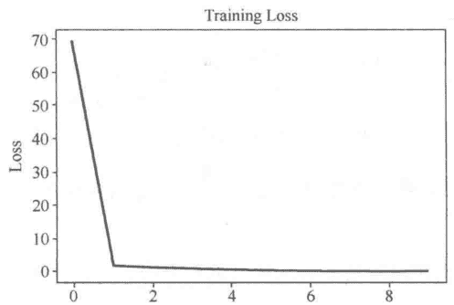

图 5-6 损失曲线图

### 5.2.2 多分类逻辑回归

普通逻辑回归仅能处理二分类问题，若要实现多类别分类，就需要对模型进行改进。

改进主要有两种思路。

第一种思路是对每个类别单独建立一个二分类器，把属于该类的样本标记为 1，其余类别标记为 0。若共有 k 个类别，最终会得到 k 个针对不同标记的二分类逻辑回归器。

对二分类只需一个分类器，而多分类则需要 h₁, h₂, …, hₖ 这 k 个分类器，其中 h_c (c=1,2,…,k) 表示样本 x 属于第 c 类的概率模型。

训练 h_c 时，把标记为 c 的样本置为 1，其余样本置为 0，按此构造训练集分别训练每个分类器。

对任意测试样本，取 k 个分类器输出最大的那个作为预测标记

argmax_c h_c(x)， c=1,2,…,k (5-22)

该方法把逻辑回归推广到多类问题，类标签 y 可取两个以上的值。例如可用于手写数字识别，区分 10 个数字。

第二种思路是修改损失函数使其适配多分类。此时不再只考虑二分类的 0/1 损失，而是针对每个类别的损失。这种方法即 Softmax 回归，是逻辑回归的多分类版本。

Softmax 回归是一种监督学习算法，关注多分类而非二元分类，因此 y 可取 k 个不同值。训练集可记为 { (x^(1), y^(1)), …, (x^(m), y^(m)) }，其中 y^(i) ∈ {1,2,…,k}。

给定测试输入 x，模型需估计各类的概率，输出 k 维向量且元素和为 1。具体地，h_θ(x^(i)) 形式为：

h_θ(x^(i)) = [ p(y^(i)=1|x^(i);θ) ; p(y^(i)=2|x^(i);θ) ; … ; p(y^(i)=k|x^(i);θ) ] = 1 / Σ_{j=1}^k e^{θ_j^T x^(i)} [ e^{θ_1^T x^(i)} ; e^{θ_2^T x^(i)} ; … ; e^{θ_k^T x^(i)} ] (5-23)

其中 θ_1,θ_2,…,θ_k ∈ R^{n+1} 为模型参数，1 / Σ_{j=1}^k e^{θ_j^T x^(i)} 为归一化项。

为方便表示，可把所有参数堆叠为矩阵 θ，即

θ = [ θ_1^T ; θ_2^T ; … ; θ_k^T ] (5-24)

损失函数可写为

J(θ) = -1/m [ Σ_{i=1}^m Σ_{j=1}^k 1{ y^(i)=j } log ( e^{θ_j^T x^(i)} / Σ_{l=1}^k e^{θ_l^T x^(i)} ) ] (5-25)

求导后得到

∇_{θ_j} J(θ) = -1/m Σ_{i=1}^m [ x^(i) ( 1{ y^(i)=j } - p(y^(i)=j | x^(i); θ) ) ] (5-26)

参数更新为

θ_j := θ_j - α ∇_θj J(θ) (5-27)

若需处理音乐分类，识别四种音乐类型，是否选用 Softmax 分类器或构建四个独立的二元逻辑回归，取决于类别是否互斥。例如若四类为古典、乡村、摇滚、爵士且每个样本只属于其中一类，可用 k=4 的 Softmax 分类器；若存在不属于这四类的样本，可在 Softmax 中设 k=5 增加“其他”类。若类别为人声、舞蹈、配乐、流行等并非互斥，则更适合构建 4 个二元逻辑回归分类器，这样新样本可被判定为属于一个或多个类别。

下面用 Python 实现 Softmax 回归。

- 1）定义 Softmax 函数。

代码 5-13 实现了 softmax 函数，将输入转为概率分布。先对输入求指数得到得分，再对所有得分求和归一化，得到各元素的概率比例，最后返回该分布。

### 代码 5-13 softmax() 函数

```
import numpy as np
def softmax(z):
    """
    Softmax 函数，用于将输入转换为概率分布
    参数：
    z: 输入的得分值或权重矩阵
    返回：
    probabilities: 转换后的概率分布
    """
    exp_scores = np.exp(z)          # 计算指数得分
    probabilities = exp_scores / np.sum(exp_scores, axis=1, keepdims=True)  # 计算概率分布
    return probabilities
```

- 2）计算损失函数值。

Softmax 回归实现要点

代码 5-14 给出了 compute_loss 的编写思路，用来在每轮迭代中估算当前损失。函数头部写明了输入参数的意义与返回结果。执行时先统计当前批次包含多少条样本，随后借助权重 W 与偏置 b 为每条样本生成原始得分，得分经 Softmax 归一化后变成类别概率，再与真实标签结合计算交叉熵，累加后除以样本数得到平均值并返回。整体流程可概括为打分、归一化、求熵、求均。

### 代码 5-14 compute_loss() 函数

```
def compute_loss(X, y, weights, bias):
    """
    计算交叉熵损失值
    参数：
    X: 输入特征
    y: 真实的类别标签
    weights: 权重矩阵
    bias: 偏置向量
    返回：
    data_loss: 交叉熵损失值
    """
    num_samples = len(X)                      # 样本数量
    scores = np.dot(X, weights) + bias        # 计算得分
    probabilities = softmax(scores)           # 计算类别概率
    loss = -np.log(probabilities[range(num_samples), y])  # 计算交叉熵损失
    data_loss = np.sum(loss) / num_samples    # 计算平均损失

    return data_loss
```

- 3）定义基于梯度下降的参数更新训练过程。

代码 5-15 展示了 softmax_train 的完整写法，用以求解模型参数。程序首先读取 X 的样本量与特征维数，将权重初始化为零矩阵，形状为特征维×类别数，偏置初始化为零向量，长度等于类别数。随后进入按用户指定的轮次循环。每一轮先用现有的 W、b 计算得分，再通过 Softmax 得到概率分布，按照交叉熵梯度公式求出梯度，以梯度下降的方式更新 W 与 b，轮末输出该轮的损失值。训练结束返回学到的 W 与 b。

### 代码 5-15 softmax_train() 函数

```
def softmax_train(X, y, learning_rate, num_iterations, num_features, num_classes):
    num_samples, num_features = X.shape
    weights = np.zeros((num_features, num_classes))   # 初始化权重矩阵为零
    bias = np.zeros(num_classes)                      # 初始化偏置向量为零

    for i in range(num_iterations):
        scores = np.dot(X, weights) + bias
        probabilities = softmax(scores)

        # 计算梯度
        gradient = probabilities
        gradient[range(num_samples), y] -= 1
        gradient /= num_samples

        # 更新参数
        weights -= learning_rate * np.dot(X.T, gradient)
        bias -= learning_rate * np.sum(gradient, axis=0)

# 计算并打印损失值
loss = compute_loss(X, y, weights, bias)
print("Iteration:", i+1, "Loss:", loss)

return weights, bias
```

- 4）定义对测试数据的预测函数。

代码 5-16 实现了 predict，用来对新样本给出类别判断。注释说明了输入输出关系。函数先对输入特征计算原始分数，再用 Softmax 映射为概率分布，选取概率最大的类别索引作为预测结果并返回标签序列。

### 代码 5-16 predict() 函数

```
def predict(X, weights, bias):
    """
    预测输入样本的类别标签
    参数：
    X: 输入特征
    weights: 权重矩阵
    bias: 偏置向量
    返回：
    predicted_labels: 预测的类别标签
    """
    # 计算预测得分
    scores = np.dot(X, weights) + bias

    # 计算相应的概率
    probabilities = softmax(scores)

    # 找到概率最大的类别标签作为预测结果
    predicted_labels = np.argmax(probabilities, axis=1)

    return predicted_labels
```

- 5）生成模拟的三分类数据集进行模型训练和测试。

代码 5-17 演示了合成三分类数据的流程。先用 np.random.rand 随机产生特征矩阵 X 与标签 y，随后用 StandardScaler 做标准化，再用 train_test_split 划分训练集与测试集。接着实例化 Softmax_train，设定特征维度和类别数，调用训练方法，学习率 0.01，迭代 1000 次。训练完成后在测试集上调用 predict 并计算准确率。数据生成方式、预处理与超参数均可按需调整。

### 代码 5-17 对模型进行训练和测试

```
from sklearn.model_selection import train_test_split
from sklearn.preprocessing import StandardScaler

# 生成模拟数据
np.random.seed(42)

# 特征数和类别数
num_features = 4
num_classes = 3

# 生成随机的特征矩阵和标签数组
X = np.random.rand(500, num_features)
y = np.random.randint(num_classes, size=500)

# 数据预处理: 特征归一化
scaler = StandardScaler()
X = scaler.fit_transform(X)

# 划分训练集和测试集
X_train, X_test, y_train, y_test = train_test_split(X, y, test_size=0.2, random_state=42)

# 训练模型
weights, bias = softmax_train(X_train, y_train, 0.01, 1000, num_features, num_classes)

# 在测试集上评估模型
y_pred = predict(X_test, weights, bias)

# 计算准确率
accuracy = np.mean(y_pred == y_test)
print("Accuracy:", accuracy)
```

## 5.3 模型正则化

当训练样本稀少或模型过度学习时，容易出现过拟合。正则化是一类在目标函数中加入先验约束以抑制过拟合、提升泛化能力的策略。

常用做法是在经验风险上附加正则项或惩罚项。正则项通常随模型复杂度单调上升，复杂度越大惩罚越重，常见度量为参数向量的范数。

一般形式为：

$$\min_{f\in F}\frac{1}{N}L(y_i,f(x_i))+aJ(f)\tag{5-28}$$

式中 F 为假设集合，第一项为经验损失，第二项为正则项，a≥0 用来调节两者比重。

正则项形式多样。例如回归任务中，若经验损失取平方误差，正则项可取参数向量的 L₂ 范数。

$$L(w)=\frac{1}{N}\sum_{i=1}^{N}(f(x_i;w)-y_i)^2+\frac{a}{2}\|w\|^2\tag{5-29}$$

式中 ‖w‖ 表示 w 的 L₂ 范数。

另一常见选择是 L₁ 范数。

$L(w)=\frac{1}{N}\sum_{i=1}^{N}(f(x_i;w)-y_i)^2 + a\|w\|_1 \qquad (5-30)$

式中 ‖w‖₁ 表示 w 的 L₁ 范数。

经验损失很小的解往往参数繁多、复杂度偏高，此时正则项会变大。正则化的目标是在拟合程度与模型简洁性之间取得平衡，选出兼顾两者的解。

这与奥卡姆剃刀思想一致：在能较好解释已知数据的模型中，越简洁者越可取。从贝叶斯角度看，正则项对应先验概率，复杂模型先验小，简单模型先验大。

## 5.4 本章小结

本章围绕线性建模展开，介绍了线性回归与逻辑回归的概念、流程并给出了 Python 实现，最后讨论了正则化。线性回归用于预测连续值，假设输入与输出线性相关。多项式回归通过引入高次项扩展表达能力，可拟合非线性数据。逻辑回归是线性分类方法，二分类时借助 logistic 映射把线性值转化为概率。Softmax 回归则是逻辑回归在多分类上的推广，为各类别建模并用 Softmax 计算概率。上述方法均属线性建模范式，在实践中应用广泛。

## 5.5 延伸阅读——云计算与机器学习

近几年国内云计算与云存储发展迅速，已成为数字化转型的关键底座。机器学习作为人工智能的核心技术之一，与云计算深度结合，推动各行业创新。

中国云计算兴起源于对海量存储、处理与高性能计算的需求。移动互联网普及后数据爆发式增长，传统架构难以承载。云计算通过虚拟化提供弹性资源，本土市场快速壮大，阿里云、腾讯云、华为云等推动技术创新与应用落地。

云存储作为重要分支也在国内快速发展。数据存放在云端虚拟空间后可实现高效管理与备份，市场规模持续扩大，个人与企业广泛用于文件共享、备份与远程访问，安全性也受高度关注，各厂商不断推出更可靠方案。

机器学习依赖大数据与算法实现模式识别与预测，与云计算结合后效能提升。云端提供高性能计算与弹性存储，满足大数据处理需求；云平台提供丰富的工具与算法库，降低使用门槛；分布式计算与并行处理加速训练与推理。

典型应用包括金融领域风险管控与投资决策分析、医疗健康中的医学影像分析、疾病预测与个性化诊疗，以及智能交通、智能制造、智慧城市等领域的数字化转型与创新。

## 5.6 习题

- 1. 选择题

- 1) 下列说法中不正确的是（ ）。

- A. 线性回归可用于房价预测
- B. 线性回归可用于贷款额度预测
- C. 线性回归可用于销售额预测
- D. 线性回归仅处理线性关系

- 2) 线性回归的核心是（ ）。
- A. 构建模型
- B. 距离度量
- C. 参数学习
- D. 特征提取

- 3) 下列属于线性回归的分类有（ ）。
- A. 单变量线性关系
- B. 多变量线性关系
- C. 非线性关系
- D. 以上都是

- 4) 逻辑回归能否解决线性不可分问题？（ ）。
- A. 可以
- B. 不可以
- C. 视数据而定
- D. 以上均不对

- 2. 问答题

- 1) 简述梯度下降法的常见变体。
- 2) 比较线性回归与逻辑回归的异同。

- 3. 综合应用题

- 1) 水泥释放热量与其成分见表5-1，求线性关系。

表5-1 水泥释放的热量与其成分

| y | X₁ | X₂ | X₃ | X₄ |
|---|---|---|---|---|
| 78.5 | 7 | 26 | 6 | 60 |
| 74.3 | 1 | 29 | 15 | 52 |
| 104.3 | 11 | 56 | 8 | 20 |
| 87.6 | 11 | 31 | 8 | 47 |
| 95.9 | 7 | 52 | 6 | 33 |
| 109.2 | 11 | 55 | 9 | 22 |
| 102.7 | 3 | 71 | 17 | 6 |
| 72.5 | 1 | 31 | 22 | 44 |
| 93.1 | 2 | 54 | 18 | 22 |
| 115.9 | 21 | 47 | 4 | 26 |
| 83.8 | 1 | 40 | 23 | 34 |
| 113.3 | 22 | 66 | 9 | 12 |
| 109.4 | 10 | 68 | 8 | 12 |

2）表5-2 给出用户性别、年龄与是否购买产品的记录。希望用逻辑回归对购买决策进行预测。请构建模型并对以下用户进行预测。

- 用户1：年龄30岁，性别女。
- 用户2：年龄50岁，性别男。

# 表5-2 用户信息及购买决策

| 性别 | 年龄 | 购买决策 |
|---|---|---|
| 男 | 25 | 是 |
| 女 | 30 | 否 |
| 男 | 35 | 否 |
| 女 | 40 | 是 |
| 男 | 45 | 否 |

# 第 6 章 支持向量机

## 本章导读（思维导图）

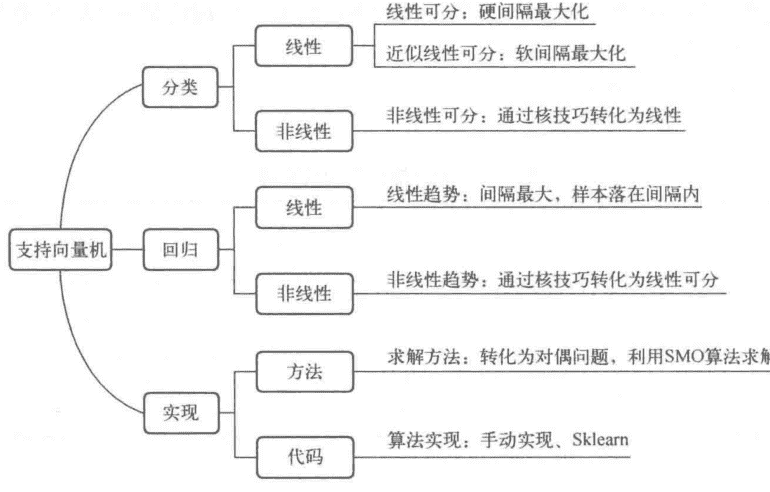

支持向量机是一种常见的监督学习算法，主要用于分类与回归。其核心思想是在特征空间中寻找最优超平面，使不同类别样本尽量分开，同时最大化支持向量到超平面的间隔。


扫码看视频

## 6.1 算法概述

支持向量机包含多种方法与变体，用于解决不同类型的分类与回归问题。常见类型如下。

线性支持向量机：最基本形式，基于线性可分假设，在特征空间中寻找间隔最大的超平面。通过求解凸优化问题实现两类划分，并使支持向量到超平面的距离最大化。

非线性支持向量机：适用于原始特征空间中线性不可分的数据。利用核函数如多项式核、高斯核将样本映射到高维空间，从而找到非线性的最优超平面，更好处理复杂分类问题。

多类别支持向量机：SVM 最初针对二分类，可扩展到多类。常用“一对一”策略将每个类别两两比较构建多个二分类器，或“一对其余”策略将每个类别与剩余类别组合成二分类器。

支持向量回归：用于回归任务，目标是找到最优超平面使样本点尽可能落在附近区域并最小化间隔内误差。能够处理非线性回归并具有一定抗噪能力。

本章主要介绍二分类的线性与非线性支持向量机，以及线性与非线性支持向量回归。

## 6.2 线性可分支持向量机及其对偶算法

### 1. 模型原理

考虑二分类问题，基本任务是在样本空间中依据训练数据找到一个划分超平面，使两类分开。给定训练数据集

T = { (x₁, y₁), (x₂, y₂), …, (x_N, y_N) }

# 线性可分 SVM：如何挑出最宽的间隔

记第 i 个观测为 x_i = (x_i¹, x_i², …, x_iⁿ)ᵀ ∈ Rⁿ，对应的标签记作 y_i ∈ {−1,+1}，i=1,2,…,N。x_i 携带样本的 n 维描述，y_i 指示类别归属；y_i=+1 视作正例，y_i=−1 视作负例，合写为 (x_i,y_i)。假设训练集 T 如图 6-1 所示具备线性可分性，能够把两类划开的超平面并不唯一，该选哪一条？

经验上，夹在两类中间的那条红色超平面最稳健。它对训练点局部扰动的容忍度最高，对新样本的泛化也最强。分界面写作

wᵀx + b = 0  (6-1)

其中 w = (w¹,w²,…,wⁿ)ᵀ ∈ Rⁿ 指向法线方向，b 为偏移量。当正负两类到分界面的最近距离相等且尽可能大时，分类质量最好。把超平面①沿法线方向等距平移直至触及两类，得到图 6-2 中的超平面② 与 超平面③。

经过归一化后可写成

{ wᵀx + b = 1
  wᵀx + b = -1 }  (6-2)

二者间距为

2d = 2 / ||w||  (6-3)

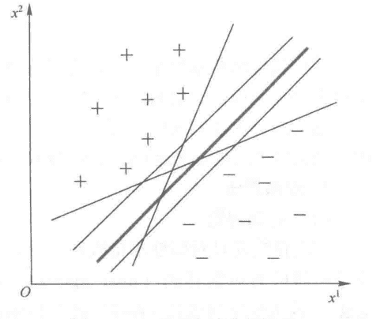

该量即为间隔。正类在超平面②之上即判对；负类在超平面③之下即判对。于是两类分别满足

$$\begin{cases} w^{\mathrm T}x_i+b\ge 1, & y_i=+1 \\ w^{\mathrm T}x_i+b\le -1, & y_i=-1 \end{cases}\tag{6-4}$$

对所有被正确划分的点只需满足

$$y_i(w^{\mathrm T}x_i+b)\ge 1,\quad i=1,2,\dots,N\tag{6-5}$$

尤其与超平面②③相切的点被称作支持向量，它们满足

$$y_i(w^{\mathrm T}x_i+b)=1$$

### 2. 优化模型
综合前述，最优分界面就是最大间隔超平面，即在满足式 (6-5) 的前提下把间隔放大到最大。该问题可表述为约束优化：

$$\begin{cases} \max_{w,b}\dfrac{2}{\|w\|} \\ \text{s.t. } y_i(w^{\mathrm T}x_i+b)\ge 1,\quad i=1,2,\dots,N \end{cases}\tag{6-6}$$

改写为标准形式：

$$\begin{cases} \min_{w,b}\dfrac{1}{2}\|w\|^2 \\ \text{s.t. } y_i(w^{\mathrm T}x_i+b)\ge 1,\quad i=1,2,\dots,N \end{cases}\tag{6-7}$$

目标采用平方是为了求解方便。由式 (6-5) 可知，该模型要求全部样本严格正确，故称 SVM 的硬间隔最大化，也即线性可分支持向量机。此问题是凸二次规划，可证最优解存在且唯一。设 (w*,b*) 为式 (6-7) 的最优解，则最大间隔分离面为 w*ᵀx + b* =0，对应判别式 f(x)=sign(w*ᵀx + b*)。

### 3. 对偶算法
- (1) 对偶问题
借助拉格朗日对偶可求得线性可分 SVM 模型式 (6-7) 的最优解，称为线性可分 SVM 的对偶算法。先引入乘子 λ=(λ₁,…,λ_N)∈R_+^N，约束问题式 (6-7) 的拉格朗日函数为

$$L(w,b;\lambda)=\frac{1}{2}\|w\|^2-\sum_{i=1}^{N}\lambda_i y_i(w^{\mathrm T}x_i+b)+\sum_{i=1}^{N}\lambda_i\tag{6-8}$$

再由对偶理论得到式 (6-7) 的对偶问题

$$\max_{\lambda\ge0}\min_{w,b}L(w,b;\lambda)\tag{6-9}$$

求解时先做内层极小：

$$\min_{w,b}L(w,b;\lambda)\tag{6-10}$$

对 L 关于 w 与 b 求偏导并令为零得

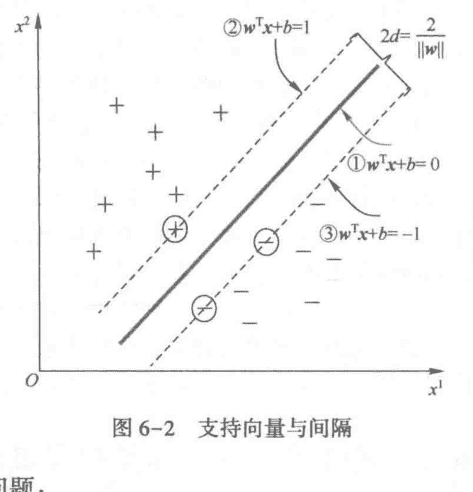

∇_w L(w,b;λ)= w - Σ λ_i y_i x_i =0  (6-11)
∇_b L(w,b;λ)= - Σ λ_i y_i =0  (6-12)

由此得

w = Σ λ_i y_i x_i  (6-13)
Σ λ_i y_i =0  (6-14)

把式 (6-13)(6-14) 代回式 (6-8) 得

L(w,b;λ)= -½ Σ Σ λ_i λ_j y_i y_j x_iᵀx_j + Σ λ_i  (6-15)

此时对偶问题化为

min_λ ½ Σ Σ λ_i λ_j y_i y_j x_iᵀx_j - Σ λ_i
s.t. Σ λ_i y_i =0,
λ_i ≥0  (6-16)

可证存在 w*,b*,λ* 互为原问题与对偶问题的解。于是 λ* 代入式 (6-13) 得

w* = Σ λ_i* y_i x_i  (6-17)

由 KKT 条件得

b* = y_j - Σ λ_i* y_i x_iᵀx_j  (6-18)

其中下标 j 满足 λ_j*>0，对应点满足 y_i(wᵀx_i + b)=1。决策函数为

f(x)= sign( Σ λ_i* y_i x_iᵀx - Σ λ_i* y_i x_iᵀx_j + y_j )  (6-19)

- (2) 对偶算法
对给定的线性可分训练集，先解对偶式 (6-16)，再用式 (6-17)(6-18) 还原原解，进而得到分离面与决策式 (6-19)，此即线性可分 SVM 的对偶算法，具体步骤：

设 D = {(x₁,y₁),…,(x_N,y_N)}，x_i∈Rⁿ，y_i∈{-1,1}。

- 1) 构造并求解约束优化式 (6-16)。
- 2) 用式 (6-17) 求 w*，取 λ* 中一个 λ_j*>0 的分量，用式 (6-18) 求 b*。
- 3) 得到分离面 w*ᵀx + b*=0 与决策式 (6-19)。

## 6.3 线性支持向量机
### 1. 原理模型
如图 6-3，圆为正类，三角为负类。当数据仅近似线性可分时，即存在少数异常点，无法找到超平面使正负严格分离，约束式 (6-5) 不再成立，如图 6-4。

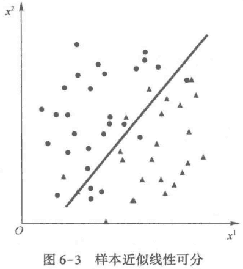

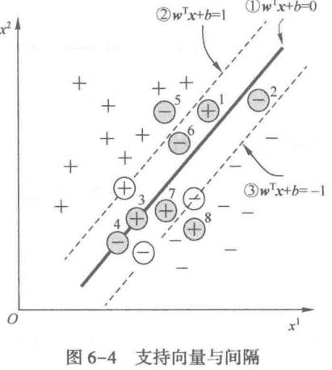

此时对每个样本 (x_i,y_i) 引入松弛 ξ_i ≥0，则式 (6-5) relax 为

y_i(wᵀx_i + b) ≥ 1 - ξ_i , i=1,…,N  (6-20)

会出现几种情形：ξ_i=0 时样本正确且位于带外；0<ξ_i<1 时样本仍正确但落在中间带内，如图 6-4 的样本 1、2；ξ_i=1 时样本落在分界面①上，如 3、4；ξ_i>1 时样本被误分，正类在①下方、负类在①上方，如 5、6、7、8。显然 ξ_i=0 是理想，ξ_i≠0 带来代价。

允许少数样本松弛，但需惩罚。故在式 (6-7) 目标上加惩罚项：

min_{w,b,ξ} ½||w||² + C Σ ξ_i  (6-21)

其中 C>0 为惩罚系数，ξ 为松弛向量。C 越大惩罚越重，可容忍错误越少；C→∞ 时退化为硬间隔。C 越小惩罚越松，允许错误越多。目标含义是同时压低 ½||w|| 与 C Σ ξ_i，即放大间隔 2/||w|| 并减少误分，C 起调节作用，也称松弛因子，可在一定程度上抑制过拟合，提升对噪声的适应性。

特别地，与超平面②③接触、在带内或被误分的样本，即图 6-4 中带圆圈的点，对模型起决定性作用，称为支持向量。

### 2. 优化模型
由此得到 SVM 的软间隔最大化模型：

\begin{cases}
\min_{w,b,ξ} ½||w||² + C Σ ξ_i \\
s.t. y_i(wᵀx_i + b) ≥ 1 - ξ_i , i=1,…,N \\
ξ_i ≥0 , i=1,…,N
\end{cases}
(6-22)

亦称线性支持向量机模型。仍为凸二次规划，可证最优解存在但不唯一，w 唯一而 b 在区间变动。设其中一个最优解为 (w*,b*)，则分离面为 w*ᵀx + b* =0，决策式 f(x)=sign(w*ᵀx + b*)。可见线性可分 SVM 是其 ξ_i=0 的特例，实际数据多为近似可分，故软间隔适用更广。

### 3. 对偶算法
### (1) 对偶问题
该问题亦可用拉格朗日乘子求解。原始式 (6-22) 的对偶为

\begin{cases}
\min_λ ½ Σ Σ λ_i λ_j y_i y_j x_iᵀx_j - Σ λ_i \\
s.t. Σ λ_i y_i =0 \\
0 ≤ λ_i ≤ C
\end{cases}
(6-23)

设解为 λ*，则原解为

w* = Σ λ_i* y_i x_i ,  b* = y_j - Σ λ_i* y_i x_iᵀx_j  (6-24)

其中 j 满足 0<λ_j*<C。于是分离面 w*ᵀx + b*=0，决策式

f(x)=sign( Σ λ_i* y_i x_iᵀx - Σ λ_i* y_i x_iᵀx_j + y_j )  (6-25)

### (2) 对偶算法
对近似线性可分的训练集，先解对偶式 (6-23)，再用式 (6-24) 还原原解，进而得到分离面与决策式 (6-25)，此即线性 SVM 的对偶算法。步骤：

设 D={(x₁,y₁),…,(x_N,y_N)}，x_i∈ℝⁿ，y_i∈{-1,1}。

- 1. 构造并求解约束优化式 (6-23)。
- 2. 用式 (6-24) 求 w*，取 0<λ_j*<C 的分量求 b*。
- 3. 得到分离面 w*ᵀx + b*=0 与决策式 (6-25)。

## 6.4 非线性支持向量机
### 1. 核技巧
前文假设数据线性可分或近似可分。许多实际问题是非线性的，可通过非线性映射把原空间送到新空间，使问题在新空间线性可分或近似可分。例如异或问题，如图 6-5、6-6。

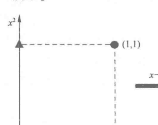

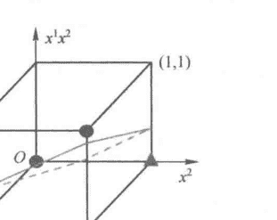

设原空间为二维，正类为 |(0,0),(1,1)|，负类为 |(1,0),(0,1)|，不存在线性超平面分离。定义映射 φ:T→ℝ³:x→z，

z=φ(x):=(x¹,x²,x¹x²), ∀x∈T  (6-26)

该映射把正类变为 |(0,0,0),(1,1,1)|，负类变为 |(1,0,0),(0,1,0)|，平面

z¹+z²-2z³-1/3=0  (6-27)

即可分离，如图 6-6 黄色平面。

设 φ 为变换，则新空间的划分面为

wᵀφ(x)+b=0  (6-28)

其中 w 为法向，b 为偏移。类似式 (6-7) 或 (6-22) 得

\begin{cases}\min_{w,b}½||w||²\\ s.t. y_i(wᵀφ(x_i)+b)≥1\end{cases}

或者

$$\begin{cases}\min_{w,b,\xi}\frac12\|w\|^2 + C\sum_{i=1}^{N}\xi_i\text{s.t.}\ y_i\big(w^T\phi(x_i)+b\big)\ge 1-\xi_i\xi_i\ge0,\ i=1,2,\cdots,N\end{cases}\tag{6-29}$$

注意到用拉格朗日乘子求解式 (6-7) 或 (6-22) 时，对偶目标与决策只涉及样本间内积。因此式 (6-29) 也只涉及 φ(x_i) 间的内积 φᵀ(x_i)φ(x_j)。新空间维数可能很高甚至无穷，直接计算困难。于是定义函数 κ:ℝⁿ×ℝⁿ→ℝ；

$$\kappa(x_i,x_j):=\phi^T(x_i)\phi(x_j),\quad\forall x_i,x_j\in\mathbb{R}^n\tag{6-30}$$

此处的 κ(·,·) 称为核函数，该做法称为核技巧。它等价于用 φ 把原空间映射到高维，把原内积换成 φᵀ(x_i)φ(x_j)。在核函数确定后，可用线性分类方法解决非线性分类问题。核函数的选择直接决定能否用线性 SVM 处理非线性可分问题，是 SVM 最关键的变量。

### 2. 对偶算法
### (1) 对偶问题
引入核函数 κ(·,·) 后，回顾线性可分 SVM 与线性 SVM 的对偶，即式 (6-16) 与 (6-23)，类似地，式 (6-29) 的对偶目标均可写为

$$W(\lambda)=\frac12\sum_{i=1}^{N}\sum_{j=1}^{N}\lambda_i\lambda_j y_i y_j \kappa(x_i,x_j)-\sum_{i=1}^{N}\lambda_i\tag{6-31}$$
在约束保持不变的情况下，式（6-29）对应的对偶形式为
$$\begin{cases}\min_{\lambda}\frac12\sum_{i=1}^{N}\sum_{j=1}^{N}\lambda_i\lambda_j y_i y_j \kappa(x_i,x_j)-\sum_{i=1}^{N}\lambda_i\\\text{s.t.}\ \sum_{i=1}^{N}\lambda_i y_i=0\\\lambda_i\ge0\text{或者}\ 0\le\lambda_i\le C,\ i=1,2,\cdots,N\end{cases}\tag{6-32}$$
其中第二个约束的取值范围会随任务类型变化：严格线性可分时取 $\lambda_i\ge0$，允许误差的软间隔情形则取 $0\le\lambda_i\le C$。
与之对应的，原问题式（6-28）的解可以表示为
$$w^*=\sum_{i=1}^{N}\lambda_i^* y_i\phi(x_i),\quad b^*=y_j-\sum_{i=1}^{N}\lambda_i^* y_i\kappa(x_i,x_j)\tag{6-33}$$
这里下标 $j$ 的选取规则取决于映射后空间的性质：新空间严格可分时挑选 $\lambda_j>0$ 的指标，新空间软间隔时则挑选满足 $0<\lambda_j<C$ 的指标。
分类器最终可表述为
$$\begin{aligned}f(x)&=\operatorname{sign}\Big(\sum_{i=1}^{N}\lambda_i^* y_i\phi^T(x_i)\phi(x)-\sum_{i=1}^{N}\lambda_i^* y_i\phi^T(x_i)\phi(x_j)+y_j\Big)\\&=\operatorname{sign}\Big(\sum_{i=1}^{N}\lambda_i^* y_i\kappa(x_i,x)-\sum_{i=1}^{N}\lambda_i^* y_i\kappa(x_i,x_j)+y_j\Big)\end{aligned}\tag{6-34}$$
可以看出，只要核函数确定，非线性可分问题就能套用线性可分或软间隔线性问题的求解思路。实质学习是在 $\phi$ 映射得到的高维空间中完成，但该空间的显式形式以及映射 $\phi$ 本身并不需要写出来。

### （2）对偶算法
综合以上分析，面对一个非线性可分的训练集，做法是先选定合适的核函数，构建并求解对偶问题式（6-32），再借助式（6-33）求出原始问题的偏置 $b^*$，最后得到分类决策式（6-34）。这一流程被称为非线性支持向量机的对偶求解，下面是具体步骤。
设训练集 $D = \{ (x_1,y_1), (x_2,y_2), \dots, (x_N,y_N) \}$，其中 $x_i \in R^n$, $y_i \in \{-1,1\}$, $i = 1,2,\dots,N$。
- 1. 选定合适的核函数，搭建并求解对偶问题式（6-32）。
- 2. 依据式（6-33）计算 $b^*$。
- 3. 得到相应的分类决策函数式（6-34）。

### 3. 常用核函数

### （1）线性核函数（linear kernel）
$\kappa(u,v) := u^{\mathsf T}v + c, \quad \forall u,v \in R^n \quad (6-35)$
其中 $c \in R$ 为可选项。当 $c=0$ 时就退回经典的线性可分 SVM 或线性 SVM。线性核参数少、计算快，多用于数据本身近似可分，或特征维度远大于样本量的场景。

### （2）多项式核（polynomial kernel）
$\kappa(u,v) := (a u^{\mathsf T}v + c)^d, \quad \forall u,v \in R^n \quad (6-36)$
其中 $a,d,c \in R$，$a$ 起调节作用，$c$ 可选，$d$ 为次数。$d$ 过大时计算负担会显著上升。对已做正交归一化的数据，多项式核往往是优先尝试的选择。

### （3）高斯核（Gaussian kernel）
$\kappa(u,v) := \exp\!\left( -\|u-v\|^2 / (2\sigma^2) \right), \quad \forall u,v \in R^n \quad (6-37)$
其中 $\sigma \in R$ 为带宽。$\sigma^2$ 越大，核函数越平滑，模型偏差与方差升高，泛化能力下降，容易过拟合；$\sigma^2$ 越小，核变化越剧烈，模型对噪声更敏感。高斯核灵活性强，在核函数不确定时通常作为首选。

### （4）Sigmoid 核（Sigmoid kernel）
$\kappa(u,v) := \tanh\!\left( a u^{\mathsf T}v + c \right), \quad \forall u,v \in R^n \quad (6-38)$
其中 $\tanh(\cdot)$ 为双曲正切，$a$ 为调节参数，$c$ 可选，一般取 $1/n$。

## 6.5 支持向量机回归

### 6.5.1 线性支持向量机回归

### 1. 模型原理

### （1）线性回归
给定训练集
$T = \{ (x_1, y_1), (x_2, y_2), \dots, (x_N, y_N) \}$，
其中 $x_i = (x_i^1, x_i^2, \dots, x_i^n)^{\mathsf T} \in R^n$, $y_i \in R$, $i = 1,2,\dots,N$。线性回归的目标是寻找超平面
$y = w^{\mathsf T} x + b \quad (6-39)$
其中 $w = (w^1, w^2, \dots, w^n)^{\mathsf T} \in R^n$ 为法向量，$b$ 为截距，用以尽可能精确地预测真实值 $y = (y_1, y_2, \dots, y_N)$，如下图 6-7 所示。
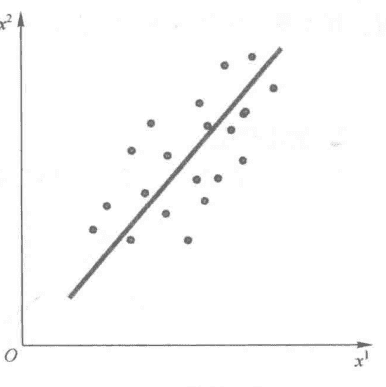
参数估计常采用最小二乘，即让预测值 $\hat y = (\hat y_1, \hat y_2, \dots, \hat y_N)$ 与真实值 $y$ 的欧氏距离平方最小：
$\min_{w,b} \|y - \hat y\|^2 = \sum_{i=1}^N (y_i - \hat y_i)^2 = \sum_{i=1}^N (y_i - w^{\mathsf T}x_i - b)^2 \quad (6-40)$
该准则把每个样本的平方误差全部计入损失。

### (2) 支持向量机回归
与线性回归不同，SVM 回归允许误差落在一定容忍带内就不计罚，设 $\varepsilon>0$ 为容许的最大偏差。即当
$|y_i - w^{\mathsf T}x_i - b| \le \varepsilon \quad (6-41)$
或等价地
$\begin{cases} y_i - w^{\mathsf T}x_i - b \le \varepsilon \\ w^{\mathsf T}x_i + b - y_i \le \varepsilon \end{cases} \quad (6-42)$
时视为无损失。示意图见图 6-8。
把原始回归超平面向上、下各平移 $\varepsilon$ 得到两条新超平面②、③。落在两条虚线之间的数据不产生损失。两线间距为
$2d = 2\varepsilon / \sqrt{\|w\|^2 + 1} \quad (6-43)$
间距越大，可容纳的样本越多，鲁棒性越好。$\varepsilon$ 固定时，$\|w\|$ 越小间距越大。为便于求解通常取目标
$\tfrac12 \|w\|^2 \quad (6-44)$
于是得到基本模型
$\min_{w,b} \tfrac12 \|w\|^2$
$s.t.\ |y_i - w^{\mathsf T}x_i - b| \le \varepsilon,\ i=1,2,\dots,N \quad (6-45)$
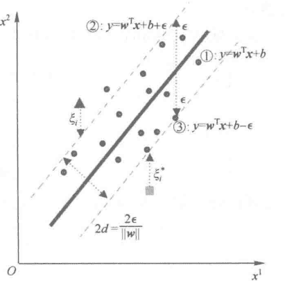
实际中允许一定损失。当式（6-41）或式（6-42）被破坏时引入松弛变量 $\xi_i,\xi_i^* \ge 0$ 满足
$$\begin{cases} y_i - w^{T}x_i - b \le \epsilon + \xi_i \\ w^{T}x_i + b - y_i \le \epsilon + \xi_i^{*} \end{cases}\tag{6-46}$$
此时 $\xi_i = \xi_i^* = 0$ 表示样本落在两条虚线之间，无损失；$\xi_i>0,\ \xi_i^*=0$ 表示样本在上界②之上，产生损失，如图 6-8 的三角形样本；$\xi_i=0,\ \xi_i^*>0$ 表示样本在下界③之下，产生损失，如图 6-8 的矩形样本。这两类损失为
$$\sum_{i=1}^{N} (\xi_i + \xi_i^{*})\tag{6-47}$$

### 2. 优化模型
结合式（6-44）、式（6-46）和式（6-47）可得支持向量回归的优化形式：
$$\begin{cases} \min_{w,b,\xi,\xi^{*}} \frac{1}{2} \|w\|^2 + C \sum_{i=1}^{N} (\xi_i + \xi_i^{*}) \\ \text{s.t.} \quad y_i - w^{T}x_i - b \le \epsilon + \xi_i, i=1,2,\cdots,N \\ w^{T}x_i + b - y_i \le \epsilon + \xi_i^{*}, i=1,2,\cdots,N \\ \xi_i,\xi_i^{*} \ge 0, i=1,2,\cdots,N \end{cases}\tag{6-48}$$
其中 $C>0$ 为惩罚系数，用来平衡正则项与误差项的权重。

### 3. 对偶算法

### (1) 对偶问题
利用拉格朗日乘子与 KKT 条件可知，支持向量机回归的支持向量位于虚线②上及其上方、虚线③上及其下方，最终解仅由这些点决定。省略推导，直接给出对偶式与原问题参数。
原问题式（6-48）的对偶为
$$\begin{cases} \min_{\Lambda,\bar{\Lambda}} \frac{1}{2} \sum_{i=1}^{N} \sum_{j=1}^{N} (\lambda_i - \bar{\lambda}_i)(\lambda_j - \bar{\lambda}_j) x_i^{T}x_j - \sum_{i=1}^{N} y_i(\lambda_i - \bar{\lambda}_i) + \sum_{i=1}^{N} \epsilon(\lambda_i + \bar{\lambda}_i) \\ \text{s.t.} \quad \sum_{i=1}^{N} (\lambda_i - \bar{\lambda}_i) = 0 \\ 0 \le \lambda_i, \bar{\lambda}_i \le C, i=1,2,\cdots,N \end{cases}\tag{6-49}$$
设对偶解为 $\lambda^{*}=(\lambda_1^{*},\dots,\lambda_N^{*})$, $\bar\lambda^{*}=(\bar\lambda_1^{*},\dots,\bar\lambda_N^{*})$，则原问题参数为
$$w^{*} = \sum_{i=1}^{N} (\lambda_i^{*} - \bar{\lambda}_i^{*}) x_i \tag{6-50}$$
$$b^{*} = y_j - w^{*T}x_j - \epsilon = y_j - \sum_{i=1}^{N} (\lambda_i^{*} - \bar{\lambda}_i^{*}) x_i^{T}x_j - \epsilon \tag{6-51}$$
其中 $j$ 为满足 $\lambda_j>0$ 或 $\bar\lambda_j>0$ 的下标。
进而超平面可写为
$$y = w^{*T}x + b^{*} \tag{6-52}$$

### (2) 对偶算法
对给定的训练集，先构造并求解对偶问题式（6-49），再利用式（6-50）和式（6-51）得到原问题式（6-48）的解，进而得到超平面式（6-52）。此为线性支持向量机回归的对偶求解流程：
设训练集 $D = \{(x_1,y_1),\dots,(x_N,y_N)\}$，其中 $x_i \in R^n$, $y_i \in \{-1,1\}$, $i=1,2,\dots,N$。
- 1. 选取合适的核函数，构造并求解对偶问题式（6-49）。
- 2. 依据式（6-50）和式（6-51）计算 $w^*$ 和 $b^*$。
- 3. 得到超平面 $w^{*T}x + b^* = 0$。

### 6.5.2 非线性支持向量机回归
与非线性分类类似，非线性回归同样借助核函数实现，下面直接给出优化模型与对偶求解。

### 1. 原始优化问题
设 $\phi$ 把原始空间映射到新空间，使数据在新空间呈现线性趋势。
原始优化问题为
$$\begin{cases}\min_{w,b,\xi,\xi^*} \frac12\|w\|^2+C\sum_{i=1}^N(\xi_i+\xi_i^*)\\\text{s.t.}\quad y_i-w^T\phi(x_i)-b\le\epsilon+\xi_i,i=1,2,\cdots,N\\w^T\phi(x_i)+b-y_i\le\epsilon+\xi_i^*,i=1,2,\cdots,N\\\xi_i,\xi_i^*\ge0,i=1,2,\cdots,N\end{cases}\tag{6-53}$$
其中 $C>0$ 为惩罚参数。

### 2. 对偶算法

### (1) 对偶问题
原始优化问题（6-53）的对偶为
$$\begin{cases}\min_{\lambda,\bar\lambda}\frac12\sum_{i=1}^N\sum_{j=1}^N(\lambda_i-\bar\lambda_i)(\lambda_j-\bar\lambda_j)\kappa(x_i,x_j)-\sum_{i=1}^N y_i(\lambda_i-\bar\lambda_i)+\sum_{i=1}^N\epsilon(\lambda_i+\bar\lambda_i)\\\text{s.t.}\quad\sum_{i=1}^N(\lambda_i-\bar\lambda_i)=0\\0\le\lambda_i,\bar\lambda_i\le C,i=1,2,\cdots,N\end{cases}\tag{6-54}$$
其中 $\kappa(\cdot,\cdot)$ 为核函数。设对偶解为 $\lambda^*=(\lambda_1^*,\dots,\lambda_N^*)$, $\bar\lambda^*=(\bar\lambda_1^*,\dots,\bar\lambda_N^*)$，则原问题参数为
$$b^*=y_j-w^{*T}x_j-\epsilon=y_j-\sum_{i=1}^N(\lambda_i^*-\bar\lambda_i^*)\kappa(x_i,x_j)-\epsilon\tag{6-55}$$
其中 $j$ 为满足 $\lambda_j>0$ 或 $\bar\lambda_j>0$ 的下标。进而非线性模型为
$$y=w^{*T}\phi(x)+b^*=\sum_{i=1}^N(\lambda_i^*-\bar\lambda_i^*)\kappa(x_i,x)+y_j-\sum_{i=1}^N(\lambda_i^*-\bar\lambda_i^*)\kappa(x_i,x_j)-\epsilon\tag{6-56}$$

### (2) 对偶算法
对呈现非线性趋势的训练集，先选定合适的核函数，求解对偶问题式（6-54），再用式（6-55）求得原问题式（6-53）的参数，进而得到非线性模型式（6-56）。该流程即为非线性支持向量机回归的对偶算法：
设训练集 $D = \{(x_1,y_1),\dots,(x_N,y_N)\}$，其中 $x_i \in R^n$，$y_i \in \{-1,1\}$，$i=1,2,\dots,N$。
- 1. 选取合适的核函数，构造并求解对偶问题式（6-54）。
- 2. 利用式（6-55）求解原问题式（6-53）的参数 $b^*$。
- 3. 得到非线性模型式（6-56）。

## 6.6 SMO 算法
前文可知，无论分类还是回归、线性还是非线性，最终都归结为二次规划，如式（6-16）、式（6-23）、式（6-31）、式（6-49）、式（6-54）。通用二次规划求解随样本数增长开销很大。为此发展了多种针对结构的高效方法，序列最小优化 SMO 是典型代表。

### 1. 原理
SMO 的核心思想是固定除一个拉格朗日乘子外的所有变量，求该变量的极值。由等式约束可把一个乘子用其余乘子表示，故每次仅更新两个乘子。初始化后不断重复：第一步选出需要更新的两个乘子；第二步固定其余所有乘子，求解对偶子问题并更新所选的两个乘子，直至收敛。
以非线性 SVM 分类对偶式（6-32）为例，假设选定 $\lambda_1,\lambda_2$ 更新，其余 $\lambda_3,\dots,\lambda_N$ 固定，则由式（6-32）的等式约束得
$$\lambda_1 = -y_1 \sum_{i=2}^{N} \lambda_i y_i \tag{6-57}$$

当 λ₂ 被固定下来时，λ₁ 也随之唯一确定，因此每次迭代都会成对地对这两个变量进行更新。任取两组待优变量 λ_k 与 λ_l，k,l=1,2,…,N，式（6-32）对应的子问题可以表述为

$$

\min_{\lambda_k,\lambda_l} W(\lambda_k,\lambda_l)=\frac{1}{2}\kappa_{kk}\lambda_k^2+\frac{1}{2}\kappa_{ll}\lambda_l^2+y_k y_l \kappa_{kl}\lambda_k\lambda_l-(\lambda_k+\lambda_l)+

 y_k\lambda_k\sum_{i\neq k,l}y_i\lambda_i\kappa_{ik}+y_l\lambda_l\sum_{i\neq k,l}y_i\lambda_i\kappa_{il}

\tag{6-58}

$$

s.t.

$$\lambda_k y_k+\lambda_l y_l=-\sum_{i\neq k,l}y_i\lambda_i=\zeta \tag{6-59}$$

$$0\le\lambda_i\le C,i=k,l \tag{6-60}$$

式中 κ_ij 定义为 κ(x_i,x_j)，i,j=1,2,…,N，ζ 为常数值，式（6-58）里剔除了与 λ_k、λ_l 无关的常数项。

由此可见 SMO 的工作本质上由两部分构成：一是求解式（6-58）~式（6-60）构成的约束优化问题，二是变量对选择的启发式策略。具体推导过程在此略去，可参见参考文献 [3] 第 7.4 节。

### 2. 步骤

下面直接给出 SMO 的执行流程：

设训练集 D = {(x₁,y₁),(x₂,y₂),…,(x_N,y_N)}，其中 x_i ∈ R^n，y_i∈{-1,1}，i=1,2,…,N，容差为 ε，k 表示当前迭代序号。

- 1. 初始化：k=0，λ^k=0。
- 2. 挑选一对优化变量 λ₁^k、λ₂^k，求解式（6-58）~式（6-60）的约束优化问题，并以此把 λ^k 更新为 λ^{k+1}。
- 3. 若在 ε 精度内满足停止判据

$$\sum_{i=1}^N \lambda_i y_i =0, 0\le \lambda_i \le C, i=1,2,\cdots,N$$

$$y_i g(x_i) \begin{cases} \ge1, & \{x_i \mid \lambda_i=0\} \\ =1, & \{x_i \mid 0<\lambda_i<C\} \\ \le1, & \{x_i \mid \lambda_i=C\} \end{cases}$$

其中

$$g(x_i)=\sum_{j=1}^N \lambda_j y_j \kappa_{ji}+b$$

则进入 4)；否则令 k=k+1，返回 2)。
- 4. 取 λ^* = λ^{k+1}。

## 6.7 代码实现

SVM 既可以自行实现，也可以直接调用现成库。Scikit-learn 把 SVM 相关的实现都放在 sklearn.svm 中，提供了分类用的 SVC 和回归用的 SVR 两个封装类。

SVC 类的示例代码如下：

```
sklearn.svm.SVC(*, C=1.0, kernel='rbf', degree=3, gamma='scale', coef0=0.0, shrinking=True, probability=False, tol=0.001, cache_size=200, class_weight=None, verbose=False, max_iter=-1, decision_function_shape='ovr', break_ties=False, random_state=None)
```

SVR 类的示例代码如下：

```
sklearn.svm.SVR(*, kernel='rbf', degree=3, gamma='scale', coef0=0.0, tol=0.001, C=1.0, epsilon=0.1, shrinking=True, cache_size=200, verbose=False, max_iter=-1)
```

各参数的具体格式与含义可查阅 Python 官方帮助或 CDA Scikit-learn 中文社区的 SVM 模块说明。

### 6.7.1 线性支持向量机代码实现

搭建线性支持向量机时，既可以用凸二次规划直接求解原问题，也可以用 SMO 求解对偶问题，这里先采用凸二次规划的思路。

下面用凸二次规划的方法实现线性 SVM 分类。取训练数据为：正类 x₁=(1,1)、x₂=(1,3)、x₃=(0,4)，负类 x₄=(1,0)、x₅=(3,0)、x₆=(4,0)，并对新样本 x₇=(2,2)、x₈=(3,3)、x₉=(-1,-1)、x₁₀=(3,-2) 进行预测，最后通过绘图展示结果。

（1）通过 cvxopt 包求解凸二次规划问题

代码 6-1 构造了一个训练集 T，里面包含 x1、x2、y 三列信息，y 的取值是 -1 或 +1。

# 代码 6-1 输入训练集

```
# 定义数据集 T，其中包含(x1, x2, y)三个元素，y 为标签，取值为-1 或+1
T = [(1, 1, 1), (1, 3, 1), (0, 4, 1), (1, 0, -1), (3, 0, -1), (4, 0, -1)]
# 计算数据集 T 的样本数量，并赋值给变量 num_samples
num_samples = len(T)
```

代码 6-2 利用 cvxopt 库把凸二次规划问题写成矩阵形式并求解。先导入 cvxopt，获取样本维度，随后构造目标函数的二次项矩阵、一项向量以及不等式约束的矩阵与向量，最后把这些量传入 cvxopt.solvers.qp 求解。其中 P 对应二次项系数矩阵，q 对应线性项系数向量，G、h 分别为不等式约束的系数矩阵和向量。求解后得到最优解 w0、w1 与 b。

# 代码 6-2 将凸二次规划问题表达为矩阵形式并求解

```
# 引入需要的库:
import cvxopt

# 将凸二次规划问题表达为矩阵形式
m = len(T[0])                     # 样本的维度

# 定义目标函数中二次部分，使用二次型表示
P = np.identity(m)                # 创建一个 m*m 的单位矩阵
P[m - 1][m - 1] = 0               # 将最后一个元素设为 0，达到去除常数项的目的
P = cvxopt.matrix(P)              # 将 P 转换为 cvxopt 的矩阵形式

# 定义目标函数中一次部分
q = cvxopt.matrix([0.0] * m)      # 创建一个全为 0 的长度为 m 的列向量作为目标函数中一次部分的系数

# 定义不等式部分
G = []
for j in range(m - 1):           # 遍历样本维度，从第一维到倒数第二维
G.append([-T[i][j] * T[i][-1] for i in range(len(T))])  # 根据样本数据生成不等式部分的系数
G.append([-T[i][-1] * 1.0 for i in range(len(T))])      # 最后一维是常数项，添加到不等式部分的系数
G = cvxopt.matrix(G)              # 将 G 转换为 cvxopt 的矩阵形式
```

```
h = cvxopt.matrix([-1.0] * num_samples) # 创建一个形状为 1 * num_samples 的矩阵，每个元素为-1.0
# 将参数传递给 cvxopt.solvers.qp，返回最优解
sol = cvxopt.solvers.qp(P, q, G, h)          # 使用 cvxopt 库的 qp 函数求解凸二次规划问题
print(sol['x'])                             # 输出最优解 w0, w1, b
```

求得三个参数约为 1.26e-03、2.00 和 -9.99e-01，分离超平面大致为 2x₂-1=0。

（2）绘制训练集散点图以及分离超平面

代码 6-3 先导入 numpy 与 matplotlib，对数据集做简单的格式转换以适配后续的绘图函数。转换后数据存入 dataSet，标签存入 labels，随后从上一步求解结果 sol 中提取权重 w 与偏置 b，赋给变量 w、b，便于后续使用。

# 代码 6-3 转换数据格式

```
# 转换数据格式
# 导入 numpy 和 matplotlib 库
import numpy as np
import matplotlib.pyplot as plt

# 将数据集格式进行简单转换，使其吻合 drawScatterPointsAndLine 函数输入要求
dataSet = np.array([list(T[i][0:-1]) for i in range(len(T))])   # 将样本特征部分转换为 numpy 数组
labels = np.array([T[i][-1] for i in range(len(T))])           # 将样本标签部分转换为 numpy 数组
w = [sol['x'][0], sol['x'][1]]                                 # 获取计算得到的权重 w
b = sol['x'][2]                                                # 获取计算得到的偏移 b
```

代码 6-4 绘制训练集散点图。创建画布 fig 与子图 ax，根据标签将点分为两类并赋予不同标记与颜色：标签为 1 的点用黑色圆点表示，标签为 -1 的点用蓝色星号表示，从而可视化两类分布。

# 代码 6-4 绘制训练集散点图

```
# 绘制训练数据点的散点图
fig = plt.figure()                              # 创建一个新的图形窗口
ax = fig.add_subplot(111)                       # 添加一个子图，将其设置为 1 行 1 列的第 1 个子图
for i in range(1, len(dataSet)):                # 遍历数据集中的样本点，从第二个样本点开始到最后一个样本点
    if labels[i] != labels[i - 1]:              # 判断当前样本点的标签是否与前一个样本点的标签不同
        pos = i                                 # 记录不同标签的样本点的索引位置
        break                                   # 找到一个即可退出循环

# 绘制正样本点（标签为 1）的散点图，颜色为黑色，标记为圆形
ax.scatter(dataSet[0:pos, 0], dataSet[0:pos, 1], c='k', marker='o', label='1')

# 绘制负样本点（标签为-1）的散点图，颜色为蓝色，标记为星形
ax.scatter(dataSet[pos:len(dataSet), 0], dataSet[pos:len(dataSet), 1], c='b', marker='*', label='-1')
```

代码 6-5 用来计算直线两端点的坐标以及直线与坐标轴的交点，以便画出分离超平面。先由数据集求出坐标范围的最小值 m 与最大值 M，再依据 w、b 计算与 y 轴的交点，若落在范围内则作为 points 数组的一个端点；若 points 仍不足两个点，则再计算与 x 轴的交点并做范围判断。最后用 ax.plot 画出连接两点的直线并标注为分离超平面。

### 代码 6-5 绘制分离超平面

```
# 绘制分离超平面
# 计算直线上两个点的坐标，以及直线与坐标轴的交点，用于绘制分离超平面
m = dataSet.min(0)                     # 获取数据集中每一列的最小值
M = dataSet.max(0)                     # 获取数据集中每一列的最大值

t = -(w[0] * m[0] + b) / w[1]           # 求直线与横轴的交点的纵坐标
points = np.zeros((2, 2))              # 创建一个用于存储两个点坐标的数组
i = 0

# 判断交点的纵坐标是否在数据集的纵坐标范围内，如果是则添加到 points 数组中
if t >= m[1] and t <= M[1]:
    points[i] = np.array([m[0]-5, t])  # 将起点横坐标减小，延长直线
    i += 1

t = -(w[0] * M[0] + b) / w[1]           # 求直线与横轴的交点的纵坐标
if t >= m[1] and t <= M[1]:
    points[i] = np.array([M[0]+5, t])  # 将终点横坐标增大，延长直线
    i += 1
# 此时需要求直线与纵轴的交点的横坐标，并将其添加到 points 数组中
if i != 2:
    t = -(w[1] * m[1] + b) / w[0]       # 求直线与纵轴的交点的横坐标
    if t > m[0] and t < M[0]:
        points[i] = np.array([t, m[1]-5])  # 将起点纵坐标减小，延长直线
        i += 1
# 此时需要求直线与纵轴的交点的横坐标，并将其添加到 points 数组中
if i != 2:
    t = -(w[1] * M[1] + b) / w[0]       # 求直线与纵轴的交点的横坐标
    if t > m[0] and t < M[0]:
        points[i] = np.array([t, M[1]+5])  # 将终点纵坐标增大，延长直线

# 在子图上绘制分离超平面，连接 points 数组中的两个点
ax.plot(points[:, 0], points[:, 1], label='Regression')
```

### （3）预测新样本并绘制散点图

代码 6-6 负责对新样本进行预测并可视化。先定义预测函数，输入待测坐标后逐个处理：将样本转为 NumPy 数组，通过 predict 得到标签，标签决定绘图标记——标签为 1 用圆点，否则用星号，再用 ax.scatter 以红色绘制点，并用 ax.annotate 在点旁标注预测结果。

### 代码 6-6 预测新样本并绘制散点图

```
# 定义预测函数
def predict(x, w, b):
    """
    输入:
    x -新样本的特征向量
    w -分离超平面的权重向量
    b -分离超平面的偏置项
    输出:
    result -预测结果, 1 表示正类, -1 表示负类
    """
    result = np.sign(np.dot(x, w) + b)      # 计算预测结果
    return result                           # 返回预测结果

# 定义新的样本集合
new_samples = [(2, 2), (3, 3), (-1, -1), (3, -2)]

# 对每个新样本进行预测和可视化
for sample in new_samples:
    x = np.array(sample)                    # 将样本转换为 numpy 数组
    label = int(predict(x, w, b))           # 预测样本的标签
    marker = 'o' if label == 1 else '*'     # 确定标记的形状
    ax.scatter(x[0], x[1], c='r', marker=marker)   # 绘制样本点
    ax.annotate(f"{label}", (x[0] + 0.1, x[1] + 0.1)) # 在样本点旁边添加标签
    print(label)                            # 输出预测样本标签
```

代码 6-7 为图表添加图例并展示。调用 ax.legend() 生成图例说明不同元素的含义，最后用 plt.show() 显示完整图形以便观察分析。

### 代码6-7 全图绘制并补全图例
```
ax.legend()     # 添加图例
plt.show()      # 显示图形
```
最终判定 x7、x8 归属正类，x9、x10 归属负类，结果示意见图6-9。
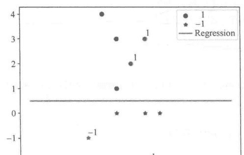

### 6.7.2 Nonlinear SVM 编程演示
本文以 SMO 为求解器，分别搭建 linear、polynomial、gaussian 三种 kernel 的分类器，并在同一个二分类样本上做效果对比。
- (1) 三种 kernel 的定义
代码6-8 给出三种 kernel 的计算方式。linear kernel 直接输出两个输入的内积；polynomial kernel 先把内积乘以 gamma 再加 1 之后按 degree 次幂；gaussian kernel 以 sigma 为带宽，用两向量欧氏距离的平方经 2 sigma² 缩放后取指数。
### 代码6-8 linear / polynomial / gaussian kernel 定义
```
# 引入需要的库
import numpy as np                # 导入 numpy 库
from sklearn.metrics import accuracy_score   # 导入 accuracy_score 函数，用于计算分类准确率。

def linear_kernel(x1, x2):
    """
    线性核函数
    参数：
        x1:向量 1
        x2:向量 2
    返回：
        点积结果
    """
    return np.dot(x1, x2)           # 返回向量 x1 和向量 x2 的点积结果。

def polynomial_kernel(x1, x2, degree=3, gamma=1.0):
    """
    多项式核函数
    参数：
        x1: 向量 1
        x2: 向量 2
        degree: 多项式的次数，默认为 3
        gamma: 乘法因子，默认为 1.0
    返回：
        核函数计算结果
    """
    return (gamma * np.dot(x1, x2) + 1) ** degree   # 返回( gamma * x1 与 x2 的点积 + 1 )的 degree 次方

def gaussian_kernel(x1, x2, sigma=0.5):
    """
    高斯核函数
    参数：
        x1: 向量 1
        x2: 向量 2
        sigma: 高斯核的标准差，默认为 0.5
    返回：
        核函数计算结果
    """
    return np.exp(-np.linalg.norm(x1 - x2) ** 2 / (2 * (sigma ** 2)))
# 返回 exp(-(||x1-x2||^2) / (2 * sigma^2))
```

- (2) SMO 训练流程
代码6-9 实现了基于 SMO 的训练过程。先依据输入的特征、标签及所选 kernel 生成核矩阵 K，随后在设定的最大迭代次数内循环扫描样本，通过 SMO 不断刷新 Lagrange 乘子 alpha 与偏置 b，直至一轮内找不到可更新的 alpha 对。每次迭代先依据预测误差判断 KKT 是否成立，不成立时挑选第二个变量并按标签关系确定其取值范围，算出学习率 eta，对第二个 alpha 进行裁剪更新，再同步更新第一个 alpha 并重算偏置。若双 alpha 均在合法范围则取 b1、b2 的均值作新 b，否则择其一采用。迭代结束返回训练得到的 alpha 与 b。
### 代码6-9 SMO 训练函数定义
```
def select_random_index(i, m):
    """
    随机选择一个与 i 不同的下标 j
    参数：
        i: 当前下标
        m: 数据总数
    返回：
        j: 随机选择的下标
    """
    j = i
    while j == i:
        j = np.random.randint(0, m)
    return j
def clip_alpha(alpha, H, L):
    """
    将 alpha 剪裁到指定范围内
    参数：
        alpha: 待剪裁的值
        H: 上界
        L: 下界
    返回：
        alpha: 剪裁后的值
    """
    if alpha > H:
        alpha = H
    if alpha < L:
        alpha = L
    return alpha

def svm_train(X_train, Y_train, kernel, C=1.0, tol=0.001, max_iter=100):
    """
    SVM 训练函数
    参数:
        X_train: 训练数据特征
        Y_train: 训练数据标签
        kernel: 核函数类型, 可选 linear、polynomial 或 gaussian
        C: 惩罚参数, 默认1.0
        tol: 容忍误差, 默认0.001
        max_iter: 最大迭代次数, 默认100
    返回:
        alpha: 拉格朗日乘子
        b: 偏置项
    """
    # 获取训练数据样本数量和特征数量
    m, n = X_train.shape

    # 初始化 alpha、b 和迭代次数 iter
    alpha = np.zeros(m)
    b = 0.0
    iter = 0

    # 计算核矩阵 K
    K = np.zeros((m, m))
    for i in range(m):
        for j in range(m):
            if kernel == 'linear':
                K[i, j] = linear_kernel(X_train[i], X_train[j])
            elif kernel == 'polynomial':
                K[i, j] = polynomial_kernel(X_train[i], X_train[j])
            elif kernel == 'gaussian':
                K[i, j] = gaussian_kernel(X_train[i], X_train[j])

    while iter < max_iter:
        alpha_pairs_changed = 0
        for i in range(m):
            # 计算预测值 f_i 和误差 E_i
            f_i = np.dot(alpha * Y_train, K[:, i]) + b
            E_i = f_i - Y_train[i]

            # 判断是否满足 KKT 条件
            if (Y_train[i] * E_i < -tol and alpha[i] < C) or (Y_train[i] * E_i > tol and alpha[i] > 0):
                # 随机选择第二个变量 j
                j = select_random_index(i, m)

                # 计算预测值 f_j 和误差 E_j
                f_j = np.dot(alpha * Y_train, K[:, j]) + b
                E_j = f_j - Y_train[j]

                # 保存更新前的 alpha 值
                alpha_old_i = alpha[i]
                alpha_old_j = alpha[j]

                # 根据标签 Y_train[i] 和 Y_train[j] 的关系确定 alpha[j] 的上下界
                if Y_train[i] != Y_train[j]:
                    L = max(0, alpha[j] - alpha[i])
                    H = min(C, C + alpha[j] - alpha[i])
                else:
                    L = max(0, alpha[i] + alpha[j] - C)
                    H = min(C, alpha[i] + alpha[j])

                # 如果上界等于下界，则跳过本次循环
                if L == H:
                    continue

                # 计算更新 alpha[j] 时的学习率 eta
                eta = 2 * K[i, j] - K[i, i] - K[j, j]
                if eta >= 0:
                    continue

                # 更新 alpha[j] 并进行剪裁
                alpha[j] -= Y_train[j] * (E_i - E_j) / eta
                alpha[j] = clip_alpha(alpha[j], H, L)

                # 如果 alpha[j] 变化太小，则跳过本次循环
                if abs(alpha[j] - alpha_old_j) < tol:
                    continue

                # 更新 alpha[i]
                alpha[i] += Y_train[i] * Y_train[j] * (alpha_old_j - alpha[j])

                # 计算新的偏置项 b
                b1 = b - E_i - Y_train[i] * (alpha[i] - alpha_old_i) * K[i, i] - Y_train[j] * (alpha[j] - alpha_old_j) * K[i, j]
                b2 = b - E_j - Y_train[i] * (alpha[i] - alpha_old_i) * K[i, j] - Y_train[j] * (alpha[j] - alpha_old_j) * K[j, j]

                # 根据更新后的 alpha[i] 和 alpha[j] 的取值范围确定新的偏置项 b
                if 0 < alpha[i] < C:
                    b = b1
                elif 0 < alpha[j] < C:
                    b = b2
                else:
                    b = (b1 + b2) / 2

                # 更新成功的 alpha 对数加一
                alpha_pairs_changed += 1

                # 如果没有更新成功的 alpha 对，则迭代次数 iter 加一，否则重置 iter 为 0
                if alpha_pairs_changed == 0:
                    iter += 1
                else:
                    iter = 0

    return alpha, b
```

- (3) 推断流程
代码6-10 实现了推断过程。函数接收学习用特征、标签、待测特征、已训练的 alpha、b 以及 kernel 种类，先统计样本规模并创建输出向量。对每个待测样本按 kernel 种类计算与学习集的核矩阵，随后用 alpha 与标签的加权和与该核矩阵点乘再加 b 得到判别分，最后按符号映射为 1 或 -1，返回全部结果。
### 代码6-10 SVM 推断函数定义
```
def svm_predict(X_train, Y_train, X_test, alpha, b, kernel):
    """
    SVM 预测函数
    参数：
        X_train: 训练数据特征
        Y_train: 训练数据标签
        X_test: 测试数据特征
        alpha: 拉格朗日乘子
        b: 偏置项
        kernel: 核函数类型,可选 linear、polynomial 或 gaussian
    返回：
        y_pred: 预测结果
    """
    # 获取训练数据样本数量和特征数量
    m, n = X_train.shape

    # 初始化预测结果 y_pred
    y_pred = np.zeros(len(X_test))

    for i in range(len(X_test)):
        # 根据核函数类型计算核函数矩阵 K
        if kernel == 'linear':
            K = np.array([ linear_kernel(X_train[j], X_test[i]) for j in range(m) ])
        elif kernel == 'polynomial':
            K = np.array([ polynomial_kernel(X_train[j], X_test[i]) for j in range(m) ])

```
elif kernel == 'gaussian':

    K = np.array([ gaussian_kernel(X_train[j], X_test[i]) for j in range(m) ])

    # 计算预测值 f, 并根据预测值的符号确定预测结果

    f = np.dot(alpha * Y_train, K) + b

    y_pred[i] = np.sign(f)

return y_pred

```

### (4) 随机生成训练集、测试集
生成指定样本数量的随机数据：代码 6-11 首先定义了一个函数 generate_data，用于生成指定样本数量的随机数据。函数的输入是样本数量 n_samples，输出是特征矩阵 X 和标签向量 y。在函数内部，首先生成范围在 [0, 1) 之间的随机数构成的特征矩阵 X，矩阵的形状为 (n_samples, 2)，X 具有 n_samples 行和 2 列的形状。其中，每一行代表一个样本，而每一列代表样本的一个特征。接着，从集合 {-1, 1} 中随机选择生成与样本数量相等的标签向量 y，其中标签的形状为 (n_samples,)。最后，将生成的特征矩阵 X 和标签向量 y 作为输出返回。示例中调用 generate_data 函数生成指定数量的训练集和测试集的数据。

## 代码 6-11 随机生成训练集、测试集
```
def generate_data(n_samples):

    """

    生成随机数据

    参数:

        n_samples: 样本数量

    返回:

        X: 特征矩阵

        y: 标签向量

    """

    # 生成由范围在[0, 1)之间的随机数构成的特征矩阵 X, 形状为(n_samples, 2)

    X = np.random.rand(n_samples, 2) * 10

    # 从{-1, 1}中随机选择生成样本数量个标签, 形状为(n_samples,)

    y = np.random.choice([-1, 1], size=n_samples)

    return X, y

# 生成训练集、测试集

X_train, Y_train = generate_data(30)  # 生成训练数据

X_test, Y_test = generate_data(10)    # 生成测试数据

# SVM 核对比实战：造数、训模、测效

想直观感受不同核的区分能力，先手搓一个可复现的圆形二分类玩具问题。平面上均匀撒点落在[-5,5)区间内，若 x1²+x2² 小于10 则标记为1，否则标记为-1。把随机种子钉在0上保证每次运行一致，先抽30个样本做训练，另抽10个样本做测试，为横向对比提供统一的评判基准。
```

生成一组满足特定规律的随机数据：代码 6-12 首先定义了一个函数 generate_data，用于生成指定样本数量的随机数据。函数的输入是样本数量 n_samples，输出是特征矩阵 X 和标签向量 y。在函数内部，首先设置随机种子，通过调用 np.random.seed(0) 函数来保证生成的随机数据的可重复性。然后，分别创建空的特征列表 X 和标签列表 y。接下来，通过一个循环依次生成 n_samples 个样本。在每次循环中，从均匀分布 [-5,5) 中随机抽取两个数作为特征 x1 和 x2。然后，使用条件语句判断点(x1，x2)是否位于圆形区域内。如果满足条件 x1 ** 2 + x2 ** 2 < 10，则将特征点[x1，x2]添加到特征列表 X 中，并将标签 1 添加到标签列表 y 中；否则，将特征点[x1，x2]添加到特征列表 X 中，并将标签-1 添加到标签列表 y 中。最后，将特征列表 X 和标签列表 y 转化为特征矩阵 X 和标签向量 y，并将其作为函数的输出返回。示例中调用 generate_data 函数生成指定数量的训练集和测试集的数据。

## 代码 6-12 随机生成满足特定规律训练集、测试集
```
def generate_data(n_samples):

    """

    生成随机数据函数

    参数：

        n_samples (int): 样本数量

    返回：

        X (ndarray): 特征矩阵，形状为 (n_samples, 2)

        y (ndarray): 标签向量，形状为 (n_samples,)

    """

    np.random.seed(0)            # 设置随机种子，保证可重复性

    X = []                       # 存储特征的列表

    y = []                       # 存储标签的列表

    for i in range(n_samples):

        # 从均匀分布[-5, 5)中随机抽取两个数作为特征 x1 和 x2

        x1 = np.random.uniform(-5, 5)

        x2 = np.random.uniform(-5, 5)

        if x1 ** 2 + x2 ** 2 < 10:  # 判断点(x1, x2)是否位于圆形区域内

            X.append([x1, x2])     # 将特征点添加到特征列表 X 中

            y.append(1)            # 将标签 1 添加到标签列表 y 中

        else:

            X.append([x1, x2])     # 将特征点添加到特征列表 X 中

            y.append(-1)           # 将标签-1 添加到标签列表 y 中

    return np.array(X), np.array(y)  # 将特征列表 X 和标签列表 y 转化为特征矩阵 X 和标签向量 y, 然后返回

# 生成训练集数据

X_train, Y_train = generate_data(30)

# 生成测试集数据

X_test, Y_test = generate_data(10)

在同一份训练数据上依次用线性核、多项式核和高斯核训练 SVM，训练完成后在同一测试集上给出预测标签并计算正确率，借此体会不同映射策略对非线性边界的适应差异。
```

### (5) 训练三类核支持向量机并测试，利用分类准确率评估
代码 6-13 通过设置不同的核函数对支持向量机模型进行训练和预测，并计算预测的准确率。

## 代码 6-13 训练三类核支持向量机，利用分类准确率评估
```
# 线性核

# 设置核函数为线性核

kernel = 'linear'

# 使用训练数据进行支持向量机训练，得到模型的超平面参数 alpha 和 b

alpha, b = svm_train(X_train, Y_train, kernel)

# 使用训练得到的模型对测试数据进行预测

y_pred = svm_predict(X_train, Y_train, X_test, alpha, b, kernel)

# 计算预测的准确率

accuracy = accuracy_score(Y_test, y_pred)

# 打印结果

print("线性核：")

print("预测结果：", y_pred)

print("准确率：", accuracy)

# 多项式核

# 设置核函数为多项式核

kernel = 'polynomial'

# 使用训练数据进行支持向量机训练，得到模型的超平面参数 alpha 和 b

alpha, b = svm_train(X_train, Y_train, kernel)

# 使用训练得到的模型对测试数据进行预测

y_pred = svm_predict(X_train, Y_train, X_test, alpha, b, kernel)

# 计算预测的准确率

accuracy = accuracy_score(Y_test, y_pred)

# 打印结果

print("多项式核：")

print("预测结果：", y_pred)

print("准确率：", accuracy)

# 高斯核

# 设置核函数为高斯核

kernel = 'gaussian'

# 使用训练数据进行支持向量机训练，得到模型的超平面参数 alpha 和 b

alpha, b = svm_train(X_train, Y_train, kernel)

# 使用训练得到的模型对测试数据进行预测

y_pred = svm_predict(X_train, Y_train, X_test, alpha, b, kernel)

# 计算预测的准确率

accuracy = accuracy_score(Y_test, y_pred)

# 打印结果

print("高斯核：")

print("预测结果：", y_pred)

print("准确率：", accuracy)

下面展示两个常见核的最小实现。线性核就是两向量点积的直接计算；多项式核在点积基础上加常数后再做幂次提升，常用以引入高阶交互。
```

改变训练集的样本数量，对此实验得到如下结果：

由于第一组数据集完全随机，训练花费时间比较长，这里设置了三组训练集，由表 6-1 可以发现这个模型的准确率并不会随着训练的加深而升高。对于第二组有一定规律的数据，训练时间相对非常短，这里设置了五组训练集。可以看到随着训练集样本数量的增加，预测准确率会升高，并且线性核函数、多项式核函数、高斯核函数三者准确率依次增高。

## 表 6-1 不同核函数支持向量机分类
| 数据分类 | 训练样本数量 | 线性核函数 | 多项式核函数 | 高斯核函数 |
|---|---|---|---|---|
| 随机数据 | 10 | 0.5 | 0.6 | 0.7 |
|  | 20 | 0.3 | 0.8 | 0.1 |
|  | 30 | 0.4 | 0.6 | 0.4 |
| 有规律的随机数据 | 10 | 0.6 | 0.6 | 1 |
|  | 20 | 0.6 | 0.6 | 1 |
|  | 30 | 0.6 | 0.6 | 1 |
|  | 40 | 0.6 | 1 | 1 |
|  | 50 | 0.6 | 1 | 1 |

### 6.7.3 支持向量机回归代码实现
下面我们编写代码手动实现 SMO 算法求解至少两类核支持向量机回归。

### (1) 定义核函数
代码 6-14 主要定义了两个核函数：线性核函数和多项式核函数。线性核函数使用输入样本的点乘运算来计算样本间的相似度，返回结果即为样本间的线性核函数值。多项式核函数在线性核函数的基础上引入了一个次数参数，通过将点乘结果加一然后取次方得到多项式核函数的值。

## 代码 6-14 定义线性核函数、多项式核函数
```python

# 导入库

import numpy as np

import matplotlib.pyplot as plt

# 定义线性核函数

def linear_kernel(x1, x2):

    """

    线性核函数

    参数:

        x1: 输入样本 1

        x2: 输入样本 2

    返回:

        样本间的线性核函数值

    """

    return np.dot(x1, x2)

# 定义多项式核函数

def polynomial_kernel(x1, x2, degree=2):

    """

    多项式核函数

    参数：

        x1: 输入样本 1

        x2: 输入样本 2

        degree: 多项式核函数的次数，默认为 2

    返回：

        样本间的多项式核函数值

    """

    return (np.dot(x1, x2) + 1) ** degree

对偶问题的数值求解常用 SMO。我们每次挑一对乘子进行局部优化，借助核函数算出预测误差并做上下界裁剪，同时维护偏置项 b 的估计。下面的代码刻画了核化 SMO 的核心迭代流程。
```

### (2) 定义 SMO 算法
代码 6-15 实现了支持向量回归中的序列最小最优化（SMO）算法。算法的输入包括训练样本特征 X、训练样本标签 y、松弛变量 C、容忍度 tol、最大迭代次数 max_iter 和核函数 kernel_function。算法的输出是最优的拉格朗日乘子 alpha 和偏置项 b。

首先，算法初始化一些变量，包括样本数量 m、拉格朗日乘子 alpha、偏置项 b 和迭代计数器 iter_count。然后，算法进行迭代，迭代的停止条件是迭代计数器达到最大迭代次数。在每一次迭代中，算法遍历样本集合，并计算每个样本点的预测误差 error_i。接下来，算法判断是否需要优化乘子。如果满足一定的条件，算法随机选择一个样本点作为第二个样本点，计算第二个样本点的预测误差 error_j，并保存旧的 alpha_i 和 alpha_j。然后，算法确定 alpha_j 的取值范围，并计算核函数 eta。如果 eta 小于等于 0，则继续下一次循环。接着，算法根据公式更新 alpha_j，并对其进行修剪。然后，根据约束条件更新偏置项 b1 和 b2。最后，算法记录乘子变化次数，并根据乘子变化情况更新迭代计数器。如果没有乘子发生变化，则增加迭代计数器；否则，将迭代计数器重置为 0。最终，算法返回最优的拉格朗日乘子 alpha 和偏置项 b 作为结果。

## 代码 6-15 定义 SMO 算法
```
def smo(X, y, C, tol, max_iter, kernel_function):

    """

    支持向量回归中的序列最小最优化算法

    参数：

        X: 训练样本特征

        y: 训练样本标签

        C: 松弛变量

        tol: 容忍度

        max_iter: 最大迭代次数

        kernel_function: 核函数

    返回：

        alpha: 支持向量

        b: 偏置项

    """

    m = len(X)                                      # 样本数量

    alpha = np.zeros(m)                             # 初始化拉格朗日乘子

    b = 0                                           # 初始化偏置项

    iter_count = 0                                  # 迭代计数器

    while iter_count < max_iter:                    # 迭代停止条件

        alpha_changed = 0                           # 用于判断是否有乘子发生变化

        for i in range(m):                          # 遍历样本

            error_i = np.dot(alpha * y, kernel_function(X, X[i])) + b - y[i]  # 计算样本点的预测误差

            if np.any((y[i] * error_i < -tol) & (alpha[i] < C)) or np.any((y[i] * error_i > tol) & (alpha[i] > 0)):  # 判断是否需要优化乘子

                j = np.random.choice([x for x in range(m) if x != i])   # 随机选择第二个样本点

                error_j = np.dot(alpha * y, kernel_function(X, X[j])) + b - y[j]  # 计算第二个样本点的预测误差

                alpha_old_i = alpha[i]  # 保存旧的 alpha_i

                alpha_old_j = alpha[j]  # 保存旧的 alpha_j

                if y[i] != y[j]:        # 确定 alpha_j 的取值范围

                    L = max(0, alpha[j] - alpha[i])

                    H = min(C, C + alpha[j] - alpha[i])

                else:

                    L = max(0, alpha[i] + alpha[j] - C)

                    H = min(C, alpha[i] + alpha[j])

                if L == H:              # 如果取值范围相等则继续下一次循环

                    continue

                eta = kernel_function(X[i], X[i]) + kernel_function(X[j], X[j]) - 2 * kernel_function(X[i], X[j])  # 计算核函数

                if eta <= 0:            # 如果 eta 小于等于 0 则继续下一次循环

                    continue

                alpha[j] = alpha[j] + float(y[j] * (error_i - error_j) / eta)   # 更新 alpha_j

                alpha[j] = np.clip(alpha[j], L, H)      # 修剪 alpha_j

                if abs(alpha[j] - alpha_old_j) < 1e-5:  # 如果 alpha_j 变化很小则继续下一次循环

                    continue

                alpha[i] += y[i] * y[j] * (alpha_old_j - alpha[j])      # 更新 alpha_i

                b1 = b - error_i - y[i] * (alpha[i] - alpha_old_i) * kernel_function(X[i], X[i]) - y[j] * (alpha[j] - alpha_old_j) * kernel_function(X[i], X[j])

                # 计算偏置项 b1

                b2 = b - error_j - y[i] * (alpha[i] - alpha_old_i) * kernel_function(X[i], X[j]) - y[j] * (alpha[j] - alpha_old_j) * kernel_function(X[j], X[j])  # 计算偏置项 b2

                if 0 < alpha[i] < C:  # 根据约束条件更新偏置项

                    b = b1

                elif 0 < alpha[j] < C:

                    b = b2

                else:

                    b = (b1 + b2) / 2

                alpha_changed += 1  # 记录乘子变化次数

        if alpha_changed == 0:     # 如果没有乘子发生变化，则增加迭代计数器

            iter_count += 1

        else:

            iter_count = 0

    return alpha, b    # 返回最优的拉格朗日乘子和偏置项作为结果

训练完后，推理时把新样本与训练集在核空间里做相似度计算，再用学习到的 α 系数与偏置加权求和得到决策值，实现分类输出。
```

### (3) 定义预测函数
代码 6-16 实现了一个预测函数，计算预测结果 pred。它是支持向量 alpha 与对应的训练样本标签 y 的乘积，乘上核函数 kernel_function(X, x)的结果，然后求和并加上偏置项 b。

## 代码 6-16 定义回归预测函数
```
def predict(X, y, alpha, b, x, kernel_function):

    """

    预测函数

    参数:

        X: 训练样本特征, 形状为 (n_samples, n_features)

        y: 训练样本标签, 形状为 (n_samples,)

        alpha: 支持向量, 形状为 (n_support_vectors,)

        b: 偏置项

        x: 待预测样本特征, 形状为 (n_features,)

        kernel_function: 核函数, 接受两个参数, 返回特征间的相似度

    返回:

        预测结果

    """

# 核 SVR 快速验证

下面是一套可以立刻运行的最小实现，从单点计算到绘图再到两种核的对比，一次跑通。

    # 计算预测值

    pred = np.sum(alpha * y * kernel_function(X, x)) + b

    return pred

```

### (4) 绘制图形
代码 6-17 定义了一个函数 plot_samples_and_regression，用于绘制样本点和回归线的图形。该函数接受样本特征 X、样本标签 y、支持向量 alpha、偏置项 b 和核函数 kernel_

函数作为参数。函数首先创建一个图形对象和一个坐标轴对象，然后在主坐标系上绘制样本点的散点图，用蓝色表示，并设置横坐标和纵坐标的标签。接下来，创建一个共享横坐标的次坐标系，并在该次坐标系上绘制回归线。通过生成一系列在样本特征的最小值和最大值之间等间距的点，并使用预测函数对每个点进行预测，得到回归线上的纵坐标值。最后，将主坐标系和次坐标系上的线条和标签合并成一个图例，并显示在最佳位置。最终，通过 plt.show() 函数显示绘制的图形。

### 代码 6-17 定义绘图函数，绘制样本散点图和回归曲线

```
def plot_samples_and_regression(X, y, alpha, b, kernel_function):

    """

    绘制样本点和回归线

    Args:

        X: 样本特征

        y: 样本标签

        alpha: 支持向量

        b: 偏置项

        kernel_function: 核函数

    """

    # 创建一个新的图形对象和一个坐标轴对象

    fig, ax1 = plt.subplots(figsize=(8, 6))

    # 绘制样本点

    ax1.scatter(X, y, label='Samples', color='blue')

    # 绘制散点图，X为横坐标，y为纵坐标，用蓝色表示

    ax1.set_xlabel('X')                     # 设置横坐标标签为'X'

    ax1.set_ylabel('y')                     # 设置纵坐标标签为'y'

    # 创建次坐标系

    ax2 = ax1.twinx()                       # 创建共享横坐标的次坐标系

    # 绘制回归线

    x_range = np.linspace(min(X), max(X), 100)

    # 生成 100 个在 X 的最小值和最大值之间等间距的点

    y_pred = [predict(X, y, alpha, b, x, kernel_function) for x in x_range]

    # 对每个点进行预测，得到回归线上的纵坐标值

    ax2.plot(x_range, y_pred, color='red', label='Regression Line')

    # 绘制回归线，x_range 为横坐标，y_pred 为纵坐标，用红色表示

    ax2.set_ylabel('y')                     # 设置次坐标系的纵坐标标签为'y'

    # 合并图例

    lines, labels = ax1.get_legend_handles_labels()   # 获取 ax1 上的线条和标签

    lines2, labels2 = ax2.get_legend_handles_labels() # 获取 ax2 上的线条和标签

    ax2.legend(lines + lines2, labels + labels2, loc='best')

    # 将图例合并并显示在最佳位置

    plt.show()                              # 显示绘制的图形
```

### (5) 定义主函数

代码 6-18 定义了一个主函数 main()，用于加载数据集并进行支持向量回归的实验。在主函数中，首先定义样本特征和样本标签，然后设置松弛变量、容忍度和最大迭代次数。接下来，基于线性核调用 smo() 函数进行支持向量回归，获得支持向量系数 alpha_linear 和偏移项 b_linear，然后打印 “Linear Kernel:” 作为线性核回归的标识符，接着使用 evaluate_regression() 函数计算线性核支持向量回归的均方误差和 R 平方值，并调用 plot_samples_and_regression() 函数绘制线性核支持向量回归的样本点和回归线。接着，以多项式核为例，设置多项式核的次数为 3，再次调用 smo() 函数进行支持向量回归，得到多项式核支持向量回归的 alpha_poly 和 b_poly。然后打印 “Polynomial Kernel (Degree 3):” 作为多项式核回归的标识符，并使用 plot_samples_and_regression() 函数绘制多项式核支持向量回归的样本点和回归线。

### 代码 6-18 定义主函数

```
def main():

    """

    主函数

    """

    # 定义样本特征和样本标签

    X = np.array([1, 2, 3, 3, 5, 6])

    y = np.array([1, 1, 2, 3, 3, 6])

    C = 1.0                # 松弛变量

    tol = 0.001            # 容忍度

    max_iter = 1000        # 最大迭代次数

    # 基于线性核的支持向量回归

    alpha_linear, b_linear = smo(X, y, C, tol, max_iter, linear_kernel)

    print("Linear Kernel:")

    # 计算线性核支持向量回归的均方误差和 R 平方值

    mse_linear, r_squared_linear = evaluate_regression(X, y, alpha_linear, b_linear, linear_kernel)

    # 绘制线性核支持向量回归的样本点和回归线

    plot_samples_and_regression(X, y, alpha_linear, b_linear, linear_kernel)

    # 基于多项式核的支持向量回归

    degree = 3             # 多项式核的次数

    alpha_poly, b_poly = smo(X, y, C, tol, max_iter, lambda x1, x2: polynomial_kernel(x1, x2, degree))

    print("Polynomial Kernel (Degree {}):".format(degree))

    # 绘制多项式核支持向量回归的样本点和回归线

    plot_samples_and_regression(X, y, alpha_poly, b_poly, lambda x1, x2: polynomial_kernel(x1, x2, degree))
```

### (6) 运行主函数，实现回归并绘图

### 代码 6-19 运行主函数

```
if __name__ == '__main__':
    main()

把公式、可视化和实验串起来，便于教学演示和快速试错。

```

得到图 6-10 和图 6-11。

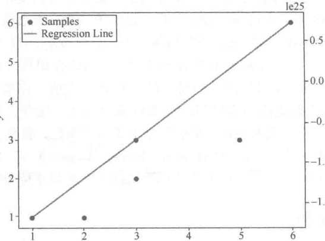

图 6-10 线性核支持向量机回归

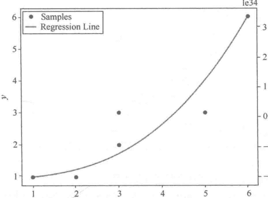

图 6-11 多项式核支持向量机回归

## 6.8 本章小结

本章主要介绍了支持向量机的基本原理。首先，介绍支持向量机的基本分类模型及其对偶算法，从线性到非线性，分别介绍其原理及应用范围。然后，从线性回归到支持向量机回归，分别介绍两者的原理和区别。最后，基于 Python 编程，通过不同数据集展示不同模型的实现方法。

## 6.9 延伸阅读——机器学习算法在电力负荷预测中的应用

随着我国经济的迅速发展，人们生活水平的不断提高，对电力和能源的需求量也在不断增加。同时，随着国家对新能源政策的支持，越来越多的新能源设备也被接入电网，用电终端的数量也在不断增长。在我国电力资源总量有限的情况下，为使电力资源得到最大限度的利用，必须制订出合理的用电方案，以减少能源的浪费。因此，对电网的负荷进行预测具有十分重要的意义。

电力负荷预测是指在历史用电需求已知的前提下，使用机器学习方法在一定的精度范围内对未来电力功率和用电量进行时空分布的预测。电力负荷预测不仅是电网正常运行的基础，还能够给电力规划和运行提供决策、保证电力供应安全和电力系统运行，同时在电力检修等方面也发挥着重要的作用。

近年来，基于机器学习的预测模型，如支持向量机、神经网络、随机森林、梯度提升机，乃至深度学习模型如卷积神经网络和长短时记忆网络，在电力负荷预测中展现出显著优势。这些算法能够自动从历史负荷数据、气象数据、经济社会指标等多种信息中学习复杂的非线性关系和模式，从而提供更为精确的预测结果。例如，支持向量机利用历史负荷数据、时间序列特征（如小时、日期、季节）、气象变量（温度、湿度）等作为输入特征，通过核技巧将这些数据映射到高维空间，进而寻找最优分类或回归边界，预测未来的电力需求。相比传统的统计方法，支持向量机在处理非线性关系和噪声数据时表现出更高的鲁棒性，能够提供更为精准的预测结果。特别是在面对异常值、周期性变化、趋势变化和季节性影响时，通过调整合适的核函数和参数优化，支持向量机能灵活捕捉负荷曲线的复杂动态特性，实现短期乃至中长期的电力负荷预测。

机器学习算法不仅提升了电力负荷预测的精度和可靠性，还增强了电网对各种外部影响因素变化的适应能力，是实现智能电网和能源互联网不可或缺的技术支柱。随着算法的持续优化与大数据技术的深入应用，机器学习算法在电力系统中的作用将更加显著，为保障电力供应的安全稳定与促进能源可持续发展贡献力量。

## 6.10 习题

### 1. 选择题

- 1) 支持向量机是一种常用的监督学习算法，主要用于（ ）和（ ）任务。
- A. 分类 回归
- B. 分类 聚类
- C. 聚类 降维
- D. 降维 回归
- 2) 线性支持向量机的优化模型是（ ）间隔最大化。
- A. 硬
- B. 软
- C. 软或硬
- D. 软和硬
- 3) 非线性支持向量机通过（ ）可以转化为线性支持向量机。
- A. 核技巧
- B. 对偶算法
- C. SMO 方法
- D. 拉格朗日乘子法
- 4) 支持向量机的对偶问题可以通过（ ）求解。
- A. 核技巧
- B. 对偶算法
- C. SMO 方法
- D. 拉格朗日乘子法
- 5) 支持向量机回归模型的参数由（ ）决定。
- A. SMO 算法
- B. 支持向量
- C. 整个训练集
- D. 测试集

### 2. 简答题

- 1) 请简述什么是支持向量机分类的“最大间隔（maximum margin）”划分超平面，什么是支持向量，它具有什么特点。
- 2) 请简述非线性支持向量机中的核函数有什么意义。
- 3) 请简述线性回归与支持向量机回归的联系与区别。

### 3. 编程题

采用内置鸢尾花数据，选取不同的特征，利用支持向量机实现分类。

# 第7章 决策树

## 本章导读（思维导图）

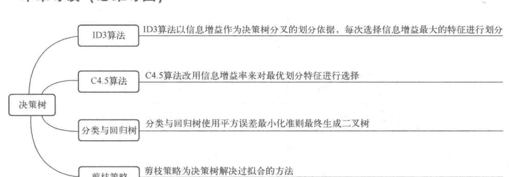

决策树（decision tree）是一种基本的分类与回归方法，是最早的机器学习算法之一。1979 年，J. Ross Quinlan 提出了 ID3 算法原型，并于 1983 年和 1986 年对 ID3 算法进行了总结和简化，正式确立了决策树理论。此间的 1984 年，Leo Breiman、Jerome Friedman、Richard Olshen 与 Charles Stone 共同提出了分类与回归树（classification and regression trees），即 CART 算法。1993 年，Quinlan 在 ID3 算法的基础上又提出了著名的 C4.5 算法。相对于其他算法，决策树算法的基本原理更加符合人的思维方式，可以产生可视化的分类或回归规则，生成的模型也具有可解释性，因此其应用十分广泛。本章主要介绍上述 3 种决策树算法的原理、流程及实现。


扫码看视频

## 7.1 决策树概述

决策树是一种呈树形结构的层次模型，可以是二叉树也可以是多叉树。在分类问题中，树的每个非叶节点表示对一个特征的判断，每个分支代表该特征在某个值域上的输出，而每个叶节点存放一个类别。使用决策树进行决策的过程就是从根节点开始，逐个判断待分类项中相应的特征，并按照其值选择输出分支，直到到达叶节点，将叶节点存放的类别作为决策的结果。每一个样本只会被一条路径覆盖（样本的特征与路径上的特征一致或样本满足规则的条件）。为了更直观地阐述决策树的算法原理，我们使用一个经典的例子来进行说明。

如果我们想知道在不同天气情况下人们是否会去室外打球，就可以建立图 7-1 中的决策树。

图中的菱形框表示对一个特征的判断，菱形框下方线段上的文字表示每个判断的所有可能的取值。图中最上方的矩形框为“根节点”，中间三个矩形框为“中间节点”，最下方的四个矩形框为“叶节点”。所以，在天气情况为“晴朗”且湿度为50的情况下，我们会选择从根节点走向第二行最左侧的中间节点，再走向第三行最左侧的叶节点，从而得出在此天气情况下会去室外打球的预测结果。此外，我们在图7-1中还可以看到许多箭头，这些箭头代表着树的生长方向。我们一般习惯称箭头的起点是终点的“父节点”，终点是起点的“子节点”。当子节点只有两个时，通常把它们称为“左子节点”和“右子节点”。比如，根节点是第二行所有节点的父节点，第二行所有节点都是根节点的子节点，第三行左数第一、第二个节点是第二行左数第一个节点的左子节点、右子节点。

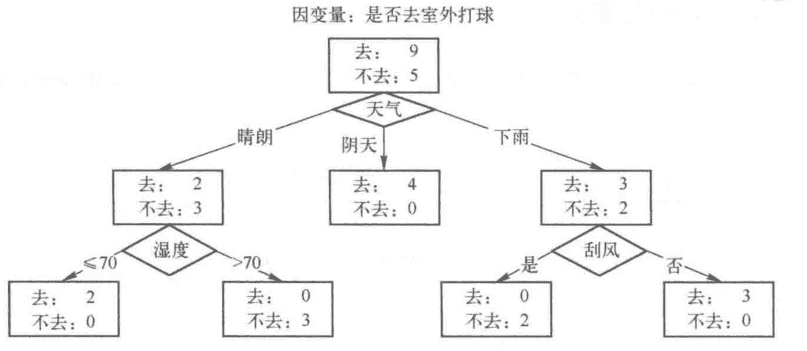

图 7-1 决策树算法原理举例

其实，决策树中的每个叶节点都对应着样本空间的一个子空间，子空间彼此不会相交，且其并集等于样本空间。也就是说，决策树将样本空间划分为若干个互不相交的子空间，并且给每个子空间分配了一个类别标记。

那么决策树是如何构造的呢？我们可以将其简单归纳为以下过程：

- 1) 从根节点开始，将数据集依照某个特征的取值划分为互不相交的几个子集。
- 2) 如果某个子集中的样本都属于同一个类别或某一个类别所占的百分比大于设定的阈值，则将其设置为叶节点，并将多数样本的类别作为该叶节点的类别。否则将该子集设置为中间节点，并依照某个特征的取值继续划分。
- 3) 重复步骤2）直至所有分支的末尾一行均为叶节点。

构造决策树的关键是如何进行最优特征划分，即确定非叶节点对应的特征及其判断阈值。最优特征划分的方法有很多，每种决策树之所以不同，一般都是因为最优特征选择的标准上有所差异，不同的标准导致生成不同类型的决策树。

决策树的生成算法发展至今已经有许多变种，想要全面介绍它们不是短短一个章节所能做到的。本书介绍其中三个相对而言比较基本且使用广泛的算法：ID3、C4.5 和 CART。三种算法是以递进的关系产生的。

- 1) ID3 算法是最基础的决策树算法，可以解决离散型数据的分类问题。
- 2) C4.5 算法在 ID3 算法的基础上进一步发展，可以解决混合型数据的分类问题。
- 3) CART 算法则更进一步，在分类问题的基础上，还可以解决回归问题。

虽说上述算法的功能越来越强大，但其核心思想都是一致的，即算法通过不断划分数据集来生成决策树，其中每一步都选择最优的划分特征。

值得一提的是，该核心思想的背后其实也有着机器学习的一些普适性的思想。可以这样来看决策树：算法的目标是为了找到一个最优的划分规则序列，以最小化模型的损失（即算法得出的样本标记与样本实际标记间的差异）。和许多其他模型一样，想要从整个参数空间中选出算法的最优参数是 NP 完全问题，所以我们采用启发式的方法，近似求解这个最优化问题。具体而言，我们每次会选取一个局部最优解（每次选取一个最优特征对数据集进行划分），并把这些局部解合成最终解（合成一个划分规则的序列）。

## 7.2 ID3 算法

如何选择最优的划分特征呢？一般而言，随着划分过程不断进行，我们希望决策树的每个分支中所包含的样本尽可能属于同一类别，即节点的“纯度”越来越高。因此，对于一个包含多个特征的数据集，应尽量选择对划分后子集的纯度提升最多的特征。我们知道，信息熵可以用来度量一个系统的有（无）序程度。如果将其应用在数据集上，那么一个集合中包含样本的类别越多，则说明数据越“混乱”，信息熵越大；否则说明数据越“纯净”，信息熵越小。而我们要做的就是保证每一次划分都让划分后的信息熵降低得最多，也就是信息熵的增益最大。ID3 算法就是以信息增益作为决策树分支的划分依据，每次选择信息增益最大的特征进行划分。

### 7.2.1 信息熵和信息增益

对于一个数据集，若其中样本的类别为 i 的概率为 p_i，那么此数据集信息熵的计算公式见式（7-1）。

E = - Σ_{i=1}^{k} p_i log₂ p_i  (7-1)

显然，对于二分类问题，有 p₁+p₂=1，则其信息熵的计算公式见式（7-2）。

E = -p₁×log₂p₁ - p₂log₂p₂ = -p₁×log₂p₁ - (1-p₁)×log₂(1-p₁)  (7-2)

假定数据集中的样本共有两个类别 {c₁,c₂}，总数为 16 个，其中类别 c₁ 有 3 个元素个数，c₂ 类别有 13 个元素个数，则该数据集的信息熵为

-3/16 log₂ 3/16 - 13/16 log₂ 13/16 = -0.1875×(-2.4150) -0.8125×(-0.29956) ≈0.6962

在决策树中，信息熵用来度量依照某个特征划分后形成的子集的有（无）序程度，以确定最优划分特征。如果某个特征向量的信息熵越大，则该向量的不确定性就越大，亦即其混乱程度就越大，就应该优先考虑从该特征向量入手进行划分。

首先，用信息熵度量数据集整体的有（无）序程度。设 X 为数据集，其类别标记集合 C = {c₁,c₂,…,cₙ}，则数据集整体信息熵的计算公式见式（7-3）。

E(X) = - Σ_{i=1}^{k} p_i log₂ p_i  (7-3)

式中，p_i = |c_i| / |X| 是样本属于类别 c_i 的概率，|c_i| 表示数据集 X 中类别为 c_i 的样本个数，|X| 表

示数据集 X 的样本总数。

然后，使用信息熵度量以每个特征进行划分后形成的子集的有序程度。假定特征 A = {a₁, a₂, …, aᵥ} 有 v 个不同的取值，那么使用特征 A 就可以将数据集 X 划分为 v 个互不相交的子集 {X₁ᴬ, X₂ᴬ, …, Xᵥᴬ}，其中 Xⱼᴬ = {x | x ∈ X, xᴬ = aⱼ}，j = 1, 2, …, v。由特征 A 划分后的信息熵计算公式见式（7-4）和式（7-5）。

E(X|A) = Σ_{j=1}^{v} |Xⱼᴬ| / |X| E(Xⱼᴬ)  (7-4)
E(Xⱼᴬ) = - Σ_{i=1}^{k} p_{ij} log₂ p_{ij}  (7-5)

式中，|Xⱼᴬ| 表示子集中的样本个数，p_{ij} = |cᵢ| / |Xⱼᴬ| 是 Xⱼᴬ 中的样本属于类别 cᵢ 的概率，|cᵢ| 表示数据集 Xⱼᴬ 中类别为 cᵢ 的样本个数。

信息增益即划分前整个数据（子）集的信息熵与以特征 A 划分后的信息熵的差值，计算公式见式（7-6）。
Gain(X|A) = E(X) - E(X|A)  (7-6)

同样的，我们可以计算使用其他每个特征对将数据集 X 进行划分的信息增益，并选择信息增益最大的特征进行划分。如果选择特征 A 做最优划分特征，那么划分的子集就是根节点生长出来的决策树分支。然后对分支中的每个中间节点对应的数据子集重复上述操作，即可生成一棵完整的决策树。

### 7.2.2 算法流程

ID3 算法的具体流程如下：

- 1) 取得待划分数据集合 X。
- 2) 若 X 中的所有样本同属于类别 cⱼ，则该节点为叶节点，并将其类别记为 cⱼ。
- 3) 若 X 中的样本已经是 0 维向量，即已没有可选特征，则该节点为叶节点，并将此时 X 中样本个数最多的类别 cⱼ 作为节点的类别。
- 4) 若当前分支的深度已经达到设定的阈值，则该节点为叶节点，并将此时 X 中样本个数最多的类别 cⱼ 作为节点的类别。
- 5) 否则，分别计算以样本的每个特征进行划分的信息增益，然后选择使得信息增益最大的特征 A* 作为划分标准。
- 6) 若 A* 满足停止条件，则该节点为叶节点，并将此时 X 中样本个数最多的类别 cⱼ 作为节点的类别。
- 7) 否则，依 A* 的所有取值将 X 划分为相应的多个子集。
- 8) 对每个子集从步骤 1) 开始继续执行。

其中步骤 6) 的 “停止条件” （也可称为 “预剪枝”，有关剪枝的内容会在 7.5 小节进行讨论）有多种定义方法，较为常用的是如下两种：

- 1) 若选择作为划分特征时的信息增益小于某个阈值，则停止。
- 2) 事先把数据集分为训练集与测试集，若由训练集得到的划分并不能降低测试集上的错误率，则停止。

这两种停止条件通用 于 C4.5 算法和 CART 算法，后文将不再赘述。同时，决策树会在许多地方应用到递归的思想，上述算法中的步骤7）正是经典的递归。

下面我们通过一个例子加深对 ID3 算法的理解。

【例7-1】表7-1 给出了一个哺乳动物数据集包含 14 个样本，样本有“饮食习性”“胎生动物”“水生动物”“会飞”4 个特征，“哺乳动物”为样本的类别标记，有“是”与“否”两种取值。

### 表7-1 哺乳动物分类数据集

| 饮食习性 | 胎生动物 | 水生动物 | 会飞 | 哺乳动物 |
|---|---|---|---|---|
| 杂食动物 | 是 | 否 | 否 | 是 |
| 杂食动物 | 是 | 否 | 否 | 是 |
| 肉食动物 | 是 | 否 | 否 | 是 |
| 肉食动物 | 否 | 否 | 是 | 否 |
| 肉食动物 | 否 | 是 | 否 | 否 |
| 肉食动物 | 否 | 否 | 否 | 否 |
| 杂食动物 | 是 | 否 | 是 | 是 |
| 草食动物 | 是 | 否 | 否 | 是 |
| 杂食动物 | 否 | 否 | 是 | 否 |
| 肉食动物 | 否 | 是 | 否 | 否 |
| 肉食动物 | 是 | 是 | 否 | 是 |
| 肉食动物 | 否 | 否 | 否 | 是 |
| 草食动物 | 是 | 否 | 否 | 是 |
| 肉食动物 | 否 | 否 | 否 | 否 |

数据集共有 14 个样本，其中 8 个正例（类别标记为“是”），6 个反例（类别标记为“否”），设此数据集划分前的信息熵为

$$E(X) = -\left(\frac{8}{14}\right)\log_2\left(\frac{8}{14}\right) - \left(\frac{6}{14}\right)\log_2\left(\frac{6}{14}\right) \approx 0.9852$$

下面需要以各个可选特征进行划分的信息熵和信息增益。首先，如果以“饮食习性”作为划分特征，当“饮食习性”为“肉食动物”的分支中有 3 个正例、5 个反例，其信息熵为

$$E(X^{\text{饮食习性}}_{\text{肉食动物}}) = -\left(\frac{3}{8}\right)\log_2\left(\frac{3}{8}\right) - \left(\frac{5}{8}\right)\log_2\left(\frac{5}{8}\right) \approx 0.9544$$

同理，计算出“饮食习性”分类为“草食动物”的分支与分类为“杂食动物”的分支中的熵值分别为

$$E(X^{\text{饮食习性}}_{\text{草食动物}}) = -\left(\frac{2}{2}\right)\log_2\left(\frac{2}{2}\right) -0 =0$$

$$E(X^{\text{饮食习性}}_{\text{杂食动物}}) = -\left(\frac{3}{4}\right)\log_2\left(\frac{3}{4}\right) - \left(\frac{1}{4}\right)\log_2\left(\frac{1}{4}\right) \approx 0.8113$$

那么可以计算出以“饮食习性”作为划分特征的信息熵和信息增益为

$$E(X^{\text{饮食习性}}) = \frac{8}{14}\times0.9544 + \frac{2}{14}\times0 + \frac{4}{14}\times0.8113 \approx 0.7772$$

Gain(X|饮食习性) = 0.9852 - 0.7772 = 0.2080

同理，可以计算出以其他特征进行划分时的信息增益。计算可得，以“胎生动物”“水生动物”“会飞”作为划分特征时的信息增益分别为 0.6893、0.0454、0.0454。由此可知以“胎生动物”作为划分特征时能获得最大的信息增益，所以在此处选择该特征对根节点进行划分。注意此时“胎生动物”已经不是可选特征了。我们接下来要分别对划分生成的两个子节点进行最优划分特征选择，计算过程和根节点上的计算过程大同小异。以此类推，最终可以得到完整的决策树。

> 需要注意的是，信息增益偏向于取值数量更多的特征，也就是说在训练集中，某个特征所取的不同值的个数越多，就越有可能将它作为划分特征。我们举个极端点的例子，假设有 100 个样本，现在有一个特征其取值种类也是 100（如身份证号），如果按该特征分类，就能把这个样本集分成 100 个子集，每个子集只包含一个样本（信息熵为 0）。在用 ID3 算法构造决策树时，一定会选择这个特征作为第一个最优划分特征，因为这个特征划分出的每个子集纯度都最高。

ID3 算法只能处理离散数据，即可以处理像性别特征、布尔值特征等离散型特征，但无法处理特征值在某个区间内可以任意取值的特征，如身高特征、年龄特征等。

### 7.2.3 代码实现

下面我们使用 Python 语言对 ID3 算法进行实现。

### (1) 计算信息熵

代码 7-1 用于计算给定数据集的熵（信息熵）。首先，该函数首先通过 dataset[:, -1] 获取数据集的类别标记集合。接下来，使用字典 label_count 统计每种标记的数量，这里使用了 label_count.get(label,0) 来获取字典中已有的标记数量，如果不存在则返回默认值 0 进行初始化。然后，通过循环遍历累加单个类别的熵来计算整体信息熵，并最终返回整体熵值。

### 代码 7-1 calculate_entropy 函数

```

import numpy as np

def calculate_entropy(dataset):

    """

    计算数据集的熵（信息熵）。

    参数：

        dataset (numpy.ndarray): 输入数据集，一个二维的 numpy 数组。最后一列是类别标记。

    返回：

        float: 计算得到的熵值。

    """

    label_set = dataset[:, -1]      # 获取当前数据集的类别标记集合

    label_count = {}                # 以字典存储每种标记的数量

    for i in range(len(label_set)):  # 遍历标记集合统计标记数量

        label = label_set[i]

```

```

label_count[ label ] = label_count. get( label, 0 ) + 1

entropy = 0

for label, value in label_count. items( ) :  # 遍历标记数量集合计算信息熵

    entropy += -value / len( label_set ) * np. log2( value / len( label_set ) )

return entropy

```

### (2) 数据集划分

代码 7-2 用于根据给定的特征索引将数据集划分为多个子集。集合中的子集既用于作为下一层划分的数据集，又用于计算本次划分的信息熵。首先，创建一个空的列表 sub_datasets 来存放划分后的子集。然后，获取数据集中指定特征的列 feature_values。继而使用 set 函数对 feature_values 去重，得到该特征的取值集合 feature_set。接下来，通过循环遍历 feature_set，并在内部循环中遍历整个数据集，如果某条数据的特征值与当前遍历的特征值相等，则将该数据添加到 new_set 中。最后，将 new_set 转换为 numpy 数组并保存到 sub_datasets 列表中。最终返回包含所有子集的列表。

### 代码 7-2 dataset_split 函数

```

def dataset_split( dataset , feature_index ):

    """

    根据特征索引将数据集划分为多个子集。

    参数：

        dataset ( numpy. ndarray ) : 输入的数据集，必须是一个二维的 numpy 数组。

        feature_index ( int ) : 划分数据集的特征索引，即要根据哪一列来划分数据集。

    返回：

        list : 包含所有子集的列表，每个子集都是一个二维的 numpy 数组。

    """

    sub_datasets = []                     # 存放所有子集的集合

    feature_values = dataset[ :, feature_index ]   # 取出划分特征列

    feature_set = list( set( feature_values ) )    # 去重，统计该特征的取值集合

    for i in range( len( feature_set ) ):           # 按该特征的取值将数据集划分为多个子集

        new_set = []

        for j in range( dataset. shape[ 0 ] ):      # 遍历数据集，将同特征值的样本放入一个子集

            if feature_set[ i ] == feature_values[ j ]:

                new_set. append( dataset[ j, : ] )

        sub_datasets. append( np. array( new_set ) )  # 保存获得的子集

    return sub_datasets

```

### (3) 最优划分特征选择

代码 7-3 主要用于根据信息熵选择最优划分特征。由于划分前的信息熵固定，因此选择划分后信息增益最大的特征即等于选择划分后信息熵最小的特征。首先，计算数据集中特征的数量 feature_number 和样本的数量 sample_number。然后，初始化变量 min_entropy 和

best_feature_index，分别用于记录最小信息熵和最优划分特征的索引。接下来，通过循环遍历每个特征（从 0 到 feature_number-1），依次对数据集进行划分。在每次迭代中，首先将变量 feature_entropy 初始化为 0，用于累积每个子集的信息熵。调用 dataset_split 函数获取根据当前特征划分得到的子集集合 sub_datasets。然后，使用一个内部循环遍历每个子集 sub_dataset，并通过调用 calculate_entropy 函数计算其信息熵。将每个子集的信息熵乘以该子集的样本数除以总样本数，并累加到 feature_entropy 中。在内部循环结束后，将 feature_entropy 与 min_entropy 进行比较，如果 feature_entropy 更小，则更新 min_entropy 和 best_feature_index。最终，返回最优划分特征的索引 best_feature_index。

### 代码 7-3 best_feature_selection 函数

```

def best_feature_selection( dataset ):

    """

    根据信息熵选择最优划分特征。

    参数：

        dataset ( numpy. ndarray )：输入的数据集，必须是一个二维的 numpy 数组。

    返回：

        int：最优划分特征的索引。

    """

    feature_number = len( dataset[0] ) - 1        # 获得特征数量

    sample_number = len( dataset )                # 获得样本数量

    min_entropy, best_feature_index = 1, None    # 记录最小信息熵和最优划分特征索引

    for i in range( feature_number ):             # 依次按照每个特征进行划分

        feature_entropy = 0

        sub_datasets = dataset_split( dataset, i ) # 获得根据当前特征划分的子集集合

        for sub_dataset in sub_datasets:           # 遍历每个子集，计算信息熵

            feature_entropy += sub_dataset. shape[0] /

                                sample_number * calculate_entropy( sub_dataset )

        if min_entropy > feature_entropy:          # 迭代更新最小信息熵

            min_entropy = feature_entropy

            best_feature_index = i                 # 记录最优划分特征索引

    return best_feature_index

```

### (4) 构造决策树

majority_vote 函数用于在叶节点中样本类别不一致时，按少数服从多数原则决定该叶节点的类别标记。首先，初始化一个空字典 label_count 用于记录每个类别出现的次数。通过循环遍历 label_values 中的每个元素，在每次迭代中获取当前类别值，并将其作为键添加到 label_count 字典中。如果类别值已经存在于字典中，则将对应键的值加 1，以统计各类别出现的次数。使用 sorted 函数对 label_count. items( ) 进行排序，按照每个键值对的第二个元素（即出现次数）从大到小排序。operator. itemgetter( 1 ) 指定按照第二个元素排序，reverse = True 表示降序排列。最后，返回排序后列表中的第一个元素，即出现次数最多的类别值。

create_tree 函数通过递归的方式构造决策树。首先声明函数 create_tree，接收一个数据集 dataset 和特征列表 feature_list 作为输入。从数据集中获取类别标签列，并将其值存储在 label_values 中。然后通过集合操作将 label_values 转换为列表 label_set，以获取数据集中不重复的类别。如果 label_set 的长度为 1，即数据集中类别完全相同，则停止划分并返回该类别作为树的叶节点。如果特征列表 feature_list 的长度为 1，即没有可用的特征进行划分，则停止划分，并使用 majority_vote 函数来返回投票最多的类别作为树的叶节点。通过调用 best_feature_selection 函数选择最佳划分特征的索引，并根据索引获取最优划分特征的名称 best_feature。使用字典表示决策树，将最优划分特征作为键，对应的值初始化为空字典，存储划分过程。从数据集中获取最优划分特征的数据，并通过集合操作将其转换为列表 best_feature_set，以获取特征的可能取值集合。通过调用 dataset_split 函数将数据集划分为子数据集 sub_datasets，每个子数据集对应最优划分特征的一个取值。使用循环遍历每个子数据集，递归调用 create_tree 函数来构建子树，并将子树添加到决策树字典中。最后返回构建好的决策树字典 dtree。

### 代码 7-4 majority_vote 函数

```

```python
def majority_vote(label_values):
    """
    根据类别值进行多数投票。
    参数：
        label_values (List[int]): 类别值的列表。
    返回：
        int: 出现次数最多的类别值。
    """
    label_count = {}                # 记录每个类别出现的次数

    for i in range(len(label_values)):      # 统计各类别出现的次数
        label = label_values[i]
        label_count[label] = label_count.get(label, 0) + 1

    sorted_label = sorted(label_count.items(), # 对各类别出现的次数进行从大到小排序
                          key=operator.itemgetter(1), reverse=True)

    return sorted_label[0][0]           # 返回出现次数最多的类别值
```

```

### 代码 7-5 create_tree 函数

```

```python
def create_tree(dataset, feature_list):
    """
    创建决策树。
    参数：
        dataset (np.ndarray): 数据集, 二维数组。
        feature_list (List[str]): 特征列表, 包含数据集中所有特征的名称。
    返回：
        Dict[str, Any]: 决策树的字典表示。
    """
    label_values = dataset[:, -1]      # 获取类别标签列
    label_set = list(set(label_values))
```

```
if len(label_set) == 1:
    return label_set[0]                     # 当类别完全相同时停止划分
                                            # 返回此类别

if len(feature_list) == 1:
    return majority_vote(label_values)     # 当无可用特征时停止划分
                                            # 返回投票最多的类别

best_feature_index = best_feature_selection(dataset)   # 选择最佳划分特征索引
best_feature = feature_list[best_feature_index]        # 获取最优划分特征名称
dtree = {best_feature: {}}                             # 以字典存储划分过程

best_feature_values = dataset[:, best_feature_index]   # 最优划分特征的数据
best_feature_set = list(set(best_feature_values))      # 去重，统计该特征的取值集合

sub_datasets = dataset_split(dataset, best_feature_index)  # 划分数据集

# 递归划分子数据集
for i in range(len(sub_datasets)):
    dtree[best_feature][best_feature_set[i]] = create_tree(sub_datasets[i],
                                                            feature_list)

return dtree
```

### (5) 构建预测分类器
代码 7-6 给出了决策树预测函数 decision_tree_classifier 的实现方式，输入包含已训练的树结构 decision_tree、特征名称序列 feature_list 以及待判断的样本 test_sample，输出为该样本的类别推断。实现步骤先读取根节点的分裂属性 root_node 及其对应的分支字典 sub_tree，并把最终结果变量 class_label 先置空。随后通过 feature_list.index 将属性名转换为列表中的位置索引 feature_index。再依据 test_sample 在该属性上的取值，在 sub_tree 中寻找匹配的分支键。若对应值仍为字典，说明当前节点为内部节点，需要递归调用 decision_tree_classifier 继续向下探查；若对应值直接为叶子标签，则把该标签写入 class_label。最后返回 class_label 完成一次预测。

### 代码 7-6 decision_tree_classifier 实现

```
def decision_tree_classifier(decision_tree, feature_list, test_sample):
    """
    决策树分类器。
    参数：
        decision_tree (Dict[str, Any]): 决策树模型，字典表示。
        feature_list (List[str]): 特征列表，包含数据集中所有特征的名称。
        test_sample (List[Any]): 待分类样本，特征值的列表。
    返回：
        Any: 分类结果，即测试样本的类别。
    """
    root_node = list(decision_tree.keys())[0]   # 获得根节点的划分特征
    sub_tree = decision_tree[root_node]         # 获得根节点的划分结果
    class_label = None
    feature_index = feature_list.index(root_node)          # 根节点特征在特征列表中的位置

    for key in sub_tree.keys():                                 # 遍历根节点划分特征的取值
        if test_sample[ feature_index ] == key:
            if type( sub_tree[ key ] ).__name__ == 'dict':  # 如果不是叶节点则递归
                class_label = decision_tree_classifier( sub_tree[ key ], feature_list,
                                                        test_sample)
            else:
                class_label= sub_tree[ key ]                # 如果对应节点是叶节点则取得其标记

    return class_label                                          # 返回测试样本的类别
```

### （6）主流程搭建

为验证前面搭建的决策树是否可用，我们先准备一个名为 dataset 的测试集，里面包含样本、特征和类别标签。随后声明 feature_list 列出所有特征名称。调用 create_tree 传入数据集和特征列表生成树结构，结果存入 decision_tree 并打印出来。接着用 decision_tree_classifier 把 decision_tree、feature_list 以及一条测试样本送入模型，得到 test_result 最后输出该样本的预测类别。

### 代码 7-7 run 函数演示

```
def run() -> None:
    # 创建数据集
    dataset = np.array(
        [['青绿', '蜷缩', '浊响', '清晰', '凹陷', '硬滑', '是'],
         ['乌黑', '蜷缩', '沉闷', '清晰', '凹陷', '硬滑', '是'],
         ['乌黑', '蜷缩', '浊响', '清晰', '凹陷', '硬滑', '是'],
         ['青绿', '蜷缩', '沉闷', '清晰', '凹陷', '硬滑', '是'],
         ['浅白', '蜷缩', '浊响', '清晰', '凹陷', '硬滑', '是'],
         ['青绿', '稍蜷', '浊响', '清晰', '稍凹', '软粘', '是'],
         ['乌黑', '稍蜷', '浊响', '稍糊', '稍凹', '软粘', '是'],
         ['乌黑', '稍蜷', '浊响', '清晰', '稍凹', '硬滑', '是'],
         ['乌黑', '稍蜷', '沉闷', '稍糊', '稍凹', '硬滑', '否'],
         ['青绿', '硬挺', '清脆', '清晰', '平坦', '软粘', '否'],
         ['浅白', '硬挺', '清脆', '模糊', '平坦', '硬滑', '否'],
         ['浅白', '蜷缩', '浊响', '模糊', '平坦', '软粘', '否'],
         ['青绿', '稍蜷', '浊响', '稍糊', '凹陷', '硬滑', '否'],
         ['浅白', '稍蜷', '沉闷', '稍糊', '凹陷', '硬滑', '否'],
         ['乌黑', '稍蜷', '浊响', '清晰', '稍凹', '软粘', '否'],
         ['浅白', '蜷缩', '浊响', '模糊', '平坦', '硬滑', '否'],
         ['青绿', '蜷缩', '沉闷', '稍糊', '稍凹', '硬滑', '否']])
    feature_list = ['色泽', '根蒂', '敲击', '纹理', '脐部', '触感']

    # 构建决策树
    decision_tree = create_tree( dataset, feature_list)

    print('决策树:', decision_tree)

    # 对样本进行分类
    test_result = decision_tree_classifier( decision_tree, feature_list,
        ['青绿', '蜷缩', '浊响', '清晰', '凹陷', '硬滑'])
    print('样本类别:', test_result)

    if '__main__' == __name__:
        run()
```

运行后输出如下：

```
决策树: {'纹理': {'模糊': '否', '稍糊': {'触感': {'硬滑': '否', '软粘': '是'}}, '清晰': {'根蒂': {'硬挺': '否', '稍蜷': {'色泽': {'乌黑': {'触感': {'硬滑': '是', '软粘': '否'}}, '青绿': '是'}}}}, '蜷缩': '是'}}}
样本类别: 是
```

## 7.3 C4.5 算法详解

前文提到 ID3 有一个明显的偏好问题，它容易偏向多值特征。比如某个特征本身就是样本的唯一 ID，ID3 会把它挑成最优划分点。虽然这样能让子集变得非常纯净，但这种划分对实际分类几乎没有意义，而且数量很小的子集在泛化上往往不如大子集稳定，容易过拟合和抗噪能力差。为此需要在产生大量小子集的划分上施加惩罚，子集越小其信息熵的惩罚幅度就越大。ID3 原本因为小子集多而得到偏低的熵值，经过惩罚调整后熵值会趋于平衡。这正是 C4.5 的改进思路，它放弃信息增益改用信息增益率来挑选最优划分特征，从而缓解了对多值特征的偏好。此外 C4.5 还具备处理连续型特征的能力。

### 7.3.1 信息增益率

在信息熵的基础上，C4.5 引入了信息增益率。先对某特征进行划分并算出划分前后的熵差，再算出该特征的惩罚值，用熵差除以惩罚值即为信息增益率。信息增益率最高的特征被选为最优划分点。

C4.5 先给出惩罚值的定义式（7-7）：

$P(X|A)= -\sum_{j=1}^{v} \frac{|X_j^A|}{|X|} \log_2 \left(\frac{|X_j^A|}{|X|}\right)$

(7-7)

式中 {$X_1^A,X_2^A,...,X_v^A$} 为特征 $A$ 的不同取值对应的子集族。这个惩罚值本质上也是信息熵，只是它衡量的是子集族本身的有序程度，而非传统信息增益中子集内部的有序程度。

信息增益率的计算式见（7-8）：

$GR(X|A)=\frac{Gain(X|A)}{P(X|A)}$

(7-8)

由此可见，划分产生的子集越多、单个子集样本越少，惩罚值越大，相除后信息增益率越小，从而实现平衡。惩罚了产生小样本子集的划分，也在一定程度上改善了因样本少导致抗噪性差的问题，这就是 C4.5 的核心优势。

另外 ID3 与 C4.5 在使用机制上相似，都依赖信息增益的计算，而信息增益的前提是先做一次划分。每次增益计算都意味着一次划分，被选中的划分特征在后续节点中就不再使用，因此两类算法在建树过程中会不断消耗特征。

### 7.3.2 连续型特征处理

连续型特征取值近乎无限，直接按取值划分会产生大量小样本子集。C4.5 采用二分策略，把连续取值切成两个区间。具体地，用阈值 a₁ 将取值划分为 Y₁ = {y : yᴬ < a₁}，Y₂ = {y : yᴬ ≥ a₁}。

离散特征也可以用同样的二分思想处理。假设特征 A 有三个取值 {a₁, a₂, a₃}，同样可取阈值 a₁ 划分为 Y₁ = {y : yᴬ = a₁}，Y₂ = {y : yᴬ ≠ a₁}。这里的 a₁ 通常称为二分标准。

如何选二分标准是关键。一个朴素的做法是：对特征 A 的 v 个不同取值 a₁ < … < aᵥ，先在区间 [a₁, aᵥ] 上均匀取 p 个割点 t₁,…,tₚ，其中 t₁ = a₁、tₚ = aᵥ 且等差排列，再逐一尝试并挑选最优。p 的取值通常与深度成反比，越往下划分越粗，有助于防止过拟合。但这种方式会产生冗余标准，例如取值 0,100,101,102… 时，0 与 100 之间会尝试大量无意义的分割。C4.5 的做法是依次取 t₁ = (a₁ + a₂)/2,…,tᵥ₋₁ = (aᵥ₋₁ + aᵥ)/2 作为候选二分标准，计算信息增益率后选出最优。

进一步可只保留类别发生变化的割点，即在 a₁,…,aᵥ 的类别标记 y₁,…,yᵥ 中，仅选用满足 yᵢ ≠ yᵢ₊₁ 的 tᵢ 作为候选。这种筛选有时更有效，有时也不合理，本书采用最基础的实现。值得注意的是，二分划分后同一特征仍可被重复使用，因为不同节点可选用不同的分割点。

从上述讨论看，ID3 完全可以扩展为处理连续特征的版本。只是混合型数据集中 ID3 会倾向于挑离散特征作为划分点。若所有特征皆为连续，ID3 与 C4.5 的优劣则难以一概而论。

需要特别指出，C4.5 也存在一个不太理想的特性。由信息增益率定义可知，在二分类情形下，它倾向于把数据切成极不均衡的两部分。因为此时 P(A) 很小，导致 GR(A) 很大，即使 Gain(A) 不高也会被放大。后果是二叉分支时常会先切出一个很小的叶节点，剩下一个大节点继续下探，树容易长得更深，从而更易过拟合。

> 为缓解该问题，Quinlan 于 1993 年提出启发式做法：先筛选出信息熵高于平均值的特征，再从中挑选信息增益率最高的特征进行划分。

### 7.3.3 算法流程

C4.5 的具体步骤如下：

- 1) 获取待划分的数据集 X。
- 2) 若 X 中所有样本类别相同，则该节点为叶节点，类别记为 c_j。
- 3) 若 X 已是 0 维向量，即无可用特征，则该节点为叶节点，类别取 X 中样本数最多的 c_j。
- 4) 若当前分支深度达到设定阈值，则该节点为叶节点，类别取 X 中样本数最多的 c_j。
- 5) 否则，对每个特征计算其信息增益率，选择增益率最大的特征 A* 作为划分标准。
- 6) 若 A* 满足停止条件，则该节点为叶节点，类别取 X 中样本数最多的 c_j。
- 7) 否则，按 A* 将 X 划分。
- 8) 对每个子集 X^{A*} 从步骤 1) 开始递归执行。

C4.5 继承了 ID3 的优点，可对连续特征做离散化，也能处理不完整数据。生成的规则易于解释、准确率较高，但建树效率偏低，因为构造过程中需多次顺序扫描和排序。

### 7.3.4 代码实现

下面用 Python 实现 C4.5，这里仅列出与 ID3 实现不同的函数，其余部分保持不变。完整代码可通过右侧二维码获取。

### (1) 计算信息增益率

代码 7-8 用于计算信息增益率。代码先把 punish、gain_ratio 和 feature_entropy 初始化为 0.0，随后调用 calculate_entropy 得到划分前的熵并存入 entropy_before_split。接着遍历每个子集 sub_dataset，累积特征熵 feature_entropy 和惩罚值 punish。最后算出信息增益率并返回。

### 代码 7-8 cal_gain_ratio 函数

```
def cal_gain_ratio(dataset, sub_datasets):
    """
    计算信息增益率。
    参数：
        dataset: numpy 数组，包含样本及对应的特征和类别标签。
        sub_datasets: 包含若干个子数据集的列表。
    返回：
        float: 信息增益率。
    """
    punish = 0.0                                      # 惩罚值
    gain_ratio = 0.0                                  # 信息增益率
    feature_entropy = 0.0                             # 特征熵
    entropy_before_split = calculate_entropy(dataset) # 计算划分前的信息熵

    for sub_dataset in sub_datasets:                  # 遍历每个子集，计算信息熵和惩罚值
        feature_entropy += sub_dataset.shape[0] / dataset.shape[0]
                         * calculate_entropy(sub_dataset)
        punish += -sub_dataset.shape[0] / dataset.shape[0]
                 * np.log2(sub_dataset.shape[0] / dataset.shape[0])

    # 计算信息增益率
    gain_ratio = (entropy_before_split - feature_entropy) / punish
    return gain_ratio
```

### (2) 连续型数据划分

代码7-9根据指定特征和阈值把数据集切分为左、右两个子集。先建空列表 sub_datasets 存放结果，再取出特征列存入 feature_values。依据阈值 value 将样本分为 new_set_l 与 new_set_r，最后把两者加入 sub_datasets 并返回。

### 代码7-9 dataset_split_c45 函数

```
def dataset_split_c45(dataset, feature_index, value):
    """
    根据特定特征和阈值，将数据集划分为左子集和右子集。
    参数：
        dataset: numpy 数组，包含样本及对应的特征和类别标签。
        feature_index: 整数，表示要划分的特征在数据集中的列索引。
        value: 浮点数，表示特定特征的阈值。
    返回：
        list: 包含左子集和右子集的列表，每个子集是一个 numpy 数组。
    """
    sub_datasets = []                             # 存放所有子集的集合
    feature_values = dataset[:, feature_index]    # 取出划分特征列
    new_set_l = dataset[feature_values.astype('float64') < value]  # 划分出左子集
    new_set_r = dataset[feature_values.astype('float64') >= value] # 划分出右子集
    sub_datasets.append(new_set_l)                # 保存获得的左子集
    sub_datasets.append(new_set_r)                # 保存获得的右子集
    return sub_datasets
```

## (3) 最优划分特征选择

代码7-10实现了C4.5的最优划分特征选择。首先获取特征数和划分前熵值，初始化最佳信息增益比、最佳特征索引和最佳划分值。随后遍历各特征：对离散特征直接划分并计算信息增益比；对连续特征先排序，再逐个尝试划分点并计算信息增益比，若当前划分点更优则更新最大增益比和划分值。若当前特征的增益比超过全局最优，则更新最佳特征索引、最佳增益比和划分值。最后返回最佳特征索引和最佳划分值。

### 代码7-10 best_feature_selection_c45函数

```python
def best_feature_selection_c45(dataset, feature_type):
    """
    根据 C4.5 算法选择最佳特征。
    参数：
        dataset: numpy 数组，包含样本及对应的特征和类别标签。
        feature_type: 列表，表示每个特征的类型，0 表示离散型，1 表示连续型。
    返回：
        tuple: 包含最佳特征的索引和最佳划分值。
    """
    feature_number = len(feature_type)                # 特征数
    entropy_before_split = calculate_entropy(dataset) # 计算划分前的信息熵
    best_gain_ratio = 0.0
    best_feature_index = -1
    best_split_value = None                           # 连续型特征值的最佳划分值

    for i in range(feature_number):                   # 遍历每个特征
        feature_values = dataset[:, i]                # 该特征包含的所有值
        feature_value_set = set(feature_values)       # 去重
        feature_gain_ratio = 0.0
        feature_split_value = None

        if feature_type[i] == 0:                      # 对离散型特征
            sub_datasets = dataset_split(dataset, i)
            feature_gain_ratio = cal_gain_ratio(dataset, sub_datasets)
        else:                                         # 对连续型特征
            sorted_set = sorted(list(feature_value_set)) # 对特征值排序

            for j in range(len(sorted_set) - 1):      # 计算划分值及每个划分的信息增益率
                split_value = (float(sorted_set[j]) + float(sorted_set[j + 1])) / 2
                sub_datasets = dataset_split_c45(dataset, i, split_value)
                gain_ratio = cal_gain_ratio(dataset, sub_datasets)

                if gain_ratio > feature_gain_ratio:   # 获取最大信息增益率的划分点
                    feature_gain_ratio = gain_ratio
                    feature_split_value = split_value # 存储划分值

    if feature_gain_ratio > best_gain_ratio:  # 取最大信息增益率的特征
        best_gain_ratio = feature_gain_ratio
        best_feature_index = i
        best_split_value = feature_split_value

    return best_feature_index, best_split_value
```

## （4）C4.5 树构建流程

代码7-11给出了基于C4.5的建树实现。先读取目标列并统计所有类别。随后检查是否达到停止条件：样本类别完全一致或可用特征耗尽。若满足，则直接返回该类别或票数最多的类别。下一步挑选最优分裂特征及阈值，若找不到合适的分裂点，同样返回多数类。确定最优特征后初始化一个字典作为树结构。若该特征为离散型，则取出其所有取值，对每个取值对应的子集递归建树，并用取值作为字典键；若该特征为连续型，则按最佳阈值把数据切分为小于阈值和大于等于阈值两支，递归后分别以‘<阈值’和‘>=阈值’作为键写入。最终返回完整的决策树字典。

### 代码 7-11 create_tree_c45 函数

```python
import copy

def create_tree_c45(dataset, feature_list, feature_type):
    """
    使用 C4.5 算法构建决策树。
    参数：
        dataset: numpy 数组，包含样本及对应的特征和类别标签。
        feature_list: 列表，表示每个特征的索引。
        feature_type: 列表，表示每个特征的类型，0 表示离散型，1 表示连续型。
    返回：
        dict: 决策树的表示，使用字典结构。
    """

    label_values = dataset[:, -1]                     # 获取类别标签列
    label_set = list(set(label_values))

    if len(label_set) == 1:                           # 当类别完全相同时停止划分
        return label_set[0]                           # 返回此类别

    if len(feature_list) == 1:                        # 当无可用特征时停止划分
        return majority_vote(label_values)           # 返回投票最多的类别

    best_feature_index, best_split_value = best_feature_selection_c45(dataset, feature_type)
                                                    # 最优划分

    if best_feature_index == -1:                      # 如果无法选出最优划分特征
        return majority_vote(label_values)           # 返回投票最多的类别

    best_feature = feature_list[best_feature_index]

    dtree = { best_feature: { } }

    if feature_type[ best_feature_index ] == 0:               # 对离散型特征
        best_feature_values = dataset[ :, best_feature_index ]   # 最优划分特征的数据
        best_feature_set = list( set( best_feature_values ) )    # 统计该特征的取值集合
        sub_datasets = dataset_split( dataset, best_feature_index )  # 划分数据集

        for i in range( len( sub_datasets ) ):
            dtree[ best_feature ][ best_feature_set[ i ] ] = create_tree_c45(
                sub_datasets[ i ], feature_list, feature_type )  # 递归划分
    else:                                                       # 对连续型特征
        sub_datasets = dataset_split_c45( dataset, best_feature_index,
            best_split_value )

        dtree[ best_feature ][ '<' + str( best_split_value ) ] = create_tree_c45(
            sub_datasets[0], feature_list, feature_type )      # 递归划分左子集
        dtree[ best_feature ][ '>=' + str( best_split_value ) ] = create_tree_c45(
            sub_datasets[1], feature_list, feature_type )      # 递归划分右子集

    return dtree
```

## （5）主函数搭建

下面用一组示例数据检验C4.5的构造过程。先创建一个名为dataset的数据集，其中包含样本、特征以及对应标签。随后声明特征名列表feature_list，罗列数据集中全部特征。接着调用create_tree_c45函数，以C4.5方法生成决策树，并把字典形式的树存入decision_tree变量。最后输出该决策树字典。

### 代码 7-12 run_c45 函数

```python
def run_c45():
    # 定义数据集
    dataset = np.array([
        ['蜡缩', '浊响', '清晰', '凹陷', '硬滑', 0.677, '是'],
        ['蜡缩', '沉闷', '清晰', '凹陷', '硬滑', 0.697, '是'],
        ['蜡缩', '浊响', '清晰', '凹陷', '硬滑', 0.797, '是'],
        ['蜡缩', '沉闷', '清晰', '凹陷', '硬滑', 0.897, '是'],
        ['蜡缩', '浊响', '清晰', '凹陷', '硬滑', 0.697, '是'],
        ['稍蜡', '浊响', '清晰', '稍凹', '软粘', 0.697, '是'],
        ['稍蜡', '浊响', '稍糊', '稍凹', '软粘', 0.857, '是'],
        ['稍蜡', '浊响', '清晰', '稍凹', '硬滑', 0.797, '是'],
        ['稍蜡', '沉闷', '稍糊', '稍凹', '硬滑', 0.697, '否'],
        ['硬挺', '清脆', '清晰', '平坦', '软粘', 0.347, '否'],
        ['硬挺', '清脆', '模糊', '平坦', '硬滑', 0.697, '否'],
        ['蜡缩', '浊响', '模糊', '平坦', '软粘', 0.317, '否'],
        ['稍蜡', '浊响', '稍糊', '凹陷', '硬滑', 0.697, '否'],
        ['稍蜡', '沉闷', '稍糊', '凹陷', '硬滑', 0.227, '否'],
        ['稍蜡', '浊响', '清晰', '稍凹', '软粘', 0.737, '否'],
        ['蜡缩', '浊响', '模糊', '平坦', '硬滑', 0.197, '否'],
    ])

    # 定义特征列表和特征类型
    feature_list = ['根蒂','敲击','纹理','脐部','触感','密度']
    feature_type = [0, 0, 0, 0, 0, 1]

    # 使用 C4.5 算法构建决策树
    decision_tree = create_tree_c45( dataset, feature_list, feature_type)

    # 输出决策树
    print('决策树:', decision_tree)

    if __name__ == '__main__':
        run_c45()
```

运行结果为：

```
决策树: |‘密度’: |‘<0.767’: |‘纹理’: |‘清晰’: |‘密度’: |‘<0.512’: ‘否’, ‘>=0.512’: |‘密度’: |‘<0.717’: ‘是’, ‘>=0.717’: ‘否’| | |, ‘模糊’: ‘否’, ‘模糊’: ‘否’| }, ‘>=0.767’: ‘是’| }
```

## 7.4 分类与回归树

CART，即分类与回归树，是目前决策树体系中最成熟的分支之一，既能做分类也能做回归。其核心特点是限定为二叉树，无论特征是离散还是连续，都采用二分方式划分。

在分类任务中，CART通常以基尼系数衡量分裂优劣，其余流程与C4.5基本一致。

在回归任务中，CART采用平方残差最小化准则进行分裂。数据被划分后在子集上拟合线性模型，若拟合效果仍不理想则继续分裂。这样得到的树中，每个叶节点都是一个线性回归模型，也常称作模型树。因此CART既可进行整体预测，也能捕捉局部模式，并能把局部模式组合成整体，对预测分析而言整体与局部的结合极具价值。

### 7.4.1 基尼系数

设数据集X的类别为{c₁,⋯,cₖ}，pᵢ为类别cᵢ的比例，|cᵢ|为该类样本数，|X|为总样本数，则基尼系数定义见式（7-9）。

Gini(X) = Σᵢ₌₁ᵏ pᵢ(1−pᵢ) = 1 − Σᵢ₌₁ᵏ pᵢ² = 1 − Σᵢ₌₁ᵏ (|cᵢ|/|X|)²   (7-9)

可证当p₁=p₂=⋯=pₖ=1/k时，Gini(X)达到最大值1−1/k；当存在i*使pᵢ*=1时，Gini(X)=0。

对二分类推广，k=2时有Gini(X)=1−p₁²−p₂²且p₁+p₂=1，可得Gini(X)=2pᵢ(1−pᵢ)。最大值仍在p=0.5处取得，此时值为0.5。

类比信息增益可据此定义基尼增益。假设特征A把X划分为v个互不相交的子集{X₁ᴬ,X₂ᴬ,…,Xᵥᴬ}，其中Xⱼᴬ={x|x∈X,xᴬ=aⱼ},j=1,2,…,v。按特征A划分后的基尼系数见式（7-10）。

Gini(X|A)=∑_{j=1}^v (|X_j^A|/|X|)[1-(|X_j^A|/|X|)]=1-∑_{j=1}^v (|X_j^A|/|X|)^2  (7-10)

基尼系数反映不纯度，数值越小不纯度越低，特征越优，这与信息增益的方向相反。

### 7.4.2 回归树

分类与回归在本质上相近，差异在于回归的“类别”可为连续值，此时称作输出向量。正如前文所述，CART在回归中用平方误差最小化准则挑选分裂特征。常见损失定义为平方误差，见式（7-11）。

Loss(X)=∑_{i=1}^N (y_i - f(x_i))^2  (7-11)

其中N为样本数，f为回归树模型，f(xᵢ)为预测值，yᵢ为真实值。平方损失即欧氏距离，在分类与回归中均常见。此时得到的回归树常称为最小二乘回归树。

决策树本质上是输入空间的划分序列。在回归情形下，输入空间被划分为R₁,…,Rₘ，互不相交。分类模型可写为式（7-12）。

f(x_i)=∑_{j=1}^m y_j I(x_i ∈ R_j)  (7-12)

其中yₘ∈{c₁,…,cₖ}由具体算法确定。回归模型可写为式（7-13）。

f(x_i)=∑_{j=1}^m c_j I(x_i ∈ R_j)  (7-13)

其中cⱼ=argmin_c Lossⱼ(c) △ argmin_c ∑_{(x_i,y_i)∈R_j} (yᵢ−c)²，由一阶条件∂Lossⱼ(c)/∂c=0⇔−2∑_{(xᵢ,yᵢ)∈Rⱼ}(yᵢ−cⱼ)=0可解得cⱼ=avg(yᵢ|(xᵢ,yᵢ)∈Rⱼ)△1/|Rⱼ|∑_{(xᵢ,yᵢ)∈Rⱼ}yᵢ。

最小二乘回归树的流程与CART分类几乎相同，差异在于分类情形在确定特征与二分标准后，通过求解式（7-14）选取最优划分。

(j*,p*) = arg max_{j,p} Gain_Gini(y,A_{j p})  (7-14)

在回归场景下，先把待用的特征和二分类阈值确定下来，再通过式 7-15 来挑选最合适的分割点，其中 $c_{j p}^{(1)}=avg(y_i | x_i < p)$、$c_{j p}^{(2)}=avg(y_i | x_i \ge p)$，$p$ 即为候选的分割点。寻找分割点的做法可以借鉴分类问题里选择二分标准的思路。

$(j^*,p^*) = \arg\max_{j,p}\left[\sum_{x_i<p}(y_i - c_{jp}^{(1)})^2 + \sum_{x_i\ge p}(y_i - c_{jp}^{(2)})^2\right] \qquad (7-15)$

值得留意的是，CART 在不同节点划分后同一特征依然可以被再次使用，因为同一特征在不同层级上采用的切分点并不相同。

### 7.4.3 代码实战
下面重点展示 CART 回归树的编程实现。整体流程与前面讲过的 ID3、C4.5 基本一致，区别只在于划分特征评估的准则不同，这里不再重复展开。实现层面，CART 分类树和 C4.5 的差异主要体现在基尼系数的计算上，所以仅补上这部分函数，完整源码可通过右侧二维码获取。

### (1) 基尼系数求算
代码 7-13 负责基尼系数的求值。先把总基尼系数置零，随后遍历各个子集，对每个子集统计类别标签的频次并以字典形式保存。依据频次按基尼公式算出子集的基尼值，再用该子集在整体中的占比加权累加，最后返回加权后的总基尼值。

代码 7-13 cal_gini 函数

```
def cal_gini(dataset, sub_datasets):
    """
    计算基尼系数。
    参数：
    - dataset：完整数据集。
    - sub_datasets：子数据集列表，每个子数据集是从完整数据集中划分得到的。
    返回：
        基尼系数。
    """
    total_gini = 0.0
    for sub_dataset in sub_datasets:
        # 遍历每个子集，计算基尼系数
        labels = sub_dataset[:, -1]
        # 获取当前数据集的类别标记集合
        label_count = {}
        # 以字典存储每种标记的数量
        for i in range(len(labels)):
            # 遍历标记集合统计标记数量
            label = labels[i]
            label_count[label] = label_count.get(label, 0) + 1
        gini = 1.0
        for k, v in label_count.items():
            # 遍历标记数量集合计算基尼系数
            gini -= float(v / len(labels)) * float(v / len(labels))
        total_gini += len(sub_dataset) / len(dataset) * gini
    return total_gini
```

### (2) 回归树的平方残差
代码 7-14 用来计算 CART 回归树的平方误差。回归树是二叉结构，每个节点只分裂成左右两部分，划分误差取两部分误差的汇总。首先把误差初始化为 0，遍历子集时先求出该子集中目标值的均值，再逐个计算样本值与均值的偏差、平方后累加，返回累计的平方残差。

代码 7-14 cal_square_residue 函数

```
def cal_square_residue( sub_datasets ):
    """
    计算平方误差。
    参数：
        - sub_datasets：子数据集列表，每个子数据集是从完整数据集中划分得到的。
    返回：
        平方误差。
    """
    square_residue = 0.0
    for sub_dataset in sub_datasets:
        # 遍历每个子集，计算平方误差
        square_residue += np.sum( np.square( sub_dataset[ :, -1]
            - np.mean( sub_dataset[ :, -1] ))) / 2

    return square_residue
```

### (3) 数据集的切分
CART 回归树的切分逻辑与 C4.5 处理连续特征时的做法相近。先建一个空列表 sub_datasets 用来收纳子集，从全量数据中抽取指定特征索引对应的列，根据阈值把样本分为小于阈值和大于等于阈值两部分，分别作为左子集和右子集加入列表，最后返回该列表。

代码 7-15 dataset_split_cart 函数

```
def dataset_split_cart( dataset, feature_index, value ):
    """
    CART 决策树的数据集划分函数。
    参数：
        - dataset：完整数据集。
        - feature_index：特征索引，表示按照哪个特征进行划分。
        - value：特征划分值。
    返回：
        子数据集列表。
    """
    sub_datasets = []          # 存放所有子集的集合

    feature_values = dataset[ :, feature_index ]  # 取出划分特征列

    # 按照小于划分值进行划分
    new_set_l = dataset[ feature_values.astype('float64') < value ]
    # 按照大于等于划分值进行划分
    new_set_r = dataset[ feature_values.astype('float64') >= value ]

    sub_datasets.append( new_set_l )  # 保存获得的子集
    sub_datasets.append( new_set_r )  # 保存获得的子集

    return sub_datasets
```

### (4) 最优特征与阈值挑选
代码 7-16 的任务是找出 CART 决策树中表现最好的特征和划分点。先获取特征数并把最优平方误差设为无穷大、最优特征索引设为 -1、最优阈值设为空。外层循环遍历每个特征，取出该特征的所有取值排序后逐一尝试作为候选阈值，通过 dataset_split_cart 切分数据并用 cal_square_residue 计算误差，若误差更小则更新最优误差与阈值。遍历完所有特征后，选取误差最小的特征作为最优特征并返回其索引和阈值。

代码 7-16 best_feature_selection_cart 函数

```
def best_feature_selection_cart( dataset ):
    """
    CART 决策树的最佳特征选择函数。
    参数：
    - dataset：完整数据集。
    返回：
        最佳特征索引和最佳划分值。
    """
    feature_number = len( dataset[ 0 ] ) - 1          # 特征数
    best_square_residue = np.inf                     # 初始化设置最小平方误差为无穷大
    best_feature_index = -1                          # 初始化设置最佳特征索引为-1
    best_split_value = None                          # 最佳划分值

    for i in range( feature_number ):                # 遍历每个特征
        feature_values = dataset[ :, i ]             # 该特征包含的所有值
        sorted_set = sorted( list( set( feature_values ) ) )  # 对特征值排序

        min_square_residue = np.inf                  # 初始化设置最小平方误差为无穷大
        feature_split_value = None

        for j in range( len( sorted_set ) - 1 ):     # 计算划分值及每个划分的平方误差
            split_value = ( float( sorted_set[ j ] ) + float( sorted_set[ j + 1 ] ) )/2
            # 利用数据集划分函数划分子集
            sub_datasets = dataset_split_cart( dataset, i, split_value )
            square_residue = cal_square_residue( sub_datasets ) # 计算平方误差
            if square_residue < min_square_residue:  # 获取最小平方误差的划分点
                min_square_residue = square_residue
                feature_split_value = split_value    # 存储划分值

        if min_square_residue < best_square_residue:    # 取最小平方误差的特征
            best_square_residue = min_square_residue
            best_feature_index = i
            best_split_value = feature_split_value

    return best_feature_index, best_split_value
```

### (5) 树的构建
代码 7-17 完成 CART 算法的树生成。设定最大深度和最小样本数的停止条件，读取数据的输出列。若满足停止条件则直接返回该节点样本目标值的均值作为叶值。否则调用 best_feature_selection_cart 选出最优划分特征，若选不出则同样返回均值作为叶值。选出特征后以其为根节点建立字典，按最优阈值把数据拆成左右两部分，对两侧递归调用 create_tree_cart 构造子树并挂载，最后返回整棵树。

代码 7-17 create_tree_cart 函数

```
def create_tree_cart( dataset, feature_list, depth=0):
    """
    CART 决策树的创建函数。
    参数:
    - dataset: 完整数据集。
    - feature_list: 特征列表。
    - depth: 当前深度 (可选, 默认0)。
    返回:
        决策树。
    """
    max_depth = 5                # 最大深度
    min_sample_split = 2         # 最小样本划分数量

    label_values = dataset[:, -1]    # 获取输出标记列

    # 判断是否停止划分的条件
    if depth > max_depth or len(dataset) < min_sample_split
        or np.sum(np.square(dataset[:, -1] - np.mean(dataset[:, -1]))) == 0.0
        or len(feature_list) == 1:
        return np.mean(dataset[:, -1])    # 返回当前数据集中样本输出标记的均值

    # 获取最佳划分特征
    best_feature_index, best_split_value = best_feature_selection_cart(dataset)

    if best_split_value == None:    # 无法选出最佳划分特征
        return np.mean(dataset[:, -1])

    best_feature = feature_list[ best_feature_index ]
    dtree = { best_feature: { } }

    sub_datasets = dataset_split_cart( dataset, best_feature_index,
                                       best_split_value)    # 划分数据集

    # 递归划分左子集和右子集
    dtree[ best_feature ]['<' + str( best_split_value ) ] =
        create_tree_cart( sub_datasets[ 0 ], feature_list, depth = depth + 1 )
    dtree[ best_feature ][ '>=' + str( best_split_value ) ] =
        create_tree_cart( sub_datasets[ 1 ], feature_list, depth = depth + 1 )

    return dtree
```

### (6) 主流程调用
下面用一份样例数据验证 CART 回归树的构建过程，见代码 7-18。先准备包含样本的 dataset 与特征名列表 feature_list，调用 create_tree_cart 输入数据和特征列表生成决策树，最后打印出生成的回归树。

代码 7-18 run_cart 函数

```
def run_cart():
    # 数据集
    dataset = np.array([[1, 2, 3, 1, 3, 0.677, 0.91],[1, 1, 3, 1, 3, 0.697, 0.92],
                       [1, 2, 3, 1, 3, 0.797, 0.97],[1, 1, 3, 1, 3, 0.897, 0.97],
                       [1, 2, 3, 1, 3, 0.697, 0.96],[2, 2, 3, 2, 1, 0.697, 0.95],
                       [2, 2, 2, 2, 1, 0.857, 0.98],[2, 2, 3, 2, 3, 0.797, 0.97],
                       [2, 1, 2, 2, 3, 0.697, 0.79],[3, 3, 3, 3, 1, 0.347, 0.53],
                       [3, 3, 1, 3, 3, 0.697, 0.73],[1, 2, 1, 3, 1, 0.317, 0.51],
                       [2, 2, 2, 1, 3, 0.697, 0.73],[2, 1, 2, 1, 3, 0.227, 0.46],
                       [2, 2, 3, 2, 1, 0.737, 0.63],[1, 2, 1, 3, 3, 0.197, 0.32],
                       [1, 1, 2, 2, 3, 0.147, 0.22]])

    feature_list = ['根蒂', '敲击', '纹理', '断部', '触感', '密度']

    # 创建决策树
    decision_tree = create_tree_cart( dataset, feature_list )
    print( 'CART 回归树:', decision_tree )

if __name__ == '__main__':
    run_cart()
```

运行结果为：

```
CART 回归树: {'密度': {'<0.512': {'密度': {'<0.212': {'敲击': {'<1.5': 0.22, '>=1.5': 0.32}|, '>=0.212': {'敲击': {'<1.5': 0.46, '>=1.5': {'根蒂': {'<2.0': 0.51, '>=2.0': 0.53}|}}|}}|}, '>=0.512': {'密度': {'<0.767': {'根蒂': {'<1.5': {'密度': {'<0.687': 0.91, '>=0.687': {'敲击': {'<1.5': 0.92, '>=1.5': 0.96}|}}|, '>=1.5': {'密度': {'<0.717': {'纹理': {'<2.5': {'敲击': {'<1.5': 0.79, '>=1.5': 0.73}|, '>=2.5': 0.95}|}, '>=0.717': 0.63}|}}|}, '>=0.767': {'纹理': {'<2.5': 0.98, '>=2.5': {'根蒂': {'<1.5': 0.97, '>=1.5': 0.97}|}}|}}|}}|}}
```

## 7.5 剪枝策略：让决策树不“钻牛角尖”

当一棵决策树建好后，最关心的就是它到底好用不好用。直觉上，树越深、划分越细，训练集上几乎能做到零误差；但问题也就来了，树会把训练集里的偶然波动当成普遍规律，换到新数据上就掉链子，这就是典型的过拟合。模型过拟合往往源于过于复杂，决策树的对策就是剪枝，这个概念在 7.2 节已经提过，现在系统展开。

剪枝大致分两路：预剪枝和后剪枝。预剪枝其实就是早停，比如限制最大深度、节点样本数下限、信息增益阈值等。早停的好处是无需长成整棵树，算得快、省资源，对大规模数据做粗略估计很友好。缺点是阈值不好定，定高了照样过拟合，定低了容易欠拟合，常常要反复试参。

后剪枝则先把树长满，再回头把缺乏泛化能力的子树砍掉，用叶节点顶上。思路是从整体出发，用统一标准做局部裁剪，从而减少节点数、压低复杂度。核心在于裁剪标准怎么定，常见做法有两种：

- 1) 用交叉验证的思路，局部剪掉后模型在验证集上的错误率下降就保留，上升就放弃。预剪枝里也可以借鉴这个想法。
- 2) 用正则化的思路，把不确定性和模型复杂度一起放进损失里，用新的损失决定节点是否该剪。此前损失只看误差，现在要兼顾大小。

第二种做法里，节点复杂度的量化很关键。一种直观的做法是用该节点下辖的叶节点个数来衡量，这就是代价复杂度剪枝。定义新损失函数 New_lossα(node)=Loss(node)+α|node|，其中 |node| 为叶节点数，Loss(node) 为节点误差，比如平方误差或熵。若节点 N 下辖 T 个叶，k 个子节点 Ni 各有 Ti 个叶、误差 Loss(Ni)，则整体新损失可写为 New_lossα(N)=∑_{i=1}^k (Ti/T)Loss(Ni)+αT。

该式同时惩罚误差和叶数量，本质是在准确性和复杂度之间找平衡。α 被称为惩罚因子，α=0 不剪，α 越大剪得越狠。实现上可分两种走法：一是直接比较剪前 Loss_originα(N) 与剪后 Loss_pruneα(N)，后者更小就剪；二是生成一串递增的惩罚因子 0=α0<α1<⋯<αp<+∞，按每个 α 依次剪枝，把得到的树 treei 串起来，α0 时为原始树，αp 时只剩根节点，最后用交叉验证挑出最优的那棵。

### 7.5.1 单一因子策略

单一因子策略就是人为主动定一个 α，比对剪前剪后损失，小则剪。以下以图7-1 的树为例说明。

先看最右侧中间节点，划分特征为“刮风”。剪前损失 Loss_originα(N)=∑ Ti/T Loss(Ni)+αT=0+2α=2α；剪后变叶节点，Loss_pruneα(N)=Loss(N)+α，其中信息熵误差 Loss(N)= -3/5 log2 3/5 -2/5 log2 2/5≈0.971，故 Loss_pruneα(N)=0.971+α。

取 α=0.5 时，剪前 1，剪后 1.471，不剪；取 α=1 时，剪前 2，剪后 1.971，则应当剪。

再看根节点“天气”，左右子节点各含两叶、熵均为0.971，中间子节点为叶、熵为0。剪前损失为 5/14×0.971+4/14×0+5/14×0.971+5α=0.6936+5α；剪后损失为 -9/14 log2 9/14 -5/14 log2 5/14 +α=0.9403+α。α=0.5 时，剪前 3.1936，剪后 1.4403，需要剪。

可见 α 的选择直接决定剪枝结果，靠经验很难摸准最优值，这就引出了下一策略。

### 7.5.2 最优因子策略

最优因子策略不人工指定 α，而是让算法自己生成一系列惩罚因子并逐一剪枝，最终从序列中挑最好的一棵。

设初始 α0=0，不惩罚复杂度，得到原始树 T0。随着 α 缓慢增大，对复杂度的惩罚增强，到阈值 α1 时剪掉某个节点更划算，得到 T1；继续增大到 α2 再剪，得到 T2……直至 α 很大时只剩根节点 Tp。最后在 T0…Tp 中用交叉验证选误差最小者。

设节点 N 叶数 T，子节点 Ni 叶数 Ti、误差 Loss(Ni)，剪前损失 Loss_originα(N)=∑ Ti/T Loss(Ni)+αT，剪后 Loss_pruneα(N)=Loss(N)+α。令两者相等可解出候选 α：

α = [Loss(N) - ∑_{i=1}^k Ti/T Loss(Ni)] / (T - 1)  (7-16)

该 α 就是剪前剪后等价的临界点。算法自底向上计算所有内部节点的 α，挑最小值剪掉对应节点并保存新树，再重新计算，如此循环直至只剩根。最后在所有保存的树上用独立验证集评估，选择误差最小者，相应的 α 即为最优惩罚。

该方法有个不错的性质：得到的序列 T0,T1,…,Tp 中，每个 Ti 在 α∈[αi,αi+1) 区间内都是最优树，这保证了最终挑选的树具备良好的理论支撑。

### 7.5.3 代码实现

下面基于 CART 实现单一因子剪枝，仅展示与标准 CART 不同的部分，完整代码可扫码获取。

- (1) 计算平方误差

代码 7-19 square_residue 函数

```
def square_residue(dataset):
    return np.sum(np.square(dataset[:, -1] - np.mean(dataset[:, -1])))
```

- (2) 构造决策树并剪枝

代码 7-20 使用 CART 算法创建决策树并进行了剪枝。首先，根据设定的阈值和限制条件判断是否需要返回叶节点或进行剪枝。如果不满足剪枝条件，则选择最佳的特征来划分数据集，并生成决策树节点。然后，对划分后的子数据集递归调用 create_tree_cart_prune 函数来生成子节点和子树。最后，统计叶节点数量和总误差，并比较剪枝前后的损失，决定是否进行剪枝操作。返回最终的决策树、叶节点数量、总误差和样本数量。

代码 7-20 create_tree_cart_prune 函数

```
import copy

def create_tree_cart_prune(dataset, feature_list, depth=0):
    """
使用 CART 算法创建决策树并进行剪枝。
参数：
    dataset (numpy.array) : 数据集，包含特征和类别标签。
    feature_list (list) : 特征列表。
    depth (int) : 当前节点的深度。
返回：
    tuple: 包含决策树、叶节点数量、总误差、样本数量的元组。
"""
alpha = 0.01
max_depth = 5
min_sample_split = 2
label_values = dataset[:, -1]    # 获取类别标签列
leaf_num = 0

if depth > max_depth or len(dataset) < min_sample_split
    or square_residue(dataset) == 0.0 or len(feature_list) == 1:
    # 返回类输出值、叶节点数量、平方误差、样本数量
    return np.mean(dataset[:, -1]), 1, square_residue(dataset), len(dataset)

best_feature_index, best_split_value = best_feature_selection_cart(dataset)

if best_split_value is None:
    return np.mean(dataset[:, -1]), 1, square_residue(dataset), len(dataset)

best_feature = feature_list[best_feature_index]
dtree = {best_feature: {}}
feature_list_new = copy.copy(feature_list)
feature_list_new = np.delete(feature_list_new, best_feature_index)
sub_datasets = dataset_split_cart(dataset, best_feature_index,
                                  best_split_value)

dtree[best_feature]['<' + str(best_split_value)], leaf_num_l, loss_l,
sample_num_l = create_tree_cart_prune(sub_datasets[0], feature_list_new,
                                      depth=depth + 1)
dtree[best_feature]['>=' + str(best_split_value)], leaf_num_r, loss_r,
sample_num_r = create_tree_cart_prune(sub_datasets[1], feature_list_new,
                                      depth=depth + 1)

leaf_num = leaf_num_l + leaf_num_r      # 统计子节点的叶节点总数
total_loss = sample_num_l/len(dataset) * loss_l
            + sample_num_r/len(dataset) * loss_r  # 计算总误差

# 比较剪枝前后的损失
if (total_loss + alpha * leaf_num) > square_residue(dataset) + alpha:
    # 进行剪枝
    return np.mean(dataset[:, -1]), 1, square_residue(dataset), len(dataset)

return dtree, leaf_num, total_loss, len(dataset)
```

## 7.6 本章小结

本章覆盖了决策树中的 ID3、C4.5 和 CART，介绍了原理、流程与 Python 实现，并重点讲解了剪枝策略。

三者都包含最优特征选择、树生成与剪枝。ID3 和 C4.5 用于分类，可生成多叉树；CART 既可分类也可回归，强制二叉、递归二分特征。

## 7.7 延伸阅读——5G 智能医疗中的机器学习

我国医疗智能化快速推进，人工智能、大数据、云计算推动信息化、智能诊疗、健康管理升级。智能医疗系统整合患者健康数据，提供个性化诊断、治疗和健康管理，辅助医生决策。远程医疗是代表性场景，5G 的高速低延迟让远程会诊、远程手术指导更实时可靠；大连接特性支持大量医疗设备与传感器实时监测；高带宽低延迟也为 VR/AR 模拟手术和康复训练提供条件；救护车可实时回传生命体征与影像，提前准备抢救资源。

决策树在智能医疗中应用广泛。整合电子病历、生理参数、基因信息等，可预测疾病风险、药物反应；基于临床表现和检查结果构建诊断模型，如皮肤病分型；分析病情、基因组和药物数据制定个性化治疗方案；还能基于就诊记录、病房利用率、人力等优化资源调配与排班。

## 7.8 习题

- 1. 问答题

  - 1) 简述 ID3 算法和 C4.5 算法的异同。
  - 2) 简述 CART 原理并说明其特点。
- 2. 编程题

1) 要求实现 ID3 决策树程序，用来区分影片是科幻片还是动作片，参考数据见表 7-2。若某部影片打斗镜头 49 个、科幻镜头 51 个，请判断其类型。
2) 请基于 C4.5 算法完成分类任务，所需样本见表 7-3。

表 7-2 电影数据集实例

| 电影名称 | 打斗镜头 | 科幻镜头 | 电影类型 |
|---|---|---|---|
| 1 | 1 | 101 | 科幻片 |
| 2 | 5 | 89 | 科幻片 |
| 3 | 108 | 5 | 动作片 |
| 4 | 115 | 8 | 动作片 |

表 7-3 样本数据集实例

| 编号 | 年龄 | 收入 | 是否为学生 | 信誉 | 购买计算机 |
|---|---|---|---|---|---|
| 1 | ≤30 | 高 | 否 | 中 | 否 |
| 2 | ≤30 | 高 | 否 | 优 | 否 |
| 3 | 31~40 | 高 | 否 | 中 | 是 |
| 4 | >40 | 中 | 否 | 中 | 是 |
| 5 | >40 | 低 | 是 | 中 | 是 |
| 6 | >40 | 低 | 是 | 优 | 否 |
| 7 | 31~40 | 低 | 是 | 优 | 是 |
| 8 | ≤30 | 中 | 否 | 中 | 否 |
| 9 | ≤30 | 低 | 是 | 中 | 是 |
| 10 | >40 | 中 | 是 | 中 | 是 |
| 11 | ≤30 | 中 | 是 | 优 | 是 |
| 12 | 31~40 | 中 | 否 | 优 | 是 |
| 13 | 31~40 | 高 | 是 | 中 | 是 |
| 14 | >40 | 中 | 否 | 优 | 否 |

3) 请用 CART 算法进行建模，图书销量数据见表 7-4。

### 表 7-4 图书销量数据集实例

| 序号 | 数量 | 页数 | 是否促销 | 评价 | 销量 |
| --- | --- | --- | --- | --- | --- |
| 1 | 多 | 100 | 是 | B | 高 |
| 2 | 少 | 50 | 是 | A | 低 |
| 3 | 多 | 50 | 是 | B | 低 |
| 4 | 多 | 120 | 否 | B | 低 |
| 5 | 多 | 40 | 否 | A | 高 |
| 6 | 多 | 140 | 是 | A | 高 |
| 7 | 少 | 130 | 是 | B | 低 |
| 8 | 少 | 50 | 是 | A | 高 |
| 9 | 多 | 160 | 是 | B | 高 |
| 10 | 少 | 50 | 否 | B | 低 |
| 11 | 多 | 30 | 否 | B | 高 |
| 12 | 少 | 170 | 是 | B | 低 |
| 13 | 多 | 60 | 否 | A | 高 |
| 14 | 多 | 100 | 否 | A | 高 |

# 第8章 集成学习精讲

## 本章导读（思维导图）


监督学习常规做法是先挑定算法，用固定的训练集训练出单一模型，再用来推断未知样本。我们希望得到稳定且全面优秀的模型，但现实常不尽如人意，往往只能得到若干在局部表现不错的弱模型。集成学习的思路正是把多个弱模型融合起来，争取产生更稳健、全面的强模型。其底层逻辑在于即便个别弱学习器判断失误，其余学习器仍有可能把错误抵消掉。所以集成学习本质上是调动多个相对独立的弱学习器对同一输入进行建模，并通过某种融合策略共同给出最终结果。

本节对集成学习做个概览，点出同质弱学习器的两种常见组织方式——串行与并行；并依次展开投票、Bagging、Boosting 三大思路，重点解释投票机制、随机森林、AdaBoost 与梯度提升，并配以代码演示。

## 8.1 集成学习概述

集成学习是一种功能强大的机器学习范式，其核心是先按一定规则生成固定数量的弱学习器，也称基学习器或个体学习器，再用某种集成策略把这些弱学习器的预测结果组合成最终结论。弱学习器指错误率低于 1/2 的学习器，即在二分类问题上仅略优于随机猜测；强学习器则能达到任意小的错误率。集成学习并非独立算法，而是把多个弱学习器聚合成强学习器从而有效提升分类效果的方法。

通常基学习器既可以是同质的弱学习器，也可以是来源多样的异质弱学习器。实践中同质弱学习器更常见，常用代表有 CART 决策树与神经网络。按学习器间是否相互依赖，同质弱学习器可划分为两类。

- 串行集成方法
弱学习器按顺序依次训练。核心是利用前一轮的误差信息，提升后续模型对难分样本的关注度，通常会对之前分类错误的样本提高权重，典型代表是提升法 boosting。
- 并行集成方法
多个弱学习器同步独立训练。依托模型间的低相关性，通过结果平均或投票来削减方差，常见实现有投票法 voting 与装袋法 bagging。

融合方式随任务类型而异。分类任务里，最终标签一般由各基模型投票决定，常见有绝对多数制——即超过半数模型赞同才生效；相对多数制——票数最多的类别胜出。研究表明相对多数制通常更优。回归任务里，最终预测多采用各模型输出的算术平均或加权平均，后者往往能带来更强的泛化。

## 8.2 投票法

投票法是解决分类问题的一种经典融合手段，核心逻辑是取多数模型共同青睐的类别。模型输出分两类：直接给出类别标签，或给出各类的概率分布。前者对应的融合称为硬投票，后者称为软投票。

举例说，硬投票时三模型对某葡萄酒颜色的判断为白、白、红，则集成结果为白。软投票时，模型 A 给出岩石概率 40%，模型 B 给出 80%，集成后的岩石概率为两者均值 60%。

### 8.2.1 投票策略

设集成包含 L 个弱学习器 M1~ML，对任意输入 x，第 i 个学习器的输出记为 di = Mi(x)。当不同学习器接收不同视图 xi 时，预测为 di = Mi(xi)。整体输出由组合函数 f 汇总各 di 得到，具体形式见式（8-1），其中 φ 为组合参数。
$$y = f(d_1 d_2, …, d_L | φ)$$ （8-1）

当每个学习器输出 K 维向量 di = {di1,…,diK} 时，可用加权组合公式（8-2）得到最终预测 y = {y1,…,yK}，权重 wi 满足 sum wi =1。
$$y_j = \sum_{i=1}^{L} w_i d_{ij},\, w_i \ge 0 \tag{8-2}$$

Hande 与 Salamon 1990 年指出，若一组两分类器各自正确率高于 0.5 且相互独立，采用多数表决时，集成准确率会随参与投票的模型数量增长而提升。

设 di 独立同分布，期望 E(di)，方差 var(di)，在等权 wi =1/L 时，集成输出的期望与方差分别满足式（8-3）、式（8-4）。
$$E(y) = E\!\left(\sum_{i=1}^{L} \frac{1}{L} d_i\right) = \frac{1}{L} \times L \times E(d_i) = E(d_i) \tag{8-3}$$
$$\mathrm{var}(y) = E\!\left(\sum_{i=1}^{L} \frac{1}{L} d_i\right) = \frac{1}{L^2}\mathrm{var}\!\left(\sum_{i=1}^{L} d_i\right) = \frac{1}{L}\mathrm{var}(d_j) \tag{8-4}$$
由此可见，等权融合下期望保持不变，而方差会随着独立投票数的增加而递减。

### 8.2.2 代码实现

下面用 Python 演示投票法的实现。

- (1) 实现软投票
soft_voting 先用 np.mean 求各模型概率的均值得到 sv_predicted_proba，随后用 1-np.sum 补齐最后一列的概率值，最后返回融合后的概率矩阵及概率最大的类别索引。需注意浮点误差会让行和不严格等于 1，若仅做 top-k 选类影响不大；若需严格归一，可手动把最后一列设为 1 减去其余列之和。

### 代码 8-1 soft_voting 函数
```
import numpy as np

def soft_voting(predicted_probas):
    """
    使用软投票进行集成学习，得到概率数组和概率最高的类型序号数组。
    参数：
    predicted_probas (numpy. array): 包含多个模型对样本分别预测的概率值的二维数组。
    返回值：
    sv_predicted_proba (numpy. array): 经过软投票后得到的概率数组，形状与输入数组相同。
    sv_predicted_proba.argmax(axis=1) (numpy. array): 概率最高的类型序号数组。
    """
    # 计算各个模型预测概率的平均值
sv_predicted_proba = np.mean(predicted_probas, axis=0)
# 计算剩余的概率值
sv_predicted_proba[:, -1] = 1-np.sum(sv_predicted_proba[:, :-1], axis=1)

# 返回概率数组和概率最高类别序号数组
return sv_predicted_proba, sv_predicted_proba.argmax(axis=1)
```
- (2) 实现硬投票
hard_voting 实现硬投票。先建空列表 hv_predictions 保存结果，再把 predictions 用 np.array(...).T 转置为列式存储。对每一列统计最频繁的类别并存入 result，最后返回汇总后的硬投票列表，本质是转置后按样本统计众数。

### 代码 8-2 hard_voting 函数
```
def hard_voting(predictions):
    """
    使用硬投票进行集成学习，得到硬投票结果列表。
    参数：
    predictions (list)：包含多个弱学习器的分类结果列表。
    返回值：
    hv_predictions (list)：经过硬投票计算后得到的硬投票结果列表。
    """
    hv_predictions = []                     # 存储硬投票结果的列表
    for row in np.array(predictions).T:     # 将按行存储的弱学习器分类结果转为按列存储
        # 统计出现次数最多的类别
        result = max([(list(row).count(e), e) for e in set(row)])[1]
        hv_predictions.append(result)       # 将结果添加到结果列表中
    return hv_predictions                   # 返回硬投票结果列表
```
- (3) 主函数实现
以下测试两种投票策略。先加载鸢尾花数据集并切分为训练/测试集，选用高斯朴素贝叶斯、随机森林、极端随机树三类基模型，均通过 scikit-learn 直接调用并存入 classifiers。遍历训练每个模型，收集预测标签至 predictions，概率预测至 predicted_probas，随后分别用软投票和硬投票融合，最后打印两者结果。

### 代码 8-3 run_voting 函数
```
from sklearn import datasets
from sklearn.model_selection import train_test_split
```
```python
from sklearn.naive_bayes import GaussianNB                     # 高斯朴素贝叶斯分类器
from sklearn.ensemble import RandomForestClassifier             # 随机森林分类器
from sklearn.ensemble import ExtraTreesClassifier                # 极度随机树分类器

def run_voting():
    """
    运行硬投票和软投票的集成学习方法。
    """
    iris = datasets.load_iris()                                 # 读取鸢尾花数据集
    X_train, X_test, y_train, y_test = train_test_split(
        iris.data, iris.target, random_state=RANDOM_STATE)     # 训练集和测试集划分

    classifiers = dict()
    classifiers["Random Forest"] = RandomForestClassifier(random_state=0)
    classifiers["Naive Bayes"] = GaussianNB()
    classifiers["Extra Random Trees"] = ExtraTreesClassifier(random_state=0)

    predictions = []                                            # 存储分类标记的列表
    predicted_probas = []                                       # 存储类别概率的列表

    for name, classifier in classifiers.items():                # 遍历每个弱学习器
        classifier.fit(X_train, y_train)                        # 训练弱学习器模型
        predictions.append(classifier.predict(X_test))          # 存储类别预测结果
        # 存储类别概率预测结果
        predicted_probas.append(classifier.predict_proba(X_test))

    sv_predicted_proba, sv_predictions = soft_voting(predicted_probas) # 软投票
    hv_predictions = hard_voting(predictions)                  # 硬投票

    print(sv_predictions)
    print(hv_predictions)

if __name__ == '__main__':
    run_voting()
```

代码的运行结果如下。可见在本数据集中，软投票和硬投票的预测结果相同。
```
[01102120021021101100112021001212122010]
[01102120021021101100112021001212122010]
```

## 8.3 装袋法

装袋法的核心思想是利用自助重抽样来做集成投票。假设原始样本集记为 X，大小为 n。每次构建子集 X_i 时，都从 X 中随机挑一个样本放进 X_i，随后把这个样本再放回 X，继续抽取。重复 n 次后得到一个与原集等长的子集，其中某些样本会被抽到多次，也有样本整轮未被选中。把这个过程独立重复 k 次，就能得到 k 个互不相关的训练子集。用每个子集分别训练一个基模型，得到 k 个结果。分类任务时采用投票表决的方式决定最终类别，回归任务时则取 k 个模型预测值的算术平均作为输出，各模型权重相同。

### 8.3.1 随机森林算法

随机森林正是基于装袋法的集成思路，把多棵弱学习器组合起来，默认的基学习器多为 CART 决策树。它的“随机”体现在两个层面：样本层面通过有放回抽样制造训练子集，每个子集规模与原数据一致，子集内部以及不同子集之间都可能出现重复样本，从而让每棵树看到的数据分布各不相同，避免群体陷入同一局部最优；特征层面在节点分裂时不使用全部特征，而是先从全部特征中随机挑出一小部分候选，再在其中挑选最优划分特征。最后把多棵树的预测结果汇总。随机森林既能做分类也能做回归，样本和特征的双重随机性有助于抑制过拟合。

随机森林算法的具体流程如下：

- 1) 为每棵树准备训练数据。从原始数据中用有放回抽样生成 k 个子训练集，准备训练 k 棵树。
- 2) 构建 k 棵决策树。每个子训练集训练出一棵树，k 个子集形成一棵森林，树无需剪枝。分裂节点时随机选取 m 个特征参与竞争，一般取 m=log₂M 且 m 远小于总特征数 M，其中 M 为特征总数。
- 3) 形成随机森林。用第 2 步得到的 k 棵树对测试样本进行预测并汇总。分类时遵循少数服从多数的原则决定类别；回归时把所有树的输出取平均作为最终预测值。

需要额外说明的是极端随机树 Extra Tree。它与随机森林很接近，区别在于采样方式不同。随机森林用有放回抽样生成多个子训练集，而 Extra Tree 直接使用完整数据集训练，只是节点分裂时的特征选择是完全随机的。因为分裂更随机，有时效果会优于随机森林。

### 8.3.2 代码实现

下面以 Python 演示随机森林的实现，基分类器选用较为简单的 ID3 决策树。calculate_entropy、dataset_split、majority_vote、decision_tree_classifier 等函数与决策树章节的写法保持一致，这里不再展开。

- (1) 生成子数据集

get_sample_dataset 负责带放回的随机采样。首先新建一个空列表 sample_dataset 用于存放抽取结果。进入循环，只要当前列表长度小于原始数据集的长度，就用 randrange 在 0 到 len(dataset)-1 之间随机生成索引，将对应样本追加到 sample_dataset 中。循环结束后把列表转为 NumPy 数组并返回。

### 代码 8-4 get_sample_dataset 函数

```python
import numpy as np
from random import randrange

def get_sample_dataset( dataset ):
    """
    从给定数据集中获取随机样本子数据集。
    参数：
    - dataset：原始数据集
    返回值：
    - sample_dataset：随机样本子数据集
    """
    sample_dataset = []                     # 初始化随机样本子数据集列表

    # 当随机样本子数据集的样本数小于原数据集的样本数时
    while len( sample_dataset ) < len( dataset ):
        index = randrange( len( dataset ) - 1 )     # 生成一个随机样本索引
        sample_dataset.append( dataset[ index ] )   # 将对应索引的样本加入随机样本子数据集

    return np.array( sample_dataset )           # 返回随机样本子数据集（转换为 NumPy 数组）
```

## （2）选择最优划分特征

best_feature_selection 用于在限定数量的随机特征中挑选信息增益最高的特征。先获取数据集的特征总数和样本数，初始化候选特征索引列表。不断随机抽取特征索引，直到列表长度达到指定的随机特征数量，且避免重复。随后初始化最小熵值和最优特征索引。对每个候选特征，先把熵初始化为 0，按该特征把数据划分为若干子集，对每个子集计算熵并按样本比例加权累加，得到该特征的加权熵。保留熵最小的特征索引作为结果返回。

### 代码 8-5 best_feature_selection 函数

```python
def best_feature_selection( dataset, sample_feature_num ):
    """
    根据指定的随机选取特征数量，从给定数据集中选择最佳特征。
    参数：
    - dataset：原始数据集。
    - sample_feature_num：随机选取特征的数量。
    返回值：
    - best_feature_index：最佳特征的索引。
    """
    feature_number = len( dataset[0] ) - 1   # 获取总特征数量
    sample_number = len( dataset )           # 获取样本数量
    features = []                            # 初始化特征索引列表

    # 当特征索引列表的长度小于指定的随机选取特征数量时
    while len(features) < sample_feature_num:
        index = randrange(feature_number)      # 随机选取一个特征索引
        if index not in features:
            features.append(index)             # 将选中的特征索引添加到特征索引列表

    min_entropy, best_feature_index = 1, None  # 初始化最小信息熵和最佳特征索引

    for i in features:                         # 遍历每一个选定的特征索引
        feature_entropy = 0
        # 根据当前特征进行数据集划分，得到子数据集集合
        sub_datasets = dataset_split(dataset, i)

        for sub_dataset in sub_datasets:       # 遍历每个子数据集，计算信息熵
            feature_entropy += len(sub_dataset) / sample_number
                            * calculate_entropy(sub_dataset)

        if min_entropy > feature_entropy:     # 更新最小信息熵和最佳特征索引
            min_entropy = feature_entropy
            best_feature_index = i

    return best_feature_index
```

## （3）构造决策树

create_tree 的整体逻辑与 7.2 节相似，只是特征选择时加入了随机特征数量参数。函数先取出类别列和类别集合，若集合中只有一种类别则直接返回该类别停止划分。随后依据指定的随机特征数量选出最优划分特征。若当前节点剩余特征不可用，则返回该节点样本中出现次数最多的类别。取到最优特征名及其取值，去重后按每个取值切分数据，对子集递归调用 create_tree 并把结果存入字典，最后返回构建好的树结构。

### 代码 8-6 create_tree 函数

```python
def create_tree(dataset, feature_list, sample_feature_num):
    """
    构建决策树模型。
    参数：
    - dataset：原始数据集。
    - feature_list：特征列表。
    - sample_feature_num：随机选取特征的数量。
    返回值：
    - dtree：构建的决策树模型。
    """
    label_values = dataset[:, -1]          # 获取类别标签列
    label_set = list(set(label_values))    # 获取类别标签集合

    if len(label_set) == 1:  # 当类别标签完全相同时停止划分
        return label_set[0]  # 返回此类别标签

    # 选择最佳划分特征
    best_feature_index = best_feature_selection(dataset, sample_feature_num)

    if best_feature_index == None:  # 当无可用特征时停止划分
        return majority_vote(label_values)  # 返回投票最多的类别标签

    best_feature = feature_list[best_feature_index]  # 获取最优划分特征名称
    dtree = {best_feature: {}}  # 以字典形式存储划分过程

    best_feature_values = dataset[:, best_feature_index]  # 最优划分特征的取值列表
    best_feature_set = list(set(best_feature_values))  # 去重, 统计该特征的取值集合

    sub_datasets = dataset_split(dataset, best_feature_index)  # 划分数据集

    for i in range(len(sub_datasets)):
        dtree[best_feature][best_feature_set[i]] = create_tree(sub_datasets[i],
                                                            feature_list, sample_feature_num)  # 递归划分

    return dtree
```

## （4）定义随机森林

代码 8-7 实现了随机森林的主函数。先初始化三棵树的存储列表 trees、每棵树对测试样本的预测列表 results 以及最终结果 final_result。随后循环生成指定数量的树：先调用采样函数得到子训练集，再调用 create_tree 生成决策树并加入 trees，对测试样本调用 decision_tree_classifier 得到单棵树的预测并加入 results。循环结束后用 majority_vote 对所有预测进行投票得到 final_result 并返回。

### 代码 8-7 random_forest 函数

```python
def random_forest(dataset, feature_list, sample_feature_num, tree_num, test_sample):
    """
    随机森林模型。
    参数：
    - dataset: 原始数据集。
    - feature_list: 特征列表。
    - sample_feature_num: 随机选取特征的数量。
    - tree_num: 决策树数量。
    - test_sample: 测试样本。
    返回值：
    - final_result: 最终分类结果。
    """
    trees = []  # 存储生成的决策树模型
    results = []  # 存储每个决策树对测试样本的分类结果
    final_result = None                                   # 最终分类结果

    for i in range(tree_num):                               # 迭代生成指定数量的决策树
        sample_dataset = get_sample_dataset(dataset)        # 生成随机采样子训练集
        decision_tree = create_tree(sample_dataset, feature_list, sample_feature_num)   # 生成决策树
        print('决策树', i, ':', decision_tree)              # 输出决策树
        trees.append(decision_tree)                         # 保存决策树
        test_result = decision_tree_classifier(decision_tree, feature_list, test_sample) # 对测试样本分类
        results.append(test_result)                         # 保存分类结果
        print('分类结果', i, ':', test_result)              # 输出分类结果

    final_result = majority_vote(results)                  # 对所有决策树输出的分类结果进行投票
    return final_result
```

## （5）生成主函数

代码 8-8 将模型应用到自定义数据上并打印结果。先构建包含特征和标签的原始数据集 dataset，定义特征顺序列表 feature_list，再指定测试样本 test_sample。调用 random_forest 并传入数据集、特征列表、随机特征数、树数量和测试样本，得到最终分类结果 result 并输出。

### 代码 8-8 run 函数

```python
def run():
    """
    主函数，用于运行随机森林模型，并输出结果。
    """
    dataset = np.array(
        [['青绿','蜷缩','浊响','清晰','凹陷','硬滑','是'],
        ['乌黑','蜷缩','沉闷','清晰','凹陷','硬滑','是'],
        ['乌黑','蜷缩','浊响','清晰','凹陷','硬滑','是'],
        ['青绿','蜷缩','沉闷','清晰','凹陷','硬滑','是'],
        ['浅白','蜷缩','浊响','清晰','凹陷','硬滑','是'],
        ['青绿','稍蜷','浊响','清晰','稍凹','软粘','是'],
        ['乌黑','稍蜷','浊响','稍糊','稍凹','软粘','是'],
        ['乌黑','稍蜷','浊响','清晰','稍凹','硬滑','是'],
        ['乌黑','稍蜷','沉闷','稍糊','稍凹','硬滑','否'],
        ['青绿','硬挺','清脆','清晰','平坦','软粘','否'],
        ['浅白','硬挺','清脆','模糊','平坦','硬滑','否'],
        ['浅白','蜷缩','浊响','模糊','平坦','软粘','否'],
        ['青绿','稍蜷','浊响','稍糊','凹陷','硬滑','否'],
        ['浅白','稍蜷','沉闷','稍糊','凹陷','硬滑','否'],
        ['乌黑','稍蜷','浊响','清晰','稍凹','软粘','否'],
        ['浅白','蜷缩','浊响','模糊','平坦','软粘','否'],
        ['青绿','蜷缩','沉闷','稍糊','稍凹','硬滑','否']])
    feature_list = ['色泽','根蒂','敲击','纹理','脐部','触感']
    test_sample = ['青绿', '蜷缩', '浊响', '清晰', '凹陷', '硬滑']
    result = random_forest(dataset, feature_list, 3, 5, test_sample)
    print('随机森林结果:', result)

if __name__ == '__main__':
    run()
```

程序的运行结果如下。

```
决策树 0: |'根蒂': {'蜷缩': {'脐部': {'平坦': '否', '凹陷': '是'}}, '稍蜷': '是', '硬挺': '否'}|
分类结果 0: 是
决策树 1: |'脐部': {'稍凹': '否', '平坦': '否', '凹陷': {'色泽': {'青绿': {'敲击': {'浊响': '否', '沉闷': '是'}}, '乌黑': '是', '浅白': {'纹理': {'稍糊': '否', '清晰': '是'}}}}|||||
分类结果 1: 否
决策树 2: |'敲击': {'浊响': {'触感': {'软粘': {'根蒂': {'蜷缩': '否', '稍蜷': '是'}}, '硬滑': {'根蒂': {'蜷缩': {'色泽': {'青绿': '是', '乌黑': '是', '浅白': {'纹理': {'清晰': '是', '模糊': '否'}}}}}, '稍蜷': '否'}}}}, '清脆': '否', '沉闷': {'根蒂': {'蜷缩': '是', '稍蜷': '否'}}}|
分类结果 2: 是
决策树 3: |'色泽': {'青绿': {'根蒂': {'蜷缩': '是', '稍蜷': {'脐部': {'稍凹': '是', '凹陷': '否'}}}, '硬挺': '否'}}, '乌黑': {'根蒂': {'蜷缩': '是', '稍蜷': '否'}}, '浅白': '否'}|
分类结果 3: 是
决策树 4: {'根蒂': {'蜷缩': '是', '稍蜷': {'色泽': {'青绿': '否', '乌黑': {'敲击': {'浊响': {'纹理': {'稍糊': '是', '清晰': '否'}}, '沉闷': '否'}}, '浅白': '否'}}, '硬挺': '否'}|
分类结果 4: 是
随机森林结果: 是
```

## 8.4 提升技术

提升是一种在集成学习中作用关键的技术，它能把仅比随机猜测好一点的弱模型逐步整合为预测能力很强的强模型。当直接构建强模型难度很大时，这种思路就为算法设计提供了新的突破口。

提升最早由 Schapire 在 1990 年提出并做了实验与理论验证，之后 Freund 进一步做出了更高效的实现。这两套方案都要求事先给出弱学习器识别准确率的下限。提升的核心在于可以对任意给定的基学习算法进行精度增强，做法是用若干简单规则组合成整体，让整体表现超过任一组成部分。其灵感来自 Valiant 提出的 PAC 即 probably approximately correct 学习模型。Valiant 把学习定义为无论模式是否明显都能获取知识的过程，并从计算角度给出学习协议、信息采集机制与可实现的概念分类。PAC 的基本思想是，基于训练样本，算法输出能以一定概率逼近未知目标进行分类，其框架涉及样本复杂度与计算复杂度。简单说，在多项式时间内以特定概率达到要求的正确率就算好的学习过程。该模型源自统计模式识别与决策理论的初步成果，结合计算复杂性理论，并首次明确了弱学习与强学习的概念。

提升的工作方式是先用初始训练集训练出一个弱学习器，再依据其表现调整训练样本的分布权重，让上一个模型出错的样本在后面获得更多关注，然后在新的分布上训练下一个弱学习器。如此循环直到弱学习器数量达到预设 k，最后对这 k 个模型的输出做加权融合。提升包含多个具体算法，例如自适应提升 AdaBoost、梯度提升 Gradient Boosting 等，且基分类器可以来自不同类型。下面重点介绍自适应提升和梯度提升。

### 8.4.1 自适应提升算法

自适应提升是提升家族里最成功的代表，曾入选数据挖掘十大算法。该方法由 Freund 与 Schapire 于 1995 年对 Boosting 做改进而成，内部同时维护两类权重：样本权重与弱分类器权重。样本权重用于在训练弱分类器时计算加权误差并挑选最优划分特征，依据该误差再算出当前弱分类器的权重即话语权。权重越大，模型在最终决策中的影响越大。整体原理是通过不断调整样本权重和分类器权重来挑选关键分类特征，逐步生成不同的弱分类器，再用阈值筛选出最优者，最后拼合成强分类器。每个弱分类器都是在不同的样本权重分布上训练得到的，样本被分对与否的难易度决定了其权重，而这难易度又由前序模型输出估计出来。

可以借助决策树的原理来对照。训练数据不变时，决策树在同一层选择的划分特征与分割点必然相同，因为它会遍历所有可能并挑最优。若数据不变，最优点始终不变。随机森林通过在数据与特征上引入随机性来打破这种确定性，而自适应提升则借助样本加权的方式实现差异化。

举例说明，未加权时 10 个样本权重都是 0.1，分错一个错误率增 0.1，分错三个增 0.3。若前九个样本权重为 0.01，第 10 个权重为 0.91，分错前九个中任意一个错误率仅 0.01，分错最后一个则高达 0.91。因此在挑选划分特征与分割点时，算法会倾向于把权重大的样本分对以降低整体误差。权重分布直接决定了哪些样本更主导分裂的选择。

在自适应提升里，每完成一个弱分类器就会更新权重，上轮被误分的样本权重上升。本轮训练因权重影响，更可能纠正上一轮的错误；若仍错，权重继续升高，下一个学习器会更加聚焦该点。于是每个弱学习器都有各自最关注的数据子集。然而第 n 个分类器更擅长纠正第 n-1 个的错误，并不能保证对更早被正确分类的样本仍保持正确。所以只有把所有弱学习器组合起来才能达到最佳效果。最终投票需要按分类器权重加权，权重由分类错误率决定，错误率越低权重越高。

具体流程如下。

1）初始化样本权重集合 W，下标对应弱分类器索引，首棵决策树用 W₁，w₁,i 初始相等为 1/N，N 为样本数，见式（8-5）。

W₁ = (w₁,₁, w₁,₂, …, w₁,N)，  w₁,i = 1/N，  i=1,2,…,N  （8-5）

2）在分类时设共用 M 个弱学习器，即迭代 M 次，对 m=1,2,…,M 重复：

① 用权重集合 Wₘ 计算样本加权损失，依据该损失选出最优划分特征，构建弱学习器 Rₘ(X)。

② 计算 Rₘ(X) 在训练集上的损失 lₘ，见式（8-6），其中 Rₘ(xᵢ) 为预测标记，yᵢ 为真实标记，I 为指示函数。

lₘ = Σᵢ=1^N wₘ,i I(Rₘ(xᵢ) ≠ yᵢ)  （8-6）

③ 按式（8-7）计算弱学习器在集成中的权重 αₘ，损失越小权重越大。

αₘ = 1/2 ln (1 - lₘ)/lₘ  （8-7）

④ 更新样本权重集合 Wₘ₊₁，见式（8-8）和式（8-9），最后用式（8-10）归一化。

Wₘ₊₁ = (wₘ₊₁,₁, wₘ₊₁,₂, …, wₘ₊₁,N)  （8-8）

wₘ₊₁,i = { wₘ,i e^{αₘ}, 当 xᵢ 被错误分类时

            wₘ,i e^{-αₘ}, 当 xᵢ 被正确分类时 }  （8-9）

wₘ₊₁,i = wₘ₊₁,i / Σᵢ=1^N wₘ₊₁,i  （8-10）

⑤ 集成输出按式（8-11）计算。

R(X) = sign( Σₘ=1^M αₘ Rₘ(X) )  （8-11）

可见被误分的样本权重上升，被正确分类的样本权重下降。当前学习器为最小化损失，会更倾向于把权重大的样本分对，因此在决策树节点分裂时，分裂受大权重样本影响更明显。

3）回归问题的公式与分类不同。仍假设共用 M 个弱学习器，迭代 M 次，对 m=1,2,…,M 重复：

① 用权重集合 Wₘ 计算加权损失并选最优划分特征，构造弱学习器 Rₘ(X)。

② 计算弱学习器 Rₘ(X) 在训练集上的最大损失 Eₘ，见式（8-12），其中 Rₘ(xᵢ) 为预测值，yᵢ 为真实值。

$$E_m = \max |R_m(x_i)-y_i|, \quad i=1,2,\cdots,N \tag{8-12}$$

③ 计算每个样本的相对损失 e_{m,i}。相对损失的计算与损失类型相关，例如平方误差时公式见式（8-13）。

$$e_{m,i} = \frac{(R_m(x_i)-y_i)^2}{E_m^2} \tag{8-13}$$

④ 计算弱学习器 Rₘ(X) 在训练集上的损失率 eₘ，见式（8-14）。

$$e_m = \sum_{i=1}^{N} w_{m,i} e_{m,i} \tag{8-14}$$

⑤ 按式（8-15）计算弱学习器在集成中的权重 αₘ，损失越小权重越大。

$$\alpha_m = \frac{1-e_m}{e_m} \tag{8-15}$$

⑥ 更新样本权重集合 Wₘ，见式（8-16）和式（8-17），最后用式（8-18）对 w_{m+1,i} 归一化。

$$W_{m+1} = (w_{m+1,1}, w_{m+1,2}, \cdots, w_{m+1,N}) \tag{8-16}$$

$$w_{m+1,i} = w_{m,i} \alpha_m^{1-e_{m,i}} \tag{8-17}$$

$$w_{m+1,i} = \frac{w_{m+1,i}}{\sum_{i=1}^{N} w_{m+1,i}} \tag{8-18}$$

⑦ 最终集成输出按式（8-19）计算，其中 Rₘ^*(X) 是所有弱学习器的 ln 1/αₘ 的中位数对应的弱学习器。

$$R(X) = R_m^*(X) \tag{8-19}$$

AdaBoost 做回归时不采用加法集成策略得到强学习器，整体仍基于当前弱学习器的表现计算其权重，最后按权重排序选取中位权重学习器的输出作为最终结果。

下面给出 AdaBoost 以决策树为弱分类器做分类的计算示例。单特征数据集 X = {0,1,2,3,4,5}，标记 Y = {1,1,-1,-1,1,-1}。首轮迭代，样本权重全部初始化为 1/6，选择最优分割点。候选点为 {0.5,1.5,2.5,3.5,4.5}。

以 0.5 切分，x<0.5 时 y=1，x>0.5 时 y=-1，损失率为 2×1/6=0.333；以 1.5 切分，损失率为 1×1/6=0.167；以 2.5 切分，损失率为 2×1/6=0.333；以 3.5 切分，损失率为 3×1/6=0.500；以 4.5 切分，损失率为 2×1/6=0.333。可知 1.5 损失最小，选其构建决策树。

首个弱分类器权重 α₁=1/2 ln[(1-0.167)/0.167]=0.8047。更新样本权重：样本 {0,1,2,3,5} 分类正确，权重为 0.167×e^{-0.8047}=0.075；样本 {4} 分类错误，权重为 0.167×e^{0.8047}=0.373。归一化后得到 {0.1,0.1,0.1,0.1,0.5,0.1}，此时强分类器为 R(X)=0.8047 R₁(X)。

第二轮迭代继续选最优分割点。以 0.5 切分损失率为 0.1+0.5=0.6；以 1.5 切分损失率为 0.5；以 2.5 切分损失率为 0.1+0.5=0.6；以 3.5 切分损失率为 0.1+0.1+0.5=0.7；以 4.5 切分损失率为 0.1+0.1=0.2。可知 4.5 最优。

第二个弱分类器权重 α₂=1/2 ln[(1-0.2)/0.2]=0.6931。更新权重：样本 {0,1,5} 正确，权重为 0.1×e^{-0.6931}=0.05；样本 {4} 正确，权重为 0.5×e^{-0.6931}=0.25；样本 {2,3} 错误，权重为 0.1×e^{0.6931}=0.2。归一化后为 {0.0625,0.0625,0.25,0.25,0.3125,0.0625}，强分类器更新为 R(X)=0.8047 R₁(X)+0.6931 R₂(X)。后续按此过程重复，直至满足停止条件。

### 8.4.2 梯度提升算法

梯度提升的核心做法是逐轮叠加弱模型，每一个新模型专门学习之前累计预测结果的不足之处。它的目标不是直接预测真实标签，而是拟合当前累加模型在损失函数上的负梯度方向，让整体误差沿着最快下降的方向收敛。既然要拟合的是连续的梯度值，常用的基学习器是回归用的 CART 决策树，而不是做分类的决策树。

拿一个具体样本来感受一下。假设真实值是 10，第一棵弱树给出 6，残差还剩 4。下一棵弱树就去学习这个 4，假设它输出 3，两棵树加起来对该样本的预测就是 6+3=9。再继续叠加更多的弱树，预测值就能越来越靠近 10，直到误差足够小或达到设定的树数量上限。

从另一个角度看，这其实是在函数空间里做梯度下降。大家熟悉的参数空间梯度下降是在神经网络里更新权重，这里不同的是每轮迭代不是改参数，而是生成一个新函数。先用已有的累加模型计算损失关于它的梯度，用一个弱学习器去拟合这个梯度，再把这个弱学习器拼接到累加模型上，损失就逐步下降。换句话说，参数空间靠梯度调权重，函数空间靠梯度造新函数。

形式化地记训练集为 X，对应的真实值集合为 y，第 m-1 轮的累加模型为 R_{m-1}(X)，第 m 轮要找的弱学习器记作 h_m(X)，则有

R_m(X)=R_{m-1}(X)+argmin Loss(y,R_{m-1}(X)+h_m(X))  (8-20)

也就是在函数空间 H 里挑一个 h_m(X)，让加上它之后的总损失最小。按照最速下降的思路，这个 h_m(X) 最好拟合当前损失关于累加模型的负梯度，于是第 m 轮的学习目标为

g_m = - ∂Loss(y,R_{m-1}(X))/∂R_{m-1}(X)  (8-21)

当选用平方损失 Loss=(y - R_{m-1}(X))^2 时，负梯度恰好等于残差 y-R_{m-1}(X)。若换成别的损失或加入正则项，负梯度就不再是简单的残差。

### 8.4.3 代码实现

接下来用 Python 来演示实现思路，文中以自适应提升的框架为例，基分类器选用 CART 决策树。

### (1) 计算加权平方误差
CART 回归树是二叉结构，每个节点最终被切成左右两部分，划分好坏用加权平方误差衡量。实现时先声明一个累加变量 square_residue 并置零，用 enumerate 遍历样本值数组 values 得到下标和取值。循环内部先算 values 的均值，再把每个样本值与均值的差平方、乘以对应权重后累加到 square_residue，最后返回总和。

代码 8-9 cal_square_residue 函数
```
import numpy as np

def cal_square_residue(values, weights):
    """
    计算平方残差。
    参数：
    - values: 样本值数组。
    - weights: 样本权重数组。
    返回：
    - square_residue: 平方残差的总和。
    """
    square_residue = 0.0
    for i, value in enumerate(values):
        # 每个样本的残差乘以权重
        square_residue += np.square(value - np.mean(values)) * weights[i]
    return square_residue
```

### (2) 数据集划分
CART 回归树的切分方式与决策树章节保持一致。函数接收原始数据集 dataset、待切分的特征位置 feature_index 以及切分阈值 value，返回切分后的左右子集列表。

代码 8-10 dataset_split_cart 函数
```
def dataset_split_cart(dataset, feature_index, value):
    """
    CART 决策树的数据集划分函数。
    参数：
    - dataset: 原始数据集。
    - feature_index: 划分特征的索引。
    - value: 划分特征的阈值。
    返回：
    - sub_datasets: 划分后的子数据集列表。
    """
    sub_datasets = []                     # 存放所有子集的集合
    
    feature_values = dataset[:, feature_index]   # 取出划分特征列
    
    # 根据阈值将数据集划分为左右两个子集
    new_set_l = dataset[feature_values.astype('float64') < value]
    new_set_r = dataset[feature_values.astype('float64') >= value]
    
    sub_datasets.append(new_set_l)        # 保存获得的子集
    sub_datasets.append(new_set_r)        # 保存获得的子集
    
    return sub_datasets
```

### (3) 最优特征选择
代码 8-11 完成 CART 回归树的最佳切分搜索。输入是原始数据集 dataset 和样本权重 weights，输出是最佳特征下标 best_feature_index 和最佳阈值 best_split_value。做法是遍历所有特征，收集该特征的取值并排序，随后用双重循环枚举相邻取值之间的中点作为候选阈值，调用 dataset_split_cart 得到左右子集并计算加权残差和。保留残差和最小时的特征和阈值作为结果返回。

代码 8-11 best_feature_selection_cart 函数
```python
def best_feature_selection_cart(dataset, weights):
    """
    CART 决策树的最佳特征选择函数。
    参数：
    - dataset：原始数据集。
    - weights：样本权重。
    返回：
    - best_feature_index：最佳划分特征的索引。
    - best_split_value：最佳划分特征的阈值。
    """
    feature_number = len(dataset[0]) - 1          # 特征数
    best_square_residue = np.inf
    best_feature_index = -1
    best_split_value = None                       # 连续型特征值的最佳划分值

    for i in range(feature_number):               # 遍历每个特征
        feature_values = dataset[:, i]            # 该特征包含的所有值
        sorted_set = sorted(list(set(feature_values)))  # 对特征值排序
        min_square_residue = np.inf
        feature_split_value = None

        for j in range(len(sorted_set) - 1):      # 计算划分值及每个划分的信息增益率
            split_value = (float(sorted_set[j]) + float(sorted_set[j + 1])) / 2
            sub_datasets = dataset_split_cart(dataset, i, split_value)

            square_residue = 0.0

            for sub_dataset in sub_datasets:      # 分别计算加权残差和
                square_residue += cal_square_residue(sub_dataset[:, -1], weights)

            if square_residue < min_square_residue:  # 获取最优的划分点
                min_square_residue = square_residue
                feature_split_value = split_value   # 存储划分值

        if min_square_residue < best_square_residue:  # 获取最优划分特征
            best_square_residue = min_square_residue
            best_feature_index = i
            best_split_value = feature_split_value

    return best_feature_index, best_split_value
```

## (4) 构造 CART 回归树
代码 8-12 在样本加权下构建 CART 回归树。先做停止判断：若递归深度超过上限、样本数小于最小分裂数、样本方差为零或只剩一个特征，则直接返回当前样本标签的均值作为叶节点。否则调用 best_feature_selection_cart 拿到最优特征和阈值，创建当前节点并用 dataset_split_cart 把数据切成左右两部分，递归调用 create_tree_cart 继续生长子树，最后把左右子树挂到当前节点上返回整棵树。

### 代码 8-12 create_tree_cart 函数
```python
# 加入样本权重参数
def create_tree_cart( dataset, feature_list, weights, depth=0):
    """
    使用 CART 算法创建决策树。
    参数:
    - dataset: 原始数据集。
    - feature_list: 特征列表。
    - weights: 样本权重。
    - depth: 当前递归深度。
    返回:
    - dtree: 决策树。
    """
    max_depth = 3                     # 树的最大深度设置为 3 层
    min_sample_split = 2
    label_values = dataset[:, -1]     # 获取类别标签列

    # 如满足条件则停止递归，返回当前样本标签的均值
    if depth > max_depth or len(dataset) < min_sample_split
        or np.sum(np.square(dataset[:, -1] - np.mean(dataset[:, -1]))) == 0.0
        or len(feature_list) == 1:
        return np.mean(dataset[:, -1])

    # 最佳划分特征的索引和阈值
    best_feature_index, best_split_value = best_feature_selection_cart(dataset, weights)
    # 如果无法进行划分，返回当前样本标签的均值
    if best_split_value == None:
        return np.mean(dataset[:, -1])

    best_feature = feature_list[best_feature_index]
    dtree = {best_feature: {}}

    # 划分数据集并递归处理左子集
    sub_datasets = dataset_split_cart(dataset, best_feature_index,
                                      best_split_value)
    dtree[best_feature]['<' + str(best_split_value)] = create_tree_cart(
        sub_datasets[0], feature_list, weights, depth=depth + 1
    )

    # 划分数据集并递归处理右子集
    dtree[best_feature]['>=' + str(best_split_value)] = create_tree_cart(
        sub_datasets[1], feature_list, weights, depth=depth + 1
    )
    
    return dtree
```

## (5) 使用构造的 CART 决策树进行回归
代码 8-13 用已建好的 CART 模型对新样本做回归。先取出根节点的切分特征和切分规则，确定该特征在特征列表中的位置并读取样本对应取值。然后遍历根节点的切分规则，若规则以 “<” 开头，则把样本取值与阈值比较，小于则进入左子树，大于等于则进入右子树；若规则不以 “<” 开头，则比较大于等于的情况。遇到叶节点就输出其均值，否则递归调用 cart_regressor 继续向下查找，最终返回预测值。

### 代码 8-13 cart_regressor 函数

```python
def cart_regressor(decision_tree, feature_list, test_sample):
    """
    使用 CART 决策树模型对待分类样本进行回归预测。
    参数：
    - decision_tree: CART 决策树模型。
    - feature_list: 特征列表。
    - test_sample: 待分类样本。
    返回：
    - class_label: 预测结果。
    """
    root_node = list(decision_tree.keys())[0]        # 获取根节点的划分特征
    sub_tree = decision_tree[root_node]             # 获取根节点的划分结果
    class_label = None
    feature_index = feature_list.index(root_node)   # 根节点特征在特征列表中的位置

    for key in sub_tree.keys():                     # 遍历根节点划分特征的取值
        if key[0] == '<':
            if float(test_sample[feature_index]) < float(key[1:]):
                # 如果对应节点不是叶节点，则递归调用 cart_regressor 函数
                if type(sub_tree[key]).__name__ == 'dict':
                    class_label = cart_regressor(sub_tree[key], feature_list,
                                                test_sample)
                else:
                    class_label = sub_tree[key]  # 如果对应节点是叶节点，则取得其标记
        else:
            if float(test_sample[feature_index]) >= float(key[2:]):
                # 如果对应节点不是叶节点，则递归调用 cart_regressor 函数
                if type(sub_tree[key]).__name__ == 'dict':
                    class_label = cart_regressor(sub_tree[key], feature_list,
                                                test_sample)
                else:
                    class_label = sub_tree[key]  # 如果对应节点是叶节点，则取得其标记

    return class_label  # 返回测试样本的类别
```

## (6) 自适应提升实现拆解

代码 8-14 承载了自适应提升的完整迭代过程。先创建 results 列表、estimator_weights 列表来分别累积每轮结果和弱学习器权重，并把最终分类值 final_result 初始化为 0.0。样本权重 sample_weights 按数据规模做均匀初始化，每条样本初始权重为 1 除以样本总数。随后开启循环，按预设棵数依次生成决策树，每轮都通过 create_tree_cart 产出 CART 树。树生成后对训练集做预测，把每条样本的输出汇集到 predictions 列表。损失采用绝对误差计算，由此得到总损失并推导出本轮弱学习器的权重，同时输出分类器权重并据此调整样本权重。样本权重归一化后，把本轮权重追加到 estimator_weights，当前树对待测样本的预测值写入 results 并打印。所有轮次完成后，以弱学习器权重的中间值作为参考，选取对应的分类结果赋给 final_result，最后返回该最终分类结果。

### 代码 8-14 adaboost 函数实现

```python
def adaboost(dataset, feature_list, tree_num, test_sample):
    """
    使用 AdaBoost 算法对数据集进行分类。
    参数：
    - dataset：训练数据集。
    - feature_list：特征列表。
    - tree_num：决策树数量。
    - test_sample：待分类样本。
    返回：
    - final_result：分类结果。
    """
    results = []                      # 存储每个决策树的分类结果
    estimator_weights = []            # 存储弱学习器权重
    final_result = 0.0                # 最终分类结果
    sample_weights = np.ones(len(dataset)) / len(dataset)  # 初始化样本权重

    for i in range(tree_num):         # 迭代生成指定数量的决策树
        decision_tree = create_tree_cart(dataset, feature_list, sample_weights,
                                          depth=0)  # 生成决策树
        print('决策树', i, ':', decision_tree)  # 输出决策树

        predictions = []
        for sample in dataset:
            # 对测试样本进行分类
            prediction = cart_regressor(decision_tree, feature_list, sample)
            predictions.append(prediction)

        sample_error = np.abs(predictions - dataset[:, -1])  # 计算损失
        error_max = sample_error.max()                     # 求最大损失值
        sample_error = np.square(sample_error / error_max) # 计算损失率
        estimator_error = (sample_weights * sample_error).sum() # 计算总损失
        alpha = estimator_error / (1 - estimator_error)    # 求 α 值
        estimator_weight = np.log(1 / alpha)               # 求弱学习器权重
        print('分类器权重:', estimator_weight)

        sample_weights *= np.power(alpha, (1 - sample_error)) # 更新样本权重
        weights_sum = sample_weights.sum()                   # 求样本权重和
        sample_weights /= weights_sum                       # 归一化样本权重
        print('样本权重:', sample_weights)

        estimator_weights.append(estimator_weight)          # 保存弱学习器权重
        results.append(cart_regressor(decision_tree, feature_list, test_sample))
        print('决策树', i, '结果:', results[-1])            # 输出当前预测结果

    final_result = results[np.where(estimator_weights
                == np.median(estimator_weights))[0][0]]
    return final_result
```

## (7) 主函数搭建与验证

代码 8-15 用自建数据对前面构造的自适应提升算法进行实测。先定义训练集 dataset 和特征名称列表 feature_list，随后调用 adaboost，传入 dataset、feature_list、决策树数量 3 以及待分类样本 [1,1,3,1,3,0.697]。函数的输出保存到变量 predict_result，最后将该预测结果输出。

### 代码 8-15 run_ada 函数实现

```python
def run_ada():
    """
    运行 AdaBoost 算法并输出预测结果的函数。
    """
    # 定义训练数据集
    dataset = np.array(
        [[1, 2, 3, 1, 3, 0.677, 0.91], [1, 1, 3, 1, 3, 0.697, 0.92],
        [1, 2, 3, 1, 3, 0.797, 0.97], [1, 1, 3, 1, 3, 0.897, 0.97],
        [1, 2, 3, 1, 3, 0.697, 0.96], [2, 2, 3, 2, 1, 0.697, 0.95],
        [2, 2, 2, 2, 1, 0.857, 0.98], [2, 2, 3, 2, 3, 0.797, 0.97],
        [2, 1, 2, 2, 3, 0.697, 0.79], [3, 3, 3, 3, 1, 0.347, 0.53],
        [3, 3, 1, 3, 3, 0.697, 0.73], [1, 2, 1, 3, 1, 0.317, 0.51],
        [2, 2, 2, 1, 3, 0.697, 0.73], [2, 1, 2, 1, 3, 0.227, 0.46],
        [2, 2, 3, 2, 1, 0.737, 0.63], [1, 2, 1, 3, 3, 0.197, 0.32],
        [1, 1, 2, 2, 3, 0.147, 0.22]])

    feature_list = ['根蒂', '敲击', '纹理', '脐部', '触感', '密度']

    # 使用 AdaBoost 算法进行预测
    predict_result = adaboost(dataset, feature_list, 3, [1, 1, 3, 1, 3, 0.697])
```

```
# 输出预测结果
print('预测结果:', predict_result)

if '__main__' == __name__:
    run_ada()
```

代码运行结果如下。

决策树 0 : {'密度': {'<0.512': {'密度': {'<0.212': {'敲击': {'<1.5': 0.22, '>=1.5': 0.32}}}, '>=0.212': {'敲击': {'<1.5': 0.46, '>=1.5': {'根蒂': {'<2.0': 0.51, '>=2.0': 0.53}}}}}}, '>=0.512': {'密度': {'<0.767': {'根蒂': {'<1.5': {'密度': {'<0.687': 0.91, '>=0.687': 0.94}}, '>=1.5': {'密度': {'<0.717': 0.8, '>=0.717': 0.63}}}}}, '>=0.767': {'纹理': {'<2.5': 0.98, '>=2.5': {'根蒂': {'<1.5': 0.97, '>=1.5': 0.97}}}}}}}

分类器权重: 2.353381275890344

样本权重: [0.03577048 0.03729878 0.03577048 0.03577048 0.03729878 0.37634419 0.03577048 0.03577048 0.03614658 0.03577048 0.05971821 0.03577048 0.05971821 0.03577048 0.03577048 0.03577048 0.03577048]

决策树 0 结果: 0.94

决策树 1 : {'密度': {'<0.512': {'密度': {'<0.212': {'敲击': {'<1.5': 0.22, '>=1.5': 0.32}}}, '>=0.212': {'敲击': {'<1.5': 0.46, '>=1.5': {'根蒂': {'<2.0': 0.51, '>=2.0': 0.53}}}}}}, '>=0.512': {'纹理': {'<2.5': {'触感': {'<2.0': 0.98, '>=2.0': {'敲击': {'<1.5': 0.79, '>=1.5': 0.73}}}}, '>=2.5': {'触感': {'<2.0': {'密度': {'<0.717': 0.95, '>=0.717': 0.63}}, '>=2.0': {'密度': {'<0.747': 0.93, '>=0.747': 0.97}}}}}}}

分类器权重: 2.7996871584771608

样本权重: [0.07398861 0.03034161 0.02131915 0.02131915 0.36545048 0.22430057 0.02131915 0.02131915 0.02154331 0.02131915 0.03559196 0.02131915 0.03559196 0.02131915 0.02131915 0.02131915 0.02131915]

决策树 1 结果: 0.93

决策树 2 : {'密度': {'<0.332': {'密度': {'<0.212': {'敲击': {'<1.5': 0.22, '>=1.5': 0.32}}}, '>=0.212': {'根蒂': {'<1.5': 0.51, '>=1.5': 0.46}}}}, '>=0.332': {'密度': {'<0.512': 0.53, '>=0.512': {'密度': {'<0.767': {'脐部': {'<1.5': 0.88, '>=1.5': 0.775}}, '>=0.767': {'纹理': {'<2.5': 0.98, '>=2.5': 0.97}}}}}}}

分类器权重: 0.6290368065806714

样本权重: [0.05868887 0.02441596 0.01660093 0.01660093 0.32454999 0.32762732 0.01660093 0.01660093 0.01685318 0.01660093 0.02889204 0.01660093 0.04399704 0.01660093 0.02556724 0.01660093 0.01660093]

决策树 2 结果: 0.88

决策树 3 : {'密度': {'<0.332': {'密度': {'<0.212': {'敲击': {'<1.5': 0.22, '>=1.5': 0.32}}}, '>=0.212': {'根蒂': {'<1.5': 0.51, '>=1.5': 0.46}}}}, '>=0.332': {'根蒂': {'<2.5': {'纹理': {'<2.5': {'触感': {'<2.0': 0.98, '>=2.0': 0.76}}, '>=2.5': {'密度': {'<0.717': 0.935, '>=0.717': 0.885}}}}}, '>=2.5': {'纹理': {'<2.0': 0.73, '>=2.0': 0.53}}}}}

分类器权重: 3.2634997313926077

样本权重: [0.03597054 0.01466717 0.01417036 0.01417036 0.19891745 0.19681255 0.00986054 0.01417036 0.01047291 0.00986054 0.01716116 0.00986054 0.02734065 0.00986054 0.39698323 0.00986054 0.00986054]

决策树 3 结果: 0.935

决策树 4 : {'密度': {'<0.332': {'密度': {'<0.212': {'敲击': {'<1.5': 0.22, '>=1.5': 0.32}}}, '>=0.212': {'根蒂': {'<1.5': 0.51, '>=1.5': 0.46}}}}, '>=0.332': {'根蒂': {'<2.5': {'纹理': {'<2.5': {'触感': {'<2.0': 0.98, '>=2.0': 0.76}}, '>=2.5': {'根蒂': {'<1.5': 0.946, '>=1.5': 0.85}}}}, '>=2.5': {'纹理': {'<2.0': 0.73, '>=2.0': 0.53}}}}}

分类器权重：0.22139210554137778

样本权重：[0.03262143 0.01326388 0.01280874 0.01280874 0.17949138 0.18573755 0.0088896 0.01364485 0.00948062 0.0088896 0.01547135 0.0088896 0.02475016 0.0088896 0.44658371 0.0088896 0.0088896]

决策树 4 结果：0.946

回归结果：0.94

从数据来看，随着基树的累积，样本的重要性并不是一成不变的。某些样本在第二棵树中占据较高比重，到了第三棵树时比重明显回落。因为权值在迭代中被重新分配，最优分裂属性也会随之改变，于是每一轮长出的树形结构差异较大。

下面进入梯度提升的实作部分。梯度提升并未改动经典 CART 树，为提高效率直接调用 scikit-learn 提供的现成接口。

## （1）构建梯度提升过程

gradient_boosting 按序产出弱学习器，均采用 CART 决策树。先对集成预测值 h_predictions 与决策树列表 trees 做初始化，随后进入迭代循环：计算目标变量的负梯度作为训练信号，实例化 CART 对象 decision_tree，用负梯度训练并在训练集上得到 predictions。将本轮树加入 trees。若为首轮，则把 predictions 直接赋给 h_predictions；其余轮次则先用学习率 learning_rate 缩放本轮 predictions 后累加到 h_predictions。最后返回 trees。累加环节引入了 learning_rate，学习率调低有助于提升泛化能力，但会拖慢收敛、增加所需迭代次数；学习率调高可以加速收敛，却容易导致过拟合。

代码 8-16 gradient_boosting 函数

```
from sklearn.tree import DecisionTreeRegressor
import numpy as np

def gradient_boosting(dataset, tree_number, learning_rate, max_depth=3):
    """
    使用梯度提升算法构建集成模型的函数。
    参数：
    dataset: 数据集，包含特征和目标变量。
    tree_number: 决策树的数量。
    learning_rate: 学习率参数，控制每棵树的贡献程度。
    max_depth: 决策树的最大深度，默认为 3。
    返回值：
    trees: 构建的决策树模型列表。
    """
    # 初始化集成预测结果
    h_predictions = np.zeros_like(dataset[:, -1], dtype=float)
    trees = []

    for i in range(tree_number):
        # 迭代生成多棵决策树
```

```
neg_grads = dataset[:, -1] - h_predictions      # 计算负梯度
print('决策树', i, ':', neg_grads.sum())      # 输出负梯度

# 创建 CART 决策树对象
decision_tree = DecisionTreeRegressor(max_depth=max_depth)
decision_tree.fit(dataset[:, :-1], neg_grads)   # 使用负梯度训练决策树
predictions = decision_tree.predict(dataset[:, :-1])   # 对训练集进行预测
trees.append(decision_tree)                     # 保存决策树

if i == 0:
    h_predictions = predictions                 # 如果是第一棵树
                                                # 集成结果即是决策树的输出
else:
                                                # 自第二棵树开始
    # 集成结果为全部树输出乘学习率的和
    h_predictions += learning_rate * predictions

return trees
```

## （2）构建主函数

代码 8-17 用自建数据集检验我们搭建的梯度提升流程。

代码 8-17  run_gbdt 函数

```
def run_gbdt():
    dataset = np.array(
        [[1, 2, 3, 1, 3, 0.677, 0.91], [1, 1, 3, 1, 3, 0.697, 0.92],
         [1, 2, 3, 1, 3, 0.797, 0.97], [1, 1, 3, 1, 3, 0.897, 0.97],
         [1, 2, 3, 1, 3, 0.697, 0.96], [2, 2, 3, 2, 1, 0.697,0.95],
         [2, 2, 2, 2, 1, 0.857, 0.98], [2, 2, 3, 2, 3, 0.797, 0.97],
         [2, 1, 2, 2, 3, 0.697, 0.79], [3, 3, 3, 3, 1, 0.347, 0.53],
         [3, 3, 1, 3, 3, 0.697, 0.73], [1, 2, 1, 3, 1, 0.317, 0.51],
         [2, 2, 2, 1, 3, 0.697, 0.73], [2, 1,2, 1, 3, 0.227, 0.46],
         [2, 2, 3, 2, 1, 0.737, 0.63], [1, 2, 1, 3, 3, 0.197, 0.32],
         [1, 1, 2, 2, 3, 0.147, 0.22]])

    gradient_boosting(dataset, 5, 0.1)

if '__main__' == __name__:
    run_gbdt()
```

代码运行结果如下。

```
决策树 0 : -3.741
决策树 1 : -1.023
决策树 2 : -0.745
决策树 3 : -0.660
决策树 4 : -0.151
```

从输出可观察到，每棵树的负梯度和呈现递减趋势。梯度提升的核心思想是轮流拟合目标变量的负梯度以更新模型预测能力。第一棵树的负梯度和为 -3.741，随着迭代推进数值持续收敛，最后在第五棵树时降至 -0.151。这说明集成模型在每一轮都在修正之前模型的预测误差，并逐步改善整体性能。

## 8.5 本章小结

本章围绕集成学习展开，介绍了投票法、装袋法和提升法的原理及代码实现。投票法的流程较为简洁，而装袋法和提升法的流程则相对复杂。

对比装袋法和提升法可知，装袋法通过对原数据进行有放回采样构建出多个样本数据集，然后用这些新数据集训练多个分类器。因为是有放回采样，所以一些样本可能会出现多次，而其他样本会被忽略。装袋法的性能依赖于弱学习器的稳定性，如果弱学习器是不稳定的，装袋法有助于降低训练数据的随机扰动导致的误差，但是如果弱学习器是稳定的，即对数据变化不敏感，那么装袋法就得不到性能的提升，甚至会降低。提升法是一个迭代过程，通过改变样本分布，使得弱学习器聚焦在那些很难分的样本上，对那些容易错分的样本加强学习，增加错分样本的权重，这样错分的样本在下一轮迭代中就有更大的作用。

装袋法采用均匀采样，而提升法根据错误率来采样。装袋法训练集的选择是随机的，各轮训练集之间相互独立，而提升法各轮训练集的选择与前面各轮的学习结果有关。装袋法的弱学习器在集成时具有相等的权重，而提升法的弱学习器在集成时的权重是不同的，对于分类误差小的弱学习器会分配更大的权重。装袋法的弱学习器可以并行生成，而提升法的弱学习器只能顺序生成，因为后一个模型的参数需要前一轮模型的结果，故装袋法可以通过并行节省大量训练时间。

## 8.6 延伸阅读——国产 C919 飞机研发中的机器学习

长期以来，全球大飞机市场基本被空客和波音两家企业垄断。早在 1970 年我国就开始大飞机运 10 型号的研制，2017 年 5 月中国国产大飞机 C919 首飞成功，标志着我国成为全球第四个（仅次于美国、欧洲、俄罗斯）拥有自主制造大型干线客机能力的国家或地区。C919 中型客机是由中国商飞按照国际民航规章自行研制、具有自主知识产权的中型喷气式民用飞机。另外，还有中航工业下属多家企业参与产业链上游研制工作。

在机身结构方面，中航沈飞、中航西飞、洪都航空、中直股份等主机厂或中航工业下属企业都参与了 C919 机身、机翼等结构件的制造；机载设备方面，主要是以合资公司的形式为 C919 提供机电、航电设备；发动机方面，C919 采购 CFM 公司 LEAP-1C 型发动机，航发动力则参与了其中零部件的加工制造。

在飞机的设计中，C919 空气动力学的模拟仿真需要借助千万亿次级的传统超算，耗时非常长。因此，我们在设计过程中引入了人工智能，在应用场景收集大数据，再使用 AI 的方法反馈结果。整体来看，通过引入 AI 得到计算结果的用时仅为传统超级计算机的 1/20 到 1/30。中国商飞联合华为，基于异腾 AI 基础软硬件平台，打造的工业级流体仿真大模型——东方御风，通过高维非线性湍流流程数据编码及预处理创新技术，提取特征数据导入大模型训练，依托流体仿真套件，实现飞机攻角、马赫数、翼形几何流场变化的泛化推理。

在精度满足要求的同时，将大型客机在巡航速度段的超临界翼型全流程预测平均误差降低至万分之一量级，单次仿真耗时缩短 24 倍，大大缩短了研发周期。

## 8.7 习题

## 1. 单项选择题

1) 下面关于提升树的说法哪个是正确的（ ）。

a. 在提升树中，每个弱学习器是相互独立的。

b. 这是通过对弱学习器的结果进行综合来提升能力的方法。 A. a   B. b   C. a 和 b   D. 都不对

2) 下面关于随机森林算法和梯度提升算法的说法哪个是正确的？（ ）。

a. 这两种算法都可以用来做分类。 b. 随机森林算法用来做分类，梯度提升算法用来做回归。 c. 随机森林算法用来做回归，梯度提升算法用来做分类。 d. 两种算法都可以用来做回归。 A. a 和 c   B. b 和 d   C. c 和 d   D. a 和 d

3) 假设我们在随机森林算法中生成了几百棵树，然后对这些树的结果进行综合，下面关于随机森林中每棵树的说法正确的是（ ）。

a. 每棵树是通过数据集的子集和特征的子集构建的。 b. 每棵树是通过所有的特征构建的。 c. 每棵树是通过所有数据的子集构建的。 d. 每棵树是通过所有的数据构建的。 A. a 和 c   B. a 和 d   C. b 和 c   D. b 和 d

4) 下面关于梯度提升算法中 max_depth 的超参数的说法正确的是（ ）。

a. 对于相同的验证准确率，越低越好。 b. 对于相同的验证准确率，越高越好。 c. max_depth 增加可能会导致过拟合。 d. max_depth 增加可能会导致欠拟合。 A. a 和 c   B. a 和 d   C. b 和 c   D. b 和 d

5) 下面哪个算法不是集成学习算法的例子？（ ）。

A. 随机森林   B. Adaboost   C. 梯度提升   D. 决策树

6) 关于梯度提升树，下面说法正确的是（ ）。

a. 在每一个步骤，使用一个新的回归树来补偿已有模型的缺点。 b. 我们可以使用梯度下降的方法来最小化损失函数。 A. a   B. b   C. a 和 b   D. 都不对

7) 关于随机森林描述不正确的是（ ）。

A. 随机森林是一种集成学习算法。 B. 随机森林的随机性主要体现在训练单决策树时，对样本和特征同时进行采样。

C. 随机森林算法可以高度并行化。

D. 随机森林预测时，根据单决策树分类误差进行加权投票。

## 2. 问答题

- 1) 随机森林算法的随机性体现在哪里？

- 2) 投票法和提升法适用于什么情景？

- 3) 简述决策树和随机森林的关系。

# 第9章 聚类算法

## 本章导读（思维导图）


## 9.1 聚类概述


扫码看视频

无监督学习（unsupervised learning）是指在样本标记信息未知的情况下，通过对样本的学习来找到数据本身的内在性质和规律。无监督学习可以用于数据分析或者监督学习的前处理，主要包含聚类（clustering）、降维（dimensionality reduction）、概率估计（probability estimation）等。其中聚类应用最为广泛，其基本思想是将样本中“相似”的样本聚为相同的类或簇，“不相似”的样本聚为不同的类。

然而，相似或者不相似的定义和标准是不固定的，根据数据本身的性质决定。如图9-1和图9-2所示，我们可以依据形状聚类，得到图9-1的结果，也可以依据颜色聚类，得到图9-2的结果，因此，样本之间的相似度或距离起着重要作用。

依据不同的策略，可以设计不同的聚类算法，本章将对不同类型的代表算法进行介绍，主要包括原型聚类、层次聚类以及密度聚类。在此之前，我们先介绍聚类算法涉及的两个基本问题——相似度和性能度量。


图9-1 依据形状聚类

图9-2 依据颜色聚类

### 9.1.1 相似度

聚类的核心概念是相似度，其度量方式有很多种，并直接影响聚类结果的好坏，具体哪一种更好取决于问题本身的特性。

### 1. 样本相似度

样本相似度的度量方式有很多种，常用的有距离（distance）、闵可夫斯基距离（Minkowski distance）、马哈拉诺比斯距离（Mahalanobis distance）、相关系数（correlation coefficient）、夹角余弦等。

假设样本集 D⊆R^n 包含 m 个无标记样本 x1,x2,…,xm，其中每个样本有 n 个特征，表示为 xi=(xi1,xi2,…,xin)^T。给定样本 xi=(xi1,xi2,…,xin)^T 和 xj=(xj1,xj2,…,xjn)^T。

### (1) 闵可夫斯基距离

样本 xi 和 xj 的闵可夫斯基距离定义为

d(x_i,x_j) := ( sum_{l=1}^n |x_{il} - x_{jl}|^p )^{1/p}

式中，常数 p≥1。显然，闵可夫斯基距离越大，样本相似度越小，距离越小，相似度越大。特别地，p≥2 时，闵可夫斯基距离称为欧氏距离（Euclidean distance）；当 p=1 时，称为曼哈顿距离（Manhattan distance）；当 p=∞时，称为切比雪夫（Chebyshev distance），定义为

d(x_i,x_j) := max_l |x_{il} - x_{jl}|

### (2) 马哈拉诺比斯距离

给样本集 D，可以将其表示为如下矩阵形式

D = [x1,x2,…,xm] = [[x11 x12 … x1m],[x21 x22 … x2m],[…],[xn1 xn2 … xnm]]

其协方差矩阵记为 S。样本 xi 和 xj 的马哈拉诺比斯距离定义为

d(x_i,x_j) := [ (x_i - x_j)^T S^{-1} (x_i - x_j) ]^{1/2}

马哈拉诺比斯距离简称马氏距离，也是一种度量相似度常用的距离。其数值越大相似度越小，数值越小相似度越大。特别地，当 S 为单位矩阵，即样本数据的各个分量相互独立且各个分量的方差为 1 时，马氏距离就是欧氏距离。

### (3) 相关系数

样本 $x_i$ 和 $x_j$ 的相关系数定义为

$r_{ij} = \frac{\sum_{l=1}^{n} (x_{li} - \bar{x}_i)(x_{lj} - \bar{x}_j)}{\left[ \sum_{l=1}^{n} (x_{li} - \bar{x}_i)^2 \sum_{l=1}^{n} (x_{lj} - \bar{x}_j)^2 \right]^{1/2}}$

式中，

$\bar{x}_i = \frac{1}{n} \sum_{l=1}^{n} x_{li}, \bar{x}_j = \frac{1}{n} \sum_{l=1}^{n} x_{lj}$

相关系数绝对值越接近 1 表示样本越相似；越接近 0 表示样本越不相似。

### (4) 夹角余弦

样本 $x_i$ 和 $x_j$ 的夹角余弦定义为

$s_{ij} = \frac{\sum_{l=1}^{n} x_{li} x_{lj}}{\left[ \sum_{l=1}^{n} x_{li}^2 \sum_{l=1}^{n} x_{lj}^2 \right]^{1/2}}$

夹角余弦的数值越接近 1 表示样本越相似；越接近 0 表示样本越不相似。

由上述几种定义可以看出，不同的度量方式得到的结果并不一致，如图 9-3 所示。


可以看出，从距离的角度，A 与 B 比 A 与 C 更相似；但从夹角余弦角度，A 与 C 比 A 与 B 更相似。

### (5) VDM (value difference metric) 距离

混合特征的距离建构与聚类质量评估

判断两个实例远近的第一步，是先辨别所用特征是否具备顺序。以水果为例，含糖量 {0.12,0.5,0.75} 能比较大小，属于可排序特征；产地 {新疆,山东} 只是标签，不可排序。对可排序特征可沿用既有的相似或距离定义；对不可排序特征则常用 VDM 度量。

设第 u 个特征为不可排序，仅取 a、b 两个取值。$N_{u,a}$ 为取 a 的实例数，$N_{u,b}$ 为取 b 的实例数。整体有 k 个分组，$N_{u,a}^l$、$N_{u,b}^l$ 分别为第 l 个分组中特征取 a、b 的实例数，则 a 与 b 的 VDM 定义为

$\text{VDM}_p(a,b) := \sum_{i=1}^{k} \left| \frac{N_{u,a}^l}{N_{u,a}} - \frac{N_{u,b}^l}{N_{u,b}} \right|^p$

若集合共含 $n_c$ 个可排序特征、$n-n_c$ 个不可排序特征，且把可排序特征置于前，则 Minkowski 与 VDM 可合并处理混合情形。实例 $x_i$ 与 $x_j$ 的度量定义为

$\text{MinkovDM}_p(x_i,x_j) := \left( \sum_{u=1}^{n_c} |x_{ui} - x_{uj}|^p + \sum_{u=n_c+1}^{n} \text{VDM}_p(x_{ui},x_{uj}) \right)^{1/p}$

### (6) 加权距离（weighted distance）
不同特征对整体判别力的贡献并不相等，需要引入权重。以加权 Minkowski 为例：

$$d(\mathbf{x}_i,\mathbf{x}_j):=(\omega_1|x_{1i}-x_{1j}|^p+\cdots+\omega_n|x_{ni}-x_{nj}|^p)^{1/p}$$ 

式中，$\omega_i\ge0\;(i=1,2,\cdots,n)$ 为权重系数，反映各特征的重要性，通常$\sum_{i=1}^n\omega_i=1$。

### 2. 类（或簇）的相似度或距离
聚类本质上是将实例集合拆分为若干子集。若每个实例只归属一个子集，称为硬聚类，否则称为软聚类。此处仅讨论硬情形。设实例集 $D$ 被划分为 $k$ 个互不相交的子集，$\mathcal{C}=\{C_l|l=1,2,\cdots,k\}$，其中 $C_l\cap C_{l'}=\varnothing\;(l\ne l')$，且$\bigcup_{l=1}^k C_l=D$。$N_C$ 表示子集 $C$ 包含的实例数。

### (1) 类的特征
- 1) 类的中心（均值）。
- $$\bar{\mathbf{x}}_C:=\frac{1}{N_C}\sum_{i=1}^{N_C}\mathbf{x}_i$$
- 2) 类的直径（diameter）。
- 直径指该子集内部任意两实例的最大分离度：
- $$\mathrm{Diam}_C:=\max_{\mathbf{x}_i,\mathbf{x}_j\in C} d(\mathbf{x}_i,\mathbf{x}_j)$$
- 3) 类内实例平均分离度。
- $$D_C^{\mathrm{ave}}=\frac{2}{N_C(N_C-1)}\sum_{1\le i<j\le N_C} d(\mathbf{x}_i,\mathbf{x}_j)$$
- 4) 类的散布矩阵（scatter matrix）和协方差矩阵（covariance matrix）。
- 散布矩阵为
- $$\mathbf{A}_C:=\sum_{i=1}^{N_C}(\mathbf{x}_i-\bar{\mathbf{x}}_C)(\mathbf{x}_i-\bar{\mathbf{x}}_C)^\mathrm{T}$$
- 协方差矩阵为
- $$\mathbf{S}_C:=\frac{1}{n-1}\mathbf{A}_C=\frac{1}{n-1}\sum_{i=1}^{N_C}(\mathbf{x}_i-\bar{\mathbf{x}}_C)(\mathbf{x}_i-\bar{\mathbf{x}}_C)^\mathrm{T}$$

### (2) 类的相似度或距离
给定 $C_p$ 与 $C_q$，实例数分别为 $N_p$ 与 $N_q$，中心分别为 $\bar{\mathbf{x}}_p$ 与 $\bar{\mathbf{x}}_q$。常见度量如下：

- 1) 最短距离。
- $$D_{pq}^{\min}:=\min\{d(\mathbf{x}_i,\mathbf{x}_j)\mid\mathbf{x}_i\in C_p,\mathbf{x}_j\in C_q\}\tag{9-1}$$
- 2) 最长距离。
- $$D_{pq}^{\max}:=\max\{d(\mathbf{x}_i,\mathbf{x}_j)\mid\mathbf{x}_i\in C_p,\mathbf{x}_j\in C_q\}\tag{9-2}$$
- 3) 中心距离。
- $$D_{pq}^{\mathrm{cen}}:=d(\bar{\mathbf{x}}_p,\bar{\mathbf{x}}_q)\tag{9-3}$$
- 4) 平均距离。
- $$D_{pq}^{\mathrm{ave}}:=\frac{1}{N_p N_q}\sum_{\mathbf{x}_i\in C_p}\sum_{\mathbf{x}_j\in C_q} d(\mathbf{x}_i,\mathbf{x}_j)\tag{9-4}$$

## 9.1.2 性能度量
不同设计思路的聚类方法会得到不同划分，如何判定优劣？直观上希望同一分组内部越一致越好，不同分组之间越分离越好。常用有效性指标来衡量划分质量，也称聚类性能度量。

大致分为两类，一类是外部指标，与参考模型对照；另一类是内部指标，直接从划分本身评价。

用 $\lambda_j \in \{1,2,\dots,k\}$ 表示实例 $x_j$ 的分组标记，即 $x_j \in C_{\lambda_j}$。于是 $D$ 的划分可用标记向量 $\lambda = \{\lambda_1,\lambda_2,\dots,\lambda_m\}$ 表示。设参考划分是 $C^* = \{C_j^* | j=1,2,\dots,k\}$，标记为 $\lambda^* = \{\lambda_1^*,\lambda_2^*,\dots,\lambda_m^*\}$。将实例两两配对，定义

SS := {(xi,xj) | λi = λj, λi* = λj*, i<j}, a := |SS|,
SD := {(xi,xj) | λi = λj, λi* ≠ λj*, i<j}, b := |SD|,
DS := {(xi,xj) | λi ≠ λj, λi* = λj*, i<j}, c := |DS|,
DD := {(xi,xj) | λi ≠ λj, λi* ≠ λj*, i<j}, d := |DD|,
(9-5)

SS 表示在当前划分与参考划分中均同组的实例对，SD 表示当前同组而参考不同组，DS 表示当前不同组而参考同组，DD 表示两者均不同组。每对 $(x_i,x_j)$ 仅出现在一类集合中，故 $a+b+c+d = m(m-1)/2$。

由此可定义外部指标：

Jaccard 系数（Jaccard Coefficient, JC）
JC := a / (a+b+c)

FM 指数（Fowlkes and Mallows Index, FMI）
FMI := sqrt( a/(a+b) * a/(a+c) )

Rand 指数（Rand Index, RI）
RI := 2(a+d) / [m(m-1)]

三者取值在 [0,1]，数值越大越好。

对划分 $C = \{C_j | j=1,2,\dots,k\}$，结合分组特征可得内部指标：

DB 指数（Davies-Bouldin Index, DBI）
DBI := (1/k) sum_{i=1}^{k} max_{i≠j} ( D_{Ci}^{avg} + D_{Cj}^{avg} / D_{ij}^{cen} ),

Dunn 指数（Dunn Index, DI）
DI := min { min_{1≤i≤k} ( D_y^{min} / max_{1≤l≤k} Diam_{C_l} )_{i≠j} }

DBI 越小越好，DI 越大越好。

## 9.2 原型聚类
原型聚类假定结构可由一组原型刻画，在实践中应用广泛，代表性方法有 k-means、学习向量量化、高斯混合等，本节聚焦 k-means。

### 9.2.1 k 均值
k-means 的核心思想是：在分组数 $k$ 固定时，先选 $k$ 个初始中心，按最近中心原则产生初始划分；再用均值更新中心，把实例重新归属到最近中心；迭代直至满足停止条件。

设 $D$ 被划分为 $k$ 个互不相交的子集 $C = \{ C_l | l = 1,2,\cdots,k \}$，其中 $C_i \cap C_{l'} = \varnothing$ 且 $\cup_{l=1}^k C_l = D$。记 $\bar{x}_l$ 为 $C_l$ 的中心。k-means 通过最小化损失函数寻找最优划分。

先确定度量，通常取平方欧氏：
d(x_i, x_j) := Σ_{i=1}^n |x_{i i} - x_{j i}|^2 = ||x_i - x_j||^2

损失函数为实例到所属中心距离平方和：
Loss(C) = Σ_{l=1}^k Σ_{x_i ∈ C_l} ||x_i - \bar{x}_l||^2   (9-6)

即求解
arg min_C Loss(C) = arg min_C Σ_{l=1}^k Σ_{x_i ∈ C_l} ||x_i - \bar{x}_l||^2

该问题为 NP 难题，实践中采用迭代求解。先给定 $k$ 个初始中心 $(\bar{x}_1^0, \bar{x}_2^0, ..., \bar{x}_k^0)$，在中心固定时把每个实例分到最近中心；再按新划分计算各组的均值得到新中心。重复直至划分不再变化。

基本流程：
- 1) 初始化。令 t=0，设定分组数 k，初始化 $k$ 个初始中心 $(\bar{x}_1^0, \bar{x}_2^0, ..., \bar{x}_k^0)$，其中 $1<k≤m$。中心可随机产生，也可从 $D$ 中按策略选取。
- 2) 聚类。对确定的中心 $(\bar{x}_1^t, \bar{x}_2^t, ..., \bar{x}_k^t)$，计算每个实例到所有中心的距离，将实例分配到最近中心的组，得到新划分 $C' = \{ C_l | l=1,2,\cdots,k \}$。
- 3) 更新中心。按 $C'$ 计算各组的均值，得到新的中心 $(\bar{x}_1^{t+1}, \bar{x}_2^{t+1}, ..., \bar{x}_k^{t+1})$。
- 4) 重复 2)~3) 步，直至中心不再变化或达到终止条件。

k-means 理解简单、运行快，在类近似高斯时效果较好。但它是启发式方法，无法保证全局最优，初始中心会显著影响结果，且 $k$ 需预先指定，实际中常需多次试验。

### 9.2.2 代码实现
下面手动实现 k-means，使用随机生成的 4 组数据训练。

(1) 生成数据集
代码9-1 先导入 NumPy 与 Matplotlib 用于计算与绘图。然后生成四组各 20 个点的坐标。第一组 x、y 取值 0~10，第二组 x 取 10~20、y 取 0~10，第三组 x、y 取 10~20，第四组 x 取 0~10、y 取 10~20。随后把四组 x、y 合并，最后用 plt.scatter 绘制散点图并显示。

### 代码9-1 随机生成4组数据集并绘制散点图
```
# 导入必要的库
import numpy as np
import matplotlib.pyplot as plt

# 生成4组数据集
x1 = np.random.uniform(0, 10, 20)    # 在0~10之间生成20个随机数作为x坐标
y1 = np.random.uniform(0, 10, 20)    # 在0~10之间生成20个随机数作为y坐标

x2 = np.random.uniform(10, 20, 20)   # 在10~20之间生成20个随机数作为x坐标
y2 = np.random.uniform(0, 10, 20)    # 在0~10之间生成20个随机数作为y坐标

x3 = np.random.uniform(10, 20, 20)   # 在10~20之间生成20个随机数作为x坐标
y3 = np.random.uniform(10, 20, 20)   # 在10~20之间生成20个随机数作为y坐标

x4 = np.random.uniform(0, 10, 20)    # 在0~10之间生成20个随机数作为x坐标
y4 = np.random.uniform(10, 20, 20)   # 在10~20之间生成20个随机数作为y坐标

x = np.concatenate((x1, x2, x3, x4))  # 将4组数据的x坐标合并为一个数组
y = np.concatenate((y1, y2, y3, y4))  # 将4组数据的y坐标合并为一个数组

plt.scatter(x, y)                    # 绘制散点图
plt.show()                           # 显示图像
```

(2) 数据初始化
代码9-2 获取初始类别中心。首先指定划分数 k，然后取数据集的总长度，计算 x、y 的取值范围。创建两个空列表 ax 和 ay 用来存放初始随机点的坐标。循环 k 次，用 np.random.uniform 在 (0.001, 1) 生成随机数并与坐标范围相乘得到初始值，依次加入列表。最终 ax、ay 存放 $k$ 个初始中心的坐标。

### 代码 9-2 初始化数据，找到初始的 k 个类别中心
```
k = 3  # 分几类，自己决定

data_total = len(x)                     # 数据总量

# 一开始的 k 个随机点坐标：把 x、y 坐标分开记录
range_x = max(x) - min(x)               # x 坐标的范围
range_y = max(y) - min(y)               # y 坐标的范围

ax = []                                 # 存储初始随机点的 x 坐标
ay = []                                 # 存储初始随机点的 y 坐标

for i in range(k):
    atmp_x = np.random.uniform(0.001, 1) * range_x
    # 在(0.001, 1)范围内生成一个随机数，与 x 坐标的范围相乘得到初始随机值
    atmp_y = np.random.uniform(0.001, 1) * range_y
    # 在(0.001, 1)范围内生成一个随机数，与 y 坐标的范围相乘得到初始随机值
    ax.append(atmp_x)                   # 将初始随机点的 x 坐标添加到 ax 列表中
    ay.append(atmp_y)                   # 将初始随机点的 y 坐标添加到 ay 列表中
```

### （3）定义基于最小距离的分类函数

代码9-3 完成的是把每个样本指派到最近类中心的任务。函数会接收所有类中心在横纵方向上的坐标列表，先准备两个空列表 clusterx 与 clustery 用来装分好组的横纵坐标。随后开辟一个形状为 k 行 data_total 列的全零矩阵 distance，用来暂存距离信息。遍历每一个类中心时，对全部样本计算横坐标差的平方加上纵坐标差的平方，把结果写入 distance。借助 np.argmin 能为每个样本找到距离最小的那一个中心索引。依据该索引把最近中心的样本统一归类，x 坐标推入 clusterx 对应的分组，y 坐标推入 clustery 对应的分组。最终返回分组后的数据，两个变量各包含 k 个分组，每个分组都是对应样本的坐标数组。

### 代码9-3 距离计算与样本分配

```
def clust_min_distance_index(each_ax, each_ay):
    """
    计算样本点到每个类别中心的距离，并将样本点进行归类。

    参数：
        each_ax (list): 类别中心的 x 坐标列表。
        each_ay (list): 类别中心的 y 坐标列表。

    返回：
    clusterx (list): 已分组的数据的 x 坐标列表，每个元素是一个数组，表示一个分组。
    clustery (list): 已分组的数据的 y 坐标列表，每个元素是一个数组，表示一个分组。
    """

    clusterx = []  # 存储每个类别的 x 坐标
    clustery = []  # 存储每个类别的 y 坐标
    distance = np.zeros((k, data_total))
    # 创建一个大小为(k, data_total)的全零数组，用于存储样本点到类别中心的距离

    # 记录样本点，到每个类别中心的距离
    for each_a in range(k):
        x_a = np.power(x - each_ax[each_a], 2)
        # 计算每个样本点与类别中心的 x 坐标差值的平方
        y_a = np.power(y - each_ay[each_a], 2)
        # 计算每个样本点与类别中心的 y 坐标差值的平方
        distance[each_a] = np.sqrt(x_a + y_a)
        # 将每个样本点到类别中心的距离保存到 distance 数组中

    min_distance_index = np.argmin(distance, axis=0)
    # 找到每个样本点距离哪个类别中心最近，返回最小值所在的索引
    for i in range(k):
        index = np.where(min_distance_index == i)  # 将距离类别 i 最近的样本点进行归类
        clusterx.append(x[index])                 # 将 x 坐标加入到 clusterx 列表中
        clustery.append(y[index])                # 将 y 坐标加入到 clustery 列表中

    return clusterx, clustery
    # 返回已分组的数据，每个变量中包含 k 个元素/分组，每个元素是一个数组
```

### （4）计算类别均值中心

代码9-4 的职责是为每个类别重新算出中心位置。输入是两个二维数组，分别代表各类别样本的横坐标与纵坐标。函数按类别循环，用 np.mean 分别求出该类别所有样本的横、纵平均值，把得到的均值依次累加到两个列表里，最后把这两个列表转成一维数组 newa_x 与 newa_y 返回，即为更新后的类中心。

### 代码9-4 求取类别均值中心

```
def mean_center(clusterx, clustery):
    """
    计算每个类别的中心点坐标。

    输入：
    clusterx: 二维数组，表示每个类别中的样本点的 x 坐标。
    clustery: 二维数组，表示每个类别中的样本点的 y 坐标。

    输出：
    newa_x: 一维数组，表示每个类别的中心点的 x 坐标。
    newa_y: 一维数组，表示每个类别的中心点的 y 坐标。
    """

    # 记录每组类别中心点 x、y 坐标：
    newa_x = []
    newa_y = []

    # 对每组类别进行类别中心坐标 x、y 循环求取：
    for i in range(k):
        axtmp = np.mean(clusterx[i])        # 计算第 i 组类别的 x 坐标平均值
        aytmp = np.mean(clustery[i])        # 计算第 i 组类别的 y 坐标平均值
        newa_x.append(axtmp)                # 将第 i 组类别的 x 坐标平均值添加到列表中
        newa_y.append(aytmp)                # 将第 i 组类别的 y 坐标平均值添加到列表中

    return np.array(newa_x), np.array(newa_y) # 返回每个类别的中心点坐标作为数组
```

### （5）迭代聚类与可视化

代码9-5 把前面两个模块串成完整流程并给出可视化。首先调用 clust_min_distance_index 把原始数据按最近距离划分，结果存入 clusterx 与 clustery。随后调用 mean_center 得到本次迭代的新中心。计算新旧中心之间的误差并输出，若误差小于 0.001 则打印当前循环次数并提前退出，否则用新中心替换旧中心继续迭代。收敛后用散点图展示分组结果，不同类别用不同颜色和标记区分。

### 代码9-5 聚类循环与绘图

```
for i in range(100):
    clusterx, clustery = clust_min_distance_index(ax, ay)  # 分组后数据
    axtmp, aytmp = mean_center(clusterx, clustery)        # 新类别中心

    # 计算误差：error
    dx = np.power(axtmp - ax, 2)                          # 计算 x 坐标的平方差
    dy = np.power(aytmp - ay, 2)                          # 计算 y 坐标的平方差
    error = np.sum(np.sqrt(dx + dy))                      # 计算误差，将平方差相加并开平方根

    print('当前误差:', error)
    # 停止条件
    if error < 0.001:
        print('循环次数:', i, '精度要求已达标，提前结束！')
        break   # 满足条件停止
    else:
        ax = axtmp  # 不满足条件停止时，存储新类别中心
        ay = aytmp

# 画图显示；不同类别使用不同形状和颜色
plt.scatter(clusterx[0], clustery[0], c="red", marker='o')
plt.scatter(clusterx[1], clustery[1], c="green", marker='*')
plt.scatter(clusterx[2], clustery[2], c="blue", marker='+')

plt.show()
```

循环在第5次结束，输出的误差序列如下，实验次数不同结果会略有差异：

当前误差：10.890444286962625。
当前误差：3.426087240672493。
当前误差：7.735404506467532。
当前误差：3.1739766711514457。
当前误差：0.42764660582506947。
当前误差：0.0。
循环次数：5，精度要求已达标，提前结束！


图 9-4 原始数据分布


图 9-5 聚类结果（不同形状代表不同类别）

## 9.3 密度聚类

密度聚类是依据样本在空间中的聚集紧密程度来划分类别的思路，不需要事先指定类别数目，特别适合类别未知的数据。典型方法有 DBSCAN、OPTICS、DENCLUE，本节聚焦 DBSCAN。

基本做法是逐个检查样本：若某点的邻域内样本数低于阈值则视为低密度点，高于阈值则视为高密度点。两个高密度点彼此落在对方邻域内就归为同一类；低密度点只要落在某个高密度点的邻域内，就并入最近的高密度点所属的类；既不属于任何高密度点邻域的低密度点则被标记为异常点，直至全部数据处理完毕。

优点在于能形成任意形状的簇，聚类结果较为稳定；缺点是当数据密度变化剧烈时效果变差，且样本间距差异大时难以合理设定邻域大小。

### 9.3.1 DBSCAN 算法

DBSCAN 通过寻找样本的密集区域来划分聚类，如图9-6所示。


图9-6 DBSCAN算法核心思想

DBSCAN 用邻域半径 ε 和最小点数 Minpts 两个参数刻画紧密程度。设样本集 D⊂R^n 含 m 个无标注样本 x1,x2,...,xm，每个样本有 n 个特征 xi=(xi1,xi2,...,xni)^T，给定 ε, Minpts≥0。ε-邻域定义为 Nε(xi):={xj∈D|d(xi,xj)≤ε}，即与 xi 距离不超过 ε 的全部样本集合。

据此样本分为三类：
核心点：ε-邻域内样本数不少于 Minpts；
边界点：自身 ε-邻域样本数不足 Minpts，但落在某个核心点的邻域内；
噪声点：既非核心点也非边界点。


图9-7 DBSCAN算法的三类样本点（虚线为 ε-邻域，Minpts=5）

再定义四种关系：
密度直达：核心点 P 的 ε-邻域中包含 Q，则称 Q 可由 P 密度直达，该关系不对称；
密度可达：存在核心点序列 P1,...,Pl 依次密度直达，Pl 密度直达 Q，则 P1 到 Q 密度可达，不对称；
密度相连：存在核心点 P 同时使 Q1、Q2 都由 P 密度可达，则 Q1 与 Q2 密度相连，对称；
非密度相连：不满足密度相连。


图 9-8 DBSCAN 算法的四种样本关系（虚线为 ε-邻域，Minpts=4）

使用时任选一个未分类的核心对象作为种子，收集所有由它密度可达的样本即构成一个簇，再换下一个核心对象继续，直至所有核心对象都被分配。

例如样本集 D = {a₁,a₂,a₃,a₄,b₁,b₂,c₁,c₂}，取 ε≥0，minpts=4，最终 C = {C₁}，C₁={a₁,a₂,a₃,a₄,b₁,b₂}，c₁,c₂ 为噪声。过程如下：


图 9-9 DBSCAN 算法原理图

先初始化未访问集合 Γ:=D，核心点集合 Ω:={aᵢ(i=1,2,3,4)}。外循环开始：
1) 首轮从 Ω 中取 a₁，令 Ω_cur={a₁}，C₁={a₁}，Γ 去掉 a₁。内循环：
① Ω 更新为 {a₂,a₃,a₄}，取出 a₁，Ω_cur 去掉 a₁，Nₑ(a1)={a1,a2,a3,a4}，Δ=Nₑ(a1)∩Γ={a2,a3,a4}，C1 扩为 {a1,a2,a3,a4}，Γ 变为 {b1,b2,c1,c2}，Ω_cur 变为 {a2,a3,a4}；
② 取出 a2，Ω_cur={a3,a4}，Nₑ(a2)={a1,a2,a3,b1}，Δ={b1}，C1 变为 {a1,a2,a3,a4,b1}，Γ 变为 {b2,c1,c2}；
③ 取出 a3，Ω_cur={a4}，Nₑ(a3)={a1,a2,a3,a4}，Δ=∅，C1 不变，Γ 不变；
④ 取出 a4，Ω_cur=∅，Nₑ(a4)={a1,a3,a4,b2}，Δ={b2}，C1 变为 {a1,a2,a3,a4,b1,b2}，Γ 变为 {c1,c2}。
Ω_cur 为空则 C1 完成，k=2，C={C1}，Ω 置空，内循环结束。
2) Ω 为空外循环结束。

最终聚类结果 C={C1}，C1={a1,a2,a3,a4,b1,b2}，c1,c2 为噪声。

对样本集 D={x1,x2,...,xm} 与参数 (ε,Minpts)，DBSCAN 流程为：
1) 初始化。核心样本集合 Ω=∅，类别数 k=0，未访问集合 Γ=D，类别划分 C=∅。
2) 遍历 D 寻找核心点加入 Ω。按距离度量求每个样本 xi 的 ε-邻域 Nₑ(xi)，若 |Nₑ(xi)|≥Minpts，则把 xi 加入 Ω。

DBSCAN 密度聚类全流程拆解

3) 一旦核心样本集合 Ω 为空，说明所有点都已处理完毕，算法直接结束；若 Ω 仍包含元素，则继续推进到第 4 步。
4) 从核心样本集合 Ω 中随机抽取一个核心样本 o，将其作为起始种子，建立当前簇的核心队列 Ω_cur = {o}，同时令当前簇样本集合 C_k 初始为 {o}，并把 o 从未访问集合 Γ 中剔除。下一步转到第 5 步。
5) 若当前簇的核心队列 Ω_cur 已空，则当前簇 C_k 停止扩张，把簇序号 k 加 1，更新整体划分 C = {C1,C2,...,Ck}，并让核心样本集合 Ω 去掉已归属的 C_k，回到第 3 步；若 Ω_cur 仍有元素，则先把 C_k 从 Ω 中移除，随后进入第 6 步。
6) 从 Ω_cur 中取出一个核心样本 o 并将其从队列中删除，计算其 ε-邻域 N_e(o)，取与未访问集合的交集 Δ = N_e(o) ∩ Γ。把 Δ 并入当前簇 C_k = C_k ∪ Δ，并从 Γ 中移除 Δ，同时把 N_e(o) 中属于核心样本的部分加入队列 Ω_cur = Ω_cur ∪ (N_e(o) ∩ Ω)。随后返回第 5 步继续扩张。

DBSCAN 的优势主要体现在三方面：第一，对任意形状的密集区域都能完成分组，而 k 均值等方法基本只对凸形分布有效；第二，聚类过程中能够识别出噪声点，对异常样本具有天然的鲁棒性；第三，结果不依赖初始值，不会出现 k 均值那样的随机性偏差。

DBSCAN 的局限性主要有：
- 当数据整体密度差异很大、不同簇间距相差悬殊时，分组的准确性会明显下降，这种场景下 DBSCAN 并不理想。
- 数据规模较大时，整体收敛耗时会变长，可在最近邻搜索环节引入 kd 树或球树来控制计算量。
- 相比传统的 k 均值类方法，调参工作更繁琐，需要同时调整邻域半径 ε 和最小邻域样本数 MinPts，不同组合对最终效果影响显著。

### 9.3.2 代码实现

下面以手工方式复现 DBSCAN，对表 9-1 的样本进行聚类演示。

### 表 9-1 数据

| 序号 | 属性 1 | 属性 2 | 序号 | 属性 1 | 属性 2 | 序号 | 属性 1 | 属性 2 | 序号 | 属性 1 | 属性 2 | 序号 | 属性 1 | 属性 2 |
|---|---|---|---|---|---|---|---|---|---|---|---|---|---|---|
| 1 | 13594666 | 4509729 | 31 | 13594670 | 4509722 | 61 | 13594668 | 4509714 | 91 | 13594672 | 4509709 | 121 | 13594658 | 4509732 |
| 2 | 13594666 | 4509729 | 32 | 13594669 | 4509722 | 62 | 13594668 | 4509712 | 92 | 13594670 | 4509709 | 122 | 13594660 | 4509731 |
| 3 | 13594666 | 4509728 | 33 | 13594672 | 4509723 | 63 | 13594668 | 4509711 | 93 | 13594672 | 4509709 | 123 | 13594657 | 4509731 |
| 4 | 13594666 | 4509727 | 34 | 13594671 | 4509723 | 64 | 13594669 | 4509711 | 94 | 13594670 | 4509709 | 124 | 13594657 | 4509730 |
| 5 | 13594667 | 4509726 | 35 | 13594670 | 4509723 | 65 | 13594669 | 4509709 | 95 | 13594670 | 4509707 | 125 | 13594657 | 4509732 |
| 6 | 13594667 | 4509725 | 36 | 13594672 | 4509721 | 66 | 13594671 | 4509710 | 96 | 13594671 | 4509708 | 126 | 13594658 | 4509730 |
| 7 | 13594667 | 4509724 | 37 | 13594671 | 4509721 | 67 | 13594668 | 4509710 | 97 | 13594670 | 4509710 | 127 | 13594658 | 4509730 |
| 8 | 13594667 | 4509724 | 38 | 13594671 | 4509721 | 68 | 13594668 | 4509708 | 98 | 13594669 | 4509709 | 128 | 13594657 | 4509731 |
| 9 | 13594667 | 4509723 | 39 | 13594670 | 4509721 | 69 | 13594670 | 4509709 | 99 | 13594671 | 4509709 | 129 | 13594659 | 4509731 |
| 10 | 13594667 | 4509722 | 40 | 13594669 | 4509721 | 70 | 13594672 | 4509708 | 100 | 13594669 | 4509708 | 130 | 13594658 | 4509731 |
| 11 | 13594667 | 4509721 | 41 | 13594668 | 4509721 | 71 | 13594670 | 4509709 | 101 | 13594669 | 4509723 | 131 | 13594658 | 4509731 |
| 12 | 13594667 | 4509720 | 42 | 13594669 | 4509722 | 72 | 13594669 | 4509709 | 102 | 13594669 | 4509723 | 132 | 13594657 | 4509731 |
| 13 | 13594669 | 4509721 | 43 | 13594671 | 4509724 | 73 | 13594669 | 4509709 | 103 | 13594669 | 4509722 | 133 | 13594656 | 4509731 |
| 14 | 13594669 | 4509720 | 44 | 13594671 | 4509724 | 74 | 13594668 | 4509709 | 104 | 13594668 | 4509722 | 134 | 13594657 | 4509733 |
| 15 | 13594669 | 4509719 | 45 | 13594669 | 4509724 | 75 | 13594670 | 4509709 | 105 | 13594667 | 4509722 | 135 | 13594657 | 4509733 |
| 16 | 13594670 | 4509719 | 46 | 13594670 | 4509722 | 76 | 13594669 | 4509709 | 106 | 13594669 | 4509722 | 136 | 13594658 | 4509730 |
| 17 | 13594669 | 4509724 | 47 | 13594670 | 4509720 | 77 | 13594672 | 4509708 | 107 | 13594669 | 4509722 | 137 | 13594657 | 4509731 |
| 18 | 13594672 | 4509722 | 48 | 13594669 | 4509720 | 78 | 13594671 | 4509708 | 108 | 13594669 | 4509722 | 138 | 13594658 | 4509732 |
| 19 | 13594672 | 4509721 | 49 | 13594672 | 4509723 | 79 | 13594670 | 4509708 | 109 | 13594670 | 4509721 | 139 | 13594666 | 4509727 |
| 20 | 13594672 | 4509720 | 50 | 13594672 | 4509722 | 80 | 13594670 | 4509707 | 110 | 13594669 | 4509721 | 140 | 13594666 | 4509727 |
| 21 | 13594672 | 4509720 | 51 | 13594671 | 4509722 | 81 | 13594669 | 4509707 | 111 | 13594668 | 4509721 | 141 | 13594668 | 4509726 |
| 22 | 13594670 | 4509720 | 52 | 13594670 | 4509722 | 82 | 13594669 | 4509708 | 112 | 13594668 | 4509721 | 142 | 13594668 | 4509728 |
| 23 | 13594672 | 4509720 | 53 | 13594671 | 4509722 | 83 | 13594668 | 4509708 | 113 | 13594669 | 4509722 | 143 | 13594668 | 4509729 |
| 24 | 13594671 | 4509720 | 54 | 13594669 | 4509721 | 84 | 13594669 | 4509708 | 114 | 13594668 | 4509722 | 144 | 13594656 | 4509732 |
| 25 | 13594670 | 4509720 | 55 | 13594670 | 4509721 | 85 | 13594672 | 4509709 | 115 | 13594668 | 4509722 | 145 | 13594657 | 4509729 |
| 26 | 13594669 | 4509720 | 56 | 13594671 | 4509721 | 86 | 13594672 | 4509707 | 116 | 13594670 | 4509721 | 146 | 13594668 | 4509728 |
| 27 | 13594669 | 4509720 | 57 | 13594672 | 4509721 | 87 | 13594672 | 4509710 | 117 | 13594669 | 4509722 | 147 | 13594664 | 4509731 |
| 28 | 13594668 | 4509719 | 58 | 13594670 | 4509723 | 88 | 13594669 | 4509711 | 118 | 13594668 | 4509722 | 148 | 13594663 | 4509732 |
| 29 | 13594671 | 4509719 | 59 | 13594668 | 4509716 | 89 | 13594669 | 4509707 | 119 | 13594669 | 4509723 | 149 | 13594663 | 4509730 |
| 30 | 13594670 | 4509720 | 60 | 13594668 | 4509715 | 90 | 13594671 | 4509709 | 120 | 13594669 | 4509724 | 150 | 13594661 | 4509731 |

(1) 距离度量定义
代码 9-6 以欧几里得距离平方作为度量指标构建距离函数。实现过程中先引入 NumPy 完成数值与数组操作，再借助 Matplotlib 完成可视化，最后调用 SciPy 中的距离计算工具。函数接收一个样本矩阵，矩阵的每一行对应一个样本，先用 pdist 计算出逐对欧几里得距离的向量，再通过 squareform 将其展平成距离矩阵并返回平方形式。
```
# 导入需要的库
import numpy as np                # 导入 NumPy 库，用于数值计算和数组操作
import matplotlib.pyplot as plt   # 导入 Matplotlib 库，用于数据可视化
from scipy.spatial.distance import pdist, squareform  # 导入 SciPy 库中的距离计算函数

# 解决中文显示乱码问题
plt.rcParams['font.sans-serif'] = ['SimHei']
plt.rcParams['axes.unicode_minus'] = False
def compute_squared_EDM(X):
    """
    计算欧几里得距离矩阵的平方

    参数：
        X (array-like)：输入的数据矩阵，每行代表一个样本

    返回：
        squared_EDM (ndarray)：欧几里得距离矩阵的平方
    """
    squared_EDM = squareform(pdist(X, metric='euclidean'))
    # 使用 pdist 函数计算欧几里得距离，并使用 squareform 函数将距离向量转换为距离矩阵
    return squared_EDM
```

(2) DBSCAN 算法核心实现
代码 9-7 给出了 DBSCAN 的完整实现逻辑，用于基于密度完成聚类。输入为数据矩阵及指定的 ε 半径和最小样本数 MinPts，输出为每个样本对应的簇标签。流程首先计算全量距离矩阵，随后筛选出 ε 邻域内样本数达标的核心点索引，并把所有样本的初始标签设为 -1 表示未分类。随后依次处理未分类的核心点，将其标记为当前簇，并把 ε 邻域内仍未分类的点加入种子集合，以种子点为起点不断扩张可达区域，直至种子集合耗尽。完成后切换到下一个簇并继续扫描，直至所有核心点被处理，最终返回标签，-1 代表噪声，其余非负整数代表不同簇。
```
def DBSCAN(data, eps, minPts):
    """
    DBSCAN 算法实现

参数：
data: 输入的数据矩阵，每一行代表一个数据样本
eps: ε-邻域的半径，用于确定样本之间的密度可达关系
minPts: 某个样本的 ε-邻域中最小样本数，用于确定核心点

返回：
labels: 聚类后的标签，与输入数据的行数相同，-1 代表未分类，其他非负整数代表不同的簇

"""
# 获得距离矩阵
disMat = compute_squared_EDM( data)

# 获得数据的行和列（一共有 n 条数据）
n, m = data.shape

# 将矩阵中小于 minPts 的数赋予 1，大于 minPts 的数赋予零，然后 1 代表对每一行求和，然后求核心点坐标的索引
core_points_index = np.where( np.sum( np.where( disMat <= eps, 1, 0), axis=1) >= minPts)[0]

# 初始化类别，-1 代表未分类
labels = np.full((n,), -1)
clusterId = 0

# 遍历所有的核心点
for pointId in core_points_index:
    # 如果核心点未被分类，将其作为“种子点”（当前类别核心样本队列），开始寻找相应簇集
    if (labels[pointId] == -1):
        # 首先将点 pointId 标记为当前类别（即标识为已操作）
        labels[pointId] = clusterId

        # 然后寻找种子点的 eps 邻域且没有被分类的点，将其放入种子集合
        neighbour = np.where( (disMat[:, pointId] <= eps) & (labels == -1))[0]
        seeds = set(neighbour)

        # 通过种子点，开始生长，寻找密度可达的数据点，直到种子集合为空，一个簇集寻找完毕
        while len(seeds) > 0:
            # 弹出一个新种子点
            newPoint = seeds.pop()

            # 将 newPoint 标记为当前类
            labels[newPoint] = clusterId

            # 寻找 newPoint 种子点 eps 邻域（包含自己）
            queryResults = np.where( disMat[:, newPoint] <= eps)[0]
# 如果 newPoint 属于核心点，那么 newPoint 是可以扩展的，即密度是可以通过 newPoint 继续密度可达的
if len(queryResults) >= minPts:
    # 将邻域内且没有被分类的点压入种子集合
    for resultPoint in queryResults:
        if labels[resultPoint] == -1:
            seeds.add(resultPoint)

# 簇集生长完毕，寻找到一个类别
clusterId = clusterId + 1

return labels    # 返回聚类标签
```

(3) 绘制特征图函数
代码 9-8 定义了 plotFeature，用来展示聚类结果的可视化图形。函数有两个输入：data 为样本矩阵，每行是一个样本；labels_ 为与样本行数一致的标签向量，-1 表示噪声点，其他整数表示所属簇。该函数不返回数值，直接在界面上呈现特征分布图。

在可视化函数内部，先用 len(set(labels_)) 算出簇的总数。随后新建一个图形实例，同时准备好 scatterColors 用来管理散点颜色，scatterMarkers 用来管理标记符号。接着通过 fig.add_subplot(111) 布置子图。进入循环遍历每个簇，包含未被归类的点，根据当前簇编号挑选对应的颜色和标记。利用 np.where(labels_ == i) 筛选出该簇包含的所有样本。最后以 ax.scatter 完成绘图，传入子集坐标、对应颜色、标记以及点的大小。绘图完成后调用 plt.show() 呈现特征图。

### 代码 9-8 可视化绘图函数

```
def plotFeature(data, labels_):
    """
    绘制特征图

    参数:
    data: 输入的数据矩阵，每一行代表一个数据样本。
    labels_: 聚类标签，与输入数据的行数相同，-1 代表未分类，其他非负整数代表不同的簇。

    输出:
    无输出，直接绘制特征图。
    """

    clusterNum = len(set(labels_))                     # 簇的数量
    fig = plt.figure()                                 # 创建一个新的图形对象
    scatterColors = ['black', 'blue', 'green', 'yellow', 'red', 'purple', 'orange', 'brown']  # 散点颜色列表
    scatterMarkers = ['*', 's', '<', '1', '2', '3', '+']   # 散点标记列表
    ax = fig.add_subplot(111)                          # 添加一个子图
```

```
for i in range(-1, clusterNum):                     # 遍历所有的簇（包括未分类的）
    colorStyle = scatterColors[i % len(scatterColors)]
    # 根据簇的索引选择颜色样式
    markerStyle = scatterMarkers[i % len(scatterMarkers)]
    # 根据簇的索引选择标记样式

    subCluster = data[np.where(labels_ == i)]       # 获取属于当前簇的数据子集
    ax.scatter(subCluster[:, 0], subCluster[:, 1], c=colorStyle, marker=markerStyle, s=15)
                                                    # 绘制散点图

plt.show()                                          # 显示绘制的特征图
```

## （4）聚类执行与可视化

代码 9-9 的流程如下：先借助 np.loadtxt 读取 "data-9-3.csv" 文件，将内容赋给 data。随后用 plt.scatter 把原始数据画出来，其中第一列映射到横轴，第二列映射到纵轴，颜色设为绿色，标记选圆形，图例命名为“原数据”，定位在左上角。调用 plt.show() 显示原始图像。接着执行 DBSCAN 聚类，数据矩阵传入 data，邻域半径 ε 设为 2，最小样本数 MinPts 设为 15，得到的标签保存在 labels。最后调用 plotFeature 绘制聚类后的特征图，参数为 data 与 labels。

## 代码 9-9 DBSCAN 聚类与结果展示

```
# 加载数据
data = np.loadtxt("data-9-3.csv", delimiter=",")

# 绘制原数据图像
plt.scatter(data[:, 0], data[:, 1], c="g", marker='o', label="原数据")
# 绘制散点图，数据的 x 坐标来自第一列，y 坐标来自第二列，设置颜色为绿色，标记样式为星号，
添加图例
plt.legend(loc=2)      # 设置图例的位置，2 表示在左上角
plt.show()             # 显示原数据图像

# DBSCAN 聚类并返回标识；ε=2，且 MinPts=15
labels = DBSCAN(data, 2, 15)
# 调用 DBSCAN 函数进行聚类，输入参数为 data 表示数据矩阵，2 表示 ε 的值，15 表示 MinPts 的值

# 绘制特征图
plotFeature(data, labels)
# 调用 plotFeature 函数绘制特征图，输入参数为 data 表示数据矩阵和 labels 表示聚类标签
```

生成的图像如下：图 9-10 里用圆形标识未分类的样本，图 9-11 中各类别以不同颜色和形状区分，噪声点采用 “+” 标记。


图 9-10 原始数据


图 9-11 聚类结果

## 9.4 层次聚类

层次聚类的核心假设是类别间存在层级关系，把样本归入具有树状结构的分组。整体上分为聚合式自下而上和分裂式自上而下两类。聚合式做法是从每个样本自成一类开始，逐步合并距离最近的两类，直至满足终止条件。分裂式则是从整体一类开始，反复按分裂准则拆分为两个子类。实际应用以聚合式为主，本节集中讨论聚合聚类。

### 9.4.1 聚合聚类

设样本集 D⊆R^n 包含 m 个未标注样本 x1,x2,...,xm，聚合聚类的基本步骤为：

- 1) 初始时每个样本单独成类，共 m 类。
- 2) 在当前类集合中找出距离最近的两个类并合并，类数减一。
- 3) 重新计算新类与其它类之间的距离。
- 4) 重复 2) 与 3)，直至所有样本合并为一个类。

关键在于类间距离的度量，可采用 9.1.1 节介绍的最短距离、最长距离、平均距离，分别对应单链接、全链接、均链接。亦可使用 Ward 方差，认为合理划分下类内方差小、类间方差大。设 U={u0,u1,...,u|U|-1} 与 V={v0,v1,...,v|V|-1}，若 U 由 S 和 T 合并而成，V 为样本空间中除 U 外的任意类，且 U=S∪T,S∩T=∅,U∩V=∅。Ward 距离定义为

D_uv^ward := sqrt( (|V|+|S|)/n dist(V,S)^2 + (|V|+|T|)/n dist(V,T)^2 + (|S|+|S|)/n dist(S,T)^2 )

其中 n=|S|+|T|+|V|。对应算法称为 Ward 链接。

以 5 个样本点 x1,x2,…,x5 为例，两两欧氏距离矩阵为：

D=[d_ij]= 

\begin{bmatrix} 0 & 8 & 2 & 10 & 3 \\ 8 & 0 & 5 & 4 & 6 \\ 2 & 5 & 0 & 9 & 1 \\ 10 & 4 & 9 & 0 & 5 \\ 3 & 6 & 1 & 5 & 0 \end{bmatrix}

其中 d_ij 表示 x_i 与 x_j 的距离。用单链接聚合聚类进行如下：

- 1) 初态 C_i={x_i}，i=1,2,…,5。类间距离矩阵 D1:=D_ij=D。
- 2) 寻找最近两类，D35=D53=1 最小，将 C3 与 C5 合并为 C6={x3,x5}。
- 3) 计算 C6 与 C1、C2、C4 的距离，得 D61=2，D62=5，D63=5，保留旧类间距离 D12=8，D14=10，D24=4。此时 D61 最小，将 C1 与 C6 合并为 C7={x1,x3,x5}。
- 4) 计算 C7 与 C2、C4 的距离，得 D72=5，D74=5，旧距离 D24=4。D24 最小，将 C2 与 C4 合并为 C8={x2,x4}。
- 5) 最后合并 C7 与 C8 为 C9={x1,x3,x5,x2,x4}。

单链接聚合聚类的完整过程如图 9-12 所示。


图9-12 单链接聚合聚类实现过程

右侧的树状图常用于确定类别数，连接两个类的垂线高度反映合并时的类内距离。聚类希望类内距离尽量小，通常会截断较长的垂线来决定阈值。若以 l1 对应的高度为阈值，得到两类 C={C7,C8}；若以 l2 为阈值，则得到三类 C={C2,C4,C7}。

聚合聚类能在不同层级对数据进行划分，形成树状结构，可指定或不指定最终类别数。但其时间与空间开销较大，对大规模数据并不友好。

### 9.4.2 代码实现

下面手动实现聚合聚类算法，对表 9-2 中的某商城用户数据进行分组。其中 N 为顾客编号，G 为性别，M 表示男性，F 表示女性，ag 为年龄，ai 为年收入，单位万元，ss 为消费得分，取值 1~100。

## 表 9-2 某商城用户数据

| N | G | ag | ai | ss | N | G | ag | ai | ss | N | G | ag | ai | ss | N | G | ag | ai | ss | N | G | ag | ai | ss |
|---|---|---|---|---|---|---|---|---|---|---|---|---|---|---|---|---|---|---|---|---|---|---|---|---|
| 1 | M | 19 | 15 | 39 | 31 | M | 60 | 30 | 4 | 61 | M | 70 | 46 | 56 | 91 | F | 68 | 59 | 55 | 121 | M | 27 | 67 | 56 |
| 2 | M | 21 | 15 | 81 | 32 | F | 21 | 30 | 73 | 62 | M | 19 | 46 | 55 | 92 | M | 18 | 59 | 41 | 122 | F | 38 | 67 | 40 |
| 3 | F | 20 | 16 | 6 | 33 | M | 53 | 33 | 4 | 63 | F | 67 | 47 | 52 | 93 | M | 48 | 60 | 49 | 123 | F | 40 | 69 | 58 |
| 4 | F | 23 | 16 | 77 | 34 | M | 18 | 33 | 92 | 64 | F | 54 | 47 | 59 | 94 | F | 40 | 60 | 40 | 124 | M | 39 | 69 | 91 |
| 5 | F | 31 | 17 | 40 | 35 | F | 49 | 33 | 14 | 65 | M | 63 | 48 | 51 | 95 | F | 32 | 60 | 42 | 125 | F | 23 | 70 | 29 |
| 6 | F | 22 | 17 | 76 | 36 | F | 21 | 33 | 81 | 66 | M | 18 | 48 | 59 | 96 | M | 24 | 60 | 52 | 126 | F | 31 | 70 | 77 |
| 7 | F | 35 | 18 | 6 | 37 | F | 42 | 34 | 17 | 67 | F | 43 | 48 | 50 | 97 | F | 47 | 60 | 47 | 127 | M | 43 | 71 | 35 |
| 8 | F | 23 | 18 | 94 | 38 | F | 30 | 34 | 73 | 68 | F | 68 | 48 | 48 | 98 | F | 27 | 60 | 50 | 128 | M | 40 | 71 | 95 |
| 9 | M | 64 | 19 | 3 | 39 | F | 36 | 37 | 26 | 69 | M | 19 | 48 | 59 | 99 | M | 48 | 61 | 42 | 129 | M | 59 | 71 | 11 |
| 10 | F | 30 | 19 | 72 | 40 | F | 20 | 37 | 75 | 70 | F | 32 | 48 | 47 | 100 | M | 20 | 61 | 49 | 130 | M | 38 | 71 | 75 |
| 11 | M | 67 | 19 | 14 | 41 | F | 65 | 38 | 35 | 71 | M | 70 | 49 | 55 | 101 | F | 23 | 62 | 41 | 131 | M | 47 | 71 | 9 |
| 12 | F | 35 | 19 | 99 | 42 | M | 24 | 38 | 92 | 72 | F | 47 | 49 | 42 | 102 | F | 49 | 62 | 48 | 132 | M | 39 | 71 | 75 |
| 13 | F | 58 | 20 | 15 | 43 | M | 48 | 39 | 36 | 73 | F | 60 | 50 | 49 | 103 | M | 67 | 62 | 59 | 133 | F | 25 | 72 | 34 |
| 14 | F | 24 | 20 | 77 | 44 | F | 31 | 39 | 61 | 74 | F | 60 | 50 | 56 | 104 | M | 26 | 62 | 55 | 134 | F | 31 | 72 | 71 |
| 15 | M | 37 | 20 | 13 | 45 | F | 49 | 39 | 28 | 75 | M | 59 | 54 | 47 | 105 | M | 49 | 62 | 56 | 135 | M | 20 | 73 | 5 |
| 16 | M | 22 | 20 | 79 | 46 | F | 24 | 39 | 65 | 76 | M | 26 | 54 | 54 | 106 | F | 21 | 62 | 42 | 136 | F | 29 | 73 | 88 |
| 17 | F | 35 | 21 | 35 | 47 | F | 50 | 40 | 55 | 77 | F | 45 | 54 | 53 | 107 | F | 66 | 63 | 50 | 137 | F | 44 | 73 | 7 |
| 18 | M | 20 | 21 | 66 | 48 | F | 27 | 40 | 47 | 78 | M | 40 | 54 | 48 | 108 | M | 54 | 63 | 46 | 138 | M | 32 | 73 | 73 |
| 19 | M | 52 | 23 | 29 | 49 | F | 29 | 40 | 42 | 79 | F | 23 | 54 | 52 | 109 | M | 68 | 63 | 43 | 139 | M | 19 | 74 | 10 |
| 20 | F | 35 | 23 | 98 | 50 | F | 31 | 40 | 42 | 80 | F | 49 | 54 | 42 | 110 | M | 66 | 63 | 48 | 140 | F | 35 | 74 | 72 |
| 21 | M | 35 | 24 | 35 | 51 | F | 49 | 42 | 52 | 81 | M | 57 | 54 | 51 | 111 | M | 65 | 63 | 52 | 141 | F | 57 | 75 | 5 |
| 22 | M | 25 | 24 | 73 | 52 | M | 33 | 42 | 60 | 82 | M | 38 | 54 | 55 | 112 | F | 19 | 63 | 54 | 142 | M | 32 | 75 | 93 |
| 23 | F | 46 | 25 | 5 | 53 | F | 31 | 43 | 54 | 83 | M | 67 | 54 | 41 | 113 | F | 38 | 64 | 42 | 143 | F | 28 | 76 | 40 |
| 24 | M | 31 | 25 | 73 | 54 | M | 59 | 43 | 60 | 84 | F | 46 | 54 | 44 | 114 | M | 19 | 64 | 46 | 144 | F | 32 | 76 | 87 |

层次聚类手工实现与可视化拆解

| 25 | F | 54 | 28 | 14 | 55 | F | 50 | 43 | 45 | 85 | F | 21 | 54 | 57 | 115 | F | 18 | 65 | 48 | 145 | M | 25 | 77 | 12 |

| 26 | M | 29 | 28 | 82 | 56 | M | 47 | 43 | 41 | 86 | M | 48 | 54 | 46 | 116 | F | 19 | 65 | 50 | 146 | M | 28 | 77 | 97 |

| 27 | F | 45 | 28 | 32 | 57 | F | 51 | 44 | 50 | 87 | F | 55 | 57 | 58 | 117 | F | 63 | 65 | 43 | 147 | M | 48 | 77 | 36 |

| 28 | M | 35 | 28 | 61 | 58 | M | 69 | 44 | 46 | 88 | F | 22 | 57 | 55 | 118 | F | 49 | 65 | 59 | 148 | F | 32 | 77 | 74 |

| 29 | F | 40 | 29 | 31 | 59 | F | 27 | 46 | 51 | 89 | F | 34 | 58 | 60 | 119 | F | 51 | 67 | 43 | 149 | F | 34 | 78 | 22 |

| 30 | F | 23 | 29 | 87 | 60 | M | 53 | 46 | 46 | 90 | F | 50 | 58 | 46 | 120 | F | 50 | 67 | 57 | 150 | M | 34 | 78 | 90 |

| N | G | ag | ai | ss | N | G | ag | ai | ss | N | G | ag | ai | ss | N | G | ag | ai | ss | N | G | ag | ai | ss |

|---|---|---|---|---|---|---|---|---|---|---|---|---|---|---|---|---|---|---|---|---|---|---|---|

| 151 | M | 43 | 78 | 17 | 161 | F | 56 | 79 | 35 | 171 | M | 40 | 87 | 13 | 181 | F | 37 | 97 | 32 | 191 | F | 34 | 103 | 23 |

| 152 | M | 39 | 78 | 88 | 162 | F | 29 | 79 | 83 | 172 | M | 28 | 87 | 75 | 182 | F | 32 | 97 | 86 | 192 | F | 32 | 103 | 69 |

| 153 | F | 44 | 78 | 20 | 163 | M | 19 | 81 | 5 | 173 | M | 36 | 87 | 10 | 183 | M | 46 | 98 | 15 | 193 | M | 33 | 113 | 8 |

| 154 | F | 38 | 78 | 76 | 164 | F | 31 | 81 | 93 | 174 | M | 36 | 87 | 92 | 184 | F | 29 | 98 | 88 | 194 | F | 38 | 113 | 91 |

| 155 | F | 47 | 78 | 16 | 165 | M | 50 | 85 | 26 | 175 | F | 52 | 88 | 13 | 185 | F | 41 | 99 | 39 | 195 | F | 47 | 120 | 16 |

| 156 | F | 27 | 78 | 89 | 166 | F | 36 | 85 | 75 | 176 | F | 30 | 88 | 86 | 186 | M | 30 | 99 | 97 | 196 | F | 35 | 120 | 79 |

| 157 | M | 37 | 78 | 1 | 167 | M | 42 | 86 | 20 | 177 | M | 58 | 88 | 15 | 187 | F | 54 | 101 | 24 | 197 | F | 45 | 126 | 28 |

| 158 | F | 30 | 78 | 78 | 168 | F | 33 | 86 | 95 | 178 | M | 27 | 88 | 69 | 188 | M | 28 | 101 | 68 | 198 | M | 32 | 126 | 74 |

| 159 | M | 34 | 78 | 1 | 169 | F | 36 | 87 | 27 | 179 | M | 59 | 93 | 14 | 189 | F | 41 | 103 | 17 | 199 | M | 32 | 137 | 18 |

| 160 | F | 30 | 78 | 73 | 170 | M | 32 | 87 | 63 | 180 | M | 35 | 93 | 90 | 190 | F | 36 | 103 | 85 | 200 | M | 30 | 137 | 83 |

（1）导入数据，提取特征
代码9-10先行装载了pandas、itertools、scipy.spatial.distance、scipy.cluster.hierarchy和numpy等工具包，随后读取csv源文件，并截取表格最后两列作为输入特征，分别代表年收入和消费得分。

代码9-10 导入数据，提取数据的后两个特征：年收入和消费得分
```
# 导入需要的库
import pandas as pd
# 导入需要的库
from itertools import combinations, product
from scipy.spatial.distance import pdist, squareform
from scipy.cluster.hierarchy import linkage
from scipy.cluster.hierarchy import dendrogram
from collections import OrderedDict
import numpy as np
# 导入数据
ourData = pd.read_csv('data-9-5.csv')

# 从数据集中提取后两个特征：收入和消费得分
newData = ourData.iloc[:, [3, 4]].values
```

（2）获取距离矩阵
代码9-11负责基于原始样本计算欧氏距离矩阵，并经过变换得到完整的距离表。依据压缩后的距离列表推算样本总数并向上取整，再生成样本间的两两配对索引，即压缩距离矩阵的对应下标。

代码9-11 获取原始的距离矩阵
```
# 计算原始数据的欧氏距离矩阵
dist_Matrix = squareform( pdist( newData, metric='euclidean') )
```
```
# 计算距离矩阵的压缩距离矩阵，实际上是一个距离列表
dist_Matrix_Vector = pdist(dist_Matrix, metric='euclidean')

dist_Matrix_Matrix = squareform(dist_Matrix_Vector)  # 将距离列表转换成完整的距离矩阵

n = int(np.ceil((dist_Matrix_Vector.size * 2)**0.5))  # 获取样本个数，向上取整

indexes = combinations(range(n),2)  # 获取样本之间的两两组合，其实是压缩距离矩阵的索引
```

（3）存储类别索引和类别对应的样本子集
代码9-12新建了两个有序字典clusters与initial_clusters。clusters用来映射类别编号到该类包含的样本集合，每个类以整数编号为键，值是一个列表存放成员样本；initial_clusters保存初始距离矩阵。借助zip遍历indexes与dist_Matrix_Vector，为每个样本单独建类，初始化时clusters中每类仅含一个样本。

### 代码 9-12 初始化一个有序字典，用于存储类别索引和类别对应的样本子集
```
clusters = OrderedDict()
# 用于存储类别索引和类别对应的样本子集, key 为 int 类型是类别标号, value 是 list 类型来存储类别样本

initial_clusters = OrderedDict()          # 初始距离矩阵

for idx, ids in zip(indexes, dist_Matrix_Vector):   # 初始化时每个样本形成一个类别
    clusters[idx] = ids                         # 将样本 ids 添加到类别 idx 的样本子集中
```

（4）存储类别对和类别对之间的距离
代码9-13创建有序字典repository保存类别对及其距离，键为类别组合元组，值为单链接距离。通过range(n)遍历类别索引，为每个idx建立仅含自身元素的列表作为初始值写入字典，完成初始化。

### 代码 9-13 初始化一个有序字典，用于存储类别对和类别对之间的距离
```
repository = OrderedDict()
# 用于存储类别对和类别对之间的距离, key 为元组类别组合, value 是相应类别对的距离 single linkage

for idx in range(n):  # 每个类别对对应一个距离值
    repository[idx] = [idx]
# 将索引 idx 作为键, 创建包含单一元素 idx 的列表, 并将其作为值存储到 repository 中
```

（5）实现层次聚类
代码9-14按自底向上方式完成层次聚类。循环挑选当前距离最小的类别对进行合并，记录合并的两个类编号、距离以及合并后样本量，随后更新类索引与样本存储，并重新计算新类与其他类间的距离，将结果写回距离字典。迭代直至全部样本归为一类，历次合并信息被保存。

### 代码 9-14 实现层次聚类算法
```
output = []
while len(clusters)>0:
    # 获取最小类别对
    mini_cluster_pairs = min(clusters.items(), key=lambda x:x[1])
    # 寻找距离最小类别对
    a, b = mini_cluster_pairs[0]                # 最小类别对的两个类别
    d = mini_cluster_pairs[1]                   # 最小类别对的距离
    length = len(repository[a] + repository[b]) # 最小类别对的合并后的长度
    output.append([a, b, d, length])            # 将最小类别对的信息添加到输出列表中

    # 然后更新 repository，添加一个新类别，删除两个旧类别
    idx, ids = max(repository.items(), key=lambda x: x[0])
    # 获取 repository 中的最大索引和对应的值(列表)
    idx += 1                                    # 创建新的类别索引
    repository[idx] = repository[a] + repository[b] # 将两个旧类别中的样本合并为新类别
    repository.pop(a)                           # 删除旧类别 a
    repository.pop(b)                           # 删除旧类别 b

    # 更新类别对距离字典
    current_clusters_Comb = combinations(repository.keys(), 2) # 当前所有的类别对组合
    clusters.clear()                            # 清空类别对距离字典
    for ele in current_clusters_Comb:
        dikarji = product(repository[ele[0]], repository[ele[1]]) # 类别对中的样本组合
        sub_cluster = OrderedDict()
        for item in dikarji:
            a, b = item
            sub_cluster[item] = dist_Matrix_Matrix[a,b]  # 计算类别对间的距离
        mini_dist_cluster, mini_dist_cluster_value = min(sub_cluster.items(), key=lambda x: x[1])
                                            # 寻找距离最小的类别对
        clusters[ele] = mini_dist_cluster_value  # 将距离最小的类别对及其距离添加到类别对距离字典中
```

（6）输出结果
代码9-15打印每次迭代的合并记录，格式为 [a, b, d, length]，a、b为被合并的类标号，d为两者距离，length为合并后类的样本数。

### 代码 9-15 输出层次聚类算法结果
```
print('手工结果:\n',np.array(output))
```

得到结果[[48, 49, 0, 2] [65, 68, 0, 2]…]。

另外，Scikit-learn 已内置凝聚聚类，函数签名如下：
```
sklearn.cluster.AgglomerativeClustering(n_clusters=2, affinity='euclidean',
memory=Memory(cachedir=None), connectivity=None, compute_full_tree='auto',
linkage='ward', pooling_func=<function mean>)
```
具体参数说明可查阅Python官方文档或CDA scikit-learn中文社区的聚类模块介绍。

## （1）导入数据，提取特征
首先引入pandas用于数据处理，matplotlib.pyplot用于绘图，以及scipy.cluster.hierarchy提供层次聚类功能，并对中文字体参数进行设置以避免乱码。随后用pd.read_csv读取文件“data-9-5-y.csv”到DataFrame ourData，完成数据加载。最后通过.iloc挑选出年收入与消费得分两列，存入数组newData以便后续分析。

### 代码 9-16 导入数据，提取特征：年收入和消费得分
```
# 导入需要的库
import pandas as pd
import matplotlib.pyplot as plt
import scipy.cluster.hierarchy as sch    # 导入层次聚类算法
# 解决中文显示乱码问题
plt.rcParams['font.sans-serif'] = ['SimHei']
plt.rcParams['axes.unicode_minus'] = False

# 导入数据并显示
ourData = pd.read_csv('data-9-5.csv')
# 从文件"data-9-5-y.csv"中读取数据，并将其存储在名为"ourData"的DataFrame中

# 从数据集中提取后两个特征：
newData = ourData.iloc[:, [3, 4]].values
# 从"ourData"数据框中提取第3列和第4列的数据，并将其存储在名为"newData"的数组中
```

## （2）绘制树状图
该段用于生成谱系树状图并辅助判断合理聚类数。先调用sch.linkage计算newData各样本间的距离，再传入sch.dendrogram绘制树状图。通过观察分支高度可大致确定截断位置。图中横轴标注为“用户”，纵轴标注为“欧氏距离”，最后以plt.show呈现图形。

### 代码 9-17 绘制树状图，找到聚类数

```
dendrogram = sch.dendrogram(sch.linkage(newData, method='ward'))
# 生成树状图
# 'newData' 为输入的数据集，`method='ward'` 表示使用 Ward 方法进行聚类

# plt.title('Dendrogram')  # 设置树状图的标题，此处注释掉了该行代码

plt.xlabel("用户")      # 设置横坐标标签为"用户"

plt.ylabel("欧氏距离")  # 设置纵坐标标签为"欧氏距离"

plt.show()              # 展示绘制的树状图
```

聚合聚类的树状图已在图 9-13 中呈现。


图 9-13 聚合聚类树状图

从图 9-13 的形态来看，最为显著的垂线位于最右侧且呈蓝色，其次是左侧的黄色垂线。由此可把欧氏距离 150 作为分割阈值，对树状结构进行截断，划分出 5 个类。

## （3）实现层次聚类

代码 9-18 展示了层次聚类的完整流程与结果绘图。先导入 AgglomerativeClustering，用来执行聚合聚类。随后实例化 Agg_hc，将簇的数量设为 5、度量方式选欧氏距离、连接策略选 Ward。接着调用 fit_predict 对 newData 进行拟合，并把得到的标签存到 y_hc。绘图时重复调用 plt.scatter，按 y_hc 筛选同类样本，用不同颜色与点形加以区分。

横轴标注为“年收入”，纵轴标注为“消费得分”，图例由 plt.legend() 提供。最后 plt.show() 弹出散点图，print(y_hc) 输出每个样本的簇编号。

### 代码 9-18 实现层次聚类，并对结果进行可视化展示

```
from sklearn.cluster import AgglomerativeClustering
# 导入 AgglomerativeClustering 函数，用于进行层次聚类

Agg_hc = AgglomerativeClustering(n_clusters=5, metric='euclidean', linkage='ward')
# 创建 AgglomerativeClustering 对象，设置聚类数为 5，距离度量方式为欧氏距离，连接方式为 Ward 方法

y_hc = Agg_hc.fit_predict(newData)
# 对数据集 newData 进行聚类训练，并返回每个样本所属的聚类标签
```

```
plt.scatter( newData[y_hc == 0, 0], newData[y_hc == 0, 1], s=50, c='red', marker='+', label="类别 1")
# 绘制类别 1 的散点图，筛选出聚类标签为 0 的样本，设置散点大小为 50，颜色为红色，标记形状为+号
plt.scatter( newData[y_hc == 1, 0], newData[y_hc == 1, 1], s=50, c='blue', marker='o', label="类别 2")
# 绘制类别 2 的散点图，筛选出聚类标签为 1 的样本，设置散点大小为 50，颜色为蓝色，标记形状为圆形
plt.scatter( newData[y_hc == 2, 0], newData[y_hc == 2, 1], s=50, c='green', marker='s', label="类别 3")
# 绘制类别 3 的散点图，筛选出聚类标签为 2 的样本，设置散点大小为 50，颜色为绿色，标记形状为正方形
plt.scatter( newData[y_hc == 3, 0], newData[y_hc == 3, 1], s=50, c='cyan', marker='1', label="类别 4")
# 绘制类别 4 的散点图，筛选出聚类标签为 3 的样本，设置散点大小为 50，颜色为青色，标记形状为三角形
plt.scatter( newData[y_hc == 4, 0], newData[y_hc == 4, 1], s=50, c='magenta', marker='v', label="类别 5")
# 绘制类别 5 的散点图，筛选出聚类标签为 4 的样本，设置散点大小为 50，颜色为洋红色，标记形状为倒三角形

plt.xlabel("年收入")      # 设置横坐标的标签为"年收入"
plt.ylabel("消费得分")    # 设置纵坐标的标签为"消费得分"
plt.legend()             # 显示图例，即不同类别的标签说明
plt.show()               # 展示绘制的散点图
print(y_hc)              # 打印聚类结果，即每个样本所属的聚类标签
```

执行后获得的标签序列为 [4,3,3,4,3,…，1,1,1,1,…，0,2,0,2]，对应的散点图如图 9-14 所示。


图 9-14 聚合聚类结果展示

## 9.5 本章小结

本章围绕原型聚类、密度聚类、层次聚类三类思路展开，以 k 均值、DBSCAN、聚合聚类为代表进行讲解。先阐述原理，再比较优劣与适用条件。

k 均值在簇近似高斯且呈球形时表现较好，运算效率高，但必须事先给定簇数，且对初始中心点敏感。DBSCAN 无需预设簇数，可提取任意形状的簇并识别噪声，参数少、抗噪声能力强，但在样本密度差异大或簇间距悬殊时效果会下降。聚合聚类能够在多个层级上对数据进行划分，形成树状结构，簇数可设也可不设，但时间与空间开销较大，不适合大规模任务。此外，结合案例分别演示了三种方法的实现过程。

## 9.6 延伸阅读——聚类算法在少数民族服饰色彩分析中的应用

少数民族服饰是文化传承的重要载体，色彩与图案蕴含丰富的民族特质与文化意义。解析服饰色彩有助于理解传统价值观，为非遗保护提供支撑。近年来聚类技术在该领域的渗透加速了科技与文化的融合，在文化保育、时尚创新、商业推广等方面价值凸显。各民族服饰的色彩体系丰富多样，映射出历史、地理、生活方式的差异，也为算法应用提供了土壤。

将服饰色彩量化后，算法可批量处理图像，将色彩模式相近的样本归并，从而挖掘各民族服饰的配色规律与审美倾向。以 K-means、DBSCAN 为例，研究者能从海量图像中自动提取典型配色方案，这些方案常与地理环境、气候条件、宗教信仰相关，同时体现出文化的多样性。层次聚类可构建色彩的层级关联，捕捉使用细节的差异与演变，对追踪文化流变与区域传播具有帮助。聚类还能识别传统服饰中高频使用的核心色系，为现代设计提供灵感；比较该色系在当代设计中的缺位，也能推动传统元素的复现与创新融合。实际分析前需对图像进行预处理，包括色彩空间转换、标准化、降噪等，以保证结果可靠。最终成果可通过热力图、直方图、聚类标记等可视化呈现，既丰富学术研究，也为展览与科普提供直观素材，提升公众对少数民族服饰文化的认知与尊重。

借助聚类分析，可更深入挖掘服饰色彩的文化内涵，促进非物质文化遗产的数字化保护与活态传承，推动跨学科合作，揭示服饰文化的多样性与独特性，同时为当代设计提供借鉴，促进文化创新。聚类技术也为文化展示与教育普及开辟了新路径。

## 9.7 习题

1. 选择题

- 1) 关于 k 均值和 DBSCAN 的比较，以下说法不正确的是（ ）。

- A. k 均值丢弃被它识别为噪声的样本，而 DBSCAN 一般聚类所有样本。

- B. k 均值可以发现不是明显分离的聚类，即便聚类有重叠也可以发现，但是 DBSCAN 会合并有重叠的类别。

- C. k 均值很难处理非球形的聚类和不同大小的聚类，DBSCAN 可以处理不同大小和不同形状的聚类。

- D. k 均值聚类基于质心，而 DBSCAN 基于密度。

- 2) “从某个选定的核心点出发，不断向密度可达的区域扩张，从而得到一个包含核心点和边界点的最大化区域，区域中任意两点密度相连”是（ ）算法的核心思想。

- A. k 均值 B. DBSCAN C. 聚合 D. 其他

- 3) （ ）算法的缺点是当样本集较大时，聚类收敛时间较长，但可以对搜索最近邻时建立的 kd 树或者球树进行规模限制来改进。

- A. k 均值 B. DBSCAN C. 聚合 D. 其他

2. 简答题

- 1) 简述 k 均值算法的思想及优缺点。

- 2) 简述聚合算法的思想及优缺点。

3. 编程题

以某商城用户数据表 9-2（见 data-9-5.csv）为例，选用不同的特征，使用 k 均值和 DBSCAN 算法进行聚类并可视化展示聚类结果。

# 第10章 数据降维

## 本章导读（思维导图）


## 10.1 数据降维概述


扫码看视频

在研究中我们往往采集大量属性来刻画对象，属性越多信息越细致，但计算负担也会加重。随着维度升高，样本空间变得稀疏，训练样本彼此相距更远，新样本也容易远离所有训练点，导致预测可信度下降。简言之，维度越高过拟合风险越大，这正是维数灾难的体现。理论上可通过扩充训练集来缓解，但在实践中所需样本量随维度指数增长。例如当特征有 100 个且均匀分布时，若希望任意样本在 0.001 距离内都能找到邻居，所需训练实例的数量将远超宇宙原子总数。

数据降维是应对维数灾难的常用手段，通过把原始数据映射到低维子空间实现压缩。映射后特征的本质发生变化，新子空间的特征不再等同于原始特征，故降维必然伴随信息损失，只是损失程度不同。按不同角度，降维可分为线性与非线性、监督与无监督与半监督、全局保持与局部保持等。应依据具体问题选择合适方法。本章重点介绍两种常用技术：主成分分析 PCA 与线性判别分析 LDA。

## 10.2 主成分分析

主成分分析是一种典型的无监督方法，核心是通过正交变换把可能相关的变量转换为一组线性无关的新变量，即主成分。主成分是原始特征的线性组合，个数通常少于原始变量。PCA 多用于探索变量间关系，是数据分析的有力工具。

### 10.2.1 PCA 算法原理

PCA 的基本思路为：首先原始特征维度高且存在相关性，可通过线性组合得到一组相互独立的新特征；其次在新特征中剔除重要性较低的部分，保留少量特征的同时尽量减少信息损失。用线性代数解释即为：从 n 维欧氏空间出发，对原基向量做线性组合得到一组新基；保留重要基向量、舍弃不重要基向量，从而实现降维并控制信息损失。

这里需要解决两个关键问题：新基如何消除原基的相关性？新基的重要性如何量化并在最小损失下选取？关于相关性，线性代数表明正交向量组一定线性无关，因此通常选择正交基。关于重要性，采用协方差矩阵对角化并按对角线元素从大到小排序的策略，具体如下。

### 1. 方差最大

设有一组二维数据 $ \begin{bmatrix} -1 & -1 & 0 & 2 & 0 \ -2 & 0 & 0 & 1 & -1 \end{bmatrix}$，其中心点为 (0,0)。在平面直角坐标系内的表示如图 10-1 所示。

PCA 的本质是寻找新的坐标轴 $x'$ 和 $y'$，保留 $x'$ 并舍弃 $y'$。相当于把原坐标系旋转，使得样本点在 $x'$ 上的投影方差最大。随着旋转角度变化，当样本点到中心的平方距离之和达到最大时，由勾股定理，原数据点到新坐标的投影距离平方


和达到最小，$x'$ 即为所求。直观上希望投影后样本更分散、可分性更强，信息保存更完整。如图 10-1 所示，若向原 $x$ 轴投影，最左和中间的点会重合，只剩下三个有效数据，损失严重；而投影到 $x'$ 轴后五个样本均得到保留。分散程度可用方差度量。

设 $D = \{x_1, x_2, \cdots, x_m\}$ 为样本集，其中 $x_i \in \mathbf{R}^d (i=1,2,\cdots,m)$ 为样本特征向量。设 $d=2$，投影后的新数据集为 $D' = \{x'_1, x'_2, \cdots, x'_m\}$，其中 $x'_i \in R (i=1,2,\cdots,m)$。方差为

$$\operatorname{Var}(D) = \frac{1}{m} \sum_{i=1}^{m} (x'_i - \mu)^2$$

式中，$\mu = \frac{1}{m} \sum_{i=1}^{m} x'_i$。一般在进行 PCA 之前，需要对样本中心化，因此方差转化为

$$\operatorname{Var}(D) = \frac{1}{m} \sum_{i=1}^{m} (x'_i)^2$$

### 2. 协方差为 0

二维降一维时只需一个基向量，最大化方差即可。但高维降维时需要多个基向量。例如三维降二维，第一个基由方差确定，若第二个基也只追求方差则会与第一个高度重合。我们希望后续基与前面基线性无关，而协方差可衡量两个属性的相关性。设 $d \ge 3$，投影后的新数据集为 $D' = \{x'_1, x'_2, \cdots, x'_m\}$，其中 $x'_i \in \mathbf{R}^{d-1} (i=1,2,\cdots,m)$，其任意两个属性 $x'_{ij}, x'_{il} (j, l \in \{1,2,3,\cdots,d-1\})$ 的协方差为

$$\operatorname{Cov}(j,l) = \frac{1}{m} \sum_{i=1}^{m} x'_{ij} x'_{il}$$

当 $\operatorname{Cov}(j,l)=0$ 时，表示样本第 $j$ 个属性和第 $l$ 个属性独立。

### 3. 协方差矩阵

我们希望各属性方差最大且两两协方差为零，可用协方差矩阵统一表达。设 $D = \{x_1, x_2, \cdots, x_m\}$ 为样本集，其中 $x_i \in \mathbf{R}^2 (i=1,2,\cdots,m)$ 为样本特征向量。

将样本按行写成矩阵形式

$$X = \begin{bmatrix} x_{11} & x_{21} & \cdots & x_{m1} \\ x_{12} & x_{22} & \cdots & x_{m2} \end{bmatrix}$$

那么

$$\frac{1}{m} X X^T = \begin{bmatrix} \frac{1}{m} \sum_{i=1}^{m} x_{i1}^2 & \frac{1}{m} \sum_{i=1}^{m} x_{i1} x_{i2} \\ \frac{1}{m} \sum_{i=1}^{m} x_{i1} x_{i2} & \frac{1}{m} \sum_{i=1}^{m} x_{i2}^2 \end{bmatrix}$$

可以看到，对角线上为单个属性的方差，其他为两个属性的协方差。对于更高维情形，设 $D = \{x_1, x_2, \cdots, x_m\}$ 为样本集，其中 $x_i \in \mathbf{R}^n (i=1,2,\cdots,m)$ 为样本特征向量。将样本按行写成矩阵形式

$$X=[x_1,x_2,\cdots,x_m]=\begin{bmatrix}x_{11}&x_{21}&\cdots&x_{m1}\\x_{12}&x_{22}&\cdots&x_{m2}\\\vdots&\vdots&&\vdots\\x_{1n}&x_{2n}&\cdots&x_{mn}\end{bmatrix}$$

记 $C:=\frac{1}{m}XX^{T}$，那么 $C$ 为对称矩阵，对角线上为单个属性的方差，其他为两个属性的协方差。

### 4. 协方差矩阵对角化

从前面分析可以看出，核心任务是构造一套相互正交的新基，使得样本投影到该基后协方差阵变成对角阵，同时对角线上的方差从大到小依次排列。把这组基向量按行堆叠得到正交阵 P，把任意样本 x_i 在新基下的坐标记作 y_i，二者之间的映射为

$$y_i = P x_i \quad (i=1,2,\cdots,m)$$

记 Y=[y_1,y_2,⋯,y_m]，则有

$$Y = P X$$

其协方差阵记为 D := 1/m YY^T，由此可得

$$D = \frac{1}{m}YY^{T} = PCP^{T}$$

于是问题等价于寻找正交阵 P 使得 PCP^T 对角化，且对角元按降序排列。该问题通常借助特征值分解或奇异值分解来求解。

(1) 特征值分解路线
C 是对称阵，便可以通过其特征值和特征向量得到满足条件的 P。把特征向量按对应特征值由大到小排序组成矩阵 P，取 P 的前 k 行得到 P_k，则 P_k 即为 k 个新属性，降维后的数据为 Y_k = P_k X。

(2) 奇异值分解路线
SVD 是数值分析中的核心工具，这里简要说明其原理。设 X∈R^{n×m}，SVD 可写成

$$X = U\Sigma V^{T}$$

其中 U∈R^{n×n}、V∈R^{m×m} 为正交阵，分别称为左奇异阵、右奇异阵，对应列向量为左、右奇异向量。

Σ∈R^{n×m} 具有 Σ = [Σ1 0;0 0] 的形式，且 Σ1 = diag(σ1,σ2,⋯,σr)，σ1≥σ2≥⋯≥σr>0，r=rank(X)，σi 为奇异值。此时

$$XX^{T} = (U\Sigma V^{T})(V\Sigma U^{T}) = U\Sigma^{2}U^{T}$$

即 U^T XX^T U = Σ^2。若 XX^T 的特征值为 λ1≥λ2≥⋯≥λr>0，则 σi = √λi。由此 SVD 可实现 XX^T 的对角化，此时的正交阵 U^T 即为所求的 P。特别地，X 的左奇异阵 U 用于压缩行数即特征维度，右奇异阵 V 用于压缩列数即样本数量。SVD 与特征值降维本质相同，但无需显式构造协方差阵，可降低计算成本。

### 5. 贡献度解读
降维后 k 个主成分保留了多少原始信息？常用方差贡献率来刻画。对于特征值分解，设 C 的特征值按降序为 λ={λ1,λ2,⋯,λn}，则前 k 个主成分的贡献率为

$$\frac{\sum_{i=1}^{k} \lambda_i}{\sum_{i=1}^{n} \lambda_i}$$ (10-1)

实际使用时 k 可预先指定，也可依据式 10-1 设定阈值，例如 α=95%，选取满足

$$\frac{\sum_{i=1}^{k} \lambda_i}{\sum_{i=1}^{n} \lambda_i} \geqslant 95\%$$ (10-2)

的最小 k。对于 SVD 降维，只需把式 10-1、10-2 中的特征值换成对应奇异值即可。

### 10.2.2 特征值分解降维

### 1. 算法步骤
根据 10.2.1 节，PCA 本质是把协方差阵 C 对角化并按降序排列。对样本属性数为 n、降到 k 维的情况，流程如下。

- 1) 样本集记为 D={x1,x2,⋯,xm}，其中 xi∈R^n。
- 2) 把 m 个样本按行写成矩阵 X=[x1,x2,⋯,xm]^T∈R^{m×n}。
- 3) 对 X 做中心化，每列减去该列均值。
- 4) 计算协方差阵 C=1/m X^T X。
- 5) 求 C 的特征值及对应特征向量。
- 6) 按特征值大小由大到小排列特征向量，形成矩阵 P。
- 7) 取 P 的前 k 行得到 P_k。
- 8) P_k a 为新的属性值，即 k 个主成分。
- 9) Y_k = X P_k^T 为降维后的数据。
- 10) 计算贡献率 α = Σ_{i=1}^k λi / Σ_{i=1}^n λi。

### 2. 代码实现
【例10-1】手工用特征值分解实现 PCA。数据集为 5 个 3 维样本 x1=(2,2,2)，x2=(2,6,5)，x3=(4,6,4)，x4=(8,8,5)，x5=(4,8,6)。

代码和步骤如下：

(1) 中心化处理
代码10-1 先对输入做中心化，再求协方差阵。导入 numpy，定义样本矩阵 X，输出原始 X。随后用每列均值对 X 做中心化得到 S，最后用 np.cov 计算协方差阵 C。C 刻画各属性间的相关程度，最后输出 C。

代码10-1 计算中心化矩阵和协方差矩阵

```
import numpy as np

# 定义输入数据矩阵 X
X= np.array([[2, 2, 2], [2, 6, 5], [4, 6, 4], [8, 8, 5], [4, 8, 6]])
print("原始数据矩阵 X:")
print(X)

# 减去各属性的平均数
S = X - np.mean(X, axis=0)
print("中心化后的数据矩阵 S:")
print(S)

# 计算协方差矩阵 C
C = np.cov(np.transpose(S))
print("协方差矩阵 C:")
print(C)
```

得到中心化后的数据矩阵以及协方差矩阵：

$$\begin{bmatrix} -2 & -4 & -2.4 \\ -2 & 0 & 0.6 \\ 0 & 0 & -0.4 \\ 4 & 2 & 0.6 \\ 0 & 2 & 1.6 \end{bmatrix}\quad\begin{bmatrix} 6 & 4 & 1.5 \\ 4 & 6 & 3.5 \\ 1.5 & 3.5 & 2.3 \end{bmatrix}$$

(2) 求协方差矩阵的特征值和特征向量
代码10-2 计算 C 的特征值和特征向量。从 scipy.linalg 导入 eig，用其求解 C。特征值反映各方向的伸缩程度，特征向量给出变化模式。输出特征值数组，随后输出特征向量矩阵。

代码10-2 计算特征值和特征向量

```
from scipy import linalg

# 使用 linalg.eig 函数求解协方差矩阵 C 的特征值和特征向量
evalue, evector = linalg.eig(C)

# 输出特征值
print("特征值:")
print(evalue)

# 输出特征向量对应的特征矩阵
print("特征向量对应的特征矩阵:")
print(evector)
```

得到由大到小的特征值（保留小数点后两位）：11.41，2.86，0.03；以及对应的特征矩阵

$$\begin{bmatrix}0.62 & 0.76 & 0.20 \\ 0.70 & -0.41 & -0.59 \\ 0.37 & -0.50 & 0.78\end{bmatrix}$$

### （3）协方差矩阵对角化
代码10-3 用特征向量构造 P 并对 C 对角化。把特征向量矩阵 evector 转置后作为 P，再用 np.dot 计算 P C P^T 得到对角阵 D，输出 D。

代码10-3 对协方差矩阵进行对角化

```
# 将特征向量按行构成矩阵 P
P = np.transpose(evector)
P_t = evector

# 对协方差矩阵 C 进行对角化
D = np.dot(np.dot(P, C), P_t)

# 输出对角化后的矩阵 D
print(D)
```

得到对角化的协方差矩阵（保留小数点后两位）：

$$\begin{bmatrix}11.41 & 0 & 0 \\ 0 & 2.86 & 0 \\ 0 & 0 & 0.03\end{bmatrix}$$

### （4）按要求取主成分，实现降维
代码10-4 将 X 降到二维并做中心化。选取 P 的前两个主成分用 np.vstack 堆叠为 P2，再用 np.dot 把 X 投影到 P2 得到 Y。随后对 Y 做均值中心化得到 YN，并分别输出。

代码10-4 对原样本数据进行降维

```python
# 选取前两个主成分
P2 = np.vstack((P[0], P[1]))

# 将数据集 X 降维到选取的主成分上
Y = np.dot(X, np.transpose(P2))

# 输出降维后的数据集 Y
print(Y)

# 对降维后的数据集进行中心化处理
YN = Y - np.mean(Y, axis=0)

# 输出中心化后的数据集 YN
print(YN)
```

得到降维后的数据集以及中心化后的数据集：

$$\begin{bmatrix}3.36 & -0.30 \\ 7.24 & -3.45 \\ 8.11 & -1.42 \\ 12.34 & -0.31 \\ 10.24 & -3.24\end{bmatrix}\quad\begin{bmatrix}-4.90 & 1.32 \\ -1.01 & -1.82 \\ -0.15 & 0.20 \\ 4.08 & 1.93 \\ 1.98 & -1.62\end{bmatrix}$$

### （5）计算贡献率
代码10-5 计算前两个特征值的累积占比。前两个特征值之和除以全部三个特征值之和得到比例 t，输出 t。

代码10-5 计算降维后新特征的贡献率

```
# 计算特征值之和的比例
t = (evalue[0] + evalue[1]) / (evalue[0] + evalue[1] + evalue[2])

# 输出特征值之和的比例 t, 即贡献率
print(t)
```

得到贡献率为：99.79%。

### 10.2.3 奇异值分解降维

### 1. 算法步骤
结合 10.2.1 节，SVD 实现 PCA 与特征值路线相似，为完整性给出步骤。样本属性数为 n，降到 k 维：

- (1) 样本集 D={x1,x2,⋯,xm}，xi∈R^n。
- (2) 行向量形式 X=[x1,x2,⋯,xm]。
- (3) 中心化处理，每列减去均值得到 S。
- (4) 对 S 做 SVD，得到左奇异阵 U 和右奇异阵 V。
- (5) 取 U^T 的前 k 行或 U 的前 k 列构成 U_k。
- (6) U_k a 作为新的属性值，即 k 个成分。
- (7) Y_k = X U_k^T 为降维后数据。
- (8) 计算贡献率 α = Σ_{i=1}^k σi^2 / Σ_{i=1}^n σi^2。

### 2. 代码实现
【例 10-2】手工用 SVD 实现 PCA。数据集同例 10-1。

代码和步骤如下：

- (1) 中心化处理
参考代码 10-1。

- (2) 求解中心化矩阵的 SVD
代码10-6 对中心化矩阵做奇异值分解并打印 U、sigma、VT。从 scipy.linalg 导入，S 转置后做 SVD，得到左奇异阵 U、奇异值列表 sigma、右奇异阵 VT，分别输出。

代码10-6 计算左右奇异矩阵以及奇异值

```
# 引入需要的库
from scipy import linalg

# 对矩阵 S 进行奇异值分解(SVD)
U, sigma, VT = np.linalg.svd(np.transpose(S))

# 输出左奇异矩阵 U
print(U)

# 输出奇异值列表 sigma
print(sigma)

# 输出右奇异矩阵 VT
print(VT)
```

得到左奇异矩阵和右奇异矩阵（保留小数点后两位）：

\begin{bmatrix}0.62 & 0.76 & 0.20 \\ 0.70 & -0.41 & -0.59 \\ 0.37 & -0.50 & 0.78\end{bmatrix} \begin{bmatrix}-0.73 & -0.15 & -0.02 & 0.60 & 0.29 \\ 0.39 & -0.54 & 0.06 & 0.57 & -0.48 \\ 0.27 & 0.19 & -0.89 & 0.25 & 0.18 \\ 0.33 & 0.66 & 0.41 & 0.49 & 0.16 \\ 0.37 & -0.45 & 0.17 & -0.04 & 0.79\end{bmatrix}

对应的奇异值是 [6.75,3.38,0.35]。

### （3）协方差阵对角化操作

例10-7演示了把协方差 C 化成对角阵的流程。先把左奇异阵 U 转置得到 U_t，随后借助 np.dot 先算 U_t 与 C 的乘积再与 U 相乘得到 D，最后把 D 打印出来。

### 代码 10-7 协方差阵对角化实现

```
# 对左奇异矩阵 U 进行转置操作
U_t = np.transpose(U)

# 计算矩阵 D,D = U_t * C * U
D = np.dot(np.dot(U_t, C), U)

# 输出矩阵 D
print(D)
```

对角化后取两位小数的结果为：

\begin{bmatrix}11.41 & 0 & 0 \\ 0 & 2.86 & 0 \\ 0 & 0 & 0.03\end{bmatrix}

### （4）取主成分做二维降维

从左奇异阵 U 里截取前两列纵向拼接成新的矩阵 U2，随后把样本矩阵 X 与 U2 的转置做点积得到降维结果 Y，点积用 np.dot 完成。接着对 Y 做中心化，用 Y 减去自身的均值得到 YN，均值通过 np.mean 求得。最后分别展示 Y 与 YN。

### 代码 10-8 原样本降维并中心化

```
# 从左奇异矩阵 U 中取前两列形成新的矩阵 U2
U2 = np.vstack((U[:, 0], U[:, 1]))

# 将样本矩阵 X 与转置后的矩阵 U2 进行点乘操作得到降维结果矩阵 Y
Y = np.dot(X, np.transpose(U2))

# 对降维后的样本矩阵 Y 进行中心化操作
YN = Y - np.mean(Y, axis=0)

# 输出降维结果矩阵 Y 和中心化后的矩阵 YN
print(Y)
print(YN)
```

输出与例10-1完全一致。

### (5) 估算降维解释比例

代码10-9基于 sigma 列表的三个分量求累计贡献率 t。做法是把 sigma[0] 的平方与 sigma[1] 的平方相加，再除以三个平方之和，得到 t 并输出。

### 代码 10-9 计算降维贡献率

```
# 计算 t 值，即贡献率
t = (sigma[0] ** 2 + sigma[1] ** 2) / (sigma[0] ** 2 + sigma[1] ** 2 + sigma[2] ** 2)

# 输出 t 值
print(t)
```

与例10-1相同，贡献率为：99.79%。

## 10.3 线性判别分析

线性判别分析 LDA 是一种经典的监督线性方法，既能做分类也能做降维。核心思想是把样本映射到低维空间，让同类更紧凑、异类更分离。记样本为(x,y)，x∈R^n 为特征，y∈R 为标记。二分类时 LDA 把 x 投到一条直线上，多分类时则投到 N-1 维子空间上。

### 10.3.1 LDA 算法原理

以二分类为例，如图10-2、图10-3 所示，矩形与三角形代表两类。l1 为 x1 坐标轴，l2 为另一条直线，两类各自以均值 u₁、u₂ 以及以均值为中心的椭圆表示。两种超平面都能区分，但投到 l₁ 时类内离散更大，l₂ 更优。图10-3 中 l₃、l₄ 为两条候选线，投到 l₃ 会出现类间重叠，效果不佳，而投到 l₄ 类别分离明显。LDA 正是通过量化紧凑性与分离性来统一建模。


图 10-2 同一类别尽量“靠近”


图 10-3 不同类别尽量“远离”

### 1. 二分类问题

### (1) 广义 Rayleigh 商

先介绍用到的矩阵分析工具。设 A、B 均为 n×n 对称阵且 B 正定，矩阵对 (A,B) 的广义 Rayleigh 商为函数 f:Rⁿ→R，定义为

f(x) := xᵀAx / xᵀBx, ∀x∈Rⁿ

由矩阵分析可知，f 的极值满足

f(x) = { λ_max, 当 Ax = λ_max Bx 时; λ_min, 当 Ax = λ_min Bx 时 }

其中 λ_max、λ_min 分别是 B⁻¹A 的最大与最小特征值，即矩阵对 (A,B) 的最大、最小广义特征值，x 为对应特征向量。

### (2) 投影

设直线单位方向向量为 w，如图10-4。任意 x∈Rⁿ 到该直线的投影为 x' = wᵀx，图10-4 给出二维示意。


图 10-4 二维空间上到直线的投影

### (3) 类内散度

数据集 D = [(x₁,y₁), (x₂,y₂), …, (x_m,y_m)], x_i ∈ Rⁿ, y_i ∈ {0,1}。记 X_j(j=0,1) 为第 j 类样本集合，|X_j| 为样本数，u_j 为第 j 类均值，即

u_j = 1/|X_j| Σ_{x∈X_j} x (j=0,1)

投影后样本中心为

$$\boldsymbol{u}'_j = \frac{1}{|X_j|} \sum_{x \in X_j} \boldsymbol{w}^T \boldsymbol{x} = \boldsymbol{w}^T \boldsymbol{u}_j\,(j = 0,1)$$

LDA 用各类别投影后方差度量类内紧凑程度。记 σ_j²(j=0,1) 为第 j 类投影后方差，即

$$\sigma_j^2 = \frac{1}{|X_j|} \sum_{x \in X_j} \|\boldsymbol{w}^T \boldsymbol{x} - \boldsymbol{w}^T \boldsymbol{u}_j\|_2^2 = \frac{1}{|X_j|} \sum_{x \in X_j} (\boldsymbol{w}^T \boldsymbol{x} - \boldsymbol{w}^T \boldsymbol{u}_j)(\boldsymbol{w}^T \boldsymbol{x} - \boldsymbol{w}^T \boldsymbol{u}_j)^T$$ $$= \frac{1}{|X_j|} \boldsymbol{w}^T \sum_{x \in X_j} (\boldsymbol{x} - \boldsymbol{u}_j)(\boldsymbol{x} - \boldsymbol{u}_j)^T \boldsymbol{w}\,(j = 0,1)$$

记第 j 类协方差阵为 Σ_j(j=0,1)，即

$$\boldsymbol{\Sigma}_j = \frac{1}{|X_j|} \sum_{x \in X_j} (\boldsymbol{x} - \boldsymbol{u}_j)(\boldsymbol{x} - \boldsymbol{u}_j)^T\,(j = 0,1)$$

则投影后两类方差之和为 $$\sigma_0^2 + \sigma_1^2 = \boldsymbol{w}^T(\boldsymbol{\Sigma}_0 + \boldsymbol{\Sigma}_1)\boldsymbol{w}\,(j=0,1)$$

定义类内散度矩阵为 $$S_w := \boldsymbol{\Sigma}_0 + \boldsymbol{\Sigma}_1$$ 最小化投影后类内方差等价于最小化 wᵀ S_w w。

### (4) 类间散度

LDA 用两类中心欧氏距离平方刻画类间分离程度，即 $$(\boldsymbol{w}^T \boldsymbol{u}_0 - \boldsymbol{w}^T \boldsymbol{u}_1)^2$$ 定义类间散度矩阵 $$S_b := (\boldsymbol{u}_0 - \boldsymbol{u}_1)(\boldsymbol{u}_0 - \boldsymbol{u}_1)^T$$

则 $$(\boldsymbol{w}^T \boldsymbol{u}_0 - \boldsymbol{w}^T \boldsymbol{u}_1)^2 = (\boldsymbol{w}^T \boldsymbol{u}_0 - \boldsymbol{w}^T \boldsymbol{u}_1)(\boldsymbol{w}^T \boldsymbol{u}_0 - \boldsymbol{w}^T \boldsymbol{u}_1)^T = \boldsymbol{w}^T S_b \boldsymbol{w}$$ 最大化类间距离等价于最大化 wᵀ S_b w。

### (5) LDA 模型（二分类）

综合类内、类间散度得到目标函数 $$\arg\max_{\boldsymbol{w}} J(\boldsymbol{w}) := \frac{\boldsymbol{w}^T S_b \boldsymbol{w}}{\boldsymbol{w}^T S_w \boldsymbol{w}}$$ 由广义 Rayleigh 商可知，J 取最大值时满足 $$S_b \boldsymbol{w} = \lambda_{\max} S_w \boldsymbol{w}\tag{10-3}$$ 最大值为 S_w⁻¹ S_b 的最大特征值 λ_max，w 为对应特征向量。由 S_b 定义可知 $$S_b \boldsymbol{w} = (\boldsymbol{u}_0 - \boldsymbol{u}_1)(\boldsymbol{u}_0 - \boldsymbol{u}_1)^T \boldsymbol{w} = \alpha (\boldsymbol{u}_0 - \boldsymbol{u}_1)\tag{10-4}$$ 式中 α = (u₀ - u₁)ᵀ w，结合式（10-3）与式（10-4）可得 $$\boldsymbol{w} = \frac{\alpha}{\lambda_{\max}} S_w^{-1} (\boldsymbol{u}_0 - \boldsymbol{u}_1)$$

在该模型中 w 的模长不影响结果，故可取 $$\boldsymbol{w} = S_w^{-1} (\boldsymbol{u}_0 - \boldsymbol{u}_1)$$ 于是只要得到两类的均值与类内散度矩阵 S_w，投影方向即可确定。

## 2. 多分类问题

### (1) 投影

设类别数 N<n，LDA 将样本投到 N-1 维子空间。取一组标准正交基 w₁,…,w_{N-1}，W=[w₁,…,w_{N-1}]，则任意 x 的投影为

x' = Wᵀx = [w₁ᵀx,…,w_{N-1}ᵀx]ᵀ

### (2) 类内散度

数据集 D=[(x₁,y₁),…,(x_m,y_m)]，x_i∈Rⁿ，y_i∈{0,1}。记 X_j 为第 j 类集合，|X_j| 为样本数，u_j 为均值，Σ_j 为协方差阵。类内散度矩阵定义为各类别协方差之和：

S_w := Σ_{j=1}^{N} Σ_j

投影后类中心 u'_j = Wᵀ u_j。投影后第 j 类方差为

σ_j² = Σ_{l=1}^{N-1} w_lᵀ Σ_j w_l

各类方差和为

Σ_{j=1}^{N} σ_j² = Σ_{l=1}^{N-1} w_lᵀ S_w w_l = tr(Wᵀ S_w W)

因此最小化类内方差即最小化 tr(Wᵀ S_w W)。

### (3) 类间散度

全局中心 u = 1/m Σ_x x。定义全局散度矩阵

S_t := Σ_{i=1}^{m} (x_i - u)(x_i - u)ᵀ

类间散度为

S_b := S_t - S_w = Σ_{j=1}^{N} |X_j| (u_j - u)(u_j - u)ᵀ

投影后类间度量采用

Σ_{l=1}^{N-1} w_lᵀ S_b w_l = tr(Wᵀ S_b W)

最大化类间“距离”即最大化 tr(Wᵀ S_b W)。

### (4) LDA 模型（多分类）

目标函数为

arg max_W J(W) := tr(Wᵀ S_b W) / tr(Wᵀ S_w W)

令 tr(Wᵀ S_w W)=1，转化为约束优化

min_W -tr(Wᵀ S_b W) s.t. tr(Wᵀ S_w W)=1

用拉格朗日乘子法可得

S_b W = λ S_w W

其中 λ 为 S_w⁻¹ S_b 的前 N-1 个最大特征值，W 为对应特征向量矩阵。亦可把目标写成主对角线乘积形式，回归到广义 Rayleigh 商，从而取 S_w⁻¹ S_b 的前 N-1 个最大特征值及对应特征向量按行排列成 W。

### 10.3.2 LDA 对二分类问题降维

### 1. 算法步骤

LDA 降维：二分类到多分类的实操路径

围绕 10.3.1 的结论，只要掌握每类中心位置以及组内离散矩阵 S_w，投影方向便可唯一确定。二分类的整体走向可归纳为八步：

- (1) 用 D=[(x1,y1),…,(xm,ym)] 表示数据，其中 xi ∈ R^n，yi ∈ {0,1}。
- (2) 把两类拆开记作 X0=[x1,…,xn1]^T，X1=[xn1+1,…,xm]^T。
- (3) 求两类中心 uj，j=0,1。
- (4) 求每类协方差 Σj，j=0,1，汇总成组内离散矩阵 S_w。
- (5) 求 S_w 的逆 S_w^{-1}。
- (6) 投影方向 w=S_w^{-1}(u0-u1)。
- (7) 对 w 做单位化得 w̄。
- (8) 用 w̄^T xi 把所有点映射到一条直线，完成降维。

### 2. 代码演示
【例10-3】用 LDA 处理二分类降维。6 个三维点 x1=(2,3,2)，x2=(2,6,4)，x3=(1,3,4)，x4=(6,8,7)，x5=(4,5,6)，x6=(3,6,4)，标记 y1=y2=y3=0，y4=y5=y6=1。

- (1) 数据读入

代码 10-10 先载入 numpy，随后把两类点分别存进 X_0、X_1，算出每类的中心 u_0、u_1 并打印。

### 代码 10-10 输入训练数据集

```
import numpy as np                # 导入需要的库

X_0 = np.array([[2,3,2],          # 输入第一个类别的数据
                [2,6,4],
                [1,3,4]])
X_1 = np.array([[6,8,7],          # 输入第二个类别的数据
                [4,5,6],
                [3,6,4]])

u_0 = np.mean(X_0, axis=0)        # 计算第一个类别的数据中心
u_1 = np.mean(X_1, axis=0)        # 计算第二个类别的数据中心

print(u_0)                        # 输出第一个类别的数据中心
print(u_1)                        # 输出第二个类别的数据中心
```

两类中心保留两位小数约为 [1.67,4,3.33] 与 [4.33,6.33,5.67]。

- (2) 组内离散矩阵

代码 10-11 先算两类协方差 sigma_0、sigma_1，相加得到组内离散 sigma，并打印。

### 代码 10-11 计算协方差矩阵和散度矩阵

```
# 计算各类别的协方差矩阵
sigma_0 = np.dot((X_0 - u_0).T, (X_0 - u_0))
sigma_1 = np.dot((X_1 - u_1).T, (X_1 - u_1))

# 计算类内散度矩阵
sigma = sigma_0 + sigma_1

print(sigma)      # 输出类内散度矩阵
```

散度矩阵为

| 5.33 | 4.67 | 3.67 |

| 4.67 | 10.67 | 4.33 |

| 3.67 | 4.33 | 7.33 |

- (3) 投影方向

代码 10-12 求 sigma 的逆 sigma1，用它与两类中心差构成 w，再归一化为 w_n 并打印。

### 代码 10-12 利用散度矩阵计算投影方向

```
# 计算类内散度矩阵的逆矩阵
sigma1 = np.mat(sigma).I

# 计算投影方向
w = np.dot(sigma1, (np.mat(u_0 - u_1).T))

# 计算投影方向的模长
w_norm = np.linalg.norm(w)

# 将投影方向标准化为单位向量
w_n = w / w_norm

print(w_n)  # 输出单位化的投影方向
```

单位化方向约为 [−0.97,0.04,−0.23]。

- (4) 投影后点

代码 10-13 用 w_n 与 X_0、X_1 做矩阵乘得 X_0_new、X_1_new 并打印。

### 代码 10-13 利用投影方向计算降维后的样本

```
# 计算类别 0 数据在投影方向上的投影
X_0_new = np.dot(w_n.T, X_0.T)

# 计算类别 1 数据在投影方向上的投影
X_1_new = np.dot(w_n.T, X_1.T)

print(X_0_new)  # 输出类别 0 数据在投影方向上的投影
print(X_1_new)  # 输出类别 1 数据在投影方向上的投影
```

降维后

X_0_new = [−2.29,−2.65,−1.80],  X_1_new = [−7.16,−5.11,−3.62]。

- (5) 中心化与标准化

代码 10-14 合并两类投影结果，去均值后再除以模长做标准化，打印 X_S。

### 代码 10-14 处理降维后的数据

```
# 合并两个类别的数据
X = np.hstack((X_0_new, X_1_new))

# 计算数据的中心化
X_n = X - np.mean(X)

# 计算数据的标准化
X_norm = np.linalg.norm(X_n)

X_S = X_n / X_norm

print(X_S)  # 输出标准化后的数据
```

标准化结果为 [0.33,0.25,0.43,-0.75,-0.29,0.03]。

### 10.3.3 LDA 对多分类问题降维

### 1. 算法步骤
依据 10.3.1 的多类讨论，只需取 S_w^{-1} S_b 的特征值按大小排序，取前 d 个 d≤N-1，对应特征向量即为降维基。具体流程：

- 1) D=[(x₁,y₁),…,(xₘ,yₘ)]，xᵢ∈Rⁿ，yᵢ∈{1,…,N}。
- 2) 按行把各类别点组成矩阵 Xⱼ，j=1…N。
- 3) 求整体中心 u 与整体离散 Sₜ。
- 4) 求各类中心 uⱼ 与协方差 Σⱼ，汇总为 S_w 并求逆。
- 5) 求类间离散 S_b 与乘积 S_w^{-1} S_b。
- 6) 对 S_w^{-1} S_b 求特征值与特征向量，取前 d 个组成 W=[w₁…w_d]。
- 7) 用 x'ᵢ=Wᵀxᵢ 投影到新空间。

### 2. 代码演示
【例10-4】用 LDA 做多类降维。15 个四维点分 3 类，数据见表 10-1。

表 10-1 多分类数据集

| 项目 | 1 | 2 | 3 | 4 | 5 | 6 | 7 | 8 | 9 | 10 | 11 | 12 | 13 | 14 | 15 |
|------|---|---|---|---|---|---|---|---|---|----|----|----|----|----|----|
| 属性1 | 1 | 2 | 3 | 4 | 5 | 1 | 2 | 3 | 3 | 5 | 2 | 3 | 4 | 3 | 3 |
| 属性2 | 2 | 3 | 3 | 5 | 5 | 0 | 1 | 1 | 2 | 3 | 1 | 1 | 2 | 4 | 3 |
| 属性3 | 1 | 2 | 1 | 2 | 4 | 1 | 2 | 2 | 1 | 3 | 2 | 2 | 1 | 1 | 5 |
| 属性4 | 4 | 1 | 3 | 3 | 6 | 1 | 2 | 3 | 2 | 4 | 3 | 1 | 3 | 3 | 4 |
| 类别 | 1 | 1 | 1 | 1 | 1 | 2 | 2 | 2 | 2 | 2 | 3 | 3 | 3 | 3 | 3 |

把表格降到 2 维：

- (1) 数据读入

代码 10-15 导入 numpy，分别建立 X_1、X_2、X_3，用 vstack 合成总矩阵 X。

### 代码 10-15 按不同类别输入训练数据集

```
import numpy as np                # 导入需要的库

# 输入不同类别的样本数据
X_1 = np.array([[1, 2, 1, 4],
                [2, 3, 2, 1],
                [3, 3, 1, 3],
                [4, 5, 2, 3],
                [5, 5, 4, 6]])            # 类别 1 的样本数据
X_2 = np.array([[1, 0, 1, 0],
                [2, 1, 2, 2],
                [3, 1, 2, 3],
                [3, 2, 1, 2],
                [5, 3, 3, 4]])            # 类别 2 的样本数据
X_3 = np.array([[2, 1, 2, 3],
                [3, 1, 2, 1],
                [4, 2, 1, 3],
                [3, 4, 1, 3],
                [3, 3, 5, 4]])            # 类别 3 的样本数据

X = np.vstack((X_1, X_2, X_3))          # 垂直拼接不同类别的样本数据
```

X_i 为 5×4，X 为 15×4。

- (2) 各类与整体中心

代码 10-16 用 mean 按列求各类别中心与整体中心并打印。

### 代码 10-16 计算各类别中心与全局中心

```
u_1 = np.mean(X_1, axis=0)   # 计算类别 1 的中心, axis=0 表示按照列方向计算均值
u_2 = np.mean(X_2, axis=0)   # 计算类别 2 的中心, axis=0 表示按照列方向计算均值
u_3 = np.mean(X_3, axis=0)   # 计算类别 3 的中心, axis=0 表示按照列方向计算均值
u = np.mean(X, axis=0)       # 计算全局中心, axis=0 表示按照列方向计算均值
print(u_1)                   # 输出类别 1 的中心
print(u_2)                   # 输出类别 2 的中心
print(u_3)                   # 输出类别 3 的中心
print(u)                     # 输出全局中心
```

中心数值见表 10-2。

### 表 10-2 各类别中心与全局中心

| 项目 | 类别 1 | 类别 2 | 类别 3 | 全局 |
|------|--------|--------|--------|------|
| 属性 1 | 3 | 2.8 | 3 | 2.93 |
| 属性 2 | 3.6 | 1.4 | 2.2 | 2.4 |
| 属性3 | 2 | 1.8 | 2.2 | 2 |
| 属性4 | 3.4 | 2.2 | 2.8 | 2.8 |

- (3) 离散矩阵

代码 10-17 求整体 S_t、各类的协方差 sigma_1 sigma_2 sigma_3，汇总得 S_w，差得 S_b 并打印。

### 代码 10-17 计算各类散度矩阵

```
S_t = np.dot((X - u).T, (X - u))                # 计算全局散度矩阵（协方差矩阵）
print(S_t)                                      # 输出全局散度矩阵

sigma_1 = np.dot((X_1 - u_1).T, (X_1 - u_1))     # 计算类别 1 的协方差矩阵
sigma_2 = np.dot((X_2 - u_2).T, (X_2 - u_2))     # 计算类别 2 的协方差矩阵
sigma_3 = np.dot((X_3 - u_3).T, (X_3 - u_3))     # 计算类别 3 的协方差矩阵

S_w = sigma_1 + sigma_2 + sigma_3               # 计算类内散度矩阵
print(S_w)                                      # 输出类内散度矩阵

S_b = S_t - S_w                                 # 计算类间散度矩阵
print(S_b)                                      # 输出类间散度矩阵
```

S_t、S_w、S_b 分别为

\begin{bmatrix}20.93 & 16.4 & 9 & 14.8 \\ 16.4 & 31.6 & 9 & 19.2 \\ 9 & 9 & 20 & 13 \\ 14.8 & 19.2 & 13 & 30.4\end{bmatrix} \begin{bmatrix}20.8 & 15.4 & 8.8 & 14.2 \\ 15.4 & 19.2 & 8.2 & 12.6 \\ 8.8 & 8.2 & 19.6 & 12.4 \\ 14.2 & 12.6 & 12.4 & 26.8\end{bmatrix} \begin{bmatrix}0.13 & 1 & 0.2 & 0.6 \\ 1 & 12.4 & 0.8 & 6.6 \\ 0.2 & 0.8 & 0.4 & 0.6 \\ 0.6 & 6.6 & 0.6 & 3.6\end{bmatrix}

- (4) 投影基

代码 10-18 求 S_w 逆后与 S_b 相乘得关键矩阵 S 并打印。

### 代码 10-18 计算关键矩阵 $S_w^{-1}S_b$

```
# 计算类内散度矩阵的逆矩阵
S_w_1 = np.mat(S_w).I          # 计算类内散度矩阵 S_w 的逆矩阵

# 计算关键矩阵
S = np.dot(S_w_1, S_b)         # 计算矩阵乘积 S_w_1 和 S_b

print(S)                       # 输出关键矩阵 S
```

S_w^{-1}S_b 为

\begin{bmatrix} -0.09 & -1.11 & -0.06 & -0.59 \\ 0.11 & 1.48 & 0.08 & 0.78 \\ -0.01 & -0.24 & 0.01 & -0.11 \\ 0.02 & 0.25 & 0.02 & 0.13 \end{bmatrix}

代码 10-19 用 scipy.linalg.eig 求 S 的特征值 evalue 与特征向量 evector 并输出。

### 代码 10-19 计算关键矩阵 S_w^{-1} S_b 的特征值和特征向量

```
# 计算关键矩阵的特征值和特征向量

# 导入需要的库
from scipy import linalg

# 调用 linalg. eig() 函数计算特征值和特征向量
evalue, evector = linalg. eig(S)

# 输出特征值
print( evalue )
# 输出特征向量
print( evector )
```

求解得到四个特征根，数值分别是 λ₁=1.51、λ₂=0.019、λ₃ 与 λ₄ 均为 0。对应的四个方向分别为 w₁=(0.59,-0.78,0.13,-0.13)、w₂=(0.03,0.10,-0.99,-0.10)、w₃=(0.43,-0.35,-0.50,0.66)、w₄=(-0.89,-0.16,0.13,0.42)。由于前两项的量级明显高于其余两项，实际使用时仅保留这两组方向。

代码10-20 展示如何抽取目标矩阵的谱向量。用 evector[:, i] 即可定位第 i 列，i=0 对应首个方向，i=1 对应第二个方向。提取后分别赋给 w_1 与 w_2，再通过 np.vstack() 把两者垂直堆叠成矩阵 W，最后打印 W。

### 代码10-20 由 S_w^{-1}S_b 的谱分解确定投影方向

```
# 选取较大特征值对应的特征向量
w_1 = evector[ :, 0]      # 提取第一个特征向量
w_2 = evector[ :, 1]      # 提取第二个特征向量

W = np. vstack( (w_1, w_2) )   # 垂直拼接特征向量，构成新的矩阵 W

print( W )                    # 打印矩阵 W
```

得到 W = \begin{bmatrix} 0.59 & -0.78 & 0.13 & -0.13 \\ 0.03 & 0.10 & -0.99 & -0.10 \end{bmatrix}。

### (5) 把样本映射到低维子空间完成降维

代码10-21 先对原始数据做线性变换。分别将 X_1、X_2、X_3 与 W 的转置相乘，得到变换结果，存入 X_1_new、X_2_new、X_3_new，随后用 print() 输出三组结果。

### 代码10-21 各类别样本的低维映射

```
# 对数据进行变换

X_1_new = np.dot(X_1, W.T)    # 将数据 X_1 与权重矩阵 W 的转置进行点乘，得到变换后的数据 X_1_new
print(X_1_new)                # 打印变换后的数据 X_1_new

X_2_new = np.dot(X_2, W.T)    # 将数据 X_2 与权重矩阵 W 的转置进行点乘，得到变换后的数据 X_2_new
print(X_2_new)                # 打印变换后的数据 X_2_new

X_3_new = np.dot(X_3, W.T)    # 将数据 X_3 与权重矩阵 W 的转置进行点乘，得到变换后的数据 X_3_new
print(X_3_new)                # 打印变换后的数据 X_3_new
```

投影后的数值见表 10-3。

### 表 10-3 多分类数据集

| 项目 | 类别 1 | 类别 2 | 类别 3 | 类别 4 | 类别 5 | 类别 6 | 类别 7 | 类别 8 |
|------|--------|--------|--------|--------|--------|--------|--------|--------|
| 新属性 1 | -1.38 | -1.04 | -0.84 | -1.69 | -1.24 | 0.72 | 0.39 | 0.85 |
| 新属性 2 | -1.15 | -1.72 | -0.90 | -1.66 | -3.91 | -0.95 | -2.02 | -2.10 |
| 类别 | 1 | 1 | 1 | 1 | 1 | 2 | 2 | 2 |
| 项目 | 类别 9 | 类别 10 | 类别 11 | 类别 12 | 类别 13 | 类别 14 | 类别 15 | — |
| 新属性 1 | 0.07 | 0.46 | 0.26 | 1.12 | 0.53 | -1.63 | -0.47 | — |
| 新属性 2 | -0.90 | -2.93 | -2.12 | -1.90 | -0.98 | -0.80 | -4.96 | — |
| 类别 | 2 | 2 | 3 | 3 | 3 | 3 | 3 | — |

### （6）对投影后数据做中心化与尺度归一

代码10-22 先将 X_1_new、X_2_new、X_3_new 按列拼接成完整的投影集 X_new，再用列均值做减法得到中心化结果 X_n，随后对 X_n 按列标准化得到 X_N，最后打印 X_N。

### 代码10-22 投影结果的中心化与标准化

```
# 合并不同类别的数据
# 将变换后的数据 X_1_new、X_2_new 和 X_3_new 按列合并，得到投影后的整个样本数据集 X_new

X_new = np.vstack((X_1_new, X_2_new, X_3_new))

# 样本中心化
# 将投影后的样本数据集 X_new 减去其在每列上的均值，得到中心化后的数据集 X_n
X_n = X_new - np.mean(X_new, axis=0)

# 样本标准化
# 将中心化后的样本数据集 X_n 按列进行标准化处理，得到标准化后的数据集 X_N
X_N = X_n / np.linalg.norm(X_n, axis=0)

print(X_N)    # 打印标准化后的数据集 X_N
```

中心化标准化后的数值见表10-4。

### 表10-4 多分类数据集

| 项目 | 类别1 | 类别2 | 类别3 | 类别4 | 类别5 | 类别6 | 类别7 | 类别8 |
|---|---|---|---|---|---|---|---|---|
| 新属性1 | -0.31 | -0.22 | -0.16 | -0.39 | -0.27 | 0.27 | 0.18 | 0.31 |
| 新属性2 | 0.17 | 0.05 | -0.23 | -0.06 | -0.44 | 0.22 | -0.02 | -0.04 |
| 类别 | 1 | 1 | 1 | 1 | 1 | 2 | 2 | 2 |
| 项目 | 类别9 | 类别10 | 类别11 | 类别12 | 类别13 | 类别14 | 类别15 | — |
| 新属性1 | 0.09 | 0.20 | 0.14 | 0.38 | 0.22 | -0.38 | -0.06 | — |
| 新属性2 | 0.23 | -0.22 | -0.04 | 0.01 | 0.21 | 0.25 | -0.67 | — |
| 类别 | 2 | 2 | 3 | 3 | 3 | 3 | 3 | — |

## 10.4 本章小结

本章围绕 PCA 与 LDA 两种降维思路展开。PCA 通过线性映射把原始数据送入新坐标，追求投影后方差最大化；LDA 同样做线性映射，但强调同类样本更紧凑、异类样本更分离。两者各有取舍。

PCA 的优势在于保留主要信息、简化计算、抑制噪声与冗余、提升数据质量，同时降低维度与特征间的耦合、加快处理。局限是只能处理线性结构，对高斯假设敏感，且只保留大方差方向会丢失小方差方向的潜在信息。

LDA 的优势是利用了类别标签，在类间差异主要体现在均值时效果突出。不足是对非高斯数据不友好，对依赖方差的分类问题效果受限，且最多只能降到 N-1 维，N 为类别数。

共性上，两者都能处理高维数据，适用于近似高斯情形，都依赖特征分解并通过投影实现降维。差异在于 LDA 可兼作分类且是有监督方法，PCA 为无监督；LDA 投影上限为 N-1 维，PCA 无此限制；LDA 选择分类性能好的子空间，PCA 选择投影方差最大的子空间。

## 10.5 延伸阅读——数据降维技术在地震属性分析中的应用

地震属性技术始于 20 世纪 70 年代初，如今已成为油藏与储层刻画的核心手段。数据降维在此既是高效处理工具，也是洞察地下地质复杂性的抓手。随着采集技术进步，地震数据体量急剧膨胀，属性信息丰富却在高维下遭遇维度灾难，稀疏性与计算负担指数上升。提炼关键信息、剔除噪声冗余成为关键，降维技术由此成为连接属性数据与地质认识的桥梁。

借助主成分分析，可在低维可视空间快速把握属性分布规律，为解释提供直观线索。当属性间存在复杂非线性关联时，线性方法受限，非线性降维如等距映射与局部线性嵌入更具价值。等距映射保持全局几何结构，有助于刻画连续构造；局部线性嵌入聚焦邻域保真，便于捕捉局部异常。降维既加快后续分析，也增强断层、沉积相带的识别能力。

在多属性融合中，降维把振幅、瞬时频率、波阻抗等不同属性投到同一低维空间，便于发现相关性与差异，实现综合解释，提升岩石物理认识，对油气储层评价意义重大。降维后的属性可做颜色编码或体属性分析，为建模与预测提供直观依据。

总体看，降维在地震属性分析中的作用既是技术革新也是认知深化，让地质人员从繁复高维数据中抽丝剥茧，直抵地下构造本质，推动勘探技术进步，也为地球科学提供普适方法论。

## 10.6 习题

- 1. 选择题

- 1) PCA 原理是通过（ ）将一组可能存在相关性的变量转换为一组线性不相关的变量。

- A. 正交变换 B. 线性变换 C. 特征值分解 D. 奇异值分解

- 2) 主成分是原特征的（ ），其个数通常小于原始变量的个数。

- A. 缩减 B. 线性组合 C. 非线性组合 D. 扩充

- 3) 对于二维降一维问题，只需要找到一个基向量就够了，即最大化（ ）就够了。

A. 协方差 B. 标准差 C. 方差 D. 协方差矩阵

- 4) 特征值分解降维时，需要将对应特征值按（ ）顺序排列。

- A. 从大到小

- B. 从小到大

- C. 无须排列

- D. 都不是

- 5) 奇异值分解降维时，需要找到的奇异矩阵是（ ）。

- A. 协方差矩阵的左右奇异矩阵

- B. 训练集矩阵的左右奇异矩阵

- C. 协方差矩阵的特征向量构成的矩阵

- D. 训练集矩阵的特征向量构成的矩阵

- 6) 利用 PCA 降为 k 维后，k 个主成分的贡献率为（ ）。

- A. ∑_{i=1}^k λ_i^2 / ∑_{i=1}^n λ_i^2

- B. ∑_{i=1}^k λ_i^2 / ∑_{i=1}^k λ_i

- C. ∑_{i=1}^k λ_i / ∑_{i=1}^n λ_i

- D. ∑_{i=1}^n λ_i^2 / ∑_{i=1}^n λ_i

- 7) LDA 是一种经典的（ ）学习方法。

- A. 线性

- B. 非线性

- C. 多项式

- D. 核方法

- 8) 利用 LDA 进行降维时，（ ）用到类别标记。

- A. 不需要

- B. 需要

- C. 二分类不需要，多分类需要

- D. 二分类需要，多分类不需要

- 9) 利用 LDA 降维时，其矩阵模型为（ ）。

- A. Rayleigh 商

- B. 特征值分解

- C. 奇异值分解

- D. 广义 Rayleigh 商

- 10) 对于二分类问题，设类间散度矩阵为 S_w，类别中心为 u0 和 u1。那么 LDA 投影方向为（ ）。

- A. w = S_w^{-1} (u0 - u1)

- B. w = S_w^{-1} (u0 + u1)

- C. w = S_w (u0 - u1)

- D. w = S_w (u0 + u1)

- 11) 对于多分类问题，设类别数为(N<n)，LDA 将样本投影到（ ）维子空间上。

- A. N

- B. N-1

- C. N+1

- D. N+1

- 12) 对于多分类问题，设 W 为投影子空间的一组标准正交基按行构成的矩阵，S_w为类内散度矩阵，S_b为类间散度矩阵。利用 LDA 最小化投影后类间方差，即最小化（ ）。

- A. tr(W^T S_b W)

- B. tr(W S_w W^T)

- C. tr(W^T S_w W)

- D. tr(W S_b W^T)

- 13) 对于多分类问题，设 W 为投影子空间的一组标准正交基按行构成的矩阵，S_w为类内散度矩阵，S_b为类间散度矩阵。利用 LDA 最大化投影后类间“距离”，即最大化（ ）。

- 2. 简答题

- 1) 简述特征值分解降维和奇异值分解降维的区别和联系。

- 2) 简述 PCA 与 LDA 的异同点，分析 PCA 和 LDA 各自的应用场景。

- 3. 编程题

- 1) 现有 10 位中学生身体的各项指标见表 10-5，其中指标 1（单位：cm）表示身高、指标 2（单位：kg）表示体重、指标 3（单位：cm）表示胸围、指标 4（单位：cm）表示坐高。试对此组数据做 PCA。

## 表 10-5 身体指标数据集

| 指标 | 1 | 2 | 3 | 4 | 5 | 6 | 7 | 8 | 9 | 10 |
|---|---|---|---|---|---|---|---|---|---|---|
| 指标 1 | 148 | 139 | 160 | 149 | 152 | 147 | 153 | 156 | 147 | 154 |
| 指标 2 | 41 | 34 | 49 | 37 | 46 | 38 | 42 | 45 | 41 | 43 |
| 指标 3 | 72 | 70 | 77 | 66 | 80 | 75 | 67 | 72 | 65 | 77 |
| 指标 4 | 78 | 77 | 86 | 79 | 85 | 76 | 81 | 76 | 82 | 79 |

2) Sklearn 内置 iris 数据集，每个样本有四个特征（四维），分别是萼片长度（sepal length）、萼片宽度（sepal width）、花瓣长度（petal length）、花瓣宽度（petal width），标签有三种，分别是 setosa、versicolor 和 virginica。分别利用 PCA 和 LDA 对此数据集进行降维并对比分析。

# 第 11 章 半监督学习

## 本章导读（思维导图）


传统监督学习需要大量有标注样本来训练模型，用以预测未见样本的标签。分类任务中标签指类别，回归任务中标签指实值输出。随着数据采集与存储能力的提升，未标注数据唾手可得，而人工标注成本高昂。以医学影像辅助分析为例，影像容易获取，但让专家逐一标出病灶并不现实。仅用少量昂贵的有标注数据训练，泛化能力常不足；完全丢弃海量廉价的未标注数据，则是对资源浪费。如何借助未标注数据提升性能，成为理论与实践共同关注的焦点。


扫码看视频

半监督学习是模式识别与机器学习的热点方向，融合了监督与无监督思想。大量无标注样本可被用于提升预测精度与训练效率，通过加权机制动态调节无标签样本的贡献，改善分类准确率；构建多成分混合模型可降低贝叶斯偏差。半监督学习在充分使用未标注数据同时兼顾少量标注数据，实现低人力投入下仍保持较高准确性，因而受到广泛关注。

当下主流的机器学习基本都默认训练与测试数据同源同分布。在这个共识下，有监督方法多借助平滑先验，而半监督方法则把该先验推广，其根本认识是：数据分布上靠得近的点，往往给出相近的输出。下面列出业界最常引用的三种先验。

- 1) 光滑性先验：在数据稠密区，若两点距离很近，其类别倾向一致。换句话说，被稠密区连通的点很大概率同类，而被稀疏区隔开的点更易分属不同类。
- 2) 聚类先验：数据内部常呈现簇状分布，簇内点共享同一标签，可把每个簇看成一个类别。
- 3) 流形先验：数据实际躺在低维流形上，流形邻域内的点输出也相近。邻近关系常用相似度来刻画，该先验的适用面比聚类更宽，可覆盖更多任务类型。

## 11.1 无标签数据的作用

无标注数据本身不含标签，却携带着分布信息。只要它与已标注数据独立同分布且来自同一源头，就能辅助建模。如图 11-1 所示，仅凭已标注点时，落于正负实例之间的点像是随机猜测。一旦看到周围的无标注点，依据聚类先验即可把待判点经无标注点的“搭桥”聚到正例一侧，从而与相对分离的反例区分开。


为了更直观，可用果园作类比。采收季果园里苹果遍布，农户挑出几颗确认是好果，又指着树上若干颗说尚未成熟需再生长。仅凭这些信息能否判断全园哪些可采？可把农户确认的好果与次果作为正负例来训练分类器，但十来个样本显然不足，树上未检查的果能否被利用？

形式化地看，已标注集合 $D_l = \{(x_1, y_1), (x_2, y_2), \cdots, (x_l, y_l)\}$ 的类别已知，称为标注样本；未标注集合 $D_u = \{(x_{l+1}, y_{l+1}), (x_{l+2}, y_{l+2}), \cdots, (x_{l+u}, y_{l+u})\}$ 的类别未知，称为无标注样本。若只用传统有监督技术，仅 $D_l$ 可建模，$D_u$ 的信息被浪费。粗暴的做法是把 $D_u$ 全部人工标注后再训练，等价于让农户把树上所有果逐一检查，成本极高。

更经济的做法是先用 $D_l$ 训练初模型，园里挑一颗果请农户确认好坏，把新得到的有标注样本并入 $D_l$ 重新训练，再继续挑选。若每次挑选对模型改进帮助最大，只需少量询问即可得到较强模型，大幅降低标注开销。

## 11.2 半监督学习方法

如图 11-2 所示，半监督可再分为纯半监督与直推式学习。纯半监督假定训练样本并非封闭，学好的模型需推广到训练时未见的数据；直推式学习则假定学习过程中遇到的无标注样本正是最终要预测的对象，目标是在这批无标注样本上获得最优泛化。前者面向开放世界，后者面向封闭世界。常见算法归为以下几类。


图 11-2 纯半监督学习和直推学习

### 1. 自训练算法 (self-training algorithm)

这是最早提出且最直观的半监督方法。先用少量已标注数据训练分类器，再用该分类器对无标注样本打标，按置信度挑选认为可靠的样本加入训练集，迭代更新模型。

### 2. 多视角算法 (multi-view algorithm)

适用于特征可自然拆分为多个视角的数据。对每个样本提供两个或多个特征视图，利用协同训练让不同视图的学习器相互为无标注样本标注，高置信度的标注用于更新各自模型，隐式依赖聚类假设。

### 3. 生成模型 (generative models)

把无标注样本每类出现的概率视作缺失参数，采用期望最大化算法交替估计标签和模型参数。该思路本质是在少量已标注样本周围做聚类，属于早期直接利用聚类假设的做法。模型会估计不可观测样本属于各类的概率，并通过 EM 求解参数，常配合多重初始化或分裂合并策略寻找较优解。

### 4. 转导 SVM（transductive SVM）

传统归纳先总结一般规则再预测新样本，转导则是从特殊到特殊的直接推理。转导 SVM 是一种广义线性分类器，决策边界为最大间隔超平面，它在有监督基础上直接利用无标注样本的分布信息进行划分。

### 5. 基于图的算法（graph-based algorithms）

这类方法建立在图正则化框架上，直接或间接利用流形假设。先依据训练样本的相似度构建图，节点对应样本，边表示相似度，再以图上决策函数光滑性为正则项优化模型参数。

> 生成模型与判别模型的区别简述如下。①判别模型只关心类别间的决策边界，生成模型关注类别本身的分布；②判别模型给出分类结果却难以刻画生成过程，生成模型可模拟数据如何产生；③生成模型可以推导出判别模型，反之不可；④判别模型估计条件概率分布，生成模型估计联合概率分布。

### 11.2.1 生成式方法

生成式方法先对联合分布 $P(x,c)$ 建模，再推导出 $P(c|x)$。它假设所有数据无论是否标注都由同一潜在模型生成，从而借助潜在参数提升估计效果。

给定样本 $x$，真实标记 $y \in Y$，其中 $Y = \{1,2,\dots,N\}$。假设数据由高斯混合模型生成，每个类别对应一个混合成分。样本的概率密度为：

$$p(x) = \sum_{i=1}^{N} \alpha_i p(x|u_i, \Sigma_i) \tag{11-1}$$

式中，混合系数 $\alpha_i \ge 0$, $\sum_{i=1}^{N} \alpha_i = 1$；$p(x|u_i, \Sigma_i)$ 是样本 $x$ 属于第 $i$ 个高斯混合成分的概率；$u_i$ 和 $\Sigma_i$ 为该成分的参数。

令 $f(x) \in Y$ 表示模型预测，$\Theta \in \{1,2,\dots,N\}$ 表示样本所属的高斯混合成分。由最大后验可得

f(x)= argmax_{j∈Y} p(y=j|x)

= argmax_{j∈Y} Σ_{i=1}^{N} p(y=j, Θ=i|x)

= argmax_{j∈Y} Σ_{i=1}^{N} p(y=j, Θ=i, x) p(Θ=i|x)

(11-2)

其中，

p(Θ=i|x)= α_i p(x|u_i, Σ_i) / Σ_{i=1}^{N} α_i p(x|u_i, Σ_i)

(11-3)

式（11-3）为样本 $x$ 由第 $i$ 个高斯混合成分生成的后验概率，$p(y=j|Θ=i,x)$ 为其类别为 $j$ 的概率。在每个类别对应一个成分的假设下，$p(y=j|Θ=i,x)$ 简化为 $p(y=j|Θ=i)$，且 $p(y=j|Θ=i)=1$ 当且仅当 $i=j$，否则为 0。

无标注数据如何提升性能？式（11-2）中 $p(y=j|Θ=i,x)$ 需要标签，只能用已标注数据估计；而 $p(Θ=i|x)$ 不依赖标签，已标注和无标注数据均可利用。大量的无标注样本能让该项估计更精确，从而改善整体预测。

对于已标注集 $D_l = \{(x1,y1),(x2,y2),…,(xl,yl)\}$ 和未标注集 $D_u = \{(x_{l+1},y_{l+1}),(x_{l+2},y_{l+2}),…,(x_{l+u},y_{l+u})\}$，假设所有样本独立同分布且由同一高斯混合模型生成，用极大似然估计参数 $\{(\alpha_i,u_i,\Sigma_i) | 1≤i≤N\}$，$D_l ∪ D_u$ 的对数似然为

LL(D_l ∪ D_u)= Σ_{(x_j,y_j)∈D_l} ln{ Σ_{i=1}^{N} α_i p(x_j|u_i, Σ_i) p_j(y_j|Θ=i,x_j) } + Σ_{x_j∈D_u} ln( Σ_{i=1}^{N} α_i p(x_j|u_i, Σ_i) )

(11-4)

式（11-4）由有监督项和无监督项组成。高斯混合参数可用 EM 算法迭代求解，收敛后结合式（11-2）和式（11-3）即可分类。

> 生成式方法实现简单，在已标注数据极少时往往表现不错。但其前提是模型假设必须准确，假设的生成模型要与真实分布吻合，否则引入无标注数据反而会拖累泛化。没有可靠的领域知识时，很难事先做出准确假设。

### 11.2.2 半监督 SVM

半监督支持向量机 S3VM 是 SVM 在半监督场景下的推广。不考虑无标注样本时，SVM 寻找最大间隔划分超平面；加入无标注样本后，S3VM 试图让超平面既能分开已标注的正反例，又能穿过低密度区域，如图 11-3 所示，其中“+”“-”为已标注正反例，蓝色点为无标注样本。

在纯有监督情形下，目标是最大化两类间距。S3VM 在此基础上考虑无标注样本对边界位置的约束，先用标注数据训练初始 SVM，再对无标注样本进行伪标记并迭代优化，直至稳定。


根据决策边界公式有

$\boldsymbol{\theta}^T x + b = 0$  (11-5)

支持向量到决策边界的距离公式为

$d = \frac{|y_i|}{\|\boldsymbol{\theta}\|}$  (11-6)

假设决策边界 $\boldsymbol{\theta}^T x + b = 0$ 能将样本正确分类，那么：

$\begin{cases} \boldsymbol{\theta}^T x + b \ge +1 & y_i = +1 \\ \boldsymbol{\theta}^T x + b \le -1 & y_i = -1 \end{cases}$  (11-7)

所以我们最大化间距的表达式可以写成

$\begin{cases} \max \frac{2}{\|\boldsymbol{\theta}\|} \\ \text{s.t.} \quad y_i(\boldsymbol{\theta}^T x + b) \ge 1 \end{cases}$  (11-8)

对式（11-8）使用拉格朗日乘子法，得到公式为

$L(\theta, b, a) = \frac{1}{2}\|\boldsymbol{\theta}\|^2 + \sum_{i=1}^{m} a_i(1 - y_i(\boldsymbol{\theta}^T x_i + b))$  (11-9)

对 $\theta$ 求偏导得

$\boldsymbol{\theta} = \sum_{i=1}^{m} a_i y_i x_i$  (11-10)

对 $b$ 求偏导得

$b = \sum_{i=1}^{m} a_i y_i$  (11-11)

代入得

$\begin{cases} \max \sum_{i=1}^{m} a_i - \frac{1}{2} \sum_{i=1}^{m} \sum_{j=1}^{m} a_i a_j y_i y_j x_i^T x_j \\ \text{s.t.} \sum_{i=1}^{m} a_i y_i = 0 \end{cases}$  (11-12)

下面使用 Scikit-learn 包对 S3VM 算法进行实现。

### （1）创建数据集

代码 11-1 展示了读取鸢尾花数据并构造含部分缺失标签的训练集。先用固定种子实例化随机数生成器，随后调用 datasets.load_iris() 获取数据，取前两维作为特征矩阵 X，原始类别作为标签 y。绘图网格步长 h 设为 0.02。随后复制 y 生成 y_30 与 y_50，分别随机把约 30% 与 50% 的位置置为 -1 以模拟未标注。

### 代码 11-1 数据集生成代码

```
```python

import numpy as np

from sklearn import datasets

# 初始化随机数生成器

rng = np.random.RandomState(0)

# 加载鸢尾花数据集

iris = datasets.load_iris()

# 从数据集中提取前两个特征

X = iris.data[:, :2]

# 获取数据集中真实的类别标签

y = iris.target

# 设置绘制决策边界的步长

h = 0.02

# 创建一个真实类别标签的副本，并随机将大约 30% 的实例赋值为 -1

y_30 = np.copy(y)

y_30[ rng.rand(len(y)) < 0.3 ] = -1

# 创建一个真实类别标签的副本，并随机将大约 50% 的实例赋值为 -1

y_50 = np.copy(y)

y_50[ rng.rand(len(y)) < 0.5 ] = -1

```
```

### （2）应用算法对数据进行拟合

代码 11-2 定义了四个分类器对象：ls30、ls50、ls100 与 rbf_svc。其中 ls30 用 LabelSpreading 处理仅保留约 70% 标签的数据，ls50 处理约 50% 标签的数据，ls100 处理完整标签，rbf_svc 用 RBF 核的 SVC 处理完整标签。随后计算特征 X 的边界并以步长 h 生成预测网格，用于后续可视化。

### 代码 11-2 拟合数据并可视化

```
```python

from sklearn.semi_supervised import LabelSpreading

from sklearn import svm

import numpy as np

```

```

import matplotlib.pyplot as plt

# 创建包含不同标签数据的 LabelSpreading 和 rbf_svc 分类器对象

ls30 = (LabelSpreading().fit(X, y_30), y_30)

ls50 = (LabelSpreading().fit(X, y_50), y_50)

ls100 = (LabelSpreading().fit(X, y), y)

rbf_svc = (svm.SVC(kernel='rbf', gamma=.5).fit(X, y), y)

# 确定绘图范围

x_min, x_max = X[:, 0].min() - 1, X[:, 0].max() + 1

y_min, y_max = X[:, 1].min() - 1, X[:, 1].max() + 1

h = 0.02                      # 网格步长

# 生成网格点的坐标

半监督 vs 传统 SVC：决策边界一张图看懂

先用 arange 生成 x 方向和 y 方向的等间距坐标，借助 meshgrid 铺成规则的预测网格。随后定义一个颜色对照表，把标签 -1 映射为白色，0 映射为深蓝，1 映射为红色，2 映射为偏黄的橙棕，用来区分未标注和已标注样本。四张子图的标题分别对应 Label Spreading 在 30% 数据、50% 数据、100% 数据上的效果，以及使用 rbf 核的 SVC 基线。

遍历四个分类器与对应的训练标签，在 2 行 2 列的子图位置依次绘图。对整个网格点做预测并恢复网格形状，用 Paired 配色填充等高线得到决策区域，关闭坐标轴。把训练标签通过颜色对照表转成点色，用黑色描边散点叠加在背景上，并为每个子图设置标题。最后在上方统一加上说明文字 “Unlabeled points are colored white”，纵向位置调到 0.1，展示图形。

```

### (3) 绘制图形对比结果

代码 11-3 使用 matplotlib 库将分类结果可视化出来。首先，定义了一个标题列表 titles，包含了每个子图的标题。接下来，定义了一个颜色映射字典 color_map，用于将标签值映射为对应的颜色。然后，使用 enumerate() 函数遍历每个分类器和对应的训练标签。在循环中，使用 plt.subplot() 创建一个 2 行 2 列布局的子图，并设置当前位置为 i+1。通过调用 clf.predict() 方法预测网格上的点的标签，并将结果 Z 进行形状调整以匹配网格的形状。使用 plt.contourf() 方法绘制决策边界区域的颜色填充。传入网格数据 xx、yy 和预测标签数据 Z，并指定使用 plt.cm.Paired 颜色映射。调用 plt.axis('off') 关闭坐标轴显示。使用颜色映射字典 color_map 将训练标签 y_train 转换为对应的颜色列表 colors。使用 plt.scatter() 方法绘制特征数据 X 的散点图。传入特征数据 X 的第一列和第二列作为 x 坐标和 y 坐标，使用 colors 列表作为点的颜色，边界颜色为黑色。设置子图的标题为 titles[i]。循环结束后，使用 plt.suptitle() 设置总标题，并指定 y 坐标的位置为 0.1。最后，使用 plt.show() 显示绘制好的图形。绘图结果如图 11-4 所示。

### 代码 11-3 绘图对拟合结果进行对比

```
下面这段实现思路与上一版一致，同样准备了四个标题和同样的颜色对照表，同样在 2x2 布局里循环绘制。网格预测、重塑、等高线填充、关闭坐标轴、按映射上色并用黑色边框散点呈现训练点、设置子图标题的流程都保留。区别在于总标题 “Unlabeled points are colored white” 与 plt.show() 被放到了循环内部，导致每轮都会重复设置总标题并单独弹出图形。

```


### 图 11-4 S3VM 算法数据比对图

> S3VM 算法的目标函数是非凸的，即存在多个局部最优解，这是求解目标函数的一个计算难点。学习算法可能陷入次优局部最优解而不是全局最优解。有效地寻找近似最优解是 S3VM 的研究热点之一。

### 11.2.3 图半监督学习

基于图的半监督学习方法是一种利用数据集的图结构进行学习的技术。其主要思想是通过构建一个图来表示数据集，其中节点代表标记和未标记的数据点，边表示数据点之间的相似性或关联关系。通过赋予边权重来度量数据点的相似性，权重越大表示相似性越高。在该方法中，如果两个样本之间的相似度较高，就可以将它们映射到相应的节点上。通过给已标记的样本节点着色，未标记的样本节点不着色，可以观察到节点的颜色分布情况，从而进行半监督学习。具体而言，基于图的半监督学习方法通常包括以下步骤。

- 1) 构建图：根据数据集的相似性，构建一个图结构，其中节点表示数据点，边表示相似性关系。 2) 赋权重：为图中的边赋予权重，以度量数据点之间的相似性，常用的距离度量有欧几里得距离、马氏距离、切比雪夫距离等。 3) 标记节点：将已标记的样本节点着色，表示其已知类别信息。 4) 扩散过程：通过图的结构和节点的颜色信息，将标记信息扩散到未标记的节点上，以获得它们的预测标签。 5) 分类或回归：使用已标记和预测标记的节点进行分类或回归任务。

给定 $D_l = \{(x_1,y_1),(x_2,y_2),\cdots,(x_l,y_l)\}$ 和 $D_u = \{x_{l+1},x_{l+2},\cdots,x_{l+u}\}$，$l \ll u$，$l+u=m$。我们先基于 $D_l \cup D_u$ 构建一个图 $G=(V,E)$，其中节点集 $V=\{x_1,\cdots,x_l,x_{l+1},\cdots,x_{l+u}\}$，边集 $E$ 可表示为一个亲和矩阵，常基于高斯函数定义为

$(W)_{ij}=\begin{cases}\exp\left(\frac{-\|x_i-x_j\|_2^2}{2\sigma^2}\right), & i \neq j \\ 0, & \text{其他}\end{cases}$ (11-13)

式中，$i,j=\{1,2,\cdots,m\}$，$\sigma>0$ 是用户指定的高斯函数带宽参数。

假定从图 $G=(V,E)$ 将学得一个实值函数 $f:V\rightarrow R$，其对应的分类规则为 $y_i=\text{sign}(f(x_i))$，$y_i \in \{-1,+1\}$。直观上看，相似的样本具有相似的标记，于是可定义关于 $f$ 的“能量函数”。

$E(f)=\frac{1}{2}\sum_{i=1}^{m}\sum_{j=1}^{m}(W)_{ij}(f(x_i)-f(x_j))^2 =\frac{1}{2}\sum_{i=1}^{m}d_i[f(x_i)]^2+\sum_{j=1}^{m}d_j[f(x_j)]^2-2\sum_{i=1}^{m}\sum_{j=1}^{m}(W)_{ij}f(x_i)f(x_j)=\frac{1}{2}\sum_{i=1}^{m}d_i[f(x_i)]^2-\sum_{i=1}^{m}\sum_{j=1}^{m}(W)_{ij}f(x_i)f(x_j)=f^T(D-W)f$ (11-14)

式中，$f=(f_l^T f_u^T)^T$，$f_l=(f(x_1);f(x_2);\cdots;f(x_l))$，$f_u=(f(x_{l+1});f(x_{l+2});\cdots;f(x_{l+u}))$ 分别为函数 $f$ 在有标记样本与未标记样本上的预测结果，$D=\text{diag}(d_1,d_2,\cdots,d_{l+u})$ 是一个对角矩阵，其

对角元素 $d_i=\sum_{j=1}^{l+u}(W)_{ij}$ 为矩阵 $W$ 的第 $i$ 行元素之和。

具有最小能量的函数 $f$ 在有标记的样本上满足 $f(x_i)=y_i\,(i=1,2,\cdots,l)$，在未标记样本上满足 $\Delta f=0$，其中 $\Delta=D-W$ 为拉普拉斯矩阵（Laplacian matrix）。以第 $l$ 行与第 $l$ 列为界采用分块矩阵表示方式：$W=\begin{bmatrix}W_{ll}&W_{lu}\\W_{ul}&W_{uu}\end{bmatrix}$，$D=\begin{bmatrix}D_{ll}&O_{lu}\\O_{ul}&D_{uu}\end{bmatrix}$，则式（11-14）可重写为

$E(f)=(f_l^T f_u^T)\left(\begin{bmatrix}D_{ll}&D_{lu}\\D_{ul}&D_{uu}\end{bmatrix}-\begin{bmatrix}W_{ll}&W_{lu}\\W_{ul}&W_{uu}\end{bmatrix}\right)\begin{bmatrix}f_l\\f_u\end{bmatrix}=f_l^T(D_{ll}-W_{ll})f_l-2f_l^T W_{ul}f_u+f_u^T(D_{uu}-W_{uu})f_u$ (11-15)

由 $\frac{\partial E(f)}{\partial f_u}=0$ 可得

f_u = (D_{uu} - W_{uu})^{-1} W_{ul} f_l  (11-16)

令

P = D^{-1} W = [ D_{ll}^{-1}  O_{lu} ; O_{ul}  D_{uu}^{-1} ] [ W_{ll}  W_{lu} ; W_{ul}  W_{uu} ] = [ D_{ll}^{-1} W_{ll}  D_{ll}^{-1} W_{lu} ; D_{uu}^{-1} W_{ul}  D_{uu}^{-1} W_{uu} ]  (11-17)

即 P_{uu} = D_{uu}^{-1} W_{uu}, P_{ul} = D_{uu}^{-1} W_{ul}, 则式 (11-15) 可重写为

f_u = (D_{uu} (I - D_{uu}^{-1} W_{uu}))^{-1} W_{ul} f_l = (I - D_{uu}^{-1} W_{uu})^{-1} D_{uu}^{-1} W_{ul} f_l = (I - P_{uu})^{-1} P_{ul} f_l  (11-18)

于是，将 D_l 上的标记信息作为 f_l = {y_1, y_2, ..., y_l}，代入式 (11-18) 即可利用求得 f_u 对未标记样本进行预测。

假设 y_i ∈ y, 仍基于 D_l ∪ D_u 构建一个图 G = (V, E)，其中节点集 V = {x_1, ..., x_l, ..., x_{l+u}}，边集 E 所对应的 W 仍使用式 (11-13)，对角矩阵 D = diag(d_1, d_2, ..., d_{l+u}) 的对角元素 d_i = Σ_{j=1}^{l+u} (W)_{ij} 定义一个 (l+u) * |y| 的非负标记矩阵 F = (F_1^T, F_2^T, ..., F_{l+u}^T)^T，其第 i 行元素 F_i = ((F)_{i1}, (F)_{i2}, ..., (F)_{i|y|}) 为示例 x_i 的标记向量，相应的分类规则为： y_i = argmax_{1 ≤ j ≤ |y|} (F)_{ij}

对 i = 1,2,...,m, j = 1,2,...,|y|, 将 F 初始化为

F(0) = (Y)_{ij} { 1, (1 ≤ i ≤ l) ∧ (y_i = j) ; 0, 其他 }  (11-19)

显然，Y 的前 l 行就是 l 个有标记样本的标记向量。

基于 W 构造一个标记传播矩阵 S = D^{-1/2} W D^{-1/2}，其中 D^{-1/2} = diag(1/√d_1, 1/√d_2, ..., 1/√d_{l+u})，于是有迭代计算式

F(t+1) = α S F(t) + (1 - α) Y  (11-20)

式中，α ∈ (0,1) 为用户指定的参数，用于标记传播项 S F(t) 与初始化 Y 的重要性进行折中，迭代至收敛可得

F* = lim_{t→∞} F(t) = (1 - α) (I - α S)^{-1} Y  (11-21)

由 F* 可获得 D_u 中样本的标记 {ŷ_{l+1}, ŷ_{l+2}, ..., ŷ_{l+u}}。

许多基于图的半监督学习算法都是相似的，都是先建立优化目标或代价函数（通常由损失函数和正则项构成），并通过各种最优化方法进行求解，使代价函数最小化。大多数基于图的半监督学习算法之间不同的地方只是在于对损失函数和正则项的选择不同。下面给出算法流程：

- 输入：有标记数据集 D_l = { (x_1, y_1), (x_2, y_2), ..., (x_l, y_l) }；
- 未标记数据集 D_u = { x_{l+1}, x_{l+2}, ..., x_{l+u} }；
- 构图参数 σ；
折中参数 α。

过程：

- 1. 基于式（11-13）和参数 σ 得到 W；
- 2. 基于 W 构造标记传播矩阵 S = D^{-1/2} W D^{-1/2}；
- 3. 根据式（11-19）初始化 F(0)；
- 4. t = 0；
- 5. repeat；
- 6. F(t+1) = α S F(t) + (1-α) Y；
- 7. t = t+1；
- 8. until 迭代收敛至 F*；
- 9. for i = l+1, l+2, …, l+u do；
- 10. y_i = argmax_{1 ≤ j ≤ |y|} (F*)_j；
- 11. end for。

输出：未标记样本的预测结果 ŷ = (ŷ_{l+1}, ŷ_{l+2}, …, ŷ_{l+u})。

下面使用 Python 语言对基于图的半监督学习算法进行实现。

### （1）创建数据集

load_data 函数的作用是加载手写数字数据集，并进行数据处理和划分。具体的步骤如下：使用 datasets.load_digits() 加载手写数字数据集，将数据赋值给变量 digits。创建一个随机数生成器对象 rng，用于打乱数据集。创建一个包含数据集索引的数组 index，索引范围为数据集的长度。使用随机数生成器 rng 对索引数组 index 进行打乱。根据打乱后的索引数组，将特征矩阵 digits.data 和目标变量 digits.target 按照相同索引重新排列，得到新的特征矩阵 X 和目标变量 Y。根据目标变量的长度计算出未标记样本点的数量，将其赋值给变量 n_labeled_points。使用切片操作选择从第 n_labeled_points 个样本开始到最后一个样本的索引，得到未标记样本点的索引，并将其赋值给变量 unlabeled_index。返回特征矩阵 X、目标变量 Y 和未标记样本点的索引 unlabeled_index。

### 代码 11-4 load_data 函数

```
数据准备部分封装在 load_data 函数里。先载入 sklearn 自带的 digits 手写数字集，用随机种子 0 的 RandomState 生成可复现的随机数。基于样本总数生成索引并打乱顺序，据此重新排列特征矩阵 X 与标签向量 Y。把有标签样本的数量定为总量的十分之一，剩余部分的索引作为未标注集合返回。函数最终输出重排后的特征、标签以及未标注索引，可直接供给后续的半监督实验。

半监督实战里，标签传播类模型最核心的思路就是：先把未标注样本的标签置为未知，再让模型在图结构上扩散已有信息。下面这几段测试代码展示了 LabelPropagation、LabelSpreading 的标准用法，以及一个手工实现的范数计算工具，逻辑清晰可以直接复用。

```

### （2）读取标签传播步长

test_LabelPropagation 函数的作用是使用标签传播算法进行半监督学习，并输出测试结果。具体的步骤如下：接收参数 * data，其中包含特征矩阵 X、目标变量 Y 和未标记样本点

的索引 unlabeled_index。将接收到的参数解包并分别赋值给变量 X、Y 和 unlabeled_index。创建 一个目标变量的副本 Y_train，并将未标记样本点的标签值设置为 -1，以表示未知的类别。实例化一个标签传播分类器对象 cls，设置最大迭代次数为 100，核函数为高斯径向基函数（RBF），RBF 核函数的 gamma 参数为 0.1。使用已标记的样本点和对应的目标变量 Y_train 对标签传播分类器进行训练。计算并打印出测试准确率，使用标签传播分类器预测未标记样本点的目标变量，并与真实标签进行比较。输出测试结果。代码 11-5 在 “def test_LabelPropagation( * data):” 下面添加 “# 参数 * data 用于调整步长”。

## 代码 11-5 test_LabelPropagation 函数

```
def test_LabelPropagation( * data):
    X, Y, unlabeled_index = data
# 解析输入元组，得到特征矩阵 X、标签向量 Y 与待预测索引
    Y_train = np.copy(Y)            # 复制原始标签形成可修改的训练副本 Y_train
    Y_train[ unlabeled_index ] = -1    # 用 -1 标记所有未标注位置，表示未知
    cls = LabelPropagation( max_iter=100, kernel='rbf', gamma=0.1)
# 构造一个基于 RBF 核的 LabelPropagation 分类器
    cls.fit( X, Y_train)            # 用处理后的特征和标签完成模型训练
    accuracy = cls.score( X[ unlabeled_index ], Y[ unlabeled_index ])
# 在未标注子集上计算预测的正确率
    print( " Accuracy: %f" % accuracy)
# 输出最终的准确率数值

```

## （3）进行数据运算

test_LabelSpreading 函数的作用是使用标签传播算法进行半监督学习，并输出测试结果。 test_LabelSpreading 函数和 test_LabelPropagation 函数的作用类似，不同之处在于它们的具体 实现方式和算法细节。在传播策略方面，test_LabelSpreading 函数使用基于马尔可夫链的方 法来进行标签传播，通过迭代传播标签信息来对未标记的数据进行分类；test_LabelPropagation 函数使用基于图的半监督学习来传播标签，首先构建相似度图，然后根据已知标签的数据点 来传播标签信息，最终对未知标签的数据点进行分类。在参数设置方面，test_LabelSpreading 函数可以设置不同的核函数和相关参数来影响标签传播的结果；test_LabelPropagation 函数通 常需要设置相似度矩阵的构建方式和相似度的衰减因子等参数。在收敛性方面，相对于 LabelSpreading，LabelPropagation 的传播过程更加简单直接，并且在一定条件下可以保证收 敛性。总的来说，LabelSpreading 和 LabelPropagation 都是用于半监督学习的标签传播算法， 但它们的具体实现方式和理论基础略有不同，因此在不同的数据集和任务中可能会有不同的 表现。选择合适的算法取决于具体的问题和数据特征。

计算并打印出预测标签和真实标签之间的准确率。输出测试结果。

## 代码 11-6 test_LabelSpreading 函数

```
def test_LabelSpreading( * data):
    X, Y, unlabeled_index = data
# 拆解输入，取出特征 X、标签 Y 以及未标注样本的索引
    Y_train = np.copy(Y)            # 对 Y 进行深拷贝得到训练标签 Y_train
    Y_train[ unlabeled_index ] = -1    # 将待标注样本的标签统一设为 -1
    cls = LabelSpreading( max_iter=100, kernel='knn', alpha=0.2, n_neighbors=7)
# 创建参数化后的 LabelSpreading 分类器实例

```

```
cls.fit(X, Y_train)                                   # 基于训练集完成模型拟合
predicted_labels = cls.transduction_[unlabeled_index] # 从模型透导结果中提取未标注样本的预测标签
true_labels = Y[unlabeled_index]                      # 获取对应样本的真实标签用于对比
accuracy = metrics.accuracy_score(true_labels, predicted_labels)  # 计算预测与真实的匹配准确率
print(" Accuracy: %f" % accuracy)                     # 打印准确率结果供观察

```

> 图半监督学习方法在概念上相当清晰，且易于通过对所涉矩阵运算的分析来探索算法性质。但此类算法的缺陷也相当明显。首先在存储开销上，若样本数为 O(m)，则算法中所涉及的矩阵规模为 O(m²)，这使得此类算法很难直接处理大规模数据；另一方面，由于构图过程仅能考虑训练样本集，难以判知新样本在图中的位置，因此，在接收到新样本时，或是将其加入原数据集对图进行重构并重新进行标记传播，或是需引入额外的预测机制。

### 11.2.4 基于分歧的方法

与生成式方法、半监督 SVM、图半监督学习等基于单学习器利用未标记数据不同，基于分歧的方法使用多学习器，而学习器之间的“分歧”的决策，就需要用到未标记数据。在某些应用任务中，一个数据集可能包含多个属性集，此时每个数据样本同时拥有多个特征向量描述；这里的每个属性集即被称为数据的一个“视图（view）”。例如，一幅图像可由图像本身的可视信息来描述，也可由其关联的文字信息来描述，这时可视信息所对应的属性集合就形成了关于图像的一个视图，而文字信息对应的属性集合则形成了另一个视图；再如，一张网页可以由其本身包含的信息来描述，也可以由其他网页指向它的超链接所包含的信息来描述，两者对应的属性集合分别形成了关于网页的两个视图。

基于分歧的半监督学习的起源、也是最著名的代表性方法是“协同训练法”，由于最初的设计是针对多视图数据的，所以也被看作多视图学习的代表。协同训练法要求数据具有两个充分冗余且满足条件独立性的视图，“充分”是指每个视图都包含足够产生最优学习器的信息，此时对其其中任一视图来说，另一个视图则是“冗余”的；同时，对类别标记来说这两个视图条件独立。协同训练如图 11-5 所示。


协同训练法的学习过程非常简单：首先分别在每个视图上利用有标记样本训练一个分类器，然后，每个分类器从未标记样本中挑选若干标记置信度（即对样本赋予正确标记的置信度）高的样本进行标记，并把这些“伪标记”样本（即其标记是由学习器给出的）加入

另一个分类器的训练集中，以便对方利用这些新增的有标记样本进行更新。这个“互相学习、共同进步”的过程不断迭代进行下去，直到两个分类器都不再发生变化，或达到预先设定的学习轮数为止。协同训练的算法步骤如下：

输入：有标记数据集 $D_l = \{(x_1,y_1),(x_2,y_2),\cdots,(x_l,y_l)\}$；
未标记数据集 $D_u = \{x_{l+1},x_{l+2},\cdots,x_{l+u}\}$；
$D_l$ 和 $D_u$ 中的样本都拥有两个视图，即 $x_{(i)} = [x_i^{(1)},x_i^{(2)}]$, $i=1,2,\cdots,l+u$
过程：
1. 初始化两个视图的训练集 $D_l^1 = D_l^2 = D_l$。
2. 重复以下步骤，直到两个分类器不再变化或达到预设的迭代次数为止。
   2.1 在 $D_l^1$ 和 $D_l^2$ 上分别训练得到两个分类器 $f^{(1)}$ 和 $f^{(2)}$。
   2.2 利用 $f^{(1)}$ 和 $f^{(2)}$ 对 $D_u$ 中的未标记样本进行标注。
   2.3 选取 $f^{(1)}$ 下置信度最高的 $p$ 个正例和 $q$ 个负例样本及其伪标记加入到 $D_l^2$ 中。
   2.4 选取 $f^{(2)}$ 下置信度最高的 $p$ 个正例和 $q$ 个负例样本及其伪标记加入到 $D_l^1$ 中。
   2.5 从 $D_u$ 中移除这 $2p+2q$ 个样本。
输出：分类器 $f^{(1)}$ 和 $f^{(2)}$。

协同训练法在多视图数据上实验效果很好，并在理论上得到证明：当两个充分冗余视图确实满足条件独立性时，通过协同训练可以利用未标记样本把弱分类器（在二分类问题上就是精度略高于 50% 的分类器）的精度提升到任意高。但是视图的条件独立性在实际任务中通常很难满足，因此性能提升不会那么显著。后来出现了一些能够在单视图上使用的变体算法也能有效地利用无标记数据来提升性能，它们的策略有：选择不同的学习算法、采用不同的数据采样式和设置不同的参数来产生不同的学习器。后来的理论研究发现，实际上此类方法的训练数据不需要拥有多视图，仅仅需要弱学习器之间具有显著的差异或分歧，学习器通过互相提供伪标记样本的方法来提升算法的泛化性能。

协同正则法是受协同训练法的启发提出的基于正则化框架的方法，它试图直接最小化有标记样本上的错误率和两个视图上未标记样本的标记不一致性。与协同训练法不同的是，协同正则法中不涉及对未标记样本赋予伪标记的过程。协同 EM 法是一种容易想到的多视图半监督学习方法，它通过在两个视图上联合进行生成式模型的 EM 参数估计来进行学习，可视为基于生成式模型的半监督学习与基于分歧的半监督学习之间的过渡方法。该方法后来被推广为可使用 SVM 分类器，并可用于无监督聚类学习。上述方法大多假设充分冗余视图满足条件独立性。然而遗憾的是，视图的条件独立性假设通常并不成立。事实上，视图的条件独立性是一个过强的假设，若该假设成立，甚至只需单个有标记样本就可有效地进行半监督学习。

> 基于分歧的学习方法受模型假设、非凸损失函数和数据量的影响较小。该学习方法简单有效，具有很强的理论基础，且不易减少数据量，当有效样本数较少时，使用该算法很难进行智能设计。

## 11.3 半监督聚类

半监督聚类是一种结合了无监督学习和半监督学习思想的聚类方法。它利用有限的标记数据和大量的未标记数据，通过将样本分组组成不同的簇来发现隐藏在数据中的结构和模式。传统的聚类算法通常只利用未标记数据进行无监督学习，而半监督聚类则通过引入标记数据的先验知识或约束条件来指导聚类过程，从而提高聚类的准确性和鲁棒性。半监督聚类分析起源于数据挖掘、统计学、生物学、数据安全和机器学习等领域的综合研究，市场细分、模式识别、生物学研究、空间数据分析等，可以作为个人数据挖掘工具。

### 11.3.1 基于约束的方法

这类方法使用用户提供的标签或先验知识作为约束条件来指导聚类过程。常见的约束条件包括“必连”和“勿连”关系，即将两个样本标记为必须属于同一簇或不能属于同一簇。基于约束的方法通常通过优化目标函数来确保尽量满足约束条件。具体可以分为如下几种：

- 1) 让样本无条件满足给定的约束条件：这种方法会将约束条件作为硬约束来应用在聚类过程中。即将已知的约束条件作为先验知识，要求聚类结果中的样本必须满足这些条件。如果某个样本不满足约束条件，则会对其实行调整，直至满足条件。通过强制性地满足约束条件，可以确保得到的聚类结果符合先验要求。
- 2) 引入惩罚因子（或罚参数）：这种方法会将约束条件作为软约束来应用在聚类过程中。采用一种基于优化的方式，通过在目标函数中引入惩罚因子来对不符合约束条件的样本施加惩罚。这样，在优化的过程中，算法会倾向于生成一个尽量满足约束条件的聚类结果。但由于约束条件判断的不确定性，这种方法得到的结果可能不完全符合预期。
- 3) 施加独立的类标签（或种子集）作为约束：这种方法会通过为部分样本设置类标签或种子集的方式来施加约束。通常，这些类标签或种子集用于初始化聚类中心，并根据聚类中心的调整来满足给定的约束条件。通过引入类标签或种子集，算法可以在聚类过程中优先考虑这些约束，从而得到更符合预期的聚类结果。

约束 K 均值聚类算法是一种典型的基于约束的半监督聚类方法，它在传统的 K 均值聚类算法中引入约束信息，以更好地指导聚类过程。该算法的主要思想是在 K 均值聚类的基础上，根据约束条件对样本进行调整，使得聚类结果满足给定的约束。以下是约束 K 均值聚类算法的基本过程：

- 1) 初始化：选择初始的 K 个聚类中心。
- 2) 聚类分配：根据当前的聚类中心，将每个样本分配到最近的聚类中心所代表的簇。
- 3) 约束调整：根据给定的约束信息，对聚类结果进行调整。可以根据约束条件来判断当前的聚类结果是否满足要求，并对不符合约束的样本进行调整。调整的具体方式可以根据具体约束的特点而定，例如将不满足约束的样本重新分配到合适的簇中。
- 4) 更新聚类中心：根据调整后的聚类结果，更新每个簇的聚类中心。
- 5) 重复步骤 2) ~ 步骤 4)，直到满足停止条件（例如达到最大迭代次数或聚类结果不再变化）。

> 约束 K 均值聚类算法的性能可能受到初始聚类中心的选择和约束调整的方式等因素的影响。因此，在应用该算法时，需要根据具体问题和数据特点进行参数选择和优化，以获得最优的聚类结果。

### 11.3.2 基于距离的方法

基于距离的半监督聚类方法是一种常见的半监督聚类算法，它结合了无标签数据和有标签数据中的距离信息，来指导聚类过程。通常情况下，已知标签数据会提供一些关于簇之间相对位置或距离的先验知识，从而有助于更准确地分配无标签数据到相应的簇中。以下是基于距离的半监督聚类方法的一般步骤：

- 1) 初始化：选择初始的聚类中心。
- 2) 聚类分配：根据当前的聚类中心，将每个无标签样本分配到最近的聚类中心所代表的簇。
- 3) 标签约束：使用已知标签数据来调整聚类结果。可以通过计算带标签数据和无标签数据之间的距离，然后将这些距离作为约束引入聚类过程。可以根据已知标签数据的信息，对聚类中心进行调整，或者调整样本之间的距离度量方式，以更好地满足先验的标签约束。
- 4) 更新聚类中心：根据调整后的聚类结果，更新每个簇的聚类中心。
- 5) 重复步骤 2)~步骤 4)，直到满足停止条件（例如达到最大迭代次数或聚类结果不再变化）。

常见的基于距离的半监督聚类方法可以分为以下三种：

- 1) 基于凸优化问题调整样本间的距离。这种方法通过求解一个凸优化问题来调整样本之间的距离。通过定义一组约束条件和目标函数，可以将已知标签的样本尽可能地聚集在一起，并将不同类别的样本分开。具体的凸优化问题可以根据需求和问题设定进行设计和求解。
- 2) 基于最短路径算法调节样本之间的距离。这种方法使用最短路径算法（如 Dijkstra 算法）来计算样本之间的距离，并根据已知标签的信息调节距离。已知标签的样本会被设置为种子节点，通过计算最短路径来确定样本之间的距离。这样可以在聚类过程中更好地利用已知标签数据的信息，改善聚类效果。
- 3) 基于谱聚类方法，通过约束信息来控制样本之间的距离。谱聚类是一种基于图的聚类方法，其中的约束信息可以用来控制样本之间的距离。通过构建样本之间的相似度图，并利用已知标签的信息作为约束，可以通过最大化已知标签样本和其他样本之间的关联度来调节样本之间的距离。这样可以提高聚类的准确性和稳定性。

下面使用 Python 语言对基于距离的半监督聚类算法进行实现。

## (1) 进行距离规范化运算

distanceNorm 函数用于计算距离的范数，根据给定的范数类型和距离值进行计算，并返回计算结果。具体的步骤如下：接收两个参数 Norm 和 D_value，分别表示范数类型和距离值。如果范数类型是 1，则将距离值取绝对值后求和，保存到变量 counter 中。如果范数类型是 2，则将距离值的每个元素平方后求和，再对结果开平方根，保存到变量 counter 中。如果范数类型是 Infinity，则将距离值取绝对值后找到最大值，保存到变量 counter 中。如果

范数类型不在上述三种情况中，则抛出异常并提示需要后续编写相应代码。最后，返回计算结果 counter。

## 代码 11-7 distanceNorm 函数

```
def distanceNorm(Norm, D_value):
    if Norm == '1':                     # 进入 L1 范数计算分支
        counter = np.absolute(D_value)  # 先对元素取绝对值
        counter = np.sum(counter)       # 再求和得到 L1 值
    elif Norm == '2':                   # 进入 L2 范数计算分支
        counter = np.power(D_value, 2)  # 将元素平方
        counter = np.sum(counter)       # 累加平方和
        counter = np.sqrt(counter)      # 最后开根号
    elif Norm == 'Infinity':            # 进入无穷范数计算分支
        counter = np.absolute(D_value)  # 先取绝对值
        counter = np.max(counter)       # 取最大值即为无穷范数
    else:
        raise Exception('We will program this later......')  # 其他类型范数尚未实现，抛出异常提示
    return counter

# DPC 核心步骤概览

整体思路是先用 fit 完成 pairwise 距离的构建与截断值的确定，再把截断值交给密度计算模块，最后基于伽马排序做自适应拐点判定并可视化。

第一段是距离准备与阈值挑选。fit 会为每个样本生成标签，逐对算出差异并用指定的距离规范化函数转成数值，填入矩阵后转置相加得到对称的距离表，同时把上三角的距离收集排序。依据比例 t 在排序结果中取一个位置作为 cutoff，随后把 cutoff 传给密度计算。

```

## （2）进行拟合运算

fit() 函数根据给定的特征数据进行拟合操作。首先，创建一个标签列表 labels，大小为特征数据的行数。然后，初始化距离矩阵 distance 和距离排序列表 distance_sort。接下来，使用两个 for 循环计算每对特征之间的差值，并根据指定的距离计算方法计算距离，将距离存储在距离矩阵中，并将距离加入到距离排序列表中。然后，将距离矩阵转置并与原矩阵相加，使距离矩阵变为对称矩阵。通过对距离排序列表按照索引进行排序，并根据参数 t 选择截断值 cutoff。最后，调用 calculate_density() 函数来计算密度和高密度点的最小距离，并返回计算得到的密度数组、高密度点的最小距离数组和截断值。

## 代码 11-8 fit 函数

```
def fit(features, t, distanceMethod='2'):

    labels = list(np.arange(features.shape[0]))          # 标签列表

    distance = np.zeros((len(labels), len(labels)))      # 距离矩阵

    distance_sort = []                                   # 存储距离排序列表

    density = np.zeros(len(labels))                      # 密度数组

    distance_higherDensity = np.zeros(len(labels))       # 高密度点的最小距离数组

    for index_i in range(len(labels)):

        for index_j in range(index_i + 1, len(labels)):

            D_value = features[index_i] - features[index_j]      # 计算特征之间的差值

            distance[index_i, index_j] = distanceNorm(distanceMethod, D_value)

    # 使用指定的距离计算方法计算距离

            distance_sort.append(distance[index_i, index_j])     # 将距离加入排序列表中

    distance += distance.T  # 距离矩阵转置并与原矩阵相加，使距离矩阵变为对称矩阵

    distance_sort = np.array(distance_sort)  # 将距离排序列表转换为数组

    cutoff = distance_sort[int(np.round(len(distance_sort) * t))]  # 根据参数 t 选择截断值

    # 在这里可以调用 calculate_density() 函数来计算密度和高密度点的最小距离

    density, distance_higherDensity, cutoff = calculate_density(features, cutoff)

    return density, distance_higherDensity, cutoff

第二段是密度与向上距离的求解。calculate_density 以 cutoff 为半径统计邻域贡献，通过 chi 累加得到每个点的密度，定位密度最高的点作为锚点，其余点则在密度更高的点中寻找最近距离。

```


### (3) 生成距离矩阵和密度矩阵

代码 11-9 是对之前计算的距离矩阵做进一步处理，并计算样本的密度估计值、高密度样本的最小距离以及截断点。calculate_density() 函数计算了密度和距离高密度点的最小距离。首先，通过两个 for 循环计算了每个数据点的密度。其中，distance_cutoff_i 存储了将距离减去截断值后的距离。然后，找到密度数组中的最大值 Max，并使用一个列表 MaxIndexList 存储具有最大密度的数据点的索引。接下来，依次遍历每个数据点，并判断它是否为最大密度点。如果是，则将该数据点与其他数据点的距离中的最大值存储到 distance_higherDensity 数组中。对于不是最大密度点的数据点，在它与其他数据点的距离中找到满足密度和距离的条件下最小值，并将其存储到 distance_higherDensity 数组中。最后，返回计算得到的密度数组、距离高密度点的最小距离数组和截断值。

### 代码 11-9 calculate_density 函数代码

```
def calculate_density( test_data, cutoff):

    density = np.zeros( len( labels) )               # 初始化密度数组

    for index_i in range( len( labels) ):

        distance_cutoff_i = distance[ index_i ] - cutoff

        for index_j in range( 1, len( labels) ):

            density[ index_i ] += chi( distance_cutoff_i[ index_j ] ) # 通过 chi() 函数计算密度值

    Max = np.max( density)                           # 密度最大值

    MaxIndexList = []                                # 存储密度最大值的索引列表

    for index_i in range( len( labels) ):

        if density[ index_i ] == Max:

            MaxIndexList.extend( [ index_i ] )        # 将密度最大值的索引加入列表中

    Min = 0

    for index_i in range( len( labels) ):

        if index_i in MaxIndexList:

            distance_higherDensity[ index_i ] = np.max( distance[ index_i ] )

            continue

        else:

            Min = np.max( distance[ index_i ] )

            for index_j in range( 1, len( labels) ):

                if density[ index_i ] < density[ index_j ] and distance[ index_i, index_j ] < Min:

                    Min = distance[ index_i, index_j ]

                else:

                    continue

            distance_higherDensity[ index_i ] = Min    # 存储距离高密度点的最小距离

    return density, distance_higherDensity, cutoff

把两者串联后进入伽马分析与拐点搜索。先调用 fit 得到密度、向上距离和 cutoff，构造伽马为两者乘积并按降序排列。取前 P% 的局部波动求平均得到基准 theta，用二阶差的绝对值与 theta 比较筛选突变位置，最后输出拐点索引并绘制散点图。

```

### (4) 初始值设定，距离比对

代码 11-10 的功能是根据计算得到的密度估计值和高密度样本的最小距离，计算一个参数 theta，并打印输出。

### 代码 11-10 距离比对代码

```
import numpy as np

# 完善 fit 函数的定义

def fit( test_data, t ):

    # 假设这里是 fit 函数的实现

# 返回 dense, dis_higher, cutoff

    pass

# 调用 fit 函数，获取 dense, dis_higher, cutoff

dense, dis_higher, cutoff = fit(test_data, t=0.02)

# 计算 gamma_sorted 数组

gamma = np.sort( dense * dis_higher, axis=0)

gamma_sorted = gamma[::-1]

P = 2

dn = int(test_data.shape[0] * P / 100)

total_sum = 0 # 累计和的变量改名为 total_sum，避免与内置函数 sum 冲突

# 循环计算 sj 和累计和

for i in range(dn + 1):

    if i == 0 or i == dn:

        sj = 0

    else:

        sj = abs( abs( gamma_sorted[i - 1] - gamma_sorted[i]) - abs( gamma_sorted[i] - gamma_sorted[i + 1]))

    total_sum += sj

theta = 1 / (dn - 2) * total_sum

print('this is theta:', theta)

arr = []
```

### (5) 寻找聚类中心

代码 11-11 实现了对 gamma_sorted 数组的进一步处理，并找到满足条件的索引值 ap。通过遍历数组，计算绝对值差并将结果存储在列表 arr 中。如果绝对值差大于 theta，则将其值添加到列表 arr 中，否则添加零。最后，使用 np.argmax 函数找到列表 arr 中的最大值所对应的索引，并加上 2 得到 ap 的值。

### 代码 11-11 寻找聚类中心代码

```
import numpy as np

dn = len(gamma_sorted)          # gamma_sorted 数组的长度

arr = []                        # 存储绝对值差的列表

# 遍历索引 i，范围从 2 到 dn (不包括 dn)

for i in range(2, dn):

    # 计算绝对值差的结果

    abs_diff = abs( abs( gamma_sorted[i - 1] - gamma_sorted[i]) - abs( gamma_sorted[i] - gamma_sorted[i + 1]))

    # 如果绝对值差大于 theta

    if abs_diff > theta:

        print( abs_diff)        # 打印绝对值差

        arr.append( abs_diff)   # 将绝对值差添加到列表 arr 中

    else:

        print('this is abs:', abs_diff)   # 打印绝对值差

        arr.append(0)           # 将零添加到列表 arr 中

print('this is arr:', arr)      # 打印列表 arr 的值

ap = np.argmax( arr) + 2        # 使用 np.argmax 函数找到列表 arr 中的最大值所对应的索引，加上 2 得到 ap 的值

print( ap)
```

### (6) 绘图

代码 11-12 使用了 matplotlib 库来进行数据可视化 gamma_sorted 数组的数据分布情况。第一个散点图是针对前 dn 个元素的数据，以黑色表示；第二个散点图是针对全部元素的数据，以红色表示。基于距离的半监督聚类算法运行效果图如图 11-6 所示。

### 代码 11-12 绘图代码

```
import numpy as np

import matplotlib.pyplot as plt

# 遍历索引 i，范围从 2 到 dn（不包括 dn）

for i in range(2, dn):

    # 计算绝对值差的结果

    abs_diff = abs(abs(gamma_sorted[i - 1] - gamma_sorted[i]) - abs(gamma_sorted[i] - gamma_sorted[i + 1]))

    # 如果绝对值差大于 theta

    if abs_diff > theta:

        print(abs_diff)                     # 打印绝对值差

        arr.append(abs_diff)                # 将绝对值差添加到列表 arr 中

    else:

        print('this is abs:', abs_diff)     # 打印绝对值差

        arr.append(0)                       # 将零添加到列表 arr 中

print('this is arr:', arr)                  # 打印列表 arr 的值

ap = np.argmax(arr) + 2  # 使用 np.argmax 函数找到列表 arr 中的最大值所对应的索引，加上 2 得到 ap 的值

print(ap)

# 创建新的图形窗口

plt.figure()

# 设置图形标题、x 轴标签和 y 轴标签

plt.title('GAMMA')

plt.xlabel('x')

plt.ylabel('gamma')

# 绘制第一个散点图

plt.scatter(np.arange(dn), gamma_sorted[:dn], s=20, c='black', alpha=1)

# 展示第一个散点图

plt.show()

# 创建新的图形窗口

plt.figure()

# 绘制第二个散点图

plt.scatter(np.arange(1, gamma_sorted.shape[0] + 1), gamma_sorted, s=20, c='r', alpha=1)

# 展示第二个散点图

plt.show()

```

### 11.3.3 基于约束和距离的方法

基于约束和距离的半监督聚类方法结合了距离信息和已知标签数据的约束来改善聚类结果。下面介绍两种常见的基于约束和距离的半监督聚类方法：

- (1) 快速 K 均值算法（fast K-means）

该方法使用已知标签数据的信息来调整样本之间的距离，从而改善聚类结果。具体而言，该方法通过引入距离约束，将已知标签数据限制在其对应的簇附近，并根据这些约束来更新聚类中心。这样可以更好地利用已知标签的信息，提高聚类的准确性。

快速 K 均值算法的基本过程是：首先，随机选择 k 个样本作为初始聚类中心；接下来的迭代更新过程中，首先根据当前的聚类中心，计算每个样本与聚类中心的距离，并将样本分配给距离最近的聚类中心所对应的簇；然后，对每个簇，计算簇内所有样本的均值，并将该均值作为新的聚类中心；重复执行步骤 2 直到收敛，即簇的分配不再改变或达到最大迭代次数；最后，在步骤 3 中将每个样本的簇分配结果记录在 C 中。具体算法如下：

- 输入：数据集 X（包括 n 个样本，每个样本有 d 个特征）；
- 聚类簇数 K。
- 过程：
- 1. 初始化聚类中心。
  随机选择 K 个样本作为初始聚类中心。
- 2. 迭代更新聚类中心。
  重复执行以下步骤直到收敛：
  a. 对于每个样本 x_i，计算其与当前聚类中心的距离，选择最近的聚类中心并将 x_i 分配给对应簇。
  b. 对每个簇 j，计算簇内所有样本的均值，更新聚类中心为该均值。
- 3. 将每个样本的簇分配结果记录在 C 中。
- 输出：聚类结果 C。


图 11-6 基于距离的半监督聚类算法运行效果图

（2）度量学习半监督聚类（metric learning for semi-supervised clustering）

该方法旨在通过学习一个合适的距离度量来改善聚类质量。该方法使用已知标签数据的信息来训练一个度量函数，使得同一类别样本之间的距离较小，不同类别样本之间的距离较大。通过优化度量函数，可以调整样本之间的距离，从而更好地聚类数据。

度量学习半监督聚类算法的基本过程是：首先根据样本距离矩阵 D 构建簇关联矩阵 A，然后将簇关联矩阵 A 规范化得到拉普拉斯矩阵 L。接着对拉普拉斯矩阵 L 进行特征分解，得到特征值和特征向量。根据前 k 个最小的特征值对应的特征向量构建新的数据表示 Z。最后，使用 K-means 聚类算法对新的数据表示 Z 进行聚类，得到聚类结果 C。具体算法如下：

- 输入：数据集 X（包括 n 个样本，每个样本有 d 个特征）；
- 已标记样本的标签 Y_l（包含 m_l 个已标记样本的标签，其中 m_l << n）；
- 相似度矩阵 S（n×n 的相似度矩阵，表示样本之间的相似度）。
- 过程：
- 1. 初始化度量学习模型 M_0。
  随机初始化度量矩阵 W_0。
- 2. 迭代训练度量学习模型。
  重复执行以下步骤直到收敛：
  a. 根据当前度量矩阵 W，计算样本对之间的距离矩阵 D。
  b. 构建半监督相似度矩阵 S'，并结合 S 和 S' 计算损失函数 L。
  c. 使用反向传播算法更新度量矩阵 W。
- 3. 执行谱聚类算法。
  3.1 构建簇关联矩阵 A = exp -D² / 2sigma²（sigma 用于控制相似度的衰减速度）。
  3.2 将簇关联矩阵 A 规范化得到拉普拉斯矩阵 L。
  3.3 对拉普拉斯矩阵 L 进行特征分解，得到特征值和特征向量。
  3.4 根据前 k 个最小的特征值对应的特征向量构建新的数据表示 Z。
  3.5 使用 K-means 聚类算法对新的数据表示 Z 进行聚类，得到聚类结果 C。
- 4. 输出聚类结果 C。
- 输出：聚类结果 C。

## 11.4 本章小结

半监督学习是监督学习和非监督学习的混合体，训练数据包括标注数据和非标注数据。本章首先介绍了半监督学习的定义及基本假设等相关基本概念，描述了未标记样本。在此基础上，详细介绍了常见的几种半监督学习算法，生成式方法、半监督 SVM、图半监督学习及基于分歧的方法等。最后介绍了常见的半监督聚类方法，分析了每种方法的特点。

## 11.5 延伸阅读——半监督学习应用于高铁运行安全图像智能识别

新中国成立 70 多年来，我国走出了一条具有中国特色的铁路运输发展道路，特别是中国高铁，从无到有，从追赶到领跑，极大地促进了国家经济和社会的发展。2017 年，我国具有完全自主知识产权的“复兴号”标准动车组投入运营，截至 2024 年 9 月，全国铁路营业里程达到 16 万公里以上，居世界第一。

随着高速铁路里程的不断增加，铁路网规模的不断扩大，旅客运输周转量的不断增加，高铁运行品质需求的逐渐提升，高速铁路运行安全图像检测监测系统必须满足动车组高密度、高速度、高可靠性的运行要求。一方面，高铁运输设施设备全天候不间断运行，安全风险日益增大，对运行安全实时监测监控能力和预测预警水平的需求日益提升；另一方面，高速铁路运行安全检测监测系统广泛应用，图像采集点增多，采集密度加大，海量高铁运行安全图像数据持续增长，大量的图像数据需要大批业务人员查阅和分析。据了解，通过采集到的图像，室内列检一列动车组要求在 15 min 以内完成；超过 10 亿的接触网零部件需要人工检测。而人眼并不能保证始终在同一标准下进行检测，且业务人员的工作状态也会影响到检查结果，从而使得缺陷等安全隐患的检测速度慢、效率低下，运行状态判别周期较长，无法满足实时性需求；且易受业务人员的主观因素影响而造成漏检、误检，影响高铁运行安全隐患的及时维修处理，甚至由于错过了最佳维修时间可能进一步发展为事故。

针对高速铁路运行安全图像缺乏大量带标注的数据集而阻碍了深度学习技术在高铁安全运行业务领域的成功及深入应用，且手工标注数据费时费力，研究高速铁路运行安全图像半自动标注方法、应用深度主动半监督学习的机器学习方法、充分利用已标注的数据、挖掘无标注数据资源的有用信息、最大化高铁运行安全图像智能识别应用的性能是十分必要的，而良好的图像标注技术对于图像的存储、管理以及数据集的建立及使用有很大的益处。高铁运行安全图像半自动标注方法希望能够在循环迭代的过程中，最大化利用少量标注数据和海量未标注的动车组运行安全图像，从而对更有价值的样本进行标注，同时使分类器具有更好的泛化性能。针对这一问题，半监督学习和主动学习都是对标记样本与未标记样本同时学习，但它们分别从不同角度解决问题，半监督学习侧重挖掘无标注数据中当前模型已知的部分作为伪真值扩充标注数据集，而主动学习则尝试挖掘无标注数据中信息量丰富的数据通过人工标注真值扩充标注数据集，两者结合互补，即主动半监督学习方法。

## 11.6 习题

- 1. 填空题
- 1) 半监督学习使用大量的______数据，同时使用标记数据来进行模式识别工作。
- 2) 半监督学习可进一步划分为______和______，前者假设训练数据中的样本不显著，而后者则假定学习过程中所考虑的未标记样本恰好是待预测数据。
- 2. 问答题
- 1) 半监督聚类和一般聚类算法的区别是什么？
- 2) 试基于朴素贝叶斯模型推导出生成式半监督学习算法。
- 3) 自训练是一种比较原始的半监督学习方法：它先在有标记样本上学习，然后用学得分类器对未标记样本进行判别以获得其伪标记，再在有标记样本的集合上重新训练，反复进行上述过程，那么这种方法有什么缺陷？
- 3. 应用题
- 1) 从网上下载或自己编程实现 TSVM 算法，选择两个 UCI 数据集，将其 30% 的样例用作测试样本，10% 的样本用作有标记样本，60% 的样本用作无标记样本，分别训练出无标记样本的 TSVM 以及仅利用有标记样本的 SVM，并比较其性能。
- 2) 给定一个数据集，假设其属性集包含两个视图，但是事先并不知道哪些属性属于哪个视图，试设计一个算法将这两个视图分离出来。


# 第12章 神经网络

## 本章导读（思维导图）


## 12.1 人工神经网络概述

人工神经网络（artificial neural network，ANN）也称为神经网络（NN）或称为连接模型（connection model），与人工神经网络相关的研究很早就已出现，发展到今天，已是一个复杂的、多学科交叉的领域。各个学科对人工神经网络的定义多种多样，我们这里采用Kohonen于1988年在Neural Network上给出的定义：神经网络是由具有适应性的简单单元组成的广泛并行互连的网络，它的组织能够模拟生物神经系统对真实世界物体做出交互反应。

## 1. 生物神经元

生物神经系统由大量名为神经元的基本单元通过某种方式构成，简化的神经元工作原理如图12-1所示。


图 12-1 简化的神经元工作原理


扫码看视频

在生物神经网络中，每个神经元结构包括细胞体、树突和轴突。细胞体是神经元的主体，它包含了细胞核和其他细胞器。树突是神经元的分支，负责接收其他神经元的信号。轴突是神经元的传递通道，负责将信号传递给其他神经元。其工作原理为：树突接收其他神经元的“信号”，当这些“信号”叠加达到一定“阈值”时，会导致神经元的电位发生变化，那么此神经元会“兴奋”起来，把新的“信号”通过轴突传递给其他神经元。

### 2. M-P 神经元

(1) 基本模型

McCulloch 和 Pitts 于 1943 年将上述生物神经元工作原理抽象出来，提出 M-P（McCulloch-Pitts）模型，如图 12-2 所示。


图 12-2 M-P 模型

在此模型中，x_i(i=1,2,⋯,n)表示第 i 个神经元的输入信号，其对应的权重为 w_i(i=1,2,⋯,n)，这些带有信号权重的信号叠加 ∑_{i=1}^n w_i x_i 后与阈值 θ 进行比较，大于 θ 时激活神经元，否则不激活。

(2) 激活函数

M-P 模型神经元“激活”动作通过激活函数（activation function）f 实现，即输出的信号为

$y = f\left(\sum_{i=1}^{n} w_i x_i - \theta\right)$

式中，激活函数 f 的作用是模拟神经元是否“兴奋”的状态，对 M-P 模型神经元的输出加以限制使其有界，其值域通常限制在区间[0,1]或者[-1,1]。典型的激活函数有阶跃函数（也称为阈值函数）、Sigmoid 函数等。

1) 阶跃函数。阶跃函数定义为

$y = \operatorname{sgn}(x) = \begin{cases} 1, & x \ge 0 \\ 0, & x < 0 \end{cases}$ 或者 $y = \operatorname{sgn}(x) = \begin{cases} 1, & x \ge 0 \\ -1, & x < 0 \end{cases}$

它们的图像分别如图 12-3a 和图 12-3b 所示。

值域分别为{0,1}和{-1,1}，其中“1”表示该神经元激活，处于“兴奋”状态，“0”或“-1”表示不对该神经元进行激活，处于“未兴奋”状态。然而，从函数的角度来说，阶跃函数具有不连续、不光滑等性质，对后续模型的求解不利。

2) Sigmoid 函数及其变型。Sigmoid 函数定义为

$y = \operatorname{Sigmoid}(x) = \frac{1}{1 + e^{-x}}, \quad \forall x \in \mathbf{R}$


图 12-3 阶跃函数

其图像如图 12-4a 所示。Sigmoid 函数将值域限制在 (0,1) 内，当 x 的取值为很大的正数时，其取值接近 1；当 x 的取值为很小的负数时，其取值接近 0。Sigmoid 函数连续、可微，并且满足 y′=y(1−y)，这些性质对于后续模型的求解非常有利。

除了阶跃函数和 Sigmoid 函数以外，对 Sigmoid 函数进行变型，可以得到其他常用的激活函数，例如：

y=2Sigmoid(x)−1=\frac{1-e^{-x}}{1+e^{-x}} \quad \forall x\in\mathbf{R}

其图像如图 12-4b 所示。


图 12-4 Sigmoid 函数及其变型

此变型将 Sigmoid 函数值域扩展到 (-1,1) 上，保持连续性和可微性，并且其导数满足 y′=\frac{1-y^{2}}{2}，这些性质对于后续模型的求解都是非常有利的。

### 3. 人工神经网络

人工神经网络模拟生物神经网络，由相互连接的 M-P 模型神经元（也称为节点或者处理单元）构成。生物神经元的连接和连接的强弱，在人工神经网络中以节点间的连线以及连接权重来表示。人工神经网络种类繁多，根据网络的层数可分为两层神经网络、三层及以上的神经网络或多层神经网络，如图 12-5 所示。图中椭圆表示节点，有向线段表示节点之间的连接。人工神经网络一般分为输入层、隐藏层、输出层，隐藏层可以没有也可以有，还可以有多层。如图 12-5a 所示，只有输入层和输出层，没有隐藏层，即为最简单的神经网络结构，感知机（perception）模型。输入层接收外界输入信号后传递给输出层，输出层是 M-P 模型神经元，亦称阈值逻辑单元（threshold logic unit），能容易实现逻辑与、或、非运算。但感知机能力有限，需要通过很多神经元协作完成复杂的功能。通过一定的链接方式或信息传递方式进行协作的多个神经元可以看作一个神经网络，称为人工神经网络，也简称为神经网络。到目前为止，研究者已经发明了各种各样的神经网络结构。本章主要介绍多层前馈神经网络（multi-layer feedforward neural networks），也可称为多层感知机（multiple layers perception，MLP）。如图 12-5b 所示。其中输入层负责接收外界信号输入，隐藏层和输出层负责对信号进行处理，最后由输出层输出，其中隐藏层可以是单层也可以是多层，分别称为“单隐层前馈网络”和“多隐层前馈网络”。多层前馈神经网络能够解决复杂的分类和回归问题。


### 12.2 感知机

感知机是一种最基本的前馈式两层神经网络模型，它仅由输入层和输出层构成，本节以二分类为例进行介绍。其输入为样本的属性向量，输出为样本的类别，取值为+1 和-1。

### 12.2.1 感知机模型原理

### 1. 模型结构

二分类问题的感知机模型是输出层为一个节点的 M-P 模型，如图 12-2 所示。在此模型中，设样本为 $(x,y) \in \mathbb{R}^{n+1}$，其中 $x \in \mathbb{R}^n$ 为样本的属性向量，对应分量表示样本在对应属性上的取值，$y \in \{+1,-1\}$ 为样本的标记。设 $w = (w_1,w_2,\cdots,w_n)^\mathrm{T}$ 为图 12-2 中权重构成的权重向量，激活函数为值域是 $\{+1,-1\}$ 的阶跃函数。记 $b = -\theta$，那么此时的模型即为

$y = \mathrm{sgn}(w^\mathrm{T}x + b)$

这里我们也可以增加一个输入 $x_{n+1} = -1$，其权重记为 $w_{n+1} = \theta$，此时模型为

$y = \mathrm{sgn}(w^\mathrm{T}x)$

可以看到感知机模型是一种线性模型，其假设空间为 $\mathbb{R}^n$ 中所有的线性分类器，即集合

$\{f \mid f(x) = w^\mathrm{T}x + b\}$

### 2. 几何解释

线性函数

$w^\mathrm{T}x + b = 0 \quad (12-1)$

为空间 R^n 中的超平面，将空间划分为两个部分，w 为法向量，b 为截距。对于二分类问题，不同的类别位于超平面的两边，如图 12-6 所示。

### 3. 线性与非线性可分问题

(1) 线性可分问题

感知机为线性模型可以解决线性可分问题，对于非线性可分问题则需要更复杂的神经网络。例如感知机能容易解决逻辑与、或、非运算，如图 12-7 所示。

“与”：当 x1=x2=1 时，为正类，否则为负类，如图 12-7a 所示。正类为(1,1)，其他为负类。


“或”：当 x1 或 x2 为 1 时，为正类，否则为负类，如图 12-7b 所示。负类为(0,0)，其他为正类。

“非”：x1 为 1 时为负类，非 1 时为正类，如图 12-7c 所示。

此三类问题都是线性可分的，如图 12-7 所示，存在直线可以将正负类分开。它们可以通过只有两个输入节点的简单感知机模型实现，如图 12-8 所示。


“与”：设 w1=w2=1，θ=2，那么 y=sgn(x1+x2-2)，则只有当 x1=x2=1 时，y=1。

“或”：设 w1=w2=1，θ=1，那么 y=sgn(x1+x2-1)，则当 x1=1 或 x2=1 时，y=1。

“非”：设 w1=-1，w2=0，θ=-0.5，那么 y=sgn(-x1+0.5)，则当 x1=0 时，y=1；当 x1=1 时，y=-1。

(2) 非线性可分问题

感知机原理简单，容易理解，但能力有限，不能解决非线性问题。比如逻辑异或，如图 12-9 所示。

“异或”：当 x1 或 x2 为 1 且 x1≠x2 时，表示正类，否则为负类。

此问题非线性可分，如图 12-9 所示，不存在直线可以将正负类分开，此问题需要多层神经网络解决。


### 4. 学习策略

神经网络的学习，就是根据训练数据来调整神经元之间的权重和阈值。感知机的学习目标就是根据训练集去寻找一个能够将正类和负类分开的超平面 [见式（12-1）]，这个超平面由权重向量 w 和阈值 b（即-θ）确定。感知机将问题转化为一个优化问题，通过求解优化问题得到权重 w 和阈值 b，进而得到分类超平面。

（1）优化模型

设任意样本属性向量为 x∈R^n，其标记 y∈{-1,1}。当 y=1 时，若超平面将其分类正确，那么 w^T x + b ≥0；若分类错误，则 w^T x + b <0。当 y=-1 时，若超平面将其分类正确，那么 w^T x + b <0；若分类错误，则 w^T x + b ≥0。我们当然希望所有样本分类正确，即分类错误的样本“越少越好”。但分类错误的样本数不是关于 w 和 b 可微的函数，不利于求解。因此感知机采用误分类点到超平面的距离作为目标函数。根据数学知识，向量为 x 到分类超平面的距离为 1/||w|| |w^T x + b|。

式中，||w|| 表示法向量的大小，对于超平面来说，法向量的大小可以不失一般性的设置为 1。此外由上述分析，我们可以发现误分类点满足 y(w^T x + b) ≤0 （12-2）。

设训练数据集为 D=[(x1,y1),(x2,y2),…,(xm,ym)]，其中 xi∈R^n, yi∈{-1,1}, i=1,2,…,m。设集合 M 为误分类的样本点构成的集合。那么感知机的目标函数可以定义为 min_{w,b} L(w,b) := - Σ_{xi∈M} yi (w^T xi + b) （12-3）。

（2）随机梯度下降法

我们可以用常用的梯度下降法极小化目标函数 [见式（12-3）]，对 L 关于参数 w 和 b 分别求偏导可得 ∇_w L(w,b)= - Σ_{xi∈M} yi xi， ∇_b L(w,b)= - Σ_{xi∈M} yi。

感知机不是一次使用误分类集 M 中所有的误分类点，而是每次随机选取一个误分类点对应的梯度，即感知机采用随机梯度下降法（stochastic gradient descent）。设其中任意一个误分类点为(xi,yi)，w 和 b 按如下方式更新： w←w+η yi xi， b←b+η yi （12-4）。

式中，η(0<η≤1)为学习率，也称为步长。

（3）对偶算法

由上面的讨论我们可以发现 w 和 b 分别为 xi 和标记 yi 的线性组合，即 w = Σ_{i=1}^m αi yi xi， b = Σ_{i=1}^m αi yi。

式中，αi≥0(i=1,2,…,m)，记 α=(α1,α2,…,αm) 称为系数向量。此时分离超平面为 Σ_{i=1}^m αi yi xi^T x + Σ_{i=1}^m αi yi =0。

误分类点的判定条件 [见式（12-2）] 可以改写为

$$y\left(\sum_{i=1}^{m}\alpha_i y_i x_i^{T}x + \sum_{i=1}^{m}\alpha_i y_i\right)\le 0\tag{12-5}$$

因此，我们也可以通过其系数 $\alpha_i\ge0\;(i=1,2,\cdots,m)$ 的更新达到对 $w$ 和 $b$ 更新的目的。

此外，可以看到误分类点的判定条件中，样本的属性向量 $x$ 均以内积的形式出现，因此在具体实现算法时，可以预先将训练样本的内积计算出来，以矩阵的形式存储，称为 Gram 矩阵（Gram matrix），记为

$$G := [x_i^{T}x_j]_{m\times m}$$

### 12.2.2 算法实现

### 1. 算法步骤

(1) 感知机随机梯度下降法

由 12.2.1 节讨论知，实现感知机模型的步骤可以总结为：首先，任意选取初始 $w$ 和 $b$，确定初始超平面 [见式 (12-1)]。然后，利用式 (12-2) 随机选取误分类点，代入式 (12-4) 对 $w$ 和 $b$ 进行更新，这样通过迭代可以使得目标函数式 (12-3) 不断减小，直到为 0。由此，得到以下算法步骤：

设训练集 $D=\{(x_1,y_1),(x_2,y_2),\cdots,(x_m,y_m)\}$，其中 $x_i\in\mathbf{R}^n$, $y_i\in\{-1,1\}$, $i=1,2,\cdots$, $m$。学习率为 $\eta\,(0<\eta\le1)$。

- 1) 任意选取初始 $w_0$ 和 $b_0$（一般选 0 作为初值）。
- 2) 随机选取样本点 $(x_i,y_i)$。
- 3) 如果 $y_i(w^{T}x_i+b)\le0$，利用式 (12-4) 更新 $w$ 和 $b$。
- 4) 否则转至 2)，直至训练集中没有误分类点。
- 5) 输出 $w$ 和 $b$，得到感知机 $y=\operatorname{sgn}(w^{T}x+b)$。

(2) 感知机对偶算法

由 12.2.1 节的讨论知道，我们也可以每步迭代只更新 $w$ 和 $b$ 的系数，进而更新 $w$ 和 $b$。步骤如下：

设训练集 $D=\{(x_1,y_1),(x_2,y_2),\cdots,(x_m,y_m)\}$，其中 $x_i\in\mathbf{R}^n$, $y_i\in\{-1,1\}$, $i=1,2,\cdots$, $m$。学习率为 $\eta\,(0<\eta\le1)$。

- 1) 赋初值 $\alpha=(\alpha_1,\alpha_2,\cdots,\alpha_m)=0$。
- 2) 计算 Gram 矩阵。
- 3) 选取样本点 $(x_i,y_i)$。
- 4) 若 $y_i\left(\sum_{j=1}^{m}\alpha_j y_j x_j^{T}x_i + \sum_{j=1}^{m}\alpha_j y_j\right)\le0$，则更新 $\alpha_i\leftarrow\alpha_i+\eta$。
- 5) 否则转至 3)，直至训练集中没有误分类点。
- 6) 输出 $\alpha$，得到感知机 $y=\operatorname{sgn}\left(\sum_{j=1}^{m}\alpha_j y_j x_j^{T}x + \sum_{j=1}^{m}\alpha_j y_j\right)$。

### 2. 代码实现

(1) 随机梯度下降法

【例 12-1】手动实现感知机随机梯度下降法分类。设数据集为：正类为 $x_1=(3,2)$, $x_2=(2,4)$, $x_3=(4,3)$，负类为 $x_4=(8,5)$, $x_5=(8,6)$, $x_6=(7,5)$。

代码和步骤如下：

- 1）初始化处理。

代码 12-1 是一个简单的感知机算法的实现。首先，我们引入了 numpy 库用于矩阵运算。然后我们定义了一个训练集 train_set，它包含了一些输入特征和对应的标签。接下来，我们初始化了权重参数 w 和偏置 b，初始值都设为 0。最后，我们给出了一个学习率 l，用于控制每次参数更新的步长。

# 代码 12-1 输入数据并初始化参数

```

# 感知机训练实战：原始与对偶实现
import numpy as np

# 准备训练数据与初始化
# 样本集合
train_set = np.array([[3, 2, 1],
                      [2, 4, 1],
                      [4, 3, 1],
                      [8, 5, -1],
                      [8, 6, -1],
                      [7, 5, -1]])

# 权重向量初始化
w = np.array([0, 0])

# 偏置项初始化
b = 0

# 学习率设定
l = 1

```

- 2）定义参数更新函数。

代码 12-2 定义了一个名为 update 的函数，用于更新单个样本点的参数。函数接受一个样本数据 item 作为输入，并通过计算得到新的权重参数 w 和偏置 b。首先，使用 global 关键字声明 w 和 b 为全局变量，以便在函数内部对它们进行修改。然后，根据式（12-4）分别计算新的权重参数 w 和偏置 b。最后，使用 print 语句输出更新后的参数结果，格式为“w=新的权重参数值，b=新的偏置值”。这样，函数就完成了单个样本点参数的更新，并输出了更新后的参数结果。

# 代码 12-2 利用 def() 定义参数更新函数

```
def update(item):
    """
    对单个样本进行参数修正。
    参数:
    item: 样本向量，内含特征与标签。
    返回值:
    无。
    """
```


```
global w, b                                 # 声明 w、b 为全局，可直接修改
# 依据感知机更新规则刷新 w 与 b
w = w + 1 * item[2] * item[: 2]              # w 更新：w = w + η * y_i * x_i
b = b + 1 * item[2]                          # b 更新：b = b + η * y_i
# 输出本次更新后的参数
print("w = {}, b = {}".format(w, b))

```

### 3）定义误分类点检验函数。

代码 12-3 用于检查是否存在错误分类点。首先，初始化变量 flag 为 False，表示默认没有错误分类点，并且初始化变量 res 为 0，用于记录检查结果。然后，通过遍历训练集中的每个样本点，计算 w^T x_i + b，其中 w 是权重参数，x_i 是样本的前两个特征，b 是偏置。接着，计算 y_i(w^T x_i + b)，其中 y_i 是样本的标签。然后，判断是否发生了错误分类，如果 y_i(w^T x_i + b) ≤ 0，则表示发生了错误分类。如果发生了错误分类，将 flag 设为 True，并且更新该样本点的参数。最后，返回 flag，表示是否存在错误分类点，True 表示存在，False 表示不存在。整个过程是一个简单的错误分类检查流程。

# 代码 12-3 利用 def() 定义检查错误分类点的函数

```
def check():
    """
    遍历样本判断是否存在误分类。
    参数:
    无。
    返回值:
    flag: 布尔值，True 表示仍有误分，False 表示全部正确。
    """
    flag = False                         # 默认假设无误分
    res = 0                              # 临时结果变量
    for item in train_set:               # 逐个检查训练样本
        res = (w * item[: 2]).sum() + b  # 计算 f(x)=w·x+b
        res = res * item[2]              # 计算 y_i * f(x_i)
        if res <= 0:                     # 判断是否误分
            flag = True                  # 标记误分存在
            update(item)                 # 对该样本进行参数更新
    return flag

```

### 4）实现分类。

代码 12-4 首先初始化标志位 flag 为 False，表示没有错误分类点。然后通过循环迭代的方式执行 1000 次以下操作：调用 check() 函数进行错误分类点检查，如果返回结果为 False，则表示没有错误分类点，此时跳出循环，结束迭代；否则，标志位 flag 设为 True，继续下一轮迭代。最后根据标志位的值，输出相应的信息，表示经过 1000 次迭代后是否可以完成正确分类。

# 代码 12-4 调用前几步定义的函数，实现感知机

```
# 程序入口
if __name__ == "__main__":
    flag = False                # 初始收敛标志为假
    for i in range(1000):
        if not check(): # 若 check 返回 False 说明本次遍历全正确
            flag = True         # 标记已收敛
            break               # 提前退出循环
    if flag:
        print("1000 次迭代，可以完成正确分类！")  # 1000 次内收敛
    else:
        print("1000 次迭代，不可完成正确分类！")  # 1000 次内未收敛

```

【例 12-1】求解的迭代过程见表 12-1。

# 表 12-1 例 12-1 求解的迭代过程

| 迭代次数 | w | b | w^T x + b |
|---|---|---|---|
| 1 | (3,2) | 1 | 3x₁+2x₂+1 |
| 2 | (-5,-3) | 0 | -5x₁-3x₂ |
| 3 | (-2,-1) | 1 | -2x₁-x₂+1 |
| ⋮ | ⋮ | ⋮ | ⋮ |
| 41 | (-14,6) | 15 | -14x₁+6x₂+15 |
| 42 | (-10,9) | 16 | -10x₁+9x₂+16 |

因此训练得到的感知机模型为： y = sgn(-10x₁+9x₂+16)。

## (2) 感知机的对偶算法

【例 12-2】手动实现感知机对偶算法分类。设数据集为：正类为 x₁ = (3,3)，x₂ = (4,3)，x₃ = (1,1)，负类为 x₄ = (6,5)，x₅ = (6,4)，x₆ = (4,6)。

代码和步骤如下：

- 1）初始化和处理数据。

代码 12-5 实现了对训练集的初始化处理。首先，定义了一个训练集 training_set，其中包含了样本点的特征和标签。然后，创建了一个全零数组 a，用于存储系数向量。接下来，将 Gram 矩阵初始化为 None。然后，提取训练集中的标签，并将其转换为 numpy 数组。接着，创建了一个空数组 x，用于存储训练集中的特征。最后，通过遍历训练集，将每个样本点的特征赋值给数组 x。完成了对训练集的处理操作。

# 代码 12-5 输入训练集、初始化参数

```
# 载入依赖库
import numpy as np

# 训练集输入
training_set = np.array([[[3, 3], 1], [[4, 3], 1], [[1, 1], 1],[[4, 5], -1], [[6, 4], -1],
[[4, 6], -1]], dtype=object)

# 学习率设定
l=1

# 为对偶形式准备系数向量 a
a = np.zeros(len(training_set), np.float64)

Gram = None                # Gram 矩阵占位
y = np.array(training_set[:, 1])    # 提取标签向量
# 构建特征矩阵 x
x = np.empty((len(training_set), 2), np.float64)
# 填充特征
for i in range(len(training_set)):
    x[i] = training_set[i][0]

```

2) 获取 Gram 矩阵。

代码 12-6 定义了一个名为 cal_gram 的函数用于计算 Gram 矩阵。在函数内部，首先创建了一个空的 Gram 矩阵 g，其大小为训练集的长度。然后，通过双重循环遍历训练集中的每一个样本点。在内部循环中，计算当前两个样本点特征的点积，并将结果存储到 Gram 矩阵的对应位置。

最后，返回计算得到的 Gram 矩阵 g。

# 代码 12-6 定义获取 Gram 矩阵的函数

```
def cal_gram(training_set):
    """
    计算 Gram 矩阵。
    参数：
    training_set: 含特征与标签的训练集。
    返回：
    g: Gram 矩阵。
    """
    # 初始化 Gram 矩阵
    g = np.empty((len(training_set), len(training_set)), np.int)
    # 双重循环计算点积
    for i in range(len(training_set)):
        for j in range(len(training_set)):
            # 存入 x_i·x_j
            g[i][j] = np.dot(training_set[i][0], training_set[j][0])
    return g

```

### 3）定义更新函数和误分类点判定函数。

代码12-7和代码12-8定义了两个函数：update（）和cal（）。update（）函数用于更新系数向量的各个分量，并打印更新系数向量。cal（）函数用于计算式（12-5），判定样本是否误分类，并返回计算结果。这两个函数可以在后续代码被调用，以实现对全局变量的更新和计算。

# 代码12-7 定义更新函数

```
def update(i):
"""
更新系数 a。
参数：
i: 需要更新的索引。
返回：
无。
"""
# 对 a[i] 累加
a[i] += 1
# 打印当前 a
print(a)
```

# 代码12-8 定义误分类点判定函数

```

def cal(i):
"""
误分判定计算。
参数：
i: 样本索引。
返回：
res: 判定值。
"""
# 使用全局变量 a、x、y
global a, x, y
# 按对偶公式计算
res = np.dot(a * y, Gram[i])
res = (res + np.dot(a, y)) * y[i]
# 返回结果
return res
```

### 4）定义检验函数。

代码12-9定义了check（）函数，用于检查训练集中是否存在误分类点。在函数体内部，首先使用 global a, x, y 语句声明要使用全局变量 a、x 和 y。然后，初始化 flag 为 False。通过一个 for 循环遍历训练集中的每个样本。在循环内部，通过条件判断语句 if cal(i) <= 0: 检查 cal(i) 的返回值是否小于等于 0。如果满足条件，则将 flag 设为 True，并执行 update(i) 函数，进行相关更新。最后，在循环结束后，通过条件判断语句 if not flag: 判断标志位 flag 是否为 False。如果为 False，说明所有样本都分类正确，计算并打印结果，并返回 False；否则返回 True。

# 代码 12-9 定义检验函数，用于判定训练集中是否存在误分类点

```

# 检验函数
def check():
    """
    检查是否仍存在误分类样本。
    参数：
    无。
    返回值：
    flag: True 表示仍有误分，False 表示已收敛。
    """
    global a, x, y
    flag = False
    for i in range(len(training_set)):
        if cal(i) <= 0:
            flag = True
            update(i)
    if not flag:
        w = np.dot(a * y, x)
        print("RESULT: w: " + str(w) + " b: " + str(np.dot(a, y)))
        return False
    return True
```

### 5) 实现分类。

代码 12-10 表示如果该模块作为主程序运行，在主程序中，调用 cal_gram() 函数计算并获取 Gram 矩阵。然后，进入一个包含 1000 次迭代的循环。每次迭代，通过 for i in range (1000)；遍历循环变量 i，i 的取值范围是 0~999。在每次迭代内部，调用 check() 函数进行检查。如果 check() 函数返回 False，即条件不满足，则通过 break 语句结束循环。

# 代码 12-10 主程序实现分类

```

# 主程序
if __name__ == "__main__":
    # 计算 Gram 矩阵
    Gram = cal_gram()
    # 最多迭代 1000 次
    for i in range(1000):
```

```

# 若 check 返回 False 则结束循环
if not check(): break

# Sigmoid 与 BP 快速起手模板

做小范围试验时，最常重复敲的就是激活公式与其微分，再加上 BP 起步时的变量设定。把这两类高频片段收拢成可直接粘贴的最小模板，结构精简、上手快，很适合前期摸索。

```

得到系数向量 α 各分量的迭代结果见表 12-2。

# 表 12-2 系数向量 α 各分量的迭代结果

| 迭代次数 | α₁ | α₂ | α₃ | α₄ | α₅ | α₆ |
|---|---|---|---|---|---|---|
| 1 | 1 | 0 | 0 | 0 | 0 | 0 |
| 2 | 1 | 0 | 0 | 1 | 0 | 0 |
| 3 | 2 | 0 | 0 | 1 | 0 | 0 |
| ⋮ | ⋮ | ⋮ | ⋮ | ⋮ | ⋮ | ⋮ |
| 177 | 73 | 32 | 0 | 41 | 31 | 0 |
| 178 | 74 | 32 | 0 | 41 | 31 | 0 |

最终输出 w=(0,-11)，b=-34，因此最终得到的感知机为 y=sgn(-11x₂-34)。

## 12.3 多层前馈神经网络

多层前馈神经网络中，每一层中的神经元负责接收前一层神经元的输出，并传递给下一层的神经元。整个神经网络的信息是朝一个方向传播，没有反向的传播，可以用一个有向无环图表示，如图 12-5b 所示。多层前馈神经网络也分为很多种，本节主要介绍全连接前馈神经网络。

### 12.3.1 多层前馈神经网络原理

多层前馈神经网络的学习过程，就是利用数据集来训练更新神经元之间的“链接权重”（connection weight）以及神经元的阈值。

- 1. 多层前馈神经网络结构

(1) 基本结构

全连接前馈神经网络，每层神经元与下一层神经元全互连，不存在同层神经元之间的连接，也不存在跨层链接，各连接权重以及阈值如图 12-10 所示。


图 12-10 单隐层网络各权值、阈值

图 12-10 以单隐层前馈神经网络为例，给出了一个包含 d 个输入神经元，q 个隐藏神经元以及 l 个输出神经元的网络结构。其中 x_i (i=1,2,⋯,d) 表示输入层第 i 个神经元的输入信号，b_h (h=1,2,⋯,q) 表示隐藏层第 h 个神经元的输出信号，作为输出层的输入信号，y_j (j=1,2,⋯,l) 表示输出层第 j 个神经元的输出信号，即整个网络的输出。v_{ih} (i=1,2,⋯,d, h=1,2,⋯,q) 表示输入层第 i 个神经元到隐藏层第 h 个神经元的权重，w_{hj} (h=1,2,⋯,q, j=1,2,⋯,l) 表示隐藏层第 h 个神经元到输出层第 j 个神经元的权重。γ_h (h=1,2,⋯,q) 表示隐藏层第 h 个神经元的阈值，θ_j (j=1,2,⋯,l) 表示输出层第 j 个神经元的阈值。隐藏层和输出层的激活函数记为 f，这里采用 Sigmoid 函数。那么，隐藏层第 h 个神经元的输出信号以及输出层第 j 个神经元的输出信号分别为

b_h = f(∑_{i=1}^{d} v_{ih} x_i - γ_h),   y_j = f(∑_{h=1}^{q} w_{hj} b_h - θ_j)   (12-6)

记

α_h = ∑_{i=1}^{d} v_{ih} x_i,   β_j = ∑_{h=1}^{q} w_{hj} b_h   (12-7)

则式（12-6）可改写为

b_h = f(α_h - γ_h),   y_j = f(β_j - θ_j)   (12-8)

那么，该网络结构中，输入层到隐藏层有 d×q 个权重，隐藏层有 q 个阈值，隐藏层到输出层有 q×l 个权重，输出层有 l 个阈值，共计 (d+l+1)q+l 个参数，需要在训练过程中确定，其学习过程即确定这些参数的过程。

(2) 表示能力

多层前馈神经网络的表示能力非常强大，在 1989 年 Hornik 等就证明了：只要多层前馈神经网络隐藏层包含有足够多神经元，就能以任意精度逼近任意复杂度的连续函数。

例如第 12.2 小节中，感知机无法解决的逻辑“异或”问题，通过前馈神经网络可以轻松解决。只需令 d=2, q=2, l=1 得到单隐层网络，如图 12-11 所示。


图 12-11 单隐层网络求解异或问题

在此结构中，可以令权重 v11=v22=1, v12=v21=-1, w11=w21=1, 令阈值 γ1=γ2=θ1=0.5, 令隐藏层和输出层的激活函数为域值 {0,1} 的阶跃函数。此时

b1 = sgn(x1 - x2 - 0.5),   b2 = sgn(-x1 + x2 - 0.5),   y = sgn(b1 + b2 - 0.5)

那么有关系：

y = 1 ⇔ b1 = 1 或 b2 = 1   (12-9)

而

b1 = 1 ⇔ x1 = 1 且 x2 = 0,   b2 = 1 ⇔ x1 = 0 且 x2 = 1   (12-10)

因此，结合式（12-9）和式（12-10）可得

y=1 ↔ x₁=1 且 x₂=0 或 x₁=0 且 x₂=1

即解决了逻辑“异或”问题。

## 2. 误差传播算法

前馈神经网络表示能力非常强，但随着隐藏层的层数以及神经元个数的增加，需要确定的参数也会增加。训练如此多的参数需要强大的学习算法，误差传播（error backpropagation，BP）算法是目前最成功的神经网络学习算法。通常说的“BP 网络”指的就是用 BP 算法训练的多层前馈神经网络。

### （1）标准 BP 算法

设训练集 D={(x₁,y₁),(x₂,y₂),…,(x_N,y_N)}，其中 x_n=(x_{n1},x_{n2},…,x_{nd})∈R^d，y_n=(y_{n1},y_{n2},…,y_{nl})∈R^l，n=1,2,…,N。对训练样本(x_n,y_n)，设图12-10所示神经网络输出为 ŷ_n=(ŷ_{n1},ŷ_{n2},…,ŷ_{nj})，结合式（12-8）知

ŷ_{nj}=f(β_j-θ_j) (j=1,2,…,l)  （12-11）

因此在此样本上的均方误差为 E_n=∑_{j=1}^l (ŷ_{nj}-y_{nj})²，为后续求导方便一般改写为

E_n=1/2 ∑_{j=1}^l (ŷ_{nj}-y_{nj})²  （12-12）

此式即为“标准 BP 算法”需要极小化的目标函数，只包含一个样本的均方误差。

BP 算法是迭代学习算法，基于梯度下降法对各参数进行更新。给定学习率 η(0<η<1)，设目标函数相对参数 δ 的梯度为∇δ，则其更新规则为

δ←δ-η∇δ  （12-13）

下面给出目标函数式（12-12）关于各参数的梯度，即关于各参数的偏导数。首先，对于给定 j，记 ρ_j:=∂E_n/∂ŷ_{nj}·∂ŷ_{nj}/∂β_j，则由式（12-11）、式（12-12）以及函数求导链式法则得

ρ_j=(ŷ_{nj}-y_{nj})f'(β_j-θ_j)  （12-14）

回顾12.1节，Sigmoid函数满足性质 f'=f(1-f)，结合式（12-11），代入式（12-14）得

ρ_j=ŷ_{nj}(1-ŷ_{nj})(ŷ_{nj}-y_{nj})  （12-15）

下面给出关于各参数的偏导数由式（12-7）、式（12-8）、式（12-11）、式（12-12）以及函数求导链式法则，对于某固定参数 v_{ih}，有

∂E_n/∂v_{ih}=∑_{j=1}^l ∂E_n/∂ŷ_{nj}·∂ŷ_{nj}/∂β_j·∂β_j/∂b_h·∂b_h/∂α_h·∂α_h/∂v_{ih}=∑_{j=1}^l ∂E_n/∂ŷ_{nj}·∂ŷ_{nj}/∂β_j·∂β_j/∂b_h·x_i=∑_{j=1}^l ∂E_n/∂ŷ_{nj}·∂ŷ_{nj}/∂β_j f'(α_h-γ_h)x_i=∑_{j=1}^l ∂E_n/∂ŷ_{nj}·∂ŷ_{nj}/∂β_j w_{hj}f'(α_h-γ_h)x_i

结合式（12-8）、式（12-15）以及 Sigmoid 函数的性质得

$$\frac{\partial E_n}{\partial v_{ih}} = b_h(1 - b_h) \sum_{j=1}^l \rho_j w_{hj} x_i = \pi_h x_i \tag{12-16}$$

其中

$$\pi_h := b_h(1 - b_h) \sum_{j=1}^l \rho_j w_{hj} \tag{12-17}$$

类似地，对于某固定参数 $w_{hj}$，$\theta_j$，$\gamma_h$，有

$$\frac{\partial E_n}{\partial w_{hj}} = \frac{\partial E_n}{\partial \hat{y}_{nj}} \frac{\partial \hat{y}_{nj}}{\partial \beta_j} \frac{\partial \beta_j}{\partial w_{hj}} = \rho_j b_h \tag{12-18}$$

$$\frac{\partial E_n}{\partial \theta_j} = \frac{\partial E_n}{\partial \hat{y}_{nj}} \frac{\partial \hat{y}_{nj}}{\partial \theta_j} = -\rho_j \tag{12-19}$$

$$\frac{\partial E_n}{\partial \gamma_h} = \sum_{j=1}^l \frac{\partial E_n}{\partial \hat{y}_{nj}} \frac{\partial \hat{y}_{nj}}{\partial \beta_j} \frac{\partial \beta_j}{\partial b_h} \frac{\partial b_h}{\partial \gamma_h} = -\pi_h \tag{12-20}$$

将式（12-16）、式（12-18）~式（12-20）代入式（12-13）得各参数的更新公式如下：

$$v_{ih} \leftarrow v_{ih} - \eta \pi_h x_i \tag{12-21}$$

$$w_{hj} \leftarrow w_{hj} - \eta \rho_j b_h \tag{12-22}$$

$$\theta_j \leftarrow \theta_j + \eta \rho_j \tag{12-23}$$

$$\gamma_h \leftarrow \gamma_h + \eta \pi_h \tag{12-24}$$

式中，$\rho_j$和$\pi_h$由式（12-15）和式（12-17）给出。

特别地，学习率$\eta(0<\eta<1)$控制每个参数每一步迭代的步长，对算法的收敛速度有重要影响。有时为了算法的调节，式（12-21）~式（12-24）的学习率可取不同的数值。

### （2）累积 BP 算法

上面介绍的标准 BP 算法，每次针对一个训练样本更新权重和阈值，这样参数更新得非常频繁，针对不同样本更新时可能出现“抵消”问题。而训练目标时要最小化整个训练集上的误差

$$E = \frac{1}{n} \sum_{n=1}^{N} E_n \tag{12-25}$$

为此标准 BP 算法需要增加迭代次数。另外也可以设置式（12-25）为目标函数，类似地推导出基于累积误差的参数更新规则，得到累积 BP 算法。累积 BP 算法在读取整个训练集后才对参数进行更新，其参数相对标准 BP 算法来说更新的频率要低得多。但是，当累积误差下降到一定程度时，下降速度会变得非常缓慢，此时标准 BP 算法会更快得到问题的解，尤其当训练集为大规模数据集时。

### （3）正则化

由于 BP 神经网络表示能力非常强，在实际使用过程中经常出现过拟合问题。缓解此问题常用的方法有“早停（early stopping）”和“正则化（regularization）”。早停是指将数据分成训练集和验证集。训练集用来训练网络参数，更新权重和阈值，验证集用来估计误差。在训练过程中，当训练集误差降低但验证集误差升高时，停止训练，同时返回权重和阈值。正则化则是在目标函数上增加正则项，用来描述网络的复杂程度，在目标函数和正则项之间设置不同权重，用来折中误差和网络复杂度。例如设置目标函数为

$E = \mu \frac{1}{n} \sum_{n=1}^{N} E_n + (1 - \mu) \sum_{i} w_i^2$

式中，$E_n$表示样本$(x_n, y_n)$上的误差，$w_i$表示网络参数（权重和阈值），这里利用参数的平方和对网络复杂度加以控制，$\mu \in (0,1)$用以权衡误差和网络复杂度。

## 12.3.2 算法实现

### 1. 算法步骤

由 12.3.1 节的讨论可知，对每个训练样例，BP 算法执行操作：先将输入提供给输入层神经元，然后逐层将信号前传，直到产生输出层的结果；然后计算输出层的误差，再将误差逆向传播至隐藏层神经元，最后根据隐藏层神经元的误差来更新各个权重和阈值进行调整。具体步骤如下：

设训练集 $D = \{ (x_1, y_1), (x_2, y_2), \cdots, (x_N, y_N) \}$，其中 $x_n = (x_{n1}, x_{n2}, \cdots, x_{nd}) \in \mathbf{R}^d$, $y_n = (y_{n1}, y_{n2}, \cdots, y_{nl}) \in \mathbf{R}^l$, $n=1,2,\cdots,N$。学习率为 $\eta(0<\eta\le 1)$。

- 1. 初始化所有权重和阈值。
- 2. 输入训练集。
- 3. 对每个样本$(x_n, y_n)$根据式（12-7）和式（12-8）计算模型输出$\hat{y}_n$。
- 4. 根据式（12-15）和式（12-17）计算$\rho_j(j=1,2,\cdots,l)$和$\pi_h(h=1,2,\cdots,q)$。
- 5. 根据式（12-21）~式（12-24）更新所有权重和阈值。
- 6. 返回步骤3），直到达到停止条件。

### 2. 代码实现

【例 12-3】手动编写一个单隐藏层 BP 神经网络，其中输入层和隐藏层神经元个数为 2，输出层神经元个数为 1，如图 12-11 所示。利用异或数据集对其训练 2000 次，输出最终权重和阈值。

代码和步骤如下：

（1）构造标准 BP 算法框架

代码 12-11 定义了 sigmoid() 和 derivative_sigmoid() 两个函数，用于计算 Sigmoid 函数及其导数。Sigmoid 函数使用了 Sigmoid 公式：1 / (1 + exp(-x))，其中 exp 表示自然对数的指数函数。给定输入值 x，该函数返回经过 Sigmoid 函数处理后的结果。derivative_sigmoid 函数通过调用 sigmoid 函数计算 sigmoid(x)，然后将其与(1 - sigmoid(x))相乘得到 Sigmoid 函数在输入值 x 处的导数结果。

### 代码 12-11 定义激活函数 Sigmoid 函数及其导数

```

def sigmoid(x: float) -> float:

    """

    Sigmoid 函数的实现。

    参数：

        x: 输入值。

    返回：

        float: 经过 Sigmoid 函数处理后的结果。

    """

    return 1 / (1 + np.exp(-x))

def derivative_sigmoid(x: float) -> float:

    """

    Sigmoid 函数的导数实现。

    参数：

        x: 输入值。

    返回：

        float: Sigmoid 函数在输入值处的导数结果。

    """

    return sigmoid(x) * (1 - sigmoid(x))

```

代码 12-12 实现了标准的 BP 算法，用于训练神经网络模型。首先，根据输入数据集的形状确定输入和输出单元的数量，并初始化权重矩阵 v 和 w，以及阈值向量 theta 和 gamma。在每个迭代的 epoch 中，遍历数据集中每一个样本，将输入数据 x 和目标输出 y 提取出来。然后进行前向传播计算，通过矩阵乘法和激活函数 sigmoid 函数得到隐层输出 b 和输出层预测结果 y_pred。接下来计算误差，使用均方误差损失函数计算预测结果 y_pred 与目标输出 y 之间的误差。然后进行反向传播，计算输出层误差项 rho 和隐层误差项 pi，并根据权重矩阵进行传播。最后，根据学习率和误差项的乘积更新权重矩阵 v、w 和阈值向量 theta、gamma。每个 epoch 结束后，计算平均损失并输出结果。最终返回训练得到的参数 v、w、theta、gamma，可以用于进行预测任务。

### 代码 12-12 定义 BP 算法框架

```

def standard_bp_algorithm(D, hidden_units, learning_rate, epochs):

    """

    标准反向传播算法的实现。

    参数：

        D: 输入数据集，形状为（样本数，特征数）。

        hidden_units: 隐层单元数。

        learning_rate: 学习率。

        epochs: 迭代次数。

    返回：

        tuple: 训练得到的参数 v, w, theta, gamma。

    """

    np.random.seed(0)

    # 初始化参数

    input_units = D.shape[1] - 1        # 输入单元的数量

    output_units = D.shape[1] - input_units # 输出单元的数量

    v = np.random.randn(input_units, hidden_units)   # 输入层到隐层之间的权重矩阵

    w = np.random.randn(hidden_units, output_units)  # 隐层到输出层之间的权重矩阵

    theta = np.zeros(output_units)  # 输出层的阈值向量

    gamma = np.zeros(hidden_units)  # 隐层的阈值向量

第一块给出 Sigmoid 的映射和它的微分形式，第二块演示了当 D、隐层大小、步长、轮数确定后，先锁住随机性、据此产生 v 与 w 的初始值，并把 theta、gamma 全部清零作为偏置起点。直接套用即可，便于快速验证思路。

# NumPy自实现两层BP网络

代码先给出训练主体的骨架。外层按预设的轮次重复，内层对每个样本先拆分特征与标签，完成一次正向推理得到预测值并以平方和形式累积偏差，随后借助链式法则算出输出层与隐层的两组误差信号，再用同一学习步长同步修正四组可学习量。每个轮次结束打印本轮损失的均值，收敛后把全部参数一并返回。

下面是配套的最小可跑示例。用四组二值组合演示异或逻辑，显式指定隐藏节点数、步长大小和总迭代轮数，调用标准BP实现完成训练，并在控制台依次输出 v、w、theta、gamma 以便核对。

    for epoch in range(epochs):  # 迭代训练的轮数

        total_loss = 0

        for data in D:  # 遍历数据集中的每个样本

            x = data[:-output_units]  # 输入数据

            y = data[-output_units:]  # 目标输出

            # 前向传播

            alpha = np.dot(x, v)  # 隐层输入

            b = sigmoid(alpha - gamma)  # 隐层输出

            beta = np.dot(b, w)  # 输出层输入

            y_pred = sigmoid(beta - theta)  # 输出层预测结果

            # 计算误差

            loss = 0.5 * np.sum((y_pred - y) ** 2)  # 均方误差损失函数

            total_loss += loss  # 损失函数累加

            # 反向传播

            rho = y_pred * (1 - y_pred) * (y_pred - y)  # 利用 (12-15) 计算 rho

            pi = b * (1 - b) * np.dot(rho, w.T)  # 利用 (12-17) 计算 pi

            # 更新权重和阈值

            v -= learning_rate * np.outer(np.array(x), pi)  # 更新输入层到隐层的权重

            w -= learning_rate * np.outer(b, rho)  # 更新隐层到输出层的权重

            theta += learning_rate * rho  # 更新输出层的阈值向量

            gamma += learning_rate * pi  # 更新隐层的阈值向量

        avg_loss = total_loss / len(D)  # 平均损失

        print(f"Epoch {epoch+1}/{epochs}, Loss: {avg_loss:.4f}")

    return v, w, theta, gamma  # 输出权重和阈值

```

### (2) 标准 BP 算法求解异或问题

代码 12-13 利用异或数据集训练上一步定义的标准 BP 网络。首先输入训练集 D，其中包含了四个样本，每个样本有两个输入特征和一个输出标签。接下来，设置了超参数，包括隐藏层神经元的数量、学习率和迭代次数。然后，调用了 standard_bp_algorithm 函数，该函数使用标准的反向传播算法对神经网络进行训练。最后，训练完成后，我们输出训练得到的参数，包括输入层到隐藏层之间的权重矩阵 v、隐藏层到输出层之间的权重矩阵 w，以及输出层的阈值向量 theta 和隐藏层的阈值向量 gamma。

### 代码 12-13 异或数据训练 BP 网络

```
# 训练集 D

D = np.array([

[0, 0, 0],

[0, 1, 1],

[1, 0, 1],

[1, 1, 0]

])

# 超参数设置

hidden_units = 2      # 隐藏层神经元数量

learning_rate = 0.1   # 学习率

epochs = 2000         # 迭代次数

# 执行标准 BP 算法训练

v, w, theta, gamma = standard_bp_algorithm(D, hidden_units, learning_rate, epochs)

# 输出训练得到的参数

print("v:")

print(v)

print("w:")

print(w)

print("theta:")

print(theta)

print("gamma:")

print(gamma)

```

得到权重和阈值的迭代结果（保留小数点后两位）见表12-3。

### 表12-3 代码12-13 求解的迭代过程

| 迭代次数 | v₁₁ | v₁₂ | v₂₁ | v₂₂ | w₁₁ | w₂₁ | θ₁ | γ₁ | γ₂ |
|---|---|---|---|---|---|---|---|---|---|
| 1 | 1.76 | 0.40 | 0.98 | 2.24 | 1.86 | -0.980 | 0.01 | 0.01 | 0 |
| 1 | 1.76 | 0.40 | 0.98 | 2.24 | 1.87 | -0.98 | 0.01 | 0 | 0 |
| 1 | 1.76 | 0.40 | 0.98 | 2.24 | 1.87 | -0.97 | -5.92 | 0 | 0 |
| 1 | 1.76 | 0.40 | 0.98 | 2.24 | 1.86 | -0.99 | 0.01 | 0 | 0 |
| ⋮ | ⋮ | ⋮ | ⋮ | ⋮ | ⋮ | ⋮ | ⋮ | ⋮ | ⋮ |
| 2000 | 3.69 | -1.25 | 4.67 | 3.72 | 4.11 | -2.86 | 1.23 | 0.69 | -0.85 |
| 2000 | 3.69 | -1.25 | 4.67 | 3.72 | 4.13 | -2.84 | 1.22 | 0.69 | -0.85 |
| 2000 | 3.69 | -1.25 | 4.67 | 3.72 | 4.13 | -2.84 | 1.21 | 0.69 | -0.85 |
| 2000 | 3.69 | -1.25 | 4.67 | 3.72 | 4.12 | -2.86 | 1.23 | 0.69 | -0.85 |

可以看到标准 BP 算法参数更新频率很高，同时也存在振荡现象。

## 12.4 其他神经网络

神经网络模型算法很多，这里对几种常用神经网络以及深度神经网络做简要介绍。

### 12.4.1 常用神经网络

- 1. 记忆网络

记忆网络（memory network），也称为反馈网络，其中的神经元既可以接收其他神经元

的信息，也可以接收自己的历史信息。与前馈网络相比，记忆网络的神经元具有记忆功能，在不同时刻具有不同的状态，如图 12-12 所示。


图 12-12 记忆网络

记忆网络是一种用于应对自然语言处理（NLP）任务的神经网络模型。它的设计灵感来源于人类的记忆机制，旨在帮助机器模型更好地理解和利用文本信息。其基本结构由四个主要组件组成：

输入模块（input module）：将输入文本转换为向量形式，并存储到外部存储器中。通常使用词嵌入（word embedding）技术将单词表示为连续向量。

记忆模块（memory module）：通过查询内存存储的信息来获取答案。它将查询向量与存储的键进行匹配，并使用注意力机制（attention mechanism）来加权选择相关的值。这样，网络可以根据查询来检索存储在记忆中的上下文信息。

输出模块（output module）：将从记忆模块中检索到的信息进行整合和处理，并生成最终的输出。常见的方法是使用全连接层或逻辑回归等。

更新模块（update module）：根据查询和输出的结果，更新外部存储器中的信息。这样，在后续的查询中，网络可以更好地利用先前的信息来提供更准确的答案。

记忆网络的训练过程常常采用端到端的方式，通过最小化预测与真实答案之间的损失来优化模型参数。记忆网络包含循环神经网络、Hopfield 网络、波尔兹曼机、受限波尔兹曼机等。此外，为了提高记忆网络的性能，还可以使用额外的技术，如多层结构、注意力机制和长短期记忆（LSTM）单元等，称为记忆增强神经网络（memory augmented neural network，MANN），比如神经图灵机等。

记忆网络在问答系统、机器翻译、阅读理解等任务中取得了显著的成果，并且在处理具有不确定性和复杂上下文的自然语言问题方面具有很大的潜力。

## 2. 图网络

前馈网络和记忆网络的输入都可以表示为向量，但在实际应用中，很多数据是图结构的，例如知识图谱、社交网络等，而前馈网络和记忆网络很难处理这些具有图结构的数据。图网络（graph neural network，GNN）是一类用于处理图结构数据的神经网络模型。与传统的神经网络主要处理向量和序列数据不同，图网络能够捕捉和利用图中节点之间的关系和拓扑结构。

在图网络中，输入数据被表示为图的形式，图由节点（或称为顶点）和边组成。每个节点可以包含与之相关的特征或属性信息，每个节点都由一个或一组神经元构成。节点之间的边表示它们之间的连接关系或交互方式，可以是有向的也可以是无向的，每个节点可以收到来自邻节点或自身的信息。如图12-13所示，方节点表示一组神经元。


图网络的设计目标是对每个节点进行聚合和更新，以综合其相邻节点的信息，并将这些信息反馈给下一层的节点。这种迭代的过程使得网络能够逐步地获取全局图结构的信息。图网络通常由以下几个关键组件构成：

输入编码（input encoding）：将节点和边的特征转换为向量的形式，常见的方法包括使用词嵌入、图像特征提取等技术。

图卷积层（graph convolutional layer）：图卷积层是图网络的核心组件，用于聚合节点的邻居信息。通过考虑节点特征和邻居节点特征之间的关系，图卷积层可以有效地更新节点的表示。

节点更新（node update）：节点更新是图网络中的一个重要步骤，它根据聚合的邻居信息来更新节点的表示。这些更新可以采用不同的函数和操作，如加权求和、非线性激活函数等。

图池化（graph pooling）：有时候，为了减少图的规模或提取图的关键信息，需要对图进行汇聚操作。图池化可以将一个图缩减为一个更小的子图，保留重要的节点和边。

输出预测（output prediction）：根据图网络中得到的节点表示，可以进行各种任务的预测，如节点分类、图分类、链接预测等。

图网络是前馈网络和记忆网络的泛化，包含很多不同的实现方式，比如图卷积网络（graph convolutional network，GCN）、图注意力网络（graph attention network，GAT）、消息传递神经网络（message passing neural network，MPNN）等。

图网络的训练通常采用监督学习的方式，通过最小化预测结果与真实标签之间的损失来优化模型参数。此外，还有一些扩展的技术，如图自编码器、图生成模型等，用于无监督学习或生成新的图结构。图网络在多个领域中取得了显著的成果，如社交网络分析、化学分子设计、推荐系统、计算机视觉中的图像分割等。它的强大之处在于能够处理复杂的图结构数据，并从中提取有效的特征和模式。

### 12.4.2 深度神经网络

为了学习一种好的表示，需要构建具有一定“深度”的模型，并通过学习算法来让模型自动学习出好的特征表示（从底层特征，到中层特征，再到高层特征），从而最终提升预测模型的准确率。所谓“深度”是指原始数据进行非线性特征转换的次数。理论上来说，参数越多的模型复杂度越高、“容量（capacity）”越大。这意味着它能完成更复杂的学习任务。但一般情形下，复杂模型的训练效率低，易陷入过拟合，因此难以受到人们青睐。而随着云计算、大数据时代的到来，计算能力的大幅提高可缓解训练低效性，训练数据的大幅增加则可降低过拟合风险，因此，以“深度学习（deep learning）”为代表的复杂模型开始受到人们的关注，典型的深度学习模型就是很深层的神经网络。本小节介绍几种常用的深度学习模型。

### 1. 卷积神经网络

卷积神经网络（convolutional neural networks，CNN）是一种深度学习模型，广泛应用于图像识别和计算机视觉任务。它的设计灵感来自于生物的视觉系统，通过模仿人类的感知方式实现图像分析。卷积神经网络主要由卷积层、池化层和全连接层组成。

卷积层是 CNN 的核心组件，它通过卷积操作对输入进行特征提取。卷积操作使用一个滤波器（也称为卷积核）在输入数据上滑动，计算每个位置的局部乘积，并将其求和得到输出特征图。通过多个卷积核的并行计算，CNN 能够学习到输入数据的不同特征表示。卷积操作还具有权值共享的特性，即同一个卷积核在输入的不同位置共享相同的参数，大大减少了模型的参数数量。

池化层用于减小特征图的尺寸并保留重要的特征。常见的池化操作有最大池化和平均池化，它们分别选择局部区域中的最大值或平均值作为输出。通过降低特征图的维度，池化层能够提高模型的计算效率，并增强模型对输入的平移和缩放不变性。

全连接层用于将特征图与输出进行连接，进行分类或预测任务。它将所有特征图中的神经元连接到每个输出神经元，实现输入与输出之间的全连接。全连接层通常使用 softmax 函数进行多分类预测，或者使用线性激活函数得到回归预测。

总的来说，卷积神经网络能够自动学习到输入数据中的空间和位置信息，具有对平移和缩放的鲁棒性。它在图像处理和计算机视觉任务中表现出色，在许多挑战性的数据集上取得了优异的性能。

### 2. 循环神经网络

循环神经网络（recurrent neural networks，RNN）是一种常用于处理序列数据的深度学习模型，它主要用于自然语言处理、语音识别等任务。RNN 通过引入递归的结构来建模序列数据之间的依赖关系。

RNN 的基本结构是一个循环单元，它包含一个隐藏状态和一个输入。在处理序列数据时，RNN 会根据当前的输入和前一时刻的隐藏状态计算出当前时刻的隐藏状态。这样，RNN 可以在时间维度上共享权重，并捕捉到序列数据的上下文信息。

然而，传统的 RNN 在处理长序列或长期依赖关系时会遇到梯度消失或梯度爆炸的问题。为了解决这个问题，研究者提出了一些改进的循环神经网络结构，如门控循环单元（GRU）。

GRU 是另一种改进的循环神经网络结构，它将长短期记忆网络（long short-term memory，LSTM）的输入门和遗忘门合并为一个更新门，并引入候选隐藏状态。GRU 相对于 LSTM 具有更简化的结构，在某些情况下能够取得与 LSTM 相当的性能。

总结来说，循环神经网络能够建模序列数据之间的依赖关系，并适用于处理自然语言处理和语音识别等任务。LSTM 和 GRU 作为 RNN 的改进版本，能够有效解决梯度消失和梯度爆炸问题，更好地捕捉长期依赖关系。

### 3. 长短期记忆网络

长短期记忆网络是一种特殊类型的循环神经网络，专门用于解决传统 RNN 难以处理长期依赖问题的挑战。

在传统的 RNN 中，由于梯度的连乘性质，长期依赖的信息会逐渐衰减，导致模型无法有效地“记住”较早期的信息。LSTM 通过引入门控机制来解决这个问题，并在序列数据中选择性地存储和遗忘信息。

LSTM 包含了一个细胞状态和三个控制单元：输入门、遗忘门和输出门。输入门用于控制需要更新到细胞状态的新信息，遗忘门用于控制需要从细胞状态中遗忘的旧信息，输出门用于控制输出的内容。这些门控单元通过对输入、遗忘和输出的加权处理，实现对细胞状态的更新。

LSTM 的设计使得它能够更好地捕捉长期依赖关系，并且克服了传统 RNN 中梯度消失和梯度爆炸的问题。LSTM 已经在自然语言处理、语音识别、机器翻译等多个领域取得了重大突破和应用。

### 4. 注意力机制

注意力机制（attention mechanism）是一种常用于增强深度学习模型性能的技术，广泛应用于各种深度学习模型中。

在传统的深度学习模型中，通常是将输入数据的全局信息编码到模型的隐藏状态中。然而，有些任务中，不同位置或特征的重要性可能不同，全局编码无法有效地区分重要信息和次要信息。

注意力机制通过引入注意力权重，动态地分配模型对不同位置或特征的关注度。具体而言，注意力机制通过计算注意力权重来获取输入的加权和，从而获得更精准的表示。

常见的注意力机制包括 softmax 注意力和硬注意力。softmax 注意力将注意力权重计算为输入的概率分布，使得所有权重之和为 1；硬注意力则通过取最大值或使用贪婪算法来选择重要的位置或特征。

注意力机制的引入可以提升模型对关键信息的集中学习能力，从而提高模型的性能和泛化能力。注意力机制被广泛应用于多种任务，如自然语言处理中的机器翻译、文本摘要和问答系统等。

### 5. 生成对抗网络

生成对抗网络（generative adversarial networks，GAN）是由生成器和判别器组成的一种深度学习模型。GAN 通过对抗训练的方式，学习生成逼真样本的能力。

生成器试图生成与真实样本相似的样本，而判别器试图区分真实样本和生成样本。生成器与判别器通过对抗训练进行交替的优化，最终生成器能够生成更逼真的样本，而判别器则更难区分生成样本和真实样本。

GAN 的核心思想是博弈论中的零和博弈，通过两个网络之间的对抗来推动模型的学习。这种对抗训练使得生成器能够逐渐学会生成逼真的样本，从而在图像生成、视频生成等领域取得了很大的成功。

然而，GAN 也存在一些挑战和问题。训练 GAN 模型相对困难，容易出现模式崩溃或模式塌陷的情况，即生成样本缺乏多样性，无法涵盖整个数据分布。

综上所述，每种深度神经网络模型都具有不同的特点和应用领域。卷积神经网络在图像处理和计算机视觉任务中表现出色；循环神经网络及其改进版本（如 LSTM 和 GRU）适用于序列数据建模；注意力机制能够增强模型对关键信息的关注度；生成对抗网络提供了一种强大的生成模型框架。选择适合任务和数据特点的模型是深度学习研究中的重要课题，同时结合不同模型的特点也可能带来更好的效果。

## 12.5 本章小结

神经网络是由具有适应性的简单单元组成的广泛并行互连的网络，它的组织能够模拟生物神经系统对真实世界物体做出交互反应。

本章主要介绍感知机和前馈神经网络。感知机是一种最基本的前馈式两层神经网络模型，它仅由输入层和输出层构成。感知机模型是一种线性模型，可以解决线性可分问题，常用的学习策略有原始形式和对偶形式。前馈神经网络由输入层、隐藏层、输出层构成，可以解决非线性可分问题，常用的学习策略为 BP 算法。感知机和前馈神经网络的学习策略均可通过 Python 代码编程实现。

除此之外，还有常见的记忆网络和图网络两种神经网络。随着云计算、大数据时代的到来，“深度学习”开始受到人们的关注，常见的有卷积神经网络、循环神经网络、长短期记忆网络、注意力机制以及生成对抗网络等。

## 12.6 延伸阅读——基于卷积神经网络的新型电力系统频率特性预测

近年来，随着国家“双碳”战略的不断推进，新能源占比逐渐提高的新型电力系统不断发展，我国电力系统的频率安全问题日趋严峻：一方面，电力系统中新能源发电占比不断增加，大量传统水火电机组被替代，导致系统转动惯量降低，频率调节能力减弱，且大量电力电子元件的接入，导致系统呈现出强非线性特点，系统建模困难；另一方面，新能源随机性、昼夜周期性使电网运行方式呈现强不确定性，且系统频率响应存在明显的时空分布特性，增加了有功功率平衡及频率分析的难度。实时准确掌握电力系统受到扰动下频率变化的主要特性，有助于调度人员了解系统强度和频率调整能力，便于采取及时有效的频率控制措施。因此对新能源高占比电力系统扰动下频率特性指标的分析预测迫在眉睫。

卷积神经网络是人工智能的一个重要分支，其凭借强大的特征提取能力和线性回归拟合能力，能够在面对具有高度非线性的电力系统下降低模型的过拟合现象。卷积神经网络自20世纪60年代被提出以来，其模型结构自经典的 LeNet-5 发展到应用了非线性激活函数 ReLu 和 Dropout 方法的 AlexNet；在 AlexNet 基础上改变卷积核尺寸和步长的 ZFNet；将网络深度扩展到19层的VGGNet；同时增加网络深度和宽度，在不增加计算量的情况下提升网络性能的 GoogleNet。

CNN 的权值共享和上下层级之间神经元的局部连接不仅减少了网络的参数总量，还能够减少模型在训练过程中的过拟合效果，在图像识别、物品分类等不同领域有着出色的预测准确度和鲁棒性。在实际电力系统中，可通过卷积神经网络挖掘大量历史数据信息，得出输入的特征量与输出预测值之间的映射关系，从而避免了复杂的建模问题，可以克服传统频率分析方法在新型电力系统的不足，实现对频率的准确预测。

## 12.7 习题

### 1. 选择题

- 1) 在生物神经网络中，每个神经元结构包括细胞体、树突和轴突。（ ）是神经元的主体。
  A. 细胞体        B. 树突        C. 轴突        D. 都是

- 2) McCulloch 和 Pitts 于 1943 年将生物神经元简化，提出（ ）神经元模型。
  A. 感知机 B. 神经网络 C. M-P D. 前馈网络

- 3）典型的激活函数有阶跃函数和（ ）函数，其值域为(0,1)，连续可微。
  A. Sigmoid B. tanh C. 连续 D. 可微

- 4）神经网络一般分为输入层、隐藏层、输出层，（ ）可以有也可以没有，也可以有多层。
  A. 输入层 B. 隐藏层 C. 输出层 D. 都是

- 5）感知机不能实现逻辑（ ）运算。
  A. 与 B. 或 C. 非 D. 异或

- 6）在感知机的对偶算法中，（ ）用于存储训练样本的内积。
  A. Gram B. 正定 C. 梯度 D. 核函数

- 7）多层前馈神经网络根据（ ）的多少可以分为单隐藏网络、多隐层网络。
  A. 输入层 B. 隐藏层 C. 输出层 D. 都是

- 8）神经网络的学习过程就是根据训练集更新（ ）。
  A. 权重 B. 阈值 C. 激活函数 D. 权重和阈值

- 9）通常说的“BP 网络”指的是就是用（ ）训练的多层前馈神经网络。
  A. BP 算法 B. 对偶算法 C. 随机梯度法 D. 牛顿法

- 10）BP 算法是迭代学习算法，基于（ ）对各参数进行更新。
  A. 梯度下降法 B. 对偶算法 C. 随机梯度法 D. 牛顿法

- 11）标准 BP 算法，每次针对（ ）训练样本更新权重和阈值。
  A. 一个 B. 两个 C. 多个 D. 所有

- 12）BP 算法训练的目标是最小化（ ）训练样本上的误差。
  A. 一个 B. 两个 C. 多个 D. 所有

- 13）缓解 BP 网络过拟合问题的方法有（ ）。
  A. 累积误差 B. 早停和正则化 C. 对偶算法 D. 折中

- 14）（ ）是一类用于处理图结构数据的神经网络模型。
  A. 神经网络 B. 记忆网络 C. 图网络 D. 前馈网络

- 15）图网络中每个节点包含与之相关的特征或属性信息，每个节点都由（ ）神经元构成。
  A. 一个 B. 两个 C. 一组 D. 一个或一组

### 2. 简答题

- 1）简述感知机与支持向量机的区别与联系。

- 2）推导式（12-18）~式（12-20）。

### 3. 编程题

设单隐层网络如图 12-11 所示，设激活函数为 Sigmoid 函数。编程实现累积 BP 算法并与例 12-3 进行对比。

# 附录

### 1. 线性支持向量回归

引入拉格朗日乘子 $\boldsymbol{\lambda},\bar{\boldsymbol{\lambda}},\boldsymbol{\mu},\bar{\boldsymbol{\mu}}\in\mathbf{R}_+^N$, 约束优化模型（6-48）的拉格朗日函数为

$$L(\boldsymbol{w},b,\boldsymbol{\xi},\boldsymbol{\xi}^*;\boldsymbol{\lambda},\bar{\boldsymbol{\lambda}},\boldsymbol{\mu},\bar{\boldsymbol{\mu}})=\frac{1}{2}\|\boldsymbol{w}\|^2+C\sum_{i=1}^N(\xi_i+\xi_i^*)+\sum_{i=1}^N\lambda_i(y_i-\boldsymbol{w}^T\boldsymbol{x}_i-b-\epsilon-\xi_i)+$$
$$\sum_{i=1}^N\bar{\lambda}_i(\boldsymbol{w}^T\boldsymbol{x}_i+b-y_i-\epsilon-\xi_i^*)-\sum_{i=1}^N\mu_i\xi_i-\sum_{i=1}^N\bar{\mu}_i\xi_i^*$$

进一步地，利用对偶理论得到问题（6-48）的对偶问题

$$\max_{\lambda,\bar{\lambda},\mu,\bar{\mu}\ge0}\min_{w,b,\xi,\xi^*}L(\boldsymbol{w},b,\boldsymbol{\xi},\boldsymbol{\xi}^*;\boldsymbol{\lambda},\bar{\boldsymbol{\lambda}},\boldsymbol{\mu},\bar{\boldsymbol{\mu}})$$

要求解此对偶问题，首先求解极小问题：

$$\min_{w,b,\xi,\xi^*}L(\boldsymbol{w},b,\boldsymbol{\xi},\boldsymbol{\xi}^*;\boldsymbol{\lambda},\bar{\boldsymbol{\lambda}},\boldsymbol{\mu},\bar{\boldsymbol{\mu}})$$

对拉格朗日函数 $L$ 关于 $\boldsymbol{w}$, $b$, $\xi_i$, $\xi_i^*$ 分别求偏导并令其为 0 得

$$\nabla_w L(\boldsymbol{w},b,\boldsymbol{\xi},\boldsymbol{\xi}^*;\boldsymbol{\lambda},\bar{\boldsymbol{\lambda}},\boldsymbol{\mu},\bar{\boldsymbol{\mu}})=\boldsymbol{w}-\sum_{i=1}^N(\lambda_i-\bar{\lambda}_i)\boldsymbol{x}_i=0$$
$$\nabla_b L(\boldsymbol{w},b,\boldsymbol{\xi},\boldsymbol{\xi}^*;\boldsymbol{\lambda},\bar{\boldsymbol{\lambda}},\boldsymbol{\mu},\bar{\boldsymbol{\mu}})=-\sum_{i=1}^N(\lambda_i-\bar{\lambda}_i)=0$$
$$C-\lambda_i-\mu_i=0$$
$$C-\bar{\lambda}_i-\bar{\mu}_i=0$$

由此解得

$$\boldsymbol{w}=\sum_{i=1}^N(\lambda_i-\bar{\lambda}_i)\boldsymbol{x}_i$$
$$\sum_{i=1}^N(\lambda_i-\bar{\lambda}_i)=0$$
$$C=\lambda_i+\mu_i=\bar{\lambda}_i+\bar{\mu}_i$$

将此 $\boldsymbol{w}$ 和 $C$ 代入拉格朗日函数得到

$$L(\boldsymbol{w},b,\boldsymbol{\xi},\boldsymbol{\xi}^*;\boldsymbol{\lambda},\bar{\boldsymbol{\lambda}},\boldsymbol{\mu},\bar{\boldsymbol{\mu}})=-\frac{1}{2}\sum_{i=1}^N\sum_{j=1}^N(\lambda_i-\bar{\lambda}_i)(\lambda_j-\bar{\lambda}_j)\boldsymbol{x}_i^T\boldsymbol{x}_j+\sum_{i=1}^N y_i(\lambda_i-\bar{\lambda}_i)-\sum_{i=1}^N\epsilon(\lambda_i+\bar{\lambda}_i)$$

此时，对偶问题转化为

$$\begin{cases}\min_{\lambda,\bar{\lambda}}\frac{1}{2}\sum_{i=1}^N\sum_{j=1}^N(\lambda_i-\bar{\lambda}_i)(\lambda_j-\bar{\lambda}_j)x_i^T x_j-\sum_{i=1}^N y_i(\lambda_i-\bar{\lambda}_i)+\sum_{i=1}^N\epsilon(\lambda_i+\bar{\lambda}_i)\\\text{s.t.}\ \sum_{i=1}^N(\lambda_i-\bar{\lambda}_i)=0,\\0\le\lambda_i,\bar{\lambda}_i\le C,i=1,2,\cdots,N\end{cases}$$

可以证明存在 $w^*,b^*,\lambda^*,\bar{\lambda}^*,\mu^*,\bar{\mu}^*$ 使得 $w^*,b^*$ 为原始问题的解，$\lambda^*,\bar{\lambda}^*,\mu^*,\bar{\mu}^*$ 为对偶问题的解。再由 KKT 条件：

$\lambda_i(y_i-w^T x_i-b-\epsilon-\xi_i)=0\qquad(K_1)$
$\bar{\lambda}_i(w^T x_i+b-y_i-\epsilon-\xi_i^*)=0\qquad(K_2)$
$\mu_i\xi_i=0\qquad(K_3)$
$\bar{\mu}_i\xi_i^*=0\qquad(K_4)$
$w=\sum_{i=1}^N(\lambda_i-\bar{\lambda}_i)x_i\qquad(K_5)$
$\sum_{i=1}^N(\lambda_i-\bar{\lambda}_i)=0\qquad(K_6)$
$C=\lambda_i+\mu_i=\bar{\lambda}_i+\bar{\mu}_i\qquad(K_7)$
$\lambda_i,\bar{\lambda}_i,\mu_i,\bar{\mu}_i\ge0,i=1,2,\cdots,N\qquad(K_8)$

下面结合图 6-8 进行分析。当 $y_i-w^T x_i-b-\epsilon-\xi_i=0$ 时， $y_i-w^T x_i-b=-\epsilon-\xi_i$，此时样本位于虚线②上或者其上方；当 $w^T x_i+b-y_i-\epsilon-\xi_i^*=0$ 时， $y_i-w^T x_i-b=-\epsilon-\xi_i^*$，此时样本位于虚线③上或者其下方。因此 $y_i-w^T x_i-b-\epsilon-\xi_i=0$ 与 $w^T x_i+b-y_i-\epsilon-\xi_i^*=0$ 不能同时成立，那么，由式 $(K_1)$ 和式 $(K_2)$ 知， $\lambda_i$ 与 $\bar{\lambda}_i$ 至少有一个为 0。

当 $\lambda_i=\bar{\lambda}_i=0$ 时，由式 $(K_7)$ 知， $\mu_i=\bar{\mu}_i=C$，由式 $(K_3)$ 和式 $(K_4)$ 知， $\xi_i=\xi_i^*=0$，此时，原约束条件转化为 $-\epsilon\le w^T x_i+b-y_i\le\epsilon$，样本位于虚线②③之间，由式 $(K_5)$ 知，此样本对模型没有作用。

当 $\lambda_i>0$， $\bar{\lambda}_i=0$ 时，对应由式 $(K_1)$ 有 $y_i-w^T x_i-b-\epsilon-\xi_i=0$。由式 $(K_7)$ 有 $\bar{\mu}_i=C$，进而由式 $(K_4)$ 得 $\xi_i^*=0$。于是对于任意样本 $(x_i,y_i)$，当 $\lambda_i>0$， $\bar{\lambda}_i=0$ 时，则 $y_i-w^T x_i-b=-\epsilon-\xi_i$，此时样本位于虚线②上或者其上方，样本为支持向量：由式 $(K_7)$ 和式 $(K_8)$ 知，若 $\lambda_i<C$，则 $\mu_i>0$，再由式 $(K_3)$ 知 $\xi_i=0$，即样本在虚线②上，此时 $b=y_i-w^T x_i-\epsilon$；若 $\lambda_i=C$，则 $\mu_i=0$，若 $\xi_i=0$，样本在虚线②上，若 $\xi_i>0$，样本在虚线②上方。

对于 $\lambda_i=0$， $\bar{\lambda}_i>0$ 时，有类似的结论。

由此可以看出支持向量机回归模型的支持向量位于虚线②上及其上方，虚线③上及其下方，最终模型也仅与支持向量有关。

设对偶问题的解为 $\lambda^*=(\lambda_1^*,\lambda_2^*,\cdots,\lambda_N^*)$， $\bar{\lambda}^*=(\bar{\lambda}_1^*,\bar{\lambda}_2^*,\cdots,\bar{\lambda}_N^*)$，结合式 $(K_5)$： $w=\sum_{i=1}^N(\lambda_i-\bar{\lambda}_i)x_i$，得超平面为 $$y=\sum_{i=1}^N(\lambda_i^*-\bar{\lambda}_i^*)x_i^T x+b$$ 其中

b = y_j - w^T x_j - ε = y_j - ∑_{i=1}^N (λ_i^* - \bar{λ}_i^*) x_i^T x_j - ε

j 为满足 λ_j >0 或 \bar{λ}_j >0 的指标。

## 2. 非线性支持向量回归

类似于支持向量分类，非线性回归也通过核函数实现。其原问题为

min_{w,b,ξ,ξ*} 1/2 ||w||^2 + C ∑_{i=1}^N (ξ_i + ξ_i^*)  s.t. y_i - w^T φ(x_i) - b ≤ ε + ξ_i, i=1,2,...,N  w^T φ(x_i) + b - y_i ≤ ε + ξ_i^*, i=1,2,...,N  ξ_i, ξ_i^* ≥0, i=1,2,...,N

式中，C>0 为惩罚参数。对偶问题为

min_{λ,\bar{λ}} 1/2 ∑_{i=1}^N ∑_{j=1}^N (λ_i - \bar{λ}_i)(λ_j - \bar{λ}_j) κ(x_i,x_j) - ∑_{i=1}^N y_i (λ_i - \bar{λ}_i) + ∑_{i=1}^N ε (λ_i + \bar{λ}_i)  s.t. ∑_{i=1}^N (λ_i - \bar{λ}_i) = 0  0 ≤ λ_i, \bar{λ}_i ≤ C, i=1,2,...,N

式中，κ(·,·) 称为核函数。设对偶问题的解为 λ* = (λ_1^*, λ_2^*, ..., λ_N^*), \bar{λ}^* = (\bar{λ}_1^*, \bar{λ}_2^*, ..., \bar{λ}_N^*), 得超平面为

y = ∑_{i=1}^N (λ_i^* - \bar{λ}_i^*) κ(x_i, x) + b

式中，

b = y_j - w^T x_j - ε = y_j - ∑_{i=1}^N (λ_i^* - \bar{λ}_i^*) κ(x_i, x_j) - ε

j 为满足 λ_j >0 或 \bar{λ}_j >0 的指标。

# 参考文献

- [1] 郭羽含，陈虹，肖成龙. Python 机器学习 [M]. 北京：机械工业出版社，2021.
- [2] 周志华. 机器学习 [M]. 北京：清华大学出版社，2016.
- [3] 李航. 统计学习方法 [M]. 2 版. 北京：清华大学出版社，2019.
- [4] 邱锡鹏. 神经网络与深度学习 [M]. 北京：机械工业出版社，2020.
- [5] 汪荣贵，杨娟，薛丽霞. 机器学习及其应用 [M]. 北京：机械工业出版社，2019.
- [6] 拉施卡，米尔贾利利. Python 机器学习：原书第 3 版 [M]. 陈斌，译. 北京：机械工业出版社，2021.
- [7] 薛薇. Python 机器学习：数据建模与分析 [M]. 北京：机械工业出版社，2021.
- [8] 诸葛越，葫芦娃. 百面机器学习：算法工程师带你去面试 [M]. 北京：人民邮电出版社，2018.
- [9] 崔镇关，靳懿德. 机器学习在中国海外投资效率预警中的应用：来自“一带一路”沿线国家的证据 [J]. 金融理论与实践，2023，5：13-25.
- [10] 周雯. 面向高速铁路运行安全的智能图像识别方法研究 [D]. 中国铁道科学研究院，2020.
- [11] 梁静. 互信息和改进支持向量机在电力负荷预测中的应用 [J]. 红水河，2022，41（4）：108-112.
- [12] 洪坤. 基于聚类算法的篾族服饰色彩分析及应用 [J]. 化纤与纺织技术，2022，51（9）：150-152.

## 机器学习算法与实践

本书内容涵盖了监督学习、无监督学习和半监督学习的代表性算法，对算法的原理与思想、推导与证明、实现与应用中涉及的知识点进行了清晰透彻的阐述。全书由12章组成，主要内容包括机器学习基本理论、K-近邻、贝叶斯、线性模型、支持向量机、决策树、集成学习、聚类算法、降维算法、半监督学习、神经网络等知识。章节依照算法类别及算法间逻辑关系进行编排，内容结构上条理清晰、由浅入深，并完整地对算法的编码实现进行了讲解，从编程角度展示算法细节，使读者可以更加深入透彻地理解算法原理、加深对算法的记忆，并能够针对自身需求对算法进行修改和扩展。为帮助读者充分了解和掌握每一章节基础理论知识，每章附有思维导图及思考与练习。

本书适合作为高等院校数据科学与大数据技术、人工智能和计算机类专业的机器学习相关课程教材，也可供从事机器学习和数据挖掘相关研究和应用的工程技术人员和科研工作者参考。

下载地址
需要配套资源的教师可登录机械工业出版社教育服务网 www.cmpedu.com免费注册后下载，或联系编辑索取，微信:13146070618/电话:010-88379739

策划编辑◎郝建伟
封面设计◎MX DESIGN STUDIO Q:1765828429

ISBN 978-7-111-76411-3
定价：79.90元


```