# 办公智能化：ChatGPT 协同实战手册

## 内容简介
本书从真实办公场景的痛点出发，遵循教做学评互通的思路，以项目化方式搭建由浅入深的任务链，支持分层教学，采用新形态教材体例编排。

全书紧跟生成式智能的发展脉搏，将 ChatGPT 这类强语言模型与常用办公软件结合，为文档撰写与润色、数据处理与分析、演示文稿制作等工作提供智能化方案与新体验。共规划十个实战模块：依托 ChatGPT 进行文档创作、Word 长文档精美排版、Word 高阶功能实操、依托 ChatGPT 进行数据处理、公式与函数进阶应用、数据可视化分析、控件与 VBA 编程、Power Query 高效应用、依托 ChatGPT 制作 PPT、PPT 元素创意设计。既重理论认知也重动手能力，实用性强、操作性强。

结构清晰、案例贴近工作、图文并茂、表述通俗，可作为高职公共基础课教材，也可作计算机爱好者的自学参考。

## 前言
生成式智能持续演进，ChatGPT 与办公软件的配合正改变工作方式。作为自然语言处理领域的典型技术，该模型具备出色的生成与理解能力，能自然对话、把握需求并给出建设性建议。配合办公软件，文档撰写与编辑、数据处理与分析、演示文稿制作等环节都能获得更高效更智能的支持。

本书以培养熟练掌握 Office 并实现办公自动化的人才为目标，按项目引导的方式把操作能力与职业素养融入任务，共设依托 ChatGPT 进行文档创作、Word 长文档精致排版、Word 进阶功能使用、依托 ChatGPT 进行数据处理、公式与函数高级应用、数据可视化分析、控件与 VBA 编程、Power Query 高效应用、依托 ChatGPT 制作 PPT、PPT 元素创意设计十个模块，强调知识、技能与应用的紧密结合。

本书主要特色如下。

- **智能驱动，形态革新** 深度融合 ChatGPT 与办公软件使用，为使用者提供高效智能的办公体验。新形态出版便于内容快速迭代更新。
- **体例优化，双元共建** 由长期从事信息技术教学的一线教师与企业工程师共同编写。各模块按“项目导读→任务工单→任务分析→任务实施→任务考评→能力拓展→延伸阅读”的顺序展开，实现教与学的贯通。
- **价值引领，以人为本** 贯彻党的二十大精神，将创新发展、共享协作、绿色发展、科学决策等理念融入内容，并配套二维码与线上课程，调动学习者线上线下全程思考动手，激发学习兴趣与创新潜能。

本书由金华职业技术学院与上海财经大学浙江学院教师联合策划，陈兴威、吕光金任主编，郑路倩、王永忠、张旺娟任副主编。项目一、三、八、十由郑路倩、吕光金、周红晓、马凯执笔；项目二、四、五、六由王永忠、张旺娟、方蓉执笔；项目七、九由陈兴威、董峻玮执笔。总体设计由陈兴威、吕光金、郑路倩负责，终审定稿由陈兴威、郑路倩、王永忠完成。编写过程中参考借鉴了大量相关书籍与网络资料，在此致谢。

为方便教学，本书配有电子课件及配套资源，有需要的教师可登录华信教育资源网 www.hxedu.com.cn 注册后免费下载，问题可通过网站留言板或联系电子工业出版社 hxedu@phei.com.cn 反馈。

编者水平有限，技术迭代迅速，书中难免有疏漏，恳请读者批评指正。

编 者

# 项目一 智能笔友：ChatGPT 助力文档创作

### 知识目标
1. 认识 ChatGPT 在自然语言生成方面的表现。
2. 掌握借助该模型产出长文及提升文本质量的方法与技巧。
3. 了解文本生成技术的应用现状与发展方向。

### 能力目标
1. 能利用模型产出长文，并客观评价生成文章的质量，涵盖语法、逻辑、流畅度等维度，提出合理修改建议。
2. 能熟练使用文本编辑与校改工具进行精细润色。
3. 培养良好的沟通协作素养，在与模型交互中清晰表达意图，准确理解并回应输出。

### 素养目标
1. 培育批判性思维与信息甄别能力，能辨别生成内容的真实性与可靠性并作出审慎选择。
2. 主动探索激发创新活力，灵活运用模型输出的文本为文档创作带来新思路与新观点。
3. 具备语言沟通的敏感性与责任意识，确保文档内容合法合规、符合道德规范。

## 【项目导读】
ChatGPT 是基于前沿 AI 技术打造的智能写作助手，能为用户提供便捷高效的文档创作支持。它拥有强大的语言理解与生成能力，在各类文档撰写过程中可解答疑问、提供信息并生成高质量段落。无论是技术文档、市场推广素材还是学术论文，都能给出个性化建议与创意灵感，帮助优化表达；其跨领域知识储备可提供行业洞见，帮助应对不同写作挑战。此外，该工具能快速产出大量文本，减轻工作负担，助力用户在最短时间内完成文档撰写。

## 【任务工单】

| 项目描述 | 本项目依托大语言模型的理解与生成能力，围绕自选主题生成一篇高质量长文 |
| --- | --- |
| 任务名称 | 任务一 使用 ChatGPT 生成长文<br>任务二 改善文档质量<br>任务三 创新性自我挑战 |
| 任务列表 | 任务要点 | 任务要求 |
| 1. 围绕主题生成大纲框架 | ● 明确文章主题与写作目的<br>● 在模型中输入相关关键词或提示词<br>● 生成数个大纲方案<br>● 挑选最贴合主题与目的的框架<br>● 进一步完善所选框架 | ● 长文主题契合、内容准确、结构清晰、语言通顺<br>● 各部分逻辑连贯、衔接自然<br>● 包含准确可信的引用文献与数据<br>● 表达得体规范，语法错误与不当风格较少 |
| 2. 根据大纲框架生成主体内容 | ● 按已定大纲逐段生成正文<br>● 对每段输出进行精细编辑，确保准确、通顺、表达得体 |  |
| 3. 完善大纲框架和主体内容 | ● 初稿完成后仔细审阅，保障逻辑与连贯性<br>● 针对问题点依据模型提示进行修正 |  |
| 4. 检查和纠正常见的语法错误 | ● 使用 Word 自带“拼写和语法”检查功能通篇校对<br>● 借助模型核查并修正错别字、语法错误 |  |
| 5. 改善句子结构和语言风格 | ● 依据模型提供的词汇替换与句式重组建议，提升流畅度<br>● 在编辑过程中结合模型进一步优化表达方式与语言风格 |  |
| 6. 创新性自我挑战 | ● 分组协作<br>● 借助模型撰写“计算机前沿技术介绍”文章<br>● 借助模型撰写“××专业就业竞争力”分析报告 | ● 小组成员分工合理，按时完成两项子任务<br>● 积极讨论互助<br>● 内容充实有新意，格式规范 |

## 【任务分析】
模型输出的好坏很大程度上取决于提问与引导的水平，只有善于提问、精准引导，才能获得满意答案。

提示词是让大语言模型准确理解用户意图的关键，也是有效沟通的桥梁。若想获得高质量回答，首先要学会与模型沟通，即学会编写提示词。一般可按“定角色、明目标、提要求、补要求”四要素构建提示词，其构成如图 1-1 所示。

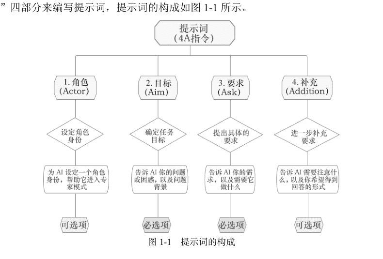

看似复杂，实操并不难。以旅游攻略为例，将该模板应用于具体场景，可按如图 1-2 所示的方式向模型提问。

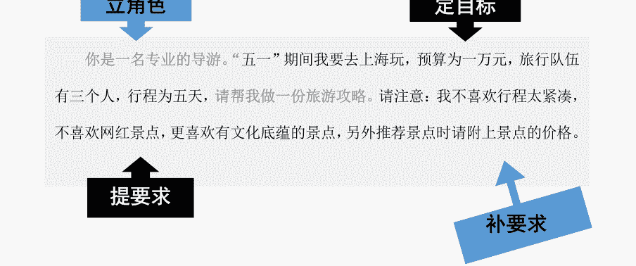

## 【任务实施】

### 任务一 使用 ChatGPT 生成长文

#### 子任务 1：围绕主题生成大纲框架
在文学、学术研究、演讲或写作中，主题是文章的核心思想与关注点。每篇文章都应有明确主题，写作前通常需先搭建大纲。大纲能帮助理清思路并保障内容连贯。例如要撰写一份低代码市场调研报告，却不知从何下手，甚至不了解报告应包含哪些部分，可先向模型提问：“我想写一份低代码市场调研报告，需要包含哪些部分”，如图 1-3 所示。

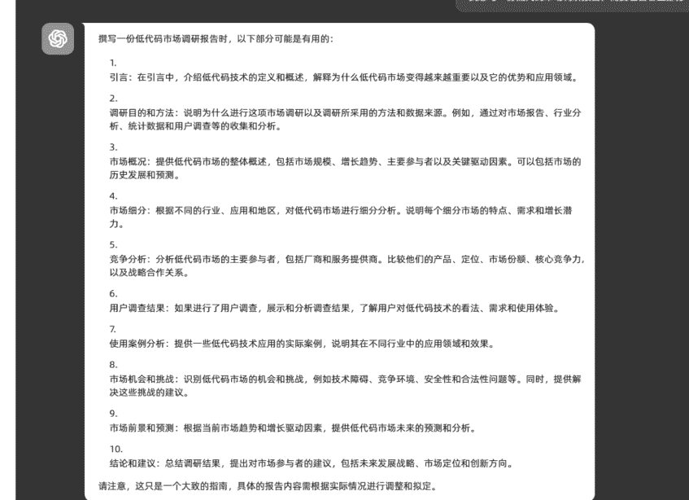

针对图 1-3 的生成结果，可借助模型将其转化为调研报告模板并形成大纲框架，如图 1-4 所示。

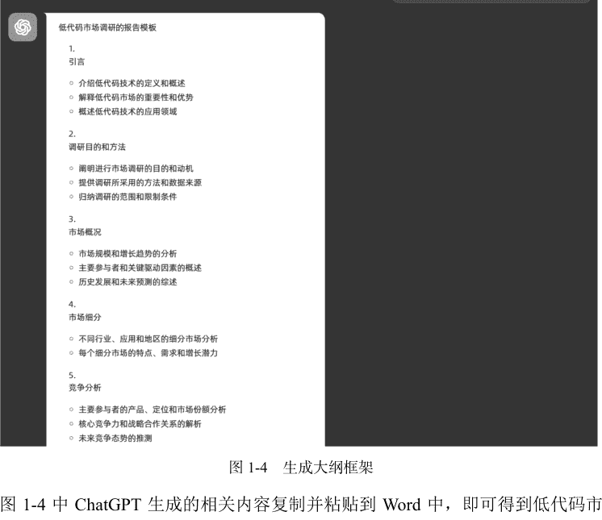

将图 1-4 中生成的内容复制粘贴到 Word 中，即可得到低代码市场调研报告模板，如图 1-5 所示。

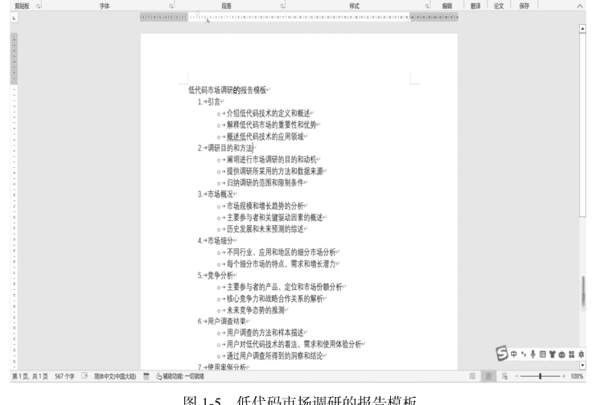

#### 子任务 2：根据大纲框架生成主体内容
大纲确定后，逐章逐节展开主体内容是报告的关键环节。此阶段与模型的交流至关重要，需明确写作范围、字数要求及每部分内容要点。遇字数限制时可提示继续续写。

例如撰写报告第 2 部分调研目的与方法，通过合理提问即可生成该部分正文，如图 1-6 所示。其余章节可采用类似方式完成。

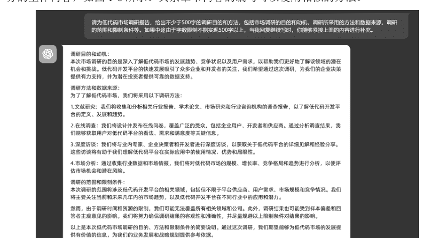

### 任务二 改善文档质量

#### 子任务 1：完善大纲框架和主体内容
若提示词不够精准，前期生成的大纲往往不够理想。此时可套用任务分析中介绍的提问方法，为模型设定角色与背景，生成的专业性与准确性会明显提升，如图 1-7、图 1-8 所示。

> 小提示：
>
> 切勿忽视提问本身，提问即一门可循方法论的技能。好答案必然源于好提问。基础问题涵盖 What、Who、When、Where；进阶问题涵盖 Why、How。

# 项目一 智能笔友：ChatGPT 助力文档创作

你是一名技术研究公司的研究分析师，需要对市场上新兴技术进行研究分析，低代码技术正是当前热门研究方向之一。我要撰写一份低代码市场调研报告，请告诉我报告应包含哪些部分。

低代码技术是一种通过图形化界面和少量编码即可快速构建应用的开发方式。为撰写一份完整的低代码市场调研报告，你可能需要包含以下部分：

1. 引言：介绍低代码技术的背景与定义，概述其在软件开发领域的重要性与潜力。
2. 方法与数据来源：说明调研方法，可能包括市场调查、行业专家访谈、市场数据分析等，并阐明样本覆盖范围、样本规模及数据采集与分析流程。
3. 市场概览：提供低代码技术市场的整体情况，包括市场规模、增长趋势与预测、主要参与者、行业应用分布及市场驱动因素等。
4. 优势与挑战：评估低代码技术的优势与挑战，如开发效率提升、技术门槛降低、创新加速、易维护升级等，以及安全性、灵活性、性能等方面的问题。
5. 市场细分：按行业、区域、应用类型等维度对市场进行细分，并提供各细分市场的潜力、竞争态势与主要参与者信息。
6. 主要参与者：列出低代码领域具有代表性的供应商，包括平台商、工具商与服务商，并介绍其产品、市场份额、战略与竞争优势。
7. 应用案例：列举不同行业与类型的低代码应用案例，描述背景、挑战、解决方案与成果。
8. 市场趋势：分析当前市场最新趋势，如技术创新、合作、并购等，并给出未来发展方向与预测。

图 1-7 设定角色与背景后向模型提问

请为低代码市场调研报告提供不少于 500 字的调研目的与方法，涵盖调研目的与动机、采用的方法与数据来源、调研范围与限制条件等。若因字数限制未达 500 字以上，请在回复“继续写”后无缝衔接补充。

调研目的与方法：

本次低代码市场调研旨在全面掌握低代码技术市场的现状、发展趋势与潜在机会，为投资者、企业决策者及相关利益方提供决策参考。目的与动机如下：

1. 了解市场规模与增长态势：通过收集与分析市场数据、统计指标及相关报告，全面把握低代码技术市场的规模、增长趋势与预测。
2. 探索市场驱动因素：调研推动市场增长的关键因素，如数字化转型需求、快速应用开发与部署需求、人才短缺等，以洞察未来发展方向。
3. 识别机会与潜在增长领域：分析市场细分与垂直应用，确定潜在增长机会，为投资者与企业提供战略与产品定位参考。

调研方法与数据来源：

为达成上述目标，将采用以下方法：

1. 市场调查：通过在线问卷与面对面访谈，与低代码技术的用户、开发者与决策者交流，了解使用情况、需求与反馈。
2. 专家访谈：与行业专家、平台提供商及从业者深度访谈，获取对市场发展的见解与观点。
3. 数据分析：收集与分析市场报告、行业数据、统计指标及相关研究，获取详细数据与趋势分析。
4. 成功案例研究：调研已成功应用低代码技术的企业与项目，分析成功要素、应用场景与价值。

调研范围与限制条件：

本次调研主要关注全球低代码技术市场，包括各地区与各行业的发展情况，重点关注平台提供商、用户与需求方的视角。然而调研存在一定局限性，可能的限制条件包括：

图 1-8 调研目的与方法的主体内容生成

对比图 1-8 与图 1-6，同一问题在设定角色身份与背景后，图 1-8 的输出明显更细致深入，这正是因提问前明确了模型的角色与背景。

#### 子任务 2：检查和纠正常见的语法错误
初稿中常存在细小错误，可通过向模型提问的方式检查并修正常见语法问题，如图 1-9 所示。

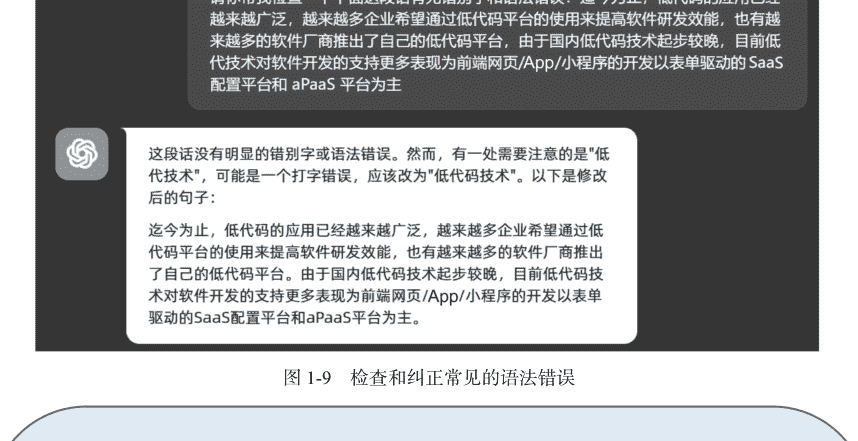

图 1-9 检查与纠正常见语法错误

> **知识链接：**
>
> ChatGPT 在一定程度上可辅助用户检查并修正常见语法错误。其训练语料包含大量规范语法，可对输入文本进行语法分析与校正。主要作用包括：
>
> （1）提供语法建议：分析文本，标记可能存在的语法问题并给出建议，如主谓一致、动词时态、名词单复数等。
> （2）校正拼写错误：检查并纠正常见拼写错误，提升准确性与可读性，发现问题时给出替换建议。
> （3）检查标点与句式：识别标点错误及成分缺失或不完整的句式，并提供修正建议，使句子更清晰易懂。
>
> 需要注意的是，ChatGPT 并非绝对准确，其建议基于统计模型而非深层次语境理解，使用时仍需人工审阅并决定是否采纳，以确保文本精确性与意图传达的准确性。

小提示：

Microsoft Word 自带的“审阅”选项卡在文档创作中不可或缺，可辅助检查拼写、语法等方面的问题。


## ChatGPT 纠错功能的使用方法

### 子任务 3：改善句子结构和语言风格
作为语言 AI 模型，ChatGPT 可分析句子结构并提供重组建议，使句子更清晰易懂；也可提供词汇与短语的替换或重组建议，使表达更流畅自然，并帮助选用更精准的词汇；还能改善语言风格。例如希望文本更正式或更轻松，ChatGPT 可据要求给出相应建议，如调整措辞、增减修饰、改变语气等，如图 1-10 所示。


图 1-10 改善句子结构与语言风格

## 任务三 创新性自我挑战

### 子任务 1：借助 ChatGPT 创作一篇“计算机前沿技术介绍”文章
计算机前沿技术指在计算机科学与技术领域具有前瞻性与创新性的新兴技术与方法，正与传统技术融合，推动行业进步与创新。其覆盖范围极广，包括但不限于：

- （1）人工智能与机器学习：人工智能是模拟与实现类人智能的技术，机器学习是其重要分支，通过数据学习与自主改进实现智能化。
- （2）区块链技术：区块链是一种基于分布式网络与密码学技术确保安全可信的数据库技术，可用于构建去中心化应用与数字货币系统。

前沿计算与生成式创作实践导览

当前技术浪潮正全面重塑社会运转与产业版图，计算机领域的突破性进展成为改写商业形态、生产方式与生活感知力的核心动力。以下先勾勒几大代表方向，再梳理本次课程的实践安排。

量子计算
量子计算以量子力学规律为依托，构建出与传统架构迥异的计算范式。在特定问题域里，其求解效率远超经典系统，具备颠覆性潜力。

沉浸式交互
虚拟现实借助电脑合成的感官信号，营造可沉浸的数字空间；增强现实则是把虚拟信息叠加到真实场景之上，实现感知与交互的叠加延伸。

智能出行
自动驾驶融合多源传感器、视觉计算与机器学习等手段，使车辆等交通设备获得自主环境认知与决策执行能力，迈向无人化运行。

上述方向共同改写行业版图，成为未来科技演进的核心引擎。

任务一：计算机前沿技术导览文章撰写

围绕“计算机前沿技术介绍”展开自由写作，可挑选人工智能、区块链、量子计算等任一感兴趣的主题。

整体框架建议先向生成式助手提出需求获取初稿大纲，再由小组研讨补充个人见解与创新点，最终确定结构。

基本规范要求篇幅在 5000 字以上，表达流畅、层次分明、逻辑严密。

附加要求在文末增设附录，系统梳理写作思路、遇到的难点，并记录团队及个人与生成式助手互动的经验心得。

> 创作提示
> 生成式内容创作在文本自动化生成领域具有划时代意义，在提升生产效率、优化语言表达方面优势明显。
> 需要清醒认识到，生成式工具本质是辅助手段，真正的创造性思维仍源自人类。应理性看待其能力边界，将其作为创作辅助而非替代。核心原创思想仍需作者自行提供。

子任务二：生成式助手辅助完成“××专业就业竞争力”分析报告

在当代社会，就业竞争力关乎个人与组织的发展。调研特定领域的就业市场，有助于把握需求变化。了解行业趋势、能力诉求与人才缺口，能够为职业规划与人力资源策略提供依据。

竞争能力决定个体在市场中获取岗位机会的可能性。竞争加剧的背景下，较高水平不仅有助于进入市场，也为长期职业发展奠定基础。在高压力职场环境中，能力与素质兼优者更易适应变化，具备更强的成长潜力。

竞争能力的价值体现在职业发展、收入水平、社会认可与心理满足等多个维度。提升竞争能力对个人成长与社会进步均有积极意义。

完成此类分析报告，大学生能够在深入了解就业市场、捕捉机会与趋势、锻炼研究分析能力、强化职业竞争能力、提升沟通表达能力等方面获益。

撰写规范
专业选择可围绕本专业或感兴趣的专业展开。
报告框架可通过网络检索、向生成式模型咨询等方式，由小组讨论明确。
基本要求语言流畅、条理清晰、逻辑严谨。
附加要求报告结尾添加附录，详细说明思路梳理过程、遇到的难点，并分享团队与个人与生成式模型交流的经验。

任务评价要点

职业素养 40%
保持良好计算机使用习惯，爱护公共设施，环境整洁
纪律性强，不迟到早退，按时完成分担任务
态度端正、工作认真，乐于承担困难任务
善于发现问题并主动寻求解决，及时与教师同学交流
合作意识强，主动帮助他人

专业能力 60%
能借助生成式助手围绕主题生成大纲框架
能依据大纲生成主体内容
能优化提问，完善大纲与主体
能借助生成式助手检查纠正常见语法错误
能借助生成式助手改善句式结构与语言风格
作品具备创新性

能力拓展

拓展训练 1：多维度解读大模型

自 2022 年起，以 ChatGPT、文心一言为代表的大模型及其相关人工智能技术持续升温。2023 年 8 月 12 日，天津大学发布首份《大模型评测报告》，覆盖 GPT-4、ChatGPT gpt-3.5-turbo、Claude-instant、Sage gpt-3.5-turbo、百度文心一言、阿里通义千问、讯飞星火认知大模型、ChatGLM-6B、360 智脑、MOSS-16B、MiniMax、baichuan-7B 等 14 个主流模型进行中文综合能力测评。结果显示 GPT-4 与百度文心一言综合表现显著领先，得分接近，尤其在中文表达上，文心一言表现优异。


文心一言的基础使用

文心一言的插件应用

伴随国内大模型快速发展，技术领先的文心一言在多数中文任务中已明显缩小与 GPT-4 的差距，中美大模型呈现“双雄并进”态势。天津大学胡清华教授指出，基础智能模型有望重塑人工智能发展模式，大模型大量涌现，全面准确的评价是规范健康发展的基础。百度文心一言在评测中展现了国产大模型的实力，我国大模型短期内发展迅速，正逐步追赶国际水平，部分指标已实现局部超越。未来期待国产大模型取得更大突破，赋能经济社会发展，助力科技自立自强。

请以校园人工智能爱好小组成员身份，通过网络检索或与大语言模型交流，完成一份多维度介绍大语言模型的文档，并在附录中详细阐述思路与难点。

> 思考方向
> 对比国内外大语言模型特征，谈谈对科技兴国战略的理解。

拓展训练 2：科技强国视角下的中国计算机发展史

党的二十大报告总结了我国科技创新取得的突破性进展与标志性成果，强调基础研究与原始创新不断加强，部分关键核心技术实现突破，战略性新兴产业快速发展，载人航天、探月探火、深海深地探测、超级计算机、卫星导航、量子信息、核电技术、新能源技术、大飞机制造、生物医药等取得重大成果，我国进入创新型国家行列。新时代十年，科技自立自强持续推进。

超级计算机被誉为“国家重器”，是国家战略高技术领域与科研实力的重要象征。改革开放以来，从“银河”实现国产巨型机零突破，到“天河”多次问鼎世界榜首，我国超算累计获得 13 次世界第一，进程可概括为“开天辟地”四十年。

#### 1. “银河”问世
1978 年，国防科技大学受命研制巨型计算机。1983 年 12 月 22 日，我国首台每秒运算 1 亿次以上的“银河”计算机在长沙研制成功，使我国成为继美日之后全球第三个具备巨型机研制能力的国家，标志着我国进入世界巨型计算机研制行列。此后每秒运算 10 亿次的“银河Ⅱ”与每秒运算 100 亿次的“银河Ⅲ”相继问世。

#### 2. “天河”诞生
2009 年 10 月 29 日，经过四年研发与数万次试验，我国首台每秒运算千万亿次以上的“天河一号”超级计算机诞生，次年以每秒 1206 万亿次峰值运算速度首次登顶世界超级计算机 500 强榜首，其最大创新是在国际上率先提出微处理器与加速器协同的异构融合计算结构。2013 年 5 月，峰值运算速度达每秒 5.49 亿亿次的“天河二号”横空出世，先后六次位居全球榜首。

#### 3. “超算皇冠”布局
以百亿亿次运算能力为标志的 E 级超级计算机被视为超算领域的下一项“皇冠”。当前我国 E 级超算研发稳步推进。国防科技大学与国家超级计算天津中心等团队合作的“天河三号”E 级原型机历经两年多研发与关键技术攻关，于 2018 年 7 月研制成功并通过验收。

累累硕果只是新的起点，新一代百亿亿次超级计算机研制正在推进。从“银河”实现零突破到“天河”实现领跑，从跟跑到领跑，折射出改革开放以来我国科技发展的艰辛与辉煌。“银河”团队长期形成胸怀祖国、团结协作、志在高峰、奋勇拼搏的“银河精神”。

请通过网络检索与生成式助手问答，整理一份详尽的中国计算机发展历程文档，并在附录中说明整理思路、难点及与生成式助手交流讨论的经验。

延伸阅读：从机器学习到智能创造

思考过何以能够思考吗？婴儿如同白纸，通过教导与学习成长为洞悉世事的成人，学习正是智能形成的关键。人类崇尚智能，并持续利用智能改造世界。历经农业革命、工业革命后迎来信息革命，每一次生产力改造都强化了对人工智能的信心。

数十年前图灵提出“机器能思考吗”，将人工智能从科幻拉向现实。随后无数先驱试图解构人类智能的形成机制。正如塞巴斯蒂安·特伦所言，人工智能更像人文学科，其本质在于理解人类智能与认知。正如人类通过学习获得智能，20 世纪 80 年代以来机器学习成为人工智能发展的重要驱动力。

机器学习让计算机从数据中汲取知识，按预期执行任务。它在造福社会的同时也暴露出局限，这种人工智能缺少人类智能的核心特质——创造力。类似《我，机器人》中的辩论，面对“机器人能否写交响乐”“能否创作出美术作品”等提问，机器只能反问“你能吗”，创造力因此成为区分本质的标志之一。

面对庐山瀑布，李白写下“飞流直下三千尺，疑是银河落九天”；张择端绘制《清明上河图》记录北宋市井风情；伯牙与子期的《高山流水》拉近心灵距离。写诗、作画、谱曲，人类通过创造力描绘所见所闻，这既是智能的意义，也是生活的意义。

人类能否赋予机器创造力？答案是否定的。

埃米尔·博雷尔在 1913 年《静态力学与不可逆性》中提出思想实验：若无数只猴子在无数台打字机上随机敲击并持续无限久，终将出现猴子打出莎士比亚全集的情形。最初用于说明概率，却也诠释了机器创造力的可能性，只是条件过于苛刻，需要无限时间。

科学家努力将这一时间从无限压缩到有限。随着深度学习与大模型普及，生成式人工智能走向成熟，沿着机器学习的路径，人类探索出智能创造之路。在智能创作时代，机器能够写诗、作画、谱曲，甚至自然对话。人工智能生成内容 AIGC 将带来深刻的生产力变革，全面影响工作与生活。


项目一理论小测

# 项目二 Word长文档精美排版实战

### 知识目标：
- 1. 掌握样式的创建、修改与使用。
- 2. 掌握多级列表的使用方法和技巧。
- 3. 掌握题注、脚注、尾注的添加方法。
- 4. 熟悉交叉引用的正确使用。
- 5. 掌握域在页眉页脚的应用。
- 6. 熟悉分隔符在文档编排中的合理应用。
- 7. 掌握目录的自动生成。

### 能力目标：
- 1. 能够熟练地对长文档文本内容进行规范的格式处理，使长文档的各级标题、正文具有统一的格式，确保文档的精美。
- 2. 能够熟练地为长文档中的图片、表格添加题注。
- 3. 能够熟练地使用域为长文档添加个性化页眉、页脚。
- 4. 能够为格式规范化后的长文档自动生成目录。
- 5. 在长文档编排中遇到困难时能够随时向生成式助手寻求帮助。

### 素养目标：
- 1. 培养信息获取与处理能力、批判性思维能力、问题解决能力、创新能力。
- 2. 培养综合素养，能够适应复杂多变的社会环境，具备持续学习和自我发展的能力。
- 3. 培养正确的道德观、爱岗敬业的精神、严谨细致的工作作风、团队协作的职业素养。

## 【项目导读】
在工作或学习中，经常需要编写长文档，如工作报告、商业合同、技术文档、宣传手册、学术论文、毕业论文、书稿等。这些文档结构复杂、篇幅庞大，包含大量文字与图片，对格式与美观性要求很高。高质量内容需要配合高质量排版才能完美呈现，精美排版能显著提升阅读体验。

## 【任务工单】
本项目通过对文档“ChatGPT原理.docx”进行排版，介绍Word长文档的精美排版的具体方法，从而使学生掌握Word长文档“文本如画”的技能

任务名称
任务一 样式应用与目录生成
任务二 引用图片和表格
任务三 设计页眉页脚
任务四 创新性自我挑战

任务要点与要求要点包括使用多级列表为章节编号、创建统一样式、自动生成目录、添加图注表注、插入脚注尾注、交叉引用、制作图表目录、选用分隔符、插入页码与页眉等，要求文档美观规范、结构清晰、格式统一。

## 【任务分析】
与普通文档相比，长文档往往具有复杂结构与层次，如章节、子章节、小节等。Word 长文档需要清晰结构来组织信息，常见结构包括目录、章节、标题、图表、注释等。为便于编辑，可将长文档划分为多节，每节拥有独立页面格式、页眉页脚、页码。文字、标题、段落可使用样式统一美化。长文档通常需要创建目录与索引，便于阅读与快速定位。可通过生成式助手归纳长文档排版关键技术。

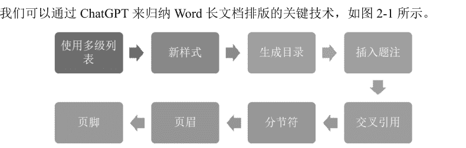

## 【任务实施】

### 任务一 样式应用与目录生成

#### 子任务 1：使用多级列表

# 项目二  让长文档在 Word 中呈现精致排版

对层级编号功能不熟悉的朋友，往往不了解它在长篇排版中的价值。可以先请 ChatGPT 做一次简要说明，参考图 2-2。

Word 里能够借助层级编号来搭建带结构感的条目清单，该功能支持不同层级自动缩进与序号，并在实际使用中允许自定义样式。

在整理大篇幅文档时，配合层级编号与样式使用，既可以让章节、子章节自动生成序列号，也能够统一它们的视觉呈现。

# 项目二 Word 长文档排版实战指南

### 子任务 1  层级编号的建立与使用

**任务要点：**
把文档中的章名和节名都套入层级编号样式。章名使用样式“标题 1”，居中排布；序号表现形式为“第 X 章”，例如“第 1 章”“第 2 章”。节名使用样式“标题 2”，左对齐；序号表现形式为“X.Y”，例如“1.1”“1.2”“2.1”“2.2”。

**操作要点：**
先调出源文件“ChatGPT 原理.docx”，首页内容见图 2-3。
把插入点放在“1.1 什么是 NLP”这一行，切换到“开始”标签页的“段落”区域，点击“多级列表”下拉，选择“定义新的多级列表”。
在弹出的“定义新多级列表”对话框里，先选中第 1 级，在“输入编号的格式”框中，默认灰底的“1”前面输入“第”，后面输入“章”。点下方“更多”展开，在“将级别链接到样式”下拉中选择“标题 1”。再选中第 2 级，在“将级别链接到样式”中选“标题 2”，如图 2-4，确认。
在“开始”标签页的“样式”区域，右键“标题 1”选“修改”，在打开的对话框里点“居中”，确定，完成段落居中。同理右键“标题 2”修改，设为左对齐。
逐条选中章节名，套用样式“标题 1”，并清除原有的序号；逐条选中节名，套用样式“标题 2”，并清除原有序号。
应用后首页效果如图 2-6。

### 子任务 2  正文样式的自定与使用

先请 ChatGPT 介绍 Word 样式的作用，见图 2-7。

**任务要点：**
新建样式“样式 001”。字体设定：中文楷体，英文 Times New Roman，字号小四。段落设定：首行缩进 2 字符，段前 0.5 行，段后 0.5 行，行距 1.5 倍，两端对齐。把该样式应用到正文文字，排除章名、节名、表格内文字、图表题注文字。

**操作要点：**
把插入点放在任一段非标题的正文里，点击“开始”标签页“样式”区域右下角的样式窗格启动器，点“新建样式”，如图 2-8。
在“根据格式化创建新样式”对话框里，名称改为“样式 001”。在“格式”区设置字体：中文楷体、英文 Times New Roman、字号小四。再设置段落：首行缩进 2 字符、段前 0.5 行、段后 0.5 行、行距 1.5 倍、两端对齐，如图 2-9，确认。
选中文档中除章节名、节名、表格、图表题注外的所有正文文字，套用“样式 001”。
应用后第 2 页效果如图 2-10。

### 子任务 3  目录的自动生成

先请 ChatGPT 说明 Word 如何自动生成目录，见图 2-11。

**任务要点：**
在正文前新增 1 页空白作为目录页。目录页第 1 行居中输入“目录”并套用“标题 1”样式；第 2 行起借助“引用”功能自动生成目录。

**操作要点：**
把插入点置于正文最前，点“布局”标签页“页面设置”组的“分隔符”，选“分节符 → 下一页”。
在新插入的首页空白页，双击第 1 行居中位置，输入“目录”并套用“标题 1”样式，删掉前面的“第 1 章”。回车换行，点“引用”标签页“目录”组的“目录”下拉，选“自定义目录”。在对话框里把显示级别设为 2，如图 2-12，确认。
删除自动生成目录里的第 1 行“目录”本身，效果如图 2-13。

## 任务二  图表引用与标注

### 子任务 1  图表题注的添加

先请 ChatGPT 介绍 Word 题注的作用和添加方式，见图 2-14。

> 小提示：题注能够为图片、表格等对象附加标签说明，并可据此自动生成索引。

**任务要点：**
正文图片添加题注“图”，位于图片下方，编号规则为“章序号-图片在章中的序号”，如第 1 章第 2 张图为“1-2”，说明文字取图片下一行，图片与题注整体居中。表格添加题注“表”，位于表格上方，编号规则为“章序号-表格在章中的序号”，如第 2 章第 1 张表为“2-1”，说明文字取表格上一行，表格与题注整体居中。

**操作要点：**
把插入点放在第一张图片下一行文字前，点“引用”标签页“题注”组的“插入题注”。在题注对话框点“新建标签”，新建标签对话框里输入“图”，确认。再点“编号”，在“题注编号”对话框勾选“包含章节号”，确认。此时对话框如图 2-15，确认。在编号与文字间手动加一个空格。选中图片和题注，点“开始”标签页“段落”组的“居中”，效果如图 2-16。
其余图片重复上述操作。
把插入点放在第一张表格上一行文字前，同样插入题注，新建标签为“表”，编号勾选“包含章节号”，确认后在编号与文字间加空格，选中表格与题注居中，效果如图 2-17。其余表格重复操作。

### 子任务 2  脚注与尾注的插入

> 知识链接：脚注和尾注都是补充说明，脚注置于页底，尾注置于文档末尾。

**任务要点：**
为文档标题中的“ChatGPT”插入脚注，内容为向 ChatGPT 询问“ChatGPT 的中文名称是什么”得到的答案。为正文第 3 行的“人工智能”插入尾注，内容为根据向 ChatGPT 询问“人工智能的概念”得到的答案归纳而成。

**操作要点：**
先向 ChatGPT 询问 ChatGPT 的中文名称，见图 2-18。
选中标题中的“ChatGPT”，点“引用”标签页“脚注”组的“插入脚注”，在页面底部脚注区输入答案“‘闲聊 AI’或‘对话 AI’”。插入后标题右上角出现引用标记，悬停可显示内容，效果如图 2-19。
再向 ChatGPT 询问人工智能概念，见图 2-20。
选中正文第 3 行“人工智能”，点“引用”标签页“脚注”组的“插入尾注”，在文档末尾尾注区输入归纳内容：“人工智能（Artificial Intelligence，简称 AI）是一门研究和开发使机器能够展现出类似人类智能的能力的科学和技术领域。人工智能追求构建智能系统，使其能够感知、理解、学习、推理、决策和交互，类似于人类的认知和行为。”插入后正文出现引用标记，悬停可显示。

### 子任务 3  交叉引用的设置

先请 ChatGPT 说明 Word 交叉引用的作用及添加方式，见图 2-21。

**任务要点：**
把正文中“如下图所示”里的“下图”改为交叉引用，显示为“图 X-Y”，X-Y 为对应图题注编号。把“如下表所示”里的“下表”改为交叉引用，显示为“表 X-Y”。

**操作要点：**
选中第一张图片上方“如下图所示”中的“下图”，点“引用”标签页“题注”组的“交叉引用”。在对话框里设置“引用类型”为“图”，“引用内容”为“仅标签和编号”，“引用哪一个题注”为“图 1-1 NLP”，如图 2-22，点“插入”。完成后鼠标悬停会显示链接提示，效果如图 2-23。按同样方式完成其余图片和表格的交叉引用。

### 子任务 4  图表目录的生成

**任务要点：**
在目录页后插入 2 页空白，每页单独成节。第 1 页第 1 行居中写“图索引”并套用“标题 1”，第 2 行起借助引用功能自动生成图索引。第 2 页第 1 行居中写“表索引”并套用“标题 1”，第 2 行起自动生成表索引。

**操作要点：**
把插入点置于正文最前，点“布局”标签页“页面设置”组的“分隔符”，选“分节符 → 下一页”，重复操作新建 2 页空白。
在第 1 页空白页双击第 1 行居中输入“图索引”，套用“标题 1”，删除前面的“第 1 章”。回车后点“引用”标签页“题注”组的“插入表目录”，在“图表目录”对话框里设置题注标签为“图”，如图 2-24，确认。效果如图 2-25。
同理在第 2 页空白页生成“表索引”目录，效果如图 2-26。

## 任务三  页眉页脚设计

### 子任务 1  分隔符的合理选用

先请 ChatGPT 介绍分页符与分节符的区别，见图 2-27。

> 小提示：分页符只换页，分节符可让不同节拥有独立页眉页脚、页边距等设置。

**任务要点：**
通过添加分节符，让每章从新页开始，且每章独立成节。

**操作要点：**
把插入点置于“第 2 章”文字最前方，点“布局”标签页“页面设置”组的“分隔符”，选“分节符 → 下一页”。其余各章同样操作。

### 子任务 2  页脚页码的添加

**任务要点：**
正文页脚插入居中页码，格式为“1,2,3...”，连续编号从 1 开始。

**操作要点：**
双击正文首页页脚区，点“设计”标签页“导航”组的“链接到前一条页眉”按钮，断开链接。点“设计”标签页“页眉和页脚”组的“页码”，选“页面底端 → 普通数字 2”，如图 2-28。
右键页码选“设置页码格式”，编号格式选“1,2,3,...”，起始页码设为“1”，如图 2-29，确认。

### 子任务 3  页眉域的应用

先请 ChatGPT 介绍域的作用、类型及用法。

> 小提示：域可插入动态内容并自动更新。

**任务要点：**
为正文添加居中页眉。奇数页页眉显示“章序号 章名”，如“第 1 章 NLP 入门”；偶数页页眉显示“节序号 节名”，如“1.2 NLP 的发展历程”。更新目录、图索引、表索引。

**操作要点：**
把插入点置于正文首页页眉处，勾选“设计”标签页“导航”组“奇偶页不同”，点“链接到前一条页眉”断开链接，如图 2-31。
点“插入”标签页“文本”组的“文档部件”→“域”。在“域”对话框里域名选“StyleRef”，样式名选“标题 1”，域选项勾选“插入段落编号”，确认。
在显示的“第 1 章”后加空格，再次插入域，域名“StyleRef”，样式名“标题 1”，域选项勾选“插入段落位置”，确认，效果如图 2-33。
把插入点移到第二页页眉，断开与前一条的链接。插入域，域名“StyleRef”，样式名“标题 2”，勾选“插入段落编号”，确认。在显示的“1.2”后加空格，再插一个域，域名“StyleRef”，样式名“标题 2”，勾选“插入段落位置”，确认，效果如图 2-34。
页眉设置后偶数页页码可能丢失，需重新插入。目录页页码会错乱，右键目录区选“更新域”，在“更新目录”对话框选“更新整个目录”，如图 2-35，确认后删除多余目录行。

## 任务四  自主创新挑战

### 子任务 1  职业生涯规划书的撰写与排版

职业规划关乎人生三分之二的工作时间，意义重大。通过了解兴趣、价值观、个性、语言、动手、社交、组织管理等综合因素，确定适合的职业类别、工作环境和单位。

请结合自身实际撰写一份个人职业生涯规划书并排版。内容可分自我认知、职业能力倾向、职业选择、调整与优化等板块。字数 1500 字以上。排版参照本项目 Word 长文档格式。

### 子任务 2  家乡旅游推荐册的设计

家乡有历史文化、自然风光、美食、民俗、休闲度假、农业观光、艺术文化、科技创新等特色。请围绕家乡特色设计旅游推荐册，字数 2000 字以上。排版参照本项目 Word 长文档格式。

## 【任务考评】

| 项目名称 |  |
| :--- | :--- |
| 项目成员 |  |
| 评价项目 | 评价内容 | 分值 | 自评 20% | 互评 30% | 师评 50% |
| 职业素养 (40%) | 具有良好的计算机使用习惯，爱护公共设施，环境整洁 | 5 |  |  |  |

高效办公进阶：Word 高级技巧全景拆解

| | 出勤规范、按时到岗、按期完成分内任务 | 10 | | | |
| | 工作态度端正、认真负责、乐于接受挑战性任务 | 5 | | | |
| | 遇事能主动排查原因，并及时与教师、同学沟通 | 10 | | | |
| | 协作意识突出，乐于提供帮助 | 10 | | | |
| 专业能力 60% | 能够借助多级列表实现章节及小节的自动编号 | 10 | | | |
| | 熟练进行样式的新建与套用 | 5 | | | |
| | 可快速生成文档目录 | 10 | | | |
| | 熟悉分页符的使用方法 | 5 | | | |
| | 善于利用域为奇偶页设置不同页眉 | 20 | | | |
| | 会为文档添加页码 | 5 | | | |
| | 能及时刷新目录 | 5 | | | |
| 合计 | 综合得分：________ | 100 | | | |
| 总结反思 | 1. 本次学习的新知识点：
2. 本次掌握的新操作技能：
3. 项目复盘：本次遇到的难点及解决思路？
学生签字： | | | | |
| 综合评语 | 教师签字： | | | | |

## 【能力拓展】

拓展训练 1：5G 时代智慧医疗健康白皮书的规范化排版

5G 在医疗健康行业的渗透已成为核心发展方向。伴随 5G 商用落地，以及大数据、互联网+、人工智能、区块链等技术的深度融合，智慧医疗健康展现出强劲的生命力与影响力，为医药卫生体制改革、“健康中国”建设和产业升级提供有力支撑。

建议用表格或文本框来组织版面。

目前全国 5G 医疗健康尚处起步阶段，顶层设计、系统构建与落地模式仍需完善，但前期实践已取得阶段性示范成效。5G 技术已在远程会诊、远程超声、远程手术、应急救援、远程示教、远程监护、智慧导诊、移动护理、智慧院区管理、AI 辅助诊断等多个场景得到验证。

请通过网络检索结合 ChatGPT 整理《5G 时代智慧医疗健康白皮书》，并完成规范排版。

> 💡 小思考
长篇 Word 文档如何设计精美的封面？

拓展训练 2：水处理项目商业计划书的创意设计

水是不可替代的自然资源与生命之源。水资源紧缺正制约区域开发与经济增长。随着生活水平提升，生态环境保护要求愈发迫切。能源工业快速发展，国家在推进清洁能源的同时高度重视生态保护，节水及水资源循环利用技术的研发已成为当务之急。

请通过网络检索结合 ChatGPT 整理《水处理项目商业计划书》，并进行创意化设计。

## 【延伸阅读——AI 文本生成】

AI 文本生成的模式大致可分为非交互式与交互式两类。非交互式主要面向结构化写作，如标题生成、新闻播报，以及非结构化写作，如剧情续写、营销文案。

日常新闻播报即典型的结构化写作，规律性强，输入结构化数据即可成文。AI 写作客观严谨，在地震播报、体育快讯、公司年报、股市讯息等领域优势明显。国内多家媒体已部署同类 AI 作者，如新华社“快笔小新”、人民日报“小融”、南方都市报“小南”、封面传媒“小封”、腾讯 Dreamwriter、今日头条 Xiaomingbot 等。

非结构化写作难度更高。诗歌、小说续写、剧本创作或营销文案需要创意与个性化，即便如此 AI 也能展现惊人潜力。

以诗歌为例，微软 2017 年推出的 AI 虚拟人小冰出版了首部 AI 生成诗集《阳光失了玻璃窗》，收录 139 首现代诗。

AI 也能创作故事、剧本和小说。2016 年伦敦科幻电影节诞生了首部由 AI 剧本拍摄的电影《阳春》Sunspring。机器人编剧本杰明由纽约大学团队打造，写作前已学习上千部科幻影片，包括《2001 太空漫游》《捉鬼敢死队》《第五元素》等。

在交互式生成方面，最具代表性的是 ChatGPT。与前述案例不同，ChatGPT 可兼顾问答、聊天与创作，场景丰富多样，涵盖文案生成、小说续写、代码编写、漏洞修复、在线问诊等，甚至展现出超越搜索引擎的潜力。

面对如此能力，人们不难设想文本生成的未来：程序员、研究员、产品经理等从事重复性脑力工作的岗位可能被重塑，这些职业或演进为提示词工程师，核心职责是帮助人类更好与 AI 交互。

项目二理论小测

## 项目三

## 高效办公：Word 进阶功能实战

### 知识目标：
1. 掌握邮件合并的概念与完整流程，学会进阶用法。
2. 熟练掌握多人协同编辑的技巧，包含共享设置与权限控制。
3. 理解 VBA 与宏的基本原理，学会借助 VBA 与宏实现常用任务自动化。

### 能力目标：
1. 能独立运用邮件合并，按需制作模板并连接数据源，完成合并输出。
2. 能创建主控文档与子文档，并快速完成主文档拆分为多个子文档。
3. 能使用多种在线文档工具编辑，实现共享与权限配置，并实时追踪他人修改。
4. 能借助 ChatGPT 使用 VBA 与宏，实现任务自动化处理。

### 素养目标：
1. 提升信息管理与组织能力，合理利用邮件合并、协同编辑、VBA 与宏提升效率。
2. 培养问题解决与创新思维，利用进阶功能解决学习与工作实际问题。
3. 培养团队协作与沟通意识，实现文档共享与有效协作。
4. 培养节约资源、保护环境的意识。

## 【项目导读】
在学习与工作中文字处理软件是常用办公工具，主要用于文字编辑与排版。但该软件还具备诸多进阶功能，如邮件合并、多人协同编辑、VBA 与宏等。尤其是 VBA 作为与软件深度集成的编程语言，可实现自动化处理与定制化功能。这些进阶功能让软件成为强大且灵活的文字处理工具，帮助用户应对复杂任务、提升效率，同时提供更多个性化选择。无论是批量生成相似文档、与团队协同编辑，还是定制特定功能，软件都能提供对应模块满足需求。

## 【任务工单】

| 项目描述 | 本项目聚焦文字处理软件进阶功能的应用，重点讲解邮件合并、多人协同编辑、VBA 与宏等，通过案例与练习帮助学员获得实用技能，提升工作效率，更好应对工作挑战 |
| 任务名称 | 任务一 邮件合并
任务二 多人协同编辑文档
任务三 巧用 VBA 与宏
任务四 创新性自我挑战 |
| 任务列表 | 任务要点 | 任务要求 |
| 1. 借助 ChatGPT 了解邮件合并 | ● 围绕概念向 ChatGPT 提问
● 围绕操作向 ChatGPT 提问 | |
| 2. 邮件合并初体验 | ● 创建数据源、文档模板
● 选择收件人
● 插入合并域
● 完成合并：编辑单个文件 | ● 数据源创建要准确，尤其含图片数据源，图片名称务必在 Excel 中体现
● 文件类型需按要求正确选择
● 模板创建可适当融入创新设计 |
| 3. 邮件合并再探索 | ● 按要求选择正确的文档类型
● 使用邮件合并规则 | |
| 4. 邮件合并深拓展 | ● 数据源中图片的有效处理
● 模板中图片正确导入路径为“文档部件”→“域”，类别为链接和引用；域名为 IncludePicture | |
| 5. 使用主控文档与子文档 | ● 创建和编辑主控文档和子文档
● 在主控文档中添加子文档 | ● 子文档内容编辑要准确
● 下载并安装腾讯文档 App |
| 6. 在线文档的编辑 | ● 快速将主控文档拆分成多个子文档
● 选择和使用在线文档编辑工具
● 设置文档权限、分享等 | |
| 7. 宏命令处理文字格式化 | ● 按要求向 ChatGPT 提问
● 打开文档宏编辑器
● 运行调试代码 | ● 启用宏功能
● 确保处理的文档包含图片 |
| 8. 宏命令处理图片 | ● 按要求向 ChatGPT 提问
● 打开文档宏编辑器
● 运行调试代码 | |
| 9. 创新性自我挑战 | ● 任务分组
● “大学生网络创业交流会”邀请函制作
● 比较多种在线文档工具 | ● 小组成员分工合理，在规定时间内完成 2 个子任务
● 探讨交流，互帮互助
● 内容充实有新意，格式规范 |

## 【任务分析】
邮件合并任务需要两份文件，一份是主文件即模板，其中固定内容如图文，需包含合并域；另一份是数据源，包含主文件中需要变动的信息，如姓名、性别、地址等，可为 Excel 工作表、文本文件、数据库文件等。邮件合并主要步骤如下。
1. 制作/打开主文件，不变部分
2. 制作/打开数据源文件，可变部分
3. 插入合并域，将数据源内容以域形式植入主文件
4. 执行合并到文件，自动生成包含多份样稿的文档

日常办公常需与他人协作完成文档编辑。文字处理软件提供了多人协同编辑功能，支持多用户同时对同一文档进行修改与更新，满足企业多地多端实时协同需求，实现办公零距离。

一般而言宏是一组可自动执行任务的编程指令。对文字处理软件而言，宏使用 VBA 编程语言自动执行指令，可帮助用户自定义 Office 应用操作并实现自动化。对初学者而言 VBA 编程有一定难度，本项目任务三可借助 ChatGPT 编写与调试 VBA 代码。

## 【任务实施】

### 任务一 邮件合并

#### 子任务 1：借助 ChatGPT 了解邮件合并
文字处理软件广泛应用于办公与文档处理，很多人熟悉其基础功能如文字输入、格式设置与排版。但进阶功能如邮件合并、VBA 与宏探索较少。当对某功能不熟悉时，可借助 ChatGPT 了解。例如向 ChatGPT 提问邮件合并的概念。

了解概念后，可进一步了解操作步骤。

#### 子任务 2：邮件合并初体验
在“练习”文件夹中新建成绩信息文件“CJ.xlsx”，内容如下表。

| 姓名 | 语文 | 数学 | 英语 |
|---|---|---|---|
| 张三 | 80 | 91 | 98 |
| 李四 | 78 | 69 | 79 |
| 王五 | 87 | 86 | 76 |
| 赵六 | 65 | 97 | 81 |

任务要求：
1. 使用邮件合并新建成绩单范本“CJ_T.docx”。
2. 生成全体学生的成绩单文件“CJ.docx”。

《姓名》同学

| 语文 | 《语文》 |
|---|---|
| 数学 | 《数学》 |
| 英语 | 《英语》 |

操作过程：
1. 在桌面新建“练习”文件夹，并在其中新建 Excel 文件“CJ.xlsx”，录入上述数据，注意从 A1 单元格开始。

> 小提示：
Excel 首行应包含列头信息，用以标识各列内容。列头通常具有描述性且唯一，如“姓名”“电子邮件”“地址”等，避免混淆。邮件合并过程中列头用于指定字段与个性化信息输入。

2. 在“练习”文件夹中新建文档“CJ_T.docx”，插入三行两列表格并输入固定内容。
3. 切换至“邮件”选项卡，点击“开始邮件合并”选择“普通 Word 文档”。点击“选择收件人”选择“使用现有列表”，在“选取数据源”对话框中定位“CJ.xlsx”并打开。将光标置于“同学”前，点击“插入合并域”选择“姓名”。同法在其它位置插入对应域，保存文档。
4. 打开“CJ_T.docx”，在“邮件”选项卡“完成”组中点击“完成并合并”→“编辑单个文档”。在“合并到新文档”对话框中选择“全部”，确定后生成“信函 1.docx”，重命名为“CJ.docx”并保存至练习文件夹。

小提示：
执行合并时需确保数据源未被其它程序锁定或正在编辑，以免读取失败或报错。

邮件合并的文档类型
信封批量制作
知识链接：
选择正确文档类型是邮件合并正常运行的关键。邮件合并文档类型即合并后的样式，包含信函、电子邮件、信封、标签、目录、普通 Word 文档等。

信函：形式化信件撰写方式，可将收件人个性化信息插入指定位置，支持标题、地址、日期、正文个性化及样式定制。

电子邮件：可生成个性化邮件，支持主题、收件人、抄送、密送、正文等设置，并插入个性化信息，可按需选择格式与风格。

信封：可生成个性化信封，支持尺寸、样式、布局选择，并将个性化信息置入相应位置，可自动添加发件人地址与邮戳。

标签：可批量打印地址或其他标签，支持标签尺寸与布局选择，并插入个性化信息。

目录：可创建目录或电话簿，支持样式、布局与内容设置，合并后多条记录位于同一页。

普通 Word 文档：除特定类型外，还可应用于普通文档。用户可自由设计内容与样式，使用邮件合并插入个性化信息，生成个性化报告、通知、邀请函等。

#### 子任务 3：邮件合并再探索
党的二十大报告指出，“推动经济社会发展绿色化、低碳化是实现高质量发展的关键环节。实施全面节约战略，推进各类资源节约集约利用”。

邮件合并的规则

# 智慧办公与创新实践（ChatGPT版）

本任务要求：
通过子任务 2 已获得成绩单文档。但每张 A4 纸仅打印一名学生成绩会造成资源浪费。为节约纸张、保护环境，希望将多名学生成绩打印于同一张 A4 纸上。

操作过程：
（1）复制“CJ_T.docx”并粘贴为副本，打开“CJ_T- 副本.docx”，会弹出对话框，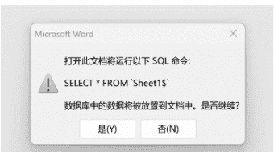
图3-10 打开副本文档时打开的对话框

单击“是”打开文档。在模板表格后增加一行空白行，便于打印后裁剪。

（2）点击“邮件”选项卡“开始邮件合并”选择“目录”。点击“完成并合并”选择“编辑单个文档”。在“合并到新文档”对话框中选“全部”，确定后生成“目录1.docx”，多条记录同页显示。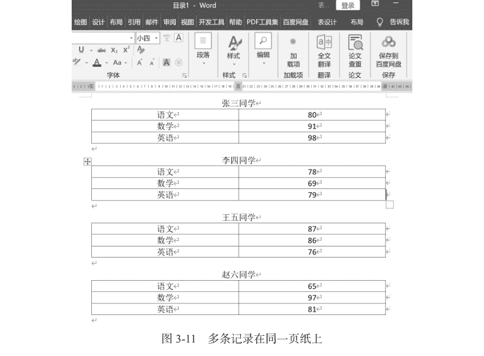
图3-11 多条记录在同一页纸上

若要求成绩单突显优异成绩，对 90 分及以上成绩加“★”显示，操作如下。

操作过程：
（1）重新打开“CJ_T- 副本.docx”，点击“插入”→“符号”→“其他符号”，选中“★”并插入，复制该符号后删除插入的符号，使其存入剪贴板。
（2）将光标置于表格“《语文”后，点击“邮件”→“规则”选择“如果...则...否则”，打开条件设置对话框，按图示设置后确定。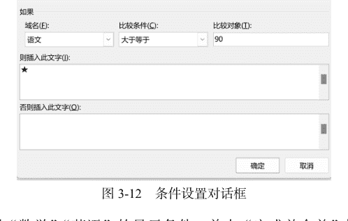
图3-12 条件设置对话框

（3）同理设置“数学”“英语”显示条件。点击“完成并合并”→“编辑单个文档”。在对话框中选“全部”，确定后生成“目录2.docx”，带“★”的学生成绩单如图示。

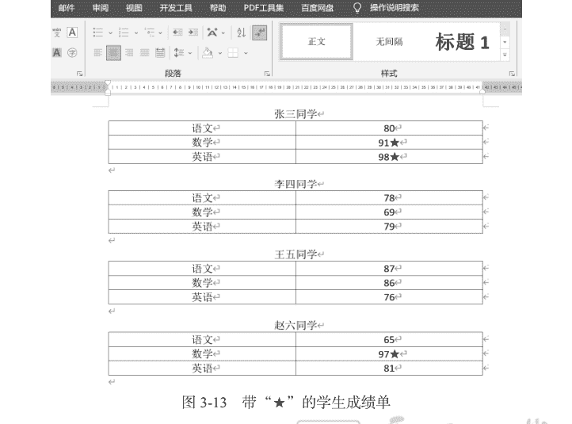

图3-13 带“★”的学生成绩单

## 子任务4：带人像的批量生成

前面两项练习的数据驱动生成主要围绕表格和文字展开，真实办公中更常见的是需要人像的批量制作，比如准考证、工牌等。本次要为某企业制作员工出入证，参考效果见图3-14。

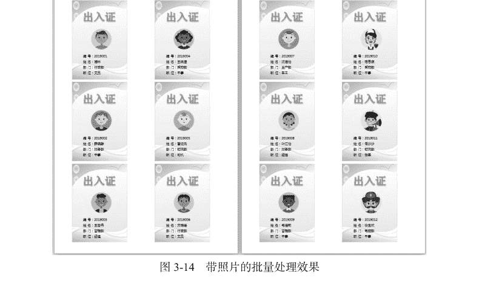

图3-14 含照片的批量制作效果

操作流程：

（1）准备数据源：Excel 文件“员工信息表.xlsx”内容示意见图3-15。把所有员工头像统一放到一个目录下，目录命名为“员工照片”，照片格式统一为“.jpg”，文件名称直接使用员工编号命名，例如“2019001.jpg”。

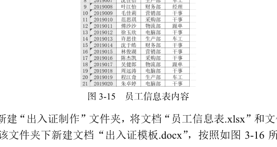

图3-15 员工信息表内容

（2）在桌面新建文件夹“出入证制作”，把“员工信息表.xlsx”与“员工照片”目录一起移入，并在该目录下新建 Word 文件“出入证模板.docx”，依据图3-16完成模板中固定部分的版式设置。

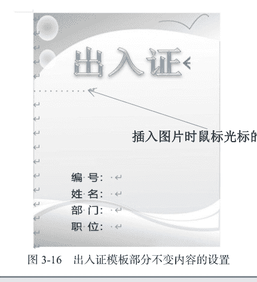

图3-16 出入证模板固定内容的版式

> **小提示：**

Excel 数据文件、照片存放目录与 Word 样板文件三者必须放在同一个文件夹内，不能单独留在桌面，否则后续的 Mail Merge 步骤会报错。

（3）打开“出入证模板.docx”，切换到“布局”选项卡，点击“栏”下拉选择“两栏”；随后进入“邮件”选项卡，点击“开始 Mail Merge”下拉选择“目录”。后续步骤可参照子任务2 的思路。

（4）把鼠标定位到文字“出入证”下一行，即图3-16 中准备添加图片的光标位置。进入“插入”选项卡，点击“文档部件”下拉选择“域”，在弹出的“域”对话框里，类别设为“链接和引用”，域名选“IncludePicture”，文件名或 URL 填入照片的存放路径，举例为“C:\Users\zly\Desktop\出入证制作\员工照片\2019001.jpg”，如图3-17 所示，确认后点确定。

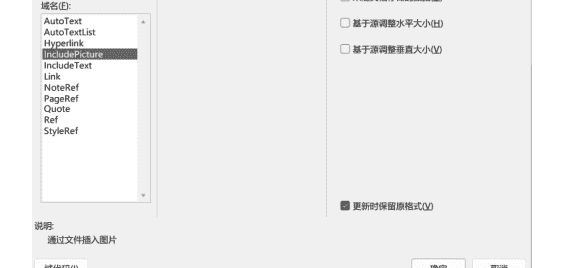

图3-17 域参数设置

（5）照片添加后可适当缩放。选中图片后按“Alt+F9”可查看域代码，如图3-18。选中代码中的“2019001”，点“插入合并域”下拉，选择“员工编号”完成替换。

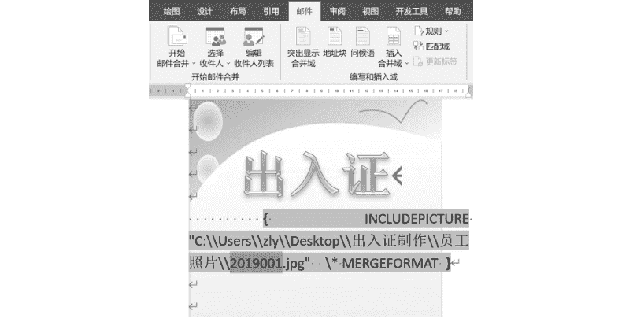

图3-18 照片域处理

> 小提示：

替换照片域值时只选中编号部分“2019001”，不要把“.jpg”一并选中。

（6）再次按“Alt+F9”恢复图片显示，点击“完成并合并”下拉，选择“编辑单个文档”。在“合并到新文档”对话框中勾选“全部”，点确定。

（7）对合并后的文档按“Ctrl+A”全选，按“F9”刷新域。若弹出安全提示对话框，如图3-19，直接点“是”。

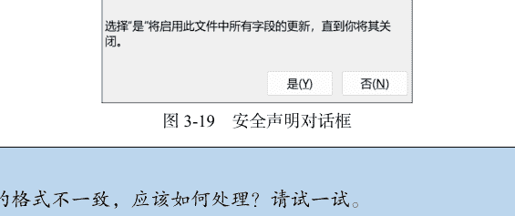

图3-19 安全声明弹窗

> ● 想一想

如果照片格式不统一，该如何处理？可自行尝试。

## 任务二 多人协同编辑文档

### 子任务1：主控文档与子文档配合

主控文档负责统合和管理多个关联文件，提供导航；子文档则承载具体细节。例如在桌面的“练习”文件夹中，新建主控文档“Main.docx”，并按顺序新建子文档“Sub1.docx”“Sub2.docx”“Sub3.docx”。

本环节要求：

- （1）“Sub1.docx”第一行内容为“Sub¹”，第二行内容为“â”，两者的样式均为正文。
- （2）“Sub2.docx”第一行内容为“办公软件高级应用”，样式为正文并设书签名为“Mark”；第二行为空行；第三行展示书签 Mark 的引用文本。
- （3）“Sub3.docx”第一行为该文档的创建日期，第二行为“→”，第三行为该文档的占用大小。

操作要点：

- （1）在练习文件夹内创建“Sub1.docx”“Sub2.docx”“Sub3.docx”“Main.docx”。
- （2）Sub1 的第一行需使用上标格式，第二行需插入特殊符号。
- （3）Sub2 第一行文字需插入书签；第三行可借助域或交叉引用实现。
- （4）Sub3 第一行使用域插入创建日期；第二行由英文状态下两个减号加大于号自动形成的符号；第三行用域显示大小，初次显示为0，需保存后重新打开并右键更新域才准确。
- （5）打开“Main.docx”，切换到大纲视图，点击“主控文档”选项卡中的“显示文档”，再点“插入”把三个子文档依次插入主控文档，如图3-20。

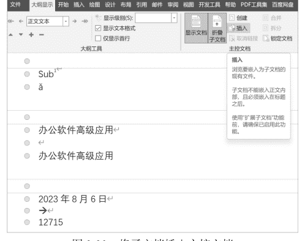

图3-20 将子文档插入主控文档

> 小提示：

折叠子文档后仅能看见存储路径，内容会被隐藏。插入前请先保存并关闭子文档。

### 子任务2：在线文档的协作编辑


Word 的主控文档方案非常适合长文档。主控文档由若干独立子文档构成，可统一管控整篇文章，各章节作为子文档。例如为学习人工智能知识，团队可收集资料并建立主控文档“人工智能现状及发展趋势展望.docx”，下设3个子文档对应3章。

把主文档拆分成多个子文档

具体要求：

- （1）把文档“人工智能现状及发展趋势展望.docx”按标题拆成3个子文档。
- （2）编辑子文档1“第1章人工智能简介.docx”，开启修订模式，通过腾讯文档App生成链接并分享给他人。
- （3）其余子文档同理操作。

操作流程：

- （1）新建主控文档“人工智能现状及发展趋势展望.docx”，输入“第1章人工智能简介”“第2章人工智能技术应用”“第3章人工智能的发展前景”，每章单独一行并设为“标题1”样式。
- （2）切换“视图”选项卡中的“大纲”按钮，点击“主控文档”组里的“显示文档”，并把“显示级别”设为“1级”。全选三个标题，点击“主控文档”组中的“创建”，如图3-21。点左上角“保存”，同目录下会自动生成3个子文档。

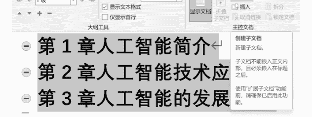

图3-21 大纲显示区域

- （3）打开文档“第1章人工智能简介.docx”，进入“审阅”选项卡，点击“修订”开启修订模式。
- （4）打开腾讯文档App，使用微信扫码登录。点击“导入”，如图3-22，导入子文档1“第1章人工智能简介.docx”。

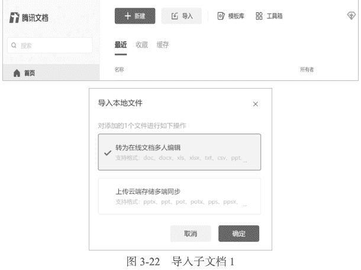
- （5）右键导入的文件选择“分享”，在分享窗口中将“仅我分享的好友”权限设为“可编辑”，随后点击“QQ好友”或“微信好友”按钮，如图3-23。

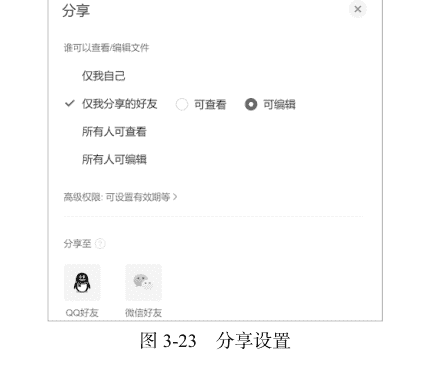

## 任务三 巧用VBA与宏

### 子任务1：宏处理文字格式

VBA 是 Office 应用的编程语言，本质是语言；宏是用户预先定义的一系列操作，本质是命令。借助宏可省去手工格式化的繁琐，配合 ChatGPT 编写 VBA 代码即可快速完成正文样式的批量应用，如图3-24。

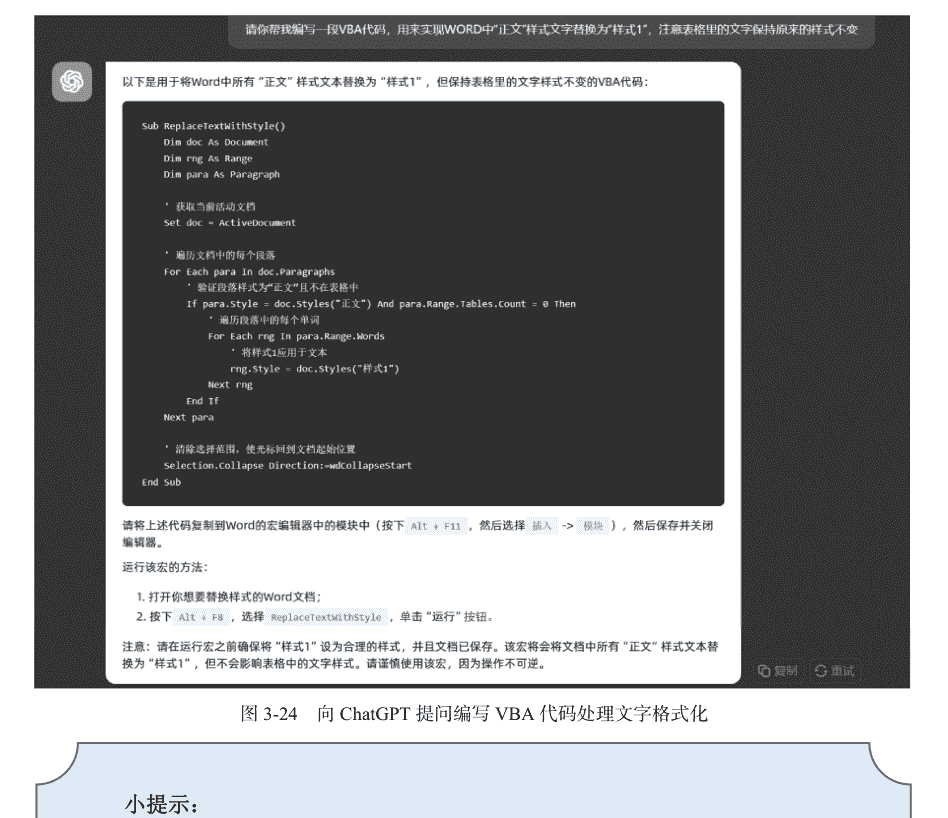

> 小提示：

若提示宏被禁用，可进入“文件”-“选项”-“信任中心”-“信任中心设置”-“宏设置”，勾选“启用所有宏”后确认。

### 子任务2：宏批量处理图片

在文档编辑中，除了文字格式常需批量调整图片尺寸，例如统一设为高12cm 宽9cm。逐张修改耗时，可用宏批量完成，如图3-25。

## 项目三 高效办公：Word 高级功能的使用

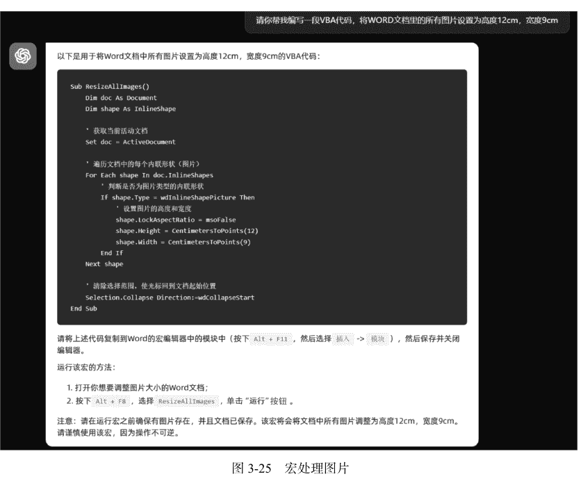

图3-25 宏处理图片的效果

> **知识链接：**

VBA 提供了大量对象实现对 Office 的访问与控制。Word 常用对象包括 Document 文档、Range 选区、Pagesetup 页面设置、Font 字体、Paragraph 段落、Table 表格、Shape 图片等，通过定义对象并设置其属性方法事件即可完成格式化。

例如 Pagesetup 可设置页边距、页眉页脚；Font 可设置中文字体名称、颜色、粗斜下划线；Paragraph 可设置段落缩进、行距等。

## 任务四 创新性自我挑战

### 子任务1：制作“大学生网络创业交流会”邀请函

随着互联网普及，大学生关注网络创业的比例提升，网络创业具备低成本、灵活、市场广阔等特点。为提升班级认知，班主任拟举办模拟交流会，需制作邀请函发放给全班。

要求：

- （1）明确活动要素，包含时间、地点、时长等关键信息。
- （2）设计邀请函版式，采用商务信函格式含信头、称谓、正文、结语、署名；或采用个性化设计，但须包含标题、称谓、正文、落款。
- （3）可用 Word 图文混排制作模板，并通过数据驱动生成批量生成每位同学的邀请函。

### 子任务2：比较多种在线文档编辑工具

在线文档相当于轻量跨平台的 Office，无需安装，可在网页和小程序中使用，支持实时更新、分享、协作。

常见工具有腾讯文档、石墨文档、金山文档、讯飞文档等。作为学习小组成员，需比较多款工具并撰写心得。

要求：

- （1）借助 ChatGPT 与网络调研常用在线文档工具。
- （2）至少试用3款，比较优缺点。
- （3）推荐最值得使用的工具并说明理由与使用方法。

## 【任务考评】

| 项目名称 |  |

| :--- | :--- |

| 项目成员 |  |

| 评价项目 | 评价内容 | 分值 | 自评20% | 互评30% | 师评50% |

| 职业素养(40%) | 具有良好的计算机使用习惯，爱护公共设施，环境整洁 | 5 | | | |

| | 纪律性强，不迟到早退，按时完成承担的任务 | 10 | | | |

| | 态度端正、工作认真、积极承担困难任务 | 5 | | | |

| | 发现问题后能主动寻求解决办法，及时和教师、同学探讨 | 10 | | | |

| | 团结合作意识强，主动帮助他人 | 10 | | | |

| 专业能力(60%) | 能独立使用邮件合并功能 | 5 | | | |

| | 能完成带照片的邮件合并 | 15 | | | |

| | 掌握多人协同编辑文档的方法 | 5 | | | |

| | 能使用多种在线协同文档编辑工具 | 10 | | | |

| | 能借助ChatGPT创建使用宏功能完成任务 | 15 | | | |

| | 完成的作品具有创新性 | 10 | | | |

| 合计 | 综合得分：___________ | 100 | | | |

| 总结反思 | 1. 学到的新知识：<br><br>2. 掌握的新技能：<br><br>3. 项目反思：你遇到的困难有哪些，你是如何解决的？<br><br>学生签字： | | | | |

| 综合评语 | 教师签字： | | | | |

## 【能力拓展】

### 拓展训练1：制作超市优惠商品促销卡

超市促销卡常以醒目字体突出商品信息，吸引顾客。需制作 XX 超市优惠商品促销卡：

- （1）以“促销商品.docx”创建目录型 Mail Merge 主文档，以“产品列表.docx”作为收件人列表，在表格中新增合并域替换占位符。
- （2）在“促销商品.docx”基础上加入创意设计，如精美图案与 Logo。
- （3）按“产品编号”升序筛选“饮料”与“干果”类别且不重复的首笔产品，完成单文档合并并命名为“优惠商品.docx”保存。

### 拓展训练2：使用VBA与宏实现表格数据排序

假设某文件夹含多个 Word 文档，每个文档内有一个含“产品名称”“销售数量”“销售额”三列的表格。需用 VBA 与宏实现各文档表格按销售额降序排序。


使用VBA与宏实现表格数据排序

## 【延伸阅读——AIGC：智能创作时代】

为提升互联网内容生产效率，人们探索用 AI 辅助创作。继 PGC、UGC 之后，由 AI 完全生成的内容形式称为 AIGC。亚瑟·克拉克曾言“任何足够先进的技术都与魔法无异”。AIGC 的魅力吸引众多资本，阿里巴巴、京东、网易有道、百度、360 等均在布局。

# 项目四 智慧助手：ChatGPT 协助数据处理

### 知识目标：

1. 掌握借助 ChatGPT 生成 Excel 表格数据的方法与技巧。
2. 熟悉工作表数据简单清洗方法。
3. 掌握单元格格式化与数据格式设置方法。
4. 掌握单元格数据、工作簿与工作表保护方法。
5. 掌握数据有效性设置方法。

### 能力目标：

1. 能按需使用 ChatGPT 生成 Excel 表格数据。
2. 能熟练将 Excel 表格格式化至所需效果。
3. 能对 Excel 表格数据进行有效保护。
4. 能对 Excel 输入数据进行有效性控制。
5. 遇到数据处理难题时能随时向 ChatGPT 求助。

### 素养目标：

1. 培养信息获取与处理、批判性思维、问题解决与创新能力。
2. 培养综合素养以适应复杂社会环境，具备持续学习与自我发展能力。
3. 培养积极思考、动手探究新知的欲望。
4. 培养正确道德观、爱岗敬业精神、严谨细致作风与团队协作素养。

## 【项目导读】

ChatGPT 不仅可协助撰写 Word 文档，还能生成 Excel 数据。可对工作表进行格式设置、数据保护、数据有效性控制等操作，遇到疑问可随时向 ChatGPT 提问，使其成为数据处理的智慧助手。

## 【任务工单】

| 项目描述 | 本项目先借助 ChatGPT 生成 Excel 数据，再进行格式化与保护，最后利用数据验证功能实现数据有效性控制 |

| :--- | :--- |

| 任务名称 | 任务一 使用 ChatGPT 生成 Excel 数据<br>任务二 数据的简单处理<br>任务三 数据的隐私保护<br>任务四 创新性自我挑战 |

| 任务列表 | 任务要点 | 任务要求 |

| 1. 确定表格的结构和内容 | ● 确定表格结构<br>● 确定表格内容 | |

| 2. 编写文本描述 | ● 根据确定的表格结构和内容，编写交付 ChatGPT 的任务文本<br>● 精细编辑与修改任务文本，确保精确完整规范 | |

| 3. 使用 ChatGPT 生成表格数据及导出 | ● 向 ChatGPT 提交任务生成表格数据<br>● 新建工作簿并将表格数据复制到工作表 | |

AI驱动的Excel全链路精修指南

| 4. 表格数据净化 | ● 统一表格内容规范性 | ● 借助 ChatGPT 产出 Excel 数据表<br>● 对 Excel 数据表执行格式调整<br>● 对 Excel 数据表做保护配置<br>● 为单元格配置有效性校验 |
| 5. 单元格样式与数值格式设定 | ● 实施单元格样式调整<br>● 为数值设定对应格式 | |
| 6. 单元格内容保护 | ● 对敏感数据实施锁定<br>● 设置编辑口令<br>● 设置查看口令 | |
| 7. 报表结构与文件保护 | ● 锁定报表结构<br>● 为文件打开与修改设置口令 | |
| 8. 单元格有效性配置 | ● 为指定区域设置校验规则，并补充提示与错误提示 | |
| 9. 行列有效性配置 | ● 分别为对应行列设定校验规则，满足业务实际 | |
| 10. 创新自测 | ● 任务拆分<br>● 善用剪贴板 | ● 组员分工合理，在时限内完成两项分任务<br>● 交流讨论、互相支援<br>● 内容充实新颖、版式规范 |

## 总体思路

先明确表格的框架与字段，设计一套可复用、清晰的 ChatGPT 指令集，把指令交给模型后由其自动生成 Excel 原始数据。将文本结果粘贴进工作表，再通过清洗将其转化为标准化的表格。Excel 自带的呈现功能可让表格更清晰、易读、美观。借助保护机制可对单元格、单表、整簿进行锁定，防止无权限操作与误改。数据有效性则能在录入环节限制类型、范围与取值，保证数据一致。

## 第一阶段 用AI生成基础数据

### 环节1 确定框架
为后续处理需要，我们打算让 ChatGPT 产出一份人员信息表。所需字段为：
序号 姓名 部门 职位 性别 学历 基本工资 绩效工资

### 环节2 撰写指令描述
为保证产出规范一致，可先给出首条记录的样例。记录总数控制在 50 条左右，交付给模型的描述如下：
请帮我生成一份 Excel 数据表。要求共 50 条记录，第 1 条记录格式如下：
序号 姓名 部门 职位 性别 学历 基本工资 绩效工资
A2301 杨俊杰 财务部 部门经理 男 硕士 5500 4530
> 小提示：指令需做到明确、合理、准确、完整。

### 环节3 生成并导入
提交后模型会按要求自动生成约 50 条记录的数据表。新建工作簿“员工信息表.xlsx”，将输出内容粘贴到 Sheet1 中，原始样式如图 4-2 所示。金额单位均为“元”。

## 第二阶段 数据整理与美化

### 环节1 数据净化
先向 ChatGPT 询问净化的目的与方法。核心是保证规范、准确、完整，原生数据通常需要整理。
操作要点：
1）统一序号列首字母为“A”：选中 A2，双击填充柄向下填充。
2）核查“姓名”列重复：选中 B 列，通过“开始-样式-条件格式-突出显示单元格规则-重复值”标出重复项，出现高亮即更换新姓名。
3）排查空值与错误值：逐项查看，空缺补齐，错误修正。
净化后效果如图 4-5。

### 环节2 样式与数值格式
全选单元格，字号设为 14，水平垂直居中。通过“开始-单元格-格式-自动调整列宽”适配宽度。
全选后点击“样式-套用表格格式”，选择“橙色，表样式中等深浅 3”，确认后在“表格工具-设计-表格样式选项”中取消“筛选按钮”。
右键选择“表格-转换为区域”，确认提示，将表格属性改为普通区域。
再次右键“设置单元格格式-边框”，外框设为双实线紫色，内部设为粗实线绿色，确认。
选中基本工资与绩效工资列，设置单元格格式-数字-分类为“货币”，小数位数 0。
选中“职位”列，使用条件格式“突出显示单元格规则-文本中包含”，关键词设为“主管”。
选中两工资列，使用条件格式“数据条-绿色数据条”。
在首行上方插入一行，A1 输入标题“员工信息表”，字号 20 加粗黑体深蓝，合并 A1:H1 并居中。
最终呈现如图 4-14。

## 第三阶段 隐私与权限保护

### 环节1 单元格级保护
可通过锁定与表保护结合实现精准防护。
在“员工信息表.xlsx”中于 Sheet1 后插入 Sheet2、Sheet3 并分别复制数据。
1）Sheet1 保护基本工资、绩效工资两列
选中除这两列外的所有单元格，打开“设置单元格格式-保护”，取消“锁定”，确认。默认所有单元格均锁定，只有在保护状态下才生效。
点击“审阅-保护-保护工作表”，输入密码并选择允许的操作，确认密码。
此时工资两列不可修改，其余区域可正常编辑。取消保护需输入密码。
2）Sheet2 为“姓名”列设置编辑口令
打开 Sheet2，点击“审阅-保护-允许编辑区域-新建”，标题设为“姓名”，引用单元格=B:B，设定区域口令，确认。返回后点击“保护工作表”并设定工作表口令。
修改姓名列时会弹出解锁区域对话框，需输入编辑口令。
3）Sheet3 为全部数据设置查看口令
在标题行前插入空白行，输入“请输入数据查看密码”并美化。
选中 A4:H53，新建规则，选择“使用公式确定格式”，公式输入“=$F$1<>"A123"”。
点击格式，分类选“自定义”，类型填“;;;”，确定。规则生效后该区域内容不可见，输入正确口令后恢复显示。

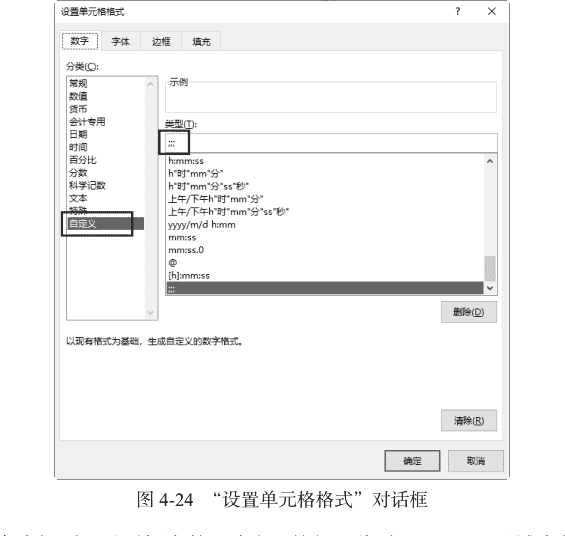

图 4-24 “设置单元格格式”对话框

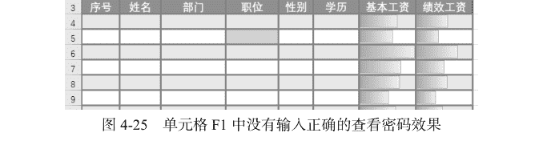

图 4-25 单元格 F1 中没有输入正确的查看密码效果

### 环节2 文件与结构保护
1）锁定结构
点击“审阅-保护-保护工作簿”，输入密码确认。此时右键工作表标签的“插入”“删除”“重命名”“移动或复制”“标签颜色”“隐藏”“取消隐藏”等均变灰不可用。

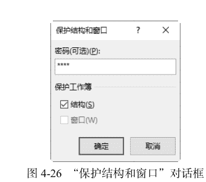

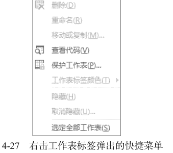

小提示：结构保护不影响打开与编辑工作表内容。
2）设置打开与修改口令
点击“文件-另存为”，在对话框点击“工具-常规选项”。

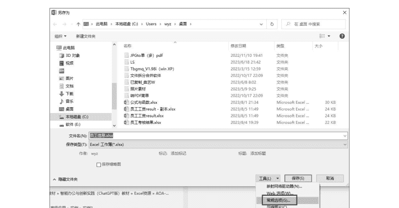

在“常规选项”中分别填写“打开权限密码”和“修改权限密码”，确认并再次输入。

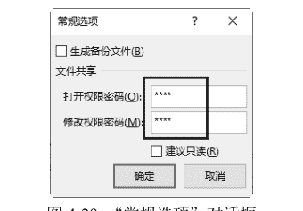

以后打开或修改工作簿均需对应密码。如需取消，重新打开常规选项清空密码即可。

## 第四阶段 有效性校验

### 环节1 单元格有效性
先向 ChatGPT 了解有效性的作用与配置方式。

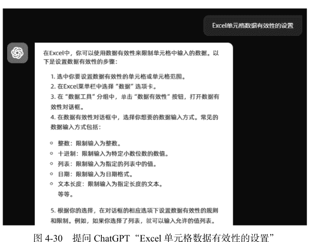

图 4-30 提问 ChatGPT “Excel 单元格数据有效性的设置”

选中目标单元格，点击“数据-数据工具-数据验证”，可设置验证条件、输入提示、错误警告及输入法模式。

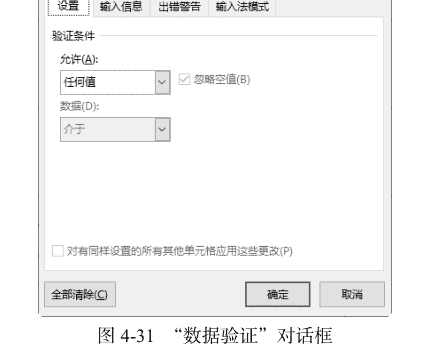

图 4-31 “数据验证”对话框

以“员工工资表.xlsx” Sheet1 为例：
设置 M6:M8 为 2000 到 8000 之间的整数，输入信息提示“岗位工资为介于 2000 到 8000 之间的整数！”，出错警告样式选“警告”，错误信息“数据输入错误，请重新输入！！！”。
设置 M12:M15 为大于或等于 400 的小数，输入信息提示“学历津贴为大于或等于 400 的小数！”，出错警告样式选“信息”，错误信息同上。

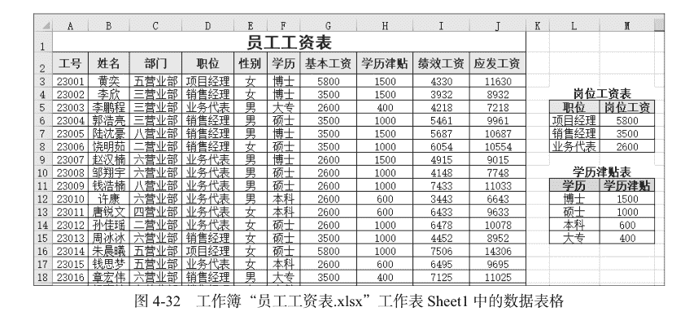

图 4-32 工作簿“员工工资表.xlsx”工作表 Sheet1 中的数据表格

### 环节2 行列有效性
设置方法与单单元格相同。对“员工工资表.xlsx” Sheet1 执行：
设置“工号”列文本长度必须为 5 位；
设置“职位”列只能从“项目经理、销售经理、业务代表”中选择；
设置“性别”列只能从“男、女”中选择；
设置“学历”列只能从“博士、硕士、本科、大专”中选择；
设置“绩效工资”列必须为大于或等于 0 的小数。

## 考核表

| 项目名称 |  |
| :--- | :--- |
| 项目成员 |  |
| 评价项目 | 评价内容 | 分值 | 自评 20% | 互评 30% | 师评 50% |
| 职业素养 (40%) | 具有良好的计算机使用习惯，爱护公共设施，环境整洁 | 5 |  |  |  |
|  | 纪律性强，不迟到早退，按时完成承担的任务 | 10 |  |  |  |
|  | 态度端正、工作认真、积极承担困难任务 | 5 |  |  |  |
|  | 发现问题后能主动寻求解决办法，及时和教师、同学探讨 | 10 |  |  |  |
|  | 团结合作意识强，主动帮助他人 | 10 |  |  |  |
| 专业能力（60%） | 能使用 ChatGPT 生成 Excel 数据 | 10 |  |  |  |
|  | 能进行单元格格式化操作、数据格式的设置 | 20 |  |  |  |
|  | 能保护单元格中的数据 | 10 |  |  |  |
|  | 能保护工作簿和工作表 | 10 |  |  |  |
|  | 能设置单元格数据有效性 | 5 |  |  |  |
|  | 能设置行/列数据有效性 | 5 |  |  |  |
| 合计 | 综合得分：___________ | 100 |  |  |  |
| 总结反思 | 1. 学到的新知识：<br><br>2. 掌握的新技能：<br><br>3. 项目反思：你遇到的困难有哪些，你是如何解决的？<br><br>学生签字： |  |  |  |  |
| 综合评语 | 教师签字： |  |  |  |  |

## 能力拓展

### 剪贴板实训
Excel 剪贴板能提升复制粘贴效率，复制的内容会暂存其中，可按保留格式、仅值、公式、链接图片等不同方式粘贴。


在日常办公里，剪贴板可以实现不少实用效果，比如批量合并单元格、快速拆分单元格、一次复制多次粘贴等。

建议借助互联网检索和与 ChatGPT 的交流，自己设计一份 Excel 数据表，反复练习剪贴板的不同操作方式。

## 延伸阅读——ChatGPT 数据来源与可靠性探讨

ChatGPT 是当前较为流行的自然语言处理产品，可提供智能问答、机器翻译、情感分析等服务。不少用户会对信息可信度产生疑虑。实际上，其训练素材主要来源于两类：一类是爬虫获取的网络内容，另一类是公开的语言语料集。

对于网络抓取类素材，系统会采用高质量爬虫进行采集，确保基础干净准确；采集过程中还会使用过滤器剔除低质内容；采集后进一步进行清洗与标注，以提升质量。

第二类素材来自 Wikipedia、Gutenberg 等公开库，这类语料权威性较强，因此衍生数据也更有保障。平台同时支持用户导入个人语料库，从而提高适用性和可信度。

在技术层面，ChatGPT 采用迭代训练策略，通过多次训练优化模型的准确度与泛化能力，有效规避过拟合风险，进而提升整体可靠性。


项目四 理论小测

## 项目五

# 公式与函数进阶应用

### 知识目标：
- 1. 在表格中熟练运用基础运算符。
- 2. 清楚辨析相对引用与绝对引用的区别并正确使用。
- 3. 掌握数组公式的构建思路与操作技巧。
- 4. 能够正确调用数据库函数完成筛选统计。
- 5. 熟悉财务函数在实际计算中的运用方式。
- 6. 合理组合逻辑函数进行多条件判断。
- 7. 熟练使用 INDEX 与 MATCH 配合实现定位查找。
- 8. 了解其他相关函数的使用方法。

### 能力目标：
- 1. 能借助公式与函数解决工作学习中的实际问题。
- 2. 能组合多个函数应对复杂场景。
- 3. 在数据处理受阻时可及时向 ChatGPT 求助。

### 素养目标：
- 1. 培养信息获取处理、批判性思维、问题解决与创新能力。
- 2. 提升综合素养，适应变化环境并保持持续学习。
- 3. 养成积极思考、动手实践、不断探索新知的习惯。
- 4. 建立正确价值观、敬业精神、严谨作风与团队协作意识。

## 【项目导读】
表格不仅用于记录保存数据，还具备强大的计算能力。公式与函数能够高效分析处理数据，在数字化时代是重要的数据处理手段。

本项目聚焦 Excel 中公式与函数的具体运用。公式与函数是进行计算与数据处理的工具，可快速完成数学、统计、逻辑、文本等复杂运算，提升效率。

## 【任务工单】

| 项目描述 | 本项目通过多实例实践操作，掌握各类函数的功能、语法与使用技巧，学会公式与函数的具体应用 |
| :--- | :--- |
| 任务名称 | 任务一 公式运用<br>任务二 函数基础运用<br>任务三 函数进阶运用<br>任务四 创新性自测 |
| 任务列表 | 任务要点 | 任务要求 |
| 1. 认识并使用基础运算符 | ● 算术运算符<br>● 文本运算符<br>● 比较运算符<br>● 实例演练 | ● 用基础运算符补全计算机等级考试成绩表 |
| 2. 单元格的绝对引用与相对引用 | ● 绝对引用<br>● 相对引用<br>● 实例演练 | ● 理解绝对引用与相对引用的差异与作用 |
| 3. 数组公式的运用 | ● 数组公式<br>● 实例演练 | ● 用数组公式计算员工工资表相关数据 |
| 4. 数据库函数的使用 | ● 数据库函数<br>● 实例演练 | ● 结合条件区域使用数据库函数进行计算 |
| 5. 数学函数、统计函数的使用 | ● 数学函数<br>● 统计函数<br>● 实例演练 | ● 设置某列禁止重复录入 |
| 6. 财务函数的使用 | ● 财务函数<br>● 实例演练 | ● 用财务函数计算贷款分期偿还金额 |
| 7. HLOOKUP/VLOOKUP 的使用 | ● HLOOKUP 函数<br>● VLOOKUP 函数<br>● 实例演练 | ● 用 VLOOKUP 与 HLOOKUP 进行查找计算 |
| 8. 逻辑函数的嵌套使用 | ● 逻辑函数<br>● 函数嵌套<br>● 实例演练 | ● 配合使用 INDEX 与 MATCH<br>● 将时间数据四舍五入到 15 分钟倍数 |
| 9. INDEX/MATCH 的配合使用 | ● INDEX 函数<br>● MATCH 函数<br>● 配合使用实例演练 |  |
| 10. 其他函数的混合应用 | ● CONCAT 函数<br>● MROUND 函数<br>● 实例演练 |  |
| 11. 创新性自我挑战 | ● 分组协作<br>● 解析身份证号码<br>● 分析学生体育成绩表 | ● 小组成员合理分工，规定时间内完成 2 个子任务<br>● 交流互助<br>● 内容充实、格式规范 |

## 【任务分析】
Excel 公式是进行计算的等式，必须以“=”开头。函数是预先定义好的特殊公式，用于计算、分析等数据处理任务。公式与函数主要作用如下。

- 简单计算：可完成加减乘除、求和、平均、最大值、最小值等运算。
- 数据映射：利用映射函数把一组数据映射为另一组数据，简化处理流程。
- 条件判断：依据特定条件返回不同结果。
- 文本处理：可连接、提取、替换字符串等。
- 日期时间计算：可计算天数差、提取年、月、星期等。
- 数据分析：可排序、过滤、查找、统计等。
- 逻辑运算：可进行与、或、非等逻辑运算。
- 数组计算：可处理多值构成的数组，如矩阵运算与多条件计算。

公式与函数的作用如图 5-1 所示。


## 【任务实施】

### 任务一 公式的使用

#### 子任务 1：认识并使用基础运算符

Excel 里的基础运算符用于各类计算。我们先向 ChatGPT 提问，让它说明 Excel 里的运算符，如图 5-2 所示。

运算符主要包括算术、文本、比较三大类。

1. 算术运算符
包含负号、百分数、乘幂、乘、除、加、减。

2. 文本运算符
仅有“&”，用于将两个文本拼接成一个连续文本。

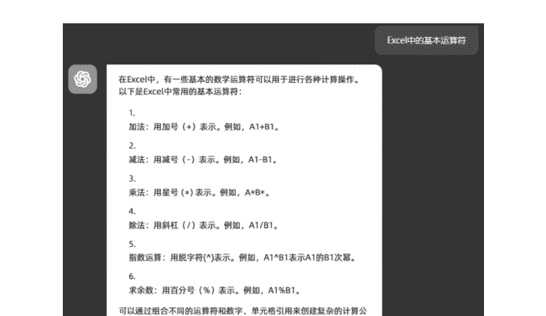

3. 比较运算符
包含等于、小于、大于、小于等于、大于等于、不等于。

本任务先在素材文件夹打开“公式与函数.xlsx”，工作表 Sheet1 的计算机等级考试成绩表如图 5-3 所示。

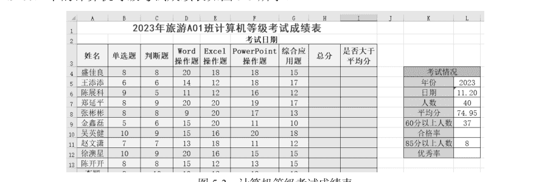

下面用基础运算符完善表格数据。

“考试日期”采用“xxxx年xx月xx日”格式显示：选中 G2 单元格，输入公式“=L5&"年"&"11"&"月"&"20"&"日"”。

计算“总分”列：选中 H4 单元格，输入公式“=B4+C4+D4+E4+F4+E4”，双击填充柄向下自动填充。

计算“是否大于平均分”列：选中 I4 单元格，输入公式“=H4>74.95”，双击填充柄向下自动填充。显示 True 表示是，显示 False 表示否。

计算“合格率”：选中 L10 单元格，输入公式“=L9/L7”。右键设置单元格格式，在数字选项卡中分类设为百分比，小数位数设为 1，如图 5-4 所示，单击确定。

# 项目五 计算分析：公式与函数的高级应用

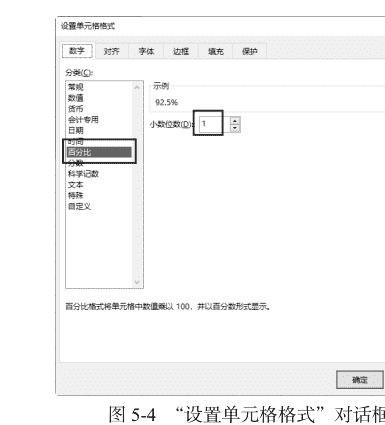
图 5-4 “设置单元格格式”对话框

“优秀率”计算方法与合格率类似。完善后的表格效果如图 5-5 所示。

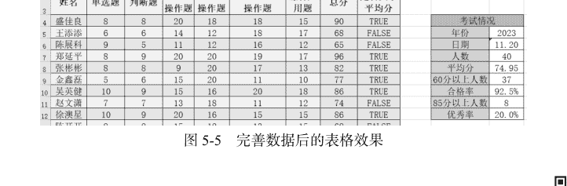
图 5-5 完善数据后的表格效果

#### 子任务 2：单元格的绝对引用与相对引用

先向 ChatGPT 提问，了解绝对引用与相对引用的作用区别，如图 5-6 所示。

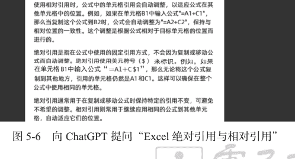
图 5-6 向 ChatGPT 提问 “Excel 绝对引用与相对引用”

绝对引用在复制移动时保持固定，使用美元符号“$”标识。相对引用是默认方式，复制时引用会随位置自动调整。

例如在“是否大于平均分”计算中引用平均分时，可将公式改为“=H4>$L$8”，避免使用相对引用导致引用错位。

#### 子任务 3：数组公式的使用

先向 ChatGPT 提问，了解数组公式的作用与用法，如图 5-7 所示。

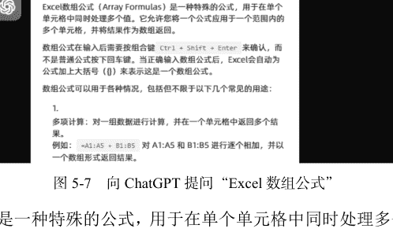
数组公式可在单个单元格中同时处理多个值，将公式作用于某范围并以数组形式返回结果。输入后需按 Ctrl+Shift+Enter 确认，正确输入后公式外会加上大括号“{}”。

打开工作表 Sheet2，其员工工资表原始表局部如下：

| 编号 | 姓名 | 基本工资 | 岗位津贴 | 工龄津贴 | 奖励工资 | 应发工资 | 应扣工资 | 实发工资 |
|---|---|---|---|---|---|---|---|---|
| A0001 | 吴峰昊 | 3040.00 | 510.00 | 168.00 | 444.00 |  | 75.00 |  |
| A0002 | 贾博 | 2980.00 | 500.00 | 164.00 | 500.00 |  | 62.00 |  |
| A0003 | 金怡 | 3000.00 | 530.00 | 152.00 | 510.00 |  | 50.00 |  |
| A0004 | 胡小 | 3020.00 | 500.00 | 142.00 | 450.00 |  | 50.00 |  |
| A0005 | 熊子贤 | 3015.00 | 515.00 | 120.00 | 480.00 |  | 65.00 |  |
| A0006 | 心晓萌 | 3040.00 | 540.00 | 116.00 | 480.00 |  | 68.00 |  |
| A0007 | 樊琳琳 | 3050.00 | 520.00 | 142.00 | 380.00 |  | 70.00 |  |
| A0008 | 珊琪 | 3020.00 | 550.00 | 140.00 | 446.00 |  | 50.00 |  |
| A0009 | 章逸 | 3040.00 | 500.00 | 134.00 | 580.00 |  | 60.00 |  |
| A0010 | 蒋良 | 3000.00 | 510.00 | 112.00 | 420.00 |  | 68.00 |  |
| A0011 | 赵青峰 | 3055.00 | 617.00 | 147.00 | 385.00 |  | 40.55 |  |

计算“应发工资”：选中 G3:G32，依次输入等号、基本工资区、C3:C32、加号、岗位津贴区、加号、工龄津贴区、加号、奖励工资区，按 Ctrl+Shift+Enter 确认。编辑栏显示“{=C3:C32+D3:D32+E3:E32+F3:F32}”。

“实发工资”计算方法类似。计算后的局部表如图 5-9 所示。

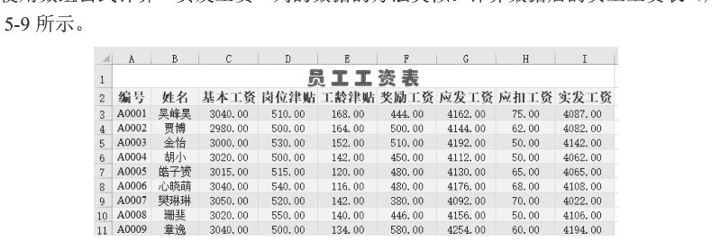

> 小提示：
数组公式生成的结果为整体，不可单独修改其中个别数据。

## 任务二 函数的简单使用

### 子任务 1：数据库函数的使用

先向 ChatGPT 提问，了解 Excel 里的数据库函数，如图 5-10 所示。

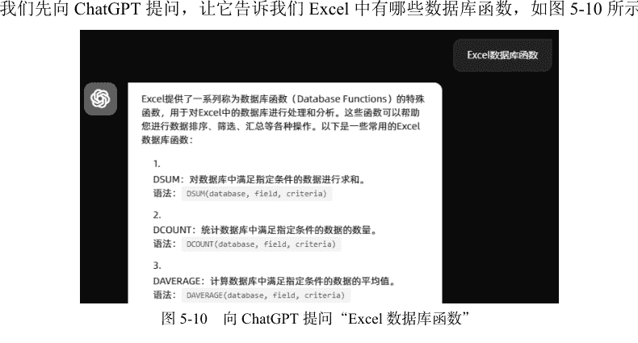
Excel 提供了一组数据库函数，用于对表格数据库进行复杂处理与分析。

知识链接：
常用数据库函数有 DAVERAGE、DCOUNT、DCOUNTA、DGET、DMAX、DMIN、DPRODUCT、DSTDEV、DSUM、DVAR 等。函数名通常以“D”开头，使用时需先设置条件区域。

打开工作表 Sheet3，采购情况表原始表如图 5-11 所示。

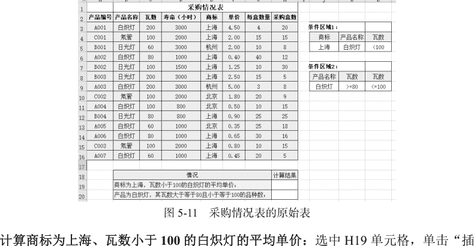
图 5-11 采购情况表的原始表

计算商标为上海、瓦数小于 100 的白炽灯平均单价：选中 H19，单击插入函数，在对话框中选择类别“数据库”，函数选 DAVERAGE，确定。

在参数对话框中，Database 设为 A2:H16，Field 设为 F2，Criteria 设为 J4:L5，确定。

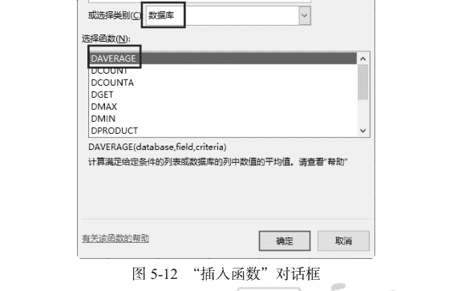
图 5-12 “插入函数”对话框

# 项目五 计算分析：公式与函数的高级应用

在打开的 DAVERAGE 参数对话框中，设置 Database 为 A2:H16，Field 为 F2，Criteria 为 J4:L5，如图 5-13 所示，确定。

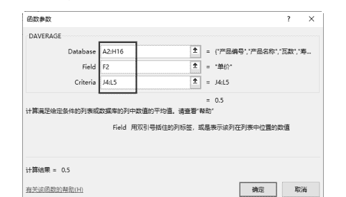
图 5-13 函数 DAVERAGE 的“函数参数”对话框

计算产品为白炽灯、瓦数在 80 至 100 之间的品种数：选中 H20，插入函数，选择类别“数据库”，函数选 DCOUNT，确定。

在参数对话框中，Database 设为 A2:H16，Field 设为 C2，Criteria 设为 J8:L9，确定。结果如图 5-15 所示。

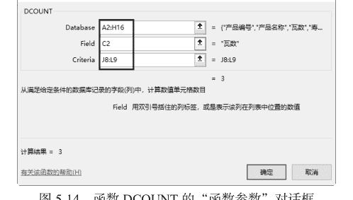
图 5-14 函数 DCOUNT 的“函数参数”对话框

| 情况 | 计算结果 |
| :--- | :--- |
| 商标为上海，瓦数小于100的白炽灯的平均单价： | 0.5 |
| 产品为白炽灯，其瓦数大于或等于80且小于或等于100的品种数： | 3 |

图 5-15 计算后的结果

> 小提示：
在 DCOUNT 参数对话框中，Field 也可设为 D2、F2、G2、H2，只要列中数据为数值型即可；也可直接用列号如“3”“4”“6”“7”“8”。

### 子任务 2：数学、统计函数的使用

知识链接：
常用数学统计函数有 ABS、INT、ROUND、ROUNDDOWN、ROUNDUP、MOD、RANDBETWEEN、RAND、AVERAGE、COUNT、MAX、MIN、LARGE、SMALL、SUMIF、SUMIFS、COUNTIF、COUNTIFS 等。

打开工作表 Sheet4，数据表格如下：

| 学号 | 姓名 | 会计信息化 | 成本会计 | 应用写作 | 总分 |
|---|---|---|---|---|---|
| 20231001 | 杨如奕 | 90 | 88 | 85 | 263 |
| 20231002 | 吕颖萱 | 70 | 75 | 64 | 209 |
| 20231003 | 郭贵鑫 | 95 | 69 | 75 | 239 |

Excel函数实操精讲：从基础验证到高级组合

| 20231004 | 徐珂涵 | 94 | 90 | 91 | 275 |

| 20231005 | 卜康妮 | 84 | 87 | 88 | 259 |

| 20231006 | 杨徐甜 | 72 | 68 | 85 | 225 |

| 20231007 | 王小易 | 85 | 71 | 76 | 232 |

| 20231008 | 章晶丹 | 88 | 80 | 75 | 243 |

| 20231009 | 徐馨岚 | 78 | 80 | 76 | 234 |

| 统计情况 | 统计结果 |

|---|---|

| 平均总分： | |

| 四舍五入到小数点后2位的平均总分： | |

| 总分小于200的人数： | |

| 总分大于等于200，小于240的人数： | |

| 总分大于等于240，小于260的人数： | |

| 总分大于等于260的人数： | |

图 5-16 工作表 Sheet4 中的数据表格

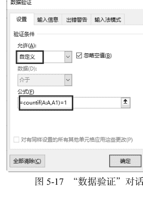

为防止学号重复录入，框选整列A，进入数据选项卡-数据工具-数据验证，规则选自定义，条件输入 =countif(A:A,A1)=1，按图 5-17 设置后确认即可。

求平均总分：在 I4 填入 =AVERAGE(F2:F41)。
保留两位小数：在 I5 填入 =ROUND(I4,2)。
统计低于200分人数：I6 填入 =COUNTIF(F2:F41,"<200")。
统计200至240分区间人数：I7 填入 =COUNTIFS(F2:F41,">=200", F2:F41,"<240")。
统计240至260分区间人数：I8 填入 =COUNTIFS(F2:F41,">=240",F2:F41,"<260")。
统计260分及以上人数：I9 填入 =COUNTIF(F2:F41,">=260")。

| 统计情况 | 统计结果 |

|---|---|

| 平均总分： | 234.975 |

| 四舍五入到小数点后2位的平均总分： | 234.98 |

| 总分小于200的人数： | 4 |

| 总分大于等于200，小于240的人数： | 18 |

| 总分大于等于240，小于260的人数： | 11 |

| 总分大于等于260的人数： | 7 |

图 5-18 计算结果

汇总结果如上图所示。

### 子任务 3：财务函数的使用

先通过 ChatGPT 梳理 Excel 中常见的财务函数清单，见图 5-19。

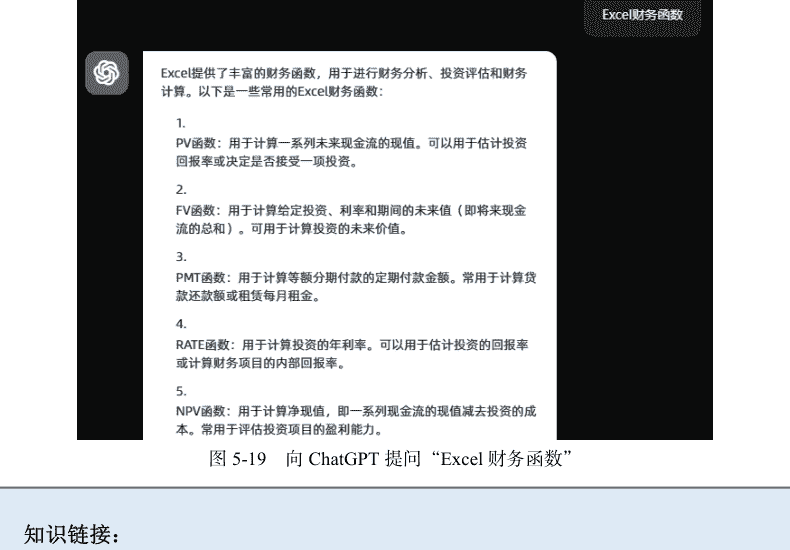

> **知识链接：**

Excel 提供了丰富的财务函数，用于进行财务分析、投资评估和财务计算。常用的财务函数有 PV、FV、PMT、RATE、NPV、IRR、NPER、PPMT、IPMT、CUMIPMT 等。

> **知识链接：**

**PMT 函数**

用途：基于固定利率及等额分期付款方式，返回贷款的每期付款额。

语法：PMT（rate,nper,pv,fv,type）

参数：rate 为贷款利率，nper 为该项贷款的付款总数，pv 为现值（也称为本金），fv 为未来值（或最后一次付款后希望得到的现金余额），type 指定各期的付款时间是在期初还是期末（1 为期初，0 为期末）。

**IPMT 函数**

用途：基于固定利率及等额分期付款方式，返回投资或贷款在某一给定期限内的利息归还额。

语法：IPMT（rate,per,nper,pv,fv,type）

参数：rate 为各期利率，per 用于计算其利息数额的期数（1 到 nper 之间），nper 为总投资期，pv 为现值（本金），fv 为未来值（最后一次付款后的现金余额。如果省略 fv，那么假设其值为零），type 指定各期的付款时间是在期初还是期末（0 为期末，1 为期初）。

打开 Sheet5，数据排布如图 5-20。


年化还款额：E2 写入 =PMT(B4,B3,B2,0,0)。
第16个月利息额：E3 写入 =IPMT(B4/12,16,B3*12, B2,0)。

还款相关结果如图 5-21。


### 子任务 4：HLOOKUP/VLOOKUP 函数的使用

> 知识链接：

HLOOKUP 为横向查找函数，VLOOKUP 为纵向查找函数。它们可以在复杂的数据中快速地查找并返回特定的值。

语法：HLOOKUP/VLOOKUP（lookup_value,table_array,row_index_num/col_index_num,range_lookup）

参数：lookup_value 为要查找的值，table_array 为要查找的区域，row_index_num/col_index_num 为返回数据在查找区域的第几行/第几列，range_lookup 为模糊匹配或精确匹配。

打开 Sheet6，局部表格见图 5-22。

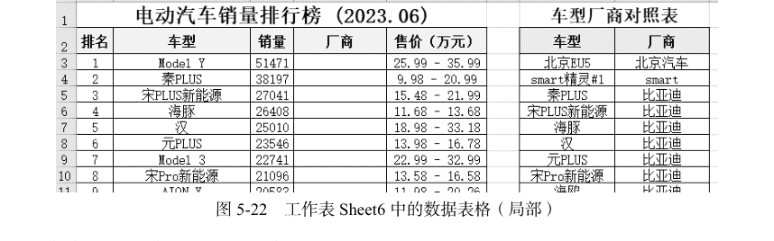

车型厂商查询：D3 写入 =VLOOKUP(B3,G:H,2,0)。
将 D3 的填充柄向下拉复制公式，厂商结果如图 5-23。

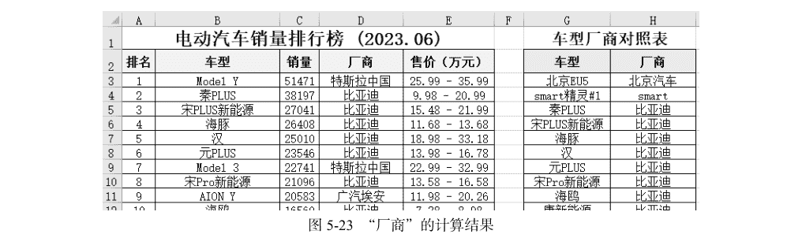

打开 Sheet7，数据如图 5-24。

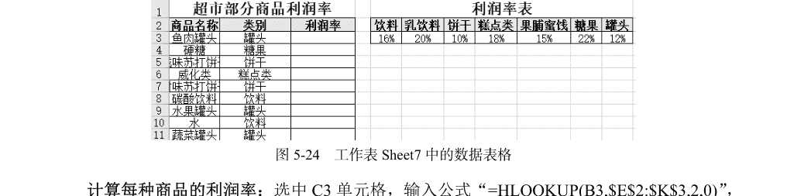

利润率查询：C3 写入 =HLOOKUP(B3,$E$2:$K$3,2,0)，向下填充后得到利润率，见图 5-25。


## 任务三 函数的高级使用

### 子任务 1：逻辑函数的嵌套使用

先向 ChatGPT 了解 Excel 逻辑函数的使用要点，见图 5-26。逻辑函数擅长条件判断，嵌套可让判断更复杂。闰年判定规则为：能被4整除且不能被100整除，或能被400整除。


判断思路：用 TODAY 与 YEAR 拿到当年，再用 MOD 取余，最后用逻辑函数得出结论。

当年是否闰年：在 Sheet8 的 B2 输入 =IF(OR(AND(MOD(YEAR(TODAY()),4)=0,MOD(YEAR(TODAY()),100)<>0),MOD(YEAR(TODAY()),400)=0),"是","否")。

结果见图 5-27。


### 子任务 2：INDEX/MATCH 函数的配合使用

先向 ChatGPT 了解 INDEX/MATCH 的用法，见图 5-28。


知识链接：

在 Excel 中，INDEX 函数和 MATCH 函数常常配合使用，用于在数据表中查找和提取特定值。

#### INDEX 函数

用途：返回某个区域或数组中指定位置单元格的值。

语法：INDEX(区域,行号,列号)

#### MATCH 函数

用途：在某个区域或数组中查找指定值的位置。

语法：MATCH(查找值,区域,匹配类型)

打开 Sheet9，表格如图 5-29。


用 INDEX/MATCH 提取三位应聘者信息：在 D18 输入 =INDEX($A$2:$I$15,MATCH($C18,$C$2:$C$15,0),MATCH(D$17,$A$2:$I$2,0))，再向右向下复制。结果见图 5-30。


### 子任务 3：其他函数的混合使用

智能序号及智能汇总的制作

> 知识链接：

CONCAT 函数

用途：将多个文本字符串连接在一起。

语法：CONCAT(文本 1,文本 2,...)

MROUND 函数

用途：将一个数值四舍五入到指定倍数的函数。

语法：MROUND(数值,进位倍数)

打开 Sheet10。

时间取整：在 C2 输入 =CONCAT(HOUR(B2),":",MROUND(MINUTE(B2),15))，结果如图 5-31。


## 任务四 创新性自我挑战

### 子任务 1：分析身份证号码的秘密

身份证号 18 位构成：
- 前 6 位为行政区划代码。
- 第 7 至 14 位为出生日期。
- 第 15 至 17 位为顺序码，奇数为男偶数为女。
- 第 18 位为校验码，由前 17 位计算得出。

打开 Sheet11，数据如图 5-32。


操作要点：
（1）借助 MID 与 CONCAT 截取出生日期，显示为“xxxx年xx月xx日”。
（2）借助 IF、MOD、MID 推断性别。
（3）借助 VLOOKUP 与 MID 解析省/市/自治区。
（4）借助 COUNTIF 统计男女人数并算出女性占比。

### 子任务 2：分析“学生体育成绩表”

打开 Sheet12，数据如图 5-33。

| 原学号 | 新学号 | 姓名 | 性别 | 100米成绩（秒） | 结果1 | 铅球成绩（米） | 结果2 |

|---|---|---|---|---|---|---|---|

| 2023018001 | | 陈培熙 | 男 | 12.35 | | 7.56 | |

| 2023018002 | | 杨雨婧 | 女 | 14.53 | | 8.45 | |

| 2023018003 | | 彭宇 | 女 | 16.11 | | 6.54 | |

| 2023018004 | | 郑文嘉 | 女 | 10.44 | | 9.10 | |

| 2023018005 | | 吴宇春 | 男 | 12.82 | | 6.89 | |

| 2023018006 | | 王宇景 | 男 | 11.60 | | 10.11 | |

| 2023018007 | | 张晨霖 | 男 | 16.32 | | 8.82 | |

| 2023018008 | | 周音苑 | 女 | 11.51 | | 6.90 | |

| 2023018009 | | 钱丽 | 女 | 14.61 | | 5.73 | |

| 2023018010 | | 胡艳红 | 女 | 16.67 | | 7.39 | |

| 2023018011 | | 邵航健 | 男 | 12.58 | | 8.25 | |

| 2023018012 | | 刘晶 | 女 | 14.28 | | 9.33 | |

图 5-33 工作表 Sheet12 中的数据表格

操作要点：
（1）用 REPLACE 及数组公式生成新学号，即在原学号第 4 位后插入“6”。
（2）用 IF 及逻辑函数计算结果 1、结果 2。
① 结果1：男生 <14.00 为合格，≥14.00 为不合格；女生 <16.00 为合格，≥16.00 为不合格。
② 结果2：男生 >7.50 为合格，≤7.50 为不合格；女生 >5.50 为合格，≤5.50 为不合格。
（3）铅球最好成绩填入 K4。
（4）结果1合格人数填入 K5。

## 【任务考评】

| 项目名称 | | | | | |

|---|---|---|---|---|---|

| 项目成员 | | | | | |

| 评价项目 | 评价内容 | 分值 | 自评 20% | 互评 30% | 师评 50% |

## 项目五 理论小测

| 类别 | 评价标准 | 分值 |

| :--- | :--- | :--- |

| 职业素养 (40%) | 具有良好的计算机使用习惯，爱护公共设施，环境整洁 | 5 |

| | 纪律性强，不迟到早退，按时完成承担的任务 | 10 |

| | 态度端正、工作认真、积极承担困难任务 | 5 |

| | 发现问题后能主动寻求解决办法，及时和教师、同学探讨 | 10 |

| | 团结合作意识强，主动帮助他人 | 10 |

| 专业能力 (60%) | 能使用基本运算符进行基本的运算 | 5 |

| | 了解绝对引用与相对引用的作用与区别 | 5 |

| | 能利用数组公式进行计算 | 10 |

| | 能利用数据库函数进行计算 | 10 |

| | 能利用财务函数进行计算 | 10 |

| | 能利用 VLOOKUP 和 HLOOKUP 函数进行计算 | 10 |

| | 能利用 INDEX 和 MATCH 函数的配合使用进行计算 | 10 |

| 合计 | 综合得分：___________ | 100 |

| 总结反思 | 1. 学到的新知识：<br><br>2. 掌握的新技能：<br><br>3. 项目反思：你遇到的困难有哪些，你是如何解决的？<br><br>学生签字： | |

| 综合评语 | 教师签字： | |

## 【能力拓展】

### 拓展训练 1：借助 ChatGPT 完成多条件查询任务

Excel 多条件查询可用自动筛选、高级筛选，也可使用 VLOOKUP、LOOKUP、数据库函数，或函数组合如 VLOOKUP+CHOOSE、OFFSET+MATCH、INDIRECT+MATCH 实现复杂查询。

请通过网络检索与 ChatGPT 问答，自行设计数据表并完成函数组合如 OFFSET+MATCH 的多条件查询。


### 拓展训练 2：Excel 级联菜单的实现

Excel 可用级联菜单实现下拉选项联动。例如学生信息表里，学院可从“学院”下拉菜单选择，图 5-34。选定学院后，“班级”下拉菜单自动显示该学院下的所有班级，图 5-35。选定班级后，“姓名”下拉菜单自动显示该班级的所有姓名，图 5-36。


请通过网络检索与 ChatGPT 问答，自行设计数据表并实现级联菜单。

## 【延伸阅读——数字之光，点亮数字中国美好未来】

中国互联网络信息中心第 52 次《中国互联网络发展状况统计报告》显示，截至 2023 年 6 月，我国网民规模达 10.79 亿人，互联网普及率达 76.4%；数字基础设施建设进一步加快，万物互联基础不断夯实；各类互联网应用持续发展，多类应用用户规模获得增长……数字赋能，你我共享美好的数字生活。

数智生活，万家共享

从人与人相连走向万物互联，数字生活场景日益丰富。5G 已渗透国民经济六十个大类，正加速向工业、医疗、教育、交通等重点领域拓展深化；信息无障碍能力持续增强，互联网的适老化改造也在不断推进；截至 2023 年 6 月，我国网络视频使用者规模达 10.44 亿，使用渗透率达 96.8%……报告显示，数字暖流已流进千家万户，借助云端智能共享发展红利，数字工具让衣食住行更便利，回应人民对美好生活的期待，为精彩生活增色，为百姓幸福添底色。

数字素养与技能已成为现代人的基础能力。报告指出，2023 年前半年各类数字产品服务渗透加快，网民数字技能水平稳步上升。截至 2023 年 6 月，能用数字化工具获取、存储、传输数字资源的网民，即至少具备一种初级数字技能的占比 86.6%；能用数字化工具制作、加工、处理数字资源的网民，即至少具备一种中级数字技能的占比 60.4%，较 2022 年 12 月提升 2.1 个百分点。顺应数字时代要求提升全民数字素养，既能提高国民素质、促进人的全面发展，也能弥合数字鸿沟、推动共同富裕，更好共享数字时代美好未来。

数据体量越大，发展动能越足。报告显示，截至 2023 年 6 月，网约车、在线旅行预订、网络文学的用户规模相比 2022 年 12 月分别增长 3492 万人、3091 万人、3592 万人，增速分别为 8%、7.3% 和 7.3%，是用户增长最快的三类应用。2023 年前半年全国网上零售额 7.16 万亿，同比增长 13.1%，信息传输、软件和信息技术服务业增加值增长 12.9%。发展提速为经济注入新动能。可以看出，推动大数据与实体经济深度融合，加快数字产业化和产业数字化进程，为千行百业赋能，数字经济展翅高飞，不仅助力市场信心稳定、经济回升向好，也为提升经济效率和高质量发展加力蓄势。

未来已至，与数同行。腾云驾数，数字浪潮奔涌，抢占新赛道、打造新引擎、激活新要素、构建新图景，数字之光正点亮数字中国美好未来。


# 项目六 图表展示：数据可视化分析

### 知识目标：

- 1. 掌握数据的排序、筛选操作。

- 2. 掌握数据的分类汇总操作。

- 3. 掌握合并计算的使用方法。

- 4. 掌握制作迷你图的方法。

- 5. 掌握图表的创建与编辑。

- 6. 掌握数据透视表、数据透视图的创建与编辑。

### 能力目标：

- 1. 能够运用数据可视化技术解决一些工作、学习中的实际问题。

- 2. 能够在复杂的数据表格中按条件筛选出所需信息。

- 3. 能够对复杂的数据表格进行分类统计与分析。

- 4. 能够对多个数据表格进行合并计算。

- 5. 能够根据数据表格创建出实用、简单明了的图表。

### 素养目标：

- 1. 培养信息获取与处理能力、批判性思维能力、问题解决能力、创新能力。

- 2. 培养综合素养，能够适应复杂多变的社会环境，具备持续学习和自我发展的能力。

- 3. 培养积极思考、敢于动手和不断探究新知识的欲望。

- 4. 培养正确的道德观、爱岗敬业的精神、严谨细致的工作作风、团队协作的职业素养。

## 【项目导读】

在 Excel 中，对数据进行可视化之前，通常需要先对数据进行预处理，如数据的排序、筛选、分类汇总、合并计算等。

数据可视化一般指通过可视化图表来显示或反映数据构成情况，提高数据可读性，能够更加直观地查看数据的变化和联系。Excel 中的可视化图表主要有迷你图、数据图表、数据透视表、数据透视图等。

## 【任务工单】

| 项目描述 | 本项目通过对多个实例的具体实践操作，掌握数据可视化分析、统计与处理的应用方法与技巧 |

| --- | --- |

| 任务名称 | 任务一 数据预处理<br>任务二 图表的创建、编辑与修饰<br>任务三 数据透视表和数据透视图的创建<br>任务四 创新性自我挑战 |

| 任务列表 | 任务要点 | 任务要求 |

| 1. 数据排序和筛选 | ● 数据排序<br>● 数据自动筛选<br>● 数据高级筛选<br>● 实例操作 | ● 对考试成绩数据进行排序、筛选操作 |

| 2. 数据分类汇总 | ● 数据分类汇总<br>● 实例操作 | ● 对 IT 企业员工信息表数据进行数据分类汇总 |

| 3. 数据合并计算 | ● 数据合并计算<br>● 实例操作 | ● 对员工考核数据进行合并计算 |

| 4. 制作迷你图 | ● 迷你图<br>● 实例操作 | ● 根据基本工资数据制作迷你图 |

| 5. 图表创建与编辑 | ● 图表创建与编辑<br>● 实例操作 | ● 根据员工奖金表数据制作图表<br>● 对某品牌的乙二醇浓度与沸点对照表中的数据进行图表拟合 |

| 6. 数据的拟合 | ● 数据拟合<br>● 实例操作 | ● 根据公务员考试成绩表创建数据透视表及数据透视图 |

| 7. 创建数据透视表 | ● 数据透视表<br>● 实例操作 | |

| 8. 创建数据透视图 | ● 数据透视图<br>● 实例操作 | |

| 9. 创新性自我挑战 | ● 任务分组<br>● 医院病人护理情况的统计与分析<br>● 公司员工人事信息的统计与分析 | ● 小组成员分工合理，在规定时间内完成 2 个子任务<br>● 探讨交流，互帮互助<br>● 内容充实有新意，格式规范 |

## 【任务分析】

数据可视化分析与处理包括数据预处理和可视化图表的生成与编辑。通过数据预处理，确保数据的规范性及确定生成图表的数据源。通过可视化图表的生成与编辑，获得合适的图表类型及所需的图表效果。

数据可视化应该遵循一些原则，如可读性、实用性、清晰性、完整性等。遵循这些原则可以更合理地对数据进行可视化分析与处理。

Excel 中有众多图表类型，我们需要充分熟悉各种图表类型的特点和用途，在对数据进行可视化分析与处理应根据需要选用最适合的图表类型。

Excel 数据的可视化分析与处理主要包括以下内容。

- 数据格式化：在进行数据可视化分析前，确保数据的格式正确。

- 排序和筛选：排序和筛选用于快速定位和比较数据，排序功能可以让数据表格按单个或多个字段进行有序排列，筛选功能可以筛选出数据表格中符合条件的数据。

- 数据图表：Excel 提供了丰富的数据图表类型，如柱状图、折线图、饼图、散点图、圆环图、迷你图等，可以选择合适的图表来展示数据。

- 数据透视表/数据透视图：数据透视表是一种用于汇总和分析数据的工具，可以根据需要选择数据字段、行字段、列字段和值字段，利用 Excel 生成一个可交互的报表。数据透视图是根据数据透视表内容自动生成的与之相对应的图表。

## 【任务实施】

### 任务一 数据预处理


记录排序

自动筛选和高级筛选

#### 子任务 1：数据的排序和筛选

数据的排序和筛选是 Excel 中数据处理的基本功能之一。可以实现按照特定的列或行对数据表格中的数据进行重新排序，还可以根据需要进行多次排序。可以在数据表格中按照给定的条件筛选出所需数据，筛选又分自动筛选和高级筛选两种方式。

先打开素材文件夹中的素材文件“图表.xlsx”，工作表 Sheet1 中的数据表格（局部）如图 6-1 所示。

| A | B | C | D | E | F | G | H | I |

|---|---|---|---|---|---|---|---|---|

| 学号 | 姓名 | 性别 | 劳动技术 | 形势与政策 | 音乐技能 | 总分 | 排名 | 优等生 |

| 20230101 | 何佳津 | 男 | 95 | 85 | 80 | 260 | 5 | 是 |

| 20230102 | 杨澄宇 | 男 | 78 | 75 | 64 | 217 | 29 | 否 |

| 20230103 | 王振阳 | 男 | 66 | 69 | 75 | 210 | 30 | 否 |

| 20230104 | 马豪俊 | 男 | 94 | 90 | 91 | 275 | 1 | 是 |

| 20230105 | 戴文博 | 男 | 84 | 87 | 88 | 259 | 6 | 是 |

| 20230106 | 何翊珂 | 女 | 72 | 68 | 85 | 225 | 24 | 否 |

| 20230107 | 汪雨荷 | 女 | 85 | 71 | 76 | 232 | 18 | 否 |

| 20230108 | 王泽安 | 男 | 88 | 80 | 75 | 243 | 13 | 否 |

| 20230109 | 谢静宇 | 女 | 78 | 80 | 76 | 234 | 17 | 否 |

| 20230110 | 尚秀琴 | 女 | 94 | 87 | 82 | 263 | 4 | 是 |

| 20230111 | 何苗苗 | 女 | 60 | 67 | 71 | 198 | 34 | 否 |

图 6-1 工作表 Sheet1 中的数据表格（局部）

#### 操作过程：

（1）对工作表 Sheet1 中的考试成绩数据按照性别升序、总分降序进行排序。

在工作表 Sheet2 中，选中数据表格中的任一数据单元格，单击“数据”选项卡中“排序和筛选”选项组的“排序”按钮。在打开的“排序”对话框中，设置“主要关键字”为“性别”，“次序”为“升序”。单击“添加条件”按钮，设置“次要关键字”为“总分”，“次序”为“降序”，如图 6-2 所示，单击“确定”按钮。工作表 Sheet1 中的数据表格的排序结果（局部）如图 6-3 所示。


图 6-2 “排序”对话框

| A | B | C | D | E | F | G | H | I |

|---|---|---|---|---|---|---|---|---|

| 学号 | 姓名 | 性别 | 劳动技术 | 形势与政策 | 音乐技能 | 总分 | 排名 | 优等生 |

| 20230104 | 马豪俊 | 男 | 94 | 90 | 91 | 275 | 1 | 是 |

| 20230130 | 盛天宇 | 男 | 94 | 90 | 88 | 272 | 3 | 是 |

| 20230101 | 何佳津 | 男 | 95 | 85 | 80 | 260 | 5 | 是 |

| 20230105 | 戴文博 | 男 | 84 | 87 | 88 | 259 | 6 | 是 |

| 20230118 | 薛立昆 | 男 | 82 | 87 | 88 | 257 | 8 | 是 |

| 20230131 | 杨奇俊 | 男 | 84 | 87 | 83 | 254 | 9 | 是 |

| 20230124 | 袁成志 | 男 | 81 | 83 | 89 | 253 | 10 | 是 |

| 20230123 | 邓小龙 | 男 | 80 | 87 | 82 | 249 | 12 | 是 |

| 20230108 | 王泽安 | 男 | 88 | 80 | 75 | 243 | 13 | 否 |

| 20230121 | 杨邱 | 男 | 87 | 80 | 75 | 242 | 14 | 否 |

图 6-3 工作表 Sheet1 中的数据表格的排序结果（局部）

（2）在工作表 Sheet2 的考试成绩数据中，使用筛选（自动筛选）功能筛选出排名在前 15 名的女生数据。

在工作表 Sheet2 中，选中数据表格中的任一数据单元格，单击“数据”选项卡中“排序和筛选”选项组的“筛选”按钮。单击“性别”单元格的下拉按钮，在弹出的下拉菜单中取消勾选“男”复选框，如图 6-4 所示，最后单击“确定”按钮。


图 6-4 取消勾选“男”复选框

单击“排名”单元格的下拉按钮，在弹出的下拉菜单中选择“数字筛选”→“前 10 项”命令，如图 6-5 所示。在打开的“自动筛选前 10 个”对话框中，设置“显示”为“最小 15 项”，如图 6-6 所示，最后单击“确定”按钮。


工作表 Sheet2 中的数据表格的筛选结果如图 6-7 所示。

| 1 | 学号 | 姓名 | 性别 | 劳动技 | 形势与政 | 音乐技 | 总分 | 排名 | 优等生 |

|---|---|---|---|---|---|---|---|---|---|

| 11 | 20230110 | 尚秀芬 | 女 | 94 | 87 | 82 | 263 | 4 | 是 |

| 13 | 20230112 | 宋苏婷 | 女 | 81 | 83 | 87 | 251 | 11 | 是 |

| 18 | 20230117 | 汤优 | 女 | 94 | 89 | 91 | 274 | 2 | 是 |

| 28 | 20230127 | 周梦瑶 | 女 | 75 | 85 | 81 | 241 | 15 | 否 |

| 37 | 20230136 | 杨雨婷 | 女 | 94 | 82 | 82 | 258 | 7 | 否 |

| 38 | | | | | | | | | |

图 6-7 工作表 Sheet2 中的数据表格的筛选结果

（3）在工作表 Sheet3 的考试成绩数据中，使用高级筛选功能筛选出优等生或总分大于 210 的男生数据。

在工作表 Sheet3 中，在数据表格的下方任一空白区域根据筛选条件创建条件区域，如图 6-8 所示。

选中数据表格中的任一数据单元格，单击“数据”选项卡中“排序和筛选”选项组的“高级”按钮。在打开的“高级筛选”对话框中，设置列表区域、条件区域，如图 6-9 所示，最后单击“确定”按钮。

| 优等生 | 总分 | 性别 |

|---|---|---|

| 是 | | |

| | >210 | 男 |


> 小提示：

数据分析是指使用各种统计学和计算机科学的方法，对数据进行分析、处理、解释和展示，以获取有用的信息和知识。在工作中进行数据分析时应该灵活运用这一方法，从大量数据中提取有价值的信息和知识，为企业决策提供科学的依据和支持。

工作表 Sheet3 中的数据表格的筛选结果如图 6-10 所示。


## 子任务 2：数据分类汇总

Excel 中的分类汇总功能可以实现对数据的分类汇总、统计和分析。它可以将数据分门别类地进行统计处理，自动对各类别的数据进行求和、求平均值、统计个数、求最大值（最小值）等多种计算，并且分级显示汇总的结果，使我们能够快捷地获得需要的数据，并准确地做出判断。

在本任务中，打开工作表 Sheet4，其中的 IT 企业员工信息表如图 6-11 所示。


本任务具体要求：

在工作表 Sheet4 的 IT 企业员工信息表数据中，使用分类汇总命令统计出各学历的人数，结果显示在“学位”列，显示到第 2 级。

操作过程：

先按“学位”字段升序排序，再选中数据表格中的任一数据单元格，单击“数据”选项卡中“分级显示”选项组的“分类汇总”按钮。在打开的“分类汇总”对话框中，设置“分类字段”为“学历”，“汇总方式”为“计数”，“选定汇总项”为“学位”，如图 6-12 所示，最后单击“确定”按钮。

# 项目六 图表展示：数据可视化分析


单击窗口左上角的级别“2”按钮。工作表 Sheet4 中的数据表格的分类汇总结果如图 6-13 所示。


## 子任务 3：数据合并计算

我们先向 ChatGPT 提问，让它告诉我们 Excel 中数据合并计算的操作步骤，如图 6-14 所示。


在 Excel 中，合并计算是指对含有相同表格结构的多个数据区域进行快速合并计算，合并计算方式包括求和、计数、平均值、最大值、最小值、乘积等。

在本任务中，打开工作表 Sheet5，其中的员工各季度考核表及年度考核表的原始表如图 6-15 所示。


本任务具体要求：

在工作表 Sheet5 中，根据四个季度的员工考核数据，使用合并计算功能计算出年度员工考核数据。使用公式计算出年度员工考核总成绩：年度总成绩=出勤量*0.2+工作态度*0.3+工作能力*0.5。

操作过程：

选中年度考核表中的 O3 单元格，单击“数据”选项卡中“数据工具”选项组的“合并计算”按钮。在打开的“合并计算”对话框中，设置“函数”为“平均值”，在“所有引用位置”文本框中添加四个季度的考核数据区域“C3:E11”“I3:K11”“C15:E23”“I15:K23”，如图 6-16 所示，最后单击“确定”按钮，即可得到 O3:E11 区域中的所有数据。


在单元格 R3 中输入公式“=O3*0.2+P3*0.3+Q3*0.5”，双击 R3 单元格右下角的填充柄自动向下填充公式。年度考核表的计算结果如图 6-17 所示。


图 6-17 年度考核表 计算结果

## 任务2 图表制作与润色

### 子任务1 迷你图制作

先请 ChatGPT 说明 Excel 迷你图的作用与制作思路，对话截图见图 6-18。


图 6-18 向 ChatGPT 咨询“Excel 迷你图”

迷你图是 Excel 提供的单单元格微型可视化形式，能在极小空间呈现数据的构成或走势。

本次操作打开 Sheet6，基础工资清单如图 6-19 所示。


图 6-19 Sheet6 里的基础工资表

要求说明：

依据 Sheet6 基础工资列的数值，在 D13 单元格生成一张个性化的柱形迷你图。

操作要点：

框定基础工资区域 E3:E11，切换到“插入”标签，在迷你图分组中点选“柱形”。在“创建迷你图”对话框里把数据范围设为 E3:E11，放置位置设为 $D$13，如图 6-20 所示，确认。

随后在迷你图工具的设计页，把显示方式改为高点，颜色改为紫色，最终效果如图 6-21。


### 子任务2 图表生成与美化

打开 Sheet7，内部数据清单如图 6-22。


要求说明：

基于员工奖金表中姓名与奖金两列，在 Sheet7 内生成一张个性化的三维饼图。

操作要点：

按住 Ctrl 框选姓名列与奖金列的数据范围，点击“插入”标签图表分组中的“插入饼图或环形图”，在下拉菜单中选中“三维饼图”，生成效果如图 6-23。

选中新建的三维饼图，切到图表工具的设计标签，点“图表布局”分组的快速布局，选择“布局4”。在图表样式分组中点“样式8”。再点“添加图表元素”，选择“图表标题→图表上方”，如图 6-24。


把标题文字改为“员工奖金”，颜色改成深红，字号改成20，调整后的效果如图 6-25。


### 子任务3 数据拟合

> **知识链接：**
分析时常需要对成组数据进行拟合，以把握分布规律、探明变量关系并提取信息。
Excel 可借助图表生成散点图，用曲线拟合点位并自动给出拟合方程及 $R^2$ 值。

本次打开 Sheet8，内部数据清单如图 6-26。


图 6-26 Sheet8 里的 数据表

要求说明：

对某品牌乙二醇浓度与沸点对照数据做图表拟合，求出直线方程和 $R^2$ 值。

操作要点：

按 Ctrl 框选“浓度（%）”列与“沸点（℃）”列，点击“插入”标签图表分组中的“插入散点图或气泡图”，在菜单中选“散点图”。


选中散点图，点“添加图表元素”，选择“趋势线→线性预测”。

双击趋势线，在设置区勾选“显示公式”与“显示 R 平方值”。调整后效果如图 6-27。

图 6-27 调整后的散点图

由图可知，拟合直线为 $y = 1.2864x + 164.96$ 且 $R^2=0.9977$。因 $R^2>0.99$，该模型线性特征十分明显。

## 任务3 数据透视与透视图构建


数据透视表及透视图的创建

### 子任务1 透视表创建

> **知识链接：**
数据透视表是对清单数据进行汇总统计的交互式分析工具。

本次打开 Sheet9，内部数据清单如图 6-28。


图 6-28 Sheet9 里的 数据表

要求说明：

在 Sheet9 中创建透视表，统计公务员考试成绩表中各学位的男女人数，起始单元格为 K3。

操作要点：

选定数据表任意单元格，点击“插入”标签表格分组的“数据透视表”。在创建对话框中设定表/区域与放置位置，如图 6-29，确认。

在透视字段面板中，勾选“学位”拖至行区，勾选“性别”拖至列区，勾选“姓名”拖至值区，如图 6-30。


图 6-29 创建数据透视表对话框

图 6-30 透视字段面板

生成效果如图 6-31。


图 6-31 生成的透视表效果

### 子任务2 透视图创建

> **知识链接：**
透视图以图表形式直观呈现透视表内容，创建思路与透视表类似。

**要求说明：**

在 Sheet10 中创建透视表及透视图，计算各学位不同性别学生的平均总成绩。表图置于新工作表，透视表的总计仅对列启用，并为表图分别创建“学位”与“性别”切片器。

**操作要点：**

选定 Sheet10 数据表任意单元格，点击“插入”标签图表分组的“数据透视图”。在创建对话框中设定表/区域与放置位置，如图 6-32，确认。

在透视字段面板中，勾选“学位”拖至轴区，勾选“性别”拖至图例句，勾选“总成绩”拖至值区。点击值区“求和项:总成绩”右侧下拉，选择“值字段设置”，在对话框中把计算类型改为“平均值”，如图 6-33，确认。


生成的效果如图 6-34。

> **小提示：**
使用创建数据透视图功能可同时得到透视表与透视图。

# 项目六 图表展示：数据可视化分析


把透视表全部数据对齐设为居中，数值小数位数设为 2 位。

在透视表工具的设计标签中，点布局分组的“总计”下拉，选择“仅对列启用”。

在透视表工具的分析标签中，点筛选分组的“插入切片器”。在插入对话框中勾选“性别”和“学位”，如图 6-35，确认。


为两个切片器分别设置合适的样式。通过切片器可筛选显示各学位各性别的透视表与透视图，效果如图 6-36。


## 任务4 自主创新挑战

### 子任务1 医院护理情况统计与分析

打开 Sheet11，内部数据清单如图 6-37。


要求说明：

- 基于医院病人护理情况数据创建透视表及透视图，置于新工作表，呈现各护理等级在男女上的护理费用汇总。
- 把透视图的图表布局设为布局5，图表样式设为样式7，标题改为“护理费用汇总统计图表”，坐标轴标题改为“护理费用合计”。
- 为透视表与透视图添加切片器，以便筛选不同护理等级、性别的费用汇总。

### 子任务2 公司人事信息统计与分析

打开 Sheet12，内部数据清单如图 6-38。


要求说明：

- 用分类汇总功能统计各部门人数，结果填入电话号码列。
- 设置汇总显示层级为 3 级，每组数据分页呈现。
- 在原区域显示筛选结果。

打开 Sheet13，其数据清单与 Sheet12 相同。

**操作要求：**

- 筛选销售部 2023 年 1 月 1 日后入职的员工信息，或筛选销售部学历为本科且姓李的员工信息。
- 在原区域显示筛选结果。

## 【任务考评】

| 项目名称 |  |
|---|---|
| 项目成员 |  |
| 评价项目 | 评价内容 | 分值 | 自评 20% | 互评 30% | 师评 50% |
| 职业素养 (40%) | 保持良好电脑使用习惯，爱护公物，保持环境整洁 | 5 |  |  |  |
|  | 纪律性强，不迟到早退，按时完成分工任务 | 10 |  |  |  |
|  | 态度端正、工作认真，乐于承担困难任务 | 5 |  |  |  |
|  | 主动寻求问题解决办法，及时与教师同学交流 | 10 |  |  |  |
|  | 团队协作意识强，乐于助人 | 10 |  |  |  |
| 专业能力 (60%) | 能对数据进行排序与筛选 | 10 |  |  |  |
|  | 能对数据进行分类汇总 | 10 |  |  |  |
|  | 能对数据进行合并计算 | 10 |  |  |  |
|  | 能制作并编辑图表 | 10 |  |  |  |
|  | 能制作迷你图 | 5 |  |  |  |
|  | 能进行简单数据拟合 | 5 |  |  |  |
|  | 能制作数据透视表及数据透视图 | 10 |  |  |  |
| 合计 | 综合得分：___________ | 100 |  |  |  |
| 总结反思 | 1. 学到的新知识：<br>2. 掌握的新技能：<br>3. 项目反思：遇到的困难及解决办法？<br>学生签字： |  |  |  |  |
| 综合评语 | 教师签字： |  |  |  |  |

## 【能力拓展】

### 拓展训练1 数据模拟、运算与预测

数据模拟分析、运算与预测是数据科学和统计学领域的常见工作，旨在基于已有数据运用数学建模与统计分析研究特征规律与趋势，并通过模拟预测未来情况。

在生产领域，科学决策有助于实现最佳经济效益。生产决策涉及生产什么、生产多少、如何生产等问题。借助 Excel 规划求解功能可解决经济效益最优的生产决策问题。

问题：某厂生产甲、乙两种产品，生产 1 吨甲产品需 A、B、C 原料各 8 吨、5 吨、4 吨，利润 9 万元；生产 1 吨乙产品需 A、B、C 各 6 吨、5 吨、9 吨，利润 12 万元。现有原料 A、B、C 分别 360 吨、250 吨、350 吨，求甲、乙各生产多少吨利润最大，最大利润为多少万元？

请借助互联网及 ChatGPT 结合 Excel 规划求解功能求解。

### 拓展训练2 交互式图表创建

交互式图表可通过鼠标悬停、单击等操作动态显示内容或效果，增强图表交互性。

Excel 中可通过控件、VBA 编程等方式创建交互式图表。

例如，通过选择不同考试科目，动态显示对应科目的学生成绩统计图表，动态效果如图 6-39。


请借助互联网及 ChatGPT，自行设计一份 Excel 数据表，使用控件完成如图 6-39 的交互式图表创建。

## 【延伸阅读——从数据处理到智能决策】

随着人工智能关注度与需求提升，ChatGPT 在自媒体、科技、商业等领域被广泛应用。ChatGPT 本身是自然语言处理技术，对数据分析行业影响较大。

# 项目六 图表展示：数据可视化分析

首先，ChatGPT 在文本处理与理解上具有独到优势。

ChatGPT 为分析和理解用户生成文本数据提供了新方式，包括社交媒体、在线评论、客户反馈等。借助 ChatGPT，数据分析师能更精准地识别与分类用户意见、情感及行为，从而把握需求与行为模式，为业务决策提供支撑。同时，ChatGPT 能依据上下文推断隐含信息，使分析结果更具适应性。

其次，ChatGPT 可帮助汇总数据、筛选资料并生成客观分析报告。

ChatGPT 擅长汇总市场数据与信息，并可用于自然语言生成，帮助分析师高效生成报告、摘要等文本内容，节省大量时间精力。

此外，ChatGPT 还可用于自然语言处理的自动化任务，如问答系统、虚拟助手等。例如，摘要生成器可从文章中提取要点生成简洁摘要，内容生成器可根据主题与关键词生成相关文章等。这些技术有助于分析师更好地与数据交互，挖掘数据价值。


项目六理论小测

## 项目七

### 博学宏才：控件和 VBA 编程

### 知识目标：

1. 理解 Excel 控件的概念、种类和用途，包括表单控件、ActiveX 控件等。
2. 掌握 Excel 宏的基本概念和创建宏的方法。
3. 理解 VBA 编程的基本原理和语法规则。

### 能力目标：

1. 能够使用 Excel 控件进行数据输入、交互和分析，提高工作效率。
2. 能够创建和编辑 Excel 宏，实现自动化的任务和操作。
3. 能够编写和修改 VBA 代码，实现自定义的功能和逻辑。

### 素养目标：

1. 培养学习和探索的兴趣，能够主动学习和应用新的 Excel 功能和技巧。
2. 发展创新思维和设计能力，能够分析和解决在使用 Excel 控件、宏和 VBA 过程中遇到的问题。
3. 培养团队合作和沟通能力，能够与他人分享和交流关于 Excel 控件、宏和 VBA 编程的知识和经验。

## 【项目导读】

在信息化时代，Excel 被广泛应用于数据分析、报表制作、项目管理等领域，同时提供完整的编程工具，允许用户创建复杂自定义函数与自动化任务，其中包括 Excel 控件、宏和 VBA。Excel 控件是一种用户界面元素，如按钮、复选框、下拉列表等，可绑定特定操作或宏，优化交互体验。VBA 是微软 Office 套件提供的编程语言，用户可用 VBA 编写复杂脚本，定制和扩展 Excel 功能，更高效处理复杂数据和任务，展现专业技能与素养。

## 【任务工单】

| 项目描述 | 本项目使用 Excel 控件和 VBA 进行更灵活的数据处理及用户交互，同时利用宏和 VBA 实现自动化的任务及定制化的功能 |
| --- | --- |
| 任务名称 | 任务1 控件的使用<br>任务2 VBA 与宏的使用<br>任务3 创新性自我挑战 |
| 任务列表 | 任务要点 | 任务要求 |

# Excel 控件与 VBA 从认知到实战

| 1. 利用 ChatGPT 入门 Excel 控件 | ● 控件的基础概念 ● 控件的操作思路 | ● 项目实现能力：独立构思并完成一个具备实际用途的应用，将控件合理布局并用 VBA 编写交互逻辑。成果可为表单、工作表或宏，用于解决某个具体问题 |
| 2. 表单控件实操 | ● 添加表单控件 ● 调整控件属性 ● 实现数据录入与选择 ● 执行数据校验与处理 | ● 代码规范与结构：代码需可读、可维护。考核重点为命名规范、注释恰当、结构模块化、排版合理 |
| 3. ActiveX 控件实操 | ● 插入 ActiveX 控件（如组合框） ● 连接数据源并指定链接单元格 ● 对控件进行美化 ● 扩展功能（如成绩查询） | ● 功能拓展与创新：额外体现 VBA 理解与技巧，通过新增功能或创新设计提升项目价值与实用度 |
| 4. 利用 ChatGPT 认识 VBA 与宏 | ● 宏的基本用法 ● VBA 与宏的关系 |  |
| 5. 制作一个基础宏 | ● 启动宏录制 ● 为宏命名 ● 完成指定操作。例如，先在 A1:A5 填入数值，再在 A6 求和 ● 停止录制 ● 运行宏 ● 查看生成代码 |  |
| 6. 用 VBA 复现宏功能 | ● 以 VBA 手写数据输入与求和逻辑 ● 借助 ChatGPT 优化代码 |  |
| 7. 创新自测挑战 | ● 分组任务 ● 用滚动条寻找最优市场定价 ● 用控件与 VBA 设计登录界面 | ● 小组成员分工合理，限时完成 3 个子任务 ● 充分讨论、互相协作 ● 内容充实有新意，格式规范 |

## 【任务分析】

要在 Excel 里熟练使用控件、宏和 VBA，确实需要一定的技术积累和编程观念，对初学者来说容易觉得吃力，涉及语法规则、对象模型、事件处理等知识点。理解原理只是第一步，更重要的是把这些能力迁移到真实项目中。借助 ChatGPT 可以快速补齐知识盲区，高效攻克实际问题，在实践与交流中沉淀经验，并一起探索更进阶的应用技巧。

## 【任务实施】

### 任务一 控件的使用

#### 子任务 1：借助 ChatGPT 了解 Excel 控件

Excel 控件本质上是增强表格交互与功能的可视化元素，让用户可以用图形化方式操作数据，支持输入、展示、筛选等多种场景。可以先向 ChatGPT 发问，获取控件使用方法，如图 7-1 所示。


图 7-1 向 ChatGPT 提问 “请你详细介绍一下 Excel 中控件的使用方法”

Excel 控件主要分为表单控件与 ActiveX 控件两类，如图 7-2 所示。


图 7-2 Excel 的表单控件与ActiveX控件

> **知识链接：**

常见的 ActiveX 控件包括：

（1）“复选框”用于多选场景。
（2）“组合框”提供下拉选择，可单选亦可手动输入不在列表中的内容。
（3）“命令按钮”用于触发或取消程序执行。
（4）“图像”用于展示图形。
（5）“标签”用于显示文字说明。
（6）“列表框”用于展示列表，可单选或多选。
（7）“选项按钮”用于单选。
（8）“滚动条”用于调节数值，通过拖动改变对应值。
（9）“数值调节钮”通过点击上下箭头调整数值。
（10）“文本框”用于文字输入。
（11）“切换按钮”在开启与关闭两种状态间切换。

“控件工具箱”中还集成 Excel 及其他程序提供的 ActiveX 控件，如 Windows Media Player 等。但并非所有 ActiveX 控件都支持直接放置到工作表，部分只能在 VBA 用户窗体中使用，强行插入时会提示“不能插入对象”。

使用控件的常规流程是：在“开发工具”选项卡中插入表单控件或 ActiveX 控件，设置相关属性如名称、尺寸、位置、字体、颜色等，必要时为控件编写事件代码，例如 ActiveX 控件可通过 VBA 绑定事件响应用户操作，最后按“F5”运行宏或直接点击控件测试。

> **小提示：**

表单控件仅能放在工作表中使用，通常只能通过设置格式或指定宏来驱动。ActiveX 控件既可用于工作表，也可用于用户窗体，且属性与事件更丰富，能提供更多交互方式。

#### 子任务 2：表单控件的使用

下面用两个案例演示表单控件的用法。第一个案例使用“选项按钮”实现动态图表。如图 7-3 所示，A1:F13 为部分商品月度销量数据，右侧为对应的销售折线图，点击不同商品的选项按钮即可切换折线并高亮最大值。


操作步骤：

（1）先在表内插入 5 个选项按钮，分别命名为“显示器”“CPU”“内存”“硬盘”“音箱”，使其顶端对齐横向排布。选中其中一个按钮，在“设置控件格式”对话框的“控制”页签中，将“单元格链接”设为 I4，确认后关闭，如图 7-4 所示。


（2）把 A1:A13 复制到 J6:J18，K6 填入公式“=INDEX(B1:F1,$I$4)”，再向下填充至 K18，如图 7-5 所示。


完成公式后，切换选项按钮即可动态引用对应商品的数据，如图 7-6 所示。


（3）在 L 列创建辅助列，L7 输入公式并向下复制。

```
=IF(K7=MAX($K$7:$K$18),K7,NA())
```

该公式用于提取“内存”列的最大值，以便在图表中标注，数据源加入辅助列后如图 7-7 所示。


（4）选中 J6:L18 生成折线图，在“图表工具”的“格式”选项卡中打开图表元素，选择“系列‘最大值’”，点击“设置所选内容”，在“设置数据系列格式”对话框的“填充与线条”中切换到“标记”，设置为内置圆点，大小 8，无填充，红色实线边框，宽度 1.75 磅。随后在图表右上角添加数据标签，打开“设置数据标签格式”，在“标签选项”中勾选“系列名称”，分隔符设为“换行”，效果如图 7-8 所示。


（5）将选项按钮置于图表上方并与图表组合，完成动态折线图，如图 7-9 所示。


第二个案例用复选框控制商品销量折线图显示。如图 7-10 所示，A1:F13 为月度销量，右侧为折线图，勾选相应复选框即可显示该商品曲线，取消则隐藏。


操作步骤：

（1）在工作表插入 5 个复选框，分别命名为“显示器”“CPU”“内存”“硬盘”“音箱”，顶端对齐横向排列。勾选“显示器”复选框，在“设置控件格式”对话框的“控制”页签中，将“单元格链接”指向 J2，其余复选框依次链接到 K2、L2、M2、N2，如图 7-11 所示。


（2）把 A1:A13 复制到 I5:I17，B1:F1 复制到 J5:N5。在 J6 输入公式“=IF($J$2,B2,NA())”，向下复制到 J17，如图 7-12 所示。


（3）按相同方式在 K6、L6、M6、N6 输入对应公式并向下复制。

```
=IF($K$2,C2,NA())
=IF($L$2,D2,NA())
=IF($M$2,E2,NA())
=IF($N$2,F2,NA())
```

用户勾选复选框时，辅助表会引用源数据，未勾选则显示“#N/A”，如图 7-13 所示。


（4）选中 I5:N17 创建折线图，勾选或取消复选框即可动态显示或隐藏对应折线，如图 7-14 所示。


（5）将图表标题改为“商品每月销量统计图”，图例移至右侧，把上方复选框对齐图例并去掉原名，最后将复选框与图表组合，效果如图 7-15 所示。


#### 子任务 3：ActiveX 控件的使用

ActiveX 控件可自定义外观、行为、字体等，灵活性强，既可用于工作表也可用于 VBA 用户窗体。用户操作会触发相应事件，也可通过宏代码响应事件。

下面通过一个案例学习 ActiveX 控件。

在 F2 制作“姓名”下拉菜单，选择姓名后自动显示对应分数，效果如图 7-16 所示。


（1）点击“开发工具”选项卡中“插入”按钮，在 ActiveX 控件区选择“组合框”，如图 7-17 所示。


（2）按住鼠标左键在 F2 单元格内拖出合适大小的组合框。
（3）选中组合框右键，选择“属性”，如图 7-18 所示。


（4）在属性对话框中，将“LinkedCell”设为“F2”，“ListFillRange”设为“A2:A10”，如图 7-19 所示。


（5）点击“设计模式”按钮退出设计状态，如图 7-20 所示。


此时点击下拉按钮即可展开姓名列表，初始效果如图 7-21 所示。


> **小提示：**

ActiveX 控件与表单控件不同，可直接返回文本。选中 F2 链接单元格，可看到下拉项的文本内容，这是 ActiveX 的优势之一，如图 7-22 所示。


（6）分数查询可借助 VLOOKUP 完成。在 G2 输入公式“=VLOOKUP($F$2,$A:$D,COLUMN(B1),0)”，注意绝对与相对引用，向右复制即可实现成绩查询，如图 7-23 所示。


至此下拉菜单的基础功能完成。

ActiveX 控件还支持美化：

（7）进入设计模式。
（8）选中组合框右键打开属性，修改“BackColor”设置背景色，如图 7-24 所示。


（9）点击“Font”右侧按钮，设置字体、字形、字号等，关闭属性对话框。
（10）退出设计模式，即可得到个性化下拉菜单，最终效果如图 7-25 所示。


图 7-25 组合框实现分数查询的最终效果

### 任务二 VBA 与宏的使用

#### 子任务 1：借助 ChatGPT 了解 VBA 与宏


VBA 是一种扩展 Microsoft Office 功能的编程语言，常用于扩展 Excel 功能并实现自动化，提升办公效率。宏可用于录制操作序列或自动生成 VBA 代码，能简化自动化实现，但逻辑复杂时仍需手写 VBA。

不清楚用法时可先向 ChatGPT 提问，了解概念与方法，如图 7-26 所示。


图 7-26 借助 ChatGPT 了解宏与 VBA

> **小提示：**

宏录制的流程为：
（1）“开发工具”选项卡中点击“宏”按钮。
（2）在“宏”对话框中输入名称。
（3）点击“创建”，Excel 开始记录操作。
（4）操作完成后点击“停止录制”。

> **知识链接：**

编写和编辑 VBA 代码的方法：
（1）“开发工具”选项卡中点击“Visual Basic”打开编辑器。
（2）在编辑器中编写、修改代码。
（3）VBA 可实现条件判断、循环、函数等复杂逻辑。

#### 子任务 2：创建一个简单的宏

下面演示简单宏的制作，可借助 ChatGPT 生成宏，如图 7-27 所示。


按提示创建名为“ShowDateTime”的宏后，运行方式如下：

（1）选中目标单元格，如 A1。
（2）按 Alt+F8 或点击“开发工具”中的“宏”按钮。
（3）在对话框中选择“ShowDateTime”并执行。
（4）单元格显示当前日期时间，结果如图7-28所示。


> **小提示：**

Excel 2019 启用宏的操作：文件菜单 → 选项 → 信任中心 → 信任中心设置 → 宏设置，启用所有宏并勾选“信任 VBA 对象模型访问”，确定即可。

> **小提示：**

宏启用后的存储与安全提示

工作簿中加载并运行宏后，保存务必选用 .xlsm 后缀。打开含宏文件时顶部常会出现安全横幅提示宏遭阻止。确认来源可信后点击旁边的启用内容即可激活宏，黄色警告条随即消失。

【课堂演练】参照任务二子任务1提示的录制步骤，新建名为 sumHong 的宏，在空表的 A1 至 A5 分别填入 1、2、3、4、5，并在 A6 做求和。

子任务3：借助 VBA 实现同等功能

录制完毕后可用 Alt+F11 进入编辑器，也可在开发工具选项卡中经宏→编辑打开代码区，自动生成的语句见图7-29。


项目七 博学宏才：控件和 VBA 编程


图7-29 反映了手工操作与 VBA 指令的对应。人工手写的 VBA 通常比录制结果更紧凑，功力越深代码越短。可让 ChatGPT 扮演程序员按上述需求生成一段示例，见图7-30。

图7-30 的输出可读性尚可但冗余。优化提问方式后可得到更精简的实现，见图7-31。


把图7-31 的内容贴到宏编辑区替换原录制代码，即可达成相同效果，可自行建空白表验证运行。

任务三 创新性自我挑战

子任务1：滚动条辅助寻找最优定价

表格软件在统计、优化求解和物理模拟上具备独特优势。窗体滚动条能实时改变关联单元格数值，直观呈现连锁变化，对理解和决策很有帮助。

公司调研得到的运动袜价格与需求占比统计如下。

表7-1 某运动袜的价格和市场需求占比统计表
| 价格（元） | 市场需求占比 |
| :--- | :--- |
| 8 | 35% |
| 9 | 22% |
| 10 | 19% |
| 11 | 10% |
| 12 | 6% |
| 13 | 3% |

具体要求：

1. 在 A3:B9 录入上表数据，绘制散点图并加入二次多项式趋势线，同时显示公式与 R²，呈现效果如图7-32。

2. 在 A18:B19 放置滚动条窗体控件，属性设为最小值50、最大值144、步长1、页步长10，链接单元格 $B$16。
3. 录入利润计算所需数据与公式。
B11 输入成本价5；
B12 定价公式 =B16/10；
B13 需求占比公式 =0.0082*B12*B12-0.2345*B12+1.691；
B14 利润公式 =(B12-B11)*B13。最终排版如图7-33。
4. 拖动滚动条改变 B16，价格变化会带动需求占比与利润变化。观察可得利润最大时的价格约为8.20 元，可作为商品最优定价。

5. 与规划求解对比。
选中 B14 打开数据选项卡的规划求解，目标单元格设为 $B$14，可变单元格 $B$12，约束条件 $B$12>=5 且 $B$12<=14.4，求解方法选非线性 GRG。求解后得到定价8.20 元时利润最大值为1.0223。可知滚动条得到的定价与规划求解一致。

> 小提示：
若数据选项卡中未显示规划求解，可通过文件菜单→选项→加载项→转到，在加载宏对话框中勾选规划求解加载项后确定即可启用。

子任务2：控件与 VBA 设计登录窗口

日常工作中表格常用于保存大量数据，部分数据涉及机密，如员工薪酬、绩效评价等，不宜随意打开或修改。Excel 自带密码保护易被破解，受 App 登录界面启发，本任务要求在工作簿打开前加入用户窗体登录验证，仅用户名和密码均正确才允许访问。

1. 窗体控件界面设计。
登录对话框需文本框供输入用户名和密码，以及登录、重置按钮。先新建用户窗体，再对控件进行排版，通过属性设置修改控件名称和显示内容。设计好的登录界面如图7-34。

2. 登录保护验证。
核心是校验用户输入的用户名密码是否与预设值一致，一致则放行，不一致则关闭工作簿。请自行编写工作簿打开代码，以及登录按钮单击、重置按钮单击等相关事件并调试。


图7-34 登录界面

【任务考评】
评价维度涵盖职业素养与专业能力，职业素养包含使用习惯、纪律性、态度、工作主动性与团队协作；专业能力包含表单控件使用、ActiveX 控件灵活应用、与 ChatGPT 有效提问、独立创建宏、使用 VBA 实现宏功能以及作品新颖性，自评互评师评权重分别为20%、30%、50%，合计100分。总结反思需填写学到的新知识、新技能及项目困难与解决办法。

【能力拓展】
拓展训练1：锦上添花——制作抽奖游戏
XYZ 公司有50位员工，年会抽奖要求公平公正，每人仅出现一次。请在表格中搭建个性化抽奖系统，可一次性抽出10位幸运者，演示效果如图7-35。

图7-35 抽奖游戏

拓展训练2：魅力无限——Excel 的浪漫表白
相传笛卡儿在给公主的最后一封信中留下方程 “$r = a(1 - \sin\theta)$”，公主据此绘制出著名心形线，如图7-36。

图7-36 心形线
针对该方程，结合图表与宏 VBA 知识，制作一份动态表白心形图，效果参考图7-37。


【延伸阅读——防不胜防的宏病毒】
1996 年首次出现针对 Office 的宏病毒，利用 Office 的开放式 Basic 编程接口传播。打开感染文档后宏自动执行，病毒会复制到 Normal 模板，进而感染后续文档并随文件扩散。
发展大致分三阶段：1996-1999 年起源爆发期，1996 年台湾发现的 TaiwanNo.1 一年内成为 PC 年度杀手；2000-2005 年变种传播期，微软修正后感染范围转向企业用户；2006 年后进入企业级侵扰期，内网文件流转使防护难度加大。
传播途径主要是邮件、网络下载和共享文件。打开感染文档即触发执行，可修改删除文件、窃取信息、植入恶意软件。
常见手法包括伪装成合法文档、社交工程诱导点击、与其它恶意软件捆绑。
防范措施有及时更新系统与安全软件、不打开陌生邮件附件、默认禁用宏、使用安全文档查看器等。


项目七理论小测

项目八 数据整理：Power Query 的便捷魅力

知识目标：了解 Power Query 基本概念与特点及应用场景；理解其在数据清洗、转换、整合中的作用；掌握常用操作与高级功能。

能力目标：能用 Power Query 导入加载多源数据并清洗；能整合合并数据形成统一数据集；能基于其功能高效处理复杂数据支撑分析决策。

素养目标：具备良好数据思维；具备自主学习探索能力；具备团队协作沟通能力。

【项目导读】
Power Query 是微软提供的自助式数据获取、转换与整理工具，可从多种数据源抽取数据并进行清洗、转换、合并。Excel 和 Power BI 内置该功能，提供可视化界面，无需编写复杂代码即可完成数据处理，支持步骤记录与重复使用，大幅提升效率。

【任务工单】
项目描述为利用 Excel 插件 Power Query 对数据进行获取、清洗、查询与合并，便于后续分析与可视化。
任务名称包括任务1 数据的获取、任务2 数据的清洗、任务3 数据查询与合并、任务4 创新性自我挑战。
任务列表要点涵盖从工作簿获取数据、从表格区域获取数据、更改数据类型与删除空值、二维表转一维表、追加查询合并多张工作表、从文件夹合并多个 Excel、合并查询等，要求正确选择连接方式、在源数据变动时链接表可更新、清洗异常值缺失值错误数据，必要时可借助 ChatGPT 求助。

【任务分析】
Power Query 已内置于 Excel 2016 及以后版本，旧版本需单独安装。进入方式分为直接启动和导入数据两种。
1. 直接下载启动：点数据选项卡的获取数据按钮，在下拉菜单中选择启动 Power Query 编辑器命令，如图8-1。

图8-1 直接启动 Power Query

# 项目八 Power Query 快速整理数据实操

（2）导入资料：通过不同来源把信息送进 Power Query 编辑器，随后进入可视化操作环境。

> 知识链接：

常用的接入方式大致分三类。

（1）本地文件接入：支持 TXT、CSV、XLSX 等格式。
（2）网页数据接入：输入网址链接即可抓取页面中的数据内容。
（3）数据库接入：与各类数据库建立连接后直接拉取数据内容。

Power Query 的工作流可归纳为三段：获取资料→整理加工→输出结果。

（1）获取阶段：Power Query 能链接并载入多种数据源，例如数据库、文本文件、Excel 表格等，提供丰富的数据源类型和连接选项。
（2）整理加工阶段：主要对已获取的资料进行清理、转换、规范等处理，例如剔除不需要的列或行、修改数据类型、补齐缺失值、处理异常、合并多表、透视或逆透视等，转换能力可覆盖多样化需求。
（3）输出阶段：将整理好的资料推送到目标位置，如 Excel 工作表、Power BI 等，以便后续分析与可视化，支持导出到多种目标并可灵活设定方式与格式。

## 【任务实施】

## 任务 1 Power Query 资料获取

### 子任务 1：从 Excel 工作簿获取资料

Power Query 可对接 Excel 文件、文本文件、Web 数据、数据库等。例如直接从 Excel 工作簿读取并进入编辑界面。

操作步骤：

（1）在“数据”选项卡里点击“获取数据”按钮，从下拉菜单中依次选择“来自文件”→“从 Excel 工作簿”，如图 8-2 所示。随后在弹出的对话框中定位电脑目录，选中目标文件后点“导入”。


图 8-2 从 Excel 工作簿获取数据

（2）在随后打开的对话框里挑选所需的工作表，如图 8-3 所示，“多表合并-字段不同.xlsx”共含 3 张表，选中“科技医 005”表，点击“转换数据”即可直接进入编辑界面。


### 子任务 2：从表格/区域获取资料

若 Excel 文件正在编辑中，想把资料送入 Power Query，无需先关闭文件再重新读取，可使用“来自表格/区域”实现直观选取。例如在“学生成绩.xlsx”中通过 Power Query 建立原始表的链接表，日后在原始表修改成绩时，只需在链接表上右键选择“刷新”，资料即同步。

操作步骤：

（1）打开“学生成绩.xlsx”，选中任意数据区域的单元格，点击“数据”选项卡里的“来自表格/区域”按钮，弹出如图 8-4 所示的“创建表”对话框，设置完成后点“确定”即可进入编辑界面。


> 小提示：

默认情况下表的来源为整个数据区域。若只想建立部分区域的链接表，可手动修改默认值限定范围。若光标起初未落在数据区或范围未选好，点“来自表格/区域”后需在对话框中重新指定“表数据的来源”。

# 项目八 数据整理：Power Query 的便捷魅力

（2）在编辑界面里找到右侧的查询设置列表，如图 8-5 所示，将属性名称由“表 1”改为“链接表”。


图 8-5 查询设置

（3）点“主页”选项卡里的“关闭并上载”按钮，在下拉菜单中选择“关闭并上载至”，如图 8-6 所示。随后打开的“导入数据”对话框可设定链接表的展示方式与位置，如图 8-7 所示。确认后，Excel 中即可显示链接表。


图 8-6 关闭并上载

图 8-7 数据显示方式、位置等设置

> 小提示：

若直接点“关闭并上载”按钮本体，资料会按默认方式直接载入 Excel，不会弹出如图 8-7 的对话框。若要调整展示方式或放置位置，必须点按钮的下拉菜单，选择“关闭并上载至”。

（4）若在原始表里修改学生成绩，只需在链接表中执行刷新即可更新，如图 8-8 所示。若需再次进入编辑界面，双击 Excel 右侧“查询&连接”窗格中的“链接表”即可。

（5）若“查询&连接”窗格未自动显示或被误关，可向 ChatGPT 询问恢复办法，如图 8-9 所示。


图 8-8 更新数据


图 8-9 向 ChatGPT 提问恢复“查询&连接”窗格

## 任务 2 Power Query 资料清洗

### 子任务 1：修改类型、剔除空值

Power Query 提供丰富的数据清洗与修复手段，能处理脏数据、重复、缺失等问题。在分析与可视化前需先清洗导入的资料，以任务 1 的子任务 2 导入的资料为例，“学生学号”列明显存在问题。

操作步骤：

（1）在编辑器中选中“学生学号”列右键，选择“更改类型”→“文本”，如图 8-10 所示。再右键该列选择“删除重复项”，确保学号唯一。

> 小提示：

编辑器右侧“查询设置”窗格中的“已应用步骤”会记录每一步清洗操作。若操作失误或想回退，只需点对应步骤名称左侧的“×”即可移除该步骤。


（2）点“学生学号”列右侧的下拉按钮，检查是否出现空值，若菜单中出现“null”，则说明存在空值，需按实际情况修正，如图 8-11 所示。同理可检查其他列并修正。


> **小提示：**

请谨慎使用下拉菜单里的“删除空”命令。例如，若在“学生学号”列直接选择“删除空”，会整行删除学号为“null”的记录，但该行其他字段可能是有效数据，只是学号漏填，直接删除会导致数据丢失。

知识链接：

Power Query 中常用的清洗与修复手段如下。

- （1）数据过滤与筛选：按条件筛选资料，剔除不需要的行或只保留符合特定规则的数据。
- （2）数据排序：按列值对资料排序，支持升序降序，也可多列同时排序。
- （3）列重命名与合并：可对列重命名使命名更清晰；也可将多列合并成新列，生成复合字段或计算字段。
- （4）数据类型转换：可识别并转换列的数据类型，如文本转数值、日期转文本等，保证后续计算正确。
- （5）数据去重：识别并删除重复值，可按一列或多列去重，并选择保留首条、末条或其余值。
- （6）缺失数据处理：可填充缺失值、删除含缺失值的行，或按规则插值，如用邻近值或均值。
- （7）错误数据处理：可筛选出错误类型数据，替换为指定值或修正。

除上述功能外，Power Query 还支持拆分列、提取文本信息、填充空白单元格等，用户可按需选择，以提升资料质量与可信度。

### 子任务 2：二维表转一维表

把二维表转为一维表，能提升可分析性、可集成性和可用性，便于后续加载到 Excel 或 Power BI 做可视化。例如图 8-12 的销售数据二维表，记录服装、配件、化妆品、辅助用品在各月的销量。需将其转换为一维结构。

| 项目 | 1月 | 2月 | 3月 | 4月 | 5月 | 6月 | 7月 | 8月 | 9月 | 10月 | 11月 | 12月 |

|---|---|---|---|---|---|---|---|---|---|---|---|---|

| 服装 | 13456 | 20184 | 17646 | 13629 | 26022 | 25221 | 11714 | 26509 | 10991 | 19602 | 16724 | 29387 |

| 配件 | 11134 | 22768 | 34567 | 19817 | 24267 | 24762 | 12381 | 12935 | 16209 | 26632 | 24701 | 12931 |

| 化妆品 | 14864 | 19418 | 10573 | 14618 | 26301 | 15581 | 27350 | 13836 | 10573 | 25772 | 28056 | 34566 |

| 辅助用品 | 13298 | 16781 | 19650 | 24182 | 25913 | 26907 | 25774 | 11768 | 13710 | 11482 | 14825 | 13240 |

图 8-12 销售数据的二维表

# 项目八 数据整理：Power Query 的便捷魅力

操作步骤：

（1）先将 Excel 资料导入 Power Query，参照任务 1 方法。

（2）选中“项目”列，点击“转换”选项卡中“逆透视列”按钮右侧的下拉箭头，选择“逆透视其他列”，如图 8-13 所示。


> 小提示：

也可直接选中“1 月”到“12 月”所有列，点击“转换”选项卡的“逆透视列”按钮实现同样效果。

（3）逆透视后的表中，可双击列标题修改名称，使其更贴合数据含义，例如把属性设为“月份”，项目设为“产品类别”，如图 8-14 所示。


> 小提示：

Power Query 的清洗修复技巧很多，本任务仅介绍几种，实际工作中遇到难题时，可尝试借助 ChatGPT 求解。

## 任务 3 Power Query 查询与合并

### 子任务 1：追加查询（合并多张工作表）

为加深理解，可先通过 ChatGPT 了解追加查询，如图 8-15 所示。


通过案例掌握追加查询。例如合并 Excel“多表合并 -字段不同.xlsx”中 3 张工作表的数据，各表字段不一致，如表 8-1 所示。

表 8-1 工作表数据字段

| 工作表名称 | 字段名称 |

| :--- | :--- |

| 科技阿语 | 【学号】【姓名】【性别】【学院】 |

| 科技医 005 | 【学号】【姓名】【性别】【年级】 |

| 科技医 006 | 【学号】【姓名】【性别】【学院】【年级】 |

操作步骤：

（1）分别把该工作簿中 3 张表的数据导入 Power Query，参照任务 1 方法。

（2）若想把合并结果放到指定表，可在编辑器左侧“查询”窗格中选择作为存放表的查询，本例选“科技阿语”，如图 8-16 所示。


（3）点击“主页”选项卡的“追加查询”按钮，在弹出的“追加”对话框中按如图 8-17 设置，点“确定”。追加后的数据局部结果如图 8-18 所示，原始表中不存在的字段会自动填“null”。

# 项目八 数据整理：Power Query 的便捷魅力


图 8-17 追加设置


图 8-18 追加后的数据结果（局部）

> **小提示：**

多表合并时，通常先合并各表，再对总表做一次清洗，而非先各自清洗再合并。

> **知识链接：**

若合并多表时不想改动或破坏原始表，可点“追加查询”按钮右侧下拉，选择“将查询追加为新查询”，合并结果会生成在新表中。这样可保留原始表的完整性，并在独立新表里获取合并数据，便于后续灵活分析与报告。

### 子任务 2：从文件夹合并多个 Excel 工作簿（单张工作表）

若资料分散在多个 Excel 文件中，可将文件统一放进同一文件夹，通过文件夹合并。例如某商贸公司将销售团队按品类分为若干组，编号 1～3 的三组负责纸品、清洗、洗发护发等产品的批发配送。管理层需这三组 2022 年下半年的销售分析报告，信息人员已从数据库导出 7 月至 12 月的数据，分别保存在 7 月.xlsx、8 月.xlsx 等文件中，结构如图 8-19 所示。


为整合分析，建立工作簿“数据整合与分析.xlsx”，要求把 7～12 月的销售数据整合到该工作簿“销售数据”表中，并做必要加工。

**操作步骤：**

（1）打开“数据整合与分析.xlsx”，选中“销售数据”工作表，点击“数据”选项卡的“获取数据”按钮，下拉选择“来自文件”→“从文件夹”，在对话框中定位到存放 7～12 月销售数据的文件夹，点击“打开”。

（2）在打开的对话框中，如图 8-20 所示，点击“组合”按钮的下拉菜单，选择“合并并转换数据”命令。


（3）打开的“合并文件”对话框如图 8-21 所示，在“参数 1”列表中选中“Sheet1”工作表，若列表有多张表则选择要合并的那张，点击“确定”。

# 项目八 数据整理：Power Query 的便捷魅力


> **小提示：**

合并文件时需指定一个“示例文件”，可默认选第一个，也可点右侧下拉切换为其他文件作为模板。

（4）进入编辑器后，合并表最左侧会自动增加“Source.Name”字段，表示数据来源文件，合并结果局部如图 8-22 所示。如不需要该字段可删除，或改名处理以便后续分析。例如把字段名改为“月份”，通过“提取”功能保留“7 月、8 月、……、12 月”，并删除“.xlsx”后缀。

（5）清洗完成后，将数据上载到 Excel“销售数据”工作表即可。


> 想一想

本案例中各工作簿的工作表名均为“Sheet1”。若各工作簿的工作表名称不同，该如何实现文件合并？

### 子任务 3：合并查询


# 项目八 用 Power Query 完成关联与清洗

项目五里已经演示过 Excel 中的 VLOOKUP、INDEX、MATCH 这类检索函数，缺少一定函数基础时理解成本比较高。Power Query 则给出了一条更直观的路径，通过合并查询就能完成同样的跨表关联逻辑。

合并查询到底指什么、怎样用？可以直接向 ChatGPT 提问，让它用易懂的语言说明。示意如下。


图 8-23 向 ChatGPT 请教 Power Query 中的合并查询

以工作簿“数据整合与分析.xlsx”为例，除了“销售数据”表外，还存在“员工”“商品”两张基础表，分别存放人员档案和商品档案。基于销售数据，需要把员工信息和商品信息带入，为后续的分析做准备。

操作要点：

（1）先把“员工”工作表载入 Power Query，载入后做初步清洗。进入“主页”选项卡，点击“将第一行用作标题行”把行首提升为列标题，如图 8-24 所示。随后在查询属性里把默认名称“表 2”改成“员工”。


图 8-24 提升标题行

（2）“销售数据”与“员工”表的关联键是“员工编号”。在查询列表中选中“销售数据”，点“主页”里的“合并查询”，在弹出的合并窗口中按图 8-25 配置：左侧表选择“销售数据”的“员工编号”列，右侧表选择“员工”的“员工编号”列，确认即可。

# 项目八 数据整理：Power Query 的便捷魅力

（3）合并后在“销售数据”最右侧会新增一列“员工”。点开该列右侧的下拉箭头，打开如图 8-26 的展开面板，确认后即可把员工表的字段展开到主表。

（4）展开后的局部结果如图 8-27，后续还要清理：删除“员工.员工编号”列，对“员工.姓名”等列进行重命名，最后把结果加载回 Excel 即可使用。

（5）“商品”表的关联方式与员工表一致，同样合并“商品”工作表，剔除不需要的字段，清洗完毕后即可投入分析与可视化。

## 任务四 创新性自我挑战

### 子任务 1：多条件查询合并

Excel 数据处理中多条件匹配很常见。如图 8-28 左侧灰区为订单信息，右侧白区为折扣信息，要求在订单金额列后新增一列，显示每笔订单对应的折扣情况。

具体要求：
（1）至少采用两种思路完成，其中一种必须使用 Power Query 的合并查询。
（2）比较所用方法的简便程度与效率差异。

### 子任务 2：一列数据转为二维表

自 2022 年起，以 ChatGPT、文心一言为代表的大模型与 AI 技术持续受到关注。现要求结合所学，使用素材“空气质量.xlsx”，内容如图 8-29 所示，在大模型辅助下把 A 列纵向数据转成右侧示例的二维表格。

具体要求：
（1）至少用两种方式完成，其中一种必须借助 Power Query。
（2）对比各方法的便捷性与高效性。

# 项目八 数据整理：Power Query 的便捷魅力

图 8-29 “空气质量.xlsx”文档内容

## 【任务考评】

| 项目名称 |  |
| --- | --- |
| 项目成员 |  |
| 评价项目 | 评价内容 | 分值 | 自评 20% | 互评 30% | 师评 50% |
| 职业素养 (40%) | 养成良好电脑使用习惯，爱护公共设施，保持环境整洁 | 5 |  |  |  |
|  | 自律性强，不迟到早退，按时完成分工任务 | 10 |  |  |  |
|  | 态度积极，工作认真，主动承担困难事项 | 5 |  |  |  |
|  | 遇到问题能主动寻求解决，与教师同学及时沟通 | 10 |  |  |  |
|  | 合作意识强，乐于助人 | 10 |  |  |  |
| 专业能力 (60%) | 能用 Power Query 导入多种数据源 | 5 |  |  |  |
|  | 能用 Power Query 合并多文件 | 15 |  |  |  |
|  | 会对数据进行清洗与修复 | 10 |  |  |  |
|  | 会使用追加查询和合并查询 | 10 |  |  |  |
|  | 能借助 ChatGPT 解决 Power Query 处理中的难题 | 5 |  |  |  |
|  | 能用多种方法完成创新挑战任务 | 15 |  |  |  |
| 合计 | 综合得分：___________ | 100 |  |  |  |
| 总结反思 | 1. 学到的新知识：<br>2. 掌握的新技能：<br>3. 项目反思：你遇到的困难有哪些，如何解决？<br>学生签字： |  |  |  |  |
| --- | --- |
| 综合评语 | 教师签字： |

## 【能力拓展】

### 拓展训练 1 从文件夹合并多个 Excel 工作簿（多表）

假设你是企业销售部人员，需要汇总 4 年的销售数据以便分析报表制作。2015—2018 年的数据分存于同一文件夹下的 4 个独立工作簿，每个工作簿里每月数据单独成表，结构如图 8-30 所示。

> 思考
实现汇总有哪些思路？哪种更省事更高效？

### 拓展训练 2 多行属性合并（使用 TEXT.COMBINE 函数）

假设你是公司销售负责人，需汇报各地区销售情况，直观呈现各地区销售代表与金额。如图 8-31 所示，A～C 列为原始数据，通过 Power Query 的 TEXT.COMBINE 函数可整理为右侧表格样式。当源数据增改时，刷新即可同步更新右侧结果。

## 【延伸阅读——商业智能利器 Power BI】

Power BI 是微软推出的商业智能套件，用于数据分析与可视化，包含 Power BI Desktop、Power BI 服务、Power BI Mobile 和 Power BI 报表服务器。

Power BI Desktop 是核心开发环境，支持从多源导入、转换、整合数据，可创建交互式报表与图表，并提供强大的查询、建模与计算功能，支持关系模型、分级、度量列等高级建模技术。

Power BI 服务是云端平台，用于发布、共享和管理报表与仪表盘。可将 Desktop 中制作的报表发布至云端，实现数据刷新、定时更新、权限设置与告警，并支持协同协作。

Power BI Mobile 是移动端应用，让用户随时随地查看与交互报表，支持筛选、实时提醒与分享，且可离线浏览已缓存的报表。

Power BI 报表服务器是面向企业内网部署的方案，用于本地托管与发布报表，提供更高级别的安全与权限管控，适用于受限网络环境。

总体来看，Power BI 是一款功能强大且易用的 BI 工具套件，能帮助用户连接、整合、分析与可视化多源数据，提供业务决策洞察，兼具灵活性与扩展性。

# 项目九 AI 助力 PPT 文稿设计

### 知识目标：
1. 掌握 ChatGPT 在 PPT 制作中的辅助潜力。
2. 了解 ChatGPT 自动生成 PPT 内容的能力边界。

### 能力目标：
1. 能有效与 ChatGPT 互动，获取 PPT 制作的建议与信息。
2. 能借助 ChatGPT 生成幻灯片标题、要点或连贯段落，提升制作效率。
3. 能对 ChatGPT 输出进行评估、修正与润色，保证内容与风格统一准确。

### 素养目标：
1. 提升信息搜集与整理的素养，为 PPT 准备素材。
2. 培养创新思维与问题解决能力，利用 AI 提升效率与创造力。
3. 增强团队协作能力，在制作过程中有效沟通配合。
4. 提高判断与决策能力，科学取舍 AI 生成内容。
5. 强化环保意识，在日常实践中践行节约。

# 项目九 AI 助力 PPT 文稿设计

## 【项目导读】

PPT 制作是学习与工作中常见任务，常因创意枯竭、结构混乱或时间紧张而受阻。此时可借助 ChatGPT 提升效率与质量。例如，描述主题与所需内容，让 ChatGPT 生成基础大纲，明确每页主题与要点，提供清晰框架。也可以提供数据与问题，由 ChatGPT 生成图表说明或数据分析描述，增强说服力与可视化效果。

## 【任务工单】

| 项目描述 | 本项目结合 ChatGPT 与 AI 工具制作 PPT，围绕自选主题，使用 Mindshow、Gamma 等工具快速生成符合要求的演示文稿 |
| --- | --- |
| 任务名称 | 任务一：借助 ChatGPT 生成 PPT 大纲<br>任务二：利用 AI 工具制作 PPT<br>任务三：创新性自我挑战 |
| ... | ... |

## 【任务分析】

过去做 PPT 更像在找模板、找素材、调字体颜色对齐，花费大量时间在琐碎排版上。以往流程如图 9-1 所示。

在 AI 加持后，制作流程发生了明显转变，新的流程如图 9-2 所示。

因此，“AI+PPT”核心变化在于让制作者聚焦核心信息本身，PPT 的本质是信息展示，信息才是最关键的。

## 【任务实施】

## 任务一 借助 ChatGPT 生成 PPT 大纲

### 子任务 1 指定角色和输出格式

如何快速梳理 PPT 结构？可用 ChatGPT 辅助撰写大纲与文案。例如要做一份新能源汽车销售方案汇报，可先为 ChatGPT 指定角色与格式要求，让其生成大纲，如图 9-3 所示。

若需导入 PPT 软件，通常要求 Markdown 代码形式。可要求 ChatGPT“用 Markdown 代码块输出”，如图 9-4 所示。

图 9-4 显示，带“##”的提纲即为 Markdown 格式。对生成的大纲中不清晰之处，可追加提问，如“产业链在行业研究报告的哪一部分？”，如图 9-5 所示。

### 子任务 2 调整或补充大纲

对行业研究报告，若市场分析不足，可追加提示：“你给的提纲市场分析较少，请按经验补充，融合原提纲，Markdown 代码块输出”。提问结果如图 9-6 所示。

修改后大纲在“行业概况”中加入产业链分析，“市场分析”中扩展了市场细分、竞争格局与竞争对手分析，视野更全面。

接下来可结合具体行业展开，以“新能源汽车行业”为例提问 ChatGPT，如图 9-7 所示。

该分析大纲涵盖行业概况、市场分析、消费者洞察、技术趋势、SWOT、未来展望与建议等要点。可在现有提纲上手工调整，也可继续让 ChatGPT 充实内容。因内容量大，建议分模块撰写。例如展开“2.行业概述”，提示语为“请按此模板撰写‘2.行业概述’内容，仍用 Markdown 源代码输出”，分模块充实如图 9-8 所示。

### 子任务 3 使用提示词技巧中的 one-shot

若希望内容更定制化，可用 one-shot 提示技巧为模型举例。以上述新能源汽车销售方案为例，可举例说明封面、目录、主体部分的格式与所需文字，如图 9-9 所示。

采用 one-shot 生成的大纲效果如图 9-10 所示。

图 9-10 使用 one-shot 生成的大纲效果

## 任务二 利用 AI 工具制作 PPT

MindShow 特色功能

### 子任务 1 使用 MindShow 工具

> 知识链接：
什么是 MindShow？
MindShow 是一款 AI PPT 制作工具，可自动生成演示文稿，无需逐页输入文本或手动调整字体位置。只需提供大纲，即可批量修改幻灯片内容，快速把想法转成精美页。提供商务、教育、汇报等场景模板，助力 PPT 更出彩。

打开网址 “https://www.mindshow.fun/”，登录后在左侧导航选择“导入”，将“格式选择”设为“Markdown”，如图 9-11 所示。

图 9-11 导入格式选择

复制 ChatGPT 生成的 Markdown 大纲粘贴到文本框，点击下方的“导入创建”即可生成 PPT。左侧栏可修改文字内容，如图 9-12 所示。

右侧栏可切换模板与布局，如图 9-13 所示。

## 新能源汽车行业分析研究

+ Logo
| 副标题 | SUBTITLE HERE |
| :--- | :--- |
| 演讲者 | MindShow fun |
| 演讲时间 | 2023-08-14 |
+   1. 引言
   - 公司介绍
   - |
   - 研究目的和背景
2. 行业概述
   - 2.1 新能源汽车定义和范围
     新能源汽车是指采用新型能源替代传统燃油的汽车，例如电力、混合动力、燃料电池等。与传统燃油汽车相

点击右侧顶部“演示”可预览效果，点击“下载”可导出 PDF 或 PPTX，如图 9-14 所示。

> 小提示：
PPT 文字设计的四大原则：对比——避免元素雷同，利用色彩、尺寸制造差异；重复——视觉要素统一出现，增强条理；对齐——元素间保持视觉关联，呈现整洁；亲密性——相关内容归组，减少混乱。

### 子任务 2 使用 Gamma 工具


基于已有文档一键转 PPT

> 知识链接：
关于 Gamma，目前评价多为“新一代 PPT 革命者”“AI 时代的新演示范式”。产品原型期即获硅谷风投 Accel 及 Zoom 等投资。

Gamma 是基于人工智能的 PPT 制作工具，可帮助用户快速制作高质量演示文稿。它在保留传统 PPT 功能与格式的同时，融合了 Notion 等新一代生产力工具的个性化编辑能力，可插入模块丰富度极高，尤其在示意图与网页式编辑上极具表现力，极大赋能文档演示。

Gamma 多语种智能演示先睹为快

Gamma 目前已兼容中英日韩德等二十余种语言，无论是文案由大模型撰写，还是版式由系统自动排布，所生成的演示文稿、文档、网页成品完整度很高，细节也十分考究。

在浏览器里打开 gamma.app，完成注册或登录后，首页点新建，进入 AI 创建浮层后按下生成，如图 9-15、图 9-16 所示。


图 9-15 新建按钮


图 9-16 “使用 AI 新建”窗口中的生成选项

可产出的成果大致分为演示文稿、文档、网页三类，这里以演示文稿为例，如图 9-17 所示。


图 9-17 作品类型的选择

随后弹出主题输入区，支持任意语言填写 PPT 主题，见图 9-18。


图 9-18 输入 PPT 主题

例如填入“我国环境保护工作总结”，点右侧发送后系统立刻给出 PPT 大纲。若不满意可点左侧再试一次重新生成，也可直接在线手动修改大纲。调整完毕后点继续，如图 9-19 所示。

智慧办公与创新实践（ChatGPT 版）


在新页面选择系统自带的一个模板主题，点继续，如图 9-20 所示。


生成的 PPT 初始呈现效果如图 9-21 所示。


单张幻灯片的主题风格可单独设置，如图 9-22 所示。

# 项目九 文稿设计：ChatGPT 协助制作 PPT


图 9-22 主题风格的相关设置

幻灯片版式同样可以调整，如图 9-23 所示。


图 9-23 布局的调整

编辑完成后，先点窗口右上角的 … 按钮，再点导出即可输出文件，如图 9-24 所示。


图 9-24 生成 PPT 作品的导出

> 小提示：
> 以人工智能赋能演示文稿制作，Gamma 并不是唯一在做这件事的平台。近几个月，Google、微软先后官宣自家集成 AI 的 Google Slides 与全新 PPT 产品，虽未公测，但宣传片已展示一键自动生成演示文稿的能力。

## 任务三 创新性自我挑战

### 子任务 1：制作以“塑战速决”为主题的 PPT
二十大报告提出要深入推进健康中国行动和爱国卫生运动，倡导文明健康生活方式。健康生活既是公民向往，也是践行核心价值观、树立文明新风的时代要求，更是提升民生福祉、改善生活品质的重要体现。

2023 年 6 月 5 日世界环境日，全球主题为塑战速决，呼吁为抗击塑料污染寻找解决方案，介绍国家、企业、个人如何更可持续地使用塑料。2023 年 5 月 29 日至 6 月 2 日，关于治理塑料污染的国际文书会议在巴黎举行，目标是在 2024 年达成一项具有国际法律约束力的协议，覆盖塑料全生命周期，包括生产、设计、回收、处理，推动全球治理。

五十年前的塑料远没有今天这样泛滥，土壤中的微塑料不会抑制作物生长，每分钟也不会有一车垃圾被倒进海洋。五十年前的塑料颗粒尚未进入食物链、人体器官、血液、母乳，海鸟也未被诊断出所谓塑料病。如今这些已成现实。

2023 年 6 月 5 日是第 50 个世界环境日，全球呼吁关注并行动，努力建设健康地球。过去五十年人类对环境造成严重破坏，地球正变成塑料垃圾场。从洗发水瓶到外卖包装，世界被塑料包围。2019 年，塑料生产与焚烧产生的温室气体排放相当于 189 座燃煤电厂。按此趋势，二十年后价值 5220 亿美元的塑料产业规模将翻倍。

一个无塑料污染的世界看似遥远，却是生存必需。若不加控制，塑料将阻碍可持续发展目标的实现。气候变化、生物多样性丧失、塑料等污染导致的生态系统崩溃，使保护地球的关键目标难以达成。

2022 年，175 个联合国成员国通过历史性决议，力争在 2024 年底前终结塑料污染并达成国际法律约束协议。这是《巴黎协定》以来最重要的多边环境协议，也是为当代与后代提供保障，让人类与塑料共存而不被毁灭的保险。

中国近期在减少海洋塑料方面已有积极动作。例如浙江省政府与本地企业合作，利用物联网与区块链技术搭建海洋塑料污染治理数字平台。渔船、商船与数百名沿海居民共同收集海洋塑料，运往企业集中处理转化，制成聚氯乙烯、聚丙烯等颗粒，再加工为可再利用原料。

个人行为与消费选择同样关键，如拒绝一次性餐具与吸管、使用可重复购物袋等，都能为减塑出力。减少一次性塑料需求可向市场发出强烈信号。联合国驻华代表处已停止采购塑料瓶装水，并不再使用塑料包装的餐饮服务。

政府、生产者、消费者对塑料危机都有责任。即刻行动才能减少塑料污染星球与损害健康。协同努力可开创更可持续的未来，终结塑料之祸。

结合以上背景围绕塑战速决制作 PPT，要求如下：
- 1 大纲结构：可向 ChatGPT 请求生成初步框架，但小组需讨论、思考并创新，最终确定整体结构。
- 2 基本要求：幻灯片 20 页以上，构思新颖，版式合理，色调与风格统一。
- 3 其他要求：在备注页记录思路，或补充更深入的解释、案例与引用。

### 子任务 2：借助 ChatGPT 创作一份以“防诈”为主题的 PPT
影片《孤注一掷》热映，揭露境外网络诈骗全产业链，提醒公众防范电信诈骗。当前防电信诈骗是社会热点，而在通信不发达的古代，诈骗也一直是顽疾。

古代有哪些骗术？
明代张应俞笔记体小说《杜骗新书》，又名《骗经》，是历史上最早的防诈骗宣传手册。全书四卷二十四类，八十四则真实案例剖析骗术，点出鱼因馋上钩、人因贪受骗的本质，既揭露社会弊端，也警示防骗杜骗。
今天的假冒公职、伪装亲人、金融交易等诈骗，都能在古代的风、马、燕、雀、瓷、金、评、皮、彩、挂十类骗术中找到影子。例如《杜骗新书》里的妇人骗类似如今的杀猪盘，三妇骗脱三匹马讲述三个美妇以交友引诱出租马匹的马夫，最终骗走马匹致人财两空。又如伪装道士骗盐使类似冒充公职诈骗，画家诗人唐寅与祝允明游玩散尽银两，假扮女贞观道士向盐运使索取接济，胡吹取得信任后得五百两银子用于修缮，实际仍去吃喝玩乐。再如近期热点花钱买学，与书中乡官房中押封条如出一辙，富人高价买秀才却被调包，本就是一场骗局。

古代如何惩治诈骗？
《周礼》载：察其诈伪、饰行偾慝者而诛罚之，听其小治、小讼而断之。进入私有制后商业兴起，商贩欺诈牟利行为出现，这是较早的商业欺诈惩罚记载，发现作假者由专人裁断。秦朝官方从法律层面探索解决法律不足、民多诈巧的问题。如《法律问答》对伪造官假、假印公章等诈骗的惩治进行释义；汉代《贼律》承秦制，对欺谩、诈伪、逾封、矫制、贼伐树木、杀伤人畜产、诸亡印、储峙不办、盗章等行为规定斩首、黥为城旦舂等不同刑罚。
魏晋时期傍采汉律、定为魏法，《晋律》将《贼律》分为请赎、诈伪、水火、毁亡，诈伪律法走向成熟。《唐律》第九篇《诈伪律》对五条伪和二十二条诈定罪。如诈伪及罔冒官司欲有所求为，官司知诈冒之情而听行者，并与诈冒之人同罪，近似今日的徇私枉法罪。此后《宋刑统》《元史·刑法志》《大明律》《大清律例》不断完善定罪，并随时代增减诈骗行为与惩治手段。如元代增伪造宝钞罪，明朝减妄认良人为奴婢、诈除去死免官户奴婢等条律。

古人如何防诈骗？
清代大文学家纪昀在《阅微草堂笔记·玉马精变》写道：言不由衷定有鬼，邪乎到家必有诈。跳脱局外，骗局易被识破，骗子析辨邪说的漏洞很多，被骗者仍中招，往往因贪。张应俞在《杜骗新书》中告诫：小人之计甚诡，君子之防宜密，庶棍术虽多，亦不能愚弄我也，要牢记以不贪为宝。此书堪称古代最优秀的宣传教育指南。
此外古代私塾对学童进行道德教育，如南北朝刘勰《文心雕龙》里巧诈不如拙诚的名句。律法与案例也显示，官方要求沿街商肆诚信经营。
赵本山小品《卖拐》中范伟一句防不胜防啊令人印象深刻。古往今来，骗术层出不穷，总有人投机取巧，也总有人因贪而被骗。传统伪诈易被一网打尽，当前境外网络电信诈骗难破，所以反诈宣传再多，不如老百姓放下贪心、捂好钱袋子更有效。否则国家投入大量人力物力财力宣传预防，仍有人闷头做梦赚大钱，被骗后再哭诉防不胜防就为时已晚。

结合以上背景围绕防诈主题制作 PPT，要求如下：
- 1 大纲结构：可请 ChatGPT 生成初步框架，但小组需讨论、思考并创新，最终确定结构。
- 2 基本要求：幻灯片 20 页以上，创意新颖，布局合理，色调风格协调。
- 3 其他要求：在备注页写下感悟，或引入富有教育意义的生活案例。

## 【任务考评】

| 项目名称 |  |
| :--- | :--- |
| 项目成员 |  |
| 评价项目 | 评价内容 | 分值 | 自评 20% | 互评 30% | 师评 50% |
| 职业素养 (40%) | 具有良好的计算机使用习惯，爱护公共设施，环境整洁 | 5 |  |  |  |
|  | 纪律性强，不迟到早退，按时完成承担的任务 | 10 |  |  |  |
|  | 态度端正、工作认真、积极承担困难任务 | 5 |  |  |  |
|  | 发现问题后能主动寻求解决办法，及时和教师、同学探讨 | 10 |  |  |  |
|  | 团结合作意识强，主动帮助他人 | 10 |  |  |  |
| 专业能力（60%） | 能使用 ChatGPT 围绕主题生成 PPT 大纲 | 10 |  |  |  |
|  | 能科学修改大纲内容 | 10 |  |  |  |
|  | 能更好地提问 ChatGPT，充实内容 | 5 |  |  |  |
|  | 能借助 MindShow 工具生成 PPT | 10 |  |  |  |
|  | 能使用 Gamma 生成 PPT | 10 |  |  |  |
|  | 完成的作品具有创新性 | 15 |  |  |  |
| 合计 | 综合得分：__________ | 100 |  |  |  |
| 总结反思 | 1.学到的新知识：<br><br>2. 掌握的新技能：<br><br>3. 项目反思：你遇到的困难有哪些，你是如何解决的？<br><br>学生签字： |  |  |  |  |
| 综合评语 | 教师签字： |  |  |  |  |

## 【能力拓展】
拓展训练：恋恋不舍——设计并制作一份毕业季电子相册
制作毕业季电子相册可记录在校点滴，留下珍贵回忆。


本次训练主要任务如下：
- 1 确定相册主题与样式。主题可为学习、生活、成长等，样式可为简洁、清新、温馨等，按毕业生需求与喜好选择。
- 2 收集与甄选照片。收集在校照片并筛选，注意保护隐私，避免过度暴露个人信息。
- 3 编辑照片与文字信息。对选好照片进行调色、光影、尺寸等处理，并添加姓名、班级、毕业感言等文字。
- 4 制作电子相册。使用 PowerPoint 制作，将照片与文字整合，可选模板与主题，设置背景音乐与转场效果。
- 5 分享电子相册。可通过邮件、社交平台、云盘等方式分享，让更多人共同感受毕业季的喜悦与感动。

## 【延伸阅读——新生代 PPT 黑科技】
1. PowToon
PowToon 可将 PPT 转为短视频与动画。全球财富 500 强公司如微软、谷歌、IBM 多在使用。用时只需替换或拖拽图文模块，即可让 PPT 动起来；支持白板视频与虚拟形象在线制作。


一键生成流程图


演示文稿中的 AI 插件使用

2. iA Presenter
为演讲而生的 PPT 工具。用户写好演讲稿后，在 iA Presenter 侧边栏辅助编辑工具中即可便捷制作 PPT。制作的 PPT 可自动适配不同屏幕尺寸，并能显示演讲稿阅读时长，便于调整内容。

3. Focusky
新型多媒体幻灯片制作软件，操作便捷且演示效果超越 PPT。
- 1 可通过特效制作动感十足的、类动画 PPT。
- 2 支持多格式输出，如 PPT、视频、EXE、PDF，或在线上传生成链接，可分享至微信。EXE 格式可在任意 Windows 系统直接打开，无需安装。
- 3 打破常规演示方式，采用整体到局部的呈现，以路线方式模仿视频转场，加入 3D 镜头缩放、旋转、平移特效，带来强烈视觉冲击。
- 4 支持添加图形、文本、视频、公式、思维导图等，还可根据场景加入测试、小游戏，增强互动。


项目九理论小测

# 项目十 内容优化：PPT 元素的创意设计

### 知识目标：
- 1. 了解不同类型的图表和图形。
- 2. 熟悉多媒体元素的编辑和组合方法。
- 3. 掌握 PPT 中添加动画和页面过渡效果的方法。

### 能力目标：
- 1. 能够独立选择适合的图表类型，并根据数据编辑和调整，呈现清晰、准确的信息。
- 2. 能够灵活组合不同形状、颜色和大小的图形，创造独特的视觉效果。
- 3. 能够为 PPT 中的元素添加适当的动画效果，使展示更具吸引力。
- 4. 能够为 PPT 中的页面应用合适的过渡效果，增强页面之间的衔接和流畅性。

### 素养目标：
- 1. 培养创新思维能力，通过创意的图形组合、多媒体元素的编辑等方式展示个人的想象力和创造力。
- 2. 培养逻辑思维能力，具备对内容进行整合、归纳和分类的能力，使演示文稿具有清晰的逻辑结构。
- 3. 培养自主学习和问题解决能力，通过自我挑战和能力拓展，不断提升自己的技能和知识水平，解决实际问题。
- 4. 提升审美意识和设计能力，使图形和图表，幻灯片的整体布局等更具吸引力和美感。

## 【项目导读】
精美大气有创意的 PPT 能让演讲更生动、有趣、有吸引力。整体设计风格是关键，包括色彩搭配、字体选用、版式设计等。视觉效果也是关键，包括图像设计、动画效果、布局设计等。内容设计是核心，包括演讲内容、文本内容、图片内容等。创意设计不仅为了美化幻灯片，更为了提升信息传达效果和吸引观众兴趣。通过色彩、字体、图像、动画等手段，以更有趣、更有吸引力的方式呈现信息，唤起好奇心与探索欲，让观众产生共鸣与兴趣。

## 【任务工单】

| 项目描述 | 本项目围绕 PPT 内容的优化设计，重点介绍图表、SmartArt 图形的设计运用，图片、文字、形状的创意组合，视频的编辑、动画的制作等 |
| :--- | :--- |
| 任务名称 | 任务一 自定义图表和图形<br>任务二 多媒体元素的编辑<br>任务三 添加动画和过渡效果<br>任务四 创新性自我挑战 |
| 任务列表 | 任务要点 | 任务要求 |

**PPT 从会用到做精的进阶实战**

核心技能速览
1. 形状创意组合：插入并格式化基础图形，精确定位后使用合并形状；挑选协调且对比度充足的配色提升视觉张力并保持整体统一；选用易读的图表与高清图像承载数据，拒绝冗杂；以案例为底加入个人原创，让作品更具辨识度。
2. 图表编辑：挑选合适的图表类型和版式；对线条、字体等元素做格式调整。
3. SmartArt 图形运用：按文本逻辑选型插入；编辑层级文字；进行图形美化设置。
4. 视频嵌入文字：插入视频与文字并明确层级，视频在下文字在上；借助合并形状实现视频穿透文字；设置视频播放格式。
5. 字母形状图片组合：插入字母、形状、图片；特色布局与创意拼接。
6. 无限循环轮播图动画：统一图片尺寸；正确摆位后分组；添加自定义动作路径；设置动画参数；复制图组并精准放置。
7. 开花效果目录：用合并形状制作花瓣；设置花瓣格式；复制花瓣调整角度并就位；插入目录文字并合理排版；复制幻灯片并整理；添加平滑切换。
8. 创新自我挑战：分组任务；优化“塑战速决”主题PPT与“防诈”主题PPT；分工合理限时完成两项子任务；交流互助；内容充实创新且规范。

任务洞察
把PPT做得好看远比学会操作更关键。效率只是基础，精致大气才是分水岭。一份优质的演示能让汇报者表达更顺畅，让观众轻松抓住核心，实现真正吸睛的效果。当手里只有一份初稿却不知如何提质时，向ChatGPT取经往往能打开设计思路。 

优秀的演示离不开动静结合。我们常用图像、图表、矢量图形等视觉资源强化表现力。PPT的插图功能里提供形状、图表、SmartArt等工具，形状工具涵盖矩形、椭圆、箭头、线条、星形、流程符号等，通过叠加、组合、相交、剪除等布尔操作，先拼出自定义图形再叠加文字图片，最终形成独特的页。与此同时加入视频与动画等多媒体，也能让演示更生动、更有吸引力。

实操篇

任务一  自定义图表与图形

子任务 1：形状创意组合
用PPT的基础形状工具就能拼出有趣的组合。通过叠放与布尔运算形成独特图形，为页面带来层次与焦点。例如绘制简易曲面屏。

操作要点：
- 进入插入选项卡打开形状下拉菜单选矩形，在页面上画出矩形。切换到形状格式，将轮廓设为无，填充改为灰色。
- 选用椭圆在页面上绘制两个，轮廓同样设为无。
- 按如图位置摆放三个图形并适当调大小与方向。

图 10-2 图形位置
- 先选中矩形，按住 Ctrl 再选两个椭圆，在形状格式里点合并形状下拉菜单选择剪除，即可得到简易曲面屏。

图 10-3 用“剪除”命令绘制曲面屏

知识链接
常见的合并形状方式有：
结合：将多个形状合成新形，保留全部轮廓，重叠区形成共用边界。
组合：合并后剔除重叠部分，保留各形外部轮廓的整体。
相交：仅保留多形重叠区，其余剔除。
剪除：以第一个形为基准减去第二个形，重叠区被去除。
拆分：把重叠形切分为多个独立小形。
具体名称可能因版本与工具栏而异。

小提示
曲面屏的弯曲度取决于椭圆与矩形的交界，可通过调整椭圆大小、方向、位置，或编辑顶点改角度来改变边界。

子任务 2：图表的编辑
内置图表工具可创建、编辑与定制图表。若不确定如何设计，可向ChatGPT请教。

图 10-4 向 ChatGPT 咨询“PPT 中如何设计图表”

普通图表直观却欠美观，久看易单调。创建后需加入创意点缀。例如折线图可换风格并加发光。

操作要点：
- 选中图表后会出现图表设计选项卡，在图表样式中挑选与整体风格匹配的预设，如样式 4。

图 10-5 选择图表样式
- 选中折线，打开格式中的形状效果，选择发光，从发光变体里挑选合适的，如发光 18 磅蓝色主题色 1。

图 10-6 设置形状效果
- 可选中折线的垂直辅助线右键删除，也可调整文字大小与颜色。
- 选中整张图表，在格式中把形状填充设为浅灰，形状效果阴影选透视左上。

图 10-7 图表格式设置

小提示
图表边框可根据整体风格与版面选择填充与阴影，字体调整也能进一步提升质感。

子任务 3：SmartArt 图形运用
SmartArt 用于制作信息图、流程图、层级结构等可视化内容。用逻辑图把长段文字关系转成简洁结构。例如企业组织架构。

图 10-8 某企业组织架构

操作要点：
- 点击插入里的 SmartArt，在选择对话框中选层次结构。

图 10-9 “选择 SmartArt 图形”对话框
- 右键 SmartArt 选择显示文本窗格，在列表中按层级输入文字并删余层。

图 10-10 输入文字

知识链接
插入后可用 SmartArt 工具的 SmartArt 设计选项卡切换布局、改颜色与文本效果；部分图形支持添加或删除形状，文字与形状会自动重排保持设计。文本框内容也可转为 SmartArt，选中占位符后在开始段落组点转换为 SmartArt 图形并选布局。SmartArt 还可转为普通形状，再用形状格式做个性化创意。

任务二  多媒体元素的编辑

子任务 1：视频嵌入文字

合并形状添加到快速访问工具栏

多媒体包含视频、音频、图像等。加入多媒体能让信息更生动。例如把“火焰”视频嵌入文字“科技”，实现动态演示。

视频嵌入文字

操作要点：
- 在插入选项卡点视频，浏览选择“火焰”文件后插入。
- 插入文本框输入“科技”，设置字体、颜色、大小，调整视频尺寸与位置，使文字在上视频在下。
小提示
视频或图片嵌入文字时建议选用笔画粗的字体或书法体，视觉效果更好。
- 先选视频再选文字，点快速访问工具栏的合并形状，选择相交，即可完成嵌入。若工具栏无该按钮，可向 ChatGPT 询问添加方法。

图 10-11 合并文字、视频

图 10-12 向 ChatGPT 咨询“PPT 中如何将合并形状添加到快速访问工具栏”
- 选中合并后的文字，在播放选项卡设置，开始选自动，勾选循环播放直到停止与播放完毕返回开头。

图 10-13 播放设置
- 微调文字位置与大小后放映即可查看效果。

子任务 2：字母形状图片的组合
常用元素有文字、形状、图片、视频，组合能产生创意作品。例如用形状、字母“S”、图片拼出一页。

图 10-14 形状、字母、图片的组合

操作要点：
- 插入字母“S”，设定字体与大小。
- 右键设置形状格式，主要为渐变与阴影，渐变色可按所选图片色调调整。

图 10-15 设置字母“S”格式
- 点插入形状下拉菜单选任意多边形，按字母曲线绘制不规则形状。

图 10-16 绘制不规则形状
小提示
图 10-16 的不规则形用任意多边形绘制，无需过于精细，只要右侧轮廓在字母“S”内即可，超出时可右键编辑顶点调节。
- 先把文字与形状组合并调大小位置，再插入图片。

图 10-17 绘制好的形状与字母结合
- 选中图片置于右侧底层，可得到参考效果。也可在左侧不规则形区添加主题文案并排版。

图 10-18 添加“文案设计”

小提示
层级关系为：图片底层、不规则形中层、字母上层。配色与元素可按主题调整。

任务三  添加动画和过渡效果

子任务 1：制作无限循环轮播图片动画
单页展示多图时，巧用动画可重组布局与呈现节奏。向 ChatGPT 寻求思路可打开灵感。例如一页实现多图向左无限轮播。

动画设置

多类型动画的基本使用方法

制作无限循环轮播图片动画

操作过程：
- 全部图片插入幻灯片，统一高度宽度。
- 确认首尾图位置，其余居中排列。选中所有图片，先用图片格式对齐垂直居中，再横向分布。

- 选中所有图片右键组合，把图组左侧对齐画布左边缘。进入动画选项卡添加动画，选其他动作路径并选向左。
- 拖动路径上的红点，使图组右侧刚好与画布左边缘对齐。

图 10-21 拖动红点设置动画位置
- 打开动画窗格，点动画右侧下拉选效果选项，把平滑开始与平滑结束设为 0；在计时中设开始为与上一动画同时，重复为直到幻灯片末尾。

图 10-22 设置动画效果
- 调整持续时间，时间稍长便于观看。
- 将原图组复制一份放到右侧，可实现无限循环向左轮播。

小提示
可在图组上下各加长椭圆并合并加阴影增强层次，或用形状绘制胶片边框营造电影感。

子任务 2：制作开花效果目录
目录页用于呈现演示结构。创意目录更易吸引注意。例如用开花效果呈现目录。

操作要点：
- 页面绘制一个圆设为无轮廓，复制粘贴后按示意位置摆放并选中两个圆，用合并形状选相交得到一片花瓣。

- （2）将需要处理的花瓣对象选中后右键打开形状格式设置，依据图 10-24 的示意启用渐变填充，先确定第一个渐变环的颜色，再确定第二个渐变环的颜色，透明度统一调整为 80%。


> 小提示：
> 花形的尺寸、配色与视觉效果可在统一整体风格的前提下自由搭配调整。

- （3）待花形大小调合适后复制出 4 份，选取其中一份右键，在弹出的快捷菜单里进入设置形状格式，在侧边栏打开大小属性，将旋转数值设为 30°，并让该花形的底部锚点与原形底部锚点对齐，如图 10-25 所示。


图 10-25 花形角度与位置的调整

- （4）沿用相同思路，为其余 3 份花形分别设定旋转值 60°、-30°、-60°，各自把底部锚点与初始花形的底部锚点对齐。
- （5）新建 5 个文本框输入目录文字，按图 10-26 的排版位置放置。


图 10-26 目录页内容排布

- （6）先全选当前幻灯片执行 Ctrl+D 复制一份，随后在首张幻灯片中把全部文本框移出画布暂存，再全选花形把旋转角度恢复为 0°，如图 10-27 所示。


图 10-27 首张幻灯片的设置

- （7）全选花形集合，切换到形状格式选项卡，点击对齐工具，依次执行水平居中与垂直居中，视觉上只剩一片，实际为 5 片重叠。
- （8）切换到第二张幻灯片，在切换选项卡中点选平滑效果，如图 10-28 所示。完成上述设置后从第一张幻灯片开始放映，即可呈现花瓣逐层展开的目录动画。

图 10-28 平滑切换效果

> 小提示：
> 调节幻灯片切换的持续时间可控制花瓣绽放的快慢。

> 想一想
> 本案例为 5 片花瓣目录，若要做成 7 片、9 片版本，数量与角度应如何安排？绽放完成后如何再收拢回初始状态？

## 任务四 创新性自我挑战

中国风卷轴动画 背景音乐的插入

### 子任务 1：优化以“塑战速决”为主题的 PPT

对基于项目九的创新性自我挑战任务子任务 1 制作的演示文稿作内容优化，要求如下。

（1）结合本项目所学，对封面、目录、结束页进行重新设计与优化。
（2）幻灯片采用合理版式。若存在图表，请挑选适配的类型并规范格式，增加个性化创意点缀。
（3）为文字、图表、图形等元素添加恰当动画，使演示更流畅生动。
（4）尽量将文字信息图形化表达，可结合 SmartArt 运用。
（5）在备注页中阐明整体设计思路与所用技术。

### 子任务 2：优化以“防诈”为主题的 PPT

对基于项目九的创新性自我挑战任务子任务 2 制作的演示文稿作内容优化，要求如下。

（1）结合本项目所学，对封面、目录、结束页进行重新设计与提升。
（2）幻灯片采用合理版式；若包含图表，请选择合适类型并设置格式，加入个性化创意装饰。
（3）为文字、图表、图形添加合理动画，使演示更流畅生动。
（4）尽量将文字内容形象化表达，可结合 SmartArt 运用。
（5）在备注页中阐述整体设计思路与技术使用情况。

## 【任务考评】

| 项目名称 |  |
|---|---|
| 项目成员 |  |
| 评价项目 | 评价内容 | 分值 | 自评 20% | 互评 30% | 师评 50% |
| 职业素养 (40%) | 养成良好的计算机使用习惯，爱护公共设施，保持环境整洁 | 5 |  |  |  |
|  | 自律性强，不迟到早退，按时完成承担的任务 | 10 |  |  |  |
|  | 态度端正、工作认真、积极承担困难任务 | 5 |  |  |  |
|  | 发现问题后能主动寻求解决办法，及时与教师、同学探讨 | 10 |  |  |  |
|  | 团队协作意识强，主动帮助他人 | 10 |  |  |  |
| 专业能力 (60%) | 会编辑、设计图表 | 5 |  |  |  |
|  | 会使用 SmartArt 图形 | 5 |  |  |  |
|  | 能将视频嵌入演示文稿 | 5 |  |  |  |
|  | 能使用图形、文字、图片等元素进行创意设计 | 10 |  |  |  |
|  | 能制作开花效果目录 | 10 |  |  |  |
|  | 能制作无限循环轮播图片动画 | 10 |  |  |  |
|  | 完成的创新性自我挑战作品有特色 | 15 |  |  |  |
| 合计 | 综合得分：________ | 100 |  |  |  |
| 总结反思 | 1. 学到的新知识：<br>2. 掌握的新技能：<br>3. 项目反思：你遇到的困难有哪些，你是如何解决的？<br>学生签字： |  |  |  |  |
| --- | --- |
| 综合评语 | 教师签字： |

## 【能力拓展】

### 拓展训练 1：简易组合创意设计

在项目任务二的子任务 2 中，我们制作了一个字母造型图片的创意组合，请思考并制作新的简易组合创意作品，参考如下。

（1）可选用两个或三个字母。
（2）将字母替换为阿拉伯数字。
（3）将字母替换为图标。
（4）将字母替换为 PNG 图片元素等。

### 拓展训练 2：制作电影式的 PPT 结尾页

长时间观看演示容易产生疲惫感，若结尾采用轻松趣味形式，收束效果会更好，也能突出个性、留下印象。借鉴电影收尾，我们可以回顾演示内容并感谢幕后成员的付出。请为任务四创新性挑战中 2 个子任务的 PPT 设计电影式结尾页，也可创意设计其他个性化趣味结尾幻灯片。

## 【延伸阅读——PPT 图像素材来源之 AI 图像生成】

你是否用过修图软件？使用过程中很可能已接触到 AI 图像生成，如去水印、加滤镜等都属于广义 AI 图像生成的范畴。

当前 AIGC 在图像生成领域主要有两种成熟应用：图像编辑工具与图像自主生成。编辑工具可实现去水印、提升分辨率、特定滤镜等。自主生成即近几年兴起的 AI 绘画，包含创意图像生成与功能性图像生成，如 Logo、模特图、营销海报等。

2022 年下半年 AI 绘图成为热门话题，很多人乐于在社交平台分享 AI 绘画作品。从参与感来看，AI 绘画大致可分为三类：基于文字描述生成图像、基于已有图像生成新图像，以及两者结合。

目前流行的海外工具如 Stable Diffusion、DALL·E2、Midjourney 等，以及国内工具文心一格、意间 AI 绘画、AI Creator 等，创作时都会引导输入提示词。若缺乏灵感，部分平台提供自动生成选项，由 AI 组合后再手动调整，大大降低了艺术创作门槛，让非专业人士也能用文字表达创作灵感。

随着技术成熟，AI 插画开始用于功能性场景。2022 年 6 月 11 日，《经济学人》首次使用 AI 插画作封面，题为《AI 的新边界》。在油画风格色块后方是一张带少量机械特征的人脸，暗示 AI 将以全新面貌出现，拓展人类技术边界。

除提升封面插图效率外，AI 绘画也被用于游戏开发前期的人物、场景辅助，部分团队正探索用 Stable Diffusion 生成游戏资产，如图标与道具。

AI 绘画虽提升内容生产效率，也引发担忧。不少艺术家担心训练样本选取会牵涉作品元素剽窃，也担心生成内容被用于欺骗性用途，危害社会。

针对 AI 与人类的关系，Midjourney 创始人大卫·霍尔兹评价：“AI 是水而非老虎。水虽危险，可学游泳、可造船、可筑坝，也可发电；水虽危险却是文明驱动力，进步正因我们懂得与水共处并利用。水给予更多的是机会。”

项目十理论小测

## 参考文献

- [1] 杜雨，张孜铭.AIGC：智能创作时代[M]. 北京：中译出版社，2023.
- [2] 任康磊. 如何高效向 GPT 提问[M]. 北京：人民邮电出版社，2023.
- [3] 刘琼.ChatGPT：AI 革命[M]. 北京：华龄出版社，2023.
- [4] 杨凤霞. 办公软件高级应用实验案例汇编[M]. 杭州：浙江大学出版社，2023.
- [5] 原素芳. 办公软件高级应用考试指导书（二级）[M]. 北京：电子工业出版社，2023.
- [6] 陈承欢. 办公软件高级应用任务驱动教程（Windows 10+Office 2019）[M].2 版. 北京：电子工业出版社，2022.
- [7] 贾小军，童小素. 办公软件高级应用（微课版）（Office 2019）[M]. 北京：中国铁道出版社，2021.
- [8] 施莹. 办公软件高级应用实践教程[M]. 北京：电子工业出版社，2021.

## 反侵权盗版声明

电子工业出版社依法对本作品享有专有出版权。任何未经权利人书面许可，复制、销售或通过信息网络传播本作品的行为；歪曲、篡改、剽窃本作品的行为，均违反《中华人民共和国著作权法》，其行为人应承担相应的民事责任和行政责任，构成犯罪的，将被依法追究刑事责任。

为了维护市场秩序，保护权利人的合法权益，我社将依法查处和打击侵权盗版的单位和个人。欢迎社会各界人士积极举报侵权盗版行为，本社将奖励举报有功人员，并保证举报人的信息不被泄露。

举报电话：（010）88254396；（010）88258888
传　　真：（010）88254397
E - mail：dbqq@phei.com.cn
通信地址：北京市万寿路 173 信箱
　　　　　电子工业出版社总编办公室
邮　　编：100036