# 以智前行
?xml version='1.0' encoding='utf-8'?
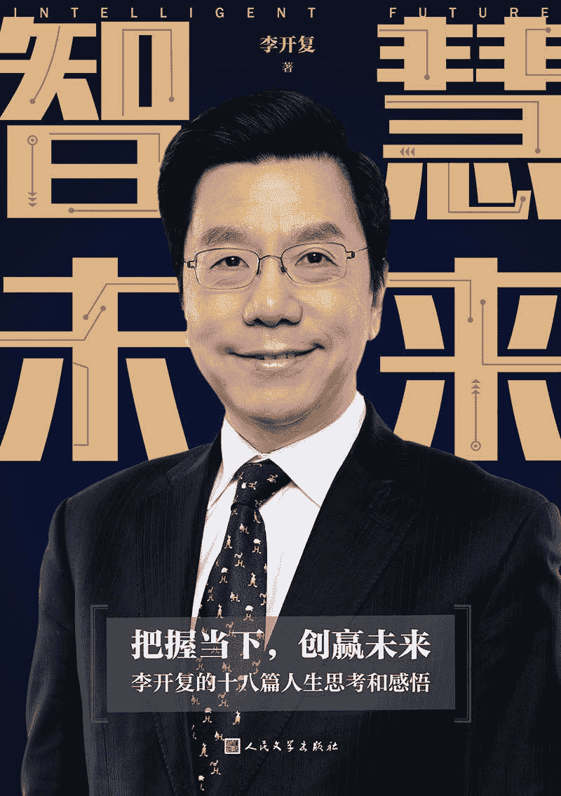
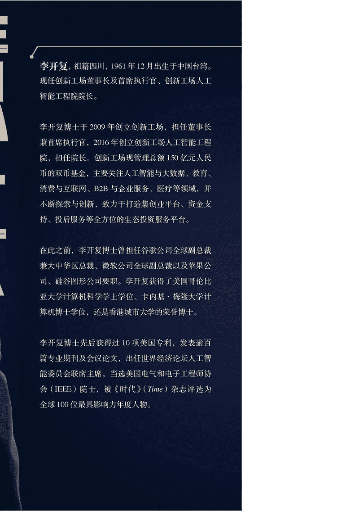
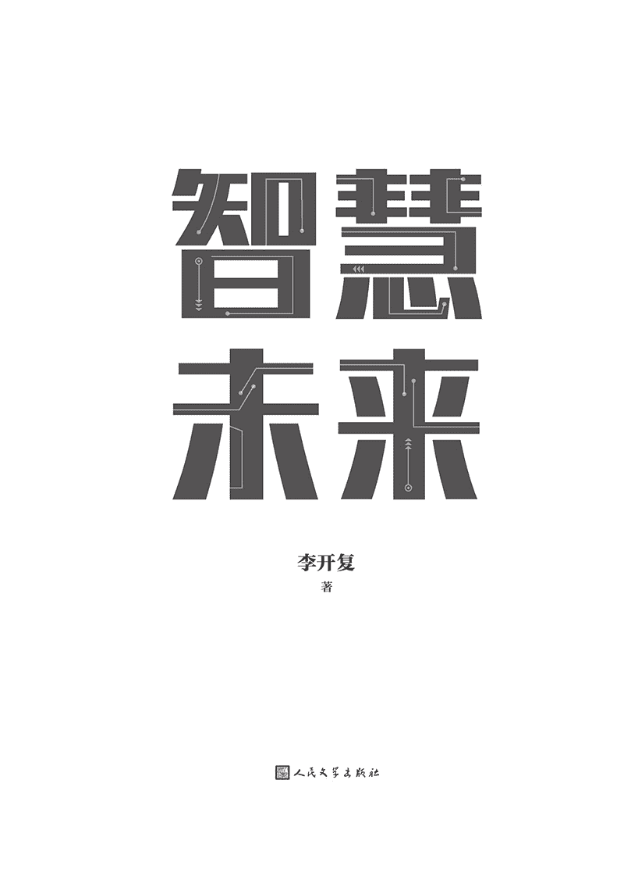
# 自序

这本书收纳了我写给年轻人的七封书信，以及对成长、职场与人生半生的回望。整理修订的过程，像一次重新走路，让我得以检视来时的足迹。

上大学时我先选了法律，后来放下法律投身更吸引我的计算机；曾想在卡内基梅隆走学术的老路，最终却选择能直接产生现实改变的科技商业路线。接下来二十年，从苹果到SGI，再到微软与谷歌，我始终被一个信念牵引：把个人影响力做到极致，让世界因为我而不同。2009年，我结束了二十年的职业经理人生涯，在中国重启，创办创新工场，为年轻创业者提供支援。

那段日子我意气甚盛，对时间极度紧张，总想把每一分钟榨干来用，2013年也入选《时代》周刊全球百大影响人物。谁料几个月后重病来袭。那阵子我常埋怨命运不公。机缘巧合下拜访星云法师，与他聊及过往的人生指向。法师一句话点醒我：

人很渺小，多你一个少你一个世界并不会因此改变；生命难得，能活一次已不容易，不必执念于改变世界，能把自己做好已属不易。

从此我慢慢走出偏执，开始思考个体存在与发展的意义，也逐渐从公司繁重事务中抽离。外界惊讶于我职业与心态的转变，我自己却感到庆幸。从高度关注技术、战略、投资运营与改变世界，转变为珍惜生命、照料家人、好好体验当下，我收获了不少馈赠。

2019年9月，创新工场度过十周年，而我第一次回到大陆已过去二十余年。若说有什么未变，便是对青年群体的持续关注。1998年应联合国之邀回国演讲两周，是我与中国青年结缘的起点。此后我陆续发表七封致青年学生的信，也多次走进校园交流。无论是当年创办开复学生网，或后来创立创新工场，我都在尝试为年轻人搭起平台，让他们的困惑得到回应，让独特才华因赋能而更亮。

我以参与并见证中国互联网的高速发展为傲，更珍贵的是见证了无数优秀青年的成长。如今的我已不再像从前那样急切地渴望世界因我而不同，仍希望能尽绵薄之力助力这一代年轻人。

愿我半生的思考与感悟能带来一点启发；愿你们在遇见我时看到的不是一座山峰，而是一座桥梁；愿我不作冷漠的过客，而是一个会笑着送你们走向智慧未来的同行者。
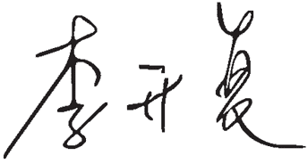
2019 年 12 月
# 给青年学生的第一封信
——从诚信谈起

## 引言

在微软亚洲研究院工作期间，一位名校同学问我：“开复老师，我想像您那样成功。依我理解成功就是管人，管人很过瘾，该怎么才能当上管理者？”

很明显他对成功的定义走偏了。在与中国大学生的交流里，我发现这种误读相当普遍。不少同学下意识把成功等同于富有、有名、担任领导或主管。归根结底，这反映出价值取向的迷茫，在多元信息冲击下丧失了独立判断，偏离了应有的准则。

看到这种状况我很焦虑。真正的成功不是复制别人的路，也不是随波逐流。要想真正成功，先要做一个以诚信为本的人，并付出足够努力，在持续学习与交流中找准属于自己的人生方向。只是，如何把这些想法传达给数千万学生？或许只能拿起笔来，以我对成功的体悟与多年经验，给广大青年写一封真诚热切的信——这是我内心最真实的愿望，也是身为融贯中西的华人学者应尽的责任。

当时提出写信的想法遭到身边不少人反对，担心惹麻烦、被人嘲为多管闲事，甚至影响公司形象。最终我仍以个人名义在媒体上公开发出这封信，当时尚用《给中国学生的一封信》为题，因为并未打算写续篇。

文章首发于《光明日报》，随后被全国媒体转载。一夜之间网络论坛、高校校园都在迅速传播，超出预期，却也印证了我的判断：走向成功路上青年需要指引，而我有意愿也有能力提供帮助。

2000年5月23日，比尔·盖茨在《华尔街日报》撰文，支持美国政府给予中国永久正常贸易关系。文中特别提到在清华与中国大学生的对话愉快而印象深刻。

这让我想到，在中国这两年的最大乐趣也是走访高校与学生交流。这些交流让我有机会与成千上万青年面对面沟通他们关心的事业与前途。中国学生的聪颖、好学与上进给我留下深刻印象。

交流中我发现大家普遍关注几个问题：拿到海外奖学金的同学想知道如何在美国度过学习期；决定留在国内的同学关心如何定准方向并在科研学业上快速取得进展；刚入学的新生希望得到学习与做人的经验；最近还有同学关心网络信息产业，想了解美国大学生如何创业致富。

看着这些渴求知识、满怀希望的眼神，我萌生冲动，给青年学生写一封信，把交流中产生的想法和忠告写出来，助他们在留学、工作或创业中人格更完善、生活更顺畅、事业更成功。

## 坚守诚信、正直的原则

我在苹果工作时，曾提拔过一位经理，因下属批评而沮丧想让我另换人选。我问他自己的长处，他说自己是个非常正直的人。我告诉他，正因他公正无私才被提拔，管理经验与沟通技巧可以在工作中习得，但一颗正直的心无价。我支持他留下，并在管理与沟通上给予指点。最终他不负所望成为出色管理者，如今已是某知名公司的首席技术官。

相反，我面试过一位求职者。技术与管理都很出色，但在闲谈中他表示若录用他，甚至可以把在原公司期间的一项发明带来。随后他似乎觉察不妥，特意声明那些工作是下班后做的，老板不知情。谈话后无论能力如何，我都不会录用他。因为他缺乏最基本的处世准则与职业道德——诚实与守信。雇用这样的人，谁能保证他不会把这里的成果也当作“业余之作”带走？这说明人品不完善者不可能真正有所作为。

在美国，中国学生的勤奋与优秀是有口皆碑，曾是各名校最受青睐的留学生群体。如今却有学校与教授表示不再愿意招收中国学生。理由是某些拿着博士奖学金到美国的学生，一找到工作就申请离校，把承诺完成的学位与研究抛下。这种言行不一让不少教授对中国学生的诚信产生怀疑。应指出有此行为者只是少数，但已严重损害名誉。另外，许多教授不再信任多数中国学生的推荐信，因为他们知道这些信往往出自学生之手，已无参考价值。这是诚信受损后的必然结果。

我在微软研究院也遇到类似情况。一位实习生意外报告了一个很好的研究结果，但别人无法复现。后来才发现他挑选了实验数据，只保留最优结果，舍弃“不太好”的数据。我认为他永远不可能实现真正的学术突破，也不可能成为合格的研究人员。

最后说说贪小便宜的人。用学校或公司电话打私人长途、多报出租车票。也许有人觉得这是小事。正是这些身边的“小事”，往往成为塑造人格与积累诚信的关键。贪小便宜、耍小聪明只会把自己贴上贪图小利、缺乏出息的标签，最终因小失大。一句话概括，就是勿以恶小而为之。

## 生活在群体之中

与多数美国学生相比，中国学生在表达、沟通与团队协作上相对欠缺。这可能源于文化与教育体制差异。今天面对高度全球化的社会，生活在群体中、做出更好表现并获得更多收获尤为重要。

表达与沟通能力至关重要。无论工作多优秀，不会表达、无法让他人理解与分享，几乎等于白做。因此在学习阶段，不应只活在个人世界，而要尽量与各阶层人交往沟通，主动表达看法，甚至在公众场合演讲，锻炼表达能力。

表达能力不仅是口才。哈佛大学Ambady教授做过有趣实验，让两组学生评估几位教授授课质量。一组先无声观看讲课录像两秒钟就给出评价，另一组听了几个月课程后评价。两个小组结论惊人相似。这表明在思想表达中，非语言方式与语言同样重要，有时更明显。这里的非语言指仪表、举止、语气、声调、表情等。人可从这些方面直观判断你的为人处事能力、信心与热情，从而形成很重要的第一印象。

对集体、公司乃至国家，团队精神都关键。微软公司以独特的团队精神著称。比如Windows 2000研发，超过三千名开发工程师与测试人员参与，写出五千万行代码。没有高度统一的团队精神与默契分工，这项工程不可能完成。

相对而言，我在其他公司也见过这样的现象。工程布置下来大家明知无法完成，却心照不宣不告诉老板，反正做不完，索性不努力做事，花更多时间算计如何把失败归咎于他人。就是这些人和作风几乎拖垮一家公司。

为培养团队精神，我建议同学们在课余积极参与各种社团工作。在分工合作、分享成果、互助互惠中体会团队精神的重要性。

学习中千万不要怕别人超越而不愿分享好思路、想法与结果。这种担心不健康，也不助成功。谚语说：你付出的越多，你得到的越多。想想若你的行为让人觉得“你的是我的，我的还是我的”，当你需要帮助时别人会来吗？反之，若你常慷慨帮助他人，是不是会得到更多回报？

在团队中，要敢于承认他人贡献。借助别人智慧成果就应声明，得他人帮助就应感谢。这也是团队精神的基本体现。

## 做一个主动的人

几十年前工程师梦寐以求的目标是进入IBM。那时IBM对人才定义是有专业知识、埋头苦干的人。如今事物发展，人们对人才看法已变。现在很多公司渴求的是积极主动、充满热情、灵活自信的人。

作为当代中国大学生，应不再被动等待别人告诉该做什么，而要主动了解自己要做什么，规划它们，然后全力以赴完成。想想今天世界最成功的人，有几个是唯唯诺诺等人吩咐的？对待学业与研究项目，需要以母亲对孩子那样的责任心与爱心投入不断努力。如此便没有什么目标不能达到。

主动的人还应虚心听取批评与意见。这也是一种进取心。若不能虚心接受批评并吸取教训，就不可能更大进步。比尔·盖茨曾对公司全体员工说：客户的批评比赚钱更重要。从客户批评中，我们能更好地汲取失败教训，将其转化为成功动力。

除虚心接受批评，你还应努力寻找一位特别尊敬的良师。这位良师应是直接教导你的老师以外的人，更能客观给你忠告。良师除在学识上教导，还可在为人处世、看问题眼光、应对突发事件技能等方面指点。我在苹果负责研究部门时，就有幸找到这样一位良师。他是负责苹果全球运作与生产业务的高级副总裁，他在事业发展方面的教诲令我终身受益。有这样的人帮助，成长速度一定更快。

中国学生大多含蓄害羞，不太习惯自我推销。但要把握转瞬即逝的机会，就必须学会说服他人、推销自己或观点。在说服他人前先说服自己。你的激情加才智往往折射出潜力，这就是人们常说的化学反应。一般来说，好的自我推销策略能令事情发展锦上添花。

例如，有次我收到一份特殊的求职申请。不同于大多数申请者，这位申请人的材料包括自我介绍、对微软研究院的向往、为何认为自己合适，还有已发表论文、老师推荐信与希望开展的课题。尽管毕业学校不是中国最有名的，但自我推销奏效了。我从材料中看到他的热情与认真。面试时他又递交更充分资料。最后当我问他有没有问题时，他反问：你对我还有没有保留？我当时确有疑虑，于是进一步提问。他举出两个很有说服力的例子。最后我们雇用了他，他现在做得非常出色。

## 挑战自我、开发自身潜力

我在苹果工作时，有一天老板突然问我何时能接替他的工作？我很吃惊，表示自己缺乏管理经验能力。他却说经验可以培养积累，并希望我两年后能做到。有了这样的提示与鼓励，我开始有意识加强这方面的学习与实践。果然两年后我接替了他的工作。我认为个人的领导素质对治学、经商或从政都十分重要。任何时候、任何环境里，我们都应有意识培养领导才能。同时建议你给自己展示机会，或许像我一样，你会惊讶自身潜力远超想象。

给自己设定目标极重要。目标过高不切实际，但目标绝不可太低。在21世纪竞争已无疆界，应放开思维站在更高起点，给自己设定更有挑战性的标准，才会有准确努力方向与广阔前景，切不可做井底之蛙。另外，只在一所学校取得好成绩好名次就认为功成名就可笑，山外有山人上有人，不同地方衡量标准也不同。所以订立目标时千万不要有宁为鸡首，不为牛后的思想。

一流的人与一般的人在一般问题上表现可能一样，但在顶尖问题上表现则天壤之别。美国作家威廉·福克纳说过：不要竭尽全力与同僚竞争。你更应关心的是：你要比现在的你更强。你应永远给自己设立一些很有挑战但并非不可及的目标。

确立将来事业目标时，不要忘了自问：这是不是我最热爱的专业？我是否愿意全力投入？我希望你们对所从事工作充满激情与想象力，对前进途中可能出现的艰难险阻无所畏惧。谈到对工作的热爱，我认识的一位微软研究员常让我深有感触。他周末开车出门常说去见女朋友，后来一次偶然在办公室看见他，问他女朋友在哪，他笑着指着电脑说：就是她呀。对于工作的热爱，比尔·盖茨也曾精彩阐述：每天早晨醒来，一想到所从事工作与所开发技术将给人类生活带来的巨大影响与变化，我就会无比兴奋与激动。

北京青年报曾有场探讨比尔·盖茨与保尔·柯察金谁更伟大的讨论。由于从小在美国长大，我并不知道保尔的事迹。但我非常赞同保尔的名言：人最宝贵的东西是生命，生命属于我们只有一次。人的一生应当这样度过，当他回首往事的时候，不因虚度年华而悔恨，也不因碌碌无为而羞愧……所以，选择一个你真心热爱的事业，不断挑战自我、完善自我，让自己一生过得精彩充实。

## 客观、直截了当的沟通

有一次，一位中国大学教授找到我，希望我帮他找一位国外专家在他组织的会议上做主题演讲，末了特意加一句，最好是一个洋人。我很不以为然地说：这个领域最具权威的人士就在北京的一个中国人，为什么你一定要找洋人呢？他表面同意，但仍请了一个美国人演讲，结果效果很差。所以我们不该陷入盲目崇洋。我们要用客观眼光判断事物，而不是以肤色或居住地决定。

有一句话说，真理总是掌握在少数人手中。我们理解这句话，应有自己的眼光，有独立思考能力，不一定大多数人认可的或某个权威说的就是对的。不论做学问还是经商，都不能盲从，要多想几个为什么。

有了客观意见，就应直截了当地表达。如果做事都像打太极拳，会让人不知所云，也会造成误会。有一次，微软研究院的一位研究人员就自己选定的研究方向征求我的意见，我分析后认为该方向有不少问题，个人认为对学术界贡献不大，但如果他坚持，我愿意支持他试着去做。结果他认为我这话实际是不允许他去做，于是选择了其他方向。后来他要出差时，负责行政事务的人告诉他：你可以选择坐火车或者坐飞机。他认为行政人员实际上暗示他坐火车，因为坐飞机太贵。其实他的猜测都是错误的。因为我们的沟通方式直截了当，而他却在打太极拳。这之后，我们通过一系列公司文化讲座，让员工们了解到：心里想什么就讲什么，不要把简单问题复杂化。现在研究院里这类误会少了很多。

直面沟通，拒绝虚耗

说半句藏半句、言行不一，最后消耗掉的是所有人的时间。瞻前顾后害怕失言，结果把自己培养成谨小慎微的胆小者。更糟的是有些人当面沉默背后议论，这种做法对自己和他人都没有好处，只会侵蚀集体的信任与团结。如此做人处事，既站不住脚，也难以在科研中开辟新径，更不可能在激烈的市场竞争里脱颖而出。

希望大家能做到坦诚相见，敢于说“不”，这才是对自己思想负责的表现。当然表达分歧或批评时，都应带着建设性与诚意，而不是为抬杠而争论。我主张给出正面且可操作的建议。开启讨论前，别先把人拒之门外，把各自的想法都摆到桌面上，让个人观点充分呈现，这样才能凝聚出兼顾多数人的结论。同时也要学会用恰当的语气与方式表达，比如不在众目睽睽下让对方难堪，这样批评才能发挥作用。

## 珍惜校园的学习时光

媒体上曾报道中学生辍学去创办网络公司的消息，我认为并不值得效仿。对绝大多数在校生而言，大学阶段是系统掌握基础理论、学会思考与解决问题方法的重要窗口。这些积累会成为未来发展最基本的底座与工具。好比建造高楼，若地基不牢，风雨来时会难以承受。

从全球视野看，美国在诸多领域的科研实力无疑处于顶尖。除了美国，英国的学术水平也相当突出。其背后关键在于语言壁垒的缺失。英国学者能够无障碍地阅读美国乃至世界各地的英文前沿报告与资料，这对把握研究方向、追踪最新进展、发表成果都有极大助益。对从事研究的我们来说，英语能力十分关键。只有把语言素养夯实，才能跟上未来节奏。我建议先强化听说，再补足读写，并务必在大学期间把英语问题彻底解决。等到工作后付出成本会更高。

除英语外，数学与统计对理工科同学同样是不可或缺的基础。数学凝聚着人类几千年的智慧，必须用心学，绝不能敷衍。我至今都后悔当年没有投入更多精力把数学打磨得更扎实。另有计算机应用、算法与编程，亦是每位工科学生需要熟练掌握的通用工具。

科技迭代极快。在校学习的核心，其实是掌握最基础的学习方法与工具。未来借助这些方法去习得新知。比如课堂学会了C++，能否自学Java？学会了HTML，能否自学XML？上大学与其说是学一门专业，不如说是学会如何学习，实现“无师自通”。

毕业后头两年同学相聚，彼此差距不大。五年后再见，差异就显著了。不少人掉队，正因为停止学习，无法掌握新事物，渐渐被社会发展甩在后面。若想在竞争中不被淘汰，就要保持终身学习的习惯。

我的上司Rick Rashid博士现任微软公司主管研究的资深副总裁，已功成名就却仍保持强烈的求知欲。如今每年仍会写下约五万行代码。他认为用新技术编程能让他保持对计算前沿的敏锐，不断自我更新。如今一些博士生带低年级学生做项目，便自负地认为自己无需再编码了，这其实很不明智。

每次到清华等高校交流，被问最多的就是学生打工。我认为总体上打工对学生是有益的，是开阔视野的方式。比如在研究机构打工可接触最新科技；在产品部门打工可学习开发技能；在市场部门打工可理解商业运作。我认为每位学生都应有打工经历，但别打“无用工”。要明白打工只是校园生活的一部分，学习仍是第一位。打工的目的在于拓宽视野而非提前上班。若把做翻译、录入数据库的时间用来学习，日后能赚得更多，远超当下打工的收入。

另外，有些学生受退学创业浪潮鼓舞，想成为中国的比尔·盖茨或迈克尔·戴尔而中途辍学。出于我的观察，除极特殊情况，不建议在校生退学创业。你所看到的成功案例极少，大多数学生虽有创业想法却缺乏经验，失败概率很高。若想成功，建议先把学业完成。若想学习创业经验，完全可利用假期到一家公司打工学习。比尔·盖茨曾说：“如果你考虑创办新公司，请先明确，创业需要巨大精力投入并冒高风险。我觉得你们不必像我一样一开始就创业，应该考虑加入其他公司，在其中学习其工作与创业方法。”

## 你想戴怎样的博士帽

我赴卡内基·梅隆大学攻读计算机博士时，系主任曾对我说：“拿到博士学位时，你应成为所研究领域内世界级的权威。”这句话对初入校的我而言近乎遥不可及，却也让我雄心勃发、跃跃欲试。历经五年寒窗夜读后，他期待的结果自然而然地出现了。立志读博的人，应为自己设立极高的目标。若缺乏雄心壮志，就别自欺欺人，或许经商或其他道路会有更大收获。

目标明确后，我建议为自己制定三年学习研究计划。首先要全面了解相关领域已有的成果与进展，再提出自己的见解并踏实执行。同时要持续追踪领域最新动态。这样才能把握方向，避免重复劳动，把精力聚焦于最有价值的方向。

学界普遍认为名师出高徒，导师的作用不言而喻。因此应主动寻找研究方向上最优秀的老师。除导师外，也要向身边的专家请教，更别忘了“最博学的老师”——互联网。如今几乎全部论文、成果、创新想法都能在网上找到。我还鼓励直接发邮件向世界公认的专家教授请教。依我的经验，大多数人都会很快回复。

我在读博期间每周工作七天，每天十六小时，海量的统计与分析报告几乎压垮了我。当时同行多用传统方法，我的导师虽支持但并不认同我的方向。我也曾多次怀疑自己的做法能否成功。但某天凌晨三点得到的一个结果让我尝到成功的滋味。随后研究突飞猛进，导师也开始采用我的方法。我的博士论文使我的研究一度成为自然语言研究领域最具影响力的工作之一。读博绝非轻松，切忌浮躁，要脚踏实地，一步步扎实推进。也不可被短暂的名利诱惑，而要全情投入。也许会疲惫、会懊悔、会迷路，但要记住成功与突破正在其中酝酿。那些一切顺利人人可得的工作与结果，我相信研究价值必然有限。

从某种意义上说，若打算毕生从事研究，博士期间形成的做事习惯、研究方法与思维方式基本决定了未来工作的轮廓。所以务必做个有心人，充分利用在校时光为未来打好基础。

## 结语

以上观点皆源于我与同学们的交流体会。希望这些建议能为正在路上跋涉的你们提供启发，对当下学习有所帮助。也许因观点差异或忠言逆耳，这封信未必能被每个人接受。但只要百位读者中有一位受益，这封信就比我做的任何研究更有价值。

# 给青年学生的第二封信 ——从优秀到卓越

## 引子

调回微软总部后，因工作繁忙，我长期未能与青年学生做深入交流。偶然机会回国演讲时，主办方希望我多谈激励内容与计算机前沿。但在准备中我逐渐意识到，中国学生更需要的或许不是具体知识，而是如何提升自我、培养素养、挖掘潜能。因为第一封信发表后，大量热情来信让我切身感受到中国学生对正确价值观与美好人生态度的渴求；甚至有人说，那封公开信的价值超过我在科研上发表的一些论文。

基于此思路，我把演讲当作与学生交流、帮助他们成长的机会。演讲围绕个人素质、情商与领导力展开，用真实经历感染了无数大学生，获得热烈反响。

此次演讲的重点是如何具备出色领导力，实现从优秀到卓越的跨越。这也是我在微软总部工作时不断总结的体会。当时我领导数百人团队，在新技术与产品领域持续突破。这段经历让我明白，出色领导者要从学生时代起就培养个人素质与人际能力。此外，我与《从优秀到卓越》Good to Great与《基业长青》Built to Last作者吉姆·柯林斯Jim Collins深入交流探讨，并将所学融入演讲。

以演讲为基础，结合近年来与中国学生讨论成功与领导力的积累，我撰写了《给青年学生的第二封信》，作为第一封信的补充，并在《中国青年报》等媒体发表，后被收入电子工业出版社《中国智慧——微软亚洲研究院院长话题》一书。

信件发表后，不少学生来信反馈，其中一位写道：“开复老师，是您让我找到提升与充实自己的途径，让我重新振奋，充满前行勇气！”其实无需更高褒奖，只要能常听到学生发自内心的声音，常看到青年不断进步，我就已十分满足。

在第一封信中，我与大家讨论了机遇、学业、工作、人际与自我等话题，提出诚信正直、培养主动意识、客观直接沟通、终身学习等个人素质值得高度重视。

这三年来，许多学生通过邮件、讲座问答、座谈及电视节目“对话”等渠道，常问我“如何成才”。基于此，我整理了材料，形成这封第二封信。

第一封信提及的个人素质或价值观是成才的基础。除此之外，领导力同样关键。很多人以为领导力重在天赋、号召力、管理能力。但依我经验及近期研究，若想成为成功领导，最关键的不是智商IQ，而是情商EQ。重要的不是成为令人信服的号召者，而是成为谦逊、执着、有勇气的领导者。

这封信面向希望不断提升、学习事业成功所需技能与领导艺术的人。第一部分重申第一封信中个人素质；第二部分阐述领导力核心情商；第三部分给出卓越领导区别于常人的特质。

## 如何提升个人素质

### 诚信与正直
人品决定一个人对社会的价值，而诚信是最关键的因素。微软用人非常看重诚信，只聘用最值得信赖的人。去年微软列出员工期望的核心价值观时，诚信与正直Honesty and Integrity被列为首位。

第一封信发表后，有同学问我为何公司如此关注道德。我答，这是为了自身利益。例如有应聘者面试时说，若加入微软，他可把前公司的发明带过来。对这样的人，无论技术如何我都不会录用。他既然能在加入微软时损害前公司，加入微软后也必然会损害微软。

另一同学看完“对话”后问我，为何把诚信置于智慧之前？是否会量化比较并给予更高权重？实际上衡量都在具体工作目标上，不会直接比较诚信与智慧。但作为首要核心价值，诚信是我们最基本要求。我们根本不会雇用缺乏诚信的人。若员工出现严重诚信问题，会被立即解雇。

公司如此重视诚信，员工也更值得信赖，公司便能完全信任员工，发挥其才能。在微软，各级管理者会给员工较大自由与空间，工作和生活上给予充分信任、支持与帮助。只要是微软录用的人，公司就会百分百信任。和一些对员工处处防备的软件企业不同，微软员工能看到大量源代码，接触许多技术与商业机密。正因获得信任，员工对公司才更有责任心与工作热情。

### 培养主动意识
坦白说，中国学生与职员多属内向类型，学习与工作中主动性不足。在校时常需老师安排任务，按老师思路做研究。入职后常等老板指派做什么怎么做才开始工作。此外，许多中国人不善自我推销，这与传统文化中讲求中庸有关。

但想在现代企业中取得成功，必须培养主动意识：在工作中勇于承担责任，主动设定目标并不断改进方法；同时要培养自我展示能力，在领导同事面前善于呈现优点，有成果后通过演讲、展示、交流、论文等方式分享，犯错也要敢于承认。只有积极主动的人才能在瞬息万变的竞争中胜出，只有善展示的人才能获得真正机会。

### 客观直接的交流与沟通
开诚布公的交流是团队合作的关键。人与人之间遮掩、言不由衷甚至挑拨，都严重破坏工作氛围、阻碍沟通，最终导致项目或企业失败。

例如开会讨论时，所有人应坦诚交换意见，才能做出正确决定。若有人因不想反驳上级而在会上唯唯诺诺，会后在洗手间私下说“其实我不同意”，这种戴面具工作的人既不能坚持观点，也会破坏内部沟通渠道，对工作产生负面影响。

微软有一个很好文化叫“开放式交流”Open Communication，要求员工在任何沟通场合敞开心扉完整表达观点。开会时若意见不统一，必须表达出来，否则公司可能错失良机。互联网起步时，很多微软领导者不理解为何投入精力到“不赚钱”的技术。但几位技术人员持续提出建议，虽然上级不理解，却仍享有开放交流的权利。后来声音传到比尔·盖茨那里，推动他改变方向全力支持互联网。这例可见开放交流对企业活力与创新多么重要。

彻底开放交流也有弊端。激烈辩论甚至争吵有时会说出不尊重的话，破坏人际关系。因此微软总裁史蒂夫·鲍尔默在核心价值观中提出将文化改进为“开放并相互尊重”Open and Respectful，要求交流时充分尊重对方。不同意时要用建设性语言表达。

### 挑战自我，学无止境
从大学生到程序员再到管理者，软件人才成长中学习永无止境。大学打好基础，培养各方面素质；工作后在实践中学习新技术积累经验；管理岗位上也应不断提升。软件产业每天都有新技术新概念，充满活力与创造力。若固步自封、抱残守缺，必然落伍被市场淘汰。

许多中国学生喜欢与他人竞争，这种竞争多呈零和，难以实现双赢。我建议与其与人竞争，不如与自己竞争——不求胜过别人，而求超越自我，在自身水平上持续进步。

学习中打好基础最重要。从人才需求看，必须学好数学与英语。数学是工程科学基础，软件开发与研究都大量使用数学方法与原理。英文是软件行业的国际通用语言，了解发展趋势、掌握最新成果、与国外同行交流，都离不开听、说、读、写与工作中的熟练使用。

## 情商与领导力
大家都希望提升领导力。从我的经验与近期研究看，领导力中最重要是情商EQ。

智商IQ反映智慧水平，情商反映情感情绪的自控与协调能力。在高新技术企业，智慧重要，但情商的重要性甚至超过智商。我看过一篇调查188家公司的文章，作者用心理学方法测员工智商与情商并与工作表现关联。结果显示，对个人业绩影响力情商是智商的两倍。对高级管理者分析发现，情商对成败的影响是智商的九倍。这说明智商稍逊但情商高的人一样可成功；反之智商高情商不足的人欠缺领导力，很难成为成功领导。

## 什么是情商
在现代社会，只知智商不知情商已落伍。心理学家指出，仅用智商评估才智不足以预测事业成就。为全面考察个人能力特别是社会适应与创造能力，提出了情商概念。

情商指与认识自我、控制情绪、激励自己及处理人际关系相关的能力。其中自觉、同理心、自律、人际关系是决定事业成败的关键。智商先天赋予，情商可培养。多花工夫理解与应用这四种关键因素。此外，因情商难以自察，建议多听取他人评价，尤其是情商高的人的意见。

## 自觉
中国人常说“人贵有自知之明”。即每个人都应对自身素质、潜能、特长、缺陷、经验等基本能力有清醒认知，并对在社会工作中的角色有明确定位。心理学称此为“自觉”，包括察觉情绪对言行的影響，正确评估自身资质、能力与局限，相信自身价值与能力等。

我曾经带过一位自我认知相当薄弱的下属。他本有一定能力，却极度高估自己，对现有岗位总是不满，动辄自我吹嘘，对现状充满抱怨。有一段时间，他认为我没有赏识他，便提出离开团队，想去公司其他部门另谋出路。结果他发现，自己不仅找不到更合适的位子，身边同事也对他颇有微词，普遍觉得他缺乏自知之明，期望远远脱离现实。最终他沮丧地离开了公司。

接替他的人则完全不同。那位在上一份工作中成绩并不理想，却能坦然认识到自己晋升过快，于是主动选择降一级来承担这项工作，打好基础。如今他做得非常出色。

这说明，判断自己既不能太高，也不能太低。对自己评价过高的人容易浮躁冒进，不善合作，遇到挫折时落差巨大，很难理性看待事实；对自己评价过低的人则会畏首畏尾，缺乏担当，不敢主动争取。无论哪一种，都难以发挥全部潜力，也很难获得真正的事业成就。

有清醒自知的人，既能在别人面前展示长处，也不会刻意掩饰短处。坦诚不足并向人请教，非但不会削弱自己，反而显出虚心与自信，更易赢得信任。比如领导对下属说“技术上你是专家，我比不上你，我要向你学习”，下属不仅感受到谦虚，也会因此更信赖领导。

微软内部，大家互相在技术上切磋，在工作中彼此打气，没有人整天摆出居高临下的姿态，也没有人自觉矮人一等，这种氛围自然形成了坦诚开放的文化。

具备自知的人，面对挫折不会轻言放弃，取得成绩也不沾沾自喜。准确定位自我价值，能帮助个人找到合适的空间和方向，也能帮助企业形成各司其职、协同高效的团队。这样的从业者给人自信、谦虚、真诚的印象。

### 换位思考的力量
同理心说白了就是设身处地、将心比心。在冲突或误会发生时，尝试站在对方的位置想一想，就更容易读懂对方的出发点，化解隔阂。老话“人同此心，心同此理”说的正是这个道理。

人际关系没有固定公式，需要从关心体谅出发，给他人留有余地，误会时多替对方想想，主动反思自身过错，敢于担责。有了同理心，抱怨、指责、嘲讽就会减少，工作和生活才会充满鼓励、谅解、支持与尊重。

对管理者而言，最关键的是体谅并重视团队成员的想法。我从不滥用“非常好”“不错”“棒极了”这类空泛评价，而会在员工真正做出贡献时，具体的贡献点、具体的数据和对公司的价值，写成邮件在部门内公开表彰。这种具体而及时的肯定，才能赢得信任，增强凝聚力。

我曾调到一个有六百多人的新部门，几乎不认识任何人。于是我每周挑十个人一起吃午饭，详细了解姓名、背景、工作情况以及对部门的建议。午饭后，我会根据他们的意见马上安排部署，并一一回复处理方式。我希望在较短时间内认识并了解每一位员工，在充分听取意见的基础上来安排工作。

### 自律与诚信
自律是指自我控制与自我调整的能力，包含在不安情绪或冲动面前保持清醒，在压力下依然思路清晰，并以诚实赢得信任，明白自己的行为会影响他人。

自律对领导者更为重要。领导是团队的标杆，一举一动都会被下属放大，尤其在危急时刻，如果领导比员工更急躁、犹豫不决，团队信心就会崩塌。

我见过两个即将合并的团队。第一位经理在会上推卸责任，说合并不是他决定的，他也不知道下一步怎么办，还猜测团队可能被裁员。他的不确定感很快让团队散了，他本人也离开了公司。第二位经理则坦诚合并对公司的好处，也承认自己并不掌握全部信息，但承诺会推动上级尽快决策，并尽力为每位员工争取合理公平的安排。最终这个团队凝聚在他的带领下走出了合并。

自律必须建立在诚信上。为表现自律而粉饰掩盖缺点、刻意表演，只会适得其反。只有在赢得信任的基础上严于律己、宽以待人，才能真正获得尊重。

### 人脉与沟通
人际关系涵盖影响力、倾听沟通、处理冲突、建立合作、说服等能力。有人天生善于社交，几分钟就能和陌生人熟络；也有人内向，不愿主动攀谈。

我自己就缺乏这方面的倾向，直到遇到一位极具个人影响力的经理。他并不比人更聪明，却认识公司几乎所有有能力的人，并且与其中很多人成为好友。我发现这种资源在选人用人和跨部门协调时价值巨大，此后我开始有意识培养自己的人际影响力。

在研发领域，沟通与说服同样关键。把先进技术转化为产品，首先要说服决策层，需要准备详实的材料，用精彩的演讲和现场演示让领导相信技术价值和市场前景，这都需要良好的表达和影响力。

### 从优秀走向卓越
管理学家吉姆·柯林斯在《从优秀到卓越》中，通过长期研究发现，大多数公司和领导可以做到优秀，但能持续健康增长的卓越者极少。想要从优秀跨越到卓越，需要培养谦虚、执著、勇气三种品质。

谦虚让人进步。唯我独尊、排斥不同意见的领导可能有短期成功，却难免一意孤行。比尔·盖茨每次演讲后都会请撰稿人指出不足，以便改进。

执著是认准方向后锲而不舍。微软在Windows 95大获成功后，盖茨仍坚持投入企业级Windows NT与Windows 2000，因为他看到了企业市场潜力。最终该架构成为今天Windows产品的基础。

勇气是直面挑战。真正的勇气不是没有恐惧，而是能控制恐惧，敢于正视挫折，持续突破自我。

### 结语
有人说IT领域西方更强，中国人需要全盘学习西方文化。的确一些沟通方式有差异，但成功所需的基本素质很多都源于中华传统美德。正大光明、诚信正直、学无止境、自知之明、将心比心、严于律己宽以待人、谦虚执著勇气，都是我们历来推崇的品质。人际关系更是被公认的中国优势。因此我对中国人才的EQ和潜力充满信心。在这个充满机遇与挑战的时代，善于自知、勇于挑战的人才能实现从优秀到卓越的跨越。

***
# 写给年轻人的第三封信
——成功、自信、快乐

## 缘起
2004年春天，我在北京演讲，清华的顾常超找到我，说前两封信对学生帮助很大，但大多数同学真正需要的不是从优秀到卓越的路径，而是走出迷茫重建信心的指引。他还带来了大量关于马加爵事件的报道。我深表认同。

几乎同一时间，《中国青年》杂志的记者也聊到马加爵事件，指出美国校园杀手多有暴力倾向，而马加爵更像是在不适应环境中迷失、因无助而走向极端的人。迷茫的大学生还有很多。

我读完资料后连续数日思考，决定写这封信，帮助学生摆脱自怨自艾，走向自信、快乐与成功。写作时我请有数十年心理辅导经验的姐姐李开敏协助润色，反复推敲每个观点。

此前我常谈如何成为领导人才，近期从新浪聊天室和邮件中发现，更多学生需要的不是如何更卓越，而是如何从迷茫到积极、从失败到成功、从自卑到自信、从惆怅到快乐、从恐惧到乐观。

2004年云南大学的马加爵事件就是极端案例。他残忍杀害四名同学，但从他被捕后的对话看，他并非天生邪恶，而是一个迷失方向、缺乏自信、性格封闭的孩子。他和许多大学生一样渴望知道如何获得成功、自信与快乐。

这封信写给那些渴望成功却觉得遥远、渴望自信却常自责、渴望快乐却不知其所的年轻人。希望它能提供一个全新的成功定义，并说明成功、自信、快乐是良性循环：成功带来自信和快乐，自信带来快乐和成功，快乐带来成功和自信。

## 成功就是做最好的自己
美国作家威廉·福克纳说：不要拼命和同僚竞争，而应比昨天的自己更强。

中国社会习惯用统一模式衡量成功：学校看分数，社会看名利，尤其今日中国对财富追求尤甚。但高分就等于贡献吗？名利就等于快乐吗？

真正的成功是多元的。可能是创造财富或技术，可能是让他人感到快乐，可能是被信任，也可能是寻找回归自我、与世无争的生活方式。每个人的成功都独一无二。关键在于了解自己，发掘目标与兴趣，持续进步，让每一天都胜过昨天。

### 第一步：找到目标，主动掌舵
有人问我的人生目标，我认为：人生只有一次，要过得有意义，能帮助自己、家庭、国家、世界和后人，让他们更幸福快乐。

对我而言，目标不是口号，而是决策的智囊。我放弃美国的工作来到中国创办微软中国研究院，正是因为这更符合我的目标。

马加爵也曾悟出人生意义，却是在被捕后才说：“人生的意义在于人间有真情。”如果他早几个月明白这一点，在做傻事前会想父母姐姐会如何看待，也许就不会走向歧途。

确定目标后，你就能果断做重大决定。目标因人而异，关键是主动去把握，不要操之过急，也不要盲目模仿。

如何发现目标？闭上眼睛，第一个浮现的理想往往最真诚。也可回顾自己最快乐、最有成就感的时刻，寻找共同点。想象十五年后理想状态的生活、环境和工作，想最快乐的部分。也可以多和亲友交流，听取建议。

### 第二步：探索兴趣，点燃热情
要成为最好的自己，就要发挥全部潜力，追逐真正感兴趣、有激情的事。当你对某领域着迷，会在行走、上课、洗澡时都念念不忘，更易取得成果。若有激情，你会废寝忘食，甚至在梦中灵感乍现。这时工作不再为成功，而为享受，成功自然到来。

做无兴趣的事效率低下，也难释放全部潜力。所以我不赞同所有人追逐热门专业，应了解自己的兴趣、激情与能力，在热爱中充分发挥。

比尔·盖茨曾说每日醒来都会因技术进步带来的发展而激动。1977年他因热爱软件放弃数学专业。2002年他卸任CEO，转任首席软件架构师投身技术创新。他曾是优秀CEO，但回归技术后贡献更大，也更快乐，更能鼓舞团队。

热爱是你自己的第一桶金

比尔·盖茨的老友、华尔街最受尊敬的投资人沃伦·巴菲特，对激情的态度一脉相承。有学生向他请教人生方向，他总是说：我跟你没什么本质区别，唯一的不同大概是我每天都能做自己最爱的工作。能把忠告说得这么简单，就是最好的忠告。

盖茨和巴菲特给我们的启示其实很一致，他们追逐的从不是那种庸俗单一的名利，而是理想和热情带来的名利。美国一家知名商学院做过追踪，结果令人意外：入学时想靠名利出头的学生占多数，但最终名利最丰厚的校友里，有九成在入学时是奔着理想去的。

我自己也是被热爱拽回正轨的例子。进大学时我立志学法政，读了一年多却发现毫无感觉，成绩也平平。直到碰上计算机，每天写代码写到忘我，老师同学的目光才开始不一样。大二那年我做了一个决定：放弃已经修过、位于全美前三的哥伦比亚大学法学院学分，转去当时籍籍无名的计算机系。我跟自己说，人生只有一次，不能把时间耗在没有快乐也没有成就感的地方。朋友提醒转专业代价不小，我反问他们，做一份没有热情的工作，付出的代价更大。那天我特别振奋，给自己立下规矩：接下来三年，每门课都要拿A。如果不是那个决定，我可能今天还在美国某个小镇做一个平庸又不开心的律师。

即便如此，我对工作的投入也远不及我父亲。小时候我以为父亲很严肃，直到前年见到他最喜爱的两位学生，如今都是教授，我才明白他有多爱教学。学生说，李老师见面总是笑呵呵，会约在他们最爱的小馆子里讨论学科；在学生身上花的钱和时间，远超他当时微薄的薪水。父亲在七十岁才在从军、从政、写作之后，找到真正的归属教学。临终前他在抽屉里留下了两句话给我：老牛明知夕阳短，不用扬鞭自奋蹄。最欣慰的是，他在人生的最后一段路，终于活成了自己爱的方式。

那么，热情到底怎么找？首先要把才华和兴趣拆开。才华好出成果，但做得好不等于喜欢。为了辨认真正的兴趣，可以自问几件事：你是否渴望重复这件事，能否愉快又顺利地完成，过去是否一直向往它，是否学得很快，做完后是否满足，你是发自内心的喜欢而不是脑子里的认同，它是否和你最快乐的时刻有关。问这些问题时，要把父母的期待、社会价值和朋友的影响先放到一边。

没立刻找到答案很正常，大多数人在大学四年都在试探。如果还没清晰，给自己最大的接触面。读博时卡内基梅隆有一个好制度，第一个月可以挑老师，每个老师都使劲展示自己。正因如此我遇到了恩师瑞迪教授，选定了语音识别这个题目。学校没有机制也没关系，你可以主动去了解不同学校、专业、课题、老师，通过图书馆、网络、讲座、社团、交流、邮件去触碰。唯有接触才能尝试，唯有尝试才能撞见最爱。我的同事张亚勤说得好：敢试的人都是聪明人，不成功也能学到教训，不敢试的人才是真正的失败者。希望你能把视野打开，在开阔里找到属于自己的方向。

## 第三步 为热爱设定分段目标，稳步前行

找到兴趣后，就要把它变成可执行的路径。

先客观盘点差距。你想成为的影响力最大的自己，和今天的自己差在哪？是缺一门课、一本书，还是更合群、更好控制脾气、更会演讲？比如我发现自己要扩大影响力，最短板是演讲和沟通。以前我说话脸红，上台恐惧，当助教时糟糕到被学生戏称为“开复剧场”。于是我给自己定了一系列具体目标。

目标要具体、可衡量，还要发挥勤奋、毅力这些基本功。我规定自己每月演讲两次，同学朋友旁听并反馈；不排练三次不上台；每月至少听一场演讲向高手请教。有人教我克服紧张时别看眼睛看头顶，手不要拿纸握拳。反复练习后我又总结出自己的方法：不用稿子讲故事效果更好；留更多时间回答问题比演讲本身更有效；不感兴趣的题目直接拒绝。几年下来，别人觉得我天生会讲，其实只是把中国人骨子里的勤奋执行到位了。

举个更简单的例子，我想扩大人脉。“多认识人”这种说法无法落地，于是我改成：每周和一位有影响力的人吃一顿饭，饭后请对方再介绍一位。衡量标准就是每周一餐、认识一人。同时我也会记录每餐带回的信息，以及后续是否促成了招聘。长期量化下来，关系网的变化就看得见。

目标高了不现实，低了没意义，要随情况调整。完成一个目标就升一级，失败就复盘总结。目标是为你量身定制的，只有你知道需要什么。主动提升、客观丈量，才能把兴趣真正走成成绩。

## 自信源于自知，不是自大

自信的人更愿意跨界，兴趣和才华才能加速成长，也更容易快乐。但自信不等同于成功。有人靠名次、升职获得自信，那是单一维度的自信。

真正有用的自信是自觉的，是清楚自己能做什么不能做什么。自觉的人在成功时更稳，在不自信时也敢尝试，但会把风险说清楚。他们不靠一次成功撑自信，也不因一次失败丢自信。

### 自信第一步 正视自身潜力，给自己加油

自信的核心是自我态度。马加爵曾说同学都看不起他，他太失败很自卑。聪明却不自信，人生会扭曲。

古人说天生我才必有用。我11岁到美国，第一节课一句英语听不懂，老师问1/7是多少，我认得黑板上的数字，举手答对了。老师惊讶地把我送去数学竞赛和夏令营，也让我第一次觉得自己有数学天分。那份认可让我想更努力学英语去学数学，自信和成长就一起来了。

中国教育常强调补短板，美国盖洛普的畅销书《现在，发现你的优势》提醒我们：大多数人把精力花在把缺点变优点上，结果更痛苦；少数快乐且成功的人，是强化优点、管理缺点。管理缺点就是做到够用，强化优点就是把时间花在热爱上，自信自然来。

微软亚洲工程院院长张宏江说，他从小就告诉自己我是最聪明的，即使后来常不如人。研究院主任研究员周明小时候刷瓶子比赛刷了108个打破纪录，这件事给了他持久的自信，他说天才的秘密只有六个字：不要小看自己。

自信是一种可训练的感觉。每晚睡前回想一件值得骄傲的小事：成绩、帮助、超出预期、被夸奖。大家每天都能找到。有一个教练让队员每次比赛前握拳回忆最得意的瞬间，用动作把好情绪刻进大脑。做自己的啦啦队，找几个能给你加油的朋友，成功感会越滚越大。

### 自信第二步 用坚持与勇气，靠成功累积信心，靠失败校准认知

自信到来时，需要毅力去延续。周明说，肯干的人就能把事做好，问题不是能不能，是想不想。当你手里有强烈的欲望，普通人也能韧下去。

勇气也很重要。我以前私下沟通没问题，但一到总裁面前就结巴。公司改组时总裁让十几人轮流发言，我硬着头皮讲了心里话：我们员工智商很高，效率却很差，因为总改组不懂尊重员工。会议室安静下来，会后很多人发邮件说你说得对，我希望有你的胆量。总裁采纳了建议，还在后面多次引用我的话。从那以后我不再惧怕任何场合。证明了那句话：没试过怎么知道不行。

勇气也包括面对失败。怕失败时问自己：最坏的结果是什么？能承受吗？那次发言如果被否定，最多被认为冒失，反而会被人尊重。自觉的人会从失败里学会自己不适合什么，认知就更清晰。尽力挑战并从中学到东西，本身就是值得自豪的事。

### 自信第三步 设定可验证的目标，谦卑地接纳反馈

女儿以前在学校从不举手，老师说她很害羞。我和她约法三章：每天至少举一次手，坚持一个月就奖励。目标清晰后，慢慢增加次数。一年后老师明显感受到她的变化。

自信不是固执己见。周围有个才华横溢的同事，信奉“我永远不会错”。他对就嘚瑟，对错就否认。正确率高到95%，剩下的5%让他丢了信誉。过度自傲的自信，比不自信更危险。

自觉有两个层面：懂自己，也懂环境。它不会过度自责，也不会盲目乐观，能冷静评估局限。接受挑战时做风险评估，对自己坦诚，也对别人坦诚。坦诚失败会赢得信任，坦诚缺点会赢得尊重。

更重要的是主动找反馈。别人眼中的你更客观，也更真实。Perception is reality，你自认没错，别人都觉得错，你在社会里就是错。女儿每天自评发言次数没用，只有老师和同学觉得她开朗、有想法，才算真正达标。

想获得真话很难，需要几个愿意私下说实话的朋友。美国企业常用的360度匿名评估，就是为了拿到真实声音。学校里没有这套系统，但你完全可以主动去理解他人对你的看法。我父亲常说凡事谋之于众，别把自己困在井里。马加爵若能早点勇敢求证同学的真实想法，或许悲剧就能避免。自觉、目标、反馈三者合一，自信才不会变成自大。

## 快乐才是终点，成功只是手段

研究表明，心情好的人更能发挥潜力，快乐提升效率、创造力和决策准确率。快乐的人更开明，更愿意帮助别人。与其说快乐带来成功，不如说成功的意义在于带来快乐。追随理想和兴趣本身就是一种快乐。所以快乐应该放在成功前面。

### 快乐第一步 接纳父母、环境与真实的自己

不快乐的人常为无奈的事生气，讨厌自己、父母、老师，不愿读枯燥的书、不愿应付考试。有些事改变不了，先学会坦然接受。

在不能改变的事里，父母最难也最该接受。不少学生抱怨父母不理解，总用自己的价值观要求自己。我给他们两个建议：第一，先接受父母。父母走的路比你长，经验更丰富，他们是你唯一的无条件付出者。不要因为他们不理解就自我封闭。父母在自己成长的年代更匮乏，可能没学过怎么当好父母，但他们已经尽力了。排斥父母，就是排斥自己的来源，怎么可能快乐。

第二，理解父母再沟通。抱怨父母要求完美时，你不也在要求父母完美？先去体会他们的想法，建立坦诚的沟通，哪怕一开始别扭，亲情和温馨会慢慢回来。

除了父母，还要接受环境的限制。有人希望不考没用的题、不上没用的课。但社会生存需要学会接受。可以用时间表把必须做的事情集中高效完成，再留出时间做喜欢的事。人生有限，把有限的时间用在喜爱上，前提是把该做的事做到足够好。

# 先停止对自己的无谓苛责

把不满投向自己是最消耗心力的焦虑，它不仅拖慢效率，还会让成果大打折扣。大多数同学需要同步完成两件事：用一次次微小进展累积底气，同时学会接纳当下的自己，要明白活着是为了自己而活。为自己而活，就是围绕个人的愉悦、偏好和人生目标去努力，而不是活在外部评价体系里拼名次。迟早会明白那条路走偏了。名次和胜负并无绝对意义，真正关键的是你是否尊重自己，能否找到并肯定自己的价值。

当你真正为自己而行，喜欢并接纳自己，也接纳父母，接纳环境里无法改变的部分，就会感受到持续的轻松与喜悦。

### 情绪释放与脾气管理

心理学家曾指出，马加爵长期处于精神上的孤独，因为他不愿与人交流，不愿说出真实感受，情绪波动剧烈却极度压抑。他写给亲人的信里也说，自己“动情的话历来讲不出口”。如果能及时把感受说出来，悲剧或许可以避免。事后他也反思，逃亡时觉得可笑，本来吵一次架就够了，没必要走到那一步。

东亚文化习惯把克制含蓄当成美德，我却认为当下更需要坦诚开明。拐弯抹角、说违心话、瞻前顾后、当面沉默背后议论，都是坏习惯。有位中国老板与下属发生冲突，问我是否请第三方调解，我的建议是情感问题最好直接对话。第三方想当和事佬，往往会说出违背双方本意的话，比如谎称你已认错，造成更大麻烦。

直接沟通需要方法。若老板第一句话就是“你错了但我不计较”，下属会立刻抵触。若说“你在那么多人面前骂我，显然你想抢我的位子”，局面会更糟。直接沟通时不要争辩对错，不要揣测动机，也不要顺势补刀。最有效的是说出自己的感受，例如“当你在大家面前骂我时，我感到尊严受损，很为难”。这种表达很难被反驳，反而容易换来理解。

怒火中烧时把愤怒转为感性表达并不容易，这靠觉察和自律。觉察不仅是认知能力，更是情绪认知。觉察力强的人知道自己何时会出现喜怒哀乐，也明白情绪宣泄会带来什么后果。他不会瞬间爆炸，因为知道后果，也不会压抑，因为伤害心灵。通常他会以最具建设性的方式处理，正面而感性的沟通能降温。情绪和沟通都极具感染力，宽容建设性的态度可以影响他人。

自律是一种内心的自我对话，提醒自己别掉进恶劣态度的陷阱。除了理性分析，深呼吸是最快最简单的调节法。古人说的“心浮气躁”“心神不宁”“心乱如麻”“心焦如焚”，都指向情绪与精神状态的牵连，而“气定神闲”“心安理得”最实际的做法就是调气调息，气顺了才回到理性。美国对有暴力倾向者会进行团体教育，让他们认清暴力的毁灭性，学会叫停或离开现场，保护自己和他人。

若自律困难，可以请知心好友提醒。过去我的一位老板一发火就收不住，且有前兆：先用刁钻问题难倒你，随后颤抖，最后爆发。他想改，于是让我在看到前兆时说一句暗号“让我们言归正传吧”。几次提醒后，他自己有了觉察和控制力，再也不需要外人提示。

### 共享喜乐分担苦痛

科学研究指出，调节心情最好的办法就是找个知己倾诉。感情源于大脑边缘系统，主要靠与人接触来调节。两个人交谈时，情绪和生理状态会慢慢趋同。因此要达到情感平衡，就必须学会依靠他人。与人沟通是提升情商和幸福感的唯一路径。长期与世隔绝只会越发苦闷。西方的古谚说，有人分享快乐加倍，有人分担痛苦减半。马加爵所说的真情，大概就是能分享内心的人。

情绪不好或受了委屈时，多向父母朋友倾诉，不要像马加爵那样把话闷在心里只写日记。他说过在学校一个朋友也没有，落魄又孤独，“在各种孤独中，人最怕精神上的孤独”。人际障碍带来苦闷，苦闷无处宣泄又加剧苦闷，恶性循环最终酿成悲剧。事实上马加爵的内心独白证明他有觉察，能看清困境，可惜把自己锁在封闭牢笼，让仇恨把他推向毁灭。非典时期最怕被隔离，而日常我们却常忽视心理孤立，让自己与快乐绝缘。

要获得快乐，需要幽默乐观的想法和沟通。笑的感染力最大。耶鲁大学的研究发现，笑的传染性超过其他所有情绪，人们会反射式地回报微笑，大笑能迅速营造轻松气氛，幽默还能增进信任激发灵感。乐观正向思考的力量无穷。近年来抑郁症来势汹汹，与负面思维密切相关。有人习惯钻牛角尖往悲观无助想。换个角度，半杯水是半满而非半空。当下的不如意恰好是成长空间。要学会自检，保持正念。

无论驱散悲伤还是收获快乐，都需要倾诉沟通带来的正面激励。最自然的对象是亲人，尤其是父母。我相信父母都愿意倾听孩子。家靠父母，外靠朋友，我们也需要知心朋友。交友时不要只看爱好性格，更看重是否鼓励、乐观、幽默、诚恳、有同理心、乐于助人、愿意倾听。也许你会担心没朋友或被拒绝。若被拒绝，你一无所失；若被接受，你可能找到自我。我也希望你在寻找好友时，同时让自己成为这样的人，去帮助身边的亲友。只有更多人付出，快乐才能通过人际网络更快扩散。

## 给青春学子的祝福

我一直坚持三条做事原则：有勇气改变能改变的事，有肚量接受不能改变的事，有智慧分辨两者。

祝愿青年学子，遇到挫折时能以勇气、肚量、智慧渡过难关。

祝愿青年学子，追求成功自信快乐时，别忘了成功是多元的，自信是自知而非自傲，快乐的人懂得理解接纳喜欢自己。

祝愿青年学子，逐渐获得成功自信快乐时会发现良性循环：成功带来自信和快乐，自信带来快乐和成功，快乐带来成功和自信。

祝愿青年学子，拥有成功自信快乐后，别忘了帮助他人获得成功自信和快乐。

# 第四封信：大学四年这样走

## 起笔

2004年6月“开复学生网”上线后，学生提问越来越多。我发现除前三封信已谈过的问题外，大家最关心的是大学四年的学习生活。例如如何学好英语，虚度光阴怎么办，毕业后出国还是就业，如何学好专业，若不喜欢专业怎么办等。

同期我参加教育部组织的研讨，接触更多老师学生，发现中国学生在学计算机科学时存在学习方法问题。不少人把课程当成书本知识，少联系实际；还有人只追逐与就业直接相关的语言平台，忽视能锻炼能力的数学、算法、数据结构等基础。

基于此，我有必要写一封关于学习方法、学习经验的信，帮助大家顺利度过大学，这就是第四封信的由来。

信写好后请一位优秀大学生看过，他说内容都是常识，合格学生都该懂，是否有必要反复强调。我想，很多人知道却做不到，常因缺乏毅力和勇气而无法实践。用真实感受再强调一次，能加深理解，也给缺乏勇气者送去鼓励。

今天回复了“开复学生网”开通以来的第1000个问题，关电脑后一封来信挥之不去：

开复老师：
就要毕业了。
回头看所谓的大学生活，
我想哭，不是因为离别，而是因为什么都没学到。
我不知简历该怎么写，若以往我会让它空白。
最大的收获也许是……对什么都没有的忍耐和适应……

这封信道出不少大三大四学生的心声。大学里有人放纵虚度，有人找不到方向。到第一次补考通知唤醒，到第一封应聘被拒信，才惊觉前途渺茫，努力为时已晚。

这封信写给希望早点从懵懂中醒来的大学生，从未贪睡想把握命运的大学生，以及即将入学的未来大学生。想对大家说：

大学是一生最关键的阶段。从入学第一天起就应当有正确认识和规划。为了学习更快乐，毕业找到心爱工作，每个进入校园的人都应掌握七项学习：自修之道、基础知识、实践贯通、培养兴趣、积极主动、掌控时间、为人处事。做好这七点，毕业时的最大收获就绝不会是“对什么都没有的忍耐和适应”，而应是“对什么都可以有的自信和渴望”。做好这七点，你就能成为有潜力、有思想、有价值、有前途的快乐毕业生。

## 大学是关键转折

大学是人生的关键阶段。因为这是你第一次卸下高考重担，追逐理想兴趣；第一次离开家庭独立参与团体社会生活；第一次不再单纯背诵理论，有机会在学习中实践；第一次不再由父母安排一切，有足够自由处理生活学习问题，支配属于自己的时间。

大学也是人生的关键阶段。因为这是你一生最后一次系统接受教育，最后一次全心建立知识基础。也许是最后一次能用大段时间学习的人生阶段，最后一次可塑性高、可不断修正自我的成长历程。也许是最后一次能在相对宽容、利于学习为人处世的环境中成长。

在这个阶段，所有大学生都应把握每个“第一次”，让它们成为未来基石；珍惜每个“最后一次”，不要将来追悔。大学四年，应努力编织梦想，明确方向，奠定基础。

我们可以用下图描述大学四年在一生中的地位和价值：

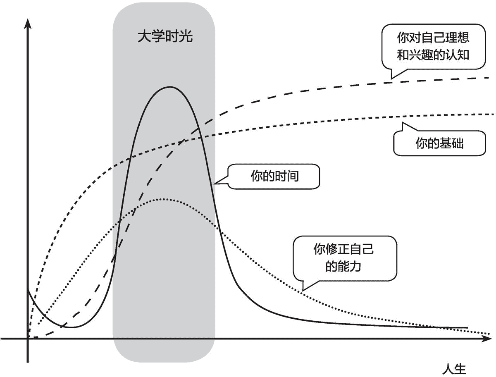

可见大学是一生学习能力转变最大的时期，是把“基础学习”和“进入社会”衔接起来的重要阶段。因此大学四年要努力培养学习能力，提升学习境界，成为擅长终身学习的人。

大学四年只有一次，应该这样度过……

## 自学之路：从融会贯通到独当一面

我在哥伦比亚大学任助教时，一位中国家长抱怨：“你们大学到底教什么？我孩子读完大二计算机系，居然连VisiCalc都不会用。”

我回答：电脑日新月异，我们不能保证大学所教技术五年后仍管用，也不能保证学会每种技术工具。我们能保证的是孩子学会思考，掌握学习方法，无论五年后出现什么新技术新工具都能游刃有余。

她又问：学最新软件不是教育，教育的本质是什么？
我答：如果把学过的东西忘得一干二净，最后剩下的就是教育的本质。

这句话来自教育家B.F.Skinner。所谓剩下的东西，就是自学能力，即举一反三、无师自通的能力。大学不是职业培训班，而是让学生适应社会、适应不同岗位的平台。学专业知识固然重要，更重要的是学习思考方法，培养举一反三能力，只有这样毕业生才能适应瞬息万变的未来。

中学时老师会反复讲课关键内容。进了大学，老师只当引路人，学生必须自主学习探索实践。工作后自学能力更重要。微软的统计显示，每名员工所掌握的知识中，只有约10%是在加入微软前积累的，其他都是加入后重新学习的。这充分说明缺乏自学能力难以在现代企业立足。

自学能力必须在大学开始培养。许多同学抱怨老师教得差、课程不合理。我常劝：与其诅咒黑暗，不如点亮蜡烛。大学生不该亦步亦趋，而应主动走在老师前面。大学老师一节课要涵盖几十页内容，靠课堂听讲不可能全懂。最好的方法是课前先琢磨教材相关问题，课堂上对照讲解弥补不足。

中学生追求记住，大学生应追求理解并善于提问。对每个知识点多问几个为什么。一旦真正理解来龙去脉，就能举一反三，甚至无师自通。

很多问题有不同思路和观察角度。学习或解决问题时，不要死守一种思维模式，不要做课本或经验的奴隶。只有敢于创新，从全新角度思考，潜在的思考、创造和学习能力才能被激发。

《礼记·学记》说：“独学而无友，则孤陋而寡闻。”大学生应充分利用学校人才资源，从各渠道吸收知识方法。遇到好老师可主动请教，请推荐参考书。除了资深教授，青年教师、博士生、硕士生、同班同学都是最好的学习伙伴。每个人理解不同，互帮互学才能共同进步。

有些同学羡慕我在读书时能有一位获得过图灵奖的大师传道授业。事实上，他在大学并未教我多少专业知识，只是指明方向，分享经验，提供资源，教做人方法。他没时间也没必要指导具体专业知识。我在大学期间积累的专业知识都是自学获得的。入门时我红着脸向师兄请教最基本问题，讨论时会问肤浅问题，课余主动与同学切磋。“三人行必有我师”，大学到处是良师益友。珍惜机会，大胆发问，经常切磋，就能学到最有用知识方法。

大学生应充分利用图书馆和互联网，培养独立学习研究本领，为将来工作或深造做准备。除了规定课程，要学会查书查文献，接触更广泛的知识和研究成果。例如对一门课感兴趣的课题，就应去图书馆查阅文献，了解来龙去脉和研究动态。熟练使用图书馆是大学生特别是志在科研者的必备技能。读书应尽量多读英文原版教材，有些教材深入浅出、实例丰富，比中文教材更适合自学。

书本之外，互联网是巨大资源库，可借助搜索引擎查找各类信息。“开复学生网”开通以来，我发现很多同学并不擅长搜索，有时问题一搜就能找到答案。有些人轻信网络谣言，不会自行查证。除了搜索引擎，网上还有许多网站社区是很好的学习园地。

自学时，不要因达到学校要求就沾沾自喜，也不要觉得大学里成绩好就够了。21世纪人才已国际化。当你对成绩满意时，我建议开始自学国际一流大学课程。例如MIT开放课程已在网上免费发布，可去看MIT课程，做MIT试题。当能自如掌握MIT课程，就能更有自信面对国际化挑战。

总之，善于举一反三，学会无师自通，是大学四年能送给自己的最好礼物。

## 基础素养：数学、外语、信息与专业底座

我曾说过，中国学生的一大优势是扎实的基础知识，如数学物理等。但近几年同学们看到速成例子后，渴望走捷径，形成浮躁风气。许多大学生梦想毕业即做经理老板，还有人入学直接选管理专业，认为毕业就能成为企业管理者。进入管理专业后才发现毫无兴趣。其实管理和其他专业一样，都是传授基础知识和基本方法的地方，没有哪个专业能保证毕业即上岗。无论学什么专业，大学毕业才是事业的真正开始。想做企业领导或管理工作，也必须从基层做起，先学会做人，再打好学业基础。

大学像是一个持续成长的平台，而支撑这个平台的恰恰是那些看起来不起眼的基础课程。在校期间，数学、英语、计算机与网络的使用，以及本专业对应的基础课，比如商科里的财务、经济学，都应该认真对待。科技更新很快，今天的高深应用几年后就可能被新工具取代，只有扎实的基础才能长久地用得上。没有基础，真正的高级技术也很难吃透。而且很多老师对基础课的教学经验，远比讲解最新潮的技术更丰富。

数学是理工科的根基。不少学生在高中觉得数学难，一到大学发现专业对数学要求不高就彻底松懈，还看不出它对就业有什么用。但事实是，绝大多数理工学科的知识体系都是建立在数学上的。学计算机工程，离散数学里的集合论、图论、数理逻辑，线性代数、概率统计、数学分析都得过关；想读计算机的硕士博士，更高的数学素养是必备的。数学是人类几千年的智慧沉淀，学它是在训练思维。几何让人学会演绎与推理，概率统计让人懂得避开思维死角、提高机会的把握。学数学要问自己为什么学，从中掌握认知和思考的方法，而不是简单堆课程数量。

21 世纪最核心的沟通工具是英语。有些人只为过四六级而学，把英语当成求职敲门砖，甚至觉得学英语就是崇洋媚外。真实的目的是掌握一种学习和交流的手段。未来几十年，世界最前沿的技术和学术交流仍主要以英语进行，这与是否与国际接轨直接相关。软件行业的基础语言就是英语，权威教材、论文、资料和手册大多是英文的。学好英语不是数典忘祖，中国走向世界需要吸收先进思想和科学技术，语言能力才是真正的爱国。

很多留学生的英语分数很高，回美国上课却听不懂，和外国人交流也困难。英语要学就得用，不能死背。专业学习时尽量啃原版教材，底子薄可以先从中英对照入手，顺带读一些感兴趣的专业论文，语言和专业一起涨。听说能力的提升靠和以英语为母语的人对话，国内学习和工作的外籍人士多数愿意交流，是很好的机会。学习也可以有趣：名人的演讲、对谈，小说、戏剧、漫画都是素材。初学者看英文教学节目，进阶后看美剧、电影，先带字幕查词熟悉句式，再关掉字幕纯听。每天抽出半小时到一小时听英文广播，反复跟读，回放精听。网上也有游戏化、测试、双语阅读等互动资源。坚持实践和用心才是关键。

信息时代，信息素养已是进入社会的标配。并非所有人都要懂原理和编程，但人人都该熟练使用电脑、网络、办公软件和搜索引擎，快速在网上获取和检索专业信息。用电脑和网络就像用纸笔一样基本，不掌握就难以高效地获得所需知识。

每个专业都有自己的根基课。以计算机为例，很多人追最新语言、平台、标准，因为招聘会提。但技术迭代快，真正立得住的是数据结构、算法、编译原理、计算机组成、数据库原理等基础。这些像是内功，新工具像是外功。只练招式没有内功，难以成为高手。

打基础是苦差事，即便不感兴趣也得做。有人天生喜欢数学、英语、计算机，可以享受过程；没兴趣也要把它打牢。不吃苦就难成事。

## 做中学：动手才是真懂
上高中时常问老师“为什么，有什么用”，老师常说不准问。大学里该问“不准不问”，要把知识、理论和方法与实践结合起来，尤其是工科。

有句老话说得好：听过的会忘，看到的能记，做过的才真正明白。任何课程只有在实践中融会贯通，理解才会深刻，记忆才会牢固。尽量多选实践性课程，最好几个人一起做，既理解知识又学会协作。有机会跟老师做项目、去校外实习打工，只要不影响学业都值得尝试。打工时别只盯薪酬，有培训和实操机会的岗位更值得。

对软件开发而言，实践经验不可替代。微软希望应聘程序员的毕业生最好有十万行代码的经验，因为技术只能在实战中提上去。最关键的不是笔试分数而是动手能力。可惜一些学校的学生到大三还不会编程，教学需要改进。如果身处这样的环境，就要靠自学、打工和网络项目补上。网上有很多学生自建的技术社区，分享经验、办校园会议、出书帮助学弟学妹，其中不少人后来获得了微软最有价值专家的称号。

## 先识己：用视野找兴趣，用志向定方向
孔子说，知之者不如好之者，好之者不如乐之者。我在第三封信里讲过，快乐和兴趣是成功的关键。有人问我怎么找到自己的兴趣，我的看法是先客观评估。不要把家人朋友认可的事当成自己的爱好，不要把一时的好玩当成兴趣，要亲身尝试后用自己的头脑判断。兴趣也不等于职业，喜欢玩游戏不代表能开发游戏。兴趣更不等于天赋，可以尝试寻找天赋与兴趣的交集，比如数学天赋加计算机爱好，就适合做理论研究。

最好的找兴趣方式是开阔视野，多接触不同领域。大学是试错的最佳场所。利用图书馆、旁听课程、网络搜索、讲座、兼职、社团、邮件论坛等多种渠道接触不同领域、不同工作、不同学者。我当年要是只乖乖上法律课，不去旁听计算机课、不去机房打工、不找助教请教，就不会发现自己对计算机的热爱。

找到兴趣后，可以尝试转专业、课外自学、选修旁听、实习，必要时申请感兴趣专业的硕士深造。本科专业并不完全决定毕业后的方向，大学培养的是学习能力，有了它，跨领域也行。

也别忘了“爱你所选”。有人入学选错专业后失去动力，也有人只追兴趣荒废专业基础，还有人用兴趣当借口逃避困难。转专业不一定容易，先把本专业读好，在学习中培养兴趣更实际。一个专业里有多个方向，交叉学科往往是增长点。王坚博士本科到博士学的是心理学，后来在微软亚洲研究院做用户界面研究，正是计算机与心理学的结合点。即便毕业后换行业，扎实的专业基础也能成为优势。

人生的兴趣会变，但志向更重要。我访问过很多成功者，他们最大的遗憾是年轻时没人鼓励他们追寻理想和志向。我的志向是“最大化影响力”，兴趣会变，志向不变。志向像罗盘，兴趣像风帆，两者配合才能驶向理想的港湾。

## 接管人生：主动创造自己的机会
创立开复学生网的初衷是帮助学生帮助自己，却发现很多人希望我直接替他们做决定。被动思维是长期教育环境养成的，习惯把责任推给他人和环境。成功需要从被动转向主动，成为自己未来的主人，因为没有人比你更在乎自己的生活。

主动的第一步是积极的心态。规划人生目标，追寻兴趣，尝试新知识和领域。维克托·弗兰克尔说，在任何环境中，人们还有最后的自由，就是选择自己的态度。

第二步是为自己负责，勇敢面对。不要把困难的事一拖再拖。不行动也是一种选择，会让你失去机会。

第三步是充分准备。科大前校长朱清时大三被分配到青海做铸造工人，别人打牌喝酒，他仍钻研数理化和英语。六年后科学院在青海启动项目，他脱颖而出。机会看似运气，其实是准备的结果。

第四步是以终为始，规划四年。不知道志向就先做发掘计划；不知道毕业做什么就制定尝试计划；不知道短板就写简历请老师朋友打分；想出国读博就积累研究经验和论文；想进公司就对比招聘要求。认真制定、管理和调整规划，才能靠近目标。

## 时间管理：分清轻重，靠自律取胜
有同学说大学和高中没差，每天还是学习，考试后还是焦虑，只是上网和睡觉时间多了，压力小了。时间变多恰恰是大学的核心差异，需要自己安排和管控。

管理时间的关键是分清重要和紧急。史蒂芬·柯维指出，人总先做紧急的事，导致重要的事被忽略。打好基础、做人等都属重要但未必紧急的事。每天早上列出当天紧急和重要的事，睡前复盘是否平衡。

把“必须做的事”和“尽量做的事”分开。必须的做到最好，尽力的尽力而为。接受暂时无法改变的事，关注能改变的事，保持生物钟规律，劳逸结合，学习状态才好。

大学是迷失方向的高发期，需要自控。不要沉迷无益的习惯，尤其是网络游戏。开复学生网上有学生劝告：我认识的专业水平高的同学没有沉迷网游的。网游是逃避现实，不愿面对不足。要珍惜大学时间，找到有意义的方向获得满足感。

## 人际修炼：交友协作是大学必修课
多数学生入学是第一次离开父母，集体生活考验与同学、朋友、社团同事相处的能力。未来社会中，人际交往和团队协作的重要性甚至超过工作本身。

## 人际交往与大学成长建议
### 第一 真诚待人 严于律己宽于待人
对别人诚恳宽容，对自己严格自省。与人交往是镜子式的反射，你如何待人，人便如何待你。想修正别人，先修正自己。想被理解，先理解他人。

### 第二 经营真正的友谊
做到上面一点，大学朋友才可能成为一生知己。不要只找性情相近或只会附和的人。好朋友有多种：乐观的、智慧的、踏实的、幽默的、激励你的、提升你的、让你自省的、敢说实话的。大学恋爱能教你关怀他人、增强共情和自控，但不必刻意为恋爱而恋爱。

### 第三 锻炼团队与沟通

社团宛如社会的微缩模型，提前投身其中等于在正式踏入职场前先做一次实战演练。这里既能锻炼协作精神与组织推动力，也能让个人专业优势得到施展。更关键的价值在于以赤诚的姿态投入服务与志愿工作，担任学生职务时更要自觉充当同学与教师之间的沟通枢纽，在双向互动中提升表达与倾听水平，回馈集体。这段历练绝不轻松，挫折在所难免，但不必因此气馁，大学社团里的人际打磨堪称一堂零学费的课程，失误后可以重新来过。

### 第四，从周围的人身上学习

班级与社团的日常里，值得多留意身边同学的表现，尤其是那些在交往与沟通上尤为突出的人，观察他们化解人际摩擦的方式、说服并影响他人的手法、调动协作与协调的能力、传递尊重与真诚的细节、表达赞许或反对的分寸，以及如何在不冒犯的前提下绽放个性。持续观察并加以借鉴，会惊喜地发现自身的人际水准有了意料之外的提升。校园里的每一个伙伴都可能成为启发你的导师，他们的热情、幽默、机智、学养、正直、沟通力、礼貌等特质，都可以作为学习参照。同时也要慷慨地帮助同伴，争取成为他们的榜样与指引。

### 第五，提高自身修养和人格魅力

若自感缺乏专长或嗜好会制约人际成长，不妨有目的地挑选并培养一些兴趣。共同的爱好往往是拉近距离、深化情谊的重要纽带。很多在事业上有所建树的优秀者，并非只会闭门苦读的书呆子，他们大多保有自己的业余追求。我在微软亚洲研究院的同事中，就有精于绘画、桥牌和体育运动的佼佼者。业余爱好不仅是社交的切入口，也能挖掘课本之外的潜能。例如体育锻炼既能释放身体能量，也能培养团队意识。若暂时提不起培养爱好的兴致，多读好书、厚积知识底蕴同样能改善人际效果，因为智慧与学养往往最能彰显一个人的个人魅力。

学会与人相处，本质上就是大学阶段必须完成的必修课。

## 对大学生们的期望

踏入大学时，你可能还带着忙碌、青涩、被动应试、依赖家庭呵护的中学生气质。

走过四年，你会借由思考确立自我、借由学习探求真理、借由独立体悟自主、借由规划把握时间、借由表达磨练口才、借由交友品味成熟、借由实践获得价值、借由兴趣汲取快乐、借由追求凝聚力量。

离校之际，只要做到这些，最大的收获将是对任何事都充满自信与渴望。你就能成长为具备潜能、思想、价值与前途的未来建设者。

所以，大学四年就应该这样度过。

* * *

[\[1\]](#part0067_split_002.html#w1) VisiCalc 当年是最火的电脑应用软件，却在二十年前就被淘汰了，这再次印证了科技日新月异。况且，VisiCalc 的操作手法也不是计算机系学生该学的。

# 给青年学生的第五封信

——你有选择的权利

## 引言

中国不少学生身上存在一个通病：习惯等别人安排，凡事依赖他人。从小学到中学再到大学直至就业，他们习惯听从父母、听从教师，却很少思考自己真正想要的生活方式，在哪些关键节点该由自己拍板。这种学生或许能在稳定僵化的环境里循规蹈矩，但很难适应信息时代对人才的需求。

我曾与《世界是平的》作者托马斯·弗里德曼深入探讨网络时代的选择权议题。我们都认同管理大师彼得·德鲁克的判断：“未来史学家会说，本世纪最关键的变化不是技术或网络革新，而是人类生存状态的重大转变。这个世纪里，人拥有更多选择，必须主动管理自己。”换言之，互联网消弭隔阂，世界前所未有的扁平，每个人都能获取全部信息，也能在充分沟通后决定自己的生活方式。在此充满创新的时代，主动坚定者远比被动迷茫者创造更大价值与快乐。

2005年，我读到苹果公司创始人史蒂夫·乔布斯在斯坦福毕业典礼上的讲话。语气平实坚定却极具感染力：“你的内心与直觉知道你真正想成为什么样的人，其他都是次要的。”这再次映证了积极主动对青年学生的重要性。

一位中国留学生读完《第三封信》后深有感触来信说：“小时候目标就是长大，长大后做什么没想过；小学时父母的目标是考初中，考上后做什么没想过；初中时目标是考高中，高中后做什么没想过；高中时目标是考大学，上大学做什么没想过；大学时父母目标是出国，出国做什么没想过；现在拿了学位要找工作，下一步该做什么呢？这次我要好好想了。谢谢你的《第三封信》，它唤醒了我埋藏二十五年的进取心，改变了我二十五年的被动生活。从今天起，我要主动为自己而活！”

当我为他终于领悟“拥有选择的权利”而欣喜时，也意识到仍有太多年轻人困在被动里迷茫。在“开复学生网”里，每天都能看到“只有你能告诉我，我该怎么做”的被动心态。

在中国教育体制下，学生凡事听从父母老师，遇到难题也能直接求助，这容易养成依赖。于是许多年轻人不会主动规划成长，不知道如何积极搜集资源推动学业与人生。另一方面，父母老师习惯越俎代庖替孩子设计人生，这常让孩子忽视真实性格与兴趣，长大后多半会发现自己迷失在自我缺失中。

再者，中国传统文化推崇群体意识，强调从上从众，这些观念潜移默化影响一代又一代，使“自主”二字显得陌生遥远。

因此，从消极到积极的道路布满荆棘。尽管前四封信都提及主动的重要性，我仍决定专门写一封关于积极主动的信。

要成为国际化人才，在信息时代释放最大潜能，每个有上进心的青年都应努力把自己从被动拉向主动，必须成为自己未来的主人，积极管理学业与事业。没有人比你更在乎你的工作与生活，没有人比你更适合掌舵自己的人生，只有积极主动的你，才能找到真正的自我，才能在成功路上始终快乐！

## 什么是积极主动？

“积极主动”一词最早被著名心理学家维克多·弗兰克带入公众视野。弗兰克本人就是积极主动、永不屈服的典范。

弗兰克本是深受弗洛伊德决定论影响的心理学家，却在纳粹集中营的惨痛经历后创立了独特的心理学流派。

他的父母、妻子、兄弟皆死于纳粹，而他本人也在集中营遭受酷刑。某天他赤身独处囚室，忽然领悟到一种全新感受——即便身处极端恶劣环境，人仍保有最后的自由：选择态度的自由。

弗兰克认为，即便在最痛苦无助时，人仍可自行决定人生态度。在艰苦岁月里，他选择积极向上。他没有绝望，反而在脑海中预演获释后登台讲述这段经历。凭借这种乐观思维，他在狱中磨砺意志，直至心灵超越牢笼桎梏，在自由天地驰骋。

弗兰克在狱中获得的思维准则，正是每个追求成功者必备的人生态度——积极主动。

消极被动者与积极主动者在诸多方面差异巨大：

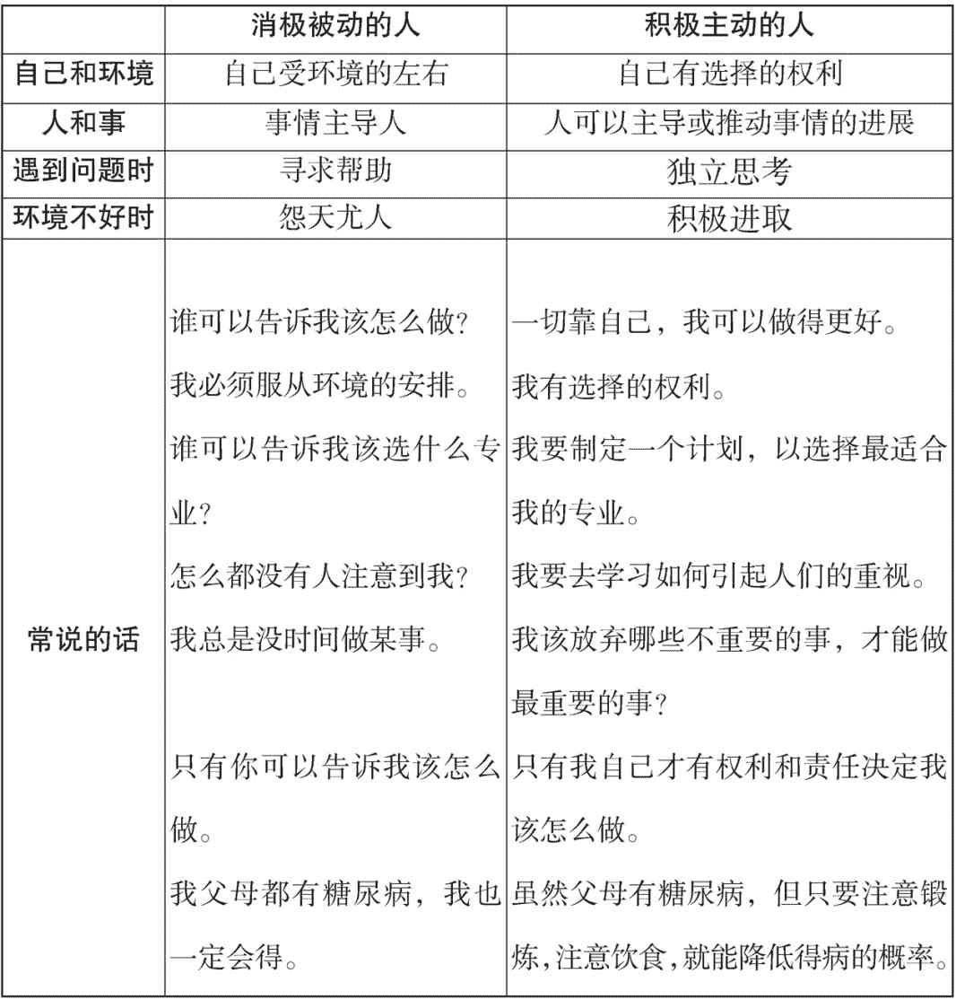
消极被动的人总认为自己受环境与他人左右，若没人指点、环境不改，自己只能消极度日。遇到问题时，他们习惯推给他人做决定，环境不佳时便怨天尤人。总是等待命运安排或贵人相助。对一件事，他们常觉得是事找上门，自己无法主导或推动进展。

积极主动的人相信，无论在何种情境下，自己都有选择的权利。所以他们对自己有责任感，因为命运掌握在自己手中，自己不是环境或他人的附庸。对一件事，他们总是认为自己可以主导其发生与发展。

## 为什么要积极主动？

三十年前工业社会里，每位员工是机器中的一颗齿轮。机器需要齿轮，但齿轮可替换。最好的齿轮是耐用的，而非卓越的。因此企业偏爱能埋头苦干、有专业知识的人。

如今瞬息万变的时代，人才定义已大不相同。现代企业里更多人拥有决策权，更多人须在思考中不断创新，也有更多空间决定做什么、怎么做。大多数工作不再是机械重复，而是需要独立思考与自主决策的复杂过程。管理学家彼得·德鲁克曾指出：“未来的历史学家会说，这个世纪最重要的事情不是技术或网络的革新，而是人类生存状况的重大改变。在这个世纪里，人将拥有更多的选择，他们必须积极地管理自己。”因此，今天优秀企业期待的是：

积极主动、热情饱满、灵活自信的人。

要想在现代企业中成功，就必须培养主动意识：在工作中勇于担责，主动设定目标并不断优化方法；还要锻炼自我展示能力，在领导与同事面前善于呈现优势。作为当代中国青年，不应被动等待指令，而应主动搞清自己要做什么、怎样规划，然后全力以赴完成。想想今天世界最成功的人，有几个是唯唯诺诺、消极被动？对待学业与研究项目，需以母亲对待孩子般的责任心投入不断努力。只要有积极主动的态度，没有目标是达不到的。

其实许多年轻人并非没有主动的意愿，而是习惯于在重大问题上依赖他人。若问中国大学生“你最常做的决定是什么”，答案多是选什么电脑、看什么电影、读什么书。这些固然需要决定，但更重要的抉择应由自己做出。例如选专业、选学校、考研还是出国，多人习惯听父母安排或跟随同学，殊不知在这些关键问题上，只有自己的决定才能通向真正的成功。自己做琐碎决定，却把影响一生的大事交给他人，何其不合逻辑。而且，即便做出决定，也不见得做了足够调查研究。鲁莽草率的决定可能让你后悔终生！

当谷歌创始人谢尔盖·布林与拉里·佩奇接受电视采访时，主持人问他们的成功归功于哪所学校，他们并未回答斯坦福或密歇根，而是提到蒙台梭利小学自由自在的学习方式。在蒙台梭利环境中，他们学会了“自己的事自己负责、自己解决”，正是这种积极教育培养了尝试、自主、自我驱动的习惯，从而带来成功。

因此每个年轻人都要拥抱积极主动的心，善于规划与管理事业，为人生做出重要抉择。没有人比你更在乎自己的事业，没有什么比积极主动更能体现独立人格。

正如美国诗人惠特曼在《草叶集》中写道：“我不能，别的任何人也不能代替你走过那条路；你必须自己去走。”

## 积极主动的七个步骤

要达到积极主动的境界，我建议大家按下面所列的七个步骤循序渐进地调整心态、培养习惯、学会把握与创造机遇，并在积极展示自我的过程中收获成功与快乐。

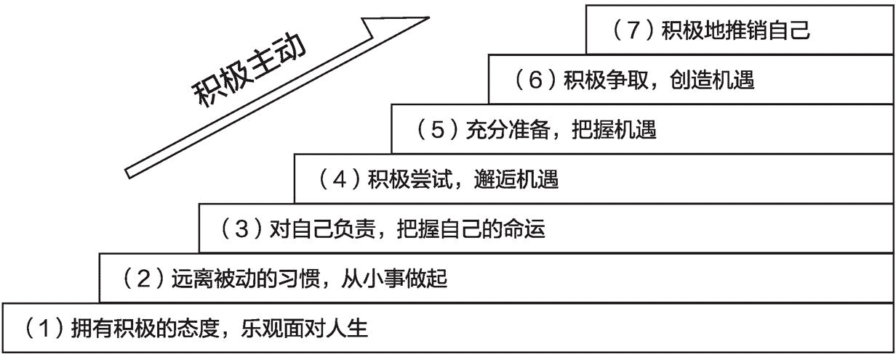
积极主动的七个步骤

### 步骤一：拥有积极的态度，乐观面对人生

心理学家早已发现：一个人被打败，不是因为外界阻碍，而是取决于他对环境作何反应。中国前国足主帅米卢蒂诺维奇所说的“态度决定一切”即是此意。抱怨改变不了现实，但积极的心态与行动可以改写一切。

据统计，每个人每天大约产生五万个念头。若你保持积极，便能乐观而富有创造力地把这五万个念头转化为正面能量与动力；若态度消极，便会显得悲观软弱、缺乏安全感，并把五万个念头变成负面阻力。

消极者允许或期待环境控制自己，喜欢听从他人安排，却因此丧失掌控命运的能力，也难免失败；积极者则以不屈不挠、坚忍不拔的精神面对困难，成功可期。积极的人用最乐观的精神与最辉煌的经验支配自己的人生；消极者则活在过去失败与困惑的阴影里。

拥有积极态度并不能保证件件成功，它会改变生活方式，但不等于每件事都心想事成；可坚持消极态度必败无疑，我从未见过消极者获得可持续的真正成功。

当然，并非所有事都必须由自己选择，也并非所有事都能由自己主导。所以在选择积极态度的同时，必须保持平和心态，即我常说的一句话：

“有勇气改变可以改变的事情，有胸怀接受不可改变的事情，有智慧分辨两者差异。”

### 步骤二：远离被动的习惯，从小事做起

消极被动的习惯是积极主动的最大障碍，若你从小在被动环境中成长，就更应努力剔除身上的消极因素。

例如消极被动的人常迷信宿命论，把不如意归咎于基因、星座、血型，从而自怨自艾，怪罪他人，指责环境。若这种想法成习惯，便会陷入消极循环难以自拔。

年轻人该如何远离被动？我提出五个建议：

一、不要盲目听信人言，应冷静辨析，积极求证

网上谣言四起，若盲目轻信就会被别有用心者左右。例如有同学来信说：“想读一个民办学校课程，因为它能发‘英国剑桥大学学位’。”冷静辨析会告诉你，天上掉馅饼必有圈套。只要上网搜索求证，真伪马上清晰。

此外许多同学不懂主动搜寻与验证信息的方法与重要性。不少同学请我帮忙找某大学信息，甚至问我某个单词的释义用法——其实网上简单检索就能找到答案。因此每次查到答案后，我都告诫他们：

“想知道什么就自己上网找，不要急着问别人；听到什么不要盲从，自己主动去求证。”

二、不要让事情找上你，应主动对事情施加影响

每件发生在你身上的事都应因你的决定而发展，而不该因无所作为而成为现实。

一位同学告诉我：“我申请了两份工作，其中我更喜欢竞争激烈的那份，但同学也在争取。我现在只能等待，若被拒就去另一家。”

我惊讶地问：“既然你很喜欢第一份工作，为何如此被动，只等不争取？”

不要忘了，被动等于放弃，不做决定也是一种决定。

在微软工作的华人皆知郭蓓菁，一位小巧玲珑、活泼开朗的女孩。初见或许惊讶她是微软资深华人经理之一，但聊一分钟便不会惊讶。她每句话都流露自信与积极乐观的领导力，以及严谨逻辑与战略思维。她曾分享过积极主动的故事：

“我十六岁从中国移民到美国。到美国半年后就必须参加 SAT。那时口语尚可，语法、词汇、作文很差。数学考了 780 分接近满分，英语只考了 280 分，白卷也有 200 分，可想而知 280 分有多糟。但我仍满怀希望申请加州大学电机工程系。”

“因英语分太低，申请表可能还没被看就被拒。但我不服输，深信若被录取我会成为优秀工程师。于是我决定‘上诉’。”

“我直接写信给加州大学工学院长。自述背景，强调理工成就，解释初到美国六个月英语问题，突出学习能力与刻苦精神。最后我说：‘院长女士，若录取我，我保证会成为贵校骄傲。’”

“两天后院长约谈我。面谈中她发现我的英语进步很快。我当面保证英语会追上美国同学。一周后，加州大学收回成命，决定录取我。”

三、不要习惯性地同意或追随别人，应当学会“有主见”

年轻人必须清楚自己喜欢什么、需要什么，而非随波逐流。

许多同学有强烈的从众心态，自己有想法也不表达，久而久之甚至搞不清自己的想法。他们每次都会先问：“你怎么想？”而不会问：“我怎么看？”

要改掉这个习惯，就要下定决心，每件小事都表达自己的意见，哪怕并非很重要。例如自己决定餐馆点什么，自己决定穿什么，周末自己决定去哪玩。你应学会对生活做出合理安排，而非“别人怎样我就怎样”。当你觉得“无所谓”、想依从他人时，记得提醒自己，一定要展现自己的选择。甚至在不确定时，也要正确说出自己的想法。让“无所谓”从你的词汇里消失。

# 给青年学生的第六封信 ——选择的智慧

## 引言

不要被他人左右，也不要觉得自己一定要从众。若与朋友吃饭，大家都不点甜点而你想吃，就千万不要因他人决定而压抑自己的表达。有没有人总喜欢告诉你该做什么？如果有，就下定决心请他们停止。若他们不听，就不要与他们为伍。

也就是说，要设法让潜意识里的“我感觉，我想要”显现出来，不要被动，不要从众，避免盲目听从父母、老师、名人的意见。答应自己，当你认为必须说“No”时，千万不要说“Yes”。从小事到大事，若都能听从自己的意愿，日子久了便会养成积极主动的习惯。

## 四、放下“我做不到”的念头，主动去尝试

遇到困难时，不要找借口，多想想有没有别的解决方案？能否把问题拆解，一步一步解决？是否需要先提升某方面能力再回头处理难题？不要因逃避而说自己没选择或没时间——没有人缺少时间，只是每个人分配时间的方式不同而已。

## 五、使用语言下意识地训练自己

在史蒂芬·柯维的《高效能人士的七个习惯》中，他提到：我们的语言会潜意识地引导思想，也真实反映一个人对环境的态度。

习惯消极被动的人，言语中常流露出推卸责任的个性。

例如他们生气时会抱怨：“他使我怒不可遏！”——他们想表达的其实是：责任不在我，是外力左右了我的情绪。

很多人习惯用这样的话来给自己找退路：我没时间，所以只能这样了。这句话听起来像客观事实，其实是在暗示外在力量把决定权全拿走了，我自己没有选择。

还有一种说法是，我不得不这么做。话里藏着的潜台词是环境或别人的压力逼我就范，我只能顺从。

自我开脱时，人也爱说，我就是这种性格。说白了等于宣告，自己已经没有成长和改变的可能了。

跟这种表达相反，积极主动的人在说话时总是把自己放在主语的位置。他们会说，看看有没有别的办法，也许换个角度就行，我能管理自己的情绪，我能找到更合适的表达，我的感觉是……我来选……我要……我宁愿……我打算……我决定……等等。

其实我们完全可以有意识地去模仿这种说话习惯，多用“我……”的表达，把决定权还给自己，少推卸，少抱怨。

## 步骤三：把命运的主动权握在手里

有一次一个学生问我，这个世界到底公不公平。这个问题在开复学生网上吵得很凶。一派认为世界是公平的，有志气就能破除一切；一派认为世界完全不公，天赋、金钱、运气都偏爱别人。

我的看法是，既全靠命运也不可取，完全靠自己也没道理。每一个人都拥有选择和机会，只是起跑线、背景会让大家的机会数量不一样。所以世界不是绝对公平的，但你因为不公平就放弃自己的选择权，那就是你自己的事，不能再怪世界了。

打个比方，有人因为基因可能在某个阶段患上较重的疾病。但这并不等于一定会得病。如果能抓住机会，做好锻炼和饮食的安排，很多时候反而会比别人更健康；反过来，如果一开始就因为基因不好而自暴自弃，生病的概率就会成倍上升。

所以，面对事情要先想清楚三件事：哪些必须接受无法改变，哪些可以自己选，哪些需要勇敢去挑战。碰到注定改变不了的，先坦然接受，别把时间耗在后悔、羡慕和嫉妒上。真正该做的，是把精力放到那些在自己影响圈里、能改变、能放大影响力的部分。

哪怕处境再艰难，选择依然存在。正如弗兰克所说，极端环境下人最后剩下的自由，就是选择自己态度的自由。

积极主动的本质不仅是自己推着事往前走，更是为自己负责。责任感的人不会把行为推给环境或他人。他们做事会依据自己的原则和价值观，有意识、有担当地去选，而不是被动屈服。

对自己负责的人会敢于直面人生。不要把困难的事一拖再拖。有人觉得英语重要，但学校不考就不学；有人想通过社团锻炼沟通，却因害羞不敢报名。一定要明白，不处理也是一种处理，不做选择本身就是一种选择，消极的处理方式会让你一步步失去机会，最后付出更大的代价。

有人问我，不确定时怎么负责。我的建议是，即便你不知道自己要什么，至少要清楚自己不要什么；即便争取不到最想要的，也要积极规避最不想要的。

如果你想养成这种习惯，可以立刻开始自检：

1. 用一天时间，注意自己和身边人的用语，看看是否频繁出现但愿、我办不到、我不得不这类词。
2. 回顾经验，设想近期可能会让人想退缩的场景，判断它是否在你的影响范围内，以及用什么积极主动的方式应对，在脑子里先演练一遍。
3. 从工作或生活里挑一件最让你挫败的事，判断它是完全可控、间接可控还是不可控，然后只在自己能影响的范围内找解法并马上行动。
4. 接下来三十天，把焦点完全放在影响圈的事上，对自己许下承诺并兑现。做个点亮别人的人，而不是只会评判的法官；以身作则，不只会批评；着力解决问题，不制造问题；不怪别人，也不为自己开脱，不怨天尤人，不躲在父母、同事、社会的阴影下，善用独立意志为自己的行为和幸福负责。三十天后看看，你的影响圈有没有变大。

## 步骤四：敢试，才会遇见

聊下来我发现，很多同学一遇到挫折就想收手。比如后悔念了大学，因为应试教育延续发展；因为专业不匹配就虚度；因为研究生遇到难题就泄气。这些挫折其实是可以面对的，它们本身就藏着机会。气馁的人，很容易和自己的机会擦肩而过。

实践是学习最快的路径。在先进的公司里，没人怕失败。美国一项对CEO的调查显示，他们最欣赏的是主动要求做新项目的员工。能不能做好另说，至少他们有勇气、有上进心，也在学习。

对正在找路的年轻人来说，更需要多尝试。美国父母常说，你没试过，怎么知道不喜欢。充分利用时间去体验不同的事，才更有可能找到通往成功的入口。

我自己的主动习惯很早就有。五岁时觉得幼儿园太简单，就跟父母说我想跳级上小学。父母建议循序渐进，等能力够了再说。我大胆提议，让我试一次，如果考不过说明能力不足；如果考过了，就证明我可以。父母同意了，我努力后以高分进了私立小学。三十多年后，母亲带我看榜单，榜首写着李开复三字，那种兴奋至今难忘。那次经历让我明白，大胆尝试才有机会收获期望中的成功，也为后来的自信打下基础。

朋友郭去疾也有类似的故事。他认为每扇机会之门都有守门人，敲门的人才能进去。大学毕业时他收到多所美国名校录取，却没有奖学金。于是他写信给教授希望做研究助理获得资助，一个月写了两百封，大多数被拒。他还写信给海外校友求推荐，也没结果。某天深夜面对一堆拒信，他在实验室里哭了。第二天他决定继续敲门。几天后伊利诺伊大学一位教授回信同意资助。那位教授后来才发现系里正准备寄拒信给他。郭去疾说，叩门之旅大部分时间无功而返，但一次次敲门也在打开机会之门。他后来一路走到微软总部、斯坦福MBA、麦肯锡、亚马逊、谷歌。

美国人一生平均换四次工作，中国人却更倾向一辈子做一件事。换岗位的意义在于，第一次选择不等于终身定局，尝试更多才能真正找到兴趣，也才能最大化潜力。

不要因暂时不了解自己长处就犹豫。行动起来，你会发现自己的天赋。机会通常不可复制，要提前准备好，别错过；也不能只看得失，要从失去的经验里提炼教训。建议大家定期给自己设一些有挑战但可达成的目标。

## 步骤五：等来的机会，必须先准备好

不要干等机会上门，那是消极的做法。屠格涅夫说过，等待有两种，一种是空等，一种是边等边把事推进。机会来之前，就应该把该做的事做到位。

当苦难或挫折挡路时，要把它们变成助力，而不要躲在角落怨天尤人，也不要该行动时犹豫不决。人生不能这样虚度。我们终究要为自己的生命负责，所以平时就要积累信息和能力，在关键时刻做出最好判断。

机会一旦出现，一定要全力抓住。

读博时，我和同学洪小文一起把语音识别准确率从40%提升到80%，学界给予肯定。有人觉得，到这一步把成果整理成论文，几个月就能毕业。

但我清楚，这只是个机会，不是终点。80%绝不是最好结果，方法也只是冰山一角。成果一旦公开，别人很快会跟进。如果我停下来写论文，很快会被超越。所以我没有松懈，反而更拼，推迟答辩，每周工作七天每天十六小时。最终准确率提升到96%，毕业后该系统多年蝉联全美语音识别评比冠军。如果我在80%止步，《商业周刊》1988年最重要科技创新奖就不会属于我。

所以，看到机会要立刻抓住，看不到机会也要持续准备。

## 步骤六：主动创造，而不是守株待兔

机会没来时，除了准备，还要主动去造机会，不能只等。

我在苹果工作时，公司经营低迷，士气不高。我注意到公司有很好的多媒体技术，却因缺乏用户界面专家而无法形成易用的产品。

我写了一份报告《如何通过互动式多媒体再现苹果昔日辉煌》，递交给多位副总裁。他们采纳了建议，决定发展易用的多媒体软件，并让我担任互动式多媒体部门总监。

多年后一位前上司说，看完报告他们很震惊，以前只把我当语音技术专家，没想到对公司战略也有把握。那份报告让公司没错过多媒体发展机会，也让我后来有机会升任总监和副总裁，iPod的成功里也有那份报告的一份力。

在微软，汇报给比尔·盖茨一年四次成果名额很抢手。微软中国研究院刚起步时，几个项目还没出最终结果，我就冒险提前预订了半年后的两个汇报名额。当时我知道有四个项目有六成以上希望在半年后出好结果，但不能等百分之百确定才申请。于是我用两个模糊的题目占了位置。半年后果然两个项目成果不错，我们修改题目，十多人飞到美国现场演示，得到比尔高度评价。

第二天比尔说了一句重话：我敢打赌你们都不知道，微软中国研究院有许多世界一流的多媒体研究专家。这句话奠定了研究院在公司的信誉。

如果只等机会，我们肯定会错过。

对大学生而言，要积极规划四年。毕业计划既是学业终点也是事业起点。不知道志向就做发掘计划，不知道毕业后做什么就做尝试新领域的计划，不知道缺什么就写简历请老师朋友打分，不知道想读博就提前积累研究经验和论文，想进公司就对照招聘广告补足经验。做到这些，每天都会比前一天更靠近成功。

## 步骤七：学会把自己展现出去

在全球化和信息化的时代，能主动展示自己的人更容易被看见。

很多在美国工作多年的中国人觉得，美国同事很会表达工作成果，中国同事做得不错却藏着不说，这很可惜。

公司里常被提拔的人，往往是能积极表达观点、贡献主张、在本职之外帮助同事、带动士气的人。他们都是积极主动的人。

要抓住稍纵即逝的机会，就必须学会说服他人，推销自己的观点。一个好的自我展示策略，能让人生和事业锦上添花。不要贬低别人，也不要忘掉团队精神。

我被调回美国启动把工作外包给中国合作伙伴的项目时，资源很少。没想到收到一封毛遂自荐信。写信的是一位在微软技术支持中心工作的经理，她说自己没有经验，但换过多个部门，学习快，愿意用自己的时间帮忙，不求回报，只想为中国做点事。她保证至少能把每个细节想清楚，帮我省时间。

我没想到会把这么重要的事交给一个业余且无相关经验的人，但事实证明是对的。她的启动让微软随后三年对中国的外包业务量增长三倍。部门成立后，她毫无怨言地移交工作。那个人后来被沈向洋院长邀请，我推荐了她，她就是微软亚洲研究院高校合作部总监宋罗兰。

有人会问，这是不是要把内向的人彻底变成外向。性格很难彻底改变。我建议在自己能接受的范围内往外向靠，找那些相对外向但压力不大的机会练习。

## 我的抉择，你的抉择

2005年7月19日，我离开微软加入谷歌。那几年我一直想回中国。我有权选择，于是我选择了中国。

有记者问我，这样会不会后悔。我说，直到我生命的最后一天，我都要做我有激情的事，无论带来多少麻烦，我都终生不悔。

人生的路上，你是自己唯一的司机，不要让别人开你的车。你要稳稳坐在方向盘上，决定何时停、何时倒车、何时转弯、何时加速、何时刹车。时间很短，要珍惜选择和决策的权利，可以参考别人的意见，但不要随波逐流。

只有积极主动的人才能在竞争中赢得成功，只有善于展示自己的人才能获得真正的机会。

最后送给中国学生的那段话：

你们的时间有限，所以不要浪费时间活在别人的生活里。

不要被信条所惑——盲从信条是活在别人的生活里。

不要让任何人的意见淹没了你内在的心声。

最重要的，拥有跟随内心和直觉的勇气。

你的内心与直觉知道你真正想成为什么样的人。

任何其他事物都是次要的。

史蒂夫·乔布斯

2005年斯坦福大学毕业典礼

## 选择的智慧

《做最好的自己》提出了一个涵盖价值观、态度、行为的理论模型——成功同心圆。单看其中的态度或行为，很容易总结出原则和方法，但现实复杂，选择往往不是简单的yes或no。我们需要在多种因素作用下选出最合适的方案，任何偏激或忽略关键因素都是不明智的。从和学生交流来看，很多中国学生缺的正是这种复杂情境下的理性判断能力。他们会问什么时候该积极什么时候该谦逊，勇气和胸怀如何统一，自信和自省能否共存……

我认为，对年轻人最重要的不是具体准则，而是在复杂情况下权衡利弊、以智慧做出正确抉择的能力。我称之为选择的智慧，其核心是中国传统文化中传承两千多年的中庸之道。基于此，我把关于分析、判断、权衡、折中的思考写成了全书最后一章《完整与均衡——用智慧选择成功》。这一章是全书的总结升华，也是运用成功同心圆法则的关键。

该书出版后反响很好。《大学生》杂志社社长钟岩女士说这一章最精彩，并邀请我在“中国大学生国际讲坛”演讲。最终我在三十多所大学演讲，超过七万名学生现场聆听，每次都感动不已。

为了让更多年轻人了解选择的智慧，我把演讲内容与书中《完整与均衡》一章整理合并，写成了《给青年学生的第六封信》。希望这封信能为青年朋友提供一些关于成功与选择的有益启发。

选择，才是人生真正的主线

人生本质上就是由一连串决定构成的旅程。走完之后留下的，正是我们一次次抉择的累积。抉择得当，心里会感到踏实和被肯定，也会觉得自己对世界和周围的人产生了正向的影响。

我自己在面对重大的分叉口时，一直信守三条基本准则：有胆识去改变那些能够改变的事，有格局去接纳那些无法改变的事，有眼力去分辨两者之间的差别。

多年下来，这三句话一次次支撑我走过难关。把它分享给中国年轻人后，有位同学写信来共鸣，却对最后一句感到困惑：“分辨两者的不同到底指什么？智慧又从哪里来？”

分辨的能力，其实就是运用自身的判断去主动寻找最完整、最均衡的处境，并在此基础上达成好的结果。这里说的智慧，既包括甄别与抉择，也包括权衡与取舍，根本上是在不断选择中淬炼出来的“选择成功”的智慧。

## 这个时代正在定义选择的能力

彼得·德鲁克曾指出，21 世纪是选择的世纪。未来回顾今天，人类最大的变革不是技术或网络，而是每个人都拥有了选择的权利。今天信息唾手可得，靠学习就能向上，越来越多企业把话语权交给愿意主动判断的员工。

这是一个让人振奋的时代。我们每个人都站在选择的起点上，尤其是中国。过去百年难得一见，今天的青年第一次能安心接受良好教育，不必为温饱安全担忧，第一次通过互联网触达全球信息，第一次在毕业后拥有多元自主的就业可能。

可拥有选择的自由，并不等于拥有选择的智慧。在与大学生交流及运营开复学生网的过程中，我发现很多同学虽身处优渥环境，却常陷入迷茫：被老师批评该据理力争还是反思接受？想改变现状却力不从心，该硬闯还是认命？遭遇失败该坚持还是及时止损？想表达观点又怕招致非议，该说还是该听？

面对这些困惑，我的回答始终是：我无法替你做决定，因为最清楚处境的只有你自己，最在乎未来的也只有你自己。我能做的，是帮助你培养选择的智慧，聆听内心最真实的声音，让选择更明智。

我把选择成功的智慧归纳为八种：

用中庸拒绝极端
用理智分析情景
用务实发挥影响
用冷静掌控抉择
用自觉端正态度
用学习积累经验
用勇气放弃包袱
用真心追随智慧

### 用中庸拒绝极端

中庸是儒家思想的核心，《中庸》更是国学经典。很多人误会中庸是平庸，其实它的要义是警惕极端和偏颇。

积极主动若走向极端，便会变成专横，喜欢颐指气使；同理心若走向极端，就会变成盲从，失去主见。极端自信变成自负，极端勇气变成莽撞，极端包容变成懦弱，极端自省变成自卑。

自信、自省、勇气、胸怀、积极、同理心，都是成功的必备素质。但任一面过度放大，优点就会翻转为缺点。内圈是完整均衡的状态，外圈是偏激片面的行为。第一重智慧，就是用中庸的思维把自己稳定在内圈，兼顾各面，避免偏执。

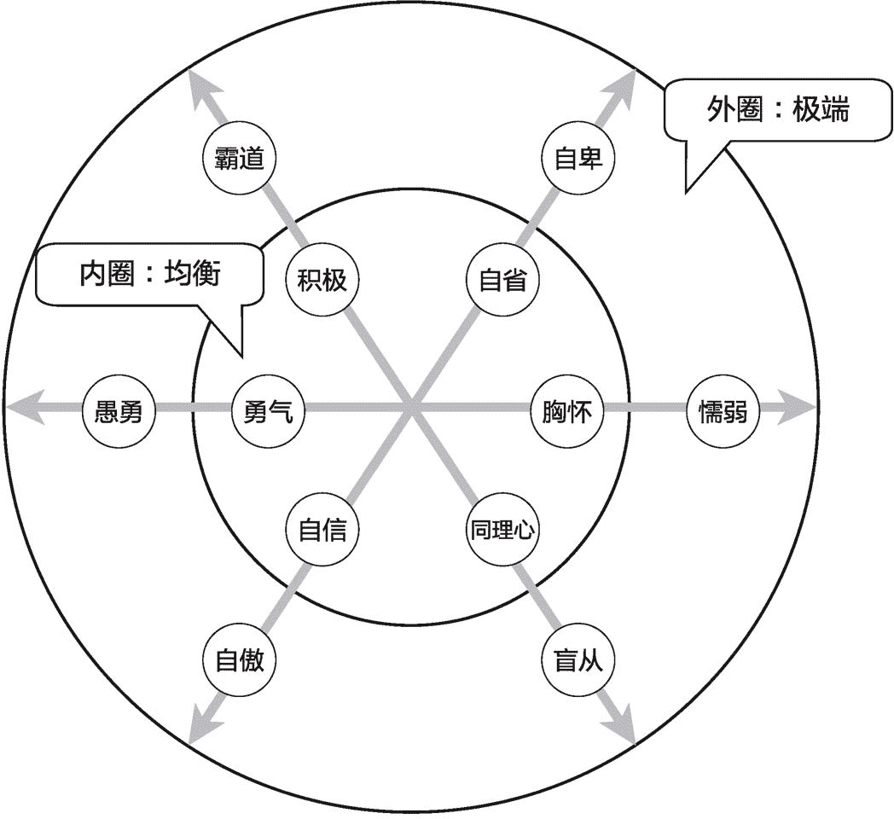

我见过一个典型的偏激案例。某位管理者让员工阅读拿破仑童年打架的故事，强调哪怕被打死也要拼。结果员工照搬“自杀式”抗争。我认为这不是勇气，而是不自量力的固执。

我也亲历过极端的沟通测试。公司培训时让十位副总裁围坐一个半小时畅谈，但禁止谈工作。大家聊天气政治体育，甚至争执。结束后相互打分，结果沉默的人排倒数第一，话最多的人排倒数第二。不说话让人以为没想法，话太多让人觉得不分轻重。

所以沉默是金和口无遮拦都不可取。后来我在苹果的第一份工作中，学到了一位叫西恩的经理的沟通之道：他从不抢话，不懂时闭嘴，有好建议时却绝不放过；想发言时用举手、清嗓、眼神示意；不懂时先找更懂的人，若无则坦诚“我不知道，我会去查”。把握分寸与时机，才会得到尊重，也让人觉得既博学又谦逊。生活工作里，须时刻警惕极端，坚守均衡。

### 用理智分析情景

中庸不只是守中，更要择善而从。避免极端之后，还需在复杂情境中冷静判断，选出最合适的解法。中庸并非机械的中间点，只要落在均衡区间内，根据情境灵活调整，都是中庸的体现。

一位年轻人问我：“老板意见不同，我该当面提出吗？”我的看法是看情况而定。首先判断老板是否接纳异议，若不接纳就不要硬碰，可以考虑换环境。若能接纳，则在决策未定前可提出，但当众说时要注意分寸；老板一旦拍板，就要坚决执行，私下再沟通。

同样道理适用于领导力。丹尼尔·戈尔曼在《有效率的领导》中提出，最佳领导并非单一风格，而是同时具备指挥、愿景、亲和、民主、授权、教练六种能力，并依据情境切换使用。当团队表现不佳或危机时用指挥；方向不明士气低迷时用愿景；员工熟练且协作良好时用亲和；知识不足时用民主；人才成熟时用授权；员工有热情但经验不足时用教练。

生活中的选择大多不是非黑即白，关键在于在合适的时间对合适的人用合适的方法。没有万能公式，只能靠理智权衡利弊与自身条件。

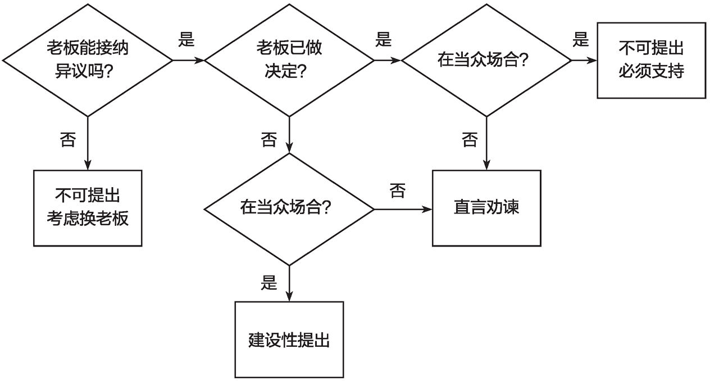

### 用务实发挥影响

选择均衡前，先弄清哪些事你能影响，哪些事你无能为力。史蒂芬·柯维把关注的事分为关注圈，影响的事分为影响圈。

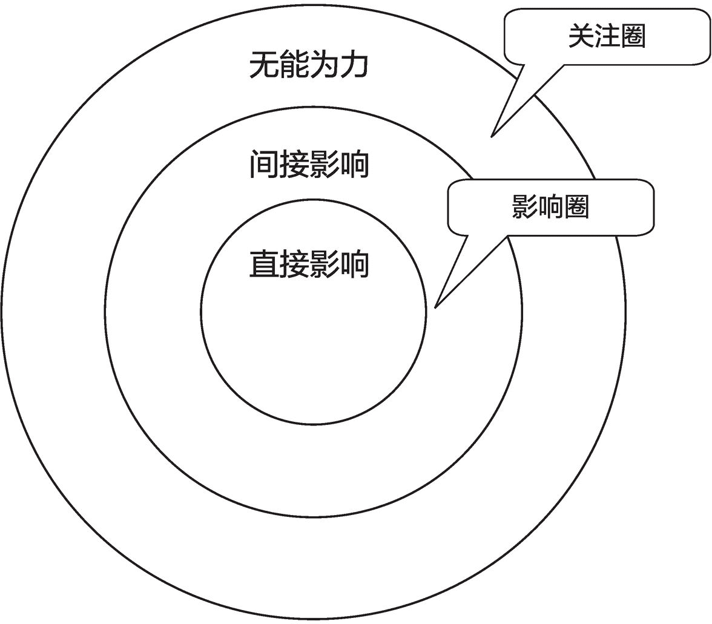

从可控度看，人生问题大致分三类：
1. 可直接影响的问题，通过正确执行解决，是核心影响圈。
2. 可间接影响的问题，靠人际、团队、沟通等手段改善，是值得争取的影响圈。
3. 完全不可控的问题，需要以平和心态接纳，避免被问题吞噬。

不管问题属于哪类，第一步都应从自己的影响圈开始：先改变自己，再影响他人，最后才谈得上影响环境。

一位大一学生向我倾诉：因背地说了同学坏话，后者利用职权在领导面前捏造罪名，取消了他入党积极分子资格。学生愤怒为何领导不调查。我劝他接受已发生的结果，少纠缠公平，多想自己能做什么：当初不说坏话是否能避免？如何管住情绪和口舌？“我怎样待人，人便怎样待我”，风无法改变，帆可以调转。挫折带来的成长往往大于成功。

我加入谷歌时也经历类似。离职消息被误导报道，网络上充斥不实指控。律师提醒我：媒体报道无法直接干预，法官判决可间接影响，可直接影响的是搜集证据、准备答辩。我两个月不看新闻，只专注法律文件与庭审演练，最终胜诉。回国后我并未刻意引导舆论，事实自然让报道转向正面。专注能改变的事，往往连看似不可改变的事也随之改变。

### 用冷静掌控抉择

人生是一场不断抉择的游戏。关键是用冷静的态度贯穿全程：抉择前“重重”思考，抉择后“轻轻”放下。

重重思考就是培养客观精准的判断力，避免先入为主。三个做法帮助我做到：

第一，列出利弊对照表。1998 年我面临回中国建研究院还是留在美国创业。朋友都说回中国没人愿意一起去。若我被动摇，可能就放弃了。为了更客观，我列出两条路的利弊。借助表格，我很清楚回中国更能发挥专长，符合价值观。

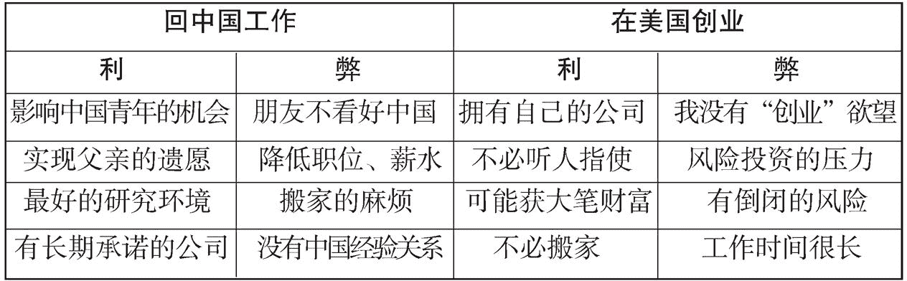

第二，用概率看问题。别把成功想成 100% 或 0%。对回中国的选择，我有 100%把握办到行业平均水准，这是最坏打算；有 40%把握做出世界一流，这是最好可能。考虑极端后，最坏也可接受，选择就水到渠成。美国前国务卿鲍威尔也说，当你评估成功率在 40% 到 70% 时，就该行动，拖延的代价往往更大。

第三，不确定时谋之于众。向有经验、有智商、有情商的人请教，带着利弊表一起讨论，既省时间也避免主观偏差。最终拍板仍在自己，责任也不能转嫁。

轻轻放下，则是做决定后坦然接受结果，不因正确而狂喜，也不因失误而悔恨。

这几重智慧环环相扣，帮助我们在选择的世纪里，走得更稳、更远。

有些人一做出决定就立刻紧张，担心后果会失控；有些人习惯事后后悔，事先从不周全考虑；还有人做出的判断本身客观公正，却经不起别人的议论而反复摇摆。

无论结果好坏，一旦选择落定就无法收回。我们能做的只是坦然接受，或在以后想办法弥补。对已发生的、已无法掌控的事，焦虑与懊悔都是多余的消耗。不如把那些念头轻装卸下，把精力用在该做的事上。

微软某部门里进来一位强势的经理J，上任就拿下属开刀，用子虚乌有的理由辞退能干的人，换成自己的亲信。

当时部门里不少人来找我求助。下属S收到处分后拿出证据自证清白，我帮他向J的上司申诉，最终S获得了新的岗位。

另一位下属D的遭遇则不同。J在D的电脑里植入伪证，以受贿为由解雇了他。我多次与D沟通，相信他是冤枉的，可在证据面前我无力翻案。当时我刚进公司，权力和信誉都不够，无法干预别的部门。反复权衡后，我选择不向任何人提及D的事，只能眼睁睁看着他带着委屈离开。

事后朋友问我，会不会因为待遇不同而懊悔。我说，对无法挽回D我深感遗憾，但必须看清哪些事超出能力范围。既然决定帮不上忙，就放下它，徒增纠结无益。我要把时间放在自己的工作上，也许有一天能积累足够的份量去帮助更多人。多年以后，J被公司解职，S和D都在新的位置上取得了不错的成绩。

### 用自知校准选择

“人贵有自知之明”，说的是每个人都要清楚自己的素质、潜能、长处、短板、经验等，也要明白自己在工作中能扮演什么角色。心理学把这种能力叫做自觉，包含感受到情绪如何影响行为、客观评价自己的能力边界、相信自己的价值等。

自觉的人会做出更成熟的选择，去做能胜任且能获得满足感的事。对自己评价过高的人容易浮躁冒进、难与人协作，挫折来临时落差大；低估自己的人则畏手畏脚、缺乏担责的勇气。两种偏差都会限制潜力的发挥。

我带过一个下属，自觉明显不足。他有些才干，却自视过高，对职位不满，还到处自夸。自我评估里写着：“虽然我很谦虚，但我只能说我的表现是有史以来最卓越的。”看到这句话我就知道他很难有发展。果然不久他就抱怨我不重用他，另谋高就。最后他发现找不到更好的去处，同事也认为他缺乏自知，最后沮丧离职。接替他的人能力很强却很谦逊。之前他因升迁过快准备不足表现不佳，他愿意降一级重来打基础，后来做得相当出色。

自觉对管理也很关键。员工做得不好时，我会问：他有没有自知？他是否意识到不足？是否愿意改进？如果都是否定的，那基本没有继续的价值；如果是肯定的，通常我会再给一次机会。

在“开复学生网”上，一位科大同学写道，自觉是大学生的必备素质。他在社团里接触很多学生，很少人清楚自己擅长什么、真正感兴趣什么。学制从五年改为四年后，很多大一新生一入学就冲着考研、出国、GPA去，这些目标变成了唯一追求。了解自己并不难，只是很多人从未认真想过。计划要建立在自知之上，最关键是搞清楚自己对什么最感兴趣。计划会随时间调整，但大方向要清晰。更难的是能以旁观者的视角审视自己，保持好的继续努力、改正差的、纠偏走偏的。

### 用经验沉淀判断力

西方有个寓言，年轻人问智者智慧从何而来，智者说从正确的选择来；正确的选择从经验来；经验从错误的选择来。意思是起初很难选对，但一次次从错误里吸取教训，就能学会正确的方法。回头看，我从失败中学到的远比从成功中学到的多。失败不是惩罚，是经验。

“旅途本身就是收获”。很多时候收获不是单点成功，而是路上积累的知识与教训。每次对与错的选择都会更新自觉，帮助掌握更好的选择方式。

我在从中国回到微软总部后，发现接手的部门一个项目方向偏了，团队沉迷于很酷的技术研究，却把用户放在次要位置，我毅然叫停了研发。有员工问我凭什么笃定，那个项目会不会未来惊艳。我的笃定来自之前的教训。

在SGI，我曾带两百多人研发当时最先进的三维漫步技术，能在老旧硬件上做出精美效果。但我们从未考虑用户和市场需求，产品想包罗万象，结果无法借助SGI现有渠道，硬件和网络要求又超出普通用户承受，最终项目被砍，技术被卖。两百多人需要另谋出路，有人失业，我深感愧疚，也从中明白创新重要，有用的创新更重要。正是这份经验让我果断叫停了微软的类似项目。

错误和失败可以成为心里的模板，日后面对新抉择时拿出来比对，估算概率，权衡利弊。

### 用勇气舍弃包袱

新机会出现时敢放下已拥有的东西，需要勇气；更需要勇气的是在没找到新机会前就先放弃旧的东西。很多人不愿放下现有利益，眼前的舒适常成为阻碍更大的根源。及时且智慧地放弃障碍，反而能看到更广阔的图景。

我自己就有几次这样的经历。大学时我满腔热情读法律系，觉得自己有政治天赋。选专业时报了人文学院，想做律师或政治家。结果专业课提不起劲，成绩不佳，更感受不到激情。我在这个领域没有优势，也没有热情，最终决定放弃。很幸运转了计算机科学，我并不悔那一年的投入，正因为及时止损才没有浪费半生。

在卡内基·梅隆教书时，我放弃了两年的教龄加入苹果。教书是榜样般的工作，但大部分精力花在争取终身教职、找好学生、发论文上。这些事很好，但社会价值不那么直接。我想做更直接有益的事。当苹果副总裁问我“是要写一辈子没人读懂的论文，还是要改变世界”时，我毫不犹豫选了后一种。那种感觉像获得自由。

加入谷歌后，记者问我为什么放弃微软七年的人脉和比尔·盖茨的信任。我觉得这些很有价值，但看到能回中国创业、看到互联网创新模式和一个有理想和社会责任感的公司，我明白若只眷恋已有东西就会错过一生一次的机会。我选择了中国，想在中国帮助青年、做有影响力的事，也就放下了微软的人脉、与盖茨共事的机会、安稳的工作和世界第一大IT公司的光环。

这些放弃让我更清楚追求，也更有热情投入所爱。

### 用内心追随方向

能帮我们决策的最后“智囊”，是内心的价值观、理想和兴趣。价值观是是非善恶的信念，理想是人生目标的设计，兴趣是最喜欢热爱的事。三者构成内心最真实的声音。

在关键问题前，自信还是自省？积极还是同理？勇敢还是包容？读研、工作还是出国？价值观给你是非的标尺，理想和兴趣给你方向的指南针。

我常用“报纸头条测试法”检验自己。设想明天亲友都会读的报纸上刊出我做的事，会不会羞愧、无法面对良心？如果不会，才算过得去。

我在苹果裁员时要从两人中选一人。师兄是卡内基·梅隆毕业，我的师兄，十多年前论文很出色，但入职后孤僻固执、工作不努力、无太多业绩。他找共同老师希望我看在同窗份上放他一马。另一位是刚入职两个月的新人，还没表现但有潜力。

我的公正和负责告诉我该裁师兄，怜悯和知恩图报却让我想留下他。做头条测试，我更不能接受“徇私裁掉无辜员工”的标题，比“冷酷裁掉同窗师兄”更违背诚信原则。若背离诚信，我无脸见领导，也无资格做经理。于是我裁掉了师兄，并告诉他今后需要帮忙我会尽力。这很痛苦，但我能面对良心。

我的理想是让影响力最大化。这个理想推动我1998年回中国创办微软中国研究院，2005年加入谷歌再次回国创业。大学生25岁前通常要做两个选择：专业和工作。别只听父母、只看名气或分数；工作也别只看名利时尚。最重要的是听从内心，在理想、积累、天赋和条件之间综合权衡。

兼顾正确的价值观和理想，才能在追寻成功时保持冷静、不断积累经验完善自我。

### 融会中西，均衡发展

在信息化全球化的今天，融会中西才能成为真正有价值的国际化人才。中西方文化差异很大，成功者需要在两种不同的思想范畴里找到最适合自己的精髓，把各自优势结合起来。中国人讲纪律服从、谦虚毅力，西方人重创意个性、积极勇气，两者结合才能把握完整与均衡。

当东方追求现代化时，西方也在回归东方传统价值，管理者、科学家、艺术家都开始研习儒学佛教，从古老东方寻找精神财富。真正的成功者既需要西方科技理性，也需要东方心胸美德，后者影响内心更深远。中华传统美德如中庸、正大光明、学无止境、自知之明、将心比心、严于律己宽以待人，都可成为追寻成功的指南。

兼顾中西不是渲染一方文化，而是用不同风格充实自己以达到均衡。我想强调中西相辅相成的必要性和有效性。

一个人往往需要同时具备看似矛盾的品质，才能在复杂情境中选用合适的那一种。

用智慧在矛盾因素间主动选择完整与均衡，这是“选择成功”的最大诀窍。

梁启超曾说：“故今日之责任不在他人，而全在我少年。少年智则国智，少年富则国富，少年强则国强，少年独立则国独立，少年自由则国自由，少年进步则国进步。”

青年朋友们，中国是了不起的国家，她已是世界上最大的市场和人才中心。这里有无数机遇，只要用智慧主动选择，成功随时可能降临。
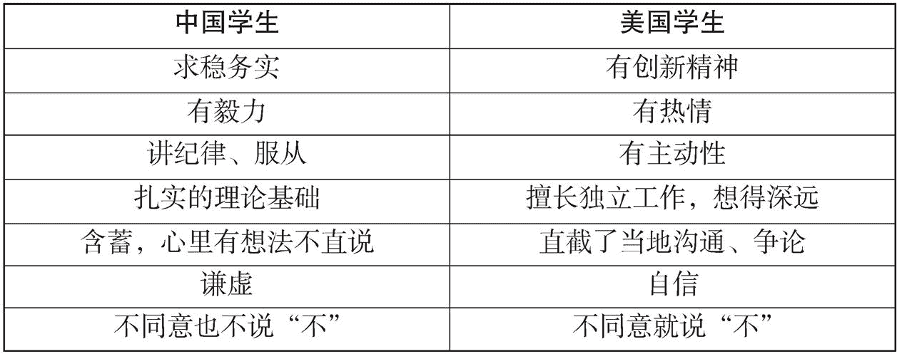

# 第七封信：21世纪最抢手的七种人才画像

## 起点

托马斯·弗里德曼拿过三次普利策奖，他的那本《世界是平的》里，中国被着墨不少，连我和微软亚洲研究院的故事都被写进去。书刚出几周就冲上畅销榜首。弗里德曼在书里称赞中国人的天赋与韧性，并写道：“科技革命与全球协作把各地隔阂抹平得差不多了，跟不上时代节奏就将被历史淘汰。”

我回国前和他深谈过。我认同他的“世界变平”判断，平的地方需要的是同一种人，不分美国、中国还是印度。美国年轻人要进步才能不被甩下，这点我也赞同。但我提醒他，书里对中国和印度的教育描写得有些理想化。中国的教育和青年同样需要激活与提升，才能成为能在21世纪立得住的人才。他最后承认，自己有意放大问题的严重性，是为了唤醒美国的教育界和年轻人。

于是这封信就聚焦一个问题：新世纪到底需要怎样的人。世界已经变平，哪个角落都渴求具备国际视野与现代素养的优秀人才。成功的跨国公司要的也不是单一文化背景的员工，而是来自不同文化、却能在素质与时代要求上同等出色的人群。这封信写给中国青年，也写给所有想在21世纪有所作为的年轻人。

人才的标准从来在变。战国和骑士时代看重以一当十的勇士与能言善辩的谋士；科举时代靠死记硬背和八股取胜；工业革命时造机器的发明家和精通专业的工程师备受青睐；上世纪很多企业还在强调专注、勤奋、诚实、服从这些个人层面特质。

今天机会转瞬即逝，环境瞬息万变。越来越多的人拥有选择与决策权，越来越多的人要在持续学习与不断创新中完善自己，越来越多的人有了施展抱负的空间。工作不再是重复的体力操作，也不是单人的发明。独立思考与自主判断变得关键，紧密协作与沟通也变得不可或缺。

21世纪企业要的不是只擅长某一方面的“窄义”人才，而是能在个人素养、学识经验、协作交流、创新决策等多维度都具备潜力和修养的“广义”人才。把20世纪的人才画像和21世纪的要求简单对比，对比强烈：

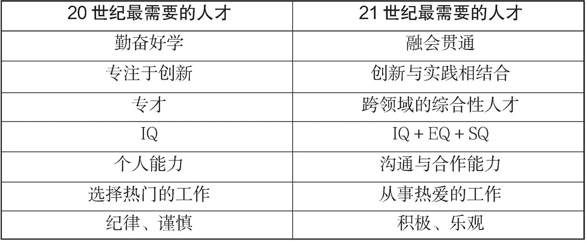

这并不是否定勤奋踏实等基本素质，21世纪恰恰仍以此为根基。不同的是，要求更立体完整，评判视角从单一的人转到个人、团队、组织、社会乃至环境的多重维度，涵盖学习、创新、协作、实践等多项要素。

对立志成为栋梁的学生，对致力于培养实用人才的高校来说，能否用21世纪的立体视角理解新标准，是能否适应国际竞争发挥人才优势的前提。下面结合我在科研、教学与研发管理中的体会，谈谈面向新世纪的七种特质，希望能给青年与教育者一点参考。

## 把知识活起来用

不少学生以为学习的终点是拿文凭找工作。一些学校也把精力放在造“考试机器”上，甚至有老师说：考前背知识点，考完赶紧忘，否则应付不过来后续课程。

这种做法很危险。学习的意义在于助力理想，追随兴趣。只有持续学习，人才能不断升级，慢慢靠近真正的成功。

社会迭代加快，知识半衰期缩短。不懂终身学习的道理，不掌握有效学习方法，就会在岗位上掉队。为文凭而学、只在校园里学的人，即便拿到证书，进入职场后也会迅速“过时”。考场上能记住答案不重要，工作里能思考、能推理、能应用才重要。学习真正的目的，是让自己在人生全程保持更新，与时代同步。

我在《做最好的自己》里把学习分为四个层次：

1. 熟能生巧：在指导下掌握课本内容，知道答案。
2. 举一反三：具备思考能力，掌握方法，能知其然并知其所以然。
3. 无师自通：学会自学自修，能在无人辅导时主动求知。
4. 融会贯通：把知识灵活用到生活与工作中，懂道理会做人。

融会贯通是最高层，也是21世纪最需要的能力。

比如学计算机科学，系统掌握数学、算法、系统与编程只是基础。要成为研发好手，还需要自主学习、独立思考、自主创新的能力，能把来自不同渠道的知识、经验与方法整合起来，用来解决实际问题。

因此招聘研发时，除了看基础编程、算法和项目经验，企业常会用一些“奇葩”思维题：为什么下水道盖是圆的？评价一下你刚用的电梯人机界面？北京大概有多少个加油站？这不是脑筋急转弯，而是考察独立思考时的综合表现。第一个问题的答案可以是“圆不会掉下去”，也可以是“圆更贴合人体，维修方便”“方形有棱角易伤人”“圆可以滚动一个人就能搬”。能给出多种解释，说明思维活跃；只给一种或答不上来，就容易让人怀疑是只会背书考试、不会灵活应变的人。

融会贯通还意味着动手实践。很多公司希望应届生有十万行以上的编程实战经历，但在中国的一些学生，四年里自己写的代码可能不到一千行。这反映了教学重理论轻实践，也反映了学生只学“死”知识，不创造机会把知识用起来。

融会贯通还意味着学会创造性地解决问题。在谷歌招聘中，我发现擅长标准答案的学生，一碰到模糊需要抽象的问题，比如“如何把常用图算法用于人际关系建模分析”，就难以聚焦、难以选择方案。现实工作中几乎所有问题都是模糊不确定的，老板不会把问题简化成教科书形式，需要自己在融会贯通的基础上创造性解决。要求更高，但一旦达到，就是21世纪人才的必备特质。

## 创新必须落地

创新是社会与企业长期竞争优势的唯一来源。价值源于创新，重复劳动创造的价值远小于创新带来的价值。所以几乎所有现代企业都把创新放在核心位置，发展中国家也视自主创新为可持续发展的动力。

但容易出现“为创新而创新”。很多成果追求技术领先或概念独特，却不考虑能否解决实际问题、能否被用户接受。

1996年我在SGI主导一个三维浏览器项目，产品很酷、获奖无数。可我们只顾埋头造，没做市场调研，不知道普通用户是否需要。产品最终无人问津，部门被卖掉，一百多位同事被裁。那是我一生最难忘的失败之一。

教训是：创新必须服务实践，为创新而创新毫无意义。在MIT受访时我刚经历那次失败，给学生的提示是：“重要的不是创新，而是好用的创新。”要看它是否有实用价值，能否解决问题，被用户接纳。

反过来，实践也不能只做重复。实践中要时时保持创新，让创新驱动实践。这样工作才有活力，才能不断产出卓越产品。

谷歌两位创始人谢尔盖·布林和拉里·佩奇就善于把创新与实践结合。他们把创新的网页排序算法和网络搜索实践结合，成就了谷歌。工作之余，佩奇也会用笔记本装测试程序，放在遥控玩具车上，蹲在地上指挥车跑遍公司，目的只是测试内部无线网。

创新引导实践，实践支撑创新。只懂原理不懂搭建的人，和只会砌砖不懂原理的人，都建不起摩天大楼。21世纪，只有把创新和实践结合起来的人才能获得最大成功。

## 跨界整合者

21世纪是学科与产业融合的时代。人才需求从传统专才转向跨领域综合型。以计算机科学为例，已出现计算机与心理学、语言学、经济学、生物学、建筑、戏剧、机械等结合而生的新方向，比如用户界面设计、计算语言学等：

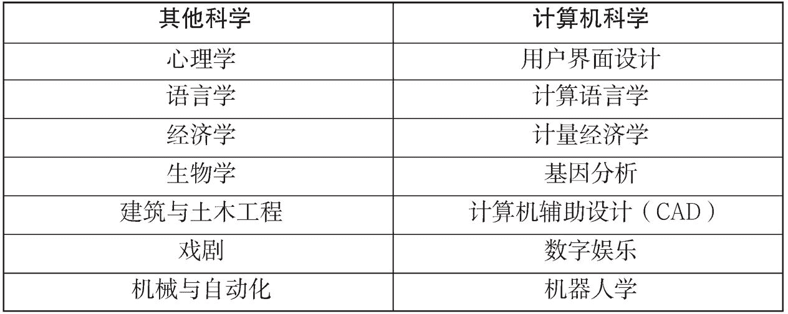

苹果的iPod就融合了存储、信息编码、网络、用户界面等多项技术。谷歌的成功也不只是信息检索。早在谷歌成立二十多年前的LexisNexis，已在大数据检索上领先，却因过度聚焦本行业而错过互联网革命，没能用并行计算处理海量网络信息。谷歌靠多学科交叉：信息检索、网络技术、用户界面、信息采集、硬件支撑、并行处理等组合，才后来居上。

学术研究亦然。我博士论文实现世界首个不指定说话人的连续语音识别，被视为里程碑。并非发明了新声学或语言学理论，而是把传统声学、语言学与统计学、信号处理、模式识别等跨领域技术结合起来整合应用。今天全球语音识别系统多建立在这一基础之上。

现代科技需要跨界协作，也需要跨界人才。这不等于不必深耕一门，而是避免钻牛角尖。把不同专业的最新思想结合，做有创意且可落地的事，成长空间最大。新世纪要的是既能深入某一专业，又能通晓相关领域、善于协作的综合型人才。

## 三商要平衡

很多人以为名企选人只看成绩和学校名气。名校背景确实提高成功率，但不是决定性因素。不少我见过的优秀员工来自不知名院校。《隔壁的百万富翁》统计，美国百万富翁平均大学成绩只有2.9分，并不出众。

成功不只取决于智商，还要看智商、情商、灵商是否均衡：

1. 高智商：不仅是聪明，更是创意、独立思考与解决问题的能力。融会贯通、创新、跨界思考都是高智商的体现。
2. 高情商：认识自我、控制情绪、激励自己，以及处理人际、团队合作的能力。高层管理者中，情商的重要性约为智商的九倍。
3. 高灵商：有正确的价值观，能分辨是非真伪。没有价值指引，能力越强危害越大。

## 学校该怎么培养

我在央视《对话》与一位大学副校长谈人才培养。他认为学校该培养高智商人才，我认为除智商外，还必须培养诚信与团队精神。诚信是灵商，团队精神是情商。大学四年是可塑性最强也最易被误导的时期，只重智商会培养出难以适应现代社会的“畸形”人才。

我建议学生在社团、项目合作、暑期实习等机会中，有意识锻炼三商，为未来做准备。

## 高效沟通与协作

沟通协作是新世纪的基本要求，也是情商的重要部分。21世纪需要“高情商的合作者”，没有项目是一个人能完成的。跨领域项目需要跨专业协作，公司放权后每个人都必须主动协作，不能等指令。天才若孤僻自傲、沟通不良，价值会大幅缩水。

我曾见过一个极聪明工程师，能干几十个人的活，被提拔到副总裁级别。后因一封抄送全公司高层的邮件，公开指责同事“愚蠢透顶”，造成恶劣影响。同事不再信任他，管理层意识到其负面效应已超过正面贡献，最终认为他不适合现代企业。

高效沟通者懂得理解听众，用最有效方式交流，用引导代替说教。高效合作者能在团队中找到合适定位，快速厘清分工，在工作中主动帮助他人、分享经验。

把知识活起来、让创新落地、跨界整合、三商平衡、善于沟通协作，这就是21世纪真正稀缺的人才画像。

国内高校对协作能力的训练要求普遍偏低。我的一位朋友曾在某所大学讲授一门选修课，报名阶段座无虚席，开课不久却有约三成学员自行离场。他百思不解，课程结束后对退出者做了问卷。反馈显示，大多数人离开的原因是课程作业多以小组形式展开，而不少学生对这种模式感到陌生和吃力。显然，他们尚未认识到协作的价值。等到入职后，几乎所有岗位都离不开配合，若能在校园时期多些实践，对未来发展会产生明显助益。

## 让工作与热爱同行

择业时，多数同学首先看重岗位的热门程度与薪酬水平，极少先问自己是否真正喜欢。金钱人人都需要，但若只为赚钱而工作，发挥的空间往往受限，因为思路始终围绕如何多挣钱运转，容易做出偏差决策，也欠缺持久驱动。

我更欣赏有觉察、有信心的年轻人，他们会依据兴趣爱好来挑选岗位。只有投身所爱，才会全情投入，每天带着热情与笑意。我想，这类人才最幸福，也更容易在事业上取得突破。孔子的“知之者不如好之者，好之者不如乐之者”，曾被一位美国朋友译为：“If you find a job you love，you never have to work a day in your life.”这句话道出了热爱的本质。

不久前，一位华人经理来应聘资深职位，技术与管理都很扎实，但我们最终没有录用。综合面试意见是：他急于脱离原公司，却缺乏理想与激情，对后续项目无感，反复追问待遇、职级、权力。若他只想当个职业经理人每月拿一份厚薪，就不适合我们。

谢尔盖·布林和拉里·佩奇在斯坦福读博期间曾讨论过博士与博士后的差异。拉里问博士后多出自名校，为何表现常不如博士。谢尔盖说有分量的论文多由博士发表，博士后难有突破。拉里戏称难道读博会变笨。谢尔盖解释，斯坦福的博士可以自行挑选有热情的课题并跟随喜爱的导师，而教授把有经费但无人自愿接手的项目交给博士后。这再次印证了知好乐的道理。

激情并非高管或科学家的专利。我在西雅图认识一位在露天市场经营鱼店的摊主，他和伙计都充满活力。路过时能看到他们边唱边把鱼从车上抛向摊位。店里还会主动递上免费的熏鱼或螃蟹腿让顾客尝鲜。某天我注意到他店里的点钞速度远超邻店。后来回西雅图，老板已离职，伙计说老板的热情被书商看中，出了本畅销书*Fish，Catch the Energy，Release the Potential*，出版后常受世界五百强企业邀请做顾问，教企业如何激发员工热情。有人觉得鱼贩不适合作为榜样，但服务业不会消失，在激烈竞争中，有热情的服务者更容易脱颖而出。

只盯着薪水的人天花板有限。若能找到契合理想与兴趣的方向并持续学习积累，前途不可限量。寻找激情，我的建议是先厘清理想与人生目标，分阶段设立可实现、可衡量、可评估的心愿，再去探索兴趣点，点燃热情。热爱自己的工作，做自己喜欢的事。若兴趣尚不明确，就保持好奇心，多尝试。

## 主动乐观，才能抓住稍纵即逝的机会

沉默未必是金，过度谨慎也并非处世的唯一法则。21世纪的机会转瞬即逝，若不以乐观心态主动把握甚至创造机会，就可能错失；若不主动让他人了解自己的能力，心仪的岗位也可能与你无缘。

21世纪是一个信息高度共享、个人能量得以充分释放的时代。人们拥有前所未有的选择权与自主权。这个时代更需要积极进取、主动选择，而不是缄默、被动接受。

在《给青年学生的第五封信》中，我提出积极主动的三个要点：

1. 为自己负责，把握命运：不去解决也是一种解决，不做决定也等于做了一个决定。
2. 沉默不是金：想抓住稍纵即逝的机会，就要学会说服他人、推销自己、表达观点。
3. 不要坐等机遇，要提前准备：机遇到来前就要用心尽力，还要主动创造机遇，不能守株待兔。

积极主动的人创造力无穷。谷歌决定在各高校设立Google Camp时，负责人来找我讨论启动。我想起此前全国巡讲遇到的几位主动同学：北航的一名学生曾发邮件希望谷歌在北航建俱乐部；浙大一个社团曾出色承办我的演讲；南大四位同学发起用“六度空间”寻找我的活动。我建议同事直接找他们，他们一定会有好想法。数月后，这几位同学不仅为Google Camp提供建议，还在谷歌实习并推动计划落地到二十多所高校。他们的主动让他们脱颖而出，也获得了宝贵锻炼。

对主动最大的抗拒是怕失败。我想提醒大家：一个杯子是满还是空，取决于你是在往里倒还是往外倒。愿大家都是往里倒水的乐观者。一生总会遇到大小挫折，21世纪环境变化快，失败概率更高。畏惧失败的人会在挫折前止步，而乐观者把失败当作动力，善于从中学习，把失败视作提升的机会。乐观者更易适应竞争，在持续提升中走向成功。近年有人提出在4Q之外再加一个AQ，Adversity Quotient逆境商数，充满机遇与挑战的21世纪需要高AQ人才。

台积电前董事长张忠谋题字“多想一二”，意思是人生不如意十之八九，要多想那一二件得意事。对难得的成功要极度珍惜，保持感恩与乐观。

至于十之八九的失败挫折，不必过度在意，也不必悲观失望，而要鼓起勇气从失败中学习、完善自己。我在SGI的经历就是一次惨痛失败，产品无人问津，研发团队被解散。正因那次打击，我才真正明白创新与实践结合的重要性。此后无论在微软亚洲研究院，还是领导谷歌中国研发团队，我都提醒自己和团队既保持创新精神，又紧贴实践和用户需求。可以说，我从失败中学到的比成功多得多。结论：不要把失败当惩罚，要当学习机会。

有人前半生经历失业、经商失败、爱人离世、演讲失败、角逐国会议员提名失败、未获再度提名、想转任地方官失败、竞选参议员失败、角逐副总统提名失败，你能猜出是谁？正是美国历史上最杰出的政治人物之一，1860年当选总统的亚伯拉罕·林肯。我想，林肯能最终取得成就，与他乐观看待失败、从失败汲取力量密不可分。

## 结束语

21世纪，年轻人的世纪。
21世纪，平坦的世纪。
21世纪，充满希望的世纪。
21世纪，充满挑战的世纪。
21世纪，新一代国际化人才大展宏图的世纪。

在这美好的时代，能融会贯通把创新与实践结合、跨领域协作、具备IQ+EQ+SQ综合素养、善于沟通合作、选择热爱的工作、积极主动、乐观向上的人，一定会拥有更平坦、更辉煌的成功之路。

我把这封信献给所有渴望在21世纪成功的世界青年，也把下面七句话赠给21世纪青年：

融会贯通者：听过的会忘记；看过的会记得；做过的才能真正掌握。（Hear and you forget；See and you remember；Do and you understand.）

创新实践者：重要的不是创新，而是有用的创新。（What matters is not innovation，but useful innovation.）

跨领域者：重要的不是深度的解析，而是跨领域的合成。（What matters is not analysis，but synthesis.）

三商皆高者：你的价值不在于你拥有什么，而在于你贡献了什么。（Your value is not what you possess，but what you contribute.）

沟通合作者：只会思考而不会表达的人，与不会思考的人没什么两样。（The man who can think and does not know how to express what he thinks is at the level of him who cannot think.）

热爱工作者：如果你找到了自己热爱的工作，你就会在一生中享受每一天。（If you find a job you love，you will never work a day in your life.）

积极乐观者：半杯水是半满还是半空，主要看你是在倒水入杯还是出杯。（The glass is half full or half empty depending on whether you’re pouring in or out.）

# 我的人才观

## 起源回望

《我的人才观》是我1998年到微软研究院工作后写的首篇文章，也是我第一篇中文文章。文中写到微软研究院如何营造优越环境吸引人才。通过一流企业文化和工作环境聚集一流人才，是微软、IBM等高科技企业一贯做法。数年后，这一观点更显重要。文中提到的“信息社会高素质人才效率优势远超工业社会”被广泛引用，但人们常只停留在高智商层面。事实上智商只是因素之一，情商EQ、灵商SQ在信息社会同等重要。只有IQ、EQ、SQ兼优的人才才能适应21世纪需求。

谷歌同样重视人才战略，用优秀文化和环境吸引人才。许多做法带有鲜明谷歌特色：免费提供三餐茶点、洗衣按摩服务、齐全健身娱乐设施，有员工说“我几乎每天要在公司待十三四个小时”。听起来像加班，其实他们把饮食、休息、健身、娱乐甚至社交都放在公司里。谷歌虽在福利上投入不小，但管理者认为这能大幅提升效率，培养主人翁责任感，投入很值得。此外，强调小规模团队、鼓励员工用20%时间做自己喜欢的项目、尽可能让每个人做感兴趣的事，都能很好发挥优秀人才特长，给员工更多满足感和成就感。

人才在信息社会的价值远超工业社会。工业社会里，最优秀的工人或许比普通工人多生产20%到30%；信息社会里，最优秀的软件研发人员能比普通人员多做出500%甚至1000%的工作。

微软中国研究院宣布成立后，我最常被问的是为何要在中国设院。我的回答一直是：“主要是中国有一批优秀人才。”人才为何对微软如此重要？

## 人才为何不可替代

举例来说，世界上最小的BASIC语言就是比尔·盖茨独自写出来的。而为微软带来巨额利润的Windows也只是由一个研究小组做出。在研究机构中，人才的重要性更高，因为研究和开发很不一样。对研究员而言，“想”的能力比“做”的能力更重要。一个了不起的研究员如爱迪生，其成就一般研究员无法相比。再以计算机界为例，1970至1980年间，施乐帕克Xerox PARC只有数十人的小实验室，我曾在Xerox工作的朋友Alan Kay说这数十人有“可怕的才华”。这才华带来了激光打印机、Bitmap白底黑字显示、带鼠标的GUI、图像式文字处理软件、以太网和面向对象技术。这六项发明启发了微软、苹果、惠普、IBM、Sun、Cisco等公司，十年后把这些技术带入主流。今天人类能进入信息社会，Xerox PARC的数十位研究员功不可没。

## 爱才的真实案例

人才难得，比尔·盖茨常说微软最大挑战就是持续快速发掘和雇用与现有员工同样优秀的人。他也曾说研究成功完全靠人才，所以微软追随人才到中国设院。

1991年，比尔·盖茨决定创立美国微软研究院时，请了多名说客，包括在DEC带领VAX团队的Gordon Bell先生、微软首席技术官Nathan Myhrvold先生，专程到美国宾州卡内基·梅隆大学，邀请世界著名操作系统专家雷斯特教授，也就是我现在的老板[^(\[1\])](#part0071_split_004.html#m1)加盟微软。经过半年时间，在盖茨三顾茅庐的诚意下，雷斯特教授终于加入微软。

雷斯特博士加入后，同样以最高诚意和无限耐心邀请计算机界最有成就的专家共创未来。上文提到的一些专家，如在Xerox PARC发明激光打印机的Gary Starkweather，在Xerox发明文字处理软件的Charles Simonyi，在Xerox带领软件研究的Butler Lampson，在Xerox带领硬件研究的Chuck Thacker，在苹果做出Finder的Steve Capps，发明VAX的Gordon Bell，还有上百名其他领域世界专家，都在八年或更早，经雷斯特博士游说加入了微软。

我个人也被微软研究院多年经营的成功和与这些专家共事的机会吸引，被雷斯特博士的诚意感动，最终决定加入微软。但我也可举一个非微软的例子。加入微软第二天，我意外接到乔布斯的长途电话。他在中国找到我，并告诉我，自1996年我离开苹果后，他多次找我回苹果，对我换工作没找他感到十分失望。他希望说服我考虑回到苹果。当然他没说服我，但我对他的器重非常感激，他的爱才值得钦佩和学习。

## 如何甄别人才

既然人才如此重要，微软研究院如何发掘人才？

首先，我们寻找有杰出成果的领导者。这些领导者有些是著名专家，但最有能力的人不一定最有名。许多计算机界杰出成果常由一批幕后研究英雄创造。无论台前名教授还是幕后研究英雄，只要他们申请工作，我们都会花大量时间理解他们的工作，并游说他们考虑来微软中国研究院。

另外，我们寻找最有潜力的人。在中国，因信息技术起步较晚，现阶段杰出成果和世界级领导者比美国少很多。但中国年轻人如应届硕士或博士生的聪明才智、数学基础和创造力，决不输于美国人。所以与其说是来中国找专家，不如说是来中国找潜力。对我而言，潜力包括聪明才智、创造力、学习能力、对工作的热爱和投入。我认为这类“潜力”比专业经验、在校成绩和推荐信更重要。

如何判断这些能力？在微软，我们有比较特殊的面试方式。每一次面试通常有多位微软员工参加。每位员工事先分配任务，有的出智力题，有的考反应速度，有的测试创造力及独立思想能力，有的考察与人相处和团队精神，有的专家则深入问研究或开发能力问题。面试时我们问的问题都很有创意。比如测试独立思想能力时，会问这类问题：

请评价微软公司电梯的人机界面。

为什么下水道的盖子是圆的？

请估计北京共有多少加油站？

这些问题不一定有正确答案，但由此可测出一个人思维和独立思考方式。

每位员工面试后会把意见、决定（必须雇用、应雇用、可雇用、弱雇用或不雇用）、已彻底探讨的方向及建议下面员工可探讨的方向，用电子邮件通知所有下面的员工。

最后，面试结束后我们集体总结，挑选新员工。我们通常在获得全体同意后才雇用一个人。就算全体同意，我们仍会询问申请者的老师、同学或其他可能认识申请者的人的意见。若一切正面，我们才会雇用这位申请者。

这种严格组织、谨慎态度和深入面试，体现了我们对人才的重视。经过这一严格流程，微软中国研究院已经慎重雇用了四十多名员工。

## 留住人才靠什么

很多人认为雇用人才关键是待遇。更多人认为微软来到中国可高薪收买最好的人才。确实，每个人都应得到适当待遇，在微软中国研究院我们提供有竞争性但合理的待遇。但对研究人员来说，更重要的是研究环境。我希望能开辟一个特别吸引人的环境，包括：

1. 充分的资源支持，让每个人没有后顾之忧；

2. 能让顶尖研究者聚集，营造开放平等的协作环境，大家在切磋中共同进步；
3. 投入能造福社会的工作，让每位成员为团队产出的成果感到自豪；
4. 拥有长远视野与有吸引力的研究方向，让工作本身成为热爱；
5. 领导者懂得研究、给予支持，既能把握公司整体走向，又能为个人留出足够空间和自由去发挥专长、追寻梦想。

单纯靠高薪只能吸引一部分人，真正让人进来又长期留下的是令人向往的工作氛围。

在微软全球研究院体系里，人员流失一直控制在个位数以内，远低于硅谷平均接近三成的水平。面试时给我印象最深的是大家发自内心的快乐和对工作的珍惜。因此我在国内的设想，就是复制这样一种环境，让人们在微软中国研究院安心追求梦想，一方面推动微软关键技术的研发，另一方面助力中国信息产业的发展。

* * *

[\[1\]](#part0071_split_002.html#w1) 此为写作本文时的情况。

# 教育观：融会中西，培养均衡人才

## 写在前面

童年浸润在中国传统文化里，十一岁赴美时几乎说不了英语，性格内向腼腆。三十多年在美国求学、科研和工作，让我逐步适应了西方的思维习惯，融入当地生活，成长为一个开朗、善于沟通、有管理能力的研发领导者。后来回国参与微软中国研究院的创办，结识了大量优秀的国内管理与研发人才。这段经历让我更懂中西方文化的差异，也坚定一个判断：在当下平面化、开放化的世界里，只有取长补短、融合两种先进思维，才能走在信息网络时代前沿；也只有坚持“融会中西、完整均衡”的教育思路，才能提升教育质量、改善教育生态，培养出推动国家历史性跨越的国际化人才。

我一直想把这些想法讲给国内的学子和教育从业者。早在《第二封信》里我就说过，要把国人谦虚坚韧的品格与西方优秀思想结合；写《做最好的自己》时思考得更深入。我想告诉读者，哪些传统值得保留，哪些西方观念值得吸收，两种思维冲突时如何取舍，以及我个人经历中哪些经验方法可以提供借鉴。

过去二十多年，我参与过前沿科研教学与产品开发，带过卡内基梅隆的优秀学生，经历过苹果的兴衰，见证过SGI图形技术的领先与起伏，还创办了微软中国研究院，并在2005年重返国内协助谷歌建立并领导中国研发团队。作为既有高校教学经验又有顶尖企业研发管理经验的从业者，作为受东西方教育共同熏陶的实践者，我持续关注中国青年的成长与教育发展，愿尽一份力。

如果为中国教育提建议，我更想强调三点：
1. 年轻一代很优秀，也很需要引导与支持；
2. 国家的跃升取决于教育；
3. 教育的落脚点在于把年轻人培养成融会中西、全面均衡的国际化人才。

本文结合这些观点与我亲身经历的案例，分享二十多年来的思考与探索。

## 看到希望的年轻一代

1998年8月，受微软董事长比尔盖茨委派，我到北京组建微软中国研究院并担任院长。当时内外多有怀疑，我却充满信心。中国不缺人才，只要凝聚海内外华人智慧，这件事一定能成。不到一年，我邀请到张亚勤、沈向洋、张宏江等在全球计算机领域有影响力的学术带头人，并在国内发掘出一批极具潜力的年轻人。三年后，我们成为亚洲顶尖的研究团队之一。2004年，MIT科技评论将微软亚洲研究院评为全球最热门的研究机构。在北京的两年，每一天都振奋，每一刻都难忘。

2000年8月，我被召回总部担任全球副总裁，负责新产品部门。此后国内发生的一切始终牵挂着我，牵挂着那片充满生机的土地和血脉相连的人们。

国内的年轻人，尤其是大学生，给我留下最深的印象。清华园的激情演讲，未名湖畔的思想对谈，从南到北、从沿海到内地，每所校园、每一个面孔都让我感慨。他们有朝气和活力，也有不安和躁动。我深感有责任为他们提供思想和方法上的帮助，让他们从我的经验里汲取智慧和力量。

正是这份责任感推动我，在2005年前的五年里，身在美国却十五次回国，做过五十余场演讲，写过四封《给青年学生的信》，并创办了面向大学生的公益交流平台“开复学生网（`www.kaifulee.com`）”，每天与青年讨论成长、排解困惑。2005年中，我用十个月完成《做最好的自己》，由人民出版社出版，很快成为青年读者追捧的畅销书。大量中学生、大学生和职场新人来信来邮件，让我确信为中国青年和教育所做的付出是值得的。

中国青年有过人的智慧、扎实的基础和勤勉的作风。若有一位掌握成功规律的良师给予贴心帮助，让他们更积极、更勇敢、更自信，他们一定会在不久的将来成为国家的栋梁。

他们很优秀，却常陷入极度困惑：父母期望过高、学校老师偏重应试、社会心态浮躁。若有一位有经验的引路人指明方向，他们会走得更稳、更踏实，并成为民族实现历史性跨越的核心动力。

他们有幸成长于可以接受完整先进教育、能专心读书并拥抱信息时代的年代。但在全球化与信息化抹平时空差异的时代，中国青年必须成为兼具中西文化的精英，才能在国际人才竞争中脱颖而出。他们生于拥有广泛选择权的时代，却未必获得足够指导选择的智慧。

我在热爱中国的家庭中出生，又在美国进步的学校受教，是跨越中西文化的代表。我教过勤奋的中国学生，也教过活跃的美国学生，看到了融合双方优势的绝佳机会。作为体验过西方文化的炎黄子孙，我愿做指路人，帮助青年远离迷茫走向卓越，也愿把我在指导学生中积累的方法经验，为致力于中国教育发展的人提供参考。

## 国家跃升的关键在教育

三十多年的蓬勃发展，让世界看到一个理智、自信、充满活力的亚洲大国和平崛起。从神舟五号飞天，到2008年北京奥运，从每年超万亿美元的国民储蓄，到全球最大的移动通信市场，这些事实彰显了巨大的市场前景、开明的治理方针以及勤奋向上、坚持不懈的拼搏精神。

制造业的成功令人惊叹：中国是名副其实的世界工厂。在沃尔玛、开市客、塔吉特、梅西百货等美国大型商超，约九成商品为中国制造；在加州Fry’s，约半数商品来自中国；跨太平洋的巨轮源源不断为美国供货；中国电信一次政策调整就能让美国高通股价波动；1984年成立的民企联想竟收购了IT巨头IBM的PC业务。中国已成为任何强国都必须重视的经贸伙伴。

但我们必须清醒：制造业利润很薄，绝大部分利润流向研发、市场、进出口、销售、运输等环节。形象地说，中国赚一元，外国公司可赚九元。“劳心者治人，劳力者治于人”，这恰好反映了当代世界经济的核心规律。

今天中国正处十字路口：未来是继续赚取每十元利润中一元的低端产业，还是能获取九元？是继续做世界工厂，还是成为研发中心？中国人是做世界工人，还是世界人才？是满足于经济成功，还是在成功基础上向卓越迈进，全面接近或超越美国的科技、教育与国民收入水平？

美国二十世纪的奇迹固然是综合因素的结果，但教育是最关键的驱动。美国建立了以人才为核心的良性循环：政府大量投入教育科研，为人才成长创造氛围；高校和科研机构输送人才与领先科技，进入企业制造出最具竞争力的产品；企业向全球销售创造财富，税收增加后反哺教育科研。教育产生人才，人才催生科技，科技催生企业，良性互动使国家强盛，而成功的人才战略是关键。

因此，中国能否从成功走向卓越，主要取决于是否拥有当今世界最优秀的人才，而最优秀的人才来自最优秀的教育。中华民族要成为最具创造力的民族，必须发展教育，培养年轻一代，因为只有最优秀的青年才是腾飞的希望。

为什么是年轻一代？

首先，他们是高素质人才的代表。二十世纪的中国多灾多难，直到改革开放后社会稳定、经济蓬勃，才有完整教育的一代。今天的大学生是在这一环境下成长的第一代，他们是未来希望。随着高等教育快速发展，越来越多年轻人进入大学，MBA、MPA等现代管理教育延伸至企业继续教育。崇尚教育的热潮使青年自然成为社会中坚与优秀分子，唯有他们才能承担改变未来的责任。

其次，他们是信息与网络时代的生力军。互联网改变生活方式，网络成为主要交流渠道，电子商务取代传统商业，虚拟世界作用日益增强。青年是网络文化的创造者与推动者，唯有知识、技术、勇气与智慧兼备的年轻人，才能快速适应转型、融入新文化与交流方式。

最后，他们是孕育国际化人才的“兵工厂”。经济科技全球化一体化的浪潮要求我们培养能适应东西方文化环境的国际化人才。归国成功人士中，既受西方文化科技熏陶又能弘扬中国文化者，往往取得更大成就。越来越多中国青年走出国门学习西方先进思想与技术，最有希望成为真正的国际化人才，为中西交流贡献力量。

年轻一代是中国腾飞的希望。能否为他们提供最优越的教育环境，能否培养出融会中西、完整均衡的国际化人才，正是中国崛起的关键。

## 如何培养中西融合的国际人才

中国加入WTO，互联网与光纤连接人与人，无线网络、VOIP等技术增强了联通。电子邮件与办公软件促进协作，从工厂外包到软件外包，全球形成国际化人才市场与工作流。

世界经济与科技高度融合，全球化带来一体化。人才需要承受东方与西方两种意识、哲学与文化的冲击。另一方面，东方国家追求现代工业化时，西方人却在回归东方价值理念；中国更强调个性与个人价值，西方却在倡导集体主义。东西方差异正在逐渐磨平，人才国际化的现代理念正逐步形成。

怎样的人才是优秀的国际人才？最核心有三点：以诚信为基础、以融会中西为前提、以完整均衡为路径。

诚信是做人之本、立业之基。无论是中国说的“德才兼备，以德为先”，还是《圣经》里“诚信比财富更有价值”，都强调基于诚信的价值观。品格决定社会价值，而诚信是最重要因素。未来工作越来越依赖合作，人与人合作必须以诚信为前提，这是中西方共同推崇的基础。

融会中西是国际化人才的先决条件。东方文化强调自上而下的管理与秩序，中国人更讲纪律、服从、谦虚、毅力，更善于“接受不可改变之事”；西方文化强调个人意识、平等与自由，培养出更善于创新、积极主动、敢于“改变可改变之事”的人才。两者各有优势，互为补充。融合中西精髓的国际化人才更易取得成就。

比如在中西方，卓越的企业领导者往往兼具两种特质。中国的吴鹰敢于冒险创业、柳传志善于有效沟通、张亚勤积极进取，都体现了值得学习的西方果敢。而比尔盖茨的谦虚谨慎、杰克韦尔奇的锲而不舍，也证明中国崇尚谦虚、强调毅力的传统美德值得西方借鉴。

完整均衡是走向成功的必由之路。成为兼具中西方优势的国际化青年并不容易。年轻人最关键的是努力成为完整、均衡发展的个体，在复杂情境中做出判断，在对立统一的两极间找到最佳平衡。

要达到完整均衡，既要“有胸怀接受不可改变之事”，也要“有勇气改变可改变之事”，更要“有智慧分辨两者区别”。必须善于运用经验与智慧精准判断：何时应满怀激情积极勇敢面对问题，何时应谨慎从容地服从或接受现实，何时应坚持不懈直面挑战，何时应求同存异权衡折中。

## 青年学生渴望引领

我的经验表明，中国青年拥有聪慧头脑与积极进取心，却常在学习与生活中陷入困惑迷茫。

从1998年首次在大学演讲起，我一直与国内高校学生保持深入接触。几乎走过各所名校，曾为微软中国研究院面试数千名学生，在高校做过上百场演讲，与上万名大学生面对面交流，通过网络回复三千多封学生邮件，为近百位优秀留学生写推荐信。这些经历让我触动很大，也促成了“开复学生网”与《做最好的自己》的诞生。

在交流中我逐渐认识到，中国大学生与年轻人常遇到困难，亟需来自社会的帮助。这种帮助应体现在理想、道德、人生、心态、思想与方法层面，而不仅限于考试、分数、名校、出国与就业。主要原因有三：

家庭压力让年轻人沮丧悲观。家长过高期望易诱发社会攀比，让学生过早进入盲目竞争氛围，忽视沟通表达能力的培养，丧失学习生活的乐趣。若学习目的仅局限于考试分数与名校，一旦某个环节受挫，许多孩子会变得极度沮丧、过早失去天真与浪漫。

教育现实与理想存在差距。部分教师因成长于封闭环境，社会知识面甚至窄于学生，难以提供适应现代社会的知识信息。此外，评价体系不健全，高校教师多热衷科研与著书，个别教师只想赚钱而忽视教学。总体看，中国高校教育虽有长足进步，但教师素质与世界一流大学仍有差距。

转型期社会环境带来负面影响。快速发展的市场经济带来财富，也带来诱惑与不良风气，这些因素进入校园影响青年学生。一元化的追名逐利思潮泛滥，导致部分学生浮躁，产生零和竞争、道德缺失等严重问题。处在转型期的青年必然面临更多困难与挑战。

面对过高的社会期望、不善沟通的家长、应试导向的教育体系、参差不齐的教师素质、充满诱惑的社会环境与名利至上的价值取向，正处于高度可塑期的青年最需要社会帮助，最渴望教育改善。只有建立先进的教育体系，提供与国际接轨的学习环境，并有更多人无私地给予思想与方法上的指引，中国的年轻一代才能度过人生最单纯美好、最富幻想、最勇于创新的黄金时代，真正走向多元化的成功。

我坚信，唯有把兼收并蓄东西智慧、追求整体平衡的育人观念扎根于整个国民教育体系，更多学子才有机会活出自信与欢愉，成就更好的自我，祖国与国民也才能在新世纪赢得光荣与尊严。

## 我为何愿意为青年一代指路

我生长于一个热爱祖国、敬重东方传统人文的家庭，后来又在推崇自由与开拓、凝结西方学术精髓的美国高校完成学业。可以说，我个人的经历本身就是一次中西对话的样本。正因如此，我既有热情也有能力为国民教育的进步贡献绵薄之力。

我既教过勤勉刻苦的华夏学生，也与思维活跃的美方学生共事，对两地青年在性格与行为上的差异有切身体会。每个年轻人都要面对社会变迁、环境更迭与人际起伏，需要找到成长的支点、快乐的来源与成功的路径。作为亲历过西方文明的炎黄后裔，我愿意也能够担任新一代青年人的引路人，帮助他们走出迷惘，走上成事之路。

在我心中，我始终是东西文化的见证者，希望能助力更多青年释放潜能。

### 在美求学的印记

初识西方文明是1972年。随父母安排，十一岁的我来到田纳西州南部一座人口约两万的小城，在当地小学我是对岸来的唯一面孔。

开学伊始，听不懂英语，我几乎在半梦半醒中度过。所幸班主任不施压，反而给予持续的正向鼓励。不会开口时，她利用午餐时间手把手教会话；后来发现我对数学有天赋，便鼓励我参加州赛，最终夺得桂冠。那种以肯定为主的教学方式迅速重建了我的自信，也在幼小心灵里播下果敢的种子。

凭借这份底气，我很快突破语言障碍。两年之后，我在州级作文赛中摘得头名，当地教师都感到惊讶——这个刚适应美式生活的孩子竟在人文领域也显出灵气。随后我赴芝加哥大学参加暑期研修，竞选学生会主席，创办校园刊物，并在高中阶段创办了三家盈利的小型企业。六年后，那个曾经腼腆的东方少年已不复存在，取而代之的是一个活力充沛、积极进取的学习者。

留学期间，我从师长的鼓励与点拨中获得自信与自律，从课堂学习与自主钻研中汲取思想与知识，从失败中提炼教训与勇气，从竞赛与挑战里体会成功的喜悦，从社团交往中学会进取与坚定。大学攻读学士与硕士时，我持续锻造美式思维，也逐渐认识到自学的重要性，更体会到兴趣才是人生的罗盘。攻读博士时，导师要求我接纳多元方法，也要求我保持严谨求真的科学品格。

毕业后十余年，我参与前沿科研、教学与产品研发，指导过卡内基梅隆大学的优秀学子，见证过苹果的起伏，接触过SGI的高端图像技术，并在微软的广阔平台上接连收获成果。

从苹果到微软，我在不同岗位经历无数机遇与考验，深切体会到把最有价值的知识与方法用在技术研究和产品开发上是极具幸福感的事。我曾在约翰斯库利、爱德华麦考克伦、比尔盖茨与史蒂夫鲍尔默身边学习领导艺术，理解企业管理的要义，体会人才与价值观对组织的影响。我学会了如何成为员工信赖的领导，也学会了如何成为上司认可的下属。更深的领悟是，一流企业里，管理者更需要情商而非单纯智商。

最关键的是，通过在美国的学习与工作，我已成长为能顺应时代发展、融通中西方思想精髓的国际化人才。赴美三十年，我算是从西方文化这所大学校里毕业了。未来我仍会以中西之精作为航向，继续前行。

### 父母塑造的心灵底色

个人的成功并非单一体系的产物，而是中西教育共同作用的结果。我的思维在美国数十位师长、同事与领导的教诲中成形，并在学术研究、产品开发、企业经营的实践中经风雨锤炼；而我的心灵深深刻着传统人文的印记，是父母以身示范塑造出来的。

母亲在我四十四岁高龄时生下我，面对劝阻她依然把生命的礼物给了我。童年时，她要求我学习传统思想文化，恪守礼节与德操，对我要求很高。每篇课文、每幅毛笔字，她都要亲自督促到完美。每天清晨五点，她叫我起床送我上学，放学后再亲自来校接我。学习不努力时，她会把课本丢到门外表示不满；有进步时，她会买我最爱的历史小说奖励我。

回想起来，童年最温暖的时光是窝在母亲怀里读书。若说最怕的人，我会说最怕妈妈；若说最爱的人，我仍会说最爱妈妈。正是严厉又温柔的母亲教会了我严谨务实、品行礼仪、快乐温馨、忠孝诚信的意义。

十一岁那年，母亲决定把我送往美国。对我而言是新起点，对母亲却是牺牲。她不仅要放手心爱的幼子，还每年抽出半年亲自陪读。陪伴的那半年，她默默忍受语言不通、环境差异；分离的那半年，她嘱咐我每周用中文写家书并逐一修改，让我永远别忘了根。

我庆幸拥有既传统又开明的母亲，她给了我生命与自由；也庆幸拥有正直坚定的父亲，他给了我无私品格与对祖国的热爱。

父亲在我心目中是道德与正义的化身。书房里挂着钱穆先生亲笔题写的有容德乃大无求品自高十个大字，是他一生的信条。台湾政坛贪腐横行时，父亲一身正气两袖清风，从未沾染不正当利益。七十多岁买房时，首付还是儿女凑齐的。当立法院沦为拳脚相向的闹剧时，父亲毅然转行做大学教授，成为学生最敬重的师长。

父亲一生心系家国，大陆寻奇是他唯一关心的节目。病重时他梦见自己在海边捡到一张白纸，上书中华之恋。1994年弥留之际，他嘱咐我们无论做什么都要想到祖国，要尽可能多做贡献。临终时面容安详嘴角带笑，家人却明白他心里仍有遗憾。他曾对儿女说，自己未竟的心愿是再写一本名为中国人未来的希望的书。

父亲把钱穆先生的条幅传给我。每当看到那句话，我就会想起往事，也被激励去展望未来。我慢慢明白，父亲正以自己的行动无声指引我跨越困难走向成功。

父母的实践证明了东西融合对青少年成长的价值，他们养育子女时的点滴都值得作为教育理念的参照。多年以来，我关于国民教育与青年培养的思考和实践，始终以他们为榜样，父母永远是我心中的楷模。

## 收束语

切身经历让我确信，培养兼具东西视野与全面平衡的人才，是教育工作的核心。每一位教育工作者都应从根本上认识到国际化人才培养理念与体系的重要性。

我希望所有人都能尽可能帮助中国的学生与青年，最大化他们的潜能。我希望教育环境能为年轻一代提供融合中西、全面均衡学习的最佳平台。我希望这个平台培养出的每一个人都能以博大的东方哲学涵养胸怀，接纳不可改变之事；以积极的西方哲学涵养勇气，改变可以改变之事；以智慧分辨二者差异。

教育造就人才，人才推动科技。只有兼收中西、全面平衡的教育理念，才能助力祖国实现新的跨越。

# 美国大学启示录

## 开篇

1998年我回国时，与今天相比，国内的许多高校在硬件、教学条件、师资与理念上都有明显进步。但我们仍无法像欧美顶尖学府那样吸引全球一流人才，在课程设计、教学质量、科研产出上仍有差距。我们需要深入研究这些院校与整体教育科研制度的内在逻辑，虚心学习其先进经验。教育是人才之本，人才是科技之源。只有持续提升高校的教育质量，人才储备才能真正成为科技发展的基石，科技实力才能得到最大释放。

为向师生介绍美国高校的办学经验及其教育体系与科研的关系，我在2004年撰写了美国大学启示录。文中总结了美国大学取得巨大成功的五大原因，也指出了其中存在的一些问题。我认为美国大学的最大优点在于：教授受高度尊重待遇优厚；国家鼓励并支持大学开展科研；科研成果转化与教师晋升机制完善；从教在美国是令人向往的职业等。文章针对性强，对国内高校也有借鉴意义。

该文先后在科技日报等媒体发表，对国内高等教育改革起到一定推动作用。正因为写了多篇关注高校教育与青年成长的文章，南方人物周刊将我评为2004年最具影响力人物之一，评语是：心系内地大学改革和内地大学生，教他们如何为人处事，教他们如何做一个真正的中国人。

当下美国高校的综合实力位居世界前列。美国的高等教育既是国家福利，也是创造社会财富的重要引擎。美国卡内基小组的研究显示，美国经济实力约有一半来源于其教育制度。正是因为拥有世界一流的高等教育，美国才拥有大量自主知识产权、影响深远的学者与强大的知识经济，才成为科技强国。

不过美国高等教育并非完美。过去一百年里有许多值得借鉴的措施、政策与思路，但近二十年来弊端也日益显现。

本文意在分析高校对美国发展的重要贡献，探讨美国大学成功的根本要素，以及近二十年显现的问题。老子说：知人者智，自知者明。愿本文对美国大学体制得失的剖析，能为教育制度进步提供参照。

## 崛起的五大内因

美国作为公认的科技强国，拥有全球过半的学术论文、诺贝尔奖得主与专利。美国之所以强大，很重要的原因在于它拥有众多世界一流学府，这些学府吸引全球最优秀学子赴美深造，很多人学成后留在美国，成为支撑其科技地位的中坚。

美国用世界顶尖的高校吸引全球最具潜质的学生，再用强大的企业把这些人才中的大多数留在本土。在微软、IBM、苹果等高科技企业里，汇聚着来自中国、日本、韩国、印度、加拿大、法国、英国等国家的顶尖人才，这些海外精英为美国的科技与产业发展提供了坚实的人才基础。

美国大学的成功可归结为五大因素：（1）英明的政策；（2）灵活自由的教学方式；（3）严格的教师选拔、晋升与管理制度；（4）在进步中求稳定的思维；（5）私立大学的奇迹式崛起。

### 政策力量的作用

1862年，美国正开发西部，参议员贾斯汀莫里尔为让落后地区农工人员接受教育，推动赠地法案，由政府提供免费土地创办赠地大学。法案规定各州获得三万英亩土地，大学可出售土地所得作为办学经费。

随着社会财富增长，国家对高校投入逐步加大。看到德国研究型大学的成功，莫里尔与其他参议员又推动新法案，增加科研经费与新学科教学经费，促进研究与教学并重的研究型大学形成。

即便政策明智、经费充足，20世纪初美国的科研与高校仍落后于欧洲。当时需要一个契机。二战期间，在美国国家防务研究委员会主任范内瓦布什领导下，六千名科学家秘密开展大量科研，包括原子弹、雷达、解密算法、导弹与青霉素等。二战结束后，布什向罗斯福总统提交报告科学无尽的战线，阐述国家扶持科技、利用科技创造财富的机制，主要内容如下：

大幅提高科研经费。科研是国家强盛与人类进步必需，政府有责任支持。从1940到1990年，美国科研经费增长四千倍。2000年联邦政府科研支出超过380亿美元。

把国家科研下放给大学。布什提出合同制联邦主义，即联邦政府不自建研究机构，而是通过签订研究合同把科研任务交付大学或私营公司。他与41所大学/研究机构、22家公司签订二百多个科研合同。美国除少数国防机密外，绝大多数科研经费均经国家科学基金会、国家卫生研究院、国防部高科技组织、海军研究办公室等提供项目，通过竞争下放给研究型大学与实验室操作。

引导国防科研产业化。二战发明的许多技术具巨大商业价值，布什主张由大学如麻省理工林肯实验室、加州理工喷气推进实验室继续研发，再经国防承包商如波音、洛克希德、BBN等产业化。这一系列举措催生世界一流大学与公司，巩固了美国世界第一科技大国地位。

美国当局迅速采纳，布什报告的三点从此奠定美国现代科研政策基调。

科学无尽的战线倡导的开放式科研与苏联集中式科研截然不同。美国开放式科研由大学负责创新、企业负责产业化，每项发明都能充分发挥潜力，也为大学与产业带来巨大推动。

布什这些明智政策使大学经费富可敌国，实行合同制联邦主义初期麻省理工就获一亿美元经费，大学群英荟萃。从此美国大学后来居上超过欧洲，美国高科技也迅速产业化创造巨大财富。同时教授与毕业生创业成功后将知识与财富回流大学，形成良性循环。

值得铭记的是这项伟大进步的功臣：英明的官员。范内瓦布什不仅是政府官员，也是独具战略眼光的科学家。1931年研制的微分分析仪是电子计算机鼻祖，1945年诚如所思预言了计算机、数据库、数码相机、语音识别、互联网等功能，被誉为电脑之父。他曾任麻省理工副校长，创立雷神公司，也是美国专利系统创始人。若他未入仕，或许能获诺贝尔奖。但作为运筹帷幄的官员，他对社会的贡献远超多数诺贝尔奖得主。他的例子昭示，教育、科研与经济进步不仅需要经费与开明政策，也需要具备大师智慧的政府官员。

### 课堂的开放姿态

美国的教学方式非常灵活，与欧洲大不相同。师生在直截了当的氛围中交流思想、学习知识。无论小学、中学还是大学，美国教师一般不大量灌输知识，而是采用实验、案例、讨论、互动等生动方式提高学习积极性。

美国大学鼓励学生追逐兴趣而非热门，开明校规允许学生按兴趣转系。我入大学时想从事法律或政治，一年有余后发现对法律无兴趣，成绩仅属中等，却爱上计算机。每天疯狂编程，很快引起老师同学注意。大二时我决定放弃在全美前三名的哥伦比亚大学法律系已修学分，转入当时籍籍无名的计算机系。若无开明校规允许转系，今天我不会拥有计算机领域的成就，很可能只在美国某个小镇做一个不成功也不快乐的律师。

美国大学还非常注重培养独立思考能力，鼓励学生大胆提出设想与建议。我读书时曾提出与导师思路截然不同的技术方案，导师说：我不同意你，但是我支持你。这份鼓励最终让我沿着自己的道路取得成功。这种因材施教、鼓励创新的理念很好地体现了美国教育思想的先进性。

### 师资管理的严谨

美国高等院校大多师资一流，大师云集。在美国社会，大学教授是知识分子梦寐以求的职业，社会地位高、待遇优渥。优渥待遇保证师资质量，优良师资带来学生尊崇，学生尊崇又提升老师社会地位，形成良性循环。

在麻省理工或斯坦福这样的一流学府，一个教授职位常常有上千人竞争。当一名青年教师击败上千竞争对手进入斯坦福担任助理教授后，只获为期七年的聘书。第七年到来他有五成机会获得终身职，得以终身留校；也有五成可能被拒，必须放弃教授目标甚至失业。如此苛刻条件下仍有上千人申请，可见教授在美国是多么令人向往的工作。

终身职制度有两大目的。第一，确保教授合格。获得终身职教授极难，需独立科研、在高水平期刊发表论文、成功指导博士生，再经同行教授严格评审、客观考量科研实际贡献并结合学生评语，才能证明其资格。如此高门槛既保证质量，也保证社会地位。第二，保障思想自由。一旦获终身职，学校不能因思想偏激或批评学校政府而解雇教授，等于提供终身保障。

此外，美国高校管理强调专注教育与基础研究，不鼓励大学办企业、不鼓励教授拿过多横向项目，以免影响教学质量。大学教授本有丰厚薪酬，还可每周抽一天做待遇不菲的顾问，也可在适当时机休假到社会创业。所以美国教授后顾无忧，能公私分明把在校时间全力投入科研与教学。

## 在进步中求稳定的思维

19世纪以前，欧洲大学主要培养教士与政治家。在前现代社会，人们心目中世界是稳定且在根本上已知的，未知部分也可从已知推导，因为秩序一以贯之。未来被想当然地视为历史重演，从未设想稳定秩序会被颠覆。在这种背景下，教育的目的是传授固定知识。大学最重要的品质是稳定。

自十九世纪以来，世界面貌经历了剧烈的改写。工业革命、信息革命、医学革命带来希望，核武器、恐怖主义、环境与能源危机带来恐惧，两次世界大战也动摇了人类对自身理性与智慧的自负。随着伦理、道德、信仰、哲学与科学的深刻变迁，人们逐渐认识到，未来不会是过去的简单重复。这一时代脉络深刻重塑了教育：教育不再以复制僵硬的知识或所谓真理为目标，而是转向创新。大学最突出的品质也从固守稳定转向在风险中追求进步。

当旧世界因创新而焕发青春的关键节点到来时，美国高校抓住了窗口期。在“进步”的旗帜下，在具有战略眼光的教育家带领下，它们超越了以“稳定”为核心的欧洲大学，德国是唯一的例外。美国本身就是多元文化的熔炉，其高校既敢于创新也善于借鉴。十九世纪德国柏林大学的研究型模式大获成功后，美国高校迅速将其吸收与本土化，再辅以政策支持，很快青出于蓝。另一例是 MIT 准备投入一亿美元经费，将两千门课程的教材、讲稿、笔记、习题与答案全部免费上网。这既体现出它拥抱网络与远程教育的进攻姿态，也彰显其对保持世界工科领先地位的自信。

在如何平衡进步与稳定上，美国提供了可供参照的样本。加州大学时任校长克拉克·克尔曾说：“进步和稳定都重要，但是我深信进步比稳定更重要，因为唯有进步才能带来真正的、长远的稳定。因此，当两者有冲突时，我们应该放弃稳定而追求进步。”过去一个世纪，美国以“在进步中求稳定”为圭臬，最终后来居上，令欧洲老牌名校黯然失色。这正是其成功的核心密码。

## 私立名校的崛起密码

美国高校大致可分为五类。

私立大学——依托有理想的成功人士捐赠而建，归私人所有，由董事会治理。不追求盈利，股东不能分红，所有盈余用于发展与教学科研。

公立大学——以各州立大学为代表，由政府出资，承担普及高等教育、保障公平可及的公共职能。

教会大学——由教会创办并持有，补充基础教育并服务宗教使命。

公立社区大学——提供低收费的两年制教育，主要面向难以进入顶尖院校的学生，也有人先读两年再转入四年制院校以节省成本。

私立职业大学——以营利为目的，相当于企业办学，收费较高、办学水平普遍偏低，类似国内的众多民办院校。

一个显著现象是，美国最顶尖的高校中约有85%属于第一类私立大学。这一点在美国新闻与世界报道的排名[^(\[1\])](#part0073_split_003.html#m1)中同样可见：

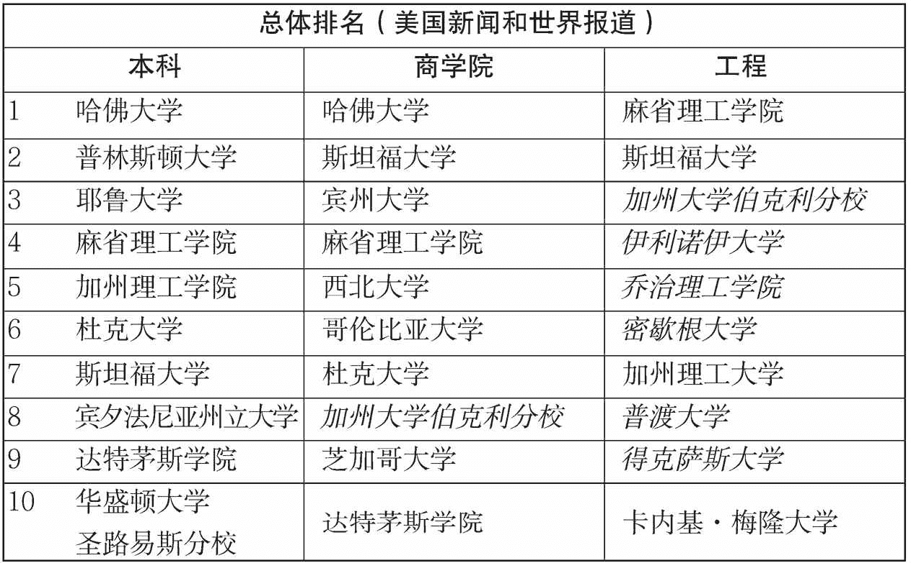

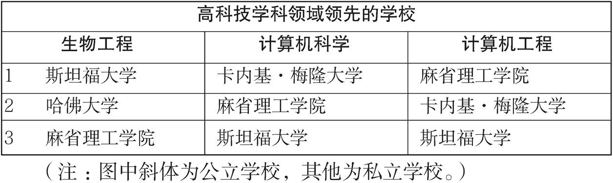

这些私立大学大多是研究型大学，既提供优质教学，也产出一流研究。尽管公立院校享有政府拨款，但与私立之间的差距仍在拉大。私立高校不仅是成功的学府，更成为产业的核心：硅谷的兴起离不开斯坦福，波士顿一带的高科技繁荣则依托麻省理工。

美国如何打破公立大学长期主导的格局，让私立大学成为高等教育的主力？研究型私立大学的成功大致具备四个条件。

有理想的慈善家：表格中的每一所私立大学都源于爱国慈善家的捐赠，如卡内基、梅隆、斯坦福、洛克菲勒、哈佛等。洛克菲勒除捐建多所高校外，还资助研究，在政府尚未重视微生物学时就大笔投入加州理工等校创建该学科，让美国抢占先机。

厚实的捐赠基金：经过多年积累，顶尖私立高校培养了大量杰出校友，校友反哺使学校坐拥巨额基金。以哈佛为例，其基金超过百亿美元且持续盈利。这笔钱用来提供全额奖学金、聘请高薪教授、将课程免费上网、建设科研园区等。

魄力领袖与鲜明特色：两者互为因果。校长以自主方针与独特定位引领学校走向卓越，每个学校都有鲜明个性，并非流水线产物。丹尼尔·吉尔曼作为约翰·霍普金斯大学首任校长，以研究型大学为愿景，短期内创造奇迹。卡内基·梅隆在雄才校长与计算机系主任推动下成为 IT 革命的摇篮；加州理工由平庸研究所改造成精干理工大学；麻省理工因邻近哈佛而决意深耕工科；西北大学以世界第一商学院自豪；伯克利则以开放自由闻名。各具特色的环境吸引各具特色的人才，形成人尽其才的局面。

高效灵活的运作：私立大学在成本控制、运营效率、招生与社会回应速度上明显快于公立。它们不受政府年度拨款束缚，依靠基金像企业一样灵活运作，能以更高薪酬挖人、提供启动经费、创设新学科。这种市场化的灵活正是高质量教学与高素质人才培养的保障，也更易吸引人才。

## 美国高等教育隐藏的五大困境

美国是改革中国教育的参照系，但其弊端同样要清醒看待。今天的美国大学存在五大问题：（1）终身教职导致教授懈怠；（2）学费与经费失衡催生营销竞争与营利型大学泛滥；（3）院系贫富分化、校方权力旁落；（4）明星研究教授身价暴涨、教学型教师饭碗不稳；（5）顶尖学府格局固化。

### 终身教职滋生懈怠
终身教职在遴选上门槛较高，但副作用明显。获得终身教职后，部分教授高枕无忧，甚至半隐退外出创业。制度上缺乏约束，难以促使他们全力承担对学校与学生的责任。企业中无论职位多高，绩效不佳也会降薪降级甚至解聘，大学若参照此逻辑，竞争才更公平。

### 经费失衡催生营销与营利院校
伯克利教授大卫·科伯在《莎士比亚、爱因斯坦与底线》中指出，政府拨款削减导致学费暴涨，高校不得不营销自售。在经费压力下，适度营销可以理解，但一些学校夸大宣传、造假抬排名，损害公信力。同时基础学科因难获经费而被忽视，校长遴选也更看重营销能力而非学术与管理，这已成隐患。

经费危机时，盈利型大学乘虚而入。如 Devry、凤凰大学、琼斯国际大学等，它们以中专水平自称大学，却规模庞大。这些校拿不到国际认证便用州或市认证换取政府补助，用电视广告代替媒体口碑，降低入学门槛，用网络教学与最少师资压缩成本。Devry 的控股公司市值约15亿美元，CEO年薪180万美元。文凭贬值、教育沦为掠夺纳税人尤其是贫困学生的工具，公理何在？

### 院系分化与校长失权
为激发院系争经费，不少大学下放权力、减少校方提成，导致热门院系财源滚滚，冷门院系捉襟见肘。伯克利为研究经费开展不开放研究，南加大推行院系自负盈亏，课程质量与公共设施下降。校长权力被架空，已难再见到像哈佛艾略特、约翰斯·霍普金斯舒曼、芝加哥哈珀那样的理想主义教育家。

### 明星教授溢价、教学者失位
克拉克·克尔在《大学之用》中分析了教学荒废的危机。经费日益依赖科研经费，研究与教学并重被扭转为重研轻教。高校品牌取决于是否有顶级研究教授，于是以天价挖明星。纽约大学五年内挖来多名法学哲学明星，使两系迅速跃升前三。但明星多不愿教学，于是学校再聘大量“教匠”应付教学。明星年薪可达20万美元，而教匠一门课仅三千元且非正式员工，课程冷门即失业。学生普遍反映教授只关心研究，不关心学习。

### 顶尖格局僵化垄断
以上弊端若在半个世纪或一个世纪前，尚可由慈善家或教育家通过创办或改造高校来化解。今天“一流私立大学”的市场已被垄断，这就是第五大弊端。哈佛、斯坦福等拥有上百亿美元基金，仅利息就超过多数高校多年经费，根本无需动本，凭借品牌就能拿到天量科研经费，基金越滚越大。二流学校难以竞争，也鲜有慈善家愿投入数百亿换取几十年后“准一流”的结果。约翰霍普金斯、芝加哥、斯坦福挑战哈佛的历史不会重演，变革契机已逝。

## 给中国大学的启示
中国正成为世界经济强国，美国大学的得失对中国极具借鉴意义。中国需要拥有世界一流学府，这是一个必须完成的艰巨目标。

这极难却可行。伟大而实用的目标不能闭门造车，而要在实践中借鉴经验教训。当前中国高校在师资、体制、管理等方面与世界顶尖仍有差距。参考美国经验，我认为中国应坚持“在进步中求稳定”的思路，增加科研投入，革新管理体系，改变教学方式，兼顾研究与教学，推动产学研融合，打击教育暴利，鼓励特色高校良性竞争，并支持一流民办大学的创办。若能落到实处，秋水长天里定可期待金桂飘香。

* * *

[\[1\]](#part0073_split_001.html#w1) 本文写作时的情况。

# 校园往事手记

## 前言
这篇文字应《中国大学生》杂志编辑王肇辉之邀写就。

最初只想记下一些关于自己与大学生活的趣事，供九月开学时与大家分享。写完后发现，里头不仅有值得回忆的往事，也有一些供当下大学生思考甚至警醒的经验与教训。比如沉迷游戏对学业的危险，发现并追逐兴趣的重要性，社交与友谊的价值，怎样在大学建立终生友谊，如何在打工中学习，等等。这些体会伴随我走出校园至今，也相信对大多数学生仍有价值。

## 哈佛、法学、数学的告别
上大学前，我的梦想是成为哈佛人。一是因为哈佛的光环，二是我一直把学法律当作目标，数学则作备选，而哈佛这两门都在全美顶尖。1979年4月，一封拒信打破了这个梦。原因我猜是 SAT 英语只有550分，若当时有新东方或许不同。

申请时我清楚自身不足，为掌握主动共申请了十二所学校。老师要为我写大量推荐信，当时全靠手写，老师们估计恨死我了。

最终我进入哥伦比亚大学，这是一所很好的学校，法学院与数学系也很有名。哥大给学生很大空间，大一时我选了大量美术、历史、音乐、哲学等课程，算是寻找兴趣的过程。至今记得哲学系一位老教授说：“知道什么是 make a difference 吗？想象有两个世界，一个世界中有你，一个世界中没有你，让两者的 difference 最大，这就是你一生的意义。”

再说法律梦。我主修政治科学，属于法学博士预科方向。上了几门课后发现毫无兴趣，上课打不起精神。其中一门极枯燥，我基本每节都在睡，选在教室睡还是宿舍睡。学期过半平均分勉强到 C，临截止前一天我把这门课退掉，才避免平均分跌破3.0而失去助学金。

与家人谈起苦闷，他们都劝我转系。姐姐说：“你高中时就读完大二数学，还拿过全州冠军，怎么不转数学？”这又碰上第二个困扰。进校后我被分进一个“数学天才班”，全校数学尖子共七人。很快我发现自己从“最好”变成“最差”。我虽是全州冠军，但州在田纳西，被称作乡下。遇上来自加州或纽约的真正天才，我不但技不如人，连提问都胆怯，怕暴露水平。于是越落越远，直到现在对这门课也只是半懂半通。这也印证了沉默不一定是金。后来我明白，那些天才因数学之美痴迷，我却不是。一方面羡慕他们找到挚爱，一方面遗憾自己既非数学天才，也不会为其美而痴迷，因为我不希望一生的意义只是理解数学之美。

于是，我与向往的哈佛、选择的法律、自豪的数学一一告别。

## 计算机让我在校园出圈
失去了哈佛、法律、数学，未来何去何从？幸好还有计算机。

高中时我已对计算机很感兴趣。1977年学校有一台老 IBM，需打卡片使用。有个周末我写程序解复杂方程，结果打印出来。因为运行慢，我周五走后程序一直跑，周一回来被老师骂：“你知不知道纸都被你打光了！”那方程有无数解，程序源源不断打印，耗掉一箱打印纸，花费几十美元，老师当然气愤。

大一时我惊讶于不用打卡片也能操作计算机，更惊讶这还能当专业。我选修一门课，拿到进入大学后的第一个 A+ 。除了获得赞誉，更有一种震撼：未来这种技术能思考吗？能让人类更高效吗？会取代人脑吗？解决这类问题才有意义。

期末我在计算机中心找了份打工，按时计酬虽不多却很鼓舞。同学们有问题都来找我，当时“会计算机”很时髦，大家觉得很酷。甚至我的 ID 都与众不同：一般是“院系+姓名”，如 cs.kaifulee、ps.kaifulee，而我的是 cu.kaifulee，cu 代表哥伦比亚大学，哥伦比亚加李开复，与校长同款，多牛啊！

当然也做了不少傻事，比如写程序猜别人密码。当时大家不知密码可被破译，我“黑掉”账号后用他人名义发恶作剧。一次我用一位男同学账号在 BBS 发“单身女郎征友”启事，害他收到一堆情书。那位同学现在在北京工作，估计至今不知情，下次见面我得告诉他，那启事是我发的。

哥伦比亚大学法律系当时在全美排进前三，计算机系却只是刚起步的小专业。选一个底子薄、看不出未来的方向，风险显而易见。选法律则是一条被照亮的路：法官、律师、从政参选……前人足够多，可以照着走。而计算机，我当时连自己毕业后能干什么都想象不出来，软件工程师这个称呼根本不存在。可我更在意的是人生的意义和自己的兴趣——做一份不喜欢的工作有多无聊多沮丧，我不想被现实就业的算计绑住。于是大二那年，我把专业从政治科学改成了计算机科学。物理系的一位同学开玩笑说，任何挂上“科学”后缀的学科多半不是真科学，看我这叫从一个“假科学”跳到另一个“假科学”，跳来跳去也成不了科学家。

# 两毛五换来的9999

我有一个外人不太知道的专长：大学时打电子游戏全校第一，没人打得过我。

那会儿的游戏比现在简单太多。我常玩的就是 Space Invader，屏幕下方有四座堡垒可以开火，上方乌泱泱一群怪慢慢移动。那时的街机很笨，怪不会乱窜。每投一次币是两毛五，我手头紧，一天两毛五都不小，所以我每天就带两毛五上学，打一次或两次，算是唯一的娱乐。

看似幼稚的游戏其实有门道。机器只设四位分数，最高 9999，超过就回零。不同怪物的分值不同，有一分、三分的，也有十分的。分数逼近 9999 时就得精算，一枪打歪超了，分数清零得重来。为了让我的记录每天都是最高分，我不像别人那样乱打，而是边打边算，分数到 9999 就主动自杀下机。这样难度陡然提升，也逼得我不停练习，投入感很强。

最后我每天两毛五的战绩几乎全是 9999，练到炉火纯青。我总会把名字缩写 KFL 留在记录上，后来的人一来就能看到谁是王者。玩游戏的学生很多常要排队，有人看到我就会喊：高手 KFL 来了。

高中时我很守规矩，从不碰这类游戏。进了大学没了父母管束，自由了很多才开始。回头看我很幸运，当时的游戏不够上头，每天花两毛五放松二十分钟就够了。若是当时有魔兽世界、CS 之类的，我说不定就沉迷网吧毁了学业。

就这样打了一个学期的游戏，什么把我拉了出来？桥牌。高中吃午饭时跟朋友学的，进了大学我加入了桥牌俱乐部，发现大家用同一副牌竞技，比谁打得好。那时我最大的目标就是拿第一。刚开始我幼稚地挑了个老先生老太太扎堆的俱乐部，结果除了常被白眼，技术也没长进。后来我们就跑到外地比赛，去耶鲁、哈佛，也参加全国赛，拿了不少奖牌奖杯。我的搭档后来打进百慕大杯，拿到世界第三，成了职业牌手。我常开玩笑说，要是当初坚持下去，说不定也能在桥牌圈出名。

有人觉得桥牌和打游戏差不多，其实差很远。桥牌能练逻辑，也能练人际。但大一时我太沉迷，一周打三十个小时，直接拖累学业，GPA 只有 3.26。找到计算机之后我突然对学习上瘾，老师布置编程作业，我宁可通宵也要在期限前做完。那时我不再想做桥牌第一，想做计算机第一。在兴趣驱动下，大二到大四的成绩都是满分 4.0，补回了大一的贪玩，最后以计算机系第一名毕业。

# 打工让我看见另一座城市

大学起先靠家里支持两年多，后来我断了家里的资助，全靠打工读完。家里在台湾算小康，按美国标准却付不起学费。学校当时给这类家庭的学生安排工读：学费三分之一是助学金，三分之一是贷款，三分之一要自己打工赚出来。这种模式让读书变得可行，很值得借鉴。

打工本身就是学习。我运气不错，经历了不少岗位。

起初我什么都不会，只能去做家教。学校把我分到黑人区，教墨西哥裔和黑人青少年，地点在哈林区，是全美最危险地带之一，离哥大很近。

我学的是艺术史，常去博物馆看画，结束后坐巴士去哈林。一回我不小心坐过了两站，到哈林中心。为了省一张车票我选择走回去，结果看到完全不同的世界：流浪汉、吸毒者、拿武器的……我没被伤害，但心里震动又害怕。从他们中间穿过，没人动手，却总担心下一秒会出事。那的人可能一辈子没见过东方面孔，见到我会用编造的中国话乱叫。我好不容易走到教学点上完最后一节课，就再也不想去了。

那段时间我正好申请到计算机中心的兼职。权限很大，能做不少事。暑假也给公司写点小项目，印象最深的是写了个测钻石重量的程序。那是1980年，我大一暑假。

大学三个暑假，大一大二那个暑假在计算机中心，大二大三那个暑假做了两份工作：一份是法学院的经历，另一份是在高盛，介绍人是我打桥牌认识的朋友。桥牌赛后聊得来，他说我学计算机不如去试试。面试时公司很敏感，用测谎机测我，我没见过，有点紧张。

面试官问有没有酗酒，我说没有。吸毒没有。盗用公款没有。赌博没有。他追问确定吗，为何心跳加速。我当时在想桥牌算不算赌博，我确实和同学小额下注。他继续问一周输多少钱，一千还是五百？我赶紧解释只是打桥牌玩玩。他又厉声说讲实话。我心里叹，可惜了这份工作。最后面试官却说我人品优秀，可以来上班。原来他们要接触大量敏感数据，怕暑期工泄密，所以用吓唬的方式筛人。

高盛的人都很优秀，西装笔挺见客户，但对计算机不熟，很多数据要手工算。我写个程序一小时就能完成他们一天的工作。剩下的时间我学了不少投资和管理知识。

社团对成长也很重要。我很遗憾大学基本没参加社团，除了桥牌社。高中时我很活跃，学生会副主席，创业三次，都是为申请大学好看。现在想来最宝贵的是人际交往能力，而不是简历上多一行字。

# 奶油芝士换来的友谊

更多好书分享关注公众号：tianbooks

上大学后我发现自己“跟人打交道很有压力”。中国学生少，没什么华人圈。走进派对，看到大家三三两两聊天喝酒，我很难张嘴搭讪。去了几次新生派对后我问自己怎么连话都说不出来了。怕讲了没人听，怕站在空地显得孤单，慢慢我就退缩了，自我封闭，不再参加派对也不交朋友。唯一的朋友是桥牌、游戏的搭子，还有室友。回头看当时不该退缩，社交能力后来才补上。

宿舍四个人，我跟室友关系很好。他出身工人家庭，常讲成长经历，我也分享我的故事，我们一直是好朋友。后来我打官司时他还打电话问需不需要人做人格担保，我说人格没问题不用，他说只是想让你知道有人永远站在你身边。

我在计算机中心打工，他在厨房打工，常给我带好吃的。一次学校放春假，他说厨房剩25公斤奶油芝士cream cheese，反正要扔，不如拿来做蛋糕省饭钱。家里都不富裕，我们都没钱回家，机票贵，于是计划做20个蛋糕，天天吃，省下假期的伙食费。

我们开始干活，很快就后悔了。25公斤芝士没法用普通搅拌机，只能倒进大桶，每人拿根棍子使劲搅，搅了四个多小时胳膊酸得抬不起来。更难受的是每天吃一样的奶酪蛋糕，最后看到蛋糕就想吐，提到蛋糕两个字都烦。七八天后他突然说：开复，天大好消息！我问什么，他说剩下的蛋糕发霉了。那天我们坐地铁到唐人街最便宜的粤菜馆，点六道菜为蛋糕发霉庆祝。

好几年我们都没再吃奶酪蛋糕。多年后见面仍开玩笑：一起去吃吧，吃什么？奶酪蛋糕啊！哈哈。蛋糕会发霉，但因蛋糕而来的友谊却异常长久。

# 写给父母的一封信

## 前言

家长是孩子成长的重要角色。好的家长能有效沟通，在孩子迷茫时给贴心支持，在困惑时给真诚鼓励。我遇到的许多优秀学生都说，他们的自信、坚强、果断、谦虚、宽容，很多都来自父母的言传身教。尤其在遇到困难时，最温暖的话往往来自父母。

也有不少家长与孩子缺乏沟通，用命令、批评、责骂的方式处理问题，很少平和引导。很多学生来信倾诉得不到理解，希望我能写封信给父母，把藏在心底的话说出来。

孩子希望家长理解自己，给宽松环境；家长希望孩子早日成熟，懂得做人做事，体谅父母。出发点不同，阅历不同，分歧很正常。关键在沟通。中国人含蓄，父母与孩子直面交流少。若能常敞开心扉，换位思考，隔阂就不难消除。

我写这封信有两个目的：一是搭建学生与家长沟通的桥，让家长更了解孩子的想法；二是聊聊如何帮助孩子成长，分享一些心得。我咨询过我的姐姐李开敏，她很有教育经验，提供了很多帮助。愿中国的家长和孩子都能在互相理解中获得成功和快乐。

写了四封给青年的信后，许多学生问我为何不写给父母。作为一个热爱教育的父亲，我有不少经验，但一直犹豫。同学多次鼓励后我决定动笔。我问他们如果给父母写信想说什么。他们说：

告诉父母我们长大了，可以照顾自己，让我们去闯，哪怕碰钉子。

告诉父母期望太高，我们总觉得对不起你们，希望能接受平凡的我们，尽力就鼓励。

告诉父母我们不想做读书机器，想找到兴趣，希望支持理解。

告诉父母我们很想和你们做朋友，却不知道怎么开口。

听完这些话我就提笔了。我想写出真实的教育想法，帮助疏于交流的父母和孩子搭起沟通桥。教育孩子并不难，核心原则是：培养一个懂事明理、善于学习、自主独立、自信积极、快乐感性的孩子，然后和他成为无所不谈的朋友。

中国的家长们，我希望真诚交流。你们可能比我更有经验，我并不强求认可我的方法，只是希望你们知道孩子心里有许多话想对你们说。如果有时间，面对面谈谈更好。如果这封信能让一些家长听到孩子心声，促进理解甚至成为朋友，我的目的就达到了。

## 培养明理懂事的孩子

中国人常把听话当好孩子的标准。我更希望孩子懂事明理。听话可能只是盲从，懂道理的孩子会分析事情原委，父母说得对就服从，说得不全就主动讨论交流，这样的孩子既尊重父母也坚持原则。

我相信启发式教育，也相信纪律和规矩的必要。孩子既需要启发，也需要自律。

关于规矩，我总结四条：

1.定规矩前先讲清道理，不能盲目要求服从；
2.在规矩范围内孩子有完全自由；
3.违背规矩就承受事先说好的后果；
4.规矩越少越好，才能发挥启发作用。

父母应抓住生活中的机会教育，用正面的例子多于负面例子。比如想教孩子见到长辈起立打招呼，自己就必须每次做到。父母要以身作则，不能要求孩子做自己不做的事。

人格塑造上，父母的示范直接影响孩子。诚信教育、独立人格的培养，不能靠说教，靠榜样和故事，也要时刻提醒自己别做违背倡导行为的事。

有的家长对价值观选择迷茫，在诚信、正义问题上摇摆，若把这种思想传给孩子，他们走进社会会迷茫困惑。所以眼光要放长远，用国际化的思维和价值判断生活中的现象，不要被负面例子干扰，不要做负面事，更不要灌输负面思想。

好的父母创造宽松成长环境，只在孩子困惑时给建议，更善于引导和沟通，而不是强加期望或价值观。

## 培养学习力的孩子

应试环境下成绩很难忽视，但压力很大。不要给孩子不切实际的目标，也不要想“自己没实现的理想一定要孩子实现，不管他愿不愿有没有天赋”。不合理期望只会带来压力和愧疚。家长不必盯成绩，只要尽力就行；不必非要第一，今天比昨天进步就好。对孩子而言打好基础、掌握学习方法比分数更重要。

期望要合理化。要求孩子每次比上次好一点，慢慢进步。若目标不切实际，孩子很快会放弃。

把要求变成建议。不是放任，也不是放弃约束，而是正确引导。

不要拿自己的孩子和别人比，那只会培养片面竞争心理，却妨碍团队合作。

学习不只是书本死知识。我在《做最好的自己》里讲过四种学习境界：

境界一，熟能生巧：在老师指导下掌握课本内容，知道答案；
境界二，举一反三：有思考能力，掌握方法，知其然也知其所以然；
境界三，无师自通：掌握自学自修方法，能在没有老师辅导下主动学习；

# 培养孩子

第四层 · 把知识用起来

学习的终点不是把知识点死记硬背下来，而是能在真实场景里调用，并懂得做事的分寸、做人的道理。作为父亲，我希望把握每个契机，陪孩子把机械记忆升级为举一反三。

学习渠道要打开。实体图书馆仍是经典入口，网络则是庞大的知识库。里面有沉浸式英语练习，有麻省理工的公开课，也有像开复学生网那样的学习社群，对成长很有助力。网络同样充满诱惑，家长需要经常和孩子聊清楚，怎样浏览才算真正的学习。

把动机从分数拉回到学习本身。女儿有次做题自认对了一半，却被判全错。她不想找老师，担心老师不会改分。我借机说明，去请教的意义是厘清思路、搞懂原理，而不是追回分数。分数不是核心。

动手实践让记忆更牢。刚学到的东西立刻用在具体问题上，价值才出来。背年代、背公式的枯燥谁都懂，学而不练很快就还给老师。在不影响正常课业的前提下，我会和孩子一起做实践作业。学指数时，我们拿存折算复利，她亲眼看到利息逐年滚大，最终会变成可观的财富，对指数的理解就跳出课本了。学美国史时让她用电脑做一段小动画，配上我们自己的旁白，重现一段历史。古话说听过会忘，看过会记，做过才真明白，用在育儿上非常有效。

最关键的是点燃自我负责的意识。成长中我会和老师配合，让孩子自己定目标、自己复盘。学校每半年要求学生立目标。刚上中学时，我大女儿害羞，不懂的问题不敢问。先定的目标是每天上课必须提问，下课自检。达成后她发现自己很少参与讨论，下一个目标就改成每天至少参与一次讨论。

培养自主独立的孩子

中国父母的爱往往过度保护，生怕孩子受一点苦，于是养出强依赖。也有些父母热衷替孩子规划人生，这常掩盖孩子的真实兴趣，也剥夺了选择的权利。

二十一世纪属于选择。管理学家彼得·德鲁克指出，信息时代取代工业时代后，世界进入无国界竞争、授权与自由管理的格局。未来的史家会认为，本世纪最大的变化是人类生存状态的改变，人拥有更多选项，必须主动管理自己。

进入大学和职场后，孩子要自己决定职业、导师、上司、企业，是创业还是就职，是学理工还是商贸，每一天都是选择。最需要的独立、责任感和判断力。长大后只会背书、被动服从、等待他人决定的孩子，在社会里很难被看见，更谈不上成功。

谷歌创始人谢尔盖·布林和拉里·佩奇曾被问成功归功于哪所学校。他们没有说是斯坦福或密歇根，而是蒙台梭利小学。因为那里的自由学习和零负面输入，为独立人格打下基础。在那种环境里，他们学会自己的事自己扛、自己解决，正向的教育养成了敢试、主动驱动的习惯。

关于养出选择力，我归纳为五要五不要。

培养孩子自行寻找对策的能力。从小让他们处理自己的事务，明白没人会替他们收拾残局。要在失败里学习。可以陪他们复盘，分享自己的做法，提升判断力，而不是包办。

把决定权留给孩子。即使你很确定，也要给一次选择机会。自己犯错学到的，比听正确指导更多。让孩子明白父母可提供建议，最终决定在自己，长大后这种事只会增多。我五岁时想读小学，父母说考得上就让你读。这件事我终生难忘，一个孩子居然能拥有选择权，这份信任让我努力考上。

养责任心，多引导少指责。作家刘墉说他过去事事安排儿子，反而养出不负责任的习惯，还让孩子没礼貌、不知珍惜。不要用“房间又乱了”这种指责口吻，要说“整理房间是你的责任”。没做到时让孩子自己体会负责的重要性。

保护好奇心，不要事事代劳。让他自己试，失败也没关系。

信任孩子。信任比惩罚更能激发责任。微软亚洲研究院的童欣小时候犯错，母亲没有责备，只说这事过去了，你以前是好孩子，以后还是好孩子。童欣回忆，那晚母亲给了他一生受用的礼物。

不要用太多规矩限制自由，让孩子做自己喜欢的事。可以用共同决定。比如喜欢玩电脑，不要说不准玩，而是成绩达标或作业完成后每周限两小时。把否定变成机会，把自主权转移，孩子会为兴趣更努力完成必须做的事。

失败本身不该被惩处。可以惩戒懒惰、依赖、逃避、不负责任等不良行为，但不能因失败而惩罚。失败是成长的必修课，惩罚会打击创造力和积极性，要鼓励在失败中坚强。

避免空洞说教。孩子信了会失去判断力，不信会叛逆或不信任你。

不要凡事包办代替，放手让孩子自己做，这能培养独立、责任感和自信。

不要过度干预，剥夺选择权。不要自以为安排的路就是唯一成功之路，不要总说不，要给自主选择的空间。

培养自信积极的心态

自信是潜力的放大器。范德比尔特说，自信的人事业顺畅，没信心的人可能连门槛都不敢迈。

在高期望、只有批评没有表扬的环境里长大，自信很难建立。积极肯定、正面反馈的环境会激发自信。我刚到美国时，老师常说我数学反应快，是数学天才。我知道自己只是搬出死记硬背的东西，但自信的力量无穷，在自信驱动下我努力学英文和数学，最终在全州数学竞赛中夺冠。

要给孩子正面回馈，让他们知道你注意到了每件好事。我小女儿常说“我很笨”，其实她并不笨，只是受同学恶意中伤。我慢慢夸她日记写得好，鼓励多写，兴趣起来后她自己写了一本自传，还放到我网站上。那时我觉得她该学点谦虚了。

自信要逐步培养。可以帮孩子制定长期可量化的计划。女儿课堂发言的例子就是如此，先定每天举手一次，坚持一个月有奖励。慢慢增加次数，一年后老师注意到她发言已足够自信。

首先你要先相信孩子有能力。美国某小学曾做实验，让老师先入为主认为十八个学生有最佳发展前途，老师常给正面评价，结果这十八个学生的表现超过预期。所以想让孩子自信，首先要相信他们的能力。

注意你用的每一句话。卡耐基举过例子：如果说“约翰我们为你骄傲，这学期进步了，但是代数再努力就更好了”，孩子听到但是之前很开心，之后会怀疑赞许的可信度。把但是改成而且更有效：“我们为你骄傲，你这学期进步了，而且只要下学期继续用功，代数也会很出色。”

培养快乐而感性的特质

有学生问我是否要把孩子培养成接班人，我很惊讶。我的回答是我只希望孩子快乐，能发挥潜力。

每个人都不一样，要找到自己的兴趣才能成为最好的自己。哈佛的汤玫捷说过，不要相信成才公式，我们是野生植物不是园林植物。每个人独特的优点就是自信的源泉。

快乐与能否做自己感兴趣的事高度相关。美国对一千五百名商学院学生长达二十年的追踪发现，追逐兴趣、发掘潜力的人更快乐，也更容易获得财富名利，因为他们做的是真正喜欢的事，更有动力把事情做到极致，即便不能带来财富，也会有终生幸福。

作为父母，要鼓励孩子把时间花在兴趣上。我大女儿爱看小说，我们每周挑一本有趣又有教育意义的书，她这些年读了上千本，英语一直满分。二女儿喜欢写作绘画，我们教她用电脑写东西加图片，印成彩色小书送亲友。对没兴趣的课，只要求尽力学习，不特别要求成绩。

很多父母让孩子学钢琴跳舞。适量的爱好有助于全面发展，但要适量，学习很苦。我会和孩子约法三章，先学三个月再决定是否继续。她们最终对音乐没兴趣，一个爱画画，一个爱戏剧，于是各自朝兴趣发展。

要多给孩子与人相处的机会。戴尔·卡耐基说，事业成功十五分靠专业技能，八十五分靠人际关系和处世技巧。小时候不会相处，长大很难成功也很难快乐。

不要压抑情绪。怒与哀都是正常反应，要给孩子抒发感情的机会。如果孩子一哭就呵斥不要哭，表面听话，内心会藏更多恐惧，怕失去爱、被惩罚。长期压抑会培养出没自信、无法体谅别人的孩子。要接纳人世间的一切，正面或负面、生或死、哭或笑，这些体会同样重要。天之骄子处处受奖，容易产生优越感，忽视人际与团队锻炼。

做孩子的朋友

我的孩子说最喜欢我的一点是风趣没有架子，像朋友一样，话愿意和我说。

我的为人很多来自父亲，但父亲在世时陪伴时间不多，遗憾让我尽量花时间陪小孩，尽力做一个能聊心事的父亲。

在你心里孩子可能永远长不大，但很多孩子十五岁甚至更早就想被当大人对待，这时可以用成年人的谈话方式讨论理想、学习动力、娱乐、事业心、为人处事、爱情、交友、家庭问题。

我有四个建议。和孩子打成一片，甚至一起胡说八道，不要摆架子。我家孩子小时候睡前都要听我胡诌的故事才肯睡。

对孩子说心里话，不要闷在肚子里，也希望他们这么做，做一个好的聆听者。

让孩子知道他对你多重要，告诉他你多爱他，慷慨分享时间，但物质上不要有求必应。

花时间理解流行事物，无论歌星、偶像、新游戏，都要去了解，这样才有话题，也告诉孩子你在乎他，还能让你觉得年轻。

把孩子当朋友谈心，告诉他你一天经历了什么，也问问他经历了什么。如果他说做了不该做的事，不要训斥或生气，多听少讲。当他觉得聊天没有被惩罚的威胁，才会无所不谈。刚开始不敢讲时，先保证你不会生气。

做朋友就要学他的语言，而不是要求他学你的语言。知识匮乏、思想陈旧就无法理解孩子。要多接触流行思想、服饰、技术、音乐，减小代沟，建立信任沟通。

给中国父母的建议是，多陪孩子，无论多忙都要一起玩，平等谈心。不要以为送进学校就是老师的事。孩子做事与期望不符时，不要马上发火，先听听他的理由。

总结

我喜欢多萝西·劳·诺特的诗《你给孩子什么》，它表达了我的教育理念。

批评中长大的孩子会责难他人，敌意中长大的孩子喜欢吵架，恐惧中长大的孩子常常忧虑，嘲笑中长大的孩子个性羞怯，猜忌中长大的孩子容易妒忌，羞耻中长大的孩子自觉有罪。

鼓励中长大的孩子深具自信，宽容中长大的孩子能够忍耐，称赞中长大的孩子懂得感恩，认可中长大的孩子喜欢自己，分享中长大的孩子慷慨大方，诚信中长大的孩子理解真理，公正中长大的孩子极富正义，尊重中长大的孩子懂得尊敬，信赖中长大的孩子不但信任他人也信任自己，友善中长大的孩子不但爱他人也爱自己。

中国的父母责任重大。今天中国的青年非常优秀但非常困惑，非常聪明但不够自信，是第一代能在平安社会完整教育中成长的一代，出生在信息抹平的世界，必须成为融会中西的精英，有幸生在选择时代，却缺乏选择的智慧。最重要的是，中国的青年是我们的骨肉、我们的最爱，这就足够让我们努力学习、提高自己，成为能做到的最好的父母。

# 母亲的十件礼物
## 引言
端午后一个阴雨天，我在台北市和平医院病房陪母亲一整个下午。那时她已很虚弱，我的奢望只是她能睁眼看我们一眼。那天她没睁眼，傍晚我亲吻她的额头离开后，她说了一句话：“他不回来了。”我很不解，没想到真成预言，那竟是我和母亲的最后一面。

虽然妈妈住院数月，大家都知道希望不大，接到噩耗时我仍无法相信。再也见不到最爱的妈妈，再也不能和她踢球打牌，再也不能帮她抓痒，再也不能握着她暖暖的手，亲她皱皱的脸，问她我叫什么名字。

母亲对我一生的影响无法言喻，我充满感谢、感恩和感动。用这篇文章感谢母亲赠予我的十件礼物。这十件礼物塑造了我的性格，建立我的自信，奠定了我的基础，教会我做人，如何教育孩子，更留下我一生最温馨难忘的回忆。任何一件都足够改写我的一生。

## 第一件礼物：完整的家庭
母亲年轻的经历像一部跌宕的历险记。十二岁时她只身从东北流亡到北京，六年后考进上海东南体育专科学校，南下闯荡大上海。在体专时她是全国顶尖的低栏健将，拿过全国短跑第二。1939年和父亲恋爱一年后结婚，随父亲回四川。

十年后父亲远走台湾，母亲带着一儿四女留在四川，独自挑起生活重担，独自抚养五个孩子，忍受思念承受压力。

1950年初，坚强的母亲决定结束分离生活，辗转得到一张探亲通行证。一家人乘火车从成都到重庆，等待一周后千辛万苦到广州。

这只是千山万水跋涉的一个插曲。全家到广州后下一步是要去近在眼前远在天边的香港。当时很难找到愿意去香港的船只，更何况拖着五个孩子的母亲。因此母亲在广州滞留数月，好不容易才到香港，辗转赴台。

这一大家子能在台湾团圆，当年几乎绝无仅有。之后在台北又添了五姐开敏和我。这一切都要感谢母亲坚韧的个性和过人胆识，让充满爱的家庭得以延续。这也让我每遇困难总抱着坚定信念放手一搏，因为我的基因里有源自母亲的坚持。

## 第二件礼物：我的生命
五十多年前的三月，微风带着丝丝春意。但我家那栋小房子里全家人都很紧张，因为母亲四十三岁高龄孕育了我，大家担心高龄生产不安全。

母亲的好朋友劝她：“不要冒险。还是拿掉吧。”

当有人担心高龄生育的孩子会体弱时，又有人搬出研究说高龄孕育智力偏低的概率更大。冒险与执拗的因子在母亲身上反复显现，她斩钉截铁地说：我要这个孩子。正因母亲这句笃定的承诺，我才得以平平安安来到世上。

1961年12月3日，我出生了。母亲后来告诉我，她当时心里有一种确信，相信我会聪明、健康，才义无反顾地把我生下来。回头看，和其他母亲相比，她孕育我的过程未知更多、变数更大，对身体的考验也更严苛，那段经历充满生命的奇迹与坚韧的味道。母亲的自信与勇气，赠予了我最珍贵的礼物——生命本身。

## 第三件礼物：细致入微的陪伴
母亲一生把最多的付出给了我。高龄得子后她把我当成掌心宝，为养育栽培我殚精竭虑。

因高龄产后奶水不足，她逼自己每天喝下好几碗花生炖猪蹄汤。两年后我长得结实了，她的身形却再也回不到从前的苗条。

小学时我读的及人小学离家五六公里。校车虽有，但母亲为了让我多睡一会儿，每天风雨无阻亲自送我。放学见到她我会飞奔过去，把一天的大小事全倒出来。有一次我说老师病了没来上课，第二天母亲就亲手煲了鸡汤送到老师家。

母亲厨艺极佳，自有一套独门做法。家里的经典问答是：“弟弟今晚吃什么？”“红油水饺。”她问：“要几个？”我脱口道：“四十个！”吃完她会说：“好了，别吃了。”我总会边吃边说：“我再吃一口‘下桌菜’。”这个词也成了家里的专属说法。

1972年起，为了照顾我学习，母亲每年抽出半年飞到美国陪读。她本是交际极其活跃的人，在台湾朋友遍布。但当时的美国华人稀少，她既不懂英语也不会开车，到了异乡只能整天关在屋里。哥哥、嫂嫂、外甥和我白天各自工作上学，家里只剩她一人沉默坐着，找不到说话的人。

她唯一的消遣是看一档猜价格的节目，猜罐头多少钱、杯子多少钱。她一句英文都听不懂，只能靠画面氛围判断谁对谁错。有时她会说，这个人长得帅我希望他赢，那个人眼神不善我希望他输。

难以想象一个五十多岁的人，跑到语言不通的国度，放弃朋友圈、放弃有人伺候的生活，开始自己烧菜，每天唯一的盼头是儿子放学回来聊几句。无论承受多少孤独，她见我永远笑眯眯，遇到挫折总会鼓励我。从我十一岁出国到十九岁，一直年年如此。

## 第四件礼物：欢笑与幽默
我从小顽皮好动。和许多严厉管教的母亲不同，妈妈不但容忍我的调皮，还能童心未泯地当我的玩伴，用幽默化解顽劣，引导我成长。

小时候一刻也坐不住，理发是难题。她不斥责也不强求，而是拉着三姐到理发店，借来剪刀刮胡刀毛巾给我表演“木偶戏”。就这样我竟然能安稳坐半小时理完头发。

上课话太多，有次老师忍无可忍用胶带封住我的嘴。恰好母亲来接，场面极其尴尬。还有一次我把全家钟表调慢一小时想多睡，害得第二天全家上班上学的都迟到，手忙脚乱。两次母亲都没生气，反而笑得前仰后合，觉得画面很有趣。

我的调皮大概遗传自母亲。父亲不苟言笑，母亲却常和我们打成一片。有回哥哥和母亲玩水战，弄得家里到处是水。母亲躲在楼上，见哥哥走过就把一盆水兜头倒下。

只有像她那样保持年轻心态的人，才会包容甚至欣赏孩子的淘气。和这样的母亲相处，我们毫无距离。她不仅是好妈妈，也是好玩伴，这份感情与别的母子不同。

## 第五件礼物：刻苦与上进
妈妈对我的淘气宽容，但只要涉及学习成长未来，她就格外重视，要求近乎苛刻。她常说，做一件事就要做到最好，这点没有商量余地。

在她的督促下，别的孩子还在父母怀里撒娇时，我已能背诵九九表和古诗。

她把学习成绩抓得极紧：考好有礼物，考差有警告甚至板子。背书时她亲自监督，要一字不差，错一处就把书摔到别间房让我捡回来。有时用竹尺打手心，甚至把尺子打断。

为了每次拿第一，我曾每天五点起床读书，都是母亲叫我起的。感谢这位严母，让我成为勤奋的人。

## 第六件礼物：自信与自主
小时候母亲总告诉我：“你要成功，将来一定会成功。”

去幼儿园没多久我就厌倦了。回家我说：“不上幼儿园了，我要上小学。”

母亲问：“幼儿园不好吗？”我说太无聊，唱歌吃东西，老师教的太简单。

她说：“你才五岁，再读一年就能上小学。”

大多数父母会觉得孩子胡闹，她的处理却不同：“下个月私立小学有入学考试。能力不够就过不了；能通过就说明可以读。”

我在她的帮助下报名并努力准备。放榜那天她陪我去，黑板第一名正是“李开复”。她激动得像孩子一样喊：“第一个就是李开复，你考上了！”我也抱着她又叫又跳。

几十年过去，她脸上那份掩不住的兴奋与自豪我仍记得。那件事让我懂得，敢于尝试就能争取想要的机会。五岁时父母就把选择权交给我，让我做了自己的人生主人。

在中国父母习惯护着孩子，害怕冒险。但独立性、责任心、选择力和判断力都需要从小培养。我很庆幸在五岁时就获得了第一次跨越。

## 第七件礼物：谦逊与诚实
跳级后我有点骄傲。逢人便说自己多聪明。

“阿姨，我已经读小学了！”“真的？你才五岁？”“我跳级考进去的，还是第一名呢！”“那以后的成绩呢？”“除了100分，我连99分都没见过！”

夸下海口的第二周，我考了90分。母亲二话不说拿出竹板打了我。

我哭问：“我成绩还不错，为什么打我？”她说因为我骄傲，说没见过99分，就要给我每次都考100分。

“我知错了，会好好学的。”“不只要学好，还要改掉骄傲。自夸要不得，谦虚是美德。懂了吗？”

母亲的火气来得快去得也快。她这么爱孩子，实在没法长时间生气。但“谦虚是中国人的美德”这句话我至今难忘。

后来我也出过状况。有一次考砸了，我鬼使神差想改分数，掏出红笔把78描成98。到家门口又检查一遍才进去。母亲问：“试卷发下来了吗？多少分？”“98。”我心里狂跳，怕被发现。她只是摸了下我的头说去写作业。

有了第一次就有第二次。第二次手一抖，分数拖了长尾。我把卷子扔进水沟。回家后母亲没问分数。提心吊胆几天后我实在忍不住承认错误。我以为会被打，她却只说：“我知道了，能知错认错就好。希望以后做个诚实的人。”

她的宽容与教诲让我明白谦虚诚信为何重要。

## 第八件礼物：阅读热爱与打开视野
母亲坚信我是孩子中最聪明的，所以期望最高，要求也最严。

我明白她在我身上的倾注，也努力读书换高分。她的奖励很特别。

有次我考第一，她带我买礼物。我看中《福尔摩斯全集》，她说：“书不算礼物。你要买多少书，只要中外名著随时都可以买。”她不仅买了书，还另买了一块手表送我。

十岁时大哥从美国探亲，吃饭时抱怨台湾教育太严，小孩灵气被磨掉。母亲叹气：“为了高考没办法。”

看着我被试卷包围没时间玩没朋友，大哥说：“跟我去美国吧，这里会毁了身体。”

母亲从未出国，接受的是传统中国教育，却保留开明的本性。她把手放在我头上说：“那就去试试吧。”

一个如此深爱幺儿的母亲，能下决心把孩子送到遥远的美国做第一代小留学生，需要多大的勇气。正是她的开明与胆识，为我年少时打开了世界之门。

## 第九件礼物：家国情怀
我在美国的第一年，母亲陪了半年后被家里催回。她不舍却挂念家人，只好把我托给哥哥嫂嫂。临行前她反复叮嘱做作业、背英文、听话。

登机前她郑重地说两件事。第一件：“不许娶美国太太。”我委屈：“我才十二岁。”她说美国孩子早熟要早讲，不是美国人不好，只是生活习惯文化不同。她希望我做自豪的中国人，希望后代流着百分百炎黄子孙的血。

“好的。”我答应了。

第二件：“每周写一封信回家。”这事简单，我爽快应下。每周我写学习进展，她一字一句阅读，圈出错别字回信指正。她的认真影响了我，我写信时更求谨慎，到处找中文书读，以免中文停在小学水平。

孩子学语言快也忘得快。正是那几年每周的中文家书，让我没被ABC侵蚀。后来我才明白，母亲的两点叮嘱不仅是关于婚姻与语言，更是一种家国情怀的传承。她潜移默化地把中国文化与思维方式种在我心里。

无论身在何处，我都关心两岸动态，抽时间帮助中国青年学生。因为家族信仰与荣光在那里，也因为母亲一再提醒：“别忘了你是中国人。”

## 第十件礼物：爱的牵挂
有人说子女是父母最甜蜜的牵挂。有了孩子后我才真正懂得这句话。

不管年纪多大、成就如何，在母亲眼里你始终是她的孩子，是她魂牵梦萦的存在。这种牵挂让人即使在磨难中也能获得甜蜜的力量。

2005年我换公司，老东家起诉，我陷入麻烦。谣言满天飞，媒体未经查证就用耸动标题攻击我，甚至抹黑道德。我心中坦荡却也烦忧。深夜我给母亲打电话，电话那头她坚定地说：“一切都会没事。不管你怎么选，我都站在你这边，你永远是最棒的。”

隔着太平洋我强忍泪水没哭出来。挂断后我再也忍不住。

我庆幸有这样一位既传统又开明、既严厉又温和、既勇敢又风趣、既有爱心又有智慧的母亲。她的教育融合了中国式的高期望与美国式自由放权，既重诚信也重进取。我今天的点滴成绩，都源于她的教诲、牺牲、信任与支持。

# 世界读书日寄语

引言
4月23日是世界读书日。自1995年设立以来，每年都在提醒我们：最近读了吗？上次翻开书是什么时候。

读书是分享前人的经验与思考，也是站在前人思考之上思考自我。理想的状态是让阅读成为日常，成为成长的重要路径。以下是我对阅读的一些看法，希望能帮助大家更有选择地读好书。

## 人生里的三次深度阅读
回望一生，有三次我做到充分阅读。那段时光快乐、成长多、养分足。

### 第一个阶段：书随时可得，阅读如饮水
大约五岁到十一岁父亲为我买了各式各样的书。那时我爱上阅读，一年看两三百本。读过《双城记》《基督山恩仇记》这类西方文学，也读《三国演义》《水浒传》等中国古典，最触动我的是名人传记。海伦·凯勒失明失聪仍进入名校的经历塑造了我坚韧与勇气；爱迪生的发明让我向往科学家。那段时间书像礼物般无限索取，六年间我对中国典籍有了初步认识，阅读量常年很高。

### 第二个阶段：大学期间，每周两三本西方哲学
留学美国后中断了一阵，直到哥伦比亚大学。核心课程逼着我读书，一年约读百本，多是西方哲学文学。每周两三本厚书，对非英语母语者压力极大并不享受。多年后想起，读柏拉图、洛克、霍布斯、莎士比亚，让我体会到人性共通，东方智慧在西方文本里也能找到。我能写出几本畅销书，很大程度上得益于那段被逼的广泛阅读。

### 第二个阶段：生病后，读书重估人生
毕业后我回归理工生活，直到生病。病中不便做许多事，选择大量阅读。读过布朗尼·威尔记录临终遗憾的书，书中说没有人后悔当年没加班没攒钱，大家最遗憾的是没更多时间陪伴所爱之人。书让我重新权衡工作与生活，衡量人生价值。病中也读了许多心灵、东方文化与历史的书，收获颇丰。

充分阅读是一种享受与养分汲取，是最好的成长方式。

## 读书的“三做三不做”
关于阅读，我总结六点建议。

### 多读不同意见的书
东方孩子常被教育书上写的就是对的，要背下来。我认为不好。每件事都有多面。不要把书当圣经，多读与自己观点冲突的书，培养批判思维。即使坚持原见，也能更懂他人想法，辩论时更有底气。

### 多读历史
走得越远，越发现历史在重复，人类不断犯旧错。多读历史能更懂人性，减少弯路。

### 中西融会贯通
中国古籍精湛，但哥伦比亚大学读的几百本西方书对我启发极深。建议平衡阅读，东方与英美哲学、莎士比亚等西方经典互为补充。

## 不要读劣质的翻译
读西方书尽量读原文，翻译会流失价值。英文好就读原文，英文不错先提升再读。实在读不了原文，选中文书也要挑好译本。《乔布斯传》不同中文版翻译差距巨大。

## 少读纯理论的书
纯理论脱离实例的书不如有真实案例穿插的书。事例能让理论落地。

## 少读成功学的书

走进书店看到自己的书被摆在成功学区，我往往会低头快步走开。因为在我看来，市面上不少成功学读物，都是没有真正下场实操的人，把一些碎片化的理论拼凑起来，营造出读完就能复制成功的错觉。它们常在鼓吹“只要照搬某个人就能复制辉煌”。但现实是每个人的起点、环境、性格都不一样，成功的路径也不可能通用。写这类书的人，自己是否真的成功过？分享的是亲身经验还是二手梳理？因此我更建议少碰成功学。如果你想找可信的借鉴，请多看自传，而且最好是作者亲笔写的自传，而非授权他人代笔的版本，因为代笔也大多是拼凑。就算读了作者亲笔自传，也不要全盘照搬，选择适合自己的部分即可。

查理·芒格曾说：“我认识的聪明人，没有一个是不每天阅读的。”一位老师在推荐《穷查理宝典》时提醒我：“创业不仅要懂技术，更要有人生阅历。”书的价值在于启发思维，而非给出标准答案。它有用的地方是点亮思路，无用的地方是让人误以为有了答案。

今天阅读时间被信息流和琐事挤压，很多人以没时间为由放弃阅读。实际上，“没时间”恰恰是最大的误区。觉得一年百本太遥远，就从通勤路上每天半小时开始。阅读并不需要仪式感，拿起来、读下去就是。

# 1983到2017：科研的幸运与遗憾

## 一

讲一个老故事。

1983到1988年我在卡内基·梅隆大学攻读计算机博士。暑假我在教课，秋天参与奥赛罗人机对局，那是机器首次在正式比赛中击败人类冠军的时刻。

我的导师瑞迪教授，图灵奖得主、卡内基·梅隆计算机系终身教授、美国工程院院士，从美国国防部拿到三百万美元经费，做一个极难的语音识别项目：不指定说话人、大词汇量、连续语流识别。任意人说话，机器要能听懂上千个词并且理解自然连续的句子。这三点在当时都是难题。

瑞迪大胆招募了全美三十多位教授、研究员、语音学家、学生和程序员，我也在其中。当时业界已有类似深度学习的算法雏形，却缺乏数据标准，语料量也不够大。MIT、CMU、SRI、IBM、贝尔实验室各用各的数据库，训练集、测试集、语言模型、词表规模都不一样，各自宣称第一，却无法互证。

大公司有自己的商业诉求，IBM想做语音打字机，AT&T要求贝尔实验室识别电话号码，没动力去帮小团队或高校。高校和小公司只能做小规模数据集，结果自然打不过大公司。

数据不统一对AI是致命伤。后果包括：测试语料不同，成果无法复现与验证；各家研究领域不同，结果不可比，有的词表小容易做却不通用，有的约束多易识别也难推广；训练数据量越大结果越好，容易把算法优势误判为数据优势。学术单位缺资源和动力去采集清洗标注大规模语料，小公司则缺语料和算力。

瑞迪计划用“专家系统”来做，因为它对数据需求少。专家系统是一类模拟领域专家知识的程序，通过知识表示和推理来解决复杂问题。我并不认同。

## 二

奥赛罗人机对局让我对统计的认识更深，我开始怀疑导师的方法。

我认为应该建设大规模语音库，用统计方法在大数据上做分类，才能解决专家系统解决不了的问题。

1985年，美国国家标准与技术研究院意识到数据不统一阻碍进展，在语音识别上制定了统一的训练集和测试集，要求各团队用同一数据训练、同一数据评测。那是我看到的机会。

反复思量后，我鼓起勇气对瑞迪说，我想转向统计学来攻克“不指定说话人、大词汇量、连续语音识别”。

我以为他会失望，他却平静地问：“统计方法怎么解决这三大难题？”

听完我的阐述后，他用一贯温和的语气说：“开复，我对专家系统和统计的看法不同，但我可以支持你用统计去尝试。科学没有绝对对错，我们平等。更有激情的人，更可能找到更好解法。”

对一个教授而言，学生要用反向方法做研究，教授不恼反而大力支持，这是非常难得的信任。

统计需要大数据，我当时犯愁。瑞迪再次伸手：“科学上没有老师学生之分，我们一起攻关。如果你需要数据库，我去说服政府建一个。”

他后来说服了政府部门和标准局提供了大量数据，我可以用标准大数据以及其他拿国家经费机构的数据，后来IBM、AT&T等企业数据也开放给我，可用数据越积越多。

统计还需高速机器，瑞迪帮我买了最新的Sun 4，后续新机器都会先问我需不需要。两年多的论文期间，他至少投入了几十万美元经费。这种宽容与信任给了我巨大力量。

## 三

在导师支持下，我和另一名学生用统计做语音识别，同时其他三十多人用专家系统做同样问题。方法不同，但我们在同一导师下共享样本、共享评测。

1986年底，两条路线达到相近水平，识别率约40%。这仍是不可用的系统，却是学界首次尝试如此困难的问题，大家仍感到乐观。

1987年5月，我们扩大训练库，改用新的建模方法，既能用统计学习每个音，也能学习音与音之间的转换。对样本不足的音，我提出generalized triphones的方法合并相似音。三项改进把识别率从40%提升到80%，随后达到96%。

统计方法用于语音识别的方向得到初步验证。大家接受了机器学习和隐马尔可夫模型，放弃了仅达60%识别率的专家系统。基于我的博士论文，后来Nuance、微软、苹果等公司做出领先产品。

1988年4月，我应邀在纽约参加世界语音学术会议发表论文，震动了整个领域。这是当时计算机科学的顶尖成果，点燃了全球语音研究的希望，从此转向统计方法。

会后《纽约时报》记者约翰·马尔科夫在匹兹堡采访我，文章于1988年7月6日刊发在科技版半个版面。马尔科夫是多次提名普利策奖的著名记者，后在斯坦福任教。随后《商业周刊》将我的发明评为1988年最重要的科学发明之一。26岁的我初次登场便获关注，成为继续攀登的动力。

我也因此在入学四年半后拿到卡内基·梅隆计算机博士学位，学院平均需六年以上，我创造了纪录。随后破格留校，成为26岁的助理教授。

## 四

遗憾的是，当时的数据规模和计算能力还不足以商业化。我最终离开科研界进入产业，用产品改变世界。

三十年后，AI的土壤变得肥沃。大数据和高效运算齐备，科研不再因拿不到数据而受限。三十多年前能接触真实世界的海量数据是遥不可及的梦想。

受益于瑞迪教授的指导，我希望为更多年轻人创造研究条件。2017年创新工场联合搜狗、今日头条发起“AI Challenger全球AI挑战赛”，2018年联合搜狗、美团、美图再次发起。几家公司投入资金，提供千万量级高质量开放数据集和宝贵GPU资源。

我也倡导产学研采用统一数据和标准评测，欢迎更多数据公司加入。AI Challenger不只是一个奖金几百万的活动，而是一个推动中国AI人才成长的催化剂。希望三五年后回看，中美AI人才差距已缩小，而AI Challenger在这段进程中留下了一点印记。你们生活在数据爆炸的时代，有人提供数据和资源去施展才华，这是我当年无法想象的幸运。

# 让AI回归人性

2019年4月24日，《时代》周刊在纽约举行首届“百大人物峰会”。作为2013年全球百大最具影响力人物之一，我受邀发表《让AI为人民服务》主题演讲，谈人工智能的现状，以及隐私、安全、就业等关切。

## AI，如同新时代的电

人工智能像新时代的电力，正以颠覆性的力量改变现实。

在中国，移动支付取代现金和信用卡，不仅支付便捷，还能基于数据给出智能的财务规划。基于计算机视觉的仓储机器人、适配智慧城市道路的自动驾驶、能根据任意主题创作表演的AI说唱歌手，都展示了技术现状。

医疗健康和教育领域也在受益。在中国最贫困地区，AI加直播技术把乡村学校与北京的顶尖教师连接，孩子能获得优质教学。教师也能通过技术了解学生姓名、薄弱点，学校可用AI批改试卷、布置和评分作业，有效打破教育壁垒。

普华永道预测，未来十一年AI将为全球带来15.7万亿美元净增量GDP。应用将覆盖互联网、商业、感知、计算机视觉、语音识别，以及能自由移动工作的自主AI。许多技术需要时间孵化，会带来创造性的颠覆。就像电力，AI会赋能无数设备和应用，未来我们很难想象没有AI的生活。

## 用技术对冲技术的风险

人们担心隐私安全、就业和财富不平等。

隐私问题频频上新闻，包括苹果CEO蒂姆·库克在内的很多声音呼吁更多监管。法规当然必要，但不应只把隐私看成监管问题。可以用更好的技术解决技术问题，比如同态加密、联邦学习。可以设想一个滑块，让每个人自行选择更安全或更便利，每个人掌握选择权。

就业方面，很多人担心被AI取代。但我认为AI短期内无法胜任创造力和同情心这两项关键工作。机器人做不到人与人之间的信任与联结，无法真正成为老师、医生和护士。政府需关注教育与再培训，社会也应重新认识工作中同情心的价值。人们应在岗位中发挥创造力和同理心，这是机器难以替代的。目前有约200万医疗保健服务岗位无人填补，原因多是社会地位和收入不高，这需要社会、政府和企业共同改变。

财富不平等方面，中国和美国正成为AI超级大国，而人口众多、技术基础薄弱的国家发展滞后。这些国家应加强STEM教育并重视服务业机会。作为超级大国，中美有责任帮助世界共同发展。

我们希望通过不断调试，找到AI长期造福人类的平衡点。每一次技术革命的利终大于弊。基于这份信心，我们应加速AI普及，让AI真正为人类服务。人工智能时代已到来，需要积极拥抱。

# AI+时代：新一轮创新潮

我想谈第四次工业革命。

施瓦布把技术革命分为四次：蒸汽机第一次，电气化第二次，信息互联网移动第三次，AI第四次。从中国视角看，我们错过了前两次，第三次表现不错。我判断中美将共同引领第四次工业革命。

AI本质是用海量数据做精确的判断、决策和分类。过去五年AI突飞猛进，我们可以期待像前三次革命一样辉煌的进程。

看过去一百年的全球最有价值公司，早期由工业驱动，后来出现消费品和技术品。到了2017年，中美最有价值的十家公司中，七家是顶级高科技，且都具备第三次工业革命基础和AI萌芽。同时，2017年首次有两家中国顶级公司进入前十。

过去石油或电力是最有价值资源，今天引领AI革命的最有价值的是全球化快速发展的数据。

以我为例，三十多年前博士论文用了海量数据。导师慷慨给我十万美元，当时我每月奖学金700美元。那笔钱买了一台200多公斤的超级硬盘，装了100兆数据，正是这批语料让我做出当时最好的语音识别系统。

今天顶级系统为何远超当年？主要原因是用了约一百万倍的数据量进行训练。数据就是新时代的石油和推动力。第四次革命会来得最快，因为电网铺设漫长，而AI在云上即调即用，数据直接创造价值。上一波互联网浪潮积累的数据，直接被AI浪潮利用，形成极快迭代。

从模仿者到创新者，中国在这十年里变化明显。十年前顶级公司多仿效美国，后来出现微创新，再后来出现全球未见的点子。今日头条、快手、VIPKID、摩拜、映客、拼多多、蚂蚁金服都是中国原创模式。我们已从copy to China走向copy from China的新时代。

# AI崛起与深度学习的突破

中美拥有同样强大的科技公司，却创造出不同的生态。AI到来源于三点：海量数据、更快的计算，以及一个关键发明——深度学习。深度学习像当年的电力，成为承载各类应用的平台。

## 深度学习到底是什么

AI，如何真正改变世界

深度学习本质上是一个规模巨大的黑箱。你把海量样本丢进去，告诉它要学什么规则，它就能自动完成优化。比如喂给它大量文本并标注含义，它就能识别陌生人说的词句；把银行的优良贷款和不良贷款一起输入，它就能判断新申请的贷款更偏向好账还是坏账；把股市的历史交易数据输入并告知最终盈亏，它就能辨别出更可能上涨和更可能下跌的标的。它像一台通用判断机器，在单一领域内基于海量数据做抉择，所以一旦落地各行各业就能产生大量价值。

## AI全面开花的当下

过去四年里，AI先后击败了世界围棋冠军，横扫几乎所有游戏。它的战场早已超出游戏：国内通过了医学类高考难度，日本接近东京大学录取分数线，顶尖语音识别的准确率已高于人，顶尖物体识别也超过人类，加上无人机等落地应用，能看到AI正进入百花齐放期。

有人会怀疑这是AI投资者的自卖自夸。我们看一家相对保守的机构。普华永道预测，未来十年到2030年底，AI将为全球带来16万亿美元的GDP增量，其中7万亿美元来自中国。麦肯锡也得出了类似结论。

## 四次浪潮的演进

我的新书里把发展拆成四波浪潮。因为AI依赖数据量，第一波必然是互联网。

### 第一波浪潮：互联网
数据最丰富的互联网率先爆发，催生出各类应用。

### 第二波浪潮：金融与数据密集型行业
数据丰富且已标注、精确、海量、虚拟的行业接棒。金融业是典型，数据与互联网类似，没有制造物流拖慢产品化，还能延伸到教育、政务、后台等场景。

### 第三波浪潮：感知
AI开始拥有眼睛和耳朵，能够触感、听声、视物。语音识别、计算机视觉只是起点。有了视觉就能实现无人商店，系统能看到顾客触碰和拿取的东西，预测购买行为，自助拿取后直接移动支付，无需收银员。

人主要靠听觉视觉，计算机却能布下无数触角。成熟算法连接大量传感器，除了听看还能感知温度湿度，对农产品生长给出清晰判断，何时施肥浇水、可产多少白菜等皆可精算。还能做三维重建，比如iPhone在很黑的房间仍能人脸解锁，靠的就是结构光技术。如此一来，AI的能力远超人类。

### 第四波浪潮：行动
AI会动了，有手有脚，能触摸、移动与操作，于是出现机器人、智能工厂、仓储自动化和无人驾驶。通过这四波，几乎没有行业能独善其身。

## 传统行业里的渗透现状

黑科技层出不穷，但落地情况如何？在基础庞大的传统行业问一句“你们公司用AI吗”，答案大约只有4%的公司真正用上。AI在传统领域的渗透还处在“中国黄页”阶段，甚至像雅虎早期的黄页。电网尚未建成，电力时代才刚开始，能想象的空间巨大。

## 从技术到无处不在的四阶段

AI发展大致经历四个过程。先是以AI技术为主的创新创业；再是AI B2B，把产品针对性地卖给特定行业，前提是行业已有数据；第三是AI Infusion，即AI+赋能，传统企业保留流程，引入AI工程师提升效率降成本；最后是AI无处不在。

这和互联网路径相似。二十多年前浏览器像当年的AlphaGo一样新奇，随后出现服务器、建站工具等B2B产品，再到每个公司都要思考如何用互联网，最后互联网融入日常工作。我们现在正处于第二、三波的过渡区。即将到来的第三波是传统工业的全面应用，从制药等高科技传统行业到钢铁石油等都会用上AI。人们总把AI和互联网公司联系在一起，只因互联网数据最丰富、果实最低垂。

## 传统企业用的三种路径

传统公司如何接入AI？一种是流程不变，用数据优化现有环节；第二种是流程改造以获得更大收益；第三种是彻头彻尾颠覆行业。第三种最伟大也最稀少，但三者都会出现。

### 局部优化
流程不改，仅用数据和AI取代部分环节。典型是企业级外包服务，比如报账、财务数据处理、后台IT服务，曾大量由印度人力承担。

在重复性白领岗位电脑上装软件，观察数月、数万至十万人次工作流，就能发现10%-20%的工作可由机器完成，解放人力去做更高价值的事，也可降本。个别场景替代比例可达90%，AI最快能产生的价值就是替代人类重复劳动。

另一个例子是客服电话，约80%的咨询可用AI解决，如退货流程、颜色更换、用法说明，满意度甚至超过人工。情绪失控需要宣泄时仍需真人处理，但80%的成本得以削减。

### 流程改变
更进阶的做法是重塑流程。与顶级零售超市合作，AI可预测每家门店明天各商品销量，联动物流供应链，能省下大量成本，库存可降28%，避免积压浪费和缺货损失。店长原先主要做预测，现在大部分预测任务可被AI接管，这不仅省钱，更解决了扩张时难以招到优秀店长的瓶颈，同时蔬菜肉类保持更新鲜。

卫星图像应用也很直观。通过土壤湿度预测白菜黄瓜生长，能通过油桶盖开启时的太阳照射角度与阴影推算各油桶存量，从而精准掌握各国各城的石油储备。

投资也在个性化。传统基金千人一面，未来可千人千面，根据个人风险承受度定制组合。AI可采纳基金经理看不到的信息，例如从抖音抓取员工发帖判断公司氛围，与股价相关。药物研发方面，生成化学、对抗网络和自然语言处理结合，能把新药发明时间缩短约四分之三。

这些带来巨大商业价值，也伴随挑战。

隐私安全、就业替代、贫富差距等担忧确实存在。各国政府已开始研究治理，但更关键的是，技术带来问题往往也能靠技术解决。当年病毒有防病毒软件，今天的隐私安全问题也可能出现新技术方案。应承认问题并持续解决。

## 结语与展望

现在的AI就像新的电力，会进入所有行业包括传统行业。它不再只是造黑科技的独角兽，而是为传统企业创造价值。拥抱AI的传统公司会胜出，拒绝拥抱的可能消失。

当下中国和美国都在加速发展，中国部分传统行业相对落后，恰恰可以在信息化、数据化和AI化三重红利下实现弯道。AI正在改写世界，我们一起迎接这段美好的未来。

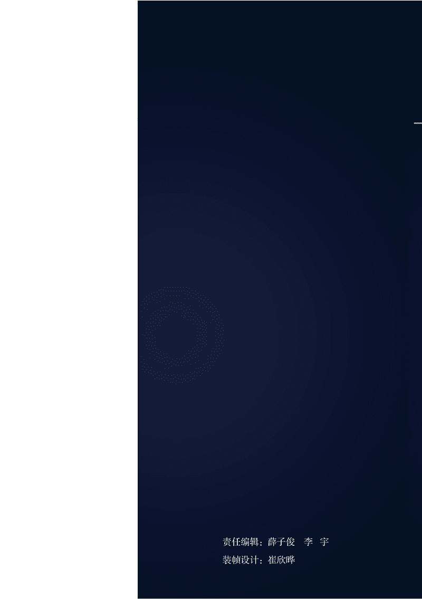

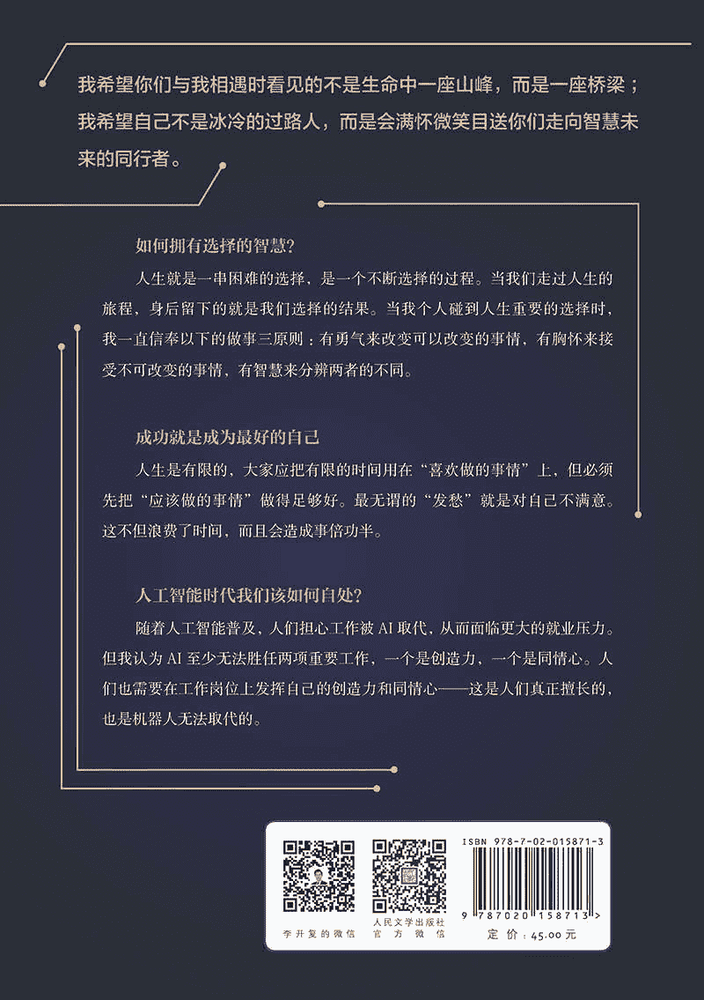