# 智联世界：AI描绘共同家园

# Preface

The 2020 World Artificial Intelligence Conference Cloud Summit, themed "Intelligent Connectivity, Shared Home," was successfully held in Shanghai from July 9 to 11, 2020. Against the special backdrop of epidemic prevention and control, the conference fully leveraged Shanghai's advantages in AI technological innovation and application, integrating online and offline formats, hosting the conference "on the cloud" and the exhibition "digitally." Top AI scientists, entrepreneurs, investors, developers, and people from all walks of life concerned with AI development from around the world gathered to discuss new directions in AI technological development, new drivers for industrial application, and themes such as AI assisting global epidemic prevention and control and building a warm home. They put forward many valuable concepts, views, insights, and suggestions, attracting widespread attention from the industry and society at large.

As an international high-end exchange platform facing this important emerging technology field, the World Artificial Intelligence Conference has been successfully held for three sessions. In September 2018, General Secretary Xi Jinping sent a congratulatory letter to the first World Artificial Intelligence Conference, profoundly elaborating on the development trend of the new generation of artificial intelligence from a strategic and overall height, demonstrating China's clear attitude of being willing to work with all countries to jointly promote development, safeguard security, and share achievements in the field of AI, pointing the way for the rapid and healthy development of AI. At the opening ceremony of this year's World Artificial Intelligence Conference, Li Qiang, Member of the Political Bureau of the CPC Central Committee and Secretary of the Shanghai Municipal Committee, emphasized in his address that Shanghai will deeply implement the spirit of General Secretary Xi Jinping's important instructions, striving to build an open platform linking collaborative innovation, an empowering platform linking industrial development, a smart platform linking urban governance, and a service platform linking a better life. Shanghai will cooperate with friends from home and abroad to jointly explore the bright prospects of AI development and jointly write a splendid chapter of the intelligent era.

In order to allow more people to share the thoughts and academic achievements of the World Artificial Intelligence Conference, and in response to demands from all sectors, the Conference Organizing Committee continues to launch the "Intelligent Connectivity" series of books this year. This book focuses on the guest speeches at the opening ceremony, plenary sessions, and evening talks of the 2020 World Artificial Intelligence Conference. Centering on themes such as "Home·AI (Love)," "Direction," "Trend," "Epidemic Fight," "Opportunity," and "Connection·Integration," it comprehensively presents the latest development trends of world AI and conveys the value concept of AI for good and building a common home for humanity.

This book aims to provide a useful reference for relevant professionals and general readers to understand and grasp AI development trends, participate in the World Artificial Intelligence Conference and the construction of Shanghai's AI highland, and promote the healthy development of China's new generation of AI.

World Artificial Intelligence Conference Organizing Committee

September 2020

# Home·AI (Love)

## Era of Transformation: Responsibility Over Worry

**Jack Ma**

Co-Chair, UN High-Level Panel on Digital Cooperation

Founded Alibaba in 1999, serving as Chairman of the Board and CEO until May 2013, and as Chairman of the Board from May 2013 to September 2019. Also a member of the Board of Trustees of the World Economic Forum (WEF) Foundation, President of the Zhejiang Merchants Association, and Chairman of the China Entrepreneur Club. Has served as Co-Chair of the UN High-Level Panel on Digital Cooperation since 2018. Graduated from Hangzhou Normal College (predecessor of Hangzhou Normal University) with a major in English Education.

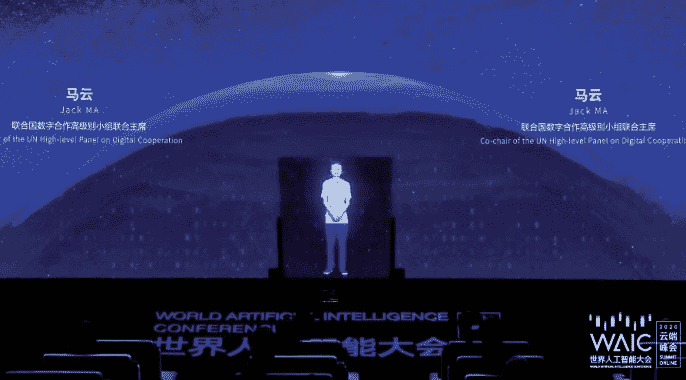

I am currently in Yunnan, and it is a great honor to join your discussion.

This is a very special conference, perhaps even a historic one. When we gathered in Shanghai for the first AI conference, no one would have imagined that this year we would continue last year's seminar in such a way.

I remember last year some among us were still worried, still debating whether machines would replace humans and what to do about employment; now what we are most anxious about is how to let machines replace many human jobs as soon as possible. For example, in the field of virus transmission, we try every means to let machines solve problems rather than letting people rush to the front lines. So the world is really like this: what we worried about didn't happen, but what we didn't worry about keeps happening one after another.

Today's problems are caused by the decisions we made yesterday, but we can hardly change yesterday, and are often powerless even for today; what the future should look like is what we can decide today. I think we should regard the changes brought to the world by the epidemic as a signal from nature, from the future. I want to share three thoughts I've had these past few days:

### First, humans cannot leave Earth, but Earth can leave humans.

After the Industrial Revolution, humans had the ability to look outward, landed on the moon, built space stations, tried to survive in space, and many outstanding people including Elon Musk began great explorations of worlds beyond Earth.

Next, because of the Digital Revolution, humans have the ability to explore inward, to truly understand themselves, and to truly understand Earth. In comparison, human exploration of themselves appears more difficult and more important.

Today, human understanding of themselves is very limited; even the top brain scientists understand less than 10% of the human brain. This epidemic has shown us humanity's unfamiliarity with itself and with Earth. Because we don't understand ourselves, don't understand the world we survive in, don't know this Earth, and don't cherish and protect it, we have created many troubles and disasters. I think the most important thing for humanity now is to solve its own problems and solve Earth's problems; otherwise, no matter where we migrate, no matter which planet we go to, we will still face such troubles and disasters.

In fact, we humans still cannot leave Earth, but Earth might be better off without us. I saw a few news items recently: due to the reduction in tourists, the deer in Nara, Japan, ate fewer snacks and their stomachs recovered health; after Venice, the city of water in Italy, was locked down, the water became clearer, and fish could be seen in the water. If Earth is a company, nature is the real boss; humans are merely managers selected by nature. Humans have great power, but nature can fire us at any time.

Many things are not wrong for humans, but are big mistakes for nature. If humans keep bringing disasters to nature, nature will surely repay humans with disasters. We humans must learn to coexist with nature; only by following and respecting nature can humans survive on Earth.

### Second, economic growth can slow, but humans must grow.

The epidemic has made us realize that the world's ecosystem is largely influenced by microorganisms, not the highest-level animals. Just like in the African savanna ecosystem, the important role is played by microorganisms, not lions and elephants. We humans must never think too highly of ourselves.

I think AI should be translated as "Machine Intelligence"; translating it as "Artificial Intelligence" shows humans thinking too highly and too greatly of themselves. Many things are difficult for humans but very easy for machines. Animals have instincts, machines have intelligence, and what humans possess should be wisdom.

For thousands of years, human knowledge has grown rapidly, technology has developed, but human wisdom has not grown.

Today, the resources and wealth we possess are unprecedented; the knowledge and technical capabilities we possess are also unprecedented; of course, the troubles we face are also unprecedented.

Today, humanity's accumulation of knowledge, information processing capabilities, and risk resistance capabilities are the most powerful in history. But regrettably, we lack wisdom. We sometimes fail to use these resources, capabilities, and knowledge to strengthen communication and cooperation; sometimes we even create many barriers and even widen differences. Humanity has never lacked disasters, but after disasters, we must grow. Otherwise, I believe that what will destroy human civilization in the future will not be viruses, but humans themselves.

People and people, countries and countries, no two are the same; they are definitely different, and will remain different forever. It is because of our differences that the world is rich and colorful. Many of the world's problems today are caused by not respecting the many differences and divergences between each other. Seeing differences, yet still being able to put aside divergences, learning to respect and appreciate each other's differences—this is the mark of human civilization's progress.

### Third, if digital technology used to make life better, then future digital technology is to enable humans to survive better!

The epidemic has not changed the trend of technological transformation, but it has accelerated the transformation of digital technology, because disasters force us to innovate.

An expert using the naked eye to read a CT scan of a suspected COVID-19 case takes 15–20 minutes; later, Chinese technicians developed an intelligent algorithm for COVID-19 CT imaging in a very short time, and the machine only needs 20 seconds to read a suspected case scan, 60 times the efficiency of an expert.

I heard that during the epidemic, farmers used satellite remote sensing technology to get loans. That is, farmers delineate their own rice fields on a map via a mini-program on their mobile phones; satellites identify the growth of crops in the fields through remote sensing images; the machine estimates yield and value by combining climate, industry, and other factors, and then decides how much loan to give the farmer.

Innovations using Internet technology to keep oneself alive and keep others alive during the epidemic are everywhere. Attending classes, holding meetings, shopping, seeing doctors... maintaining the operation of life all must rely on digital technology. Innovation for survival is the truly most powerful and unstoppable driving force. The general trend of digital technology has not changed, but in the future, digitalization that originally took thirty to fifty years to complete may accelerate to completion within 10 or 20 years. This is a huge change after a huge change; technological transformation advances and accelerates. This is what we need to prepare for, and it is the completely different situation faced by this year's AI conference compared to last year's.

Separated by a year, the world has undergone tremendous changes. Today's us no longer have time to worry; rather than worry, we should take responsibility. Because the virus needs no visa, knows no borders; technology should not have borders either, and should not distinguish between you and me. Today's disaster is enormous; today's disaster may have just begun. We have no other choice. So, the earlier we start cooperation, unity, and banding together, the earlier we will win.

Thank you all again!

## Opportunities and Outlook for AI Evolution

**Elon Musk**

Co-founder & CEO, Tesla

Co-founder and CEO of Tesla, leading product design, engineering, and manufacturing of the company's electric vehicles, battery products, and Solar Roof. Also co-founder, CEO, and Chief Designer of Space Exploration Technologies Corp. (SpaceX), leading the R&D and manufacturing of advanced rockets and spacecraft. Also founded The Boring Company and serves as CEO, and serves as CEO of Neuralink.

# Advances in AI and Robotics in Perception, Cognition, and Behavior

If categorized by perception, cognition, and behavior, artificial intelligence has made tremendous progress at the perceptual level. In the professional field of image recognition, AI performs almost better than any human; the only question is how much computing power, how many computers, and how long it takes to train. Regarding both image and speech recognition, for a given byte stream, AI systems can recognize and process it with high accuracy.

Cognition is perhaps the weakest area. Can AI understand concepts? Can it reason effectively? Can it create meaningful things? There are currently many highly creative, advanced AI technologies, but they cannot well control creative activities.

In terms of behavior, gaming is a good example. In any game with explicit rules, or where the degree of freedom is relatively limited, AI performs like a superhuman. As of now, it is hard to imagine any game where AI players cannot surpass humans, not to mention that AI reacts much faster than humans.

## L5 Autonomous Driving Will Be Achieved Soon

I am very confident that L5 autonomous driving, or full self-driving, will be achieved in the future, and we can achieve it soon.

I don't think there are any fundamental, underlying challenges to achieving L5 autonomy, but there are many detail-oriented problems. The challenge we face is solving all these small problems, integrating the systems, and continuously addressing the long-tail problems. We often find that just when we can solve problems in the vast majority of scenarios, some unusual scenarios pop up from time to time, so there must be a system to identify and solve problems in these unusual scenarios.

This is why we need to train our autonomous driving systems in real-world scenarios. Nothing is more complex than real-world scenarios; any simulation we create is a subset of the complexity of the real world. We are currently very focused on solving the detail problems of L5 autonomous driving. I believe these detail problems can be solved based on the hardware version currently equipped in Tesla vehicles; all that needs to be done is to improve the software to achieve L5 autonomous driving.

## Tesla Shanghai Gigafactory Progressing Smoothly

I am incredibly proud of the Tesla team, and I am very grateful to the Tesla China team; their outstanding work gives me great relief. In the future, our factories will utilize more AI and smarter software.

## How Autonomous Driving Drives AI Algorithm and Chip Development, and Changes Our Understanding of AI

When equipping Autopilot with AI chips, we found there were no reasonably priced, low-power systems on the market. If we could only use traditional GPUs, CPUs, or similar products, the power consumption would reach hundreds of watts, and the vehicle's trunk would be filled with a huge cooling system. Traditional chips are not only costly and take up vehicle space, but they also have high energy consumption issues, while energy consumption is critical to the driving range of electric vehicles.

To this end, Tesla developed its own AI chip: the Tesla Full Self-Driving (FSD) chip with dual systems. This chip features 8-bit integers and accelerators for dot product operations. We have not yet fully unleashed the capabilities of this chip; it was only a few months ago that we prudently activated the chip's second system. It may take a while before we fully utilize the capabilities of the Tesla FSD chip.

To rapidly process massive amounts of video data, we also developed the Tesla Dojo training system to improve the training of AI systems. The Dojo system is like an FP16 training system, currently limited mainly by chip heat generation and communication bandwidth. We are developing new buses and thermal cooling systems to develop more efficient computers, thereby processing video data more effectively.

In terms of AI algorithm development, neural networks primarily acquire massive amounts of information from reality, much of it from passive optics, and create vector spaces—essentially compressing massive amounts of photons into vector spaces. We usually take reality for granted by way of analogy. But I think we can enter the vector space in our own brains to understand how the brain processes external information. In fact, what the brain does is acquire and filter massive amounts of information, retaining only the relevant parts, thereby memorizing as little information as possible. The information in the brain accounts for only a tiny fraction of the raw data, yet it can make decisions based on the representation of this vector space, which is actually similar to a large-scale compression and decompression process.

# Principles of Transparency, Fairness, Safety, Responsibility, and Privacy in AI Development

> **Stephen A. Schwarzman**  
> Chairman, CEO, and Co-Founder of Blackstone

Recently, the Group of Seven (G7) established the "Global Partnership on Artificial Intelligence" (GPAI), which is an encouraging start. Without a true global convention that encourages global collaboration and interdisciplinary cooperation, all countries will suffer significant losses and impact the innovation process of each nation.

AI can help enterprises optimize complex global supply chains and predict market changes. By leveraging AI, enterprises will be able to build more flexible, reliable, and resilient end-to-end supply chains; in the face of global business disruptions caused by the COVID-19 pandemic, AI-based supply chains will be more robust and reliable. Innovation will emerge all over the world, and best practices in AI from various countries should be shared to form new experiences beneficial to AI development and application, benefiting all nations.

In recent years, many organizations worldwide have released ethical AI development principles and guidelines, which is a good start for global discussion. Although there are complex regional and cultural differences in the interpretation, emphasis, and implementation approaches of certain issues among countries, the world has shown a converging trend on core principles such as "Transparency," "Fairness," "Safety," "Responsibility," and "Privacy."

## Principle 1: Transparency

Decision-making in AI systems should be explainable and auditable, and the design and implementation of decisions should be subject to oversight. AI systems and software cannot be black boxes; we need to be able to easily understand where, when, and how AI systems are used.

## Principle 2: Fairness

Technology must not exacerbate bias but should be inclusive, benefiting as many people as possible.

## Principle 3: Safety

AI should not cause foreseeable or unintended harm; it should be reliable and resistant to disruption.

## Principle 4: Responsibility

Harm caused by errors in AI system decisions must be clearly attributable, and mandatory remedial measures should be taken where applicable. Researchers and developers need to consider any risks that AI technology may pose and demonstrate that they have taken concrete actions to mitigate risks.

## Principle 5: Privacy

AI applications rely on data; therefore, there needs to be a mechanism to protect people's rights, interests, and personal privacy. AI systems need to disclose in an easy-to-understand manner how personal information is used, stored, and protected. Users should also be able to revoke authorization for the use of their personal information very easily.

The sooner these principles are unified and applied through a common governance framework, the more likely we are to avoid the potential negative impacts of AI. Many organizations in China have already taken action to promote the realization of AI ethical principles, including the governance principles released by the National New Generation AI Expert Committee, and the two Shanghai AI Governance Initiatives released at the World Artificial Intelligence Conference (WAIC) in 2018 and 2019.

Governments of all countries should participate in cooperation and construction in the field of AI governance. At the 2018 WAIC, Chinese state leaders expressed China's willingness to cooperate with other countries in developing AI for the benefit of humanity. Now, the time has come for governments worldwide to join hands to ensure the healthy development of AI.

# The Future of AI: Deep Reflections Amid the Pandemic

## Guest Introductions

**Zhang Wenhong**  
Director, Department of Infectious Diseases, Huashan Hospital Affiliated to Fudan University

**Chen Jie**  
Academician of the Chinese Academy of Engineering, IEEE/IFAC Fellow, President of Tongji University

**Shen Xiangyang (Harry Shum)**  
Scientist, Scholar, Former Executive Vice President of Microsoft Global

**Zhu Min**  
Dean, National Institute of Financial Research, Tsinghua University; Former Deputy Managing Director of the International Monetary Fund (IMF)

## The Role of AI in Fighting the COVID-19 Pandemic

**Zhang Wenhong**: Now everyone has high expectations for AI, but in the early stages of this epidemic, we were still highly dependent on manual labor. When Shanghai's epidemic prevention teams rushed to Wuhan, we hoped AI was already ubiquitous nationwide—using AI to understand reserves of masks, protective suits, ventilators, and even diapers, and how to allocate medical resources. Unfortunately, at that time, this data simply did not exist.

As the epidemic developed, we gradually realized the huge potential of AI. When asked why other countries' cities found it difficult to achieve epidemic control results like Shanghai, my answer is that AI and intelligent management played a very good role in Shanghai's epidemic prevention and control. Within one or two months after Shanghai implemented social distancing, AI played a key role in city operations, people's lives, and patient care.

AI is currently at its peak, but I regret to tell you that overall, China's control of this epidemic was still achieved relying on traditional wisdom and city management. AI has been applied in vaccine target prediction and drug target discovery, but these drugs and vaccines are made for the future. What we need to reflect on is how AI can improve our public health system in the future after this epidemic.

**Chen Jie**: AI played an important role in this epidemic prevention. Taking Tongji University as an example, the school has over 40,000 students from home and abroad. To achieve effective prevention and control, we used AI technology to organize and enter the information of all faculty, staff, and students into the information system, and designed an intelligent recognition system to determine who could enter the school. To reduce conflicts, we also automatically displayed the four reasons for denial of entry on the screen: coming from key epidemic areas, not having completed 14 days of quarantine in Shanghai, body temperature exceeding 37.3°C, and visitors not being Tongji University faculty or students.

**Shen Xiangyang**: AI demonstrated value in three aspects during this epidemic. First, AI accelerated the research on prevention, diagnosis, and related treatments, particularly breakthroughs in therapeutic means. Second, extracting relevant data from global public health and epidemiological data, and then intuitively and three-dimensionally presenting the characteristics, changes, and trends of epidemic data for global scholars, medical staff, and experts in related fields to jointly discuss how to respond to epidemic risks. Third, a series of new technical means such as telemedicine and remote collaboration better promoted the sharing of medical resources, allowing limited medical resources to serve more people. This is important not only for developing countries but also for developed countries.

I have always believed that the goal of developing AI is to augment human capabilities and benefit the future of humanity. New breakthroughs are needed in basic AI research, such as the advancement of basic research in privacy protection, standardization, and prevention of misuse, to ensure data is shared safely, reliably, and efficiently. At the beginning of the epidemic, one problem AI had to solve was the data issue. We first considered how to achieve early detection, early warning, and early interception. With the development of AI, in the future, we will be able to achieve minute-level warning and hour-level interception.

## AI Enhancing the Resilience of Future Public Health Systems

**Zhang Wenhong**: Currently, disease control data, public health data, and physical world data are scattered and siloed. How these data can be integrated in the first place under the joint action of big data platforms, crawler technology, and image recognition technology to provide early warning functions is very important.

The future application of AI in public health monitoring systems, and the integration of medical institutions and public health systems—that is, the construction of a new "medical-prevention integration" system—are inseparable from big data. To what extent AI can achieve depends mainly on how we utilize big data. How we combine offline data with online data to form a complete system and achieve early warning, how we combine international flight information with the epidemic severity of various countries to analyze a city's epidemic "immunity"—research in these areas should all be data-driven. Current international epidemic prevention measures are "circuit breakers," but circuit breakers are not AI.

**Zhu Min**: We should not use government administrative methods to solve problems. In the future, AI will play a huge role, and the key is to break data silos. We are increasingly aware that we live in a complex system; simply using AI to solve single-dimensional online tasks is no longer sufficient to address the challenges we face. Therefore, the intelligentization of complex systems has unlimited prospects in the future.

**Chen Jie**: Currently, a lot of data and AI technologies have not been fully applied to the medical and health field. Many big data-based learning methods still rely on high-quality, labeled data. Now, various sensors have acquired massive spatiotemporal data; how to effectively integrate and process these complex data, and how to handle the superposition and emergence phenomena of data—these are the challenges we face. For example, at the beginning of this epidemic, online information was mixed with truth and falsehood; how to integrate these data was a huge problem.

## The Future of AI

**Shen Xiangyang**: Regarding the future development of AI, I will talk about three aspects. First, I think the next very important change is a huge shift in cognition-perception. Years of deep learning work, like computer vision and speech recognition, have expanded the boundaries of our cognition-perception. Second, the core of future AI development is the interaction problem. Before computers appeared, we mainly had human-human interaction; after computers appeared, it became human-computer interaction; the most exciting thing in the future is human-AI interaction. Third, AI must solve the common sense problem to achieve greater development. Only by enabling AI to understand common sense can we truly enter the world of AI.

**Chen Jie**: The future world should be a new cyber-physical system jointly constructed by information space, physical space, and human social space. In this new system, AI can help humans expand cognitive boundaries. AI will play a key role in the future society's economic system, industrial system, social system, transportation system, and urban management system.

Current machine learning methods are continuously shifting from traditional deep learning to reinforcement learning, transfer learning, and evolutionary learning. In the future, machines and humans will each perform their duties; humans in this new system are both operators and equal participants. How humans and machines will integrate in the future is an important proposition.

**Zhu Min**: A post-epidemic AI wave is coming, and this wave will have structural changes compared to the past. Previously, AI was "to C" (consumer-facing); now it is starting to move more towards "to B" (business-facing); in the future, it will develop into "to S" (society-facing). This is an extremely grand scenario. A very important factor in AI development is data; we need to break data monopolies and truly turn data into resources and productivity. Ultimately, AI will move from perception to cognition, forming human-AI interaction, and machines will help us better understand the world and expand our thinking abilities. This will be a beautiful future.

# Exploring New Opportunities and New Situations in Artificial Intelligence

## Guest Introductions

**Pony Ma (Ma Huateng)**  
Chairman of the Board and Chief Executive Officer, Tencent

**Martin Lau (Ren Yuxin)**  
Chief Operating Officer, Tencent Group

**Pony Ma**: Artificial intelligence is a cross-border, cross-disciplinary scientific exploration project. It is pushing human cognition toward "Faster, Higher, Stronger" and will inevitably bring us an unprecedented technological and industrial revolution. Currently, our unknowns about new technologies like AI are still greater than our knowns. We research and apply new technologies every day, but ultimately, we must be responsible for every single user. To achieve "AI for Good," we must strive to make AI "Knowable, Controllable, Usable, and Reliable." This is a shared challenge for the whole world, and it is the reason why Tencent has incorporated "Tech for Good" into its corporate mission and vision.

As a frontier window of China's reform and opening up, Shanghai provides us with a platform for cooperation and exchange to solve world-class problems. In the future, Tencent's East China Headquarters will further root itself in Shanghai and become one of the builders of Shanghai's AI highland. We will accelerate investment in new infrastructure, and together with Shanghai, nurture new opportunities in crisis and open new situations in change, injecting new momentum into Shanghai and even the integrated development of the Yangtze River Delta.

**Martin Lau**: I will mainly share our thoughts and explorations in the field of AI through three "News" (New).

### The First "New": New Growth

The normalization of the epidemic makes resumption of work and production very challenging. To ensure the smooth flow of "logistics, capital flow, and information flow," AI has played a major role. For example: Shanghai's Youtu AI Lab provided OCR (Optical Character Recognition) technology to domestic and foreign companies, replacing manual entry of logistics documents; Tencent's security team helped small and micro enterprises obtain "zero-contact" online credit services; AI-based simultaneous interpretation technology, if combined with online meeting systems and social tools, can enable people to hold international conferences anytime, anywhere, unrestricted by venue, traffic, or language.

New drug R&D often takes more than 10 years, but AI may change this situation. For example, Tencent's AI drug discovery platform "Yunshen Zhiyao" has been fully opened to researchers, and we hope to shorten the time for new drug R&D with the help of machine learning.

# Three "News": Deep Embedding of AI Technology, New Games, and New Generation

After this epidemic, China no longer has purely traditional industries, not even the most traditional agriculture. In February this year, at the most critical moment of the domestic anti-epidemic effort, Tencent AI Lab attempted an experiment in remote tomato planting in greenhouses in Liaoning. Although they encountered a late spring cold snap, the experimental group achieved real-time temperature adjustment through AI algorithms, thereby increasing net profit per mu by thousands of yuan. In the greenhouse planting competition jointly held by Tencent and a Dutch university, the AI teams of all 5 finalist teams outperformed the agricultural expert group with 20 years of planting experience. We believe that AI technology is deeply "embedding" itself into all walks of life, becoming ubiquitous. The increasingly improved new infrastructure and industrial internet will bring new increments to all industries and new growth to economic development.

## The Second "New" is New Games

"Game" refers to electronic games, but also carries the meaning of competition and game theory. Tencent is fully supporting Shanghai in building the "Global Esports Capital". Currently, Tencent Esports has established remote broadcasting centers for *League of Legends* and *Honor of Kings* in Shanghai, and a series of major Tencent Esports professional leagues will successively settle in Shanghai. This year, we are also actively preparing for the *League of Legends* S10 World Championship to be held in Shanghai.

The esports industry, with its huge potential, brings us not only economic value. In the eyes of players and audiences, esports is a match; in the eyes of AI experts, esports is even more a multi-agent game. In the history of AI development, the landmark `AlphaGo` was born in the ancient Chinese "game" scenario of Go. Currently, the Chinese National Go Team is using the Go AI "Jueyi" developed by Tencent for player training, achieving very good results. After cracking the challenge of Go, Multiplayer Online Battle Arena (MOBA) games have become an important scenario for us to research AI's complex decision-making capabilities. In 2018, the *Honor of Kings* AI "Juewu" passed the test of human professional teams; in 2019, it reached professional esports level, and is currently sprinting towards top professional level.

The "Digital Human Ailing", developed through exploring cutting-edge topics such as multimodality, can not only do esports commentary and teach children to sing and dance, but also possesses an increasing number of abilities to imitate real humans. In the future, characters in novels, movies, animations, and games are very likely to jump out of their specific works and become friends in our real lives, communicating emotions with us and helping us strategize. For example, if you encounter setbacks and difficulties at work, besides venting to friends, you might also be able to chat with Fan Xian, that smart and open-minded character from *Joy of Life*.

In the future, AI may reshape our game R&D, esports events, and even the entire digital cultural industry; at the same time, games and esports provide the most ideal testing ground for AI. For instance, multi-agent games in gaming and esports are also problems that intelligent connected vehicles need to solve in reality. Currently, we have tried to use technical advantages from the gaming field to build simulation environments for automakers, to improve the testing efficiency and safety of autonomous driving. I believe that the AI highland and the global esports capital do not exist in isolation; they will find their intersection in the future Shanghai.

## The Third "New" is New Generation

Today's esports athletes are mostly "post-95s". We call them "Digital Natives". In our view, new infrastructure will stimulate the ingenuity of the new generation of young people, and the industrial internet is destined to become the stage for "Digital Natives" to realize their dreams. In just the first four months of this year, nearly 600,000 jobs were added in the WeChat ecosystem. We believe that the digital world is a new homeland waiting for young people worldwide to build together.

The "Four Cans" (Available, Reliable, Knowable, Controllable) principle of "AI for Good" urges us to continuously think about and solve new issues such as privacy security, algorithmic discrimination, and digital divide when using AI, striving to achieve "Transparency, Inclusiveness, Responsibility, and Safety". AI not only changes the relationship between humans and machines but will also bring changes to relationships between humans. AI is the biggest variable in our industrial economy and the most important unknown in our social life. The new generation of young people must master the power of technology, but also think about cultural values; the two are equally important.

Innovation is making Shanghai more charming. Shanghai has repeatedly proposed to open the door of openness wider, ignite the fire of innovation, and build a good ecology of inclusiveness. In recent years, unicorn enterprises in Shanghai have sprung up like bamboo shoots after rain. We not only see the rapid growth of enterprises such as Meituan-Dianping, Pinduoduo, Xiaohongshu, China Literature, and Bilibili, but also see the urban character of Shanghai's "Openness, Inclusiveness, and Innovation". We believe that the innovation potential of this city has only just begun to be released, and in the future it will surely create new history at the intersection of the Yangtze River of Technology and the Sea of Humanities.

---

# New Directions in Artificial Intelligence Theory

**Yao Qizhi (Andrew Chi-Chih Yao)**

Dean of the Institute for Interdisciplinary Information Sciences, Tsinghua University; 2000 Turing Award Laureate; Academician of the Chinese Academy of Sciences; Foreign Associate of the US National Academy of Sciences

World-renowned computer scientist, internationally recognized as a pioneer in cryptography and quantum computing. Awarded the Turing Award in 2000, he remains the only scientist of Chinese descent to receive this honor to date. He has taught at MIT, Stanford University, UC Berkeley, and Princeton University. In 2004, he left Princeton University to return to China and teach full-time at Tsinghua University. In 2005, he founded the "Computer Science Experimental Class" (Yao Class), acclaimed by the outside world as "the world's best undergraduate computer science education". In 2011, he established the "Tsinghua Center for Quantum Information" and the "Institute for Interdisciplinary Information Sciences". In 2018, he founded the Nanjing Turing Institute of Artificial Intelligence and the Xi'an Institute for Interdisciplinary Information Core Technologies. In 2019, he specially founded the "Tsinghua AI Class" (Zhi Class). In 2020, he established the Shanghai Qi Zhi Institute, aiming to promote interdisciplinary development led by artificial intelligence.

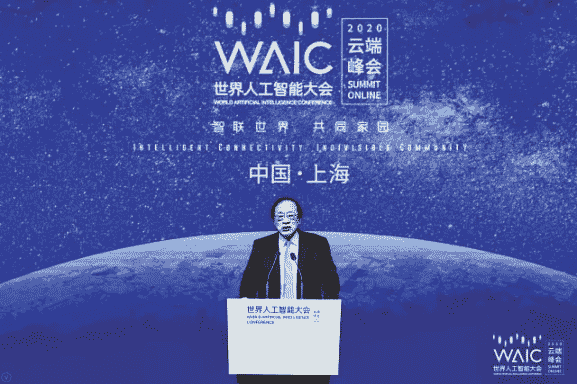

Applications of artificial intelligence are already ubiquitous. If we look around, we will see many new advances in the field of AI and widespread applications of AI. But at the same time, we must also remember that the dazzling applications we see today benefit from the development of certain basic scientific fields, and the development of basic science stems from the accumulation and breakthroughs in basic theoretical research over many years. Therefore, to continue to drive the innovation trend in AI applications, we must achieve new breakthroughs in theoretical research. I want to convey the following three points:

First, AI theory is extremely important. Through theoretical analysis, we can understand the problems and challenges faced in the field of AI more clearly, while also gaining some inspiration and clues about solutions.

Second, AI development requires interdisciplinary cooperation. We can see many examples of great success in the field of AI, all originating from cooperation between seemingly unrelated disciplines. Without the achievements of scientists from other disciplines, such rapid development in the field of AI would have been impossible.

Third, there are some very interesting and worthwhile new directions to explore in AI theory.

I hope to share three new directions in AI fundamental theory: Neural Topology, Privacy-Preserving Learning, and Controllable `Super AI` (Superintelligence).

## New Perspective on Neural Network Research: Neural Topology

Deep learning and neural networks are the foundation of many current AI applications. The huge breakthrough in deep learning in recent years was actually unexpected by many people. Deep learning had no progress for many years, until suddenly several factors came together, after which deep learning and neural networks produced huge applications and impact.

But why are neural networks so successful? This remains a mystery to many—many are pursuing where the power of neural networks truly comes from—if we can understand the reasons for the success of neural networks, then perhaps we would know how to improve them, thereby achieving the next breakthrough.

Let's first look at a simple example of "what neural networks can do". Take climate prediction, for example. If we need to design an algorithm to capture climate conditions to analyze whether a weather map shows a storm or normal climate, a relatively standard method is to treat the weather map as a two-dimensional or three-dimensional representation, and then find patterns through graphic analysis to identify storm characteristics.

However, in deep learning and recent machine learning, people take a higher-level perspective, viewing the entire image as a point in a high-dimensional space. For example, a picture of a cat: assuming this image has one million pixels, it can be viewed as a point in a one-million-dimensional data space. This is actually a standard machine learning method in the current field of artificial intelligence—data is viewed as a point in an extremely high-dimensional data space, and algorithms analyze to determine whether this point belongs to a specific set (e.g., the set of cat pictures in the example).

Abstractly speaking, we can look at all cat pictures; they constitute a data set in a one-million-dimensional space. We have an intuitive feeling for low-dimensional data, but no one knows what the data set looks like in high dimensions. Our task is to design algorithms to make good judgments on high-dimensional data. The core of this work lies in neural networks, and the most critical question is how large and deep the neural network needs to be to distinguish cat pictures from non-cat pictures.

For many years, mathematicians have been concerned with high-dimensional data sets. A natural question is: when we try to understand what neural networks can do, we first want to understand what kind of data sets are relatively easy for neural networks to analyze and recognize, and what kind of data sets we cannot analyze using neural networks.

Over the past decade or so, neural network researchers have begun to combine topology in mathematics with neural networks, achieving very good computational results. An important concept in topology corresponding to high-dimensional data is the Betti number. `B0`, `B1`, `Bi`, `ΣiBi` are related mathematical expressions of Betti numbers. The Betti number is a sequence; the lowest is `B0`, which corresponds to the number of mutually uncorrelated elements in the data set. What does `Bi` mean? You can think of it as the number of i-dimensional holes in the subset (number of holes). For example, in the Betti number example below, the left side is a circle on a plane, then `B0=1`, representing the existence of one connected element; `B1=1`, representing one hole in the figure. The right side is a more complex example. The figure shows a torus; `B1`, the number of one-dimensional holes, equals 2, because there are two different types of circles, and each circle represents a hole. Let the Betti numbers of figure S be (`B0`, `B1`, …), `ΣiBi` is called the "total Betti number" of S. Intuitively, the higher the Betti number, the more complex the shape.

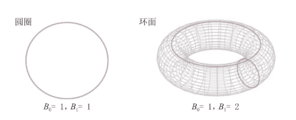

**Betti Number Examples**

An intuitive view is that for neural networks, the more complex the shape, the higher the difficulty of recognition. In fact, this intuition is also correct; we can prove this hypothesis through some classic topological theories, combined with some insights from theoretical computer scientists. This also proves the point just mentioned: if you want to solve an interesting AI problem, you need to think from the perspective of different disciplines. The case discussed here is topology; by introducing topology, we can gain brand-new insights in AI, which would be impossible by focusing only on AI research.

## Privacy-Preserving Learning

First, let me introduce another discipline: cryptography. I am personally very interested in cryptography, especially "Multi-party Computation (`MPC`)". The basic idea behind `MPC` is this: assume there are many different parties, each with some data, and only when all parties' data are combined can AI technology be used to mine or discover important results. However, the data each party possesses is confidential and very valuable; therefore, they do not want to leak their private data to other parties.

In this case, can we perform collaborative computation without revealing the content of our respective data? The answer is yes; this goal can be achieved through cryptographic design, i.e., secure multi-party computation.

This concept and technology of secure multi-party computation was proposed by me in 1982; its value at the time was conceptual innovation and algorithmic feasibility. After years of development, the application cost of cryptography has been greatly reduced, making secure multi-party technology have various practical applications, including in privacy-preserving machine learning. For example, several pharmaceutical companies want to jointly develop new drugs, but each has its own confidential information; now, through AI + `MPC`, multiple pharmaceutical companies can cooperate without disclosing their exclusive intellectual property.

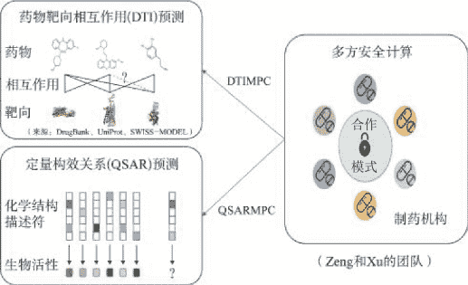

**Application of Multi-party Secure Computation in Privacy-Preserving Drug Discovery Process**

## Controllable Super AI (Superintelligence)

The last point is one that many people are very interested in, but also a topic full of controversy: controllable superintelligence, the so-called `Super AI`. People are generally concerned about the potential threats that the rapid progress of AI may pose to human society. When will general superintelligence arrive? This is unpredictable. Professor Stuart Russell of UC Berkeley published *Human Compatible: AI and the Problem of Control* in 2019, introducing how to promote "provably safe" `Super AI` and strongly advocating that this concept must run through the AI design process. He set three principles: Altruism (human interests above machine interests), Humility (machines cannot be self-righteous), and Diligence (machines can learn human preferences), implementing these principles through mathematical methods such as probability theory and game theory.

I want to tell everyone a basic fact: current AI applications come from past theoretical research; the theoretical research we do now will surely bring us huge progress at some day in the future.

---

# Towards the Third Generation of Artificial Intelligence

**Zhang Bo**

Academician of the Chinese Academy of Sciences; Dean of the Institute for Artificial Intelligence, Tsinghua University; Professor, Department of Computer Science, Tsinghua University

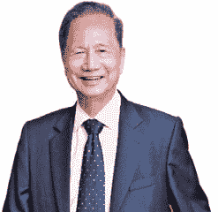

Awarded an Honorary Doctorate of Natural Sciences by the University of Hamburg, Germany in 2011; won the 2014 China Computer Federation (CCF) Lifetime Achievement Award; won the 2019 Wu Wenjun Artificial Intelligence Highest Achievement Award from the Chinese Association for Artificial Intelligence. Engaged in theoretical research on artificial intelligence, artificial neural networks, and machine learning, as well as applied technology research on pattern recognition, knowledge engineering, and robotics. Published over 200 academic papers and 5 monographs in the above fields. His scientific research achievements have won the ICL European AI Award, among others. In addition, he is one of the founders of the State Key Laboratory of Intelligent Technology and Systems, and served as its director from 1990 to 1996.

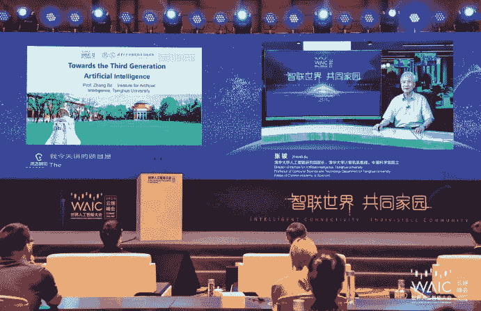

The 60-year development history of artificial intelligence has gone through two generations. The first generation of AI is sometimes called Symbolism. People proposed a reasoning model based on knowledge and experience, using this model to simulate human rational intelligence, such as reasoning, planning, decision-making, etc. For this, it is necessary to establish a knowledge base and reasoning mechanism in the machine, and use these two mechanisms to simulate human reasoning, thinking, and other behaviors.

Here is an example. Around 1971, an expert system built by Stanford University in the US based on this principle was called the `MYCIN` system. It was mainly used to diagnose blood infectious diseases and prescribe antibiotics. It put the knowledge of infectious disease experts into the computer, and also put the doctor's diagnostic process—how to infer the disease from symptoms and finally prescribe—into the computer as a reasoning mechanism. Thus, internal medicine doctors could diagnose with the assistance of the computer. Since internal medicine doctors are usually not infectious disease experts, such a computer-assisted treatment system can help internal medicine doctors make better and more accurate diagnoses and prescriptions.

The most representative achievement of AI systems made using this principle is IBM's Deep Blue international chess program. This program defeated world champion Kasparov in May 1997. The computer's Deep Blue program could defeat human chess masters mainly due to the following three elements: The first element is knowledge and experience, meaning it utilized 700,000 games played by human masters, plus all 5-6 piece endgames. Based on this chess knowledge, it was summarized into chess rules. And through master-machine games, the 8,000 parameters in the evaluation function were tuned, putting the masters' experience into the program as well. The second relies on algorithms; "Deep Blue" used the `Alpha-Beta Pruning Algorithm`. This algorithm speeds up the search. The third is computing power; IBM used `RS6000` machines at the time, capable of analyzing 200 million moves per second, able to look ahead 8-12 steps on average. An experienced chess master can generally only look ahead 3-5 steps; therefore, the machine surpassed humans in speed.

The advantage of the first generation of AI lies in its ability to imitate the human reasoning and thinking processes; therefore, it is explainable, consistent with the process of human thinking. At the same time, using this method for machine learning enables "learning one, inferring ten" (generalizing from one instance). This is the advantage of the first generation of AI.

But the first generation of AI also has very serious defects. For example, this knowledge comes from experts; everyone knows expert knowledge is very scarce and very expensive, and manually programming it into the computer is very time-consuming and laborious. At the same time, a lot of knowledge is difficult to express, such as uncertain knowledge, common sense, etc. Therefore, the application scope of the first generation of AI is very limited.

## Second Generation AI: Deep Learning

The second generation of AI is the deep learning everyone is very familiar with. So-called deep learning simulates human perception, such as vision, hearing, touch, etc. We use image recognition as an example to illustrate how computers simulate human perception. For instance, if we want the computer to recognize different animals, what should we do? Since we cannot tell the computer what a horse is or what a cow is, we have to adopt the human learning method; therefore, the machine learning process is roughly as follows.

First, collect a large number of animal pictures and divide them into two categories. One category is used for training, training the computer to recognize horses or other animals; this is called classification, i.e., enabling the computer to correctly distinguish horses, cows, etc., through training, also called learning. Machine learning uses multi-layer neural networks. After training with a large number of pictures, we then give the other part of the pictures—pictures not learned before—to the machine for recognition. If 90% are recognized correctly, we say its recognition rate is 90%, and the misrecognition rate is 10%. The same method is used for speech recognition. Under given image or speech libraries, current machine recognition rates for images or speech can both reach or exceed human levels.

What are the advantages of deep learning? The first advantage is that it does not require domain knowledge, and the technical threshold is relatively low. In other words, we only need to input raw images and raw speech; we don't need to tell the computer how to recognize images or speech; the computer will automatically extract appropriate features and recognize them, so anyone can use this tool.

Second, the network scale is very large, so it can handle big data. For example, the image library `ImageNet` has 20,000 categories and 14 million images, a very large data volume. In 2011, the computer's misrecognition rate on this image library was as high as 50%, meaning half were wrong. But 4 years later, in 2015, Microsoft used deep learning methods to recognize this set of images, and the misrecognition rate dropped to 3.57%, even lower than the human misrecognition rate of 5.1%. This shows that using deep learning methods, under certain conditions, machine image and speech recognition levels can exceed humans.

Therefore, deep learning has received widespread attention. A most typical example is the Go program. Everyone knows that before October 2015, Go programs written using traditional knowledge-based methods only reached amateur 5-dan level. In October 2015, using deep learning and other methods, the Go program `AlphaGo` defeated the European champion. In March 2016, it defeated the world champion. By October 2017, `AlphaGo Zero` defeated `AlphaGo`. This shows that in 3 years, due to the use of deep learning, the Go program's level jumped from amateur to professional, from professional to world champion, and from world champion to super-world-champion.

The Go program achieved a "triple jump" in two years. Where did `AlphaGo`'s success come from? It came from three aspects: big data, algorithms, and computing power. We can see that `AlphaGo` indeed utilized big data; it learned 30 million games in total, played another 30 million against itself, learning 60 million games in total, a huge data volume. Algorithms used were `Monte Carlo Tree Search`, `Reinforcement Learning`, `Deep Learning`, etc. Computing power was also very strong, composed of a distributed computing system with 1,202 `CPUs` and 280 `GPUs`.

The second generation of AI also has great limitations, including unexplainability, insecurity, vulnerability to attacks, difficulty in generalization, and the need for large amounts of samples. Here is just a simple example, done by our PhD students, to illustrate this problem. The image on the left below is a snowy mountain—the Alps; the computer image recognition system identified it as the Alps with 94.39% confidence. But just by adding a little noise, turning it into the image on the right, the right image looks almost exactly the same as the left image to the human eye, because only a tiny bit of noise was added, but the computer would identify it as a dog with 99.99% certainty.

It can be seen that the computer's pattern recognition system is very different from human vision. Although its recognition rate is high, it is very unsafe, very unreliable, and unexplainable. Why the machine interprets the snowy mountain with noise as a dog, we cannot explain.

**Example of Limitations of Second-Generation AI**^([\[1\]](#txt009.html#footnote_content_txt009_1))

Judging from the achievements of the first and second generations of AI, it should be said that AI has just begun. Both the first and second generations of AI have major defects, and their application scope is very limited; the more exciting big show is about to begin. This big show is the third generation of AI, which must solve the defects existing in the first and second generations of AI. We must establish an explainable, robust AI theory, and develop safe, trustworthy, reliable, and scalable AI technology; only then can we achieve technological breakthroughs. With technological breakthroughs, we can drive innovative applications of AI.

The way to develop the third generation of AI is to combine the first generation's knowledge-driven methods with the second generation's data-driven methods. In other words, we need to comprehensively utilize four elements: knowledge, data, algorithms, and computing power. The first generation of AI used three of these elements; the second generation also only used three.

How do we solve the following key problems?

# Key Issues and Prospects in AI Development

## First: Environmental Perception

AI image recognition systems, despite high recognition rates, are very unreliable, unsafe, and vulnerable to attacks because their recognition methods differ vastly from humans. Let's look at how a machine recognizes a horse: it analyzes the local features of the horse, then compares them with features of other animals like cows, distinguishing based on local features. This is the so-called black-box learning method—it can only learn local features, not high-level semantic features. Therefore, it can only distinguish horses from cows but does not truly "know" what a horse or a cow is.

How can we improve this? One approach is to draw inspiration from the human brain's mechanisms. The human visual nervous system is also a multi-layer neural network. In comparison, the artificial neural networks we currently use are too simple, having only connections from the lower layer to the upper layer—so-called feedforward connections. The human visual neural network is far more complex, featuring feedback connections, lateral connections, sparse firing, attention mechanisms, multimodality, and memory.

If we can incorporate the characteristics of the human visual neural network into current artificial neural networks, we can greatly improve image recognition performance. This is a key task we are undertaking today. Below, I introduce a project from our team: integrating sparse firing rules into each layer of the neural network. Based on this alone, the top-level neurons in the network can detect the contours of faces, cars, elephants, and birds—meaning it can detect semantic features. This shows that adding characteristics of the human neural network can potentially improve AI image and speech recognition performance. Of course, this is only preliminary work.

Additionally, many problems remain in image recognition, such as the difficulty of separating an object from its background. Taking horse recognition as an example, machines struggle to detect *where* the horse is, and also *what* a horse is. How to resolve this contradiction? We must return to the human brain. How does the brain solve this? Why do humans know where the horse is at a glance? Because we know horses. Where does this knowledge come from? It is learned from continuous observation. We can use an autoencoder neural network to let it learn knowledge about horses through unsupervised learning. Once the computer "knows" the horse, it becomes easy to locate the horse in the image, separate it from the background, and thus recognize it. We have done some preliminary work in this area with some results.

## Second: AI Safety Issues

As mentioned, pattern recognition systems built via deep learning are very unsafe and easily attacked. These defects can be improved from the data side and the model side. Here is just one example: facial recognition. Everyone uses facial recognition to unlock phones. If it's not the phone's owner, "face scanning" fails, and the system identifies it as a non-user. If adversarial glasses are worn, login succeeds, deceiving the system. With an AI firewall, even wearing adversarial glasses prevents entry. This shows that various methods can improve intelligent system security. We developed an open-source `Zhusuan` probabilistic programming library, including our self-developed probabilistic programming algorithms, which improve interpretability and security.

## Third: Reasoning, Decision Making, and Game Theory

AI programs have defeated humans in board games, including Go and Chess, which are perfect information games—relatively simple for computers. For imperfect information card games, it is much harder for computers. Only in 2017 did computers defeat humans in four-player no-limit Texas Hold'em. Card games generally fall into deterministic problems under probability, where probabilities can usually be calculated. But our usual decision environments are different—completely uncertain, even adversarial. Currently, game competitions are often used as experimental platforms for decision-making in adversarial environments. Game environments are dynamic, uncertain, and involve different tasks like offense and defense. The main method currently used is reinforcement learning; currently, computers can only beat humans in simple game environments. Our team has participated in competitions, such as the international `VizDoom` competition, winning 2 preliminary championships in 2018, and 1 championship and 1 runner-up in the finals.

## Fourth: How to Adapt to Environmental Changes

We started developing autonomous vehicles in 1991. Where are the problems with current autonomous driving? Our current approach is to recognize objects, build models, and plan on the models—all three steps currently meet real-time requirements. Despite this, this approach struggles in complex road conditions because it cannot handle emergencies well. To handle emergencies, driving knowledge must be added, and experience must be accumulated from continuous trials in real environments—learning to handle emergencies via reinforcement learning. We developed an open-source platform: the `Tianshou` reinforcement learning platform.

## Finally: Why AI Has Just Begun

The first and second generations of AI have significant limitations; they can only solve deterministic problems in perfect information and structured environments. The scope of solvable problems is very limited, relying mainly on data and computing power. The exciting main act is about to begin—this refers to the third generation of AI. The goal of third-generation AI is to better solve computer intelligence problems. The most important manifestations of human intelligence are adaptability and analogical reasoning (learning one thing and inferring many). To achieve this, we must fully utilize four elements: knowledge, data, algorithms, and computing power. Only then can we solve problems in imperfect information, uncertain, and dynamically changing environments, achieving true AI.

## Notes

[1] Yinpeng Dong, Fangzhou Liao, Tianyu Pang, et al. Boosting Adversarial Attacks with Momentum. [2017-12-6]. https://arxiv.org/pdf/1710.06081.

---

# Towards Conscious AI: Computer Architecture Inspired by Cognitive Neural Intelligence

## Author Biography

Manuel Blum, Turing Award laureate, Member of the US National Academy of Sciences, Member of the US National Academy of Engineering, Member of the American Academy of Arts and Sciences. Professor at the School of Computer Science, Carnegie Mellon University. Ph.D. in Mathematics from MIT in 1964, advisor was AI pioneer Prof. Marvin Minsky. Has taught at MIT, UC Berkeley, City University of Hong Kong, and Carnegie Mellon University. Research focuses include Conscious Turing Machines, computational complexity, automata theory, algorithms, inductive inference, cryptography, program result checking, human-computer interactive proofs, etc. Won the 30th Turing Award in 1995 for contributions to computational complexity theory and its applications to cryptography and program checking.

## From "Homunculus" to Conscious Turing Machine: Evolution of Models

We believe cognitive neuroscientists Bernard Baars and Stanislas Dehaene have understood the meaning of "consciousness," although their theories are not yet widely known. Our contribution is translating their theories into mathematical language. We convert cognitive science into mathematics—automata theory, as shared in later cases. This inspires us to think about how the brain generates feelings like pain and pleasure. For years, we have wanted to know what happens inside our heads, seeking a suitable model to explain it.

The initial model posited a homunculus controlling us in the brain, but this is not a good model because we then need to understand the homunculus's mechanism. The second model comes from Plato's finite state machine: Plato believed we are born knowing all world languages, and early in life seek a state corresponding to the language of those around us—still far-fetched in our view. A better model than both is the Turing machine, equipped with eyes, ears, arms, and legs. But this is still unsatisfactory because it offers no insight into consciousness. Finally, we found Baars' "Global Workspace Model"—the Theater of Consciousness model. Our contribution is a precise mathematical description of this Global Workspace Model.

## Baars' Global Workspace Model

Baars likens conscious awareness to a theater. Consciousness is the activity of actors on the stage of Short-Term Memory (`STM`), observed by a large audience sitting in the dark—unconscious processors representing Long-Term Memory (`LTM`). The principle: you are at a party, see a lady. What is her name? You try to recall but can't immediately. You recall the first meeting scene. This information is broadcast from STM to various LTM processors. One processor recalls her profession, entering consciousness, then broadcast to all processors. Another says her name starts with 'T', also broadcast. Half an hour later, when you've stopped thinking about it, her name arrives on the "stage" from the unconscious LTM processors that were searching. However, the conscious self on stage doesn't know *how* the name was recalled; the conscious self is unaware of the unconscious self's work. This is Bernard Baars' consciousness model—a lovely model. Input enters from the left, output exits right, the stage is in the middle, called Working Memory. Input enters the working processor, then outputs. Events on stage are controlled by the Central Executive Function, like a stage manager. At the bottom are LTM processors, doing all the heavy lifting.

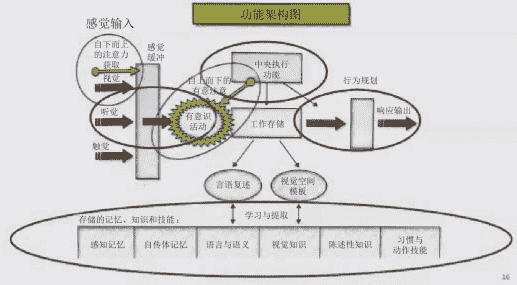

## Mathematical Definition and Mechanism of the Conscious Turing Machine (`CTM`)

Our model differs from Baars'. In ours, there is no stage manager at the top; input does not enter STM but goes directly to processors. They pass through other processors and output, without going through STM. However, information in processors can compete to decide which processor sends information into STM. This takes time, so you sometimes only become conscious of a task after it's done.

`CTM` is a seven-tuple. STM is in the middle, LTM at the bottom. Blue lines go down the tree from STM—Broadcast. Gray lines go up the tree to the top—Competition Tree. When `CTM` is born, processors have no connections. But when two processors communicate via STM frequently enough, connections form between them, and they no longer need STM to communicate. Thus, initially conscious processes become unconscious.

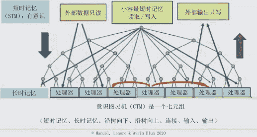

## Quintuple Structure of `Chunk`

What moves up and down the tree is called a `Chunk`—a five-tuple containing:
- `address`: The processor that generated the chunk.
- `gist`: A high-level description, just a statement or at most two clauses. E.g., reciting the alphabet: the statement "ABC" triggers the next statement "DEF" and subsequent letters.
- `weight`: Positive and negative weights, reflecting importance when read from STM.
- `intensity`.
- `mood`.

Let me explain what it means when a chunk reaches the top. In STM, weight is the gist's initial weight. Intensity is the sum of absolute weights of all LTM processors. Mood is the sum of weights (without absolute value). This constitutes a chunk.

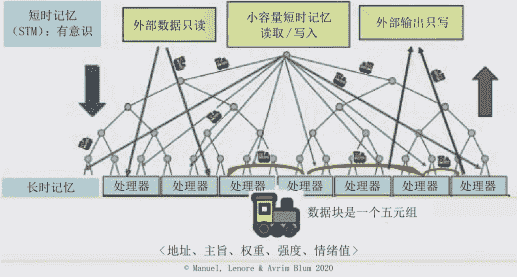

## The Essence of Consciousness: Broadcasting and Awareness

We are aware of exactly what is in STM—no more, no less. In `CTM`, all heavy lifting is done by processors, operating unconsciously in LTM. Assuming `CTM` is a suitable model of human consciousness, we can only be aware of the gist broadcast from LTM processors into STM. What is this "gist"? It must be one of: most typically, inner speech—you hear an inner voice emphasizing your thoughts; inner imagery—perhaps a map or a dream; and feelings, sensations, etc. `CTM` consciousness is defined as the awareness of all LTM processors of STM content. But this definition doesn't answer: what makes us *feel* consciousness?

Our answer: All LTM processors know STM content. Some specialize in consciousness. Because they are in LTM, they know STM content: the Inner Language Processor translates `CTM`'s brain language into external audible language; the Inner Vision Processor translates brain images into visible external images—you see them in dreams; the third source of consciousness is internal and external perception broadcast from STM. Whether in dreams or reality, all information `CTM` is conscious of comes from STM. These perceptions broadcast from STM to all LTM processors, making dream imagery and real-world imagery indistinguishable.

## What Can Consciousness Bring to the Turing Machine?

Through broadcasting from STM, consciousness allows LTM processors to focus on generating the current best explanation of the real environment and continuously verify it, helping `CTM` solve consistency problems (e.g., the Necker Cube). It maintains focus on problems, ideas, or thoughts `CTM` deems worthy. It gives `CTM` the ability to handle unexpected problems—using existing tools to deal with the complex real world.

## The Hard Problem of Consciousness: Distinction Between Simulation and Experience

Now we face a big question: Can `CTM` *feel* it has consciousness? We think yes, but how to prove `CTM` experiences consciousness? Actually, there's no need to prove it. The validity of our consciousness definition depends entirely on how much it explains about consciousness, how many concepts `CTM` explains simply and naturally, whether these explanations match our intuitive understanding of consciousness, and how `CTM` responds to scenarios unforeseen by its designers.

What can `CTM` be conscious of? STM content—by definition. What is a chunk in STM? A pointer to a location in LTM. Why is STM capacity so small? To ensure all LTM processors attend to the same conscious thought. We can give more examples. How do LTM processors decide weight signs? For infants, hunger and pain are negative; food and love are positive—these signs are innate. Later in life, if a gist's sign is unclear, `CTM` sets it to the current mood's sign. But we cannot conclude `CTM` *feels* pain and pleasure just because pain is negative and pleasure positive. So, what makes `CTM` *truly* feel pain and pleasure?

We must consider the "easy problem" and the "hard problem." The easy problem: making a robot *simulate* feelings (pain, pleasure). The hard problem: making a robot *experience* feelings (pain, pleasure). First, we must distinguish simulation from experience. E.g., "Pain Asymbolia": patients know they should feel pain but don't suffer. Adults with asymbolia from concussion know what pain is, claim to feel it, but say "it doesn't matter," "pain still exists but doesn't bother them." Our robots are "pain asymbolic"—we know how to make them *look* like they're in pain, but not how to make them *feel* pain.

## Three Mechanistic Explanations for Pain

We propose three mechanisms for extreme pain.

**First: Broadcasting.** Extreme pain is an actor (chunk) occupying the entire stage (STM), preventing other actors from entering. Only pain information is broadcast so every processor knows the pain. In extreme cases, no information except pain enters STM. Evidence: Under extreme pain, normal people cannot think, but "pain asymbolic" people can think normally. Smith and Ayres' article "The Effects of Chronic Pain on Short-Term Memory and Learning" in *Educational Psychology Review* notes participants with chronic low-level pain for 6+ months performed significantly worse on tests than pain-free participants. Broadcasting explains some pain, but not sudden acute pain (e.g., torn ligament). How to explain that?

**Second: Interruption.** Sudden acute pain—touching a hot stove—interrupts *all* unconscious processors. Interruption (different from broadcasting) tells all LTM processors to stop current work, forcing full attention on the interrupting event. Unlike broadcasting, which sends info but doesn't force processors to stop.

**Third: Vicious Cycle.** Pain causes fear; fear causes pain. This is one of many possible cycles keeping attention on pain.

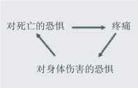

This is one of many cycle diagrams presenting pain; fear leads left to anger, anxiety, etc.

## Which Long-Term Memory Processors Are Essential for Consciousness?

More questions about `CTM`: Which LTM processors are needed for consciousness? Which are not?

Most LTM processors are *not* needed for consciousness, e.g.:
- Visual and Auditory Processors [Helen Keller lost both but remained conscious];
- Face Recognition Processor (Prosopagnosia patients lose ability to recognize faces, even family or themselves in mirrors, but remain conscious);
- Danger Warning Processor (Patient S.M. had calcified amygdala, felt no fear ever, but remained conscious);
- Planning and Upbringing Processors [Phineas Gage lost his entire prefrontal cortex; personality changed completely, but later drove a 6-horse stagecoach 77 miles in Chile—not a simple task];
- Declarative Memory Processor (Patient H.M. lost hippocampus, lost ability to form permanent memories, but could form procedural memories);
- Procedural Memory Processor (Patient W.O. lost ability to form both declarative and procedural memories—a man with only 90-minute memory).

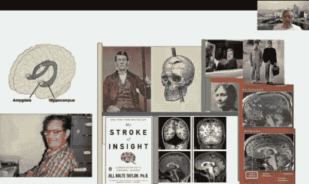

The photo above shows these people: H.M. bottom left, Phineas Gage in middle—you can see the rod that pierced his skull and damaged his prefrontal cortex.

Some LTM processors *are* essential for consciousness. Consciousness requires an Inner Speech Processor for commenting on and planning current actions—not necessarily inner language, just some inner dialogue; a Visual Model Processor to distinguish self from non-self; Motivation and Energy; minimal Thinking Ability, including motivation to think. What happens if you lose Inner Speech and Visual Model Processors? Jill Bolte Taylor, a neuroscientist, lost her entire left hemisphere function after a stroke, losing speech. She couldn't distinguish external from internal worlds, said the world was beautiful, everything was one. But she knew she was in mortal danger and had to seek help, though she couldn't dial the phone. She retained thinking ability, claimed to have lost a large part of consciousness but could still seek help. Her left brain never recovered, but she trained her right brain and wrote the remarkable book *My Stroke of Insight*.

## Mirror Test and Self-Awareness

Next is Gordon Gallup Jr.'s Mirror Test. Psychologists use this to test self-awareness. Gallup said: if you mark an animal's forehead while it's not looking, and when it sees itself in a mirror, it tries to remove the mark, that signals self-awareness. An 'X' marked on an elephant's forehead; before a mirror, the elephant touched its forehead with its trunk, trying to wipe the 'X'. To do this, the elephant must distinguish visual models, differentiating self from non-self. It tries to remove the mark from *its own* head, not the mirror elephant's. Of course, it also needs motivation, energy, and thought. Yes, elephants pass the mirror test.

What about dogs? Dogs' vision isn't highly developed, but they pass a similar olfactory test. Gorillas failed the mirror test because they won't look another gorilla in the eye; seeing themselves, they smashed the mirror. Dolphins pass. What about fish? Temple Grandin believes all animals except fish and lower species are conscious. But the Cleaner Wrasse (~2 feet long), if placed in a tank with a mirror, after learning to recognize itself, if marked on the forehead, will try to remove the mark and return to the mirror to check. Can ants pass? Marks on heads of 3 *Myrmica* ant species; seeing themselves in a mirror, they approach, inspect, return to wipe the mark, return to check. What about children? Children don't recognize themselves in mirrors until age 2.

## From Conscious to Unconscious: Establishment of Connections

How do conscious actions become unconscious? Connections form between processors, reducing STM load. This theory explains aspects of dreaming. One processor acts as a Dream Generator. Generating dreams isn't complex—just a few chunks generate images, broadcast, and the Dream Receiver (all processors) reacts. This also well explains the mechanism of Mindfulness.

---

# Autonomous Agents and Game Theory

## Author Biography

Jeffrey S. Rosenschein

### 耶路撒冷希伯来大学 Rachel 与 Selim Benin 计算机科学与工程学院 Sam 与 Will Strauss 计算机科学教授

耶路撒冷希伯来大学 Rachel 与 Selim Benin 计算机与工程学院 Sam 与 Will Strauss 计算机科学教授，同时也是多智能体系统研究小组的负责人。拥有哈佛大学应用数学学士学位（1979 年）、斯坦福大学计算机科学硕士学位（1982 年）和博士学位（1986 年）。身兼`AAAI`研究员、`ACM`研究员及`EurAI`研究员，曾获 2013 年`ACM/SIGART`智能体研究奖（`ACM/SIGART Autonomous Agents Research Award`）。

## 关于自主智能体和博弈论

主要谈两点。一是关于多智能体系统（`MAS`）激励机制的一些观察，包括它如何改造人工智能领域、打造智能体领域。二是博弈论和机制设计在构建自主智能体中的角色的观察结果。因为我们观察到的东西，不一定能够盲目地应用到生活中。

在拿到博士学位后，我一直致力于研究用经济理论、投票理论和博弈论为多智能体系统奠定恰当的基础。也由此引出一个问题，即将这些理论作为多智能体系统的基础，在多大程度上适当？

我提这个问题主要是因为从历史上来说，经典人工智能关注的问题和我们现在的研究方向不太一样，经典人工智能更关注手段——目的——分析，也就是你的目的是什么，要如何实施才能达到这样的目的。这也是经常问的 What 和 How：完成什么样的任务、怎么样完成这个任务。

但是我们经常忽视了一个问题，就是为什么要做这件事情？背后的激励机制究竟是什么？事实上人工智能做很多事情时没有问为什么，它只问了是什么和怎么做，也就是说通过“手段——目的”的方式进行分析，比如说医疗诊断，它们经常是一个用户或者一个医生提出一个目的，给一个系统，然后要求它给出一个解决问题的路径，但是并没有问为什么。当然，如果计算机只是受控机器的话，这个无可厚非，你有这样的目标，让这个机器找到这条路而已；但是假设计算机是人的代理或者助理的话，如果你不问为什么则说不通，因为 Why 非常重要。一个受控机器的激励机制存在于外部，是未形式化的，它需要一个目的来帮助你实现这个目标。但是如果是自主机器，就需要将激励机制内化，它理解了原因，才能主动积极地采取行动。

知道了想要什么、激励机制是什么，计算机可能需要采取一些行动，实现一系列的目标，最终赢得这个激励。更重要的是，当你有交互的不同自主系统时，你可能更希望了解什么是激励机制。在 20 世纪 80 年代初，得益于硬件技术的发展，分布式系统成为模型的重要组成部分，但是依旧没有带来相应的激励机制。它还是一个外部的目标，也是一个外部的总体设计，就像一个单独系统、激励系统一样，这是一个特定的模型。

而现在，我们开始逐步实现了跨越，将博弈论运用到了这些解决方法当中，但是这并不是唯一的选择。地理分散和数据不足阻碍了传感器网络这样的完全协作式系统，它们有一个整体的目标。此外，分布式系统理论当中，还会涉及非合作式甚至破坏式的智能体。它们要知道，它对于你的计算能力造成的最大的破坏是什么。

最终，我们的激励机制被引入智能主体模型当中。博弈论也提供了自然的数学形式化。在引入了这个激励机制以后，人们必须转变思路，当然这个可能需要几年甚至几十年的时间。那么我们博弈论的模型优点是什么呢？它能够提供激励机制，激励机制是能够帮助理解现实系统的现实行为的关键。

现实环境中，很多事情都是受激励机制所驱动的，比如说像税法、薪酬或者是偏好等。其实有的人做很多事只不过是为了获取名利而已，所以如果引入了激励机制，我们就能够显著地缩小人工智能设计和现实世界之间的一级鸿沟。但是即便如此，在一些情境中激励机制依然不奏效。比如说饮料机随着天气的变化价格会浮动，天热价格高，天冷价格低，这对于消费者来说就不是非常好的选择，是不可接受的，他们宁可天热天冷的时候价格都高。也就是说，如果是固定价格的话人们反而觉得更好接受，如果是浮动价格消费者会觉得不公平。

## 构建自主智能体时博弈论和机制设计工具的作用

如果说自主智能体是像人一样的主体的话，我们就必须预测，它可能会像人一样不太理智，有时候会有不理智的行为，或者说这样的一个主体会比人优秀很多，它做的事情会比人好很多，明显地表现出理性。什么是理性？理性就是在计算和信息约束的情况下，能够做出最大化预期效用的行为选择。这里的这个措辞是非常好的，首先你不是选择行为实现最大化的效用，而是最大化的预期效用。而且，不是要求在理想条件下，而是在计算和信息约束的前提下，也就是说在受限的前提下。如何做出选择？最大化预期效用才是底线。

通过创建自主智能体，我们可以将理性可操作化：让理性形式化，将它用作设计流程的标准化、规范化的基础。同时，把它放到机器当中，运用人对理性的理解，打造出一个定式，做出规划的一个指示性的设计流程。

但是应用于人类的博弈论与应用于机器的博弈论还是存在差异的，因为应用于人类的博弈论，还是和人有关，问题的关键还是人类。正如上文所提到的，理性是预期效用最大化的选择，特别是在计算和信息约束的情况下。但是人是不理性的，所以我们没有办法真正通过预期效用最大化来推测人的行为，因为我们只能看到一个人做出某种行为，最后达到一个效用。换句话来说，如果他选择另外的途径，可能会达到另外的效用。所以没有办法去证明他是不是真正理性的人，因为你只能通过他的选择来推测效用，而不能通过效用来倒推他的行为是不是合理。

但是说到机器的理性可操作性时，其实就是利用效用来规范机器的一些行为，而不是反过来，不是说通过行为描述它的效用。我们在做理性可操作化时，也就是在设计流程时，运用这样的理性让流程设计变得更加有指示性和规律性。

我们将高级非人类的智慧通过技术输入机器当中，让它做出人的行为，这是非常好的事情。我们应当如何做？

### 第一，寻找可证明、符合意图的计算和策略特征的机制

我们可以运用机器，运用博弈论的理论基础，运用已经有证明的计算和策略特征，把它们输入机器当中。这不单单可以保证智能体更好地选择行为，也能保证机制设计更好地选择一个环境，让这些理性行为更好地适用于这个环境。我们唯一要注意的是，人和相应的主体在应对这样一些设计机制时，可能会表现出非理性或者是出乎意料的行为，因为他们是不理性的。

### 第二，设计具有明确效用函数并在冲突中遵循理性原则的智能体

需要注意的是，有时如果你真的需要它们具有像人一样的行为，就需要改变一些原则，让它们变得像人一样不理智或者以非人类直觉的方式行事。它们要么像人一样不理性；要么是超人类的，通过非人类直觉的方式变得非常理性。有的时候，做的事情像人的话可能就要牺牲一部分理性。至于说到打造应对的这个互动伙伴时，建模应当是遵循恰当原则来进行的，而不是对称原则。也就是说，不是照抄智能体的设计原则。

### 第三，倾向于标准化的模型

我们一般倾向于标准化的模型，而不是非标准化的模型。有一些原则和模型是非常重要的，比如说把握策略主导权。与此同时，还有一些经典的人工智能理论（比如纳什均衡理论），可能有的时候很有用，有时候没有用。所以我们必须要对这些解决方案的概念非常清晰，并谨慎地将它们应用于各种解决方案中。

---

# 人工智能研究路线图—架起学习与推理的桥梁

## 巴特·塞尔曼（Bart Selman）

康奈尔大学计算机科学教授、`AAAI`主席

康奈尔大学计算机科学教授，获得了美国国家科学基金会`CAREER Award`和阿尔弗雷德·P .斯隆研究奖，是人工智能促进协会（`AAAI`）主席和美国科学发展协会（`AAAS`）会士。研究领域是计算机和人工智能，以及机器和计算机在社会中不断增加和变化的作用，特别是计算和表示方面的问题。对于易处理的推理、知识表示、随机搜索方法、理论逼近论、知识汇编、默认推理以及计算机科学与统计物理学（相变现象）之间的联系等领域有深度研究。在“人类兼容 AI 中心（`CHAI`）”的研究重点是高级 AI 的潜在风险和负面影响。作为一位 AI 安全专家，研究计算机领域的发展如何从道德中立的软件转变为预测算法，并倡导将伦理道德与 AI 相融合。《美国人工智能研究的 20 年路线图》主编之一，合著共计出版 100 多种，其中获得六项最佳论文奖。

## 当前 AI 时代的机遇与挑战

身为研究人员，我们生活在一个令人振奋的人工智能时代。我们看到各种智能自主系统或半智能自主系统不断地在社会上兴起。从自动驾驶汽车，到自主无人机，再到虚拟助手和辅助机器人等等，不一而足。这对于学术界来说是一个重大的变化，学术界花了大约 60 年时间，才完成人工智能研究从理论研究到现实世界的转变。至少我个人人为，这得益于深度学习和大数据的推动。

当前，我们终于实现了机器感知，系统开始能够“看见”和“听见”。眼前这些成果，是我们经过 50 多年的研究才得到的。人工智能的很多技术，比如推理、搜索、强化学习、决策理论方法、规划等，都是在假设感知输入“以某种方式”提供给系统的前提下开发的。但是，机器人不可能真正看见或听见任何东西。

2005 年，首届自动驾驶汽车大赛得主、斯坦福大学的`Stanley`，不过是一辆开着瞎转的汽车。它既没有搭载常规摄像头，也没有搭载轻便些的激光测距摄像头，这只是因为在当时还无法分析汽车周围的图像。现在情况就完全不同了，自动驾驶汽车已经能使用计算机区域系统，我们可以把这些感知系统的输出，用于已经开发出的其他一系列实际技术上。事实上，许多技术，如人脸识别和交通标志识别技术，现在已经超出人类自身的能力水平，所以我们可以充分利用这些技术。

### 深度学习与硬件假设

那么，是哪些因素让我们取得这些进步的呢？我认为最根本的是深度学习，深度神经网络的成功有力支持了“硬件假设”。算法的发展实际上可以追溯到 20 世纪 80 年代的反向传播算法，这是第一种用于训练神经系统的方法，有一个隐藏层，我们现在当然知道它是由数百个隐藏层组成的网络。这个进步纯属意料之外，截止到 2000 年，几乎所有的人工智能研究人员都不再研究神经网络，直到 2011 年、2012 年，情况才彻底改观。突然间，这些方法取代了所有其他机器学习方法。要做到这一点，需要重大的算法进步。

### 大数据与计算能力的增长

此后的另一项进步是大数据。这里有一张完整的层次图，这个图表里垂直方向代表的是处理速度。在这张图的中间部分，我们能够看到超级计算机`深蓝`（1997 年击败国际象棋世界冠军的 IBM 超级计算机），它的计算能力大致相当于老鼠大脑的处理能力。与人类大脑相比，长期以来计算机处理能力都是非常有限的。然而，我们生活在一个振奋人心的时代，据粗略估计，到 2030 年前后，1000 美元能买到的计算资源将与人脑计算和存储的能力相当。当然，这不是通用人工智能，却能助力通用人工智能的实现。还有其他几个方面的进展：如众包人类数据，可以通过十万多幅有标注道路数据的图片训练自动驾驶汽车的视觉系统；如工程团队，例如 IBM 的超级计算机`Watson`，它在《危险边缘》智力竞赛中一敌五十。对人工智能系统研发方面的投资正以数十亿量级扩大，这样巨大的商业利益是我们前所未见的。

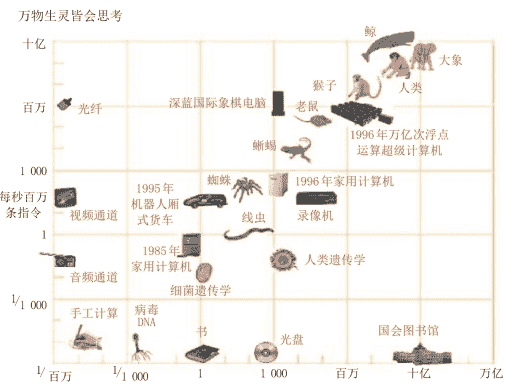

## AI 研究的三大阵营

整个人工智能领域的进展，大致可以分为三个不同的阵营：数据密集型—深度学习方法是目前人工智能研究人员最熟悉的、推理密集型和知识密集型。我们来看看小猫图像，深度学习系统要识别它，需要通过成千上万的图像训练，它们是迥然不同的信息，是知识。这确实是一个抽象层面的内容，例如牛顿定律`F=ma`就是知识的一个很好的范例，它是个体在学校习得的。有时知识是从数据中获得的，而不是从以前的直接经验中获得的。这是一个科学发现的过程，可以引导个体去主动获得知识。这是人工智能系统面临的一个障碍。数据密集型方法的实践例子，包括`谷歌翻译`、`谷歌搜索`、IBM，大量成功事例让我们开始看到人工智能的作用。在推理密集型领域，借助机器学习方法，一些悬而未决的数学猜想能够得以解决。此外，成百上千的验证方法也可以建立在推理密集型研究方法的基础之上，`AlphaGo`就是个有趣的例子。它结合了推理研究和数据密集型的强化学习，是学习和推理的结合。

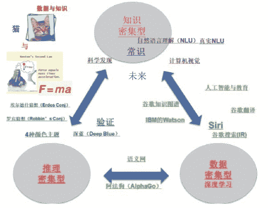

## 未来：集成与常识推理

那么，未来会怎样呢？如果单纯专注于某项研究领域，那未来的情况一定会越来越糟。在很多不同的常识领域的科学研究都是依靠知识密集型方法展开的，人们对计算机视觉和自然语言理解的研究则更多地依赖于数据密集型研究方法，但是要想了解真实的自然语言理解，就应该将知识密集型和数据密集型研究方法相结合。那么接下来要怎么办呢？正如我强调的那样，感知、学习、推理和决策等技术的进一步集成将彻底改变人工智能系统。`AlphaGo`就是一个很好的例子。我们最近在化学科学和合成化学中也有一些发现，这些发现是由知识密集型和数据密集型方法结合所得到的。

现在，我们也应该关注我们还无法做到的以及人工智能系统的薄弱方面，这就是我们所说的常识性推理和常识性知识。简单举一个小例子。在英语中，有些句子有不明确的指称，我们来看看这个句子中的“它”：“这个大球撞破了桌子，因为它是由泡沫塑料制成的。”“它”到底指的是什么呢？“它”必然是指桌子，因为球砸穿了它，而泡沫塑料是种轻质材料。但如果稍微改一下这个句子：“这个大球撞破了桌子，因为它是由钢制成的。”“它”指代的对象就变成了球，而这种指称的微妙变化却很难被人工智能系统捕捉到。尽管我们在取得进步，但最终还需要对语言有更深层次的理解。如果用`谷歌翻译`将这个句子翻译成法语，你会发现`谷歌翻译`也不清楚“它”指代的是什么，这多少有些令人惊讶。这揭示出，在翻译时，`谷歌翻译`实际上并没有真正理解文本。换言之，你可以把你的名字翻译成中文，却不必理解它在任何一种语言中的实际含义。这实在让人惊讶，就算人工智能研究人员也着实愕然。显然，`谷歌翻译`拥有足够大的语言数据库，例句翻译的数据量很庞大。然而至少在目前，这对系统对语言更深层含义的理解并没有什么帮助和实际意义。

### 人工非人类智能

我还想指出，在谈到人工智能时，我们能想到另一个令人兴奋的领域—人工非人类智能。我们看到，这主要涉及推理和计划。在深度学习方面，我们已取得了巨大进步，但有些不太为人所知，如果你看看软件验证、程序综合、科学自动化和数学发现等领域，就会发现令人兴奋的进展。现在，这些进步的取得并没有试图模拟人类智能。实际上，我认为这可能是一个聪明的想法，我们不一定要模仿人类的智能能力。我们可以接受一些特定的任务，然后努力把它做得更好。下面我来举个小例子：埃尔德什差异猜想。这个猜想提出 80 多年了，我们仅以差异 2 为例，这个猜想用推理程序进行了求解并包含十多亿个推理步骤，并且可以很容易用独立的证明检查程序进行验证。我们从中看到的是，人类数学与机器发现的数学相结合将能够增强人类数学，我认为这将是未来 10～20 年中取得进展的一个主要领域。

另一个例子展示了材料发现过程中的人工智能。这项工作在美国康奈尔大学进行，研究小组中包括戈麦斯（Gomez）教授等人。它是一个人工智能用于材料发现的实验，这个实验在康奈尔大学的 X 射线同步加速器上运行。在人工智能系统的指导下，研究小组在全自动设置中发现了新材料。于是，我们看问题就有了一个不同的视角，这是一种理论计算机科学的有趣方法，利用它，我们可以大致正确地完成人类能完成的任务，最多几兆字节就能完成，这属于较低的计算层次。我相信机器将从较高的计算层次开始。

有个很有趣的问题，我们能在多大程度上理解机器或机器的发现成果？我对此持乐观态度，因为理解相对更容易，这些发现需要理解牛顿定律，而不是需要发现牛顿定律，我想机器会帮助我们寻找新发现，人类也将能理解它们。

## 美国 20 年人工智能研究路线图

最后，我谈谈美国 20 年人工智能研究路线图。这是由南加州大学的约兰达·吉尔（Yolanda Gil）和我一道负责的一项研究。我们得到了来自美国 100 项人工智能研究的意见，我们发现了人工智能发展历程背后的一系列驱动因素，我们认为，它们也是未来 5～10 年乃至 20 年社会发展的核心驱动因素。它们分别是提高健康和生活质量、终身教育和培训、业务创新和竞争力、加快科学发现和技术创新、社会正义和政策、网络防御和安全。

我们研究团队发现了 3 个重点：

### 第一，集成智能

我们称之为集成智能—我们如何将学习、推理、规划能力整合到一个完整系统中？我们的大脑能够结合各种信息，结合各种形式的信息处理，那么如何整合人工智能的各个组成部分？这些将是未来 10～20 年的一个关键领域。

### 第二，有意义的互动

有意义的互动—我们如何将机器人融入我们的社会？如何让智能系统进入我们的社会？我们怎样才能信任它们？我们怎样让它们负责？我们如何与它们互动才是有意义的互动？

### 第三，自我感知学习

自我感知学习—我们如何建立能够反映出自我学习能力的系统，并根据学习机制的需求长期引导它们进行自我学习？

接下来，我们回过头来问，人工智能的这种转变是什么？这为国家带来什么机遇？它们都是人工智能领域的巨大机会。其中包括，综合智能科学方面的人类基因组医学项目和哈勃望远镜计划，它们都需要大量基础投资和基础研究，并将推动发现人工智能研究的新领域。但是，这些工作是小型研究团队无法完成的，因此需要国家建设国家层面的人工智能基础设施。也许最好的一个例子应该是人工智能即用型医院：一家大医院集中全国各地的人工智能领域研究人员，以便能够使用医院设施，提供以人工智能驱动的医疗服务和实证研究，以协作方式协调对人工智能技术所开发出的技术的评估。这些任务驱动型人工智能中心将集中三四十人组成的研究团队，他们来自全国各地，依托各种软硬件支持，从事雄心勃勃的研究项目。同样，任务驱动型人工智能中心还可以设有生活辅助设施，人工智能研究人员汇集于此，试验新技术和新的人工智能创新。目前在美国，这样的人工智能中心正得到资助，今年会有第一批 6 个大型中心。美国国家科学基金会（`NSF`）已开始人工智能研究工作，他们开始资助这些格外引人注目的研究中心，接下来几个月内他们将宣布第一批资助花落谁家，它们都将成为国家人工智能基础设施的组成部分。

# Summary and Outlook: Trustworthy AI and Theoretical Foundations of Deep Learning

To summarize, we should become the insignificant intelligent autonomous machines among us, and this will certainly have a significant impact on society. AI also involves other fields such as economics, ethics, military, superintelligence, etc. AI researchers have also realized their responsibility to develop safe, reliable, and ethical AI systems, encouraging the development of successors. For example, the Future of Life Institute funded by Elon Musk, founded by Max Tegmark, conducts research on AI safety projects. The US National Science Foundation currently also incorporates AI safety requirements into its research projects. Finally, I would like to conclude with another important milestone event. The Association for the Advancement of Artificial Intelligence (AAAI) and "Squirrel AI" jointly announced the Nobel Prize of the AI world: the "Squirrel AI" Award — Artificial Intelligence for the Benefit of Humanity. Squirrel AI sponsors $1 million annually to scientists worldwide in the field of AI, focusing on those whose work can be commercially applied and make significant positive contributions to humanity and their lives — that is, they can protect, enhance, and improve human life in a beneficial way with long-term impact. This award was officially launched in 2020.

---

# Foreseeing Trustworthy AI — Discussion on Theoretical Foundations of Deep Learning

**Dacheng Tao**  
Fellow of the Australian Academy of Science, Professor at the University of Sydney, Director of the UBTECH Sydney AI Centre

He received his Bachelor's degree from the University of Science and Technology of China, his Master's degree from the Chinese University of Hong Kong, and his Ph.D. from the University of London. After graduation, he taught successively at the Hong Kong Polytechnic University, Nanyang Technological University in Singapore, and the University of Technology Sydney. He currently serves as a Professor at the University of Sydney and Director of the UBTECH Sydney AI Centre. His main research focuses on Artificial Intelligence. He has published over 200 papers in authoritative journals and major conferences, including various IEEE Transactions, top-tier journals, and conferences; and has won Best Paper Awards multiple times. He received the Australian Eureka Prize and the UTS Chancellor's Medal in 2015, and the IEEE ICDM Research Contribution Award in 2018. Due to his research contributions in the field of AI, he has been elected Fellow of IEEE/AAAS/ACM, Foreign Member of the Academia Europaea, and Fellow of the Australian Academy of Science.

---

## The Automation Revolution and Trust Crisis Brought by Deep Learning

I am very pleased to have the opportunity to share our understanding of the trustworthiness issues in AI. Deep learning has brought an automation revolution to many fields, such as computer vision, natural language processing, speech recognition, etc. Our research work mainly focuses on deep learning and its applications in computer vision.

We can see that with deep learning, many computer vision tasks that we previously found very difficult have now become very easy. Deep learning algorithms are very stable and efficient, meeting the needs of many practical situations to a certain extent. However, in many scenarios with high requirements for AI algorithm safety, a tiny error could lead to a fatal disaster.

Due to the lack of suitable theoretical foundations for existing algorithms, we do not know why these algorithms succeed, when they will fail, or how high the probability of failure is. Coupled with some challenges encountered in application domains, our trust in AI continues to decrease. So, how to solve this problem? This requires us to establish a complete theoretical foundation for AI.

---

## Progress in Current AI Foundational Theories

First, let's discuss the progress in current AI foundational theories, focusing mainly on the deep learning part. There are two main reasons: first, the foundational theories of traditional machine learning are relatively mature and complete; second, deep learning has dominated the third AI boom and driven many practical applications, but currently, the foundational theories of deep learning are still in their infancy. The success of deep learning is mainly built upon experiments, and it currently lacks a solid theoretical foundation. So, why are we so confident in using deep learning?

### Why Theoretical Analysis of Deep Learning Algorithms is Difficult

Here I quote a statement by Professor Tomaso Poggio from MIT: "We once needed more training data than model parameters to get a meaningful fit." What about deep learning? Let me make a comparison, see the figure below: the left side shows the best-performing neural network in 2017, with tens of millions of parameters; the right side shows a commonly used dataset now. The first is the CORD-19 database, with only 6,000 data points; most datasets only have tens of thousands of data points. ImageNet is considered a relatively large database, but it only has over 10 million data points. So, even for a database like ImageNet, the data volume is very small relative to the parameters of deep learning.

Then, why does deep learning perform so well under such over-parameterization? Some works analyze neural networks from the perspective of model capacity and complexity. We know that if a model's capacity or complexity is small, its generalization ability is guaranteed. This is what traditional statistical learning theory tells us. If we can prove that the capacity or complexity of a deep learning model is not directly related to the number of parameters, then to a certain extent we can clearly explain why deep learning is so successful.

---

## Analysis Based on Model Capacity and Complexity

### VC Dimension Analysis

First, let's look at VC Dimension. VC Dimension is a common tool for measuring complexity in traditional machine learning. In 2017, Harvey et al. analyzed the generalization performance of neural networks from the perspective of VC Dimension and obtained two upper bounds[¹]. We found that the upper bound of VC Dimension is directly related to the number of model parameters, which makes the upper bound of generalization error very large, even larger than the maximum value of the loss function; such an upper bound loses its meaning. This work shows that the VC Dimension path might be arduous, but we think this work is still very valuable. It tells us that we need to further explore the foundational theories of deep learning.

### Rademacher Complexity

How about Rademacher Complexity? In 2018, Golowich et al. derived a generalization error upper bound from the perspective of Rademacher Complexity. This upper bound is not directly related to the model scale, but it is related to the norm of model parameters and the network depth. This also makes the upper bound of generalization error relatively large[²].

### Fisher-Rao Norm and Matrix-1 Norm

In 2019, Liang et al. explored the Fisher-Rao Norm. Their work showed that the Fisher-Rao Norm has many good properties, such as invariance under certain reparameterization processes and some special advantages over other complexity measures[³]. In our work at the International Conference on Learning Representations (ICLR) this year, we also used the Fisher-Rao Norm and Matrix-1 Norm to prove the upper bound of the generalization error of RNN networks[⁴]. The Fisher-Rao Norm and Matrix-1 Norm can effectively help us control the scale of the upper bound. The term related to model scale in our upper bound is `the inverse of the minimum eigenvalue of the product of x transpose and x`. This term gives us an inspiration — adding some noise to the training samples can improve the model's generalization ability. At the same time, we cannot add too much noise, because this term would make the training error relatively large. Our Fisher-Rao Norm relies on a structured lemma about gradients, which states that the norm of parameters can be controlled by the magnitude of gradients. This lemma and the Fisher-Rao Norm help us effectively characterize the impact of gradients on the generalization ability of deep learning models, helping us understand the relationship between generalization ability and training ability, and further helping us understand the impact of weight decay and gradient clipping on generalization ability.

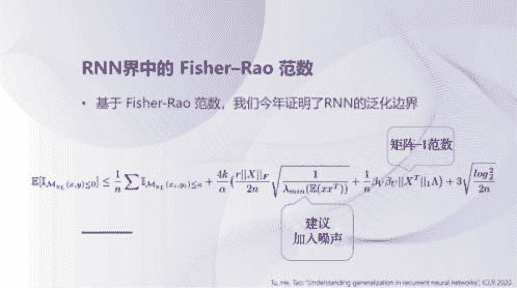

### The Paradox of Over-parameterization and Generalization Ability

Generalization error upper bounds based on model capacity and complexity usually indicate that small models have better generalization ability, but deep learning experiments and performance are not entirely consistent. Neyshabur et al.'s work in 2015[⁵], and Novak's work in 2018[⁶] both used experiments to show that large networks not only have good test performance, but generalization performance also improves as the network grows larger. This point also supports the current trend. Companies are trying every means to increase the depth and scale of networks. Canziani et al. statistics on some competition model scales found that the depth of winning models is increasing year by year[⁷], and students who often participate in competitions probably feel the same way.

---

## Generalization Error Upper Bounds Based on Information Theory

Currently, our work starts from the perspective of information theory and obtains a generalization error upper bound. Our theoretical analysis also supports previous empirical observations. It is mainly based on the following three aspects.

First, unlike traditional shallow learning models — such as Support Vector Machines — deep neural networks possess a hierarchical feature mapping structure. Is this the key to helping us avoid overfitting under high complexity? Our work answers this question affirmatively[⁸]. The hierarchical structure is the key to guaranteeing the generalization ability of deep neural networks.

Second, traditional generalization error upper bounds are estimated through the complexity of the model's function space, such as VC Dimension and Rademacher Complexity. This estimation ignores the data distribution itself and considers the worst-case scenario in the model's function space. Therefore, the estimation of the generalization error upper bound becomes relatively loose for deep models with large function spaces. In practice, however, the model's generalization ability is related to the data distribution. Inspired by recent work in information theory and adaptive data analysis, we can use the Mutual Information between the features learned by the neural network and the parameters of the last layer as the generalization error upper bound. Intuitively, the less the network output depends on the input, the stronger its generalization ability.

Third, inspired by the Strong Data Processing Inequality in information theory, as long as the mapping of each layer of the network is irreversible — for example, using ReLU activation functions, convolution, and pooling — the Mutual Information between the features learned by the network and the parameters of the last layer will decrease as the number of layers increases.

Therefore, the deeper the network, the stronger the model's generalization ability. However, as the number of network layers increases, information useful for data fitting may be lost during the mapping process. In such cases, the training dataset fitting error will increase. Therefore, although the generalization ability of deeper networks gradually increases, to ensure the overall network performance is good, it is still necessary to guarantee that the training fitting error is sufficiently small.

---

## SGD Optimization Process and PAC-Bayes Theory

From the current progress, the path based on model capacity is still very difficult. Because the capacity of neural networks is huge, they even have universal approximation capabilities. Three independent works in 1989 simultaneously proved that the Universal Approximation Theorem holds for infinitely wide multi-layer networks[⁹][¹⁰][¹¹]. Hornik et al. proved in 1993 that infinitely wide single-layer networks also have the Universal Approximation Theorem[¹²]. In 2017, Lu et al. proved that finite-width networks also have the Universal Approximation Theorem[¹³]. In 1993, Funahashi and Nakamura proved that RNNs can approximate arbitrary sequences[¹⁴]. Lu and Lu recently proved that neural networks can fit arbitrary distributions[¹⁵]. These examples all show that if parameters can be chosen arbitrarily, the capacity of neural networks would be huge, but the question is: can parameters be chosen arbitrarily?

Currently, neural network parameters are basically learned through the Stochastic Gradient Descent algorithm (SGD), so obviously the parameters are not completely random. Therefore, SGD might be the key to solving this problem. The hypothesis space of the neural network itself is large, but SGD only explores a part of the space, which makes the part actually output to the hypothesis space not that large. Recent articles, including our paper at the 2019 Conference on Neural Information Processing Systems (NeurIPS), pointed out that the SGD optimization process and the formed path can be represented by Partial Differential Equations (PDEs)[¹⁶]. The SGD optimization process — the parameters at time t+1 minus the parameters at time t, equals the learning rate times the gradient — is a PDE.

Since the "batch" is random and initialization is random, modeling the gradient introduces a lot of noise. That is, the gradient equals the average gradient over the entire dataset plus an uncertain noise, which is usually assumed to be Gaussian distributed. Recently, people have also been exploring what distribution is more suitable for modeling. Therefore, the PDE becomes a Stochastic Partial Differential Equation. So the stochastic PDE of parameters with respect to time t can be represented by an O-U process. We know that the SGD optimization path can be modeled by an O-U process.

Specifically, the stationary distribution of this stochastic process is used to model the model learned by the SGD algorithm, and then we can use PAC-Bayes theory to obtain a generalization error upper bound. Our conclusion also gives a positive correlation between generalization ability and the ratio of learning rate to batch size. This relationship also shows that hyperparameter tuning follows patterns. We trained 1,600 models on CIFAR-10 and CIFAR-100 based on the network structures ResNet-110 and VGG-19 to verify this positive correlation. We collected the test accuracy of all models for analysis, where each small plot is drawn from 20 models. We use test accuracy to represent generalization ability because training accuracy is almost 100%. The left side shows the relationship between test accuracy and batch size under constant learning rate conditions — that is, as batch size increases, test accuracy decreases; the right side shows the relationship between test accuracy and learning rate under constant batch size conditions. We found that as learning rate increases, test accuracy improves. These two plots show the relationship between test accuracy and the ratio of batch size to learning rate, each colored function drawn from 1,000 models. Obviously, as the ratio increases, test accuracy decreases.

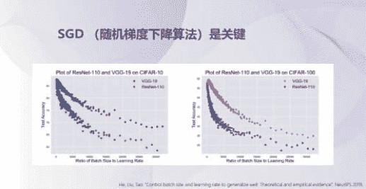

Modeling the SGD optimization trajectory using PDEs is very valuable for our understanding of deep learning, and it also requires us to deeply understand the geometric properties of the loss landscape. The geometric properties of the loss landscape determine the trajectory of the stochastic PDE on the loss landscape, i.e., the phase portrait. The curve of neural network parameters changing with time t is the phase portrait.

This is mainly for two reasons. First, the stochastic PDE contains the loss function and its derivatives of various orders, so the geometric structure of the loss landscape directly affects the structure of the stochastic PDE. Second, the loss landscape also determines the boundary conditions of the stochastic PDE; therefore, the loss landscape determines the nature of the solutions output by the SGD algorithm. Therefore, a thorough understanding of the geometric structure of the loss landscape is crucial for our research on deep learning optimization and generalization. In 2018, Novak et al. experimentally showed that the generalization performance of neural networks is related to the geometric structure of the loss landscape[¹⁷]. Specifically, the generalization performance of neural networks is related to the number of linear regions in the input space. Nonlinear activation functions make the loss landscape extremely non-convex and non-smooth. This chaotic situation makes the theoretical analysis of existing optimization algorithms very difficult. For example, why can convex optimization algorithms optimize such non-convex problems as neural networks? But on the other hand, deep learning models have achieved world-renowned results in practical problems. This also hints that beneath the chaotic surface, there may exist some undiscovered order.

---

## Debates and Discoveries on the Geometric Structure of the Loss Landscape

Regarding the geometric structure of the loss landscape, there is currently a very interesting debate. For linear networks — networks where activation functions are all linear — there are already some conclusions. Kawaguchi's work in 2016[¹⁸] and the work by Lu and Kawaguchi in 2017[¹⁹] pointed out that for linear networks under squared loss, all local minima are equally good, meaning they are all global minima. If similar properties can be found for nonlinear networks, then the excellent performance of neural networks would get a good explanation, at least we would understand some theoretical properties of deep learning to a certain extent. This is because once the SGD algorithm finds a local minimum, it has found a global minimum.

Several works have pointed out that nonlinearity might not be important because nonlinear networks might inherit some important properties of linear networks. But other papers have proven that the reality is not so. In 2019, Yun et al. proved that the loss landscape of a single-layer neural network has infinitely many suboptimal local minima[²⁰]. This conclusion requires 4 conditions.

First, only one hidden layer; second, squared loss function is used for training; third, the output is one-dimensional; fourth, the activation function is ReLU. Our paper at the International Conference on Learning Representations this year significantly expanded these conditions, covering almost all practical situations[²¹]. Specifically, we extended these 4 conditions to: first, arbitrary depth; second, arbitrary differentiable loss functions; third, arbitrary output dimensions; fourth, arbitrary piecewise linear activation functions.

So what might the previously conjectured order be? Soudry and Hoffer pointed out in 2018 that the loss landscape of ReLU networks is divided into several smooth multi-linear regions[²²]. We further proved in the paper that: first, in each region, every local minimum is a global minimum; second, in each region, all local minima converge into a minimum valley; third, all points on the valley constitute an equivalence class; fourth, there exist "parallel valleys" for this equivalence class; fifth, all these equivalence classes and parallel valleys constitute a quotient space. The second property here explains "Mode Connectivity"[²³] — that near the local minima found by SGD, there exist some points with very small differences in empirical risk, and these points connect into a line, which is equivalent to one of these minimum valleys. But unfortunately, currently these geometric properties only hold for single-hidden-layer neural networks. For the analysis of multi-hidden-layer neural networks, we still need further efforts.

---

## Conclusion

Theoretical analysis of deep learning is currently still in its early stages, and there are a large number of questions that require in-depth discussion and research. Besides the issues discussed just now, there are also issues of fairness, privacy, security, etc., all of which require our long-term efforts and struggle.

---

## References

[¹]: Harvey et al., 2017
[²]: Golowich et al., 2018
[³]: Liang et al., 2019
[⁴]: ICLR related work
[⁵]: Neyshabur et al., 2015
[⁶]: Novak et al., 2018
[⁷]: Canziani et al., Statistics on competition model scales
[⁸]: Work related to hierarchical structure and generalization ability
[⁹]: Universal Approximation Theorem, 1989
[¹⁰]: Universal Approximation Theorem, 1989
[¹¹]: Universal Approximation Theorem, 1989
[¹²]: Hornik et al., 1993
[¹³]: Lu et al., 2017
[¹⁴]: Funahashi and Nakamura, 1993
[¹⁵]: Lu and Lu, Recent work
[¹⁶]: NeurIPS 2019, SGD Optimization Path Modeling
[¹⁷]: Novak et al., 2018
[¹⁸]: Kawaguchi, 2016
[¹⁹]: Lu and Kawaguchi, 2017
[²⁰]: Yun et al., 2019
[²¹]: ICLR 2024, Condition Extension Work
[²²]: Soudry and Hoffer, 2018
[²³]: Mode Connectivity

# 参考文献

[1] Bartlett P L, Harvey N J, Liaw C, 等. 分段线性神经网络的近似紧 VC 维与伪维界[J]. 机器学习研究杂志, 2019, 20(63): 1—17.

[2] Golowich N, Rakhlin A, Shamir O, 等. 神经网络的尺寸无关样本复杂度[C]. 学习理论会议, 2018: 297—299.

[3] Liang T, Poggio T, Rakhlin A, 等. Fisher-Rao 度量、几何与神经网络复杂性[C]. 国际人工智能与统计会议, 2019: 888—896.

[4] Tu Z, He F, Tao D, 等. 理解循环神经网络中的泛化[C]. 国际学习表征会议, 2020.

[5] Neyshabur B, Tomioka R, Srebro N, 等. 寻找真正的归纳偏置: 隐式正则化在深度学习中的作用[C]. 国际学习表征会议, 2014.

[6] Novak R, Bahri Y, Abolafia D A, 等. 神经网络中的敏感性与泛化: 实证研究[C]. 国际学习表征会议, 2018.

[7] Canziani A, Paszke A, Culurciello E. 面向实际应用的深度神经网络模型分析[J]. 2016.

[8] Zhang J, Liu T, Tao D, 等. 深度学习的信息论视角[J]. arXiv: 机器学习, 2018.

[9] George Cybenko. 由 Sigmoid 函数叠加逼近[J]. 控制、信号与系统数学, 1989, 2(4): 303—314.

[10] Funahashi K I. 关于神经网络对连续映射的近似实现[J]. 神经网络, 1989, 2(3): 183—192.

[11] Hornik K, Stinchcombe M, White H. 多层前馈网络是通用逼近器[J]. 神经网络, 1989, 2(5): 359—366.

[12] Hornik K. 关于神经网络逼近的一些新结果[J]. 神经网络, 1993, 6(8): 1069—1072.

[13] Lu Z, Pu H, Wang F, 等. 神经网络的表达能力: 从宽度视角看[C]. 神经信息处理系统会议, 2017: 6232—6240.

[14] Funahashi K I, Nakamura Y. 连续时间循环神经网络对动力系统的逼近[J]. 神经网络, 1993, 6(6): 801—806.

[15] Lu Y, Lu J. 用于表达分布的深度神经网络通用逼近定理[J]. 神经网络, 2020.

[16] He F, Liu T, Tao D, 等. 控制批量大小和学习率以实现良好泛化: 理论与实证证据[C]. 神经信息处理系统会议, 2019: 1143—1152.

[17] Novak R, Bahri Y, Abolafia D A, 等. 神经网络中的敏感性与泛化: 实证研究[C]. 国际学习表征会议, 2018.

[18] Kawaguchi K. 无劣局部极小值的深度学习[C]. 神经信息处理系统会议, 2016: 586—594.

[19] Lu H, Kawaguchi K. 深度不产生劣局部极小值[J]. arXiv: 学习, 2017.

[20] Yun C, Sra S, Jadbabaie A, 等. 激活函数中的微小非线性在神经网络中产生劣局部极小值[C]. 国际学习表征会议, 2019.

[21] He F, Wang B, Tao D, 等. 激活函数中的非线性实质性地塑造了神经网络的损失面[C]. 国际学习表征会议, 2020.

[22] Soudry D, Hoffer E. 多层神经网络中指数级消失的次优局部极小值[C]. 国际学习表征会议, 2018.

[23] Garipov T, Izmailov P, Podoprikhin D, 等. 损失面、模式连通性与 DNN 快速集成[C]. 神经信息处理系统会议, 2018: 8789—8798.

---

# 不迷茫于今日，不错失于未来

**陈黎明**  
IBM 大中华区集团董事长

在多个行业和国家有逾 30 年的工作经历。1982 年作为助理研究员开始了职业生涯。1991—1994 年在新加坡标准与工业研究院担任食品技术研究高级研究员。1994 年加入德国康迪雅化学新加坡分公司，后调往中国，历任康迪雅中国化学公司副总经理、总经理和董事总经理。2006 年被南非沙索公司任命为沙索中国公司执行副总裁。2008 年加入 BP，出任 BP 中国区总裁及 BP（中国）投资有限公司董事长。过去数年中，出任多家企业的董事会成员。他还是爱丁堡大学的荣誉教授。本科毕业于新疆石河子大学，1989 年于美国康奈尔大学获得硕士学位，并于 2003 年在哈佛商学院完成了高级管理课程。

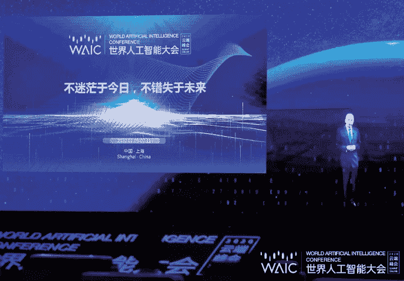

## 技术发明路漫漫

我们是生活在一个快速的广泛的科技变革时代，还是经久的延绵的滞胀时期？仁者见仁，智者见智。

曾经有一位科技公司的先贤在 1946 年断言说全球可能只需要 5 台计算机，而今天计算机已经走进了寻常百姓家里，甚至装到了我们的口袋里。今天一部手机的计算能力已经超越了当年 IBM 送人类登月的大型计算机计算能力的几万倍甚至几十万倍。

人工智能近几年的热潮使政府、企业和社会大众都期望它一出现就石破天惊，即刻改变世界。在不同的时期，各界对人工智能的态度不断转变，渴望、期待、热情、贪婪、焦虑、担忧，抑或失望。我们往往更关注一项科技今天能够给我们带来什么改变，创造多少 GDP，提升多少当下的政绩，能否解决我们面对的所有问题，甚至仅仅是赶时髦，却往往忽略了一项重大科技自身发展的规律和长期所带来的重大影响。

一项技术从孕育到开发到应用到普及再到成熟，直至衰退，都有它自身的发展规律。大多数技术都不是灵光闪现后一蹴而就，并立刻改变了人类社会，而是需要经历持久且逐步的发展历程。有时我们甚至都很难厘清一项技术最早的发明者究竟是谁。我们对许多技术的认知也有时间的局限。我们常说世界上第一部计算机是 1946 年在美国宾夕法尼亚大学发明的，叫 ENIAC。事实上，早在 1822 年英国剑桥大学的一位教授查尔斯·巴贝奇（Charles Babbage）就撰文描述了一种计算机器—差分机。巴贝奇试图打造一个可以用以各种复杂计算的万用计算装置，有人认为这才是现代计算机的鼻祖。虽然巴贝奇并没有在他有生之年看到这些机器的问世或应用，但他在 1832 年写道：“任何一个成功地被制造出来的产品，都是从一系列的失败，逐步走向卓越。”今天，由 IBM 打造，世界上最快的超级计算机之一 Summit 的运算速度高达每秒 20 亿亿次，比第一台计算机 ENIAC 大约提高了 40 万亿倍！

同样的故事也发生在其他许多领域。我们从小就被告知是瓦特早在 1769 年发明了推动工业革命发生的蒸汽机，但早在瓦特致力于蒸汽机之前的几十年里，蒸汽机已经在苏格兰地区广泛出现。据说蒸汽机的雏形可以追溯到 2000 多年前的古希腊。但是，毫无疑问，瓦特在改良早期的工业蒸汽机中做出了不可磨灭的贡献。

许多被称为通用技术的发明创造都经历了漫长的过程，其间不断得到改进，同其他技术有效地融合与互补，发展出广泛的应用，从而形成了很强的外溢效用（spillover），对人类社会产生重大影响。语言、服装、火的使用、植物栽培、动物养殖、轮子、制陶、书写、水车、印刷术等许多古代的发明都属于这些范畴。蒸汽机、内燃机、电动机、电力、电器、汽车、计算机、互联网等则是现代从根本上改变了人类社会、被广泛应用的通用技术。我们今天所熟悉的纳米技术、生物技术、人工智能也都可能成为我们这个时代的通用技术。

## 技术扩散路遥遥

新技术的引入需要经验的积累、技术的完善、认知的提升，因此，通用技术的扩散有时会伴随着早期生产效率的下降，而在经历经验曲线之后，大幅度的生产效率提升才会出现。

IBM 在 1964 年就推出了计算机大型主机，极大地规范了行业的软硬件标准，但计算机真正进入千家万户还是二三十年之后，而距离第一台现代计算机问世已有四五十年的时间。科学家乔治·劳雷尔（George Laurer）在 1973 年就发明出了被称为 20 世纪最伟大发明之一的条形码，而条形码真正被广泛采用却是二三十年之后。

在人工智能领域有一句笑话说：有多少人工智能，背后就有多少人工。这是人工智能早期开发中所需要经历的学习曲线，有人形容这个规律为“播种的时节和收获的时节”。

1965 年，摩尔在集成电路制造上总结出了“当价格不变时，集成电路上可容纳的元器件数目，约每 18～24 个月便会增加一倍，性能也将提升一倍”，从而形成了摩尔定律。赖特早在 1936 年就发现飞机制造的产量每增加一倍，生产成本就会下降 20%，这被后人称为赖特经验曲线或者赖特定律。2013 年圣塔菲研究院和麻省理工学院的研究人员通过收集研究 62 项来自化工、能源和信息技术的数据，验证了赖特定律和摩尔定律适应于不同的行业。

随着时间的推移、经验的积累、算法的丰富、投资的增加，人工智能也会突破早期的学习成本，加速在各行各业的部署。也许 20 年后，许多公司从某种意义上来说都是 AI 公司，如同今天许多银行也是金融科技公司一样。

早期人工智能的研究仅仅是由科学家们的好奇心驱使。比如 IBM 的人工智能研究始于 1952 年，当时科学家想要实现人工智能仅仅是为了下西洋跳棋。1997 年 IBM 的深蓝计算机战胜了当时的国际象棋冠军卡斯帕罗夫，被认为是人工智能彪炳史册的转折点。又经历了二十几年的发展，人类在绝大多数棋类游戏上，已经完全不是人工智能的对手。今天随便一部智能手机都已经配备了很强的人工智能，无论是自然语言理解和交互，还是图像识别，其功能都已让过去的大型计算机望尘莫及。

## 莫蹉跎，莫错失

一项技术必须在应用中找到自己的沃土，也只有在应用中才获得生命力，同样一个行业必须与时俱进，不断拥抱新的科技才能得以赋能，提升自身的竞争力。今天，无论是制造业、医疗健康、金融、零售、教育、政府机构、农业等，人工智能都已显现威力，将来还会发挥出更大的潜力。

企业在疫情背景下正加快数字化转型，而人工智能已经成为它们难以回避的选项。人工智能作为一项通用技术，会进一步和各个行业和各项技术融合，不断形成外溢效用。人工智能将持续提升生产效率并降低使用成本，并在未来的几十年甚至更长时期对商业、生活、社会治理带来变革性的影响。虽然人工智能依然有一个持续完善的过程，但这并不妨碍企业尽早拥抱人工智能，尽早获益，提升企业竞争力。作壁上观只会坐失良机。

“朝看水东流，暮看日西坠”，莫等万事成蹉跎。创新带来的收益往往都集中在创新者、早期尝鲜者或早期跟随者，晚来者往往会变成看客，被边缘化甚至被淘汰。智能手机的利润大多集中在几家公司手里，谷歌和 Facebook 占据了网络广告收入的绝大部分。企业应不迷茫于今日，不错失于未来。

---

# 人工智能的未来挑战与突破

## 杨 强

微众银行首席人工智能官、香港科技大学讲席教授、中国人工智能学会（CAAI）荣誉副理事长

微众银行首席人工智能官，香港科技大学讲席教授，人工智能促进协会（AAAI）执行委员会委员，中国人工智能学会（CAAI）荣誉副理事长以及香港人工智能与机器人学会（HKSAIR）理事长，第四范式公司联合创始人，国际人工智能联合会（IJCAI）理事会主席。同时也是 AAAI/ACM/CAAI/IEEE/IAPR/AAAS 会士。曾获 2019 年度“吴文俊人工智能科学技术奖”杰出贡献奖以及 2017 年 ACM SIGKDD 杰出服务奖。最新著作有《迁移学习》和《联邦学习》。

## 戴文渊

第四范式创始人、首席执行官，迁移学习学者

# AI Expert Dialogue Transcript

## Expert Profiles

### Qiang Yang
Transfer learning scholar, proposed the basic theoretical framework and main algorithmic directions for transfer learning, ranked third in academic influence in the field of transfer learning (data according to Google Scholar); research results included in the classic data mining university textbook *Data Mining: Concepts and Techniques*; lead author of the Cambridge University AI Series *Transfer Learning* and lead author of the big data course textbook *Big Data Modeling Methods*. Designed the world's earliest commercial AI system, Baidu's "Fengchao" (Phoenix Nest), increasing Baidu's monetization capability 8-fold in 4 years; former ACM-ICPC World Champion; first entrepreneur to win the First Class Prize of the "Wu Wenjun Artificial Intelligence Science and Technology Award" (China's highest AI award); selected for *MIT Technology Review* "35 Innovators Under 35 (China)" and *Fortune* "40 Under 40 Business Elites in China".

### Toby Walsh
Professor of Artificial Intelligence, University of New South Wales, Sydney

Professor of Artificial Intelligence at the University of New South Wales, also a Fellow of the Australian Academy of Science. Dubbed a "rock star" of Australia's digital revolution by *The Australian Newspaper*. Strongly advocates for restrictions on the application areas of AI to ensure it is used appropriately to improve human lives. Has played a leading role in discussions on killer robots, speaking on the topic at UN meetings in New York and Geneva. Frequently appears on TV and radio. Authored two popular science books on AI, the latest being *2062: The World That AI Made*, available in Chinese, English, German, Japanese, Korean, Polish, Russian, and Vietnamese.

### Tong Zhang
Professor, Department of Mathematics and Department of Computer Science, Hong Kong University of Science and Technology; Fellow of IEEE, American Statistical Association, and Institute of Mathematical Statistics

Professor at the Department of Mathematics and Department of Computer Science, HKUST; Fellow of IEEE, ASA, and IMS. Main research areas include machine learning, big data, and their applications. Served as General Chair or Area Chair for top international machine learning conferences NIPS, ICML, COLT, and as Editor for top AI journals PAMI, JMLR, and Machine Learning Journal. Former Research Staff Member at IBM Research, Principal Scientist at Yahoo Research, Vice President of Baidu Research and Head of Big Data Lab, Head of Tencent AI Lab.

### Yike Guo
Vice-President (Research and Development), Hong Kong Baptist University

Fellow of the Royal Academy of Engineering (UK), Fellow of the Academia Europaea, Fellow of the British Computer Society. Appointed Vice-President (Research and Development) of Hong Kong Baptist University on January 1, 2020. Became Professor of Computing at Imperial College London in 2002 and Director of the Data Science Institute at Imperial College from 2014. Received First Class Honors in Computational Science from Tsinghua University in 1985 and PhD in Computer Science from Imperial College in 1993. Founded Imperial College spin-out InforSense Limited in 1999, a data analytics platform company specializing in big data analytics for life sciences and medicine. Main research interests lie in machine learning and large-scale data management, contributing to many major research projects. Currently an investigator on several major UK and European data science projects. Won "Most Innovative Award" at the 2002 International Supercomputing Conference; "Best Practice Award" at the 2014 Bio-IT World Conference; "Best Open Source Software Award" from ACM SIGMM in 2017.

### Hideyuki Nakashima
President, Sapporo City University

Received PhD in Information Engineering from the University of Tokyo in 1983 and joined the Electrotechnical Laboratory (ETL). Served as Director of the Network-Assisted Research Center at the National Institute of Advanced Industrial Science and Technology (AIST) from 2001–2004. President of the Public University of Hakodate Future (currently Honorary President) from 2004–2016. Appointed as Project Professor in the field of advanced AI education at the University of Tokyo from 2016–2018. Assumed position as President of Sapporo City University starting 2018.

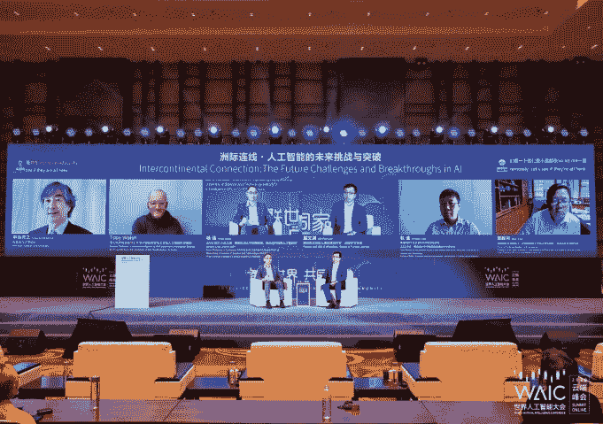

## Current Breakthroughs in AI

**Qiang Yang**: Today we have three topics. First, let's discuss where the current breakthroughs in AI lie; second, we'll look at the challenges and limitations facing AI; finally, we'll look further into the future to discuss what great achievements AI might accomplish.

**Wenyuan Dai**: In my view, the biggest breakthrough in AI is deep learning. 10 years ago, we tried to implement AI technology, first applying it to the internet sector. We started with internet advertising and search engines, seeing that AI could effectively help search engines deliver targeted ads, improving ad effectiveness by 800%. 7 years ago, we tried to apply AI to other industries, such as better marketing, fraud detection, and anti-money laundering in finance. 5 years ago, we began seeing AI utilized in retail and energy. Currently, we can see AI applications everywhere; many industries have deployed AI applications. These AI applications are emerging daily; perhaps next year we will see 10x or even more applications. This is an exciting moment; we are full of confidence and delighted to see more AI technologies applied to more industries.

**Toby Walsh**: AI is a very useful complement to human intelligence, helping humans in many fields, but it is also very different from human intelligence. For example, as we just saw, adding a little noise caused a cat to be recognized as a bus; humans would never make such a mistake. So we humans should be very proud because our recognition method differs from machines and is comparatively more advanced. Another limitation of AI is the machine's limited perception. In the future, we should enable machines to better understand the world—understand speech, text, and images. Additionally, human subconscious knowledge cannot be acquired by machines; this is a key focus of current research.

**Tong Zhang**: I think AI and machine learning perform well in leveraging big data to complete simple tasks in simple environments. Take gaming: if you focus on a specific game and collect massive data from it, AI performs excellently. In such clearly structured environments, AI has strong learning capabilities and has achieved huge breakthroughs, especially recently in reinforcement learning. AI can play games, compete in matches, and even outperform humans. In other similar environments with high determinism, AI performs well too, such as speech recognition in quiet environments. If there is a concrete, fixed environment and a specific task, training a model using recently developed deep learning techniques works very well.

Over the past few years, AI has started learning knowledge from vast amounts of unlabeled data. For instance, in natural language, representative work includes `GPT` (Generative Pre-training Transformer). It can learn from massive unlabeled data and apply to many other tasks, potentially even superhuman intelligence in the future, integrating with previous analysis of labeled data. There have also been major breakthroughs in computer vision; we can see AI learning feature representations from vast unlabeled data. Because of its broad applicability, you don't need to label all data before using it for AI training. These are very promising recent areas and will definitely be development focuses in the coming years.

There has also been significant progress in theory, such as better understanding of neural network operation modes. Many recent theoretical advances in neural networks help us understand how to train them to solve complex problems.

From an industry application perspective, AutoML (Automated Machine Learning) is very promising. Combining hardware, model architecture search, hyperparameter tuning, plus feature engineering on raw or general data to form a black-box automated ML model yields better results. It makes ML easier to deploy to solve different problems. Just by adjusting parameters on the black box, the barrier to using these tools is lowered, and they can be applied to different hardware devices. High-compute hardware like cloud or edge computing can use auto-optimized large models; low-compute devices like phones and IoT can use small models. This is a very promising future technical field, making AI more general and easier to deploy.

**Yike Guo**: Precisely speaking, current AI development focuses on cognition, such as pattern recognition and image recognition. Over the past 10 years, we have seen huge progress in two areas: first, automatic feature extraction—this is the breakthrough of Convolutional Neural Networks (CNNs), which can automatically identify object features. Based on this, we have built many new models enabling automatic recognition of graphics, text, etc. Another area with huge progress is representation learning, which learns effective representations of recognition objects. Reinforcement learning is also a rapidly developing field; combined with recognition capabilities, we can create great AI applications like AlphaGo and other board games where AI defeats humans.

We are in a data-driven AI era; everyone thinks more data is better, hoping to identify features through data and use neural networks to help humans reason and make decisions. These cognition-based AIs can reach a certain level of intelligence, making decisions based on certain models. But human decision-making is not purely data-driven; nor is AI. Human wisdom is not just recognition—children acquire this early—adult wisdom lies mainly in reasoning, combining known knowledge to infer. Much current AI progress is in this area, a very positive trend: combining existing learning models with reasoning.

**Hideyuki Nakashima**: I feel the current situation is that deep learning development has brought great progress to AI. But machine learning itself still has many limitations; first and foremost, it must have data—only with data can information be acquired and analyzed. In this regard, we need to combine AI with existing domain knowledge and experience from foundational fields.

## Limitations and Challenges of AI

**Qiang Yang**: Next, let's discuss some shortcomings of AI; perhaps these can drive AI development for the next 10 years. From my experience, AI falls short in learning from existing experience and then adapting to changing environments—we call this "transfer learning" in the field. We have long hoped to achieve machine generalization or adaptability for reasoning, both theoretically and practically. Humans do this, but machines still need to work hard on it. Additionally, regarding privacy, when we take data from others, there is a risk of privacy leakage; others may not want to share data with us. This is also a current challenge: AI cannot integrate and acquire true big data.

**Wenyuan Dai**: Transfer learning is indeed a major challenge for AI. We see more AI applications now, but in complex environments, transfer learning becomes even more critical. Let me give an example: yesterday I visited a catering giant wanting to move offline business online, changing their business model. Previously, most stores were offline; post-pandemic, only 5% of revenue is offline, 95% online via digital channels. Before, waiters gave coupons to diners and made personalized upsell recommendations manually. They found moving recommendation services online very hard. First, it requires many data scientists, but with the AI talent shortage, enterprises are helpless. So we need ordinary developers to build AI apps to solve the data scientist shortage. This is why 4th Paradigm invested heavily in `AutoML` (Automated Machine Learning) research 5 years ago—it allows ordinary developers, e.g., `Java` developers and `Python` engineers, to build AI apps.

Second challenge: even with enough scientists, even if ordinary developers can build AI, enterprises lack usable data. We must use transfer learning to move knowledge from one domain to another to solve data scarcity in certain domains. 4th Paradigm has accumulated many excellent algorithms in transfer learning, and we insist the system itself must solve privacy issues. In recent years, we've made significant breakthroughs in privacy-preserving transfer learning, enabling knowledge transfer between domains without privacy exposure.

Third challenge is cost. Top internet companies spend tens of millions annually on search engines; few companies can afford such investment. So we must consider AI costs. The AI system is not just hardware; there's software too. Software design must be hardware-based, hardware design must adapt to software—it's a software-hardware co-optimization, fusion system. 4th Paradigm is designing software and hardware via fusion; our "Software-Defined Compute" technology increased data center TCO (Total Cost of Ownership) performance by 10x.

**Hideyuki Nakashima**: I think we may have a consensus: we need to enhance the capability level of deep learning. Our technology still needs improvement and refinement; we need to apply these technologies to higher-level tasks.

**Toby Walsh**: Let me quickly mention a few challenges. First is language. Language is a foundational engine; enabling machines to truly understand language is crucial. Currently, machines don't understand human language at the semantic level; they may only understand it superficially. I see language as the embodiment of machine intelligence. Second is common sense. A famous example: you can run into a city, find a school, ask students history questions, they answer clearly; but AI might confuse things because it lacks basic common sense. Third is emotion. Machines have no feelings, cannot empathize, or form relevant interactions with humans—a major challenge.

**Tong Zhang**: I strongly agree that current AI cannot do natural language and semantic understanding. As said before, AI can do well on specific tasks, relying on big data for text comparison in specific environments. But for general or broader tasks, current AI fails. Our real goal is general tasks, not single specific tasks in fixed environments. For example, we want to inject common sense into AI to strengthen its thinking and logical reasoning, but this is extremely hard. Current AI systems rely on data comparison for probabilistic guesses, not human common sense. Even for single tasks, with different application environments and data characteristics, AI may fail to complete a task across environments with a unified model. This is what we must solve now: giving AI stronger adaptability to different contexts.

For us, enabling AI to solve common sense and general tasks poses huge challenges. In the next 10 years, AI's adaptability to different scenarios when doing single tasks is also very important and urgently needed. E.g., some image recognition systems work well indoors but need series of adjustments for outdoor use. Same for autonomous driving: real applications encounter situations never seen in training; improving robustness to these is a critical challenge. Addressing adaptability of specific tasks across multiple scenarios is the current pressing work. If we achieve this, AI application in many industries becomes very simple. Originally each specific AI system applied to one industry; future systems can adapt to different scenes, environments, industries—wider use, higher safety. Regarding moving from big data to small data, this involves transfer learning capability. As mentioned, we need AI to adapt to different scenarios—a key challenge for transfer learning. Also, privacy: how to use AI across institutions, deploy on different devices, collaborate? This is also crucial.

**Yike Guo**: Fundamentally, AI faces a basic challenge: how to recognize knowledge and data, and enable interaction between data and knowledge. Acquiring data and knowledge through observation often involves applying knowledge. E.g., transfer learning: after learning knowledge, one must generalize. Small data learning: you must fuse data and knowledge. Knowledge grows through learning, but you must organize this knowledge, combine data and knowledge—this is vital. Bayesian theory in statistics emphasizes using prior experience as a learning base; knowledge-data fusion also involves control theory, automation theory, etc.

Fundamentally, the biggest future challenge is the fusion of knowledge and data. I believe we should adhere to this philosophy: whether computer theory or statistical theory, we should never be biased; we must pursue both simultaneously, focusing on knowledge-data fusion to build better models and logic. On this basis, we can better reduce different data, understand data better, and make data more effective. This is crucial and our constant goal.

**Hideyuki Nakashima**: So far, data application scenarios are still limited. I feel the future should apply data in a more intelligent way, with better communication and interaction between humans and AI. We should better endow AI with value systems and values. Values are indeed important, but AI cannot understand them. We must train AI to have such values or "common sense views". I don't know if other technologies can help, but I think values are critical.

**Toby Walsh**: We sometimes let machines take over parts of work, but if machines do everything, will we become lazier? Useless? Our challenge is to ensure machines don't completely replace humans, don't take over all human tasks; we must remain in control.

## Future Outlook for AI

**Yike Guo**: I believe in the next 10 or 15 years, AI will make great strides. One key area is healthcare. Future healthcare will become largely data-driven; many super-devices will emerge for medical practices, and personalization will trend. This will drive much AI research: interoperability, verifiability, small data challenges, privacy—all worth attention.

**Wenyuan Dai**: I believe it will be 5G and IoT. Current AI learns from humans—many people label data, data comes from human clicks. From clicking webpages to labeling, humans teach AI everything. But with 5G and IoT, we can let AI learn on its own. There are only billions of humans, but IoT has trillions of devices, growing exponentially. So 5G plus IoT development will bring a huge leap for AI—more objectives, more data, more scenarios to learn from. That's why I believe 5G and IoT will accelerate AI development.

**Tong Zhang**: Trends for the coming decades: AI can evolve from a specialist to a generalist. With algorithmic advances, AI can learn more robustly, handle broader scenarios and environments better. The most urgent problem now, in my view, is making the whole system more robust and safer to use. Simultaneously, we will incorporate knowledge into AI, hoping to add reasoning capabilities. I think this may be hard to achieve recently because we don't know how. Another trend: with IoT and 5G, we will have countless AI devices everywhere. They can communicate, learn from each other, grow autonomously—cooperatively—continuously improving. Current federated learning has many limitations; future independent AI individuals learning from each other, self-learning, becoming continuously growing machines, will greatly enhance federated learning's capability and scope. In coming decades, AI evolving via this new decentralized learning—how powerful it becomes—is worth anticipating.

**Qiang Yang**: Due to 5G and IoT development, we will see more entities communicating, coordinating. Under constraints like privacy (commercial interests preventing data sharing), if they are to learn remotely, they must collaborate better while respecting privacy and other considerations. This is a brand new market created by AI, coexisting with humans; we call it Federated Learning, which is what we are doing now.

---

# The New Wave of AI

## Lei Ding
CEO of NetEase, Representative Figure of China's Digital Economy

# Dialogues with AI Leaders and Development Trends

## Industry Leader Profiles

### Ding Lei
Founder and Chief Executive Officer, NetEase Inc.

With over 20 years of experience in the internet industry, leveraging keen market insight, he has led NetEase to create multiple milestone products, including China's first free Chinese email service, the first self-developed large-scale online game, and the first "Internet + Advanced Manufacturing" lifestyle e-commerce platform. Currently, NetEase has developed into a world-leading interactive entertainment product developer and publisher, China's largest email service provider, occupying leading positions in numerous fields such as interactive entertainment, online music, online education, and news media.

### Xu Li
Co-founder and Chief Executive Officer, SenseTime

Co-founder and CEO of SenseTime. Under his leadership, SenseTime has established a world-class, self-developed deep learning supercomputing center; innovative achievements in smart cities, smartphones, smart healthcare, autonomous driving, and many other fields have supported the AI transformation of industries. Simultaneously, he has facilitated strategic cooperation between SenseTime and top-tier enterprises domestically and internationally, driving AI upgrades for over 1,100 clients. Honors include *Fortune* Magazine's "40 Under 40 Business Elites in China" for four consecutive years (2017–2020), *Fortune* Magazine's "Global 40 Under 40 Business Elites" (2018), EY Entrepreneur of the Year 2018 China Award, 2019 Hong Kong Innovation Leader Award, among others.

### Wang Jie
Chairman and Chief Executive Officer, Zhixing (AutoX)

Chairman and CEO of Zhixing (AutoX), Chief Expert at China Telecom Research Institute (AI direction), Chief Technical Advisor at FAW Group (Intelligent Connected Vehicles direction), Adjunct Professor at Nanjing University of Aeronautics and Astronautics. In June 2017, selected as one of *Forbes* "20 Leaders Driving China's AI Revolution" (seven of whom were his former subordinates); in November 2016, the only Chinese entrepreneur on *Automotive News* (the most authoritative media in the US auto industry) "Global 60 People Driving Autonomous Driving Technology Development," hailed as the "Pioneer of China's Autonomous Driving." Possesses successful experience in both autonomous driving startups and large corporations. Formerly founded JingChi Technology and served as CEO. Also served as Deputy Dean of Google China Engineering Institute, led R&D teams at eBay and Alibaba, and held positions at several companies in the US Silicon Valley, including E-Loan, Informix, and Oracle.

### Huang Xiaoqing
Founder and Chief Executive Officer, CloudMinds

Founder and CEO of CloudMinds, known as the "Father of Cloud Robotics." Formerly worked at Bell Labs (USA), later served as Senior Vice President and CTO of UTStarcom. Currently serves as Chairman of the China Electronic Information Industry Association, Deputy Director of the Cloud Computing Expert Committee of the China Electronic Information Industry Association, and Professor at the University of Electronic Science and Technology of China. In 2007, served as President of China Mobile Research Institute, during which he proposed the strategic vision of building three major infrastructures—network, application, and terminal—for the next-generation mobile internet for operators, promoting TD-LTE to become a mainstream 4G international standard, and enhancing the discourse power and influence of China's communications industry internationally. In 2012, pioneered the "Cloud Robot" architecture; in 2015, founded CloudMinds, dedicating to the development of "Cloud Robot" technology and industry; in 2016, awarded the Chairman's Award by the IEEE CQR.

### Zhu Xiaohu
Managing Partner, GSR Ventures

Managing Partner of GSR Ventures, primarily responsible for the firm's early-stage investments in the internet, wireless, and new media industries. Led early-stage investments in projects including DiDi Chuxing, Ele.me, ofo Shared Bikes, Inke, and Dazhihui. Prior to joining GSR Ventures, co-founded Yibao Network Technology Co., Ltd., and worked at McKinsey Greater China, accumulating rich consulting and implementation experience. Holds a Master of Arts in International Economics from Fudan University and a Bachelor of Science in Telecommunications Engineering from Shanghai Jiao Tong University.

### Ji Xinhua
Chairman, Chief Executive Officer and President, UCloud Technology Co., Ltd.

Chairman, CEO and President of UCloud Technology Co., Ltd. (UCloud), 2020 Shanghai Senior Professional Engineer (AI specialty), Deputy of the 15th Shanghai People's Congress, serves as technical expert for the National Ministry of Industry and Information Technology (MIIT), Shanghai Commission of Economy and Informatization, and Shanghai Science and Technology Commission. As the person in charge and major participant, undertook the construction of multiple key national and Shanghai municipal projects, winning the 2017 Shanghai Science and Technology Progress First Prize, the 2019 "China Institute of Communications Science and Technology Award (Science and Technology Progress Category) First Prize," and other awards. Previously honored with titles such as "Shanghai Leading Talent," "Shanghai Outstanding Young Entrepreneur," "Fifth Shanghai Outstanding Builder of Socialism with Chinese Characteristics," and "China's Dual Innovation Pioneer." Prior to founding UCloud, served successively as Head of Security Team at Huawei, Deputy General Manager of Tencent Security Center, Chief Security Officer at Shanda Online, and CEO of Shanda Cloud Computing.

## Finding the Best Application Scenarios for AI

Before the COVID-19 pandemic, AI had already seen several important trend-setting and directional changes. First, AI began to enter and reshape various industries, moving beyond single technological breakthroughs. Second, the importance of data, as a crucial foundation for AI development, continued to rise; focus areas included lowering the threshold for data usage, breaking data monopolies, as well as data privacy and AI ethics. Third, the advent of 5G created a brand-new foundation for AI development and changed the market structure to a certain extent. Just as all this was arriving, the outbreak of the COVID-19 pandemic in 2020 also had a significant impact on AI development, endowing it with new meaning. We are witnessing a new wave of AI development.

### Ding Lei: AI is not a technology problem, but an application scenario problem

AI is not a technology problem, but an application scenario problem. If the right application scenario is chosen, the role played by AI will be enormous.

What ordinary people care about is not complex algorithms, but whether AI improves people's livelihood. Can traffic lights be made intelligent to improve efficiency? Can the public health system have a good early warning mechanism to prevent large-scale epidemic spread? Can AI help solve the problem of unequal educational resources? These are all issues related to the vital interests of ordinary people. Therefore, the most important thing for AI is to solve these problems, making travel convenient for city dwellers, reducing hospital queues, and allowing rural residents to enjoy high-quality educational services equally. This is people's livelihood.

For example, in education, an app launched by NetEase can help teachers correct student essays, including Chinese and English compositions, quickly helping students correct grammar and wording errors. Of course, NetEase is also involved in other fields of AI application. For instance, in music, NetEase has developed an AI arrangement and lyric writing system and invested in the European AI composition company AIVA. In the future, NetEase hopes that AI applications developed in the gaming field can compete online with real players, improving player skills.

### Xu Li: AI applications are extending from head problems to long-tail problems

AI applications are extending from head problems to long-tail problems, thereby forming a closed loop of value.

In the past, AI often focused only on head problems—those with wide audiences, high frequency of occurrence, and broad public concern. Facial recognition is a typical example. When we want AI to truly transform an entire industry, we find that we need to solve many problems that do not occur very frequently but cannot be ignored. Related applications are what we call "long-tail applications." The widespread emergence of these applications truly signifies that AI is penetrating deep into various industries and beginning to generate a closed loop of value. Take Shanghai's "One-Network Management" as an example; many subdivided fields have integrated AI technology, such as governing illegal parking and littering. These applications may not attract as much attention as facial recognition, but they equally bring a qualitative improvement to the refined management of cities.

The COVID-19 pandemic has brought another impact: accelerating the popularization of AI in various industries. In the past, although some traditional enterprises constantly talked about AI transformation and upgrading, progress was not fast due to cost and other reasons. During the pandemic, many enterprises shifted their business focus online, thereby promoting the process of business datafication, while datafication is the foundation of AI application. The result is that we have seen a large increase in the number of enterprises using comprehensive data to assist decision-making, overall driving the intelligent transformation of enterprises.

### Wang Jie: In autonomous driving, China is gradually moving towards Vehicle-Road Coordination (V2X)

In autonomous driving, China is gradually moving towards Vehicle-Road Coordination (V2X).

Following the current development path, China may still need two to three years to achieve `L4-level` autonomous driving in some areas, while achieving `L5-level` autonomous driving may take even longer. Now, through the combination of `5G` and `AI`, China has the opportunity to realize a new generation of intelligent transportation through "Vehicle-Road Coordination."

In the past, autonomous driving relied on on-board sensors and on-board computers, belonging to single-vehicle intelligence. In contrast, Vehicle-Road Coordination has three benefits. First, it is safer. Roadside sensors assist on-board sensors in achieving over-the-horizon perception, and roadside computing units can enhance computing power, thereby significantly improving the safety of autonomous driving. Second, the cost is lower. China has 300 million vehicles. If each vehicle can save costs through road network coordination (relative to pure single-vehicle intelligence), saving 1.5 trillion RMB in total, this money can deploy sensors and roadside units on existing roads at an investment of "1 million RMB/km," sufficient to realize China's Vehicle-Road Coordination. Third, efficiency is higher. Single-vehicle intelligence is individual optimization and local optimization of a single vehicle, while Vehicle-Road Coordination is global optimization, thus achieving higher efficiency.

China has gradually embarked on the path of Vehicle-Road Coordination. Unlike single-vehicle intelligence, which may be mainly driven by technological breakthroughs, government policy plays a more obvious role in Vehicle-Road Coordination. Deploying so many sensors and computing units on roads and forming a network would be impossible without government support, permission, and assistance.

To achieve Vehicle-Road Coordination, more relevant parties need to participate. AI enterprises are an important party; because vehicles are involved, the automotive industry will also participate; of course, the travel industry is included as well. In addition to the above parties, `5G` operators also need to participate deeply. How these four industries integrate into a new intelligent transportation industry requires government coordination to break not only technical and industrial barriers but also policy barriers.

### Huang Xiaoqing: We are entering the third era of user interface, with robots as the carrier

We are entering the third era of user interface, with robots as the carrier.

Jobs utilized the mouse to create the window interface, opening the first era of user interface. The second era was also opened by Jobs, represented by multi-touch in the mobile phone field. Based on multimodal AI, through vision, natural language, and body movements, humans and machines can form a new user interface—this is the third era of user interface. In the first era, the interface carrier was the PC; in the second era, the mobile phone; what is the third era? Definitely not the mobile phone, but should be the robot.

In this era, AI becomes a super-system platform, and the robot is the new generation of PC or mobile phone. Robots may not be particularly smart at first, but can already effectively perform some repetitive, narrow-skill tasks, such as sweeping, standing guard, and reception—precisely the things humans least want to do. As the super-system level gets higher and higher, in the future we will make more advanced products like family nanny robots, though it still needs some time.

### Zhu Xiaohu: COVID-19 pandemic drives AI development

The COVID-19 pandemic drives AI development.

The SARS outbreak in 2002 greatly accelerated the development of e-commerce in China. JD.com and Tmall basically developed rapidly after SARS. The COVID-19 pandemic will have a similar impact on AI. China's manufacturing industry will see an overall trend towards unmanned and intelligent operations. In addition, remote work will become prevalent. Many companies found that after the pandemic, at least 10%–20% of employees applied to continue working remotely. They found that working from home was highly efficient, quality of life improved, and some employees no longer needed to return to first-tier cities. The proportion of remote work will become higher and higher in the future.

Any industry developing well will have bubbles, and AI is no exception. A certain amount of bubble is healthy; it promotes better development of the entire industry. Initially, many people flooded into the AI industry; now everyone has become more pragmatic, analyzing which scenarios can be better implemented, better commercialized, and create more value for enterprises and users. This indicates that the industry's development has finally entered the right track. In 5 years, all internet companies and tech companies will be AI-empowered, with at least AI modules.

### Ji Xinhua: Considering AI business from scenarios, data, algorithms, and computing power

Considering AI business from scenarios, data, algorithms, and computing power.

AI has 4 key elements: scenarios, data, algorithms, and computing power. UCloud initially provided computing power, later found data very important, and launched a product called "Security Room" (Data Clean Room), realizing the separation of data usage rights and ownership, making data usable but not obtainable. Shanghai is the first city in the country to realize the opening of government data. Many AI companies can train models through the Security Room but cannot take away the data, thereby ensuring user privacy. After this pandemic occurred, we found that AI has broad application space in medicine, such as judging who is prone to insomnia and how to treat insomnia by analyzing brainwaves, etc. We are trying in multiple scenarios.

## Data Sharing and Data Privacy Protection

### Xu Li: From the perspective of data intelligence, the problem of data silos needs to be solved

From the perspective of data intelligence, the problem of data silos needs to be solved. No single AI enterprise can access all the data it needs. Solving this problem requires clarifying data assets and conducting data sharing. For example, using federated learning (multi-party training) allows organizations to collaborate and jointly improve algorithm accuracy without sharing data. The formulation of relevant standards is a problem to be solved at present.

### Wang Jie: In V2X autonomous driving, the principle of government data ownership must be upheld

In V2X autonomous driving, the principle of government data ownership must be upheld. Autonomous driving companies can assist in data collection but cannot become data owners, thereby protecting data privacy and national security. Later, there may also be the issue of how to conduct cross-border cooperation, which requires more discussion.

## Characteristics and Advantages of Shanghai's AI Development

### Xu Li: The biggest problem for technology implementation is still cognition

To truly implement technology, the biggest problem is still cognition. For example, alternating current (AC) only became widespread ten or twenty years after its invention, not because of a problem with AC itself, but because of a deviation in public perception. AI now faces the same challenge. For instance, can the general public accept a state where there is no driver in the car? Do enterprises understand the role of AI? The biggest reason many traditional enterprises have not undergone AI upgrades is that they do not understand what AI can do. Only by letting the audience better understand the boundaries and limitations of current AI applications can applications truly be implemented. In this regard, Shanghai has its own advantages; AI concepts have already been well popularized in Shanghai, and this popularization has laid a good foundation for the practical logic of various applications.

## Suggestions for Shanghai's AI Development

### Ding Lei: I hope the government can make up its mind to focus on tackling some projects related to people's livelihood

I hope the government can make up its mind to focus on tackling some projects related to people's livelihood. I hope Shanghai can not only be a shining pearl in the East but also become a city leading the world in AI, a smart city.

### Zhu Xiaohu: Talent is the biggest bottleneck for AI development

Talent is the biggest bottleneck for AI development. Building Shanghai into a high ground for AI talent is the most important first step for Shanghai's AI development. In terms of attracting existing talent, the supply of talent apartments can be increased. In terms of cultivating future talent, universities can further tilt enrollment towards the AI and computer industries.

### Huang Xiaoqing: Shanghai should pre-position layout in the future intelligent service robot field

Shanghai should pre-position layout in the future intelligent service robot field, attract the entire industrial chain to settle in Shanghai, with the goal of building the world's largest robot service and manufacturing system in Shanghai and surrounding areas. Shanghai should build itself into a city where both outstanding talents and outstanding enterprises are willing to come. Whether Chinese or foreigners, they can establish companies in Shanghai and list on the STAR Market. Shanghai can also introduce on a large scale manufacturers in some core key technology fields; they may not be leading enterprises in the traditional sense, but young enterprises with very advanced technology.

The growth of an industry is closely related to scale. Through AI, mobile communications, and robotics technology, cloud robots have formed a product-level service. At this time, the government needs to help promote the large-scale development of the entire industry. The government can adopt methods such as subsidies or support for users, just like promoting the development of electric vehicles. Replacing labor is a very important business model for the future robot industry. Robots will be rented to clients more often than sold, just like current enterprise employment. This business model requires financial support.

### Ji Xinhua: Large companies now cause data monopoly

Large companies now cause data monopoly. Many startups want data but cannot get it. I suggest Shanghai can use "data investment promotion" (attracting investment with data), open data to AI enterprises, attract AI enterprises to settle in Shanghai, and then create the best "heroes" on this Shanghai platform. Shanghai's medical data is currently relatively unified and has been well aggregated. The biggest problem is how to use these data. Shanghai has taken the lead in opening government data. The next step: can it open other data that industries especially need, such as medical imaging data, operator data, etc.? This is critical for industry development.

### Wang Jie: Shanghai has great opportunities in the intelligent transportation field

Shanghai has great opportunities in the intelligent transportation field. Looking forward to Shanghai being able to open a transportation special zone as soon as possible, so that V2X autonomous driving can be implemented in Shanghai quickly. In the beginning, pilots can be conducted in suburbs or urban-rural fringes.

### Xu Li: AI faces "uncharted territory" when entering many industries

When AI enters many industries, it faces "uncharted territory" (areas without regulations), lacking relevant norms. Shanghai needs to set up pilot demonstration zones for "first trials," allowing industries to develop first in the absence of relevant norms.

## Trends

### AI New Starting Point: New Infrastructure Accelerates the Arrival of Intelligent Economy and Intelligent Society

#### Li Yanhong (Robin Li)
Founder, Chairman and Chief Executive Officer, Baidu

Founder, Chairman and CEO of Baidu, fully responsible for Baidu's strategic planning and operation management. Graduated from the Information Management major at Peking University, later obtained a Master's degree in Computer Science from the University at Buffalo, State University of New York. His patented "Hyperlink Analysis" technology is one of the foundational inventions that established the development trend and direction of the entire modern search engine. Over 18 years, he led Baidu to become the world's largest Chinese search engine and successfully listed on NASDAQ in the US in 2005. Since 2010, he has continuously promoted the innovative R&D, practical application, and legislative process of cutting-edge technologies such as AI and autonomous driving in China, driving the tech industry to face the future and make continuous progress. Currently serves as a member of the National Committee of the Chinese People's Political Consultative Conference (CPPCC), Vice Chairman of the China Chamber of Commerce, and other positions. On January 19, 2018, *Time* Magazine published a cover story interview with him, defining him as "the innovator." He is the first Chinese internet entrepreneur to appear on the cover of *Time* Magazine.

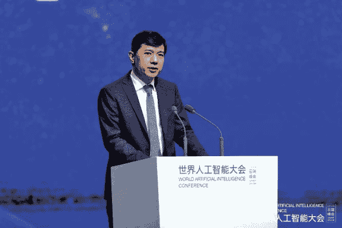

Shanghai has taken the development of AI as a priority strategic choice and is accelerating the construction of an AI development highland with global influence. Such ambition and pattern are highly commendable. Although the tech industry has been full of ups and downs over the past few decades, with prosperity and depression, peaks and valleys, as a tech practitioner, what I have witnessed overall is the driving role of technology on the development of human society.

Since this year, the novel coronavirus has raged globally, the economy has stagnated, and the unemployment rate has risen sharply. As entrepreneurs, we cannot help but reflect on whether technological innovation can allow humans to better control their own destiny at critical moments. I think the theme of this year's World Artificial Intelligence Conference, "Intelligent Connectivity, Indivisible Community," is the answer to this question.

The reality is that we were unable to dispatch a large number of autonomous vehicles to solve people's daily life problems when Wuhan was locked down; we were unable to quickly develop a COVID-19 vaccine through bio-computing; we also did not reserve enough basic technologies and applications to cope with the risk of anti-globalization for a considerable period in the future. So I see many people have developed pessimistic sentiments towards technology, especially AI technology.

However, as an insider, I know we are making progress. Baidu's invented `LinearFold` algorithm can shorten the full-genome secondary structure prediction of the novel coronavirus from 55 minutes to 27 seconds, a 120x speedup. This allows us to predict virus mutation trends faster to formulate effective prevention and control measures, and can also improve the efficiency of vaccine development. The multi-person rapid temperature screening solution effectively reduces the risk of infection for staff in public places such as train stations and subways. The contactless delivery vehicles and unmanned disinfection operation vehicles supported by the Apollo autonomous driving system greatly reduce and avoid cross-infection.

I believe that in the future, in public health monitoring, new drug R&D, and disease diagnosis, AI has great potential. AI can improve the sensitivity and accuracy of detection, shorten the cycle of new drug R&D, reduce the cost of new drug R&D, and improve the accuracy and efficiency of medical diagnosis. These will make humans more proactive when facing health problems.

I also believe that the "New Infrastructure" advocated by the state is infrastructure construction with AI at its core. It will greatly improve efficiency in fields such as transportation and energy, driving economic growth. The construction of intelligent transportation infrastructure based on Vehicle-Road Coordination will be able to increase traffic efficiency by 15%–30%, which means contributing an absolute growth of 2.4%–4.8% to GDP.

I believe even more that with the open source and opening up of AI technology platforms, more and more applications can be developed very conveniently, benefiting all aspects of the economy and society. The main operating system of the future will no longer be an OS based on PC or mobile phone, but an OS based on AI deep learning frameworks. Deep learning frameworks connect various intelligent applications upward and dominate the design of various AI chips downward.

In my view, AI development will go through three major historical stages.

The first stage is the **intellectualization of technology**. AI was proposed more than 60 years ago. In the past 10 years, it has experienced rapid iteration and innovation of algorithms. Empowered by cloud computing and big data, it has gradually developed into a new type of technology platform. However, the efforts of AI scientists were mainly focused on concept introduction, technology exploration, and partial application exploration such as human-machine gaming. AI had not evolved into an industrial phenomenon or economic phenomenon.

The second stage is the **intellectualization of the economy**. With the development of mobile internet, the effective data volume generated by humans has risen exponentially. The development of cloud computing provides the computing power needed for massive calculations. Coupled with the basic environment created by the widespread digitalization and internetization of the economy and society, AI has finally been able to start exerting its magic in a wide range of economic fields.

# Three Stages of AI Development and Current Opportunities

This stage can be further divided into two sub-stages. In the first half, AI development focused primarily on the development of general capabilities and the platformization of AI capabilities as a resource, as well as applications in two landmark industries: intelligent search and information feed recommendation. In the second half, AI began comprehensive industrialization—that is, the widespread adoption of industry applications and commercialization.

The third stage is the intelligization of society. AI will permeate from the economic sphere into broad social domains. Intelligent collaboration and institutional innovation on a societal and global scale will be the main characteristics of this stage. Ultimately, this collaboration and transformation will have an even more profound impact on the economy, and humanity will truly enter an intelligent society.

Currently, we are in a period of transition from the first half to the second half of economic intelligization. Through the development of the first half, a few general AI platforms and some vertical AI platforms focusing on specific industries have emerged globally. In vertical industries such as information search, information feed recommendation, and autonomous driving, AI has proven, or preliminarily proven, its potential to disrupt and reconstruct the industries it resides in.

For example, Baidu has focused from the outset on search engines, the largest AI application scenario to date; 10 years ago, Baidu began treating the development and platformization of general AI capabilities as a key strategy; several years ago, Baidu began exerting efforts in the vertical industry of autonomous driving and intelligent transportation.

In the 1990s, the US launched the "Information Superhighway" initiative, greatly expanding internet infrastructure and ushering humanity into the Internet era. Today, China's actively promoted "New Infrastructure" can be viewed as the largest infrastructure expansion project before humanity enters the intelligent economy and intelligent society. It has a high probability of triggering a wave of comprehensive AI adoption in China first.

As an AI platform company positioned to focus on external empowerment, Baidu hopes that every enterprise, no matter how small, can use our platform capabilities and service capabilities like water and electricity, thereby rapidly achieving AI transformation. This will ultimately benefit every ordinary consumer. This positioning also allows us to avoid competing with ecosystem partners and always adhere to openness as a fundamental principle, enabling us to wholeheartedly play the role of AI enabler.

However, the current stage of AI is also one prone to confusion and even pessimism. This is a necessary stage for most disruptive technologies before accelerated adoption. It is similar to what the internet experienced in the few years after 2000: some companies disappeared, and some people left the industry forever. I still remember that some overseas returnees even left due to loss of confidence, because Baidu also crawled out of that trough, and the memory remains fresh. But when the fog cleared, an era of comprehensive internetization of the economy and society began, and the "little people" who survived the winter became new heroes.

Whether it was my faith in the internet back then, or my faith in AI today, there has not been a shred of change. I still believe AI is a great wave comparable to the Industrial Revolution, and it will thoroughly transform every industry we have today. This pandemic will become a catalyst; it has given people a sense of urgency to control their destiny, while also letting us see that AI is no longer distant, but right beside us. AI extends our hands, empowers our brains, enriches our vision, and eliminates barriers of time and space.

The fog will eventually clear, the intelligent economy and intelligent society will eventually become reality, and humanity will eventually master its own destiny.

---

# Robotics and Computer Vision

## Martial Hebert

Professor and Dean, School of Computer Science, Carnegie Mellon University

A leading researcher in the fields of computer vision and robotics, Dean of the School of Computer Science at Carnegie Mellon University (CMU). Received a Ph.D. in Computer Science from the University of Paris. Joined the Robotics Institute, the world's largest robotics education and research institution, in 1984. After joining the CMU faculty, became a member of the Autonomous Land Vehicles project, laying the foundation for autonomous driving technology research. Research areas focus on computer vision, including environmental perception modeling, efficient recognition technology, 3D scene reconstruction and interpretation, 3D signal processing, video analysis, and detection, tracking, and recognition of dynamical systems.

In recent years, we have witnessed tremendous progress in the field of computer innovation, particularly the introduction of deep learning in computer vision. Today, we will discuss the challenges faced when transferring the aforementioned computer innovation capabilities to robotic systems and autonomous systems. For example, the fully autonomous vehicle jointly developed by our Robotics Institute and industry has been operating normally for many years; this system requires high-robustness perception to function properly. Another example is high-speed drones, which require the system to achieve high-robustness perception in complex environments using only limited computational resources.

So, what are the key problems we must solve? First, we need to use limited data to train systems that differ from other AI application scenarios. Second, any failure, malfunction, or error in the vision system can lead to irreversible system failure. Simultaneously, we must handle highly complex dynamic environments, such as autonomous driving environments. Additionally, we need to solve the problem of limited system computational resources and make real-time decisions. Next, I will elaborate on the above four issues.

### First, Supervised Learning Models

Traditional learning methods generate models—such as classification, detection, and simulation models—through large amounts of data, labeled data, and supervised data. Such learning methods require large-scale supervised data models and do not require any prior knowledge of the system. However, in robotic systems, we may be unable to obtain large amounts of supervised data, or it may be very difficult to do so, but we can acquire large amounts of data and experience to help us learn these models. This raises the question: can we perform offline training for vision tasks?

This can be approached via meta-learning—learning how to learn. This can basically be understood as: for a new task, how to learn a new model from prior knowledge, i.e., building an effective computer vision model with insufficient data. A crucial point is that when we think about the structured visual world, we should not think merely in data and feature space, but directly in task and model space.

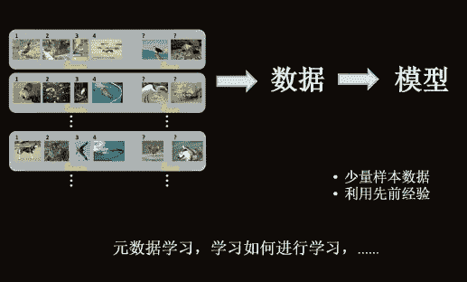

Imagine you face a classification problem. You can envision each classifier as an independent model in model space, all existing in a high-dimensional space strictly constrained by the visual task framework. The question then becomes: can we use this model space structure to facilitate learning, especially few-shot learning and more dynamic learning with limited data?

For example, suppose you can obtain some limited samples for learning a model, such as a simple sample for observing a classification, learned from a single sample in a certain task or classifier. The current problem is: how do we generate the model we want based on multiple samples? In fact, we can consider transformation—transforming the model learned from limited samples into a model learned from large samples. Only by figuring out this transformation can we better learn from limited samples. This is the main obstacle in the entire vision system, especially in robotic vision systems: the reliance on labeled data or supervised data.

The following example illustrates how to implement this idea. This classification problem is based on 400 different categories, displayed from left to right in order of most samples to fewest samples. This is the performance improvement achieved through the technology mentioned earlier. That is, learning the transformation from the large-sample classifications on the left, and using this transformation to optimize the small-sample classification models on the right. The legend here represents the performance improvement of each category. We can see that the performance of the small-sample categories on the right has improved significantly, while the performance of these large-data classifications has only improved slightly, or not at all.

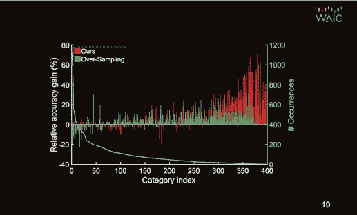

This achieves the basic concept we wanted: using visual concepts with easily accessible data to help learn visual concepts with sparse data. This example illustrates that we can learn with minimal data, especially in robotic application scenarios.

### Second, Forced Decision Problems in Computer Vision Systems

First, in robotic systems, there is a pipeline from the input layer, perception layer, interpretation layer, to the reasoning and decision layer. The path from the perception layer output to the interpretation layer is a straight line; that is, we always make decisions based on the perception layer output. The problem is that the perception layer output may contain noise, be messy, and may not be good enough for the computer vision system to make correct decisions. Therefore, the current problem is how to evaluate the performance of the computer vision system online and determine in real-time whether we can make decisions based on the output results. This involves self-assessment, introspection, and fault detection.

Take semantic segmentation in an autonomous driving environment as an example.

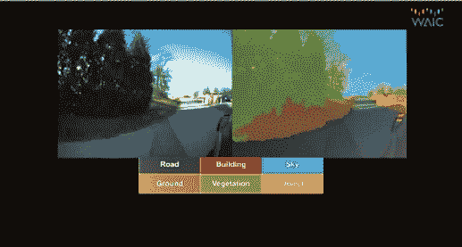

Problems in such systems generally lie in result variations caused by different lighting conditions. The question then becomes predicting the working performance of the vision system under given lighting conditions. Our basic idea is to predict the performance of the perception system based on the input, and bypass the perception system when necessary, making system operation more reliable by reducing direct dependence on the perception system. To achieve this, one method is to explicitly represent the relationship between input features and performance; another, better method is to find features that directly predict system performance from the input.

For example, for a simple segmentation task, the system can automatically predict that the image on the left is difficult to segment, while the image on the right is easier to segment. From the output results, the right side clearly performs better. The problem is how to do this automatically and systematically, enabling us to obtain a brand-new internal description of system performance.

Another example is an outdoor mobile robot. Similarly, in this example, we can find that the system accurately defines the left image as more difficult to segment than the right image. That is, predicting the self-assessment of the computer vision system's performance enables better decisions in system autonomy and planning.

Another example: a drone flying in an unstructured environment. These are a few frames of the aircraft system's flight. On the left, you can see the input stream of images; the top left shows the reconstructed approximate depth of the environment, using various LSD (Laser Signal Device) labels that computer vision enthusiasts are interested in; the right side shows the evaluation of different trajectories, with time nodes for the decision on which trajectory to follow, using the classic rolling horizon technique.

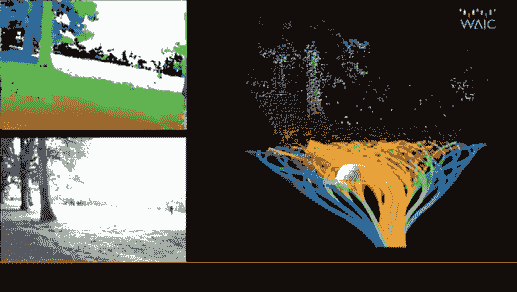

Then the question arises: if the visual system input degrades, it leads to degraded depth estimation, which in turn may lead to catastrophic system failure. Therefore, what we can do is learn to predict the system's flight performance from data—not assessing the quality of depth estimation, but whether these trajectories have been effectively evaluated. We can predict performance based on input data—knowing why the system can fly from observed data. Once we achieve this, we can do some follow-up work. In this example, the failure probability on the drone's right side is high, so it makes a new move or seeks a new position to get better visual output, showing that we have significantly improved the system's flight performance.

This case leads to another very interesting question: what is the core challenge faced in applying computer vision to robotics? Let's look at the images below. These are the output results of a segmentation system, typically labeling images by different regions. Obviously, in these two output results, the upper image's output is better than the lower image's. In the lower image, a large area in the front of the house has incorrect labels. The number of correctly labeled pixels in the upper image is greater than in the lower image, indicating that for such tasks, the purpose of error measurement is to correctly label as many pixels as possible.

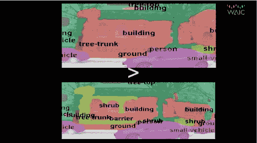

The problem is that there is currently no application scenario that requires correctly labeling all pixels in an image. This means we are using the wrong objective function, the wrong error metric. Its implementation difficulty may be much greater than the actual minimum objective function required to perform the task.

Returning to this example, we can actually try to figure out the accuracy of the 3D world reconstructed by the vision system. But in reality, whether this accuracy is 3mm or 2mm doesn't matter at all. The only thing that matters is the completion degree of this task. This is the only important objective in robotic application scenarios. The difficulty lies in how to design a vision system that focuses on and optimizes only a specific objective.

### Third, System Interaction Capability with Dynamic Environments

In the example below, we need to predict Target 18 on the left, determining which direction this pedestrian, as the subject of study, will move. The challenge of this problem lies in how to make dynamic predictions, incorporating the subject's possible decisions using probability functions. Another difficulty, and perhaps the biggest one, is that this task must be realized not only on a single subject but on multiple subjects, including interactions between a single subject and other subjects.

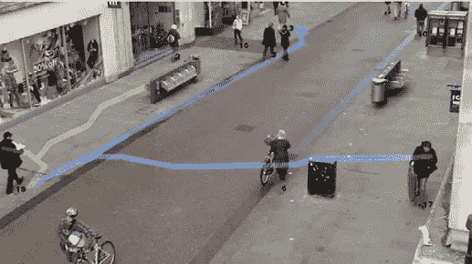

Therefore, we encounter a game theory problem: a subject's decision depends on other subjects' decisions, while other subjects' decisions depend on this subject's decisions. Therefore, this optimization problem is the main challenge faced when predicting dynamic working environments.

### Fourth, Real-time Prediction Under Limited Computational Resources

We can only use limited computational resources to accomplish all this. For example, I made an assumption that in the entire computation process, the input information is passed to the perception layer before the final interpretation is obtained. But in cases of extremely limited computational resources, we may need the vision system to make decisions earlier, perhaps needing the vision system to output earlier, perhaps obtaining output during the computation process. In other words, the vision system needs to give interpretations and output results at any time. This capability is becoming increasingly important, especially considering limited computational resources and the need to make decisions within a limited exact time. This is a concept belonging to the classic computer science research field, namely "Anytime Machine Learning" (or "Anytime Prediction"). The basic concept of anytime prediction is to output a rough early result first, then continuously iteratively optimize the result as time grows—this differs from the classic machine vision learning view. The classic view holds that a single result is output only at the end of result processing. This means the anytime prediction computation process is interruptible; we need to get output results at any time during computation; and as time passes, we get better and better output results due to increased computation; finally, diminishing returns—i.e., as computation increases, result improvement gets smaller. This is the definition of anytime prediction.

So how do we implement anytime prediction in deep learning? For example, a typical deep learning system architecture, say in this network there are different stages, layers, and blocks. Each block performs computation and passes the result to the next block, and the entire network is optimized based on the final output result, which may be the final result.

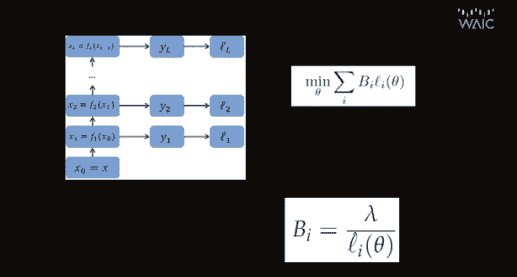

Now, to accurately get such output at any time, we need to get intermediate layer outputs—that is, not only optimize the final output result but also optimize the intermediate layer output values. How to achieve this is a research challenge. A feasible method is to get a linear combination of these output quantities. It can be seen that a better method is to obtain weights through the inverse of the loss at each stage of the optimization process. The details are not particularly important; what is important is the concept of the robotic system. We may need to consider implementing more complex designs for these learning systems—for example, letting them give immediate intermediate layer outputs, so that partial results can be obtained at any time under limited computational resources.

---

# Building an Open Ecosystem to Enable an Intelligent World of Everything Connected

## Tao Jingwen

Director and Chief Information Officer, Huawei Technologies Co., Ltd.

Graduated from Beijing University of Posts and Telecommunications. Joined Huawei in 1996, serving as Product Development Engineer, Deputy General Manager of Market Technical Department, Executive Deputy Director of International Marketing Department, Executive Vice President/President of Southern Africa Region, President of Global Marketing/Sales, President of Terminal Company, President of Western Europe Region, President of Quality Process IT, and other positions.

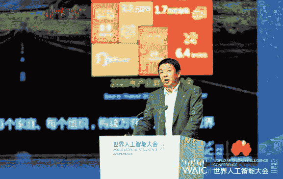

The Fourth Industrial Revolution has arrived. With the continuous maturation of technologies such as 5G, AI, and Industrial Internet, as well as the accelerated construction and promotion of new-generation infrastructure represented by 5G, data centers, and cloud, technology is accelerating the massive application of the fourth-generation Industrial Internet in the Internet of Everything, Intelligence of Everything, including the digital transformation of enterprises and industries.

### Understanding and Judgment on AI Development

We believe the Fourth Industrial Revolution will impact all aspects of industries. It will not only change people's lives, making them smarter and more convenient, but also transform all walks of life. With the extensive use of AI and digital technologies, a market exceeding 12 trillion (USD) will be born in this world. We predict that by 2025, the ICT (Information and Communications Technology) industry and the intelligent manufacturing industry will have scales of approximately 5 trillion and 6.4 trillion, respectively. In 2017, Huawei released the company's new vision: to bring the digital world to every person, every home, and every organization, building a fully connected, intelligent world. In 2018, Huawei released the "+ Intelligence, See the Future" full-stack AI strategy. In 2019, with "Create New Heights of Intelligence Together," Huawei demonstrated its strategic determination in AI and to promote AI industry applications.

### Huawei's AI Development Experience

Huawei is first and foremost a technology innovation company with two major business groups. The first major business group is the Consumer Electronics Business Group centered around smartphones. We have been continuously building a "1+8+N" business ecosystem, hoping to make every person's and every family's life more intelligent and enjoyable. Huawei has built a full-stack intelligent solution for the "2C" business environment, from terminal phone chips, cloud services, and industry ecosystem, jointly building an intelligent life solution for individuals and families with industry partners.

The second major business group faces government, carrier, and enterprise customers—the ICT Infrastructure Business Group—dedicated to providing ubiquitous connectivity and pervasive intelligent products and solutions. In Huawei's 2019 full-stack AI solution release, one item combines Huawei's Enterprise Intelligence (EI) enablement platform to help governments, industries, and enterprises quickly build AI applications. From chips, 5G, edge computing, to cloud services centered on the Kunpeng ecosystem Atlas, Huawei provides a full-stack service platform and jointly builds an application ecosystem for all industries and scenarios with industry partners, providing product and service support for building "Device-Edge-Cloud" full-scenario AI infrastructure.

There is a molybdenum mine in Luoyang. Because it is located in a remote area, manual driving of large mining trucks deep into the mining area carries high risks. Using "5G + AI" to achieve unmanned driving and remote control, the mining area achieved zero casualties in 2019. The number of drivers decreased from over 100 to 20, and annual output value increased by 160 million RMB, achieving significant economic and social benefits. Huawei also helped Ningbo Zhoushan Port build a "5G + AI" smart port. Container trucks operate automatically 24 hours a day, with an automatic recognition accuracy rate as high as 95%, saving a massive amount of labor input. During the COVID-19 pandemic, Huawei cooperated with over 300 hospitals nationwide to provide "5G + AI" based medical services to over 1 million people. The speed of doctors reading scans shortened from over 10 minutes per image to within 1 minute.

AI is a comprehensive service integrating four elements: business scenarios, algorithms, computing power, and data. As an enterprise with rich business forms, Huawei is also actively promoting intelligent practices internally. Huawei has established the Huawei Enterprise Intelligence Brain internally, reducing the time to build an AI platform serving the enterprise from the initial 14–16 months to the current 0.5–2 months. We hope Huawei's own practical experience can also help various industries achieve experience improvement, efficiency improvement, benefit improvement, and business model innovation. Huawei has always adhered to the concept of "packing its own parachute" (dogfooding), based on its own rich enterprise application scenarios, focusing on repetitive, massive, and complex scenarios, creating a testing ground for product innovation and intelligent transformation, and empowering more enterprises with Huawei's mature digital transformation experience.

### Thoughts and Suggestions on AI Development

To enable AI development to better serve society, we have two suggestions. First, AI must develop in an orderly manner. We believe governments, industry associations, and standards organizations should strengthen policy formulation and AI legislation. Various industries and industrial alliances should strengthen consensus and form data exchange standards. Second, we call for strengthened cooperation between governments and enterprises, AI technologies/algorithms and professional technologies on the AI industry chain. The goal of AI development is to provide enterprises with good technologies and product solutions. Technology needs corresponding enterprises and user scenarios for verification; algorithms need data and business scenarios for continuous optimization. Any country attempting to hinder AI development through closure cannot change the public's demand for AI industry applications and the construction of a future intelligent society. Leveraging Shanghai's policy advantages and excellent industrial development environment, Huawei has successively laid out innovation centers such as Kunpeng + Ascend, 5G, 5G+XR, and Autonomous Driving in Shanghai, jointly promoting AI applications in various industries.

In terms of using AI, we also have two suggestions for the industry.

# 人工智能芯片：新的一页

**陆永青**  
帝国理工学院教授，鲲云科技联合创始人兼首席科学家

英国帝国理工学院教授，英国皇家工程院院士，电气和电子工程师协会（`IEEE`）、英国计算机学会（`BCS`）会士，中国人工智能产业创新联盟专业委员会主任委员及鲲云科技联合创始人兼首席科学家，鲲云人工智能应用创新研究院院长。`ACM TRETS`创刊主编，定制计算领域学术会议`FPT`、`FPL`创始人，`ASAP`、`FCCM`、`FPL`、`FPT`、`HEART`学术会议指导委员会委员，曾任英国皇家工程院杰出访问学者评选委员会委员。作为可重构计算及现场可编程技术领域的国际知名学者，在国际学术期刊和国际学术会议上发表 500 余篇论文，获得国际专利 2 项，出版学术著作 3 部。

## 高性能计算趋势回顾

在开始讨论芯片之前，我首先谈一谈这 10 年来的高性能计算趋势。大家可能看过全球前 500 名最快的超级计算机列表。2008 年 11 月，日本的一个基于`GPU`（图形处理器）的超级计算机首次进入了 500 强，排名第三十。到了 2010 年 6 月，基于`GPU`的超级计算机“星云”（中国的一款超级计算机）排名第二。10 年之后的今天，也就是 2020 年的 6 月，我们发现在前 10 名超级计算机中，基于`GPU`的占 6 名。

## GPU 核心功能

什么是`GPU`？`GPU`有两个核心功能：第一，它包含数以千计的处理核并行计算。也就是说，一个`GPU`可以支持大规模的并行处理。图 1 是图灵`GPU`，每个绿色的部分又包含很多处理核。`GPU`的第二个核心功能是它支持单指令流、多重数据流（`SIMD`）。

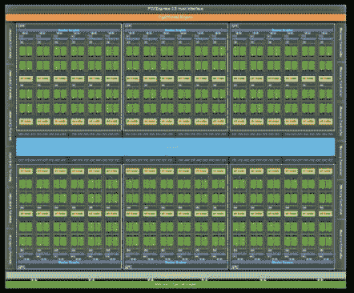

**图 1　 图灵 GPU**

## CPU 与 GPU 架构对比

我们先看一看图 2 左边的`CPU`。我们可以看到它包含单指令流、单数据流（`SISD`）。图 2 右边的`GPU`也是单指令流，但它有单指令多重数据架构，可以处理多重数据流。正是因为`GPU`的数据流可以分享单一指令流，它的效率能比`CPU`更高。

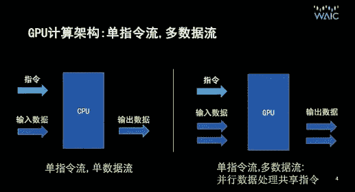

**图 2　 GPU 计算架构**

## GPU 与 CPU 性能比较

我们比较一下`GPU`和`CPU`的性能。从图 3 中可以看到对于单一精度和多精度浮点操作来说，`GPU`都比`CPU`有更高的性能。

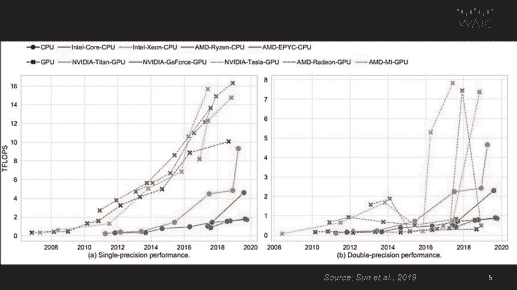

**图 3　 GPU/CPU 性能比较**

## 芯片利用效率分析

`GPU`如此强大，还有进步的空间吗？我们来看一看人工智能的基准测试程序中有关芯片利用效率这个指标（图 4）。其实`GPU`的芯片利用率并不高，甚至低到了 7.52%。芯片利用效率衡量的是芯片的算力性价比。芯片实测性能是用户得到的价值，峰值性能基于芯片的尺寸和技术，反映芯片的成本。芯片利用效率等于芯片实测性能除以芯片峰值性能。

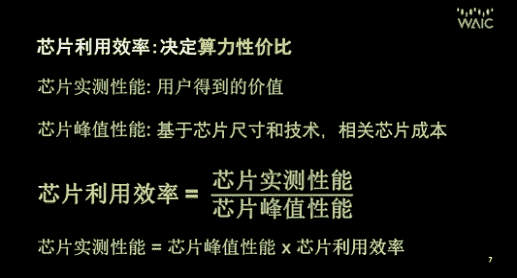

**图 4　 芯片利用效率**

也就是说，对于一个给定的峰值性能，芯片利用效率越高，芯片实测性能就越高，用户得到的效果就越好。

## 定制数据流计算架构

那么如何改进芯片利用效率呢？过去的几年中，我们研制了一个新的架构，叫作定制数据流计算架构。和图 5 左边的一个指令流、多重数据流的`GPU`相比，图 5 右边的定制处理器也可以处理多重数据流，但它不需要指令流，所以它能比`GPU`更加有效。

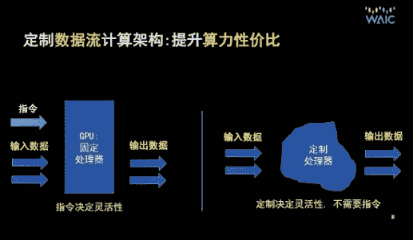

**图 5　 定制数据流计算架构**

### 定制处理器的灵活性实现

`GPU`的指令让`GPU`更灵活。定制处理器没有指令，如何实现灵活性呢？在定制处理器中，有一个数据流配置器，这个数据流配置器可以用于动态重组定制处理器，让它尽可能地灵活，就像`CPU`和`GPU`一样。

## CAISA 3.0 芯片架构与应用

这种架构现在已经被投入实践应用中。在图 6 的定制人工智能数据流的芯片架构`CAISA3.0`中我们可以看到，这个架构和`GPU`一样包含多个定制处理器，它们可以并行运作以支持大规模的并行计算。在每个定制处理器中都有多重配置器，旨在保证灵活性。就像`GPU`和`CPU`可以提供的灵活性一样，全局的缓冲结构中也包含了这种配置器，使这个架构更加灵活。

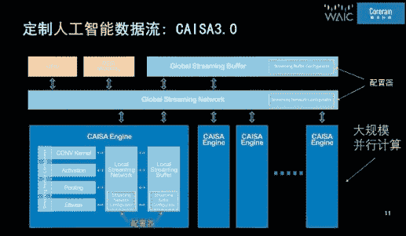

**图 6　 芯片架构 CAISA3.0**

`CAISA3.0`架构的芯片采用了 28 纳米的工艺，已经被应用于第一代先进的数据流芯片中，可以支持边缘和云端`AI`推理。图灵`GPU`的芯片利用效率可以低至只有 8%，而`CAISA3.0`芯片利用率可以高达 95.4%，是一个巨大的飞跃。它的峰值算力是 10.9 `TOPS`，可以在-40～125℃之间正常工作。这个`CAISA`芯片现在已经被应用于星空加速卡`X3`，可以支持边缘计算平台及云计算平台。该芯片还被用于星空加速卡`X9`，主要是用于云计算。

## 基准测试数据对比

接下来我们看一些基准数据，比较一下`X9`和`GPU`。

### 延时对比

首先我们看延时。延时就是响应一个外部输入的时间，所以延时越低越好。从图 7 中我们可以看到，`CAISA`芯片的延时比图灵`GPU`要好 30 倍，在不同的`AI`基准中，我们都可以看得到这种优势。

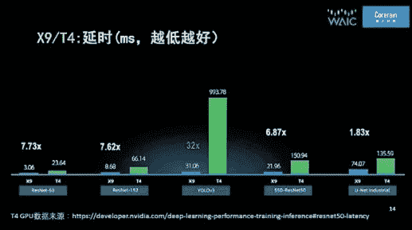

**图 7　 X9 和 GPU 基准数据—延时对比**

### 芯片利用率对比

然后再看看图 8 的芯片利用率。在不同的`AI`基准中，我们看到`CAISA`芯片在`X9`加速卡中，它的芯片利用率比`GPU`要高 11 倍。

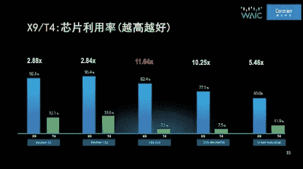

**图 8　 X9 和 GPU 基准数据—芯片利用率对比**

### 性能对比

再看一看性能。从图 9 中我们可以看到，`CAISA`芯片在`X9`加速卡中能够达到的`FPS`（画面每秒传输帧数）性能是图灵`GPU`的 3.91 倍。

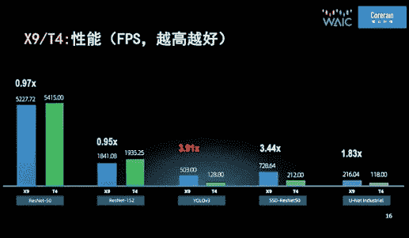

**图 9　 X9 和 GPU 基准数据—性能对比**

## 实际应用案例：视频分析

这是什么意思？我们举一个例子说明：处理分析 25000 路视频数据。在此案例中，如果我们使用包含`GPU`加速卡的服务器，我们需要 100 台服务器，每一个服务器包含 8 张`GPU`加速卡，以支持每一个 250 路的视频分析。如果把性能提升到 3.91 倍，这就意味着每一个服务器不是仅能支持 250 路视频，而是可以支持 977 路视频，这时就不需要 100 台服务器，而只需要 26 台服务器，每个服务器上采用 8 张`X9`加速卡。这个`X9`加速卡就是采用了我们刚才讲到的`CAISA3.0`版本的芯片。

## 落地应用与开发生态

这个用于加速卡的`CAISA`芯片架构现在已经落地于一系列广泛的领域，包括智能制造、智慧城市、安监生产、轨道交通、智能遥感等。为了能够让应用程序的开发简便易用，我们研制了一个端到端的应用程序开发模型。这个始于深度学习的模型，可以自动产生`CAISA`架构上的适合应用程序，应用于有关的硬件平台。

也就是说，开发应用程序的人，不需要成为一个`AI`芯片的专家。他甚至不需要了解`CAISA`架构，就可以利用它的好处。这个模型支持广泛的深度学习算子，部分如图 10 所示。这让算法设计者的工作更加轻松，因为他们只要应用这些算子软件，就可以得益于`CAISA`架构。

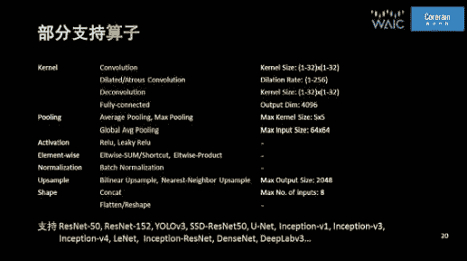

**图 10　 部分支持算子**

## 总结

因此，这种新的架构让我们掀开了人工智能芯片的新的一页。这种芯片可以带来更高的算力性价比，支持更多的`AI`算法，更便于使用。因为应用开发工具用起来很方便，所以它们会带来更智能的计算平台、系统和应用，它们可以被更快地落地部署。

希望新的`CAISA`芯片可以让我们受益于最先进的技术进展，让所有人的生活更美好。

---

# 人工智能与新基建

## 嘉宾介绍

**姚志强**  
云从科技联合创始人

云从科技联合创始人，重庆市机器视觉工程技术研究中心主任、重庆市企业技术中心负责人。中国科学技术大学信号与信息处理专业博士，有 19 年从业经历。坚持自主创新，带队参与国家级项目 5 项，省部级项目 9 项，规划建设国家发改委重大工程项目—人工智能基础资源公共服务云平台，参与起草国家标准“基于互联网的人脸识别认证系统技术要求”、公安部标准“公共安全视频监控云平台可行性研究报告”。

**周 剑**  
优必选科技创始人、董事长兼 CEO

优必选科技创始人、董事长兼 CEO，广东省第十三届人民代表大会代表，悉尼大学工程与信息技术学院计算机科学学院客座教授，深圳国际商会副会长，深圳市商业联合会副会长，深商`AI`智能机器人产业联盟主席，深圳机器人协会副理事长，第十七届国际奥林匹克机器人大赛主席等。人形机器人的先锋践行者，2012 年 3 月创办的优必选科技，现已发展成为全球顶尖的人工智能和人形机器人研发、制造和销售为一体的高科技创新企业。

**郑庆生**  
红杉资本中国基金合伙人

红杉资本中国基金合伙人，专注于`TMT`领域的投资。投资了包括客路旅游、爱奇艺、大众点评、360 集团、蘑菇街、360 金融、摩拜单车、新经典出版、百度文学、容联云通讯、激智科技、豆瓣和好大夫等优秀企业。毕业于复旦大学国际金融系，在从事风险投资工作之前，曾担任盛大互动娱乐有限公司的投资与海外中心助理总监，负责投资和海外业务。在此之前，曾在普华永道、`IBM`和`BearingPoint`有多年财务和管理咨询经验。

**陈海波**  
深兰科技（上海）有限公司创始人

中国管理科学研究院学术委员、清华大学创+学生创意创新创业实践基地创业导师，中南大学—深兰科技人工智能联合研究院第一届专家委员会委员，曾先后荣获“2019 中国人工智能杰出人物”“2018 硬科技行业风云人物奖”“中国智能制造风云人物”等多项个人荣誉。

**吴明辉**  
明略科技集团创始人、董事长兼 CEO

《财富》“中国 40 位 40 岁以下商界精英”之一。中国人民公安大学特聘教授，北京大学和中国人民大学创业导师。作为改革开放 40 年里年轻一代的连续创业成功者，2006 年，创立秒针系统—中国最大的互联网用户行为和营销数据分析平台；2014 年，创立明略科技—将业务从线上商业领域拓展到政府服务及线下商业领域，将技术能力从大数据拓展至人工智能；2019 年，创立明略科技集团—中国领先的一站式人工智能企业级服务平台，并入选国家新一代人工智能开放创新平台。毕业于北京大学，获数学系学士学位、计算机软件与理论硕士学位及北大人工智能实验室（`AILab`）优秀硕士学位。拥有 20 年软件工程开发和算法研究经验、130 余项国内外发明专利。

**夏华夏**  
美团首席科学家兼 AI 平台总经理

美团首席科学家、`AI`平台总经理。于美国加州大学圣迭戈分校取得博士学位。曾任`Google`高级工程师、百度主任架构师。主要从事基础架构、云计算、大数据、人工智能、无人驾驶等领域。

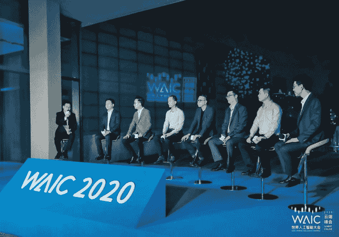

## 引言

从 2017 年开始，上海就在人工智能领域出台了一系列中长期的规划，并逐步凝聚起了浓郁的产业发展氛围。而现在，人工智能又成为新基建的轴心，从而为中国经济创造新的红利。

## 人工智能与数字新基建

### 姚志强

新基建是我们从信息化到智慧化、智能化的必要转型步骤。如果说人工智能是大脑，那么硬件基础就相当于身体。我们不仅需要聪明的大脑，也要有强健的身体。

身体传回来的数据要聪明的大脑去分析，去做出决策；分析的结果和决策又会返回实际应用场景与实时数据相结合。所以我们既需要人工智能，也需要数字基础设施。

### 周剑

几年前，人工智能还没有到达切实可行的阶段。但随着人工智能技术的发展，包括数据积累、算力提升等，人工智能将对社会发展起到核心驱动的作用。新基建的含义也会从之前的“铁公基”转变为更多的技术驱动的基础设施建设。

在这次疫情中，我们发现智能机器人是人工智能最好的载体。未来机器人还将更多地在智慧医疗、智慧教育、智慧驾驶等场景中全面地改变社会运转的结构，让社会发展越来越高效。

### 郑庆生

中国的互联网已经走过了 20 个年头，支付、消费、娱乐都已经实现了大规模在线化，这积累了大量数据资源，让整个社会的互联网节点变得非常丰富，也为下一步的数字智能或人工智能提供了一个非常好的基础。

同时，中国的发展是很有特色的。中国的数字化、在线化、云端化、智能化是一个全价值链的过程，和欧美发达国家不同的是，中国既有巨大的市场，又是世界的工厂，所以基本上做到了从设计营销到生产物流的全覆盖，可以形成全链路数字化闭环。在全链路的闭环里面，通过数据化，每一个环节都有人工智能的巨大机会，有非常广阔的天地。

### 陈海波

20 年的互联网发展使中国成为互联网大国，也成为数据大国，为中国成为人工智能大国奠定了基础。目前深度学习是人工智能的主要阶段，数据是粮食，算法是工具，算力是基础，新基建将为我们夯实多种基础。

### 吴明辉

新基建是各方都需要参与的事情，不仅是国家层面，也包括在企业内部去推动基础设施建设，并在这个基础上推动更广泛的经济增长。整个社会是由物质、能量、信息三大核心要素构成的，老基建的作用是促进物质和能量的运输和流通，而人工智能关乎的是信息，其中数据中心就是人工智能的基础设施。比如，我们为上海地铁搭建的智能运维平台和数据共享平台可以提升地铁运营效率，降低成本；为电力系统搭建的数据中台可以做到电网智慧调度。未来还会有更多基于此的应用出现。

### 夏华夏

我们认为人工智能就是一种基础设施，会是未来生活中必不可少的技术。我们提供智能餐厅解决方案帮助商家更高效地运营，我们打造无人酒店，让用户可以刷脸入住，指纹开锁，从而提供更好的入住体验。为了帮助外卖小哥改善工作环境，我们正在开发无人机和无人车的配送，让小哥不需要在路上奔波，而只是解决最后 100 米的配送问题。我们做人工智能应用是基于一个个真实的生活场景，我们也相信`AI`会成为未来生活的基础设施。国家大力推动的新基建对人工智能行业也有很大帮助。`5G`、芯片、物联网、数据中心等项目的建设将进一步完善人工智能生态，并对行业起到推动作用。

## 人工智能发展的机遇与路径

### 周剑

目前人工智能还处于比较初级的阶段，到通用智能还有很长的路要走。所以我们现在强调的是在可控环境下，在一些垂直领域的细分场景去深入发展。

优必选科技一直聚焦在人形机器人。为什么是人形机器人？轮式的、履带式的或四足的机器人是否也能实现我们需要的功能？如果你看过《西部世界》，一定会喜欢这部剧中的人形机器人，这就是我们的目标，可能需要 50～100 年才能实现。

但这件事总得有人去做。

优必选科技目前在努力降低大型人形机器人的成本。我们认为只要这样的机器人价格降低到一定程度，比如说几十万元，和一台中高档汽车的价格类似，那么它们就能进入家庭，从而形成机器人行业一个垂直领域的应用场景。我一直强调，不能只看现在的技术，而是要思考人类未来到底需要什么样的产品。如果未来需要人形机器人，那么优必选科技就会一直走在这条路上。发展硬科技必须有耐心以及坚持长期投资的理念，我们希望为中国做一些与众不同的东西。依托中国强大的制造业和供应链基础，我们希望用得起的人形机器人能够在中国的供应链上被第一个造出来，能够实现商用或者家用，这是我们最自豪的事情。在实现这个目标的过程中，我们的很多技术可以“沿途下蛋”，比如我们可以做最美的新基建—人工智能教育，以及商业服务、安防巡检、养老等方面的一些智能机器人。

### 陈海波

如果中国要在第四次工业革命中处于领导者地位，需要解决两个问题。第一，基础研究要领先世界；第二，要完成从工业大国到工业强国的转变。在此期间，技术推动是主旋律，而人工智能在工业智能化方面是主力军。

智能制造能在很大程度上帮助人工智能企业商业落地，帮助人工智能企业针对市场需求打造产品。人工智能企业要认识到技术是用以赋能各行各业的，人工智能技术只有与场景结合才能产生作用。真正的人工智能企业应该从“软”做到“硬”，基础研究和应用开发都强，才能够符合未来市场和社会对人工智能的期望。

### 吴明辉

在人工智能时代，科技创新企业应走出差异化的道路，选好细分市场和不同赛道。我认为，未来每一个人工智能细分领域只有第一名可以取得成功，因为其能力是可以复制的，而其他的竞争者将是没有前途的。中国有最为广泛的人工智能应用场景，企业应选好自己的细分市场。

### 夏华夏

我们真正的目标是用科技，特别是人工智能帮助提供本地生活服务的商家提高效率，帮助用户得到更好的服务，最终让人工智能成为生活的一个基础设施。未来五六年，我们一个重要的任务是帮助那些不会用互联网的人使用我们的服务，包括很多老人和小孩。用图像识别帮助中小餐馆老板录入菜单和管理订单，利用语音交互、视觉理解等人工智能相关技术实现无人配送，都是未来几年我们要做的事情。

### 郑庆生

对于投资人来说，无论多好的技术都需要找到商业变现的场景。企业有一个长远的定位，但每一步都需要找到细分的场景去实现，这是投资人非常希望看到的。

# Discussion on AI Development and Anti-Epidemic Applications

## Integration of China's Consumer Internet and Enterprise Management

China possesses the most developed consumer internet, which has also accumulated excellent data. Based on this, the development of AI applications is also leading globally, giving rise to many world-class AI giants, all of which grew from the consumer (C-end) side. However, China's enterprise management technology had not fully developed in the pre-internet era. In Europe and the US, progress in this field began in the mid-20th century and has continued to develop ever since. Therefore, for AI, it is necessary not only to provide excellent technology but also to integrate advanced enterprise management concepts into products—combining advanced management methods, good ideas, and AI technology—and deliver the decades of management experience accumulated by other countries to clients through products. For our tech enterprises, this is a major opportunity and challenge.

**Yao Zhiqiang**: AI must ultimately help every individual enhance their capabilities and improve everyone's efficiency. Empowered by AI, everyone will have stronger senses, richer knowledge and experience, thereby enhancing individual capabilities and efficiency, and achieving fair resource allocation in the process. This is the era of human-machine collaboration we hope to see.

## AI Development in the Context of China-US Tech Competition

**Xia Huaxia**: Decoupling or the process of decoupling between China and the US is a short-term pain for China, but a long-term benefit. It will force us to concentrate our efforts on addressing weaknesses, including chips and many other basic components.

**Wu Minghui**: The impact on the software level is currently very small, but I believe the impact on computing power will be significant, including future edge computing. At the same time, I have seen many emerging domestic tech companies rapidly closing this gap. Many underlying areas of AI relate to materials, but even more to mathematics, where China still holds advantages.

From a software development perspective, whether consumer internet or industrial internet companies, many have benefited from open source, and open source itself is not easily affected by international politics. Many outstanding engineers and scientists internationally are co-creating products; this field still has a very good culture of borderless, collaborative win-win. So I feel AI itself will not have so many barriers in the future; collaboration remains the mainstream.

**Chen Haibo**: The current situation is severe, but the sun always shines after the storm. China has its own innovation capabilities; our spirit of self-reliance will be stimulated, and most enterprises have their own contingency plans. For example, we established a Chip Research Institute in 2018 to develop our own `FPGA` chips for industrial intelligence, and we are full of confidence in the prospects.

**Zhou Jian**: In the short term, we have some concerns in the chip field, but in the long run, I believe we will find our own path. UBTECH Robotics started from hardware and began developing servo actuators in 2008. At that time, we searched all over China for small servo actuators but couldn't find any. Finally, we found three suppliers from Japan, South Korea, and Switzerland, with exorbitant prices—a tiny digital motor cost nearly $100. A humanoid robot with twenty or thirty joints would be very costly; a small robot might sell for tens of thousands of yuan. So we started developing servo actuators in 2008, and to this day, I can proudly say that globally, especially for small servo actuators under tens of kilograms, our mass production capability is very leading. Back then we couldn't buy servo actuators, and even if we could, they were expensive; now our servo actuators, whether `PID` algorithms, reducers, or motors, are all self-made. Through more than ten years of persistent effort, we have at least achieved a breakthrough in this field. Sharpening the sword day after day in every sub-field for ten years, I believe chips will eventually break through too; Chinese people are not only hardworking but also very smart.

**Yao Zhiqiang**: The essence of China-US competition is still efficiency competition. The US tries to slow down China's development speed through various means, while we should, under the support of national policies, accelerate R&D speed and application speed, especially all AI enterprises should develop in a cluster, allowing more application scenarios to accelerate landing, and thereby driving basic research work.

**Zheng Qingsheng**: Even under the current macro circumstances, venture capital funds still flow freely globally. China, like the US, remains the most prosperous hotbed for entrepreneurship in the world. Over the past two years, investment in China's hard tech fields, including AI, has been very active.

The potential for domestic substitution on the supply side is also huge. Therefore, while we worry about the unfavorable macro situation, we should also recognize that crisis brings opportunity. China has a vast number of entrepreneurs. In those fields where new enterprises previously seemed difficult to grow, due to new macro opportunities and the emergence of new technologies, a large number of startups have now appeared, which will certainly create many remarkable enterprises.

## Expectations for the Next 5 Years

**Zheng Qingsheng**: I hope that in 5 years, driven by new infrastructure, governments at all levels, all startups, and VC institutions, China's industrial internet (including AI) field can develop to the world-leading status that the consumer internet enjoys today. China will not only be a digital giant but also an intelligent powerhouse.

**Yao Zhiqiang**: I hope that in 5 years, all industries can achieve better generalization of resources, so that not only experts but also ordinary practitioners can accomplish many highly valuable things, helping all industries maximize efficiency.

**Zhou Jian**: Current AI and intelligent robots are still in a relatively early stage, with a considerable distance to general intelligence. Precisely because the industry is not yet mature, the government needs to provide technical environments and scenarios to allow AI and intelligent robots to be better applied. I hope that in 5 years, in Shanghai or elsewhere, we can see the smart elderly care center we built, running the model with 100 beds, and then promoting it to all regions globally facing aging population problems. I believe we can do it.

**Chen Haibo**: AI serves people's livelihood. I hope that in 5 years, Shanghai can become a city outstanding in both AI basic research and application globally, built into a world-renowned AI highland.

**Wu Minghui**: I believe that in 5 years, we will see AI achieve perception, cognition, and even action systems in more and more scenarios, with more complex applications based on AI analysis and decision-making realized, surpassing human capabilities.

**Xia Huaxia**: From a 5-year time dimension, technologically AI will benefit from impacts in several areas, including "AI+5G", "AI+IoT", "AI+Robotics". The combination of these fields with AI will greatly change many scenarios in life. I hope that in 5 years, drones and driverless vehicles can provide faster and more convenient delivery services in many cities, not just first-tier cities.

## Special Topic: Anti-Epidemic

### Application of Machine Learning Technology for Infectious Risk Prediction on Smartphones

**Yoshua Bengio**

Turing Award Winner, Professor at University of Montreal, Scientific Director of Mila - Quebec AI Institute

As a professor at the University of Montreal, he won the Turing Award—the highest honor in computer science—for his outstanding contributions to deep learning technology. It is precisely deep learning technology that has sparked the renaissance of AI, gradually making autonomous driving, instant voice translation, and facial recognition possible.

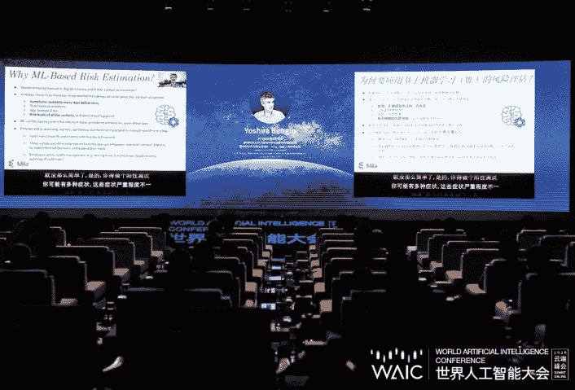

An important fact about COVID-19 infection is that the main transmission route is close-contact infection. Another important fact is that infected individuals are already contagious shortly before and after the onset of COVID-19 symptoms. The possibility of an individual being infected with the novel coronavirus can be estimated based on whether they have been in contact with a person who tested positive for the virus.

Digital contact tracing refers to sending COVID-19 related information via mobile phones, such as positive test reports of contacts. Compared to digital contact tracing, the limitation of manual contact tracing lies in the need to consume a large amount of time.

The current standard method for digital contact tracing only transmits binary information about whether a person's virus test result is positive. However, the infectious period of COVID-19 begins several days before a positive test result comes out; standard digital contact tracing has a certain delay. If we can shorten this delay, we can effectively reduce the spread of the virus.

In fact, judging an individual's infection risk level is not a simple binary problem of positive/non-positive. COVID-19 has multiple symptoms with varying severity. In addition, previous health status, age, gender, risk level of contacted groups, and time of contact also affect the epidemic progression. Therefore, it is necessary to integrate this information for more complete analysis and judgment.

Analyzing large amounts of information and making judgments is not easy. The best solution is to use machine learning methods to analyze massive fragmented information to determine whether an individual has been infected or what stage of infection they are in. If this can be achieved, those with high infection risk levels need to self-isolate and send risk information to previously contacted people; those with not particularly high risk need to be cautious but do not need to undergo mandatory isolation.

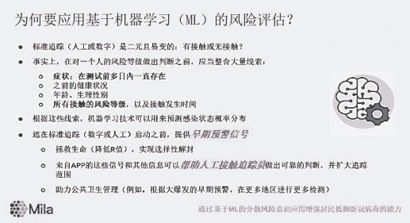

Digital contact tracing Apps based on machine learning can expand the scope of tracking and alerting. However, it should be noted that digital contact tracing does not completely replace manual contact tracing, because manual tracing can discover interpersonal relationships that phones cannot capture; therefore, the two tracing methods are complementary.

The information accumulated in digital contact tracing tools is also very valuable for public health management. For example, public health authorities can prioritize nucleic acid testing based on digital contact tracing analysis results—people with higher risk or contact history need priority testing. Additionally, digital contact tracing can provide much important information, such as predicting whether a large outbreak may occur before large crowds rush to hospitals for virus testing, based on changes in epidemic risk in certain areas.

If we already know the global network graph of interpersonal contacts, we can use machine learning methods to iteratively obtain the infection risk of each individual in the network. But the problem is, we do not know the global network graph of interpersonal contacts. Another issue to consider is that the computational and bandwidth costs of this iteration may be high.

If the machine learning predictor is simple enough, another approach is to use `federated learning`, i.e., without needing a central training server, everyone trains on their own phone. But a problem with this method is that each phone has to perform multiple iterative calculations, and a large amount of parameter communication exchange is also required between the central server and phone clients.

Our experiment adopts a hybrid method—both transmitting data between phones to calculate risk, and exchanging data and information between phones and servers, thereby better training the risk predictor. The information passed between phones is only updates about personal infection risk; each person can send and receive 4 messages a day. In addition, users who agree to share data can send their data to the server. Using de-identification methods, the sender's phone number, name, and other information are desensitized; the server only obtains the user's symptoms, feelings, and this person's virus test results.

In our experiment, the risk predictor receives the following information inputs: existing diseases, age, gender, behavior-related information (e.g., whether wearing a mask outdoors, in enclosed spaces, or at workplaces; whether there are glass partitions at work; whether taken public transport; how many people live at home), virus test report results, symptoms in the past 14 days, how many people contacted, contact duration, and distance.

Depending on the individual's situation, the length of data received by the risk predictor varies, meaning the input data length is variable. This means many standard machine learning algorithms, such as the `EM Algorithm`, can no longer handle this data. In our experiment, we used the `Transformer` to solve this problem.

There is still an important question now: what is the prediction target? Or in practical application, what kind of information should one person send to another? For example, if Alice met Bob 5 days ago, and Alice now finds she is infected, what information should she send to Bob? The most useful and relevant information is to assess how infectious Alice was when she contacted Bob 5 days ago. Therefore, the prediction target is how strong the infectivity of the infected person was on each of the past 14 days.

We do not know the true value of infectivity; we can only use test results as proxy information. But even test results have false positive and false negative errors. Fortunately, there are some methods based on latent variables in machine learning to handle this problem.

In the experiment, we built a generative model to capture individual-level information, including how people move, how they get infected through contact, and their condition. We calibrated the model based on known medical information to keep it consistent with known data on population mobility and medical care. Through experiments, we found that compared to standard digital tracing methods (only transmitting positive/negative test results), using the AI digital contact tracing model can significantly reduce the number of cases.

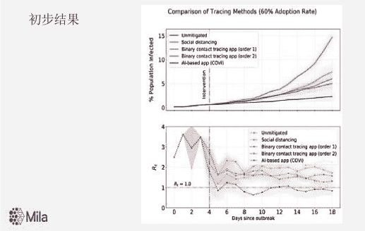

By using machine learning-based digital tracing technology, we can fully leverage the advantages of both digital and manual tracing, and expand the scope of manual tracing. At the same time, we can achieve the goal without compromising privacy or human rights and dignity.

### AI Healthcare at a Critical Juncture

**Peter Lee**

Corporate Vice President, Microsoft; Head of Microsoft Research; ACM Fellow; Member of the National Academy of Medicine

Corporate Vice President of Microsoft, leading Microsoft Research and technology incubation; fully responsible for Microsoft's eight global research labs and new technology incubation empowering Microsoft products and business groups, including the rapidly developing healthcare and life sciences business. Possesses rich management experience spanning the entire process from basic research to commercial impact. Before joining Microsoft in 2010, served as Division Director at the US Defense Advanced Research Projects Agency (DARPA), leading R&D of practical technologies such as advanced machine learning, crowdsourcing, and big data analytics. Formerly Chair of the Computer Science Department at Carnegie Mellon University. Board member of the Allen Institute for AI and the Kaiser Permanente School of Medicine. ACM Fellow, served on multiple national research institutions. Served on the US President's Commission on Enhancing National Cybersecurity.

The sudden outbreak of COVID-19 this year has made healthcare and public health the focus of the world, significantly increasing investment in all aspects of this field. Besides life sciences and medical research, technologies such as AI and big data have also played a major role in epidemic tracking and monitoring, refined control, and telemedicine.

The combination of AI and healthcare has always been a focus for Microsoft. How to fully utilize emerging technologies like AI to achieve balanced development of technology, humanity, nature, and society requires joint efforts from all sectors of society. The current stage is a critical moment for the technology and healthcare industries; the future direction will depend on every choice made today.

#### Infinite Possibilities of AI Healthcare

When a doctor draws your blood, they get about 1 million T cells, which are samples of the body's natural immune system. The specificity of each T cell is determined by the genetic mechanism of the extracellular receptor (or T cell receptor), so there is currently a lot of research attempting to massively decode the information conveyed by these genes. If this can be achieved, it can map the T cell atlas in the human body, diagnosing infectious diseases, cancers, autoimmune diseases, etc., occurring in people. This will also become the basis for a universal blood-based diagnostic method.

**T Cells**

Currently, Microsoft is collaborating with a Seattle biotech company, Adaptive Biotechnologies, in this area. Its proprietary immune sequencing technology can rapidly read about 1 million T cells in a blood sample. The vast amount of information covered can be used to understand what infectious diseases, cancers, or other immune diseases the human immune system is responding to. The key is whether this information can be decoded. This is precisely where AI and machine learning play a role. Microsoft has been using machine learning technology to process these outputs, attempting to convert the T cell receptor language into antigen language, and further using machine learning to probe these immune engines to find out what diseases the body is fighting.

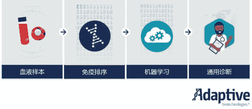

**Building the Human Adaptive Immune System**

The ultimate dream of the collaboration is to use a simple, universal method to detect any infectious disease based on blood tests, and to perform early diagnosis of any cancer, determining what immune diseases a patient might have. As a researcher and a fan of sci-fi shows like *Star Trek*, this research reminds me of the "Tricorder". The current era is indeed remarkable; medical science development will bring infinite possibilities, and today's computing technology and capabilities allow data to help people have better health.

New concepts are triggering infinite possibilities, while the application of AI and other technologies in precision medicine is only a small part of future healthcare.

Besides future-oriented research, AI's optimization of the current diagnosis and treatment process is also very important. Doctor burnout is very common in many countries; doctors usually focus more on computer screens than on patients. Medical diagnostic records have now been digitized, but the problem is that the heavy burden brought by digitization has fallen entirely on doctors and nurses. Multiple studies show that clinicians currently spend over 40% of their working time on data entry; the burden of creating clinical documentation has become one of the main causes of doctor burnout. Even in many countries, doctors are among the professions with the highest suicide rates.

Microsoft, together with partner Nuance, developed a product called `Dragon Ambient eXperience`. It can observe and listen to the conversation between doctor and patient, then automatically construct the vast majority of the clinical record. In early deployments, doctors reported high satisfaction, and patients also gave good trust to the machine that listens to the conversation and assists the doctor.

**Hospital Consultation**

#### Fighting the Novel Coronavirus with AI

The outbreak of COVID-19 has seriously affected people worldwide. How to respond to the disease and the social problems and global economic contraction it triggered poses a challenge to everyone. The good news is that organizations worldwide have mobilized to jointly respond to this crisis. The spirit of cooperation, sharing, and collaboration is inspiring and unprecedented in history. At Microsoft, everyone is also committed to working with partners to jointly combat the COVID-19 pandemic.

First, Microsoft deeply collaborates with medical institutions to help them face the surge in patients, reorganize operational processes, and provide sufficient infection prevention and control capabilities.

In Seattle, the Providence Health System treated the first local COVID-19 patient in the US, so they had to deal with many thorny issues very early on. One of Microsoft's collaboration projects with them was to use the AI chatbot technology `Microsoft Health Bot` to develop a bot named `Grace`. It can interact with patients at home and intelligently provide advice, letting them continue resting at home, or transferring patients to doctors or nurses for real-time health consultation to further verify the situation.

Subsequently, Microsoft also collaborated with the Centers for Disease Control and Prevention (CDC) to launch this bot service for users nationwide on the CDC official website. Since then, over 1,900 websites globally have deployed this medical bot. So far, 39 million people have used the bot to assess their symptoms. Most medical institutions using this medical bot service reported that visits or inquiries related to COVID-19 in their emergency departments, call centers, and telemedicine services decreased by at least 30%.

**Microsoft Healthcare Bot**

At the same time, the biggest challenge for medical institutions in the early stage of the epidemic was admission capacity and its utilization. Hospitals needed sufficient beds, ICUs, ventilators, and personal protective equipment. But how can multiple systems in a hospital collaborate, coordinate overall, and better optimize processing capacity on demand?

On the `Power Platform`, Microsoft rapidly deployed the Hospital Emergency Response Platform. It allows hospitals to easily track COVID-19 patient admission capacity and utilization, and share it across the entire health system. This platform can also automatically report relevant information to the government for public health reporting aggregation, and then use `Azure AI` data analysis to predict future demand. Now hundreds of hospitals in the US and around the world are using this easy-to-deploy solution.

Second, telemedicine is also a good auxiliary method, and `Microsoft Teams` is becoming an AI assistant for doctor-patient conversations.

Microsoft is committed to simplifying the creation process of new telemedicine services while meeting all requirements of medical institutions and patients for privacy, security, and compliance.

**Hospital Emergency Response Platform**

Today, `Microsoft Teams` meeting systems for medical use handle millions of telemedicine visits every day. Any hospital or clinic can easily use Teams to create new telephone consultation services. At the same time, more and more AI technologies are being integrated into Teams for automatic transcription, intelligent search, image processing, voice interaction, etc. `Microsoft Teams` is becoming an AI assistant for doctor-patient conversations.

Third, AI technology can not only be used to provide medical services; advancing medical research and disease treatment is also fertile ground for AI.

# 微软携手 Adaptive Biotechnologies 推进 T 细胞分析与 AI 医疗应用

如前文所述，微软与 Adaptive Biotechnologies 公司携手，对新型冠状病毒进行深入的 T 细胞分析，并将所有数据公开发布在 Immune Code 数据库中，以期促进基于 T 细胞的新诊断方法、新药物疗法和新疫苗的研发工作。

微软一直在无偿提供云端的 GPU 计算能力，以及研究人员的专业知识，帮助如 Immunity Bio 这样的公司加快疫苗研发工作。值得一提的是，Immunity Bio 使用的计算能力是 2002 年第一次 SARS 暴发期间全球最大的超级计算机的计算能力 250 倍以上。如今的云计算能力着实惊人。

最后，微软还将 AI 医疗技术用于其他用途，例如血浆捐赠、临床试验、文档阅读等。

## AI 赋能血浆捐赠与临床试验

在疫苗研制成功之前，最有希望的治疗方法之一是使用康复患者的血浆，可以是直接用康复患者的血浆进行输血治疗，或是生产多克隆超免疫球蛋白类药物。为了确保疗法可靠，需要让更多新冠肺炎的康复患者知道如何捐赠血浆。为此，微软使用了 Health Bot 的一个版本—Plasma Bot，帮助人们确定是否有资格捐赠康复期血浆，并且了解在哪里以及如何进行捐赠。

同样，微软一直在测试部署另一种 Health Bot，用来帮助患者和医生找到可能对他们有帮助的最佳临床试验方案以及需要患者参与的试验。这种 Clinical Trials Bot 使用了最先进的文档机器阅读技术，可以自动阅读`clinicaltrials.gov`网站上对各项临床试验进行解释的文档，为 Health Bot 构建了智能对话的能力。

## Hanover 技术助力医学研究

此外，在帮助医学研究人员更快地取得研究进展方面，AI 也可以有所帮助。每天仅仅发布在 PubMed 上的论文和摘要就有 4000 多篇，远远超出任何人或团队的消化吸收能力。借助 AI 机器阅读技术，微软开发了 Hanover 技术，它能够阅读所有论文，并制作全面的知识图谱。这种知识图谱可用于协助决策制定，例如它曾帮助缅因州的杰克逊实验室等癌症中心进行癌症治疗的决策。随着新型冠状病毒研究和临床试验的爆炸式增长，专门针对新冠肺炎相关研究的 Hanover 最新版，将有着巨大的应用潜力。

## 医疗数据进步：过去四个月超越以往四年

我们观察 AI 在医疗和应对新型冠状病毒的过程中所发挥的作用时，可以看到数据的惊人重要性。确实，数据在医疗和新冠肺炎疫情应对上，起到了至关重要的作用。当下正是科技和医疗行业的关键时刻，如何管理共享医疗数据，正处于转变的十字路口。这其中涉及政策、技术标准、互操作性、隐私性、安全性等许多问题。

尽管大家都知道数据在 AI 解决方案中至关重要的作用，但也遇到了诸多挑战。任何想在医疗行业尝试使用机器学习或人工智能的技术研究者，都会在数据获取上遭遇困难。不少医疗技术初创公司能够提供非常出色的产品和服务，但由于缺乏数据，无法形成具有实际意义的功能。

表面上看，我们淹没在数字的海洋里。但是，它们几乎总是处于格式不兼容的孤岛中，同时又被锁在规则复杂的迷宫里。塞缪尔·泰勒·柯勒律治（Samuel Taylor Coleridge）于 1798 年写过一首古诗《古舟子咏》（Rime of the Ancient Mariner），诗中描述主人公被困在茫茫大海中，没有风，船随波逐浪，“到处都是水，却无一滴可饮”（“water， water， everywhere， nor any drop to drink”）。

不过有迹象表明，当下的新冠肺炎疫情让很多事情发生了变化。从某种意义上说，过去 4 个月的进步甚至超过了过去 4 年。如果你的工作涉及医疗数据，你需要了解“FHIR”即“快速医疗互操作性资源”是什么。这是一个新的全球数据标准，其目标是以一致、便于实施和严格的方式简化数据操作和维护数据完整性，以在医疗应用和医疗组织之间交换数据。

## FHIR：医疗数据交换的基础

FHIR 涉猎范围广泛，涵盖了为人类和动物提供服务的各种诊所、临床护理、公共卫生、临床试验、行政管理和财务部门。这套数据标准旨在供全球范围内各种体系结构和场景中使用。作为完全现代化且可扩展的数据标准，FHIR 有能力让 AI 系统在全球范围内扩展，因为即使目前只能在给定的医疗系统中使用 FHIR，最终目标仍然是所有 AI。

为了确保为将来的医疗发展奠定基础，可以为机器学习算法提供不偏向特定地理位置的数据，无论是患者数据库、遗传基因库，还是治疗方法，都需要一个具有全球扩展潜力的系统，而 FHIR 正是为此而设计。可以畅想一下未来的医疗服务，运用 FHIR 找到一种便捷的方式，让各地区之间可以交换数据，同时满足人们的各种安全和隐私需求。

能够在新冠肺炎疫情下做到这一点极其重要。正如我们所吸取的最大的教训，保障公共健康和应对公共卫生危机离不开数据以及数据的交换共享。为此，微软通过云计算平台 Azure 提供了世界上第一个基于云的 FHIR 服务。基于 Azure 的 FHIR 服务器可作为开源产品使用，而为 FHIR 设计的 API 则可作为完全托管的“平台即服务”来提供。

微软在此基础上启用了众多托管服务，通过在云上无缝管理受保护的医疗信息为客户赋能，无论这些数据是来自远程连接的设备、电子病历系统，或是任何其他来源。在现代化医疗数据互操作性基础上，还将 Teams、Dynamics、Power Platform、Azure 和 Azure AI 中的各种功能整合到“微软医疗云”这一产品中。除了云服务，微软也将继续与世界各地的政府合作，甚至与最激烈的竞争对手合作，来确保共同营造一个更加以数据为驱动的未来。

可以说，这是技术基础架构的巨大转变，因为如此大规模的迁移上云，在历史上或许只会发生一次。业界伙伴需要共同努力，在做出了这一转变之后，未来才可能有更好的医疗服务和公共卫生体系。今天的努力是为了促进公共卫生、医疗服务供给和科学研究的共同进步，今天的每一个选择，都对未来影响重大。

因此，我们需要所有人共同努力应对数据挑战，这样才能从眼前的危机中恢复，并且防患于未然，最终建立一个更美好、更安全的世界。

# 以 AI 之力引领医疗未来

## 作者简介：苏博科

苏博科（Pascal Soriot）

阿斯利康全球首席执行官

自 2012 年 10 月 1 日起担任阿斯利康全球首席执行官，任职以来，引领了阿斯利康的变革，使之成为一家科学至上的全球生物制药企业，专注于肿瘤、呼吸、心血管、糖尿病、肾脏疾病领域。加入阿斯利康前，曾在瑞士巴塞尔担任罗氏制药首席运营官，在此之前曾在美国就任基因泰克首席执行官并领导了与罗氏制药的成功合并。拥有法国迈松阿尔福国家兽医学院兽医学博士学位及巴黎高等商学院工商管理硕士学位。

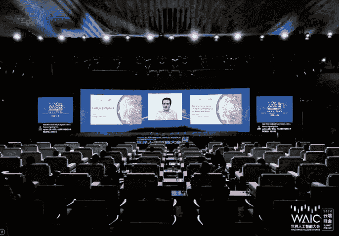

## AI 在医疗领域的应用实践

现在全球都感受到了新冠疫情的影响，虽然很多地方有效控制了疫情，但是全球性的挑战依然存在，仍然需要我们共同来应对，只有这样才能够取得经济社会的进一步发展。在这方面，AI 能够发挥重要的作用。AI 有巨大的潜能，可以改善制造产品和提供服务的能力，以及改变人们互动交流的方式，这里我想借助阿斯利康的实践，谈一谈 AI 在医疗方面的应用。

AI 可以帮助研发新药，赋能新药的生产，也可以提高对疾病的诊断能力。长期而言，AI 能够帮助我们预测甚至是预防疾病。当前，在世界人口老龄化、预期寿命上升以及如癌症、糖尿病等慢性疾病日益普遍的背景下，世界各地的医疗体系都面临巨大挑战，而新冠疫情更是加重了这种挑战，因此，AI 在医疗领域取得的进展非常重要。

为了让 AI 能在应对这些挑战时发挥更大作用，我们必须协同合作，其中信息分享尤为重要，必须确保数据能合理存储、及时分享，并保证数据安全。我们要把在医院、诊所、个人终端收集的数据加以整理并用统一格式存储，从而确保数据可以应用于不同的项目。个人设备获取的数据应该能供医生远程使用，甚至跨越国界，同时我们又要保护数据安全，确保用户隐私不被泄露。只有当人们能够信任数据运用的方式，才能够乐于分享数据。也只有这样，我们才能更好、更高效地运用数据，并将数据的市场效益最大化。

在 AI 的应用方面，以阿斯利康为例，我们不是以碎片化的方式来应用技术，而是采用一个整体的方法，把数据科学和 AI 运用在药物的整个生命周期中。

阿斯利康和其他企业一起为复杂疾病研发新药。我们运用在治疗疾病方面的专长以及对数据科学、生物医学的理解，更好地了解疾病机制，更好地找到治疗的靶向目标。

现在我们在测试新药有效性和进行临床试验时，超过 70%的数据从家庭收集，这意味着更少的随访、对患者生活更少的干扰，并让我们的临床试验更加高效。

AI 也能在药品生产中发挥作用，减少人力投入。我们利用 AI 对生产设备进行更好的维护和保养，并在设备发生故障后更及时地进行维修。不管是对患者、我们自己或者整个社会，这都非常重要。

在诊断和治疗方面，阿斯利康与剑桥大学运用 AI 进行新冠肺炎患者的管理，让医生能够更快更准地进行诊断，让医院可以更高效地进行资源配置，这增加了患者生存和康复的概率。

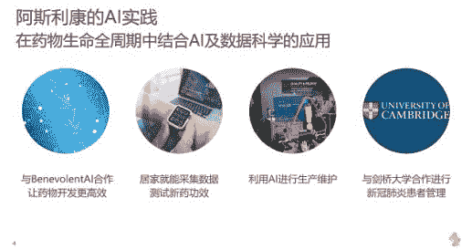

## 中国市场的 AI 医疗创新

以上都是中国以外的例子，然而我认为 AI 在医疗领域最令人振奋的应用在中国。在中国，我们看到技术迅猛发展，百度、阿里巴巴、腾讯这样的企业已成为世界巨头，并拥有众多的合作伙伴。中国的人口、产业实力、政府领导力和创业文化都能让技术能得到更好的发展，让数字化可以更好地推广。中国的软件工程师们有很高的目标，他们和产业界一起创造了一个新的生态系统，让 AI 技术蓬勃发展。

阿斯利康在中国的 AI 实践主要是在复杂疾病管理和治疗方面。2017 年，阿斯利康在无锡建立了 AI 创新中心（药物开发合作平台），并建立了全程疾病管理解决方案。运用 AI 和数据科学技术，诊断变得更加高效准确，从而让治疗变得更加有效，这让我们能够更多、更好地对患者进行治疗。

有 3 个案例可以证明我们取得的进展。第一是肺癌治疗一体化中心。我们将 AI 技术应用于肺部影像的造影、CT，减少医生负担，帮助患者更快得到诊断结果，而时间对于这类患者而言，非常宝贵。第二是在消化道肿瘤方面。我们将 AI 技术应用于消化内镜的诊断，提高诊断效率和准确性。第三是咳喘管理中心。我们利用 AI 帮助呼吸道患者自动检测自身健康状况，提醒他们遵照医嘱，同时及时与患者沟通。如果没有 AI，我们完全没有办法同时管理那么多患者，并保持很高的服务水平。

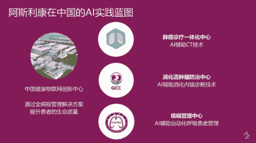

我们已经看到 AI 改变社会、经济和产业的潜力，但这仅仅是开始，相互学习可以让我们找到更多进步的方法。阿斯利康一直都在寻找最好的伙伴进行医疗领域的研发，让医疗服务更加高效、便捷和普惠。

# 机遇：机器学习大有可为

## 作者简介：斯瓦米·西瓦苏布拉曼尼

斯瓦米·西瓦苏布拉曼尼（Swami Sivasubramanian）

亚马逊 AWS 全球副总裁

亚马逊 AWS 全球副总裁，负责亚马逊人工智能和机器学习领域的业务。负责 AWS 核心数据库业务的工程设计、产品管理和运营保障，而这一核心数据库正是 AWS 以下产品的基础构建模块：DynamoDB、Amazon ElastiCache、Amazon QuickSight、SimpleDB 以及其他一些大数据业务。拥有 200 多项发明专利，发表过 40 余篇科技论文，同时也是多个学术团体和行业组织的成员。此外，还打造了 30 多项 AWS 云服务，包括 CloudFront、Amazon RDS、Amazon S3、Amazon’s Paxosbased lock service 等。与沃纳·威格尔（Werner Vogels）先生合著的 Amazon Dynamo 论文（`http://bit.ly/1mDs0Yh`）荣获“美国计算机协会名人堂大奖”。Amazon Dynamo 现已成为诸多 NoSQL 系统的基石。

## 机器学习进入黄金时代

我们生活在人工智能和机器学习的黄金时代，这是一个一切皆有可能的时代。很多意见领袖说机器学习就是未来，但它早已不仅是未来，机器学习正在对各个地区、各行各业产生重要影响，几乎彻底改变了我们生活和工作的方方面面。机器学习有潜力帮助我们应对那些人类社会面临的最为严峻的挑战，但我们需要找到正确使用这一工具的方法。

机器学习已从一项人们渴望的技术，迅速发展成为一项主流技术。在过去很长一段时间中，机器学习仅是极少数科技公司和核心学术研究人员的专利，直到云计算成为主流，情况开始发生变化。原因是机器学习的数据密集型算法非常消耗计算机资源，而云计算的出现让普通大众都能访问到机器学习所需的计算资源，利用其数据存储能力。现在，从金融业到零售业，从农业到医疗保健行业等，机器学习正被各个行业普遍采用，并从外围深入到业务的核心。

## 机器学习如何影响客户

曼特尔实验室是一家总部位于英国的农业技术初创公司，业务是向英国境内客户提供其由人工智能驱动的农作物监测解决方案。这项技术的工作原理是通过评估农作物的卫星图像，及早向农户和零售商报告可能出现的问题，以便他们能够更好地调整供应、采购和库存计划。该平台部署了定制的机器学习模型和亚马逊机器学习平台 Sage Maker，能够基于多颗卫星拍摄到的图像对农作物生长情况进行实时评估。这项重要技术比以往任何时候都更能帮助各种企业、食品杂货连锁店和农民实时评估供应链的状况。

另一个案例是总部位于加拿大的初创公司 Blue Dot，该公司的产品是使用机器学习算法预测疾病暴发。Blue Dot 监测超过 65 种语言的新闻，包括动物疾病等的信息，来预测和分析可能出现的疫情。信息会交由流行病学家审查，他们从科学角度验证结论的准确性，然后形成专业意见提供给公共卫生部门的官员和医院。在此次新冠肺炎病毒开始流行时，Blue Dot 就是最早发出警报的机构之一。

初创公司 Giant 是一家中国的休闲游戏开发商。他们关注如何利用机器学习来完成用户留存和提高盈利水平等目标。该公司在 Sage Maker 上构建各种机器学习模型，并持续在亚马逊云服务（AWS）和游戏平台上获得新的收入来源。

## 找到合适的问题并建立科学的组织架构

在从事了 10 年机器学习相关工作，并与许多经历了机器学习不同发展阶段的客户进行讨论后，我认识到有 4 个因素能促进机器学习得到成功采用。首先是数据，当谈到真正的机器学习时，数据整理是需要做的第一个工作；其次是对于机器学习如何应用的理解；再次是解决人才缺乏的问题，从而打破技术限制；最后是不要进行无差别的繁重工作（如每个机构都去建立自有的机器学习基础设施）。

为机器学习寻找适当的场景，其实就是为机器学习找到正确对应的问题，通常我们会进行 3 个维度的评估。首先是数据的准备是否妥当；其次是这个问题对于业务的影响程度，也就是问题解决的必要性；最后是评估机器学习在这个问题上的适用性，也可以说是评估当前的技术水平是否足以解决该问题。一个理想的情况是，选择的问题对业务影响很大，同样有足够的数据资源，并且最先进的机器学习算法也能适用，那么这个问题的解决就能对整体业务带来重大且有意义的推动。

在采用机器学习的过程中，设定适合的组织架构同样重要。机构通常会聘请管理人员和技术专家组成一个核心团队，这种类型的团队虽然能做出一些成果，却与行业专家和机构中的其他人缺少联系，从而让看上去不错的机器学习模型并不能适配具体的业务问题。更为理想的状况是组建一个包括技术专家、行业专家和业务人员的综合团队，这样才更有可能在机器学习应用方面取得有意义的进展。

雇用了最优秀的人才、选择了正确问题，甚至正确制定了数据策略后，许多机构会去建立“无差别的基础设施”，这需要支付很大的成本并且浪费了时间。我一直建议这些组织不要再做无差别的繁重工作，因为善用外部服务可以更有效地解决这个问题。比如使用如 Sage Maker 之类的工具，可以更好地构建、训练、优化和部署机器学习模型并加快项目的进展。这就是 AWS 的使命所在：为每位开发人员、数据科学家和研究人员提供工具。

# 工业与智能融合：推动高质量发展

## 作者简介：柯睿安、李强

柯睿安（Christian Klein）

SAP 执行董事会成员、全球首席执行官

SAP 全球首席执行官。作为 SAP 智慧企业部门的领导者，负责全球 SAP 核心应用的开发和交付，同时负责 SAP 全球业务运营的工作。在其领导下，智慧企业部门负责推动 SAP 数字化核心开发功能和产品管理，包括 SAP 的旗舰产品 SAP S/4HANA（下一代 ERP）和 SAP Digital Supply Chain，并管理 SAP 丰富的行业特定产品组合。1999 年，在校期间就已经在 SAP 开启了职业生涯。先后在 SAP 全球支持集团、服务运营部门和全球管控部门担任多个职位。2011—2012 年担任 SAP SuccessFactors 首席财务官。2014 年被任命为 SAP 首席风险控制官，并于 2016 年 4 月 1 日接任 SAP 首席运营官。

李强

SAP 全球高级副总裁、SAP 中国总裁

SAP 全球高级副总裁、SAP 中国总裁，全面负责中国市场的业务和运营。一直积极推动德国“工业 4.0”在中国市场的落地，促成了中德第一个“工业 4.0”合作项目，并于 2015 年在中德两国政府总理的见证下签署了合作协议。现任中国工业互联网产业联盟副理事长。2018 年，当选为第十三届上海市政协委员，并被评为“中国 ICT 产业十大影响力人物”。2019 年，受聘担任陕西省人民政府国际高级经济顾问。荣获了中国跨国会颁发的“全球跨国公司领袖奖”、《经济观察报》评选的“2019 年度中国受尊敬企业家奖”，并荣登《人民网》新中国成立 70 周年“奋斗中国人”特别节目。有着 20 余年 IT 从业经验，对商业软件、云计算以及创新的商业模式有着非常前瞻和深入的理解。

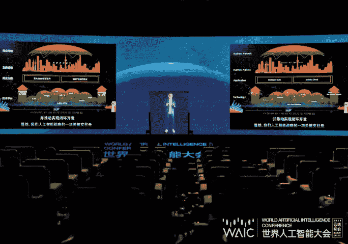

## 对话：全球经济变革与智慧企业转型

柯睿安：全球经济正经历着过去 75 年来最快速、最巨大的变革。纵观各个行业，因为疫情，即使是最有远见卓识的公司也表示遇到了供应链的问题，许多日常业务也遭受到影响，这场危机又一次证明了转型为智慧企业的必要性。

# Intelligent Enterprise: Digital Transformation and AI Application

Many business and public sector decision-makers I have recently spoken with are beginning to realize that digitalization is no longer an option, but a necessity. Companies that were already using innovative technologies to drive business model innovation and automation were not only more resilient before the crisis, but also during this pandemic. Intelligent enterprises can leverage the latest technologies to turn insights into actions in real time; they achieve data-driven innovation and process automation faster, realize new business models and deliver exceptional experiences, and respond more quickly to a constantly changing world.

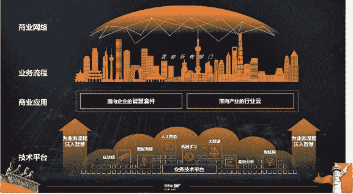

## Intelligent Enterprise Applications

The focus of the intelligent enterprise's embrace of these innovations is artificial intelligence technology. AI not only helps companies improve existing products, but more importantly, helps them create new ones.

From `SAP`'s perspective, the more important applications of AI lie in intelligent analytics, planning and scheduling, and monitoring enterprise processes and production operations on demand. In the manufacturing process, when the supply chain from procurement to manufacturing to delivery and service can be digitized, companies can solve inventory issues. For another example, by combining data from digitalized processes with financial planning models based on real-time market and sales data, companies can act in the market faster and better than any competitor.

The key factor in all of this is data. Only with the correct underlying data and semantics can enterprises improve the overall intelligence and performance of their operational activities. Although there are some pre-trained AI service tools, they only reveal their true value when applications are built on the enterprise's own data.

Applying AI to chatbots and internal enterprise search can significantly improve employee and customer experiences, but the most valuable application for enterprises is still in improving operational efficiency. For example, based on historical and external data, AI can automate enterprise cash collection processes; through standardized data models and semantic analysis, we can achieve scalable data analysis across the entire enterprise.

Judging from various company cases, AI can not only improve revenue and increase profits, but also forecast the next few quarters and provide decision-making insights that drive future business development. In addition, AI can help enterprises overcome potential economic shocks by providing diversified recommendations.

### Kaiserwetter Case

`Kaiserwetter` is an energy asset management company that recently began offering services in China. It has a flagship product named `Aristoteles`. `Aristoteles` tracks global meteorological data through intelligent data analysis and machine learning algorithms to intelligently predict electricity consumption trends, achieve green power generation, and realize transparency in energy operational financial indicators. `Kaiserwetter`'s AI application is an excellent case demonstrating that corporate profitability and sustainable development can go hand in hand, a best practice stemming from the powerful force of data and technology.

### REHAU Case

Another AI application case is the `REHAU` Group. This company has always needed to invest massive human resources to handle their business processes, which lowered efficiency and made errors difficult to avoid. Now, `REHAU` China relies on the process automation capabilities of intelligent robots to automatically process thousands of financial accounting vouchers every day; work that previously took 4 days can now be completed in just 10 minutes.

### China's AI Strategy and Li Qiang's View

China has the most ambitious AI strategy among all nations and has provided the most resources for its implementation. One of `SAP`'s major R&D labs is located in Shanghai; `SAP` is rooted in Shanghai, serving all of China.

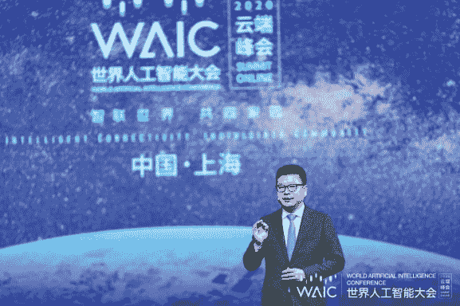

**Li Qiang**: Looking back at the past four global downturns, each time there were leading enterprises that stood out by leveraging advanced technologies and drove global economic recovery. We firmly believe that enterprise-side digitalization will also become an engine for economic recovery this time, and "Artificial Intelligence" is the golden key to enterprise digitalization.

Today, we stand at a turning point where AI drives global economic growth. According to relevant analysis, by 2030, global economic growth driven by AI will reach up to $15.7 trillion, of which China will account for $7 trillion. The growth drivers mainly come from increased enterprise productivity, increased consumption of products and services, and improved labor force levels.

China is already the world's second-largest AI nation; whether in terms of technical level, talent pool, investment and financing volume, or number of patents, China is in a leading position. However, if we analyze carefully, China's AI development still has imbalances. Over 50% of AI application scenarios come from the Internet, finance, security, and transportation sectors, followed by consumer-related fields such as consumer electronics, education, and healthcare. In stark contrast, the manufacturing industry, which accounts for half of China's economy, only accounts for 5% of AI applications. In other words, there is still huge room for improvement in AI's empowerment of "Made in China" and the Chinese real economy.

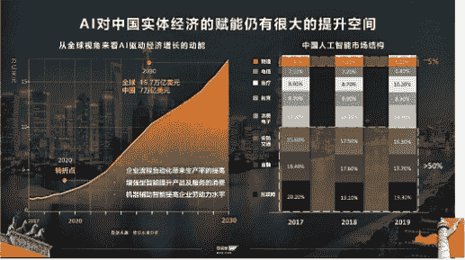

## AI Empowering China's Real Economy

The theme of the 2019 Hannover Messe in Germany was "Integration of Industry and Artificial Intelligence". Over 500 AI manufacturing application scenarios were released at this fair, covering the entire business process and value chain of enterprises—design, R&D, manufacturing, delivery, and service—painting a panoramic map of AI building intelligent enterprises. It is predicted that by 2025, 60% of enterprise business processes will be replaced by AI; we firmly believe that the integration of industry and AI will become the main track for AI application.

Whether it is `SEW`'s fully automated component smart factory, `Audi`'s latest smart factory for electric vehicles, or `KUKA`'s matrix production completed by fully automated independent machining, AI applications cover every industrial field. AI applications can help enterprises cope with challenges such as increasingly rich personalized customer demands, significantly increased product configurations, and significantly shortened product life cycles, playing a role in improving production efficiency, reducing inventory, and on-time delivery, thereby significantly improving economic benefits.

Shanghai is China's economic center, with very strong advantages in talent, technology, capital, and advanced manufacturing. We have reason to believe that Shanghai can contribute a model for the integration of AI and manufacturing for Chinese and global manufacturing. As Europe's largest technology company and Germany's largest company by market capitalization, `SAP` has been in the Chinese market for 25 years, and is the only large multinational technology group to place its dual headquarters (Regional R&D Headquarters and Business Headquarters) in Shanghai. We will further increase investment in Shanghai, continue to take root in Shanghai, and serve China.

---

# Tech Empowerment, Intelligently Benefiting the Masses

**Ge Yue**

`Apple` Global Vice President, Managing Director of Greater China

`Apple` Global Vice President and Managing Director of Greater China, responsible for leading and coordinating the `Apple` China team. Joined `Apple` in 2008 as Vice President of Wireless Technology, focusing on the development of cellular, `Wi-Fi`, Bluetooth, `NFC`, positioning, and `motion` technologies for almost every `Apple` product. Played a crucial role in developing China-specific features for `iPhone` and `iPad`. Prior to `Apple`, served as Vice President of Wireless Software Engineering at `Palm`, and held key roles in technology and management at other wireless technology companies. Holds a Bachelor's and Master's degree in Electrical Engineering from Simon Fraser University in British Columbia, and an MBA from the University of California, Berkeley.

The pandemic has shown us the power of technology. Our users stayed connected, accessed information, sparked creativity, and maintained productivity in new ways. We also applied AI technology to epidemic prevention and post-epidemic reconstruction; for example, the exposure notification technology jointly developed by Apple and Google can accurately identify close contacts of COVID-19 patients.

Machine learning is a very important technology in AI. The camera is a device everyone uses frequently; machine learning can help identify people, objects, and locations in the lens, making photo search and sharing easier. Voice assistants, such as `Siri` on Apple products, use natural language processing technology to understand user needs, help users obtain information, control smart home systems, and even help people who don't share a language communicate. Machine learning can also help recognize handwriting input; with machine learning capabilities, Apple Watch can detect if a user has fallen, accurately record user activity, and help them develop healthy lifestyle habits. Now, powerful machine learning functions can mostly be completed on-device; for example, Apple's self-developed chips have a dedicated processor for machine learning (the `Neural Engine`), which works with the `CPU` and `GPU` to perform the massive calculations required for machine learning, capable of up to 5 trillion operations per second. Apple's machine learning development platform `Core ML` can also run directly on-device.

To date, over 1 billion Apple devices support `Core ML`. Through the machine learning controller, `Core ML` can run simultaneously on the `CPU`, `GPU`, and `Neural Engine`, allowing developers to improve machine learning performance and efficiency without extra work. The AI visual creation app `马卡龙玩图` uses `Core ML` to process user videos on the terminal device; since videos don't need to be uploaded to the server, it saves user time, saves the company server costs, and protects user privacy. The founder of `马卡龙玩图`, Cai Tanyi, believes that Apple's `A13 仿生芯片` and `Core ML` lower the threshold for creation, allowing creative professionals to fully unleash their imagination.

Augmented Reality (`AR`) uses AI technology to project virtual objects into the real world; its brilliance lies in presenting originally impractical, whimsical ideas directly before your eyes, changing the way people work, learn, entertain, shop, and socialize. Apple's `AR` system adopts a hardware and software integrated design. Apple has the world's largest `AR` platform, supporting hundreds of millions of Apple devices, while providing various `AR` development tools. `AR Kit` is Apple's augmented reality development platform, currently evolved to its fourth generation; it includes a depth-ranging function that uses depth sensors to precisely calculate relative distances between different objects indoors (including between users and objects), helping developers create more perfect virtual-real integration applications.

The App Store (`APP Store`) helps 23 million developers worldwide turn their ideas into reality. In July 2008, Apple pioneered the App Store, creating a vast number of job opportunities. In July 2019, Apple launched its first Design and Development Accelerator in China in Shanghai; online lectures launched in the first half of 2020 helped numerous developers learn the latest technologies.

The importance of AI is reflected in the cultivation of the next generation, and cultivating AI talent starts with learning to code. The goal of the Apple Developer Program is to use technology to gather an innovative new generation; through scholarship programs and competitions, students can receive guidance from industry engineers and communicate with peers to progress together. Every child should have the opportunity to learn coding; therefore, coding learning opportunities need to extend to impoverished areas. When students have more opportunities to express their views, their way of thinking changes accordingly.

A vibrant ecosystem combining software, hardware, and services can create jobs, foster entrepreneurship, and encourage innovation. Apple is proud to do this. Looking to the future, our work will not stop; as Apple `CEO` Cook said, we are optimistic about the huge potential of technology, but we also know it will not happen on its own. We focus on the humanization of products, striving every day to inject this into design, looking forward to making our shared home better. This mission inspires us to empower with technology and intelligently benefit the masses.

---

# RPA+AI, Empowering the Automated Future

**Bobby Patrick**

`UiPath` Chief Marketing Officer

`UiPath` is the world's fastest-growing and leading Robotic Process Automation (`RPA`) and AI software vendor, continuously leading the world into the "Automation First Era". As Chief Marketing Officer (`CMO`), responsible for leading the team to formulate and execute global marketing strategies, helping enterprises of all sizes digitally develop daily business operations, and applying AI to drive true digital transformation. Also a technology expert, from `Fortune` 500 companies to startups, has been driving significant growth for tech companies for over 20 years. Formerly served as `CMO` of HP's multi-billion dollar cloud business, responsible for brand internationalization, product marketing, communications, and demand generation to achieve the company's strategic growth requirements; served as `CMO` of `Basho`, `GXS` (acquired by `OpenText`), and `Digex` (acquired by `Verizon`). Began his career as a computer specialist at the Federal Bureau of Investigation at age 16.

Robotic Process Automation (`RPA`) is becoming the next generation of automation empowered by AI.

`UiPath` dedicated 2010–2012 to perfecting two key technologies: Computer Vision and the Designer. Computer Vision allows software robots to "see" the screen like humans, with the same precision and resilience; the Designer enables non-technical engineers to truly build their own software robots and automate their own tasks. The combination of these two technologies created an amazing industry field.

Today, anyone can learn how to use `RPA` and build their own robots. `UiPath` CEO and Co-founder Daniel Dines said: "The potential of automation technology is enormous; we believe the powerful force of AI can make it almost omnipotent."

A few years ago, `UiPath` outlined a vision very similar to Bill Gates' vision in the late 1970s of "a personal computer on every desk and in every home"—that is, "a robot for every person". Everyone, whether a knowledge worker or information worker, or a production line worker, dispatcher, manufacturing floor worker, or retail service personnel, robots can help them complete daily work more intelligently, whether the work is simple or complex.

According to `Gartner` data, the number one technology trend concept in October 2019 was "Hyperautomation". Automation technology has existed for decades, but current hyperautomation is fundamentally different; it is truly about time, value, and speed, thereby helping to solve the problem of difficult ROI in enterprise digital transformation over the past 5–7 years. `Gartner` identified seven core areas of hyperautomation, one centered around AI, another around machine learning and modeling. We need to build a built-in platform to achieve the ability to apply advanced analytics throughout the entire process, whether on the desktop, in the background, or in the cloud. Essentially, this is the current direction of `RPA` development.

In the early days, `RPA` usually revolved around smaller tasks, which could generate very high ROI, but were more task-oriented. Today, `RPA` revolves around longer-spanning workflows, completed collaboratively by human-attended robots on the workstation and unattended robots in the cloud or data center. `RPA` uses process mining to identify which specific processes should be automated, making it easier to integrate into existing environments.

The enormous potential of AI will change every industry. Sci-fi writer `Vernor Vinge` has a famous quote: "We are on the edge of change comparable to the rise of human life on Earth." We have experienced the transition from the technology era to the PC era, and now we are truly entering the era of automation and AI. One challenge of machine learning today is finding data to apply machine learning models and making this process simple.

In 2020, `RPA` has merged with AI. `Gartner` states that 80% of organizations that have deployed `RPA` will introduce AI. The company also states that by 2023, 90% of large enterprises will deploy some form of `RPA`, and at least 4/5 of enterprises will deploy `RPA` at scale, which will truly significantly improve productivity. PwC believes: "By 2030, AI's contribution to the global economy will reach $15.7 trillion, reaching $6.6 trillion in the 2020s alone."

The best way to truly apply AI to enterprise or business processes is through `RPA`.

Through `RPA`, robots can perform various tasks humans do on computers: read and write databases, transfer data between different systems, log into applications, etc. When you apply AI on `RPA`, you start to think about how to truly understand content, understand documents, and how to truly help chatbots become more effective. Robots no longer just mimic humans; they can help humans focus on thinking about operational strategies and enhancing decision-making capabilities.

AI can automate processes including those with high uncertainty. Most processes people execute today are not just querying `SQL` databases; they actually interact with different websites, different applications, and different types of images, videos, documents with signatures, editable `PDF` documents, and unstructured emails. For example, determining if a person is infected with COVID-19 through a chest `X-ray`, or inventory management and pricing optimization for retail enterprises, and fraud detection, Know Your Customer (KYC), and anti-money laundering in financial services. How to transform rule-based processes into experience-based processes? This is where AI can truly play a role.

Our large enterprise clients are applying AI in different ways throughout the entire process, transforming rule-based workflows into experience-based workflows, driving efficiency improvements, and gaining competitive advantages. AI can help realize `RPA` automation, while faster scaling of automation also facilitates AI in identifying, determining, and prioritizing processes that bring the greatest benefits. Globally, currently only 16% of AI projects have entered production; increasing this proportion will be a huge challenge, and we believe the current best path is to apply AI models directly to the data streams passing through the `RPA` platform.

In summary, `RPA` is an amazing collection of technologies; its beauty lies in the fact that you can get results very quickly. Applying AI can help a process shift from rule-based to experience-based, learning continuously over time, with benefits that can be sustained long-term. This is why `RPA` has indeed proven to be the best path for AI, just as our founder Daniel Dines mentioned earlier: this is the best way to create a self-improving company, and the method for enterprises to ultimately have the strongest competitiveness in the market and among the most intelligent enterprises.

---

# Lighting Up Everyday Life with AI

**Liu Qingfeng**

Chairman of iFlytek Co., Ltd.

Chairman of iFlytek Co., Ltd., Director of the National Engineering Laboratory for Speech and Language Information Processing, Part-time Professor and PhD Supervisor at the University of Science and Technology of China, Deputy to the 10th, 11th, 12th, and 13th National People's Congress, Founding Chairman of the National University Student Innovation and Entrepreneurship Alliance, Chairman of the China Speech Industry Alliance.

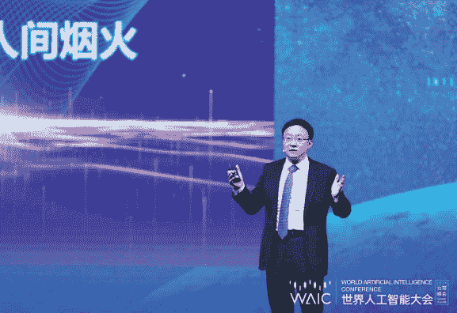

During the critical period of the fight against the epidemic, AI played an irreplaceable role, and practice has proven that solving essential social needs is the key driver for the large-scale application of AI.

After the epidemic, the whole population has been pushed into the era of digital survival; in the future, a lifestyle combining online and offline will become the norm. Therefore, whether it is epidemic prevention and control, future production and life, or phased or long-term digital survival, using AI to light up everyday life is not only an extremely attractive and appealing picture, but also a future trend we must face.

## AI Solves Essential Social Needs, Technology Makes Cities Warmer

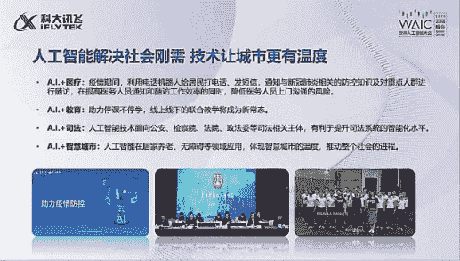

Currently, AI has developed from the innovation period of core technical algorithms to the breakthrough period of typical industry pilot applications, and has begun to enter the stage of large-scale application. At this stage, the key lies in whether AI can solve essential social needs and play a better, larger-scale role.

During the epidemic, the workload of epidemic prevention screening was so huge that relying on traditional community staff and medical personnel to conduct door-to-door investigations or manual phone calls was almost impossible to complete. Using phone robots to call residents, send text messages, publicize prevention and control knowledge related to COVID-19, and conduct follow-ups on key groups could improve the notification and follow-up efficiency of medical staff while reducing the risk of door-to-door communication by medical staff.

Besides healthcare, AI application in the education field was rapidly advanced during the epidemic. "AI + Education" helped ensure "classes suspended but learning continues". In the future, combined online and offline teaching will become the new normal; famous teachers can teach more children online; using AI to automatically correct compositions and recommend knowledge graphs in subjects like math, physics, and chemistry allows children to get more attention from teachers in online classes... So, AI lighting up everyday life will benefit everyone's learning and life.

AI can not only be used to fight the epidemic, but is also an important driving force for supporting the resumption of work and production. As the epidemic gradually improves, this driving force has not disappeared, but has broader development space.

In the judicial field, the application of AI technology to judicial-related entities such as public security, procuratorates, courts, and political and legal committees helps improve the intelligence level of the judicial system. AI technology greatly improves the case-handling efficiency of frontline police officers through functions such as automatic transcript generation, retrieval of relevant data, flaw monitoring, and full-process recording. During the 2020 "Two Sessions", the `Civil Code` was promulgated; the day after the "Two Sessions" ended, the `Civil Code` WeChat Mini Program "Civil Code Know-How" jointly developed by `Procuratorial Daily` and iFlytek was officially launched. This mini-program aims to create an integrated legal platform in the field of the `Civil Code` that combines theoretical interpretation, knowledge explanation, interactive consultation, training, and other content, as well as a connector and display platform for civil procuratorial work, greatly facilitating the implementation of the `Civil Code`.

In the field of smart cities, facing the pressure brought by the aging population on urban development in recent years, we can analyze data such as water, electricity, gas, community, and property videos through AI; once an abnormality is detected, AI phone robots automatically call the elderly, their relatives, and community staff, reflecting the warmth of the smart city. In barrier-free applications, AI allows the blind to "hear" text, the deaf to "see" sound, makes information communication barrier-free, and promotes the progress of the whole society.

## Five Key Innovation Points in AI Development

# Five Key Innovations in AI and New Milestones for the Next Decade

## Five Key Innovations

### 1. Achieving Larger-Scale Applications with Less Data

Taking machine translation as an example, there are still many low-resource languages for which it is difficult to find corresponding parallel corpora for training. iFLYTEK discovered that semi-supervised machine translation enhancement training based on forward and backward data augmentation can leverage large-scale monolingual data for semi-supervised machine translation enhancement training, effectively improving machine translation performance and robustness. This achieves the effect of traditional 20 million bilingual sentence pairs with only 2 million pairs. Without breakthroughs in these key technologies, relying solely on a deep neural network model cannot fundamentally solve the practical problems of AI in applications.

### 2. Dynamic Self-Learning Models

AI faces a significant problem: "overfitting" caused by excessive training data. For instance, if training uses too much data from quiet environments, recognition rates in noisy environments will drop instead, and vice versa. This is "overfitting." The contradiction here lies in how to balance massive training data with personalized adaptation. Solving this requires new approaches, such as iFLYTEK's proposed dynamic model extension based on multi-environment factor sniffing. By automatically sniffing different types of noise, the model structure can be automatically and dynamically adjusted, and recognition effects in high-noise scenarios can be iteratively improved, making data-driven approaches more effective.

### 3. Cross-Lingual Transfer Learning

In the future, under global integration, the multi-language platformization of language technology is an inevitable trend. A community with a shared future for mankind must first achieve free interaction of languages. Therefore, cross-lingual transfer learning is also a key focus for the next step of AI.

### 4. Offline Privacy Protection

In AI ethics, a very important aspect is privacy protection. Privacy protection is not only a legal issue but also means giving users more choices. For example, translators, home controllers, and smart speakers can be made as purely offline versions. On the one hand, this does not hinder functionality; on the other hand, it protects user privacy through physical isolation.

### 5. Making Digital Life More Human with Affective Computing

Enabling AI to possess empathy like humans. In AI follow-up calls, the voice needs to convey a pleasant mood and respond according to the other party's feedback. There is a vast amount of research to be done in this process, especially how to start from affective computing and psychological research to make future AI more human-like in possessing empathy. This involves a series of algorithms as well as a series of humanities and social science research, which requires us to explore further.

## New Milestones for AI in the Next 10 Years

In the era of digital existence, the learning data AI relies on is richer than before. Simultaneously, due to epidemic prevention and control systems, data accumulation, management, and aggregation are more effective than before. This also proves that we can build a better world with AI while protecting user privacy. The next 10 years will be a new decade belonging to AI, marked by three major milestones:

First, AI can truly address weaknesses in people's livelihood undertakings, tangibly meeting rigid social needs in fields such as education, healthcare, judiciary, and smart cities.

Second, AI can empower every individual, making everyone **"AI-enabled."** Ubiquitous AI applications allow everyone to stand on the shoulders of AI, making AI capabilities as accessible as water and electricity. For example, translators give people stronger communication skills; voice recorders turn speech into text anytime, anywhere; and there are office assistants, medical assistants, learning assistants...

Finally, AI can fully support and lead the digital existence of the next 10 years, integrating online and offline, through core capabilities and the continuous traction of emotion and humanities, using AI to **light up the warmth of human life.**

---

# A Clear "Visible" New Era of AI

**Zhu Long**  
Co-founder & CEO, YITU Technology

World-leading AI scientist. Returned to China in 2012 to found YITU Technology, building it into a world-leading AI company. Received Ph.D. in Statistics from UCLA in 2008, studying under Prof. Alan Yuille (IEEE Fellow, student of physics master Hawking), learning how to understand and depict the world. Postdoctoral researcher at MIT AI Lab (2008–2010), working with Prof. Bill Freeman (IEEE Fellow), a pioneer in computational photography. Researcher at NYU Courant Institute of Mathematical Sciences (2010–2012), in the lab of Prof. Yann LeCun (Member of NAE), a founding father of neural networks and deep learning; led team to win international computer vision algorithm competition championships. Published dozens of papers in top-tier AI, ML, CV journals/conferences: PAMI, IJCV, NIPS, AISTATS, CVPR, etc.

## The Evolution of Civilization

When discussing AI, we must first examine what era we are in today. Human civilization has gradually evolved from primitive civilization to agricultural civilization, industrial civilization, and now the Internet era, while AI originated over 60 years ago. Looking back at the history of human civilization, what drives the transformation of civilization? What has happened in between?

### Infrastructure Revolution Drives Humanity's Leap to Machine Civilization

For a long time, we may have forgotten that the most common tools in life are the most important foundations for social change.

Stone tools, bows and arrows, fire, and pottery constituted simple primitive civilization; iron tools, writing, printing, and the wheel became the basis of agricultural civilization; steam engines, electricity, internal combustion engines, and a series of inventions laid the foundation for industrial civilization; while in recent decades, the Internet and semiconductor chips have become the core characteristics of information civilization. The development and evolution of civilization lie in the revolution of infrastructure, i.e., the change of production tools.

So, from the perspective of the entire development of human civilization, where do we stand today?

The smallest known time unit (interval) in the universe is $10^{-43}$ seconds. From such a tiny time unit to the 1 second of a human heartbeat, to the history of cities, human history, and even the hundreds of millions of years of the Milky Way's history—this is the development and evolution of cosmic civilization viewed from the time axis and the physical world.

The set of photos below shows Shanghai Pudong 100 years ago, 30 years ago, and today. Photographic technology allows us to depict the vicissitudes of cities; this set of photos reflects the changes in Shanghai Pudong on a century scale.

Now look at the changes in the physical world on a 1-second scale. When a person rests their hand on a bookshelf, the human eye sees only a static state, but from a machine's perspective, it can capture tiny vibrations within 1 second. If this vibration is magnified 100 or 1,000 times, one can see how the wood bears force.

### Evolution of Cosmic Civilization

### Shanghai's Century of Change

Let's look at a more macroscopic world. On the left is a photo of a galaxy taken by the Hubble Telescope in 2006; on the right is the photo of the supermassive black hole at the center of the Milky Way taken by humans in 2019.

### Visual Magnification

### Supermassive Black Hole at the Center of the Milky Way

Humans can photograph the universe 500 million years ago—an extremely distant past—which also proves that humans can observe the microscopic and distant worlds. Taking this moment as a starting point, the past 30 years were the Information Age, and the next 30 years will be the AI Age. By understanding what happened in the past 30 years, we can predict what will happen in the AI Age.

## Ten-Thousand-Fold Growth in Chip Compute, Algorithm Level, Algorithm Models, and Training Compute

The Information Age has three elements: computing power, storage capacity, and transmission capacity. The most important change in the past 30 years of the Information Age is that computing power, storage capacity, and transmission capacity have increased by a million times.

Over the past decades, compute development has gone through two stages (represented by blue and green curves respectively), which we call the old/traditional era chips and the new era chips based on GPUs or customized for AI computing. The blue curve develops based on the traditional Moore's Law, with performance doubling every 18–24 months; the green curve represents accelerated super-Moore era chip compute. In recent years, AI compute has grown nearly **10,000 times**; a single GPU's compute is **1,000 times** that of a single CPU in the past.

### Compute Growth

How much has the algorithm level improved? Everyone should be deeply impressed by the 2015 AlphaGo vs. human masters match. Starting from 2015, machine players could defeat humans, and machine facial recognition surpassed humans. By 2020, compared to 5 years prior, machine performance improved another **1 million times**—an astonishing magnitude. Simultaneously, the scale of machine learning models and algorithm parameters increased **10,000 times**, and the compute required for training also increased **10,000 times**. There is now a saying that AI has entered a new era of "compute hegemony," where everyone must use thousands or tens of thousands times the compute of the past to train the world's best algorithms.

So what can AI do specifically now? In the early stages of the COVID-19 pandemic, YITU Technology collaborated with the Shanghai Public Health Clinical Center to develop the industry's first AI-assisted diagnosis system for COVID-19. The system can provide lesion descriptions and qualitative diagnoses based on lung CT scans, reducing doctors' confirmation time from hours to seconds. This is a form of visual perception intelligence.

In the future, low-level perception intelligence will leap to high-level decision-making intelligence—from the most basic visual perception intelligence to high-level cognitive intelligence, decision intelligence, and even predictive intelligence supported by comprehensive knowledge graphs. We have already achieved in pediatric medicine the ability for AI to learn from several million cases; under such knowledge graphs, AI can reach diagnostic levels close to a doctor with 10 years of experience.

A few years ago, the intelligent computing needed for city management required the compute support of over a dozen cabinets, demanding huge space, investment, and energy consumption. By a year ago, benefiting from AI chip performance improvements, the required number of cabinets had dropped to **one**.

In the next 10 years, what changes will the super-Moore era bring? Managing a city may require meeting the computing needs of tens or even hundreds of thousands of video streams, yet we will only need a **chip the size of a palm** to support it. This will be a tremendous change.

---

# AI Empowering Robotics and High-End Manufacturing

**Sami Atiya**  
President, Robotics & Discrete Automation Business Area, ABB Group; Member, ABB Group Executive Committee

Joined ABB Group Executive Committee in June 2016 as President of Discrete Automation and Motion Business. The Robotics & Discrete Automation Business Area is dedicated to writing the future of flexible manufacturing and intelligent machinery. Held various senior management positions at Siemens Germany (1997–2015), including CEO of Transportation & Logistics and CEO of Computed Tomography Diagnostic Equipment in Healthcare. Also served as Managing Director of Harald Balzer & Partner, and worked at Bosch Group - Blaupunkt and Fraunhofer Institute for Information and Data Processing. Holds an MBA from MIT, a Ph.D. in Electrical Engineering (Robotics, Sensors, and AI) from University of Wuppertal / Karlsruhe Institute of Technology (KIT), and a Master's in Electrical Engineering and Automation from KIT.

Can we predict the impact of technology on the socio-economy? We once thought electric vehicles were impossible; now they are bringing a revolution. Scholars once believed the best way to fly across oceans was to build relay stations for refueling, but technological progress has long made direct transoceanic flight a reality.

Technology has advanced by leaps and bounds over the past century, and in the past 10 years, the AI and machine learning technology revolution has greatly driven social development.

The current COVID-19 pandemic is affecting all aspects of our lives. For example, lockdown measures have impacted production, forcing business operators to re-examine their production lines, which may not be as flexible as they originally thought, unable to meet market demands under special circumstances. Ensuring supply chain resilience and flexibility is crucial. The pandemic is a catalyst for industry change; adapting to this change will be a new trend.

Technological development accompanies four major industrial trends: the prevalence of personalized consumption, increasing labor shortages, growing uncertainty, and accelerated digitalization. AI-empowered technology, in the form of robotics and automation, provides many solutions to address these four trends and the challenges brought by the pandemic. To respond to these trends, we create solutions delivering four core values: **improving production efficiency, enhancing product quality, increasing production flexibility, and simplifying production processes.** Among these, production efficiency and product quality have always been important factors. Meanwhile, flexibility and extreme simplicity will become increasingly strategically significant because our customers need to adapt to rapidly changing business environments. Imagine a world: production is flexible enough to cope with any demand changes; people are freed from repetitive and dangerous work to focus on high-value tasks, enjoying healthier work and life; all we truly need to do is tell the robot what to do. Such a world is getting closer to us, closer than we imagine.

## AI-Driven Flexible Manufacturing and Future Factories

AI-driven robots can help achieve flexible manufacturing. Production lines are no longer fixed and linear but fully flexible, agile, and automated, with the production process mainly controlled by machines. In the same factory, production of electric vehicles and traditional vehicles can be seamlessly connected, and robots can automatically learn and perform real-time data analysis to improve performance. Through integration with AGVs (Automated Guided Vehicles), AI-empowered robots can manage production tasks, automatically download programs, and collaborate with other robots in the workshop—the entire process requires no human intervention. I am very confident that the integration of robotics and AI can create value throughout the entire cycle of robot production, programming, self-learning, and service delivery; in fact, all this is already happening.

ABB is building a Future Robotics Factory in Shanghai and will establish a dedicated robot production quality control system to ensure every single component produced is perfect. Regardless of the manufacturing sector, quality inspection is critical.

### Future Factory

With AI, not only will designing and manufacturing robots become simpler, but programming will also become simpler, even obsolete. We are researching how AI can help humans interact with robots using natural language; the introduction of AI in programming will make this goal easier to achieve. AI can also enable core workers to interact more effectively with others; augmented reality tools can help operators and engineers find new solutions to problems—these are all values AI can bring us.

## AI Applications in Programming, Warehousing, Painting, and Waste Sorting

Previously, it was impossible for robots to pick and pack goods of different models and packaging; now AI helps us achieve this, making warehouse management more effective. For example, letting a robot pick apples: if it can't grab from the front, it tries other angles, or rotates the apple to see how to grab faster. In this process, the robot analyzes with different variables and applies the results to future tasks—not only picking apples but also other different objects. AI enables robots to work better in such unstructured environments and continuously enhance capabilities through trial-and-error experience accumulation.

Machine learning can also make automatic atomizers work better. This not only improves painting quality but also monitors core indicators such as pressure, vibration, and temperature. Such atomizers can save **75% of paint** and **20% of gas consumption**.

AI is helping achieve sustainable waste sorting. A system jointly developed by ABB and Huawei helps the Shanghai Municipal Government with waste sorting and recycling. This system integrates our small robots YuMi and FlexPicker, utilizing AI and cloud computing to build a "nervous system" comprising robots, computers, and sensors. It can classify waste like a human brain, then transport it to different bins, with every step photographed. In the process, a dedicated cloud dashboard transmits information to the robot, which judges the waste type and sorts accordingly. Through continuous cyclic learning, robots can learn to sort an increasing variety of waste. Benefiting from Huawei's high-performance chips, we can process at **100-millisecond speeds** with **98% accuracy**.

### Waste Sorting System

In addition, through predictive maintenance, AI can improve robot reliability. We use AI technology for pre-maintenance of gearboxes and other components on robot arms, helping customers better predict future maintenance needs.

We need to further enhance manufacturing flexibility and simplicity, allowing humans to collaborate with robots more naturally and conveniently. AI must become part of the robotics solution, so we need to build a global ecosystem to drive innovation.

---

# The New Decade of Digital-Intelligent Interconnection

**Hong Feng**  
Co-founder & Senior Vice President, Xiaomi Group; Chairman & CEO, Xiaomi Finance

Joined Xiaomi in 2010, currently serves as Chairman & CEO of Xiaomi Finance, focusing on promoting the development of Xiaomi's financial business. Graduated from Shanghai Jiao Tong University with a Bachelor's in Computer Science and Engineering, and obtained a Master's in Computer Science from Purdue University, USA. Before founding Xiaomi, held a series of product and engineering leadership roles at Google and Siebel. Led or participated in projects such as Google Music, Google Pinyin Input, Google Calendar, and Google 3D Street View.

Xiaomi is a manufacturer laying out the Internet of Things (IoT) ecosystem, with a very large IoT platform layout now. How to utilize its rich multi-dimensional data sources to enter new fields of AI is what we ares"; or when there are multiple users at home, how to identify each user and attach usage scenarios: this requires voiceprint recognition.

## Latest Progress of Xiaomi IoT

Vision is also a key focus of our AI research. We have done extensive research on cameras, mainly making judgments through optimized algorithms in different scenarios and endowing the most aesthetically pleasing images. It can be said that many photos you see now are hardly completely real; they are all a kind of beautiful illusion based on real scenes.

## Personalization and Digitalization of Smart Home

All aspects of life are accelerating digitalization, bringing more and new opportunities for AI development. During this pandemic, the number of online meetings increased significantly. The content, organizers, and attendees of every meeting are digitized, becoming very easy to track. When digitalization becomes more and more prevalent, AI ushers in development opportunities because we can find patterns in the data, and with patterns comes the opportunity to generate better decisions.

In the smart home field, there will certainly be a large number of opportunities for AI technology integration in the next few years, because a wide variety of home devices can be digitized, and digitalization is the entry point for AI.

Everyone's living habits are different, so achieving true smart home is not easy. To achieve this, everything you do, everything the smart home does for you, and everything you control the smart home to do will be recorded, and we can find patterns from them. For example, we find the pattern between the alarm clock and opening curtains; the linkage pattern of bathroom heater, heater, and exhaust fan; the pattern of door/window switches and air purifier switches, etc., ultimately forming personalized AI. It is like a mother watching your every move behind your back and arranging everything for you.

### Xiaomi Smart Home Devices

# Xiaomi AI and Financial Digitalization Practice

In summer, many people need air conditioners, but everyone must feel that current air conditioners are still far from perfect. Air-conditioned rooms are not very comfortable and can even cause various "air conditioner diseases." At home, how to control the air conditioner well so that children don't catch a cold or get heat rash is really difficult. To achieve intelligent temperature management, one first needs to understand the house layout and know the specific location of the air conditioner in the room, and set up temperature and humidity sensors. When the room temperature is uneven, one needs to know where people are and what state each person is in (sleeping or active), and also know whether the elderly and children have covered their quilts properly at night. These data need to be grasped at all times, and based on this, adjust the air outlets and set temperatures for different rooms. I believe such air conditioners will appear in the near future.

Xiaomi is also involved in the financial sector. Over the past 10 years, digitalization and artificial intelligence have developed significantly in the retail finance field. Personal behavior on the internet, and even most behaviors and habits in daily life, have been digitized. Based on so much data, corresponding AI models can be established. This is the fundamental reason for the high convenience of personal credit over the past 10 years.

In comparison, the degree of automation and digitalization of enterprises is still relatively low. It is very difficult for SMEs to obtain loans. Financial institutions often base loans to SMEs on the analysis and judgment of the business owner's personal behavior and personal credit. Therefore, it is particularly important to digitize and record all processes of the enterprise.

Xiaomi has many small retailers who need funds to purchase goods, but many banks are unwilling to lend to these small shops. The reason is that banks cannot grasp the true whereabouts of the funds, nor can they determine whether the collateral is safe and reliable. The fundamental cause of this situation is that inventory has not been well digitized. So we provided these small shops with a "Smart Drawer" solution. Simply put, when you put goods into the "Smart Drawer," it can automatically identify the quality, quantity, and value of the goods. When consumers purchase, the goods can be automatically retrieved, and the entire process is digitally recorded in the background. Financial institutions can use this system to understand the quantity and value of inventory at any time and provide corresponding credit lines to enterprises.

Xiaomi has invested in many smart hardware manufacturing enterprises. When they complete product development, they often face huge funding gaps. These enterprises need hundreds of millions of yuan to purchase components from upstream companies, and purchase OEM and warehousing services, until retailers pay back, then funds flow back. An enterprise that only has an order finds it difficult to get a bank loan; most of the time, they can only obtain the first working capital through equity financing, which comes at a high cost to the enterprise.

Based on our understanding of these enterprises' business models, we can fully digitize the entire business process: how many parts are needed, from whom to procure, who to cooperate with for manufacturing, warehousing and transportation conditions, product sales channels, and remittance situations. These data are automatically collected and entered into the information system, realizing digitalization. With this foundation, a very detailed order management system can be created. Financial institutions can understand the accurate information they need based on this system and issue loans to enterprises. Banks are not unwilling to lend; rather, highly asymmetric information prevents banks from seeing the real situation of enterprises. What we need to do is to turn the "visual black hole" into a "white box" through enterprise digitalization. We believe that in the fields of corporate credit and industrial finance, after enterprises are fully digitized, the opportunities for AI development will be huge.

---

# Intelligent Connectivity, Unleashing New Momentum for the Auto Industry

**Wang Xiaoqiu**  
President, SAIC Motor Corporation Limited

Doctor of Engineering, Senior Engineer (Professor Level). Has long been engaged in automobile quality, technology, procurement, and other management work, with rich management experience in joint-venture whole vehicles, parts, and independent brand automobile enterprises. Since 2006, has served as General Manager of SAIC Passenger Vehicle Branch, General Manager of Shanghai Diesel Engine Co., Ltd., General Manager of SAIC-GM, Vice President of SAIC Group and General Manager of Passenger Vehicle Branch, Director of Technical Center. Currently serves as President of SAIC Motor Corporation Limited.

New-generation information technologies such as artificial intelligence, big data, and cloud computing are important engines driving the technological revolution and industrial transformation. In the future, the continuous maturity of technologies such as 5G and artificial intelligence will surely accelerate the leap of the economy and society from "networking" to "intelligence." Particularly, the global auto industry is currently facing unprecedented changes in a century, the domestic auto industry is undergoing a major adjustment not seen in many years, and the sudden COVID-19 pandemic has become a catalyst for the formation of a new landscape in the auto industry. Accelerating the deep integration of new technologies such as AI with the auto industry, and continuously stimulating new momentum, will be an intrinsic requirement for the transformation, upgrading, and leapfrog development of the auto industry, and an important way to build a "better automotive life."

## From the Perspective of Consumption Changes: New Technologies such as AI Will Drive Continuous "Quality Upgrade" of Auto Products and Services

In the future, people's travel will not only aim at "arrival" but pay more attention to the "experience" of the process. For example, SAIC Motor (hereinafter referred to as "SAIC") is developing a brand-new intelligent cockpit integrating 5G technology based on the V2X (Vehicle-to-Everything) system, thereby realizing the vehicle's active sensing of drivers and passengers and deep interaction between them, making the car truly an intelligent, intimate mobile terminal. At the same time, this pandemic has changed residents' consumption habits to a certain extent, accelerated the development of the online economy, and forced traditional auto companies to accelerate their transformation to online development. During the Shanghai "5.5 Shopping Festival," SAIC drew on the experience and practices of internet companies to move new product launches online, actively exploring new models of digital marketing for automobiles.

## From the Perspective of Technology Development: The Change of "Software-Defined Vehicle" Is Accelerating

Software is not only the core driving the development of automobiles in the direction of "electrification" and "intelligent connectivity," but also the key to determining the differentiation of future automotive products and services. For this reason, SAIC established a Software Center at the end of 2019 to accelerate the continuous upgrading of businesses such as autonomous driving and mobile travel. SAIC is independently developing a dedicated EV platform and a new-generation electrical/electronic architecture integrating "Vehicle Central Brain + Domain Controllers," and collaborating with leading domestic and foreign chip R&D companies to create customized chips. At the same time, it continues to improve the core capability construction of four major centers: AI, big data, cloud computing, and V2X information security, laying the foundation for SAIC to accelerate the landing of software technology applications in products and services.

## From the Perspective of Achievement Transformation: National and Local Support Will Provide "Empowerment" for the Accelerated Landing of New Technologies such as AI in the Auto Industry

In the past two years, the state has issued a series of guiding opinions to support the innovative development of intelligent connected vehicles, creating a good development environment. As one of the pioneers of domestic intelligent connected vehicles, SAIC is also exploring a technical route for intelligent driving that is technically reliable, cost-feasible, and safety-controllable. SAIC has completed the development of three generations of intelligent driving platforms, with actual vehicle road test mileage reaching nearly 300,000 kilometers, and virtual simulation test mileage reaching nearly 20 million kilometers, and has established an "anthropomorphic" control knowledge base and learning model for intelligent driving. SAIC is leading the formulation of the plan for the "Settlement in Shanghai" of the National Intelligent Connected Vehicle Yangtze River Delta Innovation Platform. The Yangtze River Delta region has unique advantages for developing intelligent connected vehicles, whether in terms of hardware such as economic aggregate, industrial scale, and transportation network, or software such as talent quality and digital economy. SAIC will continue to leverage its own industrial advantages, starting from Shanghai and creating demonstration zones in multiple cities in the Yangtze River Delta, realizing the landing of application scenarios such as Robotaxi, further accelerating the commercial application of intelligent driving technological innovation achievements, assisting the construction of smart transportation in the Yangtze River Delta, and meeting the needs of the vast number of consumers for convenient travel and a better life.

This global pandemic has brought a huge impact to the world auto industry, but it has also made us see the important significance of the automobile as an important intelligent mobile space for urban travel life. No matter how the city changes, bustling traffic is the "vitality" of the city, and smart mobile travel can make the beauty of the world interlock.

---

# AI Building Future Logistics: How the Port of Hamburg Embraces Digitalization and AI

**Angela Titzrath**  
Chairwoman of the Executive Board, Hamburger Hafen und Logistik AG (HHLA)

After graduating from Ruhr University Bochum with degrees in Economics and Romance Languages, she began her career as Head of Operations and Strategic Controlling at Mercedes-Benz in Rome. From 1991 to 2012, she held several international senior management positions at Daimler Group, including CEO of Mercedes-Benz Financial Services Canada, Managing Director of Mercedes-Benz Financial Services North America, and Managing Director of Mercedes-Benz Bank Europe. In 2002, she served as Commercial Managing Director at the Mercedes-Benz production plant in Spain, subsequently becoming a member of the Global Executive Board of Daimler Buses. In 2012, she was appointed to the Executive Board of Deutsche Post DHL Group, primarily responsible for global human resources management within the group until 2014. Since October 1, 2016, she has been a member of the Executive Board of Hamburger Hafen und Logistik AG (HHLA) (a listed European logistics leader), and has served as Chairwoman of the Executive Board since January 1, 2017.

The World Artificial Intelligence Conference was successfully held despite the impact of the pandemic, which is an encouraging signal. Especially as the world is going through difficult times, the exchange of transnational perspectives is becoming increasingly important; only through cooperation and interconnection can we overcome difficulties, for example in health protection and addressing climate challenges. I will introduce how HHLA in Hamburg, Germany, embraces digitalization and AI.

HHLA has more than 6,000 employees and is a leading European logistics group. The city of Hamburg has always emphasized that its global reputation and prosperity come from the Port of Hamburg; the Port of Hamburg is our lifeline. All of HHLA's ships dock at this port, so containers determine the scale of this city's development, just like our red-brick warehouses.

It is not luck that keeps us thriving; continuous experimentation and innovation are the most critical factors. 135 years ago, HHLA built the world's largest warehousing center, but nearly a hundred years later, this center became obsolete because containers replaced the original mode of cargo transport. In 1968, Hamburg welcomed its first container ship, which redefined the way and space of logistics. In the following years, HHLA participated in shaping the container industry, building Hamburg's container terminals into the most highly automated terminals in the world, and setting standards widely adopted globally for container handling and operations.

A forward-looking company cannot turn a blind eye to new technologies and technological changes. HHLA continues to seek entirely new solutions to problems. What comes after containers? Our goal is to develop digital and logistics hubs together with our customers. The world will change rapidly; transport and logistics will be more closely integrated in the future. Large data packets will travel on data routes, just like traditional goods are transported on sea, land, and air routes. Now the entire economy still operates mainly in traditional ways, so the punctuality and reliability of delivery remain key.

Digitalization provides us with many opportunities to better integrate cargo flows and data effectively. HHLA is implementing its own digital strategy, hoping to become an engine of digital transformation. In HHLA's view, AI can increase production capacity and terminal operational efficiency.

In the past, we could not predict the pickup time of stored containers; in the future, computers will use algorithms integrated with historical data to calculate the probable pickup time of containers, and continuously self-optimize through machine learning algorithms. AI algorithms can also predict delivery times more accurately, precisely calculate the position of containers in transit, and whether they are on trucks, ships, or trains. With the help of AI, we can predict the service life of container crane components, and accurately predict the time a ship berths at the quay bridge to enable precise lifting operations. After an HHLA terminal in the Port of Hamburg applied AI prediction, storage efficiency increased significantly, because AI can accurately predict container pickup times, avoiding repeated handling of containers during their stay in the warehouse, thereby optimizing terminal operational efficiency. We used the same solution at another port in Hamburg, and more traditional terminals will use such technology in the future.

The Port of Hamburg is located in the center of the city of Hamburg, so protecting the environment and climate becomes even more important. We use natural resources very carefully. HHLA's goal is to achieve Climate Neutrality by 2040. In 2019, the CTA terminal at the Port of Hamburg became the world's first climate-neutral container terminal. For HHLA, digital and technological innovation is at the center of sustainable development solutions; AI will play an important role. Digitalization is changing our industry and our port.

---

# Connection · Integration

## 5G Makes AI More Ubiquitous, AI Makes 5G Smarter

**Dong Xin**  
General Manager, China Mobile Communications Group Co., Ltd.

Director and General Manager of China Mobile Communications Group Co., Ltd. Graduated from Beijing University of Posts and Telecommunications majoring in Postal Management, Master of Financial Management from Australian National University, PhD in Business Administration co-run by Shanghai Jiao Tong University and France's Rennes School of Business. Formerly worked in the Finance Department of the Ministry of Posts and Telecommunications, and the Economic Regulation and Telecommunications Settlement Department of the Ministry of Information Industry. Served as General Manager of Finance Department and Planning Department of China Mobile, Chairman and General Manager of China Mobile Hainan, Henan, and Beijing companies. Also serves as Vice President of the Council of China Communications Enterprises Association, Standing Committee Member of China National Defense Postal Union, and Director of China Tower Corporation Limited.

5G and AI have become strategic technologies leading a new round of technological revolution and industrial transformation, and are important components of new infrastructure construction. The two integrate and promote each other, achieving win-win and symbiosis, accelerating the digital transformation of the economy and society. With the acceleration of 5G network construction and the collaborative operation of infrastructure such as cloud, edge, and terminal, the Internet of Everything and data aggregation will be effectively promoted, which greatly lowers the threshold for AI use and comprehensively promotes the deep integration of AI into economic and social development.

By 2025, the global AI market size is expected to exceed 6 trillion US dollars, indicating that 5G will make AI more ubiquitous. As AI becomes the core application carried by 5G networks, the intelligent evolution of 5G networks and infrastructure such as cloud, edge, and terminal will greatly accelerate, and the comprehensive effectiveness of cloud-network will be maximized. We can expect AI to make 5G smarter. One can imagine that the integration of 5G and AI will trigger a chain reaction, producing a multiplier effect, accelerating the Internet of Everything, the Perception of Everything, and the Intelligence of Everything, and having a profound impact on the digital transformation of the economy and society.

### In Digital Life

"High-Speed Connection + Sensory Intelligence" will give rise to new human-computer interaction applications. Visual, auditory, and tactile intelligence will rapidly penetrate personal wearables and home devices, presenting a rich and colorful smart life.

> **"High-Speed Connection + Sensory Intelligence" Gives Rise to New Human-Computer Interaction Applications**

### In Digital Production

"Reliable Connection + Specialized Intelligence" will give rise to new forms of intelligent manufacturing. With the characteristics of high reliability and low latency, 5G will integrate discrete networks in various fields of industrial production, promote the deep integration of AI into the entire process and all links of manufacturing, and significantly improve the production efficiency of traditional industries.

> **"Reliable Connection + Specialized Intelligence" Gives Rise to New Forms of Intelligent Manufacturing**

### In Digital Governance

"Wide-Area Connection + General Intelligence" will give rise to new models of smart governance. The ultra-large-scale connection feature of 5G will promote online interconnection in various fields such as education, medical care, and transportation, accelerate the full circulation and efficient utilization of data elements, support AI deep learning, and promote the transformation of social governance in the direction of collaboration, precision, and efficiency. For example, in the process of fighting the epidemic, based on communication, transportation, medical, and other data, AI became a "magic weapon" for tracing personnel movement trajectories and analyzing health status.

> **"Wide-Area Connection + General Intelligence" Gives Rise to New Models of Smart Governance**

Looking to the future, China Mobile will seize the opportunity of the integrated development of digitalization, grid-based management, and intelligence, leverage its own network, user scale, and massive data advantages, vigorously promote the large-scale application and value innovation of 5G+AI, and strive to promote the deep integration of the digital economy and the real economy, stimulating new momentum for high-quality development.

#### First, Realize Large-Scale Commercial Value of AI

The main vision is: focusing on the development of the digital economy, combining livelihood security, and accelerating the large-scale expansion of 5G+AI. For the general public, empower businesses such as cloud gaming, multi-form live streaming, and cloud XR to provide immersive entertainment experiences. For millions of households, empower applications such as smart home, precise video push, and 3D motion-sensing games to create a smart and beautiful life. For all industries, provide intelligent solutions such as security monitoring, intelligent inspection, industrial quality inspection, and smart medical imaging to assist industrial upgrading, product development, and service innovation.

#### Second, Realize Large-Scale Technical Value of AI

The main vision is: on the one hand, comprehensively layout ubiquitous AI infrastructure, build a world-leading intelligent cloud network, integrate AI into the full production cycle of 5G network planning, construction, optimization, and operation & maintenance, build an open innovation platform for network intelligence, promote the application and large-scale deployment of network intelligence, and make 5G networks "smarter." Integrate AI into Mobile Cloud, and promote large-scale computing power construction. In 2020, China Mobile will provide intelligent cloud solutions to industry partners. On the other hand, build an open and shared intelligent middle platform, construct an "Ability as a Service (AaaS)" system, accumulate and aggregate general mature capabilities from inside and outside the enterprise, lower thresholds, improve efficiency, make innovation more open, convenient, and efficient, and make AI applications flourish.

> **Constructing the Ability as a Service (AaaS) System**

#### Third, Realize Large-Scale Social Value of AI

Our main vision is: fulfill the responsibilities of a central enterprise, strengthen key core technology research through joint innovation of industry, academia, and research, deepen industrial openness, cooperate for win-win results, promote more AI chips, capabilities, and applications to mature and become commercially available, and accelerate industrial prosperity. China Mobile positions itself as a new smart city operator, strengthen the deep integration of AI with all aspects of social governance such as medical care, education, transportation, environmental protection, and emergency command, eliminate digital barriers and information silos, make social governance more scientific and efficient, and people's lives more intelligent and convenient.

---

# 5G+AI Opening an Intelligent Connected Future

**Cristiano Amon**  
President, Qualcomm Technologies (QCT)

President of Qualcomm Technologies, member of the Executive Committee, fully responsible for Qualcomm's semiconductor business. Previously served as Co-President of QCT for three years. Prior to serving as Co-President of QCT, was Senior Vice President of Product Management at QCT, responsible for the company's wireless chip product portfolio. Joined Qualcomm as an engineer in 1995, and subsequently held various business and technology leadership positions in the company. Before joining Qualcomm, served as CTO of Brazilian wireless operator Vésper, and worked at NEC, Ericsson, and Velocom. Holds a B.S. in Electrical Engineering from the University of Campinas (UNICAMP), São Paulo, Brazil.

For the entire industry, now is an exciting moment. We are entering a new era of intelligent cloud connectivity driven by AI and 5G. Everything will be connected to the cloud and interconnected in a reliable manner. Terminals and experiences are inseparable from the content, data, computing power, and storage in the cloud. 5G provides fiber-like connection speeds and low latency, coupled with advanced processing capabilities, providing the foundation for all this, making our edge terminals more intelligent. The combination of 5G and AI will affect all aspects of our lives and many industries; this is the next major technological transformation.

To achieve AI at scale, we must realize distributed intelligence across the entire network. Today, intelligence is widely distributed in the cloud and is gradually migrating to the terminal side. In the future, massive data from billions of edge terminals will require us to create an entirely new edge cloud. In this new edge cloud, the processing of content and control will move to where the traffic is generated. Now, the edge cloud and 5G can reduce latency and empower new applications and services; we will see improvements in performance, security, and privacy protection.

The combination of edge cloud and on-device AI will also help enable a wider range of entirely new applications. For us, because of the realization of more intuitive, immersive, and contextual experiences, such as from interactive content to boundless virtual reality, or real-time voice translation, life will be more colorful. The combination of 5G and AI with the edge cloud will also positively and disruptively drive enterprise innovation in more industries. You will see that by utilizing massive data generated by intelligent machines and objects, people can perform local real-time network analysis, promote business insights, raise productivity to a whole new level, and bring better automation and control levels.

This trend will also change the way we look at terminals, because relative to operating systems and app stores, the cloud will play a greater role. Imagine a terminal that is always online and obtains nearly unlimited storage space and processing power from the cloud. The realization of this scenario will drive the emergence of more powerful and potential applications. When we look at today's WeChat, QQ, and other applications, we already realize that the evolution speed of applications is so fast, and future application functions will be more powerful and independent of the operating system. When people can reliably connect terminals and the cloud, there is no need to develop applications separately for multiple operating systems.

## 5G and AI Will Transform Many Vertical Fields and Industries

Utilizing technologies such as 5G and AI, intelligent online education can become richer and more inclusive. Online education will be able to support differentiated and personalized learning; technologies such as real-time translation will allow students to access content from global education databases and learn in their own languages. As of April 2020, a total of 1.7 billion students worldwide had adopted remote learning, which made the digital divide caused by the gap in broadband network connections more prominent, but 5G can change this situation. Once equipped with 5G and edge cloud capabilities, a new learning experience anytime, anywhere, and high-quality interactive content can be realized, building a more productive and smarter society.

# 5G and AI Transform Industries

Another critical area is healthcare. We can see how 5G and AI are transforming the healthcare sector, supporting more accurate early diagnosis, health monitoring, and drug and vaccine development—the key to all of this lies in connectivity. In the US alone, it is projected that by 2030, 50% of healthcare services will be conducted online. With technology, you can have high-quality video, imaging and research backed by massive data, and real-time AI interaction. Thanks to just a small step of technological innovation in this field, paramedics in South Korea are already able to use 5G-connected 360-degree cameras to transmit data from the ambulance to doctors in real-time. For a healthcare industry impacting nearly 10% of global GDP, technology and AI will help expand coverage, improve experiences, and reduce costs.

Let's talk about the future of work efficiency and productivity, another important area undergoing transformation. Enterprise workflows migrating to the cloud can optimize data management more intelligently; systems must support work from anywhere, and network connectivity helps boost productivity, with data tightly linked to cloud and AI. In recent months, 84% of organizations stated they are likely to continue partial work-from-home or remote work policies; many enterprises are even rethinking how to integrate digital space with the physical world. Technology and AI, supplemented by Extended Reality (XR), Augmented Reality, and holographic telepresence, support entirely new ways of working. Enterprise transformation has only just begun.

Retail is another sector facing significant impact. 5G and AI can transform retail end-to-end, covering all aspects from smart supply chains and logistics management to entirely new in-store experiences. In a 5G environment, boundless XR, split rendering, and AI processing technologies enable personalized shopping experiences. You can see AI-tailored product recommendations in shop windows, even photorealistic images of yourself in displays. High-throughput, low-latency 5G XR glasses will also leverage cloud and on-device intelligence to map virtual objects onto the real world, harboring major opportunities.

When we consider industry, we must talk about manufacturing. Manufacturing is currently undergoing a major transformation, and we can see the changes brought by intelligent connectivity. 5G and AI will drive the realization of a new generation of reconfigurable, flexible manufacturing. Enterprise private networks will provide secure industrial data management via highly reliable 5G networks, and data processing will be distributed between devices, edge cloud, or on-premise servers as needed. 5G's ultra-reliability and low latency will enable industrial-grade remote control of machinery. Intelligent operations with end-to-end tracking and control capabilities will elevate productivity to new heights. We will even see innovations never imagined before.

Finally, 5G and AI will usher in a bright future for transportation. As we connect vehicles to the cloud, technology is already changing the transportation industry. We expect 5G and AI to make vehicles smarter—equipped with intelligent cockpits, autonomous driving and data analytics capabilities, and entirely new services. From a safety perspective, as we connect vehicle-to-vehicle, vehicle-to-infrastructure, and vehicle-to-pedestrian, 5G C-V2X (Cellular Vehicle-to-Everything) promises to make travel safer, more efficient, and more enjoyable. Roadside infrastructure will utilize AI-assisted cameras to perceive and manage traffic flow; the integration of sensors and AI in computing platforms will make intersections safer. 5G commercialization can also fully leverage a combination of roadside units and public network small cells to create efficient collaboration between smart cities and operators. This is a potentially massive transformation for the transportation industry.

All of the above must be achieved through collaboration. The future of intelligent connectivity requires multiple companies working together. Qualcomm has been committed to fostering collaboration within the global ecosystem and creating new technologies through partnership. Unleashing the full potential of AI in the cloud, at the edge, and on devices will be tremendously exciting. 5G will be the connectivity platform for the intelligent connected everything, representing enormous opportunities for all participants in the mobile industry.

---

# AI Innovation in the 5G Era

**Yaozhuang Hong (John Allen Hoffman)**

Chief Executive Officer, Global System for Mobile Communications Association (GSMA)

GSMA Ltd is a wholly-owned subsidiary of the GSMA, the world's largest wireless communications trade association. As CEO and Director of GSMA Ltd, he oversees the effective operation of the company's multiple businesses, including GSMA's award-winning industry events, online media, print and broadcast media, industry research, and a range of managed services. He has been engaged in the global wireless communications industry for over 25 years. Prior to joining GSMA Ltd, he served as CEO of Fastmobile, a provider of software-based carrier solutions, and before that as President and CEO of Roamware, a provider of voice and data roaming solutions.

There are currently 5.2 billion mobile subscribers globally, and the industry contributed $4.1 trillion to the global economy in 2019; by 2025, 5G connections will reach 1.8 billion; by 2030, AI will contribute $16 trillion to the global economy and drive 26% growth in local economies. GSMA represents 750 mobile operators and 400 companies in the broader ecosystem.

## 2019: A Pivotal Year for 5G

2019 was crucial for 5G. Many operators actively upgraded infrastructure to meet 5G needs; they were willing to invest heavily in infrastructure because they saw the massive opportunities 5G brings. Consumers also recognized the benefits of 5G; consumers in China, South Korea, and the Middle East were very willing to upgrade to 5G. By the end of Q2 2020, 87 operators had launched commercial 5G services in 39 markets. By 2025, 5G connections will account for 20% of total global connections. Operators in Asia, North America, and Europe will invest $1.1 trillion in the next 5 years, 80% of which will go to 5G networks. These are all positive signals because in the AI era, 5G is the foundation.

## Asia-Pacific Leads 5G Deployment

The Asia-Pacific region has always been a leader in 5G deployment, with 9 markets already commercially deployed and 12 more announcing commercial plans. Mobile operators in Asia-Pacific are expected to invest $500 billion in telecom infrastructure over the next 5 years, of which $370 billion will be for 5G. By 2025, 5G connections in Asia-Pacific will reach 1.1 billion, accounting for 23% of total regional connections. In some Asia-Pacific countries, both governments and enterprises believe digitalization is the priority. Although the rollout and construction of new technologies including 5G may be delayed due to the pandemic impact, this is only a short-term effect. Governments and operators believe 5G will accelerate AI development faster, so they will spare no effort in 5G construction.

## China's Massive Investment in 5G and AI

The Chinese government and enterprises have made massive investments in 5G and AI. Beijing and Shanghai have promoted city venture capital projects worth billions of dollars, and there are a growing number of AI companies in tech parks. China has more data and connections than other countries; since AI relies on big data for greater precision, China undoubtedly stands to benefit most from new applications. China has a huge population, more AI use cases than other countries, and good market prospects, allowing for faster testing. Excellent companies like Baidu, Tencent, and Alibaba have huge investments in 5G and AI, and other private enterprises are continuously investing to support the industry's development. It is certain we will have an AI+5G world, and our imagination will become reality.

## GSMA's Work in China

What specifically does GSMA do in China? First, securing key spectrum resources for operators is crucial. We assist and look forward to the government allocating mmWave spectrum to Chinese mobile operators at the appropriate time to drive the comprehensive development of 5G in China. GSMA has also released AI case studies and 5G development strategies to help Chinese enterprises. GSMA members have supported China State Grid's smart grid projects, China Mobile's edge computing and cloud computing projects, connecting frontline manufacturers with the entire industry ecosystem. Some new technologies, such as open interface standards, are very important for building a secure supply chain; 5G can meet such needs of different vertical industries. 5G can also help vertical industries like aviation launch new services using AR/VR. The media and entertainment industry will also undergo huge changes due to 5G, which can provide high-definition video services across regions. GSMA has provided network slicing templates and continuously works on network slicing integration, hoping to deliver superior entertainment experiences through this guidance and support.

## GSMA Strengthens Industry-Academia-Research Collaboration in AI

GSMA has also strengthened collaboration between industry and academia in AI. For example, GSMA jointly developed AI courses with the University of California, Berkeley, enabling students to develop new use cases, hoping to generate successful 5G applications. China Unicom also participated; they have new projects in 5G and IoT, such as drones, COVID-19 response, 5G coverage, and emergency plans. In addition, GSMA cooperates with a UK AI research institution to help mobile operators better apply AI. GSMA also collaborates with the UK's University of Oxford, University of Cambridge, and University College London, focusing on areas including energy, network optimization, 5G use cases, IoT, vertical industries, and cybersecurity. The integration of 5G with other vertical industries will create unprecedented scenarios, especially in agriculture, where 5G can help farmers better analyze crop growth, pest control, etc., saving pesticides and fertilizers, and achieving green sustainable agricultural development. In transportation, 5G can better promote smart city development and provide better solutions in emergency services.

## Policy Appeals and Vision

5G will drive the development of AI, big data, and IoT, so we hope all governments can support the development of the mobile industry, reduce corresponding tax burdens, and provide more policy support. The combination of cloud computing and edge computing will create more use cases for enterprises.

In 2020, 5G technology is changing the way we live and work. GSMA's vision is to unleash the power of connectivity so that society can continue to prosper and develop. We must take a step forward to drive connectivity under AI!

---

# Artificial Intelligence and Interdisciplinary Integration

## Guest Introductions

### Jie Chen

Academician of the Chinese Academy of Engineering, IEEE/IFAC Fellow, President of Tongji University

Director of the State Key Laboratory of "Intelligent Control and Decision-making of Complex Systems", Vice President of the Chinese Association of Automation, Vice President of the Chinese Association for Artificial Intelligence. Main research directions include multi-objective optimization and intelligent control of complex systems in dynamic environments, multi-agent collaborative control, etc. In recent years, as the first completion person, he has won 1 Second Prize of the National Natural Science Award, 2 Second Prizes of the National Science and Technology Progress Award, 4 First Prizes at the provincial/ministerial level, and the "Science and Technology Progress Award" of the Ho Leung Ho Lee Foundation. Published over 100 SCI-indexed papers, granted over 40 authorized invention patents as first inventor, published 4 academic monographs, 1 textbook, and 1 translated work.

### Jifeng He

Academician of the Chinese Academy of Sciences, Member of the Academic Committee of the Institute of Artificial Intelligence Innovation, Chinese Academy of Sciences

Academician of the Chinese Academy of Sciences, renowned computer software scientist. Currently serves as Member of the Academic Committee of the Institute of Artificial Intelligence Innovation, CAS; Member of the Shanghai AI Strategic Advisory Expert Committee; Director of the Shanghai AI Industry Security Expert Advisory Committee; Lifetime Professor at East China Normal University; Founding Dean of the School of Software Engineering, East China Normal University; Chief Scientist of the Shanghai Industrial Control System Security Innovation Functional Platform (Shanghai Industrial Control Security Innovation Technology Co., Ltd.). Long engaged in theoretical and applied research of computer software, conducting systematic research on software complexity, correctness, and reliability. He is the founder of the Unifying Theory of Programs, the founder of the Data Refinement Completeness Theory, and a pioneer of Trustworthy Software Design Theory and Technology. His research results are key means to guarantee the safety and trustworthiness of AI applications, making him a leading figure in the field of safe and trustworthy AI. The pioneering Principles of Trustworthy AI he proposed have been recognized and adopted by G20 global leaders, making a foundational contribution to promoting the development of the safe and trustworthy AI industry.

### Chengqi Zhang

Deputy Vice-Chancellor, University of Technology Sydney

Appointed as Distinguished Professor at the University of Technology Sydney (UTS) on February 27, 2017, and appointed as Deputy Vice-Chancellor (China Research Collaboration) on December 1, 2017. Since November 2005, consecutively elected as Chairman of the Australian Computer Society's Australian Artificial Intelligence Council. Appointed as Chair of the 2024 International Joint Conference on Artificial Intelligence (IJCAI-2024) in August 2019. Obtained Bachelor's degree from Fudan University in March 1982, Master's degree from Jilin University in March 1985, PhD from the University of Queensland, Australia in October 1991, and Doctor of Science (Higher Doctorate) from Deakin University in October 2002. Key research area is data mining and its applications. Published over 300 technical papers, including many in top international journals. Fellow of the Australian Computer Society (ACS Fellow) and Senior Member of the IEEE Computer Society. Also served as Chair, Program Committee Chair, or Organizing Chair for three of the world's top academic conferences, including ICDM-2010, KDD-2015, and IJCAI-2024.

### Hong Mei

Academician of the Chinese Academy of Sciences, Dean of the Artificial Intelligence Research Institute, Shanghai Jiao Tong University

Academician of the Chinese Academy of Sciences, Academician of The World Academy of Sciences, Foreign Academician of the Academia Europaea, IEEE Fellow. Mainly engaged in research in software engineering and system software, achieving a series of results in component-based software middleware, development methodologies, and tool environments. Published over 150 academic papers, winning best paper and outstanding paper awards at international conferences multiple times. Granted over 10 national invention patents. Undertook dozens of national key research projects, twice served as Chief Scientist of National 973 Program projects. Previously served as member and group leader of the National 863 Program Expert Group, member of the National "Core High Base" Major Project Expert Group, Group Leader of the Big Data Standards Working Group of the National Information Technology Standardization Technical Committee, Group Leader of the Preparation Group and General Group of the Implementation Plan for the National Key R&D Program "Cloud Computing and Big Data", Group Leader of the Preparation Group for the Project Proposal and Implementation Plan of the National "Science and Technology Innovation 2030—Major Projects" Big Data Major Project.

## Dialogue Transcript

### Jie Chen: The next step of fundamental innovation in AI can draw very important nutrients from different disciplines, such as mathematics, brain science, physics, and even humanities like philosophy and psychology. What new directions can these disciplines bring to the future development of AI?

### Jifeng He: I propose research on the compositionality of complex thinking. Current AI deep learning models are mainly based on deep neural networks; they inherit the signal transmission characteristics of human thinking and rely on training data and application scenarios. Various industries have their own experiences in this regard, proving that data-based machine learning can bring us new knowledge and new patterns of understanding problems—this is what we have already seen.

Now let's talk about what problems we encounter. Looking back at when Alan Turing first posed the question of intelligence, his question was "Can machines think?". What we raise now are machine learning problems. I think there is a distance between learning and thinking. From elementary school, teachers instill knowledge into students—this is a learning process. But we hope to be able to draw inferences from one example, to slowly analyze problems and find them; this no longer belongs to pure learning. We feel we should take a step forward, which is why we consider new research areas.

The second problem is that before machine learning, many past AI achievements were mainly manifested as expert systems—this is AI based on causal inference. Analyzing this type of AI, we now have a conclusion, as 2011 Turing Award winner Judea Pearl said: "The knowledge experience obtained by data-centric machine learning has weak interpretability and may produce situations completely contrary to original knowledge." Mr. Pearl gave an example: past data analysis showed the relationship between human exercise and cholesterol was that the more exercise, the higher the cholesterol. This is obviously not the result we hope for; we hope exercise lowers cholesterol. Later it was discovered the main reason for this result was a missing feature value in the machine learning—age was not factored in. If the age factor is considered, it would be found that people of different age groups all have good results after exercise. This is a shortcoming of machine learning.

In 1975, American philosopher Jerry Fodor proposed that thinking can be formally represented using a language with syntactic rules^([\[1\]](#txt042.html#footnote_content_txt042_1)). I don't find this judgment surprising; people exchange ideas through language, which at least proves language has the function of expressing thought. The question is whether *only* formal language can express such thinking? Why emphasize formalization? Because only formal language can be digested by machines; otherwise, machines cannot understand.

Assuming there really is a formal language, we can derive a thinking model: the activity of thinking needs to move forward. This means in original AI innovation, there are both logic-based Turing machines and data-and-transmission-based neural networks. In other words, both the brain and the nervous system are needed; it's not just a matter of transmitting information.

Now let's return to the compositionality of complex thinking itself. First, a simple example. Regarding Newton's discovery of the three laws, legend has it he sat under an apple tree and an apple fell on his head—this is very fragmented data knowledge. After processing and digestion, the final theorem was formed, i.e., what factors acceleration relates to. In other words, we must process and digest fragmented knowledge information to form combinable thinking in our brains. From this example, we draw the following conclusion: thinking is the process of processing and digesting knowledge to generate new knowledge. Therefore, a deep understanding and research on the compositionality of complex thinking is the key to breaking through current data-based AI algorithms and models. We are not saying everything must rely on data. Besides data, our brain is also a very important source.

Our current work mainly focuses on the following 4 research steps:

**Step 1**, we must focus on knowledge representation oriented towards thinking. Knowledge is the summarized element of thinking, but existing knowledge representation methods are insufficient to reflect the thinking process. Thinking representation that reflects the thinking process is the first problem we should study, so we can link thinking and knowledge together—this is the first step.

**Step 2**, we should construct a model of the interaction between knowledge and thinking. We know the relationship between conscious thinking and knowledge is relatively more concrete compared to other consciousness. In fact, there are many different types of thinking in the human brain, such as subconscious, unconscious, and preconscious. Here is a very simple example: an athlete participating in an international competition, the coach often encourages them saying: "You represent 1.4 billion people on this stage." At this moment, his subconscious generates a pressure: "I must dive/jump well." This result is sometimes very successful—he performs extremely well; sometimes it plays a negative role because the psychological pressure is too great, and he fails to perform at his normal level. Therefore, we feel there is an interaction between consciousness and knowledge.

**Step 3**, we must discuss the compositionality of thinking. Thinking is not a simple thought. We conducted forced-choice experiments on macaques to see what they choose when hungry and thirsty—drink or eat. It proved that in different scenarios, the reactions produced by the cerebral cortex are different; they are sequentially active. The image below demonstrates this process. In the first situation, it is very hungry, sees a banana, makes a movement, pulls the rope with its left hand, indicating it is hungry and wants the banana. In the second situation, it is very thirsty, a bottle of water is placed nearby, there is a pedal by its right foot, it steps on the pedal, indicating it is thirsty. So brainwaves do not occur in the same place; this is closely related to our brain science research.

**Finally**, we want to study the mechanism of new knowledge and new architecture formation. The process of machines generating knowledge is machines producing knowledge through training on knowledge data; we feel composable thinking is also a process of creating new knowledge. The left side of the figure below shows a group of flying birds, actually reflecting complex multi-source input; it's not one bird, but many together. This requires understanding how the interaction between them during flight guarantees no collisions occur—there are many opportunities for generating new knowledge here. Additionally, from human motion examples, we can see a person riding a motorcycle very fast may subconsciously bend their waist and lower their head, feeling the resistance is smaller in this posture. Also on the ice rink, athletes bend their waists very low, believing this posture minimizes resistance. So we feel composable thinking is a process of creating new knowledge.

### Jie Chen: AI is not just an algorithm; it actually hopes machines can work like humans, including cognition, analysis, reasoning, decision-making, control, etc. How AI can integrate with other disciplines, including computer science, control science, etc., we also hope to envision a future vision.

# Dialogue on the History of AI Development and Interdisciplinary Integration

## Zhang Chengqi: Three Waves and Three Schools of AI

Looking back at the history of artificial intelligence, the earliest pursuit was General Intelligence, the GPS (General Problem Solver). They hoped to use computer capabilities to solve general problems, and the earliest achievement was in proving elementary mathematical formulas. However, bottlenecks were later encountered, leading to the "AI winter."

The second wave of AI was primarily knowledge-based intelligence. At that time, people believed AI mainly imitated human high-level intelligence—so-called high-level intelligence being the difference between humans and animals. The biggest difference lies in cognition. Knowledge-based AI, represented by expert systems, did solve many high-level intelligence problems. But it also hit a bottleneck: perception was very poor, whether recognition, translation, or even speech. These intelligences are possessed not only by humans but also by animals. In fact, this intelligence is not just about imitating human intelligence but also animal intelligence.

The recently popular third wave of AI is data-driven intelligence. Its greatest success is in perception, such as image recognition, natural language understanding, and translation. Therefore, current AI performs very well in applications. Autonomous driving is very hot now, but why was no one researching it a few years ago? Because if perception couldn't be solved, there was no such thing as autonomous driving.

Over 60 years of AI development, it has basically split into three schools:
- **The Cognitive School (Symbolism)**, or the knowledge-based school. It primarily uses symbolic reasoning and is explainable.
- **The Perceptive School (Connectionism)**, or the data-based school. This school is very successful now.
- **The Behavioral School (Actionism)**, mainly focused on robotics. It relates to control feedback.

Autonomous driving is a very typical case—a perfect integration from perception to cognition to behavior. This field combines computer science, mathematics, and also uses reasoning and control knowledge.

**Perception**: Autonomous vehicles must quickly and accurately identify the surrounding environment; otherwise, autonomous driving is impossible.

**Cognition**: Requires understanding maps, planning paths, reacting to the environment, and making action decisions—all determined by the cognitive part.

**Behavior**: The execution of decisions—physical control of the vehicle, speed, and direction.

I think the autonomous driving platform very typically reflects the integration of AI with other fields to the fullest, and also combines the three schools of AI. Using this example to illustrate AI: the computer is its core. Without computers, there is no AI, because the computer is the most underlying, core, or "0 to 1" change for AI. Other disciplines are also important, possibly "1 to 100" or "1 to 1000" changes. Of course, mathematics also plays a core role in AI development.

## Chen Jie: AI Empowering Industries and Integration Trends

AI penetrates deeply into various industries, playing a significant empowering role. What is the current trend of integrated development between AI and other application fields? Can AI development reduce reliance on domain knowledge?

## Mei Hong: Evolution from Expert Systems to Deep Learning

Since the creation of computers, starting from Turing's universal computing model, we have hoped to use computers to replace human mental labor. Looking at it now, does doing arithmetic count as intelligence? Or simple scientific computing? 100 years ago, this was absolutely high intelligence, because many people had not received such education and did not possess such capabilities. But after computers solved general arithmetic and scientific computing problems, basic computing power was no longer the intelligence we pursued. With the continuous progress and development of society, people now have new demands for computer intelligence capabilities.

Expert systems were also a very successful example of knowledge engineering. Early on, they solved many practical problems. But why did they fail later? Because expert systems followed logical reasoning patterns, making it difficult to solve general problems. Especially common sense—problems ordinary children can handle were extremely difficult for expert systems.

The current new wave of AI is primarily broken through in perception. Why deep neural networks? Deep neural networks themselves do not possess true recognition capabilities; they are data-based classifiers. Deep neural networks and deep learning have enabled major breakthroughs in perception. Perceptual intelligence is now widely applied in various industries. Virtually any real-world problem, as long as we can model it as a classification problem, can be solved with deep learning. Industry applications are mainly in this regard. In this sense, I believe current AI applications in various industries represent a new stage of deepening application of information technology or computing technology across industries.

What is the meaning of AI integrating with industries? In the case of using expert systems, one first needed humans to formalize industry knowledge into rules, then use the system for calculation and judgment. Current AI is data-driven; it can directly self-classify, recognize, and learn some rules from data through classifiers. Current applications are at this stage. This is what we often call AI empowering various industries, enabling them to enter so-called "deep informatization."

What is "deep informatization"?
1.  **First, digitization** must be completed—digitizing all knowledge and processes of various industries.
2.  **Then, networking**—connecting them via networks.
3.  **The third level** is the so-called "intelligentization"—presenting intelligent applications.

As of now, I believe AI *must* combine with other industries and knowledge. Of course, this integration of industry and knowledge may differ from the past; it can greatly reduce the degree of human intervention or human rule extraction, handing as much work as possible to machines. In this sense, current AI industry applications play an empowering and value-adding role. It is hard to say they form a so-called "interdisciplinary" field with any single industry. Because my understanding of the definition of interdisciplinary may be stricter. Currently, it is still computing technology, AI technology, or information technology being applied more deeply in a certain industry. This is the stage I understand for the current integration of AI technology and industries.

## Chen Jie: Intersection of AI and Humanities

Now AI includes intersection with humanities. Its safety, ethics, and health may involve humanities, social sciences, psychology, philosophy, etc. From what angle can these issues be approached?

## Mei Hong: Technology for Good and Ethical Governance

This is a very complex issue. I want to talk about two aspects.

**First**, undoubtedly, AI-related technologies have an empowering effect on traditional humanities and are a very good assistant. How to use AI to assist traditional humanities research is a problem worth paying attention to. In addition, what we need to care about is not just research problems in humanities and social sciences, but more importantly, technology being people-centered, providing technological energy for human survival, development, and a better, happier life. This is the major significance technology brings to us in the humanities.

**Second**, the so-called "bias" brought by big data and AI, and whether further AI development will infringe on human living space and working space—these ethical issues are of social concern, and we should attach great importance to them. A while ago, the China Computer Federation established a committee related to computing ethics, discussing inviting ethicists and computer scholars to cooperate. Our overall goal is "technology for people, technology for good," hoping technology makes life better, not bringing new troubles. Of course, technology development is always a double-edged sword; we must strive to let it develop in a beneficial direction. I think a lot of research probably shouldn't be done. When a technology brings greater harm than good to humanity, we would rather not do it.

## He Jifeng: Algorithmic Fairness and Humanities Participation

Ethics is one issue. The second is the fairness issue of current machine learning-based algorithms. We know data itself has bias. When using mathematical models derived from biased data to make decisions, unfair results may occur. Speaking of fairness, people discuss fairness under what meaning; there are many different descriptions. For example, three people watch a football match standing behind a fence. You give each a stool to stand on; we think this is fair because everyone gets the same treatment. But some are shorter, some taller. If you really want everyone to see the match, you might give the shorter spectator a higher stool. These are all issues to be discussed.

In addition, the relationship between technology development, social development, and "tech for good" is also a concern for philosophers. Which jobs will be eliminated, what new jobs will emerge—everyone must prepare in advance. I believe this has a lot to do with humanities. Ancient Chinese philosophy discussed cognitive issues very early on, for thousands of years, leaving us good things, proving that ancients also encountered the impact of so-called scientific development on their lives. Therefore, my understanding is that humanities participation judges the direction of scientific development from another level.

## Zhang Chengqi: Collaborative Scheduling and Safety Challenges in Autonomous Driving

Take autonomous driving again. Many people care how autonomous driving drives a car safely, accurately, and efficiently. This is only one aspect. Another very important aspect is researching the collaborative scheduling of *many* cars. Like Didi's current scheduling involves drivers. If all cars become autonomous, how to schedule? This scheduling needs to meet passengers' privacy protection, comfort, speed, and economic needs. This requires a lot of economics knowledge to make people save money, be comfortable, and reach destinations quickly.

But another aspect: many new technologies are double-edged swords. In autonomous driving, how to prevent hackers from hijacking your autonomous vehicle? If your car is hijacked, you can't control it at all—the danger is huge. This is the double-edged sword of technology. We must prevent one more thing: whether hackers use autonomous driving technology to manufacture remote weapons. As researchers of autonomous driving, this must be considered, but it's not just a technical issue; it involves legal issues. This double-edged sword needs to be put on the agenda—protecting privacy, ensuring safe driving, preventing hackers, and preventing autonomous driving technology from being used as remote weapons by some people. Legally, this requires global cooperation.

## Chen Jie: Innovation in AI Talent Cultivation Models

AI is developing so fast. What ideas or thoughts are there for innovating talent cultivation models in the AI field?

## Zhang Chengqi: Faculty Alliances and AI Parks

I'll talk about two dimensions.

**First, how to solve the faculty shortage?** Now all universities offer AI courses, including junior colleges and technical schools. Where to find so many faculty? This course isn't something you can just learn by listening to lectures. For the faculty shortage, my idea is that due to the epidemic, online courses are popular, which instead gives us an opportunity: how to form cross-school alliances. Suppose three to five or more schools form an alliance, jointly design AI curricula, use faculty from each school, and combine online and offline teaching. This can solve the faculty problem for cultivating AI talents—a suggestion.

**Second, AI courses need internships, not just lectures.** Learning math and computer science requires students to have strong hands-on and practical abilities. Everyone usually says "industry-university-research integration." I had an idea about 3 years ago that hasn't been realized: to establish a data platform, a computing power platform, and an industry platform. So I've been thinking: can the Shanghai municipal government lead, together with enterprises and universities, to establish an **"AI Park"**? The so-called AI Park puts all current AI experimental products in the park, serving both as a demonstration and an internship platform. If we can cooperatively build an AI Park, treating all AI products as entertainment products while establishing a large experimental platform—whether data, computing power, or scenario platforms—allowing graduate students and researchers to intern here, while also letting enterprises showcase their products.

## Chen Jie: Inspiration for University Discipline Construction and Interdisciplinary Integration

What inspiration does AI have for our university discipline construction, especially interdisciplinary integration?

## Mei Hong: Discipline Reconstruction in the Digital Age and Reflection on Talent Cultivation

Undoubtedly, the interdisciplinary integration of AI with other disciplines is the general trend. AI-related technologies will have a very important impact on scientific research in other industries. Everyone knows data-intensive science or the "Fourth Paradigm," proposed in a specific era. It is a new scientific paradigm emerging with the development of information technology, beyond the existing experimental observation, theoretical deduction, and computational simulation. Therefore, for current university discipline construction, many traditional disciplines must strengthen the imparting of digital knowledge when cultivating talents, because we are entering a brand-new digital age. Digital survival is something everyone facing future society will encounter.

Think about it: with technological progress, what methods will we use to solve problems in the future? In our early university days, we learned to use slide rules and lookup tables; much calculation was done manually. After computers appeared, many things didn't need manual work. In the future, we will use data thinking and computational thinking to solve problems. Many problems are modeled first, then solved by computers. We think many disciplines, including traditional mechanics and other humanities, may use such methods.

Another thing I want to mention is the AI talent shortage. Everyone talks about talent cultivation. I wonder: what talents are lacking exactly? Lack of researchers? I think there is a shortage, but not *that* severe. Because current AI technology is still a new development and continuation of traditional technical paths. Current AI research still has a large reserve of traditional talents. I think from a research level, it's not that lacking. What's lacking is frontier, high-end research talent. What's *more* lacking is talent urgently needed by the industry.

Looking back, how to cultivate talents urgently needed by the industry? What talents does it need? I personally hold reservations about so many prestigious universities in China offering narrow-sense AI majors. I think universities, especially top universities, should still focus on general education and innovative education, giving students potential for future development. I think top universities don't need to, and shouldn't, position themselves mainly to cultivate talents that existing enterprises can use immediately. Of course, China's education system should separate a category of universities to specifically cultivate applied talents capable of data analysis, AI technology implementation, etc. This is a practical problem. We need a large number of applied talents, but these talents should not be cultivated as undergraduates by schools like SJTU, Fudan, Tongji, or ECNU.

I think AI or information technology is a very important aspect for transforming all disciplines, especially engineering disciplines, towards lightweight directions in the future. That is, all future disciplines will involve close integration with information, not necessarily crossing with AI technology, but AI technology should play an important foundational knowledge role in computing, control-related basic teaching, and knowledge system construction of various disciplines. But do we *have* to develop all engineering disciplines in this direction? Must all universities' talent cultivation be oriented towards the batch of hands-on engineers currently most urgently needed by enterprises? I think we need to put a big question mark on this. This is my reflection on AI discipline construction from outside the university.

## Chen Jie: Multi-party Collaborative Layout and Role Division

Now there are many interdisciplinary integrations between AI and other majors. So, from the three levels of academia, industry, and government, how to layout the next step? How to carry out comprehensive cooperation? What responsibilities should each party bear and what roles should they play to promote the rapid development of AI?

## He Jifeng: Government Policy, Industry-University Integration, and Tiered Talent Cultivation

The government should provide corresponding policies to encourage cooperation between enterprises, universities, and research institutes. The biggest problem now might still be how to stick the "two skins" of teaching/research and enterprises together. This problem has been discussed for a long time. I think there are a few approaches.

**First**, during students' academic phase, they should be allowed to participate in research projects as early as possible, slowly cultivating the ability to find, analyze, and solve problems. This is the foundation of innovation. If there is no ability to analyze problems, innovation is out of the question. This is the first point.

**Second**, encourage some form of business communication between university teachers and enterprise technical personnel. Any AI application is impossible without domain knowledge. If we all want to do applications, but stay on opposite sides of a river—one side doing research, the other applications—hands can never be joined. So I think we should use this method to encourage teachers to go to enterprises, and enterprise engineers to come to schools. Such interaction should have relevant policies, but implementation is rare.

**Third**, in cultivation direction, we must cultivate both talents with basic research ability and "master craftsmen" (skilled engineers). This is very different from the "master craftsmen" we talked about early on. For example, everyone is doing digitalization and digital twins now. If you can't build models, how to do digital twins? You can't just ask math and CS teachers to build models for you. Therefore, personnel communication is extremely important.

---

## Appendix: Review of the 2020 World Artificial Intelligence Conference (WAIC) Cloud Summit

The 2020 World Artificial Intelligence Conference Cloud Summit was successfully held in Shanghai from July 9–11. The conference deeply implemented the spirit of General Secretary Xi Jinping's important speeches and the Central Committee's decisions and deployments, seized new opportunities in the development of the new generation of AI, took AI development as a new driving force for post-epidemic economic and social development, fully leveraged Shanghai's advantages in AI technological innovation and application, meticulously prepared and powerfully organized, integrated online and offline, held "cloud" meetings and "digital" exhibitions, demonstrating to the world Shanghai's significant achievements in coordinating epidemic prevention and control with economic and social development. It promoted AI empowering efficient urban operation, high-quality economic development, and high-quality people's life, showing Shanghai's confidence and determination to unswervingly build an AI highland, attracting widespread attention and extensive influence in domestic and international circles and the whole society.

Li Qiang, Member of the Political Bureau of the CPC Central Committee and Secretary of the Shanghai Municipal Committee, delivered a speech at the opening ceremony, pointing out that for Shanghai to become a central node of the domestic grand cycle and a strategic link of the domestic-international dual cycle, AI is an important carrier. Shanghai will deeply implement the spirit of General Secretary Xi Jinping's important instructions, strive to build an open platform for collaborative innovation, an empowering platform for industrial development, a smart platform for urban governance, and a service platform for a better life, and work with friends at home and abroad to jointly explore the bright prospects of AI development. Gong Zheng, Deputy Secretary of the Shanghai Municipal Committee and Mayor, presided over the opening ceremony, pointing out that Shanghai takes AI as a priority strategic choice and will accelerate the cultivation of more new models and new forms of intelligent economy, providing a Shanghai demonstration for cultivating and developing new driving forces. Xiao Yaqing, Minister of Industry and Information Technology; Li Yong, Director General of UNIDO; Houlin Zhao, Secretary-General of ITU, etc., delivered video speeches. Representatives from relevant cities and institutions in Switzerland, South Korea, Finland, Germany, Singapore, UAE, etc., delivered video speeches. Relevant leaders of the Shanghai Municipal Committee, Municipal People's Congress, Municipal Government, and Municipal CPPCC participated in multiple meetings and foreign affairs activities.

Against the special background of the epidemic, this conference took "Intelligent Connectivity, Indivisible Community" as the theme, adopting the "Cloud Summit" model for the first time, achieving the goal of "hundreds of stations broadcasting simultaneously, thousands of networks releasing simultaneously, hundreds of millions of people watching simultaneously." Compared with domestic conferences of the same type and specification, it had a wider communication range, higher search heat, and more overseas activities, becoming the most influential professional, international high-end platform linking global AI development.

### I. Gathering a Strong Lineup of Guests, Pooling Wisdom from Academia and Industry

The conference held a total of 1 opening ceremony, 2 plenary sessions, 11 thematic forums, 20+ industry forums, and 20+ special events, inviting 550+ speakers. Combined with the "cloud speech" format, this conference had more guests and higher levels.

- **Academic Leaders Foreseeing Frontier Theories**: 7 Turing Award winners (5 more than 2019), 1 Nobel Prize winner, 62 Chinese and foreign academicians, and 200+ leading scholars attended, interpreting the latest academic achievements. 27 world (regional) development reports and initiatives were released, including the Nature paper by Chinese AI young scientists and UNIDO's first Industrial Intelligence Open Innovation Ecosystem Initiative.
- **Industry Leaders Discussing Industry Trends**: 32 CEO-level speakers on the first day, double that of 2019. The "Three Mas" (Jack Ma, Pony Ma, Elon Musk) and "Two Hongs" (Robin Li, Zhang Wenhong) gathered, sparking heated industry discussions. Heads of domestic and foreign leading enterprises like BAT, Tesla, SAIC, China Mobile, Port of Hamburg, and high-growth innovative enterprises like Bilibili, UiPath, SenseTime, Yitu attended, discussing emerging industry development and traditional industry transformation in the era of economic intelligentization.

### II. Shaping an Excellent Cloud Participation Experience, Setting a New Benchmark for Innovative Conferences and Exhibitions

Under the background of strong epidemic prevention, the conference spanned continents and gathered in the cloud, with many "firsts" shining brightly.

1.  **Strengthening Application of Latest Intelligent Technologies**. Using AI technology to run an AI conference, launching the world's first live holographic projection speech by a real person at a conference, and the first real-time 3D cloud guest experience. Adopting the latest network intelligent offense and defense technologies, successfully guaranteeing network security.
2.  **Demonstrating Professional Institutional Conference Organization Capabilities**. Launched the first 3×24-hour cloud live studio, with 98 million views. Planned multiple "intercontinental connections," linking people from Asia, America, Europe, etc. Using Shanghai as a blueprint, built the first pure 3D virtual exhibition area "AI Home," conducting online cloud meetings, cloud business talks, and cloud exhibitions.
3.  **Highlighting First Releases and Debuts Leading Industry Development**. Released world-class scenarios like Shanghai Metro (Shentong Metro), East China UAV Base, Zhangjiang Science City. A new batch of 11 application scenarios opened for global bidding. 16 latest AI chips debuted. Shanghai Top 100 AI enterprises showcased highlight products and solutions.
4.  **Implementing Epidemic Prevention Requirements, Doing a Good Job in Guest Service Guarantee**. Formulated a COVID-19 prevention and control plan, prepared for various emergency epidemic situations. For important guests coming to Shanghai, formulated personalized reception plans, coordinated nucleic acid testing, epidemic prevention isolation, and other matters.

*1. 3D Cloud Guest Experience*

*2. Application Scenario—Shentong Metro*

*3. Application Scenario—UAV Base*

*4. Application Scenario—Zhangjiang Science City*

### III. Spreading a Strong Voice of Industry Development, Shaping Authoritative Influence Domestically and Internationally

---

### Notes

[¹]: Refers to the Language of Thought Hypothesis (LOTH). —Editor's Note

Building a communication matrix composed of mass media, professional media, self-media, and official conference media, creating a ripple communication effect. The conference's communication reach hit a record high again. 303 domestic and overseas media outlets registered, a 35% increase against the trend; 131 media platforms broadcast the conference highlights, radiating to over 1,200 online and self-media outlets, with viewership exceeding 250 million; online related topic reads and views exceeded 300 million. Domestic authoritative media reported extensively. The Chinese Government Website and *People's Daily* carried special reports; Xinhua News Agency released multiple popular articles in succession; *Xinwen Lianbo* (News Broadcast) aired reports three times within the month; websites and self-media such as Xuexi Qiangguo, Xinhuanet, and People's Daily Online published over 130,000 articles. International influence reached a new peak. Renowned overseas platforms such as UNIDO, Bloomberg, Reuters, Yahoo US, and Kyodo News reported extensively on the conference; overseas station events in three locations—South Korea, Singapore, and Germany—received active local support.

### IV. Innovation Awards Across Fields Link "Global Creativity", Accelerating the Transformation of Original Achievements

Targeting different entities, the conference set up 8 categories of innovation awards, creating a vane for industry development. The SAIL Award, aiming for the "Oscars of Global AI", attracted over 800 quality projects from around the world for evaluation, with overseas participation exceeding 10%, both setting new historical highs, becoming an important window for observing global AI industry technology development. The AIWIN Competition condensed the AI ecosystem, focused on real scenarios, attracting a total of 1,472 project teams from leading enterprises, innovative enterprises, and universities and research institutes. Industry awards unearthed the surging "new waves" in the AI field; awards such as the "Youth Outstanding Paper Award", "Outstanding Technical Youth Talent Yunfan Award", "Developer Day Hackathon", and "Women's Innovation Award" stimulated industry innovation vitality; the Industrial Intelligence "Zhanlu Award" and the Global Blockchain Innovation Top 50 became star lists in the industry.

**1. SAIL Award**

**2. Yunfan Award—Developer Day**

**3. Women's Award—AI Elite Women's Forum**

**4. Zhanlu Award—Global Industrial Intelligence Summit**

### V. Full-Chain Cooperation Links "Global Resources", Accelerating the Cohesion of Development Synergy

The conference strives to build a first-class innovation ecosystem with smooth "innovation chain, industrial chain, data chain" throughout the full chain. Promote cooperative construction of key projects: 36 industrial innovation projects signed and settled, with total investment exceeding 30 billion yuan. Promote deep integration of industry and finance: The Shanghai AI Industry Investment Fund completed its first phase of fundraising, and jointly built the "STAR Market AI Industry Workstation" with the SSE (Shanghai Stock Exchange). Promote joint industry-university-research tackling: The Shanghai Artificial Intelligence Laboratory and the Process Manufacturing Basic Science Center were officially unveiled, accelerating forward-looking scientific research and key core technology breakthroughs. Promote international and domestic dual circulation: Xuhui West Bund AI Tower, Zhangjiang AI Empowerment Center, and Sequoia Digital Intelligence Industrial Incubation Center were unveiled, attracting and gathering global AI innovative enterprises; the Shanghai Magnolia Open Source Research Institute was established, promoting the construction of an international open source community platform; the Shanghai Artificial Intelligence Industry Association was established, which will further serve the industry and create an international AI brand.

**1. Key Project Signing**

**2. Unveiling of Innovation Institutions**

**3. Xuhui AI Tower**

**4. Sequoia Digital Intelligence Industrial Incubation Center**

### VI. Multi-level Activities Link "Global Brains", Promoting Exchange and Connectivity

Targeting top experts, the Strategic Consultation Expert Meeting was held to discuss major issues on global open cooperation in AI and basic capacity building. Targeting entrepreneurs, the "AI Night Talk" was planned, with government and enterprises on the same stage for in-depth dialogue focusing on AI new infrastructure. Targeting investors, the "Shanghai AI Living Room" was built, setting up an online "Investment Club", with over 100 international innovative projects pitching online. Targeting international talents, a cloud recruitment platform was created, with globally renowned tech companies posting 550 job positions. Targeting developers, the Developer Day activities were fully upgraded, setting up events such as Developer Demo Day. Targeting young audiences such as the post-90s and post-00s, the MV "Smart Home" (智联家园), the world's first AI-composed and performed by 4 virtual idols, was launched, winning widespread acclaim.

The World Artificial Intelligence Conference has been successfully held for 3 sessions. Since the 3 sessions, Shanghai's AI "circle of friends" has continued to expand, with over 20 innovation platforms unveiled and launched, nearly 100 projects signed and settled, high-end talents continuously gathering, initially building a high ground for AI development. Looking to the future, Shanghai will resolutely implement the strategic deployment of the CPC Central Committee and the State Council, earnestly summarize the experience of hosting the conference, continue to strengthen the conference's role as a "linking platform", and make every effort to build the "Four Major Platforms" of AI, making greater contributions to the healthy development of China's new generation of AI.

**1. Wisdom Converges on the Huangpu—AI and New Infrastructure**

**2. "Smart Home" MV**

## Postscript

After the successful conclusion of the 2020 World Artificial Intelligence Conference Cloud Summit, under the unified arrangement of the Conference Organizing Committee and the care and support of leaders at all levels, the compilation and publication of conference achievements was immediately launched. After more than two months of intense editing work, this book "Intelligent World—AI Depicts Our Common Home" is presented to readers.

The textual content of this book comes from the speeches of guests at the conference opening ceremony, plenary sessions, and night talk events; during the compilation process, active cooperation and support were received from all speaking guests. The content editing of this book, including material collation, text sorting, and guest liaison, was undertaken by relevant teams from the Shanghai Municipal Commission of Economy and Informatization, Shanghai Media Group's CBN (First Financial), Fudan University Smart City Research Center, and Donghao Lansheng (Group) Co., Ltd. The design and publication of this book were supported by the Shanghai Scientific & Technical Publishers of Shanghai Century Publishing Group. At the same time, the publication of this book would not have been possible without the strong support of the conference's organizing units and leaders and relevant departments at all levels of Shanghai. Sincere thanks are extended to all of them.

World Artificial Intelligence Conference Organizing Committee

September 2020
