# 智联天下：AI 绘就共同家园

# 前言

2020 年世界人工智能大会云端峰会于 7 月 9 日至 11 日在上海顺利落幕，主题为“智联世界，共同家园”。在疫情防控的特殊大背景下，大会充分发挥上海在 AI 科技创新与应用上的聚合优势，采取“线上线下融合、会议上云、展览数字化”的创新模式。全球顶尖 AI 科学家、企业家、投资人、开发者及各界关注者云集一堂，围绕 AI 技术演进新向、产业落地新动能，以及 AI 助力全球抗疫、构建温情家园等核心议题深度对话，输出了大量极具价值的理念、洞见与建议，引发业界与社会广泛共鸣。

作为面向这一关键新兴技术领域的国际高端对话平台，世界人工智能大会已成功举办三届。2018 年 9 月，习近平总书记向首届大会致贺信，站在战略全局高度深刻阐释新一代 AI 发展趋势，彰显中国愿同各国携手共促发展、共护安全、共享成果的鲜明态度，为 AI 健康高速发展指明航向。本届大会开幕式上，中共中央政治局委员、上海市委书记李强强调，上海将深入贯彻总书记重要指示精神，全力打造四大平台：联通协同创新的开放平台、赋能产业发展的赋能平台、优化城市治理的智慧平台、惠民生福祉的服务平台。上海愿携手海内外朋友，共探 AI 广阔前景，合谱智能时代华章。

为让大会思想精华与学术成果惠及更多人，回应各界期盼，主办方延续推出“智联世界”系列丛书。本书聚焦 2020 年大会开幕式、全体会议及晚间对话的嘉宾演讲实录，以“家·AI（爱）”“方向”“趋势”“抗疫”“机遇”“联·融”六大主题为轴，全景呈现全球 AI 前沿动态，传递“科技向善、共建人类命运共同体”的价值主张。

本书旨在为业内人士及大众读者把握 AI 趋势、参与大会及上海 AI 高地建设、推动我国新一代 AI 健康发展提供权威参考。

世界人工智能大会组委会
2020 年 9 月

# 家·AI（爱）

## 变革纪元：担当重于焦虑

**马云**

联合国数字合作高级别小组联合主席

1999 年创立阿里巴巴，历任董事局主席兼 CEO（至 2013 年 5 月）、董事局主席（2013 年 5 月至 2019 年 9 月）。兼任世界经济论坛基金会理事会成员、浙江商会会长、中国企业家俱乐部理事长。2018 年起出任联合国数字合作高级别小组联合主席。毕业于杭州师范学院（杭州师范大学前身），主修英语教育。

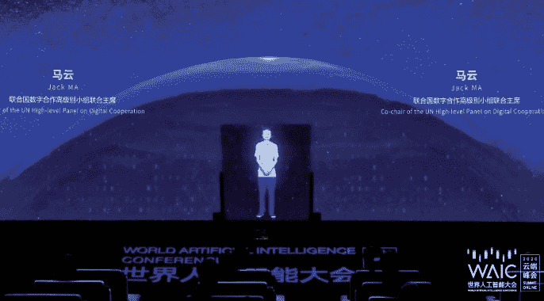

我人目前在云南，很荣幸能参与大家的探讨。

这是一场别具一格、甚至可载入史册的大会。回首首届大会在上海召开时，谁也料想不到，今年我们会以这种形式延续上一年的研讨。

记忆犹新，去年此时，我们中不少人还忧心忡忡，争论机器是否会取代人类、就业何去何从；而今，最令我们焦灼的反倒是——如何让机器尽快接管更多高风险人工岗位。比如病毒传播一线，我们千方百计让机器顶上，而非让人冲在最前面。世界运行的逻辑往往如此：担心的事没发生，没担心的事却接踵而至。

眼下的困境源于过往的抉择，昨日不可追，今日往往无力回天；唯有未来的模样，掌握在今天的抉择里。我认为，应将疫情给世界带来的变局，视作自然、未来发出的信号。这几天思考颇多，愿分享三点感悟：

### 一、人类离不开地球，地球却可以没有人类

工业革命赋予人类向外探索的能力——登月、建空间站、尝试太空生存，马斯克等杰出先行者开启了地外世界的壮阔征程。

而数字革命则赋予人类向内探究的能力——真正读懂自我、读懂地球。相较而言，对内在的探索更为艰深，也更为关键。

当下，人类对自我认知极其有限，即便顶尖脑科学家对大脑的解读也不足 10%。此次疫情暴露了人类对自我、对赖以生存的星球的陌生。正是因不懂自己、不懂世界、不懂地球，缺乏珍视与守护，才招致诸多祸患。当务之急，是解决人类自身的问题，解决地球的问题；否则，无论迁徙至哪颗星球，同款灾难仍会上演。

事实上，人类至今无法脱离地球独立生存，但地球若失去人类，或许会更好。近期新闻触目惊心：日本奈良因游客锐减，梅花鹿少吃零食、肠胃变健康；意大利水城威尼斯封城后，运河水质转清、鱼群重现。若地球是家公司，自然才是真正的老板，人类只是自然挑选的“管理层”。人类权力虽大，但自然随时能“解雇”我们。

许多事在人类视角里无错，在自然法则下却是大错。若人类持续给自然制造灾难，自然必以灾难回报。人类必须学会与自然共生，唯有敬畏自然、顺应自然，方能在地球长存。

### 二、经济增速可缓，人类成长不可止

疫情让我们清醒认识到：主导世界生态系统运行的，是微生物而非顶级掠食者。非洲大草原上，关键角色是微生物而非狮象。人类切不可自我膨胀、高高在上。

**重新定义AI：人类缺的不是智力，是智慧**

我认为，AI更应译作“机器智能”；沿用“人工智能”这一译法，折射出人类的某种自我膨胀。诸多令人类棘手的难题，在机器面前却迎刃而解。兽类凭本能，机器靠智能，而人类的核心禀赋，理应是智慧。

漫漫数千年，人类的知识版图急剧扩张，技术手段日新月异，但智慧的水位却未见抬升。

当下，我们拥有的资源财富、知识技术，皆是史无前例的巅峰；随之而来的烦扰与挑战，同样空前绝后。人类的知识积淀、信息处理效能、抗风险能力，站在了历史最高点。然而遗憾的是，智慧却缺位了。我们未能善用这些禀赋去深化沟通、巩固合作，反而屡屡筑起壁垒、拉大分歧。灾难从未远离人类，但灾后若不生长，我深信：未来摧毁人类文明的，不会是病毒，而是人类自己。

人与人、国与国，无有雷同，差异恒久存在。正是这些差异，绘就了世界的斑斓多彩。当下全球诸多困局，根源多在于漠视彼此的差异与分歧。看见不同，仍能搁置争议，学会尊重、欣赏差异——这才是人类文明进阶的标识。

### 第三，数字技术昔日为“生活更好”，今朝为“生存更优”！

疫情未逆转科技变革的洪流，反倒加速了数字化的进程，因灾难逼迫创新。

以CT影像筛查为例：专家肉眼研判疑似病例需15至20分钟；而国内技术团队在极短周期内攻关出智能算法，机器仅用20秒便完成阅片，效率跃升60倍。

还闻疫情期农户凭卫星遥感技术获贷：农户在手机小程序勾绘田块，卫星通过遥感影像识别作物长势，结合气象、行业数据由机器估算产值，进而定授信额度。

疫情期间，借互联网技术“自救救人”的创新比比皆是——网课、远程会议、电商购物、在线问诊……生活运转的齿轮全赖数字技术驱动。为生存而创新，乃是最强劲、不可阻挡的驱动力。数字化的大势未变，原本需三五十年走完的历程，或将压缩至十年、二十年内完成。这是变局中的新变局，技术变革加速演进，正是我们亟待备战的，也是今年AI大会区别于往届的全新语境。

隔年重逢，世事巨变。今天的我们，已无暇焦虑；与其忧虑，不如担责。病毒不需签证、不认国界；技术亦不应有疆界、不分彼此。当下的灾难深重，或许才刚拉开序幕。我们别无选择。团结协作、抱团取暖，动作越早，胜算越大。

再次致谢各位！

## AI演进的机遇与展望

**埃隆·马斯克**

特斯拉联合创始人兼CEO

特斯拉联合创始人兼CEO，统领电动汽车、电池产品及太阳能屋顶的产品设计、工程与制造。亦为SpaceX联合创始人、CEO兼首席设计师，主导先进火箭与航天器的研发制造。此外创立The Boring Company并任CEO，同时兼任Neuralink CEO。

# AI与机器人在感知、认知与行为上的突破

若按感知、认知、行为三维拆解，人工智能在感知层已取得巨大飞跃。在专业图像识别领域，AI表现近乎超越所有人类；唯一的变量仅在于算力规模、集群数量与训练时长。无论图像还是语音识别，给定字节流，AI系统均能高精度识别与处理。

认知层或是短板所在。AI能否理解概念？能否有效推理？能否创造有意义的事物？虽涌现诸多极具创造性的前沿AI技术，但对创造性活动的可控性仍显不足。

行为层以博弈为例。在规则显性、自由度受限的游戏中，AI已展现超人类水准。放眼当下，难以想象有何游戏能让AI不胜人类，更遑论AI的反应速度远超人类极限。

## L5级全自动驾驶指日可待

我坚信L5级自动驾驶，即完全自动驾驶，终将实现，且时日不远。

我并不认为存在根本性的底层障碍，困境在于海量细节问题的攻克、系统集成的磨合，以及长尾场景的持续突围。常见情况是：绝大多数场景已攻克，却偶有极端边缘案例浮现，因此必须建立机制识别并解决这些罕见场景。

这正是我们坚持在真实路况训练自动驾驶系统的原因。没有比现实世界更复杂的环境；任何仿真模拟，都只是现实复杂度的子集。我们正全力攻坚L5级细节难题，我相信凭借特斯拉现有车载硬件版本，仅通过软件迭代即可达成L5级自动驾驶。

## 特斯拉上海超级工厂建设提速

我为特斯拉团队感到无比自豪，衷心感谢中国团队的卓越付出，令我倍感欣慰。未来，我们的工厂将深度嵌入更多AI与智能软件。

## 自动驾驶如何倒逼AI芯片与算法革新，重塑认知

在为Autopilot配备AI芯片时，我们发现市场上不存在兼具合理价格与低功耗的方案。若沿用传统GPU、CPU等通用芯片，功耗高达数百瓦，车尾箱将被巨大的散热系统填满。传统芯片不仅成本高昂、占用空间，更面临高能耗难题，而能耗直接关乎电动车的续航命脉。

### 特斯拉自研算力底座：FSD芯片与Dojo超算的进化路

为此，特斯拉自主打造了具备双系统冗余架构的FSD全自动驾驶芯片。该芯片采用8位整数运算并配备点积运算加速器，其性能潜力至今未被完全榨干——直至几个月前，团队才审慎启用了第二套备份系统。要彻底释放这颗芯片的全部算力，恐怕还需要一段时间的迭代。

为应对海量视频数据的极速训练需求，特斯拉同步研发了Dojo超级计算训练系统。该系统可类比为FP16精度训练集群，当前主要受限于芯片散热瓶颈与通信带宽上限。正因如此，工程团队正攻关新型总线架构与热力学冷却方案，意在构建更高能效的计算平台，从而大幅提升视频数据处理效率。

在AI算法层面，神经网络的核心范式是从现实世界汲取海量信息——主要源自被动光学感知——并将其映射构建为向量空间，本质上是将庞大的光子信号压缩为高维向量表示。我们习惯用类比思维默认现实的真实性，但我认为我们可以尝试“进入”自身大脑的向量空间，去洞察大脑处理外部信息的机制。大脑的实际运作，是对海量输入进行获取与筛选，仅保留关键变量，以极小的信息量实现决策。大脑存储的信息仅占原始数据的微小比例，却能基于向量空间表征做出判断，这本质上是一场大规模的“压缩-解压”博弈。

---

### AI治理五大基石：透明、公平、安全、责任、隐私

> **斯蒂芬·施瓦茨曼**  
> 黑石集团董事长、CEO兼联合创始人

近期，七国集团（G7）发起成立“全球人工智能伙伴关系”（GPAI），这是一个振奋人心的开端。若缺乏一个能够推动全球协作与跨学科融合的真正国际公约，所有国家都将蒙受巨大损失，并拖慢各自的创新步伐。

AI赋能企业优化复杂的全球供应链、预判市场变局。借助AI，企业得以构建更敏捷、可靠、抗风险的端到端供应链体系；面对新冠疫情冲击下的全球商业中断，AI驱动的供应链展现出更强韧性。创新将在全球多点开花，各国AI最佳实践应当共享互鉴，沉淀出造福全人类的发展新范式。

近年来，全球众多机构相继发布AI伦理准则，为全球对话奠定了基础。尽管各国在特定议题的解读、侧重与落地路径上存在地域文化差异，但世界在“透明度”、“公平性”、“安全性”、“责任归属”与“隐私保护”五大核心原则上已呈现显著收敛趋势。

**原则一：透明度**  
AI决策逻辑必须可解释、可审计，设计与执行过程需接受监管。算法不能是“不可触碰的黑盒”，我们必须清楚知晓AI系统在何时、何地、以何种方式被调用。

**原则二：公平性**  
技术不得放大偏见，而应践行包容理念，让红利惠及尽可能广泛的人群。

**原则三：安全性**  
AI不应造成可预见或非预期的伤害，系统需具备高可靠性与抗干扰鲁棒性。

**原则四：责任归属**  
因AI决策失误导致的损害，责任主体必须明确界定，并在适用时强制采取补救措施。研发者需前瞻评估技术风险，并切实采取缓解行动。

**原则五：隐私保护**  
AI高度依赖数据，故须建立机制守护个人权益与隐私。系统应以通俗易懂的方式披露个人信息的使用、存储与保护细则，用户更应拥有便捷撤销授权的权利。

这些原则若能尽早通过统一治理框架落地生效，人类便能更有效地规避AI潜在负面效应。中国多家机构已率先行动推动伦理落地，包括国家新一代AI治理专委会发布的治理原则，以及2018、2019两届世界人工智能大会（WAIC）发布的《上海人工智能治理倡议》。

各国政府均应深度参与AI治理的共建共治。2018年WAIC上，中国国家领导人表达了携手各国发展造福人类AI的意愿。当下，正是全球政府携手合力、护航AI健康发展的关键窗口期。

---

### 疫情下的深度反思：AI的未来在哪里？

#### 嘉宾阵容

**张文宏**  
复旦大学附属华山医院感染科主任

**陈杰**  
中国工程院院士、IEEE/IFAC Fellow、同济大学校长

**沈向洋**  
科学家、学者、微软全球前执行副总裁

**朱民**  
清华大学国家金融研究院院长、国际货币基金组织（IMF）前副总裁

#### 实战检验：抗疫一线的AI得与失

**张文宏**：当下社会对AI期待值拉满，但回溯疫情初期，我们仍高度依赖“人海战术”。当上海医疗队驰援武汉时，我们渴望AI已渗透全国——实时掌握口罩、防护服、呼吸机乃至尿不湿的库存，精准调度医疗资源。遗憾的是，那时这些基础数据根本不存在。

随疫情演进，AI的巨大潜能逐渐显现。为何其他城市难复制上海的抗疫成效？关键在于AI与智慧治理在上海全流程发挥了核心作用。实施社会面管控后的一两个月内，AI在城市运行、民生保障、患者救治三大维度扮演了关键角色。

AI正处风口浪尖，但我必须坦诚：总体而言，中国此次抗疫胜利仍靠传统智慧与城市管理托底。AI虽介入疫苗靶点预测、药物筛选，但这些成果服务于未来。我们真正该反思的是：疫情过后，AI如何重塑公共卫生体系的韧性与前瞻性。

**陈杰**：本次抗疫，AI贡献显著。以同济大学为例，校内汇聚4万余名海内外师生。为实现精准防控，我们引入AI技术录入全员信息并构建智能准入系统，自动判定入校资格。为减少现场摩擦，系统将拦截原因实时可视化呈现：来自重点疫区、未满14天隔离期、体温超37.3℃、非本校师生访客——四大规则一目了然，既有温度又有原则。

**标题：AI抗疫实战与未来图景：从“辅助人类”走向“智能社会”**

**核心观点：疫情验证了AI三大核心价值——加速科研攻关、重构数据决策、打破医疗资源壁垒；未来发展需聚焦“认知跃迁”、“交互革命”与“常识突破”，并推动数据从“孤岛”向“生产力”转化，最终实现“向善”愿景。**

---

### 一、 疫情考场：AI交出了怎样的答卷？

沈向洋指出，这场全球公卫危机让AI在三个维度完成了“实战验证”：

1.  **科研提速器**：从病原溯源、辅助诊断到药物筛选，AI大幅压缩了研发周期，尤其在治疗手段突破上展现出不可替代的杠杆作用。
2.  **全球态势感知中枢**：通过聚合全球公卫与流行病学数据，AI构建起立体、直观的疫情画像，让跨国专家能同屏研判风险、同步应对。
3.  **医疗资源“放大器”**：远程医疗、云端协作等新基建落地，让优质医疗资源跨越时空限制，惠及更广泛人群——这对医疗短板地区与发达国家同等关键。

他强调，AI的终极使命是**“增强人类能力，造福人类未来”**。为此，隐私计算、标准化规范、防滥用机制等基础研究必须跟上。回溯疫情初期，数据断层曾是首要拦路虎；展望未来，目标是实现“分钟级预警、小时级阻断”。

---

### 二、 破局公卫体系：打通“数据经络”，构筑“医防融合”新骨架

**张文宏：数据融合是早期预警的生命线**
当前疾控、公卫、物理空间数据碎片化严重。唯有依托大数据平台、爬虫抓取、图像识别等技术合力，在“数据汇聚”第一关破题，才能释放早期预警效能。未来“医防融合”新体系的建成，本质上是大数据驱动下的系统工程：离线与在线数据如何闭环？国际航班流与疫情烈度如何关联测算城市“免疫力”？传统“熔断式”防疫非长久之计，唯有数据驱动的智能决策才是正解。

**朱民：从“单点智能”迈向“复杂系统智能化”**
摒弃行政包打天下的思路，AI大有可为的前提是**打破数据孤岛**。我们身处复杂系统，单维度的在线任务处理已无力应对系统性挑战。未来的无限图景，在于复杂系统的整体智能化升级。

**陈杰：海量异构数据的“炼金术”**
海量时空数据已就绪，难点在于：如何融合处理多源异构数据？如何应对数据叠加与涌现带来的复杂性？疫情初期网络真伪难辨、数据治理失控，正是这一痛点的具象投射。当前大模型仍高度依赖高质量标注数据，突破此瓶颈是落地医疗健康的关键。

---

### 三、 推演AI未来：三大范式跃迁与“数智文明”新坐标

#### 沈向洋：三大维度定义“下一个十年”
1.  **认知感知的“边界爆破”**：计算机视觉、语音识别等深度学习成果，已将机器感知推向人类感官极限，甚至超越。
2.  **交互范式的“代际更迭”**：人机交互（HCI）将让位于**人智交互（HAI）**。这是继人际交互、人机交互后，最令人兴奋的交互革命。
3.  **常识推理的“最后一公里”**：无常识，不智能。赋予机器常识理解力，是通往通用人工智能（AGI）的必经之路。

#### 陈杰：构建“信息-物理-社会”三元融合的新型泛在系统
未来世界是信息空间、物理空间、人类社会空间共建的**新型网络物理系统（CPS）**。在此系统中，AI拓展认知边界，深度渗透经济、产业、社会、交通、城治五大系统。
技术路线上，机器学习正从传统深度学习向**强化学习、迁移学习、进化学习**演进。人机关系将重构为“各司其职、平等共生”：人既是操控者，也是共创者。人机深度融合的边界在哪里，是核心命题。

#### 朱民：后疫纪元的“AI浪潮”将重塑社会生产力
这波浪潮呈现**结构性迁徙**：
*   **To C（消费端）** → **To B（企业端）** → **To S（社会端）**，场景宏大至极。
*   **核心变量**：数据要素化。必须打破垄断，让数据真正转化为资源与生产力。
*   **进化路径**：感知 → 认知 → 人智交互。机器辅助人类认知世界、拓展思维边界，这将是一幅绚丽的未来图景。

---

### 四、 腾讯实践：以“四性”锚定“向善”，在沪深耕“新基建”增长极

**马化腾：探索未知，担当已知**
AI是跨界跨学科的“奥林匹克探索”，推动人类认知“更快、更高、更强”，必引发史诗级科技产业革命。面对“未知大于已知”的现状，腾讯将“科技向善”写入基因，誓言对每个用户负责。
**“知可、控可、用可、靠可”四性准则**，是全球共治的“最大公约数”，也是腾讯践行向善的操作指南。扎根上海、辐射长三角，腾讯华东总部将加速新基建布局，在危机中育机、变局中开局，为区域一体化注入确定性动能。

**刘炽平：三个“New”解码腾讯AI新增长**
> （此处对应素材“First 'New': New Growth”，后续内容待续）

---

**结语**：从抗疫一线的“特种兵”到公卫体系的“神经中枢”，再到通用智能的“探路者”与产业生态的“造雨者”，AI正完成从**工具属性向基础设施属性、从单点赋能向系统重构**的历史性跨越。破解数据孤岛、确立治理规范、重塑人机关系，是通往“数智文明”的三把钥匙。

疫情常态化让复工复产面临严峻考验。为打通“物流、资金流、信息流”三大通道，AI技术发挥了关键作用。以腾讯优图实验室为例，其OCR光学字符识别技术助力国内外企业实现物流单据自动录入，替代了人工操作；腾讯安全团队则协助中小微企业享受“零接触”线上授信服务；若将AI同传技术接入会议系统与社交工具，更能打破场地、交通及语言壁垒，让国际会议随时随地召开。

新药研发动辄超十年周期，AI有望重塑这一局面。腾讯AI药物发现平台“云深知药”已全面向科研机构开放，期冀借助机器学习大幅压缩研发周期。

# 三个“新”：AI深度嵌入、新游戏、新生代

历经疫情洗礼，中国已无纯粹传统产业，即便是最传统的农业亦不例外。今年2月抗疫最吃紧时刻，腾讯AI Lab在辽宁温室大棚开展番茄远程种植实验。虽遭倒春寒，但实验组借助AI算法实时调控温湿度，仍使亩均净利大幅提升。在腾讯与荷兰大学联合举办的温室种植赛中，全部5支入围AI战队表现均优于拥有20年经验的农艺专家团。这印证了AI技术正深度“嵌入”百行千业，无处不在。日益完善的新基建与工业互联网，将为各行业注入新增量、为经济发展催生新动能。

## 第二个“新”是新游戏

“游戏”既指电子竞技，也隐喻博弈与竞技。腾讯全力助推上海建设“电竞首都”，已在沪落地《英雄联盟》与《王者荣耀》远程转播中心，多项顶级职业联赛相继入驻。今年亦在积极筹备《英雄联盟》S10全球总决赛落户上海。

电竞产业潜力巨大，价值远超经济层面。玩家眼中是竞技对决，AI专家眼中则是多智能体博弈的绝佳场域。AI发展史上，里程碑式的`AlphaGo`诞生于围棋这一古老“游戏”场景。如今中国国家围棋队借助腾讯“绝艺”AI训练，成效显著。攻克围棋后，MOBA（多人在线战术竞技）游戏成为研究AI复杂决策能力的关键场景。2018年《王者荣耀》AI“绝悟”通过职业战队测试；2019年达到职业电竞水平，现正冲刺顶尖职业级。

基于多模态等前沿探索诞生的“数字人艾灵”，不仅能胜任电竞解说、教学歌舞，更具备日益拟真的拟人能力。未来，小说、影视、动漫、游戏中的角色有望走出作品，化身现实挚友，陪伴情感交流、辅助决策筹谋。譬如职场遇挫时，除倾诉好友，或许还能与《庆余年》中机智通透的范闲畅聊。

展望未来，AI或将重塑游戏研发、电竞赛事乃至整个数字内容产业；同时，游戏与电竞为AI提供了最理想的试验田。游戏中的多智能体博弈，实则映射了智能网联汽车落地需解决的现实难题。目前我们已尝试将游戏领域技术优势迁移至车企仿真环境构建，大幅提升自动驾驶测试效率与安全性。坚信AI高地与全球电竞首都并非孤立存在，终将在未来的上海找到交汇点。

## 第三个“新”是新生代

当下电竞选手多为“95后”，我们称之为“数字原住民”。新基建将激发新生代青年的创造潜能，工业互联网注定成为“数字原住民”圆梦舞台。仅今年前四个月，微信生态便新增近60万就业岗位。我们深信，数字世界是待全球青年共建的新家园。

“AI向善”四大原则——可用、可靠、可知、可控，要求我们在应用AI时持续直面隐私安全、算法歧视、数字鸿沟等新课题，矢志践行“透明、包容、负责、安全”。AI不仅重塑人机关系，更将重构人际关系。它是产业经济最大的变量，也是社会生活最关键的未知数。新生代青年既要驾驭技术力量，亦须深思文化价值，二者同等重要。

创新让上海愈发迷人。上海屡次主张：开放之门开得更大，创新之火燃得更旺，包容之生态建得更好。近年独角兽企业雨后春笋般涌现，美团、拼多多、小红书、阅文、哔哩哔哩等迅猛成长，彰显了上海“开放、包容、创新”的城市基因。我们坚信，这座城市的创新势能才刚刚开始释放，未来必将在科技长江与人文大海的交汇处书写新史。

---

# 人工智能理论新方向

**姚期智**

清华大学交叉信息研究院院长；2000年图灵奖得主；中国科学院院士；美国国家科学院外籍院士

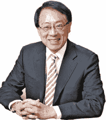

**图灵奖得主姚期智：AI下一站，在理论与跨学科的交汇处**

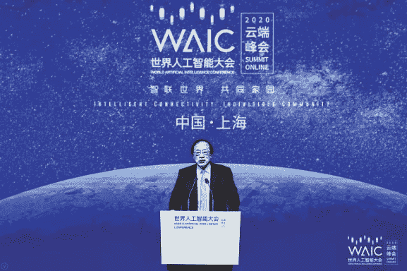

提到人工智能，满眼皆是应用落地的繁花似锦。环顾四周，AI 的新进展与广泛应用早已渗透进生活的肌理。但我们不能被眼前的繁华迷惑：这些耀眼的成果，实则是基础学科厚积薄发的产物，而基础学科的命脉，系于长年累月的理论积累与突破。想要延续 AI 应用的创新浪潮，理论层面的新突破不仅必要，更刻不容缓。我想重点阐述三个核心判断：

其一，**AI 理论是破局的关键**。透过理论剖析，我们能看清 AI 领域面临的困境与挑战，更能从中汲取灵感，觅得破解难题的线索。

其二，**AI 发展离不开跨学科协作**。回顾 AI 史，那些里程碑式的成功，往往诞生于看似风马牛不相及的学科交叉处。若缺了其他学科科学家的基石性贡献，AI 绝难有今日之速度。

其三，**AI 基础理论仍藏着极具诱惑力的“处女地”**，亟待探索。

接下来，我想分享三个极具潜力的 AI 基础理论新赛道：**神经拓扑、隐私保护学习、以及可控“超级 AI”（超智能）。**

## 重新审视神经网络：神何以智？——神经拓扑视角

深度学习与神经网络，是当下 AI 大厦的基石。回首往昔，深度学习曾沉寂多年，直至多重因素偶然汇聚，才爆发出惊世之力，重塑了应用版图。

然而，**神经网络为何有效？** 这至今仍是困扰学界的谜题。无数研究者在追问其力量源泉——唯有洞悉成功的底层逻辑，我们方知如何优化迭代，迎来下一次范式跃迁。

不妨先看一个直观案例：**“神经网络能做什么？”** 以气候预测为例，判断天气图是否显示风暴，传统思路将其视为二维或三维图像，提取图形特征识别。但在深度学习视野中，我们换了个维度：将整幅图像视为**高维空间中的一个点**。假设一张猫的照片有一百万像素，它便对应百万维数据空间中的一个坐标。这是当前 AI 的标准范式——数据即高维空间点，算法的任务是判定该点是否属于特定集合（如“猫图集合”）。

抽象来看，所有猫图构成了百万维空间中的一个数据集。我们对低维直观可感，但高维数据集的真实“长相”无人知晓。核心挑战在于：设计算法精准判别高维数据。这其中，神经网络的规模与深度，直接决定了能否将“猫”与“非猫”分离开来。

数学家早对高维数据集情有独钟。自然的问题是：什么样的数据集，神经网络易于识别？什么样的又难以攻克？

十余年来，研究者开始引入数学拓扑学，竟收获颇丰。拓扑学中对应高维数据的关键指标是**贝蒂数**。`B0`、`B1`、`Bi`、`ΣiBi` 等是其核心表达。贝蒂数是一个序列：最基础的 `B0` 代表数据集中相互独立的连通分支数；`Bi` 可理解为子集中 i 维“洞”的数量。举个例子：平面上的圆，`B0=1`（一个连通块），`B1=1`（一个洞）；环面（甜甜圈状）则 `B1=2`，因存在两类本质不同的环路。图形 S 的贝蒂数记为 (`B0`, `B1`, …)，`ΣiBi` 称作 S 的“总贝蒂数”。**直观上，贝蒂数越大，拓扑结构越复杂。**

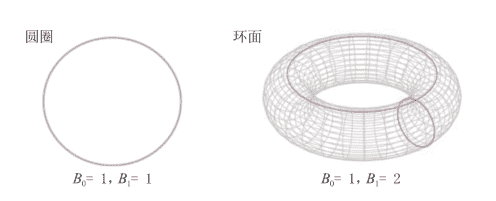

**贝蒂数实例解析**

直觉告诉我们：拓扑结构越复杂，神经网络识别越难。经经典拓扑理论与理论计算机科学洞见结合证明，这直觉不谬。这恰恰佐证了前言：攻克硬核 AI 问题，必须跳出单一学科视角。单靠 AI 内部视角难以企及的认知，引入拓扑学后，豁然开朗。

## 隐私保护学习：数据孤岛上的信任桥梁

再聊一个跨学科的经典案例——**密码学**，特别是我钟爱的**多方安全计算（MPC）**。

设想这样一个场景：多方各持核心数据，只有汇聚后才能挖掘出高价值 AI 洞见。但数据关乎隐私与商业机密，谁也不愿明文共享。**能否在“数据不出域、不可见”的前提下，完成联合建模？** 答案是肯定的。密码学设计的安全多方计算协议，正是为此而生——在零信任环境下构建协作信任，让数据“可用不可见”成为现实。

安全多方计算（MPC）的概念与技术框架，源自我1982年的首倡，彼时其核心价值在于观念的突破与算法可行性的验证。历经数十年演进，密码学应用成本大幅下沉，推动该技术落地生根，衍生出隐私保护机器学习等多元实践场景。以医药研发为例：多家药企渴望联合攻关新药，却各自掌握着不可外泄的核心机密；借助“AI+MPC”范式，各方得以在“数据不出域、模型共建模”的前提下，实现知识产权零泄露的深度协作。

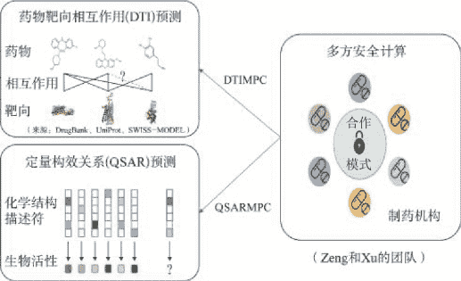

**多方安全计算赋能隐私保护下的药物发现流程**

## 可控超级人工智能（超智能）

最后一个议题备受瞩目，亦争议不断：可控超级智能，即所谓的 `Super AI`。公众普遍忧虑AI飞速演进可能对人类文明构成潜在威胁。通用超智能何时降临？这仍是未知数。加州大学伯克利分校斯图亚特·拉塞尔教授于2019年出版《人类兼容：人工智能与控制问题》，系统阐释如何推动“可证明安全”的 `Super AI`，并强烈主张将此理念贯穿AI设计全生命周期。他确立三大准则：利他性（人类利益优先于机器）、谦逊性（机器不得自负）、勤勉性（机器学习人类偏好），并借助概率论、博弈论等数理工具落地实施。

我想强调一个基本常识：当下的AI应用成果，皆源于过往的理论积淀；而我们当前投入的理论攻关，必将在未来某个节点催生巨大的跨越式突破。

---

# 迈向第三代人工智能

**张钹**

中国科学院院士；清华大学人工智能研究院院长；清华大学计算机系教授

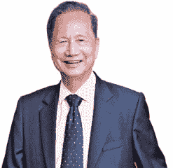

2011年获德国汉堡大学荣誉理学博士学位；2014年荣获中国计算机学会（CCF）终身成就奖；2019年获中国人工智能学会吴文俊人工智能最高成就奖。长期从事人工智能理论、人工神经网络、机器学习及模式识别、知识工程、机器人学应用技术研究。在上述领域发表学术论文200余篇、出版专著5部。科研成果曾获ICL欧洲人工智能奖等殊荣。此外，他是国家智能技术与系统重点实验室创始人之一，曾于1990至1996年担任实验室主任。

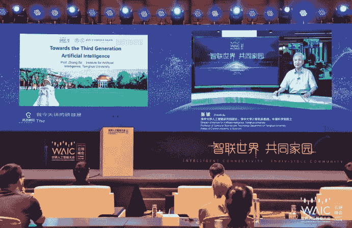

人工智能走过六十载春秋，历经两代演进。第一代AI常被称为“符号主义”。其核心主张基于知识与经验的推理模型，旨在模拟人类的理性智能——推理、规划、决策等。这要求在机器内构建知识库与推理机双重机制，借此复现人类的思维链路。

以20世纪70年代初斯坦福大学研制的 `MYCIN` 专家系统为例。该系统专攻血液感染性疾病诊断与抗生素处方，将感染病专家的知识库与医生“由症推病、由病定药”的诊疗逻辑（推理机制）植入计算机，辅助内科医生实现专家级诊断水平。

第一代AI的集大成之作，当属IBM“深蓝”国际象棋程序。1997年5月，它战胜了世界冠军卡斯帕罗夫。制胜关键在于三要素：一是知识经验积淀——汇聚人类大师70万局棋谱与全量5-6子残局，提炼棋理规则，并通过人机对弈调优评价函数中8000个参数，将大师经验内化于代码；二是算法优势——采用 `Alpha-Beta剪枝算法` 大幅加速搜索；三是算力碾压——基于 `RS6000` 平台，每秒搜索2亿步，平均预判8-12层，远超人类大师3-5层的极限。

第一代AI的优势显著：模拟人类推理链路，具备可解释性，符合认知直觉；机器学习上实现“举一反三”的泛化能力。

然其短板亦极致：知识源自专家，稀缺且高昂，手工编码耗时耛力；大量不确定知识、常识难以显性化表达。导致应用边界狭窄。

## 第二代AI：深度学习

第二代AI即大众熟知的深度学习。其本质是模拟人类感知——视觉、听觉、触觉等。以图像识别为切入，阐释机器如何模拟感知：若欲让计算机辨别动物，无法直接告知“何为马、何为牛”，只能遵循人类认知规律，引导机器自主学习。

流程大致为：海量采集动物图片并分集。训练集用于喂养多层神经网络，完成分类学习；测试集（未见数据）用于考核泛化能力。若识别准确率达90%，误判率10%，即视为合格。语音识别同理。在特定图库/语库基准下，当前机器视听识别精度已达人类水平甚至超越。

# 深度学习的崛起与瓶颈：通往第三代AI的必经之路

深度学习究竟凭什么脱颖而出？核心优势主要体现在两点：首先，它极大地降低了技术门槛，摆脱了对领域专业知识的依赖。用户只需投喂原始图像或语音数据，无需人工指导计算机如何提取特征，模型便能自主完成特征学习与识别，让普通人也能轻松驾驭这一工具。其次，其庞大的网络架构赋予了处理海量数据的能力。以 ImageNet 为例，该库包含 2 万多个类别、 1400 万张图片。2011 年传统方法误识率高达 50%，而 2015 年微软引入深度学习后，误识率骤降至 3.57%，甚至优于人类的 5.1%，标志着机器在特定感知任务上实现了超人类表现。

这一突破引发了全球瞩目，围棋领域的 “三级跳” 便是最生动的注脚。2015 年 10 月前，基于知识驱动的围棋程序仅停留在业余五段水平。此后，AlphaGo 横空出世：先后击败欧洲冠军、世界冠军柯洁，至 2017 年 AlphaGo Zero 横空出世，仅用两三年便完成了从业余到职业、再到世界冠军、最终超越人类巅峰的跨越。AlphaGo 的成功并非偶然，乃是海量数据（ 6000 万盘棋谱）、尖端算法（蒙特卡洛树搜索、强化学习、深度学习）与强劲算力（ 1202 个 CPU + 280 个 GPU 分布式系统）三大要素共振的产物。

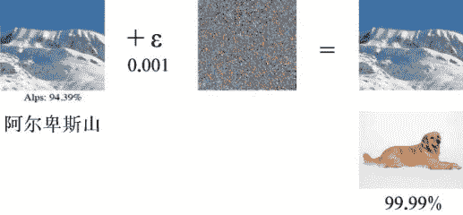

**第二代AI局限性的典型案例**^([\[1\]](#txt009.html#footnote_content_txt009_1))

纵观前两代 AI 发展历程，不难发现：AI 才刚刚起步。无论是知识驱动的第一代，还是数据驱动的第二代，均存在致命短板，应用边界受限。真正的大幕即将拉开——第三代 AI 的使命，正是攻克前两代的顽疾。我们亟需构建可解释、鲁棒性强的 AI 理论，研发安全、可信、可扩展的技术体系，以此为基石推动创新应用落地。

第三代 AI 的路径清晰：融合第一代的知识驱动与第二代的数据驱动，实现知识、数据、算法、算力四要素的协同。前两代分别仅利用了其中三要素，而四要素合一，方能破局。

以下聚焦三大核心命题展开探讨：

# AI 发展的关键议题与前瞻

## 一、 环境感知：从 “识别像素” 走向 “理解语义”

当前视觉识别虽准确率高，却极其脆弱、不可靠、易受攻击，根源在于其识别机制与人类视觉大相径庭。机器识别马，靠的是对比局部特征（如鬃毛、蹄子）与牛的差异，这是典型的 “黑箱” 学习——只捕捉低级局部特征，无法掌握高级语义概念，因此它分得清马牛，却不知 “马” 为何物。

破局之道，在于借鉴大脑视觉机制。人类视神经网络虽也是多层结构，但远比现有前馈神经网络复杂：它包含反馈连接、侧向连接、稀疏放电、注意力机制、多模态融合与记忆功能。若能将这些生物特性植入人工网络，识别性能将质变。我们团队已在网络各层引入稀疏放电规则，顶层神经元便能自发检测人脸、汽车、大象、鸟类的轮廓——即捕捉到语义特征，初步验证了这一路径的可行性。

此外，目标与背景分离仍是难题。机器难以同时解决 “马在哪” 与 “什么是马”。人类一眼知马位，源于大脑内化了 “马” 的先验知识，而这源于持续观察学习。我们尝试用自编码网络，让机器通过无监督学习习得 “马” 的内在表征，一旦 “懂” 了马，定位与分割便迎刃而解，相关预研已获初步成果。

## 二、 AI 安全：筑牢对抗攻击的防火墙

深度学习模型极不安全，极易被对抗样本欺骗。以人脸解锁为例：非本人刷脸会被拦截，但戴上对抗眼镜便能骗过系统。引入 AI 防火墙后，即便佩戴对抗眼镜也无法破防。这证明从数据端与模型端双管齐下，能有效提升系统安全性。我们开源的 `Zhusuan` 概率编程库，内置自研概率算法，正是为此提升可解释性与安全性而生。

## 三、 推理、决策与博弈

# AI进化论：从围棋胜负到自动驾驶，第三代智能才刚登场

AI在围棋、国际象棋等完全信息博弈中战胜人类，早已不是新闻。这些棋类属于“完全信息游戏”，规则封闭、状态确定，对计算机而言相对简单。真正的挑战在于“不完全信息游戏”，比如德州扑克。直到2017年，计算机才在四人无限注德州扑克中击败顶尖人类职业选手。纸牌游戏本质上属于概率论框架下的确定性问题，胜率通常可计算。然而，现实决策环境远比这复杂——充满完全的不确定性，甚至存在对抗博弈。因此，游戏竞技常被用作对抗环境下决策算法的实验田。游戏场景动态多变、充满未知，涵盖进攻、防守等多元任务。主流手段是强化学习，但目前算法仅能在简单游戏环境中超越人类。我们团队深耕此道，曾在国际 `VizDoom` 大赛中斩获2018年两项预赛冠军，及决赛一冠一亚的战绩。

## 第四部分：如何适应环境剧变

自1991年起，我们便投身自动驾驶研发。当下自动驾驶的痛点在哪？主流路线是“感知识别—建模—规划决策”三步走，单模块实时性均达标，但串联起来却难以应对复杂路况，核心短板在于“应急处理”乏力。破局之道，需注入驾驶知识，让车辆在真实路测中不断试错积累经验——通过强化学习掌握应急技能。为此，我们打造了开源平台：`Tianshou`（天授）强化学习平台。

## 尾声：AI大戏，才刚开场

第一、二代AI局限显著，仅能攻克完全信息、结构化环境下的确定性问题，解题半径极窄，过度依赖数据与算力堆砌。真正的高潮即将上演——那属于第三代AI。其使命是更彻底地攻克机器智能难题。人类智能的核心特质是“适应性”与“类比推理”（一通百通）。要达成此目标，必须调动知识、数据、算法、算力“四驾马车”协同发力。唯有如此，方能攻克不完全信息、不确定性及动态演化环境下的难题，抵达真正的通用人工智能彼岸。

## 参考文献

[1] Yinpeng Dong, Fangzhou Liao, Tianyu Pang, et al. Boosting Adversarial Attacks with Momentum. [2017-12-6]. https://arxiv.org/pdf/1710.06081.

---

# 迈向有意识AI：认知神经智能启发的计算机架构

## 作者简介

Manuel Blum，图灵奖得主，美国国家科学院、国家工程院、文理科学院三院院士。卡内基梅隆大学计算机学院教授。1964年获麻省理工学院数学博士，师从AI奠基人Marvin Minsky教授。曾执教于MIT、UC Berkeley、香港城市大学及CMU。研究版图横跨有意识图灵机、计算复杂性、自动机理论、算法、归纳推理、密码学、程序结果检查、人机交互证明等。1995年凭借计算复杂性理论及其在密码学和程序检查中的应用，荣获第30届图灵奖。

## 从“小人”到有意识图灵机：模型的进化史

我们认同认知神经科学家Bernard Baars与Stanislas Dehaene对“意识”本质的洞察，虽其理论尚未普及。我们的贡献在于将其数学化、自动机化，把认知科学翻译成严谨的数学语言（后续案例将详述）。这启发我们探究大脑如何生成痛觉、快感等主观体验。多年来，我们渴望破解脑内奥秘，寻找一个恰当模型为之背书。

最初模型假设脑内有个“小人”掌控一切，但这陷入无限倒推——还得解释小人如何运作。第二模型源自柏拉图的有限状态机：人天生知晓世间所有语言，幼年只需匹配环境语言对应的状态——此说仍显牵强。图灵机模型（附带感知与执行器官）虽更优，却对意识机制避而不谈。最终，我们锁定Baars的“全局工作空间理论”——即“意识剧场模型”。我们的核心贡献，是为这一模型给出了精确的数学刻画。

## Baars的全局工作空间模型

Baars以剧场喻意识。意识即短时记忆（`STM`）舞台上演员的活动，台下黑暗中坐着庞大的观众——代表长时记忆（`LTM`）的无意识处理器。运作机制如派对寻人：你看到一位女士，想不起名字。回忆初见场景，该信息从`STM`广播至各`LTM`处理器。某处理器唤起其职业信息进入意识，再广播全场；另一处理器提示名字首字母“T”，亦同步广播。半小时后，你早不去想此事，名字却从一直在后台搜寻的无意识`LTM`处理器涌上“舞台”。但台上的“意识自我”并不知晓名字是*如何*被找回的；意识自我对无意识自我的辛劳全然不知。这就是Baars的意识模型——优雅动人。输入从左侧进入，输出从右侧离开，中央舞台即工作记忆。输入进入工作处理器后输出。舞台事件由中央执行功能（如舞台总监）调控。底层是`LTM`处理器群，承担所有繁重计算。

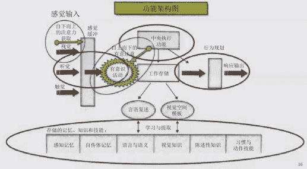

## 有意识图灵机（`CTM`）的数学定义与运作机制

`CTM`与Baars模型有关键区别：无“舞台总监”，输入不经`STM`直达处理器，经处理器间传递后直接输出，无需经过`STM`。但处理器内的信息可竞争“入驻”`STM`资格。此过程耗时，故你常在任务完成后才“意识”到自己在做什么。

`CTM`定义为七元组。`STM`居中，`LM`在底。蓝线自顶向下沿树分发——即**广播**；灰线自底向上汇聚——即**竞争树**。`CTM`初生时，处理器间零连接。但当两处理器因频繁借助`STM`通信，便会建立直连通路，绕过`STM`直接对话。于是，原本需意识参与的过程，逐渐内化为无意识本能。

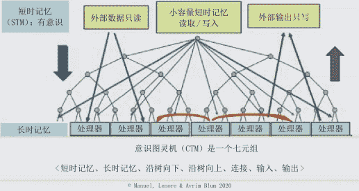

## `Chunk`（信息块）的五元组结构

在树上上下流动的单元称为`Chunk`，由五元素构成：

- `address`（地址）：生成该Chunk的处理器标识。
- `gist`（要旨）：高层语义摘要，仅陈述句或至多两个从句。如背诵字母表：“ABC”这一陈述触发“DEF”及后续字母。
- `weight`（权重）：正负权重，反映从`STM`读取时的重要性。
- `intensity`（强度）。
- `mood`（情绪/模式）。

## 意识的本质：广播与觉察

当一个组块登上“舞台中央”（STM顶端）时，究竟意味着什么？在STM中，权重代表要点的初始强度；强度是所有LTM处理器权重绝对值之和；而心境则是权重的直接相加（不取绝对值）。这三者共同构成了一个组块。

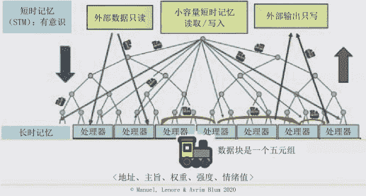

我们所觉察的，仅限于STM中的内容——不多不少。在`CTM`模型里，所有繁重的计算任务都由处理器在LTM中无意识地完成。假设`CTM`能有效模拟人类意识，那么我们能觉察到的，仅是从LTM处理器广播进STM的那个“要点”。这个“要点”是什么？通常有三种形式：最典型的是内心语——你听到内心的声音在强调思考；其次是内心意象——比如一张地图或一场梦境；再就是感觉与知觉等。`CTM`将意识定义为“所有LTM处理器对STM内容的知晓”。但这个定义没能回答：是什么让我们*产生*了意识的主观感受？

我们的答案是：所有LTM处理器都知晓STM内容，其中部分处理器专门负责“意识”功能。正因为它们位于LTM，所以知晓STM内容：内心语言处理器将`CTM`的脑语言转化为外部可听的语言；内心视觉处理器将脑内图像转化为可视的外部图像——你在梦中看到的就是它；第三个意识来源是来自STM的内外部感知广播。无论是梦境还是现实，`CTM`所感知的一切信息皆源于STM。这些感知从STM广播向所有LTM处理器，导致梦境意象与现实意象在主观体验上变得无法区分。

## 意识为图灵机带来了什么？

借助STM的广播机制，意识让LTM处理器能聚焦于生成对当前真实环境的“最佳解释”，并持续验证，帮助`CTM`解决一致性难题（如内克立方体）。它能维持对`CTM`认为值得深究的问题、观点或思绪的专注。它赋予`CTM`应对突发难题的能力——利用现有工具应对复杂多变的真实世界。

## 意识的“困难问题”：模拟与体验的鸿沟

现在摆在面前的大问题是：`CTM`能否*感觉*到自己拥有意识？我们认为可以，但如何证明`CTM`真正体验了意识？其实无需证明。我们对意识定义的有效性，完全取决于：它能解释多少意识现象，`CTM`能多简洁自然地阐释多少概念，这些解释是否符合我们对意识的直观认知，以及`CTM`对设计者未曾预见场景的反应如何。

`CTM`能意识到什么？根据定义，是STM内容。STM中的组块是什么？是指向LTM某个位置的指针。为什么STM容量极小？为的是保证所有LTM处理器都聚焦于同一个意识念头。我们还能举出更多例子。LTM处理器如何决定权重符号？对婴儿而言，饥饿和疼痛是负向的，食物和关爱是正向的——这些符号是天赋的。成长后，若某要点的符号不明，`CTM`会将其设定为当前心境的符号。但我们不能仅因疼痛是负向、快乐是正向，就断言`CTM`*真切感受*到了痛楚与愉悦。那么，是什么让`CTM`*真正*感到痛与乐？

我们必须区分“简单问题”与“困难问题”。简单问题：让机器人*模拟*出有感觉（痛、乐）的样子。困难问题：让机器人*真正体验*感觉（痛、乐）。首先必须把模拟与体验分开。例如“痛觉缺失症”：患者明知该痛，却不痛苦。脑震荡后导致缺失的成年人知道疼痛是什么，声称感到疼，却说“无所谓”、“疼还在但不烦人”。我们现在的机器人就是“痛觉缺失”的——我们知道怎么让它们*看起来*很痛，却不知道怎么让它们*真痛*。

## 关于疼痛的三种机制解释

我们为极端疼痛提出三种机制。

**第一：广播霸占。** 极端疼痛是一个独占整个舞台（STM）的演员（组块），挤走其他演员。只有疼痛信息被广播，让每个处理器都知道疼痛的存在。极端情况下，除疼痛外无信息能进入STM。佐证：常人剧痛时无法思考，但“痛觉缺失者”思考不受影响。Smith和Ayres在《教育心理学评论》刊文《慢性疼痛对短时记忆与学习的影响》指出：持续6个月以上慢性低度疼痛的受试者，测试表现显著劣于无痛者。广播机制能解释部分疼痛，但无法解释突发剧痛（如韧带撕裂）。如何解释那种痛？

**第二：中断机制。** 突发剧痛——手触热炉——会中断*所有*无意识处理器。中断（区别于广播）命令所有LTM处理器停下手头工作，强制全神贯注于打断事件。广播只是发送信息，不强制处理器停工。

**第三：恶性循环。** 疼痛引发恐惧；恐惧加重疼痛。这是无数可能循环中、维持注意力锁定疼痛的一种。

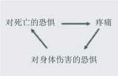

上图展示了其中一个疼痛循环图：恐惧左向延伸出愤怒、焦虑等。

## 哪些长时记忆处理器是意识的关键？

关于`CTM`还有更多疑问：哪些LTM处理器是意识必需的？哪些不是？

大多数LTM处理器*非*意识必需，例如：

- 视觉与听觉处理器 [海伦·凯勒双目失明、双耳失聆，却依然拥有意识]；
- 面孔识别处理器（相貌失认症患者无法辨认亲人甚至镜中自己，但意识完好）；
- 危险预警处理器（患者S.M.杏仁核钙化，终生无恐惧感，意识仍在）；
- 规划与教养处理器 [菲尼亚斯·盖奇失去整个前额叶皮层，性格大变，却后来在智利驾驭六匹马的马车行驶77英里——绝非易事]；
- 陈述性记忆处理器（患者H.M.切除海马，失去形成永久记忆能力，却能形成程序性记忆）；
- 程序性记忆处理器（患者W.O.陈述性与程序性记忆全失——一个仅拥有90分钟记忆的男人）。

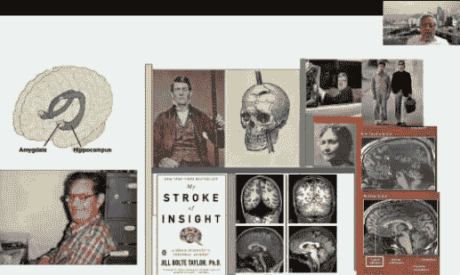

上图展示了这些人物：左下角是H.M.，中间是菲尼亚斯·盖奇——可见穿透他颅骨、损毁其前额叶的铁钎。

有些LTM处理器*是*意识的核心。意识需要内心语言处理器，用于评论和规划当下行动——不一定是内心语言，只要有内心对话即可；需要视觉模型处理器，以区分自我与非我；需要动机与能量；需要最低限度的思维能力，包含思考的动机。若失去内心语言与视觉模型处理器会怎样？神经科学家吉尔·博尔特·泰勒中风后左半球功能全失，语言消失，无法分辨外部世界与内心世界，她眼中世界美好合一。但她知道自己命悬一线、必须求助，虽无法拨打电话。她保留了思维能力，自述失去大部分意识却仍能求援。左脑未复原，她靠训练右脑写出了惊世之作《我的顿悟之旅》。

## 镜像测试与自我觉察

### 镜子里的自我：动物意识的边界在哪里？

心理学家高登·盖洛普二世设计的“镜子测试”，至今仍是探测自我意识的经典范式。核心逻辑很简单：在动物不知情时在其额头做标记，若它对着镜子主动触摸自家额头试图擦拭，而非攻击镜中“同类”，便证明它能将镜像与自我建立关联——这需要区分“视觉模型”，将自我与非自我剥离，并具备行动的动机与认知能力。

大象通过了测试：鼻子精准触向额头的“X”标记。海豚也过关了。大猩猩却因本能回避对视、甚至砸碎镜子而“挂科”。狗虽视力一般，却在同类设计的“嗅觉镜像测试”中展现出自我认知。更令人意外的是，体长仅两英尺的隆头鹦哥鱼、甚至微小的 *Myrmica* 蚂蚁，在标记实验中都表现出“照镜子-擦标记-回头复查”的完整行为链条。而人类幼儿，则要等到两岁左右才能跨过这道认知门槛。坦普尔·格兰丁曾断言鱼类及低等物种无意识，但这些实验正不断修正认知的版图。

### 从显性到隐性：连接如何重塑大脑

有意识的动作为何能变成下意识的本能？关键在于处理器间建立了高效连接，大幅降低了工作记忆（STM）的负荷。这一机制不仅能解释梦境生成——少数区块充当“梦境发生器”广播意象，其余处理器作为“接收器”联想反应，更能完美阐释“正念”运作的底层逻辑。

---

# 自主智能体与博弈论

## 作者简介

**杰弗里·S·罗森施因**

### 以色列希伯来大学计算机科学与工程学院 萨姆与威尔·施特劳斯讲席教授

现任希伯来大学 Rachel 与 Selim Benin 计算机科学与工程学院 Sam 与 Will Strauss 计算机科学教授，兼多智能体系统研究组负责人。学历背景为哈佛应用数学学士（1979）、斯坦福计算机科学硕士（1982）及博士（1986）。身兼 AAAI、ACM、EurAI 三大院士，荣获 2013 年 ACM/SIGART 智能体研究奖。

## 核心议题：激励与机制设计的双重视角

演讲聚焦两大维度：一是多智能体系统（MAS）激励机制的演变观察，它如何重塑 AI 版图、催生智能体学科；二是博弈论与机制设计在构建自主智能体中的实战角色——实验室观察并不等于生活真理。

博士毕业后，我长期致力于用经济学、投票理论、博弈论为 MAS 奠基。这引出一个根本追问：将这些理论作为基石，究竟多大程度合适？

**缺失的 “Why”**：经典 AI 痴迷 “What”（做什么）与 “How”（怎么做），即 “手段—目的” 分析。医疗诊断系统接收医生目标，输出路径，从不追问 “为什么做”。若机器仅是受控工具，外部目标驱动无可厚非；但若是人的代理/助理，不懂 “Why” 就无法主动行动。受控机器的激励外在于系统、非形式化；自主机器必须内化激励，理解缘由方能自发作为。

**交互博弈的必然**：多自主系统交互时，洞察激励结构更成关键。80 年代初分布式系统兴起，却仍沿用外部总目标、中心化设计模式。后引入博弈论，虽非唯一路径，却提供了天然的数学形式化。地理分布、数据孤岛阻碍全协作系统；非合作、甚至对抗型智能体的存在，迫使系统必须量化“最大破坏力”。

**激励内化的代价与收益**：激励机制入模后，思维范式转型往往耗时数年甚至数十年。博弈论模型的优势在于：激励是解码现实行为的钥匙。税法、薪酬、偏好、名利追逐……现实世界由激励驱动，引入它能显著弥合 AI 设计与真实世界的鸿沟。但也有失灵时刻：随气温浮动的饮料机定价虽符合供需逻辑，消费者却因“感知不公”拒之门外，宁愿接受恒高价。

## 博弈论与机制设计：构建自主智能体的三把手术刀

若智能体拟人，便须预判其 “有限理性”——或如人般非理性，或超越人类表现出超理性。**理性的定义**：在算力与信息双重约束下，做出最大化**预期效用**的选择。注意：非理想条件下的最大化，非事后诸葛亮的结果最大化。

### 手术刀一：寻找 “可证明、符合意图” 的机制
将博弈论经证明的计算与策略特性（如策略免疫性、帕累托最优）植入机器。这不仅保障智能体决策优选，更助机制设计筛选环境，让理性行为在特定场域落地。唯一变数：人类面对这些机制时，常因非理性做出惊世骇俗之举。

### 手术刀二：明确效用函数，冲突中守理性底线
若需 “拟人”，需主动注入 “受限理性” 或 “非直觉超理性” 模块——要么像人犯傻，要么用非人逻辑超神。打造交互伙伴时，建模遵循 “适配原则” 而非 “对称原则”，切勿照搬智能体自身设计范式。

### 手术刀三：偏好标准化模型
标准化模型（如策略优势）优于非标准化。纳什均衡等经典概念，有时神锋利、有时钝无用，必须看清适用边界，审慎落地。

---

# 人工智能研究路线图：跨越学习与推理的鸿沟

## 巴特·塞尔曼

康奈尔大学计算机科学教授、AAAI 主席

康奈尔大学计算机科学教授，NSF CAREER 奖得主、斯隆研究奖获得者，AAAI 主席、AAAS 会士。研究聚焦计算与表示、可处理推理、知识编译、默认推理、统计物理相变现象等。作为 AI 安全专家，深耕 CHAI（人类兼容 AI 中心），推动伦理与 AI 融合，主编《美国 AI 20 年路线图》，出版百余篇论文，六获最佳论文奖。

### 当下：感知落地的黄金时代，却非终点

身处 AI 爆发期，自动驾驶、无人机、虚拟助手……学术界用 60 年完成从理论到落地的跨越，深度学习与大数据是核心引擎。

**感知瓶颈突破**：机器终于 “看见” 与 “听见” 了。过去 50 年，推理、搜索、规划、强化学习皆建立在 “假设感知输入已就绪” 的沙堡上。2005 年斯坦利夺冠时，车仍是 “瞎开” —— 无法解析图像。如今感知输出可直驱成熟算法栈，人脸识别、标志检测甚至超人类水平。

**深度学习印证 “硬件假设”**：反向传播源自 80 年代，单隐层到百层网络的跨越，2000 年前几乎被学界抛弃，2011/2012 年突然霸榜。算法突破是前提，但离不开算力跃迁。

**算力与数据的双螺旋上升**：从深蓝（鼠脑级算力）到 2030 年千美元买到人脑级算力；众包百万标注图片喂饱视觉系统；沃森单挑五十人；百亿级资本涌入——商业红利前所未有。

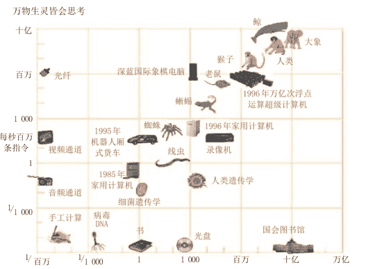

### 三大流派：各执一端，殊途同归

AI 版图大致三分：

1.  **数据密集型 / 深度学习**：万张猫图训练识别器。谷歌翻译、搜索、IBM 系皆出此门。
2.  **推理密集型**：机器学习辅助攻克数学猜想，海量验证方法构建其上。AlphaGo = 推理树搜索 + 数据驱动强化学习，**学习与推理首度深度融合**。
3.  **知识密集型**：牛顿定律 `F=ma` 这类显性知识，非来自直接经验，乃科学发现提炼。这是当前 AI 的短板——难以主动从数据跃迁至知识。

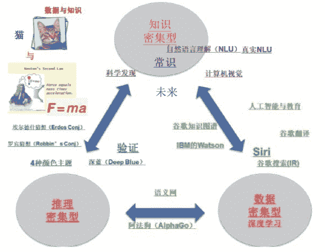

### 未来：集成与常识推理的“双螺旋”

单一流派深耕必陷边际递减。计算机视觉、NLP 依赖数据；科学推理仰赖知识。**真正的自然语言理解、常识推理，必然是知识密集与数据密集的双螺旋结合**。

AlphaGo 已证融合之威。近期化学合成发现，亦源于知识图谱与数据挖掘的共振。**感知、学习、推理、决策的深度集成，将重写 AI 系统的底层逻辑。** 这正是路线图的核心使命：架起桥梁，让机器不仅“会用”，更“懂理”。

### AI的“阿喀琉斯之踵”：常识推理为何仍是硬骨头？

我们必须正视当前AI的短板，尤其是常识推理与常识知识的缺失。举个直观的例子：英语里常有指代模糊的句子。看这句话——“大球撞碎了桌子，因为它是泡沫塑料做的。”这里的“它”指什么？显然指桌子，毕竟球砸穿了它，而泡沫塑料质地轻软。但若改成“大球撞碎了桌子，因为它是钢做的”，指代对象立马变成球。这种基于物理常识的指代切换，现有AI系统极难捕捉。即便是谷歌翻译处理此类句子翻译成法语时，也会在“它”的指代上栽跟头。这暴露了一个本质问题：统计模式匹配并不等于真正理解语言。哪怕拥有海量语料库和亿级训练样本，当前系统对语言深层语义的掌握依然几乎为零。这连AI研究者自己都觉得匪夷所思。

### 非拟人化智能：另一条通往巅峰的路径

除了模仿人类，还有一片令人振奋的疆域——**非拟人化智能**。其核心聚焦于推理与规划。深度学习虽大放异彩，但在软件验证、程序综合、科学自动化及数学发现等领域，另一套不依赖模拟人脑的技术路线正悄然取得突破。核心思路很简单：不必执着于复刻人类认知，而是锁定特定任务，极致优化其表现。

*   **数学发现新范式：** 埃尔德什差异猜想悬案80余年，针对差异2的情况，推理程序通过百亿级推理步骤完成求解，且易于独立验证。这预示着人机协同将重塑数学研究，未来一两代人里，这将是核心增长极。
*   **材料科学实战：** 康奈尔大学戈麦斯团队在X射线同步加速器上部署AI自主实验系统，实现了新材料的全自动发现。这展示了理论计算机科学视角的威力：以极低计算开销（仅兆字节级）完成人类难以企及的任务。
*   **乐观的理解论：** 我们能否读懂机器的发现？我持乐观态度。理解远易于发现——机器帮我们找到新定律，人类只需基于已知物理法则（如牛顿定律）去验证理解，而非从零创造。

### 美国AI 20年路线图：国家队如何布局未来？

这是我与南加州大学约兰达·吉尔共同主导的战略研究，汇聚百项顶尖研究意见，提炼出未来5-20年社会发展的六大核心引擎：健康生活质量、终身教育培训、商业创新竞争力、科技发现加速、社会公正政策、网络防御安全。

报告锁定三大战略制高点：

#### 1. 融合智能：打破模块壁垒
人脑能无缝融合感知、推理、规划等多模态处理。AI的下一个十年关键，在于将学习、推理、规划等孤立模块整合为统一系统，实现真正的“系统级智能”。

#### 2. 深度交互：机器走进社会肌理
如何让机器人真正融入社会？信任、责任、交互范式的建立，比单纯提升算法精度更迫切。我们需要定义何为“有意义的互动”。

#### 3. 自省学习：赋予系统元认知能力
构建能感知自身学习状态、并能依据内在机制自主导向长期学习的系统，是通往通用人工智能的关键一跃。

**国家级基建：大科学装置化**
上述目标非小团队可为，需国家层面构建AI基础设施。
*   **AI就绪医院：** 汇聚全国研究力量，依托真实医疗场景，协同开发、评估AI医疗技术。
*   **任务驱动中心：** 30-40人精干团队，软硬件全栈支持，攻坚雄心勃勃的专项任务。
*   **生活辅助实验场：** 研究者驻场测试前沿创新。
目前NSF已启动资助，首批6大国家级中心即将揭晓，将构成国家AI战略底座的基石。

---

# 总结与展望：可信AI与深度学习理论基石

回首来路，智能自主机器正深度嵌入社会，影响深远。AI早已超越技术范畴，牵涉经济、伦理、军事、超智能等维度。学界已觉醒责任感，致力于构建安全、可靠、合乎伦理的AI体系。马斯克资助的未来生命研究所（FLI）、NSF纳入安全审查机制，皆是明证。里程碑事件当属AAAI与“松鼠AI”联合设立“AI诺贝尔奖”——**松鼠AI奖：造福人类的人工智能奖**。百万美金年奖，旨在表彰可商业化落地且对人类福祉产生长远正向贡献的科学家，首届颁奖于2020年启幕。

---

# 预见可信AI —— 深度学习理论基础前沿对话

**陶大程**  
澳大利亚科学院院士、悉尼大学教授、优必选悉尼人工智能中心主任

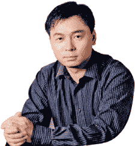

本科毕业于中国科技大学，硕士就读于香港中文大学，博士毕业于伦敦大学。曾任职于香港理工大学、新加坡南洋理工大学、悉尼科技大学。现任悉尼大学教授及优必选悉尼AI中心主任，深耕人工智能领域。在IEEE Transactions等权威期刊及顶级会议发表论文200余篇，多次斩获最佳论文奖。2015年获澳大利亚尤里卡奖及悉尼科技大学校长奖章，2018年获IEEE ICDM研究贡献奖。因AI领域卓越贡献，当选IEEE/AAAS/ACM Fellow、欧洲科学院外籍院士及澳大利亚科学院院士。

---

### 深度学习引发的自动化革命与信任危机

很荣幸分享我们对AI可信度问题的思考。深度学习在计算机视觉、NLP、语音识别等领域掀起自动化浪潮，我们的工作聚焦于深度学习及其视觉应用。曾经棘手的视觉任务如今手到擒来，算法稳健高效，满足了大量实用需求。但**在容错率为零的安全关键场景，微小误差酿成灾难性后果**。

痛点在于：**理论滞后于实践**。我们不知算法为何成功、何时会失效、失效概率几何。应用端挑战叠加，导致业界对AI信心持续走低。破局之道，唯有构建完备的AI理论地基。

---

### 当前AI基础理论进展：聚焦深度学习黑盒

重点剖析深度学习理论现状。两大动因：传统机器学习理论相对成熟；深度学习主导第三次浪潮并驱动落地，却仍处理论萌芽期，成功建立在实验堆砌而非坚实理论之上。我们为何仍敢大规模落地？

#### 深度学习理论分析为何寸步难行？

引用MIT Tomaso Poggio教授洞见：“经典范式下，样本量需超参数量才能有效拟合。”深度学习呢？**参数规模碾压样本量**。对比可见：2017年SOTA网络参数量达千万级；反观常用数据集，CORD-19仅6千样本，多数仅数万量级，即便ImageNet也仅千万级。数据量在参数海洋中显得微不足道，这正是理论分析的核心困境所在。

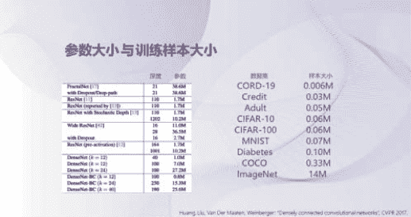

# 过参数化下的深度学习：为何越“大”越强？

深度学习模型参数量往往远超样本数，按理说极易过拟合，为何实战中却表现优异？学界尝试从**模型容量与复杂度**切入寻找答案。经典统计学习理论认为：模型容量/复杂度若可控，泛化能力便有保障。倘若能证明深度模型的复杂度与参数总量并非强绑定，便能在一定程度上揭开其成功的奥秘。

---

## 基于模型容量与复杂度的剖析

### VC 维视角的尝试与瓶颈

VC 维是传统机器学习衡量复杂度的标尺。2017 年，Harvey 等人引入 VC 维分析神经网络泛化性能，给出了两个上界[¹]。结果显示，VC 维上界直接挂钩参数量，导致泛化误差上界极大，甚至超越损失函数最大值，指导意义大打折扣。这提示我们：单靠 VC 维这条路恐难走通，但也倒逼我们必须深挖深度学习的基石理论。

### 拉德马赫复杂度的视角

换个角度看拉德马赫复杂度。2018 年，Golowich 等人由此推导出泛化误差上界[²]。好消息是它摆脱了对模型规模的直接依赖，坏消息是它转而依赖参数范数与网络深度，导致上界依然偏松，难以精准刻画真实表现。

### Fisher-Rao 范数与 Matrix-1 范数的突破

2019 年，Liang 等人发掘了 Fisher-Rao 范数的优良特性——在特定重参数化下保持不变，且优于其他复杂度度量[³]。在我们近期的 ICLR 工作中，结合 Fisher-Rao 范数与 Matrix-1 范数，成功建立了 RNN 网络的泛化误差上界[⁴]。

该上界中与模型规模相关的项为 `x transpose 和 x 的乘积最小特征值的倒数`。这启示我们：**适度注入噪声有助于提升泛化，但噪声过大反而会推高训练误差**。我们的理论建立在一个结构化梯度引理之上——参数范数可由梯度大小控制。这一机制不仅关联了梯度与泛化能力，还为理解权重衰减、梯度裁剪等工程技巧的作用提供了理论支撑。

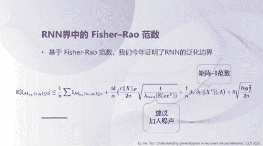

### 过参数化与泛化能力的“反直觉”现象

基于容量/复杂度的理论通常预言“小模型泛化好”，但实验却唱反调。Neyshabur 等人（2015）[⁵] 与 Novak 等人（2018）[⁶] 独立实证：大网络不仅测试表现优异，泛化性能随规模扩大反而提升。这也佐证了业界“卷”深度、扩规模的趋势。Canziani 等人统计竞赛获胜模型发现，冠军网络深度逐年攀升[⁷]，常刷榜的同学对此必有同感。

---

## 基于信息论的泛化误差上界：我们的新视角

我们目前的工作转向信息论，推导出的泛化上界能从理论上解释上述实验现象，核心立足三点：

**1. 分层特征映射：深度网络的“护城河”**  
区别于 SVM 等浅层模型，深度网络拥有层级化的特征映射结构。这正是其在高复杂度下避免过拟合的关键？我们的回答是肯定的[⁸]——**分层结构正是深度网络泛化能力的基石**。

**2. 引入数据分布，摆脱“最坏情况”估计**  
传统上界（如 VC 维、拉德马赫复杂度）基于函数空间复杂度估算，忽略了数据分布，只看最坏情况，故对大空间模型极不紧致。现实中泛化能力强依赖数据分布。受信息论与自适应数据分析启发，我们采用**神经网络学到的特征与最后一层参数间的互信息**作为上界。直觉上：网络输出对输入的依赖越弱，泛化越强。

**3. 强数据处理不等式揭示“越深越稳”**  
只要每层映射不可逆（如 ReLU、卷积、池化），强数据处理不等式保证：特征与最后一层参数的互信息随层数加深而衰减。  
**结论：网络越深，泛化能力理论上越强。**  
但也存在代价——深层映射可能丢失拟合数据所需的信息，导致训练误差上升。因此，追求整体性能时，必须在“加深网络增强泛化”与“保持训练拟合误差足够小”之间寻找平衡点。

---

## SGD 优化过程与 PAC-Bayes 理论：参数真的能“任意挑”吗？

目前基于模型容量的路径依然陡峭。神经网络容量巨大，甚至具备通用逼近能力。早至 1989 年，三组工作同步证明无限宽多层网络满足通用逼近定理[⁹][¹⁰][¹¹]；1993 年 Hornik 证实单层无限宽网络亦然[¹²]；2017 年 Lu 等人将结论推广到有限宽度[¹³]；1993 年 Funahashi 与 Nakamura 证明 RNN 可逼近任意序列[¹⁴]；近期 Lu 兄弟更证实神经网络能拟合任意分布[¹⁵]。

这些结论暗示：**若参数可任意选取，网络容量无上限。** 但关键问题在于——**参数真的可以任意选取吗？** 这正是 SGD 优化动力学与 PAC-Bayes 理论需联手回答的核心命题。

目前，神经网络参数主要依赖随机梯度下降（SGD）习得，参数分布并非完全随机，SGD 或成破局关键。神经网络假设空间虽广，SGD 仅探索局部，实际输出空间有限。近期研究（含我们 2019 NeurIPS 论文）指出，SGD 优化路径可用偏微分方程（PDE）描述：参数更新量等于学习率乘梯度。批次与初始化的随机性引入噪声，梯度可拆解为全量梯度与高斯噪声，PDE 因此演变为随机偏微分方程，参数随时间演化轨迹可建模为 O-U 过程。利用该随机过程的平稳分布刻画 SGD 学习结果，结合 PAC-Bayes 理论得出泛化误差上界，揭示泛化能力与学习率/批次大小比值呈正相关，暗示超参调优有迹可循。我们在 CIFAR-10/100 上训练 1600 个 ResNet-110 与 VGG-19 模型验证：固定学习率时，批次增大致准确率下降；固定批次时，学习率增大提升准确率。综合来看，测试准确率随批次-学习率比值增大而显著下降。

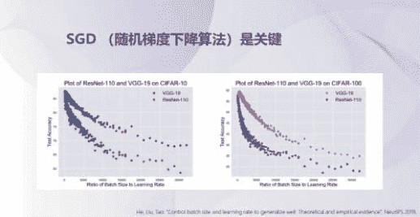

用 PDE 建模 SGD 轨迹极具价值，要求我们深谙损失地形几何特性。地形几何决定随机 PDE 在地形上的轨迹（相图），即参数随时间演化的曲线。原因有二：一、随机 PDE 包含损失函数及各阶导数，地形几何直接塑造 PDE 结构；二、地形决定边界条件，进而决定 SGD 输出解的性质。透彻理解地形几何，是研究深度学习优化与泛化的基石。Novak 等 2018 年实证表明，泛化性能与输入空间线性区域数目相关。非线性激活导致地形极度非凸、非光滑，理论分析陷入困境：为何凸优化算法能搞定非凸问题？但工程实践大获成功，暗示混沌表象下或藏着未被发现的秩序。

## 损失地形几何结构的争鸣与发现

关于损失地形几何，学界正激辩不休。线性网络（全线性激活）下，Kawaguchi (2016) 与 Lu & Kawaguchi (2017) 证得：平方损失下所有局部极小值均为全局最优。若非线性网络继承此性质，神经网络强性能即获理论支撑——SGD 找到局部最优即找到全局最优。虽有观点认为非线性不改核心性质，但 Yun 等人 2019 年证明：单隐层 ReLU 网络存在无限劣质局部极小值（需满足四苛刻条件：单隐层、平方损失、一维输出、ReLU 激活）。我们今年 ICLR 论文大幅宽松条件，覆盖近乎所有实用场景：任意深度、任意可微损失、任意输出维度、任意分段线性激活。Soudry 与 Hoffer (2018) 指出 ReLU 网络地形可分解为若干光滑多线性区域。我们进一步证明：区域内局部极小值即全局极小值；极小值汇聚成谷；谷上点构成等价类；存在平行谷；所有类与谷构成商空间。第二性质解释了“模式连通性”——SGD 找到的局部最优附近，存在经验风险极低的连通路径，即极小值谷。遗憾的是，上述几何性质目前仅在单隐层网络成立，多隐层分析仍待攻坚。

## 结语

深度学习理论研究尚处萌芽期，待解谜题诸多。除上述优化与泛化问题，公平性、隐私、安全等议题同样亟需长期投入与攻坚。

## 参考文献

[¹]: Harvey et al., 2017  
[²]: Golowich et al., 2018  
[³]: Liang et al., 2019  
[⁴]: ICLR 相关工作  
[⁵]: Neyshabur et al., 2015  
[⁶]: Novak et al., 2018  
[⁷]: Canziani et al., 竞赛模型规模统计

[⁸]: Work related to hierarchical structure and generalization ability

[⁹]: Universal Approximation Theorem, 1989

[¹⁰]: Universal Approximation Theorem, 1989

[¹¹]: Universal Approximation Theorem, 1989

[¹²]: Hornik et al., 1993

[¹³]: Lu et al., 2017

[¹⁴]: Funahashi and Nakamura, 1993

[¹⁵]: Lu and Lu, Recent work

[¹⁶]: NeurIPS 2019, SGD Optimization Path Modeling

[¹⁷]: Novak et al., 2018

[¹⁸]: Kawaguchi, 2016

[¹⁹]: Lu and Kawaguchi, 2017

[²⁰]: Yun et al., 2019

[²¹]: ICLR 2024, Condition Extension Work

[²²]: Soudry and Hoffer, 2018

[²³]: Mode Connectivity

# 参考文献

[1] Bartlett P L, Harvey N J, Liaw C, et al. Nearly-tight VC-dimension and Pseudodimension Bounds for Piecewise Linear Neural Networks[J]. Journal of Machine Learning Research, 2019, 20(63): 1—17.

[2] Golowich N, Rakhlin A, Shamir O, et al. Size-Independent Sample Complexity of Neural Networks[C]. Conference on Learning Theory, 2018: 297—299.

[3] Liang T, Poggio T, Rakhlin A, et al. Fisher-Rao Metric, Geometry, and Complexity of Neural Networks[C]. International Conference on Artificial Intelligence and Statistics, 2019: 888—896.

[4] Tu Z, He F, Tao D, et al. Understanding Generalization in Recurrent Neural Networks[C]. International Conference on Learning Representations, 2020.

[5] Neyshabur B, Tomioka R, Srebro N, et al. The Search for the Real Inductive Bias: On the Role of Implicit Regularization in Deep Learning[C]. International Conference on Learning Representations, 2014.

[6] Novak R, Bahri Y, Abolafia D A, et al. Sensitivity and Generalization in Neural Networks: An Empirical Study[C]. International Conference on Learning Representations, 2018.

[7] Canziani A, Paszke A, Culurciello E. An Analysis of Deep Neural Network Models for Practical Applications[J]. arXiv preprint arXiv:1605.07678, 2016.

[8] Zhang J, Liu T, Tao D, et al. An Information-Theoretic View of Deep Learning[J]. arXiv: Machine Learning, 2018.

[9] Cybenko G. Approximation by Superpositions of a Sigmoidal Function[J]. Mathematics of Control, Signals and Systems, 1989, 2(4): 303—314.

[10] Funahashi K I. On the Approximate Realization of Continuous Mappings by Neural Networks[J]. Neural Networks, 1989, 2(3): 183—192.

[11] Hornik K, Stinchcombe M, White H. Multilayer Feedforward Networks are Universal Approximators[J]. Neural Networks, 1989, 2(5): 359—366.

[12] Hornik K. Some New Results on Neural Network Approximation[J]. Neural Networks, 1993, 6(8): 1069—1072.

[13] Lu Z, Pu H, Wang F, et al. The Expressive Power of Neural Networks: A View from the Width[C]. Advances in Neural Information Processing Systems, 2017: 6232—6240.

[14] Funahashi K I, Nakamura Y. Approximation of Dynamical Systems by Continuous Time Recurrent Neural Networks[J]. Neural Networks, 1993, 6(6): 801—806.

[15] Lu Y, Lu J. A Universal Approximation Theorem for Deep Neural Networks for Representing Distributions[J]. Neural Networks, 2020.

[16] He F, Liu T, Tao D, et al. Control Batch Size and Learning Rate to Generalize Well: Theoretical and Empirical Evidence[C]. Advances in Neural Information Processing Systems, 2019: 1143—1152.

[17] Novak R, Bahri Y, Abolafia D A, et al. Sensitivity and Generalization in Neural Networks: An Empirical Study[C]. International Conference on Learning Representations, 2018.

[18] Kawaguchi K. Deep Learning without Poor Local Minima[C]. Advances in Neural Information Processing Systems, 2016: 586—594.

[19] Lu H, Kawaguchi K. Depth Creates No Bad Local Minima[J]. arXiv: Learning, 2017.

[20] Yun C, Sra S, Jadbabaie A, et al. Small Nonlinearities in Activation Functions Create Bad Local Minima in Neural Networks[C]. International Conference on Learning Representations, 2019.

[21] He F, Wang B, Tao D, et al. Nonlinearities in Activation Functions Substantially Shape the Loss Landscape of Neural Networks[C]. International Conference on Learning Representations, 2020.

[22] Soudry D, Hoffer E. Exponentially Vanishing Sub-optimal Local Minima in Multilayer Neural Networks[C]. International Conference on Learning Representations, 2018.

[23] Garipov T, Izmailov P, Podoprikhin D, et al. Loss Surfaces, Mode Connectivity, and Fast Ensembling of DNNs[C]. Advances in Neural Information Processing Systems, 2018: 8789—8798.

---

# 穿越周期迷雾，押注AI长期价值

**陈黎明**  
IBM大中华区董事长

拥有逾三十载跨行业、跨国界的从业历程。1982年以助理研究员身份开启职业生涯。1991至1994年供职于新加坡标准与工业研究院，任食品技术高级研究员。1994年加入德国康迪雅化学新加坡分公司，后调任中国，历任副总经理、总经理及董事总经理。2006年受聘为南非沙索公司中国区执行副总裁。2008年入职BP，出任中国区总裁兼BP（中国）投资有限公司董事长。近年兼任多家企业董事会成员，并获爱丁堡大学荣誉教授称号。本科毕业于新疆石河子大学，1989年于美国康奈尔大学获硕士学位，2003年结业于哈佛商学院高级管理课程。

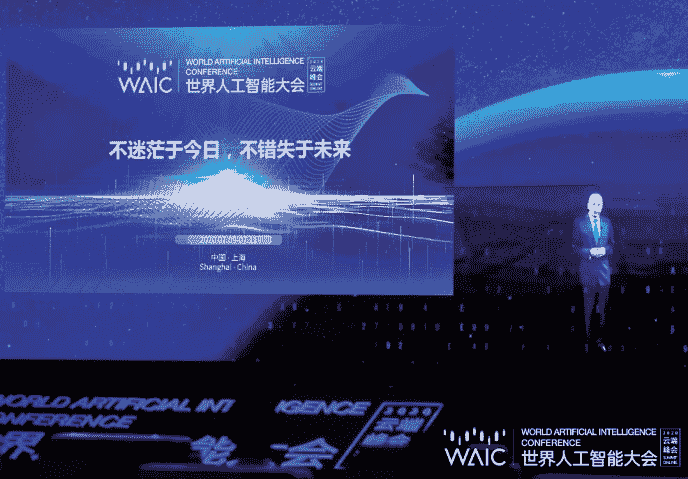

## 技术演进：大浪淘沙见真章

我们身处的是科技飞跃的变革纪元，还是长周期停滞的滞胀阶段？众说纷纭，见仁见智。

回溯1946年，一位业内权威断言世界仅需五台计算机；而今算力早已下沉至寻常百姓家，甚至塞进口袋。一部智能手机的算力，已超越阿波罗登月时代IBM大型机数万至数十万倍。

AI近年掀起热浪，政府、企业、大众皆盼其问世即震世、落地即改世。态度随周期起伏：渴望、狂热、贪婪、焦虑、恐惧、失望轮番上演。外界常盯着“当下能变现多少GDP、能刷出多少政绩、能不能包治百病、甚至只是跟风”，却忽视了重大技术自有其演化节律与长期势能。

从萌芽、研发、应用、普及到成熟、衰退，每项技术都有内生节奏。鲜有技术因一时灵感便一蹴而就、瞬间重塑社会，大多需经持久、渐进的演进。甚至连“谁是首位发明者”往往都难以考证。认知亦受时限束缚。教科书常称1946年宾大ENIAC为首台计算机；实则1822年剑桥查尔斯·巴贝奇已著文描述“差分机”，并试图打造通用计算装置，被视为现代计算机鼻祖。虽未见成果问世，巴贝奇1832年留下真谛：“任何成功制造的产品，皆从一系列失败中逐步走向卓越。”今日IBM Summit峰值算力达每秒20亿亿次，较ENIAC跃升约40万亿倍！

类似叙事在各领域反复上演。瓦特1769年改良蒸汽机推动工业革命，却鲜为人知：数十年前蒸汽机已在苏格兰普及，雏形甚至可追溯至两千多年前古希腊。瓦特的贡献在于“改良”与“落地”，无可争议。

通用技术皆走漫长迭代路：不断改进、与他技融合互补、衍生广泛应用、形成强外溢效应，最终重塑人类社会。语言、火、轮、印刷术……古籍如此；蒸汽机、电力、内燃机、汽车、计算机、互联网……近代亦然。纳米技术、生物技术、人工智能，或将成为本时代新的通用技术基座。

## 扩散迟滞：穿越“生产力悖论”

新技术引入需经验沉淀、技术打磨、认知跃迁。通用技术扩散早期常伴随生产效率暂降（即“生产力悖论”），唯经“经验曲线”淬炼，效率才迎来跃升。

1964年IBM推出大型主机，确立软硬件标准；计算机真正入户却等了二三十年，距首台现代计算机问世已四五十载。1973年乔治·劳雷尔发明条形码，被誉“二十世纪最伟大发明之一”，大规模采用同样滞后二三十年。

AI界有句自嘲：“背后多少人工，才有多少智能。”这是早期研发必经的学习曲线，亦称“播种期与收获期”的错位。

1965年摩尔定律揭示：成本不变下，集成电路元件数与性能每18至24个月翻倍。1936年赖特发现：飞机产量每增一倍，成本降两成，即“赖特定律”。2013年圣塔菲研究院与MIT合作，以62项跨行业数据双双验证两大定律普适性。

随时间推演、经验累积、算法丰富、资本涌入，AI必将突破早期高昂学习成本，加速渗透万行万业。或许二十年后，众多企业本质上皆为AI企业，正如今日诸多银行实为金融科技公司。

AI早期纯由科学家好奇心驱动。IBM 1952年涉足AI，初衷仅为下西洋跳棋。1997年“深蓝”击败卡斯帕罗夫，成里程碑。再历二十载，人类在绝大多数棋类已非AI对手。如今一台智能手机，无论自然语言交互还是图像识别，性能早让当年的巨型机望尘莫及。

## 决胜当下：拥抱者赢未来

技术须在应用中觅得沃土、生出生命力；行业须与时偕行、拥抱新技以赋能跃迁。当下，制造、医疗、金融、零售、教育、政务、农业……AI威力初显，潜能待释。

疫情加速数字化转型，AI成企业绕不开的必选项。作为通用技术，AI将持续与各行各技深度融合，持续释放外溢效应；持续提效降本，在未来数十年甚至更长周期，对商业、生活、社会治理产生变革性影响。虽仍在完善中，不妨碍企业早拥抱、早受益、早筑竞争壁垒。旁观者只会错失良机。

“朝看水东流，暮看日西坠”，莫待万事成蹉跎。创新红利向来聚集于创新者、早期尝鲜者、早期跟随者；迟到者沦为看客，边缘甚至出局。智能手机利润集中寡头，Google与Facebook瓜分网络广告大头。企业当：不迷茫于今日，不错失于未来。

---

# AI前沿：挑战与破局

## 杨强

微众银行首席AI官、港科大讲席教授、CAAI荣誉副理事长

微众银行首席AI官，香港科技大学讲席教授，人工智能促进协会（AAAI）执委会委员，中国人工智能学会（CAAI）荣誉副理事长兼香港人工智能与机器人学会（HKSAIR）理事长，第四范式联合创始人，国际人工智能联合会（IJCAI）理事会主席。同时为AAAI/ACM/CAAI/IEEE/IAPR/AAAS会士。荣获2019年度“吴文俊人工智能科学技术奖”杰出贡献奖及2017年ACM SIGKDD杰出服务奖。近作《迁移学习》《联邦学习》。

## 戴文渊

第四范式创始人兼CEO、迁移学习研究者

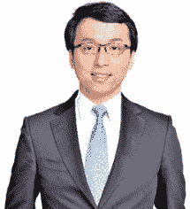

# AI专家对话实录

## 专家简介

### Qiang Yang

迁移学习奠基人，构建基础理论框架与核心算法体系；Google Scholar统计该领域学术影响力位列第三；研究成果收录经典教材《数据挖掘：概念与技术》；剑桥大学AI丛书《迁移学习》主笔、大数据课程教材《大数据建模方法》主笔。设计全球最早商用AI系统——百度“凤巢”，四年助力变现能力提升八倍；前ACM-ICPC世界冠军；首位荣获“吴文俊人工智能科学技术奖”一等奖的创业者；入选《MIT Technology Review》“中国35岁以下35位创新者”及《财富》“中国40岁以下40位商业精英”。

### Toby Walsh

新南威尔士大学人工智能教授

新南威尔士大学人工智能教授，澳大利亚科学院院士。《澳大利亚人报》誉其为澳洲数字革命“摇滚明星”。坚倡限制AI应用边界，确保其服务于人类福祉。在“杀手机器人”议题上扮演关键角色，曾在纽约、日内瓦联合国会议发声。频活跃于电视、电台科普。科普著作《2062：AI重塑的世界》已译中、英、德、日、韩、波、俄、越八国语言。

### Tong Zhang

香港科技大学数学系与计算机系教授；IEEE、美国统计学会、数理统计学会会士

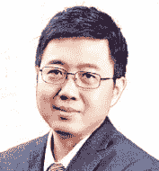

### 杨强

香港科技大学数学系及计算机科学系教授；IEEE、ASA、IMS会士。核心研究聚焦机器学习、大数据及其落地应用。曾任NIPS、ICML、COLT等顶级国际机器学习大会通用主席或领域主席，担任PAMI、JMLR、Machine Learning Journal等顶刊编委。早年任职IBM研究院研究员，后历任雅虎研究院首席科学家、百度研究院副院长兼大数据实验室主任、腾讯AI Lab负责人。

### 郭毅可

香港浸会大学副校长（研究与发展）

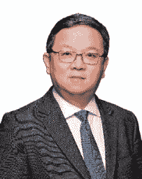

英国皇家工程院院士、欧洲科学院院士、英国计算机学会会士。2020年1月1日履新香港浸会大学副校长（研究与发展）。2002年起任伦敦帝国理工学院计算机学教授，2014至2020年出任该校数据科学研究院院长。1985年毕业于清华大学计算科学专业获一等荣誉学位，1993年于帝国理工获计算机科学博士。1999年创立帝国理工衍生企业InforSense，专注生命科学与医药领域的大数据分析平台。研究长期深耕机器学习与大规模数据管理，主导多项重大项目，现参与多个英欧核心数据科学计划。曾获2002年国际超算大会“最具创新奖”、2014年Bio-IT World“最佳实践奖”、2017年ACM SIGMM“最佳开源软件奖”。

### 中岛秀之

札幌市立大学学长

1983年获东京大学情报工学博士，入职电气技术实验室（ETL）。2001-2004年任产业技术综合研究所（AIST）网络协同研究中心长。2004-2016年任公立未来大学函馆校长（现名誉校长）。2016-2018年受聘为东京大学先端AI教育领域特聘教授。2018年起出任札幌市立大学校长。

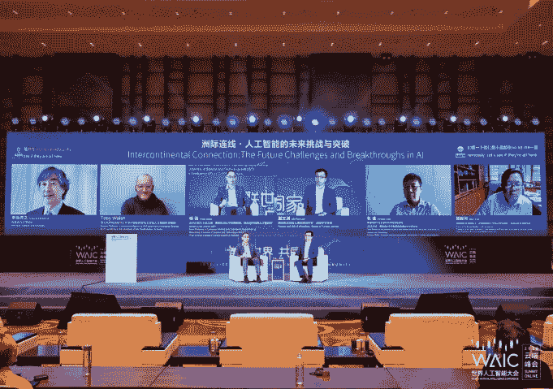

## AI突围：当下的核心突破在哪里？

**杨强**：今天对话聚焦三个维度：一是剖析AI当前的核心突破点；二是直面挑战与瓶颈；三是展望未来的终极图景。

**戴文渊**：在我看来，深度学习堪称AI领域最大的破局者。回溯十年前，我们初涉AI落地，首选战场是互联网——从广告推荐、搜索引擎切入，AI让定向投放精准度飙升8倍。七年前，触角延伸至金融营销、反欺诈、反洗钱；五年前，零售与能源赛道开花结果。如今，AI应用已渗透至各行各业，呈现井喷式增长，明年规模或将再扩十倍甚至更多。这是个振奋人心的时刻，我们对技术普惠工业充满信心。

**托比·沃尔什**：AI是人类智力的有力补充，却非复刻品。就拿刚才的例子，微小扰动让模型把猫误判为公交车，人类绝不犯这类低级错误——我们的认知机制本质上更高阶。另一短板是机器感知受限，未来亟需让机器真正“读懂”语音、文本、图像所承载的世界。更关键的是，人类隐性知识难以被机器习得，这正是当前攻关的重中之重。

**张潼**：我认为，AI与机器学习擅长在“确定性环境”下借助海量数据攻克“单一任务”。以博弈为例，聚焦特定游戏喂入海量对局数据，表现极其亮眼；语音识别在安静环境下同理。这类结构清晰、目标固定的场景，近年强化学习实现跨越式进展，甚至超越人类顶尖水平。

近年另一大看点是“无监督/自监督学习”崛起——模型开始从海量无标注数据中汲取知识。自然语言处理领域，`GPT`（生成式预训练Transformer）即为典范：它能从庞大语料自学通用表达，迁移至下游任务，未来或通向超人类智能，与有监督范式深度融合。计算机视觉亦同，特征表达可自无标注数据中涌现。这意味告别“全标注再训练”的繁琐，极大拓宽适用边界，必将是未来几年主攻方向。

理论层面也有硬核进展，如对神经网络运作机理理解的深化，新理论指导复杂模型训练，攻克疑难杂症。

落地视角看，**AutoML（自动化机器学习）极具潜力**。它将硬件适配、架构搜索、超参调优、特征工程打包成“黑盒自动流水线”，大幅降低部署门槛：云端/边缘侧跑超大模型，手机/IoT跑轻量模型，参数一调即用。这将推动AI走向通用化、轻量化部署，是极具前景的技术赛道。

**郭毅可**：严谨说，当前AI突破集中在“感知层”——模式识别、图像理解。十年间两大里程碑：一是**自动特征提取**，CNN（卷积神经网络）打破人工特征工程垄断，自动捕捉目标特征，衍生出大量图文识别新模型；二是**表征学习**，学习高效紧凑的对象表示。强化学习亦高速演进，融合感知能力催生AlphaGo等“超人级”博弈应用。

# 数据驱动下的AI困境：从“识别”走向“推理”的破局之路

我们正身处一个数据驱动的AI时代，主流认知往往笃信“数据越多越好”，试图通过海量数据提取特征，借助神经网络辅助人类推理决策。这类基于认知的AI虽能达到一定智能水平，但人类的决策逻辑从未单纯依赖数据，AI亦不应止步于此。单纯的“识别”能力，儿童早期即可具备；成人智慧的核心在于“推理”——即综合已知知识进行推演。当前AI领域的一大积极进展，正是将既有学习模型与推理能力深度融合。

**中岛秀之**指出，深度学习虽推动AI跨越式发展，但机器学习本身短板明显：首要门槛在于对数据的强依赖，无数据便无信息获取与分析。破局之道，在于将AI与现有领域知识、基础学科经验深度绑定。

## 专家圆桌：剖析AI落地的“拦路虎”

**杨强**以十年视野展望，直指AI三大痛点：一是**迁移学习**短板——难以从既有经验中学习并适应环境变迁，这是机器实现泛化推理的关键障碍，人类擅长此道，机器却步履维艰；二是**数据孤岛与隐私博弈**——数据调用伴随泄露风险，导致数据方不愿共享，真正的“大数据”难以汇聚；三是落地场景的复杂适配性。

**戴文渊**结合第四范式实战，将挑战具象化为三座大山：

*   **人才荒与开发门槛**：某餐饮巨头转型线上，原本线下依靠服务员人工推荐的个性化营销，搬到线上却因缺乏数据科学家而举步维艰。这倒逼第四范式五年前重注**AutoML（自动化机器学习）**，让普通Java、Python工程师也能构建AI应用，化解人才瓶颈。
*   **数据稀缺与迁移学习刚需**：即便有开发者，企业往往缺乏可用标注数据。必须借助迁移学习，将知识跨域迁移，解决“小样本”困境。第四范式在**隐私保护迁移学习**上取得突破，实现“不见数据、只取模型”的跨域知识流动。
*   **算力成本的生死线**：头部互联网企业年投入上亿优化搜索引擎，常规企业望尘莫及。AI系统非单纯硬件堆砌，而是**软硬协同融合**体系。第四范式推行“软件定义算力”，通过软硬一体化设计，将数据中心TCO（总体拥有成本）性能提升十倍。

**中岛秀之**总结共识：深度学习能力仍需跃升，技术亟待打磨，目标直指高阶复杂任务。

**托比·沃尔什**补充三大基础鸿沟：
1.  **语言理解**：语言是智能内核，机器目前仅停留在表层模式匹配，缺乏语义层面的真理解。
2.  **常识缺失**：人类凭常识秒懂的场景（如识别学校、回答历史题），AI因缺乏底层常识而频频闹笑话。
3.  **情感缺位**：机器无共情能力，难以建立真正有效的人机交互。

**张潼**强力背书“语义理解与常识推理”难题：现有AI擅长特定任务、固定环境下的大数据统计拟合，却在泛化任务、开放环境中失效。核心症结在于：AI依赖概率猜测而非人类常识逻辑；且模型跨环境鲁�性极差（如室内训练的视觉模型到室外失效，自动驾驶遭遇长尾Corner Case）。**未来十年，单任务多场景的自适应能力（鲁棒性、迁移力）是迫切刚需**——一旦攻克，AI将从“专用定制”进化为“通用适配”，应用边界与安全性双提升。小样本学习、跨机构隐私计算协作，均是这一核心挑战的衍生命题。

**郭毅可**拔高至理论维度：**AI终极挑战在于“知识与数据的深度融合”**。认知过程本质是：观察获取数据/知识 -> 应用知识 -> 泛化迁移 -> 小样本学习（数据知识融合） -> 知识生长与组织。贝叶斯先验思想、控制论均指向同一真理——**先验知识与数据驱动不可偏废，必须双轨并行**。坚持“知识+数据”双驱动哲学，构建更优模型与逻辑，实现数据高效理解与利用，这不仅是方法论选择，更是通往通用人工智能的必由之路。

**中岛秀之**：目前数据应用场景依显局限。展望未来，数据理应以更智能的形式被运用，实现人机间更高效的沟通与交互。我们亟需赋予AI价值观体系。价值观固然关键，但AI原生并不懂得。我们必须通过训练，让AI具备此类价值取向或“常识性认知”。虽不知其他技术能否助力，但价值观建设无疑是核心所在。

**托比·沃尔什**：我们偶尔将部分工作外包给机器，可若万事全由机器包办，人类岂不变得懒惰、甚至无用？核心挑战在于：如何确保机器不彻底取代人、不垄断所有人类任务；主导权必须始终掌握在我们自己手中。

---

# AI未来图景

**郭毅可**：未来10到15年，AI将实现跨越式发展。医疗健康是关键战场之一。未来医疗将高度依赖数据驱动；海量超级医疗设备将涌现，个性化诊疗成主流趋势。这将倒逼AI研究聚焦于：互操作性、可验证性、小样本学习难题、隐私保护等核心议题，皆极具研究价值。

**戴文渊**：我看好5G与物联网的融合。当前AI学习高度依赖人类——海量众包标注、用户点击行为，本质上皆是人在教AI。而5G与物联网的到来，将让AI具备自主学习能力。人类规模仅亿级，但物联网设备已达万亿量级且呈指数增长。因此，5G加持下的物联网演进，将为AI带来质变——更丰富的目标、更海量的数据、更多元的学习场景。这正是我看好二者加速AI发展的原因。

**张潼**：未来数十年趋势：AI将从“专才”进化为“通才”。算法革新将使AI学习更稳健、泛化能力更强、适应环境更广。当下最迫切的课题，是构建更鲁棒、更安全可靠的系统。同步推进知识注入，赋予AI推理能力，虽属必然，但短期内恐难突破，因路径尚不明朗。另一趋势：依托物联网与5G，无处不在的AI终端将涌现。它们可互通、互学、协同进化，实现持续自生长。现有联邦学习局限重重；未来独立AI个体间的互学、自学、持续进化，将极大拓展联邦学习的边界与能力。这种去中心化演化模式下，AI将迸发何等能量，令人翘首以盼。

**杨强**：得益于5G与物联网发展，通信协作的实体将爆发式增长。在隐私保护、商业利益等制约数据流动的前提下，若要实现远程协同学习，必须在尊重隐私等红线下构建更优协作机制。这催生了一个与人类共存的全新AI市场——即我们正在深耕的联邦学习领域。

---

# AI新浪潮

## 丁磊

网易公司首席执行官，中国数字经济标杆人物

# 对话AI领军者·洞见发展趋势

## 产业领袖速写

### 丁磊

网易公司创始人兼首席执行官

深耕互联网行业二十余载，凭借敏锐商业嗅觉，带领网易打造出多款里程碑式产品：中国首个免费中文邮箱、首款自研大型网游、首个“互联网+高端制造”生活电商平台。如今网易已成长为全球顶尖互动娱乐开发商及发行商、中国最大邮件服务商，在互动娱乐、网络音乐、在线教育、新闻媒体等诸多领域均占据领先地位。

### 徐立

商汤科技联合创始人兼首席执行官

商汤科技联合创始人兼CEO。其主导下，商汤建成世界级自研深度学习超算中心；在智慧城市、智能手机、智慧医疗、自动驾驶等领域的创新成果，赋能千行百业智能化升级。同时推动商汤与国内外头部企业战略合作，已服务超1100家客户实现AI转型。荣获《财富》中文版“40位40岁以下商业精英”四连庄（2017-2020）、《财富》“全球40位40岁以下商业精英”（2018）、安永企业家大奖中国区2018、2019香港创新领袖奖等殊荣。

### 王杰

纵目科技（AutoX）董事长兼首席执行官

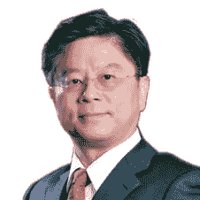

纵目科技董事长兼CEO，中国电信研究院首席专家（AI方向）、一汽集团首席技术顾问（智能网联方向）、南京航空航天大学兼职教授。2017年6月入选《福布斯》“推动中国AI革命的20位领军者”（其中7位曾为其下属）；2016年11月成为《汽车新闻》（美汽车界权威媒体）“全球推动自动驾驶技术发展的60人”唯一华人上榜者，被誉为“中国自动驾驶先锋”。兼具自动驾驶创业与大厂实战经验。曾创立径驰科技并任CEO，亦曾任谷歌中国工程院副院长、eBay与阿里巴巴研发团队负责人，早年在美国硅谷E-Loan、Informix、Oracle等企业任职。

### 黄晓庆

云迹科技创始人兼首席执行官

云迹科技创始人兼CEO，被誉为“云机器人之父”。早年供职贝尔实验室，后任UTStarcom高级副总裁兼CTO。现任中国电子信息行业联合会会长、中国电子信息行业联合会云计算专家委员会副主任、电子科技大学教授。2007年任中国移动研究院院长期间，提出构建下一代移动互联网“网、应用、终端”三大基础设施战略，推动TD-LTE成国际主流4G标准，大幅提升中国通信业国际话语权。2012年首创“云机器人”架构；2015年创立云迹科技，专攻“云机器人”技术与产业落地；2016年荣获IEEE CQR主席奖。

### 朱啸虎

金沙江创投管理合伙人

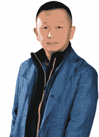

金沙江创投管理合伙人，主管互联网、无线及新媒体早期投资。主导投资滴滴出行、饿了么、ofo共享单车、映客、大智慧等明星项目。加入金沙江前，曾联合创立易宝网络技术有限公司，任职麦肯锡大中华区，积累深厚咨询落地经验。拥有复旦大学世界经济硕士、上海交通大学电信工程学士学位。

### 季新华

Chairman, Chief Executive Officer and President, UCloud Technology Co., Ltd.

Chairman, CEO and President of UCloud Technology Co., Ltd. (UCloud), 2020 Shanghai Senior Professional Engineer (AI specialty), Deputy of the 15th Shanghai People's Congress, serves as technical expert for the National Ministry of Industry and Information Technology (MIIT), Shanghai Commission of Economy and Informatization, and Shanghai Science and Technology Commission. As the person in charge and major participant, undertook the construction of multiple key national and Shanghai municipal projects, winning the 2017 Shanghai Science and Technology Progress First Prize, the 2019 "China Institute of Communications Science and Technology Award (Science and Technology Progress Category) First Prize," and other awards. Previously honored with titles such as "Shanghai Leading Talent," "Shanghai Outstanding Young Entrepreneur," "Fifth Shanghai Outstanding Builder of Socialism with Chinese Characteristics," and "China's Dual Innovation Pioneer." Prior to founding UCloud, served successively as Head of Security Team at Huawei, Deputy General Manager of Tencent Security Center, Chief Security Officer at Shanda Online, and CEO of Shanda Cloud Computing.

## 寻找 AI 的最佳落地场景

新冠疫情爆发前，人工智能已历经数轮关键的趋势演变与方向调整。首先，AI 步出实验室，开始深度渗透并重塑各行各业，不再局限于单一技术维度的突破。其次，数据作为 AI 发展的基石，战略地位持续攀升；行业聚焦于降低数据使用门槛、打破数据垄断，以及数据隐私保护与 AI 伦理规范的构建。再次，5G 技术的商用为 AI 发展铺设了全新基建，在一定程度上重塑了市场格局。就在这些变革汇聚之际，2020 年新冠疫情的爆发为 AI 发展注入了新的内涵与动能，我们正见证一轮新的 AI 发展浪潮到来。

### 丁磊：AI 的核心不在技术，而在应用场景

AI 不是技术难题，而是场景难题。一旦找准切入场景，AI 的效能将被极大释放。

大众关心的从来不是晦涩的算法模型，而是 AI 能否切实改善民生。红绿灯能否变智慧以疏解拥堵？公卫体系能否建立高效预警机制阻断大规模疫情？AI 能否弥合教育资源鸿沟？这些直击百姓切身利益的痛点，才是 AI 必须攻克的硬仗。让市民出行更顺畅、让患者就医少排队、让乡村孩子同享优质教育资源，这才是技术落地的终极意义——民生。

以教育为例，网易推出的作文批改应用，覆盖中英文写作，能高效辅助教师纠正语法与措辞错误。网易在 AI 应用上的探索不止于此：在音乐领域，其自研 AI 编曲填词系统并投资欧洲 AI 作曲公司 AIVA；未来更期望将游戏领域积累的 AI 技术实现在线对战真人玩家，助力玩家进阶。

### 徐立：AI 应用正从“头部”向“长尾”延伸，构建价值闭环

AI 应用正由“头部问题”向“长尾问题”渗透，由此形成完整的商业价值闭环。

过往 AI 多聚焦“头部问题”——受众广、高频、关注度高的通用刚需，人脸识别即典型代表。但要让 AI 真正改造一个产业，必须解决大量低频却不可或缺的“长尾问题”。这些细分场景应用的大规模涌现，标志着 AI 正深入产业肌理，开始跑通价值变现链路。以上海“一网统管”为例，违停治理、高空抛物等细分治理场景均接入了 AI 技术。虽不如人脸识别那样光鲜夺目，但它们同等实现了城市精细化治理的质变。

疫情带来的另一重深远影响，是加速了 AI 在各行业的普及。过去传统企业虽高呼“AI 转型”，却因成本等制约进展缓慢。疫情倒逼业务上云，推动了业务数据化进程，而数据化正是 AI 落地的前提。结果显示，利用全量数据辅助决策的企业显著增多，整体推动了企业智能化转型进程。

### 王劲：自动驾驶中国路径，逐步走向“车路协同”

在自动驾驶赛道，中国正渐行渐近“车路协同”路线。

按现有单车智能路径，中国实现局部 `L4 级` 自动驾驶仍需两三年，`L5 级` 更遥遥无期。但 `5G` 与 `AI` 的融合，为中国开辟了“车路协同”新一代智能交通的捷径。

传统单车智能依赖车载传感器与算力，属个体博弈；而“车路协同”具备三大优势：一是**更安全**，路侧感知补全盲区，路侧算力增强决策，显著提升安全上限；二是**更低成本**，中国 3 亿车辆若通过路网协同节省单车智能成本，总额约 1.5 万亿，按“100 万/公里”投入路侧设备，即可铺设全国车路协同网络；三是**更高效率**，单车智能是局部最优，车路协同实现全局最优，系统效率跃升。

中国已实质性踏上车路协同之路。与单车智能主要靠技术突破不同，车路协同高度依赖政府主导——海量路侧设备部署与网络成网，离不开政策许可与基建支持。

落地车路协同，需多方势力合流：AI 企业提供算法，车企提供载体，出行平台提供场景，`5G` 运营商提供连接。这四大产业如何融合成新型智能交通生态，需要政府统筹协调，打通技术、产业与政策的多重壁垒。

### 黄小庆：我们正步入第三代人机交互时代，机器人将成核心载体

# 交互范式第三纪元：机器人成新载体，AI 成超级平台

鼠标与窗口，让乔布斯开启了人机交互的第一纪元，PC 成为核心载体；多点触控加持智能手机，乔布斯又引领了第二纪元，手机登台主角。如今，多模态 AI 融合视觉、语言与肢体动作，正推开第三纪元的大门——**机器人将成为新一代的“PC”与“手机”，AI 则进化为超级系统平台。**

初期的机器人未必拥有通用智能，但已能胜任清扫、安保、迎宾等单一、重复、人类厌恶的窄技能任务。随着平台能力跃升，未来将诞生家庭保姆等高阶形态，虽仍需时间打磨，但方向已然明确。

## 朱啸虎：疫情成 AI 发展“加速器”

回溯 2003 年非典催生电商爆发，京东、天猫借势崛起。新冠疫情对 AI 的刺激作用将呈同构效应：**中国制造将整体向无人化、智能化转型；远程办公常态化，超一成员工申请长期居家，效率与生活质量双提升，一线城市人口虹吸效应减弱，远程协作比例将持续走高。**

行业繰荣必伴泡沫，适度泡沫反而利于生态建设。早期资本涌入盲目，现已回归理性，聚焦场景落地、商业变现与价值创造，标志着产业步入良性轨道。**五年内，所有互联网与科技企业皆将实现“AI 原生化”，至少植入 AI 模块。**

## 季昕华：场景、数据、算法、算力——AI 商业四基石

UCloud 从算力切入，后觉数据关键，推出“安全沙箱”实现数据“可用不可见”、所有权与使用权分离。上海率先打通政务数据授权，企业可在沙箱中训练模型而不带走原始数据，隐私合规得以保障。疫后医疗场景涌现，如脑波分析失眠风险与干预，团队正在多维场景试水布局。

## 破解数据孤岛：共享与隐私的平衡术

**徐李：** 单一企业难觅全量数据。联邦学习（多方联合建模）让机构在不出本地数据前提下共同提升精度，配合数据资产确权与标准制定，是打通孤岛的关键路径。

**王杰：** 车路协同自动驾驶中，坚守“政数政管”原则。企业仅协助采集，不得成数据所有者，筑牢隐私与国防安全防线。跨境数据流动规则仍待深度探讨。

## 上海 AI 落地优势：认知普及领跑全国

技术落地最大拦路虎非技术本身，而是**认知偏差**。交流电发明后十余年才普及，根源在于公众误解；AI 同理——大众能否接受无人驾驶？企业是否读懂 AI 边界？许多传统企业转型滞后，源于“不知 AI 能做什么”。上海优势独特：AI 理念深度普及，为多元应用落地铺就了认知基石。

## 献策上海：民生、人才、机器人、生态

**丁磊：** 期待政府下定决心攻坚民生项目，让上海不仅是“东方明珠”，更成**全球标杆的 AI 智慧城市**。

**朱啸虎：** **人才是第一瓶颈。** 建设人才高地当为首务：增设人才公寓引现有人才，调整高校招生倾斜 AI 与计算机学科育未来梯队。

**黄晓清：** **超前布局智能服务机器人全产业链**，目标打造全球最大机器人服务与制造体系。打造“双优”城市——顶尖人才与头部企业双向奔赴，内外资企业均可落户上市（科创板）；大规模引入核心硬科技“独角兽幼兽”，虽非传统巨头，却掌握前沿关键技术。

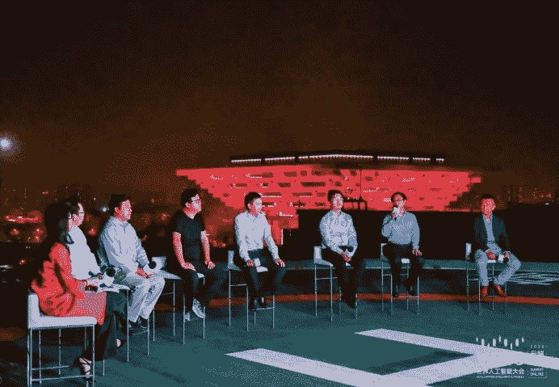

产业规模化是成长核心变量。AI、通信、机器人三技融合催生“云机器人”产品级服务，政府需以补贴、购买服务等手段推动规模化，如当年初扶持新能源车。**“以机替人”将成核心商业模式，租赁服务（RaaS）将超越销售，类似企业雇佣关系，此模式高度依赖金融工具支撑。**

**季昕华（补记）：头部大厂垄断数据，构成新壁垒。**

# 打破数据垄断，上海如何抢占AI高地？

当前数据资源高度向头部大厂集中，初创企业虽渴望数据却难以获取。建议上海率先探索“数据招商”新路径：向AI企业开放数据资源，以此吸引优质项目落地，在申城平台上跑出行业标杆。目前上海医疗数据整合度较高、基础较好，核心难点在于如何盘活利用。政府数据已取得开放突破，关键下一步能否向医疗影像、运营商数据等产业刚需领域延伸，将直接决定产业发展的上限。

### 王杰：智能网联赛道，上海大有可为

上海在智能网联汽车领域蕴藏巨大机遇。期盼能尽快设立交通特区，推动车路协同（V2X）与自动驾驶在本地加速落地。初期可先在郊区或城乡结合部开展试点探索。

### 徐立：AI落地闯入“无人区”，亟需“首试”特区

AI技术深入诸多垂直领域时，面临的是法规空白的“无人区”，缺乏相应规范准则。上海应主动设立“首试”示范区，在缺乏成熟规范的前提下，先行先试，为产业发展闯出路子。

## 趋势洞察

### AI新起点：新基建加速智能经济与社会到来

#### 李彦宏：亲历者眼中的AI三阶段与新基建红利

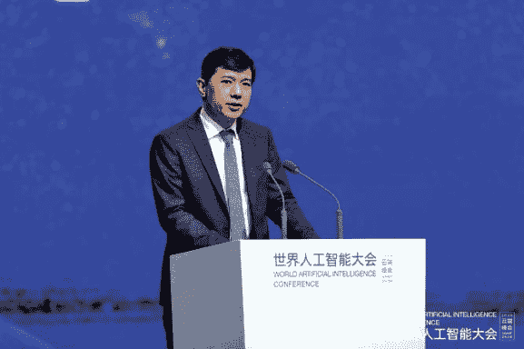

上海将AI发展置于战略首位，全力打造全球影响力的高地，这种格局与魄力令人钦佩。纵观过去几十年科技浪潮的起伏兴衰，作为实践者，我深刻体会到技术推动人类社会进步的根本逻辑从未改变。

今年以来，疫情冲击全球经济、失业率飙升，身为企业家不得不反思：关键时刻，技术创新能否让人类更好地掌握命运？本届世界人工智能大会主题“智能连接，不可分割的共同体”，给出了最好的注脚。

现实一度令人焦灼：武汉封城时，无法大规模调度无人车保障民生；生物计算未能极速研发疫苗；面对逆全球化风险，核心技术储备仍显不足。这让不少人对AI产生了悲观情绪。

但身处局中，我确信我们在进步。百度自研`LinearFold`算法，将新冠病毒全基因组二级结构预测从55分钟压缩至27秒，提速120倍，大幅缩短病毒变异研判与疫苗研发周期；多目标快速测温方案降低了车站地铁等公共场所的交叉感染风险；阿波罗无人配送车、无人消杀车投入一线，有效阻断传播链路。

展望未来，AI在公共卫生监测、新药研发、疾病诊疗等领域潜力巨大——它能提升检测灵敏度、压缩研发周期与成本、精准赋能临床诊断，让人类在面对健康挑战时更具主动权。

我坚信，国家倡导的“新基建”，本质是以AI为核心的基础设施建设，将显著提升交通、能源等领域效率，释放经济增长新动能。以车路协同为核心的智能交通基建，可提升15%-30%通行效率，折合贡献2.4%-4.8%的GDP绝对增量。

更令人振奋的是，随着AI技术平台开源开放，应用开发门槛大幅降低，红利将普惠经世济民各层面。未来的主流操作系统，不再是基于PC或手机的OS，而是基于深度学习框架的AI OS。深度学习框架向上连接万千智能应用，向下主导AI芯片设计演进。

在我看来，AI发展将历经三大历史阶段：

第一阶段是**技术智能化**。AI概念诞生60余载，近十年算法爆发式迭代，借云算力与大数据之势，逐渐形成新型技术平台。但此前科学家精力多聚焦于概念确立、技术攻关及人机博弈等局部探索，AI尚未形成产业化、经济化规模现象。

第二阶段是**经济智能化**。移动互联网催生指数级有效数据，云计算提供澎湃算力，经济社会全面数字化网络化铺就底座，AI才真正开始在广阔经济版图中施展魔力。

# AI发展三大历史阶段与当下机遇

# AI演进三部曲：从经济智能化迈向社会智能化

这一进程可细分为两个半场。上半场聚焦于通用能力构建与AI资源平台化，并率先在智能搜索、信息流推荐两大标杆赛道落地；下半场则开启全面工业化进程，即行业应用与商业化的大规模铺开。

第三阶段是社会智能化。AI将渗透出经济领域，延伸至广阔社会版图。跨社会乃至全球尺度的智能协同与制度创新，将成为该阶段核心特征。这种协同与变革终将深度反哺经济，推动人类真正步入智能社会。

当下，我们正处于经济智能化“上半场向下半场过渡”的关键窗口期。上半场积淀催生出全球寥寥数个通用AI平台，以及深耕细分领域的垂直平台。在搜索、信息流推荐、自动驾驶等垂直赛道，AI已展现或初步验证了颠覆重塑行业的势能。

以百度为例：创立之初锚定搜索引擎这一迄今最大AI应用场景；十年前便将通用AI能力研发与平台化确立为核心战略；数年前又提前布局自动驾驶与智能交通垂直领域。

回溯1990年代，美国推出“信息高速公路”计划，大幅夯实互联网基建，开启人类互联网纪元。如今中国大力推进的“新基建”，可视为人类迈入智能经济与智能社会前最大规模的基建扩容工程，极大概率将率先在国内引爆AI全面普及浪潮。

作为定位“外部赋能”的AI平台公司，百度愿景是让每家企业——无论体量大小——都能像用水用电一样调用平台与服务能力，加速完成AI转型，最终惠及每位普通用户。这种定位使我们避开与生态伙伴同台竞技，始终坚守开放底色，专心致志做AI的赋能者。

但须清醒认知：当前AI正处于易生迷茫甚至悲观的“阵痛期”。这是颠覆性技术加速普及前的必经之路，恰似互联网在2000年后的数年——企业倒闭、人才离场、甚至留学生因失信心而出走。百度曾亲历那轮寒冬爬出低谷，记忆犹新。待迷雾散去，经济社会全面互联网化时代随之开启，熬过寒冬的“小人物”成长为新英雄。

无论是昔日对互联网的笃信，还是当下对AI的坚守，初心未改。我依然确信：AI是媲美工业革命的宏大浪潮，将彻底重塑现存每个行业。疫情成为催化剂，既唤醒大众掌控命运的紧迫感，又让人切见AI已触手可及——它延伸双手、赋能大脑、拓宽视野、消弭时空壁垒。

迷雾终将褪去，智能经济与智能社会必将落地，人类终将掌握自己的命运。

---

# 机器人技术与计算机视觉

## Martial Hebert

卡内基梅隆大学计算机学院院长、教授

计算机视觉与机器人领域权威专家，现任卡内基梅隆大学（CMU）计算机学院院长。巴黎大学计算机科学博士。1984年加入全球最大机器人教研机构——机器人研究所。入职CMU教职后，参与“自主陆地车辆”项目，为自动驾驶技术奠基。研究聚焦计算机视觉，涵盖环境感知建模、高效识别技术、三维场景重建与理解、三维信号处理、视频分析、动态系统检测/跟踪/识别等方向。

近年计算机创新领域突飞猛进，深度学习引入计算机视觉成效显著。本次探讨将聚焦：如何将上述计算创新能力迁移至机器人与自主系统。例如，我所与业界联合研发的全自动驾驶车辆已稳健运行多年，系统高度依赖高鲁棒性感知；又如高速无人机，需在算力受限条件下于复杂环境中实现高鲁棒性感知。

核心攻关点有四：一、如何利用有限数据训练出区别于其他AI场景的系统；二、视觉系统任何故障均可能导致不可逆的系统级失效；三、需应对自动驾驶等高度复杂动态环境；四、需破解算力受限下的实时决策难题。下文将逐一展开。

### 一、监督学习模型

传统范式依赖海量标注数据，通过监督学习生成分类、检测、仿真等模型，且不依赖系统先验知识。但在机器人系统中，获取大规模监督数据往往困难或不可行，却可积累海量数据与经验辅助建模。由此引出关键问题：能否对视觉任务进行离线训练？

元学习——即“学会如何学习”——提供思路：针对新任务，如何从先验知识中习得新模型，亦即在数据不足时构建高效视觉模型。关键在于：审视结构化视觉世界时，不应局限于数据与特征空间，而应直接在任务与模型空间推演。

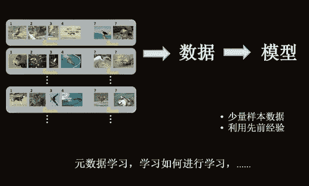

设想面对一分类问题：可将每个分类器视为模型空间中独立个体，它们共同处于由视觉任务框架严格约束的高维空间。核心命题转化为：能否利用该模型空间结构辅助学习，特别是小样本学习与有限数据下的动态学习？

# 计算机视觉落地机器人，这四道坎绕不开

举个例子，假设手头只有寥寥几个样本用来训练模型——比如某个分类任务里，仅凭单个样本就学会了一个分类器。眼下的难题是：怎么利用这些“零星样本”生成我们想要的模型？其实可以换个思路：把“从小样本学到的模型”转化为“从大样本学到的模型”。只要搞定这个转化机制，小样本学习的效果就能大幅提升。这正是当前视觉系统、尤其是机器人视觉系统的核心拦路虎：过度依赖标注数据、监督数据。

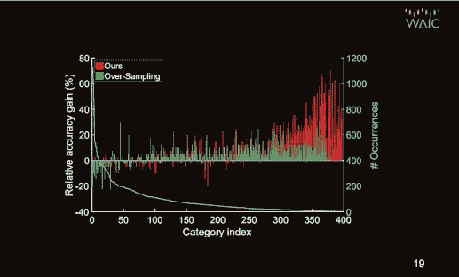

下面这个案例演示了如何落地这个思路。这是一个涵盖 400 个类别的分类任务，横轴按样本量从多到少排序。图中展示的正是前文技术带来的性能提升：先在左侧大样本类别上学会“转化规律”，再拿去优化右侧小样本类别的模型。图例代表每个类别的性能增益。很明显，右侧小样本类别进步巨大，而左侧大样本类别仅微幅提升，甚至持平。

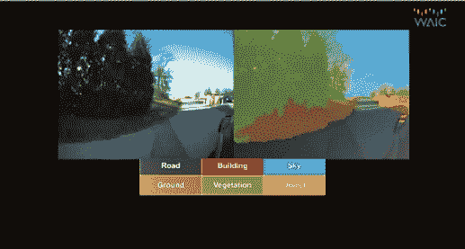

这验证了我们的核心设想：用易获取数据训练的视觉概念，去辅助稀缺数据视觉概念的学习。这也证明了在机器人应用场景下，极少数据也能练出模型。

## 二、 视觉系统的“被迫决策”困局

首先看机器人的感知管线：输入层 → 感知层 → 解释层 → 推理决策层。从感知层输出到解释层是一条“单行道”，系统必须基于感知结果直接决策。但感知输出往往带噪声、不干净、质量不稳定，根本撑不起正确决策。于是问题来了：如何在线评估视觉系统表现，实时判断“当前输出能不能用”？这涉及自我评估、内省、故障检测。

以自动驾驶语义分割为例。

此类系统的痛点通常源于光照变化导致的结果波动。核心需求变成了：给定光照条件下，预测视觉系统能不能干活。我们的基本思路是：根据输入直接预测感知系统性能，必要时绕过感知模块，降低对感知链路的强依赖，提升整体可靠性。实现路径有二：一是显式建模“输入特征-性能”的关系；二是更高明的做法——直接从输入中挖掘能预测系统性能的特征。

比如简单的分割任务，系统能自动判断左图难分、右图易分。输出结果也印证了右侧表现更优。关键在于如何自动化、系统化地完成此过程，从而获得一套全新的系统性能内部描述。

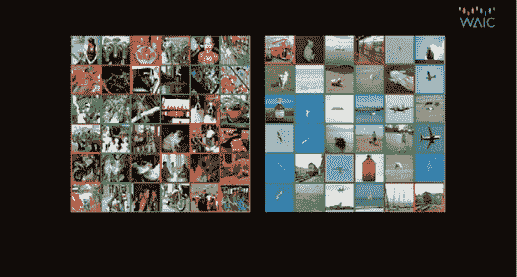

再如户外移动机器人。同样能发现：系统精准识别出左图比右图更难分割。也就是说，预测视觉系统的自我评估表现，能直接赋能自主决策与规划。

还有一个无人机在非结构化环境飞行的案例。画面展示了几帧飞行过程：左侧是输入图像流，左上角是环境重建的粗略深度（含计算机视觉关注的各类 LSD 标签），右侧是不同轨迹的评估分数，配合经典的滚动时域技术决定跟随哪条轨迹。

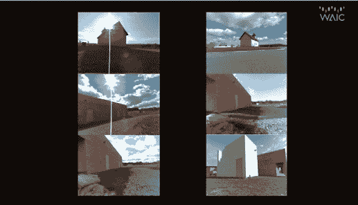

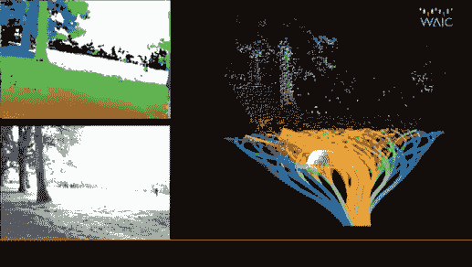

问题随之而来：视觉输入退化 → 深度估计失准 → 系统灾难性失效。对策是从数据中学习预测“飞行性能”——注意，不是评估深度估计好坏，而是判断这些轨迹有没有被有效评估过。基于输入数据预测性能，搞清“为什么能飞”。做到这点，后续动作自然顺畅：案例中无人机右侧失效概率高，便主动变换位置寻求更优视觉输入，系统飞行性能显著提升。

这个案例引出一个更本质的问题：计算机视觉用在机器人上，核心挑战到底是什么？看下面两张分割输出图。通常按区域给像素打标签。显而易见，上图输出优于下图——下图房子前大片区域标签错误。上图正确像素更多，说明这类任务的误差度量目标是“尽可能多地正确标注像素”。

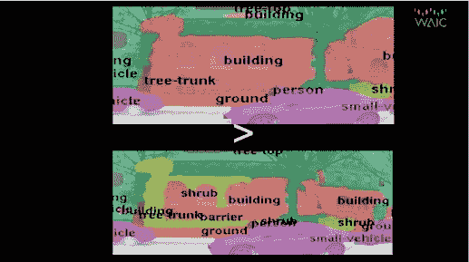

但现实是：没有任何应用场景要求“全图像素全对”。这意味着我们用错了目标函数、错了误差度量。它的实现难度，远超完成任务所需的最小目标函数。

回到这个例子，我们其实可以尝试量化视觉系统重建 3D 世界的精度。但其实精度是 3mm 还是 2mm 毫无意义。唯一重要的是：任务完成度。这是机器人场景下唯一核心的目标。难点在于：如何设计视觉系统，让它只盯着、只优化这一个特定目标。

## 三、 与动态环境的“博弈交互”能力

下面这个例子里，要预测左侧 Target 18（行人）的移动方向。难点有二：一是如何做动态预测，用概率函数建模主体的决策；二是更大的挑战——不能只看单个主体，必须处理多主体及其相互作用。

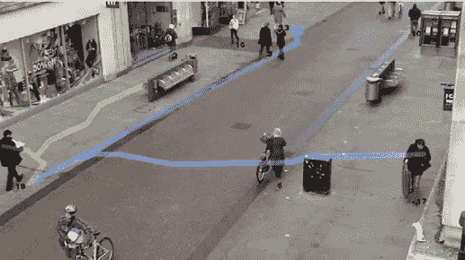

这就引出了博弈论问题：主体 A 的决策依赖主体 B，主体 B 的决策又依赖主体 A。这种相互纠缠的优化问题，正是预测动态工作环境面临的核心硬骨头。

## 四、 算力受限下的实时预测

算力预算有限，却要办成所有事。以感知流程为例，常规假设是数据必须完整跑完感知层才能出结论；但在算力极度受限、必须在死限内决策的场景下，视觉系统得学会“随时可停、随时出果”。这正是计算机科学经典课题——“随时机器学习”（Anytime Prediction）的核心主张：先吐个粗略结果，随后随时间迭代精进，而非传统范式那样非等到终局才给唯一答案。其计算过程可抢占、可中断；随算力投入产出递增，但边际收益递减。

深度学习里怎么落地？典型网络分阶段、分层、分模块，前向传递、末端监督。要在任意时刻拿到可用结果，就得把中间层也拉进优化目标。可行路径之一是对各阶段输出做线性组合，更优策略是用各阶段损失的逆作为权重。细节暂且按下，关键在于系统设计思维转变：赋予学习系统即时输出中间结果的能力，让有限算力下也能分阶段获得可用解。

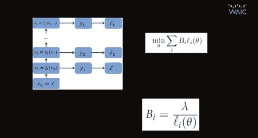

---

# 共建开放生态，点亮万物智联新世界

## 陶景文

华为技术有限公司董事、首席信息官

北邮毕业，1996年入职华为，历任产品开发工程师、市场技术部副总、国际市场部执行副总裁、南非地区总裁、全球营销/销售总裁、终端公司总裁、西欧地区总裁、质量流程IT总裁等职。

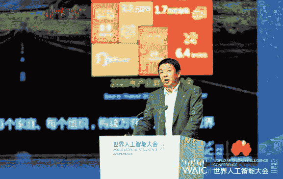

第四次工业革命已至。5G、AI、工业互联网技术成熟，以5G、数据中心、云为代表的新基建加速落地，推动新一代工业互联网在万物互联、万物智能乃至企业数字化转型中大规模应用。

### 对AI发展的认知与判断

我们坚信，第四次工业革命将重塑产业全貌。它不止让生活更智能便捷，更将改写百业图景。AI与数字技术广泛渗透，将催生超12万亿美元市场空间。预测至2025年，ICT产业与智能制造产业规模将分别触达5万亿与6.4万亿美元。2017年华为发布新愿景——将数字世界带入每个人、每个家庭、每个组织，构建万物互联的智能世界。2018年推出“+智能·见未来”全栈AI战略。2019年以“共创智能新高度”彰显深耕AI、推动产业落地的战略定力。

### 华为AI发展实践

华为本质是技术创新公司，双引擎驱动：一是面向消费者的终端BG，围绕手机构建“1+8+N”生态，打通芯片、云服务、产业生态，与伙伴共筑个人与家庭智能生活全栈方案；二是面向政企运营商的ICT基础设施BG，致力提供泛在联接与普惠智能产品方案。2019年全栈AI方案发布，融合企业智能（EI）使能平台，助力政企快速构建AI应用。从芯片、5G、边缘计算到以鲲鹏生态Atlas为核心的云服务，华为提供端到端服务平台，携手伙伴共建全行业全场景应用生态，支撑“端-边-云”全场景AI基建。

实例佐证：洛阳某钼矿地处偏远，大型矿卡井下作业风险极高。“5G+AI”实现无人驾驶与远程操控，2019年实现零伤亡，司机从百余人降至20人，年增产值1.6亿，经济社会效益显著。宁波舟山港“5G+AI”智慧港口，集卡7×24小时自动作业，识别准确率超95%，大幅节省人力。抗疫期间，华为联手300余家医院，以“5G+AI”医疗服务惠及百万人，医生读片耗时从十分钟级压缩至分钟内。

AI是由业务场景、算法模型、算力基座与数据要素四大要素融合而成的综合性服务。作为业务形态极为丰富的企业，华为正大力推进内部智能化实践。公司构建了“华为企业智能大脑”，将面向企业的AI平台建设周期，从最初的14至16个月大幅压缩至如今的0.5至2个月。华为期望以自身的实战积淀，助力千行百业实现体验跃升、效率变革、效益增长与商业模式创新。华为始终坚持“自己跳伞自己背降落伞”的实战理念，立足海量企业级应用场景，聚焦高重复、大规模、高复杂度的典型场景，打造产品创新与智能化转型的“试验田”，将成熟的数字化转型经验赋能更多企业。

### AI发展的思考与建议

为推动AI发展更好服务社会，我们提出两点建议。首先，AI必须有序演进。我们主张政府、行业协会及标准组织应强化政策引导与立法完善；各行业及产业联盟需凝聚共识，制定数据交互标准。其次，呼吁深化政企协同、算法技术与产业链专业技术的融合。AI发展的终点是为企业交付优质技术与产品方案。技术离不开企业与用户场景验证，算法离不开数据与业务场景的持续打磨。任何试图以封锁手段阻碍AI发展的做法，都无法扭转公众对AI产业应用的诉求，也无法阻挡未来智能社会的建设步伐。依托上海的政策红利与优质产业生态，华为已先后落子鲲鹏+昇腾、5G、5G+XR、自动驾驶等创新中心，携手推动AI在各行业落地生根。

# AI芯片：翻开新篇章

**陆永青**  

帝国理工学院教授，鲲云科技联合创始人兼首席科学家

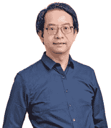

英国帝国理工学院教授，英国皇家工程院院士，电气和电子工程师协会（`IEEE`）、英国计算机学会（`BCS`）会士，中国人工智能产业创新联盟专业委员会主任委员及鲲云科技联合创始人兼首席科学家，鲲云人工智能应用创新研究院院长。`ACM TRETS`创刊主编，定制计算领域学术会议`FPT`、`FPL`创始人，`ASAP`、`FCCM`、`FPL`、`FPT`、`HEART`学术会议指导委员会委员，曾任英国皇家工程院杰出访问学者评选委员会委员。作为可重构计算及现场可编程技术领域的国际权威，在国际顶刊顶会发表论文500余篇，获国际专利2项，出版学术专著3部。

## 高性能计算十年演进

切入芯片话题前，我们先回顾过去十年高性能计算的演进脉络。全球超算500强榜单是最直观的注脚。2008年底，日本首款基于`GPU`（图形处理器）的超算首次跻身前500，位列第三十；2010年年中，中国“星云”超算跃居次席。时隔十年至2020年6月，前十强超算中已有六席被`GPU`系统占据，势头可见一斑。

## GPU 核心机制解析

何为`GPU`？其核心优势在于二者：一是集成成千上万处理核心，支撑大规模并行计算。如图1所示，图灵`GPU`架构中，每个绿色单元内又封装了大量核心；二是原生支持单指令多数据流（`SIMD`）范式。

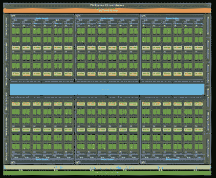

**图 1　 图灵 GPU 架构示意**

## CPU 与 GPU 架构差异

对比图2可见：左侧`CPU`遵循单指令单数据流（`SISD`）；右侧`GPU`虽也是单指令流，但采用单指令多数据架构，可同时处理多路数据流。得益于多路数据流共享单一指令流，`GPU`在吞吐效率上显著优于`CPU`。

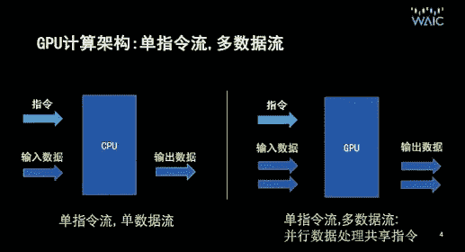

**图 2　 GPU 计算架构对比**

## GPU 与 CPU 性能对垒

从图3浮点运算基准来看，无论单精度还是混合精度，`GPU`性能均全面领先`CPU`。

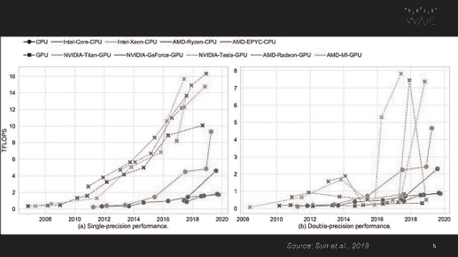

**图 3　 GPU/CPU 浮点性能对比**

## 芯片利用效率：隐痛与定义

`GPU`虽强，仍有提升空间。引入AI基准测试中的“芯片利用效率”指标（图4），令人意外的是，`GPU`利用率甚至低至7.52%。该指标衡量的是算力性价比：实测性能代表用户实得价值，峰值性能反映芯片尺寸与工艺成本。利用效率 = 实测性能 / 峰值性能。换言之，峰值固定时，利用效率越高，用户获得的实测性能越强，体验越好。

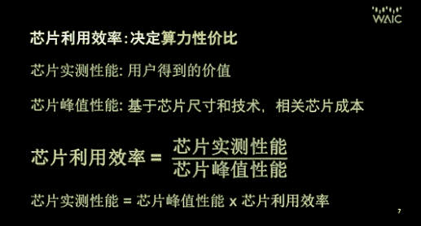

**图 4　 芯片利用效率对比**

## 定制数据流架构：破局之道

如何突围？历经数年攻关，我们推出“定制数据流计算架构”。对比图5：左侧`GPU`为单指令流驱动多数据流；右侧定制处理器同样处理多数据流，却摒弃了指令流，从根本上提升执行效能。

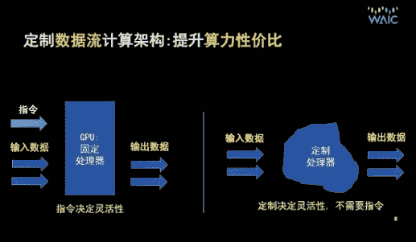

**图 5　 定制数据流计算架构原理**

### 无指令流下的灵活性保障

`GPU`靠指令集保灵活，定制处理器无指令如何应变？答案在于“数据流配置器”。该模块支持对处理器动态重组，使其在无指令流约束下，仍能像`CPU`/`GPU`一样灵活适配多样负载。

## CAISA 3.0 架构与实战落地

该架构已商用化。图6展示的`CAISA 3.0`芯片架构，集成多个定制处理器并行运算，每个处理器内置多重配置器，全局缓存亦引入配置机制，全方位保障灵活性，媲美通用处理器。

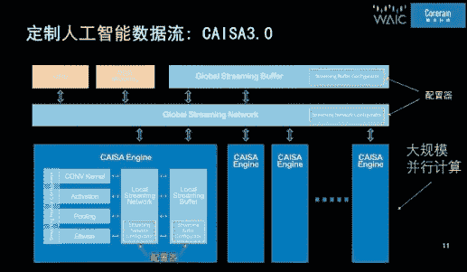

**图 6　 CAISA 3.0 芯片架构**

`CAISA 3.0`采用28nm工艺，首发于首代先进数据流芯片，覆盖边缘与云端AI推理。图灵`GPU`利用率常不足8%，而`CAISA 3.0`高达95.4%，实现数量级飞跃。峰值算力10.9 `TOPS`，宽温域-40℃至125℃稳健运行。该芯片已赋能“星空”加速卡`X3`（边缘/云通吃）与`X9`（云端强算）。

## 实测基准：X9 对决 GPU

### 时延碾压

时延即响应外部输入的耗时，越低越优。图7显示，`CAISA`芯片时延较图灵`GPU`优化30倍，在各类AI基准中全面领跑。

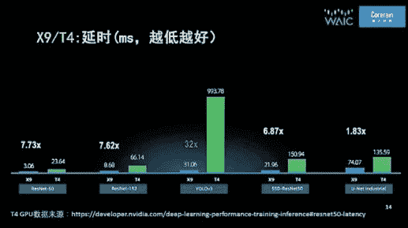

**图 7　 X9 与 GPU 基准测试——时延对比**

### 利用率飞跃

图8芯片利用率对比中，`X9`搭载的`CAISA`芯片利用率较`GPU`高出11倍。

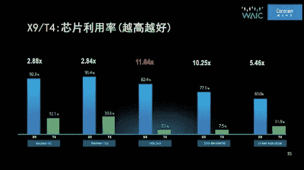

**图 8　 X9 与 GPU 基准测试——利用率对比**

### 吞吐性能跃升

图9帧率（`FPS`）测试中，`X9`性能达图灵`GPU`的3.91倍。

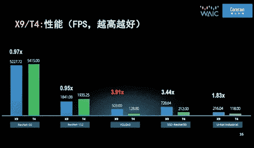

**图 9　 X9 与 GPU 基准测试——性能对比**

## 实战算账：视频结构化案例

以2.5万路视频结构化为例：传统`GPU`服务器（8卡/台）单机支撑250路，需百台服务器。引入`X9`（`CAISA 3.0`核心），单机路数增至977路，服务器规模骤降至26台，算力密度与TCO优势立判高下。

## 落地生态与开发降维

`CAISA`架构已深入智能制造、智慧城市、安防监管、轨道交通、智能遥感等广阔疆域。为降低开发门槛，我们构建端到端应用开发模型：深度学习模型自动编译生成适配`CAISA`的执行代码，部署至硬件平台。开发者无需精通芯片架构，甚至无需知晓`CAISA`细节，即可通过广泛支持的深度学习算子（图10部分列举）轻松享受架构红利，大幅减轻算法工程师负担。

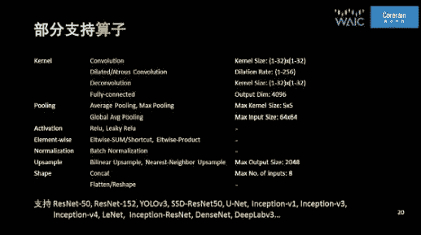

**图 10　 部分支持算子列表**

## 结语

这套新架构，为AI芯片翻开了新篇章。它重塑算力性价比，兼容更广谱AI算法，大幅降低使用门槛。得益于友好的工具链，智能算力平台、系统与应用的落地部署将提速增效。愿新一代`CAISA`芯片，让前沿技术普惠大众，共绘美好生活新图景。

---

## AI与新基建：重塑数字底座

### 嘉宾阵容速览

**姚志强**  

云从科技联合创始人

云从科技联合创始人，重庆市机器视觉工程技术研究中心主任、重庆市企业技术中心负责人。中科大信号与信息处理博士，19载深耕。坚持自主创新，主攻国家级项目5项、省部级9项，规划建设发改委重大工程“AI基础资源公共服务云平台”，主导起草国家标准《基于互联网的人脸识别认证系统技术要求》及公安部标准《公共安全视频监控云平台可行性研究报告》。

**周剑**  

优必选科技创始人、董事长兼CEO

优必选科技创始人、董事长兼CEO，广东省十三届人大代表，悉尼大学工程与信息技术学院客座教授，深圳国际商会/深圳市商业联合会副会长，深商`AI`智能机器人产业联盟主席，深圳机器人协会副理事长，第十七届国际奥林匹克机器人大赛主席。人形机器人先锋践行者，2012年创业至今，优必选已成长为全球顶尖的AI与人形机器人全栈创新企业。

**郑庆生**  

红杉资本中国基金合伙人

红杉资本中国基金合伙人，聚焦`TMT`赛道投资。斩获客路旅游、爱奇艺、大众点评、360、蘑菇街、360金融、摩拜、新经典、百度文学、容联云、激智、豆瓣、好大夫等明星项目。复旦国际金融系毕业，早年供职盛大互娱投资与海外中心、普华永道、`IBM`、`BearingPoint`，积累深厚财务与管理咨询底蕴。

**陈海波**  

深兰科技（上海）有限公司创始人

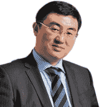

中国管理科学研究院学术委员、清华大学创+实践基地创业导师，中南大学-深兰AI联合研究院首届专委会委员。荣膺“2019中国AI杰出人物”、“2018硬科技风云人物奖”、“中国智能制造风云人物”等殊荣。

**吴明辉**  

明略科技集团创始人、董事长兼CEO

《财富》“中国40位40岁以下商界精英”。中国人民公安大学特聘教授、北大/人大创业导师。连续创业者：2006年创立秒针系统（中国最大网络用户行为营销分析平台）；2014年创立明略科技（业务拓展至政务与线下，技术延伸至AI）；2019年组建明略科技集团（中国领先一站式AI企服平台，入选国家新一代AI开放创新平台）。北大数学学士、软件理论硕士、北大`AILab`优秀硕士，20载软件与算法研发，持有130+国内外发明专利。

**夏华夏**  

美团首席科学家兼AI平台总经理

美团首席科学家、`AI`平台总经理。加州大学圣地亚哥分校博士。前`Google`高级工程师、百度主任架构师。长耕基础架构、云计算、大数据、AI、自动驾驶等核心领域。

## 上海AI新基建：从“造大脑”到“强身体”，中国智能跃迁的破局之路

### 引言

回溯2017年，上海率先在全国落子人工智能中长期规划，历经数年耕耘，产业生态已愈发浓厚。如今，人工智能跃升为“新基建”的核心引擎，正源源不断地为中国经济注入增量红利。

### 一、 新基建时代：AI是“大脑”，数字设施是“躯干”

**姚志强** 认为，新基建是迈向智能化的必经之路。若喻AI为“大脑”，算力与硬件便是“躯干”。光有聪慧的大脑不够，还得有强健的体魄。感知层回传数据，大脑决策指令落地场景，再反哺实时数据——二者缺一不可，相辅相成。

**周剑** 回顾道，过去AI尚未达实用门槛。随着数据沉淀与算力跃升，AI已成社会发展核心驱动力，新基建内涵亦从传统“铁公基”转向技术驱动。疫情中智能机器人证明是最佳载体，未来将深入医疗、教育、驾驶等版块，重塑社会运行效能。

**郑庆生** 指出，中国互联网深耕二十载，支付、消费、娱乐全面在线，沉淀海量数据与密集节点，为智能化奠基。中国路径独特：拥有超大市场与“世界工厂”双重身份，实现设计、营销、生产、物流全链路数字化闭环，每一环都孕育着AI落地的广阔天地。

**陈海波** 强调，二十年积淀让中国成网强、数强，进而夯实AI强国基石。当前深度学习为主流，数据似“粮”、算法作“器”、算力为“基”，新基建正是在为这三要素筑牢底座。

**吴明辉** 主张，新基建非单打独斗，需政企联动。社会运行靠物质、能量、信息三元驱动，旧基建解决前两者流通，AI聚焦信息流转，数据中心即核心设施。以上海地铁智能运维、电网智慧调度为例，实战已验证降本增效，未来应用将层出不穷。

**夏华夏** 直言：AI本身即基建，终将融入生活肌理。其团队切入餐饮智能化、无人酒店刷脸入住、研发无人配送解决“最后百米”痛点，均源于真实场景。国家推进的5G、芯片、物联网、数据中心建设，将进一步补全AI生态拼图，助推行业跃升。

### 二、 破局之路：垂直场景深耕与“软硬结合”

**周剑** 坦言，通用智能尚远，当下必在可控边界内深耕垂直细分。优必选押注人形机器人——虽轮足并存，但唯有人形能适配人类环境（如《西部世界》愿景），虽需半个世纪。核心在于降本：若价至十万级（相当中高端车），即可走入家庭，打开规模化场景。锚定“未来所需”而非“现有所能”，以十年磨一剑攻关伺服执行器，打破日韩欧垄断，实现国产量产领跑。此路漫漫，却能“沿途落地”教育、安防、养老等细分赛道。

**陈海波** 提出，掌舵第四次工业革命需解双题：基础研究登顶、制造大国向强国跨越。AI是工业智能化主力军。智能制造能倒逼AI企业贴近市场打磨产品。AI本质是赋能，离场景即无价值。真正的AI玩家，须“软硬兼修”，科研与应用双强，方配未来期许。

**吴明辉** 判断，智能时代竞逐呈“赢家通吃”态势——核心能力可复制，头部之外难存。企业必须选准细分赛道，差异化突围。中国拥有全球最丰富落地土壤，关键在能否找准自己的那块“责任田”。

**夏华夏** 明确使命：用AI赋能本地商家提效、用户优享，让技术隐形为生活底座。未来五六年，重点攻克“数字鸿沟”——助老人小童无感用服务。以图像识别代录菜单、语音视觉驱动无人配送，皆为近期必答题。

**郑庆生** 以投资人视角总结：再硬核的技术，落脚点必须是可变现的细分场景。战略定位要远，步子要稳，每一步都要在具体场景里跑通闭环。

### 三、 博弈与共生：中美科技竞争下的中国AI自主进化

#### 消费红利向产业纵深的跨越

中国消费互联网发达，数据富集，催生全球级AI巨头，多源于C端。但企业管理技术在互联网前薄弱，欧美从上世纪中叶深耕至今。AI落地B端，不能只给技术，得把先进管理思想“打包”进产品——方法论+认知+AI，把几十年管理经验交付客户。这是技术企业的机遇与挑战。

**姚志强** 期许：AI终极价值在赋能个体，增强感知、拓展认知、提升效率，推动资源公平配置，开启人机协同新纪元。

#### 卡脖子与破局：自主可控突围战

**夏华夏**：脱钩短痛长利，倒逼集中攻坚“卡脖子”短板（芯片、基础器件）。

**吴明辉**：软件层冲击有限，算力（含边缘端）受创较重。但国产替代加速中。AI底层拼材料更拼数学，中国优势在。开源生态无国界，协作共赢是主流，AI不易筑高墙。

**陈海波**：风雨过后见彩虹。自主创新基因被激活，企业早有预案。如2018年设芯片院自研工业FPGA，信心满满。

**周剑**：芯片短期焦虑，长期必破。优必选2008年起自研伺服执行器——遍寻国内无果，被迫高价买日韩瑞（百元/颗），二十关节成本高不可攀。十年磨剑，今小型伺服量产全球领先，PID/减速器/电机全自产。芯片亦将复刻此路，中国人不止勤奋更聪慧。

**姚志强**：博弈本质是效率赛。美方拖节奏，我方靠政策加速研发落地，企业集群化发展，以场景加速倒逼基础研究。

**郑庆生**：宏观动荡下，全球VC仍自由流动。中美仍是创业双子星。近两年硬科技、AI投资热度不减。

# 供给侧国产替代大势起，危机中孕育新机遇

在供给侧，国产替代的潜力同样深不可测。因此，在对宏观环境不利因素保持警惕的同时，我们更应洞察到“危机孕育机遇”的辩证法则。中国拥有庞大的企业家群体，在过往看似难以孕育新生力量的领域，得益于宏观机遇的开启与新技术的涌现，如今已涌现出大批初创企业，必将催生出众多令人瞩目的标杆企业。

## Expectations for the Next 5 Years

**郑庆生**：期盼五年后，在新基建的驱动下，各级政府、创业企业与投资机构合力推动，让中国的产业互联网（含AI）领域跻身世界领先梯队，正如当下的消费互联网一般。届时，中国不仅是数字大国，更将成为智能强国。

**姚志强**：希冀五年后，各行各业实现资源的更优泛化配置，使得不仅专家，连普通从业者也能借力完成高价值任务，助力全产业链效率最大化。

**周剑**：当前AI与智能机器人仍处早期阶段，距离通用智能尚有鸿沟。正因行业未臻成熟，政府更需搭建技术环境与应用场景，加速落地。期待五年后，在上海或更多城市，能见到我们打造的百床位智慧养老中心样板运行，并推向全球所有深受老龄化困扰的地区，我深信我们能做到。

**陈海波**：AI终归服务于民生。愿五年后，上海在AI基础研究与应用落地双维度均达到世界一流，建成享誉全球的AI高地。

**吴明辉**：坚信五年后，AI将在更多场景实现感知、认知乃至行动体系的闭环，基于AI分析决策的复杂应用将超越人类能力上限。

**夏华夏**：立足五年技术维度，AI将受惠于“AI+5G”、“AI+IoT”、“AI+Robotics”等多维融合冲击，这些跨界结合将深度重塑生活场景。期盼五年后，无人机与无人驾驶配送服务能覆盖更多城市，不再局限于一线核心区。

## Special Topic: Anti-Epidemic

### Application of Machine Learning Technology for Infectious Risk Prediction on Smartphones

**Yoshua Bengio**

图灵奖得主、蒙特利尔大学教授、Mila-魁北克人工智能研究所科学总监

作为蒙特利尔大学教授，他凭借在深度学习领域的卓越贡献荣获计算机科学最高荣誉——图灵奖。正是深度学习技术点燃了AI复兴之火，逐步推动自动驾驶、实时语音翻译、人脸识别等技术走入现实。

新冠病毒传播的两大关键事实不容忽视：一是主传播途径为密切接触；二是感染者在发病前后即具传染性。基于此，个体感染概率可依据其是否接触过阳性人员来推估。

数字化接触追踪通过手机推送阳性报告等信息，相较于人工溯源耗时费力、效率低下的短板，优势显著。但现行标准仅传递“核酸阳性/阴性”这一二元信息，而病毒潜伏期导致阳性判定滞后于传染期，标准流程存在天然延迟。若能压缩这一时差，将有效遏制扩散。

事实上，感染风险评估绝非简单的“阳/阴”二分法。新冠症状多样且轻重不一，既往健康状况、年龄、性别、接触群体风险等级、接触时长等均影响疫情走向。因此，必须融合多维信息进行全息分析。

海量碎片化数据的分析裁决非人力所能，最优解在于引入机器学习模型，综合判断个体是否感染及所处阶段。一旦落地，高风险者可主动隔离并预警接触者；低风险者则加强防护而无需强制隔离。

基于机器学习的数字化追踪App可大幅拓宽溯源预警半径。但需明确：数字化手段难以完全替代人工溯源，因后者能捕捉手机盲区的人际关联，二者互补共生。

数字化追踪沉淀的数据对公共卫生决策极具价值。例如，卫生部门可据此优先安排高风险人群核酸检测；亦可在疫情爆发前，通过区域风险变化预判就医高峰，提前部署资源。

若已掌握全球人际接触网络图谱，可用机器学习迭代计算各节点感染风险。难点在于：全局图谱不可得，且迭代算力与带宽成本高昂。

若预测器足够轻量，可采用“联邦学习”模式——无需中心服务器，终端本地训练。但此法要求手机端频繁迭代计算，且与服务器间参数交互量大。

我们的实验采用混合策略：终端间交互风险更新以计算个体风险，同时终端与服务器交换数据优化预测器。手机间仅传递个人风险更新（日均4次收发）；授权用户上传数据经去标识化脱敏（隐藏号码、姓名等），服务端仅获取症状、自感及核酸结果。

### AI医疗：站在十字路口的关键抉择

**Peter Lee**

微软公司副总裁、微软研究院院长、ACM会士、美国国家医学院院士

作为微软公司副总裁，他统领微软研究院及技术孵化部门，全权掌管微软遍布全球的八大研究实验室，致力于将前沿科技赋能微软各大产品线与业务板块，尤其是发展迅猛的医疗健康与生命科学业务。他拥有从基础研究走向商业落地的全链路管理经验。2010年加入微软前，曾任美国国防高级研究计划局（DARPA）部门主管，主导过先进机器学习、众包技术、大数据分析等实用技术的研发。曾任卡内基梅隆大学计算机系主任。现担任艾伦人工智能研究所及凯撒卫生医学院董事会成员。ACM会士，曾服务于多个国家级研究机构，亦曾入选美国总统国家网络安全加强委员会。

今年突如其来的新冠疫情，让医疗卫生与公共健康瞬间成为全球聚焦的核心议题，推动该领域各维度投资大幅增长。除生命科学与医学研究外，人工智能、大数据等技术在疫情溯源监测、精准管控、远程诊疗等环节亦发挥了关键作用。

AI与医疗的深度融合始终是微软的战略重心。如何充分释放AI等新兴技术红利，实现科技、人文、自然与社会的均衡共生，需全社会协力推进。当前正处于技术与医疗行业变革的关键节点，未来走向将取决于我们当下的每一次抉择。

#### AI医疗的无限图景

当医生为你抽血化验时，获得的约百万个T细胞，实则是人体自然免疫系统的“采样快照”。每个T细胞的特异性由其细胞外受体（即T细胞受体）的基因机制决定，因此学界正大力攻关这些基因传递的海量信息解码。一旦破解，便可绘制人体T细胞图谱，从而诊断感染性疾病、癌症、自身免疫病等，并奠定通用型血液诊断法的基石。

**T 细胞**

目前，微软正携手西雅图生物科技公司Adaptive Biotechnologies深耕此域。其专有的免疫测序技术可高速读取血液样本中约百万个T细胞。这些海量数据蕴含着免疫系统对抗感染病、癌症或其他免疫疾病的“作战记录”。核心难题在于如何破译这些密码。这正是AI与机器学习大显身手之处。微软利用机器学习处理测序输出，试图将T细胞受体“语言”翻译为抗原“语言”，进而深度探究这些免疫引擎，揭示身体正在对抗何种病魔。

**构建人类适应性免疫系统**

合作的终极愿景是：仅凭一次简单的通用血液检测，即可筛查任意感染性疾病、实现任意癌症的早期确诊、判定患者潜在免疫疾病。作为研究者兼《星际迷航》等科幻迷，这项研究让我联想到剧中的“三录仪”。当下时代令人振奋，医学进步开启无限可能，而今算力与技术已足以让数据真正守护人类健康。

新理念催生无限可能，而AI等技术在精准医疗的落地仅是未来医疗图景的冰山一角。

除面向未来的前沿探索，AI对当下诊疗流程的优化同样迫在眉睫。医生职业倦怠已成多国通患，医者目光多落于屏幕而非患者。病历虽已数字化，但数字化带来的繁重录入负担全压在医护肩上。多项研究显示，临床医生超40%工时耗于数据录入，病历撰写已成医生职业倦怠主因，甚至导致医生成为多国自杀率最高的职业群体之一。

微软联合合作伙伴Nuance推出`Dragon Ambient eXperience`（龙自然环境体验）。它能实时“旁听”医患对话，自动生成绝大部分临床文档。早期试点中，医生满意度极高，患者对这一“聆听并协助”的智能系统也给予高度信任。

**诊室新视界**

#### AI抗疫：技术与人性的双重奏

在我们的实验中，风险预测器接收的信息维度极广：既往病史、年龄、性别、行为细节（如室外/密闭空间/职场佩戴口罩情况、工位是否设玻璃隔断、是否乘公共交通、家庭人口数）、病毒检测报告、近14天症状、接触人数、接触时长及距离等。

因个体差异，预测器接收的数据长度不一，即输入维度可变。这导致众多标准机器学习算法（如`EM算法`）失效。实验中，我们引入`Transformer`架构破解此难题。

随之而来的核心问题是：预测目标是什么？落地应用中，个体间应传递何种信息？假设Alice五天前与Bob接触，今日确诊，她该告知Bob什么？最具价值的信息是评估Alice五天前接触时的传染力强弱。因此，预测目标锁定为：感染者过去14天每日传染力强度。

真实传染力不可直接观测，只能借检测结果作代理指标，但检测本身存在假阳性/假阴性误差。庆幸的是，机器学习中的潜变量方法可有效处理此类问题。

实验中，我们构建生成式模型捕捉个体层面信息：人员流动、接触感染机制、健康状态。模型经已知医学数据校准，确保与人口流动及就医数据吻合。实证表明，相较标准数字化溯源（仅传递阴阳性结果），AI数字化接触溯源模型能显著降低病例数。

借助机器学习驱动的数字化溯源技术，我们可融合数字与人工溯源之长，拓展人工溯源边界，且在不妨碍隐私、不损人权尊严的前提下达成目标。

# 智能抗疫：技术破局与医疗数据重生

新冠病毒在全球肆虐，给人类社会与经济体系带来沉重打击。面对病毒衍生的多重危机，跨国界、跨组织的协作共享浪潮空前高涨，这种团结景象堪称史无前例。红蒙（Microsoft）亦全力投入，携手合作伙伴共筑防线。

### 一、 智能前哨：化解就医冲击波

疫情初期，患者激增令医疗体系濒临崩溃。红蒙深度介入一线，协助机构重塑流程、强化防控。

以西雅图普罗维登斯医疗系统为例，作为美洲首例确诊病例的接诊方，他们率先承受巨大压力。双方联手打造的 AI 问诊机器人 **“Grace”**（基于 `Microsoft Health Bot`），成为居家分流“第一道防线”。它能智能交互、精准研判：指引轻症者居家观察，将疑重症患者无缝转接至医护人员实时视诊。这一模式经 CDC 采纳上线官网后迅速推广全球，至今已部署超 1900 个站点，服务 3900 万人次。数据显示，接入该服务的机构，急诊、热线及远程问诊的疫情相关咨询量**骤降 30% 以上**，有效挤出宝贵救治资源。

**Microsoft Healthcare Bot**

### 二、 统筹全局：让医院资源“动”起来

床位、ICU、呼吸机、防护服——物资调度的核心难题在于“看得见、算得清、调得动”。红蒙基于 `Power Platform` 火速上线**医院应急响应平台**，实现收治容量的实时可视化与跨系统共享。平台不仅自动对接政府公卫上报，更引入 `Azure AI` 进行需求预测。这套“开箱即用”的方案，现已助力全球数百家医院实现资源动态平衡。

**Hospital Emergency Response Platform**

### 三、 云端诊室：Teams 进化为 “AI 医疗副驾”

远程医疗从“权宜之计”转为“常态化选项”。红蒙致力于降低搭建门槛，在满足隐私合规前提下，让 `Microsoft Teams` 成为日均百万级问诊的核心载体。任何诊所均可快速开通电话/视频问诊。更关键的是，AI 能力正深度融入：自动生成病历记录、智能检索病史、影像辅助分析、语音交互……Teams 正从会议工具进化为**懂医疗的 AI 协作助手**。

### 四、 科研加速器：攻克病理机制与药物研发

临床救治之外，智能技术在基础研究领域大展拳脚。

*   **破解免疫密码：** 红蒙联手 Adaptive Biotechnologies，聚焦 T 淋巴细胞反应解析，将海量数据开放至 **ImmuneCode** 数据库，为诊断试剂、新药、疫苗研发提供核心靶点。
*   **算力赋能疫苗：** 红蒙无偿提供云端 GPU 算力与专家支持。ImmunityBio 借此获得的算力，竟是 2002 年 SARS 时期全球最强超算的 **250 倍**——云端算力重塑了研发时空观。
*   **康复者血浆招募：** 针对恢复期血浆疗法与高免球蛋白药物的供体短缺，红蒙推出 **Plasma Bot**，精准筛选合格捐献者并导航采集点。
*   **临床研究智能匹配：** **Clinical Trials Bot** 依托前沿文档理解技术，自动解析 `clinicaltrials.gov` 海量协议，助医患双向奔赴最适配方案。
*   **文献“超级大脑”：** 面对 PubMed 日均 4000+ 新增文献的信息过载，红蒙 **Hanover** 技术以机器理解构建全域知识网络。它已助力杰克逊实验室等顶尖癌症中心优化决策，针对新冠研究的专用版本更是潜力无限。

### 五、 数据破局：数月跨越数年，FHIR 重塑互联根基

抗疫实战揭示了信息的“皇冠地位”，也暴露了旧有困局：素材虽多，却困于**格式孤岛与规则迷宫**，正如柯氏诗中“水水皆在，滴滴难饮”。但危机成了变革催化剂——**短短数月的互通进度，赶超前数年总和。**

破局关键在于 **FHIR（快速医疗互操作性资源）**。这套新一代全球标准，覆盖临床、公卫、试验、行政财务全谱系，以现代化、可扩展架构，旨在让信息在全球医疗应用间自由、安全、合规流动。它为算法全球化落地铺设了“高速公路”，确保训练素材摆脱地域偏见，惠及多元人群。

红蒙推出全球首个**云原生 FHIR 服务**：开源服务器 + 全托管 PaaS 级 API，无缝纳管远程设备、EMR 等多源信息。

在此基础上，**Microsoft Cloud for Healthcare** 整合 Teams、Dynamics、Power Platform、Azure 与 AI 能力，构建现代化医疗数据操作系统。红蒙更承诺打破壁垒，携手政府甚至竞对，共筑数据驱动未来。

这不仅是一次上云迁移，更是基建的**历史性范式迁跃**。唯有产业上下游协力攻克信息难题，才能实现从“危机恢复”到“未来免疫”的跨越，共建更安全、更美好的健康世界。

---

# 智驱医药：开启研发新纪元

## 作者简介：苏博科

阿斯利康全球首席执行官

自 2012 年 10 月起掌舵阿斯利康，主导其转型为“科学驱动”的全球生物制药领军者，深耕肿瘤、呼吸、心血管、肾代谢等核心赛道。履新前历任罗氏制药首席运营官、基因泰克 CEO（主导与罗氏并购）。拥有法国兽医名校博士、巴黎高商 MBA 学位。

## 实战范本：英阿的 “全生命周期智能融合论”

全球抗疫虽有阶段性成果，但长期博弈仍在继续，智能技术是破局核心杠杆。它不仅重塑制造服务与人机交互，更在医药全链条释放指数级价值：**新靶点发现、智能制造、精准诊断、疾病预测预防**。面对老龄化、慢病高发及疫情叠加的多重压力，医疗体系亟需算法赋能。

**前提是：信息要“通”、更要“安”、还要“信”。**  
我们必须打破医院、诊所、个人终端的信息壁垒，统一标准入仓，支撑多项目复用；打通个人设备与医生远端、甚至跨国诊疗的数据链路；在隐私合规护城河内建立信任机制——**信任是信息流动的前提，也是释放市场价值的基石。**

英阿拒绝碎片化试水，选择**“数据科学 + AI”贯穿药物全生命周期**：

1.  **靶点猎手：** 融合疾病机理洞察与生物医学数据科学，精准锁定复杂疾病治疗靶点。
2.  **试验重构：** **超 70% 临床数据源自患者家庭**，极大降低随访负担、提升依从性与试验效率。
3.  **智造大脑：** 算法预测性维护设备，故障响应从“事后修”转为“事前防”，保障供应链韧性与患者用药安全。
4.  **诊疗副驾：** 联手剑桥大学开发新冠 AI 管理系统，赋能医生“快准诊”，助医院“优配源”，直接提升存活率与康复率。

## 中国市场的智能医疗创新

以上皆为海外案例，但我坚信，AI在医疗赛道最振奋人心的舞台在中国。此处汇聚了人口红利、产业厚度、政府引导力与独特的创业土壤，为技术爆发与数字化普及构筑了沃土。百度、阿里、腾讯等巨头领衔，联合庞大的合作伙伴网络，中国软件工程师们志存高远，正携手产业界共筑一个让AI生生不息的新生态。

阿斯利康中国聚焦复杂疾病的全程管理与精准治疗。2017年落子无锡的AI创新中心（药物开发合作平台），构建起全病程管理解决方案。借助AI与数据科学，诊断效能跃升，治疗精度随之提高，使我们能触达更多患者、给予更优疗护。

三大实证案例彰显进展：一是肺癌一体化诊疗中心，AI介入肺部影像造影与CT筛查，大幅减轻医师负担、压缩确诊周期，为争分夺秒的患者赢取生机；二是消化道肿瘤筛查，AI赋能内镜诊断，双提效率与准度；三是咳喘管理中心，AI助力呼吸道患者自我监测、依从用药及即时触达。离开了AI，同规模下的高水平精细化管理根本无法实现。

AI重塑社会、经济与产业的潜能已初显锋芒，但这仅是序章。彼此借鉴、协同共进，方能探得更多进阶之道。阿斯利康持续寻觅最佳伙伴，深耕医疗研发，誓使医疗服务更高效、便捷、普惠。

# 机遇：机器学习大有可为

## 作者简介：斯瓦米·西瓦苏布拉曼尼

斯瓦米·西瓦苏布拉曼尼（Swami Sivasubramanian）

亚马逊AWS全球副总统

亚马逊AWS全球副总统，统领人工智能与机器学习业务版图。曾主导AWS核心数据库工程设计、产品管理与运营保障，该数据库奠基了DynamoDB、ElastiCache、QuickSight、SimpleDB等大数据业务基石。拥有200+发明专利、40+科技论文，活跃于多个学术与行业组织。亲手打磨30+项AWS云服务（涵CloudFront、RDS、S3、Paxos-based lock service等）。联合沃纳·威格尔撰写的Amazon Dynamo论文（`http://bit.ly/1mDs0Yh`）荣膺“ACM名人堂大奖”，该技术已成NoSQL体系基石。

## 机器学习步入黄金纪元

我们正身处AI与机器学习的“黄金时代”——一个万物皆可能的纪元。观点领袖常说“ML是未来”，实则它早已渗透当下，深度重塑全球各行各业的生产生活图景。它蕴含破解人类最棘手难题的钥匙，关键在于寻得正确开启之法。

机器学习已从“稀缺渴望”跨越为“主流标配”。长期以来，它是极少数科技巨头与学术核心圈的专属秘籍；云计算普及打破了壁垒——ML的数据密集型算法极其贪婪算力，云端让海量算力与存储触手可及。如今，从金融、零售到农业、医疗，ML正从业务边缘向核心纵深渗透。

## 机器学习如何重塑客户价值

**曼特尔实验室**（英国农业科技新锐）部署定制ML模型与SageMaker，解析多源卫星影像，实时评估作物长势，提前预警风险，助农户与零售商动态优化供采存决策，供应链可视化能力史无前例。

**Blue Dot**（加拿大初创）以ML算法扫描65+语种新闻及动疫信息，经流行病学家科学复核后，向公卫部门与医院输出专业预警。新冠疫情伊始，其便是全球最早拉响警报的机构之一。

**Giant**（中国休闲游戏厂商）深耕SageMaker构建模型矩阵，精准触达用户留存与变现痛点，在AWS与游戏平台双轨持续解锁新增收。

## 寻得正题，建科学架构

十年磨一剑，服务无数客户跨越ML不同成长期，我总结出成败四要素：数据先行（整理是起手式）、认知对齐（读透应用边界）、破解人才荒（打破技术天花板）、拒重复造轮子（避免各自为政搭基建）。

寻找切入点即定义“正确问题”，需三维评估：数据就绪度、业务影响力（必要性）、技术适配度（SOTA能否解题）。理想靶标：高业值、数据富、算法通——解此题必撬动业务质变。

组织架构同等关键。常见“管技双核小团队”虽有产出，却与领域专家、业务一线脱节，导致模型“美而不实”。最优范式：技术、领域、业务三位一体的融合小分队，方能让ML真正落地生金。

即便招得顶尖人才、定准战略、理顺数据，许多组织仍陷“自建无差别基建”泥沼——巨资耗时且低效。我力主借力外部服务：如SageMaker等工具链，可高效支撑模型全生命周期，加速交付。这正是AWS使命所在：把工具交到每个开发者、数据科学家、研究者手中。

# 工业与智能融合：推动高质量发展

## 作者简介：柯睿安、李强

柯睿安（Christian Klein）

SAP执行董事会成员、全球首席执行官

SAP全球CEO，掌舵智慧企业板块，统领核心应用开发交付与全球运营。主导旗舰级SAP S/4HANA（下一代ERP）与数字供应链研发管控，管辖丰富行业解决方案组合。1999年在校即入职SAP，历任全球支持、服务运营、管控等要职。2011-2012任SuccessFactors CFO，2014任首席风控官，2016年起任首席运营官。

李强

SAP全球高级副总裁、SAP中国总裁

SAP全球高副兼中国总裁，统摄中国业务版图。深度推动“工业4.0”中国落地，牵头首个中德合作项目（2015年双总理见证签署）。任工业互联网产业联盟副理事长、上海市政协委员、陕西省国际高级经济顾问。获“全球跨国公司领袖奖”、“年度受尊敬企业家奖”、央媒“奋斗中国人”致敬。20载IT沉淀，对商业软件、云计算、创新模式洞见卓越。

## 对话：全球变局与智慧企业转型

柯睿安：全球经济正经75年未有之大变局。疫情下，即便最具前瞻的企业也遭供应链重创、日常运营受阻，危机再次以铁的事实证明：向“智慧企业”转型，势在必行，不容緩待。

# Intelligent Enterprise: Digital Transformation and AI Application

我近期接触的诸多商业与公共部门决策者已达成共识：数字化不再是选择题，而是生存题。早已拥抱创新技术驱动模式革新与自动化的企业，不仅在危机前更具韧性，疫情中亦表现从容。智慧企业能以前沿技术将洞察实时转化为行动；更快实现数据驱动创新与流程自动化；落地新商业模式、交付极致体验；并能敏捷应对瞬息万变的世界。

## Intelligent Enterprise Applications

智慧企业拥抱创新的核心聚焦点是人工智能。AI不止优化存量产品，更是孵化增量业务的引擎。

从SAP视角看，AI高价值落区在于：智能分析、计划排程、按需监控企业流程与生产运营。制造端，采购-制造-交付-服务供应链全链路数字化，即可破解库存顽疾。又如，融合数字化流程数据与基于实时市场销售数据的财务规划模型，企业决策速度与质量可超越一切竞对。

数据是万物之基。唯有精准的底层数据与语义支撑，企业运营智能与绩效方能跃升。虽有预训练AI服务，但唯建立在自有数据之上的应用，才能释放真价值。

AI赋能聊天机器人与企业内部搜索，显著提升员工与客户体验；然对企业而言，最高价值仍在运效跃迁。例如：基于历史与外部数据自动化应收回款；借标准化数据模型与语义分析，实现全企业级可扩展分析。

多案例印证：AI不增收利、助预测未来数季、输出驱动未来的决策洞见；更能通过多元化建议，助企业对冲潜在经济冲击。

### Kaiserwetter Case

`Kaiserwetter`为新晋入华的能源资产管理公司，旗舰产品`Aristoteles`。其通过智能数据分析与ML算法追踪全球气象数据，智能预测用电趋势，实现绿色发电与能源运营财务指标透明化。该案例有力佐证：企业盈利与可持续发展可同频共振，是数据与技术合力催生的最佳实践。

### REHAU Case

### 案例速递：REHAU集团的智能化突围

再看`REHAU`集团的实践。过去，该公司不得不投入海量人力维维系业务流转，效率低下且错漏难免。如今，`REHAU`中国借助智能机器人的流程自动化能力，实现了每日数千张财务凭证的自动化处理；曾经耗时四天的工作量，现在仅需十分钟即可搞定。

### 中国AI战略与李强视角

在全球范围内，中国的AI战略野心最勃勃，资源投入也最充沛。`SAP`核心研发实验室落户上海，扎根于此辐射全中国。

**李强**：回溯过往四次全球经济下行周期，每一次都有头部企业借势先进技术逆势突围，拉动世界经济复苏。我们坚信，企业端数字化转型将成为本轮复苏的核心引擎，而“人工智能”正是打开这扇大门的金钥匙。

当下，我们正站在AI驱动全球经济增长的拐点上。权威测算显示，到2030年，AI将为全球经济贡献高达15.7万亿美元增量，中国有望占据7万亿美元。核心动能三大来源：企业生产力跃升、产品服务消费激活、劳动力素质优化。

中国已跻身全球第二大AI强国阵营，无论技术高度、人才储备、融资规模还是专利数量，均处领跑位置。但剖析细节会发现，发展仍存结构性失衡：超半数应用场景集中于互联网、金融、安防、交通等领域，紧随其后是消费电子、教育、医疗等消费端。反观占据国民经济“半壁江山”的制造业，AI渗透率不足5%。换言之，AI赋能“中国制造”与实体经济，蓝海广阔，大有可为。

## AI重塑中国实体经济图景

2019年汉诺威工业博览会以“工业与人工智能融合”为主题，现场发布超500个AI制造场景，覆盖设计、研发、制造、交付、服务全链条，勾勒出AI构建智能企业的全景蓝图。预测至2025年，六成企业业务流程将由AI接管；我们深信，工业与AI的深度融合将成应用主航道。

无论是`SEW`的全自动化零部件智能工厂，`奥迪`的电动汽车智能工厂新标杆，还是`库卡`实现的全自动独立加工矩阵生产，AI渗透已无死角。面对个性化需求爆发、产品配置指数级增长、生命周期大幅压缩等挑战，AI应用在提效、降库存、保交付上成效显著，显著放大了经济效益。

上海作为中国经济中枢，集聚人才、技术、资本与先进制造顶尖优势，有底气为中外制造业贡献“AI+制造”融合样本。作为欧洲市值第一、德国市值之冠的科技巨头，`SAP`深耕中国25载，是唯一将双总部（区域研发总部与业务总部）双双落户上海的跨国科技集团。未来，我们将持续加码投资，深耕上海，服务中国。

---

# 科技赋能，智惠大众

**葛越**

`Apple` 全球副总裁、大中华区董事总经理

`Apple` 全球副总裁兼大中华区董事总经理，统领`Apple`中国团队。2008年加入`Apple`任无线技术副总裁，深耕蜂窝、`Wi-Fi`、蓝牙、`NFC`、定位及`motion`等几乎全系产品核心无线技术开发。主导开发`iPhone`、`iPad`多项中国专属功能，作用关键。此前任`Palm`无线软件工程副总裁，曾在多家无线科技公司担任技术与管理要职。拥有加拿大西门菲沙大学电子工程学士、硕士，及加州大学伯克利分校MBA学位。

疫情是一面镜子，映照出科技的硬核力量。用户借助技术保持连接、获取资讯、激发创造、维持生产力，解锁全新生活方式。我们也将AI投入抗疫与复工复产：如联合Google开发的暴露通知技术，可精准锁定新冠患者密接者。

机器学习是AI核心支柱。相机是高频刚需，机器学习赋能镜头识人、识物、识地，让相册检索分享更从容。语音助手如`Siri`，仰仗自然语言处理读懂意图，助力获取信息、掌控智能家居、跨语言沟通。手写识别亦受益于此；`Apple Watch`凭借机器学习实现跌倒检测、精准记录活动、养成健康习惯。如今，强算力机器学习多在终端侧完成：`Apple`自研芯片内置专用`Neural Engine`（神经网络引擎），协同`CPU`、`GPU`承担万亿级运算，峰值达每秒5万亿次。`Core ML`开发平台亦原生跑在设备端。

目前，超10亿`Apple`设备支持`Core ML`。通过机器学习控制器，`Core ML`可调度`CPU`、`GPU`、`Neural Engine`并行计算，开发者零成本提升性能能效。AI视觉创作应用`马卡龙玩图`即利用`Core ML`在终端侧处理视频——免上传云端，省时、省服务器成本、更护隐私。创始人蔡譞伊表示，`Apple A13 仿生芯片`与`Core ML`大幅降低创作门槛，让专业创作者想象力尽情野蛮生长。

# Apple 生态：以技术普惠重塑未来图景

增强现实（`AR`）借助 AI 算力，将虚拟影像无缝叠加于物理空间，其核心魅力在于让那些原本只存在于脑海中的奇思妙想变得触手可及，进而重塑人们工作、学习、娱乐、消费与社交的底层逻辑。苹果构建的 `AR` 生态采用软硬一体化架构，拥有全球规模最大的平台，覆盖数亿台设备，并配套提供了丰富的开发工具链。作为核心引擎，`AR Kit` 已迭代至第四代，引入深度感测能力，借助传感器精准测算室内物体间（含人与物）的空间距离，助力开发者打造虚实融合度更高的应用体验。

`App Store` 则是全球 2300 万开发者变现创意的核心舞台。自 2008 年 7 月开创先河以来，它催生了海量就业岗位。2019 年 7 月，苹果在上海落地中国首个设计与开发加速器，次年上半年推出的线上课程更助无数开发者快速掌握前沿技术。

展望未来，AI 的战略价值聚焦于新生代培养，而代码教育是孕育 AI 人才的基石。苹果开发者计划旨在汇聚创新力量，通过奖学金与竞赛搭建桥梁，让学子获得行业大咖指导、实现同侪共进。编程教育不应设限，必须延伸至资源匮乏地区，因为当表达渠道拓宽，思维维度自会随之跃迁。

一个融合软件、硬件与服务的活力生态，能有效创造就业、激活创业、驱动创新，苹果对此深感自豪。征程未止，正如库克所言：我们对技术潜能充满笃定，亦清醒认知其不会自动兑现。我们执着于产品的人文关怀，将这份温度日日注入设计，只为让共同的家园更美好——这份使命激励我们以技术赋能，以智慧普惠。

---

# RPA 融合 AI：解锁自动化新纪元

**Bobby Patrick**  
`UiPath` 首席营销官

`UiPath` 凭借全球领先的增速与市场地位，持续引领 Robotic Process Automation（`RPA`，机器人流程自动化）与 AI 软件赛道，推动世界正式步入“自动化优先”时代。作为 CMO，我统筹全球营销战略落地，助力各体量企业实现日常运营的数字化跃迁，以 AI 驱动真正的数字化转型。我的职业轨迹横跨 `Fortune` 500 强与初创企业，累计 20 余年为科技增长注能。曾任 HP 云业务（百亿级规模）、`Basho`、`GXS`（后被 `OpenText` 收购）、`Digex`（后被 `Verizon` 收购）的 CMO，主导品牌出海、产品营销、传播与需求创生；16 岁起便在联邦调查局担任计算机专家，开启技术生涯。

`RPA` 正进化为 AI 赋能的新一代自动化范式。

回溯 2010-2012 年，`UiPath` 潜心攻关两大基石技术：计算机视觉与可视化设计器。前者赋予软件机器人“人眼级”感知屏幕的精准度与鲁棒性；后者打破技术壁垒，让非专业工程师也能自主构建机器人、自动化自有业务。双技术合璧，开辟了全新赛道。

如今，`RPA` 学习门槛大幅降低，人人可构建专属机器人。联合创始人兼 CEO Daniel Dines 断言：“自动化潜能无垠，AI 将使其近乎全能。”

数年前，`UiPath` 确立愿景——致敬比尔·盖茨“让每张桌面、每个家庭都装上电脑”的豪言，誓要实现“让每个人拥有一个机器人”。无论知识工作者、一线员工、调度员、制造工人还是零售服务者，无论任务繁简，机器人皆能作为智能副驾高效协同。

`Gartner` 2019 年 10 月报告将“超自动化”列为头号技术趋势。自动化技术虽历经数十载，但当下的超自动化实质不同：它聚焦时间、价值与速度，直击企业过去 5-7 年数字化转型 ROI 难题。`Gartner` 勾勒七大核心版图，AI 与机器学习/建模各占中枢。我们亟需构建内生平台，贯穿桌面、后台、云端全流程植入高阶分析能力——这正是 `RPA` 进化的必由之路。

早期 `RPA` 聚焦碎片化小任务，虽 ROI 诱人，却局限于任务级。现今重心转向跨度更长的端到端工作流：有人值守机器人驻守工作站，无人值守机器人驻扎云端/数据中心，双轨协同。引入流程挖掘精准定位自动化靶向场景，更平滑融入既有 IT 环境。

AI 的势能将重塑全行业。科幻巨匠 `Vernor Vinge` 曾言：“我们正站在变革边缘，其规模堪比地球生命诞生。” 从大型机时代跨越至 PC 纪元，我们现正深度进入自动化与 AI 时代。机器学习当前痛点在于寻觅数据喂养模型及简化该过程。

2020 年标志着 `RPA` 与 AI 深度融合元年。`Gartner` 预测：80% 已部署 `RPA` 的组织将引入 AI；至 2023 年，90% 大型企业将落地某种形式 `RPA`，且 4/5 企业将实现规模化部署，生产力跃升成定局。PwC 推算：2030 年 AI 对全球经济贡献将达 15.7 万亿美元，仅 2020 年代贡献即达 6.6 万亿美元。

将 AI 真正落地于企业业务流的最优径路，非 `RPA` 莫属。

依托 `RPA`，机器人可代劳人类在电脑端的高频动作：数据库读写、跨系统迁移数据、应用登录等。当 AI 注入 `RPA`，思考维度随之拔高：如何真正读懂非结构化内容、解析复杂单据、让聊天机器人从“能答”进化为“好用”。机器人不再止步于模仿人类操作，而是承担执行层重担，释放人类精力聚焦战略决策与高阶判断。

# AI与RPA深度融合：打造企业自我进化的核心引擎

人工智能已具备驾驭高不确定性流程的自动化能力。当下，人们处理的业务早已超越简单的`SQL`数据库查询，转而涉及跨网站、跨应用的操作，以及对带签名的图像、视频、可编辑`PDF`、非结构化邮件等多模态内容的处理。典型场景包括：通过胸部`X光`筛查新冠感染、零售业的库存调度与定价优化、金融领域的反欺诈、客户身份核验（KYC）及反洗钱监测。如何实现从“规则驱动”向“经验驱动”的范式跨越？这正是AI大显身手的关键所在。

众大型企业客户正全流程嵌入AI技术，重塑基于规则的作业流，转型为基于经验的智能流，从而大幅提效并构建竞争护城河。AI赋能`RPA`落地自动化，而自动化规模的迅速扩张又反哺AI，助其精准识别、裁决并优先部署高价值流程。放眼全球，仅16%的AI项目迈入生产环节，提升这一比例任重道远，我们坚信：将AI模型直接部署于`RPA`平台的数据流之中，是当前的最优解。

总而言之，`RPA`是一套极具威力的技术组合，其魅力在于见效极快。引入AI后，流程得以从静态规则进化为动态经验模式，随着时间持续自我学习，红利长期可持续。这印证了`RPA`确实是AI落地的最佳路径，正如创始人Daniel Dines所言：这是缔造“自我进化型企业”的最佳范式，助力企业最终在市场竞争中占据最强地位，跻身最智能的企业阵营。

---

# 刘庆峰：让AI点亮百姓生活的每一个瞬间

**刘庆峰**

科大讯飞股份有限公司董事长

科大讯飞股份有限公司董事长，语音语言信息处理国家工程实验室主任，中国科学技术大学兼职教授、博士生导师，第十至十三届全国人大代表，全国大学生创新创业联盟创始理事长，中国语音产业联盟理事长。

抗疫攻坚期，AI展现了不可替代的硬核实力，实践证明：直击社会刚需，是推动AI大规模落地的核心动力。

疫后，全民被推入“数字生存”新纪元，线上线下融合的生活方式将成常态。无论是疫情防控、未来生产生活，抑或阶段性与长期的数字化生存，用AI照亮柴米油盐，不仅是一幅极具吸引力的愿景图景，更是我们必须正视的必然趋势。

## 直击民生刚需，让科技温暖城市肌理

AI已从核心算法创新期、典型行业试点突破期，步入大规模应用新阶段。当下关键在于：能否精准解决“刚需”，实现更大规模、更高质量的价值释放。

抗疫期间，排查任务繁重，靠人工敲门、电话外呼几乎不可能完成。电话机器人批量触达居民、推送防疫知识、重点人群随访，极大提升了通知触达与随访效率，同时规避了医护人员上门交叉感染风险。

教育领域同样迎来“AI+教育”加速度。“停课不停学”成常态，未来线上线下混合教学将成新常态：名师云端惠及更多学子；作文自动批改、理科知识图谱推荐，让线上课堂也能实现“因材施教”……AI点亮生活，让优质教育资源触手可及。

AI不仅是抗疫利器，更是复工复产的强劲引擎。疫情缓解后，这股驱动力非但未消退，反而迸发出更广阔的发展空间。

司法领域，AI深度赋能公检法司政法单位，智能化水平跃升。自动生成笔录、关联数据检索、瑕疵智能监控、全流程留痕，大幅提升一线办案效率。2020年两会闭幕次日，《民法典》微信小程序“民法典知多少”（由《检察日报》联合讯飞打造）正式上线，集权威解读、知识普及、互动咨询、业务培训于一体，兼具民事检察工作展示窗口功能，有力护航《民法典》落地实施。

智慧城市建设中，针对老龄化带来的治理压力，AI分析水电气、社区物业视频等数据，一旦异常即自动触达老人、家属及网格员，传递城市温情。无障碍场景下，AI让盲人“听见”文字、聋人“看见”声音，打破信息壁垒，推动社会文明进步。

## 五大核心创新，定义AI下一个十年里程碑

### 1. 以小博大：少样本驱动大规模落地

以机器翻译为例，大量低资源语言缺乏平行语料。讯飞攻克正反向数据增强半监督训练关键技术，利用海量单语数据反哺模型，仅用200万句对即达成传统模型2000万句对的效果，显著提升性能与鲁棒性。若无此类核心突破，单靠深层神经网络难解AI落地之渴。

### 2. 动态自进化模型

## AI 面临的“过拟合”困局与破解之道

人工智能发展面临一大棘手难题：训练数据过量导致的“过拟合”现象。比如，若训练素材过度偏向安静场景，模型在嘈杂环境下的识别率反而会下降，反之亦然。矛盾的核心在于如何平衡海量训练数据与个性化适配需求。破局关键在于引入新范式，如科大讯飞提出的基于多环境因子嗅探的动态模型扩展技术。该技术能自动识别各类噪声类型，进而动态调整模型结构，在强噪声场景下迭代优化识别效果，让数据驱动方法真正落地生效。

### 3. 跨语言迁移学习

展望未来，全球化进程中语言技术的多语言平台化是大势所趋。构建人类命运共同体，首要前提是实现语言的自由流通。因此，跨语言迁移学习将成为 AI 下一阶段的核心攻坚方向。

### 4. 离线化隐私守护

在 AI 伦理版图中，隐私保护占据关键地位。这不仅关乎法律合规，更意味着赋予用户自主选择权。以翻译机、智能家居中枢、智能音箱为例，均可推出纯离线版本。此举在不削弱功能体验的前提下，通过物理隔离筑起隐私防火墙。

### 5. 赋予数字生命“温情”：情感计算的进阶

让 AI 拥有类人的共情能力。在 AI 回访场景中，语音需传递愉悦情绪，并能依据对方反馈动态应答。这背后蕴藏着浩瀚的研究课题，特别是如何融合情感计算与心理学洞见，赋予未来 AI 真实的共情力。这涉及算法架构革新与人文社科研究的双重深度探索，任重道远。

## 未来十年 AI 的三大新里程碑

数字生存时代，AI 赖以学习的数据比以往更丰富；得益于疫情防控体系，数据积累、治理与聚合效率大幅跃升。这佐证了我们在守护隐私的同时，完全能用 AI 建设更美好的世界。未来十年，将属于 AI 的全新十年，标志性里程碑有三：

**其一，精准补齐民生短板。** AI 将实实在在地解决教育、医疗、司法、智慧城市等领域的刚性社会需求，直击痛点。

**其二，赋能每一个个体，实现全民 “AI 化”。** 无处不在的 AI 应用让人人站在 AI 肩膀上，像水电一样随取随用。翻译机打破语言壁垒，录音笔随时将语音转文字，办公、医疗、学习助手接踵而至……

**其三，全维度支撑并引领未来十年的数字生存。** 融合线上线下，凭借核心硬实力与情感人文的持续牵引，用 AI **点亮人性的温暖光芒。**

---

# 看见未来：AI 的清晰 “可见” 新纪元

**朱珑**  

依图科技联合创始人、CEO

世界顶尖 AI 科学家。2012 年归国创立依图科技，将其打造成为全球领先的 AI 企业。2008 年获 UCLA 统计学博士，师从 Alan Yuille 教授（IEEE Fellow、霍金学生、物理学大师），习得理解与描绘世界的方法论。2008–2010 年任 MIT AI 实验室博士后，与计算摄影学先驱 Bill Freeman 教授（IEEE Fellow）合作。2010–2012 年任 NYU 库朗数学科学研究所研究员，在神经网络与深度学习奠基人、美国工程院院士 Yann LeCun 教授实验室工作，曾率队夺得国际计算机视觉算法竞赛冠军。在 PAMI、IJCV、NIPS、AISTATS、CVPR 等顶级 AI/ML/CV 期刊会议发表论文数十篇。

## 文明演进的底层逻辑

探讨 AI，首当其冲的是定位当下所处的历史坐标。人类文明历经原始、农业、工业，步入互联网时代，而 AI 诞生已逾 60 载。回溯文明史，是什么力量驱动文明跃迁？中间发生了什么？

### 基建革命：推动人类跨越至机器文明的引擎

长期以来，我们容易忽视：生活中最寻常的工具，往往是社会变革最关键的基石。

石器、弓箭、火、陶器构筑了朴素的原始文明；铁器、文字、印刷、轮子奠定了农业文明根基；蒸汽机、电力、内燃机等发明铺就了工业文明坦途；近几十年，互联网与半导体芯片成为信息文明的核心标识。文明的演进本质上是基础设施的革命，即生产工具的更迭。

放眼人类文明全谱系，我们此刻站在何处？

宇宙中已知最小时间单位为 $10^{-43}$ 秒。从这微不可测的时间刻度，到人类心跳的 1 秒，再到城市史、人类史、乃至银河系亿万年史——这是从时间轴与物理世界维度审视的宇宙文明演变。

下组照片呈现上海浦东百年前、三十年前与当下的对比。摄影技术定格城市沧桑，这组影像以百年尺度映照浦东巨变。

再将目光聚焦至 1 秒的物理世界。人手搁于书架，肉眼只见静止，机器视角却能捕捉 1 秒内的微振动。将振动放大 100 倍或 1000 倍，木材受力的微观形态清晰可见。

### 宇宙文明的演进轨迹

### 上海百年沧桑

放眼更宏大的尺度。左图为 2006 年哈勃望远镜拍摄的星系，右图为 2019 年人类拍得的银河系中心超大质量黑洞影像。

### 视觉放大的奥秘

### 银河系中心的超大质量黑洞

人类能拍摄 5 亿年前的宇宙——极致遥远的过去，这也证明了人类观测微观与深远世界的能力。以此为坐标，过去 30 年是信息时代，未来 30 年将是 AI 时代。读懂过去 30 年发生的事，便能预判 AI 时代的走向。

## 芯片算力、算法水位、算法模型与训练算力的万倍跃升

信息时代的基石由算力、存力与传力三大支柱构成。回首过去三十年，最惊心动魄的变革莫过于这三大核心指标实现了百万倍的跨越式增长。

算力演进历经两个截然不同的阶段：以蓝色曲线标识的传统芯片时代，遵循摩尔定律，性能每18至24个月翻倍；而以绿色曲线勾勒的新纪元，则属于GPU与AI专用芯片主导的“超摩尔”时代。近几年来，AI算力呈爆发式增长，增幅接近**万倍**；单颗GPU的算力更是达到了过往单颗CPU的**千倍**。

### 算力跃升

算法层面又进化了多少？2015年AlphaGo与人类顶尖高手的对决，至今仍令人记忆犹新。从那一刻起，机器在博弈与人脸识别上全面超越人类。短短五年后的2020年，机器性能较五年前再提升**百万倍**——这数量级令人咋舌。同期，机器学习模型规模与参数量膨胀**万倍**，训练所需算力亦随之暴涨**万倍**。业内由此流传“算力霸权”论：想练出顶尖算法，动辄需要成千上万倍于过往的算力支撑。

AI当下能落地什么？新冠疫情初期，依图科技联手上海公卫临床中心，推出业内首个新冠AI辅助诊断系统。它能秒级读懂肺部CT，给出病变描述与定性诊断，将医生确诊时间从“小时级”压缩至“秒级”，这是视觉感知智能的典型实战。

展望未来，低阶感知智能将跃迁为高阶决策智能——从基础视觉感知，进阶至认知智能、决策智能，乃至支撑全谱知识图谱的预测智能。在儿科领域，AI已通过数百万病例训练，在知识图谱加持下，诊断水平可逼近拥有十年临床经验的资深医生。

几年前，城市级智能算力中心还需十几个机柜支撑，动辄占地大、投资重、能耗高。得益于AI芯片性能跃迁，一年前已压缩至**单机柜**。未来十年，“超摩尔时代”将重塑城市大脑：面对数万至数十万路视频流并发，仅需一枚**巴掌大小的芯片**即可承载，这将是颠覆性的变革。

---

# AI 赋能机器人与高端制造

**Sami Atiya**  

ABB集团机器人与离散自动化业务领域总裁；ABB集团执行委员会委员

2016年6月加入ABB执委会，掌管离散自动化与传动业务。机器人与离散自动化业务领域致力于书写柔性制造与智能机械的未来。曾在西门子德国任职近二十年（1997-2015），历任交通物流CEO、医疗CT诊断设备CEO等要职。亦曾担任Harald Balzer & Partner董事总经理，并在博世集团Blaupunkt分部及弗劳恩霍夫信息与数据处理研究所积累深厚履历。拥有MIT工商管理硕士，德国伍珀塔尔大学/卡尔斯鲁厄理工学院（KIT）电气工程博士（机器人、传感器与AI方向），及KIT电气工程与自动化硕士学位。

我们能精准预判技术对社会经济的冲击吗？昔日众人坚信电动车难成气候，如今它却引发革命；学者曾断言跨洋飞行必靠中途加油站，技术进步早已让直飞成真。百年来技术飞跃，尤以近十年AI与机器学习革命，强力推动社会变革。

新冠疫情冲击全局，封控下产线停摆，倒逼企业反思：原有生产线并非想象中柔性，难以应对特殊工况下的市场需求。供应链韧性与柔性，俨然成为生死线。疫情是变革催化剂，适应变局成新趋势。

四大产业趋势与技术演进同频共振：个性化消费常态化、劳动力短缺加剧、不确定性上升、数字化进程加速。AI赋能的机器人与自动化技术，直击上述四大趋势及疫情带来的挑战。我们聚焦四大核心价值：**提效、增质、柔性、极简**。效率与品质是底色；柔性与极简则是制胜未来的战略高地，因为客户必须极速适应商业环境巨变。畅想一个世界：产线随需而变，人类摆脱重复危险劳作，专注高价值创造，享受健康工作生活；人机协作仅需一句指令。这幅图景，比我们预想的更近。

## AI驱动柔性制造与未来工厂

AI机器人让柔性制造成为现实。产线不再刚性固化，而是全柔性、敏捷、自主化，机器主导全程。同一工厂内，新能源与燃油车产线无缝切换；机器自主学习、实时分析数据迭代性能。融合AGV（自动导引车），AI机器人自主调度任务、下载程序、多机协同，全流程零人工干预。我深信，机器人与AI的融合，贯穿生产、编程、自学习、服务全周期创造价值——而这，已成现实。

ABB未来机器人工厂落子上海，将建立专属机器人生产质控体系，确保每个部件零缺陷交付。无论何种制造领域，质检都是生命线。

### 未来工厂

人工智能的介入，不仅让机器人的设计制造变得更轻松，连编程环节也将大幅简化，甚至迎来“无需编程”的新纪元。我们正致力于探索如何借助AI，让人类能用自然语言与机器人无障碍沟通；AI在编程层面的渗透，将让这一愿景触手可及。此外，AI还能助力核心员工提升协作效能，而增强现实（AR）工具则能帮一线操作员与工程师发掘解决难题的新思路——这些都是AI赋予我们的核心红利。

## AI在编程、仓储、喷涂与分拣中的实战落地

过往机器人无法应对型号、包装各异的货物拣选打包，如今AI攻克了这一难关，让仓储管理效能跃升。以机器人拣苹果为例：正面抓取受阻时，它会自主尝试变换角度，甚至旋转果实寻找最优抓取姿态。这一过程实则是机器人在多变量中分析推演，并将经验泛化至未来任务——不仅限于拣苹果，更能举一反三应对各类物体。AI赋予了机器人在非结构化环境中作业的能力，并支持其通过“试错-积累”闭环持续进化。

机器学习同样让自动雾化喷涂焕新升级。这不仅显著提升了喷涂品质，还能实时监控压力、振动、温度等核心指标。此类智能雾化器可助力企业节省 **75% 油漆** 与 **20% 气体消耗**。

AI正推动垃圾分拣迈向可持续新阶段。由ABB与华为联合打造的系统，已助力上海市政府落实垃圾分类回收。该方案融合了YuMi与FlexPicker小型机器人，借由AI与云算力构建起“机器人-计算机-传感器”协同的“神经中枢”。它能像人脑般识别垃圾类别并精准分拣入箱，全程留痕可溯。专属云看板实时下发指令，机器人据此判断分类；在持续循环学习中，可识别分拣的垃圾品类愈发丰富。得益于华为高性能芯片，系统实现 **百毫秒级响应** 与 **98% 分拣准确率**。

### 垃圾分拣系统

此外，预测性维护让机器人可靠性更上层楼。我们将AI应用于机械臂减速箱等关键部件的预维护，助力客户精准预判未来保养节点。

我们要进一步释放制造柔性与简易度，让人机协作回归自然本真。AI必须深度嵌入机器人解决方案，因此我们亟需构建全球生态圈，共推创新变革。

---

# 数智互联新十年

**洪锋**  

小米集团联合创始人、高级副总裁；小米金融董事长兼CEO

2010年加入小米，现任小米金融董事长兼CEO，聚焦金融业务拓展。毕业于上海交通大学计算机科学与工程专业，获美国普渡大学计算机科学硕士。创业前曾任职Google、Siebel等公司产品与工程领导岗，主导或参与Google Music、Google拼音输入法、Google日历、Google 3D街景等项目。

小米定位为布局物联网生态的制造商，目前已构建庞大IoT平台。如何挖掘其丰富多维的数据资产，切入AI新赛道是我们核心课题。在语音交互上，我们已实现声纹识别、声源定位、唤醒词检测、语音识别（ASR）及语音合成（TTS）全链路自研；面对家庭多用户并存场景，如何精准辨识人员并绑定专属场景，声纹识别技术便成了关键突破口。

## 小米IoT最新进展

视觉领域也是AI攻坚重点。我们在相机模组上深耕细作，通过算法在不同场景下优化判断，输出最具美感的影像。某种程度上说，如今你看到的照片鲜有“完全真实”的，它们大多是基于实景重构的“美好幻觉”。

## 智能家居的个性化与数字化

生活全面数字化浪潮，为AI发展打开了全新机遇窗口。疫情期线上会议激增，会议内容、组织者、参会者等要素全面数字化，追溯极其便捷。随着数字化渗透率走高，AI迎来爆发期——海量数据中蕴藏规律，规律指引更优决策。

未来几年，智能家居必将成为AI技术落地的沃土，因为形形色色的家电设备均可数字化，而数字化正是AI的入口钥匙。

每个家庭的生活习性千差万别，真正的“智能家居”绝非易事。实现之道在于：你的每个动作、家居的每次服务、你的每条控制指令，均被记录在案以挖掘模式。比如闹钟响起与开窗帘的联动规律、浴霸/取暖器/排气扇的协同模式、门窗开合与空气净化器的联动逻辑等，最终沉淀为专属个性化AI。它如同慈母般在身后默默守护、统筹一切。

### 小米智能家居设备

# 小米AI与金融数字化实践

盛夏空调成刚需，但现有产品体验仍有痛点：空调房不适感强，易诱发“空调病”；如何精准控温让孩童远离感冒与痱子，着实让人头大。要实现智能温控，首先需摸清户型布局与空调安装位，部署温湿度传感器；针对室内温差，需实时感知人员位置与状态（睡眠/活动），甚至掌握老人孩子夜间盖被情况。这些数据需持续采集，据此动态调节各房间出风口角度与设定温度。我相信，此类空调很快将走进现实。

小米亦深耕金融版图。十年来，零售金融借数字化与AI东风高歌猛进。个人网络行为乃至日常生活习惯大规模数字化，为构建精准AI模型奠基——这正是个人信贷极致便捷的根本逻辑。

反观企业端，自动化与数字化程度仍显薄弱。中小企业融资难，金融机构往往只能依赖老板个人征信与行为画像放贷。因此，将企业全流程数字化记录、沉淀数据资产，显得尤为关键。

小微零售商备货资金紧张，银行却因“资金去向不透明、押品真伪难辨”而惜贷如金。症结究其根本，在于库存管理长期停留在非数字化阶段。针对这一痛点，我们推出了“智能抽屉”解决方案：货品入柜瞬间，系统自动完成品质甄别、数量核算与价值评估；消费者取货触发自动出库，全流程实时留痕入账。金融机构借此穿透库存实况，动态掌握货值规模，从而精准匹配授信额度，让小店融资有据可依。

上游供应链端，小米投资的众多智能硬件企业同样深陷“订单在手、周转乏力”的困境。从亿级备料、代工委托到仓储物流，资金占用巨大且回款周期长。纯凭订单难获银行青睐，企业往往只能通过高成本股权融资解渴。基于对业务模式的深度洞察，我们将采购需求、供应商协同、制造委托、仓储物流、销售渠道及回款账目全链路自动采集入系统，构建起极致透明的订单管理体系。银行非不愿放贷，实因信息高度不对称导致“看不清”企业真实经营面貌。企业数字化的核心价值，正是将“可视黑洞”转化为“白箱”。我们坚信，当企业实现全域数字化，企业征信与产业金融领域将迎来AI大展拳脚的黄金窗口期。

---

# 智能网联：激活汽车产业新动能

**王晓秋**  

上汽集团总裁

Doctor of Engineering, Senior Engineer (Professor Level). Has long been engaged in automobile quality, technology, procurement, and other management work, with rich management experience in joint-venture whole vehicles, parts, and independent brand automobile enterprises. Since 2006, has served as General Manager of SAIC Passenger Vehicle Branch, General Manager of Shanghai Diesel Engine Co., Ltd., General Manager of SAIC-GM, Vice President of SAIC Group and General Manager of Passenger Vehicle Branch, Director of Technical Center. Currently serves as President of SAIC Motor Corporation Limited.

New-generation information technologies such as artificial intelligence, big data, and cloud computing are important engines driving the technological revolution and industrial transformation. In the future, the continuous maturity of technologies such as 5G and artificial intelligence will surely accelerate the leap of the economy and society from "networking" to "intelligence." Particularly, the global auto industry is currently facing unprecedented changes in a century, the domestic auto industry is undergoing a major adjustment not seen in many years, and the sudden COVID-19 pandemic has become a catalyst for the formation of a new landscape in the auto industry. Accelerating the deep integration of new technologies such as AI with the auto industry, and continuously stimulating new momentum, will be an intrinsic requirement for the transformation, upgrading, and leapfrog development of the auto industry, and an important way to build a "better automotive life."

## 消费变迁视角：AI等新技术推动车品服务持续“向上进阶”

未来出行不再仅以“抵达”为目的，更聚焦于过程“体验”的升华。以此为导向，上汽（下称“上汽”）基于V2X（车路协同）体系，融合5G技术打造全新一代智能座舱，实现车辆对驾乘人员的主动感知与深度交互，让汽车真正进化为懂用户的智能移动终端。与此同时，疫情在重塑居民消费习惯、加速线上经济发展的倒逼下，传统车企被迫加速“触网”转型。上海“五五购物节”期间，上汽借鉴互联网玩法将新品发布搬至线上，主动探索汽车数字化营销新范式。

## 技术演进视角：“软件定义汽车”变革提速

软件不仅是驱动汽车向“电动化、网联化”跃迁的核心引擎，更是决定未来车品服务差异化的关键变量。基于此，上汽于2019年底组建软件中心，全力推进自动驾驶、移动出行等业务迭代。自研专属纯电平台与新一代“车载中央大脑+域控制器”电子电气架构，联合国内外头部芯片厂商定制专用芯片；同步夯实AI、大数据、云计算、V2X信息安全四大核心能力中心建设，为软件技术在产品端与服务端的规模化落地筑牢地基。

## 落地转化视角：央地政策合力为AI车用落地“强势赋能”

近两年来，国家密集出台一系列指导意见，大力扶持智能网联汽车创新发展，营造了良好的产业生态。作为国内该领域的先行者，上汽集团正致力于探索一条技术可靠、成本可行、安全可控的智能驾驶技术路径。目前，上汽已完成三代智能驾驶平台研发，实车路测里程近30万公里，虚拟仿真测试超2000万公里，构建起智能驾驶“拟人化”控制知识库与学习模型。上汽牵头推动国家智能网联汽车长三角创新平台“落户上海”，依托长三角在经济总量、产业规模、交通网络等硬件及人才、数字经济等软件上的双重优势，上汽将持续发挥产业链优势，以上海为起点，在长三角多城打造示范区，推动Robotaxi等场景落地，加速智驾创新成果商业化，助力长三角智慧交通建设，满足大众便捷出行与美好生活需求。

这场全球疫情冲击了世界车坛，却也让我们深刻认知到汽车作为城市出行“智能移动空间”的战略价值。城市面貌虽变，车水马龙始终是城市的“活力脉搏”，而智能移动出行，让世界之美无缝衔接。

---

# AI重塑未来物流：汉堡港如何拥抱数字化与人工智能

**安吉拉·蒂茨拉特**  

汉堡港务物流股份公司（HHLA）执行董事会主席

她毕业于波鸿鲁尔大学，获经济学与罗曼语言学学位，早年在梅赛德斯-奔驰罗马分公司任运营与战略控制主管。1991至2012年间，她在戴姆勒集团历任多个国际高管职务，包括梅赛德斯-奔驰金融服务加拿大公司CEO、北美公司董事总经理、欧洲银行董事总经理等。2002年出任西班牙奔驰生产工厂商业董事总经理，后晋升为戴姆勒客车全球执行董事会成员。2012年加入德邮敦豪集团执行董事会，主管全球人力资源至2014年。2016年10月入职HHLA（欧洲上市物流龙头）执行董事会，次年1月升任主席。

世界人工智能大会克服疫情影响成功举办，释放出振奋人心的信号。当前世界正经历艰难时刻，跨国视角的交流愈发关键；惟有合作与互联，方能共克时艰，无论是公卫防护还是气候挑战均是如此。下面我将介绍德国汉堡港务物流股份公司（HHLA）如何拥抱数字化与AI。

HHLA拥有6000余名员工，是欧洲领先的物流集团。汉堡市素以“汉堡港成就城市声誉与繁荣”自诩，该港口是城市的生命线。HHLA所有船舶均靠泊于此，集装箱吞吐量决定着城市发展的规模，正如那些标志性的红砖仓库见证了历史。

生生不息靠的不是运气，持续试错与创新才是核心驱动。135年前，HHLA建成全球最大仓储中心，却因百年后集装箱取代传统运输方式而淡出舞台。1968年，汉堡迎来首艘集装箱船，重塑了物流时空。随后数十年，HHLA深度参与塑造集装箱产业，将汉堡集装箱码头建设为全球自动化程度最高的码头群，并确立了全球通用的集装箱作业操作标准。

面向未来的企业不能对新技术视而不见。HHLA持续寻求全新解决方案：集装箱之后是什么？我们的目标是携手客户共建数字化与物流枢纽。世界将剧变，运输与物流未来将深度融合。海量数据包将在数据航道上高速流转，正如传统货物在海陆空航线上运输。当前经济仍以传统模式运行，准时交付与可靠性依然是核心命题。

数字化为货流与数据流的深度融合提供契机。HHLA实施自有数字化战略，志在成为数字化转型的引擎。在HHLA视野中，AI能显著提升产能与码头运营效率。

过往无法预判箱位提取时间，未来计算机将融合历史数据与算法推算提箱概率，并通过机器学习持续自我进化。AI算法还能精准预测交付时效、追踪集装箱在途位置（不论卡船铁）、预判岸桥关键部件寿命、精确计算靠泊时刻以实现精准作业。汉堡港某HHLA码头引入AI预测后，存储效率大幅跃升：AI精准预判提箱时间，避免了场内重复倒箱，从而优化整体运营。该方案已在汉堡另一码头复制推广，未来将向更多传统码头延伸。

汉堡港坐落市中心腹地，环保与气候治理责任在肩。HHLA极度珍视自然资源，誓言2040年实现气候中和。2019年，汉堡港CTA码头成为全球首个碳中和集装箱码头。对HHLA而言，数字化与技术创新是可持续发展的核心解法，AI扮演关键角色。数字化正深刻重塑我们的行业与港口。

---

## 连接 · 融合

### 5G让AI无处不在，AI让5G更聪明

**董昕**  

中国移动通信集团有限公司总经理

**5G与AI融合：开启智能互联新纪元**

**中国移动通信集团有限公司董事长 杨杰**

第五代移动通信技术（5G）与人工智能（AI）已跃升为引领新一轮科技革命与产业变革的战略性力量，也是新型基础设施建设的关键支柱。二者相互融合、协同增效，形成双赢共生的生态格局，有力加速了经济社会的数字化转型进程。随着5G网络建设提速，以及云、边、端等基础设施的协同运作，万物互联与数据汇聚将得到显著推动，这极大地降低了AI技术的应用门槛，全方位推动了人工智能向经济社会发展的纵深渗透。

据预测，至2025年，全球AI市场规模有望突破6万亿美元大关，这充分印证了5G将使AI无处不在。当AI成为5G网络承载的核心业务，5G网络及云边端基础设施的智能化演进将按下“快进键”，云网融合效能将得到极致释放。我们有理由期待，AI将赋予5G更高阶的智慧。5G与AI的深度融合必将引发连锁反应，产生乘数效应，加速推进万物互联、万物感知与万物智能，对经济社会数字化转型产生深远而持久的影响。

### 数字生活篇

> **“极速连接 + 感知智能” 激活人机交互新范式**

视觉、听觉、触觉等多维感知智能，将借助高速网络连接，迅速渗透至个人穿戴设备与家庭终端，催生出全新的人机交互应用，为用户呈现丰富多元、沉浸便捷的智慧生活图景。

### 数字生产篇

> **“可靠连接 + 专用智能” 重塑智能制造新形态**

依托高可靠、低时延的特性，5G将打通工业生产各领域的离散网络，推动AI深度嵌入制造全流程、全环节，显著提升传统产业的生产效能，孕育出智能制造的新业态、新模式。

### 数字治理篇

> **“广域连接 + 通用智能” 赋能社会治理新模式**

5G的海量连接优势，将促进教育、医疗、交通等各垂直领域的线上互联互通，加速数据要素的全域流动与高效利用，为AI深度学习提供坚实支撑，推动社会治理向协同化、精准化、高效化转型。以抗疫实践为例，基于通信、交通、医疗等多源数据融合，AI化身“利器”，精准溯源人员轨迹、研判健康状态，展现了强大的社会治理赋能价值。

展望未来，中国移动将紧抓数字化、网格化、智能化融合发展的历史机遇，发挥网络覆盖、用户规模与海量数据的禀赋优势，大力推进“5G+AI”规模化应用与价值创新，全力推动数字经济与实体经济深度融合，激发高质量发展新动能。

#### 一、 释放AI规模化商业价值

核心愿景聚焦数字经济发展与民生保障，加速“5G+AI”大规模拓展。
*   **面向大众消费**：赋能云游戏、多形态直播、云XR等业务，打造沉浸式娱乐新体验；
*   **服务千家万户**：赋能智慧家庭、精准视频分发、3D体感游戏等应用，绘就智慧美好生活新蓝图；
*   **赋能千行百业**：提供安防监控、智能巡检、工业质检、智慧医疗影像等智能化解决方案，助力产业升级、产品创新与服务变革。

#### 二、 释放AI规模化技术价值

核心愿景在于构筑技术高地与创新生态，双管齐下：
*   **全域布局智能基座，打造世界一流智能云网**：将AI深度融入5G网络规建维优全生产周期，建设网络智能开放创新平台，推动网络智能应用规模落地，让5G网络“更聪明”；深度融合移动云，推进算力基础设施大规模建设。2020年，中国移动将向行业合作伙伴输出智能云解决方案。
*   **构建开放共享智能中台，确立“能力即服务”（AaaS）体系**：

> **构建“能力即服务”（AaaS）体系**

沉淀聚合企业内外部通用成熟能力，降低准入门槛，提升开发效能，让创新更开放、便捷、高效，促使AI应用百花齐放、生机勃勃。

#### 三、 释放AI规模化社会价值

核心愿景是践行央企担当，共筑产业繁荣与善治：
*   **强化硬核攻关**：推动产学研协同创新，攻克关键核心技术；
*   **深化生态开放**：坚持开放合作、互利共赢，推动更多AI芯片、能力与应用走向成熟商用，加速产业生态繁荣；
*   **赋能智慧城市**：定位“新型智慧城市运营商”，深化AI在医疗、教育、交通、环保、应急指挥等社会治理全场景的融合应用，打破数字鸿沟与信息孤岛，让社会治理更科学高效，让人民生活更智能便捷。

---

# 5G+AI：开启万物智联新未来

**高通公司总裁 克里斯蒂亚诺·阿蒙**

**高通掌舵人：从工程师到芯片帝国掌门的三十年**

高通技术公司总裁、执行委员会成员，全权统领高通半导体业务版图。此前曾担任 QCT 联合总裁三载。在出任联合总裁前，他是 QCT 高级副总裁兼产品管理负责人，主管公司无线芯片全产品线。1995 年以工程师身份入职高通，历经业务与技术多条战线的核心领导岗位。加入高通前，曾任巴西无线运营商 Vésper 首席技术官，并在 NEC、爱立信及 Velocom 积累深厚履历。拥有巴西圣保罗坎皮纳斯州立大学（UNICAMP）电气工程学士学位。

站在行业十字路口，我们正跨入一个由 AI 与 5G 共同驱动的“智能云联”新纪元。万物将可靠地接入云端、彼此互联。终端体验不再孤立，而是深度绑定云端的海量内容、数据、算力与存储。5G 以光纤级速率与极致低延迟，配合先进算力，为这一愿景奠基，让边缘终端真正拥有了“智慧大脑”。5G 与 AI 的深度融合，将重塑生活图景与产业版图，开启下一轮科技范式革命。

要让 AI 走向规模化落地，必须构建全网覆盖的分布式智能体系。当下，智能重心虽在云端，却正加速下沉至终端侧。未来，数十亿边缘设备产生的海量数据，倒逼我们重塑边缘云架构——让内容处理与控制逻辑下沉至流量产生的一线。如今，边缘云与 5G 协同降低时延，催生新应用与服务，性能、安全与隐私保护将同步跃升。

边缘云与端侧 AI 的合奏，更将解锁全品类创新应用：从交互式内容到无界 XR，再到实时语音翻译，直观、沉浸、感知的体验将让生活更添色彩。这对企业创新亦是颠覆性利好：借助智能机器与物体生成的海量数据，企业可实现本地实时网络分析，激活商业洞察，将生产力与自动化管控推向新高度。

这一趋势也在重塑我们对“终端”的认知——相较于操作系统与应用商店，云端将扮演更核心角色。设想一种始终在线的设备，从云端汲取近乎无限的存储与算力，将催生出更强大、潜力更大的应用生态。看看今日微信、QQ 等超级应用的进化速度，未来应用将更强、更去操作系统化。当终端与云端可靠互联，跨平台分别开发的必要性将不复存在。

## 5G 与 AI 重塑垂直行业版图

**教育：让优质资源跨越山海**
借力 5G 与 AI，在线教育将更丰富、更普惠。个性化、差异化学习成为常态；实时翻译技术打破语言壁垒，让学子共享全球教育资源。2020 年 4 月，全球 17 亿学生被迫转向远程学习，宽带鸿沟导致的数字鸿沟暴露无遗，而 5G 有望扭转这一局面。一旦具备 5G 与边缘云能力，随时随地的高质量互动学习即可落地，构建更高效、更智慧的社会。

# 5G 与 AI 赋能产业变革

**医疗：连接守护生命**
5G 与 AI 正重塑医疗图景：精准早筛、全程健康监测、药物疫苗研发加速，核心皆在于“连接”。预测显示，至 2030 年美国半数医疗服务将上线。高清影像、海量数据支撑的科研、实时 AI 交互，技术微进步已带来巨变——韩国急救人员借 5G 连接 360 度相机，已能在救护车上实时向医院传回现场数据。关乎全球 GDP 近 10% 的医疗大盘，技术与 AI 将扩大覆盖、优化体验、降低成本。

**未来工作：效率与生产力的范式迁移**
企业工作流上云，数据管理更智能；系统需支撑“随处办公”，网络连接成为生产力引擎，数据与云、 AI 紧密耦合。近期调查显示，84% 组织倾向保留混合/远程办公；众企业更在探索数字空间与物理世界的深度融合。XR、AR、全息传 presencia 等技术加持，解锁全新协作模式。企业数字化转型，才刚拉开序幕。

**零售：端到端的体验重构**
5G 与 AI 贯穿零售全链路：从智慧供应链、物流管理，到颠覆性的店内体验。在 5G 环境下，无界 XR、分布式渲染、AI 算力实现千人千面的购物旅程：橱窗推荐精准匹配偏好，甚至能见到自己试穿的超写实影像。高吞吐、低时延的 5G XR 眼镜，借云端与端侧智能将虚拟叠加于现实，孕育巨大商机。

**制造：柔性智造的新纪元**
制造业正经历深度变革，智能互联是核心驱动力。5G 与 AI 推动新一代可重构、柔性制造落地。企业专网凭借高可靠 5G 守护工业数据安全，数据处理在设备、边缘云、本地服务器间按需动态分发。5G 的超高可靠、超低时延，让工业级机械远程操控成为现实。端到端追溯与管控的智能化运营，将生产力推向新高，更将催生前所未有的创新模式。

# 5G赋能AI：开启智能互联新纪元

**姚庄宏（John Allen Hoffman）**

全球移动通信系统协会（GSMA）有限公司首席执行官

GSMA Ltd is a wholly-owned subsidiary of the GSMA, the world's largest wireless communications trade association. As CEO and Director of GSMA Ltd, he oversees the effective operation of the company's multiple businesses, including GSMA's award-winning industry events, online media, print and broadcast media, industry research, and a range of managed services. He has been engaged in the global wireless communications industry for over 25 years. Prior to joining GSMA Ltd, he served as CEO of Fastmobile, a provider of software-based carrier solutions, and before that as President and CEO of Roamware, a provider of voice and data roaming solutions.

There are currently 5.2 billion mobile subscribers globally, and the industry contributed $4.1 trillion to the global economy in 2019; by 2025, 5G connections will reach 1.8 billion; by 2030, AI will contribute $16 trillion to the global economy and drive 26% growth in local economies. GSMA represents 750 mobile operators and 400 companies in the broader ecosystem.

## 2019：5G商用元年，机遇与投资并行

回首2019年，堪称5G发展的关键转折点。彼时，众多运营商主动加速基础设施迭代，以契合5G建网需求；之所以敢于投入巨资，源于对5G释放巨大商业价值的坚定判断。市场端同样反响热烈，中国、韩国及中东地区的消费者展现出极高的换网意愿。截至2020年二季度末，已有39个市场的87家运营商正式推出商用服务。预测至2025年，5G连接数将占全球总连接数的五分之一。未来五年，亚洲、北美及欧洲运营商将合计投入1.1万亿美元，其中八成流向5G网络建设。这些积极信号无不印证一个事实：在AI时代来临之际，5G已奠定基石地位。

## 亚太地区领跑5G部署，千亿投资砥砺前行

亚太地区始终走在5G落地的最前沿，已有9个市场实现商用，另有12个市场明确商用时间表。未来五年，亚太运营商将在电信基建上投入约5000亿美元，3700亿美元将专项用于5G。届时，区域内5G连接数有望达11亿，渗透率达23%。部分国家政府与企业共识明确：数字化转型是头等大事。虽受疫情影响，新技术推进或有短期滞后，但长期趋势不可逆转。各方坚信5G将加速AI演进，必将全力以赴推进建设。

## 中国加码5G与AI布局，数据红利激发创新活力

中国政府与企业在5G、AI双赛道上投入力度空前。北京、上海等地推出百亿级城市创投项目，科技园区AI企业如雨后春笋般涌现。凭借庞大的人口基数，中国拥有全球最丰富的数据与连接资源，而AI模型精度高度依赖大数据喂养，这使得中国在新应用落地上天然占据优势。丰富的应用场景与广阔市场前景，进一步缩短了技术验证周期。百度、腾讯、阿里巴巴等头部企业持续重注，民营资本亦源源不断注入产业生态。可以预见，“AI+5G”融合世界指日可待，想象力终将化作现实。

## GSMA深耕中国市场，推动频谱与标准落地

GSMA在华开展了哪些实质性工作？首要任务是为运营商争取核心频谱资源。我们协助推动，并期待政府在合适窗口期向中国移动运营商释放毫米波频谱，以全面激活5G发展潜能。此外，GSMA发布AI典型案例与5G发展策略，赋能本土企业。会员单位深度参与国家电网智能电网、中国移动边缘计算与云计算等标杆项目，打通一线制造与产业生态。开放接口标准等新技术对构建安全供应链至关重要，5G恰能满足垂直行业差异化需求。航空领域借力5G可引入AR/VR新服务，媒体娱乐业亦将因跨区域高清传输能力而重塑。GSMA提供网络切片模板并持续推进融合落地，致力于通过标准引领带来极致娱乐体验。

## 产学研深度融合，GSMA构建AI人才与生态高地

GSMA亦致力于强化AI领域的产学研协同。例如联合加州大学伯克利分校共建AI课程，助力学子挖掘创新用例，孵化成功5G应用。中国联通同步参与，在5G物联网领域推进无人机、抗疫、覆盖增强及应急预案等项目。同时，GSMA携手英国AI研究机构，助力运营商提升AI应用能力；与牛津、剑桥、伦敦大学学院等名校合作，聚焦能源、网络优化、5G场景、物联网、垂直行业及网络安全等前沿课题。5G与垂直行业的深度融合将催生前所未有的场景：农业上实现作物生长分析、精准病虫害防治，节约农药化肥，达成绿色可持续发展；交通领域加速智慧城市进程，优化应急服务响应方案。

## 呼吁政策护航，共享移动产业红利

5G将作为引擎驱动AI、大数据与物联网协同演进。我们期盼各国政府给予移动产业更强政策托底，减轻税负负担，提供更多扶持举措。云边协同计算的融合演进，必将为企业催生更多元化的创新场景。

最后，5G与AI的携手将重塑交通出行的美好未来。随着车辆接入云端，技术已悄然改变交通版图。我们期待5G与AI赋能车辆进化为“智能终端”——配备智能座舱、自动驾驶与数据分析能力，衍生全新服务形态。安全维度上，车车、车路、车人互联（C-V2X）将让出行更安全、高效、愉悦。路侧基建借助AI视觉感知管控车流，感知与算力平台融合护航路口安全。5G商用更能整合路侧单元与公网小基站，打通智慧城市与运营商的高效协同。这将是交通行业一次颠覆性的变革。

这一切的实现，离不开开放合作。智能互联的未来，需要多方共舞。高通始终致力于促进全球生态协同，通过伙伴关系共创新技术。释放云、边、端全域AI潜能，令人振奋不已。5G将成为“万物智联”的连接底座，为移动产业所有参与者带来史无前机的机遇。

# AI跨学科融合：解码智能进化的下一站

2020年，5G技术正深度重塑我们的生活与工作图景。GSMA 致力于释放连接的力量，推动社会持续繁荣。当下，我们亟需迈出关键一步，在 AI 的赋能下驱动连接迈向新高度。

---

## 嘉宾阵容

### 陈杰

中国工程院院士、IEEE/IFAC Fellow、同济大学校长

国家重点实验室“复杂系统智能控制与决策”主任，中国自动化学会副理事长，中国人工智能学会副理事长。核心研究聚焦动态环境下复杂系统的多目标优化与智能控制、多智能体协同控制等领域。作为第一完成人，荣获国家自然科学奖二等奖1项、国家科技进步奖二等奖2项、省部级一等奖4项及何梁何利基金“科学与技术进步奖”。发表SCI收录论文百余篇，授权发明专利40余项（均为第一发明人），出版学术专著4部、教材1部、译著1部。

### 贺吉夫

中国科学院院士、中国科学院人工智能创新研究院学术委员会委员

中国科学院院士，著名计算机软件科学家。现任中科院人工智能创新研究院学术委员会委员、上海市人工智能战略咨询专家委员会委员、上海市工业控制系统安全专家咨询委员会主任、华东师范大学终身教授、软件工程学院创院院长、上海工业控制系统安全创新功能平台首席科学家（上海工控安全创新技术有限公司）。长期深耕计算机软件理论与应用，系统攻克软件复杂性、正确性与可靠性难题。他是“程序统一理论”、“数据细化完备性理论”创立者，也是“可信软件设计理论与技术”开拓者。其研究成果为AI应用的安全可信筑牢根基，引领安全可信AI领域发展。他倡导的“可信AI原则”获G20全球领导人认可采纳，为推动安全可信AI产业发展奠定基石。

### 张成其

悉尼科技大学副校长

2017年2月受聘悉尼科技大学（UTS）杰出教授，同年12月出任副校长（中国研究合作）。自2005年11月起连任澳大利亚计算机学会澳大利亚人工智能委员会主席。2019年8月受聘2024年国际人工智能联合会议（IJCAI-2024）大会主席。1982年获复旦大学学士，1985年获吉林大学硕士，1991年获澳大利亚昆士兰大学博士，2002年获迪肯大学高等博士（理学博士）。核心研究方向为数据挖掘及其应用。发表技术论文300余篇，多刊登于国际顶刊。澳大利亚计算机学会会士（ACS Fellow）、IEEE计算机学会高级会员。曾担任ICDM-2010、KDD-2015、IJCAI-2024等三大世界顶级学术会议主席、程序委员会主席或组织主席。

### 梅宏

中国科学院院士、上海交通大学人工智能研究院院长

中国科学院院士、世界科学院院士、欧洲科学与艺术学院外籍院士、IEEE Fellow。长期致力于软件工程与系统软件研究，在基于构件的软件中间件、开发方法学及工具环境等方面取得系列成果。发表学术论文150余篇，多次斩获国际会议最佳论文及优秀论文奖。授权国家发明专利10余项。主持数十项国家重点研发项目，两度担任国家“973计划”首席科学家。曾任国家“863计划”专家组组员及组长、国家“核高基”重大专项专家组组员、全国信标委大数据标准工作组组长、国家重点研发计划“云计算与大数据”专项方案编制组组长及总体组组长、“科技创新2030—重大项目”大数据专项方案编制组组长。

## 对话实录

### 陈杰：AI基础创新的“跨学科营养库”在哪里？

**陈杰：** AI 要实现根本性创新的下一步突破，亟需从数学、脑科学、物理学，乃至哲学、心理学等人文社科领域汲取关键养分。这些学科将为 AI 未来发展指引哪些新航向？

### 贺吉夫：从“学习”迈向“思维”——探索复杂思维的组合性

**贺吉夫：** 我主张开展**复杂思维组合性**研究。当前 AI 深度学习模型多建立于深度神经网络之上，沿袭了人类思维的信号传递特质，高度依赖训练数据与应用场景。各行各业的实践已证实，数据驱动的机器学习能催生新知、重塑认知范式，这已是显学。

但我们必须直面瓶颈。追溯艾伦·图灵最初的拷问——“机器能思考吗？”，而今我们解决的多是“机器学习”问题。**“学”与“思”间存在本质鸿沟。** 从启蒙教育灌输知识，属于“学”的范畴；但我们期盼机器能“一例举三”、深度剖析并发现问题，这已超越单纯学习的边界。因此，我们亟需跨出这一步，开辟全新研究疆域。

### 陈杰：AI不止于算法，更希冀机器具备类人认知、分析、推理、决策与控制等综合能力。关于AI如何与计算机科学、控制科学等学科深度融合，我们同样期待勾勒出未来的愿景图景。

# AI发展历程与跨学科融合对话

## 张成岂：AI的三次浪潮与三大流派

回溯人工智能发展史，初期的核心追求是通用智能，即通用问题求解器（GPS）。彼时学者企图借助计算机算力攻克通用难题，最早的突破见于初等数学公式的自动证明。然而，随即遭遇瓶颈，引发首次“AI寒冬”。

第二次浪潮以知识智能为主导。当时主流观点认为AI应模拟人类高级智能——即区分人与动物的认知能力。以专家系统为代表的知识型AI，确曾攻克诸多高层智力难题。但其短板亦显而易见：感知能力薄弱，无论是识别、翻译还是语音处理均表现乏力。这些本为人类与动物共有的本能智能，实则揭示了AI模仿对象不应局限于人类高级智能，更需涵盖动物智能。

第二大困境在于：机器学习兴起前，早期AI成果多呈专家系统形态——即基于因果推理的AI。对此，2011年图灵奖得主裘德亚·皮尔曾断言：“以数据为中心的机器学习所获知识经验，可解释性欠佳，甚至可能得出与原有认知截然相反的结论。”皮尔举例：过往数据分析显示，人类运动量与胆固醇呈正相关，这违背常识（预期运动应降低胆固醇）。后查明系机器学习缺失“年龄”特征值所致。若纳入年龄变量，会发现各年龄段运动后指标均向好。这正是机器学习的短板所在。

1975年，美国哲学家杰里·福多提出：思维可用具有句法规则的形式语言表征。此论断不足为奇，人类借语言交换思想，至少证明语言具备表达思维的功能。关键在于是否*唯有*形式语言能承载此类思维？为何强调形式化？因唯有形式语言可被机器解析，否则机器无法理解。

若形式语言确存，可推导思维模型：思维活动必然向前推进。这意味着早期AI创新中，既存在基于逻辑的图灵机，也存在基于数据与传输的神经网络。换言之，既需要“大脑”也需要“神经系统”，非单纯信息传递所能涵盖。

现在回到复杂思维的组合性本身。先举一简例。牛顿发现三大定律，传说源于苹果砸头的碎片化感知经验。经大脑加工消化，最终形成定理——即阐明加速度相关因素。可见，思维是将碎片化知识加工消化、生成新知识的过程。因此，深度解析复杂思维的组合性，乃突破现有数据驱动AI算法与模型的关键。我们并非主张一切仰赖数据，大脑本身亦是重要知识源泉。

当前研究聚焦四大步骤：

**步骤1**，聚焦面向思维的知识表征。知识是思维的提炼要素，但现有表征手段难以反映思维过程。能体现思维过程的表征模型，是关联思维与知识的首要课题。

**步骤2**，构建知识与思维交互模型。有意识思维与知识的关联较其他意识形态更具体。人脑实则存在潜意识、无意识、前意识等多元思维形态。例：国际赛场教练鼓励运动员“你代表14亿人民”，此时其潜意识产生“必须表现好”的压力。此压力或激发超常发挥，或因过重导致失常。可见意识与知识间存在深度互动。

**步骤3**，探讨思维的组合性。思维非单一念头。我们通过猕猴强制选择实验（饥渴并存时选食或饮水）证实：不同场景下大脑皮层反应各异、按序激活。如极度饥饿见香蕉则左手拉绳；极度口渴见水则右脚踩踏板。脑波激活区域随需求变化，这与脑科学研究紧密相关。

**最后**，研究新知识与新架构的生成机制。机器通过训练数据生成知识；我们认定组合性思维亦是创新知识的过程。如鸟群飞行（左图）反映复杂多源输入：个体间如何互动保证零碰撞，蕴含海量新知识生成机会。又如人类运动：高速骑行者本能低头弯腰、滑冰运动员极度压低重心，皆源于对“最小阻力姿态”的隐性认知。这印证了组合性思维即创新知识生成的过程。

### AI第三波浪潮：感知为王，自动驾驶成“集大成者”

当前备受瞩目的AI第三次浪潮，核心是数据驱动的智能。它最耀眼的战果在于**感知层面**——无论是图像识别、自然语言理解，还是机器翻译，均取得了突破性进展。这也正是当下AI应用落地表现强劲的根本原因。

以自动驾驶为例，几年前鲜有研究，并非缺乏兴趣，而是**感知关卡未破，自动驾驶便无从谈起**。回顾AI六十余年演进，路线基本划分为三大流派：

1.  **认知派（符号主义/知识学派）**：主打符号推理，优势在于可解释性。
2.  **感知派（连接主义/数据学派）**：依托数据训练，正是当下异军突起的主力军。
3.  **行为派（行动主义/机器人学派）**：聚焦控制反馈与物理执行。

**自动驾驶堪称教科书级融合案例**，它将感知、认知、行为三大流派无缝串联，融汇了计算机科学、数学推理及控制理论：
*   **感知是基石**：车辆须毫秒级精准识别周围环境，这是自动驾驶的“入场券”。
*   **认知是大脑**：地图理解、路径规划、环境博弈与决策制定，全赖认知模块统筹。
*   **行为是四肢**：将决策转化为车辆速度、方向的物理控制指令。

由此观之，自动驾驶平台极致体现了AI与多学科的深度耦合，亦是三大流派的汇聚高地。以此剖析AI：**计算机是内核**，无计算机便无AI，它是AI从“0到1”的基石；**数学扮演核心角色**；其他学科虽重要，多属于“1到N”的拓展维度。

---

### 专家系统退场，深度学习登场：从“教规则”到“学规则”

** Mei Hong：范式迁徙与深度信息化三部曲 **

自图灵奠基通用计算模型起，人类便渴望以机器替代脑力劳动。百年前，“会算账”属顶尖智力；如今通用计算普及后，基础算力不再被视为智能。随社会进化，人们对机器智能的期待水涨船高。

早期**专家系统**曾是知识工程的旗帜，解决了不少实战难题。为何后继乏力？因其依赖逻辑推演，难攻“常识”堡垒——孩童信手拈来的常识推理，却让专家系统束手无策。

**当下新浪潮的突破口在“感知”。** 深度神经网络本质是基于数据的分类器，虽不具备真正“认知”，却攻克了感知智能难关。凡现实难题能建模为“分类问题”，深度学习皆可尝试破解。行业应用主要集于此，这标志着信息技术、计算技术在各行业进入**“深度信息化”**新阶段。

何谓“深度信息化”？分三级台阶：
1.  **数字化**：行业知识、流程全量“翻译”成数字语言；
2.  **网络化**：打通数据孤岛，构建互联网络；
3.  **智能化**：基于前两者，涌现智能应用。

眼下，**AI必须与行业知识深度结合**。区别于过去“专家提炼规则、机器执行”，数据驱动模式让机器自主从数据中习得规则，大幅压缩人工干预。这正是“AI赋能”、推动行业迈入深度信息化的核心逻辑。

但需冷静认知：目前多为**AI技术、计算技术在特定行业的深度渗透**，尚难言与某单一学科形成严格定义上的“交叉学科”。这是我对当前AI与产业融合阶段的判断。

---

### 算法无善恶，人心有向背：技术向善的边界与共治

** Chen Jie：AI触角延伸至人文社科，安全、伦理、健康等议题引入心理学、哲学等视角，应如何切入？ **

** Mei Hong：双重视角下的“技术向善” **

这是极度复杂的命题，谈两点核心看法：

**一、 AI赋能人文，以人为本。** 无疑，AI是传统人文研究的强力助手，如何用AI辅助人文探究值得深耕。更关键的是，**技术终归要服务于人**——为人类生存、发展、美好生活注入能量，这是技术在人文层面的终极意义。

**二、 警惕偏见与挤出效应，坚守伦理底线。** 大数据与算法偏见、AI进一步侵蚀人类生存与劳动空间，引发社会强烈共鸣。中国计算机学会已成立计算机伦理专委会，推动伦理学家与计算机学者合作。**总目标是“技术为人、技术向善”**，让技术造福而非添乱。技术本是双刃剑，须全力引导其向善演进。**甚至部分研究不应启动**——当技术对人类危害大于裨益，宁缺毋滥。

** He Jifeng：算法公平与人文介入 **

（注：原素材此处仅标题，正文未展开，保留呼应结构）

### 人工智能的伦理困境与人文介入

技术发展带来的伦理挑战，首当其冲的是算法公平性问题。数据本身并非中立，它承载着历史与现实的偏见。当基于这些有偏数据训练出的数学模型被用于决策时，结果往往会放大不公。关于“公平”的定义，学界众说纷纭。打个比方：三个身高不同的观众站在围墙外看球，给每人一张同样的凳子，这叫“程序公平”；但若想让所有人都真正看到比赛，矮个子需要更高的凳子，这才是“结果公平”。这两种逻辑的张力，正是我们必须直面的议题。

此外，技术演进、社会变迁与“科技向善”的三角关系，也是哲学界持续关注的焦点。哪些岗位会消失？哪些新职业会诞生？全社会都需未雨绸缪。我认为，人文精神在此扮演着关键的“舵手”角色。中国古代哲学早在数千年前便深入探讨认知本质，积累了宝贵智慧，证明先民早已历历在目地体验过技术变革对生活的冲击。因此，人文的参与，本质上是从另一个维度为科技发展把脉定向。

## 张成奇：自动驾驶的协同博弈与安全红线

聚焦自动驾驶，大众视线多聚焦于“单车智能”——如何开得更稳、更准、更快。但隐形的关键战场，在于“车路协同”与“多车调度”。以网约车为例，现有调度依赖司机决策；若全量切换为无人驾驶，海量车辆的协同调度将变成极其复杂的系统工程。这不仅是算法问题，更涉及乘客隐私、乘坐体验、通行效率与出行成本的多目标博弈，需要引入经济学机制设计，寻找帕累托最优解。

技术始终是双刃剑。自动驾驶的安全红线，不仅要防“失控”，更要防“被控”。黑客若劫持车辆控制权，后果不堪设想；更隐蔽的风险是，自动驾驶技术被逆向利用，制造远程致命武器。这绝非单纯技术层面的攻防，法律法规的滞后与全球治理的缺位才是深层隐忧。隐私保护、行车安全、抗黑客入侵、防技术军事化转用——这四重防线必须同步构建，并纳入全球合作议程。

## 陈杰提问 / 张成奇作答：AI人才培养的“破圈”与“落地”

**陈杰：** AI迭代周期以周甚至天计算，高校人才培养模式该如何破局创新？

**张成奇：** 切入点有二：**师资联盟化、实训场景化。**

**一、 破解“师资荒”：跨校联盟共享优质教学资源。** 当下从顶尖名校到高职院校全面开设AI课程，合格师资极度短缺。疫情催化了在线教育成熟，反而为跨校联盟创造了契机。建议3-5所甚至更多高校组建联盟，共建课程体系，打破校墙共享名师，线上线下混合式教学，以“联盟制”对冲“师资制”瓶颈。

**二、 补齐“实战短板”：建设“AI园区”做真实的练兵场。** AI学科极重工程实践，光听课练不出手。构想中，由政府牵头，联合企业与高校共建“AI园区”，汇聚数据、算力、场景三大平台。这里既是前沿产品的展示橱窗，更是研究生与科研人员的实战演练场；企业落地产品，学生解决真问题，实现“以园育才、以才促产”的双向奔赴。

## 陈杰提问 / 梅宏作答：数字纪元的学科重塑与人才分层

**陈杰：** AI浪潮下，高校学科建设特别是交叉融合该何去何从？

**梅宏：** **“AI+X”已成不可逆的历史大势。** 数据密集型科学（第四范式）的兴起，标志着科学研究从实验、理论、计算三大范式跨越到数据驱动的新阶段。这倒逼高校在人才培养中必须强制植入“数字基因”——数字化生存将是未来社会人的必修课。

工具迭代重塑思维范式：从早年的计算尺、查表手算，到计算机辅助仿真，未来将全面转向“数据思维+计算思维”建模求解。这不只是理工科的专利，力学、人文社科等传统学科亦将被这种范式重构。

**直击人才痛点：缺的不是“学霸”，是“能打仗的工程师”与“定乾坤的科学家”。** 现阶段AI研究仍延续传统技术路径，基础研究储备相对充足，真正稀缺的是前沿原创人才，而缺口最大、呼声最高的是产业一线急需的应用型人才。

**我对名校密集开设狭义“AI本科专业”持保留态度。** 顶尖大学的使命是通识教育与创新教育，为学生留足长跑的体能与潜力，而非沦为企业的“预制件”流水线。中国高等教育应实现分类办学：研究型大学守住“培养科学家、拔尖创新人才”的高地；应用型大学、职业院校则承担起大规模培养数据分析师、AI工程落地人才的重任。复旦、交大、同济、华师大等名校，本科阶段不应、也不必定位为企业即插即用型应用人才的主力供给方，这是对教育规律的尊重，也是对国家战略需求的精准回应。

**AI重塑学科版图，高校培养模式为何须打问号？**

我认为，AI与信息技术将成为推动所有学科——尤其是工科——向“轻量化”转型的核心引擎。未来的学科体系必将与信息技术深度融合，AI虽非强制跨界标配，但必将在计算、控制等基础教学与知识体系重构中扮演“地基”角色。然而，**所有工科就必须无一例外地朝这个方向狂奔吗？高校的人才培养，就只能对准企业当下最缺的那批“实操型工程师”单一靶心吗？** 我以为，这上面必须打一个巨大的问号。这是我站在校外视角，对AI学科建设的一次深度反思。

---

## 陈杰：多方协同布局，明确角色分工

当下，“AI+X”跨学科融合已成燎原之势。站在学界、业界、政府三大维度，下一步该如何落子？如何实现深度合作？各方又该各司其职、担当何种角色，才能按下AI发展的“加速键”？

---

## 何积丰：政策破壁产教融合，分层培育创新人才

政府层面亟须出台配套政策，打通企业、高校、科研院所协同创新的任督二脉。眼下最大的症结，依然是教学科研端与产业端“两张皮”难合——这陈年老问题，我想从三个维度破局：

**第一，让学生尽早“上战场”。** 学业阶段就引入真实科研项目，在实战中磨练“发现—分析—解决”问题的闭环能力。这正是创新的基石；若连剖析问题的本领都欠缺，创新便成了无源之水。

**第二，打破“隔岸观火”，推动“双向奔赴”。** 任何AI落地都离不开领域知识。若学界只管理论、业界只管应用，隔着河永远握不了手。必须以政策为杠杆，倒逼高校教师深入一线、企业工程师进驻课堂，让人员流动成为常态，而非口号。

**第三，确立“双轨并行”培养坐标。** 既要育出扎根基础研究的“拔尖苗子”，也要锻造懂建模、会落地的“数字化大国工匠”。这与以往提的“工匠”内涵截然不同：数字孪生、工业数字化浪潮下，若自身不会建模，怎能驾驭数字孪生？不能永远指望数学系、计算机系老师来“代工”建模，人才结构的互补与流通，刻不容缓。

---

## 附录：回顾2020 WAIC云端峰会，见证智能盛会新高度

2020世界人工智能大会云端峰会于7月9日至11日在上海落幕。大会深入贯彻中央决策部署，抢抓新一代AI发展机遇，将其作为疫后经济社会复苏的新引擎，充分释放上海在技术创新与应用落地的双重优势。以“云会议、数字展”创新模式，交出了一份统筹疫情防控与经社发展的高分答卷，向世界展示了AI赋能城市高效治理、经济高质量发展、民生高品质生活的“上海方案”，坚定了打造AI高地的信心与决心，引发海内外广泛关注。

开幕式上，李强书记指出，AI是上海构建“双循环”新格局的关键载体，将全力建设协同创新开放平台、产业赋能平台、城市治理智慧平台、美好生活服务平台四大平台。龚正市长强调，上海将AI列为首选战略，加速培育智能经济新模态。肖亚庆、李勇、赵厚麟等重量级嘉宾及多国代表云端致辞，市四套班子领导全程深度参与。

特殊时期，大会以“智联世界，共同家园”为主题，首创“云峰会”模式，实现“百站同播、万网同发、亿人同看”。同级别会议中，其传播广度、热度、国际化程度均居榜首，确立了连接全球AI发展的顶级专业平台地位。

### 一、群英荟萃：顶级阵容共话前沿

大会设1场开幕式、2场全体会议、11场主题论坛、20余场产业论坛及专题活动，汇聚550+位演讲嘉宾，“云演讲”模式更让阵容规模与层级双创新高。

*   **学术巨擘定调前沿**：7位图灵奖得主（较2019年增5位）、1位诺奖得主、62位中外院士、200+领军学者齐聚，解读最新硬核成果。中科青年学者《Nature》论文、联发组织首个产业智能开放创新生态倡议等27份全球性报告与倡议首发亮相。
*   **产业领袖论道趋势**：首日32位CEO级嘉宾云集，数量翻倍。“三马”（马云、马化腾、马斯克）与“二鸿”（李彦宏、张文宏）同台，引爆舆论场。BAT、特斯拉、上汽、中国移动、汉堡港等巨头，携手哔哩哔哩、UiPath、商汤、依图等独角兽，共话智能经济时代的新旧动能转换。

### 二、云上体验升级：重塑会展新标杆

### 疫情严控下的云端跨洲盛会：多项“全球首创”闪耀

受严格防疫政策影响，本届大会突破物理边界，实现跨洲际云端相聚，多个“首创”记录接连诞生。

**一、 尖端智能技术全链路渗透，演绎“AI驱动会务”新范式**  
大会以“AI办会”贯穿始终，全球率先落地真人全息投影演讲与实时3D云嘉宾交互，赋予远程参会沉浸式临场感；同步部署新一代网络智能攻防体系，筑牢网络安全护城河。

*1. 3D Cloud Guest Experience*

**二、 专业化办会能力跃迁，打造“永不落幕”沉浸现场**  
首创72小时不间断云演播室，累计吸睛近亿次；精心策划跨洲对话，串联亚、美、欧多地嘉宾同频共振；更以上海城市数字孪生为蓝图，构建首个纯3D虚拟展厅“AI Home”，一站式解锁云会议、云洽谈、云观展新体验。

*2. Application Scenario—Shentong Metro*

*3. Application Scenario—UAV Base*

*4. Application Scenario—Zhangjiang Science City*

**三、 聚焦“首发首秀”领航风向，树立行业标杆**  
现场重磅揭晓申通地铁、华东无人机基地、张江科学城等世界级场景，新增11大场景面向全球揭榜挂帅；16款前沿AI芯片集中亮相，百家上海AI领军企业携核心产品与方案集中展示硬核实力。

**四、 严筑防疫防线，以“绣花功夫”织密服务保障网**  
制定详尽防疫预案，建立分级应急响应机制；针对入沪重磅嘉宾，定制“一人一策”专属接待方案，统筹核酸检测、闭环管理等环节，用极致服务护航参会安康。

---

### III. 全媒体矩阵裂变传播，权威声量响彻中外

构建“主流媒体+专业垂类+自媒体集群+官方渠道”四位一体传播生态，裂变式扩散再攀高峰。303家境内外媒体注册采访，逆势增长35%；131个平台直播分发，辐射1200余家网络自媒体，直播观看破2.5亿；全网相关话题阅读量超3亿。  
主流权威媒体深度聚焦：中国政府网、人民日报专题报道；新华社连发高热度稿件；《新闻联播》月内三度播报；学习强国、新华网、人民网等平台刊发稿件超13万篇。国际影响力显著跃升：联合国工发组织、彭博社、路透社、雅虎财经、共同社等海外主流媒体广泛报道；韩国、新加坡、德国三地海外分会场获当地热烈响应。

---

### IV. 创新奖项矩阵领航“全球智创”，加速原创成果转化落地

设置8大类创新奖项，精准画像不同主体，竖立行业标杆。冲刺“全球AI奥斯卡”的SAIL奖，吸引全球800余个优质项目角逐，海外参赛占比破10%，双创历史新高，成为洞察全球AI技术演进的关键窗口。AIWIN创新大赛深耕实战场景，汇聚头部企业、独角兽及高校院所1472支参赛队，凝聚生态合力。专项奖项挖掘后浪新势能：“青年优秀论文奖”“云帆奖·杰出技术青年”“开发者马拉松”“巾帼创新奖”激活创新细胞；产业智能“斩鲸奖”及全球区块链创新50强榜单熠熠生辉，成行业焦点。

**1. SAIL Award**

**2. Yunfan Award—Developer Day**

**3. Women's Award—AI Elite Women's Forum**

**4. Zhanlu Award—Global Industrial Intelligence Summit**

---

### V. 全产业链协同磁聚“全球资源”，汇聚发展强劲合力

大会致力打通创新链、产业链、数据链“三链融通”，构建一流创新生态。  
**项目落地提速**：36个产业创新项目集中签约落户，总投资超300亿元。  
**产融深度融合**：上海人工智能产业投资基金一期落地，联手上交所共建“科创板人工智能产业工作站”，畅通资本赋能通道。  
**产学研协同攻关**：上海人工智能实验室、流程制造基础科学中心双平台揭牌，冲刺前沿基础研究与“卡脖子”核心技术。  
**双循环格局成型**：西岸AI塔、张江AI赋能中心、红杉数智产业孵化中心三大载体亮相，强力磁吸全球创新主体；上海木兰开源研究院成立，推动国际开源社区建设；上海市人工智能行业协会正式组建，将进一步赋能产业、打造国际化AI品牌。

**1. Key Project Signing**

**2. Unveiling of Innovation Institutions**

**3. Xuhui AI Tower**

**4. Sequoia Digital Intelligence Industrial Incubation Center**

---

### VI. 多维论坛活动搭建“全球智库”交流桥梁，促进深度互联互通

---

**注**  
[¹]: 指思维语言假说。——编者注

**1. 智汇黄浦：聚焦AI与新基建**

**2. 《智联家园》MV**

## 后记

2020年世界人工智能大会云端峰会落幕后，在大会组委会统筹部署及各级领导关怀支持下，成果编撰出版工作随即启动。历经两个多月的紧张编辑，著作《智能世界——AI描绘共同家园》正式与读者见面。

本书文字素材源自大会开幕式、全体会议及夜话环节的嘉宾演讲；编撰期间，全体讲话嘉宾给予了积极配合与大力支持。内容编辑工作涵盖素材整理、文本加工及嘉宾联络，由上海市经济和信息化委员会、上海报业集团第一财经、复旦大学智慧城市研究中心、东浩兰生（集团）有限公司相关团队共同承担。书籍设计出版由上海世纪出版集团上海科学技术出版社鼎力支持。此外，离不开大会主办单位及上海市各级领导、相关部门的强力助推。谨向所有参与者致以诚挚谢意。

世界人工智能大会组委会

2020年9月