# 2019 世界人工智能大会观察：智联世界，产业新动能

## 前言：黄浦江畔的智慧共识

2019 年夏天，以“智联世界 无限可能”为主题的世界人工智能大会在上海拉开帷幕。全球顶尖科学家、企业掌舵人、投资人及开发者汇聚黄浦江畔，围绕技术演进、产业赋能、生态构建与社会影响四大维度，碰撞出诸多极具洞见的思想火花。

作为人工智能领域的国际高端对话平台，大会已成功举办两届。首届大会获习近平总书记致贺信，从战略高度擘画 AI 发展蓝图，明确“共推发展、共护安全、共享成果”的中国主张。连续两届开幕式上，上海市委书记李强均强调要落实总书记指示，发挥上海科教、场景、数据、基建“四大优势”，全力建设 AI 创新策源地与人才高地。

为留存思想成果，大会组委会将核心演讲汇编成“智联世界”系列丛书。本书为第二册，精选 28 场论坛、126 位嘉宾的精华观点，聚焦“产业新动能、技术新趋势、生态新理念”三大主题，全景式复盘 AI 如何重塑千行百业、突破理论前沿、应对社会挑战，为从业者参会、参与上海 AI 高地建设提供权威参考。

---

## 上篇　AI 重塑产业经济新动能

随着技术成熟度跃升，AI 正加速渗透工业、医疗、教育、金融、商贸等核心领域，催生大量“AI+”新业态新模式，智能经济时代正式登场。本篇汇聚 12 场论坛、67 位大咖真知灼见，深度解析 AI+工业、教育、医疗、城市、零售、金融、芯片、传感器等前沿实践。

### 1. “AI 变革　洞见工业未来”——全球工业智能峰会

当前，中国正大力推动 AI 与实体经济深度融合，驱动工业智能化转型。作为改革开放排头兵，上海加速实施“AI+工业互联网”战略，推动“5G+工业互联网”落地，有力支撑制造业高质量发展。

2019 年 8 月 30 日，由大会组委会主办、经信委及多方机构联合承办的“全球工业智能峰会”在沪举行。上海副市长彭沉雷、联合国工发组织司长伯纳多、国际电联秘书长赵厚麟、工信部巡视员李颖等重磅嘉宾致辞，吸引全球 2000 余名政产学研代表参与。

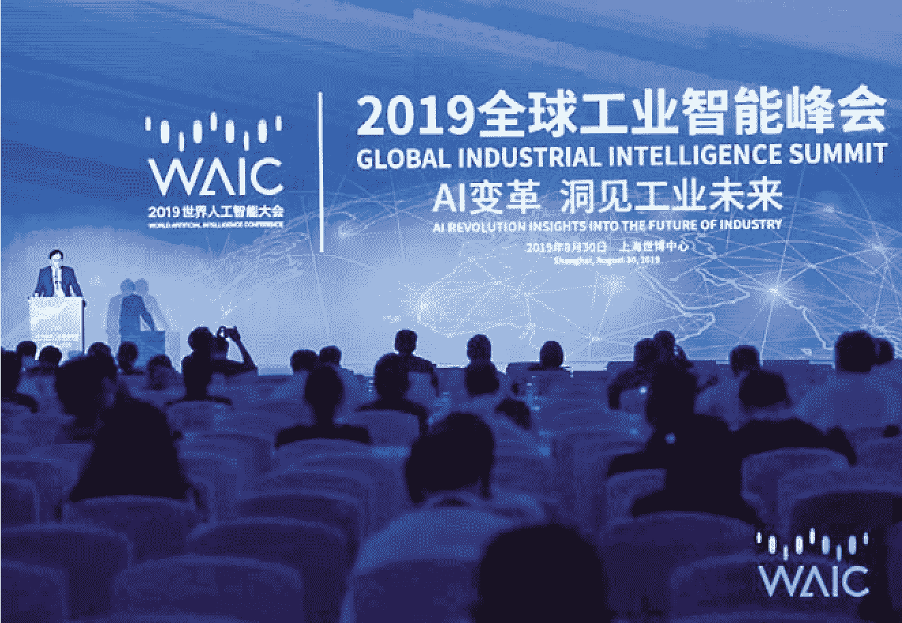

峰会紧扣全国两会精神，采用“1 个开幕式 + 3 个分论坛”架构。

**开幕式高光时刻：** 中信院联合 10 家单位签署《长三角工业互联网标识解析合作协议》，推动国家顶级节点（上海）向行业及区域延伸；上海电气总裁黄瓯发布《工业智能上海倡议》；高金吉、柴天佑两位院士分享装备自愈与流程优化前沿；中德院士跨国对话碰撞智慧；首部《智能经济和智能社会发展报告》与《工业智能白皮书》全球首发；工赋开发者社区上线；施耐德、Landing AI、联通、国家电网等头部企业实战分享。会上还正式启动长三角 G60 工业互联网创新应用体验中心建设，11 家单位签署战略框架协议，开启区域一体化新篇章。

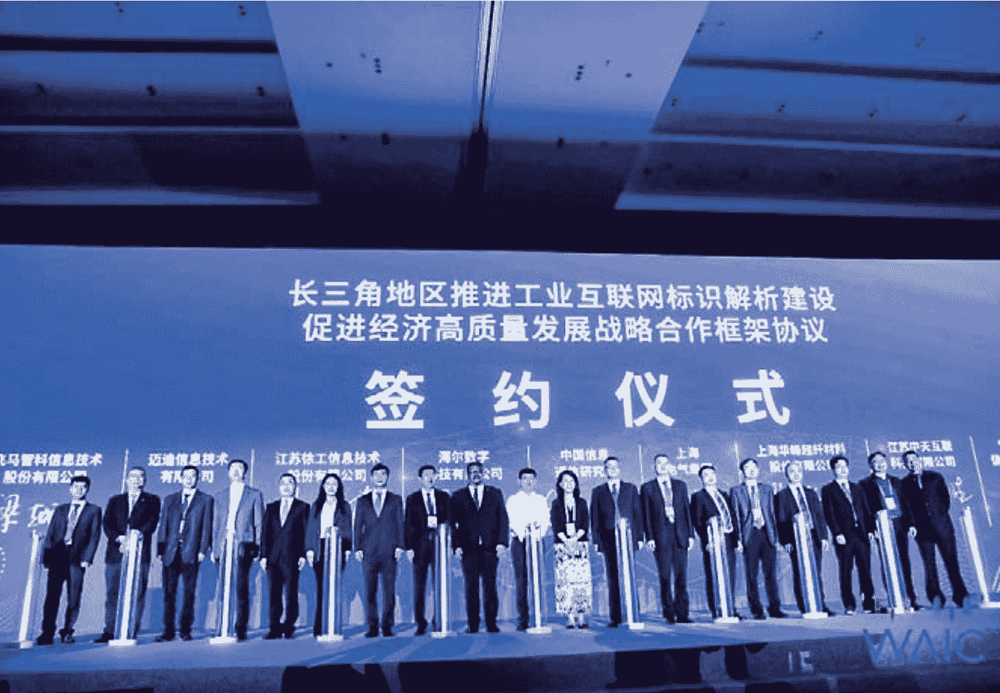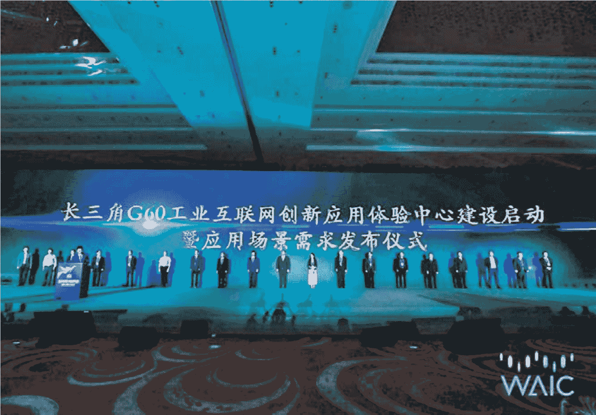

**三大分论坛聚焦生态、区域、开发者：**

*   **分论坛一：全球视野下的工业智能生态。** 中外专家齐聚，解析中美德日应对工业新挑战的策略差异，为中国工业互联网建设输血。与会领军者包括中信院副院长何桂立、中德院长房殿军、日工业价值链促进会秘书长渡部裕二、工联盟秘书长余晓晖、埃森哲总经理罗伯特·吉梅诺、上海电气数科总经理程艳、中科云谷 CEO 王晓冬、海尔数科总经理谢海琴、上电科所副总裁吴小东、联通上海物联网中心总经理黄璿等。圆桌环节围绕企业特色、趋势判断、生态构建深度对谈。
*   **分论坛二：长三角工业互联网高峰论坛暨工业造就者之旅。** 聚焦区域协同创新。工信部李颖巡视员、合力董事长张德进、中控科技创始人褚健、中微半导体董事长尹志尧、航天科工二院白彭英、上飞董事长刘汉涛、正泰副总裁栾广富、中天互联总经理时宗胜、中之杰总裁苏玉学、威马徐焕新等大咖云集。创新奇智 CTO 张发恩发布 ManuVision 工业视觉平台成果，怡东针织方力浩分享服装质检落地案例。圆桌由褚健主持，围绕企业实战经验与长三角建设建言献策。
*   **分论坛三：工业互联网开发者大会。** 技术视角切入生态建设。阿里巴巴滕爱龄主持，余晓晖致辞。IIC 架构主席林诗万、钉钉张斯成、罗克韦尔王宏善、工赋社区谢孟军、真格基金顾旻曼、中南高科陈治、九点半智能白新奋等技术大牛轮番登台。圆桌聚焦“开发者生态建设何为”，由谢孟军主持，多方共探破局之道。

#### 专家真知灼见录

**高金吉院士：装备自愈，迈入工业新纪元**
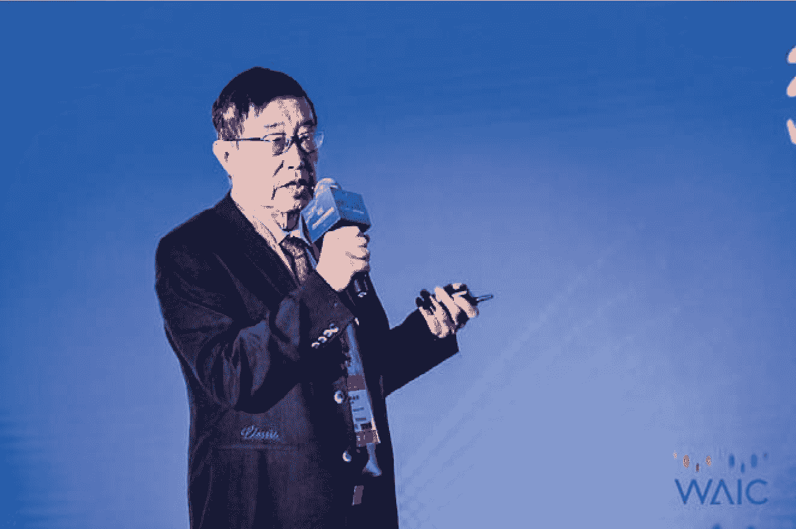
高金吉
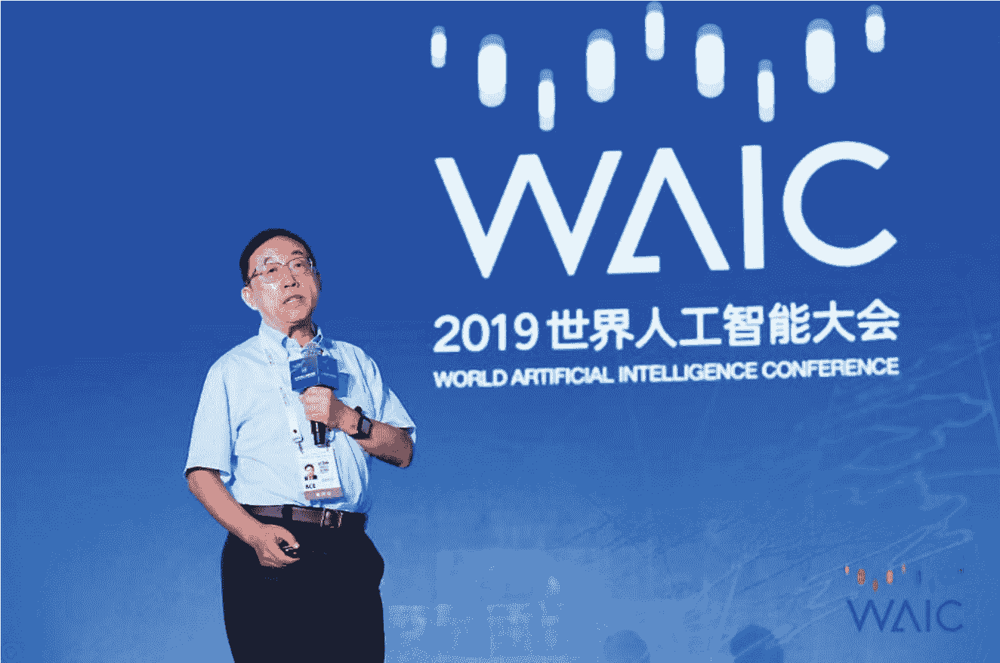
柴天佑

中国工程院院士、北京化工大学教授**高金吉**指出，现代大工业催生了“工业自愈”概念，拓展了仿生学、控制论与 AI 研究疆域。自愈技术将推动装备智能从可控、自动跨越至具备自愈功能的高阶智能。它颠覆传统设计理念，让机器、制造系统乃至所有人造物实现“自主健康”，助力下一轮工业革命步入自愈化时代。作为新兴交叉学科，工业自愈应纳入基础学科序列，亟需加强自愈装备的研发应用。

**柴天佑院士：工业 AI 攻关六大关键技术，驱动制造高效绿色**
中国工程院院士、东北大学教授**柴天佑**强调，制造业高效绿色转型的核心在于流程智能化，需将操作层、控制层、装备层重构为智能自主系统，将管理层升级为人机协同决策系统。为此，必须突破工业 AI 六大硬骨头：复杂工况下多尺度多源信息的智能感知识别、基于 5G 的多源高速可靠传输、系统辨识与深度学习融合的智能建模动态仿真可视化、关键工艺参数预测追溯、人机协同智能优化决策、云边端协同的智能算法落地。

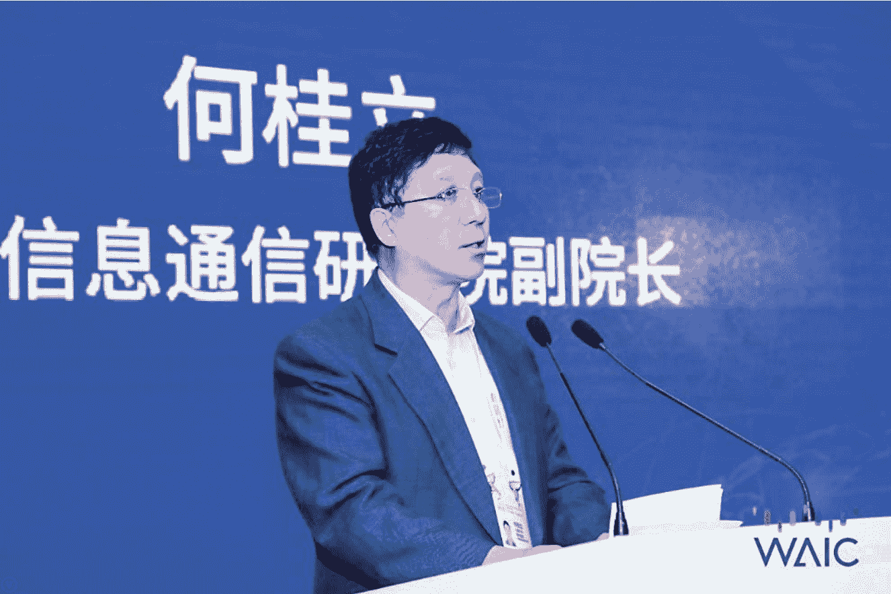
何桂立

**何桂立：夯基础、促融合、强国际，构建工业智能开放生态**
中信院副院长**何桂立**认为，工业互联网是互联网向生产领域、实体经济延伸的核心载体，已成新工业革命关键基础设施。其与深度学习、知识图谱深度融合将极大催化工业智能。当前应用仍处探索期，急需在概念、分类、场景、技术、产业上形成共识，重点构建开放共享生态：一是**强基建**，加速 5G 组网、内网改造、标识解析、平台分级、企业上云及 App 培育；二是**促融合**，汇聚产学研用金跨界资源，打造创新驱动新引擎；三是**拓国际**，深化政策法规、架构标准、网络互联、数据互通、商业模式、安全保障等全维度国际合作。

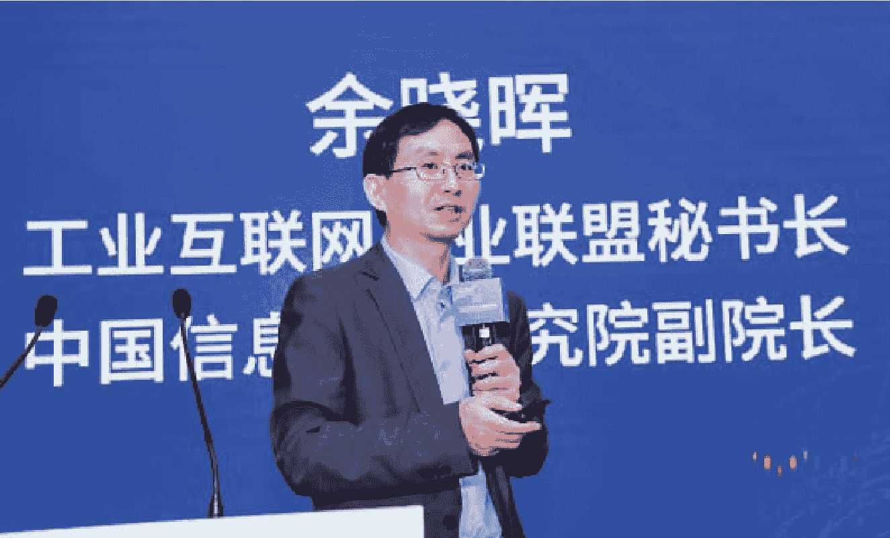
余晓晖

**余晓晖：网络连基础、数据为核心、安全作保障，开源社区育生态**
工联盟秘书长**余晓晖**总结数字革命三要素：网络、数据、安全。生产优化本质是让自动化更智能。工业智能历经专家系统、统计分析、深度学习三阶段。工业互联网提供数字化网络化智能化转型方法论，工业智能是其内生基因。实现目标必借工业智能。生态建设离不开开源社区，需汇聚自动化、软件、大数据、通信跨界人才，共攻参考架构、微服务、关键技术测试与场景应用，引导社会资本加大开源创新投入。

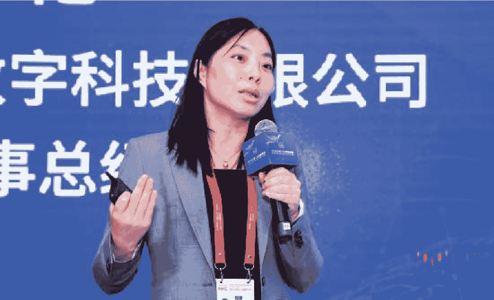
程艳

**程艳：上海电气“服务化转型”实践——从被动响应到预见服务**
上海电气数科总经理**程艳**分享：工业互联网建设伴随服务化、数字化转型同步推进。通过平台追踪客户行为，以软件订阅提供运维优化、资产托管。未来聚焦四大目标：筑牢平台底座、创新商业模式、拓展应用疆域、构建内外生态。助力内部服务从“被动式”向“预见式”跃迁。

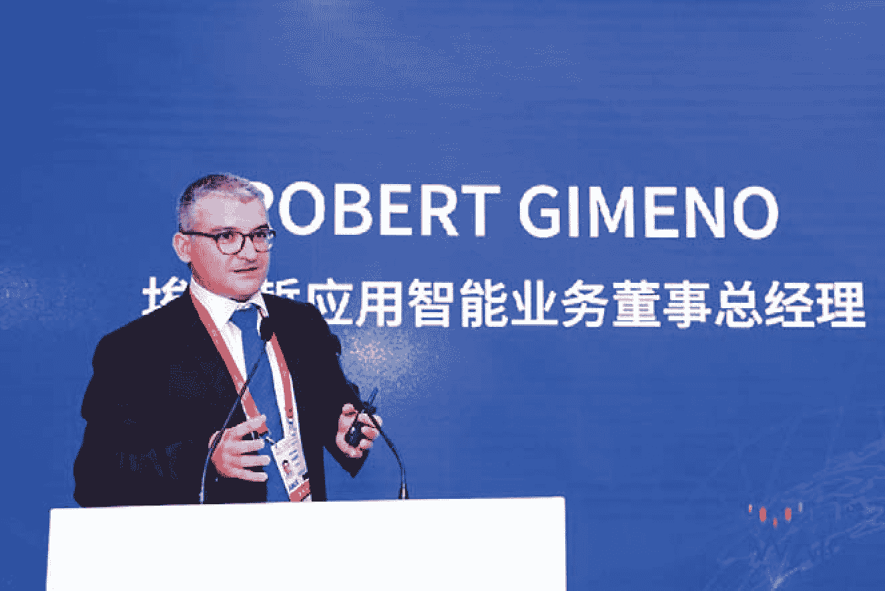
罗伯特·吉梅诺

**罗伯特·吉梅诺：AI 赋能制造农批零售效益显著，战略落地分“造、买、合”三径**
埃森哲应用智能业务总经理**罗伯特·吉梅诺**指出，制造、农林渔、批发零售受益最显著。AI 通过机器学习与大数据高效承接重复劳动、自我进化出新解法，更能打通人机互联与产业链协同。调研显示不足半数企业战略性部署 AI。落地三条路径：**自建**核心方案、**外购**软件/API/开源、**合作**业务专家与技术方联手。无优劣之分，企业需从可行性、契合度、数据、战略影响、能力五维权衡最优解。

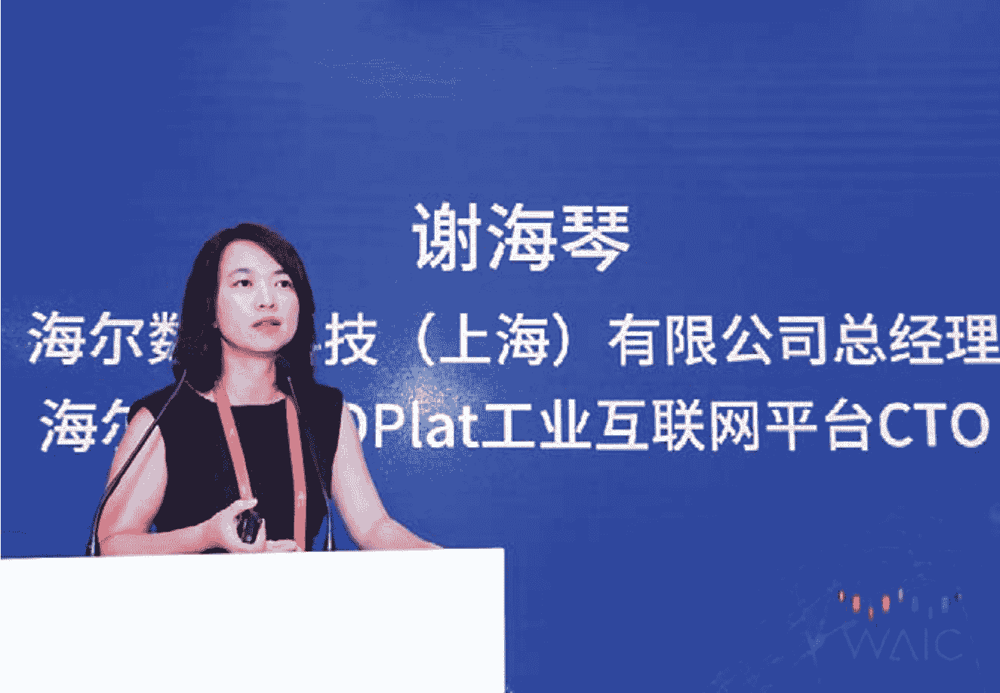
谢海琴

**谢海琴：海尔 COSMOPlat——以“人单合一”赋能大规模定制，跨界覆盖 15 大行业**
海尔数科总经理**谢海琴**阐释工业互联网本质：满足美好生活需求。三层逻辑：用户端极致个性体验、企业端规模制造转规模定制、国家端大企赋能中小。海尔双路径探索：**人单合一**引入用户全流程参与、**大规模定制**满足多元需求。COSMOPlat 开放 30 年制造经验（产品化、数字化、社会化），跨行业赋能纺织、建陶、房车、农业、医疗等 15 大领域及采购、供应链等 7 大模块，输出衣食住行康养医教全生命周期体验。

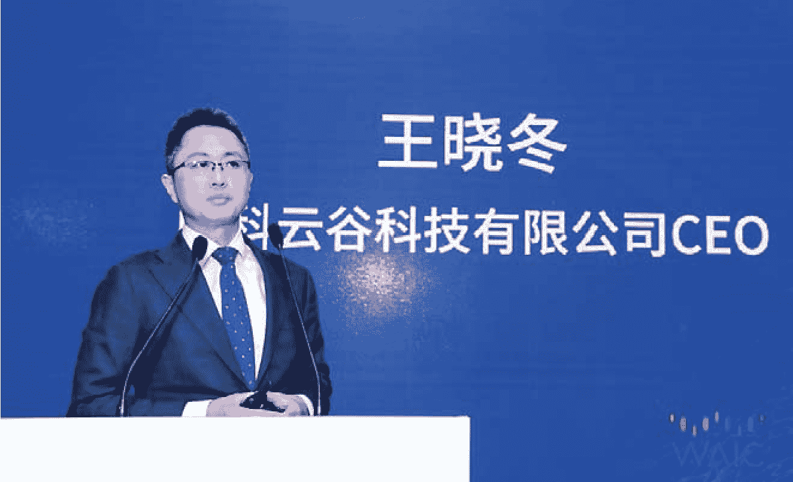
王晓冬

**王晓冬：中科云谷“三项标准”验证商业模式，剑指全球工业互联网独角兽**
中科云谷 CEO **王晓冬**直言持久商业模式须过三关：提效、增量、降本。作为中联重科孵化的工业智能独角兽，团队融合全球工业巨头与互联网精英基因。落户上海临港，持续加码研发，打造跨行业产融国家级平台，冲刺全球领先独角兽，助力产业升级。

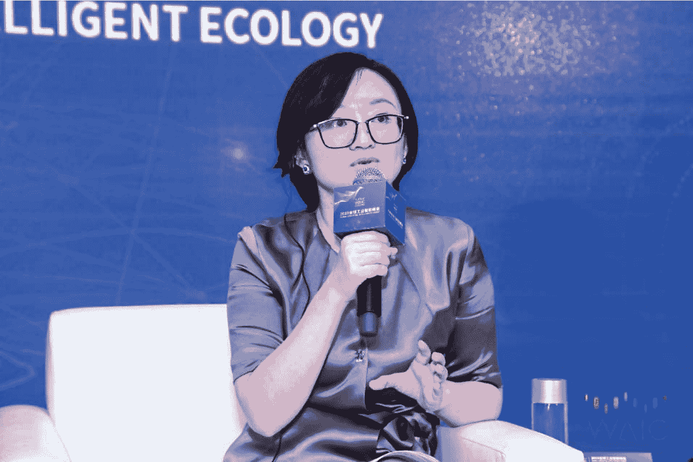
黄璿

**黄璿：运营商定位“网络安全赋能者”，5G 场景化切分工厂内外价值**
联通上海物联网中心总经理**黄璿**定义运营商角色：基于网络与安全底座做赋能，能力下沉场景创造价值。5G 应用按工厂内外分层：**厂内**利用低延时支撑 VR/AR，大并发实现全连接管控，高速率传大量视频；**厂外**赋能研发协同、生产协同、物流管控及售后服务延伸。

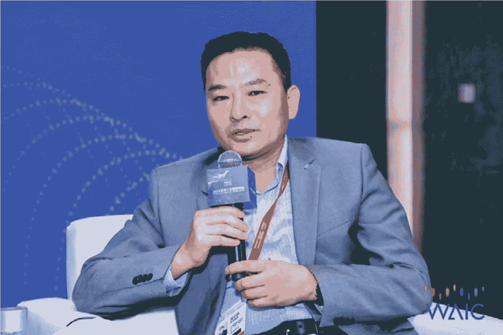
吴小东

**吴小东：上电科所“实践、交流、标准”三步走，能源互联网与工业智能共舞**
上电科所副总裁**吴小东**提出，AI+工业应用+工业技术特性=客户价值。能源互联网特征天然契合工业智能，正融入感知、传输、预测、优化控制闭环，将给传统电力带来革命性变革，最终融合成可持续生态（发电、输电、用户三方协同）。构建生态圈口诀：**实践新技术、强化全球交流、推进国际标准化**。

# 流程工业数字化转型：破局之道与生态共生

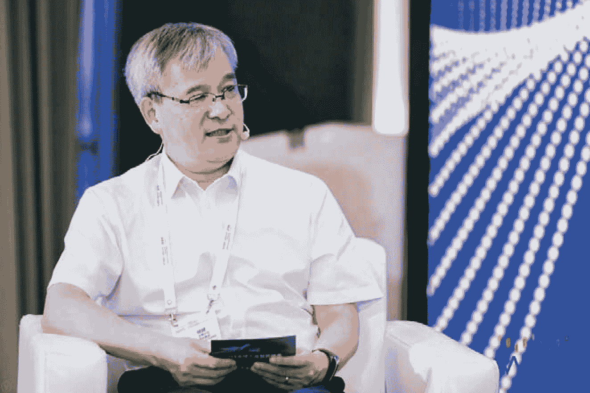

**褚健**

中控科技集团创始人褚健指出，流程工业在迈向数字化、网络化、智能化的征途中，生产、管理、运营等各环节的矛盾与痛点正逐层显现。他认为，从工业3.0跨越至工业4.0的关键，在于精准回应企业最核心的五大诉求：安全生产、绿色环保、节能降耗、提升质量、减员增效。这不仅是转型的方向，更是每一家流程工业企业必须攻克的生存课题。

针对这一目标，中控携手生态伙伴，聚焦安全、能源、生产、管控、供应链及资产管理六大核心场景，全力构建工业操作系统，并持续孵化丰富的工业软件与App矩阵。通过工业大数据的深度挖掘，系统捕捉资深操作工的隐性经验，融合设备健康状态与生产质量、产量、能耗等实时数据，借助高阶自助分析工具，最终为特定装置与关键设备炼制出“最佳操作模型”。

褚健强调：“软件定义世界，软件定义工业未来。”基于supOS工业操作系统的整体解决方案，将紧扣安全、降本、提质、增效、环保五大智能制造靶心，打通生产控制、生产管理至企业经营的全链路，助力企业牢牢掌握发展主动权。

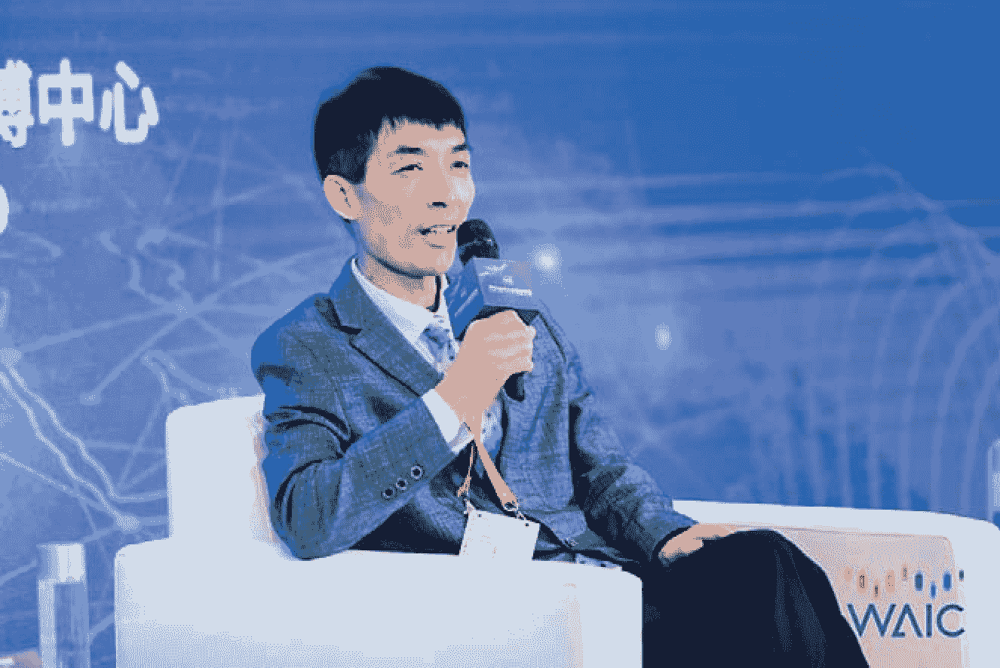

**苏玉学**

浙江中之杰智能系统总裁苏玉学分享了企业的转型实践：从传统制造向智能制造跨越，从传统营销向全渠道数字营销转型，从传统管理向共享服务驱动的运营数字化进化。目前，中之杰已打造以自研工业互联网平台、云制造平台“一云通”、数字化工厂“D-Work”为核心的“三平台”体系，组建起具备全专业覆盖能力的顾问团队，形成了端到端的数字化转型服务闭环。

中之杰定位为以自有平台为核心，赋能中小微企业转型、引领生态建设的综合服务商。使命直指成为中小微企业数字化转型的“首选合伙人”，用数字化手段重塑组织效能与竞争力。战略上，中之杰聚焦“连接、智造、生态”，联合两院、腾讯、罗兰贝格、SAP、霍尼韦尔、产业联盟、中科院宁波所等跨界伙伴，共筑资源富集、优势互补、创新共赢的数字化生态圈，携手奔赴转型新程。

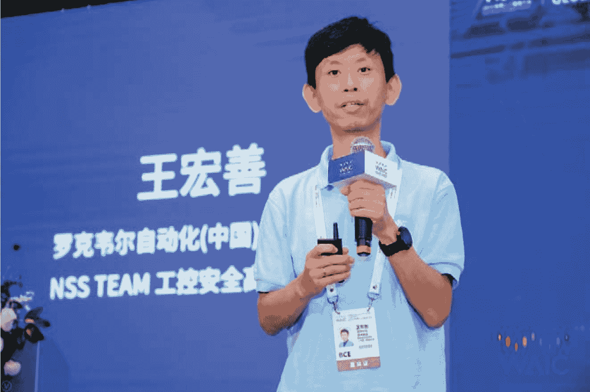

**王宏善**

罗克韦尔自动化工控安全高级研究员王宏善介绍，全场融合以太网架构（CPWE）是罗克韦尔联合制造企业与微软等IT巨头共创的成果。该架构打通了IT与OT的“任督二脉”，实现双向信息与协议的零干扰无缝互联。

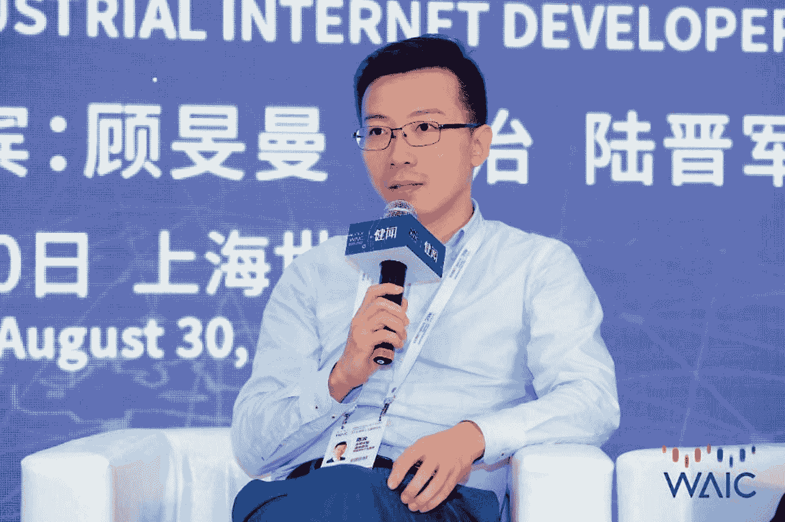

**陈治**

中南高科产业集团高级副总裁陈治直击中小企业痛点：不懂怎么转、找不到靠谱服务商、技术源头在哪里不明。无论是自动化改造、成本压降，还是网络化协同，中小企业主往往陷入“想转不会转、敢转找不到门”的困境。

陈治认为，数据链路一旦打通，企业的经营范式将根本性重塑。当前主攻个性化、柔性生产的企业，乃至传统产品型公司，都将加速向服务型企业进化，这当中蕴藏着巨大的增量机遇。

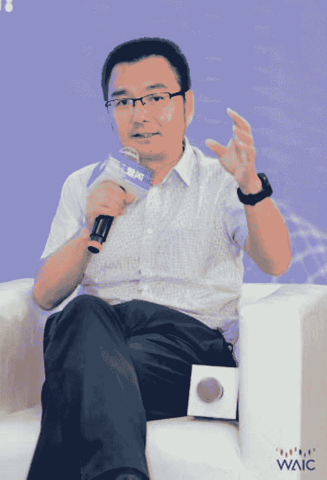

**陆晋军**

上海理想信息产业集团总经理陆晋军从四个维度剖析工业互联网推进中的现实阻力：环境端，工业基数参差不齐，认知水平有待提升；政策端，红利多被头部企业收割，“锦上添花”多，“雪中送炭”少；技术端，数据采集仍是硬骨头，终端、协议、网络部署等落地难题频发；人才端，纯IT背景人才过剩，懂工业业务、懂IT技术的“双料复合型人才”极度稀缺。

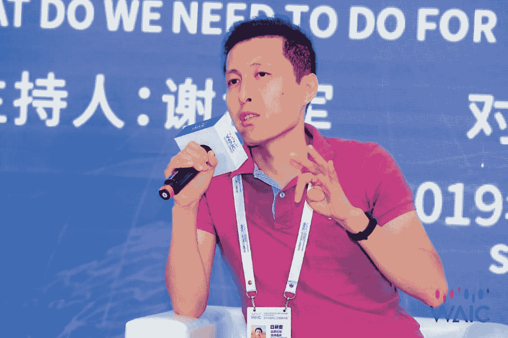

**白新奋**

苏州九点半智能科技CEO白新奋划定了产业互联网与消费互联网的根本分野：消费互联网争夺流量，抓住流量即抓住数据与迭代速度；而产业互联网的需求“藏得深、路径长”，必须深入一线，与老板、工人面对面交流，方能触达真实痛点。这意味着，选定垂直领域的深度合作伙伴，是进入产业互联网的唯一“入场券”。

---

# “芯技术 芯架构 芯安全”峰会：解码AI芯片新范式

2019年8月30日，2019世界人工智能大会重要主题论坛——“AI引擎‘芯’未来峰会”在上海世博中心启幕。本次峰会由大会组委会主办、赛迪顾问承办，汇聚政府领导、院士专家、企业领袖与用户代表，围绕“芯技术 芯架构 芯安全”主题，从产业、技术、应用三维度深度剖析AI芯片演进路径，共探多元开放的芯片新生态与边缘智能新命题。

上海市人大常委会副主任肖贵玉、工信部科技司副司长朱秀梅致辞。中国工程院院士倪光南、清华大学微电子所所长魏少军作主旨演讲。赛迪顾问总裁孙会峰发布《中国人工智能芯片产业发展白皮书》。云从科技、嘉楠科技、Gyrfalcon、欧拉认知等企业围绕“持续创新与跨越发展”展开高峰对话，共谋产业趋势。

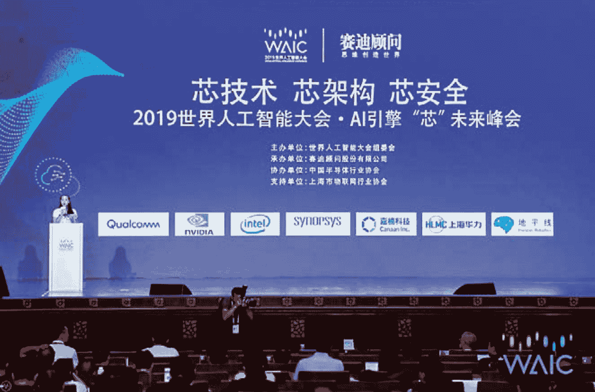

### 嘉宾观点

**倪光南**

中国工程院院士倪光南判断：**开源芯片是大势所可为**。可借鉴开源软件繁荣路径，以开源开发与推广模式激活芯片创新。RISC-V作为开源免费的新星架构，极易落地产业化，但也面临碎片化与生态薄弱的双重挑战。当务之急是建立产业联盟与基金会，扩容生态、降低门槛、鼓励创新。RISC-V将成为支撑AI、5G、物联网、大数据、云计算、区块链等新一代信息技术的关键基石。

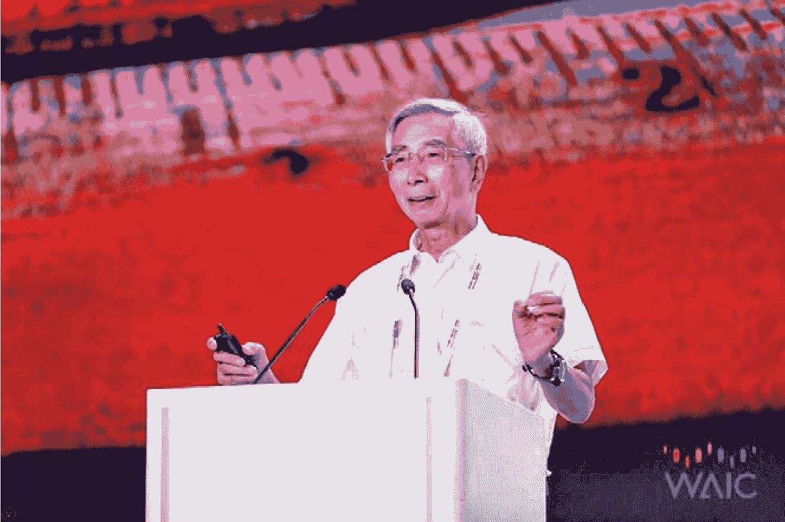

**魏少军**

清华大学微电子所所长魏少军预见：**AI将走向无处不在，倒逼芯片向通用、高效、低能耗进化**。据估算，2025年全球AI芯片市场规模将破660亿美元。芯片发展正步入“AI芯片2.0阶段”，核心看点从单一性能转向：能否兼容多算法、多应用？可编程性与可重构性如何？自学习能力能否跃升？算法与硬件协同设计成必选动作，通用AI处理器将成突破关键。

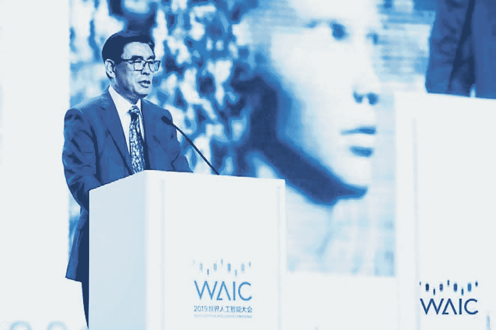

**孙会峰**

赛迪顾问总裁孙会峰提炼出AI芯片产业四大趋势：研发导向从“攻关技术难点”转向“击穿场景痛点”；技术路线从“专用专芯”演进至“通用泛用”；算力部署从“云端集中”延伸至“云边一体”；合作模式从“串行分工”升级为“融合共生”。对此，企业要抓场景落地，园区要抢赛道布局，机构要把节奏力度。

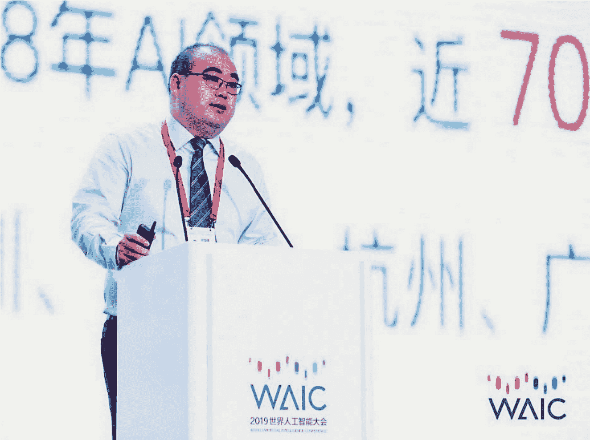

**赖纳·克莱门特**

高通全球副总裁赖纳·克莱门特看好AI市场前景。高通深耕无线技术创新十余年，持续推动AI与5G深度融合。C-V2X与AI协同将铺平高阶自动驾驶之路；5G赋能的分布式AI与边缘云计算，将为千行百业解锁全新增长向量。

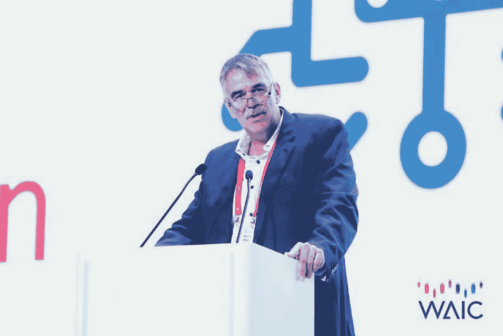

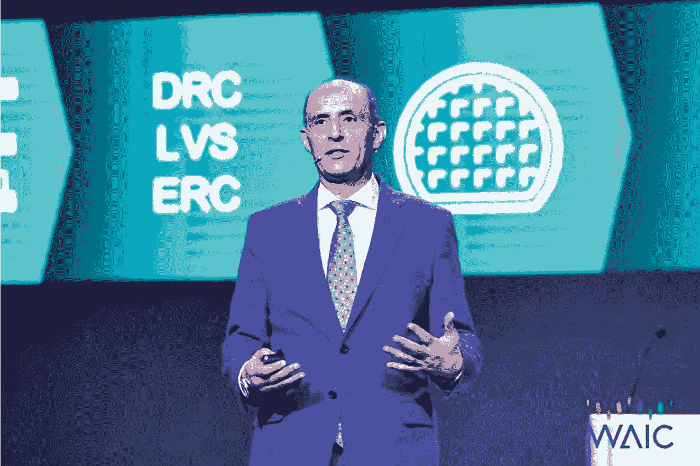

**奇基布·阿克鲁提**

新思科技全球资深副总裁奇基布·阿克鲁提指出，半导体应用新生态催生芯片设计爆发期，AI辅助设计加速迭代、强化性能。软实力反哺硬芯片，AI芯片开发亦可汲取人类智能启发。新理念须确立：架构为先，系统化演进，打破软硬件、CPU/GPU边界，让芯片性能随时间进化。跨领域、跨行业合作迫在眉睫，唯有融合各行业专业语言与成果，方能推动AI算法持续演进。

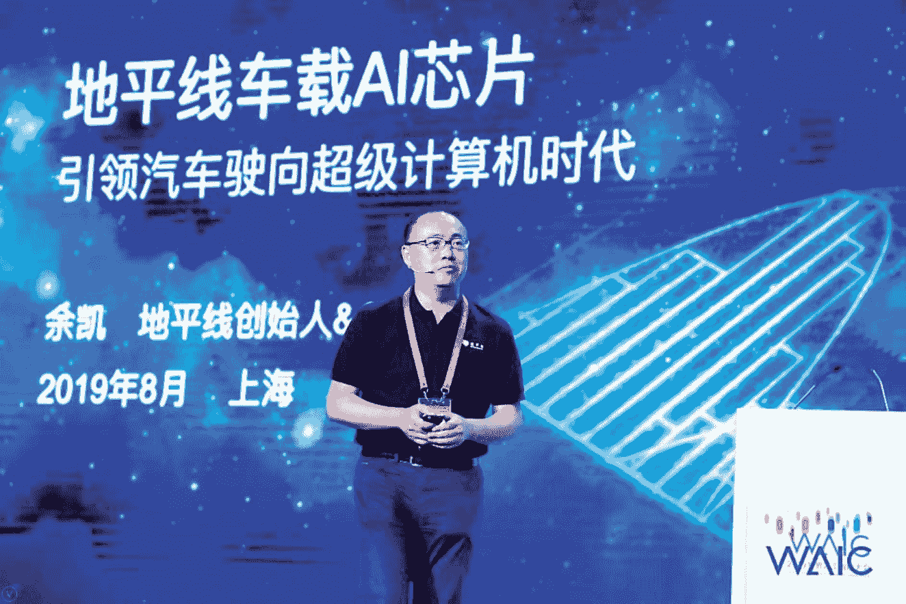

**余凯**

地平线创始人余凯预言：**车载芯片将领跑汽车向“四轮超级计算机”进化**。边缘计算是最大规模落地方向，车载AI算力是硬骨头。AI时代开启架构设计黄金期，软硬高度协同，编译器优化是降功耗、提效率的关键杠杆。至2030年，整车成本结构将重塑，算力平台与软件成核心资产，人类将迈入“软件定义汽车”新纪元。

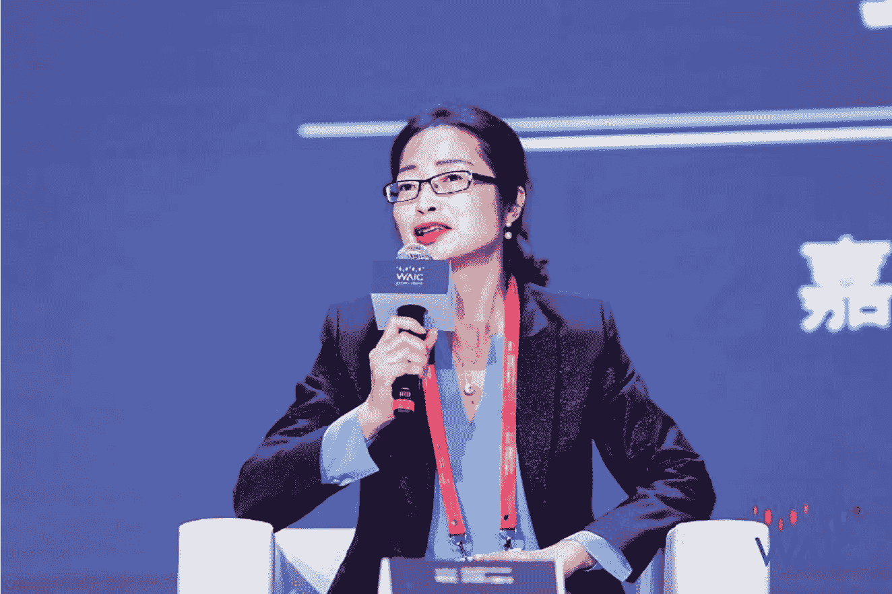

**张立**

云从科技副总裁张立从算法公司视角剖析痛点：通用芯片难支撑多样化场景，尤其应用端适配受阻。落地过程中，算法、芯片、模组选型适配成反复博弈。趋势显现：算法公司反哺上游做芯片设计。这股“新生力量”虽懂算法，但面临芯片设计的“积累鸿沟”与商业验证。建议政府夯实产业基础标准与生态，为跨界创新护航。

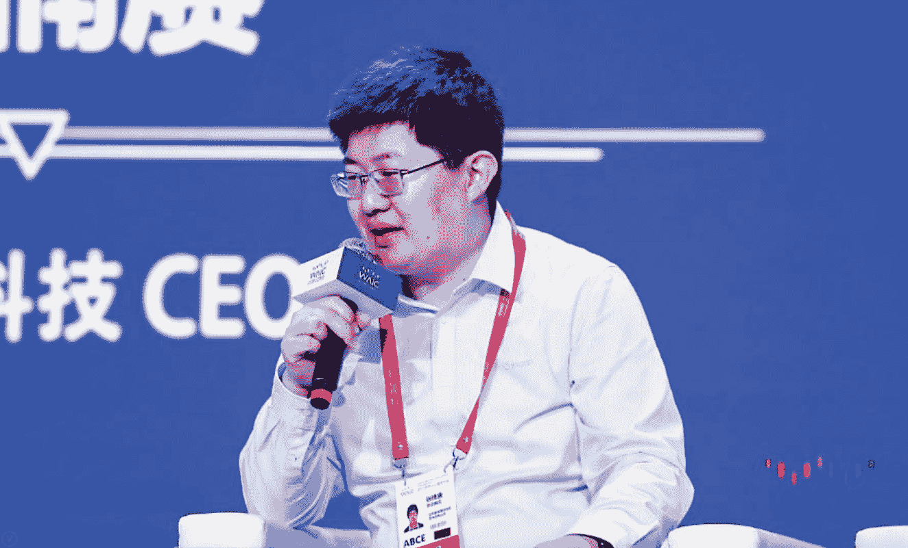

**张楠赓**

嘉楠科技CEO张楠赓区分“云端”与“端侧”差异：端侧场景碎片化、独立性强，对功耗成本极其敏感。端侧发展除降本增效外，必须“场景化、专用化”。但业内对“专用”认知不一，当下应聚焦场景与算法落地。政府作用关键：碎片化场景缺标准，需推进产业标准化，为蓬勃发展立规矩、建秩序。

---

# AI赋能教育现代化：从“教”到“学”的范式革命

2019年8月29日，“人工智能助力教育现代化”主题论坛在上海世博中心举办。论坛由大会组委会主办、市教委指导、市电教馆承办，副市长陈群、教育部科技司司长雷朝滋致辞，1500余位教育界政产学研代表与会。

论坛设签约倡议、专家论道、对话企业、圆桌会议四大板块。签约环节，市教委联合华为、阿里、腾讯、三大运营商、科大讯飞、好未来等头部企业签署政企合作框架协议。倡议环节，市电教馆牵头联合十余家企业发布《人工智能助力教育健康发展倡议书》，推动政府、企业、社会、行业多方协同治理。

专家论道汇聚陆靖、吴朝晖、郑南宁、杨宗凯、汤姆·米切尔、丹尼尔·施瓦茨等中外大咖。企业对话聚焦智慧校园、AI助教、虚拟实验室、评价体系、阅读画像等前沿实践。圆桌会议围绕“数据驱动因材施教”、“智能时代教师发展”、“开放远程教育智能化”三大议题深度研讨，凝聚共识。

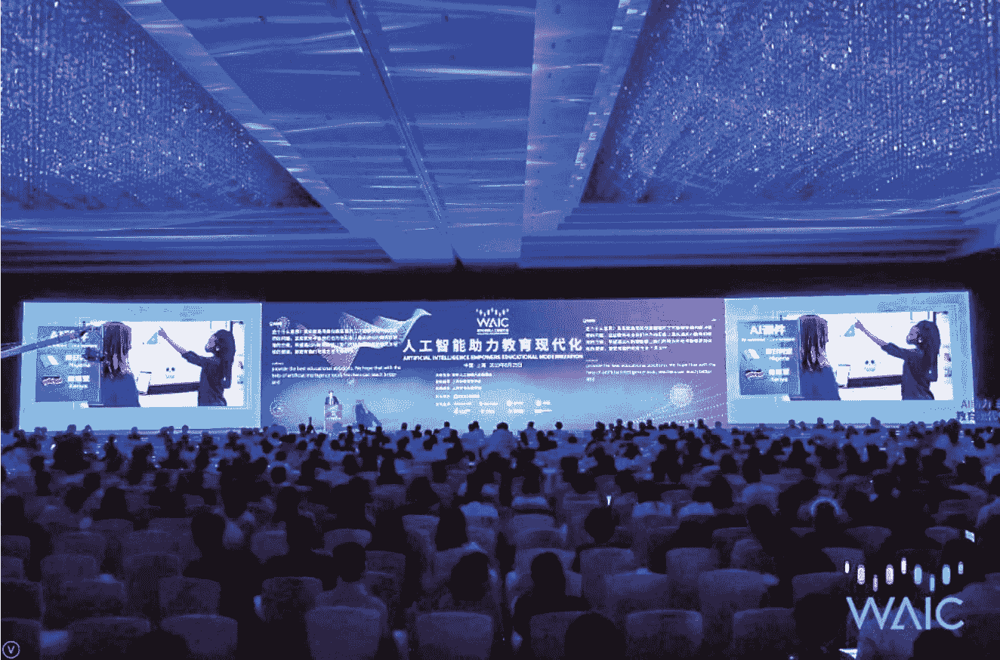

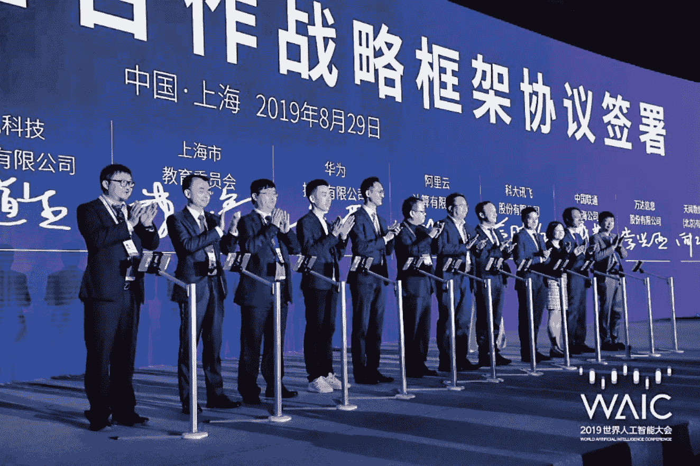

### 嘉宾观点

**吴朝晖**

浙江大学校长、中科院院士吴朝晖宣判：**智能增强时代加速来袭，教育格局、学习模式、育人目标将发生深刻重构**。学校由闭变开，学习由被动转主动，学生由单一获知向全面发展跃迁。新通识教育须回应知识传授、能力培育、素质提升、人格塑造四大命题。未来人机共存成常态，人机协同将延伸至学习全域，驱动教育1.0向“学习2.0”跨越。

“学习2.0”将重塑教学关系，构建感知-反馈闭环，实现教与学持续交互、迭代、互进。终局是：人机协作常态化、师生交互必然化、终身学习主流化、泛在学习普遍化。AI将打破学段壁垒，串联基础至社会教育，推动教育走向一贯性、联动性、终身性。

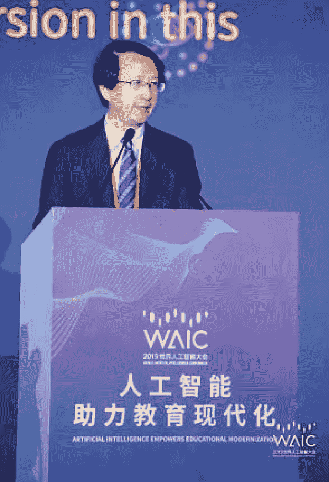

**汤姆·米切尔**

卡内基梅隆大学计算机学院院长、机器学习权威汤姆·米切尔断言：**未来5-10年是AI大显身手的黄金期**。教育痛点显著：一对一辅导有效但昂贵。AI个性化辅导系统可低成本复刻名师功能，并能实时评估、对话、互动、因材施教。CMU研发的Squirrel AI已服务约200万中国学生，大规模教学数据积累有望终极实现个性化教育普惠化。

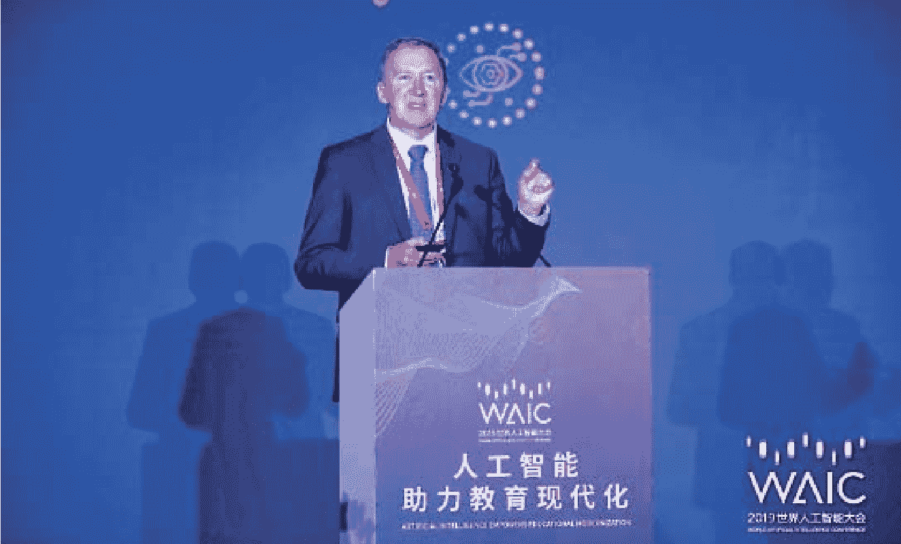

**丹尼尔·刘易斯·施瓦茨**

斯坦福大学教育学院院长施瓦茨警示：**切莫让AI为追求效率与短期正确率，接管学生学习过程或替学生决策**。教育本质是“教会人如何学习”。AI应开发创造性应用，引导学习者掌握“如何学习”，建立基于事实与科学的推理思维，而非依赖经验直觉。

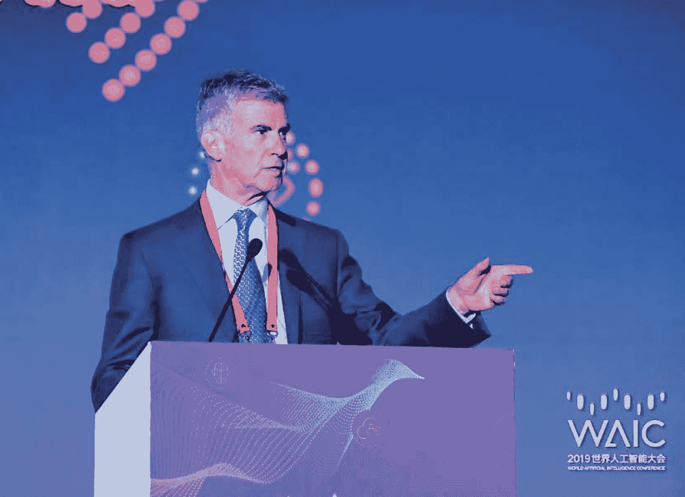

**王翌**

流利说创始人王翌直指教育三大刚需：个性化、高效率、公平性。现状是：优质教育成本高、效率低、资源分布不均。背后只有一个核心瓶颈——**优质师资供给不足**。AI正是破解这一“供给侧难题”的关键变量。两大模式迁移为AI铺路：行为数字化奠定数据基石，教学中心从“教师中心”转向“学习者中心”打开个性化应用空间。

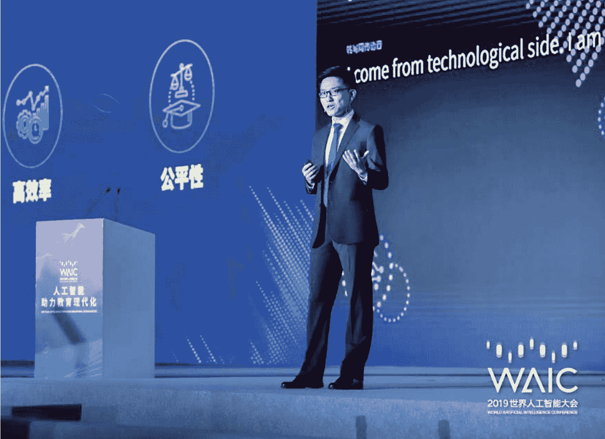

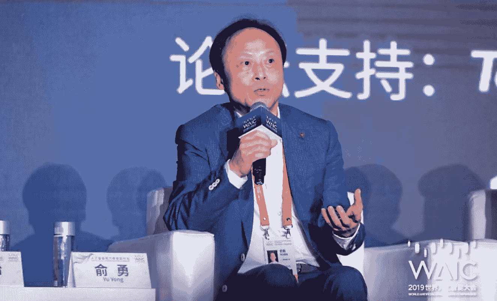

**俞勇**

伯禹教育创始人、上交大教授俞勇泼冷水：**AI改变教育是相对的**。名师上屏虽惠及更多，但无法保证屏幕端师资全优，线下辅助教师仍不可或缺。国内信息学/AI教育普及需从“用心编写好教材”起步，而非简化大学教材。中国起跑不晚，但重点有偏差。呼吁大会聚焦本质，直击根本问题。

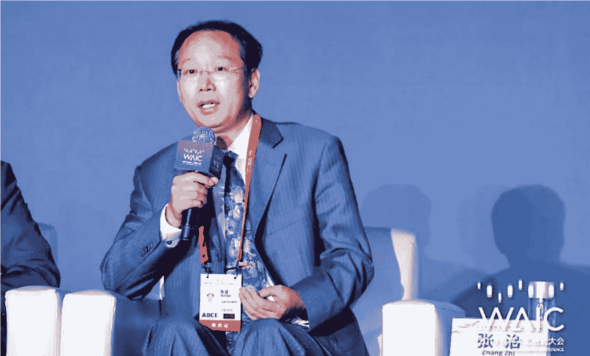

**张治**

## AI 重塑教育新图景

上海电教馆馆长张治划分了 5G 与 AI 融入教育的三重境界：入门级是将技术作“课程”讲授，普及概念与编程；进阶级视作高效“工具”，优化既有教学流程；最高级则深度植入教学内核，重塑学习者思维模式。鉴于此，AI 素养培育不可滞后至大学，基础教育阶段便须渗透，因材施教、寓教于乐，将算法思维早早植入童心。无论“AI 为教”还是“教以 AI”，均为教育变革开辟全新赛道。

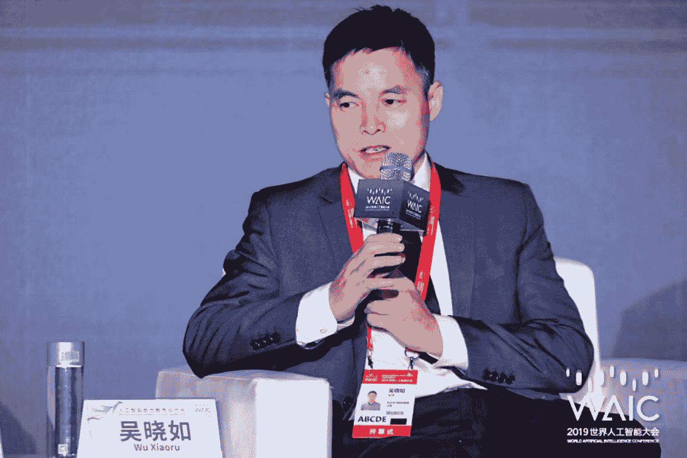

科大讯飞执行总裁吴晓如指出，教师转型的钥匙在于预判未来人才画像。重复性、标准化岗位将被机器接管，学生面临更不可知的明天，这反倒强化了教师作为“领航员”的核心价值。角色须从“灌输者”转为“成长伙伴”，善用数字工具搭建沉浸式场景，激发学习内驱力。她预判 AI 冲击教育的三重维度：短期看应试效率跃升加剧内卷；中期看多元评价体系落地；长期看若“评价-技术-互动”形成正向飞轮，将为师生全面发展筑牢基石。

## 4.“智汇健康 预见未来”——2019 全球人工智能健康峰会

作为 2019 世界人工智能大会重磅分论坛，峰会于 8 月 30 日落地徐汇西岸。由大会组委会主导，多部委联动、行业联盟加持，以“智汇健康 预见未来”为旗，搭建全球对话高地，聚焦趋势、监管、硬核技术、落地实践与资本风向。

上海副市长宗明、国际电信联盟秘书长赵厚麟等重磅致辞，徐汇区委书记鲍炳章等领导莅临现场。

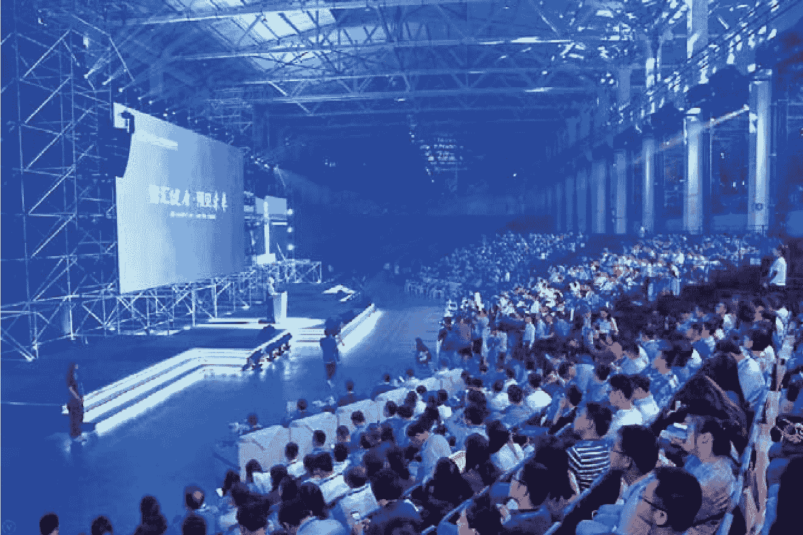

宗明勾勒上海蓝图：补齐伦理法规、激活医疗数据资产、攻坚高发病防治、推动 AI 医疗产品落地生根。工信部朱秀梅呼吁产学研协同突围：加速创新迭代、筑牢支撑底座、深化开放合作，拓展智慧健康新边界。国家卫健委刘文先献策四条：创新驱动惠民生、标准体系强根基、隐私安全守红线、产业生态育新机。

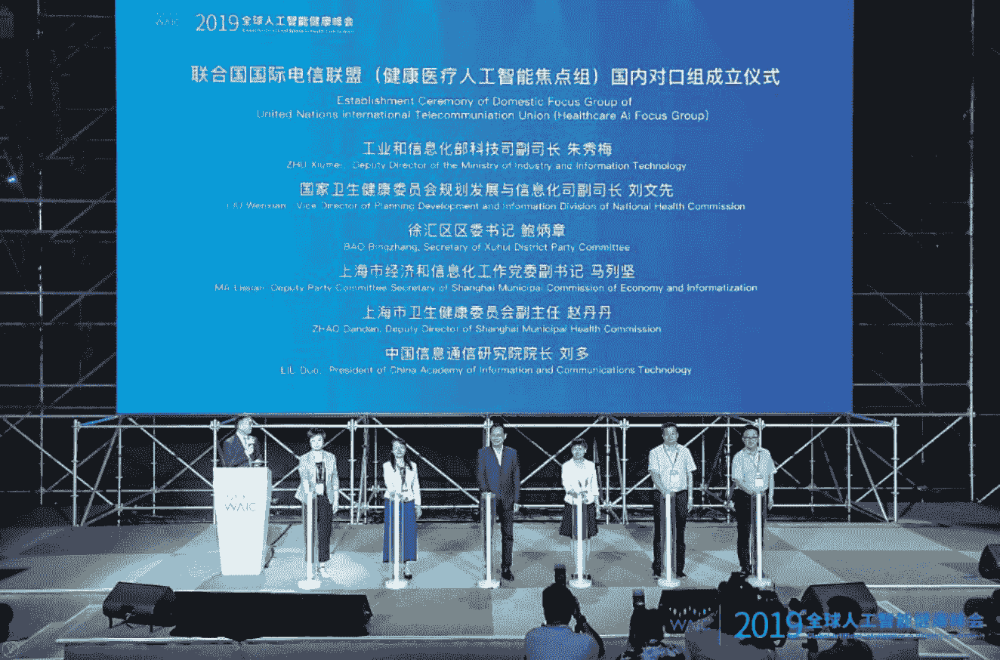

参会阵容星光熠熠：英美日监管机构、行业协会携手联影、腾讯、西门子、IBM Watson、科大讯飞医疗等头部玩家，三甲医院掌门人齐聚，围绕监管逻辑、全球经验、技术前沿、商业化路径深度博弈。同期启动 ITU 健康医疗 AI 焦点组国内对口机制，联合发布《医学人工智能应用白皮书》，誓推标准预研与跨界共创。

### 嘉宾视点

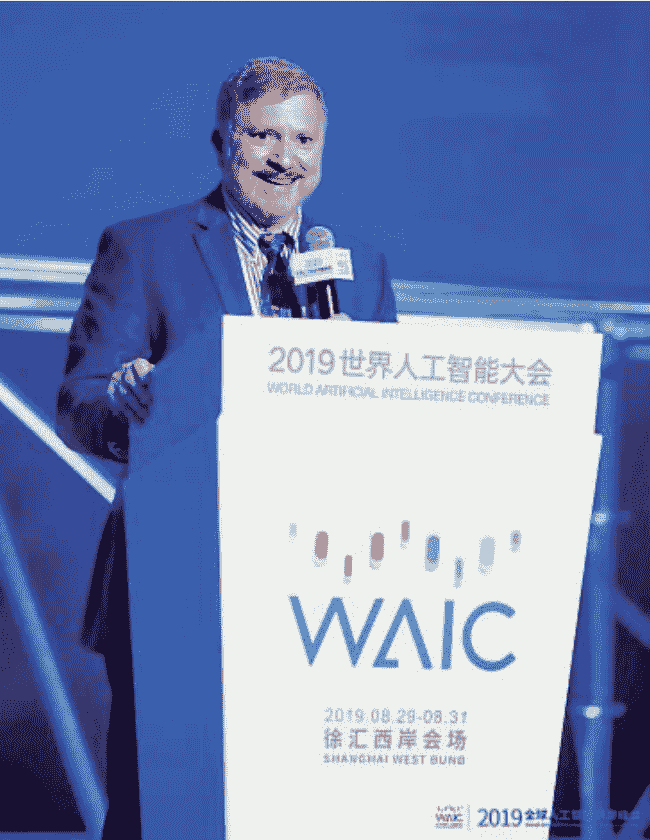

英国皇家科学院院士、体素科技首席科学家德米特里·特佐普罗斯复盘医学影像 AI 从“分块分析”向“建模分析”的跨越。他展望：新一代筛选平台将吞吐电子病历、病理、血检、基因等多模态海量数据，云端大脑助医生抢跑临床决策。

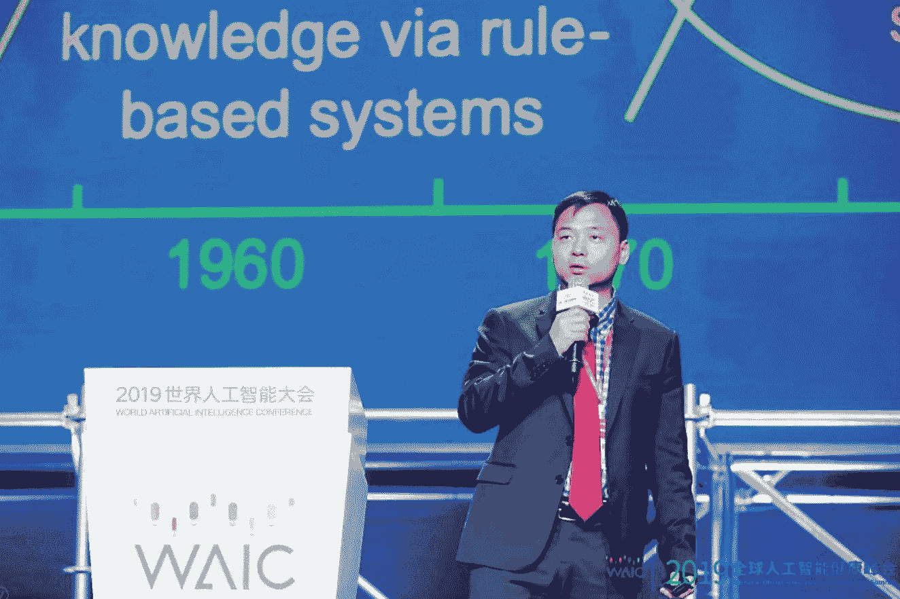

澳大利亚科学院院士、悉尼大学教授陶大程梳理 AI 进化三部曲：程序智能→感知智能→认知智能。医疗影像采集、诊断、录入已广泛铺开，但数据采集与分析的“拦路虎”仍在。

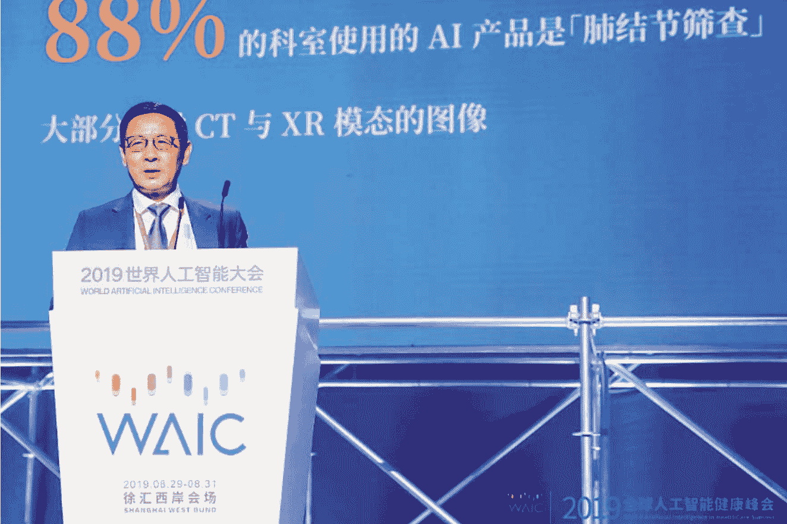

联影医疗掌舵人薛敏直言：影像是主战场却未成熟。未来两大看点——一、贯穿诊疗随访全链路的判读与效能评估；二、赋能设备提质增效。长期看，智能预防、诊断、诊疗、康复全链条均将大有可为。

兰丁高科创始人汪键针对政策环境支三招：托底成熟安全技术、立法提速护落地、企业因地制宜攻坚易落地场景。

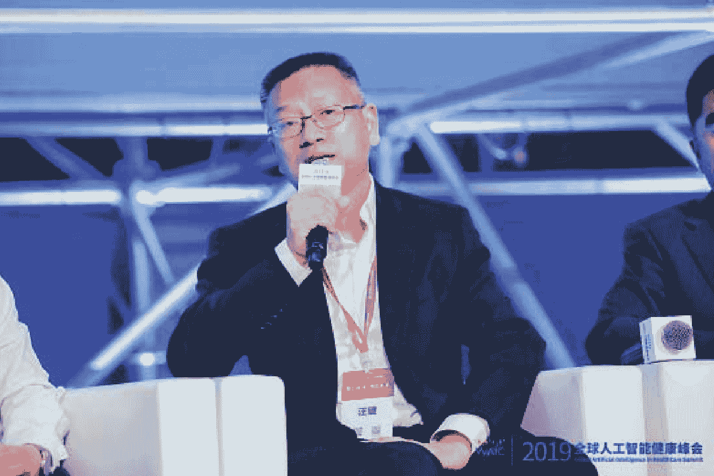

强生心血管事业部掌门王金鹤开出生态繁荣三方程：开放生态聚多元、数据标准化结构化、争取政策资源倾斜。

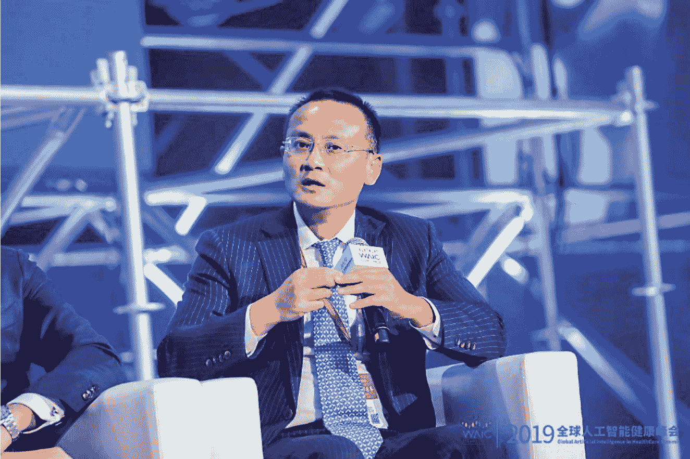

数坤科技创始人毛新生拆解落地双引擎：技术算法与数据科学融合直击临床痛点沉淀产品；产品商业化、产业化闭环。以全流程数据锚定价值，方能冲出“AI 寒冬”。

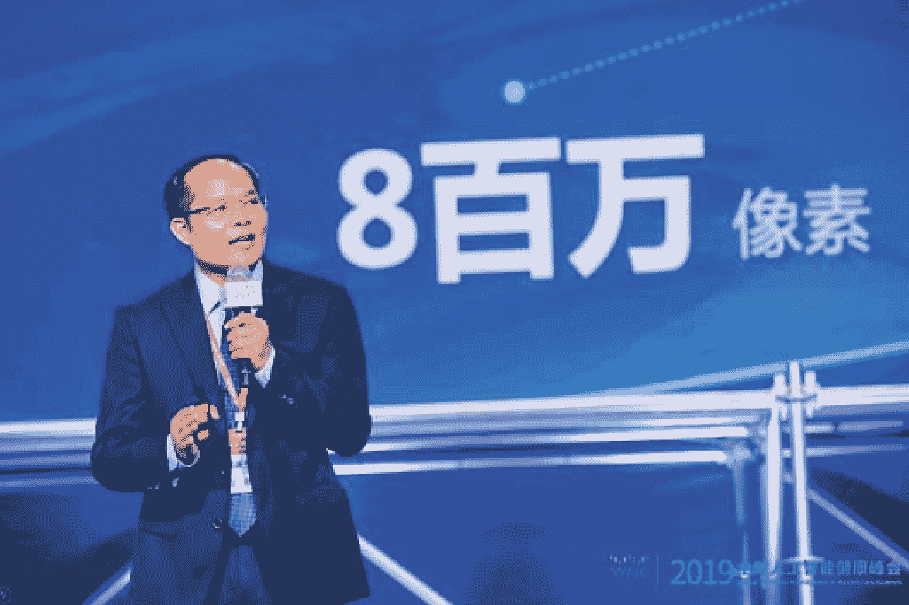

安德医智大中华区 CEO 李晶珏强调初心：唯贴合临床场景方得真价值。BioMind 重塑影像 AI，实现全身多部位、多病种同步解读，嵌入诊疗一体化闭环，契合真实医生工作流，创造双重价值。

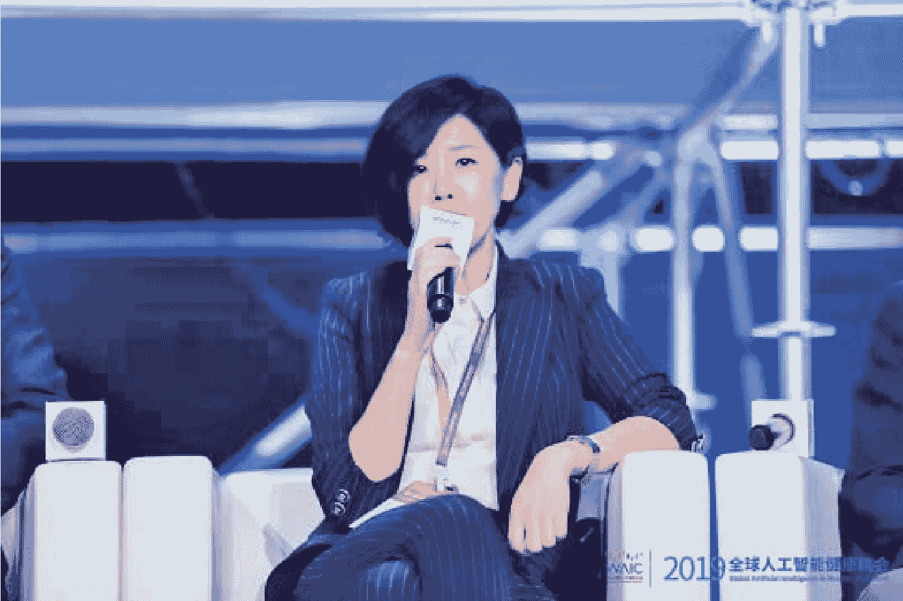

## 5.“寻路医疗 AI 破局落地”——医疗行业论坛

8 月 30 日早间，“寻路医疗 AI 破局落地”论坛启幕。大会组委会指导，健闻传媒主办，多方联办，飞利浦、依图医疗鼎力支持。中美院士、卫健委智库、三甲影像科主任、企业高管云集，为智慧医疗落地把脉开方。

智慧医疗被定义为新一代信息技术在医疗版图的革命性深化。共识锁定三大核心战场：院内全流程数字化管控；跨机构远程协作与分级诊疗网络；影像 AI 辅诊、医疗机器人、临床决策支持。前二者延续上轮医改主线，推动资源下沉均衡；后者则是新技术催生的新增长极。

### 嘉宾视点

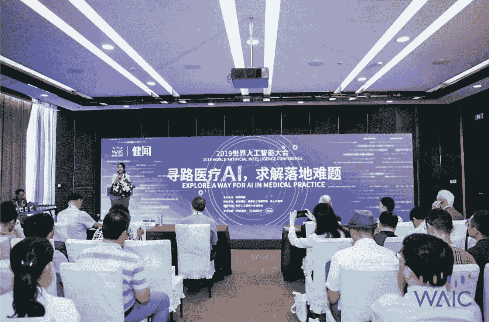

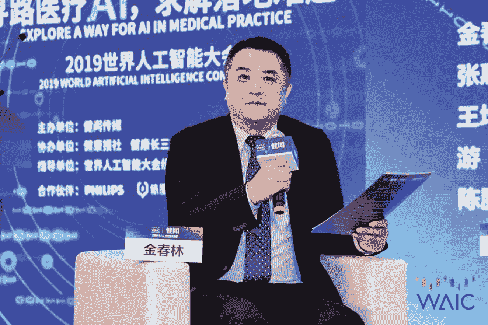

上海卫生发展研究中心主任金春林梳理政策双轨制：2015 年起中央分推“互联网+”与“AI+”医疗健康。前者经“三个办法”落地，政策土壤成熟；后者聚焦国家级数据平台、训练测试集建设及影像辅助标准化。当下应用版图与上述三大场景高度重合。

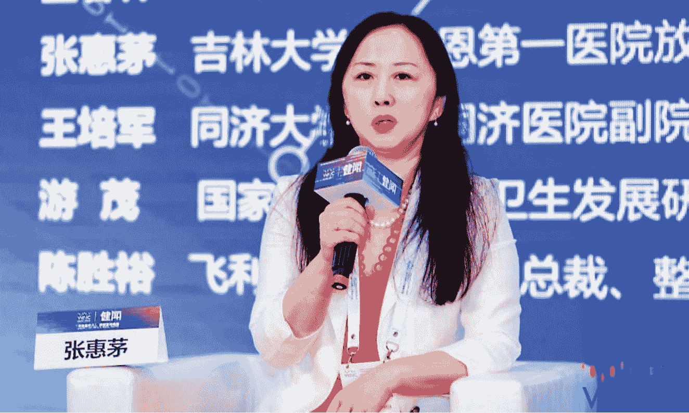

吉大白求恩一院放射科主任张惠茅强调：信息化是大数据 AI 的基石。数据安全共享机制迫在眉睫；医生牵头、多学科（数理工算）协同平台及成果转化机制，是全流程应用的保障。前景广阔，需政策护航下构建真实临床数据驱动的合作生态。

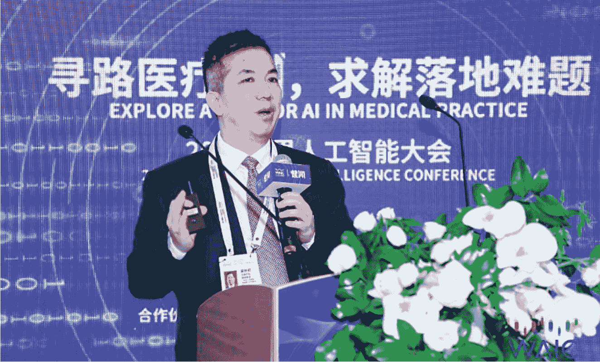

广东省人民医院影像科主任梁长虹肯定深度学习实战价值：检测算法破解“大海捞针”难题（钙化灶、肺结节）；配准分割压缩勾画时长；解剖测量建立正常参考；分类模型辅助疑难诊断。AI 抬升医生认知维度，释放判断力、创造力与共情力。虽获监管准入，但通用性、可解释性、数据结构化等硬骨头未啃下，替代医生仍隔重洋。

## 6.“凝聚共识 推动未来城市实践”——未来城市论坛

8 月 30 日，组委会指导下，万科主办未来城市论坛召开。需求迭代倒逼全球探索城市新范式。政府、万科、微软高管携 300 余跨界精英共绘城市新图景。

万科与微软战略合作的未来城市实验室揭牌，双方掌舵人共任名誉主席，将联手生态伙伴攻关中国标准与全空间智慧解决方案，覆盖智能家居、建筑、城市、物流，以技术赋能城乡建设与生活服务。

### 嘉宾视点

万科董事会主席郁亮发声：拥抱 AI 方赢未来。城市进化是系统工程，首要凝聚共识，寻觅技术与场景深度耦合之道。中国城市化与发达国家同起跑线，有机会原创而非模仿。万科已在标准与方案探索上落子。实验室将承载探索实践，成科技与城市双向奔赴的标杆。万科致力打造高效、有韧性、可持续的理想城市单元，平衡未来图景与历史文脉。

斯坦福大学教授杰里·卡普兰博士指出：AI 与自动化将深度重塑社会肌理。前景诱人，但唯“受信系统”方能入户，需统一认证标准守住安全、隐私、伦理底线，以治理机制让红利普惠。对华建言：建海量数据共享池最大化数据价值、规划预留增量面向未来、加速技术商业化落地。

万科高级副总裁张海直面城市三重困境：规模、密度、效率。需破解需求多变与空间固化的矛盾。万科探索“变与不变”导则：动静、城野、供需关系动态平衡；生态、文化、人文关怀、健康生活坚守底线。以设施为底盘、创新主体为核心、AI 为引擎，通过理想单元拼接完整场景，联合全球伙伴共建未来城市。

中国工程院院士吴志强概括六大变革潮流：清洁能源、生命健康、AI、绿色交通、人口集聚、教育创新。AI 已在智慧农业、安防、共享教育等落地开花。城市建设终极归宿，是满足人对自由精神的探索渴望。

## 7.“AI 赋能 智慧建筑”行业论坛

放眼万物互联新纪元，5G、AI 将推动楼宇应用从资产管控、物业运维向 To G、To B、To C 全域服务延伸，兑现节能、降本、提质、增值承诺。“AI 赋能智慧建筑”有望成长为新兴赛道与产业增长极。8 月 30 日下午，世博中心论坛启幕，东浩兰生联合腾讯云、高力国际、有个机器人、鹏安视、福赛特等举办，意在织密产业生态链，输出建筑楼宇全生命周期智慧化方案。

## 智慧建筑论坛：AI 重塑楼宇新生态

本届论坛聚焦未来数字化语境下，楼宇智能系统如何借力 5G、AI 等前沿技术实现全域渗透；同时探讨楼宇资产管理与物业运营如何突破边界，向政府端、企业端及个人用户延伸服务触角，达成节能、降本、提质、增值的多重目标。现场，五大行业头部企业围绕“AI 赋能 智慧建筑”核心议题，从办公、居住、建筑本体等维度深度拆解 AI 在智慧建筑演进中的关键作用。

论坛现场，东浩兰生集团副总裁高文伟与腾讯云副总裁万超代表双方签署战略合作协议，宣布将在楼宇智能化赛道深化协同，整合双方优势资源，共同打磨标杆级落地项目。

东浩兰生智业云首席信息官项莉正式推出以“数字驱动+绿色科技”重构的置业新范式产品——“智业云”。该平台汇聚人工智能、机器视觉、数据分析、业务逻辑、设备监测、计费支付、空间服务、三维展示等可弹性调用的技术模块，通过智能化改造连接社交网络海量用户，将万物互联场景转化为全用户可感知的智慧服务体验。

此外，东浩兰生集团副总裁高文伟与 YOGO ROBOT 联合创始人张阳新亦签署战略合作协议，双方将瞄准楼宇运营痛点与真实落地场景，深度挖掘智能移动机器人平台的服务潜能。

### 核心观点速览

**王强**

东浩兰生集团董事长王强感言：高楼平地起，十年磨一剑。在经社与科技飞跃的当下，物联网与 AI 技术为存量建筑注入新生，让新建大楼持续焕发活力。人工智能重塑生活方式已成不可逆趋势，我们应善用此技术，为大众创造幸福生活。

**万超**

腾讯云副总裁万超分享道，腾讯在智慧建筑领域深耕思考，自主研发了物联网操作系统“腾讯云微瓴”。微瓴融合云计算、信息安全、AI 等核心能力，并依托腾讯强大的用户触达生态，为行业输出符合时代发展的实用标准化工具。目前，微瓴已在智慧建筑、园区、校园、商超、工地、社区等六大领域落地医院、学校、住宅、园区、展馆等 10 余种场景，打造出一批标杆案例。

## 8. AI 绘就科技人居新蓝图：家电行业论坛

2019 年 8 月 29 日下午，在世界人工智能大会组委会指导下，由中国家用电器协会、美的集团中央研究院、中国家电网联合主办的“AI 赋能科技人居新图景”家电行业论坛成功举办。论坛围绕前沿 AI 技术、家电产业趋势与热点议题展开深度对话，致力于推动 AI 科技与家电产业高质量融合发展。来自学界、业界的国际 AI 权威专家、行业大咖、合作伙伴、商界精英及高校学者齐聚一堂，共同定义 AI 科技家电新标准，共话未来极智生活。与会嘉宾包括：中国家用电器协会副理事长王雷、斯坦福大学教授杰里·卡普兰、上海交通大学创新中心主任陈江平、美的集团副总裁兼 CTO 胡自强、美的集团中央研究院院长徐成茂、Passiolife 首席产品官大卫·韦斯滕多夫等。

为持续激活 AI 在家电领域的应用潜能、挖掘产业增值空间，AI 科技家电高端品牌 COLMO 与上海交通大学达成合作意向，联合发起“以创新致未来”创新大赛。大赛旨在吸纳高校人才与前沿灵感投身技术应用一线，赛程横跨至 2019 年 12 月，涵盖招募、初赛、复赛、决赛全周期，采用“双导师制”：上交各专业教授把关科技维度，美的集团结合中央研究院、COLMO 平台及各事业部导师全链路赋能创新指导。论坛尾声，陈江平、胡自强、徐成茂及美的中央研究院用户与创新研究所所长姚萍共同启动大赛启动仪式。

### 大咖金句

国际知名 AI 专家、技术创新企业家、斯坦福大学人工智能与伦理学教授杰里·卡普兰博士指出，AI 赋能新一代家电及消费品主要有三大路径：一是赋予产品环境感知力（即“眼”“耳”），实现高效人机交互与个性化适配；二是打破家电孤岛，构建互联互通网络，让家庭设备协同更便捷高效；三是技术服务于人，科技应用的终极取舍权在于人类自身。

**杰里·卡普兰**

展望未来，AI 将助力机器以更柔性方式分担人类体力劳动，简化生活琐事。就居家场景而言，AI 势必深度重塑智慧家居与家电产业版图。当前，AI 科技家电的前景、商业模式创新的机遇与挑战是核心课题。一旦企业实现 AI 真正解决用户痛点，关乎人居生活的家电行业必将迎来场景革命。

## 9. 传感驱动智能变革：行业论坛聚焦新赛道

2019 年 8 月 31 日，由世界人工智能大会组委会指导，中国传感器与物联网产业联盟（SIA）主办、Wave Computing 协办的“传感驱动 智能变革”行业论坛在上海世博中心启幕。

AI 发展与产业智能化转型，根基在于传感器技术跃迁。作为电子信息制造业的基石及重点扶持的特种元器件，传感器提供海量数据训练集，是通往高阶 AI 的必经之路。随着 AI 技术迭代，传感器将全程贯穿、潜力无限。梳理行业趋势、统一认知刻不容缓。

Wave Computing 首席技术官克里斯·尼科尔博士、mCube 中国区总裁谢平、上海联影医疗联席主席张强、上海交通大学教授梁晓峣、Efabless Corporation CEO 迈克尔·S.威沙特、Wave Computing 中国区总经理熊大鹏、沈阳新松机器人副总裁兼半导体 BG 总裁徐方、阿里云智能 AI 架构与应用总监徐凌杰、上海齐感电子 CEO 盛斌、雅观科技 CMO 林伟等重磅嘉宾出席。

论坛重磅发布《中国 MEMS 及先进传感器产业发展蓝皮书》，为行业现状与前景作出清晰评估与长远展望。

中国传感器与物联网产业联盟人工智能专家委员会宣告成立，标志着行业对 AI 发展趋势的深度布局全面铺开。由联盟主办、产新传媒承办的智能物联产业观察媒体服务平台“智芯界（AIOTWORLD）”同步上线，致力于整合产业上下游资源，重塑产业发展新格局。

### 核心观点速览

**朱家麒**

中国传感器与物联网产业联盟副秘书长、国家智能传感器创新中心副总裁朱家麒分析：当前新原理、新工艺传感器正加速替代传统器件，体积、集成度、成本持续优化。中国先进传感器形成四大核心极：长三角产业最聚集、珠三角应用最领先、渤海湾以京为核心科研院校密集、中西部重工基础厚植产业发达。企业多源于院所高校孵化，是产业特色。布局虽完整，但起步晚、基础弱，基础研究、技术攻关、品牌建设与海外仍有差距，然巨大市场需求将驱动国产传感器加速崛起。

**张强**

上海联影医疗联席主席张强表示，联影在 AI 领域深度布局，志在构筑人类大健康闭环（防诊治康）的全链路 AI 应用。探索三大维度：一、赋能医学影像设备；二、赋能医生，让 AI 成为医生伙伴而非替代者；三、搭建开放共享平台，推动医疗机构广泛应用 AI 临床实践，共建创新协同共赢的开放生态。

**徐凌杰**

阿里云智能 AI 架构及应用总监徐凌杰视角：AI 视角下，传感器获取优质数据是优化关键。多元应用混布下，传感器实时反馈实现精准调度，提升生产力。深度学习擅长挖掘海量数据集中的“宝藏”，融合多源传感器信息，将让城市生活更便利，普惠 AI 能力均沾政府、企业与个人福祉。

**盛斌**

上海齐感电子总经理盛斌判断图像处理趋势：一、精度跃升（清晰度更高）；二、尺寸微缩（体积更小）。应用驱动下，人脸、行为识别等算法云端深度计算需求增，传感器后端集成 AI/深度学习处理器成为核心目标市场。

## 10. 未来金融论坛：科技重塑金融生态

2019 年 8 月 31 日，由世界人工智能大会组委会指导，上海合合信息科技主办、荃英荟承办的未来金融行业论坛召开。AI、云计算、大数据等新技术迸发之势，正重塑金融产业生态，渗透银行、保险、证券、信托等全链条，科技成为核心驱动力。面对经济下行、去杠杆、监管趋严的多重压力，论坛聚焦金融、科技、监管新趋势，探讨科技驱动创新、AI 带来的机遇挑战及数字化时代演进路径。超 1500 位来自监管机构、中外资银行、城商行、险企、券商、金科企业的高管专家齐聚，共谋发展。

论坛发布《2019 金融科技白皮书》，从定义溯源、观点梳理、现状深挖、赋能效应剖析、企业分布透视到未来预判，构建全景视野。白皮书指出，在“科技赋能金融→金融服务实体”的逻辑主线下，金融科技终局将是“去中介化”：科技与金融深度融合，金融科技化作新触角深入生活肌理。

### 大咖金句

**镇立新**

上海合合信息董事长镇立新直指本质：新技术核心在于服务商业与生活的两大要素——数据与智能。5G 是数据高速路，物联网让万物生数，云计算管存算，大数据挖价值，AI 则是基于数据的智能觉醒。

**镇立新（续）**

旗下企业大数据平台“启信宝”覆盖国内 1.85 亿主体、全球 70 国 2.2 亿企业，提供 27 大类 700 维度画像及国际认可信用报告，关联关系挖掘覆盖库内 90% 企业及法人，实现深度洞察。

**陈晏堂**

合合信息联合创始人陈晏堂算账：银行对公授信场景中，传统人工耗时 170 分钟、填写 300 余栏位；AI 方案耗时仅 38 分钟，50% 栏位实现自动抓取填充，大幅压降成本。年中报、年报数据上传等贷前中后全流程均可机器化，数字化转型效能显著。

**吉尔·唐**

Lady who tech 联合创始人吉尔·唐判断：未来金融时代已至。数字化转型核心是建生态，各司其职；从商业模式、管理架构到产品体验，AI 打破壁垒，催生高效部门与新职业品类。

**李银亮**

海尔海创汇合伙人李银亮从孵化视角观人才演进：金融 1.0 重 IT 写码，2.0 转渠道重移动互联/支付技能，3.0 时代大数据、AI、云计算与传统金融深度融合，人才需跨学科、跨品类融合支撑，兼具理论深度与实战经验。

**周昆平**

交通银行战略发展部副总经理周昆平阐释科技与监管关系：非绝对对立，科技进步倒逼监管升级。银行首务防风险，现依靠电话核验，未来 AI 将优化流程。个贷标准化、无抵押利于模型自动审批，预留 20% 人工复核。系统稳定性要求高，三方数据合作仍存边界，但 AI 金融应用前景广阔。

## 11. 金融科技新生态：开创与变革论坛

金融科技东风劲吹，解决初期痛点后，金融与科技融合步入新阶段。2019 年 8 月 31 日，由第一财经主办的“金融科技新生态：开创与变革”行业论坛举行，金科企业与银行业代表共议发展现状与挑战。

第一财经总经理陈思劼、度小满金融副总裁许冬亮、上海新颜 AI CEO 黄向前、通联数据创始人兼 CEO 王政、中兴飞贷副总裁林庆治、北京眼神科技创始人兼 CEO 周军、同盾科技副总裁李伟东、德意志银行环球金融交易业务部中国创新及金科产品主管祝一、苏宁金融研究院院长助理薛洪言等出席。

### 核心观点速览

**陈思劼**

第一财经总经理陈思劼指出：全球寻求新增量下，金融科技热度持久不衰。如历次工业革命般，它将深刻重塑金融生态。这是最坏也最好的时代，愿金科在中国落地生根、合规安全成长，赋能科技驱动增长，期盼各机构善用 AI，构建健康、稳定、可持续的金融新生态。

**许冬亮**

度小满金融副总裁许冬亮强调：金融业务本质与数据紧扣，背后是 AI、云计算等硬核支撑，科技力量至关重要。参照美金科历程，中国金科投资将爆发式增长。机遇下，金融机构应从四维发力：拓连接、强风控、降本增效、优服务。

**王政**

通联数据创始人兼 CEO 王政剖析机遇与挑战并存：数据量激增、知识沉淀、技术革命为机；海量采集、技术提取、分析体系构建为难。核心产品 DataYes 萝卜投资智能投资模型三层架构：底层数据基石、中层知识建模（投资逻辑）、顶层分析研究（推理预测、跟踪监控、组合风控）。

**周军**

北京眼神科技创始人兼 CEO 周军分享：眼神科技深耕金融最久，聚焦银行内控与业务长效。科技变革金融呈三大特征：“坐商”变“行商”、“人助”变“自助”、隔空获客。多模态生物识别助力网点轻型化、智慧化，解决远程身份认证，成变革关键助推器。未来科技主导，除产品定义设计外，科技重塑金融显著。因银行经营基于信任，金科尚在发展期，部分金融板块具必要性与不可替代性。

**李伟东**

同盾科技副总裁李伟东预判：物理网点不消亡但功能重塑。银行演进路径：网点→网银→手机银行→“开放银行”。开放银行拓展物理渠道，回归本质升级为嵌入生活的智能服务。将开放银行融入生活场景，实现无处不在的金融触手可及。

# 2019世界人工智能大会深度观察：算法突围、类脑探秘与开发生态共筑

在数据保护议题上，业界共识明确：首要任务是完善法律法规，督促企业践行社会责任、传递正向价值；其次，从业者自身素养的提升至关重要，需坚守“科技向善”底线，扛起承载企业与社会价值的使命；最后，要善用前沿技术赋能隐私保护，以同盾科技深耕的联邦学习为例，该技术在实现数据“可用不可见”、保障安全的同时，有效激活了数据融合价值。

德意志银行环球金融交易业务部中国创新及金融科技产品主管祝一指出，该行主攻To B领域，国内物理网点虽少，但这不代表缺乏金融科技施展空间。反观未来，人工智能才是真正的下一个风口。重塑业务流程时，首要考量应是哪些环节可引入AI与机器人技术。展望未来，甚至可孵化“AI背调”新业态，不仅审核企业主体，更延伸至其所用产品，推动行业透明度跃升。

苏宁金融研究院院长助理薛洪言认为，金融科技引发的绝非单一渠道变革，而是全维度、全流程的重构。其价值可从双维度度量：一是金融科技的角色定位，二是科技已成金融业独立生产要素。目前科技重塑金融才迈出初步，瓶颈犹存。针对数据安全意识薄弱，需三管齐下：强化用户、机构、监管三方护数据意识；细化隐私保护规则；建立数据安全应急机制。未来风口聚焦两大方向：金融内部从C端向B端渗透、金融向实体产业外溢，本质是场景的持续深化与拓展。

## 12. “数字化变革重塑零售增长”行业论坛

后互联网时代，AI与5G加速落地，数字化力量正以革命性姿态驱动零售新发展、重塑增长新版图。2019年8月31日，在世博会议中心，由世界人工智能大会组委会指导、中国产融城发展联盟主办的同名论坛成功举行。商务部原副部长张志刚、中科院褚君浩院士等重磅嘉宾出席，来自中科院、同济大学、华为、埃森哲、苹果、红星美凯龙、地平线、36氪、拼多多等学界业界代表，围绕业态分化、零售新物种、核心技术（大数据、AI+、5G、IoT）、全渠道融合等议题深度对话。

论坛上，中国产融城发展联盟发起成立人工智能产城运营平台，旨在通过创新合作推动AI成果转化、产业落地与城市更新融合，探索AI+未来城市产业化路径，打造产城融合背景下的产业数字化转型服务平台。此外，在褚君浩院士见证下，首席科学家论坛成立，将致力于科技进步与科学家精神传承。

### 嘉宾观点

同济大学电子与信息工程学院院长陈启军介绍，该校机器人与AI实验室在高低速无人驾驶、移动机器人视觉感知建图、视觉智能检测抓取等领域斩获领先成果，部分已工程化落地。复杂场景全自主低速无人驾驶技术，被视为破解智能物流“最后一公里”难题的关键路径。团队在低成本感知、高精度定位、路径规划自主导航、高速精准控制等方面取得系列突破，对提升零售物流终端配送效能与品质意义重大。

埃森哲中国数字董事兼总经理江崇龙强调，企业数字化转型含数字零售已成大势所趋。精准营销、售后渠道、供应链、商业模式、组织文化等全维度的数字化能力建设，将引发行业根本性变革。转型非单一技术堆砌，而是借数字技术倒逼组织架构、人才能力、企业文化的系统性重塑，需从企业组织全局统筹推进。

华为5G室内产品线副总裁徐之兵表示，通信人当前核心使命是推动5G改变社会。技术与网络方案日趋成熟，亟需众多系统集成创新伙伴合力落地千行百业。合格伙伴需具备三大特质：优选有国资背景的商业组织（涉及数据治理与保护）；拥有定制化软件开发实力；具备产业推广平台能力。面对垂直行业（酒店、商场等）的5G应用变革与落地挑战，需伙伴深度参与，匹配行业特性对接开发，构建产业协同平台，实现联动发展。

西南交通大学人工智能研究院副院长李天瑞指出，零售业与IT正迎来“第三次握手”。AI+零售成新赛道，锚定四大量化目标：按需服务、随时随地、便捷实惠、绿色环保；支撑四大核心要素：物联网、海量数据、算力、学习算法。愿景是构建利国利民、和谐共赢模式，实现国家、百姓、企业三方共赢，造福人类，让大众真心热爱零售新体验。

# 中篇　理论技术新趋势

理论算法演进是AI发展核心引擎，落地应用离不开开发者实践。2019世界人工智能大会汇聚国内外学术大咖分享前沿理论，特设开发者日聚焦底层框架及视觉、语音、NLP等实战。本篇围绕“理论技术新趋势”，精选8场论坛、33位嘉宾观点，覆盖前沿算法、类脑智能、开发框架、认知智能、语音、NLP、智能视频、AI+AR等热点。

## 1. “算法定义 AI 未来”——国际前沿算法峰会

AI 60年历程中，算法始终是引领学术产业的核心力量，历经大脑模拟、符号处理、统计学习至深度学习。当下AI已从验证期步入规模化落地期，对算法提出新课题：深度学习之后何去何从？如何破解落地门槛高、人才缺口大？如何打破数据孤岛、守护隐私？如何攻克深度学习“黑箱”难题？

以“算法定义AI未来”为主题的峰会于8月30日在世博展览馆举办。由组委会主办，上交大与第四范式承办，聚焦算法核心方向，探讨算法如何转化为产业变革生产力，推动高质量发展。市政协副主席李逸平、上交大副校长毛军发院士致辞。图灵奖得主Tom Mitchell、杨强、周志华等世界级专家及独角兽企业家齐聚，分享最佳实践，探讨算法赋能产业升级。

### 嘉宾观点

国际人工智能学会理事长、港科大教授杨强针对数据孤岛、小数据、隐私保护导致的数据割裂，提出AutoML（自动机器学习）与联邦迁移学习破局。联邦迁移学习即多方组建联盟共同建模，在保护隐私与模型参数前提下，仅共享加密参数以达最优效果。深度网络知识迁移通过预训练识别可复用层，其余层用新数据微调适配新任务，已应用于银行大额贷款等场景。面对数据割裂，联邦迁移学习旨在不交换原始数据、仅交互加密参数的前提下建立共享模型，最终构建生态，有机融合互联网数据、场景数据、跨行业用户行为数据。

南京大学计算机系主任、AI学院院长、欧科学院外籍院士周志华认为，深度神经网络核心在于逐层加工、内置特征变换、高阶复杂度。但其非“万能药”，应用视角下，研究神经网络外模型理由充分。现代智能应用依赖特定框架与硬件，打破神经网络、GPU、TensorFlow等技术垄断，亦能降低智能化时代“缺芯少魂”风险。

卡内基梅隆大学计算机学院院长、《机器学习》作者Tom Mitchell透露，团队正推进NELL（永不停歇的语言学习者）项目，让计算机7×24小时抓取公开网络内容并标注关键信息，致力算法持续自我进化理解力。计算机完全具备无监督学习能力，且每日都在进阶。

北京大学信息学院教授王立威主张探索算法模型结构新范式。深度神经网络训练本质是非凸优化，一阶法易陷局部最优。数学证明：在神经元足够宽、参数高斯随机初始化两假设下，一阶法大概率觅得全局最优。网络足够宽时，可引入高斯-牛顿法等二阶优化，效率准确度双优，极具探索价值。北大团队已用数学方法微调Transformer结构，获显著性能跃升。

## 2. “类脑智能与群智智能”主题论坛

8月30日，以“类脑智能引领AI，群智智能促创新”为主题的论坛在世博中心举行。组委会主办，复旦大学、中科院脑科学卓越中心、上海脑科学中心、上海新氦科技联合承办，300余位全球嘉宾参会。市人大常委会副主任高小玫、市经信委党委书记陆晓春、复旦副校长金力出席致辞。高小玫肯定上海脑科学与类脑算法成果对科创中心建设的支撑；金力表示复旦将发挥基础研究、学科交叉、国际合作优势，支持科学家攻坚“无人区”，厚积薄发。

论坛同期发布上海市脑与类脑智能专项首批成果、签署产学研合作协议。

### 脑与类脑智能基础转化应用研究

一是专项首批成果发布。由张江实验室、复旦大学联合承担的市级科技重大专项于2018年7月启动，汇聚中科院、华山医院等30余家单位，瞄准精准医疗、智能机器人、智能决策三大应用，建设重大基础设施、攻关核心技术。一年来，产出36项国际影响力创新成果，申请专利15项，应用场景覆盖医疗、物流、电力、交通、机器人等，预计拉动近百亿经济效益。

二是上海复科智能机器人研究院揭牌。三是“复旦大学人工智能特聘教授”捐赠协议签署。四是复旦大数据学院与汇付天下共建基于AI的金融科技创新实验室。

主题演讲环节，来自美索尔克生物研究所、中科院神经所、复旦类脑院、南洋理工、爱丁堡机器人中心、悉尼大学AI中心等顶尖机构专家分享类脑前沿。

#### 嘉宾观点

中科院院士、神经所所长蒲慕明阐释：可塑性是大脑认知基石。脑可塑指大脑结构功能随环境经验重塑，每一活动皆引发变化。现象最早由中国科学家冯德培发现。Hebbo学说认为同步放电强化突触，非同步则弱化。20年前新发现：强弱化具时序性——突触前先放电则强化，反之则弱化，即时序依赖可塑性（STDP），已有人在人工网络应用STDP。

历史上AI三次浪潮皆源神经科学启发：1943年M-P神经元模型仿生物神经元抽象简化；80年代Hopfield网络、BP算法。Hopfield网络赋予突触权重，单元加权求和，权重用Hebbo规则无监督调节，网络快速平衡，说明记忆分布式存储于突触、可并行存储多记忆。

脑科学与类脑AI协同发展是未来方向，双向赋能、共同进化。AI领域BP算法启发我们寻找自然网络中的反向传播机制，虽成果尚未反哺人工网络，但深信人工网络终将受益，这是脑科学与AI结合的最佳范例。

## 3. “拥抱技术　开放未来”——WAIC 开发者日主单元

8月31日下午，WAIC开发者日主单元“拥抱技术 开放未来”在世博中心红厅启幕。这场面向开发者的技术产业盛会，邀请探索AI理论技术应用创新的研究者、推动者、学术先锋分享硬核成果。市经信委主任吴金城致辞。阿里贾扬清、亚马逊Alex Smola、百度吴甜、Julia创始人Viral Shah、Skymind联创Adam Gibson、港中大林达华（商汤联创）、百度马艳军、Auto-Keras作者金海峰、小米何亮亮、华为云陈亮等大咖云集。

现场举行黑客马拉松颁奖。大赛由机器之心策划、张江集团协办，随大会开幕同步启动，聚焦AI热点，微众银行、软银机器人、第四范式、微软AIoT实验室出题：智能垃圾分类、Pepper机器人应用、AutoNLP、智能车间。吸引百余队报名，50强进场48小时鏖战，决出四大赛题优胜团队现场领奖。

### 嘉宾观点

百度AI技术平台体系执行总监吴甜介绍，百度语言与知识技术构筑于大规模知识图谱之上，建设多层次语言理解生成能力，支撑智能搜索、深度问答、对话系统、智能创作、机器翻译等应用，广泛赋能百度产品矩阵，显著提升用户体验。依托飞桨深度学习平台，百度搭建起完善的基础技术-平台-应用体系，夯实强大AI基础设施。

Julia语言创始人、Julia Computing联创CEO维拉尔·沙阿指出，Julia语言天然适配机器学习开发，支持科学计算与机器学习的可微分编程探索。该机制内嵌语言核心，无中间语言转换损耗，深度学习反向传播速度甚至超越主流DL框架。机器学习与广泛科学计算高度同构（如均依赖线性代数），均可充分释放可微分编程红利。

林达华

### 三大要素汇聚催生AI爆发，深度学习框架成核心枢纽

香港中文大学信息工程系教授、商汤科技联合创始人林达华指出，人工智能的飞跃式发展，源于深度学习算法迭代、GPU高性能算力释放与大数据积累这三大关键要素的历史性交汇。仅过去五六年间，算力需求便激增超30万倍。AI的井喷本质上是算力与高价值产业场景的深度链接，而深度学习框架正是这种链接中最核心的纽带。随着多元化自动化手段涌现，价值追求的多样化为框架演进开辟了广阔天地。展望产业落地，未来将聚焦三大诉求：工业级应用标准、多场景模型的极致优化，以及科研人员生产力的跃升。

**袁进辉：框架是连接算法与硬件的“关键枢纽”**

清华大学计算机系博士、博士后、一流科技创始人袁进辉强调，深度学习框架处于产业核心地位，上承算法应用，下接底层硬件。对上层而言，框架是调用硬件的必经之路；对底层芯片而言，框架则是核心流量入口。技术攻关上，两大“硬骨头”亟待解决：宏观层面的“网络墙”（横向扩展瓶颈）与微观层面的“内存墙”（自动代码生成难题）。前者是分布式训练的核心痛点；后者旨在让初级开发者仅用简易数学表达，即可自动生成芯片上的极致高性能代码。

## 4. “理解语言·拥抱智能”行业论坛

比尔·盖茨曾断言：“语言理解是AI皇冠上的明珠，NLP进步将推动AI整体跃迁。”2019年8月30日，在世界人工智能大会组委会指导下，达观数据与乐言科技联合主办的“理解语言 拥抱智能”行业论坛成功召开。长宁区、浦东新区领导及哈工大原党委书记李生等重磅嘉宾出席。论坛汇聚季姮、张民、黄萱菁、王小捷、陈运文、沈李斌等学界业界领袖，围绕语言智能的学术前沿与落地实践展开深度对话。

### 专家核心观点速览

**李生：从感知迈向认知，芯片架构创新是关键助力**

ACL终身成就奖得主李生回顾了AI“三起两落”历程，指明本轮浪潮由深度学习驱动。感知智能（视觉、语音、NLP）已达甚至超人类水平，但当前AI与人类智能仍有本质鸿沟：缺乏意识、思维与推理能力。他介绍清华“天机芯片”采用混合编码架构，兼容深度学习与类脑计算，将加速AI从感知向认知跨越，助力机器掌握人类知识、实现推理、达成人机深度融合，造福人类未来。

**季姮：跨语言跨模态统一图表示，小样本也能达SOTA**

伊利诺伊大学教授季姮指出，关系事实常以跨语言、跨模态的结构化图模式呈现。区别于传统序列层面迁移，其团队融合符号信息（词性、依赖路径）与分布信息（类型、上下文表示），构建语言无关、模态无关的通用特征。针对实体非组合性特质，利用图卷积网络将实体引用、事件触发词及上下文映射至统一多语言空间，实现文本与视觉对象的共享图表示。实验证明：仅用3000样本即可匹敌SOTA监督模型，显著超越单一表示学习法。

**张民：NLP迎历史最佳发展期，需聚焦“表示、推理、学习”三核心**

苏州大学特聘教授张民感叹NLP正处黄金期。早年因技术受限商业化折戟，今技术成熟叠加产业强需，春天已至。他从AI视角剖析NLP三大根本科学问题：表示、搜索/推理、学习；梳理学科体系：基础研究（词法至篇章）、中间应用（情感、抽取、对话、知识图谱等）、上层落地（平台与行业应用）。展望未来：学科边界将向知识智能融合，重点攻关可解释性、小样本、知识赋能，并强调规范研究范式、深化“政产学研用”融合。

**陈运文：NLP+RPA打造“机器人员工”，文本自动化迎爆发契机**

达观数据CEO陈运文指出，深度神经网络成熟催生文本智能处理良机。NLP与RPA融合，赋予机器人“阅读思考”能力，可在现有系统中承接阅读撰写类重复流程。达观已在商业报告生成、智慧政务审批、金融单据核验等场景落地“机器人员工”，并联合WAIC推出AI新闻助手，集成NLP与OCR，赋能素材采集、摘要生成、内容分类等文本作业。

**黄萱菁：社交媒体挖掘商业价值大，深度学习驱动推荐预测新高度**

复旦大学教授黄萱菁聚焦社交媒体智能推荐：微博标签、@用户、转发预测、话题参与等。方法演进从早期主题模型/机器学习转向深度学习（话题翻译模型、层次狄利克雷过程等），微博与Twitter实验验证有效性。她强调：挖掘不仅要读内容，更要悟结构，细致剖析用户与问题，方能得更优解。

**王小捷：视觉接地（VGNLP）破解语言符号着陆难题**

北邮教授王小捷直指语言符号接地问题——语义源头之谜。VGNLP试图以视觉感知为锚点，支撑更全面NLP研究。核心任务是建立连续视觉信息与离散语言符号间的跨层级、跨粒度关联与转换。应用场景丰富：图文跨模态检索、视觉场景描述、视觉问答等。

## 5. “认知智能·改变世界”行业论坛

AI已从计算、感知智能迈入认知智能新阶段。后深度学习时代，认知智能成焦点。华院数据持续深耕认知智能创新，赋能政务、金融、零售。2019年8月31日，WAIC“认知智能 改变世界”论坛在组委会指导、华院数据主办下举行，施米德胡贝、周曦民、宣晓华、薛向阳、胡健、胡赓熙、张怀等跨界大咖共探认知智能“下一个可能”。

### 嘉宾金句与核心洞见

**宣晓华：认知智能=认知科学+AI，分维引擎攻克小样本与隐私难题**

华院数据CEO宣晓华定义：狭义认知智能即机器端认知功能实现（记忆、推理、决策、学习）。三大探索重点：知识推理决策、小样本学习推断、多学科融合。华院自研“分维认知引擎”，在零隐私、小数据前提下输出高价值特征标签，已落地营销、风控、医疗。同步成立斯梅尔数学与计算研究院，持续产出前沿算法。

**于尔根·施米德胡贝：LSTM只是序章，人工好奇心驱动通用AI（AGI）新纪元**

瑞士IDSIA科研主任施米德胡贝断言：当前巨头采用的LSTM仅是AGI前奏。具备自我学习的AGI将超人类智慧、改写万物。核心驱动力将是“人工好奇心”——构建拥有好奇心、创造力、持续学会规划推理的AI。

**唐亮：认知智能将催生新独角兽，知识增强学习是必由之路**

太库科技全球CEO唐亮预判：现有独角兽多集中计算/感知层，认知智能独角兽将崛起。需双轨并行：基于行为的系统 + 基于知识的系统。知识注入能增强机器学习，降低样本依赖，提升学习经济性。

**薛向阳：认知智能落地医教领域，核心在“知识+算法”融合，终极目标造福人类**

复旦大学薛向阳肯定认知智能在智慧医疗、在线教育的应用价值。当前首务是攻克领域知识与模型深度融合。教育应用不止于“学得更快”，更要育创造力与好奇心。技术以人为本，人机智能和谐共生，共赴人机融合新时代。

**胡健：金融智能化需“三变”（意识、体制、架构），AI是增强智能而非替代**

一览群智CEO胡健直指金融痛点：信息化数据化滞后、体制机制束缚。智能化转型须从认知、体制、系统结构三层变革。认知智能处于行业应用创新期，AI本质是“增强智能”——让人变“超人”，从重复劳动中解放，专注创新，享美好生活。

**胡赓熙：AI医生不可逆，生物进化视角或赋予AI新动力**

我武生物董事长胡赓熙坚称：医疗AI是必然。哪怕仅达普通医生1/10能力，凭借广覆盖、强算力、大存储，足以颠覆人类学习决策模式。借鉴生物信息反馈与进化机制，或能重新理解AI，注入新动能，通向更优未来。

**张怀：金融易生泡沫，盼认知智能推动风控能力与效率双升**

安硕信息张怀呼吁金融AI健康发展。现状：计算/感知/认知发展失衡，表现为细分应用不均、渗透呈点状、非零售领域待成熟。核心命题：用技术实效驱动风控多维跃升，期待认知智能在企业、金融细分赛道广泛落地。

## 6. “自然语言处理”专场——WAIC开发者日

2019年8月31日，WAIC开发者日NLP专场在上海世博中心启幕。由组委会主办，小i机器人与AI产业创新联盟承办。认知智能成热议顶流，论坛通过产品展示、技术干货、大咖演讲、主题辩论，多维解码认知智能。邱锡鹏、张连文、孙健、尼克·施瓦布、袁辉、陈成才等NLP顶尖阵容齐聚，聚焦表示学习、聚类分析、人机对话、语音应用等前沿。

小i机器人以“智能+”客服/城市/硬件创新成果，立体呈现认知智能商业价值。现场真实场景体验，让大众触手可及“会思考”的机器如何重塑生活。袁辉郑重承诺：小i将坚守认知智能核心赛道，坚持自研，以客户为中心赋能行业，让AI产生真商业价值、实现真落地；同时通过小i智慧学堂等平台育才赋能，推动产业可持续发展。

### 专家技术干货精华

**邱锡鹏：BERT与预训练范式驱动NLP质变，FastNLP降低开发门槛**

复旦大学邱锡鹏指出：BERT让大量NLP任务达人类平均水平甚至超越（问答、阅读理解）。Transformer模型创新到BERT预训练范式，是近两年NLP飞跃双引擎。其团队开源FastNLP框架，主打易用性，覆盖主流模型，大幅降低NLP工程落地门槛。

**张连文：多维聚类赋能科研全流程，AIPano成论文挖掘利器**

港科大教授张连文展示多维聚类在文本、图像、推荐、问答中的多元应用。成果系统AIPano，专为AI科研人员设计，集论文聚类、分析、可视化于一体，显著提升科研与写作效能。

**尼克·施瓦布：用户拒绝长聊天，语音App须“少对话、多行动、快解决”**

Invoked Apps创始人尼克·施瓦布引用纽约调查：不足5%用户愿与机器人聊超20分钟。真实诉求：极简交互、直接行动、高效解题、提质内容。NLP落地仍处早期探索期。

## 7. “智能视频”专场——WAIC开发者日

同日上午，WAIC开发者日“智能视频”专场在上海世博中心举行，主题“重构视界·见未来”。金明、姜育刚、Chong-Wah Ngo、佐藤新一、田永鸿等全球视觉大牛领衔，300+行业精英汇聚，共话计算机视觉与“AI+视频”开发实战。

现场揭晓视联网小程序开发者大赛夏季赛榜单，并发布“极链视联网产业加速器计划”。计划面向5G时代顶尖开发团队，开放AI与视频技术支持、导师资源、产业生态及战略投资，加速优质项目冷启动与商业化。

### 大咖核心观点

**金明：视频技术成熟催生“视联网”新形态，VideoOS成第三大操作系统**

极链科技CEO金明判断：视频识别、交互、传输三大技术成熟，推动以视频为核心载体的“视联网”诞生。演进路径：观看模式→信息模式→AI打破次元壁→视联网模式。VideoAI为生态底座引擎；VideoOS定位为继Linux、Android之后的第三大操作系统，直连开发者、营销、信用结算三大生态。

**董慧智**

极链科技联合创始人董慧智（总裁）正式启动视联网产业加速器计划，聚焦扶持赛道内顶尖开发团队。该计划释放AI与视频技术支持、资深导师阵容、产业对接资源及战略投资等红利，助推创业者快速跑通冷启动与商业化闭环。鉴于视联网创业深度依赖VideoOS、VideoAI及大平台生态，区别于常规自由创业，平台决定采取开源策略，免费向有需求的创业者开放核心AI技术。

## 8. WAIC开发者日 EasyAR增强现实分论坛：解码AR新未来

2019年8月31日早间，世博中心618会议室迎来WAIC开发者日“EasyAR增强现实”技术论坛。大会组委会主办，视辰信息承办，主题“AR让生活更美好”，为开发者打造交流高地。与会大咖云集：浦东新区副区长管小军、视+AR掌门人张小军、中科院自动化所吴毅红、百度上海创新中心蔡炯、张江集团鲍纯谦、联通5G中心冯毅、CGTN张施磊、驴妈妈刘才、一度天使曹清、联通5G中心韦广林、Google中国熊子清等产学研领军人物悉数到场。

本次论坛收获四大硕果：视+AR先后与中国联通5G创新中心、景域驴妈妈集团缔结战略合作；长三角AI+产业加速计划正式扬帆起航；张江集团与视+AR签署战略合作协议。

### 嘉宾视点

**张小军**

张小军认为，AR云赋予物理空间全新价值。借力5G与AI浪潮，AR云打通万物联接，让空间产生价值。5G将筑牢AR云基建，视+AR将开放云能力，携手产业链、合作伙伴、客户及开发者，共启AR云空间计算时代，打造虚实融合的“魔法世界”。

**王伟楠**

王伟楠展示了EasyAR的AR云构建工具，可生成各规模空间地图，赋能AR云落地。用户只需用手机扫描环境，数据经本地初筛上云深度计算，即成空间地图，终端浏览即可精准定位。

**吴毅红**

吴毅红详细拆解了几何与深度学习融合SLAM的多条技术路径：包括几何与深度学习SLAM融合路线、马尔视觉理论下的多视几何与直接法融合框架、嵌入式深度哈希闭环检测、动态目标深度分割抠图、大场景哈希描述子与随机森林重定位等。他主张，两者各有长短，唯有深度融合互补、引入多传感器，才能打造鲁棒性强、场景广的SLAM系统。

**商德明**

Arm China市场高级经理商德明预测：十年内VR渗透率将追平当下平板；AR融合虚实，普及率有望比肩智能手机。Arm将从CPU/GPU/NPU底层算力持续助力AR演进。

**韦广林**

联通5G创新中心总监韦广林总结5G三大变革：终端不再是简单换模块；平台为企业打包“上云、上网、上光纤”服务；核心在于构建能力框架，解决现场视频流高效填装框架的难题。

**涂意**

涂意从应用侧切入，认为5G破解AR内容体量瓶颈，催化生态繁荣。软硬件成熟让开发者单凭手机即可构建专属AR云应用。5G高效支撑云端服务图下发，技术方案已趋成熟。

# 下篇：构筑AI产业生态新范式

为彰显2019世界人工智能大会创新成果，汇聚多元力量共筑AI生态，组委会推出系列活动，集结全球顶尖学者、城市代表、企业领袖，促进国际科创企业与高校院所协同，搭建前沿技术实践舞台，聚焦社会热点，探索负责任AI发展新理念，连接改变未来生活的智能力量。本篇记录8场论坛实况，甄选29位嘉宾真知灼见，主题覆盖AI投融资、人才培育、高校合作、国际交流、法治安全、艺术体验等维度。

## 1. 智慧新经济·科创新时代：投融资主题论坛综述

2019年8月30日，2019世界人工智能大会“智慧新经济 科创新时代”投融资主题论坛在沪举行。组委会主办，中金公司承办。上海市副市长吴清、上交所总经理蒋锋、中金公司CEO毕明建出席致辞。

现场重磅发布《新兴产业研究汇编报告》《AI+5G推动社会变革》等研报。顶尖学者、头部投资人、AI龙头企业家围绕“金融资本服务AI发展、AI颠覆性行业、垂直领域投资机遇”展开演讲与圆桌。同期设“AI创投路演”与“聚焦科创板”两大分论坛。千余嘉宾深度研讨AI前沿趋势与资本赋能路径，碰撞出多维度、深层次的前沿洞见。

亮点之一为首推“基金超市”展示交流平台。国内外投资机构现场设台展示，明星投资人与参会者深度对话。公共路演区，AI创投企业与嘉宾共绘发展蓝图。“基金超市”有效构建起产融结合的高效信息互通枢纽。

全国人工智能创业投资服务联盟发布《中国人工智能投资分析报告》，数据揭示三大特征：一、AI领域并购事件逐年递增，并购或成机构主流退出路径；二、BAT等互联网巨头全周期、宽赛道资本化布局AI，未来CVC将成关键玩家；三、独角兽构筑深厚“护城河”，行业头部效应将持续放大。

参与“基金超市”活动的投资人与创投企业代表

（续表）

### 嘉宾视点

**大卫·拉伯**

UCL AI中心主任大卫·拉伯预测，AI将在语音识别、NLP、图像识别等领域取得长足进步。但面对人类语言中的象征性表达及融汇文化、历史、科学的复杂语境（即符号性语义片段），机器因缺乏情感与文化积淀，理解力不足。未来需重点突破符号性内容处理。

**王庆**

重阳投资总裁王庆指出，资本市场良性发展须平衡融资投资双方利益，实现多赢。科创板现状：个人投资者近九成，机构比例偏低，不利二级市场长远。壮大机构队伍是关键，优化结构、完善准入制度刻不容缓。

**丛晖**

中金公司董事总经理丛晖评价，科创板是改革以来最快最高效板块。首批企业三大看点：募资规模与市值远超创业板同期；发行市场化变革重塑生态；定价审慎，给投资者留足空间。

**何鲤**

达维律所合伙人何鲤对比核准制，梳理科创板注册制三大变革：审核转注册制，5项基本条件外满足1项财务标准即可，经营数据纳入估值；审批提速，告别排队；退市规则细化，倒逼规范、护股东、促发展。

**韩颖姣**

港交所上市服务高级副总裁韩颖姣称，市场差异致使经验难照搬，监管需因地制宜。港交所2018年改革，为新经济及未盈利生物科技企业铺就包容上市路。

**魏刚**

上交所发行上市中心总经理魏刚概括科创板三大特质：包容、透明、可预期。未来三大发力点：扩量——彰显服务实体与制度竞争力，夯实质量基石；提质——守定位、重惩戒、落实责；强核——聚焦投资决策有效性，强化主体与风险意识。

**季昕华**

优刻得董事长季昕华将云计算演进分六期：基建替代IDC、基础软件、应用超市、服务超市、大数据、AI。AI立身于算力、数据、算法、场景四柱。优刻得聚焦算网存资源，输出大数据安全流通技术与AI算力框架、调试环境。

**裴沵思**

第四范式总裁裴沵思总结AI赋能智慧集成三大动力：应用层软件积累难成范式革命；泛AI技术创值难改模式；核心在于企业核心数据预测决策——若AI赋能此环节，将释放巨变动能。推动企业决策智能化前景广阔，需平台建设、数据治理、管理升级、模型迭代及方法论配合。

**许弋亚**

小i机器人高级副总裁许弋亚提炼企业AI商业化三要点：聚焦业务场景落地而非技术实验；同步构建人才、组织、流程、方法论体系；主张“先落地、再迭代”，实战中抢占创新高地。

**郑豫**

Advantage Partners合伙人郑豫回顾：作为日本首只并购基金，20载深耕消费、零售、制造等传统领域硕果累累。新基金瞄准大中华及东南亚，导入日企技术与精益管理，助区域企业提速。中国传统产业与世界级差距存量大，借AI之势可实现产业跨代升级。

**陈海波**

深兰科技创始人陈海波主张，AI须融合符号推理与深度学习长处，探寻新数字表达机制，构建高效可解释的新一代认知模型，否则深度学习将触顶。自动驾驶痛点非算法，乃行人意图预判——深度学习失效处，却是高阶自驾必修课。期待AI在产品端与基础研究双突破。

**周伟**

松鼠AI联合创始人周伟称，公司2014年即布局AI自适应教育。本质是算法驱动个性化路径推荐。正通过国际合作自研系统，解决两大痛点：重构评价体系，精准刻画学习画像；依托画像建以生为本体系，大幅提效。5-10年内望实现以生为本，提效降本，教育重心由“教”转“育”。

**牛奎光**

IDG资本合伙人牛奎光判断，AI投资主机遇在于场景落地。纵向：视觉、语音、自驾交互已诞生头部阵营；横向：安防、教育等赛道火热；供应链优化亦是重点。中国AI工程强、基础研究弱，符合阶段特征。核心优势：场景最丰富，技术商业化结合最快。

## 2. 共筑未来法治，共享智能福祉：法治论坛纪实

2019年8月30日上午，“共建未来法治 共享智能福祉”法治论坛于上海展览中心友谊会堂举行。组委会主办，上海市法学会与中国司法大数据研究院承办，浙江清华长三角研究院、上海市科协、复旦大学、浙江大学、上海政法学院、科大讯飞、上海人民出版社、北京优炫软件协办。

上海市委副书记、政法委书记尹弘出席致辞。最高法副院长张述元、中国法学会副会长张苏军、上海市副市长龚道安等11位省部级领导、150余名局级干部，以及上海市法学会会长崔亚东、最高法信息中心主任许建峰、清华法学院院长申卫星、社科院法学所副所长周汉华、中国知网常务副总张宏伟、上交大季卫东、美亚利桑那州最高法院首席大法官罗伯特·莫里斯·布鲁蒂内尔、英梅蒂斯研究所主席马克·比尔、斯坦福法学院荣誉讲师托马斯·科特·鲁宾、荷兰鹿特丹伊拉斯姆斯大学法学院院长克劳斯·海因、美AI法律专家约翰·弗兰克·韦弗等重磅嘉宾莅临。

11位中外重量级专家围绕主题发表演讲。论坛发布《世界人工智能法治蓝皮书（2019）》及《人工智能安全与法治导则》。这是全球首部聚焦AI法治的蓝皮书，明确提出“AI法治”新概念，构建AI法治体系框架。

虚拟主播以6国语言发布《人工智能时代的青年责任倡议书》与《人工智能法治研究联盟协议》，呼吁青年作为AI时代的探索者、研发者、使用者、受益者、管理者，肩负责任、义务与能力，保障AI在健康、稳定、有序、可持续轨道运行。

### 嘉宾视点

**马克·比尔**

### 法治变革：智能时代的全球治理与中国选择

英国梅蒂斯研究所主席马克·比尔披露，当前全球诸多法律团体正竭力遏制技术变革带来的冲击，而中国则坚定推动技术演进。预计至2029年，随智能化水平跃升，跨国贸易将主要依托自主履约的智能合约闭环。这种具备自主推演与自动执行能力的合约形态，其未来繛荣将由三大引擎驱动：社会信任门槛提高、现有联接效能不足、地缘政治深度博弈。分布式账本技术正在重塑法治生态，法务职能随之转型，合约执行层的异常亦需系统化兜底。这倒逼中方加速构建稳定的加密货币体系与统一数据底座。

#### 申卫星

清华大学法学院院长申卫星将智能法治风险划分为三大层级：首层为传统隐忧，源于大数据与新一代信息技术冲击隐私防线；次层为算法决策风险，基于自主与深度学习的机器推演引发不可控判断；三层为可计算边界的无限外延，强化了网络社会形态，迫使传统法律规则重构。智能技术易于迁移、高度可扩展的特性，导致其安全辐射面极广。各国正竞逐技术制高点，同步探索监管路径。亟需一个广泛共识的国际治理架构，确立风控底线。为此，呼吁主权国家缔结治理国际公约，确立核心防范原则，设立专门国际协调机构推动准则落地，最终通过各国立法将国际通则转化为国内刚性规范，构建完备的国际治理体系。

#### 克劳斯·海因

荷兰鹿特丹伊拉斯姆斯大学法律研究生院院长、欧盟法律政策经济学讲席教授克劳斯·海因引用瑟洛男爵名言：“实体无灵魂可诅咒，无躯体可踢翻，岂能指望其有良心？”此言本指法人实体，如今引申至智能体，法人资格议题再起波澜。关键有二：一、若智能体脱离人类独立决策且过程成黑箱，人类责任推定失效；二、机器无良知、不畏囚禁、不惧罚款，传统威慑失灵。故授予机器人某种法律人格成为合理选择。这不仅开辟了责任归属新径，更关联知识产权、竞争法等领域——若知识产权部分归属机器人，社会可更高效释放发明价值，促进公平竞争。

#### 约翰·弗兰克·韦弗

美国律师、智能法务专家约翰·弗兰克·韦弗指出，智能技术在证据环节可通过算法透明化、模型测训、事后复盘等技术路径识别祛除偏见。政府利用智能技术增强公共监管，将巩固法治基石，提升司法适用的一致性与可预测性，助力消除人为偏见。

## 3. 筑牢根基：2019世界人工智能安全高端对话综述

2019年8月30日下午，以“安全赋能 智创未来”为主题的高端对话在上海世博中心拉开帷幕。大会由世界人工智能大会组委会牵头，上海赛博网络安全产业创新研究院执行，腾讯、上海安观、上海社科院互联网研究中心、中电科网安、中国欧盟商会协同支持。议程锁定“前沿探索”与“创新实践”两大议题，共探安全发展之道。

中国互联网发展基金会理事长马利、上海市经信委副主任傅新华、上海市网信办总工程师杨海军发表致辞。中科院院士何积丰、工程院院士倪光南、牛津大学人类未来研究所AI治理中心主任艾伦·达福、观安CTO胡绍勇、平安集团首席信息安全官陈建、腾讯安全战略研究中心高级研究员韩李云、优刻得高级副总裁陈晓建、安恒首席科学家刘博、普华永道全球AI主管合伙人阿南德·拉奥、清华战略与安全研究中心秘书长陈琪、中国法学会警察法学研究会会长程琳等诸多重磅嘉宾出席。

现场首发国内首个《人工智能安全与法治导则》，同步发布三份重磅报告（《人工智能时代数字内容治理的机遇与挑战》《人工智能数据安全风险与治理》《智能网联汽车产业趋势与安全挑战》），公布2019世界人工智能大会产业安全“十大创新实践”与“十佳优秀论文”并举行颁奖仪式。三大合作项目（AI助力公共安全、数据安全护航智能制造、多模态协同AI工业检测）现场签约，引来近50家媒体百余篇报道，激发社会广泛关注。

### 嘉宾金句

中国工程院院士倪光南强调，我国网信综合实力位列世界次席，企业占据全球ICT前十强三席。当下须清醒认清总态势，精准识别“劣势”与“优势”，制定对策强韧性。

#### 倪光南

观安CTO胡绍勇判断，深度学习阶段数据安全风险攀升。针对隐私泄露、数据集多样性均衡性缺失、投毒攻击等难题，各国尚缺有效招，亟待从法规、标准、意识、关键技术多维破题。

#### 胡绍勇

优刻得高级副总裁陈晓建阐述，UCloud定位中立且安全的云服务平台，自研IaaS、PaaS、大数据流通、AI服务全栈式产品矩阵，能深度适配互联网与传统企业多元场景，输出公有、私有、混合、专有云综合解决方案。

#### 陈晓建

安恒首席科学家刘博预判安全产业：技术生态端，传统SIEM迈向现代化，场景融合、技术链重构、理念革新并举；产业边界端，5G、物联网、云时代不断延伸，深度与广度双重拓展。随产业数字化与数字产业化推进，安全产业将成国民经济新引擎。

#### 刘博

普华永道全球AI主管合伙人阿南德·拉奥敦促，全球企业唯研发论、忽安全现状须改。迈入AI安全时代，需全方位评估现状，构建多方协同新机制。

#### 阿南德·拉奥

## 4. 聚力前行：AI青年科学家高峰会与“A班计划”启航

2019年8月29日下午，“创新动能 智汇传承”会议在上海世博中心召开。由世界人工智能大会组委会主办，AI青年科学家联盟·梧桐汇、上海交大、氪信科技承办，上海中青年知识分子联谊会、将门投资支持。旨在整合产学研用资源，聚焦人才培育与“明日之星”发掘，剖析中外学术与应用现状，正式启动“A班计划”。

上海市委常委、统战部部长郑钢淼，市政府副秘书长赵祝平，市经信委副主任张英，市委统战部副巡视员李霞，全国政协委员、上海中青年知识分子联谊会轮值会长、上大副校长汪小帆，微软全球执行副总裁沈向洋，交大党委常委、副校长毛军发，微软亚洲研究院学术合作总监马歆，氪信科技创始人朱明杰，交大研究员卢策吾，美团点评搜索与NLP负责人王仲远，上海纽约大学工程与计算机科学系主任基思·W.罗斯，商汤科技总裁张文等出席。

“A班计划”由梧桐汇倡导，获上海市政府大力支持。作为挖掘培育学术与创业双赛道精英的旗舰项目，聚焦全球顶尖学府AI博士生，整合联盟内外资源，打造未来领军人物“孵化器”。选拔面向全球优博士及初创创始人（融资未超A轮），严格标准锁定20-30岁、顶会认可度、创业含科量。会上正式启动，联盟执行理事、交大教授、吴文俊博士班班主任卢策吾公布首届名单，院士毛军发、李霞、汪小帆为学员颁发证书。

“A班计划”首批招募学员合影

### 核心观点

AI青年科学家联盟执行理事、氪信科技创始人朱明杰指出，AI风口更倾向于全才型创业者。创业核心在于解答商业本质，打通“产品-客户-研发-再投入”循环，夯实根基，才能成为伟大科技公司。人才之外，需构建人才、市场、科研三方协同循环的成功生态。

#### 朱明杰

## 5. 学术无疆：全球高校AI联盟成立暨校长圆桌纪要

2019年8月30日上午，“全球高校人工智能学术联盟——2019校长圆桌会议”在余德耀美术馆举行。由世界人工智能大会组委会牵头，全球高校人工智能学术联盟执行，上海交大、商汤集团支持。以“学术无国界 众智创未来”为主题，汇集海内外顶尖高校高层深度对话，促进跨国跨学科研合作，探寻以高校研发为核心的产业化推进范式。

上海市副市长陈群、交大党委书记姜斯宪致辞。图灵奖得主、卡内基梅隆大学教授拉杰·雷迪，军科院副院长、交大AI研究院院长梅宏，麻省理工名誉校长埃里克·格里米森，卡内基梅隆计算机学院院长汤姆·米切尔等出席。现场联盟正式成立，陈群、姜斯宪、市经信工委书记陆晓春、徐汇区长方世忠等联合揭牌。

### 思想碰撞

#### 拉杰·雷迪

图灵奖得主拉杰·雷迪称联盟成立乃前所未有的里程碑，提三项建言：一、各校若能选定热心且有明确产出目标的牵头人，必出实质性成果；二、借联盟汲取多元文化与思维，反哺本校研究；三、着眼人才分布不均衡，为底层潜力股搭建成长阶梯，如设奖学金、挖掘培育高潜人才。

#### 汤姆·米切尔

《机器学习》作者、卡内基梅隆计算机学院院长汤姆·米切尔认为，国际合作是顶尖高校共识，需全面升级交流机制：涵盖学生交流资助、开源软件资源支持。资源开放共享是AI研究核心驱动力，开放范围拓宽利好全球科学协作。校际互动让学术每一步更扎实。

#### 詹姆斯·埃文斯

芝加哥大学教授詹姆斯·埃文斯主张，AI不能割裂学科与数据共享价值。学术界应倡导公平包容、学科多元，导向全面稳健演进，交融异域知识。同时提升科研透明度，把脉产业动向，多维审视巨头对学术的影响。

#### 李向阳

中科大计算机学院执行院长李向阳指出，全球化带来科研人才成长契机。高校当肩负打造创造性平台责任，让教职生及联盟成员共同参与。既要增强个体能力、理解愿景谋规划，又要广泛吸纳多层次人才，协助其规划最优路径，创造更大价值。

#### 陈刚

浙大教授陈刚介绍双轮驱动战略：一、携手阿里、之江实验室成立研究院攻坚AI与数字经济；二、面向全球招才。打造通用工具平台，推行“AI+X”模式，跨院系联动，以此推进产研融合。

商汤科技创始人、港中大教授汤晓鸥表示，联盟旨在搭建与学术泰斗、名校、研究院所、政府对话平台。近三年AI蓬勃发展，头部企业活跃，但更需要高校学术声音。高端对话碰撞思想火花。建议校际有序合作交流，期待丰硕成果不断涌现。

#### 汤晓鸥

## 6. 跨界共振：AI国际路演暨场景对接论坛掠影

2019年8月30日下午，“国际日系列活动——AI国际路演、应用场景及项目对接论坛”在世博中心517会议室举行。世界人工智能大会组委会牵头，市经信委、东浩兰生执行，上海AI发展联盟、联通、上海科创投、上海集成电路基金支持。旨在全球搜集AI场景解决方案，精准对接技术与资源，加快新技术、新产品、新模式落地，转化现实生产力。

上海市副市长许昆林，市政府副秘书长、浦东新区区长杭迎伟，英国国际贸易部中国区医疗卫生总监西蒙·梅洛致辞。市经信委副主任戎之勤、张英，米兰市副市长罗伯塔·科科，工程院院士吴志强，联合国工发组织贸易投资创新司司长贝尔纳多·卡尔萨迪利亚·萨米尔恩托，加州大学洛杉矶分校教授、英国皇家科学院院士德米特里·特佐普罗斯，斯图加特大学建筑应用学院院长马尔科·艾洛，路德维希堡智慧城市研究院院长希里纳·埃特扎德扎德恩，土耳其驻沪总领事萨布里·通克·安吉利，英国标准协会全球商务总裁哈罗德·普拉达尔，摩尼AI CEO刘芹羽，IBM副总裁谢东，以色列Sonaris CEO汤姆·梅布拉姆等出席。

以色列Biobeat商业发展经理奥尔·哈斯克尔、英国Chief AI创始人瓦卡尔·阿里·沙阿、英国Conundrum业务发展主管列夫·戈德费尔德等10余家国际创企高管依次登台，呈现医疗健康、工业制造等领域前沿AI产品与解决方案。

奥尔·哈斯克尔

现场微软发布AI商学院项目正式上线，服务全球企业领袖，推出战略、文化变革、技术基石、负责任AI四大模块在线课程。同时，院士吴志强、戎之勤、谢菲尔德大学城市学院主任西蒙·马尔温、希里纳·埃特扎德扎德恩联合发起《全球人工智能城市生态倡议》。倡议呼吁：全球AI与智慧城市建设不应孤立发展，城市间必须互学互鉴、互通有无、合作共建，共筑无限可能的全球AI生态圈。

瓦卡尔·阿里·沙阿

列夫·戈德费尔德

## 7. 进化论·AI创新成果展：勾勒智能未来蓝图

2019年8月30日全天，“AI进化论·人工智能创新成果Show”在世博中心619会议室盛大启幕。世界人工智能大会组委会牵头，上海AI发展联盟、上海市智能制造业行业协会执行，东方飞马投资支持，亿欧、机器之心媒体助力。主题为“AI创新应用，开启智慧之路”，聚焦各领域创新实践，探索软硬件变革可行路径，展示最新探究成果，描绘AI未来应用全景图。

### 27家AI领军企业集中亮相，权威认证激励创新实践

当日舞台上，27家人工智能前沿企业轮番登台，集中呈现最新突破性成果。在企业代表、媒体界、科研院所、投资机构及行业协会学会等各界嘉宾的共同见证下，大会组委会现场授予创新成果证书，以此表彰探索精神，激励更多主体深耕创新实践。

上海市经济和信息化委员会副主任张英、上海市智能制造产业协会会长徐洪海莅临现场并致辞。中国科学院院士、上海交通大学副校长暨人工智能研究院院长毛军发，零点有数董事长袁岳，亿欧总裁王彬，机器之心合伙人陈晨等业界领军人物亦悉数到场。

## 8. 当AI遇见艺术：一场跨越次元的感官之旅

2019年8月29日至31日，上海梅赛德斯奔驰中心音乐俱乐部内，一场名为“AI+艺术欣赏体验会”的跨界实验拉开帷幕。在世界人工智能大会组委会指导下，由市经信委、浦东新区政府、上海音乐学院联袂主办，数字媒体艺术学院、数字光线研发中心、中国信通院华东分院共同承办。

活动紧扣“智联世界，无限可能”大会主旨，淋漓尽致地演绎了前沿算法与音乐、舞蹈、戏曲等传统门类交融碰撞出的火花。AI+艺术，既是文明演进与科技跃迁的注脚，也是“学习、传承、创造”三位一体的生动范本。

现场，机械臂舞姿、虚拟歌姬、全息投影、裸眼3D、类人机器人、多媒体交互等“黑科技”与传统器乐、声乐、舞蹈、弦乐深度同频，为现场观众及线上公众献上一场前所未有的视听盛筵。这种呈现模式系沪上首创，多个篇目更属原创首演。

市经信委主任吴金城、副主任张英，浦东新区领导金梅、黄玮、姬兆亮，上音领导冯磊、侯玉立，以及中微半导体创始人尹志尧、信通院华东分院首席贺仁龙、唯众传媒总裁杨晖、禾念科技总裁曹璞等政产学研界重量级嘉宾共襄盛举。

**《对话·寓言 2047》第二季篇目《神鼓·影》——机械臂与舞者的光影对话**  
机械臂精准捕捉并复刻舞者肢体语言，借投影光影实现虚实同频共振。原始击鼓与呼麦古韵在工业风舞台回响，寓意智能纪元人机共生的和谐图景。

**间奏一：俯瞰大地，扬帆启航。**

**《镜·界》——全息分身与弦乐四重奏的共舞**  
弦乐旋律流淌间，艺术家与全息分身同台起舞，编织光影交错的镜像秘境，隐喻天地交融、万物并育的多元共生哲学。

**间奏二：人与自然，物我两忘，生生不息。**

**《朝元歌》——裸眼3D视界下的昆曲与萨克斯跨时空对谈**  
昆曲韵味与萨克斯爵士碰撞，隐喻中西美学的深度对谈。观众佩戴专用眼镜，立体影像与演员动态交互，虚实幻境中仿佛置身其中。

**间奏三：科技迭代，城市文明，智能让生活更美好。**

**《Perfect》——意大利机器人特奥的钢琴独白**  
来自意大利的机器人特奥坐镇琴前，指尖流淌古典旋律。人工智能与钢琴艺术的协奏，预示未来科技将重塑审美边界，赋予人类奋楫向前的力量。

**间奏四：智能推动文明演进，创新征程向未来延伸。**

**《祈愿》——动态沙砾中的多媒体交互诗篇**  
舞者于飞舞“砂砾”中起舞，高速摄像捕捉动态投影实时回应。画面不断分裂重组、抽离聚合，隐喻时光流转与万物流转的永恒变奏。

**间奏五：科技赋能人类，探索未知疆域。**

**《歌唱祖国》——机器人特奥与歌唱家合唱献礼**  
歌唱家、童声合唱团与机器人特奥同台高歌，为新中国成立七十周年献礼。智能时代，中华民族屹立潮头，持续为人类文明贡献东方智慧。

# 附录　嘉宾人名索引

（续表）

（续表）

（续表）

（续表）

（续表）

（续表）

（续表）

（续表）

（续表）

（续表）

（续表）

# 后记

2019世界人工智能大会圆满落幕后，在组委会统筹与各级领导关怀下，成果汇编出版工作即刻启航。2019年10月，首册成果《智联世界》面世，收录主论坛嘉宾核心观点，引发业界与社会广泛共鸣。此后，组委会持续推进各板块内容整理，经与百余位演讲嘉宾反复沟通核实，最终完成《智联世界——AI 行业前瞻思想荟萃》编撰。

本书正文源自大会各主题论坛、行业论坛及特色活动的现场实录与情况综述。编撰过程中，获嘉宾授权对精彩观点深度梳理提炼。内容编辑、素材整理、文本润色及嘉宾联络等工作，由上海市经信委、上海社科院经济所、东浩兰生集团等承办单位共同担纲。书籍设计出版获上海世纪出版集团上海科技出版社倾力支持，其辛勤付出是成书关键。同时感谢各主办单位及市级领导、相关部门的大力护航。谨此致谢。

世界人工智能大会组委会

2020年4月