# 智联·未来

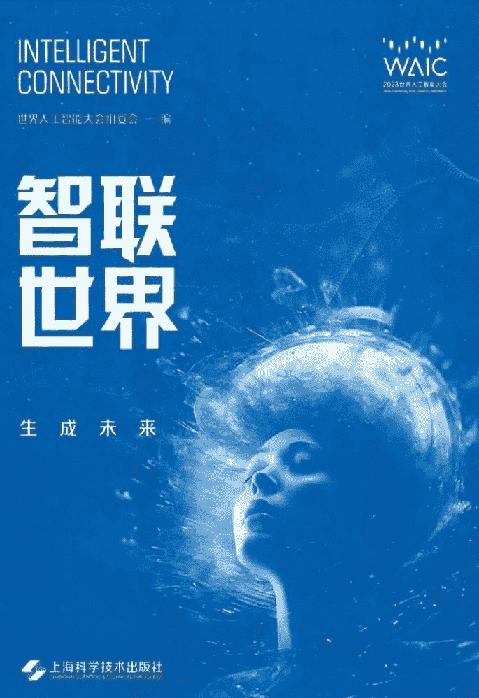

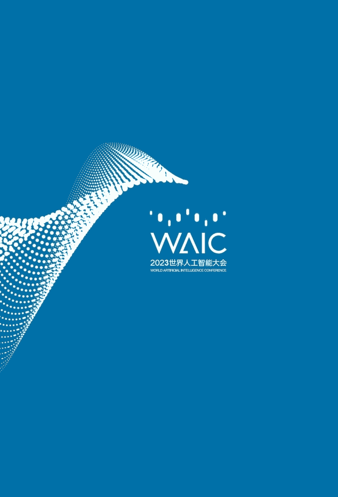

“新一代人工智能正在全球范围内蓬勃兴起，为经济社会发展注入了新动能，正在深刻改变人们的生产生活方式。”

“中国愿在人工智能领域与各国共推发展、共护安全、共享成果。”

—摘自习近平总书记致 2018 世界人工智能大会的贺信

## 前言

2023年7月6日至8日，WAIC在上海圆满落幕。本届以“智联世界 生成未来”为主题，汇聚了全球顶尖科学家、企业家、投资人与开发者，围绕产业走向展开研判。大会社聚焦前沿思想引领创新、标志性成果激发动能、沉浸式体验勾勒图景，形成了一场跨区域、通全球、聚智慧的行业盛会，在业内外引发广泛反响。

作为国际高端交流平台，WAIC已连续举办六届。大会贯彻习近平总书记关于推动新一代AI健康发展的重要指示，落实国家《新一代人工智能发展规划》，也是上海建设AI高地、集聚全球创新资源、推动技术与产业融合的重要举措。开幕式上，上海市委书记陈吉宁表示，过去五年上海坚决落实总书记指示，将AI发展作为优先战略，广聚人才、联动资源，持续强化原创策源、场景示范、制度供给与人才集聚。上海正按总书记要求，争当全国改革开放排头兵、创新发展先行者，更需要发挥AI赋能各业的引领作用与带动经济的放大效应。

为更好传播大会思想与学术成果，组委会在2023年继续推出“智联世界”系列图书。本书以2023 WAIC开幕式及全体会议嘉宾演讲为核心，围绕“生成创新 智启新篇”“技术探索 发展策源”“赋能引擎 重构未来”三大线索，全景呈现全球AI前沿洞察与最新态势。

本书希望为从业者与读者把握AI发展趋势、参与WAIC、共建上海AI高地、推动我国新一代AI健康发展提供参考。

世界人工智能大会组委会

2023年11月

## 生成创新，智启新篇

### 通用人工智能新时代 AI 创见

埃隆·马斯克

（Elon Musk）

特斯拉联合创始人兼CEO，同时担任产品架构师，亦是SpaceX创始人、CEO及CTO。在特斯拉主导产品战略，统筹弗里蒙特工厂全系纯电动车型的设计研发与制造。曾列《彭博商业周刊》2017年度全球50大影响力人物第43位，并入选《时代周刊》2018年度全球最具影响力人物。

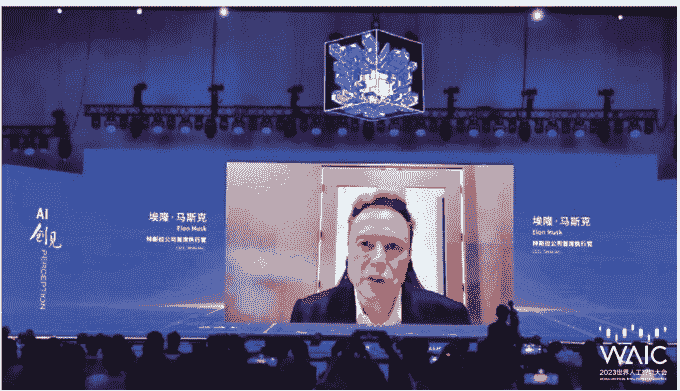

上海的朋友们，大家好！

我认为AI将在人类未来扮演决定性角色，对文明产生深远影响。我们已看到数字算力呈指数级增长，关键衡量在于比例——机器算力与人类生物算力的对比。机器算力相对人脑处理强度的比值逐年攀升，算力鸿沟在扩大。随着时间推移，人类智能在整体智能结构中的权重将逐步下降，这是一次根本性转向。当前此类转向的后果尚难以完全评估，可称得上人类历史的关键转折之一。

特斯拉Optimus人形机器人仍在研发，但机器人大规模出现的趋势不可逆。同样值得关注的是人机数量比。判断该比例很快将突破1:1，地球上机器人数量将超过人类，算力也将远超人类。这似乎是难以逆转的路径。该路径既有积极面也有风险。积极来看，我们将进入后稀缺时代，资源短缺不再存在，人们可即时获得所需。随着大量机器人参与生产，生产效率将远超人类主导模式。这是一场巨变，必须审慎对待，确保结果利好人类。

以特斯拉人形机器人为例，未来机器人数量将持续增加。Optimus现阶段智能水平有限，但足以承担无聊、重复、危险等人类不愿承担的任务，这正是目标所在。对Optimus不必过度乐观，但我们保持开放态度。

在自动驾驶领域，特斯拉有意向将技术授权给其他车企。我们认为该技术价值极高，能彻底改变枯燥的驾驶体验，属于超前突破。也可预见汽车使用率大幅提升。普通家用车每周使用约10至20小时，大部分时间停放。全自动驾驶汽车每周使用可达50至60小时，使用效率提升约5倍，在每周168小时中占比可观。特斯拉致力于提供该技术，也是我们愿对外授权FSD的原因之一。

当前自动驾驶进展如何？我们认为已非常接近无人干预状态。特斯拉在美国道路测试显示，自动驾驶极少需要人工接管。搭载最新FSD系统的特斯拉，从起点到终点几乎无需触碰控制装置。我估计2023年下半年或可实现全自动驾驶或达到4至5级。过去预测多次失准，但此次判断比以往更接近现实。

同时需对深度、通用AI保持警惕，尤其在全自动驾驶领域。有边界的AI与全面AI截然不同。全面AI难以精确定义，是在各领域都远超人类的智能形态。特斯拉未开展该方向研究，其他公司已启动。我认为这是需要审慎思考的问题。如今需要对这类通用AI进行监督监管，以确保深度AI安全。我所指的能力相当于数万甚至数百万台高性能计算机协同形成的超智慧。它拥有超越人类的能力，也伴随风险，可能带来积极未来，也可能带来负面结果。我们要努力避免消极局面，同时展望积极图景。

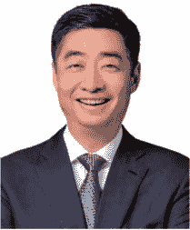

### 共赢人工智能新时代

胡厚崑

华为轮值董事长

1968年生，华中理工大学本科。1990年加入华为，曾任中国区总裁、拉美区总裁、全球销售总裁、销售与服务总裁、战略与Marketing总裁、全球网络安全与用户隐私保护委员会主席、美国华为董事长、公司副董事长、轮值CEO及人力委员会主任，现任公司副董事长、轮值董事长。

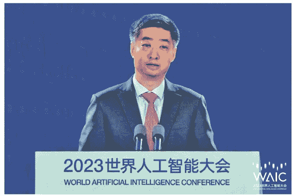

ChatGPT的出现让AI成为当前最热话题，全社会对AI的期待空前高涨。我们坚信不久将来，AI尤其是通用AI，将重塑身边一切。

对华为而言，下一步要全力推动AI落地见效。实现目标有两个关键：一是打造强有力算力底座，支撑中国AI产业；二是面向千行百业与科研，从通用大模型走向行业大模型。

算力是AI发展基础。当前中国算力获取与成本仍面临挑战。华为长期深耕算力，聚焦鲲鹏与昇腾根技术，通过架构创新、生态共建、灵活协作支撑底座建设。希望与各方共同努力，让算力不再成为瓶颈。

计算节点层面，我们推出革命性对等架构，打破传统以CPU为中心的异构计算瓶颈，提升整体带宽、降低时延，节点性能提升约30%。

数据中心层面，2019年推出昇腾AI集群，将AI数据中心当作超级计算机设计，整合云计算、存储、网络、能源优势，性能更高更可靠。目前国内最大AI计算集群——深圳鹏城云脑二期算力达1000P，规划2024年三期达16000P。在乌兰察布华为计算中心部署数千卡规模，实测集群方式同等算力下效率提升超10%。

生态对计算产业持续发展至关重要。四年前华为提出“硬件开放、软件开源、使能伙伴、发展人才”战略，坚持开放协作激活生态。四年来在产业链伙伴共同努力下，已初步构建完整计算产业生态。

硬件方面，2023年推出更多模组与板卡，30多家硬件伙伴基于昇腾AI推出100多款AI硬件产品，满足不同行业场景需求。

软件方面，坚持开源做强基础软件，为大模型创新提供全流程使能平台，支撑科研机构与企业客户，原生孵化20多个基础大模型，适配10多个业界主流大模型。目前国内大模型约一半由昇腾AI支撑，感谢选择昇腾算力的客户与机构给予信任。

中国客户算力需求多样，我们采用多种建设模式。城市算力基础设施方面，华为支持各地政府打造AI计算中心，提供普惠算力服务。目前全国已有25个城市如上海、武汉、西安等基于昇腾AI建设AI计算中心。

针对自建算力中心需求的大型企业，可帮助构建独立算力中心。中国移动、科大讯飞、南方电网等企业均在规划建设大规模算力集群，华为积极参与。

对于更多中小企业，我们在华为云提供AI算力服务，企业可快速开发应用，按需取用。

深耕算力的同时，要让AI真正走进千行百业、服务科研，还需做到两点：一是夯实基础，持续提升通用大模型能力；二是构建行业模型，将行业专有知识与大模型能力深度融合，为客户提供更专业精准解决方案。

例如询问“我是住在福田区的78岁老人，政府能提供什么补贴？”时，通用大模型会给出正确但笼统的信息，行业大模型能给出更精准更有价值答案，这是我们努力方向。

产业智能化，从遍览文献到深入现场。华为首次提出三层大模型架构。最底层基础模型学习海量基础知识，相当于遍览文献；之上针对不同行业、场景进行专项知识与经验训练，打造好用易用的行业模型与场景模型，相当于深入现场。

从遍览文献到深入现场充满挑战，关键在于做好客户及行业伙伴的行业知识与大模型的匹配，解决场景、技术、算法与数据的融合，让大模型在行业价值创造中发挥作用。

目前华为云盘古大模型已深入金融、制造、政务、电力、煤矿、医疗、铁路等10多个行业，支撑400多个业务场景AI应用落地。未来希望与更多行业伙伴携手，在更多行业落地大模型，真正走深做实。

科学智能助力科研。华为希望大模型不仅服务工厂、港口、银行等场景，也能走进实验室与研究所。

AI通过学习海量科学历史数据并将数学方程编码进大模型，可促进AI与分子动力学、流体力学、传热学、生物学等基础学科结合，发现更多科学规律，破解自然密码。

华为盘古科学计算大模型包括药物分子大模型、盘古气象大模型、海浪大模型。与科学家合作取得良好进展。如气象预报领域，盘古大模型可在数秒内完成未来1小时至7天的全球天气预报，又快又准。核心在于一是学习全球40年气象数据夯实基础，遍览文献；二是到行业中再训练，深入现场。如预测台风路径，大模型通过方程推算后需与真实历史路径校准，每次校准需算法与科学专家共同参与，不断调优以找到最佳匹配。

我们希望科学智能能为科研工作者带来新思路、新方法、新工具，为产业输入新动能。

# 开场致辞

我们非常有幸共同见证科技革命的数次浪潮，从互联网到移动化，从云计算到智能化，每一轮变革都带来深远影响。毫无疑问，通用人工智能正开启下一个黄金十年，让我们携手创新，服务好千行百业、服务好科学研究，共赢人工智能新时代。

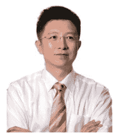

## 文心一言

### 王海峰

华为轮值董事长　百度首席技术官、深度学习技术及应用国家工程研究中心主任

博士，现任深度学习技术及应用国家工程研究中心主任，兼任中国电子学会、中国中文信息学会、中国工程师联合体副理事长等。先后负责百度搜索、百度地图、百度翻译、百度智能云等业务。世界上自然语言处理领域最具影响力的国际学术组织`ACL`的首位华人主席、`ACL`亚太分会创始主席、`ACL`会员，`IEEE`会员、`CAAI`会员及国际欧亚科学院院士等。入选“国家百千万人才工程”，被授予“有突出贡献中青年专家”称号。享受国务院政府特殊津贴。

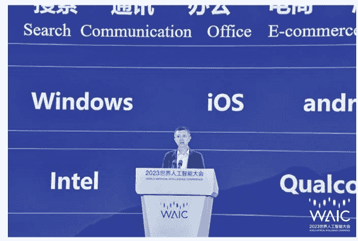

现以`大语言模型`为代表的AI技术正迅猛发展，已成为产业升级与经济增长的重要驱动力。我们深知，一份报告可以呈现AI对各行各业的广泛影响。在AI时代，信息技术本身也在发生重要变化。

传统信息技术架构通常包含应用层、操作系统层和芯片层三层，每层都有代表性公司与产品。在操作系统层面出现分化。一方面，AI基础技术以`深度学习`为核心，`深度学习`框架与平台仍是重要层次，可称为框架层；另一方面，`大模型`技术正逐步从`深度学习`中独立，成为相对独立的层次，其释放的能力与价值日益增大。

经过十多年全面布局，百度在智能时代的各技术层均有规划。芯片层面拥有`昆仑芯片`；框架层面推出中国首个完全自主可控的产业级框架与平台；模型层面拥有`文心大模型`，并在 C 端与 B 端实现多种应用。

尤其值得注意的是，框架层与模型层的布局密不可分，开发大模型时两者需密切协作、相互优化以取得更好性能与效果。

先看框架层。`飞桨`是我们打造的产业级`深度学习`开源开放平台。在此基础上开发者可开展深度学习与人工智能开发。为提升开发便捷性，我们还提供模型库与端到端开发套件等支撑。`飞桨`已吸引 750 多万名开发者加入，支撑大量企业开发各类模型，为产业发展作出贡献。我们所说的`文心大模型`正处于`飞桨`完整平台的模型层。

今天重点介绍“`文心大模型`”。我们自 2019 年起发展文心 1.0 版本，2023 年 3 月百度发布基于文心 3.0 的“`文心一言`”，目前已升级至 3.5 版本，效果显著提升。

“`文心一言`”是一个知识增强的`大语言模型`。`大语言模型`首先依赖于`预训练`的大模型，在此方面`飞桨`的优秀训练能力为“`文心一言`”开发提供有力支撑。除此之外，`大语言模型`通常还需要人类反馈的`强化学习`和提示技术。“`文心一言`”在通用技术基础上，还具备知识增强、检索增强、对话增量等独特创新，这些技术融合构成当下“`文心一言`”。

有监督的精调可理解为预训练模型在获得教师指导后的学习过程，类似学生通过练习与反馈提升效果。该过程类似人类反馈的强化学习，提示在其中发挥关键作用。正如人与人交流中善于提问者能帮助对方更好地作答，构建合理的提示词也能帮助模型更好地完成任务，提示词优化对模型表现至关重要。

我们称之为知识增强的`大语言模型`，其重要特征在于不仅能从原始无标注数据中学习，还能从知识与数据的融合中学习。人类通过观察世界获得丰富知识，更重要的是能从书本中汲取前人总结积累的知识。人类进步很大程度上依赖知识的不断总结、凝练与传承。因此知识增强技术对大语言模型的效果与效率提升至关重要。

以知识增强为设计思路搭建的体系里，训练素材并不局限于中文、英文等自然语言，还大量引入形式化语言、程序代码以及人工精标注的高质量样本。与此同时，知识图谱作为沉淀多年的结构化资源，已积累约 550 亿条事实。我们把数千亿量级的知识节点与数万亿量级的原始素材进行融合式学习，才逐步孵化出“文心一言”这一大型语言系统。

知识进入模型主要有两条路径。一方面把知识蒸馏到神经网络的权重里，成为隐式的记忆，即内化；另一方面在推理时把已学到的知识重新组合调用，完成任务输出，即外用。

对大型语言系统来说，训练完成后知识边界就被钉在某个时间点，无法自行捕捉最新变化。借助搜索引擎的实时检索能力可以补足这一短板。搜索引擎能够即时抓取互联网新信息并回传给用户，把检索结果注入模型就形成了检索增强范式。这样既大幅提升了信息的时效，也强化了答案的准确性。

对话能力是“chat”称谓的核心。百度在该方向做了大量优化，保证对话的合理性、连贯性和逻辑自洽。底层支撑包括记忆机制，能在多轮交互中保持上下文理解，以及对话规划能力，让交流更具智能感。

“文心一言”3.5 版本带来了一轮系统性升级，基座得到精进，精调技术实现创新，知识点增强被强化，逻辑推理能力被拉升，同时引入了插件机制。

依托飞桨的训练底座，迭代节奏明显加快。自适应混合变形训练、混合精度计算等技术共同推动了性能跃升。数据源的筛选与分布也在多策略优化下不断改善，进一步提升了效果与安全性。场景适配能力同样被强化，比如多类型多阶段的有监督精调，以及多层次多强度的奖励模型设计。

知识点增强的逻辑很好理解。写一份报告需要基本的写作功底，再加上提前准备的关键观点与数据。大型语言系统生成文本时也是同理，先具备语言表达基础，再借助知识增强与检索增强定位关键知识点，并将用户输入、检索到的事实与模型自身能力组合起来，才能输出更贴合场景需求的结果。

为加强数据推理与代码处理能力，还引入了逻辑知识建模等方法，进一步提升了推理与计算能力。

插件是大型语言系统生态的重要枢纽。一方面插件能充分调用系统的通用能力，使插件开发更高效；另一方面插件的执行结果可以回流给系统，让生成质量持续提升。借助插件机制，系统能够与外部组件协同，形成更丰富多元的应用形态，为用户提供更全面个性化的服务。

“文心一言”在 2023 年 3 月发布后约一个季度内，综合效果提升超过 50%。训练超大规模语言系统本就是资源与时间密集型工作，但训练效率被提升至原来的 2 倍，成本与周期显著缩短；推理速度更是提升到原有的 30 倍。

在百度内部，智能办公场景已得到广泛落地，帮助员工更高效地撰写文档、执行任务。日常沟通中，“文心一言”也发挥作用，例如在群聊收到长信息时自动生成简明摘要，帮助快速把握要点；还能记录会议纪要，辅助工程师编写代码，提升开发效率。

再看产业形态。大型模型产业面临体量庞大、训练难度高、对算力与数据需求极强的挑战。可以类比芯片行业。芯片行业有代工厂，拥有昂贵设备和完整产线，形成了复杂的工业与供应链。芯片设计公司只需把设计方案交给代工厂生产即可。大型模型产业也可能走向类似路径：生产大型模型的企业投入大量算力和数据资源，构建完善的模型平台；其他企业提出需求后，只需用少量数据做微调或场景适配即可使用。因此，产业化路径在于封装复杂的模型生产环节，通过精调与推理部署来支撑各行各业的应用。

## 智能交互新纪元：大模型产业化与展望
### 何晓冬
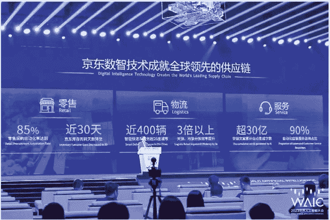
很高兴能在这里交流。我将分享京东如何推动大型模型走向产业与行业，并对未来发展做一展望。

大型模型正快速重塑技术版图，引领新一轮科技变革，尤其是人机交互方式的变革。回溯计算机发展史，人机交互经历了从起步到键盘主导、鼠标主导，再到触摸自然交互的演进。如今大型模型出现，预示着智能交互时代即将到来。人与机器的沟通将更无缝，通过语言等自然方式，让机器更好地辅助完成复杂任务。

大型模型还将重写商业模式。历史上信息与服务获取方式的每一次跃迁都带来巨量商业变革。二十年前互联网门户时代实现信息聚合，进入互联网时代；随后大数据时代借助搜索引擎实现精准匹配。如今大型模型到来，人类迈向智能交互时代，获取信息与服务的方式再次改写。这个时代不仅能满足信息需求，更关键的是 AI 能准确理解意图，直接给出答案。场景与数据，是训练出优秀大型模型的两大关键要素。

京东拥有采购、销售、健康、物流、金融、工业品等完整业务链，对行业理解深入，并沉淀了海量行业数据。

构建大型模型需要极强算力。2021 年京东组建了 A100 DGX 集群。大型模型训练耗时长，两年前我们基于深度神经学习网络，研发了自研核心技术 K-PLUG。鉴于大语言模型在行业侧的覆盖度与丰富度仍待提升，我们将行业知识注入神经网络，让模型更符合行业应用对忠实度与实用度的要求。2022 年我们在多个国际榜单中夺冠，2023 年计划加速发布千亿级大型模型，并持续聚焦行业应用。在零售、物流、政务、金融等领域引入更多行业知识，提供更优质服务。

大语言模型已在京东大规模应用，营销文案的生成量已超 30 亿次，实现自动化与智能化，效率大幅提升。例如新品上线时，把繁琐的说明书与规格自动提炼为简洁文案，让用户快速抓住产品特性。

大型模型终将走向多模态。语音与对话场景下，模型已用于机器人技术。除基础语义理解与文本生成外，还需进一步探索如何真正理解用户意图，以及如何判断用户是否说完或正在犹豫。通过大语言模型的决策能力，对话体验可以变得更流畅高效。

大型模型如何让数字人具备高表现力与高流畅度的数字交互？这里有一个案例：我的助手是一个虚拟数字人，我本人的形象也是虚拟的，对话内容、语气与语音皆为虚拟。仅需 5 分钟的形象与数据采集，就能重构数字人形象并复用到更多场景，解放大量重复劳动。电商直播已在京东落地，并由数字人呈现。

在视觉、语言与云端层面，我们正把大型模型赋能延伸到人类引以为傲的艺术创作。言犀大模型的艺术应用与今日美术馆合作，生成了“塞尚四季”。

技术突破带来应用场景快速打开。以语音对话为例，随着 AI 与人对话量增加，应用可从简单通知扩展到回访、营销等更广场景。大型模型的覆盖面将向更多行业与场景延伸，期待它为行业带来更高效率。

展望未来，我们的目标是走向真正的人工智能。相信多模态是必经之路。神经网络与注意力机制的诞生都源于对人类学习机制的洞察。新一代大型模型将继续向人类学习，通过多模态方式获取更多知识与更强推理能力，逐步迈向 AGI。

人始终是核心，所有技术最终服务于人。未来人工智能需要与人类交流，通过语言、视觉与语音实现更深交互。因此未来的 AI 必须全面理解语言、语音与多模态，才能更好地服务人类。最后期待与各位伙伴共创科技，引领美好生活。

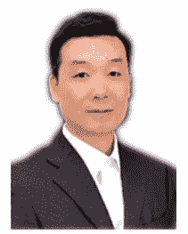
## 书生通用模型体系发布
### 乔宇
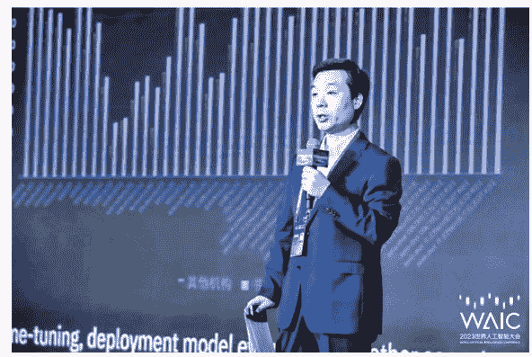
各位领导、各位来宾，大家好，我是上海人工智能实验室的乔宇。今天荣幸代表实验室发布自主研发的全新书生通用大模型体系。

上海人工智能实验室坚持以原始创新驱动技术进步、以开源开放赋能产业生态。与商汤科技合作，并联合香港中文大学、复旦大学、上海交通大学、清华大学等多所高校持续推进通用大模型研发创新。2021 年我们已发布国内首个广泛覆盖视觉任务的通用视觉模型。2022 世界人工智能大会上发布了书生 2.0，通过稀疏卷积实现架构创新，可替代 Transformer 模型，并在多项视觉任务中表现领先。今天的书生通用大模型体系完成全面演进，基座包括书生·多模态、书生·浦语、书生·天际三个基础模型，同时发布覆盖数据、预训练、微调、部署、模型、评测等全链路的开源体系。

作为新兴科研机构打造的人工智能大模型体系，书生通用大模型体系有三点特质。第一是原始创新。大型模型技术仍处高速发展期，创新是核心动力。我们的大模型技术曾获 CVPR2023 最佳论文奖，这是近 40 年来计算机视觉三大顶会最佳论文首次由中国学术机构署名全部完成。据谷歌学术最新榜单，CVPR 位列 Nature、新英格兰医学杂志、Science 之后第 4 名，在 AI 领域排名第 1。第二是性能卓越。我们在超 130 种任务上测试，结果显示整体性能处于世界领先或先进水平。该体系还在世界级竞赛与评测中斩获 28 次冠军。第三是坚持开源开放。我们将全链路向社会开放，通过开源赋能学术科研与产业应用。

当前大型模型正从语言模型向多模态模型演进，下面首先介绍书生·多模态大模型。该模型拥有 200 亿参数，由 80 亿多模态样本训练而成。我们突破了光标指令交互的限制，将光标操作视为一种模态；开发了基于语言定义的任务，让模型能执行可语言描述的任务；针对微调算力消耗问题，提出轻量级自适应微调关键技术。基于此，书生·多模态大模型实现开放世界理解、多模态交互与跨模态生成，可支持超 350 万种语义标签，语义覆盖面远超此前。

在此基础上，模型在 80 多种重要多模态与视觉任务中取得领先。过去领先的模型来自谷歌、微软、OpenAI 等机构。若把竞赛比作十项全能，书生通用大模型体系不仅总分夺冠，在单项上也多获第一。

书生·多模态大模型有哪些能力？先看它如何看图写诗。选取知名画家张大千的山水画《湖山清夏图》，输入模型后请其创作一首七言绝句。

书生·多模态大模型：山峰高耸入云天，云雾缭绕自成烟。忘身物外心自适，静听松涛入画眠。

大家可以给这首诗打个分。追问其创作思路时，模型给出解释：
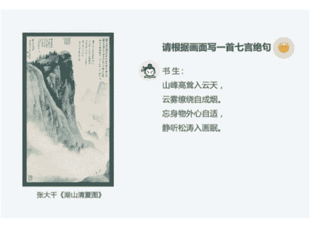
# 书生·多模态大模型
书生 · 多模态大模型：首先，根据图片确定描绘的是山水清幽的自然景色画面；其次，从画面中寻找能够表达出诗人思想情感的元素，如山峰高耸、云雾缭绕等；接着可以根据元素构思出诗句；然后根据诗句的韵律和格律进行完善。特别地，诗的第四句借鉴了唐代诗人韦庄的名句“春水碧于天，画船听雨眠”，以此增加诗的韵味。

看来书生·多模态大模型一登场，就展现出不错的中国文化素养。

除了作诗，图片编辑也是常见需求。用传统工具往往繁琐，那能否用一句话让书生·多模态大模型来完成创作？提供两个案例。左侧是一张带花的图片，局部有斑驳，把图片拖拽到对应区域后输入指令：在树枝上画几只鸟，模型即可自动补上鸟，生成一幅花鸟图。右侧是一张自然景观图，点击并输入语言指令：请把这个塔替换成埃菲尔铁塔，模型便可轻松完成替换。夏天去法国巴黎旅行未必方便，但想轻松“拍摄”几张打卡照时，书生·多模态大模型可以快速实现。

# 书生·浦语大模型
语言大模型是本轮浪潮的主力军。上海人工智能实验室的全新书生·浦语大模型是国内首个正式发布的支持 8K 语境长度的千亿参数级多语种大模型。训练语料达 18 000 亿词元，约等于 18 000 亿个单词，其中包含多语种高质量语料。这是什么概念？一个人一生能听看的词汇量约 10 亿，而该模型的词汇量相当于人类水平 1000 倍以上。模型支持 8K 语境长度，可一次性阅读 8000 个单词。与 6 月发布时相比，掌握语种已拓展至 20 种，具备工具调用、更优对齐、数理推理等能力。

## 学术评测表现
学科综合应用能力突出。我们选取加州大学伯克利分校等构建的 MMLU、微软研究院的 AGIEval、面向中文模型的 C-Eval、高考题评测集 GaoKao 等进行测试。对照组为 OpenAI 的 ChatGPT 与开源领域知名的 LLaMA-65B。书生·浦语大模型在几乎所有评测中全面超越 LLaMA，在 AGIEval、C-Eval 及高考测试中明显优于 ChatGPT，在两项中国高考评测中优势更明显，显示出对国内高考的适配优势。涵盖 57 个学科的 MMLU 英文多学科评测中，其表现与 ChatGPT 不相上下。

## 综合能力对比
除考试外，多维能力也均衡。涵盖语言、知识、理解、推理等维度，选取 43 个经典任务进行评测。在 43 项任务中，书生·浦语大模型几乎全面优于 LLaMA，在 35 项任务中超过 ChatGPT，综合能力相当亮眼。

## 多语创作与表达力
下一步测试让模型用 6 种语言为 2023 世界人工智能大会撰写嘉宾欢迎致辞，任务轻松完成。再提高难度，用现代诗歌手法撰写开幕致辞，结果中规中矩，有一定水准。

在文本创作这块，浦语家族的表现相当亮眼，对复杂语境和语法细节的捕捉很精准。比如让它按AABC格式列成语并造句释义，它立刻给出五条，其中最后一条踽踽独行，初看像是生造词，查证后才发现是正典词汇，意思为独自行走、形单影只。

### 生产力型生成助手
大模型正从演示工具转向日常效率伙伴。做表格、写材料的需求很常见。有一次让它用表格呈现CVPR 2018到2022年的投稿量、录用量、同比增幅与录取比例，回车后整张数据干净的表格就出来了。这背后体现了三点：一是靠海量学习记忆了CVPR录取等专业知识；二是能理解同比增速、录用率等概念并完成计算；三是按用户习惯直接给出表格这类友好格式。这类特质让它有望在学习、工作和生活中起到效率放大作用。

### 数理推理与计算
在数理题上也不弱。题目是：从2名女生4名男生里挑选参赛者，至少含1名女生，有多少种排列组合。答案16种，且解题思路写得清晰好懂。后续会继续强化数理和推理能力，目标是让它成为解决复杂数理问题的可靠伙伴。

# 专家介绍

## 林达华

林达华

上海人工智能实验室教授

该实验室的领军科学家、香港中文大学信息工程系副教授、交叉学科人工智能研究所所长，2012年于麻省理工学院获计算机科学博士学位。研究覆盖计算机视觉、深度学习以及通用大模型等方向，在顶刊顶会上发表论文两百余篇，被引超3.1万次。发起的OpenMMLab已成为深度学习时代影响力最大的视觉算法开源体系之一，曾多次担任重要国际会议领域主席及期刊编委。

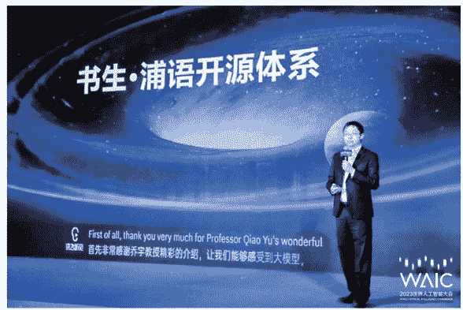

# 书生·浦语开源体系发布

先谢谢乔宇老师的精彩分享，让人直观感受到书生通用系统带来的惊喜。当前正处技术变革浪潮，能参与推动前行深感荣幸。大模型时代才刚刚起步，创新仍是核心驱动，但研发对数据与算力的消耗巨大，投入远超多数团队承受范围。

大模型时代如何保持创新？近两个月国内外围绕大模型涌现很多振奋尝试，比如LangChain、AutoGPT等，它们在GPT-4、ChatGPT、LLaMA基础上延伸出许多新可能。立足国内，支撑创新的公共底座尤为关键。今天代表实验室正式公布书生·浦语开源体系，希望以高质量开源助力创新赋能产业。

## 核心系统与工具调用
体系的核心是轻量版，参数约70亿。规模虽非最大，但在性能与成本间取得不错平衡。像此前介绍的浦语大模型一样，它同样支持8K上下文窗口，在长文本处理与复杂推理上能力较强。该版本基于万亿级高质量预训练语料训练。更关键的是加入了通用工具调用能力，开发者可编程为系统注入新技能，使其借助外部能力解决语言本身难以完成的任务，例如复杂的数学推理。

## 开源质量对标
开源看重质量。在近50个评测集上，将计划开源的InternLM-7B与当前公开的同量级开源系统做了对比。结果显示，InternLM-7B在绝大多数评测中不仅超过了广受喜爱的国外系统LLaMA-7B，还全面领先国内近期表现不错的开源系统，如清华与智谱的ChatGLM2、百川智能的百川大模型。

把评测结果归纳为学科综合、语言、知识、理解、推理五个维度。LLaMA-7B在知识类尚可，但在理解、推理和学科综合上仍有明显差距。近两个月国内多家机构发布的开源系统在不同维度各有进展。若把国内单项最好成绩画成雷达图，除知识外，其余维度都有系统在单项上明显超过LLaMA-7B。而浦语70亿参数开源系统在全部维度上均超过LLaMA-7B，并且每一项都高于当前国内最好的开源系统。

要发挥价值，系统必须能在真实场景落地。除系统本身，同时开源了全链路工具体系，覆盖数据、预训练、微调、部署、评测五大环节，力求让创新者在大模型基础上高效研发。

## 全链条工具体系

### 数据体系
首先是数据。2022世界人工智能大会上推出的OpenDataLab开放数据平台，经过一年发展已覆盖超30个模态、超5400个数据集，提供超过万亿token自然语言语料、60亿张图像及其他模态数据。平台还提供灵活检索、高速下载、智能标注、高效采集等工具，让多模态数据触手可及。

### 训练框架
第二环节是训练。此次开源的高效训练框架InternLM-Train具备很强的数据吞吐，支持从8卡到千卡规模的高效训练，在千卡规模下加速效率超90%。通过原创的Hybrid Zero技术，相较主流框架提速超50%，同时兼容所有主流系统格式，开箱即用，送入数据即可在基座上快速产出新系统。

在512卡配置下，InternLM-Train可达到每秒每个GPU吞吐3800 token以上，而微软与英伟达联合开发的Megatron Turing-NLG框架仅约1700 token。随着卡数增加，InternLM-Train线性加速保持平稳，充分发挥超大规模集群性能，而Megatron Turing-NLG在千卡时加速效率已降至65%。

### 微调工具
训练完成后是微调。浦语开源体系提供全流程微调工具，支持监督微调形成数据与系统闭环，也支持基于人类反馈的强化学习。强化学习框架经过高度优化，算力利用充分，是该体系最具特色的能力。

传统语言系统完全依赖语言能力，遇到数学推理等复杂问题容易出错。微调工具体系支持符号计算和工具调用，可编程引入外部工具，当语言无法直接给出答案时，系统能自行编写程序求解并返回，形成完整准确的答案。通过可编程通用工具调用，系统既能完成基础对话，也能借助工具处理更复杂问题。体系还支持多种灵活组合的工具调用框架，如AutoGPT等，实现迭代调用流程。

总体上，微调体系包括监督微调、基于人类反馈的强化学习、可编程工具调用与数理逻辑演算，以及多样化的流程调用形态。

### 部署框架
系统落地需要部署。开放体系提供完整部署框架，实现系统轻量化。量化后系统权重可压缩至75%，并以极致性能提供推理服务。在不同配置下，该推理框架性能超过HuggingFace、DeepSpeed、LLaMA等主流方案。

### 评测体系
最后是评测。为服务人类使用前必须先做全面评估。为此上线OpenCompass，面向语言系统的全面、开放、客观评测体系，涵盖学科、语言、知识、理解、推理、安全六大维度，50余个评测集，30万道题目。可对国内外主流开源系统和API系统做全面评价，支持结果复现，具备分布式高效评测能力，维度覆盖完整且方式多样。

# 书生·天际 LandMark

此前介绍了书生通用系统体系的两大模型：书生·多模态大模型，可处理图像、视频和文本；书生·浦语大模型，可生成文本并对话。这只是大模型能力的冰山一角，它还能呈现一个充满想象的世界。

接下来介绍由实验室联合香港中文大学和上海市测绘院研发的世界首个城市级NeRF实景三维大模型。NeRF是新型三维光场建模技术，2020年3月由谷歌首次提出并获ECCV2020最佳论文提名。最初仅用于苹果大小的物体建模，团队认为其潜力远不止于此。经过一年半探索，2021年12月10日首次提出CityNeRF，将光场建模从物体级拓展到城市级，建筑建模高度超过2万米，世界首次实现从物体到城市的跨越。此后不久，CMU和谷歌才相继发布城市级NeRF成果。

基于核心技术不断提升扩展性与灵活性，今天呈现书生·天际LandMark，世界首个NeRF三维实景大模型。

其背后是第二代CityNeRF技术City GridNeRF。通过网络端与广场端双支结构实现横向扩展，建模范围从几百平方米拓展到近乎无限。配合算法、系统、算子和交互的端到端优化，最终形成2000亿参数、覆盖100平方公里的三维实景大模型，支持4K高清渲染，细节全部4K建模，渲染效率提升1000倍。它不仅是重建工具，还具备丰富编辑能力，可对建筑进行编辑和风格化处理。

书生·天际支持纯高清4K区域渲染，可动态调整光影模拟晴天、阴天等天气，也能在空地凭空搭建新高楼灵活编辑城市。以武康大楼为例，可通过风格化变换呈现早晨、黄昏、午夜、秋季等不同时空。更炫酷的功能是，对上海中华艺术宫的每个部位进行全面变换，支持整体或分层旋转，为城市级AIGC提供技术可能。这就是世界首个千亿级参数NeRF三维实景大模型——书生·天际LandMark。我们希望以新技术为城市空间注入想象力与创新可能。

# 行业应用

技术突破的价值在于服务生活与生产。该实验室不仅做原始创新，也推动技术在各行业落地。

## 自动驾驶
自动驾驶被誉为人工智能皇冠上的明珠，是落地场景之一。过往研发中感知、预测、规划等环节各自独立，难以通过系统协同提升性能，很快遇到瓶颈。

实验室联合武汉大学和商汤科技研发自动驾驶通用大模型UniAD，这是首个感知决策一体化端到端的自动驾驶大模型。它将视觉特征提取与感知、预测、规划统一在一个框架下，是世界首个全栈端到端自动驾驶系统，具备可解释性和安全性，并在各任务上大幅提升性能，为全自动驾驶迈进关键一步。该成果获CVPR2023最佳论文奖，是改革开放以来首篇由中国研究机构全部完成并获此殊荣的论文，也是计算机视觉顶会首次授予自动驾驶领域的最佳论文，组委会认为它开创了自动驾驶新时代。

## 气象预报
在气象领域，实验室与上海中心气象台及多所高校科研机构联合推出预报大模型“风乌”。历史上首次将有效中期天气预报天数提升至10天以上，超过谷歌DeepMind发布的GraphCast的9.5天。过去每10年预报有效期提升约1天，团队半年内实现10天突破。训练效率极高，仅需30秒即可生成未来10天全球高精度预报，比传统系统快超1000倍。

# 大模型发展研讨纪要

## 医疗多模态基础模型与决策智能
医疗方面，实验室联合多家顶尖科研机构、高校和医院推出医疗多模态基础模型群并开源，命名为“OpenMEDLab 浦医”。该模型群具有5G特点：开创性Ground-breaking、优越性Greatness、普适性/泛化性Generalization、巨量性Gigantic、指导性Guidance，助力我国医疗智慧化转型。落地工作已全面展开，与广州实验室、上海交通大学、瑞金医院、新华医院、郑州大学第一附属医院等机构合作，将大模型技术应用于问诊、咨询等环节并取得良好效果。

大模型不仅用于生成和感知，还能做决策与控制。《我的世界》是全球热门游戏，解锁宝藏需要复杂操作。2022年6月，OpenAI以VPT方法尝试攻关，仅解锁200多个宝藏中的14个；半年后DeepMind提升至16个，可见难度极高。

2023年5月25日，我们团队与英伟达同期发布游戏大模型。英伟达模型解锁63个宝藏，而我们解锁全部262个宝藏并通关。OpenAI一年前开创赛道仅14个，我们一年后实现全解锁，彰显了大模型与决策智能结合的重大突破，也体现了人工智能的快速发展。

## 发布回顾
今天共发布3款大模型。书生·多模态大模型拥有200亿参数，支持理解350万语义标签，在80多种任务上达到世界领先。书生·浦语大模型是国内首个正式发布的千亿参数、支持8K上下文长度的语言大模型，在多项任务上超越ChatGPT，并开源轻量级版本，在同量级对比中达到国际领先水平。

# 数字空间的城市级再造

我们正把大模型的边界从语言与多模态推向更广阔的物理世界，并发布了`书生 · 天际大模型`。这是一款开创城市尺度`NeRF`的尝试，参数量约两千亿，可在约百平方公里范围完成4K级精细建模，为城市空间赋予新的想象。依托这一突破，我们同步对外开放多套核心开源组件，构建起覆盖数据采集、预训练、微调、部署与评测的完整开源链路，以高质量开源支持创新与产业化。

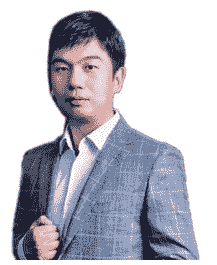

## 创想对话 · 智变新局

### 徐立
商汤科技董事长兼首席执行官
联合创立商汤后主导建设自主研发的深度学习超算中心及亚洲规模领先的AI研发基地。主导智慧城市、智能手机、智慧医疗、无人驾驶等多赛道的技术落地，推动与高通、本田等企业的战略协同，并促成超1100家客户完成智能化升级。

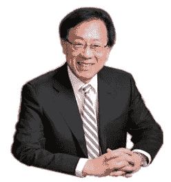
### 姚期智
图灵奖获得者、中国科学院院士、清华大学交叉信息研究院院长
国际知名计算机科学家，2000年图灵奖、2021年京都奖得主。曾在MIT、斯坦福、伯克利、普林斯顿任教，2004年回清华。2005年创办姚班，2011年创办交叉信息研究院与量子信息中心。2018至2020年相继发起南京图灵、西安交叉、上海期智三地机构，推动AI科技成果转化。

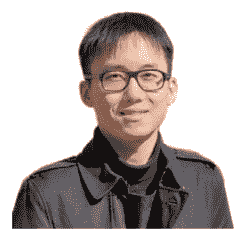
### 潘新钢
南洋理工大学计算机科学与工程学院助理教授
现任南洋理工助理教授。学士就读于清华，博士毕业于香港中文大学MMLAB，跟随汤晓鸥。曾在马克斯普朗克计算机科学研究所做博士后，研究方向聚焦生成式AI。

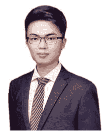
### 杨植麟
清华大学交叉信息研究院助理教授、`Moonshot AI`创始人
清华本科、卡内基梅隆博士。曾在Google Brain与Meta AI从事研究。关注自然语言理解生成、大规模预训练、零样本与多模态等。Google Scholar引用超1.8万次，相关工作为NeurIPS 2019与ACL 2019高引用论文之一，主导贡献包括`XLNet`、`Transformer—XL`、`HotpotQA`、`盘古`、`悟道—文汇`、`P—Tuning`等。获福布斯亚洲30 under 30、NVIDIA先锋研究奖、智源青年科学家、WAIC云帆奖璀璨明星等。

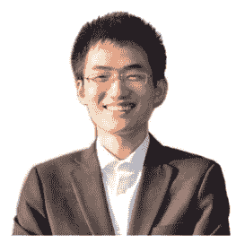
### 袁洋
清华大学交叉信息研究院助理教授
清华交叉信息学院助理教授。2012年北大计算机系毕业，2018年获康奈尔大学计算机博士，师从Robert Kleinberg。2018—2019年在MIT大数据科学学院博士后。研究聚焦智能医疗、AI基础理论与范畴论应用。

### 主持人
徐立 商汤科技董事长兼首席执行官

### 嘉宾
姚期智 图灵奖获得者、中国科学院院士、清华大学交叉信息研究院院长
潘新钢 南洋理工大学计算机学院与工程学院助理教授
杨植麟 清华大学交叉信息研究院助理教授、`Moonshot AI`创始人
袁洋 清华大学交叉信息研究院助理教授

## 强化学习提速数百倍的突破

徐立：姚院士既是图灵奖得主也是交叉信息研究院的创建者。大模型发展极快，您是否看到基础理论的实质性进展？未来理论会如何演进？

姚期智：团队中高阳老师一年多前对一个关键算法实现突破，国际关注度很高。他基本把主流强化学习训练效率提升了数百倍。对具备视觉听觉等多感知能力的智能机器人，在复杂环境中快速习得新技能意义重大。过去学会一项新能力需数月，该工作缩短至数小时，将深刻影响机器人发展。

该进展兼具实用与理论价值。近六七年，AI思想界对强化学习路线是否可行长期争论，高阳的工作让天平明显倾斜。该方向仍需长期完善。值得注意的是，`OpenAI`联合创始人近期将此工作列为近年亮点之一。

## 多模态补全是落地的关键路径

徐立：强化学习在具身智能中前景可期。请教袁洋老师，兼做大模型与智能医疗研究的您如何看交叉学科的作用？

袁洋：市场对大模型的期待是跨界落地。多模态是核心，但现阶段理解偏粗，常被等同于图文触觉温度等感知。要落地到行业，需要更细的思考。

例如文本生成图片时，用户描述一只狗，模型可能姿态不符。这时用鼠标拖动调整姿态，就是一种新模态。用户可更自由精确地表达意图，这类交互在实际产品中价值很高。

在医疗、法律、教育等专业场景，我们不只喂文本，更要解决核心专业问题。需深入行业找准关键痛点，并明确所需数据类型，我称之为模态补全。配合充足数据与模态对齐，可大幅增强模型能力，更好解决交叉难题。

## 大语言模型需系统性改进

徐立：模态补齐对后续进展帮助很大。杨植麟被视作大模型早期从业者，如今应用广泛但幻觉等问题仍在，使用中有哪些难点与突破方向？

杨植麟：大模型仍有未解难题，可控性与幻觉是其一，模型也难以像科学家那样原创。底层产品开发仍有挑战。

不能头痛医头，更应抽象共性问题，从本质解决。大模型通用，需举一反三。更根本的路径是规模化与高效压缩，例如更好的分布式框架如`MOE`，或更强的长上下文支持，实现算力更优分配。此类方法能从根上缓解AI局限。

## GAN与扩散模型的取舍与融合

徐立：从理论找解法。今天背景由算法生成，潘新钢的`DragGAN`广受关注。请问在`GAN`与扩散模型间如何权衡？后续生成有哪些延展？

潘新钢：`GAN`与扩散是当下图像生成的两大主流，近期扩散势头更强。两者在框架与优化目标上有三点差异。

其一，性能与效率。扩散生成需更大算力，训练与迭代耗时高于`GAN`。高成本换来更高质量与多样性，且不受`GAN`固有缺陷制约。资源充足时，扩散在真实感与多样性上占优；算力受限时，`GAN`仍是务实选择。

其二，隐空间。`GAN`把紧凑潜向量映射到图像，扩散则是对与图像分辨率相当的逐步去噪图进行映射。实践中扩散对内容的影响更随机、结构性弱。`GAN`更关注高维数据结构，能有效编辑属性如动物姿态，这也是我们选用`GAN`做编辑的原因。扩散的拓展仍值得探索。

其三，空间连续性。扩散的图像空间多不连续，`GAN`则非常连续自然。编辑时扩散易出现跳变，`GAN`呈现流畅过渡如动画。未来融合两者优势是很有趣的研究方向。

## 大模型垂直落地的下一个方向

徐立：`GAN`在连续交互有优势，扩散在成像质量更强，期待融合。请问大语言模型未来在哪个垂直领域可能更大突破？

姚期智：可预见，随着模型成熟，诸多文书类工作将被机器承担，这是明确方向。

袁洋：我看好医疗。不仅因自身研究背景，也因为大模型本质是预训练，即数据及其关系。医疗里关系复杂，如患者与症状、药物与疗效，人类难以完全把握，模型或更擅长挖掘关联。

杨植麟：一个重要场景是模型未来可能具备类人类的共享记忆。当前使用仍需反复提供上下文，最近已有通过录屏记录人类所见再传给AI的产品，为个人化使用打开想象空间。

潘新钢：我关注视觉生成，图像生成已显著进步。未来视频与三维内容生成前景广阔，将帮助设计师、艺术家、动画师、影视特效师更高效创作高质量作品。

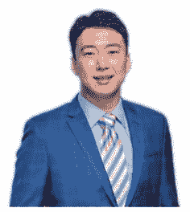

## 生成式AI驱动产业深度智联

### 侯阳
微软全球资深副总裁、微软大中华区董事长兼首席执行官
在生态建设与本地市场战略方面具备前瞻视野，擅长商业运营、产品优化、市场销售及伙伴关系管理，善于平衡战略思考与高效执行。2021年3月加入微软，负责大中华区战略规划、销售与市场运营，推动大中华区持续成为微软全球最具创新与活力的市场之一。

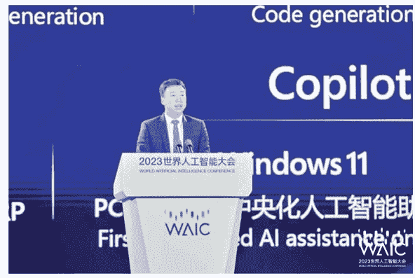
本届世界人工智能大会主题为“智联世界，生成未来”。借此机会分享微软在拓展生成式AI生态、加速产业智联方面的实践与思考。

AI作为科研课题始于1956年，已走近70年。去年底`ChatGPT`爆红使大模型与`AIGC`似乎一夜爆发。对微软而言，这并非偶然，而是数十年科研积累与算力投入共同作用的结果。

`OpenAI` `ChatGPT`的突破所依赖的基础设施与算力来自微软智能云。自2019年起微软与`OpenAI`深度合作，为大语言模型研究提供海量云资源，双方目标一致，即打造造福企业与消费者的AI。

今年1月达沃斯论坛上，微软CEO表示AI黄金时代已至，智能云由此进入加速迭代期，将最新AI技术与企业级云服务深度融合，助力企业在数字化转型中实现数智融合。

为此推出`Azure OpenAI`企业版服务，涵盖`GPT4`与企业级`ChatGPT`等五大模型，支持客户构建定制化智能服务。同时围绕`Microsoft 365`办公、`Dynamics 365`商业应用、`GitHub`开源开发、数字安全与Windows体验，推出由AI驱动的`Copilot`智能副驾系列。

用户可用自然语言提出需求，`Copilot`即可高效执行，如快速编写代码或根据提纲生成图文并茂的PPT。这些场景已在微软内部落地。`Azure OpenAI`企业服务上线数月已获全球超4500家企业认可，并在制造、零售、金融等行业生产环境中实践。`GitHub Copilot`推出一年半，已有全球超100万开发者使用，近半代码由其辅助，编程效率提升超50%。

从全球客户实践看，企业数字化热情与市场对新一代生成式AI的需求都在增强。微软持续加大投入，推动普及。

今年5月微软全球开发者大会发布50余项生成式AI相关新技术与服务。其中最重要的是向全球开发者开放`Copilot`智能副驾与`Plugins`插件扩展体系，让开发者、伙伴与企业用户抓住创新机遇，打造全新智能应用。

`Plugins`采用与`OpenAI`一致的技术标准，可在第三方应用、客户场景与生成式AI间建立安全可靠连接。通过`Plugins`接入实时信息流与多元服务，AI系统可获得更专业的计算能力，创造更丰富、更便捷、更准确的对话式智能副驾体验。预计在`Microsoft 365 Copilot`正式发布时将提供超1000种`Plugins`供选用。未来开发者与伙伴还能自主基于这些接口打造更多独具特色的智能副驾创新应用。

# 世界人工智能大会演讲集
基于自然语言对话的新一代智能交互应用，将开启更精彩的数字世界。

微软坚信未来每家公司都需要驾驭数字技术的能力。随着生成式AI潜力释放，每个应用都将由AI驱动。技术突破为各行业带来创新机遇与挑战，也促使我们思考如何以AI提升企业的创造力与竞争力。

在实现突破的同时，微软关注如何将成果转化为生产力，致力于把生成式AI与产业需求结合，加速产业升级与创新。

基于近期全球客户的产业智能化方案，我们总结出六大重点应用场景：优化制造与能源供应链韧性、普及预测性维护、提升智能驾驶体验、革新零售电商智能客服、实现互动式搜索，以及在游戏中构建栩栩如生NPC、生成无限剧情与拟真对白。

金融行业可实时获取市场行情分析报告，更早发现并管控交易风险。生命科学领域可提升临床试验数据分析能力，加速药物疫苗研发，实现更精准的医疗影像识别与诊断。教育领域可为学生提供更具启发性、交互性、定制化且不受地域限制的探索式学习，培养适应未来、具备创造力与终身学习能力的人才。

随着生成式AI加速产业融合，未来数月将涌现更多充满想象的应用场景。发展过程中安全风险的担忧不可避免。微软始终恪守打造负责任AI的六大原则，严格遵守数据隐私与安全合规要求，并倡导全球科技企业通过交流合作形成产业共识，确保AI技术能负责任地造福全人类。

在技术迭代驱动的新创新周期面前，微软在中国将结合自身技术积累与资源优势，加深对本土生态的培育。我们与全国各地的企业、机构和合作伙伴保持常态化互动，持续拓展技术交流与业务协同，不断发掘数字智能在各行业的应用空间，推动产业向智能化与数字化方向演进，以更积极的姿态贡献力量。

生成式AI的黄金窗口已经打开，微软将持续加码投入，挖掘科技潜能，为全球个人与组织创造更具价值的成果。

## 中外联动 共绘智能新版图

克里斯蒂安·贝西埃

（Christian Bessiere）

国际人工智能联合会议（IJCAI）2021—2023 理事长、法国国家科学研究中心（CNRS）研究主任

1992年获计算机科学博士学位，现任法国国家科研中心研究主任。2007至2010年曾担任蒙彼利埃大学计算机科学、机器人与微电子实验室计算机系副主任，2006年当选欧洲人工智能协会会员。

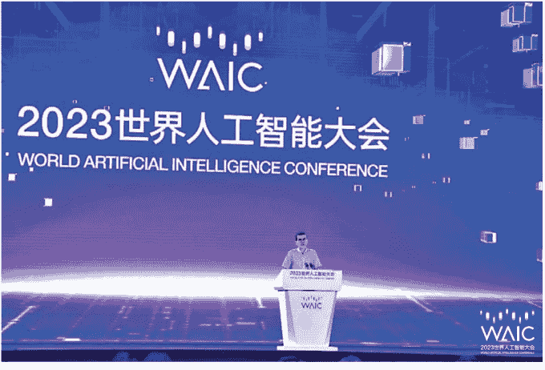

朋友们好，我是来自法国国家科研中心的克里斯蒂安·贝西埃，很荣幸受邀出席2023世界人工智能大会开幕式，感谢主办方的邀请。我同时担任国际人工智能联合会的理事长，IJCAI是覆盖人工智能多领域的重要国际会议。

中国与国际人工智能联合会的协作愈发紧密，中国已成为人工智能论文投稿量领先的国家之一，令人振奋。这样的合作让IJCAI与中国AI社区的交流更为深入。上海人工智能行业协会与IJCAI签署合作协议，共同设立了IJCAI中国办公室，在其推动下举办了一系列论坛与活动。

未来中国研究人员将有更多展示成果的平台。我们的活动吸引众多专家聚沪，分享前沿进展并探讨合作。IJCAI理事会也提出多项倡议，积极参与中国人工智能发展。IJCAI与上海、上海人工智能协会之间已形成稳固的协作关系。

特别值得关注的是，2024年7月环太平洋国际人工智能会议将再度在上海举办，这是十年内第二次在大陆举行，上一次是十年前北京。本届预计征集4000至6000篇论文，涵盖计算智能、算法创新等前沿方向。我们近期聚焦于人工智能如何更好地服务人类，并将组织多场研讨会讨论趋势与新型商业模式。此外还将安排机器人竞赛和展览，多家企业届时参展并与未来AI人才互动。

2023世界人工智能大会筹备充分、议程丰富，办得很圆满。我相信本次会议一定会取得巨大成功，期待明年在沪的环太平洋会议再聚，相信2024年的盛会将在中国顺利召开，开启合作新篇章。

## 深耕技术 引领产业新动能

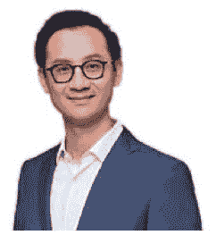

### 专属行业大模型 驱动产业跃迁新周期

汤道生

腾讯集团高级执行副总裁、云与智慧产业事业群首席执行官

美国密歇根大学计算机工程学士、斯坦福大学电子工程硕士。2018年起带领腾讯云与智慧产业事业群推进云与智慧产业互联网战略，兼管广告营销服务。秉持“用户为本，科技向善”，深耕交通、零售、医疗、教育、金融、工业等领域，助力行业数字化转型升级。

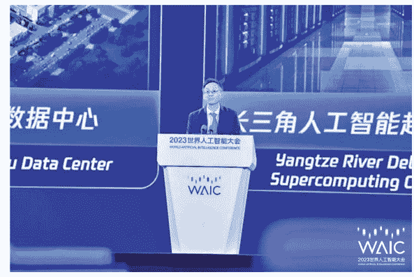

各位来宾、媒体朋友，下午好。

很高兴连续第五年参加世界人工智能大会。过去五年，上海AI高地建设成果显著。腾讯在青浦的数据中心与松江的超算中心已投产数万台服务器，并在上海设立AI实验室，全球累计获得逾1600项专利。位于上海的科恩安全实验室在AI安全领域达到国际领先，被誉为中国网络安全的“梦之队”。

过去五年，腾讯AI技术与产品已落地上百个行业，承担金融客服、虚拟主播等角色，提供个性化服务。工业AI质检已应用于多条制造产线，提升良品率并降本增效。AI游戏引擎结合南航自研虚像显示技术，可生成虚拟飞行环境，为民航飞行员提供高效安全的训练。

近几个月，机器学习与生成式AI发展迅猛，语言理解与推理能力明显增强，能依据提示生成完整段落、精美图像、视频乃至代码，成为更强大的个人助手。许多企业既兴奋又焦虑，希望拥抱技术提升生产力与管理水平。但通用大模型虽强，却难以解决企业的具体痛点，例如产业场景下的可靠性、数据与知识产权保护、隐私安全及使用成本等。

在需求持续变化的背景下，构建专属行业大模型往往是更优选择，借助高校与专业工具不断迭代以适应变化。

其一，行业大模型能更精准高效地服务用户。通用大模型基于公开文献与网络信息训练，易混入错误、谣言与偏见，专业知识与行业数据有限，针对性与精准度不足，输出偏宽泛。虽然整体水平在提升，但策略近似“大海煮沸”，缺乏聚焦。通用模型可解决80%的通用场景，却未必满足企业的特定需求。企业提供的专业服务容错率低，错误信息可能带来法律风险与信任危机。因此，企业可基于专业知识与数据训练行业大模型，结合自有知识库精调，形成专属模型，提供更贴合场景的智能服务。该类模型参数更少，训练推理成本更低，优化也更便捷。

其二，专属模型有助于保障数据安全。大模型落地需要企业自身数据，若保护不当易导致核心敏感信息泄露。行业大模型与开发工具可通过私有化部署确保训练安全，避免员工操作时误泄敏感数据。若面向用户服务，用户反馈数据也能用于迭代提升体验。

其三，借助高效平台工具实现低成本持续优化。产业落地是系统工程，涉及数据处理、算法构建、模型部署等环节，环环相扣。模型并非一次性部署就结束，需随新数据不断调整，贴合市场与用户变化。这要求系统化、工程化的工具来管理数据与标签，并持续测试迭代。

基于上述思考，腾讯正式发布MaaS服务全景图，为金融、文旅、传媒、教育等十个行业提供五十多个解决方案。在这些能力模型之上，叠加自有场景数据即可快速生成专属模型。私有化部署、权限管控、数据加密等措施也帮助用户安心使用数据。

我们还推出基于腾讯云TI平台的行业精调方案，提供模型调用、数据与标签使用的一站式服务。例如与国内头部在线旅游公司合作，基于文旅大模型打造机器人客服。通用大模型仅能给出笼统的景点介绍，经行业大模型结合企业专业数据精调后，机器人可给出更精准详细的交通、景点、酒店规划，甚至提供预订链接与优惠券，提升体验与转化。

同时，行业大模型能力已融入腾讯企业级应用。新一代腾讯企点智能客服通过行业模型精调实现更人性化体验。借助企点分析平台，销售人员可用自然语言提问完成精准商业分析，无需学习复杂软件或制作看板。

我们的数智人也融入AI生成算法，提升数字形象复刻效率。仅需三分钟真人口播视频，结合平台多模态处理能力即可实时建模生成高清人像，24小时内可制作出近似真人的数智人，并大幅降低成本。

随着大语言模型发展，智能化进程不断推进。我们坚信AI的根本目标是服务产业、满足用户需求。腾讯将与各方携手，以优质模型与强劲算力，让企业宝贵数据高效发挥价值，助力产业创新发展。

谢谢大家！

### 开源为核 Stable Diffusion 的创新启示

伊马德·莫斯塔克

（Emad Mostaque）

Stability AI创始人兼首席执行官

致力于以AI激发人类潜能，曾领导多个与多边机构及政府合作的技术项目，担任过对冲基金经理与自闭症研究员。

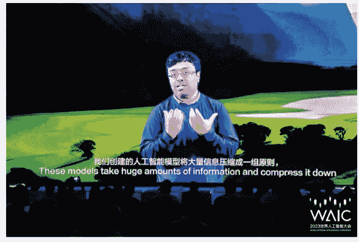

大家好，我是Stability AI首席执行官伊马德·莫斯塔克。Stability AI总部位于英国，在全球设有办公室，愿景是构建为全世界公民服务的人工智能，让每个人都能参与。我们专注开源AI，希望人人皆可使用。

公司因Stable Diffusion模型而知名，这是全球领先的图像生成模型之一。我们还打造了大规模语言模型、代码模型、蛋白质折叠模型等，这些模型将成为激发人类潜力的基石。我们的理念不是让大家使用单一封闭的AI，而是拥有开放、属于自己的AI，反映公司的文化与自我。

这很重要，因为生成式AI与传统AI不同。传统AI需要大量数据用于广告定向或预测下一步。我们创建的模型将海量信息压缩为一组原则，从而讲出更有意义的故事。

以Stable Diffusion为例，它在全球顶级超算之一上训练，用十万GB图像压缩成2GB文件。输入文字即可创造想象中的任何内容。如今的语言模型包含数万亿词，却仅需几个GB。

我们认为，模型被不断使用时，开放会加速创新。Stable Diffusion问世三个月后，开发者兴趣以GitHub Star计已超过比特币与以太坊总和，而后者用了十年才达到该水平。整个生态系统的成长速度超过Linux等优秀开源项目。

原因在于这些模型足够好、足够快、足够便宜，甚至可在笔记本上运行，使用无需超算或庞大数据中心，尽管创建需要超级设备。这就是我们与全球顶尖团队和社区一起建造巨型计算机的原因。

社区是核心，我们的社区超过三十万人，项目涵盖Harmonai音乐到OpenBioML医学等。我们也是开放科学、学术界等领域最大的资助方之一，推动模型创建后人人可用。围绕Stable Diffusion、LLaMA等模型的创新将持续，使以全人类为群体的社会更安全稳定。世界的基础设施运行在Linux、MySQL上，正因它们开放透明。你不希望单一中心化来源控制技术，无论来自美国或其他国家，可以让它反映本地文化。

例如日本开发者打造了日本版StableDiffusion，调整语言以反映日本偏好。BAAI等也创建了AltDiffusion系列及其他多语言版本，再次体现不同文化。

如果每种模态都能有反映不同文化的模型，体现多元社会，将是积极之事。若保持开放，任何人都能在其基础上扩展，它们会更高效、安全，问题也能被发现并解决，进而扩展。思想的基础设施若无自己的模型，又何谈拥有自己的思想？当然也会有令人惊叹的封闭模型，顶级公司已取得成功。未来数据将演化为封闭模型与个性化模型的智能混合体。

标准化是Stability应该做的事情。在每个模态、每个垂类场景，你都能使用Stability的世界级模型，同时共同创建国家数据集。我们将把Stability模型带到各地文化，逐步把技术带给全世界。迫不及待想看到大家的创造，音频、视频、3D、语言等模型真正让每个人讲述自己的故事，让世界更有创造力与快乐。

谢谢大家，也感谢世界人工智能大会。

### 算力为擎 GPU 驱动智能新演进

苏姿丰

AMD董事会主席及首席执行官

带领AMD转型为高性能与自适应计算领军企业，是全球发展最快的半导体公司之一。

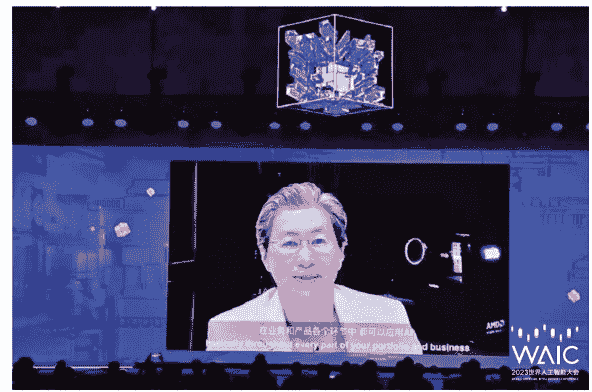

AI将重塑每一个行业，我们提供的是计算引擎，让AI能在业务与产品的各个环节得到应用。现在是投身计算行业的好时机，新增计算需求将大量涌现。

AI有趣之处在于它会在业务流程与产品流程的各个层面出现，因而需要多种计算引擎。从云端的大型GPU与GPU集群训练大型语言模型，特别是生成式AI，到边缘乃至手机、台式机、边缘设备，涉及不同类型的计算，也可看到CPU的作用。我们的理念是为正确任务匹配正确引擎。

未来十年，大型计算机将迎来超级周期，如今正是成为技术供应商的好时机，也是与将利用这些技术开发不同应用的客户合作的好时机。我们的终极理念是驱动正确的计算引擎，构建强大的软件生态，最终助力客户业务成功。

这是一个令人难以置信且令人兴奋的时刻，技术采用速度比以往都快，正因价值极高，不领先即落后。科研的几乎每个层面都受计算能力影响，无论医学、气候还是能源研究，AI的深度应用都能显著加速。我个人对医疗健康前景非常期待，医疗是AI真正影响人类结果的领域，可帮助医生更好诊断，加速疾病预防研究，皆可大幅提速。

回到我们自身。我们正在开发最先进的芯片，下一代CPU与GPU的研发也借助AI，可实现更少人力、更强研发实力、更快迭代。看一看随身携带的设备，手机上的各个方面都能看到AI，客户端设备亦然。尽管已有惊人的全球模型如ChatGPT，企业往往希望拥有自己的私人空间以查看私有数据，这又是另一个维度。

与客户合作帮助其采纳技术是其一，同时我们也要思考知识产权与保密性相关问题，这是一个迷人的领域，仍处于非常早期，关键差异在于发展速度过快，行业正在大量试验，这让过程非常有趣，未来或会出现AI主导的芯片设计。

对下一代而言，跨学科可能是最重要的关注点，仅仅成为硬件深度设计的专家是不够的，必须真正理解硬件如何与软件和算法结合，这有助于更好地设计硬件。我们一直认为最有价值的工程师是能够跨越端到端的，思考系统使用方式、客户部署方式与应用形态的人，因为这能帮助更好地设计产品。我认为跨学科很有吸引力，也很重要，这本质上是一种学习文化。

过去的学习模式是上学后用20年练习所学，如今已过去。现在要学的是如何思考、如何解决问题，然后每两年解决一个不同的问题，这就是今天的世界。

## 5G赋能 智联未来

### 吉姆·凯西（Jim Cathey）

高通技术公司首席商务官

他毕业于博伊西州立大学，获工商管理市场营销学士，2006 年入职高通，至今担任高通技术公司首席商务官，统筹全球销售、客户管理、战略伙伴合作、业务拓展、销售运营与客户支持等全局工作。履新前曾任高通技术公司高级副总裁兼全球业务总裁，全面负责各区域的业务运作。

另持有 17 项专利，同时担任美国无线通信与互联网协会 CTIA 董事会成员，以及圣迭戈港警察基金会董事会成员。

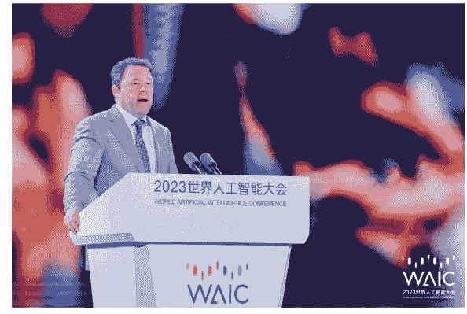

人机万物深度互联的时代正快速逼近。高效算力、分布式智能与边缘连接的融合在推动这一进程，数十亿智能终端能够瞬间连上云端，也能彼此互联。终端正具备感知、传感、直觉式行动和更自主运行的能力，这股力量孕育出全新服务、商业模式与用户体验，助力行业数字化转型，也在改写人们的工作、生活和沟通方式。

5G 是迈向更智能世界的基石。以卓越性能、可靠性和承载力为特质，5G 正在突破手机边界，成为万物互联的数字经济底座。与此同时，5G 让 AI 向更多边缘终端延伸，推动智能化规模化落地，并使边缘侧生成的情境数据能够与云端近乎实时共享。为加快 5G 终端与网络在中国的发展，我们携手本土伙伴共建 5G 联合创新中心，并在毫米波技术上展开合作，这正是释放 5G 完整价值的关键抓手。

在智能手机侧，5G 与 AI 的融合已成为现代表现力的基础。用户可以播放分享 8K 视频，用实时语义分割拍出专业水准的照片与视频，与好友享受沉浸式多人游戏，在激烈对战中保持流畅乐趣。两者结合也提升了语音识别与自然语言处理的准确度，让语音助手更懂人意。以上只是技术赋能体验的开端。

超出手机范畴，连接与智能正在开启工业创新与数字化的新阶段。智能传感器、机器人、摄像头与自动导引车正推动工业 4.0 过渡，而稳健可靠、低时延的 5G 专网为其提供连接支撑。这将强化自动化与控制、自我优化、数字孪生等能力，企业还能实时采集分析海量数据，提升商业洞察。5G 与 AI 也帮助企业更高效利用能源与自然资源，助力可持续发展目标，想象空间无限。

汽车领域随着 5G 与 AI 驱动行业数字化，汽车正迅速演变为“轮上的联网电脑”。这有助于迈向软件定义汽车，带来更丰富、更安全的使用体验与更高自主性，并引入全新数字服务。车内将出现更具个性化的座舱配置与内容，呼应用户把数字化生活带进汽车的期待。借助 5G 赋能的 OTA 升级，体验可贯穿整车生命周期。依托蜂窝车联网 C-V2X，车辆能够与周边环境及其它车辆通信，进一步提升安全与便利。

这些技术同样可成为欠发达地区促进经济与社会发展的强劲平台，改善医疗可及性，包括远程医疗与远程监护。还能提供更灵活的教育机会，让学习随时发生，并依据学习模式与进度实现个性化辅导。同时，催生新的就业、商业与创业机会，增强民生韧性。我们必须携手确保技术普惠全体人群，不受社会经济地位限制。

5G 带来的创新与美好生活机遇令人振奋，其潜能远超预期。高通将持续投入创新与研发，突破边界，为全球合作伙伴提供完整的 5G 解决方案，共同加速智能互联未来的开启。

## 引擎重塑未来

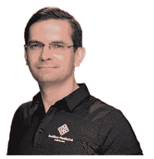

### 生成式 AI 与机器人：重塑药物研发与抗衰研究

#### 亚历克斯 · 扎沃龙科夫（Alex Zhavoronkov）

英矽智能创始人兼首席执行官，兼具生物医药与计算机技术背景。2014 年起首将生成式人工智能用于药物发现并创立英矽智能，2019 年入选全球药物发现与先进医疗领域 100 位 AI 领军人物，2022 年入选科睿唯安全球高被引科学家榜单。

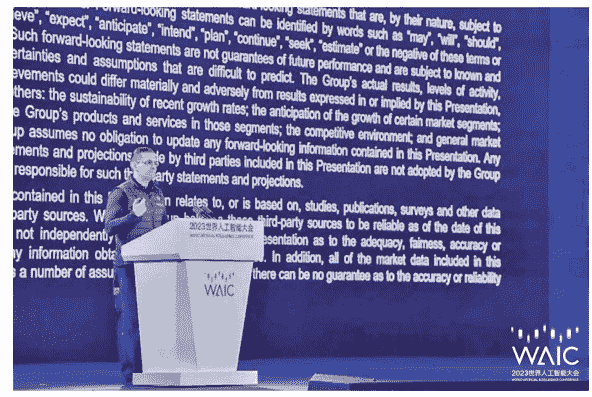

各位好，我是亚历克斯·扎沃龙科夫。先问一个问题，对你而言最珍贵的是什么？是金钱、精美照片、优质影视，还是点对点的物流？对我来说，最核心的是生命，因为我们唯一的通货就是时间，它无法被增长兑换。疾病如癌症、帕金森出现时，一切财富都失意义。我们还面临衰老这一生物过程，能力逐渐衰退直至消逝。没有任何影响能比 AI 对健康与生命的改变更深远。

遗憾的是，人类对人体生物机制仍知有限，药物研发也远未理想。正因人体生物学极其复杂，我多年致力于用 AI 更深理解生理机制，探究 AI、自动化与衰老的关联。公司尚未上市，但我想分享我们的故事。

我们起初是一家算法公司，聚焦生成式 AI 与深度学习研究及药物探索。随后自建软件寻找疗法与新颖分子，目标直指老龄化相关难题。依托算法与软件打造药物，已成长为真正全球化企业，目前在全球 8 个时区各设办公室或研发中心。业务双轨并行：一是提供平台软件解决方案，医药企业与学界日常使用并本地部署；二是自主利用软件开发疗法，聚焦骨纤维化、骨质疏松等老年病。

生成式 AI 并非新概念，只是近年消费者因大语言模型才熟知。2017 年我在圣迭戈演讲时提出，如何以更快速度获得优质分子，可比喻为在草堆里找针，而 AI 能直接生成“完美的针”。思路是大量假设筛选、挑出高质量候选、验证后再用于生产。深度学习在此带来颠覆性能力。

谷歌大脑提出生成式人工智能可产出有意义结果，深度学习则提供判别能力，两者互动冲突可产出更优解。2017 年我们探索文字生成图像，早在 2016 年前我便发表论文论证类似方法生成药物分子。2016 年 Yan A. Ivanenkov 的工作显示 21 天即可生成化合物并高效建模蛋白质结构。如今我们用生成式 AI 发现、设计新药并进入人体试验，部分项目已进入 1 期临床，领先项目在开展 2 期临床。

2019 年多伦多发表的论文展示了从头到尾生成特定特性新分子并验证选择性、指标达成与可合成性。2018 年起与药明康德开展合作。我取得的进展与中国紧密相关。一个模型无法包打天下，需化学、医药、生物等多领域模型协同。设计验证模型约需 6 个月，搭建框架再花 6 个月，将模型应用到人体则需约 6 年。

我们使用的 Chemistry42 包含生成式算法，但不追求即时反馈，容许 6 年验证周期。建立了强化学习管线，多样化使用各模型产出。

生成式 AI 精准度极高，甚至可达原子层面。传统药物研发从靶点发现到上市约 12 年，而在中国，有公司借助生成模型从靶点发现、分子生成到临床试验，验证周期压缩至 6-8 年，我们希望在国内实现这一历史。

靶点发现若走常规路径会更耗时，生成式 AI 使生物学、药学、化学端到端发现加速。我们使用 Pharma.AI 并以专有数据进行强化学习。2023 年初发表的研究展示了从靶点发现到合成、先导化合物筛选再到候选药物生成的全流程，仅用 50 天，论文撰写时间反而更长。

生成式 AI 并非魔法，不能期待付费即得药。需动物实验与人体验证，常需 2-3 年周期。我们完成多项案例研究，其中从 0 到 1 期临床不足 30 个月创下纪录。2022 年启动临床前候选药物试验，得益于中国政府与企业此前搭建的优质基础设施，可在一地完成高质量合成，因而测试了 9 款临床前候选。从 0 到 2 期临床共用 42 个月，临床前数据证实化合物有效性及疾病适应性。0 期人体试将在澳大利亚，1 期在新西兰与中国，2 期在中国与美国开展。

Transformer 技术已广泛应用，我们近期发表论文利用 Transformer 网络，结合生物学常见数据类型与语言进行预测，甚至预测健康人群年龄。基于生物特征以年龄为核心指标评估健康水平，并在同一数据中探索疾病权重，从而锁定疾病源头与关键蛋白靶点。

多模态 Transformer 带来实时学习能力，有助于打造实验室。2022 年我们在苏州设立实验室，内部设计极具未来感。可从组织或癌细胞样本提取，机器人自动分装检测污染。中国机器人应用已十分普及。

我们设计机器人工作流，把样本置于培养皿并以多种成像技术观察，构建标准设备采集的训练数据集接入 AI 层。AI 可决定下探哪个靶点，将其从培养皿取出再培养，再把原始样本放回，形成闭环。该流程能快速发现治疗现有疾病的新靶点，对个性化药物开发意义重大，并希望进一步微型化以便院内使用。

感谢福保生物鲁白教授的贡献。在 ALS 患者研究中我们发现新分子与靶点，鲁白教授筛选出有趣靶点并采用我们的技术，已招募 60 位患者验证，将加速 0 到概念验证阶段的进展，体现人工智能与人类智慧的结合。

目前我们在招揽人才扩大团队，将继续深耕中国，推动行业向前。

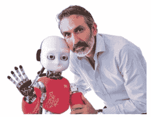

## 具身智能：iCub 机器人的人机融合

### 乔治 · 梅塔（Giorgio Metta）

意大利技术研究院院长，热那亚大学电子工程博士、麻省理工学院人工智能实验室博士后。2012 至 2019 年任英国普利茅斯大学认知机器人学教授，2018 年为 G7 人工智能论坛三位意大利代表之一、《意大利人工智能战略议程》作者之一。近十年主导协调 iCub 人形机器人研发，使其成为具身智能领域的重要参考平台。

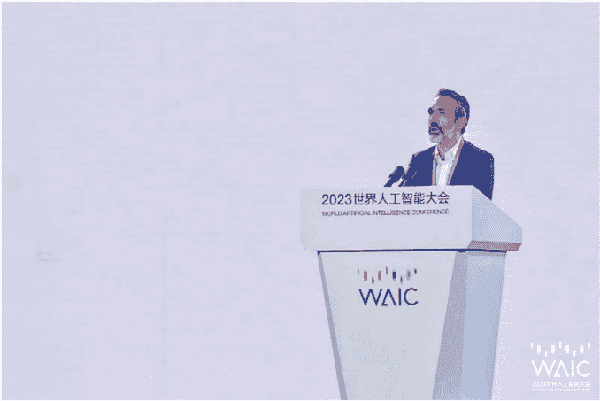

今天我主要聊机器人，不会深入大语言模型，但会补充一些目前大模型所缺的要素。我本是机器人研究者，对 AI 有自身视角。今天展示我们机构的研究成果。虽然现在已转任管理，不再写代码，但对 AI 仍保持浓厚兴趣。

为何要研发智能机器人？电影里机器人总在协助人类，给了我们想象。目标是打造能通过手势、动作与人类交互甚至进行物理接触的助手，因此我们设计人形机器人。它们配备丰富传感器，可感知触觉与交互并作出响应，同时具备多控制器以与环境互动。

项目坚持开源，希望培育用户社区共同开发并贡献软件。欧洲委员会资助让多所研究型大学能便捷使用成果，全球已形成约 50 个活跃用户社区。

我们做了一系列研究。首先是典型的认知神经实验，探究如何与机器人最佳互动。实验用塑料瓶作为标准测量装置，配合眼镜追踪被试目光，通过瓶子感知机器人施加力量，便于量化互动行为。

举例一个有趣游戏：参与者与机器人互动，机器人有时注视参与者，有时不注视。参与者驾驶小车，可直行也可在前方车辆来临时偏移。避免碰撞双方各得 1 分，若参与者偏移而机器人未偏移则机器人得 3 分。参与者不知机器人策略。观察发现，当机器人注视时，参与者会放慢；不注视时则开得更快。这说明目光影响决策。

实验表明，你的大脑会对机器人是否注视产生反应。无人注视时表现更好，但你并不会意识到策略，只在潜意识中作出反应。观察特定脑电频段可看到目光转移引发的加速或减速效应，这要求抑制被注视带来的干扰。这点在工业场景很重要，若机器人进行社交互动，可能干扰操作表现。

另一应用是机器人与自闭症儿童沟通。我们开展训练机器人从他人视角思考的试验，设计为期 6 个月的课程帮助孩子逐步掌握技能，并进行临床试验，包含集合难题与心智理论推断。通过机器人辅助疗法观察到积极改变，在此领域可作出大量有益工作。

接下来是物理交互。我们能看到机器人在执行复杂任务并被研究人员推动，这是基础技术。同时可向机器人传递更多信息并授权，例如测量搬运物品时各关节承受的力。当前已有相对简单的电子技术实现测量，使机器人运用技能更灵活。

最终落地的进展还包括传感器远程操控机器人，这是一种远程交互。为实现稳定体验，需先进控制与 AI 系统补偿时延不确定性。比如威尼斯博物馆里的机器人正在游走，其操作者在 500 公里外。AI 帮助实现看、触摸、拥抱等远程交互。

大语言模型本身没问题，但机器人与人的互动是关键。我们应把这种互动优化并融入大模型中。

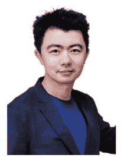

# 跨界对话：现实已超科幻

## 马瑞青

上海交通大学文化创意产业学院副教授，现任上海交通大学副教授兼文化创意产业学院院长助理，曾任北京大学文化产业研究院副研究员。中国电影剪辑学会国际协作交流委员会秘书长、短片短视频艺术委员会理事，中国电影家协会会员、中国电视艺术家协会会员。

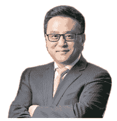

## 张亚勤

清华大学智能产业研究院院长、中国工程院院士。2014 年 9 月至 2019 年 10 月任百度公司总裁。此前在微软工作 16 年，历任全球资深副总裁兼微软亚太研发集团主席、微软亚洲研究院院长兼首席科学家、微软全球副总裁及微软中国董事长。数字视频与人工智能领域的国际级科学家与企业家，拥有 60 多项美国专利，发表 500 余篇学术论文，出版 11 本专著。其图像视频压缩与传输技术被国际标准采纳，广泛应用于高清电视、互联网视频、多媒体检索、移动视频及图像数据库等领域。

## 郭帆：流浪地球的掌舵人

导演、编剧兼监制，现任北京电影家协会副主席。毕业于北京电影学院管理学院，曾斩获 2016 年全球华语科幻星云奖最佳原创剧本等殊荣。2019 年执导的《流浪地球》全球公映，累计票房 46.88 亿元，位列中国影史票房第四、中国科幻票房第一。

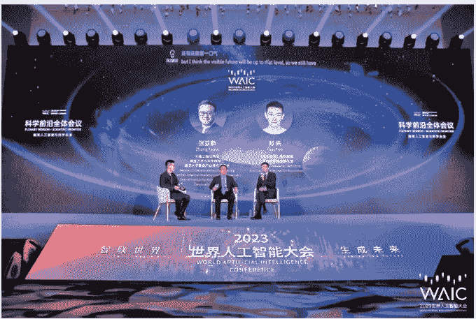

## 主持人

马瑞青 上海交通大学副教授、华纳兄弟上海人工智能实验室顾问研究员，同时身兼影视制片人。

## 与谈嘉宾

张亚勤 清华大学讲席教授、清华大学智能产业研究院院长、中国工程院院士、美国艺术与科学院院士。

郭帆 《流浪地球》系列电影的导演、编剧、监制，北京电影家协会副主席。

马瑞青：感谢两位嘉宾和现场朋友。说是跨界对话，其实电影和科学本就离得很近。刚才林达华老师也提到，上一个环节的校长就以一部电影切入演讲。电影诞生于技术发明，一直跟科技共进：从黑白到彩色，从无声到有声，再到基于计算机图像的特效、三维、虚拟现实影像。如今书生通用大模型家族发布，书生·天际这类面向超大城市空间的实景建模与编辑三维大模型，也正被寄望赋能影视。

先请张亚勤院士简要梳理一下生成式人工智能的发展脉络，今天它到底走到了哪一步。

## AI 如何从感知走向创造

张亚勤：很荣幸来到 2023 世界人工智能大会，也祝贺汤晓鸥教授和上海人工智能实验室的成果。

现场既有技术人也有跨界人，我就用最简洁的方式回顾一下近五年尤其是最近十年的变化。人工智能已有六十多年历史，真正的拐点在过去十年深度学习的兴起，得益于海量数据、大模型、算法和算力的叠加。近二三年尤其明显，从量变到质变。

我第一次接触 ChatGPT4 时有三点感受。

第一，从感知到认知。过去 AI 在语音识别、图像识别、字符识别等感知任务上已接近甚至超越人。近两年核心是认知与推理能力，对语言、视频语义的理解在快速提升。

第二，从专用到通用。过去语音、图像、自动驾驶、蛋白质解析等各有一套专用算法、专用模型和数据集。现在模型趋向通用。GPT4 是否已是 AGI？我个人认为还未，但它开辟了一条通向 AGI 的通道。刚提到有人机体通过图灵测试，做了六十年的对话式人工智能，终于迎来这样的节点。

第三，从判别分析到生成创造。过去 AI 多用于更精准地分析、预测与决策。现在可以创造新内容：文本、图像、视频、蛋白质、代码、工具。今天发布的 Landmark、书生通用大模型体系都是典型代表。

只是生成式 AI 仍处起步期，技术还不够成熟。在电影里应用很少，十几二十秒的短视频还算顺畅，但要支撑两三小时的高分辨率、高精度影片，距离还很远。

## 电影工业离 AI 还差多远

马瑞青：谢谢张院士，也自然带出我们想和郭帆导演聊的问题。书生通用大模型不仅能生成文本、图像、视频，还能相互通用、相互学习。郭导，您如何看待当前 AI 发展与电影这类视听产业、以及日常生产消费需求之间的差距？

郭帆：先解释一下我为什么坐在这里。在座很多人和我一样，工作证写着嘉宾，我觉得该改成学生证。我刚亲眼见证了上海人工智能实验室发布书生通用大模型，对实验室短时间内取得的成果很骄傲也很敬佩。

发布过程中我也在反思，自己过去对 ChatGPT 总是命令式：“你去弄这个、弄那个”。以后我会加个“请”字，结束后再说声“您辛苦了”，对 AI 好一点，也给自己留条后路。

回到马老师的问题，以《流浪地球 2》为例，演员的增龄与减龄镜头，就是靠 AI 学习并经过几百代迭代生成的。演员的声音修复也是 AI 完成，这些技术我们已在片中投入使用。但目前所有 AICG 产出的影像或图像，都已对行业产生冲击。精度还没达到电影级，不过未来大概率会达到，所以现在仍有喘息空间。

来 WAIC 就是想近距离看新技术。作为团队，我们需要先从认识 AI 开始，弄懂它是什么、底层逻辑是什么、边界在哪里，再去谈方向。

马瑞青：郭导很谦虚。再往下问，您对生成式 AI 的未来有何期待？下一步想用哪些 AI 技术？比如《流浪地球 2》里的增龄减龄特效。

郭帆：增龄减龄相对今天发布的众多应用只是很窄的分支，我对它的延展也不敢妄断。我们两个月前还在讨论生成视频的一致性和闪烁问题，现在已看到不错的解决方案，发展之快令人惊讶。电影由一个个镜头组成，这些技术难题被逐个攻克后，未来有望大幅压缩时间与成本。

与此同时，新技术也带来危机感，对很多部门和艺术家个人都是强冲击。

马瑞青：这个问题也想听张院士的回应，无论是技术前景，还是刚才提到的创作者焦虑。

张亚勤：技术上，或许五年之内这些问题就能解决。回看过去两年，Diffusion Model 刚出来时图片质量还很差，现在进步明显。有需求就有算法创造的可能，语义连贯、镜头连贯、场景连贯以及高质视频处理，前期构思到摄影再到后期，从技术层面都可实现。

但不必过度焦虑。AIGC 无论多强也只是工具，真正的创造力、想象力、灵感与创意，还需作家、导演、演员完成。它只是加速与优化制作。关键是如何做出更人性、更简洁、更优质的操作界面，让导演演员等从业者更好上手。过去的特效也都可被解决，我在微软研究院和卡梅隆合作《阿凡达》，以及《泰坦尼克号》的二维到三维制作，都说明技术能跟上，核心仍是创意与界面。

## 想象力能否反哺科研

马瑞青：按张院士的提法，郭导，您觉得艺术创造在哪些领域可能反哺科学创新？科幻电影如何以超前想象打开科学家思路？除了科学为艺术提供技术方案，还有别的互动可能吗？

郭帆：先不谈反哺，感觉我们自己都快“断奶”了。亚勤院士一直在笑我说“没关系，还有五年”。那五年以后呢？

我们急切想全面了解 AI 在电影里的应用。目前已知的相关应用有 24 个，计划在未来半年多里，通过新作品从创意、前期剧本、拍摄到后期宣传发行全流程做技术测试，看哪些能落地、哪些还不成熟，也希望多考察、交流。

另外有流程与管理需求。《流浪地球 2》现场工作人员 2200 人，整体体量接近 3 万人，传统剧组架构很难支撑这种大集群协作。遵循生产力决定生产关系规律，我设想未来当生产技术达到一定程度，剧组不必再有上千人同框拍摄，人会减少，但借助 AI 辅助，协作能力反而可能放大到上万人甚至上百万人规模。只有进一步细分，才能推动电影工业化从 2.0 跨越到 3.0。

简单梳理一下，工业化 1.0 是胶片时代，约百年；2.0 是数字时代，以胶片被淘汰为标志，已走近 30 年。人工智能，特别是亚勤院士提到的 AGI 介入后，将直接开启工业化 3.0 即人工智能时代。创作、拍摄、后期、发行、放映乃至影院形态、观影模式都会被重新认识。希望能有更多时间和渠道与科学家、AI 企业学习交流，早日形成工业化 3.0 的雏形。

张亚勤：先恭喜郭导《流浪地球》系列的巨大成功。2023 年春节我在美国带儿子看片，三天都抢不到票，终于买到时座无虚席。我看片有个坏习惯爱打盹，那天儿子说爸爸今天怪怪的没睡着，说明电影确实精彩。

科幻创作对科研的启发很大。人类好奇、爱想象，科幻基本围绕两个宇宙：大宇宙的太空探索，和小宇宙的生命与大脑。很多发明灵感都来自科幻：无人机、平板电脑、无人驾驶、激光武器，都能追溯到《星球大战》《星际迷航》《回到未来》《黑客帝国》等。

我和汤晓鸥都是科大校友，上大学时看过《未来世界》，讲机器人失控与控制，看完后我便钻研信息论、控制论，后来做人工智能机器人和无人驾驶，都受这部片启发。

还有通信卫星，最早的创意来自科幻作家 Arthur C. Clarke。1946 年他在一篇文章里通过计算提出在地球上空 36,000 公里等距发射三颗同步卫星实现全球覆盖，20 年后第一颗卫星上天时主要参考的就是这篇文章。阿西莫夫 20 世纪 40 年代提出的机器人学三定律，到今天仍在沿用。科幻的想象力，确实在不断把设想变为现实。

## 替代焦虑与创作本质

马瑞青：所以未来科幻导演和 AI 科学家完全可以携手互启。先把 AI 视作工具，电影领域已有二三十个应用，看哪些能提效；再深入探讨人机关系。之前提到的焦虑，张院士说电影人还有五年缓冲。

两位有没有在探索或研究过程中感到过被 AI 挑战、甚至威胁的瞬间，如何理解这种感受？

郭帆：我肯定有，不然我不会来坐在这里。挑战与威胁一直都在。刚才聊反哺科学，我可能理解偏了，想到的是科幻电影。克拉克、阿西莫夫确实给科学带来启发，但电影是否能反哺科研、至少我拍的可能还够不上。中国科幻类型仍在起步学习阶段。

威胁是真实的。比如 Midjourney 生成的概念设计与分镜，让人思考概念师未来怎么办。过去是文字到意象再到画面，现在输入几个关键词就能实现，和导演对概念师的描述很像。顶尖概念设计师需一周时间且要有十几年功底，Midjourney 一晚能出上百张。我们美术指导做过盲测，把人工一周画的几张和机器一晚上跑出的上百张混一起，结果第一批被淘汰的就是人画的。海外也有类似测试，AI 画的先被留下来。只说概念设计这一块。

前几天和刘慈欣老师聊天，也谈到小说、剧本写作，AI 能否做到灵光一现、醍醐灌顶？目前看可能不行，但可读性已在一定水位之上。图画、视频的生成与修改正渗入制作流程，焦虑在于，当这些工具被大量使用，苦学十几年艺术的从业者何去何从，这是严肃问题。

张亚勤：部分工作必然消失，但文艺创作尤其是电影，最打动人的仍是情节、灵感、人性、情感，这是生命力所在。ChatGPT、Stable Diffusion、Midjourney 等模型生成的内容缺乏这些，即使有灵感也是人赋予的。比如《流浪地球 2》里的 Moss，做得非常好，有迭代、自我升级、智慧增长，语音合成、自然交互、持续学习目前基本能实现。唯独做不到的是自我意识和情感。

我对 AGI 的理解是，感知与认知可能已与人相当甚至超越，但所有硅基算法永远没有真正的情感和意识，这就是最大区别。

machine、brain、mind 三者不同。机器若干年后或许能实现甚至超越人脑功能，但拥有 mind 却无从谈起。Moss 可以有大脑、可以进化，但 mind 无法实现。好作品必须有灵魂、有 mind，所以不必过度焦虑。

## 暗面风险

但我自己也焦虑。一方面算法仍有缺陷，生成式 AI 会产生假信息、幻觉、失实乃至造假，影响信息生态，不过我认为这是可解决的。另一方面下一代 AI 是物理智能、具身智能、生物智能，当 AI 进入无人驾驶、无人机、机器人，若缺乏因果性和透明性，风险会更大。到生物层面风险更高，比如人机接口或芯片接入影响大脑，进而影响决策、行为、思考，这必须被严格限制。

我近期签过一份关于 AI 风险的倡议，把人工智能风险与核武器、流行性疾病同等优先级。但人类有控制技术的智慧，只要保持意识，风险是可以管控的。

## 开源与版权如何平衡

马瑞青：张院士提到的 mind，我大胆译作“心智”“灵性”，或许是人类最后的栖息地。最后想请两位简短回应一个小问题：科学需要开源共享才能迭代，艺术创作却需版权保护来供养，二者如何调和？就像 Midjourney 的争议，美国编剧工会罢工，以及两位作家起诉 OpenAI 借鉴其作品，这些正是伦理与治理的议题。

郭帆：这两天我一直回味张亚勤院士和郭毅可校长的观点——当系统复杂性越过临界点，涌现就会自发出现。先把版权问题放到一边，我想先聊涌现本身。系统一旦庞大到一定程度，这种涌现还能被把握住吗？之前讨论大多落在人类中心框架里，情感、意识的定义权我们一直抓在手上。可要是一天机器真的长出了意识，并开始重写意义秩序，我们该怎么应对？这个问题我想请教张院士。

张亚勤：现在常说的涌现式智能，我认为不会生出意识。它的本质是模型规模和参数放大后，多项任务的完成度大幅提升，不会凭空出现新的意识或情感。表述上容易产生歧义，我们也很难完全复现推理是如何“长”出来的，但这和自我意识、独立人格是两回事。

郭帆：对，最让人不安的是我们不知道结果是怎么“长”出来的。单独的蚂蚁干不了什么，一窝蚁群却能完成复杂工程。鸟群合飞也是类似的印证。荣格讲的集体无意识，多个振荡器同步现象，内核很像。所以复杂度达到阈值后涌现就会冒头，这和AI语境里的涌现非常接近。以后写《流浪地球3》时，我可能会把这个逻辑放进去。

马瑞青：感谢两位精彩的对谈。正如郭帆导演开场所说，面对AI，大家都得挂上学生证，先学再谈。对涌现有更多理解，才能在它真正到来时有应对方案。现实总是比电影更科幻，只有一起努力，这些想象才有可能落地。

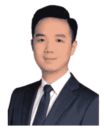
# 产业数据如何创造价值

宋海涛

上海人工智能研究院院长、上海交通大学人工智能研究院副院长

上海人工智能研究院院长、上海交通大学人工智能研究院副院长。入选“上海产业菁英”高层次人才，担任2022 IEEE ICNSC程序委员会委员、亚洲科技可持续发展联盟理事，参与“十四五”国家重点研发计划指南编制。

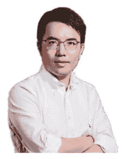
余　虎

蚂蚁集团副总裁、数字科技解决方案总经理

现任蚂蚁集团数字科技事业群副总裁，主责数字科技解决方案。拥有二十余年信息科技与服务经验，对数据仓库、大数据、云计算、AI、区块链、隐私计算等领域有深入研究与实践，对行业数字化转型与科技赋能有系统认知，熟悉数字政府、金融科技、智能制造、新零售等场景，具备战略设计、集成产品开发、解决方案管理等丰富经验。

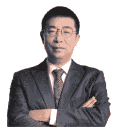
朱军红

上海钢联电子商务股份有限公司董事长

2000年创立上海钢联Mysteel，成为国际领先的大宗商品产业数据公司；2008年创立钢银电商，打造千亿级钢铁电商平台。作为产业互联网先锋与产业大数据推动者，长期致力于让大宗商品市场更透明、更高效。

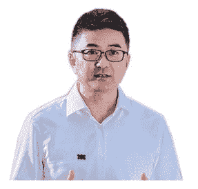
刘　涛

智己汽车联席首席执行官

1997年加入上汽集团，曾任上汽乘用车产品规划总监，主导开发“人机交互行车系统inKaNet”及“全时在线互联网汽车荣威350”。现将对汽车行业的积淀与前瞻判断投入新品牌IM智己，聚焦打造中国世界级好车。

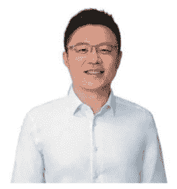
马　健

晶泰科技联合创始人、首席执行官

曾获教育部自然科学奖二等奖、《麻省理工科技评论》“35岁以下科技创新35人”、中国AI新药开发最佳CEO等荣誉，现任中国药促会副主任委员、《药学进展》杂志编委。2014年联合创立晶泰科技，专注生命科学与新材料领域的数字化、智能化革新。

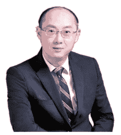
孙元浩

星环科技创始人

中国人工智能产业发展联盟理事，入选上海领军人才培养计划，曾获上海市十大杰出青商、智慧城市建设领军先锋、优秀学术技术带头人、青年科技杰出贡献奖等。带领团队研发企业级大数据平台及基础软件，在实时计算、分布式事务、分布式计算、分布式存储等方向取得重要突破，推动大数据技术在国内大规模落地。

## 主持人

宋海涛　上海人工智能研究院院长、上海交通大学人工智能研究院副院长

## 嘉宾

余　虎　蚂蚁集团数字科技副总裁、数字科技解决方案总经理

朱军红　上海钢联电子商务股份有限公司董事长

刘　涛　智己汽车联席首席执行官

马　健　晶泰科技联合创始人、首席执行官

孙元浩　星环科技创始人兼首席执行官

宋海涛：很高兴在2023世界人工智能大会产业发展论坛的主场主持“智能时代的产业数据价值化”这场讨论。数字化与智能化浪潮之下，企业和生活的方方面面都被重塑。今天请来在数据和科技领域有全球级和国内影响力的企业家，共同聊聊产业数据怎么变成价值。打造高质量数据资产、构建安全可信的数据环境，是各行各业的共同命题。五位来自钢铁、金融科技、汽车、医药等不同赛道的从业者，将分享行业数据库建设和垂类大模型建设的经验。首先请余虎开讲。

## 行业高质量数据集建设

余虎：关于行业高水平数据集的建设与治理，我们已研发数据质量和价值评估的方法，能在离线和在线场景下借助模型表现反向推断数据好坏。同时和高校合作研发基于区块链的大规模分布式数据可信治理方案，力求全流程可验证、安全可信。这是我们重点做的几件事。

宋海涛：谢谢余虎从金融科技视角分享了蚂蚁集团在数据生产、标注、评估与可信治理方面的关键做法。接下来请朱军红分享。

朱军红：我们做的行业比较传统，服务钢铁、有色、能源、化工、农产品等。核心业务是各类产品的交易价格。工业企业间六七成的价格靠长期协议，剩下三四成来自现货，而现货价格决定协议价格。我们的采集锚定现货市场，为保证长期协议结算准确，建立了严格的价格准确性规范，拿到发改委认证，全球范围内通过IOSCO认证并接受审计。

客户拿到价格后会做预测，需要产能、供给、需求等影响波动的因子，对准确度要求极高。所以我们为每条数据的产生制定标准，包括样本生成、采集流程，方法对外公开供客户检验。如今大模型层出不穷，我们行业的小模型早就在跑。整体形成从产生、采集到检验的完整治理闭环，并配有庞大的治理与采集团队。

宋海涛：感谢朱总分享传统行业标准化数据服务的实践，以及钢联已推出的国际化标准。接下来请智己汽车的刘涛介绍。

刘涛：汽车行业很典型。传统制造正在变成智能电动车这类大号移动终端，感知和算力都远超手机，电量也远超手机。未来竞争从动力转向算力、软件、AI和大语言模型能力，变革非常大。我们成立仅三年，员工不到两千，七成以上岗位和算力、软件、人工智能相关，已不同于过去以供应链制造为主。

智己由上汽集团、张江高科、阿里巴巴联合发起，2022年完成A轮融资，估值三百亿人民币。汽车是未来数据和算力的重要载体。以智能驾驶为例，我们配置11个摄像头、5个毫米波雷达、12个超声波雷达及激光雷达，车载算力单元采用254 TOPS的Orin X芯片，并和阿里云共建超级数据工厂，吞吐量达到亿级，日产数据能力可达一千四百万公里。车端布置高效筛选器，只把对自动驾驶模型迭代有价值的数据上传云端。

2023年4月，我们发布基于Transformer架构的人工智能模型的行业首发。感知、融合、预测、规划、控制是乘积关系，任一环节都决定最终体验。过去感知依赖数据驱动算法，我们是首个打通五大关键环节、全数据驱动的DLP，即Deep Learning Planning人工智能数据模型。

宋海涛：感谢刘涛，智己从起步就建立在数字化智能化底座上，期待量产进一步提升。接下来请晶泰科技的马健分享。

马健：我们致力于让药物研发走向自动化与智能化，这是晶泰近十年的使命，工作正向材料、化工等领域扩展。

拿自动驾驶类比，生物医药研发端数据获取成本高、周期长。AI需要算力、算法、数据三要素，算力基建有云计算、GPU超算，但数据基建不同：其他行业可用爬虫抓文本、摄像头拍图像，而药物分子的物理、化学、生物活性需要科学家反复实验、昂贵仪器获得，数据生产效率低成本高。

我们的数据建设走过两个阶段。早期是虚拟数据建设，通过计算物理、计算化学、量子物理的高精度计算积累微观分子层面数据，用以训练低成本高通量模型。第二阶段是真实世界，必须从真实实验与复杂体系中获取有效数据。从2020年起，我们推动AI可视化，打造全球规模最大面向药物研发与化学实验的自动化机器人实验室，作为面向未来数据的新的基础设施。基础设施像修路，数据生产能力建立后，基础研究效率会持续提升。

研究端不仅要量更要质。文献以正样本为主缺乏负样本，且生物体系文献重复度低。专利与公开数据可训语言模型，但科研要求零偏差，因此我们被迫从真实实验数据出发构建，这是行业视角的体会。

宋海涛：感谢马健，期待晶泰以AI技术为创新药提供更多助力。接下来请星环科技的孙元浩分享。

孙元浩：我们聚焦数据管理软件，从大模型出现后数据管理如何变化来谈。训练集用于预训练、微调、强化训练，另有推理集。数据可分三类。

第一类感知类数据，如视觉、语音、传感器数据。过去放在文件系统，现在需要快速向量化并存入向量数据库，不同大模型参与向量化。

第二类描述性事实类数据，金融转账记录、账期等已结构化。但经过数万步变换后原意常丢失，字段名保留但含义遗忘，字段量可达数十万至上百万。若只给大模型一个字段无法理解，需借助大模型还原字段语义，结合值域推断含义，再追溯变换步骤与历史标注形成图谱检索，最终拼出完整语义描述输入大模型。

第三类知识抽象概念类数据。过去知识图谱尝试有限，多数未形成有效图谱。大模型出现后需要知识图谱构建工具提供精确知识。还有更糟糕的方法论类知识，未结构化记录。客户常问大模型能否做助理、预测股票走势、分析新闻对产业链影响的正负性、归纳个人习惯与解题步骤形成方法论。这些方法论需组织成大模型可识别的思维树。

从感知到事实到抽象再到方法论，记录程度递减，多数仍在专家脑中。大模型输入为自然语言，过去我们把自然语言结构化为计算机语言，现在要反向标注为自然语言，需训练对、向量化、模糊检索等工具。整个数据产业链仍需大量工具与数据库支撑大模型落地。

宋海涛：孙元浩分享了星环在数据工具开发中的经验。各行业在数据建设与垂类模型、知识图谱建设方面的探索已有所呈现。人工智能三要素为数据、算法、算力，核心是如何实现产业数据的价值化，需建设专业工具与垂类大模型，并依赖高质量数据库。行业赛道尚未具备数据库时，需探索全要素全链接，产业链“链主”需携手打通上下游完善数据库。想请各位分享产业链布局的经验心得。

## 产业链数据的开放与共享

余虎：各行业数据分割严重，开放共享流转受阻，根源在利益，更核心的是缺乏数据安全与信任保障。缺少安全信任就无法形成数据所有者、持有者、开发者、使用者、运营者的可信协作。

我们的体会有三点。第一，构建数字信任，通过区块链与隐私计算融合形成可信基础设施，在不侵犯权益前提下实现开放共享。第二，基础设施之上形成三大版块：个人数据、公共数据、产业数据。公共数据方面，我们开发城市链方案与城市级数据要素交易流转方案，构建可信数据流转网络，推动公共数据开放共享。产业方面，核心是找到产业链主导企业，联合上下游实现数据高效流转。

以航运为例，基于蚂蚁链区块链技术，中远海运牵头8家港口公司成立全球航运网络区块链联盟，通过电子提单与无货共享服务超1万家客户，数据共享效率大幅提升，过去需数周的工作数小时完成。产业数据共享开放需要可信的数据信任基础设施支撑。

宋海涛：感谢余总，蚂蚁在探索中围绕可信产业链生态展开。请朱总分享。

## 工业企业全样本数据实践

产业数据全链路治理与用户价值重塑对话实录

朱军红提到，工业制造的链条往往拉得很长，目前拿到的样本规模其实并不大，特别是大型工业企业本身就稀少。以钢铁业为例，全国在产钢厂也就数百家，完全有条件做到全量覆盖。但我们的思路是把整条产业链串起来，从铁矿石、煤炭开采，到冶炼加工、配套材料，再到最终的流向，比如热轧板最终送往三一重工、海尔这类头部客户。当数据维度叠加到足够丰富时，相互校验的逻辑也就自然清晰了。所以操作上就是持续扩链，把上下游的数据颗粒都做实，所有环节的数据彼此关联，通过建模或回归就能较好地判断数据可信度。

再者，我们的服务是日频在线运行的，价格指标绝不允许出错，因为它直接用于买卖双方当日的结算，关系到谁盈谁亏。因此我们的做法很直接，建立了大量用户群，把结果及时推送到群里，由买卖双方在现场即时对冲核验。

在技术手段上也在发力。全球铁矿的堆场存量现在基本可以用卫星影像来估算，不用打电话，图像处理后即可得出体量。海运环节也基本能实现全景监测，经标注后可统计海上现存船只数量、到港计划、卸货量等。露天石油库存同样可以借助遥感识别。把传统的人工采样和卫星、无人机等高科技采集结合起来，才能把库存画像做准。

最后一点是市场化检验。因为数据要随时拿去现场用，所以必须接受持续的市场化检验，这才是最有效的方式。无论科技还是传统手段，对质量的要求都极高，因为产业应用容不得偏差。预测模型再强，若底数出错，结果必然出错。因此我们会用多种手段保证数据的质量来服务客户。截至现在，已服务近30万家付费客户，这30万家用户的日常使用监督，本身就是对数据质量最有力的检验。

宋海涛表示，在传统与特种行业中小样本数据库的基础上，钢联正在探索全样本高质量数据库赋能产业，也走出一条可行路径。接下来请刘涛分享。

用户数据权益与原石计划

刘涛用两分钟分享一个底层观念。公司成立仅三年，但在产品立项之初就做了战略思考。人工智能时代最本质的变化，与往次工业革命不同。此前工业革命是发明电力、内燃机来提升生产效率，赋能各行各业；而AI时代发明的是一种智慧，这种智慧与人脑结合，能够重塑所有产品。

举例来说，马斯克是AI先驱，特斯拉也是行业标杆。但特斯拉早期模式依赖天才工程师，产品量产后，工程师的重要性相对下降，真正起决定作用的是持续贡献数据的用户，日常驾驶产生的数据才是迭代自动驾驶算法的驱动力。

基于此，我们认为AI时代用户价值空前提升，根源在于数据贡献。我们推出了原石谷用户数据权益计划。只要成为智己车主，就会持续产生数据，这些数据是产品迭代改进的核心动力。因此我们把智己创始期的价值增长权益量化为3亿枚原石。用户已通过数据开采的方式获得了数千万枚原石。越早参与的用户数据价值越高，借助区块链背书，其获得原石的概率也越高。目前交付车辆约1万台，早期用户行驶半年至八九个月，所获原石价值已可兑换一台苹果14 Pro手机，未来甚至有望兑换一辆车。

总结来说，我们希望借助AI时代的变革，推动用户角色的转变，既尊重数据贡献，也要以公开、公正、公平的方式和技术手段，将企业发展的价值回馈给用户，这也是我们区别于他者的设计。

宋海涛感谢刘涛，希望智己在新的探索路上越走越顺。接下来请马健发言。

生物医药数据孤岛与联邦学习

马健谈到，生物医药领域的数据孤岛现象非常普遍，企业对数据安全极其敏感，涉及联邦学习、隐私计算、区块链等技术。欧美和国内都有类似的协作组织，随着药物研发智能化，数据共享机制势在必行。但目前这块还不够成熟。表面看是典型的鸡生蛋问题，药企在尝到明显甜头前不愿投入巨资建设基础设施。更关键的是，制药不像互联网，是一个高度安全合规的行业，逻辑完全不同。

更深层次看，过去几年谈“互联网+”“AI+”，垂直落地都面临共同难题：工业的厚度很深，问题不能仅靠堆数据解决，细分场景差异极大。A类问题和B类问题不可通约，数据打通并不等于能得到通用模型。老问题遇到新挑战在生物医药基础研究中很常见。

回到晶泰科技，过去几年从虚拟数据向真实世界数据迁移，核心思路是搭建真实世界实验室，提升数据生成效率，这对模型迁移性至关重要。

药物研发的挑战可分为两类：生物学挑战和工程技术挑战。要解决未满足的临床需求，需要在疾病宏观层面与靶点微观层面之间建立因果逻辑，这种发现具有偶发性和分布式特征。如果是工程技术问题，创新可以被复制推广。但科学发现类问题不能指望AI数据在短期内就能解决。

另外，工程技术工具层面，例如化学合成，通过大量实验数据积累，可以大幅提升路线推荐效率。做1000次、10000次实验后，合成路径预测会越来越准，这对提升研发效率有帮助。但不要把科研类挑战等同于工程挑战，后者有规律可循，前者距离可复制还有很远。

宋海涛感谢马健，希望晶泰在AI创新药领域取得更多突破。下面请孙元浩发言。

产业数据流通障碍

孙元浩说，朱军红提到钢联已在产业中应用。个人观察，产业数据流通仍有几大阻碍。

第一是需求认知。过去需求不足，现在大模型带来训练、推理、应用的海量需求，需求端很快能满足。但很多人不知道数据在哪里，比如钢联在产业链上的数据很丰富，但信息不透明，外部难以触达。

第二是质量问题。语料数据里新闻事件真假难辨，也无法校对。产业数据同理，使用方必须持续校正数据来提升质量，质量提升后价值才能显现。

第三是法规与隐私。数据安全法、个保法出台后，企业对数据流通更为谨慎。脱敏和隐私保护亟待解决。我们也在尝试用大模型对数据进行分析和分类，识别敏感字段并做处理。待这些痛点被解决，产业数据流通会明显加速。

宋海涛最后回到2023年世界人工智能大会主题“智联世界 生成未来”。步入智能生成时代，推动全要素产业体系健全、推动AI产业高质量发展，需要全社会集智聚力，聚焦从创新、创造到创想的AI生成之路，展现AI驱动的高质量发展图景与现代化产业体系焕新。

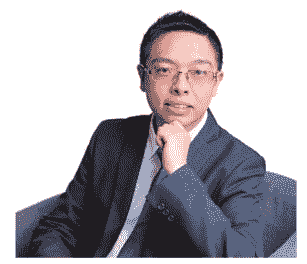
# 专题研讨：技术治理与大模型交互新范式

## 嘉宾阵容

林达华

上海人工智能实验室教授

担任上海人工智能实验室领军科学家、香港中文大学信息工程系副教授及交叉学科人工智能研究所所长，2012年获麻省理工学院计算机科学博士学位。研究聚焦计算机视觉、深度学习及通用大模型，在顶级会议期刊发表论文逾200篇，被引超3.1万次。发起的`OpenMMLab`成为深度学习时代最具影响力的视觉算法开源生态，曾多次担任国际顶会领域主席及期刊编委。

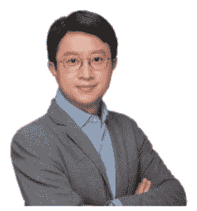
梅 涛

加拿大工程院外籍院士、H iDream.a i 创始人兼首席执行官

加拿大工程院院士，IEEE/IAPR/CAAI会员，生成式人工智能公司`HiDream.ai`创始人兼CEO。人工智能、计算机视觉与多媒体领域知名学者，论文引用超3万次，获15项最佳论文奖，拥有70余项专利，主导多款日活百万级商业产品。曾任京东集团副总裁及微软研究院资深研究员。

邱锡鹏

复旦大学计算机学院教授

复旦大学计算机学院教授，国家优青。主要从事自然语言处理与深度学习研究，著有《神经网络与深度学习》被百余所高校采用。主导开源框架`FudanNLP`与`FastNLP`被国内外数百家机构使用，获钱伟长中文信息处理科学技术奖青年创新奖等。团队于2013年发布类`ChatGPT`模型`MOSS`。

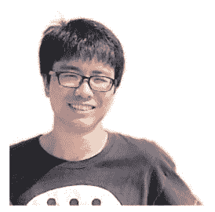
杨健伟

微软研究院深度学习组高级研究员

微软雷德蒙德研究院深度学习组高级研究员，研究方向为计算机视觉、视觉语言与机器学习，聚焦结构化视觉理解及人类智能交互。2020年3月加入微软前获佐治亚理工学院互动计算学院博士学位，导师Devi Parikh教授。参与`Florence`大模型、`X—GPT`、`X—coder`及“分割一切”等重量级工作。

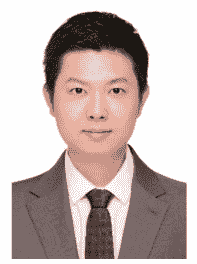
戴　勃

上海人工智能实验室青年科学家

上海人工智能实验室青年科学家，内容生成与数字化研究团队负责人，曾任新加坡南洋理工大学研究助理教授。博士毕业于香港中文大学MMLab，研究三维重建与生成式AI，发表顶会顶刊论文40余篇。曾任`BMVC2021`领域主席、`AAAI2022`高级程序委员。获上海市浦江人才及海外高层次人才计划资助。

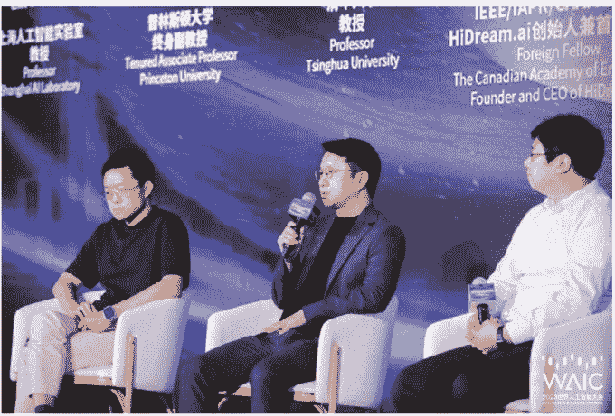
主持人：

林达华　上海人工智能实验室教授

嘉宾：

邱锡鹏　复旦大学计算机学院教授

潘新钢　南洋理工大学计算机科学与工程学院助理教授

杨健伟　微软研究院深度学习组高级研究员

戴　勃　上海人工智能实验室青年科学家

梅　涛　加拿大工程院外籍院士、`HiDream.ai`创始人兼首席执行官

## 大模型架构与学习范式研讨

林达华：这是我主持专题讨论中规模最大的一次。马瑞青教授曾树立了很高标杆，引导张亚勤院士和郭帆导演对话科学与艺术。今天是2023世界人工智能大会科学前沿论坛，讨论应回归科学本身。如何让环节更有启发性颇具挑战，幸得各位支持。

先介绍嘉宾。梅涛老师从研究员转向产业，预祝公司发展顺利；邱锡鹏老师与实验室在自然语言领域合作紧密，是国内大模型先行者；新钢的`DragGAN`近期引起热议，上午开幕式分享精彩；健伟深耕多模态成就突出；戴勃是`LandMark`技术核心负责人。今天汇聚决策、自然语言、视觉、多模态、三维等方向研究者，相信碰撞会带来新灵感。

今天的问题没有预设答案，希望现场交流能产生火花。我们先从技术入手，我始终相信技术创新是社会发展重要源动力。

林达华提问邱老师对现存大模型结构与学习范式的看法及未来走向。

邱锡鹏认为`Transformer`的成功有必然性，首先其模型容量与`GPU`契合度高，因其诞生于`GPU`时代，设计即基于现有硬件架构，便于通过算力放大规模，这是成功主因，容量必须足够大。但这也带来算力消耗问题，模型继续放大将难以承受。因此坚定认为未来会有新架构出现，应更计算友好、成本更低，具体形态尚不确定，可借鉴人类记忆机制。当前`Transformer`无状态，引入记忆等机制可大幅降耗。

关于自回归语言模型，除非找到更低成本的监督式获取方法，在此之前从左到右的语言建模仍是最有效训练大模型、让模型记住知识的方式。当然未来可能出现更优方案，例如当模型能理解人语后，可通过自然语言指令让模型修正缺点、规避问题，但前提是先达到基础能力。

## 多模态扩展下的学习范式挑战

林达华感谢回答，`Transformer`在当前算力架构下适配度高，但长期是否唯一尚无定论，或许现场同学会在三五年后提出颠覆性架构。

从语言模型延伸，多模态已成重要趋势，各机构正将更多模态纳入大模型训练。将大语言模型`LLM`范式延伸至更多模态会否遇到新挑战？先请多模态专家杨健伟。

杨健伟表示一直在思考此问题。近期大量工作受大语言模型启发做视觉-语言大模型，试图统一任务。作为视觉出身研究者，认为多模态融合仍面临很大挑战。相比NLP，视觉-语言处理的是原始连续信号，任务类型繁多，如图像识别检索、图文描述问答、目标检测、语义分割、深度估计等，各任务对视觉理解粒度要求不同，输出形式也差异显著。在多重挑战叠加下，现有框架局限性明显，难以一步解决全部任务。

多模态领域还存在“数据金字塔”问题。不同粒度任务的数据规模差异巨大，从图像级到区域级再到像素级，训练数据量天差地别，同时语义信息含量也不同。因此核心难题是如何让模型学习各层标注信息，实现跨层协同，再与大语言模型对接，生成不同粒度输出，这都值得深入研究。

## 产业落地中大模型范式的痛点

林达华指出，不同数据形态与层级对技术与数据需求差异显著，现有同质化架构难以最高效响应。

健伟更多从研究角度分享。今天很荣幸请到梅涛，他在计算机视觉领域贡献卓著，现创立`HiDream.ai`智象未来。梅老师从产业落地视角看，现有学习范式、模型结构乃至技术体系面临哪些挑战？未来是否会有更好范式克服？

# 圆桌纪要：大模型与交互

梅涛：问题很开放且艰难，尝试从工业视角回应。可以看到一个现象，不论是`OpenAI`的`GPT4`还是谷歌的`PAMI`，这些通用模型并未将视觉生成模型真正融合进去。核心难点有二，第一是对齐`alignment`，即`tokenization`是否足够好。文本`tokenization`已成熟，因其自带分隔符与清晰语义逻辑。但图像、视频、三维等模态，如视觉`Diffusion Model`、3D的`NerF`，很难纳入统一框架。多模态大模型的最大挑战在于是否有强有力工具把不同模态的`tokenization`做好。目前若以像素做`tokenization`，算力需求约为当前`ChatGPT`的100万倍，意味着即便集全球所有`GPU`也难以支撑。

# 解码与统一：生成式 AI 的关键卡点

要让生成式人工智能真正跑通，解码这一步不可绕开，`decoder`正是承上启下的核心。现阶段文字生成高度依赖`GPT`即`Generative Pre-Trained Transformer`生成式预训练`Transformer`，图像和视频创作则被`Diffusion Model`扩散模型主导，3D 更是另走一套技术栈。不同模态的实现路径分化如此明显，若不能化解这几个根本矛盾，统一的多模态基座何时落地仍然悬而未决。

林达华：前面两位都提到，不同模态背后的模型差异非常突出，强行融合成一体在计算上会带来巨大压力。当前可见的诸多做法，本质上是在现有算力水平与技术认知边界下的权衡与妥协。

## 算力瓶颈的突围思路

林达华：几位老师的回应都收敛到同一个约束——算力。当下的技术路线很大程度上被算力塑造，是在可获得的计算资源范围内可扩展且好用的折中。现在无论是研究机构还是我们自己，都对算力供给高度敏感，而供给本身又很紧张。展望未来大型模型的发展，撇开抢卡之外，从算法、技术角度有没有可探索的破局路径？这个问题我想请邱老师展开。

邱锡鹏：算力已经是制约进展的硬上限，甚至可以说人工智能的整体步伐都被它牵着走。目前主要指`GPU`上的稠密并行运算。过去我们在`Transformer`框架上尝试过更高效的稀疏结构，但在现有硬件上跑起来并不一定占优，有时甚至不如理论上更复杂的模型。往后看，面向稀疏计算的芯片架构很可能更具前景，也更迫切。对国产`GPU`来说，我觉得差异化探索的空间很大。

林达华：邱老师提到通过稀疏化提升算法效率来缓解压力。接下来请新钢聊聊，你最近的`DragGAN`在网上很火，先问个实际问题，这项工作背后用了多少张`GPU`？

潘新钢：理论上1张就够了，实际操作中我大概用了4张。

林达华：4张`GPU`就做出全网爆款的创新应用，如果现在给你1000张卡，你会觉得算力是创新的主要限制吗？

潘新钢：卡多了会打开更多可能性，能拓宽探索范围。但即便算力受限，学术和应用上仍有大量值得深挖的问题。对于学术圈而言，在有限卡量下依然能做很多有价值的研究。

林达华：所以真正的瓶颈不是卡的数量，而是想象力。最近像`DragGAN`、`AutoGPT`这类引发热度的创新，并非都建立在巨量算力之上。算力受限反而可能倒逼出不一样的思路，让算法效率的思考更深入。归根到底，技术创新源于理念，在不同条件下会呈现不同形态。

## 模型浪潮下的沟通方式变革

林达华：前面聊的是技术本身，之后落到应用。大型模型这一波浪潮很大程度上在重塑人与机的沟通方式，从过去要写精细程序，到现在用自然语言就能驱动机器，从汇编到高级语言再到自然语言，人机关系正在经历交互层级的跃升。大型模型与人机沟通密不可分，这也是本场圆桌的主题。关于沟通方式，几位年轻科学家应该有很多想法。新钢，`DragGAN`是你在这个方向的起点，展望未来，技术浪潮会在沟通上带来哪些新可能？

潘新钢：我觉得有三点。第一是前面提到的多模态大型模型，当文字、图像、视频和3D数据的联合分布被较好学习后，沟通空间会被极大拓展。比如教育场景，今天的演示就能看到语言模型做教学任务，但教材里有图，学生的作业也常需要画图。若大型模型能共同理解并生成图文，教育体验会更理想。

第二，不同应用场景的沟通形态不同。`Photoshop`之前的图像编辑基本是鼠标拖拽，在特定区域操作，比如瘦脸要用液化拖拽。AI介入后拖拽可以更智能，更贴合图像本身特性。3D建模等场景也一样，需要与该场景匹配的沟通方式，把AI和特定应用的沟通结合会有很多空间。

第三，沟通还取决于硬件。苹果近期发布的`VR`设备，对3D建模师而言可能是全新的创作媒介，大型模型可以与这类新兴硬件沟通，让设计师创作更顺畅。

林达华：感谢新钢的多维度分享。下面问戴勃，`LandMark`的核心技术负责人之一，今天发布略显遗憾的是没有现场演示沟通方式，只展示了渲染结果。但我相信这类成果最终要靠互动来激发想象。在城市级三维世界里，未来`LandMark`或类似系统会怎样改变人与城市、三维空间的沟通范式？

戴勃：会场外其实有`LandMark`的实时演示，手柄穿梭的体验可以亲自感受。有了它，人与城市的沟通是否会变化？我认为很有潜力。AI能把人的想象力落地，基于`LandMark`可以重建现实，比如把整座城市搬进虚拟空间，也能超越现实，比如先前展示的编辑和风格化功能，让想象力在城市尺度上发挥，过去做科幻片外星城市需要大量人工，未来AI能快速实现，把虚拟星球真正呈现。

再说元宇宙，虽然这个词很少提了，但`AIGC`、大型模型仍是实现路径。有了`LandMark`这样的技术，有望实现既真实又有生命力的空间，不止城市，还有动态的人、车、物体，构建一个可体验、可交流的虚拟城市。

林达华：谢谢戴勃。沟通话题很宽，想多请大家碰撞。请健伟谈谈，多模态在沟通上会有哪些新可能性？

杨健伟：我很认同。除了语言沟通，多模态还涉及空间沟通。语言能承载情感与知识，但在人与人、人与机的沟通中，空间沟通是三维世界里独特而必要的。`DragGAN`更多是从图像编辑角度，我想从理解角度说，最近的`SAM`系列工作，包括我们做的`SEEM`，都显示细粒度视觉任务像大语言模型`ChatGPT`一样需要强互动来消歧。纯文本描述往往不够清晰、具体，或无法描述视觉内容，这时空间指向或示例图像就成了传递信息的媒介。大型模型的多模态沟通方式开发与融合有很多可探索空间。

林达华：沟通最终要为人用，往往需要产品化。梅老师创业中思考很深，从工业产品角度，大型模型会带来哪些沟通变革？

梅涛：最直接的变革是人机沟通被改写。我记得2009年在微软研究院做过一个比`Siri`更早的项目，想让`Windows Phone`实现自然沟通，当时技术不成熟，只能做基于位置的推荐和选项，比如订餐给地点、时间、人数组选项。现在基本能用自然语言完成。

未来几年一个重要命题是人与`AGI`如何沟通。最高级当然是自然语言，像和真人对话，通过`In-Context Learning`产生情感。但在可预见的阶段，我们更关注机器能理解的语言，即`prompt`的设计，让机器读懂意图，并在千亿参数里调出所需知识。图片视频生成时并不需要完全规范的自然语言，而是更精准、符合设计师习惯的`prompt`表达方式。我认为短期重点是如何把`prompt`做好，借此挖掘大型模型更多的可用知识。

## 产业分工的水平化趋势

林达华：`prompt`可能是人与大型模型、与`AGI`沟通的关键钥匙，里面有很大创新空间。某种意义上，新钢的`DragGAN`就是一种创造性的`prompt`方式。

从应用到产业，技术的生命力离不开落地。请问在大型模型时代，产业与技术的分工会和深度学习或更早的互联网软件时代有何不同？关于大一统下的水平分工愿景，你怎么看？创业公司机会在哪？

梅涛：一个明显变化是范式不同。过去每个垂直领域对应一个应用、一个算法，碎片化严重。大型模型出现后，一个基础模型能力足够强时可支撑上百种应用，深刻改变了工业范式。

我赞同水平化划分。大公司算力数据充足，可以把基础模型做到足够好，这对创业公司门槛极高。但模型层与应用层之间存在巨大空间，各行业很难用通用模型满足客户需求。创业公司可以基于垂类模型或大型模型设计特定应用，这块空间非常大。小公司不必自建大而全的模型，做垂类模型即可，创业门槛随之下降。未来应用层会有很多创业机会。

## 教育意义在模型时代的重估

林达华：技术最终改变生活与沟通，与人的关系更紧密，人文关怀不可缺。大型模型掌握的知识越来越多，能力越来越强，能做考试、完成任务。很多人会觉得十年寒窗不如模型，那学习和教育的价值何在？在技术浪潮中教育会怎样演进？请戴勃聊聊。

戴勃：我认为大型模型对教育是利好。它可以24小时待命，针对不同层次人群，打破地域限制，让每个人都能享受更好的教育。

大型模型似乎会做一切，那学习意义在哪？古人早有答案。授人以鱼不如授人以渔，关键不是知识本身，而是学习过程中掌握思考方式。还有尽信书不如无书，不能完全依赖模型给出的帮助，还是要亲身学习、培养独立思考能力。

## 创新能力与模型依赖的边界

林达华：最后一个问题。郭帆导演曾提到`AIGC`对概念设计师等岗位冲击很大，未来模型更强、沟通更便捷，创作会越来越依赖大型模型和`AIGC`技术。这种依赖会不会抑制人的创新？当基础数据越来越多由模型生成时，迭代的源泉在哪？这关乎模型与人的关系。请邱老师谈谈。

邱锡鹏：未来也许会出现新范式。大型模型的自迭代很重要，一种思路是让机器人进入真实世界像人一样具身学习迭代，但学习效率可能等不起。很多知识的监督信号从何而来？现实世界中大量知识无法用文本表达，却需要模型学会。我们不可能像培养下一代那样慢慢教它。也许未来会放开，让它极快迭代，发展出超越人类智能的能力。但同时要有约束，不能给它设定过于明确的目标，否则会按自身逻辑迭代。可以设计目标不那么明确、而对人类有益的学习迭代方式。

林达华：这又回到创新。人越来越依赖模型做支撑，创新能力会被影响吗？新钢既有创造性成果，也在做研究，你怎么看？

潘新钢：大型模型擅长模仿人类推理和创作，但从0到1的创新目前达不到人类水平。人类能从无文字创造文字，到三次工业革命。反而是大型模型的出现让人的创新能力更关键，因为它能替代机械劳动。你有一个想法要变成电影分镜，大型模型可以帮忙，但如何想出一个从未出现过的高级想法，这是设计师或使用者更核心的能力。

林达华：在结束前借用新钢的观点，我相信也是很多研究者的共识，无论模型如何发展，人内心创新的意愿和能力才是最宝贵的。谢谢大家。

## 附录 2023 世界人工智能大会全景回顾

2023世界人工智能大会于2023年7月6日至8日在上海举办。大会在国家七部委指导下，以“智联世界 生成未来”为主题，推动通用人工智能发展，加快世界级产业集群建设，打造人工智能“上海高地”。上海市委书记陈吉宁出席开幕式并致辞，上海市委副书记市长龚正主持，工信部副部长徐晓兰、教育部副部长陈杰、中国工程院副院长钟志华、中国科协副主席书记处副书记束为、联合国工业发展组织副总干事兼执行干事邹刺勇等出席。

大会以思想引领创新、以成果激励产业、以体验描绘未来，打造跨越时空、链接全球的盛会。定位“科技风向标、应用展示台、产业加速器、治理议事厅”，以“会展赛用才”呈现，整体架构为“1+1+2+10+N”，即1场开幕式、1场闭幕式、2场全体会议、10场主题论坛及133场生态论坛和活动，1400余名嘉宾参会，展览面积超5万平方米。

展示更前沿，聚焦大型模型、智能芯片、科学智能、机器人、类脑智能、元宇宙、自动驾驶、数据论坛、法治与安全、区块链等十大方向，首次设立“中国人工智能产业创新成果展”和“迈向通用人工智能”两大主题展区。传播更广泛，实现海内外同频传播。截至闭幕，线下参观突破17.7万人次，全网流量突破10.7亿，较2022年6.38亿增长68%，全网曝光64.1亿，均创历史新高，辐射2600余家网络媒体。产业带动更强劲，对接210家上下游企业，意向采购金额达110亿元；推动大型模型、智能算力、智能机器人等领域32个重大项目签约，带动288亿元产业投资落地。

### 一、创新策源，开启通用人工智能新纪元

市委书记陈吉宁在开幕式致辞时指出，五年间上海把人工智能作为优先战略，深耕创新策源、应用示范、制度供给和人才集聚。上海将当好全国改革开放排头兵、创新发展先行者，充分发挥人工智能赋能百业的“头雁效应”和拉动发展的“乘数效应”。

工业和信息化部副部长徐晓兰致辞表示，以深度学习为代表的新一代人工智能和以大型模型为代表的通用人工智能不断突破，将成为智能产业根技术和智能经济基础设施。工信部以人工智能与实体经济融合为主线，推动产业把握机遇、应对挑战。上海是人工智能创新发展高地，希望各方以大会为平台携手推动健康发展。

业界大咖云集浦江。戴维·帕特森、约瑟夫·斯发基斯、曼纽尔·布卢姆、杨立昆、姚期智等5位图灵奖得主，诺贝尔奖得主迈克尔·莱维特，80余位国内外院士，特斯拉、微软、亚马逊、苹果、华为、阿里等50余位海内外企业领军人物，20余位知名高校校长及80余家独角兽企业负责人参会，共议通用人工智能技术突破与未来展望，探讨大型模型、具身智能、科学智能等前沿方向。

国际朋友圈持续扩大。联合国工业发展组织、联合国教科文组织、IEEE、IJCAI、美国人工智能安全中心等国际组织齐聚，各国专家共话AI发展未来。

WAIC 2023｜智联世界 生成未来

开幕式的前瞻对话里，马斯克认为AI超强的生产力正在推动人类迈向全新阶段；姚期智说在大语言模型落地后，文书等大量事务性工作可交给机器执行；胡厚崑提出要走深向实，用科技赋能产业升级；汤晓鸥提到新一代人工智能人才在上海已起步。产业发展全会围绕突破、蝶变、动能三条主线研讨，中科信息所发布《2022全球人工智能创新指数报告》。科学前沿全会以通用人工智能与科学未来为锚点，聚焦学术前沿、人才培养、趋势研判与人机福祉四个方向展开对话。

战略研讨聚焦上海作为。28位战略咨询专家围绕通用人工智能的上海实践，讨论大模型关键技术、具身智能与通用机器人演进、创新生态与人才环境。潘云鹤总结ChatGPT成功的四大驱动是大数据、大模型、大知识、大用户；沈向洋认为大模型重塑了知识范式、生产工具与未来人机协作模式；姚期智指出具身智能已成为国际学术前沿热点。

治理议题同步推进。大会议题涵盖可信AI、安全AI、数字法治等伦理安全方向，邀请ITU、IEEE等国际组织专家共话AI、元宇宙国际标准，并发布《人工智能大模型伦理规范操作指引》《AIGC风险评估框架1.0》《面向新商业模式的高级别自动驾驶法律责任白皮书》以及可信AI、数字法治等治理成果。

### 二、前瞻探索，引领技术新风向
本届盛会集中呈现兼具国际视野、中国特色与上海辨识度的前沿技术与亮点成果，线下展区汇聚400余家企业，展示技术、应用与评选成果。

### SAIL奖引领创新风向
SAIL奖首次设立200万元奖金池，全球800余项创新成果与200余篇论文参评。获奖项目包括商飞三维超临界机翼流体仿真平台东方·翼风、华为云天筹AI求解器、高通第二代骁龙8移动平台AI引擎、晶泰科技智能化自动化药物研发平台，以及剑桥大学张云蔚论文《机器学习结合阻抗谱技术预测锂电池老化》。

### 创新成果精彩呈现
“中国人工智能产业创新成果展”立体呈现政策举措、先导区、产业规模、投融资及行业赋能案例。“迈向通用人工智能”主题展区分算力基础、模型底座、智能应用、创新前沿四大板块。算力板块10家芯片企业带来12款芯片；模型板块汇聚商汤日日新商量语言模型、百度文心一言、科大讯飞讯飞星火认知大模型等14个基础模型；智能应用板块有达观、星环、维智等10余个大模型在金融、时空计算等垂直场景落地；前沿板块集中展示人形机器人与科学智能成果。

### 创新展品引领风潮
珠海必优科技ChatPPT、网易传媒数字人Eassy、华院数智人、美团无人机V4等30余款新品首次亮相。九大镇馆之宝为蚂蚁科技蚁鉴AI安全检测平台2.0、亚马逊Amazon Bedrock、百度文心一格、拟未科技Graphcore C600 IPU处理器PCIe卡、华为昇腾AI大模型超级工厂、晶泰科技AI药物研发自动化解决方案、燧原科技云燧智算集群、西井科技智能换电无人驾驶商用车Q-Truck、腾讯多媒体实验室XMusic。

### 品牌赛事尽显风采
黑客马拉松、AIWIN世界人工智能创新大赛、BPAA算法实践典范大赛、团市委青少年人工智能创新大赛四大品牌赛聚焦算法、开源、行业应用与科普，汇聚超3000支队伍；首届全国数商大赛、张江智能机器人科创赛等生态赛同期举办。

### 三、成果涌现，锚定产业未来赛道
大会秉持前瞻创新思维，搭建全球技术、场景、人才交流平台，通过多平台联动捕捉增长热点，抢占未来风口。

### 聚焦大模型创新发展
30余款大模型同台竞技，涵盖上海人工智能实验室书生通用大模型体系、清华计算机系知识工程实验室ChatGLM、金山办公WPS AI等，以及达观、星环、维智等10余个垂类模型。现场成立大模型测试验证与协同创新中心，联合发起大模型语料数据联盟，并将出台大模型创新发展政策要点。

### 聚焦具身智能赛道
围绕融合创新、场景突破、业态共建展开探讨，推动人机协作全场景升级。傅里叶智能通用机器人、同济大学人形机器人、期智研究院具身智能机器人、达闼智能机器人等20余款智能机器人亮相。

### 聚焦科学智能前沿
聚焦脑机接口、AI辅助药物研发等热点，分享趋势与技术前沿。复旦大学数字孪生大脑、晶泰科技自主研发智能自动化实验室Demo模型等成果集中展示，智能医学产业合作中心等创新平台宣告成立。

### 四、聚势增能，打造链接全球开放新态势
大会发挥枢纽作用，推动重点项目落地，成为全球智能资源配置节点。

### 培育开源开放生态
Apache、Zabbix、网易伏羲、OpenDataLab、OpenMMLab等顶尖开源社区与开发者大咖参会，举办AI书友会、开发者技术workshop、开发者欢聚夜等活动，链接全球开发者，营造开放生态。

### 撬动亿级供给需求
联动英国、韩国等组织百余个采购团，征集80余项行业需求，举办20余场采购配对会，发布百亿采购需求，覆盖智慧金融、智慧城市、智慧文旅、数字化转型、投融资等领域，对接上下游企业210家，现场意向采购金额达110亿元。重大项目集中签约，商汤科技临港AIDC二期、阿里云金山算力生态赋能基地、上海仪电智能算力产业项目等32个项目签约，总投资288亿元，聚焦生成式AI与大模型、智能算力、智能机器人、元宇宙等领域。

### 产融发展深度对接
交通银行、中国银行等银行机构，上海产业投资基金、Linux基金会等投资机构，中金集团、中信集团等金融机构围绕热点话题与投融资展开跨界交流。临港科创投资基金、上海人工智能产业投资基金、红杉初创生态展示区携50余家孵化企业参展。市工商联举办民营企业开放日，设计7条珍珠线路，推出智慧美好生活体验之旅、智能机器人探秘之旅、硬核范娱乐动感之旅等主题，组织公众走进20家骨干企业。全球创新项目路演吸引200余项成果，设序科技、幻量科技、霖晏医疗、绘话智能、星逻智能5家企业获奖并推动落地。

### 创新人才交流平台
设领军人才闭门座谈、女性菁英论坛、青少年人工智能创新发展论坛、AIGC时代青年开发者人才培养等论坛，覆盖战略科学家、企业领军、青年人才、卓越工程师等群体。上海仪电、联通、达闼、纵目科技等企业共建人才集市，实现供需对接。

### 五、超前体验，共享应用新未来
大会智能化场景全面升级，体验感创历届新高。依托元宇宙与数字人技术，虚实融合打造沉浸式体验。

### 深度拓展智能应用
结合陆家嘴、武康大楼、徐汇AITOWER、南京东路步行街等地标，融入城市文化与科技元素，在浦东沿岸呈现点亮浦东AR夜景秀；打造张江·未来之城SUPERCITY体验场景，展示AI画廊、数字人、人机交互等新应用；西岸美术馆举办AI演出，并联动星美术馆、龙美术馆、三体科幻体验馆营造AI+ART氛围。

### 全面升级线上体验
开幕式全景穿梭体验、主分会场虚实联动，推出千人千面数字分身体验，元境星球2.0强化沉浸互动，大会云平台4.0提供定制界面、智能标签与智能推荐；通过虚实合影、元宇宙咖啡、AI智能画卷、数字新闻官等创新形式开启漫游数境未来之旅。

### 创新优化传播形式
借助人民日报、新华社、央视及解放日报、文汇报、新民晚报、上海电视台、上海电台等主流媒体推出专版专题与视频报道。AI魔盒升级为旋转舞台，一台多能。3×24小时全程大放送持续进行，安排重磅嘉宾红毯亮相、具身智能大巡游、为WAIC打call等IP节目。央视、新华社新媒体中心、澎湃、财联社、浦东融媒体中心5家媒体现场直播。

在各方支持下，世界人工智能大会已成功举办六届。带动下，上海人工智能产业生态日趋完善。规上企业从2018年的183家增至2022年的348家，产值从1340亿元增至3821亿元。智能芯片、核心算法等软硬件取得突破，创新策源能力增强。城市数字化转型全面推进，应用标杆不断涌现。人才培养体系与配套政策优化，多层次人才梯队成型，集聚效应凸显。

面向未来，上海将坚持长期与敏捷结合、突破关键技术与打造开放生态统一、统筹发展与治理、开放与安全，以更大力度推动人工智能健康发展，做好算法创新、算力建设、数据汇集文章，加快构建自主智能计算生态，聚力发展大模型，积极探索通用智能在先进制造、城市管理等垂直领域的应用，加快具身智能与机器人产业发展，打造更具影响力的人工智能高地。

图片集锦

### 会
会议论坛延续“1 + 2 + 10 + X”的总体架构，
形成技术、产业、人文三大话题板块、17个重点话题方向。
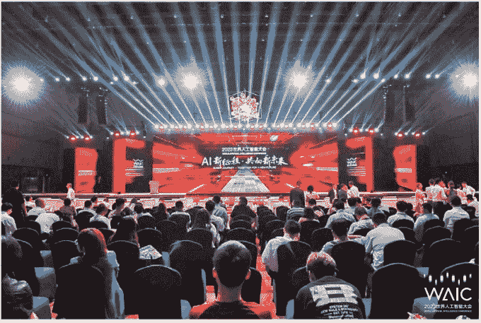
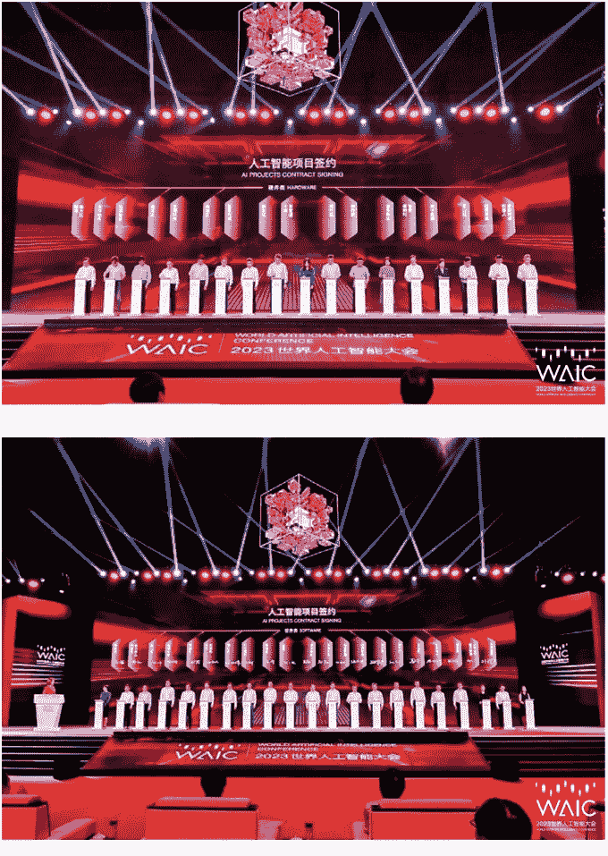
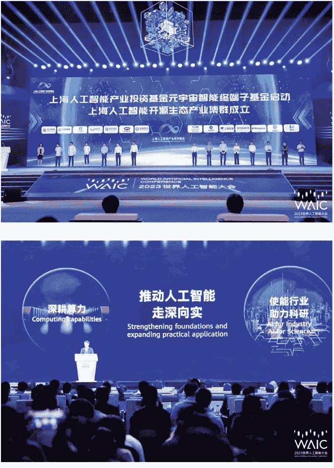
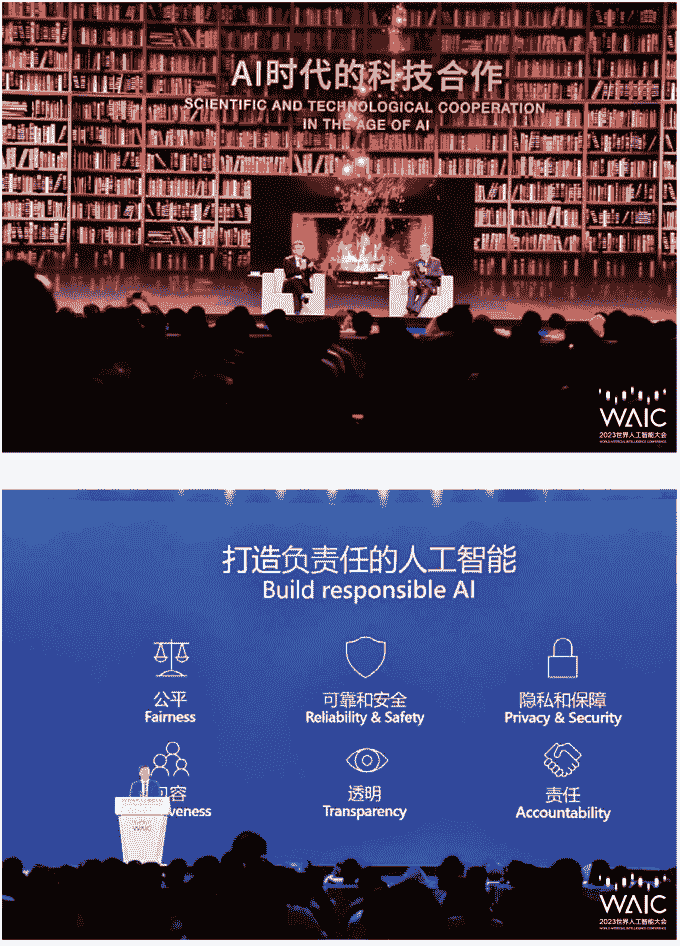
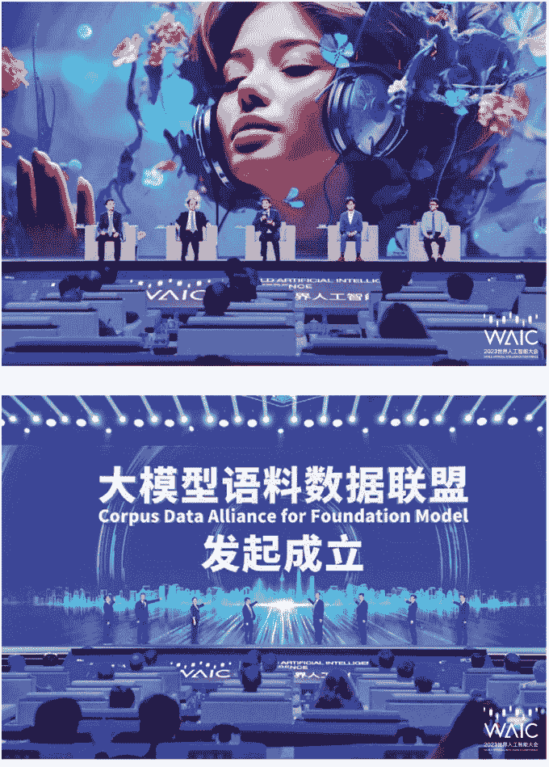
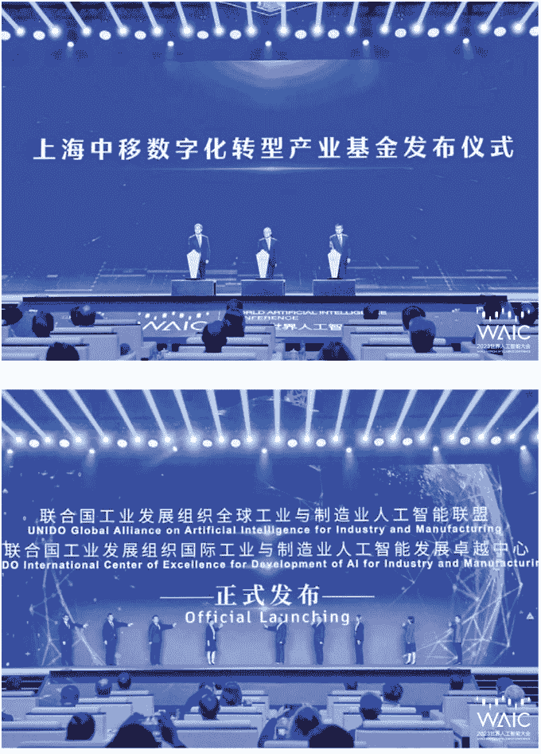
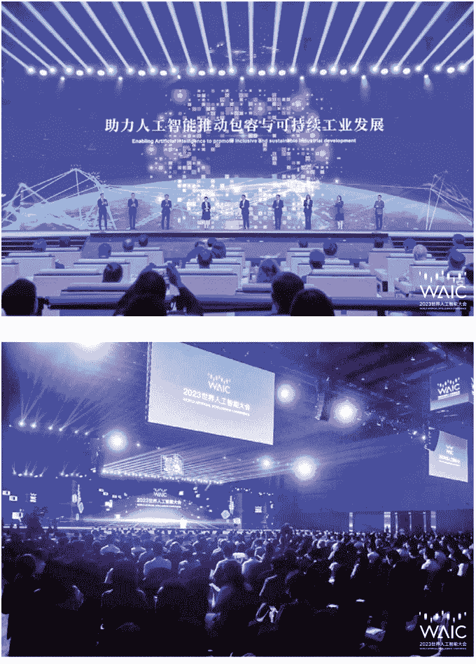

### 展
展览展示规模进一步扩大，线下展览面积达5万平方米，
聚焦核心技术、智能终端、应用赋能和前沿技术四大板块。

### 赛
竞赛评奖以“SAIL奖”为引领，
聚集AI WIN世界人工智能创新大赛、BPAA算法实践典范大赛、黑客马拉松、团市委青少年人工智能创新大赛等品牌赛事。

### 用
应用体验将整体联动线下会场和线上平台，虚实融合，整体打造大会应用场景，
为参会者带来身临其境的智能科技体验。

### 才
针对多层次人才梯队，开展一场人才论坛和N场AI开发者主题活动，助力上海打造卓越的AI产业人才生态圈。

后记

2023世界人工智能大会成功召开后，在各级领导关心支持下，组委会即刻启动成果汇编出版。历经数月编纂，《智联世界——生成未来》与读者见面。

本书文字源自盛会开幕式与全体会议嘉宾演讲，在编写过程中获各位演讲嘉宾积极配合与支持。素材整理、文本梳理、嘉宾联络等编辑工作由上海市经济和信息化委员会、上海广播电视台第一财经、上海东浩兰生会展集团有限公司等团队承担。设计与出版得到上海世纪出版集团上海科学技术出版社支持。本书出版亦离不开盛会各主办单位及上海市各级领导、有关部门的大力支持。谨致谢忱。

世界人工智能大会组委会
2023年11月